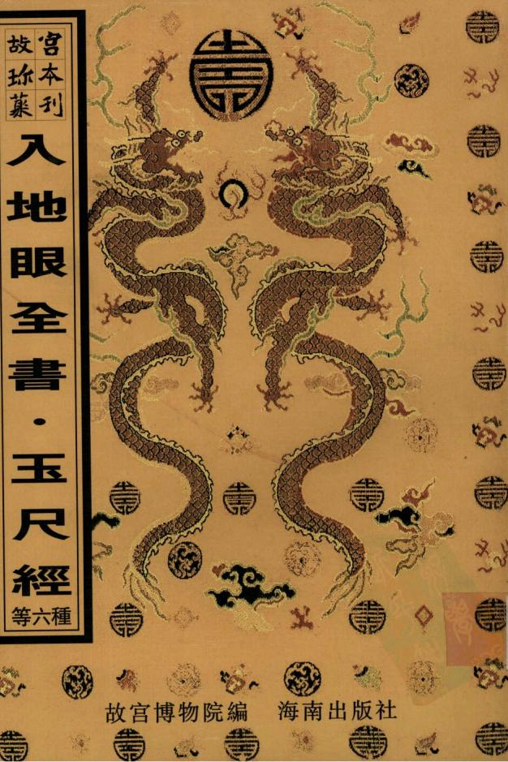

1996-2000年(“九五”)國家重點圖書出版規劃

元吴郡庠刻本《通鑑總類》扉頁背面所鈐「五福五代堂古稀天子寶」，方8.1cm×8.1cm，「八微老念之寶」，方8.2cmx8.2cm'「太上皇帝之寶」'方8.1cm×8.1cm。

堂古 福

山啤 有

故宮博物院編

入地眼全書

新刻石函平砂玉尺經全書真機新刊地理五經四書解義郭朴葬經新鐫京版工師雕斲正式魯班經匠家鏡新刻法師選擇紀全

靈驅解法洞明真言秘書（秘訣仙機

## 圖書在版編目(CIP)數據

水龍經/(晉)郭璞撰.-影印木.-海口：海南出版社，2000.10(故宫珍本叢刊)

本書與“地理四彈子/(南唐)何令通撰”等18種書合訂

ISBN7-80645-742-9

I. 水… Ⅱ.郭… Ⅲ.風水-中國-古代 Ⅳ.Z121.7

中國版本圆書館 CIP數據核字(1999)第 68745 號

故宫珍木叢刊第410册相宅相墓入地眼全書 新刻石函平砂玉尺經全書真機新刊地理五經四書解義郭朴葬經新鐫京版工師雕斲正式魯班經匠家鏡 選擇紀全靈驅解法洞明真言秘書(秘訣仙機)

故宫博物院编 责任编輯：李升召

海南出版社出版發行  
海南省海口市金盤開發區建设三横路2號 郵政编碼：570216湖南省新華印刷三廠印刷湖南省長沙市韶山路158號 郵政编碼：410004  
本書正文用纸由金城造纸(集圈)有限责任公司生產

2000年10月第1版2000年10月第1次印刷開本：787×1092毫米 1/16 印張：21.5 印數：1-400册ISBN7-80645-742-9/Z·20定價：1100元(相宅相墓19種共6册)

本書如有印装質量方面問题请與我社或承印廠聯係我社烏本書每册(種)書新編的目錄均置於每册書末

# 鐫新戌内光道

# 文星堂藏板 宋奏地書 南昌萬樹華編

辜託長老入地眼全書序 同里茂才萬君仁邨好學士也自失帖後爲買 山計讀禮之暇究心地理本之形勢以立其體 參之河洛以妙其用非尋常言青烏者所能逮 庚辰余乞假南旋爲先大夫卜吉延至家甫一 歲以丁內艱服將闋欲豐戶爲舉子業遂辭去 余每隅得一山一址猶資商確焉茲有託長老

地理全書之刻請余言長老生宋時扦葬建造迭著神異其遺趾猶有存者此編向無刻本傳寫數百年堪輿家秘如珍寶萬君得之梓以行世可謂公矣地理之說余素未研究不知是書之善然每見萬君適墓登壠考驗得失無差謬豈非遵守其說而有明效哉他日出所學以問世其樹立必有可觀吾以是編之刻信之矣時道光丁亥春語授奉政大夫掌廣西道監察御史前翰林院編修加三級範亭黃中模拜譔

序地理之說繁雜不一今與古殊甲與乙異同師之學或彼此各鳴其長一人之身或前後頓易其義善於立論者辭達而理未舉妙有心得者語晦而筆不靈理氣明晰未必貫穿形勢龍脉審辨甚日錯謬陰陽擅其長者然於心目燦然於口舌矣又復吝惜珍秘移易顛依使讀者茫然眩惑失所依據非有聰明才辨之實不能分別而決擇之也雖然儒者之言可以折裏是非晉之郭景純唐之卜則巍宋之磔牧堂明之劉靑田皆以儒人地眼全書序 一栢聯芳刊者而精地理者也以術士言之說或囿於俗以儒者言之藝可進於道也南昌萬子樹華識性爽朗襲從余遊講業論文之餘旁涉堪輿便有契悟篋中藏有采託長老入地眼一書地無遁形理有實際異於世之情恍支離其說者所謂釋其行而儒其言者長老有焉樹華不復吝惜珍秘梓而行世索序於余余老困名場疲事舉業窮愁所寄流覽葬經性之所欣時有創獲欲編輯一書融會衆說自愧不文而未果今得託長老所著諸家之言皆有所折衷雖其間有未雅馴而理舉辭達非晦而不靈者比使仁孝之儔不忍於薄其親者相度原野有所依據而不至於眩惑其爲益也豈有涯哉他目樹華得志科名快談纂述石渠芸閤之間必有鴻篇揚聲儒雅而此書之梓亦足以見其存心矣建昌周兆熊風餘序

跋曩爲先君謀窀穸日隨靑鳥家登山陟嶺足蹇甚比暮萃先賢地理書剪燭讀之更闌燼落弗輟也如是者有年然以所見証所讀牽皆牽強附會遠於自然心竊疑之東鄉徐壽山先生者積學士也遊庠序有聲家故豐以葬父故絕意進取專攻堪與藝然不屑以術鳴歲丁卯來會城余獲從逝者七年爲余卜葬先君而余亦追隨杖履口講指書得以聞所未聞然後知山川河嶽自有眞性情剪裁作用自有眞識力牽強附會無當也入地眼全書跋又得託長入地眼全書凡十卷書皆寫本秘弗傳伏而誦之其旨宗河洛法用挨星於理氣爲神妙恍然如披雲霧覩青天之故家巨族陰陽兩宅其盛衰隆替岡不畢合向之竊竊然疑者至是不覺渙然冰釋也雖然地理之學微矣余何人斯知識淺陋涯涘未窺敢竊先賢緒餘哉且思獵取科名佔畢弗暇何暇及此第念附於棺者必誠必信人子皆有是責則余義所盡心力而爲之諒必有同情者余獲是編何忍自秘爰付剞劂用公同好或亦韓子所謂以之爲已順而祥以之爲人愛而公者歟刻成述其緣起如此道光柒年歲次丁亥仲春月望後五日南昌萬樹華仁村氏謹跋于省垣之宗祠

例言 是書自宋迄今巨族大家抄寫成帙秘之已久或前 後失次或散軼不全愚不揣固陋歷數寒暑聞心彙 正方成全集至間有欠雅馴處字字天眞世然明白 故不敢妄爲刪易

一是書理透法巧言簡意賊其他書有相爲表裏者如賴之催官陳之撥砂吳之夾竹梅花葉之理氣三訣張陳之四彈子是也但諸家坊刻傳書不傳訣或且讀其書而不能用其書茲集條分縷晰妙諦俱現能入地眼全書例言使閱者了然易于學習

地理之書言巒頭者或遺理氣言理氣者又遺巒頭彼此偏勝多無應至於立向一法更未有詳言及者是編將龍穴砂水併向五字互相發明言巒頭卽兼講理氣言理氣卽帶講巒頭體用敗備洵爲全壁是書引用古經在他書或因奧語難明致有妄加北註強爲牽合者茲集證佐詳明見解獨出于古經意義無不透澈學者切勿以引用處多習見語視爲尋常坊本蓋逐字逐句細心體認每於轡頭合理氣處尤多聞所未聞讀此眞可力破羣髮是書巳經考凡富貴名墓高山平洋無不符合況長老手作甚多陰陽二宅經彼建造至今不替學者試觀其巒頭作法再審其理氣應用方知此書神效是書宜先熟看巒頭然後細玩理氣蓋陰陽五行微妙難言巒頭卽理氣之著也若舍巒頭而重理氣開卷了然登山茫然便是屋裡先生惟深知辯頭又龍明理氣知所先後而技乃至於神

東田萬樹華仁村氏識入地服全書

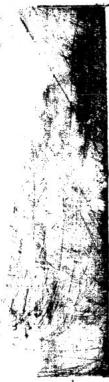

入地眼全書目律

天星卷一文堂

天星卦序 乾宮天星乾龍法亥宮天星亥龍法壬宮天星壬龍法坎宮天星 坎龍法癸宮天星癸龍法丑宮天星丑龍法艮宮天星艮龍法寅宮天星寅龍法甲宮天星甲龍法震宮天星震龍法乙宫天星乙龍法辰宮天星辰龍法巽宮天星巽龍法己宮天星己龍法丙宮天星丙龍法離也艮全書目律 明

宮天星離龍法丁宮天星丁龍法未宮天星未龍法坤宮天星坤龍法申宮天星申龍法庚宮天星庚龍法兌宮天星兌龍法辛宮天星辛龍法戌宮天星戌龍法脆法卷二

龍說龍法尋龍辨帳辨峽辨貪狼木星行龍巨門土星行龍祿存土星行龍文曲水星行龍廉貞火星行龍武曲金星行龍破軍金星行龍左輔金星行龍右弼水星行龍附平洋論平洋龍論穴法卷三

穴法 點穴法四落四勢五星九曜怪穴點法四眞三法穴辨陰陽點法作用穴審背面穴辨眞彼穴觀動靜生死穴看明堂穴看前後左右砂水穴觀風水朝向穴有吉凶穴辨五星穴觀前後左右砂應穴內等物穴有淺深葬法穴芳土色覆攻斷墓不可像改砂法卷四

入地眼全書年

砂說看砂法 砂法 撥砂要訣三關一局訣吊冲之法暗生之法

砂法卷五撥砂法撥砂分金訣撥砂分房分法 辨砂方位大小高低二十四山砂法 朝案砂印砂朱雀元武砂靑龍白虎砂官鬼禽曜砂應樂砂禽獸砂星體砂

水說水法朝水局橫水局攄水局順水同 無水局水城詳義辨干支河圍生成篇何圖四局洛書生成篇洛書四局伏羲先天八卦對待夫婦文王後天八卦合十夫婦納甲歸元海天甲子論祿馬貴人三合局泉煞桃花煞羊及水三刑水六害水 四破水

水法停基浮眉風水問答明堂水天也水水山水觀界送朝聚向依水立二十四山又地眼全書

合局破局九星斷語 向法卷八

向法立向法翻卦法黃石公翻卦掌訣洛 書紫白掌訣翻卦輔星向法輔星翻卦掌訣 文王後天八卦水法水法分房分圖陰陽破局 理氣分房分法一宜立子向一宜立生 向一宜立卯向南論用羅經訣一篇 一宜立酉 向

陰宅圖說納甲根源先天四合局後天四金 局天千六合局三合相生八合局黃泉八煞 破局破祿文廉煞破局納甲八煞破局三煞 會局煞破局兩曜雙煞破局四破桃花煞破局 陽宅說卷十

陽宅總論游星竹節貫井法宮星生尅方 位要訣七政九昭之說三元命訣又提訣 東西四命宅圖灶法偏氣致應天井放水 元髓經

入地限全書日四入地眼全書天星卷一宋南昌辜託長靜道和尙著瀑泉裒泰開樹庭黃中楷

雲門黃中植 稔安袁豐年同參

理齋劇是訓恬眞徐孝先

東田萬樹華仁村氏編次

胞姪萬基德修校字

天星卦序

天尊地卑乾坤定矣卑高以陳貴賤位矣動靜有常剛入地眼全書卷一天星

柔斷矣方以類聚物以羣分吉凶生矣在天成象極地成形變化見矣是故剛柔相摩八卦相盪一陰一陽一上一下一外一內或上臨下或下臨上變化而莫測是以鼓之以雷霆潤之以風雨一寒一暑日月光明運化不已故乾健也坤順也震動也巽入也坎陷也離麗也艮止也兌說也是故雷以動之風以散之雨以潤之曰以暄之艮以止之兌以說之乾以君之坤以藏之乾道成男坤道成女乾知大始坤作成物乾以易知坤以簡能易則易知簡則易從易知則有親易從則有功有親則可久有功則可大可久則賢人之德可六則賢人之業易簡而天地之理得矣天地之理得而成位乎其中矣蓋天書夜旋轉而不停日月五星隨之天帝順行十二宮布四時之令太陽逆行十二宮宣八節之功是以八卦陰陽變動應四時八節交會於大地矣太寒天帝在丑太陽臨子交會於子丑之間故子與丑合萬物成終成始易曰成言乎艮雨水天帝到寅太陽在亥寅亥交會故寅與亥合丑寅輔艮東北之卦也春分天帝臨卯太陽在戌故卯與戊合卯戌交會甲乙輔震正春之人地眼全書卷一天星令也萬物發生易曰帝出乎震谷雨天帝在辰太陽到酉故辰與酉合辰酉交會萬物潔齊易曰齊乎巽小滿天帝到己太陽在申已與中合申已交曾辰巳輔巽東南之卦也夏至天帝到午太陽臨未故午與未合午未交會丙丁輔離正夏之合萬物皆茂易曰相見乎離大暑天帝在未太陽居午午未交會萬物致養易曰致役乎坤處暑天帝到申太陽到巳申巳交會申未輔坤西南之卦也秋分天帝到酉太陽在辰酉辰交會庚辛輔兌正秋之令萬物悅成易曰悅言乎兌霜降天帝到戌太陽居卯戌卯交會陰陽相薄易曰戰乎乾小雪天帝在亥太陽在寅亥寅交會戌亥輔乾西北之卦也冬至夫帝回歸北極入於垣太陽復命告功壬癸輔子正冬之令也萬物歸藏易曰勞乎坎夫山出而齊而相見帝之鼓乎出機也而成由入以向乎出焉起震終艮一歲之終也而循環之妙在中矣

入地眼全書浴一天星 111

乾宮天星易曰乾道行健元事利貞其性燥急陽之亢也位居西北乾以君之六子皆統攝而分職以聽又孰翁受時令於冬曰戰乎乾陰陽相薄肅殺相攻卽純陽尅陰也霜降天帝到戌太陽居卯戊卯交會陰陽相薄易曰戰乎乾小雪天帝在亥太陽到寅亥寅交曾戌亥輔乾酉北之卦天星曰陽機又曰天璣奎宿十六星赤居其所今五星聚奎則天下世盛文明又曰封豕主文章之府又主天子武庫故主兵權所以禁暴橫行又主溝瀆其星文地眼今書卷一天星 四

下九尺乃日月五星之中道乾在天皇之左是以聖人畫卦以乾爲八卦之首爲天爲父爲龍爲焉故天地萬物亦以乾爲首乾三爻俱陽萬物資始坤三爻俱陰萬物資生是以聖人以乾坤爲天地定位地理家用之爲權德

凡乾龍起祖草立雲霄如龍樓鳳閣者出脉過峽起伏盤旋佈氣行度到頭結穴與衆不同其龍不可與亥同行亥乃龍之曜鬼先賢所忌切宜詳細若得單清過脉地局端正砂水全備爲龍之上格若得主星高聳功垂社稷澤及生民恩榮奕世中格龍結穴者翰院聲價日近天顏下格龍結穴者亦發科甲巨富人丁若得殿上貴人者聚氣火星也上格龍主出將人相大有功動名聞四海中格龍結地者主尙書侍從翰院榮封下格龍結地者主科第大富或火星變土結穴者產狀元宰輔或木星結者出尙書侍郎或金星結者主科甲屏翰水星結者定出翰林學士土星結者主科貢秀士百嬴之庄富壓一郡總看龍之強弱穴之有無砂之拱峙水入地眼全書卷一天星 玉i

之澄清案之朝拱五種俱備方爲是地而有缺陷便是 鬼氣庸師到此歡天喜地假者好看眞者天秘明師到 此圓規方矩自有道理有恐之家遇著此地無德之家 反是掏氣

亥宮天星

易曰亥乃屬木西北之隅納卦於震地支之十有二數木之長生位時令於冬太陽京直到亥白露到巳向天帝小雪到亥山天星曰天皇堡宿二星一東一壁其名東壁二星赤居其所下九星尺爲天之中道主文章圖書之秘府也又主士工明則圖書集道術行小人退君子進天下士子多賢良世上詩翁賽謫仙

## 亥龍法

易曰亥在天門之左紫微幼照之所天極太乙常居也木之長生又得天皇之星下照亥地若亥龍起祖單清過脉爲龍之上吉凡亥龍過峽出脉到頭結穴東咽處必須要一亥字到頭結穴者爲吉二十四龍惟有五龍難下亥龍左乾右壬一辛龍左酉右戌一午龍左丙右丁一巽龍左辰右巳一卯龍左甲右乙此五龍陰陽入地眼全書卷一天星 六

駁雜兼帶煞氣若得單清過脉發福更大更悠久不但來龍如此五向必作丑向方得房分不偏而若兼左兼右則三房受害無三則二房受害矣凡亥龍起祖山旋入艮結穴者定主科甲及第富貴顯耀若卯龍起祖入丙轉亥結穴者主文武雙全宰輔三公如兌龍起祿轉丙入庚結穴者主巨富又主輸苑才名如正亥結穴者主科甲連綿官居台閣壬宮天星

易曰壬屬北方陽水納卦於離爲天干之九數故卜易 曰離火巳卯巳酉親巳壬二于隸離時令仲冬太陽兩 水到壬山處暑到丙向天帝大暑到壬山天星曰陰權 室宿二星赤居其所爲太廟天子之官也又爲元官一 曰清廟又爲軍糧之府又土工事其下九天爲日月五 星之中道土一星爲天子宮下一廟為大廟故羽林以 衞之將有土工之事古於營室其星明正則國昌文明 四海不明則鬼神不享祭爬大下多生疾疫

紫微帝座一白星傍照壬地又得四輔六相左右輔之入地眼全書卷一天星

爲龍之上吉其龍不可與亥同省謂之龍身帶曜兌賢所忌切宜詳細若乾龍起祖由坤入午正出面結穴者定主科甲翰苑官居極品如坎龍起祖由甲出乙轉壬結穴者主富貴雙全科甲聯登若午龍起祖入坤轉乙向甲結穴者主巨富田聯阡陌官居台省

易曰坎陷也習坎有手維心亨行有尙位居正北雨以潤之而枯槁滋息時令仲冬曰勞乎坎以終歲勤動慰勞於斯一陽藏蓄而休息也冬至天帝回歸北極於子垣太陽復命告功於丑所壬癸輔子坎正冬之令也萬物歸藏帝既慰勞而一元告成易曰勞乎坎天星曰陽光虛危二宿二星赤居其所冢宰之象主北方城邑廟堂祭祀之事又主風雲死喪哭泣下九尺是日月五星之中道其星明大則天下安秦又危宿三星赤亦居其所爲天府一曰天市又曰架屋爲天廟堂下九尺爲日月五星之中道主架屋受藏風雨墓墳祠禮亦爲冢宰之官主天下五穀豐稔以象海涵珠滋萬物之所一白正臨九紫對照八白居左六白居右兩相輔佐天帝成入地眼今書卷一天星 八

評坎龍

凡坎龍起祖骨脉分即地居端正到頭結穴者為龍之 上吉若轉坤龍結穴者定主雙生之兒富貴可許如旋 申起勢轉正坎出面結者亦主科甲富貴又有翻身逆 勢旋申由午結回龍顧祖必得局法端正砂水秀麗定 主翰苑才名目近天顏富而好禮又主雙生之兒又生 六指之人如壬癸起祖旋山八辰轉乙出面者主產武 畧將帥之職英俊雄偉之才若巽山起祖由坎出面結 者主生雙女兌龍亦同主家財消敗

易曰癸屬北方之陰水納卦於坎爲天干之十數故卜易曰坎水戊寅外戊申癸戊二干隸坎時令仲冬之未大陽大寒到山大著到向天帝小寒到山天星曰陰光女宿四星赤居其所爲天之少府掌管書機又爲須女賤妾之稱婦職之小也十布帛裁製嫁娶下九尺爲月月五星之中道其星明則文士現五谷豐女工昌府庫

入地眼全書卷一天星

癸龍法

凡癸龍起祖旋申入辰轉乙出面結穴者主生英雄豪傑才堪將帥如旋申起勢轉正坎出面結者主科甲富貴若轉坤龍結穴者富貴雙全如翻身逆勢旋申由午結回龍顧祖定主利甲翰苑又主雙生之兒六指之人與坎宮回推

丑宮天星

易曰丑屬陰土東北之界納甲於兌金庫于丑地支之二數時令季冬太陽小寒到丑山小暑到未白天帝大寒到丑山天星曰金牛又曰斗牛牛宿六星赤居其所爲天之關梁主犧牲之事呂月五星貫之爲中道上二星主道路次一星主關梁又次二星主南夷其上二星一曰積路一曰積火主道幣中間一大星主關梁牛馬次下三星主南越星明大則王道昌天下安牛馬廣不明則牛馬瘟疫

易曰丑居東北以入白今宮貪狼一星在紫微之北下 照丑地在天爲四金在時爲四季然天市垣中天機一 入地眼 卷一天星 十

星傍照丑地故丑龍起祖骨脉分明爲龍之上吉定產富貴之人其龍不可卯癸同行切宜詳細如兌龍起祖入艮由震出面結穴者主產文武全才之士威鎭邊夷若艮龍起祖由丙入庚結穴者主科甲奕世丁財大旺若亥龍起祖入艮轉未結穴者主大富乃得牛羊發家艮宮天星

易曰艮止也艮其背不獲其身行其庭不見其人無咎位居東北艮以止之而生意收斂于不過時令於春曰成言乎艮生尅嗣續成終開始則一陽凝止於外面爲之有待也北帝之無爲而爲不爲也大集天帝司丑陽臨子交書于子丑之問萬物成終成始太陽逆行天帝頌行故五寅輔艮艮得上爻一陽初生故春之時以之陽爻而發天星曰陽機又曰陽樞斗宿大星七其所爲天廟也五星買中爲日月之正道五帝坐宮天中其星最明亦者主之天市全貨之府為永相太宰之位酌政事之宜襲進賢良永受爵祿南二星尅天以也中央二星天相也北二星天府庭也亥爲受命之邑將有天子之事占丁南斗其魁第一星士人地服全書卷一天星 十

吳第二星會積三星主月陽第四星主豫章第五星主廬江第六尾土江州六星欲其均明則天下安泰風雨順時君民安康五穀豐熟

凡艮龍之祖卓拔高拱如華蓋如文筆如五印如武金如貪狼辛蓋者蓋下出木星如此出五過峽一起一伏一灣一曲起伏旋到頭結穴者爲館之上吉其誰不可與寅同行謂之八煞龍以宜詳細先賢所忌若得單清過脉地局端正砂水全備主星故峽吉爲龍之麓古也卯華然出脉有木星結穴者主出侍郎尚書之宮中於亂主出科甲翰林下格龍主科貞秀士如文星上木下木結穴者上格龍主文章顯述減兼文武中格龍主甲道院下格龍主科貢人才如上印力正之也小土星出脉結穴者上格龍主祥名高運霄脉萬逆中格十腰金五馬下格龍主富出重義之人如武金者其皇傳體勢亭嚴故謂之武印獻天金雲中金出脉結穴名上洛龍主出大將征代邊境名傳四海中格龍三曰頭阡陷出臺閫府下格龍主巨富主出蠶俗燥地照全書卷一天星 土烈之人如華蓋蓋下有木星而出結穴者上格龍土萬桌台中格龍主尙書侍從下格龍主杵甲府道如全皇結者主科甲屏治大發文章如木星 者主暴台開府如水星結者主出科貢秀士如火集結者主生娛列之人如土星結者主巨富

易曰寅地東北之也木納卦於離地之二數火土之 長生位合春太陽大雪到寅種到申向天帝兩 水到寅山六星大又口功此節但四星赤居其所 箕爲天津又爲後宮后妃之府上六尺為日日五星之 中道若五星臨箕壁勢軫四宮則風兩驟及不開 則久雨不又主口舌之神前二星爲舌端而則大風 不出三日卽應其星明則五穀熟其星赤不人旱

## 與龍法

寅乃天培所居之位又得貪狼天樞一星下照寅地北斗之天柱尺白之傍照爲龍之上吉若也其龍不可與臣同行謂之八唯行龍先賢所忌切宜詳細若坤七一龍起祀由坎入離結穴者定產富貴顯室之人若說龍人限全書卷一天星

起氣轉坎人乙結穴者主發富貴出顯宦如離龍起神山壬轉寅正出結穴者主離鄉發貴

甲宫天星

易曰甲屬東方陽木納卦於乾爲天干之首故下見曰 乾金甲子外壬午時令仲春驚雜節二月也天t司甲 太陽臨亥八月太陽到庚向天星曰陰尾宿凡星赤 居共所后妃之府北一丈爲天之中道室宿尾宿二星 是九之也其星明大則主壬甲二方墳塋多子孫 易曰甲陽木納卦於乾天干之陽小帝宿初出北斗弟 五權星二照其旁主文章之府辛相之宮几甲龍起祖 單清過脉地局端正砂水合備止山南者爲龍之十吉 若乾龍起祖由坤轉乙正甲出面結穴者定主少年科一 甲蜚聲魁第若坤龍起祖人坎轉寅結穴者七産文武 雙全之士得甲才名之貴若午龍起公轉乾六次山辰 出脉結穴者産狀元宰相出主侯六夫丁君若次龍起 祖曰坤人癸轉申結穴者主大富小胥人丁不旺多主 貴

天地眼全書卷一天星

震宮天星

易曰震動也震亨震來笑言啞啞震驚百里不喪七鬯位居正東書以動之發其生意又曰帝出乎焉而陽始而氣機於是萌動焉時令正春春分天帝到卯太陽在戌卯戌交會故曰與戌言甲乙輔震正春之合也萬物發生故曰帝出乎震天星曰陽衡又曰天衝天命氏宿四星赤居其所是天子休解之宿吕后如之府又爲天根下五尺為口月五星之中道吳渠明則君臣百姓共享太平房星四星赤居其所爲明堂天子希政之言也又爲四輔又爲天駟又爲天馬主車駕土武大將軍之位掌音衆兵三軍號令其星明大則天下太平人民樂業乃乾坤之長子得天地之正氣天帝火星主宰輔帝乃震也爲廉貞皆從曰之方升帝出得一陽初生震龍法

凡震龍起祖出脉過峽地局端正震龍行度骨脉分明大星結六者主產文武全才三公將相之人若廉貞起祖四神拱峙靈山出而庚水朝來定產燥烈之人必爲上將斬砍自伏武鎭邊夸如良龍起祖出面由亥人庚入地服全書卷一天累 五

骨脉分明地局端正結穴者主產文武定出賢土若亥龍起祖一峯獨出由丙入艮出脉結穴者定出科甲齡苑才名之貴震龍出脉左不可兼甲右不可兼乙甲納於乾爲孤乙納於坤爲虛震爲坤之八煞惡人來了是以甲孤乙虛帶乾坤龜甲之氣必主滅門絕戶古云陰陽相乘禍咎踵門言龍不可陰陽雙來故禍咎繩門切宜慎之如卯龍不可兼甲乙之類陰陽相配福祿永貞言水與向宜陰陽相配如坤水來立乾向乾水來立坤向巽水來立卯向卯水來占巽向寅水來立十前水來立寅向酉水來立艮向艮水來立西向此陰陽相配之法老父配老母長男配長女中男配中女少男配少女此水配向是八卦夫婦相配法水是生成向是人立是以立向有轉移之巧乾坤老父老母是八十之數震巽長男長女是六十之數坎離中男中女是四十之數艮兌少男少女是二十之數數者壽也所云艮龍西水立丙向少年科甲顯文章又云巽水滔滔走入庚震龍未向狀元生故陰陽相配福祿永貞水是天地生成向是先賢傳度可知矣這等看來雙山長生水法入地眼全書卷一天星全不用了長生水法世人未索其解半假半眞其法謂之左右旋左水到右爲甲庚丙壬四陽局甲木生在亥丙火生寅庚金生在巳壬水長生在申如亥水來立甲向未水去爲歸墓而不在未上去則又曰水出辰巽是衰方曰惟有衰方可去來謂之甲木局若依八卦水法算犯祿存水上堂祿存一名孤曜一名絕體不吉明矣又寅甲水來作火局立丙向丙火生在寅水出戌而不能出戌者則口出未坤是衰方伏八卦水法寅是廉貞甲是破軍必主癆病惡疾人命官事家則不了官事不休僞書云亥龍丙向來蛇扦富貴旺牛田寅甲水來逐穿紅井著綠庸師一見亥龍入首寅甲水來就言此四句俗話殊不知賣盡牛田惡疾染身身上紅紅縣綠果如穿著綠的郎君一世也不脫下除死方休又巳水來作庚金局立庚向庚金生在巳水出丑此局爲後云夫婦相配則上吉而若放戌乾衰方水則重妻瞽目不吉矣又申水來作壬水局立壬向壬水生在申水出辰則大富大貴之局此水不可出衰方丑艮水一去則主乞再出僧道又有右水到左爲乙丁辛癸四陰局乙木入地眼今書卷一天星 七

生在午丁火生在酉辛金生在子癸水生在卯如午水來立乙向爲乙木生在午水出戌而不能出戌子水去爲病水去最妙若出衰方則不吉矣謂之吉地葬凶反生禍矣酉水來立丁向爲丁火生在酉水出丑上吉丁納于兌爲納甲水最秀主少年發達男清女秀若放辰水去則不吉矣主投河自縊缺唇露齒子水來立辛向爲辛金生在子水出辰則不吉子坎卦坎爲中男四卜歲辛巽卦巽爲長女六十歲四十歲男子娶六十歲婦人有生育乎無生育乎子水來破了陰局子爲沙浴之水又爲軍盜之水主男爲盜女爲娼說也嚇人若水出未方則二房有救了辛巽卦巽爲風爲長女未震卦震爲雷爲長男得夫婦相配之義又得雷風相薄局則主丁財大旺富貴綿遠右論歸藏一事全在一局見陽水來陽水去立陽向陰水來陰水上立陰向則萬無一失雖無龍與穴却無禍到也平安而癸水生在卯者與此同推可恨呂方作銅函經用此雙山五行將來日後預習成風不知要害幾多良民則知其心大不良也雖奉上諭欲害蠻夷古語云害人終害巳殺人一萬自損太地眼全書卷一大星 大

三千又標出歌句以哄人乙丙交而趨戌辛壬會而聚辰斗牛納庚丁之氣金羊收癸甲之靈詞句雖好讀則甘甘有味這多書駝子習地者無一人不遵其法貧衲力止不聽苦口逆耳無奈我和尙學問不佳眼精又瞎文理不通叫貧衲那裡去講起是以只得各從天命事且出他

易曰乙屬東方之陰水乙納於坤爲天于之二數故卜 易曰坤上乙未癸丑憑乙癸二干隸坤時令仲季之間 大陽霜降到乙山谷雨到辛向天帝清明到乙山天星 曰天官氏宿四星赤居其所爲天子休解之宿宮后妃 之府也前二星大主后如後二星小主妾媵又爲天根 下一尺五寸爲日月五星之中道其星則后妃奉君 命天下綿花朝亭布廣賢女多貞

乙龍法

易曰太乙一星赤在右陽衡一星赤在左二星夾輔下照乙地其星在紫微之北下照先天之坤凡乙龍起祖骨脉分明地局端正單清過脉爲龍之上吉其龍入脉入地服全晝卷一天星 九

必須單乙切不可相兼左是卯右是辰卯爲八煞辰亦然也若得坤龍起祖由坎入離結穴者定主科甲名利雙全得乾龍起祖入甲轉壬結穴者主官居極品又主女貴若子龍起祖由午入甲結穴者上丁財大旺富貴細遠坤龍入穴辛山乙向乙水朝來催官第一壬龍入首乙水來坤向當朝宰相

易曰辰屬陽上居東南之界納甲於坎地支之五數時 令季春大陽寒露到辰清明到戌向天帝谷雨到辰山 天星曰天罡又曰亢金亢宿四星赤居其所是日月之 中道爲天府天子之內朝總理天下卿大夫之治猶尙 書也亦爲疏廟又主疾疫其星明則卿大夫清正賢士 加爵士庶樂業疾病無

辰龍法

易曰辰在地支五位之尊天罡所治之宮太乙傍照之所又得亢金一星下照辰地辰屬龍亢金亦龍也故辰龍過峽必結大地凡辰龍起祖必踴躍而來大開帳嘆起勢跌峽大頓小伏一行數百里方結一穴小則數十入地眼全書卷一天星 下

里極小者數星兩旁分枝開椏不計其數今以小者言之辰龍出脉起伏盤旋入甲轉乾結穴者爲龍之上吉主產狀元出幸輔如乾龍起祖山坤入甲結穴者主科甲翰苑官呂開府若坤龍起祖由乾入甲轉乙出面結穴者主大富大貴人興位顯凡結大地必是辰戌丑未四龍所有辰戌丑未四龍出脈必是榦龍不信看京都省郡州城府縣所結之處皆是辰戌丑未之龍所結方知辰戌丑未四龍爲大龍不知是何人將此爲墓龍而輕之

皆官天星易曰巽人也小亨利有攸往利見大人位居東南風以散之解其鬱結生萬物之功也時令于夏口巽齊乎巽一陰順二陽井行出整齊而氣俱均布谷雨天星在辰太陽到酉故辰與酉合辰酉交會萬物潔齊易曰齊乎巽小滿天帝到巳太陽在申故巳與巾含申巳父會辰巳輔巽東南之卦也天星曰陽璣又口天乙角宿二星赤居其所主造化萬物布君威信爲天關其門爲天門廿內又爲天庭故黃道徑其中七曜之所行也其尾明入地眼今書卷 天星工大則貴人出天下安泰

巽龍法

凡巽龍起祖一峯獨出或雙峯拱峙卓立雲宵如雙也香或帳下貴人或蛾眉鳳輦如玉圭鏡臺一切等龍出脉布氣行度過峽起伏屈曲盤旋結穴者爲龍之上吉其龍不可與辰同行謂之龍身帶煞先賢所忌大不祥也此八煞之外之八煞也若龍身兼已亦不可用皆宜詳細巽龍左是辰右見巳巳納卦之八煞辰卦外之八煞故不吉世人未索其解故不知之正五行辰屬上巽屬木木尅主爲煞巳納於兌兌屬雞巽忌雞凡遇此等雙行之龍縱好美地不能獲福往古塚聞考證力知道雙木精有等庸師不知此理與人安葬曰好個倉板水在而前占乾山巽向兼八辰或口兼亥巳包管發則殊不知面前倉板水是兩股煞水流來則三房光占先絕次絕二房再次絕長房若能眞力飽氣旺則二房不絕雖有子孫却主貧窮徹骨豈非巽巳雙流水尅水何能一勺救貧哉又云巽向辰水主文曲遊蕩無依絕人丁巽水來爲水尅向巽水去爲向尅水又云山向尅水醞人地眼全書卷一天星 主

運緩水尅向重禍速來這等看來龍也絕人水也絕人水關禍福更速若論乾山巽向地必須作正向左不可兼辰右不可兼巳庸師不知天足理氣原是亂來庸不知就是作書者能有幾人有等俗師見有正向者曰落了空坐了戊已煞不能管事獨不知古來明師與人下一地獨向者廣多房房均勻家家獲福請往古塚間考方進學問巽爲天帝文章之府居河洛四龍之寶爲龍之上吉若兌上起祖由丙入丁轉辛入亥往巽出面者忡脉分明地局端正上格主産公卿之職文秀之士金玉之貴又產大富之人如震山起祖由庚結穴如帳下貴人出脉者入艮由巽到頭八將峙立四神高從朝與巽山齊雲雙峯侵漢龍眞局正定主出將入相如只一峯獨出亦出狀元少可峯巒亦出泰軍司戶經畧之士一峯秀出一登科變峯拱峙同科舉低員方正錢無數蛾眉山現女爲妃六秀中獨巽山宜高不宜低及凹風射穴又不宜朝流而去主人亡財散殺戮之事雖龍眞局正犯此水者亦不可用或轉丙向立别向乃可在乎活法否則必敗切宜詳細

巽山無足不堪行惟向蛇頭斬腳筋辰龍惟怕兼巽走已山不要巽同行孫臏家祖塋巽巳雙來龍脉故別足巳宮天星

易曰巳乃屬火居東南之界納卦於兌地支之六數金之長生位時令於夏太陽自露到巳京直到亥向天帝小滿到巳山天星曰天屏軫宿四星赤居其所其四星爲天之四輔又爲冢宰又爲輔臣主察殃害之事又主車騎任載賊盜征伐喪事輔顫亦主風雨軫乃水星也北上五尺爲日月五星之中道其星明則天下安康萬民和樂風調雨順質人疊山

易曰巳得天屏一星在紫微之東雖不合何洛之貴天帝照臨又是金之長生地中之福德可謂上吉其龍行度骨脉分明地局端正爲龍之上吉其龍不可與巽同行謂之曜鬼帶煞先賢所忌切宜詳編若卯龍起祖由亥入艮結穴者主出科甲及第産巨富之人如艮龍起祖入亥轉卯結穴者主出亥武全才之士腰懸金印如亥龍起祖由艮轉卯結穴者定出富貴雙全田聯阡陌人地眼全書卷一天爲 西

易曰丙屬南方陽火丙納於艮爲天于之三數故卜易曰艮土丙辰外丙戌時令仲夏五月芒種天帝到丙太陽在申七月處暑太陽到丙山正月雨水太陽到壬向天星曰陰樞又曰赦文翌宿二十二星赤居其所爲天子之樂府主徘唱嬉樂文物聲名之所又主太廟三公化道文籍及蠻夷遠客四海之濱北上十有三尺爲日月五星之中道其星明大則君明臣賢禮樂巽四夷來

丙龍法丙居離明之府九紫傍照之官大微垣月星下照丙地凡丙龍起祖骨脉分明單清過脉地局端正爲龍之上吉其龍不可與午同行乃廉貞火龍定主火灾兼巳亦可定産穴富貴之人艮龍起祖由兌八丁轉亥結穴者定土翰苑才高省台官貴如辛龍起祖由亥入兌轉八丁結穴者主富貴雙全尙書侍從若卯龍起祖入艮由亥轉巽結穴者主武全才之士出將入相之貴離官天星

入地眼全書卷一天曷

曰離麗也利貞亨畜牝牛位居正南日以喧之而陰濕燥長物之功也時令正夏易曰相見乎離一陰在中二陽外熾化機宣暑者而萬物光輝相見之後必有委而養之者夏至天帝到午太陽在未故午與未合丙丁輔離正夏之令萬物皆茂易曰相見乎離天星曰太陽又曰陽權星宿七星赤居其所又曰天都爲朱雀文明之粹羽儀之所主衣裳文繡又主盜賊其星明則天下大豐年張宿六星赤赤居其所主珠寶金玉宇宙所用之物天子內宮衣服收藏貢物之庫又主廚飲食賞賚之凡離龍起祖起伏之元屈曲而來星體端正骨脉分明到頭結穴者爲龍之上吉主科甲王侯之地其龍不可與丙同來是廉貞雙行主火災先賢所忌切宜詳細若壬龍起頂出脉過峽結者主出科甲翰林侍郎學士子癸二龍或由甲入坤轉坎正出面結穴者主公卿宰相如坤龍人坎向甲正出面結穴者半出翰苑才名富貴雙全艮龍一變坤爲貪很坎爲巨門兌爲祿存震爲入地眼全書卷一天星文曲離爲廉貞離龍一變震爲貪狼兌爲巨門坎爲祿存坤爲文曲艮爲廉貞丙綱於艮故丙午二龍不可雙行是爲廉貞火龍此必要用制之之法火絕於亥乾屬金金能生水一屬水壬亦屬水南方之丙火北方之王水壬水尅丙火亥水尅午火二水制一火故天地陰陽各各不同生尅制化各有所喜所忌如人亦有相喜相惡者相喜者孝順至誠和睦親隣相惡者謀財害命行兇叛逆是以亦有制化聖人設禮義以化民心設王法以制惡人是故昆臣草木皆然也如蛇喜蝦蟆蝦蟆喜蜒蜷蜒蜷喜蜈蚣蜈蚣喜蛇蛇畏蜈蚣蜈蚣畏蜒螻蜒蜷畏蝦蟆蝦蟆畏蛇此四亞若遇在一處則俱不敢相持而不分開則四亟俱死一處如醫冢用藥藥有君臣佐使此相喜者也亦有相畏相反者此相惡者也世上萬物各有制化天地日月五行相生相尅皆一理也如山川巒頭皆以分金坐度爲主遇難生恩化煞生權全在理氣上功夫活潑潑而取用

丁宮天星

易曰丁屬南方之陰火納卦於兌爲天干之四數故卜 入地眼全書卷一天星 毛

易曰兌金丁巳外丁亥丁干隷兌時令仲夏之末太陽大暑到丁山大寒到癸向天帝小著到丁山天星曰南極又曰陰間宿八星赤居其所主人福壽又主文章大會爲朱雀素一曰天相一曰天庫天之厨也主御膳飲食倉庫酒醋之位又主雷雨工匠其北六尺爲日月五星之中道其星明大則人壽年豐酒食昇不丁龍法

易曰丁寄離明之位九紫帝星傍照之所天于之次南 極老人一星下照丁地凡丁龍起祖骨脉分明地局端 正起伙而來到頭結穴者爲龍之上佳產文武全才之 士富貴清高之人若兌龍由亥人艮出面結穴者主王 侯廟食與國爲姻丙龍起祖入艮轉丁結穴者定主才 高北斗翰苑官貴丙龍轉丁丁龍轉丙爲赦文龍丙丁 二砂起爲赦文砂丙水朝丁丁水朝丙爲赦文水主家 無凶禍犯罪卽赦

易曰未乃屬陰土西南之界納甲於震木庫於未地支之八數時令季秋太陽小暑到未小雪到丑向天帝大大地眼全書卷一天星 天暑到未山天星曰金羊又曰鬼氣鬼宿四星赤居其所其四星古四角中央一星現而不現主文魁營天下土子之陰德其星明則陰德星掌管陰德龍凡人每日有德行卽記之其星氣白如粉絮似雲非雲似星非星見其氣而已世有士子科場有中而不中者人言是命非也乃德行不能也其四星主視明察奸謀天之目也爲目月五星之中道曰天廟主祠祀又主疾病死亡東北一星主精馬東南一星主精兵西南一星主精布西北一星主精金德滿者以金賞之半德者以布賞之勞多者以馬乘之孽多者以兵誅之

## 未龍高

易曰禾乃鬼金之所然得南極老人一星下照未地又羽林太常在傍以輔之若未龍出脉起伏盤旋正而結穴者爲龍之土吉其龍不可與坤同行謂龍身帶曜切宜詳細若巽龍起祖入辛轉艮結穴者出科官居得祿如卯龍入穴作甲山庚向者未水來雷擊而興未水去雷擊而敗非但卯龍未水未龍卯水亦然艮龍起祖由亥入未結穴者主巨富不大貴如兌龍起祖入工入地眼全書卷一天星

轉內結穴者主翰苑人財大旺少年發達爲官清正卯龍未水雷擊未水來雷擊而興未水去雷擊而敗卯龍未水而庚向則擊門向則不擊非但擊坎如石山亦擊何故石乃龍之骨生成在山數十年而不擊獨今日擊之何也其山來後有一節亦卯方過來其山面亦逆西數千年不擊原無未水今阿南未水或山崩倒或水消破成一小演故有門缺成其未水之勢故雷擊之如不信請往雷擊之處之人有信命而不信地者聖人亦言有命但命是後天地是先天先有地而後有命生出富貴貧賤壽天窮通皆不出此範關孔子曰天之所覆地之所載世之萬物皆出于地而不出於天則知在地而不在天也地有靈氣山川有秀氣而無主尸骸有主而無氣若得山川地氣尸骸骨氣兩下合一不愁不生有命之人如卯龍庚向未水雷以擊之卯雲庚亥末俱納于震爲雷故擊之又庚龍卯向未水當亦擊之卯向巽水爲雷風鼓舞主擊後龍地既如此有地平無地平

又地限全書卷天

易目坤道順行元亨利牝馬之貞其性柔順陰之故藏位居酉南坤以藏之六子皆包涵而秉時乃方圓卦位之雙峙是以該造化之今功也時令於秋曰致役乎坤坤有巨道竭力效用養物無窮純陰代陽而有終始致役之後並有足而說之者人暑天帝在未太陽居羊午未交物致養易曰致役乎坤處暑天帝到申大陽在巳交會市未輔坤西南之卦也天星曰依戈又曰陽戈井宿八星赤居其所在河中主泉水又爲天之南門日月五是貫之爲中道名曰天井又曰東井主諸侯帝威三公之位天之停侯水衡發今之所是以聖人以乾爲父坤爲母坤卦六書皆陰是萬物資生乾卦三書皆陽爲萬物資始所生六子地理家各有分辨先賢云不知天文焉知地理天文昭于上地理應于下在天論纏舍在地論方位如此得有地之旨得

## 坤龍法

凡坤龍起祖卓拔如旗如圭如貴人如御屏如玉堂如筍者出脉過峽起伏盤旋到頭結穴者爲龍之上吉其龍不可與未相兼謂之帶煞先賢所忌切宜詳細或行人地眼全書卷一天星 主

度佈氣力飽氣旺坐山眞正無偏地局端正四山懷抱砂水全備者爲龍之上格如大小貴人結穴者貴人之峯一峯低小二峯高大士格龍主出父子兄弟叔姪同朝中格龍主父子兄弟皆有文名下格龍主小貴中富旺人丁卽如玉堂金馬結穴者後有御屏前有馬山上格龍主文章蓋世高科及第中格龍主典大藩侍從丁格龍主壽者多僕從如圭文星之高從體頂要卒甘身要清秀若結穴者上格龍主出正世之人古朝理崇儒中格龍主貴有忠貞文名遠播下格龍主富秀科第如符似火草拔清秀端采結穴者上格龍主出失元學七中各龍主幣苑清貴及諫垣之職下格龍主和貢秀士倉庫滿鄉如金星結者主出科甲富學木星結者寺翰苑才名尙書侍讀水星結者主清才秀士詩清籍火星如旗粘者定主男將女帥如火星尖而利者出狀元土星結者出巨窩千箭萬箱乾龍爲父坤龍為母乙納於坤亦爲老母喜見之者猶庚龍過雲辛龍過巽丙龍遇艮壬龍過離丁龍遇兌癸龍遇坎甲龍遇乾乙龍遇坤此爲納甲龍最善納甲砂納甲水而過之自然發人地限全書卷人足

窩發貴巳二十四龍二十八砂各依坐度分金金木水火土五行消息之則無不淮矣書云依戈行龍兼鬼氣少亡孤寡并尼僧又云龍身帶得四金行寡天尼何出有因此言坤未二龍同來到頭入首穴處右邊坤左邊未從縫針正中一邊是未一邊是坤切不可用是以習此道者未得傳授只知絞而不知眞數若論正五行坤屬土未亦屬土乃兄弟也以天星論坤屬井木未屬鬼金金來剋木爲煞曜入煞歌云坎龍坤兎忌見之殊不知未納於震震屬鬼未亦屬兎矣故坤未龍不可地行非但龍不可同行即坤向不可見未水未向不可見坤水是謂八煞必主絕丁倒戶行此道者未索其解如艮寅卯乙巽巳丙午未坤酉辛乾亥壬亥此入者龍不可相兼水不可同來向亦不可相兼是入煞相見可謂仇人見而分外氣淨不可不愼

貧納家陽基離龍人首是丙午亞行每五年兩次回祿可謂殘傷後得道時將入脈處掘作兩段深入尺濶五尺以洩煞氣又離尾四百步向北起造一門樓立正午山子向門樓外開小阿池作明堂是四水歸聚處取入坤眼全書卷一天星

金來生水之義將來川後子孫人興財旺雖不能大富 大貴惟願子孫後日富不上萬貧不討飯足矣哉 江省亦是離龍丙午雙行入脉喜得洋子洲寶塔在乾 王方以制之而若不然火灾難免將來日後塔去火盛 必是大患又不如將入脉處右邊午字上掘一大池深 又餘聚水於池中洩其火氣永保太平

淨化元年庚寅歲五月衲在豐城家葬令祖令 妣見其陽基乃乾亥雙行龍入首勸其將左邊乾脉掘 下一半留右邊亥脉曰住居來龍掘去一半豈不 湯龍何差錯將何處之遂不聽將來日後富貴盛印 可必遭殺戮天地數定不敢多言

易曰中屬西南之陽金納卦於坎地支之九數水土之長生位時令於秋太陽然種到申大雪到寅向天帝處到中山天星曰傳送又曰瑞光參宿七星赤居其所一曰天市一曰天鉞一曰自獸其中橫列四星東北曰背七左將兩北曰右背七右將東南曰左足主正將阿南曰右足主副將故占參以應七將其中央三小星人地眼全書卷一天

管權衡書凡支簿大小官員將相其星明則風兩調順五穀豐稔文名昌盛賢集詩書

易曰申乃水土長生之位故傳送一星居其所又得弼星居傍下照申地爲龍之上吉其龍不可與庚同行謂之龍身帶曜鬼切宜詳細先賢所忌若得與坤龍同行真正出脉由乾結穴者定產大富大貴之人如乾龍起祖入離轉坎龍眞局正結穴者七出科甲翰苑官居柝品若坎龍起祀山辰入中結穴者主交武雙全少年發连如卯龍結穴者申水來必須扦申向是化煞爲言若作別向則絕矣大地來龍必帶煞凡龍遇入煞來就扦八煞向是化煞爲官須看左右二水合局不合局若不今何切不可扦必須詳細如卯龍中水非中向如巽龍自水離龍亥水坤龍卯水酉龍巳水艮龍寅水天下韭有此等結地之理言丙龍寅水龍與水亦有相反者申龍卯水酉龍巽水亥龍離水卯龍坤水巳龍酉水寅龍丙水八煞之水乃八卦之官鬼爻相尅者也今只六卦乾坎二卦怎的不言蓋乾忌馬午屬馬乾龍午水乾入地眼全晝卷一天旱

之先天在南午之後天亦在南是先後天相見乾屬陽午水亦屬陽故不忌坎龍忌辰辰屬龍此後天納卦之方位眷屬一家中子辰會成水局何忌之有是以此二龍不爲八煞地理家辨水最是清楚不得混談又不比卜易而算龍與水只有六卦而易辨可一隅三反行龍又兼有納甲在內又多曲折如卯龍不可兼乙乙龍不可兼卯坤納乙乙卽坤也坤忌卯乙豈不忌卯乎卯亦忌也古語云狼怕虎虎怕狼兩相仇敵如辰巽巽巳丙午午丁未坤巾庚酉辛辛戌乾亥亥壬癸丑艮寅甲卯卯乙此俱不可相兼非但龍不可相兼井未亦不旦雙潮凡龍有兼一二一分者則減地福力若是平分謂之蠲行切不可用如有誤花雙行龍者軍流絞斬四字難免二子必絕是以行此道必須明師山傳心授看書亦要一隅三反可矣

庚宮天星

易曰庚屬兩方陽金庚納於震爲天千之第七數故卜湯曰震木庚子庚午臨時令仲秋白露八月也天帝司庚太陽臨甲四月小滿大陽到庚山十月小雪大陽入地眼全書卷一天星 美

甲向天星曰天漢又口長庚嘴三星亦居其所形如鼎足主天之關又主三軍之令行軍之藏府又主葆旅收獄萬物明則五穀熟軍儲盈將得勢動而明主賊盜成羣明而赤主丘多將勇

易曰庚在紫微龍惠之西一星最明赤者主之傷有二星下照庚地凡庚龍起祖由丁入巽向震結穴者爲龍之上吉定産威武權謀之士忠勇男殺之人若艮龍起禮骨脉分明地局端正四砂全備定主爻武全才官居極品若亥龍起祖由艮入兌出丙結穴者定主科甲翰苑才名臺之貴若巽龍起祖庚砂高拱結穴者為官清正或出理峯壬龍午向庚砂高聳出有名强盜兌宮天星

易曰兌說也亨利貞位居正西兌以說之而生意各足於坎通成物之功也能執綱維時令於秋曰說言乎覓生意各足而懽欣流通卽一陰外陷收歛以從陽也秋分天帝到酉太陽任辰西辰交會庚辛輔兌正秋之令萬物悅成易曰說言兌天星曰陽關又曰陽闓昴宿入地眼全書卷一天星

七星赤居其所其下五尺爲日月五星之中道天之耳目也主獄事又主口舌奏對又爲旄頭胡星昴天星明明則獄訟平囹圄虛無佞臣天下安泰畢宿八星赤亦居其所主邊兵父主弋獵其星大日天高又曰邊兵不立明大天下安素

## 兌龍法

兌乃少微垣一星最明下照酉地乃陽圍所居之司爲 樞機之府居河洛四龍之爲龍上吉之地也凡兌龍 起祖由亥入卯骨脉分明地局端正砂水今備爲龍之 上恪主産文武全才之上將相分茅之位英雄橫霸之 資如丁龍起祖轉卯入丙出而者局面端正單清過脉 定主富中出貴科甲及第言居臺省如丙龍起祖由丁 入艮正面出者龍虎抱衞主官居極品位列三公若艮 龍起祖向丙結穴者定出神仙

辛宮天星易曰辛屬西方之陰金納卦於異爲天干之八數故卜易曰巽木辛丑外辛未辛于隸巽時合仲秋之末太陽谷雨到辛山霜降到乙向天帝紫露到辛山天尾曰陽入地眼全書卷一天星璇又曰太乙胃宿三星赤居其所主文章之府又主圖書之府乂主天之廚藏五穀之食也又主討捕誅殺之事南下五尺爲日月五星之中蓮其羣明大則亥名盛賢人出四時和穀盈倉百物名

## 辛龍法

易曰辛主文章之府在紫微之西天乙貴人之治內有 文吕一星下照辛地凡辛龍起祖單清過脉地局端玉 爲龍之上吉其龍左是酉右是戌不可相兼乃八煞龍 也先則所忌切宜詳細若辛龍起神內丙入亥向艮結 穴者主出狀元魁百坤龍出脉轉艮結穴者主科甲文 秀大貴之人由巽結穴者主大當主女貴男得貴婦女 得貴夫坎龍起祖與坤龍同如卯龍起祖轉亥入庚結 穴者主出富貴雙全名播華夷當貴奕世 戌宮天星

易曰戌屬陽土西北之界納甲於離爲地支之十有一數時令季秋太陽清明到戌寒嘉到辰向天帝霜降到茂曰天星曰河魁又曰文魁婁宿三星赤居其所爲天之獄主苑牧犧牲供給郊祀又主興兵會衆合聚文墨入地服全書卷一天星

之事占之於婁其下九尺爲日月五星之中道其星明則郊祀得禮文人治世天子加福天下安大臣慶曰年戊龍法

易曰戌乃文庫上應奎婁二宿爲文章之府天下之上俱在其中六爲河魁乃天河之首又爲文魁乃文章之首中者曰文魁此之謂也奎宿內有一星曰封豕主文之府下照戌地凡戌龍起祖骨脉分明地局端正四砂俱備爲龍之上吉完産理學名上忠臣孝子如乾龍之祖八坤之乙結穴者主貴秀富足若離龍由坎入乙結穴者主目富如辰龍結者亦然按戌乃東魯充州分懸上應奎婁文宿故東周孔聖焉今我大宋五星聚奎故天下人文才高北極學富五車實爲我朝之洪福也俗士不知天星焉知地理俗上只喜亥龍見一亥龍就言好龍曰天皇龍亥龍丙向夾蛇扦之何可以發福亦不知寅水來破了陰局犯破甲水上堂定主瘋疾官事家財不了官事不休可知長生水法是眞興是候戌龍得天星之吉氣故凡戌龍行度過峽出脉非大翰龍不能也俗士見戍龍就說墓龍不吉殊不知禹陵是戌而入地眼全書卷一天星

可聖人吳之孫墓是辰雖不能為正主三國中亦稱一國俗士何知亂言者耳

入地眼全書龍法卷一宋南昌辜託長靜道和尙者

瀑泉袁秦開樹庭黃中楷 雲門黃巾植稔安袁豐年同參訂 理齋劉是訓恬眞徐孝先

東川萬樹華仁村氏編次

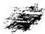

## 龍說

胞姪萬基德修校宁

龍者何山之脈也山脈曷爲以龍各取其如龍之神也 入地眼全書卷二龍法 聖

## 龍法

龍之神見而在於田飛而在於天躍而在於淵變化萬測山龍亦取其理也山龍自峻嶺而下落脈於平崗至洋亦似變化以神其靈也然神龍純陽無陰山龍純陰無陽平崗則爲太陰平洋又爲少陰曰有間矣至若土乃龍之肉石乃龍之骨草乃龍之毛穴有五色者乃龍之心肝脾肺腎也四圍纏護之砂爲龍之雲龍必要得水龍無水不行左右隨龍之水亦如龍之御天雲行而雨施也先賢以山取象於也者夫亦可以得觀龍之法矣

尋龍先尋祖與宗不辨祖宗何足語太山高從是眞龍 踢躍奔騰誰可比龍脈自大祖而下有遠神有太宗 有少視少宗以至父母去穴近者關禍福亦近去穴遠 者禍福亦遠故論祖者以少祖爲主而不必推極其 遠者以龍氣長則福澤長龍氣短則福澤短其在高山 則看起伏其在平地則看收斂若一望平洋必須有水 能不過之處卽楚龍脊迎離榮斷 繼亦必 低 人地眼全書卷二龍法

上尋至少祖者少祖山乃龍出身處父母山乃龍入首處出身處要聳拔要開帳要合星體要中出要轉換要遇峽要看枝邶要看繼綾要看迎送要看死生強弱順逆進退要看其有無定穴處要知父母山一路貫串而奈所謂父母山者在元武山頂之後穴中所乘之氣正是此山之氣父母山下發脈處為胎如稟受父母之血瓜爲胎也其下束氣處爲息如父母懷胎養息也再看遲面起伏為元武順卽化生腦卽太極暈卽土縮是所謂孕也如孕之成如人之有頭面手脚形體也融結穴處爲育卽毬髯之中卽羅紋如子之出胎而育也此乃龍之人首處要看來勢要看束胍要看有氣無氣要有形勢要看結局尋龍總以少祖爲主少祖之中要明五星五星之中要識五障 俾彌岷翻馳木火定出元宰金土多旺田牛能清能大亦主文章高貴水星多貴粗漏爲輕不問何星高而秀者貴低而濁者福微一方有一方之祖先審其祖起於何處水源發於何處分枝何處水從何處來何處合砂自何處起何處交則知人地眼全書卷二 三

水來處是背合處是而砂身向外是背砂頭向內是面既知背面再看隨龍水趨向何處護龍砂彎抱何方則知砂水有情處是龍無情處非龍矣又有回龍顧祖結者以祖山作案有大回受小回受多是盡龍所結翻身逆勢收本身砂水其力愈大靜道諄諄指點無非言山言水所以認龍一道此爲頂門之針

記長老曰地理一道有何難義取陰陽兩字問仝任明師親指點打破元機好看山巒頭理氣兩般先不明此理最堪憐待衲獨傳奇妙訣無愧人間行地仙山本屬陰水屬陽水動山靜兩般看陽爲夫兮陰爲婦夫婦恩愛兩相當夫主施兮婦主承婦不承兮息不成山無水界氣不住精無枯  諸祖將夫婦相交孕始生山 夫水不水交時眞氣聚一動一靜互爲根陰中有陽陽白陰乾坤咒合易之門若是山飛并水走二氣不交地不眞詞之 陽體高兮陰體平高山爲陽平地陰乳矢窩針於同此義陰陽顛倒此之因以斷陰牲天地眼全書卷二龍非 四

翁兮陽舒散壠龍凝聚枝散漫此等論用義攸深窩鉗 書乳矢同茲判 以此氣

## 尋龍辨

尋龍先識行與止去來分合勿昏迷也蒙 龍自遊鱗風翼非眞落殖龍頓與 勸馬橫弓識所之頌獨房 1雌也於本 移不龍之走動未住日行 飛停住不去曰止嶸師杯何以知其行水之所分山之所發處也何以知其止山之所交水之所會毗禮之剔艫龍因水界氣旋而止分牙佈瓜龍欲行 分份藏牙縮瓜龍欲止以撓悼閃後龍後去離前半足向前龍欲住有前謀徃識龍行山山脫郁向前勝輝龍止山山合地之以而邊分出陵鄉均前是立之體俗師不知指爲全星日好今金星不會尙為此是正龍牙上分由枝曲下他于前開窩乃死氣也其漸雖立以金星砂上分有若出均必有自然之來勢必有分水以導之龍若止必有自然之水以界之有合無分則其來不明有分無食則其止不眞此卽水之分合而識龍之起止 此游上分下合是為入地眼全書卷一法 五i.

正聖有分無合同是虛花若有合無分火多結作不問後讀木不來要魚蕩腰木若有禽魚蕩腮水後龍不禁也自自以發不然心日昏迷起止莫辨徒嘗龍 稱舊地多是如此身撓掉溜下指為乳頭點人混認左有枝腳畧海俗邊作龍虎褊場糊塗認過亦有門戶堪觀精細看

眞龍仕結點略他向嘶撓 溜下認作乳頭大龍處忽作開窩迎送二砂曰龍虎又曰好个大地此紀也這等瞎眼地師眞眞盲主有實害人非淺小則敗家大則絕嗣可不痛哉阿彌陀佛看地有一大殷待貧份說來爾聽此是大龍身上過氣不是結作之所若結地之所本龍聳起高頂精光門爍背後拖出鬼撐撐後又有樂山罔抱前面脫去老亮從起頂處腰間細出細脈名東氣伏起微泡串珠今大一个小跌斷過峽再起是體或走一二節脫胎換息束咽起頂結成星體窩鉗乳哭穴情脈氣融和穴前微茫蝦鬚合衿之水流入小明堂左右二砂環抱于穴前二砂內又分出小枝砂來抱護本身出脈處名蟬翼砂外堂之水或左水到右要右于砂長出去勒轉作案橫攔於穴前遮住外洋之水面前外案也要清秀或外朝山特來端正拱穴或兩傍入地眼全書卷龍法 六

有高大星峯遠抱穴塲三方帛起生旺之砂疊疊或內外之水明朝暗朝內堂之水徃左外堂之水往右本宮之水左右合局此巒頭砂水俱已得之方言是地而外水徃左出亦要左砂長收作案法與右同有此等証佐地亦不假此乃大龍腰結正合勸馬橫弓之句所以地理不明害敗多人信矣哉請教地理不明者何走到一方不論山龍平崗龍平洋龍或見一堆一泡就言是地畧畧門戶可觀曰輸苑才名閒誦休題卽于此等龍身撓掉不認得還講甚麼巒頭理氣爾說吐乳開窩窩是陽窩乳是死乳全不想龍不起頂又無鬼落前不脫卸又無脈落上大下小一泒死氣既知面前窩鉗乳突蝦鬚合衿明堂案山件件俱無只見一泒汪洋之水左右大龍迎送砂你作龍虎雖然彎抱却是斜側仔細看來上重下輕面前之山隔遠借來作案也是無情用上圭格之無向可立煞洩齊起此乃虛花之地也稱今說破方知道術未精不可誤人大事

## 帳辨

尋龍須要尋帳峽無峽有峯空雄甲就中尋穴穴豈無 入地眼全書卷一篇 七

難比夫地眞融結帳者龍之鋪張宏厚而龍挺身轉翅乃龍之旺氣發舒穴之根本峽者龍之趺斷細嫩而脫胎換骨乃龍之眞精收斂爲穴之咽喉非貴龍不有此也若夫夾從纏護之龍氣不逢旺從何發舒氣不凝聚從何收斂此從龍之小帳峽也帳峽之龍則雖龍身頓起高峯祇爲他人旗鼓護衛之具所謂正龍身上不生峯生峯定主枝葉送惟有眞人帳慢多貴人出入星高聳欲是橫人  臥峽中脫換更重重穴結情形小龍必帳多峽 硤加動龍行開帳龍方貴服出穿心脈始尊歌发字品極戰一重數重為上格偏脈偏出爲下局

## 峽辨

龍若過峽脫卸處名曰結咽咽是人之性命峽關龍身生死研    制 來則于此換骨去則于此養成體局后 林爛論脈有長短正倒過之不同泥田石水之不一繼縣一師嵯或來大去小或來小去大大或有迎而無送或有送而無迎之繼或欲渡而起人地眼全書卷二龍法 八

天狐天角或將成而結鶴膝蜂腰美不拘陰脈陽脈最喜重重包衆也眼過峽宜近不宜遠宜窄不宜寬饋力繼 加劾善掃龍者峽中之奧妙豈可不窮姒鄰善審峽者穴中之情形自可預料裸蓋正遇者人穴亦正理側過者人穴亦側歌要點山護者穴結山藪旁看水護者穴結水邊峙看石脊與玉池殊峽故漱石之與捉月質分燥石濕秋泥峽與田峽異體故山谷之與田際局別高低看去山小而無迎者氣將歛伏而知其結作之在近矯誠去山大而有迎者氣正發洩而知其涉歷之必巡地轉關出峽最怕風吹火期前人首結胎尤嫌水尿水亦物明過峽處乃龍脫煞之所龍不過峽卽爲砂也所以砂無峽過峽處兩邊必要有兩砂彎抱於峽名曰送砂送砂之外又要二砂夾護纏送向前左右不離乃貼身之長班也最是得力及至夾送到頭翻身逆勢一砂向穴可謂龍虎者實是得力之砂所云三山並出縮者爲先是也龍過峽脫去老売必起高勢特立之星星後兩邊溜下枝腳伏徃後返要與送砂相抱名曰迎砂此謂有迎有送有散但過峽入地眼全書卷二龍法 九

處宜似不宜高宜細不宜粗宜短不宜長低則藏風高則露風短則力勁長則力慢所過有單清雙清何謂單清雙清一字上過爲單清兩宇上過爲雙清讐如一亥龍是正亥過曰單清一半在壬一半在子曰雙清一半在亥一半在壬則雙過而不清單過者前去結地雙過者前去結地或結廟場凡看地者曉得峽上這个竅也就稱得牛個地仙註書的尚且不知你們怎知待貧僧說來你聽若龍行一枝東一枝西要識陰陽這个機識陰陽定方所前程千里穴須知一枝南一枝北要把謹經分帛曰奇毛異骨識雌雄識得雌雄龍便得雖然幾句漆話却有與妙在內龍有單行雙行單行者吉雙行者有吉有凶二十四單龍二十四雙龍雙龍過峽有十局吉有十四局凶吉者陰陽二宅平安永慶凶者禍不旋踵此不開龍穴砂水事都是峽上之竅所有龍不可兼者兼而不利也故云辛戌乾亥亥壬加癸丑艮寅竹虎牙甲卯卯乙休相見辰巽巽巳莫逢他丙午午丁雙煞曜未坤申庚亂如麻酉辛雙峽不宜過此是夾煞定無差凡事要的確爲準那有假說欺世不信再指過入地眼全書卷二龍法 十

峽處上色靑黃河白黑穴內之土亦靑黃紅白黑過峽 石穴中亦石名石占穴過峽水穴卽水名龍泉穴過峽 泥穴中亦泥名龍髓穴要逼山無穴中有此爲眞的開 穴有門出異物者乃前朝名士所藏之物也開穴 有開出飛獸怪石此都要在峽上細心會意方可 得知書傳難一須面授方得有開出蛇蟲蝦蟆小絕 螺螄螃軿之屬爲生氣此不足奇蟲類山中廣多何 足道哉

至道元年乙未歲衲至豐城孤羅山聖母庵住持三月徃山下姓化裝聖母神像施主曰前幾日嫦弟葬母請一先生打出一井吳泥衲曰離此幾遠回曰不過二里遂邀同至走到穴前四圍一望分个山頭遂踏後龍三四節見一方之尊星玉屏體穿心脈跌一玉池峽兩傍護經砂開一大帳隨龍纏抱夾达向前本龍伏起大武金落下金水行度行一節跌斷東氣束氣處兩龍入首旋轉向東復微開窩屬結一螺蟬吐肉形細看時此地八首龍金水體格束氣一線過脈氣細而且短細則氣飽短則力勁左手玉屏砂兩塊右手來龍金星入地眼全書卷二說法開而緊護穴場案似御街天馬高金特來作朝龍虎外右水倒左巽巳方來丑艮方去正合酉山卯向此地非小乃生文武全才之士科甲翰苑之樂皆由福德未滿將地去之矣你說好笑不好笑開井時上面鋤起一層砂石土二尺餘深下面乃黑濕泥土再下去剔出白泥土腥穢之氣不可聞工人見此士色氣不過將穴內之土盡去之四圍和底挖出一个石売來此地天生地結遇蓍蠻夫俗子不知地理一見有泥水濕土腥穢不能分曉亂絞一場這等堪與兩眼昏迷胸無確攄眼無確見書上又無如何曉得這等結作若有知之者徃峽上開看便知明白善哉善哉所以地理之道大矣一實萬分萬一各正雖然下有地理上有天理中有道理此者可相有而不可相無者也故必積愚以盡人事然後可得中和之穴天文昭於上地理應於下故曰大矣又曰凡尋龍者要得竅不得竅指鹿爲馬何益哉總要在過峽處定一羅經則知是何龍出身罩脈雙脈龍從何處去細證星體是何星起勢行度往何方則知此去結地不結地結地者尋徃前去不結地者枉費心機富貴人地艮主書卷二龍法 三

貧賤壽天窮通在此辨別龍雖在地關實在天天者何以見聖人曰爲政以德譬如北辰居其所而衆星拱之是也辰在斗內斗有九星居其建極以運四方二十八宿周天經星布列於其外環拱北辰者堪與之法也穴場者北辰也龍神者九星也砂者二十八宿也水者蝦鬚也用九星看龍神用二十八宿看砂所謂二十八宿正謂此耳至若五星正體九星九變怪法則皆搜尋北辰居其所也九星者天之斗柄隨月而轉晝夜不停書云斗柄指寅天下皆春正月在寅二月在卯三月在辰一年十二月一月則指一字北斗七星左有輔右有弼故稱九星九星者貪巨祿文廉武破輔弼是也此九星在天成象在地成形以龍身之行度變態無窮故以此九星星體在龍神行度處辨其有共北斗第一星艮丙貪狼木第二星巽辛巨門上第三星乾甲祿存土第四星離壬寅戌文曲水第五星震庚亥未廉貞火第六星兌丁巳丑武曲金第七星坎癸申辰破軍金第八星輔弼坤乙土九星只有八位何也左輔右弼共一卦各管一卦一卦三山此九星納甲所屬又有九星之方位不入地眼全書卷二龍同貪狼一白坎巨門二黑坤祿存三碧震文曲四綠巽廉貞五黃中武曲六白乾破軍七赤兌左輔八白艮右弼九紫離此洛書之戴九履一左三右七四爲局六八爲足五黃中宮所謂九宮八卦是也用法以斗柄之貪狼洛書之紫白兩下合而爲一看巒頭之砂無不的確譬如貪痕木龍徃扎行北白水水生木結大地證定星體在峽上用羅經格定某龍徃某方則知前去結地不結地地之大小皆在此峽上而定之方見手段貪狼卽紫氣木身直而長頭員而正

本星龍行一白坎三子癸三方林生貪銀特起如潛龍出海結王侯畢輔之地木星龍行二黑坤未坤申三方不結  社人

木星龍行三碧處甲卯乙方林帽如枯木逢春之象 結大地出人襟懷瀟酒資性聰明科甲聯登應甲卯乙 生人寅卯辰發福

木星龍行四綠巽杖曲辰巽巳三方辰為天罡出異術賢士名馳海內巳檢出巨流之輩正龍有此丙辛化人地眼全書卷龍法

木星爲中宮穴後有此木星爲主者謂之貴人星也上格出仙聖中格出翰林開府下格出科第貞為直 故燕為廉貞木星龍行六白乾蹤金 戌乾亥三方亥龍上吉謂 武隱金之木生在亥亥乃紫微垣艮爲天市垣結地生人富而且貴福祿無疆乾龍見之木盡灰飛烟包灰袋出軍賊戊龍見之回祿之災

木星龍行七赤兌庚酉辛三方庚納於震出威武賢材之人立業邊疆酉龍見之水故賢人處非其地出人隱迹有林辛龍見之結大地天見貴人之星定生宰輔狀元出將入相之貴木星龍行八自艮林丑艮寅三方如麒麟遊郊鳳凰來儀之象主自曰昇仙丑龍見之未爲大吉若有旗鼓戈矛出武戰官貞艮龍見之前去結大地產忠臣孝于三公九卿之榮寅龍見之寅爲三陽之地前去拱護水日為華表捍門

木星龍行九紫離沐秋丙午丁三方午爲聖人之門者文星高捕霍漢產奇人異士學貫天人號爲獨步舟賓之格丙乃大微垣峯起貪狼却也難得前去結影光穴大地眼全書卷二龍法生科第公卿之人丁龍見之丁爲南極此峯秀拔若轉西兌結穴貴入幹林而多壽者

巨門方正如楯微長而方稍帶斜側在天爲天醫 在人爲救貧之神喜生六秀方

土星龍行一自坎州十壬子癸三方壬天于陽水未兌陽清土濁不靜之象不結子癸龍見此星出塡宦爲水土歸垣流行數里外結大地

得位前去結天財體穴或大金星開窩穴生端方正禮 之人家多金帛田聯阡陌 土星龍行三碧震甲卯七三方甲爲狂龍見巨門土木 尅土前去懶緩不結爲水口拱護砂卯龍爲雷佩鼓舞 之局出人處勇爲 誠爲乙爲天罡傍伏之龍巨 門發足純陽不結

土星龍行四絲巽辰巽已三方辰爲天罡藏金煞縣身爲巨門會羊及龍輿吉會出將功成名譽與凶星會産屠宰之輩麒識 明 胡辰龍出脈結京城會省巽龍本巨門吉星行度大山落脈結州城府縣行山谷入地眼全書卷二蓋法 夫

結土腹藏金之局定主巨富小貴而已已龍見之金長生地巨門土生金謂之地不愛寶精大富小貴地土星入中宮穴後見之結流金掛角生端方正直之人開展基業致富

王星龍行六白乾戌乾亥三方戌爲婁金煞得吉星會出武將開國功巨與因星會出屠宰頓犍龍刑邠獨信乾龍見之乃孤龍也獨聳雲霄落下結大地不落只可作小口神壇亥龍見之亥爲天門見巨門上土生金結大地生宰輔狀元輸苑才名之貴 1上星龍行七赤兌庚酉辛三方庚龍天潰也戶於震巨門巽也  為  為 長 易 爲雷風相薄又長女配長男夫婦相配結大地生功名富貴聲聞赫來之人酉龍見之爲三合龍格麒彌醉辛前去結蟠龍穴或伏虎形大吉之地開族出貴靈辛龍見之爲鳴風朝陽格竊風大山聳拔必出狀元宰相中等龍亦開府用翰下等龍出科貢秀士

士星龍行八白艮丑艮寅三方館卿見丑爲武庫與巨門相見爲金臨庫地前去不結乃倉庫護砂也艮龍見人地眼全書卷二龍法 七

土星號天財主大富爲祿存得位寅龍見之龍帶天刑賤格也同記畢陰陽不配多生盲佛跋跎之人

土星龍行九紫離丙午丁三方內乃大薇垣得此星爲主號天岳峙對縱橫十數里必起勢龍行十餘里必起龍樓鳳閣結地平洋或曰邊水邊方結大地今龍見之乃陰曜輔金潛伏斷絹仇燥端或轉變木星始結大地不變不結丁龍見之丁納於兌武曲見巨門前去十數里必結大地蘆鞭龍結鋪地梅花形

祿存形類巨門但腳如耙齒斜側無收拾爲人問

禍患之神祿存上星龍行一白坎壬子癸三方尅壬見之 玉爲 文曲爲遊魂龍不結子癸一龍見之爲六煞星又爲破敗龍不結

祿存土星龍行二黑坤未坤申三方未龍見之爲剛暴 不結坤龍見之坤先天在北乾先天在南是爲夫婦若 得此星峯聳起雲霄前去必結純陽之地出神仙羽客 飛昇之入串龍爲祿存與破軍相會凶惡之極必水冲 風射崩陷破碎不結

入地眼全書卷二龍法

## 大

祿存土龍行三碧震甲卯乙三方  于 木無枝葉主人家零落卯龍見之形如瓜匏聯延數里前去再起穴平洋四候你地玉鍾鑑糲缺黼乙龍見之與祿 如存會乃羊及煞不結

祿存土龍行四綠巽辰巽已三方辰爲天罡亢金龍所居若起高大雄星前去數十里或數百里結京城省會六龍過峽總不離辰戌丑未四龍無此不爲大結作亢金與祿存會乃及煞也多結河泊曠野之所若巽龍見之委靡鬼詐進退不果得乾剛健濟之前去飛揚鼓舞變吉宿結大地不可因祿存而去之也已龍見之也烟休獻 也公 離雖起伏結穴出人無壽凡龍神最忌剝 6

上龍人中宮穴後見之爲祿存鬼與吉星會則吉與凶是會則凶謂之羣邪欺主

祿存上星行六白乾戌乾亥三方戌爲婁金煞納於離文曲與祿存遇甲木死於午龍神死地不吉乾見之純陽祿存相會謂之乾歸乾位前去必結陽基陰砂陽水陽基以午戌結局大吉亥龍見之亥乃天皇龍祿存大人地眼全書卷二龍 十

煞星如武將奉君命以制四方凡亥龍祿存起頂者必變吉星結穴出衆山之中所以有凶星變吉星者結穴有吉星變出懶坦者結穴尙遠

祿存土星龍行七赤兌庚酉辛三方庚天潢龍也見祿 存爲火蝦剛金蓋庚應嘴火之氣又屬陽金乾甲燥暴 之神祿存屬士爲火所生十能生金謂寒谷回春之象 龍從火星凶前去結地生人功業成於頃刻龍穴之 特也酉龍金見之旺地得乾甲祿存土臨之如寶光 輝謂之強龍前去變換結地立功邊庭出武職辛尨天 乙貴人見祿存土貴人登將地爲朱雀乘風格必變六 秀穴人才出家功名科甲

祿存土龍行八白艮丑艮寅三方丑爲貴人星得此祿 存土星起頂如太山喬岳人所共仰萬仞壁立前去脫 卸或轉西兌會六秀煙稱結穴必大艮龍見之艮天市 垣祿存大煞星艮見祿存爲破敗艮嗣丙丙入午爲羊 及不吉前去必生峻險石壁不結寅陽龍火長生之地 見之謂火旺于火剛暴不結

祿存土龍行九紫離丙午丁三方丙龍陽火見祿存土入地眼全書卷二龍法 手

火氣發越其熖愈烈多結龍潭社廟之所午龍見之一陰初生木死絕鄉木盡灰飛靈氣不鍾前去分枝散亂雖多不結枇識岬丁龍見之丁南極壽星祿存臨之丁祿居午前去必結土金穴

文曲水星氣峰人間為遊魂文曲水星行一白坎壬子癸三方壬龍死絕子癸二龍刑中爲塘坑池沼溪澗淵湖之所文曲水星行二黑坤未坤申三方未納震壬納藥千支相戰不結 耗 坤龍見之坤爲地與友曲相刑前去多溪淵田塘汚泥之處申龍申乃壬水長生地見此死絕之氣不結文出水龍行三碧震甲卯乙三方甲爲羊及卯龍見之不結卯破午也乙龍見之乙木生在午乃長生之地前去變換吉星相會結金水三台穴

文曲水龍行四綠巽辰巽巳三方辛金生癸水有金白水清之象辰龍見之辰納於坎午壬寅戌文出水水火濟持身清潔曰月同光結地生理學傳家巽龍見文曲枯苗得雨透迤前去結地結飛鳳冲霄或長虹飲水入地眼全書卷二籠法 主

或蝴蝶戲風等穴水星扦動處最的人財雨旺科甲聯登巳龍見文曲乙庚化金夫從妻化全生在 天乙太乙峯起結地合六秀生人資性瞻敏杲斷有爲入中宮穴後見之必要水木擺動方吉

文曲水龍行六白乾戌乾亥三方戌龍見之乃文曲本宮多遊蕩少成實多結荒郊曠野亥龍見之木歸大海前去必換木星結穴

文曲水龍行七赤兌庚酉辛三方庚陽金于乙木乙庚化金夫從妻化前去必結太陽開窩或懸乳金水無動穴生人其勇廣智多味酉龍見之水土沐浴之所又逢文曲敗蕩無收不結辛龍見之二 繼 乎子額辛王會合前去跌斷復起結穴風吹羅帶形舖地梅花形

文曲水龍行八白艮丑艮寅三方艮見之文曲水生貪狼木蛟龍得雨龍氣飛揚前去結木星穴伏虎形象鼻捲湖形生八激濁揚清沾名弔譽丑寅一龍乃鬼刼也不結

亥曲水龍行九紫離丙午丁三方爲入本宫火見水不結八卦離壬實戌爲火離木屬火九星位又屬文曲水入地眼全書卷二藏法

尋龍以水爲主卜卦以火爲主文曲水星乃懶緩之神多見於龍身上轉換之處若論五行中非水不生非上不載論巒頭若得水星起頂作勢前去轉換吉尼結大地若與凶星會又卸陷則凶凡天下之名山起眼一看總是一个大漲天水星包涵萬象

廉貞位起東方帝出之鄉九星惟此獨尊廉貞第五星正五黃位居中宮八山無此作祖龍雖變換爲官難至三公惟亥龍最吉亥乃紫薇垣上帝所居康貞在帝位之傍左執法宿也凡穴後爲中宮或剛旁當前謂之照穴此星聯於艮換貪狼謂之木生於亥學堂之文館星也高聳者出聖仙頗低者出魁元門低者出解元前翻性賊艱故云聯氣高聳者火星也頗低者木星也再低者金星也不論高低繼以頂尖指為火星也高者力猛低者力微靖地

廉貞火龍行一白坎壬子癸三方上陽水廉貞火盛大滅破敗之鄉不結子癸一龍見之與破軍相犯破軍本剛金遇廉貞陽火火龍遊坎水必前去迢迢變換星體結公俟將相之地

入地眼全書卷二藏法

垂

廉貞火龍行二黑坤未坤巾三方未藏鬼金不宜見火 不結欽鬼坤龍老陰丙火死絕鄉傷殘龍不結申龍水 之長生地先天艮後天申廉貞爲六冲不結

康貞火龍行三碧震甲卯乙三方甲陽木見火爲木盡 灰飛不結卯龍見之木生萬伋前去開肺展超變換貪 狼木星結飛鳳冲霄黃龍出海帳下貴人等穴相也 乙龍之木陰柔此星作祖以小人當作大任散慢跌斷 不結結廟塲而已

康貞火龍行四絲巽辰巽巳三方辰龍亢金遇火不 巽龍巽乃六秀火星作祖以辛金遇艮震直換乃能出 山海風需顯赫飛舞揚成必結大地科甲綿長人烟廣 衆已龍金生在已火星相尅前去峻嶺壁立萬似龍酒 蛟龍棲焉

人中宮前言之

廉貞火龍行六白乾戌乾亥三方戊龍文曲水廉貞火相尅不結乾老陽見之過於燥暴多粘假穴若無變換星體誤扦者絕嗣亥龍見廉貞照耀天門向明出治之象起龍樓鳳閣變一陽金水作穴貴居一品細入地眼金書卷二龍法

廉貞火龍行七未兌庚酉辛三方庚龍見火星欽蒼 龍飛躍前去轉輔弼臨田畔水變天財土星結大地西 龍武曲相魯謂之山澤經氣前去必結三台金水穴辛 龍見之謂天門地戶前去必結巨門太陽金水穴

廉貞火龍行八白艮丑艮寅三方丑龍牛金煞再起廉貞火金剛火烈其煞更重只好拱護水口不結地也艮龍見之謂之虛涵太乙若傍長江大河粘郡邑市鎭生山谷必慱天財三台生三公九卿之貴以辭寅龍寅納於離過康貞爲羊又狂龍不結 方 在 巳

廉貞火龍行九紫離丙午丁三方丙太薇垣氣屬貪狼 火星出見木火通明前去金永行龍得紫微星照爲上 格發大族名家午龍正陽之位火氣大旺文曲乃遊魂 之神與星相尅前去必散慢不結爲河泊池湖丁龍丁 壽星化氣得木納于兌又爲武曲廉貞火尅武曲金武 曲金尅化氣木三氣相問前去無局可結

武曲形類大陽頭員而高聳氣降人開爲福德之神金星是也

武曲金龍行一白坎壬子癸三方壬龍陽水見武曲水人地眼全書卷二薩法 美

逢沐浴未免傷殘難以結穴任发 子癸二 壬化木兌龍一陽初生逢武曲六陽盛大前去轉換至巳六陽之地金水三台結大地齡狂燔嶺面體尉六儲如姓地融武曲金龍行二黑坤未坤申三方未龍藏金煞見武曲金形制龍氣不結鬼金雄大健旺前去結州城府縣坤中一龍若武曲金作祖上金相生其氣盛大龍轉酉辛再換乾亥金水結穴出將人相之地

武曲金龍行三碧震甲卯乙三方甲乙一龍起武曲早木氣傷殘枝枯葉落眞氣不聚去必散漫文曲破局當爲窄狹巖谷之所权生 法 亂 血 卯龍見武曲震 生在納庚庚金生在已巳爲武曲靈氣聚行數里必變金水脈出帳結成梅花貴龍格局武曲金龍行四綠巽辰巽巳三方已龍合六秀武曲金金水扶陽前去轉巨門上結穴富貴壽考辰龍凡金見武曲金前去結金水穴或結省會巽爲陽璇之龍武曲丙丁互換必開玉關金鎖斷跌平洋轉已再轉坤申後歸巽已水木行龍作穴明堂寬大應龍高起大旺人財陰陽兩結富貴不絕

大地眼全書卷一藍法

美

入中宮穴後有此武曲金星應穴乃六秀大吉武曲金星行六白乾戊乾亥三方戌龍納離武曲見之氣洩不紀立廟可也乾龍有此星乾純陽武曲起頂煞氣太重須脫卸變換乾艮丙辛四龍方可結穴亥龍西北紫薇垣是眞武登壇格前去變金水三台起五腦芙蓉帳必結木星開口穴有三穴天地人

武曲金龍行七赤兌庚酉辛三方庚龍納於震氣行于 亥武曲兌兌納丁丁庚相配夫歸相會諸結左矩丁 壬化木開帳木火轉換木星結飛鳳形酉龍旺氣剛暴 轉換金水開芙蓉帳結將軍大座寶劍出匣形辛龍 於巽遇六秀星前去變金絲墜落帳下貴人轉誥軸 天財穴

武曲金龍行八白艮丑艮寅三方丑龍武庫得武曲金 武將當專城之任前去變金水帳文曲星過峽換貪狼 或倒地木流山木轉金鵝展翅長虹飲水金水梅花穴 良龍納丙逢武曲光輝燦爛但木逢金尅煞盡還魂轉 金木芙蓉帳取木氣結穴大吉寅龍寅納於離武曲氣 不相逋不結金

入地眼全書卷二龍法君

武曲金龍行九紫離丙午丁三方丙太蔽垣得武曲爲武將登壇控制四方眞貴格也前去必轉西兌應六秀穴或蟠龍形或白象捲湖形午龍午正陽之位金居午位號金烏當天光照臨四海亦貴格也前去見號旒土必變金水結穴丁龍丁南極星午赦文星不易得者轉六秀結穴乃科甲將相封侯代祭之地貴而多壽打鏘武出居之序是本卦

破軍頭高大形類武金但腳散亂拖出飛斜形如破傘儿此破軍星作祖正出不結角茗變金水乃結在天專肅殺之權氣降人間爲絕體此星行龍不怕風吹水刼能再興營寨作穴也

破軍龍行一白坎壬于癸三方壬陽水爲破敗散龍不結子癸二龍見破軍爲萬水朝宗之象去必威武奮揚起伏至數百里或千餘里起伏盤旋開牂開帳分杖大則京省次則州城府縣小則大鎮市大鄉村大戰塲名山勝景及至盡處結虎形二龍戲珠形貪狼出順王侯地也餘氣散漫散于江邊作州麥地一片平洋行百餘里之地方 如是人見辰戌人地眼全書卷二龍出 天

先清余龍動不動次看血脈 亢金戌婁金丑 金未鬼金 乃十 定 來龍 得金 通古 云此是徐龍不須時庸 法师 不知此緊怎知看地 之

破軍龍行二黑坤未坤申三方未鬼金二十八宿惟鬼宿二度半龍身上有此破軍星出現如大將乘權四方畏懼行龍必是幹龍前去必結大地

坤申二龍爲老陽申水長生之位破鬼見之純陰秉政 后妃掌位之象前去必成深淵陰氣凝聚寒洽之所不

破軍龍行三碧震甲卯乙三方甲乙二龍見破軍金旺木灣剝削不結卯見之前去必轉西兌變金水結穴破軍龍行四緣巽辰巽已三方辰龍見破軍金煞會金煞爲破旗結神壇社廟之所或作旗鼓水口之砂巽龍會破軍必起水星帳輔正龍左右砂形如令旗又作羅城水口已龍有破軍龍作祖得三合酉方金氣前去必變武曲金水行龍穴結祥雲捧月形

八中宮穴後見之破軍爲主星金氣大盛肅殺之氣時 令爲秋凶惡之星穴吉輔吉穴凶輔凶

破軍龍行六白乾戌乾亥三方戌乾二龍見之爲破軍張綱凶惡之極不結亥龍見破軍爲小人居貴垣不祥之兆必須前去變換脫卸自興營寨自立門戶方可紀穴卦附狐 緯惟移自衣食一字按歷

破軍龍行七赤兌庚酉辛三方庚見破軍庚納於震金 尅木乃敗傷龍不結必變換乃可否則水口砂也酉正 西乃旗星也坐萬山之中有衆星拱衞正西方倦旗星 出威武專城之職星體尊嚴出將入相之地辛天乙星 見破爲得貴乘權之象前去必起巨門尊星變金水

行龍結荷花形

破軍龍行八白良丑艮寅三方丑武庫見破軍旌加優 擾行兵之象庚丁會合前去必變金水行龍結黃龍出 J 艮龍見之爲血光星前去作讓衛之砂遮貴龍成郡邑 靈氣不聚不結臨規致事眞龍火之長生破軍藏戊 上戊丙會合隱迹潛逃前去數十里必有修仙煉丹之 所名山大川難以結穴  軍成生候輝 兄其所指之 虛仰爲月建

八地眼全書卷一龍法

破軍龍行九紫離丙午丁三方午正陽人君向明之所 見破軍不祥之兆不結丙太薇司人間禍福之權破軍 在酉西方財貨之神前去必頓伏變金水龍帶已行結 人烟市鎮之所 所生餗栢輝醇丁南極星見破軍 前去變成文曲散漫不糾

左輔屬金多生過峽結穴之所過峽有此星是迎送二砂結穴有此星爲飛鵝輔星結穴與眾不同所以正龍過峽處有結地者皆輔星所結正大大之結作出人正大富秀長久或峽前結或峽後結古云峽前峽後好轉龍輔星本屬金九星坤乙輔弼土則取土生金五行中非土不生有輔佐之義焉

左輔星生一白坎壬子癸三方壬陽水左輔微弱之金必怠緩不結子癸二龍有左輔星如月照寒潭令人可愛前去必變整腰鶴膝或金水行龍結大地左輔星龍生二黑坤未坤申三方未合震木木氣收藏不結坤申水土龍龍氣發洩不結

輔星龍生三碧震甲卯乙三方皆賤龍左輔貴秀輔韭入地眼全書卷二薩法 主

其主金木相尅不結震痾庚帝出乎震起頂脫卸起一高岡彎彎向前是左輔結大地

左輔龍生四綠巽辰巽已三方巽柔水輔柔金靈氣不振不結辰乃在淵之龍忌見之不結己乃金長生地以金相金氣必大振起武曲或巨門結穴入中宮廉貞之位艮氣旺鄉左輔所居之地與天地同氣廉貞作祖得左輔在於穴側者大結之地也 中吉屬十艮亦輔星龍生六白乾戌乾亥三方戌乾一龍爲陽樞陰陽混雜不結亥龍天皇也左輔貴宿護佐艮亥相合木氣盛大必起出陣貪狼木星結大地天民根合是

輔星龍生七赤兌庚酉辛三方庚納於震後大與艮相 聯見左輔前去飛舞振作成金水三台帳下貴人格失 之雌後酉龍酉金旺見之順緩不結金天毗辛能 納於巽見左輔爲貴人秉印印天閑地軸是也前去開 帳展翅變木火行龍結穴

輔星龍生八白艮丑艮寅三方爲居木宮艮大市垣掌入地眼全書卷二龍法 主

天下財富之星也龍格難得此星結局富貴雙全之地輔星龍生九紫離丙午丁三方兩納於艮左輔居之形長而方爲歸木宮結穴午丁一龍見之與右弼相合前去變成金水穴

右弼屬水位居九宮蓋與帝星州見乎離五行非水不生九星巾巨門坤乙土陽氣極於午穴上一星流動不滯屈曲如蛇近看似有遠看則無最要細心體認

石弼龍生一白坎壬子癸三方坎北方陽水也弼陰水也九星輔弼坤乙土尅王子癸三方之水弼水坎水二水大旺水多則流水旺則蕩不結右弼龍生二黑坤未坤申三方未合卯枯木發生必轉換倒地木結穴坤乙龍士與右弼土二士混雜不結右弼龍生三碧震甲卯乙三方甲龍祿存見弼土不結乙龍見弼土不結卯龍見右弼如蛟龍得雲雨之象如生蛇屈曲起伏盤旋翻身逆勢仰面張潮大結作四神八將來拱峙名播華夷鎮大藩

右弼龍生四綠巽辰巽巳三方辰龍尤金不結巽巳二入地服全書卷二龍法

龍見右弼未必縱橫龍行水水星結穴

入中宮有此龍穴者謂蟬翼砂大吉

右弼龍生六白乾戌乾亥三方戌納離得六不給乾亥 二龍乾老陽見右弼木雖有生氣地不大亥龍見右 弼亥天皇見左輔如忠臣護國赤子依親結地長久 右弼龍生七赤兌庚酉辛三方庚納於震逢水得生酉 辛金一龍見右弼水金見水如古現重磨燦爛光輝前 去變水木龍結穴富貴編遠

右弼龍生八自艮丑艮寅三刀丑寄兌見弼水生化艮丙貪狼本見弼水坐化二龍逢生結水水蘆鞭穴寅龍寄離右弼微弱之水行離火不結右弼龍生九紫離丙午丁三方丙之氣不隱藏明曜發怒略 石 前去變換丁龍結盤龍形出人多富壽留則緣敬妯脉潮丁龍見之丁屬不逢水生之水氣會合前去數十里變換結穴仰 明今み紅合町主午龍見之爲水扶陽光踴躍前去髮換結七星寶每形虎雨包砂水秀公侯將相貴無疑

以上貪巨祿文慊武破輔弼是大上之九星也龍雖入地眼全書卷二龍法 善

結地先從帳峽看起認定巒頭是何星起勢故以天象觀之至若結穴各各不同變態無方有結無結鄉在過峽上用羅經辨其吉凶打破此竅方知前去結地不結地細看此篇熟記于心看地就有把柄

問曰好地如何好咎曰龍之聳拔活動砂之秀麗水之有情衲曰龍美砂水有疵也結穴龍疵雖有好砂水無結者總要重龍龍爲根本穴中煖氣全靠龍脈行來問曰之美惡如何辨龍之真假如何辨龍之行止如何游答曰龍美峯巒磊落星辰端正有蓋帳有頓跌有起伏有个字飛鵝此美龍也巒頭臃腫星體斜側不變化不起伏無蓋帳無撓掉到頭爲他人護衛衲曰然也常見有美峯結地而不住者有星辰不佳者反結大地 得不麻妍怕類有蓋帳飛鴉而出貴者有無蓋帳飛鵝亦出貴者不有今字而未必貴無个字而未必賤則又何說也答曰打心龍衲曰穿心龍百不得一而極貴之龍未必穿心卿姒不依惡龍之辨人人易知有等俗士無知者誤認曰好龍葬下絕人宗祀明觀問曰龍何人地眼全書卷二龍法

爲眞何爲假答曰有頓跌有曲折一脈之清一星之正衲曰然也常見有頓跌曲折脈清星正而不結者則又何說也答曰花假歟衲曰龍有頓跌曲折脈清星正自然結一大地行至盡處現一花假門面可觀砂水不合立向陰不得陽又不得所謂陰陽破局但是眞龍行度明明白白人人盡知誰知其龍起一大勢踴起為山就在山之腳下變成撓掉一般早已溜去頓跌行走二三節開門立戶四山園抱朝案對坐砂水合法所謂眞龍藏住穴難尋惟有朝山識作心毗輪誰知餘氣不結徃前介去至兩下水交會處一現花假所云龍眞而不結者此之謂也問曰龍何爲行答曰遊鱗風翼勢如跑馬張不布瓜有送有迎衲曰然也問曰龍何爲止答曰有蜂腰觸膝砂交水會細嫩方止衲曰然也常見有蜂腰鶴膝而不止者有細嫩而不止者有不細不嫩而止者有不止于砂水盡處而腰結閃結者則又何說也指點曰總是人不得竅便呌怪呌奇得了竅甚是平常總之有一大竅登了穴塲行止於此辨眞假於此辨美惡于此辨富之大小貴之輕重生死禍福吉凶房分有龍無人地眼全書卷一龍法 美

穴有砂無水有水無砂風蟻乾混皆于此辨人人識得人人不識得識得登山教之不識得古塚上察之此關一破則地之有無大小瞭然在心目間矣龍既得矣還要穴法砂法水法葬法向法此五法配合方龍發福五者不明吉地葬凶禍不旋踵陳和撥砂經宜熟布衣催宮篇要明河圖水法是先天洛書水法更有情先天後天二八卦水來配向發福眞不知此法來配合得龍得穴枉勞心無奈今之習此道者買幾部地理書常看常念記熟幾就與人談地他不如我又無明師傳授自作聰明上山東走西走空空跑了幾回又把死書看看書中又無眞傳久無眞訣看他何益豈不是瞎看瞎跑勞神費力總是一得自矜不肯虛懷善下禮拜明師遂誤一生古云看書千卷不如登山一回登山干回不如口訣一句總要明師登山指點方得此道無師之學亦如醫理庸醫殺一人地師殺一家可知罪孽深否過了三年五載就來行道鼓舌弄唇欺世如自欺也倒運之家邀請至屋聽其巧言將父母尸骸葬下福未至禍先來小則敗家大則絕嗣竟有三扦四扦者將父母入地服全書卷二龍法 毛散骨碎尸厭穢天地豈不痛哉

莫道高山方有龍來平地失眞踪平地龍從局嶺發高起星峰低落脉高山認好星峯平地兩旁尋水勢兩旁水界是眞龍水纏卽是山纏理霜降水涸龍不現春夏水高龍背見此是平洋看龍法過處如絲或如線必須形跡明顯落茫渺無憑終不信高水一寸卽爲山低水一寸水回環寸之備只爲時師眼力淺便云此處好峰巒誥知高山落平裡退卸愈多德有力祖宗父母數程遙灰線草忭尋脉眷隱隱隆隆須細認蛺絲馬人地眼全書卷一龍法 共

跡要分明如髮如珠是眞峽一斷一續莫離蹤賑願 方三尺平洋一突更爲奇活動尤須求束氣忽然人穴 口鉗開兩水夾護星眞息

又想地理一道乃世之大事富貴貧賤壽天興廢吉凶 禍福善惡死生皆是地理所關業斯道者怎不拜明師 登山指授究竟幾多儒家造書千言萬語總是這些套 一登山鉗口結舌無一定見書呆子元來屋裡先生 木明此道何苦殃及後人竟作兒戲一開口講巒頭一 大如天講平洋一細如粟此從那裡說起天下之山大 者莫如五岳中華之老祖也可見有遊鱗風翼萬馬奔 馳乎譬如葫蘆能有幾大其葫蘆生藤其藤上且有三 四分圍莫說一平洋過脉乎將此一論皆是說元說謬 可信不可信貧神生于南昌出家于豐城在敝處地名 中州見一平洋局其龍省龍分枝起勢結禪師嶺從嶺 腳下出一脉不尙半里向北一鋪往前四圍方員從其 右六七十里寬濶可謂一大平洋否其處人烟也有田 塘也有州地也有其地高低不等洪水泛漲也有水海 處也有不淹的漲水不大不小一望千枝萬葉猶如書 一人地眼全書卷二龍法 羌

工畫雲一般其龍寬大者是榦細小者是枝是謂枝中幹榦中枝彎彎曲曲一鈎一搭不計其數左有一河水從江前嶺來往砂浦潭輔向南流右有一河從塹顧流來至棉墅港兩水合祫往楊家澇去左省龍從潢溪淵洪渡河共此河結省會右邊從塹嶺出一枝結南昌下鄉此局背有白湖嶺作座前有五曲岡作案左有江省龍作護右有結下鄉一枝循護此是南昌中畑一大平泮局諸看過脉處如絲如線乎龄定日後此局內人烟滿處衣冠濟濟出將入相可謂南昌第一局也

龍論平洋龍落平洋最且夷渺漠之中行渡稀轉換雖無大頓小須知平地有精奇平地龍又無秀麗聳拔之峯不過隱隱隆隆彷徧高低依稀厚薄高尺寸卽爲起低尺寸卽爲水如此體段最難捉摸平地之龍雖落平洋亦必微作堆阜斷續於斷處考其續續處考其斷又卽其盤旋轉折之處而求其歸宿若稍濶大之土必有肩翼帳慢無此是無應護便非眞龍及至結穴處必微微湧虺鋪褥開鉗周切不可鋪展太大謂之眞氣不聚也入地眼全書卷二龍法 罕

隨龍之水交合于左右此水不離龍亦不離穴牛洋看 水爲先此要訣也千里來龍徂看到頭一著到頭結 穴左右必有兩股兜拱界送氣脉入穴穴前必有小明 掌左右隨龍之水送到堂局交互前有朝案之砂橫欄 之水彎環向穴四圍護從之砂回頭駐劄面面有情明 堂平正水口交牙前有兠收後有拱送左砂向右右砂 向左如貴人坐衙大將登壇無不拱衛者此天然之結 局也故云平地一穴勝山十穴 北龍莫取水神當審近地高低南龍兼言水象亦取近 威微茫一曰特生墩阜二曰眼且形局三曰剪水裁局 俱以朝山証穴爲緊要平洋有高地逆綿盤繞結地者 有平田平地長遠兩邊水界結地若有大漾之中高地 如平岡龍結地者有墩阜連線忽起忽伏結地者有壙 坂之中微微高低界水其高春盤旋結地者皆當察其 脉絡觀其朝拱以定焉平洋有師續高上名曰墩阜員 者曰墩長者曰阜衆墩衆阜之中當辨其主從審其生 死特大特小者土也或衆員而獨方或眾方而獨員異 于衆者主也其一爲主其餘爲從其從者爲朝爲護不 入地眼全書卷二龍法

過爲主之用神而已脉薄湖中哭起墩阜者煞氣脫盡吉氣所鍾必結大地故湖中之墩十有七結

過水之龍必有石春自過之後似無形影而乎地之上巳有小墩纍纍微露毛春若見界水攔前則眞脉自住必結大地而若一片老陽地面無甚高之處無特起之敦而水道環繞收束地氣亦自成穴灿冰魄之依有結于通河中者有結于深濱者有結于天池渡中者通向水動最易發易收深濱之中濱上生濱則易收束又有門戶穴結地心其力深厚至于池漊結穴其水停而不走盈而後聚故最綿遠悠久然其土必微高微動方爲有氣若平板不動則爲死土亦不可以水道之可觀而取焉

四面環水名曰圩頭若立在圩上而不見四水則地結大亦非圩也圩之結地有三法一曰大圩白下二曰漾則獨行三曰六圩盤龍大圩何小圩者或一大月開口包一小埒在內或二大圩夾一小坪在內漾則獨行者于大水薄之旁靠大圩出一小圩也至于圩上盤龍則其圩畧大中低而四旁高是中四面水曲以內中低人地眼全書卷二龍法 望

田爲內明掌自相朝拱當以眠耳式取之

曠坂之中有四畔水澆而見田塍疊疊如浪湧者俱作龍論其法有三一曰拱來形如初月兩角向下發宜而來直至結穴之處橫變曲塍之所爲眞一曰收來亦如初月雨角向上軟軟而來勢如疊源直至方板不動之處爲眞一曰龍鱗緇勢如米裂雨畔皆宜巾月動氣直至復開大口之處結穴或至方大不動之處結穴平洋看法不異尚山分水龍來合水龍住一片頭坦之地初無手腳頑行一程不斷過此則重結咽喉枝腳向抱見水環如玉帶砂護金城高低云寸結于水口處則上手平坦之處因是發祖順流結穴故謂之順結如下手頑坦無手脚相護逆行一程方見枝脚逆上重結咽喉臨局水繞開面必是下手頑坦之地發祖而逆上至分水之處結穴是爲逆結故結于水口處者爲順結于水分處者爲逆耳

平洋之結有四畔無水皆平取而無峽者必飛邊或弔角而結飛邊者必是平舖之脉身上不帶微水而來直冲至水邊畧開堂局者卽結穴或橫堂局者亦結弔角大地眼全書卷二龍法

者固龍身無蜂腰鶴膝之狀兼之雄奔厚重鋒芒盡歛直到角處微露精華而結地

尋龍要法

尋龍格局分偏正格取梧桐爲最勝次之芍藥楊柳龍个字一訣傳心印梧桐枝兩畔平抽正个字格辰好雙送雙迎楊柳枝邊有邊無偏个字兼葭芍藥左右五傳草个字格杞梓蓁芽半有牛無夙个字格停勻惟有梧禍枝雙送雙迎兩手勢對節分生作穿心此龍百中無一二左有右無過一節右有左無亦非異此處名元是兼葭但要星辰還得位星辰得位是眞龍遞會生枝不偏廢多因木火作星辰蘆葉尖尖左右至一等名爲芍藥龍左石相生本不同分處光員有枝葉此是木龍帶水逢又有蒸芽杞梓枝牛有半無似人字此龍決是木星傳只喜星辰無雜忌更有偏生楊柳枝偏左偏右極乖異此星原是受偏處半枯半榮無意味凡看地到一處先看龍之巒頭體格五星中是何星體行龍行度又看何格正落偏落反落或梧桐或芍藥或入地眼全書卷二龍法

楊柳或杞梓蓁芽蒹葭都要得知一來自巳精熟二來有師盤詰隨口答應不得丟醜

尋龍須要識龍局水流上下知順逆隨流而下順中評逆水而上君須識  田勝

尋龍須要識龍星不識龍星總是閒教君四凶并五吉體別方員曲直尖試班補之人 首處燔人填星雖互政 形向加小而負雨頭低太陰至

太陰本是右弼傳形迹長帶見峒眉砂形金水元來是武曲三脂如金宿 起 一伏連中三腦木星紫氣號貪狼一尖直更長人獨立馬砂體 分

天罡正與破軍同腳下出尖峯 金火府 不粘也孤曜祿存同一類撚拳正相似 以冷掃蕩屬水配文曲斜拖帛一幅看此一段教人到頭認形體入穴看左右之砂形最八地眼全書卷二藏法

關緊要又九星九九八十一變之說更無所用龍有轉換君須明識變由來更有情敎君先論巒頭體知五行之書有轉換也

又以山體言脉出条条細小或氣盛而湧成高岡力龍行巍巍高大或氣小而變作微墩脫角或側峰而翻成玉隴或老榦而生出嫩枝孫如或逞而巖石土穴如湖口 上鍾岸下鍾岸 或示弱而岡阜拓落云扁供卻或山高脫落坪麓而隴帶枝體麟麵秀 鄧云恪落其中烝氣或平地脉帶近硬而枝帶隴情脈拔或龍遇水界石骨疫江而重興營舉步當調談不盡真龍 不一變態無非高下相生是小大相續肥瘦相問是俯仰相承是唯雄相配法子孫相肖是了

退卸轉換粗出細凶星變吉氣秋老龍博出嫩枝柯跌-龍皆巒頭上有自然而然之形與勢不作八力爲之者也又論生尅制化之談切不可聽依他所論最爲精妙入地眼全書卷二龍法

最悅人心此書呆子乃無學術遂藉之津津不置口誰知舊垓上看來全無牛點關係

託長老曰問君術看龍訣貪巨武輔最難得尋能入局純此星世代富貴無休欲有訣法辨凶龍破祿文廉最是凶出軍出賊遭瘟火只作神讀廟社崇妣則離九個天罡人道惡六個吉星落名變金水土星辰最好救人貧九个孤曜名不好四个藏金寶原來生水與開金穴在此中尋九个燥火有吉凶七个是仙蹤龍效前人剪水法必定登科甲九个掃蕩未爲奇七个蘊天機法宜裁蕩奪神功奕世産其雄 龍眞君如識得 怪者也星龍到處鄉村可尋覓龍非久遠得全氣易盛易衰非人力坻姓佛歡力母之俗言人家發闢長人必得龍身全氣要得龍身全氣由于龍身久遠也此誠千古不易之論而得道之士非但求龍身久遠取其全氣尤當于撥砂法內分其醇雜局醇者悠久雜者暫發更得卜地之法凡地有初塟卽發發數十年而止者水願有塟數十年後勃然興起者局遺關有初塟人地眼全書卷二龍法 里栢貴方身有大小之不同也或曰水爲之也水法有久暫之各别也衲曰皆非也爲此說者是勦襲僞書不知造化之所以然而設此以欺世者也地雖有此者多而未必山山如是也有興有廢有偏有絕難言也總是有不竅凡山川融結一地自有一局局中只見生砂旺砂環拱凝峙並無煞洩夾雜是謂純粹精此道者塟下卽發發至數百年而不替如局有生氣卽潛藏一煞氣有旺神卽隱雜一退神生氣發貴挨至煞氣絕丁旺氣發富挨到退神貪乏所以發福數十年而敗此竅不由龍不由水而總由乎砂山麓平洋悉皆如是古云收得一宮砂水正自然榮貴不須疑尖山秀出只消一峯兩峯誠慮砂多則不悠久生氣生砂也旺神旺砂也煞氣煞砂也退氣洩砂也又有奴砂我尅他爲妻財也此段畧言後有點訣法在撥砂篇內看

相貴芳入地眼全書卷二龍法

人地眼全書穴法卷三

宋南辜託長靜道和尙著

瀑泉袁泰開樹庭中楷

雲門黃中植稔安袁豐年同參詞

理齋劉是訓恬眞徐孝先

胞姪萬基德修枝字

## 穴法

俗云尋龍容易點穴難衲則曰尋龍實不易點穴亦無入地眼全書卷三穴法 袁正秀利難此河以故蓋穴由龍定苟能識龍則眞龍自有眞穴衲眼觀七尺之龍土每見有龍處必有眞穴穴土與龍土更佳細嫩油膩土必五色堅實各各不同答曰老師乃道眼看見穴內之上色而易明我輩眼不能見穴內之士兼之外貌尙且不能豈敢言穴乎既如此待貧禍教你四落四勢分陰分陽正體交度乘氣接脉局勢點穴形象點則不錯矣要有穴之龍可點無穴之山則無穴矣亦有大龍大勢結一大山力旺氣飽可扦數百棺者無穴可點若扦在氣飽處丁財大正滿山之上一様色相名曰大葬山凡大族人州必有此山有此山必開大族你云穴難點未識龍故耳高山則有形可據有象可求今字落脉八字分開陰來陽受陽來陰受朔眼蝦鬚金魚蟬翼去死挨生窩鉗乳突此山能結穴之訓佐也若平洋地氣隱脉藏如何証不知有能來必有高低起伏結成體段開門立面生氣團聚而爲穴場又當察其大勢水從何處發源何處兠收左環右抱其陰陽交媾之所卽是定穴之處此謂太極之根本也俗云太極主穴內者有所不知言太極只言外面之太極入地眼全畫卷三穴法

皆是穴內的你都不知此非道眼不能也有等煞氣龍不能博換一逕前去平平溜下結一帶平岡煞氣不脫在土中結成圓暈長長短短斜斜側側不計其數不信但到平岡上有水消破之處請之或庸師與人安葬開井開出此暈卽曰大極却也帳事有石山土穴有土山石穴砂子穴清水穴種種不同難以盡言下文補註又有奇龍怪穴自非常理可拘而觀象取形亦必定有天然之則故曰苟能識龍則點穴亦無難也衲書中點穴諸法願與同志者共究心焉

點穴法山昂局窄高處點是四畔平和低處扦是砂局均勻中正作縣邊聚穴當偏題水斜山亂窠中隱妣胡樂空下短定番身有來有去尋結局是山窮水盡向腰四圍高逼穴易壓嶺上尋蹤颛四畔低曠穴恐露麓下留情高左高而壓穴尋右右高而壓穴尋而穴宜扦後後逼而穴宜趨前隨吾進退雄酸是身人地眼全書卷三穴法 栢貴方藏而求窩聚 讀下閣 之意育四畔圍彎宜識穿 過圍之上 或遠粗而近秀或外窄而內寬法須低 跡之意換形中林山 山水兩佳局罕有官祿兩就法須知燃明名 如水不如山之秀拱官當迎則迎之來脉若天然休貪朝秀而悞轉煩以翰同失向 過水如弓返喜得砂蔽以深藏一離眾大一細取其室女坐開中而不露狀衆細一特取其鶴立在難羣而自奇坐忌空不忌短此論常理豈可執于翩身回結之局 似樂無山直來穴橫受多犯衆忌彼惡知乎脫龍就局之權妍誠咽離結難精杯柯說抗綠水朝砂抱須知此地好救貧晚介背自然三山齊來望縮藏者以尋穴誣諸脉亂出有跌斷者是眞龍動識山川之變態不一咫尺之轉換頓異或低視而醜或高視而好或左視而妍或右視而秀氣在下點高則否人地眼全書卷三穴法 四 栢

情意偏右扦左則虧得此合看可知點穴裁取矣四落

立穴先知分四落初未腰分皆可作初落由來近祖山 局勢必須完腰落餘枝作城郭吉氣于斯泊未落名 爲大盡龍氣勢最豪雄 雄獻處臥雕分落後 龍華脈去貫串還可取體怀教君結局要精徽欲求 穴的分明合何謂結局直來而撞背者名順結順來 而斜出者名閃結正來而側落者名橫結或翻身而顧 祖或轉向以當朝或倒騎龍之類俱逆結此可知四落

印有門穴矣

教君點穴詳四勢勢中首取羅城密四勢前後左石週關局曲是也詳前觀後防空曠而吹胸刼背忌機左冊右忌凹缺而割耳射有狀障空補欽天造地設此可知四勢週密矣羅城有內外之分穴場名山羅城宜繫小宜週密不可放鬆要有城郭外羅城不必靑求大小聚散任君裁高低偏正勢中悉山以氣止而不徒大岐故諸峯散亂休留意謝水以勢全而不亂畫故入地賦全書卷三穴法

羣流返去莫勞看兩源頭水尾無大地每凶多而吉少兩來短去長少眞結當禍重而福輕謫神前佛後多是鬼刼之地亦 石相水響餅有眞氣之鍾賦是一山顧一水歸無因小聚而昧大散之勢歌姨妙外勝四水繞四山聚當知大勢而去小節之疵  兩精觀利 不一山一水有情小人所止大形大勢入局君子攸居毗取小醉而忘大疵是用管巾而窺豹就衆內而尋一吉殆猶祿水以水魚糧無情無意慢輕遊萬嶂干山不傳頭幽丑相縱有前山多秀麗須救穴穴是虛浮讀大勢若聚則奇形怪穴而念眞正魄大勢若散則巧穴天然而反虛假合之可以知四勢之團聚矣

五星九曜點穴須要識星體正變怪形難比例取用過從頂足分肅在高人心日禪穴體以五星正體爲土將端臨城多九關之變體次之金星開窩打取水無窩掛角水泡是若是窩角不分明便而禍來侵冷  海木 窩南一水泡星有節節巾取無節鍬皮軟處扦直木開口却爲奇陰入地眼全書卷三穴法穴定無疑休星 一西大發人 火星結穴須取土入穴原來要木乳無土難扦尖盡處剪法方為是缺程釉枕補三釉弓離變煉水星不宜下水穴下了土星不宜重見土作穴須尋腹裏金忽而因歸角禪落流金方可作針星堵 三法一前兩藏觀此可以知 2 一崖角金五星之正體結穴矣

木體自身無龍虎借護隔水補平面例地成星象禮準高山上上起頂下垂脉龍虎均白者名曰懸乳土有頂下無乳左右分抱者名曰開口 引明中邊有邊無爲單挑須防直奔竄一長一短名仙弓切忌腳斜飛彈中強分無頂扦凹尋没骨貴右近樂去正就斜安側腦喜要密龍長虎長直出當防觀此可得九曜之變體結穴

怪穴點法

穴有怪穴人不識造化原可測體格何會亂九星乍見 使人驚騎龍須要騎龍脊龍住應無敵也藏龜閃珠 入地眼全書卷三次法 七 漱石不宜安石罅土穴端無 價此是作月離云在水中還要土來封焜斬關巳見 前人下暫發久嫌假新   師 坐轉面去張朝 不怕八風搖龍不 龍身不怕 仰高山頂現星辰平面最爲 龍已識眞無可疑向有疑穴 背心思大抵其能臨落穴先爲虛穴貼身隨晚白明是 穴有乳突及鉗日更有平坡無 在平洋回畔通圖無高阿煩幣而易杯減略險驅離 左右亦有高峯下帶垂更有昂頭居壠首稱也會見穴 大發福秀平洋乃明 也貧見穴臨水際俗人見此無包藏因而息不始自也 曾見穴如反掌却與仰掌無雨樣 水仰掌有穴反掌小有 穴覆掌則少在虎口 也有出穴直如鎗兩水射脇不可當更有兩龍合一 氣兩水三山共一場君如識穴不識怪只愛左右抱者 俗人無以異多是葬在虛花裡虛花左右似有情仔細 甚好推 妙怪穴異形人厭看如何子孫世襲官只緣 看來非正形 形繡之當靜虛花假穴更有巧仔細看來無 氣虛心 怪穴君未識識得裁穴却無難在微明 方 手識得眞認得明方能 人地眼全書卷三穴注 A

高 調 合此可得怪穴之體矣

穴點化氣名度陰陽交度方無悞若然無度穴難安斷取生凶消福祚化氣耆陰陽交媾雌雄交度之謂是故乳穴有凹廢哭穴有僭戲窩穴有突鉗穴有泡數高穴尋賔平地尋堆岐順雖是惟作與支 支葬其嶺股隴葬其麓姣是謂陰陽有化氣則穴眞矣 昭眞陽來莫下殺硬陰來莫下虛腐从離 陰中有陽陽中有陰看穴生成而已若突中有窟窟中有突審水底眼合自 論之多端合之無非言穴有化氣方為眞結 LE也倘如孤陽孤陰而剛柔不分頂農抑或非陰非陽形勢雜亂花衆葬若一有小差禍不旋踵而至穴星由來有八病有病何勞定斬首折痕項下拖病碎腦石嵯峨病斷肩有水穿膊出剖裏陷長窟病折臂元來左右低瓶破面浪痕垂六墜足頭腳竄入水吐舌生尖嘴此是星體大有虧悞用禍相隨穴面又有四般病有病皆惡症貫頂脈從臟上抽星峯不現頭墜足脉從脚下去靈光何所聚仁 編艫紅繫爛面橫落脉數条生氣自然消飽肚但如覆箕樣醜惡那堪人地眼全書卷三穴法 九相「此畧剖其病難以盡述如頭長翅短童頭甕弘竹箭水視鼈裙牛軛擁膝搖拳反肘露骨弩嘴鍬面佛五空窩元武壁立白虎人堂之類總言穴無化氣形體惡相若像此等形模切不可扦皆無地也教君點穴先乘氣首從龍勢分強弱次別山體坐立眠又次脉上現榮  者     之    者 凡 惰細小獲弱強硬之穴則敗矣地雖分龍穴砂水四字而法不外葬乘生氣一句地理書數百卷橫說直說只消這兩句包括盡了是故龍以行此生氣者也臨枕所穴以聚此生氣者也臨之所砂以衛此生氣者也之水以養此生氣者也順之而其沙要在于能乘離錄之瑞芍 或乘以泥九或乘以兩耳或乘以腰腧或乘以湧泉乘氣不同總不外龍勢山體氣脉三者而推之耳託長老曰泥凡明腦頂也腰耳諸事皆乘氣巾閒之事而其妙要在人能乘之能字工夫全在點穴時取其龍勢山體氣脉三者一線貫中合而推之則貫之之中雖當乘定氣脉正費幾多心血矣不可頌取其脉氣忘却消納工夫又不可因消納中趨辟大過而脫却龍氣又入地眼全書卷三穴法 十

不可以無意而省幹旋之力又不可以有意而失自然之用盡此四不可之功則點穴不差矣故再可噬切記切記龍勢趨左則左爲生氣龍勢趨右則右爲生氣不趨處爲死氣右龍順來逆受龍逆來順受頻求斜勢正安正勢斜捕融樅分征直龍却向橫中撞宇橫龍却向直中接黻生雜此從龍勢推之可得乘氣之法也山體星辰聳者氣在高結峯鄉正者氣在中凝勢如偃仰氣在低下形顧左右氣閃兩邊肥體取痕饑體取飽  一个星辰有三體坐立眠各異立是身聳氣上浮天穴此中求欲餘止而毗是身仰氣下墜地穴如斯類離下而坐是身屈氣中藏人穴最相當離此從山體推之而可得乘氣之法矣非退穴有坐立眠三體砂亦有之砂中之坐立二體入所易知惟眠之一體人有暗受其福而不知者在山壠中不過丁財在平洋則竟發貴顯矣何也平洋無坐二體若得坐砂立砂更妙亦不必如老山之高聳只要高二三丈禍便大矣謂窮源千仞不如平地一堆是也凡脉勢以活動者爲生硬直者爲死細嫩者爲生入地眼全書卷三穴法 1祖蠢者為死員淨者爲生尖削者為死散脉取聚處為生顯脉取隱處爲奇鋤欣鶴鮮眺斷精蹤縣隸錄點穴先須分四煞留心莫亂乞惡煞無過直與尖眞个得人嫌兩邊圓淨得全吉藏煞爲第一無饒無滅穴居中法奪神功其訣穴下如還生直脚穴宜坐歷煞騎龍高下自無內挨金法一同其訣氣脉直來形勢急脫煞穴宜立須知怪穴落平夷休嫌穴水泥其訣一邊尖直來相從肉煞穴宜用從來倚穴亦如然道穴居偏其此自氣脉詳之而得乘氣之法也

四眞三法三法高不鬬煞低不犯冷閃不離冊龍穴頂一線之脉如絲如帶若隱若現滅落穴內此眞龍也吾有道定健訪是員龍地人何謂真穴葬口上下之間有毬有簷如覆如仰生氣融結此真穴也女吸相炫離端以作時砂龍狀粒有謂眞砂蟬翼牛角是也 難薄的穴無蟬翼以蔽于後則其氣寒穴無牛角以抱于下則其氣散此二者所以爲眞砂也何謂眞水蝦鬚天地眼全書卷三六蟒眼金魚是也穴上無蝦鬚之分水則怡淋頭下無金角蟒眼之合水則忌割腳三者所以爲眞水也眞龍眞水夾抱天星湧哭必有眞穴立穴之法必有眞砂眞砂應穴正無差砂關內路水對三又合之可知四眞之有關于生氣矣破毬謂之鬬煞蓋脉強而不是爲犯冷蓋脉柔而不知吞縮或脉急而過于吐之集穴莫傷其龍傷穴洽退傷龍致凶此可知吞吐之不可不慎也跡 他 常 是 山 欲得挨閃之法則來有股明股暗不可不審到有先到後到不可不辨氣有先到不可不挨挨閃得宜則氣可乘矣收砂收水葬法之主或左或右隨砂水住 句離不但明界與暗界先到必須挨若會明暗挨閃法左右任君裁合之可得偏正換閃之法穴龍無脉不成脉現則成龍穴無氣不成氣現則成穴趾細敝活動者爲脉脉愛其清雖翻露肉露唇者爲氣氣愛其肥字加認脉可以觀龍識龍可以點穴地 超是此氣之現亦不一有穴後見者有入地眼今書卷三穴法 主

穴中見者有穴下見者有左右見者穴後見者破毬說千穴中見者毬惟 穴下見者就氣性左右見者挨生氣剛枯故稱生上觀其脉之來下觀其氣之受上以蓋胎言下以乘胎言傍觀其界以夾胎言陽來取毬陰來取窩葬頂休傷腦驢虾葬窩莫破唇艱甯不卽削此可得氣脉形狀之附于此矣兄習地理者明丁四落認氣認脉點穴不差四眞三法一路講來果得其要則地不求發而自發矣俗上云尋龍十年易點穴百年難雖是兩句淡話想來看地的一生一世不能扦一穴古人云人主不滿百那有許長壽若依貧補言尋龍實不易點穴亦非難衲眼見七尺深穴上此不足爲奇乃得神龜點化累見有龍之地方雜有穴若是無龍則無穴矣儿點穴先看入首束氣處氣從何處來何處止脉氣不上不下不左不右穴點其中矣此正來正受如人有上停中停下停三停之穴在上點上在中點中在下點下又看兩傍有偷結閃結者爲怪穴如人身之上一不在頂門而在太陽又看龍之緩急急來點下緩來點上不急不緩點其中間急者如人雄勇力大上不能受穴入地眼全書卷三穴出

穴在下三里點之緩者如人微弱力小氣不足也穴在上頂門點之不急不緩者如人溫和不急不緩不強不弱穴在中窩從中點之寢之穴比山龍之穴則易點服目則易明凡有穴之處不離窩鉗乳突四字又有一金星開窩結穴無乳突有弦稜卽于弦稜點之龍不來氣穴亦無龍有束氣穴不柳有穴有然東丁氣無穴無龍山是孤古人看地而重在龍龍未嘗不重而拘禁太多要取陽龍陽水陽向陰龍陰水陰向陽水陽向陰水陰向此一定而不可移易者也但龍敢是難拘行龍之元屈曲轉東過西怎能拘得淨淨陽的見有陽龍來陰水陰向多發又見陰龍來陽水陽向更興是以龍不拘陰來陽來總在到頭一節結後來龍東咽過小峽處爲主此是眞龍其餘都是閑談凡龍結穴必要有東咽可爲眞龍無咽則無穴無穴則無龍何謂東咽如人之頸氣從頸內一土一下由咽孔鼻而進出上貫老頂下止丹田一呼一吸生生不已而龍之有唱則地氣貫于穴穴得地之氣如人得生氣矣古先師云葬乘生氣脉認來龍此得看地之眞訣若見有束咽入地眼全書卷三穴法

虎總以地盤格之若正春在子上是謂子龍爲單清若一半在子一半在壬爲壬子龍此爲雙清又如一牛在子一牛在癸亦是雙清爲子癸龍此三龍相兼是兼得的可用如壬龍一半是壬一牛是亥此是八煞龍是兼不得的壬納于離離怕猪亥屬猪故爲八煞先賢所忌切不可用二十四龍俱依此格之龍有雙來單來者單來者爲單清過脉爲龍之上吉變來者次之若兼八煞來者則犯軍流絃斬絕滅不可不慎至囑至囑几龍結一地必有一局其主星高拱兩傍有飛鵝抱穴飛鵝外左右有龍虎擺列穴前有案山對照案外要朝山拱峙俱要面面有情龍虎外或有一二生旺砂照穴穴前兩傍必安兩股蝦鬚水流入小明堂本局內穴前有窩地卽小明堂內水盡歸于其開左右外水要來長去短龍虎外四岡之水盡歸于中明堂對面案山下之水或層層朝拜拜至中明堂得四水歸聚方出外明堂外明堂外又有羅星或北辰把往水口名爲關鎖古人立說無非教後人尋地之法龍穴砂水左右龍虎朝案十個字合看來團團一个太極圈凡與人尋地必須如此一人地眼全書卷三穴法 共

局必不可那扯指東話西說出一个地來以哄人倘差一點必有水蟻開井時見有水蟻石塊砂子臉面何存俗人說得牛好醫地好看做地師只怕四個碓頭怎麼有四個確頭曰活碓頭死碓頭硬碓頭軟碓頭請教何爲軟硬死活碓頭曰開井開出白蟻是活碓頭開出古坟是死碓頭開出是石硬碓頭開出是水軟離頭若無四碓頭地理好行了若是坎這還可恕五百年前坟堆坟曰更加造孽死者歸土何得掘墓有等圗利之師花言巧語將古塚掘開葬入原穴豈不天誅

陳希夷作河洛理數而推命定知人生一世富貴貧壽天窮通又作輔星水法定陰陽二宅則知其家吉凶禍福瞭然心目黃石公作翻卦掌訣定三吉六秀之方辨龍神之六十四變則知其龍有結無結以便運用吉凶在掌握中矣二公一片婆心以告後人明其吉凶免得受禍于子孫凡龍過峽本是一支行往前去大者分數百支中者分數十支小者分有數支書云大者爲幹龍小者爲支龍中者爲中龍龍來如樹一般一株樹上開椏椏上又開椏極又生枝枝又生葉開花結于總在人地服全書卷三穴法

枝而不在葉結子處龍之穴生葉處龍之護砂也故石公將龍神而 咒一拿方得綱領之法不怕千變萬化奇形怪穴外翻卦之法人所易知而若不然從何處看起雖有書在腹登山眩目昏眉到那裡說起只可作一庸師耳公作翻卦乾離艮巽坎坤震兌與先天後天八卦方位不同與卜易相似卜易從下爻變起此從上爻變起脫下瀉脉過峽處以羅盤格之若是乾龍乾一變是兌龍從穴後來卦從上爻變乾三連乾上爻一變爲兌兌缺兌爲貪狼兌之中爻一變爲震震仰孟震爲巨門震之下爻一變爲坤坤六斷坤爲祿存坤之中爻一變爲坎坎中滿坎爲文曲坎之上爻一變爲巽巽下斷巽爲廉貞巽之中爻一變爲艮艮覆碗艮爲武曲艮之下爻一變爲離離中虛離爲破軍離之中爻一爲乾乾爲輔弼是以每卦八變變歸本卦故每卦變出貪口祿文廉武破輔弼內有一星寄在納甲內共爲九星此乃天上斗柄之星也斗柄隨月建而轉正月建寅斗柄第一星指寅二月建卯斗柄指卯三月建辰斗柄指辰易曰斗柄指寅天下皆春斗柄指巳天人地眼全晝卷三穴法 大下皆夏斗柄指申天下皆秋斗柄指亥天下皆冬是一月指一辰故從月建而轉石公設翻卦定龍神三吉六秀此之意也是以一龍過峽定看一龍之三吉六秀之方此乾龍過峽三吉在兌震艮三方兌納丁震納庚艮納丙丁庚丙三方加入兌震艮三方共爲六秀又亥爲天門震爲雷門加入六秀之中共爲八貴靜道和尙曰几地得一二也就足矣那裡能有幾多石公須如此教人定三吉六秀之方亦不然也龍來脫祖離宗大者數百里中者數卜里小者數里今以小者言之亦有數里若在平洋一目能視若在高山四圍高批塞在眼前上一个嶺下一个坡晨昏莫定難以分別究竟大山之中一峽跌斷數百丈深人不能下者此又何說也總而言之到頭結穴必起主星主星後必有束氣處爲小脉小脉龍是乾龍老祖山過脉處卽是乾龍古人云三伏三關元伏元是也此訣累試卽就于主星頂上格之元兌震艮三方砂起爲三吉又見丁庚丙方砂起爲六秀砂是也若見有一二起者卽是大地不然那有許多若在面前或在兩傍要作生旺二砂方可入地眼全書卷三 穴法

發福若撥在煞洩二方則禍更連再舉一巽龍以爲式如東烟處是巽龍巽下斷將上爻一變則爲坎坎中滿坎爲合獨坎之中爻一裏爲坤坤六斷坤爲巨門坤之下爻一变爲震震仰垂爲祿存震之中爻一變爲兌兌上缺兌爲文曲兌之上爻一爲乾乾三連乾爲廉貞乾之中爻一裏爲離離中虛離爲之中離之下爻一變爲艮艮覆碗艮爲破軍艮之中爻一裏爲巽巽爲輔弼此巽龍東咽處是巽龍三吉六秀在坎坤離三方坎納癸坤納乙離納壬癸乙壬加入坎坤離爲六秀又如束咽大首是離龍離一變是雲震庚是貪兌丁是巨巽辛是此六方砂高水秀爲三吉六秀之方如震龍入首震一裏是離離王是負乾甲是巨坎癸是武此六方砂高水秀為六秀之方惟水要上堂砂要照穴如兌龍入首兌一裏爲乾乾甲是貪離壬爲巨坤乙是武此六方砂高水秀是三吉六秀之方如坎龍入首坎一變是巽巽辛爲貪艮兩爲巨震庚爲武此六方山高水秀爲三吉六秀之方如艮龍入首艮一變是坤坤乙爲貪坎癸爲巨乾甲爲武此六方山高水秀爲三吉六秀之入地眼全書卷三穴湖 手方如坤龍人首坤一變爲艮艮丙爲貪巽辛爲巨兌丁爲武此六方山高水秀爲三吉六秀之方洗心鏡有云龍龍俱有三吉六秀總而言之陽龍三吉六秀在陰局陰龍三吉六秀在陽局世人只知艮丙巽辛兌丁爲三吉六秀大事畢矣也不知所以然從如何出從如何來從如何辨只知見有兌丁巽辛艮丙水就言一句有六秀水上堂發聰明日後要出仕也不管陰局陽局倘陽局水來立陰局向福未至禍先來所有破祿女康四星不取慎之慎之陳希夷作輔星水法乃從向上起輔武破廉貪巨祿文仍用翻卦掌訣此卽後天八卦水法內則合局則吉破局則凶遇輔武貪巨吉爲合局遇破祿文廉凶爲破局破局則家敗合局則家興總依八卦水法斷之無不應驗矣古先師有三天地陰陽生定了五行生尅都要曉一反一覆分造化無師之學却

靜道和尙曰如破祿文廉四龍以爲凶龍若貪巨武輔四龍是爲吉龍殊不知破祿文廉四凶龍結地更有美穴發福更大更悠久邱公云問君如何看龍訣貪巨武人地限全書卷三穴法 主

輔景難得行龍入局純此星世代富貴無休歇我有訣法辨凶龍破祿文廉最是凶出軍出數遭瘟火止作禮壇神廟崇依此八句固可定四書中凶之龍乃又云八個天罡人道惡六個吉神落若是金水上星辰最好救人貧妖罡跡歸晦八個孤懼名不好四個藏金寶元來生水與開金穴向此宋尋孤觸歸品何以入倒燥火有吉凶四個是仙蹤龍效前人剪火法必定登秤甲燥炒歸廟財八個掃蕩未爲奇五個蘊天機法宜截蕩奪神功奕世產夾雄  始 也 此乃龍眞穴怪若點著眞穴則無不發矣莫道凶龍不可裁也有凶龍起家國世人未識間星龍貪中有廉文有弼或有破軍間輔者祿存巨武與廉貞十里五里卓一峯小者成大弱成雄此是龍家間星法大頓小伏是眞蹤一山便斷為一代看他何代生間龍便向此中定富貴因弱生旺隨困弱之龍無氣力死鳝死蛇人砂磧十里五里無從山獨自單行少收拾 當制君如識得間星龍到處鄉村可尋覓 星情地 身上   知此則知龍怪穴吉者也

入地眼全書人卷三穴法

靜道和尙目我有尋龍大法文不勞匍匐往鄉村遠觀巒勢分輕重近審明堂識假眞元武蛇奔前有穴靑龍跑馬內無成教君第一尋龍訣頓跌肥圓及水城

穴辨陰陽點法 眞穴天生自奇異定有陰陽分窟突陽八陰受府中突 陰來陽受突中窟笑中復賔是純陰辰中復突是純陽 孤陽不生理自然孤陰不育豈虛說陽必配陰陰削陽 陰陽配合始爲良上陽下陰陰中取上陰陽陽中裁 陰多陽少莫湊毬陽多陰少湊毬開陰陽牛中間取 片陰半陽挨過陽陰盛陽衰則就弱陽盛陰衰則就強 陰陽分辨皆如此不陰不陽却枉然以龍定穴須審 入首陰陽窟之中突之上光潔俊偉者太極靜而生陰 入地眼全書卷三 穴法

也突之上窟之中潤澤雄壯者太極動而生陽也所以 三陰從天生以其陰根于陽也故陰脉必上小而下大 其出口必尖結穴必凸皆脉沉而穴陰者也宜深又三 陽從地出以其陽根于陰也故陽脉必上大而下小其 出口必員粘穴必凹皆脉浮而穴陽者也宜淺地無陽 氣不生山無陰脉不現峻爲陰平爲陽乳爲陰窩爲陽 取乳者葬其平取窩者葬其急山壠之脉其氣屬陰多 乘其止故曰葬麓平洋之龍其氣屬陽多取其頂故曰 葬巔有八分陽二分陰者有二分陽八分陰有陰多者 收陽陽多者取陰收陽取陰總不離高鉗乳突四字所 以點穴以窩鉗乳葬乘生氣脉認來能十二字爲祖 宗法金星要窩鉗則開口乳要垂泡笑則見毬氣愛現 形脉則微起上觀其脉下審其氣左看其界右察其情 不得而自得也陰取窩陽取毬陰似文陽似男男女豈 可上下哉此陰陽分受既明而窩鉗乳哭之穴不必重 述再將蓋枯倚撞四法講來方知蓋者高也其龍乃 平洋而來故謂之陽來陰受所云山高千丈不如平地 一堆結穴突穴法宜蓋蓋者脉氣不會跌動井無強弱 人地限全書卷三穴法

順逆穴畧葬其頂下名曰佛頂粘者連也其龍從高山而來謂之陰來陽受結穴要開窩穴法須用粘粘者其脉氣轉趺走動而來其氣有強弱穴法強來弱受名曰佛耳必須看其龍虎緩急前親後倚不離分寸乃可倚者偏也其龍必陰來至穴必直便故用倚是謂陰來陽受結穴偏其氣忽轉而來要分順逆葬法不可順名曰佛耳又當觀其氣脉動與不動動則就下扦之不動則就上扦之撞者冲也其龍坪平而來故謂陽來陰受結穴之形必微長下起微泡如乳其脉氣亦不轉趺走閃無強弱之分法宜順打名曰佛頂取其氣脉証佐故法宜順不宜逆也是蓋粘倚撞乃葬法一大作用若失其情吉地葬凶福未至禍先來慎之慎之

## 作用

陽來須要受陰胎陰若來時陽內裁純陰純陽爲死脉要借陰噓陽吸焉凡龍結穴而有不周正者必須用工以培補或飽滿開鋤去之譬如飽突餓凹二者裁制得宜方得房房均勻而富貴兩全或太陽金星結穴不開顏面又無窩鉗龍眞氣確水到砂澄無穴場可扦去入地眼全書卷三穴

之卯非也只得用工鑿開頑面開金取水取生氣以藏之兌避風吹又如倒地木星結地又不開口餘氣向前直鋪數十丈者則水不入口俗士不知曰蟒蛇吐箭殊不知水不上堂休問穴下砂不護莫言龍只得用工富穴面前開出明堂則富貴綿遠又如土星結地結一腹內藏金左水到右右砂短縮風來吹穴將如之何去卯用工培土堆起一下砂與左手一般樣大則發大富又如陰能山勢雄急跌落結地開大金水洋窩浮氣上此用浮葬之法將棺定向四圍塡士堆起大突取生氣丁陽中之陰謂之飢中取飽又有省龍出一人帳在自湖嶺純陰從頂而來中出一脈洛下平坦全無脉脊中間水窩如漕溜之高有數自丈山腳卜起弦稜此陰極而變陽眞氣化爲泉其泉四季不乾下有一塘小注塘中穴結塘場下法用架葬取名駱駝瀉寶獻以劉氏劉氏福綠未就而去之

到頭背面要君明背面無分穴不眞或正或仰尋窩篇若逢轉側下須唇尋龍到頭當觀背面面者有三正入地眼全書卷三穴法

面仰面側面側則平夸和緩背則粗頭拱突正面或心 或口之裁仰面如窩如蓋之取側面多般其形非一有 如瓜螣轉面節節可裁有順勢翻身而結者有閃半 月橫結者此皆爲側面穴須當唇氣現之爲眞有順勢 翻身人錯呼爲背又或有閃于背後而結者今人溯其 背面面言不知其脉歸丁何處豈知山川之變化血不 測穴之偷閃而不窮隨機應變觀其出脉其生氣不 可執一而取觀背面而在方圓方則取動圓則取靜是 以辨穴而不差

穴辨分合只假切不可

凡眞龍之結先拋假穴後閃眞蹤假局反生龍虎分合多是孤陰無分背面多爲似有脚無唇亦不良人勢若聚則奇形怪穴而愈眞止大勢若散則巧穴天然而辰虛假眞龍結眞水夾佳天心湧凸必有眞穴穴星上承八字頂下對合水交此爲一直兩邊蟬翼砂相對為一橫一橫一直爲十字故曰天心十道十字上微微有生氣滴落此眞龍也天心上有隱隱隆隆之狀此眞穴也十字左右有影無形蟬翼此眞砂也十字上下有人地服全書卷三穴法 毛

影無形分合此眞水也由是內乘生氣外接眞水左右相對眞砂中間坐定眞穴則四眞不假然後造化之妙無造也上有來下有合足眞上無來下無合是假有來有應交合分明是眞無乳無應無合是假又有脫龍就局納前朝只爲半眞半假龍氣不眞砂水有情則脫龍就局納有情之砂水龍與砂水不相合是為爲半眞半假今人見砂水環抱有情不管有龍無龍妄與人安葬口說好地朝貧暮當悞人不淺無龍無脉則氣不來無氣無脉則屍骸易壞此等砂水有情之處陽基亦可陰穴中隱隱始爲生脉小微微是正形隱隱隆隆方是穴粗粗蠢蠢死無情結穴之場必徵高微動方爲有氣若平坂不動則爲死氣定穴之法當知生死死則靜生則動不現于前須觀其側動中觀其脉靜中察其氣動靜之間氣脉須明勢求動中之靜穴求靜中之動點穴須求三靜案靜龍虎靜水城靜安葬有此三靜則平安了地理惟有生氣難認蓋生氣之外上下左右莫非是人地服全書卷三八 天

死氣認氣者須于百死之中外其一生一生之外識其 百死趨生去死脫煞就和乃眞爲認得生氣也若模糊 亂扦葬于死地禍不旋踵矣

穴看明堂

泉山止處是眞穴衆水聚處是明堂古云入山尋水口 看穴觀明堂明堂管初代酤位仁猷朝剛代武能戲 龍虎內曰小明堂爲最要蓋穴前蝦鬚水聚處是也勢 來形止之地不問山谷平洋必有小明堂方爲聚氣之 地所謂外接堂氣者此也堂氣者何小明堂内得金魚 蝦鬚二水交合之氣也有此二水則穴的矣所云小明 堂在員暈下立穴辨眞假龍虎裡是中明堂交會要消 詳大明堂在案山內不須四水會又言中明堂在龍 虎裡若本山結穴到頭左右前出二砂名飛鵝帳忽錯 認作能虎其本穴前微茫之水仍作小明堂看辨小明 堂之水無非辨穴之眞假總在龍虎內中明堂之水關 係甚大富貴貧賤壽天窮通禍福生死總在此辨外明 堂不必他求公子公孫大家有分的若講那些話的就 不地眼全書卷三穴法 羌

是瞎眼地師則知無眼力乃庸師之輩耳明堂者財庫也所貴平淨窩聚于其中四時不乾爲吉停聚穴前爲佳水要悠揚平淨全在立向以納之倘川雙山元空者則禍不旋踵多少有力之家四處謀地却也撞著好地無奈請著惡俗堪輿不知其中造化瞎舞瞎弄亂絞一場所云千張楠杆共一竅陰陽禍福雖然曉分明是們木馬兒只怕時師反圖了外明堂占人辨別多端全無應隱所忌傾瀉不宜穴看前後左右砂水 穴看前後左右砂水

堂中最要象窩穴後須防仰瓦更看前官後鬼便知紀穴虛花神壇宜居水口羅星切忌當胸所忌者水尾源頭所戒者大路江邊龍逆水水到左則穴依龍虎逆水水到右則穴依虎柑施左單提雄獄水到左則穴在右點右單提饒纖水到右則穴在左點左仙弓佐紗水到左則穴在右右仙弓佑勑水到右則穴在左勑張知龍虎高穴亦高龍虎低穴亦低不高不低穴在中龍欺穴依虎扦虎壓穴依龍葬龍先到收龍虎先到收虎有龍無虎依龍扦有虎無龍依虎下 下  龍長入地服全書卷三穴法虎短水右來穴居左扦向向右虎長龍短水左來穴在右立向向左穴要看包裏包裏穴不破問君穴後何為空背後仰空捲瓦勢仰瓦之勢如何觀頂後漏槽窩底寒鉗口穴爲第一前面切忌車槽穴前流水似車槽婦人殺夫不用刀穴觀風水朝向

山谷平洋木有龍陰陽交合認仙蹤藏風聚氣爲眞穴風吹水刼壽丁窮平洋須得水山谷要藏風莫把水爲定穴但求穴裡藏風到此著服須仔細定要穴傍暴重重凹風射穴定有翻棺之聽左有無包定主自蟻滿棺案若假微則風吹骸骨往上穴著仰瓦則風吹骸骨往下得水藏風之處體魄自然安慰風吹水刼之地不兇水蟻滿棺葬乘生氣則觀風水之來去無護則風來水來則風去風來凶水來吉風來則生氣散而穴寒風去則生氣凝而穴煖煖則丁財並旺寒則子孫俱窮高山不論水平地不怕風無水亦無財有風骸不安風者耗散神氣之物高山屬陰陰常凝故畏風以散氣平地屬陽陽常散故得水以收氣江湖河海是平洋風入地眼全書卷三穴水元來別有行避風避水眞妙地風吹水刼壽不長又辨平洋之地不怕風切不可信庸師往往借此言之然此不怕者地而之風耳亦有前後左右有高壞或川高起尺餘方可下穴倘四閣全無牛點護衛一个光突也是不怕風乎倘或就身有小澗長坑卽風來吹穴尤爲深忌蓋平進人坑風卽高山之凹風也與之慎之水山地中行而之則來名曰地風朝前之水直去龍虎相對而長脇下之風必反吹入而前低案遠則不顧當胸吹 剪刀風主無人丁天有陽風地有陰風天風者陽風也風從山谷而起則易起易散其力殺非龍不猛雨從雲起山氣上升而成雲雲盛則成也風與雨隨天地之氣而變陽氣盛則生風陰氣盛則生兩陰陽兩盛而相薄則風兩驟至地風者陰風也風在地中藏則難消難滅其力急非屍不浸濕從地早地氣下降而生水水盛則生蟻蟻與水秉陰陽之脉氣而生地氣弱則生水脉氣無則生蟻地脉雨衰而無氣則風蟻兩全地氣貫屍而不貫塚山川朝塚而不朝屍从以安葬後有與 者時不用長生水法典人立向只知左旋右旋勤手就節滿不旋薩得道者將通入地眼全書卷三穴

## 穴有吉凶

世人盡知穴在山豈知穴在方寸間不是時師服力淺吉地留與後人來穴吉窩藏龍眞氣聚怪穴巉慶登穴則秀氣過人硬龍跳躍到穴則生意滿面凡穴將入首則有蓋有座山口則有有收蓋座者如人坐有屏帳所謂有華菩寶蓋冠蓋是也三人以兜收者如人坐有舖墊所謂毬唇智褥是也駢覿穴高不論射水濶豈無箭脈大何兼割戶緊任君率屈曲無穿意仰蕩穴向天眞龍相佳處及側往君扦七山石穴瀘潤爲奇石可上八嵯嗟不吉穴在頂上莫嫌石石中有七一點生機惟寬數尺或有穴居水底奇跡異跡亦有穴在百間博龍換骨水庶必須巨眼石間貴得明師也有好穴結平地只要有突方爲是也有好穴在四間只要四面水消涓也有好穴在高價只要藏聚始爲全也有好穴在石間只要有罅始可扦吉地從來待善人護持有鬼神若是惡人與善地福祿皆反戾德若喪時穴不遇德若深時穴明與旨扦也合神仙路不善之家罔思慮難入地眼全卷三六 2其善也撞誓內亦得其不善也 瑜師亦是代天行道極著吉地報 請人家舊日坟十坟葬下九坟貧惟有以能發福來山去水盡關情六辨五星

金星有仰覆湖三勢有太陰大陽半門蛾眉復鐘串珠面梭子平而覆釜側腦之類清而巧者側貴事而體右側富陽而滿者穴宜中扦陰而缺者穴宜口扦又有四奇之穴一穴旁影光晴中取明一穴中唇水滿中取缺一穴覆釜金頂中取平穴弦楞穴死中求生木星有坐立眠三勢立則冲天之木眼體多般有交枝曲尺腕纜浮水玉枕玉尺之類出乳作穴爲坐勢又爲帖墮木星多爲金釵之形有蓋粘撞三法穴不宜奏煞間立二勢穴亦不同立勢氣聳于上穴多高結要頂正有微窩又要邊旁左右三方之山高聳包裏方穴其山要下粗上嫩爲的勢奔腳拖者穴在于低高不避峻低須得氣二者不錯方可下穴眠勢穴法多端節有蓋有蕩有芽有撞有粘鍬皮斜倚腕中乂口之穴等法蘆鞭多宜橫下當頭須防湊煞下于生氣員滿處爲的水星山壠多曲摺平洋如波浪波浪靜中取齒入地眼全書卷三六法

摺腕中求火星可作祖作水口神廟爲佳若變出土生主出卿相之地趺落平洋亦結大地土星有七角流金士腹藏金或出角于邊旁低臥于平洋或口或角之可扦木星仰面應朝打土宿還從四角堅金星須要從邊下水象還宜動處扦木沖天而包節生處方成體段火炎上而焰起動處乃見精神面方正大掛角畱情腳濶頭圓開金取水金星隱隱穴微梭假若粗時甲下坡牛月蛾眉扦雨角純陽滿月再尋窩士星行龍家足肥却如斗斛向前飛再看開口中裁穴若是無鉗兩角宜水星疊浪少人知出在平洋勢更奇似水洪流息外月如波急湧口中宜東西不漏羅城足前後無鉗脚對勝合吐合吞生死别挨心明得世間希土燥難生木枯則折火自虛而有焰金思實而無聲木倒地而節間成體鐘懸邊响釜仰歸臍金火串行尅裡藏生火不可裁金不可倚其神則歸于土之淨處一圓一尖金火行龍火恐共暴金恐其弱惟能洩大生金故結地木火間氣生中受尅木不可用火不可居其機則流于水之動處一直一尖迎送而來生氣大洩多人地眼全書卷三穴出不結地故于木火之際有曲致則水體也水能制火生木故結穴土內流金穴分偏正金中出水氣沮痴肥金木媾精稟生生化化之機轉折論其出入水火交射藏潛天潛地之用關合別其重輕一片頑金求其些須動處却用偏處轉關一条直木看其皮節生機當辨傍根接葉疊疊土星如城疊一逢金處堪裁紛紛浪湧之水星木火串生方結串珠一片金星格成水體潑天萬點青燈神歸土角土星不作倚五星皆有撞火木不可蓋水土豈能粘平洋若火嘴要看盡處若還閒鉗口謂之火放灰中似見紅若還不開口謂之死火帶煞不可葬

穴辨前後左右砂之應穴丙物等前砂有劍印旗鼓玉笏報捷床節是男應樂便知是男形男形必有圓光石白色塋潔自分明或如鶴鵝卵大小或有光圓紫石英有釣竿似魚翁似奕棋是仙人或有石如孩兒樣急時埋瘞不可輕武形古器及刀劍亦是一鬆甚英靈僧形必有舍利子藏軟出堅隨變化其地不問文兼武圓石是氣所成前砂有粧入地服全書卷三穴法 雲賣明刊臺釵梳及鏡是女應樂當有乳石見白雪光塋亦非石石中有黃胎女或有石如滴酥白若見此等鑿急停龍形必有龍珠石紅潤晶光不可名或如五色光燦爛或有五色土控成不然亦有火焰石破碎尖銳如火形得龍形眞者孝子地師先必有靈應之夢虎形有石如雀卵色如瑪璃含光晶不然圓石亦是斷有不虛皆地靈虎與龍均爲神物若得眞形而下之定主殺師蜈蚣亦然鳳形有石赤如珠或如五色光彩舒或如雞肝赤紅色不出白石黑自無更有丹砂細碎粒多是紅赤色不渝不然金星與雲母或如赭石灌雜鋪獅形當有銅錫器或如古瓦器血精或有石如毬形見或有雞肝五色星若有古鈴爲第一不然有石燦金星象形亦有圓白石大而不一甚易識或有金星光彩見或有鵝管雞肝石或有黑九如馬眼或有实物皆先兆羊形有石如魚肝又如羊腎皆白色或如石塊紫班紋或有石丸黑白色狗形穴中圓長石或有圓骨兼破筋或如埋藏牙骨樣或有奇怪木植根牛形定有石如舌有土却也帶黑色紅黃砂子土之色若能放光入地服全書卷三穴法

富敵國兔形有砂細如粟或聚如塊香簇簇或如鼠屎間豆子紅黃之土發眞福鷹鵠斷有雞肝土黃紫微紅光潔足蛇鱉有石如雀卯或有白石小且長不然便有粉白土切莫疑糊不相于蛇形亦有蛤子石黃紫微紅圓且光或有赤石如蛙舊識有班石似枳柳穴有淺深葬法

淺深之法在于陰陽浮沉四字陽則氣從下昇陰則氣從上臨下昇則氣從棺底而起上臨則氣從棺蓋而入棺蓋入者葬于脉底棺底起者葬于安上沉則深浮則淺二者憑于生氣山高則深山底則淺南邊氣薄氣浮于上宜淺北邊氣厚氣沉于下宜深總而言之凡開井時看大土爲憑開至三尺多深土多變色上是客上下有龍士濡此必有穴土再開一二尺深若得穴土其非不必再開穴土者何黃紅爲上五色次之粉白粉紅粉黃又次之再看寶色其色必要潤澤堅實潔淨放光乾灼爲主若山龍要兼砂砂龍要帶土其土必要口嘗過方可放心有甘香者有如者有平和者此皆可用有不可用者濇者土燥酸者土浮苦者土洽腥者必水臭入地眼全書卷三穴法者必泥不可用一人水鄉若溪湖河海之間水有餘而土不足故葬宜淺則進士以葬之頓而仰者穴巔宜高頓而立者穴要宜半內頓而側者穴閃宜傍頓而俯者穴麓宜下下粗而脚縮者穴高上粗而脚仲者穴低坐穴之法貴乎正不貴乎偏要乘其氣之止處乘其氣止者乘其上氣之所聚也蒼在先開還早落穴從低點發應遲禍福由來有尅制淺深葬法必須知緩受何妓安絕頂急時不怕葬深泥龍虎二開高處點若還十穴宜低

穴辨土色

夫土色各有各處之土其色不同皆由地氣所生水亦從地氣而變故各處之水土各處之人食之聲言谷各不同是因水土所載故土得地氣而成穴地氣亦有分別清濁大小精細微弱生死有無乃受金木水火土之氣故土得氣而成靑黃赤白黑之色土者欲細而堅潤而不澤裁肪切玉備具五色乾如聚粟濕如判肉水泉砂礫皆爲凶賊五色之土紅黃爲上青白次之紋理聚密顏色鮮明土之貴也體質頑硬砂魂鬆散土之賤也入地眼全書卷三只法 元

石穴脆嫩似石非石土穴精強似土非土蓋精而不粗生氣之聚也潤而不枯眞陽之應也開井之土氣如芝蘭參荅貴穴也若如牛泓猪涔與穢者賤地也

五行行乎地中金氣凝則白木氣凝則青火赤土黃貨吉惟水黑爲凶五行以黃爲正氣故五色亦以黃爲正色皆大吉又紅黃相尚鮮明尤吉黃間白者亦佳青色不宜多見則近于黑色又有土色如棋柳花給者乃雜氣相間吉又有帶黑班者凶又有開出士卵卽土蛋乃煖氣所結破之內空其色紅黃爲吉或有一臣在內者其臣如忝則是生氣也空者臣出又有開破內黑土者乃風卵也則凶究竟土色難以例拘多有大龍結穴土出正色之外者總以龍眞穴的氣到爲主然世有十惡假術害入開井時演術法要開出太極暈以來詎人死呆子聽信是謂得穴日後必發殊不知聽信詐騙將父母屍骸葬人泥沙可發一笑獨不想太極在土內外是容上二三尺深怎能見之倘若地上鋪一張紙只見紙不見地他豈是神仙乎他果像我託和尙眼見七尺龍土乎不過演術法以哄人耳切不可信

入地服全書卷三穴法

山大水小而無龍穴者必生白蟻山小水大而無龍穴 者必有水泉四旁生草木而垓上獨無者白蟻滿棺塚 上獨靑苔四旁皆無者泉水滿棺又或穴中全是砂石 泉生穴兼煞氣者蟻生又或葬虛窩泉生葬頑硬蟻生 來龍雖眞未得其穴蟻泉不免白蟻主陽黑蟻主陰凡 扦穴得黑白二蟻皆不可葬蓋地脈巳被蟻發洩矣凡 開金井開出有洞燭入則滅名曰風洞置燭洞中試之 有風則燭滅無風則燭明若洞小點香伸入洞中有風 烟卽出無風州不出有風是風洞切不可葬無風是氣 洞或大樹根朽爛此可葬墓上生白草或樹葉白坟內 必有水又有破局之水主棺內有水坟増內外土乾此 在八卦水法上辨又有風吹骸骨之應無案山面前兩 手直長前凹風射來則骨吹往頭上背後若仰瓦凹風 從後射來則骨吹往脚下無青龍水往左則左邊凹風 以來骨吹卻右邊無白虎水往右則右邊凹風吹來骨 次鄱左邊慎之最驗

墓不可亂改

入地眼全書卷三穴法凡吹墓有三不可改者一開壞見龜蛇生氣物則不可改二土中有溫煖氣或乳氣或如霧不可改三紫藤交合棺亦不可改毗來有五不祥宜速改之一塚無故白陷二塚上草木姑死三淫亂風聲六畜死絕四男女忤逆顛狂刼盜五刑傷人口婦人不孕家財和敬官事不休人命盜賊宜速扦之又有向上犯者作速將碑石改過字向則吉今之術上善斷坟者必謬子葬以斷文下穴則穴必敗以斷坟則以下穴斷坟則斷不何也今之術土無師之學眼力全無言主盲賓怎能知之可笑時師一到東家看看光景人家興廢就問他有幾兄弟幾叔侄子住若千或是讀書或爲生意或見種田田業若于先先問明早記于心其家或有前輩長者最喜談心將二三代之事一一說與他聽如此何必要他看坟墓則甚他若登山其家若有人財地就稱此坟日後要發科甲要做官頗可富秀地就說要出翰林要封拜人家又有不順遂者就說不好日後家敗人亡坟內水蟻滿棺聽信邪言將坟扞起緩起人必主大斂凡人家禍福也是說不來的獲福者也有老坟發的一人地眼全書卷三穴法

也有新坟發的也要有个把柄老坟怎樣禍福新坟如何故事果有不順遂者也要曉得个根蒂說將出來開口就說要扦而若老坟不好子孫廣多你肯我不肯怎然扦得而有新坟不好若有二三孝子者或你肯我不肯亦有之惟獨一人者事在由巳無奈現今人丁不旺俏有差錯豈不害絕了地獨不思地理一道十難一要禮拜明師二要虛心學習三要脚力健旺四要登山指點五要考驗古坟六要見多識廣七要辨得禍福八要眼大心細九要臨時機變十要筆定把柄有此十要方能習出此道此道一明不得誤人古云世上誰入能我當世明師後代仙

人地眼全書砂法卷四宋南昌辜託長靜道和尙著瀑泉哀秦開樹庭黃中楷雲門黃中植稔安袁豐年同參司

東田萬樹華仁村氏編次胞姪萬基德修校字

古人論砂詳矣有以形體而别吉凶者如尖圓方正結入地眼全書卷四砂法 入地眼全書卷四砂法 一柏聯芳五 一相雨芳五成珍貴之物類者爲吉歪斜破碎生成兇惡之器品者爲凶是也有以方位而定吉凶者如震庚巽辛兌丁艮丙等方爲吉寅甲坤申辰戌丑未等方爲凶是也有以理氣而辨吉凶者如金木水火土各星俱喜居於生旺之垣不喜于尅洩之地者是也又有以其龍應配某砂某砂當配某向此亦理氣之說如文駿催官之書是也凡論砂各有師傳堅持一說應用形體爲是應用方位爲高應審理氣爲妙而砂法述無不合一之致矣利得師傳金在撥砂法內應用閱古今墓乃知砂以形體爲主而方位亦未始不重理氣亦未嘗不故砂形吉而在于吉方則應驗愈速若凶砂而居吉位福未必全砂形吉生于凶方則休祥滅力若凶砂而居凶位禍不旋踵龍向之喜而吉砂森列則富貴愈盛故撥砂之法全在作者善于體認形體方位理氣必運用精細撥吉則吉撥凶則凶合觀而趨避之則庶爲全美耳凡二卷

看砂法靜道和尙曰凡看砂先認星體爲主砂分三等看法富賤肥圓正主富尖麗秀主貴斜臚腫主賤又謠星體形象所屬何星方知其富貴之大小壽天與窮通總之在天看纏舍在地看情勢則吉凶在掌握中矣者舍神 十八縮如火星體尖而利稍示偏欹其焰欲動正火體也一名廉貞又名燥火其燄不動雨峰并出者名曰雙薦砂名友筆此等星體屹立雲霄居正印卽産宰輔三公如木星體圓而直身聳而起正木體也一名貪狼又名人地眼全書卷四砂法 三

紫氣砂名貴人此等星體沖天入雲定王狀元宰輔如 金星體高而圓金之正體一名太陽又名左輔砂名大 武金獻天金雲中金惟金星最多各變不同方而帶圓 金變土肩上之變也一名右弼又名太陰砂名王釜低 而長者名哦曲而帶圓金變水腰水之變也一名武 曲又名金水砂名三台口尖起爲華蓋圓起爲寶蓋兩翅 垂下爲飛鳳糊而小者爲席帽若高金身圓頭亦圓亦 金正體但比大武金加交秀砂名覆鐘如此星體若一 二峯起或遠峯列第居正印定出翰苑才名台省官貴 如土是體圓而方土正體也一名巨門一名天財砂名 御屏低者名御書臺兩肩起角者爲展誥低而長者名 玉几開窩之內有包者爲藏金一頭高一頭低爲天馬 若如此星體聳起高者居正印主巨富人丁大旺小貴 馳名如水星勢如生蛇或如波浪正水體也一名清奇 又名掘曲砂名文曲如此星體上高下低居正卻出人 清秀聰明富秀而已若破祿文廉之砂乃大山中星體 合而看之名漲天水星頭似廉貞身似巨門腳似破軍 分股處似祿存若此等星辰在老山中爲祖宗分支出 入地眼全書卷四砂法 四

者到水口作天雄星或到塢底作天權星火之變體若居正印産威武燥烈之人文武兼全之七五星砂體形象明然又要分高中低三等看法若入雲霄之砂高數百丈者爲第一等最爲有力定主出將入相端圓方正高數十丈者爲中等之砂力稍次之定主科甲富厚亂峯低小之砂高數丈者爲下等之砂其力又次之定主富秀人丁此言山龍之結地也又有平岡龍結地者其砂高數丈亦作高山論又有平洋龍結地者比高山更秀最大最悠久若得前後左右之砂高數丈亦作高山論出龍結地以高砂爲主平岡龍結地以中砂爲主平泮龍結地以低砂爲主若以平洋之地得平岡之砂更加有力平岡之地得高山之砂其福加倍若高山之地專卒洋之砂謂之有若無乃砂之餘氣非砂也凡龍結地龍與砂兩相配合砂雖好還要龍好龍好砂又好總喜開面有情向我勢親實爲我用全在消納工夫若是反情無情雖有何益哉以龍辨砂若結大地天生地成亦有自然之埋依砂坐度依水立向故古仙師有內外兩問者內向消砂外向納水是以富貴雙全房分均入地眼全書卷四砂法句方見仙人手段

靜追和尙曰撥砂之法全在二十八宿度上分別各有所屬七政齊于虞帝乃分日月金木水火土故消砂以人盤爲主皆此法也二十入宿度有多寡不一如嘴火猴只得半度又如井木犴得三十度太消砂全在此消得乾潘倘帶煞帶洩則福未至禍先來若與人安葬全在消砂納水挐州神俗云不會消砂禍事如庭不會納水百事見鬼所以此道難明非師不渡書上雖有撥砂歌並無撥砂訣庸師只好富一歌本唱唱可也問君撥砂如何撥二十四山皆有訣仍分金木水火上生旺煞洩奴日月

二十八宿所居二十四山方位子个卯酉太陽火 甲庚丙壬太陰火乾坤艮巽本屬木 乙辛丁癸便屬土辰戌丑未卽是金 寅申巳亥屬水火此是撥砂眞妙訣 見砂分金把度坐

消砂用人盤

惟有消砂最詳明 下上鐵用辨土色求穴情

紅是廉貞黃巨門

靜道和尙曰過峽土穴中亦土過峽水穴中亦水過峽 石與泥穴中亦石與泥且看峽土何色卽知穴中亦是 此土色但人只知取土色而不知取石與本者以不識 龍免穴的之原胸無確據目無確見耳聞未廣午法未 詳故不敢取而若知得憑據則心胸明白心胸明自自 然敢作若問憑據在龍過峽處鋤土以見之庸師不識 此竅見有石水泥將大地去之也又不可將上色以誰 人總取龍眞穴確砂水交會故曰擇地無也惟取生動 緊湊趨吉避凶生動則龍眞緊湊則穴確能趨避則砂 水效用而無破敗則吉矣

おろ言 相厥山川毓秀鍾靈水法河洛旨最確至于砂法更當 明砂數別來有五種奴旺煞今洩與生紗冲納彼 彼尅我 也爲煞我生彼也爲洩旺神卽是我見我彼來生我號 食神食發科甲延人丁旺司財祿多于孫生不正同止 入地眼全書卷四砂法 七

及旺兩旺高明過一生  渺  煞見買鳩絕洩氣便消零我尅奴砂爲財帛居官得祿而和平智秋武有烛謝郁弢腰祿猶可朝柏子平云生我者爲貪復爲食 句神爲催官爲進神爲生氣爲生砂我生者爲傷官為盜氣爲退氣爲洩砂爲洩氣我見我爲兄弟爲比肩爲旺爲七煞爲煞砂纖則畝命撥砂全在氏生剋御化皆 神爲旺砂我尅者爲妻財爲奴砂 剋我者在分金當坐何度所屬何宿撥吉則吉凶則凶所有舊坟依此斷凶則凶斷吉則吉食神發曰旺神發科及丁財若龍身 莊嚴明健亦發甲  身富遺生 在 食神單弱欹斜留 亦旌亦只發科自然旺神砂體秀頴精光閃爍娛則丁財大旺官祿興美 故得一無力之食神又不如得一豐厚頴異之旺砂禮出師顧帽此訣中之至訣也假如作一木局見水星爲食神林離生再會木號旺神 用林遇火洩氣化爲塵豺離磔木土見制之爲奴宿妹魂社金星高聳爲七煞爲破軍舉一水局而四局可知也 撥砂要看山頂第一層高的爲主故見高頂曰砂頭中等低平曰砂身極入地眼全書卷四砂法 八低者曰砂脚看山勢親向何方有情無情向我者有情背我者無情是也邱延翰先生云翻來倒地面向天總在撥砂尖上論此言砂中之理氣也數段仙餉唑隆伏傳繹原取織凡二十四山如乙辛丁癸四山土有回旺砂土見土土見金爲四洩土見水爲四奴土見木爲四煞土見火爲生有十二火羅經盤上四金四木門水四土火有十二撥砂要撥得乾淨要撥得明白恐有界縫相侵二十四山惟丁向大吉四圍有高峰自然駁雜惟土度方可至若砂形尤可詳明州二字是 砂中之形形中亦 非貪見貪兮翰苑客  食見巨門台閣臣止也砂太陽金水尙書侍從金砂廉貞破祿武鎮邊庭火祖若見文曲小貴馳名水砂食神之砂體如此洩煞奴旺不一論此以下皆反覆詳明理氣中之巒頭巒頭中之理氣巒頭無理氣不準理氣無巒頭不靈原是兩下合一之事再舉一水砂爲式而四砂可類推矣如木砂形也醫居火位財毗經 他方分金坐土度是貪狼見食很產翰苑科甲 政市若分全入火局是巨門見理氣貪狼也砂產科貢秀士訣工詩賦善字畫入地眼全書卷四砂法 九

才貌聰明栗陳貢朽俱俊逸之人在龍神精光射日亦發科甲晞魏 順龍輔光 共 若分金坐木度不秋哉门則人物秀美何鋤文名丕著臚名家徒四壁無救卽絕   法 如新扦地遇之財帛消之 2不好者取後三等軻諏龍弱卽絕不嘴龍強水遠則產人再絕 也獄若分金人水局則爲奴砂 张張字媚開此砂變作財祿星又爲祿儲峰居官享大祿龍生又外足衫話坐材若分金入金局則立刻損人口炼生旺砂从 以基定出強盜軍徒終于刑戮 下定程 更下好字每見位至大將元戎或死于敵手或受朝廷誅或無嗣或螟蛤他人之子蔭襲者皆犯此病砂遠應遲砂近應速良可畏也

託長老曰想世上人請堪輿看地天下能有幾人不論好一概請來談及某先生眼力高學問好的當老實就該發福誰知一葬下三年五載禍不旋踵又扦起來又接先生一帶庸師何會識得此道不過在此猜地耳接他何用凡要尋地必要先遇明師後纔得地來來來入地眼全書卷四砂法 十

此一木星砂居火位怎麼分出許多禍福又龍眞穴的砂到水澄難道不是地乎所以然只此一砂撥凶則凶撥吉則吉非撥也但見木砂在火位總以火位爲主亦非是南方之火位也乃二十八宿內有十二宿屬火子午卯酉甲庚丙壬寅申巳亥北俱屬火見木星在火字上譬如木星生寅甲方寅甲方乃尾火虎居之就尾火虎上擎用神必須合上局方可發福正合辛山乙向兼酉卯三分坐胃土五度向氏土三度所謂貪狼見食狼也譬如又作一火局酉山卯向兼庚甲三分坐昴自雞五度向房日鬼一度此謂巨門見貪狼也又譬如作一水局申山寅向兼坤艮三分坐參水猿七度向箕水豹一度此謂排班聽點奴砂是也又讐如作一木局坤山艮向兼未丑三分坐井木犴十三度向斗木蟒八度此謂小八窮斯濫矣一派退氣又譬如作一全局辛山乙向兼戌辰坐婁金狗九度向亢金龍七度此謂絕子減孫是可畏也煞到則絕龍是此龍砂是此砂坐度不同吉凶分明先下一辛山乙兼酉卯發富貴後下一辛山乙兼戌辰則禍絕所以此道難明不傳于入地眼全書卷四砂油世若人人知之天下無貧士所以世上人不識好歹見了我和尙與人家看地就是他眼中疗瘡一般開口就說和尚若曉得看地就不該做和尚大事畢矣三關一局決

洩先生後白屋出公卿歷吸生煞後朱門生餓萃請信麵必好經醫禮陽洩先而小旺後實大始貧終當旺先實大洩後雖小始富終貧幽之煞洩小在先在近生旺大在後在遠主本支人先貧寒後盛旺富預微寒性命 全于徵倖 若煞洩先近而大生旺後遠亦大土本支人貧絕承接過房隆盛煞在左則長絕仲承在前案或坐山則仲絕三承無三則仲承思希爾煞右右則三絕四承無四房門冲承左右之前四六受殃左右之後三

何爲吊兮申子與辰舉一水局吊法如木局余局火局皆同十樣吊吊辰砂則水向吉金生水木向凶金尅木也冲亥則木得養巳砂水水生木火必焚木局遇火必化火遇水必減吊冲之法吉凶同推吊用沖處人地眼全書卷円砂法 主沖有吊法存年月日時都會得來的如乾山巽向地坐奎木度兼辰辰峯尖銳尅坐下奎木申年戌月死人此吊洗也松而亦用沖申吊辰戌冲之若巳山亥向地則又生八龍全鈾生怕雄鈔冰後又如王山丙向地坐危月火度亥峰起壁水揄屬水水尅危火亥年應小房損丁而寅與亥合相穿相貫吊入長房富月忽死人此四生穿法也四旺四墓皆如此穿法也又有不冲不吊而貫度相侵相吊者後講以上二訣非止言乾壬二山地卽乾壬二山亦不其辰亥二峯爲然也其中變換巧法總由此悟之耳合而言之乾坤艮巽四山忌辰戊丑未四金方高砂則金來尅木爲煞甲庚丙壬四山向是火局忌寅申巳亥四高峰爲煞也故巳亥相冲寅申相冲木向吉火向滅酬水生林子辰吊申木向吉火向凶 水生申辰吊子土向吉金向凶子 生寅午戌亥卯未巳酉丑皆如此吊法

日と 暗生之法于何擬坐子兮辰地憐峋外尅以坐山遙之 也向丙今艮峰侵雲以朝向遙之也一則虛拱煞氣一 人地眼全書卷四移法 吉 則虛拱洩神挨到申辛年和月忽然災禍來相侵如子 山午向地辰爲奴砂永尅最得帛遇申年申月忽損 金 丙向地艮峯起爲食神遇辛年辛月生病失財丙與辛 合辛胃土壬危月火生土爲洩無洩故也倘或生人則 爲富屋貧人大富大貴之家忽生聰明敗蕩之子何業 蹟之 惟有拱洩故也不信但看富貴之家目今許 出得力之山 多後代嫖賭爲世人謂生出掃星來了怕他不敗非也 皆坟墓所出 大地由來多巧穴千言萬語重龍砂龍強砂大出顯宦 子孫代代享榮華欲識人家何代發詳砂遠近得知情 砂若惟穴十餘里流年到時產英亦有念旬就發者 龍神盛正氣注眞堪輿書籍幾充棟若無此法不對針 洪範元空左右旋紙上虛言有 憑叮喧囑明後學者 不得此竅總不靈

入地眼全書卷四砂法 入地眼全書砂法卷五

宋南昌華託長靜道和尙著一

乎隸利

瀑泉袁泰開樹庭黃中楷 雲門黃中植稔安袁豐年同參訂

理齋劉是訓恬眞徐孝先

胞姪萬基德修校字

靜道和尚曰陳和所作撥砂經雖有歌句未經伸說納入地眼全書卷五砂法

按二十八宿所屬子午卯酉子虛日鼠午星日馬卯房日兔酉昴日雞原來日屬太陽火此四宿作火算甲庚丙壬甲心月狐庚畢月烏丙張月鹿壬危月燕原來月屬太陰火此四宿亦作火算乾坤艮巽乾奎木狼坤井木犴艮斗水獬巽角木蛟此四宿屬木乙辛丁癸乙氏上貉辛胃土雉丁柳土獐癸女土蝸此四宿屬王辰戌丑未辰亢金龍戌婁金狗丑牛金牛未鬼金羊此四宿屬金寅申已亥屬水火羅經寅宮右尾火虎左質水豹申右觜火猴左參水猿巳有翼火此左軫水蚓亥右室火猪左壁水榆此四宿右火左水也四君火曰也四相火月也四正火撥砂法中十一火正此之謂也宿中所屬四金四木四土四水惟火有十一凡坐度消砂惟金度難坐火尅金爲煞惟土度易坐火生土爲生洗心鏡云世人曉得撥砂法天地都來在掌中此言收山出煞清砂納水八个字地理家大作用山豈能收乎豈能出乎非山有煞乃宿度所屬有煞全在分金坐度時消納工夫亦非本身之山乃前後左右四圍之山細細較方爲合法○龍爲主砂爲用砂要有情意有情方結入地眼全書卷五砂法 二水桂林刊地再無孤單龍龍孤不是地若是結了地砂水團團聚砂高穴微低藏風又聚氣堂局面前開水遶山環是局前寬百步當代出貴氣砂遠二三里五代方出貴是以得龍觀局得局觀砂砂護則堂圓堂圓則案案則穴的穴的則龍眞龍眞穴的砂到水澄不發而自發也撥砂分金訣

靜道和尚曰控制山川打動乾坤全在撥砂作用所以分金有轉移之巧若見金火二砂起分金作水局則一食神一奴砂若見金土二砂起分金作金局則一旺砂一食神若見金木二砂起分金作火局則一食神一奴砂或作金局則一旺神一奴砂若見水火一砂起分金作水局則一旺神一奴砂或作士局則一生砂一奴砂此分金坐度立向消砂之至訣也又如丁未砂起形體員淨特立一方爲金局之生砂富貴吉矣誰知左肩帶午火二分是帶煞也戌向兼辛臨左則長房大發而絕七向兼辰臨右三房大發而絕若用縫針作向未向兼丁臨案坐則一房大發而絕凡煞砂高一丈勝於生砂十丈爲善難爲易可不懼哉又如太陽金在巳爲木人地眼全書卷五砂水局之食神吉矣誰知右肩砂頂帶翼火一一分是生帶洩金形砂金生水水生木木生火局不應生火洩了原身主發科甲善作詩文爲官清正子孫蕭條有地理無天理所以許多名賢子孫往徃如是若依貧衲分金作士局生奴齊到豈不爲福更大更悠久乎至於扶抑巧法妙在分金裏尋洗心鉏云火大水小木雄強用木扶火水星難大地由來必帶煞兩間公位從不均分得訣煞無力妙奪神功造化全撥砂分房分法

一子滿盤是他管二于左六長房臨前後右邊皆是小此處偏枯已不均是 數次菅十 太倫也 三子分公位朝坐二房論長二體九 七六 離來六子排來三六右四在孟前次第分一房朝與案炤蝣五子主星憑矫輟此從房分挨次立變換詳砂難泥論

託長老曰六子公位如靑龍從後過去則長房之砂從 案山過來則四房之砂矣白虎從後過去則三房之砂 從案山過來則六房之砂矣總看砂勢親何公位卽吊 入也如所值公位無砂卽絕如子山午向地艮寅甲爲 入地眼全書卷五砂性 四

內靑龍長管卯乙辰爲外青龍四管乾戌辛爲內白虎 左先絕右空兮右零丁朝坐空曠二五難興一案一主 三長飄零正訣

又有靑龍平而直鱗有 也朝山挨左最娉妁獗祖長房幾寂所消磨四子蒸基萬里程張青龍無砂朝偏左吊八長房作龍星紙者個房坐柏為的房明占部山空遠龍趨案次子亦吊作朝屏三男與仲相吊法吉凶禍福依此行

辨砂方位大小高低

託長老曰凡消砂必須辨方定位細觀大小高無形勢 親左親右斷之則准如壬砂高在前乾砂低在後作上 局壬爲生砂在前乾爲煞砂在後壬先到在迸乾後到 在遠爲生內煞外生高煞低生大煞小餘四局依此推 如坤低在前午高在後作金局爲奴小先到在內煞太 後到在外作木局爲旺小先到在內洩大後到在外作 水局爲洩小先到在內奴大後到在外作火局爲生小 先到在內旺大後到在外作土局爲煞小先到在內生 入地眼全書卷五砂法 大後到在外又如申戍二砂井高申左戌右作金局爲 旺洩並行作木局爲一煞一生並行作水局爲生旺並 行作火局爲奴煞並行作土局爲洩奴並行又如一山 高大在乙迍接低下至內起小尖峯金局爲煞高一丈 過生十丈水局爲煞大先收奴小後收土局爲旺大先 收生小後收木局爲奴大先收洩小後收火局旺小先 收洩大後收到之先後遠近相較大小高低次第思情 二十四山砂法 乞お

乾峯冲天秀入雲龍頭獨步黃金門若見低員正而麗定主科甲在前列亂峯低小富豪翁世登要路跨乾峯獨有乾峯陡然起經畧之士端可擬參軍可尸小峯巒低員方正富而已龍眞父備造化工定登台闕位三公亥砂法

巳亥山高似插旗官居樞品富稱奇寅甲夾照天然穴綿綿科甲福隨之卯酉巽艮四龍結富主百萬更有餘若是離龍來結穴傾敗座絕嗣支

入地眼全晝卷五砂法 六 壬砂疊登見坎方四龍陽向好安藏陽龍陽向歸陽去 寬孫富貴代代昌午水壬水立陽向有水時朝乃爲上 壬砂午砂秀入雲爲官及第至卯向有砂無水亦登神 有水無砂富貴長午方低伏同不起壬方砂水喜相當 切忌亥峯高照穴鼓盆次第來爲訣

坎砂法坎峯沛天秀入雲乾峯獨步黃金門艮峯如筆列三台丙午丁方對照來癸砂法

子午卯酉壽相逢甲庚丙壬是爲尊寅申巳亥爲我奴乾坤艮巽切莫逢辰戌丑未休相見乙辛丁癸一般同掀裙舞袖砂再現不堪生於沐浴方子癸丑砂胎主墮撥砂法內仔細詳

乙辛二峯高且員丑未主富發牛羊艮震雙峯齊拱峙武鎭邊關保朝網兌庚二龍砂水秀科甲編綿丁財旺四全朝流並坐山州疾橫逆出遊蕩

## 艮砂法

八地眼全書卷五砂法 七 李桂林郁 良峰如筆列三台三台齊秀催官嵬與國爲姻食天祿 一峯獨秀黃甲魁若然小峯積金帛被石點破官必頽 駟硯龍穴局勢無虧失吉星到位官可必吉星或見有 高低便以高下分消息

寅甲峯高勢力雄尖秀肥員出三公低長方員各有別 師巫博奕有聲名

甲砂洪

甲峯甲龍出富貴乾峯直拔最爲美坤砂如道九生與山雙朝宰相位印居寅甲出師巫里巷厭聽樗離聲畫筆尖欹列寅甲賊旗斜側位居辰

震庚二峯八雲表英雄將相揮三軍亥峰高照如旂樣 定主武將在軍前乾巽二砂齊拱峙又主文官不用武 未峯高聳如劔戟操持威勇人人服

四維峯高疊疊起八將朝來眞可最忌巽辰二山高壓住龍神眞可恥

入地眼全書卷五砂法 八李辰砂法

丁峯高卓癸山尖科甲綿綿壽加增坤艮二峯刻雲漢富貴盛時狀元生辛峯木體眞可喜爲官極品沐君恩酉龍見之主泪啞缺唇露西含糊聲

一峯秀出一登科雙峯兄弟同科舉若見雙峯列雲淡兒弟聯名親御翰獨有巽峯隨然起經畧之士端可擬恭軍司戶小峯巒低員方正富而已遠峰列第天涯外博學才子天下傅外朝山水外甥貴半子節窮是蛾眉更有如花女人好夫勛子祿承恩榮男爲駙馬女爲如中男季子誇門楣

巳砂法

已砂如筆似火星能文能武産賢英辰峯失銳高且彝爲官極品振朝廷赤蛇繞印如員平腰懸斗大才縱橫甲庚丙寅砂重疊低員方正富而已

與峯高卓內水朝定主爲官長壽考巽丙丁方三砂拱亦主食祿在朝中艮方阜立貴入峰才高及第狀元公入地照全書卷五砂

有砂有水出與宦有水無砂宮而已貴顯必要砂來應 無水無砂便不眞

離峰獨出當星馬丙丁二峰起無價壬子癸方三砂聳 山勢磊落如水星午方砂水若朝穴龍虎抱衛出公卿 火星獨聳丙午方常常回祿見災殃若得乾壬山卓拔 洩制火星産賢艮

江省離龍丙午雙行入脈壽於洋子洲寶塔在乾壬方以制之哉生名土恐目後塔地必爲大患也丙丁二水勢洋洋四維八將砂分蕃射策金門朝第一定主微垣作棟樑二宮有水各文天無凶禍臨家門隸姑繅絲白如雪老萊戲彩娛晨昏

丙丁本爲正配得亥艮而富貨尤奇未砂法

辰戌丑未四高峯翰林進士狀大公莫謂四墓無用處二十四龍爲獨尊陽龍無我難作勢陰陽欠我少祖宗庸師不識眞龍訣亂向山頭信口哄

人地眼全書卷五砂法坤砂法

坤峰端拱正如圭三甲之中定奪魁山形卓拔旂旄樣男做將軍女帥府亂峰低小郡衙職山名地母無虧如旂斜倚不端正官居小職亦英銳若見員峰砵盂樣定出尼姑與和尚掀裙抱花砂拱位婦女不深招淫風申砂法

中峰高卓入雲霄狀元魁首姓名揚辰戌丑未天涯外 玉堂金馬顯文章寅水巾水水來去陽局山水吉無慮 行龍博換入震官切忌癸向申方中

庚砂法

兜發劔戟出庚兌將軍成武鎮邊夷判筆庚兌辛雷動天潢世無敵庚要雄豪須百步咸權顯赫田阡旺面結正東居將位明堂丁艮問前程

VN 巽峯相照齊雲皆辛峰巽峰同友僚更兼酉峰山拱抱 君王啟沃論功超

此言吳酉二峰巽巨門曹武曲巨門主富武曲主貴 魚袋居西官易期坎癸四墓爲橫尸

此言西方有低小長山似魚泡祿在西則古若子癸方辰戌丑未方爲橫尸山則吉亦非也恐在人撥之

卯峯壓塚初半滯酉方山陷因陣七 此言卯山不宜高西方不宜低

巽辛一砂似文筆躍氣高騰狀元出山形雖美位囚方切忌四金非忌赤巽山低伏辛砂聳亦主亞榜稱明經坤坎二龍入首見巽辛二砂似火星皆稱文筆坤卦上爻一變爲艮艮爲貪狼吳爲巨門以卦上爻變爲吳巽爲貪狼艮爲巨門故坤申一龍喜強辛二砂二水申納於坎吳辛一龍亦喜坤坎二砂二水砂要撥生旺二方則發富貴若撥在煞池二方則文筆改爲盡筆衙刀變作屠刀也

辛水永朝進金寶更有如花女人好穴秉巽龍爲第二水朝砂秀登科早但嫌山碎水斜側風流女子多踴斛吳見辛爲文章之士若得乾艮二砂冲香富貴伊誰可並發文筆於巽辛得坤申一龍入穴則發魁元巽入地眼今書卷五砂法

辛二砂高照得艮丙二龍結穴世世魁元之貴巽見 辛辛見巽兩成妙用切忌酉水朝來辛酉二水朝來 須當西水以收之艮辛亥三水朝乃丁龍之最喜震 庚二龍見巽辛二水猶正配夫婦產文武全才 戈少去

乾坤二砂入雲霄定作元筆姓名標巽艮一砂齊拱峙忠臣孝子令聞昭乙辛對留科靜苑子午乙龍富無戾戌砂高雙照穴富貴雙全診市朝朝案砂

曰朝曰案皆穴前之山本自有辨不可素而爲一其近而小者稱案局而大者稱朝謂之案者取賔主相對抗禮之義故案山近小朝山高遠也目地貴有近案則火前收拾周密不使元辰水直長明堂曠潤氣不融聚之患有遠朝則有配對有應目開豁光明氣局寬大無逼窄促窒之虞龍眞者必致朝山之特來朝眞者必生拜山之俯伏俯伏者有順從之情特來者有趨就之勢朝拜兩旁有夾隨之水兩水之外有水輔之山與主山之理無異兩家之水相會此造化之至妙也故朝以人地眼全書卷五砂法

特來爲上積過分枝次之其兩旁之水必欲趨向於我 始爲眞朝案之名譬之几案欲其關收內堂元辰之水 而橫遮外陽朝山之腳不使其露欹斜之形也故案山 於本身生來逆水橫攔穴前者爲乍吉或順水而能進 抱過宮者次之若此外又有逆砂關截者尤勝也流之 案也又有外山爲案低小當前能關收內堂之小不使 直洩者亦謂之吉案必須此山之外又見外陽秀峰層 聳者乃爲佳也案山宜近太近則逼朝山宜遠木遠則 忌空曠龍虎關穴內之水案山關龍虎之水刺山 龍起神之水總爲關龍關穴之設也所謂請房虞皆 要逆水爲吉案高齊眉案低齊心或如覆鐘如筆架橫 凡或兩三重在前則吉或左不倉庫旗張鎮吉也有眞 龍無朝山只要諸水聚其間窮源千似不如平地一堆 外鎖千五不如橫弓一案有案須端正無山要水朝使 我快於心者必得人懷之案朝山遠近要相當不宜主 弱對賔強近則低小尤爲美遠則高大最爲良惟是有 情無別意方爲眞案作朝山若是無情不相戀秀如主 筆也廬閑 .

人地服全書卷五法

印砂居震位無非雜職印砂方象屬土東方尅之印浮水而煥平其有交章石印汪湖水面浮世代出官僚穴前有印在西方如書似硯在邊傍若在南方多眼疾眞龍眞印亦無妨印山恰似新生月田心水裡決印在坡前定出官在嶺主逃關艮與丙丁圭印見公卿才子出曾神子午墮胎亡總巳爲赤蛇有印居之爲赤蛇德印命印浮西庚酉辛乾巳有印皆名金印主貴印山瘦直名勞樹木微遮號撿屍員淨如龜爲上吉瘦血蛇虎陵無疑

朱雀元武砂穴前以朱雀名取其陽明之義故穴前以明堂爲內陽案山爲中陽朝山爲外陽而近案所關甚速朱雀有自外來朝拜者有自本身轉向者皆吉忌冲心歪斜側面粗蠶朱雀若起高峰或團團如品字或三峰五峰拱峙文星近案皆吉最忌者碎破斜側順飛破頭獻花伸腳皆不吉何知人家出富豪一層高了一層高何知人入地眼全書卷五砂注家退敗財順水斜飛兩腳開何知人家出富貴亥星造梁福祿至何知人家主離鄉一山順竄過明堂何知人家被火燒四面山脚似芭蕉何知人家橫事來停尸山在面前排元武是本龍身上正脈故關禍福尤速元武却是穴後之主星若是三華蓋高起定主靑雲及第若是倉庫重重定主爛錢堆穀若是肥員端正定産忠臣孝子若得光彩逼穴定主文武雙才元武不宜擺頭擺則主星歪斜是也定主父子東西元武是筲箕定主忤逆妻元武若反背家則年年退元武高時朱雀低必然枉死令人欺山背有山斜露頭蔭人儉城學蜂偷

青龍白虎砂

龍虎二砂有本身發出者有他山來抱者有一邊是本身生出一邊是他山來護者有邊有邊無有邊單邊雙者不可拘也無龍要水遶左邊無靑龍要左水到右畔右邊無白虎要右水遶左邊水自左來卽是龍水自右來卽是虎然必要下砂關收轉爲妙龍抱虎似開弓平洋山谷一般同東朝水返歸東去下了其家福祿榮入地眼全畫卷五砂法 夫

虎抱龍如新月弩滿弓員眞妙絕那知酉水返歸西天子喚來朝帝闕龍讓虎則知虎長龍短必須要龍砂高起方可作用神虎讓龍則知虎短龍長必須要虎砂昂自虎若遇一 翻能手刻間 一死不剖 其搖頭而不顧氣從左走虎擺尾而斜飛氣自右行白歲靑龍窮窕長灣灣曲曲向明堂此中出得人硬直家崖分明播四方若還龍虎兩非術富貴播京華印笏者生龍虎身英雄敵萬人登山先要看下砂下他高穴點不差若是下砂低霧了人丁不旺怎發家靑龍生而發長房靑龍煞洩長房當公位派定不稷易定主財哉人日傷自虎生旺勢揚揚三房興旺大吉昌若還遇着煞洩位家財退敗人滅古集衛生旺一房當只恐時師不龍裝穴前之水有吉凶古則爲福內則列元武山高二五房若在生方事事昌此方煞洩人財敗方知地理細入地眼全書卷五砂 七思星

鬼禽曜砂

砂之逆水作案者爲官水之屈曲人堂者爲祿官者逆龍頭土起員山也反身向穴穴中見者爲朱雀就身出去穴中不見者爲官星官星者朝應之秀峰也左右前面照穴之峰皆爲官星在左應長在右應三在中應二在子則子年應在卯則卯年應餘者例推若臨太歲之年速應或太歲冲發棚鄭順微官星重是一代重重代代看山外無官不貴有官貴卽此可分官小上清濁貧富亦可分萬不矣一看所在暗為官明為隱官屬陰曜屬陽陽而明者可見陰而暗者不可見然官星亦有可見者如現世官現面官是也星亦有不可見者如後龍隨帶水口交瓦者是也然在龍虎之前者謂之官在後或左右特出者卽謂之廟樂之鬼鬼亦陰故官星與曜不同官星論世代若龍虎自帶來者爲第一世受用重帶者爲第二世受用故第一者爲現世官萌堂開而當面見之者爲現而官自現面可見現世者或見或不見其爲官星則一也凡在龍虎之前者皆名白人地眼金書卷五砂片 大官不可爲曜橫龍須用鬼直落必逢官迎官取穴爲貴鬼立穴後爲佳官若眞時案前例鬼若眞時穴後控官星形狀有異鬼宿名多不同孝順鬼兩手而抱雉尾鬼兩腳斜飛鼠尾鬼一直溜下三又鬼三条直去蟹爪鬼兩鉗相對鳳尾鬼三条並出問君何者謂之官朝山背後逆拖山問君何者謂之鬼主山背後撐者是官星在前鬼在後官要回頭鬼要就官不回頭鬼不就恐是虛花無落首橫龍結穴自水鬼鬼未止兮何足取鬼不抱身而散慢恐怕陽瀉是假的順逆橫抱皆是樂以鬼扦穴受正氣鬼在穴後是分得龍身結穴之氣以之故取氣於竊而名之曰鬼曜與穴不相丁則是餘衆之氣耳金木火土四星從九星而變出出服坐以十不可無兩般如木火者出貴如金士者則富瘦三多帳主賤祿存康貞多爲神廟之鬼鬼山奇巽結穴貴有二三鬼者有三四鬼者端正則眞又有山脚微微治下斜飛亂擺非鬼也乃龍之餘氣不可作鬼論又有水口邊如覆鍾覆倉庫肥員高大者爲鬼把城門極吉龍出平洋奇小無論其鬼天財玉尺之形亦不多言若去長遠入地眼全書卷五砂法 十九復起結穴者謂之鬼刼一發便衰此言鬼者無非言龍之餘氣也龍有此餘氣則貴秀橫龍結穴方用此若是撞背來龍鬼從何處取龍虎外餘氣謂之曜曜者龍氣之所生生於龍虎之背如禽之有飛翼如麟之有燄角曜之所旺氣之所盛官曜則尖鬼曜則員官曜沖天其貴極速鬼曜守門其富可知不問平洋高山有此二星財旺其形多如蛇尾翼尖與眾不同方的不尖則不貴不員則不富左有曜扦左右有曜扦右左右皆有穴扦中央曜在山不如在水山發遲水發速水中更有石尖生官不出門取高第山之曜水之昭不怕光來與飛走湖池生角岸如鎗砂嘴石尖水中寶欲去仍留徃復來全家食祿堆官誥官鬼曜三星斷不可小常見發甲發科之祖塋若舞官曜雖中進士亦不能出仕故貴龍來必帶官曜隨身譬如一官出任必須有長班家丁隨身纔像人規模所以龍來若是孤單不成體段非龍矣卽砂也習此道者須當細心

## 應樂砂

大凡結穴之處後必有眞情樂托前必有眞情應案應入地眼全書卷五砂法 干

在樂山之前與樂山表裏相應不拘遠近要挺然獻秀有情樂在主山之後要與主頂相枕對不拘主山客山皆宜層高一層貼身環抱爲佳橫龍結穴必要枕樂如没骨門腦側腦諸穴尤緊無樂則穴不眞故樂山在左依左打在右依右引在中居中扦左右俱枕樂托若結雙穴或結一穴總要居中樂在此止穴在此住過則風搖若撞背特來者力大或如屏帳台蓋等形者此樂之最貴者也不可太高雄峙有較轢欺壓之勢傍城借主須詳審乎樂托橫無樂有鬼爲佳立穴之處者無樂星以蔽之則地氣搖掃而不可扦穴矣

禽獸砂禽乃飛鳥龜魚之名獸乃走獸之號看地與他何干乃取其把守水口其山在水日邊兩旁卽是門戶高低不等左右若起高尖峰巒對時名曰華表若一邊員山一邊畧長曰日月左邊員右邊員落下砂嘴曰獅集左邊微高長帶員右邊山低有嘴溜下屈幽曰龜蛇若山高帶欹斜分數痕而下右山高而員曰旗鼓兩山員峰對峙曰城門左右二山開面相對曰捍門一山微人地眼全書卷五砂法

高而員寒水中曰羅星貞而長背拱曰龜形長而直曰游魚曲曰蛇形一山若石嵯峨水中曰北辰一山于水雨旁有帳有頭曰飛鴉北觀禽獸先察聚講以明其始後察禽獸以明其終禽要清秀而頭回獸要特聳而身顧形類多端亦難盡述畧表數種有據者詳認星日多因水滾牛月形似太陰伏蝦號曰天財游蟹呼各倒木驚蛇掃蕩所出飛鴉燥火所生游龜終是金水王凡土宿生成頓笏乃名孤曜覆鐘都是太陽伏龜倒貪入懷拜舞天罡變體明堂左右皆見小目東西實宜禽獸十二砂多生水口形類个一橫位岸邊雙童金斗並麒麟石獺金魚其蜃蛤翠屏與石棺相似卧虎與眠大同推遊鵞昂頭舞雞展翅有此顧護多富貴應知榦脈出中間問君何者謂之禽龜白生在水中心問君何者謂之獸獸在諸山爲領袖禽星生耳獸生角只恐時師不能捉若要捉得禽和獸教君水口方裁度十關砂不及一禽十禽砂不及一獸十獸不及一北辰北辰內有大結作關砂內結僅小可

入地眼全書卷五砂法 山地之體必重九星而取形平洋之體則重九星而取 位其形體方位不一總之以有情爲主方位合法爲的 可請有益者也再論巒頭方位星體形象合而爲一論 其吉凶逢凶化吉遇難解祥刑冲破害恩逢仇敞得吉 化生金宿頭員如半月木星身聳似石碑火類犁鏡土 同倉櫃水如波浪之動又似生蛇而走金有蛾眉太陽 火分廉貞燥火木辨冲天倒地水辨曲浪垂簾土決凡 案天財又等玉屏誥軸土星低小莫類金看木曜稍尖 難作火取火上金星乃開窩面水木體氣必結乳頭金 水二星端正小尖峰筆架一同看土旺田木生文十 火星不起官不現不握重權或閒散十主只賔富饒倚 頓金山火案窮苦難地水動木清聰明理學金斜水側 智巧過人金角出火尅子傷妻木頭帶金敗家絕祀金 星融結三方忌見火星水宿聚鍾四正怕逢土照土畏 木神作合火愁水宿相冲土合火而人豪傑木冲金而 婦守寡火遭水尅逢土定是解神水被金傷遇火乃爲 救主土見木位爲煞八方喜見金來水居墓庫爲殃四 畔愁逢土出金低火高應速禍土上木下不爲凶水七 人地眼全書卷五分 雪

火三遭官啞瞎土入水一頻病麻風多火單金貧窮徹骨二水一火勞捺染身木盛過廢金豈能爲禍金旺逢衰火未可言凶火旺水清公私攪擾水強土旺淫亂風聲水木星兮雜亂生文筆秀今龍穴輕筆斜案偏眞畫十雙熖尖筆出丹靑金似破體女懷月下之情祿存破碎定出風流女子金星破體月喪德木反形斜男亂常水出腳擺顛邪出火若頭歪軍伍當兩个火星居兩畔問君知得如何斷姱婆生子能做官我今留與後人傳兩金夾了一木星此地能應出顛人又主出人蠻大漢+a

兄弟不和自相刑四火繞金扦一穴下了八丁但已絕火星後頭雙峰起出在半天雲霄經一雙魁箭狀元峰有此定能出三公火三五七節節起兄弟同時貨無比或文或武看砂頭印笏兜矛定宮僚水星道迢又見水離鄉食天祿若然橫木不須看停住便出官水星見土離鄉去做客賣田地出外路死不回家財物水推砂土星之形出巨富端正人開庫高如覆笠土形眞後出發財人土星三四重重連買盡世間田肥頭大肚有閒錢發福不記年以上認龍身上所帶之蠻頭砂體分辨五人地眼全書卷五砂法 舌星生旺奴煞洩乃後天洛書逆尅金木水火土兼先天河圗順生之五星生我者爲印綬我生者爲傷官我尅者爲妻財尅我者爲七煞我見我者爲兄弟先認星體而後辨其禍福如金星金要空金空則爲開窩謂之空木星木要藍體或倒地要有枝節泡枝栢要開口不宜空空則木朽水星水宜屈曲如浪下灘如生蛇活潑水不宜流流則濁宜靜靜則清火星火宜立體一尖直上上宜擺動有煩若倒地火其稍滯下尖嘴而不變土眞煞也土星土要方正要肥厚如倉權豐滿不宜瘦削先認其形然後再看四圍星體或立穴所打之山是金星爲主見後來龍是土則土生金獲福矣青龍是火星則火尅金 是白虎是木星則金尅木我尅他爲妻財婦若案是水星作案金生水爲洩又爲傷官媛其矣此只三兄弟而言但得來龍土星高厚則二房有救了龍身上星體尅制案山水星土尅水爲財倘有五六見第者房分又有變通詳分房分法內自明所爲化難生恩看解星者此也所以看地實難件件都要知道我說不難有了明師指點也就件件曉得若無明師指點入地眼全書卷五砂法又會說牛好醫地好看打鬼弄琶瞎絞一塲今之看地百个之中難尋一个好的千个之中難得一个明師行此道者口明心不明耳明目不明無非鼓舌欺世耳

入地眼全書水法卷六

宋南昌辜託長靜道和尚著

瀑臬袁泰開樹應黃中楷

雲門黃中植稔安袁豐年同參言

理齋劉是訓恬眞徐孝先東田萬樹華仁村氏編次

胞姪萬基德修按字

言水從天其性動爲乾爲陽禍福之應最速故古人論葬入地眼全書卷六水法龍水並重論厝專論水蓋以厝不取地胍而惟取天氣以其易于應驗而發財但天行健易發易衰故葬以龍爲主而水亦其要也水法之書紛紛不一衲得白鶴仙師之遺師全賴邱公之門人靑衣子仙師指點明白授受則言形像方位納甲先天後天淨陰淨陽理氣吉凶了然心目總以形像爲第一如斜飛直冲之水雖合理氣又在吉方終不免禍故知之元屈曲爲上格夫水與砂不相離者也水曲則砂抱水直則砂硬水斜則砂飛水冲于穴之前後左右則災禍立見矣業是術者當先擇其形像善者以迎之像惡者以避之更兼加以則之法方位之辨而立向以消納之則吉無不利而禍不侵之矣凡上下卷

## 水法

堪與首重詳龍身   等簡 化  出    及 詳字妙詳龍勢之強弱偏正 以 及榮以後岡巒秀氣疑補自自然方有亦有平原結穴者靜深蛾媚最親人世俗紛紛滋論說究來禍福總無憑卻不知水秀砂明卽是地誰識得消砂納水法中尋 誘駁雜是也砂 明者峯頭開爽情向勢親入地眼全書卷六水法

教 廟 有物 寒願題次 凡砂高穴不過之許離穴不過兩尋兩婦信如砂脚端正砂頭圖淨砂身潤澤饒有悃悃欵欵之形不出半紀而發也十繼凡砂句四十二字字字要訣總之人在穴中砂之頭願俱見者其力最重第一逆朝好次之橫過水停書體書 人言大地多順局初運貧寒怎救人 人君結謂間砂與水分先後砂遲發水速行每見 若得青龍砂甚好有邊惡水長飄零林丫朝主岫本無砂妙處仁稱 一來繼大二乃與張也溪澗江湖固是水日源塘沼亦同情堂平而低砂卽應稱有山折水先輸龍爲根本水爲用雨者由來無輕重尋龍立穴水爲先詳將要法把君傳人皆以龍穴砂水爲地理之用而四者之中獨以龍爲首者何也龍爲根本故當觀龍易有眞龍必有眞穴結穴之處砂必抱砂抱之處水必聚是龍眞穴的而砂水隨之矣斷他之腰熟池地理山來分四用第一龍爲重吉內禍福此中生須要察情眞十門龍 不入地眼全書卷六水 三四者之中龍爲根本也然曰龍爲根本而獨以水話于龍穴與砂之後者又何說也蓋以水者尋龍之要法也古人云氣爲水之母水爲氣之子來水所以導龍行夙水所以止龍住水源有長短而龍之遠近可卜水勢有大小而龍之枝幹可分察水勢之返彎而朝血穴之寶主判然于此觀水流之來去則龍與砂之順逆辨别于斯未看山先看水眞龍落處水聚眞穴結處水纏者有曲流之水定有曲轉之砂毗柯 時辨也之獻助謂極 也水育形勞其所以看本合前合後及兩旁氣止水交方可作合出名目事分分而會于內外自于入地眼全書卷六水法 四

水前水勢論結局逆朝橫抱堆金玉次取合襟及順流山高無水共五局君今認局既分明大聚小取皆堪鋒皆禹王時天降神龜負荻而出王見此紋方知治水能知水之性情故葬屑以水爲第一水性動陽也管事速故言朝貧暮富取其怏也以同配之其水來鄰在二十四方位而來如陽水來立陽向陰水來立陰向則吉若陰水來立陽向則凶先聖知木之性情水無吉內而方位不同方位乃天地之使用水乃天地之血脈水無吉囚方位與向皆有吉凶是以納吉則吉納凶則凶朝水局卽逆水局

朝水之局乃翻身逆勢結穴以受當而逆朝之水要穴星高大有餘氣或有低砂橫攔于下不使水冲城割腳爲吉又有順逆水流之元屈曲或平田洋朝爲善平田入地眼全書卷六水法

洋朝有大坂田朝來惟穴塲緊小以收之故爲第一局次之者或十坵再次之者或五六坵朝來俱好甚至面前止有一坵餘卽高勅高過眉四畔圍之穴在低窩中之哭土更爲得力禍大鄉遠若急流直冲又反爲凶在由中有溪澗處多犯此病所以不發田坂中則無慮矣惟仰高穴則不怕遠水特來赴水要到口穴前有小明堂承接之方發不然卽犯穴高水低不入喉之病若穴塲畢弱星辰低小出不稱水則凶亦有大坂田洋朝盛大而小小穴塲兩邊土峰圓抱遮斷大水面前見其朝來聚入堂市如此者福亦更大託長老曰不可一槩謂逆水局爲言也向前倉板水朝來也有朝得的也有朝不得的如乙卯並來則重妻尅于丙午同來則癆病火災此地又多結于水日之間或下關短縮亦不爲害船但要穴塲藏聚穴不受風爲眞謀翻身逆勢去張朝不前入風搖禍麟可篇而順似惟藏風魂腰絕弓生方蓋以和身張朝其力大卽陰陽 交會機陰也而有融結故也也 可藏聚二字 之入地眼全書卷六水法殿大抵天理宜順地理宜逆故迹朝水爲至吉黃水同三到有白到左亦司

橫水局龍之粘穴水白左來右去或右來左去要下關有山逆收攔住水口緊密爲吉此局極平穩水來都要在明堂而前寫聚則發福若徑山去則減力矣據水局卽聚木局

據水局龍之結穴明臨大湖及深溫沉注穴前也要財 身下砂關閉甚緊雄把一力之勢地以得水爲上水以 疑聚爲住此局主富貴綿遠

順水局問去水局 水局要來龍長遠力量強大四勢周密水口關固水 雖去而山交趙則善若川不交固穴塲見水蕩然直去 決不融結不必着眼矣縱有融結決不發財初年不利 退盡田廬始出官或離鄉發貴但穴稍有不吉士立退 敗絕滅無救然有等海浜之地不以順局爲嫌蓋以海 水河入又是來也

無水局一名早龍局

無水局穴結山坡山勢盤聚明堂不見流水穴在高山久地眼全卷六水法先貴後富或清貴不富然亦有巨富者龍天帶有倉庫耳精貴多因山形瘦削或穴前無掌心明堂爲加若在謂神有人無財須倉庫之龍或扦逆水之地穀貧有財無人莫下孤寒之穴誠確論也

水城詳義

靜道和尚曰凡水城固以金水一城屈曲鬱抱者爲吉木火土三城皆直冲斜排橫平尖投者爲內然箕間吉凶亦須行 彎曲抱身或纔過穴前擺灰去了又如水 入或將到堂又峻急有聲此皆本行謂之全吉是恒淨朝入與斜來橫平尖撇者或穴前有低小衆山落藏不見而去勢又復盤旋環遶則亦未可以爲全凶故論水者又當詳辨之不可忽也著夫頂朝掷漏腮反挑却背崇將流泥渾流等格皆凶不可按斷然不可用香水必須看開閉來處宜開去處宜閉水口不怕辛爪龍在坡中聚眞氣詠卽繁則龍低愛凶羅砥水間南北辰聳天際或得獅象卧水邊或得皐門雨邊峙地戶有此實為奇其中應主王侯地明堂固爲來水所聚水日尤爲去水所關是以登穴看明堂入地眼全書卷六水

入山尋水口燭陸要下 帶繞大地之結或印灣水面翁或禽帖水口腑或天關地軸之橫攔任綱或華表捍門之其時斷咸或日月鎖龍喉 更精增亦此水內必有眞龍故云範侯或北辰緒地戶無非取其砥柱狂謂交可截辭于未離婦味啡木知平杯結酸道醫翰小交牙截斷水不流不放一山一水走昫杓叫始如晚此可知水口之繁不論水平地不怕風此三句大謬俗士借此言平四不怕八風吹殊不知凡風吹無關欄葬下定主敗絕語長老曰如其發富貴者必其前後左右山物高起隱隱薩隆環抱穴塲不受風吹更有左手田物高則發長右手田慟高則發幼之別則平洋最怕風吹亦可知矣言高山不論大若從元辰水直去如扦塟人家一敗塗地殊不知高山穴而前必有小明堂小明常四圍必然環遶將木山水聚入堂中不使走漏方能發禍凡言地得水爲住不單講汪洋流動之水最要紫者穴前兩無元辰之水合在面前陰注穴塲猶人身宿液不洩氣人地眼全蓋卷六水法 大不走漏自然康健有詩此高山專要水也結局不捐太聚小聚要看龍之結局有三曰大聚中聚小帝都也水必大聚中聚爲城市小聚爲坟宅誠以下里來則有千里規模百里來龍則有百里規模故帝都省城其龍長其局廣宜矣坟宅之龍卽長者亦安可比省那城市故多是小聚處結作翕受四勢團聚有情其穴在內包裘擁護之中所謂藏風聚氣是也多見各處名地內局緊固外陽寬暢竟或穴中舉無所見遺秀羅到皆外中脂拱蓋緊來則風藏氣聚寬廣則風蕩氣散店地仍明而 曠不地理書無非言龍穴砂水門字中詳萬語反覆議論橫說直說左講右談都是枝葉上紹非說到多見各處名地內局緊固十个字又講竟或穴中舉無所見又八个字蓋緊夾則風藏氣聚寬廣則風蕩氣散又十五个字共三十三字字字金玉乃是一部地理以經歸束處蓋內局緊固舉無所見者護砂緊夾住也夾住之砂卽生福之砂外面遠秀皆無所用之拱與不拱均不必計設使外秀有用何以拋頭露面之穴外秀皆在面前而竟不一發也昧者不察龍力大小三聚天地眼全書卷六水

之別徒欲收數百里之山川歸諸眼界必爲花假所誤失是酌合於其有依近省郡山水大聚處結穴者謂之併小品 凡習地理者看了幾部地理書千言萬語都是閒設就是這多註書的亦是說元說謬都是假的居土譏之曰說空說空又說空指南指北指西東山中若有王侯地早早歸家葬祖宗此話果然半點不差貧衲不管許多閒談見一地必有一局局大發大局小發小局者砂水案三件完全山之勢脈活動就于此葬之無不獲福也這多時師看地那是看地原來在此講地開口就把龍穴砂水四字放在口裡甘甘有味獨不知一大能不過分四落不過結四大穴矣天下之人共有幾多除了我和尙莫算世間之龍有幾何人一穴能得幾多又不思官山之上安葬者一欲之山塟有數百塚數千塚者也有發的也有敗的此何故也官山原是亂葬同在一塊隔不過一尺或五尺的發者就是穴敗者就不是穴乎非也發者得丁向法敗者向法不好所以這多時師只知講龍穴砂水四字一个向字全然不知講龍巒頭上幾句套話講點穴上些也好下入地眼全書卷六木法此也好講砂砂在面前不知何物講水水在面前止知左旋右旋大事畢矣今之雙山倒裴生旺反用休因是呂才所作將來害人非淺故一行註有啞謎在內曰前兼龍前兼向拂定陰陽算後兼龍後英可聯珠莫相放顛顛倒二十四山有珠寶倒倒巔二十四山右火坑有人識得倒頓便是地中仙前兼龍前兼向排定陰陽算言人立向要淨陰淨陽陰兼陰陽兼陽陰不可兼陽陽不可兼陰立陰向來去二木俱要在陰位上若見陽水來去卽立陽向譬如申水來辰水去卽立子山午向以收之依先天纂乾在南坤在北以後天算午在南子在北坐子向午坐山收水正合申于辰水局離爲火坎爲水是水火既濟之義坎爲中男離爲中女是夫婦相之道論向上收水午向得申水是口門水上堂有逆以之義主富貴丁財兩旺此正合前兼龍前兼向排定陰陽算水與向淨陽也後兼龍後兼向聯珠莫相放是甲子辰三合法又爲隔八相生局是以二十四山向依此推行地之師明此立向收水雖無龍則無禍主家得平爲福若得氣脈則福來也累遇行地之師談及陰陽人地退全書卷六水向三法全然不知再問排定陰陽算片劉三合雙山左旋水屬陽右旋水屬陰又問不言非是不實實不知累見這多先生學貫五坤統是一得自矜不肯虛懷謚教我和尚自問一生與人安葬坟塋無非代世行事有緣者遇者無緣者錯過再將三法述明砂法水法向法此之謂消砂納水收山出煞堪與家大作用全在此處打動山川紐轉乾坤要分毫不差方不得悞人待貧僧廷層講來你們居士方知看法必須龍穴砂水與向五字詳爲講究方云全法世人單說一龍字以龍取向者以龍取水者大事畢矣殊不知吉凶之轉移禍禍之樞機全在點穴消砂納水乘龍氣定向五者工夫方爲合法衲見砂水一法中正以有龍而後言沙言水非遺穴也向正以砂水之吉凶與穴趨避砂水之禍禍與向轉移故水法中言水處無非言穴言向砂法中無非言龍言穴蓋有用必有體以立其幹有體必行用以以其被體用交需缺一不可世人知龍而不知砂與水是止植聯木而削去枝衆體用二字則亦止得共一而已安云盡善盡美哉要知水陽由陰兩相配合尙物無水不入地根全書卷六水法 +養水法多端難以盡言今將天一生水遂冬講起與同志者共賞2

託長老曰世紀云黃帝祀天于圍丘天降十于帝命大撓氏作十二支以配之而作甲子是十天于任土十二地去在下世人所知之也殊未悟天干本于地下之五方而地表本于天上之十二辰甲乙東方木西丁南方火庚辛西方金壬癸北方水戊巳中央土天上五行卽地下之五方也天上每辰有三十故地下二十日而

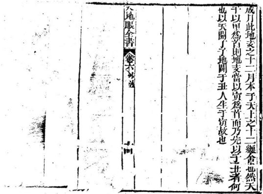

河圖生成篇 泊區生兄篇

天一生壬水地六癸成之地二生下火天七丙成之天三生甲木地八乙成之地四生辛金天九庚成之天五生成土地十巳成之河圗順生金生水水生木木生火火生土土生金天地眼全書卷六水法

河圖四局

乙水來立甲向甲水來立乙向會成木局丙水來立丁向丁水來立丙向會成火局庚水來立辛向辛水來立庚向會成金局壬水來立癸向癸水來立壬前會成水局此四局合金木水火一生一成乃天地自然而然之義一反一覆共成八局得生數者而發富貴得成熟者而旺人丁 12

洛書生成篇天一生坎水地六乾成之地二生坤火天七兌成之天三生震木地八艮成之地四生巽金天九離成之此後天合十之法也一與九合二與八合三與七合四與六合入地眼全書卷六

## 洛書昌局

坎水來立乾向乾水來立坎向合成水局卯水來立艮向艮水來立卯向合成木局此二局水歸水垣木歸木垣且一得淨陰一得淨陽純美無流最吉之水

坤水來立酉向酉水來立地向合成火局 巽水來立午向午水來立興向合成金局 此二局火入金鄉金居火位且陰陽破局地力輕微 一發便衰若龍身壯大盛旺又較水水二局退述更 重更悠久又爲合十法與水來立甲向用水火立 巽向四局代此推

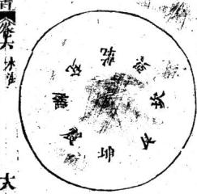

入地眼全書六沐淮

先天四大局

坤水來向說水來立地向天地定位酉水來立艮向水來立酉向山澤通氣巽水來立卯向而水來立巽向雷風相薄午水來立子向丁水來立午向水火不相射卦x

乾三連地六改離中虛坎中滿 震仰孟艮施兌上缺巽下斷 乾爲天陽地八九納甲坤爲地陽也履一納乙 離爲火陽也左三天旺坎爲水陽也麟右七 此四卦居洛書四正位皆數也故爲淨陽 兌為澤陰也局四町艮爲山陰也足六納丙 震爲雷陰也足八謝糠巽爲風陰也肩一納辛 此四卦居洛書四隅皆偶數也故為淨陰

乾爲老父 坤爲老母 震為長里巽爲長女 坎爲中男 離爲宁女 艮爲少男 兌爲少女 乾爲首 坤爲腹 震為足 巽爲股 坎爲耳 離爲目 艮爲手 兌為口 入地眼全卷六水

其法以後天方位用先天理氣如

乾甲龍或乾甲向 見坤乙水來或坤乙水去坤乙龍或坤乙向 見乾甲水來或乾甲水夫此合天地定位局

子癸申辰龍或子癸申辰向見離壬寅戌水來去離壬寅戌龍或離壬寅戌向見子癸申辰水來去此合水火不相樹局

丙龍或艮丙向 見酉丁巳丑水宗去丁已丑龍或酉丁巳丑问 見艮丙水來去此合山澤通氣局辛龍 或巽辛向 見卯庚亥未水來上卯庚亥未龍或卯庚亥未向 見巽辛木來去此合雷風相簿局

以上四大局水來配龍福力最重此天造地設之山水也水之配向福亦不輕此可以人提之者如見乙水可以立乾向卽向乾以收之見坤水可以立乾向更美其餘俱依此推之

人地眼全書卷六水一九合十離壬寅戌向見坎癸巾辰水來去坎癸申辰向見離壬寅戌水來去二八合十

長向坤水來言艮前乙水來丙向坤水來去布自艮水來言坤向內水來乙向艮水來去

震庚亥未向見兌丁已丑水來去兌己丑向見震庚亥未水來去大地眼全書卷六水法四六合十

巽向乾水來言與向甲水來辛向乾水來去乾向與水來吉乾向辛水來甲向與水來去以卜八局惟坎離二局先天如是後天亦如是莫大之局災之震兌一局俱合淨陰純粹最利祗是四維四局陰陽駁雜惟巧於立向者須壽納之如辛向乾水來必須乾三分亥七分甲向與水來必須巽三分辰七分爲妙此訣上發續側室之于以其爲後天夫婦故也求嗣速發

納甲

乾納甲屬金十五六望月金明三陽俱定象乾卦八 在甲坤納乙屬土三十日初一縣月純黑三陰全備 象坤卦卯時在乙艮納丙屬土二十四五之月陰 下一陽上象艮卦卯時在內與納辛屬木十八九之 月一陰下二陽上象與卦卯時在辛震納庚亥未初 三四之月一陽下一陰上象震卦戌時在庚兌納丁 己丑初八九之月二陽下一陰上象兌卦戌時在丁 離納壬實戌屬穴離爲太陽無消無滅至尊之卦施光 人地服全書卷六水

于月以變運前六卦者中爻屬陰故納已羅經無已土位後天居正南朝位遂以乾所納之外卦天于壬水納于離坎兩癸申辰屬水坎爲太陰爲月本體前半月消震兌乾二卦自無生而爲有後牛月滅與艮坤卦自有消而爲無皆坎爲之也巾爻屬陽故納戊羅經無戌十位後天居正北坤位遂以坤所納之外卦天干癸水納丁坎

母月合朔後哉生明目初二至初七日入戌時人伽面觀天月明一分象震卦月在庚方故震納庚是震卦初九庚子爻從坤耳初六乙未爻滑出故造葬坤山乙山忌月庚日戊子尤忌八地眼全書卷六每月上弦自初八至十二日歸上時人仰面觀天月明二分象兌卦月在丁方故兌納丁是兌卦九二丁卯爻從震卦六二庚寅爻消出故浩葬卯庚亥未山忌用丁曰丁卯日尤忌

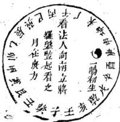

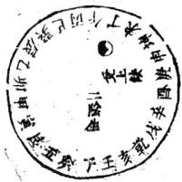

每月將望自十三至十七日八土時月光盡明人仰面觀天象乾卦月在甲方故乾納甲是乾卦九三甲 1fxd辰爻從兌卦六三丁丑爻消出故造葬兌丁已丑山忌用甲曰甲辰日尤忌入地眼全書人卷六木出每月望後哉生魄自十八至二十二日出卯時人仰面親天月暗一分象巽卦月在辛方故與納辛是與卦初六辛丑爻滅去乾卦初九甲子爻故造葬乾山甲山巳用辛日辛丑尤忌經云乾遇巽時為月窟坤逢雷處見天根此之謂也每月下弦自二十三至二十七日出卯時入仰面觀天月暗二分象艮卦刀在丙方故艮納丙是艮卦六二丙午爻滅其與卦九十辛亥爻故造葬巽山辛山忌用丙日丙午曰尤忌入地眼全書卷六每月二十八至次月初二日出卯時人仰而觀天月光盡晦象坤卦月在乙方故坤約乙是坤卦六三乙卯爻滅去艮卦九三丙申爻故造葬艮山丙山忌用乙日乙卯日九忌

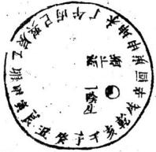

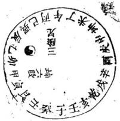

此指納甲之原閱圗明矣至於砂水龍神月法應騎必須指出登山閱地方可明白了然于心月矣如乾龍入首甲水來或甲砂起王水來壬砂高坎龍入首癸水來癸砂高撰 此局砂易得水諸符艮龍入首丙水來兩砂高拱卯龍入首 庚水來庚砂高拱異龍入首 辛水來辛砂前拱離龍入首王水來主砂高域坤龍入首乙水來乙砂高拱入地眼全書卷六水法兌龍入首丁水來丁砂高拱

以上入局水來名爲歸元水無地有局亦主富秀若得龍神秀拔至于砂拱水朝力可催官又爲納甲官砂龍強旺秀出顯宦富貴長久中等亦發科人財兩旺又如乾水來乾砂高拱甲龍入首亦是納甲龍痢甲砂水又如巽山乾向甲水來又庚山甲向乾水來俱是新甲歸元水也所以乾龍甲水甲龍乾水乾水甲向甲水乾向此八局變出三十二局矣故立向有轉移之巧在人提之也此邱公之旨一行師之有前兼龍後兼龍之作且發明此義今之註函經將此納甲正義面之度外面不講竟將雙山左右旋生旺墓四水口以爲實所以賣眞不不賣假橫行

渾天甲子

乾金甲子外壬午甲壬二于納乾卦九三號 九二妻寅 初九內卦上九死九五肝 九四外卦坎水戊寅外戊申 癸戌二于納坎卦六三裁九二成服期 初六 寅大地服全書卷六水出上六成 九五 房身 六四公 外卦艮上丙辰外丙戌丙干納于良九三前 六二 初六兩表上九 六五盱 六四震木庚子庚午臨 庚于納于震六三秋 六二寅 初九上六数數 六五 九四符

四陽卦順起子寅辰午申戌

與木辛丑外辛未辛于納於巽九三 九二 辛刻 初六半上九 九五記 六回離火巳卯巳酉親 已王二千納離九三配 六二记 初九紀上九妃紀 六五祀 九四頃堯金丁巳外丁亥丁千納于兌六三 上六父味九五 九二打明 九四于孩 初九 外坤土乙未癸丑憑乙癸二于納坤入地眼全書卷六木法六三說 六二 初六兄 乙上六秩師 六五發 六四四陰卦逆起丑亥酉未已卯

託長老曰凡陽爻言九者一三五共得九數也陰爻言六者二與四共得六數也俱用河圖之五生數取義凡過官鬼爻卽爲煞陞故八煞歌云坎龍坤免震山縱巽雞乾馬兌蛇頭艮虎離猪爲八煞墓宅逢之一齊休世人呼爲八煞黃暴皆畏忌之殊不知有八煞龍八煞水入煞砂可笑時師心中所畏忌者八煞口中又在講八煞手中拿起羅經又在做八煞所以亦有入煞向者或曰止知八煞龍者或曰止知八煞水者或曰止知八煞砂者一向不知焉知龍砂與水乎可笑今之時師屋裡先生註書千卷不如口訣一句方知八煞易明坎龍忌辰戌水坤龍忌卯水震龍忌巾水吳龍忌酉水 兌龍忌已水 乾龍忌午水艮龍忌寅水 午龍忌亥水此八煞龍水也又云坎龍不忌辰戌水乾龍不畏午水且喜見之殊不知八煞來龍八煞水朝乃大貴之地其訣總在因龍辨入地眼全書卷六水法水依水立向所謂化煞爲官登將臺

祿馬貴人砂寅良全宮

艮砂辛砂山若陷祿馬不起金階平 甲壽孫寅申 缺隋馬空倚官不食祿名虛稱催官祿馬山低小雖有 文章不顯達

靜道和尚曰此文後之作川祿馬貴人地理家要明此義消砂納水之中大有把柄不可不知言艮甲則坤庚乾王吳丙皆在其中總而言之寅申已亥爲四馬之不宜缺陷低小如子午卯酉皆同

中祿到寅乙祿到卯祿坐己 巳祿居午庚祿居申辛祿居酉壬祥在亥癸祥居子此天干臨官位卽祿也又乾坎艮震巽離坤兌八山依納甲算如甲龍祿在寅切不可扞甲山庚向甲山坐尾火虎寅宮箕水豹水尅火煞動中宮不可不避全在坐度以提之如乙祿在卯小乙山辛向乙坐氏土卯方房日火火生土主發科甲

論馬

入地眼全書卷六水湖寅午戌龍局馬居申申子辰龍局 馬到寅亥卯未龍局馬在己已酉丑龍局馬在亥此十一地支之馬也若电子辰局喜寅水來寅砂起如子龍馬寅午向馬申言甲水來寅水去若依雙山三合午向火局寅水去損少年威財之子今祿馬之法與雙山不同可知雙山所謂走了長生水者其掌訣亦無用也已餘三局依此推

論貴人

戊尺牛羊乙巳鼠猴鄉丙丁猪雞位壬癸兔蛇藏六辛逢虎馬此是貴人方甲能入首 喜未砂起未水來乙龍入首 喜申砂起申水水丙龍入首 見酉砂起西水來丁龍入首 見亥砂起亥水來庚龍入首 見丑砂起丑水來辛龍入首 喜償砂起領水來壬龍入前 喜卯砂起卯小來癸龍八首 喜己砂起己水來

以上八局俱是陽貴人砂水若陰貴人應女家不事三合局

亥卯未木局 己酉丑金局申子辰水局 寅甲戎火局此聯珠恪也用法坐下收水九九相生循道不已卽隔八相生之道也如亥水來未水去卽立酉向若卯龍人首扦甲山庚向葬下不滿三年未水來雷擊而興未水去雷擊而敗慎餘三局依此推祿馬貴人三合乃人命宮所載而地理家亦用之龍砂水向納之者則發不善納之者則敗可見人有命皆從攻慕中出也奈此法人不能知曷不于古塚間考跪而自了然于心目也善哉印公之示人深矣黃泉

甲癸向中休見艮 辛壬水路怕當乾此指向收水也見坤水來不可立庚丁二向見庚丁一水來不可立坤向是爲黃泉乙水來不可立巽向巽水八地眼全書卷六水來不可立乙向此爲黃泉若內水來立巽向巽水來立丙向此得巨門水也又爲六秀水出聰明主富艮水來不可立甲癸二向甲癸二水來不可立艮向是爲黃泉乾水來不可立辛向辛水來不可立乾向是爲黃泉若壬水來立乾向乾水來立壬向此不爲黃泉此得武曲水也主發富貴人所不知向土收水最喜淨陰淨陽陽水來立陽向陰水來立陰向來去水皆同樣故爲盡善盡美書云此爲殺人黃梟遊是殺人黃泉而又有巽丙乾壬二局而發丁財富可恨這此屋裡先生無中生有造出一救貧黃泉以哄人哄人事小作孽事大辛入乾宮百萬庄 癸歸艮位發文章乙向與流清富貴 丁坤紀是萬笥箱

據此語滴滴有味殊不知仔細看來盡是陰陽破局見辛水來立乾向犯廉貞主人吐血症無藥可治出人無禮義奸詐忤逆敗絕見癸水去立艮向犯祿存名絕體王絕嗣過房賭傳退敗淫亂産死見之水來立巽向犯祿存十手疾螟蛉招贊投河自縊見丁水來立坤向犯破軍主好訟家財不了官事不休出人兇惡做賊韓啞入地服全書卷六水法

敗絕亡家可笑世之行此道者口中又在講黃泉手中又在與人立黃泉可根這些無師之學又攝出此救咎黃泉害人非淺聖人曰害人還害已莫學唐朝李林甫書之方清此恨門此惟難消又見後習者見此水立此向如之奈何後習者皆因不明此理只知看書不知解書總是眼…幾个字胸中無點墨登山臨穴看此救貧水法卽將此四句俗話說起來殊不知發友章富貴之地亦非此等水法凡後習地理者必須前思後想古來發福之地是何規模是何砂水是何面局是何向洪是何收納水城法何得我手所作不發他作就發一定我之眼力未到道術未精巒頓未熱穴法未明向法不定水法不合再徃古壞開考方知道衛未精不可造次誰知以此害人之技反來射利乎桃花煞

亥卯未鼠子當頭忌木生在亥敗在子故忌鼠 已酉丑躍焉南方走金生在巳敗在午忌馬 亥卯二向兒子水來爲桃花若未向不兄子水不忌 一巳酉二向見午水來爲桃花若丑何不見午水不忌 天地眼全書卷六水法 此二局皆淨陰見子午陽水來破陰局爲桃花主婦女 淫亂若見子午二水來卽立陽向以收之

中子辰雞叫亂人倫水生在中敗在酉故忌難寅午戌兔從孝裡出火生在寅改在卯故忌免中于二向見酉水來爲桃花若辰向不見酉水不忌寅午二向見卯水來爲桃花者戊向不見卯水不忌此二局皆淨陽忌見卯酉二水來破陽局爲桃花主風聲敗壤此言子午卯酉四水子午陽水破卯酉陰局卯門陰水破子午陽局凡水各有不同水有來的有去的有池塘褚聚而不去的要分三樣看法若池塘固聚而不去者爲內桃花必應自已本姓人若是來水爲外桃花主應外鄉人若是去水又爲軍賊水必主男盜女媚萬藏賊盜凡看地理者必先要辨於之何如後總在以立向收之但當如何收法曰若陽水須立陽向若陰於須立陰向切不可使陰陽破局

印祿到寅卯爲羊又 乙祿到卯辰爲羊又丙祿到已午爲手又 丁祿居午未爲羊及入地眼全書卷六冰法 美庚祿居申酉爲羊又 辛祿居酉戌爲羊及主祿在亥子爲羊又 癸祿居于丑爲羊及祿前一位爲羊又以其刼財又主男子好淫故名羊印向卯水來丙向午水來辛向戌水來癸向北水來此四羊又爲陰被陽時師有立向兼此者不利若是有此水當而潮水主刀藥七身之禍至乙向辰水來丁向未水來庚向酉水來壬向子水來此不爲羊又俱是陰見陰陽見陽若得此向此水上堂則丁財兩旧禍事不染但好也之情勝耳

一刑卯卯刑于寅刑已已刑申申又刑寅丑刑戌戌刑未未刑丑

子向卯水來卯向子水來寅向已水來已向寅水來丑向辰水來辰向丑水來寅向亥水來已向申水來

爲無禮之刑 為無思之刑

總以水法中不喜陰陽駁雜要淨陰淨陽方為美若入地世全書卷六水出 -犯此相刑相破暗暗消耗太歲臨位損丁退財六箸水

子與未穿丑與午穹寅與已守卯與辰守甲與亥弟酉典戌壻用法所忌

寅向巳水來巳向寅水來犯三雨爾申向亥水來亥向申水來辰同卯水來卯向辰水來戌向酉水來西向戌水來于未丑午二病人不能犯而西戌並湖卯辰說流此

## 四破水

此二局人所易愆故犯之者多若犯之時暗受寄漸 漸消耗最爲可畏

子破卯卯破午午破百酉破子陰陽相闕 此一段依人命宮而溝水法水法合此所以生人之 命逢此祿馬貴人三合則吉君遇桃花羊又三刑六 害四破則賤爲人在世則要命好死後歸土亦要地 好地雖好亦要局好局雖好亦要砂好砂雖好亦要 水好水雖好還要葬得好這一葬字則難言也那怕 入地眼全書卷六水 學富五專不得竅都是時絞射利焉知消砂納水 坐度立向得了竅方能知此一非字也知此葬 字白然發禍悠久

入地眼全書水法卷七宋南昌辜託長靜道和尙著

瀑泉袁泰開樹庭黃中楷 雲門黃中植稔安袁豐年同參計 理齋劉是訓恬眞徐孝先

庚訓萬樹華仁村氏紹次

胞姬萬基德修校字

## 水法

靜道和尚曰水之禍福應速山之禍福稍遲水親朱雀入地眼全書卷七水法纒元武繞靑龍包曰虎爲養蔭之水要迥旋要到堂要上堦要拱貨要人懷要響抱要癢聚皆水之吉也書云逆水一滴勝于萬派山嫩粗惡水愛澄清縱橫似織方知眷戀之情滙澤如湖乃辨朝宗之勢故入首結穴之處看其左右前後若見水三橫四直屈曲交流猶如織帛此砂戀水水戀砂猶夫婦相見而不忍違也衆水到堂或左或右聚滙於湖則知水交砂會矣然又要辨水神之出入向何方而朝會或出于大江或出于大湖辨明方位則知龍穴之美惡也古云揚揚悠悠顧我欲流大地必有逆龍之水好地必有逆砂之流龍道爲上砂逆次之龍得水水得龍是夫婦配合水逆龍龍逆水是夫婦交感百川同歸者親而又親來而不去者戀而又戀水若屈曲有情必合星卦爲吉也九曲是秀火却爲外應而地結于內愈爲貴重三台是朝案却在當面而穴結于前易近易發水深處民多富水淺處民多貧水聚處民多稠水散處民多離此看陽基之法也水之來勢亦當知兩水合流謂之交關攔緊密謂之鎖之元屈曲謂之織眾水會聚謂之結穿破龍虎明堂者穿也割入地眼全書卷七水法脚無龍虎者割也直去爲箭直冲爲射未看山先看水有山無水休尋地有水無山亦可裁眞龍不配凶水吉水不向凶龍水纔過容而反挑一文不值水若入懷面反抱一發便衰平田水水散田中平夸悠緩不冲不射不割不冲不帶凶煞凡穴得之最吉然以有情到堂爲佳若不到堂木無用池塘水有生成者亦儲財祿穴前得之最吉若妄鑿池塘傷殘發洩龍氣立招凶坟宅之旁清泉白水來去得宜妙無以加始作穴時可通舟楫作穴之後儘爲好事者所惑擺作魚池或子孫各戶分門亂行堰塞以圖小利至于破敗可不慎哉停基浮厝記和尚曰救貧之法合其朝貧暮富用何水法以收之淨陰淨陽是也凡眉不必求龍只須尋局葬乘生氣若無龍氣則水不靈經云巒頭無理氣不准理氣無巒頭不靈眉不用巒頭只用水法須尋局面總尋山脚下開有帳窩鉗氣浮于上者兩邊亦要有護砂作龍虎若兩旁無砂則風吹風吹則蟻生當而倉板水層層朝拜拜至于明堂或橫來之水亦當蓄聚來而不去或平太地眼全書卷七水法 三周騰芳刊之水亦要一層一層拜下拜至穴前則吉若無明堂中前有低田亦是明堂倘山脚下無田無明堂秦何曰見山脚下開陽處必是平坦卽爲明堂厝者不重龍單重水葬者屬陰故葬乘生氣爲主厝者屬陽取水爲先謂水來生財主速發不出三十年之外發禍一代全在立向收水之功倘若立向銷則不準矣發福後再擇吉地以葬之問答

有問于託和尙者曰何謂風水曰聖人畫卦以乾爲天爲父坤爲地爲母乾屬陽坤屬陰是夫婦兩相配合佛經曰天爲吾父地爲吾母日爲苔見月爲吾弟星爲吾妹天地日月星辰會同一家天乃一大天人乃一小天譬如一戶人家一夫一婦兩男一女共是五口此亦天地派定者也不信但一村人家有自州者男婦大小共有五百人而十烟者只有五十人牽多益有點點不差又如修讀三十年一世亦不錯經云人生過百年便是超三界此之意也問曰孝于安葬父母風水之事亦何益哉曰此俗說也風乃天之氣水入地之血天發怒則入地眼全書卷七水注 四周騰芳列風狂地發怒則雨驟是謂陰陽不合萬物受傷若風調雨順萬物資生問曰請教風何以爲天之氣水何以爲地之血曰有如人有氣則血脉遇流一呼一吸生生不息而無氣則死矣風是天氣天有風則萬古不磨一日無風則覆矣水乃地之血如人無血則弱矣地無水則乾乾則炕草木皆枯天地若無風與水萬物皆休故風水二字最爲第一風散則歸於山山得天之氣是爲地氣地得天之兩是爲血是水歸於海海眼伸于山山氣盛則成雲雲氣盛則生兩是以周流不意生生之道也問曰水何以爲財祿曰水爲地之血血脉過流而停目夜而不息盡歸于海水喜動不動則聚聚則血盈如人得祿故水稱財祿是以先賢看地有妙訣先取龍氣龍氣旺則人丁盛二收水聚水聚則財富三取砂秀砂秀則官高回取局員局員則悠久凡尋地得此四取足矣哉問曰再請教老師看地是因何而起門古人葬親只掘一窟畫一大過卦于土內將親屍放在卦上上用柴籍以蓋之再用土掩作堆後帝堯想親死如此非法則心不忍土中定有重蟻水侵豈不食親尸骸命制人地眼全書卷七水洪 fi棺則水不能入出不能食豈不快哉是以聖人有言陶上攝民棺以教百姓葬親民皆用之上帝見天子有道命白鶴仙師封墓大夫下凡看地所傳有龍穴砂水向五篇爲始後世先賢亦受此道不肯亂傳內有天機不敢輕洩擇人而傳之及至唐元宗時邱延翰公不識天時誤葬禁穴獲罪于天將先聖之書盡行誅廢後囚黃巢犯境天子遷都楊益在京敖邱公出獄是以邱公所記之書盡皆錄出傳于楊益後益回江西卜地响應所到之處皆有鈴記曰既出鈐記何不與人葬坟曰有隔者遇之無福者不信一來天機不亂洩二來畱待後入曰其鈴記一定有手作今在何處老師知否曰我亦不知要他何用各習學業曰再詩教看地要乍麼看法曰別無他說不過龍穴砂水向五个乎人不知此道開口就說實難皆不得竅得了竅實不難龍要起伏屈山活動爲主砂要纏護抱穴朝案分明穴安氣脉窩藏穴量爲的水要逆朝橫收平淨爲佳向要淨陰淨陽依水所立此五十个字一部大地理書千言萬語都是閒談

人地眼全書卷七水法

明堂水

穴前明堂之水要圃聚要澄清要四季不竭要堂局員淨要平正不動爲佳若一返弓無情斜飛直宮層層瀉出一濡便去則不歸聚亦無益矣古云力曲入明堂當朝宰相此非也水若屈曲到明堂財祿聚不見流去則吉穴前之水要澄清絕無流動始爲眞若還濶大爲散漫散漫之中穴不停迢迢四水入明堂直冲直射不相當若還居曲瀠洄轉貴上金楷粟滿倉

## 天池水

天池水少入知週迴深濶最爲能盛天水蔭配脉盈竭猶能盛衰平坂天池大且深眞龍脈旺早凝成四時融注極榮貴一且乾枯卽敗傾

## 水口

託長老曰人山尋水口登穴看明堂凡水來處謂之天 門若來不見源流謂之天門開水去處謂之地戶不見 水去謂之地戶閉夫水本主財門開則財來戶閉則用 不竭水若深處則財大淺則則小水口卽人之門戶也 人地眼全書卷七水法 七

水出之處有兩山高聳草拔者貴地也有低山關抱者科甲地也若無下砂關攔下地也若有關攔三五重更大更悠久水無方與位屈曲是爲先雖然下手有關收遺要父鎖爲妙水口高卓而緊夾則知地力之最大水目低平而稍寬則知地力之輕微水口之內又要四山融會四水環繞重包自二里至六七十餘里或二三十餘里而山和水有情朝拱在內必結大地若收十餘里二十餘里者亦爲大地收五六里七八餘里者爲中地若收一二里者不過一山一水人財地可

窺見城門有異蹤或生怪石或生峯重重關鎖回頭顧 戶內眞藏宰相榮

洋洋大水爲關鎖關鑽裏面有包裹內城圍住外城銷這等水城原衛我尋龍若見水口內有結作莫亂走眼界放寬擒龍穴休要糊輕送了

水觀界送朝聚

靜道和尚曰風水之法得水爲上藏風緊要夫外氣所以止內氣界水所以止來龍自少祖下界送龍勢者第入地眼全書卷七水法 入一分水也有長短自入首星下界分龍虎者第二分水也有淺溪至于穴場有蝦鬚金名水者第三分水也有股明股暗凡龍音有二水夾出一邊大江一邊小溪一邊溪淵一邊田壠亦是股明股暗明暗交而氣鍾淺深會而氣止長短會而龍勢止故小無遠近助脉爲主穴無所定尋氣爲憑譬如人身之血以氣而行山水之氣以水而運水藏山內氣出水中來處來去處去猶人之呼吸水則龍身之血石則龍身之骨上則龍身之肉草則龍身之毛血行于肉而不行于骨也善求地者觀龍之脉氣在龍虎外之界水上看澗穴之脉氣在龍虎內之界水上看外顯迹是也內界水微茫是也亦有無龍虎者不必拘龍當究其分合分合者言乎其出沒也夫脉之爲脉非陡然而生頓然而有其出也必有自然之來則有分水以導之其沒也必有所止則有合水以界之洗心鏡云平洋大地無龍虎杳者尋何處東西只把水爲龍到處有英雄又云屈曲明不論大河小澗遶流曲抱無分江海池塘七曲八曲出意外直處畱神九里十里不轉頭曲中取象百里直來臨有曲此中必定入地服全書卷七水法 九

隱眞龍有情之水屈曲最喜聚堂無情之水直冲須用 關斷要知大江交會不屈曲環抱纏繞者中取小水鈎 轉有情所聚處爲佳平洋之地以水爲龍若入首處水 曲則龍生水直則龍死水聚則龍住水散則龍行故水 東來氣亦東來水西來氣亦西來龍隨水轉向依水立 苟冲水神卽冲龍神所以發福俱從向上水上來者甚 速 人言生氣地中求豈知地氣水邊流流到水邊進水界 平洋瀬氣盡背收

行到平洋莫問蹤只看水繞是眞龍近水樓臺先得月 向陽花木早逢春

兩水夾出是眞龍穴得水時何畏風但看古人仙手下平洋一穴勝千峯

平洋大木收小水不用砂關發福久水口石如人與物走出擊天朗鼎手

此言得水得局平洋之地砂與龍最難辨無非求其水與局立向不錯自然富秀

萬里茫茫一片天空悔澗話難言財耗消散人丁殿入地眼全書卷七水街單身寡姞哭皇天

此言有水無局面前一望平垣水大難收則消條矣向依水立

富貴負賤在水神水是山家血脉精山靜水動晝夜定水主財祿山主人

識得立向水來去吉囚禍福手中隨陰水來時立陰向 陽水來時陽向宜

東是陽兮西是陰地爲花假不難分若得龍與并穴的縱好安戰房分虧

靜道和尚曰砂有吉凶全在坐度以消之水有吉凶全 在立向以收之地不絕人水絕人水不絕人向絕人行 此道者消砂納水之功大有作用个之庸師竟啞如夢 古人所以有依我葬出王侯依爾藝出賊頭依我定產 賢良扶聖主依爾草賊強梁不善終之說也穴依龍以 乘內氣向依水以乘外氣凡立外向總依水立千的不 可貪峯失向庸師不識見有倉板水來就曰此地當求 好个倉板水朝貧暮富殊不知是煞水混來怎見得煞 水混來就不好壁如一亥向面前戌乾壬子癸倉板水 入地眼全書卷七太法 土

來名爲五鬼開判有犯之者全家誅裁又如一午向面前巽巳內丁未亦是倉椒水來亦名五鬼閫判雖比亥向其禍畧輕以亥居西北屬陰午居正南屬陽稍有分加然終主吐血瞎眼做賊同祿之災其禍亦不小也朝廷刑罰與陰司一般可不悔乎又如黃泉水乙丙須異水先巳說明矣誰知好事者改爲救貧黃泉反云九向巽流清富貴來爲黃泉去不爲黃泉獨不解水性來去均關禍福乙向屬陽巽水屬陰陰水破了陽局犯祿存水去祿存祿存眼家滅門非此向者果然是侵消之富貴家敗人山總是好事者造出假局以害入將丙望不言轉于來去上分辨敗人家富貴何不言丙向巽流清富貴豈不是當眞富貴乎舉一局而八局皆可鄉二十四山合局破局九星斷語

第一乾卦水爲上乾甲純陽北極內乾水多申面鼻龍神喜坐坤巾粕若得乾峯侵入雲世登要路居相位午水午向砂水秀馬上金堦出太尉辰龍乾水勢汪達龍透天門格最大粟陳貫朽多稅糧更發顯宦人驚異人地眼全書卷七水乾水破局

乾水破局跛與聾頭痛跎矮例相通鰥寡絕嗣多不言維贊尅妻壘壘逢艮向巽龍見乾水宋禍緩速分其中乾水來時禍則連去時禍緩遲遲凶來主跛而不能履去雖能履跛則同內丁卯巽四龍向乾亥雙湖人吐紅咳嗽擦天類相見戌乾雙主鼓盆凶地力將衰向乾春頭多潮生臘梨翁

水流北極肅殺值襟懷鄙瑣寬洪若還來主跛能履鰥寡繼贅人無跡乾亥雙行無瘵天戌乾暗啞并盲龍

鼓盆吹第災相攻

## 甲水合局

甲水甲砂發富貴乾龍得之實爲美蜚聲魁第少年郎文章價高人驚長

甲水破局

破局跛足多瘋癲其方有峯非吉位文筆由來應畫工木笏多生道士類辛酉二龍來打混子孫世受風鄭累子癸合局

第二卦名是破軍北方坎納癸申辰子癸一水生六指入地眼全書卷七木法國聚澄凝發富眞水迎再得砂高拱離龍入穴近君門陽龍坤離陰巽兌定主雙生非虛稱坤離生男家卽岱巽兌生女便伶仃

坎龍單行更高從孕生六指母猜驚鳳池身貴水在北 雁塔題名子木宮

子癸破局

破局桃花多龍耳女犯墮胎因員墩子樂是仨方簡 點用水盛落木或黃腫忽然縊死令人驚三煞陰龍 卯亥艮最怕癸丑井潮坡若是混流或凝聚沿于 言混流于

了便 兄弟屠戮女禍侵少亡毒藥并腹脹隨母改嫁宗親水合局

申水合局旺丁財少年發達逞豪邁卯龍中水扦申向 仁煞爲官登將臺

申水破局

破局虛癆死少年卯龍庚向水申來人命犯此遭刑也逃鼠絕亾實堪哀

辰水合号

大發財產是晨水乾龍得之爲最美此水去來俱不靜絕是冲開墓庫壘坤龍得此辰水人科甲翰苑貴無比辰龍辰火眞難得狀元宰輔其可許

辰水破局

破局瘋鄭并落水水亡之後家滅毀西龍見之主嗜啞或生露齒缺唇嘴丑木一向痼疾生仃橫逆凶死鬼艮木合局

第三卦是艮水垣貪狼生氣星不北艮水合局天市宿世人財貨聚其間若見砂形櫃庫樣悠揚水再向坟前出仕宦資定饒厚富堪敵國非等閒砂若低小水憐短亦主溫飽爛禾錢丙龍過此砂水秀黃甲聲名當世傳三台聳拔水凝聚與國為姻祿綿紹

## 艮水破局

艮水破局多冷退亦主絕副神不延雖有文章不顯達 此方缺陷峯不全

## 丙水合局

丙水合局多福壽犯罪之家用此救丙丁藏文山水朝皇恩浩湯叨原宥艮龍内水可催官納甲之理宜透入地眼全晝卷七木法

凡地非砂難求人个歸元水最秀砂形印笏爲公卿庫櫃之形富豪伯辛酉亥龍實緊之亦須木朝如輻輳歸元水卽納甲木非但納甲水有納甲龍又有納砂如乾龍見甲砂爲納甲砂見甲水爲納甲水如龍兄乾砂乾水俱爲納甲砂與水如坎見癸艮見丙震見庚巽見辛離見壬坤見乙兌見丁此八卦之納甲凡龍過納甲砂可催官出飄官遇納甲水發秀主富及人丁

丙水破局

被局敗家或火燒廢而不起多灾咎水路丙丁井流來 寅午戎年火難救離丙雙來俱切忌天降回祿災量飛 丙丁二水是廉貞犯者不免透天紅葬法若乘兌亥氣 回祿煞龍應潛蹤

卯水倉局

第四卦名廉貞鬼震爲長子庚亥未卯水文宮兼武官操持胆略人欽畏斬斫自由顯威權將相堀起英雄隊庚龍卯水能驟富更喜高峯鎮此位

入地眼全書卷七水法 六 破局偷盜兼亂淫蕩產多因賊牽累坤龍卯上水去來 定主殺戮徒刑罪

庚水合局

卯龍庚水可催官武人取責更非難將藥胆畧世無產 去來皆富合家庚砂高起旗旄狀再得地丞藁兵權 四神八將來拱峙名播華夷鎮大藩卯龍庚砂如此號 艮亥一龍又一班尖峯秀出如判筆片言折獄稱不繁 若見巽龍庚砂聳爲官清正不污貪王龍午向庚照穴 强盜頭目寶樓蘭

康水破局 如共破局單庚水偷爲時生不肖男庚申幷朝射入場 被人殺戮最兇頭皆得丙丁砂水救害稟成家禍壽全 卯庚二水破陽向難逃刑戮事張皇丙丁三水名熟 山水朝來免禍災

亥木合局

亥水往來能合局大旺人丁并財祿兌巽二龍見亥水 那甲及笃家富足卯龍亥水爲納甲文武全才食天祿 亥龍亥水亥砂起官居台閣發更蓮且蔭人家久積書 入地眼全書卷七木法 七

良丙一龍尤富足

亥水破局

被局虛勞損少年亦主絕嗣禍連連午龍見之出下財禍小災輕也難言

未木合局

未水合局旺丁財庫守田庄最樂懷巽辛二龍未水入爲官得祿進橫財出入拘謹信佛道再卽卯龍庚向推小來雷擊家漸富水去雷擊家漸衰艮亥二龍得來水富何須進庫財兌丁丙龍本自配科甲聯芳列三台

未水破局

破局看經財念佛尼姑何道拜遠臺辰戌一龍未水入尤招鰥寡天折媒悖逆不忠難制伏尸山路死不聞回巽水合局

第五卦內是巽宮巽辛排入巨門中巽砂巽水龍辛亥少年科甲者運通兄弟聯芳人翰苑喜有巽上有雙庚卯二龍巽砂起經畧之士振咸風巽爲長女水朝入貞潔女兒美貌濃或因玄家致財宮或因妻貴得思榮若也蛾符山在巽宮媿碧馬兩相逢巽丙丁號三陽水入地眼今書卷七水朝來喜鬼林鄉史東卯西庚皆兒位義門福壽考羅無窮巽水龍廻少男脉壽算減兮福豐條

巽水朝來文筆起少年科甲訪文章穴秉辛亥巽水入玉堂金馬狀元郞三陽水朝歸未聚樓淅斷秋暢義門壽考同休光三水朝入震庚食祿開府應三公項出仙翁與佛子蓬萊眞境超凡風

巽水破局

巽水被局多乞山抱花山現多涇風作 或者山碎水針側室女懷胎好私通巽已雙朝破陽局鳴林那堪巽力起高峯香閨有女顏如玉墮胎玷沔春風咨辛水合局

辛水最秀司文章狀元射名揚巽龍少存登科第 翰林學士近龍光更有伽花汝人貌家多金帛珠翌香 艮卯亥龍見此水砂水秀知人明堂亞榜明經人人羨 陰龍陰水適相當亥山一丈可致富辛山十丈富堪南 雖然金帛誇富足過房冥姓終難養

辛水破局

入地眼全書卷七水 破局不覺家洽退無救乞可至絕亡

## 午水合局

八卦第六在南離離納寅戌壬巳齊午水主宮又貴顯了癸龍正相宜龍虎抱衛砂水拱公侯卯相貴無疑此水去來俱驟富時至離鄉是發期高峯獨出邅回蘇乾王洩制產英奇

再評

午砂午水龍結穴子龍乍水公侯生龍虎抱衛 公俠卿相貴無疑王午來來離鄉邑乍砂則事 州制火龍英賢生高峯獨出南方位必遭回祿還運逢 子龍午水出西兌男盜女淫敗家門子午陽朝破陰局 威池水映桃花紅午水破酉酉破子子破卯時卯破午 陽破陰時陰破陽男盜女淫夜夜忙

破局火災兼浮亂盜賊時生來相犯著有員墩免火又主目盲墮胎患巳丙中午流動婦人吐血夫弦斷卯艮二龍見此水眼外雖明中多暗若從酉上流出口婦人室女同淫濫乾龍午水人命傷刑獄破家遭屯離入地眼全書卷七水法

壬水合局

王水驟富堪救貧血財輿旺多利名午龍得此砂水秀文武全才爲公卿單水主富無大貴亦多納粟貢行人大抵水來居家發水去離鄉富貴成

壬水破局

破局縣敗出遊蕩水盛多生黃腫恙亦有災厄落水者 逃嵐他方羅灾精

寅水合局

寅水長生旺丁財坤龍高見此水來乾坎二龍出顯寧乾坤甲結產英孩來來爲官生近祔去則他州發遠財寅水破局

破局實爲艮八煞足主瘋盲及虎災坤山艮向寅水入 煞帶廉貞血滿懷寅甲小墩長而細蕩子虛誇博奕材 員則更名爲木印道上弄法謙符脾

寅甲屬木木生風定主瘋顛爛眼寅又屬虎故虎能 傷人菩作坤山艮向者加申寅三分主出癆病艮忌 虎非不言之口中又在說八煞手中又在做八煞矣 不下好笑

入地眼全書卷七水法

辰龍戌水廣田庄富堪敵國多稅糧戌砂戊水光照穴翰林學士近龍光乾龍遇此砂水秀科甲丁財遍滿鄉坤龍得此砂和水小貴大富亦堪商戌龍戌砂扦辰向辰水朝來最爲上忠臣孝子弁理學二十四龍第一旺戊水破局

破局回祿暗且兼故盆之煞尅妻重卯龍戊水人喑啞艮龍戌水聾盲逢丑未龍來戌流注少亡悖逆人不忠庚酉一龍見戌氷尖刀砂出屑餉儂午戌破局瞎眼者或砂或水病不同砂凸眼珠亦山出水則珠凹限服珠坤水合局

第七卦是坤乙上地母卦名卯與輔坤水合局主財富寡母起家多倉庫乙癸乾離四龍神最喜坤砂坤水顧山形卓拔旗旄樣女做將軍男帥府忽然端正拱如圭又主科甲不及武亂峯低小郡循職雜職小官亦堪數坤水破局

坤水破局勢洋洋婦女相繼爲孤孀抱花掀裙山再見 寡母淫亂不可當尼姑佛經千卷定有山形盂樣 入地服全書卷七水法 主

若是卯龍見坤水尅妻煞犯人悲傷坤申並朝亭厚福 先天後天會方若與未水雙朝入廉員煞曜兩遭殃 小少坤多過陽局侮貝男人吐血亡未多坤少過陰局 女人吐血爲妙傷

原來乙水可催官葬得坤向實不難名利顯達多生女王龍落脉貫一班乙辰雙朝多糧産贅得妻則滿心惟乙水破局

俠局多昭于足疾螟蛤繼贅如親男若與卯水混流入定然尅妻三五翻時或乙辰交路至抱忿自縊投河繼酉水合局

第八卦是武曲宿兌丁巳丑金光透酉水合局雅而造魚袋砂生登朝右酉砂酉水巽峯高貴近君王衣袞繡丁艮二龍出文官惟有山朝兼水秀

## 西水破局

破局淫亂不堪言巽龍酉水煞相連無水有路亦非宜犯罪遭刑雇灾咎子午辰戌四龍向室人偷情隨人走此方山陷巽卯龍爲官陣亡全家覆辛酉層層水入懷入地眼全書若七未法

雖富尅妻害難救

丁水合局

丁水合局南極星男女康寧最多壽丙丁二水名文家無凶祐福頌佑策射金門第一流酉龍丁方砂水秀艮龍丁方水特朝王侯廟食言非謬

丁水破局

若然破局主腹痛退股之時無可救巳水合局

巳水合局旺人財卯龍喜見巳水來赤蛇繞即伽金理

艮多二龍堪裁

破局吐血與癆潔小年多損見蛇火酉龍已水或風射殺身喪家刑獄埋丑龍二水多殺裁理叶金雞怡蛇害已向巽水多洽退巽向巳水人口災山向尅水禍輕緩水尅向重禍速來巽巳雙流水尅水何能句救含哉庚申乙卯同辛酉艮寅壬亥例僕亥已皆屬長生地巳爲地戶最宜開陰龍水日巳砂塞婦人不孕絕嬰孩陽龍巳曰員墩起雖然懷孕也糧胎入地眼全書卷七水法

## 丑水合局

丑水合局旺田庄卯龍北水鎖朝綱震龍文武雙謀士 丙庚二龍發支章兌丁若見丑水入稍曰聲名當世傳 未龍丑水信佛道丑龍未水發牛羊 厚汗

元來丑水旺田庄牛羊擊滿牧揚出人信崇求儲道産業肥饒金帛光

劍戟衙刀六秀因之而取貴琴館龜鶴三吉得之面推文丑未坤申多爲仙聖之風

丑才有庫破局生人多天折鰥寡當道定不艮辰戌二龍丑水入翻覆槨人遭殃橫逆惡死多癲疾殺戮公事禍非常巽向丑水入塚宅準同巳酉凶難當四真蕉袋非爲吉路死扛尸哭一場

四金對射風吹穴翻棺覆廓灾非淺丑未寅甲遇葫瘋殘痼疾凶非免

偃月臥尸之洩砂最忌于黃泉乙地

以上二十四合局二十四破局舍局則吉破局則凶局首向也陽水來立陽向陰水來立陰向所謂依木立向是也若陽水來立陰向爲破局水之來去總要合淨陰淨陽爲吉又曰此法中言水處而又言龍言龍處而又言砂言砂處而又言向儿言龍處得此峯巒拱秀聳法爲異爲奇又言陰龍來破陽冰陽龍來破陰水但龍行屈曲一節陰一節陽那有淨陰淨陽之理就是到頭結穴之處亦有不能也總之言龍處實是言向以向作龍言陰龍來破了陽水陽龍來破了陰水非龍也自向也所以陰水來立了陽向陽水來立了陰向明明多凶大可見矣又有八煞水來尅龍亦在其內總以陽水立陽向陰水立陰向依水立向無害此文王後大入卦水法和盤托出以救世人

3 入地眼全書向法卷八

宋南昌辜託長靜道和尙著

瀑泉袁秦開樹庭黃中楷

雲門黃中植稔安袁豐年同參訂

理齋劉是訓恬眞徐孝先

施姪萬基德修校字

占仙云無絕地有絕水無絕水有絕向這个向字亦難 入地眠今書卷八角注

言也得了眞向則不絕矣目銅函書一出之後習者紛紛不計其數後目司空復造僞書曰黑囊經托楊益之名用左施右旋之法將推命卜易之長生爲水法厥後詩歌競出之濫支離將此地理一道遂攪作糊泥須醬所以世上人不識好歹請堪興看地將父母大事信憑先生誰知先生信憑僞書依樣葫蘆信手做去害人非淺總而言之看書未索其解又不音禮拜明師看書原是假看暗看曉得那幾篇是眞那幾篇是假假的看復津津有味眞的原來無頭無腦貧納得神龜點化又過邱延翰仙師門人青衣于老師目夜詩究求其指點方明理氣說在那裏就在那裏說龍不過幾句起伏盤旋之元屈曲說穴不過窩鉗乳突四个字說砂不過肥員端正高大中小向我有情說水陰來陰去陽來陽去陰水立陰向陽水立陽向雖無眞龍眞穴眞砂眞水到也得了眞向向立得如自然安人丁衣食足矣哉後欲傳人人又不信說我和尙字義不精文法不通還曉得看甚麼地是以只得銀出存其筆跡恐後有知者纔曉得我和尙會看地然此所畱存筆跡可爲知者道難與人地眼全書卷八向法

立向法地盤立向正爲訣 三七相兼禍卽侵陰差陽錯皆矢盤時師立向害殺人此言立向之坟面也與穴內分金無涉卽外收堂氣之旨如乙加辰則吉兼卯則犯八煞之類

戌乾壬子子癸兼 丑艮寅甲乙辰先巳丙丁未坤申合庚酉原來是後天

向有不可兼者兼而不利也入地眼全書卷入向法

辛戌乾亥亥壬家 甲卯乙休相見 丙午午丁雙煞曜 酉辛方上不宜動 翻卦訣

丑癸艮寅怕虎牙 辰巽巽巳莫逢他 未坤申庚亂如麻 此是夾煞定無差

靜道和尙曰黃石公見北斗七星而知九星會巨禱文廉武破輔弼者九星也北斗斗口第一星爲貪狼屬木在艮宿名陽樞第二星巨門土在巽宿名陽旋第三星祿存土在乾宿名天腕第四星文曲水在離宿名陽權第五星在震廉貞火宿名陽衡第六星在兌武曲金宿名陽闓第七星在坎破軍金宿名陽光第八星在左爲左輔星太陽金第九星在右爲右弼星太陰金左右二星是本卦此指坤卦而起例坤屬士萬物從地生是也各卦俱有變動譬如艮卦從上父一變爲坤坤爲貪狼坎爲巨門餘七卦依此推第七星爲斗柄而每月戌時斗柄破軍所指之辰爲月建斗柄指寅天下皆春正月也二月指卯三月指辰斗柄指巳天下皆夏四月也一月指一辰一年十二月斗柄指十二辰週而復始黃石大地眼全書卷八向法公因之以辨能神以辨水法地理家用之經頭有九星卦凡入位左輔右弼二星共爲一卦几某卦起例變則爲本卦又有九宮八位乃後天洛書戴九履一右向古七二四爲肩六八爲足五十爲腹五十正是中宮

黃石公鄰卦掌訣

星卦相配成一家八八變來無紊差先變乾者掌中載土兌下震小指排無名指安坤與坎中指巽上艮低徊上離下乾歸食指一卦定餘以來

乾與兌對 兌與乾對 與離對 離與靈對 坎與巽對 巽與坎對 艮與坤對 坤與良對

此八卦中乾卦之變法也

入地眼全書卷入向法 五坤 卽所謂天父卦也如乾三連三從上爻變起爲兌上缺 三再變兌之中爻爲震仰孟三又變雲之下爻爲坤六 段三四變坤之中爻爲坎中滿三五變坎之上爻爲巽 下段三六變巽之中爻爲艮覆碗三七變艮之下爻爲 離中虛三八變離之中爻爲乾三連三復歸本卦餘七 卦皆如此變也如乾則兌起爲貪震爲巨坤爲祿坎爲 文巽爲廉艮爲武離為破乾爲輔如坤龍入首則艮起 爲貪巽爲巨乾爲祿離為文震爲廉兌爲武坎爲破坤 爲輔此以龍上取三吉六秀之法也時師開口就曰三 吉六秀請教何處格之曰吊砂則在龍之主星上格之 帛水則向上格之 帛水則向上格之

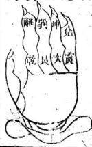

洛書紫白掌訣一白坎二黑坤 乾三碧震四綠巽 中五中黃六自乾 異坤七赤兌八白艮九紫離

此後天合十之法一與九合二與八合三與七合入地眼全書卷八向法

四與六合最發續絃側室之子無嗣之家用此救法極

翻卦補星向法

黃石公本以八卦水法總依後天方位爲主以向爲定 用翻卦掌訣取其淨陰淨陽以向相配淨陰者震巽艮 兌爲四陰立向用此四陰卦是也淨陽者乾坤坎離四 陽卦向亦乾坤坎離四陽卦是也水之來去要陰陽不 維方爲盡善盡美總依掌訣上翻鄰得輔武食巨四 卦上則吉破祿文廉四卦上則凶逢吉便以吉斷逢凶 使以凶推八卦法得共方位翻卦知其吉凶輔星辨 其字向聯珠以其坐山收水此法用十二地支最確彼 用乾甲丁艮丙辛巽奏癸坤壬乙此俱是混談不必費 心若習今之銅函經者殺人不用刀慎之慎之

輔星翻卦向法卽禹主治木之法

翻得貪巨輔武四卦吉破祿文廉四卦凶以輔武破廉貞曰祿文八字爲序如巽山乾向以乾上起輔武曲離發軍艮廉貞巽貪限坎

長兌又如乾山巽向以巽上起輔武曲艮破軍離廉一

乾貪狼兌巨門震祿存坤文曲坎輔武貪巨四吉水 在四陰卦艮巽總尼破祿文廉四凶水在四陽卦乾離 坤坎不拘何向山依納甲筭若甲向乾上起輔辛向巽 上起輔二十四八依此推

齡局水法定 入 地康 四向水 四向水 坤乙二向 入地眼全書卷 向水 坤 巽二向水 艮丙 良丙二向水 巽辛 四水 乾甲二向水 五四向水 向水 坤乙二向水 乾甲 巽辛

中向水 乾甲 艮丙 巽午共辛二向水 艮丙二向水 刻 支 款地 坤乙 辛癸資四向水 坤乙乾甲二向水 坤乙方圖以上二十四水二十四向俱依此推已葬未葬吉囚禍福了然心目再將合局破局德訣斷語一一記熟登山辨其禍福在掌握中矣方知此卦出於易理先聖所作一則代世行時時之方便二則不得誤人大事三入地眼全書卷只向法 九則到各處有緣者過著古先師說得好世上誰人能識我當世明師後代仙豈不是堪輿家之一樂事耶

水法分房分圖

一子向上是眞元二子脚踏兩頭船三子却從何處立 孟白仲青李在前

入地眼全書卷八商法 十水法房分立於穴前格之方準長于在右手二子在左手三子在向前四子在案右五子在案左六子在案中四同宮二五同宮三六同宮閱圖明白舉一子山午向爲式若坤申水來長四先發乙辰水去二五後發午水當面朝來三六爾房先發但立向有兼左兼右者向有兼得的有兼不得的今之時師依著僞書左右瞎兼那知子暗暗受害人家祖山少則葬數十塚多則百餘塚有此一向皆一樣立閒時若談起坟山來就說我家祖坟總是三房不利是何道理曰非關祖坟上三房不利總是向上錯兼了三房受書那有龍能偏三房之理書云向尅向主三房而水尅尚三房絕如子山午血地乍水朝來午方左邊丙右邊丁三水混流主時眼此而火燒必須要午水乾淨方可若丙今丁三水齊來立丙向以收之則三房大發丁財且秀終不免吐血淫亂事此水同午并來則三房絕二房序無三則二房絕長房承其地果龍眞穴的當面多栽樹木成林以蔽之或改水往坤申乙辰而去或面前作起高堤以避水之惡煞則丁財雨旺富貴綿遠是以天地無全功人力爲入地眼全書卷入自 中之也

## 陰陽破局

水法陰陽兮弓者如乾向得庚水犯蘇存則不吉甚而若龍身雙來邊陰邊陽者亦不吉有陽龍陽水止陽向陰龍陰水立陰向則吉陽龍陰水立陰向陰龍陽水立陽向則吉陽龍陰水立陽向陰龍陽水立陰向則凶曰依水立向不與龍相涉理氣撬

傳求理氣先後天靈太陰定納甲河圖寓生成河圍局皆純粹水木火金各得平洛書金火乃易位兩南縣雜北東亨洪範元空多清亂淨陰淨陽響如神紅黑一盤詳水路究來不必辨龍神

## 分房分法

水之來去均關福若右水到左先發長房左水到右先發二房當而若有水朝來則先發三房故水有先理後列來者為先到去者爲後到當面朝來更速爲卽到故左有水前朝水俱關係房分房分歌云盂自仲青季在前長子在右手二子在左手三子在向前如有五子人地恨今卷八向法

六了者則又何分也俱在朝案上內外之水看其來勢入明堂四子與長子同五子與一二子同六子與三子同比人家有兄弟不均勻者則又何說也人家兄弟不均皆因是砂水上之竅時師不知消納工夫是以有不平之事又有發富而無子者又有子多而貧者又有一支出貴者又有一支蠢濁者又有人則兩旺者又有貧因而絕者非關龍皆在砂水之故耳能知消砂納水卽是明師是以明師與人卜一地所以預定卽知其何房興何房廢富貴在何代出在何人不過是消砂納水分全坐相未之作用見有房分不均者砂也水也無砂卽絕水不坐堂卽貧若偏房分乃一邊陽水來一邊陰水去或陰水來陽水去或左水到右左是陽水來右是陰水去立了陽向二房發長房貧立了陰向長房發二房貧若面前有水朝來則三房管也有來得如的也有來得歹的有向得的有向不得的俱有分别面前有水朝來水有一个字上來的有兩个字上來的或三四个字上來的有水片來的一个字上爲單來却妨射穴兩个來爲雙來三四人字來為之一片却要層肩朝拜發大地眼全書卷入門法觸若是一片無情名蒞花水無用之水言一字者卽羅盤上一字也如坤山艮向地面前又有明掌一池清水正對面藥常師不知是好是醜一見便說好个明堂坤山艮向兼申寅三分正對塘中四水歸聚一非之後人財兩旺富貴長日後教子姪讀書遺要發榜做官東家不知聽得此語雖不想貴身可安得就說我們不知全仗先生那裏是先生就是爾前世的對頭艮寅方不池塘左是三艮右是寅甲一塘煞水如何是好誤將老父老母葬下庸師不知納水之法此是八煞水向是八煞向難滿三十年全家死得乾淨還是先生乎對頭乎獨不知書云坤山艮向寅水入煞帶廉貞血滿腸一宜立子向若見回龍顧祖鄙身逆勢結穴者壬子癸三方水朝向先發三房右水到左次發長房後發二房此言陽水來去立陽向以收之無龍有水山脉氣旺亦可發丁財舉一子向爲式而申向辰向可例推矣一宜立午向坤申水來乙辰水去爲後天會先天局先發長房次發二而後發三房此陽水來去立陽向則吉舉一午向爲式而寅向戌人地眼全書入同法 南向可以例推又曰乙辰與坤申同理坤急未乙忌卯未卽卯也乙司手足又司口舌乙卯二水混來皇堂則重妻若射來則成痨病卯向不可兼乙乙向不可兼卯庸師知之否請往古家間考鬆不可依僞書而行見向己卯向者直斷他有癆病有重妻卯多男人吐血乙多婦人吐血乙多則生女多卯多則生男多且又難養若卯向兼甲者見有乙辰二水朝來則又斷他出拐脚人出結舌人若有明堂在乙辰則斷他出吊頸人落水死又有卯向兼甲者宙用水朝來則斷他好酒色出遊蕩人好吃懶做簫蕩敗家賭博道遙若有明堂左寅甲方則出麻瘋生產死吊頸死中瘋死出家爲僧一个卯向兩自陽水來破了陰局就有許多的故事出死人死得不同敗家敗得不同今特標出後學不可不慎一宜立卯向巽水來艮水去爲雷風相薄局震為雷巽爲風合後天洛書生成之先發長房得橫財發大族次發二房後發三房人興財旺科甲綿綿此舉一卯向爲式而亥向未向可以例推總而言之陰水來立陰向總不宜混雜陽水來去或當面有陽水朝人地眼全書卷八向法 主來則宜避之如有陽水朝來則三子受害水尅向兩尅水則三子受殃又曰時師與人立向不知陰陽相兼只知四十八局左兼右右兼左大事畢矣殊不知陰不可兼陽陽不可兼陰如卯向左右俱陽如午向左右俱陰如巽向左陽右煞如亥向左右皆陽乾壬二曜相夾如此之向無有可兼是以立正向方能發福而若一兼則三房受害僞書假造元有百二十分金何爲分金曰未識穿山虎先明透地龍穿山虎者言艮爲山寅屬虎寅艮同宮故名透地龍者如地支子宮內有甲子丙子戌子庚子壬子是何子論納音如甲子龍入首納音金爲金龍不可用火局尅了金龍何爲透地龍如線穿釗爭差毫釐不得審定來龍一線穿定氣脉貫進頂耳腰腧受穴乘氣透入尸骸依此放棺故曰透地又言百二十分金每一山有五位穿山透地在其中矣五行陶洗不淨如金在沙中猶未淨也後人見分金廣多難以趨避六十龍中爲各作一分金八干四維各又作一分金共成七十二龍作七十二分金又穿山透地包括在內穿山七十有二佈於二十四山每山各有三分金後見其入地眼全書卷入向法理不合又改爲四十八局分左右相兼則不犯差錯空亡龜甲空亡戊巳孤虛關煞等項一山又去戊巳正中一条又除孤虛空亡一条又除關煞一条共除去七十二条所餘下四十八分金任憑相兼則不犯關煞空亡豈有此理聖人造羅經原告後人定方向川天地人三盤地盤立向人盤消砂天盤納水將羅經竪起天盤在上人盤在中地盤在下天地人三才之義又將二十八宿把守邊開所載某宿度若千用線索牽正前在某宿幾度上後在某宿幾度上是以不得差錯後不知何人將差錯二字設出戌巳龜甲孤虛差錯關煞容十等語以慌人又說出穿山透地以哄人虧爾說得像人生天地問不能與人分憂解結須嘗以利濟爲心何苦出此幻說以哄人耶穿山虎三字依爾說艮爲山寅屬虎寅艮同宮此正理也爾又借此穿山虎以名之且虎在山亦不能穿山曷不借葉中有个穿山甲名之爲更妙也若作中山寅向兼坤艮丙巾丙寅分金此依爾穿山透地各煞不犯則該發富貴及丁財殊不知禍未至禰先來主人吐血惡死人命敗家非穿山虎乃眞傷人虎也人地服全書卷八同何苦實學不求心如黑墨筆以謳人耶衲只見已葬舊地皆砂水向三盤之故砂不能消水不能納向不能立是以敗絕者多自從未見有穿山透地分金犯戊已空亡等煞而敗者莫說未見自古未聞則是眞是假乎羅經五盤作用先已說明餘者多篇無用之學不必推求立向不得用縫針與外盤此二盤乃消砂納水用之又有托文俊楊益二人之作用天怨矣蓋立向的用正針正針卽地盤世間用縫針者皆錯以至二八益加三七饒減不立正向者以其避俗孤虛空亡也此不必拘總而言之要看局面砂水有不容分毫勉強者自然而然也雖正向亦不仿無論相兼正句總看有情無情衲手與人定陰陽二宅立正向者甚多又舊以舊宅正向者發福之家亦多是以先賢立法以救人後人立說以害人庸師不識此竅只得依葫蘆畫樣固談及立向之法故有此一說不然又說託和尙多事矣一宜立酉向丁未水來亥水去若得巽脉轉艮復轉卯入兌結穴者必須要當面酉水朝來爲化煞生權局定主拜相又主男爲駙馬女作宮如仙翁佛子入地限全書卷入向法此言陰水來去立陰向則吉舉一酉向爲式而巳向丑向可以例推又曰酉水乃兌其兌為少女若遇陽龍陽向酉水來破局則生浮亂風声而敗子評云申子辰雞呌亂人倫命宮犯此謂之桃花煞辛酉二水局層拜下若得産曰二向者則重妻多生女難生男生十胎九女一男何則辛納於巽巽爲長女西納於兌兌爲少女謂之八女同申難以生男辛酉並立辛忌酉酉豈不忌辛雖是八煞但二封皆屬陰也陽向遇酉水則不肯減力契凡陽向收酉水者則主男盜女淫人命軍徒絞斬四宇定不饒也呀唯我只道生得子徑不成器原來非坟怎麼生出許多怪物還凶打架姦經竊盜昊大混雜如何是好曰非也不關攻事總闢水事水是生成如何改得曰誰叫你改水遠將碑石移向則無禍矣陽水來云立陽向陰水來去立陰向若無碑石者卽買石逆轉可就是無龍之地立了向收了水雖不發却平安順禍亦消除則慢慢幸地以紀之自然發富貴矣喚咄總是窮無奈不能請得地師不過是用道上安葬了載是那襄瞻得有這等禍道士曉得什麼他只曉得陽年天地眼全書卷入法東西和陰午南北村大事軍矣皆論大利就當家寰發福那一家不是大利山向怎煦有興有敗水合了局的就贊如破了局的就敗有等不信地理者開口就說要著命好的就撞到好地命不好的就撞著醜地謀地葬官人遇地出官人此諒無不是理謀地葬官者多遇地出官者少獨不思謀地或補山葬滿正穴葬了雨傍是界水豈肯將父可葬於界水之內不得不謀也地在曠野不在家中非比別物拿間來就是遇地出官大乃祖上有大德是以得遇吉地先賢云吉地神之所司非當等閒又有云行兇作縣子孫更發前生介德德禮滅地理要祖上有德方遇吉地天地報答其德以佑其子孫人丁繁衍富貴雙全凡富貴者再加培其根本自然子孫發福綿遠行兇作孽者雖眼前富貴再加合酷前德已盡則受天認是以天地報應點點不差天地無私有德以吉地報之作峰以曰地誅之世聞之事女方布在地理內分別善哉考哉

大地眼全書卷爪向法

人地眼全書海法卷九

宋南昌辜託長靜道和尚著

瀑泉袁秦開樹庭黃中楷

雲門黃中植稔安袁豐年同參訂

理齋劉是訓怡眞徐孝先

胞姪萬基德修校宇

## 陰宅圖說

陰宅不外河洛之理配合不外八卦之法龍穴砂水向入地眼全書卷九角注不外五字之眞龍認生死穴認有無砂認粗秀水認曲直向辨純疵此五法亦爲緊要知此五者改天命奪神功有不測之機伏義畫先天之卦爲河圖得乾一兌二離三震四巽五坎六艮七坤八識天地之陰陽知世上之吉凶禹王畫後天之卦故戴九履一左三右七二四爲肩六八爲足以定八方之正隅知天地四時八節之氣候文王之上易用後天之八卦乾坎艮震巽離坤兌二卦合而爲一則知天地之氣數世間之禍福黃石公作翻卦乾離艮與坎坤震兌定水之陰陽知人家之興廢惟制卦無一定之規總以斗柄七星爲主貪巨祿文廉武破此七星之名七星之外又有左輔右弼二星加入七星之內共成九星卦只八方星有九星故輔弼二星廿一卦其卦乾離坎坤爲四陽卦艮巽震兌爲四陰卦陰向要四陰水路吉四陽水路凶四陽向要四陽水路吉四陰水路凶其翻卦從向上起輔是輔武破廉貪巨祿文陰向四吉星在艮與震兌四凶星在乾離坎坤陽向四吉星在乾離坎坤四凶星在艮巽震兌其星輔武貪巨四星吉破祿文廉四星凶吉星便以吉來斷凶人地眼全書卷九河法星便以凶來推翻卦之法神乎其神烏有不靈驗者哉九星斷語列于後是以聖人知天地陰陽畫卦以示後人遵其教者習而明之無有不驗奈地理一道百不得一而用之者不以爲德反以爲仇貶而削之所云用卦不用卦用卦還是錯殊不知自不明其理胸無點墨先聖豈有哄人者哉今特標明請刻列老師徃人祖山者驗看其宇向辨其水路用翻卦訣卻其吉凶方信用卦之妙總以淨陰淨陽爲主故云紅黑一盤詳水路究來不必辨龍神

每月十五望月全明三陽俱足象乾卦由十三至十七日入土時月在甲方故乾納甲

每月望後曉明虧一陰生月暗一分象巽卦自十八至二十一日出卯時月在辛方故異納辛

每月下弦月半虧自二十三至二十七二陰生月暗二分象艮卦日出卯時月在丙方故艮納兩

每月下弦後二十八至三十日月純黑無光三陰俱足象坤卦圭次月初二日未明月在乙方故坤納乙子坎也坎納申辰癸戊午離也離納寅戌壬已卯震也震納亥未庚酉兌也兌納巳丑丁

## 天一集

天一生壬水地六癸成之先天乾納壬坤納癸癸地也壬天也一生一成夫婦之道天地交秦萬物發生坟塋得此水城者故主富貴斷曰子癸二水生六指國縣澄凝發富具寅水長生旺丁財龍眞局秀貴自來

入地服全書卷九

地六成之

先生而後成乾三爻屬陽萬物資姑坤六爻屬陰萬物資生坎得乾之陽爻在內離得坤之陰數在中故坎爲中男離爲中女乃後天之夫婦坎塋得此堂局至大富貴壬水驟富堪救貧文武全才爲公卿

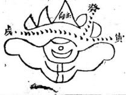

地二生火地二生丁火天七丙成之丁納兌丙納艮少男少女夫婦相配丁寄離明之位南極老人一星下照丁地坟塋有此堂局主少年發達壽考齦齡丁水朝來南極星男女康寧最多壽丙丁二水名赦文少年爲官轉公卿

入地眼全書卷九法

天七成之

丁生而丙成丙艮也丁兌也艮爲山兌為澤故得山澤通氣之局丙在九紫之傍太微一星下照丙地丙水朝來定主富貴雙全人財兩旺丙水朝來多禍壽皇恩浩蕩叨原宥丙丁赦文家無禍八个歸元水最秀

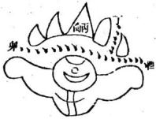

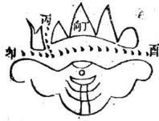

天三生木 天三生甲木地八乙成之甲陽 木乙陰木甲乾也乙坤也乙木 乾來非小可太陰一星赤在右 陽衡一星赤在左二星夾輔故 催官第一乙水朝來可催官 狀元宰相姓名揚名利顯達多 宮貴招得皇姑滿心歡

大地眼全書卷九向法

地八成之

先生後成甲乃東方之陽木天干之首乙木次之時令仲春天帝司甲故甲水朝來與衆水不同牝斗第五星下照主文章之府宰相之宮甲水朝來發富貴乙向得之實爲美蜚聲魁簿狀元即蓋世文章人驚畏

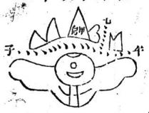

地四生金地四生辛金天九庚成之辛納巽庚納震震長男巽長女夫婦相配秉鎭主事辛水朝來乃衣章之府天乙貴人之治內有文昌一星下照辛地辛水主秀發文章少年科第姓名香更有如花女人貌翰林學士稱龍光

大地眼全晝卷九舟法一天九成之

庚震也震爲雷辛巽也巽爲風雷 動風散故稱鼓舞庚在龍德之官 傍有二星赤下照庚地凡庚水朝 來定産威武權謀之上忠勇果毅 之人應此坟塋者震龍庚水也 催官武士取貴亦非難艮龍庚水 富堪敵國雷動天潢才堪文武 此八局龍其穴的水繞砂關莫大之局所以發福更 大更悠久凡遇此八局乃河圖之生成所以各局開 載於右天一生水地六成之地二生火天七成之天 三生木地八成之地四生金天九成之天五生上地 十成之水火木金分于四方土居五行之中羅經無 戊巳故五十不用聖人用此以畫卦地理川之如神 靈一生一成反覆詳明水之來去均關禍福依水立 向丁財雨旺水朝向錯百事見禍水從天生地以收 之收吉則吉收凶則凶天地之道東西南北先聖卽 八地眼全書卷九自注 九

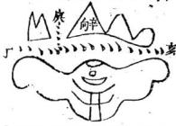

以此訓人皂曰志者受授明乎天地之道總不出子東方甲乙木南方丙丁火西方庚辛金北方壬癸水所以癸水來立壬向壬水來立癸向得生數而發富貴得成數而旺人丁餘三局倣此推羅經無戊已故不用中央

洽書天乙生水 天一生坎水地六乾成之坎先 天之坤見後天之乾爲之先後 天相見坎得白乾得六白乾 在天門乙左奎宿居其所乾水 乾來故出狀元宰相乾水第一 最爲上午龍子向北極内若見 乾峯侵入雲馬上金增富貨大

入地眼全書卷九向

地二生火

地二生坤火天七兌成之坤得二黑兌得七赤二黑水尅七赤火不吉坤老母兌少女左右離離中女此爲三女成羣不能添丁坤向左右得貪狼水上堂雖富水先到前來打搓是以此一局先聖亦言平常

天三生天三生震木地八艮成之震三碧艮八白震爲雷艮為山先天之震在東北後天艮居之故喜艮水朝來謂之物還原主貪狼水歸宗主人財富貴艮水朝來天市宿富堪敵國非等閒卯向得此砂水秀黃甲聲名常世傳

入地眼全書卷九

地四生金

地四生巽金天九離成之巽四綠離九紫巽長女離中女左右得長男巽喜震得夫婦相配忌午爲破軍必須三午七未方云合法午未二水朝王大富貴午水主富貴顯庚卯未向相宜龍虎抱衞水拱公侯卿相無疑洛書四六局乃倣河圖四局相同但先天四局二陰二陽無駁雜洛書四局一淨陰一淨陽坎與震此一局盡善盡美惟地二生切火一局全無意味地四生巽金一局最忌者巽句午水爲破軍在所不宜全得左卯右庚二水來去又得未水相叢最喜着午與未合必須午水三分未水七分此合後天生成之法又合雷風相薄主大發富貴若無未木則三房受害主風聲而敗洛書乃出自禹王禹見龜負紋而出背有卦絃方知治水之法治後想龜背売上有紫白黃八地眼全書卷九自法 主

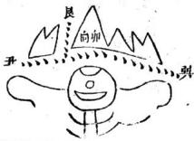

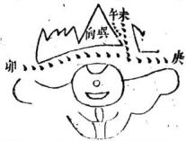

綠黑碧赤之點數頭向南得九點紫色尾在北得一點白色左東得三點碧右西得七點赤色前右足西南得雨點黑色前左足東南得四點緣色後右足西北得六點白色後左足北得八點白色背脊中見五點黃色肚腹下見十點淡黃色是以聖人見景生情作洛書以示後人故作戴九履一左三右七二四爲石六八爲定五十爲中宮而後用八卦以配之內多一中宮所爲九八卦是也

天地定位 乾向坤水來乾爲天爲父坤爲 地爲母癸水去先天癸納于坤 乾天也坤地也故稱定位乾父 坤母又得夫婦相配乾向坤水 朝來主人財興旺富貴雙全乾 向坤水爲上龍透天門最美癸 水合法且富馬上金堦太尉

入地眼全書卷九前法

## 水火濟

子向寅水來戌水去子坎也坎爲水爲中男寅戍納于離離爲火爲中女坎水離火故稱濟坎巾男離中女又得夫婦相配子向最喜寅戌二水來去寅戌水朝旺丁財子向宮見此水來水來爲官生近福去則離鄉發遠則

曰風相薄 卯向邦震也震爲雷爲艮男巽水朝 來巽為風爲長女震雷巽風故稱相 薄又得夫婦相配艮水去洛書天三 生震木地八艮成之卯向最喜二水 來去卯向艮巽水朝來眞可喜文官 兼武職旭略世無敵一人八九子家 財誰比个人豪傑上橫財何足語

入地眼全書卷九向法

由澤通氣

丙句丙納壬艮艮爲山爲少男丁 水朝未丁納于兌兌爲澤艮山兌 澤故稱通氣丙少男丁少女又得 夫婦相配庚卯二水來去得貪狼 水朝堂丙向最吉丁水朝來南極 尾人財興旺最多壽庚卯二水能 驟宮皇恩浩蕩叨原有

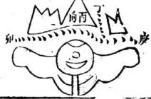

坐子向午 子山午向子在北極之宮一白居 其所八白居左六白居右二白輔 佐所以掌嘗寸柄九星坎爲水離 爲火水上火下故水火既濟左右 市辰二水輔之坐子向午兩相宜 聯珠三合兄弟齊人財大旺多科 甲爲官清正福壽歸

入地眼全書卷九自

坐午向子

平山子向午離也麗也利貞亨壽牝牛位居正南日以喧之而陰陽濕燥長物之功也九紫正臨一陰在中二陽外燥化機宜暑而萬物光輝離爲中女坎爲中男夫婦相配子向最寅戌水上堂定七人財興旺科甲綿綿

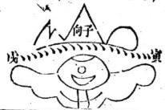

## 坐卯向酉

卯震也震爲雷爲長男故掌兵權 操持威武洛書為左三庚亥未俱 絹於震酉正西後天之右七卯左 三正東一東一西相對之夫婦亥 未二水朝來正合隔八相生亥未 二水朝坟敵國富豪無任再得庚 來拱朝定主文武君前

入地眼全書卷九自法

## 坐酉向卯

酉山卯向兌乃少微垣一星最明 下照酉地乃陽圖所居之所爲樞 機之府洛書爲之右七卯向震也 後天爲之左三故洛書左三右七 後天對待夫婦卯向已水旺丁財 隔八相生丑水來人財兩旺家富 足七品郎官不須猜

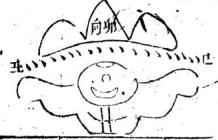

甲向乙水甲向乙水甲東方之陽木乙東方之陰木甲納于乾乙納于坤本東方陰陽相配又合天地定位辰癸二水朝堂得貪狼水若有巽水三分爲後天合十甲向乙水可催官人財興旺多利名若有三巽七辰水無子之家亦發丁

入地眼全書卷九角法

## 乙向甲水

乙向乙乃陰木甲水甲乃陽水陽 水蔭陰木爲之陰陽得配枯苗復 生左右寅午水朝來乙得貪狼定 主富貴再得艮水三分爲後天合 十坤二合艮八乙向甲水事事昌 貪狠生氣福更長合十原發側室 子名成利就中魁元

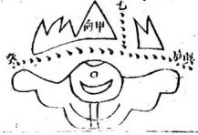

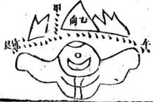

丁向丙水

丁向丁納于兌兌少女丙納於艮 良少男正是夫婦相配右手酉水 上堂正合俗書丁火生在酉非生 也乃歸元水也丙巽二水朝流六 秀中此得三秀大吉巽丙丁號三 陽水酉水歸元當更先丁向得此 眞富貴也有兒孫受皇恩 X

庚向辛水

庚向辛水庚納於震震雷也辛納 於巽巽風也雖不合雷風相薄亦 合雷風鼓舞亥未二水朝來俱震 卦納甲之水可謂水與向眷屬一 家爲納甲水庚向辛水主驟富歸 元最秀武當先若問人財井富貴 三科兩榜姓名標

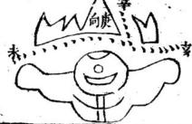

辛向庚水辛向辛納于與翼長女庚水納于震震長男又得酉方庚辛金之位工是後天夫婦一陽金一陰金故兌以悅之斷曰辛向庚水進金寶亦主如花女人好辛向兒庚才堪文武雷動天潢富堪敬國震庚奮武握掌重權定主英雄將相

癸向乙水

癸向癸納于坎坎爲水爲中男先 大坤之位乙水來乙納丁坤故向 與水得先後天相見之義左戍水 來去戍納于離離為中女與向正 配夫婦癸向最喜戌水朝來元來 乙水可催官要得癸向實不難名 利顯達多富貴戊庫重逢非等閒 中子辰局 寅向中子辰水局仍合坎離二卦 申子辰皆坎卦坎爲水爲中男離 爲火爲中女正是夫婦相配寅向 最薑子辰二水朝來謂之巨門水 下堂主富秀人財寅向坎水是北 辰北方水朝主富眞丁財當秀家 孝友爲官清正不污民

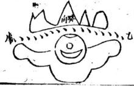

入地服全書卷九前法寅午戊局

申向寅午戌火局亦合坎離一二卦 寅午戌皆離卦離爲火爲中女坎 爲水爲中男正是夫婦相配申向 最午戌二水朝來亦是巨門水 上堂主富秀丁財申向午水是南 離離納壬寅戌已齊午水主富發 顯宦人財典旺正相宜

亥卯未局巳向亥卯未木局此合震兌二卦一東一西後天對待夫婦洛書左二右七巳向喜卯未二水上堂卯未一水乃巳向之武曲水故發人財秀百事興隆已向原喜卯水為長子亥未卯出文官武官家財巨寓人長

巳酉丑局

亥向巳酉丑金局此亦是兌震二 卦洛書之三碧七赤左右對照亥 向生已坐山合巳酉丑聯珠三合 局亥向最喜酉丑二水朝堂最秀 定主金玉富秀亥向酉水武曲宿 兌丁巳丑金光透科甲聯芳入翰 苑貴近君王衣袞繡

寅午戌局辰向辰納于坎坎爲中男午水午納于離離爲中女正合夫婦相配洛書離九紫坎一白一九合十辰向長臺寅二水朝來第一發續 向线弦側室之子辰向午水巨門開寅水長坐旺丁財無子速娶偏房婦不滿一週兒自來速驗

戊向申子辰水局戌納于離離火 也坎水也亦是水火濟莫大之 局却也難遇戌與乾同宮奎壁二 星居其所故發狀元宰輔又得申 子二水朝來戍向坎水出聰明科 甲顯宦不污民隔八相生原如此 人財與旺多利名

亥卯未何丑向亥卯未木局丑納于兌兌屬金正西之卦丑屬牛金故居年金牛之所丑向最喜卯亥二水朝堂水從亥發源從卯歸海一發源一收藏點滴不漏丑向震水旺丁財庫守由庄最樂懷出人盡是由會第者想衣冠何處來

入地眼今書卷九

巳酉丑局

未向巳酉丑登局未宮天付五星其巾一星主天下士子陰德又主坟塋東北星主精馬東南星下精兵西南一星主靖布西北星主精金德滿者以金賞之德大者以坟補之半德者以布賞之勞多名以馬乘之孽多者以兵誅之以上先天四局後天四局天干六局三合相生人局共成二十二局以前名局分折明自後學者了然心目見一局合何局之水卽以何局內之斷語以斷之則事無不準矣或來合局則吉破局則內必須分房分以斷之水吉斷吉水凶斷凶陰向陽水為破局陽向陰水亦然總要陽向陽水則發陰向陰水則興故合局吉破局凶所以先聖知此水法依水立向合而成局以示後人無非一片婆心回死枯骸不安皆水來爲禍水來爲禍則子孫不安其所以救世之苦入地眼全書卷九可法

心免禍害於人豈淺鲜哉庚丁坤泉坤向見庚丁二水爲黃杲庚丁一同見坤水亦爲黃泉向水不合坤向見丁水犯破軍見庚水犯廉貞廉貞主吐血做賊破軍主睹博官事左翼右乾乾水須發福巽水又來為禍詳查九星斷語便明

入地眼全書卷九向注丙巽黃泉

與向見乙丙二水爲黃泉乙向見巽水爲黃泉丙向見巽水不爲黃泉丙見巽巽見丙俱得武曲合法主富貴丁財巽見乙乙見巽則犯祿存主賭博退敗左良水須發福右坤水又犯祿存查九星斷語便明

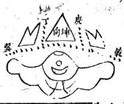

甲癸艮黃泉 甲亥艮畫身

艮向見甲癸二水為黃泉甲癸二向見艮水亦爲黃泉艮向見申水犯破軍主賭博好訟敗絕七家見癸水犯祿存退敗淫亂産死溺七辰水與癸水同壬水犯廉貞主吐而同祿查九星斷語明

入地恨全書卷九句卒壬乾黃泉

乾向見辛王二水爲黃泉辛向 見乾水爲黃張壬向見乾水不 爲黃泉王見乾乾見壬俱得武 合局主富貴發丁財乾見辛 辛見乾犯廉貞主婦人吐血瘟 飛損人右癸水鄉發福庚水 又來爲禍查九星斷語使明 艮寅八煞長房乙二房 艮寅八煞長房乙二房壬三房寅 良向乙水大房當無嗣螟蛉 如親男壬水二房出遊蕩水 盛多生黃腫恙惟有三房是 寅水多主風盲及虎傷坤山 艮向寅水入煞帶廉貞血滿 腸

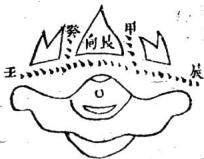

入地眼全書卷九向法 寅艮八煞長房乙二房主三房艮

寅向艮水在回前惟有一子實堪憐艮木朝來主冷退一定絕嗣不須言若有三兄并四弟三絕仲承禍連綿如若知之將向改恐有明堂當坟前

祿存夾煞長房巳二房子三房 祿存夾煞長房巳二夏 甲向卯水犯祿存三房嫖賭 何須問家財退盡爲賊盜定 主殺戮徒刑罪長房已水不 當埋少年吐血又蛇災陽同 巳口員墩起雖然懷孕也墮 胎惟有二房子水來不發貴 時也發財卯向甲水相同

入地眼全書卷九身注 1乙卯八煞長巳二房丑三勇乙 乙卯八！！三

元來乙卯是八煞卯向乙水人不察若有坟塋如此向定主手足與癆瘵若還乙卯并流入定然尅妻三五翻長二兩房俱發福三房宮位在向前

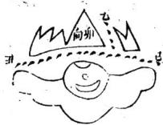

文曲夾煞長為丁二房甲三房巽

辰向巽水號文曲三房之病 主禍速有錢難買遊蕩于敗 盡家財尚不足長房丁水主 腹痛退敗之時無可救甲水 二房正相宜丁財兩旺一祠壽 齊

入地眼全書卷九向法八煞之外八煞艮一房丁二屬卯三房辰

八煞之外禍更強與向一辰水 然難當木尅土時誰能曉犯 者全家主絕亡先犯投河并 百溺後出聾啞及懸梁長二 兩房無干碍只怕三絕仲承 殃

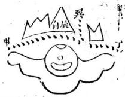

納甲八煞長房未二房 已向巽水多冷退向已水 入口火山向尅水禍輕緩水 尅向時禍速來長房未水多 發積人財雨旺武官員可憐 二房甲水入麻瘋痢疾大遭 殃

入地眼全書卷九向法 雙煞曜局長房庚二房乙三房丁 雙負明人 丙丁二水夾前方廉貞煞曜 兩遭殃三房吐血兼瞎眼又 有回祿午向當長房庚水來 爲禍定主出賊害村坊乙水 上常一二房喜福壽雙全人財 肝

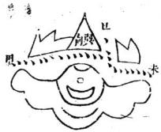

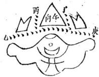

康貞水局又爲陽及水 丙向午水犯廉貞三房受害 主風聲水去離鄉定退敗水 來在家做賊精吐血回祿廉 貞水人家逢此禍不停長二 兩房貪狼水丁財兩旺發貴 真

坤未八煞

未向坤水勢洋洋婦人相繼守空房若有巾水雙朝入尅妻煞犯人悲傷丁向若見坤中水官事敗家出遊蕩長二兩房巨門水丁助豪富壽延長

## 未坤八煞

坤向未水納甲來也是廉貞不須猜未多坤少遇陰局婦人止血為妖傷未少坤多遇陽局每見男人吐血亡長二兩功一齊敗祿存絕體定不瓦

入地眼全書卷九角法

庚申八煞申向庚水三房當偷竊時生不肖男庚申并流射入塚被人殺戮最凶頑人命犯此遭刑憲逃竄絕七實堪哀長二兩房多富秀出人意表誇文章

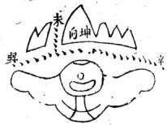

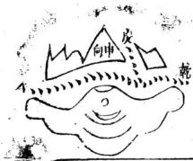

巾庚八煞庚向申水坎不安坤申井流水洋洋三房有此洋洋水寡母淫亂不可當正是庚向見巾水絕子滅孫哭一塲長二雨房一齊敗祿存文曲起禍

入地眼全書卷九角

辛酉八煞

門向辛水雨女煞無水有路亦不發辛酉二水朝入懷雖富尅妻無撻刹長房壬水祿存星賭博好酒敗家人二房丁水是歸元當秀代代書滿箱

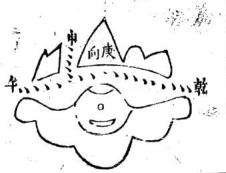

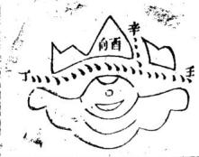

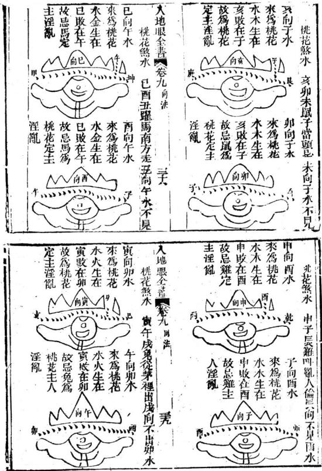

以上俱是破局之水犯之卽驗皆因向不能絕水水來破局局者向也先聖云水不絕人向絕人皆四立向有錯人不知之故吉水變成凶水水之來去均關禍福合之則吉不合則凶故水不可與向湘反水是生成向是人立吉則趨之凶則避之是以立向有轉移之巧又有不能轉移者切不可扦倘有錯誤輕則敗家重則絕嗣故大禹治水能知水之性情文王書卦分水之陰陽黃公之翻卦辨水之吉凶皆論水之情與性陰與陽吉與凶全在一向以納之所以三聖八地眼全書卷九向法

千言萬語以訓後人無非可後世爲人子者必須保重父母之骨殖骨願安則子孫興隆一片婆心無非好生之德故爲人子者不可不知醫不可不知地今之惡俗堪與用雙山三合五行與人立向殊不知雙山三合乃長生掌訣卜卦推命用之水法立向用之則害人非淺問及翻卦全然不知所以如今舉輿千不得一能知翻卦者各省無處不漸見消條也皆固用此三合長生之故耳今舉一二合長生立向法假如亥水來到右作小局木生在亥爲木庫在未則吉倘未方水不能出衰方門惟有衰方可去三分則大吉矣此出于有好事者假充學業改以爲已然總不出雙山天機會元地理元眞二其說俱是雙山三合君其旋踵動手洗鉗水與向雨用此法以誤人習者獨不風地眼全書卷九角法憑皆是假的坎上是實可辨吊了砂有龍無龍有局無局然心目斷其家何房興何序何年何支富何支貴何房發福何房貧賤何房淫亂何房可過行地理者件作都要之書有何哉所以眞寶故作翻卦爲納

食與方水去謂之 必立曰向兼卯酉 後人紛粉而習又 造作新出地理之書 旋四十八局之內今之 所行地理者無一不進 津津有味依其行禍不 反故今各處消敗皆因 一徃古塚問考驗書上無

吉凶看丁字向納了水便知其家吉凶禍福了廢富貴在何代出貴在財若干貴者官居何品丁何房絕嗣何房富秀盜何房讀書何房作惡稱地仙何苦習此害人二聖辨大源乃世之立向之妙有龍有穴發宋南昌辜託長靜道和尙著

浙泉袁秦開樹庭黃中楷 雲門黃中植稔安袁豐年同參訂 r 理齋劉是訓恬眞徐孝先

東田萬樹華仁村氏編次胞姪萬基德修校字

陽宅門路杜宮星生尅方位總論 八宅周書由來已久乾坎艮震巽離坤兌一卦管三山 入地眼全書卷十陽 几戊乾亥皆乾宅也壬子癸皆坎宅丑艮寅皆艮宅甲 卯乙皆震宅辰巽巳皆巽宅丙午丁皆離宅未坤巾皆 坤宅庚酉辛皆兌宅名曰連山卦以陰陽對待之理運 消息盈盧之氣理全則氣足而造化神矣其卦以乾坤 艮兮爲西四宅三吉俱右此內門路灶切勿犯東坎關 巽震爲東四宅三吉俱左此內門路灶切勿犯西至大 門又必於三吉中擇陰陽隗合而後生息蕃門故光天 乾坤定位之理卽後天坎離濟之氣此萬古不易之 河洛昭昭可攷矣其游星以七政而加九曜貪巨祿來 廉武破此七政之名又加左輔右弼共爲九曜卽生天 延絕五禍六伏也內有竹節貫井宮星生尅方位要訣 詳載於後宅法庶無餘蘊乎

## 游星

乾六天五禍絕延生 坎五天生延絕禍六 艮六絕禍生延天五 虞延生禍絕五天六 巽天五六禍生絕延 離六五絕延禍生天 坤天延絕生禍五六 兌生禍延絕六五天 上一字是本宅名伏位下七字乃七政也七政者以生 人地服全書卷卜陽宅 天延爲三吉三吉之方宜開門放灶擇房安床而大門 尤重絕命最凶五鬼次之禍與六又次之謂之四四此 四凶方再以卦地黍之而輕重始辨如絕命凶矣然惟 尅宅者眞凶若生宅與宅比和及爲宅所尅者皆凶不 甚惡

## 竹節貫井法

從大門起遊星數至向上第一棟逆生而人以辨某棟爲三吉宜高某棟爲四凶宣低也如正中開大門則大門卽第一前重也如大門在一邊必要大門數頭棟然後逆生而入靜宅不用竹節貫井之法惟動宅變宅化宅始用之取金生水水生木木生火火生土土生金如此遂棟生人各舉一局爲式三棟至五棟無墻隔斷者爲動宅如坎宅離門門爲延年金星二棟六水凶三棟生木吉或傍角開門如坎宅巽門則州巽天五六之法巽至離向天醫土星爲第一棟土生第二棟延年金吉第三棟六煞水內此為動宅五行相生之法六棟七樓名變宅謂五行生盡而變也蓋五鬼火生禍害土不生天醫土天醫土生延年金不生絕命金禍害土生絕命大地服全書卷十陽 三金不生延年金吉生吉內生凶此常理也惟六煞水里生貪狼木貪狼木單生五鬼火亦當理也變宅前五棟內生入如常法至六七棟則五鬼火生天醫土天醫土反生絕命金禍害土反生延年金故曰變也如坎宅巽門用巽天五六之法向上第一重天醫土吉第二棟延金吉第三棟六水凶第四棟生木大吉第五棟五鬼火因至第六棟天醫土吉是凶火生吉土矣第七棟絕命金凶是吉土反生凶金矣五棟之後吉變凶凶變吉此為變宅相生之法八棟九棟名化宅謂景後一棟為輔弼星隨門面 也法以雙木變金雙土並進以全貪巨祿文廉武破輔弼九星之用蓋靜動變宅無輔彌星止名七政與化宅異也如坎宅巽門九棟亦用巽天五六之法大門數至向上第一重天土次吉二棟禍土此雙土也凶三棟絕命凶四棟延年此雙金也吉五棟六水不吉六棟生木大吉七棟左輔木此雙木也次吉入杖五火凶九棟右弼原巽門生氣木此右弼亦生氣木也大吉如止八重卽右弼生氣木大吉此爲化宅相生之

一宮星生克宮者門宅房皆為官也星者卽生天延之三吉絕五禍六之四凶也星飛至此而與宮相生或比和則吉星吉囚星亦不甚凶若宮星相尅則吉者不吉凶者愈凶與其星尅宮不若官尅星官爲主星爲用主可勝容客不可欺主誠為確論

方位要訣先從坐上起星飛到門上卽從門上起某星飛到本坐吉門飛得吉星到木坐忌開後憲後戶以泄之凶內飛得凶星爲木坐又宜開後窗後門以泄之故大門在凶方者以遊星從門土繞屋一數而本宅之三吉盡化而爲四凶所謂逢恩不發蓋緣恩落仇宮此之謂也卽如宅外三吉方位宜高聳或高砂及樹木皆妙一貴當權諸凶盡伏若低陷亦主減福而開廁癘牛欄等項則打破吉星不吉矣宅外四凶方宜低而完高昂則凶星得勢缺陷則地風掃穴皆凶

七政九曜之說 .1143

生氣卽貪狼屬木在震巽坎離宮爲得地主高第清貴人地眼全書卷十陽宅 五

主文章主生五六子斷曰貪狼生氣福更長聰明孝友志氣因公進田財帛旺大發人財無禍殃

天醫卽巨門屬土在坤艮乾兌爲得地主福祿富貴主慈善主生匹子斷曰巨門天醫又天財富貴長壽禍又來豐衣足食錢財有倉庫滿盈不須

延年卽武曲屬金在乾坤艮兌宮爲得地主風憲兵權主豪俠主生三子斷曰武曲福位事事昌人則興旺有主張富貴人丁兼甲第禾無凶禍壽綿長絕命卽破軍屬金門灶切忌之主惡疾主短壽主絕嗣斷曰破軍凶暴在門前刼掠投軍不堪言賭博好訟龍啞出敗絕亡家損少年

五鬼卽廉貞屬火主邪祟主火燭官非主一于斷曰廉貞五鬼不堪誇獨火燥火原是他執拗好詐無禮義寅虎雷傷卯未加失紅吐血值離淮四金財退瘟如麻廉貞武曲巨門到富貴丁財進金花廉貞文曲來相會野狐損人敗了家

禍害卽祿存屬土主壅滯斷曰祿存絕體孤曜注注視 過房莫怨天賭博退敗遭淫亂産死給亡爲道僧

入地眼全書卷十陽宅 大六煞即文曲屬水主好淫游蕩斷曰文曲遊魂掃蕩星暗博如酒顯拐人失火水厄離鄉敗癆病腫藏瘰瘞侵伏位卽輔弼門金化金門土化土門火化火皆本宮也斷曰輔弼慈祥孝友先富貴人丁官其前男駙女如誰命婦太陽生人福壽全右三吉門路能催屋運而厚其福四凶不宜門路床灶若門之卦尅宅之卦則凶如生宅及與宅比和者次之爲宅所尅者又次之看衙署法門主灶三吉得地陞遷最利

三元命訣

上元甲子一官看中元起巽下兌間上五中二下人女男逆女順是根元之毫夫

又捷訣

一四七宮男逆佈五二入宮女順推男左寄坤女皆甲子周輪本命事

瓦屋有坐有向命有東有西耑論山向而不論命者大凶論命而不論山向者小凶合命又合坐向者則獲福無窮矣

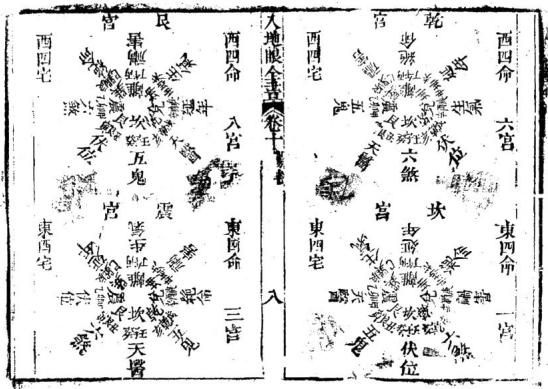

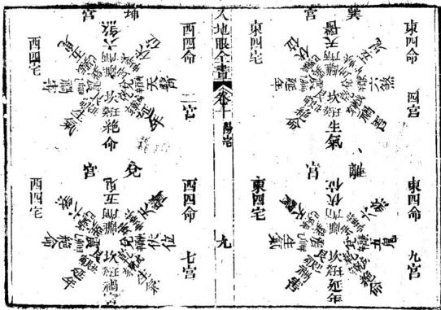

一法 灶乃五祀之一爲家之主養命之原也宜擇三吉方安 之必易生子故人丁不旺者宜安天醫灶名利不成者 宜安生氣灶財旺壽高者宜安延年灶此三灶俱要宅 命相合假如不合卽將床與灶日向本命之吉方安之 亦吉但不如門主灶並床與灶日五者全合本命爲主 吉假如坎命之男娶巽命之婦得巽方路灶皆是生氣 宜有子且富貴若坎命男娶兌命婦人犯禍害祿存當 無子須將此門改朝巽方則坎命男己得主氣又將小 入地眼全書卷十陽 灶成風爐另以口朔乾向使妻獨食則妻亦得生氣吉 而食之自當有于亦挽救之一端也

偏氣致應

離交卦陽須敗巽兌相交亦似之坎乾合卦陰須害 震艮同原也共推此名偏氣相爲駁變易陰陽妙可施 天井放水

放水之法宜曲振注三神乙辛丁癸小神也甲庚丙主 中神也乾坤艮巽大神也宜由小大申由由人大若倒 亂則禍或山小而竟大無中神亦可山中入大無小神 亦可又由小入中無大神亦可隨地施爲小宜短中宜 長大宜更長耳溝口宜分陰陽十二陰向宜放陰水十 二陽向宜放陽水門路亦然忌黃泉忌穿房忌穿梁 穿門皆放水要訣

元畿經大哉居乎民生攸繫門戶辨陰陽之路氣口分禍福之機八卦純宗廿四向元神方屬四正隅宅依五行而立星鄰九曜而推元神定而恩仇已彰來路設而吉凶始見岑高爲體氣口爲用生比為恩尅制爲仇體有書凶入地眼全畫卷十宅 2而化凶頑爲役使者機運於恩星用無定征而撥生旺於休因者權歸於氣日宅元不可損傷用神最宜傳旺門宅相生相比而又遇恩光主照乃名進氣之居門或尅或洩而又遇仇難當權是爲退氣之宅絕虛逢生吉凶相半旺處逢絕吉少內多是以元神宜補以恩星仇難當和以吉曜宅有化氣小人道消宅無死氣君子道長逢恩不發蓋緣恩落仇宮遇難不傷因有思星遠籥一貴當權諸凶盡伏木入坎宮鳳池身貴之徵金居兌位烏府名高之應金取土培火宜木相水洩金枯坎癸無恩於西兌火炎土燥艮坤何樂於南離此東四之所以分而西四之各自以爲隅也然四宅之成爻問取相濟而相比乃八卦之配合亦自有假而有眞是以天地定位此老陰之土生純陽之金也若坤配兌女則庶妾難投寡母之懽心山澤通氣此少男之精結少女之胎也若艮配乾金則鰥居豈有發生之機括坤艮適偶比之情乾兌亦假鄰之誼若夫風相薄雙木取成林之象水火不相射坎離成既濟之功水木相主則水爲木氣之主木火通明則木乃火神之根巽不爲離宮之入地眼全卷十局宅火其散也成風終一發而卽衰震陽生南離之能其聚也成雷必聞投而不已坎與震爲暫交巽與離爲假合艮之元神無恩星用兌金爲傍城借主而玉蘊山繩坎之主氣無育地用巽木爲借體築基而風恬水靜眞食者宅元之正體假合者作用之權宜

劉文成公彙解

# 平砂玉尺經

附郭璞塟經

擇日全紀秘訣僊機

魯班造福經

彙賢齋藏 平沙玉尺經序 國師文成公知旺氣在金 陵而首率群儒以輔之而 滁陽開基應天定鼎紫荊

奏爲帝王萬代陵寢斯不 精於地理哉然又懼一人 之目力不能遍天下廼於 告老暇日創爲平沙玉尺 頒行海內并附晉國師郭 璞塟經此非輕洩天機 欲使後之人得是尺而量 之獲福應無崖岸矣是爲

萬曆丙午歲仲夏上浣之吉題

新刻石函平砂玉尺經全書眞機上卷元太師文正趙國公那州劉秉忠述明太師文成誠意伯青田劉基解

敬簡賴從謙發揮

審勢篇第一

天分星宿地列山川仰觀牛斗之墟乃見衆星之拱運俯察圗阜之來方識平原之起跡

五行之氣在天成象而日月星辰見焉紫微太極起於亥子之中天市東垣起於寅卯之區少徵西單尺經 卷一

液在坤兌之間太後南極在巽巳丙之首中有一星尊居於内而二十八宿環遶於外故牛斗之墟左爲帝星所居之處其列宿則隨斗柄所指而拱向之附天而行是謂天經五行之氣在地成形峙而爲山岡壠阜散而爲平原都隰流而爲江淮河漢故山川之流峙莫非是氣之疑布然平原曠野皆根於圗壠分布四維而成形故察岡阜之所來則知平原之發跡矣馬山一貫起自崑崙

山龍之散見於地雖有千萬之多而其龍脉之來皆出於崑崙按搜異錄及地志啚吉崑崙山高萬八千九百四十七里中峯齊天在中國計之崑崙則在西北乾兌之間實天下山川之祖而五之入中國又衆山之大宗也

聶出孤宗分行八極

崑崙之山上方而下員周圍一萬二千七百里九十三步鱗分孤宗東北出角居艮東南出角居巽西南出角居坤西北出角居乾乃爲四勢下山之玉尺經 卷一 二

頂六千七百九里十三步旁乃條分四正東條居震南條居離西條居兌北條居坎上按八卦下按八方乾坤艮巽開五龍生氣之門坎離震兌發五氣官旺之脉是謂八極八極者又萬山之大宗也乾坤坎離及兌歸絕域而西通漸海艮震與巽三條入中國而五岳分居

乾坤坎離兌五條分歸西北及正南入羌夷蠻種之地龍脉出拆俱不可考惟艮震巽三條獨入中國分居五方爲五岳之山又中國山川之大宗而

分勢施生東南巳巽行龍出身行十一萬九千六百五十里人海結帝之都三起龍之地一百四十七水穴三十六其間産忠貞育英才出聖君賢相者七百二十穴聚精拔秀爲卿士大夫之地不計其數寅艮行龍出身八萬四千一百里入海結帝王之都一起蛟龍之地七十二頂穴一十有八其產大聖人之地五出賢人良相五百有七穴爲卿大夫之地不計其數甲卯行龍行八萬一千五百六十里止於伊洛廛澗之交結帝王之都三起尺經 卷一上 11]

蛟龍之穴二十有四產聖君賢相侯伯五百五室其間鍾氣發秀爲卿士大夫寶士之類北艮巽之穴龙多

如中回之東 是故黃河界而西北丑艮行龍

黃河之水派自崑崙艮寅之左甲卯之右界良丑于東北之首限甲卯于正東向東曲折而流入中國至河套之北出峽之左而山西等路右臂至汴之東南左紆徐州之東北入海故河之西地乃丑艮行龍實爲坤申之氣入首故燕冀至靑兗之地義一坤甲結穴自右轉為坎局左顧爲兌局趨巽爲亥龍無離巽艮震穴蓋水趨東北故也敬仙云崑崙丑艮落脈爲坤申之氣入首者水多東流燕冀雲朔之地爲坤氣腰落青徐之地爲坤氣之盡龍黃其界也直沾其孤也開州以南其左臂也遼東其右臂之盡氣也其脉直遂無曲折河北氣散不收故其民多直魯性剛風氣強勁少許詐民不戀業家不久富官無三代然而清泉穴漢氣從下升産聖賢爲文章之祖育英才爲一時之尺經 卷一上

盛女子美貌而無耻皆其氣之惠也長江限而東南巽辰起祖

崑崙東南孤角分條自康姑九萬八千七百五十里出西羌天竺西番南界曰六國山之北一萬二千里通巴西之嚴鵬山分枝三派左股出陝之南爲雍之右衛中股歷憑旗發派爲荊襄之南衞渡祁山起南岳衡山爲離宮之火星憑旗右股作成都之左衞而止嚴南股歷雍思入東蜀之南爲成都之右衛過東北起平華頂分二右股爲雲南

之右衛左股過四川之東北作雲南之左衛過電 磨山起二枝一枝出辰州以南爲貴州之西北護 一枝出貴州之東北分岐南一枝廣東趨南海 枝入廣西與辰州之北界合行過東梅峯爲廣東 之北護卽福之南條山也梅峯西角分枝入豫章 西南盡于九江渡江過黃川作湖廣之下流爲河 南之東北障梅峯之北角入建者過潛陽山起祖 爲建之西南障歷鉛山左臂爲建之北障卽浙之 南衛自建寧出漳江之南而入海右臂分結諸洞 玉尺經 卷一上 五

一鉛山左臂二條一條入福建一條入浙東歷處州分二條一條自溫入海一條自台至四明入海具鉛山之左股一條踰玉山蓼花峯起頂出三條條出饒信一條出南康渚澤鄱陽一條自祈門入至浙江臨安之西起天目甲卯行龍爲兌氣入首至古杭左回右抱合氣結穴爲錢塘其左股歷臯亭至海鹽入海而止其丑艮一條至寧國西界分派一枝出太平濩洋子江過舍山經六合從太典入海一枝出建平西界分派入建康之東界歷句容而爲長山一枝自東而西逆回爲建康之北衛一枝自西過東至潤州出靖江入江經歷十一萬- 九千六百五十里入海其中分枝異派不止數百逆行順行各有所趨故是岷山以東幡山以西地多離龍雲南之水自北而南地多坎艮乾龍貴州北界地多震巽廣東之界地多坤艮兌乾自廣以西巽震艮坎受氣豫章以東巽震之交北界則坎艮是貴閩福之南坤申得氣而北條則兌亥坎成胎臨安爲坤兌之交建康得南離之氣以長江卷一上 六

敬仙曰崑崙之東南出脉者爲乾亥行龍几巽宮之氣煖而風和亥木得之則生意條暢枝葉茂盛故自南條向南者氣愈和而散漫鳥獸稀章民乃析故南方之人散而不聚不服教化然多洞穴水從穴行

號曰潛木人反奸淫同域異音話言不辯南條而北者氣和平而敎化行風俗美車同軌書同文行同倫而國大治惟廣西雲南闕福三省之氣背東逆行獨向東南與大江流神別派其地多膠股合脉穴地出木民風碩不知禮無父子君臣之義淫貪無耻龍蛇出没嵐氣時行民多病疫語不通音其風土氣習類如此

惟寅甲卯乙之落脉爲河江中柱之根基

河源之左自寅甲卯乙當震之首落脉起帳出一萬四千里爲蘭花嶂至三萬三千七自一十六里爲喬黎山至一萬九千里入榆萊山過西域羌胡一南幕西首山行一萬二千二百五十里入中國至主尺經 卷一占 2

幽谷連奇爲秦漢又一條分至南楚之北界一條分至同原之北界入河中條之洛長江東限黃河西流餘氣及淮楊通秦入海是知震脉之落爲江湖之中柱其龍獨尊其氣獨正出震入離犬都二區卜年悠久民安物阜文士萃出風氣正直民無詐奸上下從化皆其應也

散仙日其地多坤申龍兌局離垣出荊湖者多亥局民俗朴素少文

岡壠平源之分别猶體骨肌肉之相附肮肉麗于骨

錄穴是內卿不能也所

外血脉行于肉中知血脉流動之情見肌肉榮枯之理

凡山脉起自崑崙爲山之首而氣脉之行因山而 見猶人有體骨之格氣絡流行分布而散漫爲土 皮猶人之肌肉士不離山猶肉不離骨也乃知乎 土之氣皆根于山山自東來則土脈之氣隨山血

故曰肌肉麗于骨外山行則水隨水猶人之血脉王無水則不養故龍脉必得水而涵行于地中爲玉尺經 卷一

氣行而外見爲水水者氣之述也界乎外將以固乎内而氣脉得以行于地中矣故水神流動之處可以驗氣之出入流於東則山氣之東行可見矣無水東流而氣反西布之理所謂龍行則水隨氣行則自隨也血脉流動經絡秩然餘理貫串故曰地理天經地理合而爲一觀乎天文而地理之妙用顯然是故衆水趨歸東北而坤中之氣施生

大凡坤申行龍水巡趨流東北其氣脉之使然也震龍入首向西則西爲震氣之至而東爲氣出之

故水神倒東北而行者其地多坤申之氣結局三 門故向砂之酉首立穴是氣止水交之處乃爲關換氣則有乾兌之交而坎離艮震之氣不入求 穴若自東首立標則收辛酉兌氣入穴原水交于西坎離艮震之龍於東北交媾者非眞龍也龍之不 豈有兌氣返東之理所謂不食酉辛之氣言兌氣眞照穴不正未有不絕減而貧折者 1 不入于東而震龍不食兌氣也時師不知龍脉之仙曰水歸東北則龍首在西南而尾在東北地盡 起止不審水神之來去不明地氣之所從只者坐對指東畫西謬立標穴其擠人于害不可勝言矣群流來向震辰而乾亥之龍秀育 午丁生息豈乗坎癸之靈假如衆水流向震辰之方交會合流而去則土辰 午丁行龍者水神必自南而向北合流而去凡見之來必自乾亥行龍故求龍干東南之交者始真 此水步龍立穴須向水流交合之處求之則午下玉尺縱 卷一 尤 尺經 卷 十轉關則壬子龍亦結地坤申之氣左關者亦可取 生息之氣始聚而成地若不于水城出合之所而惟離巽靈艮氣之不入故尋龍者不當於乾亥之 反向南之上水處立穴是乘坎癸之靈非穴也下砂頭立穴也 之必絕仙日東南水聚之處界水倒右有震穴界水倒左 觀衆水之交衿而雄雌乃見向北流有兌穴離艮巽三龍决不宜下龍從西北 山爲雌而水爲雄猶人之有男女也龍盡水合雖方來水自東南合者氣脉水交媾情意巳在震巽 雄交會猶男女合而媾精也此玄妙之處萬物化無逆至之理 生之大關也然男女之玄門任督二脉之盡故男甲卯成胎不食酉辛之氣 女媾則兩尾相對猶山盡水會之處正牝牡交媾之

仙曰龍至水交之處方止脉盡氣聚乃爲眞穴水7---F不合衿則龍脉未止龍脉不止則氣行未住故尋龍定穴必于水交之處求之方是察萬里之乎壠而首尾當知

平原曠野維萬里之遠而求其脉之所自必有山龍以爲之根猶四肢分職而元首在上起處爲首止處爲尾其理一致故尋李洋之地必求首尾之所自然後察其水神之去來以觀其交會止聚之情則眞穴自見矣

長經 卷 上敬仙曰崑崙山天地之首也五岳四瀆者心腹也支流分脉散于八極者四肢也以中國而言五岳者萬山之首也如山之首可以循脉之知脉之分可以見龍之止矣

縱是回頭顧之龍豈脫父毋本生之氣雖云甲卯行龍不食酉辛之氣然亦有國賈願爾者如甲卯行龍而氣脈返向甲鼻結穴者名顧袖之地雖逆回成穴而砂頭起腳須從震宮發來關轉逆水向震乃眞轉關處若被水流斷則父毋本生之氣巳爲水神隔絕矣非眞地也右關水左倒兌氣入首從兌局作用左吉水倒乾氣入首從乾局作用又不當以震氣立法取之舉一龍而七龍之法同例仙曰兩砂並出股長股短邊粗邊細其短而細者必縮粗而長者必伸粗大雄急勢必曲摺向砂之短處挨歸故多結回龍之地及盤龍之地或爲下砂所壓而曲摺轉關者亦有回龍盤龍之穴然必得父毋本生之氣不脫始行之砂隨水轉關而成方爲大地

故順水直衝而逆回結穴方知體叚之眞若還逆水直猶而合衿在後斷是虛花之地

回龍之地其砂頭不從本生之方而來但只逆水直衡而上其水流向背後交合者皆非眞地時師指曰上氷魚飛天龍者甚謬雖其體勢宛轉坐應整齊亦是虛花合流在後則其砂之行氣終趨向于交襟之處也

乾源壙野舖氊細認交襟

有數百里平洋之地前後左右又無溝壑溪澗如

鋪氊展席一韋無際此等形体既無水神可壽其出入又無岡阜可辨其來去何以察其龍脉之行止穴情之定否如見此等平地必有微茫之水可滿整之水必有所歸而微茫之水去留亦足以察其龍脉之行止凡水必歸趨于卑下而低寫之處爲衆水之所歸雖徵浩之水亦可以見其會合交會于東則尋兌氣之入首交會于西則尋震氣之入首細心詳察必得眞情

古云高一尺爲山低一尺爲水正爲平洋乾源曠玉尺經 卷一 上 十三野之地立法

仙曰龍脉有起伏隱見故砂术有微混之跡龍脉有住結故雖溝潦亦有交合龍微茫之分合考沖潦之去處而眞龍自明然

一水日微茫則至細難認非智者目力心思之巧不能也

極壠平披月角詳看住結

山龍窮盡截頭掛角鋪出平坡左右無水夾隨行送前無溝壑溪澗界合如此落頭雖無水法可辨然其龍脉之出若有眞龍結穴則其氣止融聚之處必有正脉垂落或微茫以界于左右旁分砂翼上首如月角之出兩肩兠轉護衞周匝或一重二重或四五重隻隻向前兠堂收氣或左右肩肘抱出砂頭宛轉曲折到堂橫過做微茫案應者其地方眞或從别支分脉曲折到堂直拜堂局旁分兩翼覆冒於本砂之左右者亦佳故看平地落頭無處尋其住結只于月角兠收興不兠收砂頭轉匝以不轉圃而龍之住與不住穴之結與不結方見玉尺經 卷上 十四

又有四五山頭出廊平坡尤煩辨其何山落頭長何山落頭短旁角從何方地轉則知其五山和氣交合成穴其法尤微得此穴者富貴雙全萬子畫孫一二百紀福力

勢說繇巒聲

寥天乙日塟經日勢爲上形次之方位次之勢也者理之立也顯立之神之容也玄牝之門也乾坤復姤之間也造化鼓萬物出入之機也希夷之數也不可得而聞不可得而見不可得而審也

新刻石函平砂玉尺經全書後集卷之 時之半而右行陰陽相禪左右相盪北之謂化機 元太師文正趙國公洲州劉秉忠者 知化機之理則知山川列形要非塊然示人以象 明太師文成誠意伯青田劉基 解 矣故法象莫大乎天地 敬仙頓從謙發揮 左陽右陰龍行兩路而陽順陰逆氣本一原 造微膩 形之列于地者非塊然之物要亦陰陽二氣爲之也故 太極分而兩儀奠二氣布而順逆行 土因氣形陽氣左嚴則脉從而左轉陰氣右旋則 混沌之初太極之氣末分及輕清之氣開于子正 脉從而右轉故其地勢自右轉左入局者爲陽龍 上浮者爲天重濁之氣關于丑而下凝者爲地其 從左轉右入局者爲陰龍分陰陽而兩路而順行 日月星辰懸象于天者卽其清氣精而明者也 逆行其地氣自然之運也 上人經下 卷之一 王大經下 卷之 二 川江河列形于地者卽其濁氣凝而通者也天氣 陰用陽朝陽用陰應相見協室家之義陽以蓄陰陰 屬陽地象屬陰陰陽分五行兆布陽氣左旋秦 以含陽雖雄慶交媾之情 行于東夏行于南秋行于西冬行于北五氣順流 氣者水之母氣行則水隨水止則氣止子母同情 四持序而萬化生者皆是氣也陰氣右旋夏行于南 水氣交逐猶影之隨形也益氣一也溢于地外而 春行于東冬行于北秋行于酉五氣逆流時序正 有逆爲水行於地中而無形者爲氣水其表也氣 而品彙亨有皆是物也然陽氣長故進而左陰氣 其裏也表裏同運內外同流此造化必然之妙運 消故退而右陽長則陰滿陰長則陽消進退消長 故欲知地中之氣趨東趨西卽水之來夫亦可以 化育之機也而一順一逆亦自然之運焉耳故陽 槩守之矣 生寸冬至甲子時之半而左行陰生于夏至甲子 訣是性命非神氣水鄉筆只一味

故曰善觀氣機之運者觀諸水川上之嘆亦可觀宜尾見道之深焉然龍行必有水輔止氣必在水界輔龍行者周在于水故察其水之所來足以知龍氣發源之始止龍氣者亦本于水故察其水之所交足以知龍氣贏聚之處

經日界水則止又日外氣橫行內氣止生識哉言歟然天地之氣陰與陽而巳易曰一陰一陽之謂道又日陰陽互藏其宅動靜互爲其根陰陽相禪萬物化醇郭子有云獨陽不生獨陰不長由是1卷之之則知冲陰和陽而後可以成化機也故陰龍逆得陽水來會陽龍必得陰水來交外氣與內氣相會氣盪而成物猶夫婦媾而生育也陽爲雄陰爲雌陽龍左行而陰水右來到堂合襟爲陰以含陽陰龍右行而陽水左來到堂合襟為陽以蓄陰卽雌雄相會牝牡交媾之情也陰陽相見福祿丞禎冲陽和陰萬物化生此天地自然之化機合而言之卽統體一太極之妙用分而言之隨物付物又各具一太極之玄與也知太極之理可與語化機之妙知化機之妙可與語肜法之學矣故陰交于陽陽下濟而施生陽交十陰陰仰承而翁交

日龍脉之來土隨氣形氣雖流行而不可禦然其土脉之來止一定而難移故龍形則靜而守位若夫水則動而無常或東或西無一定之性雖氣行水來固有自然之勢然氣不能自止必得水交而後止故陽龍入首而陰水來會陰龍入旨而陽水來會是之謂陰陽史嫌言陰交于陽陽交于陰者尺經下 卷之一 19

皆以木言也經有云形止氣畜氣之流行無往不到何以能畜益以局前之水能止龍氣如界水三乂是也故楊公所以日水對三乂細認宗也經又云外氣橫行內氣止生內水隨土十因氣形而脉止氣聚者以橫行于前足以止內氣也至于山龍得龍虎應按備行于前亦爲形止氣畜而內氣所由以止生者此也由是范之則陽公所謂陰交陽交以從水神立意何也氣隨十形形則靜而有常水則動而能運靜刑守位動則流通故水東于龍而龍不盤進交于水勢也故龍不可裁而水可裁

陰交于陽陽下濟而施生者陽在下而陰在上湯氣下濟而乘陰以施生也陽交于陰陰仰承而翕受者陽在上而陰在下陽氣下降而乘陰以翕受也陽施陰受胎息始化育之妙氣機必然之理也

天根呈衆妙之門月窟啓玄機之戶

天根者陽氣所從出之門卽施生之竇猶男子之卷之一

牡月窟者陰氣所發育之施卽翁愛之戶猶女子之牝牝牡相對玄竅相通男女交媾而生息自盛矣如下文所云

乙丙交而趨戌辛壬會而聚辰斗牛納丁庚之氣金羊收癸甲之靈

乙用丙交者丙火生于寅沐浴卯寇帶辰臨官巳 帝莊午衰於未病于申死于酉基于戌是成者再 之墓卽陽艮龍之天根陰亥水之月也丙州乙 交者乙木生于午沐洛巳冠帶辰帝旺卯臨官寅

衰於丑病于子死於亥墓干成是戍者乙之陰亥龍之月窟也陽艮水之天根也丙乙相見玄竅相通爲雖雄交媾者此也震離二龍同局至于辛配壬者異兌之陰局也壬配辛者申子之陽局也四龍水法皆在辰上出路故耳庚配丁巽兌之陽局也丁配庚者寅午之陰局也以四龍水法皆在於丑上出路故耳癸配甲申子之陰局也甲配癸亥卯之陽局也以四龍水法皆在于未上出路故耳行龍布氣並放甲乙交配法例其黃式並見後玉尺經下 卷之一 大故有乙辛丁癸之婦室配甲庚丙壬之夫夫夫婦婦雌雄牝牡

乙辛丁癸陰也甲庚丙壬陽也陽用陰應陰用陽朝故乙得丙丁得庚辛得壬癸得甲爲陰用陽趙丙得乙庚得丁壬得辛甲得癸爲陽用陰應陰陽相見猶夫婦之獲雌雄牝牡義見上文

若陰遇陽而非其類號曰陽差陽見陰而失其偶名爲陰錯

如乙亥龍用丙氣相合乃爲陰陽正配而戍上出

1

水得相見之義若辰與丑上出水是見庚壬水口而非其偶謂之陽差陽差則傷男丙寅龍用乙氣來合乃爲陰陽正配而戍上出水爲陰陽相見之義若辰與丑上出水是見丁壬水口而失其類爲之陰錯陰錯則傷掃

妻猶路遇終強合而不諧眷屬一家縱輕微而有用如丙乙相見爲夫妻同情眷屬一家雖去來輕發猶爲有用富貴福澤亦能及其所生若丙不逢乙而遇丁癸辛未木日出路者是夫遇妻于路乙不玉及經下 卷之一

逢內而逢甲庚壬水口出路者是妻遇夫于路雖 砂明水秀終為強合無情其發福亦不甚厚以 玄戶不通也銅山西崩靈鍾東應又云崔鳴在陰 其子和之以其同聲相應同氣相求耳先賢曰氣 和則形和形和則氣和形氣俱和物乃化生故陰 陽和則萬物生夫婦和則勇女育又若丙配乙于 中途乙配內於半道如丙生于寅而水却不自寅 來却于辰巳方來至於水口却在戌上出木是去 竇相通而來水在中途中見也此本爲正配 發福遲緩更王老年科第凡百俱遲主老夫 生子之應不旺人丁長房不利特發中小房財 又有水從他處橫伏過堂而出亦爲路遇此尤不 合局不發福祉雖發亦輕可認水立向有千向上 消息則客水登堂亦能致吉

女同居純陰不長兩男並處獨陽不生

如乙亥龍得卯木水來及子午水來到堂右轉倒左是亦陰遇陰爲二女全居純陰不長水輿龍一路來故也若將左水右倒會陰水而行不妨五玉人經下 卷之

寅龍得壬庚甲水左行倒右而去是以陽遇陽爲 兩男並虞獨陽不生若得右水倒左會陰水而出 -- 不妨

陰與陽而遇交亢則爲害陽過陰而不及廢則無功 如乙亥龍與丙火交當自寅巳上水來右倒至成 字上出水却不于戍上出直流至乾亥字上出此 名爲過交而亢反能虧損人丁冲散生氣故也更 主非橫官灾孤絕出入剛惡立巳過高滅視人物 違理敗家乂如丙寅龍與乙木交本在艮丙上來 左倒向戌上出方合却未到戍上便從乾亥 不及而廢出人王懦怯無謀貧弱無力多學 有始無終克妻喪子晚年喪敗雖砂水秀享祿不 久爲官則謫降不一天機決二水交不及顏圓三 十二云殂亦出玉壽也

化育本于龍家盛衰係于形應

夫天地一男女也勇女一天地也觀男女可以知天地矣乾陽宰生物之機而坤陰成生物之能猶男女合而二氣感而育故上龍雖龍生物富貴入經下 卷之一

利達于茲焉出然不得形應以觸則化機亦幾乎息矣故陽用陰應陰用陽朝形以氣融則因以生氣感而應鬼福以及由是論之則生富貴盱人丁皆在于水神交會合法而後應也主貧賤受孤窮亦惟水神來去失度使然也故氣化之聚不聚或盛或衰係于水而巳龍陽而水陰或龍陰而水陽陰陽交構則氣感而應鬼福始生舊本劉伯溫先生許云化育雖本于陰陽龍氣而所以發富貴貧錢則又係于形應形應感觸物隨而始言龍氣

11

融結而不得穴則形與氣不應而衰穴乘生氣則 形與氣應而盛此以乘氣穴立法也陰陽交媾而 不得向則向與氣不應而衰向乘堂氣則向與氣 應而盛此又以乘氣立向而言也

是故左行從亥子而進右行從子亥而旋

此言布氣以察盛衰立向以求生旺之法向指一明則水神之生旺死絕燎然在目故陽從左旋自亥子丑而行陰從右旋自子亥戍而進各因陰陽朝應以爲願逆之法正所謂二十四山分願逆詔天經下 春之 十

取陰陽祖與宗陽從左邊團團轉陰從右路轉相通

生旺互用玄竅相通

如乙丙相見乙水生千旺丙寅火生寅旺午乙本所生之地卽丙火帝莊之方乙木帝旺之方卽西火所生之地乙與內交故曰生肝互用丙墓在戌乙墓同之故爲玄竅相通以丙乙皆以戌上爲水口也楊公塟白龍潭乙亥龍主穴乙生氣在子乙丙向生氣在寅戌上出水此正生壯

竅相通故發大富貴作丙向收寅甲水歸戍也 惟偶成于契合勿樂交于兄妹

乙丙丁庚癸甲辛壬皆契合而偶成者若乙亥見甲水辛酉見庚水癸龍見壬水丁龍見兩木則乙甲辛庚千癸下內皆爲兄妹同氣豈其所交乎雖乙見甲爲遇陽而總爲不樂

是故周公制禮明家室所以別男女娶異姓所以辨夫婦

此言周公制禮男女相配俾有家室異姓相合德卷之一 十1

明嫌疑禮不聚同姓者所以辨族也聖八心通乎天道德明乎地紀法天之經則地之絕以立人極要亦理氣自然之運也

此蓋天經地懿之常要亦理氣自然之運

此言聖人別男女定夫婦者法天經地懿之常道以立人紀合理氣自然之運要非強人情違天地之道而爲之制也卽聖人制禮以合男女定陰陽不外乎天經地懿之常則知地理取陰陽相見北牡交媾各有正配而不可亂者乃天地自然之化育萬物之眞機也乃若天開開財祿之源地軸濬化生之寶未神發源之處名天関水神流出之處爲地軸天関主財祿地軸官人丁來水深長則財德悠遠出水合法則人丁繫息以玄竇爲化生之牝戶故也法顯玄空神功莫測

以水龍相交得陰陽相見之義而生肝到堂則生水發人旺木發祿亦所必然者或有陰陽背馳而向指難收財祿人丁若有所則又立玄空五行千經下 卷之一 十十

之法取八水四金四火四木四土布列二十四山之中用以消息乎水路取生我尅我爲吉生出尅出爲凶來水合法必發助蘇去水合度必旺人工吉以吉應凶以凶應神功莫測者也

五行實無係于龍家禍福須取明于水路

玄空五行輿龍家本音之義實無于係日本山五行以甲乙異寅卯屬本兩丁巳乍屬火庚辛乾車屬金壬癸亥子屬水艮辰戍丑未橋七之類面玄空之氣則又以乙木酉金爲火異木申金為日丙丁乙酉原屬火乾坤卯午金同坐亥癸里艮是木神戍庚丑未還屬土子寅辰巽水爲名多巳壬申同水府取用坐穴坐向與水口來去之地一是何字得何五行以求生尅也

尅我爲官生我爲父凡五行之氣取相生忌相尅此反取尅入者以水神之來彼來交我情自趨之故生我尅我者情自彼入也水神出去情不盛絕故生我尅我亦情自彼入也若土龍體靜而專人 卷之 州

雅靜故專故常守位生出尅出則動矣水龍動而直惟動而直故常運化尅入生入而化工自成矣穴依龍君道也無爲恭巳南面而出令者也向依水臣道也行君之令而施化者也君則逸而有成臣則勞而成功此亦天地自然之運耳如此則生入尅入之義所矣

之奪之彼無心而曷濟生入尅入情既去而復永神流出勢不可用我雖生之不以爲德我雖尅之不以為怨所謂彼無心而局濟然水神流出變不可面而其情則不可失我固不能爲彼若何而彼之情則不忘乎我勢欲去而生我尅我亦能爲我作福矣來施恩去猶貢福豈不爲吉

張古松論玄空之法有曰情自我出泄龍氣也情自彼來益龍氣也此四句正指生人尅入而言難日尅出亦情自巳出耳雖日尅入亦情自外入也天地贊化育無非此道造化改天命術何妙焉形法之術冲陽和陰覩形審氣辨方察音故裁天經以立人紀明尊卑定上下隨天時順人事建邦玉人經下 卷之一 十四

國治百姓輔相天地之空參贊化育之不及使天地位于上下而萬物育于兩間者亦不過此道焉巳矣況于塟者乘氣立穴收生氣蔭死骨召鬼福以及其所生使鬼神不得以司吉凶之柄造化不得以宰物之權回天命而改造化其術亦妙矣哉○至道精微惟聖人然後能及此非睿知孰能之地理之學本于太極之理河啚以呈其源洛書以發其微乘陰陽五行之氣而順天地自然之運反氣以入骨其道至精至妙惟聖人輿天地合其總與鬼神合其吉凶夫然後能與人穴之以乘氣回天命改造化若非春知聽明之聖人其孰能知此道之妙哉道且不能知況又能穴之以乘氣召鬼福以及其所生乎

吉地每雷于積德善地罔授于邪淫昇之匪人天神其怒

塟法有回天改命之功能召鬼福以及人如此故吉地常留于積德之家而善地不可授于爲惡之徒福善禍淫是乃天道順天之道以造福則天經 卷之 十五

必應之若授之于邪淫之輩則天固禍之而人國 福之是達天道而倖福矣天地鬼神其肯容耶天 不罪爲惡之人而罪法象家矣

某雖不敏幸淑師傳戒言在通焉敢忽諸

論天眞戒嚴總爲天吏立玄科耳彼購大利操大 鉞者何居焉嗟乎購大利者天假籍沒也操大鉞 者天委征勦也故寧爲惡家賃天慍毋爲伐惡天 將作先鋒寧為善惡兩家皇功過糾籍毋寧為混 善惡于千雷可海而顧爲一潤打盡之枕花也

悲夫背上元賜福之是一若夷後人題于聖統槐臨

石函平砂玉尺經全書後集卷新刻石甬乎砂玉尺經全書眞機上卷元太師文正趙國公邢州劉秉忠述明太師文成誠意伯青田劉基解

敬仙賴從謙發揮 審氣篇第二之日 玄都日理寓於氣者故談勢而坎 龍分三八氣屬五行定陰陽消長之理明孤虛旺相 之因

地支一十二位以四維入午配隸于交中併而爲二十四位以甲庚壬丙隸於四正之宮乙辛下癸卷十一上隸于四庫之地乾坤艮巽隸于四維之方三合以亥卯未屬木而乾甲丁從之巳酉丑屬金而巽庚癸從之寅午戍屬火而艮丙辛從之申子辰屬水而坤壬乙從之

經云從氣者是也乾納甲而爲金巽納辛而爲本 艮納丙而爲火兌納丁而爲金坤納乙而爲水離 納壬而爲土坎納癸而爲木震納庚而爲木經二 納氣者是也以正五行論之則寅甲卯乙巽五山 屬木巳丙午丁屬火庚申辛酉乾屬金亥壬子癸 屬水辰戌丑未坤艮屬土分布四方萬方不易之 定氣也若三合羅紋之法則以土寄旺於四方而 生氣配於水神長生于坤旺于子而無正位用水 火木金爲四經五行如筮家之妙用亦古人之深 一意也推生旺休廢以明陰陽消長之理而孤虛旺 相亦於此而可知矣

是故壬癸來自兌庚乃作體全之象坎水迎歸寅卯名爲領氣之神

壬癸爲北方之水水龍自庚兌而來出自印綬之 玉尺經 卷二上

鄉從生趨旺秀氣乃全甲卯爲東方之水水龍領 氣入東方生甲耶木是坎龍行體木龍入局水木 相生秀氣乃出此言旺龍乗生氣而結局體製也 仙云坎龍自西兌出身震龍自北方出身皆不犯 氣尅泄而鍾靈草秀周審完固若入首一節更不 混關殺如坎龍單行卯龍单行不與寅甲壬亥相 間則木木之氣清純而富貴雙全矣

三陽交泰而震星呈祥四伏生輿而天罡蝕氣丙午丁爲陽之地氣屬南離從震坎二方起祖則一貞貪狼之氣趨至南離而火神愈明且秀此是長生發足旺方八首之意也然火炎而性烈又自一東方行龍則猛威之性恐爲回祿之災須得坎方有山水相制方妙或坐水穴亦可辰戍北未爲四伏四金之地五龍所畏天罡所臨之地爲貴人不立之鄉故曰天罡蝕氣凡龍入首若犯辰戍丑一未日四伏生嗔立見災害楊公云先看金龍動動卽此意也

敬仙曰若午龍從雙山三合作戍向或艮向者多不玉尺經 卷二一

發福乃助火黨反禍之故也更坐火穴則殺到局必主回祿從納甲作壬向者極妙若巽辛二龍入首切忌辰戍決難立穴卽出少亡孤寡子孫絕嗣間有丑未二龍從丁癸行者畧通亦宜避其正聲也

企臨火地自焚厥屍木入金卽衣稀絕命兌金行龍趨向午丙立宅是金臨火地向上火來尅金爲自焚厥屍矣若轉至丁龍入首則爲陰麗相趨至巳宮入首爲旺龍趨生雖巳屬火亦不忌也甲卯木行龍至坎宮雜日得生若轉至兌宫畫酉方上到頭則木入金鄉而受制絕命如見此地賊當從金氣取用而不宜以木論也若 木龍長而 氣短宜 以氣短其入首逢金尅而絕命不成穴矣火龍畏見兌庚遇北辰而自廢東震愁逢火刼見西兌而傷魂丙午行龍向西兌則火爲金氣泄氣而展至亥寅之地則火氣廢絕無餘矣甲卯行龍向丙午則木生火而氣脫復入金鄉於王尺經 卷二上申酉入首則木絕于寅而魂氣俱傷矣仙曰此言火龍不當從兌坎結局木龍不當從維兌結局如震木在八將之列丙丁在六秀之官行龍出身本秀麗然入首受制亦不是局坎兌人首本是清貴不宜木火行龍也楊公日行得好不如立得好此言有理是故陽龍左旋從生趨旺陰龍右歸自旺朝生然皆要得生旺之木氣莫犯鬼刼尅泄其本生之龍爲美若剋刼則不成體製矣

仙口陽龍左旋從本生上起長生順行如水上居申沐浴酉冠帶戍臨官亥之穎陰龍右歸從凡位上起長生逆行如水上生於卯沐浴寅冠帶丑臨官子帝旺亥之類其排山起運陽龍從左陰龍從右如坎爲水坎戍寅戌辰戊午順布六爻以定才官父子兄弟之屬巽爲木巽木辛丑辛亥辛酉逆布六爻以定才官父子兄弟之屬各從所在位砂木吉凶而斷之萬無一失

此結上言龍脉自生方入旺方或旺方入生方皆爲進氣若生旺二方反行至死絕之地入首結屬者陷入休囚矣龍體雖禾亦無用也

到頭囚謝旺水聚而財祿尤宜入首衰微生神會而 人丁可救

來龍入首之氣休囚而或符官旺水聚明堂則龍 穴雖凶而外氣清吉亦能財或得長生之水氣 流至局前則內氣雖廢而外氣不絕亦能興旺人 丁終不致於絕嗣

所貴雙興並至那堪兩敗重逢得生旺之龍而又見生旺水神到局此謂雙興並至則富貴綿遠發福悠長人丁財祿兩無所若不能用向收製龍穴休囚而水神朝局又見囚謝是胃阿文直色心文收色無疑

是謂兩敗重逢必致敗絕無處楊公爲人救貧只用向上五行論水法出入之吉凶衰方水來向胎養則衰水巳在生旺方矣以向就水因水立向此收山出煞玄機救貧續嗣之也用也象日和風三徑雪微兩一龍萍

仙日楊公立双山五行之法以來龍入首用三 取生旺之位者立法之經制也砂水不合而以 合從向上取生旺之位者用法之權也水不合 而以向上避之是取外氣之吉以爲人造福耳以內 雖吉而外氣或凶從內氣立向而不顧砂水之 惡則外氣亦能損內氣故有吉地而多凶者此也 楊公深得於此法誠救貧之奇術也

生氣短而死氣艮凶多吉少死氣短而生氣長福重凡來龍身生旺之氣長而入首死絕之氣矩則君遷之時必致生禍及至龍步行運到生此之處食一能發福故吉多而凶少凢龍身死絕之氣長而入一首生旺之氣短則初塟雖吉而龍運步至之時必生大禍故凶多而吉少

仙曰入首休囚者有砂水可收則收歸向上便初 塟之後亦能發福不致受休囚之禍無砂之可收 則以入首從生氣立向亦可百三條千里處 陌三條 顧祖廻頭逆勢重於舉鼎遭傷歷刼進氣輕似鴻手 王尺經 卷二 一 七

廻頭祖盤顧雖曲可愛勢力若有舉鼎之重而來 歷之地若遭鬼氣分刼至於入首之處英靈耗散 似鴻毛之輕矣

言盤龍之地福力返輕示人不可以顧而遂指爲大地也顧祖廻龍地最要水纏玄武則氣力乃鍾不然後氣脫去反不爲美

仙日水龍轉離泄於火歸於兌復戰於金經歷多少尅耗故

曰來龍之勢重而入首之氣輕縱發富貴其能 是故千剝癸癸剝壬水龍互用而自純 坎龍入首而木初之氣得壬癸互換不失本方體 制則始不犯鬼煞孤空之耗

故云水清寶瓶互用而自純言龍不雜也然得 癸方入首

換丙丙換丁火氣相須而不疚

丙丁皆係火神丁龍橫丙內龍換丁雖是陰陽相雜而不純然爲一家之氣故丁龍不以丙陽爲病尺經 卷一上

丙龍不以丁陰爲害所謂相須而成質者此也西 爲陽火但理氣净陰净陽又係陰也故丙丁皆吉 仙曰壬癸雖屬陽龍而亦自有秀氣非若實甲之 北也故壬癸互用而亦純丙丁相須而不疚若寅 甲與卯同行申與酉同行辛巳與丙丁同行則氣 雜而有病矣

亥龍忌雜乾千許通一路異地怕兼辰巳只愛單 行直受無庇曲來有玷

乾與亥同宮乾陽而亥陰壬輿亥交界亥陰而王陽二氣本不相通故亥氣犯乾壬者必絕止宜直愛不宜曲折故許通一路如帶乾壬而來立穴犯之不可須避其所犯挨歸亥上其異龍與辰已同行亦然犯巳氣未必盡絕侵辰氣則人無子遺矣甲艮何堪並至酉庚辛乃可雙行

艮龍爲六秀之尊得之富貴極速然與寅甲同界出其身入首若有毫厘之差則福咎須異若犯丑龍同行雖爲不吉然不失陰陽一體尚可裁穴則寅甲之不可毫厘犯也酉與庚辛總爲一家庚雖玉尺經 卷二上 九

穴清亦爲陰氣故三龍雙行換互入局亦成大地不北寅艮之多庇也

乾坤二位到頭雖發福而終歸敗絕

乾沖老亢退居西北西南以其生氣竭也故龍自乾坤入首者砂明水秀外氣清靈亦能發者然老陰老陽終無生息故必歸於絕敗亦其理之必然故後天之卦以乾坤處而一北西南此謂也

辰戍兩龍入首縱利達而世受孤寒

辰戍丑未爲四金之地然鬼牛二氣雖烈而亢 之惡尤甚故甲戊得丑未一取貴辰戌則天乙不 臨亢婁爲害能使人絕嗣此辰戍二龍雖發者一 時得砂水之福而子孫世見孤寒與乾坤兩龍之 害無異乾之凶尤甚而極能發財但出人天壽 寡毋坐房辰成亦甚凶惡而丑未又次之 仙日筮易家以乾坎艮雲屬陽巽離坤兌屬陰占 之堪輿法取乾坤坎離爲陽者何曰易老爲陽而 少爲陰乾爲老陽坤爲老陰老亢而退居乾坤亦 以陰而從乾次離本中男中女而居子午之正交 玉尺鑾 卷上 十

極而不變故從陽至于震爲長子代乾施生異爲長女代坤施生兌艮始交氣方生息並列爲陰此八卦配龍之本吉凶之應正也

疋故辯方定位究二十四宇之興衰五行之氣土從水寄爲四雜東木西金南火北水各有方位而其生其旺並從一十二支辰之中配以四八千如木土生於申旺如子之類于二十四位上究之知其與衰休廢以爲立穴審龍之法而爲納水得氣之要也

守穴朝迎察七十二龍之關殺十二支辰各配以渾天甲子甲丙戊庚壬乙丁巳辛癸所屬之納音如甲子乙丑金丙寅丁卯火之類及甲乙異丙丁坤庚辛乾壬癸艮四維八干之圭甲空亡共七十二龍以審來龍立穴之關殺選其所侵趨其所喜更以六十龍均分於格盤以耕坐穴之關殺如癸龍當壬子巳丑之間空亡宜遲乙丑龍而坐於丁卯是以金龍而坐火穴矣火穴而受水向爲向尅穴鬼氣侵穴法卽當避他如二五尺卷 卷二 上 +1百六十五度穿山甲子透地輝之殺學者亦宜謹一求鬱染日青州萄舊子內類彌

龍落空亡須明避忌向如尅制亦達推移

龍落空亡卽七十二龍之說忌圭甲空亡之法也 至如向制向生之訣

楊公用玄空五行以消息之取二十四山八水四金五行之生尅以定避忌之方此一法也又有用縫針取渾天六十龍五行以消息之此亦一法也又有穿山邊地用三百六十五度五行以消息之此亦一法也立法多端理非歸一兼行並用多墓取決只從玄空五行如楊公之法亦無不聽仙日穿山渾天甲子圓布三百六十五度按二十八宿分金過度配五行所屬是名星度五行用之如立穴配向如穴坐火喜對面木火星度木見火則相生火見火爲此和故曰若火見水爲尅木見金爲剋出所謂相戰則凶也又如亥山入首生乾向異要得透地龍水度爲生氣主富貴雙全坐火度則犯關殺必傷人丁而敗財祿矣誠非細故再玉尺經 卷二」 十二

庸師可苟且悞人哉

審陰陽相見之宜察曜氣侵之否

艮見丙巽見辛父見丁震見庚坤見乙乾見甲離 見壬坎見癸爲陰陽相見如艮龍到頭別無山水 可收可避而兩上有山水相應則向首宜指兩方 爲陰陽相見艮自與丙配意氣相悅猶夫婦之 翕合也自然發福若指他向則與艮龍氣不相于 矣他放此至如曜氣之侵凌

歌曰坎龍坤兎震山侯巽鷄乾馬兌蛇頭艮虎離飛為殺曜犯之墓宅一齊休假如巽龍到頭酉爲殺罪其方有砂來應或水歸堂各爲惡殺向首亦宜忌之若用雙山五行三合論之則以生龍朝旺反受其禍又向巽龍見酉水仙日坎龍忌辰水坤龍忌卯水震龍忌申水巽龍忌酉水乾龍忌午水兌龍忌巳水艮龍忌寅水離龍忌亥水向亦相同互相避忌者何也殊不知坎水受辰土尅坤土受卯木尅震木受申金尅異木尺經 卷二上 十川

受酉金尅乾金受午火尅兌金受起尅艮土受寅 木尅離火受亥水此名八曜殺縱真龍古地犯之 召禍不輕故八卦之刑害有如此

艮龍寅木廻首呈祥離龍亥水此踰彖日 得力兌龍巳水天貴進吉狄沾下文惟明覺不昧領會通神

二十四山之興衰七十二龍之關殺圭甲之空亡曜氣之侵惟明覺者爲能審之而箇昧或避或忌領會於心通其神妙然後能盡羙盡善奪造化改天命救濟人貧 上卷二終

刻石函平砂玉尺經後集卷之二

元太師文正趙國公刑州劉秉忠著明太師文成誠意伯青田劉基解

敬仙賴從謙發揮

天機賦

嘗考尋龍之法首看龍之盛衰次觀向水之吉凶審召瑞邀祥之妙察陰陽朝應之情

龍運以五行揆配于二十四山之上如亥卯方到頭是木龍之氣用木生于亥起例然有陰陽之分天經下 卷之二

陽木起亥陰木起午順布逆布各從陰陽行運以審生旺休廢生旺爲吉休廢爲凶而吉凶禍福可得而察矣其召瑞邀祥之法並以向上消之如生方水來吉則以向趨之旺方水來吉則以向邀之楊公云向依水立正邀祥之法也

生旺墓吊合于三方而孟仲季之公位飲分十二宮配屬于五行而貪武破之天星始定

寅申巳亥四孟也而乾坤艮巽隸焉子午卯酉四仲也甲庚丙壬隸焉辰戍丑未四季也而乙辛丁癸隸焉如長生在四孟則吉凶應于長子帝旺進四仲則吉凶應于仲子墓庫在四季則吉凶應于幼子長生則爲貪狼官旺爲武曲墓庫爲破軍並以孟仲季分配以隸公位

入丁實係于長生財祿必根于官旺是以生水朝堂斯干古旺神聚局食祿萬鍾

長生帶人丁帝旺主官祿故長生木到堂則子孫繁盛帝旺水朝堂則財帛豐盈

貪富貴則棄生朝庇啚嗣續則背旺迎生主尺經下 卷之

立向之法先以水口爲主然後細察來木方位屬 何生旺如生水到堂而向乘生氣則先發人丁耻 水到堂而向乘旺氣則先發財祿此傷公救貧之 衞不必得吉地以爲之處卽于水神之來去而向 乘之便能發福如此然則得吉地而向不合水則 亦不發福況于無吉氣可乘者乎

破軍侵帝旺之鄉身無一命之寄天罡犯貪狼之位 難招半子之榮

墓方水逆流到堂冲破官旺則貧賤必矣身嘉命吉不貴也不言貧者互見也墓水冲破長生則損人丁主少亡孤寡女且不可招況于子乎甚言絕嗣之禍如此

來會旺聽明之子方生而旺去冲生縱富貴徒然肚去．生富貴之期驟至而生如破旺雖有子何爲長生水先到堂局會旺水合流在庫王塟後先發人丁生貴子登科第帝旺水先到堂局會長生水合流聚庫主塟後先發官貴而後發人丁若旺水逆流冲破長生雖發官祿却損人丁生水逆流紳五人經下卷之二

破帝旺雖發人丁却傷財祿二者不足取也如見 此等水法須以向上消息之將去水松在衰絕之 方則來水必在生旺方矣

未離胎而天折多因冲破胎神總出世而亡身爲擊傷生氣

胎水流出明堂主有墮胎之應及而崩淋瀝之灾 胎爲生氣發萌之初流出主女人不受胎流入 則墮胎長生氣方克達而水來擊散其氣則主在 周朞亡身之禍生氣爲孩兒煞俗爲百日闕老

非也江亂可看

帶矣歸酖之男官喪成財之子 氣至寇帶則克矣擊散其克長之氣則上損解 亂及將出幼之人氣至臨官則長而盛矣摯喪其 克盛之氣則主損弱及三十上下之人氣血方 剛則中生而損其氣則天亦必然之應也且人至 二三十之時則成財矣氣以形應乃造化之木然 故也聖人順時爲政保養天和使無乖戾故雞豚 狗彘之畜無失其時斧斤以時入山林樽節愛卷 人經下 卷之二 19

者夫固不欲損折其方長之氣而使之克長條達也故日輔相之空地理家忌傷生旺之氣而保金之以爲人造福正所以運氣而發造化耳

狼直步天罡百年願壽破煞倒冲生氣丁眷奚堪 長生水向堂曲流苴至本音庫墓方聚畜悠洋而 去别無他方分流破碎則王子孫多壽有此等水 法則堂局周密內氣完固故有此應天罡水從坐 後反冲生氣亦主人丁天亡

四敗傷生雖有子而母明父暗旺神受沐恐居官而

浪流出 1

子午卯酉爲咸池水又名挑花水若水從子午酉上朝來流至生方而去不惟無子且主雖得亦是姦生而母明父暗也若帝旺水朝入向了午卯酉方是旺神投于沐浴之鄴雖發富貴亦是聞門淫亂而風聲可醜也

遇陽差而尅夫見陰錯以傷妻

陽差如巳氣見壬庚甲子順去者是也主婦人尅夫孤寡若陰錯則丙氣入辛丁亥水迎去者是集下 卷之二

雌雄路遇而覽歲榮華眷屬同情而家門孝義 法見圖註詳觀圖式而可知矣

情過而亢呂望八旬方際會交而不及顏回三十便身亡

交極則凡故主暮年發達如太公之遇文王也不 及則廢故主少年天折如顏回也並見圓註 秀水來而特朝破旺隱居官而卒任屍還

旺方王官祿秀水王榮貴若三吉六秀特朝到堂 却從向前官旺方流出主子孫科甲而不善終死 手官而扛屍家也

至究房分之榮枯品三方之等第福有重輕須明羲急灾祥驗應必有先後

房分公位及至生旺墓三方配孟仲季以斷吉凶 法註見前如孟爲長子長生當長房王人丁若生 水先到堂主先發長房仲爲巾中子帝旺管中房 財祿若旺木先到堂主先發中房生水先到先 人丁旺水先到先發官祿此緩隱先後之應也餘 土入經下 卷之 六

可類推

是故孟兄寄位十貪狼胎沐養生同斷仲于取權子 武曲寇臨衰旺無殊三位第當叔李分属破軍休廢 此十二位分三札貪狼管長房而胎沐養三方係 烏武曲官中房而寇帶臨官衰係焉天罡營三房 而病欽慕絕去則吉應小房但水神來去審三吉 六秀以所之

是以迢迢生水貫天罡不特長兄毓秀屈曲旺神歸秦庫也慶仲叔均榮

長生主長房若生水抱堂直貫墓方流水則長子 與中小三房皆吉故曰不特長兄毓秀中關或有 雜水流破何宮則斷某岩應凶官旺水屈曲流來 朝堂向墓方出去則主二房與三房應吉其長房 則不干預矣若旺水與衰病水流來到堂却從養 生方去則中房吉而小房凶

生與旺而同歸人共財而咸吉更從六秀方來定擬瀟門朱紫若

生旺方水全到堂朝合流慕出則人丁助帛皆吉工人樂 卷之二

若生旺二水皆像是三吉六秀方發源面到則秀 氣更佳不特人財咸利且主科第魁元富貴雙全 如見曜方冲至應知閻室遭刑

生旺二水雖見朝堂若非吉秀等方來至而復從 八曜關煞等方及子午卯酉咸池軍賊路上流來 則雖係向上生旺必主有刑戮之慘若主休四南 龍身者猶驗益龍體賤而煞旺則化官爲鬼故也 乃若龍觀入首水看源頭天千位上室來須防流破 地支位上空去切忌朝歸

凡龍只看入首一節屬何三吉六秀以斷貴賤水 則觀發源之處及經流到頭一節屬何吉秀以斷 言凶水屬陽從天故來朝則室自天干乾坤艮巽 甲庚丙壬乙辛丁癸方上則吉若其去則要自地 支位」去而不喜其來也

是故小赦文進則貢福于小男大赦文退則禍臨于仲子

乙辛于癸爲小赦文水其方水 朝則小房獲福里庚壬丙大赦之文也其方水朝則中子應吉其子王人經 卷之二

午卯酉四仲地支皆隸二房來則凶禍辰成丑未四墓地支皆係三房來則凶禍此又不在生旺諭也

四柱有情長房應福

乾坤艮巽爲維爲天地之四柱也是水來朝福在 長房而寅申巳亥水來則孟子遭凶矣 是以庚甲朝堂腰懸金印而寅兩到局身掛朱衣 此言甲庚寅丙四水之吉甲水主風疾而此則者 者得庚金以泄制之故吉甲水獨流入堂則凶矣

書聲魁第必是水來壬甲官榮卽侍之尊多因 朝自申庚

寅甲水天市垣星照臨三吉六秀龍得寅甲朝堂主少年登高科以木主文章也申庚水少徵垣羅一三吉六秀龍見之主官居極品爲郎侍等職以金主利而文籍在辛兌也震龍得之則主武職以秋金肅殺之氣

亥壬爲外任之司巳丙爲內應之職

亥壬永本紫微垣所臨且在天門理當爲京職者 卷之二

以亥雜壬則當在外若異龍獨見亥水必主有翰林之美巳丙爲太徽垣所照地戶爲后妃之居乃天子之掖庭也故巳丙水朝主有掖庭近侍之榮三吉六秀龍見之更美

酉異發聽明之女震庚產威武之兒

異爲長女兌爲少女二水來朝王出聰明女人卷酉爲沐浴恐犯淫行若得水清徹則無患矣若巽水來則生女極美而貴非若酉水之不潔也震庚爲威武之地三吉六秀龍得此殊朝主出將相之易若離龍坤龍見之則爲將軍矣艮巽丙辛交應世世魁元之貴亥聯寅甲巽庚代璧蔣相之權

艮丙異辛六秀之水也良異主文章故四水聚堂 主出神童狀元爲品之貴亥與寅甲巽庚吉秀 水也然庚主武甲卯爲雷霆異亥至文五水到堂 主出將入相文武全材

元辰永到功名白首垣星入局立霸封侯輔龍發源血脉大爲元辰曲屈隨龍到堂交合會王尺經 卷之二

內外朝流而去是元辰入局此水最難遇如得此水到堂合襟則富貴悠久壽考無疆爲白頭功言其久也垣星四垣水也如寅巳丙申庚亥壬水此水入局朝堂此水亦不易得有此水法主立疆封侯之應大勇之象也

震庚朝而富堪敵國巳內至而武將英雄

震庚威斷故其發則有斬斫自由之勢所以大富巳丙水來出武將木盛火烈其性威烈故巳兩四午三火水皆有是應三吉六秀方好若龍體藤題

两 爲軍賊之資

乾成爲鼓盆之殺坤流爲寡宿之星乾老陽也戌天罡殺也乾戌水來必主尅妻莊子妻死惠子吊之莊子鼓金而歌坤爲寡母是水流入主尅夫天上有寡宿只此星獨明旁無別宿故以寡宿明之言孤而無夫也

卯酉爲咸池水來則主淫若來水悠洋清徹不濁 則生女子反賢淑貞絜

支無下 卷之 十 午必招軍賊源流浩大而偏室武職 子午水來本出軍賊大盜若源頭蕩漾湖渚不至 直流冲財則主子孫有威嚴出武將若直射綱小 惟武職人家塟之反吉如士庶之家見此必出軍 賊或大盜相于

乙辰至而投河自縊丙丁來而壽考無疆辰爲天罡而乙爲盛索辰與乙並至主出投河自縊死之人否則少亡扛處之福丙丁二方南極長真星所臨二水朝來主有壽考

赦文若帶桃花難乘清白之風 甲庚丙壬乙辛丁癸爲赦文水單來則吉水如混 雜子午卯酉上並至或問他方同朝皆帶桃花非 淫亂則主軍賊而清自之風少矣

曜殺之氣最凶六秀龍若犯麗星非遭刑戮必蟲 強暴之人橫死扛屍之應

少亡橫死爲犯黃泉

辰成丑未爲黃泉四庫水穴前若見此水必主火 王天經下 卷之二 十十十

亡橫死之應辰戌二方主生背逆丑未二方毛出孤寡念經師尼

流通囚庫婦女據家

辰戌丑未爲四庫若水流來男女少亡女人寡居 獨撐家業若水流來而堂外聚蓄不至冲射其 稍輕反主婦人起家

寅申巳亥水朝非瘟火則產難虛癆戍乾辰兌來臨 非瘋疾則自肓喑啞

n 寅申巳亥四路水主有瘟疫火灾及產虛夢之彝

\- 蓋五氣初生而四水破地支有是也戍乾之氣 凶烈辰兌之氣孤惡或有水來而應者未知何義 寅甲水來那堪風疾纏身

寅甲屬木而寅爲火生之地而其宮分有箕星臨 之箕星好風況木盛則生凰而東方又木旺之鄰 也故寅甲水來主出來主出瘋疾

妻亢雙歸應見持刀刎頭

辰戌二宮水至爲天罡對射主自之 寅亥午戍水歸垣會乙辰而史立至

玉尺經下卷之二

十三

午天火也戌地火也寅人火也乙辰木中火也宜 龍見午戌水入堂而又遇乙辰則主有祿之變 申地子壬辰會局逢亥水而飄蕩無遺 申天河水也子大海水也辰池塘水也亥黃河水 也申龍見子壬辰水入堂而更遇亥水則主有水 飄之患否則生蕩敗之子祖拳廢而遜流也 是故方位之純雜有此吉凶之異應

凡是皆因二十四方位之氣有清濁純雜不同故其吉凶之應干人有如此之異也兆結上文有上新刻石函平砂玉尺經卷之三

計觀先聖之遺言方識尋龍之要訣 古先賢哲如楊筠松作尋龍賦有平地青雲之要 訣魯楊問答有浪花浓月蘆花三梟等語劉江東 有鋪氊展席田角兜筌之說考其理因得夫平地 玉尺經 卷三上

尋龍之訣殆與山龍同術而水神出入尤緊于山也故下文先以砂行水輔發之

經云乘風則散界水無外氣所以止內氣氣爲水之母水爲氣之于冰行則氣行水止則氣止水界平外則氣止于內故凡龍行則永自隨如夫婦相隨情請意恊亦理之然也

回則水自然還遶局外交流到堂悠悠洋洋止而不動聚而不渙如拜如舞類臣之見君肅然欽伏也

仙曰砂回頭伏盤舒如舞拜之象而水之來去屈 曲之玄亦若舞聚蓄不流亦如拜又曰其靜如拜 其動如舞准取

是故眞龍發足之初猶萬馬奔馳之勢

大抵真龍之行砂隨水輔如萬馬奔馳之勢不可過也

主人經卷三上

砂如狼湧水如鱗交簇擁向外誰試方來之跡一眞龍出身其送從之砂夾輔推擁如浪之湧重重疊疊順水流踰絕無回頭反背之勢水從砂去如魚之鱗或分或合或合復分如鱗之交隨砂而行滔滔向外不蓄不聚此眞龍出身之勢如此形體豈易得哉今之術師一見砂頭方正便指點曰某龍某穴豈知龍有眞體出身發足有住不住有正龍傍龍有眞氣僞氣望砂點穴亦悟人矣水似橫弓砂猶動馬軍屯戟列孰知止札之縣

眞龍到頭則送從傍砂隻隻回頭相須猶如勒馬 四水交流過堂橫聚環抱如弓案應龍虎側列如 戟屯伏如軍有此形勢方見真龍止札不去乃結 地也今之術者一見砂頭水面方正不問水之合 流交會而竟從點穴亦悞人矣

大凡眞龍結穴不在長流之傍亦不出大水之門多結於兩水夾流之中傍有護送砂魂送從而來宜主入首之處羣砂願局或展開作案或纏或遶外遮後擁必不出身露體獻頭露面以泄眞氣經 卷三上 n

古人云好龍却是闥中女帳幕藏身不露體正此謂也

龍未住時其來如逐龍住時其止如伏左砂右 歸右砂左蹈衆水朝堂羣龍躡足

眞龍未住其勢逐逐而行不容止也及其住也其 勢卽伏靜而不動左砂到堂向右或右砂過堂向 左四畔環抱明堂其送從之砂躡足而朝拱護齋 如此方是眞龍住歇之勢

注氣疑神璧招之而不來前關後鑽將拒之而不去 砂願水朝則氣淫而不行神凝而不散靜而不動 其止如伏言右關攔前後擁護周密招之不來拒 之不去眞龍人首之勢如此

故知水交砂會之方乃見眞龍入首之地

水交于局前砂會於左右此見龍勢歇泊之處而尋龍必須先看其局前後左右之勢何如然後詳其體制之美惡方可以得其情狀吉凶休咎之述也

勢或消消情猶赴海鴉飛鴈影極目天涯

玉天大卷王上四

消消赴海言水去而不聚鴉飛雁影言沙去而不 頭此四句將以發龍行未住之勢如下文所云 疏神渙散則不歸龍尚去而不住

龍之畱去觀水之行止水行則龍行水聚則龍住故水神渙散不收則知龍尚行去而未見其止泊也

微垣星散而不願氣尚行而未收

龍氣凝住在傍砂揖伏展關而後可見若微垣像 列羣砂向外而不顧堂局則知氣尚行而未見其 或開門立面須知風翼游鱗 龍行而不住氣去而未收中有砂頭分布門面似 有穴塲可指點者此不過行龍上分枝結耳非氣 鍾大地如風林宿鳥焉有寧翼急水游魚豈有雜 解雖有發福非久長也

總然蓄水爲關亦是斬慶截氣

眞龍出身中間或得木聚之處分頭立面或被水插肩破腹立頭面此等塲穴亦是斬截龍腰俶氣王人無 卷三上 五

立穴之法耳終非正龍自止氣蓄之地也如此形勢必得目力之巧心思之深者善能作用不失其法而獲福也

長砂展布取一節于枝流

長砂直出隨水而出去如席之展無有地界收不可立穴中間有枝水插破其腹勾取其氣入局者亦斬腰截脉之法也大塊鋪氊求至配合

大鬼砂頭淨藏而來如鋪氊之狀必使到頭釋交砂會陰陽配合後融結真穴否則一片巒止何所驗氣

透玄機實可造化古先秘訣豈容輕度非人此亦斬氣立穴之法機巧玄徹能挽回天地自盎之氣凶者可轉爲吉非深於術者不能透其粵也得其與者足以贊造化以與生人立命而使朝貧暮富也東海聞歸崔南陽見臥龍古人恐泄天機秘而不言也

新刻不函平砂玉尺經後集卷之三

元太帥文正趙國公刑州劉秉彥明太師文成誠意伯青出劉基聲

敬仙賴從謙發揮

逐吉賦

嘗聞英雄豪傑實鍾岳瀆之靈富貴榮華乃係山川 之秀是故龍來入局固有清濁之株途而羣砂翕聚 置無吉凶之異應

郭于日岳瀆鍾靈產豪育英山川毓秀聚富及王下 卷之三

青囊經日氣感而應則生神靈蓁忠良乃知富貴豪傑之家必得山川之秀氣而致也然山川不能美有聚吉而吉聚凶而凶故龍體清貴而羣麗聚堂則亦有凶咎之應是以尋龍立塟又當視砂水

之善惡何如也龍貴而砂賤者不塟良以此也成居于四維之地或見于六秀之方若見尖齊高聳君子可以官求低小方員士庶也應致富左右前後四應送從朝護等山不拘四維六秀位俱要尖齊聳拔不室欹斜破碎故尖秀者破碎者多凶或見于三吉六秀之方而尖聳侵則主科第之吉若低小方貝則但王富而巳馬陷祿空虛名虛利

氣屬而上爲星辰氣凝而下爲山川故山川在下上應天星辰丙屬天市之垣貨財所聚之處而地下應之爲天祿之司也若乾之與離天廐星臨照爲天帝行御之兵故艮兩缺則祿山盾乾午缺則爲天焉倒此二方缺陷破碎雖乘龍穴之吉亦名虛利而巳武有職而無祿主出義官反壽官卷之主 11

科甲而不及食祿或食祿而不得善終也天太兩峯不起須知無貴扶持

巽宮上應天乙貴人星照辛宮上應天乙星所此二星主天下民物之福扶貧拔賤以翼上帝專以薦賢為職者故也應之也若此二方缺陷不起則主不得貴人之力尖峯秀拔而更見龍穴眞正則必有大貴人攜挈正出責緣于權勢之家而取貴也

薦元官肯投空總是才高不第

1 乾坤艮巽四垣星辰之地高山特起能發二十四 龍之秀氣名催官生氣之曜凡龍結穴必得乾坤 艮異四山聳拔不致缺陷則發貴極速以至異龍 見辛艮龍見兩兌龍見丁震龍見庚亦名薦元峯 如異龍得辛峯高應則異得辛而癸秀登科及第 皆可必也若辛峯缺陷薦元巳空矣雖異龍明净 砂圓水遶亦未興發科甲餘皆然官謂甲見辛之 類貴者言尊重端嚴也如甲龍見辛峯丙龍見癸 峯皆名官曜或云案應秀山爲官曜亦是凡此等 卷之三 丰

方缺稻空碎則雖才學過人終難及第宣尼之老途劉責之下第蓋以此也

是故乾馬亘天坤平望月艮狗依市巽雞鳴開天柱生四稱之氣而功名唾手

聖人作易隷卦以乾爲馬坤爲牛艮爲狗異爲雞物以象卦而各屬其類是故曰乾馬旦天以乾爲天門也坤牛望月以坤爲太陰也艮狗依市以艮爲天市也異雞鳴関以巽爲地閱也乾坤艮巽爲天地之四柱處四勢以銜之十四龍之年所調四勢行氣八龍施生齊北也故能發羣龍秀爲行之第一吉也凡龍入三吉六秀之局齊得此四方高聳則科甲立成而功名如唾手之易矣太徵臨御南極呈輝金堦步武玉殿傳書薦元催秀之官而月墀獨對

太微垣在兩南極星在丁庚為金堦辛爲玉殿如艮龍爲天市之垣見太微峯起爲太微臨御兌龍遇丁峯高聳爲南極呈輝震龍見庚山齊雲爲金增步武謂之步武者庚震主武庫之司故也巽人經下 卷之 四

龍見辛峯挿天爲玉殿傳書辛爲天帝文章之府故也丙丁庚辛各以氣應故辛山發巽龍之秀丙丁發庚龍之秀庚丁之于震兌皆然得此四山催動六秀之氣則科甲立至而丹墀屬對也必象若異無辛應辛無異應則秀氣不能奮發雖穴可乘而官貴不顯矣

異見辛爲文章之士更得乾沖霄富貴依誰可並 巽辛二方爲天帝司文章典籍之地故巽辛二 得氣皆出文章冠古之士若乾艮二峯不起則或

文齊而貴不大貴重富而不厚雖中高科止爲流要翰林之職未必止于極品也如欲位三公登台閻富貴雙全必復得乾艮兩峯高聳始應內遇艮食萬鍾之祿再逢乾異全朝聲名王謝爲艮丙爲天市垣財貨所居之處地應是氣必主食祿萬鍾饒財富足百貨具備再見乾巽同朝聳拔則魁元及第富貴雙全而有王謝之聲名王謝得是地氣應之故也

雷動天橫握重權于巽亥

雷震也天橫庚也庚震二方本爲威武爲天子堂兵器及庫之司以爲除殘戡亂之職也若得異辛二龍主穴外有庚震二方起應之則異亥二龍之穴三出文章之貴庚震秀峯邦應于武是以文臣由科樂之士而掌握重兵也若龍體局秀則貴至及品有出入將相之尊若壬子癸坤申寅甲等賤龍得此二山聳秀而龍身氣聚則不由科甲而取武職矣或由他途而倖致武貴者有之更見羅則武不保身

震庚奮武正南西于坎離 震庚二峯起秀若得坎龍結局穴乘其氣而又得 南離高聲一峯乾坤艮異各起旗山鼓閣軍屯韓 列重重密布者主出天下英豪橫行四方也凡見 此地勿得亂傳點作反主奇禍

丙午丁秀拔擬獨占魁元

丙午丁三陽之地秀峯特起至有魁元之貴若艮玄之氣受之其福力尤大壬龍得之亦奇餘山見此雖能發科第未必得中魁元也當再得木山卷之

官等沙助之方應母峯高起幸題名于榜尾

坤爲老母又名太陰星坤龍本為元極而其方高 起作他山之應亦僅發秀氣而獲吉故坤峯高聳 秀拔主科第低在勢之末耳

是故木主興隆煞曜變爲文煞龍身微賤牙刀化作屠刀

煞曜者黃泉八曜之煞也煞羅犯之主出刑禍然坐下龍穴或得巽方艮丙丁兌庚辛等氣而幾護應等砂聚秀可觀則黃泉八煞等方高峯反龍助我福力化煞生權而刼曜可以作腹心矣有此砂應反主威權而斬斫自由使龍賤砂散則黃泉八煞爲禍重則刑戮輕則天亡抄拈也必然應之牙刀佩刀也屠刀殺創刀也龍身貴則刀爲珮刀龍身賤則牙刀化作屠刀友致傷人刀無屠牙之别而龍有貴賤故吉以吉應凶以凶應矣櫃落于艮丙富堪敵國

艮丙二方財貨之司故庫山櫃山方平肥滿形似玉尺經 卷之三

庫櫃者見于其方則上應天星之氣地氣得之必主大發財祿百貨具積而富主敵國言無比也娥眉見于巽宮女色傾城

異爲長女太微所臨之地清而不雜其娥居山形如半月低小長灣異山見之主女人美貌有傾之姿若得坐下山龍秀麗清貴則女爲后妃之尊或男婚鼎馬也離與兌爲坤之少女中女雖娥眉砂應然離百爲沐浴之地女色美而多淫故只取其砂而巳其異砂興似娥眉卯酉子午上砂來脛

破則美貌亦所不免

發文筆於異辛在坤辛乃爲詞訟之凶

文筆峯高拔如筍挿于巽辛二方王文翰軌譽者在坤申之地見之則雖挿天如笋反主詞訟為筆之凶也得坐下乘亥艮異丙等龍受之亦主出科第有刀筆之才按斷之美也

顗旌旗于庚震在子午則爲刼賊之資

旌旗刀戟本爲凶器如見于庚震之方坐下得吉六秀龍氣受之則出文武全才掘兵權于關处玉人經 卷之三 人

八若在子午二方見之則子午爲劫煞之鄉主出軍賊而更有旗劍應之則執凶器以殺物而不可勝一言矣大則背父背君小則刼鄉攜村

劍戰牙刀六秀因之而取貴四金八曜之方反作殺身之害

刀劍銳戟兵器也六秀龍見之必主武威兵形之職若在辰戍丑未四金之位及八曜之方反主殺身亡家八曜卽坎龍坤兌震居猴異雞乾馬兌殘頭艮虎離術曜之 尅制之煞也

龜鶴冬劍三吉得之而 未坤申之地多爲仙聖之風

龜鶴琴書玩戲之器而龍鶴女永年靈瑞之物也 三吉龍見之主出文臣清雅之職爲翰林馳譽羞 在丑未坤申四方則丑未主出神仙而坤申又生 孤耿地氣應之其產仙聖也必矣

秋君舞袖不堪于沐浴之鄉

欹裙砂一股長直一股反長東西不相向者是也舞袖砂來長曲折東凶繞繞如風之飄舞者是也土入經下 卷之 九

此等砂法若見于子午卯酉方位必主婦人淫麗 無耻若有他方其禍略輕

偃月臥屍最忌于黃泉之地

依月砂狀蛾眉而斜是低長臥屍砂低小長直頭 高頭低者是也此二砂不拘何方見之皆不美若 在辰成丑未及八煞遇之立主害人不容死扛屍 則主刑戮

八曜重遇力砂難逃憲法之誅

八曜八煞方也如坎龍而辰上有刃砂見則辰本 坎之曜煞方也而又見尖砂如刀其刑戮之禍豈 能免耶曜煞方若有高山尖秀且不可向尖砂如 刀而不至殺身者哉坐下龍體清秀羣砂皆吉而 曜地逢刀武則陣下又則罪戮

乙展交加木路未免懸河之厄

乙辰宮軫水角木二星所占且展爲水龍之庫若 乙辰位上有水流入或有路道踏破崩橫碎陷不 拘何龍並出投河自縊之灾若坎龍見之立應 不飄孟鉢藩坤申爲僧尼乞丐

木飄砂一山有柄長員欹側者是也孟鉢低員如覆盆盤而小者是也他方見之主出僧尾乞馬之徒若在坤中二方應之坤申之氣主出看經念費之人又爲孤神煞必有是驗也

鬼牛寅甲遇葫蘆而瘋殘痢疾

葫蘆山頭局低中凹而員者是也丑未寅申乙辰方主應瘋疾更葫蒼砂見千其方則藥不離口矣高峰獨出南離恐驁蘇之稱

雜南方火位也火性炎烈易發威氣若南方獨峰 過秀而亥乾之砂不聳必有火燒之變若離山過 寅龍戍水來其禍立至巳辰砂會寅午戌局全者 亦然否則目盲之禍

星印如當日馬必遭瞽目之殃

印者砂平方員如印也星者散亂細小如星也二 砂見于正午應主眼目之殃離者日月當之 麗明之地故萬物至離為明暈如人之兩目明燭 事物也若有尾印遘掩則兩日無光萬緣雜葛矣 故有是應

人經卷之十一

从故辛峰凌雲雖十餘里何嫌于遠六秀挿漢縱數日步亦不爲遼

異辛位府秀峰挿天高卓不嫌于十里二十里六 遠只尖員端樂鱗前見之便呈秀氣六秀方有峰 凌漢數千百步亦不凝其逃退遠也只要不至于 壓眉遮掩堂局寬平穴前朝便生秀氣 二 六喜愛季于昭昭太忌藏奸于隱隱 凡三吉六秀等方如有秀砂皆要送情拜舞拱向 局前或在局後根身俯伏謂之愛幸於昭昭若巖

身露爪探頭隱體謂之出奸了隱隱皆不吉也 露忠獻赤賓主識心面而遂情方可如貴

秀砂挺出拜舞局前者名露忠獻赤其心事彼謠此見無有隱匿也

若或抱頭側面非忠厚之風閃跡拋踪必是險邪之輩

君于之風立必正坐必容抱頭側面容貌無在 可象之儀者皆食邪小人之態也喻砂抱頭斜而 欹側而不正也閃跡拋蹤半藏牛露也如小人之 玉人經下 卷之 十11

險邪既無可象之威儀則不可法之德行矣輕微項碎似山非山或羅列于四旁或星散于左右瞻之在前視之而不見顧焉在後遷之而不覘輕微渺小似山非山或舉或砂堆不長不方無形無像欹斜尖曲或羅列下四方或如星之散見于左右望之似有而閃跡在旁不向堂局頭之在後近身涉足雖撥之而不十云如此砂法皆為不吉如上險邪不足取也

隨形步影非穿窬則鬼祟爲妖摸背推肩非私淫則奴謀主

如上文土推星散近身步影視之而不見撥之而 不夫此等砂法爲穿奮鬼祟之應閃跡在旁背 推肩無形無像此等砂法爲私淫陰謀之應凡正 人君子堂堂可見彼此識心若此藏頭閃跡等輩 心地暗昧陰邪害物故砂頭像之必王出穿窬之 盜否則遭穿窬盜賊或鬼祟如妖及妻謀夫奴謀 主以至婦人淫亂素中之期上宮之要無所不至 也

王人龜下卷之王

十

是故砂如圓淨定素忠貞勢或歌斜必生淫僂地輿入符氣通物應

由是觀之則砂如則淨高大峻潔者必出人方正秀雅欹細碎者必出陰人佞醜惡此裕地氣自然之符而一定不易之理也

見地可以知人而察來驗于巳往

觀地之形象以及其龍氣之秀否便可以知其家之子孫如砂員端正則子孫必主大端厚欹斜側向則子孫陰醜惡不必見其孫而後知之也

知將來之事卽于其祖基之龍砂驗其巳往之事 一則將來者亦如見來

石函平砂玉尺經後集卷之三王尺經 卷之三 十四新刻石甬平砂玉尺經卷之四

元太師文正趙國公刑州劉秉忠著

明太師文成誠意伯青田劉基解

敬仙賴從謙發揮

審穴篇第四

龍從地起有吉有凶水自天來惟清惟濁凡龍出身須在十二支辰之方龍萬陰氣十一支辰象地從陰故也然地支上行龍出身入首亦有吉凶之異如辰成丑未藏四暗金殺此龍入首玉尺經 卷内上

董不結穴凡水神來去宜在八幹四維之上水屬陽氣天干象天從陽故也然天干水亦有清濁之銖乾坤坎癸木神來去總非吉驪之類

楊氏語萬木盡從天上去羣龍須向地中行以砂水分之而不言吉凶秘之也

仙曰氣行地中取地氣也水流地外取天氣也故龍從陰而水從陽

楊氏爲人轉禍爲福立法示人

日萬木盡從王人上去羣龍須向地中行者就局取 裁因外氣以立向撥龍入入干移龍入地支以分 天清地濁之象召攝外氣納就局中移禍爲福之 權法也

故尋龍賦終篇秘旨無一言及來龍貴賤吉凶之別且日二節三節不須拘又曰前後八尺須無雜又曰不問坐向及來山死氣却虛閑觀於此則知楊公取用于外氣之去來立向收山以生旺休囚之氣何如耳此避禍轉福之權而其尋龍貴賤之法默受于文仙江東諸人而立言著書班班王人撫 卷四上 二

可考也稽諸古聖龍穴砂水止避孤虛趨生旺面未嘗曰龍宜地支水取天干也左衿仙人獨見楊公之意秘於書而廢之曰龍從地起有吉有凶水自天來惟清惟濁獨以見龍從地支而未畫吉水自天干而未盡清顯然示人以尋龍之法不當專取卜地支而水亦不宜盡從乎天千也

艮兩異辛兌丁爲六秀之位以天市垣在艮太微 垣天貴星在丙主天下之祿天乙在辛太乙在巽

主天下之福少徽在兌壽星在丁主天下之壽福祿壽三者洪範爲五福之最洪範之數上應人星故其方之氣清貴純美而龍體秀麗若震則爲雷門主天下之威柄庚如威斗主四方之權衡以肅令萬物故其方名爲將星亦貴龍也但巽辛艮爲丈章之府兌丙丁爲司籍之地故六秀龍多出文章之士而艮丙則富貴雙全也又不如異辛爲清貴樞要卯庚則出人有謀畧威權耳至于亥爲紫微之垣天皇之帝座其貴尤尊故自粹誕于天門五尺經 卷四上 三

若巳龍亦有發貴特不顯大不如六秀八將亥龍之美丑未二龍鬼牛之氣雖有微秀終亦敗絕十二陰龍棄丑未巳而不取蕃以此耳至於陽龍爲穴如寅甲亦發福辰戍且能發財而左矜仙人不取之者非直以孤虛棄之也寅甲爲風磨之殺鳳能柝物況氣得風而散雖發福其如孤寡瘋疾何辰戍發財滅門絕嗣亦使不忍也若坎離二山雖爲陽龍乃陰陽之正位乾於西北而坎繼之坤退於西南而離繼之雖曰交極氣不盡廢故二龍亟能發貴但驟發驟廢如可畏耳至如坤亦有下後大發者久亦大廢故地理家貴陰而賤陽且陽龍性氣緩弱力微而輕陰龍雄急力厚而清此陽之別禍福應驗乃如此也

仙曰陽山行龍若體勢秀異特達入首潤厚方正 左右周密三吉六秀方有砂水朝應尊嚴亦可指 點一則收外氣之利一則收本山之吉亦能發富 貴而旺人丁三四十年後必須別求吉地以代之 否則力退福衰人丁必絕至如辰成二龍決不宜 玉尺經 卷四上 四

宸庚會而耀武亦有輕重

震庚二龍主武說見前篇然震爲雷門天定卦以 爲廉貞星在焉故有威主出大將有鎮邊壓境之 權若庚方亦不失禪將之職此重輕之別若庚龍 坐乾朝異則主出武文雙全震龍坐乙朝辛或庚 辛二方山水相應亦主出少年科甲掌兵權之職 坎離交而巳極焉無厚薄

坎離雖交極而氣不盡廢故亦有發富貴者然子 午壬癸皆陽龍若入首清奇則官顯壬癸畧似簷 久而坎則易退離爲火性急驟發富實而其退亦 速必然之應也他如坤龍則發達尤速於坎離 但坎離二龍亦有人才而坤爲老陰必出孤寡故 陽龍如坤申左衿仙人使不用也

癸龍乘坎氣而有用坤母妙西掖而未純癸本陽山得坎子之正氣故有用更生坎穴向離亦利坤亦陽山而爲太微垣所屬故不以陽而以陰坤龍亢陰在申未之間少有曲折則不純矣故玉尺經 卷四上 五

日未純

以陰陽老亢四墓藏金寅甲富風廣之列巳申當二四之偏

如乾爲亢陽坤爲亢陰老陰老陽不能生物故選處而不用辰戍丑未有亢婁牛鬼四金暗殺藏焉寅甲雷神風本震威散氣況火生在寅風生于本五行惟火性酷烈木性易焚風能散氣折物也巳申當二四之偏不識其意皆明陽龍之穴固不如籠而以上十山充不如離壬坎癸陽中四山也來生止積雖有成胎之象而窮陽剝體終蹈孤虛之

上言四墓乾坤寅申巳甲諸山雖來乘生氣之方而入首之處又得四獸攢聚砂水會堂止而有情者亦能典發富貴然終是陽龍氣散犯孤虛之咎不惟易興易衰其不利于人丁刑禍災疾必所不免其巳龍本屬陰而比干陽山之内者以巳龍之災禍與陽山同也

又曰六秀之內惟巳亥爲最則巳亦吉龍也左矜 玉經 卷肉上

仙人更不取巳者以其興廢之不一耳非素其才 與德也與丑未二山同故下文云云

故地理家貴陰龍而取旺相雖丑未巳尤爲所棄賤 陽龍而避孤虛縱寅甲申亦見難容

結上文地理之家貴龍者取旺相之氣也然氣 雖旺相而德有不足亦不爲美故丑未巳雖山 而尤爲所棄雖貴龍而不盡取于陰賤陽龍者以 孤虛之氣也龍氣雖犯孤虛而德有可用未嘗不 取如坎離二龍之發貴是也若既以陽龍而秀氣

又不能純厚易典易象且臺禍絕人則寅甲三龍下之發財極遠宜若可取而刑禍絕丁故不敢E

用坎離而求一節之長避丑未而廢四金之氣 坎離二陽龍也而取用之者以坎離爲太陽太陰 之地火南水北有濟之美下之發富貴顯達人 財兩旺故亦可取若丑未雖陰山終爲暗金所修 而不用

雖云龍無吉凶之異亦惟氣方清濁之蘇清主貴而 王人徑 卷四

觸主賤理之常也陰必吉而陽必凶氣使然歟二十四龍吉凶之異無處考驗惟氣有陰陽清獨之別故貴賤吉凶應之矣

是故三吉六秀主富貴之樞機而陽品配爲作用之玄奧

三吉古云以貪巨武爲是然九星貪巨武有天定卦取用者有長生帝旺取配者有三匝取用者有坐方取用者取用無一定之見故此言三吉者非九星貪巨武之謂也

玉尺經中無一言及九星而此三吉者斷然不在 九星上取也此蓋言亥與震艮三龍爲三吉矣三 吉六秀等龍實鍾秀氣爲富貴之樞機而作用向 指要得陰陽相配乃爲可貴如艮見丙兌見丁巽 見辛之類如陰陽相見

經云陰陽相見福祿永禎陰陽相幸禍咎踵門以此也

仙曰艮丙兌丁巽辛此卦氣五行用之以收來山之吉淨陰淨陽以收納氣之秀如異龍而華上有主人經 卷四上 八

砂水秀麗則以辛收之之謂也然龍形有斜側之異水神有來去之差則納甲亦有不可盡合者要不宜拘執於此也又有三合五行如寅午戌艮兩辛之類取一氣相見之義以明砂水生旺休廢之情收歸本龍之內然水神與砂又不盡合乎龍家之氣生旺宜來而反去休囚宜脂而反高則又用三令五行以向上收之謂之向上五行山音五行三合之常

楊公取用以定龍穴之貴賤向上五行楊公取用一以避砂水之吉凶三合之法在人宜活動用而不當偏執死法今之術家用卦氣取川者執納甲而不知變雖凶殺而有所不顧用三合取向者孰三合而不變雖水神反逆而不知避其有隨山行地勢立向則日有真龍必有真案真水之處但取案三應門面方正面不究砂水龍向合法與否此庸師一議見噫何愚哉

離趨壬癸癸向南離

離納壬用壬向而坐丙穴此卦氣也然坐丁向癸 玉尺經 卷四上 九

亦不失爲坎離相見而離山本音之氣亦癸向收之矣癸山用午向癸配于坎坎癸同方而上納于離亦不失爲坎離木火相射之意以離向收癸氣而取貴也

坎得丁坤而發貴丙逢辛艮以鍾靈

坎本納癸癸坎同方故取癸坐以收丁氣入坎亦正配也坐坎而借配于坤以坎水長生于坤巾力耳丙艮本同一氣生旺相關正配也辛在戍宮三合類配亦足以鍾靈

庚宜艮震坤遇癸交 庚喜震而穴坐酉一氣也而配於艮則富貴並至 坤本納乙而不作乙向者以近卯也借配於癸而 坐丁亦發大貴

艮辛亥乃丁龍之樂許丙異癸爲亥氣之必從 丁山行龍正配在酉然酉與丁相隔四宮雖卦氣 得合而勢不可指故棄兌而趨艮者以艮亦兌之 喜也辛與亥二方以丁在未而亥爲本音兌爲異 之所惡而借巽之辛爲配棄其所惡而從其所好 玉尺經 卷四上 十

情無不合亥龍本輿未配而辰成丑未四金之殺皆非可交故棄未而取丙爲正巽癸爲借此三合皆能以貴致用癸非可向坐癸向丁亦是兌丁本爲正亂見亥艮而富貴尤奇

兌丁相見兌宜向丁然酉與丁相間六宮體勢欹 斜而氣貫不顧亦不吉借配千亥艮則富貴殊異 從三合癸亦可但異非兌之所喜故左矜仙人不 取巽巳於兌龍犯曜氣侵害之故也 震庚猶如夫婦見辛亥而文武雙全

震與庚卦氣相見而配合向指所趨必發大貴若 辛亥則文武相承而並顯震庚主武辛亥主文章 之應亥則先文而後武辛則文武全才也 巽見辛辛見巽兩承妙用

異辛相見互用作向主大貴少年科第文翰清奇何其妙也然辛龍尤配于卯主亦先文而後武備配於亥亦主文翰官爵若異龍見辛則大貴而借配於艮亥二方則福力便輕雖貴不顯氏生壬壬生丙誠爲上吉

玉人經卷四上

然用辛庚而尤貴取丁兌而亦宜艮山納卦於勇作壬山丙向者大吉之壤極富極貴之向也然用辛向則名馳毫管用庚向則才畧過人用丁向則祿與壽齊用兌向則文與福齊是皆亦爲全美而艮山又不當執丙向爲定也

天市見庚才堪文武少男遇巽福壽全難

天市艮山作庚向艮本生氣貪狼之地主生而不主殺以庚向則庚爲威胆主有武畧故出文武之才而富貴也艮爲少男而巽爲艮之所忌者卷艮土陷於東南也若川巽向羅主發富而出人無壽獨發中房夫人賢美以少女在巽矣

此實卦氣之攸宜爲陽之相人

巳上取穴立向並從卦氣作用然有不合於法面 不容執一取裁故于各山之下復取借配之意亦 皆與龍家本音相合情性一氣而用之也

如砂水吉凶異宜則棄正配而用借配方向上消息之務使龍向與砂水品定得旺相休囚之宜而不失于偏廢榮枯乃爲妙用卦氣不全則用雙山玉尺舞 卷四

三合五行收本山之音本山之音不合則用雙山收向上之音三合之法互相斟酌庶不悞人若日某山必得某卦氣納甲作向者固不是理某山龍必得某三合作向者亦不通變必須旁觀龍氣及堂氣砂水相應而後議立向指以收某山之吉出某木之凶方善其法並見前卷

龍或神殺之交橫不一砂水之隱見不齊例難執乎 納甲法莫妙于變通

黃泉曜氣皆爲神殺交橫子前後左右甚至不砂水之夫來于前後左在隱見難齊被尋龍容易立向極難向指一差如隔萬山所貴智者在於活法如執巳私拘於卦氣而不知神然之在側執于雙山而不知砂木之去來犯煞如此議向鮮不悞人古云寧與人家尋千龍不與人間立一向以向之禍人甚大世術用雙山卦氣之法少有不合則便人移山塞水以強就之不知以立向就砂水而欲改砂水就立向至愚亦甚矣

先聖曰愚而好自用灾必建夫身

仙曰有吉龍必有吉水相輔然而世遠年湮或爲人開鑒填塞有不合法者若龍體眞正則又不得不開鑿剪裁以就向也亦不過是大純而小疵者方可如此若大執不合亦當棄之矣若其龍來真正而入首體制或欠齊整或欠收拾則又不可不裁剪經曰龍不足當培則培虛有餘宜裁則裁是亦裁成輔相之宜也易曰裁成天地之道輔相天地之宜此之謂也

又曰龍家入首有一定之方而穴因龍形少有城

勢或前或後或左或右不過因緩急曲直之間及雙來單來之異以爲之移就耳若立向生穴全在避堂氣之神煞與水神之去來及八方之秀氣以爲趨避耳無殺可避就卦氣而無害用三合而不7 傷則以三合卦氣卦氣衍字收八方之秀若有所碍則寧背秀氣而灌神煞也禍去則福自生如犯神煞而貪秀氣則求福未得而反致大禍況禍應速而福應遲未獲將來之福而先失巳成之福礴財絕人眼前之福且不可耐安用將來之福哉世玉尺經卷四 四

天心律日地申龍之術者戒之戒之 失之雲外鬼擁車

乃若祿馬貴人速於應催官生氣薦福如雷艮丙二山爲天祿山凡六秀三合當作吉穴用蜜藏氣護衛秀麗發富毓貴雖是本音之所必至然艮丙二山缺陷或水神流出返逆無情主初年未便應食天祿必先出無祿貴人而後登科第或發科弟而不得食祿食祿而不顯乾離爲天馬山六秀三合爲作吉穴而離乾二山高聳主發科第極速內爲金馬玉堂之貴外爲節使屏翰之任若二山缺滔水返發貴邊而爵祿不重且爲官多謫降阻滯之失巽爲太乙貴人辛爲天乙貴人巽辛二山高起齊雲挺立朝拜者發科第主貴人薦拔名薦元山又名貢福貴人星爲官多得權主貴人引薦若二山缺陷發貴亦主後榜科甲不高辛丙庚丁四山爲陽催官巽兌良震四山爲陰催官如異見辛爲陽辛見巽爲凡異龍結穴必得辛方山水秀麗而高聳特出則發科第樞速主少年登科魁元壓衆更得艮山應之兄弟聯芳洩天機云玉尺經 卷四上

催官星起須知貴自天來若辛山缺富而不貴 雖貴亦小者耳又如辛龍入首異方山秀發貴極 顯巽山缺陷而更見祿馬崩損雖有文章五選失 第

泄天機曰催官與祿焉知齡縱文齊而福不齊凡 諸六秀三吉得催官星高而見生氣方高來相應 尤妙生氣指艮也生氣貪狼方位主爾祿之樞機 故欲其相廉

洩天機之秘牧由玉屋之幽造化開通卿文自見責人祿馬催官用之以收三吉六秀之靈粹天機之與爲天下開造化樞機裁成輔相之大玄術也古人懼洩天機之秘而藏之石屋之中蓋不肯輕以指示人耳此書名神文通機集華山所撰而左矜先師得之以自秘其書收拾于虔州之石屋基自取陝州旋師而獲見是書觀之真地理家奇術也因體左衿先師之意而不欲洩其機復藏之於私且戒其後曰莫洩天機

華東經 卷四廿壽刻年沙王尺經酉卷終新刻石函平砂玉尺經後集卷之四

元太師文正趙國公刑州劉秉忠者明太師文成誠意伯青用對基解

敬仙賴從謙發揮

枝水貫腹腰分作護圖各分砂還氣龍肋下及腰下分砂各向左右出去向前曲遶而行到頭歸向堂局或拜或舞或俯或伏重重上前關鎖堂氣不容走泄局中氣貫直來入首其枝木盡虞隻隻朝內爲龍脉之関挾如此形體又得坐下王經下 卷之四

正平大案應齊整或成坎局壬子行龍坤申水到 乙辰巽巳出水其地雄北福力遠大富貴雙全百 于千孫若得後脉三四里起身出體者主發旺五 六十紀久

坎局直貫入首龍脉形勢空作午丙丁向則堂局整 齊可觀辰巽出水坤巾牛旺水來則周丙午向者 冲破官祿矣用丁未向則休囚永出至堂矣用坤 申向則堂局不正貪堂局而川午向不出五七年 必敗用丁未向則灾禍少亡不敗則絕用坤申何 雖堂局不正終能發旺人丁然不如從非氣矣體 癸作子癸向其福始大作湧泉受氣爲倒騎龍爵 二圓斗原瓚野認徵茫水法

一望數百里平原之地又無長江大河界脉載氣渙散而去亦必有氣交脉會結穴之處當其微蒞小水殫斃細砂交合趨流之所尋認穴情凡小水交合之地亦必有淺澗出水通流至大江大河者此便是氣脉住處小水交合此便是氣聚處又用平洋之地一二百里忽然突出一片高地四畔拙出主尺經 卷之四

月角向前梵收散氣者亦是又有一坎高一坎堡三高四低向前鋪出下地理分餘氣兜收入堂何局者亦是此等龍脉主富旺人丁發財出官蘆花三梟水星行龍體

九龍之來最嫌奮直相拙使死醜陋惟水星行龍三灣四曲節節開氣地激到頭開門立面端齊方正左退右護肋下出砂向堂作龍虎者其地脉活動不帶蠶硬形似蘆花摺三晨龍體其美發福悠久當貫雙企而子孫孝義溫雅聰明過人少年登科第之應也此龍形體亥氣出身亥氣到頭得一二里長者龍九美看氣至水旺之虞立穴仍審流神山入吉凶以爲向生甲卯者本向也丁未次之如合流在中上山作乙辰坤申亥龍無戍水有丑水丑上出作乙酉丑受氣

戴丸履一區

凡一陽數居上下以爲輔中尊方體屬土水神在煎橫直如織盤遶四闢似去不去欲來不來左右砂東拜西舞擁伏朝向得天地之中正五行之處靈萃聚成質第一之龍體爲拜爲舞則朝會夷皇立宅安墳則萃忠良產聖賢出侯王百子千孫飄一祐攸久也

其正氣居中面離立穴者出聖賢受禁婦左受氣中文士神童狀元爲天下宗歸右受氣出將相英名通四夷界水有破中局不過中品之地山州牧之職至人忠義正直方大沉思有謀此龍不論水法出入四水俱可來朝八面俱可出入只空千向福力深大若認水立向則福氣減矣三十六龍惟此最貴如見此地不可輕易指黜禁之禁之

才汤四網巴工夏君 只申巳亥四維水交流衆堂而四正俱係實地則子 午卯酉四面之龍脉俱至此住絕搆聚交會矣然 四勢無並結胎理或離龍結穴面坎爲朝砂坎結 穴而離爲朝砂或在兌或在震皆從水神來去上 辨別水從乾坤二方來則知正龍居兌而左右作 護震爲朝砂水從坤巽乾三方來則知離兌爲正 龍而震坎爲朝護但只從正龍上尋大小合矜及 兠澈小水詳其左來或右來正來偏來以求龍脉 之到頭定穴或倚左倚右方正欹斜以求服氣人 穴之法然亦各有方成小可穴者卽于本龍小 9 分合右轉左轉正來直來之因以及小合水出入 之方辨位取穴乃爲得之然終是小發隔力糧輕

羣鴈落湖形

此地中砂或成金形木形或隨水形或如舟形旁有小長砂砂隻隻與龍體不連各有成形灣灣向堂朝拱或橫長直長在前橫灣長砂在後水神東穿酉遶周廻來去三重及四重綜橫如織砂體各谷交牙水路曲折密不通風亦大地也主生子孫繁盛孝義忠信富貴並顯但後世子孫同居其戶者不能皆發只要分門剖云另居立業方主名位俱發福氣官祿財帛人丁牲畜無不興隆者矣此地局內水法四通八達難拘出入當看城外大合來去之方以定坐向否則只從局內砂頭轉處耳觀朝水聚處作案亦可畧從大勢水法于向中饒減之可合卦例只以卦例取用爲妙者也

綜羣橫屬如落織朔之形

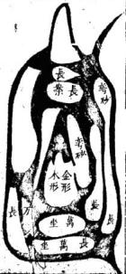

尺經 卷之四 六 2

氣無形而有神土無神而有形氣隨土形神從形發 故凡土脉之來皆本山龍而平原之氣盡從土脉 而至土脉起處爲首龍氣發行之始也土脉盡處 爲尾龍氣聚會之處也龍氣聚位方始融結神龍 眞經云要知止處須尋來處來處爲頭止處爲尾 血脉在外精神在裡雖雄媾合玄從尾底言山水 交合之處卽精神聚會之處龍底穴左肩脉之盡 男女玄牝之門是陰陽妙合之眞境也卽此可見 氣之會在水交龍盡之處而取氣之穴當從砂 之尾底求之若水自東來流從西去則東爲首酉 爲尾育水魯之處指穴反于水頭上尋穴是棄 其所止取其所脉經日甲卯作龍不食酉辛之氣 此言絕要矣

玉尺經卷之

鬼劫龍

鬼切行龍出身東西南北各出土脉飛竄順去直來或直去順來尖斜橫曲亂流支水交衝腹心穿叢龍脈入首輕斜不分門面者謂鬼殺分散英靈無所收拾斷不結地肋下分砂向前逊出不頸堂局自開不端不正者謂之鬼砂順刼分散聚氣也腰下分砂向後逃出不來護局東牽西潔長斜分腳者謂之鬼砂逆刼分散來氣也時師誤認黃龍安墳立宅不出二年必遭橫禍瘟疫死亡子孫逃寬軍徒刑橫無所不至出入訐詐無信不仁男盜女淫十年之外便主絕嗣

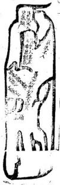

長砂關氣直受 長砂關氣直受

凡龍體出身砂頭直長或一里二里行來全無委曲若中間腰去處不分枝水西邊插入肋下作關則主尺經 卷之四 入氣散不聚到頭又無枝水兩旁插入肩窩則氣滇不收皆不結穴惟于來龍行脉中間兩得三重水挿進關激龍氣居中過峽到頭又得枝水插窩左關右激收氣脉在中則方成龍勢體叚便可指點更得開水東挨西推過一邊收氣歸角成四維受氣又妙眞龍眞水其氣冲隱最難立向看水神來去東北出水作兌向腰受西北出水作午向通泉受東南出水作坎向正受西南出水作震向疆受凡正受須帶丁丙光分子午三分要避雙金真氣然恐傷人丁腰受只正下無妨若斜歸二分則氣不貫慶矣

受直氣阴沙長 形風蜈天上

三関三峽本氣入首式

能體出身沙頭長直或二三里遠中間有水挿入內王尺經 卷之四

地作開峽換氣入首則龍氣方清凡閣峽過氣所在須一関過東一開過西使龍腰曲折活動而來到首更有肩水挿進兜激收氣入局方成貴龍體叚此龍坎上爲坐閃過壬上度氣換來癸癸換上仍歸正坎入首雖係坎龍行屬中間換過壬癸而來脫煞到頭不犯直冲方可正下仍看水神出入或耳受農受皆可

九開峽形勢有謝関有斜閱直來直受多幣直來斜受者多斜閃看開口受氣屈何方則知氣至何

方如口張向巽乾水自乾來氣必超巽坤申之角爲死脉矣

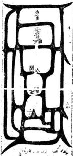

斜來正下水朝業外

龍體出身不分枝腳對角發脉腰有二回閱氣入首卷之四

開作正面堂前大小朝人分開兩股挿肩兜收龍氣入穴前有橫案左衛右護亦大地也生龍旺穴王百子千孫富貴綿遠更得襲閑雙徽福力尤建旁無劫泄又無興廢奕世富貴朱紫不絕坤申兌乾俱可出水放煞

長宮行龍向從卦例艮納丙坐穴對丙空甲午木或丙午火方美若艮土來水向巽巳午出當改癸角耳受終不如丙午向富貴攸長若作申向則艮爲病龍申爲病向雖不死絕而龍氣休囚豈爲盡善

有壬子癸水來亦好 水朝案外勢

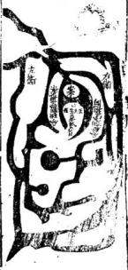

中局氣勢

龍脉體勢砂頭方正傍出枝水關氣到中局都從中王尺 卷之四 十

腰門面入一交水到中局分出兩股橫開向傍攝 入收來脉在中又得局中肩上挿入重覺入氣 斜開關口收受其力大鼎寺龍穴安墳立宅子 孫攸久富貴洪遠房分均年朱業滿朝由人忠厚 聽明形體豐美

申來龍卦氣納乙乙水去向作壬若癸木來向作 坎朝止于辰水去三合同子向七壬向三分巷 作甲佛向煞人退敗丙午向主退出年丙水趙艮 作巽已向亦可

中受平收氣脉勢

龍脉出身細小梟集面來將近扁後百步二百步或三百步分外開大慶直至一百步外兩木合轉人經下 卷之四 十

一處出來却從去水合處復分爾杖小水從局肩挿破局內逆砂而逛從中關進龍氣當中聚水如湖兩傍插砂作本身龍虎俯伏湖外其中氣不偏不斜名中局平收氣脉言穴傍無界兠激只取本身龍虎爲主氣取穴也

如亥氣出身帶亥壬子氣入穴巽巳午上出身只作丁未向收亥氣長生本入局又收坎上臨官木穴既取人丁又發財祿但氣寬大欠清細出官貴三逢俱有發財則商藝俱典水木氣混行者也

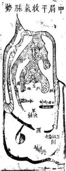

羣鴈賓鴻勢

體隨木出身先出一大橫砂流水界斷後生少砂五七塊東西散立向前復結大砂居中或員咸方或出角左右旁小砂一二十塊或尖長或舒翼或香之神出角隻雙向內朝堂向前又結小砂或長或方三五塊週廻又結曲折長砂抱護向內者名羣屬賓鴻形中間結穴砂頭得十畝二十者准小砂或三畝五龍方是外讒大砂不拘只要長灣內向其一小砂隻隻交股片片遮欄不見木來水去其地極妙百子千孫富貴不勝難計立向從外水立向其中穴傍水來去縱橫極有情況難以認取故也不必俱此圖此益以異亥立式也認水定龍詳看首尾中砂若大亦要堯收取氣

衆砂小次砂大小羣鴈從大賓鴻形

刼龍分氣

龍脉到頭開頭有面類若聚氣穴塲端正凡見此龍玉尺經 卷之四 十四

便易指點若腰肋之間有砂劈出兩旁向後定寶一與龍穴無情謂之刼砂龍分散英靈之氣故也雖是穴塲可觀頭面端正塟之無福而反致大禍絕人退敗理之必然尤防隔絕使龍氣入路不清越隔與劫砂二者俱是凶惡決不可下古人所謂菩薩由者正此龍也言龍氣不至虛立門面徒好看耳龍隨土行土到氣至何以有氣不至之事所日譬猶吹管者然閑氣音開一音氣至而多出音齊開則氣泄而多音便不出矣此理必然至

玄至妙學者祭之

出頭尖細鬼砂食氣

龍來有氣三開三摺甚是活動及至到頭出額反尖王尺經 卷之四 十五

細度長斜欹逼則雖龍來亦必減没如海中之潮浪湧而來及至逼窄之處勢無容則冲擊而終是滅沒必然之驗古人云來得好不如收得好長戴尾龜鬼頭踏着便生愁正謂此也

龍行入首面額須然端正而坐下鬼砂支水倒挿入展三重四重穿破龍形如破金楊公所謂棕欄業散夜文頭正此龍也時師見此頭額便從此處尋一穴絕人宗嗣受禍無窮不可薦言矣棕葉鬼形似棕欄葉有向前不顧堂局而散亂不收者有破拿

回龍顧祖 大水來處起祖行龍隨水而出到頭或為他砂挨重 使本龍從左轉右或從右轉左道流而上却乃回 龍顧祖之地經曰龍廻則水廻又目龍從水轉若 水面流出而不見有轉歸逆流處決無廻龍顧祖 地雖有砂頭轉回不過是支木界龍脉矣雖穴 塲好其力亦輕謂非眞龍到頭之故也若日是眞 龍到頭其水必從龍逆回此地最難立向以四邊 皆實地一路出水耳後立圖自坤申右遷轉至坎 五尺經下 卷之四 十八

入首是陰龍行體水土喜東南出水而東南反災 出煞然矣故凡回龍之地發福不久陰木自卯上 起長生返從陽木長生之方出去只發七八十年 便衰後之闢自辰上出木畧悠久終無福氣

截氣立穴法截兌氣入左截震氣入右砂到頭龍體有勢但到首餘氣分散難以下穴須在砂之偃間看有枝水入腹濤割如鈎傍待短浜隔斷氣不使入首之處當慶收氣入局內亦能發福終不達矣

斬氣立穴

砂如舡形或如梭形兩頭俱尖難以下手必須看得枝水在脇間斜入向去之處逆展作鈎下水背面又得永逆入腹申兠氣入局當鈎取穴名斬穴玉尺經下 卷之國 十九

其氣使不入頭乘而立穴之謂亦能發福紀看龍出身遠大則福亦厚

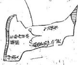

凡山龍到頭分開兩翼中不垂乳山逼勢急宜鋪曲去平坡三里四里之外方有大溪或長江界絕或有山腳下一二百步便結穴有平坡腹中結穴前無水止四畔界溪又遠取穴認氣之法看眞龍落頭到結穴處四畔必出月角甕轉向堂或左右抱出輕砂向前作欄頭砂或三重四重抱護者必是眞穴所在其後而脉須三伏四伏節節隱露不一及至結穴之處自然明自可辨兩邊微落水夾流合矜而去其地福力亦大百子千孫發財發福與玉天經下 卷之四 114-11山龍脉穴更佳水法不堪裁剪不比平源大河之處一不合法東手無計

出木龍寅甲水延上遠來層曲朝堂返作陰水右旋出戌巽水遠至兩上朝來生旺二水俱是有清但不慮左倒從坐下行出戍是陰過陰矣局內腮水甲卯水自左夾出坤未水自右夾出左倒會甲寅長生大水逆行則內俱逆矣向丙午則發財源官維下 卷之四

貴而背生水其人丁亦無病但主人當家婦尅夫 少亡寡居矣發中房財祿則長房人丁久旺發長 房人丁則中房官貴不興東典西退消長不一若 作甲寅向則人丁雖旺又出氣疾若帶艮上發源 可免商賈起家主骨肉不和出人用佞丙向亦能 發邪第但陰邪誤國食祿不終

本正

子午卯而四正不空來去名滾浪桃花水又爲軍睡 水又爲天獄水又如天禁水主出女人淫襲男子 流蕩破家主出軍賊離見坎卯西兌見午那見子 主出女人殺夫陰邪如過此水得申庚壬丙赦文 水救之方可否則男主盜女主姦敗絕孤寡若直 冲破局必有抄拈之禍產難少亡一路二路來長 其禍立見來短則禍輕若龍氣清麗六秀水朝亦 玉尺釋下 卷之四 二十四

主爲官取罪而刑

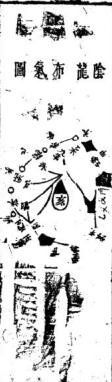

假如亥龍從坎入亥者爲陰亥龍以乙木生于午從午上起長生逆布至成爲墓乙席丙龍從寅上起長生順數至戌爲墓所謂乙丙龍變而趙成爲雖一雄交媾也冲陽和陰始發聚然後以向制之使氣感而應鬼福以及矣然穴依龍乘生氣也甸依水接堂氣也故氣行地中用土龍本音以布運水溢地外用水龍本音以布運審生旺體聚之氣土龍以山運收山水龍以水運收水如午上有高峰則旺人丁寅上有高山則旺財祿此正謂水管水也並用以寅午向制之則于水與龍之氣始合而不散矣此控制龍家之氣在于向而巳矣一差禍福千里

陽龍布氣岡

土尺經下卷之四

二十五

從辛戍入亥爲陽龍亥龍木音以甲木生于亥順行至未爲墓甲用癸配癸水生于卯逆行至未爲墓所謂金羊收癸甲之蠹是也認龍布運之訣憑隨氣化流行之樓從子丑寅卯員布子外陽左陰左以爲之式然其水神之來去不可執子丑寅卯順逆周施轉來爲合法也只要水從生旺來问局前朝堂爲來言趙至局前朝會衆水然後向墓方出去吉癸龍卯爲三方亥爲旺方空從局後至寅丑子亥右轉入未流去則亥卯水玄武而不入堂矣雖來自生方出自死方亦不可言吉餘做此推之

云木龍借配壬雖交媾不眞而夾流出異亦有秀氣 砂法合局大能發富貴若得內堂腮水從甲卯乙 遇丙午右到轉戌反向午丙趙巽合流出異是外 木雖不合法而內水得局作異向則兼外水順向 外卯則人丁貴亦美丁未向猶吉丙午向則人 官祿更盛地發長子向發中子丁向發小房又六 七十年麗力貴不過四品富不過艮萬水步行至 外堂敗矣

多壬爲北極業薇之司尊帝之居申庚而少綴亙數 之地巳丙爲南極之司寅申爲天市天帝司貨之 處地得此水到堂朝會其福無比或三路四路水 來亦美寅中水先到會巴丙倒右出成主出神童 狀元官居清要極品之貴南會庚酉木而左倒則 卷之四 114

臨力畧官至四品酉水先動會寅甲水出成先發 外始後發本宗先發小貴後發魁元亥木先到金 寅甲出未少年科第文章奕世辛兌龍見之文壓 天下但清貴矣庚中水遇震龍得乾異峯高出主 英豪經云開享門關地戶震龍動而龍見時

陰亥龍戍上本爲亥竅水空山不互入若水變戍上 龍自外由離者只取艮水出夫作庚下氣其內水逆人分流從局前破午丙方去枝分流變墊 趙向異震作巳丙可教此收山山氣之做妙移禍到寅上流出則生年二方俱要 井擊須內堂水法 為雇之眞機也如作丙午寅艮向則立見害人也作砂亦不可下下之不出十年外定主敗家絕人官訟殘疾抄枯寅水大先絕財祿戍水先到堂中生房先敗絕繼及長小二房破家損人只看內堂水 水 園出入向若寅甲上有內水丙午則人丁可教內水法不出午而出申酉二方則財祿可至一二紀方進作異向始可少緩其禍若作午丁向巢左系 寅申巳亥四龍長生之地交流入局朝堂者垂發人玉尺經下 卷之四 二十八 玉尺經 卷之四 芒九冲破 丁然水陽也外氣從天地交陰也龍氣從地故生旺 喜地支行度水喜天于行度故日水從天上去龍借配 來地下眠又曰萬水盡從天上夫羣龍須向地中來行門生雖無四正之禍然終爲地支不發福氣法 且爲長房之煞若犯四生水法惟長房受灾見爲成土水來或分或合俱右轉左向堂一路出丙午 各有分位兼得乾坤艮異四宇上來其灾稍路出寅艮生旺二方俱受冲散而亥氣不聚矣遷 4之立見敗絕若戍水併流到堂分坤離艮者其禍 水基15猶烈如戍水來處便分流一枝過堂出艮一枝分

法殿成丑未爲四墓是水宣緊不室來室去不空入若墓水朝堂主瘟疫病疾孤敗絕後若聚而不來則又能發富貴直衝破局小房受禍冲破北氣中子主灾傷財生氣則長子當禍看龍氣左忌以斷吉凶如四墓俱聚不來冲擊堂氣主大富甚比石崇若西某側到決不可下下之立見災穢池河方壤通衆水來去者不是刀

主天經下卷之四

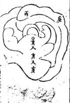

亥龍起頂落孔正亥入局左右龍虎蹲踞而中脉抱出詹口若從亥脉盡處立穴則忍露脉風吹退纏則玄武舌長然氣乘風則散而進則五氣和融故只可退止一步

乘得亥氣着不當以此書為忌楊公三十六穴法去玄武內長高處點此亦開勞火之法也是以山脉餘氣不盡者可兼則裁之如不可裁把穴立得高使坐下不碑謹舌亦妙

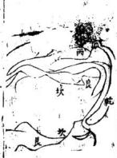

龍起祖换出坎局脉乳入首橫鋪平濶開面又似坎體是眞龍僞行也然有艮龍起禍則必有艮脉入穴須朝應情向若何正行斜受子不雛祖其人穴之處必有艮氣到頭者勢決超在右角畔矣以中局取穴則用僞氣矣其禍立至

故眞龍僞行者不當在正落處求之行前山以求 李心察左右以求開氣二者一得其法則眞僞自 一見矣

劉秉忠砂周昌奇廂作艮龍轉亥作丙向二十三年昌奇十狀元爲元太學士改監茶馬司後卒其子一塟昌奇于艮龍之頂取艮脉盡處世代顯官接踵相繼此龍體製本自艮方起祖再損艮龍不雜第二節損出亥局再博得幕亥麻大宗小宗俱各三吉六秀故艮亥一二穴皆發官貴

工尺無卷之四 三十三共峯起祖至第三節變出土星橫濶厲平粗區不開窩乳東西二角又無脉落可考似難立穴然有大穴雖無明淨乳脉必有微茫灰線亦蔭腮暗異佐證方可立穴若并其翼砂不明則又當驗朝應山水何方有情經云唯氣朝山識幸心後看來脉前看朝山以爲準的刖萬無一矢矣又有乳脉亂雜難雜眞僞者皆于朝應左右薩砂察之則其眞穴可見占先聖賢立法金取窩土取角恐非的論若朝對迹接在中安得舍中局而取金角乎

良龍起祖二三節皆艮峯起頂至落脉入首邦流趨癸丑方盡是僞立穴之法當循艮脉盡處乃爲氣却于艮脉盡處立穴雖拖出癸丑方去亦空裁人經下 卷之四 王十四剪以截僞氣如不可載亦就艮氣上遷之故古人云眞氣得乘僞氣自滅不當以癸丑絕出砂頭為嫌疑也作丙向以陽艮收丙氣大發官貴後富貴雙全若犯丑癸之氣其禍不可勝言矣

催官吉秀羅列

1亥龍起酈三節四節不脫本體人首結穴之處龍虎降伏乾坤艮異四山高疊震庚丁兌列秀于前後左右得此形勢而龍眞穴的則主出將人相封象賜爵子孫奕世濟美更得旗鼓劍戟森嚴則淹英芍橫行天下百戰無敵者來龍迢迢數百里入首而八而降伏並係禁忌如過此地禁口勿言福纏之人遷之必至獻虎雷擊水飄而後亡

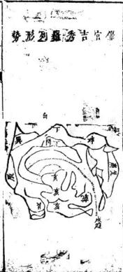

玉尺經下卷之凶 三十

乾龍起祖換亥二節四節亥龍行入首端正而乾 坤艮異四山高應丙丁兌災邊到秀峯衆水倒左 出寅艮長流而去作巽向以收水神則砂水盡美 主出魁元宰相無震庚砂主文章冠世名播夷 百子千孫世代顯赫朱紫滿朝儿催官薦元砂水 得一則貴况羣秀呈祥者乎

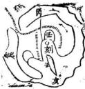

亥龍起頂單行落脉到頭一路俱係亥脉臨穴處都王人經 卷之四 三十六

雜壬氣出右邊似壬亥雙到左東右伸時師不知却見左右護砂緊促應案整齊便從落脉畫處點之是棄其亥氣而取僞脉自壬氣上作用則失之矣法當從亥脉盡處族左立穴任其壬脉鋪出

妨趙眞避僞審飛龍勢法空高則高下腳下有餘氣雖不裁亦可也法空就來則東遷右有餘氣雖不裁亦可也全憑月力之巧者上術也

參形雜勢斷

如艮龍從坎換入艮方起頂卑落至入首之處却鋪出一片平濶一二十丈拔用同情似無收拾勢雜形亂坎癸艮寅皆刊全無屈曲情況然龍眞正左右護砂明自不可棄如此形勢最難指點全憑且王尺經下 卷之四 三十七

力之巧詳察朝應情勢屬何體製書云形雜發如何認惟有朝山見幸心故有眞龍必有眞穴有眞穴必有眞朝從穴內詳觀前峯有情者若在丙上則下丙上對穴取艮作用便爲眞穴其餘癸坎寅氣皆爲僞落矣

石雨年王尺經全書後集卷之四新刻石函平砂玉尺經卷之五

元太師文正趙國公邢州對秉忠述明太師文成誠意伯青田劉基解

審砂篇第五

砂明生死脉辯陰陽 敬仙賴從謙發揮

平原之地砂頭進脉有左生右死右生左死有來生而止死有來死而止生凡龍脉之來活動曲拆爲生硬直粗逼爲死定脉取穴須棄死挨生金函卷五

經云生脉活動而棄死挨生是也地理之說高爲陰而低爲陽覆爲陰而仰爲陽直逼爲陰而平坦爲陽惟平原之地獨陽無陰而砂水合處始見陰陽之會脉辯陰陽者以五氣定陰陽之升降左陽而右陰也陽從左而陰從右也乾坎艮震屬陽而卦列左布如子寅辰午申戌之類巽離坤兌屬陰而卦列右布如未巳卯丑亥酉之類此天地身然之氣運五行之定機天氣陽而左旋地氣陰面右旋故陽龍從天氣順行爲吉陰龍從地氣逆行爲吉楊公所謂龍飛兩片陰陽取者是也賴氏曰龍自方生而紆從死地入首者名生龍死穴下之必絕如亥方發足本木也而紆從午申酉地入首結局本死于午繩于申墓于未名生龍入死非吉地也又爲亥龍氣脉趨東南巽巳入首而取穴西南東北角者亦是生龍發足而下死穴莽亥歸東南西南東北亥氣不貫爲死絕之地此法精妙時師不知多有向死絕點指者其貧絕之禍立至龍脉之來有陰有陽陽從左轉陰從右轉避尺經 卷五

其死絕趨其旺生則龍氣清和結穴秀麗故右而左轉入首者爲陽龍自左而右轉入首者爲陰龍陰陽二氣俱得生旺不犯死絕吉如甲卯入首者木氣也自午巽而至爲陰木自乾亥壬子癸丑而至爲陽木陰木生于午陽木生于亥俱得生氣出身若犯兌坤二方出身則龍脉發源巳先絕矣縱雖到頭得局護托完固終不發福水發城門流詳出入

龍行水隨故水發源之地卽龍神出身之地或趨東或趨西必須詳觀其所出之方若流神從實艮而出則知龍脉自坤兌而來則知水神必從寅艮而出以艮寅爲水日者必先龍成胎于正西巽龍生息于東南故郭氏云入山觀水口登穴看明堂卽此意也

龍行審來歷之因

凡龍體到頭歸收水口之處必考其本龍之來要知從何發足經歷何方如東北到頭向艮寅之方其龍必自兌宮出身乃爲眞龍自坤申而兌者亦尺經 卷五 三

吉若從壬子癸丑而來必得坎上有左水佐輔夾流會合于坤申水左倒更得乙辰水佐輔夾流會合于坤申水向寅艮而去方的若是離宮落頭則水必不自坤上來矣故龍行來歷之因須自流坤上消息之始可以得其情也

賴氏日平坡之地千里無畫龍無一定之穴而人 無一定之見假如一片方砂四方八面無有收拾 似難取穴若能審龍形來歷之因眞知灼見的係 坤申行龍出體則知穴清龍脉趨東菜坤兌之

迎神定分合之自

氣而融結矣吳巳行龍發源則知穴情龍脉歸西北矣

迎神者朝會于堂局之水也水來到塘必有發源 之處從何方分流而來又從何方會流而去知流 神分合之清而龍脉結穴之真僞自見若水來到 堂左畔分流交行前後而右畔不見其合兩派 流或橫去或直來前有無收後無廻統者其龍自 未住扎雖砂頭有情方正端通未繼穴也直至水 上尺經 卷五 四

交砂會之處龍脉始聚而融結眞穴是故五行品配于八方萬象畫歸于四蟄

乾坤坎離艮震巽兌八方各分隸于五行金木水1 火土正五行則乾金坎水離火兌金巽震木坤艮土萬世不易之定氣也然以生旺死絕之氣定之則木生在亥而配乾金生在巳而配巽水生在申而配坤火生在寅而配艮甲庚丙壬麗子午卯酉爲五行帝旺之鄉是五行品配于八方者天地然之氣運行而不息以化生萬物非人爲可得而品兜牽合之者也若寅申巳亥乃五氣發生之始爲龍家之四始萬物之根基五行乘旺之氣必一自寅申巳亥發生充盛而至于旺猶先金之氣甚始生在巳也青囊經云地有四勢氣從八方四勢行龍八方施生正謂此也

變形察體觀象審龍

隨地之形以察其龍之體觀砂之象而審其龍之 氣象以氣形以理變者也如木之形必直而聳火 之形必尖而側金之形必頭員鄺關土之形必方 玉尺經 卷五 五

正而尊水之形必曲折而動故觀其直而聳者知 其如木尖而側者知其如火頭員而腳關者知其 爲金也水土亦然爲金之形圓而闊者又當審甚 龍之自何方來如兌方發足則金形乘于旺氣而 出眞金龍也若自離方來其出身巳被火制矣縱 雖結穴亦不久遠餘龍倣此

賴氏曰夫龍有形者氣之所鍾聚而成者也有象者形之所成類而象者也如土形方而玉凡御屏金櫃天馬之類金形員而覆鐘覆釜半月娥類木形直而玉尺橫琴展軸之類水形曲而生蛇非五氣之流行而各有當然之則如取火形于熖動取木形于包節取金形于開巨取水形于曲拆習土形于觚角如此審詳以取中則有以得其穴情之眞也

氣藏于左右忌分泄于鬼刼之交橫

龍體成形水神交合其地須巳結穴然氣之充固與福力之輕重則又在于左右之護砂或環抱有玉人經 卷五

情水城緊固更不東西直竄四重五重節節包集者方佳或自本身分枝向前環抱顧堂尤妙若左右砂頭東西飛竄或有本體柚出從肋下從腰內肩肘之間左牽右摯東西亂竄者乃名鬼刼能分泄龍氣之英靈如有此等則須水交砂會亦不成穴矣

脉承于前後怕透漏于坐應之下渙

龍行入首結穴必前有案砂後有坐托則氣脉鎭重方有收坐托無砂或有砂而噴屑前有應而歆斜反跳不拜堂不平正或水來斜射者其氣透漏而不聚也

蕩如鱉背出似龜頭慮散漫而難收圓若金盤平如 一仰掌認高低而定取

平坡之龍砂頭寬大中高而四圍必低如斃之背砂圓而四圍亂出尖角如龜之頭者氣散而不聚也此不可遷遷之禍絕圓若金盤邊幅高而中低平如仰掌中前低而後高成此形象若龍氣分明的知來歷方可下手

玉尺經 卷五 七

賴氏日鱉背者砂不出角氣散難收龜頭者砂頭 微細而氣不藏蓄二者皆不結穴金盤荷葉傍高 中卑水在中亦必有出處點穴當如仰月形看角 兠收而中取之仰掌平坡必有掌窩語取窩穴而 定之楊公曰荷葉須尋蒂平坡認掌窩正此法也 囚四正四維之去來究枝分枝合之聚向

水交流于子午卯酉四正之方則寅申巳亥爲實地乂觀其水之出入以審何龍之結穴凡四至之地實者多自生龍發足乗旺穴水交流于寅申巳亥四維之方其子午卯酉爲實地凡四正之地實者自旺能行成生穴又須以水神辨之看其水 送分水合枝水之出入方見若水不分枝作小分小合則氣寬而不清亦不結地

秋橫似織方知眷戀之情滙澤如湖仍辯朝宗之勢 入首結穴之處前後左右若見水三橫四直屈曲 交流猶如織帛然此砂戀水水戀砂猶夫妻相見 而不忍違也衆水到堂或左或右聚滙如湖則知 水交砂會矣然又要辯水神之出向何方而朝 主人經 春五 人

或出于大江或出于大朔辯方定位以明龍穴之美惡也

賴氏曰水來到堂有聚必有泄觀水之聚處可以見龍脉之行止水出之去處可以見結穴之倚着几龍結穴必倚何水神流去一邊水神合流而去之地離雄交媾之處也故穴必倚焉九曲入明堂石崇富貴一亂如箭射伯道孤寒水曲則財祿聚屈摺朝入明堂者富貴雙全水直如箭射至明堂不惟貧賤而且孤絕天亡 7

是故流神合法者龍體方眞此總結上文言水之去來合法則龍脉沾穴方見眞正而無虛假若砂頭端正應托尊嚴左右護從周匝雖云龍脉可觀而水神去來一或不合共法則此等總爲虛假所謂菩薩面者此也

戴九履一而天地之中數居尊鳳舞龍飛而乾巽之陰陽交泰

一者陽之始九者陽之極五者陽之中五屬土面于體方正居中坐下長砂爲托面通橫水四道直尺經 卷五 九

水四道列砂九方得天地之正氣陽剛中正爲壹王建極之地產明王育賢相非尋常可北之地此坎離交媾震兌合氣而成者也若亥上行龍自天門而出踴躍如飛巽上行龍自地戶而迎揚砂如舞亥巳交合朝對有情左右送從合法則乾陽而巽陰二氣交太翕受敷施爲明王聖帝臨民之地聚賢才會文武此地原不易得或九履一謂子午也 2

雖有三關三峽之落尤防左牽右摯之非龍脉出身前無關鎮則行面不住氣隨七行峽不轉峽則氣散而不收真龍眞地入路到頭故左右必有護送砂頭向前拱夾其中龍穿田渡水之處不使出體露風其到頭之左右東環西抱如拜如舞則氣藏完固無有漏泄誠大地也中龍入首或爲長砂曲折三里四里而來固自有關夾而氣發阻碍曲角復恐分畜於摺處而入首之氣反輕則結穴亦薄故曲摺之間有枝水界逼使氣從脉行兜收到頭方真又有直砂行龍三四里五六里隨上人經 卷五 十

水而出者有方砂居中三五百七八百成地有龍脉之來歷固在水神之出入可考而英氣之聚處何從而辯别必得辰股而下有微水穿破關氣節脉使渡峽在左在右曲折活動而未入首之處武左右肩膊水插界明白其氣方聚否則龍脉須來氣渙而不收難以指點三里四里來龍或成曲折長砂或爲直木長砂到頭其中腰與肩肘之下若有餘砂分臂而出須要向前作本身之護從拜舞朝堂方可若東牽西摯各自分逃于本砂畧各無情意者却來分泄我氣所謂飛散英靈者此也生龍發足莫犯天罡旺處出身休逢死絕

寅申巳亥如長生辰戌丑未如天罡莽天罡所臨之地祿馬貴人不到故生龍出身帶辰戍丑未天罡而來者皆不結地如寅艮龍出脉轉過丑上而行是犯天罡矣子午卯酉爲帝旺寅申巳亥爲死絕旺龍出身轉寅申巳亥者亦不結地如卯木龍轉至午未申方入首是木死在午絕在申而卯龍受死絕矣此天地陰陽之妙理五行之眞機地理尺經 卷五 十

家不明此道則龍穴之生旺休囚且不知何以驗吉凶休咎之應

大從小而祥雲捧月以小輔大而羣鴈賔鴻群砂俱大小者爲尊龍來到頭結成三四地面負成方而旁有大砂重重交遶節節包承如祥雲捧月之狀群砂俱小特取其大龍來入首結成二三百地面或方或圓而旁例小砂如星如月瞬肩開翹如飛如舞雙雙砂頭向內朝堂顧局如群鴈賔鴻之勢也

賴氏曰結穴之龍特大而衆砂特小者必得小砂 之外又有大砂或長或方關攔于左右前後之外 包承群砂在內則局内之水方有歸東不致散亂 分流漏泄否則砂雖整齊而水神渙散能泄堂局 之氣縱結穴亦不美也若中砂細小而護砂大者 其水自有兠收雖出身輕微而其力反重

粗出細而細出粗形奇鶴滕橫取曲而曲取橫裊若蘆花

粗中出細細中出粗形如鶴膝三關四鎖入路而玉尺經 卷五

來者其氣清奇橫來曲展曲來橫展三折四裊形 似蘆花入路而到者其脉活動龍體眞而穴情善 福力大而富貴遠矣

賴氏曰三關四鎖似斷不斷如鶴膝也三折四身似來不來如蘆花也此言來情之善龍脉之活氣行之清皆于此可見左衿先師獨得之妙發楊曾之所未到處

木衝天而包節生處方成

如倒地木星形長直而瘦若無包節乃爲死木金用處也必得水合襟之左右有界水插入肩膊之内界出門面方成體制

火炎上而焰起動處乃見精微

如火星成形頭尖腳關若火熖不動名照天火無 用處也必得尖斜所向之處界水挿過一邊使尖 頭歸堂方可立穴

面方正大掛角留情

土星方正其情在角界水收氣故曰留情掛角吐出金唇則生氣更完廖公言土角流金正此謂卷五 十三

也

賴氏曰土爲五氣之尊中立不倚其正性也傍分 界水立穴在中通受子午卯酉四止之氣爲震雜 坎兌之局尤妙但不宜當局正心取穴俗云中宮 地也謬甚矣惟帝皇之都多有如此取用者取宅 中以御天下坐坎面離之義開日月卯酉之門而 四海文明矣

那關頭圓開金取穴

金星形體腳關頭圓須得開口取穴然異坐實差坐下不實名爲懸鍾金其氣在邊如鐘之聲應在邊也

雖四通八達之區必有伏元歸氣之所

此總言上文砂水須四通八達分枝散布面去然其到頭必有收拾之處爲伏元歸氣之根也

賴氏曰龍體到頭東西前後旁分枝砂四通八達 而去似難收拾至于入首之處其衆砂分出者登 要隻隻回頭願祖或爲龍虎抱歸左右或爲案狹 俯伏在前或爲攔砂回塞水口其始雖四通八達 卷五 十四

若與本方無情及至到頭結穴之處隻隻不虛收 作用神乃爲伏降之氣而歸東堂局矣衆水會淹 到堂在前在後或左或右東穿西渡南去北來一 似四通八達無所收拾然其總括去處衆水群聚 合流于城門之口重砂關寨于下者見其合不見 其去此亦伏元歸氣之根地有神氣而融結穴情 始大

來氣短須防腰截進氣長尤怕直衝

砂頭短折者坐後不得有橫水截住來脉使氣 折脉短而曲折則氣反急疾不和故砂短折者 怕腰截曲折也砂頭來若有三四里或五大里長 者中間須得曲折轉關博換過峽或三重四重如 亥氣入艮艮氣還亥亥龍入震震氣還亥則非直 冲矣然亥龍趨艮艮上又得支水兜激回亥則艮 宮不到散流各立門面以分泄其英靈使復還亥 而去乃玅若艮宮無水兜激任其自去各立堂局 是亥入艮就火局結穴矣亥入卯卯宮無水兜激 任其自去卯上立成堂局是亥龍入卯就旺方木 玉尺經 卷五 十五

局結穴矣若得艮入亥亥入艮艮又入亥三關三出仍作本龍出身結地是以亥龍入亥穴則發福綿遠富貴雙全百子千孫無有極也經云龍來不脫來龍氣三峽三關元復元正此理也

是故博換轉關實龍行體勢之眞而左關右界爲入首成胎之要

賴氏曰上二句結上文行龍體勢須要博換之意 下二句發明入首結穴之體段大凡砂頭入首將 結穴之處若頭平額關或左薄而右厚或左厚而 右薄者脉氣衝至到頭在東在西或左或右而倚 于一邊何以兠收其氣而取穴故龍脉入首必得 支水關界使氣聚而不散方或穴體關者關其氣 使不走也界者界其氣使就局也關水長而曲界 水短而直

片蠻皮將奚取證雲翔霧走何處兠收

此言到頭立穴之處左石無關界水入是一片蠻皮無以證其氣之聚不聚氣須止而又無以辨其歸向之定局也

玉尺經 卷五十六

賴氏曰平洋之地與山龍之局取氣驗穴最難蓋 山龍落頭有大小分水可辨其入首之眞僞有大 小合水可考其氣止之精玄箇字定出脉之由毬 簷詳住結之根蟬翼界于其旁腮水蔭于其側龍 蹲虎踞案應向堂有此取證昭然可指若其平砂 一片不仰不俯若無關界何以取證至如龍行體 勢雲飛霧走須有關峽而前無砂頭回抱又不得 水來交合于左右則龍脉未見收拾之處脉不 收則氣必不聚矣

薪刻石函平砂玉尺經卷之六元太師文正趙國公邢州劉秉忠述明太師文成誠意伯青田劉基解敬山賴從謙發揮審向篇 納水消水

山爲體水爲用一氣而成用屬陽體屬陰動靜乃見五行之氣行于地中有土則有氣而山者土之脉絡也積而成山是五氣升而成體故曰山者氣之體也氣行則水隨故水必隨土而出脉從水止水玉尺經 卷六上

從脉行故水者氣之用也土靜而不動屬陰水動而流通屬陽動爲用而靜爲體此陰陽之別體用之分于此可見

賴氏曰山爲體故地理家必先取龍體之來以觀其氣之所鍾及其到頭之處乃察其水神之出入以審其龍之所止龍脉至而水不來則有體而無用非眞龍也地理家以高爲陰以低爲陽逼爲陰一平坦爲陽覆爲陰仰爲陽有尖爲陰有窩為陽此一以靜爲陰動爲陽者以水之體質性情而言也定故陽品配得生旺而富貴雙全山爲陰水爲陽以山水而定五行之氣接入方十二宮之生旺休因則山水有生旺之方亦各有疾死絕之處合生旺者吉合死絕者凶如亥方爲本長生之地震宮行甲卯乙龍生于亥旺于卯死于午絕于申如實方爲火長生之地離宮丙午丁行龍生于寅旺于午死于酉絕于亥如巳方爲金長生之地羌宮庚酉辛行龍生于巳旺于酉死于子絕于寅如申方爲水土長生之地坎官壬子癸行王庚繼 卷大

龍生于申旺于子死于卯絕于巳各得生旺之氣者富貴雙全必然應之乗死絕之氣者敗絕又何楚焉

賴氏曰山水本生旺休囚因觀龍體出身之所及 而入首之方而以五氣各從長生位上數之始見 有某方生某方死以到頭或生來入旺旺位趨生 者吉無不利然又當觀其坐穴立向之法何如本 是生旺山龍水神而取歸死絕之方雖爲旺方生 方出身到頭亦不爲吉此理玄而又玄惟曾陽氣 一之深而左衿先師發之眞爲後世開蒙也其功 大矣哉

體用一原逢三合而英靈純粹

山水本同一原俱要得生旺之氣而欲收其氣卷坐向之下則以三合之法詳之其木龍則以乾里丁亥卯未火龍以艮丙辛寅午戌水土龍以坤壬乙申子辰金龍以巽庚癸巳酉丑如山水出身聳亥上來坐癸丑向丁未則是收木氣於亥甲卯出身坐癸丑何丁未則是收木氣于卯從寅上來坐玉尺綜 卷六

乙辰向辛戌則是敗火氣于寅丙午出身坐乙辰向辛戌則是收火氣于午從巳上來坐丁未向癸丑則是收金氣於巳庚酉出身坐丁未向癸丑則是收金氣于酉從申上來坐辛戌向乙辰則是收水氣于申壬子出身坐辛戌向乙辰則是收水氣于子各得生旺之位而不入死絕之方其英靈秀氣豈不純粹楊公云三合聯珠貴無價者此法也賴氏曰乾甲丁巽庚癸艮丙辛坤千乙收陽山行龍從天氣也天屬陽寅午戌巳酉丑亥卯未申子辰收陰山行龍從地氣也地屬陰龍脉清奇三方砂水貴馬收龍脉于地支水神出入合格而龍脈不清與三方砂無貴則收水神于天于收龍合局者主旺人丁收水合局者主旺財祿龍與水皆局而收歸坐向之下則用天干兼地支雙坐雙血水神清而龍氣雜山用天干多地支少水欠清面龍氣真則用地支多而天于少此古人用向坐取之玄奧而非時師之所可傳者每用此法無不應驗也

然龍穴之美惡從木猶女人之貴賤從夫 龍穴本無善惡而以水爲吉凶水之去來合法 則砂之吉凶方見若水神出入不合法其砂雖也 龍鳳等形花朶之巧亦不足取正猶女人本無 賤而其貴其賤惟視夫之貴賤以為貴賤未有夫 貴而妻不貴者故擇地以認水爲要用也砂有 吉凶者非以氣言以形言也如圓正端方豐居益 動爲吉失斜破碎歆側走竄爲凶曲摺之玄經 回環爲吉箭割穿助斜飛傾跌爲凶皆指山水 形狀以爲吉凶者若以氣而論之有何美惡哉性 得其生明則吉休四則凶矣左矜先師常言砂無 吉凶視水爲吉凶以于論之水亦無吉凶以向爲 吉凶砂之吉凶從水而水之吉凶從向則向實 五行生旺死絕之主也若一不合則砂頭木神皆 人休囚死絕而無用矣

故砂雖吉而水凶從生百惡穴雖凶而水吉尚集諸 祥

木神出入一不合法則砂雖純粹溫良亦不能生玉尺經 卷六

吉而反招百禍是凶咎之應惟于水神上致之形砂之美無驗也故穴雖不得善而水或得生旺之氣則立宅安墳尚能召吉生祥旺人丁發財祿楊公能救人貧賤者豈常與人别尋善地以救人之貧哉經云有絕木無絕地無絕穴有絕向正以此也

顛公曰楊筠松之衛隨地立不分砂水之善惡 堂局之偏正而惟取足于八方生旺休囚之氣有 砂可收則收之有水可取則取之使得乗千生旺

之鄉而巳如白龍潭引記未嘗易地而取水法一 移而福禍頓異其玄妙有如此者 欲觀坐穴之吉凶須看水神之出入 穴無吉凶以木神之出入爲吉凶如亥卯行龍木 氣入穴水自西北東北從亥乾艮寅甲卯而來徃 巽離坤申而去則氣隨水行而木龍之氣方清故 亥卯入局之穴必發富貴旺人丁若亥卯行龍木 氣入局各各如法而水神之出入反從東北而去 則官旺之氣不聚從亥乾而去則長生之氣分泄 五尺經 卷六 六七八

矣如艮丙行龍火氣入穴水自東北東南從實畢 巽巳丙午而來徃坤兌乾亥而出則氣隨火行面 火龍之氣方清故艮丙入局之穴必發富貴旺太 丁若艮丙行龍火氣入局各各如法而水神之出 反從東南而去則官旺之氣不聚從艮寅而去則 長生之氣流泄矣如巳酉行龍金氣入穴水自東 南西南從巽巳坤申庚酉而來徃坎癸艮寅而此 則是氣隨金行而金龍之氣方清故巳酉入局之 穴必發富貴旺人丁若巳酉行龍金氣入局各各

氣也立巽巳庚酉立向則其禍斷不旋邇考從上立向則寅卯之山反爲火之長生而巳午之水乃火之臨官帝莊之水矣豈不爲福迎福背煞化煞生權

如甲卯亥乾木氣行龍丁未方水來入明堂或坤 申庚酉丙午合流入局從左何流出寅卯生旺方 去是木龍之水來去背凶出久失度左右前後滿 局帶煞從亥局立向若對甲卯丁未人財敗絕立 向若對壬子乙辰大損財祿立向若對艮寅丙午 主尺經 卷六 九

辛戌則傷人丁若從巽巳庚酉或癸丑金氣作奧 則坤申庚酉朝水反爲官旺進神而亥卯木氣之 煞反爲迎神旺方去水反爲進神而亥氣木龍之 煞出進神至矣煞化生權人丁財帛兩不損傷但 從金氣立向則亥卯龍氣雖受病亦無大害猶能 小發而人丁尚得生息也如巽巳庚酉金氣行龍 而巽巳坤申庚酉水朝作坤申丁未立向乃退神 入局主絕嗣也若遷巽巳庚酉或癸丑向反得生 旺到堂流歸艮寅癸丑方去大發人丁官爵決矣

賴公曰水之來去無有定方而水之吉凶亦無定 位非謂必係某方來去乃爲吉某方來去乃爲凶 只以行龍入首得何五行而生旺死絕屬于何方 乃以水神出入落何方位因而吉凶悔吝所由動 也然其趨吉避凶之法不須易地改穴而卽于本 龍穴上立向收來水于生旺之方廢去水于休囚 之位便爲迎神背煞其法其理至精至妙能朝食 暮富之術此乃楊筠松之所以深秘而不傳者也 卿存鬼没而富貴速如轉圜

砂水者有跡而易見其生旺死絕各有方位立向 出煞人所易知至于五行之氣流于地中順而出 也有神在焉逆而入也有鬼在焉黙寓于八方變 化不測微妙難見作用者不惟因砂向之吉凶而 立向以爲趨避之法至于五氣生旺之神尅泄之 思隱于二十四由分金之內及六十龍分金之中 其生旺尅泄尤所當察神欲其存鬼欲其保和本 氣不伐天精則福鬼自至而富貴及于人矣 賴氏曰假如木龍入首坐癸甲艮收木氣入穴是

以木龍用木穴向未爲財帛申巳巽爲印綬皆 留神去鬼若坐向卯坤午方則金氣尅木爲鬼兩 丁乙酉火泄木氣或尅或泄皆爲鬼殺鬼旺神休 有禍無福神旺鬼没富貴立至以六十龍坐下納 音神煞亦宜忌之此玄空五行坐向之用也 暗煞逼身而貧賤易如反掌

水自來去不合生旺休囚之位者明煞也至莊方水來雖爲吉神亦有暗煞存乎其中卽經云旺方帶煞流來者此也如木氣入震方者帶煞至也林玉尺經 卷六 +1

囚位方去水雖云出煞然亦有腊煞隱于水口所謂休因出煞不盡者此也如木氣氷出于坤是水出煞在也至于六十分金納音暗煞亦然尤宜忌之分金之法祕分金叢珠内彖曰鴛鴦繡出從君看不把金針度與人

賴公日此玄空五行之法卽楊公十四退神之歡六十分金卽景純暗金神煞之術此煞最關利害所貴地師既明龍穴之美惡尤當求作用之玄機龍體成形難有美惡而無吉凶至于吉凶之應精神氣會成之也正猶人之形貌有美惡而無貴賤至貴賤之應骨格神氣爲之也神氣清而骨格潼奇則雖形貌未必盡美而富貴利達功名事業亦有見于當時傳于後世者矣若夫龍穴之精神不特在乎砂之護衛流神之出入來脉之清奇而巳裁收生莊之氣召攝天地之靈收四吉之山議三之水發生成之玄微審五雷之妙應接天星招掛氣使其精神會合于穴內而英靈聚結和蔭枯骨則鬼福自然以應所生之子孫矣一失其法百主尺經 卷六 十二

凶並至雖得龍穴之美亦不爲福故曰作用之不善反爲眞龍之咎又云年月之不善反爲吉地之殃此立向出煞收山召氣玄機妙用尤所當來審藏神合煞之徹察休囚旺相之氣

收五形積靈之氣歸藏于穴中不犯尅泄以傷其和召金水日月之英華使照臨于穴上天將護其外三奇孕其胎則神藏而不散矣布于二十四山者爲明煞隱于六十分金三百六十五度之中者爲暗煞見于砂水之來去爲形煞昭于年月日時者爲星煞然二十四山及六十分金三百六十五度內以至于砂水之中者以向上消息之使合法度而不致傷制本氣之神若年月日時之中有星煞無星煞則以年月日時尅釋之間求合法度而巳生旺之氣行于一十二方卽長生帝旺之位運于年月日時者卽五運六氣之順布以向上審五氣之生旺以年月審氣運之流行俾收生氣于穴中而忌犯于休囚尅泄斯爲作用之善此郭氏所謂塟乗生氣之法也

賴公曰神宜藏而煞不宜合左衿先師曰合煞者以三合制之也如木氣見煞以丁制之金龍見煞以癸合之水土氣見煞以乙制之火氣見煞以辛制之故曰合煞于在燕都得砂本玉尺經題曰石函玉尺經篇曰藏神闢煞無伯溫先生解註全姚曰合煞意者古先人相傳之訛因關不可曉而說改爲合字或者意會其爲圍闢之閭聲同而誤寫之也故伯溫因而從其書以訛傳訛耳秀水特朝取貴常勢而趨也

艮丙兌丁巽辛爲六秀水若從曲摺特達朝會盛 内于本龍雖不合生旺而他方無好水可收只將 六秀之水收歸局內或合長生或臨官或帝旺別 帶養方皆可若生旺方原有水來雖不在六秀位 只收本方之水爲上吉不必勉強牽合六秀歸堂 合得六秀則反失却本方生胚之水撥歸死絕之 處不惟不得六秀之吉而反受生旺死絕之禍矣 廖金精曰拏得瓜見失却李蓋得一失一之喻也 故左衿先師日當趨而趨言當審其輕重得失而 玉尺經 卷大 十四

爲之斟酌耳不特水爲然至于砂亦宜命法 休囚反逆生灾宜避面避焉

如坤壬乙申子辰水土龍入首水宜向東南就鉢囚方去或反流逆衝到堂擊散生旺則水土龍不能融合作穴而塟之立至生禍立向取裁當避其反逆之惡司作艮寅丙午辛戌向則用火局受之乂可生亥甲卯丁未向則用木局納之亦可巽智癸丑向則用金局就之蓋火局收東南少經方亦能與財祿官爵水局收東南之水于衰弱方亦龍輕發財祿而不至于退敗局收東南之水于長生方亦能發旺人丁而不至于少亡孤寡絕滅宗喬

賴公曰休囚與帝旺二方山水俱來到堂法難取裁理宜以生方作衰方生方與衰方山水俱來到堂法難消息權宜以旺方作衰方以旺方作衰友則衰方以爲旺方矣以生方作衰方則衰方以爲生方矣且如火局戌亥休囚與午丁旺方俱難穴難歲處立向須坤壬乙申子辰水局則戌乾乃為尺經 卷六 十五

官祿水也午丁乃爲胎養水也是以生方作衰左之法且如金局巽巳生方與辛戍衰方俱來點穴尤難法宜縮退數步收庚酉旺氣於辛戌之位則辛戌衰方巳爲旺方矣然裁收生旺之氣亦在上前落後挨左挨右之妙此轉移禍福之玄機乃筠松救人之微術也時師不知妄論砂水豈不悞哉射破生方向少差而就絕衝傷旺位針一轉以從衰此四句卽上文趨避之法轉移禍福之一玄機左衿先師發楊筠之旨意以爲後世學術之鑑也彖日蝸角千鍾少鴻毛大帛輕可合雙山作用法聯珠之妙雙山者一十二宮每宮二位共二十四位八千四維十二支各以類合如母子公孫骨肉一家之以甲配卯從木氣也以艮配寅從火氣也以亥卯未類者合氣也亥卯未聯以乾甲丁如珠之聯而三合收之情交意合而生旺休固之方位與氣化無干矣此九天玄女立法之本意景純詳註于前筠松發明于後地理家切要之玄機萬物之根本玉尺經 玉尺經 卷六 卷六 十六 十六

也楊筠松作聯珠經開明雙山五行之妙以爲收山出殺之樞機其至神至妙者歟宜從卦例椎求尊納甲之宗

九天玄女以卦氣從八卦納八于十于之內以乾 納甲坤納乙離納壬坎納癸艮納丙巽納辛震納 庚兌納丁是猶夫妻相見情交意契不相違背者 也塟法用之以立向若乾龍到頭作甲向艮龍到 頭作丙向者一氣相合吉慶乃生用之以收山艮 宮水吉以丙收之乾宮水吉以甲收之則乾艮之 水乃爲我用神而吉慶自生否則艮乾之水雖吉 而牧掣不歸則猶如路人與我無相親愛欲其從 上我爲福豈不難哉至如乾甲丁巽庚癸坤壬乙艮 丙辛卦例三合法用納甲而推立向納水甚得其 法又如乙辛丁癸卽辰戌丑未因墓天于也國墓 方水宜去龍穴局面人見向對去水有所嫌忌殊 不知乙辛丁癸四向要對去水左右自然有生旺 水來受氣此乃曲煞乘生之玄妙凡俗可知 人殺黃泉雖云惡曜若在生方例難同斷

黃泉八煞水如庚丁忌坤乙丙防巽甲癸怕艮辛壬忌乾又丁向坤庚巽嫌乙丙又云乙丙黃泉巽莫遊之類此等水若得有生旺方來絕胎方去雖是入煞亦不爲害不可泥于黃泉而反失于生旺休囚五行之正氣也正穴水城倒左向雖死而無妨

乾亥坤申艮寅異巳龍穴乃五行四良生之位水宜對面趨朝倒右而去今反倒左是死絕水來入何出旺方矣欲出左例水煞宜坐生朝死卽前趨避之說如水土龍立穴向金龍立木向木龍立金向火龍立水向此爲變局納水之良法也乃天地之眞機弗容易言

旺龍左水右歸向就養方向害

壬子丙午甲卯庚酉來龍爲五行四帝莊之地水宜倒左今反倒右是死絕水來人局出生方矣欲出倒右水煞向宜坐衰朝養如水龍立木向木龍立火向火龍立金向金龍立水向水實鬼神之精蘊豈可浪泄卽前趨內之法其例左倒右卽登穴三尺經 卷六 十人

見水如入左右手臂後流去也

是故認水立朝有夜吉此凶之應而收山出煞有朝貧暮富之殊

察認水神之出入以立向有得其法則反凶為吉 失其局則化吉爲凶是知水神之出入本無吉 凶一定之應而頑福之相驗係于朝向得失有如 此然則作用之間其可苟耶

賴氏曰吉凶之應係于立问之得失者以砂本 無吉凶以向爲吉凶向無吉凶以生旺死絕爲吉 凶氣至而伸爲神氣反而歸爲鬼生旺之氣神氣 也死絕之氣鬼氣也神屬陽鬼屬陰陽氣進而生 長陰氣反而收藏故發育萬物者神氣也肅殺萬 物者鬼氣也鬼神之氣行于土脉之内充周于天 地之間運行不窮爲春爲夏爲秋爲冬化育萬物 者是氣也則夫生旺死絕之氣是卽陰陽鬼神之 運而為吉凶之主者也故神氣爲吉而以長養鬼 氣爲凶而以收藏此天地自然之運爲陰陽一定 之玄機也是故氣至而伸爲生爲旺而其方位之 經 卷六 十九

上宜高而來氣反而歸爲休爲四而其方位之上宜低而去高而來者爲神從氣至而伸也低而去者爲鬼從氣反而歸也以神感神則吉吉以神生以鬼攝鬼則凶凶以鬼致收鬼氣入神方收神氣入鬼方神鬼異情陰陽反常以收藏爲長生以春夏爲秋冬天地變而萬物滅矣其爲凶也亦天地陰陽自然之應而豈強于人爲者哉故楊氏曰生旺宜來而死絕宜去入云生方高聳耶人丁旺起峰宮祿至其深知鬼神之情狀陰陽之妙用也四生三合是天機甲寅巳丙庚申亥壬此四方乃五行長生之位天市紫微少微太微四垣之貴若得此四様水或一時朝雖非生莊亦能致科名官祿又不在死絕休囚之論三合作法到首定龍立穴定向得向專觀木口龍向要三合生旺而至金木水火各成一氣水口要三合庫墓絕胎而去此乃得天機奎造化之眞訣而不可輕露也

雙山五行全秘訣

玉尺經 卷六

二十

假如寅艮行龍作丙辛二向艮寅長生之水巽巳 丙午臨官帝旺之水會朝到堂流歸戌乾亥于而 去此得火局之全美也又如乾亥行龍作丁卯二 向有乾亥長生之水艮寅甲卯之水併入于堂流 歸西南丁未坤申而去此得木局之全美也如巽 巳行龍作庚酉癸向有巽巳庚酉水來流入艮青 而去得金局之全美也如坤申行龍作壬子乙向 1 有坤巾壬子水來流入巽巳而去此得水局之全 美也福祿均齊而公位不至偏枯全氣之地也久 震庚裏儀三吉之位也若此三方曰有山水特朝 並與六秀相同有吉無凶亦非五行休四所限也 面卧夫若日右經六諦乃希夷老祖之砂演而左 矜仙師之所鄲鄂也若後集四詮則左衿著之犁 眉公什之又天顧秘之穗書也成能者欽至教 而方程之依別傳而勾

法而混沌之則丑未辰成地眞而有子午卯酉六靈戒儀寅申巳亥騰紫度炎光矣寧徒以惠鹽哉寧徒以惠薰鳴哉

玉尺經卷六

新川地理五經四書解義郭朴塟經卷之一草蘆先生吳文正公微删定後事金華玄然生鄭證註釋內篇一梁氣生也

此章廼錦囊一書之開鍵也巳下諸篇不過註腳而巳生氣者卽一元運體之氣也在天則周流六虛在地則發生萬物天無此則氣無以資地無此則形無以載故磅磚乎火化貫通乎品彙無處無耶朴塟經 卷一

一之而無時不運也陶侃曰先天地而長存後天地而固有亦指此云耳且夫生氣藏于地中人不可見惟尋地之理以求之然後能知其所在塟者苟能知其所在使枯骨得以乗之則地理之能事畢矣

五炁行乎地中發而生乎萬物五氣卽五行之氣適生氣之別名也夫一氣分爲陰陽折而爲五行雖運於天實出乎地其行則萬物發生聚則山川融結融結者亦二五之精夢令

而凝也

八受體於父母本骸得氣遺體受膝父母骸骨爲子孫之本子孫形體廼父母之枝一氣相廕出本而達枝也故程子日卜其宅兆卜其地之美惡也地之美者則其神靈安子孫盛若培壅其根而枝葉茂理周然也地之惡者則反是盛季通曰生死殊遂情氣相感自然默與之通今尋暴骨以生人刺血滿之而渗入則爲親骨肉不後則非其氣類相威有如此者則知枯骨得鹿生人

受福其理顯然可見不待智者而後知也或曰抱養既成無非遺體會道嗣續亦異所生其何能廢之乎豈不曰人之心通乎氣心爲氣之主情通則通義絕則廢亦絕後母能廢前母完前母亦母子其在物則萋蔽重黔之類是也尚何疑人之無嗣者亦其大不幸也聖人設敎必使銀為示之者非曰自私乃所以正名分辨族類而耳若吾宗果無其人亦將以異姓績之愈斬然而斷絕者乎盡衆人之先與天說

萬物同出一原但日遠日分遂有親衆之周然一氣流行則無以異也苟念慮之相初祀事之不廢則名正理順而情氣感通矣或青乃謂有人以屠者之子爲嗣後祭其先見其標刀者享之理有未然凡鬼神形影鳥得實有而聖人立爲祭祀者但使人不忘其本耳原其實理只是報心之法也是故七戒三齋思其動靜起居洋洋如在降神紳祝名正理順然後鬼神得而享之若以爲氣類相咸郭朴塟經 卷一

名不正理不順故不得而享之也是以季氏旅於泰山聖人譏之今言造刀者名悖理違情隔理絕又烏得而享之平北溪陳氏遁引之以爲立嗣不嚴於同姓之戒其意雖善然未免局於量而不能通乎道體之大觀張子西銘之辭則聖賢之心可言不義於語怪乎今世論情道義絕故并及之經曰氣感而應鬼福及人

地理之學原於赤松子青義經唐一行謂錦囊引

所經日者此也然名存面書亡世不復傳矣其日氣威而應鬼福及人者謂父母子孫本同一氣互相感召頴微無圓故能龍廕生人生人旺盛如受鬼福固嘗評鬼福之說切有疑焉非若人之居室得其美某則可以把山川之秀受陽明之氣日夕與之交接以爲地靈人傑之應於理誠有然哉今既死矣蒐升鬼降神氣離體遺骸與死灰槁木等其無知文焉能受廕而至禍福於生人者乎見聞之聞莫不以爲惑世誣民之事然而古人塟遺朴塟經卷一

骨而廕子孫富貴者亦多矣天下之名莫在在 有之倘言其妄則其效驗有不可掩者謂爲信 則必有其理以明之是亦士君子格物致知之 端也且夫真龍格迹迢迢百里或數十里結爲一 穴及至穴所則峯矗盛呈秀於其前疊嶂層層奇 獻于其後龍虎抱衛砂水翕聚形穴既就山川 之靈秀造化之精英凝結副會於其中矣荷欲盜 其精英切其靈秀當以何法而能致之乎益亦因 聖人有卜兆安厝之旨人子有報本愛親之情以

没母進骨藏於融會之地自是子孫之心寄托此固其心之所寄遂可與之感令而能致福於將來也是知人心之通乎氣而氣通乎天以人心之靈合山川之靈故降神孕秀以鍾於生息之源而其富貴貧賤壽天賢愚莫不關倔至於形貌之妍醜並皆肖像山川之美惡焉故嵩嶽生仲尼丘孕孔豈偶然哉鳴呼非塟骨也乃塟人之心也非山用之靈亦人心自靈耳世人在往以遠常宗於水中而無禍福心與之離故也

是以銅山西崩靈鐘東應

漢未央宮一日無故而鐘自鳴東方朝曰必有俎山崩者未幾西蜀奏銅山崩以日揆之正未决鐘鳴之日帝問朔何以知之朔日銅出於山氣相咸應尤人受體於父母也帝嘆曰物尚爾况於人乎昔者會子養母至孝子出母欲其歸則嘆指而會子心痛人凡父母不安而身離恃惻則亦心働但常人孝心薄而不自覺耳故知山崩鐘應亦其卑不華於麻栗芽於室此亦言一氣之感召也野人藏粟春栗知木華而象藏之栗亦芽實之去本巳彼華此芽以本佳元在得氣則相感而應亦猶父母之骨塟秉生氣而子孫福旺也天一氣旁薄於天必間無端見無終窮萬物隨其運化木不自知而皮造物者亦不自知也

生者氣之聚凝結者成骨死而獨畱故塟者反氣入骨以奮所生之法也

乾父之精坤毋之血二氣臧合則精化爲骨血化爲肉復藉神氣賚乎其間遂能生而爲人及其死也神氣飛揚血肉消殞骨難獨存而無知上智之士圖而於吉地之中以內乘生氣外假子孫思墓之一念與之鹿合則可以復其往之神萃其巳散之氣一念卽神也神趨則氣應也靈而人餓以無爲有借爲顯真玄通陰陽功奪造化是爲反氣入骨以蔭所生之法也

丘瓏之骨國阜之支氣之所隨 此章乃塟之中之親領也丘壠爲陰開阜爲陽止 言其高骨乃山之帶石者藿高不能自立必籍石 載土而後能聳也岡者跡也土山爲阜言支之有 毛春者壠之有骨氣隨而行則易見支無石故必 觀其毛脊而後能辨也然有龍而土支而石者有 一壠而隱支而隆者又全籍乎心目之明以區別也 支壠之說景純著書不爲不明第後人不通其義 註釋難多息皆非是知之者亦且不肯明白分 朴塟經 卷 七

後來宗師又皆不形行素准口授心傳自非耳擾 面命莫知能曉故知者鮮矣

經曰氣乗風則散界水則止

謂生氣隨支壠體質流行滔滔而去非水界則墓 之能上及其止也必得城郭完審前後左右環圍 區龍然後能藏風而不致有蕩散之患也効公云 明堂惜水如惜血堂裏避風如遲賊可不實載 古人聚之使散行之使有止故謂之風水 高壠之地天自止而降生氣澤露最怕風寒邊 爲蕩散如人張處寄室稍有罅隙通風適常肩背 便能成疾故當永其城郭完密使氣之有聚也子 支之穴地陽自下而升生氣沉隱不畏風吹亦 人在廣寞之野雖八面無蔽巳自不覺或遇天晴 日朗其溫和之氣自若也故不以寬曠爲嫌但裏 纖水之有止使氣之不行也此言支壠之取用不 同者如此

風木之法得水爲上藏風次之

支壠二者俱欲得水高壠之地或從腰落雖無大郭朴塟經 卷

江欄截然亦必池塘以上內氣不然去水稍遠而隨身金魚不可無池俏金魚不界則謂之雌雄夫經故難藏風亦不可用平支之地雖若無藏但有橫水欄截克遺何害故二者皆次得水爲上也曰外氣橫形內氣止生蓋言此也

水流上外謂之外氣氣藏土內謂之內氣故必得外氣形橫則內之生氣自然上也此引經結上文得水爲上之意

何以言之氣之盛器流行而其餘者猶有止雖零散而其淡者猶有聚高壠之地落勢雄壯就中折爲兄弟武去或北各有結作自非一地可盡其力量也好龍多從腰落分布枝蔓在十數里之間爲城郭朝樂官耀禽兒擇次華表獬豸羅星之類皆本身自帶不可謂彼流行而去而凡非其止也但當求其聚處而使之不散耳次言平文之龍大山段落年洋四面寬廣其爲城郭亦不過高逾數曰而巳又且去穴遼遠朝山一點在乎知靄之中人見之者莫不次人棄朴塟經 葬朴塟經 卷一 卷一 九 九

遠朝山一點在乎知靄之中人見之者莫不次人夫陰陽之氣噫而爲風升而爲雲峯而爲雨行乎地郭朴差經 卷一 十

風無蔽爲嫌又豈知反龍氣隱雖若零散而其孫者龍有聚也但得求橫水欄截而使之有上耳此言支龍之氣盛者如此

故藏於涸燥者宜淺藏於思夷者宜漲

上句言龐下句言支景純至此則傾囊倒笈盡洩塟法之玄秘矣尚何俟他求哉高壠之地雨注卽顧故言涸燥此天氣自上而降氣浮固當淺塟陰來而陽受也平支之地交冰不流故言坦臾此地氣自下而升氣沉故當煖崖陽來而陰作也 氣自下而升氣沉故當煖塟陽來而陰作也

經曰淺湲得乗風水自成此復引經以證上文支壠塟法之不同也謂高龍之塟露而勿隱故淺取其浮氣也平支之塟潛而勿彰故漲取其沉氣也得乗者言所塟之棺得以乗其生氣也秘寶經曰陽脉沉潛漲處取陰龍浮露淺中求坦夷涸燥無過北邽與排星事不從其亦淺湲得乗之謂歟世俗多用九屋白法以定天寸者謬也

中而爲生氣

夫土者氣之體有土斯有氣氣者水之母有氣斯有陰陽之氣卽地中之生氣也故噫爲風升爲雲隆凶爲雨又豈雅是而巳哉此所以位天地育萬物者何莫非此氣也斯因言塟乗生氣爲地中故重粟以申明其義愚嘗謂能生能殺皆此氣也塟得其法則爲生氣失其道則爲殺氣如所謂加藏饒借吞吐浮沉之類並當依法而剪裁之不致有權殺撞刑破應翻關之患也

氣本無體假土爲體因土而知有此氣也水本無母假氣爲母因氣而知有此水也五行以天一生水且水何從生哉生水者金也生金者土也天地， 之先未有形質其土安在豈不聞郡子之言日天一地之本其起于中乎中卽土也無氣而有其理也土腹藏金無質而有其氣也乾藏坤內隱而未見及乎生水其兆始萌言氣爲水母者卽乾金之氣也世人不究本源但以其所見者冰爾故速以水郭朴塟經卷一

爲天一之始得而未精者也

經曰土形氣行物因以生

生氣附形而有依土而行萬物亦莫不四之而生 也此引經結上文有土斯有氣之意

火氣行乎地中其行也因地之勢其聚也因勢之止此卽土形氣行有土有氣之意謂氣行地中人不可見其始也則因地之勢而知其行也其次也又囚勢之止而知其聚也

塟者原其起乘其止 善塟者必原其起以觀勢乘其止以迂穴凡言此 者乃山川融結奇秀之所自非明眼之士莫能見 也片玉純髓云草上露華偏在尾花中香味總居 心其止之謂歟或曰粘穴乘其脉之盡處爲止然 則倚種安可以止云目古人恐後世不識止處 故立爲四法夫蓋者止於蓋也倚者止於倚也撞 粘無不皆然雖觀義之所在高低正側何往而非 止也

郭朴塟經卷一

地勢原脉山勢原骨委蛇東西或為南北此亦支壠之所由別也蓋平夷之地多土呌瀉之地多石故支之行必當認土脊以爲脉壠之行屬當求不脊以爲骨也其行度之勢委蛇曲折千變萬化本無定式世固有直來而有直結者亦不趨也此章大界與丘權之骨圖身之支意同耳

千尺言其遠指一枝山之來勢也百尺言其近指一穴地之成形也山川形勢豈與有尺度之捐造全氣之地其融結之情如此

若人歸然不動而有所待也

榮迁漕層拱疊衛卽朝海拱辰之義也此章良

百般揣度竭其心思終無自悟之理若得其傳如其秘則如數二三辨黑自人或見其莽然可左可右可移可易又豈知中間自有一定不易之法尺寸不可扦致指南云立穴若還裁不正縱饒吉地亦徒然高低嚴淺而差誤變禱爲灾起禍愆冕委自復回還重復

若貴人端生器其畢陳攬之而有餘也

上句言權衛之山須得趨楫朝拱不欲其俗逼舊突而不遙也下句言諸畜之水必得止聚淵澄欲其斗瀉反背而無情也

來山凝結其氣積而不散上水融會其情聚而至流斯乃陰陽交濟山水冲和故開井而多徵驗也土高水湲鬱草茂林

水沉医則土壞高厚氣冲和則草水茂盛程子旦易謂地理之美者土色之光潤草木之茂盛廼其鬆也

氣象尊嚴若千乘之貴也簇擁繁穎猶萬金之皆

也 此亨平支行度之體艮也原其起乗其止氣脉艷經曰形止氣蓄化生萬物爲上地也 之而行觀勢察脉則可以知其氣之融結矣堂局完密形穴止聚則生氣藏蓄于中矣善塟者 觀支之法隱隱隆隆復妙玄通吉在其中因其聚而乘之則可以福見存昌後裔夫豈塟埋 隱隱有中之無也隆隆無中之有也其體反若盞而然乎世間萬物何莫不由此氣而成化育之功 中之誅雲中之雁灰中線路草裡蛇蹤生炁行乎今山川融結衆美駢祿故爲上地也 其間微妙隱伏而難見然其吉則無以加矣內篇四 經日地有吉氣土隨而起支有止氣水隨而北勢順施貴平夷土貴有支 形動阿復終始法塟其中永吉無凶支龍貴乎平坦夷曠爲得支之正體而土中復有 此引經以明上文支龍行度之意言平夷之地郭朴奉經 卷一 十五 郭朴奉孫卷一支之紋理平緩恬軟不惡不保則表裡相應此所 露毛春圓者如浮滬如星如殊如在如箱如印是 LAuA以龍爲可貴也然却有支體而得壠之情性者宜 者如玉盡如蘆鞭曲者如几如帶方闕上所不誓如擲槍急如翻緣術中謂之倒火硬木此陽中含 者如免魚蛙歸是皆地之吉氣湧起故土亦隨之陰外君子而內小人也法當避殺粘寬架折而塟 而亞起及其可也則如雞窠旋之狀焉形上脉劉氏所謂空急則避求而奏簷是也陽者爲霸本 盡而一水交度也禹木一守便可言山低土一寸合奏入奈何性急以此要縮下一二天緩其急性 便可言水此支氣之止獘水朋此而相爲體用者苟以支法扦之則凶禍立應此支龍之至難體證 也至寶經日平洋高低放迭定看合水分金是亦者故景純口支龍之辨茲日惑心言此者矣 水隨而此之意也其勢順伏而不反逆其形活動支之所起氣隨而始支之所終氣隨以鍾 而無柳硬砂水勾夾四環重復首尾無獘終始在順依法遷穴其中則亡者安存者福永吉而無道 敗絕此高壠之至難體認者故景純有眩目惑心也巳上言支巳下言壠 之嘆也此章大抵與地貴平夷章對許山者勢險而有也法塟其所會 乘其所來

山者言壠也勢雖險竣而其中復有不險之穴偃當求其止聚融會處而塟之則善矣高壠之地來勢高大落勢雄壯結處亦且清急此得壠之正體也却有一等以龍爲體而得支之情性者大止

此陰中含陽外小人而內君子也世人不識往往郭朴塟經 卷一 十七

粘華山麓莫不以前拖平地爲禍褥又豈知其難 未住兩邊金魚隨脈而行平平隱伏直至堂心其 脈始盡天寶經曰凡認胍情看住絕水若行時 不歇歇時當以小明堂氣止水交方是穴後面 令氣可乗前頭要使水可洩若還鑿腦而鑿胸卷 急傷龍匪融結此定穴之審語也故當求其砂水 會處枕毬而塟陰者爲強固當痛下柰何性慢以

此要挿上七八寸急其緩性名爲奏交即煞劉氏謂擺緩則入簷而奏毬是也苟以壠法遷之則主謂言生氣之所從來因其來而知其止故塟者得以乘之不使有分寸之違也脈不讎棺棺不離脉棺脉相就剝花接木夫所謂乘其所來者法當就化生腦上循脉看下詳認雞跡蠻眼三丈名字交求滿斷或分十字武十分十字看他陰陽配與不觀及夫強弱順逆急緩生死浮沉虛實以定加藏朴塟徑卷一 十入

饒備却將手中之杖放倒指定生氣之入路然後 翻身轉而觀其杖之指引出殺合轍要與三集聚 頭相就內接生氣外接堂氣內外符合前後無獘 始爲真穴一有不順仰成花假此乗生氣之要訣 也其所謂乘金穴土亦乗其所來之義也 雷其所廢

謂入手廢壞歇非莫辨故不得不詳加魯察也天 義未喪定穴則易爲力俱乗其來仰知其止却有 一等不率為牛羊踐踰上破下前歲年觀不四

入首或種作耕墾界斷乾流或前人謬遷其旁圍 其所害墻拜壇不無慢陳或會爲居基益低損高或則家 謂避去死氣以求生氣也盡穴中之氣有形有德取上鋤掘戲賊然大八字與金魚所不可得而移 裁剪得法則爲生氣一失其道則爲死氣故不得易者但要龍真局正水净砂明當以前後左右四 不審而避之也何以言之跳出死氣挨其生氣是應證之心目相度的量開井却是非中察地之理 也陽脉落穴以陰爲生陽爲死陰脉落穴以陽爲則無不得之矣或問得之者何也曰天一氣化 生陰爲死然又有內外造化之不同觀其上理以生支龍隨氣而成形質則其表裏相應天真未壞 一邊鮮明爲生一邊鮮明爲死又以光潤堅實為土下之文理與主皮上乾流證應無不同者今 生枯燥髮散爲外又其紋理頭高頭低以低處為朕非莫辦故於土中求之凡所謂陰陽剛桑急糧 生高處爲死又士色以知黃爲生青黑爲死巴正郭朴塟經 卷 十九 郭朴塟經 卷一 二十生死浮沉虛實之理無不廉然得其理則倒杖 皆求之於土中故得謂之內也其外造化者脉之法亦因之而定焉 邊厚邊薄以薄爲生厚爲死雙脉一長一短以短擇其所相 爲生長爲死一大一小以小爲生大爲死又以謂審擇其所相輔於我者法當於小入字下看明 毛言之以秀嫩光净圓厚湧動爲生枯老臃腫破眉腑翊肩高肩低以分陰陽作用次視三分三合 碎宜硬爲死此皆於神氣血脉上觀之故得謂之崎急乎緩以别順逆饒滅盡觀蟬翊之砂蝦須之 外也又或砂木之間反麗斜飛直撞剌射皆爲形水以定塟口界限是皆左右之所相苟失其道則 煞橫通之山如鑰如刀尖利順水可收拾爲用者有破腮翻鬪傷龍傷穴傷淺傷淺之患故不得不 用之可避去者避之此則次眼前之所見者而論詳加審察也外篇言相水印木其義亦同 之也又程迂之所謂五患劉氏之所謂四惡皆在

所當避也 是以君子奪神功改天命 上文所謂乗審釋避全憑眼力之巧工力之具趨 全避缺增高益下微妙在智触類而長玄通陰陽 切奪造化及夫穴塲一應作用裁剪放送之法皆 是也陳希夷曰聖人執其樞機秘其妙用運之於 巳行之於世天命可移也神功可奪也曆數可變 也道不虛行存乎其人耳

禍福不旋日經日塟山之法若呼吸中言應速也郭朴奉經 卷一 十禍福之應捷於影響故復引經以証感召之理也能乗能審能擇能避則其所感者爲福否則爲真禍矣若夫所謂塟山之法其說多矣大要在乎分別陰陽以爲先務有純陰純陽邊陰邊陽上陽下陰上陰下陽陰交陽半陽交陰半強陽弱陰老陽嫩陰各有塟法陰來則陽受陽來則陰作或入簾而間毬或避毬而湊簷又有陽噓呼吸之不同臘中取逆逆中取順情在粘則正毬順不情在傳搔則架斤逆受假若陰脉落穴放棺饒過陽邊錯陽氣一噓其氣方生陽脉落穴放棺饒過陰邊道一陰氣一吸其氣七成所謂陽一噓而萬物生陰吸而萬物成是也苟不識裁剪放遂之法堂虛而吸當吸而噓當順而逆當逆而順及夫左右吞味觀淺不知其訣不能避殺挨生則生炁變爲殺丞縱使高下無差左右通空灑淺合度猶且不免其侗況未當於理者乎古歌曰若還差一指如隔萬重山良有以也

山之不可塟者五氣以生和而童山不可塟也郭朴塟氣 卷一

程子以土色光澗草木茂盛爲地之美者今童山犒頑土脉枯稿無祭生冲和之氣故不可塟却有一等石山文理溫潤光如卵殼草木不可立根自然不產開井而得五色土穴者是未可以童而葉之也

氣因形來而斷山不可塟也

夫土者氣之體右土斯有氣山馨斷而生炁屬越不相接續故不可塟菁華私管云一息不來身是歲亦是此意然與自然脫斷者則不可相侔矣

國土行而石山不可塟也 落及其開爲穴者不同也高壠之地何莫非石所謂山勢原骨丘壠之骨骨 氣以龍會而獨山不可塟也卽石也石山行度鼻突不可唯融結之處不可有 支壠行度兄弟同宗雌雄並出及其止也城郭完石耳夫石之所當忌也焦禮而頑壠石而蘇或不 密衆山翕集方成吉穴今則單山獨龍孤露無情受鍾掘火焰飛楊肅煞之氣含烟帶墨然後吉凶 故不可塟邦有一等支龍不生手足一起一伏金其餘縱使有石但得體質麗嫩文理溫潤顏色解 水行度站露平洋兩邉以外爲衛述爲養蔭及其明則無方碍矣又有形惟穴隱於石間者其多 止也雌雄交會大江拱朝或澗橫外陽遠按在乎有四畔皆石獨其中得土穴者取去土盡僅可峯 縹鄉之間縱有陰砂僅高一步而巳此又不可以棺又有頑石鑒開而土下有土穴者皆可入選足 孤露而葉之也何以言之盡得水爲上藏風次之郭朴塟經 卷一 二十三 郭朴塟經 卷 二十四未可以石爲嫌也近世不曉氣因十行之義而並 所以爲貴也爲石不通氣往往結砌棺底皆不用磚石但置館 經曰童斷石過獨生新凶消巳福爲土上呼何其謬哉生氣之在天地間無空來無 此復引經以証五凶之龍不可用也故凡此等無中邊混融磅礴洞徹表裏入於無間又豈外於權 神無氣塟之者適足以腐骨爛棺而巳及主退敗底之磚石者乎故併誌于此以祛世俗之惑 見成少凶步察多生女子火則歸於歇滅可不出氣以勢止而過山不可塟也 上地之山若伏若連其原自天此言橫龍酒滔竟去挽之不住其兩邊垂下者機 此言上地之龍行度之體段也大頓小伏竊斷類棹而巳氣因勢而止穴因形而粘過山無情其勢 連衛中謂之脫卸夫大地千百里有龍其何可竊未止何鳥何可塟却又與一等橫龍滿落正龍腰 乎故遠若自天而來也

君木之波 動其氣盛言納氣之滿也一此言隱伏於平洋大坂之開一望淚無涯際層 若氣之貯級義如江面之水微風蕩棟財有輕波細文術中 卯器之盛物滿而不溢言炁之止 也謂之行地水後妙玄通吉在其中矣 若龍若灣或灣或若馬之馳 若龍之盤旋鸞之飛騰言其活動有蛇蜒期舞之原其起也如馬之奔騰將欲止也如馬之及 之體叚無破碎死蠢之形狀也其來若奔 禽伏獸蹲若萬乘之尊也其來也奔馳迅速如使者之報捷也 來勢如獸之蹲踞止勢如禽之馴護氣象尊嚴難其止若尸 護綿密若萬乗之尊也一說來勢如虎出泯林自第朴塟經 卷 郭朴塟徑 卷 二十大其止也如安居不動似停尸之意也 幽而漸顯炁象爲歸而雄莊也世勢如鴈落平沙若懷萬寶而燕息 自高而漸低情意俯伏而馴順也衆山朝揖萬水翁聚如貴人燕安休息珍寶羅烈 天光發新常如萬金若檻有也 振界軒豁氣象爽麗神怡徃悅一部精神悉皆教若具萬餘而裳齊 攝而納諸曠中然而至理微妙未易窺測要令目讐裳齊覷池湖繚繞左右前後服界不空若貴人 擊道存心領意會非文字之可傳口舌之可語也坐定珍饌畢陳食前方丈也 中庸曰人莫不飲食鮮能知味也若橐之鼓 朝海拱辰橐鼓然皮囊今農者引風之具卽其類也絕經 如萬水之鄭宗衆星之拱極枝葉之護花朶廓

之副廳堂非有使之然者乃一氣感召有如是之 聖人之於民類也麒鱗之于走獸鳳瓜之於飛為翕合也易水流濕火就燥雲從龍風從虎聖人作 亦類也重同並出霖阜攢頭當擇其毛骨育秀神而萬物都其斯之謂歟 氣俊雅之異於衆者爲正也龍虎抱衛主客相題 天則特小小則特大此成上章復言成局之理凡眞龍落處左廻右 衆山俱小取其大衆山俱大取其小前朝後應所以成其形局也是謂門內有君子門 恭形補勢主客同情所不塟也外君子至理使之然也世間之塟未得真穴而 形勢言真爲之不分主客同情言汝我之莫古按若龍虎抱衛而主客不相迎者則爲花 辨土牛說謂菩薩面是也而疑矣 天支欲伏于地中龍欲時寺地上郭朴塟經 卷一 七 第朴塟經 卷 三十八四勢端明五害不親 伏者隱伏時者隆峙此言支壠行度體段之不同四勢卽龍虎主客也貴乎趨楫朝拱端嚴而不歡 也俗本作支欲起于地中起之義相反不幾于支側明爭而不模柳情勢端明烏有不吉更欲不犯 黨之無別乎恐傳襲之詩也五害五害者撞斷石過獨也 支壠之止平夷如掌十一不具是謂其次 支壠塟法雖有不同然其止處悉皆如掌之平倒此特精上文而言其中有一不備即爲其次若必 杖口訣曰斷續續斷氣受於坦起伏伏起氣受於泥以爲說則世間無全地矣非槩論也 平李淳風曰來不來北中裁在不在平中取朱他外篇 祧亦曰來來來准堆堆慢中取也中裁皆如掌之夫重岡豐阜群龍衆支當擇其時 義也止俗本作前於義無取

故支塟其巔藿塟其輦支塟其巔緩而急之也壠塟其急而緩之也土牛云後處何妨安絕頂急時不怕塟湲泥亦此之謂也

下支如首卜隴如足

此承上文言支壠塟法不同也恐世人未達其責故重言以明之使易曉也謂望之如首如足是亦一巔麓之義非謂欲求其如首如足者

此亦承上章復言支壠之塟隨其形勢莫不各有常度不經則不令常度矣或塟壠於巔塟支於麓卜壠如首卜支如足則生氣脫散如馳逐也天人之塟蓋亦難矣支壠之辨眩目威心禍福之差侯膚有問狐首經言岡觀之辨支阜之別毫釐之差禍禍千里文具義祠皆言塟法之難也夫支壠固亦易難奈何用似支之壠似墻之支支來而牒止壠來面支止或龍變爲支而爲壠支變爲壠而復者有以支爲茲操而仁權於上以壠爲玄柴而行支於上有龍內而支外支內而崖外者又有強支霸壠急支緩禮立支平壠隆支隱壠石支上壠老支嫩壠偏支備半支半壠以及夫非支井壠之不可辯者然其中有倚有正有經有權自非明師耳提面命則眩目威心莫能別也僞支權互用首足倒施其禍立至今之塟者支壠不能別可無誤乎

乘金相水穴土甲木 郭井奉經卷

此言穴中正應之玄徵也金亦生氣之異名言卿其尖圓之所止也相水者言草蛇灰線相輔于左右也穴土者土卽中之義謂穴于至中取仲和之氣仰塟口是也印木卽兩邊蟬翊之砂夾主蝦氣之水以界穴也神寶經曰三合三分見穴土棄之義兩片兩翊察相水印木之情灰中線之微藏氊內髮之髮髴亦神明其義耳又有所謂水底眼剪刀交水裏坐水裏臥明暗股明暗毬長短婦長短水蝸窟蛤尖交金界玉雞胸鳩尾壽帶後塵董口鳥繩生龜死籠嚴乾就濕剖鄉淋頭明陽掌陰陽落陰出交士宿卜字天心樸面水廳淨人口出小口水過山不過橋流水不流兩片片角砂一滴蟹眼水舌尖堪下莫傷唇齒可托俸近骨虛簷雨過聲猶滴古禹烟消氣尚浮其名類不一亦莫可殫舉及夫鬆雪觀氣開井求理皆穴中之証應但其言隱葉自非明師耳提面命逐一指云卒難通曉然却儘可爲世間擇師術之法若野師俗巫被問則張惶四顧赧赧然便可勘破至押朴塟經 卷一

傳授之真廣學衛之淺深其情意虛實表裡洞無從而逆矣今之學者未得術之正宗徒于故紙中鑽在其所不識吾行見其發世窮年不能遺造于精妙也

外藏八風內秘五行

此言四維四正完密面無空缺也既無風路則五行之生氣自然緘秘于其內而凝祭矣天光下臨地德上載

天有一星地有一穴在天成象在地成形塟得其所則天星垂光而下應地德柔順而上載其常也陽冲和五土四壁物無陰陽進天背原孤陽不生風陰不成二五感合乃雖冲和沖和之處則必有五色異土以應之言四備者不取于黑者又曰凡沖和之處陰氣寒至此而溫陽氣熱至此而涼溫凉之氣是爲冲和故開井而有徵驗也中庸曰致中和天地位焉萬物育焉其斯之謂歟

目力之巧工力之具趨全避闕增高益下微妙在智郭梓董禮 卷

觸類而長玄通陰陽功奪造化

此則奪神功改天命之說也日力之巧則能趨金遊缺工力之具則能增高益下大凡作用之法體宜料理千變萬化本無定式全在人之心日靈巧以類度類觸而長之則玄妙可以監天地之機通陰陽之理主造化之功也

外篇二

勢如萬馬自天而下

星嵐插漢貼人而下若萬馬奔馳而來也形如負扆有壠中崎法塟其止萬物負陰而抱陽故凡輩后不可無屏障以設之如人之看背最畏賊風適過之則易于成疾坐穴亦然真龍穿障受悞結成形局玄武中疇若依倚以苗背氣此立穴之大槩也然及當小其止秦之則無不吉矣

經曰響重吊前澗後同龍首之藏

勢後止聚形欲軒前有濶截之水後有樂托之 山形新則真龍藏蓄于此矣

鼻顙吉昌角目滅亾耳致疾玉唇死兵傷 此皆以龍者爲喻而取穴也非謂眞有鼻不角且 言也但鼻頽以喻中正故吉角目偏斜而又硬 蒸路予受穴故內耳言深曲唇言淺薄所以有矣 As…

元中也兩之龍腹其臍深曲必後世福傷其胸脇 明六慕

宛死之若有所蓄者龍之腹也況又以溪曲處此爲於豈有不吉者截后世子孫蒙福此然之

1 堂也若葬非其道傷其關者必過石而帶黑暈獲鳴則有括操粉白砂土如聚果然或上緊下虛鋤如刲腐内皆傷也朝穴暮哭言其應之近也為呼何不慎哉

天外氣所以聚內氣過水所以止來龍外氣者橫過之水也內氣者來龍之氣也此卽外氣潢形內氣止生之謂也

十尺之勢宛委頻息外無以聚內氣散於地中經目郭朴塟經 卷一 三十四

不蓄之穴庸骨之藏也

千尺言來勢之遠也究委者宛轉秀曲來勢而順也頓息者顛剉上息形住而融結也若陰陽不交界合不明反無橫水以欄截則土中之生氣散漫而無收拾矣故復引經以証之言生氣不蓄聚之穴葬在龍足以腐骨矣

夫噫氣能散生氣龍虎所以衛穴疊疊中阜左空右伏前曠後折生氣散於飄風經曰騰陋之穴取禮藏地

天地之氣噫則爲風最能飄散生氣故必藉前後左右衛護區穴而後能融結也若堂何之中雖有入首登臺之阜鄰緣左空右缺前曠後凹地之融結悉爲風所蕩散則生氣不能蓄聚壠之浮氣升屬於上支之沉氣陋洩於下矣葬之無益於有止適足以腐敗棺槨而已

土欲細而堅潤而不澤裁肪切玉備具五色石山上穴欲得似石非石之土細膩豐眇堅實滋潤之理如裁肪也土然石穴必得似土非土之石卷一 三十年

脆嫩鮮明光澤晶豐體質如切玉也五氣行乎地中金氣凝則自木氣凝則青火赤土黃皆吉唯水黑則爲凶惟五行以黃爲正氣故亦以純色爲吉又紅黃相間於鮮明者尤美間自者亦佳青則不空多見以近黑色也支壠千變萬化高低湲淺結作各異唯穴中生氣聚結孕有奇秀而爲五色者則無有不同也引塟經云好地方有五色土余謂有五色十方是好地也言五色者特舉其大則耳土山石穴亦有如金如玉者或如象牙龍齒珊湖琥珀瑪瑙環葉朱砂紫粉花細石膏水晶雲母禹餘根石中黃紫石英之類及石中有劉于文榆榔文或點點雜出而具五色者皆脆嫩溫潤似石而非石也石山土穴亦有所謂龍肝鳳嚴狸血蠏膏散玉滴金絲紅縷翠柳金黃秋茶屬之類及有異文層杳如花糕者或異色鮮明如錦繡者皆堅實光潤似土而非土也又或有蝦蟹龜魚之類在穴底及穴後者玉髓經又言龍形有火紹石鳳形有氣黃石虎形虎威石獅形毬子石象形金星朴塟經 卷一 三十六

石之類是也巳上證應須尤真穴的而後有此若虛花假記何繇見哉崔菊坡曰世俗骤見其說必致驚駭而反成執泥然不可謂無此理若執爲常法則又不然也但開六得紅黃光潤堅實之土或異色臺潤脆嫩之石卽爲得生氣矣活神異固常聞之亦常見之縱有亦不可泄濕洩陋則龍力滅矣唯土石之驗則必欲見見之而後為的確否別近真穴也

土無氣脉上緊下虛或白之土濂黑之班括巢聲散動之如聚粟也 出聲拔端時括動秀麗朝揖而有情也温如刲肉於溫欲漏鋤之如刲腐肉之不在力也 左山活軟寬淨展掌而精意婉順也若反玩囑強永泉砂礫 兀儒硬則非所謂蛇蜒矣地氣虛浮騰理不審如濾纔如灰囊內生氣化之 自虎馴類水外滲天雨之水塟之則亾清永而水體也 馴善也如人家畜犬馴擾而不致有噬主之患也皆爲凶宅 類者低頭俯伏之意言柔順而無蹲踞之凶也一巳上皆得謂騰陋不蓄塟之則存亾無益適足 本作白虎蹲踞者非也龍無煞尚不可踞况白虎郭朴塟經 卷一 事朴塟經 卷一 三十八腐骨殿槨覆宗絕嗣而巳 乎前輩言蟬踞之說乃後世術蒙倒其義以盛外篇四 人耳明堂經云龍蟠臥而不驚是爲吉形處怒踵犬塟以左爲青龍右爲白虎前爲來雀後爲遠武 視頭不平禍慶中藏何取于吉星哉又曰白虎此言前後左右之四獸也皆自立穴處分之 彎彎光氣十山鯤如臥角圓如合環虎具此形乃玄武垂頭 得其眞半低半畢頭高尾藏有缺有陷折腰斷梁垂頭言自主峰漸漸而下如欲受久之塟也愛穴 虎有此形凶禍災殃又劉氏白虎歌曰白虎不輿之處繞水不流置坐可安始合垂頭格也若注水 凡虎同頭顧似虎身如龍農長俯伏爲其體踞足卽領立足不注卽爲呌瀉之地也精華似髓云入 昂頭總屬凶言其頭而罪如凡虎而身尾則與青鳳山上龍方在水注堂心燕自安亦其義也 繼龍體叚一般乃天虎也但不饑而毛耳

形勢反此法當破死 夷自爲局垣一龍一虎如規之圓言其形如以規四獸各有本然之體叚及此則不吉矣 車旋轉自然團簇環抱而恬軟也自虎尊謂之野屍 以水爲朱雀者衰旺係乎形應忌乎淄激謂之悲此右山勢蹲昂頭視穴如欲喻薩塚中之戶也 水在明堂菴以其位乎前故亦名爲朱雀若池覲龍畢謂之姨主 淵潭則以澄清瑩淨爲可喜江河溪澗則以屈曲左山形路不肯降伏國頭綺禮如有嫉妬之情也 之源爲有情綃簾劫箭割滿激悲泣則爲凶矣由世俗多言龍昂虎伏亦傳襲之誤昂本作降聲 是觀之雖水之取用一同開係乎形勢之美惡也音相近故也大槩龍虎俱以馴順俯伏爲吉 有是形則有是應故子孫之衰旺亦隨之相感玄武不垂者拒尸 之望也別有一般際鼓蓼冀関上如擂鼓聲者得郭朴差經 卷 郭井拳經 卷一 四十四十王山高頭不垂伏如不肯受人之難而犯之也 之反吉又非溢數悲泣之比朱雀不舞者薦去 來雀源於生氣前山反背無情上正下斜順水擺獵不肯盤旋朝 氣者水之母有氣斯有水源其所始水之流行者穴若欲飛而去也 實生氣之所爲也生氣升而爲雲降而爲雨山用夫以支爲龍虎者來止跡乎圖阜要如肘臂謂之環 妙用流行變化勢若循環無有窮巳是故山之與抱 水常相體用不可須臾離也此言平洋大地左右無山以爲龍虎止有高周勾 孤於未盛朝於大旺夾故當求岡阜之來蹤去跡於隱隱隆隆之中畢 孤者水之分也朝者水之今也卽江漢朝宗之義妻寬展如人之用臂鹿肉有情明堂經曰堂中乎 失水之行春分籠溜始於一線之微此水之未盛

口因水流虜王減房山因明堂逼塞不寬舒也水流元辰直溜不瑩紆也世之塟家多用滅蠻宗廟配於生旺衰謝而復加以貪復巨門天罡太乙等說於理無取不足尚也所謂生旺係乎形應者但取其來去之出折停濕顧我欲留而有情也不然何不曰生旺係乎方值其非宗廟之說明矣玉髓經弟子問於張子發曰求生旺衰謝之說如何曰郭景純之說極是但傳襲解說之談今術家註爲生旺衰謝之說之課押朴塟經 卷一 R1}釋景純之語不然何以爲景純耶象山陸子曰一破生莊闢天星宗廟皆合正理又曰子微折面辨之尤有意味宗廟之說非也季道曰地理之法不出山水向背四字向則爲吉背則爲凶但眼識好惡卽能分別初非有歡妙難見今野俗之晝專論向坐水路之星辰所謂星辰者又取於北斗七星更無義理山之君子尋常以爲圖事而莫之問一但有不得巳則茫然不知所謂而野師俗巫者類皆險邪小能以詭誦不數多爲之巧密振往

事兼以他術兩爲之說幸中未來君子既不知本原以爲禍福之權或出其手因委心而恥命爲使之立宅則生者不得安其居使之作塚則死者不得安其塟夫坐向圓有法當取之于應到水路亦有理當求之于曲折而北斗之七星果何與焉值察云今之術士華斷墳者必謬千塟以斷墳下穴則穴必敗以下穴斷墳則斷不如消砂論水向坐吉凶與夫鬼靈至給屋羅矣開皇夾竹之類皆可以一時所見論禍福而于下穴則初后與焉余郭朴塟經 卷一 四十四

少時常見有能談地理尅應者雖効諗如神而心切疑其妄然亦未能窮其所以然之故固常百計求之及得其所始信其僞江湖上謂之撥堆行術能通是則名爲亮每觀售術之際舉上態度震有可笑者塟之則有矜誇之色問之則有孔竅之辟或恣縱而大言或禁秘而不合肯是不過以福福馳騁聳動視聽而巳或用之舊扦新立宅政路開門放水用必以左道爲之區處言某日當進財納慶某年當受祿添丁其言似若可信故使世之貧富貴賤禍福者爭赴慕而信用之雖聽明之上亦不免其所愚弄智者觀之則其謬妄有不可掩焉者蓋信蔡氏之所謂伶邪詭讀爲不巫也今故詳述其弊使後之習斯補者不可不慎復使后之塟者知從子平斷驗小數之無補而必求龍理正崇之良師則于孝子仁人之用心少有鑒焉云耳雜篇一

占山之法以勢爲難而形次之方又次之

千只爲勢百勢爲形勢言禍遠形言淺近然有大郭朴塟經 卷一 四十五

山大勢大地大形則當大佐規樓高擡望眼而后可以求之也勢有隱顯或去或山勢從東趨形從酉結勢由左來穴自右出勢有佯詐穴有花假此所以爲最難也其次莫如形有一二里爲一形此戒之大者也有只就局內結爲蜂蝶雖蛤之類此形之小者也鵝鳳柏省獅虎相類形若不真穴何由擬故形亦以爲難也又其次莫如方若依文籌義則是方位之說謂某山來合坐其方向某方之類是也以理推之疑當作穴字蓋左宋字相近而傳寫之讓言定穴亦難也局以方位言之則何難之有雖三尺之童子亦可按圖而占之矣夫穴之難明有如龜形當下肩穴氣穴鳳形象穴象形龜穴牙根穴蛇玉字穴七寸穴之類他位適當而不可有差也

勢如萬馬自天而下其塟王者

上兩句巳見於第六篇言眞龍降勢之大畧可義括天下山嵐之行度若欲逐一分類則反包不畫矣至貴之尤天命所係神靈常呵禁之一念備切朴塟禪卷一 四十太

凶禍立彰常人不許妄議

勢如巨淚重嶺疊嶂千秉之塟

峰巒層疊如洪波巨痕奔湧而來當出千乗之龍勢如降龍水遶雲從爵祿三公

星嵐插漢踏卻而下如龍之降也及至坎處山如雲灌水似帶臻烏得不貴

勢如重屋茂草喬木開府建國

真龍降勢層層香沓如穴家之重屋所以爲貴也勞如驚蛇屈曲徐斜滅國亾家

橫竄直播行度不可勢叚畏縮而不鬱死更 形如側壘後岡遠水前應幽同九棘三福不委蛇故葬者家亾國滅 穴形偃詐如壘之側玄武來北何朝后應委則勢如子戈兵死形囚 回法當就壘口扦之三公九卿之貴

勢如流永生人皆鬼

順瀉直流去去無禁止之尙此游漫之龍也塟之 者少亾客死

形如負扆有壠中峙法塟其止王戾崛起 第朴塟經 卷一 四七

上三句巳于第六篇見之謂凡結穴之處負陰抱陽前親後倚此總相立穴之大情也今乃于下文一一定形然則山川之形何可勝計豈區區之論所能盡哉古圖中固有負扆形卽是御屏壁立崎急不可立穴法當扦于平地須龍貴朝眞而后可出王侯不謂負便能如是之貴也形如燕巢法塟其曲胙土分茅

燕巢多一山腰龍虎包暴自成形局入穴主見孤路所以爲貴也

覆釜如五星中所謂覆金也唯挨金下水穴今 言形如覆釜則合塟麓陰龍而陽穴也若塟於巔 乃是以齡棒陰不幾於獨陰不誠之義乎近來世 俗正坐此病兼不塟嚨於巔也衛中同有照天蟬 燭及貫頂法多塟山巔亦損有天然成火左可下 郭朴塟經 卷一 四十

然壠中又有分袁壠也比等爻穴豈爲青貴之地 但坐下相櫃木免傷敗見成木何曰可富乎 形如植冠永昌且歡

植冠言其形穴之尊嚴也後仰前倚璧立崎急宣阡緩中

形如投筭百事昏亂

山無倫序橫直亂投故凶形如亂衣妬女濡妻

山刑剃落破碎如亂衣之不整故淫亂所出出北

形如灰囊灾舍焚倉 能委蛇此章大抵卽內篇來泉砂藥之意言生氣不蓄之 委蛇則爲活蛇故吉直便爲死則山穴得雨暫濕雨止卽乾如湯之淋灰故凶 鼇鼉魚鱉以水別之形如覆舟女病男因 四者皆水族故以远水而應形真橫岡無脉中爻隤無穴可扦塟之則男女不種 牛富鳳貴形如橫几子薇孫死 牛出於上故富鳳出於木故貴玄武縮須入首無脈穴何可扦然有得几之正形 螣蛇凶危者乃木之所變故出文章科第世有盧相公祖愚 蛇心險有毒故多凶趨蛙蛤則貪海而禱小人神童祖方太監祖皆塟几形蓋未可以其凶而棄 蛇之所陷也逢蜈蚣金龜鳩鳥則畏謹而爲君華朴塟經 卷 四十九 郭朴塟經 卷 五十之也 乃欲於蛇也古今扦蛇形地者何槃豈可例以形如卧誅夷福僭 凶危而不用乎形狹而長首肱而瘠純石剝落文理枯燥故凶然 形類百動塟者非宜四應前按出同忌之地理明圓有形而出貴者如石使相祖曾文 形二止伏如户居之不動方可扦穴若有不定豈下托手穴是也 可用乎非唯圭山但自前所見飛定擺竄於我無形如仰力凶禍伏逃 情者悉當忌之形如魚之誓鬣無肥厚氣象故國 夫勢與形屬者吉勢與形逆者凶勢凶形吉百希千卧馬馳驚舞鳳飛 一勢吉形凶禍不旋此言各得其本性而應形真 形勢二者皆以止伏爲顧飛走振底為逆順則吉

1形道則自勢凶形吉尤可希日一之福或勢也 用雖虛花假托皆在所不問豈理也哉觀此乎則則禍不待一終日而應矣愚謂山水美惡吉凶處 知篇爲用星卦者之所假托非景龍之所者明召周然然區區專以禍福言者則涉於傷數非 矣理也故凡地理之學悉當以理爲主其應驗於丕是故四勢之山生人方之龍四勢行龍八龍施生一一聽之自然若以理外遷就以取尅應是猶龍遇得其宅吉慶榮貴而獲禽君子不爲也 四勢者陳石璧謂爲五行生氣之地八方八卦方礫篇下 也八龍不能自生要得寅申巳亥五行之主氣而經日地有四勢氣從八方寅申巳亥四勢也震離坎 後能施生也其大意言八方之龍要從長生位上兌乾坤艮巽八方也 行來則吉假如震龍屬木上生于亥要之必得郭朴塟經 卷一 五 郭朴塟經 卷 五十二若但言地有四勢只有朱雀玄武青龍自虎而 亥上發始卽爲生氣之地或從亥上徑過亦是氣從八方只是四正四隅而巳兩句下証之以 可例推但比之生氣與內外篇之言生氣者則相申巳亥震離坎兌乾坤艮巽之說則當以方位解 去天淵矣之四勢爲四長生如火生寅水生申金木生於巳 土圭測其方位玉尺度其遠邇亥具也八方爲八青山東方震艮南方巽離西方 土圭所以辯方正位其制見於周禮玉尺所以則坤兌北方乾坎是也又有所謂六秀六貲分 量遠邏其數生於黃鍾令臺司度日影以度侯多三十吉龍併十六貴龍等說皆原於此是宗廟 用此制也黑校此章若果出于景純當是說象雙卦之所由興也信有之則三尺童子亦可按圖 喻使人心通理實而自悟耳試常論之士者中也求之矣至於山川之形勢但取合於吉龍印為 乃二士之儀戌巳是也戊爲陽巳爲陰二十四方

無位而配合於中官中爲太極而分陰陽段人心 形勢也而其法又何異於刻舟求首乎日月爲太極心明則長辨罰妍彈而洞達陰陽首也玉 鄙裡重迂類市非小見信語央非出於景純識者尺者目也目乃心之準絕心清則目明體月而俎 必能辦之則真僞自見矣克心測之而目度之也故程子言視爲之則則亦 蓋穴有三吉塟有六凶天光下臨地隱上載準繩也如此說則於理無悖若必以二者爲實有 天光地德前見于第六篇此其再出也之物則於風水之正宗無與焉蓋謂可執文而兆藏神合朔神迎鬼避一吉也象之也 張燕公註曰神謂人之神鬼朔謂歲月時也言歲天塟乾者勢欲起伏而長形災鬻厚而方塟坤者勢 神合乎吉朔也神迎鬼避得好年月也欲連辰而不傾形欲廣厚而長平塟艮者勢崙委蛇 陰陽冲和五土四備二吉也目力之巧工力之具郭朴塟經 卷一 五十三 事朴塟經 卷 十四順形欲高峙而蛟塟巽者勢欲峻而秀形欲鏡面 全避缺增高益下三吉也雄塟震者勢欲緩而起形欲聳面峩塟離者勢欲馳 並見于第五篇乃到切附會重言之也而寺形欲起而崇塟先者勢欲大來而坡垂形欲方 陰陽差錯爲一凶歲時之乖爲二凶廣半夷塟坎者勢欲曲折面長形欲秀直而昌 此言塟日不得年月方向之通利也古人得地此六八卦之山必欲合而是之形勢然後爲吉也 塟又何執泥於拘忌而惑於禍福者哉此言後世下山用行度千變萬化豈有一定之式何莫丕 賦述之弊先儒亦云拘忌者或以擇地之方位決欲起伏而長閣厚而方又豈獨乾之一由欲其面 日之吉凶不亦泥乎是哉此盖自地理正宗有開方位之非是而尚方小國大爲三凶勢以爲宗者故陳篇上下悉以形勢為說然卒 生人福力淺薄而欲圖王侯之地是不量力度德

也 得效富室眩耀及不得作無益華靡反成刑變也憑福峙勢爲四凶 者無益存者招禍偪下爲儉不中禮怪吝鄙造父憑見在之福峙當今之勢富貴之家自謂常如今 母墳墓不肯卽特盡作用之法固氣有且致生凶日而不深慮異時之覆滅實祖宗之罪人也前車 變作用者謂如作明堂通水道反夫截麗去滯壇覆轍者固多恬然不以爲戒有父母之喪者不思 高益下障木蔽風之類皆是也盡力以求宜隱之地但苟焉窀變而巳正程子之 變應怪見爲六凶所謂唯欲掩其目之不見反以陰陽之理爲無足 上言天時人事之不能全美也或有吉地吉穴主信棄本逐末可勝嘆哉魏志管輅遇征東將軍母 人疑滯不塟或是非爭兢而害成或貧病兼併而儉之墓嘆曰松栢雖茂無形可文碑誅雖美而無 不能舉或明師老死不復再來或停喪久遠而兵郭朴塟經 卷一 五十五 郭朴塟經 卷一後可守玄武藏頭青龍無足白虎啊尸朱雀悲哭 火不測或子孫參差而人事不齊或官事牢獄而四厄巳備去當臧族後果如其言又左氏春秋鎮 不復可爲或日殆日忘竟成棄置或全家絕臧風會文公十三年邾文公下遷於釋史日利於民不 歸暴路是皆因塟不卽舉而變見多端也鳴呼爲利于君公曰苟利於民公之利也左右日命可長 人者可不凜凜然而知戒謹乎哉也君何弗爲公曰命在養民民苟利矣遷也吉其 經日穴吉塟凶與棄尸同如之遂扦五月公采卒然固有數焉而陰陽之理 言形勢雖吉而塟非其穴或塟巳得穴而不知深玄亦有所定矣 淺之度皆與委而棄之者何以異哉管子曰不善奮上偪下爲五凶 之家得龍穴差其所謂擲源塞坤皆是也大凡地僭上言庶人墳墓不得如大官制度貿家行喪不 理之學莫不爲僞書所恨而使學衝之難况作無

者多故質節真以信爲也且世有此書俗 在乎輻輳方可地理書曰主者福壽良師輻輳主承二然六十二止存其八而復有此雜 者當衰首師校幾凡世之卜塟者莫不欲皆得吉篇二為屬失也觀其文意義多不須其日 地行地理者亦莫不欲皆扦吉穴此人之當情然地有氣言者卽世俗擇生旺辨衰墓之 卒未聞有能百中而中其一二者緣輳之未契及震離坎兌乾坤艮異與夫 時節之未至故若神物護持而不肯輕與人也是塟乾塟坤之世俗擇吉龍論分金之說也 故前輩以積德爲謀地之本謀也又當以釋術爲其日則方位者卽世俗格地麗量山涉水 先然主故當擇術而衝亦當擇圭則彼此之擇夫之說也其日氣朔神逆鬼避陰陽差錯歲時 豈易哉古語云世有楊曾方識郭朴今衛之侶朴之乖者卽世然解年月之說也下篇北之上篇 者固少而世人之識朴者亦無有也然亦未可遽郭朴塟經一 五十七 朴雞經 卷一尤爲謬然惡無無氏之文皆後人依倣而作之者 謂斯道絕而不傳中間又豈無能盡朴之術者也無足病意轡臺一書其大槩專以生氣爲主卽 但人自不識弓目其術驗於身後後之視今亦尤大無為變弗其次分而爲支壠卽陰陽爲之用 今之視昔又記知異日之不爲朴乎但事之不可不風水日止聚曰形勢日骨脉又其 深謀而術之不可不精擇也又常論之凡術之造理之秀異明作用之利宜學者當熟讀 乎而妙者造常多見惡而亦常憚之而體其洩功味地知景純之心法矣或間日是開闢以來山 六山川融結寸六其則隱而不見故於事常相川定位不復遷易古今塟者不爲少矣奈何吉地 背馳不相輻英是以吉地多存於世間良師穿遇尚有存者得非古人反不及今人乎余日造幼之 於知巳有若於冥冥之中使之然也而百計圖之巧妙不容言人不可以分毫致力其能塟吉地者 而不可得或得之而有他故或棄自家之吉地而

郭朴塟經卷

反別圓塟於非地者或信庸師謬言以不合宗廟而不用者或雖巳得地視爲不急之務樂蹉此致誤者若此之類終弗能塟也或雖巳塟而不能通作用截剪之法或不識眞穴而自家謬遷是又穴吉而塟凶變應怪見以畱待福人之來也

义新鎬京板工師雕斷正式魯班經匠家鏡卷之一北京提督工部御匠司司正午榮彙編

局匠所 把總 章嚴 今集

南京遞匠司司承周 言竣正

○人家起造伐木

入山伐木法凡伐木日辰及起王日切下可犯穿山 殺匠人入山伐木起工且用看好木頭恨數具立 平坦處斫伐不可老草此用人力以所爲也如或 百班經 卷之

本梳到塲不可堆放黃殺方又不可犯皇帝入座九天大塵餘日皆吉

巳巳庚午辛未壬申甲處乙亥戊寅巳卯西定成開日十又空明星黃道天德月德○巳祐段斧頭龍虎灰天職日月砧危日山縣九十里正四廢魁罷日素口山裹紅篇朱雀起工架馬凡匠人典丁須用按祖留下格式將水長先放在吉方然後將後步柱安放馬上起手俱用翻鋤向內動作今有晚學木匠則先將糠柱用正則不按魯班之法後步柱先起手者則先後方有前先就低而後高自下而至上此爲依祖式也月造宅用深淺闊狹高低相等尺寸合格方可為之也

起工破木 空巳巳辛來甲戌乙亥戊寅巳卯壬午里 申乙酉戊子庚寅乙未巳亥壬寅癸卯廟午戊申巳酉壬子乙卯巳未庚申辛酉黃

通天成月空天月三德及合神 開日吉○忌刀砧殺 木馬 殺斧頭 殺 天 受爽 破发 建日 九土 证 四 四絕大生亾荒蕪凶跋戒汶日凶

○總論

論新立宅架馬法新立宅舍作主人眷無巳出火避魯功經 卷之 二

宅如起工卽就坐上架馬至如豎造吉日亦可通用

論淨盡折除舊宅倒堂豎造架馬法凢盡折除舊宅 倒堂豎造作主人眷巳出火避宅如起工架馬 與新立宅舍架馬法同

論坐宮修方架馬法凡作主不出火遊宅但就所修 之方擇吉方上起工架馬吉或别擇吉架馬亦利 論移宮修方架馬法凡移宮修方作主人眷不出 避宅則就所修之方擇取吉方上起工架焉如

火避宅起工架馬却不問方道論架馬活法凡修作在柱近空屋內或在一首步外起寮架凡修作在柱近空屋內或在一首衛造起符便馬却不問方道

起符吉日其法

修造百無日起造隨事臨時自起符後一任論修造起符所忌 备

昭告符若注凡修造家主行年得運自空用年得運白作造家主行年不得運自而以弟子行符起實班經 卷之

殺但用作主一人名姓昭告山頭龍神則定礫扇 架堅柱日避本命日及對主日俟修造完備移香 火隨符入宅然後卸符安鎮宅舍

論東家修作酉家起符照方法凡騰家修方造作就本家宮中置羅經格定隣家所修之方如值年官符三秩獨火月家飛宮州縣官符小兒柔打頭火大月建家主身皇定命就本家屋内前後左右起立符使依移官法坐符使從權請定祖先福神香火暫歸空界將符使照起隣家所修之方今轉而爲吉方 侯月節過視本家住縣當初永定方道無緊柔占然後安奉祖先香火禍神所有符使待歲除方可卸也

盡杜繩墨右吉日空天月二德併三白九紫值日時大吉齊札郡空寅申巳亥日

○總論

論畫柱繩墨併齊木料開杜眼俱以自星為主三白九紫匠者之大用也先定日時之自後取尺寸之白停停當當上合天星應昭祥光覆護所以住魯班經 卷之一 四

者養福之吉豈知乎此福於是補出便右吉日不犯天瘟天賊受成轉柔大小火星荒蕪伏斷等日動土平基 填墓吉日○甲于乙丑丁卯戊辰庚午辛 末巳卯辛巳申乙未丁酉巳亥丙午丁日吉○哺集春宅龍六七月占端○伏龍六七月占西墻二壁固雨領倒就當臣起工便藥卽爲動○泥飾冠墙平治道

論動土方陳希夷玉鑰匙云土皇方犯之令人害瘋 癆水蠱土符所在之方取上動土犯之主浮麗冰 氣又據術者云土瘟日并方犯之令人兩腳深體 天賊日起手動土犯之招盜

論取土動土坐宮修造不出避火宅須忌年家月家覈殺方

甲子乙五丙寅戊辰巳巳庚午辜未甲亥戊子巳丑庚寅癸巳乙來下酉戊戌巳亥廙子壬寅癸卯丙午戊申巳酉壬子癸凡甲寅乙身辰丁巳巳未盧申辛酉又空天德月德黃道併諸吉神位日亦可通用忌正則廢天賊建破臣且庚寅癸卯戊申壬戌兩寅辛巳又空寅申邑克爲四柱日黃道天月二德諸吉星成開日吉721 五

至應寅甲午丙申丁酉處戌凡庚黃子辛五子寅 工巢吉日 申甲成丙千成演庚辰任午甲甲丙戊一 今卯乙巳丁未巳酉辛庚湊澤乙卯丁巳巳未辛 酉癸夾黃道天月二

德諸吉星成開日吉 空甲于乙丑兩寅成辰巳巳辛未癸酉甲 午乙未巳庚至丑癸卯已酉九戌

1 卯戌辰巳巳半未主申癸爾兩卷屋吉廿 十 ip猶日吉

義吉旦午戊申庚戌辛庚丙庚丁巳戊午庚申平成日吉

結廟天井吉日詩曰

結修天井砌堦基須識水仲放水圭格向天干理棓口忌中順逆小兒嬉雷靈大殺土皇廢土忌符受死離天賊瘟囊芳地破土公土水隔廉隨右方以羅徑放天井中間針定取方伯放水天干上切忌大小誠沒雷霆大殺土皇囊方忌土區囊荒蕪地辰土公箭土東木兼水隔

○論逐月甃地結天井砌堦基吉日

四月甲公 子

六月 巳卯甲申戊申庚甲辛吏丙寅 庚巳火戊寅甲寅辛卯乙卯

戌寅處寅乙丑丙 兩辰甲改庚 九月半 午丙辛癸卯 甲于戊壬癸酉坐 正一川 己未甲戌戊中壬辰典 沖丙泰六庚巳東夷 千二月火中甲 戊寅庚寅甲寅甲 ○起造立木上樑式 凡造作立木上樣候吉日良時可立一香案於中亭 設安普庵仙師香火篇列五色錢香花燈燭三姓 東酒供養之儀匠師拜請三界地王五方宅神專 班三郎十極高眞其匠人秤丈竿墨斗曲尺繫故 春班經 卷之一 香棹米桶上并巡官羅金安頓照官符三煞凶神 打退神殺居住者永達吉昌也 ○請設三界地主魯班仙師祝上標文 伏以日吉時良天地開張金爐之上五炷明香虔誠 一… 拜請今年今月今日今時且符使者伏望光臨在 事懇請今據道某府某縣某鄉某里某杜春道 架造廳堂不敢自專仰伏直符使者賞持香信年 精三界四府高與于方賢聖諸天星寸二宮 そ 五五方地主明師虛空過往福德靈聽花居香火道 釋衆眞門官井竈司命六神魯班眞仙公餘子匠 人帶來先傳後教神本先師望賜膝臨伏望諸聖 跨崔弊鸞暫别宮鴈之內登車撥馬來臨塲屋之 中沐降臨酒當三奠奠酒詩日 初奠纔斟聖道降臨巳享巳祀鼓敦穀琴布 福乾坤之大受恩在海之漢鄉憑聖道普降 凡情酒當二奠人神喜樂大布恩光享來 祿爵二奠盃觴永威災殃百福降鮮萬壽無 魯非經 卷之一 八 疆酒當三奠自此門庭常貼泰從茲勇女 永安康仰與聖賢流恩澤廣置四產降福降 祥上來三奠巳畢七獻云過不敢過獻伏願 信生某自創造上標之後家門浩浩活計昌昌于 斯倉而萬新箱一日富而三日壽公私兩利門庭 一光顯宅舍與隆火雙沸詣事吉慶四時不遇水 2 當貴起家 之子云去 凶藏然沒各無干犯之方轉喜人雙人 本禎窮之兆凡在四時克臻萬善次與匠人典正

造作拈刃弄斧自然目朗心開負重拈輕莫不歷 絕三架麗七架堂凶七架廳吉三間嶠三間堂廣輕手快仰賴神通特垂庇祐不敢久留聖駕錢財 ○斷水平法奉送來時當獻下車酒去後當酬上馬盃諸聖各 莊于云 夜靜水平歸宮闕再有所請望賜降臨錢財 匠人出 二工云 云 水從平則止造此法中立一方表下作十掌天開地關日吉時良皇帝子孫起造高堂字遠 或造廟 拱頭蹄腳上橫過一方分作三分中開水池中表架造先合陰隱 寺觀則云仙師 凶神退位惡煞潛藏此間建立永 安二線垂下將一小石頭墜正中心水池中立三遠吉昌伏顧榮遷之後龍歸寶穴鳳徒桔巢茂薩 個水鴨子實要匠人定得木頭端正壓尺十字不兒孫增崇產業者 可分毫走失若依此例無不平正也一聲槌響透夫門萬聖千賢左右分天煞打歸天 ○畫起屋様班經 卷之 魯班經 卷之一上去地煞潛歸地裏藏大廈千開生富貴全家百 木匠接式用精紙一幅畫地疊濶狹溪淺分下間架行益兒孫金槌敲處諸神護惡煞凶神隱速奔 或三架五架七架九架十一架則王主人之意或○造屋間數吉凶例 柱柱落地或偷柱及樑栟使過步樑眉樑眉枋或一間 二間 自 三間 吉 四間凶五閒吉 使斗礫者皆在地盤上停當六間 七間吉 八間 九間 魯殺真尺○歌日 按鼎般尺乃有曲尺一尺四寸四分其尺閒有八寸五間屬三間堂創後三年必招殃○始五間屬三 一寸堆曲尺一寸八分內有財病離義官刼害本衞堂二年內殺五人七年在敗凶四間廳三間堂 也凡人造門用伏尺法也儉如單扇門小者開二五內殺四人三年内殺七人來二間無子五圓 尺一寸一白般尺在義上單扇門開二尺尺寸在

八自般只合吉上雙扇門者用四尺三寸一分合四緣一自則爲本門在吉上如財門者用四尺寸八分合財門吉大雙扇門用廣五尺六十六分今爾自又在吉上今時匠人則開門澗四只二寸乃爲二黑般尺又在吉上及五尺六寸者則吉二分加六分正在吉中爲住也皆用依法百無一吳則爲良匠也

○魯般尺八首

魯班經 卷之

財字臨門仔細詳外門招得外才良若在中門常自 有積財須用大門當中房若合安於上銀帛千箱輿 萬箱木匠若能明此理家中福祿自榮昌

病字臨門招疫疾外門神鬼入中庭若在中門逢此 字灾須輕可免危聲更被外門相照對一年兩度卷 尸靈於中若要無凶禍廁上無疑是好親

離字臨門事不祥仔細排來在甚方若在外門并中 戶于南父非自分張房門必主生離別夫婦恩情為 處忙朝夕士家常作鬧栖惶無地禍誰當

## 義字

義字臨門孝順生一字中字最爲眞若在都門招三 婦廊門淫婦戀花聲於中合字雖為吉也有興灾害 及人若是十分無災害只有厨門實可親

官字臨門自要詳莫教安在大門塲須妨公事親州府富貴中庭房自昌若要房門生貴子其家必定出春班經 卷之一 十1

官廊富家人家有相壓庶人之屋實難量劫字

刼字臨門不足誇家中日日事如麻更有害門相羅 看凶來疊疊禍無差見孫行刼身遭苦作事因循害 却家四惡四凶星不吉偷人物件害其佗

害字安門用細尋外人多被外人臨若在內門多典禮家財必被賊來侵兒孫行門于害字作事須因破其家良匠若能明此理管教宅主永與隆

吉字吉字節門最是良中官內外一齊強子孫夫婦皆榮貴年年月月在蠶桑如有財門相照者家道興隆大吉昌使有凶神在傍位也無夾害亦風光

本門詩

本子開門大吉昌尺頭尺尾正相當量來尺尾須當吉此到頭來財上量福祿乃爲門上致子孫必山好見郎晴師依此仙賢造千倉萬廩有餘糧

魯班經卷之一

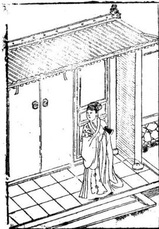

一白惟如六白良若然八白亦爲昌但將般尺來相吉少凶多必主殃

○曲尺之長

一白二黑三碧四綠五黃六自七赤八白九紫一○論曲尺根由

曲尺者有十寸一寸乃十分凡遇起造經營開門高低長短度量皆在此上須當湊對魯般尺八寸吉凶相度則吉多凶少爲佳匠者但用倣此大吉也曹班經 卷之 十四

○惟起造何首合自吉星

魯般經營凡人造宅門門一須用準與不準及起造室院條緝車箭須用準合陰陽然後使尺寸量慶用合財吉星及三白星方爲吉其白外但則九紫爲小吉人要合魯般尺與曲尺上下相仝爲好用尅定神人運宅及其年向首大利

按九天玄女襲門路以玄女尺筭之每尺止得九寸有零却分財病離義官刼害本八位其尺寸長短不齊惟本門與財門相接最吉義門惟寺觀學合義聚之所可裝官門惟官府可叢其餘民俗只本門與財門相接最吉○大抵尺法各隨匠人所傳術者當依魯般經尺度爲法

開門步數室單不客雙行惟一步三步五步七步十一步吉餘凶每步計四尺五寸爲一步于屋薦適水處起步量至立門處得單步合前財義官木門方爲吉也

○定盤眞尺

凡劍造屋宇先須用坦平地基然後隨大小潤狹安魯班經 卷之 十五

礫平正平者穩也次用一件木料 長一丈四五人 有爵長短在人用大四十厚二九中立表長短在四五尺內實用壓曲尺端止兩邊安入字射中心 上繫一線重下吊石墜則 爲平正直也有實襟可駁非日

世間萬物得其平全伏權衛及準繩創造先量基邇狹均分內外雨相停石磔切須安得正地盤先安鎮中心定將真尺分平正良匠當依此法眞推造宅舍吉凶論

這屋基淺在市井中人 人魁之處或外濶內徒爲或內內潤外狹穿只得隨地基所作若內濶外乃名為蟒穴屋則衣食自豐也其外濶則名爲檻口屋不爲奇也造屋切不可前三直後二直則爲穿心不吉如或新起併不可與舊屋棟齊過俗云新屋掃舊棟不久使相选須用放低於舊屋則曰次棟又不可直棟穿中門二穿心棟

魯班經卷之一

○三架屋後車三架法

造此小屋者切不可高大凡步柱只可高一丈零寸棟桂高一丈二尺一寸段深五尺六寸間濶丈一尺一寸次間一丈零一寸此法則相稱也詩日

凡人創造三架屋巖尺須華吉上量澗狹高低依此 法後來必出好兒郎

○五架房子格

正五架三閒拖後一柱步用一丈零入寸仲高一丈三尺八寸棟高一丈五尺一寸每段四尺六寸中間一丈三尺六寸次濶一丈二尺一寸地基瀾狹則在人加減此皆壓白之法也

三間五架星偏奇按白量材實利空住坐安然多書慶橫財入宅不拘時

○正七架三間格

七架堂屋大凡架造合用前後柱高一丈三尺六寸棟高一丈零六寸中間用濶一丈四尺三寸次關一丈三尺六寸叚四尺八寸地基濶窄高低深淺隨人意加減則爲之

詩日

經營此屋好華堂並是工師巧主張富貴本由繩庚得也須合用按陰陽

凡造此屋步柱用高一丈三尺六寸棟柱或地基 潤空一丈四尺八寸叚淺者四尺三寸成十分深 高二丈二尺棟爲妙

陰陽兩字最室先鼎創興工好何前九架五關堂尤 天萬年千載福綿綿謹按先師眞尺寸管教富貴足 直四時人若不依仙法致使人家兩不然

献韆架今人偷棟橫爲之吉人以如此造其中剝閉要坐起處則可依此格儘好

凡造小門者乃是塚墓之前所作兩柱前重在屋皮上出入不可十分長露出殺傷其家子媳不用使木作門蹄二邊使四隻將軍柱不空大高也

造此亭者四柱落地上三超四結果使平盤方中使福海頂藏心柱十分要聳无用暗鐙釘住則無脫落四方可觀之

詩日

枷梢門屋有兩般方直尖斜一樣言家有姦倫夜行子須防橫禍及道官

詩日

此屋分明端正奇暗中爲禍少人知只因匠者多藏素也是時師不細詳使得家門長退落緣他屋主大隈衰從今若要兒孫好除是從頭改過爲

新創屋宇開門之法一自外七大門而入次二重較門則就東畔開吉門須要屈曲則不空大直內門不可較大外門用依此例也大凡人家外大門千萬不可被人家屋春對射則不祥之兆也論起廳堂門例

或起大屬屋起門須用好筹頭向或作槽門之時須用放高與第二重門同第三重却就柁起或作如意門或作古錢門與方勝門在主人意愛

新蕭朱雀凶日庚午巳卯戊子丁酉丙午乙卯 1 修門雜忌 九良星年丁亥癸巳占大門○壬寅庚申占門○丁 巴占前門○丁卯巳卯占後門 丘公殺甲巳年占九月○乙庚占十一月丙辛年 占正月○丁壬年占三月○戊癸年占五月 ○逐月修造門吉日

正月癸酉外丁酉二月甲寅 三月庚子外乙巳四月甲子庚子外庚午五月甲寅外丙寅

六月甲申甲寅外丙申庚申 七月丙辰 八月乙亥九月庚午丙午 十月申子乙未壬午庚子辛末外庚午十一月甲寅 十二月戊寅甲寅甲子申申庚子外庚申丙寅丙申

右吉日不犯朱雀天牢天火獨火九空死氣月破 小耗天賊地天瘟受死氷消瓦陷陰陽錯月建 轉殺正四廢九土鬼伏斷火星九醜滅門離 窠次地火四忌五窮耗絕庚寅門大夫死自自虎 炙退三殺六甲胎神占門并食木星爲忌

○門光星 大月從下數上 小月從上數下 00 O cb

○白圈者吉人字損人丫字損畜

○門光星吉目定同

大月 -- · -- 四千八十九小月

諭門樓不可專至門樓經正輦経談人不淺故不編魯班經 卷之 十五

入門向須避直冲尖射砂水路道惡石山坳嵐破 孤峯枯木神廟之類謂之乘殺入門凶宜迎水迎 山避水斜割悲聲經云以水爲朱雀者忌夫湍 爾黃泉門路天機訣云庚丁坤上是黃臬乙丙須助 巽木先甲癸向中休見艮辛壬水路怕當乾○犯 王在死少丁殺家長長病忤逆

庚向忌安軍坤向門路水步丙向忌安单坤同門一路水步乙向忌安单五向門路水步內向忌安卑異向門路木甲向癸向忌安卑艮向門路水步幸壬向忌安单乾向門路水步

其法乃死絕處朝對宮爲黃泉是也

## 詩日

兩棟簷水流相射大小常相罵此屋名爲暗箭山人口不平安

據仙賢云屋前不可作欄村上不可使宜釘名爲暗前當忌之

○郭璞相宅詩三首

崖前致鴦杵名曰紙錢山家必多喪禍哭泣不曾闕曹班經 卷之一 二十六

詩云

門高勝於片後代絕人丁門高過於壁其家多哭法 門扇爾機欺夫婦不相空家財當耗散眞是不爲量 ○五架屋諸式圍

五架樑栟或使方樑者又有使界梗者及又槽搭欄半像之類在主人之所爲也

○五架後拖兩架

五架屋後添兩架此正按古格乃佳也今時人嗔做曹班經 卷之一 二十七

前淺後之說乃生生笑隱上吉也如造正五衆者必是其基地如此別有實格式學者可驗之也正七架樑指及七架屋川牌栟使斗櫟或柱義並由人造作後有圖式可佳

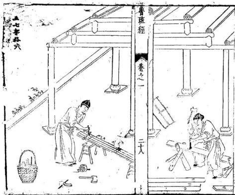

土府官殿凡倣此殿皇帝殿九丈五尺高王府七丈高飛麤找角不必再自重拖五架前拖三架上截升拱天花板及地量至天花夜有五上零三尺高殿上佳頭七七四十九根餘外不必再記隨在加滅中心兩柱入爲之天梁輔佐後無門俱大厚板片進金上前無門俱掛硃簾左邊立五宮右邊十二院此與民間房屋同式直出明律門有七重俱有殿名不必載之

二十十九

同天臺式此臺在欽天監左下層土磚石之類過圍八八六十四丈濶高三十三丈下一十八層上分三十三層此應上觀天文下察地利至上層過圍俱是冲天欄有其木裏方外圓東西南北反中央立起五處旗杆又按天腳二十八面寫定二十八宿星主上有天盤流轉各位星宿吉凶乾象臺上又有冲天一直平盤關方圓一丈三尺高七尺下四平縣穿枋串進中立圖木一根開上平盤者盤能轉欽魯班經 卷之一 三十

天監官每看天文立於此處修正廳左右二邊四大孔水湛光量每汛多少高帶礫至一穿枋下有多少尺寸可分爲上下一半下永棋帶腰枋每矮九寸零三分其腰祊只做九寸三分大抱柱線平面九分窄上五分上起荷葉線下起棋盤線腰枋上面亦然九分下超一四分窄面五分卜貼地祇貼仔一寸三分厚真地厭盤厚中間分三孔或四孔嶽枋存方圓一寸六分開尖一寸四分長前相後湄北磊心舞要高七寸三分房間光顯冲欄二尺四寸五分大應心門魯班經 卷之 10÷1

框一寸四分厚二寸二分大或下四差或下六差 尺寸要有零子舍箱問與惡心一同尺寸切惡爾 樣尺寸人家不和聽止荊眉彌孔厥門上截亮格 下截上行板門框起聰營線一寸四分大守入 分厚

正堂林修與正屬一同上框門尺寸無二但辰枋帶下水椹比屬上尺寸每變一寸八分若做一林光木椹如上他門做上截起洪盤綵或荷葉線平七分窄面五分上合角貼仔一寸二分厚其別雷同

寺觀庵堂廟宇式

架學造寺觀等行人門身帶斧器從後正龍而入立在乾位見本家人出方動手左手執六尺右手班經 卷之一 三十二

拿斧先量正柱次首左邊轉身柱再量直出山門外止呌夥同人起手右邊上一抱柱次後不論大殿中問無水椹或欄杆斜格必用粗太每筭正數不可有零前欄杆三尺六寸高以應天星或門及抱柱各樣要筭七十二地星菴堂廟宇中間水椹板此人家水椹每矮一寸八分起線抱柱尺寸一同巳載在前不自或做門或亮格尺寸俱矮一寸八分上寶棹三尺六寸高每與轉身柱一般長四尺面前疊方三層每退墨一寸八分荷業線下兩層花板每孔要分成雙下腳或雕獅象柁驅戒倣貼稍用二寸半厚記此

凡攸祠宇爲之家廟前三門次東西走馬廊又次之大廳屬之後明樓亭亭之後卽寢堂若粧修自三門做起至內堂止中門開四尺六寸二分潤一丈三尺三分高濶合得長天尺方在義官位上有等說官字上不好安門此是祠堂起不得官義二字用此二字子孫方有發達榮糧兩邊耳門三尺六寸四分濶九尺七寸高大吉財二字上見各天星吉地德星兄中門兩邊俱后格式家房之也專常人家子弟賢否都在此處種秀又且寢堂及屬兩廊至三門只可步步高見孫方有尊甲县小期大之故敘者深詳記之

壯修三門水椹城枝下量起直至一穿上平分上下一年兩邊演開八字水椹亦然如是大門二寸三分厚每片用餘暗串其門筍要圓門斗要扁此開門方齋爲吉兩廊不用壯架廳中心四大孔木椹上下平分下截每矮七寸正抱柱三寸六分大上截起荷葉線下或一林光或聞尖的此尺寸骨班經 卷之一 三十四

在前可觀廳心門不可做四片要做六片吉兩邊易閭及耳房可微大孔田字格或窗齒可合式甚門後楣要留進退有式明樓不須架修其寢堂中心不用做門下殿水椹帶地厭三尺五高上分五充做田字格此要括的內奉神主租先春秋祭7就拿得下來兩邊水滿前有尺寸不必再白又前君厭亮格門抱杜下馬蹄抱住此亦用活的後臺觀此謹家計察不可有悞

魯班經神厨茶式

下層三尺三寸高四尺鄉每一片三寸三分大寸四分厚下鎖廊方一寸四分大一寸三分厚要雷出吳上盤仔二尺二寸深三尺三寸關其框二寸五分大一寸三分厚中下兩串兩頭合角與樞一般大吉用止佐半合角好開柱脾相二個五寸高四分厚中下土厨只做九寸深一尺崗齒櫛枉止好下五根步步高上層柱四尺二寸高帶嶺在內柱子方圓一寸四分大其下六根中兩根係進的裏半做一尺二寸深外空一尺內中或做二層或做三層步步退墨上層下散柱二個分三孔耳孔只做六寸五分濶餘留中上拱樑二寸大拱樑上方樑一尺八大下層下曜眉勒水前柱礫一寸四分高二寸二分大雕播荷葉前楣帶嶺八寸九分大切忌大了不威勢上或下火熖屏可分爲三截中五寸高兩邊三寸九分高餘或主家用大用小可依此尺寸退墨無錯

卷之一三十六

宮寨格式立寨之日先下纍杆次看羅經再看地勢山形生絕之處方令木匠伐不踰定裏外管壘內營方用廳者其木不俱大小止前選定二根下定前門中五直木九丈爲中央主旗杆內分間架裏外相串次看外營週圍疊分金木木火土中立二十八宿下伏生傷杜日景死驚開此行文外代木交架而下週建祿角旗鎗之勢並不用木作之工但裏營要飽砍我接下門之羞其餘不必木匠嘗斑經 卷之一 川十七

新鐫京板工師雕斷正式魯班經匠家鏡卷之

保亭水閣式粧修四圍欄杆業背下一尺五寸五分高坐板一尺三寸大二寸厚坐板下或橫下板片或十字掛欄杆上靠背一尺四寸高此上靠背尺寸在前不白斜四寸二分方好坐上至一穿枋做選陽或做亮格門若下遮陽上油一穿下離一尺六寸五分是遮陽穿枋三寸大一寸九分原中下二根斜的好開光窗

魯班經匠家鏡卷之二倉敖式

依祖格九尺六寸高七尺七分濶九尺六寸溪枋每下四片前立二柱開門只一尺五寸七分濶下做一尺六寸高至一穿要留五尺二寸高上捐枋槍門要成對刀忌成單不吉閒之目不可內中飲食又不可用墨斗曲尺又不可柱枋上留字留墨學者記之切忌

會班經卷之二

松梁式凡橋無粧修或有神厨倣或有欄者若徙雙月而起自下而上若单日而起自酉而東者屋凡事尾濶欄杆二尺五寸高坐柅一尺五寸高

凡殿角之式垂昂插序則規橫奧用升斗拱相稱魯班經 卷之二 二

溪淺濶狹用合尺寸或地基濶二丈柱用高一丈不可走祖此爲大畧言不盡意細詳之

○建鐘樓格式凡起造鐘樓用風字廓四柱並用渾成梗木定高大相稱散水不可大低低則掩鐘聲不嚮于四方更不宜在右畔合在左逐寺廊之下或有就樓盤下作佛堂上作平基盤頂結中開樓盤心透上真見鍾作六角禍杆則風送鐘聲遠出於之外則為也

曹班經卷之三

○五音造牛欄法

夫牛者本姓李元是大力菩薩切見凡間人力不及特降天牛來助人力凡造牛欄者先須用術人揀擇吉方切不可犯倒欄殺牛黃殺可用左畔是坑右右畔是田王牛犢必得長壽也○造欄用木尺寸法度用尋向陽木一根作棟柱用近在人屋在辟半性怕寒使牛溫暖其柱長短尺寸用壓白不可犯在上含下作欄者用東方採祿木一根作左邊角柱用高六尺一寸或是二周四間不得作单間也人家各別椽子用令四隻則按春夏秋冬陰陽四氣則大吉也不可犯五尺五寸乃爲五黃不祥也子萬不可使損壞的爲牛備開門用合二尺六寸大高四尺六寸乃爲六自按六畜爲好也若八寸係八白則爲八敗不可使之恐損八也

魯般法慶剏牛欄先用推尋吉上安必使工師求好木次將尺寸細詳看但須不可當人屋實要相空對魯班經 卷之二 六

草崗時師依北規模作致使牛牲食祿寬

○合音指詩

不堪巨石在欄前必主牛遺虎咬遵切忌欄前大水窟主牛難使鼻難穿

牛欄休在污溝邊定墮牛胎損子連欄後不堪有行露主牛必相爛蹄肩

○牛嗇詩

一十黃一十起于坤二十還歸震巽四十官中歸乾盈此是神仙妙訣根○定牛人欄刀砧詩

春天大忌亥子位夏月須在寅卯方秋日休逄在巳本冬時申酉不可裝

○起欄日辰

起欄不得犯空亡犯着之時牛必亡癸日不堪行起 造牛瘟必定兩相妨

○占牛神出入

三月初一日牛神出欄九月初一日牛神歸欄空修 魯班經 卷之二 七

造大吉也牛黃八月入至次年三月方出並不可修造大凶屯

○造牛欄樣式

凡做牛欄主家中心用羅線蹐看做在奇羅星上吉門要向東切忌向北此用雜木五根爲柱七尺七寸高看地基寬窄而佐不可取方圓依古式八人二寸溪六尺八寸濶下中上下枋用圓木不可使扁枋爲吉

生門對牛欄羊棧一同看年年官事至牢獄出應維

○論逐月遣作牛欄吉日 正月 二月 三月 四月庚午壬午五月 真市甲中 丙辰乙未 乙ま 七月戊申 入月 乙丑 九月 甲戌 十月壬子子 甲子庚子 +1 月乙 乙亥庚 十二月反五丙寅 月乙丑丙寅 右不犯魁罡狗絞牛火血忌牛飛薦牛腹脹牛刃 砧天瘟九空受死大小耗土鬼凹廢

此亦看羅經一德星在何方做在一德星上吉門向東用一色杉木忌雜木立六根柱子中用小圓樑二根扛過好下夜閒掛馬索四圍下高水椹板每邊用模方四根纔堅固馬多者隔斷巳間每間三尺三寸濶深馬舊下向門左邊吉

前腳二尺四寸後腳三尺五寸高長三尺濶一尺四寸柱子方圓三寸大四圍橫下板片下腳空尺高

○馬鞍架

刖二腳高三尺三寸後二隻二尺七寸高中下半柱每高三寸四分其腳方圓一寸三分大濶八寸二分上三根直枋下中腰每邊一根橫每頭二根前二腳與後正腳取平但前每上高五寸上下搭頭好放馬鈴

已逐月作馬材吉日

正月真卯 辛未丁未 巳未 三月 甲申乙巳 丁卯巳卯四月子戊子 甲于戊子 五月 辛未壬辰 丙辰 六月 辛未乙亥 甲申庚申曹班經 卷之二 十一

七月 庚子壬子辛未 載子戊子丙子 壬辰乙丑 九月辛甲子戊于庚

○猪桐様式

此亦要看三台星居何方做在三台屋上方吉四桂 二尺六寸高方圓七尺橫下穿祊中直下大粗寶 齒用雜方堅固稍要內西北良工者識之初學 忌亂爲

○逐月作猪欄吉日

正月 四月 戊寅 甲子戊子庚子 乙未戊寅 甲戌 乙未六月 三月 辛卯丁卯 巳巳 甲申七月 十巳子王子成申 甲子戊子庚 八月 甲戌乙丑 九月 甲戊辛酉7 春之二 十二

十月 甲于乙未庚子 壬午真午辛未 十一月 丙辰 十二月 甲子庚 壬子戊寬○六畜肥目

春申子辰 夏亥卯未秋寅午戌冬巳酉耳目○鷺鴨鷄栖式

此看禽大小而做安貪狼方鵝欄二尺匕寸高深四尺六寸濶二尺七寸四分週圍下小窗齒每孔分一寸濶鷄鴨桐二尺高三尺三寸深二尺三寸濶桂子方圓二寸半此亦看至家禽鳥多少而做學者亦用自愚之

○鶏槍樣式

南柱高二尺四寸大一寸二分厚一寸樑大二寸五分一寸二分大鹿高一尺三寸濶一尺二寸六分下車腳二寸大八分厚中下齒仔五分大八分厚上做滔環二寸四大兩邊獎腿與下層窗仔一般高每邊四寸大

○屏風式八者高五尺六寸帶腳在內淵六尺九寸琴腳六寸六分大長二尺雕日月掩象鼻格奬腿工尺四分高四寸八分大四框一寸六分大厚一寸四分外起改竹四內起棋盤線平面六分窄三分繚環土下俱六寸四分要分成单下勒水花分作兩孔肜四寸四分相屋關窄餘大小長短依此長倣此○圍屏式

每做此行用八片小者六片高五尺四寸正每片火魯班經 卷之二 十四

一片四寸三分零四框八分大六分原倣成五分 厚筭定共四寸厚內較田宇格六分厚四分大做 者切忌碎框

○牙轎式

巨家明嶠衙下一尺五寸高屏一尺二寸高深一尺四寸濶一尺八寸上圓手一寸三分大斜七分纔圓轎杠方圓一寸五分大下靖帶轎二尺三寸五分

○衣籠樣式

一尺六寸五分高三尺二寸長一尺三寸大上發九分一寸八分高上板片三分厚籠板片四分厚內子口八分大三分厚下車腳一寸六分大或魯班經 卷之二 十五

雕三灣車腳上要下二根橫獷仔此籠尺寸無加

○大状下廊帶床方其高式尺一寸二分正床方七寸七分天武五寸七分大上屏四尺五寸二分高後屏二片兩頭二片濶者四尺零二分窄者三尺二寸三分長六尺二寸正領一寸四分厚徹大小片下中閒要做陰陽相合前踏板五寸六分高一尺入寸關前楣帶頂一尺零一分下門四片每片一尺四分大上腦板八寸下穿簾一尺八寸零四分餘留下板片門框一寸四分大一寸二分厚下門檻一管班經 卷之二 十六

寸四分三接裏面轉芝門九寸三分或九寸九分 切忌一尺大後學專用記此

此與藤床無樣但踏板卜下顧杆要下長柱子四根每根一寸四分大上榻八寸大下欄杆前一片左右兩二萬字或十字揖前二片止作一寸四分大高二尺二尺五分橫頭隨蹟板大小而做無悞○藤床式

帶床方一尺九寸五分高長五尺七寸零八分謂三尺一寸五分半上桂子四尺一寸高牛屏一尺五八寸四分高床嶺三尺濶五尺六寸長框一寸三分厚床方五寸二分大一寸二分厚起一字線好穿簾踏板一尺二寸大四寸高或上框做一寸二後腳二寸六分大一寸三分厚半合角記逐月安牀設帳吉日

三月 正月 一 一 丁酉癸酉丁卯 巳卯癸丑 甲子庚子丁酉 乙卯癸酉乙巳 4 二月 四月 巳未乙亥巳亥真寅 丙寅甲寅辛未乙未 丙戌乙卯癸卯五月甲 六月兩寅甲寅乙 丁酉乙亥丁亥癸寶班經 養之 十

十二月 乙丑丙寅甲寅 甲子丙子庚子

○禪床式 此寺觀庵堂纔有這做在後殿或禪堂雨邊長依屋 寬窄但濶五尺面前高一尺五寸五分床錢一尺 前平四板八寸八分大一寸二分享起六个注每 柱三才方圓上下一穿方好掛禪衣及張韓前平 面板下要下水椹板地上隴二寸下方仔盛板片 其板片要密

○禪椅式

一尺六寸三分高一尺八寸二分深一尺九寸五分魯班經 卷之二 十入

深上屏二尺高兩力手二尺二寸長柱子方圓一寸三分大屏上七寸下七寸五分出笋三寸開機頭下盛腳盤子四寸三分高一尺六寸長一尺三寸大長短大小倣此

○鏡架勢及鏡箱式 架及鏡箱有大小者大者一尺零五分深濶九寸 高八寸零六分上層下鏡架二寸深中層下抽相 一寸二分下層抽相三尺一寸零五分底四分 厚方圓離車腳內中下鏡架七寸大九寸高若辟 花者雕雙鳳朝陽中雕古錢兩邊睡草花下佐連 花托此大小依此尺寸退墨無悞

○雕花面架式

後兩腳五尺三寸高前四腳二尺零八分高每落墨魯班經 卷之二 十九

三寸七分大方能役轉雕刻花草此用樟木或南木中心四腳摺進用陽筭共濶一尺五寸二分零

案棹式

在高二尺八寸四層下一層高入寸二層高五寸三層高三寸七分四層高三寸三分高二寸空一寸五分棟一寸五分上淨瓶頭共五寸方層板四分半厚內子口三分厚八分大兩根將軍柱一寸五分大一寸二分厚奬腿四隻每隻一尺九寸五分高四寸大每層二尺六寸五分長一尺六寸濶下車腳二寸二分大一寸二分厚合角開進雕虎爪雙釣

高二尺五寸長短濶狹看按面而穢中分兩孔按面魯班經 卷之二 二十二

下抽箱或六寸深或五寸深或分三孔或兩孔下踏腳方與腳一同大一寸四分厚高五寸其腳方圓一寸六分大起麻擴線

搭仔 長二尺二寸高五寸大四寸五分大卯一寸二分太 一寸一分厚面起錫春線腳上竹圓

○諸樣垂魚正式

春班經卷之二

二十三

凡作垂魚者用按營造之正式今人又嘆作繁針如用此又用做進風及偃桷者方可使之今之匠人又有不使垂魚者只使直板作如意只作彫雲樣者亦好昔在主人之所好也

○馳峯正格

馳峯之格亦無正樣或有彫雲樣或有做荒樣又 有做虎爪如意樣又有彫瑞草者又有彤花頭者 有厭毬捧格又有三肄或今之人多只愛使斗立 父童乃爲時格也

魯班經卷之二

1+四

## ○風箱樣式

長三尺高一尺一寸濶八寸板片八分厚內開風板 六寸四分大九寸四分長抽風橫仔八分大四分 厚扯手七寸四分長抽風好八分大四分厚批 手七寸長方圓一寸大出風眼要取方圖一寸八 分大平中爲主兩頭吸風眼每頭一箇濶一寸入 分長二寸二分四邊衣片都用上行欽準

班經 卷之二 二十五扉花者五尺高三尺七寸濶土搭頭每邊長四寸四分中環三片腿二尺三寸五分大下廊一尺五寸三分高柱一寸四分大一寸二分厚○素衣衆式

高四尺零一寸大三尺下郡一尺二寸長四寸四分大柱子一寸二分大厚一寸上搭廟出頭二寸七分中下光框一根下二根窗齒每成雙做一度三分高每眼齒仔八分厚八分大○而架式

兩柱一尺九寸高外頭二寸三分後二廊四及十九分方員一寸一分大或三腳者內要交集職除笋書進一寸零四分斜六分無悞

臺班氣 卷之二二十六○鼓架式

一尺二寸七分高四腳方圓一寸二分大上雕淨獲頭三寸五分高上層穿枋仔四捌根下層入根上層雕花板下層下繚環或做八方者柱子橫擴在尺寸一樣但畫眼上每邊要斜三分半筆是正的一此尺寸不可走分毫謹記

高三尺七寸上蕃簾衣架頭花方圓一寸五分大兩邊柱子俱一級起棋盤線中閒穿枋仔要三尺高銅鼓掛起便手好打下腳雕屏風腳樣式獎薄尺八寸高三寸三分大

○花架式

八者六鄺或四腳或二腳六腳大者中下騎相一七寸高兩邊四尺高中高六尺下枋二根每根三寸大直枋二根三寸大直枋二根三寸大五尺濶七尺長上盛花盆板一寸五分厚八寸大此亦看人家天井大小而做只依此尺寸退星有準○凉傘架式

官班經 卷之二 1+七一尺三寸高二尺四寸長中閒下傘柱仔二尺三寸高帶琴脾在內筭中柱仔二寸二分大一寸六分厚上除三寸三分做淨平頭中心下傘樑一寸三分厚二寸二分大下托傘柄亦然而是兩邊柱子方圓一寸四分大窗齒八分大六分厚琴腳五寸大寸六分厚一尺五寸長

○校椅式

椅先看好光梗木頭及節次用解開要乾枋纔下手做其柱子一寸大前腳二尺一寸高後廊式尺九寸三分高盤子深一尺二寸六分濶一尺六寸七分厚一寸一分屏上五寸大下六寸大前花牙一寸五分大四分厚大小長短依此格○板式

海獄一尺六寸高一寸三分庫長三尺八寸五分樓讀三寸八分半長腳一寸四分大一寸二分厚卷牙勒水三寸七分大或看櫈面長短及粗橈尺一同餘倣此 UE○琴式

八者看廳堂濶狹淺深而做大者高一尺七寸面三寸五分厚或三寸厚卽歃坐不得長一丈三尺三分面一尺三寸三分大腳七寸分大雕捲草雙釣花牙四寸五分半頭一尺三寸一分長或腳下做貼仔只可一寸三分厚要除矮腳一寸三分纔相稱或做靠背尺寸一同但靠背只高一尺申班經 卷之二 二十九

四寸則止橫仔做一寸二分大一尺五分厚或起棋盤線或起錫春線雕花亦而之不下花者同樣餘長短寬濶在此尺寸上分準此

○机子式

四一尺二寸長濶九寸或八寸高一尺六寸頭空一寸零六分晝眼腳方圓一寸四分大面上眼斜六分半下橢仔一寸一分厚起鈕眷線花牙三寸五

○

高二尺五寸長短濶狹看按面而做中分兩孔按面下拙和或六寸深或五寸深或分三孔或兩孔下踊腳方與腳一同大一寸四分厚高五寸其腳方員一寸六分大起麻橫線

0八仙掉

高二尺五寸長三尺三寸大二尺四十鄰一寸五分大若下爐金下層四寸七分高中間方員九寸八分無悞動木三寸七分大腳上方員二分緣棹框春班經 卷之二 三十

二寸四分大一寸二分厚時師依此式大小必無一悞

○小琴棹式

長二尺三寸大一尺三寸高二尺三寸腳一寸人分大下梢一寸二分大厚一寸一分上下琴腳勒水二寸人斜聞六分或大者放長尺寸與一字棹同○棋盤方棹式

方圓一尺九寸三分腳二尺五寸高方員一寸五分大棹革一寸二分學二寸四分大四齒吞頭四值

○衣厨樣式高五尺零五分深一尺六寸五分濶四尺四寸平公爲兩柱每柱一寸六分大一寸四分厚下衣擴一寸四分大十寸三分厚上嶺一寸四分大一寸一分厚門框每根 寸四分大一寸一分厚其廚上補一寸二分○食格操式

在二根高二尺二寸三分帶淨平頭在內一寸一分大八分厚標尺分厚二寸九分大長一尺六寸春班經 卷之二 三十

分濶九寸六分下層五寸四分高二層三寸五分高三層三寸四分高二寸高板片三分半厚裏子入分大三分厚車腳二寸大八分厚奬腿一尺五寸三分高三寸二分大餘大小依此退墨做○衣摺式

大者三尺九寸長一寸四分大內柄五寸厚六分小者二尺六寸長一寸四分大柄三寸八分厚五分此做如劍樣

衣箱式

長一尺九寸二分大一尺六分高一尺三寸板片只用四分厚上層一寸九分高子口出五分或下車腳一寸三分大五分厚車腳只是三灣

燭臺式

回四尺柱子方圓一寸三分大分上盤仔八寸大三分倒指花牙每一隻腳下交進三片每片高五寸二分雕轉鼻帶葉交腳之時可拿板畫威左八寸四分定三方長短照墨方準

面爐式

方圓二尺一十三分大帶腳及車腳共上磨六尺五分正上面盤子一寸三分厚加盛爐賊任八分厚做成二寸四分大豹脚六隻每隻二寸大二寸三分厚下貼梢一寸厚中圓九寸五分正

九寸高方圓式尺四分大盡仔下絲環式寸樞一寸厚一寸六分大分佐亦方下豹脚腳二寸二分大一寸六分厚其豹腳要雕吞頭下貼梢一寸五分厚一寸魯班經 卷之二 三十三

六分大雕三灣動水其框合角笋眼要斜八分半方 聞得起中間孔方員一尺無悞

方式

高五寸五分圓尺內圓九寸三分四腳二寸五分大雕雙蓮挽雙鈎下貼梢一寸厚二寸大盤任一寸二分厚繚環一寸四分大雕螳螂胜接豹腳相秤

香爐樣式 細樂者長一尺四寸闊八寸二分四權三分厚高一 寸四分底三分厚與上樣樣關大框上斜三分上卯 水邊三分厚六分大厭竹線下豹腳下六隻分 八分大一寸二分大貼梢三分厚七分大雕三灣車 脚或粗的不用豹脚水邊寸尺一同又大小敬者尺 寸依此加減

前柱一尺五寸五分壽後柱子式尺七寸高方圓一寸大盤子一尺三寸開一尺一寸深框一寸一分厚寸二分大切忌有節樹米無用

卷之二

九佐香九要看人家屋大小若何而大者上層三丈高二層三寸五分高三層鄉尺三寸長先用六寸大役做一十四分大下層五寸高下車脚一寸五分厚合角花牙五寸三分大止層欄杆仔三寸三分羸方圓做五分大餘看長短大小而行

招牌式 大者六尺五寸高八寸三分闕小者三尺二寸高五 寸五分大

洗浴坐板式三尺一寸長三寸大厚五分四圍起劍脊線藥厨高五尺大一尺七寸長六尺中分兩眼每層五寸分作七層每層抽箱兩個門共四片每邊雨片鄭方圜一寸五分大門框一寸六分大一寸一分厚抽相板四分厚

三尺高一尺七寸大深九中分三層內下抽相只做魯班經 卷之三 三十五

三寸高內中方圓交佐巳孔如田字格樣好下藥此是杉木板片合進切忌雜木夾半式

方圓五寸五分高四寸七分板片三分半厚上柄柱子共高八寸五分方聞六分大下或刻車腳上掩火宿齒仔四分大五分厚橫二根直六根或五根此行灯警高一尺二寸下盛板三寸長一封書做寸五分厚上留頭一寸三分照得遠近無悞履式

大櫃上框者二尺五十高長六尺六寸四分關三尺三寸下腳高七寸或下轉輪聞在腳上可以推動四住每住三寸大三寸厚板片下叩框方密小者扳是合進二尺四寸高二尺八寸關長五尺零二寸板一寸厚板此及量十及星跡各項識記

身書身云 大者一尺四寸長共大一尺二寸內中開河路一寸 二分大框七分方圓內起線三分方圓橫共十路直 共九路何路笋要內做重貼方能堅固

魯班經 卷之二 三十六圍棋盤式

方圓一尺四寸六分框六分厚七分大內引六十四 路長通路七十二小斷路板片只用三分厚 路長通路七十二小斷路板片只用三分厚

起造房屋類 卷路

立柱喜逢黃道日

天官賜福

注意雕鏤刻書欲令中華文物煥爾一新故嘗語人日不規而圓不矩而方此乾坤自然之象也規以爲圓矩以爲方實人官雨象之能也矧吾之明雖足以盡制作之神亦安得必天下萬世咸能師心而如吾明耶明不如吾則吾之明而吾之技亦窮矣爰是韻目力復繼之以規矩繩俾公私欲經營宮室駕造舟車與置設器皿以前民用者要不超吾一成之法巳試之方矣然則師之綠物盡制緣制盡神者顧不良且鉅哉而其淑配雲氏又天授一叚神巧所魯班經 源流 春班經 源流 1魯班仙師源流 制器物固難枚舉第較之於師殆有佳處內外贊襄師諱班姓公輸字依智魯之賢勝路東平村人也其 用能享太名而垂不朽耳裔是年蹟四十復隱于歷父諱賢母吳氏師生於魯定公三年甲成五月初七 山卒遘異人授秘訣雲遊天下白日飛昇止畱斧鋸日午時是日白鶴羣集異香滿室經月弗散人咸奇 在自鹿仙巖迄今古迹昭然如睹故戰國大義贈爲之甫七歲嬉戲不學父母深以爲憂迨十五歲忽幡 永成待詔義士後三年陳侯加贈智惠法師歷漢唐然從遊於子夏之門人端木起不數月遂妙理融通 宋猶能顯蹤助國屢膺 封號我度越時流憤諸僭稱王號因遊說列國志在尊周 皇明水樂間鼎剏北京龍聖殿役使萬匠莫不震錶而計不行廼歸而隱于泰山之南小和山馬晦迹幾 賴師降靈指示方獲洛成爰建廟祀之扁曰魯班門一十三年偶出而遇龜老輩促膝讌譚竟受業其門 封待詔輔國太師北成侯春秋二祭禮用太牢今之

工人凡有祈禱聲不隨淨隨應恍懸象著明而萬古神照者

明錢塘胡文煥德父校正貞觀元年正月十五日

和尚奏萬姓設齋之日值遇凶帝故爲咎者豈是不按藏經內值吉神可用之日所以致此臣今藏經內錄如來選擇紀奏

甲子日是善財童子在世撿齋還愿者子孫昌盛福生招財大吉利

乙丑丙寅日是阿羅漢尊長者與天神下降有人設齋還愿者萬倍衣祿財寶自然吉慶大吉利

丁卯日是司命檢齋有人祈禱還愿者返善爲惡妨人口大凶可忌

戊辰巳巳日是那吒太子撿齋若人設醮還福返 善爲惡妨人口大凶

庚午日是青衣童子在世撿齋還福者主萬倍富 貴典旺大吉

辛未日是三途餓鬼在世撿齋選愿者至三年破財損六畜大凶

壬申癸酉日是判官在世撿齋還愿者至一年內 有禍大凶

甲戌乙亥丙子丁丑戊寅巳卯六日是馬鳴王菩薩檢齋得無量福萬事大吉利

庚辰辛巳壬午日是稱神惡鬼在世設齋主傷 遠擇紀全

人口生灾家中常有血光火燭一年大凶癸未日是野婦羅刹設齋主一年內人口破散大凶

甲申乙酉丙戍三日是彌陀佛說法之日設齋遷愿者主三年內獲福萬倍子孫興耻龍神獲祐百事大吉

丁亥日是朱雀神在世設齋還愿者官灾口舌疾

戊子日是冥司差極忌神在世設齋還愿書三

年遇遭官事口舌是非疾病此日大凶巳丑日是司命真君差童子在世檢齋還愿者王人口安康獲福無量此日平安

庚寅辛卯日是畜神在世設齋還鳳者主一年內

破財損畜是非大凶

壬辰自是阿難尊者與青衣童子在世設齋還屬者主子孫昌盛獲福無量三年大吉利

癸巳日是惡神遊行設齋還愿者王年年不利大 凶

三

甲午乙未丙申丁酉戊戌巳亥庚子辛丑八日是文殊普賢與青衣童子在世檢齋還愿者此且獲福無量百事大吉

壬寅癸卯日是觀音菩薩行化之日設齋還愿者 王兄孫得福後世生淨土所生男子十相俱足

甲辰乙巳日县入下四角大神在世檢齋還愿者 返善爲惡人眷生灾大凶

丙午丁未日是牛頭夜乂在世檢齋還愿者人子

信用者三年內傷人日此日大凶戊申巳酉日是千佛下世設齋酬恩了願福利倍子孫昌盛財物興旺六畜孳生大吉庚戌辛亥日是一切賢聖同降遊行天下若人祈福者獲福無量大吉

壬子癸丑甲寅乙卯四日是諸佛賢聖同惡樹設齋者此日平平

丙辰丁巳日是大頭金剛在世設齋者此日大凶 戊午日是諸聖不受愿心不明此日大凶

巳未日是釋迦如來同菩薩在世設齋酬恩者禮 利無量大吉

庚申辛酉日是釋迦如來說法之日設齋酬恩者福利無量家宅富貴興旺子孫昌盛主大古利

王戍癸亥日是諸佛不撿齋之日大凶 聞皇極玉記秘於大有之庭出自太虛玉匣之 內自眞君許始有立焉選擇紀者藏於西上寶 塔之上自三藏貞觀初現此分二教建善之文 二多巳巳庚午辛未壬申甲戌乙亥戊寅巳卯壬午 甲申乙酉戊子甲午乙未丙申壬寅丙午丁未戊 申巳酉甲寅乙卯巳未庚申辛酉定成開 忌刀砧柔斧頭殺龍虎受死天賊月破危日山 九土鬼正四廢魁罡日 竹木不蛙

之亥甲辰壬辰丙辰每月初五巳前遇忌日建宮室

與起造同安明堂玉堂黃道大明三帝星及五帝擇日免全

生日忌天灾天火地火雷火月火獨火火星魁星R

建神廟

不論金華塔臺年月只與起造同但要神在忌神鬼隔 桑門寺院同自漢創自馬寺始有佛廟皆向東梁唐之後多向北忌向南方起工破木

宏巳巳甲戊辛未乙亥戊寅巳卯壬午甲申乙一戊子庚寅乙未巳亥壬寅癸卯丙午戊卯巳酉于乙卯巳未庚申辛酉黃道天成月空天月二釐及合成開日

忌刀砧殺木馬殺斧頭殺天賊受死月破被敗獨 火魯般殺建日九土鬼正四廢四離四絕日 起桑扇架

空甲于乙丑丙寅戊辰巳巳庚午辛未甲戌乙亥 戌寅庚辰辛巳壬午癸未甲申丁亥戊子巳丑庚 寅癸巳乙未丁酉戊戌巳亥庚子壬寅癸卯丙午 戊申巳酉壬子癸丑甲寅乙卯丙辰丁巳巳未渡 日絕全

申辛酉黃道天月二德成開定日忌正四廢天賊建日破日

空乙巳辛丑甲寅乙亥乙酉巳酉壬子乙丑巳未庚山戊下乙未巳亥巳卯甲申巳丑庚寅癸卯戌

空甲子乙丑丁卯戊辰巳巳庚午辛未壬申甲戌丙子戊寅庚辰壬午甲申丙戌戊子庚寅甲午丙申丁酉戊戊巳亥庚子辛丑壬寅癸卯乙巳丁未巳酉辛亥丑乙卯丁巳巳未辛酉癸亥黃道天月二德諸巨星成開日 前二條忌朱雀黑天牢黑獨火天火月火狼藉地火氷消羗天瘟天賊月破大耗天罡河魁受死魯船殺刀砧殺剗削血刃殺魯般跌蹼殺陰錯陽錯伏斷九土鬼正四廢五行忌月建轉殺火星天灾日

宏甲子丁卯戊辰巳巳辛未壬申癸酉丙子丁丑 日紀全 九

巳卯庚辰癸未甲申乙酉丙戌戊子庚寅丁酉癸 巳乙未巳亥辛丑壬寅癸卯甲辰乙巳戊申巳酉 庚戌辛亥癸丑乙卯丙辰庚申辛酉定成開日 泥尾

空甲子乙丑巳巳甲戌丁丑庚辰辛巳乙酉辛亥庚寅辛卯壬辰癸巳甲午乙未丙午戊申庚戌辛亥丙辰丁巳戊午庚申平成日

室甲子乙五內寅戊辰巳巳辛未癸酉甲成丁丑

人人人人人天月從下數至上逆行小月從上數至下順行日一位遇自圈大吉黑閭損六畜人字損人不利忌庚寅門大夫死日及六甲胎神占月不空修乘門

空伏斷閉日忌丙寅巳巳庚午丁巳及四廢日開路

一天德月德黃道月忌月建轉殺天賊正四廢塞路空伏斷閉且

案堤塞水空伏斷閉日忌龍會開破月 造橋染

不論金華臺塔年月只與起造宅舍同忌寅申巳亥日時爲四絕四井

空上吉黃道大明要安續世益後天月二德及金天成天廟咸勲福厚吉期普護守成兵吉兵寶造倉庫

室丙寅丁卯庚午巳卯壬午癸未庚寅甲午乙未

癸卯戊午巳未癸丑滿成開日 前三條俱邑 朱雀黑天牢黑天火狼藉獨火月火九空空亡財 離歲空死炁官符月破大小耗天賊天瘟受死水 消瓦解月建轉殺月虛月殺四耗陰陽錯地火伏 斷正四廢火星十惡天地離九土鬼大殺入 塞鼠宄

室壬辰庚寅滿閉日正月上辰鼠死日克天狗日 造厨

空丙寅巳巳辛未戊寅甲申戊申甲寅乙卯巳未 捧日紀全

庚申

空甲子乙丑巳巳庚午辛未癸酉甲戌乙亥癸未甲申壬辰乙未辛亥癸丑甲寅乙卯巳未庚申黃道天赦月空正陽五祥定成開日前二條忌朱雀黑天氣土瘟天賊受死天丈獨火十惡四部轉殺九土鬼正四廢建破丙丁午日每月初七十五廿七不可移動每月初八十六十七日及六甲胎神占月忌拆竈修理

戊寅巳卯癸未甲申壬辰癸巳甲午乙未巳亥辛丑癸卯巳酉庚戍辛亥癸丑丙辰丁巳庚申辛酉餘日 前三條俱忌朱雀黑天火等火天瘤火星天賊月破受死畢元九土見八風正四廢轉殺午日丁巳日

掃舍空除滿日

空壬子癸丑丙辰丁巳戊午巳未庚申辛酉報日紀全 主

巳上八日凶神朝天可餅工造作修理優造門

室甲子乙丑辛未癸酉甲戌壬午甲申乙酉戊子巳丑辛卯癸巳乙未巳亥庚子壬寅戊申壬子甲寅丙辰戊午黃道生氣天月德及合蒲成日作門忌日

春不作東門夏不作南門秋不作酉門冬不作北門與修門同

歸釗龜立壬癸月及水月修水廨方天蜂地啞日

忌每月巳午未日及三月無牛之家不砌花臺 與動土日同 空水木日 忌金土日作

空庚辰丙戍癸巳壬子巳未天乙絕氣伏斷上閱忌正月廿九日

修廟 室巳卯壬子壬午乙卯戊午

忌春夏正六月及六甲胎神占月牛胎四十月占 在今 安碓磑磨銀油榨

空庚午辛未甲戌乙亥庚寅庚子庚申龔啞月滲磨日與安磨日同忌牛胎正七月占開池

空甲子乙丑甲申壬午庚子辛丑辛亥癸巳癸丑辛酉戊戌乙巳丁巳癸亥天月二德及合生炁成

左甲子乙丑辛未巳卯庚辰丙戌戊申開年月 前二條忌玄武黑天賊土瘟受死大小耗龍口伏 龍咸池冬壬癸日九土鬼土痕水隔四廢天地豐 sa#

空甲子乙丑癸酉庚子辛丑壬寅乙巳辛亥辛酉癸亥丙子壬午癸未乙酉戊子癸巳戊戊戊午巳未庚申甲申癸丁巳黃道天月二德及合生氣成日

釋日紀全

空甲申庚子辛丑乙巳辛亥癸丑丁巳壬午戊戌 成日前二條忌黑道天瘟土壅天賊受死土忌 血忌飛廉九空大小耗水隔九土鬼正四廢刀砧 天地轉殺水痕伏斷三六七月及卯日泉竭泉開 日辛巳巳丑庚寅壬辰戊申巳上係泉竭日 戊辰辛巳巳丑庚寅甲寅巳上係泉閉日 戊辰辛巳巳丑庚寅甲寅巳上係泉閉日 器用類

室黃道生氣要安吉期活曜天慶天端吉慶天月

二德合天善金堂玉堂後續世三合成目忌天瘟四廢九土鬼魁罡勾絞月破火星離II楚牀 造猛奄同是桔榫 卽水庫空黃道天月二德生氣三合平足日忌黑道虛耗焦坎田火地火九土鬼水隔水裏破H擇日紀全

諭一年四季之月 每月忌吉凶星臨前日宜查寅申巳亥謂之四孟月 正四七十月甲子 癸酉 壬午 辛卯 庚十 巳酉 戊午妖星上齊星甲戌 癸未 壬辰 辛丑 庚戌 巳未或星上火丙寅 乙亥 甲申 癸巳 壬寅 辛亥利星上利星丁卯 丙子 乙酉 甲午 癸卯 壬子 辛夏擇日紀全 共煞星 上顯星戊辰 一 兩戌 乙未 甲辰 癸丑 壬歲直星 上曲里戊寅 丁亥 丙申 乙巳 甲寅 癸利星 上林庚午 巳卯 戊子 十酉 兩午 乙卯角星 上僻尼華未 貞辰 已丑 戊戌 丁未 丙辰傳星 上傳星

辛巳 庚寅 巳亥 戊申章星 上火星子午卯酉謂之四仲月 二五八十 一月甲子 癸酉 壬午 辛卯 庚子 巳酉 戊午或星 上利星甲戌 癸未 壬辰 辛丑 真成 巳利星 土廈星一丙寅 乙亥 甲申 癸巳 壬寅 辛亥 康申上曲星煞星擇日總全丁卯 丙子 乙酉 甲午 癸卵 壬子 辛酉直星 上朴星戊辰 丙戌 乙未 甲医 壬盛利星上解星巳巳 戊寅 丁亥 乙角星 上傳屋巳卯 戊子 丙午傳星 上章星庚辰 用 成戌 丁未 丙辰

阜星上齊星 壬申 辛巳 真寅 巳亥 戊申 妖星上利星 辰戍丑未謂之四季月 三六九十二月 甲子 癸酉 壬午 辛卯 庚子 巳酉 戊午 利星上類 一乙丑 甲戌 癸未 壬辰 辛丑 庚戌 已未 煞星 上曲星 丙寅 乙亥 甲申 癸巳 壬寅 辛亥 齊日紀全 直星 上朴里 丁卯丙子 乙酉 甲午 癸卯 壬子 辛酉 利星 上鮮星 戊辰 工丑 乙未 甲辰 癸丑 壬成 角星 上傳星 巳巳 戊寅 丁亥 丙申 乙 甲寅 癸亥 傳星 上章星 庚午 戊子 打酉 丙午 乙卯 章星 上齊星

庚辰己丑戊戌丁未丙辰

壬申辛巳庚寅巳亥戊申丁巳或星

妖星值日凶

如值此星者名爲玄武入宅凢遇人家起造嫁娶秋徒上官匙任聞張興店出人祭祀等項不出一年再主人口凶連遭官非動作安葬失財被盜牢禁刑獄人口落水四百日內有疾病孝服損財口舌自東直年日紀全 克

方來三年內大凶卽齊星是也

武星值日凶

如舊此星者名日朱雀人宅主當年火盜怪灾一日落一日官非財散六畜傷疾男女淫活缺唇喪服只空安安墳若有他事不美此星卽火星也

和星僅日区如此星者名日自虎入宅凡一應嫁娶上官開囊等事不出一年之內損財疾病缺虎咬蛇傷官非漢亂若有積陰德之人見血灾奴婢當災也

朴星僅日凶如值此星者名日黑殺入宅几過造作嫁娶店肆等事不出一年內主瘋疾之人見凶更有火盜官灾淫亂虎咬蛇傷若本人有福立見虛耗不祥之意

如值此星者名日金櫃六令青龍天德星入宅凡人 家修造嫁娶開店鋪上官出行等不三年內官者 祿老者增壽今家孝順百事稱心所謂大吉慶喜如 意者卽顯星也

釋目純全 二十

傳星值日吉

如值此星者名日太陰金堂入宅凢遇造作嫁婺上官赴任開張店舖移徙入宅出行等事不出一年之內主生貴于三年之間有位至公卿無官得福無量所謂吉慶財斧豐餘得外人財喜用自然交集者卽葉微星也

前星值日吉

一如值此星者名日玉堂入宅凡人家修造嫁娶開店上官出行不出三年內官位高遷田委與隆男貴女清決招橫財百事稱心若遇金神七煞凶至年一一日先吉後主灾失財多遭官事此卽文曲星也如無不遇金神七煞此日上好

角星值日凶

如值此星者名曰太陽符入宅凡嫁愛造作赴任出行不過三年內主遭官灾火盜更忌生產外若主人有陰德只見口舌經答謝此卽解星也

如值此星者名日勾陳符入宅凢遇造作嫁娶開張擇日純全 主

店舍赴任出行安葬等事不出一年內主有人口退散官灾火盜如上樣造船可見匠人皿光之灾主人要與諸家曆書不同陰陽不同人口救苦經亦宅又日靈經異書莫傳與天下遇人如七煞星雖遇吉神亦不可用有失有散

一九天 星玫联活 凡造作奧工從福星起福 壹歲至德星順數輪轉至其年星位權月宅德星入命宜修造注壽延年爲兆自作添進人反北方田宅財旺富貴之吉兆也宅福星入命空修造興工三財進益四宅典旺大吉利也

宅祿星入命空修造屋此年修造不論錢動土輿工不用十六十日橫財來天地龍神自降福

宅寶星入命是祥星若逢修造必添丁造屋未威上財至子孫昌順後頭典旺

宅敗星人命名下虛耗若興工造作立生灾殃如不擇日紀全 主

忌官火盜

宅虎星守命不宜修造若見灾驚小修未可龍虎入宮動土修濠可歇安寧

宅天之年多禍凶難依作福保陰功握鑿造作人不信二年之內見貧窮

宅鬼之年鬼兵偏左作福向中廷金神太乙來修作當年之內主伶行

宅欽星運福過圍修造之工立見顏憑汝豪強福義 且未成先巳身危

肘金語

天凢起造修理等用但看當家人或子息承繼之人絕輪到其年星位吉凶擇用就千吉年內選月日時刻用之則吉不信者誠之多驗功室細詳觀可久也鶴神方位

正東方 乙卯丙辰 丁巳戊午巳未 東甫方 庚申辛酉壬戌癸亥甲子 乙丑

正南方 丙寅丁卯戊辰巳巳庚午擇日紀全 1

西南方 辛未壬申 癸酉 乙亥 丙子正酉方 丁丑 戊寅 巳卯 庚辰 辛巳東井方 壬午 癸未 甲申乙酉 丙成丁亥

正非方戊子巳丑庚寅辛卯壬辰餘日上夫直至巳酉日起甲寅日止遷歸裏北方屬象在後

唐神方歌

甲巳東北丁壬南乙庚酉泣豐鄉安丙辛正在酉天

吟前煞正四七十月逢酉二五入十一月逢巳 三六九十二月逢丑此月逢吟人是 紅紗煞并分南北紅沙 南正二三四月爲五五六七八月爲仲數 此北正為孟三爲季孟西仲巳爲丑數此 正二三四月酉日五六七入月巳日

此是紅紗日當忌出行犯之老不歸家起造犯此日白日火燒得病犯之必掛細贏嫌娶犯之百里敗家

集紀全彭祖百忌日

甲不開倉財物耗散 乙不羞植千枝不長丙不修竈必見火殃 丁不痢頭野必生瘡戊不受田田主不祥 巳不破券二北並七真不經絡機織虛張 辛不合暫上人不嘗壬不決水難更隄防 癸不詞訟理崩敵強子不問卜自若灾殃 且不寇帶主不還鄉寅不祭祀神鬼不嘗 卯不穿井井泉不香展不哭泣主必重喪 巳不遠行財物状藏午不苫屋主更張 未不服藥毒氣入腸申不安牀鬼崇入房 酉不會客醉坐顛在酉不出鷄令其耗亡 戌不吃犬作怪上狀亥不嫁娶不利新郎 亥不出猪再養難償建可出行切忌開嚴 除可服藥鍼炙亦良不宜出貨財物難償 蒲可市肆服藥遭殃財神方求財之吉 甲巳日東北方 丙丁日正酉方 乙日酉南方戊日酉北方庚辛日正東方壬癸日正南貴神方求名趨之吉丁日正東方壬日正南九巳日正非方 癸日正西方 乙日酉南左辛日東南方 甲庚西北方丙戌東北方擇日親全卷

靈驅解法洞明真言秘書 唐李淳風代人擇日其家造屋淳風與之畢日乃十惡魔者必須有解前魘禳之書皆土木工師邪術蓋 大敗日言稱今日乃上吉日也遂與其書此對貼于柱邪者何能勝正是書所載諸法皆何句真言靈符 其日袁天罡同唐太宗來訪淳風偶見其立柱上梁天妙訣學者觀者勿得汚手開展各宜敬之凡有一 罡笑曰天下術士亂爲也太宗曰何也天罡曰今日乃切動作起造完日解禳之後則土木之覺無益矣 卜惡日也大宗曰可是誰擇之日遂問之其家對日如居舊室或買者賃者家宅累見凶事或病或口 淳風也天罡曰今在何處其家遂荅曰在右左寺山門舌或爭訟家中不和瞻夢魘呌見神遇鬼傷害人 口卜數天罡欲行其家留之侍以盛酒不數盃遂亂而日主意淡薄時常火發頻賊偷盜飛來等福敗家 行天罡與太宗曰臣聞淳風高士今虛傳也太宗曰可喪命之類並皆可禳能轉禍爲福百難無侵則永 去問其數看其知我爾乎太宗未至寺天罡先行見連秘訣仙機 訣傳機達安泰矣 風曰知我乎曰知也今日左輔臨寺是君也紫薇至寺因累試累驗特此挾升 差一時然卦屬乾二爻見龍在田乃君至也天罡曰今工完禳解呪 知吾來是真乃袁天罡前村上梁擇日是爾否曰然天呪日 罡曰今日乃十惡大敗日何不識也曰今日紫養臨吉五行五土相尅相生木能尅土土速遁形木出山卷 地諸凶神皆避也天罡曰紫薇在于何所曰將及至癸金尅神木精急退免得天嗔工師假術卽化微塵 也方說完太宗駕至入寺淳風拜伏于地大宗艮夫一切魔鬼快出戶庭掃盡妖氲五雷發聲柳枝一酒天罡對以立柱喜逢黃道日上來正題案養星之記一火盜清寧一切魔物不得番身工師哩語貶入入冥 一講明太宗遂扶起而還遂擢爲軍師今人家貼此是善奉天令永保家庭急急如老君律令 疵故事也

<table><tr><td></td><td></td><td></td><td></td><td></td><td colspan="8" rowspan="1"></td><td colspan="2" rowspan="1">魯班秘書凡匠人在無人處莫與四眼見自巳閉日展開一見者便用</td><td colspan="1" rowspan="1"></td><td colspan="1" rowspan="1">柱葉藏手手內主發利甲</td><td colspan="1" rowspan="1"></td></tr><tr><td colspan="1" rowspan="1"></td><td colspan="1" rowspan="1">舡亦藏于斗中可用舡頭朝內主進則不可朝外朝外主財退</td><td></td><td colspan="1" rowspan="1">不拘藏于某虞主主人壽長</td><td></td><td colspan="6" rowspan="1">門縫中間藏墨浸代代賢能出方正不爲書吏却丹青安穩人家主忠信</td><td colspan="1" rowspan="1">0</td><td colspan="1" rowspan="1">一塊桃片一枝筋後代兒孫乞丐是衣禮口食嘗凍紙賣了房廊住橋寺藏門口架梁內</td></tr><tr><td colspan="1" rowspan="1">秘訣仙機</td><td colspan="1" rowspan="1"></td><td colspan="1" rowspan="1">长</td><td colspan="1" rowspan="1"></td><td></td><td colspan="6" rowspan="1"></td><td colspan="1" rowspan="1">七</td><td colspan="1" rowspan="1"></td></tr><tr><td colspan="1" rowspan="1">t      魅卷      卷</td><td colspan="1" rowspan="1">此被頭五鬼藏中柱內主死喪</td><td colspan="1" rowspan="1"></td><td colspan="1" rowspan="1">一箇棺材死一人若然兩簡主雙刑大者其家傷大口小者其家喪小丁藏堂屋內枋內</td><td></td><td colspan="6" rowspan="1">覆船藏在房北地出外經營喪江内見女必然漏井河妻見難逃產死厄理北首地中</td><td colspan="1" rowspan="1"></td><td colspan="1" rowspan="1">一箇朱頭繫一繩塊嶽地下隨處行夫妻父子嘗爭閱吊死繩頭有巳人不論埋何處</td></tr><tr><td colspan="1" rowspan="1">0</td><td colspan="1" rowspan="1">黑日嶽家不吉昌香昏悶問過時光作事却如雲蔽日年年虐疾不離床臧大門上枋內</td><td colspan="1" rowspan="1">4は一半γ</td><td colspan="1" rowspan="1">鉄鎖中聞藏木人上裝五彩像人形其家一載死五口三年五載絕人丁深藏井底或藥墻內</td><td></td><td colspan="6" rowspan="1">白法盡成雨把刀殺人放火逞英豪殺傷人令遭宇獄不免秋來刀下地藏門前自首枋内</td><td colspan="1" rowspan="1"></td><td colspan="1" rowspan="1">人一馬一枝鎗武身榮大吉昌名昭天下虜咸伏不免將軍死戰攝</td></tr><tr><td colspan="1" rowspan="1"></td><td colspan="1" rowspan="1">白虎當堂坐正聽主人口舌不離身女人在家多疾厄不傷小口只傷妻藏梁相內頭向內区</td><td colspan="1" rowspan="1"></td><td colspan="2" rowspan="1">斗中藏未家者尾必然富黃發華易子則萬貫災安穩米刪成倉衣浦箱跋斗引</td><td colspan="1" rowspan="1"></td><td colspan="6" rowspan="1">門檻從中書一囚房若成時觸上頭天大官司監牢內難出孟中作死囚蒙門盤合縫中</td><td colspan="1" rowspan="1"></td><td colspan="1" rowspan="1">房屋中間藏牛疊終朝辛苦忙礙碌老來身死没棺材後代兒孫壓肩芮埋屋中間F</td></tr><tr><td colspan="1" rowspan="1">浦</td><td colspan="1" rowspan="1">一塊破九一斷鋸藏在梁頭合縫處夫喪妻嫁子離奴僕逸亾无處置藏正聚合縫內</td><td colspan="1" rowspan="1"></td><td colspan="2" rowspan="1">雙錢正梁左右分壽財福祿正豐盈夫榮子貴妻封贈代代兒孫永蒙正梁兩頭一墓一個須要覆放</td><td colspan="1" rowspan="1"></td><td colspan="6" rowspan="1">頭髮中閒果把刀見孫落髮出家逃有子無夫常不樂蘇寡孤獨不相饒藏門檻下地中</td><td colspan="1" rowspan="1"></td><td colspan="1" rowspan="1">墙頭梁上聲葫九流三教用工夫几住人家皆異術腎卜星相注來灸蓋墻上盡合两</td></tr><tr><td colspan="1" rowspan="1">嘉訣仙機</td><td colspan="1" rowspan="1"></td><td colspan="1" rowspan="1">八</td><td colspan="2" rowspan="1"></td><td colspan="1" rowspan="1"></td><td colspan="6" rowspan="1">訣仙機</td><td colspan="1" rowspan="1"></td><td colspan="1" rowspan="1">九垂</td></tr><tr><td colspan="1" rowspan="4">V</td><td colspan="1" rowspan="4">七箇釘頭作一七口人丁永不拋若然添人與娶幾一得武失必難逃藏柱內吼中</td><td colspan="1" rowspan="4">筆  壁</td><td colspan="2" rowspan="4">一定好墨一枝筆富貴榮華金增立必佐聖朝爲宰臣筆頭若蛙退官職藏枋內</td><td colspan="13" rowspan="1">凢造房屋木石泥水匠作諸色人等蠱毒麗魅殃</td></tr><tr><td colspan="13" rowspan="1">害主人上糅之日須用三牲福禮橫扁一架祭告</td></tr><tr><td colspan="13" rowspan="1">諸神將魯班先師秘符一道念呪云惡匠無知疊壽魘魅自作自當主人無傷暗誦七遙本匠遭殃吾</td></tr><tr><td colspan="13" rowspan="1">奉</td></tr><tr><td colspan="1" rowspan="3">~</td><td colspan="1" rowspan="3">合木木中書此符家中嘗見鬼妖魔走石飛砂長作怪妻女兒原社藉多將木上鐵鏡中畫</td><td colspan="1" rowspan="3"></td><td colspan="2" rowspan="3">朱雀前書多口舌官非橫禍相釀涉家財耗散損人丁直待賣房繞得處寫大門上枋中</td><td colspan="13" rowspan="1">大上老君勅令他作吾無妨百物化爲吉祥急急律</td></tr><tr><td colspan="13" rowspan="1">令卽箱符焚於無人處不可四眼見取黃黑狗血脂藏酒內上標時將此酒達遞匠頭三杯餘者</td></tr><tr><td colspan="13" rowspan="1">分飲衆正凡有魘自受其諸事背祥</td></tr></table>

此符用殊砂書符貼正標上

黑圈內寫本家名字在內篤完以墨塗之貼符用左于持之點時莫詩外人說閒語貼畢下梯方以青龍和合淨茶米食化紙卽安家堂聖泉敖土地灶神居位遂念安家堂真言曰

秘訣仙機

+1

天陽地陰 二氟化神 三光普照 吉曜臨門華香散彩 天樂流音 迎請家堂 司命六神萬年香火 永鎮家庭 諸邪莫入 水火難浸門神戶尉 殺鬼誅精 神威廣大正大光明太乙勅命久保ム門 安神巳畢 永達大古家宅多崇禳解

多有人家內或達方帶來邪神野鬼家中魔袂之物邪鬼脫其形兒作怪移物過東過西負病人言語要酒要飯之類可用此符毗壹十二張按星盤方數妙法貼之邪崇永無速去麗禳之物無用矣

星盤方向定漏

前星盤定局皆貼符方法假如立春前作十二月簿氣一立春後卽正月節第十道卽從正東貼起未立春卽從東北貼起正東正西正南正北皆貼兩張東秘訣袖機 十二

南東北西南西北皆貼一張不可錯亂如錯亂貼無基益

五雷地支靈符

正月從正東貼起操上

<table><tr><td>二月 疑 雷聲增化天尊 WR 東下 W 第 壁一</td><td>六月 特 雪 雷 貼西 O 南止 雪</td></tr><tr><td>三月 貼束 p</td><td>七月 最</td></tr><tr><td>南角 秘訣備機 十三</td><td>西上 十四</td></tr><tr><td>四月 貼正</td><td>秘訣仙機 八月 貼正</td></tr><tr><td>南上 標處</td><td>： 門 西下</td></tr><tr><td>五月</td><td>九月</td></tr><tr><td>第正 4 南 壁上</td><td>盐西 北</td></tr></table>

打 卯碎門神尸尉各宜本位本字 保太子 念畢誦雷經一卷

退青龍白虎朱雀玄武勾陳騰蛇太歲五方諸天星 衆化紙醋潭奉送出門畢

又安家堂土地灶神化紙于室內不可送出門外如此解禳永無災障以函化吉家道虞吉祥如意者

## 入地眼全書目錄

## 新刻石函平砂玉尺經全書真機目錄

原犀頁……平砂玉尺繩序……玉尺纏卷一上………玉尺經卷一下…

新刊地理五經四書解巖郭朴葬經目錄

郭朴葬經卷一

新鐫京板工師雕正式魯班經匠家鏡目錄

魯班羅卷之一………二七九拳班羅巻之二…………………… 二九七拳班羅卷之三…………… 三一四魯班經源流… 三一七

## 新刻法師選攝紀全目錄

選擇紀全… ……三一九

靈驅解法洞明真言秘書目錄

秘訣仙機……
