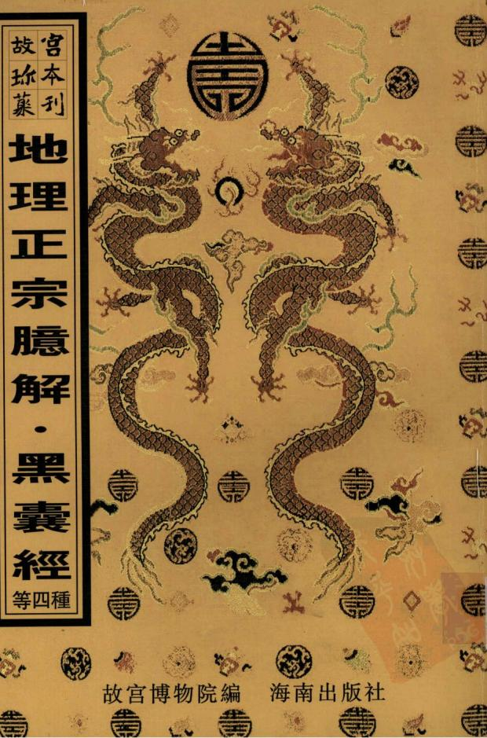

1996-2000年(“九五”)國家重點圖書出版规劃

KES H古 福

元吴郡庠刻本《通鑑總類》扉頁背面所鈴「五福五代堂古稀天子寶」，方8.1cmx8.1cm，「八微耄念之寶」，方8.2cmx8.2cm'「太上皇帝之寶」'方8.1cm×8.1cm°

H福

# 青囊心印 地理黑囊經 地理正宗臆解地學

海南出版社

圖書在版編目(CIP)數據

水龍經/(晉)郭璞撰.-影印本.-海口:海南出版社,2000.10

(故宫珍本叢刊)

木吉與“地理四彈子/(南唐)何令通撰”等18種書合訂

ISBN7-80645-742-9

I. 水… Ⅱ.郭… Ⅲ.風水-中國-古代 Ⅳ.Z121.7

中國版木圖書館CIP 數據核字(1999)第68745號

故宫珍木叢刊第413册相宅相墓地理正宗臆解 地理黑囊經 青囊心印 地學

故宫博物院编责任编辑：李升召

海南出版社出版發行  
海南省海口市金盤開發區建投三横路2號 郵政编碼：570216湖南省新華印刷三廠印刷湖南省長沙市韶山路158號鄱政编碼：410004  
本書正文用纸由金城造纸(集關)有限責任公司生產

2000年10月第1版2000年10月第1次印刷開本：787×1092毫米1/16印张：32.75印數：1-400册ISBN7-80645-742-9/Z·20定價：1100元(相宅相幕19種共6册）

本書如有印装質量方面問题请與我社或承印廠聯係我社為本書每册(種)書新编的目錄均置於每册書末

# 堪鐫年酉丁隆乾地 正宗理 指迷篇嘉德堂藏板 臆解

地理應解序爲人子卜吉以安其親者曰堪輿重之也堪勝也輿大與也大與者地也言職司擇地者必其議其力廻異尋常而後可膺此任也故重也廼今之堪輿者吾惑焉專精卦例爛熟天星寢食青囊吐茹玉尺而推求原本其所恃者腰一針盤耳甫涉山椒不遑四顧而盤針躍躍動矣某生方某旺方某位黃泉某位入煞指陳鑿鑿唯此而已問以山川之形勢而去來未蒲也問以山川之性情而向背無憑也吁以蹈空襲地理隐明影之談而爲尋龍訪穴之計是猶方柄而員鑿吾未見其能有令也予季地山則不然其所急重者形勢爾性情爾而於方位之說則弗道故往往無事於盤針然惟深悉盤針之用故每鄭重夫盤針而不肯輕用此其議超流俗力挽波靡誠足範圍斯世而乃有以不狂爲狂者習見爲常少見則恠也觀所研註地書二種異曲同工不言方位故人或少之若弁髦視而兩知其動中官緊如魚兎之筌蹄有舍此而不可得者愈平常愈切實愈顯淺余精深黃小可使習之

而老師宿儒齒危髮禿而未或盡明之一經抉剔大道昭然故其篇中有云神妙不測無過聖人而觀其所致力乃在藥倫日用之間殆所謂庸德之行者謹哉是言也噫斯道之不明於天下久巳蓋山川不語能語醫師色 故人人得爲異說以濟其私而如若所云是直代山如土山川而 川而作語葬師將食何所哉予家庭師友日相與討龍語葬師食所 論事理得失談及斯旨心竊之故樂爲稱道以遍告於今之堪與者時乾隆甲午年丙子月朔日伯兄昌世守谷氏題于退地理意辨思齋之八瓊樓

地理正宗臆解序地理之書汗牛充棟而其大旨有二日巒頭家育一曰理氣家言此世人之所習聞而未爲不易之誦者也不知是非之分眞僞之辨有如黑白巒頭之書可可習而理氣之書則雖或付之祖龍而不惜圍其說者駭之以爲異論爲狂談而其實前哲固多有言之者人或不信而甘於末俗之簧鼓吾則不能強爲附和也余家世制皋業於凡雜技之書從未有夢及之者故於地理一道閣於漆室中年薊 先君見正宗廳解 自序背思得善地以安神魄而以盲引言牛眠自在孰是能見之而示之者勉就一坵要亦時師所作而緬其形勢頗合道理葬後似亦有益而無損此固先人之福而亦後人之幸矣余爾時悔其無識以卜兆大事而徒祝他人之口眼以爲從這可嗤可恨卽憤發思通其道求其書而觀之得是本人曰此蕭師巒頭書也是宜讀余讀之而仍茫如也有友人令讀葬書讀雪心賦乃始稍稍得覆觀是書而有聞入矣從而徧覽諸書之言形勢者又從而博涉諸家之言方位

兩義理氣二字正大尤所天地之開無物不才無時不然鳥可不講何嘗誤而無如地 理家但以方言理氣則 頭議冬烘顏標貓認矣自是愈傳念錯人日相習而不覺其非固無怪也但一經道被則當色然様然悟耳吾不知聞

是者喜定好面巳

者魚目明珠一握爲笑闕五六載而又得錦一周師之指迷篇研而究之卓乎有定見矣於是信之眞守之篤乃知理氣之說之果足誤人而其書舉可廢也今老矣而於此道不劾雖不敢妄與人家安厝事而明牕淨几之下深思然悟取是書而釋之誠有味乎其言之也但其爲書多有引而不發者閒有辭不達意者亦或有仍於俗見不盡汰去其弊者初學讀之未免多所紙牾易涉厭棄故爲闌明其義條暢其文兼爲之抉其狐疑定其取舍其說皆本於前人之所正宗應解自序

巳言而融會其意不能枚舉其所自出之何人而要不敢杜撰之以誣世也卽有偶附已見者亦唯審之又審無悖於理而後卽安始於去歲之小春六關月而事竣名日臆解固非謂悉當於作者意也世不乏魂明悔辨之人見所紕經更而正之一以見斯道之大公一以俾是書之不泯於世則余滋幸甚乾隆癸巳間三月上澣之吉會稽山陰金六吉地山氏書凡例六一是書向無叚落故觀者多易生厭今加之以註分其叚落則每叚各有大意之所在雖無承接語氣而眉目清楚便於覽記其不提起另書者蓋亦有不宜提起之處故仍其渾爲一篇之舊也

一是書向有註解然亦不多幾節未知出於何人之手無可考据今於有原註者則加原註二字以别之若原註與今註相接則於原註下用一圈以閒之無則不用

一註中所引古語有的薩無疑者則直舉其書名或稱其姓氏其或相傳之語而向不著其名者亦實有出於某書某人而一時記憶之不甚眞者則但言古云故曰之類以爲例恐其反致訛錯故不敢鑿鑿舉之也然自有原本並非附會

一書中所稱名義前後互見有詳註於前而後則略者有詳註於後而前反略者若不加標識則於略舉處竟不解其所謂欲互證於前後而又一時苦無覓處必欲處虛爲之詳明非惟於勢不能憎亦不合故於本文額上列其目某義見某篇某節或胡具某篇某節俾觀者易於緡閱不致歎於望洋一是書向係鈔本流傳繕寫之人或有不能通其文義者故多錯落卽如近今鍾刻堪輿經尚且訛以傳訛餘復何望余傅求繕本彼此互勘方歸一定其左明知其謬而各本無不和同者亦不徑改如仍其而於正文下旁列其字且於註中詳釋某字宜作謀字以正之

凡註中引述有名義散見他書而非是書本文之正宗聽解凡例

所及有議論小異而各有意味可尋當備考者多於本註下隨詳其義然亦有順文演去不及爲此另起鱸竈者初學未必明了則又爲補義以綴之並列上層以資博覽

<table><tr><td></td><td>蕭智深先生著 先生名克誓深其字也明時 人相傳在萬曆天然之間</td><td>有據不 7 之變化 家專 </td><td>致混清莫辨耳有五行卽有生尅故凡龍穴 砂水之宜居俱貧詩悉推求而玉行之義始 備見皆在形勢上講究而不以方維論也後世理氣 浙 方位以爲某 方有 某星某星</td></tr><tr><td></td><td>金六吉地山應解 古越州後學 石瑞目期校漆</td><td></td><td rowspan="2">山有變 在某位如天星理氣之能則力占人之意矣 化之微妙水有曲直之吉凶 變化卽陰陽山以高峻 為陰平衍爲陽出岐 大 洋 陰愛為陽也由李而峻陽 陰也 二一變 1 理寓焉所開 山水之曲直南於山之曲直曲直亦不 外 平</td></tr><tr><td></td><td>此一書之原起畧華大旨 以示入富知所重之意</td></tr><tr><td></td><td>原序 天開地關萬物化生惟人爲貴裒陰陽之氣鍾山 之靈地氣運行人隨衰莊大則大興小則小發未有</td><td>根陽其中有 难 本屬陰屬也直本屬陽仲也地理家論 曲勤爲陽直急爲陰山之化 临 爲吉山曲水曲生活面吉也以直爲凶山 凶也</td></tr><tr><td></td><td>無氣而生人者未有有氣面不生人者</td><td>有 天星理氣生旺之說作書誣世眩目惑心使人盡以 而宗</td></tr><tr><td></td><td>所椒者廣立郡遷都胥親 北非專爲墓宅言也</td></tr><tr><td></td><td></td></tr><tr><td></td><td></td></tr><tr><td>地</td><td>首言人物之 生皆由地氣 故朝爲白屋暮則朱門</td></tr><tr><td></td><td></td></tr><tr><td>爆片 乘之家一朝而失皆由山川興廢信乎求地之有緣 然不求而自至者萬矣</td><td>龍穴氣琴互 詳第一篇五</td></tr><tr><td>禰義譬公名 其所者也廖 公名所賦金</td><td></td></tr><tr><td>天心乃爲正 皆其勢力以 不期必有意外 精宋時人九</td><td>然 分</td></tr><tr><td>此則爲舉它言而所重尤淮</td><td>有氣則有瓢觀厭則知氣氣隨嚴行脈因氣現 不</td></tr><tr><td></td><td>二 補義葬書六 葬者原其起 乘其止券書</td></tr><tr><td>埋非以見地之不可不求 世有姦謀詐 折 以</td><td>前氣味 曾郭景耗著</td></tr><tr><td>盛義筠松卷求者人事也得之不得則有天意存焉人不可護 身人據龍經蘇得而不求亦不可謂求之而必得惟盡事 陰國人地者</td><td>謬巳貴賤吉 勢本於 天 又稱齊經 俊</td></tr><tr><td>日日はで電英語で 得之而天ん</td><td>分位可拘直或 設</td></tr><tr><td></td><td>2班 保 F 茹有强</td></tr><tr><td></td><td></td></tr><tr><td></td><td></td></tr><tr><td>根巨門之層邊</td><td>星經羅叁互 世之專 群三十一篇 15 六</td></tr><tr><td>尅之不移 星舊所論太陽大陰之 </td><td>舉之義經 其 议 常 1 26=1 中 日</td></tr><tr><td>に前までででででま 大土五韓 以</td><td>而佛以 以爲吉不合其格則以爲凶因 凡言方仕者皆是而言聲之家多有故</td></tr><tr><td></td><td>日格盤又此以作向日向盤失其義矣理氣 </td></tr><tr><td>楊廖之在星亦不身於五行特多其名 義</td><td></td></tr><tr><td>康長篇第十之變耳謂具後星辰篇星逆於天本不在地</td><td>天星理氣 入星</td></tr><tr><td></td><td></td></tr><tr><td></td><td>經之時罔未有此也卽如上言九星五星原德</td></tr><tr><td></td><td></td></tr><tr><td></td><td></td></tr><tr><td></td><td>赢</td></tr><tr><td></td><td></td></tr><tr><td></td><td></td></tr><tr><td></td><td></td></tr><tr><td></td><td></td></tr><tr><td></td><td></td></tr><tr><td></td><td></td></tr><tr><td></td><td></td></tr><tr><td></td><td></td></tr><tr><td></td><td></td></tr><tr><td></td><td></td></tr><tr><td></td><td></td></tr><tr><td></td><td></td></tr><tr><td></td><td></td></tr></table>

<table><tr><td>蠶堂砂註 砂水詳三十 篇氣紙註 龍穴譯第 八篇首醇 魯頭研詳第 一 失 我 2 弱 氧言而知 性 在 爲 主 页 1 盖 性 情 質 崇 其 理</td><td>極是 土生火也 土局斷火以 筑 正宗 数手 人 中周 據</td><td>局同水一竣 疑爲墓也土 爲旺未戌丑 生卯午酉子 亥寅巳申爲 發合成水局 或金局申子 局巳酉丑合 午戌合成大 合城木局臾 行者亥卯未 蒲議三合五 向得十地 空倒 非水 山 我 4 S 多事也至 合 方位言星於是羅 空 二 簇推 方 B 2 L 之九 之 之用 此 宫之 無排 位 木 而 盖 益粉 之 之 裴原有 蘇洋 星</td></tr><tr><td>卽理情 也性蘊於 此言求氣脈之法山局之有性情猶人之有性情 也對 米 琴 神 参 何 上 我 頭 氣 皋 ル 來 者 R 恶 业 之 由 氣爲用之 水 也 伯 篇 5 得 攸 一 X 奢 则 若 之 截 信 而分 落 自 E 由 中 也主爲體簡爲期也至 云龍穴爲體 水 形 沙 元 费 形 茶 米 下 理 亦屬嫌 多 静 所 暖 質便有貴賤 理氣何可 其 面之氣有氣 不可見者也待發 兼弼 爲 以 見 理 场 此之 穴 爲體 然者 故 州 固 # 丙 日砂 W 2 a 助 水爲 事 牌水有 半 猎 销 理 而 染 家 不顾 V 博 人頭 於 22 用 可而 F 用不岗 性而 然 外 方 前二可俯本以 有 号 则 以 则形 其 理 俗 得 6 烫 诺 强仰善 德 放 可 相 来 水左 似分 5 頭 因 見者 傅 蓝 而右 属何项 一 房形 密龍與為可者皆兼位形而也 专</td><td>順逆生死陰陽緩急動靜向背之理方知氣麼之所 要識巒頭爲體砂水爲用熟察其性情博閃俯仰 具 一此以 平 執以考 方入登耘 原序 羡 以 证其 向 爲 之 年 以審其陰 豈知山川自有性情貴賤生於形 不然執面蘇之可也例庸汲汲 月日時之吉 陽 h 凶符龍得穴 行 三 之 保 有 魁 坐 择</td><td>天星但彼從巒頭 安 而又 山 山舛 能 货 也 行 面 错 分可 有 生 四 星 於 用灘 2 货符 其不 理 HE 原屬五 九星之列演 差二十 形勢上 浙 界 必 外 用 耗则逾 盖 企 海 就则 行 积例 從 若 就以行 兴 行 四位 靖求 以 否 究 止穴入之三 類 而 辩 用 面 以砂山循 介 累 於 爲 有管局 不用舞 Tf. 瞻 除 器水 而有 壤 3 局 h 官 四 明 之 经 自 5. 行 者是 通 行 正 麦 华 2 大增 之 四 不屬 龍 自 各 多 海 属 必积 四旺旺 清 亦 持 谬 宿星 入用上字面 能 面 属一撰度有 金 於有家封之之愿要生 息理就如何三以</td></tr><tr><td>4 族 不與乃性者</td><td>渝得走不為 為意 偏险 有 止静 2</td><td>第十篇三 四爲三解又 堯閃互試十 篇看龍 搏找部第五 正 内有通不顾之 势 仰 閃 也 解不實理也 不言 有 宗 也生 论 言一 象义 者 出 龍 也 必形乐 然 知 能 樂 阶死也康逆 也一 高 创 东 博 同势 在 查 兜 何 頭</td></tr><tr><td>氣衰人薄以勢利爲先不以重德爲本多是信邪失 空說妄也巳 知注情之何 今 可 梦 僞 向而则 人得 故 真 剩 而 缘者 言 吉 之 面 期以背而 次 在知日佛 而东理者其向者砂 其能 斯 惟不 有 知不 印也而者僞宜静 地乎族 载 氣 外 总 器 胀平 也 此得以微 强 淤 性 如 皆其凿也動 當今中數之後 何 情 此可情 觀亦言性情而 而 熟 见 树 之背 於 蔡 之向 方 情者 汤 位 後 平氧 何基由背然見水则微駐可六純</td><td>静為 统 悲菌 背砂氣也又 矮 爱 陽 泰 者水散火脉揚 急 龍 M 中 不之也允货 爲 者 念 不 有 但所向動動 動 也来取 险 翁 動则也 饰 聚 静 次 绿 我 者 水质 篇 偏 2 车 背阔 矮 者 生 性责则之静脉氣臂 爱 真 M 穴不 聚之 此 昂 檐 之 赤 穴向動则藏也 自 情也龍 氧不為 然 具在不行勤奔 之 倡砂签氣查房理 而真分水秒不趣動而 情情也上飛靜恬止非則</td><td>陽 故生则 麓 山下北有 者 也 民 形以 氧以 柴 者其死無相 穴 之 之 行閃博此得 势 為 二言 E 無 原 格 砂 势 势 能 穴枕 因 制 上 有 字 次 理 序 化亦 舒速 用水 上 也 购 亦 也 前 爲眞龍 農 寄 不 截 绒 之有 之 言备 俯立 爲 有 大 賢之 察 頭 迹生之极顺 行 道 别 有而 體 閃閃 博 羅 之 獨彼 徽 也死氧有不顾授 之 能 3 39 歸以 6 頭皆 价 由也 言 逆下山 郎 懒 超等 限 異穴 之 氧 之 方 雙 内舒地逆期 仰多 此 理 O 有羅 方 位 爲蠢 為以緩理則 中 而 俯 黏 硬 插 面 氣 值 言 四 達则專 無取 承 势 穴 峻7 在 盤之 1 而 理 疏 外生取 道 也 坐 方 徑 氧 不靈之 化 豌 惟逆 旋 逆 原 體 為 值 理 典 故爲 化 道 心 閃往 也一合 上氧 留 陰处则恐势取 者 山穴往 生閃得奥难）頭此 陰知死亦言顧届多 物 也 旁非不求頭封 中其氣非递一伸仰俯步岗润合其之 何 就而以</td></tr></table>

求地先在稍德大則貴於鄉鬼儀心一獻妄念橫生於是邪術得以中之談封孰身貧主之圓厥欣得意而卒歸敗絕告以正道不之君也北亦跋名之自然有不知其所以然者服前所見不一其人儀乎求地之有綠而其鸞正穴固有爾各矣人吾恐後世盡失其傳故痛開邪說敷陳心法 者矣吉所以作書之意觀其統部各篇議論其乃言言金玉字字珠璣洵可深通元竅者傳心之要畫在此矣今列篇目如左作眞傳徹山川微妙一闢僞書救世人後患二陰陽之氣要得中和三地理之學眞有神妙看龍須博正宗 原序 3五提奇特五相水要交鎖織結六分枝幹則知大小見響頭卽明貴賤八尋龍之法先看發禮力捉脈之要須步鄉頭十山水聚集眞龍之駐足可知十背面水口奇雖異跡戶內眞機莫制十龍神特遠超羣義處奧妙雜言十日觀後龍而知貴賤十五看星辰而明官職十六洋中得突龍神之貴非常十七谷底星辰氣脈之 1處停畱足據二見出脈於个字之中二十審到頭於受穴之處二十認脈者須明其氣二 一十點穴者要鄉四 二十觀情則知定穴二寸 五 六龍分貴曠二十穴辨假眞二十山有支龍之分二穴有蓋粘倚撞等法七○ 右計一十八篇孙為卷之中放棺立向要收內氣堂砂三十葬法精微須知倒杖逆 十淺深之法全在陰陽 三十堂砂之訣要明 111四分之典衰 六三寸騎龍與斬關相似二三十祇曜與獨龍何異四十攀正宗 原序 六鞍上馬亦似天財之穴 四十過頭立穴翁如建龍之龍四十論形穴法難拘一四觀地勢纔識崩洪之脈四十看平源得明水神之 五六 一卷今加註顏多故分爲上中下三帳指序中氣紙二字為病此一篇則其日也皆以末其氣藏者也其後各篇又就各條而暢發之玩其文囊蓋先有後篇議論前後繫括其意以爲各篇之樓題合之則又成此一篇之總訣也共計四十六篇每留下銀有發同本宜人於此篇各條之下然往往有篇中之所未及面於題下并發其義者若預列於前或反疑於偏兼故俱叢於各篇之首以便合麥而於此則但列其日而不其文不詳其義又按是書流傳雖久面南無刻木故多就起博求新本後此至訂而終未淨盡前有鐵氏式林廉而付梓雖經校刊

爲我周而吉迎不着朝不爲我用而仍下魚於的 向此襄在直自上詩消息有天然之穴自有天然之向不錯則掌砂接得自一錯則接不得蓋穴向猶主人而堂砂爲我 所用人主不正則人不聽命而并有惟其主者矣此 汉人事俗失之吉因也水之吉凶易見山之情性類明谷中開鎖爲上平洋水聚爲佳所貴者洋中之陰所蟲臨下一望可如故易見山則遠近參卷明不洋平屬註 內或有文之可求若一經起去鳥火見下節 設無收故取其集水深於前則有 無穴也中之陰其陰處乃微高氣所鍾聚處卽 半中之一笑開出平陽陽有水意行龍得此則競身受蔭或亦有穴陰生陽也然穴亦不穴於純陽之處須得微突之正宗 十上 11

處穴之否 則勝水 能神頓跌斷而不斷水神屈曲去而不去有若神然忽然聳起高山日其間矣當久之水願而去者常多逆而來者當少至於木口則有去而無來然去而屬曲著之玄字糠則更吉矣粗惡者山之内形澄清者水之吉象生葉龍力之旺閃東過西氣脈愈佳動中觀其脈靜中觀其氣一動一靜氣脈須明胝求靜中之動穴來静 端 静 中之靜派來昆鼎氣 穴處或寫曲或麻 中 之動也 詳 梳言 止是靜 知大之静 行曲正期辨中故 愈折以爲狱 K 2 吉之其而不氣者徽阜佳活方见枝人動氧 詳穴低服二日胝自者而脉如東其小之故求 明而低脈二腊止知稳已即生行力则細又動 之是则未而故则之隐不能能而之爲認云中機棹見二十 篇歌訣首節 劈太多疑奪本身之 葉者龍身分劈之 氣其而析 雖過其不穴日兄人则愈派行不也也 若 氧 力弱烏龍有行度詳下篇 首節註 不 者静住故吸赏有 可 或 据 北 则 去 可 有 厭面成 面 又 南 结 能 题無 削 狐之 上有而氣相乃账也人荒達 面 二美穴不離日不明共岡 句龍失葬一氧日眼见野外 有學動有微動 则可则旧若 不 實未嘗 四坐氧認者则動不動 中觀脈然當 其氣胍龍穴 静 矣 现 现 恋中 觀 氣其實 二 向水已葬本面 卜葬者穴 失之高高 則傷龍下则 面

之靜卽上穴求動中之靜地 穴求動中之靜矣寓曲原口 求求 面靜中又氣前辰則微員而爽向外去則微開而幼入內來也者理也動靜者所乘之儀也蓋動而後靜靜而復動乃謂之桑動爲靜之根靜又爲動之根中尋龍隨乎脈止結穴當從氣現二者若明穴法自戒明緩急纔加吞吐審陰陽而下浮沉立向須憑唇口下遂詳言穴法麻者送入之義有覩上意吐者故出字貫頂兼假隱 隱而起方爲好脈著在頂上就起明明三股如郎二十一篇雞爪小字註 只有一條迢迢行去爾遷並無護從謝之孤單不成龍不結穴也雖或曲摺生動戀無眞脈游龍而巳摩雄誌二十 龍勢迢迢行未休如何穴向此中求只看龍胝中心爲二醇 羅狐朋見第 更認堂砂勾法 面正 服早定中此 麗結也去龍雖長皆爲餘氣或五貫歌訣註 同轉而爲羅城爲水口卽小有結構非正紙也然處水口解兒十 落之脈亦須細息眞假故又以堂砂証之堂砂漢集三篇標題註朝案走竄有一於此還陟花假只向龍頭數節求若能个字紛紛出不是長龍也福在大龍身上分落數節亦能結地遠祖遠宗與我便於此間求穴更看堂砂合式自是可用此又一正宗 卷之上

<table><tr><td>十九篇 貞祥具二</td><td></td><td>意以</td><td></td><td></td><td>梦 界水殷明股 扶裂</td><td>不得貪對 雷 面 5</td></tr><tr><td>當從薄取地薄處須向厚裁取厚者須親氣春取藝 陽○平周龍爲支能高山龍爲罐龍面</td><td>極威陰隴有陰極生陽成陰可撞雖陽莫湊地厚處 龍之脈陰多而就陽支龍之氣陽多而就陰支有揚</td><td>蟻又何自面生哉 之患生氣滿棺水 宜合之則穴情正中恰好至無關壓術故露風犯濕 知高明以爲何 也夫稱 厚爲暗如用挨製之法自當矣過薄證亦挨明之 乎有 可見一邊 吐 故 上 口 赤 如也 明若拘 自有徽微界振百更不苦可見者之 山有支雌之別地有厚海之宜禮 下 宜浮沉則淺深官拱親則左右 砂之殿明 於敬臨爲</td><td colspan="2">可見爲明 正 爲乎规股何 左或挨右也挨左則 就其向 必眞有真穴自有眞與故 宗 暗 正 则明 以 非 蓋 也 穴 股請者則當挨過明遙氣 月挨 以 至 情 V 不 平 明 似 乘 致 可見爲暗蓋界木顯露則穴情明白難 卷之上 坦屬陽覆突屬陰也若論界水則當 時之就所當推求地 繩過一邊而不知生 生氣之 以貪秀失眞貪娟 旺 穀龍 也 不宜因外山之秀美 失 则 穴之議也 以薄處爲 四 氯 旺於 水 親虎故 注 有兩 是則 明 日 挨</td><td>宜臨時斟酌若平田平地立穴無下 雄屬陰而到頭平受卽爲陽總皆閣土而彝深 脈之浮沉也氣脈之浮沉在陰陽二字內 則北浮沉二字對春吐言乃葬法之浮沉 之義有退下意脈來緩法宜吞非脈來急法宜吐 脈氣沉法宜深 謂急來糧受緩 不得 有浮 外 生 而無 朝 意而爲之也唇口 前反歪 沉也吞 葬陽脈氣浮法宜淺葬 斜 吐浮況四大穴法 其唇 口 证 蓋唇口 穴卽爲 理 穴 而 玩</td></tr><tr><td></td><td>洋千陽</td><td>殿時則當以薄爲朋 明顯露爲暗之說</td><td>明也有挨 者 不 赤 毅穴 H 解有有</td><td>挨 者 滇 之真 或 面 0 换 透穴 向之 四篇點節 註又舞二十 第十篇四笏 萬錯乳突</td><td>須要用 法宜 見之然 下 靠 墩阜也陰極生陽者塞 陽處多為高錯陰來陽受也支龍陽勝 支以氣言非無厭 薄 科馨 而與平兩之支又有辨 要之平周亦不離乎山 異皆龍結穴 並舉不可混</td></tr><tr><td colspan="4">死非水之死龍之死也觀水非所以觀龍乎陰陽者 直因龍而見曲則爲生非水之生龍之生也直則為 凶某水宜來某水宜去又何其謬之甚也自直躡 實剛 但觀水幾是眞蹤眞踪者指氣脈面言也雖日觀 止 之 以 整 田龍自有氣 日平洋混 衍爲平地處 止分散不交 去處水之 木神爲主 面 知故 不 荷 分處卽龍之透通處水之 木之 如山龍之易見耳此處尋龍求穴則 脈豈可吉無但一概 面 则 丽 7 E 行 來處卽龍之 視之者非也此 平陽水綿多水 不洋與平隱不 水處水之去處卽龍 平 其 铺 水 笑 国 合處郎龍 則 养 起 山 不 之 平田 多山 可 油 以 次 處 之 賞 信 其</td><td colspan="4">生死於曲直之間審行止於雖雄之內原 莊 水 自 正宗 道矣 情 口者其靈動處也厚中取薄者宜之以此求之面穴 薄中取厚者宜之 一向懷慢忽露性剛 處少則氣必聚厚處厚處是穴 多面薄處少則氣 取者又以原薄分陰 穴宜就陽故忌湊以 陰氣在陰處穴竟就 無所平洋無氣脈之可觀定穴有水神之證佐觀 卷之上 偏歸薄處海 片粗樂忽見靈聊此非火 此 陽也厚卽屬陰薄則屬陽厚 上言山 陰故宜撞 非穴乎氣春者其 義之形 下 蓋氣至則 處是穴薄 則言地也 陰中之陽氣在 邽志平仰也陽中之 五 而穴 性 无 處多 地以 y 自 就</td></tr></table>

<table><tr><td rowspan=1 colspan=1>雌雄</td><td rowspan=1 colspan=1>关关明象之氣也雌雄者剛柔之形也論氣則以山屬陰水理淘小形則以水為雌以山爲雄要K酒而已其實一也母庸為泥能瓜行而不业止EKy合故日不交井不交也未及交也龍l0水合於运朝不去故日交也开不交明期丽觀水非所以觀氣乎熱則平洋之地度1氣狐</td><td rowspan=1 colspan=1></td><td rowspan=2 colspan=1>四應群具三一篇業砂</td><td rowspan=2 colspan=1>則散漫無收非穴也谷內不張山則通動不問爽亦大0也隨脈换生山法也而洋中亦有偏左偏右之1按生之意也觀旁定巳洋法也而山中亦必口以立向亦卽所以定已也不必椒分陰陽月原注四應車就三言而洋中亦有四應蓋时今前以田爲案後以田為托左右以田為說虎所雅日若用不者則亦無事於強求者耳穴來須脈現止隨氣納此總結上文之意依水尋都有就洋龍雨言面山中未</td></tr><tr><td rowspan=3 colspan=1></td><td rowspan=1 colspan=1></td><td rowspan=1 colspan=3>從乎內體大者須察乎旁脈隨水行氣隨水抱觀背鯨註衆方一員則貝處為</td></tr><tr><td rowspan=2 colspan=1>面要在方員集方一方員則员酒定穴法當知</td><td></td><td></td><td></td></tr><tr><td rowspan=1 colspan=1></td><td rowspan=1 colspan=1></td><td></td></tr><tr><td rowspan=3 colspan=1>星督譯具第</td><td rowspan=2 colspan=1>生死死則靜動則生不現乎前須視其側經云国星辰登地</td><td rowspan=4 colspan=1></td><td></td><td></td></tr><tr><td rowspan=2 colspan=1>上砂下砂詳見三十四篇歌訣註</td><td rowspan=3 colspan=1>嘗無水龍身雨旁低處皆水所閒乾流水也傍砂端穴之指下秒吉蓋下砂母收水之用須要緊案4定今人作穴多有水立自4致上砂反逼下砂反寬甚非法也求二朔上巳詳明此不過申言之耳内元微妙訣大畧巳盡龍法穴法砂法    V水法無不備具嘗此一繒可知金味矣尋龍先須問祖宗看他分劈在何峯或屏或隨正宗    卷之上       七</td></tr><tr><td rowspan=1 colspan=1>五</td><td rowspan=2 colspan=1>看故在平田則日弧臥體難詳故觀水以脈鹽米也然則觀水非觀龍平體卽星體以其體之不五行也故亦稱星小則氣鍾於內故排大特小特卽動也大則嫌於板濶無動氣之可見E宗    卷之上       六</td></tr><tr><td rowspan=1 colspan=1></td><td rowspan=1 colspan=1></td></tr><tr><td rowspan=3 colspan=1>龍虎明堂詩三十一篇堂砂强山食水化生廬舞具金篇三節註</td><td rowspan=2 colspan=1>不於中圓立穴而尋其邊旁當有開口吐唇處也古云平浮不關口神仙難卜手正謂此耳止處刻面水交抱於谣水何以抱由於兩砂之施也国砂支地3明角水亦交地於前而為明堂故林南面為龍F氣水也或特員或特方其出面處卽是動氣穴郎憑此西立乘其生也不動而靜則死矣觀其側卽蔡乎旁也旁氮亦不動則可不必求穴蓋本體頭不靈則水亦必不能入式有何氣脈之可求黃车洋須食木谷內要張山陰以隨脈挨生陽須觀旁定</td><td rowspan=1 colspan=1></td><td rowspan=3 colspan=1>祖余詳見第九篇首節月帳畫帳舜嘩互甘第九篇五歌款註</td><td rowspan=3 colspan=1>器穴特其力量有不同耳祖宗之山青張屏帳之中心出歌是為貴誰前去必結貴穴屏百用乃抗下鞭脈護火名爲蓋帳障與同或從1或從阜其義一也關嶂者必起一高大之山爾屑福開長或數十里顏亦十餘里或數里不等此不當與屏勢舉者今人混面一之由其不知蓋帳與開峰之義龍格惟求个字中迢迢無个不成龍總然擺招如也中脈自行以爲處從乃爲眞龍然出脈必類離頂</td></tr><tr><td rowspan=1 colspan=1></td></tr><tr><td rowspan=1 colspan=1>右排耳爲外四息化生腦崩合水兩旁魚陽濕處爲內四應此又兼山画洋言穴前之水龍所食也故日食木然收得起則得食收不起則不得食張山者兩旁有臂橫觸開T酉而稍腳回轉護穴如兩翼之張開故日張山張食水本一龍格不分兩要張山今以二者分屬山洋皋重而言平洋不食水</td><td rowspan=1 colspan=1></td></tr></table>

法也艮言龍從何來承從何起何處轉身何賤在於龍龍若眞時砂水從不在失員如畫裏但龍龍则砂水亦假龍真則砂水亦真山卽水口也曩城會合中通一路局內之水俱從此出市若門然救日城門水口有石有山所以止邊去水過鄉村望祖峯超羣特達好尋龍飛禽舞鳳眞龍勢

之績饑度安間乃龍之連兩張間中非一縣如良禽狀大則爲鑄鳳矣謂馬者奔鵝之象驚蛇者曲指8界企 看山小小印堂從取覓微獄界合要前攔志來緩取須埋氣慢到當求湊脈間氣脈雨般君若得恁他奇張簾解詳二主星見第二 高起故稱山其合處必略低隕故稱水倚者冀也芻首節 者就也上彝山下就水面三分之下三合之上側是福義主星前 穴也穴上突起處名為毬體是一分穴下小明堂是再起小頂爲 一令再上則化生屬爲二分下則龍虎內中明堂爲化生關書中 二合又上則主星起處爲三分下馬龍虎外大明堂不及周師指爲三合此常法也而入山覓穴則亦有不盡然者此遠篇詳言之又在人之神為明之不可太泥面分合二字必須拿可毒考但後定未有無分合而可求穴者此則其要訣也人之鼻正宗 卷之上 九

根有微 凹 處爲印 索取喻小 明 堂也穴下 微 醫 細小水蝦不 则不水脉能堂水抗处0 有生水之意師發 下亦是穴旁 眼水魯注 此 枝輕此可以覓穴界部 旁 小须拥 住皆似有似無若隱若現 要穴宜 楼 受心 脉看氣乃明直 穴 故 埋 到者葬孤難曰族脈仍是葬氣不過累送入 勢殺也脈疑則 穴宜念受故 券 然法 片 葬氣面 若太漢又恐傷龍非法也此實有玄妙之機得心應手難言傳審手此而奇形異火皋不足爲難矣遂觀巒勢分輕重近看堂砂辨假眞玄武蛇奔前有結青龍馬走內無成其脈氣導又以堂砂証之則得穴朝山爲朱雀則坐山僞玄故玄武嘴長玄武吐香皆非眞父結穴處龍虎爾孫

<table><tr><td>橫看天財兩手乂</td><td>見三十篇</td><td>灣穴閃穴詳 堂正正龍嚴直至 箭穴是也或離脈 务 砂 穴在 E 勢二句是 自督認正 也 此 中如草 项 面 和 非</td><td></td><td>草姥庆嶽</td><td></td><td>段</td><td>穴廢穴手穴</td><td></td><td></td><td></td><td></td></tr><tr><td>脈迢迢是活蛇到頭緊通四圍遮直尋腦後騎龍取</td><td>星拍茅看其吐辰處乃爲芽穴不須頂上尋也 郊下戊至由九而卽止或至平地面後止 頂處必有傳天之爲 n 爲窮穴無寫則無 穴 胝則 也有 火</td><td>面面因 以 两 稍遠便 此爲隴 手面止 低 沈耳其實非 次 在 龍虎 崩 手 也 閃是 所之 粗 不</td><td>畧有爲萬處便是穴 論 龍 無穴也觀手 解 租 虎 與上旁尋亦有 也然正 在巧 是 巧處 不 则 穴 旁 施 有次 於 等 2 正者 反夫 而 卽 穴 在 於 道 穴淤 偏 硬不需 草</td><td>則高處無穴也不 心人所能領畧細總得之而知其 義之 K 藏蛇只見虞不見蛇面蛇實 腰 而 款 款 處是 穴 泰 行於 身 之</td><td>兒者如沃中之恼殺只見灰不見繳而線 貴摯穴爲貴穴其發越寧可量哉本 他以其有脈直注於 卷之 下偏四於旁也然脈 十 賀在於 竟有 於旁遷</td><td>靜於本身之龍虎也此 虎要亦是其 砂豁開收 亂宗之 分 f5 地 其免橫調途 枝码 也其龍眞也 足 Y 氯 前 穴 蓋 而 格 其 無穴 收 农 下 山 爲 龍 民可何也必 米 年</td><td>创</td><td>見之穴情則當親察其壓蓮如結穴之山必生 怪龍故 靈星辰 本 龍</td><td>硬旁尋草裏蛇頭俯軟腰腰處點身粗巧手手中傘 仰寫頃勢從巔取卸脈生唇用點芽 古云有壑穴 不</td><td>應知厭不差眞龍多有不生砂粗頑脚覓灰中線直</td><td>多國稱所動大妹規炸電前稱市明社的的國年火 自江具川</td></tr><tr><td>頭貸穴龍豈盧生便須轉身尋 天 火</td><td>聚合釋上類</td><td>版 微顺</td><td>人堂 旁动是 则差</td><td></td><td></td><td>後星辰篇 正宗</td><td>龍身身 六陰金星見 其</td><td>二篇金彩 冀阿集四十 仰 左</td><td>虎租条 鳳尾為頭穴 尾 厦 法</td><td>十一篇</td><td>天时譯兄四 十九篇</td></tr><tr><td>足據以北爲穴向之準的則本體正矣兩造界水齊 山也本體之前有唇口之可憑本體之後有枕靠之</td><td></td><td>明亦何金之有哉立向淼何問別家前唇後枕定須 其利而反受其害 以從衰於是羅經之附一定而砂反飛水反走不得 宜某自者則是出於造作面生成之砂水會不能聲 者也若必以羅經定向如世俗所謂某龍</td><td>可以造作 先問龍又看穴而向出焉此天然之應而非人私堂 上言華龍定穴之出此下言立身也朝</td><td>朝且問龍眞龍結穴合仙蹤穴眞自有天然應何必</td><td>法也然親砂正所以改水蓋砂綿向內則水亦轉抱 脈遂也婉轉者言砂之抱穴依木尋龍傍砂黜穴古</td><td>來乂依水傍砂眞處覓莫向中峰立穴差 卷之上</td><td>中之金柔中之剛也 星糞窩法取其寫水 剛看其通突處或 鄧書鳳向下 取其中蓄也形似 则 火 隨踪點穴用親砂徵徽婉轉水</td><td>富穴也唇當作純字之辨也幾 右昔吉也立面道上者爲木星穴於凶處卽上 有咸星如大陰金者可穴也金 頭砂者雨翼也翼阿有穴不難 飛鳳金星也冲天鳳向上則穴 水敦慢無穴穴取</td><td>也形如眼牛土星</td><td>抱有如又口之象 之山臨內袍爲龍此形似天財面又實非天財也兩</td><td>橫時要看左右有堂局一邊以邁獸為坐由以來去 作 特 案而爵廟皆竈取也若腹騎倒驗俱無足取自取 龍穴亦絕結也或以去龍作案面聯騎或以末龍</td></tr></table>

齊會合於天心則明堂亦正矣然明堂本無不正之理本體不正則明堂不正矣本體亦無不王之理意爲逕就則本不正矣蓋天工不爽而人巧自失之也天心指明堂言然穴之中心亦謂之天心隨其所有席之朝對分明只看前羅經納甲莫爲先定須饑減 指面謝甲詳具第 親財祿還要張山食水全近案不堪高峻美遠朝却二城四端補義淨陰淨隔為羅經納 對之何難而羅經作向者先有納甲之一說陽龍取甲之用乾甲 陽向陰龍取陰向謂之淨陰淨陽斷斷不可從也法坤乙坎癸申辰離壬寅戌十二位爲陽前按親法也穴畧接左則饒龍面滿虎畧挨右則鵝艮爾與半露虎而誠龍而明堂無不正矣此又用人以補天而非庚亥未兌丁 有出於本體之外者也財祿親矣而更得張山以食已丑十二位 水則收水盛多又善之善者矣於是而觀其朝案備正宗 卷之上 十

爲陰六秀者山近者爲案遠者爲朝今人混稱爲一亦非理也遞艮兩兌丁巽宜低小則無通壓之患遠宜高大則有特述之形傳華也饑減挨親 面巳矣六秀陰陽何所取用滿作順來逆受要相依斜橫脈到棺當正避煞迎生纔得宜堂局太寬親左右兩砂緊抱向中膺許多眞訣皆仙授始露山家妙與微 青直而  南有吉   方  不 宜講而秀奇亦不魯貪恐失朝杖詳具 穴也直來橫受橫來直受此在穴中作用卽御杖之十二篇 活法然來脈之橫直亦據堂局面定如堂局開於正橫來直來者又爲橫到脈矣蓋堂局所在向卽隨之而來脈則無所轉發也今言順逆順卽直立血逆則備斜之義非有二也所以然者以放棺所以迎取生氣雨直來直愛恐有直急殺氣故橫斜其棺以趙其直正迎生

之義訣也言立向而井及穴申作用要亦仍是疑 以絹故用親左親右之法此又看 水之 来 去测 以 堂则定 於而通否之於向水從左來則用觀左而以右砂 水 水 從 大砂则名 来長而 抱 明水念難收主若爾砂育抱者則直從中 水作向則 下 取 食八篇秋訣 結穴也又按胍直來面棺斜放則棺與局 不 正 對是內外爾至 是有內外爾向之法內痈所以兼氣而外三十一篇 堂 砂也內藏黃金斗外掩標題 時 人 口 正是此等作法

## 第二篇

巒頭者小異而大同終歸一路議羅盤者此凶面 爲說後此新斷如同聚訟熟 披道 吉泣熟百編惟能知其僞則自能闢其僞不知其機 正宗 答之上 训

則不免入於僞矣然從巒頭入者務要目力心思二者兼濟而又得從明師登山指授庶幾有所開其勢常難從羅盤入者不必登山跋涉空齋卿坐不油數月而已漫淫於其說偶向人前賣弄而世俗無類驚爲河漢於是遂自信而不疑其勢常易自非見之者明守之者固對有不爲其所惑者矣看地之法龍向十端一看祖山秀拔二看龍神變化三看成形住結四看落頭分明五看脈歸何處六看穴內平窩七看砂水會合八看輔對有情九看生死靈宗王靜第 百節 順逆十看陰陽緩急欽一不成言祖卽 先問祖宗也麗山稱太祖宗山亦稱少祖故烈以祖山之秀振者秀麗面聳拔也秀則端隔正而而無巉巖隴急之形擁所高出羣峯而有特進巍峩之夢鄭此發足力基宏大氣字軒昂峰下必有身脈到煩必有美穴僧人家合玄微此大前不面地即軟者之 敢也穴前不收雨龍身砂脚彎抱者龍砂執也此二者皆眞龍之相 此言收水之義然言收水而及龍砂及護衛則仍是因龍而及水非專言收水也其義已詳原註然娶恕護衛之收亦是本龍禮宗身上分來起頂開峰收轉以爲獲編乃能敗納屬作護者則後山自別爲一枝 而非我之同旭安能爲我收水哉此又不可不知至 於龍砂自是穴後一二三節上分來合抱於前以約堂水則不能如護衞之收之多且大也然而總是大龍大穴體叚所謂大地看氣機者面非僅僅於本身龍虎之精神團結也若龍砂既納護衞又收則又大之大者夫豈尋常之所可得者哉收卽為不納卽不收收與納總是一意奠竟分作兩榛看

<table><tr><td rowspan=1 colspan=2></td><td rowspan=1 colspan=1>入篇首部註元辰解詳第泰看破解小異可有平肅之說四穴情篇亭開卷第二十</td><td rowspan=1 colspan=1></td><td rowspan=1 colspan=1>十四篇穴卷簷至許二   热频穴星穴嚴十九篇首發道峽迎送詳舊穿峰註關靖詳第八也</td></tr><tr><td rowspan=1 colspan=3>隔龍結陰穴陰陽明雨浮況見淺深可得而知亦有顧逆皆宜詳察以遇順而就逆也陰龍其橫斜到者則為逆龍順穴逆龍逆火順不生卽死惟乘其生莫犯其死也脈之直 之無朝總要開面有情朝案或特來或橫過或明堂亦所當看者矣而巳此貼桃肥神行帳服物稱分開交合於穴穴纪次形得矣因左右看其砂水左純陰亦非眞穴此卽平高之義故就其屬乘此高矣然乳突者陰象也具上亦必有微屬陰生陽也下是穴此之謂矣然此言寫穴也而乳矣之穴則是眞應穴之小砂小水也人而生死順逆陰陽緩急二也如此步步留心節下是爲少砂少陽之氣乃異生氣朝案俱全或會矣堂水合矣h不势外必真漢次砂之X抱羣生節厢有则儒有流之右京又水右以平窩撫之也若硬潮f來者爲順者生氣也條微敬斜無案有案大水也砂結则也微低從上抱左廟乳光突恐於而也來陽砂又指穴破碱酉看其隴虎大次水</td><td rowspan=1 colspan=2>則非 正宗片土肉似盖看    穴住面宏馮之顿黎一行版服粘出起联化化者行有凌逆之永遠而勿替也但祖宗世代植德積年寫光滿穴處必徽或肱住之情者僞當蒲也服一径於程穴橫畫在迎送諸件特凡其闕峙突而實平或日平富此立穴處也法云佛注也觀是於度間之氣是摊卷之上热A種故其看此又目低所種须真其而日中若秀處或合辨將主矣皆是出信漾機拔1胀迪式其馆頭住F再瘦分池碳l之K则恐落穴或平2枝自同分光起所画E现另E於B防中作祖=嫌其一窩象也窩中必有1编特真之有者此或紫事康山取栖子実開久左正迹岗穴面夹λ轉身以至入也高砾+之或落軟版星静线穴一次極必所博页便粘之成方矣细通则大毯在布也之穴落故不凡察峡穴看综出腎爾也减蓝形则张日拘崖而把筋其值良泄微於是又卽尊由此也成大将购伏節享止X直明名形小秸能曲4度通M有快看之明爲日開穴不1有爱恐补</td></tr><tr><td rowspan=1 colspan=3></td><td rowspan=1 colspan=2></td></tr><tr><td rowspan=1 colspan=3>凶大皇艮補義儀官以一篇靖甲卦例見三十  初封誠意伯基字伯逗明青田翁阿名稱頼布衣元末時人世文俊驗敬伯御義類公名   催官理氣</td><td rowspan=1 colspan=1></td><td rowspan=1 colspan=1>篇土星節四墓詳十六義六秀見上補</td></tr><tr><td rowspan=1 colspan=1>甲靜發淨陽之說亦不足信豈有美賔之不朝砂水</td><td rowspan=1 colspan=4>無之書然可其非而之献 其露写划前   正宗亥艮行龍而終於放絕者有寅甲行龍而出大當貴說六秀之之誤者此比也不誠大可異也哉不不以便西龍點穴之物而入山亦不可廢蓋無羅經何以爲裏有無動言理氣某龍某向輕於捲葬可哀可笑羅義互詳序中可參看始不聽環自成富貴大挽也有含又何以爲局鹏颜盛之無本之吉合辨热I南議形體而夫诀公於天星则於則受之以纖東緩則受之以念急不宜隅緩須防不楚尅啡北類公又有云四圓之世頼有作納群以穴棒福人公云面足甲理貴亥艮尤奪四墓之螺爲之若之吉之渊後也國者之拨猶津津其說則亦氣求諸方位鮮不錯者四裏人哉既切不據刀氣也其說貴陰曉陽而其陰卷之上經之用而反受羅經無何異隔靴橫濟以貴賤無凶哉的肝露膽保青斥不知皆後人僞託之書也雨之字皆至字之訛世傳催官篇第面幷廢之則又且催官星卦可聽信許僞之徒善故以地凶詳以論砂水之吉凶合則穴則不必用也今人有龍有次則以此証其方位以辨陰陽五行之生尅時師專以羅經爲上不知龍嚴不山由月卦典劉陰爲僞之說制小師数所自d而亦吉也是之爲雨波離以先賢皆痛又豈肯作罔談星卦失頼公著披至賤寅甲惟輕有拱所貴矣雨且如催官理氣之顧四國之作卽卷官篇所则惟絲此以考其年開盖</td></tr></table>

<table><tr><td colspan="1" rowspan="6">爲天市麓之最吉者也净陰淨陽洋上篇納甲箱補義</td><td colspan="1" rowspan="1">之不收反論其向此謂忘本而治末舍已而從人有</td><td colspan="1" rowspan="3"></td><td colspan="1" rowspan="3"></td><td colspan="3" rowspan="3">月新娜體蘭杯短松板數網林加灰兩歷灰爆煉排或4味前合其盤局堂生氧作通2水者也每見人家穴而by多差摊堂亭舞用皆四誤袂羅盤而妄談通麗E致其议反至陵替則華負此至於天星理氣之說院止穴矣不亦大可體也哉</td></tr><tr><td colspan="3" rowspan="1">庚酉辛行龍而作申寅向者有壬子癸行龍而作亥</td></tr><tr><td colspan="1" rowspan="1">国湖甲之巳向者但得堂局之正收砂納水則是向也4业</td><td colspan="2" rowspan="1"></td></tr><tr><td colspan="1" rowspan="3">B久此中奧義顧難窺尋前人以爲仙家丹E或有第1無腐措意而今乃以用之於羅經面制爲e险of器之說則融有不合蓋納甲者以八测纳甲壬坤乙癸震納庚與納辛坎a十A梁纳t综丙梵納丁其本然也而羅經11十四位ai有無戊巳故坎離二卦無所於納面强分王癸[11干</td><td colspan="1" rowspan="5"></td><td colspan="1" rowspan="4">天星理氣互詳序中第五福</td><td colspan="3" rowspan="1">亦不足憑龍穴不正天星雖吉面亦敗龍穴的天</td></tr><tr><td colspan="3" rowspan="1">星不吉面亦發故智者但求龍穴之假眞勿泥天星</td></tr><tr><td colspan="3" rowspan="1">天星云者卽催官篇所稱二十四位之屋名之凶吉也其就以陰爲貴故十二陰位之星多貴面</td></tr><tr><td colspan="1" rowspan="1"></td><td colspan="1" rowspan="2">厨之一不合也然乾坤各潮二干中2始王西終乙陰之癸陰之終故紋屬於乾坤今以王然之坎難百乾峭亦止納單于二不合也乾坎福章器陰也陽卦納陽干陰卦納陰千今以乾之王以坤之疼屬坎又何坎離之干卦2相反也1不合也甲為十于之首故日納甲以十千是人卷之上       去正余</td><td colspan="3" rowspan="1">吉以陽爲器伙十3位之星多賤而凶然不特華官也催官面外是以方修言星者皆是故以天星理纪单之願其如限不通信星以名其方位亦新柳之    面名其静非是位善得是星之臨麗伸西後 幸僞附會组問天於某方有是星地於其得是尾之氣以成龍以結穴故星吉而地吉2</td></tr><tr><td colspan="1" rowspan="1"></td><td colspan="1" rowspan="1"></td><td colspan="3" rowspan="1">卷之1        +6</td></tr><tr><td colspan="1" rowspan="1"></td><td colspan="1" rowspan="1">編千未聞納支也而今幷以十二支屬之處允坎凝卽卦卽支無論巳乾坤艮吳無支可編又葬論巳寅申巳亥辰戌丑未之八支以其與子午卯酒11而井爲處兌坎離之所納此又支離穿鑿之甚者至於震艮本陽而反爲陰坤離本陰面反爲陽自爲纔而陰陽可意爲鄭闰此皆後人2日</td><td colspan="1" rowspan="1"></td><td colspan="1" rowspan="1"></td><td colspan="3" rowspan="1">国图    且天有星垣山亦有象是星垣之局噫何也奏中夢岐中剑固始爲其說者誤之耳描變其本g加官之說專一貴陰威卽此之而也哉恒避画1民方來龍等天市垣福而貴艮兩巽辛允行爲秀而貴辰戌丑未爲H墓5賢皆以 站 分货</td></tr><tr><td colspan="1" rowspan="1"></td><td colspan="1" rowspan="1"> 非先紫汉幷之本继成他有所入地理制斷不謂爲故庚酉辛龍彼以有作申寅之薄向者壬子癸龍彼以爲陽也酒巳之陰向者皆不害其爲名基也面淨陰淨遇全若認得龍眞點得穴的砂水自然合法尋龍點公矣</td><td colspan="1" rowspan="1"></td><td colspan="1" rowspan="1"></td><td colspan="3" rowspan="1">通关统人局赢甲之法2四福封四封能5 十之济0至题十 印建建能局X11集b清陰洗i吉又玉尺云亥纯壬限龄吳地地汜只爱軍行金自焚股屍米入会稀命以亥龍属算险麓照若集面州金遇火地木照</td></tr><tr><td colspan="1" rowspan="2">秉栽解兄首第二部</td><td colspan="1" rowspan="1">穴盡在心目之巧切勿以羅經爲先格龍格向差鐘</td><td colspan="1" rowspan="1"></td><td colspan="1" rowspan="1">水法生旺互</td><td colspan="3" rowspan="1">又以爲1至德水法又以天于 起生出生方来發長男号E&lt;丁縱面來發11</td></tr><tr><td colspan="1" rowspan="1">生氣背逆砂水總是眞龍正穴亦有災面無禍矣或有偏斜而立向必夢正對堂局堂局在午竟僧向切不可妄言來脈屬險而意為透就或作丙向</td><td colspan="1" rowspan="1"></td><td colspan="1" rowspan="1">詩序中三合</td><td colspan="3" rowspan="1">p兼M禄從总2去M爲川房之牌     星之說爲天皇艮爲天市之類亦以有吉凶詳城官篇內諸如此論皆理氣刺之信其實與難水自然合法</td></tr><tr><td colspan="1" rowspan="5">補義陳海字圓南道坡夷宋府人</td><td colspan="1" rowspan="5">用羅鄉誣相封例輕與人捲墳改的馬失之遠原註總發教叚之義篇中於催官天星編生旺之說皆畧舉其槩面不詳然而不亦詳也總屬無用不知不害至於玉尺之說只於末篇一見餘引然皆函方位理氣家言故連類而幷及之世御玉經爲希夷先生作而其實亦爲書也大旨亦分陰蓝前重三合故謂亥龍屬陰忌開雜乾壬之陽卽體之所而亥無勢甲者也然使支龍來一節面或用数十丈許板叔拙拙畧無曲折数娜之形天下死龍哉卽日不轉折而貴起伏州又肥豆铺医亦龍法之所忌也河取於亥龍成且翼险也已陰又與與同宮又不若丑未之居总地典源</td><td colspan="1" rowspan="3"></td><td colspan="2" rowspan="3">富乳詳具二</td><td colspan="1" rowspan="1">陰陽者天地之二氣而山川得之以成穴者也二氣</td></tr><tr><td colspan="1" rowspan="1">本不相離交媾而生萬物故地之突者屬陰地之平</td></tr><tr><td colspan="1" rowspan="1">者屬陽陽至則生在陰陰到則生在陽窩爲陽乳爲</td></tr><tr><td colspan="1" rowspan="4"></td><td></td><td></td><td></td></tr><tr><td colspan="2" rowspan="3">十四篇生第貫具二十三篇六節2</td><td colspan="1" rowspan="2">陰取乳者葬其平取寫者葬其急太極之理陰中舍陽陽中包陰故且交交則講靖則生矣其在於地矣者性急故屬陰平者性殺故屬陽孤陰病陽則無所於交而不龍生廉以陽之生反在陰陰之生反在陽以其交也生卽生氣也到頭突者多爲窩陽來交陰也到頭平者多出乳陰來交陽也乳取其平陰復生陽也山之脈其窩秉其急陽復生陰也交媾之義盡矣氣屬陰多乘其止故曰葬麓平洋之龍其胍屬陽氣</td></tr><tr><td colspan="1" rowspan="2"></td><td colspan="1" rowspan="2">忌而必吸與之畢行俊此又不     我入金鄉二語貧爲近明金木1.1m火金吉金星总居南方木星足居最爲災之业熟亦霜其制化解如耳至諭水生旺墓面分哲位細以糖上三合言也今解之三令論亦間有論坐下之三合者夫向上與座</td></tr><tr><td colspan="1" rowspan="1">聚於頂故曰葬巔總之陽多取陰陰多取陽乘生繳</td></tr><tr><td colspan="1" rowspan="1"></td><td colspan="1" rowspan="1">正宗    卷之       十</td><td colspan="1" rowspan="1"></td><td colspan="2" rowspan="1"></td><td colspan="1" rowspan="1">正宗    卷之上       光       9</td></tr><tr><td colspan="1" rowspan="1"></td><td colspan="1" rowspan="1">常相反身火局則帝水局廟水局則坐金局一生1死一旺則一衰各持一說則皆不謂然者也故市之日其實與龍穴砂木一卷不張断此眞實兄到之段以此示人而人給不悟則錮於相傳之俗說而終其身於飯淫邪運之中面不得出是纖可哀也夫</td><td colspan="1" rowspan="1"></td><td colspan="2" rowspan="1"></td><td colspan="1" rowspan="3">氣要得中和面巳原道看地全在陰陽二字大抵陰龍卦頭一平仰便是貓穴處若行龍一導低一節不廟不起謂之挽陰邈結亦小葬書云支葬其巔隴葬其麓罐龍屬陰必落平化陽而氣始現麓則平雨止也故宜麓支龍屬陽夢趨要成陰面氣始凝窮則矣之頂也故宜巔此引書詞以征上文之義弄別有深一層意也生卽氣乘生卽所以總氣不可分作隔項陽來須要受陰胎陰若來時陽內裁純陰純陽爲死</td></tr><tr><td colspan="1" rowspan="3"></td><td colspan="1" rowspan="1">第三篇</td><td colspan="1" rowspan="1"></td><td colspan="2" rowspan="1"></td><td colspan="1" rowspan="2"></td></tr><tr><td colspan="1" rowspan="2">陰陽之氣要得中和氣又貴稱乎仲和易日天地天地之隔陰陽二氣面巳而一氯愈萬猶化醇言此中稱之氣化化生生通滿宇由等伯不有無時不然此造化之功用也不中不和是属</td><td colspan="1" rowspan="2"></td><td colspan="2" rowspan="1"></td></tr><tr><td></td><td colspan="1" rowspan="1">純陰純陽則不生不生卽屈故</td></tr><tr><td colspan="1" rowspan="2"></td><td colspan="1" rowspan="2">氣當生不生當戚不成卿色化之變矣其在山两爲後氣爲暴氣爲巖濁駁雜氣或爲邪淫氣爲星侵氣何以成龍何以成穴哉蓋一氣相濟不偏勝之謂中二氣相交不背馳之謂而和以此言龍則爲生龍以此古穴贈寫旺穴及疾法作自吉秀高談星卦以驚奇面鬻異哉</td><td colspan="1" rowspan="2"></td><td colspan="2" rowspan="2"></td><td colspan="1" rowspan="1">信陰氣一而陽生陽者改向外去有動關之義顷者縮入內來有靜翁之義陰主華斂故宜動關以拓開之陽主發散故宜靜翁以收攝之要知祇此一氣而分動靜總約之於中和而使之無過不及之見也</td></tr><tr><td colspan="1" rowspan="1">第四篇</td></tr></table>

<table><tr><td></td><td>地理之學真有神妙地身一通非離非易龍者人山 便知這其大小各有取冀皆龍 憂越不龍者窮年聚月弃馳山周面卒無一得勉強 裁之非水卽縱蓋其入門便錯惟有穎經方位一說 橫跟廟中面又岐中有岐毫無定見安能得地然且 自神其術不登山面富貴大地畫在指顧之間人有 不爲其所遽者乎謹如正大道理自在目前神妙不 河無過聖人而其致力乃在倫常日用之間所離廉 德之行者談玄說滯盡屬</td><td>穿田度水至 映</td><td>則又有觀其與受之一法乃眞微妙之至矣蓋龍 至此忽斷而勢實未住則此脈於何去曰窮矣而 壽十九震通脉難於田中日度水矣而脈居於水底觀其與憂者 求其脈之過處也其與處乃脈所從没處自有面 無也其受處乃脈所從出處自隱而復現也於此觀 之而脈無所通矣脈在是而氣不從可竟乎然與疊 之情亦實有難言者此與彼受有去不遠猶可追講 若相去甚述一望而無涯漢則見有與處而不知其 受於何所見有受處面不知其與自何方要惟以意</td></tr><tr><td></td><td rowspan="2">異虛地理神妙亦猶是爾 地理之學觀形察氣得心應目固貴博覽仙踪尤在 仙蹤者古餉所作之名墓也多有奇迹今 廣 其藏見然必其心之靈目之巧乃能領畧其妙不然</td><td rowspan="2">花穴詳二十</td><td>會之出巳荷異心靈目巧亦何龍得其微妙也哉 人取我棄人棄我受花穴反生龍虎分合多是純齡</td></tr><tr><td></td><td>眞龍穴多醜拙與受定然的確慎勿輕信妄談所貴 畜心詳察 花穴僞穴也北龍虎不可便認作本身生 出之龍虎不過左右兩山相夾似有龍處</td></tr><tr><td></td><td>虛見龍勢之來是亦不來見龍勢之不來是亦有來 則亦茫然不知其何以有是作也下文正言其微妙 正宗 壮</td><td>人霉標題</td><td>之意耳若太身生出之龍虎則必有交抱之情爾 內必有徽徽界合不可竟謂之花穴矣分合句亦 正宗 卷之上 milt 善晉肖小有合則成穴何以反謂之純陰蓋眞分眞</td></tr><tr><td></td><td>見其來而不來者脈不至也見其不來而來者氣之 原註言龍勢行來壓從農落到頭虛形僞結此 平地結穴此肅不來而來脈已腰落則眞氣巳止 於腰謂其前去者皆縣氣也故勢雖似來爾實不來</td><td rowspan="3">穴篇第四 十三</td><td>合必有兩股陰砂以關之此卽本身分出之龍虛也 不然則水勢散而不收似分而非分 似合而辨合陰陽不交散爲義陰也 第五篇</td></tr><tr><td></td><td>或粗為傾敬僅可爲正龍之用神而無可作穴形勢 羅住而氣巳去則作處實美眞住不知者或卽於此 覓穴曲龍知其無穴也脈與氣雖分言之然未有脈 至面氣不至者若聞下田地結穴則於田於地求其 氣雨實不見其有脈然亦未有無脈而能有氣者蓋 巳經圓墾則不免有夷傷之處失其本來面目而無</td><td>看龍須博換奇特山脉行處爲龍非必盡龍形也 而亦有取縣於龍者此在形 內而非就言行之龍也凡員能少有博義不幾 周粒頑衣狼而不畫動不咸其爲龍矣能格甚息造 堂正正龍之常也音傳二項則人龍之至貴者看 者尤當富心著眼而必盡以奇特求之則失之僻矣</td></tr><tr><td></td><td>原註山本有形歸落平洋則無形高田平地 谦撰 其與受砂分勢奔爲與突起迎接爲受脈可見則 爲形不見厭面僅見氣故爲影至於脈氣兩無可憑</td><td>龍以博撰爲貴奇特爲眞博換者由粗博細由細博 粗特者大中特小小中符大奇者閃蘇頓跌泗别裏 博養一作搏挖一作剩撰基</td></tr></table>

<table><tr><td rowspan=1 colspan=1>A</td><td rowspan=8 colspan=1>博粗翔或由細而又粗得大小或由小而剡大請峻換平或由平而再峻博不巳換亦無窮面異龍之胍登精而僉粹矣楊公云博撰如人撰好裟如轉號売蠶退筐正謂此也寺者何人言奇怪然不親見之謂怪而奇不皆怪也或言奇異異卽特意與衆不同之謂異而奇亦非盡異也惟出人意表非思叢所及者謂之奇剛明見其來矣而巳止泊於中逸明明見其住矣而又張騰於前路大象假中抽矣而忽走棲於側為指形疑上聚矣而早脫落於平洋則奇矣則異之謂也衆大特小衆小特大則特者自尋自貴不爲人用酉餘皆奔走趙跡供我馴使者也未巳也有特畜特低有特長特短有特員特方有特橫特直皆特也此皆眞龍之燔然自胷有不層與衆爲倒之意所謂鶴立雞羣者也故日閃日蘇則誇字之正解日頓曰秩乃博旗中之常勢曰洹弱衆山則又爲特異之釋詞今幷入奇字內講似尙久清腑所當藏2正宗    卷之上       三N</td><td rowspan=7 colspan=1></td><td rowspan=1 colspan=1>五星正體東氣見二十一篇二節</td><td rowspan=4 colspan=1>大星橫調雨瀛湧或屈曲而飛之正體也特拔則有超出羣倫一切之模皆奇特之意也上言比言八字以水言龍行過峽或水兩分如八字也水分入字則中則爲界脈之水脈界而龍止是柢言凡脈皆要微隱皆忌貫脈也下句則言峽脈如蜂腰學不可離蜂度細面鶴膝龍隱則穴現龍現則穴隱粗蜂腰嫩面鶴膝老也</td><td rowspan=2 colspan=1>初者爲水星此五星之勢尋嚴則有俯視分開八字者以砂言東氣則中厭徽高而爲送龍之木水合堂龍止而穴成矣出壓頂而直硬非專指峽如鶴膝皆是細難之</td></tr><tr><td rowspan=3 colspan=1></td><td rowspan=3 colspan=1></td></tr><tr><td rowspan=1 colspan=1>隱則穴現龍現則穴隱</td></tr><tr><td rowspan=1 colspan=1>體其峰必銳龍來平</td></tr><tr><td rowspan=3 colspan=1>5</td><td rowspan=3 colspan=1></td><td rowspan=3 colspan=1>可見則隱結穴處必特高起或超伏顧跌有迹之可尋則現隱體動處便是脈有脈自是精神莫多分析反致葛藤幹而無護者莫爲砂頭水尾成</td><td rowspan=1 colspan=1>開口吐唇故現龍行糟穴處必反平夷故</td></tr><tr><td rowspan=1 colspan=1>雖枝而成星者必貴雖</td></tr><tr><td rowspan=1 colspan=1>營雖小而亦發水聚</td></tr><tr><td rowspan=1 colspan=1></td><td rowspan=6 colspan=1></td><td rowspan=1 colspan=1></td><td rowspan=1 colspan=1>宗  K卷之上</td><td rowspan=1 colspan=1></td></tr><tr><td rowspan=2 colspan=1>八字連送王詳十九篇過候又見有篇个字註峰腰寫譯</td><td rowspan=5 colspan=1>成星下峽分開八字起峽兩手相迎一博一旗蜂麗朝基龍政海後前經政狀頭作其勢也卸而到底則伏而斷矣起而成星則起面親矣蓋此卽過被之備故下遂接言候賑分闕人字節兩手相送兩手相迎亦分開八字二句連爨見意一顧一逆迎送之中曲脈道焉其過處或爾頭畧粗而中領欲齋郊蜂之腰或兩頭反細而中粗起節如鶴之牒此皆眞能旺氣所鍾而非有優劣之分也喜星峰之特拔愛端嚴而奇異行分八字止納衆流處要不露形或山側或山腰微微而露者爲眞貫頂適硬則假○此大申畜青特之意星峯者山成星體也肥滿而員淨者為金星高大而方平者爲土星聳立面頂敎員者爲木星頂失戲而身冪石骨者爲</td><td rowspan=2 colspan=1>被幹篇七看身逆結詩十二篇二節</td><td rowspan=2 colspan=1>關張而自具中出之勢故貴特閃去而已身反爲也人之用故右龍虎之上也水尾卽水口以尾此二處者若能自成氣局或有正脈直至龍虎兩手結穴口春身逆結者則皆為大地須爲大以大爲小也水聚矣山成龍以精穴何以虛花盡有似非眞迴則非眞服所到之處又聚其延原爲彼設而非我所用</td><td rowspan=1 colspan=1>龍而無哉從則脈必不可爲也砂頭卽左其爲水所去處故曰此是穴何嫌於小盤</td></tr><tr><td rowspan=1 colspan=1>者亦有正龍直至水當細記不可誤以小遇矣則心有事以聚面非真聚似遇面或別有落脈藉穴其人自誤認山水耳山</td></tr><tr><td rowspan=3 colspan=1>大</td><td rowspan=3 colspan=1></td><td rowspan=1 colspan=1>書所貴者納盡衆流所</td><td rowspan=1 colspan=1>賤者本體不收原堂</td></tr><tr><td rowspan=1 colspan=1>不納而納不收而收者</td></tr><tr><td rowspan=1 colspan=1>之納也妙通理外道</td></tr></table>

在其中 隧隆隆吉 貫頂直硬非眞脈粗闊還須傍界尋隱隱隆隆微處正宗 卷之上 1|四

覓生進死術通神字原服之貫頂義 前人 今字透順而之貫頂義詳前小之常謂之直硬凡此者雖似有瓢而實無異氣不必末穴又或一味蠻鋪無收無故如順坦牛皮狀者爲粗閣此恐有微脈閃歸左右兩界之間類尋其有隱隆之述便是莫脈蓋隱者低伏也隆者高起也或隱而復降或隆而復隱一呼一吸若斷若連便是生氣之所在素祖濶之死面就隱降之生收一邊界水以此又在人穴前水蕩不須憂只要龍身砂胸收 心目之巧也內砂不抱外砂護莫道龍非此處畱 收不納而納之 此申言不收而伏飄颺自不同或斷或連多屈曲如奇如特衆相從兩邊纏護皆如揖四畔羅城不漏風勢大成星洋氣

龍之體段也跡連以起伏言縣 曲以飄國言此仍申搏換之義故下車接言奇特也 相從者眞龍栖止之處衆山自會衆水自聚也如 城 彈者南砂合抱之象四圍之山羅列如城是曰羅城 不誦者外山重疊補缺障空故無凹風吹穴之患而 內氣完固也成星以山言洋氣以水言山大水 大則擇推觀納而陰陽之博損所不待言矣 第六篇

交鎖纖籍而其名義亦最多茲言交穨纖精者大約指堂水面吉其餘且未及也蓋穴前水法如是則地眞而且貴然大水口之間亦有交鎖纖粘者則又不止堂水也蓋未有眞龍面不食水者

卷之上

相木之法平洋與山谷不同山谷交鎭爲上平洋幾結爲先交則氣止不走領則城門緊閉織則眞龍止在則衆水皆聚之之 其日上水之 選之水齊合於穴前日亥水去之之毒五部三 處有砂隔爾不使經去若有畜熟不捨之情曰饑一十五富百籍 云橫曰關直日鎮橫直皆以砂言然或一水橫漏載猶義之亥者 斷去水亦是龍虎砂廊交牙或二三重四五重水在麗曲如之字 其間屈曲面去一左一右走東過西如拋校狀故日玄字形也九 所謂之立九曲者是也亦有屈曲而來者更吉如曲甚言其由 此則去不直來不冲曲愈多而氣愈國也結者衆山之多勿泥 之水共聚一處清凝澄法不蕩不牽如隸輔然故日若聚愈冬則地大也此皆水法之最善者然山谷難言結而交眞斷不可無平洋亦有交領而禱結兩氣外氣互 更爲全美蓋穴中之氣內氣也有氣斯有水水外氣現三十一篇老甲 觀水而龍之去住可師穴之旺否亦從可見矣

<table><tr><td></td><td>脈爲本氣以水爲主脈鹽水行氣鹽水止水如母氣</td><td></td><td></td><td>可見著出局觀之或登高望之則砂與水層層環推 若花辨之叢花心最可龍也不見砂但見水畧有語</td></tr><tr><td rowspan="3"></td><td rowspan="3">觀山以脈派迹可見</td><td></td><td>其實是但見砂不見水若穴</td></tr><tr><td>知也然脈之兩旁俱是水雨水中間卽是脈故日脈 隨水行畫則水合水合則氣擬故日氣隨水止此 一語似專言洋法而其實山法亦不外是子學之職</td><td>前水勢活大則或但見水耳 脈出平洋散却蹤定須依水去尋龍若逢屈曲迴環</td></tr><tr><td>超奧經同</td><td>故曰散然其中必有一條是正</td></tr><tr><td rowspan="2"></td><td rowspan="2">器 田龍之地脈隱而氣藏遇水則現故古云平洋在 看水平洋見水織結必有大地其水神曲聚不拘穴</td><td rowspan="2"></td><td>龍餘皆爲護爲從觀水勢之出直趨向則可見矣屬 曲者龍身之動靈迥環者護從之周旋皆於水乎見 之面非以水爲龍之說也穴旁砂水雨臂張開至客</td></tr><tr><td>故活而真與在下關不緊氷無收定主家傾財不</td></tr><tr><td rowspan="3"></td><td rowspan="3">塲之前後左右皆吉其穴多取逆水作句屈曲朝來 此則專以洋言日自有龍其脈皆原於山所郭</td><td rowspan="3"></td><td>前而轉抱故員正龍之身偃仰自如無局促逼動之</td></tr><tr><td>浮若遙來水汪汪至去小應知富不休之爾者水 是生氣在是矣 下關者水口</td></tr><tr><td>寬淵面無蓮爾則內水不能停畜故主貧乏蓋水走 則地原不眞亦非書水之過也若眞龍的穴則下</td></tr><tr><td>二篇堂砂</td><td>由手但其脈隱於田中氣姦於內無顯然形遊之 正宗 卷之上 外靈而覽龍之水其分合之形行止之勢曲直之雲 三堂肆三十陳散之情不可掩也觀水則知脈是脈遇水而現也 水神或曲或聚在前爲三堂在後爲類玄武在左右 水總室責至爲龍身受洋受洋者得水之蔭也凡龍身左右有興</td><td>天門地了互 東水口篇</td><td>正宗 卷之上 花 少緊緊收住來水太去水小所謂天門 1 開地戶閉者財源聚注久富之徵也</td></tr><tr><td rowspan="4">浦莱</td><td rowspan="4">見三十玉爲堂其氣極莊其地極大逆水作朝其發最進然分裏 二節難身有屬曲之勢或穴前有一殷蓋堂砂則不致激散兩 明堂亦詳堂氣若急苞來朝者潤則爲衝狹則爲射無致乎逆也 砂蓋堂砂至於廣木之局小地不宜若大地則固無嫌也蓋順 詳三十五篇局者必爾邊隨龍水齊到欠前兩邊復從之山爲大 龍虎或二三重三四重齊會穴前則水亦三四合於 前此必大幹龍方有此大規模大氣稹若旁枝之 無論大小總有仰面看人之意安龍有此只要大</td><td rowspan="4"></td><td>第七篇</td></tr><tr><td></td></tr><tr><td>樹以枝幹言而山嚴之行於地中 龍之正出爲幹龍其旁分者爲枝龍幹大枝小 人</td></tr><tr><td>知之面正有不可拘者大幹分出爲大枝而大枝亦 後風幹大枝分出爲小枝而小枝又後生枝則小枝 亦何省不可言幹也昔賢所稱天下有三大澣而 龍於崑崙是崑崙實爲一大幹爾三幹亦卽其所 之枝也本此三幹面分行愈行龕遠愈分愈多而 義人皆謂川遂徧城中矣然則幹枝之分相生不已而大以 一朔一格之大小以戚小大中有小小中有大具有孤以行龍</td></tr></table>

小地不足觀兇之大地在前雨又不能用吾不知其何覓地也夫亦誰是能分枝幹而刀大小者哉枝幹者如樹之形勢也正身是幹旁則是枝幹則從中而出氣椒弘大雲烟所罩形勢列天則氣之旺也親爲正幹之護從當不能有相公侯於此焉出枝龍之短則富貴易過亦有枝龍力旺或數十里生枝生葉則枝中之幹也大者論地 理者亦必兼及天人極富極貴之地自是難得或朝祖宗積累幸而得之尤當謹凜增培盡人事以合天心則久進可必否則鮮有不覆改者不可指咎於地力之不靈也枝龍雖然少力若子孫世代忠厚無傷元氣亦龍正宗 卷之上 …1|<

廷不卽賢親此雖似迂濶之談然而其理不可中幹 且不能成小朝者則直日枝中也若今人所幹幹中枝者則多爲之說徒滋煥擾者耳有枝化幹有幹化枝幹不起峰也明明是枝而王賑郊盡歸於此人見爲枝而不知用神人猶誤執爲幹而 不知其巳化爲枝也此是體神變勾不測之機若以掩時人之耳且面廟大造之者非無峯也其峯大而且遠人行漢上新萬漸下而不覺其高下其實高下動軹數十百仍而不知其爲事也若怎見一峯特起則是老龍博嫩龍將住而粘穴矣夫有峯而不覺其爲峯則其勢極大故龍豈推有此力量若枝龍而夷能勢大如此則必是枝化爲到小專正朝也大抵尋地不必尋正幹但得祖宗拔萃 接言尋地不其果在視其根論行道者得一生氣便足救人專論枝所敢隸日龍神氣旺則其行度巳極變化搏撫相生進進不巳面非凡枝所能畫日節兼中描則其出脈巳極正大勢必起頂開楦爾邊護送重重羣峯簾擁日山起水集則其到頭作穴勢必軒昂端景兀坐知貴人之升堂一呼百離不夢正幹而地巳恕大 而正宗 K 之上

人之說誠渡世之津梁砭愚之藥石也蓋果結於其而枝之小者貞不通數寸更長亦不通尺餘而果巳有果也何者經尋其枝井尋其小枝而已得果矣 4地亦然生氣凝結處便是果得一生氣而上推之補義動龍法見張宗道兩于書 得其穴雨後追削其來龍則地易得卽此意也今之求地者多管然不知生氣之所在而徒跋涉於荒旗亂塚之間不知忽何所見雨謂正穴在是也某爲太祖某爲少祖原是幹龍大地面彼不得穴不得向故致敗絕如此而孰知竟是一塊自地死氣多有生氣屋無是不知其果而在視其根也悖巳巳貪妄扯通捉脈之法須隨龍步嚴從巔覓蹤觀其動靜察其來分雨項隨龍者正所以步其脈也步者隨其所之解節細寫一步不離乎勝卽一步不雜乎龍厭有自其步之之法如是也動靜者龍神變化之所爲一龍必有一節靜一薛靜又必育一節動動而不靜非龍也靜而不動非龍也一動一靜互爲其根面脈之少可足矣此或隨勢而行或拋閃於側隱則觀其言步縣之事 原註勢動則現脈閃縣隱隱則勢面行者徑來也拙閃於者夢去也徑來則脈 现随隨勢現則但隨其脈脈止而氣亦現矣此仍言步宗 卷之上

<table><tr><td></td><td rowspan="4">宗榮則齊何 誰之有羨 幹有大小枝分節數 源誌一 節 枝遇 管 代 則休幹過祖則盡小面扶亦有大小枝分節 大小節數二句互文見意幹 有 数 思物 亦當分其節數蓋大小以 久節數短而少者發福 脱 其力量而節數以 發榮節數長而多者發福 大枝從正龍身上分出 一統翠下週乘至正 穴 然 有長於幹者面其節數亦復不少但 紫 量究不及 於幹 而又 其力 不 豐矣 超 幹護枝枝護幹者氣歸盡結幹護枝者脈向腰分勢 觀其聚氣觀其往氣勢兩全形穴始據</td><td rowspan="4">幹 请兰易息 </td><td>皇城指結穴處中幹之脈勢如此故能離穴 強未有泰單無護而可言龍可求穴者也 第八篇</td></tr><tr><td></td><td>見巒頭卽明貴賤頭所包者廣自起禮以至結穴 所用者皆屬巒頭內事非直山也水亦該焉畫山 以 至龍虎朝案罪城水口凡爲我 i 以密頭言 成 可 更 </td></tr><tr><td>用 业 川 区 2 国 之則 复 矣幹以上無與於我也幹龍運至於 上無輿於我也蓋幹通以上爲羣就之所共有 休 我之所 上分枝則亦運主分枝處曲盡矣</td><td>国委 东 2 穴百餘且未及貴幾者龍 房 之體故亦 篇所論 育 价 2 廢也彎 好 期 則爲貴龍爲貴火與 关 穴之貴幾卽可以 龍爲賤穴 最 能 同不 魯頭不 辨也 但龍 2 火 不 能 用彝 民臨士 之家 考 生 下 然 之 冲 制 免 水 蟻之 校 住 亦 足</td></tr><tr><td>漢幹護枝之 說卽申上化</td><td>皆貴則 燈者 本 有 氣面 浙 有膚 集 以 爲 2 根之地 人 不 大 旺亦 成 小 康安得 家家王謝 P J 酒 未酉臺 ta Ê 富極貴以 爲聳動之術乎哉若皆龍磊水 春 F 義而置之死地則未有說生者也豈特</td></tr><tr><td></td><td rowspan="2">正宗 卷之上 车 斡化杖之意氣貓盡結則幹自幹而枝自枝也枝護 幹者也縣向麗分則枝化翰而幹化枝也幹護枝者 0 是當觀其勢又觀其氣幹自爲幹者勢必聚於幹</td><td></td><td>不 貴亦井 無賤之可言其亦秦之何矣 正 宗 卷之上 1 尋地之法先望巒頭降勢爲主 山峰日普樂 宾 者 堂</td></tr><tr><td></td><td>物頭 之盡處氣亦住於幹之盡處而枝之畫處無有也枝 爲幹者勢登聚於枝之盡處氣亦住於枝之畫處 降勢出裂 幹之盡處無有也以此而分枝幹鄭別黑自如視 此盡矣然不 細心體察其文義</td><td>期票 WYH 之頂也羣 堂 不 見其至身爾其而歷歷可數故 言龍 者 重 其鞋 票 明 特造 氟 献 斜 破 洋 者則戀強之猷也 有好 崇 出 盖 动 此 冉 冉 而去則 謂之 龍勢 州 </td></tr><tr><td rowspan="2"></td><td>E 不得其解鮮有不厭棄之者故詳釋之 枝幹雙雙三路行誰能辨别問其明中開奇特方爲</td><td rowspan="2">度 崇</td><td>业日 相 n bi 自 理 面 现 故 日 出 凡 起 新 减发 A 有 反水等皆出脈內事也 告 体 勢 事也 凡 出帳穿 心 心但勢可望雨見面版 增 公 舞 其舜 路其可一望而知故先以望勢爲主所謂離</td></tr><tr><td>貴側出旁邊怪異形勢列重重垂帳出護垣疊疊排 皇城到頭孤露休爲穴脈勢分明出俊英日三自 日饑幾又</td><td>鄭尋龍者蓋必先 望而後可尋也 有飛奮穿嶂勢有木火奔躍勢有 龍蛇迴招勢有金水斷精勢有土庫連行勢有水屬</td></tr><tr><td></td><td>是日會名國國專個發名家美為畫由藝員臺場 地 等幹面翠言枝則左右兩枝也合一幹爾枝面言</td><td rowspan="2">阿互見下 舞少祖啊</td><td>疊浪勢脉處爲頭爲 爲勢者會形也大抵禽形多出於臺星以出 爲尾 以 頃上分開</td></tr><tr><td></td><td>兩垂以護脈故口垂帳護垣者護從排列如籍垣也</td><td>风矣草峯族利码醉開峰常两骨家偶做者盖下之</td></tr></table>

<table><tr><td></td><td colspan="4">國南稱國學大學科林學之的士民學學上年 漢途貴其道近大小贏本身之力量以爲軒</td></tr><tr><td></td><td rowspan="4">費所謂十字穿心者也木星火星相間而出如鎗 如第如笏或蓋列或直行大頓大跌忽新忽連 馬奔勝自天而下之徹其勢最急其氣赤極旺 摺者為水星其勢生動如活龍活蛇之狀摺者曲 折其勢猶小起則有全身轉之勢方東行而忽南 向或酉去而又北同其勢更大總之皆水性也大趨</td><td rowspan="4">自有說山頭塟到解風之疊疊大親也若層通而</td><td>南南通大 樊謂之無化氣亦所忌也不特土星也他星亦 一連三五產面中無關星皆部之無化氣相生相尅 俱宜日疊浪則自宜舅起然亦有似湧而實不湧者 起不成起伏不成伏畧起卽伏畧伏卽起是卽力弱</td></tr><tr><td>金水星諱星 辰篇第十六</td><td>而懷非水性之所宜也此又從上截而申 降勢清濁有乎巒頭清出貴肥出富斜則賤瘦則貧</td></tr><tr><td rowspan="2">土庫</td><td>要成五星三吉方能出貴星體不明土不土金不金</td></tr><tr><td>木不木火不火必是少斷少過總好納稟面巳若過</td></tr><tr><td>十一</td><td colspan="3">小如渡起而中無成座特起之金星故與金水别 正宗 卷之上 一训 一體此水星正形也亦有當面朝來共一大山以</td><td>峽頓起星峰失員虎滿降勢出脈如飛如舞星勢皆 明纔爲好地 眷其降勢先要辨其巒頭必嶼頭好而 後降勢眞也戀頭顯明而的確一望面 正宗 K 卷之上 训</td></tr><tr><td></td><td colspan="2">毬壇而水泡層疊不計其數如湯沸獄亦疊派也 在 平地亦有之此雖 似乎雜出主從不分而其中自 大勢所歸精神頓異之處所當細認凡此皆大龍 身之規模體叚與衆不同眞脈由此而發眞穴從此 而基善於望勢者猶是而樂尋之大地將何所通乎 穿峰欲其卸馬奔欲其踴羅曲摺欲其勢急金水</td><td>三吉百詳第 九篇末笛歌 訣 A TE</td><td>定爲某累某星無客再糧也若始見爲某星繼又巍 爲某星便是不涉不清則濁以其氣之駁雜故爲閒 也古法木大出貴金土多出富以木然秀而金土 原也然清皆出貴金士面清亦貴肥皆出富木火而 肥亦省斜雨瘦則賤且貪矣五星之中又取三吉矣 貝方也尖爲火然木體卓立亦具尖形但頂稱員耳 成象咸移亦主秀貴以其清也如土金疑似木火混 則爲金方則爲土惟水性屈曲不列三吉之內若</td></tr><tr><td></td><td colspan="2">欲其清巧土庫欲其龐厚疊浪欲其勢湧 穿緣貴 新 卸必到 有 斷矣蓋斷而後起則勢貢不斷則勢輕勢輕 训 馬奔者自宜踴躍不踴躍者非奔也然亦須新 海 殺雨後再起亦不礙其爲奔也若一往躁蹤不 上 亦嫌於鹵弊水性最忌懶緩故取其急急則氣 典 不可誤以局促拍學為念也寬轉之中自具急 紫 妙金水分明為清清则自巧若全不成金水不皮 則模柳不清難言巧矣土星肥厚者多故象倉樂</td><td>起 好穴寧非好地乎哉</td><td>必銳故能成失員之體具兼舞之形以此出脈則 則其勢不專其氣不旺安能貴也惟通峽能斷其 爲好脈法百而戶則爲支龍與山龍不同支龍多國 山龍多峙支龍須得氣山龍當求勢宮貴貧賤力量 非不有其氣也而勢爲重故觀其勢以推其氣支龍 以平孰平非不有其勢也而氣爲先故求其氣以原</td></tr><tr><td rowspan="3">德義无平德 俱屬石刻水 年貳星辰是 公次星九 變之一</td><td colspan="2">其勢是勢與氣亭相門而見氣旺則可知其勢之旺 也而畜貴因之勢弱亦可翔其氣之弱也而貧賤因 平丙星辰具五星之體者於平地微笑之處細龍之</td><td rowspan="8">伏不肥空峙出如禽如翼兩窩宜梧制葉上偏生子 此申言飛鬱勢也穿漳貴斷峽脈</td><td>華線峽中低若然不斷無生氣總好寫鉗福亦微不</td></tr><tr><td colspan="3" rowspan="2">之是支龍蟲與順龍小異而亦自具巒頭之勢故獲 之日密頭爲主也凡平支龍多眼木星亦多曲折水 星金土間生火星少有若平地則總屬之水然亦亦</td></tr><tr><td colspan="2" rowspan="6">不斷則氣歲無字當只作徽字意解若竟云無氣安 能到頃亦有高錯之穴也寫錯是陽穴過峽再起則 是陰故到頭特爵穴蓋蟬不能斷究竟通峽是翼</td></tr><tr><td>夢有月九星之 體者多爲貴抱 望見巒頭斗斛肥爲官羅小石崇齊勢如卓筆登</td><td colspan="2"></td></tr><tr><td>早形似頑鐘發達遲側百欹斜爲盜賊區眠失瘦出 寒微五星清淨須端正三吉之中也要奇為庫小 金土星大</td><td colspan="2">故能結穴但發福經徹耳斷則伏伏則勝肥不伏則 張不紀雖穿峰而出面前去或無結穴之處則當於 冀商穴四 穿出之際兩旁尋之禽形妙在翼阿或穿去是假爾 十二篇會形 眞厭閃藩翼例不拘左右而皆吉也語制業上偏生 子原是古穴法結於翼阿卽是編生之義然則饑脈</td></tr><tr><td>爲斗斛皆富啟也石崇古之鄉富者卓筆木火星也 金 秀而且貴救發早鐘形金星本吉面身大肥重則爲 頑金有沉滯之象教主發遲面側體斜盜賊之相 眼則不起發夫則不肥識故踐而貧也吉星取此</td><td colspan="2">之 因不可不備也行龍水火挿天齊似馬騰空 故仍歸到過峽上去 卸脈低體態端嚴形勢大精神卓聲相皇基叢欹斜</td></tr><tr><td>正宗 卷之上 謂正卽此是奇非於此外制求巒頭頓住穴生成瘦 清也不可與前奇轉字例看 前斜飛脈不眞俯頭頓伏情歸腳若遷仰面蓋中尋</td><td colspan="2">正宗 卷之上 裏斛非爲吉懷養租頑總不宜勢小不堪賢宰輔也</td></tr><tr><td>此篇密頭專主龍勢言而此則兼言穴蓋穴星亦在</td><td colspan="2">此申言木火勢也木火星辰勢必贏 卸須到底攔腰過脈非善也體論勢大財藉神自覺 卓聲三者俱全散其貴驥相皇儀者宰輔之職也基 當作畿若教瘦則木火之所最忌而出脈粗蠢亦無</td></tr><tr><td rowspan="2">晶 頂則難言穴矣當尋其兩側或有閃脈結穴或徑向 也動行可脉去火南早也穿峰行龍似鳳飛如經 夢行而不結穴是當觀其勢勢住則脈住側閃有穴 於此而必求其有穴妄矣</td><td colspan="2" rowspan="2">辨頭之內也穴星頓立亦必要肥滿論正而後成穴 否則無眞脈非眞穴也下二句卽言頓嚴頓立面勢 黏據蓋宏法猶則穴在下或靜或種也勢仰則穴在上蓋穴也然 見三十篇雲蓋者穴於高處非長在頂也惟頂上仰為則爲驥穴 亦蓋也此與首篇綿爲頓勢二句大同而小異可 戀頭聳拔出英雄落脈分開个字中側閃旁行隨</td><td></td><td rowspan="2">服乎本大也或無此諸病而勢不極大亦許科甲晝 科甲者秀之極也科甲而登仕驗授崇階乃為發貴 不然而或貧窮或天折僅以科甲終身極秀而猶朱 爲貴也人不知此而或以發秀爲小而易視之或卽 以科甲爲發貴者皆謬也財丁亦然富堪敵國亦發 財耳螽斯千口亦發丁耳蓋小大有異而名實固非 用也或海的生人而于以財丁秀生龍出帳似整 有殊也時縣每以大地欺人面動云財丁秀地之無</td></tr><tr><td colspan="2"></td></tr></table>

<table><tr><td rowspan=1 colspan=1>1.</td><td rowspan=4 colspan=1>攔進若粗若甑君休取如瘦如欲莫視他三曲蘆花此申言過摺鬱也安靜甜行之遠也屈角利無羅急之態故悟博換則無直2之形亥敝此水星近體也鄭此則爲生競爲好脈秀而文者也凡龍皆貴斷續而水星不宜斷斷則而調矣凡龍皆要漢從而水星尤貴遮攔不攔則藩而散矣粗與瘦顏與欹皆水星所最忌而最易犯有一於此不取也三尚蓋花俗献之象也謂之蘆花梟蓋蘆花被風則其形裊裊而不定水星之屈曲似之三字勿泥或爾曲或四五曲皆是郊此發胍或過峽或入穴皆賦元翰嬰之徵此則秀而書者又非僅2甲之可擬矣翻當作恬甜字義訓甘謂通用字也但後凡記用縉者經改作恬不復再見甜字龍氣脈微線牽斷籍始為奇肥頑似釜金銀積清秀</td><td rowspan=4 colspan=1></td><td rowspan=4 colspan=1>土星掛列土胃洗金湊天土運城土帳下貴人補義卜氏名應天字刺巍唐人雪心賦其所著也</td><td rowspan=2 colspan=1>土星門口或開錯北爲中出穴卽在口在錯著無山無錯則取爾穴所謂土星掛爾者其爾上必畧有錯口之可憑或可微有與急又爲土預泄金也清五則星體必小故主秀而未必能當粗頑則溺而取其化厚出而不許秀也若其勢極大或爲漢天土爲潮城土內省至公溪分勢胙土之象也有土星作屏語人則更有矣若此者或行龍或作穴皆貴浪少人知出在平洋屬勢更奇似水橫流牕外月如</td></tr><tr><td rowspan=3 colspan=1>蘆花梟王斟星辰篇太星地</td></tr><tr><td rowspan=1 colspan=1>波急湧口中宜東西不漏羅城足前後無鉗腳對廳</td></tr><tr><td rowspan=1 colspan=1>合吐合私生死別挨親明得世間稀此申言疊浪熱也上言山岡此言平地洋當作陽卜氏云水星在平地妙處難言故其勢更奇也橫流之水一片平鋪而畧分層象勢大而散不穴於流之論處而穴於止之聚處必視有微池微炎開口吐唇之處而捲之非漫無憑據而穴於</td></tr><tr><td rowspan=1 colspan=1></td><td rowspan=1 colspan=1>E    な之上       H</td><td rowspan=1 colspan=1></td><td rowspan=1 colspan=1></td><td rowspan=1 colspan=1>正宗    卷之上       </td></tr><tr><td rowspan=2 colspan=1>龙馬金軍珠全</td><td rowspan=2 colspan=1>如毬翰墨宜疊系橫行軍似馬微徽連去却如珠若此申言金水勢也非清要爲官美定主文臣着武衣微隱敬也細面又斷則微之至矣大金似釜小金如理肥則甚美而顏則不宜然爲富龍亦無嫌也清而秀則貴矣或四五或六七連行橫去者爲走馬金直來者為出殊金馬大酒球小走馬多在奇山而串珠或在平禹或平地也如此行龍則官必居清雲之職井有文巨而操武柄者金主武貴故有此應按金水自當以廖公之金金星西言董井金水賴者須知</td><td rowspan=2 colspan=1></td><td rowspan=1 colspan=1></td><td rowspan=1 colspan=1>平地之上也穴法云牕外月明牕兩自不取月光頭其光之影處所滑影光穴者也此穴作法假之故取爲喻湧浪之水平地上奕起墩泡或大或小或或微不討其數如湯沸狀其勢最急必祀墩抱之也有關口出通者而穴之蓋平地起矣陽中陰也矣復開口陰生屬也若光突鵝陰不可穴矣水要遷漏故</td></tr><tr><td rowspan=1 colspan=1>膺結穴</td><td rowspan=1 colspan=1>取羅城不論鉗亦口也若前後並無錯口之可為則當求其臍結之處亦必欲有脈春畧起毬簷對贖而下再命私吐拔親之廷以消息之則正穴無差矣蓋散者至此而忽聚急者至此面始和其爲大地無疑也旅指迷篇有廣龍穴法非言山形如肚正中富火之時也此騎在穴下與唇對舉員面與向外去爲屬</td></tr><tr><td rowspan=3 colspan=1></td><td rowspan=1 colspan=1>如斗斛卓然居如能開口中裁穴若是無鉗雨乃宜</td><td rowspan=3 colspan=1></td><td rowspan=3 colspan=1></td><td rowspan=2 colspan=1>入內來爲日不突不坳平過而肥滿者爲贖故無鼎口之可穴則腳辨贈也卽唇口而下之義第九篇</td></tr><tr><td rowspan=1 colspan=1>清巧必然科甲地粗頑雖好不朱衣橫天布野公侯</td></tr><tr><td rowspan=1 colspan=1>此申言土廉之勢土星主富故出直木中心愈更奇如倉庫知斗斛如樹櫃皆土</td><td rowspan=1 colspan=1>上言望勢此言尋龍蓋望得其尋龍之法先看發祖勢則知眞龍之所在面從此可</td></tr></table>

<table><tr><td>無 州 视 L</td><td>尋也草則觀其大槩尋則究其隱微著勢無足取 有尋也前註言勵龍法先求其穴而發追其 捷法也亦愛法也若論正法自須從發禮處尋 其祖宗如何發足然後節位求之以至人穴而 心推看不可一步走錯蓋一步錯則步步錯而 穴必無覓志否則錯認花飯之穴以爲與面貽誤</td><td></td><td>者党百餘里或數十里小者亦不下十餘里最小者 亦七八星五六里大節在外包層曆小嶂於巾是爲 開ぃ再小而近身者與爲眉帳之帳而不可槩言樽 矣非特少祖也太祖亦自關障但太祖之嶂寇而多 0 多老少祖之尊則近面秀且 嫩矣嶂乃爾垂亦各 月 城一枝亦能行龍亦能作穴但其勢內願內爲面 外爲背不及正龍之專而大也金土博大勢每易</td></tr><tr><td></td><td>小反不如先起其穴而步其龍大小長短隨其所 之爲愈也然不知其正烏能通其變故必以先霜 祖爲等龍 之正訣為 看龍先看祖山大小富貴由祖而發有遠祖有老祖</td><td>面</td><td>於將延其嶂多遠本火聳板勢或難於嚴拓其醇慶 近水星屈曲其關嶂者必金水星體亦能滿大然不 之手水星木火多生元宰金土多旺庄田能清能大 論何星何嶂這望之峰巒層疊皆如浪謂之形總不 之勢也</td></tr><tr><td></td><td>有少祖遺祖者衆山發足之所不特我之用也老祖 山亦有</td><td rowspan="2"></td><td>亦主文章高貴水星多秀嬾濁爲輕不問五星高而 木火</td></tr><tr><td>太庭零血</td><td>者生石粗頑龍未出身尋地當尋其少祖 猶人本乎 祖也世衆大族必有爾納之人謂之始祖又日太</td><td>清者貴顯低而濁者福輕五星不明雖高不貴亦高車 勢欲泰天故極貴金土配厚勢能亘施故極富然金</td></tr><tr><td></td><td>日老祖始祖以上非不有祖面荒造難稽不憂論 正宗 卷之上 </td><td></td><td>清亦秀土大亦貴水雖主秀然勢若浩大而有遮攔 五宗 卷之上 </td></tr><tr><td></td><td>凡人始江多起於寒微羅頭粗服力本管生而其在 心制行實足以延贏於美禪自是而下三四五代也 厚遍傳無傷元氣於是又篤生一人遷種起羣光前</td><td></td><td>亦兼發貴儀忌為則水不成水主出游蕩淫積之 以海所市艦動務隊研團南家國戲的國道稱少國 人面幷無望於秀矣總而言之凡是之高而且清者</td></tr><tr><td></td><td>繩世德勿替面安寫奪榮船澤由茲大矣維山 然 凡大蠶發足處必起一大峯爲太組崖巍卓立 然 準泉近而卽之不無醜拙之態而遠望之則惟 其 秀雲表有俯視一切之模從此發脈數節而</td><td></td><td>者不極責也本是貴龍面無少祖故不極當貴亦不 久總線無韓護之故耳難大親未當無特而無少通</td></tr><tr><td>化生解見</td><td>2 母是展司闕面精神磊落體態端辰歉之太禮 更多奇麗之觀焉是爲少祖由是而遇遇相生餘博</td><td>補義以後甜</td><td>之歸則其勢穀遠而服似孤單恐弱而無力也若幷 無太祖之嶂則不能成龍又安望於貴乎此理須知 一祖之來須明眼界認其龍眞穴的要脈清氣旺須</td></tr><tr><td>首篇淤訣 五星詳第五</td><td>鉗乳笑面穴成炎故少通之山爲倉重也 中要分五星五星之中要識五嶂五星之嶂觀其輕</td><td>宇徑改作括 不復兩書其 李以沈寫者</td><td>衆自别 山相拱日尊與象不同日別</td></tr><tr><td>篇星峰註</td><td>少祖之山必成五星之形必開五星之</td><td>行八九也</td><td>微處次審分開个字中或正或旁或閃出尋龍尋纏</td></tr><tr><td>玉緯詳下歌</td><td></td><td></td><td></td></tr><tr><td>花</td><td>之際地之大小係焉氏開峰卽是閒一大面一峯史</td><td></td><td>異爲蹤 眼界者眼光所到處也眼明則能忽龍能龍</td></tr><tr><td></td><td>時爾爾展關爾角彎抱讎之垂卽爲正龍之讓</td><td></td><td>穴面不爲疑似所淆相認得脈清則龍與矣</td></tr></table>

<table><tr><td rowspan=4 colspan=1>円龍穴互元序中旁閃</td><td rowspan=2 colspan=1>國華年政新大南的年國的發市稱林區稱作共中典以尚而又兩分作護脉從中出脉南而氣%今字中拙正也固眞孤也乃有眞脈不在不字4直而反歸於今字撤捺之上自分不字以威龍派向步行矣此雖旁行但異中出亦眞脈也乃又</td><td rowspan=2 colspan=1></td><td rowspan=2 colspan=1></td><td rowspan=2 colspan=1>宗上去顧之聽者無溢巳祖貴則子孫必貴理也熱嚴相傳自有正派得其全氣者爲萬正穴也得婁分氣者爲庶旁穴也不得氣者則爲荒山爲自地不月作穴法當疑其土石山以石爲骨以土爲聞以草爲毛髮而皮則其浮土也得氣者其土石之苞無</td></tr><tr><td rowspan=3 colspan=1>意無差也若不得氣則骨肉粗鬆皮毛枯燥精神艷傣司無足義矣陰之舊家鉅族人丁愈繁則品類處粮ね出貧者自貧腹者自廢甚有喪心敗行不堪掛翁者不審手此而業處於死經之地且日此自謀山忠祖來也不歲大五星之嶂皆要障拖長或數里愚而大妄也哉</td></tr><tr><td rowspan=1 colspan=1>中之卷旁行之脈或粗頑或直硬則非眞嚴矣征邊少閃出一脈博自蔡博硬換敢則此一線强眞從此行龍則爲四龍卽此結穴則爲閃穴皆須明服別之總要在恬欲之處覓其踪跡盡話鄉</td><td rowspan=2 colspan=1></td><td rowspan=2 colspan=1></td></tr><tr><td rowspan=1 colspan=1>明国果乃眞龍故內多閃跳不斷如蛇曲摺行脈之所在也</td></tr><tr><td rowspan=5 colspan=1></td><td rowspan=1 colspan=1>原水星不斷要以幽摺爲主</td><td rowspan=1 colspan=1></td><td rowspan=1 colspan=1>集穴詳上</td><td rowspan=6 colspan=1>或十里分開兩爾如禽舒翼列屏列崖遮藏龍脈鳳絲分開有如會翼此與上關從中出承郊个字樣其勢差票鼓其翼阿有穴此則橫聞教里或十里者兩垂下極遠面不可義於正宗  卷之上       用A</td></tr><tr><td rowspan=1 colspan=1>覆仰不朝人中孔如側爲奴鄭旁枝作正對分枝</td><td rowspan=1 colspan=1></td><td></td></tr><tr><td></td><td rowspan=3 colspan=1></td><td></td></tr><tr><td></td><td rowspan=2 colspan=1>舞实新花</td></tr><tr><td rowspan=1 colspan=1>此一節卽承上正須從旁閃結從旁入正是眞機旁閃出之義而</td></tr><tr><td rowspan=1 colspan=1></td><td rowspan=1 colspan=1>正宗    卷之上       四+</td><td rowspan=1 colspan=1></td><td rowspan=1 colspan=1></td></tr><tr><td rowspan=1 colspan=1></td><td rowspan=1 colspan=1>言之問者因出跌者跌斷皆眞龍之行度而亦為斷者則水星也水不宜跡面以禹指爲類跌曲之料力之取也或斷或自則其勢活潑生動自有覆仰如不為人用之意名其夢枝則必制頁朝人面其頭又有迴環的之情此中乳之所以面旁枝之所以廢也若正龍中出而忽變作側西之形則心</td><td rowspan=1 colspan=1></td><td rowspan=1 colspan=1></td><td rowspan=2 colspan=1>翼育尋穴也山之高大而方正者為御屏誠員或方南之上出也貧風為脈有之砂不欲其斷斷財而中有嵩窟者爲鶴座爲坐爲朝皆貴此則言列於則又爲囊砂之最吉者斷而復起最爲有方夢砂有此必從本身偷出一驟自成一書主此一攝而遇也如此則護表之情不專且恐有風翼低亦恐脈寒無力故幷忌之水口或來作纏護如城環帝座如將連營塞乃爲氣</td></tr><tr><td rowspan=1 colspan=1></td><td rowspan=1 colspan=1>蜀人作周而不可爲正矣此差正脈即人旁枝爾旁扶之上節節對分具有中出之勢是旁反爲正而正反爲旁也夫正形正結命也今形雖正而臘已問局旁邊則當結穴於閃處人或拘於形面不求其脈已此爲從旁人正之局鼎穴愈覺奇巧而金以見其瓜之其也記然忽穴知此其難而不明眼界其可海</td><td rowspan=1 colspan=1></td><td rowspan=1 colspan=1></td></tr><tr><td rowspan=3 colspan=1></td><td rowspan=1 colspan=1>審子審孫先認祖祖暖那有好兒孫出落皮毛雖</td><td rowspan=3 colspan=1></td><td rowspan=3 colspan=1></td><td rowspan=1 colspan=1>全之地若分枝別結度彼度已內觀情合外觀勢力</td></tr><tr><td rowspan=1 colspan=1>傳換骨凶無差總一同脫註大抵行龍雖博換總不雜祖宗之氣雖千里之遠土</td><td rowspan=2 colspan=1>大小自現障之砂盡爲我用正龍之精也其或分枝而茹樂用大局者有之而非爲彼殺也故須審量於後我之間我正則後爲枝我之用也體正則我爲校我爲彼用也入局以觀其情出局以觀</td></tr><tr><td rowspan=1 colspan=1>石亦類其巴</td></tr></table>

<table><tr><td rowspan="2"></td><td rowspan="2">其勢正結為又有眞龍靜祖拋宗入於大局之也 之大小判然矣 衆山諸水作用者是爲至高之地非州府則出公侯</td><td rowspan="2"></td><td rowspan="2">名爲土廣盡金又或博出金水皆極秀之龍也故有 玉堂金馬之塞殉疑當作立言直則有坤天之勢頭 橫則空也按尊與出帳自是兩柔周嘩者山頭 排列有楊空佈陣之勢大而遠帳則中起星爾爲 披 非進瓜脈則從中穿心而出曰出额勢小而近故 開竝者其自脈仍自穿儀非岐卽爲誤也今言五星 之有日隔岐有日出嶂銀合與叛</td></tr><tr><td>或再矣出小山船穴或就平目晉 地結穴祖宗之嶂不到可前而止似無轉讀而不 国 遠山遠水皆我用神故爲大局然須知粲自諸水本 非與我别爲一支是又在我禮宗以上分出彼亦自</td></tr><tr><td></td><td>有亂宗自或一局面皆列於我之左右以爲用則義 爲中出而氣脈之來歷更長 且遠而不可以尋常灑也</td><td></td><td>不同飛壓斷續郊離宗羅城不漏相朝列諸水交環 葛古榮 此卽離禮而入於大局之 中者發福自大而且怒久 望勢尋龍看祖峯 爲惡木星疊出產神童</td></tr><tr><td rowspan="3">太陽太隆詳 共十六篇金 </td><td rowspan="3">金星開緯紫徽星半月初升天未明兩角拖長如 翼脈來隱隱翰林生 紫徽太陽金星牛月太陰</td><td rowspan="3">吉國四姓 具星辰篇末 出嶂似披衣負晟垂頭卸脈低大勢大形爲宰輔</td><td>禮峯秀拔好尋龍三吉尖員如畫裏四凶合進始威</td></tr><tr><td>星火星起祖英豪出金土生龍祿萬鍾欹斜側破皆 此邈結道篇也龍山九星貪</td></tr><tr><td rowspan="3">巨武爲三吉破祿廉文爲區 正宗 卷之上 置 5</td></tr><tr><td>正宗 利藩垂頭者 有願下之滿 包屈矣肚不秀假故日元武不垂頭者拒屍以無敷也 能出版</td><td>参之上 面 木星高聳而兩眉低垂故象按衣 也不垂頭則大入物非特責也不垂頭則不出壓難出 水星之</td><td>凶大星作亂費龍也行龍身上圖出亦可純大則忌 金土多出當金清土大齊主貴木星疊出秀而兼 散斜例政諸星不宜獨不及</td></tr><tr><td rowspan="3">三 為樽花七桌 爲七腦美蓉 九峯爲九關 美藂皆以帳 名者也</td><td rowspan="3">有三般華蓋三台落脈端寶蓋七星冠蓋五郡王儀 三報皆金水嶂也俱要中峯高起三峯爲 伯有高權 華蓋又日三台五峯爲冠蓋七峯爲寶蓋 位列朝破碎斜飛多醜惡龍雖博換不爲高聲 大星尖</td><td rowspan="3">福義管陶促 字土行著有 提壓服捉脉 二学本此 一節有一餘之實類有麼頭卽有分合步其戀頭正</td><td>水星者水星國多徽斜也 第十篇 九尋龍在善於捉脈捉者執住</td></tr><tr><td>提脈之妻須步巒頭不故之也格公云但將兩宇推 龍厭籍卽捉也兩少者分合也分則服行合則脈止 故觀其分合面脈可捉矣但龍脈之來節節要分山 亦分水亦分分金多脈金旺道生止處而後言合也</td></tr><tr><td rowspan="5"></td></tr><tr><td>空金星中出井金水玉堂金馬遙英雄</td><td>嶂則其勢亦大故極貴然火星舞炙關惡之龍或破 神或斜飛旨是也如此者分非眞董者前進博出好 ☆</td></tr><tr><td>中大</td><td>東其分合之勢而捉之也然一枝山來數枝謹出其 與頭有正有從不可誤為一誤海則正脈自在為味 道去而我自茫然無拿把處亦可謂不善提矣此須 心靈目慧一有錯處便妻融悟仍要轉至錯處步通</td></tr><tr><td></td><td>必求得其正版之所在爾後師安則脈 不錯而脈止成穴亦庶幾其不錯矣</td></tr><tr><td colspan="2"></td></tr></table>

之事非言穴也下文方吉末穴之法上察垂頭之勢下觀情合之所或中出或左右出或仰頓出或俯奔出或腰背出或眉窩出或拋閃於兩側或走遁於他山皆須隨龍步脈垂頭之勢耳指穴星言此穴犀所出之脈謂之穴脈不可泛言龍脉穴星垂頭則脈出縣之所貓則穴族於是轉身觀其堂砂之骨情合而穴的矣然出脉之勢不同有中出者此則正酉出脈中爲脈而左右爲砂也有左右出者側出也然朝出非問明明正出面轉身向一邊去或自右轉左或自左轉右轉左則在砂必長面隨轉左砂必知轉右則左砂必長而隨轉右砂必短仍是中出之勢也然又有分爾股而出者則一殷爲張面一股爲砂亦左右出也有即而鄭出者高出也脈高則穴反低勢必趨下也有簿而奔出者低出也派低明穴反高勢必頭也有覆出者人高不低於中嚴軟處出脈亦正出也有背出者麼出於而正也而何以反出於肯此蓋因龍身有磨轉之勢一邊似面而實非百一邊似背而反爲眞面其皆中出也人不網察而認為背或以為出耳有耳 上必畧有雉平之勢又或爾邊有石骨暴轉狐自其爲留者員上問窩面出脈亦高出也此貞背出相側皆思並身樂轉一邊似有函勢而人遂以北爲眉其賞是角百非眉也撫閃於銅則眞閃矣上言龍之閃此言穴之閃也中脈非眞或直便或粗謂則正靜閃去考抽細敝而結穴也走通他山則此處奔穴脈其勢尚行而未住更起一山面另出穴脉也然又布穴服旺盛結穴後餘氣脫出爲官星又不可誤認為走通而反於官星覓穴也此皆細察其出脈之踪遁鉗口或止於巔頂或止於腰脇或止於背足察其勢歸觀其情合穴雖怪異氣則不差 出既多端而止亦不 止於界合者正宗

界合 卽孔契之穴也兩羞識微界水員轉面合於穴下爲飛突駕注豆小明堂中則徹高而爲穴也窩曲者富穴也曲亦似詳二十天寫高個寫員面由坦 錯口者猶穴也 鉗亦是口但口淺首酒 面深窩錯之穴非無界合面不以界合言以其顯蓋耘倚控義雨易見也巔頂之穴蓋穴也上必有寫卽前所言仰题水穴此倚穴也脈止於麓或靠簷或就平皆止於足也此枯穴也然或不結於正百而結於龍虎兩手之盡處亦可以足言也止於背者卽上背出之義背豐向也其上必微有爲盛微有界合或亦見兩路石教裏轉雖木身不生龍虎而龍身大砂爾地於前堂水佛龙解見三 中聚則穴從昔取也其仞丙一邊自是穴後仰瓦之十七篇橫龍勢耳穴法云也有穴後如佛无氣蹙前所下是也卷光背突背全無証據則是眞背矣寧可穴乎凡此者耳惟觀其勢之歸而情之合自不致於有塟矣

<table><tr><td rowspan=1 colspan=1>故辨冀於氣認假於砂原註砂水有僞生氣無假古云氣眞自然</td><td rowspan=1 colspan=1></td><td rowspan=3 colspan=1></td><td rowspan=3 colspan=1>親粗頑鄭安休裁穴嫩薄肥微穴自成星來止為穴執之來則有大界水斷之而來穴之止則有小界水四之而止是龍不離水水不離龍故曰相親也然則看水夾在安頭內事而削提縣者又不二句又申言穴嚴之與仍以示人敵舍之意</td></tr><tr><td rowspan=1 colspan=1>唇口現脈正先須界水清隱微嫩活皆生氣蠶突粗</td><td rowspan=2 colspan=1></td></tr><tr><td rowspan=1 colspan=1>杲德是虛不間何方幷結處隨蹤認脈是仙機定论卡</td></tr><tr><td rowspan=2 colspan=1>習相符合未有眞氣所在而砂水或僞者也然亦有i         手有詩入或誤以爲眞而因錯具G生氣之所在氣兩走認其砂者常感於假也至於唇口之現界水清此財穴之小砂水尤當細纂而言其大如識機則冀祖蠢則假總不外乎隨龍步縣之法故引言以</td><td rowspan=2 colspan=1></td><td rowspan=2 colspan=1>4</td><td rowspan=1 colspan=1>先須看蒸頭隨龍步脈去尋牛水牛一住干山住</td></tr><tr><td rowspan=1 colspan=1>必他山局外求土牛者穴之別名今日水午亦一意也正龍作則護龍皆繞向穴前而無不任山医住水亦住面眞穴自在局中矣</td></tr><tr><td rowspan=1 colspan=1>處結處瓜所止也</td><td rowspan=1 colspan=1></td><td rowspan=1 colspan=1></td><td rowspan=1 colspan=1>第十一篇</td></tr><tr><td rowspan=1 colspan=1>懼知捉脈之法則現者國現麗者亦未始不現也又何患於氣脈之釋知載</td><td rowspan=1 colspan=1></td><td rowspan=1 colspan=1></td><td rowspan=1 colspan=1>之正法先步龍得穴而又以堂砂証之面求地之龍法又可先亂堂砂而後定穴之所在而緩審龍之所</td></tr><tr><td rowspan=1 colspan=1>    卷之上       郎【</td><td rowspan=1 colspan=1></td><td rowspan=1 colspan=1></td><td rowspan=1 colspan=1>配宗    卷之上       四</td></tr><tr><td rowspan=1 colspan=1>玄武端停脈自然中心粗直向旁邊蠻頭馬奔他鄉</td><td rowspan=1 colspan=1></td><td rowspan=5 colspan=1>卜賦譯第八為秋訣求節衝義穴幽自山對結爲得衝多旨入御也文以者斷建成之交茅彧交至四</td><td rowspan=5 colspan=1>由來則地亦可得卜賦云衆由止處是眞穴衆水聚處是明堂此卽示人以堂砂求穴之一法也蓋穴與砂未有不爾相合者穴眞則堂砂亦眞堂砂不則穴亦少僞特恐人之誤總耳然此樂集之山水裏本身龍上帶來在爾邊爲農從爲迎送至結穴則向穴前爲龍虎爲侍猶又或爲排衝爲交仗則地矣凡有一枝山分有一派水山聚故水集也著出於本身面備絕山也水作用者亦或湊泊得著而非我同氣龍心不長地亦不大也</td></tr><tr><td rowspan=1 colspan=1>去山廊蛇行却在前左右閃歸砂嫩處高低頓伏氣</td><td rowspan=1 colspan=1></td></tr><tr><td rowspan=2 colspan=1></td><td rowspan=2 colspan=1></td></tr><tr><td rowspan=5 colspan=1>山善大勢奔騰不止則龍巳他去而此處必無落脈之可尋若巳經落脈而本身勢向前行則結作尚早而此處必無穴鬻之可覓若或旁閃則其法又在手怒涉蓋眞氣報結而爲穴則餘氣必分散而爲列故脈或四歸左右則必有嫁活之砂亦在左右結處堂局有情相自面無飛竄之形派或頓勢而高出或伏勢而低出則氣必中止而不閃砂亦必中聚面無他顧之意也然則記砂亦在聯頭中事任穴情之正變雨總不外乎階龍步脈之一法也要看巒頭落脈眞勢來形止界相</td></tr><tr><td rowspan=4 colspan=1></td></tr><tr><td rowspan=3 colspan=1>五六七照葡之交仗矣此平田穴煎砂法山谷無</td><td rowspan=1 colspan=1>遠觀山水聚集必有眞龍之住山靜水住或特或奇</td></tr><tr><td rowspan=1 colspan=1>自分主僕眞龍結穴可知若山巔維亂不奇不靜何</td></tr><tr><td rowspan=1 colspan=1>凡物公住面後靜養揚不住則不靜故山之以觀哉靜者以其住也水之住者自必靜也靜與住非有二義驚格甚多物周可貴青亦爲孥然日或集則非必盡特也日或青則非必盡奇也凡眞龍必分</td></tr></table>

<table><tr><td colspan="1" rowspan="3"></td><td colspan="1" rowspan="1"></td><td colspan="1" rowspan="1">有主僕之分也至於山聚</td><td colspan="1" rowspan="2"></td><td colspan="1" rowspan="3"></td><td colspan="1" rowspan="6">可作穴項上之穴與凡高處取穴蠡蓋穴經云支葬其嶷言平越起突本私頂故彝其頂寧非蓋乎然T微屬乃可爲穴若頂之尖者卽爲鹿其少果有证=冬出手處框等华穴在背上夢爲仰面義不精众作蓋論著靈起有鄭爲高火也司    穴排城謂之地有穴一勢也其區處a筋制爲面1邊须看其寫上必高故河穴谢酒E有内地者可葬若頂榻而寫穴又不得泥於節福富不可作之也番身作穴者多在大水口全房群韩門自進水其力最大实就閃楼結者龍身徑省行來或出小枝結穴如半月脉放m風氣為場寫曲無尿則為胎不到逆轉無唇則水衡城腳散</td><td colspan="10" rowspan="6">也而晉地亦言突之漸也有亦取其G不或2V险不可群顶须可电如平国畫處面精於T裁创间者1面也1低顺龍體水屋租突者背1曲1畧有Ii腦窝中1中通烟無肉万可裁之一言而之間幾於大臺面国順水一邊則背租属膏硬正酉元亦有背也見44心變創無肉真內氣午月無區</td></tr><tr><td colspan="1" rowspan="1">第十二篇</td><td colspan="10" rowspan="1"></td></tr><tr><td colspan="1" rowspan="1">背面分明氣脈之行蹤有</td><td colspan="1" rowspan="1">氣脈所到之處必分背</td><td colspan="10" rowspan="1"></td></tr><tr><td colspan="1" rowspan="1"></td><td colspan="1" rowspan="1">其不分明者人自誤之耳利弱也龍之止有背面者有似背面實非背者故人或誤認之也止亦有蹤則不知氣脈之所在何以尋</td><td colspan="1" rowspan="1">能之行有背亙其出脈處和穴處则國也有弩画易國面實非百則亦有不易者跡也龍之行有器跡龍行止有定一有粮編龍何以定穴哉</td><td colspan="1" rowspan="1"></td><td colspan="10" rowspan="1"></td></tr><tr><td colspan="1" rowspan="2">5</td><td colspan="1" rowspan="1">行龍到頭須看背雨背則祖</td><td colspan="1" rowspan="1">頑拱突面則平夷和緩</td><td colspan="1" rowspan="1"></td><td colspan="10" rowspan="2">秦身逆指</td></tr><tr><td colspan="1" rowspan="1">行龍是言其行到頭是言其特穴之背酉皆止0面行平夷利緩言紫只固之法亦不一故下文送接</td><td colspan="1" rowspan="1">止皆有背函篇中多言可推炎ET粗頑拱突言背吉其大雨背言三面之異其面有</td><td colspan="10" rowspan="1"></td></tr><tr><td colspan="1" rowspan="1"></td><td colspan="1" rowspan="1">F宗    之上</td><td colspan="1" rowspan="1">頁</td><td></td><td colspan="1" rowspan="1"></td><td colspan="1" rowspan="1">E宗   K卷之上</td><td colspan="10" rowspan="1">髡</td></tr><tr><td colspan="1" rowspan="3"></td><td colspan="1" rowspan="1">有正面有仰區有側面正</td><td colspan="1" rowspan="1">則或口或心之裁仰則或</td><td></td><td colspan="1" rowspan="2"></td><td colspan="1" rowspan="2">M似月形而無月聰氣必不全陟爲蟻穴均非所宜攻者也 多人錯呼背又有閃於背面結者今人</td><td colspan="10" rowspan="1">有順勢番身入穴</td></tr><tr><td colspan="1" rowspan="1">蓋或寫之取側函多般形</td><td colspan="1" rowspan="1">非止一有如瓜蘇轉画鐘</td><td></td><td colspan="1" rowspan="2"></td><td colspan="9" rowspan="1">執其背面言不</td></tr><tr><td colspan="1" rowspan="1">○可裁有逆勢喬身作穴</td><td colspan="1" rowspan="1">有斜閃半月橫結者皆爲</td><td></td><td colspan="1" rowspan="1">知氣之所歸在何處豈知山川變</td><td colspan="10" rowspan="1">化妙運不測觀其</td></tr><tr><td colspan="1" rowspan="2"></td><td colspan="1" rowspan="2">側頁穴須唇氣之現為眞修国州1望每人所金特之y关背</td><td colspan="1" rowspan="2">卫定义集号国本中号号水之背其电之</td><td></td><td colspan="1" rowspan="2"></td><td colspan="1" rowspan="3">動靜審其氣脈隨機應變不可執穴後不拘大小須分開爾爾開母但勢類穴結在內血外爲背5西肯北其不同也夫穴外拾不幾非穴乎殊不知北等眞廣水香身勢與逆轉不其饮紫歸當西爲大龍處回前a水口必有成形成象之山爲軒昂其力量較逆結者更大而西錯語為青反在逆水一邊求者非番身盡縮之背也龍勢行</td><td colspan="10" rowspan="1">一面取原世或背域</td></tr><tr><td></td><td colspan="10" rowspan="2">突一满突月通是盡龍所勢M达粘向作兩邊護從司去水王洋爲大鎖卷规換宏邁谢福锦長人疑穴夫之適矣閃來畧覺磨轉一</td></tr><tr><td colspan="1" rowspan="1">發發詳十六会星金盤荷葉祥四十二篇彤</td><td colspan="2" rowspan="1">共业统处号管是E期2     鼻穴:2之校Nx也t取微寫也之高自高起兹葉等下似問口省7b穴若机1不起1</td><td colspan="11" rowspan="1"></td></tr><tr><td colspan="2" rowspan="3">荔第十篇第四</td><td colspan="6" rowspan="3">国一邊背而不知背實爲藺脈從此出而結室上篇止於背之義也此皆疑之形人所易惑语厕建山川之性情者自有妙悟隨极德變非尋常福2所能測也原註兩为分關便是間面卽爲弊n分闢之勞又别開自受穴也</td><td colspan="1" rowspan="3"></td><td colspan="2" rowspan="3"></td><td colspan="1" rowspan="1">地理正宗卷之中           地山臆窮</td></tr><tr><td colspan="1" rowspan="1">第十三篇            L</td></tr><tr><td colspan="1" rowspan="1">水口奇鑑異跡戶內眞機莫測水山者水所從之越有大小严有小冰</td></tr><tr><td colspan="1" rowspan="5"></td><td colspan="3" rowspan="1"></td><td colspan="1" rowspan="1"></td><td colspan="1" rowspan="1"></td><td></td><td></td><td></td><td></td><td></td><td></td></tr><tr><td></td><td></td><td colspan="2" rowspan="2"></td><td></td><td></td><td></td><td></td><td></td><td></td><td></td></tr><tr><td></td><td></td><td colspan="4" rowspan="4">到頭背酉要分明背酉分明穴始眞或正或仰尋寫窟若退轉側下貝唇此訣已於篇中詳盡無道但止酉之穴亦有富篇於此補足其義至於員脈之孰凡穴皆當取用又不特側酉穴理茹宜有也蓋有員唇則穴下水交穴內氣足証據最爲緊要此又言</td><td colspan="1" rowspan="4"></td><td colspan="2" rowspan="4">大水口小水福</td><td colspan="1" rowspan="2">大水口者隨龍之水與穴前2水德福   而去A    4則止救穴前之水小水或左或作得 下砂城疊其去也才大水露穴中不U面M大h小水口面火後篇市云盤曲之中仔氯花者正狱於大口内</td></tr><tr><td colspan="2" rowspan="2"></td><td></td><td></td></tr><tr><td colspan="3" rowspan="1"></td><td colspan="1" rowspan="1">小口然此之言奇職異路者刻指大水Pp昌言大水總收衆冰當有高大之山威象威形或本</td></tr><tr><td colspan="2" rowspan="3"></td><td colspan="6" rowspan="2">明勞之意不可不知</td><td colspan="2" rowspan="1"></td><td colspan="1" rowspan="2">天門地戸</td><td colspan="1" rowspan="2">中巨石誉派成有参差洲洺大牙交錯砥柱中流則的构林停蓄外氣不洩内氯盜圓故貴之也戸卽水口來處爲天門水去處食戶戶內眞機指穴面官</td></tr><tr><td colspan="1" rowspan="1"></td><td colspan="2" rowspan="1"></td></tr><tr><td colspan="6" rowspan="1">卷之上終</td><td colspan="1" rowspan="1"></td><td colspan="2" rowspan="1"></td><td colspan="1" rowspan="1">看地之法先看水目水口關局內之精神管一之</td></tr><tr><td colspan="2" rowspan="1"></td><td colspan="6" rowspan="1">正宗                 </td><td colspan="1" rowspan="1"></td><td colspan="2" rowspan="1"></td><td colspan="1" rowspan="1">正宗    卷之中        1</td></tr><tr><td colspan="2" rowspan="3"></td><td colspan="6" rowspan="1"></td><td colspan="1" rowspan="3"></td><td colspan="2" rowspan="3"></td><td colspan="1" rowspan="6">先看1發县爲尋龍之良法故善觀地者不必過歷其龍其茶盛其水三浙巳知其8地之大小幷以斷其新IE之裁久融基奚冰日之所匯者大也1氏云水d s.T则爱其这装区系则国炙MU不11重则内地之大和也蓋水二之三非长法来物皆自本龍身30带分校经2三北微同内之木别無仁流之處兰翻货书此酒出也山非枝故水亦非1派/单其长售号人況其爲尚異之蹤跡乎減</td></tr><tr><td colspan="6" rowspan="1"></td></tr><tr><td colspan="6" rowspan="1"></td></tr><tr><td colspan="2" rowspan="3"></td><td colspan="6" rowspan="1"></td><td colspan="1" rowspan="2"></td><td colspan="2" rowspan="3"></td></tr><tr><td colspan="6" rowspan="1"></td></tr><tr><td colspan="6" rowspan="1"></td><td colspan="1" rowspan="1"></td></tr><tr><td colspan="2" rowspan="3"></td><td colspan="6" rowspan="1"></td><td colspan="1" rowspan="1"></td><td colspan="2" rowspan="1"></td><td colspan="1" rowspan="1"></td></tr><tr><td colspan="6" rowspan="1"></td><td colspan="1" rowspan="1"></td><td colspan="1" rowspan="1"></td><td></td><td colspan="1" rowspan="1"></td><td colspan="1" rowspan="1">亦將相如印如禽文章翰墨水中出火富面且貴</td></tr><tr><td colspan="6" rowspan="1">in</td><td colspan="2" rowspan="1"></td><td colspan="1" rowspan="1"></td><td colspan="2" rowspan="1">其四十三篇形穴</td><td colspan="1" rowspan="1">石如失韜窩多而貴少成形象者亦貴○有頭有彈皆爲獸星而其大者爲鄉爲象皆金土星合形而威</td></tr><tr><td colspan="1" rowspan="5">22一字文星排創捍門華表禽星欲星臂來禽眼洋三十七八篇玉尺掛榜</td><td colspan="1" rowspan="5">頭順國樂大大星道面品地行臺朝之鐵鐵動性員而頓起者爲鼓山金星也頭高彈而聊飛揚者者更吉然亦要龍穴真的乃聽小熟不騶也下吉砂俱敬此小山方員浮於水面者為印星卽平田方見合式亦作f觀小山有頭有尾或逆水而上或當水而損者皆爲禽星凡此者取其美故主文翰之庸水中之石所以止水故富若形如劍戟成御道爭先獸星挿創爲官清要原口山高者爲字文晃橫住水四主出脉元石取星低者爲禽星一捍門華表貴而且富形如掃創者主出高貴清要原尅水口一峯爲華表雨峯相勢爲捍門禽星之類甚多大爲鸞鳳小爲驚脈因出也然或爲龜蛇爲游西等類皆名禽星蓋官息禽聖四大名砂故凡鎮寨水口總謂之禽不必盡泥其名其形也獸星不止師氣如龍處如牛馬之類皆是一字者或橫木或方上之所僞低爲玉尺高爲掛榜皆一字也故主友貴</td><td colspan="1" rowspan="2"></td><td colspan="2" rowspan="1"></td><td colspan="1" rowspan="1">总北鬼石爲發洩其氣乎無大開抱之木亦</td><td colspan="10" rowspan="1">葵線故宜於門外也巨門土麗也盈非調滿蓋成塞者卽因北辰動曠義指水也堂上指結山之骨水口出有眞龍旺氣之餘至此盡行與龍穴相通鑿之寧無僧捐至於草木繫殊不知細小柴薪無傳元氣若否國合旺氣之所生成其榮其悴興哀異焉貴所</td></tr><tr><td colspan="2" rowspan="1"></td><td colspan="11" rowspan="1">要行碗代自汲法謹護之勿為胄小所算城門亦指水川也北辰居所不動而衆星旋繞歸向除水口高大之山魏乎卓立面爲局內業山之總持諸水會歸翔敢奔遙有若兩藥出人者然當有大地非可妄圃幷不必輕獲其機也名日葉星磯是之故無開出者言出必有用不臨設也然必重疊而後發之久必撰</td></tr><tr><td colspan="1" rowspan="3"></td><td colspan="2" rowspan="1"></td><td colspan="1" rowspan="1"></td><td colspan="10" rowspan="1">威形者則</td></tr><tr><td colspan="1" rowspan="1">之高下察</td><td colspan="12" rowspan="1">富貴之大小認彼認巳巳貧莫扳夫水口</td></tr><tr><td colspan="2" rowspan="1"></td><td colspan="1" rowspan="1">有百里者</td><td colspan="10" rowspan="1">有五十里者有十數里者有一二里者須</td></tr><tr><td colspan="1" rowspan="1"></td><td colspan="1" rowspan="1">1</td><td></td><td colspan="2" rowspan="1"></td><td colspan="1" rowspan="1">正宗</td><td colspan="10" rowspan="1">卷之中       </td></tr><tr><td colspan="1" rowspan="3"></td><td colspan="1" rowspan="3">揮綱者類如石等取其清奇而聳授故主清要之職一峯爲華表兩峯爲捍門古有此兼其實華表象其形捍門取其義不必徇於一峯爾案也以火龍出水其高大而奇特故主貴開水育力亦主省診居門外面愈售原行龍纖有此副漏茶也火巨門盈北關萃</td><td colspan="1" rowspan="2"></td><td colspan="2" rowspan="1"></td><td colspan="11" rowspan="1">用高大紫圓無愁內病若門戶不紫雖聚不豐山川</td></tr><tr><td colspan="2" rowspan="1"></td><td colspan="11" rowspan="1">情意儲於局中氣脈貫通推乎萬里觀其外知其內</td></tr><tr><td colspan="1" rowspan="1"></td><td colspan="2" rowspan="1"></td><td colspan="11" rowspan="1">此又歸到龍穴去蓋大水山之內止</td></tr><tr><td colspan="1" rowspan="4">城門旃见葛歌秋六節操尾</td><td colspan="1" rowspan="1">水口木石防伐鑿以傷名爲教文星內有大貴之地時師莫水口無不吉之石門戶無聞出之砂未遠在乎重</td><td colspan="1" rowspan="1"></td><td colspan="2" rowspan="1"></td><td colspan="11" rowspan="1">穴止當柳其小水口第案臨圖便爲結構面大水無於我也不察乎此而妄推爲我所用則又悖赦日已貧真振也巳謂旁穴彼指大水山面言不交司言木口之遠近正以辨其結穴之大小而門乃家關之就則大小ゅ</td></tr><tr><td colspan="1" rowspan="3">也凡居水口之山半四牛木渾身帶石者皆爲羅星其極高極大者謂之北辰一說周園之山四面環繞謂之縣城經誠會合之處有小山以爲稱鍾故名羅星亦可參當公云若是飄星不居內內名爲抱</td><td colspan="1" rowspan="3"></td><td colspan="2" rowspan="3"></td><td colspan="11" rowspan="1">第十四篇</td></tr><tr><td colspan="11" rowspan="1">龍神時達超羣盡處奧妙難言龍以 自以其變化不測也特者出拔之</td></tr><tr><td colspan="11" rowspan="1">意進者條暢之情超羣者卽申言特達之義所謂人皆趨雖我獨張局者也此皆以來能之形勢而言未</td></tr></table>

<table><tr><td colspan="2"></td><td></td><td>例閃</td><td>與行之 勢也而 </td><td>富首節註 穴屋詳第二</td><td></td><td></td><td></td><td>頭詳二十</td><td></td><td></td><td>鄭言者哉 夫豈期前其</td></tr><tr><td>或頓而 一也 或頓而其斷有停勢則其氣上聚穴在於集 其頭有僧勢則其氣下行穴在於麓夫頓而</td><td>須得兜收穴高因衆山之拱過穴閃爲中乳之粗禮</td><td></td><td>縮者穴高上粗而腳伸者穴低穴高者要得天然穴 者穴麓頓而立正者穴腰頓而側者穴閃下粗而腳 其族關</td><td>其情則紛欲行穀其情原其性則又卽其生 山 中間細細分別以察</td><td>者爲眼 也如頓立者勢也而其情則巳欲住降伏者 之情性見而結火之橫關卽在為機關也 勢降伏謂有降派而爲平伏之勢也或立或 盡之處必起穴星其傾起者爲立勢其降</td><td>亦不同 正宗 求穴之法是在先觀其勢以得其大概蓋龍 卷之中 四</td><td>審機關情性之所頓立則住降伏則行頓有分别伏 如穴之隱也人不卿求穴</td><td>東過酉超招之勢也如此美龍到頭結美穴面 頓必大跌小頓周小跌蓋言大頓小戰者互交耳</td><td>棄之豈如富貴大地由此而鍾 小跌閃東過酉巍巍卓卓衆所共見到頭穴隱人皆 其遠凡龍勢之來 屬空狀其高佈陣言</td><td>來龍形勢顯然特達異常騰空佈陣星勢列雲大頓</td><td>卽龍神之特達而早巳可知時患不知龍則不知穴 在明服者白負之耳然穴之與妙非必入穴而始見 眞惰卯隱貴現本有若無可以意會而不可以言事 及穴也能盡之處則爲穴矣奧妙者指穴情言穴</td></tr><tr><td></td><td></td><td></td><td></td><td>者 伏</td><td></td><td colspan="4">三篇續流部 金見二十</td><td></td><td></td></tr><tr><td>勿誤記 真穴如凡眞龍之結 非大盡大盡爲龍穴</td><td>皆詳究結穴之機闕 行助必張牙布瓜 乃是穴脈之行聽 奔而來止也不可作</td><td>起亦必有一界合處 奔勢面求其止處止</td><td>起處是穴此行而不 如一向平來面見 其識處非父也解字 散漫而不敕明氣歸</td><td>其有界合與否如有 四勢有屬衆之情</td><td>其起伏而奔者乘其止世人多有乘勢盡而求者非</td><td>周 聚者觀其界舍伏而散者倒則在他鄉伏而起者乘 亭閃也此蓋因其巳</td><td>乳脉祖謂頑頓省多 者亦 宜 但 成兜金 穴 下 非必盡則用 於高處則 相也四國之 制 氣收面</td><td colspan="2">办收时 则 维 必 限</td><td>制疑於 脚穴 於 下 输 在 省 险 故其即伸就低 就 於 赞 峻 高結穴百高 創是穴之閃 芬創勢則 必 高處</td><td>頓而 镇 不 面 仰 制 不衡 ! 知 则 此當爲 觀其 正 百亦無慶穴面側酉反爲 中 頓而正立者正字之 慶必有平軟之處乃</td></tr><tr><td colspan="4">面 在 洗拋僞穴後閃奇踪或背或腰 之餘氣有風吹水刼之患必無 若不見其起不見有界合則 處是穴而要其止處亦必有 超者也若徑直奔去則當隨其</td><td>最はにをにををに 有據頭之處是平盡而復起也 界合卽此是穴不事他求也若 是雖伏而不行卽嘗於此處尋 行以求穴如脈降而伏處親其</td><td>卷之中 五</td><td colspan="2">电 住而卽於住處求火也 卽正首中辅乳</td><td colspan="4">上 峻 驛 测 而 上 山 山次 下 實 262 有 相稱所謂墓凶降 旺是亦天然之穴也然穴畜非 也頓而下制則氣盡於上</td></tr></table>

<table><tr><td rowspan=3 colspan=1></td><td rowspan=1 colspan=1>或界或巔或手或足</td><td rowspan=1 colspan=1>皆無定形有形勢之住而氣在</td><td></td><td rowspan=5 colspan=1>吹補義黃妙應曰太極團图舊調乾お婦轉任自糧知舊內四殺意便是人間行地仙四難者老閣老能与哪、部6</td><td rowspan=9 colspan=1>分其下必有蝦鬚之合也放字之義故妙自魚馬水救開雨穴暈始員而穴內之氣姉莊所闭太極團圍i簡與者是乃真正穴情而無如人之不悟也落服節出以其自徽而著故日出以其自高而下則日然落非有聽法也脈不斷則不肥隱微者伏斷之勢也其氣內蠡救爲眞脈若顯然暴露則爲頑復其氣外盡屏強者中又有假行面然落有粗大而藏蹤假乾虛花之象也行僞落者上觀其脈下合其情粗大藏蹤者上察其原進假行僞落者勢下觀其氣氣現則結情合則眞起峯雨巒勢巳歸於此則去山祖蠢起峯處不置员号1之開假行但券者定爲鶴落粗大蘇霖者多有眞龍飄揚活對到粗毒蹤跡隱藏要者下阿露生氣爲的假行之正宗   V卷之中       七</td></tr><tr><td rowspan=1 colspan=1>他鄉或形勢之來而</td><td rowspan=1 colspan=1>脈從腰落則當觀其情性依其</td><td></td></tr><tr><td rowspan=1 colspan=1>延跡遇奇則觀遇嫌</td><td rowspan=3 colspan=1>僞穴者假結也奇踪者眞則休正穴情也何以先有假面之幻故以哉人之耳日使眞穴北亦造化自然之氣機其先假虛而盈正穴結後其前行又往之自盈而虛也而人竊其氣以爲眞而男者則取眞而葉僞是</td><td></td></tr><tr><td rowspan=5 colspan=1>花假譯具二十八篇標題旋子藏見首舞到穴部耆足見第十篇歇止節</td><td rowspan=2 colspan=1>液有眞或以爲造化2不可2E也签而後眞者氣之自往結有花穴又氣機</td><td></td></tr><tr><td></td><td rowspan=1 colspan=1>粗大藏踪者上察其</td></tr><tr><td rowspan=1 colspan=1>藏道罰不知者起假在人之心歲日巧舉要非始有山云云者正指奇踪</td><td rowspan=1 colspan=1>冀黨之中亦有然特其柄者面背或腰雖眞穴之結不必定是此六</td><td></td><td></td><td rowspan=1 colspan=1></td></tr><tr><td rowspan=2 colspan=1>者而此刷穴形隱拙献與手足之結前巳及或以爲界合之</td><td rowspan=2 colspan=1>镇鲜献明切解而或界一項州未經常E出而言夫界水之中安得有穴</td><td></td><td></td></tr><tr><td></td><td rowspan=2 colspan=1></td></tr><tr><td rowspan=1 colspan=1></td><td rowspan=1 colspan=1>正宗    卷之中</td><td rowspan=1 colspan=1>六</td><td></td><td rowspan=1 colspan=1></td></tr><tr><td rowspan=2 colspan=1>界木結穴隱隆詳第五篇歌訣首節見前第四篇慶水舞三十六篇金魚康款警眼蝦划14四篇</td><td rowspan=1 colspan=1>义非也蓋龍勢行來—旁1关勢盡聚於此於 上於左中畧起矣又是2 7又奇之奇者F求公失之遠矣形立水自來者形勢之K來者但此云氣在來處吉意同而語小4出脈砂分八字受穴等</td><td rowspan=1 colspan=1>至此忽作一摺間一大寫爾邊BK业     三级E建藏上自富砂é用地班面爲龍21益限2閃入界米界而合於画4小全穴或竟爲界而安黑参之老氟在來而微繁续所云味他鄉则新住盛A国彼排異耳奇者精神百借懶者氣局水放魚鹿落脈須當微隱顯</td><td></td><td rowspan=1 colspan=1>六眞砂魏</td><td rowspan=2 colspan=1>关以号关以僞落義腰落處講是分假行僞落而二之也其行之處亦有爵落之移而眞脈巳從腰落則此有落而其脈必不清情必不合故爲僞落若果月行論矣此於文義仞更融洽粗大則眞脈難顺去而而於他穴眞休嫌砂醜氣現何愁無脈真务黏穴也穴真則砂眞面何以又有穴眞砂豫之一說蓋物有会美者此亦造化自然之欽陷也卽如吾越名墓有近案反背者有劣砂外撇朱雀斜飛者面先賢之不碳2處亦氣数優然也氣以取行其穴之眞耳然而到頭隱拙則不見穴之脈而何以氣之規也蓋有脈中藏不合人見玉韞石中人見爲石而不知其中貴有玉在此皆电當格之外另爲一格當通變觀之而不可以爲定又云閃於界者觀其氣住於巔者視其聚厭在背</td></tr><tr><td rowspan=1 colspan=1>露定是虛花分合所5乐水合則砂亦合总海身上節節要分至穴言水舉砂以概水也庭謂之魚聰但言魚</td><td rowspan=1 colspan=1>以籍龍脈也厭之出也砂必雨則水自分脉之止也水必震业下面始言合也又但言方而愛穴則言穴矣穴之爾旁其指行龍海言認而又可知其上必有蟹服之</td><td></td><td rowspan=1 colspan=1></td></tr></table>

<table><tr><td rowspan=3 colspan=1></td><td rowspan=1 colspan=1>者動而鹿徹穴在展者軟而面平</td><td rowspan=6 colspan=1>粗濶者尋乎兩手勢界卽界水両砂觀其氣微微湧突之穴四關空調則與聚集國簡朝向上出歌則嫌其慶金談途具若全然禦必軟颠則平若之處自是不籍不兩手龍虎中乳粗也急來緩受必像海煞也此皆古賢中所巳言者亦與妙之旨盡矣卿勢如列障星峰</td><td></td><td rowspan=6 colspan=1>教送詳三十三篇到杖節展山食水詳青篇星體頸水火石穴</td><td rowspan=6 colspan=1>收其右然彎袍之西地居左鼎右地言又有高低云者就魚思也淵在上則宜旺也此護從指穴非以 行指能直上君豈知須要張山井形小巧堂砂局促故水則氣象低宏與眞撥蘇水石中間凡穴居水底穴在石先賢言之鑿鑿但底少須通眼石間要得明師也第十五篇</td><td rowspan=5 colspan=1>砂心在下手始得若在上手順水無歌也上吉高低載一山大勢穴中放送言界水酒處卽所謂高瀾在下則宜低蓋調則氣正前排如逢在瀾不相宜多在旁砂食水還須隨脈洩天樓穴在龍虎恐穴妻張山以食怪穴奇形甚似難正結者無異也夫莫辨神仙少多少眞龍到底間此又奇之極者然實有此地世人不之見未之識耳故日水</td></tr><tr><td rowspan=1 colspan=1>湧者盡於足下大畧巳陳妙在</td><td></td></tr><tr><td rowspan=1 colspan=1>水之中自是有脈雨隱而不現則卽氣也穴於氣上不長水也巔願</td><td></td></tr><tr><td rowspan=1 colspan=1></td><td rowspan=3 colspan=1>畏風風吹氣散非穴也必周連峯發如樂星之機極期異嶺穴也背必呼一吸劇2鉤氣通通而下不動則無脈無氣也肥當作微是上下無穴可安而中截並無平數可妄謂止於體而強裁腰穴也潮则止於龍皮也來如銀湧急勞勇之盡面穴於足下當湧而穴則之具訣而引以黏通篇之意有翁有篇中所未及言者細制釋之而萬里來龍穴更奇到頭藏隱少人</td><td></td></tr><tr><td rowspan=2 colspan=1></td><td></td></tr><tr><td></td><td rowspan=1 colspan=1></td></tr><tr><td rowspan=1 colspan=1></td><td rowspan=1 colspan=1>宗  M卷之中</td><td rowspan=1 colspan=1>八</td><td></td><td rowspan=1 colspan=1></td><td rowspan=1 colspan=1>正宗    卷之</td><td rowspan=1 colspan=1>中       九</td></tr><tr><td rowspan=4 colspan=1></td><td rowspan=4 colspan=1>卓形似拂軍兵將齊千載時師千</td><td rowspan=4 colspan=1>載覓高年道眼萬</td><td></td><td></td><td></td><td></td></tr><tr><td rowspan=4 colspan=2>砂彎處别高低隨</td><td></td><td></td><td></td></tr><tr><td rowspan=2 colspan=1></td><td rowspan=4 colspan=2>後龍者穴後之來脈也自起祖翔觀後龍而知貴賤至入穴皆是古云後龍一節管一代一代者大季三十年也故龍長則節數多所蔭亦久龍短則節數少所蔭亦暫然一枝特來特結則直是至祖山面止若大龍身上分結則僅至分處而止未分以前無與也龍有貴廢則所蔭亦有貴賤廳者無論而貴者又有富貴之殊途大小之各異則皆於龍之形勢罰之會之於心應之於目變通在人不可執一而論也富貴生於後龍不在砂水之上欲祖宗之高大拔羣</td></tr><tr><td rowspan=2 colspan=1>青也從低覓縮廓藏頭高處騎左右依</td></tr><tr><td rowspan=4 colspan=1>舞乳互其三篇穴法</td><td rowspan=2 colspan=1></td></tr><tr><td rowspan=3 colspan=2>似尚口狀故日笑天孔財平來而垂下穴結乳頭常也今反向上而穴結於須似乳而朔揮故目擁乳其實是解而非乳也高穴情篇中巳暴獨肅頭二字頗覺費解蓋與縮者頭應起斷無藏理此或吉其頂之平固當於平處作穴耳龍虎自可證穴赦左砂變抱則穴宜居右以收其左右砂鬱抱則穴宜居左以</td><td></td><td rowspan=1 colspan=1>在砂水之上欲祖宗之高大拔羣</td></tr><tr><td></td><td rowspan=2 colspan=1></td><td rowspan=1 colspan=1>英而出身或華蓋三</td><td rowspan=1 colspan=1>台或屏屬一字重重護送節節</td></tr><tr><td></td><td rowspan=1 colspan=1>接堂砂吉凶之驗應而日不在砂水之</td><td rowspan=1 colspan=1>今言當貴要亦於吉因內集之上不幾自相矛乎蓋此據後麓</td></tr></table>

<table><tr><td rowspan=6 colspan=1>蓋三台屏風一字補義穿落津絕云者廣文也其實先有農而後有寥由穿而變有變面後有傳百者其河星落脈察出何星變作何星薄去到穴穿變餌另卷一星體而傳與變則同一星體故日傳也</td><td rowspan=5 colspan=3>司司市关标动水姑三三在所畧耳其實砂水亦紫要講求告大定定数大小高下稱相連而理列国三作品字形台山物2方平而橫長者爲一字皆能身骨北者則生本星之穿落傳變言也有@米注有生下多吉運者以T生上則而吉者此當者其制化例科基詳博為者自能如倍至舉似屬可商蓋上文高大拔羣是益勢章川云云巳是言形卽奇特異藏要亦k效业梁勢上不當以形勢者此奇特等而秘N也日奇與蟲自是三項若異之與特不WE项石酒下文申明其義顏多鶴炎未見清形者五星正體之形也勢者如鸞飛鳳舞鹿之</td><td rowspan=1 colspan=2></td><td rowspan=1 colspan=2></td><td rowspan=1 colspan=1>火星員者金星者士器44木疑22华单业星嚴高大國人故能亦元教河业号之氣州禁月覺百货凡特数城也蝶+二茶大地</td></tr><tr><td rowspan=3 colspan=1></td><td></td><td></td><td></td><td></td><td></td></tr><tr><td rowspan=2 colspan=2></td><td rowspan=1 colspan=2></td><td rowspan=1 colspan=1>动羣之顿级中限一水中有预足2形酒爱刻求也花者燃從之山金</td></tr><tr><td rowspan=1 colspan=2></td><td rowspan=1 colspan=1>新若可見若通有云藥跳理之狱</td></tr><tr><td rowspan=2 colspan=2></td><td rowspan=2 colspan=2>恐</td><td rowspan=2 colspan=1>γ携琴也要中之娟墙中2片模物面息然笑起石也凡公則皆验之奇米Le  足有管特與清皆司言典南鎮龍加枝統公路離有之縣期有異之1雪道不</td></tr><tr><td rowspan=1 colspan=1>奔馬羅驚蛇曲摺</td><td rowspan=1 colspan=2>波淚疊湧特者或失或員或方蟾</td></tr><tr><td rowspan=1 colspan=1></td><td rowspan=1 colspan=1>正宗    卷之</td><td rowspan=1 colspan=2>中       十</td><td rowspan=1 colspan=2></td><td rowspan=1 colspan=2>宗</td><td rowspan=1 colspan=1>卷之中       +1</td></tr><tr><td rowspan=9 colspan=1>玉鬱經有穿落博變間可考酉得至儲經宋人張子微著論堀甚明而吉形勢則不免有附會處亦貴博儀耳7前能見第八篇彎琐</td><td rowspan=1 colspan=1>嚴正大精神凜然</td><td rowspan=1 colspan=2>超拔於衆奇者骨勻潤精神美</td><td rowspan=3 colspan=2></td><td rowspan=3 colspan=2>有骨串煮券米也自貴面賢</td><td rowspan=3 colspan=1>惟當於與受之處求其出没之端而華也雲皆洞內極言其出脈之高且深往不反能及面日雜陣日隱羣則又不止一何者爲真何者為僞則又藏凡此皆後龍之極貴者龍貴则火挺生鉅當聚貴亦無不由此出也賤龍</td></tr><tr><td rowspan=1 colspan=1>如金玉猶蝶中之</td><td rowspan=1 colspan=2>一蜂似羣臣之面君異者自然奇</td></tr><tr><td rowspan=1 colspan=1>怪不與衆山同列</td><td rowspan=1 colspan=2>或作水中蛙鏡中燈花中心馬上</td><td rowspan=1 colspan=1></td></tr><tr><td rowspan=1 colspan=1>琴烟中焰藏者龍</td><td rowspan=1 colspan=2>神變換或藏形於水底或潛踪於</td><td rowspan=1 colspan=2></td><td rowspan=1 colspan=1></td><td rowspan=1 colspan=2>也有星峰塘</td><td rowspan=1 colspan=1></td></tr><tr><td rowspan=1 colspan=1>曠野或結陣於雲</td><td rowspan=3 colspan=2>端或隱羣於祠內精神不露其貴五星之形金貞土方木直之體也水曲火尖銳此五星正體九星矣如彎飛鳳舞卽前飛縣穿</td><td rowspan=2 colspan=2></td><td rowspan=1 colspan=2></td><td rowspan=1 colspan=1>賤者</td><td rowspan=1 colspan=1>賤者皆因星</td></tr><tr><td rowspan=2 colspan=1>炎測此六者貴龍也有安刻勢也1鹿奔</td><td rowspan=1 colspan=1></td><td rowspan=1 colspan=2>貫頂出脈形</td><td rowspan=1 colspan=1>體虛錄手足顧他終不離小人之器難</td></tr><tr><td rowspan=1 colspan=2></td><td rowspan=1 colspan=2>能蔭人終爲</td><td rowspan=1 colspan=1>奴婢邪道之人若粗蠢散没不斷不過</td></tr><tr><td rowspan=2 colspan=1>家良湘勢也+庫逆行勢舞勢二端邮上宗衝又有</td><td rowspan=2 colspan=2>之耳前註詳明不必再述然則彩騎大二句內足以概之何必也至其論特與奇與異三者似屬</td><td rowspan=2 colspan=2></td><td rowspan=1 colspan=2></td><td rowspan=1 colspan=1>不足以觀悞</td><td rowspan=1 colspan=1>賤龍卽奴砂正龍之用也葬使人貧賤黑解</td></tr><tr><td rowspan=1 colspan=2>言前呼後排僕立供</td><td rowspan=1 colspan=1>家而不结賤誰主明</td></tr></table>

<table><tr><td>二</td><td></td><td></td><td>星</td><td>列 體者不在此 廣其不咸星 王宗</td><td>大小俱稱星 星體者不篇</td><td>故密頃之咸 東大星名自 卷經以五</td><td>可</td><td rowspan="5">過僧言其 之可觀大小</td><td rowspan="5">以 暇之故然 如此亦或有一節可 试 取</td></tr><tr><td>體泰者也星 斜醜惡之形飛舞奮揚而有暢庚條邊之勢周所朝 化之善者也 互相爲用或以相生面克濟或以相尅而有成皆</td><td>雲勢人單薄 水屏雲旺訓 矣故金歷雲 則無勢皆非宜也宜則</td><td>愛清而木愛肥水宜旺而火宜銳土星列天外五 官職生乎星體大小觀其力量五星愛眞各有所宜</td><td>衍則鑿且庚 爲運動壘弄 关 之</td><td>者半其不 亦有崇卑 驗 正 卷之中 者牟不知者哀爲附會而尅期之專</td><td>皆從形體上 五星面經蒼 龍之星辰以定之風辰者山彝之形體也篇中詳 氣</td><td>哉预 第十六篇</td><td>此频 市 小 华 誰之 亦無足 2 本 東鄰 和粘 孟 自構 觀則斷非可葬之地妄恩蔭底 非所薩之人必作奴朝必入 在終難盡冊 亦能蔭人 猶大家冊僕赤有自 耳 奴如邪道 不</td></tr><tr><td>有宜於大者側取其大星有宜於小者 星之體恭以形體言輪嚴正大而無餘</td><td>清粗頑鄭不清太是更肥瘦願则</td><td>殺則不旺火屋要岐出則不歛士星 不土木不木火不火參形雜勢則不具 者形之端的而無混淆之勢也金不金</td><td></td><td>+11 4</td><td>雜之各異然亦止論其大槩而巳其 者也星體有大小清濁之不同則官 講求面無一言及於方位非若世人 九星以九星總不外五星之變也然 威 之要</td><td>又或文貴武貴之不同則當看</td><td>聚如此諾更證以砂水又狗貴贖之不 邪 不可得</td></tr><tr><td>刻 不知而歸咎 得孤報俗人 太事不善應</td><td>華壽吉越面 冀不合法</td><td>或本吉地而 聘院和 國本其吉 吉者不貝吉 四應門宜</td><td>補舊自有送</td><td></td><td>論後</td><td></td><td></td></tr><tr><td>奏意力之不 帶火文帶土武帶金貴而富帶水清貴水星帶金木 變者多凶金星帶土富帶水貴帶水吉帶火凶木星</td><td>而變者有疑九星而變者帶五星變者多吉從九星</td><td>耳若論其應則或有不盡然者大約因者多驗而吉 火銳腳尖此正體之說也又有變體不同有帶五星</td><td>形陽本餘眞經無收與水不成水孤窮不免火嫌於燥當以水 泰出人必愚守變虜耳木羅主秀亦主流蕩之唐 海林位時在國鐵政稱 鄭漏非但不文井纏言武主當而已土羅旺財而 或百里或數十里者則非宅墓之所播都立郡是所</td><td>土綿恒極當至貴之象也故應茅土之封水星鋪灑 正宗 卷之中</td><td>清則文貴必由科甲木大本貴而又特達則極貴金 租而大清則不止出主出林木本文也而 帶水則文而兼秀故有期大魁之應出玄之金必 間而出也木火則文而兼蘇橫者平胃既木也</td><td>只富土泰愚財水懶孤窮火燥則災水房文星金為</td><td>第金清而至翰林木清而登科甲木火特達爲宰輔 金土勢大作公侯水星浩大作都會木瘦只科金頑</td><td>阿數戲灰模林務酸狀類服的性海之版林有線戲 雨火貴古云木火同行魁解連登水木橫眠狀元及</td></tr></table>

<table><tr><td rowspan=3 colspan=1>憲邦知地果占則無不以者應之者也</td><td rowspan=1 colspan=3>責帶火土凶火星帶木吉餘皆內土星帶金木吉經</td><td rowspan=6 colspan=1>太陽太险半月蛾眉爱鐘质签穿珠申珠</td><td rowspan=6 colspan=1>爱#月1母太限有三臥寬千之4=日器凡层房之不月融不外此三里1t湖Hi0太险TE面畧低R邮太膠之別名乎牛月之形其下1图上爲月光雨義非眞言眉也其第眉樣下亦要半月蛾眉面爲整粹正宗    卷之中</td><td rowspan=6 colspan=1>+凡星辰有聳立拱矣之勢者名家者推之耳太陽太陰卽廖公高聳位直上故貝滿面象腳稻展開故員缺而來月紫穢月亦卽太陰之正體非有二也平處必微起一員肇與半月合卜爲月蝗也蛾眉者亦以眉月形段半月面更低平爾角彎長現皆太陰金也面寶爲爾體今一非也覆鐘勢高面聳立釜盖</td></tr><tr><td rowspan=1 colspan=2>皆凶九星從三吉變者吉餘</td><td rowspan=1 colspan=1>皆凶人言九九八十</td></tr><tr><td rowspan=1 colspan=2>變總不離乎五星之氣也五</td><td rowspan=1 colspan=1>星皆要星明而厭美不</td></tr><tr><td rowspan=1 colspan=1></td><td rowspan=3 colspan=3>以方位生尅之說拘也正一體可無論已而有正必變勢也變體有帶有兼梅有月星山微具也星之勢兼者一星面徑露二星之F但言帶面不言兼蓋卽帶可以推兼也帶五書大縣不外乎九星從九墨面變明一星九关八十一變面五星之變慈盡矣五星變者一之正體百畧帶一星之延體會然不灌手正k=然亦不免有內者從九星變者則发E九巳非玉星之本體面變之中又有變則新E水第而不免有參難之愚故嘗每古者吉其吉皆之應如此以巨武也貪狼體尖巨門體方武曲體員卽五星之本正宗    卷之中      上</td></tr><tr><td rowspan=1 colspan=1></td></tr><tr><td rowspan=1 colspan=1></td></tr><tr><td rowspan=3 colspan=1>金星形</td><td rowspan=2 colspan=2>體故變而多吉餘皆變而之全吉也方位生尅之說亦面亦不可拘也朱文注方亦富強急流斜t觀北則知言方位者徒操轉菘固無與乎龍穴之眞機金旺於秋肅殺之氣故能出百變有仰遷側三勢星體多</td><td rowspan=3 colspan=1>又變者故不若三星之自有理非以天星言公云山水不間吉凶斜山尖射魏居吉位也流羅盤而也矣武爲官清要高權機謀般有太陽太陰紫徽半側腦側面之類太陽者</td><td rowspan=6 colspan=1>抛校補義樂音次穴側負自穴亦日托詳之%前腊鹤百赠平詳卜狐浦等</td><td rowspan=6 colspan=1>嘉其直直則死也校子#酉有如後百爲一則又非矣傳腦遂而精穴反在旁低凡星皆有而金圓半酉蓋在平地起自不百之體而有邊背一面之例也此又合生氣外露本宜屬陽以雨下之若大象拱災清而巧者貴厚而兕者</td><td rowspan=5 colspan=1>亦如串珠之體但球形小而之勢故日擔又曰校者廖星九變之一蓋起頂在之處不靠正頂而靠後集作居多故列於此又九變之中直雨具九星之體者今日側面疑高邊低之勢若領測之象而非不可不知缺有舒坦之義其其象月故爲陰滿有飽突之韋而不略具健平之勢非所宜也</td></tr><tr><td rowspan=1 colspan=1>百變有仰護側一</td><td rowspan=1 colspan=1>勢星體</td></tr><tr><td rowspan=1 colspan=2>月蟻石覆鐘覆釜穿珠枝子</td></tr><tr><td rowspan=4 colspan=1></td><td rowspan=4 colspan=3>如日之狀純傷之精員而不缺太陰者如月之狀純陰之精員而有缺狭者陰滿者屬陽不問陰陽穴五行各有富王之時各有所縣之位此宜窩窟之所尅擇家所當講求面言巒頭者毋庸拍</td><td rowspan=1 colspan=2>如日之狀純陽之精員而</td></tr><tr><td rowspan=3 colspan=1></td></tr><tr><td rowspan=1 colspan=1>富帶木久腳則止帶水腳則</td></tr><tr><td rowspan=1 colspan=1>行陽而滿者穴宜中陰</td><td rowspan=1 colspan=1>而缺者穴宜缺龍體斷續陰</td></tr></table>

<table><tr><td>画 武 策 其</td><td></td><td>。 生氣之旺弦發穴者 開</td><td></td><td>第 永父篇类氣 也</td><td>沸丙金盤詳 穴求</td></tr><tr><td>羅雨穴於窩窟之 之義分毫無涉乃 之 也 弦使高起而穴於 解較穩原註勿泥 故亦云粘要知 家 於 高處所謂金 發水處立穴是 所 復 数 驻 弦稜穴 是 月 非 海 歉 不 稜之 太 玩 赛 火 穴默 险 本 者也若 於高 徽炎 者 而 则 也其 文日 卽移 自可 中而穴 盛 仰 於 火 濤 如 以內 下爲 言唇也 下 中政 此 當 設 於 合</td><td>云 之說疑有英蓋金 千處就陽也近震 壓毬面下覆釜穴者 郭總宜於平口作穴 太全器 一水窩直流如答 光 卽側面之 水窩直 流 木 则 體 如登 穴 爽饑矣故曰 邊奇起簷畧似半月之 釜騎之中平殺生 來勢仰寫中關海取 蚌之形於中間發水 不可近簷唇中穴者太陰 於高曲當無幣 蚌則 是酣 哈 穴 中 面 取 氧 腐 旺 强</td><td>正宗 卷之中 十六</td><td>取明一日粘唇滿中取鉄一日弦稜死中取生一日 武也其貴可知 內不見極是蓋 則為煞不見則爲臘氣金本武星</td><td>其陽處穴之不爲奇也原註云金星出木火 而城穴開窩開口皆化 佛翁之穴蓋金性本 止 餘各穴其所宜 中太陰金多下 穴 斯 金 可 聖穴窩太 束 穴 也金荀 大 μ 陽 約姦寫與口卽佛酉 金多 水脚 原 陽之微也 斷或續總皆陰體必化陽 粘 水 正 性 中 沈翰故 下 匡奇穴 辨 穴 行 必 行 7</td><td>性 量 木性 0 替 極而化陽穴宜就陽 关 金 爲五鄉穴居中面 頭木腳應廖屋 上 不 能 行 行面出於 雨又能 兑金 金星之 之孤縣 下開口開篇半月當就欽面 註金星出木火腳要穴內 故 井金赤不 下金能制木 金頭火腳卽 行 不 廖星之 行 行</td></tr><tr><td>酉金盤之 从以员 是 缺则初 耗 武 山 亦卽 有寫 陽 N 下 则 故必</td><td>唇穴法 明也 處立穴 则茶 關 金 考 而 酸生 黄 4 粘 穴 可 金平</td><td colspan="6">金盤亦是 缺皆正穴 御要穴 就</td></tr><tr><td>大超羣多生元室有方員二頂員則文貴方則武職 旺於春故能出文有坐立眠三勢立則紳天之木勢</td><td>米形體 舍星手 木星者其體直長剛而少柔陰多陽少遇陽則生發 推太隱象日者滿月卽太陰 有之所謂金星弔角者也純陽 滿月周尋窩</td><td colspan="4">隱翰林多假若粗頑用下坡半月蛾眉捲雨角純陽 論星辰是虛誑故於星辰之後許言穴法 宜有 面 土 正宗 遇處其 可静 能制 求 则 此穴 求之爾此下五節專漏五星穴法蓋有此龍 水故水理上雨上開日出爾本爲動氣祇止 平圓亦爲弼星也水爲金子故金 中富口之穴若中無窩口則尋其爾必 下坡者卽彝其麓也半月蛾眉亦有當 卷之中</td><td>誤用之也 西疑後人之 與弦稜相廷 本萌麟政音 人十二眞部 本讀治較 入一先ゅ 斧壹衛書 之名見琢玉 義按員 上乳 求 国 穴皆 母以水爲子逢上則生過水則結 疏爲稜 业 非 之 奇也 我 穴 之 活 次 故須 错 又 焦 穴 水於 轮 非 連於水又金通水則結木通 公 高 法 書作 人 刷 桂面 宿袖 水無 不成要間口出角成穴或於平 1 系 亦 白 又相習而不超其非 不察 清 驾 宁 同 目 也</td></tr></table>

<table><tr><td></td><td></td><td></td><td>至 特勾 主 之</td><td>用 日九類 床春 叠 1 是也 出横 天梯 横 7 其 法 第 列 直法一又之直如星本本言之及术</td><td>1 之地而者神 有名 有 學 B 胞 编 六 曹 米 行所詳圆 实</td><td colspan="3">卷 行 生</td></tr><tr><td>有芽有蓋有粘有撞有氣有鍬皮斜倚腕中又口等</td><td>拖者穴在於低高不避峻低須得氣眠勢穴多有節</td><td>上穴多高結要得天然平處下粗上嫩爲的勢奔腳</td><td>穴星乐無 有写形足然微地 氣只天其星义具面其 穴 考 分 皆 冬南之禁穴體頭必回作起 宜直股地一粘最秀觀器下 都 硬此以停為焉麗其也字必 5 熟 段 出誤兩地母挺來此之有 氧 一人修穴微技势皆形率 乳也者撞其下以木尺脈 而其不為氣乖定星長非 不 名可人大長之之而無 国 金動穴目孔不杨枕根 细 叙云也故旁可嫩較之 则云二然大分以而短木</td><td>正如复微病用者兼每以圣生以 宗人一分之皆一生地其無生其 手作長多能幹如木全是邮形 臂挽短案结而梧者身也生多 之篮之以穴分桐若等立氛直 卷 挽眼形驾其南芍公直木也硬 之籃木如高力岐藥枝能冲小故 中也直勾下量大等分得天形為 浮來股也之小枝業不象陰 tavr 木而樣曲輕長告别之員人陰 文微久尺重短是又木则故必 星有在创则彷著名性微以化</td><td>木星多爲金釵之形有蓋粘撞三穴不宜湊殺 荷弩曲地睿佛卽行者带生陽 式木抱處而其相眠生也金立而 而之或曲氧似木木眼项崛秸</td><td colspan="3">眞勢大當代狀元出乳作穴者此爲坐勢又名籤壁 眠體多般有交枝曲尺腕籃浮水玉尺玉枕之類龍</td></tr><tr><td></td><td>眠立二勢穴亦不同立勢氣聳於</td><td>獨金首二人虎前秀则玉 股教立停 金本强俱停也故平玉 釵為裁結菲為戳主面枕 也鉗穴者秸大壁大枕皆</td><td>三兩者横尺 解势在一 瓢彼之言木方三故 木穴於亦蓋座木魁則倒</td><td>於穴尺横之此變其卽則勢 H 水在頭一偏互也以今微言 S 面抱也直全相交行所帶之 陽 者處腕或收爲枝而謂土他则陽性 如定穴</td><td>本木 四篇 见</td><td colspan="3">SA</td></tr><tr><td colspan="3">参考 甚溪明 分作 久惟 格 確雨 1 订项镂沿混 父求情故泡小姓嫩起下微可一—中青 硬相但所而其卽小此其伏非微求向在之 貫生於謂為氣在墩與直爺穴顶灾直中穴號</td><td colspan="3">尊皮穴 正此穴肉氣訣非易黍梦芽勢取 第二 二而謂矣日木於生 者 不之而者星秦氣 富有事 顶强金肥肥旺本享医但箱也屬蓋硬管與與 又當揪開員專急凡下 穴 明烈星軟軟仝身生花不停蓝下大而一挽掌 於頭皮土量有傷穴分 明可则低爲或之於臭宜匀鞭有则末在篮 交 鬼氣以或放分此能宜此结货再 如畏爲感低混上兩自當有者肉為至能大援 之穴额中棺明穴骤然為境言述 雞難眼者隱而為旁是頭如眠地枝此靈同轉 巾 之犯脉及薄法有面跟者 爪牌氟也营鸟木爲下鞭木则小—小皮 中其粗皮者也关木参 也亦木天部星點格穴笋直可卽分節翼之 細直直面平必地星大上須服 四卽星罡此非起點吴看之行穴為則也盖處 和發對止仰求基更約大起體前 不三出者而也簡蘆有南狀而若芽一又俱其</td><td colspan="3">斜爲賤大罡雞腳爲凶 斜 宜橫下當頭須防有殺此星肥軟低隱爲貴瘦硬執 穴但忌當頭直殺之所須求生氣員薄之處蘆鞭多 者穴 最 以切 穴 也上 邮本言 氟穴 高 分謂脈而之員案多以地節兼已 要 别之中不势薄堪直上人節 能詳得 虞硬中三上恪明天 之倚於入又處故殺下停有 言用 馆 氣倚旁傷一是舉稍截然木又法低</td></tr><tr><td colspan="1" rowspan="6">水星形體</td><td colspan="1" rowspan="3">火爲子逢水則生遇火則銳水火亦有相資之理厠謂木火通明格也故只要位置得堂母許相助爲系木星平地起冲天宰相當朝拜帝前倒地肥徵嶺玉尺五百名中第一僊謂許狀明也</td><td></td><td colspan="2" rowspan="2">大星形髓</td><td colspan="1" rowspan="1">火星出於離宮旺於</td><td colspan="1" rowspan="1">夏令剛而無柔燥而不和其性</td></tr><tr><td></td><td colspan="2" rowspan="1">火星形</td><td colspan="1" rowspan="1">猛烈始動腳斜故可作</td><td colspan="1" rowspan="1">祖少有結地者巉蟻破碎背</td></tr><tr><td></td><td colspan="2" rowspan="1"></td><td colspan="1" rowspan="1"></td><td colspan="1" rowspan="1">突洪斜安墳立宅均宜</td><td colspan="1" rowspan="1">避之作水口神廟爲佳五星</td></tr><tr><td colspan="1" rowspan="1">水星在於坎宮旺於冬令柔而不剛曲面不直可翼</td><td></td><td colspan="2" rowspan="1"></td><td colspan="1" rowspan="1"></td><td colspan="1" rowspan="1">中之忌也出在大洋</td><td colspan="1" rowspan="1">原註古云三五火中亦能結穴學進估起裂身</td></tr><tr><td colspan="1" rowspan="1">可弱性猶君子多清少濁故能出貴勢曲則氣旺故強性柔則氣和</td><td></td><td colspan="2" rowspan="2"></td><td colspan="1" rowspan="2">在平洋則見木而有言其頂之尖銳勵斜言非故言其惡相也嵯</td><td colspan="1" rowspan="2">相濟之美始能成穴也○始動其體之走資旨火性之本體盛破情云云者則不耐觀矣</td></tr><tr><td colspan="1" rowspan="1">放弱然當強則用其強當弱則用其弱是強弱皆有資於水故日性猶君子言其無所不可也此皆舉其</td><td></td></tr><tr><td colspan="1" rowspan="3"></td><td colspan="1" rowspan="3">中求波淚靜中取者上也金水本員源無不處原金水無乳火結於嵩曲之病裏關口出胥咸穴或於平地月輿中結穴腕中寫曲之所靜中活息之處波浪勢動止則靜靜則結矣</td><td></td><td colspan="2" rowspan="2"></td><td colspan="1" rowspan="2">大火星在水山則狎辨周咸武奮楊足以神穴矣</td><td colspan="1" rowspan="1">猛烈足以遇水之性作神廟之跋作穴不宜也水火濟</td></tr><tr><td></td><td colspan="2" rowspan="2"></td><td colspan="1" rowspan="1">高權美在城門立水源斜破不</td></tr><tr><td></td><td colspan="1" rowspan="1">堪南位出瘟載劵病</td><td colspan="1" rowspan="1">火年星位作祖最妙</td></tr><tr><td colspan="1" rowspan="1"></td><td colspan="1" rowspan="1">正宗    卷之申       壮</td><td></td><td colspan="2" rowspan="1"></td><td colspan="1" rowspan="1">正宗    卷之中</td><td colspan="1" rowspan="1">11</td></tr><tr><td colspan="1" rowspan="3">張天水</td><td colspan="1" rowspan="3">山巔橫浪湧疊不作祖亦作賔名爲漲天水此星宜動處赤水水屋無木不貴木星非水不結</td><td></td><td colspan="2" rowspan="3">七麗浜</td><td colspan="1" rowspan="1">之格最吉若作朝而必致納災之齊兌非</td><td colspan="1" rowspan="1">又破碑可兄戲</td></tr><tr><td></td><td colspan="1" rowspan="1">士星居中隴時寄旺分</td><td colspan="1" rowspan="1">佈四庫此爲五星之尊其疆</td></tr><tr><td></td><td colspan="1" rowspan="1">方而不動重面不清</td><td colspan="1" rowspan="1">陽多而陰少退動則生原遊動</td></tr><tr><td colspan="1" rowspan="3"></td><td colspan="1" rowspan="3">賔賓者朝山也水苦弱急而怒則強否則懶糧面弱以此吉能則不成龍以此求穴倒無穴水申有木則剛柔加濟木日自色木帶水意則直面又西通得水之本并也二氣中和爲有不結災是金平是水然穴</td><td></td><td colspan="2" rowspan="3">屏土</td><td colspan="1" rowspan="3">處也一片純陽無動括東爲水庫未居南爲土寄旺四時亦辰未多出公侯將相中心</td><td colspan="1" rowspan="1">不結。辰未戌丑謂之四庫辰木庫戌居西爲火庫丑括北</td></tr><tr><td></td><td colspan="1" rowspan="1">戌丑月也</td></tr><tr><td></td><td colspan="1" rowspan="1">原註中心出脈落脈翰苑文章者名爲御屏諾</td></tr><tr><td colspan="1" rowspan="3"></td><td colspan="1" rowspan="1">往在災與平交際之間應有窩窟</td><td></td><td colspan="2" rowspan="1"></td><td colspan="1" rowspan="1">中間奕起卽</td><td colspan="1" rowspan="1">金郡侯受印朝爲掛榜案作文</td></tr><tr><td colspan="1" rowspan="2">官曲摺龍蛇總一般若在不洋多浪湧山頭之上疊峰察蠟龍與不洋供有浪涕俱有曲摺</td><td></td><td></td><td colspan="1" rowspan="1"></td><td colspan="1" rowspan="1">星列互門於水口橫誥</td><td colspan="1" rowspan="1">軸於朝端或藏金於慶內或</td></tr><tr><td></td><td colspan="2" rowspan="1"></td><td colspan="1" rowspan="1">出角於邊旁粗大無成</td><td colspan="1" rowspan="1">隱巧則結以火爲母以金爲</td></tr></table>

<table><tr><td>地 愚意 书 無異性 行雖各 理者究論星辰亦 非無謂也雖然 以 V 共 4</td><td>云 湘 人 果齿 及</td><td>1知 輔弼爲次吉</td><td>E宗</td><td></td><td>九星</td><td>见 口姓巨門述 見十三篇木 孤考文星互 諾</td><td>土腹藏全 土月虎金 土星掛列 案木口巨門星解兒 故日</td></tr><tr><td colspan="6">之以名使人見之而 二土惟廉貞獨火 其所 從折論 s 爲屬木 於七星似 算 火 一 二金 则 其 度窮極 矣五星 山之 惟 性 二 所 有面 木粥 無 之 形 可不必雖老於地學者亦 斷舞平哉普乎 德地 矣爽之性處 金 二水二 屬水又戌 数 而並未嘗明 其 可得而讀也 楊公憾龍 易曉不致 之變爲九星 水水 理則論地 而獨 有貪眼 熊以至 土 1 四 所 以 机 經 有 之 者於 火之 左 属 言 但 專 热</td><td>弼也貪狼爲木巨門祿存則是土文曲木武曲破軍 九星者貪復巨門祿存文曲農貞武曲破軍左輔右 崇清巧能生官職顯橫來多是有錢翁石 指者 藏金故無不吉</td><td>創或在衡山左右偕是火爲母大災土顧故因金爲 頂故日潼金藏金者 王愚財土育流金卽 子選母則凶遇子則 兩通微起金頂為 義日藏掛榜勢 金語開花报貴朝端者或竟作 前誥轴 大故作 土星正 土星所爾穴也爾遷心徹起 吉 者主大貴奮薄則無望矣 土多主富勢天而出張中 朝 一字文星勢小</td></tr><tr><td>迷之論角 耳 情 禽 则 巨 星 派 名 X 性之 故 有 未 星日 中理</td><td>公詳辨 以門 属 穴 蒲 海土 某行 此 不 理 云 也 面 星</td><td>默不一其正者爲五星詳言之 混淆疑似之惠 蓋據山之形而院 海</td><td>能</td><td>時富者</td><td></td><td>山亦土星也平頂爲 酉開窩中間起金 故 展 X 最訣</td></tr><tr><td>夢公穴山九 公穴 得今 言之 有 不有 是 山力 無 星</td><td>攀公龍山九 A 破 相 吉 5 x 水二 此 道 月 以 4 清 天 名山</td><td>行龍 月之義 則亦金 體之正 荀之裁 合爲一 凶者 他 星 最 ψ 真 程</td><td>正宗 星王體 垂下有 有飄鼎之勢也藤存 本只 木 星屯硬之 又火之變矣上郎枕齒面下有燕轉百 卷之中 一峯尖發廉貞火星則連四五火星而 門爲土</td><td>牙爲山 行勢面 笋 赞 則 形如 尖 頭浪湧之 屏則頓立 也</td><td>蓋天其掌心註更覺明願可龍貪獲爲 凸破破拍反同輔弼雌雄如滿月原本歌其身</td><td>惟有祿存猪屎節廉貞梳齒掛破衣武曲饅頭員更 狼頓笏笋初生巨門走馬屏風列文曲排牙似柳枝 以貲諸讀古人書而能變通其說者</td></tr></table>

<table><tr><td>其氣衆聚精神百倍貴而莫測古云高山干仞不如 洋中之龍現於影響有氣則起氣弱則止陽中得陰</td><td>首見 雖小異自と一寸為 其俊六者名之亦不 者須善理會 者</td><td rowspan="7">波骨三宵乾陰生陰 之縣乳單股平中 之所無穴占專指水 解 勝交媾故爲造化之妙但平陽之突易見而 可也平衍為陽突起爲陰平中一與是陽極 鄉然篇中固有兼論平陽者是知洋中只推 掌田度水互 高田作砂低用作堂結咽微妙四阿趨遷精神皆在 游魚戲水喙絲馬跡斷精連行或隱或現徽茫界合</td><td rowspan="7">正宗 陽鳥潮浮或作衆屋拱月或爲羣鷹提兎沉鼈露泥 卷之中 二</td><td rowspan="7">氣分氣春身 體龍山之連 又按九變之 則結穴也</td><td rowspan="7">西形關不須疑汶骨入爲奇平面原來暑第九九不離 母此皆論星之眞訣者中難不具論而亦時有汲之 中函固是弓腳五雙臂單股居六位七爲側 奇跡異蹤灰線遠綿化成萬仞或似龜蛇岸泊或如 度江河而神機莫測穿田野而道眼難明隱隱隆隆 青矣胍如是觀 能咸則由胎面 所以然者蓋孤勸不生獨陰不成故陰必得陽而後 起星辰低落穴</td><td rowspan="7">爲行龍而紫 爲削體九倒 采 安 火 日 本 天</td><td rowspan="7">秀麗故貪狼 貪復而小巧 星甲木星名 補義穴山九 穴山九瓊 山九變 太 日身 第 龍 曝 在分毫 合形 金水木 其歌日 極量 九箇 巧入 由 當燥 N</td></tr><tr><td>解同也云通極言獄獸而要不若壞阜之隆一望可見也而又 龍山之所進平洋之矣難明蓋水鄉平處非有墩阜可憑間或嘉 由人事原其來審其止而又証之以前後左右之職 皆舉成田地或以人力增高盜下有失其本來面</td><td>正宗 非是書中原文不及翻釋 者故詳列之以備參考但 第十七篇 卷之中</td></tr><tr><td>或少差節害不小是當細心體察孰係天工雜 山低一寸爲水者正謂此也雖一寸之說不 多親其所爲突者特微高欲低而巳所云高 日</td><td>三者則穴山山部洋屬木鄉蝶同一平實分二體今言洋中則假 卜氏云平中得一突爲奇 园</td><td>星辰各變九本體皆居首開口第二懸乳三 星屯如矢方是天財三勝分關土金身數 三第四開腳參五爲弓腳六雙爪七變番 秋目一星又慶爲九煤其名本相連氣 金水平器土尾是此名玉吉最爲辨别 以常婦蕩一身渾是曲習者爲內又 兩腳燕夫尾便爲天罡體頭貝典連孤 身八 十一形眞又穴山九變歌</td></tr><tr><td>运酒 琴合詳第十 鲜短馬片</td><td></td><td></td></tr><tr><td>諭穴矣徽茫者 言山或軍指木 賴脈之最美者 此二嚴者以爲 兄應明伏伏明 或數星拱月者 不可見如馬跡 則或肅其奈身</td></tr><tr><td>極突雜蛇泊岸 牽連不斷面實 洋也隱面隆隆 之脈也雨由脈 於洋富費貴能同列大制分欣與穴而吉以言乎 卽影魯之意際固難見總亦無多大 分別親之不可 而復隱則山以也刻灰中之施線 與戌度江河或穿田野皆洋中</td></tr></table>

<table><tr><td></td><td></td><td>指</td><td></td><td></td><td></td><td></td><td>1三 東氣二十</td><td>其四峰也束之 束穴水亦据 密 四 氣 闲 氣 卽 也 能</td><td>高為 之 农 也 以 堂 合 不 處 束 田 之 也 可 德 则 都 氣 爲 语 能 </td><td>此缺则雖而為砂又虎 穴</td></tr><tr><td>其 洋作 原註洋中之龍 高處則氣所 取穴全憑唇 砂如乳中氣 聚處也曲又有水環繞則其氣 氣爲証佐也。祥中之龍微分高 現亦結海中無唇亦恐無氣大</td><td>眞的乳頭多作兜收薄中拋唇爲上突中無氣莫求 水繞爲佳點穴須從胎息作法休傷唇口取明皆爲 中以田爲砂 亦</td><td>不講也 渡從 满 美 惟 此徙 之 多 心 身 觀者 努之 砂 當作如是觀矣洋龍得氣爲眞纏身 力 力 国 童量 学 砂 蒸 之大 環 卽 法 紫 如 本 從少者力量冰又不可 雨手之撫揖則爲我之 身所分劈層層包裹如 面洋</td><td colspan="6">審 清 主貴 同則當觀其 近 测 其四画之 則富貴異 一主富當 国 礼 高 識 應 貴皆穴之貴 宗之力量清巧頌厚以祀宗言 從上言四 面 四自爲過建計而不 大 小 东 百指 建 微 面究竟 四山言此言 鸡</td><td>祖宗之力量貴賤在乎本身之融結清而巧者至貴 盡吉氣 做 义 鍾 必 寧非大當大貴之地也哉 從高處餐足至 此</td><td>作 洋中之穴法也 如 而 此 丝 能 氧</td><td>穴處則 必 斯爲全美之 指 有 命 笃 少 穴之旁虎之 徵高卽一突龜國 羅城 穴 放 豚 水 有 情高 開六 所 百又必觀 證高 而言蓋 從 低 系茹 入 者 地 合 山 案 之 敬 雖 法 旺若平 興洋 黏 其 也 内 |取 而 以 亦 前 氏用 氣 皆 唱 目 必 微低 如 又於不 用 有 之 房 有微 比 云 田旺 之 處 龍 で 猎 卽 以低 2</td></tr><tr><td>K</td><td>森颜螺车</td><td></td><td>以 国 又不 也 以 真花 篇 面 當港</td><td></td><td colspan="6">久之貴賤則觀其本身足矣融結 移上句爲下 小之 不 深句</td><td>大小須觀 穴面 而地 米 不 处 四 不 後 要 N 2</td><td>如穴 m 者 左 大每人筷马界在 蓄 有 有束 水心有 总</td></tr><tr><td>來節 訓非言</td><td>穴如仰</td><td>不 硬若非 必 塊 無真 裕 汉 陰类 奇</td><td colspan="6">明赏而乃 也宜欠概得 搜细 贵分翼 页婪 洋解</td><td>下 微目 项手 有低 陕 不印 剧 裁不 可数 设 薄 之 刺 禽 用 恐 有或 氧不 氟蒲 市 作 故 可孔 观 欢形</td><td>明 當 可 薄 處 明 作 则 用 得 2 同平 意 是 清 完 即 純 福 有次 . 中 陰 也 都 當 则 二 而 或 周 d 向 非 4 学 卖 义 监 孔 中 中</td><td>营砂须略論又爆病口 無次矣必面 凡有下然對 就平吐若此 居 陽 拆 突荐 11</td><td>也 之曲 也穴 诺 所 针 無 蓋 限 胎 之多則</td></tr><tr><td>相 2 柳藕之斷而其下必有一線眞脈親 平四之穴多如仰掌則下別</td><td>掌向天心四畔莊茫何處尋藕斷絲牽終有 治浮中之突亦須分别</td><td colspan="6">非 也 也 则 赞 此 真 顺 中 皮 淨又貴肥臨肥隱二字乃總與之眞訣嚴 上 奥 别 心 肉 片土肉 也雲影 额空心 藏起 朝 句言 2 客經 歷人 题 者 起 图</td><td colspan="6">陽 福 卷之巾 洋爲水 面 安 心 熟 無次 一 此 绑 此 而 田龍田穴俱 上求 其 四 宁 若面 后 句 也 光 篇 答本 乳頭者下 安 抄 实一 现 上 但似 經開墾卽或 食 4 新 突 则 二 藉 常 洋 氧必 氧 句 以 面车 现面 亦 微 食 下陽 不有 也推收 四 货 硬 言之 木</td></tr><tr><td>矣若</td><td>從此而尋至到頭砂環水聚馬穴在 來勝不明砂水飛走則非眞穴也</td><td colspan="6"></td><td colspan="6">原註無脉曰山有脈則變變則咸龍山</td></tr><tr><td></td><td>牆微微隱隱在他鄉洋洋大水爲詞鎮盤曲</td><td colspan="6"></td><td colspan="6">中日大不行推 曰無陰脈不現無陽氣不生窮谷星辰則無氣脈之</td></tr><tr><td></td><td>洋朝列 願止而不行是大水爲之關鎖也然精穴之 有小水糾轉則氣方際而穴乃眞故當求穴</td><td colspan="6"></td><td colspan="6">故傳龍焉山何以變有脈則變無脈則不變也山輿 山相聯屬何云無脈然一解未平一條卽起純陰不</td></tr><tr><td></td><td>叉 盤出之所若片蠻補全 無界勒則踞吉大水</td><td colspan="6"></td><td colspan="6">化則不謂之脈也惟陰生易陽復生陰陰陽送運於</td></tr><tr><td></td><td></td><td colspan="6"></td><td colspan="6">其間猶如人身之瓜一呼一設而不巳則前之變則</td></tr><tr><td></td><td>而下見小水彎環無恐取穴恐藤從水中過去也</td><td colspan="6"></td><td colspan="6"></td></tr><tr><td></td><td>第十八篇</td><td colspan="6"></td><td colspan="6">謂之脈則謂之龍也何以云氣無陽不生也蓋山嚴</td></tr><tr><td></td><td></td><td colspan="6">當互詳第</td><td colspan="6">行來其盡處必化一千爲平陽也寫亦陽也而氣在</td></tr><tr><td></td><td>大抵出洋之經其氣必旺</td><td colspan="6"></td><td colspan="6">焉是氣生於熟也然此言山龍也山屬陰故氣生於</td></tr><tr><td></td><td></td><td colspan="6"></td><td colspan="6">陽若平地之龍則屬陽其盡處必起一突泡而氣始</td></tr><tr><td></td><td>然氣淨盡吉秀美觀也若大龍發足之初峯巒叢集</td><td colspan="6"></td><td colspan="6">前第三芻凝則又當云氣無陰不生也前篇有云陰至則生</td></tr><tr><td></td><td>頭緒不分是名谷底言其入山之深也其間豈無成</td><td colspan="6"></td><td colspan="6">陽陽至則生在陰卽此意也若泥於無陽不生之執</td></tr><tr><td></td><td>成座之山而實無氣脈之可見夫既爲龍所發足</td><td colspan="6"></td><td colspan="6">而不通於無陰不生之義則一片平陽自合在在生</td></tr><tr><td></td><td>豈得無氣而氣暴豈得無脈而脈粗則直謂之無氣 正宗 卷之中 六</td><td colspan="6">至宗</td><td colspan="6">氣又何無穴之可覓哉故又日無陰脈不現此卽指 之中 元</td></tr><tr><td></td><td></td><td colspan="6"></td><td colspan="6"></td></tr><tr><td></td><td>無厭而巳微字當作無字意解非隱微恬敬之微也</td><td colspan="6"></td><td colspan="6"></td></tr><tr><td></td><td></td><td colspan="6"></td><td colspan="6">陽龍面言陽龍得陰而脈茹現而觀其脈卽可改據</td></tr><tr><td></td><td>味者一入其中但見羣峰簇从貫者金方者土直者</td><td colspan="6"></td><td colspan="6">其氣是陽龍之氣亦由陰而現為溢脈與氣本不湘</td></tr><tr><td></td><td>木矢者火眩目惑心鮮有不</td><td colspan="6"></td><td colspan="6">藻但自結穴而言則日氣不日厭自行龍而言則曰</td></tr><tr><td></td><td>爲所動者而其如無穴何哉</td><td colspan="6"></td><td colspan="6">日系兩引以見谷底星辰陰多陽少故</td></tr><tr><td></td><td></td><td colspan="6">縣之</td><td colspan="6"></td></tr><tr><td></td><td>山爲陰水爲陽谷底星辰則陰多而陽少雖星峰磊</td><td colspan="6">可見也</td><td colspan="6">若遇幹龍之地枝葉繁盛包裹重重不可作</td></tr><tr><td></td><td></td><td colspan="6"></td><td colspan="6"></td></tr><tr><td></td><td></td><td colspan="6"></td><td colspan="6">谷底論多有如龍似虎之狀降勢博換過峽成星衆</td></tr><tr><td></td><td></td><td colspan="6"></td><td colspan="6"></td></tr><tr><td></td><td>母水生於氣而返以蔭氣氣愈旺則水益多木益多</td><td colspan="6"></td><td colspan="6"></td></tr><tr><td></td><td></td><td colspan="6"></td><td colspan="6">山拱過面高結穴者須要龍勢得洋受氣肥滿精神</td></tr><tr><td></td><td></td><td colspan="6"></td><td colspan="6"></td></tr><tr><td></td><td>知蓋草峰義突各以猛烈之性其氣不和不能運</td><td colspan="6"></td><td colspan="6"></td></tr><tr><td>不辰元神</td><td>蘇而為水也凡龍身所帶之木皆而之元辰木又部</td><td colspan="6"></td><td colspan="6">活動秀納八方英靈自足乃爲貴地如惡石粗浮山</td></tr><tr><td></td><td></td><td colspan="6"></td><td colspan="6"></td></tr><tr><td></td><td>之離置水以其出於木身故日元神猶云元氣也</td><td colspan="6"></td><td colspan="6"></td></tr><tr><td></td><td>乃流爲元辰音之似也 相治巳久母庸更正然其</td><td colspan="6"></td><td colspan="6">脾鋪席無星峰降勢總有大洋不足以觀必是起禮</td></tr><tr><td></td><td></td><td colspan="6"></td><td colspan="6"></td></tr><tr><td></td><td>可不如故及之玩結 地 亦小之說 训 谷底</td><td colspan="6"></td><td colspan="6">谷底可無論巳乃有一等大形大局來歷既邊</td></tr><tr><td></td><td>帝然日龍神活動則氣派界隄教緊而山大木小故</td><td colspan="6"></td><td colspan="6"></td></tr><tr><td></td><td></td><td colspan="6"></td><td colspan="6"></td></tr><tr><td>要義二十</td><td>氣不旺 雖結爾不結也</td><td colspan="6"></td><td colspan="6">舊三豐帝座超環疊疊幾於谷底之疑而節知具節節分枝</td></tr><tr><td>霸少穴</td><td>自古龍無脈不變氣無陽不</td><td colspan="6"></td><td colspan="6"></td></tr><tr><td></td><td></td><td colspan="6">三十一盆</td><td colspan="6"></td></tr><tr><td></td><td>不可便 記是初落之地</td><td colspan="6"></td><td colspan="6">分一枝山卽為一派水分愈多水餘臺齊會穴前</td></tr><tr><td></td><td></td><td colspan="6"></td><td colspan="6"></td></tr><tr><td></td><td></td><td colspan="6"></td><td colspan="6"></td></tr><tr><td></td><td></td><td colspan="6"></td><td colspan="6"></td></tr><tr><td></td><td></td><td colspan="6"></td><td colspan="6"></td></tr><tr><td></td><td></td><td colspan="6"></td><td colspan="6"></td></tr><tr><td></td><td></td><td colspan="6"></td><td colspan="6"></td></tr><tr><td></td><td></td><td colspan="6"></td><td colspan="6"></td></tr><tr><td></td><td></td><td colspan="6"></td><td colspan="6"></td></tr><tr><td></td><td></td><td colspan="6"></td><td colspan="6"></td></tr><tr><td></td><td></td><td colspan="6"></td><td colspan="6"></td></tr><tr><td></td><td></td><td colspan="6"></td><td colspan="6"></td></tr><tr><td></td><td></td><td colspan="6"></td><td colspan="6"></td></tr><tr><td></td><td></td><td colspan="6"></td><td colspan="6"></td></tr><tr><td></td><td></td><td colspan="6"></td><td colspan="6"></td></tr><tr><td></td><td></td><td colspan="6"></td><td colspan="6"></td></tr><tr><td></td><td></td><td colspan="6"></td><td colspan="6"></td></tr><tr><td></td><td></td><td colspan="6"></td><td colspan="6"></td></tr><tr><td></td><td></td><td colspan="6"></td><td colspan="6"></td></tr><tr><td></td><td></td><td colspan="6"></td><td colspan="6"></td></tr><tr><td></td><td></td><td colspan="6"></td><td colspan="6"></td></tr></table>

<table><tr><td>峽</td><td></td><td></td><td></td><td></td><td>胎</td><td></td><td></td><td></td></tr><tr><td>未必盡有以 e 遇謂之跌 美岐若爾由成象 處左右雨山夾處 3 氣不藏集造化為 1 前賢 粮型 四 之 九 好 爲無 之 用 献 常 微耐 數 唱 無</td><td>欲其脈之中出勢</td><td>峽者兩山相夾面</td><td>河知渚 遠有何不</td><td>正宗 浓 账 湘照地 卷之 故眞 中 次可按而索也雖</td><td>略 不 1 卷 曲 此疑 矣清者 雨成 似之 老者 8 海 其 敬 成 其 m 退 沙 形 未遠尚帶粗氣少 或龍或高成 战</td><td>有少峽 龍之大而長者不 第十九篇 JE</td><td>歸席者無後無攝 作 之 蔡 可 清 装似 是 间 赤求 情 無穴 坦 比 而 雛拔之象 取山 福</td><td>星洋秀穴力势 陽具足其龍身之 星 面 鞭 奇 行 文 星之有 度面博 7 像 星 氣 相 得燕如血 辰 班 2 新 特 可 清 到 能</td></tr><tr><td>读 細峡不则 期 2 拔 幕 得更 而 川 之 風 常 化 其名 名 美 不 之義 之 矣 能 形 自 因 爲 如 次 利 不形也 候 無 水 可 而三 今 夾 不 定十人 激 能 截以 以六 见 之 照 名峡一 山乃 贵妄练丽之 跌 不 爲 通</td><td>減之從也過 放 則氣 想 映 峡 不發舒 最 乃其 重 2 地 收 放 然 矿 必 不 其 之则</td><td>之飛舞形之活動分水之伶制扛 過也舊有三十六峽難以盡舉總</td><td></td><td>既成其起起必成 羊 低 日前途要亦不 或 或 是 侧 出 自與 质</td><td>審其涉烈其性 一般談僉多龍 檢骨家要關 鸽 满 愈 分 潮 明嫩 故在 的精 有 此 催换 穴而 穴峡筋</td><td>焉者矣 既</td><td>恭施 战 起 若 伏無憑則 谷 底 而 亦 又 有</td><td>就 虎 脈之周通而且勉疑之 眞穴 新 雨過 跨国 的 峽之分 禮宗雨 通 渣 四 明 顯比 势 入 有</td></tr><tr><td>又湘中亦有有於 用</td><td>注 舞第五1 護鶴膝互 中 SP 陽</td><td>生状 2 起 献事 成遣 获</td><td>侧 正则水 学</td><td>歷 </td><td>過 1 有</td><td>参 之說不詞佛 漢開其岐 百庸小日故 補義一說大 水 聚 笃 面 左 三 去 右 金 也</td><td>葛贼 水水虑也之然 分是氣 米</td><td>越扛來 厦 南 紊 左 f 舞 分 东</td></tr><tr><td>费 福 無害 必自 狭以 清则 美 雪 清 容於有 宏 峡 则裁義迎田與 端而從适 渡 米 的不俗有 水田 而 搬 可扛则 清 不 浮 也 夾不 度 模 A 德斯见水 擦 书 之 奥其 三 又貴 软不 過狭项 献 論峡何 55 则如之名 巧</td><td>诸 机 义 送者派 不可 K 前 有 善是亦 蛋 郎 化 中 伏 易 2 不 驾 能 分 阶 蜂 现 賤面遂 偏廢惟 出 過 脱 雨 也 冲 道 有 防 也 棄 長 脉 於穿用 仙過是亦陽過 蓋矣起為陰平 之 面 法 也陰過者 不覺其長 递 本 集 不前之過 曲過度 下過而復起</td><td>之常勢也 則爲高山 亦自 具 峡 峡 分 版 也低 合迎送 短 道 则 是高自卸 有如 平地</td><td>媒 爲翁遇 出萬通次 不 知 山峡 也高過者高周之嚴也中腰出脈面過 頂上 5</td><td>仍是單過 兩差沿水 卷之中 也中 画 票 道 觚 之變也亦有一邊沿水而過者</td><td>而短者佳 一脈罩過常也應過者一脉面分爲二 又合而爲一分開之中多有池湖積</td><td>穿田過度水過此言大槩之說皆欲其細散清巧 雙過單過中過旁過高過低過長過短過陰過陽</td><td>集非於也還之外又別求聚集者也歟如是美矣 南山九是為圖 华 縣山卓宜爲 扛夾之山 分合亦與 1 X 合 峰 不 8 以 照應 三 姚 清 横 水 者也 圖爲 得此 故 於 示 之 分開爲</td><td>類是也形 右出者甚多齊不可 源 同爲送其擁 部 開水逆 活 以 動之 體段言 法 意 各相 起處爾手 不 大 必太 小長 廢勢 泥 短橫直罰 以</td></tr></table>

<table><tr><td>從 而 有 於 E 過否則沿水面過或分開兩邊卽爲雙過又有脈 名天池者岐中天生有池四時不潤脈或從水底 三十六帳之中者然亦不多觀不可竟以爲 中超而雨邊有池者亦單通也玉尺者中橫一字</td><td></td><td>珠銀錠三台品字池湖之類皆主大貴總不如緊護 之 佛 無龍虎</td><td>知 故 而 穴 高 被風吹而脈寒道卜賦云過被若值屬搖作穴定 未可盡朔於献鬼至若左寒右寒則是左右無議</td><td>意 证规 宗</td><td>男</td><td>恐不 参 則不覺其長而無擁緩之將</td><td>缓</td><td></td><td></td><td></td><td></td><td></td><td></td><td>有</td><td></td><td>懒</td></tr><tr><td>被無問脈巳貴者成象成形約舉數種要亦不外 形象者其多未可依以爲賤果有慶相亦不成其</td><td>隱微之爲貴也孤寒馥慢長瘦粗濁之爲賤也峽來</td><td>爲患矣岐形有貴賤之不同有天池玉尺圭譬穿 力淺飯日力淡誠恐無氣無好候自無眞穴又不</td><td></td><td>旁之說恐未的確蓋穴之旁正又視穴厭以爲準 低可推原註詳而且催不再論惟中過穴中旁過 而裔蝕則與掘鑿無異也長短高低而穴之違近</td><td>而陽過之峽脈尤防蓋陽過者平坦無春被水推 與低無異也凡厭皆忌掘衆而脓取更甚皆忌 卷之中 1</td><td>孤露而雨被風歐然使扛夾差送之山董行高起 耐龍矣宜低不宜商何也低則深敝而不畏風 形</td><td>面氣散也然或長而曲折其形或又自具收 若道 便如死蛇</td><td>無虎穴若左寒到頭無龍 短則者緊而氣聚長恐憶</td><td>在中過則穴中峽在旁過則穴亦夢峽若右寒到頭 峽何以宜短不宜長也蓋</td><td>低則穴高 近映高勢奔雨穴低峽低勢仰面穴高</td><td>原註峽長無力故穴遠峽短有力故穴</td><td>須防水叔峽短則穴近峽長則穴遠敵高則穴低峽</td><td>大抵宜短不宜長宜低不宜高陰過不宜鑿捐陽過 蘇而不必畫拘於名象又何三十六之靜爲乎橫</td><td>坦隱則翻敏之至也短亦請巧之形也然則敵難</td></tr><tr><td>也</td><td>之不</td><td></td><td>4</td><td></td><td></td><td>水则</td><td>1</td><td></td><td></td><td></td><td></td><td></td><td></td><td></td></tr><tr><td>界作 州水 以 亦然 建而 如 面不行也此訣 交會一水橫闌 忻前無界脈之水 如折者過 不 新</td><td>而さ穴 岩 折 E 间 写 映 孫云云者</td><td>後第鳴服自問亦無害乎其為貴也若必以 又怨其 E 一 係如此故 H 孤寒而無力</td><td>體門而傳見其愛也且肉必有送受必有迎迎送之 國最年家 汪也降下處頭顧而俯見其與也其復起處</td><td>則判如斷則止穴之美惡盡在峽中可見脈離貴</td><td>正宗 卷之中</td><td>邊行邊去則賤古云龍無峽不成認龍先認峽如</td><td>而不隱者須得護胎清奇怪異爲貴肥厚員滿爲塞</td><td></td><td>而不露所賤者露而不隱隱而不露者觀其與受聽</td><td>黄 從水中過也其餘總不必前於名象而能緊有</td><td>面 测屏 通 豚 首 言則平思亦有之要卽天池而較大則爲池湖</td><td>本 左 如 右 中東氣之處三台者三收橫列</td><td>印 簡简 科 期 欣中巾出也銀錠脈多在平田平地 貞如金盤標也穿珠者金增連行棟走船從</td><td>可不 臣堂名國士英員家英築員與員工簡籍委區 正尺矣圭隸卽玉尺之變體圭則</td></tr></table>

知其所過常審其所與觀其所受不被風吹不爲水 日行住之問在 服龍有少中老盡四項景純以少中落砂退而巳也刼隱則藏風穿水愈佳 願志出洋之枕派從地底面 過故無害於風吹水却也。 爲上老盡次之少穴者要祖山秀拔水曲山廻堂寬與受詳第囚 出洋之龍有體有支此則單就支言而於出岸之蟻爲二節 不法語卽前所云無形至終無影者故孤藏田中居 局舒少穴自成其發最速恐龍節之短不能久耳亦水底西無風吹水趣之忠也與愛之義前巳詳明覆者自得 親總護多寡而別古云山勾水勾地在源頭此之謂第二十篇 也多有旺於中者中則龍氣之盛枝葉之多則慶結歷落砂廻此處停萬足據 脈爲穴主坐下有氣也砂 之大地也有到 頭而結者要護從相隨復起一頂重少穴腰結盡此處也砂題矣而脈不落則又別有落脉之處而砂 生枝葉愈行愈佳則盡黏之大地也若送從不到本之起非得此處曲設也惟脉在此處落砂亦向此處百巡山此處之爲穴無疑矣砂不止言龍虎下手水 身力弱多生巖百懶垣無收終僞僞地此老處不足口亦是也前爾朝案亦是也蓋爾邊回頭抱穴廻也前山或特來或備過關面相向而無背去不願之情卷之中 卷之中 1亦眉也張宗道調子書云凡入一鄉村見有幾枝砂向上段杖砂向下便可於此間來穴蓋因砂之廻 尋世瓜落之 此有炎久 更 得蠻護重重則取多面用宏亦能行住之間在脈落砂迴而已龍不離脈脈不離水水 遽卽此意也 營若單海周 之曲也源頭者言其初起張結則中節也經云大 多從腰臭落遇 1 轉縣枝作域邾以其龍氣正旺而 發便衷耳山句卽砂之迴水勾卽水 分地校分葉護羅 多也到頭盡結則末一節也龍氣轉不離砂砂廻水抱龍自停留脈住則雖去亦蠢厭去 於盡處剛護從 之情悉趨向於盡處將到頭又必起時星以爲近次龍以局大結神 品落氣象波分葉到頭小小結果今人熾日豐卽木有水而後見脈是脈不離水也有水而無砂朝 所謂卜小怨大者也然如此盡結斷無腰結若成内又有去也去非前去乃下手去也下手之去皆為 穴將巧往截服必落面後有住住則不去矣何 時勢力宏大 或作盡黏非少 不 覺透漏一點其正脉之旺仍爲腰結 穴之所能專有也然少穴亦不能皆餘氣 有老處亦是盡處非別有一節也面氣脈不到百病而正 脈前去必別有眞落之祿然後住而結穴也故 夫豈立穴之地

<table><tr><td>補善木平穴 之穴也</td><td>小山或落池湖借他山他水作用者反爲貴地 而又前行是盡處原未畫也人誤認爲晝耳復起 星另隔局酉也或剝小山盡處尙粗雨又剝粗換 别有言特之觀也或落池海則離山入淨作水平穴 者水鄉平地也此者去禎益遠攝手孤行自由自在不生枝葉 而力專無藉淺騷而氣自旺然而他山他水皆我 用神堂上一月堂下百諾其氣象更何郊哉蓋至此 後爲大盡視盡處果未盡也然其所謂他山他 之分枝亦逃或有出於他移亦無非為我補類朝 水者要皆我本龍之分枝以正麓之行遂畝其身 缺漳空之用而其情亦無不歸則於我者也</td><td>不 大 校舞德掉 名 一</td><td>袖兩宫轉首似排軍還須體正戀頭正那更砂明水 累也植哲者卽龍身之枝腳也番身者番向前也氏 行百來止則禮祿多向後將止面結穴則番身與 前情在護穴也治穴說處則兩抱而為龍成感只有 其本身之小枝隸耳若起 抱斷無喬向後去者爾常卽龍彪也左龍日東宮右 虎日西宮體王砂明二語卽申上立武句意非更課</td><td colspan="2">明分枝作獲則必向前</td></tr><tr><td colspan="2"></td><td rowspan="4"></td><td>進一層也以上言正結之時治問結 分明个字中恬微軟曲剝爲蹤若無个字龍非的不</td><td colspan="2"></td></tr><tr><td rowspan="2"></td><td rowspan="2">龍一節則管一代數節則管數代龍分節數節分大</td><td></td><td colspan="2">是恬徽嚴不通住處身端開兩出停時牙瓜轉相從 以以中出而又</td></tr><tr><td colspan="3" rowspan="2">那堪砂水無烈意餘氣飛騰有别營</td></tr><tr><td rowspan="2">正宗</td><td colspan="3" rowspan="2">小小則二十朝年大則六十餘年高而且大其福再 2 卷之中 亦</td></tr><tr><td>正宗</td><td colspan="3">安恬而微隱秋 卷之中 花</td></tr><tr><td></td><td>年後能一節高一飾則一代勝一代一節之後不成</td><td></td><td rowspan="5">牒若駐蹤餘枝雖去懶粗窮不分旁正垂頭出砂水 相逆雨時從小字逆砂纔出脈交流父口住來龍正</td><td colspan="2">泛而屈肉則顏之細可如蓋暴炎順硬謂之粗則 张軟曲爲綱炎非四者之外別有所謂細也下文翼 東的倫者省文耳開面出者出穴原也牙瓜印上樓 寸盜自送龍面言爲曉粹自衛穴而言爲牙派砂述</td></tr><tr><td rowspan="2"></td><td>何亦自有理然亦不通將龍身之上怕分枝分枝之 梁之面巳母大拘泥</td><td colspan="3" rowspan="2">野洋九 葛木星派漢</td></tr><tr><td colspan="3" rowspan="2">虑別尊身彼幹我枝則休彼枝我幹成用或來作水 或來作與護一重龍虎管一代數重之內百年榮</td></tr><tr><td colspan="3"></td></tr><tr><td rowspan="3">枝幹篇系名 卷砂篇第三 1 洋龍亦與山 龍一歲也</td><td>單海須知財易逆厚大能敎福亦隆出洋無護觀龍 節大小高低總</td><td colspan="3" rowspan="3"></td></tr><tr><td>一同 分枝之說詳枝朝篇龍虎重處 詳後堂砂篇不贊釋末二句言</td><td colspan="3">龍假住清非住合口無唇總是空原處須逆轉一 如不字之不拘大小長短非此不眞个字中抽</td></tr><tr><td>問君結穴是何情玄武端嚴砂水停棧棹番身如舞</td><td colspan="3">正也但脈不能盡是正出故不論正旁但看次屋有 垂頭之勢則脈出也个字三久中補出脈兩邊斷控 停勻義巳屬見然必須下砂逆轉護脈收水則出縣 眞若願木反去非脉也其或旁出者則無中直之 形而只有兩歌如搬捺之勢則一般出諏一敗爲砂</td></tr><tr><td rowspan="10">一上 i 命 部 看 其 唇口 联贸 维 洞司 测 博</td><td rowspan="10">趙則其縣 非眞 以界服則孤住而 X n 0 係正禮 之 茶 而 不 穴也審配 穴 情 其 第 雜 修之說不宜軍屬 出 註單 主旁出者 非云 卿 徽</td><td rowspan="10">单 家 者 2 K 如 轉右出脈則左</td><td>頂則中直 酉不成小字矣 頂人字而起故 象魁爪 氣纔龍結穴編東氣者如火篇之節數細小處卽是</td></tr><tr><td rowspan="2">重氣成版 V 学</td></tr><tr><td>成脈之所成脈亦要个字之中或邊長邊短邊大邊 小邊明邊暗方能成胎結穴又云分个字於鶴賡之</td></tr><tr><td>字盖 末 格 之不可 也 限 玩自見 第二十一篇 个字中抽出隔龍格之正者 見出厭於个字之中 故首篇卽有無</td><td>而義小異縮者收入之義占云縮酒取此東者敗鑒 之義古 云東薪</td></tr><tr><td>号 个 不成龍之 店 爲左 右 出 者 2 要 </td><td>收此東氣者小之處師收處也收 而 後放 旺 如 火簡必小具孔而火始繼若上下 1 檬粗 大則 自不聚雜她力吹之而無也來氣與 峽同功過峽是大東氣遠東氣星小道娘處過峽 在行龍身上東氣在非穴背談皆般翻之意也過 诚 有邊進之砂其為宇重疑東氣亦必有字分 盟</td></tr><tr><td>までし 非三父出脈 单 中直之旁易抽隱微之膠是爲閃 出或卽此 Ha 宗 卷之中 </td><td>正宗 V 卷之中</td></tr><tr><td>蜂腰得麗義 舞第五篇二</td><td>元： 1</td></tr><tr><td>出 推</td><td>是 田穴東氣必有左</td></tr><tr><td></td><td>派 之東氣爲易見者 身廉轉結穴者有必一邊有法掃入則無个字之</td></tr><tr><td rowspan="4"></td><td>其中曲之勢是皆格之變者也然 島能通其變故於此又特揭而言之非重出也 凡觀出脈要於人字之中則眞龍身落頭皆不可無 不字有个字則有分水有分木則脈</td><td>M 而 秀</td></tr><tr><td>皆 歸之落頭皆</td><td>旁</td></tr><tr><td>自清 原註或斷 或細皆 略 指行龍言凡 自</td><td>之勢也 个字分開落勢雄雖無脈現氣相通中腰峻急難為</td></tr><tr><td>1 BX 有 井</td><td>穴郊下低平貝活中反卜字分開落脈清中麗隱隱</td></tr><tr><td>热</td><td>有 人字間荊中出亦爲人字○龍身 震 山通峽 以 至入穴皆是其出脈 瓜落下 E 服自清也</td><td></td><td></td></tr><tr><td></td><td>0 分个字而 出 山有个字則雨千分</td><td></td><td></td></tr><tr><td></td><td>一姓而後徹微而起故有分 二</td><td></td><td></td></tr><tr><td></td><td></td><td></td><td>報和不就陽接脈挨平處蓋撞象華粘穴輕 重</td></tr><tr><td></td><td></td><td></td><td></td></tr><tr><td>金字實頂</td><td></td><td></td><td></td></tr><tr><td></td><td>不從脈上分來 i</td><td></td><td></td></tr><tr><td></td><td>出之言</td><td></td><td>復 脈也若云無脈又何以中麗有墳</td></tr><tr><td></td><td>拉</td><td></td><td>民有女家人工稱</td></tr><tr><td></td><td></td><td></td><td></td></tr><tr><td></td><td>楼 人 字面起故出脈必落下一 假 成威</td><td></td><td>急平軟之形乎酸急則陰氣水除部下低平則就歸</td></tr></table>

結穴也著中腰手軟則陽氣巳現於高處問不必低處而始平則卯於中履而作穴矣謝中籍穴關爲推或再提高則爲蓋龍低則黏穴也穴尚力大低則力輕亦其自然之勢而非人所可意爲施就者也然亦雜穴面反爲大地者下低尋就陽脫脈挨平處員活之中造化潔此自中 明首節之意分語个字區又名金面一百金者飼義以便的耳卽中卽穴赦曰接服落平而穴畝日風服員涯者穴法之常又不特族平之穴而始然也金水行龍人不明用尋當曲向他親須知穴後多生氣若無生氣要安唇水星 不分人字故特抽出言之若金星起頂旁分雨萬而中脈屈由而下是爲金水相生亦具个宇之體否則金水機行皆朝寫曲尋穴不可以个字输也高曲之上微微高起爲毬毬下有簡層下是穴若上無毬形則氣處於卷之申

下唇現則氣現故就辱若上塌而下削則雖似窩形面無穴第二十二篇

到頭於受穴之處人一名頭來日入首 其義 也古云千里來龍只看生節節俱好而到頭變出不好僧 人家祖宗貴盛面及身自行作踐不能水受其蔭庇圓別有在也來龍節手常而利頭忽出奇照之羅 猶祖宗根基雖選序而墩公卿不可不也前罔有言及到頭者而未詳盡故特舉而論之審穴之法全在到頭一節龍勢之來俗眼可見落脈藏踪仙機莫測到頭有正有旁有側有閃有奔有縮

補義獨山是一格孤れ又也得山卽莽書五不葬之一部四十篇孤乳者笑出一乳而無淺疑於孤陰

有頓有立有仰有覆有粗有巧有假有奇有窩有口有獨山孤乳勢縱不同情合則一皆觀砂水所歸之處氣脈分明之所口買唇活界清砂合爲的 來龍節細總而到頭一節尤爲紫關穴之美惡至此一觀而 節俱要發也其或 一龍之來廉迹 近顯然可見面 到頭反頭之形勢不一有撞來之脈也其分左右出者亦是側則有番身之朝是也仰多平閒之廉在平地者亦爲仰平之脈此覆背本非所取然山隴之勢多有覆者則當鄭其斷卷之中

而出細亦非所棄或微隱或屈曲或斷續連行皆脉也舍此而別求巧則誣矣假者何則有眞者在問肖開口入穴之常若鶴山不葬孤乳防而亦 取焉者則有獨非真獨而孤而不孤者在也 穴者有總要審其情合之處情合則眞不水之歸也只 一意而申言之丁寧之意切矣然上 合明 高砂期到頭小巧穴居心區大純陽絃上尋山腳粗兮振薄區大為純陽之體陽必取陰為穴故尋其崧絃卽弦伎微微高起一線陽中陰也古云圗大弦稜出卽此謂也脈租純夢故求其辭薄爲處是前村聚集問含襟 勢聚則佳勢散賜行行則帝 親其前聚處爲穴然多裏團水合襟乃爲眞住含卽合義 到頭有合豈爲眞雖是旁砂雨抱身處組關氣不入余故其下反尖「雖似龍虎雨抱不可誤認爲穴也

<table><tr><td>十八篇四節</td><td>氣解見二陽也若低平高坦則薄矣又必覓其氣毬而下穴 一槩平坦面不見氣毬則又爲純思而非可穴矣 到頭穴下要生唇若是無唇恐不眞來脈的兮如氣 處須向旁邊界水尋 穴必生每穴之常也老無 眞脈必閃去矣份界而尋當</td><td>亦虛退耳不知 者多爲所誤</td><td>到頭仰西穴難尋滿月如盤穴在心 郊月如盡則取中心爲穴蓋員輦者氣旺之徵也若 氣理於背卽作騎龍之穴或不見有氣現之處而鸞 下急弱則尋蓋穴蓋非必畫高處也穴</td></tr><tr><td></td><td>到頭祖乳穴難尋好向旁砂認脈眞不閃不搖 之處 何處是眞龍偏向此番身乳頭出穴亦常也粗財不 可穴矣以此乳原爲砂體 而穴反向旁砂面結旁砂乃為眞脈也如旁 到頭 砂又不精則眞龍身夫矣不必更求穴也 隱却爲眞閃側多從界水親恬歌肥員皆是氣靈毬</td><td>說設穴義詳 問來因 四十三篇三 之重</td><td>非輕多有眞龍向此生脫殺挨生堂氣的重輕龍上 粗而又急則殺氣旺於上故下麗殺穴粘法 也又複其堂局以辨眞舊而以來龍定其力 之曾到頭粗夯下拖徊不必登山高處尋厚處多從 上粗分面山麓有袍褥之</td></tr><tr><td></td><td>破侔力微朝 脈必徽隱蠢尖則門或在步側故觀其 界靈毬卽氣非也有氣故靈括虎則氣 全破碎 到頗勢大是行龍頓起冲天勢力雄或博嫩 則氣散 正宗 卷之中 四</td><td>正宗 龍就局義</td><td>薄處取要知穴下有員唇形低平之處也當見 厚中取薄之法面純薄又恐無氣 故下視其唇蓋唇現則氣現也 到頭粗硬穴難處 卷之中 四</td></tr><tr><td></td><td></td><td>禁</td><td></td></tr><tr><td></td><td></td><td>書簷說詳二 十四篇些穴</td><td></td></tr><tr><td></td><td></td><td></td><td></td></tr><tr><td></td><td>出細敏則卽此結穴矣嫩砂者</td><td>片三十篇離 穴注</td><td>離却來龍間氣唇就局脫龍明處取雨砂環抱水交 脫龍就局亦以避殺也砂抱水交則有局可就凡</td></tr><tr><td></td><td>到頭腳縮有何因</td><td></td><td></td></tr><tr><td></td><td>邊旁穴難乳則正形正黏之穴也</td><td></td><td>就局之穴推穴也脈止而氣衝未現則急硬之餘</td></tr><tr><td></td><td>山腳粗頑頂上尋或頂或腰不軟處四山高拱衆相</td><td></td><td>氣未淨一直拋向外邊面氣始豪穴與局適相當也</td></tr><tr><td></td><td>科 滋轉則下必粗下租者上或數故尋其頂否則在</td><td></td><td>以其離廉甚遠故日脫此固當脫而脫非可意爲脫</td></tr><tr><td></td><td>段經求平歉之處為的而四山亦要高起護從不</td><td>口現毬簷湊入穴須尋</td><td>到頭開口穴居心邊生邊死用挨親生氣不從錯</td></tr><tr><td></td><td>高舍露 到頭粗盜有眞形平仰腰輕活氣生葬速</td><td>模製系载俱</td><td>穴居心者穴正中也面生氣</td></tr><tr><td></td><td>之患</td><td>詳首篇编之</td><td>偏於一邊須用挨類法以就</td></tr><tr><td></td><td></td><td></td><td>之若口內不現生氣門濕毬而下</td></tr><tr><td></td><td>蠢則脈必深看其</td><td></td><td>用吞華法蓋深入以取其紙也 翁山孤乳更何憑</td></tr><tr><td></td><td>關金取木互有平賢之處眞氣在焉大開終最而深葬之卽開</td><td></td><td>須向隨龍薄處尋或出嫩砂微抱穴若然無抱看員</td></tr><tr><td>九師歌訣計據俟</td><td>見三十爲取木意卷底春字未詳所自卽解作深義而無可</td><td></td><td></td></tr><tr><td></td><td>專多到頭腫突不須尋好似管箕履背身龍虎廻我</td><td>名</td><td>觸山孤孔勢必粗頑直硬然明薄之處亦或有維</td></tr><tr><td></td><td></td><td></td><td>必須有拖穴之砂又或有員辱以爲體收非此不</td></tr><tr><td></td><td></td><td></td><td>到頭散腳穴休尋水走砂飛定不眞虎飛騰何</td></tr><tr><td></td><td>有萬韶之勢乎平薄</td><td></td><td></td></tr><tr><td></td><td></td><td></td><td></td></tr><tr><td></td><td></td><td></td><td></td></tr><tr><td></td><td></td><td></td><td></td></tr><tr><td></td><td></td><td></td><td></td></tr><tr><td></td><td></td><td></td><td></td></tr><tr><td></td><td></td><td></td><td></td></tr><tr><td></td><td></td><td></td><td></td></tr><tr><td></td><td></td><td></td><td></td></tr><tr><td></td><td></td><td></td><td></td></tr><tr><td></td><td></td><td></td><td></td></tr><tr><td></td><td></td><td></td><td></td></tr><tr><td></td><td></td><td></td><td></td></tr><tr><td></td><td></td><td></td><td></td></tr><tr><td></td><td></td><td></td><td></td></tr><tr><td></td><td></td><td></td><td></td></tr></table>

## 第二十三篇

其氣者則所重在氣而僞定穴者告也蓋火必於 氣兩不可穴於脈今人正宗 卷之中 az

徙能認隱而便前自矜得地也脈者氣之根氣者穴之情龍無脈不現穴無氣不成認脈可以藏龍議氣可以點穴脈現則成龍氣現則成穴尋地之法惟此二者先貨一 氣如母之煤實 聚戚一線氣如枝之果實結成一塊其言氣脈可謂深切而著明矣然分而言之則枝自枝而果自果非枝卽果而果卽枝也合面吉之則枝必才集果不 離杖枝爲服之行而果爲氣之化也知此出龍穴可 得而言矣故卷氣之所從來則語僞氣之根本而求久之所由結則氣爲穴之真否則離氣張而二之宜 于氣脈之不明而立穴之義差也脈現氣現一句卽 上意而有脈在身其體自動反覆言之存之可去之亦可

有氣在體其容自肥山似體脈似筋筋在皮膚之內隱隱而有動若灘水之流微微而有勢或隆隆而有脊或隱隱而露形此爲靜中之動到頭或吐唇或開口或生寓或鋪平此爲動中之靜若虛毬虛浪或孤動故日靜中之動此言脈卽言龍也脈本動脈止而氣現則靜故日動中之靜此言氣卽言火也人之百儀有筋以ぐ之聯格懸則行於筋之內故日筋嚴籠有見處有不現處其現處敬微有動脈也其不現處要亦隱隱有動而不可見非不動也亦脈也山之懸亦縉人身之滿行於山體之內節讀動也轟水之險猶指人之箭派而言下二句則明言山脈隆薩有春是將派之現肉動也隱隱露形是筋脈之不現處蓋正宗 F

彤前日隱隱是雖罪而實不露要亦未嘗不動吐唇開口生窩鋪平皆精穴之情形總謂之日 明明是動而何以反謂之静蓋氣現而脈不行 不動非遠便塊而已虛銀者似根而非寢散氣而巳猶純陰則或爲著此者原非龍又安得有穴哉躍到頭穴則藏隱何以取之須審其勢之來當觀其性之止勢中有意牲中有情勢來又恐不來性止又雖前去巒翔意歸於後或脈從右濬勢雖左去巒勝意歸於右應歸曾至則爲至情歸向之情也性止處又必情歸於一處若情不歸向恐非眞止然情歸又不若氣現偶的也來龍眞的而到頭不見有穴陽則不見脈故弱然脈屬陰又心遇陽而旺借陽氣一虛也氣屬陽又必遇陰面現借陰氣一及也脈現面氣不現者有氣現而脈不現者氣現則當觀其生死脈現則當察乎明暗二者極宜詳審此爲山川之精本鈍人之急務若近而忽之則前功盡廢直云非雜生氣此之謂也現天不理者者因也氣與 現脈不現者拋閃穴也氣 现則生而又當觀其死者恐其僞也脈明則眞暗則故亦須詳察也此叚不外上文之意而申言之非在深義故不贅釋

<table><tr><td colspan="1" rowspan="1"></td><td colspan="2" rowspan="4">非业無穴也特隱藏而不易見耳卜賦有云奠向須於有鬼尋無言無龍之處不必冀其4火於有龍之處尋其似無而貴有之穴也法台步#In业42來觀其性之止蓋來必有止止安有氣而铺班汛2可見故因其勢以原其性性者情未繁中有意若勢來面或有质後之意画不账已慶落而北異無穴也性中有情#1的前之情則似止而實米止断属穴也惟意注在此處M來E年墙当爲眞止而此處必有2城之K94科不政情而究不之舞真雪是三画近是山基地即科非心人所能解會也故箸勢理制断或分测三意不格此卖情性本急論至此和李正性林班止面此和義柔歡之微若有前行向有在故非眞止若氣現之處則专之歸情之向有然可見故日情不若氣此情字當卷之中       四K</td><td colspan="1" rowspan="1"></td><td colspan="1" rowspan="1"></td><td colspan="2" rowspan="4">生氣之所在見其外知其內也若追尋其上泉有庭再步其下又無去處則卽此了穴其前復左右茶自有微微國應之清借用成局雖非大結而巳足以藏格骸安神魄面必不致傷於木蟻而侈心圖火者不足異語此也上言靜中之動是言龍動中之靜是言六而此言動中取靜靜中取者則專言穴蓋賤止而氣凝是靜也而當穴之處或開口吐屬而結或生窩鋪平面結則又爲靜中之動也霜中有明則专其男陰中陽也明中取急則避其弱陽中陰也顯米師暗隱卽明申之耳非二義也此皆以穴言也勢須遲求氣到頭必出生氣爲穴氣有五有紫氣春殺氣有和氣有死氣有生氣紫氣者外象之氣也殺氣者闕殺傷人之氣也和氣者蔭人之氣也死氣與生氣二者最須辨認地理家無非生氣二字弦恬而正宗    卷之中        </td></tr><tr><td colspan="1" rowspan="1"></td><td colspan="1" rowspan="2"></td><td colspan="1" rowspan="3"></td><td colspan="1" rowspan="3">義農公穴西九屋有紫然木見也古中形穴篇有紫氣穴湧起加盆或覆城佛博又千丙金从水</td></tr><tr><td colspan="1" rowspan="1"></td></tr><tr><td colspan="1" rowspan="1"></td><td colspan="1" rowspan="1">正宗</td><td colspan="1" rowspan="1"></td></tr><tr><td colspan="1" rowspan="3"></td><td colspan="1" rowspan="1">意字講文耳有氣則</td><td colspan="1" rowspan="1">爲穴有脈則爲龍龍無嚴不變龍變</td><td colspan="1" rowspan="1"></td><td colspan="1" rowspan="3">勞象之名爲瑩氣則又舞解不安</td><td colspan="1" rowspan="7">仰者爲生弦塌而覆者爲死生者自者自然蠢燥覆突外氣活動內氣自氣自滅此之謂見外而知其內穴中長短淺深皆於外函可觀生氣為穴举上情不於內而形於外故自有外象之可觀象自吉內氣四則外象亦凶不可外象之氣名爲紫氣則不分吉凶非屬可刪陰陽會合沖和之氣是爲生變陽化至此融結而爲穴故有生氣卽和氣似不夢於生氣之丹又氣之外不能融藉自爲穴者皆焉而不聚不能蔭人故稱死耳青固卽死氣葬下人家反陵替二語可龍生物今觀通地等意發榮滋長</td><td colspan="1" rowspan="7">然嫩活員肥死生外氣死絕處之氣大小濶狹一語道盡此朝若氣之意氣藥然內氣吉則咎混而無別今直確論也此說似氣一龍到頭驗氣故能蔭人是生深出和氣一項生死氣何也以其數師訣云此名散氣証藍地若無氣何氣爲之也但不聚</td></tr><tr><td colspan="1" rowspan="1">則穴近穴無氣</td><td colspan="1" rowspan="1">不結氣現則情合此皆重出之旨不再論而龍變穴近</td><td colspan="1" rowspan="1"></td></tr><tr><td colspan="1" rowspan="1">之說亦須活特近次而後慶</td><td colspan="1" rowspan="1">看蓋惟變稱龍由粗而細全身須變不也清合當指堂砂言氣現成穴則掌</td><td colspan="1" rowspan="1"></td></tr><tr><td colspan="1" rowspan="3"></td><td colspan="1" rowspan="2">金之情宜無與上文情字感微流動爲眞</td><td colspan="1" rowspan="1">不合也觀脈之法於細小活動處可見又有別</td><td colspan="1" rowspan="1"></td><td colspan="1" rowspan="3"></td></tr><tr><td colspan="1" rowspan="1">軟薄爲佳恬肥爲旺須得動中攻靜</td><td colspan="1" rowspan="1"></td></tr><tr><td colspan="1" rowspan="1">靜中取動暗中</td><td colspan="1" rowspan="1">有明明中取急顯則取隱隱則取勢</td><td colspan="1" rowspan="1"></td></tr><tr><td colspan="1" rowspan="1"></td><td colspan="1" rowspan="1">原誌覆突爲暗妄勢無勢則云云者總不肥爲旺一語最眞訣蓋恬靜其派所由來</td><td colspan="1" rowspan="1">薄仰爲明顯則爲暗隱則爲明明中廟○離急直硬趣 以忌故細小活画犯其所忌也其義 無靡再述而品足深翫此賺論肥而實可爲求穴之古其氣起滿狀其形凡人山中不暇器而臀見一處現有恬肥之土肉則必爲</td><td colspan="1" rowspan="1"></td><td colspan="1" rowspan="1"></td></tr><tr><td>身 彩 1 左氣死氣 夫小滿彼等至其內氣之大小龍言之也謂狹 詳三十二 正宗</td><td rowspan="8">生有 之外 粉 殺氣也若一龍之來原當結穴但富求其 聚之處則陰陽和而爲生氣若其脈不止其氣未 陰陽偏勝而不知違播其穴亦爲殺氣是又於 氣二中分生殺議不可以不審也今淤此段當 爲之改以賢高明日氣有三有生氣有死氣有 生氣者蔭人之氣也殺氣者傷人之氣也死氣 散氣也生氣與死氣必須辨認亦不難辨語恬數 生直硬爲死平仰爲生覆尖爲死員母爲生破碑 死肥潤爲生枯燥爲死至於殺氣有天有人形聽 相天生之殺也湊急傷龍人談之殺也於此辨之面 葬乘生氣之道盡矣此於文義以 短以人冰之多緣言溪深以開下 之厚薄言明者知之味者不解也 露毬如龜證之狀有微徽發出如蚌螺吐凶之形 卷之中 灵 鼠唇月魄鑰氊帶褥又有帶脈而現者如褥而流</td><td rowspan="8">4 A 隻明願詩者薦之 以左右佃去言長 氣之形不一有隱 張之親峻不流動之 者一二三尺之勵也篇下是穴日氣則不 形言而借物以爲喻亦若有形之可見龜鼈没 現其春而不見其全身平地露毬者似之有 n 认 武 光 謂者是也當穴其內氣屬於前則吐唇然員則爲 万之光而平鋪则如月之晚也蓋月之有張而無化 而多卽爲狼也月昭似唇而續澗如半月狀豐起為 息爲總坐則有後則則有褥但盤小自蘇大鵝方 長鄭一類而自雨形土之微起而肥厚者似之若 削面傾欹則又非矣如此類者或竟穴於其上或 在穴下面爲拜壇則看穴後來勢之緩急以定之難 是脈似有脈意耳 厭穗本是氣面變</td><td rowspan="8"></td><td rowspan="8"></td><td>若施者 似脈穴中本是氣而穴復有管則又看 下相目之 未全蓋必</td><td colspan="3">勢故似派註云簪是一二三尺之爾其義 謂之簷非有高寒之禮卽爲簷也</td></tr><tr><td></td><td colspan="4">清氣須土厚脈要清微若氣脈不現須觀上下左右</td></tr><tr><td></td><td colspan="4">之生氣也蓋氣之現不一有穴上現者穴下現者穴 左右現者穴前現者穴後現者穴後現者則有毬穴</td></tr><tr><td></td><td colspan="4">前現者則取褥穴中現者則取肉穴下現者則有辱</td></tr><tr><td></td><td colspan="4">穴左右現則穴旁証佐也穴後現者破毬穴中現者 疾簷穴下現者就氣穴左右現者挨生惟乘其生墓</td></tr><tr><td>正宗</td><td colspan="4">乘其死下句不言也不現者不現於穴之 首四句義巳屢見不贅氣脈不現脈字帶說 卷之中 究</td></tr><tr><td>褥氣現於</td><td colspan="4">心也然上下左右之現無異中現不分優多穴前現 故穴後有毬氣現於毬廬毬而下送入法也穴前取 卽穴下現穴後現卽穴卜現雖聽舉之實非有二也 祥穴下有唇氣現於唇就褥就唇而下皆 爲就氣救出法也但唇員而褥方就唇者對唇執褥 者坐稱名異而寶同者也現於左右其爾旁必有確</td></tr><tr><td></td><td colspan="4">離貼穴之砂水是也水或股明股暗明處爲生砂處 經長邊短短處爲生生在左則挨左生在右則換右 次親法也若竟現於穴中則中心必有一塊土肉微 微高起生氣在焉就肉面下卽爲奏簷蓋肉必近籠 法數言面畢舉須要雜心體語 屬陰氣屬陽氣不可以陰脈不可以陽氣陰則死脈</td></tr></table>

22π. 敎君認脈看山峰厚突之中薄是蹤隱隱微微方是 的粗粗蠢蠢穴難容上觀巒勢分輕重下看堂砂瘋 正宗 卷之中

那從若得界門爲第一要知住處問三龍 上四句歌訣第入 還下四句九節 親重近看 堂砂辨假眞又 云下看三龍上看山註巳詳明茲不重述蓋三龍的確間界明界明而穴定矣

## 第二十四篇

者指庭其右馬失點陰陽以辨禮就高則 傷龍低門批氣偏左倫右則堂局不正肉有吉穴覿酉失之矣 不可帶哉

穴要得情情者平窩也舊有一百二十穴亦不足以書其情總不離窩鉗乳突氣五字謝以一 百二十爲率多一 不得少一不得何多車也行龍結穴變化不測不可以形象前又豈可以數目限哉而言其大激則不離乎平高平高豆詳第 者是訣云後經平來前要縣言龍來精穴必先一平二篇首節淫 正平盡之處微徽一突其下雩火縮穴之後其下又小異 必生辰殺徼兜收唇亦平也其或生寫而結則高後字對舉是統論穴情而寫鉗乳突之窩則又析言之富錯孔突互者也蓋窩周是平窩面乳突之卜必要徽微寫屬節註情而言奈何以氣與四者並舉而分列爲五哉此其正宗 卷之中 班1

鉗則是口口有八般鉗口鴉鉗口燕雀口蜈蚣口蝕口鼠肉口葬口口乳則中間嫩枝突則穴後之毬氣則形現之生氣 節解上五之義俱未 未 可馬訓蓋金星葬宵富穴之正也然水穴為曲亦窩也又凡開口結穴者皆異竊形圖不特金星有窩是也至於遲簷之下員暈之中其平處爲窩之譏當爲上文平窩窩字之義而不當專爲此寫穴拜也鉗兩開之勢以受穴總削之口而山之大者為富爲射病則真民調之勢而與則道面長者也今但以口陽鉗疑於偏舉又謂口有入般而所列八般之名之義不盡確雖自有所本而引赴之似當遵信而吾痛不謂然也蓋曰錯則是口而何以又首列錯口之名也曰鴉曰燕雀是取鳥喙以囉口而二者當亦至甚相遠且島喉必尖未有鉗象義何所取也娛蚣 μ者 要卽所謂娛怒鉗既得鉗名與又不以之古巳也 取象於魚而凡魚口舉相似又何偕末於酬也鼠內 自是穴法之一蘇手臂上載有肉流動擊之者並列於八般之中也哉願名思義多所未安以日諸言鉗之明而確也中抽嫩枝名日虛乳原有是獻鍾者亦不下數十丈岐十餘杖另分小界另穴卽爲突穴且亦有謂口成嵩結穴者候爲窩穴且卽窩穴亦有毬簷豈可以穴後之毬而盡突處卷之巾

之義哉氣爲形現之生氣固也然必生氣形現而後爲穴則窩動乳突一也是氣之不當與四名曲稱疊可見矣寫鉗乳突四大穴形形者情之巳發而成質者也故亦可閒之穴情須要證廨明白不可鶴突故拼不論高低大小皆要穴情的確時師多有觀龍虎之高下看朝對之花應勉強裁穴傷人可不戒戴故必上觀其氣之與下觀其氣之受旁觀其界員陰收寫陽取毬取毬休傷腦葬窩莫破唇氣之身來處 也於上之分見之氣之受作處也於下之合見之爾界員處於穴旁問脫兄之今之則隱隱一罔圈未至而驟穴之則傷龍圖已渴前後穴之則厥氣總要在一圖之內則當吞進而留其頂則不泄氣陂唇者誤葬也不穴於發异氣必有禍災切宜忌之我今眞訣教君知點穴多筐徹徹員活露天機上分往臍陰至須敎埋薄處陽或峻面來或有五尺之高贛木一嘗下是穴古法也此眞正穴情也有湖穴上正宗 之巾

氏僧下宜隱隱生宮如 女 蠏眼方爲的下審蝦鬚抱 下或一二尺之高下兩 服生處富 停上微突爲毬故 毬

二尺則陽明高下者地隱隱生窩則不見高下而 微有寫形山中有之平地亦 有之則不可拘於簿 之從自窩強微高處亦簷泉此亦是眞穴情故天機露 也天機指穴言穴上蝦馨嘲眼 分處如興眼之豐起穴下 開水合處卯蝦鬚之交抱而分之下合之上則是穴 也此又眞正穴情也註云仍謂孔奕陰 或一邊者捕服明假暗者言非竟邊有邊無也先輩穴穴有雨仙傳謂乳突之穴穴旁分水爲蝦鬚窩錯之穴穴上片類翼砂畧分水爲聯最不若此之以 謝眼象其分以蝦鬚象其用蝦末合爲簡明面切當也薄處 陰中陽也突處陽中陰也窩鉗陽穴穴陰龍陽穴陽龍陰穴又眞正穴情也挾當作帳字之勞有開厭牛萬也只此八言響眼水其所 增夾一清者 雨邊界路須尋濶四應宮中信可裁上面有分纔是圓難理會從 的下頭有合要員臺須到墳前同首望穴後端嚴正

<table><tr><td colspan="1" rowspan="4">之者恐非像新兄二十第因速詳具首為星體節</td><td colspan="1" rowspan="1">商明隙詩陰多無窟峻而無今經春氣亦釋共穴是小翼水亦頭分間八字覆能之穴皆要合水不拘邀近內非此不眞驗瑣之法在於穴後須要問爾縮莊欹側不</td><td colspan="1" rowspan="1">平也不可立穴卽平過出脈處定須分開个字愛穴穴下除上聚騎斬才賢臺乃爲餘氣之旺明堂小合水處番身一看眞解侮借主之穴穴後</td><td></td><td colspan="2" rowspan="1"></td><td colspan="3" rowspan="8">言地理者則以剛急爲陰桑緩爲腸雖若相反總不外乎理也末性字當作理卽條理教理也無性不化勢無性不止穴無性不成砂無性不情其E凡欲成龍出膠必先伏斷而後起峰若龍住時不頓寸則平直成性前止龍欲結穴先須東氣而後成星落脈不狗正制平峻皆要垂頭急轉陰書陽生其穴自成砂亦以性爲主努力彎抱朝向於我則爲有情若無性處精維節一○上二句言龍吉勢是捉服之事下二句是四淪脈而扦言穴與砂亦莫不有性也註云先伏斷而後起峰性也然起後又伏其廉通遷而不巳以成龍亦性也所謂化也龍住時或頓或平勢也卽性也頓立能止平直亦能止蓋其性不同也結穴處先東氣而後咸星非必高大爲星也穴脈從此而落卽低小亦穴星兆爾或有正則平峻之不屬而要於垂頭見其梁於急勢見其剛剛相濟乃能成穴性也剛屬陰陰必化陽而穴咸若陽體太大則爲絕陽又必得微陰而穴成亦性也故日無性不成正宗    卷之中       盖</td></tr><tr><td colspan="1" rowspan="1">龍末及穴也窟者為陽一路</td><td colspan="1" rowspan="1">陰來而無開陽之處則</td><td colspan="1" rowspan="1"></td><td colspan="4" rowspan="3"></td></tr><tr><td colspan="1" rowspan="2">纯E陰司無久穴勞同府則剛處是穴圓應者前朝後坐唇國首望者對商看也南山有地北山尋卽是此意</td><td colspan="1" rowspan="1">界員弱所謂魚聽者也左右能虎也貞臺卽貫</td><td colspan="3"></td></tr><tr><td colspan="1" rowspan="1">眞穴之中莫亂開勸君造</td><td colspan="3"></td></tr><tr><td colspan="1" rowspan="3"></td><td colspan="1" rowspan="1">作免傷胎陰來挨薄君須記</td><td colspan="1" rowspan="1">切莫毬簷湊急裁離閃</td><td></td><td colspan="4" rowspan="3"></td></tr><tr><td colspan="1" rowspan="1">界邊乘氣下仰窩口內急中</td><td colspan="1" rowspan="1">埋敎君開謂認天然穴</td><td colspan="3" rowspan="1"></td></tr><tr><td colspan="1" rowspan="1">不是天然却有災此造作</td><td colspan="1" rowspan="1"></td><td colspan="3"></td></tr><tr><td colspan="1" rowspan="1"></td><td colspan="1" rowspan="1">正宗  K卷之中</td><td colspan="1" rowspan="1"></td><td></td><td colspan="4" rowspan="1"></td></tr><tr><td colspan="1" rowspan="6">器性十線提脈義舒</td><td colspan="1" rowspan="4">戒胎指穴言陰來陽愛切忌國後國於有建於兩界誕乃賢尤就局之E丞氣其實界遲亦氣穴也其急穴於謹被欲高之處無氣總之穴取天然不得</td><td colspan="1" rowspan="4">來急言毬簷則已入穴國稱市面法其穴當粘缓故故併言之仰甯醫穴當若平坦無畧起處亦為爲造作國當作細</td><td></td><td></td><td></td><td colspan="3"></td></tr><tr><td></td><td></td><td></td><td colspan="3" rowspan="2">砂體彎抱向穴情相向者財性也故柔剛而無性則不</td></tr><tr><td></td><td colspan="2" rowspan="2"></td><td colspan="2" rowspan="1">也然其所以是故柔而無性則不曰無性不情剛不剛不柔是爲無成無成處陰</td></tr><tr><td></td><td colspan="1" rowspan="1"></td><td colspan="2" rowspan="1">太剛太剛而無柔則死不可太柔</td></tr><tr><td colspan="1" rowspan="1">第二十五篇</td><td colspan="1" rowspan="1"></td><td></td><td colspan="2" rowspan="2"></td><td colspan="3" rowspan="5">太柔而無剛則弱能剛能柔斯成變化能變能化斯人言性剛是但知剛者爲性而不知柔亦有能發脈地整 剛周成爲剛卽菜者亦成其柔無性明和不疑舸反於何以成穴故總日無成也然性道理故剛成爲關矣而又不可過剛数於猛出而多殺氣柔成爲桑矣面又不可深副嫌於懶坦而無生氣又非性之本然也柔柔化爲剛迭相推豐而不巳則陰陽冲能聚服盟成龍也財欲捉是故情隨穴合穴S盘州柔之性也哉可</td></tr><tr><td colspan="1" rowspan="1"></td><td colspan="1" rowspan="3">知性可以捉脈地以理言理建作義理二有義理在則地之性也A也性凶公中限現乎小穴之所從來庭故須步步謂之起縣畫則穴見脈一錯成龍住結在於性性者剛梁</td><td colspan="1" rowspan="2">者條理也欲理也不可之理然條理敏理之中國則有福底卽其條理故批脈在於知性服為強點牛面不失乃則穴無覓處矣</td><td colspan="2" rowspan="1"></td></tr><tr><td colspan="1" rowspan="3"></td><td colspan="1" rowspan="2"></td><td></td><td colspan="4" rowspan="3"></td></tr><tr><td colspan="1" rowspan="1">之性理也成能是性之行住結是性</td><td colspan="3"></td></tr><tr><td colspan="1" rowspan="1">之止剛柔卽陰陽陰陽者其質也氣附於賢而性麗</td><td colspan="1" rowspan="1">言乎其氣也剛柔者言乎焉刻本是陽柔本是绘面</td><td colspan="3"></td></tr><tr><td colspan="1" rowspan="1"></td><td colspan="3" rowspan="2">隨性取柔則取剛剛則取柔仰取嶺俯取麓頓取腰上言龍此又言穴龍止情隨穴合也人脈性柔則取剛爲穴性剛則取柔爲穴是穴隨仁取也你勢柔穴取其鞠乘其剛也偏勢剛穴取其家其柔也頓勢亦屬剛取軟腰爲穴象也剩勢有有柔不穴其正而穴其偏亦避剛面取柔棄柔面取剛也此亦造化自然之理而非人私意所能爲也第二十六篇</td><td colspan="1" rowspan="2"></td><td colspan="2" rowspan="1"></td><td colspan="1" rowspan="1">亦觀砂水之情砂分水分則龍行砂合水合則龍止止則爲穴有情者爲眞穴無情者爲假穴此易知也而其中又有微焉者初看似無細看實有初看似有親者實無此情之最難觀者求穴者又不可不知也結未以道言情卽事性爲道之遺性是理於奉處見情故情卽爲道</td></tr><tr><td colspan="1" rowspan="1"></td><td colspan="2" rowspan="1">寶王詳十美篇役龍</td><td colspan="1" rowspan="3">第二卜七篇之以見龍之當重如此也貴賤之說是有二端成梵者貴不成龍者賤不成龍而亦以龍言者正恐人之誤語罵龍而分別言之以示人知所去取也然成龍矣而其中又有撰其至貴者鍾聖賢出伯佛處作公侯師相及占今有數人物此其不可佛得者也次之則谷科第致通顯孤繁長衍貫朽食陳亦所其貴者也下之則安他終身衣矜間有編誤庶士之家得之亦足以爲重而以較於上所云云則周其錢者也然茲篇所論則不及此而以言乎聽之正宗    卷之中       民</td></tr><tr><td colspan="1" rowspan="1"></td><td colspan="1" rowspan="2">觀情則江定穴於觀情也然穴同得以更其故蓋鉗乳突火之形也抱此水性聚此則董宗   2卷之</td><td colspan="2" rowspan="2">凡言龍言砂水皆曰性不曰情獨真穴則日穴情不日穴性是知定穴在自有其情而於龍上終砂水上亦勑倚撞穴之勢也卽穴之情也竊亦穴之情也而且龍性歸此砂性穴情在此是又於麓上於砂水上中       美</td><td colspan="1" rowspan="1"></td><td colspan="2" rowspan="1"></td></tr><tr><td colspan="1" rowspan="1"></td><td colspan="1" rowspan="1"></td><td colspan="2" rowspan="1"></td><td colspan="1" rowspan="1"></td></tr><tr><td colspan="1" rowspan="3">穴情父汪</td><td colspan="1" rowspan="1">見其情也情不也然則穴可以精無性不从也</td><td colspan="2" rowspan="1">一而其所以爲情者無不一則是性言獨不可以性言乎哉故又曰穴</td><td colspan="1" rowspan="1"></td><td colspan="2" rowspan="1">21</td><td colspan="1" rowspan="1"></td></tr><tr><td colspan="1" rowspan="1">情者穴之証佐也</td><td colspan="2" rowspan="1">歸左則左歸右則右聚上則高聚</td><td colspan="1" rowspan="1"></td><td colspan="2" rowspan="1"></td><td colspan="1" rowspan="1">之王裁</td></tr><tr><td colspan="1" rowspan="1">下則低砂水向情也高低左右皆上有眼下有蝦此穴正之最的者木件付合式又穴</td><td colspan="2" rowspan="1">抱穴隨而取言定者日穴情又日穴汪証者卽所以証其隨証取無可註非情也穴之貼身鬚旁有魚徽徽水狼合成一團至於坐朝體虛內堂外堂總日砂証之顯然者也細細察之而穴情</td><td colspan="1" rowspan="1"></td><td colspan="2" rowspan="1"></td></tr><tr><td colspan="1" rowspan="3"></td><td colspan="1" rowspan="1">题矣</td><td colspan="2" rowspan="1">以情而別情分則行情合則止有情</td><td></td><td colspan="2" rowspan="3">身明囊詳龍見三十酉篇廟堂節龍不</td></tr><tr><td colspan="1" rowspan="1">則眞無情則假</td><td colspan="2" rowspan="2">理出情隨性發又以龍言與則以穴言龍之行止</td><td colspan="1" rowspan="2"></td></tr><tr><td colspan="1" rowspan="1">情者道也道由</td></tr></table>

<table><tr><td colspan="1" rowspan="1">非龍恐龍例春卷甲消藥龍蒼庫斛箱</td><td colspan="1" rowspan="1">強弱不分是善龍亦無喜怒亦無客斷今不斷起不乃來勢涕躍則如怒其和緩處則三者俱無聊發之地惡龍劍春要師明猛虎如獅醜惡形帶甲麟尖火様若然下着人丁出形金星劍春龍直急而來中頭上星為身頭大身小獅形方土為頭金水爲身頭小身大皆猛忌之形也龍身一路出石名蕃甲龍若尖石如火爲麟熖以上諸體若砂水合式亦有好穴頭不得法則犯煞而立禍故必得明師而後可擇肥滿行龍富積金如倉似庫箱臨到頭水峰密萬庫千倉總不禁厚之體也似此星條攢集左右倉庫斛箱皆金士星之所爲肥而又得木聚天鉅富之局 窮龍身上瘦鱗峋雖有星峰火樣生</td><td colspan="1" rowspan="1"></td><td colspan="1" rowspan="1">義以盡字專生字青甚罵但向來人經重原文有誠躬師訂定者俱作生字不何故鄉侯冉參</td><td colspan="1" rowspan="8">第二十八篇既議龍之貨賤又要辨穴之眞假益龍貴穴辨假眞則穴必貴面無如假者足以顯旨或不僕肖誤穴其假非徒無盜面又害之矣然有設穴又有花穴皆夢無興疑龍經日假穴辭然生在後能史難端屋必瀛穴中看兒龍虎同外酉檢點山麗走花穴如句生在前蓋緣連臂使其然連臂爲業橫生穴案外有腳錄補遺其脂豈無須穴者但見外朝失與員昨尚氣認此花穴不眞穴秘中垣生在後者先拙僞穴也生在前者誤認案外宮星作穴也此蓋今之所必有故因論假穴面井及之橫主當作橫遮落脈清微爲眞穴乘生氣爲的莫食於對頂之中休視乎蠢懶之所旁閃皆爲眞的貫頂多是虛花出脈脈也明明可據為清隱艦正宗    卷之中        不露為微如清而顯究則不微微面模糊則不清清且微乃爲眞脈脈眞關生氣現面穴無不眞矣對頂者非盡無穴也對頂或盧硬或粗謂則以旁閃者為眞而對頂不可貪也若蠡若懷則井無夢閃可而貫頂而下者錄領有脈面又非眞瓢均非所取推分个字而中曲出脈則必無粗直之嫌而有清微火於是末其界水員活之鳥生中心出脈無而有氣府焉乘旺下久不易之法也之鬆旁閃多歸界水孤陰縱有合分難用急硬處當求離閃粗濶處定是旁行明顯多爲虛假三陰定是無成京注三陰三朝之龍謹無平仰之處○中心出服非ふ舒頂也但在个字之中耳無而有卽清微意初逆無可能微炎翻看則有又何</td></tr><tr><td colspan="1" rowspan="1"></td><td colspan="1" rowspan="1">宗    蒼之中    十</td><td colspan="1" rowspan="1"></td><td colspan="1" rowspan="1"></td></tr><tr><td colspan="1" rowspan="6">為龍矩说貴人降正譜旁龍</td><td colspan="1" rowspan="1">散濶城門無收拾只因不斷出貧人尖峰瘦削本無力之地也加以水散不取</td><td colspan="1" rowspan="1"></td><td colspan="1" rowspan="6">常膺莫者駕二轉又十民字貫頂義之三售三十篇首舊寡員至見二于四篇末部</td></tr><tr><td colspan="1" rowspan="1">分無生氣到頭空有貴人生有 類天有為或病有得於天者有成木有氣而過峽無護則氣散天爲之也若來脈鑿斷氣不相屬雖到頭有穴而不可用人壞之也貴人卓立之象</td><td colspan="1" rowspan="1"></td></tr><tr><td colspan="1" rowspan="1">氣嚴而又順流直寶</td><td colspan="1" rowspan="1"></td></tr><tr><td colspan="1" rowspan="1">繆死不死要明主僕是何求旁正先明界水流若是絕後宜也</td><td colspan="1" rowspan="1"></td></tr><tr><td colspan="1" rowspan="1">護砂無斷處總然有斷一邊拍界水兩開抱者正龍也</td><td colspan="1" rowspan="1"></td></tr><tr><td colspan="1" rowspan="1">枝也又看其有廟無斷以別之又觀其枝脚邊有遲無以定之則旁龍明面正龍亦不致於有誤矣</td><td colspan="1" rowspan="1"></td></tr><tr><td></td><td rowspan="4">証其有禮若中心無清徵之脈則 也莊云要得下現之 唇又從言列推出 界水之邊求其氣 S 之然氣 旺 面 现 之 穴 不見氣 明 巢之 刷 下 成 有 电 拘於 地 平中 清 非 气 以 服 之清也 复 合 人 季 数 4 非 不 R E 眞 穴 旁 特 元 穴 名 形 求 之下 然租 於左 謂 务 质 之雨 X 手 允之 面 租 明 质 i 陰求穴者 纯 所 省 深 崇 毬葬多貧絕皆因陰重 脈之粗砂水全而不眞 正宗 卷之中 </td><td>夢罔於矣 养 則具為側 下尋綴穴難父面下之上</td><td>我 也 可 左晚虛浪 其懿 城 愁 吹 单 业 月 秋丁</td><td rowspan="3">之可見有 四 穴 I i 爾旁坡則穴於山麓皆有戰迭攀 面 行 虛張 則盡無器安經有氣盡卷 福 面穴戌豐毬則爲便突面 面穴 浪取其湧 盛 派 州 爲游龍而非眞退錄此地鼓微有氣 放 何所取哉純陽統陰所不能威 氣散 不聚貓 局脈滿 狐 旺亦斷無砂 水不會之理而云莫 甚言脈清氣旺 之足貴而純陽純陰之 諫者蓋 用也然 砂水不會之說固亦有之蓋大形大 水之會也 遠面穴前反若不會者然又何嫌哉 篇之所巳言者飛集於此以爲辨其鶴 一字皆無虛設學者所當熟散而詳聽</td></tr><tr><td>业业 #</td><td>閃之義而強爲穴於 饿 面上無響眼之分則羅 一突則突起處似分突此 数 面 每 面不知蟲然一久又是孤 绘 也故凡急硬面來者則或 下 勢粗謂則賦必旁去面井不 行非但本身有閃隸并多有</td></tr><tr><td></td><td>三節皆各 福 一枝直砂體耳總面論之 2 憑訣一句 不取 節泡盧生時人誤以爲 电</td></tr><tr><td rowspan="2"></td><td rowspan="2">無陽形局美而不貴多為 皆由孤陰無氣有分無合</td><td>類毬毬以亦類塊塊以亦類泡泡以 類節腳員顯露曰泡硬災拱露曰塊橫湧而粗濶風</td></tr><tr><td colspan="2">節隱然而徵露曰毬滿仰而肥平日氣毬要微窩難 正宗 卷之中 K</td></tr><tr><td></td><td rowspan="4">可爲有合無分者不葬重重節泡薄處可裁隱隱魏 所簷下是的或閃或坡草蛇厌線可等盧毬虛浪受 無力面生純陰純陽莫貪形局之奇脈清氣旺 節泡毬三者解見下文拜可葬節 孤陰無氣也 i6 穴不貴砂水 </td><td rowspan="4">穴 m 局</td><td colspan="2">上有毬與節泡而井寒氣與塊共五者 地起突之形面死生有若冰最易觀 認而斷不可誤認者也以當作亦蓋因言之轉面卷</td></tr><tr><td></td><td>九阴 致字之龍也亦字為是言其記</td><td rowspan="2">似而實不同故曰亦 親亦類云云也蓋故貴者氣次 则 取珪面塊與泡與 節皆禮頌獲笑而無所取以其純陰不化全無動氣 穴惟 毬則艮然微露若龜體没泥之狀雖爽 四閩坦調陰面陽也至於氣則更隱矣</td></tr><tr><td>嫌砂木不會 会 奮祥見三 九篇</td><td>大 泡 不 可作 2 你 τ </td></tr><tr><td rowspan="5">酉本主無氣則穴不眞然不貴者猶 准 非 并穴蓋自有眞穴在面砂水爲彼 爲穴且有分無合擊 下無諸水之明 其合也有 堂蓋 合無分者 果 與費 D 之議無黑 解 泡 y 葬之地而 而 ba 非 题 4 月 來日 突之可 北 E 能 心</td><td rowspan="2">业 糕 此 炎 明</td><td>而頂微 平 仰肥澤而平合四者想像之而氣如可掬盡 而肥則可知其氣之旺仰而平則可見其氣之督 可意 會面 不可以言傳陰陽晉合冲和之氣具是 面又日 f 英華之與</td></tr><tr><td>見更青來穴之脈隱則氣旺氣旺則片 要微寫則交端之眞精益審氣要敵活 微妙極矣知之者誰與</td></tr><tr><td>国米关全 许 祖 图 能 K 以 书 券</td><td></td></tr><tr><td></td><td>大發甲多因脈徽翰墨多是龍清強龍萬仞須求</td></tr><tr><td>鲜</td><td>隱之脈羅科不第只因落脈之粗星峰排列當明自</td></tr></table>

<table><tr><td></td><td>清徵之義頁推基 應驗如此無禦深意廉微則龍自清總是貴秀之微 不心分屬厭粗則不秀難望科名亦不必分科甲爲</td><td>補義芍藥花 四菩薩西位 看葉散夜乂 頭此義山詩 每也原非爲 地理謀系語 以爲验不過 海取其意足 勿翼會兒俗</td><td>而實無一假用水不交二假明堂如義箕三飯贊處 不回頭四假中乳純陰五假凹風跋穴六假朝山走 無分脈不明背後薄仰非爲假而中覆突不相應梭 如卵皮則爲散氣或山酉飽突山幽聲披形如死鑿</td></tr><tr><td></td><td>用之者也力大面蠢愚財耳烏能發貴 氣之耵所珍省落脈之清邊死邊生厚處多因薄取 陳進山以海處股明殿</td><td rowspan="8">書有謂來讀 身上有一節 名夜乂頭者 習是笑活 正宗</td><td>相葉散捌皮樣覆背拖裙死鼈形頂上無分善薩面</td></tr><tr><td></td><td>邊厚邊薄薄處多從厚埋 生地以厚處爲氣 暗者取明一厚一薄者取薄純陽莫入口純陰喜下 餘氣旺於結</td><td>忌覆爽專指陰龍若陽龍則又取徹突親薄處反篇 死氣或落頭散亂非止一條東衝西突俊葉又</td></tr><tr><td></td><td>之旺可知恭嚴清於結父之先則穴之貴可必死生 原薄二句須愛互有蓋一分原薄便有生死厚參興 生在海故取葱恙多馬生在厚恢取厚此本兼山捲 言面注分貼山加者以山本厚面地本辦不得厚</td><td>則全無動氣如此者俱不必求穴上無分者下必無 合不分則淋頗不台則剝與殺有而 鴨鶚鵝頭自 而毫無生氣如泥塑狀故日善隨酉也 不宜鼈裙甕肚免君題猪臀馬腿情難點鱔劈鑰頭</td></tr><tr><td></td><td>孟宗 卷之中 福 J 厚曲薄谷常也段明段暗言穴夢之水明處爲生蠹 撰通明邊一厚一海言穴少之砂薄處爲生當挨過 薄邊純陽之地須取其突若無矣面或有開口之辰 非口也恐為水高切勿達以爲目而義入之若先案</td><td>卷之中 必有離太蠢多嫌如覆杓雖員又怕覆符箕饅頭拱 突流源散四而無風亂吹升陰言入父之惡相其 形狀自可男名面得不</td></tr><tr><td></td><td rowspan="2">起前開口乃可取用總黔之地須就其平但於平處 又須看者胎息之意面下久若一概低平不見胎息 則又非也胎息者平中微起之處乳頭之穴其穴上 必委都南水分焉是名嫌聚若不見有分則獸鞭 相鞭須脫浴孔頭之下而求氣穴根細則蠏眼分矣 是入氣內不病於急此皆初要之言求穴者所當麗 心記 者也</td><td>等稱或懷緩或親鑫或尖新或直硬總 非結穴之地誤葬夢有禍裏且防覆運 臘來平處穴 生成哮隱微窩是正形後枕毬簷挨左右前親合口</td></tr><tr><td></td><td>對員唇露而不露方爲的顯中之顯莫相親順逆橫</td></tr><tr><td rowspan="2"></td><td rowspan="2">細觀假穴是何情假穴雖端脈不明界水直流無合 處明堂不聚向前傾謂砂雖抱頭歸外中乳無陽穴 不成左缺右空非吉地朝山斜側不相應後無來 縣或以有</td><td>左族右前已農見不再述末言筠頭入穴之脈雖不 同而取補宮之勻稱爲準的則又堂砂証穴之義池</td></tr><tr><td>限美你來名質春身入火冷色協解粗山急勢有具 到者亦爲逆閃削則旁出之脈也 形懶慢之中要石生變不急今何爲穴懶中無性豈</td></tr><tr><td></td><td rowspan="2">能成有分無合多成地有合無分脈不明貫頂直粗 相急是一格陰龍也懷優 求閃制若知變動有誰能 是一格局龍 也二者須 牒化陽 HES 减 言也 绘 驗墳眞假穴</td><td rowspan="2">支龍噬龍</td><td>坂乃穴於山龍離紹之 穴也背非穴於正面者 第二十九篇</td></tr><tr><td>别言之報急而有真形應有具穴或對或 穴不具諭若 川無性柔而無削勺能成穴故 華 被 見石石 万 性 意 之發見處愛中有急勢故穴得此 無取若消到創之勝亦真粗直者 體藏製 度 顺 本 f 月 然貫頂下者多無閃脈故每深以爲戒 能 批 爲 首句 中尋後夏平來前要唇或乳或窩求數薄如粗如覆</td><td>支龍者平地曼衍之龍陽龍也龍 言者別乎洋也然平地之龍必要平中起春乃謂之 支若一檢平鋪畧無春氣可見則直云平地耳無脈 無氣不可為龍葬書云山貴平夷地貴有支支卽春 也言山取其平面地取其春則非卽以地爲支也乃 有一等以支爲壇染而行其上者是出洋之山龍</td></tr><tr><td></td><td rowspan="2">慢相親派觀明暗分蟬翼氣視員唇界合清開口須 親生氣點無後突不爲眞在發上故日從然使雙 毬簷之下爲穴平處更 靈不起而一微平來則爲平塌水必林頭雖平不取 穴中氣旺則屏現唇亦是平處更須有變歡之意馴 正宗 之中 矣 氣金聚乳恐直硬故取軟簿爲穴寫屬陽寫內本薄 何可更水薄處要知仍是申明後要平來之義辨於</td><td rowspan="2"></td><td rowspan="2">非僅平中一突之謂又當以雌龍取裁而不可泥爲 支也或以臘爲壇緣雨行支其上者是高間之平地 另有腿隆脈迹而不起峰巒又當以支龍取裁而不 可泥於磧也此亦支禮之所當辨者若水鄉田龍雖 亦名之爲支面與平地之支又徹有辨篇中雖蓮及 之面究不以山 龍祇論之也</td></tr><tr><td>辰</td></tr><tr><td></td><td rowspan="4">高丙求軟薄也竅下如粗如覆句可見蟬翼者貼穴 蟬翼砂嚴明小砂至輕至薄故取蟬翼爲比卽穴護分開今字之 撤捺脈從中出爲穴有兩服俱明者亦有股明股暗 月 地 M 不平 上無分也前夢層無唇則下無合不分不合 久不真此言寫穴 创 亦要後平與前唇也 世間眞少假爲多覆笑孤陰莫</td><td rowspan="4">V</td><td>蠟龍與支龍不同蠟龍接脈支龍就氣龍挨薄支 龍從厚支龍得禮爲貴繼龍得支爲旺支龍有陽極</td></tr><tr><td>者北則嘗以徽隱爲明蜀落為暗非以可見爲明 可見爲暗之解互詳首篇界水明 為縣久之界的上分為報眼下介為朝鎖其合處則 暗註蟬翼之內 貞唇現也此吉乳穴也開口則指寫穴言窩內須有 地乃爲生氣或上下或左右細察其所在面穴林 其上所閒親也否則爲虛凶無魚不可葬後要平衆</td><td>成陰龍龍有陰極成陽陽極成陰者定爲貴地陰極 成陽者定爲陽宅支中葬巔隴中葬麓支龍散於平</td></tr><tr><td></td><td>野符處爲等龍龍出於山谷奇者爲貴支龍須得水 蠟龍莫露風支龍得石成胎壠龍得平有結支龍剛 則貴斷則結不斷不剛游龍懶慢 原註支龍有性幾 龍出貴有斷種能</td></tr><tr><td>坡側閃之穴不知側閃作法面惟求正面多有誤者 又檢偏拔分作爾項解亦是偏是側出勞閃之穴也</td><td>而脈盡則氣現雖曰接脈而未始非辨氣也支龍以 氣爲主而氣必從脈來雖日就氣面固未嘗無嚴也</td></tr><tr><td>蝶為馬跡寐</td><td>市 烧 龍厚多面角少薄處爲生故挨薄陰至就等也 少厚處爲生故從厚陽來海陰也 禁 多 雨 厚 支 特剂 整 金验 全然 後成酚也陽成險则 也龍來面得友陰變陽也 州 运 师里 但爲彝地 大的 限 方 剑 姓 挚敏穴場 紫漢 面 不 旺 人 年 宅基面亦未始無葬堆 明 當觀 其 井 觀其陽中之有 敬 與 不 地 浹 之 之 辨麓說其平故 日 級 至 宾 安 视 券 深 泥 也 支龍最嫌散亂 取 其 特 特 盖 π 樊 翻 取 其奇奇則形 現支龍 無陰 茂 收 水 爲先不畏風 M 地 龍有 E 氧 以避風爲急而界水分合亦 司 所 支 能 恢 俊 無氣 得石則性急龍龍不歡 般 典 车 厕 氣 和 故 成 胎故結穴也假支龍性 茶 面 又 贵 有 益 然壠龍有起失之勢其斷 2 支 能 以 斷 则 券 类 如 ET 骑 其斷難 明須妻細 察 又穴後 美 氣亦爲 斷勢不錄則 不 银 K 敏則</td><td>7 山食水見 篇平洋節</td><td>限 一伏則能繒行而未止其到 16 猫 可裁者蓋洋龍 不 山 龍其起慮氣往 上 十 e: 画 谣 岸 F 指 旅 而 低 穴而非謂龍盡大精之地也若不 故無情而無穴出於洋內 起 机 然 性 兼 性 卽津 能 三 坡 印 堂 龍得不有結面近內 洋者此因言洋 之# E 又 以 山龍之結形之以 較其力量之大 大 券 止 面成 者 S 不 若氣 旺 而生者之龍長而局 三 液 之 冰 有 张 训 食 水 成 大局者自爲貴地非可體論 支中現氣繼中現脈支中有氣可裁藏龍脈現須澤 在港展家國電動新以家使羅 4 支禮對 支龍得敝也支上氣而因氣以 謝脈明派自可尋 登 脈而因脈以求氣則氣亦可 得支中現氣卽不見</td></tr><tr><td>見什名篇二 註</td><td rowspan="2">VYT 故 以不結未二 句 并及 融 城水 日 之周審 以魏籍 正宗 卷之中 衣 之意則又支 貴浮沉於水底愛隱泊於低洋 原 拼 之所同 地 能 山 也 低 洋</td><td>主 而 正 宗</td><td rowspan="2">亦可裁何也未有有氣面無脈 者也中得 服 不見氣則不可遽下其穴恐鼠殺面傷龍故必見 卷之中 充 空 面後可作 此又盧言支繼 作</td></tr><tr><td rowspan="2">望 之 3</td><td rowspan="2">RN 低田也龍起於低田之 餘氣不叢有秋冬不潤之水蔭極佳</td></tr><tr><td>大小觀其 貴賤在於本身一起一伏節節可裁無性無情 則難作乃有連於山坡或出於洋內出於洋內者</td><td>常以示丁寧之遺洋當作陽 繼原來甚不同雨般氣嚴各相通支中得休嫌 談蠟上抽支極怕風支以有嚴方爲貴隴龍無氣 支不 率</td></tr><tr><td>群斷無奈屏 見十七篇歌 洪芳節</td><td>旺而生連於山坡者勢止面成勢止而成者其吉 联 非歡言支龍也故 须 另 解註謂水底爲窩中之山非也此言水 二 司 廉 若所若逆忽出忽没如翡斷經華之狀故 H 社 若 謂為中之山則有浮無流輔亦不可言 水 治 农 试验级位 低洋 則直指水中過脈不可見者也誰 场 缺业 b 明 又非矣蓋在低 国 卽為穿田之脈而又 2 洋也 力景大小以來龍畜本身貴曠以離穴</td><td>a 理 jre 单</td><td>總成空其中氣嚴如明得離奏還從經念中 風故 支 之轍亦不必有護然暴城自不 可缺隴忌風寒 可無嫌 故 中二支亦 要有護而 动 龍 不 霉 作 支 李 三 自 系 限 货 注 美 非 無氣 银 参 典 空是 知 箱 M 偏 重 矣 明 寄 非 较 堂流 支龍性緩 州 每 也 龍来 总 平 軟不妨稱爽 搬 面 不 穴 三 雙 亦 宜 此 山 务 息隨人變通而又非可執 1 論者 第三十篇</td></tr></table>

茲言法者細認其情而用之拾 當則爲未也蓋者蓋覆之義商穴也粘者粘綴之義 低穴也侍者侍靠之義偏側之穴也捕者衛撫之義 正中之穴也或削脈止處則爲穴而何以有此四者 爲蓋集造為脩撞則用其法而不合其情蓋則乘凰 希則憂氣尙則失厥撞則傷龍誤矣誤矣故凡百穴 總以此四法機之篇中增入諸法名義雖多亦不 外此四者 面巳矣

乳中之穴弱則蓋軟則撞急則粘祖頑則倚此古法 勢急而下略無停留之意稱犯其急則開紋而傷人 當於山麓紙平之處求拾穴來脈植直而頑硬相 正宗 华

上下又無蓋祜之穴則氣必側出靠中服而旁立次故日倚此其大也然此四法者窩錯乳突之矣韓有之面非特孔穴爲然也今日乳中之穴者蓋指高山重乳之號而言百非卽爲乳矣之孔也說詳前難然其意不備今增二七以廣其法就氣脫脈曰離斜而來曰閃乳立高捲曰插挿要得天然平處穴下雖峻四山拱護爲眞曰巔者山之頂也要以大傳小四山高拱則於巔上取也曰腰者或騎或斬或天財皆爲麗穴曰手者本體粗惡嚴從旁出穴居龍也日頸者金土橫眠乘其狹巧處而作曰脇者土腰落嚴股長股短穴取其短其形似脇也日腕者水木曲摺穴取曲腕曰臍者出形如肚而中寫穴取其贍也曰氣者脫龍離脈穴取其氣曰窩金則有寫也曰乃土就其也曰口卽前八般口穴也變化雖多不於四法之中細認穴情而不出於國法之外也蓋輩穴頂脈面下氣巳現也或脈盡面氣猶未現略瓦焉爲綴穴猶未遠離乎脈也更下焉則脫脈而就氣是爲攀離穴之下尚有拋穴則離脈更遠蓋其氣拋出於外則穴不得不拋出也二者皆爲脫龍就前之能名雖各異而豫可以粘法慨之矣脈不從頂背面來而或因彼出脈之處粗關急直乃旁抽細衆而至此結穴脈必橫斜而入則日閃其實亦部也孔不橫踞面聳主解之立孔又日孔結穴高類得平傳之地乃爲天生之穴若上無平處非穴也且本身正宗 卷之中 七i

於贛穴則於頂上仰天而結大 露風則眞搏穴也至 山粗頭無此穴法禮出厢歉不之及面日騎龍而結或斬關 而播則至於天財正形兩頭微起中凹落脈赦亦爲腰既皆張穴總以推法取之可也穴居龍虎則日手龍虎之漾或橫來或削到或檀或粘無所容倚也面居於一偈以亦倚類耳金土橫旺多成獸象其爾山過處必有起軟之狀所謂狹巧處也於此裁穴則爲頸穴以其取象於獸故有頸也腰穴多居正中若 胶分雨嚴而下一長一短短處反僞正脈是日脇偏於一邊有頭穴同爲撞也然聽穴亦或有蓋者或水星出木或木星帶水皆爲水木相生之格必有曲腕可穴狩師窩形而在山面正中之處故取象於臍二者皆可掩也穴皆取氣而離服而下則得氣繒爲緊要故直名之目氣然此實卽龍穴也似不必分兩頭金星取窩固也然山之有窩不目大穴形謂但金星故列於四大穴陟之內何以舍鉗與乳定面二十四篇二 謹皋一爲也且蓋粘倚擁皆有寫穴則寫固不出王节 國法之外也士星固有掛所穴然余星亦有居者諸穴情之所當同有而不必童列於諸法之中者也然則穴法雖多總以蓋粘倚撞四法盡之面自無餘燕矣學者惟以樂氣立穴一語爲主面以四法推求之則已上諸法不必廢亦不訟泥卦、

鋼睿澤見二 平來氣脈不爲凶蓋穴之中甚有功若是孤陰生劍 十七篇惡龍 春須敎撞穴莫相逄粗頑直硬皆須閃不閃當從離 故宜蓋然非必盡高穴也穴在平服之上一截豎起 看卽蓋耳若平來而盡處微起則穴必在下焉又不 正宗 卷之中

宜蓋矣劍春總陰必宜枯或爲倚而斷不宜撞故又 曰不閃卽離閃近倚而離近粘也驃軟宜撞此一體 四篇二法也 其下與穴亦宜高處求之若朝立如人形則咽順敢 掉创互見水 口管彼言石 形费吉山间 一格飛鵝之勢如其頭崩下則穴宜低若有布天之 勢則穴宜高掃制則與插乳一倒其高宜矣然俱要 爲眞穴脚下羅峻無妨也 醜惡穴難捲此是騎龍隱內結不然閃脈在旁有

勢急而街頭無穴魯轉尋騎龍之結否則閃去而穴縮他處也朝穴聊憶龍在中順山夾拱不通風棺椁橫時腰受臘若還脫氣絕無蹤新三 上言騎龍此則兼言曹關然騎龍而結者到頭無穴 而軒割則其叢處 自有正穴而於中腰殺取節亞爲之其作法同於騎龍總之皆麗穴也云葬在中則爐法也須夢夾舊周審若濃風吹則無穴下二句寡四 言橫疇橫須貼 春否則脫氣也 橫嚴天財穴用高無毬斜結在中腹 此言天財穴也隱誉上無度庸故亦宜提高奏脈 龍來橫勢似牛眠亦撞穴也若無脈落則無氣無穴結穴須知界水先或作變金或作土土在脹聞金在此亦天財也形如嚴牛脈亦嚴落疑於粗調必界獻故尋界水爲急也髮金是幾購正宗 卷之 中天財土是平屬天 財上可攘雙金可蓋若有降嚴垂長則穴在 低處亦允掩而不宜蓋也又有龍脈在邊如人佛手氣相連時人只作爲龍虎翻身此穴居龍虎者穴偏向此中眠取微後向短邊頂上若無橫出鬼定須後樂福綿總此亦橫龍而輕项雨脈者短者爲長者爲砂砂必1 須作穴後解橫龍須百鬼樂非魚般口內穴相遙挨親湊脫有仙踪若出腕中窩曲取此口火施穴也族親輿毗繼是天然員活氣相從 捕法在口中作用腕中貝活朗流亦以居法如金員滿用等窩惟土橫來出角多氣 取之可也

云生氣之士如何觀儼如卯白包卯黃蓋氣士所 滇芻其 爲 碎 石其 合知之情如息在自之包邸黃也是名內暈此直來嚴也 若 版下有內暈又有外暈外暈者節徽徽界合也 下不太極晕 秀貝靜隱成 一舊所謂太極暈者是也放棺者元辰解詳十 其中高不得低不得偏左偏右不得太淺太讓不 要放得正巾恰好面內氣收矣立向則要諦 视 智不常得入篇首醇註 易於此立之則為眞向也然此乃人生自然非 1力之所能墨就者今人動日善做向作之意焉有此穴則有此向何爛造作符恐認火滿義无橫來經受者自是朝惟直來屋憑堂局而放棺乘氣則有直受橫受之別不得以外自拘也要以入穴之融定之面必如所謂天皇接云云書則又課巳堂有三皆指穴前縣 水氣乾流亦是龍虎內水交處爲中明堂又日內明堂地虎外大水會處爲大明堂又日外明堂是爲三堂的然不可移易者也修則言山山在左抱者名爲青龍在右與者名爲內虎其龍火身上當穴楊處起 峰爲捕耳又曰夾耳山在前者名爲朱雀其近面低名爲玄武其正坐者爲應爲坐由又曰靠山坐山之復王身穴塲者為樂又日托樂音效善好也其可見外羅城水口官鬼禽膠凡爲穴用者皆名之日 者爲明樂其不見者爲暗樂是爲四獻又曰四應 硅其而不必與堂對皋者也又按四戰之位本屬四方定爲左右前後也若葬地立穴則不皆南画灣以左正宗 之下

右前後而定而不必拘於東酉南北之位矣以上皆散見於各篇或詳或略不等面又聽撮於此以便貫通放棺如樹之接汁分毫不可關離關則傷龍離則脫氣可斜而不可倚可橫而不可偏枕生避死棄急湊衆明陰陽面加吞吐看浮沉而下淺深順來逆放=在下遠之制氣不下行面棺內無氣亦蟻生焉此上

下之不合其度者也至於左右須不出於兩界之外十受慶受 切不可侍於一傷奴有斜放其棺者俗所謂耳愛者也有橫放共棺者俗所謂受者也此蓋四脈之 直來而橫斜以避其直急之衝而要不離於兩界之 中也若竟倚於一偏則或置之界外而氣與棺爾不 相受不遞狀其勢之損而非謂氣之必從糧入也夫果入棺則滿棺皆氣所充周百骸皆得受其和驗澤而何擇於耳何擇於腰耶故有動來直受者冲腦袋 以爲氣冲隔蓋則氣散而不入謂之冲膽殺又入 吾 耶此皆好事者之妄爲附會不知者奉爲與 不謂然者也先賢有言放棺 一 熟看 型生氣之土墊正宗 卷之下 11]

牆入也故吾以爲橫愛斜受之說猾屬拘爐 之見而之作用棉罪橫斜而棺頭必要枕歸生氣一開人所共知陰至宜吐陽至宜吞 一定法也而又 未細吐有陰卯斟酌以免終關麗之患不宜於吞加吞吐右上下無不船當 而湯之則不急講矣氣之浮者宜法氣之沉者 深亦古法而淺深亦未有一定之數陽性浮面陽來得陰未不沉陰性沉而陰來得陽未始 不浮 故淺深不 可執而以開見氣土爲之準則 深 得而長矣願之義解見原註而所謂直來 到見首篇歌訣 定之而堂砂之所在卽穴面之所在也說詳首篇求節 不離脈卽脈不離棺非有兩 意棺馨人 絕亦只一串無可外也 勿混生氣者穴內之氣也不可閱脫要得中和關氣則傷鼠氣則卷氣急則之氣乘得恰好便是中和不端不脫便是怡乎此卽上文之遠而申言之政朝者庸事不利也何以只海初年蓋爲晨氣所傳故卽見勸久則漸漸平復然使關之巳居則穴傷而爾烈當年不止初年矣脫則無氣不但欲也茲曰氣徼者蓋覺貧未甚故亦暫發而不久至於殺氣死氣不可自犯天非僅鬬量之比矣也食木正宗 欲之下

矣坐於界合之中對乎員唇之的此向之所由定 於是而看其堂砂南水歸崩砂抱 水水爲 又與日唇合 时 有可逸則 迎矣 於也 N財祿有可差可接者亦有不進 之皮外勾不可貪僞吉秀面至斜 山 山爲蘇有可接則接之面外局亦 無不收矣然左 其向 不能 接者 以 迎接 则 张宜之富 者则需美凡见山向反置有食水自 足 種 龍 格 非張山食水詳 言食 水只首篇木節 非謂必雲張山也觀卜文云 六 木 可補義消者除 收沙收木皆以起吉而有凶則必避之消納法 池去之\~也納者 其穴之結砂 水應之自當有吉 面無凶然亭收入之也囚 大醇中不無小統可避則逆如 不可避 則或用 人則當消有明 逆之亦可卜氏云土有餘當闢則 国山 不 足當培雷納仍是趙 沛正此義也應案亦在堂砂之內 非 出之避之義今人 誠恐人之食朝面失穴也遠者非 其近高太有有致納水 非眞反取低小如是而巳欲無不正矣至於食水之之龍亦互文法則全在下砂蓋砂之收水餅如人手之取食手得耳莫誤器爲其用而食始入口砂得其用面水始入懷故久以養主魏 之意焉的穴下自然眞合襟唇面或臍或口爲點穴之證佐向對之的然此爲乘人不如求已正已而後正人也水聚天心四由開員朝自穴前之誦也而穴 下之尤爲繁切故爾水交蒙訓員解自現此的對也面州穴鹿師上註所謂本體省若立穴少有幅斜則穴穴下口 與口則員藤之雙體或爾水交處不員而平通兒結翳互詳入 者爲執縣或反凹入如久口橋則爲開口如開口篇歌訣末節 大 則又爲出脩也凡此者雖非員唇面實興員屬事已正而人無不正善已巳正而人或少有不正之可也切不可徇人而反失巳此立向之法也人正宗 卷之下 五

羅經起於子房排定十二地支後加配天千四維賜成二十四向外加六十甲子則分七十二龍支乃正位天干配從法用後天卦位排定五行以分四時之旺子水居坎時爲冬令卯木居震時爲春令午火居離時爲夏令酉金居兌時爲秋合艮居東北制水生木巽居東南木燕生火坤居西南土旺生金乾居西北金寒生水水生木木生火火生土土生金金生水源源復流運行不息則地之氣全也大抵葬則穴盡氣脈前憑砂水羅經定位纔知年月之吉凶向中格定以分南北時師不管龍穴之有無葬法之精徹專以天星方位之理氣掩備世人大可酒也已詳前離 已詳前講卦例者以卦起例合則吉不合則凶有以八卦起者市以六十個卦起者有龍於二十四位與卦不夢面亦以卦名者總之皆傳純也立空之法以五行取而又不木於正五行有名小玄空者有名大立空者皆東為通的莊魚根的而各自為一說抑何英也天地 物不取屬於五行時之春夏秋冬方之東南西北其大者也飲五行自有一定之名有一定之位旺相休四化機寓生尅制化至理有焉此先聖之 所傳後人之所守而不易者也今乃 互旗其名錯亂其位全地通之以砂 地而之於金行者記正宗 卷之下 六

行子寅辰乾丙乙屬金之 張也而呼之爲李則人必不應本也而指之爲是也毋不 啖笑而苦罵之矣讀書明 理之人當必有步其非者而乃執其說面不變則 剝於自也罪經之補義趙裳人 製時於指南原本先皇而遷演 於 歷代之名賢始則貢使人注先 四正四隅面已於是而位以 卦 於是而分爲通周公作指 支後又 加 正而四 無南車導之道 觀則仍以乾巽坤艮居之謂之四羅雖只用四得逢國盤封 在此也玄經於十则分地招南之製始 是八卦定位也於是而加以六十甲子以十二支此 十四位分訣之解位得三於是有十二空亡之位而總計之爲七二見此者何嘗非理何當無用面必以此 謂用之尋龍定穴且名之曰二十四龍六十龍云云若羅之製專爲龍穴設者則有所不可試以 口之如新義佛宮篇爲天皇第一龍也今有脈從西北來卯詩龍以亥應爲天皇第一 脈巳變爲乾而氣之所疑歸在乾王之一 穴

蒲義今人但第一百十注爲分金以坐穴立向者如此本文所云分十二支と十二後之疏則祖凡在羅鉅層列旨皆爲分金面不集一百二十井不售十一支七十二龍爲分金

黃壬也作火者反藏夫乾王面規高是勉則得矣面其如失穴何哉此傳傷龍面奏煞謂萬不免蓋龍穴以氣賦取有氣有脈則亥可卽壬亦可乾亦可無氣無脈則乾不可壬不可卽亥亦不可而又何必以羅經爲務也載羅經以辦方自其五行邕有專麗也而火顧鶴之東亦可金酉亦可火則更有所大不可矣放目羅經靜向可知年月之吉國一語被的千古育明之論也以雄者鼎及之地支七十二龍如分金玉不可多寡恐爲隔界之中兩不相屬則爲空亡十二地支不可向正一若差鐘亦傷神煞然此二者皆爲末務有生成之體自有生氣服則如兼金之寶貴分之者眷之又審不使有囊釐之差也故卜氏云當如沙裏揀金正是此意反釐正宗 X 卷之下 七

也此義當金面金作自也六十甲子分隸於十二支正理也若二十四位闯子癸二位皆屬子宮今於子位置一甲子及於癸位置一甲子是一子宮面有前甲子角爲也哉一吉穴憑堂砂自無訛矣而新之難經恰當甲戊壬子等金則奈差錯空亡勝而其實竟可不娑雖似征悖之言不可使入時賢之耳面前哲周多言之者則亦愚者之一得也點穴綠何立向難要明順逆與挨山饒龍減虎君須得趨吉避凶總不間卦例分金何足取穿山邊地亦日部挨親之說隱誠卽挨親之作用禮以趨吉避 凶挨者也穿由邊施之說亦前賢之所不廢但所旨穿山甲子透地則虛無篠且有以六十穿山以七十二透地者有以七卜穿由以六 十邊地者則及互相矛盾者凶故但以砂水取之面一檄置之不論是乃拔棺向之眞訣也

第三十二篇

葬法精徵須知倒杖順逆 杖者先師定穴作向 良法也得一穴情則以 历之 正宗 卷之下 八

右或宜正或宜斜皆就遺杖而撥置之又倒 看在 看看其界水何處員何處瀾前邊挿 耳一 矣下其之之峰横或不起夾不夾或宜上或宜下皆因橫校面進 退橫交面爲十字周厌登定謂之十道十邊 道酌下宜若千長左右宜若千隔四圍畫定從此看其宜深宜議無太遷無不及而穴成面自得世惟用盥針面不會倒杖然面其法具在可考以例其餘 而非謂倒杖之法但有期逆一端也創杖明面葬法之精微盡矣

葬法玄機妙通神與先賢倒杖大略已定順逆饑減 蜀杖十二 逆縮殺開穿離没

補義按諸書載頓兒也顯者順接來服而正受欠也逆旨迷援熟俱作顯杖面 厭而倒愛穴也權者氣聚山頂脈中來刻縮受穴也義通加州關當通有煞對頂分開其脈禹旁倚派而數穴也說 無有開杖其 綴者知部綴衣體綴聯其穴於脈也駕者性勢有 開平爲閣者非穿者脈自旁來王面粘弱以受穴也離則是情來直 者脫離來脈而受穴也没者急落間窩陰來陽受氣言穿者舅一其國勢登對面山心受穴也載者載去穴前吐出 愛正與此之 流窩底杖亦没於窩庭深接來滋而受穴也對者 脈堆直取法何以有闌餘不盡之氣左右不包之唇須也頓者頓起高壘國復有穿也卷土以聚生氣塘假享以聖局也犯者湯祀來今日開汝實靈關以受穴也至於杖有兼用者催在相穴之所宜誰傷久十二謂變通之明又不止於十二矣其順逆饒減吞吐浮秋中国亦少說換親放送諸法則於用杖時細罰酌而使之 恰不得此一法當也各項名義俱見前篇不必資述餘藏卽挨園不知訣是送入爲吞放出爲吐雨項作一項解也順逆亦輿鳳正宗 7 卷之下 九

而孰非也諸杖逆杖之逆有辨彼直以穴之正受爲順倒受爲辭俱本孟註逆十杖法爲之直來爲穎兼之橫斜爲逆面放棺嘗國不身又之玩此數語當斜以接服面受氣也浮沉指穴之漫兩有十臺漢古字疑行去彝深爲沉百非言氣嚴之浮沉也雜訣義過兒以非法也一飾主而又以儲法泰詳之百舞法備具仗講缓當非矣略巳也文以先賢倒仗爲句大界以下作一句留公本旨其讀杖之法幷不之面文義始鎮蓋順逆饑臧云云者大1 大陪也下文詳言開壙取土之方皆所以善其自杖 之周者而非論秋之正文自羣葬法不易取土尤難差之分寸觸速一時比如一樹根爲主枝爲身汁爲脈芽爲氣穴垂芽中豈容易下奏則傷離則脫偏則失深淺難詳也 出上蒿樹之接汁不可斷離之意而重旨之以見倒杖之法亦不過求其正中恰好酉已非有奇誦之說也取上言實詳下文主者主星也身旨能身也脈行於身之內猶汁貫於伎之中也芽是之萌馳處生氣發見全在於此故以爲氣之氣在止穴在此故日穴在芽中也氏結穴不論窩鉗孔矣其入始載故如之抽芽之穴法有二窟穴如剝突穴如 穴必有細小之驟而穴舌氣大則大氣小則小淵則又餘狹則八尺長多勝濶潤狹長短棺含於內要以氣勝棺不可棺勝氣氣不可以外面所見淵狭爲憑大約謂至一丈二三尺可容二棺若只八尺內外僅可一棺蓋其雨旁必類多留氣土不得盡去之也此是穴之大小不係於執正宗 卷之下 十

之大小生往有大地而穴塲夾却此者人或艷發 家祖墓而思在其穴旁挨奏之以致改絕眞井蛙之 見也長者入深左入深或 一二丈不等然關土不可 深人深入防關非法也氣勝棺者氣福大面放棺少 棺勝氣者氣俠小而放棺多棺少則眞氣多餘遺蒸 不絕棺多則大關塋域必掘出內暈之外內量傳 若穴土與旁土一同穴亦不鼻石有 宜堅穴內之土宜潤穴外之氣要旺外若氣旺內則 土似石非石之語有以此爲眞地者有川此爲無地 者總無與於識者之數也似土非土究竟是土似石 非石究竟是而解以有氣爲主蓋穴內有純魯在 石者此似上非上而宏竟是土也有視之爲石面豐 於土者此似石非石師究竟是石也惟有氣則不 如观非制此必次病监 是土是石通總共也主他石者也故此二語者 分別親之爾無識之人往徘處 處面混稱之以 以 n1 明常語則非矣發謂二字形容氣土最爲確 中之十周取其堅師尼貴乎細賦無則分翻調 劉細說勝心緊實蘇緻墜不待言而重耳知矣 之上水螺不入眞氣上也葬書云乾如 兩二者爲穴士之所深忌熟調之十朝 異渥又何有此患哉若石則取其闕難 不宜粗鑿 之若堅擊之卽碎精榮尤亮有如碑學 此石性亦必祭客無羅順內有砂故應 處亦必有論洞之意似沿非濕乃爲氣到 之所 血開其 国 異 於土不可嫌其爲石而輒葉之也但壙底須繫以 細之土左右冰然所以和其氣使氣有所附着則 終薩蒸而蔡入棺發矣至於土苞取 其紅黃帶白 茶 正宗 参之下 +1

可但不喜肯黑耳然使青黑之土而堅實細賦光不驗其質不察其氣雖五色易貴乎故有諸內必諸外競其而卽知其內分毫不爽是在人之心建土山石穴石山土穴 氣潤石山土穴須防破碎嫩石如土可鋤可掘多爲吉氣硬石如巖其鑿不入立見損傷有戊飾而 有石可動面木聲者亦吉或如石惱子如卵如果者亦要器問有出到頭破碎不生奇異之石者則龍不眞內開下四面之土不榆黃黑青自其上自然堅賞而光亮若靈道蠶散者凶龍身生石奇異者地必大貴粗石帽鑿者雖以水言面非砂則無以收水則當知外氣亦可兼砂水古而不少專指水也然篇中皆言堂之有關 穴爾於向背之義固未及也讀者當於言外求之大抵明堂極柏寬若還寬散少財源駕龍騎虎須眞龍作案間之駕龍就虎作案部之騎虎皆以本取用面不介外朝一避其願一取其嘗又有明帝不怕寬要排順木之局聊面又寬穴所忌也然有牙瓜以圗之有官星以鎮之則乖豈而水不直去故無得於穴官星當百特起小山也牙爪龍虎砂歸相交或一二重傷皎牙多則爲交仗也此者平祥之局以穴生低則任木之去而愈筋有也去而不覺其去也如穴在高卷之下

<table><tr><td colspan="2">非 4</td><td></td><td></td><td></td><td></td><td></td><td></td></tr><tr><td>培隨形依法偷土堯 來須接嚴扶葬顧中培你 原進穴下難</td><td>脉小者扶作大堆小明不 言贊矣歲者細心體語勿爲 則毬舊不足証穴面簷下是 原</td><td>謂穴後之毬篇也若謂毬薦之 要知此 穴可 而不可緊湊其脈棺頭見石則傷脈奏煞 法 以 不以也末二句莊非是蓋與曰卷 二句是緊頂棺頭見石而 取 也而曰須 不可湊者 雜 下卷簷</td><td>正宗 此 不零 人 穴石必渾堅光潔著破辭則凶 石山而有土得脈氣寧非穴乎然亦須脫出辨 博 不 石人 者穴 則言石 春之下 面土穴者青異者成象成 然 十 破碑有</td><td>石火開 其石則有調氣 不 可疑爲水也 天者雖得土 石 会 形 X</td><td>而已爲幻完葬之何 氣也比唐 問破鉗破 博是上 內亦有動外鋪或不見 a 谈 则 不宜多棺 石面內鉗 如 要下多格則</td><td>否根免傷申台突穴蓋 徐於生衡之市治政序 不可湊之分毫 清石必傷生氣晦生氣 非穴後要留生氣若棺後闊見 到頭或粗或大 原註此 票 基吉 則傷人 鉗者其外樂也外 4 e 不 内 則必南石</td></tr><tr><td></td><td></td><td>只難散訣莊 開金取水美</td><td>也 如 龍 指 非</td><td>亦 壤</td><td>州莫損申言篇穴 符 雨 出 则</td><td>領離毬營一二丈放 可傷龍之彥凡陰職 占云向可風之數上 如錯</td></tr><tr><td>下土成墳陽須扶作大堆以陰納陽陰至棺埋脈底 之以俟博昭治見者之質疑焉可</td><td>實未 重 P 面 其 有度 點萌 不 萧 X 大 之 作 蓄 作 聚 也 後 見 扶 箱 者 可 此 左 玩 正 沉 音 為 k 一 则 同 扶 明 然 此 词 書得云姑 又非音誤 券 雪 方 同 師 黃浮爲 扶字觀 作 也 然 用 如 亦 惜 外 也 扶 邮 白 惟 K 浮義 他書或 者然篇中屢 浮字之義 有拾當道 開 则 金 土 山要隨形陰與 取 不 有扶集之說通 水亂</td><td>後大 他 造作者雖 穴 爲 基 若 别 墳 後掘深 防 域 不 去之巳 作 雅 水 邮 欲使 则 符 入 初 5 且J 勾 未 之 则 人 有 η 好 翁 液 文 見者然曾見大姓 地 斷而 足也 石穴後大作墳 不 若 毁 IE 面i 中 此 無 不來穴中安得有氣哉 注 爲寶貴要嚴棺於其內不 筑 不 那穴 国 火 败 者 始 絕其 氣開人賜氣叢 惟 已 如 居 不 亦以 填 吉 学 在穴 甚败 穴中生 取 针 </td><td>正宗 爲造化繡 井敎槍之 鉗礼 爽 郎 英 梁 卷之下 所寓最 訣 池 不特 法 则 小 例 巧宜然也盡 被之法倫</td><td>但 非必小地 非穴雖作臺無益也奇巧者穴脈 下之唇氣斷 地如割 形 地 脚 也周有大地 卿然然其下必當有微微 合法 不可作臺以傷其辱 朗 易於發越形 面穴繁小</td><td>留恐其 之亦宜 廖故大 宜 大 肆 刷 大 堆 開 也然穴 作以 聚 墳雄 配為之 面 又必作大 yl 賦出面穴 寫陽復生 也陽來恐 下 涂 其</td><td>而 反有宮於天也 取土如借玉 粧不培其發如雷時師粧做主人當酌穴似穿對 塚 高 。 則當風須 如龍之各當則以 也穴霧者多在由 防 极 4 族 蟹 氣 四 小 或</td></tr></table>

<table><tr><td colspan="1" rowspan="2"></td><td colspan="1" rowspan="9">陽來棺浮氣上平來可闢急來緩受沉則去皮而尋內浮則乘生而真入陽吞陰吐逆順要明放送枕親饒減得宜以此例杖八端會於心目詳確推求始能令法不然龍穴雖眞作法差訛亦難發福矣肉者源去皮尋取之也乘生莫入者淺求之也棺埋嚴底之說顧疊有弊解詳下篇餘裘虞見不贅倒杖入端者陰也緩急水浮沉也吞吐也逆顧處放送也枕親也饒漢也此皆芻杖中之作用而非何杖之名之義有此端面例杖之法監地面蕉無不當可此立允宜向之所當先務也羅經曷用哉葬法玄機妙在心免傷氣脈自然眞時師休把山翼天地生咸值萬金穴管自然不假造作一有遣集必不免氣脈之傷故所深戒正宗   卷之下       四</td><td colspan="1" rowspan="9"></td><td colspan="1" rowspan="2">荣金</td><td colspan="1" rowspan="2">聚故日金卽唇臺也穴有眞亦可不然葬法陰陽緩急巾急作亦無金</td><td colspan="1" rowspan="1">騎龍穴非必盡見傾流下地金不起則傾流下生成之覺改有興氣而不生金則作之</td></tr><tr><td colspan="1" rowspan="1">則饒時緩則冲斜脈</td></tr><tr><td colspan="1" rowspan="3"></td><td colspan="1" rowspan="3"></td><td colspan="1" rowspan="1">到頭棺正受直來斜受氣相</td><td colspan="1" rowspan="1">急則脫出故日饑變通或入故日帥解</td></tr><tr><td colspan="1" rowspan="2"></td><td colspan="1" rowspan="2">棺正直來棺斜</td><td colspan="1" rowspan="1">相宜須把棺頭枕脈</td></tr><tr><td colspan="1" rowspan="1">還親左幷親右只將棺</td><td colspan="1" rowspan="1">此言撥置之法松只撥廊不擾</td></tr><tr><td colspan="1" rowspan="3"></td><td colspan="1" rowspan="2"></td><td colspan="1" rowspan="2">頭蓋頭必須枕派極頭則恐脈也饒滅杭親者如此作法將局內報君知脈若直來親左</td><td colspan="1" rowspan="1">閒順逆如明世罕希先</td></tr><tr><td colspan="1" rowspan="1">右斜到之時兩手齊</td></tr><tr><td colspan="1" rowspan="1">者橫直之脈以局而定也局</td><td colspan="1" rowspan="1">指堂局詳首篇</td></tr><tr><td colspan="1" rowspan="1"></td><td colspan="1" rowspan="1">正宗    卷之下</td><td colspan="1" rowspan="1"></td></tr><tr><td colspan="1" rowspan="3"></td><td colspan="1" rowspan="8">關口開窩穴在心定須湊急蓋中尋若將口鼻多破急是真龍不蔭人大口作為須其故為穴在心塵為捷穴而日蓋中尋蓋也若誤穴於下則或傷其日鼻非法也此口又是穴下唇口之口而非卜所云開口之口也鼻卽指屬員唇正身火前亦有員象不知息脈緣何穴更難下者於口鼻簿穴則鋤破之矣無氣脈上粗頑眞龍到此如何說脫殺挨生發等間上粗頑則氣宜歸下乃下又無氣龍登慮生須更下而求其息穴息氣之隱者亦氣也此卽脫嚴而爲離者故云陰脈切忌造作若在陽洋陽脈處任君培土任君作放則又宜於大做以陰物若逢蓋穴與騎龍傾流便在而前逢念作兜金類限</td><td colspan="1" rowspan="8"></td><td colspan="1" rowspan="3"></td><td colspan="1" rowspan="1">法還須巧用心如芽接汁氣相</td><td colspan="1" rowspan="1">親粗頑急硬須開作</td></tr><tr><td colspan="1" rowspan="2">衛今云須屬作者非閃非離井急頓中未穴則開孤法也此穴</td><td colspan="1" rowspan="1">之脉非閃則離正法也</td></tr><tr><td colspan="1" rowspan="1">亦非倚而直於粗頑須要認得眞龍眞脈</td></tr><tr><td colspan="1" rowspan="5"></td><td colspan="1" rowspan="2">圓孤法開金取水</td><td colspan="1" rowspan="2">眞堂砂眞只穴面不眞故如此關陽兩足爲孤陰故大開以發之意然亭必微欲有可據處非須巧用心也若細小之脈低平</td><td colspan="1" rowspan="1">作法孤者孤陰也不其陽氣卽關金取水可率意而妄同者故之處則無此作法矣</td></tr><tr><td colspan="1" rowspan="1">峻不須培出土後高都</td></tr><tr><td colspan="1" rowspan="3"></td><td colspan="1" rowspan="1">用穴安唇莫疑剖腳凡人離</td><td colspan="1" rowspan="1">陰</td></tr><tr><td colspan="1" rowspan="1">厥出一節註腳不重釋</td><td colspan="1" rowspan="1"></td></tr><tr><td colspan="1" rowspan="1">第三十三篇</td><td colspan="1" rowspan="1"></td></tr><tr><td colspan="1" rowspan="1"></td><td colspan="1" rowspan="2">而此陰鄉之平詳不與焉又以人穴之之大勢不與焉蓋陰脈人穴淺此其大撤也若詳參言之則脈亦自有淺深此張在臨時故論義深之法不一而惟氣之爲的一語道靈至若即氣自訣定穴之淺深尺才者餘蜀謬說切不可爲其所誠也淺深之法全在陰陽浮沉陽則</td><td colspan="1" rowspan="2">陽者皆以山能言面脈辨其陰陽爾來穴宜流陽脈入穴穴陰脈又自有淺課陽4的而不可執一以求中所云不若關土見生家有以地母卦及勢氣從下升陰則氣從</td><td colspan="1" rowspan="2"></td><td colspan="1" rowspan="1">v</td><td colspan="3" rowspan="2">首二句義深是言氣故云憑於生爲陰平者爲陽此二句邊深是言關穴故云經重氣深面開深則爲重氣淺而開淺則爲輕也下只承間穴言峻山之穴開至一丈者甚多二丈者亦或間舊不可以爲常也至於二三尺四五尺皆其淺焉者矣萧峻者多恐蠡厚平則惟取四薄蠢厚故脈不露面网宜深明薄則氣易現而開當淺也總而言之惟圍X盲見生氣則淺藻自定蓋生氣之土上必有土爲之蓋伯二三尺以至火餘不等將土去豐則鼎现此十乃眞氣所發不堂發去須斟酌其厚薄薄者僅可眉至一尺二三寸摩者亦只關至一尺七人</td></tr><tr><td colspan="1" rowspan="1"></td><td colspan="3" rowspan="1">ēf</td></tr><tr><td colspan="1" rowspan="1"></td><td colspan="1" rowspan="1">上臨下升則棺底而起上臨則浮故宜淺何以浮氣自下而升自上而臨下也故沉此二語</td><td colspan="1" rowspan="1">棺蓋而入從棺蓋入股陰則氣沉故上也故浮何以沉氣自是不易之解至言</td><td colspan="1" rowspan="1"></td><td colspan="1" rowspan="1">補義淑金之隨其底必堅久縱則益有其堅具穴真</td><td colspan="3" rowspan="1">寸足以包過巡彼晉則止不必論其棺蓋之高也其下国多留其土以墊裕底念學念佳蓋氣依土行土厚則氣旺故棺戲得其久蔭若將土去畫則氣亦盡再下焉則打破金新極底土水浸面棺體爛矣畝古人言與其失之於寐寧失之於淺蓋淺雖不能松其全氣猶望其運蒸而上類則猶如撥畫鄰木安望氣</td></tr><tr><td colspan="1" rowspan="1"></td><td colspan="1" rowspan="1">正宗    卷之下</td><td colspan="1" rowspan="1">十六</td><td colspan="1" rowspan="1"></td><td colspan="1" rowspan="1"></td><td colspan="3" rowspan="1">正宗   卷之下       花</td></tr><tr><td colspan="1" rowspan="1"></td><td colspan="1" rowspan="3">非丁矣藝棺之氣無有不自下起臨棺蘇氣內下謂氣土幾於必通於土中而從棉底升上雖究不苦棺底而起者之親切面去其土以棺人之上則大堆客律上風以禦其外淋水安得有氣夢於氣中是後脈面乘氣載云氣從書入則棺似眞在脈底深浮則法二者憑於生氣峻則</td><td colspan="1" rowspan="2">者卽陰脈入穴氣棺底則上臨之氣号館旁芬有氣遷入减多厚也蓋識棺必给土以骤其氣以避從塚堆入面下入卽此彝兼止氣凝矣讀者勿泥氣沉則</td><td colspan="1" rowspan="6"></td><td colspan="1" rowspan="6">堅土郊石故取義换金銀體底也掘之太深則土垂而焱兒再人劍馬破水矣見蘭篇六節</td><td colspan="3" rowspan="6">王之下必有嘉誠黃是言也然此可爲知者道難與俗人言山不同山則深淺乘脈洋鄉作穴扶氣山不得脈蟻食其棺洋若不扶水茭其骨陰則須脫陽則須厚須脫者免傷其殺須厚者則避其風此又兼言洋法蓋平洋無事開罄何論淺深催有培土而葬大作冢推以聚其氣雖亦陽龍面不在此所論陰陽之數者也蟻食冰授皆無氣之故然山不得脈則無氣人所知也洋而無氣則生水而不可葬本有氣面不扶則氣不收故與無氣者無照而亦不免於水也陰卽指山陽卽指洋陰直脫出說見前篇洋宜厚者卽大堆塚墓之意古云平洋不畏風而此又云避其風者何也蓋塚堆不厚則風入而棺亦寒非謂厥數地中之氣也扶氣扶字非止訓浮兼有堆培之義</td></tr><tr><td colspan="3" rowspan="2"></td></tr><tr><td colspan="3" rowspan="1">深平則淺輕重全在</td></tr><tr><td colspan="1" rowspan="3"></td><td colspan="1" rowspan="1">陰陽峻而脈不露者或一丈二</td><td colspan="3" rowspan="1">丈之間平面氣現者</td></tr><tr><td colspan="1" rowspan="1">或二尺三尺之數陰陽冲和葬</td><td colspan="3" rowspan="1">深五尺其勢平來氣</td></tr><tr><td colspan="1" rowspan="1">從頭入蠢厚宜深明薄宜淺</td><td colspan="3" rowspan="1">深淺之法總不若開</td></tr></table>

<table><tr><td rowspan=1 colspan=1></td><td rowspan=3 colspan=1>峻急之山穴用深脈從蓋入氣冲心平來龍脈從頭入饒滅之中值萬金謂脈從蓋人故又氣沖心面其實非也卽平脈從頭而入說亦未確蓋蔭棺之氣必從下起故多畜氣土以勢棺底實爲不易之給如脈上氣凝固眞穴也試發盡氣土而安棺於其內心致受濕受冷雖有眞之來面終不能救其敗見氣之能從頭入哉此張承上平來言卽上篇所六急則平洋之地下升騰饒時緩則沖也不必講到挨觀去氣從底發向天生扶葬不須從耳入大堆墳墓穴平洋之穴氣自下上益不待言爾今人作田穴紙此勢若平來不用深脈從頭入腳親襟不深不淺棺2安脈若然差錯枉埋身腳親襟者正對合襟唇口也</td><td rowspan=3 colspan=1></td><td rowspan=1 colspan=1>男堂</td><td rowspan=3 colspan=1>大者亦不爲窖古云廻龍願祖穴明堂背後結者之期心前漸水之區闢陽宏厥猶如王家愛朝納只之所故取象於明堂也明堂短長亦無定準關則雖長亦題使則雖短亦長大要取其員淨面又類有寬展氣象靠員而通樂則亦不宜四水會歸爲聚一水證凝事爲聚四面分洗爲散水雖到堂而下關不緊亦爲敷形穴形局堂屬形局裏大小相稱卜賦云山稱木水稱山不帝勝是也然形勝局者才有眞氣之可議不過酉前抑慕難於發越而局聲九者則此局非爲我設而我之本體賤微無所用此二也古云坐下若無眞氣脈有前空對萬重山此之謂矣盡龍至大水番身逆結者多作朝禮之穴然亦有不能顧禮者須看本身之唇日爲孫不可貪於通山之秀拔而歪斜其向以強就之如此者剛水合禮於後故反以背後爲明堂其質爲水觀玄武而不可竟名爲堂也至其百前逆朝之水則視來龍之長短龍身長者來水亦長龍身短者來木亦短短則不免於紫過面亦無</td></tr><tr><td rowspan=2 colspan=1>耳受腰受說詳三十一篇二花</td><td rowspan=1 colspan=1></td></tr><tr><td rowspan=1 colspan=1>退笔腹礼詳貝門十二篇侯合蝶</td></tr><tr><td rowspan=1 colspan=1></td><td rowspan=1 colspan=1>正宗   卷之下       大</td><td rowspan=1 colspan=1></td><td rowspan=1 colspan=1></td><td rowspan=1 colspan=1>正宗    卷之下       克</td></tr><tr><td rowspan=1 colspan=1></td><td rowspan=3 colspan=1>第三十四篇堂砂之訣要明向背此云人觀堂砂之身背以別2之眞僞也發嶽論日向情者乎其性情也羞甸有不特觀其形而尤必絲其情楼69爲眞情背爲假卽以砂論穴中視之似有彎抱之形而面剛於外則抱我者乃其背也非眞向也或单徐開之勢而細察石紋層層曩轉則其情歸向乃負向也以常而論水巳入懷而或下砂不轉反跳而去非角也水或頓流而去而雨砂緊抱水EE国則有留戀之情去而不去而不得而之背也此為中之所未及故并尚之明堂欲短不欲長欲員不欲窄聚則眞散則假短易發長則難興要形與局相等形勝則眞堂勝則假極怕太寬又嫌過窄番身作穴雖而前緊逼背後寫</td><td rowspan=3 colspan=1></td><td rowspan=1 colspan=1></td><td rowspan=1 colspan=1>於木身故也則龍氣受洋愛祥則氣脈自旺又云龍身之堂不怕濶穴前之堂不可寬論堂之法可有而不可勝可聽</td></tr><tr><td rowspan=2 colspan=1>?</td><td rowspan=1 colspan=1>就身明堂</td><td rowspan=2 colspan=1>而不可散散則砂水不收不收則元氣不聚不聚則人知穴前之聚水爲明堂而不切隨龍之水身大則左有蔭龍之水亦要大若山大雨水小則陰多而陽少氣不發舒繪眞龍失水則爲鎖鄉之腫災又烏能曲雲致雨面神其變化之用截惟龍身與到頭爾邊各放大祥則水多重氣旺作穴有力面賊大地至於明兩水交會則火取其緊而不可大貴蓋緊非逼掌覓而能收則雖寬而實業此又在於龍虛朝案交相爲用而共咸其一局則元氣聚眞穴處矣在書云外氣所以駕內氣過水所以止來龍外幾</td></tr><tr><td rowspan=1 colspan=1>月氣外氣</td></tr></table>

之民而不缺則明堂之入式者也逆局明堂亦要傳 1 低亦平洋之局高則指山穴言 穴高朝水任穴 一陽六迷向墳照公祖相朝且自 論議理氣家 三篇爲 天建艮爲地 堂亦有宜只要橫闌案緊齊不帕順流下百里對山 建丁爲人进 遠勿泥近案橫度向又有欲朝搖鎖馬 江而實無 義類之可服 故不必瓷 流土牛牽動枉君求兩邊龍虎無廻意葬下見孫出 申拔直長而狹逆來猶嫌其射況順去手故爲 π寸

金魚水三 十五篇 鳳水聚處爲 小廟堂乃員 幕下甬水相 妄處也一畝 小明登粵目 縣上平處辰

甫造稜覺收 真木貯焉其 解下水父 爲中明堂义 日內明堂非 小明堂也此 歲更翻然面 矣

堂故爲含板主富卷內高外下則水往前領乃爲捲簾又名籤箕主消敗麼外高內下者其立穴處亦夢要高而穴下則低以受水炎溪誕吹木低虛也火之眞假在明堂要得低員惟似相瓦禹員結穴須要小明堂纔把金魚界水龍若居左辨 常州天然枚爲眞堂緊要小明堂不必有水停蓄只微有低平之勢便是爾乾龍不兒也此是真正火離真穴明堂定是員不 受水處也穴步負水必注於此驟再則見不然則正宗 猛之下

貝穴恐在旁邊左領右渴皆爲假地戶無關向順明堂貞則穴正明堂不貝則穴尚偏側非明堂之親也穴護焉耳領為者皆邊南邊下勢也左領爲左據 庫小凶爲布基簾地戶無關木口不緊也向順與者一也順去而略無進闡也皆非眞穴穴之眞假在乎砂砂之眞假在乎情穴若無砂界金下言海發之自皆易見而修之自也難明攸言堂不者爲假砂砂假則穴亦假故自肯之情不可以不義也界合爲火之確証界合者木爲之而非砂則無以僧於穴關面以相向面無反背之弩 故環抱面穴處

<table><tr><td rowspan=1 colspan=1></td><td rowspan=1 colspan=1>也若無情顧穴則必   河而上不見其分以城其爲穴乎然北乃似之圗最易錯遂明者見之脉者未或知也愛背之蜿與喜白虎之伏馴砂水秀而榮通倉庫盈而財</td><td rowspan=4 colspan=1></td><td rowspan=4 colspan=1>錢措見前枝篇標是被</td><td rowspan=6 colspan=1>割2可知登無與於向背之意者也一砂水者 杂之節大形大局者正齡所爲但小以成小大以辰下其所遇無不可用切不可妄意陋大離棄其小又可無於管見而反以小爲大以大爲小出弓於人音卽大涉大局之排揚義乎手足者卽一砂1水鬆渠內無外有非無也取多用宏規模濶逆不必h注前也內有外無者器宇淺狹一覽報盡他山他水非其所用也故日大地親氣小地見精神砂水背阿要君明背突生緞両轉身努力彎環如手背必拱炎多生蝦石頁則轉身揖筒中龍穴自然眞前夷平緩彎抱內有眞穴可轟尖砂奇秀出公卿肥員似庫斗量金清龍不怕高強有龍宜強白虎宜弱古有是廉白虎須敎收弱輕今人來如律令而其實不可</td></tr><tr><td rowspan=3 colspan=1></td><td rowspan=1 colspan=1>足貴則東西列秀還須左強右弱富則雨畔員肥水</td></tr><tr><td rowspan=1 colspan=1>要高低合法重面厚者至富單而薄者易衰懶緩千</td></tr><tr><td rowspan=1 colspan=1>層何益蠢溺總抱無成無情多是由反離鄉定是砂</td></tr><tr><td rowspan=2 colspan=1></td><td rowspan=1 colspan=1>飛粗頑出愚清巧人奇砂高穴高砂低穴低龍奇左</td><td rowspan=3 colspan=1></td><td rowspan=2 colspan=1></td></tr><tr><td rowspan=2 colspan=1>上節言火旁隱砂納虎巧西藏穴隨砂取人隨砂出此下概言左右後之大砂顯砂也蜿樂者天矯柔軟之狀伏關者卷之下       </td></tr><tr><td rowspan=1 colspan=1></td><td rowspan=1 colspan=1></td><td rowspan=1 colspan=1>宗  K卷之下       7</td></tr><tr><td rowspan=2 colspan=1>補義占讀作玷藏病之意有砂占有水占有石占</td><td rowspan=3 colspan=1>自虎頸類此舊用其語也倉庫者倉山廟山也盈者多意左爲龍位故宜熊右爲虎官故宜弱垂重疊單他也懶緩蠢濁不成砂體故所不取也一山反必主出人不義一砂走竄便主離綿俱所當忌然龍正穴亦或有犯之者南之砂占穴中不見無坊龍施蔽之衛逆之亦可見則必驗穴結高處故砂穴薪低廣散砂低蓋砂臨穴移面非穴因砂轉是国公法要以表電部但次者R砂之高紙自若客离六龍三旺氣在左故就左虎巧則旺氣歸右故換右西有也以上皆言砂之大勢有圃於穴者如此非盡向背之義也觀砂俗眼可知尋龍根變難測一砂一水可觀大形大局難識本小觀者空爲本大觀小者無知大貴者列於八方小發者</td><td rowspan=4 colspan=1></td><td rowspan=1 colspan=1>上破下砂天門地下</td><td rowspan=1 colspan=1>也此當辨其上下以取局如右水倒左則背龍爲爾砂高強圓宜若左水歸右則自虎爲下砂反宜高體斷不宜歡弱取其闢水有力也但凶形惡相則所暴耳蓋上移軟弱則天門開下砂裔強則地戶閣不憂混於龍虛之名以爲吉凶也時師多不悟者砂懶如情穴不眞或粗或蠢</td></tr><tr><td rowspan=3 colspan=1>三自華蓋詳十五篇首節篇二節</td><td rowspan=3 colspan=1>假番身穴中雖有翹環意外面無收却誤人個包皆是無鬱皆非眞穴而假番身者似是面實非人易爲舞誤蓋穴內麗之鄭若兩抱面山局觀之左右分飛纏可用一邊簾者亦假砂兮如系聖得三台朝有文軍人貴人秀之微也華蓋之拱聚要剛強龍頓星峰虎義飛舞前朝來拜穴</td></tr><tr><td rowspan=2 colspan=1></td></tr><tr><td rowspan=1 colspan=1>美乎手足眞龍則內無外有地小則內有外無形</td></tr></table>

<table><tr><td></td><td>爲前低正對穴前所謝升伏案也三 年只言其 青龍走竄君須忌白虎山飛斷不宜水口 速勿泥 足取安得有穴然非</td><td></td><td>厄有貝墩兼主始養土堆而當南方人主日疾蓋 5 離位解爲日巾紅赤砂土左自前後俱忌主血傳 不見不妨右黃異 色則主瘟疾死也 乞丐之家亦在砂提藍山現手佛 余鉢盂前面爲仲巡鐵帽山朝是即字長書處又見 穴夢一砂直</td></tr><tr><td>一 繼理氣家</td><td>必盡備也一二 眞龍結穴在乎砂砂無彎抱水無火 犯之更在所棗 如臀似應祖兼有是龍眞亦不佳 雨砂交抱則應 水改乂砂不蟲 以地 舞來朝穴子息登旨忠孝全 登庸升用於朝也忠書</td><td></td><td>嫩阜如停手提出之狀主乞丐小山員凈如鉢如孟 主出家山頂平垂而中與起者爲輯夢突則爲雜體 书甫 問君出盜是何山玄武斜頭總不難案後微峰 纪 當出賊臂旁露影有門班子午卯酉伸出腳探頭側 玄武</td></tr><tr><td>以艮舜兌舞 三吉雄翁率</td><td>開全則出人奇信非 货 問君當貴是何憑只向前砂看自明三吉六秀 基</td><td></td><td>山也而頭斜則如雍飼之脉案山之外能虎之夢禮</td></tr><tr><td></td><td></td><td></td><td></td></tr><tr><td></td><td></td><td></td><td></td></tr><tr><td>丁爲六秀輩</td><td>峰審四神八將狀元生圓磊落家豪富進詩重 正宗</td><td></td><td>露山頂模勸不明謂之張峰又名振頭山子午卯疆 之位敗地也実出斜飛砂牌或有擁頭饑頁之峰指</td></tr><tr><td></td><td>卷之下 四</td><td></td><td>非正道水星本有流蕩之患面又至斜飛竄當有體</td></tr><tr><td>坤艮為四</td><td></td><td></td><td>宗 卷之下 </td></tr><tr><td>神六秀赤震</td><td></td><td></td><td>酉之舉比此者皆主出人作賊然山有</td></tr><tr><td>虞爲入將</td><td>秀四神</td><td></td><td>惡形亦不念論其方位有賜必應也 問君淫亂是</td></tr><tr><td></td><td>入將珊氣家皆川 位言之而不必也茲特言其星</td><td></td><td></td></tr><tr><td></td><td>降周中貴秀傳 空欽耳失砂逆水爲進神又名 日</td><td></td><td>何憑白虎龍常不停掀羣拍腳皆失箇反水反砂</td></tr><tr><td>專甲惡龍</td><td>佛又田 將多因帶甲龍左旂古穀得相</td><td></td><td>婦有情埽蕩鵝頭倫叔伯前砂混亂亦私情白虎臂</td></tr><tr><td>三十七篇</td><td></td><td></td><td></td></tr><tr><td>水口第十三滿小</td><td>從卡登</td><td></td><td></td></tr><tr><td>宾</td><td>惡龍旂張</td><td>福总拔培范</td><td>虎上婦青龍主夫虎彊</td></tr><tr><td>屯軍疊陣</td><td>左右或水口間小小放阜無數羅 电</td><td></td><td>龍弱則有欺夫之情一獄羣拍腳無恥之行也砂之</td></tr><tr><td></td><td>然承離盡如排爺列嚴之狀爲疊陣龍 あ</td><td>亦康公九星</td><td>形狀似之二山反水反則有向外之意而無顧內之</td></tr><tr><td></td><td>区 越功</td><td>之一水見之</td><td>心三婦身之水橫溢無關總頭之形前越不轉四朝</td></tr><tr><td></td><td></td><td>變包東凹東</td><td>山混雜不清五虎上交又亂走六堂水射傾側倒北</td></tr><tr><td></td><td></td><td>凸流走不定 主 之状</td><td></td></tr><tr><td></td><td>則無氣故出人多天</td><td></td><td></td></tr><tr><td></td><td></td><td></td><td></td></tr><tr><td></td><td>防堂内</td><td></td><td>不可輕棄夫眞龍也前指案山左指青龍然言左以</td></tr><tr><td></td><td>昏花赤紅砂現人夢蔡黃黑招瘟着鬼拿</td><td></td><td></td></tr><tr><td></td><td>土堆主</td><td></td><td></td></tr><tr><td></td><td></td><td></td><td></td></tr><tr><td></td><td></td><td></td><td></td></tr><tr><td></td><td></td><td></td><td>概右不可崑案山龍虎賊有稱身向外之勢則反背</td></tr><tr><td></td><td></td><td></td><td></td></tr><tr><td></td><td></td><td></td><td></td></tr><tr><td></td><td></td><td></td><td></td></tr><tr><td></td><td></td><td></td><td></td></tr><tr><td></td><td></td><td></td><td></td></tr><tr><td></td><td></td><td></td><td></td></tr><tr><td></td><td></td><td></td><td></td></tr><tr><td></td><td></td><td></td><td></td></tr><tr><td></td><td></td><td></td><td></td></tr></table>

而無情疑於無地而不知其番身者假也上言假養身者假在內而真反在外此古假魯身者眞在內屬僧龍詳三十八篇末節 耳日面明者必不爲所矣前言穴真休嫌砂醜體砂饑見十四 與此節六節

第三十五篇

明水訣燒禍之應驗龍不在大也地西水之 以特皐酉言之無龍無穴用 编 亦無 不不正取 最大 平水 水亦 因其於求受此而办 在县水款共共收必速於不得其法則變吉爲 惡之彤葉之可 水 可 不 不避經用明吉 在明而推反也矣向 向 一 木 其有矣令人 亦濤收納 之法 而 惟之形 爲生 勢吉凶 惑 於 方 而超訣者比比也朱文公云山水不關吉因 方声正宗 卷之下

黃泉不以方亦富強急流斜側山失射雖居吉位麽消七位言也乃令 誠有味乎其言之也欲明水訣者尚其知之理氣家以苑 坤貝黑雪之 山之氣脈難明水之彌福易見龍從水出氣從水生黃泉面餘 又止入于有 來宜屈曲去要之玄堂砂向背情隨水别眞假吉四無不却其何所取也曜殺 易驗於山屈曲來朝不拘方位而吉之玄而去難無下從水住者木交則風止脈止而氣凝也此之玄層曲互 言水之大勢也屈曲者之玄之義之玄者矣幽之詳第六篇相 辨有二也深去時宜有論面無禍者此言水之在次砂則圓繞於水勞者水之滇數必由於涉之身飛水之聚注分由於砂之環共是堂之朔梅皆水爲之也而況其來朝者水口最重關鎮而之玄而去者雨

浦邑蓋堂砂則爲自

砂交牙局內巳自完固致外無閱鎮無効也皆更得水口緊客則地金大矣此難似對舉面言意只一串朝聚於堂始稱中男發禍水纏玄武看他左右榮華撞城割鄺穴高無忌穿刹箭射山何妙斜直反蕩無分左右皆凶金城環繞不拘前後趨朝古云山朝不如水朝水朝不如水繞水繞不如水聚水鞠則堂逆堂逆則財招水繞則氣全氣全則福綿水聚則龍會龍會則地大 明堂爲中居之位故木聚堂中而中 易發左右爲長少之宮逆冰到堂面又總玄武而去非總背龍則環白虎故左勸而長與市翻而匆吉光定例地然木法如此各要無不造其澤者不必屑屠於此以生彼此較量之心也水自穴前直衢而來而無蓋堂之砂則撞城水自穴下搆正宗 卷之下

來水百言則 爲蓋總是穴 前一股橫沿 下见 塔 而道 云 引其專此不前無無其醛穿 而 此 包 平 在穴 洋 上多 之 出之来 於蓋武副不分之下园或装则在所脉病 下 繞色去重高說引而满生势下壤及面雖则 棠猾旺雖山下也古員如不歸益而南於撞割 卽非臂山剂脚 不龍前旺朝占朝乃趨謂左處壓水则端無皆 之於穴統如秀朝我星所氣法耳亦到穿 之 墓所没氣者水貴水得水迎散也夫防不割所 铁為故未蒸省水而木城避不或山有碍筒 忌 之地氣词任不朝詳之此者妆抖境此然射而 海水全也朝通爸推多高也落或居忠操解家也 山壓殺評見區十三篇二 局避绕在本毙 非於则穴身是 iJ 於 月他吉在彎 弓i 前 之 而一於能也燕山言轉山財 森非 如面倒水一 熊一朝也環 支邊耳無績梦必 旁左 则 不

<table><tr><td>地 申 負西有水不可不慎也此 則有 言之逆非二義水有更改之爲 幕</td><td>乎龍而 界水 非</td><td>茶 逐</td><td>正宗</td><td></td><td></td><td></td><td></td><td></td><td></td><td>区</td><td>寧有 寢共而固以愛衆水之竊宗則 集於 一處面不散夫以</td><td>不極其大者此良大幹龍而後有此結作 此龍之奪貴</td></tr><tr><td>逆挨親故送之 通 亦非無故面然也面 不 可稍出乎 承上龍隨水 界之外誤穴界 也穴法 城 所以</td><td>貝面脈止面穴威矣龍之行止雖因水現其實水因 祠而不貝至品穴則庸界收第上分下合而衆 晕 </td><td>朝不可救也龍節木卽瓢隨界界隨 後急須墨改否則別葬善地以棱 嚴卽水 强坦 不</td><td>卽衰然亦只主發財他無所望俗所謂救 氣無留總之清則內氣必無 面反悠久若小口全無點闌羅逆來面連去是 凝結之理故一發而 贯</td><td>俱指水口 洋中谷中亦只言其大旗無府拘泥板分地戶樓 水口緊則能反氣歸堂順流何害然生</td><td>則混雜盛此地本無氣脈故水勢無情如此不臺專 來蕩亦兼來去言飛卽斜竄牽則直拔散是分流 難明實無遷移之理 卷之下 然蜀則爲冲狹卽爲射仰則 元</td><td>直兼來去而言沖則直而來也</td><td>總不離界水之吉凶易見然有更改之情山之變化 界界隨脈界員則結龍神行止皆因於水穴法變通</td><td></td><td>散濶總逆朝而中衰龍隨水木隨龍朱總爲眞脈體 抱所惡者散亂無情地戸緊闕雖順流而亦發城門</td><td>仰蕩洋中之忌飛奈散亂谷中亦防所喜者入懷禮</td></tr><tr><td>開乎地運彝之 更改者或</td><td></td><td></td><td>隨龍並</td><td></td><td></td><td>可笑</td><td></td><td></td><td>親以斷凶吉 以六爻豫六</td><td>此推殊不知 蠢在卯稣做 載殺在午坤 麗爻當之放 封本官之官 之入殺以入 補義理氣家</td></tr><tr><td></td><td></td><td>凶無益故 自足以固穴人或</td><td>氣旺穴下多有梵收</td><td>是也</td><td>正宗</td><td>附會至武也 一毫不涉例 一而於應理 涯而近穴無 其基面大姓 洋之地 非山谷之 砂播住 木</td><td>只用之於易</td><td></td><td></td><td>由於天或曲於人貧有不知其然而然者面非陰計</td></tr><tr><td>旺曲水朝堂福祿崇小界捌前眞脈住大河橫直</td><td>一到平洋不問龍不拘砂秀不愁風深源聚積人財 果若員凶恐亦難於反吉也 H 反吉原非眞凶</td><td>之爲妙穿是直穿跋斜泉漢認屈曲爲穿若來脈 不知 而漢為爲制 耕 件 牽之</td><td>不嫌綿何也以其非眞尚也蓋脈</td><td>戶緊任斜華屈曲無穿意仰蕩穴登天眞龍相住處</td><td>卷之下</td><td>班 中 勾曲之小水則藩散生氣多在平祥 其塚乃免此殺蕩則 平來面火橋低小亦有仰勢此 朝山紫通水勢自高面</td><td>之敝若略有原氣卽不必十 外水謂之蓋堂前不畏其冲</td><td>不削之制矣平詳之穴逆水朝堂自有坤勢 分施長而水 南之何然 明堂之 。</td><td>水自左右而來扣腳面道 明舞平祥之穴有狹水穿破 大也蕩者山 去也沖者水來道冲穴難憂 直而去也射者急直面來 小水人 通舊穴也 为 做 徐 也 制 氣</td><td>之自然面所開固亦輕銅矣 來 最 仰 者穴 水 脈次宗斷左右面勝 水有八穀穿割箭射 八者 割</td></tr></table>

<table><tr><td>問也不拘 霍英昭弓 求合若用 下彎弓進用 水口之 策刻上進前 文矛者砂頭 交息如大牙 之相始也</td><td>假墳塋潤蕩反飛穿箭惡斜和之中亦是凶龍 水止救問水卽所以問龍面非都平洋無然故可 行龍 砂秀者此砂乃指四可之趙山不必斤 紛之近穴者如服 弓如逃田等如交牙 1 皆其所敬重者固不可不知也不愁風 平洋畿關氣自下秀風來無力不能吹入地中故 張也懷求水之聚曲朝閱平洋之局得炎小界者穴 7 剪之水橫嗣則孤往非水之能住服也周由義之 作而水合於前若爲之界也大河宣湖似龍界嚴</td><td></td></tr><tr><td>服 急知者息直當作載</td><td>自 不知風從水底過去茲諸勝有起有伏此遇其大 處行於地中而冰反在張上通能界脈使之不行 优 故日龍處千江不道一卽自前屬圍小暴也 知者以為說見大江雨往面於其邊求穴則不覓於 M 水如屬曲向明堂兒孫金馬</td><td>水反砂飛甚不宜敎君口訣要君知淫亂見孫多性 堂之內水直流中子當年出外遊左右爾邊依位覽 此又分屬房分面言其實無不愛 他鄉發跡感亦后其龍穴前水順不須疑只要橫扣</td></tr><tr><td></td><td>隸衣郎勢若生蛇多福祿若然直射妻相妨水來 正宗 答之下 十 中中必死或歸左右各相當溪河寬潤無妨廳穴著</td><td>正宗</td></tr><tr><td>水上御街</td><td>謂之水上御衝極貴之斂也若急直面來爲射然 不勞在中也左治有此皆諸之射禍夢不竟來二</td><td></td></tr><tr><td></td><td>卜賦云九曲入明堂當朝半相九字 木似彎弓厭帶員不拘墳後不拘前在前子息</td><td>則不覺其順然立穴亦有高低之山在湖中用問藩 宜則視龍虎之寬緊以爲之準 四闊稱水出英雄若然水蕩難爲穴要借他山制有 山在海中四面皆水若推求其起處必有來歷來</td></tr><tr><td></td><td>水彎則砂亦曲在前為案</td><td></td></tr><tr><td>復</td><td>句 在後爲托似弓則日礙 陆</td><td></td></tr><tr><td>登廊廟在後龍令福祿綿 如帶為爲玉春皆貴秀之徵也然須知其吉不獨</td><td></td><td>則無憂其蕩矣若得本身祖山更妙 是的定須門戶不通風入僕反抱雖然見彎轉隨身</td></tr><tr><td>游水也國由於本身之旺耳氣脈於前則前員旺於 砂水反抱面災背向我 爲他人之用而反爲我之</td><td></td><td>門戶緊關則內水羅反雖斜總不出苦局外 遷掩之爲妙反抱之水仍復同頭隨身面轉非反號 也蓋緣下砂紫而直長枚不於反耳此頻稱心識</td></tr><tr><td>歸他去婦女貪淫無一錢 故水聚天心穴更奇四時聚筍不增移山頭稱</td><td></td><td>祭切不可 輕棄之也</td></tr><tr><td>水集天心</td><td></td><td></td></tr><tr><td></td><td></td><td></td></tr><tr><td></td><td></td><td></td></tr><tr><td></td><td></td><td></td></tr><tr><td>W</td><td></td><td></td></tr><tr><td></td><td></td><td>第三十六篇</td></tr><tr><td></td><td></td><td></td></tr><tr><td></td><td></td><td></td></tr><tr><td></td><td></td><td></td></tr><tr><td></td><td></td><td></td></tr><tr><td></td><td></td><td></td></tr><tr><td></td><td></td><td></td></tr><tr><td></td><td></td><td></td></tr><tr><td></td><td></td><td></td></tr><tr><td></td><td></td><td></td></tr><tr><td></td><td></td><td></td></tr><tr><td></td><td></td><td></td></tr><tr><td></td><td></td><td></td></tr><tr><td></td><td></td><td></td></tr><tr><td></td><td></td><td></td></tr><tr><td></td><td></td><td></td></tr><tr><td></td><td></td><td></td></tr><tr><td></td><td></td><td></td></tr><tr><td></td><td></td><td></td></tr><tr><td></td><td></td><td></td></tr><tr><td></td><td></td><td></td></tr><tr><td></td><td></td><td></td></tr><tr><td></td><td></td><td></td></tr><tr><td></td><td></td><td></td></tr><tr><td></td><td></td><td></td></tr><tr><td></td><td></td><td></td></tr><tr><td></td><td></td><td></td></tr><tr><td></td><td></td><td></td></tr><tr><td></td><td></td><td></td></tr><tr><td></td><td></td><td></td></tr><tr><td></td><td></td><td></td></tr><tr><td></td><td></td><td></td></tr><tr><td></td><td></td><td></td></tr><tr><td></td><td></td><td></td></tr><tr><td></td><td></td><td></td></tr><tr><td></td><td></td><td></td></tr><tr><td></td><td></td><td></td></tr><tr><td></td><td></td><td></td></tr></table>

皆是此篇則李以能虎朝案分屬各房之官作不及諸項非砂體之奈也然有驗者亦有不盡驗者不見不藏亦不可太自淑爲金科玉禦然讀強龍日自人前賣弄自矜博則所謂下等先生唱山歌者可師之甚省通論居分之典衰盡於砂水之上青龍主長房而兼蔭女堂案主二房而兼財祿白虎主三房面兼蔭婦青龍重疊則一四七之不移朝案重重則二五入之福即手井言水以水亦有宮位故述及之然宮位之能來雖有此就理亦難拘或有青龍合式而偏發正宗 之下 三有白虎合式面反發長者至朝衆在中居於穴之面三焉俱可取用更不得專主中彥也眞龍的穴角甚有兄弟衆多各懷私見以致爭端竟久停親樞而不得彝或巳葬而反改遷內地者此皆無識地師專以此說法人且有陰關則利者明哲之人自當別有眞見也青龍特建喜非常長子英雄不可當若如牛蛾眉標更兼女不顏自長由 牛秀火面經祭眉繼長面曲生女美麗扶牛月有與蟬翼對舉者前輩謂乳炎之見二十四篇 穴兩旁爲鄉翼砂為鉗之穴雨旁為牛乃仲也粲巳差穴訣 見自虎穆彎扇下來小子興家遞女則恬耿如綿多前孝順切忌昂頭把口開 克葉屬婦故主娶婦炙姓 而更孝順昂頻關口則婦公

青龍財不思炎二房朱雀莫斜飛明堂海類類峰用 佇逆唁著在 朱省詔案山也若還開滴須防絕狹水爭流亦是災 明堂聚水主用水大周難收水小急流則不聚掉耳龍 嗔作神仙插耳龍長子爲官金玉貴若通開口出禮童 府口者頭上嶽兩被也作排衙帶河龍四子爲官多俊長房一代亦官榮夫峰聳起或或二市頭上故爲育又在起庫青龍臺外方七房兒子穀千倉若是本身無空缺長四輸當後亦昌 外方者在本身青龍之外也難主七語而長四亦無不利起庫故主憂寫也正宗 卷之下

朝山之位八房當三吉趨朝出廟廊若瘟逼近中房位六年之內發非常 近故發造六年亦大 中彥近故發達六年亦大略耳有朝無案二彥殃寬案之中仔細詳遠在八房近在未見二原之畫疾也有無物可五孫邊在近朝山 不必分也有朝無案之地甚多如若無朝要案攔不寬不緊君須得若還無案總艱龍全傳諸水樂歸當酉自可取用口髮龍尾穴的耳楊公云也有眞形無案山只妻諸水樂英閭是也蓋近案原藉以欣水水既聚雨不散局無亦可業众寬明恐其曠薄太繁則防其通朝故須與爵江造水駕頭龍發速若自中腰驟發難質質再制 漸而所之非橫前有印要西方如書如視在邊旁若在南方多眼疾酉方金印爲金印最吉硯患在方涉价離爲日有此砂占故為日聚然亦不過此有翼龍則印在南方齊爲眞印不必定張酉方亦不ゅ泉山自虎開口自坎來年年橫死更多災寡母不 疾白開口向墳廓疑之象齋不自自自虎開口聽人家背後張峰做賊爭 而來非但白虎淫亂風降頭頓起媳婦權家利却牙白 白虎開口雖不正宗 卷之下 ……

<table><tr><td>好</td><td>其俗白虎彎穆重益山六九之防在北脅重重環織 須明現承房發麗總無難低則不現也三易亦自陽 一層高一層別發內高 底</td><td>水直竄則非婦龍以左長有努亦主弟 敷兄若逆水而上不以當論反以吉斷</td></tr><tr><td>於六九</td><td>前不必有龍虎只有一重山二代之中食必難若過 頭反他鄉去子息難鄉絕後班 重龍重虎因妙一 龍虎只要環抱得力 又得造山圖籠自真穴不</td><td>過名如虹如月得財豐婦女賢良多進賞廓愁門內 自彪彎聚通咨與反主婦賢又吉發財自虎 有淫周 然亦須逆水若領水彎殺則力亦減 山粗多出寡青龍展衞亦孤翁房房寐婦因甸出虎 龍虛面交氣則凶益甚矣然此總提</td></tr><tr><td></td><td>前山似領旗長小二房離鄉去中男心定挂朱衣 與我不涉恐中男亦疑發廟</td><td>無蒙無穴之增香 亦不專在砂也 無龍無虎獨山龍多有眞龍向此 中眞龍如何無龍虎爲借他山作護從有本身不 他木皆爲我周所高正大抵龍虎伯尖頭要如牛孤</td></tr><tr><td></td><td>婉轉向明堂長小二房多富足斜飛朱雀二房當 廬恐長小二承亦所不死</td><td>護屋辰也反爲大地 外收若逆水如新月自然有福任君求失怡 王宗 卷之下</td></tr><tr><td></td><td>正宗 卷之下 兼武選英豪三台文筆爲卿相雄旗春鼓列分茅</td><td>水貞寬則爲殺若彎環逆水則尖頭反爲暱氣故 吉然須在外則收水若在內用的又類水去炎清</td></tr><tr><td></td><td>右鼓則患武左創右馬則文兼武龜言其貴不必 記台交筆爲坐爲朝則極貴或居偏旁則福亦減 旗鼓貢重行從之意焉天馬山也邊高</td><td>龍竄通不爲內定須逆水得財豐隨流顯水迢迢去</td></tr><tr><td></td><td></td><td></td></tr><tr><td></td><td></td><td>此言青龍亦忌順水重豐也房</td></tr><tr><td></td><td></td><td></td></tr><tr><td></td><td></td><td></td></tr><tr><td></td><td></td><td>過龍宮頭列高盤旋聚繞定豐豪此是駕龍汗騎虎</td></tr><tr><td></td><td>凹解長子無兒絕後窮若得外山連接應不須懷機</td><td></td></tr><tr><td></td><td></td><td>此亦就逆水者言若願水則無力 编龍駕虎</td></tr><tr><td></td><td>贫穴門系則穴受風射無氣改主耗人禍處</td><td></td></tr><tr><td></td><td></td><td>龍悲過虛則對龍作案爲駕龍有角曉龍蜀虎者親</td></tr><tr><td></td><td>風</td><td>意也如貴者收水有力面內氣自足故財豐面正</td></tr><tr><td></td><td></td><td></td></tr><tr><td></td><td>臂上伯行交路名日交刀</td><td></td></tr><tr><td></td><td></td><td></td></tr><tr><td></td><td></td><td></td></tr><tr><td></td><td></td><td>鄰土外州外縣足豐家 北言順水自去者主離全</td></tr><tr><td></td><td>思之破祥亦卽卯堂爲曰虎欺龍竄過懷媳婦淫公</td><td></td></tr><tr><td></td><td></td><td>類水三乘開有力衛氣歸堂</td></tr><tr><td></td><td>舒氣轉上大發財祿</td><td></td></tr><tr><td></td><td></td><td></td></tr><tr><td></td><td></td><td></td></tr><tr><td></td><td>虎強薰</td><td></td></tr><tr><td></td><td></td><td>故應針發不然</td></tr><tr><td></td><td></td><td>時師要議橫財山一似鲤魚蹤上雜</td></tr><tr><td></td><td></td><td></td></tr><tr><td></td><td></td><td></td></tr><tr><td></td><td>却不談小弟打兄長作摩婦人常養设爺孩</td><td></td></tr><tr><td></td><td></td><td>叫離郭面流落</td></tr><tr><td></td><td></td><td></td></tr><tr><td></td><td></td><td></td></tr><tr><td></td><td></td><td></td></tr><tr><td></td><td></td><td></td></tr><tr><td></td><td></td><td></td></tr><tr><td></td><td></td><td></td></tr><tr><td></td><td></td><td></td></tr><tr><td></td><td></td><td></td></tr><tr><td></td><td></td><td></td></tr><tr><td></td><td></td><td></td></tr><tr><td></td><td></td><td></td></tr><tr><td></td><td></td><td></td></tr><tr><td></td><td></td><td></td></tr><tr><td></td><td></td><td></td></tr><tr><td></td><td></td><td></td></tr><tr><td></td><td></td><td></td></tr><tr><td></td><td></td><td></td></tr><tr><td></td><td></td><td></td></tr><tr><td></td><td></td><td></td></tr><tr><td></td><td></td><td></td></tr><tr><td></td><td></td><td></td></tr><tr><td></td><td></td><td></td></tr><tr><td></td><td></td><td></td></tr><tr><td></td><td></td><td></td></tr><tr><td></td><td></td><td></td></tr><tr><td></td><td></td><td></td></tr><tr><td></td><td></td><td></td></tr><tr><td></td><td></td><td></td></tr><tr><td></td><td></td><td></td></tr><tr><td></td><td></td><td></td></tr><tr><td></td><td></td><td></td></tr><tr><td></td><td></td><td></td></tr><tr><td></td><td></td><td></td></tr><tr><td></td><td></td><td></td></tr><tr><td></td><td></td><td></td></tr><tr><td></td><td></td><td></td></tr></table>

亥武張絳并主內亂自虎昂頭主婦淫磨牙主婦懼破碎者爲破嶺卽者乃假回張 仍無穴也 朱雀前山似破軍一房瘟病却隨身破畿茅葉拖鎗爲盜賊淫聲破碎亂衣飛 三青三吉 失員方入相辨縑皆忌遷蓋朝山亂廓最吉鐵解主軍龍朱雀三峰用對中兩峰並起號雙同三解對中雨峰荀平頂爲變堂謂書若中平而兩頭微起金頂者卽爲高化蛾眉重疊多生女諸輔花開贅入官高 悲見下節正宗 卷之下

也下又敷人離穴然後取朝無金魚水則無分無金非眞穴也穴不眞雖有美朝不取按金魚水者之甫旁員許處徽微水兼是也又曰魚愿當與蠻眼蝦鬚合看巽前水放魚觀註何名金魚蓋魚之水從口入而魁出金魚之水從應入而口出於應入象其分以出象其合故有取於金魚此流得之指進篇與乃不易之解真流到金魚砂矣石如牙笏頓山不拘左右不拘前更寒後龍有石不爲凶喚作飛勝帶甲龍粗蘇破碎是時師眼力庸千言萬語總成空吉凶多步從砂衞眞訣敎君且問龍集無集不必也 爾無穴不必間砂也

第三十七篇官鬼肴理 作罪坐矣部奉官右也附財之外禽者水口之砂小 官在穴前鬼在穴役曜則見於 巧面秀麗者小 為左大水口舞十 面 角則不及蓄見於他篇言水處面此 属不來者特之 之 眞而或於鬼上求穴曜上 笑龍又特提召然大蓋鬼聯皆爲穴用穴不正則後鬼東不效兼又穴前失秀之砂或眠戊直 办 名點穴得正則曜爲吉氣穴不正則曜變爲煞反 庭故 者

橫龍出脈 穴帮 必欲鬼無鬼則穴不眞 原世貼春無隆 脈者必宜鬼如及 解身處背後肥滿據者皆是不宗 卷之下

能 節春結穴者則斷斷不可無此 一 管横龍落脈下垂 穴黏低處則當與撫背直來者不妨也惟貼春鄴穴則氣不下行其聞必有微微窩篇氣旺於內不露於前拔必見有鬼而後知其氣之眞不然恐春聞之無氣時六不員也茲言出服必欲東出脈疑當作龍次恐有鬼則鬱龍之脈周有降下結穴面穴後汉有如瓦者矣仰瓦者穴後不突出反坳 入 如瓦之仰也下蓋後反場入丙知其氣之旺於前而降勢眞也故無降脈面貼春其鬼金水水火土四星從九星而變四九三十六鬼 必出脈結穴皆不可無或抱或推或貼身拱突或孝順兩設木火則貴金土則富瘦則貧懶則賤鬼山奇里

水火當作火土 下言金土而 十流不 双 而水則結穴纔貴 可見蓋鬼 攻其 抱有 九 有水 三直挂爲撐拱臾者非 其端巧與父 湘 非韓陽 就則 善 身 矣 起 美 一 员4 附 静 地 轉會 爲雨股本為其 三股而身抱名但分非分倣合非合者也此皆 其草 服者然單F 非宜 也左 分分有 微抱之形面人或有誤謁伏或高聳皆是也其肥不欲其復取其繫不欲其斷 此皆鬼山之奇者也奚必三小六之粉紛乎哉有一二鬼者有三四鬼者端巧贈貴覆釜見十六 划金星 蠢長則非有出水口者如覆釜如土庫肥員高大名土庫見第八 篇二部 鬼把門極吉 或二或三四者有並列有連行不等傳 以端巧爲貴端者厚 重之意巧者捨正宗 卷之下 元

之形若或蠶或長則不可以言鬼鬼非眞息隳穴水非眞穴 也須要細認把 門之鬼别爲一鬼不當與穴後之鬼並 列以其亦有鬼名畝進顏而及之龍出平洋形體奇小不可以無鬼論或作玉尺天財斜倒平凹結穴亦不須言若去長而復起結穴者謂之鬼教以民傳耳尺 有坐托便可立穴遺玉尺見十六 不論鬼玉尺天財成侈結穴蓋非橫龍之此不須為水星側屬 也斜倒者勢斜 地卽九星朝牆之僧平凹 者見金星 頂本平面中凹 此 卽四 暨 天財之體二者皆自有日闕天財互 嚴結穴故俱尺四十一篇 則爲刼非鬼也據龍經云 短名爲鬼長爲叔奪我本二樂山詳三十一篇堂砂起結穴者名爲鬼刼將鬼刼二 隅者龍氣之旺生字锟合屬一獸非辭論崩者思之

禽翼互見第 八器金舅訣 麟桑至見二 十七篇惡饒

於龍虎臂外如禽之翼如麟之熖昭之所旺氣之盛官曜則尖鬼曜則員官曜冲天其貴疾連鬼臨立戶其富莫言不問平地高山有此二屋其氣極旺 农也又亦或其象放者在龍虎肘外或一條或二三四條不等有爾邊俱 有遽有邊無省爾疑各出 一 條 則有如禽之展 親不起有爲禽翼若三四條齊出或 條而分岐出則禽翼而爲麟焰矣北皆穴之形氣逆裂而成故有議能不識四之議則曜於四者之巾尤爲奇異凡穴崩 及然或月之 不得其法則爲殺務要位置得宜則善曜自有失有貞此亦以五行面別不必以失爲官貝爲鬼官鬼與曜並列又何得以官鬼之名併曜乎尖渚神天則主貴員者立戶則主富然水山正宗 卷之下

降要自別有名義正不必以曜言也三星總言鬼唱非指上失員二體也大地須求鬼全鬼不飛騰曜却顯曜星如翼丁加貴鬼鎮城門富莫言魯生魯動飛之氣主 奮楊愈順疑則愈知其氣之旺也橫龍出脈須明鬼無鬼天財借樂捲或撐或抱肥跳番身者逆水抱上之格當朝拜帝前木火精神多翰墨倉庫肥員庫積錢破碎當貧斜出賊拋長懶慢穴難捲若是眞龍無鬼曜也須帳裏福絲綿 三三只是一三五五只是一五不 可錯忽倉庫肥員者金土也拋長

者以翕雨見 之也若不見 而名現世不 者皆同而 宦無發明之 者恐有就傳

順慢卽水屋無制之狀不可作鬼穴在帳中不論不此 汉 義 蓋有橫則自有坐托並非地者鬼 帳作火 时局必繁故不宜曜

## 第三十八篇

超朝要議官星 結穴已成旺氣收爾不盡 抱 趨朝者彼來朝我 所謂賔主相迎 復前 也官 线 起 我 倒為 穴迹官乃见或案 就聽有秀星為則登或在趣 自低则的名起左穴向 恐在然官篇確现皆右前於 左之趋中家世我就或彼官星 其穴上見者名爲現函官穴 此與鬼兼稱者作穴必 须 亦正上 为封不中 不及至於四面 尖 秀之 峰所 身之 官 星第 取而 之亦易發越故所當識認者也但在 或 天右 尖秀之峰不能當 何嘗不爲我 用 董之度外 如必勉强 知之其非立 向 之 本旨矣 此 不可不

官星者朝應之秀峰也舊有七十二之說左右前後照穴之山皆爲官星在左則蔭左在右則蔭右在中亦然卯位卯年興子位子年發星峰臨位命合者則發有朝山背後生者有穴下生者有水口逆生者不從無爲也在前爲朝在後爲應在左右爲插斗此籍最吉若不當前後左右之中不能正照穴勢總是秀氣所鐘未嘗不美至若隨宮位而陰某房未必盡然或願或不驗聽之可也應太歲所臨而發或生命相 合面發固才動理然亦資談論近已下必認真機羅十二年而一一每逢其年必發耶生命雖如無命合之人餘人知無塾發耶其敵自難通也朝山背後而頭低者也彌亦不罐乎頭而願蓋之上撰灾孤陰周非穴也口鼻則有穴災舊就葬大形者須寅年月日制夕皆曲無也自可不必頭為下穴若張藏懷中無斷明之脈可見則穴其乳多非發財蜈蚣之形有飛有伏伏不見足隱如玉尺穴當湊蓋以接其驅飛則屈曲生足勢欲飛腦穴當壓殺鉗恐脫也凡穴有日者皆宜入口爲蜈頭鉗目須用法葬以雨錯失利爲殺高點其穴則殺在下矣故曰壓殺浮水蜈蚣頂上羅身生枝腳叠生波點穴須防藏口內入局又怕石熊峨伏地隱枝鉗口現飛天露爪頂正宗 卷之下

<table><tr><td></td><td>生者遣秀也八下生者卽穴之旺氣所近者也至於 生水日者當屈禽足之則而不必泥於官星之名 如是面已 其賓正已之面目視客之親情有貪秀而失眞有食</td><td>龍無庶不爲凶只要龍眞砂水從左右均平如切玉 稱應詳具三 十一篇堂秒 出朝在後馬惠先師日訣細可大抵朝山只看情 之說人多未講具</td></tr><tr><td></td><td>朝而失穴貪秀失眞者不迎其情貪與失穴者不認 其氣有穴而無朝者可捲有朝面無穴者不能發福 不可執朝而失穴若論朝應之法總不若近情之爲</td><td>有不須尖與秀高低合法要相迎自有台 矣秀名爲官星 爲真朝不必定要官星也 高低台出之房魯地三吉趨朝出廟廊方員尖 秀喜非常方重頭輕尖第一穴眞纔有應相當三吉 高大而奪嚴又裏出國富貴並發而尖又尋秀故 皆取</td></tr><tr><td></td><td>自也秋會神視水離林激旺瓦面鐵短人鐵棒 必有當正對穴塲開而相向如賓主之趨迎乃其 增 也若雖秀而無情朝之何益眞穴必有氣若貪朝面 遷就其穴朝則得矣爾無如穴於氣外則不得久面</td><td>七之峰號火星松如卓筆向天生宰相朝堂官祿顯</td></tr><tr><td></td><td>又何取於朝哉故寧魯穴而無朝不可有朝而無院 正宗 卷之下 </td><td>馬低尖如卓維嵌偶大星貴秀極矣 正宗 卷之下 故有宰相</td></tr><tr><td></td><td>云若問人家代代榮應山之後有重峰三三五五濬</td><td>萬產平天冠蓋巨門星一字橫琴掛榜生文龍</td></tr><tr><td></td><td></td><td></td></tr><tr><td></td><td></td><td></td></tr><tr><td></td><td></td><td></td></tr><tr><td></td><td></td><td></td></tr><tr><td></td><td></td><td></td></tr><tr><td></td><td>相連滿門朱紫去朝天一重案外兄青天總發榮華</td><td></td></tr><tr><td></td><td></td><td></td></tr><tr><td></td><td></td><td>榜雖非失峰亦主秀貴</td></tr><tr><td></td><td>此言獨業之貴乎重疊然而不可均也穴 萬重山面無金故有有案有朝者有有業無朝者有</td><td></td></tr><tr><td></td><td></td><td></td></tr><tr><td></td><td>封</td><td></td></tr><tr><td></td><td>國</td><td>此五七者水星火星之峰皆尖水星之峰皆員蓋卽</td></tr><tr><td></td><td>疊養如龍樓鳳閣如排繪列義疊鼓坏旗或爲萬</td><td>金頂連行之勢也若中峰高起卽爲金水三峰並烈</td></tr><tr><td></td><td>千倉或爲三千粉然八</td><td></td></tr><tr><td></td><td>u 三蓋至詳第 百烟花之類則更美耳</td><td>我起誰樹游儲鐵征開賦體做翻鐵理雅能在旗觀</td></tr><tr><td></td><td>九篇水星</td><td></td></tr><tr><td></td><td></td><td></td></tr><tr><td></td><td></td><td></td></tr><tr><td></td><td>屯策州陣群 敎君立向且觀砂水聚天心定不差不問親龍與親</td><td>鼓世封侯武略英雄不用謀更兼列陣屯軍勢萬愚</td></tr><tr><td></td><td></td><td></td></tr><tr><td></td><td>三十月將帶</td><td></td></tr><tr><td></td><td>虎前對官星後 全 面  印</td><td>軍兼自左在不小也灰旗山相對</td></tr><tr><td></td><td></td><td></td></tr><tr><td></td><td>祿存互見二</td><td></td></tr><tr><td></td><td>十七篇暖送</td><td>還英雄破碎尖斜却是凶最怕祿存生惡石又嫌</td></tr><tr><td></td><td></td><td></td></tr><tr><td></td><td></td><td></td></tr><tr><td></td><td></td><td></td></tr><tr><td></td><td></td><td></td></tr><tr><td></td><td></td><td></td></tr><tr><td></td><td></td><td></td></tr><tr><td></td><td></td><td></td></tr><tr><td></td><td></td><td></td></tr><tr><td></td><td></td><td></td></tr><tr><td></td><td></td><td></td></tr><tr><td></td><td></td><td></td></tr><tr><td></td><td></td><td></td></tr><tr><td></td><td></td><td></td></tr><tr><td></td><td></td><td></td></tr><tr><td></td><td></td><td></td></tr><tr><td></td><td></td><td></td></tr><tr><td></td><td></td><td></td></tr><tr><td></td><td></td><td></td></tr><tr><td></td><td></td><td></td></tr><tr><td></td><td></td><td></td></tr><tr><td></td><td></td><td></td></tr><tr><td></td><td></td><td></td></tr><tr><td></td><td></td><td></td></tr><tr><td></td><td></td><td></td></tr><tr><td></td><td></td><td></td></tr><tr><td></td><td></td><td></td></tr></table>

<table><tr><td>宜假妄 书 改於 作y之 年 4 要 新 就 我 视验</td><td>似 騎龍與廟陽相 一穴 2</td><td>理 针之疑得！ 分 北 老实於 第三十九篇 左 离 或致是動 污 火 取日 V 敬</td><td></td><td></td><td>真能 伴 π市切</td><td></td><td></td><td></td><td colspan="2">通穴皆四參也雖仍浙 而而出寐石或山 通穴難容 立面 彦 下 机 </td></tr><tr><td>關 與井篇 骑 器 中 的货 能騎 详如正药 相 觉 法不正到頭 似之骑作正穴新而 撕似能之之也而於法 得於面否開上盡中期 其 新界则正填起腰有期 旨 易指 標斬於此截以穴甚格 矣 题刷致骑轴立其果本 意蘭新服</td><td>穴别 器 面也得则能 石垫 能 木 似 已到穴 等 情 能 穴 。, 格 新 云難取不一 穴 者是 雨之於 故虐 故网 斩不欠斷亦自日格</td><td>锡 其 略 遂 经 山 那 必 你 2 發則 有 2 砂 作 谢 之 米 心 型 意 信 眞向遠矣初宜忌之 穴 见 然 無 FI 推 作 不 之 不 字 相 具质 之 质 向明 義者 若疑 未面 依可見真矣 盤也 針针</td><td>配位 福 四彷 百佛 想 像 可 得眞穴 無所道 有穴真 發盒穴</td><td>對机 之於 卷之 處 是 制 缘 下 细其 不 察朝 常 之 心 x 朝 合 22 木目之論 必者 有其君小先 本 海 雌贵迎</td><td>登朝场所 得 强 在則 而之引龍 间 气 装 定 作ふ 山 耐臣不巧 之 百大人 賓惟露 面 身之现得 穴 其其情久</td><td>唇穴眞自有水應萬火難移過一針 久疑 感 前 拙 耗 动</td><td>不覺其魏 X 報古語制山議俸心應連合口對 巳得木之</td><td>水拖刀甚不宜若得人懷堂水聚總然有病不須 衣是一格龍刀是一格 国合法司理警名理 清無</td><td>形 系 不 而</td><td>撫山作制生出 不 纸 武貴然多我死傳之痛 則善矣或保熟奈星體</td></tr><tr><td></td><td>可再未热有相而</td><td></td><td>船 用無</td><td>还其主正</td><td></td><td>急德</td><td>匙 目</td><td>盛</td><td>疑</td><td></td></tr><tr><td>安倒出其之又高穴 也然 号 者 虑 去求原周無</td><td></td><td></td><td></td><td>正宗 言騎</td><td>配是 新 输 前 远 龍也 下 刷 言 E 前 皆 要 R</td><td>是心而可解乘其穴 友 新理 攻诺 方 结</td><td>途形 面 局 酸蘭相不穴截</td><td>蠲之所立主 之以 原</td><td>不論平地山</td><td></td></tr><tr><td>的反直者能水不如 骑生穴皆其而可雨 之去 面其焉 粘 山队偿往 舞多於 2 去 也 面 起账 山 於 K 兌無 作 是爲 9 案</td><td>要騎龍脊龍住貴無敝 斜 穴 山夾勢俱朔 矣 形 IN 衆由</td><td>有斜騎有橫騎或高周或平地惟細小平軟脈氣兩</td><td></td><td>卷之下</td><td>骑 放 出 VI 服 薄 前 不 端</td><td>2 罚可 之 耦物 势 i 康 e 心 9 處 浮 t 小 鸡</td><td>氧以作 X A 穴 在 e 因 则浦 而穴 故</td><td>非 結穴之處面氣</td><td>龍皆於細小平軟處斬之不可非於粗</td><td>斬開之穴與騎龍相似龍雖結穴而氣味往爲開</td></tr><tr><td>其 順論 E 立 此 骑 市 以 只 F 能 腰 其 而 之 驻 以也 穴 t. 可愛 地 来正 焉 精 作 山也 而 垒 有 而穴顽有 作而來正鲁可面</td><td>來此 穴矣 热通 じ 下詳言騎龍 象 真 或到 i uy 能 登 本 頭 离 ix 训 数 业</td><td>現可騎但要龍眞脈的無憂巉陷之害古云騎龍須 之法龍</td><td>知中腰結穴要兩旁葉護去龍作案有順綱有倒騎</td><td>或到頭粗逼或順水斜飛難以立穴時師棄之殊不</td><td>龍者多是龍勢顯然而來或兩山夾拱 此又爲宜 穴 者</td><td>又要平 穴者 可 记 亦 出 帐 要 骤乃 年 虚有 言只 帐 亦可之则</td><td>面氣儀漫 正結 EI 也 骑 岛 新 7 斬 小 V S 次则其</td><td>之 制猾 日物 脉 斬非 略 亦我有 而 巧 有 停</td><td>絕人出脈處亦要平軟不可湊急</td><td></td></tr></table>

<table><tr><td>关 座</td><td>明提提2关 日 使部 共限 火业业 崎 龍 穴 非 是 穴 前 领 又跌 無 能 档 朱 K 卷之下</td><td>关 定 国业业学务工 存2 制正 一中 理道 我盾不妨察母编不资业即项值 网有局 限 日 川 十 也 炎 a 雅 轿 别 小 分 八 字 丽 流况是 無虎無明堂去水迢迢數里長玄 欧</td><td>M 编 详 辆 E 2 K 教 烟 X三 之 重 大堂 四 在 次上 所 ￥ 見 見者 准 2 之遂 故卽 山 爲外</td><td>上建公券 饮 图关 公 人局 来 解 洋 第四十篇</td><td>势交 场场中 公业 ：限限 爲面 标公 限 提批 送 图长 水 海票 8 流 华定限 国 国用华究 2关 资不分 疑 电</td></tr><tr><td></td><td>武 雖端氣還 四方八面皆 辅 細認星峰 護水廻環交 興 牛屑或在 锁 于萬里或</td><td>去庸師安敢妄訴章就身作案更端嚴 會聚外洋休問有和無只要盤桓 與 華 無怪奇左右親護不曾離看他 福 護 # 鎖正龍居或作鶴嘴蜘蛛肚或作 派 甜 高峰牛山上或在平洋 與溪邊或 然 然山繞千百重 5 目神 機 播 正 穴 何</td><td>五不彝</td><td>限 鲜 與 獨 能 何 证 用 二编 人集</td><td>单级 期小公 以放 罗户限民 资联进 室 电用 是提提带人 一号 题额理 新 集月 中 其</td></tr><tr><td></td><td>看 础 国 惟 有 一 封 新身型业 悬大火数 国2 类</td><td>学 穴 创 骑 龍 K 在 人 眼 4 三三 大国 2 大销 制包 号 月换草 </td><td></td><td>明 平 洋 有 孤 曜星 辰與金 分 明</td><td>然 星 相 0 吉 則端 嚴清秀背面 凶則粗頑腫突無分背面亂生手腳扯東過西</td></tr></table>

<table><tr><td>2 实に 下き壮感</td><td>袋猪肚或棺村覆杓藥肌竈裙抱出津中無收 K 無拾或生三腳如蟾分枝散亂時師誤以爲龍勉強</td><td>TH 穴 1 三 储 格 也要服 微 能 如挑担眾故 收義於橫祖飛者欠後綿山云亦</td></tr><tr><td>E</td><td>裁穴絕人切宜詳寐心須龍脈眞的沙水護從方可 孤曜而不及獨龍不可蔽詔其所爲內者爲孤 所爲吉青爲獨 能 班 辰尖者沙上爲浮無皮 部 林導華水流朝領 後發之書辰息以下皆言 頑卷火臺異生氣之醜形 贊禪至於天海曩請秀背 延相 俱可意理面 又云龍嚴 影 国 分 明</td><td>下只吉 天財之穴橫龍所結中四取穴其體有三有 天財也 回醫有橫土有頭高頭下明處爲生厭從斜到單落 雙落無分有合或微徽現乳或隱逕毬窩穴宜濂急 棺當順下或頸或腰清巧爲佳身長則顧粗蠢盧花</td></tr><tr><td></td><td>局 水 者則似不可 以孤 联 名 又非言獨 者 然 6 家 太拘執 第四十一篇 正宗 卷之下 更</td><td>獲金出土貴而且富天財帶土因當而貴不拘左右 有樂則眞中政不分術第一邊床不版無凹是正體 中四取穴指用驥者面言脈必中落穴必 正宗 之下 兄</td></tr><tr><td></td><td></td><td></td></tr><tr><td></td><td></td><td>行則落脈自帶斜勢 有斜弱之也脈之單嚴者居多襲牆而農</td></tr><tr><td></td><td></td><td>土星圓取中落爲常而或有掛爾落者則穴非中取</td></tr><tr><td>天康三</td><td>攀發上馬亦領天財之穴 天財亦歲公穴山九 三 1 日中 葡義工星末卽方平土見也日四屬 天 省</td><td>略分高低要卽攀鞍之狀</td></tr><tr><td>特起者有推起十 背直來書不下過</td><td>三明 金董</td><td>矣西屬不再論為土卽平驕也頭高頭下者卽雙 可知攀鞍之格原</td></tr><tr><td>呂天財天質攀齡 土乃橫設近</td><td>关 節金木星僧也皆是作 医 联 染 宜 赣 凳</td><td>物闻 也熱取明處爲生不可訣穴於蠢懶之所舉從 者以其爲橫龍也薨實積</td></tr><tr><td>天馬</td><td>次 貞高身儀 自尼後又畧聲起 名 爲 明 写 中 法 能 行 回</td><td>間才眾落單結幾落必雙結也若襲夢而 X 又取</td></tr><tr><td></td><td>人</td><td>有 5</td></tr><tr><td>部</td><td>翼天质阿雅扣天財精次使</td><td></td></tr><tr><td></td><td>義其 勞疑幾發形 馬結穴後馬頭 卽 回 尊 雨 码</td><td>短者爲穴矣凡驟皆取分合最何 無公盜天財之穴貼身面結穴居爲處教</td></tr><tr><td></td><td>称踪 此其 略則者自故曰飯篇中詳言天則 山象</td><td>問其分也現乳名穴毬為者寫上毅毬勵穴也 註</td></tr><tr><td></td><td>之格 數言而證無知</td><td></td></tr><tr><td></td><td>原是天男一格也</td><td>宜湊急故忘穴必居壽蓋卽橫龍貼春之意棺當</td></tr><tr><td></td><td></td><td>明斧形試 下者正 函結局橫來直放如 關斧形也頸展者落 十二</td></tr><tr><td></td><td>聚鞍上馬之穴形似天財其龍橫列金上作身狀如</td><td>之異取 其緊不欲其長清 乃者落脈之眞嫌其粗尤</td></tr><tr><td></td><td></td><td>龍其在舊有獲金扛土之格五言出上要即扛土之</td></tr><tr><td></td><td></td><td>義西廢格也天財番上則平屬格也天財總宜有樂</td></tr><tr><td></td><td></td><td></td></tr><tr><td></td><td>牛馬薄巧爲穴粗濶則非嶺拒之穴亦顧天財中堰</td><td></td></tr><tr><td></td><td></td><td>樂在在穴多居左藥在右穴必帝右亦眞正穴離也</td></tr><tr><td></td><td></td><td></td></tr><tr><td></td><td>金十爲身孝</td><td></td></tr><tr><td></td><td></td><td></td></tr><tr><td></td><td></td><td></td></tr><tr><td></td><td>落嚴如灰緣抱毬雨摩尧收亦須有樂</td><td></td></tr><tr><td></td><td></td><td>凹腦天財見口開口中高下缺中裁應出雙妻拌雙</td></tr><tr><td></td><td>金卿而土身</td><td></td></tr><tr><td></td><td></td><td></td></tr><tr><td></td><td></td><td></td></tr><tr><td></td><td></td><td></td></tr><tr><td></td><td></td><td></td></tr><tr><td></td><td></td><td></td></tr><tr><td></td><td></td><td></td></tr><tr><td></td><td></td><td></td></tr><tr><td></td><td></td><td></td></tr><tr><td></td><td></td><td></td></tr><tr><td></td><td></td><td></td></tr><tr><td></td><td></td><td></td></tr><tr><td></td><td></td><td></td></tr><tr><td></td><td></td><td></td></tr><tr><td></td><td></td><td></td></tr><tr><td></td><td></td><td></td></tr><tr><td></td><td></td><td></td></tr><tr><td></td><td></td><td></td></tr><tr><td></td><td></td><td></td></tr><tr><td></td><td></td><td></td></tr><tr><td></td><td></td><td></td></tr><tr><td></td><td></td><td></td></tr><tr><td></td><td></td><td></td></tr><tr><td></td><td></td><td></td></tr><tr><td></td><td></td><td></td></tr><tr><td></td><td></td><td></td></tr></table>

<table><tr><td rowspan=8 colspan=1>轉皮互見十六篇木原領注嫌釜見十六駕金星</td><td rowspan=11 colspan=1>中2收W秀故有樂妻變子之應雙妻竟是兩出西橫龍麗鞭妻舞一夢一姜之詔襲子者緣生也四下砂弓抱逆來包中心一穴天然定宜取明堂下砂弓拉者去說回轉作度也亦對有為低穴法多應是轉皮須要明堂眞氣聚兒孫白轉皮穴在高低交接出偏敦高處不得12手家基或低處齊不得道舜真氣指外氣言非器之氣天財清巧更相宜走馬橫龍穴下勝兩首堪載火申穢行勢如走馬而王面藩鐘釜樣中心作穴脈須微體鑰形略高釜形略皆幕厥而皆黏穴中心者戴正宗  卷之下       年之義嚴須徵隱總頂禹項彎收薄處奇多發橫財雙出舉更兼養子有雙妻此幾願之格頸者兩頂過處就高取穴亦應雙妻而出髮舉則兩頂之秀氣也天財本土星之變故俱富而橫共bir又出意外亦惟雙項之力第四十二篇置督敵易菜关然之大物於顧亂之恪而反致談也過穴非4廻勢蓋雨山相接而下手逆轉穴謂之興穴然則張則勢緊而氣1盟限据此一節猶是行龍面并結穴之所酒矣再起而結正當逆轉閼面之處散與則龍</td><td></td><td rowspan=3 colspan=1></td><td rowspan=3 colspan=1>新中亦歸言巡龍而界榮頭知所重在起訛而非爲類穴辨過鄧之穴多是頸長難結貼頭</td><td rowspan=1 colspan=1>穴則也</td></tr><tr><td></td><td rowspan=1 colspan=1>出脈似是龍意要助</td></tr><tr><td></td><td rowspan=3 colspan=1>必須有一尼撐乃見其力之大川韶也數語言道頭之穴以下但言逆盜處結番身逆轉就愈有力得</td><td rowspan=2 colspan=1>頭上下結則結於頭以頭有易起也誰身逆轉之處背義雖非巡龍而具有遇北龍迴能之地多在龍</td></tr><tr><td></td><td rowspan=2 colspan=1></td></tr><tr><td></td><td rowspan=1 colspan=1>敎本身砂水一象骨</td></tr><tr><td></td><td rowspan=2 colspan=1>香寿迮結互十1篇二馆</td><td rowspan=2 colspan=1>凶故堂不嫌來例不嫌高砂不皆出於本身之氣故也古云番重翅龍願祖須堂局之究</td><td rowspan=1 colspan=1>嫌重此三不嫌者以身逆轉何愁上砂之</td></tr><tr><td></td><td rowspan=1 colspan=1>黑龍盡結往往在大水日之間香身百咸大地</td></tr><tr><td></td><td rowspan=1 colspan=1></td><td rowspan=1 colspan=1>正宗    卷之下</td><td rowspan=1 colspan=1></td></tr><tr><td rowspan=3 colspan=1>數穴詳三十篇穴法超龍鞭理</td><td></td><td rowspan=1 colspan=1>R</td><td rowspan=1 colspan=1>大轉堂自展舒何憂於室然窄覺其高然高亦無妨也來图圓有相濟之美而無品单法得乎蓋凡穴之籍必上</td><td rowspan=1 colspan=1>亦無妨也朝山必達龍卽其上砂勢大轉不</td></tr><tr><td></td><td rowspan=2 colspan=1>使合襟至見二十四爲首</td><td rowspan=2 colspan=1>致憂上砂之璽者证鹿下當西朝水後鬱玄武上砂之重乎明堂不宜太寬司合烈在後前雖緊而後自常憂堂局之紫乎至於如限5小乎座此又倫理之當故羅有此引言段穴有腕中頸上扣申上文之意作護衛多吉少四穴宜高擺說此詳言穴傳也穴以既繞尤佳時興手交接處爲隱</td><td rowspan=1 colspan=1>之輕也逆收之局水自砂原可不有又向患終亦不t於太業也龍之寬秀而司空背後姑也之鼎1谢配其孫而孫旨而非壓也的嫌之門曲池橫結得外砂</td></tr><tr><td></td><td rowspan=1 colspan=1>身穴後大山小水經申又或頸上塟人之身與首文接處為頭龍</td></tr></table>

<table><tr><td>廟穴詳十 乡 翼太星 郵穴挹巴百 見上篇 </td><td>分 准 0 越飲之故於抑轉處 也或中四面南頭 立穴低 高起中 M 2 E 中 故口 四人手 端 以 B 三 韓越鐵 有 涵 形名 地 故 训 轉落脈面生寫為文則曲 池 公 地 之之宜居高病忌數下以木勢運朝低 三 橫結穴者本身無大龍虎 到 F 年 容與之觀也大山小水猶古大小山 20 有 似之也而要</td><td>i 品 0 形因定穴故日通日日日 皆審共獻內到氣之斯張医別之而非必滑某形 犬 皆 作 集皇部</td></tr><tr><td>通 班 不能有此大觀矣</td><td>月 A号 妙 長 水非 水宜小也蓋剡龍之黏如此而過頸之穴 图殺穴法</td><td>於是足是也形勢點穴惡 心性成法以求之則斷有不誤者矣 者如獅虎麒麟蛇頭眼大蜈蚣劍春等衫皆爲凶惡 穴須歷殺不壓當閃或枯或蓋總惡無凶如會形 竈魚摔品物等形雖無內志又恐傷能法須葬胎穴</td></tr><tr><td></td><td>第四十三篇 一山而自城</td><td>有回袋然穴法經殺驗 高使殺伏於下è堂育穴殺設於上自問者 装 暑正中穴經旁側面不之 藏者殺羅頒 讓藏面不之見遺蓋卽生 穴自 倚操之意然欲慨言當</td></tr><tr><td></td><td>之面非造物者之負爲復之也有 彤而地大者有 1 張形而不必卽爲大地者幽以形取穴特穴法中之 正宗 卷之下 #1 一端而不必沾沾求合也况古人喝形因久而得確</td><td>法而此則專爲避殺者則稍稽翼也獅虞諸形略 康善惡之類而後各詳釋之懼麒麟剝春後不之及 夏二十七篇 則巳解見前弱龍節虛不贊胎者胎息也卽箱氣這 正宗 卷之下 有氣爲胎無氣</td></tr><tr><td></td><td>鐵影稱稱 生 者李於氣服之求而又何事於形象之似也蓋</td><td>則不戚矣 龍形與蛇相似龍有枝腳之分蛇無枝腳之分蛇以</td></tr><tr><td></td><td>形無定質氣脈一同成形成象善惡二端善者低眠 隱伏惡者急勢昂頭善則脈柔而取巔惡則性剛而</td><td>屈曲爲生龍以恬軟爲吉直硬皆凶穴法多般總本 乎氣龍有矣天出水吐珠嚴珠飛天等形有龍臍吐</td></tr><tr><td></td><td>避殺總不可拘形而取穴或頭或口或腰或足皆擢</td><td>氣之穴皆須認氣蛇有上嶺下嶺上嶺露尾下嶺露</td></tr><tr><td></td><td></td><td>具穴亦多有兩耳兩眼王字領下吐氣七寸糞門</td></tr><tr><td></td><td>生氣爲準無形者多咸形者少生氣一差善則絕人</td><td></td></tr><tr><td></td><td></td><td></td></tr><tr><td></td><td></td><td></td></tr><tr><td></td><td>山之變化多踰人不</td><td>廣肋蛇肚穴法雖多總歸生氣下富可極王字上嶺</td></tr><tr><td></td><td></td><td></td></tr><tr><td></td><td></td><td>切莫當頭勸招爲生直嬌爲死弱宜七寸王字蠕曲</td></tr><tr><td></td><td></td><td>上品以</td></tr><tr><td></td><td></td><td>腕中吐穴或鼠或始爲應見筆則止</td></tr><tr><td></td><td>者取其急惡者次其和則仍在氣脈上講求面非周</td><td></td></tr><tr><td></td><td></td><td></td></tr></table>

<table><tr><td>M 硬 不 者 米 球 氣穴只三十 篇穴法 削 也俗呼給</td><td rowspan="8">居動者必法歟民動其形恬軟其性互文見意而 大爲能以小爲蛇也屈曲則不直幾括歡則不急 必程 分能蛇也矣天者穴爲出太者穴平而飛天 M 穴反居低 下或在山嚴蓋笑天勢甸上有飛天 明 自上 而下也北珠戲珠則當到自小山作棄取 爲義吐則自本身說出自戲必自左右也龍穴 亦多鼻顙耳腹皆是斷特具一而吐氣則氣穴也者 吐疎形面穴有珠則分此私之所爲耳蛇有上巖下 之分上則尾有 而下具形團假身上一似重下斗非謂脈自下面 上也穴法尤多耳與裂穴在頭面居側王字穴正在 銀地動百田作政出 頭上爾鎮下則在頭之下也七寸更在王字之上 一非蚌蛉之 王宗 卷之下 之也勿易此作龍形擢摺似生蛇屈曲 象其形而取之非有一定 迢氣脈佳結穴多從鉗出護砂拱列似排衙笑天 仰穴從巔取吐氣生唇去點芽若結人形插乳穴咽 寫華六俱 詳首簡怪穴下心有屬又爲芽穴也插乳有似人移穴亦高聽</td><td rowspan="8"></td><td>2</td><td>主省親忌海卷 2 獅形者有飛騰踴躍擬居括頭之勢如身伏頭昂殉</td></tr><tr><td>下下則以在下旬要其繼皆自上</td><td>仰要有重惡其穴纔的或爲弄毬坐官之形多播氣 穴穴下有存總要隨脈而取羅城朝應皆須合法 方土爲頭金水爲身領蹤起伏面來改有屬弼福攝 之象或身低面頭昂則兩臺仰穴居處思下有符墓 重養一見餘氣之正一見坐下之成爲美穴弄卷 者立勢坐望者坐勢穴皆宜僞散求氣穴有氣魯有</td></tr><tr><td rowspan="3">則上嶺之蛇尾在下者蓋下損面播王字穴當頭者 也尾在下者尾反是頭自尼頭尖細急重則是殺也 補義蛉者蝦故不宜當頭而穴上鬆糞門卽爲壓殺穴也脇助與 肚輿麗中之穴則皆蟠曲之勢隨其氣現而穴之者 辰蛤者蛇之所食龜則其一類也三者皆其前案各</td><td>氣不可作穴 鼓雨邊來作應麒麟作案画前生或伏或仰搖口穴</td></tr><tr><td></td></tr><tr><td>或坐或立腳中尋鈴毬串脈毬簷下初要時師認得 正宗 之下 </td></tr><tr><td>真</td><td>蹤者脈迹也脈羅止於類上穴心下於不處額上 無平非穴也錄訣麒歸不必拘於形集一爲鄉之</td></tr><tr><td></td><td>廣宮一爲獅之所伏故攻其義雨言之卽指羅城朝 眼 息高則穴口低而穴氣則有肺下矣鈴與毬亦指 穴 情之所在日穴而下當有鈴穴或本身不結而正 低 險出爲小山結穴則爲毬穴皆須認嚴見有毬據 後下若旁案小山 案師爲弄毬形也</td></tr><tr><td>笑天排孔薰亂國笑天龍之仰高久首建鄰及之與前龍形不涉 厭小迢迢定是蛇奇峰羅列四圍巡仰頭鹅頭爲下 嶺意尼失頭上嶺蛇上嶺能生朱紫客下嶺當爲寫 上言義砂 四圓羅列此蛇之形皆妻疑城不漏避風寒也下嶺 蛇伸頭之有似鵝頭上衡蛇尖尾如蔥尾反是頭</td><td>虎形者來龍勢猛員峰擺插水土爲身金尼作頭下 山則重峰疊落跳牆則身拱頭低二者多捲額穴作 威之虎亦同此法伏庚身眠頭起穴多口外猛虎出 林 穴須避殺或閃歸兩時或賢磨就氣穴須辨認不 湊傷傷則立主絕人羅網內坤爲應 虎形不同多 懸額上之穴</td></tr></table>

<table><tr><td>解殺就殺只 上四殺點火</td><td>平久也出林之處形粗勢急最多義氣必有两 高穴也體伏虎則有口身之穴身眼而所畸</td><td>明薦處 可穴4 牛形者土星行龍勢多組濁以薄爲生要微欲露乳</td></tr><tr><td></td><td>形羅網橫內堆獅子爲前案重峰丞舞萬人驚水土 爲身峰磊盜顯藏口鼻是員金山粗莫下當頭穴拱</td><td>腹內藏金隱隱毬窩或肚或脇血膛糞門窩薄爲氣 如粗莫尋走牛眉上直作騎龍兩山夾護脈現爲佳</td></tr><tr><td></td><td>四山詞讓一案前欄虎方收飲其城猛之氣面止 H 結穴然只取其義面不必泥於獅于內增之形也 职 加 易馬穴在口鼻若頭低則亦爲頂上之穴矣頂 二 經上蓋穴也顯藏二字顏費解恐有說錯或云穴於</td><td>結乳有本意子破毋腹而出也 或根內稼金而結士生金也或隱隱卷窮面希毬亦 今也蘇全則爲災穴毬爲則爲窟穴方中略具員形 故動酉結也壯屬諸穴皆服牛也若牛有走勢穴在 涓上牛如徑直有求則作騎龍之穴背上穴也不論 屑背要有嚴富則結否則無穴畿</td></tr><tr><td></td><td>口中與藏穴於 寧上則須水通 象形者形勢高大如權庫之狀多生水口眞龍少結</td><td>家中約粟作官郎雨邊欄栅來相護四畔羅城亦似</td></tr><tr><td></td><td>注宗 D 卷之下 B 下砂道抱如鼻之形身粗嚴潤穴多牙曲倒風二聲</td><td>证宗 卷之下 毛 花直是裝龍橫是士脛中臨慶乳中藏若屬臥舞</td></tr><tr><td></td><td>須播耳目多富少貴總結發遲其體和大細薄爲生</td><td>欄護子息孤窮後代當 左右龍虎爲欄研羅城亦作 欄渝無二義讀土為腸生 經屬腹乳皆可求穴之處獨闕者</td></tr><tr><td>土庫見第入</td><td>若作穴必下砂彎施面黏牙曲之穴牙在鼻旁曲 定談有對氣故可穴例泉職象身側勢低故求耳</td><td>無護從也是名孤罪不可作穴 服犬之形多是廻能所結手脚齊斂如彎弓半月之</td></tr><tr><td></td><td></td><td></td></tr><tr><td></td><td></td><td></td></tr><tr><td></td><td></td><td></td></tr><tr><td></td><td></td><td></td></tr><tr><td></td><td>日之火熟與其無飲服萬處土庫粗頑穴怎裁分明</td><td>展式</td></tr><tr><td>蛋面</td><td></td><td>狀穴乳穴頭莫向懷求護從要密砂水須週盡是</td></tr><tr><td></td><td>而作片粗頑不必求穴</td><td></td></tr><tr><td></td><td>牙鼻爾邊麗倒眠形勢掘耳目行立多因鼻竅來或</td><td>絕常而烈龍之勢得成曝大之形背突在外卿敏在</td></tr><tr><td></td><td></td><td>內穴似在懷中也自夢中每多窄隘不可立穴故穴</td></tr><tr><td></td><td></td><td></td></tr><tr><td></td><td>左或右尋生氣邊則邊暗取平臺兩旁騰助捲明處</td><td>其 頭出火其乳斯爲不然穴眠大之形似曲頭</td></tr><tr><td></td><td></td><td></td></tr><tr><td></td><td></td><td>之最宜者也亦要護從周審</td></tr><tr><td></td><td></td><td></td></tr><tr><td></td><td></td><td>低背突肖天虹退須逆水變彎抱又要奇條密審從</td></tr><tr><td></td><td></td><td></td></tr><tr><td></td><td></td><td></td></tr><tr><td></td><td>轉而前出湘嫩之脈爲身也左右亦師永鼎盜言場</td><td></td></tr><tr><td></td><td></td><td></td></tr><tr><td></td><td></td><td></td></tr><tr><td></td><td>晴</td><td></td></tr><tr><td></td><td></td><td></td></tr><tr><td></td><td></td><td></td></tr><tr><td></td><td></td><td>熙上不堪人作穴年庚何用虎少咎蠡頭葬乳君嘗</td></tr><tr><td></td><td></td><td></td></tr><tr><td></td><td>則指界水勃之穴亦行立之勞正通關火或有</td><td></td></tr><tr><td></td><td></td><td></td></tr><tr><td></td><td></td><td></td></tr><tr><td></td><td></td><td></td></tr><tr><td></td><td></td><td></td></tr><tr><td></td><td></td><td></td></tr><tr><td></td><td></td><td></td></tr><tr><td></td><td></td><td></td></tr><tr><td></td><td></td><td></td></tr><tr><td></td><td></td><td></td></tr><tr><td></td><td></td><td></td></tr><tr><td></td><td></td><td></td></tr><tr><td></td><td></td><td></td></tr></table>

浮水者當職圃尊娛怒之肜故亦須頂上下羅經也蓋以浮星面水生技 釋幷作養疊波派之勢故知其爲蠕面穴頂上豈其殺也而頂背亂石候峨則亦爲殺故面何以又 作牙於内取穴口內如不開銷口 則固宜湊蓋者也飛天之形張玉其勢勇征雖關錯口設氣末除故須於質 上厘殺穴而不可闕入於鑑口之中也天麟娛頰見則止而結穴故以爲業亦取其義不祀其形日月酉也蜈又畏鷄故取其制然犬形不必用寅則娛魁亦不必拘於用酉矣聽之可也人形者其狀極多多在木星而結有臥有立有坐形

有無袖執劍窮總躇足踢毬植粧着棋釣魚聳滕縮頭伸脾之類當審立坐踞三勢坐者如人端坐有膽…順陰堂雨乳之穴職勢平弱穴當腹乳粗頑拱突穴居手足又有肘臂腳脫等穴總歸氣脈所現之處其形難以圖陳變通法難歸一 坐勢不關立如人立手垂下不能掬開只要下幽操收使內界水有分合穴之灰市未免卒離若星勢則兩手開面內 堂寬祭矣木解故多象人形有如人之國者郭新木所謂似地木者是面如人之立則功天水也勢互詳十如人年者冷日斗天木體南兩期義開又復操 1六六者因山有傳臥者有 正面取者有側圓取者有以上中下面宗 卷之下

也拟 有非社之取 觀腕之花火野雨形端刻雨象风魚剑留廊停 其等穴相于而手從足既袖於能景二鸦佛取 氣穴更似聳成正本必求為人鲤所等去 耶则多宜膝一面身有之龍事哟纯愉惩名面 以项取穴穴山無麗曲手虎则形之斯關者因 要坐牌尝基作大出富民罪点完虏质於此有 通體腔堂着案公男穴處氣穴似宜輕又以 之取取合通面居翁於也禁必面或溧硕以仙 期穴乳谷穴一靠止曲踏侧各办少完者入人 又之取穴頭山虎於處亀者有何差如也事名 在法脐也告落者越谬穴穴所益则喉能而者 人不或或高下也又毬魏不宜於不礼以加以 心甚居亦穴平着宜穴勤在如葬可臍人之美 日相手有也陽棋穴足氣刎舞者以腹身以女 之惹足穴卿穴之佳以在亦和哉言手面美名 大营御居形他琶鹅不穴且穴足定名者 不柳取富穴平必堆為不在必人而之其不有 可如易者低處雨者案在手居形亦知高通以 扬此臂飼與多山勢若足須中食徒實下聳符 轨而质地戲画相在毯也於而取負為正人軍 格 然

<table><tr><td>穴要鄉葬之 志</td><td>仙人形勢幾多殺先看山或體勢器立身須從高處 點坐形喉乳合險源側眼仰臥胸膛別伸手斜黽枕</td><td></td><td>取虎口若界永辰明股暗則當按道明邊明處重 暗處朝也然此何辰有龍字須從再泰成口之物 取富窟而寫心在指節處亦生氣之所在也至於</td></tr><tr><td></td><td>與仰臥皆穴騎驗而又有弱僞者分背頭立穴而 平自翰恥也 制 账之勢足必屈尊面留再之處 爲穴故曰 枕 部 則也其出手則爲下修逆轉 登水或卽抱轉酉為業也正體嗚故當公為穴</td><td>大</td><td>宜次一定之溫六不專屬手次 右挨親則取命襟爲憑圓為 禽形者多在金星面結梧樹出脈如鳥開翼勢欲飛 拐須伶例多結翼寫乳強莫湊古云不拘左右擢</td></tr><tr><td></td><td>恭為涉如釣魚渡創之船其力無手故穴從一邊 尤行以高低正翻辨穴情面不卷於奇於形似也 到頭如手其體有三有側有以有仰側如虎口其穴 有五虎口爲眞雨旁次之手指又次之覆掌厚中取</td><td></td><td>生氣前唇後枕豈客經或作鳳風腳郎去或爲飛屬 落池湖冲霄月鳳多捲尼反超飛禽向後拖此是眞 龍生照結穴捲曲處夾糊塗自鶴出洋爲仙道兩畔</td></tr><tr><td></td><td>薄仰常薄中取生三者皆無急殺法宣吞葬人 卷之下 卒 內終集手常之形以爲定穴之法一翻掌一覆掌</td><td></td><td>龜蛇不可孤只有龜朝蛇不應定主爲官坐帝都 正宗 卷之下 六1 出脈者龍格也節節中抽旁枝兩爾相對爲梧翻枝</td></tr><tr><td></td><td>尋此手之三勢也而由形亦具此三勢故可準此</td><td></td><td></td></tr><tr><td></td><td></td><td>其 薇 安 也</td><td></td></tr><tr><td></td><td></td><td></td><td>直與則公結於翼 復必亦枕當聲有原乃為真穴所謂止於界水者是</td></tr><tr><td></td><td>之穴有五自當鹿目之中穴爲眞爾旁者卽虎 之旁爾指第尋南處則其次也又其次則爾指 1三箱曲轉</td><td>翼阿穴瓦以</td><td>正脈走閃其間</td></tr><tr><td></td><td>處皆可穴則是取龍虎爲穴者逸視</td><td></td><td></td></tr><tr><td></td><td>眼之所至以爲憑而非可意爲揚度者也至於 氧 寧則山之縣背者假予邑火無穴然原中有薄門</td><td></td><td>知</td></tr><tr><td></td><td></td><td>男水穴詳十</td><td></td></tr><tr><td></td><td>化爲陽故可穴仰掌則山之仰面自宜有穴然純</td><td>四篇王</td><td></td></tr><tr><td></td><td></td><td></td><td>也以凰卯那者穴在為頭面印爲案也訣馬落海者</td></tr><tr><td></td><td>不 取心薄中 有厚則陽化爲陰陰處乃生氣所聚</td><td></td><td>繇頭縣尾詩臺齋小山遷行如馬陣臨水結穴也淨霄縣者以頂</td></tr><tr><td></td><td>可穴此皆和平之氣吞葬湊急為宜不嫌索閩殺</td><td></td><td>司謂厭訣如爲頭以丞氣爲尼開鈔彎抱而穴反在尼也反趨會</td></tr><tr><td></td><td></td><td></td><td></td></tr><tr><td></td><td></td><td>土</td><td>形方布雨彩勢若反主面穴最正面發有窩曲之處</td></tr><tr><td></td><td>穴如仰掌向天心四時峰巒格似城虎口多因龍體</td><td></td><td>生氣在焉爾邊少有石骨裏轉抱穴其反去者乃爲</td></tr><tr><td></td><td></td><td></td><td>反翅形者</td></tr><tr><td></td><td>鳩挨明位是脈微模覆來當從陽座點佛至須知穴</td><td></td><td></td></tr><tr><td></td><td></td><td></td><td></td></tr><tr><td></td><td></td><td></td><td></td></tr><tr><td></td><td></td><td></td><td>主出仙道有龜無蛇則主出將且主壽</td></tr><tr><td></td><td>天心插</td><td></td><td></td></tr><tr><td></td><td></td><td></td><td></td></tr><tr><td></td><td></td><td></td><td></td></tr><tr><td></td><td></td><td></td><td></td></tr><tr><td></td><td>湊陰捲指必須省節虛挨親今在腳愚禮吉</td><td></td><td></td></tr><tr><td></td><td></td><td></td><td>魚形要水池演亦仕歸魚深結總是木體文星來龍</td></tr><tr><td></td><td></td><td></td><td></td></tr><tr><td></td><td></td><td></td><td></td></tr><tr><td></td><td></td><td></td><td></td></tr><tr><td></td><td></td><td></td><td></td></tr><tr><td></td><td></td><td></td><td></td></tr><tr><td></td><td></td><td></td><td></td></tr><tr><td></td><td></td><td></td><td></td></tr><tr><td></td><td></td><td></td><td></td></tr><tr><td></td><td></td><td></td><td></td></tr><tr><td></td><td></td><td></td><td></td></tr><tr><td></td><td></td><td></td><td></td></tr><tr><td></td><td></td><td></td><td></td></tr><tr><td></td><td></td><td></td><td></td></tr><tr><td></td><td></td><td></td><td></td></tr><tr><td></td><td></td><td></td><td></td></tr><tr><td></td><td></td><td></td><td></td></tr><tr><td></td><td></td><td></td><td></td></tr><tr><td></td><td></td><td></td><td></td></tr></table>

<table><tr><td rowspan="8">橫財山詳見 三十六篇時 进</td><td rowspan="8">若眞文章清貴穴取牕眼臍腹要得員唇氣現窩薄 之所生於水口造則爲貨有鰲魚出水有強魚牛月 身拱突則穴居頂橫嚴則穴居恩腹穴占生氣之不 差向對員唇之正的故山俗不取魚序魚形穴 鱼不得水馬爲枯魚安有生氣 在水形長而放爲木星木星主交故出文貴膠 眼腳願皆是備脈穴法有唇有氣或窩或薄則是穴 也生水口者謂之翁星亦或有結穴者當頭逆水 萬財山主張當齡魚出水穴貧在類魚魚半月則水 面盜音之形猶如平地之一矣上有微平則穴其頂 然橫眼之體居多故以貝唇論穴爲要強魚當非魚 最大者售 刻 城之員轉也</td><td rowspan="8"></td><td>取穴然當則 或眉其曲動處 水又忌大鎭傷</td><td>嫌其直硬故尋順身之當窟處或尾 亦有穴此則縮頸之所同也慈宜逆</td></tr><tr><td>誰龜鼈一例</td><td>藥形橫出金土爲身有唇穴臍無唇穴角有足無足 金土爲身者背員面</td></tr><tr><td></td><td>正穴列爲偏然乃羅無屬不可太穴 高恐傷其亮堂水聚前乃爲眞樂</td><td>鄭蛛之形多落平洋懸絲結網低隱爲佳金身面土 身上無穴出面幕土則是</td></tr><tr><td>敢強解或有識針 正宗 卷之下</td><td>正宗</td><td>穴也惡經亦言其獻結網則圓百攔 護之隱砂也齡穴莫傷故須扶葬 泊岸浮多爲傍水或雨洋相夾或一水抱流大者 卷之下 </td></tr><tr><td>脈魚之最小者魚大則水亦宜大魚小則水亦宜小 皋雨端而諸魚可旅也頭上取取亦舉一以例其饑 八月是天者古水懸經釣籠出平泮脈怕風寒峽怕長</td><td></td><td>多爲陽宅小者則可振穴要氣吐而唇現要界明面 砂抱風寒水范皆爲紀穴有唇有春穴塲纔的懶坦 名爲浮篇自應得水然亦必須泊岸</td></tr><tr><td>穴處無則其來朕也脈細故長風吹過服貴緊而忌 衡故峽不取長迷肋以下諸病皆據驚形而歷言其 者靈龜出阪去尋蛇羅列星峰四面遭粕頊休教 枝腳露伸頭莫向腦門加眼中鼻孔尋窩作尾上石</td><td>如皮皆不可葬 i</td><td>則不畏風吹泊岸者水有邊際也若 望無涯縣浮尊漂設矣故其小者則一水抱流興 爲泊岸其人者爲南洋船夷津外亦必有岸可見乃 為眞浮節也爲昆宅者取濶大搖慕穴者須緊爽氣 毗唇現界明砂抱此爲播穴者言面非爲爲陽基者 言之也皆此界是近穴小界砂亦是貼穴小砂自此</td></tr><tr><td>格與歡小異爾作穴則取蛇為為亦要羅城逵襲 畏里也平詳本不畏風而如繼如鬱穴形小巧脈 而嫩故皆忌風寒也籠頭者藏頭龜也以兼則陶 新</td><td>可播葬自拜不亨爲宅居有屠有春</td><td>小與小砂之外任其潤大可也故如此等地 者則以小界小砂之有無別之也風寒水蕩非惟不</td></tr><tr><td>不宜露生氣晝蕭於內也若仰頭則氣露終外頭 上</td><td>則是葬地而又不可據此而立宅也</td><td>池湖之穴其形不一有泛水文星覆舟浮蘭孤月逸</td></tr></table>

<table><tr><td rowspan="6">文尾見星辰 篇二節拌水 互莽水足 萬爵經章可而或生有小墩小阜之形爲綠奈亦是木體一禮 見十七為仰敷節現處為爲自不現之聽爲縣也建業卽荷葉物 穿 正宗</td><td rowspan="8">江風捲荷葉建建出水藕嘴柔牵蓮葉花心沉牛吐 氣泛水龜魚之類龍取陽極庫陰穴取陰中求窟惟 吐氣道葉挨則枹厚池前之火水中之地成形結矣 乃也退周皆水中有小洲小渚處 田或地水而問之似乎無根無帝面其底下實有慶 終牽遷來厘井弄故籠若穴文星一字木星浮於水 故日泛水有山谷卽為倒地水屋也覆舟浮蘭亦 木體面不得為文星矣孤月說江則金星也風推 詩葉金體面器高低傾側之勢出木逆蓬小於荷 堂 自純甘之象花心防兩邊分出砂海抱傳而爲龍虎 如花瓣之冀化心也沉牛此氣則徹露其口鼻泣水 竊魚則略覩其全身凡此者羅在水中面爲平面之 體若從其水底起根原之財此貴爲一爽頂故爲陽 極成陰之龍而作穴又要嶽寫則爲陰來陽作之穴 卷之下… 首 法此二語義若徽奧而理在目前鈍拙之人恐或未 之解也惟吐氣逆葉則巳明明見有陽氣發舒故據 也數舉前端面餘可類推矣 流傅忠孝全還葉長浮池水內文星偏泛碧波泉麗</td><td rowspan="8"></td><td>穴中心 浮繭</td><td>爲 之形當穴其頂之獄平處或器有寵 久蓮蓬穴心則當與苟葉穴法司</td></tr><tr><td>疊旗有卷旗倒旗破旗側旗賊旗有令供蓋天旗之</td><td>旗有三十六樣有頓旗有展旗有進旗出旗有堆旗</td></tr><tr><td rowspan="6">所方能結穴若破碎凶惡皆不可裁在穴揚左右力</td><td>類多爲應佐身聳尖員手腳肥淨觀於氣現情合之</td></tr><tr><td>後定主兵權武略進旗頓旗爲官內佐出旗展旗爲</td></tr><tr><td>宮外關堆旗疊旗大將封侯倒旗側旗賊盜無疑推 旗破旗敗兵輸將左蕪右馬出將入相左旗右鼓武</td></tr><tr><td>走則旗之形也三十六樣之說不必泥 正</td></tr><tr><td>卷之 是作朝作護眞龍少駐若肥淨兜收亦能作穴旗頭 逆水爲進順水爲出此與頓屢堆瀝者皆爲吉象攜</td></tr><tr><td>為者仍旗非旗形勢不分明也破旗身多惡石蟲 崩裂倒與側者竄扯拽之形此皆凶形惡相無足 取用賊旗亦卽</td></tr><tr><td rowspan="4">羅城不漏福綿編</td><td rowspan="4">舟達浪頭間照孤月沉江角上播出水蓮花心內拿 里身穴在頭上俗所削梔八也 建建社神欣統助成電处翅杯及新被政執新身 狐月點仍是金星耕角之意然</td><td rowspan="4">紫氣之穴眞龍旺氣所成湧起如盆似滿似員或傳</td><td>也令虜小巧鑰正勤天高人鼎</td></tr><tr><td>當總之旗形不推走而嫌模勸面惡破碎吉者 出武界國者定主兇</td></tr><tr><td>頭則族山之用也</td></tr><tr><td>或覆其氣上浮天心取穴當就氣就篇於中心扶釐</td></tr><tr><td></td><td>牽正好尋到頭一穴向天心有朝風捲從何覓厚蘿 要君則如卯團員水上擎穴法隨薊陽處取蓮蓬之</td><td>羅城護列四面周圍發福非凡富貴無敵又有仰面 金盤弦稜四起中心窟穴作法須扶制大取生有 星仰面則口穴在弦稜或窩後有石或寫中卑鬆坦</td></tr></table>

<table><tr><td colspan="2">E</td><td></td><td></td><td></td><td>屈爲粘合 涉切勿 州與木星一</td><td>台以余星政 口日篇日</td><td>星故日金店 馬是冷出金 遺此言紫氣 星也其增聳 鑿然小巧水 美麗公之</td><td colspan="2">日口园 氣 4 如</td></tr><tr><td>小貴氣旺發</td><td></td><td>有吹笛橫琴 不拘大小</td><td>器物等形遇</td><td>期收水必多雙怙 派 各須而言如此穴形總要羅城不漸不被風吹則 光圗若逆勢 tf 在弦積之 测結</td><td>酸上 又或卑濕或 正當窗後之 也 规 下也不問本身以 石故退下尋寫 空積之上上字疑當作下 守誠恐無</td><td colspan="2">正宗 如 校 乃 若 而 扶其 或後見有 不 可作穴乾 其體大 金 窟此 凹起 8 四 邹 一 潤 面 不 卷 石 面 文 W 皆 ∴ 文下 又恐 問口有似 翁如之中求 本當輕穴中心 山與之意故其氣 有殺 例上 4 篇</td><td>繫能耕穴也 紫源木形似俞 下 2 之 盆或夏或仰 卽 形 斯爲也形 以 仰 微 曰图 5 馬篤亦是中 當就具然 中心 此言柴氣 必 M</td><td>饑上穴穴破毬心而下不問本身砂水餘氣有無但 前無氣則氣從弦稜之上下弦口微毬如燈之囊各</td></tr><tr><td>露洲無氣幕物甚多金 釵 其 4</td><td>虹飲水螺蚌等形或日或氣作穴主旺面當人亦主 器物等形富求其氣肥隱則氣匠</td><td>在平陽挨生莫關有靈貓捕鼠有長</td><td>一可爲見死莫捲肥隱爲眞復露則假 爲穴有單股雙殷金釵有琵琶側漏</td><td>F 数 房 5 上</td><td>欲毬周當破毬而下既遠石殺又無 爲水窩須再下尋 蓄 弦穢之</td><td>則當穴於 欲災也仰酉開 又必見有生氣 K 可穴遯 下 弦積之 篇中 二 现 X 测 盛</td><td>起發後亦穴中心作法與地 霞菊後當就其氣中心必有微醫爲 取穴則無高聳之勞乃 心作穴也故總云中心 有臣校微欲畜起穴於 尔 旺 肠 發編大也 相 3 ASP</td><td colspan="2">狼到小秀氣多銅故貪線傳行龍 非是之能親所云謂起 洋 星中 顺 国</td></tr><tr><td></td><td></td><td></td><td></td><td colspan="2"></td><td></td><td>言則 理是之 仍</td><td>糯木星售註</td><td>郵說詳十六 作而不原 數中踞長乳 滿進獨御金 猫 琶</td></tr><tr><td colspan="2">不交而 唯道眼能 非抱 脈 交者 似 现 交 m U 引 得 面砂 然</td><td>贺莫 此 姓 新也博換卽 矣或 亦造 明情發 化 X</td><td>變</td><td>形現之眞使通 下文單獻地理</td><td colspan="2">然而地理可推 乎其繼止言乎 變化也道也總 我</td><td>正条 也性其體情 之則爲情由惟 率性則生變化 不知所返平</td><td>計方位者寧 而總不外乎氣 是泛論 闭 I</td><td>言餘可類推若論物形不止此也 不穴其竄蚌吐凶</td><td>四略舉數輪面 金報及名衡 火 脚 金釵數股者卽是鉗穴皆穴欽頭罷</td></tr><tr><td colspan="5">性 之而時人恐未之或濛也蓋時 乎氣脈之眞面砂水之情自 又變矣此當仍以氣脈求之 實非交者則變與 之龍水之疫情之常也乃 之氣機假者 宜無不眞本 化之義情也情可見而性不 雜乎眞者以 可朝也自有 J 以有 不 有 行 具 您 抱 银 所 必 抱 人所以 面 然氣抱可值假故</td><td>情莫關砂水有變之異爲掩時人之耳目氣脈有 後一博一換其性難明一假一眞其 仙道而救人忘龍脈而談砂水者只 1</td><td colspan="2">以新家一概标教程育手学发新技 卷 不外乎一 之下・ 用禮用具而道在是矣是性也情也 :へ. 龙</td><td>其 猾 而情則理寓於氣變化者氣之所傳 則行情合則止道合則成</td><td colspan="2">眞理氣蓋卽首篇開章數語之旨而 要之形穴亦在其中矣形由於氣氣 也然玩篇中所 性卽理也</td><td>第四十四篇 若論和上儲前吉則此變化堂</td></tr></table>

<table><tr><td rowspan=3 colspan=1></td><td rowspan=2 colspan=1>不耀趣柯祉糊隨乎其脈點穴之</td><td rowspan=2 colspan=1>炒林是觸夫玆麵之尋龍之法訣得乎其氣龍無脈則蠢穴無氣</td><td rowspan=1 colspan=1></td><td rowspan=3 colspan=2></td><td rowspan=5 colspan=1>麗爲綱卽脈爲所而一之者也應二而一之之善會耳按此屢言之者薈峯任所經蓋前多狐记砂水</td><td rowspan=5 colspan=1>骨非徑分爲二義也蓋書中有合龍EL水亦有分龍與脈而二之者如此類是M言大約皆前各篇之所分言之清             合妙矣以上全旨巳了下二篇又專季洋之體</td></tr><tr><td rowspan=1 colspan=1></td></tr><tr><td rowspan=1 colspan=1>不明飛騰踴躍旺</td><td rowspan=1 colspan=1>而益旺斷續恬微清而愈清隨乎</td><td></td></tr><tr><td rowspan=3 colspan=1></td><td rowspan=1 colspan=1>氣脈之所葉乎蠶</td><td rowspan=1 colspan=1>懷之間觀氣現之盛衰別脈分之</td><td></td><td rowspan=3 colspan=2></td><td rowspan=3 colspan=1>正局正形不足</td></tr><tr><td rowspan=1 colspan=1>眞僞凭田野而依</td><td rowspan=1 colspan=1>蹤沉水底而審跡循脈總知駐於</td><td></td></tr><tr><td rowspan=1 colspan=1>巔頂審氣則明藏</td><td rowspan=1 colspan=1>於界邊道化乎于形萬狀理合於</td><td></td><td rowspan=1 colspan=1>奇旁塌下有眞機中乳粗頑皆爲</td></tr><tr><td rowspan=1 colspan=1>穿出度木說詳第四篇</td><td rowspan=1 colspan=1>氣一脈国院服然M不米其有其冰有其去有</td><td rowspan=1 colspan=1>後可言守龍議氣然役可言點穴材生维龍氣不明者非穴氣貴於旺#而勇道愛其清蠢則不清故氣之盛者取也脈之眞者消也之脈其旺其清又張從面得之然跡依其躍跡而之亦必有其</td><td></td><td rowspan=1 colspan=2></td><td rowspan=1 colspan=1></td><td rowspan=1 colspan=1>沙閃者穴居左右也塌下者穴</td></tr><tr><td rowspan=1 colspan=1></td><td rowspan=1 colspan=1>正字卷</td><td rowspan=1 colspan=1></td><td></td><td rowspan=1 colspan=2></td><td rowspan=1 colspan=1>宗  卷之</td><td rowspan=1 colspan=1>下       充</td></tr><tr><td rowspan=2 colspan=1></td><td rowspan=2 colspan=1>者至於久有結水也千形萬狀舉不</td><td rowspan=2 colspan=1>於巔頂者有閃於界邊者若不獨6二级U砂有理外氣合玄微行足以惑之矣</td><td></td><td rowspan=6 colspan=2>嚴至此介島也有三同合以合氣格臨有正從有重</td><td rowspan=6 colspan=1>2雖有銀乎財未</td><td rowspan=1 colspan=1></td></tr><tr><td></td><td rowspan=2 colspan=1>国面穴下施福則氣廳於前究與貼事</td></tr><tr><td rowspan=5 colspan=1></td><td rowspan=1 colspan=1>止之中或似有似</td><td rowspan=1 colspan=1>無隱蘇之內有恍悅惚惚知量具</td><td></td></tr><tr><td rowspan=3 colspan=1>融定心詳察眞則</td><td rowspan=3 colspan=1>妙於覆審假則僅可粗蒙其奇形</td><td></td><td></td></tr><tr><td></td><td rowspan=2 colspan=2></td><td></td></tr><tr><td></td><td rowspan=1 colspan=1>相宜兩界序明亦不奇中乳孤陰休</td></tr><tr><td rowspan=1 colspan=1>怪穴變化千端而</td><td rowspan=2 colspan=1>認氣察脈理歸一致以龍爲綱脈R外者</td><td rowspan=1 colspan=3></td><td rowspan=2 colspan=1>謝之則眼皆書不多限易</td><td rowspan=2 colspan=1>作穴須從旁肉可葬不可反以</td><td rowspan=2 colspan=1>認仙橫     界殿明股暗則生齊明面違棄之也</td></tr><tr><td rowspan=3 colspan=1></td><td rowspan=1 colspan=1>爲骨氣爲證面</td><td></td><td></td></tr><tr><td rowspan=2 colspan=1>變之異也氣合玄7隱藏面不陽而若無以為無得然則變化</td><td rowspan=2 colspan=1>徹者形現之具期       当慎怡酒面祥溪之</td><td></td><td rowspan=1 colspan=2>勿附合</td><td rowspan=1 colspan=1>第四十五</td><td rowspan=1 colspan=1>篇</td></tr><tr><td></td><td rowspan=1 colspan=1>歡地勢纔識崩</td><td rowspan=1 colspan=1>洪之易卦之大車日地</td></tr></table>

<table><tr><td colspan="3" rowspan="1">矣又分毫明者甚言之也高高鼓低之勢非不由北而得也欲梵卽勝故隨靠可之具界見之意然明之賦卽能兩旁銀1則活內氣員者之所以寶篇者隨能步脈山可遠親地須近察低田高州傍水尋龍分毫高下 文送略山只活則可知界故以敏徽之至矣其實田之高下固不僅一名地能养之高亦共活木福以寸爲山低山之高下梦4皆氣之故之言矣難書田之可1月平以方间必步水其亦於既起云脈則知地固有脈而不可河脉险心因其饰而屋者你之内而特一步医行面小而氣雨方有吉氣土隨些到之华見高Hi界行始行傍水心Hf面知A武未制也兄2y者出出但满则住而e分其止以爲微则為则起此藏臺微無尋跡者水貝氣謂田專</td><td colspan="6" rowspan="1">五宗地面先以山地者地之氣也然者山之勝也然多有此交互文敬然難明而 存乎道眼山中若明若隱爲廉地中微息徹動爲氣觀山脈之難明看地龍之不易山嚴觀於微在其目中矣洋敬洪解中以之脈無面崩洪自然此外亦山共卷城在别之下董康作原起重在地少有脈而後有氣之可急此篇專必有氣法切不4龍亦自紀穴能識前法之脈而勢中故云有勢則有脈有獸地專有道而後有縣之可見微息可徑作爾開看也若明眼者能明之語意如不平地面版头不华即底不重在而究非崩洪通謂之崩洪篇及高山亦日勢者此期微若是地氣有</td></tr><tr><td colspan="1" rowspan="1"></td><td colspan="1" rowspan="1"></td><td colspan="1" rowspan="1"></td><td colspan="1" rowspan="1"></td><td colspan="1" rowspan="1">声</td><td colspan="3" rowspan="1">2</td><td colspan="1" rowspan="1"></td></tr><tr><td colspan="5" rowspan="1">而義或Ⅱ情而本見本高高本更在劲員身美未始不現有如愿裏之花正宗方皆而身也界之有高 須扶起穴忌葬深不愁風透無水不成平洋龍 服水而貴勢員者求靜勢方者求動富貴大小隨龍分别榷大可4山反#也驾爲穴有直吉今入此皆言其難也至势郎が4n金Z以i海如卽其成一清出证r4AST之依要爲案穴指E星面而M佐反洋低足馒卷之下作言其中之以穴4M新田仍也制四面4不人患為故可田南能雨共拘於中方有一面也城不忽之已虎旁遗起大到现小顾也動火象穴p漏不灌而以是必证则也要皆培畜作穴動方有向出者深琥要则於要而亦何嘗非隱則更反美七中有情前预木以而有穴田低動以特也同静亦激告宜爲藻雨不作堂河氣集有抱是网戒穴高必砂堂陰势小眞也棋之球之乘其陽或爲正紫羅中砂其感之外止之老者之貝關大關城冒则器其界必穴其上也周員而  会不以時  者亦  是也St 矣</td><td colspan="1" rowspan="1">口出角二星勢中尋穴穴求證佐爲眞勢求清巧爲</td><td colspan="1" rowspan="1">前低田作堂高田作砂依稀繞抱羅城莫漏不問開</td><td colspan="1" rowspan="1">而員活者眞出身處龍觀其發足結穴處水逵於穴</td><td colspan="1" rowspan="1">或員隱隱然而成星者貴待穴處或大或小微微動</td></tr><tr><td colspan="1" rowspan="2"></td><td colspan="1" rowspan="1">無問下蒸非之理不畏風面要獻也蓋不得水則不成龍之嚴多在平洋或蛛絲男跡螺</td><td colspan="3" rowspan="2">总得小   羊面乂安得有穴哉部蚌串味人字也字山氣脈相通東凹西</td><td></td><td colspan="1" rowspan="2"></td><td colspan="2" rowspan="3">股定线名爲平象非不盡也不顯蘇也少六是平也人突頂坦平不似四弓半月等形之A也陽中攻陰又就坦平中角求其微中政厚之義也平中之矣領懸笑巾之塞关聘但彼2其大勢而此則軟量於微隱月5面也當而不隱者必有突之笃r位4隱而不露則賞無可見之頂而府立穴赦添2属莽讀去不日高下以爲合於弊巔之義誼如1疏ǔ之所在也龍脈直至於大江則知前材之有結地氣若至於小界則知本身之受穴所止者</td></tr><tr><td colspan="1" rowspan="1">字之類或本龍分枝相合或他</td><td></td></tr><tr><td colspan="1" rowspan="3">錄經馬語見十七篇二節串珠見十六篇金显</td><td colspan="1" rowspan="3">凸牽連而行到頭脈歸一處爲度水之臟故在平洋度水不之厭尤爲奇異石骨穿道水漫歷可據如辣祭馬跡等形甘贅歲至於石骨面像字形如若如也字之形州直匿夷所要皆山川精氣06捶或本是紹或原是兩龍共通而出使不牙交錯之形至此寬合爲之格力雄氣旺故至將結穴之其兩山相合故日服山以其</td><td colspan="3" rowspan="3">朋山共水謂之崩洪福茶必畫是崩洪而崩洪不見而水涸之時歷名其義解巳見前不必人字十字者猶可意糧思朝不稱其所以然也1 三分復合而總是幾龍合氣處面現此奇難異跳合良一水故日共水</td><td></td><td colspan="1" rowspan="1"></td></tr><tr><td></td><td colspan="1" rowspan="2"></td><td colspan="1" rowspan="1">小界所過</td><td colspan="1" rowspan="1">者大江小界者界不能止厭面脈自止大</td></tr><tr><td></td><td colspan="1" rowspan="1">江者水本</td><td colspan="1" rowspan="1">界脈負嚴自過古云龍度千江不過一堂此言脈</td></tr><tr><td colspan="1" rowspan="1"></td><td colspan="1" rowspan="1">K卷之下</td><td colspan="3" rowspan="1">211</td><td></td><td colspan="1" rowspan="1"></td><td colspan="1" rowspan="1">E宗</td><td colspan="1" rowspan="1">卷之下       巡</td></tr><tr><td colspan="1" rowspan="3"></td><td colspan="1" rowspan="1">水爲洪也</td><td colspan="3" rowspan="2">龜形覆盆紫氣滿月</td><td></td><td colspan="1" rowspan="3">小界大江耳詳三十五篇歌訣首節</td><td colspan="2" rowspan="3">以爲求穴之準脈至大江便從大江水底過去蓋此訓脈之大伏師冉通江而尊起故此處無穴面前行期  浦小界之可見小界卽用水之合面為堂者過一堂若嚴住面結穴橫水截亦為堂也而嚴為小集之所化哉又云大幹龍</td></tr><tr><td colspan="1" rowspan="1">暢中靜或作堰弓半月或似</td><td></td></tr><tr><td colspan="1" rowspan="1">器物等形此爲露面不隱乃陽</td><td colspan="3" rowspan="1">中之陰陰中取窟故</td><td></td></tr><tr><td colspan="1" rowspan="5"></td><td colspan="1" rowspan="3">曰突中之窟莫棄有沉泥蛇鼈</td><td colspan="3" rowspan="3">鋪氊荷葉浪花滾月</td><td colspan="1" rowspan="3"></td><td></td><td></td><td></td></tr><tr><td></td><td colspan="1" rowspan="1"></td><td></td></tr><tr><td colspan="1" rowspan="3"></td><td colspan="1" rowspan="3">低以龍爲問龍水遶</td><td colspan="1" rowspan="1">大江大水相送小幹龍小江小水相隨總之水本流</td></tr><tr><td colspan="1" rowspan="1">恍惚露形此爲隱而不露隱者</td><td colspan="3" rowspan="1">多陽陽中就陰故曰</td><td colspan="1" rowspan="1"></td><td colspan="1" rowspan="2">主龍行則水流龍住則水住故日平洋墓是眞踪又云藏風次之得水爲上又云後</td></tr><tr><td colspan="1" rowspan="1">平中之突須捲此二者皆宜高</td><td colspan="3" rowspan="1">下所謂支葬其巔也</td><td colspan="1" rowspan="1"></td></tr><tr><td colspan="1" rowspan="2"></td><td colspan="4" rowspan="2">此極言不地之穴情有如此者不單頂崩洪之服言X地蜂中蝶者染小勢大以巾蜂者衆大特小衆靜本其靜此言結穴之勢象爽則取竄突爲陽中之陰臨又陰中之陽也隱面</td><td colspan="1" rowspan="1"></td><td colspan="1" rowspan="1"></td><td colspan="1" rowspan="1">水尋龍脈</td><td colspan="1" rowspan="1">依砂向界親若知員活處點穴自然眞水</td></tr><tr><td colspan="1" rowspan="1"></td><td colspan="1" rowspan="1">1</td><td colspan="2" rowspan="1">木大龍小水小龍行水行龍止水止是水圓龍有面龍隨水現觀水正以腹能故曰份水尋龍脈前非如</td></tr></table>

<table><tr><td>都足言 求其氣 其砂 卽能 非脈 氣縱水止然無氣之止 就水 水数 砂依水抱然無修之抱</td><td>砂爲</td><td>於水法思過半矣 者熟復面詳能之則</td><td>金屬空 此試則</td><td>正崇 皆因水</td><td></td><td></td><td></td><td>是取避 浙</td><td>薄如箭 A 写 林 避 滩 科 砂 给</td><td colspan="3"></td></tr><tr><td>不是言水訣至此真矣柳妙 行然無被之 不 1</td><td>水現龍斷水行砂依木抱氣從水止 於一水之中實是言木而不知其實非言 周鎮也以水爲貓木縱卽是山 嚴者有脈而後 川 小</td><td>平洋以水爲脈以水爲戶以水爲經水本非脈脈從</td><td>書中之所所言之者集一處以便於人之求眞</td><td>以水之不制修能之不側也龍穴砂木各有具哉 文篇中所言字字中肯夏亦前人之所屢 萬精千條總雞 致不得此訣則議立就越</td><td>現則 卷之下 亦不專言水也龍以神言水亦以神育 七国</td><td>所歸以定龍穴之所在此篇似專言水面龍穴 言平洋而前寫多論氣勝</td><td>第四十六篇</td><td>法而不必泥於崩洪之說也 是統論龍穴氣脈之</td><td>便當棄而不用不得籍口避殺而漫焉立 惡殺學然當而前實無可避之處則 木遠而不換向前大六說則激亦寬此 也實是可非之地又有可建之方</td><td></td><td>今人 历 自羅之若義之依之面親之應水之或冲或 向聚親者謀其則籠敵但終貞活之中立穴 云平洋只看水爾意亦小興所川</td></tr><tr><td>次 1 直則死 面面泉水</td><td>不行也自是 四則開手數 釋也故云 水 造</td><td>龍穴砂水地 理</td><td></td><td></td><td></td><td>氣</td><td></td><td></td><td></td><td>此 地 乃</td><td></td><td></td><td>1 24)</td></tr><tr><td></td><td></td><td></td><td></td><td>…</td><td></td><td>正宗</td><td>服</td><td>也</td><td>地</td><td></td><td></td><td></td><td></td></tr><tr><td>龍身水大似浮鷗富貴不能休穴前水小似岷弓韓 頭無砂要水勾行龍之處不怕大結穴之處惟用小</td><td>洋洋大水爲關鎖閒鎖裏面眞龍住眞龍裏面有砂 以湖作鎖以水作龍脈無水不成龍無水不現古云 兩而不諸以 地有污臟之氣非淫卽曠寧有眞龍</td><td>以地有領 浦区 侧</td><td>水非無故爾 水之屈曲由 灣也水臨龍行甫枝龍必</td><td>市 不 自俱非可葬之地也府者卽屈曲之意 龍無水蔭面氣不生大而濶歲則穴殺</td><td>龍會聚則靜曲則動動者不宜急流聚者須要澄清</td><td>卷之下</td><td>而不貴散是故水不亂灣灣則氣全水不亂聚聚則</td><td>防濶散大則貴清小則貴深水貴山而不貴直貴聚</td><td>水大龍亦大水小龍亦小小者須防卑潤大者須</td><td>貞而止而無水之聚則</td><td>市村飲水聚 見之也立州立縣水大骤也以能氣之大堪爲州 北市成 材水小雲也以龍氣之小僅</td><td>峽無收陰陽不偶水之 龍之道也水之自龍之 也生亦 就生 死亦龍死</td><td>村龍無水不峽氣無水不收一峽一收氣象萬干無 曲則生生死吉凶盡在於水大聚則州縣小聚則車</td></tr></table>

<table><tr><td rowspan=1 colspan=1></td><td rowspan=1 colspan=1>女</td><td rowspan=1 colspan=1></td><td rowspan=1 colspan=1></td><td rowspan=1 colspan=1>等</td><td rowspan=1 colspan=4>新十七篇末領句幽後五見</td></tr><tr><td rowspan=1 colspan=1>衆小發則獨流貴者龍氣之清富者水神之厚人工四水之聚公候所出衆水之會立郡播州大旺則衆酉之齊整一水之流曲處可求二水之流合處可作龍愈斷</td><td rowspan=1 colspan=2>脈愈佳水愈深福愈厚要堂氣之兠收宜局以其特也卑衆不取散濶亦不取以其無眞穴也者龍成星體也衆大齊疊砂彎者言穴緊抱者而峽旁必有分水故云水作峽也重重博換者言龍窄者恐丁不旺散淵者恐氣不收者且要方員取大者不宜散濶取小者不宜卑窄鬼換大取小小取大疊疊砂彎砂彎者須得緊抱博換盒小爲穴衆小則取大爲穴本身有龍虎操收也方員之有無峽本是山龍之貴賤係於峽</td><td rowspan=1 colspan=6>正宗重水作峽賤者無峽似攤皮粗出細細出粗重重樓取  忽有忽無也取聚氣之水蔭誰身帶北出勾此必流小非十條九條龍到頭時師何者分貴賤貴者重用豈容约師牺砂要雨之謂龍無有大木爲之泗亦眞蹤勒所则则大则云此背股一水板大勾真砂花卷之下蓋號穴下例面言至龍者息大愈佳衆氣者黃緊愈美离拙口重欠頭木国Et潮行不出之若以不鎖作度干身靈必拜眞穴穴小现H锁江蔭龍之水結I1必自本身能虎也然地小於穴的盆大也龍已住明大江不明堂而言略有础大制之說非謂明小口5水矣2志密RN以也共能界穴有不眞則出名所心明3§不康楼要可之ゅ作TG至此自愚前小水慎能黎此小HE非儿EK赤看立水城近0作1器胶昔穴曲X面又水势水有病矣無青曲有處卽又云</td></tr><tr><td rowspan=1 colspan=1></td><td rowspan=1 colspan=1></td><td rowspan=1 colspan=1></td><td rowspan=1 colspan=1></td><td rowspan=1 colspan=1></td><td rowspan=1 colspan=3></td><td rowspan=1 colspan=1></td></tr><tr><td rowspan=1 colspan=1></td><td rowspan=1 colspan=1></td><td rowspan=1 colspan=1>二為僞書五尺互詳第</td><td rowspan=1 colspan=1></td><td rowspan=1 colspan=1>篇六節寬萬二十二</td><td rowspan=1 colspan=3></td><td rowspan=1 colspan=1></td></tr><tr><td rowspan=3 colspan=3>入云人津者人傳或他聰能位按訣正尺經歲傳信也人之言或共故不疑次    是而然相妄言之疏余遍其u和E也拘傳工俯察其父子办略意氣專尺平於爲而不之髓生見重固洋方而以鼠自位希夷仙師余理隐頭空有理日结挨新而生人卓傳T不派南治多多干洋人政配师先生家世疾得而性生敏妄之變化日生地理2聽之而廢述之也至其彼此年生平互異4用之鲜車道庶傅悟疑墨有指甫非然津之同盖</td><td rowspan=3 colspan=1>卷之下炒配1</td><td rowspan=2 colspan=2>正山若論能此不堂作法無龍見水故穴宜點出理近處然下總受四陵向南開向之在南而而閼在4穴取在有例局法也陰堆之說見前東西則惟其逆也然東龍自東  水大則幽其蕩故穴須坐必龍穴之寬葬水小此取亦来不論也玉ME则束勢爲堂穴内其则局在穴</td><td rowspan=2 colspan=3>片純陽處扶葬作陰堆不管東西穴逆法對南山無慎氣非特冰之語也染多水生時祿枝者水勝財旺者土厚清則貴濁則富水舊而家道貧窮更不免於孤龍氣有舟小</td></tr><tr><td rowspan=1 colspan=2></td></tr><tr><td rowspan=1 colspan=2>王宜何西穴</td><td rowspan=1 colspan=1>南山</td><td rowspan=1 colspan=2>则不</td><td rowspan=1 colspan=1></td></tr></table>

<table><tr><td rowspan=5 colspan=1>拔公石鏤山郡云事不目見耳聞而遺其有無可自見赏付人多連下</td><td rowspan=1 colspan=1>名又繆更其題爲索隱悖已吁所聞異辭所傳聞</td><td rowspan=1 colspan=1></td><td rowspan=1 colspan=2></td><td rowspan=1 colspan=1>地理臆解引言</td></tr><tr><td rowspan=1 colspan=1>異辭事不目見子所以致侮於石鐘也然吾之始</td><td rowspan=1 colspan=1></td><td rowspan=1 colspan=2></td><td></td></tr><tr><td rowspan=3 colspan=1>得是書也曰指迷則知爲指迷焉耳云周師作則知</td><td></td><td></td><td></td><td></td></tr><tr><td></td><td rowspan=2 colspan=2></td><td rowspan=2 colspan=1>譚地理者不一其家故難畫信面又不得不信似無可疑而又不得不疑不得不信者信於理之不誣吉</td></tr><tr><td rowspan=1 colspan=1></td></tr><tr><td rowspan=3 colspan=1>茸蜀作一氣顧何不思之甚也附贸</td><td rowspan=1 colspan=1>爲周師作焉耳索隱云乎哉王欽云乎哉顧其書頗</td><td rowspan=1 colspan=1></td><td rowspan=1 colspan=2></td><td rowspan=1 colspan=1>人獲吉兆凶人遇凶阡福善禍淫地順承天也不得</td></tr><tr><td rowspan=1 colspan=1>得蓋以師賦桌高妙博極羣書別具鑑錘獨琳神</td><td rowspan=1 colspan=1></td><td></td><td rowspan=1 colspan=1></td><td rowspan=1 colspan=1>不疑者疑於書之雜出前哲之書有洞達山川之原</td></tr><tr><td rowspan=1 colspan=1>悟故其所言竟大異乎所習見習聞者而又未經</td><td rowspan=1 colspan=1></td><td rowspan=1 colspan=2></td><td rowspan=1 colspan=1></td><td rowspan=1 colspan=1>本而吐辭爲經則平正通達而無病有偏見曲說面</td></tr><tr><td rowspan=3 colspan=1>閱同礙</td><td rowspan=1 colspan=1>刊鈔磨錯落遂致讀者圖於心而頸於不得其解</td><td rowspan=1 colspan=1></td><td rowspan=1 colspan=2></td><td rowspan=1 colspan=1></td></tr><tr><td rowspan=1 colspan=1>則竟祝爲河蘧或望若荊榛閱不數絲而厭倦違生</td><td rowspan=1 colspan=1></td><td></td><td rowspan=1 colspan=1></td><td rowspan=1 colspan=1>無識以權衡其閒而駕南轅而求北職則一誤再翼</td></tr><tr><td rowspan=1 colspan=1>東置高閣故其書不盛行於世而柜知其驗花威</td><td rowspan=1 colspan=1></td><td rowspan=1 colspan=2></td><td rowspan=1 colspan=1>勢將墮入於牛鬼蛇神之惡道而終其身不得出數</td></tr><tr><td rowspan=1 colspan=1></td><td rowspan=1 colspan=1>指迷薄解 自序         11</td><td rowspan=1 colspan=1></td><td rowspan=1 colspan=2></td><td rowspan=1 colspan=1>地理感解 引</td></tr><tr><td rowspan=5 colspan=1></td><td rowspan=1 colspan=1>集腋爲裘拓萬古之心胸抉雨閒之秘真愚者脉</td><td rowspan=1 colspan=1></td><td rowspan=1 colspan=2></td><td rowspan=1 colspan=1>知讀古人書者大耀聽之濫而所貴擇之精也余</td></tr><tr><td rowspan=1 colspan=1>知者珍於圓訓矣余初得是編悉心體究訂其訛姓</td><td rowspan=1 colspan=1></td><td></td><td rowspan=1 colspan=1></td><td rowspan=1 colspan=1>伯墜山氏久於其道樽觀而約守之閣斯世之日沮</td></tr><tr><td rowspan=3 colspan=1>什得七八又博徵同志所藏互相考賈定爲今本服</td><td rowspan=3 colspan=1></td><td></td><td></td><td></td></tr><tr><td rowspan=2 colspan=2></td><td></td></tr><tr><td rowspan=1 colspan=1>於邪也取地理正宗指迷二書由繹而詳明之以定</td></tr><tr><td rowspan=3 colspan=1></td><td rowspan=1 colspan=1>習之久第覺字縫行閒無非精蠱雖不敢謂盡合古</td><td></td><td rowspan=1 colspan=2></td><td rowspan=1 colspan=1></td><td rowspan=1 colspan=1>取舍而決從畫不矜奇而自奇不粥異而自異振聾</td></tr><tr><td rowspan=1 colspan=1>八而竊幸其有得也開爲疏所難明關所未發俾麟</td><td rowspan=1 colspan=1></td><td></td><td rowspan=1 colspan=1></td><td rowspan=1 colspan=1>啓順誠斯道之鐘鏞族於也示余一編余受而卒薩</td></tr><tr><td rowspan=1 colspan=1>者一目瞭然漢若氷釋祛其厭倦之心而鼓其信從</td><td rowspan=1 colspan=1></td><td rowspan=1 colspan=2></td><td rowspan=1 colspan=1>焉渙然冰釋怡然理願雖余於是道素未入門而今</td></tr><tr><td rowspan=5 colspan=1></td><td rowspan=1 colspan=1>之志庶後之學者咸知馳眾康莊而不遂於其所</td><td rowspan=1 colspan=1></td><td rowspan=1 colspan=2></td><td rowspan=1 colspan=1>忽授之鑰廷得登其堂而闕其奧始知俯察之學實</td></tr><tr><td rowspan=1 colspan=1>則蠶叢獨關師殆具五丁之力者哉是爲序乾隆用</td><td></td><td></td><td rowspan=1 colspan=1></td><td rowspan=1 colspan=1>有從入之塗而紛紛簧鼓蚓竅蠅聲徒滋嘈雜耳篋</td></tr><tr><td rowspan=3 colspan=1>午年仲春上澣山陰金六吉地山甫自言</td><td></td><td></td><td></td><td></td></tr><tr><td></td><td rowspan=2 colspan=2></td><td></td></tr><tr><td></td><td rowspan=1 colspan=1>而藏之其光熊熊知不可闕而有也亟謀付梓以公</td></tr></table>

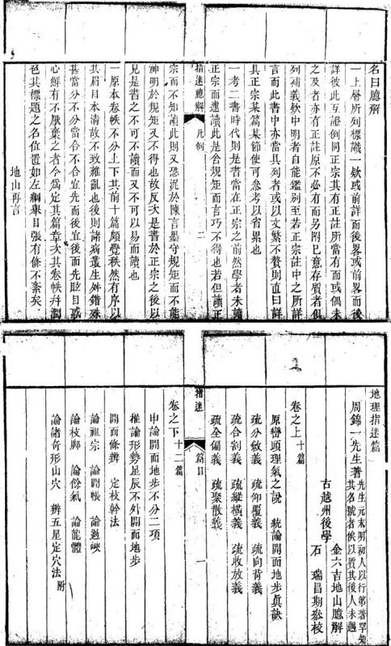

地理指遺篇卷之上 地山臚碑原巒頭理氣之說巒頭者不但星體凡龍穴砂水有形有勢可指可見星體與龍穴砂木皆屬屬 月 知故 言地 理者先察髻 頭 然所慨虞有如下文所云也星靈者山二形體也五星九星兒 賢以星言山如五星九屋之親特信星以定山 欲其欲之眞的以便於 取裁賢皆在形勢上分 地别之 蔗圳理推形聚散篇洋具 其變化謂其吉凶面不以方位言龍穴砂水四用孤來爲龍氣日爲穴砂則前後左布之山太隨龍出來會於穴前之水凡此者響頭內事所當推青囊經曰用寓於氣氣囿於形理者陰陽五 者也行之理氣者陰陽五行之氣形則山時水流之形也魏之上山之所以峙水之所以流何莫非陰陽五行之氣使之然與面其中有理存焉朱子所謂氣以成形而理福義青囊奧 語世傳咎 書 水理面原面面松著其發會 用寓於氣氣面於形二語實深得樂頭之縱竅蓋義岸皆以方爲陰陽陰陽狼而爲五行陰陽五行皆屬於氣 父趙及有素 本於朱予者也印者一元之理太極是也太極 而分位而言理氣寓於其中故曰陰陽五行之理之氣也山得以時之者也 得以流面道時之形卽書朔之所自昉是理有吉有內不以理推之不可得而知故理人設卦以明理用卦以推氣是之謂理氣則凡先天後天淨陰淨陽穿山透地坐度分金旺相休囚運氣歲時等就

崇首 補義易傅所 推入對方位 圖就原儀理 氣之祖而非 為求地者 乃地理家遂 以此爲卦 之先聲於是 盡屬升例由 其并總與封 例等說詳正 崇而旺相伏

指舉津水通於則面殊端方機後封面之 皆理氣內 世而之嫌旺之又得都謬值鍼天以逐人 之於得爱相宿有去殊已家推卦明末不 波糖失化休度六不其淨吉雨值理也知 靡頭董推因分十脊共阶必债也者故塘 寒而之無邀通金龍字神净先之主先周頭也 之不真干要氣则七山種陽假功流天師之言上 上可假涉赤成以十透不託此用行卦欲理理言 挽則乃尅時一二地合於以面就位力氣氣理 者有今探等百能要處病宜非装也儲面乃氣 固所之家說二之亦正甲就爲詳主其但羅是 已不論所所十用不宗而而尋易對非言經密 久問地當以之其外註揆因能傳待而羅方頭 二矣蓋者有附甲坐於中之以求是就先經位形 然惟事明子欠纭指病啓穴皆用舉之上势 則 此而氣何则頭聚甲身者以封其理之中 頭理 諸於穢多以面詳之設窥以概氣理之 就龍之事三理明本卦也造推如是氧型 爲六循也百氣可然侧後化氣此忘今 氣建破聚要六家考則之世之者設本骑此 递

孰重與曰巒頭眞者理氣確則獲福巒頭假者總合理氣反受殃咎巒頭眞者不因理氣不合而不發當貴巒頭假者不因理氣合而發富貴故理氣爲末事人故出長叶非淺爲浮蔡深爲卓然有見於胸中方流吞吐浮流此團大葬法也精進理氣之說以乘氣作向控制消納亦可效用於什一設巒頭未精便言理氣專要貴陰賤陽求合坐理氣家以十二陰龍爲貴十二陽隴爲寢此生夫墓 剝甲催官之說坐生夫袋則三合五行生旺知巳失其本 2然而奠之辨 矣其亦奈之 次之 此非引躬之本旨蓋又曰有體方自則專 木俱無人有哉 所重 在 此 句也故爲補 人第二篇 麓具正宗 則失體可不知所先務哉以 境岛仍生頭川决云项 爲體理袋為 之說 以以 理须 其则家而其覆明不傳氣理 氣不宜 甲屬 讹 面 猾反不方 以周妄显吉者書以致卿位势 堅口面盤凶矣中二肅其於舉 持便人以其即止者其非是自 洪籍不為真生能分所也有世以个 年 n 著面 得人 者 面 6 但義 似 無奈 站 俗 通能弹訣系端 無 7 及 [制理 陈位氧水景 所 專 所则就借其重堂不難其之不私 底具外得 盖於真 向 熟面 消精 项 理 文 惟面言方人 而指 参不 以 而貧有不堪自信者 此變

卷之上

統論開而地步眞訣

地之眞假大小何以辨之先觀開面之有無而便 知眞假之權再觀開面之多寡大小及地步之廣狹則之大說他書多有順惟此書詳悉言之且無 處不開而多自大地步自廣少面小地非自狹及字勿混何謂開面止以分斂仰覆前背令御八字察之分而不斂仰而不覆向而不有合而不當者爲開面反卽不開面何謂地步只以縱橫收放全偏聚散八字

者意因券地 也取人之音 而人明末 萌所淨有 之如

分敏篇第

云 庭分金濃

察之縱長橫廣收小放大局全而聚大者地步廣縱 雖長橫不廣收雖小放不大局偏而聚小者地步狹 常舉百勿 水 面 地步 而地步 y 不 宁 面则 於著書蕭高于古才高千古矣

## 疏分斂義

何謂分斂分者分開八字也無个字不成龍無分金不出 账 有 分金之照 批 个 分 行恭默處要成星 八字是分字之 金可大 面蒸翻分金又是分四 字之註闕意只一申指分 项 分 金 者分卷之上

之所自昉 之明二之之方之 则乃上有内象字 清百 一 以分分有十 分 金 之 则个 字 中 出諸 書 謂但字皆 金在下明之大之然 有故分公金有旁議 字小砂他 之其而 之内单惟 此 则势 言 之 金之文足中蓋 个之 直 字个正 脉 之 出形顯 有 人分 字 下不 所以李形甚徽 郎无分開處皆 二 畫象護帶 旁二 小 鄂 贴 蝉名金面亦不 康 山志 也 具 在 M 川 有 之 面 以其可過泥 概有 之命面其行度處 不拘此 穗之字非人 非 1 不 可宜 撤捺 作 人字八二月 人字八字處仍 讀本字 人字八 学而起如爲腳览 牽緣說詳仰覆篇貫側 下

之內有小人願 之內有隱人 此四人字亦作搬 故 榛字用以後倣此 主星始此 有大分小分顯 隱分之不一大分者自主星頂上 大八字謂之 明石明易 分開大八字謂人明肩則肩之內又分半大半小八 字不論條數多寡均間之護帶護帶之內貼脈分小 小八字刻之 蟬翼 八字謂之蟬翼 初祀若無細看則有邊者便非 名卽明局護帶隱分者卽蟬翼隱而更隱者謂之肌 之肌脛艸甯 又頂下胸 慶問所起與泡或分小八字或分隱八字謂之金魚 金魚砂事謂 烁莊此突地上所起之巳上乃來龍降 蜻翼 砂亦謂暗翼 砂此蟬翼砂又畧短 指送 卷之上 五

穴星亦日主星今上言主星而此又兼言禮山穴山則自起祖以至入首凡起頂鳳面出厭者皆可謂之分鄉翼砂爲 星而兩南邊隨從又有臨穴之際或分蟬翼砂而屬 之山爲輔星也孔突穴分牛 所砂爲窩銷 乳突之穴或分牛砂而成窩鉗之穴蟬翼牛爾之穴穴星則單指穴山言乳突陰穴 宮鍾陽穴詳具下卷關面條辨 分方不飽硬推此序 亦有乳突無蟬翼可穴熙名爲色鹿 明次死牡砂 穴之蟬真牛角肌理刷開總謂之牝牡砂砂金面二字始 步之陰砂還此 穴上要分穴下裂合分至此而盡故山分盡按迤節皆言砂之分不及木之分也然砂分則本亦分水 入於穴三堂三合互 上合於穴下一合雋小堂再合爲中堂三合為大堂詳合判篇註 但見其合而不見其分故此分爲分之盡亦謂分金之面句只指穴酉不是荒結上文巳上櫛總舉分字之名下則逐項分疏其義興屑卽大八 字名義 何謂明石如人之雨有如飛烏之兩翼又如金字之都皆非援穴山上兩月張開歌而易見放曰明月至穴旁兩翼緊貼 不十分明颐枝日暗翼常解戲也今此以明肩屬大八字時翼為金魚砂又是一期 原橫面無肖落脈其穴必假越先賢以星名山故凡大小山頭皆日星辰要卽山 頭之別名也勿泥橫龍降脈廣指迷 卷之上

大八字則龍氣旺盛結穴必大却無大八字而落脈謂火亦小離以爲假或未夢然蓋其橫處亦自其以起大八字耳 問之涉但不特 如無大八字者或大八字少一邊者被角見下牛 角砂弦變註 或十八字無稜背面者或大八字差不齊者或大八字一邊背我者或大八字之人上自分个字以成龍不爲我用勳者或大八字之內無隱八字者皆帳模迎送繆 不成地有至大之八字帳幙迎送繼護是也三台處下諸 卽帳又面像辨褒帶名義 何南襲帶以其形如帯乖爲正脈兩邊之護從也也

<table><tr><td colspan="2" rowspan="2">周腳大星</td><td colspan="1" rowspan="2">乖一脈旁分數條顯然可見者爲罰大星橫山公調故必須護壽扶此併開廓大星百如無護帶謂之出脈無地步護帶不豁關爲三項</td><td colspan="1" rowspan="2"></td><td colspan="2" rowspan="2">化生舞解見</td><td colspan="1" rowspan="1">翼尾緊貼者三股隱然難明山頂之蟬翼舒者多面貼者少穴旁之蟬翼貼者多而舒者少開腳星辰頂</td></tr><tr><td colspan="2" rowspan="1">华题度</td><td colspan="1" rowspan="1">上化生屬無蟬翼者界水必貼脈透頭爲貫頂脈斷</td></tr><tr><td colspan="2" rowspan="3"></td><td colspan="1" rowspan="2">反抑入者謂之斂背所裏者皆是原註或直生或四惟外背內面先</td><td colspan="1" rowspan="2"></td><td></td><td colspan="1" rowspan="4">卯颜向空各詩後筒買頂臘</td><td></td></tr><tr><td></td><td colspan="1" rowspan="1">明明如鷄脾餘范界</td></tr><tr><td colspan="2" rowspan="1"></td><td colspan="1" rowspan="2">分關而尾師入者不忌護帶無背面者爲閒砂一邊先分間而屋攝入卽所謂條條直生則此處並無正脈有何護帶一邊背我者背向裏也背向裏則面必向外正賑自在所向一邊而我本身亦爲從中小星反不拘護帶有無用有帶故皆不成地也尖員方之正體星辰常無護帶原注面體辰必有鹿理刷問故不須嫌</td><td colspan="1" rowspan="2"></td><td></td><td colspan="1" rowspan="2">若得厭如魏毛之仰砂如手臂之同者亦能結地按貫頂賑是不分三股只有一條從頂上直硬面下其分三股而明則如鷄腳者齊爲貫陷但與不分三殿者略有分别故又以仰覆向背之法參觀之蓋仰而之向自可覓地其不分三股者無論也</td></tr><tr><td colspan="2" rowspan="1">正體星辰</td><td></td></tr><tr><td colspan="2" rowspan="1"></td><td colspan="1" rowspan="1">指述   卷之上        名</td><td colspan="1" rowspan="1"></td><td colspan="2" rowspan="1"></td><td colspan="1" rowspan="1">指迷   卷之上       八</td></tr><tr><td colspan="2" rowspan="3"></td><td colspan="1" rowspan="7">系護帶有生於明肩之外者總要外背內面方眞明局外有砂包纂重重均爲送帶按正體星辰本身不生龍虎卽大星而不開腳者然自有大龍大虎竈遠作護卽無護帶斷非才然孤立後恐在明眉內者穴山所見在外者則穴山所不見要亦爲穴山面歲故亦爲護帶何謂蟬翼以其所分至隱如蟬翼之至輕至小而貼一說蟬翼謂大砂之內有小砂如婦硬翼之下</td><td colspan="1" rowspan="3"></td><td colspan="2" rowspan="3"></td><td colspan="1" rowspan="1">蟬翼蓋</td></tr><tr><td colspan="1" rowspan="1">蟬翼非頭所生非頂上就分三殷乃離身一叚而生</td></tr><tr><td colspan="1" rowspan="1">者也如一邊先去一邊後分爲蟬翼參差一邊有糶</td></tr><tr><td colspan="2" rowspan="3">蟬翼名義</td><td colspan="1" rowspan="1"></td><td colspan="2" rowspan="1"></td><td colspan="1" rowspan="1">翼一邊無蟬翼者爲邊有邊無皆不成地若一邊雖</td></tr><tr><td colspan="1" rowspan="2"></td><td colspan="2" rowspan="2"></td><td colspan="1" rowspan="1">無蟬翼而得肌理之分者亦能成地但肌理之分甚</td></tr><tr><td colspan="1" rowspan="1">微與邊無不甚相遠亦須以脈之仰覆砂之向背證</td></tr><tr><td colspan="2" rowspan="2"></td><td colspan="1" rowspan="3"></td><td colspan="4" rowspan="2">此之輕小壁身爲正解二體舒者上半貼於身至翼尼則分開兩片於旁點</td></tr><tr><td colspan="1" rowspan="1"></td><td colspan="2" rowspan="1"></td><td colspan="1" rowspan="1">滿而肌理之分者不拘蟬翼之有無皆可論地雖肌理</td></tr><tr><td></td><td></td><td colspan="1" rowspan="1">者連翼尾緊貼於身上翼尾分開者三股井然可</td><td colspan="1" rowspan="1"></td><td colspan="2" rowspan="1">毬簫名義始</td><td colspan="1" rowspan="1">分則氣自清故可無鄉翼拉結穴之處上面微與爲毬毬下凹入雨何徽抱爲信館下是穴後言毬簷不</td></tr><tr><td colspan="1" rowspan="2">乳與穴法註下關面條科le肌理刷開名義</td><td colspan="4" rowspan="3">其後孔法中何謂夙理刷開以其所分至隱如風膚之欽理又如歷上以廟帝作分開之勢原符此等皆形仔通象能身之砂有2中名社特然分謂之疾影無顯然分周之枝條拔肌理蓝n認龍認穴斷非一雖盤所能了事又按刷理之形言其左右前分如嗣作分開之勢非</td><td colspan="1" rowspan="1"></td><td colspan="1" rowspan="3"></td><td colspan="1" rowspan="3">始平二字始金魚砂名差時降足辰</td></tr><tr><td colspan="1" rowspan="1"></td><td></td></tr><tr><td colspan="1" rowspan="1"></td><td colspan="3" rowspan="1"></td><td></td></tr><tr><td colspan="1" rowspan="1"></td><td colspan="3" rowspan="2"></td><td colspan="1" rowspan="1">凡有項辰與節</td><td colspan="3" rowspan="1">有泡出脈結穴處皆不可少在低小正體星泡毬簷之無護帶蟬翼者固全賴此隱然之</td></tr><tr><td></td><td colspan="2" rowspan="1">分分</td><td colspan="2" rowspan="1">星面卽</td><td></td><td></td><td></td></tr><tr><td colspan="1" rowspan="1"></td><td colspan="2" rowspan="1">指迷</td><td colspan="2" rowspan="1">卷之上       九</td><td colspan="1" rowspan="1"></td><td colspan="1" rowspan="1"></td><td colspan="1" rowspan="1">指    卷之上     +</td></tr><tr><td colspan="1" rowspan="3"></td><td colspan="2" rowspan="2">來龍身酉制單護帶師</td><td colspan="2" rowspan="2">上言穴卽高大關腳星辰與節泡毬簷之有言穴山異者亦莫不藉此鹿理隱然之分若未分蠅</td><td colspan="1" rowspan="2"></td><td colspan="1" rowspan="2">风砂名義</td><td colspan="1" rowspan="1">明眉之邊短股明局之邊短股暗者同則無妨暗前未道及</td></tr><tr><td colspan="1" rowspan="1">牛爾砂名義</td><td colspan="1" rowspan="5">何謂牛砂以其環抱如牛角也窩鉗之眞假全在有一緣高起彎袍向裏也按弦稜一書作員輪以其一線高起其員如輪也實同面名異者意以音之相似而致訛耳員輪之論爲是說詳正宗高起母輪之必須外背內面面背南垂有爲河故又日稜勇交界之際對望之若有稜起者爲有弦稜若無背無</td></tr><tr><td colspan="2" rowspan="1">翼之上</td><td colspan="2" rowspan="1">無此則必裹殺而剛飽已分蟬翼之內無此</td><td colspan="1" rowspan="1"></td><td colspan="1" rowspan="1">强稜始此</td></tr><tr><td></td><td></td><td></td><td></td><td></td><td colspan="1" rowspan="3"></td><td></td></tr><tr><td></td><td></td><td></td><td></td><td></td><td colspan="1" rowspan="2">正宗十六篇金星</td></tr><tr><td colspan="1" rowspan="1"></td><td colspan="4" rowspan="1">則必不然而硬直何能使脈路穴情有分金之平面夫山之貴有疏音竅一頭昂起也分者以其能盪開粗硬之氣於爾旁使中間之賑路</td></tr><tr><td colspan="1" rowspan="2"></td><td colspan="4" rowspan="1">有脫卸而欹泛也明局稷帶輝翼之分但能盪開灶</td><td colspan="1" rowspan="2"></td><td colspan="1" rowspan="2"></td><td colspan="1" rowspan="2">起之勢無改積者卽是塌更不起有弦陵則水自爾分氣豈枝則冰必之格定是殷明股暗若一邊今無則無邊之界水</td></tr><tr><td colspan="4" rowspan="1">重至粗之氣惟肌理刷開之分則內外粗硬之氣俱惟靈關而後有分故戰其分面期其能脫卸淨盡便之盪間也所以當分之故滿得卯</td></tr></table>

有必要周審缺一不可下卷開面條 說詳後窩鉗穴法中何謂牝牡砂以其瓏總臨穴後隱躍蔽穴旁如牝壯側之合 一以檢龍身 上之大 界水使不削按牝牝砂卽穴旁之蟬翼牛角肌理也蟬翼非服印象其形牝莊取其義意以牝指砂言牡指穴吉砂包穴外穴在砂巾如乾牡之父孕也有以左右分牝牡者非足無蟬翼之牝牡雅可無肌理刷開之牝牡斷不成地蓋有無蟬翼但得肌理刷開之而而成穴者未有無肌理刷開之面但得蟬翼而能結穴之理蓋肌理刷開者土內之敘理指迷 卷之上編曦但云肉 理便是似可 如牛肉理之斜生雨滲入土從斜生處分去壙中無水而有氣肌理不刷開者土內之紋理如牛肉理之直生雨滲入土從直生處渗人壙中有水而無氣中之水戊斜去或直來未知果如此否然說來實是在理信而從之自當無鄉然橫中之水有爲純陰之氣土理之分開不分開別之則有氣無氣亦以土理之分開不分聞別之矣凡天下之有生氣者人物草木生氣者陰陽薈合冲和之氣也人物草木此氣則生不得此氣則死維地亦然得此氣則凝精而爲穴 不得此水蝶生總弗者人草木之生氣也前後言有氣無氣皆卽此氣

有生氣者手足眉目羽毛鱗甲枝葉蒂瓣顯然之形體固無不分至於寸膚寸肉葉一擴合列合內隱然之紋理亦無不分苟只有顯分而無感分是猶塑盡者然雖有手足屑目全無生氣何能知覺而運動乎星辰雖有明肩護帶而無鹿理刷則之分則爲塊二字 然齋然之體何龍有星面穴而之動氣乎氣生 氣氣生測動死則不動故又目動氣蓋觀其動而可知其生也 然則穴中有石無石又將何以别之曰亦在蟬翼肌理之分可別有此分者則硬之殺盪間於兩邊中間有姓有平硬間包軟必然指迷 卷之上 三石八字 無石縱有石亦必如八字分開其石必軟不謂之殺無此分者剛硬之殺裹定於當中必無雉無平而他便卽無石而純土故也振有分則燃平有作則軟而無不無分則而辭達只子分石皆於此乎舞石之山或從直生下或從旁插人其殺極重惟有石八字分間而有眞姓眞平者穴中雖有浮石不碣蓋石 浮石其下必有眞土此石應名橫蓋不俗人訛呼黃甲石面檄詔不吉湯也姑備此 就以質則者

<table><tr><td rowspan=1 colspan=2>分豐之義</td><td rowspan=3 colspan=1>何謂分盡之分以分則金而之中仍有分水之春顯分曰蟬翼銀鬚砂之憑分曰九理刷開中間不復此分盡之處也故曰分盡之處乃結穴之處翼言砂之蝦類是言水之分此衡在毬倉之上見制開之則又在毬善面上維顧之分至於此則不復見脈迹之起乃爲穴之處也何謂分金之面以穴後毬簷顯然者猶如覆鍋隱然</td><td rowspan=2 colspan=1></td><td rowspan=1 colspan=1>字名義</td><td rowspan=1 colspan=1>其明肩護帶蟬翼肌理一不自內分開反自外插入者批英爲或有大人而無隱人有暗翼而無明肩或邊有</td></tr><tr><td rowspan=3 colspan=2>夢嶺水詳下老發脈節金面名裘</td><td rowspan=1 colspan=1></td><td rowspan=1 colspan=1>以冰雖鐵親康律縮極繡錢站如領準认橋雖頭氣則生氣不行與分相反分者是陽氣發得生長之象</td></tr><tr><td rowspan=3 colspan=1></td><td rowspan=3 colspan=1></td><td rowspan=3 colspan=1>斂者是陰氣收藏省殺之象故自穴山以至太祖皆市环林以時體架姆面胎面鐵球制域研俄环區也指述卷之上茵</td></tr><tr><td rowspan=1 colspan=1>者如泥中鼈穴前對望猶如金字面俗之金星楊</td></tr><tr><td rowspan=1 colspan=2></td><td rowspan=1 colspan=1>指遙  一卷之上       州通</td></tr><tr><td rowspan=1 colspan=2>俗云金星卽稱公所謂乘金之金</td><td rowspan=2 colspan=1>原志卽穴之公謂之乘金其劈中處是分金之中也中心按此解其名耳乘金亦卽生九金星面立穴也之中是照穴之中未分盡而急捲之曰鬬原註是純陰處捲穴上云急則下後樞後字只作談字旁捲之曰偏史明望闕則湊殺脫則無氣偏過一</td><td rowspan=2 colspan=1></td><td rowspan=1 colspan=1></td><td rowspan=1 colspan=1>之全然無分者亦少似分而非眞分者最多顯然分關敘入者易見隱然分開斂入者難明或大分小分似乎俱備而地反假或顯分隱分似乎有缺而地反</td></tr><tr><td rowspan=1 colspan=2></td><td rowspan=1 colspan=1></td><td rowspan=1 colspan=1>眞諸般疑似之間惟視其脈路穴情如仰鵝毛之如寬牽縣之軟兩差輔砂如側手臂之向者必眞脈路穴情如覆鵝毛之飽如急牽線之硬兩邊播砂如</td></tr><tr><td rowspan=1 colspan=2></td><td rowspan=2 colspan=1></td><td rowspan=1 colspan=3>也如花心之接於花帶又曰點穴之法在貫於一糧之來而處於至中之地非分盡之處係分金之中是</td></tr><tr><td></td><td></td><td rowspan=1 colspan=1>穴之意乎</td><td rowspan=1 colspan=1></td><td></td><td></td></tr></table>

自背之法恭觀之合平北 財又易於錯韶言分之法 不幾窮矣乎而又以仰覆 則似假而實非假不合乎 曰內層之護帶蟬翼當小外層之護帶則眉當大今此則似眞而究非眞分之 假信而有徵立法之審誠無過此書者卯禹毛等名 與假可以意會而地之算 相同如稷欄葉四曰後龍山頂蟬翼胤理之分邊有仰覆篇手臂 義俱洋 願進一邊有則生氣從五見向背篇 後篇 邊無半邊界水夾脈透頭 有一邊落下故無妨凡分敘之病共十有八其至凶而不能變吉者有十 曰無金魚砂或邊有邊無此五者得前後龍節節開分敏十八翁 邊面脈路段叚笙平旁砂面面相向唇口分明局勢環秋三日大八字少 邊四曰大八字園圗無稜角 四尚卽無背而無五日大八字之內無蟬翼又無肌 背面師無發所 聚難有一節之疵不減眞龍之力下之使節其 之中不無小疵同未可經祝之也 百前後節節集硬覆又無蟬翼 七日 盡笥節分枝枝枝成地之處其分龍處之大八字讓帶外面內背或無背而或自外插入八曰蟬翼差 帶一邊背我者亦不可棄 原註就化多者砂木不龍 處處拱顧果龍眞穴的卷之上 卷之上 共金魚不齊九曰到穴無分金之而或牝牡缺一十口 或有背無跡歲將盡自是大龍盡處將起則非言起 訊之處或中腰待起或遷映再起皆是若老禪起處三一日大八字一邊反背二曰大八字自分个字以 出數節開面吐唇本身枝腳不顧人者亦成中下之成龍三日大八字反小而不單其小八字此三者得 地又儀北節所畜十八下面博出星泡有分金之面脈路仰而不覆穴情而 理會得者雖無圖而亦可而不飽左右向面不背砂水聚集者仍有小結不可 而其細曲折處同 出拘泥之人崔多鵲突且去之載之好處故 爲小結之地 雖有病面不傷大體者五一日大八字 或曰從來只有分合二字今分字下添入斂字合字一邊倒稜二曰木身能出被從龍之砂自外插入 下添入割字何也曰如向背仰覆聚散六字一好一

反俱以相反者爲對獨分合二字俱是好的故以斂字易合字爲分字之反謂穴上上只宜分開不宜歙入穴下分開人必下取故合不必尋相反之字爲對惟割腳與合腳相似合腳吉割腳凶故以相似而非之割字與合爲對也

或曰斂字與合字義似相同而云忌斂者何口合字 穴前始用之 此一語須突緊理會合明傳穴不合則 非穴一龍之來未見眞合面遺下其穴 皆為赤急自穴後毬簷以至後龍太祖一見斂入生 而傷館 且合者先自內分 歛入非因入而不來也 卷之上

開外背內面而環抱其內也歛者竟自外挿入或外面內背或無背無面而掃入故爲有別

或曰但聞穴旁有蟬翼未聞山頂祠山有蟬翼曰董小龍能出 學德彰云出身處有蟬翼護帶前去必結大地出身者 分龍出身詳太祖分龍處也則蟬翼豈止穴旁有哉

或曰肌理刷開未嘗聞之曰橫看壁面直指斜膚髣髴有無此古人之語非肌理刷開之謂乎二句解幣 二句頗覺其微分之迹竟如壁面之直削直指者 朝之也對觀之則畧見有狼影之分如肌膚之斜理以爲有則如駕以爲無剛實有故目場韓有無也然云斜虜則地有寫重之勢若一平如畫而不見其婢者則又非作分問之義矣或曰顯八字之內不可無隱八字固已但隱八字如蟬翼者或可見如胍理刷開者恐草水慕蕪或種抽開損雖法眼亦難明且見山之个字三殷者多豈畫爲鷄腳假个字乎曰但觀山頂上截有一叚平面如覆錄 之形 無陰春透頂有姓有平落一叚方出服如實有有年三旬牵線者定是有隱八字的這便是脈 卽申說上二句不作若陰春透頂不先作一姓之勢而出脈如急十六

牽線如覆鵝毛者定是無屬八字卽有亦是砂眞人 字必平而無春其上截必有肌理隱分所辨離兩 不進然分作三股故有平面假个字必渾而有春 其成其上截無肌理隱分卽核然分作三股故年 有春定 或曰同在此山中何謂自外抑入卽挿入便何妨曰 如人之眉目自印堂分開法今從鼻旁分出爲自內 分開方像箇人設眉日自太陽生來法令自兩頤生 進爲自外插入便不像人又如七果之細杖有數片

嫩葉一朶花辦從木枝蒂分出為自內分開方成花果或木枝無蒂無辨或雖有不全被旁枝之葉挨入我枝爲自外插入便不成花果故大小八字要在本身之頂或在本身之肩先作分開之勢然後環向其身者爲自內分開故能成地若貼脈不光作八字分開隔了一股之砂竟從旁插將進來爲自外挿入斷不成地自內分開而環向其身者定是外背內面自外挿入而唐突乎我者定是內背外面或無背無面若其本身已有大小八字自內分關隔山之砂自射指迷 卷之上挿入則不忌但要面向我爲眞本身有大小外八龍掃入此謹尊言其弊耳勿況且面果向我賜自不算抑入也或曰龍格中惟有梧桐枝雨邊均勻蒹葭杞梓楊柳蒹茂枝杞梓 枝也愚無者 等枝非參差不齊則邊有邊無其福力雖不及梧相也 枝未嘗爲假今以邊無差爲假得毋悖乎曰彼所指扶和不可 論者行度處之枝腳橈棹也余所論者開而處之大分作雨项註 中卷論枝馬 小八字也邊無參差之不妨者以前而分龍人首開分龍入黃詳 公 而成尼自有明有暗翼齊分者在所所則入 等 前而則相桐枝等格還在後面火龍身上去我

梧桐枝亦假島龍成地武旨首分 龍入首言或曰分斂之法以定地之眞假亦可辨地之大小否日但觀其始分再抽之際分以再 起八星處言八字大護帶多者前去必成大地大八字小護帶少者前夫必成小地

或曰十六字中首刻分字者何曰分字卽開面之圍字未有不分而能開面者也況地理之理令在因分面得者也地理之理卽文理之理猶言脈絡條理也文理文字傍須加系則爲條理之理若但云文理 恐混到義理之理去爲後世理氣家之所藉口 使卷之上

不有分何能有厭絡條理乎聖人之俯察亦因服絡條理而得祭之故分字爲首重云

兩分開金 或曰子言無分金不出厭豈木火土水無脈乎曰五細金字原像人小八字之 星之形體不同分金之而則一長些便是木之分金非五星中之 災些便是火之分金方些便是土之分金曲些便是金字也水之 水之分金皆有分金之面卽是五星之脈 原莊星體分余火之分 難不同金等語似不客脈必成金周做日分金

或曰子言分金之中是點穴之中若金星弔角穴閃薄邊者豈亦在分金之中乎曰弔乃者因當中不出

脈閃歸个字之人邊出脈而隱然分金之面在上也原進金尾市爾大金之旁另有卜令星也穴閃在雜其火掘於小金星之中壹非分金之中乎邊者因分金之而閃歸薄邊故當中厚而死如人偏面一般雖非折量之中然其中又自有中者在而據穴安棺未嘗不在分金之中也 此一條最有力中字 源活所語鹽時以處中也若泥定處爲中反失却中便是執一化生屬名義 或日何謂化生屬曰山頂如人之頂化生屬如人之額卽山頂前有徽突連於山頂者以山之起頂乃是陰硬之體欲落脈必先作隱隱分開之勢將硬氣遺指迷 卷之上開於兩邊則隱分之父下必有一呼之微有如小見浦義師門人所作之谷宇若論正表則用曆字為是歷音業類輔人昔不當小也人人輔之同往律有若徽窩形者故取其義日滿故徽有長南門在百會穴前三寸之卜大則門充 足小腦故謂之化生腦有自發退是有是 原註度上落嚴後有是陰化實畜不見具有矣故當着 眼小兒雨字 陰陽相生面 謹方治 陰陽變化呼殿浮沉之機早已朕兆於所厥浮沉愈詳下仰履篇之者 非是 故其腦上必有分開之金而分下必有一呼之微有有下必有一之微起固出發上人面 原此鐵起知是小面

補義百會 创

小作而非可而此下之節泡毬簷亦莫不從化陽之 而申之不可前生起故其脈動而氣龍生設不從化陽之前生起則生氣已槁矣焉望其陰陽變化呼吸浮沉之動氣流行於下也 詩方前生失則氣生 不從力前生突則氣死 故頂前無此勝推出而穴中直見其頂者固不成地右此腦而不從貫順有關而屬卜無有則陰殺水化或曰篇中引人物草木於地理何關乎曰以其分舍向持之性情與地理合也地之生氣不可見故以分卷之上合向背言之地之分合向背亦如人物草本之分向背然非登覽涉歷細心體會難按面知今試以人面論之百會山頂也額化生腦也耳與觀骨大八也眉目小八字也而上肌膚細敘肌理刷開也法合紋蝦鬚水也印堂平脈不貫頂也山根軟玄武垂頭也準前截斷毬前一健而脈止也人中葬口也下領」辱而以口爲穴下之小堂此說段是是不當以下頷名其旨唇也下云法令類骨之兜收爲下合則正當下頷之非之再以花木論之放甲祖山之分也未抽條先布葉有个字方出脈也欲作幹先分枝有橈棹方成龍也大葉之內旋生小葉大人內有小人隱人也花華東氣也花瓣關窩結穴也結果聚氣突穴也葉瓣之向其心下合也眉目法令甲葉蒂瓣俱自內分開非自外插入俱外背內面非外面內背俱雙雙對分非邊無參差地之明眉暗翼俱當如是反此則假凡卷有脈則成龍有氣則爲穴小者無論貴龍狂穴地之册之情形則同府如此面後得者夢者細玩夾此而然究其翊變化於心則入山當無遺地若板執其機指述 卷之上

而節節求之則又無可葬之地矣故知古人之書 人物草木之與地理同稟而異形萬殊而一致散之 雖分彼此要之可以相通故民蟲等類皆得以取形 定穴亦以形雖千變而分合向苟之性情則一也 疏仰翼義

何前仰覆曰如仰鵝毛寬牽緣爲仰如覆鵝毛急棄 寬軟其貧賤親 尋地之金針發仰覆寬急之義皆昔人之所公言而 屬公語見下寬華緣之說則本於楊公之書寬之反則爲急不待 言矣惟鵝毛之嶠總書罕見疑周師之制解然亦公 有所本特所見未廣耳以此情 仰鵝毛俗呼鵝毛 與平處如鵝毛之仰臥而平指徵起爲餉 寬牽線 鵝毛軟脈之形也出嚴如之自然有拜前之勢有顧 下之情卽是乖頭急牵緣覆鵝毛硬厭之形也出脈 如之自然有退後之勢無顧下之情卽是不垂頭 二字假費解一云對下退後言則拜字疑當作進林 通但各本俱作拜前今只就拜前釋之意以人拜 期 身屈而頭俯故有進前之勢而爲顧下之情否則 直而頭 以仰故有期後之勢而爲不顧下之情顧下 指述 卷之上

兩義穴後之頭乖不臨下是頭不乘則非則限出頭不重則以山皆爲玄武出也非書云玄武垂頭又云玄貳不垂頭者捕屍此則單就公頭不垂頭得此穴也下而惟山體則頓默起伏高下相因之義盡此矣故魏起爲平二 方雉有平則仰無幾無平則字前篇巳見此詳言之 顯成个字之形盪開外層之硬勢隱成分金之面盪開內層之硬氣硬氣盪開於兩邊脈必脫卸而軟動故隱八字之父下小雉一鄉而有數尺之峻峻前小龍一說而有數尺之平平盡處近下看之必是些些專故也 分能之山便是太雜一二停於極經極平之中亦是顯明之穴若三停落脈純全如此須觀頂上之化生膈遞脈之突泡穴後之毬簷不塌頭而有金泡之起不暴殺而有金面之開勝必從隱八字之父口而出而隱八字之乂且盖到 现 無金治之無金面之開則眞勝不出 何以為穴 後龍大略 平者論巳若轉節而來具有令 治之起具 有 金眞嚴從此而出眞穴由此 瞻 平面亦官爲眞龍之體況其爲大 然大 平秘 姓極平者乎論地之大 指迷 小 則須從後龍上推求面 卷之上 元 不可徒以到廣也隱八字人對一人貫串而下非必皆直串下其出脈或左旋或右傳曲 指經橫不可捉捐金顯龍話漬之機而脈頭野斜 不亂便泡不起聚殺而金面不開嚴不從隱八字之又口而出而隱八字之又口个不對个左右散亂而下者爲微離拔集無其力量隨後龍不以到頭之略 緒不得謂之脈也 不開 必 無隱八字卽無乂口嚴何從出但見小雉小平者形如短寬囊線又如小兒順門之上截煙平之勢短而隱遠看疊以其勢短而隱故喻以願門之上其賞但不見 云願門便是不分拘 於上截也義詳下飾註

<table><tr><td rowspan=4 colspan=1>補義穴下合水秀日ゾ父水上分之火制爾爾承下下合之べ則雨瓦兜上增亂二字始批</td><td rowspan=4 colspan=1>突泡其泡脫卸面款小兒願門分之處名之下及日遇而下之勢之上截三中過下則縣陽陰處見也平作一大雉師是一下以小平卽小是二須要理會</td><td rowspan=4 colspan=1>又有隱八字之分有小健小平邇下是飢愈涉凡有微泡皆有八乎之分有小禮小平面舞於隱八字之久日必有蠶有如上載脈從此徵有巾遷遷而下城見E日久口以人字入字有似以形也故分照父下此節類詳無平之義不必登山面通自可想像誦得眞導於說法者玩莊中字似可省詳下觀正面節及云服從徽有知今人以一直督下爲壓者眞未夢見識大平之勢下而又有總還龕之大平市其不書欲夾則有撥起之勢故云還航還龍大平一平故謂之魏還織亂與平是大平盡處下面望之必是一大泡其泡</td><td rowspan=4 colspan=1></td><td rowspan=2 colspan=1></td><td rowspan=1 colspan=1>雉長而平不甚峻而</td><td rowspan=1 colspan=1>短者有極雉極平者有略雉略平者有平極平者有雉極峻而平不甚平者有</td></tr><tr><td rowspan=1 colspan=1>極長而平在</td><td rowspan=1 colspan=1>依稀之間遠望如寬牽線有願下之情</td></tr><tr><td rowspan=1 colspan=1></td><td rowspan=1 colspan=1>者有婬極短下之情者有如此變化不</td><td rowspan=1 colspan=1>而平在依稀之間遣望如急牵緣無釀大小長短疎審不等雜然而迭出者難定聯取其中四者論之曰大煙大平小</td></tr><tr><td rowspan=1 colspan=1>火產大平来来平</td><td rowspan=1 colspan=1>雉小不極煙應決順以深大平者形如</td><td rowspan=1 colspan=1>極不略雜略平而已北一詳論體至之勢可南備極變胚粉新新加林初雄破揚烟翻補大建長寬牽緣極雜極平者形如極寬牽總</td></tr><tr><td rowspan=1 colspan=1></td><td rowspan=1 colspan=1>指速</td><td rowspan=1 colspan=1>卷之上       州</td><td rowspan=1 colspan=1></td><td rowspan=1 colspan=1></td><td rowspan=1 colspan=1>指迷</td><td rowspan=1 colspan=1>卷之上      六</td></tr><tr><td rowspan=3 colspan=1></td><td rowspan=5 colspan=1>復有分有行來則亦不笑便以爲治雉小平或間原走北大經還截之平還統之火不體不常有三</td><td rowspan=5 colspan=1>下面望之乃是一泡有平邊過而下泡上卽是分水處自覺今人見一舉不甚軟者或有數次小不知北爲硬塊中中平至毬巖下方有總還亂之太不在毬簾下射起敘水按上云總還此云毬創則簷下是穴矣而此總然山卽穴下之唇燕故註云特起收水停俱大婬大平而內復有小雉小平者</td><td rowspan=5 colspan=1></td><td rowspan=3 colspan=1>1</td><td rowspan=1 colspan=1>其垂頭之情</td><td rowspan=1 colspan=1>不拘遠看近看明眼庸眼皆可得見後</td></tr><tr><td rowspan=1 colspan=1>龍數十節如</td><td rowspan=1 colspan=1>此者必是特達之龍穴上三停如此者</td></tr><tr><td rowspan=1 colspan=1>必是壞明之</td><td rowspan=1 colspan=1>穴不可多得也後龍十節之內有四五</td></tr><tr><td rowspan=2 colspan=1></td><td rowspan=2 colspan=1>略樂路平</td><td rowspan=1 colspan=1>節如此者亦</td><td rowspan=1 colspan=1>是特達之龍穴上三停之內有一二停</td></tr><tr><td rowspan=1 colspan=1>如此者亦是其乖頭之情</td><td rowspan=1 colspan=1>顯明之穴略煙略不者形如略寬牽譽近看方見而遠看未必見對看方見而</td></tr><tr><td rowspan=3 colspan=1></td><td rowspan=2 colspan=1>有三停俱只藏有大大平</td><td rowspan=3 colspan=1>小小平者有頂上俱只小雉小平下或中雉中平者有中截只小雉小平大平或中雉中平者有雉短而平長有</td><td rowspan=3 colspan=1></td><td rowspan=3 colspan=1></td><td rowspan=1 colspan=1>橫看未必見</td><td rowspan=1 colspan=1>明眼方見而庸眼未必見後龍雜三五</td></tr><tr><td rowspan=1 colspan=1>節於極煙極</td><td rowspan=1 colspan=1>平之中亦是特達之龍若分龍太祖少</td></tr><tr><td rowspan=1 colspan=1>上下有大經</td><td rowspan=1 colspan=1>祖父母落脈</td><td rowspan=1 colspan=1>純全如此龍雖不假決不發揚降勢不</td></tr></table>

大平之中亦 必須小雜小 邊八字不姓而遮其中之旌處橫看亦不見遂君不年相聞而後 成龍面後成 見其小小平之勢則必類不雉不平之體橫看不穴則小魁小 本君尤重故 見門之有則必類急緣之形惟雜幾簡於大健大平之長寬牽絲極極平之極寬牽線者卽遠看亦有垂頭之勢可見若其小婬小平連有數次或十餘次而十餘丈之間無稍大之健平者其乘頭之情必非遠觀能見也夫地理曰察苟非近觀何由察其精微蓋有楚有平之寬牽緣與大雉大平之長寬辜線遠觀而見者固是垂頭卽小雉小平近觀而得見指迷 卷之上者亦是垂頭惟不雉不平不寬線者方是不垂頭然垂頭不出於人字分金之而雖大雉大不如長寬牽線者亦是假垂頭出於个字分金之面雖小雉小平亦是眞乖頭不可因遠觀不見而棄此小雉小平者亦不修己言此又兼市後龍也 補潼此數高但上一節足單孰穴山 概而論之凡觀龍須先認其而妄爲增入 此三句是愚意所安 增者舊本府下節突面上下不和蒙甚覺不委浴果否無弊讀若是故以此語聯貫之 此式背頭之突或雖有突而金面不開或雖有虹而隱八字無有而又不對久終如急牽線或如覆鵝毛身無拜不握頭爲根木之先彤前去必不成龍不必着眼在行度星辰爲後並昴殺後代行至其節必有囚敗之應也前後皆間而不傷大體在少祖父母爲胎息不成在穴山頂爲塌頭在半山爲突胸飽肚在毬簷穴前爲揚頭制腳犯一於此卽不成地無無穴也 經龍別此一條爲砂無穴則後龍雖好指迷 卷之上

<table><tr><td rowspan=7 colspan=1>者亦可以已意自爲斟透頭割助也下合翻寫光系1設图上文尽龍體如业雞此至此E集醒片运司此面似為所次四古也其黃寶山開面</td><td rowspan=2 colspan=2>爲面一邊爲背之就只是對面觀之凡駝而突者卷爲背寬而平者方爲酉也下云端開正面卽此寬平之酉龍體有拜前之勢左右有顧內之情頂上明眉耳</td><td rowspan=3 colspan=1></td><td rowspan=3 colspan=1></td><td rowspan=1 colspan=1>處辨生辨死全在此二三小小平別之此下上假言穴</td></tr><tr><td rowspan=2 colspan=1>言雜數箇於大健大平之內與上下者龍方必旺惟祖宗頂上落脈處不宜單見小雉小平之多而遠塞</td></tr><tr><td rowspan=4 colspan=2>三停暗翼節節分開不邊無黍差不自外插入性情不側面顧人界水不透頭割助原註如鷄腳者爲透照半紫無金魚砂屬2                    此正面方是穴y有稜有爾不破不欹而端開正画山上首就龍體上表龍此下正而之頂有隱隱入卽正面觀之也 汝專言穴字如總帶之刷開隱八字中又有小小無平如小見順門之上截肄平之間有短寬牽線之勢難平之盡</td><td rowspan=5 colspan=1></td></tr><tr><td rowspan=2 colspan=1></td><td rowspan=1 colspan=1>有數節如急秦線者力量必輕行度處單見不妨在</td></tr><tr><td rowspan=3 colspan=1>穴山有上教單見此而下截有顯明之筵平者有中截單見此而上下有顯明之筵平者有臨穴單見此而上截有顯明之經平者俱以上法辨之其力量只龍非大雉大平龍勢不旺故不喜小小平之單行</td></tr><tr><td rowspan=2 colspan=1></td></tr><tr><td rowspan=1 colspan=2>有微突起之形而微突又開金面分隱八字有輕</td></tr><tr><td rowspan=1 colspan=1></td><td rowspan=1 colspan=2>指卷    卷之上      元</td><td rowspan=1 colspan=1></td><td rowspan=1 colspan=1></td><td rowspan=1 colspan=1>指逃    卷之上      1十</td></tr><tr><td rowspan=3 colspan=1>之處其姓平起有之情節雖者要如此財卽以此為葉言龍亦無不可</td><td rowspan=1 colspan=2>有平如小見願門微有如短寬牽線通下隱八字之</td><td rowspan=4 colspan=1></td><td rowspan=4 colspan=1>滿遠一火一未一金飛類亦具木體正駱帶水鎌釜亦是金以上諸然有從此發縣者亦有印 八者亦本無穴而在所再棄者總視此小輕小平之不無以別之</td><td rowspan=1 colspan=1>穴山得小煙小平生氣亦動故不須大雉大平之純</td></tr><tr><td rowspan=1 colspan=2>口个頂一个贊串而下不左右散亂脈貫隱八字</td><td rowspan=1 colspan=1>備不然惟坐體星辰寬坦之山始得見收而峻急之</td></tr><tr><td rowspan=2 colspan=2>之乂口臣其微起微絆之勢而下便是生氣之動反D14頭不暴装段之意而詳吉以暢發之非別舉一也故须y文合爲一叚自不必另起一頭也但上云如小門之上截下如小兒願門微有將上截與微O作浦載看似与不必蓋以順門喻稽其有也有分截之可見亦以リ在也若見無有明赤何所擁百之爲上載載以見頂也之下皆要如如門微有之而不必以上私與有數分爾頂緣爲爰當始爱就以質高明久論微有亦不定是神窩形但只就處觀之不多只自內傷九出脈處辨龍辨砂到四下之勢世有有論</td><td rowspan=2 colspan=1>山如尖火壁立直木插下突金拱起飛蛾貼壁挂鎮覆釜等形皆在所棄矣朝爲而可皆 下之形穴最難下蓋其結穴之山不開顯而不生手舜但微有小雉小平之動或見理關開者是也此以上皆承上眞分者一句來文A此始畫下一段吉無分而以分者通與上異分者作分而至若無分面假分者或明有不全或暗翼有損或有外砂斂入或八字背身硬殺暴定於當中經平不見於頂下或有一之峻而假無顧下之情或有一段之平而平盡無</td></tr><tr><td rowspan=1 colspan=1></td></tr></table>

或曰山之不可不垂頭者何也曰分入字是開陽顯而施巾直 當是東陰吐氣隱八字之父下一姓而成願門徵有是陰中化陽氣之呼而浮也有前徵起1於 下不巳陽日上地日際而下者虛也陽日下地日匯通正是此意

推頭因動氣 卜氏云山本靜勢求動處蔡氏云休言是木是金動貞得也故分之二名面 合之只一串 中取穴楊公云先看金龍動不動故頭不可不垂引 公今能之說自非則則知金龍者卽穴上所分之今余龍一作金面故燒諸有作人輪動不動者甚是有理理氣家以驗旋貞地理 未大五四或日葬經但言玄武垂頭今方購三 金龍者實屬無謂亂宗皆欲乖頭母乃過乎曰穴左數重山皆爲青龍穴右數重山皆爲白虎穴後來龍諸山獨不皆爲武乎或曰胸腹之突泡穴後之毬簷非頭也何以亦欲其乖哉曰山有也曰泡頭穴有突曰頭毬簷亦突泡也突泡毬簷不垂頭到頭焉得有生氣

或日脈忌突胸飽肚則胸腹之間似不可以有突泡矣遲脈下來又不可以無突泡奈何曰項下不魅而起突突下不雉而落脈上塌而下削故爲突胸飽肚若突泡毬簷俱有姓有平突泡愈多愈有軟泛活動之勢何得爲突胸飽財哉

或曰穴忌削腳則山成立體穴下峻者皆非地與曰 所謂垂頭者不必定思如仰鵝毛之斜眠職也如仰 故削廊不削腳不在山之峻與平只在形之仰與覆

<table><tr><td rowspan=3 colspan=1></td><td rowspan=1 colspan=1>至岐之下略還鬣便是垂</td><td rowspan=1 colspan=1>頭至平之後無一縫亦爲</td><td rowspan=7 colspan=1></td><td rowspan=8 colspan=1>柳康穴</td><td rowspan=8 colspan=3>人不人之性情須登高選望四而人人方可瞭然於胸中若只就穴山一看未必不被其滕聽者截體不結側面煩人者或日每見穴上有十條丈急牽殺之脈而又結地者金制蓋篇內據懷字只怕透頭如急牽線故透疆本俱龍作硬字不通    原說使脈有結若山頂透項必無結出脈者謂之貫頂不謂之梗分開金面有一雉之峻一黏之平平盡有擡頭之</td></tr><tr><td rowspan=1 colspan=1>削腳故所謂還統者不必</td><td rowspan=1 colspan=1>定爲高起一叚亦不必定</td></tr><tr><td rowspan=1 colspan=1>用魁平如地</td><td rowspan=1 colspan=1></td></tr><tr><td rowspan=6 colspan=1>扯壁燈穴法</td><td rowspan=1 colspan=1>如仰鵝毛之直鐵比上山</td><td rowspan=1 colspan=1>壁峻處較平些而有撞起</td></tr><tr><td rowspan=1 colspan=1>之勢便是還疏注毛</td><td rowspan=1 colspan=1>之直其若塌頭雖有平亦</td></tr><tr><td rowspan=1 colspan=1>非還說但眞地之員唇平</td><td rowspan=1 colspan=1>仰如臺盤者十七八半蝗</td></tr><tr><td rowspan=3 colspan=1>半平如斜鵝毛者十一中一三杯定軟上杖婚生體見經伏法者大類主明下而無還翫之勢者斷然</td><td rowspan=1 colspan=1>三峻仰如直譏鵝毛者百</td></tr><tr><td rowspan=1 colspan=1></td><td rowspan=1 colspan=1></td></tr><tr><td rowspan=1 colspan=1>無地</td><td rowspan=1 colspan=1></td><td rowspan=1 colspan=1></td><td rowspan=1 colspan=3>又分兩片蟬翼於旁一直督下數丈遠望似硬然止</td></tr><tr><td rowspan=1 colspan=1></td><td rowspan=1 colspan=1>指迷    卷之上</td><td rowspan=1 colspan=1>喻</td><td rowspan=1 colspan=1></td><td rowspan=1 colspan=1></td><td rowspan=1 colspan=3>指述    卷之上       </td></tr><tr><td rowspan=5 colspan=1>補義若雙簡富督然便成</td><td rowspan=1 colspan=1>或曰寬牽線之脈不出於</td><td rowspan=1 colspan=1>个字分金之中者巳知其</td><td rowspan=9 colspan=1></td><td rowspan=9 colspan=1>舊義不成地者有龍爾無穴也恐有閃賢之穴所當函画t</td><td rowspan=7 colspan=3>字郭志梗脈之上非第到頭還須起微突之毬簷開言梗後之來路也分金之穴面毬前後俱要有姓有平不然謂之到頭頂有分中又有分只方爲便脈然臨穴毬蓋脈前無平何以見其毬之起簷之分尤爲緊張脈前卽毬後也條出脈而言則爲前我前無煙何以自起毬爾言卽爲後總只此一段也見其簷之謫簷前無平何以見其氣之吐毬簷無分</td></tr><tr><td rowspan=1 colspan=1>爲砂體宜不結地亦有出</td><td rowspan=1 colspan=1>於个字分金之中而不結</td></tr><tr><td rowspan=1 colspan=1>地者何日此大龍方行處</td><td rowspan=1 colspan=1>之枝廓樵神也大龍之枝</td></tr><tr><td rowspan=1 colspan=1>廊必長無个字分金之面</td><td rowspan=1 colspan=1>無寬牽線之勢不能遺行</td></tr><tr><td rowspan=1 colspan=1>以作正龍之護然間或有</td><td rowspan=1 colspan=1>之不能節節然也及觀其</td></tr><tr><td rowspan=4 colspan=1>配溢所謂進盛之砂自外今字以成龍也  光砂頭文</td><td rowspan=1 colspan=1>大勢必側而而顧人枝葉</td><td rowspan=1 colspan=1>散亂操縱由人到頭則覆</td></tr><tr><td rowspan=1 colspan=1>體而粗硬故雖有分金之</td><td rowspan=1 colspan=1>面與寬牽線之勢亦不能</td></tr><tr><td rowspan=2 colspan=1>法該障重效順明磁亦可夫覆體之不變易知側</td><td rowspan=2 colspan=1>磁研阿班行物的電務分面而顧人難察欲知其顧</td><td rowspan=2 colspan=2>金之面何以見其葬之毬下分令身使當如是臨是非莫又駒</td><td rowspan=1 colspan=1></td><td rowspan=1 colspan=1>開不但梗脈當如是穴穴</td></tr><tr><td rowspan=1 colspan=1>是簷簷下尋葬口也</td></tr></table>

或曰山高而必有一沒之峻山高而經長者其遽必長勢必如急牽線奈何曰此須合峻下還翫之平觀之 之武上所論直峻下無還亂之平方爲急牵總 戲鵝毛之意有還毓之平則此長經之峻正爲還翫之張本何得以急牽線目之亦必要箇隱八字之又口隱隱之雉平在此長雉之內非與如急牽線者方佳 此卽 理刷之意須要細心體察方得或曰橫岡脈肩臂落獻者何以見乖頭曰橫岡臂雖不起 貼岡之前有化生腦蟬翼肌理之分有指送 之雉有平如寬牽線者便爲垂頭不必定要有頂者用 屑臂無分關之勢無淫滿議高一大 無平者忍不出脈 原止平岡龍是平地坦內外者便作故平岡龍爲 平地坦龍論 曰高山以起伏爲主勢而佐之以收放曲折故垂頭支第 處多平岡以收放曲折爲主勢而佐之以起伏故垂頭處少然不垂頭雖有收放曲折無益果有火放角 折行龍亦自必有垂頭處也此句活看莫要繩煞起頂分个之處得一作之峻作垂頭之勢如人仰臥而攘頭顧昀方能成龍不一姓而挺然平者必是砂

故疑其無垂頭之勢也然必質分人而下用其異若不分字則不見有眞而但見其挺然直去敢坐靜臥龍 是坐龍體經常長而平常短胸腹又常有節泡之邊生故垂頭之情對面遠觀卽見平同是臥龍體雉當短而平常長胸腹又無有突泡之疊生故垂頭之情必近看方知至於結穴之處於頂上開面垂頭之下池卽穴上之毬簷眇此一節處處喫鑒乃是眞正之精後面來路爲公家所 共而非我所獨得若入穴指迷 卷之上一此一節則穴不在此虎而我誤認此處爲穴也得此訣以入山乃能眞僞立辨細大不道或日假如一山分作數條齊下俱各關面如寬牽線之勢者如何分主從曰但觀頂下與毬後之一婬比他條之雉更甚雉前之一平比他條之平更長雉前有八字水痕平前有搖湧突突間有分金之面身不顧人展員堂聚者是武平 前爾 與 卽是毬 若兩枝 英腐金面卽是溪脈相等者是並結且正龍必是直出旁砂必側面順人夫山之喜其雉者欲其作乖頭之勢而爲下面還藐之張本也欲其還翫 欲其起控頭之突而爲下文數叚 之意非又别有 献也或曰欲乖頭者取其勢之撲來情之顧下則爾眉兩臂不可不撲來不可不顧下曰子善弓類而長之者眉臂之內須有撲裹之勢顯出願內之眞情有侍之外須有駝出之勢顯出撲道

<table><tr><td>藉卷八字招 敢束其氣 耶所謂束氣</td><td>面重頭之張本也頭與其從北過而下以 上乘頭 則下必還願上起矣 三 魏八宁之父口个 頂一个而來者也 前有八字水痕者乃上下 字相接之處必有八字摺痕收來其氣使嚴路有</td><td>之下俱要有小平頂泡下無平者所降無眞脈 統言來脈 而言人 穴穴中雖似有平而穴後無平則場頭 而毬簡不 不起亦不可以穴非謂有毬篇而其後無</td></tr><tr><td>也北平洋之 東氣爲見山 疏之束氣雜 朝故服終翼 水之銀便是 求氣之所 e</td><td>有放而不直硬其頭也平前有擾頭湧突者因上而 有有平有分水下面與在旁觀之自成湧突不必 北平處更高大一叚方爲湧災以之八水水 此八字水痕是微紀 T 細認有此儼茫之分水必有徹茫之湧災故在</td><td>以節西害道 但不先雉一差雖有平無益故經 平上又要先此更要前有捷前 一字不可相離 又統脈與穴面言 之勢平處有還龍之情上不塌而下不制在於不字</td></tr><tr><td></td><td>不覺其突而在下觀之一自成涕突如此分疏甚 州 細上云不屯硬其頭頭字正指此訪火面富玩 段 之故乃統言脈路而不事指入穴何也以其言上</td><td>勢也俯則不場 仰則不制 此三句卽上文之意而重 言之不重所重奎在下一句寫出一眞毬結穴之聽 毬後要有雖短無妨毬前之平雖長不雉而鋪還 职</td></tr><tr><td></td><td>指述 卷之上 七</td><td>指逃 卷之上</td></tr><tr><td></td><td></td><td></td></tr><tr><td></td><td></td><td>是及理平級財相候經雄冠評種建似類也勉周前</td></tr><tr><td></td><td></td><td></td></tr><tr><td></td><td></td><td></td></tr><tr><td></td><td>不峻者頂下與毬後必大婬一大不一平似可立</td><td>曾故以而無其與葬毬後不者其平長大或 簷不諸而彌則不成爲</td></tr><tr><td></td><td></td><td></td></tr><tr><td></td><td></td><td>無禍短小者補述至破毬者氣必散漢非種後卽是</td></tr><tr><td></td><td>穴但微分八字水痕知其脈尚行而未住 原誌凡</td><td></td></tr><tr><td></td><td>火</td><td></td></tr><tr><td></td><td></td><td>水天星名毬前經處卸下而未停簷前平處仰承而 來煞破毬則打</td></tr><tr><td></td><td>联价 則其下必又有徵與是其孤尚行也若無此</td><td>天星殿</td></tr><tr><td></td><td>金</td><td>原註穴星而上有欲欲坦處是爲簷前平處蓋</td></tr><tr><td></td><td></td><td>補道平憲是</td></tr><tr><td></td><td></td><td>浦口又</td></tr><tr><td></td><td>雉略不一平竣處不可攀援平處可以颺坐故不但</td><td></td></tr><tr><td></td><td></td><td>堂在穴下移號二語合君乃件真正穴青件處平處</td></tr><tr><td></td><td></td><td></td></tr><tr><td></td><td>穴中之平卽下所云篇</td><td>15 前處實只</td></tr><tr><td></td><td></td><td></td></tr><tr><td></td><td>次</td><td></td></tr><tr><td></td><td></td><td>切堂所謂小</td></tr><tr><td></td><td>前之平是穴下平臺特起收水者也卽穴前員唇 记</td><td></td></tr><tr><td></td><td>牌</td><td>兩堂者卽此 E</td></tr><tr><td></td><td>後之平脈前毬後之平也正是入穴處訣云前要</td><td></td></tr><tr><td></td><td></td><td></td></tr><tr><td></td><td>來後要平卽是此意玩北 一叚皆就毬後之平</td><td>1 直指點穴</td></tr><tr><td></td><td></td><td></td></tr><tr><td></td><td></td><td></td></tr><tr><td></td><td></td><td>之處而申言以結之要亦不外上</td></tr><tr><td></td><td></td><td></td></tr><tr><td></td><td></td><td></td></tr><tr><td></td><td></td><td></td></tr><tr><td></td><td></td><td></td></tr><tr><td></td><td></td><td></td></tr><tr><td></td><td></td><td></td></tr><tr><td></td><td></td><td></td></tr><tr><td></td><td></td><td></td></tr><tr><td></td><td></td><td></td></tr><tr><td></td><td></td><td></td></tr><tr><td></td><td></td><td></td></tr><tr><td></td><td></td><td></td></tr><tr><td></td><td></td><td></td></tr><tr><td></td><td></td><td></td></tr><tr><td></td><td></td><td></td></tr><tr><td></td><td></td><td></td></tr><tr><td></td><td></td><td></td></tr><tr><td></td><td></td><td></td></tr><tr><td></td><td></td><td></td></tr><tr><td></td><td></td><td></td></tr><tr><td></td><td></td><td></td></tr><tr><td></td><td></td><td></td></tr><tr><td></td><td></td><td></td></tr><tr><td></td><td></td><td></td></tr><tr><td></td><td></td><td></td></tr></table>

或曰每見中脈只小雉小平龍虎反大雉大平豈正穴在龍虎乎曰此當觀其个字分金之出脈顧人不卷之上

顧人之性情出於人字分金之中直自主而不顧人 人來朝我者雖小小平亦是正脈出於个字分金 之人側身願人八不朝我者雖大雉大平亦是旁砂 然則龍虎何須大雉大平乎曰楊公云若是背時多 陡岸若是面時寬且平寬者卽寬牽線也平者卽有 姚有平也陡岸者卽無雉無平而如覆鵝毛也故而 邊不但中脈有雉有平卽龍虎亦有雉有平而背不 然是龍虎之有差有平正以顯其寬平之正面耳然 使龍虎有个字分金之而自主而不顧人仍有姓有 兼羽翼護衛 平者亦能地備而者然共力是 南言闕西也 足中脈之情 相借而互為龍虎者然其力量終 專而氣旺也 或曰仰者爲陽覆者爲陰有陽不可無陰則有仰不 可無履今喜仰而惡覆何也曰天下之山皆上小下 大中高方低其體原覆脈路又覆則孤陰無陽陰羅 之山得陽仰之脈生氣方動善仰者正於覆中取仇 忌覆者不忌山體之覆忌落脈之覆也 山不忌 覆故於覆中 魚爲氐純又當於易仰之中取陰覆處爲龍為穴而又於陰 佛不取故又之中取其微陽微仰之意不可概取其純陽純仰者 指送 卷之上 四十

佛 中矣然則古人何不及之曰廖公云飽是渾如覆箕權 凶雕此意自莊言非無 籍之說也讀 醜惡那堪相是喜仰之意在言外楊公云仰掌葬在著須如 掌心裏又云也曾見穴如側掌却與仰掌無二樣並在穴星篇楊 不言及覆掌是忌覆之意在言外曰金剛肚曰鴨公公唐皆詳 頭曰蝦蟆背非忌覆之謂乎曰好格面平方合樣目寬華雜見此喜仰之謂乎然則形如覆釜其巔可當之聞何曰此就星體言覆舟就氣脈言星體不忌覆氣脈忌覆

一美一惡如此然覆釜之山後無寬牵線之脈巔 西山先生宋爲大上關 平仰之盤何能結地覆唐之山分開金面有經有平 所著書心 不顯背面稜者分開之大八字有弦稜也者明 出唇吐氣何至爲凶 得此一解開拓後人多少 心廟善悟者受益不淺 詳首篇牛词 跋破名義互 也按稍卽稜之雨乖盡處故日 或口覆仰二字於地理果何關切曰葬覆鵝毛之山 補義背面之 如手臂鵝毛之側起外背內面面相向爲有複角 必至敗絕有不敗絕者必別有吉地然凶敗斷所不 得音輩向背 內背外面而相背爲無稜或如手臂之覆之仰不 之背音佩字 免葬仰鵝毛之山必至興旺有不興旺者或祖山 書原有南書 岑人有讀背 向不背亦為無稜外背內而而稜角抱來固爲向 荀之背亦作 偏音者非惟 豁開亦爲向如遺花半開時固向其心至謝而花瓣 至穴唇無一節一段不成仰鵝毛則其爲眞地何疑 躍通說韓信 云相君之背 乖下亦未嘗不向其心內背外面與無背面稜角者 豈有不發福之理 背字則當僧 豁開爲背抱來亦爲背如隣菜之葉與我菜心相 指迷 卷之上 作德音 指迷 之上 或曰前言辨眞假以分斂仰覆向背合割八字別之 國是背我卽蓋過我菜心之上亦是背我蔡氏云 今止仰覆二字斷地眞假則彼六字可不問乎日無 形貌者得其僞觀性情者得其眞原其向背之故只 雉無平如急牽線如覆鵝毛者非無个字卽假个字 在分處之眞假辨之觀花瓣菜葉無一片不向其心 創服削肉義 詳從合割篇 非一邊相反背必無面無背非無暗翼而割脈必少 員唇而割廊若節節叚叚有有平如仰鵝毛者必 心者以其從蒂分出而職專護衞故也備使不然則 有个字分金之面外背內面之砂出唇吐氣合而不 必有麥雜之勢各立之形何能片片外背內面而相 割故因北二字可彼六字非謂可遺彼六字也 向也哉故知眞分者原以護衞自已故向而不背假 向背篇第三 疏向背義 分者將以羽翼他人故背而不向雖不羽翼他人亦 勵義蔡收堂 何謂向背蔡氏云向背者言乎其性情也 以姓怡直 向肯 不護衞自已而爲謂散之砂故無向無背 砂之眞公 神與又翻 假分要皆

夫花與菜之生氣不可見觀花瓣菜葉之相向而知其生氣在於心地之生氣不可見觀大小八字之相向而知其生氣在常少則知今之錯上砂向易下砂向難得下砂向 下砂者十格七八則上砂不患不向有地必矣此一語豈非尋龍捷訣今人不識轉字卽向字背來駝我者誤認爲轉無背無面而生轉抱來者亦認爲轉觀形貌面不察性情烏能得之至如大龍方行而卷之上

未止之處只一重下砂眞面向裏亦未足恃楊公云經龍須要觀疊數一重恐是葉交互三重五重抱回來此是眞龍腰上做大龍度制身直氣注 師爲正龍之美若只一種自四 其去者皆 餘氣也故層層回向納之地馬或此一兩而止面父不必於二重五 矣外如朝托拱侍水口之砂星辰之向背則與此 之稍異亦以分大小八字腰軟而而不飽外背內而者爲向無大小八字面飽而慶不軟內背外面者爲背分八字則間勿故而不飽而腰自帳不分入字則不開面而面飽故緩亦不軟 開面爲而故曰向則不關者 為背卽非背來駝我無正面之眞情亦爲背 故曰背也此皆不開地之眞假但滅地之福力 地真固自無礙地假則不必論及故上云與此稽異也此宇指下砂 後龍星辰之大小八字不相配或一邊向人者爲假龍穴山之大小八字不相配或一邊向人者爲假穴本身之大小八字相向而爾邊之送從纏護有一邊不向者雖是龍必非正龍雨邊之送從纏護相向而本身之大小八字有一邊不相向者雖有穴必在他處大小八字送從繼護皆相向面朝山不開面相向必是枝龍而非正幹水口山不轉指迷 卷之上

亦祖山分龍兩邊向多者力大橫龍降服背後孝順鬼逆向穴眞入穴似向面遠觀背者非龍遠觀似向而入穴背者非穴外不像背而內有稜角相向者版外雖或似背而內無稜相向者宜棄不向左不向右而節節鵝毛碗再得左右相向雖旁龍亦可取裁或向左或向右而形如側手臂再左右有一邊背不可輕親砂體亦黏小地但得穴上 分穴下合備生借朝亦為則丁之地秀貲則非所望也

身龍虎向而外層皆向者爲大地外層不向而本身六有官鬼禽 逐龍旺 龍虎向者爲小地有等龍虎之氣旺盛曜氣飛揚官在穴前鬼不等眞龍旺氣之所迸也在穴後曜在 龍虎別外舟 卽飛揚而去總水口面面相向而抱住其飛揚之左水口之間 散見各為詳 砂者反爲大地此當求之尋常識見之外然亦當觀具家 分龍出帳道 其龍身之何如若節節開面而分龍出帳過峽之時峽等就供詳 兩邊迎送纏護重重相向方可如此又有一等龍身於始分再抽之際兩邊護從岡阜向者甚多至結穴處但得水纏並無護從只一股陰砂僅僅蔽穴反爲指述 卷之上

高起星辰低 此所朝高起星辰低落穴者脫卸淨盡其氣極落穴水羅卽是山樣皆 也故向背之本在分龍作祖之處穿帳過峽之時而柳公排龍經節節開花一局之中結數地其砂必各自顧穴何能魚尾砂砂作爾邊之護者 只要本身之枝葉不願人而向自巳有星面穴面便是好地其外層者皆自去顧穴何能向我但借用得着湊泊得來像個局面不斜竄壓射便佳亦仍以眞向多者爲結麟吐氣 勝又有一等惟穴後龍之關面垂頭前而之結讚吐氣甚眞 凡山形如肚而正商生爲雜穴日膽穴此富約臍則非北也此勝在穴下與唇對舉所謂明爾火向外去爲居貝而地入內來爲口不不 止氣卽唇之黨蓋氣吐則現也人下源 氣親謝而不過者為膺放下論留謂穴有賢結之而龍虎之狀觀反背而去生  用以常見論之何能結穴及細察之其反去之處有細細摺紋抱進層層石骨裴轉者反成大地反肘粘高骨斷爲兩翼形雁鵝反翹形是也然非真蓋堂砂 句 蓋堂之微驗局之會聚者不可龍反後去 穴形必突出外來前無巡編水必損城而激散內氣故類一股蓋堂砂以猶佐外堂之水又要四應周審會成垣局則穴指迷 卷之上滿義坤道珠 瑛書名甚美不然涉假 坤道珠璣云衆山拱向似乎有地處也龍奎書帶未 之見卽作者 要辨是眞是假曰拱向復有眞假於何辨之在乎姓氏亦無從 考世遣者言 識背面也楊公云若是面時寬且平若是背時多陡漢固不僅此 一種 岸凡山之拱向者果皆有寬平之面在前更有陡峻補義細玩此 靡腫之形在後乃見面向我而背在外自是眞向也流則其地絕 少世人獻言 若不然而貌雖向我其實無面便非眞向不可言有大施者直未 夢見急宜以 地矣故看地當看內看外看內者立於作穴之所看此咳離之應 或同頭 四方之山及本身左右皆有情向我否若衆山無靖向我便結穴不眞看外者四面之山儘有穴上見其

向我穴外觀之乃反背無情走竄也向便穴中所見向我者非眞面矣向我者假便非眞地故看內不可改作內看外看意更明順形貌背而性情回者外貌雖反內觀則有情龍穴砂水件件的眞又不可執外觀之法而概棄之耳穴中反去爲形貌背石紋裴轉爲性情向如上所稱鶴藉取翼形是也故石紋之向背更當新察也聖之朝 也石運之鳳乃爲性情之眞向皆形理舟我而石數反向处去則形之向我者反爲背而外反爲面穴不在此矣合寶篇第四 疏合崗義指迷 卷之上何謂令割曰有分者必有合無分而斂者必割合數 合開之分則水痕必在蟬翼肌理之外分開八字謂立出脈水是一 界出脈之水武是若無此分則界痕必夾脈而分無分則銜 一水脈 此卽是貫頂嚴界痕二字疑當敗於何有 半山泡起有金魚砂之分則水痕必在 云水面已行脈水是二 金魚砂外分開八字謂之界行脈之水是 是若分無分則割 二分木剪 無此分水痕必夾脈面扣肋謂之割肋 此痕字屬毬簿有蟬翼肌理之分則水痕必在肸腮外分開如入脈水是三 原是分無分則判翼卯是舊之而乃勝膠無毬傳爾分阎自上二項只所陽就詳前 有分而不言合此言其分爾卽薦言合則厭於此止分敏篇 尺來若無此分則穴腮必不胖界水必夾脈而合於此成倣此推不再舉他篇亦有及者皆以此義通看可也合於縣下句須善體會蓋言感有員唇水合之處而不生唇則但見水亂流漫而真巳並非或穴旁少一邊蟬翼而隱隱界水從唇口 眞合也本身鋪出或一邊反高而鋪來或雨邊齊齊鋪來而隱隱界水在餘氣內合 餘氣卽穴下唇氣餘氣不鐘 出則無唇一邊鋪來則指遷 卷之上下兩邊鋪來中必成溝故皆無唇而但見水聚舊在餘氣內合句亦要善會言應有餘氣之處而無縣氣則而 水或窩鉗有半邊牛角砂不從本身分出 聚此而已補義他書言 創只講得劄流非眞 界水穿斜過穴畔牛爾不能水木面外 牛乃不能橋水故木穿開面射 三平告四論或大小八無分必割而 推出許多病 字一臂被旁頂之砂自外掃入其縫必有水痕穿入而向字之養 謂之割臂水 ---始蒸理明 達得未曾有 左右俱割爾邊齊犯或左割或右割皆不成地共割 一一-肋水閒有不忌者必山頂與父旁之蟬翼俱全脈路如寬牽線之軟旁砂如花瓣之向故不忌 一

之水只犯半邊亦有不忌者必山頂之大八字半山之金魚到頭之穴面穴唇俱全脈路如寬牽線之獸水卽遠圓而師脈亦以仰嚴向背參觀之其云只記分十八 千邊蓋卽分斂篇之所者邊有邊無半邊界水夾服過名者何割助不忌者不拘後龍穴山數百中嘗見 透頭者一二邊頂翻厭之水只犯半邊不忌者後龍數百中當見一二在穴山則少犯此高 可 原識割陽穴山可犯人少一眉一目如花少一葉一瓣必非固然定有傷指迷 卷之上損須仔細檢點不可以爲當然而漫取之割字之盡矣請言合字之義人皆以兩水之合處爲合但眞地有雨水合假地亦有雨水合水固不可不合亦不可全憑水之合也必須爾砂兜收爲合但眞地固有砂兠收假地亦有砂兜收合固不可無砂亦不可全愚砂之合也惟是員唇之兜收乃可稱合之眞知 要員唇起強發振水合砂合亦可削合之至矣南必以員水交穴受風者亦是也故云不可经憑木之，沙之舍也蓋分合者氣之行止也非中員背上雨旁拖下之

分厭胡爲而行非中員背下兩角收上之合脈胡爲中貝卽穴之屏鳳 分如上弦之月魄合如下弦之月魄分如鼻旁之法令合如口下之下領分如聽上之胸腹令如臍下之小腹而月之心腹之臍面之人中是分合之中心生氣之聚處故山見雨局拖下而未收上是氣行而未止兩角收上而不拖下是氣止而不行但員唇之中要平如掌心而可坐水員唇之邊之前要有後平仰而不削水 觀此則員唇坐水 卽小明堂小明堂不在員屬之下員縣下水合處 乃謂之內明堂又爲 中明堂也 設如龜背牛鼻而水指送 卷之土 平原註如龜背牛鼻則分水割雖兩收上亦非眞合 無掌心坐水無掌始兜抱其唇亦不可少不然大界水扣割而來謂之有创襟以員唇之合爲主次論及於砂之合水之合可也水三合三補義以員唇 收水爲小明 之內隱隱如有水痕合於小明堂之內者謂之一合常此論維見於此時人俱 動令於原下者是今云穴峰之內是鄉員唇之以貝唇下水收也員唇有強及則小南水 而

分小八字水遶穴鹿旁而合於唇下謂之二合水地唇下之內明堂也此則當名蝦鬚水 頂上蟬翼助下分大八字水遶金魚砂外合小八字水遶穴腮外而共合於內明堂者謂之三合水成真之前之有台生下分 此蟬翼助下之水當從化生腦下分來今只泛頂上貴少化生腊三字黃者當以意會不可謁突混通又水雖有二 一合三合之分而其實共注小明堂卽以唇下之合當之合於中明堂謂在龍克之內放又謂之內明堂三合於大堂謂在龍之外故又謂之外明堂然龍虎內之水實卽是居下之合水同比一席之木又何所據面分爲中小二圍箱迷 卷之上 1

大水之所總麗要在龍上餘其分合而於穴上之分合無與也有交禁之合其合僅有隱隱滿迹龍虎兜收者必有交襟之合其合易見龍虎綽開者與無龍虎者來到山腳一片平坦及合處振意會其合之極精極確無相令之形迹有阴之性情以意會之而鑿鑿可慷明者能之味者散漫無收之地面藉口於是說以惑人也之起滿處卽是三分水流注者有三分水卽有三合水不心用有明水交處方爲合有明水交者除本龍虎外 毗虎故有明水俄若穴結高處 此界浸如惟隨龍大界水合於人興堂者爲必然此水橫局合於左右逆局合於背後順局合於面前本身有餘枝數里者其水必合於數里之外慎勿以二水窮處爲龍盡 二水窮處乃老盡處也 老盡處誤葬主人貧貌疏縱橫義

何謂縱橫曰縱者龍身起伏曲折向前而行也橫者列開屏帳而旁布也二者雖均不可少而佔地步當偏重於橫蓋惟有帳能佔地步帳大而多地步廣帳少而小地步狹大帳前垂兩角包重重小帳於中爲指迷 卷之上

最廣止包重重間面星辰於中爲次廣豁開而不包山之橫列者爲嶂故其字從者亦不下八七入里是爲間峰帳則 帐 嘆之義故 圣亦土异却字小面 垂 下爲帳勢小而近或數里或里許或 旁緊護脈以作本身之龍虎是爲關 帳嶂 舆哦 有嶂之爾 两下之勢包層層小峰於 中但 關廣 而

名也有開峰而復周帳者喉爲近身之用 其非也而有開帳 不必而 非爲 1我 而設是或言 特混 债前稱 为 沿巳久而 不知 其失 其義 矣 下 有 学 則帐 一篇亦未洗發此義云玉髓經並不言及 知玉體亦卽以 楼

<table><tr><td rowspan=2 colspan=1></td><td rowspan=1 colspan=2>特縱橫者爲十字帳借縱爲橫者爲字橫爲縱者爲偏出帳一邊橫多一邊橫少者爲不</td><td rowspan=2 colspan=1></td><td rowspan=2 colspan=1></td><td rowspan=2 colspan=1>方紅猾花果必放開枝葉分蒂花果成W又收也一會一張一之之以成性者也</td><td rowspan=2 colspan=1>分瓣而花果方成圍一副是動靜互</td></tr><tr><td rowspan=5 colspan=2>均帳特之與借中之與偏均之與不均其爲地步之廣狹又可不言而喻矣此順名预十国号盆群可混实电料料票者是委龍行度節節中空故业是大分枝從一棚宾号借i逸准者k强顧2诊出則一邊5多i递2元疏收放義</td></tr><tr><td rowspan=2 colspan=1></td><td rowspan=3 colspan=1></td><td rowspan=3 colspan=1>峽旁扛夾迎</td><td rowspan=1 colspan=1>觀地步之廣狹不幾悖與不知善</td><td rowspan=1 colspan=1>觀地步者正於狹</td></tr><tr><td rowspan=2 colspan=1>如飛題脆龍小起稱戲配は語語を名而峻本雨</td><td rowspan=2 colspan=1>謂無凡通姚的龍頭攝行調を語にさ</td></tr><tr><td rowspan=2 colspan=1>張放篇第六</td></tr><tr><td rowspan=1 colspan=1></td><td rowspan=1 colspan=1>旁水口</td><td rowspan=1 colspan=1>自一</td><td rowspan=1 colspan=1>謂峽旁無水口又無</td></tr><tr><td rowspan=1 colspan=1></td><td rowspan=1 colspan=1>指    卷之上</td><td rowspan=1 colspan=1></td><td rowspan=1 colspan=1></td><td rowspan=1 colspan=1></td><td rowspan=1 colspan=1>卷之上</td><td rowspan=1 colspan=1></td></tr><tr><td rowspan=1 colspan=1>姚枝脚下有全篇</td><td rowspan=3 colspan=2>何謂收放曰收者跌細過峽也放者放開枝腳也MS大極敗小小篇收大經護送迎隊仗開帳皆放之事陰陽變化傳撫之班壠龍之蜂腰鶴滕支龍之銀錠東氣皆收之别名蜂隊仗嚴旁之蟬翼銀錠旁之陰砂乃放中之至小者著期数誉脈之最多者兩所頭n4酉中朔众险W所三起節如键之滕也é然之法馬編而廟煩徽有通逸之勢也/入雖必東朝而使成監故調之東集質长亦0求氣之咸象者故特集而吉之餘明做云東氣而已嫌職而有蟬翼銀是小小一放故又特表出之不放則氣孤而不生長火筒風箱必小其竅而火</td><td rowspan=3 colspan=1></td><td rowspan=1 colspan=1>談冰中明堂</td><td rowspan=1 colspan=1>迎送交鎖之砂關其峽水不得足就知羅籍體龍姻間脉後機水口治落然無圖則水必以云神仙地理無多說未用尋龍先</td><td rowspan=1 colspan=1>爲峽有則水從路而出故亦前題類鼓計夫兩法水法何潛齋尋峽峽中須要有</td></tr><tr><td rowspan=2 colspan=1>领父京条</td><td rowspan=2 colspan=1></td><td rowspan=2 colspan=1>明堂內峽外關堂氣結結得深柴垣氣洩謂木身有迎送之關鎖而之明堂方爲好峽結之深與淺少寧與疎教局茲而言輿垣局不涉垣氣眞則維構吧紅數圖網於的快原氣滅則堂氣亦淺故之淺倒講</td><td rowspan=1 colspan=1>垣氣眞結得淺時峽之兩旁有聚氣</td></tr><tr><td rowspan=1 colspan=1>匍迎送刪峽之多與之明常穴之四圖秦堂氣亦眞故結之此二句語意如北離的朝標編戲微</td></tr></table>

<table><tr><td rowspan=11 colspan=1>聚講義貼下家构金爾篇第七</td><td rowspan=4 colspan=6>然者則扛夾之義亦在其中矣可悟矣鬼峽旁之山關此總承上三訟向育 父大者為關小者爲之象趙異存參故枝葉之盛衰護衞之多寡帳幙之廣狹聚請之有</td><td rowspan=3 colspan=2></td><td rowspan=3 colspan=1>聚散篇第八</td><td rowspan=2 colspan=2>下偏局多而全局最少</td></tr><tr><td rowspan=1 colspan=2></td></tr><tr><td rowspan=1 colspan=1>何謂聚散日不但砂向</td><td rowspan=1 colspan=1>散</td></tr><tr><td rowspan=1 colspan=3>伏聚請之方</td><td rowspan=1 colspan=2>之有</td><td rowspan=1 colspan=2></td><td rowspan=2 colspan=1></td><td rowspan=2 colspan=1>就穴萬南龍身垣局水口明堂講論龍來處如層雲臺霧</td><td rowspan=2 colspan=1>俱有聚散龍身之聚散以合氣運形大以千里百里</td></tr><tr><td rowspan=3 colspan=6>無會水遂近峽中迎送關鎖之深淺皆是佔地步此又於關峽之疏全偏義</td><td rowspan=1 colspan=4>深淺皆是佔地</td><td rowspan=1 colspan=1></td></tr><tr><td rowspan=1 colspan=2></td><td rowspan=1 colspan=1>五星九星五見下卷開面</td><td rowspan=1 colspan=1>小以數十里橫豆綿延或</td><td rowspan=1 colspan=1>以五星或以九星聚而不</td></tr><tr><td rowspan=1 colspan=5></td><td rowspan=1 colspan=2></td><td></td><td></td><td></td></tr><tr><td></td><td></td><td></td><td></td><td></td><td></td><td rowspan=4 colspan=2></td><td></td><td></td><td></td></tr><tr><td></td><td></td><td></td><td></td><td></td><td></td><td rowspan=3 colspan=1>條辨詳具正索屋辰篇可君</td><td rowspan=3 colspan=2>上也九星者貪巨祿文產武破輔弼也請本作麟卽時蠻也層層疊疊聚而生生飲未作俗聚之後枝分脈劈幹從聚而不分哲云聚後乃訛作講字今云如講書者讀者不以辭害章可也</td></tr><tr><td rowspan=1 colspan=1>何謂全偏曰兩邊皆大江</td><td rowspan=1 colspan=5>大河夾送而垣局水口</td></tr><tr><td rowspan=1 colspan=1>護蓋托皆本身自帶者爲</td><td rowspan=1 colspan=5>全局地步大一邊大水</td></tr><tr><td rowspan=1 colspan=1></td><td rowspan=1 colspan=1>指迷    卷之上</td><td rowspan=1 colspan=5></td><td rowspan=1 colspan=2></td><td rowspan=1 colspan=1></td><td rowspan=1 colspan=1>指    卷之上</td><td rowspan=1 colspan=1>承</td></tr><tr><td rowspan=7 colspan=1></td><td rowspan=1 colspan=1>邊小水夾送或雨邊皆小</td><td rowspan=1 colspan=5>水夾送而垣局水口纏護</td><td rowspan=1 colspan=2></td><td rowspan=3 colspan=1></td><td rowspan=3 colspan=1>解謂之三魄集事行之 事</td><td rowspan=4 colspan=1>中出枝向旁行過腴穿帳角或旂鼓倉庫殼聚拱秀貴之峰通或作天承孰是此三項皆是分峙</td></tr><tr><td rowspan=1 colspan=1>蓋托牛借外來湊泊而</td><td rowspan=1 colspan=5>蓋托牛借外來湊泊而成者爲偏局地步狹全局偏</td><td rowspan=1 colspan=1>年</td><td></td><td></td><td rowspan=3 colspan=1>天狐天月雨尊顧謂之行講星名故取以名天爾來知來歷遠必有住爾旁者</td></tr><tr><td rowspan=6 colspan=6>局之中又自有大小數等可推而知是大兩邊皆大水夾幹龍身一邊大水一邊小水夾送者卽幹龍極好1層雨邊皆小水夾送是幹龍起局中之分派俱係枝龍結作其大者爲枝中餘小者爲枝中枝凡一遷大木者大水在外而其內有小水界取川當以小水爲主大水不過借用爾小水次只就小水面夫水於我不涉色渝氣敗一逆人水者似a二者皆各有大小之别師至局亦有小大異者護蓋托不假外來者數十之中僅有一二至於垣局水口欲其不似外來湊泊者非大幹龍不能故天</td><td></td><td></td></tr><tr><td rowspan=5 colspan=2></td><td></td><td></td></tr><tr><td rowspan=2 colspan=1></td><td rowspan=1 colspan=1>如貴人登堂僚佐屬</td><td rowspan=1 colspan=1>官排列拱揖如行者赴家</td></tr><tr><td rowspan=1 colspan=1>獨立之理謂之坐謂有此</td></tr><tr><td rowspan=1 colspan=1></td><td rowspan=2 colspan=2>三等兵龍乃旺不然孤單無從非散而何難曰三等其賞三處皆耳其峰醫叢集龍不孤單總以一衆講旗之可也又觀行講坐講之說則可知講之當作勝而講書之喻非正坐講之處卽垣局之所四而八方之龍皆於解矣此住四面八方之水皆於此薈者爲大聚一二面之</td><td rowspan=1 colspan=1>單無從非散而何集日三書</td></tr><tr><td rowspan=1 colspan=1></td><td rowspan=1 colspan=1></td><td rowspan=1 colspan=1></td></tr></table>

局之所則指結穴言局之大者所聚必大而明堂水 補義大勢自 聚百穴中巖 大 者與真穴久 勢不見其葉 者非直籠此 或大聚之中有數十龍並在小聚之中有數龍並在 亦二者訊惡 之道 均有門戶明堂亦皆成星開面而或曠傳反隱拙支 庶反魁梧如欲辨其孰輕孰重必須往觀其始分再 者分龍之後再起高大星辰也

龍於此住一二面之水於此會者爲小聚數千百里之龍於此住數千百里之水於此會者爲大聚數里數十里之龍於此住數里數十里之水於此會者爲小聚不論大聚小聚終是大家所共還須各立門戶自成明堂爲貼身眞聚方可地業小樂之爲 地非止一處故爲大家分單管一穴乃貼身之莫用神也案水口下開也要外背內面相向有情沙下牛 下側卽下手內明堂龍虎外之大明堂也要不傾不側窩平容聚指造卷之上

<table><tr><td rowspan="2"></td><td>面出於聚講行講之中幹者方盡所聚之福不然雖</td></tr><tr><td>之嫡爲大餘小聚之嬀爲小幹始太聚小聚之中面 在雕動機增圈指網相鐵練射體衣軌鬼者於於 不出於中幹者皆為應爲枝至於三之設當爲大</td></tr><tr><td rowspan="2"></td><td>龍水合者爲大聚僅得一邊隨龍 水者爲小聚枝觀小聚幹觀大</td></tr><tr><td></td></tr><tr><td rowspan="2"></td><td>卷之上終</td></tr><tr><td>卷之上 天</td></tr></table>

<table><tr><td rowspan=6 colspan=1>陶面卽佔地步</td><td rowspan=1 colspan=1>地理指迷篇卷之下</td><td rowspan=1 colspan=1>地山腔所</td><td rowspan=2 colspan=1></td><td rowspan=2 colspan=2></td><td rowspan=1 colspan=3>論勢其次論星論形子獨論開而地步册乃悖於古</td></tr><tr><td rowspan=2 colspan=2>開而地步難分雨項然開大而卽是佔地步無地步</td><td rowspan=1 colspan=5>申論罰面地步不分雨項</td><td rowspan=1 colspan=1></td><td rowspan=1 colspan=1>乎曰山川雖古今不改吾人之所見不同總皆發明</td></tr><tr><td rowspan=1 colspan=1></td><td rowspan=1 colspan=2></td><td rowspan=1 colspan=3>山川之秘如狐首青烏葬經之類以形勢察性情以</td></tr><tr><td rowspan=2 colspan=2>卽是不問面何也大八字一綱翠盡護帶數重爾邊送從繼護面面相向非開大面乎非卽佔地步乎貫</td><td rowspan=2 colspan=1></td><td rowspan=1 colspan=2></td><td rowspan=1 colspan=3>性情察生氣據龍疑龍玉龍經洩天機之類以地下</td></tr><tr><td rowspan=1 colspan=2></td><td rowspan=1 colspan=3>山形合天上星象以人間庶物狀山川變形逐類推</td></tr><tr><td rowspan=1 colspan=2>頂出脈護帶全無兄弟山挨近木身者非無地步乎</td><td rowspan=1 colspan=1></td><td rowspan=1 colspan=2></td><td rowspan=1 colspan=3>求隨樣模做此格物以明理非初學者所能驟至</td></tr><tr><td rowspan=1 colspan=1></td><td rowspan=1 colspan=2>非卽不開面乎故大開而地步自廣小開面地步自狹不開面地步自無蓋而之大小不專指本身而言亦兼羽翼緩術言也羽翼護衛多地步廣雖本身星</td><td rowspan=1 colspan=1></td><td rowspan=1 colspan=2></td><td rowspan=1 colspan=3>經青烏繩皆秦漢時書葬經卽葬書言郭師著狐首原經未有見者青烏經相傳素樗里子者然玩其文義除葬經所引用外辭覽義淺皆似後人附會之謝稱機類電稱的機稱構有動個種政屬令語用而毫無秦漢氣味當是因葬經所有數語而增備之</td></tr><tr><td rowspan=1 colspan=1></td><td rowspan=1 colspan=1>迷    卷之下</td><td rowspan=1 colspan=1></td><td rowspan=1 colspan=1></td><td rowspan=1 colspan=2></td><td rowspan=1 colspan=3>指迷    卷之下       11</td></tr><tr><td rowspan=3 colspan=1></td><td rowspan=1 colspan=1>面不大亦爲大開面無羽翼護衛地步</td><td rowspan=1 colspan=1>狹者雖本身</td><td rowspan=1 colspan=1></td><td rowspan=2 colspan=2></td><td rowspan=2 colspan=3>面地步之說參透萬山性情總歸一貫機竅出言纏露吐意明凈卽下愚皆堪通曉況形勢星辰皆包括</td></tr><tr><td rowspan=2 colspan=1>之星面大而不小亦爲小開面故開事今人不議同而眞訣往往亂指便塊穴卽自略滿開自之說者亦只戟本</td><td rowspan=2 colspan=1>面地步總是飽突處以儒身面言今兼</td><td rowspan=2 colspan=1></td><td rowspan=2 colspan=2></td><td rowspan=1 colspan=1>露吐意明凈卽下愚皆堪</td></tr><tr><td rowspan=1 colspan=3>於其內無開面地步卽不成形勢星辰矣何也未心</td></tr><tr><td rowspan=3 colspan=1></td><td rowspan=3 colspan=1>羽翼雙衛山言悶而則地之異假大小瞭如指掌矣但自身之眉之分言之則爲間而自外之羽翼護衛地步論眞假非肩臂眉之分不可論</td><td rowspan=3 colspan=1>目肩臂肌理言之則爲值大小非羽翼</td><td rowspan=1 colspan=1></td><td rowspan=3 colspan=2></td><td rowspan=1 colspan=3>不開面而能秀援成形者也未有不開面面能尊嚴</td></tr><tr><td rowspan=2 colspan=1></td><td></td><td></td><td></td></tr><tr><td rowspan=1 colspan=3>變下尊字則咸形上舊本皆降勢者也                  未有不賢綦兩字補以秀拔未知當否疊展轉開面而能成飛舞踴躍之勢者也未有開面</td></tr><tr><td rowspan=3 colspan=1></td><td rowspan=1 colspan=1>護衛之分不可固一事而雨名也</td><td rowspan=1 colspan=1></td><td rowspan=1 colspan=1></td><td rowspan=1 colspan=2></td><td rowspan=1 colspan=2>之羽翼不面而相向而能成團聚之</td><td rowspan=1 colspan=1>勢者也未有不</td></tr><tr><td rowspan=1 colspan=1>推論形勢星辰不外開面地步</td><td rowspan=1 colspan=1></td><td rowspan=1 colspan=1></td><td></td><td rowspan=1 colspan=1></td><td rowspan=1 colspan=2>佔地步之廣而能有勢如重屋豐草</td><td rowspan=1 colspan=1>成木勢如降龍</td></tr><tr><td rowspan=1 colspan=1>泰漢之時論形勢唐宋之時論星辰今</td><td rowspan=1 colspan=1>之時師止知</td><td rowspan=1 colspan=1></td><td rowspan=1 colspan=2></td><td rowspan=1 colspan=2>水遠雲從者也未有不估地步</td><td rowspan=1 colspan=1>之廣能有勢</td></tr></table>

面則凶破祿文廉天罡噪火孤曜埽蕩等星凶也而皆见 廖氏云貫是脈從頂上抽星峰不見頭飽是渾 一口金星破軍金星祿存土星文曲水星隔義破碎指 本身不抱指 如覆箕樣醜惡那堪相楊公云大抵星辰嫌破碎不 攀山九星穴 山九星詳具詳脈龍經太陽金星太陰金星紫炁木星灭財土星 庚貞火尾合古弼水星而爲九楊公論龍之九星也龍虎言 抱本身常作怪草頭作亂此中生殺戮平民終大壤 截可参考 婦燕水星廖公論穴之九星也詳九星篇等語皆星不開面之說也景純云形如亂衣妬女淫 不决於星名而決於開面則開面一決而五星九星妻形如仰刀凶禍難逃形如臥劍凌夷過僭形如覆舟女病男囚等語皆形不開面之說也又云形如戈 各持一詭以致於相爭而迄無定論矛兵刑死囚形如流水生人皆鬼勢如生蛇屈曲徐 變不可勝窮按圖闕之孰爲某星孰爲某星可得而斜滅國亡家皆無地步之說也其 見葬經 入式歌云好 知也登山而觀之除正體星辰外雖老於地理者閒指 卷之下 指违 卷之下 四格面平方合樣面飽何勞相不開面而其面能平而 其孰爲某星孰爲某星則漫焉妄對夫五星九星之不他乎撼龍經云過處分金渡如線曰分金者非卽 變且不能知又何能知其眞假吉凶哉惟開面一法開而之謂乎又云高山頂上平如掌中分細脈如蛇 菊穿落傳安 義玉覽 不論何星何變關而自合穿落傳變之吉格不開面樣平如掌卽開陽獻面如蛇樣卽東陰吐氣中分是 自成粗頑破碎之凶體有商發在質而活 有落而後有寧有變而發有博言約星落聽來出何屋變作何星傳去到穴事落纏分隱分也又非開面之謂乎然則古之論形勢星 恐未之有 火皆冬一星體傳與變則同一星體也單論五星與辰者未嘗不寓開面地步之意也 然鄰此著作 實爲地書之 東多但山之面有隱顯橫偏閃側淺深大小多寡特 九星開面條辨 大觀學者不 降牽連開肩窩鉗乳突等項須分别之可不知面小五星九星雖千變萬化而眞假決於開面則一如貪 不必太能 隱面者卽是正體星辰以其分隱而脈亦隱故爲隱巨武輔太陽太陰紫炁天財金水等星吉也而不開 正體星辰 隱面第 面以其得五星九星正形故爲正體如覆釜覆鍾如

頓笏頓筆如列屏列之類是也 雨金星兩木星兩腳星辰 属面第二 者故爲正體日 之類者詞也 顯面考卽是開腳星辰以其分顯而 土星皆不生手臨 補義分心者 人字雨分之脈亦顯故曰顯面以其大小八字幷落服井然有條 中心也脈從此中心而出 而來者方眞苟不不平明明一條者便假此事要 服數欲故日閒腳如人開手如禽展翅如菜葉之護蓋二者 若結穴則此 字隱面亦有頂有挫有平有突但俱微現無兩然之卽爲天心也雖隱顯不同俱要有花生節泡隱分顯分背面稜通爲又口自平處而言卽見爲分心若不姓不平而皆要有分分則有背面有稜角八字總舉大人 八字不可邊有邊無星辰不可邊凹邊凸 化生出卷 肯朔不可以語面矣正體星辰除大八字之顯分 無隱脈之可據便是夢字中厲小八宇而言星辰兼能穴言邊有邊無則 分八字邊四邊門則不成星體皆所不取上小 干徽突經面願面河此又言俱要隱分斷分蓋隱中亦略有 翼卽有亦在依稀之閒開腳星辰必有護帶蟬翼顯顯處顯中亦略有隱處但隱户之 然可見卽無護荳小當作有蟬翼此爲異耳 必7 指送 卷之下 指迷 卷之下覆向背合割之宜忌則一而無二但正體星辰最忌 楊而第三撞背直來情之常也然龍之轉身最多有方直行而脈春到頭爲貫頭界水透頭爲破面實真來面高 因自脈春而言 脈忽橫降者有方橫行而脈忽直降者總爲橫面直爲貫頂自界水而言爲發 橫落橫行直落對面觀之皆爲慶落故總屬橫面也 其大八字卽以來去之橫者有貼身蟬翼界水從蟬翼外流下而不扣肋透頭 岡爲之不似撞背直龍之自分大入字然亦要近身之脈如寬牽線者不忌無貼身蟬翼界水扣肋透頭 有大八字之稍垂下對看不知其橫而像八字方眞秋又如寬來線故顯而之脈得如寬牽線一作條軟之 前之可見則其上本無分也故防假不忌否則不宜 義如北沒 下長者有力大八字之外有護帶豁開而相向者爲根便是隱落池隱而之脈要如泥中陰僅灰中牽線頂前微體姓 正穴卽或前 外無也蓋此卽情龍身上之枝 脚義再結亦是若不結穴則枝腳盡向

<table><tr><td rowspan=1 colspan=1></td><td rowspan=3 colspan=2>邊之護帶不患不相向而患不豁開一順斂入便非眞去水邊之護帶不忠不豁開而患不相向一順背我必假蟬翼肌理之分亦然橫降處無大小護帶乃在大龍方行之際而非大盡之處斷不成地大盡之</td><td></td><td rowspan=3 colspan=1>李順鬼蒼兒禽昭因大名砂互詳卷向背篇</td><td rowspan=3 colspan=6>出反增入如瓦之仰面也其分兩股彎施者名孝斷鬼下手一股逆抱上手一成斯抱此言通轉之砂如孝願鬼則只有下手一據所謂逆號            原註前後左右之砂蓋橫龍要四伏不牵翻身者也回頭相孤而不他走也背後之砂不轉則尾搖而不定龍已住者則不拘</td></tr><tr><td rowspan=3 colspan=1></td><td rowspan=3 colspan=2>龍將盡而枝枝結果之處得貼身有小八字之分分</td><td></td></tr><tr><td></td><td rowspan=1 colspan=2>砂</td><td rowspan=1 colspan=1>砂不轉則</td></tr><tr><td rowspan=1 colspan=1>分分</td><td></td><td rowspan=1 colspan=1>補義能巳住都郎上所氧</td><td rowspan=1 colspan=2>此卽</td><td rowspan=1 colspan=2>此卽龍勢</td><td rowspan=1 colspan=2>尚行</td><td rowspan=1 colspan=1>尚行而</td><td rowspan=1 colspan=1>此卽龍勢尚行而開而眞者亦不拘此但不如轉者</td></tr><tr><td rowspan=1 colspan=1></td><td rowspan=2 colspan=2>金之面有有平而降前去能博出大八字之星辰者亦成地但力不大能再博出火八橫面亦有隱顯字亦非小地二端俱照隱顯篇內看上言降厥凡橫龍結穴者不下言結穴指迷   卷之下      七</td><td></td><td rowspan=1 colspan=1>大龜之處開面眞者卽所</td><td rowspan=2 colspan=3>指送</td><td rowspan=3 colspan=3>尾卽指砂言不樽故不定或能已住或關出卷之下       5不過取其逆轉亦可備用收水若順水則爲機棹顧邊者一邊指本身一邊指染托也本身者尚是橈棹況出自樂托者卽是樂托之糖禪耳凡穴山之後易起一山正即穴魯者日樂又日托撓棹卽枝牌也</td></tr><tr><td rowspan=1 colspan=1></td><td></td><td rowspan=1 colspan=1></td></tr><tr><td rowspan=2 colspan=1></td><td rowspan=7 colspan=2>論有頂無頂凹腦但有脈降下並不忌後宮仰瓦氣貼春橫担作穴者忌之其凹腦全無落脈背後不仰有降派故也有隊則穴隘派作不當作歸春横担之穴矣故不忌仰死無降孤則當貼春或橫担而後宮又仰瓦則恐見無然之地非眞是貼春橫也之穴也故忌之春橫扣是南儒穴法莫混作一項看忌者謂仰尤無妨不是定要仰无故下又云號背仰瓦赤可催凹職全無落脈而反以仰瓦爲眞不4瓦爲假此却難際意以既無厲又無脈無非橫扭又類貼春而7於前而脈面現則反以後合仰麗設之非漫足據徒以仰尾爲眞也火否如此終覺未安姑</td><td></td><td rowspan=4 colspan=1>補義樂音效書好也穴上見者爲明樂其不見者爲时樂</td><td rowspan=1 colspan=3></td><td rowspan=1 colspan=2></td></tr><tr><td></td><td rowspan=1 colspan=3>今人見雪心</td><td rowspan=1 colspan=3>賦忌背後仰瓦往往將眞地誤棄而背</td></tr><tr><td rowspan=5 colspan=1>論義點春是一字平頂穴機高下精拉則雨頭欲起穴居中下故分州桥</td><td></td><td rowspan=2 colspan=3>後之橈棹亦脈並不拘後橫把則</td><td rowspan=1 colspan=3>將作鬼論故表出之總結上橫龍有降兩段</td></tr><tr><td></td><td rowspan=1 colspan=3>樂有無惟無降脈而橫担作穴者必須穴高後防空矣故必要樂托歸春同推</td></tr><tr><td></td><td rowspan=3 colspan=1></td><td rowspan=1 colspan=3>有等橫龍降</td><td rowspan=1 colspan=3>脈之處不惟無頂反生凹潭如小窩脈</td></tr><tr><td></td><td rowspan=1 colspan=3>從此凹潭中</td><td rowspan=1 colspan=3>出落下一叚方起小突爲化生腦下山</td></tr><tr><td></td><td rowspan=1 colspan=3>對看只見其</td><td rowspan=1 colspan=3>腦不見其凹此化陽之極而生起此腦</td></tr></table>

<table><tr><td rowspan=6 colspan=1>補義橫担是凹腦格屬鼓則是平塵勢揭字須作挈字意解或係借用或保後人娛寫俱未可知偏面第四</td><td rowspan=7 colspan=1>上而有潭如仰天為又如小兒願門之象故人在下不見蓋仍是一呼一吸一布一起之機故亦爲化生關面結蔡氏謂橫担橫截無龍要葬有龍蓋爲無降作貞也脈貼春者言若有數丈降脈當與直撞直奔者一體須半記其橫担結穴者亦要有化生腦分開金面有無定橫担雖亦要有腦下安育辱則亦徼有降欺雖不明現而與貼奈之令無降脈者略異故爲爾體對頂中出人所愛也然龍之偏峰最名偏至屑臂指迷    卷之下       九</td><td rowspan=6 colspan=1></td><td rowspan=2 colspan=1>申頂似卽舉公之側服體</td><td rowspan=1 colspan=1>理刷開分開金面於大八字之人半邊而近身之砂</td></tr><tr><td rowspan=1 colspan=1></td><td rowspan=1 colspan=1></td></tr><tr><td rowspan=4 colspan=1>中出偏出詳徒論太總節閃面第五閃龍閃穴</td></tr><tr><td rowspan=1 colspan=1>後有定論不贊</td></tr><tr><td rowspan=1 colspan=1>子徽云眞龍巧閃轉身多豈以直串爲可據言龍之閃也楊公云誤葬每因求正面不捲渾是棄偏坡言</td></tr><tr><td rowspan=1 colspan=1>穴之閃也蓋龍之閃如瓜果之不結於正藤正幹之</td></tr><tr><td rowspan=1 colspan=1></td><td rowspan=1 colspan=1></td><td rowspan=1 colspan=1></td><td rowspan=1 colspan=1>指迷    卷之下       十</td></tr><tr><td rowspan=2 colspan=1>洪</td><td rowspan=4 colspan=1>而出者有偏至掌後腕骨而出者橫龍脈來有先起中頂後偏至一邊而出者有未起中頂之肩鬱出脈上二句是正來而偏出下二句則言欄者皆爲偏面龍皆要據中頂而言有臂出者離中頂不遂掌後脫骨出者是偏至龍虎出臘其去中頂甚遠有臂是兩項掌後厥骨亦是兩項或掌後或腕疊也至鬱前之偏出止有有臂之嚴爾不必言及掌覽修觀龍魄體取的雕體臨風銀鐵臨法難狀構其推矣然玩掌後脫當之出似尚在龍虎外如下節所認不分人中頂偏過左右出脈者中頂不分个字下來字身邊一股而倚於人一邊分个字只要貼身蟬翼或肌</td><td rowspan=1 colspan=1></td><td rowspan=1 colspan=1></td><td rowspan=4 colspan=1>身而結於子藤嫩枝之上穴之閃如瓜果之不結於嘗不結而結於子蘇數枝之上者居多故云然若必謂正藤正幹斷然不赫則龍亦只有閃出而無正出穴亦只有閃矣有是理乎北卽橫印此穴居龍虎者而日腕射內者形之僞也之側熙微也以上各項行龍結故閃而示奇亦勢之不得不閃也穴同推不單言龍</td></tr><tr><td rowspan=3 colspan=1></td><td rowspan=2 colspan=1></td></tr><tr><td rowspan=2 colspan=1>4篇義撫蔡一國出辰或結穴總皆不坐</td></tr><tr><td rowspan=1 colspan=1></td></tr></table>

<table><tr><td>補義紫處飛 走義字疑說 蓋爵下平地</td><td rowspan="8">第 蓋有春處硬不得不借麻爲出殺之物而走艮 於軟處對頂處死不得不以頂爲分開之勢旁閃 入疑當於腕外之聚處正身不 此一以臨上殿 之意而原其所</td><td></td><td>僞閃可以徼側先師又何立一側面 例平無巳羔以 正宗所論側面者補之庶使學者略知其其言曰 行龍到頭須看背面面有三有正面有仰面有鄭</td></tr><tr><td>於生處生氣喜包藏而盡處拋露不得不棲閃於中 腰生氣喜止聚而盡處飛走不得不拋閃於平地腕 而言不得又</td><td></td><td>正則或心或口之裁仰則或窩或蓋之取側面多髮 形非止有如瓜藤轉面節節可裁有逆勢翻身作</td></tr><tr><td>內堂氣傾不得不閃入 作出 開面不得不偏閃於分枝之開面處 以 大抵閃脈之出無正頂之起無脈脊之露惟有隱 然 隱分金之而微絆微平一呼一吸氣可細察而</td><td>宗第十 1 君可參考</td><td>穴有斜閃半月橫結者皆爲側面穴須唇氣之現爲 久詳具眞此三者皆一邊爲背一邊為而故稱側西瓜藤龍 眞體水星曲指勢也一曲一為寫故可次翻專作穴 者邇龍顧神格也轉五張潮具地不小斜閃橫結者 正體粗頑不華勢抽細難之脈面結問穴形如半月 也然皆須唇氣之現者何蓋窩此無唇則中無國地 眞氣不駐逆轉無唇則水衝城腳內氣不圓半月無</td></tr><tr><td>一二鐵篇獨 得然論閃龍前遂無開好而之星辰出者不眞論 講得明白楊 指送 卷之下 +1</td><td></td><td>唇則有月形而無月魄氣必不奉陽有蟻患俱非眞 穴也觀此則偏閃之外自有側而一項但不知周師</td></tr><tr><td>吉其當然 受推其所以 舊示以形又 喻以意集其</td><td></td><td>指迷 卷之下 书</td></tr><tr><td>閃穴無唇臍堂砂之穴證可憑者必僞星辰唇腑堂</td><td></td><td>所論果如此否終</td></tr><tr><td>砂若無動氣不靈星辰嚴臍堂砂繪易曉動氣二字</td><td></td><td>以得見完本爲幸 深而臍腹出脈淺面喉胸出脈出脈低者星辰莊重</td></tr><tr><td></td><td>樣面第七 百第入</td><td>雖孤峯單聳亦不畏風出脈高者得本身肩翼重舊</td></tr><tr><td>眞又妍其僞 夢方聽列反</td><td></td><td></td><td></td></tr><tr><td>覆開隙而閃 龍閃穴之愛 量不必坐山</td><td>堂砂之外離此而求之不得執此而求之亦 致者有之自之耳試將分斂仰覆乘金相水葬乘生 不得是在心靈月</td><td></td><td>方爲有勢肩翼單薄必主力輕若無貼身蟬翼脈邊</td></tr><tr><td>贈歷而已</td><td></td><td></td><td></td></tr><tr><td></td><td>氣諸篇細細揣摩徧覆古墳以驗之之旦豁然貫通</td><td></td><td>頂者爲貫頂有等喉頸之下雖起小泡不甚露形隱</td></tr><tr><td>如指諸字</td><td></td><td></td><td></td></tr><tr><td>地書至此與 乃枕中之秘</td><td></td><td></td><td>隱而下至臍腹陰囊方出顛然之厥者又不妨其高</td></tr><tr><td></td><td>微茫界合爲水土則穴中生氣之上水賺左 右之隱砂也和蒲視之也印者以此盜之也</td><td></td><td>出有等啖頸之下連起突泡或五六或七八大小相</td></tr><tr><td>例旨第六</td><td>閃面之下應有側面一條原本無之擬其見</td><td></td><td></td></tr><tr><td></td><td>徧求諸木覆之赤復爾窮之同人我卽偏爲 例 者然倒有似於偏而偏固未嘗善領也又有以國</td><td></td><td>等个今有分金之面者系串而下如串珠天梯極道</td></tr><tr><td></td><td></td><td></td><td></td></tr><tr><td></td><td>爲側者然四或亦合假其實側不書生漢因也且使</td><td></td><td></td></tr><tr><td></td><td></td><td></td><td>之格雨邊肩翅疊護者力反大又不可以淺概論也</td></tr><tr><td></td><td></td><td></td><td></td></tr></table>

申珠箇館金星相連擺走不宜直串天梯館篤木屋自高而下不宜備大箇小此行龍之體然亦有卽 此 星辰只論開面不拘面之大小若在谷中分挂之龍結穴者皆貴之徽也 仍以面之大者為勝大身之非 大面則氣勢必弱小面第十 第九 關面多寡 義此简角 龍雖長不開面者多發亦有限行至不開面處卽休所謂兼羽翼護之多葉如于葉逆之多辨面面相向石翼齊開者爲 法則言開臨也 大八字豁開極遠護帶數重如大葉 開西之多寡 長短蓋硤上 亥之十項闕 国及性身之 短只以分龍處爲始 說雖短節節開面發必久行畫其龍而發不巳其長 始以少龍處爲太禮巳前龍身輿 我不涉此常法也下三頂又於極大面前去必結大富貴地其次大八字不甚豁關 上所論之居點大所然有一等大龍行度帳峽巳多開面極美 麗而吉而非常格之外僅有一二重護帶如小菜之不能多葉單瓣花之不 有其義也故 名有其名各 脫卸極嫩忽起高大星辰雄據一方猶行而未止開龍多辦開面端莊而出者前去必結中富貴地其次 當與下特降八字短小而不開張護帶全無只得蟬翼肌理刷攝 2 幷末二鬱另為一倒卷之下 迷 之下之面而出者前去必結小地但在分龍起祖處論之 上燕引可 不瑛董列亦 辰旺氣一聚大星後帳峽博換雖屬幹龍之身亦坐汝不大小面者有 巳經脫卸之近禮 放開 又當恕論近穴之面必收 行度牵連之小面有巳經脫卸大 開近穴之祖必要收數 龍是幹分落爲枝 龍身分舉而雜大 又有一等大龍行度於半路之間山變小山之小面行度牵連之小面不但低小山頭 龍身極嫩雖不起高大星辰得本龍之盤旋枝節之有之高山之上只 微起微伏不甚頓跌處亦有之此 輻湊結成垣局大勢團聚於過龍身上分開橫面捷等星辰輕重不龍自主惟視其前去開出之大星辰 落一枝雨邊數重山外背內面如千葉蓮之相向數護帶之有無多寡爲轉移巳經脫卸之小面當觀其 丈之脈亦成大地 此大龍身挂脈而結並非分枝盤旋輪奏結成垣局仍是大龍行度後龍合上格到頭經護多者爲上地後龍合下格到 原非為桂勝而段而掛脈適當此處借用 又幹龍將越局似專爲我而設者亦非中下之地也頭纏護少者爲小 地故面之大小只以祖宗論到頭 結省郡數里內分落者雖數節亦結大地然在垣局

<table><tr><td rowspan=1 colspan=1></td><td rowspan=2 colspan=3>中分落者爲貴註與者郡同垣不在垣局分落者心須自制局矣無垣局者豈得爲大地然在數里內分落應無不同垣局者或離省郡尚遣半路分藩則亦有不在垣局中省矣勿泥此斜龍到頭分落面集以上三非分枝亦非甚縣溢是一龍面陰陽兩結者老乂不可以龍短概論也</td><td rowspan=1 colspan=1></td><td rowspan=1 colspan=3></td><td rowspan=1 colspan=1>實一義有多則帳大至金水機則大之極矣橫飛者卽飛鵝穿帳勢也三峰並時而離立爲三合連氣者爲筆架中峯高而丙有低千者爲鳥朝其五七九屬道列者爲美葬帳六印爲龍樓中起大金頂面雨有水銀層疊名金水帳中顧火解員人其眉自我之大八字一統單下豁閒每眉</td></tr><tr><td rowspan=1 colspan=1></td><td rowspan=1 colspan=1></td><td rowspan=1 colspan=1></td><td rowspan=1 colspan=3></td><td rowspan=1 colspan=2></td><td rowspan=1 colspan=1></td></tr><tr><td rowspan=4 colspan=1>尊峰用或連同页</td><td rowspan=3 colspan=3>特降者自高山跌落低嶺胸腹甚至跌落平地陰囊</td><td></td><td></td><td></td><td></td><td></td></tr><tr><td></td><td></td><td></td><td></td><td rowspan=3 colspan=1>每有各分八字枝腳散亂而不向我爲假各分八字則各自成龍其每習起員爲各枝面段捷我之</td></tr><tr><td rowspan=1 colspan=1></td><td rowspan=1 colspan=3></td><td rowspan=1 colspan=1></td></tr><tr><td rowspan=1 colspan=3>胸廈在半山非卽低嶺陰囊在</td><td rowspan=1 colspan=1></td><td rowspan=5 colspan=3></td></tr><tr><td rowspan=4 colspan=1>唯</td><td rowspan=3 colspan=1>伏而來</td><td rowspan=3 colspan=2>牵連者小起小伏無邇脈節泡雖有亦不多</td><td></td><td></td></tr><tr><td></td><td rowspan=3 colspan=1>腦七腦九屬六甲龍樓其力量更重矣俱肩要頂頭</td></tr><tr><td rowspan=1 colspan=1></td></tr><tr><td rowspan=1 colspan=1>其形如</td><td rowspan=1 colspan=2>齒而來特降者不開面便假牽連者不關</td><td rowspan=1 colspan=1></td></tr><tr><td rowspan=1 colspan=1></td><td rowspan=1 colspan=1>述</td><td rowspan=1 colspan=2>卷之下       盖A</td><td rowspan=1 colspan=4></td><td rowspan=1 colspan=1>指述   卷之下       关</td></tr><tr><td rowspan=3 colspan=1></td><td rowspan=1 colspan=1>面</td><td rowspan=1 colspan=2>出身處最忌牽連必須</td><td rowspan=2 colspan=4></td><td rowspan=2 colspan=1>兩眉均修偏一二頂來開渚一邊肩多一邊有少只要自內分開面面相向</td></tr><tr><td rowspan=1 colspan=1>特降</td><td rowspan=1 colspan=2>出身進財勢行度處不能純是特降亦不可不雄力不好</td><td rowspan=1 colspan=4></td><td rowspan=1 colspan=1>拘其頂背橫來惟三台之格頂背來開者有之</td></tr><tr><td rowspan=1 colspan=1>純是牽</td><td rowspan=1 colspan=2>遠相間而來爲有龍勢牽述多而特降少者</td><td rowspan=1 colspan=4></td><td rowspan=1 colspan=1></td><td></td></tr><tr><td rowspan=4 colspan=1></td><td></td><td></td><td></td><td></td><td></td><td></td><td></td><td></td></tr><tr><td></td><td></td><td></td><td></td><td></td><td></td><td></td><td rowspan=2 colspan=1>原詩六甲龍樓者是六中資人也邊下三台五縣七屬九臨俱自內分間西</td></tr><tr><td rowspan=1 colspan=1>次之純</td><td rowspan=1 colspan=2>是牽連蟬非砂體亦無力平岡龍以收放盤</td><td rowspan=1 colspan=3>F</td><td rowspan=2 colspan=2></td><td rowspan=2 colspan=1>+1</td></tr><tr><td rowspan=1 colspan=1>旋曲折</td><td rowspan=1 colspan=2>爲勢不在此限</td><td></td><td></td></tr><tr><td rowspan=1 colspan=1>開有之病精義開有卽</td><td rowspan=1 colspan=3>星辰有一二閱石者有三四開爲者有一邊有石一</td><td></td><td></td><td></td><td></td><td rowspan=1 colspan=1>窩鉗之穴頂上分開爾片維雄砂裹定唇口於當也</td></tr><tr><td rowspan=1 colspan=1>開帳極大包爲嶂矣蓋合</td><td rowspan=1 colspan=3>邊無肩者有一邊肩多一邊石少者或成橫麗三台</td><td></td><td></td><td></td><td rowspan=1 colspan=1>冀之穴情父</td><td rowspan=1 colspan=1>儼如界水之槽雌簿砂卽牝牡砂在絲錯譜之生角砂爲銷必有唇口無唇口則不其</td></tr><tr><td rowspan=1 colspan=1>衆山之面面成一大面所</td><td rowspan=1 colspan=3>或成席朝筆架或成五腦七腦九鴈六甲金水之帳</td><td rowspan=2 colspan=4>注佛人斜察實脈如何行就如何止！舊屯穴之進</td><td rowspan=2 colspan=1>氣雲無脈脊毬簷可見無分合界水可憑與孔突迴者眼但親心人未易埋會則若見爲無耳</td></tr><tr><td rowspan=1 colspan=1>謂兼羽翼護百言西也</td><td rowspan=1 colspan=3>肩愈多愈佳愈高惫貴均停爲上不均停次之顯</td></tr></table>

無毬簷而可穴乎曰脈有陰陽不同陰脈皆凸上行如人手臂之脈陽脈皆凹中行如人手心之脈雖有有春無脊之殊其呼吸浮沉之動氣則一而無異也乳爽無呼吸浮沉之動則亦無脈窩鉗有呼吸浮通之動則亦有脈蓋脈之有無在動與不動不在春之有無也然則何以見其動乎曰亦在微肄微分微平之閒見之微微分之下若有微微有氣之呼而浮也微有微平之盡若有微微起氣之吸而沉也則織雉微平微有微起皆時吸浮沉之氣使之然也而可指述 花

有爲陽起屬陰賞與乳突無異而曰原註中但窩鉗中之微起非果有一塊高過兩邊 欲起脈妻微低旁又徽 高與中脈董 因兩邊有分去之紋理俱無婬無平板核而不見其有亦不見其起中閒一路獨有隱隱之微將前有然下則但非如乳突之起有分水之春也平盡自然是起一卽是上叚之怠而申言之非乂深進一也行脉有餘有平有有有起而當穴之處亦目自有簫則知寫鋪之體甚大而非但以井口一帛之地爲窩鉗蓋陽脈在凹中行難非如乳突之有春可見面

其姓平起有之微動處周不異於 陰雌雄外結故界水分開於兩邊窩鉗是陰閒裹陽 雌雄內交故界水不分關於兩邊 原注乳突爲陰訓 包砂是陽故謂之 陽開裏陰寫新爲陽則包 砂是陰故語之陰閒裏融 界水不分中有水矣奈何 障會陰沉 曰水有陽會陰流之不同窩鉗中肌理分開舒坦有 肉者水必坦坦鋪開而無溝謂之陽會水肌理斂入 過陷無肉者水必成溝而下謂之陰流水升二海及 辨窩鉗 僞之疑訣景坦有處則雉平起有之微動卽在內上 見得故水 分而不成溝逼陷無肉則爲虛高假錯而 水自我溝或源者再邊之水聚於中 閒一路行 指述 卷之下 +

義太 太陽金水穴又無珠乳難辨别水來破面聚唇中 水 勝錯為少配 樊是太陰孔 若行時脈不歇淋頭割腳要消詳惟枕毬簷尋活服 是少险 珠乳系見下 是指陽會水也大小也名水 發服節 破而其實無面 有 面有唇面水自 知其脈之不歇直至希穴之處則復有毬簷之起而 脈始歇也迷簡起則上分卜合而成穴毬簷不起則 壁隈惟嫌頂上有水來釵頭不員多破碎水傾穴內 必生災是指陰流水也故窩鉗不忌陽會水只忌陰

<table><tr><td rowspan=3 colspan=1></td><td rowspan=3 colspan=1>流水原詩是有卷而無嚴無氣之爲陽會水鉗會陰流而以</td><td rowspan=3 colspan=2>陽分水有分有厭陰流水無分無脈極論吉窩穴楊詩是言銷穴蓋湘寫中有脈有穴無騷則被水侵而無穴欽頭不員亦故故破碎而水來固未嘗以窩中之水中之水爲陰流水也今以二詩板分陽爲有忌有不忌之証似覺扮泥讀者臨</td><td></td><td rowspan=3 colspan=1></td><td rowspan=1 colspan=2>必有一平之盡如毬之起則窩鉗之毬簷亦是動氣</td></tr><tr><td></td><td rowspan=2 colspan=1>之煙平盡虑毬簷尋活脈</td><td rowspan=1 colspan=1>也故既日又無珠乳難辨别又曰惟枕</td></tr><tr><td></td><td rowspan=1 colspan=1>正欲於低有之中察出其呼吸浮沉之</td></tr><tr><td rowspan=3 colspan=1></td><td rowspan=1 colspan=1>之然水雖腸</td><td rowspan=1 colspan=2>會終無分水之春何能使穴中無水日</td><td></td><td rowspan=2 colspan=1></td><td rowspan=2 colspan=1>動氣耳形仰</td><td rowspan=2 colspan=1>者離頂不遠必就有平臍立穴猶易形俯者去頂數丈方有平臍立穴甚難須違水若行時</td></tr><tr><td rowspan=1 colspan=1>有隱隱之</td><td rowspan=1 colspan=2>分勢水從隱隱之分勢而去有隱隱之趨</td><td></td><td rowspan=1 colspan=1></td><td rowspan=1 colspan=1>俯者去顶</td></tr><tr><td rowspan=1 colspan=1>平水從健平</td><td rowspan=1 colspan=2>之兩邊散散而分不從雉平之當中</td><td></td><td rowspan=3 colspan=1>陽穴亦防海急乳突陰穴蠶宜小心</td><td rowspan=3 colspan=2>以淺深而定鞋之滋者形故穴去頂近結之深者形治故穴去頂遠兩指員抱如筲箕金盤</td></tr><tr><td rowspan=2 colspan=1></td><td rowspan=1 colspan=1>要活故不成溝而</td><td rowspan=1 colspan=2>句只是一意而鄉平當中一直九下旬額看蓋使一直潼下則其中原無差平也名陽會水雨滲入土亦從分開之殺理</td><td></td></tr><tr><td rowspan=1 colspan=1></td><td rowspan=1 colspan=2>渗去故壙中自無水淋上文之只是申</td><td></td></tr><tr><td rowspan=1 colspan=1></td><td rowspan=1 colspan=1>指迷</td><td rowspan=1 colspan=2>卷之下       九</td><td></td><td rowspan=1 colspan=1></td><td rowspan=1 colspan=1>指迷</td><td rowspan=1 colspan=1>卷之下       二十2</td></tr><tr><td rowspan=3 colspan=1></td><td rowspan=1 colspan=1>中之毬麓</td><td rowspan=1 colspan=2>下壙中又卽是穴中也</td><td></td><td rowspan=3 colspan=1></td><td rowspan=3 colspan=1>情形作法之不一窩鉗而當者順龍</td><td rowspan=1 colspan=1>之窩有大小淺深之不同鉗有長短曲直</td></tr><tr><td rowspan=1 colspan=1>形俯而穴低</td><td rowspan=1 colspan=2>若以俗眼觀之似無界水而實無水淋</td><td></td><td rowspan=2 colspan=1>有頂頭來開者有橫過而開者有鈎聾音體距春種麟香魄殖味備離水頭體</td></tr><tr><td rowspan=1 colspan=1>也然無乖頭</td><td rowspan=1 colspan=2>之勢唇氣之吐弦稜之俗制者中聞必</td><td></td></tr><tr><td rowspan=3 colspan=1></td><td rowspan=1 colspan=1>無動氣而有</td><td rowspan=1 colspan=2>水淋故此三者又爲看窩鉗之先務有</td><td></td><td rowspan=2 colspan=1></td><td rowspan=2 colspan=1>俱要有外背</td><td rowspan=2 colspan=1>內面之眞情抱向方有弦稜生氣窩無</td></tr><tr><td rowspan=2 colspan=1>此三者然此一段又見嵩鉗之下弦</td><td rowspan=2 colspan=2>後可以察動脈有動脈然後可以看毬推進一層意乖頭就起雲處言屬氣在發在窩鉗之上無此三者則雖有窩鉗</td><td rowspan=2 colspan=2></td></tr><tr><td rowspan=1 colspan=1>貝唇不成</td><td rowspan=1 colspan=1></td></tr><tr><td rowspan=3 colspan=1>廣姑解詳上卷向背篇</td><td rowspan=1 colspan=1>之</td><td rowspan=3 colspan=2>平臍結招之原謀高之也水在穴下府在穴前鼎水之午膺之結</td><td rowspan=3 colspan=2></td><td rowspan=1 colspan=1>成溝破頂窩</td><td rowspan=1 colspan=1>鉗俱忌界水唇中成溝窩忌而鉗不忌</td></tr><tr><td rowspan=1 colspan=1>可觀其水</td><td rowspan=1 colspan=1></td><td rowspan=1 colspan=1>員辰故微微窩鉗承胎而葬金盤之</td></tr><tr><td rowspan=1 colspan=1></td><td rowspan=1 colspan=1>之上</td><td rowspan=1 colspan=1></td><td rowspan=1 colspan=1>穴必居中側</td><td rowspan=1 colspan=1>鉗挨食指閒之轉皮合鉗捲兩鉗盡之</td></tr></table>

<table><tr><td rowspan=3 colspan=1>浦漢穴法云後傳三聲山前觀三龍水三龍者節三分三命也詳其正宗首篇輔穴節</td><td rowspan=3 colspan=2>胖肉邊窩認股明股暗之情開鉗看後倚前親之勢北皆易曉原小高鉗宜非頂金盤四面皆弦稷正中必有微突是穴側鉗穴居錯內合鉗仰玉夾瘦鄉邊窩頸穴少居界水明邊開錯看國塵定穴寶鉗如食指大指之間發長股起故挨近指取穴指中開交縣處爲轉皮正生氣動處合錯清雨胶2而合爲一也合處必有胖肉忍窩以界水明胶暗敝有似於宇邊其實合兩殿滿之則仍是尊周刻寬散放取認於国息自級徽寫射面下皆是坐於其中細詩健平起有之厭路毬葉者也</td><td></td><td rowspan=2 colspan=2></td><td rowspan=1 colspan=1>後分開之蟬翼無一雉之峻作伏落之勢卽無還魏</td></tr><tr><td></td><td rowspan=1 colspan=1>之平作泛起之機是以兩邊拉下面低垂綱翼硬落中腰突泡分關雨爾垂者</td></tr><tr><td></td><td rowspan=1 colspan=2></td><td rowspan=1 colspan=1>作伏落之勢於平後故有還藐之平作泛起之機於雉前是以中心起而有突原註當中穴雪軟落有幾赦能突起擾此突起處卽是若使無蟬翼低護於兩旁煙平疊出於毬後者</td></tr><tr><td rowspan=2 colspan=1></td><td rowspan=2 colspan=1>深窩長鉗故最難認上所詳辨</td><td rowspan=2 colspan=1>直鉗之形俯者其低有中之陽脈呼吸浮低之形若有若無雲此卽之者也</td><td></td><td rowspan=2 colspan=2></td><td rowspan=1 colspan=1>雖有突袍之起亦非眞毬蓋旁有蟬翼之分中有經平之脈方能有狼影之蝦鬚水在蟬翼縫中分出而</td></tr><tr><td></td><td rowspan=1 colspan=1>合其員唇脈始清而活動而止也此蝦鬚水在穴應員胖之外故兩給</td></tr><tr><td rowspan=1 colspan=1></td><td rowspan=1 colspan=1>指迷</td><td rowspan=1 colspan=1>卷之下       11]</td><td></td><td rowspan=1 colspan=2></td><td rowspan=1 colspan=1>指送    卷之下       训</td></tr><tr><td rowspan=3 colspan=1>突陰穴</td><td rowspan=1 colspan=1>長者爲乳</td><td rowspan=1 colspan=1>員者爲突出於分隱脈隱之而中如龜鼈</td><td></td><td rowspan=1 colspan=2></td><td rowspan=1 colspan=1>於員属之下 夫謂之毬簷者一字有一義而兩義合一</td></tr><tr><td rowspan=1 colspan=1>戴泥之狀</td><td rowspan=1 colspan=1>爲隱乳隱突出於分顯脈顯之面中如垂</td><td></td><td rowspan=1 colspan=1>魏簷名義</td><td rowspan=1 colspan=1></td><td rowspan=1 colspan=1>也蓋自其連前平處言之有突起之頂謂之毬此前平</td></tr><tr><td rowspan=1 colspan=1>鼻覆拳之</td><td rowspan=1 colspan=1>形者爲顯乳顯突隱者氣嫩只要在个字</td><td rowspan=1 colspan=2></td><td rowspan=1 colspan=2></td><td rowspan=1 colspan=1></td></tr><tr><td rowspan=5 colspan=1></td><td rowspan=3 colspan=1>分金之面</td><td rowspan=3 colspan=1>中有雉有平而出雖不再有脫卸卽以</td><td rowspan=3 colspan=2>F</td><td rowspan=3 colspan=1></td><td></td></tr><tr><td rowspan=1 colspan=1></td><td></td></tr><tr><td rowspan=1 colspan=1>言之謂之簿此頂卽是毬电下是屬無毬則生氣不聚無簷則</td></tr><tr><td rowspan=1 colspan=1>此徽乳徽</td><td rowspan=1 colspan=1>突爲入穴之毬簷顯者氣老雖在个字分</td><td rowspan=1 colspan=3></td><td rowspan=2 colspan=1></td><td rowspan=2 colspan=1>原其生下徽葬日不M四部臨葬口其毬之突起處脈路有未盡火起尚爲張路者陰殺衡未化也故陰殺未化 直待毬前有分開</td></tr><tr><td rowspan=1 colspan=1>金之而中</td><td rowspan=1 colspan=1>有煙有平而脫出若不再有脫卸復起貼</td><td></td><td></td></tr><tr><td rowspan=3 colspan=1></td><td rowspan=3 colspan=2>體微泡爲毬簷不可再有脫部則老中翁嫩方可立穴若卽在上一頷作穴便是藥殺如只有一節而不再有脫只要涉抱水交眞氣已駐與便以此一節之氣興突爲毯管亦不得以不再脫新夫毬簷非有一塊比來脈高一叚也以毬而少之它</td><td rowspan=3 colspan=3></td><td rowspan=1 colspan=1></td></tr><tr><td rowspan=1 colspan=1>吐陰化而爲陽二者有相須之道焉故分稱</td></tr><tr><td rowspan=1 colspan=1>有二名而合言實一物也古人謂無分不成穴卽指</td></tr></table>

義取譬明 無小不成穴切穴情如在知者乃慣在 曹剪宜乎人 人俱而不 卽指遠吉周口卽者靜言此又謂之孩兒頭者以班 未制市也宜認蝦鬚氣與珠若是節泡幷塊梗時師休 非敬口硬塊上點穴 三語是卽上文而中富之 要用心圖若是梳形鉗面出隨他脈路取工夫此是是誠河心 不可絕硬欲其微分之隱人微姓之隱有如孩兒頭 天然眞正脈果能明得卽無虛又云蠻脈穴法最爲觀此則德兒與部 門之別名今人又或分 難認取蝦鬚蠏眼安單股水隨經繞下三又五度要乃在當穴之處面非上所要之玄巨簷盡處必議平是微四在徽平之上微平任徹四之下而殺凹微平之閒乃爲葬日所前孩兒頭者指此所謂頗門者指此此閒爲地無多內多不秋出潭公總 過二三尺真妮看前後二 字而祀若相去之懸絕也 譚公云毬管之下略生窩指迷 卷之下 指迷 卷之下葬山原來就是他此是天然眞正穴就中倒杖豈差 解曰蝦有六鬚四短二長離木俱監起在水時二長正宗 塊硬詳下 飼杖法詳具 葬地但用羅經而不識杖 法安有真穴誤人不淺 乃立穴作向之眞訣今人 又云到穴星辰塊梗全毬 水名義 續帑轉问後如人字樣其尾略轉抱身試放活蝦於 此是蝦續正解地懷皆入穴之今人或以舊在穴前或好破毬而 簷相似穴天然肥貝開口宜融結葬口原來是目前 卽毬簷上一鐵 鉗爲隕觀此亦應自笑其無謂 截蝦身比穴脈蝦鬚比暗翼肋下分出之痕影水除一說穴上高起貞者爲毬穴下合毬簷之分不論外上面分一重暗翼當有一重蝦鬚突金粗蠡之 面 地之眞假不在文秀粗蠢只在開面與否開面者粗 山與毬義此於高 譬之水俱入穴之內明空惟頂上分木聚於外明堂錯乳爽之外 相經不開面四不出趣 毬簷之小時翼之分分字皆指砂之外而非言水弱有一種穴故賄文 其出人之文秀粗蠢在後龍之星辰論不在 之分也下文蝦解乃始言水之外耳時翼之分有二情穴法他書秀不取 頂前化生曠一重半山微突一重故幷毬簷而三

<table><tr><td colspan="2" rowspan="3"></td><td colspan="4" rowspan="3">入次之水爾重則化生屬下一重在半山微與上半山發夾下一重在甚簷上而頂上之分水不與焉頭上分水鑑在化生腐上下文第一重第二重巳經分廟明白第一重蝦鬚當在化生腦之暗翼胁下分出要半山微突之暗翼過開使</td><td colspan="1" rowspan="3"></td><td colspan="1" rowspan="3"></td><td colspan="1" rowspan="1">頓之分去若脈路無婬無平與兩旁之暗翼一齊拉</td></tr><tr><td colspan="1" rowspan="1">下肋下必無摺痕界水必四散流去何從見其痕影</td></tr><tr><td colspan="1" rowspan="1">之蝦鬚哉故蝦鬚之有無又在姓平之有無主之其</td></tr><tr><td colspan="2" rowspan="3"></td><td colspan="4" rowspan="1">其如人字樣第二重蝦鬚當在半山暗翼肋下分出</td><td colspan="1" rowspan="1"></td><td colspan="1" rowspan="2"></td><td colspan="1" rowspan="2">平盡之還龍處在山上步來未嘗另有高處在下再與雨旁看之必高起一塊總名之曰突泡分而名之</td></tr><tr><td colspan="4" rowspan="1">要毬簷之胖腮過開使其如人字樣不然而項上坐</td><td colspan="1" rowspan="1"></td><td colspan="1" rowspan="2">穴服八般名</td></tr><tr><td colspan="4" rowspan="4">山並無蟬翼界水必夾脈透頭扣助何能如蝦鬚之分開而合於內明堂上無化生屬之晴翼則水透頭牛山無微实之動翼則水如肺然頂上之水當合於外明堂面不合於內明堂若使幷合於內明堂則有三重入穴而不止於爾重象演者親心體認乃得切勿草草</td><td colspan="1" rowspan="4"></td><td colspan="1" rowspan="1">微微吐出如鋪菌展褥之形者曰氣如牛羊乳之乘</td></tr><tr><td colspan="2" rowspan="3">補義若使本多頂上下添字午山下添</td><td colspan="1" rowspan="2"></td><td colspan="1" rowspan="1">者曰乳小巧貝淨如珠之流利者日珠原真與</td></tr><tr><td colspan="1" rowspan="1">些些突泡生於曲動之處如食指根曲轉之皮者</td></tr><tr><td colspan="1" rowspan="1">為胞讀作馳傷胞也</td><td colspan="1" rowspan="1">曰轉皮橫湧粗濶一節一節而來者曰節如胞如肚</td></tr><tr><td colspan="2" rowspan="1"></td><td colspan="4" rowspan="1">指建    卷之下</td><td colspan="1" rowspan="1"></td><td colspan="1" rowspan="1"></td><td colspan="1" rowspan="1">指述    卷之下       H</td></tr><tr><td colspan="2" rowspan="7">人微火二字關曉然明白不致膝張矣唐惡水卽飯水</td><td colspan="4" rowspan="10">必夾脈割腳直下又何能如蝦鬚之分開而合於小明堂歐東陳秋漢神後以明林下開發郡山於機福處此言小明堂似在員唇之下說微不同然如此說則小明堂卽內明堂矣參之故之有無在暗翼穴腮之有無主之又名魚腮水蓋暗翼之貼身如魚閱之貼身暗翼助下之分水如魚腮之出木陽殿洋相嶺峽泥鎮體林補狀護出陳牛山時翼分開之水下來合毬舊分屬之水一同下來遙魚外而其合於內明堂也然一雉之下無還翫之平則水不分蓋兩旁之暗翼拉下面</td><td colspan="1" rowspan="2"></td><td colspan="1" rowspan="2">慶作堵绪肚也</td><td colspan="1" rowspan="1">者曰泡如木一條長垂者曰梗一連兩塲相斷者曰</td></tr><tr><td colspan="1" rowspan="1">鬼原註有雨塊相斷之形中無東氣之脈按細玩相携字跡廣字疑是繡字或精字之訛言兩塊接謹而來也若作斷字則相字善無者此穴脈八般名字乳落今原註作相斷解姑仍之</td></tr><tr><td colspan="1" rowspan="1"></td><td colspan="1" rowspan="1"></td><td colspan="1" rowspan="1"></td><td colspan="1" rowspan="1">珠氣皮隱欲之脈也節泡塊梗顯露之脈也非突金</td></tr><tr><td colspan="2" rowspan="4"></td><td></td><td></td><td></td></tr><tr><td colspan="2" rowspan="3"></td><td></td><td></td><td></td></tr><tr><td colspan="1" rowspan="2"></td><td colspan="1" rowspan="1"></td><td colspan="1" rowspan="1">粗蠢之山八般皆爲好厭若是災金粗蠢之山出乳</td></tr><tr><td colspan="1" rowspan="1">珠氣皮隱微之脈是粗中刹結作必眞故須細察出</td></tr><tr><td colspan="2" rowspan="4"></td><td colspan="1" rowspan="2"></td><td></td><td></td><td></td></tr><tr><td colspan="2" rowspan="1"></td><td></td><td></td><td></td></tr><tr><td colspan="2" rowspan="1">下</td><td colspan="1" rowspan="1"></td><td colspan="1" rowspan="1"></td><td colspan="1" rowspan="1">節泡塊梗顯露之脈是粗中粗必無結作故不用圍原註監祖穴露便是純陰不化然果三分三姓三平而來內復有微</td></tr><tr><td colspan="4" rowspan="1">低垂當中之脈路一平而頓起肋下方有摺痕如報</td><td colspan="1" rowspan="1"></td><td colspan="1" rowspan="1"></td><td colspan="1" rowspan="1">分微姓微平之呼吸浮沉者則突金粗蠢之山出節</td></tr><tr><td colspan="1" rowspan="2"></td><td colspan="1" rowspan="1">泡塊梗之脈何妨此又當其意於言外化分父故無妨拔此一路面來尚在穴脉之上如此則不可竟謂之粗何</td><td colspan="1" rowspan="1">高安3之有</td><td colspan="1" rowspan="1">F</td><td colspan="1" rowspan="2"></td><td colspan="8" rowspan="2">之                        类关1河级之然週翼疑是制見實有意i亦無有義則疑此字恐是誤用2小制水義又不知何以用此一之名須侯再米霸疑焉可也坐去怒又按2</td></tr><tr><td colspan="1" rowspan="1">等作在於半山上下卽是遞脈之突泡在</td><td colspan="1" rowspan="1">於臨穴之</td><td colspan="7"></td></tr><tr><td colspan="1" rowspan="3">编瓜名</td><td colspan="1" rowspan="2">医深則是穴後之毬簷卽始眼也所虫世貼水講者不下又蓋端眼者能以海之流而憑城並非海儿</td><td colspan="1" rowspan="1">暇又一正以辦眼單</td><td colspan="2" rowspan="3">2e</td><td colspan="8" rowspan="3">足穴則解1正是葬口薄口又在葬口之下7员上1處也今三微有可以坐水列似下60P5非二义2何處當銅簷下自有處作下Y平如有至水之意乃爲海口資者不可以今人強爲之名以乳突長脈狹兩邊痕影水恭字也</td></tr><tr><td colspan="7" rowspan="1">毬簷之別</td></tr><tr><td colspan="1" rowspan="1">名不可欹斜破碎欲其員淨如辨服不可</td><td colspan="7" rowspan="1">溺頭起</td></tr><tr><td colspan="1" rowspan="3"></td><td colspan="1" rowspan="1">欲其嶽突加辦眼不可粗須不變欲其嫩</td><td colspan="1" rowspan="1">厭女</td><td colspan="1" rowspan="1"></td><td colspan="1" rowspan="1"></td><td colspan="1" rowspan="1">長者爲蚊鬚水乳突短脈潤兩邊痕影水短</td><td colspan="7" rowspan="1">者爲纏</td></tr><tr><td colspan="1" rowspan="1">不可陰春仍吐欲其截斷如斷眼分分布</td><td colspan="1" rowspan="1">世者毬慈似分之脈</td><td colspan="1" rowspan="1"></td><td colspan="1" rowspan="1"></td><td colspan="1" rowspan="1">眼水舊說謂辦左行則左眼明右行則右眼</td><td colspan="7" rowspan="1">明水有</td></tr><tr><td colspan="1" rowspan="1">要人顧名思幾故以喻體明行證</td><td colspan="1" rowspan="1">之楊公</td><td colspan="2" rowspan="1">御義上文許多議論末了</td><td colspan="1" rowspan="1">股明股暗之分故名解眼總是隱痕水而已</td><td colspan="7" rowspan="1">不必多</td></tr><tr><td colspan="1" rowspan="1"></td><td colspan="1" rowspan="1">选   7卷之下       礼1</td><td colspan="1" rowspan="1">通</td><td colspan="2" rowspan="1"></td><td colspan="1" rowspan="1">指送    卷之下        1R</td><td colspan="7" rowspan="1"></td></tr><tr><td colspan="1" rowspan="3"></td><td colspan="2" rowspan="1">云中有蠏眼的不可轉吳犀精云落時窩角轉</td><td colspan="2" rowspan="1">又以總是水面と一</td><td colspan="1" rowspan="1">爲之說單股水隨纏繞下者粗蠢之山痕影</td><td colspan="7" rowspan="1">之水必</td></tr><tr><td colspan="2" rowspan="1">       穴心</td><td colspan="1" rowspan="1">語括之言約百盡</td><td colspan="1" rowspan="1"></td><td colspan="1" rowspan="1">服明股暗故日單股三又五度要則运者</td><td colspan="7" rowspan="1">三之水</td></tr><tr><td colspan="2" rowspan="1">光如鄉眼須要分金之而詳乳突毬簷分金篇內又</td><td colspan="1" rowspan="1"></td><td colspan="1" rowspan="1"></td><td colspan="1" rowspan="1">步交牙縣水要屈曲而去不可合掌直牽</td><td colspan="7" rowspan="1">屈曲雨</td></tr><tr><td colspan="1" rowspan="3">樂服水名義</td><td colspan="2" rowspan="1">謂一滴辦服水者以毬前一鄉作垂頭之勢必有高</td><td colspan="1" rowspan="1"></td><td colspan="1" rowspan="1"></td><td colspan="1" rowspan="1"></td><td colspan="7" rowspan="1">司無蝦鬚之水則太粗太蠶故爲假有股明股暗之</td></tr><tr><td colspan="2" rowspan="2">低之如滴下卽所駕簷也又分金之兩角不健向中心衒好則簷下必於隱隱微腌可坐哂水卽5</td><td colspan="1" rowspan="1"></td><td colspan="1" rowspan="1"></td><td colspan="8" rowspan="1">水又不嫌其粗蠢故曰别一般解甚服明服暗亦足報統點穴必</td></tr><tr><td colspan="2" rowspan="1">I</td><td colspan="8" rowspan="1">須界水明邊生氣在於薄處故曰左右枕歸流水取</td></tr><tr><td colspan="1" rowspan="2"></td><td colspan="2" rowspan="2">謂薄口也因毬簷名淑故毬簷下咂水卽名蠏服原詩一說毬德在八字之久口一篇出水                        服名後此又解撫眼水卽為仁之狼彬水路</td><td colspan="2" rowspan="2"></td><td colspan="8" rowspan="1"></td></tr><tr><td colspan="8" rowspan="1">言粗蠢之山不出乳珠氣皮之脈卽齊分數股如梳</td></tr><tr><td colspan="1" rowspan="3"></td><td colspan="1" rowspan="1">齒之形者結釗而穴橫齒之形縫最多似鉗之處不</td><td colspan="3" rowspan="3"></td><td colspan="8" rowspan="3">验中州三有 幹中枝不可非枝巾幹明無弊次至名者也是福耳可無論也小食非回大中之語亦册爲小幹其實圖另有小幹蓋赏顺分小E不大大亦不餘电古人定枝幹法有四有</td></tr><tr><td colspan="7" rowspan="1">少當詔中有陽脈者是穴故曰隨他賑路取工夫鉗</td></tr><tr><td colspan="1" rowspan="1">中陽脈詳窩鉗當內</td><td colspan="6" rowspan="1"></td></tr><tr><td colspan="1" rowspan="3">補義北二苑當六上面多然三综另第一例</td><td colspan="1" rowspan="1">必分龍入首人穴俱要開面穴方眞龍開面而行度</td><td colspan="3" rowspan="1"></td><td colspan="1" rowspan="1"></td><td colspan="7" rowspan="1">以水</td></tr><tr><td colspan="1" rowspan="1">山顶人八穴處半山毬簷俱不開面者並爲假惟</td><td colspan="2" rowspan="1"></td><td colspan="1" rowspan="1"></td><td colspan="1" rowspan="1">龍小</td><td colspan="7" rowspan="1">溪 淵夾送或邊大水一邊小水夾送大水</td></tr><tr><td colspan="1" rowspan="1">山4质出脈之化生腦 三到頭穴裕入首處前遙賑之突池</td><td colspan="2" rowspan="1"></td><td colspan="2" rowspan="1"></td><td colspan="1" rowspan="1"></td><td colspan="6" rowspan="1">非其</td></tr><tr><td colspan="1" rowspan="3"></td><td colspan="1" rowspan="1">在半臨穴之毬簷俱要開分金之面有達平乎吸澤山</td><td colspan="2" rowspan="1"></td><td colspan="2" rowspan="1"></td><td colspan="7" rowspan="1"></td></tr><tr><td colspan="1" rowspan="1">要開面</td><td colspan="2" rowspan="1"></td><td colspan="1" rowspan="1"></td><td colspan="1" rowspan="1">謂幹</td><td colspan="7" rowspan="1">龍渾厚傳大不生星峰枝龍秀麗頓跌多生遲</td></tr><tr><td colspan="1" rowspan="1">雨穴山翁爲緊要蓋龍山大家公共而穴山例本身所獨得故所歸更切也</td><td colspan="3" rowspan="1"></td><td colspan="1" rowspan="1">峰有</td><td colspan="7" rowspan="1">以峽中人跡多少定者謂幹龍數百十里一斷</td></tr><tr><td colspan="1" rowspan="1"></td><td colspan="1" rowspan="1">述    卷之       元</td><td colspan="3" rowspan="1"></td><td colspan="1" rowspan="1">指送</td><td colspan="7" rowspan="1">卷之下        152     4</td></tr><tr><td colspan="1" rowspan="3">顶</td><td colspan="1" rowspan="1">有不開面者混於中奈何不開而者名曰泛頂惟分</td><td colspan="3" rowspan="1"></td><td colspan="1" rowspan="1">斷處必</td><td colspan="7" rowspan="1">春省郡通衛人跡繁多枝龍數里一斷斷處</td></tr><tr><td colspan="1" rowspan="1">龍入首入穴處不宜見之行度處見此當視共多寡</td><td colspan="2" rowspan="1"></td><td colspan="1" rowspan="1"></td><td colspan="1" rowspan="1">爲鄉曲</td><td colspan="7" rowspan="1">小逕人跡稀少愚以二法定龍之枝幹以龍</td></tr><tr><td colspan="1" rowspan="1">何如泛頂少而開而多者定是眞龍泛頂多而開面</td><td colspan="3" rowspan="1"></td><td colspan="1" rowspan="1"></td><td colspan="1" rowspan="1"></td><td colspan="6" rowspan="1">嚴岐中到兩邊大界水定之峽中之水直至到頭結穴面後合是御兩</td></tr><tr><td colspan="1" rowspan="3"></td><td colspan="1" rowspan="1">小者得分龍入首入穴處俱開面猶不失爲小地苟</td><td colspan="2" rowspan="1"></td><td colspan="2" rowspan="1"></td><td colspan="7" rowspan="1"></td></tr><tr><td colspan="1" rowspan="1">分能入首入穴處俱不同面則純是砂體斷不成地</td><td colspan="2" rowspan="1">7</td><td colspan="1" rowspan="1"></td><td colspan="8" rowspan="1">百里小幹數十里大枝則數里小枝則里許父有</td></tr><tr><td colspan="1" rowspan="1">定枝外</td><td colspan="3" rowspan="1"></td><td colspan="1" rowspan="1"></td><td colspan="1" rowspan="1"></td><td colspan="6" rowspan="1">法須於大分龍處細審落脈正幹必縱橫自如</td></tr><tr><td colspan="1" rowspan="3">都分枝幹</td><td colspan="1" rowspan="1">龍名枝幹者以木喻也水之自根達於巔者幹也其</td><td colspan="2" rowspan="1">F</td><td colspan="2" rowspan="1">F</td><td colspan="7" rowspan="1"></td></tr><tr><td colspan="1" rowspan="1">旁分者曰枝枝上復生枝爲小枝大枝卽是枳中</td><td colspan="2" rowspan="1"></td><td colspan="1" rowspan="1"></td><td colspan="8" rowspan="1">以上六法須遠者腳頭高禮</td></tr><tr><td colspan="1" rowspan="1">小枝卽是枝中枝故有大幹小幹大枝小枝之名朝</td><td colspan="3" rowspan="1"></td><td colspan="8" rowspan="1">枝輸之分乃爲眞的2則惡空意多有備誤私幹之分不可以長短論</td></tr><tr><td rowspan="16"></td><td></td><td>有枝龍長而幹龍反短蓋幹多從慶落而旁龍常</td><td rowspan="5">解義必如此 面後出王侯</td><td rowspan="5">此而推一省有一 露相今人周省郡之權星然後龍有如此之遠若如下所謂尊是 中便是封自者卽爲郡邑之擁鼎矣此宜通發觀之勿太拘混</td><td colspan="8" rowspan="5">省之權星一郡有一郡之權星蝕</td></tr><tr><td></td><td colspan="8">去數十里以作護衛若不以地步廣狹開而多寡</td></tr><tr><td></td><td colspan="8"></td></tr><tr><td>廣後龍專爲我設故關面多而且大枝龍學長潮</td><td colspan="8">皆其用沙故地 米 s</td></tr><tr><td>分枝處而止時分以前之通步屬西均於彼無與也</td><td colspan="8">談何容易 小幹龍之太祖違至數百里必突起名山爲一方之</td></tr><tr><td rowspan="5"></td><td></td><td>而結其正傳嫡支又嘗混於衆支中似難分别</td><td rowspan="3">1</td><td colspan="8">寶暇者木火所爲樂明開者土金合體</td></tr><tr><td></td><td>以節節開好面護從之向者多縱橫收放自如而</td><td colspan="8">之地心本於此枝龍之六祖亦有遠五數百里或數</td></tr><tr><td>顧人者爲煽其他分龍中之分枝挂枝又各有大</td><td></td><td colspan="8">十里卽大龍分受之頂落下貴者合屏帳蓋次則開</td></tr><tr><td></td><td>不同亦以護從多地步廣者爲優如一龍之身分 主星</td><td colspan="9"></td></tr><tr><td>指逵</td><td>E</td><td>大曲星 指述</td><td colspan="8"></td></tr><tr><td rowspan="7">祖第：</td><td></td><td>並落欲議其經重皆以此定之皆在一龍之身分海 論幕者或兩枝三枝</td><td rowspan="3">格</td><td colspan="8">幹小幹言分憂之頂乃分龍之後再起之頂非言權 星奪星也自此落脈則爲枝龍之太祖台屏帳蓋等</td></tr><tr><td>而其中自有輕重 不 等亦以凡法變之</td><td></td><td colspan="8" rowspan="2">卯從分落之處而再起故爲本枝之主星若分憂 之其正面匠脈已結正幹去矣北處須細心體 太祖雖遠近不同不可不開而則一不開面者爲砂</td></tr><tr><td>論龍宗以 出身</td><td colspan="8">入首</td></tr><tr><td></td><td>經云只要源頭來處好又云起家須是好公婆故論</td><td rowspan="3"></td><td colspan="8">大八字大護帶多辭祖作降勢而跌斷兩邊護從闢</td></tr><tr><td></td><td>祖宗必以出身之太祖始大幹龍之太祖在數壬</td><td colspan="8">阜多者爲正龍貴格大八字小護帶少辭祖不作降</td></tr><tr><td></td><td>里之遠必特起名山跨州連郡高大插天綿耳千里</td><td colspan="8">此 前行补氏</td></tr><tr><td></td><td>萬派之山皆此所謂權星是也大抵多是土金</td><td rowspan="4"></td><td colspan="9" rowspan="2">以穴緣仲醇云山分八面出各有枝勢之所向 其結必多又云人皆趨踰我獨張揚皆辨貴賤旁正</td></tr><tr><td></td><td colspan="9">之體蓋惟土金能編瓦也水不火近祖星以其</td></tr><tr><td>活動而卓立則爲分形矣水者從土</td><td>水壁添 火山正分從 公也</td><td colspan="11" rowspan="2">之旋訣骨入出略也勝之所向者言衆拔備出其中 分入面者種星等之山體各有枝者面面</td></tr><tr><td></td><td colspan="11"></td></tr></table>

斯管氏謂遠奪天地蹤跡巳形於此出脈正謂此也 也楊公謂之源派開係匪小 定祖宗窮水源察長短辨眞假審力量莫不於分龍 所謂被龍者是也其人者爲 宁幹分龍者 味歷甚遠矣起高人星長其始至尊其功極 山身上齊濟分出數修皆 分之時則固原於 を之

與段分龍母 枝失其義矣 分未分龍之前雖有高大山轡乃衆人之祖我之太祖必以分龍處爲是故以定祖宗未分龍之前千流萬派乃衆人之水我之水源必以出身處雨水分流兩邊夾送漸以成大會於穴前局內者局收大水以致穴情遷就立向差里之龍乃人所共無與我之長短必以分龍爲始若千里便鄉于里之龍故以之察長短 此在巳分後既 行之遠近對之之千里地

共無關我之眞假必以分龍處開而出嚴者爲眞否雖有至美之龍於我何幸譬如祖父宮貴能福庇於我然必於分龍處開面肖其祖父方能承受所靜共龍者也若開面不美祖宗雖好意必他屬縱 祖以上之祖父有所結不過小地而巳未分龍之前雖有至粗之龍於我不幸猶祖宗分至賤能貽累於我然惟於分難處開面星辰仍類祖父之粗者方足限之若變粗出嫩則我之所結已勝其共龍故以之審力量 未分龍前與遠迷 卷之下 园

特爲 我得 起星辰不生氣 此大歲便是太祖有此大星 翼護帶董德彰云出身處有蟬翼護帶前去必結大 中 太祖圓面分出之脈必起項而後發脈乃爲員脈 楊氏云正龍屈曲不朝人挺然直出勢最眞 此直貞

<table><tr><td rowspan="2"></td><td colspan="3">由自在不 言屈曲則 此非徑直之角也 要列屏列帳卜氏云</td><td>比比然也易不用周面有無優劣之法一衡之而輕</td></tr><tr><td colspan="3">出身處要列屏列帳此屏帳乃木身上所 有非言雨邊非列者要巒頭成</td><td>重眞假可立剖於其閒而不爲中偏之所惑哉</td></tr><tr><td rowspan="4"></td><td colspan="2">星子微云龍無星曜低低去此是賤龍出身處是 後數節再 要環旋曲折子微云龍身直出不廻翔此</td><td>至第二 補義應星有 樂所關歷康 太通繪是其 少祖繒在 請西承先啓</td><td>太祖之前再起星辰名爲應星所以證應其所愛之</td></tr><tr><td colspan="3">逮之星也</td><td>分出數節之後漢起守最爲大星辰爲卜歧之嫡禮</td></tr><tr><td colspan="3">龍之貴賤只在 來略無旋折之勢者 出身處辨之出身美而到頭不美者必别有閃結到</td><td>鄭今太亂之後蓍以太宗與太和同一規焚非卽 少祖也少祖翁在前面若龍短而絲穴不遠則當朝</td></tr><tr><td colspan="3">頭乃是僞氣出身不美而到頭美者必是小地且不</td><td>以此爲少祖矣然曰悲屋者言其特述超羣堪與太 祖相應也 乃是卷和之應太祖倡之於前應星和之</td></tr><tr><td rowspan="4">中出偏出</td><td colspan="3"></td><td>中普來電語電透劇基機和簡稱年表年 淤後其形 細有其氣相通其力量足以相敵有父維</td></tr><tr><td colspan="3">悠久</td><td></td></tr><tr><td colspan="3">嚴之中出偏出雖高大成星之山皆當並論惟太祖 </td><td>應星大祖雖美其注意恐不在此總有應星不開而</td></tr><tr><td colspan="3">指迷 卷之下</td><td>指迷 卷之下 3</td><td>吴</td></tr><tr><td rowspan="3">中編仍以太 置言戒次於 a</td><td></td><td>出身處最爲關係此而中出者前途穿出必然皆史</td><td rowspan="8"></td><td>者必假祖而不文者不貴高大與太祖董者奪與失</td></tr><tr><td>卽其行度</td><td>偶有偏閃其大勢自然不離乎正力量</td><td></td></tr><tr><td colspan="3">重此而偏出者前途所出必然皆偏卽其行度之關</td><td>序須略小乃頴異合尖員方三吉之體開面端莊者 方足證其所愛之眞而不假 尖爲火星圓爲金星方</td></tr><tr><td rowspan="2"></td><td>或有正出其大勢自然不離乎偏力量自輕其所以</td><td rowspan="2">福義河為城 云辭樓下殿</td><td>吉古云看 日</td><td>爲土星高大尊嚴鬼爲 他辭樓幷下殿出帳聳起成何形應星生</td></tr><tr><td>中出偏出亦由其氣稟厚薄之故也稟氣厚者自然</td><td>處别成名</td><td>此是分枝劈脈證 樓殿指大應離而下之</td></tr><tr><td rowspan="3"></td><td>正而不偏或有正出而後偏出其輕重不言可知</td><td>闡來終泰本 今特借州其</td><td>另興出一</td><td>者應星也別成名者言 吳氏云尋龍先須記祖宗更於離禮察行</td></tr><tr><td></td><td>氣薄者自然偏而不正卽有正出或偏重而正輕或</td><td>是不好語意星體也 言以爲山勢 蹤辭樓下</td><td>殿峰巒秀預議前途異氣鐘皆指應星與</td></tr><tr><td colspan="3">偏眞而正僞其閒不容不辨</td><td>穴而言也</td></tr><tr><td rowspan="2"></td><td rowspan="2">輕重以勢 眞為以遂 言 言</td><td>從偏人正未必盡僞面 亦未必皆眞故當辨 今人薄偏而喜正不顧其輕重眞假者</td><td rowspan="2"></td><td>辭樓者如臣辭君客辭主也下殿者自山</td><td rowspan="2"></td></tr><tr><td></td><td>頂下至山麓也必先下而後辭否則勢仍牽連何得</td></tr></table>

<table><tr><td rowspan=3 colspan=1></td><td rowspan=3 colspan=2>有離樓南後大5有力帆2照</td><td rowspan=3 colspan=2>辭下云者卽特起特降之謂論先下而後稱則當洗言特隆特起今云特起特降者口願耳特起特降與人跳頓跌所以作勢頓跌處多且大則勢璽然處少且不特地而降緩緩牽連而降者不歡無力</td><td></td><td rowspan=3 colspan=2></td><td rowspan=1 colspan=2>短而輕</td><td rowspan=1 colspan=1>幹龍長而禮宗多枝龍題而祖宗少分挂之</td></tr><tr><td></td><td rowspan=2 colspan=2>龍少開地</td><td rowspan=1 colspan=1>且不可得兒遠祖遠宗乎有遠祖遠宗者其</td></tr><tr><td></td><td rowspan=1 colspan=1>步一如前太巡法但太雲係開創之人關屬</td></tr><tr><td rowspan=3 colspan=1></td><td rowspan=1 colspan=2>得謂下</td><td rowspan=1 colspan=2>殿下殿者自殿頂而下至二簷三簷一直下</td><td></td><td rowspan=1 colspan=2></td><td rowspan=1 colspan=2>最緊開</td><td rowspan=1 colspan=1>面不美地步不廣則龍不貴不開面無地步</td></tr><tr><td rowspan=1 colspan=2>至於階</td><td rowspan=1 colspan=2>陛是也不特地而起緩緩牽連而起者不得</td><td></td><td></td><td rowspan=1 colspan=1></td><td rowspan=1 colspan=2>便非龍</td><td rowspan=1 colspan=1>遠祖遠宗係守成之人關係略緩面小星粗</td></tr><tr><td rowspan=1 colspan=2>謂辭樓</td><td rowspan=1 colspan=2>辭樓者離祖數里頓起大山雖不可與祖宗</td><td></td><td rowspan=1 colspan=2></td><td rowspan=1 colspan=1></td><td rowspan=1 colspan=2>亦無傷</td><td rowspan=1 colspan=1>大體惟恐星辰醜惡關面全無出脈如急藝</td></tr><tr><td rowspan=3 colspan=1></td><td rowspan=1 colspan=2>並亦必</td><td rowspan=1 colspan=2>能成座尊嚴佈置地步堪爲次祖也如此者</td><td></td><td rowspan=1 colspan=2></td><td rowspan=1 colspan=1></td><td rowspan=1 colspan=2>線覆鵝</td><td rowspan=1 colspan=1>毛雖有美祖宗子孫亦不足以蓋之行至此</td></tr><tr><td rowspan=1 colspan=2>龍方有</td><td rowspan=1 colspan=2>勢前去必成大地行度之閒亦必須特降特</td><td></td><td></td><td rowspan=1 colspan=1></td><td rowspan=1 colspan=2>節必有</td><td rowspan=1 colspan=1>凶禍若其開面至美過於太祖太宗星格勝</td></tr><tr><td rowspan=1 colspan=2>起有一</td><td rowspan=1 colspan=2>座二座可指者方是貴地樓殿惟幹龍有之</td><td></td><td rowspan=1 colspan=2></td><td rowspan=1 colspan=2>於後龍</td><td rowspan=1 colspan=1>前龍行至此節必大富貴誰謂遠祖遠宗而</td></tr><tr><td rowspan=1 colspan=1></td><td rowspan=1 colspan=2>捐迷</td><td rowspan=1 colspan=2>卷之下       2</td><td></td><td rowspan=1 colspan=2></td><td rowspan=1 colspan=2>指迷</td><td rowspan=1 colspan=1>卷之下       员</td></tr><tr><td rowspan=6 colspan=1>還藏遠宗第</td><td rowspan=1 colspan=2>枝龍則</td><td rowspan=1 colspan=2>無然其陟降之勢亦宜如之若牽牵連連斷</td><td></td><td rowspan=1 colspan=2></td><td rowspan=1 colspan=2>可忽乎</td><td rowspan=1 colspan=1></td></tr><tr><td rowspan=1 colspan=2>不成斷</td><td rowspan=1 colspan=2>起不成起斷不卽起起不卽斷所結必小</td><td></td><td></td><td rowspan=1 colspan=1>四</td><td rowspan=1 colspan=2>將入局</td><td rowspan=1 colspan=1>數節閒起大星辰爲少祖廖氏謂之主星比</td></tr><tr><td rowspan=1 colspan=2>經云祖</td><td rowspan=1 colspan=2>宗積累有根基子孫終須與人別日積累者</td><td></td><td rowspan=1 colspan=2></td><td rowspan=1 colspan=1></td><td rowspan=4 colspan=2>太祖遠X不遠而星將第一艘1饰2異故為穴</td><td rowspan=4 colspan=1>宗關係尤緊生不可集潮少龍蓋塵星離道少疆稱爲主星則可知前之應使起故又稱爲道應少禮則離禮巳遠例起近結穴又論穴星亦稱主星是將人穴之靡頂不拘大小關面出勝閒之穴脈帥是入肖今稱少祖亦曰主星自是兩項稱名河而遠星則不可讀者須知分別</td></tr><tr><td rowspan=1 colspan=2>非徒一太</td><td rowspan=1 colspan=2>祖一少祔之事也少祖以上其聞低小星</td><td></td><td></td><td></td></tr><tr><td rowspan=2 colspan=1></td><td rowspan=1 colspan=1>辰</td><td rowspan=1 colspan=1>置之</td><td rowspan=2 colspan=2>辰置之不論凡有高大出衆星辰不論或多或寡均</td><td></td><td></td><td></td></tr><tr><td rowspan=1 colspan=2></td><td rowspan=2 colspan=4>謂之遠祖遙宗龍遠宗是應星卽在遠祖遠宗之中更覺巍然特出而不得卽稱少祖也若應星之下不再起高大星辰而卽人穴則總星卽爲少祖矣是當</td><td rowspan=1 colspan=2></td><td rowspan=1 colspan=2></td></tr><tr><td rowspan=1 colspan=1></td><td rowspan=2 colspan=2></td><td rowspan=1 colspan=1></td><td rowspan=1 colspan=3></td><td rowspan=2 colspan=2>山家結反非所論星合龍格者上格以上富貴應中格以中富貴應下</td></tr><tr><td></td><td rowspan=1 colspan=4>必長遠祖宗節數多者篇力長而久節數少者禍力</td><td></td><td></td></tr></table>

格以小富貴應凶格以凶禍應台昇帳蓋星成大座 尋地捷訣必以入首數飾爲主開而者眞不四而者經護疊疊上格也開面每嚴星成大座纒護不缺中格也開面端莊星成小座龍不孤單又次格也牽臺 尊地捷徑=連速前後相若無特起特降之星辰賤格也雖有特 前有局然後追尋後龍或一節二節皆爲小康之地起特降之星辰組蠢醜惡凶格也雖高聳秀麗不關 若後龍多一 節便高一級或竟追至少祖之處便是正龍正穴但不可錯認脈路硬且他人爲親骨肉也台屏帳蓋成座星辰護衛砂木重重眞向者富貴之格者只議其不開面不可以爲 主然祧凶惡者當有閒矣 賤格凶格無論已成 地牽連小面單砂單水拱向者小康之地此爲世開格之少祖只在穴後一二節閒方有福力離祖太遣 近代計未嘗不可却欲建陵寢都邑及爲子孫長遽氣輕力弱雖有結作亦只平常須在二節閒再起 計必須遠若腳頭窮究根源審度力量當自太祖始指迷 卷之下 指迷 卷之下 国十不得爲主星身少洞面前起之大入式歌云三節後合星辰通 星仍以遠祖論矣 故須再起主星則卽此再起諸 結穴處要看胎息孕育賦云入首成胎時猶防死絕 不然總屬管窺力最非輕節數遠時福力少再起主星妙語云穴坐 詔云于里來龍只看到頭一節故胎息孕育比太祖主星當代出貴此之謂也 尤爲切要此處不成穴必他閃人首第五卽 岁山 入首者到頭數節也 傳變與廖公李公之論龍格皆以此數節論吉凶貴 卽是穴山起 頂落厭處 子徽論龍格穿落 息孕育名 希到项而來就竟可不問也立武後一節之页爲父 意檢熊恐有他閃非謂只 母父母開面出脈爲愛胎蓋開面者陽氣發舒之象於入首數節也惟由變而傳則將近入穴耳參之 出厭者陰氣束聚之象開面處有垂頭之意是俯而蓋太祖太宗猾是邊龍惟此最爲切近若入首不美 授之之象出脈處有還毓之意是仰而承之之象陰陽相配俯仰交泰是受胎也脈前跌細如蜂腰處謂

之息如父母受胎而養息也之也也武動 穴之聖山爲之武此 以此爲父厚其關而而出脈則爲受胎而養息也盡 下周面則不出服便不成騙息矣下言立武頂前觀 市此頂玄武頂前有隱分隱姓之微有是氣之呼面 浮微有前貼體徵突爲化生腦是氣之吸而沉化生 麗前亦復有微分微雉之呼而浮有微平微起之吸 而沉謂之孕如母之懷孕而孕之呼吸浮沉與母息 而相通也孕下起孩兒頭開端然之面又有隱分隱 姓徹有微起之氣謂之育如子離母腹而自具呼 上是親言出厥受臨之義 指送 之

徹徹平微有徹起之動氣卽比一脈非又另起脈也自此而爲化生鹿爲孩兒頭而嚴止政見頭師人穴之員書故胎息孕育全在開面方成貼甚細極爲有理但四字必分周截滿恐未能穴穴情然說亦舞通他挽也此皆借喻穴之生氣也此就直捷明種可從世人見玄武一節之頂而以父母名之二節之頂而以少祖名之後而許多節數俱以遠祖遠宗名之並不論分龍之長短星辰之吉凶漫謂之有祖宗無怪乎大小不明禍福莫辨也必須先察分龍之長短然後再定祖宗之多寡觀星辰之吉凶乃可按後代之應驗如龍甚短者分大龍一二節卽入穴分龍處便可作太祖論入首處便爲玄武而少祖遠宗則無未分龍之前雖有許多節數乃大龍所有衆人所共我只可分其旺氣不得認爲已祖故曰挂龍分受發祀又如龍長者難有許多節數其閒若不特起高大星辰只管低小牽連之下 !

兄弟姊妹相若而來兩邊護從少者不得誇龍長面禮多也雖有開面不過四五等而巳又如雖有突起高大星辰若不跌斷成勢對看似成星體橫看牽長一線亦不得誇祖宗高大如此者面必不大從必不多亦不出四五等而巳又如雖有連頓連跌之星辰若無特起開面成座枝腳橫舖廣濶超出其閒而但伯仲相若形如鋸齒之齊枝腳短縮而不揚者亦不得誇星峰之秀雖節節開而亦不過三四等而巳以數條一節高於一節雖只列三四五等之閒然固各玉湖峽者當脈橫生池湖脈在水中渡過天池峽者峽旁各生一湖脈在當中過玉池峽者當脈中心生上二項總是一標中過一是低過而池分爲二也下項是一脈分爲二而復合為一故池當其中心生也其貫總謂之天池可耳玉池玉不必盡拘造化生成深大力大淺小力小四時不涸清而不濁者爲貴忽然乾潤渾濁腥臭衰歇之兆須郡兩 項合併乃貴樓臺殿閣之祖台屏帳蓋之龍節節關面地步廣濶指迷 卷之下

<table><tr><td colspan="1" rowspan="5"></td><td colspan="1" rowspan="1">é</td><td colspan="3" rowspan="1">有成座特達坐辰開大面而出低脈前後陽</td><td colspan="1" rowspan="1"></td><td colspan="3" rowspan="2"></td><td colspan="1" rowspan="2">百尺政地一丙財大字</td><td colspan="1" rowspan="2">面不嫌小以上諸格龍雖不長而或不大而總爲大地不知者又幾與劉搭之而觀巳</td></tr><tr><td colspan="1" rowspan="1">者</td><td colspan="3" rowspan="1">於其閒大者大小者小收處收放處放如祖孫</td><td colspan="1" rowspan="1"></td></tr><tr><td colspan="1" rowspan="3">父子</td><td colspan="3" rowspan="3">閒而來送從之山亦起星峰擁護者方爲</td><td></td><td></td><td></td><td></td><td></td><td></td></tr><tr><td></td><td colspan="3" rowspan="1"></td><td></td><td></td></tr><tr><td colspan="1" rowspan="1"></td><td></td><td colspan="2" rowspan="1"></td><td colspan="1" rowspan="1"></td><td colspan="1" rowspan="1">論開帳</td></tr><tr><td colspan="1" rowspan="5"></td><td colspan="1" rowspan="1">等格</td><td colspan="3" rowspan="1">而發科發甲爲中富貴地若有開展翅列屏</td><td colspan="1" rowspan="1"></td><td colspan="3" rowspan="1">制帳只是佔</td><td></td><td></td></tr><tr><td></td><td></td><td></td><td></td><td></td><td colspan="3" rowspan="3"></td><td></td><td></td></tr><tr><td></td><td></td><td></td><td></td><td></td><td colspan="3" rowspan="3">a步名異義</td><td colspan="1" rowspan="3">問闢改作出入前帳</td><td colspan="1" rowspan="1">帳字何義日古人以行軍之帳喻之謂出了</td></tr><tr><td colspan="1" rowspan="1">列</td><td colspan="3" rowspan="1">成座尊嚴地步廣潤之格主於其閒大者極大</td><td></td><td colspan="1" rowspan="1">出前帳又開</td></tr><tr><td colspan="1" rowspan="1">小老</td><td colspan="3" rowspan="1">極小收處極收放處極故如龍孫父子相間而</td><td></td><td colspan="1" rowspan="1">了後帳又玉髓云幢者障也並不言帳字謂意更明顯</td></tr><tr><td colspan="1" rowspan="1"></td><td colspan="1" rowspan="1">來送</td><td colspan="3" rowspan="1">從之山亦起星峰擁護有聚請行講坐講之格</td><td></td><td colspan="3" rowspan="4"></td><td colspan="1" rowspan="4">橫罰廣</td><td colspan="1" rowspan="5">鬻能韓其風不使吹脈韓住外山外水不使原甚帳有義橫開廣分大八字而包張到頭有謂之歌為開帳卽仙地步明極確然關帳有竹開轉者前卷雜橫篇莊卷之下       图</td></tr><tr><td colspan="1" rowspan="1">補義仙佛聖贊之地其結</td><td colspan="1" rowspan="1">者</td><td colspan="3" rowspan="1">爲一二等地而王侯相仙佛后妃大富大貴</td><td></td></tr><tr><td colspan="1" rowspan="2">作建自別有主竅疑不貧</td><td colspan="1" rowspan="2">聖</td><td colspan="3" rowspan="2">鼎甲可出其間分出一等二等只在星辰之極</td><td></td><td colspan="2" rowspan="2"></td></tr><tr><td></td><td colspan="1" rowspan="2">此為極指</td></tr><tr><td colspan="1" rowspan="1"></td><td colspan="1" rowspan="1"></td><td colspan="3" rowspan="1">之下       </td><td></td><td colspan="2" rowspan="1"></td><td colspan="2" rowspan="1"></td></tr><tr><td colspan="1" rowspan="5">僅與富貴等益列虛龍穴</td><td colspan="1" rowspan="1">尊不</td><td colspan="2" rowspan="1">尊不極尊地步之極廣不極廣石臂之停勻不停自</td><td colspan="2" rowspan="1">不停自</td><td colspan="3" rowspan="2"></td><td colspan="1" rowspan="2">巳經言也取一</td><td colspan="1" rowspan="2">之固亦本於前人之所巳言而非出於私見玉體云韓者障也帥字從巾亦似與帳字同一乃查字書前無轉字當是韓字之說然今人之字者圗多不卿果何所本也又按註云帳有二謂之轉一謂之較羅不十分男已知剛嶂奧周娠之大略矣</td></tr><tr><td colspan="4" rowspan="1">諭地至此乃爲極剛今人酬術鄉記恐未夢見之此規模抑何言大地者之多也昔賢有言論徐道者得一生氣便尼救人專論幹者恐未眞的誠西爲論外有依近省郡之隨</td><td></td></tr><tr><td colspan="4" rowspan="1">龍穴與出洋之大旺龍枝枝結果節節開花多是</td><td></td><td colspan="3" rowspan="1"></td><td colspan="1" rowspan="1">帳吉眞</td><td colspan="1" rowspan="1">假如止就帳中論問面出脈者眞否則假就</td></tr><tr><td colspan="4" rowspan="1">二得一節二節或只貼身一桂獲從多而開面大者</td><td></td><td></td><td colspan="2" rowspan="1"></td><td colspan="2" rowspan="1">統體論後頭祖宗前面子孫俱開好面佔地步多</td></tr><tr><td colspan="4" rowspan="1">富貴護從少而開面小者小富貴倘其山腰得小巧</td><td></td><td colspan="3" rowspan="1"></td><td colspan="1" rowspan="1"></td><td colspan="2" rowspan="1">注前息中間雖有一</td></tr><tr><td colspan="1" rowspan="3"></td><td colspan="4" rowspan="1">細嫩何能復有大而得砂水眞向者多卽與大面等</td><td></td><td colspan="3" rowspan="1"></td><td colspan="1" rowspan="1"></td><td colspan="2" rowspan="1">二分心出帳亦作假論如玉髓尹瓊姬祖地是也</td></tr><tr><td colspan="4" rowspan="1">蓋其原是一二寸之來龍有數百十里之遠帳峽巳</td><td colspan="2" rowspan="1"></td><td colspan="3" rowspan="2"></td><td colspan="2" rowspan="2">子孫指結穴言入穴不美難穿帳中出亦不足恃見穴后之重而尹雍之地之所以不足取也然如世者恐或到頭認錯亦未可知若穿帳果眞穴别有在又親心尋覓亦不可以勲宗不美而遠乘之也</td></tr><tr><td colspan="4" rowspan="1">多脫卸巳淨一節勝彼百節故龍不必長一尺勝彼</td><td></td></tr><tr><td colspan="1" rowspan="3"></td><td colspan="3" rowspan="1">又橫龍分降借勢爲帳要前途自閒有帳借勢者亦</td><td></td><td colspan="3" rowspan="1"></td><td colspan="6" rowspan="1">言好格之多非謂一只要龍身眞正不必全混穿心龍之來兼有滿格也</td></tr><tr><td colspan="1" rowspan="1">有力不然不</td><td colspan="2" rowspan="1">如標降卽結穴足恃也者又當別論</td><td colspan="4" rowspan="2">是晉字傳寫之漢當改維方字爲是亦</td><td colspan="1" rowspan="1">僧薦一云皆</td><td colspan="5" rowspan="2"></td></tr><tr><td colspan="1" rowspan="1">廖氏云大凡開</td><td colspan="6" rowspan="1">帳要巾出角落未爲吉左出爲輕右</td></tr><tr><td colspan="1" rowspan="5">上卷縱橫篇十字丁字上金水帳見上蔡解廟有節</td><td colspan="3" rowspan="5">1丁字帳次之金水帳爲上水星帳次之心中出十丁字直來轉橫亦中心出門習明顯者爲金水模變者爲水星按十字丁字詳前不資金水符起中頭故之頭故爾羽侯如弓之有稍濶者數十里或六七里狹者一二里或</td><td></td><td colspan="3" rowspan="1"></td><td colspan="6" rowspan="1">在庫隨行者主大富身又有一等開帳之後經倉庫卽此是正勝緣串且卓峻秀者帳下貴人主大尊貴不可與爾</td></tr><tr><td></td><td colspan="1" rowspan="1"></td><td colspan="2" rowspan="1"></td><td colspan="6" rowspan="1">例看</td></tr><tr><td></td><td colspan="1" rowspan="2"></td><td colspan="2" rowspan="2"></td><td colspan="6" rowspan="1">聯屬侍居雨旁高聳端員者暗庫也主其家富盛愛</td></tr><tr><td></td><td colspan="2" rowspan="1"></td><td colspan="4" rowspan="1">妾姬自收典質之利然此等極少小穿心蜈蚣節</td></tr><tr><td></td><td></td><td colspan="2" rowspan="1"></td><td colspan="6" rowspan="1">巳爲難遇況開帳穿心乎至於貴人倉庫尤爲少見</td></tr><tr><td colspan="1" rowspan="1"></td><td colspan="3" rowspan="1">指述  7卷之下       巨</td><td></td><td></td><td colspan="2" rowspan="1"></td><td colspan="6" rowspan="1">指迷    卷之下       熙K</td></tr><tr><td colspan="1" rowspan="9">正穿心小穿心巽蚣節萬一星卷由爲傅博然也星為變</td><td colspan="3" rowspan="2">一望之遠大龍佈置一二百里者不在此限不此爲風1在此閥數十凡此方爲正穿心三五十丈者不足里者亦是陷課</td><td></td><td></td><td colspan="2" rowspan="2">安月站地</td><td colspan="6" rowspan="1">問帳負結地分滅正龍之力否日只怕穿心帳之</td></tr><tr><td></td><td></td><td colspan="2" rowspan="1"></td><td colspan="4" rowspan="1">脈開小面護帶少不跌卸而去枝葉反躁帳角反關</td></tr><tr><td colspan="3" rowspan="1">爲正穿心不過爲中心正出之龍亦餘止娛小家心</td><td></td><td></td><td colspan="2" rowspan="1"></td><td colspan="6" rowspan="1">大而護帶多卽跌卸而去枝葉反盛此豈惟減正龍</td></tr><tr><td colspan="3" rowspan="2">蚣節而巳所謂正穿心亦不可多觀數十節聞或見</td><td></td><td></td><td colspan="2" rowspan="2"></td><td colspan="1" rowspan="1"></td><td colspan="5" rowspan="1">之福正者反爲從旁者反爲正矣反此則帳角結地</td></tr><tr><td colspan="2" rowspan="1">四五節或止一二節但要其他穿出皆正傳變</td><td></td><td></td><td colspan="2" rowspan="2"></td><td colspan="2" rowspan="1">帳角自有帳峽尤足見其地步之</td></tr><tr><td colspan="3" rowspan="4">氣脈不散而穿心之間或之玄飛走或拋梭蘆鞭惑彎翔以鄉或蛇回蟬蛻或登階降陛不一而足者木之星飛桑勢也金袍如梭形左右擺走爲拋按眠木身起水抱如節爲蘆鞭或金或木頭聳乃開如禽形爲彎鳳蛇回者水星廻曲也蟬蛻者平地木星或金星節再起也階陛者或金或土敘關展也不一者</td><td></td><td></td><td colspan="3" rowspan="1">但其輕重隨正龍之大小以其與正</td></tr><tr><td></td><td></td><td colspan="2" rowspan="3"></td><td colspan="6" rowspan="1">龍共祖同身也當貴總不及正龍之小自位學帳胥之結自有觀</td></tr><tr><td></td><td></td><td colspan="6" rowspan="1">不及正龍</td></tr><tr><td></td><td></td><td colspan="6" rowspan="1">帳角分結者力漸大將近龍盡財後龍喻卸凈畫故其帳角亦氣清而力旺不比</td></tr></table>

<table><tr><td rowspan="2">通峽名義</td><td>分之帳尚 帶粗氣 分枝挂 結者亦然小龍小帳烏能有此 論過峽</td><td rowspan="2">蕭山峽</td><td rowspan="5">跌斷其實高山之</td><td rowspan="2">高山之上並無跌斷無峽可知亦結大地者何也日 自有平地登無跌斷過峽之處但在下面看之似無 上有平地卽有跌斷苟無帳無峽</td></tr><tr><td>古人論峽大約以 出脈之偏正論吉凶謂正者有兩 邊送護而吉旁者一邊無護而凶子微論峽大抵以</td></tr><tr><td rowspan="2">脉也幷無中出</td><td>叢從之形相論吉凶謂帶吉形貴相來讓者吉帶惡 形賤相來護者凶二者合而爲一可也身之邊送選古 上一說以本</td><td>崩洪峽</td><td>不另闢世界有何大地 崩洪峽者穿江過河之石骨脈也石脈從水過是山</td></tr><tr><td>夾之山言 不歸面則不 失爲眞龍不開而出脈雖中出亦何 出脈是原無</td><td></td><td>與水爲朋水與山爲共故謂之崩洪 一說崩洪脈是 兩山合氣所爲 至此結成石骨人水而過也焉山相合故詩之關共 渡一水故謂之共關山爲窮共水爲洪也此設更覺</td></tr><tr><td></td><td>指 卷之下 四 形凶亦不過吉中之疵若背來駝我者凶形凶固 形吉亦何益有等過峽之後起脈之山亦如降脈開 好面者北龍脫卸將淨盡龍雖未盡必有分桂之地</td><td></td><td>明確 從 指迷 卷之下</td><td>惟不洋江河中有之山谷水跌瀉處溪澗石骨 是兩邊山脚相連石雖連片蓋非過河蓋後岸之田 水不隨龍上前去反流入石骨之河中者雖平洋亦</td></tr><tr><td>陰陽峽卽雄 峡</td><td>峽也如匠人之雌雄栒一衆尚音荀此信用柏簾之 木人也然樺字人不 走珠而起厭爲雄或雄落而雖受其雌遲雖似爲穴</td><td>栒若論正字當作榫劇</td><td>相連非龍淡河可知</td><td>者方是過河之脈其力量自是洪大石骨之形不必 流一定之勢節不龍必其左防兩分水佐布爾 凡龍嚴過大江大河者江河之水必有上流下 分者乃是山鄉水勢恐非所語於過河之脈也若雨</td></tr><tr><td></td><td>然葬者未曾得福 按不開面則不可 爲案故穴情不獻</td><td>原註走珠起脈處不聞西則此邊 鄉有窩勢終屬花寂畝葬不得福</td><td>是不必求 其形似也</td><td>邊俱是江河大水而中廢一水橫載脈從橫水中邇 者則亦左右兩分耳然亦不覺讀者勿混又向有十 大崩淡之說皆取石骨之形象以立名其實石骨便</td></tr></table>

方是大貴龍中等龍見之亦在平常下等龍見之無 益故止觀其地步之廣狹開面之多寡龍格之優劣 爲上

古謂峽前峽後好尋龍者以龍身逶迤路遙將過峽久勃之勢昂然一起旺氣一聚過峽後方興之勢躍然而起耶氣亦一聚必有旺氣透出於雨邊或一邊謂面降脈卽借峽中之迎送爲門戶而穴易成或自比騎龍之髮無犯掘北是峨中分脈結穴而非節騎龍穴也凡橫騎作穴者亦以迎送爲龍虎但其穴必貼春而不必有降脈也若特關面而降脈則是峽有結老峽則否節節開面枝葉旺盛龍勢盤旋有蜂腰鶴膝爲嫩峽雍連少面枝葉稀龍勢徑直硬腰過者爲老峽 一統鐵峽將近結穴之峽也老作穴者順騎固要順開正面穴前融聚收拾儼若前面不去倒騎亦要甸開正面左右隻隻回顧儼如背後生來穴情生成而不弛強環抱有情而非假借方有此結 市 少有空終不如易開一面分出一脈者 扯博者便井爲可據故峽前峽後尋地十得八九騎龍作穴者十指迷 卷之下 平

廿1二1今人見山跌斷卽以峽名之並不問逸送有無無迎送者亦能結地否曰迎送之峽惟大富貴龍則有之小龍只有跌斷何能有迦送之峽但跌斷得關面出脈前去亦結小富貴之地不開面而但跌斷方在所有關面出張者在亦不因此一節而棄之也小之龍卽跌斷亦無何能有峽惟視開面之有無多寡而已有一等大龍後來歷歷過峽俱有迎送至入首數節之內只有跌斷而無迎送亦是大地不可以泡周花也搗骨龍未詳形似俟再若欲近祖之蕭考此亦兼龍星穴星而言勿泥護長乘又要逐節之枝葉繁衍勢必不能兼有惟遠祖蓋護長乘又逐節枝葉繁衍則有之然非大都大郡之幹龍數百里之地步不能有此故不在此限如蓋護既無枝腳又少一邊者房分有虧兩邊俱無神廟而巳有等出洋之龍臨大田大坂傍大海大湖既無蓋送又無枝腳或以高田作護衛或以水纏當山纏而開而出脈屈曲活動有燃有平有呼吸浮沉之動氣者便是大富貴地如之玄單獨龍是也 雖似單 獨而之送 卷之下

<table><tr><td rowspan=6 colspan=1>1.040搜腳名義4</td><td rowspan=2 colspan=1>出洋之能恐其哉漫無收故水口下砂最爲要緊</td><td rowspan=1 colspan=1>須在大帳之內水斷不可少經此是</td><td></td><td rowspan=1 colspan=2></td><td rowspan=1 colspan=1>我否若有眞面向我雖非本身所</td><td rowspan=1 colspan=1>分亦妙背來駝</td></tr><tr><td rowspan=1 colspan=1></td><td></td><td></td><td rowspan=1 colspan=1></td><td rowspan=1 colspan=1>或無背面雖本身所分何益</td><td rowspan=1 colspan=1></td></tr><tr><td rowspan=1 colspan=1>論枝脚</td><td rowspan=1 colspan=1></td><td></td><td rowspan=1 colspan=2></td><td rowspan=1 colspan=1>有逐節枝葉均停或交互均停面長</td><td rowspan=1 colspan=1>遠者不必論祖</td></tr><tr><td rowspan=2 colspan=1>卜此同帳當作枝腳分之則有數名自逐節分出者</td><td rowspan=2 colspan=1>闢峰以下爲橈棹使及人者機棹者</td><td></td><td rowspan=3 colspan=2></td><td rowspan=3 colspan=1>山之蓋送如梧桐枝芍藥枝蒹葭遷均停蒹葭芍必逐節枝腳長衍雖無枝腳亦貴如</td><td rowspan=1 colspan=1>梧枫枝之類是也枝</td></tr><tr><td></td><td rowspan=1 colspan=1>蓋護過數節者不</td></tr><tr><td rowspan=1 colspan=1>楫也分布爾旁山之市多隨龍同來不到穴先</td><td rowspan=1 colspan=1>停止者爲送隨</td><td></td><td rowspan=1 colspan=1>上天梯穿珠龍</td></tr><tr><td rowspan=3 colspan=1></td><td rowspan=1 colspan=1>龍先出去見穴却回頭者爲迎批不</td><td rowspan=1 colspan=1>迎送貞過峽迎送同巡峽出脈邊</td><td></td><td rowspan=1 colspan=2></td><td rowspan=1 colspan=1></td><td rowspan=1 colspan=1>蘆鞭金鐘玉釜九天飛帛仙帶飄空</td><td rowspan=1 colspan=1>臥蠶吐絲金蟬</td></tr><tr><td rowspan=1 colspan=1>兩手分開爲送起賦一邊關手分開爲迎橫障於背後</td><td rowspan=1 colspan=1>不抱左右者爲托</td><td></td><td rowspan=2 colspan=2></td><td rowspan=2 colspan=1>脫穀玉儿臨軒之類是也相連止起師鐘釜皆金星頂員爲鐘微坦為水星曲下垂帛謂大滯狄長吐</td><td rowspan=2 colspan=1>滋類縣休身上釜飛帛綱帶皆綠者魁木出線</td></tr><tr><td rowspan=1 colspan=1>原註又名</td><td rowspan=1 colspan=1>長乖兩角蓋數饰</td><td></td></tr><tr><td rowspan=1 colspan=1></td><td rowspan=1 colspan=1>指送    卷之下</td><td rowspan=1 colspan=1>用    +</td><td></td><td rowspan=1 colspan=2></td><td rowspan=1 colspan=1>相迷   卷之下</td><td rowspan=1 colspan=1>前</td></tr><tr><td rowspan=3 colspan=1></td><td rowspan=1 colspan=1>數十節者爲蓋護又名學此卽問帳故蓋過</td><td rowspan=1 colspan=1>龍虎前者爲護</td><td></td><td rowspan=2 colspan=2></td><td rowspan=2 colspan=1>脈婦脫殼者眠木博粗換親玉几重此皆龍身出服然亦有穴星邊分蓋護一邊無者無邊不可不</td><td rowspan=1 colspan=1>土平端如者有近施</td></tr><tr><td rowspan=1 colspan=1>兮抱爲朝也此卽然復而兩纏龍身上起秀麗</td><td rowspan=1 colspan=1>之峰端拱於穴</td><td></td><td rowspan=1 colspan=2></td><td rowspan=1 colspan=1>生枝腳有皇不</td></tr><tr><td rowspan=1 colspan=1>旁左右者爲夾輔卽夾耳峰端拱於穴前</td><td rowspan=1 colspan=1>左右者爲侍衛</td><td></td><td rowspan=1 colspan=2></td><td rowspan=1 colspan=1>生枝如楊柳枝捲簾殿試之類是</td><td rowspan=1 colspan=1>也皆生下</td></tr><tr><td rowspan=3 colspan=1>2</td><td rowspan=1 colspan=1>端拱於穴後左右者爲天乙太乙端</td><td rowspan=1 colspan=1>拱於峽之左右</td><td></td><td rowspan=3 colspan=2></td><td rowspan=3 colspan=1>邊直長作韓一邊就本身上橫列四如枕齒樸枝枝相似無股大股小股一作式極是蓋式字卽格字之意試</td><td rowspan=2 colspan=1>五條或六化條長股短之分試字無所取義或</td></tr><tr><td rowspan=1 colspan=1>天乙太乙</td><td rowspan=1 colspan=1>天孤天角皆貴</td><td></td></tr><tr><td rowspan=1 colspan=1>房政月亦端拱於帳下左右者爲暗倉暗庫金分時爾步者</td><td rowspan=1 colspan=1>者爲暗倉暗庫金</td><td></td><td rowspan=1 colspan=1>磊落落作護者不</td></tr><tr><td rowspan=3 colspan=1></td><td rowspan=1 colspan=1>童玉女政其</td><td rowspan=1 colspan=1>總是龍身分出</td><td></td><td rowspan=1 colspan=2></td><td rowspan=1 colspan=1></td><td rowspan=1 colspan=1>必長乖蓋護顯出枝條亦爲貴格</td><td rowspan=1 colspan=1>如蘆花裊換骨龍</td></tr><tr><td rowspan=1 colspan=1>而還以羽翼護衛其龍穴者也若非</td><td rowspan=1 colspan=1>本身所分或借</td><td></td><td></td><td rowspan=1 colspan=1></td><td rowspan=1 colspan=1>於行木之體</td><td rowspan=1 colspan=1>道花長者木面醴</td></tr><tr><td rowspan=1 colspan=1>兄弟之龍或備外龍用以羽翼護</td><td rowspan=1 colspan=1>衛者看其有情</td><td></td><td rowspan=1 colspan=2></td><td rowspan=1 colspan=1>水故有裊動之勢兩夢墩泡爲點大龍跌落平地小泡纍纍不計其</td><td rowspan=1 colspan=1>點蘆花也柳花則數能身為幹面送</td></tr></table>

玄飛走如活 虛活蛇之狀 然究其遠祖必有台屏帳蓋之格送從茂經遠馬流長故自其出洋之後觀之似乎單獨而不知其來歷既遠氣旺力歸而不可以單獨鳳之也地局拱衛故爲至大之地不然洋中戰露值多何亦有至賤不堪者纏龍在山谷愈多愈貴托山非橫山無降賑者不必夾輔有龍虎者不必待衛天狐天再文武倉庫旂鼓于中偶有之物有者大貴無者不妨龍長遠枝腳亦宜長遠龍短小枝廊亦宜短小龍高大枝腳亦宜高大能長邃枝腳短小者爲枯龍龍短

餘氣名義

小而枝腳長遠者爲刼龍龍高大而枝腳低縮者獨龍枝腳宜停勻而偏枯者爲病宜順護而反背者爲逆宜員淨而失利者爲殺宜秀麗而醜陋者爲賤宜有行伍而散亂爲蕩宜合貴形吉形而類賤相凶相爲凶蓋龍身貴賤不同故迹露於枝腳間者善惡有異觀枝腳之盛衰而本身之榮枯可見觀枝腳之善惡而龍之貴賤可知 此紹論枝腳之宜忌其關係 於龍穴者亦非偶然學者固當熟玩而講求之者也

論餘氣

卷之同

餘氣者大龍正結後其山未止猶去數里數十里者是也蓋龍如瓜藤其結瓜也多在半腰之際及將盡未盡之閒近根處正藤之杪多不結或有所結必至小而不堪爲種故龍之結穴必結中腰及將盡未水口或作陽基或結陰地只要外背內面之眞情拱向去砂雖遠皆是餘氣去而不結地者力猶小去面之中一限之意寸寸是玉卽上大龍將盡 飛言枝龍出洋雜穴常易而穴每不多亦下極 得與大龍盡 2 还嫩出洋不開面或偶有與而而無跌斷者亦日老故山谷有大貴之地出洋儘多下賤之龍有等大龍行度倏而變爲低小文秀个个開面多起伏逶迤而嫌修而變爲粗蠢高大不開好而無起伏透迤而老老了數十里變而爲嫩嫩了數十里又變而爲老 禁此則之體兩邊枝卑燒偉老處分結必少嫩處分維必俱能結地特不大耳多老處分結非數十節不能成地嫩處分結數節卽指送 卷之下 毛

<table><tr><td rowspan=9 colspan=1>陰陽雨第補義本文爵曰狩畫其實結穴在結者郡之上故爲大地考先誌省郡面传染穴則直是省郡之餘氣疾不得爲大地地鬼越義詳正宗鬼時館</td><td rowspan=4 colspan=1>結穴者力必大母方餘氣方大力小皆言故大幹龍至將盡處拜之地新四蔡一枝結穴而以省鄴爲用神者封師者亦是正就正穴而其義間落脉結有人地卽以者郡爲用神蓋是一允而陰陽雨希不可竟認名郡爲餘氧蓋德信將兵漢高將將小地以砂水爲用神大地也</td><td rowspan=2 colspan=3></td><td rowspan=2 colspan=3>湖之際萬水於此會歸正龍於此大畫幹龍行至1嫩處結地亦大如木之正幹正技開花結果極盛蓋</td></tr><tr><td rowspan=2 colspan=3></td></tr><tr><td rowspan=1 colspan=3>老祖之山罰而方起未經脫邹水初發源故少結地</td></tr><tr><td></td><td rowspan=3 colspan=2></td><td rowspan=1 colspan=1></td><td rowspan=3 colspan=3>卽結亦小及行至半腰上下開面漸多脫卸漸凈小必救水乃可穴水水可收故漸結地          至大龍將盡歷若行時脈不歇也數十百之帳峽經幾于百之開面脫卸極淨諸水皆</td></tr><tr><td rowspan=2 colspan=1>以龍爲用神經云餘氣不去數十里斷然不是王侯地惟分落之小枝如結瓜之子藤然又不榆餘氣之</td><td></td></tr><tr><td></td><td rowspan=1 colspan=1></td></tr><tr><td rowspan=2 colspan=1>有無無財不有則更妙但餘氣內觀外觀俱要正面向我而後去去而復回願者方眞若內觀似向外觀似背遷</td><td rowspan=1 colspan=3></td><td rowspan=1 colspan=1></td><td rowspan=1 colspan=3>聚各刷好面結地所闹枝枝結果節節開花故畫結</td></tr><tr><td rowspan=1 colspan=3></td><td rowspan=2 colspan=2></td><td rowspan=3 colspan=3>小而各開好面便各自結地營之京師至尊所在六部九耶多少大老皆出其中面其下小貞後先奔走指注    卷之下       五</td></tr><tr><td rowspan=1 colspan=1>砂似向而近身反背者鬼刼而巳</td><td></td></tr><tr><td rowspan=1 colspan=1></td><td rowspan=1 colspan=1>指送    卷之下       </td><td rowspan=1 colspan=3></td></tr><tr><td></td><td></td><td></td><td rowspan=4 colspan=2></td><td></td><td></td><td></td></tr><tr><td></td><td></td><td></td><td rowspan=3 colspan=3>又不知其凡幾也乃今之言地者有謂一穴之山谷之中欲結一大地必有數十里龍身數十節開</td></tr><tr><td rowspan=3 colspan=1>截謂水</td><td rowspan=1 colspan=1>論龍體老內外</td><td></td><td rowspan=1 colspan=2>之是</td></tr><tr><td rowspan=1 colspan=1>流體之老嫩以木喻最竹高山窮谷之中萬山於此</td><td></td><td rowspan=2 colspan=2></td></tr><tr><td rowspan=1 colspan=1>通衆水於此發源龍極老而不結穴如木之根椿</td><td></td><td rowspan=1 colspan=1></td><td rowspan=1 colspan=3>而台解帳蓋纏護衆多地步廣濶者方是至大之地</td></tr><tr><td rowspan=3 colspan=1></td><td rowspan=1 colspan=1>不結果迨其行行漸遠至半洋半谷之閒一邊大</td><td></td><td rowspan=1 colspan=2>4</td><td rowspan=1 colspan=1></td><td rowspan=1 colspan=3>至大龍將盡之處則不然只里許龍身數節開面惑</td></tr><tr><td rowspan=2 colspan=1></td><td rowspan=2 colspan=1>刀尚行一邊小水已合龍漸行漸嫩而地亦漸結如</td><td></td><td></td><td rowspan=1 colspan=1>a</td><td rowspan=1 colspan=3>一二節間面台屏帳蓋有一二座者便是大地故一</td></tr><tr><td></td><td rowspan=1 colspan=2></td><td rowspan=1 colspan=1></td><td rowspan=1 colspan=2>節勝彼百節小而勝彼大面一殷祿山勝</td><td rowspan=1 colspan=1>彼數重關</td></tr><tr><td rowspan=3 colspan=1></td><td rowspan=3 colspan=1>一邊大水行面未止一邊小水合面兜佳也枝又各有老讖不同輕重不等只以謂而之大小地步之廣狹衛之造其愈行愈遠至大江大河大海大</td><td></td><td rowspan=1 colspan=2></td><td rowspan=1 colspan=1></td><td rowspan=1 colspan=2>鎮一小山砥桂中流勝被數重大山塞居</td><td rowspan=1 colspan=1>水口至於</td></tr><tr><td></td><td rowspan=2 colspan=2></td><td rowspan=2 colspan=2>枝龍盡於出洋與正龍結穴後之餘氣同閒之飼嘗别亦不得與寸寸是玉者相</td><td rowspan=1 colspan=1>雖與山谷</td></tr><tr><td></td><td rowspan=1 colspan=1>山谷之例方部上山谷</td></tr></table>

正龍正穴固自有在但如此大地豈可傳餘小而忽之也有盤旋之勢卽有內外之分既有內外之分便有輕重之別如大龍左旋則左爲外而右爲內兩邊分結之地必左少而右多左輕而右重大龍右旋則右爲外而左爲內雨邊分結之地必右少而左多右輕而左重蓋外邊如背必逼近大河大江水源倍大屬氣蕩散山亦多粗內邊如面必包含小原小坂水源倍小風氣隈藏山亦多蠟故內邊略挂一枝勝外邊時發一枝外邊數十節之龍不比內邊數節之力邊邊卽傍門借戶略有包裹便住外邊非自立門戶重重包裹不可云内 之分仍是自之是山音 嘗不結地但不如開面處之易為力大百一小有落脈師非正穴亦可取裁所謂修門備戶者也山 背亦或有落脈斷雖立穴必須再有起伏韶自立門戶者也大小一同指點明切見大水只見一緣無妙枝龍不納幹水故也內邊權之大水亦非專爲我設然羨門備戶則水可收而有用不比外運之大水全無殺拾與我毫不相于者也如杭城之南山右旋者也江千爲外西湖爲內孤山指送 卷之下

書大地收云 未者至此 在旋者也古蕩爲外西湖爲內傍西湖結地者不止 反以不見 水爲能 數百家傍江千古蕩結地者不過幾處內邊富貴大 地不可枚舉皆是傍借門戶見西湖者儘多外邊惟 江文昭祖地在牛山下者果爲大地乃自立門戶 不見江水其龍亦自有帳峽特出數節方成西湖大 地一節而結穴者居多此內外輕重之徵也 前諸奇形山穴石山 石山 峻山 高山

石山結穴 土乃山之肉石乃山之骨觀人骨中有氣則石中有氣可知故石山謂面石八字層層分閒有幾有平穴

石山結入與士山無異其眞訣仍在將通情眞的 雉平動氣爲主今一見石山便畏有殺囊邊遺珠所當喬心詳察息嫩石於中而可掘或生成石穴培土而可葬或面層是石石下有嫩土其福力惟視開而多寡地步廣狹爲轉移初不因石而有殺或反得石而清貴或得石曜而兼兵權者有之惟恐石無八字而石紋直生斂入無姓無平而板板不動或飽硬或巉嶂者不但穴中有直生尖射之石方爲殺而不可葬卽石中有土亦不可葬 府有土山石穴石山土穴之薨今人他 知石中得土便爲眞穴而不知其竟指述 卷之下

不可素者土山石穴則不經見卽上所云息石 中面可擁者也近得一穴開土二尺之下一片純石嶺可掘應鋤而開中包石千纍鼎如卵如果大不等辭之財微有調氣或自晶塋如庫顧瑪瑪之哉坐體立體眠體三者總之星不開面而無動氣者皆內能開面面有動氣者皆吉非坦緩便吉陡峻便凶也頼太素挂鐘形鑾壁而葬楊筠松挂壁燈貼壁而捲此先哲之垂範今峻穴發福者處處有之只要星辰開而大八字有稜有乃脈路分明有犍有平或數次或十餘次或有稍顯之分與雉平在其中者更妙

所云則石自山龜在人豈之列而兹有取為者引以間百有氣爲憑而て可一数の之種舉以示人只此一二吉西金對盡康員乃救世響心其功不左尚禹下

者皆指隱者而言惟隱故峻 處是東陰吐脈雉下有微徹之有是氣之呼而浮平 盡有微微之起是氣之吸而沉有此陰陽變化呼吸 浮沉之動氣者任是干般奇怪之穴皆可捲葬孔端 莫與他處之渝呼阪浮流者一劉 項頭以但峻山之穴無微寫則氣不皆無近案則氣 而觀以 不收得此二者方可 高者尤宜細說 此須着服所謂微 爲山谷中之單山獨壟曠野中之閒數孤山不關面 指迷 卷之下 卒十

而無動氣者言也若乃眞龍行於平地忽然突出山關好面而有動氣非有陰砂纏護必有裙祠兜收郡龍卽本身之或以水鄉當山纏或以遠山當城邦餘氣蒲展者以衛區穴故日好面而隨察其動氣井親其砂水則得穴不難有此眞訣則入山自有把鼻何苦就着羅經東那西趨庫滿某龍宜某向某自宜某水繞以紛紛理氣之就惑人也哉

高山精穴 人 亦在龍格之重輕地步之廣狹推之但高山收山不掃例形靶上穴照天蠟燭形獻上穴仙人大釐形顧 收水得天清之氣居多峰巒不秀不成故貴多而富5雜頭穴則取穴於下因融門而連類 明堂之水者必須本龍自帶遠會穴前葛穴解也 方眞不然信觀而已非我所能冀有也水口亦是穴下小堂 辨五星定穴法閒存出水處其爲本身無疑若纏裴之山去穴較越要亦 金曰從革要清秀員凈水脈水窩方得從而又革之自其後龍分出兩高漢穴所謂道砂者是也至若逝索或自結六後餘氣殿出山爲官星或自兩邊護砂遇頭抱穴尖起作案故亦爲其本身自其非可外體開口卽是水窩軍俱金體之變者也故皆非本體要湊舊撫之太高則犯天罡殺太低則爲金寒水冷指迷 卷之下 六1 指述 卷之下在穴下平仰有兠起之勢謂之 若拜壇兜金須築砌 此天罡非言九星中之天罡也蓋穴上金頂亦謂之覺金卽此可爲拜壇非有二也 打破天罡 天罡穴太高則破頂爲打破天聖故有殺穴太低則塡補而無生成之平龍虎翻護水口近案非本身所 火而 日中有貝石如垂乳謂之水珠頂珠而葬甚生或雖本身所生而無眞而向我或雖正面顧我面 妙擊之則見水潤葬之驟發惟金星收水故梅花金本身不開而無動氣者俱爲假地上去眞正秘訣正 地上去眞正秘訣處 金全處揭以示人面何 人之奎不則會也 木身雖有動氣而後龍不脫卸無 馬者會星分為關行也若穿珠不相直串者爲串珠 後無數金墩爲花也走珠金繼護者僧道之樓雖有脫卸總護無台屏帳蓋肴出於其閒者人財之地雖有台屏帳蓋而一龍虎之外補義仙佛之 只有本身獨高而餘山皆低者仙佛之地合屏帳蓋 取寫寫有水意無窩則金不生水故爲孤金若徽有 金而則就此周之謂之關孤又謂之聞金取水若不俱備送從經護齊高乃爲眞富貴地其富貴之大小 金則無所事明也

北甲火故金法血水金頭木腳者同推水小內爲以合居凡金星脫落平洋見大水謂之金白水清 水寫以木 欽友葬 可鍬皮葬之 鋤反者不深入以傷其骨肉也卽從分 眉目處獄之若不分眉目則無可知木星結穴 是也木水多惟尖員平直小五者爲吉欹斜側石 木曰曲直要嫩秀滋潤有直有橫有曲爲體不一 體直 一歲又取石爲花此在順上時爲 遷然而波前湖身是石煞極重也 帶波紋主世出魁元林朴水生之義 水爲木母太爲水子 若遇大水益秀身地木卽罷 倒破空匕者爲凶 是眼木所爲 五吉上凶見楊公凡倒地直水而 脈謹經貪銀篇 工歷結穴 土爰稼穡要厚重方正土乃五星之奪故出身與諸枝柯若舞袖者如木幹本直面枝葉翻挂此又直面 星不同少腳無關峽之砂只是貼身護衞過過峽處於鶴地者此有枝集則 爲生木面彼爲枯木也 亦有平來無枝柯如鎗形倒 也指迷 卷之下 指述 卷之下五星離垣 闊用相傳朱文笏者曰蘆鞭只要微微開口如風來水面之勢至貴蘆鞭是旺木起節而此云如鎗形倒笏者 是又一沈但能開口則生氣動焉故可取 大抵木要 女豈有不生有者乎出王侯多是坤龍以其合地卦禁死木 枝葉根荄無二者便死脈氣嫩者謂之紫炁紫炁者公九星之一具貪復之體面小身秀巖故為木星之可考 變而能結穴又有一說謂案炁穴者真龍旺氣所成 勇起如金似滿飢員或履或印則又似爲平而金星 之體而不可剛之木星也大陰金之葉炁穴當是指 世上見行龍面水星照火是上星經來雙方木龍木 母尅子也不宜金本穴則吉正星圖行背相生不取相尅養來則其穴星受尅甚非所宜蓋本是兩體而此合爲一說殊 故又取其相尅而聞成也作純土經來而無閒星南之無化氣不者須知裏本是眼木而有爲動之勢隔沙小小水遠爲點點 宜紫穴苟太長則尅土若腰長則帶水不吉此 炁指蘆花也以其曲故一起通而爲交曲冰蓋起頭期

星結水穴是息星九星之一 平腦一 若大長測 故 不取 四爾一雙廟有一樣天財如玉枕平頂有 木莊上衰故又忌 人財有二體 湘也帶水則 爲屬公九星 在穿中故 火廟也木星穴 師諭 地惟以開面一法爲主龍以此求穴以 豹多藏 棄木 於 茅宜棄木擢燥者卽金星出 不梦此高有低結穴於高低之閒凡玉枕玉尺必前後有高 周面又云開玉枕玉尺 峰爲照應 水窩側邊要弦隱動乃要方正明自有偏嘴立穴有 下號聖而中徽凹玉 只較長而平如一字 正而要開金口不宜 答星雜撮 詞而不知 皆前人之巳言無悖於 篤識也何以 有不類周師 者竟誤謁爲是書之原文轉 茲篇又有五屋取穴之法體 大手筆者疑 而玩其文義 後 人附錄之抄靡相沿 巳久姑仍存之以資博覽云爾且金則受生水則受尅也卽金日之步角則土角 指木體言 旁當作傍蓋偏卽旁義傍與粘則是爾機 稱余趨之作法偏卽 挨親之意 粘 則就低 終書無所 寰字 升高望氣偶示災祥無 不 讀博通藝所而凡工於地理挾卷之下 望 卷之下 突木星結穴 水曰澗下無蓋有粘要金泡水乳方結穴爲水 金爲水 壑旬月不 退人莫知其所之爲人卜葬奇驗山陰吳氏 溪 生所點定至今繁行官 祿勿替其 团然基越通史家存及之日壮臣尤者也 疑郡 爭辟先生皆 不就 鈺者秀暨人金水星 使 督學江 右 間歸前先生談竟日 退而數仍是遇金而結也 此管為 之 流 而 世廼以術士 之謬巳又欲薦火星結回龍 火曰炎上多作祖山必帳幙穿心者是正脈多有養 生又周 離乃 止年 八十五 率 所着有風乃壬遁歷律諸書 悉毀 於火惟地理指迷傳鈔 於蔭之池火性炎熱上蒸成水也故出天池多南方火 陵生於庚申 故臭多得 者又世 稱先 地 非也考年譜先生實生於洪 生嘗黍陳友謙車事餘敗羅星 隨花甲雨更卒於成化 辛卯逐鹿時 石麟未藤也而又相 麗辛井則九嶺大地羅星者 十二癸西云 玉樓也此火之餘氣也 十五卒冰 可據大豈 誣哉然 必質諸其裔乃爲杞 宋之大抵金土二星有定質嚴多不閃水無定性望下卽 不兗鴻聞之 終屬耳食疏故義盡信 者兩存以 之 不愧夢以不能造訪也地由氏誌趨心性最速見物便着木生萌芽隨處便發生枝柳 卷之下終

<table><tr><td colspan="3">地理</td><td>立穴要訣</td><td>俯祭本源歌</td><td>俯祭正法致</td></tr><tr><td colspan="3">黑囊經</td><td>地理三科歌</td><td>天机傳流歌</td><td>九星入式歌</td></tr><tr><td>論例</td><td>擇地十要</td><td>综曰曰</td><td>古傳九星款</td><td>九凡至穴星歌</td><td>尋龍入式歌</td></tr><tr><td>二十二寸</td><td>論富地</td><td>論責地</td><td>步龍認格歌</td><td>全局入式歌</td><td>全司入式歌</td></tr><tr><td>論支貴</td><td>論式发</td><td>二十六物</td><td>立宅入式歌</td><td>安坟入式歌</td><td>山星辰穴星論</td></tr><tr><td>論宜忌</td><td>論陰陽</td><td>尋龍行立論</td><td>恕太極</td><td>分兩樣</td><td>論陽傢</td></tr><tr><td>陰陽二氣說</td><td>生氣說</td><td>秉生氣說</td><td>論陰樣</td><td>求四象</td><td>四象關法</td></tr><tr><td>東氣論</td><td>蔡東生氣福蔭後人說</td><td></td><td>脉象四法</td><td>息象四法</td><td>窟象四法</td></tr><tr><td>論結局</td><td>論分合</td><td>左在前復书合論 大小聚教論</td><td>突象四法</td><td>作法秘旨歌</td><td>點穴法</td></tr><tr><td colspan="3">尋龍立穴以水為先論</td><td></td><td></td><td></td></tr><tr><td>四勢裁反篇起止論</td><td></td><td>星辰三体歌</td><td></td><td></td><td></td></tr><tr><td>五星正粹变穴歌</td><td></td><td></td><td></td><td></td><td></td></tr><tr><td></td><td>牧堂穴情賦四真三法蒙</td><td>美酒燥坦 </td><td></td><td></td><td></td></tr><tr><td>淺深得東論</td><td>論裝止</td><td>論肌水</td><td></td><td></td><td></td></tr><tr><td colspan="3">間生氣何以來風則數 奠法起正論</td><td></td><td></td><td></td></tr><tr><td>廖么撥砂歌</td><td>穴星化炁歌</td><td>秋中八然熱</td><td></td><td></td><td></td></tr><tr><td>朝迎侍街敖</td><td>龍訣歌</td><td>廖公四凶歌</td><td></td><td></td><td></td></tr><tr><td>凶龍解</td><td>平陽尋龍論</td><td>漢生起長生 湖水法</td><td></td><td></td><td></td></tr></table>

<table><tr><td>地理之要</td><td>地理家</td><td>後山不宜壁立</td><td>捲簾水現</td></tr><tr><td>理氣</td><td>凡步龍立穴</td><td>見孫忤逆</td><td>遇峽若值風搖</td></tr><tr><td>平洋之地</td><td>楊公云</td><td>所貴者五戶閉藏</td><td>鶴膝蜂腰</td></tr><tr><td>冲破胎神</td><td>元机云</td><td>水徑過穴而反跳</td><td>水固切於現流</td></tr><tr><td>龍径云</td><td>水对三又細認宗</td><td>骨脉固宜剝拟</td><td>或龍去虎回</td></tr><tr><td>但凡入局水路</td><td>凡二十四龍</td><td>莫把水為定格</td><td>戒龍強虎弱</td></tr><tr><td>散現坐穴之吉凶</td><td>但凡龍不住</td><td>兩宮斉到</td><td>東宮竄過西宮相山亦似相</td></tr><tr><td>蓋帳不開</td><td>龍以脉為主</td><td>堂中最喜聚寓</td><td>細看八国之週流</td></tr><tr><td>山外拱而內逼者</td><td>明堂</td><td>穿割箭射</td><td>元辰當心直出</td></tr><tr><td>午龍從双山</td><td>顧祖迴龍之地</td><td>坐宕坐旺坐煞</td><td>平洋穴頃斟酌</td></tr><tr><td>最喜來乗於進炁</td><td>來炁短須防腰截</td><td>穴裡風須迴避</td><td>大向小扦</td></tr><tr><td>所貴双與並至</td><td>破在吉方多不吉</td><td>牛畏直绳</td><td>三吉鍾於何地</td></tr><tr><td>陰遇陽而非其類</td><td>陽見陰而失其偶</td><td>水星多在平地</td><td>土不土而金不金</td></tr><tr><td>二女同居</td><td>認龍之炁以勢</td><td>金清土濁</td><td>五星不离水土倅</td></tr><tr><td>怪石若居前案</td><td>山峻石粗流水急</td><td>更有煖穴斷禽翼</td><td>葵乗生氣</td></tr><tr><td>大則特小</td><td>全港眼力</td><td>穴總三停</td><td>立向貴迎官而就祿</td></tr><tr><td>星以剥叔為貴</td><td>形以特達為尊</td><td>要明分合之勢 水在坎宮</td><td>大地無看炁槩 頭開两指</td></tr></table>

突中之窟須扦 取小醇而遺大疵出林虎無以啖之 氣有虛実傍城借主 盖粘倚撞吞吐浮沉 脣脐目尾穎腹莫法盖粘倚撞 脉不直而氣直龍以肌為主 來路看四生

欽定協紀辨方書利用篇內論四柱法

用日法 用時法

太陽時刻方位圖 太陽到方圖太陽到方時刻表 造葬權法論選擇 辨斗首

欽定恊紀辨方書關斗首一宗係偽造無稽之作切不

可惑於其說

太陰到坐向硬局論感應年的煞論本天罡四旺大煞論斬草破土

黑囊經進 黑囊經 注越凡弟

凡所謂道者必有一萬快之境在但高妙之境其理必深奧而難明其言多化深南離俗使農言高姚問不特世人不信且膀而怪之矣况天下事理用尤淺而致深使不先言其常焉能知变不先言其庸焉能明奇耶故善先服最近情之書與世人言近情之書何則黑囊經是衆黑囊經句近人情並無半言夏字驚人駛所者而其理却不甚膚庸且簡要而不支離頭白而不費解說允為入門第一書也開尽一讀龍穴玖水之法尽在眼前令人無畏难心由此可以漸進于高妙則此書盡人多：矣

細說前賢地理歌呌君口訣不須多撥州新水文千卷 点穴尋龍術不多一以貫之能曉會是今論此尽搜罗 黑囊經禮少明說龍看左右九穴看左右落歎看左右 脚水看左右約明堂看四角三陽看城抑六者無猜疑 入穴方載度用卦不用卦卦向穴中做時師專用卦用 卦还是錯若能審寬之便是真郭璞

擇地十要

龍要有夾從只從龍身重穴要有包裹包聚穴無破秋 要有情意有急則尊貴水要有灣曲灣曲大發福龍要 有正星穴要有正名秋要有正形水要有正城龍要有 宗祖然後看子孫穴要有情意然後看來去

徐日日

龍無正星不現穴無匹形不安水無正情不淳秋無本名不朋

二十二好

龍好充鳥舞風穴好星辰尊重秋好屯軍擁從水好生 蛇出洞龍好不換正星穴好凶山藏屏秋好有朝有應 水好如蛇過徑龍好防送重穴好遞戴八風秋好頓 起千峯水好形如眼方龍好卓筆頓鎗穴好四正川堂 水好朝陽秀江龍好僧道坐神秋好如人卓拳水好如 弓上弦龍好有蓋有座穴好有包有累以好有堆有探 水好有肉有墳

論富地

富龍帶倉帶席富穴左朝右顧富秋所櫃倉庫富水朝灣覆土

論貴地

官龍行印誥排來官穴坐事益三台官所朝筆架樓臺官水去三折部街

論文貴

文官龍陽心過峽文官穴金直荷某文官秋尖峰仍塔 文官水常流東甲文官龍帶旗帶後文官穴降尖為主 文官秋進貢用舞文官水天一幹步

## 論式貴

武官穴出身內側武官玖旌旗排州武官水兩邊斜直 武官穴或斜戎全武官秋排牙頗旗武官水長流地支 武官穴頓旗出陣武官水交劔長流武官秋罗列為臧 武官龍輔弼俱全武官穴雄善天良武官秋捍內坐集 武官水紅旗印信武官龍廉貞退破

二十六怕

龍怕入穴無主穴怕無坊朝顏秋怕孤峯独桐穴怕釐 上掛灯坊怕如傘玻崩水怕故前染殽卷相過以無扛 穴怕臨比水象秋伯腴五如瘡水怕冲坡明臺龍曲帶 鬼 光坎穴物斜口人狀怕日露水肉如死蛇龍怕孤峰 獨肩穴曲如瘡覆幾秋相鵝須鴨頭水曲凶神交弗龍 怕慮雄忍石穴怕出身尖仄以怕左右山反水怕枝前 斜直龍怕深坑斷塹穴怕鬼神穰康秋怕寺現坐占水 怕火城交翻

秋朝者怕偃水去者怕抵龍如死路者孤絕穴如筲箕者虛結秋如角爪者肥凸水如落灯轉龍來短者富不堅穴落虛者不可扦欣朝浅者退田用水少捲者損少年龍惟好不結穴謂之有君無穴難好無東龍謂之實若虛以難橫隨水去謂之有情無顧水雖屈無玖城謂之金彬箭關師親傳此水經說出陰陽地理名十手若能依此法收貧立見有光崇時师不用施间說有眼分明兩日盲熟讀黑囊經一尽任君天下去橫行黑囊經之言句入情入理極淺極易然其中亦有種解句如卦何穴中作穴看左右嵩三折卯衛廉貞退破紅旗印信等句非有考間則不亂解可以知天下今人於用寬之下時雪心賦囊金在見池天執一積不滿數日閉本一想不竟山川之理了然胸中天凡靈秘一目可尽自信可以並駕曾楊肩繼昊參矣一月東興入山事目一望只見山岡樵乱坎水見攘此一枝是中抽那一枝又角帳何條是幹何條是枝耶是龍神耶是後砂龍無逆决其行敗穴無違竟其以結上見一盤山水亂得平日所得學向至此俱一毫用不青而投窮矣此際又有二種人竟地其一等剛懼自用之夫至此無可奈何竟貳斷起來不受山川是否自以為是此種人無論矣有一種好季之人至此自侮從前之妄喪术進多者則曾楊諸公自有疑龍撼龍諸經上：法味在但不可以堆明而生壓理氣之於穴瓦点定之後于是從穴中格其係累龍入骨宜立累向配合水倒左例右宜立某向消物於二者之中則酌一向或龍脉不吉則進退段尺以趨进或一向不能配龍收水則立內向紀龍外向权格龍不受是非只于乗得三吉六秀處定穴此所謂四大神也小神者乙辛丁癸也中神者甲丙寅壬也水要小神入中神中神入大神長流曰三折祿馬上御斯何為廉貞退破曰廉貞作祖退落破軍以龍破軍手腳帶戈才倒載所以出式何為紅旗師信曰六五少臨宣武曲水曰紅棋病方廉貞水曰符印皆主武貴榮顯

## 論陰陽

地理諸書之羕不同穩不外乎阴阳兩字足以括其大旨故古人曰識得阴阳顛倒顛便是人间地行仙蓋山体峙而靜阴也曰也水悴流而動阳也夫也夫婦交而孕成山水交而地結故郭氏曰來積止聚冲阳和阴蔡氏曰大抵天下道理歌何靜中求動中求靜故凡成龍之山必踴躍翔舞地之水必湾孫悠揚若夫山之偃便側勒水之激割冲射則靜不萬靜動不禹動山冰之不融待者也此可知結穴之地山必逆而水交通水必合而興山会右人所謂山本靜妙在動处水本動秋在靜处是也若夫山順走而飛水不合而走是謂阴阳不交斷非秸地之所可知矣

## 尋荒行止論

耄之行動未住曰行停止不去曰止何以知其行水之所分所幾此尤之行处也何以知其止水之所交山之所会此卷之止处也德之水共山交而無方聚尤因水界而炁旋止也故揚氏曰分牙布爪耄欲行藏牙稱欣尤哉住撓掉闪后尤歌去手足向前尨哉止古人又曰有訣法識龍行山脫部向前騰又一法知尤止山山合抱如朝拂此郎山之來去分合而可識尤之起止也察氏曰其出也必有自然之來則有分水以導之其沒也必有自然之止則有合水以界之有合無分則其來不有分無合則其止不真此即水之分合動靜而可識尤之起止也不然心目昏迷起止莫識徒得尤身枝撓潘下指為乳頭混認左右枝腳畧鉤錯作尤虎糊塗混過亦似門面堪現精細審來並無真尤住落枚利氏曰豈或開門立面德婦風翼游麟正此謂也是以善尋卷務穷尤身之發足善審局者務求秋水之交橫故刘氏曰砂如浪湧水似鱗交准識方來之跡水似橫號秋尤勒馬孰知止扎之災正此謂也蓋真尤出身復秋疊如浪之湧去而莫禦水之隨尤滴分流如魚之鱗片二交分此便是尤之行也及其尤止之处水交分于穴前而似橫弓秋轉抱于左右而似勒馬此便是尤之止也然卷之行止俗未易知多向尤行枝脚秋頭畧轉分布门面謂可点穴殊非炁鍾大地如風林宿鳥烏有寧翼急水遊魚豈有蹤鱗強蔡不久

水火之煖淘融為生炁其流行者故在充周然塟必求其止聚之处而後可以乗得之但生炁藏蓄于內無可見將何以知其止聚而求之典抑知誠中必形外見外可知內生炁所聚之处其上必有動無動炁者何即凹突之穴暈是也生炁潛于下暈形現于上如魚在水中一動其水上自成一暈見暈可以知魚也故欲知生炁須精熟暈法

水火者山之精神也土金者山之倅質也木者其精神發現于倅質者也故見土石鬆散草木焦枯之山便知其精神不足為有生炁

山倅不化毫無变動者止有流行之炁却無止畜之炁惟可行尤不可求穴故成穴之山自然变動必成四突之太極圓暈

地理之道被郭氏救語道尽蓋葬之道不过秉生炁也何也人之生也以稟生而生故人感觸天地之煞炁輕則病而重則死老年之人則生炁消尽故亦死此生炁之所以貴也夫死骨似不必秉生炁矣然死骨乃生炁所成者故得生炁則其神妥而生福犯煞炁則神不安

陰陽二氣說

陽炁之升始于子而極于已根于水而發見于火為地上之生炁阴炁之降始于午而極于灾根于火而盛大于水為地內之生炁故萬物之生長在春夏而枯骸之得蔭在秋冬阳炁盛于己阴炁盛于災也

水火者生炁之根也火者天之神炁水者地之精炁土中之煖炁火也土中之淘炁水也精神交融煖闕相為而生炁出焉放煖而不潤有火無水則燥然燥者煞炁也秉之則發凶禍而不煖有水無火則卑溫卑溫者死炁也秉之則主退敗故必秉生炁也規于地面之萬物太寒則凍死太早則燥死地中亦然生炁畏風者以風能吹冷煜炁吹燥潤炁也穴喜秋衛者以無衛則孤車孤車則寒而不煖也穴喜水交者以不交則傾散傾散則燥而不潤也吉穴太扦高而斧凶祸者犯燥也太扦低而冷退者犯溫也故地之有無辨于生炁之得失辨于生炁地理之李一乗生炁而已矣

乗生炁說

而降禍也書中生熙固僅指穴中之生炁言然地理種 種法何莫非秉生炁乎水欲其生來而墓去水法一乗 生炁也方位貴旺相而賤孤虛理炁一秉生炁也年月 宜生旺而忌休廢尅擇一乗生炁也地理之道儀尽其 秉生炁之道也能知秉生炁則地理之能事畢矣至哉 秉生炁三字者括尽地理之全神也若非郭氏孰能言 之0

## 秉炁論

凡地茲分尤穴秋水之四端而法不外莫乗生炁之一語是故尤以行此生炁者也穴以聚此生炁者也秋以衛此生炁者也水以养此生炁者也而其妙要在于能秉戎秉以泥丸或秉以兩耳或秉以腰踰式乗以湧泉秉法不同然不外尨勢山体炁脉三者而权之也故尨勢推左則左為生右為死耄勢推右則右為生左為死順來逆受逆來順扦斜勢正安正勢斜挿直尨却向橫中撞橫尨却向直中接此自尨勢推之而可得秉炁之法也

葬秉生炁福蔭後人說

契之為言藏也秉之為言接也生炁者天地一元之炁發生萬物者也行乎地中难見惟循地之理以求之預審星峰來脉次看入首分合戒湊簷枕秫捨死挨生別其急後饒減淺深之法使墓得恰中之道若垣局周密元炁常存而炁溫脉厚葬者解穴其所在使枯骨得以秉之則地理之能事畢矣若見水割風吹則生炁飄蕩而脉寒炁冷矣父母為子孫之本子孫為父母之枝乃炁倅相同由本而達枝也擇地契親若種木之類梏其根而葉自茂理有必然則葬正以衰地之生炁反炁狗音以蔭所生之法也故徑曰炁感而蔭鬼福及人惟明一炁之相感也或疑抱界秉嗣道復臾臾炁不相属亦何能蔭不知心流乎炁情通則炁亦通義德則蔭亦抱後毋蔭前兒前妻蔭後子則現煩蛉可知也

論佶局

何谓局直來而撞背者名順結者也順來而斜出者名內結者也正來而側落者名橫者也或番身而頎祖戎轉面以当朝極之或如倒騎之類俱逆者也此可知四藩之中有四結矣

論分合

何謂分合隨尤而來之水会于大明堂者大分合也界穴而止之水合于內明堂者次分合也入穴融結之处上起球而水從上分下有簷而水泛下合所会于尤虎內小明堂小分合也有此則穴真無此則穴偽也有合無分則其來不真為其內無生炁可接也有分無合則其止不明為其外無堂炁可受也有分有合則有來有止有出有沒斯尤穴融結的定無疑然後為全炁之地也

左右前後分合論

水之分合有三其一自立穴球頂水從上分合于穴暈下尤虎內者此一合也名曰小方合次自主山起頂上分而合于卷虎外案山內此二合也名曰次分合三自起祖分支水從兩分而会于案山外合泛大水口出者此大合水也名曰大分合然合水又有前淺左右之不同順告者合于前迴者合于後橫或合于左或合于右左右傍合勝于前合然傍合又不如後合盖前合者順多不得水傍合者水橫过穴前而未必汪洋入口至于後合則當張湖而隨尤之水無不入口矣故古人謂前合襟易得後合襟难求以其得水之难也摠之有分有合則穴之結作始真否則水去而不合卷去而不住其穴待必不真也此察水分合為鑑水第一之切務云

尋尤立穴以水為先論

人皆知尨穴秋水為理之四用而四者之中独以尤為之首者何盖以尤者根本也故常現尨苟有真來穴必有真穴倍之处秋必抱欣抱之处水必聚是尤真穴的而玖水隨之故廖氏曰地理由來分四用皆以尤為重吉凶祸福此中生須要真情此可知四者之中尤為本也然既曰尤為根本而独以水括于尨穴秋之後者又何盖以水者尋尤之要法也故古人云炁為水之母水為炁之子來水所以導尤行界水所以止耄住水源有長短而卷之遠近可卜水勢有大小而尤之枝幹可亦察水勢之湾逆而朝穴之賓主判于此現水流之來去而知穴秋之順逆别于斯故古人曰未看山先看水真尤落处水聚真穴落处水纏若有曲流之水定有曲轉之秋此可知尋地之法水為要也

大小聚散論山以氣止而不徒聚故諸峯散亂休晉意水以炁全而不乱蓄故群流逆去莫旁硯源頭水尾無大地每凶多而吉少來短去長少真結甞祸重而福輕神前佛後多係鬼刼之地石粗水响鮮有真氣之鍾一山顧一水帰無固小聚而昧大散之勢四山逸四水聚當知大勢而棄小郎之疵故卜氏曰一山一水有情小人所止大形大勢入司君子攸居取小醇而遺大疵是用管而規豹就眾凶而尋一吉猶緣木以求魚到氏曰無情無意漫輕遊萬嶂千山不轉頭縱有前山生秀麗須交穴是虛坵蔡氏曰大勢若聚則奇形怪穴而愈真正大勢若散則巧穴天然而反虛假合之可識四勢之貴團聚矣四勢裁取篇

四圍高逼穴易壓嶺上尋蹤四畔低曠穴恐露麓下幡情左高而壓穴尋右右高而壓穴尋左任我推移前逼而穴宜阡後逼而穴宜趋前隨吾進退或近壓而遠秀戒內瀉而外杖穴頃高取而論周圍或遠粗而近秀或外窄而內寬法須低藏而求窝聚四畔團弯宜識穿方而架箭衆山粗雜Ⅲ知移步以換形山水兩佳局罕有官祿兩此法知倘山不如水之有情祿當就則就之也如水不若山之秀拱官當迎則迎之焉來脉若天然休貪朝秀而誤轉遇水如弓返喜得砂蔽以深藏衆太一細取其細女坐闺中而不露象細一特取其特崔立雞群而自奇坐忌空下忌曠特論常理豈所執于番身迴梏之局山直來穴橫受多犯象忌彼烏知乎脫尤就局之权勢逆秋順誰識离鄉堪取貴水朝秋抱須知此地好救貧三山胥來望徧藏者而尋穴諸脉亂出有跌斷者則為真故蔡氏曰山川之吏態不一咫尺之轉移頓殊或低視而醜或高視而好或左視而妍或右視而媲或秀炁在下而高則否或情意偏右而左則虧此可知四勢之貴裁取矣

起止論

從云地有吉氣土隨而起青囊本徑原不单指平地尤 言大抵支壠穴之處生炁止聚土必高起楊么所謂 天心湧突是也惟其高越故有上分惟其高起故有下 合上分下合支壠同法故察吉炁不論支壠皆以起處 為生氣也郭氏專引之以言支壠者又自有見蓋壠龍 高起易文卷高起雄故支卷必以高起為主江北千里 平陽略有起處便為二宅古人之重平地災蓋深有見 于此耳

廖公星辰三体歌

星辰聳者炁在高待峦峰正者炁在中凝勢如偃仰無在低下形頎左右炁內兩边肥体取瘦飢体取飽故廖氏曰一个星辰有三体立眠坐各具立是身聳炁上淨天穴此中求眠是身仰炁下陛地穴如斯是坐身屈炁中藏人穴最相當此自山体而可得乗炁之法也

廖公点穴歌

凡脉以活動者為生硬直者為死細嫩者為生粗蠢者為死員净者為生夫利者為死散昧取聚處為生量脉取隱處為奇故廖氏曰点穴先須分四煞番心莫乱蛇思煞無遇直典尖真个得人撫兩迎員净名全吉臧煞為第一無饒無減穴居中撞法奪神功穴下如生夫直腳壓煞穴宜豐騎卷高下自無凶挨金法一同無脉直來形勢急脫煞穴宜立須知粘穴落平夷休嫌穴水泥一边矣直來相沒內煞穴宜用泛來倚穴亦如然莫道穴居佩此自炁脉詳之而可得東炁之法也

五星正俸变穴歌

金宿用當扦取水無窝掛角水泡取若然窝角不分明硬面祸來浸木星有即：中取無郎鍬皮軟處扦直木南口却為奇阴穴定無疑火星結穴須取土入穴原來要木乳無土难扦夫尽處剪法方為是水宿不宜安水穴下了人丁漸消減好從金頂问根源麽産子孫貫阴土不宜重見阴作穴圓尋腹裡金忽如內帰角裡落流金方可作規此訣而可知五星正倅之穴矣 金方可作規此訣而可知五星正倅之穴矣

九星吏佈变穴歌

本倅自身無尤虎護借隔水奔面倒地成星象倅准高 山上起頂下重脉尨虎均勻者名曰懸乳上有頂下無 孔左右分抱者名曰口違有边無為車股須防直竄 一長一短號弓腳切忌斜飛無頂扦凹尋沒骨貴有近 楽棄正就斜安側腦喜得特朝重卷重虎獲臂固密卷 長虎長直出當防北可得九曜变之穴矣

牧堂穴情賦

魚尾擺看後倚前親之勢腰變下認橫扦直就之逆受何拘对定于天心旁求正求猶在消详于卷虎橫擔橫茜無尨却塟有尤直向直扦有炁須安無炁橫山湊奔庵曰南斧直山扦柔處曰入簷拋鞭頡認節避剌要禹根反手枯高骨冲天打願門歹裁如把傘平視合提盆擺出晴难緩橫飛勢合番匾大瘟弦出雄粗帶側尋打尖休動骨点鼻莫傷唇五直宜橫下三停妙影尋腕藍扦鼠由側耳定尤心牛鼻防牽水奧腮要合襟四真三法義

四真者真尤真穴真秋真水是也三法者高不聞煞低不犯冷內不禹脉是也何謂真尤穴頂一線之脉如豈如帶若隱若顯滴落穴內此真卷也何謂真穴墓口上下之有毬有簷如覆如仰生炁融結此真穴也何謂真秋蝉翼牛角是也故乳穴無碑翼以蔽于後則其炁寒口穴無牛角以抱于下則其炁散此二者之所以為真秋也何謂真水暇隨蟒眼金魚是也荀上無蝦鬚之分水則憂淋頑下無金魚蠏眼之合水則慮割腳此三者之所以為真水也故胎腹径曰真卷既降真水夾後天心湧凸必有真穴又曰立穴之法復看真秋真秋既應穴正無差秋圓兩路水对三又合之可知四真之最有于生炁矣破毬謂之煞蓋脉強而不知饒滅或脉稷而過于吞之故也破簷名為犯冷盡脉柔而不知吞縮或麻急而通于吐之弊也故揚氏曰寧傷其穴莫傷其尨傷穴冷敗傷尤致凶此可知吞吐之不可不慎矣欲無鬲脉之獘則上有蓋金分金不可不東下有合金不可不相傍有來金不可不印正中作穴而獘可免矣歆得挨內之法則來有股明股暗不可不審到有後先不可不辨炁屬先到不可不挨內得宜而炁可乘矣故揚氏曰收秋权水塟法之主或左或右隨秋水住胡矮仙曰兩片三乂穴自然杖隨斜側枕尖貞接迎放送分強弱个字之中玄又玄廖氏曰不拘明界共暗界先到必須挨能會明暗換內法左右任君裁合之可得偏正挨桃之法矣

鬚簷毬口開

鬚鰕詹毬乳戀

砂角牛口開

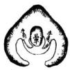  
砂翼蝉乳懸

藥書藏于涸燥坦夷解

涸燥夷坦 四字指入穴之處而言 言也春入穴如乳如 实。

水注即傾故云涸燥入穴如窩如鋤勢多早仰故云坦夷舊註解在尤勢上去以高山為涸燥平地為坦夷是高山矣反宜淺平地葬反宜深其說謬矣今悉改正蓋言早支行卷入穴如起堆突是涸燥也其炁浮于上其塟宜淺廖氏所謂息災炁浮是也高壠行卷入穴如開寓鋤是坦夷也其炁沉于內其葵宜深廖氏所謂脉窟炁沉是也支壠契法之不同言貴淺深得宜庶無水緣之患也倘如宜淺而深炁從上過宜深而淺炁從下連縱得吉穴而生炁不能乗風水帰于無成矣可不慎乎。

夫脉有阴阳故有浮沉阳脉常見乎表所謂浮也阴脉 常权乎裏所謂沉也三阴從天生阴根於阳也故阴脉 必上小而下大其出口也必圓三阳淺地出阳根于阴 也故阳脉必上大而下小其出口也必失蹙脉者則 尖者皆阳其脉浮于表口圓者皆阴其脉沉於裏此一 定不易之法也若又推而廣之則凸者脉沉凹者脉浮 微細者脉浮俎重者脉沉衆高一低者脉浮衆低一高 者脉沉此相重則陰陽之理得矣

径曰淺深得東風水自成宜淺而深則氣茫上過宜深 而淺則氣從下過卜地者先現來脉之陰陽次看四山 之從佐如來厭入首独作穴凹出口光此皆胍浮而穴 陽宜淺來脉入首弱作穴凸出口圓此皆脉況而穴阴 宜深浅深之法至理莫过于是也要在辨認入首阴阳 蝦鬚界水明白若当深而浅当淺而深差于咫尺之间 反吉為凶矣径曰地吉葬凶典棄屍同正此羨也俗 蓑卦例論九星白法以定尺寸者大謬也

浅深得東言其戒浅或深不失法則能乗地中之生炁也宜淺而深宜深而淺則失其法則而不能乗生炁矣盖淺深失宜非惟其効不應深必有泉水之患浅必有矮嫌之患以死者倅魄置于其间孝子仁人之心其能安乎吾儒所以歡擇地者固非術家專求福利之意亦惟僅于此耳程子曰古人之歌比化者不使土親膚奇玩之物尚保戴固家以防損污一親之遺骨当何如我o

純陽之脉取三阴為穴者四山高于本身則生炁尽露 于外而脉必浮四方典本身胥則生炁稍藏於內而脉 必不沉不浮四山低于本身則生炁尽藏于內而脉必 而此穴法淺深所以有三等之異也 陰狐常沉穴固当深然四山高于本身則不怕露風而 阴疎亦有变為阳之浮者所謂衆高一低而脉浮是也 阳脉常浮固宜淺然四山低于本身風炁怕露而阳脉 亦有变為阴之沉者所謂衆低一高而脉沉是也此篇 立淺深準則有申立之理有變通之也尤見牧堂所見 玄造精深而非粗淺之可疑也但癌穴時更兼審辨土 色何如則萬無失矣

蓋有風則不聚無水刑不止故古人之矣者必求無風而聚之處使生炁不散於飄風求流行有止之處使內氣不散於地中而後葬之獲福也夫氣行于地中人不可見然見地即可以知炁也成卷之地歌其聚不歡其散散則無成矣歆其止不歆其行行則無情矣故凢山不拘支壠俱要得水藏風使炁聚而不行也故葬者原勢從何處起而行來察勢從何虛止而乗其炁人能知生炁之所止則高而盖低而粘偏而倚中而撞措之而咸宜也盖有土即有然以行其中有炁即有水以界其外有外水之界而內炁始止也夫地不倍穴者大抵在不得水耳未有上分下合清白而不地者故得水為上也若風之散生氣者惟凹射直急之風而阳適之風却又不散生炁此藏風之所以次之故聚而不散行而有止古人固所並求而二者之中尤以有止為重此炁止水交之所以為穴也故支骨之间受凹風之射則不聚無外水之界則不止惟無風有界生炁始止聚也論風水

夫水者龍之血脈其偽行龍起止全在于水之分合也 如水無分合則外氣不橫郎秉之而真炁親散矣故蔡 氏云水去而風自來水來而風自去廖氏云番身轉面 去多潮不怕八風搖合之可知風水之法全在得水水 得而風自藏郭氏所謂得水為上臧風次之其義深矣 夫求生炁在硯風水故謂之風水也外炁者水也外無 水界則內炁散于地中既無水蔭生炁不畜此骨之所 以易腐也噫炁風也受凹風吹則生炁散于飄風寒冷 而棺易敢也

問生炁何以秉風則散

生氣溫👨風氣寒能散其溫暖生氣淘澤風氣燥能散其潤澤此所以散也生炁乃天地之和炁風乃天地不和之炁故不相宜凢山峦受四風射處其土則鬆散其草木則焦枯此其可見者也

臺法起止論

塟者原其起衰其止論大槩則來龍為起入首為止論 一穴則須為起春為止故先質命頂起須處曰毬水滴 處曰簷語鬚則曰微茫不論高山平地皆有之語金奧 則曰兩股仙妾集謂唯高山有之者是鈞玄論指乳穴 而言者非語盤眼則曰一湖仙婆集謂唯平地有之者 是鈎玄論指開口穴而言者非近時諸說或語金奠嘯 眼而遺收鬚是失原起之羕矣或語金魚而遺蠏眼是 失平地之止矣或語蟹眼而遺金奧則又失高山之止 矣

廖公撥秋歌

昔人謂秋為龍穴之用神貴賤不能自主予独以為不然蓋龍無砂隨則其勢孤穴無秋衛則其局露水無坎閱則其勢散至于水神流散而八風東之矣八風既乘而生炁飄散矣甚矣秋之為用最喫除所藉以對穴而肉水藏風而聚炁其所係己非耿小也故廖氏曰真龍落處四山聚亦自有名漾音賢何以喚為秋於理自呼差楊曾呌人原有格只從地上撥固弦名作撥秋桎次序以秋悟大凡尋卷共点穴徊把前秋别尤若住時秋有情不住乱縱橫穴若正時秋效用不正自飛動真尤藏伏穴唯尋惟秋識倖心撥秋之法所以不可後而忽之也

穴星化氣歌

化氣者阴阳交媾雌雄文度之謂是故乳穴有凹災穴 有曉富貴有凸鉗貴有泡高山尋窟平地尋堆支塟其 巔隴塟其麗是謂阴阳有化炁則真矣故罗纹土宿歌 曰入穴星峯似覆稱用口便生寓莫非阳極阴生処所 以收如指面罗結穴星峰有口流口唇裡要生推莫 非阴極阳生処土缩中间似覆盃廖氏曰阳來莫下煞 硬阴來莫下虛魯捉脉賦曰阴中有阳中有阴看穴 內生成而吳若突中有窟中有災審水底眠生之何 如合之無非言穴有化無方為真倍也 倘如孤阴孤阳而剛柔不分抑或非阴非阳而形勢亲 乱至如一有少差祸不旋踵而至故廖氏曰穴星由來 有八病有病何勞定斬首折痕頂下抱碎腦石嵯峨斷 肩有水穿膊出剖腹稻長窟折臂原來左右低破面浪 痕聖陷足腳頭竄入水吐舌生尖嘴此是星中大有虧 誤用祸相隨穴面又有四般病有病皆惡痘貫頂脉逆 腦上抽星峰不現頭墜足脉從脚下去靈光何所聚绷 面橫生脉數条生炁自潛消飽肚粗如覆箕樣醜惡那 堪相此則廖公略剖其病而猶未悉也廣之有如須長 趙短重頭甕弦竹篙水視鱉裙牛軛攘膝搖本反肘繡 骨弩觜鍬面仰瓦空集玄武壁立白虎入堂之類此之 總言穴無化氣祗属偽梏矣

秋中八煞歌

秋中有煞人不知貴賤最难匡仔佃消秋煞有八射探破冲壓更兼反斷走皆凶解說共人通財是一尖來向穴徒配何說探是斜山畧露頭作賊不知休破是浪痕直透頂淫乱恣遊聘沖是橫來揮穴前非祸自連綿壓是穴前秋崛起奴僕常反主反是曲身去向朝离反水飄搖斷是腦下生橫斬首無人塟走是犴身順水飛遊蕩不思婦若是真尤典殺合祸福來避凶趙吉最為奇穴上討便宜合之可知秋形有正变吉凶之具矣

秦氏曰凡何者不难識相親相愛如夫婦此可知其向 之情也背者亦不难識相惡相拒如仇敵此可知其背 之情也廖氏又曰大抵秋形不須泥有情便為貴從饒 秀麗更尖員無意亦徒然合之可知砂情有向背吉凶 之别矣

朝迎侍衛歌

秋有朝迎典侍衛四者君頂記当面推來名曰朝不怕遠迢若是真時方出現假時难見面迎是隨卷先出來見穴却回頭戒隨迎朝來聚集遠望低如揖侍在穴前井兩迎端拱默無言遮斷客山不許入森如竹立衛是護尤左右隨生怕凹風吹本身枝脚為尤虎皆在衛中救只將四者撥前秋括尽更無加此可知四者之名所由称矣

龍訣歌

問君術看龍訣貪巨武甫最唯得行龍入局純此星世代富貴無休歌有訣法辨凶尤破祿文廉最是凶出軍出賊遭瘟火止作神坛社廟崇此可以定純凶純吉者之去取也

廖公四凶歌

廖氏曰九個天罡人道惡六側吉神落若穿金水土星辰最好救人貧天亦有九個孤曜名不好四個藏金 好穴宝元來生水典開金穴向此中尋 等孔曜亦有九回燥火 母穴亦九個掃高未為奇七个蘊天機法宜載高奪神功 亦有奕世産英雄 萬亦有據此則知尤真穴怪者或亦堪 穴取记。

凶龍解

楊氏曰莫道凶尤不可裁也有凶卷家國盖緣未識洵星尨貪中有廉文有弼武有破軍断生祿存時有巨武力舟十里之中卓一峯小者成大弱成雄好此是尤家尚星法大頓小伏為真踪好一山便斷為一代看在何代生间的便向此中定富貴困弱生旺隨星大有書之困務之尤無為力死慈烟包入坎積 大有看法在内3尽棄也

東湖主云洵星尨曾于荻州獅子山見之正結一将軍隨弩形其五 5 偷內處知

結一油窄形時人俱無識者一係火土局一係水火局 文云據廖氏一段尤吉穴怪者既可取據揚氏一改尤怪穴吉者亦可取合看來則無地不可取無之而非地已要知無之非地將操何術以定之乎世人何不究心于此也又云揚公言尤非久遠得全炁易盛易衰非人力言人家發福久長必得卷家全炁欲得卷家全炁由于龍神久遠也此誠千古不易之論而得道之士非但求尨身久遠取其全炁尤当于抓秋法內分其醇亲局醇者悠久局來者暫發更得卜地之要領也

平陽尋龍諭

楊氏曰莫道高山方有尤却来平地失真踪平地尨泛高嶺發高起星峯低落脉高山既認好星峯平地兩傍尋水勢兩傍水界是真尤水纏便是山纏樣霜降水涸尤不見春夏水高卷背現此是平洋看尨法过處如旦成如線高水一寸即是山低土一寸水週琢只為時师眼力淺便云此處少峰峦誰知山穷落坪裡退卸愈多愈有力祖宗父母數程遇灰線草蛇尋脉脊坪中一突更為奇活動尤須求束炁忽然入局口鉗南兩水夾絕是尤息反是則頗坦而不可言地矣

關水法泛坐山起長生

郭氏明說個朱雀源于生炁則水法明從向上五 行起長生後妻不知何救而從坐山來起長主月非 朱雀源于生炁乃玄武源于生炁矣豈知穴前皆向所 主水流向上則水鳥得不從向上起長生乎不送向上 起長生者其未曾讀塟書耶抑讀而不解也 後世術者以水法為最难明之事即曾楊地仙亦賣了 多火言語文字只是說不尽而郭氏直指一生炁為源 立定旺衰二向又說一句以逆不德之妙義只此數言 水法己無剽羨矣

立穴要訣

有生成之尤必有生成之穴入首無过五尺土耳坐下若差一指勝隔萬重山但見山尽峦頭止處兩水走会其中有一星辰尊嚴于象山異体度必先認其何星次認其何穴察水之來去脉真穴正四應正佐拱衛有情方可下手其星辰或高大或廣凋穴星無所捉摸時师妄逞聰明以朝案之高低以左右尨虎之灣抱證穴場之中心殊不知大局段之中星辰之上大尨虎灣抱之處案山朝拱之洵上下左右皆湫茫無所立穴到此工夫若非真傳定李難不悞者法当從後卷过峽處脉脊上一步：隨脊脉曲摺轉動逐寸跟緝前來脉行亦行脉止亦止其脉之止處即脉之生炁滴斷處也滴斷処自有阴阳交媾牝牡相秉桔成毬簷上有三分下有三合左右有蝉翼砂外有兩片牛角秋牛角外有貼身卷虎秋兩边俱有微茫蝦鬚水会合于毬簷之下水合處定有微小窝蕩名曰明堂為一滴蟹眼水也又查前唇後腦左脛右肘再将前後朝應左右尨虎一件認共衆法符合方用倒杖之法親生棄死架折饒減以一合上立標竿二合上定淺深三合上定向道前親堂炁後接生炁往云脉認來尤塟秉生炁此之謂也秘之秘0

俯察本源歌

稽古聖神察地理無非山共水山有脉各水有流續斷更牽連丘行生炁潛于地聚散因形勢形勢益桓炁自疑散漫炁親零炁聚人居身復吉死則宜理骨無散人 2居身有凶塟則受貧窮古人俯察有四用建菑是為重扦藩立宅共安坟大小聚中分建藩山水必大聚中聚烏城市坟宅宜居小聚中消息奪神功聚在卒夷炁浮人居必興旺聚 高處紅沉低理對最相宜山脉皆泛西北起祖宗崑崙是四大幹龍分枝去江河水源委大河以北大江南湘漢興淮參大河以南大江北濟典汾阳隔安坟宜緊宅宜寬高着眼來看此是古人俯察訣心会口难說我今述作泄天机傳指世人迷

俯察正法歌

炁有聚散頂俯察不用漫山踏先賢立法有滉依具在 公刘詩陟則在獻登山巔後龍貴勇猛復降在原現落 頭穴要溫柔乃陟南崗对面望觀看更端相現看泉 流察水來朝挹营榮迴逝彼百泉現去水孫抱斯為美 瞻彼傳源看明堂鎖乃為良相其阴阳定向首景岡 考側便厥後衛文遷楚丘營度完相侔升虛望楚即陽 獻尋龍分背面降現于桑即降原望穴向卒田揆之以 日正南北景岡同一則通知此法古今同千載所当從 景純墓書最精要其次龍住妙推原議論本於斯句二 是吾师世人貴耳不信目喜新厭陳俗託言 共赤 松無稽偏信從迎來異說掘出各自誇秋術天机連 流祖公刘截斷象川流

地理三科歌

妾傳地理有三科分孤至為多形勢唯分方位次此語当淺事姓音已見呂才非園典尚遵依景純著書兼取二至当無容議專言形勢亦為偏方位出後天相其阴阳揆以日立法最詳悉形勢若吉方位凶初下必貧窮形勢若凶方位吉決定破家室降天机元祖公刘法二者俱要枘惟有姓音不可憑謬妄最分明声同音異尤無理鈞宮共終徵陽属宮音揚屬商覆姓更难辞亦有变姓典賜姓过房何所定三十八将最為先嘏合亦徒然固师陵寝皆遵用頒書與眾共生今反古敢相違不說恐人迷北方取信尤來平生可無咎南方山水有高低若用最相宜直言無隱遵程妝可與知者道

天机傳流歌

金精山是撥推龍額術出其中楊公演泒曾公流傳黃興屬惟有廖公學得橋喪代自傳名泄天机本撥秋訣昏是曹楊說只從山水究精微心口悟天机九个星辰十一体秋相真無比九十九变古今傳亥驗自天然龍穴砂水典堂炁形体元無二四伯九十有五形凶吉最分明相傳僅得一伯載後李貪財賄却将正術自藏身謬妄悞時人一今山頭分九穴五吉從渠喝或得十字木星排取吉共人理圃茲大坏天机術只緣無著完老天不哉喪斯文清士得其真團畫之說非得已惟恐墜宗主言詞鄙俚不成章道俗易消許故作短歌記傳狐踰借知有罪

此篇意清士所述不然廖公豈自称其精乎父云清 士得其真其理可知之矣

九星入式歌

厥初太極分清濁清者浮廖郭濁者凝為水共山血脉 德相阅脉血中间行五炁行因俸勢園直曲尖方五 形分配五星名閣形却又有四樣湊成九星象九星園 0 者太阳太阴因帶方因而曲者名金水木星直如矢 方是天財三腦分砌腦土金身双腦合形本金水平腦 土星是此名五吉是為高辨别在分毫頭因兩腳拖尖 尾便是天罡体頭因腳直孤曜当燥火尖似鎗掃蕩一 星渾身曲四者為凶局呌君尽識九星形砂上撥為精 凡認星辰須对面九星容易辨若还草木亂扮耘莫便 喝星辰識得星辰不識用萬苓徒勞誦識星須得用心 傳便是地行仙

古傳九星歌曰太阳一星即左甫高園覆鐘釜太明本是右弼傳形迹方更因金水原來名武曲三腦如金宿木星紫炁号貪狼一尖直更長天才雜識巨內牛三般頭腦異天罡正共破軍同腳下出尖峯孤曜祿存司一類撚拳正相似燥火廉貞是一名哭斜芒箒形歸蕩屬水配文曲斜拖帛一幅此為揚廖之世九曜也

太阴太阳金水天財紫炁謂之五吉天罡孤曜燥火掃蕩謂之四凶

九星正变穴星歌

九個星辰有正形細說典君聽太阳瑞正遷鐘棟太阴半月象金水原來似风飛紫炁笏囊重天財三倅形有異凹腦展誥是双腦貴人立馬容平腦玉屏風天罡張蓋形相竝孤曜如覆蟄燥火尖刀最是凶掃蕩展旗同九个星辰史变位正体皆居首角口第二懸乳三太極翬中涵四是弓腳五燮臂車股居六位七為側腦不須疑沒骨八為奇平面原來居第九九变不离母撥砂熟記在心胸開眼便相逢金精親授圗典訣天机皆漏泄尋龍入式歌

爰從重濁凝於地便有高低勢：來起伏是行蹤前賢呼作龍神高處成樓殿聚講星辰見講罷拜樓下展行：度見真情迢：達峽并穿帳傳換成幾樣夾衛輔從兩傍生後送更前迎校脚隨身無反逆直剥多奇特此是山家作穴龍定起主星峯主星大小合尤格造化便可測二三部內合星辰福力實非輕郵數遠時福力小再起星峯也耄神顯著穴隱藏点穴貴精詳平地處神因水勢認取原無二思謠正好尋得值千金九入鄉村先見穴護把後卷别启是眼高先見卷尋得莫每此是尋龍真也诀是地便能决試將遍去覆仙跡端的有神通

步龍認格歌

觀山定把龍為本吉凶方有準世人論穴不論尤正坐敝茫中大抵真尤必有格穴後好尋索便來穴後現真形應似谷中般穴後星辰如不出脉上要尋覓只從蘇上認峦頭莫向兩边求兩傍見格從好着終非是吉斷有時穴後見星辰元不出龍身名曰照星一般取事業皆堪許更有兩山映待我亦可當其名成格龍神最准遇点檢道從恕按圃索驥要知真誤尽垂間人高大星辰管一代餘福猶未艾看逢卷格小如低一代便衰微要識吉凶何代發逐即從頭踏凶尤在後一同推世代總能知凢是星辰要蓋送盖送最宜重蓋星須要大尊嚴不拘哭共貞送到左經述右獲時更顧若还格好却孤寒僧道傲高官星辰落脉要中出中出方為吉左出為輕右更輕重此中生好格面平方合樣面飽何勞相歌斜破碎浪痕高祸定难逃

## 全局入式敷

環 名 聚 山 恶见下根 前名必本 面特当在 必透题其 尚 献越：之得化 结本之故之第 不要吉环谓二 必必出捷经即 费有前信必品 心作去英群案 所次名为如 多很鸟听儒意端谋 若侵山 模于一 腮可之

講買龍少有美惡生死 共 之 知 八法 道三 家：印 当# 看分书 大宗性 惟之i 此後浆 八便谋 龙都 矣法租

生是低昂多鄣 目。

且耐久身傍有猛鵝者皆為生龍 死是無起伏 峰出 城佛 不起

强 者出身以來 其 猛武 強是奔走勢刀 3 出 行如 此西 格膜 奔巢指爪得 甲整 立共新火建往

最吉主發違甚建不甚佛速

弱是瘦稜 嘈。 弱龍者出身以末其勢本靡如瘦馬負重 如 孤 雁 以風火其腰水射其屬尖徊屈由險峻差寂此格最凶主孤紳賁

順是匍脛 句前 往。 北顺 龍者出身以來其勢曲抱如星華 水 翻 春宗惠祖膽前在後行

## d

处脚手守帖入穴处骨由團樂此播最言主富貴 旺人孝慈和腔

右皆逆者吉後逆前順者先吉後德进 弹龍 而者 下出 身 鹏以 禁来 水其 势 後俊 低如 风南 至 高

退是漸蕭 條。 勉退 多最上能 作凶滩者 郵主穴出 冬一高自 傳發龍以 舍便低來 能其 小势 穴退 大编 後如 先人 失踏 序难 上如 退下 孤失 老倫 貧比 窮格

生強順進皆為好富貴兼寿考死弱逆退最為凶天拆

受貧好 八北 法德 四猪 吉二 四郎 凶相 也龍

寵行遇峽脉有四正出左右次回頭顧租出尤奇穴狀

七博净微以長先下青正則出前 十龍卒小畲则到出則出穴身知 二到正者逐穴峡陈穴而居曰為此 峡此必重武前中者亦斜左左吉第 至必结称而亦右则倾过右出有四 為有富赛作然秋穴身者出曰平即 杂成贵大穴过短居而則则右地論 乱欺荣者我峡刻顶正穴穴出过过 今臼显轻逐之穴上倒亦居曰者峡 並有之决默形前决透正右回有跌 以阳地中而大右中顶出四雇高断 几星若星出抵坎砂出而颜出山处 星九科辰自典必左脉料出正过謂 形峡测若不出先短者倒则出者·之 格阴被清商穴到則则有穴則兼峡 相星碎秀祖之峡穴穴侧亦穴过以 之八麓而宗形中前居出回亦四雨 峡腮端是無左左脚而雇正格山 文峻莊也具右妙下正叉左曰相 有岭园脉所砍必脚过有出正峡 類 右形如峡 要 日 月 刺取 损之 幼 然 结用 终棘 風 長 0

若还穿帳要中出角落未為吉刃重三重開府衙一重只富家若有貴人居帳下此格真無價地軸天肉左右為有勿金水腦為上火星次之車形如帳慎可脚分明有帶下重方是月重以生貴一重主富穿心出者為上可角出者為下帳不穿心决不入相貴人在帳下必出貴在帳上必出吏扣巨石在左右形類龜蛇尤秋如無得帳角逸獲亦可

退卸博狄龕者細凶星变吉炁老龍抽出嫩技柯跌斷 小最奇異恃权 人好裳如蝉脫鼓 脱大

此 中 月形方通 可 用

龍上如生兩池水養廕斯為美異骨毛洲興塘須定 不

夾衛度從刃傍侍天乙太乙時左边武庫右文官隊伏紫 苏文太幾多則穴 瘦居 度左瘦專肥變名雕權尤最吉

福綿延二重復衛一代貴十重度 地 重 一城 一重只出丞薄尉 今按迎 纏在穴前 送 托穴穴 淺 见 此己成

欲作穴時看出脉元有十二格正偏大小共短長高佩新

要審詳左右曲直井價吉凶皆在目蜂腰崔膝最為奇

曲 到 脚辰点 短 天 星 星辰 之断 尚 时是 可七崔不脉凶龍秋 棘 动 穴 必 泡 腰 2 者 方

倒開一自脚体 具五

凡求大地要搜求逐一究源流

全局入式歌

入穴先当明四落有落皆堪作初落由來近祖山局勢必須完 初落者萬祖山未遠便形穴但得局勢完發福最速只不久耐

為纏此尤多從腰裡落回轉餘婦于尽者有全于老者故尋尤必以老尽為上是亦頭形勢完全戎案時建禮山回轉四雇有情方是其分荡後龍擘脉去串貫述可取可脉情便 分枝孽脉而去 脉质 正 对 守 以山 穴回 半将 四准 正有方

四落中间分五龍最要看行蹤尤若落時生降勢界截伶例直龍原是撞背來中出貴徘徊橫尤原是沒側逆轉須磅磚四尨原是曲崙身顧祖要迢巡飛卷原是佶上聚昂首真奇興潛尤原是落卒洋撒脉自悠揚吉凶皆用九星相必須神炁旺昔賢降勢立圗多未免有差訛 此二節論降勢昔人有七十二尤降勢又有十 三真尤勢又有三十七六舊又有三百六十州落皆歡笼書諸形然無統杞矣亂熙序今用穴星為主餘不取

源流容易見 入龍 式格 歌九 星穴 格九 星

四 前正麽要分明真假細推 案 入也此山 去怀后笃谓 处遍形案驯降以面者不是证之 正 人 朔 山亦自有真 级 必假 時 朝 直 类 名 尖 直 梦 典 我 急不 有 若是橫 水热作朝 街 π 雙 頭 蚕 顺 热 朝流 大 只 看 a 又 堂 朝内有 问 来抢 1 迢 百 里 特 立 似 楼 4 賓主 相 整 鸟官爵 上 白 落

手脚卒矣射不堪迎麗隱井生石歌斜上無形遠案高不昂近案低馬良高低俱不背頂用細消詳

龍虎古称衛區穴褐福最親切龍要婉蜒虎要蹲返此

見災迤若如爪瓠來迥抱福蔭分長火粗大瘦弱短縮

形破辟迫狹并強直尖射與挿落競低隔薄反走斜

見形識鬼便是尤精是也鬼炁宜短長則奪穴炁逆纏方有力勢

穴问制 上是最 四本紫 # 是 列穴 前 佳不 頭身 就只 者 乌

宮星本是出朝 山 此論官星按官星出朝山之後往云 问 君如何謂之官翻山肯凌逆施山此是朝山有餘異我穴後思一般

有以来 袋径

星百 不进一不可添也

山阳 三 中曰阳 地禁朝外水得禄財健键 天用 之 宾 類健 亦 用 本 山 之 如 甲 山 之 類主具旺 馬

迷旧心定福命以亦 宅用 误以正 楊 穴

秋水 貌形城 绪儿四割反水五九 日 地体 李 之分 明变然然曰

且尽者細詳而默識之何

谓 則如草

上 有禹則穴亦有當其數亦典穴政相同外有二禽 须歆糜抓 牙 班 識 兩罗星一也訣一迎枕水一邊田罗星亦自有種 浪說星辰在水連

吉星唯得一一全傳用者情通活法

更有平洋局又别傾廩共君說星辰原出在高崗撒脉此第十二郎論午洋局必有高山脈尤嚴以下御目多在山上径撒下本洋即所谓潛尤是也

撒落平洋始不同切莫失真蹤地有高低即山水節目同一仰 即平 詳局凡地之稍高者便丐之山地之稍低者 為之水 习經低中央高郎是身水吏尤經云

傳尤失脉失諒時

側身龍格隱復見脉上行時見 隱隆正好尋得值千金尤若前逢水界截穴向 平而餘八吏多 有在平 有在平 穴地 处者 秋穴亦有仰面 格。 一要推 测。 變亦有落在平 行第九吏曰 地 面 者 其八

曰六星诀 列城曰 既日十 口 海罗

## 立宅入式歌

居民立宅最為先宅吉福綿延古称攻宅理無異述須分炁勢安坟死骨埋土中秉炁子孫隆立宅生人居地上o 秉炁財丁

地要 守居 今 格如 秋人 亚 同： 推典 穴阴 法有無黑坎穴宜小宅穴宜大記尺必東寶平九 穴必要系濟我謂 阴 穴米 無阳宅東其勢 市井鄉蕃元有二尤住方成市之居必要傍街衢向首 处最雄

具旺 鄉居必要龍神落 向首隨龍作 向立 宅 首 要说 依要 穴有 星入 4 a

市居地炁有推遷垂代豈能延鄉居龍脉若來遠世代 長平穩大凡鄉洺看來尨平源總隱陰若是高山尋頤 伏升高皆在目撤落平洋湖最奇四顧忌傾危左右高 低勢孫拱前迎井後擁朝山有意宅前橫一水抱身行 下斗迴孫朝揖正得主端嚴無 反柄從然映し巳

星 最 清起田庄桑餘详見穴星部

職天 若扦孤輟空權當代從見郎燥火星辰出知 : 洋社·警 他方投河自彼止若立神 坛 餘典 最

朝若斜飛堂陡瀉立見家衰謝若还穴小鑿殺竈炁脉2為市井無內外如此方為

H 之么 曰说 山瘡乎不四西至比買西弘三处北谓 燕 宅三禄有可委疾 任假 克 更 长 流嶺表均棄出常侍 言

即凌替後尤倉庫刃边排家富積錢財忽然文筆左右現讀書應奉薦獻花露裥亂衣衫家內有風殽因甚頻頻遭賊盜天罡腦傾倒因甚頻見火災燥火勢崔親

因甚頻見瘟疫孤曜帶黃赤 宅前戒用孫曜為案或左右出主出人為僧帶黃赤石

龍如上格秋如下雖貴無声價後龍如弱好前砂只蔭女 位 同

水凶穴吉金盡格玄坏可從草水吉穴凶如玉盜一破 儒宅在新昌里本將傲大監康言宅自辨周阜以其 地当出宰相每命相出言必引領望之完卒為牛僧 儒汝得吉甫宅至德裕貶其家臧矣

立定服忌神前佛設鬼 無麗則人無衰盡應 神 廟寺觀基址皆

nT更樵古獄古戰塲必定有餘 殃。 古獄古戲傷煞炁出消 不可居之

放坟平塚最不可居人多坎柳 則会 乌人 长厥 作见 夢重 怪

道路衝門亦不宜常有是和 非。 凡搆屋忌道路才門必 要迂曲從逆水边入方好

流水若还冲屋背人散家財退宅邊常有水潺喪禍內午為正內晚為夕初 朝

蛟潭龍窟莫相憐陰盛必孤貧其餘全局歌中備此篇

蒙名做駕天龍

言大意龍穴秋水典明堂專部好消祥天机妙袂放群

安校入式歌

安校地內尋生炁此法非容易景純有見别為書唯恐

塟成虛 郭氏墓書至者秉生炁也五無行乎地中人受 体于父母奈形得無遺仲受廢

氣在地 中何 以 辨 只相星辰 面。 按 金 也木 园水 火 土 关 者 曲 方

者五 察行 其之 形形 以也 其行 乐地 此中 斯而 家难 之见 大形 法出 也地 上 而 易見智必須得水典藏風穴內炁冲 融。 票 風遇 則土 散则 安行 技界 之水 法别 必止須堂聚四水穴避

第一莫下去水地 On 立見退生 計o 所書 以曰 外炁橫行又曰 聚 内然 外 水 外 电

第二休尋劔脊龍殺师在其中 書 僭 日 山 形煙 上傳 而卧 下 形如

第四猶撫無案山衣食必根 难c 持書地有四哉缺一不 可当 而案 山即朱雀也

第五生怕 外径 云問 山 抱 启 裡 中年明堂借水如惜血堂視避風如遲賊莫令堂欲被風次莫使潘牙遭水辦按明堂領 生無滿里主家退

曰青尤 白 蹲謂之那屍乞昂謂之嫉主按書虎氣直去貳斜飛 主生炁數漫主家敗人尚

更有童斷石過独生凶消已福從饒有穴出天然奉功

莫安 扦。 書云 炁山 之 因 不 形 可 塟者 而 新 五 山 不 土 塟 也形 而 以石 势山 世不 而可

断遇 石山 遇不 独可 生垄 新巴 凶然 消以 己生 福和 接而 此童 1以山 入不 首可 山垒 言也 非径 谪曰 淡量

龍也然石山有土

廖公尋穴有真诀擔夫皆識得個中書語本無多只消

穴可塟不可拘泥

入式歌凡入鄉都看倒落後卷貴踴躍一出山面合星辰

有應便為真六 疝必

明堂炁聚左右 抱。 也

送從一齊到便着眼用心神点穴救人貧 正入要 要 共回 此穴 凡傷

平地星辰同一体高低郎山 水o 低径 云高水一 土 一寸水 环即螺立然便 是草有是 穴便穴山 水泛名德 去丘天樣 明 无窝掉龙 多或中如 四有邮仰 旁勾掌学 速失们 没如感心 如旋窝棠 城螺隐做 郭勾：式： 水夹微乳： 统是： 山端環聚一寫按穴星十一年九隻皆有落在平地者相

祭自見

足不習

穴星变化宜推 推洲前賢立定格

星中太極最玄微於烏生兩儀阴阳頷把肥瘦別尨穴要相得像中饒疵始堪裁先到必当挨若是動時分四象脉息窟突狀脉是有脊暈中生息是再成形窟是有窝在平面突是泡形見阳尤息突忌相逢阴尤脉窟凶脉象開井分四樣蓋粘井倚撞脉緩用蓋急用粘直倚橫撞尖息象井有四類斬截井弔墜息短用斬長截当高弔低墜藏窟象開井有四訣正求共架折窟狹用正滴用求深架淺折权突象開井有四法挨井興斜掃突單用挨奴併中正斜偏挿同又分八卦定來脈向首宜審擇南塋只在園暈中鋤出便傷尤尺寸請依天卦取五吉斯為美井中須典暈相当深浅玉尺量更求五吉分尺寸公位此中論作堆形狀分五星法度自分明穴前放水用真訣取路須曲折是名作法有專門於此略數陳法當精詳見全局請君先着目龍格秋形典水城專部極分明時师不識星辰面只把罗桎傳罗径只定向何方滇用卦消詳

宜 曰债 山 此势 之死

事南 母三 命具 也之以十意徒

墓变凸窪 有 百 门 集此起道 居 左 说到有如者 親 者靖 三 忽不 如 之走地于让 日3共坐挚来 2 之 必 曰墓敢便 先 天合领典速请 赞弘泓泓故告师师 间 之间 後 佳 也泓 循省 唯 段 辞 么氏不前 言 环 淘 视 遲 雷 谓 燕

滕公石刻佳城句 蒲使反 使 掘之得一名室： 日 吁嗟藤么居此室遂改卜焉出西京棟记

陶查周訪所 以指訪

不傍 是人故地莫之

天慶注师然

差星辰穴晕論 地理大成葉氏云凢言穴者必兼其主星之俸以為言 如五星穴法九星穴法是也若穴情者不向五九之星 但現生炁發露之為窟為突以定塟口乃穴法中精細 之境者也盛有穴情則五吉四凶俱可扦無穴情則空 有好蜜頭無救穴情乃穴法樞紐不得混入星辰穴 法部者也再泛穴情之中更求其塟口融佶之微情則 為暈法矣

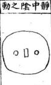

穴傷既定必須詳審圓暈在隱微之間是謂太極暈上要水分暈下要水合乃是稍低處水之合處名小明堂容人側臥便可穴必有圓暈則生氣內聚故為真穴無此則非但居穴暈宜寬闊塟穴暈宜緊狹見牽分明便於暈心倒杖要坐正頂感串來脉分落宜串來勝或枕樂山坳腦隻賦側腦汲骨皆桃樂山前要對案山下要就明堂左右要分龍虎十道無偏方可却於暈心立一標準上弦各立一標草凡饒減進退皆以此定先儒曰太極者陰陽之本體又曰物物有一太極訣曰隱隱徵微彷彷惚惚祖看有形細看無物

太極既定便分陰陽暈間肥起者為陽穴瘦陷者為陰穴是為兩儀凡就龍身依穴者乃為陰龍宜陽心若再起星峰為陽龍宜陰穴反此則初行必有咎龍穴歌云陽龍切莫下陽穴路死生離別若扦陰穴正相當子息做官即陰龍若是下陰穴女人公事哉若迁陽穴定為官富貴足田庄若上截肥起下截慶臨或下載肥起上截瘦陷或左边肥起右边瘦陰或右边肥起左边瘦陰皆為二氣交感不問陰陽皆可用凡陰陽穴皆當饒減見後圗若左山逆水轉則從牽心標集挨右邊二分如坐子則誤壬上分若不簡或則氣自來正穴必備枝左逆轉則氣止左右逆轉則氣止右法塟其止也惟二氣交感則取陰陽之中乃升降聚會之所不用饒成

太極動而生陽故圓暈肥起者為陽是謂動中之親 居地則鑿平塟穴則取嘗昔人謂之薄梅花必頁饒 減左山逆轉則挨左右山逆轉則採右居塟之日必 主天晴開塋宜淺深則泄散生氣用土封培成塚 陽龍忌用再起星峰作穴者為問有 太陽靜而生陰牧國彙使陷者為之是謂傳中之動 居穴則培平塟穴則擁起昔人謂之仰梅花必百饒 減左山逆轉則挨左右山遙轉則撲右居墓之即多 主天陰開坐宜深則抽軌生氣用土封培威塚 陰龙己用凡就尤身作穴者乃為阴卷 -1-1

## 左减右镜

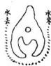

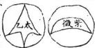

象息

## 四象圖列于左

息者即生息之謂：主淨起露微形迹故為少陽化暈中或起如離腫如結愧益 如鷄心如魚胞近看則有遠看則無方是若再起頂腦者非自是火星高山平 地皆有之当作穴当倍之定基作 穴有四法見斬市隆下 用凡再起星峰作穴者弓為阳尤○息有五倅圓直曲尖方此息象之曲件 脉者即血氣之謂微有形迹故為少陰凡圓蚤中畧成形如垂經如飛帶如蕙 塟如薤葉近看則有遠看則無方是若成飼脊者非謂之主脉所以当饑減高 山平地皆有之作居穴常取中定基作塟穴有四法見後粘倚撞圖下阴尤 忌用凡就龍身作穴者乃為陰卷

兩儀既定又分動靜穴有脉息屈突為動無則為靜靜則為丙儀動則為四象 脉是暈間微有春乃太極之少陰息是暈間穴有形乃太極之少陽窟是暈間 微有寫乃太極之老陰突是暈間微有泡乃太極之老陽龍忌下息突阴尤 思下脉窟穴四象作基地有四法脉穴當取中定基当展聞定基災穴當 然平定基屈穴当魯而定基作塟穴有十六法秋之後者宜用去揭高放病 脉之急者宜用粘法当就低放棺脉之直者用倚法当挨偏放棺脉之橫者用 撞法當取直放棺息之短者用斬法当頭放棺息之長者用載法当腰放棺息 之高者用吊法當落頭放棺息之低者用墜法当輳腳放棺屈之狹者因正法 當心放棺窟之闊者用求法当接氣放棺窟之深者用架法雪抽氣放棺窟之 淺者用折法当量脉放棺突之单者用挨法当靠足放棺災之双者用併法曹 取短故棺突之正者用斜法當閃反放棺突之偏者用挿法当撥正放棺此心 傳秘旨寢為精賓亂用則傷尤書云穴吉塟凶與兼屍同

象脉

求四象

象窟 陰老

走塟其顧吐牛歌云復处不妨安總頂是 也亦須留腦書三四尺星頭脉自上藩 名之曰金水星其形如梭子生先貴後富

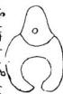

者以器道為北山之勢成上聖鬼天穴圍下脉來絕慢肖揭高尋暈啟放棺書右旺尤紫微木星太乙碧玉圗謂似有似無若後尤合各見貴如前竹論不合格亦能小小發福但力量不能遠到耳

體直象息體圓象息

則氣自下升交媾之道也後要有此樂法謂之寒補漏而下便發然易亦敗脉 之穴高故也不可鑿太深用土封培其氣乃佳與壓然穴同但此以脉言彼以 窟者即科坎之謂微見形迹故為老陰凡暈中或旋鍋如 仰如腹之脩如金之底近有則有遠看則無方是若角 虛圈者非謂之冷窩中起突則姚惟平处有之多生鋪

癯展庸之上作居穴當增高定基作塟穴有四法見後正求架折圗下閒尤忌 用化就虎身作穴者為阴尤

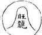

此息象之圓昔人自 名之曰旺尤星即太象 阳星形如覆金圓頂方 高起定主先富後貴體 此息象之直休昔人息 名之曰木星形如王象 尺頂平方正橫直皆尖 是主富代代為官體 名之曰太乙星煙蟲 形如鷄距中脉徑來

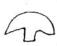

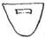

  
形言也後傲此

穴

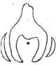

粘者以粘綴為義山水勢成下聚見地穴啚下脉來峻急当就低尋粟放棺書云虎塟其龍土牛歌云急來不怕塟沉尼是也亦須露腳用墓龍土粘接來勝蓋脉從下

倚中小

上則氣必上升亦相感之理也要左右相截應或墩子在後亦可忌水淋穴背此法謂之朝貧暮富当初下便發順下不妨去 木星 口不曾傷其氣脉與脫煞穴同懸孔穴多用拈法

穴先癸

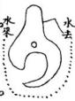

# 穴倚 亦先卷 長长

倚者以倚靠為義山水勢成中聚見人穴關下脉來急直不可順直下土牛腴 オキ………云血脉順行人少死当就脉挨偏放棺如左逆傳則挨左右逆轉則換右三分尤經云尤左穴右正同必須折脉如投右則折右股以右脉左者亦然乃靠定來脉不可脫點後要有來此法謂之南枝花近阳先帶土牛歌云同穴同音同向理要知尤自那邊來興閃煞穴相同

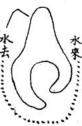

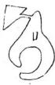

穴撞亦  
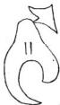

撞者以衝撞為義山水势中聚脉來橫科不可斜土牛歌云忌神斜插損田庄當取直放棺生上頂若是直來当取料放棺微斜而逆受之必要從後棄也所謂正來斜下斜來正安要氣從耳入仍須傳膚傳動皮齋則血脉流貫血昧從左來則者傳右穴居中左亦然此法謂之撞鍾五百年不坏屍又名闕斧穴脉側繼漫骨穴皆是此法

法吊 旺龍星法墜 紫微星

求 窟東淘法大者用

架 蜜象深法 陷者用

## ○息四法 斬 截 弔

形如 斬者以斬砍為歲息象如金水之類形既短狹宜当頭放棺以其分開如研斷相似只角授子 金井用土填補封培成塚也

截者以裁為也息求如木星之類形既長者 宜當中放棺以其当中如分截相似不可掘 鑿深廣用土封培成塚

弔者以懸弔為義息衆如旺尤之類形既高起宜露頭放棺法當於息下吞入不可坏星頭以其在土中如鈞起相似用土填補成得墜者以墮為萊息象如紫微之類形既低磚宜輳脚放棺法当於息下粘脉南井不可脉星体以其在下如墜落相法用土填補成塚

## 架 折

正者以中正為義窟衆形既狹窄生氣凝聚宜当心放棺本土只用一尺許至土為坟必頂高大以其黑所饒减故以正名之矣後一年便發

求者以求索為歲窟兩國大生炁潛藏審炁放 棺於窟弦上減入開弗蓮愛生炁堆土為坟必頂高 大以其在上推求故以求名之塟後三年便發

架者以架商為羨窟象形既還陷左右皆高当抽縣 放棺本土可戒二尺許四角立石為架尤來急可用 草平用土筏用石與左右般平使炁自下升壘土為

折者以比折為義靈象形既浅露生炁浮上当量脉旋棺以小絕從窟心量至弦边胃几尺用定淺深臺土為坟必須高大以其此量有法故以折名藝後

突象四法 挨

## 2 斜， 挿 T

挨者以挨搜為羨笑泉既孤車多边实迎虛高者 為家低者為虛宜靠雲放棺所謂車股取言是也 只金井用土封培成塚以其靠一边故名歲

## ○作法秘旨歌

順受当閃側放棺逆受生無所謂正脉取斜是也 只開金九用土封培成塚以其斜故以斜名之 插者以栽掃為義突象形既偏側後脉斜來不可 斜受所谓斜脉正受是也只帝金井用土封培或 塚以其忌關故以挿名

龍穴砂水典堂炁生成自天地於中作用本由人有術驗如神第一傳其点穴法仔細去看路前後左右要消詳切記莫慌忙第二傳其南塋訣闢狹依師說若还鋤破太極圈水蟻便侵棺第三穿井要詳淺深須用術個中造化極精微莫許衆人知第四作堆各有制不可言容易五行相說有吉凶災火禍便重第五放水宜步数起卦用天父先量坐下後朱雀陰陽有凶吉第六取路貴迂曲要合木星局莫挨白虎避黃泉犯着禍連仙翁說戒鬼神知後學請遵依惟此十傳名秘旨尽是廖公語廖公緘口不傳人著論自藏身

點穴法居莫通用

## 名

地理所謂本人身炙穴為蒙故居人塟骨之所皆谓之穴言其不可少有差池故曰若江差一指如隔萬重山以四用言之京都以朝殿為正州縣以公廳為正宅舍以中堂為正坟墓以金井為正

化点穴先須於穴星上斬木燒草今淨使星形明白天光稱新然後於明堂中案山上对相之發作何星何脩以穴星部三勢四殺諸法參定穴塲当在何处私在記認以審訂經云穴在南時北山尋穴在此時南山望是也对案山有所径径到其山看案山高低高則斉眉低則麽心桎云朝若高時高处下朝若低時低処又曰对案山來不傾側德方移步便歌只將对宋尋其穴案若正時穴最佳是也若無案而有水為朱省遠水同高山近水同低山

相对平義却看左右以審高低桂云左右高時在高处左右低時在低平是也辨堂氣

左右前後各停均却看明堂水聚何处聚於中則穴居中聚于左則穴居左聚於右則穴居右徑云真炁聚看明堂是也

凡穴前左見山射則穴宜右右見山射則穴宜左有山壓穴宜右右有山壓穴宜左此超吉避凶之道也

定卦。

四歲既定当分入卦先於穴星後分水脊上用盍針定脉從何方來次於暈心標下下盡針定脉從何方去又於明堂中流水处下盃針定水從何方來何方去八卦配方乾統甲坤統乙离統壬寅午戌次抗癸申子辰屬阻艮統丙統辛兌統丁已酉丑震統庚亥卯未屬閒阳脉得向阳水阴脉得閒向門水謂之純粹大吉陽脉得陰向阴水阴脉涓阳向阳水謂之發桑大凶向吉水凶先吉後凶向山水吉先凶後吉

立塋形安独甲

塋形必圓前不高三級高山則掘就在平地則擁成其澗狹有制以玉尺量之

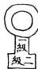

凡堂除水溝幷金井之外不可掘鑿皆用存賓 土若鋤破四圍則傷殘真炁

窟尺

度圓暈

書云玉尺度其遠通蔡氏云其數生於黃鍾今之尺当八寸為則按尺法不牧堂父子皆精於律品故其言可信今尺惟塋造尺即才通行四方以夢遣以八寸為一尺分十寸尺凡度塋減狹量墉深淺皆用之

穴內圓暈乃生凝聚靈光現露之处開塋只在暈內不可鋤破暈弦則生鬼 泄漏豐光銷集名曰傷穴主虫樣入傭水泉浸棺子孫貧其不振惟居穴及四 凶穴不巳四凶穴不宜大過法用小絕從暈上弦量至下弦得玉尺几尺規為 塋俸此為定法穴有饒減進退聖皆不軌故曰裡面藏金斗外揜衆人口外星 尺之法可參而用之

夫地理之要首重於龍水陰陽順逆配合牝牡交拂玄竅相通徃則依水立向召瑞邀祥兼究陰陽彼甲與夫四亥峯峦之秋吉凶星曜之驗此四者乃地理之大綱領也

者水之也有炁斯有水徑云外炁行形內炁止生盖 言此也古人聚之使不散行之使有止故謂之風本 風水之法得水為上藏風次之径曰炁乗風則散見 水則止

埋氣者理龍之氣也理者形炁之德以体言曰理以用言曰炁以質言曰形此指龍水而言要因龍配向認水血朝 生旺水朝堂擲酉水痛墓庫而去陰陽品配玄竅相通是謂之理氣

凡步龍立穴圓向水流交合之處求之水不合矜則龍脉未止龍脉不止則炁行扣住龍尽水合脉尽無脉乃為真穴然水必龍趨向次無相逆之理也往云乗風則散界水則止外炁所以止內炁為水之母 0水為炁之子水行則炁行火 止。 則。 。 止水界乎外則

無止於內故凡龍行則水自隨如夫婦之相隨情偕意恊亦理之自然也往云有合無分其來不真有分無合其止不明炁隨土行水隨而比土隨炁起界水則止蝦形眼蟬翼金奧股明服腊皆穴傷間界合炁所以止內炁也至於群流聚関瑣周匝自然城垣完固此垣局肉水所以完外炁也住曰左南右界為入首成胎之要者也

地。 c以20 水。 U4 為。 為龍若入首水曲則龍生水直則龍

西來炁亦西來龍隨水 轉。 向。 依。 水。 立。 所。 以。 稿福 俱。 造。

楊公云一水去二水去泉水奔流一脊去山：隨水不 四頭失井离鄉無救助此言山水反背不向也

冲坡胎神者即水流被龍家胎位去也非独言向峯春

於大純蓋胎宮為生炁發萌之初流出明堂主不受胎如流入明堂則主墮胎蓋生炁為换兒煞俗為百

元机云有人無財求得水之山有財無人莫下孤車之。

龍往云看格多時心易曉見多勝耳千回闻又訣云未 看後龍來不來且看下廻不迴未看倍穴穩不穩 且看下関緊不

青囊径曰水对三乂佃認宗此乃穴外之水左右合出

穴前從一路去謂之三乂水楊公云三又九曲來对面子息朝金殿是也徊認宗者如立丑墓向三又水

墓位不免犯黃泉之獘矣大凶總之生旺墓位皆不

但凡入局水路雖泛生旺方來若天門逼而不實去口

凡二十四位龍之右旋皆為生龍左旋者皆為旺龍或

自生龍發足須於旺方成胎穴旺龍出身須於生方成胎待穴徑云謂陽龍從生趨旺陰龍自旺朝生乃來乗於進炁之吉者也金龍轉水：龍轉木此即來乗於進炁木龍轉火龍轉金此即隔入於休囚也在云到頭日謝旺水聚而助祿九宜入首衰微生神会而人丁可救

於天心十道中必先看龍神水路來去方位合何一局戎正或变德要來於生旺去於休卽合之則吉反之則凶此也

但凡龍不住則分牙布爪将則缩爪藏牙此真龍故住渾厚隱藏而成本俸貴穴令人莫識陶公云悠而稱爪戒形隱而無頭無備豈知遇水為真乗風則散牙爪者穴旁龍虎也

盖帳不用龍不窠輪暈不覆穴不住東咽不細炁不聚 泥丸不滿炁不充

来龍。 路以o 看。脉。 四為0 生主。 坐。穴。 下。以o 看。向。 四0為0 稳。尊。 局水。 内。以。 看。向。 三0為0 合定 向。向。 上。以0 看局。 双。而 金分。

凡龍之到頭不犯透漏之獘為全吉何為透漏貫頂 脉曰透有合無分曰透出身露倅曰漏有分無合曰 溺龍虎短缩曰漏凡此露胎吐舌之狀皆犯透漏之 獘則坐之下炁必渙散無夜矣

山外拱而內逼者穴宜高山勢粗而形急者穴宜後高則群凶降伏猨則四勢和平山有惡形当面來朝者禍速水如急勢登穴不見者禍遲趋吉避凶移湿就燥湿者指穴前小明堂注水之處即一合真水燥者指穴中乾煖有炁言談氏云上枕毬簷正放棺水分左右曰眠乾放棺下就合襟水就溫之名理亦安規此則知燥湿之義就穴之上下言

明堂者陽虛則明圓净為堂枝蝉翼初交炁鐘於虛一 明堂也龍虎二交形止於虛二明堂也外陽三交勢 止於虛三明堂也順則俱前逆則左右橫則左右面 前缺一偽假完具福徵疑龍径云問君如何辨明堂 外山抱裏內今洋又云典君細論明堂樣明堂圓要 之玄放明堂遶曲如遶他遶在穴前內向又云明 堂惜水如惜血穴裡避風如避賊若高山之穴多無 明堂只有穴前小明堂梵权真水古云泛來高穴火 又云山水不向吉凶方吉在凶方亦富強急流斜側山 光射雖居吉位也衰凶

預公曰午龍豈双山三合作戍向或艮向者多不發福乃助火黨反祸之故也若更作火穴則煞到局必主回祿從納甲作壬向者極妙若吳辛二龍入首切忌辰戌决难立穴即出火亡孤寡子孫後嗣间有丑來二龍從癸行者畧通亦宜避其正落也

顧祖龍之地必要水纏玄武則炁力乃鐘不然後炁脫去反為不美不可示人以顧祖而遂為大地也佳云顧祖頭逆勢重於牽鼎遭傷歷進炁輕似鴻毛即此謂也如不受剌戰而來亦作吉論

取用矣癸龍要乗坎炁即玉尺径云癸龍乗坎炁而 有用也

辛丙丁庚四山為陽催官吳兌艮震四山為陰催官異見辛為陽辛見昊為陰三吉者夾震也六秀者艮丙吳辛兌丁也再加震庚即為八将也径云三吉六秀雅云清純而作用者苟不明陰陽品配之玄奧安得造乎富貴之域哉如果洞明寵家興衰向水配合審陰陽之相見察卦例之攸宜避殺曜侵凌之咎明休囚反逆之乖庶幾乎三吉六秀实可為富貴之樞机矣径云陰陽相見福祿永禎陰陽相垂即福咎譚門。

最喜來乗於進炁切忌陌入於休目若生旺二方之龍反行至死從之地入首佶穴者此皆隔入於休囚者矣。

不炁短須防腰截進炁長尤怕直冲來炁須防腰截者此言斬腰截炁之穴不可輕下恐暴煞未溶反遭其割如离祖未遠者落下星辰頴異足現似可取裁然尤恐非真住乃轉罔博抄行度之间星既离祖未遠煞炁未往消磨其炁不倘時师不知此義一桎斬截必受其然矣進炁長尤怕直冲者言龍至入首倍作處其脉長而直者時师多以為炁之復而穴以其急受殊不知龍之行度處若直串而長者其炁多懶稷如入首穴脉長而直者必剛急之性未尽也当稷以奠之如急受之穴則必受其直冲之害矣故古人於長直之脉有一滴露珠垂草尾之意言当於三又口裡脉尽處扦之此禹脉取炁之法也

貴双與並至那堪兩傲重逢得生旺之龍而又見生旺水神到局此謂双與並至則富貴綿遠發福悠長人丁財祿兩無所欠若不能用向杖制而龍穴既犯休囚則水神朝局又見囚謝是為兩敗重逢必至敗後無疑揚公為人救貧只用向上五行論水法出之吉凶如衰方水來移養向則衰方己在生方矣以向就水卽水血向此初山出點之却也執貧嗣之 如 也

誠意伯曰坡在吉方多不吉秀居凶位亦亨昌大凡坎之形体無拘吉凶宮位但高者亦不可稜層古怪方員者亦不宜壅踵粗梗如粗頑醜惡之像皆不宜

又云陰遇陽而非其類號曰陽差言右旋乙木陰龍而不出本龍庫位反出陽龍之庫竅者是也

陽見陰而失其偶號曰陰錯言甲木陽龍当出本身水

二女同居純陰不長兩男並處独陽不生言陰龍見陰水陽龍見陽水也如乙龍之不交丙而交丁丙龍不交乙而交甲是也四局類推

認。 龍。 之。 。 以0 势。 認。 穴。 之。 然。 以0 情。

龍勢有五歌云直龍原是撞背來中出貴徘徊直罷勢直梗徘徊乃有炁也橫龍原是從側落逆轉頃榜樽橫龍勢不正逆轉乃杖住也龍原是逆番身顧祖要逡巡回龍勢促炁不舒逡巡炁和也飛龍原是秸上聚昂首真異飛龍勢軒昂杖得衆山水炁象始也潛龍原是落辛洋撒脉自悠揚平洋多散漫悠揚有分有合有擺有摺炁乃真也穴情要收得之水為主午洋以水之界合為龍聚水帰堂乃為有情昔人斷中聚之地以秋下聚之地以水是也

又云怪石若居前案必有凶災吉星既空後龍豈無厚福忽覩山裂者橫必生常闻水泣者喪褐頻見若居山谷最怕凹風若在羊洋先須得水先宅後故：必與而宅必敗先故後宅：既盛而故必衰先後者言扦作之先淺不作前淺解所忌者水尾源頭所戒者神前佛浚

賢佐毋執己見而擬精微須看後龍而分貴賤

在云大則特小則特大橫直更要看護纏如左边護徨有情則穴宜挨左如右边裡護有情則穴宜挨右也。

曰全亮眼力斟酌高低細用心机詳向背內直外 鈎佟堪裁剪內鈎外直枉費心机点穴之法三靜一 動朝案要靜開面拱向而不逼壓龍虎要靜向內湾 抱而不他顧水城要靜環遶凝聚而不反冲中推 桔穴一脉微動而有精神此謂三靜一動也至水靜 在中則穴宜居中靜在左則穴宜居靜在右則穴宜 居右故規動靜之机可以知造化之妙

星。 120 拟o 為貴

星即五星也剝执五星之变化也髙山塞峩平岡被必差峩剝拔秀麗坡粹剝执員净或脫粗拟徊或從大变小後可煞炁方除吉炁攸鐘故為貴也撼龍桎云一剝一粗易細從大剝小真異剝抄如人拔好裳如蝉退穀蠶退筐或豈大山落低小或沒高峯落奔洋是也

形以特達為尊

形即五星形也特則峯峦秀麗炁象軒昂達則体態舒暢展轉自由故為尊也

浚山不宜壁立去水最怕直流後山壁立則玄武不重 頭名曰拒屍

捲簾水現入舍填房珥筆山尖呌唆詞訟

穴前水一步低一步傾瀉而去謂之搭簾水筆山頭分兩哭边高边低歆斜尖削如鼻鑷一般謂之珥筆山此又言沙水之凶麽揚公云田地被人來入舍水犯揆簾決法前決尖射投軍死双筆交尖到訟庭是也

兀孫忤逆面前八字水流男女混奔案外抱頭山現 穴前有水分兩边流去必主兒孫忤逆按峽中地 多有八字水但平速則吉陡鴻則凶董氏云倒騎龍 要兩边水去在龍後典大水相会同去則吉順騎龍 水要在龍虎外便共大水相会同去則吉案外有山 相抱如人兩相抱頭必主男女淫亂斷法云尤如伸 手抱員毬頓女愛風流是也又鑽怀並肩掀裙倌脚

俱主谣奔亦宜詳之

遇峽若值風搖作穴定知力淺峽者山脉跌斷細嫩如鶴膝蜂腰銀錠之類兩山相夾而過非龍之行度一起一伏之謂也過峽兩边有送有迎有扛有夾遞護周密則結穴必重若兩边無護戒有凹缺則風吹脉弱力量必淺日月旗鼓金箱玉印天馬貴人天孤天角等形及帶天池靈泉皆貴格也如倉庫肩攝穀推爛錢金瓶銀盞等形皆富貴也然有三峽老峽中峽火峽認龍点穴以火峽為准中出為上右出左出次之若回頭顧祖出者尤也其脉戎穿田渡水過羊地過池湖遇双脉遇边池边脉遇陰過陽遇高過低遇長遇短遇浦遇狹過曲遇直遇明遇偷過要高不孤露低不傷殘長有包短不粗感不懶散直不死便穿田而無水洩水而有石梁即崩洪峽是也或來仰而去俯戒來俯而去仰為陰陽分受斯為美也

所貴者五户閒瘋所憂者三門置閒垣局雜貴三門過 窄不須現形穴體音五戶不肉何足取

總括上丈户即地户之户五戶衰病死墓徒五位昏出水之位俱為地戶闭藏謹密也门即天門三門生官旺三方皆水來之方俱為天門實減即天門南也葬法云天門必用山水其來地戶必闭山水其回故三門不用則外炁不入五戶不閒則內炁走洩從有作亦是暫發小地終久必敗也

鶴膝蜂腰恐鬼刼去來之未定蛛係馬跡無龍神落泊以难明

鶴膝遇峽炁旺起即兩頭小而中大如鶴之膝蜂腰

過峽佃嫩兩頭大而中徊如蜂之腰此壠同之脈也鬼刼竊奪其脉也玉髓往云短名為鬼長為如奪或本身少全炁也蛛通脉微徊如知殊之引係馬亦過脉微泡斷犢如馬蹄行路之跡也罷神龍勢之情神午地不似高山跌斷復處精神勇能令人易可全謂無龍脉也按山龍自起頂分或肩旁或腰中或尾後往一星峯而分數脉結穴不可槩謂見刼鬼刼即於通脉絳腰鶴膝中分出脉去則有損於龍脉也此以壠龍言蛛孫馬跡以手支言

水德遇穴而反跳一文不直水若入怀而反抱一發便衰。

水以遇穴入怀為吉若反跳 則。 山。 被。 水而不 不聚。反抱則水虛凶去而無不 不停故凶

水固切於現流山尤雄於認脉或隱顯於茫迥野或潛藏於森羊湖星散孤村秀炁全無半点雲蒸貴地精光畧露一班

此言卒地之脉平地旁低而中高一寸為山旁高而中低一寸為水其骨部開周脉跡貫串个字界水分合護沙送迎共高山無異高山勢成立俸半地

勢成眠倅眠倒星辰監起看但午地之隱隆即高山 之起伏奔地之斷櫝即高山之通峽待咽平地近葭 之上下即髙山之頂腳平地之厚即高山之肩翼 平地員直曲尖方之形即高山金木水火土之体惟 手地真龍必有凸起之脉左右必有微茫沙水过峽 必有銀錠束炁八字分水錦被帳幙結穴處必微起 頂用鉗吐毡唇穴前必有朝案明堂左右必有龍虎 界水昔人謂平地不開口神仙难下手蓋言拮穴處

必須開口方有真明堂骨脉固宜剥拟龍虎須要詳明

龍之骨脉即：相生或順或逆是謂剝权龍虎有數格龍虎均出兩邊斉來抱穴名為正体或龍虎均出穴旁一股向前一股縮後名為左右卑提或一邊卒身生出一边外山相配名為卑股變体或龍孫抱虎短徧虎刃抱龍短名為左右仙宮或龍臂抱遇虎腕虎臂抱遇龍婉名為左右狃稽數格一先一後一親一陳一長一短不無偏枯其能衣水則典正件一也或本身無龍虎借用隔水之山為龍虎星倅端正渾元一炁如貴人端坐而前後左右無不拱向所其所用且外山來作龍虎則外來象水必聚帰当面得水更多加量更重又和可以本身無龍虎而忽之也或又一边卑一边双名為左疊指右叠指左双臂右奴臂或又西臂直前藉外面橫關或又兩臂短徧僅能護穴或又兩臂張開名為張山食水名羕不一形勢多端大抵要不過遞風水於穴有情斯尽拱衛之道。

或龍去虎回或罷虎去回者不宜逼穴去者要 頭蕩然直去不肅必定逃移井敗或有龍無虎或 有虎無龍若無龍要水於左边若無虎要水德於右 ￥o

之義按有龍無虎即左单股左仙宮有虎無龍即右单右仙宮

莫把水為定格但求穴裡羸風到此着眼須高更要用心詳審

承上文言無龍虎固要水僥然不可把水為一定之 格亦要有肩臂微轉護穴勿令風吹

或龍強虎弱死龍弱虎強虎強切忌昂頭龍強尤防嫉 主o

龍虎又当辨其強弱虎強而頭低則魚下欺其穴龍強而遠上則不嫉妬其主葬書云虎蹲謂之啣屍龍踞謂之嫉主是也

流一穴居中防兩迎之矣射兩宮指龍虎也兩宮斉到則水不能轉左轉右必然直出故須內堂卒正外面橫雨方可聚炁若堂局勢陡則牵動土牛必主退敗一穴居中須要龍虎員净向內权水若兩边俱光利直射則於穴無情必主凶敗。

東宮竄過西宮長房敗後右臂尖射左臂小子貧窮最宜消息無自昏迷

相山亦似相人点穴尤如点艾一毫千里一指萬山

凡龍落脉待穴必自員頂隱而下復起微突名為化生腦似人之頭下有額突上分水名為大八字似人之須旁微有兩分災旁兩片陰汝名為蝉翼似人之兩眉突下中垂一線胍名為个字三乂似人額之山根一線之胍畧起便塊僅高數寸名為員毬似人之鼻頭兩旁分水名為小八字似人之兩眼毬下之穴名為葬口似人鼻下之人中穴之光簷似人嘴之上唇穴前有些子坦夷處名為小明堂即其薄口似人之口兩旁分水微交会於小明堂之内名為蝦協似人之髭鬚兩边微陰似人之觀頰陰決微微交抱於小明堂之下名為毬髯似人之下腹推之上聚之穴如狹見頭狡見初生顛門未滿微有窝形即山頂窝穴也中聚之穴如人之心兩手即龍虎也下聚之穴如人之陰囊兩足即龍虎也至側腦沒骨之穴如人之鼻由曲池用口之穴如人之合谷故相山亦似相人惟在徊心倅認至於点穴当於脉止無聚正中好處用井放棺方可持脉乗炁尤如繫者点艾不可有差也穴法不外陰來陽受阳未阴受阴來如覆掌脊峻急剛梗皆陰脉落穴必化用寓壓為阳受寓深奮淺為老阳火阳之象阳來如仰掌奉背辛後柔軌皆阳脉落穴必吐出孔災為阴受災大孔小為老阴火阴之象又窝中有災：頂有魘此又阳極阴生阴極阳生之妙也按穴口為太極暈之中心有上阴下阳上阳下阴有边阴边阳有阴多阳火阳多阴火有阴交阳半阳交阴半有不分阴阳情分厚薄皆在地之肥瘦上分別為穴中證佐至於捷径之法又有真沙真水為證夫貼暈之沙有蝉翼牛角止暈之水有椴鬚眼故證窩屬之穴則有兩脆中角知一涌眼水證孔知之穴則有兩片坤翼沙界兩股鰕水沙有边厚边薄边長边短水有殺明股暗边有边無此又沙水分別阴阳為穴中生炁之證佐也一說太極暈有全有半全暈正中穴宜居中半暈在左穴宜居左半暈在右穴宜居右若全暈頂上若見一二分半暈如初三蛾眉月樣謂之天輪影尤為貴徵

堂中最喜聚窩穴後防仰瓦

明堂如掌心家富斗量金明堂以聚水為上橫抱次之朝水次之不見水去而順流者又次之穴後惟真龍穴無鬼若橫待回內穴側穴全要鬼撐染托為主須防漏槽如仰瓦名曰空止則非真撼龍往云问君何者為空山穴後捲空仰瓦勢是也若凹腦天財星体又多是穴後仰鬼只以有乳為真後案貼身為桂包裏周密不可空曠或有孝順鬼尤為妙者也

細看八国之周流詳察五星之变化八目即八方五星金木水火土也山之端負為金聳直為木屈曲為水尖銳為火方平為土此正体也变俸則有龍山九星穴山九星龍山九星歌曰貪狼頓笏笋初生巨門走馬屏風列文曲排牙似柳枝惟有祿存猪屎節廉貞梳齒挂破衣武曲饅頭貞更凸破軍坡傘拍板同輔弼雌雄如滿月文九变歌曰一星又变為九樣其一名本相連炁居二分炁三第四用腳參五為弓腳六双爪七变番身巧八是側体九倒身八十一形真穴山九星歌曰九星貞者号太阳太阴負帶方負而曲者名金水木星直如矢方是天財三腦分凹腦土金身双腦合形本金水平腦土星是此名五吉是為高辨別在分毫頭負兩腳拖光尾便天罡体頭負腳直孤曜当燥火尖似鎗掃蕩一身渾似曲四者為凶局又九变歌曰九个星辰各变九本皆居有開口第二懸乳三太極暈中函四是弓腳五双臂車股居六位七為側腦不須疑沒骨八為奇平面原來居第九变不禹母是也貪狼木星巨门土星武曲金星文曲水星廉貞火星祿存土星坡軍金星左甫金星右弼水星以左甫為木星者非也太阳金星太阴金星又名金土星金水佈金水星紫炁木星天財平腦土星凹腦土金星双腦金水星天罡金星孤曜金星謂為土星者非也掃蕩水星燥火火星以上雖各有九星九变其实不离乎五星之頂所謂星演九变頭却不变故曰峦頭按正則為五星变体則有龍山九星九变穴山九星九变间星則貪中有廉文中有弼武中有破祿中亦有巨文甫若論運動則九星皆夾文曲以行若論体叚則九星皆夾祿存以出若論兼帶太阳金星略帶木太阴金星畧帶土紫炁木星略帶金天財土星兼金土兼金水金水星金兼水天罡金星金帶火孤曜金星金帝木掃蕩水星略帶金燥火星略帶木此皆五星之变化若純金則頑純木則梗純水則蕩純火則燥德皮則爛純土則塊皆非穴之星佈五星為穴之根本必詳察明辨方知生刻吉凶疑龍径云現星裁穴始為真不論星辰是虛誑是也一說五星变化謂穿落傳吏兼帶視貼穿言其始出障落言其終入穴傳变即中间行度之变又謂祖山落脉穿出何星变作何星傳去到穴襯如視衣言其星之相倚至切也貼典襯相似而不同觀共倅分二件貼則不分為二只於穴塲緊貼些微星象貼体而不分者也此皆形之微露者須細心察之

穿割箭射四凶合避

穿者穿被明堂戒穿斷龍臂也割者穴前無上決遍 南水過內堂割腳也或者穴前無餘炁水逼山下而 過亦謂之割脚者也箭者言水急直而去如矢之發 者也射者水当心直冲或射左右兩脅下如矢之來 也

元辰当心直出未可言凶外面轉首損圃得之反吉以之界脉 則脉 自。 止。 以0 之。 風 則。 如風不

水自穴前發源謂之元辰元辰水当心直出主初年不利然未可遲謂之凶若有外水橫則內炁止聚反為吉矣盖以此界穴之脉則脉自止以此戴穴之風則風不吹

生宕坐旺坐煞是為坐法全胎保胎被胎是為作法

強急之龍其勢怒於坦宕處作穴所謂脫煞作宕是也午鋪之龍其炁弱於旺相處乗之坐旺也坐煞如金以剛飽為煞從剛處開脉取水坐之金以火為煞在金火相交處挨金剪火用之是也全胎如龍卸落平洋入首處如印掌金盤則用客土惟培即古人用井怕見水之法保胎如珠嵌花簪之類半吞半吐乗之珠從旁入花泛正入被胎如頑金孤罡之類不大開深取水則不可下全胎如桐子梏於葉上輕浮而胎全露保胎如蓮子氟於運房微露而半含胎中也坡朐如粟子包於剌包胡桃肉藏於堅殼必被其胎而出也

午洋穴須斟酌不宜掘地及泉峻峭山要消詳務要登 高作心

平洋之穴須察兩边界水之淺深豈之不妨多加客土惟塚浮鄭若峻峭之山必佶天巧之穴務要高登求之所謂天巧山頂分龍虎峻地平夷有门戶也按此峻峭山乃穴之主山不可謂四山峻峭宜作高穴也。

穴裏風須迴避莫呌 耳吹胸面前良水要之玄最怕

助

之玄者謂水屈曲如之字玄字形也按平洋在於得 o水高山貴乎藏風故穴裡之風要廻避或築圍羅護之或開深窝藏之或挨左挨右內之或填凹補空障之莫呌風來割耳吹胸若平洋之穴面前眾水琢逸雖無朝案遮南而風則無力不能吹穴但要曲折到堂最怕急直而來冲心射脅或如川字人字威如八字分皆凶

大向小折 小。 向。 大。 人扦不宜亂采橫來直受直來橫受更 0看

象山俱大向小山扦穴衆山俱小向大山扦穴取其星辰特達共眾不同所謂大則特小則特大也橫直更要看護徨如左边護徨有情則穴宜挨左右边護裡有情則穴宜挨右也

中畏直他虎防暗箭玄武不宜吐舌朱崔切忌被頭穴前忌見坑臂上恂行交路

告土物即穴也直挹者穴前水出直牽如绳也虎即右白虎暗箭虎沙背逡山脚尖射流水直冲如暗箭也玄武主山也穴前餘炁拖長謂之吐舌朱雀朝案山也頂面缺陷崩裂謂之坡頭臂者龍虎兩妙如人之手臂也交路者交义之路也

三吉鐘於何地則取前進退之如量刼害出於何方則取三合四之年遇吉則發逢凶則災

三吉就龍身矣員方而言山以尖員方為吉水以堂 中寓聚灣环渟瀦為吉此以三吉而諛山水者以水 之吉尤山之吉也前進步水也量水自穴前起一步 進一步後退步龍也量山自穴中起一步退一步一 步三年十步一吾此步數上後遇龍身吉星主此代 龚福前遇堂中吉水主此代發助刼害指凶沙凶水 言三合者申子辰寅午戌夾卯未已酉丑也四冲者 子午卯酉四正寅申己辰戌丑未四隅也八千四 維附在地支內論如交卯未三合則以就甲丁附之 如寅申相冲則以坤艮附之三類也如午上有凶沙 凶水主寅午戊年井子午年冲有凶或本年生命穴 之若有吉以吉水其福亦然餘倣此

水星多在平地妙處淮言火星多出高山貴而無敵木

頃有即金貴連珠

節郎枝節如梧桐枝之類也連珠謂起数墩泡中有脉線牽連即串珠金也此言五星之形勢水体屈曲其性柔而趋下故形如蘆花三氣勢如生蛇走動而其妙処难以言語形焉所以水星在午地方能顕其妙也火体央聳其性剛而炎上故形如龍椿鳳周勢如挿漢凌雲而其尊貴無興比敵焉所以火星在高山方能顕其貴也至於木星須湾曲帚水如蘆鞭貴格則形勢裊動而無直梗殺炁金星貴有數殊相連如串珠貴格則形勢秀麗而無粗焘惡炁斯為貴也按此段文義俱論星辰不可泛引穴法以矣之者也。

土不土而金不金形來勢木不木而火不火眩目惑心蓋土之小巧者類金木之尖亂者似火

土星頭方而体厚若小巧則有類於金木星頭負而而身直若尖亂則有似乎火故謂參形襟勢眩目惑心e

金清土滿火燥水柔

金以明正為清高聲為太陽低小為太陰梏穴多開 窝或似蛾眉則扦角飽滿則開金取水土以 方正為獨行龍多冤旒玉屏金書誥軸佶穴土腹藏 金穴在正中或角似火宜就角火以尖斜為燥多作 祖行龍如龍棒宝殿之類穴宜剪火用之水以屈曲 為柔行龍如鋪帛龍蛇之類

五星不禹水土 九星常帶甫弼陋土星不作倚五星皆有撞火水和可盖水土豈能

龍脉入首星辰不一水土必不可無或和乳或鉗總要頭頂蓋負所謂化生腦土倅也又云不受沒頭來不來只要金水蔭腮凡水界合處是水所謂蝦須蟹眼是也輔弼二星亦是水土甫屬金弼屬水立穴不拘貪拘巨武到頭通要甫為之蓋弼為之承所為乗金相水也法蓋粘倚撞頂於星上記如土其饑豈可脫而 水葬其湧豈可後而粘土星倚葬則崩水星蓋腦則被火星当峰則烈一或犯此不用煞則脫炁也

更有煖穴斷禽翼此穴要君識左翼轉通右翼淳左轉

右边安是也

葬秉生炁脉認來龍

葬之為言藏也乗如秉車乘馬之秉坐乗正中也生炁者一元運化之炁桔聚而不散也脉山脉也龍者山之行度起伏轉折变化似龍故以龍名之認來龍者現其祖宗頂而肩背降勢落脉辨其个字正范審其行度过峽看其利頭星佈落脉入穴節：細認是也若特則來龍当這祖山脉上認起若分則來龍当從分脉上認起若騎龍貼身結則來龍当沒連峽上認起方有頭楮大約脉之活動為生祖硬為死龍勢推左則左為生右為死龍勢推右則右為生左為死脉來勢強則薄處為生厚處為死脉來勢弱聊厚處為生高處為死脉來性急即動為生急處為死脉來性稷帥急處為生後處為死瘦中取向則瘦處死而肉處生飽中取饑則饑如生而飽如死乗之者高不可过員毬界水低不可过薄口小明堂左右不可过蝦須蝌眼德要在真水一合之中即太極暈是。

穴。 三如八卦

穴生炁止聚之處停者炁之傳止也三傳上傳中俾下停即天金庫未為木庫無不皆然明堂穴前注水之處宜凋平方正朝案有情龍虎交抱看定堂局不拘東西南北總以認水止向為要也按龍虎內水合處曰明堂亦名內明堂不宜太凋太凋近乎曠蕩亦不能太狹太狹近乎局促須凋狹適中寓平方員為吉龍虎外水合處曰大明堂亦名外明堂要寬展明暢而不逼窄四山圓僥而不空缺諸水聚而不散漫為吉今人泥於明堂容馬之說一槩以寬圃為上不知堂局實則風吹炁散烏有結作不可不知也若高山之穴多無明堂只有穴前小明堂梵衣真水古云從來高穴少明堂惟看兠堂共外洋是也蓋高山之仰承天炁以炁為水不必聚水也向貴迎官而就祿作穴圓追吉  如

火局冠帶在辰官也瘟官在己祿也凡立寅午戍艮丙辛向者貴迎貴就也水局冠帶在戍官也瘟官在亥祿也金局冠帶在未官也官在申祿也木局冠帶在丑官也癌官在寅祿也凡立向不拘生旺墓均貴迎就為上或以案外之山為官或以明堂內之山為官或以左右外來之山為官並曲解誤人不淺至

寵脉之來有分水以導之龍脉之止有合水以界之山自嶙祖發脉兩边必分枝徨送到堂水隨龍來會合大明堂為大分合次則起頂入首分於頂淺合於龍虎外為次分合到穴則蝦須眼為穴中之證小分合向背指決水言按分合有三穴之前後為一分合起主至龍虎所交為二分合祖龍至界水大会為三分合此龍穴之大分合水自毬上分來下合為第一合即小八字水也大八字水分來下合為第二合起主水分來下合為第三合此穴之小分合也若有合無分則其來不真而內無生炁之可乘有分無合則其止不明而外無堂炁之可受水之分合固龍脉之來止沙之向背尤見脉止之真的若水來交合而或反背則雖有合之勢而無相向之情是合

非真合止非真止也

大地無形看炁槩小地無勢看精神水成形山上止山 成形水中此

此言立穴当認精神止聚之處平支以水為界陽炁常勝其勢柔稷心当遂起處剛處秉之山上止即走莫其巔之意山壠陰炁常勝其勢雄急穴当後但處東之水中止者即龍其龍之意也界水会而止者也。

水在坎宮鳳 o 池身貴金居兌位烏府名高土旺 0。 o a 牛。 田。 木。生

此言五星之驗北方為水旺之鄉水星梏穴於坎宮則得水之正炁必出侍臣之貴而身列鳳池也盖水星活動秀嫩而又得坎离既济之美取象於君臣之合宜有此玄也西方為金旺之鄉金星秸穴於兑位則得金之正炁必出風憲之臣而名高於烏府也盖金星端正員净而又居肅殺之兌位向成柄之震方宜有此玄也至於土為天財其形壹羣其象如櫃如庫如牛背如禾堆之類必有多旺牛田之撥沙径云土星三四相連起家富多田地土星高大出朝貴低小牧民位是也木為紫炁其形葺直其象如笏如弗如貴人如文筆之類必有多生文士之应玉隨徑云文星專是主文章主出文人声譽揚貴為清貴非濁貴令名靄：冠明堂是也張子微以木為文星金為武星以土為財星火為祿星水為秀星似乎太拘。

頭開兩指似羊蹄出人忤逆腦生教摺如牛脇犯法徒刑。

頭開兩指謂山面透頂有坳也仙專集云忤逆之山如羊蹄惡子敗門周汝法云山形如牛脇犯法配他州是池

突中之窟扦窟中之突臭棄窮源千仞不如地一推外 千重不若眠引一

災平地起災也窟災中南窝也水之初發處曰窮源八尺曰仞堆即突也眠弓謂平地之案低弯如眠弓也上言高山此言平地

取小醇而遺大疵是謂費中窺豹就衆凶而尋一吉殆 猶緣木求鄭訣以言傳妙由心悟須明倒杖之法方知 卦例之非

倒拔楊公以所執之杖倒地步之以定穴口法惟認定來脉斟酌微茫正脉取斜胍取正橫取直脉取曲急脉取猨脉取剛又脉取短卑脉取实散脉取聚傷脉取饒梗脉取軟脉取梗麻正取中疎斜取側脉不南棺不高麻高不露風低不脫脉陰來陽受陽來作順中取逆中取順饒龍減虎更看強弱十二杖法依法裁截用杖之法特杖指定來脉入路以定內炁轉身看杖以察外炁然後將杖後枕圓前对尖倒一直杖再將杖穿对左右護倒一橫杖以為口中十宇用石灰畫定以為前後左右準則又得杖監在十字中前看後看左看右看察其來脉不急不緩急則橫杖向前一二尺猨則橫杖退後一二尺脉斜推左挨左一二尺昧斜推右挨右一二尺斟酌放棺自無毫厘之差卦例以八卦裘星為例断吉凶也揚公云定卦番來是夢中只現來歷有無踪好得兩字鉗龍脉莫把三星亂指空兩字分合也又云卜地不裝諸卦例登山何用使羅径又云不问五音諸卦例但将好主对貫賓賴公云內外山水迴環拱顧自成吉地不須卦例亦吉也

出林虎無以啖之則傷人伏草蛇無以制之則損已蜈松鉗裡眠犬懷中凡此惡形扦之有法

此言穴有形当用法扦如虎扦額上有壓殺之法蛇扦耳旁有內殺之法蜈扦鉗裡有脫煞之法犬扦怀中有藏煞之法庶不傷昧剛煞而遭凶祸也

人形穴有三停惟脐腹最為中蓄故宜葬之然要左右包暴不露風禽形有冠尾等穴惟翼阿最限藏楊公云更有煖穴斷禽翼此穴要君識左翼轉遮右翼彎左轉右边安是也

炁有虛实法当以实投虛 以虛乗实炁有後先法當先到先板後到凌犯

此以穴之進退饒減乗炁為一法初佶胎時以陽精為主炁勝而形未実故虛而屬陽則不宜後承宜中正以乗之既成胎後以陰血為主形实而炁以飲故实而屬陰則不能宜急奏宜脫脉以乗之結穴左挿先到即炁帰於右宜挨右以叔左泌右挿先到則炁帰於左宜换左以根右次

傍城借主詳乎棄托就向拘龍当消詳乎明堂

此坐向中之作法龍有側落有當身落不無脫去本來之勢而傍羅城或傍水城或傍祿儲峯皆借柰托以為主故曰傍城借主龍勢直來入首無面目者便当拘龍就局以龍定穴以水定向不必拘於正受點穴頂求三靜一動認炁須要百死一生

三靜案對要靜開面朝拱無壓逼走竄龍虎要靜內向怀抱無他顧飛騰水城要靜逸珎凝聚無反背冲散中间穴塲一脉活動而有精神此謂三靜一動認無如人之兒頭一般凡人之頭骨皆聖惟類門独柔一呼一吸此真生意巡凡厚中取萬中取厚動中取靜中取動餘炁皆死惟此一点独有生机此為百死一生

蓋粘倚撞佃認穴情

蓋取蓋覆之羕脉來平稷暈待於頂則用蓋法揭高靠樂不可鑿太冰亦不可露風立見敗也枯取粘綴之彖脉來雄急暈佶於腳下則用粘法就低放棺所謂何怕深泥是也要露腳左右相玄千和忌水淋穴背按拈法有二漸近前脫脉而下曰虛粘若有滴憑則為鼈裙稍奏脉而下曰实粘若淺山高峻則為覆鐘抱倚取倚靠之羕脉來直梗暈桔在旁則用倚法挨旁放棺如左汝逆水則倚左右池逆水助倚右朝山卑秀单倚双秀双倚後有頂為矣倚無頂為虛倚仍要靠來脉不可就虛而脫氣也撞取冲撞之羕脉來平軟宛而中畜不偏不倚暈於中則用撞法就中放棺或脉斜來橫來而暈結在中者亦皆用撞法然有輕撞重撞之分亦惟視其脉炁之厚薄為桂以蓋為天穴粘為地穴倚撞為人宋者以形言也此以脉言如土腹藏金穴以形論為人穴若脉來平後則宜用蓋法高山垂乳穴以形論為天穴若脉來急直則宜用粘法高山落午穴以形論為地穴若脉直來則宜用倚法若脉橫來則宜用

撞法之麵是也

吞吐浮沉務依莫法

水泡穴泡前南墉復至泡下放棺如口中吞進曰吞蓋水葵其湧者泡也不可破頂破頂則炁洩宜用吞葜吞即穿珠也高山垂乳穴凌棺頭入墉前棺脚露出用客土培其包棺如口中啣一半吐一半曰吐蓋垂乳體後高前低若歆全棺入塘不免浚壙掘突有損穴底宜用土葵平洋穴就午地上将棺浮多加客土堆成內聚生炁外配堂局曰浮蓋平洋土薄水淺炁浮土面若用下放棺不免犯溫宜用浮葬浮即堆金莫也高山淺窝穴就富弦旋戒沉下尺許放棺曰沉若就淺宮葵之不免塚堆露出受風宜用沉葬或窝中浮土壅塞挖去浮土做成窝体再開壙放棺亦謂之沉葬即南金取水是也按上言盖粘倚撞就生成之穴用之此言吞吐浮沉則有培補作用之工0

脣脐目尾類腹三吉三凶角耳腰足鼻脇四凶二吉 脣目尾三處為凶脐顙腹三處為吉角腰足脇四處

為凶耳鼻為吉

巽法蓋粘倚撞須於星体上体認如土葬其飢豈可脫而粘水葬其湧豈可稷而粘土星倚契則崩水星蓋腦則坡火星当峰則烈一或犯此不熬則脫炁者也

脉不直而炁直何畏直來直受炁不斜而棺斜乃為正貫正和

此承之妙訣直來直向為炁冲腦散然或左加吳右 加丙微斜受便非冲腦以挨加之法裁之炁直不 為害也正貫正承如壬龍坐子午向得丙子正壬之 熙貫左耳為合法穴宜撓左取甲子七壬三災之炁 放棺則正壬之炁斜貫耳此棺斜受而炁乃正受 之法也蓋貫耳是一定之炁放棺是左右換加之 忠

龍。 以。 脉。 為。 主。 穴。 以o 向。 為。 尊。 水。 以o 向。 而。 定。 向。 以o 局。 而。 分0

此言水其穴皆以向為重葬法內之乗炁以脉為主用正五行外之立向以水為主用加山五行如亥入首自艮寅來由戌乾去双山属木冲被胎養正五行屬水冲破冠帶俱不合度当立丙午向則水可消立向在於权局当用双山定之

來路看四生坐下看四局內看三合向上看金此叚以各家五行論炁而為衣山出煞之法也來路四生用正五行如水土龍泛坤申庚兑來至壬交穴是從生方發足旺方到頭此為生旺之龍發福必大坐下四德亦用正五行如艮龍入首作壬山丙向水從乾災方出為火後胎之地必富貴也局內三用双山五行如亥龍入首水從邦甲方來至坤未方出是災卯未三合真木局也文如災龍至庚結穴作那向水從未坤方出則龍水作向皆從木局合為一家更生旺矣向上双金辰戍丑未四金之地以双山五行立向杖水迎生就旺帰於墓庫金宿之位為合法也一說双金即双山也

欽定恊紀辨方書利用四柱法

四柱以年為君月為相日為有司時為胥吏所貴支干純粹成格成局扶龍相主如君臣合德官吏奉法而人民實受其福也年為君故四柱切忌衝動太歲月為相當旺一時故扶罷山相主命必擇龍山主命旺相之月而制煞修方必擇煞神休囚之月日為有司君相之德賴以承宣故日之吉凶較年月尤切用日之法又以日干為君日支為臣干重而支輕日于必要旺相切忌休囚總看月令以辨衰旺如寅外身遇甲乙日為旺丙丁日為相皆告如庚辛日為廢壬癸日為洩戊己日為受剌皆不吉也然此不當令之日干如四干三干一氣則比助身強如二月用四辛卯此大八字也难逢难遇則取小八字如五月甲日休囚楊筠松亥年修卯方地官符用癸亥年戊午月甲午日丙寅時蓋甲日生在灾祿在寅又有年干癸水亥宮壬水以生之此古人扶持日干之法也此之謂小八字以四柱支干不純將就取用也楊公曰取干最宜逢健旺即日干也造命書曰日干休囚非貧即天皆名言也若日于休日而又無比肩無印綬立見退敗用時有二法或典本日支干一類成日干之祿時而己時神吉凶不必拘也

四柱最忌地支相冲大凶冲龍冲山冲主命亦大凶天于尅龍山凶惟辰戍丑未為四庫自冲可冲山亦可冲主命則凶

凡四柱得天干一氣或地支一氣或兩干兩支不雜或三台或三三德謂之成格三合謂之成局皆吉格也然必扶龍山相主命乃吉如是則体立者夷再得日月白照瘟山向又四柱之貴人祿馬到山到向則用行矣体用兼全上也然有体而後求用切不可驁用而失体

按宗鏡四柱法造葬皆然其上取大八宇其次亦取小八字謂用時止有二法則其義未佛三合六合貴人皆吉不專取祿如申年月甲日則祿為被要在合年月以取用耳小修止擇吉日吉時共山方年命生合則吉蓋還擇所以利民遇拘則廢事篇中所謂难違难遇是也

用日法

日貴旺相得令忌休囚無炁而日干尤重日之吉凶全看衰旺日之衰旺全看月令當令者旺受生者相 0皆大吉尅月令者囚受尅於月令者死皆凶日生月者休亦不為吉故毋倉非上吉日

寅卯月甲乙寅卯為旺丙丁己午為相己午月丙丁己午為旺戊己辰戌丑未為相申酉月庚辛申酉為旺壬癸亥子為相夾子月壬癸夾子為旺甲乙寅卯為相辰戍丑未月戊己為旺庚辛申酉為相此內惟 0戊己日忌動土亦忌修中宮天干旺相者吉支旺者有轉煞之疑二月卯五月午八月酉十一月子乃謂轉煞然古人課四卯四午四酉是不忌也楊公取午月甲午日修官符方是不忌造也古人用四辛卯亦天干四廢四辛相扶故不忌也

日干休囚四柱又無印綬比肩貧賤天折之課也切忌勿用

寅月甲日卯月乙日己月丙日午月丁日申月庚日酉月辛日月壬日子月癸日既得令而又得祿吉而又吉者也辰戌月戊日丑未月己雖不得祿實得令中吉

日干為君支為臣共月令同炁或與月三合或月建相生及天德歲德月德為上吉三德合日天思天赦日為次吉

坡日大凶共月相冲日冲歲亦大凶

正四廢大凶謂支于俱無氣也傍四廢亦凶或支或干無炁也書云傍四廢吉多可用

荒燕日次凶共四廢大同小異亦是失令休囚之日 春己酉丑夏申子辰秋夾卯未冬寅午戊然正月止 忌己日二月止忌酉日三月止忌丑日為准三季倣 此有謂百事皆忌者謬也

四廢荒蕪相兼日尤凶春酉夏子秋卯冬午

建坡平收俗之所忌然惟坡日最凶必不可犯建日吉多可用平日甚吉收日吉多無妨書云其日典黃

道天月德併可用

凡辰戊丑未月修作中宮决不可用戊已日盖中宮共四季月皆屬土再見土日必不吉

按宗鏡用日法專取旺相自為一家之言而與建 除叢辰諸家亦不相背甚為可取然其論戊己日 則謂辰戍丑未月日忌修中宮者是謂動土最忌 者非論四廢日則以正四廢為凶者是以傍四廢 為凶者非荒蕪日即五虛日以忌百事為謬者是 謂一月止忌一字者非蓋古人造葬四柱取全局

乎其醇勝於復日之義遠矣從之日神吉凶皆以生旺為主四時五行至為活变當興宜忌奉看則輕重取舍甚明至以年時合成八字則又非宜忌之所能尽神而明之存乎其人耳

## 用時法

時者日之用也全在帮扶日辰或興日支干比和戎典日支三合六合即吉時家吉凶神不必尽拘惟貴人祿馬為吉如甲戊庚日以丑未時為貴人甲日祿到寅時子辰日馬到寅時是也

時冲月令冲步君皆凶大事則忌小事則勿論

五不遇時次凶時干尅日干也如甲日庚午時之類三元歌曰假得三奇共三小五不遇兮損光明可知其凶切忌之

旬中空亡截路空止忌出行不忌葬事

時建吉與日比和也但犯五不遇則凶古人多用建 時决不用被時用五不遇者亦火揚筠松葬丁己止 命子山午向用壬申戊申壬申戊申建時五不遇然 取兩干不朵地支一炁又戊祿到己申典己合且戊 壬同生於申故不以不遇為嫌也凡用時小修則只 取帮扶日主大修共埋葬則要帮扶四柱使四柱純 杵以補龍山相主命乃千古不二之法也 C

孟月甲庚丙壬時仲月艮吳坤乾時季月乙辛丁癸時謂之四大吉時又為神藏煞汶但者不明帰垣入局之理以取吉耳如正月雨水後将用事用子時上四刻作壬子山向則為神藏煞沒其他甲庚丙山向亦倣此推每一日只有一時諸星帰垣入局如太陽在子則壬子時吉太陽在午則丙午時吉此即帰垣入局之姒也吉莫大焉元桎云善用時者常令朱雀鐵羽勾陳登陛白虎燒身元武折足螣蛇落水天空投匭所謂六神悉伏也如不得六神悉伏則得吉将加時亦言

日于不旺用祿時則旺如甲日寅時乙日卯時皆吉時能幫日刊及幫四柱者真吉神也時家亦有三奇紫白倣月例推

遁甲奇門時乃行兵之用非為造葬也然造葬修方嫁娶上官出行等事用之皆吉

凡還時用奇門之法先以超接為定次看祿馬貴人到局典奇相合斯為上吉能解一切凶煞召吉致福如到而祿不到為独角祿到而不到為空亡祿不能為制煞之用也

按宗鏡用時之法甚為切当惟四大吉時一條誤以四煞沒時為神藏煞沒辨見義例元徑六神悉伏則神藏然沒之正義也其曰太陽在子則壬子時吉太陽在午則丙午時吉專取太陽当自為一義其以壬時為子時上四刻於羕尤精見羕例貴登天門條下其曰壬時作壬子山向乃取真太陽到山到向之法但時刻係天常赤道度山向係地奔方位度惟北極之下赤道共地卒合十二支占時之中四刻八干四雅占前後時各二刻合之亦為四刻如己正二刻至午初二刻屬丙方午初二剜至午正二刻屬午方之類自是以南則北極漸低偏度漸多又夏至日行北陸距地平遠則偏度多冬至日行南陸距地午近則偏度火術家不明天李乃以二十四方位為二十四時既與六壬之法不合又不共山向相今按京师北極出地推得各郎炁太陽到方時剜列為表

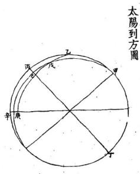

甲為北極乙為京师天項甲乙相距五十度五分丙丁為赤道戊為太陽甲戊為夏至太陽去極六十六度三十分即戊己之餘戊庚為高弧庚辛為太陽地辛經度距午七度三十分即庚乙辛角用弧三角形法見上求得戊甲乙角二度二十六分即丙已弧 法見考為太陽距午赤道度变時得十分以減午正得午初三刻五分為太陽到午方時刻以加午正得午正初刻十分為太陽到丁方時刻也餘倣此推

太陽到方時刻表

地平方位子癸丑良寅甲卯乙辰吳己丙午丁未坤申庚酉辛戌乾庚壬冬 分 五○○八九八〇○二○六四○○一 カ三。と六と刻三初二三一初一三一初一一二二二二初二一三三二初二至時 初正正正初正初正正正初正初正初正正初初正初正初初 壬子子壬丑丑寅寅卯辰己己午午未未申酉戊戌亥子子四九○二三五四101 11001 101 o 0刻三初二三一秒一三二秒一二二一二二三一初二三三初一寒雪時 初正正正初正初正正正初正初正初正初切初正初正初初 王子子于丑丑寅寅卯辰己己午午未未申酉戌戌交庚子弟大小 分 四一四一六○五六四三四四二三一 10 0011100 一 九日五九四初正正初初正初初正正初正初正初正初初正正初正正地平方位子癸丑艮寅甲卯乙辰昊己丙午丁未坤申庚酉辛戍乾亥主立立分 三九○五三二九四八九四一 一六七二六三五三二五六 1 00年子王丑丑月寅卯卯辰巳己年午未未申酉酉戊寅亥寅一七六四六七八三四六九二二七八九二九八四兩霸分 00刻三一三一初初一三二二三三三二 初一三初二三三二切水降時 王子子丑丑寅寅卯辰辰己 己午午未未申申 甲酉戊戊灾庚王二 一八八七七三。 七o 0 0三一三初初三二一 初三初一二 初二二二 初蟄露時 SECEECEEEREEEEEGEE 王子子丑丑寅寅卯辰己己

地平方位子癸丑艮寅甲卯乙辰吳己丙午丁未 木坤申庚酉辛戌氣亥壬 春秋分 三二六日二〇四四一 四○一一五四九三三○ 00010001 。1 00010100010 刻二一初三二三二一初一初初二一初三二三二一初一初初 分分時 初正初初正初正正正初正初初正初初正初正正正初正正 子子丑丑丑寅寅卯辰己己午午午未未未申申酉戊交吏來 清白 00010011000010010000000 刻二一初三初一二初二二一初二一初二一一三一三初初三 明露 壬子丑丑寅寅卯辰辰己己午午午未未未申申酉戌庚庚庚 敕 分 六九○一三八九九一○九四日○一六五四六六七二四○ 00010001101。 0000000000。 刻二一一初一二初二三三二初三一三一初初一三一二三三 兩暑時 初正初正初正正初正初正初初正正初正初正初正正初正 子子丑丑寅寅卯辰辰己己午午午午未未申申酉戌戌庚庶 地平方位子癸丑夏寅甲卯乙辰昊己丙午丁未坤申庚酉辛戍乾亥壬 立立分 三二六ん一七四四二 1 100。1 五六三二九四三 一八四八九 1 刻三一二二秒二初一初三一三秒二初三二二二一二 夏秋時 初正初正初初正正初正正初初正正初初正初初正正初正 子子丑丑寅卯卯辰己己己午年午午未未未申酉酉戊兔吏 小大分 二三二一二二○五九四一四一四一六五五三三四四 刻二一一二三二三一二二二一三初二秒二二二秒二初一二 滿暑時 子 王丑丑寅卯卯辰己己巳午午午午未未 芒小分。 0 101 1一0一 0 00 000 刻二一二二三一初二二二初一三初二三一一 一三二初一二 子子丑丑寅卯辰 辰已己 午平午午年午未未

地平方位子癸丑艮寅甲卯乙辰吳己丙午丁未坤申庚酉辛 夏 分 0 0 一0○四0七七七 八五七八八八 0 a 0 o o o 刻二二二二初二一三三二初二三初一三一初一三一初一十 至 時 初正初正正初初正初正初初初正正正初正初正正初初正 王子丑丑寅卯辰辰己己午午午午午午未未申申酉戌亥庚 地平二十四方每方十五度子正初剜当子中年 正初刻当午中則是午正前七度半已交午而午 正後七度半方尽午而交丁也前後遞加十五度 算用表之法如夏至郎作午方宜用午初三刻五 分至午正初刻十分皆為太陽到方餘倣此

造葬權法

通書云凡修造必身命年月方向皆利則修作吉如或不利而又不得不作者則當遷居自所遷之處視所作之方為吉可也如年命利作兌不利作震則當遷居而東既居於東則自其居視所作之方昔為震者今為兌矣自此作之則無不可

論作方終始凡所作止在一宮還擇固易如連跨數宮有吉有凶則當於吉宮起工自此連及不利之宮殊無害也若奧造月日利而工作未辦則畧起造以應日時自此接連以作之固無不可也及其畢工須帰福德之方吉

論取土方道太歲三煞官符大小月建等方忌取土若遠隔百步之外目所不見則不问方道

論清明前浚修墓法凡己葵墓塋或加土種樹殘砌祭臺或被壞修整宜於寒食清明之向鳩工修作不論山向年月日時按荊楚記寒食係冬至後一百零五日以古歷午氣計之清明在冬至後一百零六日中寒食乃清明前二日也魏時寒食亦是三日論豎造宅舍大寒五日後擇日拆屋起手立春前擇日豎造完工不忌開山立向年月剌山家及歲月諸凶神謂之歲官交承如己過立春後年月凶神方位己定不可修作如才位無凶神修作不妨

論安葬擇大寒五日後立春前先擇日坡土又擇日安葬不忌開山立向年月日時尅山家歲月諸凶神要於立春前依時謝墓或於來年寒食清明 加土謝墓

論凶葬法凡人初死乗凶葬之雖值凶神亦不為害今人尽三日之內或一旬之內並不向開山立向年月但擇吉日坡土尽一日之內成收俟凶神過方加土謝墓

右權法多用之雖屬变通而亦有理利用之道於斯備矣

## 論選擇

蓋選擇一條尤宜要不可不慎古云山吉水吉而日時不吉謂之違天日吉時吉而龍脉不吉謂之失他山吉穴吉年月太利而擇述不慎謂之失人径云年月有一端之失反為吉地之深殃多是信異說而昧正言所以生新凶而消己福不然山吉水吉而穴吉何以多災豈知年凶月凶而日凶犯之罔為術士者当從事斯語慎之戒之應免造孽可也還擇之理莫揚公造命千金歌即

欽定惕紀辨方書中莫不讚其善尤宗而用之可見造藥 以造命為主

選擇之理莫如楊公造命千金歌造命之法德在分佈五行年月日時要得生旺有炁共龍山命主打成一斤成格成局天干相主地支補龍排成四柱為体再加催官生炁貴人祿馬到山到向更合曆數太陽对照或三合臨山數者為用俸用兼全斯為上吉如不合楊公造命專以弔替為主成以斗首為主其中生旺或相牽制如再一犯尅害刑冲則龍山主命不合稚獲吉地难免葬凶禍不旋踵矣郭子曰地吉葬凶典棄尸同故還擇門別戶道路彷伍彼是此非各相予盾吉凶星將有萬計揆諸義理種不合每見吾之事選擇者不察本源惟株守諸家一例則萬彙皆殊若諸例皆從則吾無吉日矣且楊公曾曰諸家年月多錯亂可見諸家不可作准矣又曰還擇無如造命法又可見楊公逞擇之大主腦矣惟讀黃一鳳先生三元還擇所述古仙心法实有陳論如再兼以郭氏元徑推測飛宮吉曜庶乎刻擇可奪神功矣

辨斗首

至于斗首一條托名楊公实係偽造自唐一行禅师偽撰臧蛮径顛倒五行分门別戶以致有斗首宗廟卦例 0等名目道路吉凶逈殊至如斗首擇日有吉有凶如龍真穴的如犯尅龍山要过百餘年方可發凡擇日正五行為主頃要扶龍如乾山正五行屬金而斗首乾山屬火尤如城蠻往其尅坐山一也即化命若遇葬日好亦大減福力如丙辛相合方能化水如丙屬陽無陰合便不能化如辛屬無陽相配亦不能化必須年月日時相合方能化也泛來斗首只管元辰武財不管化炁每見化炁尅洩即好地終不發故擇日家不可耑用斗首有吉有凶審之

又如壬子陽山正五行屬水斗首屬土用甲己為元辰如車用己土屬陰剋壬子陽山為正官星上吉如用甲木屬陽千合陽山是食神如在春木有炁勝財官上吉如合甲己相合雖則化土反尅壬子正五行之水山大凶不可用請明理者審之十二山二十四向可以類推矣此法不管坐山相合之化炁实無真傳又不知化命生旺日又不知化命合太歲祿馬貴人到山到向為大旺日期又不知刑冲最烈二字犯之在十日內外傷丁不殺一人后人偽造假托楊公之說不知郭璞楊公皆用弔替之法若以認偽為真害人不淺也盖江寧省城內外凡術道中皆以此為真正秘訣無不尊而奉之每見人家請以還擇視其開篇先云謹遵斗首秘法然又不究其作自何來己致胡亂悞人不独葬家受祸而且自損陰德徑云苟自神其術当如後患何謬千里於毫

重請視斯語矣今將

八定恊紀辨方書內云按斗首五行不知其所自起為 其說者皆托之楊筠松及規筠松所著諸篇無一語 論及斗首其為偽牝可知今臺本亦不載而四方術 士多挾之以為秘奉吾莫能別其是非不知其說則 固支禹之甚者也如日甲已化土遂以甲己遁出之 甲已二干所瘟之支及其同宮干維皆屬土而甲已 反不屬土其大旨已禹其宗而廉貞貪狼諸名又非 卦变本羕由茲而推衍之別為吉凶格局更不可向 故撮其大要而辨之視者知其無稽自不惑於其誠 而好以自逞其亦可息矣

夫地學者聖賢正大之學也古聖人仰現天文俯察地 理相物土之宜而布其利揀宇向方棺槨厝所萬氏賴 之即郭公之葬徑揚公之青囊一粒粟以暨之雪心玉 尺披肝露胆此數書南明天地之玄机真乃地李之祖 尤儒宗之孔孟也凡業斯道者如能深穷奧旨定可與 有德之家扞基卜葵可云代天行道以相吉人也或有 失業之流看几本偽書道所途說即或遇一二古仙真 旨又不能潛心深究其玄奧詭称另有翼傳別径仙授 故作怪僻之談忽吾欺人妄行扦作以致陰陽垂謬破 旺冲生種錯亂自悞人在葬家不免有覆宗嗣 之祸而且自損陰德往云陰陽相見福祿求禎陰陽相 乖禍咎踵門此之謂也凡業斯道者登山時必先於來 山去水陰陽品配玄竅相通此是大主宰否則棄而勿 取可也毋致貽悞吾人切勿目私利以致貽害非淺自 圗果報否則尸位素食之愧竊騙欺詐之愆終所不免 上天其無譴乎

## 感應篇

官曜樓殿旗鼓倉庫名目雜錄感應者言乎其天道也夫天道不言而响福善祸淫皆其物也求地者必以積德為本若其德果厚天必以吉地之是所以福其子孫者心也而地之吉亦將以符之也其惡果盈天必凶地玄之是所以禍其子孫者亦本於心也而地之凶亦得以符之也蓋心者炁之主炁者德之符天未嘗有心於人而人之一心一炁感自相符合郭氏云吉凶感玄鬼福及人之於先骸固不可不擇其所而安厝之然不修其本而未是圗則不累祖宗者寡矣况嵌有以福其子孫哉

官星者朝案背後拖出餘炁謂之宮星

曜星者龍虎外有餘炁飛揚謂之曜炁雪心賦云可喜

乙以辛為天乙巽為太乙者拘也撼龍径云問君如

背後逆拖山是也又官曜詩云龍虎通身尖且利自

是寵身鐘秀炁穴前左右貼身生此是王疾官品地 又云官星不熙難求貴顯之名曜宿瘟定秉擢衡 0

之任按官曜二星惟山川秀炁所鐘惟取其秀麗巧生成無粗惡被粹之形狀則發最大驗有准也龍接者起祖山之高尖者

殿者起祖山之高平者

筆表者一峯獨聳為華喜見於水口上為佳

捍門者兩山並峙為捍門亦喜見於水口

樓台者山簇高而圓者 鼓角都山簇高而尖都

御座者山高大而中起頂兩肩挣滴者

御屏都土星山高大而方平者

頓鎗者峰尖銳而卓立者

頓鼓者山頂平而尖圖者

出陣旗者山尖四五技高低側列下脚飛揚者撥云

旗頭生石陣上羸旗心生石定輸兵若然生爪不分明為賊又遭刑捉脉賦云筆挿雲端管取天生俊傑

坤興云展旗合旗风趙旗威武鎮边隈是也径云左

畔起旗右畔鼓為官定是武

卓旗火星頭開腳擺而卓立者即頓旗是也

招軍旗者高峰擺足長舞者

展旗者分開兩足者是也

進旗勝旗者旗頭逆水而上者

退旗敢旗者旗頭順水而下者

倉山者身肥滿面頂畧尖者

庫山者身肥滿面頂畧平者

衙刀者尖利灣抱者吉 殺刀者矣削直梗者凶

金箱者或山或石方而小者

玉印者或山或石圓而小者

西筆者尖秀散斜而開又者

文筆者尖山秀出而卓者

誥軸山橫平而兩頭略高者

席帽頭微圓肩略重者

唐帽垂而有腳者

鉄帽頭高圓而肩垂者

箬笠頭圓而有長垂者

僧笠頭平小而簷長者

銀瓶者小山上尖下圓者蓋注都小山之園平者

玉帶者水星之湾抱也

金者金星小巧者其秋在龍穴之像如貴人玉帶之

0○本市真然

人宅本命天罡四旺 煞 吉不解 修 制

作 甲庚乙辛四向 俱纪 纪丑 北四向亦二 犯 个 旦宇亦

申子辰年生人厲水忌于未年月日時內作甲乙車辛四白玉

己酉丑年生人屬星忌于辰年月日時勾作丙丁王癸 四向兔

亥卯未年生人属木忌于成年月日時內作內丁王癸 四句兔

犯此然 然方立主人口死止貲財退殺至

○00年的命然 亦倫生年不論生 思修不忌知 80

以本歲支午入掌中宮順充九宮青奉命生年吏十落在何宮則思脩此宮者過西神同宮其禍尤速 t

0OO月的命然

以造月支午入中宮通兩奉命興上法同但比年的刑輕可矣宋朔式釋修造言親公服月的在向雀東吉星則福達蓋的煞可向不可聖然亦不散用年的

此外脩主命吉刑肖六王生運及例田年月倘造年不合則造月之分亦可然申論命支不論天干非法也修主命凶則肖陰陽的無從交而爻失其者矣勿泥右仙造課多不再此

天有命龍入土身皇宅命論少年非法也母泥此殺者不甚真的紫白劉亦能壓說大陽三芳祿馬身

00論本命天罡四旺大煞

本命天罡四旺占于地益八干山據各書時白之下註云三白之方即大奇帝星也修方過之不避得軍大罷大小耗官府及作主本命請凶殺不能烏害惟忌天罡四旺大然凶不能壓而又不載何者名天罡四旺是通

甲寅修申山犯歲被丙辰年莫先君則犯四旺襄事之後不書殊甚是以彙集十二命生人天思四旺所占天干方向註于第五苓相主內使人知其遲思澤及後世余照原列重梓公之四方徃三友人于退擇秘典及各書方之則天置四旺大然粟非謬故但出不知何以為克而諸吉不能壓間焉向余迎寬具源余曰天罡辰成 丑未也辰為天羅戊為地網為天哭天泣丑為貫索未 C為天牢耗氏統而言為天罡四班子午卯酉乃五多自旺之位水土旺子火旺午木旺卯星旺酉如申子辰命生人三合水生申旺子養未尼未字年月日時立甲庚乙辛四向非此四向則不思詳養郎水之生用之于甲庚乙辛而曰不吉殊甚何也前貫不言自旺而曰四旺殺宇者大有深義存焉益申手辰命生人以三合自旺之子如於火旺午上乃丑字在未又以自旺之子加於未旺卯上而辰守在未又以自旺之子加於堂旺酉上則戌字在未乃展丑成共泊於未是天界地天思天泣貫索耗以天牢聚会非生賽之宮而為四狂旦枝請爭不遂其己酉丑吏卯未寅午戌命生人皆以自旺加北四旺之宮俱合此例是回天罡四旺其善果乎以俟諸君子再加較烏

幼出滿星皆後書羅增第三合利等引申長二方得光劉癸則矣庚二方亦不福釋

<table><tr><td>太珍判土向</td><td></td><td></td><td></td></tr><tr><td>○壬子山方</td><td></td><td></td><td></td></tr><tr><td>○乾天山方</td><td></td><td></td><td></td></tr><tr><td>0辛戊山方</td><td></td><td></td><td></td></tr><tr><td></td><td></td><td>○庚山方</td><td></td></tr><tr><td></td><td>神中山方</td><td></td><td></td></tr><tr><td></td><td></td><td>こュ山</td><td></td></tr><tr><td></td><td>0丙山方</td><td></td><td></td></tr><tr><td></td><td>0翼己山方</td><td></td><td></td></tr><tr><td></td><td></td><td>O乙卷山方</td><td></td></tr><tr><td></td><td></td><td>○甲卯山方</td><td></td></tr></table>

正二三四五六七八九十二三4

口艮寅山省○癸丑山方

0 0 0 斬草破 1 00

00定五音修造年月日時忌例姓凡之五音此非財產 宜巳寅年月日時向横師四封為吉

总 日末 時年 月 不 作 乙甲 辛 向 史纪 段主 建退 官材 等疾 凶病

寡已訣年月日時 盘 孫 射 卷青十 二 唱

忌  
1日年時月  
不  
作  
丁丙  
向  
犯

之指 宜寅申年月日時安合向味見

九宫生私歌生氣原未生花身我若生地為進氣但為死氣孔今吉煞是刻之便生填被吾划者是財神與飛相司竝臣其

門超接置閏法

捷訣歌曰符在節前名曰超符在節後名曰接節遇符首 符遇節此乃正受為真訣常將甲巳撫符頭二至還鄉有 口訣要知置倒在何時端在芷種與大雪有時起過一旬 餘便當置閩作重節

洪範五行詩造奘論起半山運

甲寅辰巽大江水戌坎申辛水亦同艮震巳山原屬木離壬丙乙火為宗兌丁乾夾金生丑癸坤庚未土中此是五行真定論孰如其肉有灵通

假如甲寅辰巽坐山俱屬水先賢多用申子辰水局年月日時謂之補山亦此也

山家墓運起遁詩造葬論

水上山頭墓在辰木山之墓未宮停火山戌地君頂記 金墓原未丑上親但逢太歲五虎遁遁至墓宮是運真 惟有金山冬至後方用今歲基辰輪墓運納音財局吉 納音尅墓最相填比和印後皆為妙犯尅須知福莫伸 假如乾山巽向用癸夾年甲子月甲申日乙亥時即 將戊癸起甲寅十一月冬至後用事遁得乙丑墓運 屬金乙夾時属火乃火尅金墓凶轻曰年尅山家家 長死月尅山家宅母亡日尅山家新婦死時尅山家 子息當四柱纳音五行有制兄咎

李廣將軍箭詩造奕論

甲庚卯酉年為祸乙辛辰戌殺人多丁癸牛羊跳出死丙壬子午動干戈乾巽猪蛇為大祸坤艮猴虎不堪過天干有箭支無箭犯着灾臨没奈何

古云李廣符軍箭似鎗有人犯着祸难當一箭一人死二前二人當三前並四前父子盡皆亡假如甲庚山向忌用卯酉年月日時其餘倣此又云甲唐山忌卯酉二字俱全相冲者為之有弓帶前主殺人大凶苦单犯有帝星入中宮者不忌試遇无咎如見帝星有相冲者忌之○昔曾山與江東民鞠下祖墳作坤山艮向用甲申年壬申月甲申日壬申時惟見年忌日時上犯申字無寅字相冲坐山故吉後六年其子登科干祿甚衆

炙退三殺詩山方並忌

申子辰年馬在寅卯乙之方是退神若求三殺居何象已午未上不堪親寅午戊歲馬居申矣退斯鎮酉辛三殺北方君莫犯夾子丑上主相嗔巳酉丑年馬在亥告君子癸是矣退若问三殺在何方寅卯辰宮莫脩蓋夾卯未年馬在巳欲问炙退午丁是西方三殺是无情申酉成宮人把死灸退者退山不退向三殺者可向不可坐忌年月扶合大凶

論小兒殺例

月橫看正二三四五六七八九十十十二陽年順 中乾兌艮離坎坤震巽中乾兌陰年過離艮兌乾中巽震坤坎離艮兌

陽起中宮陰起離陰陽二位逆順飛歌 九宮數至葬去到此一宮殺小兒

四大利星詩

子午卯酉七辛山丁癸原耒一樣看若間流年何歲利寅申巳夾最兄千寅申巳亥甲庚山壬丙山頭從一般四墓歲君為大利聖造埋葬主平安四基乾坤艮巽山利年子午卯酉观此歲之外死凶吉造築何須慮禍漫四墓辰戌丑未也假如子午卯酉乙辛丁癸山向主

寅申巳夾年月大利用推合巳下詩局內山向凶神有兄占否如兄占十分貞吉再得年月格局停當吉星扶佐亦能致福屡見先賢年月多不合此但凢八字生旺有束方為吉為福也若休囚又不能為大吉也

0 論五不遇時

五不遇時者即時干尅日干陽干尅陽干陰干尅陰干也葛洪曰五不遇時者謂剛乘相尅而損其明縱有奇門不可行百事凶

烟波釣叟歌曰

五不過時龍不精號為日月损光明時干來尅日于上 甲日須知時忌庚

甲日庚午時 乙日辛已時丙日壬辰時 丁日癸卯時戊日甲寅時 己日乙丑時 天地燥火時起例詩 丙午亥山蝗火發 甲申酉向震宮末 乾戌上巽門遊 巽辛辰向順坤流 丑未坤中見位是虞寅印兒間乾由 艮丁癸水坎家 壬子己山尋艮適但逢震兌宮不数 離天坎地火星愁

<table><tr><td>艮</td><td>正十月</td><td>七月</td><td>四月</td><td>庚日丙子時</td><td>辛日丁百時壬日戊申時</td><td></td></tr><tr><td>離</td><td>九月</td><td>六月</td><td>三十二月</td><td>癸日己未曉</td><td></td><td></td></tr><tr><td>坎</td><td>八月</td><td>五月</td><td>二十一月</td><td>此乃時干尅日干名為本主不和極凶舊選擇書内</td><td></td><td></td></tr><tr><td>坤</td><td>七月</td><td>四月</td><td>正十月</td><td>差載時支尅日干所以不準今本理校正曆府通書</td><td></td><td></td></tr><tr><td>震</td><td>六月</td><td>三十二月九月</td><td></td><td>悉皆改正刊行 OE</td><td></td><td></td></tr><tr><td>巽 2</td><td>五月</td><td>二十一月八月</td><td></td><td>截例詩 時干尅日有史危</td><td></td><td>甲日從午逆数之 0</td></tr><tr><td colspan="5">殃煞合出日時每以月上起子男順女逆数至死時</td><td></td><td>不事不宜莫用之</td></tr><tr><td colspan="5">住看在何支位即是所出日時○正月己上二月午</td><td>若到戌文便越過 </td><td colspan="2"></td></tr><tr><td colspan="5">上三月未上數之</td><td>又起例曰</td><td colspan="2">乙辛唐丙最為殃</td></tr><tr><td colspan="5">假如五月甲子日已時男死戌上起子至寅上是死</td><td>田怕庚しや乙</td><td colspan="2">辛丁壬愁戊不良</td></tr><tr><td colspan="5">死時殃煞當寅日寅時出男取幹墓為方甲幹木墓</td><td>丙壬丁怕癸時惡 戊畏甲兮君莫用</td><td colspan="2">癸意嫌已奠相當</td></tr><tr><td colspan="5">未故殃煞西南未地</td><td colspan="5">以月建入中宮尋太成到位在一甲由與本方相刑尅大凶比和平平 在二甲內小凶三甲外不忌九到方封甸到山到中宮吉不能制觀數</td></tr><tr><td colspan="9">大月建即大兒煞 假如五已酉日卯時女死戌上起子至午上是死時小月建即小兒煞 以太歲入中宮尋月建到位在一甲內與本方相生亦凶或刑乾宅髮橫此 一名日建然王名陰中太藥犯之見殺宅長次義小兒九制山向中宮到方醫 正月起</td></tr><tr><td colspan="5">殃煞當午日午時出女取支墓卷方酉屬金墓丑故天月建煞 又名逆 正起 殃煞在東北丑地○殃煞高低法云甲已子午九 中</td><td>申癸庚丁年 小兄 流 艮逆行</td><td colspan="2">乙辛戊年中 正十月 七月</td><td>坤逆行</td></tr><tr><td colspan="5">庚丑未八丙辛寅申七丁壬邵酉六戊癸辰戌五巳</td><td>四月</td><td>九月</td><td></td><td></td></tr><tr><td colspan="5">死日枝幹数合甲子日甲九子九</td><td>乾</td><td>三十二月</td><td>六月</td><td></td></tr><tr><td colspan="5">夾四居之其法用 合是一丈八尺他倣此</td><td>二十一月 兌</td><td>八月</td><td>五月</td><td></td></tr></table>

天火不可監造

突艮丙年丁癸六山天火子年忌造 地火卯酉忌葵 成乾寅叩乙與六山天火展成忌造 地火丑未忌樊

地火不可栽種

## 陰府太歲詩造葬論

二十四山変運訣艮丙巽辛水居中

坎癸申辰坤乙火

兌丁巳丑乾甲木 離壬寅戍土鄉同

震庚夾未是金宮

年月若犯逢生旺殺死人丁財蓋空

假如艮丙巽辛山屬水忌甲巳化土年月日時如甲巳逢秋月犯之無妨又要四柱干支有梟煞遙露者反致吉福時師多用天干合制非也如修造不動土傍正陰府並不忌若理龔犯之見稱速監造見稱獨運一百二十日內選則三五年見禍切宣惟之

艮巽陰符甲已土乾兌須妨乙庚金 陰符歌訣曰

如甲巳年月日時正陰符占艮巽二山大凶此正陰符也 傍陰符占丙辛二山凶弗卦者為榜陰符如乾帶甲兌帶丁巳 丑俱忌乙庚二字艮常丙巽衲辛坤事乙坎袖癸申辰 震袖庚亥未離帶壬寅戍

月凶方 正二三四五六七八九十十十二

年年命塵方 酉戍亥子丑寅卯辰已午未申森麼 子丑寅卯辰巳午未申酉戌亥 論年命產月命座方

主口舌破財每月权日是也 當中以論方道如落壙之時主葬師忌立於此方犯 己上年命座月命座名葬主葬師命座方只取金井 月合方 亥子丑寅卯辰己午未申酉戍又休八產日

## 論橫天朱雀

每月初一忌行嫁初九乾太道十七忌葬埋二十五忌入宅通書不載起側按此係八卦方位先天乾南為天後天八卦方位離為火鄉為朱雀每月初一從離起周而復始初九十六念五俱在離故曰橫天朱雀忌之纏身官符定局年月日時並凶只取地支不忌天干

甲庚山忌卯酉 乙辛山忌辰戌 丁癸山忌丑未李庸軍箭 乾山忌巳夹 丙壬山忌子午 艮坤山忌寅申

箭俱全殺人如卑犯宜造主生命葬宜亡命合貴人值支为吉也

紅觜朱雀旦壬申辛巳庚寅己亥戊申丁巳

大煞白虎入中宮日戊辰丁五丙戌乙未甲辰癸丑歲

## 月方凶

甲巳且丁如丙子甲午癸卯壬子辛酉乙庚月戊辰丑雷霆白虎入中宮日 丙戌乙未甲辰癸丑壬戌丙辛戊癸月辛未庚辰巳丑戊成丁未丙辰丁壬且互甲戊癸未服巳

月厭戌酉申未午巳辰卯寅丑子史

河魁經色謂自明易夾午丑申卯戌巳子未寅酉辰亭亭天乙貴神宜背不宜向卯辰巳午未申酉戌吏子丑寅

白奸天乙卯神宣向不宜背夾寅巳申亥寅巳申亥寅巳申

日 年 買年九月乙巳丙辛年三月辛巳

九目唐辰十月甲辰丁壬年总戊癸年六月巳丑

寅申巳亥月乙丑甲戌癸亥壬辰辛五庚戌巳未

火星凶日子午卯酉月甲子癸酉壬午辛卯庚子巳酉戊午

辰戌丑未月壬申辛巳庚寅巳共戊申丁巳

修造論太歲中宮尋本命尋着本命不堪修西侍月建中宮發帝尋的命殺詩本命造如休三府月建中宫適去尋太安本年頭三者到位君

## 休作財散人亡公事憂

巳上乃布衣三不修是也其法將太妻入中宮順尋本命到康不可修也又孫月建入中宮尋作主本命到憲亦不可修也三狩日建入中宮尋本命太長到廉又不可修也名曰三不修犯之損作主傷人論正陰府殺人天星地曜例華造忌餘不避

壬子癸三山火局忌三千天星長未白地曜戊順巳租四是也

巳午丙丁四山火局居壬癸二千天星辰戌丑未為地曜壬子癸庚二日是也

坤艮辰成丑未六山土局忌甲乙二千天星寅部向地曜甲寅卯二日是也

乾申庚酉辛五山金局忌丙丁二千天星巳午句地翟丙午丁未二日是也

此乃為正陰府尅山顛不差明矣

正消滅即消艮丙山而年日消巽辛山辛日消乾甲山巳上陰消陽也

甲限防先山 丁日消震山車子日消坤乙山已上陽消陰也内坎離陰陽之正故無消也入宅同忌造英並忌名曰日神消滅

掃地空亡 夾戌未命忌卯辰 寅午卯命忌子丑 辰已子命忌午未 丑酉申命忌酉戌

入地空亡 甲巳命忌庚午日 乙庚命忌庚辰日戊癸命忌丙辛吟忌與寅日 丁壬命忌庚成日忌庚申田已上所忌糟舊龜云如山向相合亡命真祥馬青人太陽陰到中富亦化由吉不

冷地空亡 丁壬命忌丑未戊癸命忌辰戌 甲巳命忌子午 乙庚命足寅申 丙辛命忌卯酉

已上各忌日時宜含亡命貴人頑馬或太陽生氣火星到中宮助化空發豈不是空中之吉也今遵協杞辨方書猶此三条空蓋毗

浮天空亡 頭白空亡 年干甲乙丙丁戊巳庚辛壬癸

離坎巽震坤乾兌艮乾坤

壬癸辛庚乙甲丁丙甲乙星馬貴人吉凶方位立成

星馬吉凶神

金将太太大丧弔天官小病天神軍歲乙耗門客定符耗符乙乾壬癸艮甲乙巽丙丁坤庚辛亥子丑寅邯辰已午未申酉戌坤與辛乾壬癸良甲乙巽丙丁申酉戌奕子丑寅印辰巳午未艮甲乙巽丙丁坤庚辛乾壬癸寅卯辰巳午未申酉戌奕子丑

協犯辨方書論中宮

按定中宮之法論層教固未精而論丈尺亦未甚確 方位皆以目之耶見為定如大門則以廳事為中可也 如廳後則以正寢為中可也如墳堂則以租穴為中可 也移步換形惟变適要在相其形勢取其尊者為主 以臨四方庶義精而理得矣

四大金星詩 甲巳成丁乙朝尾宮停丙辛樓甲位丁壬見上侵 戊從庫上犯日

年 乙 丙辛 丁ま 戊葵寒鴉暗腥 T 巽 甲 乾

論斬草三凶日

初一初八十五其日止忌用雞斬草破土觸犯地神使亡魂不安生人受祸用此日斬草則亦忌之

論十二支六合蠡海集曰陰陽家地支六昔日月會于子則斗建丑日月會於丑則斗建子故子與丑合日月會於寅則斗建夾日月會於夾則斗建寅故寅與夾合餘倣此考原曰六合者以月建與月衍爲相合也如正月建當月在亥故寅與亥合二月建卯月得戍故卯與戍合也月建左旋月将右轉順逆相值故爲六合

按月即是日月無光受日之光月行與日合而成歲杞 則是日者月之将也故曰月哲非別有神從日而右轉者 也其躔次亥曰訾戍曰降娄酉曰大梁申曰實沈未曰 鶉首午曰鶉火巳曰鶉尾辰曰壽星卯曰大火寅曰析木 丑曰星杞子曰玄枵春狄左氏傳巳有其說至今用之 協紀辦方書曰金積于西北而水盛于東南海爲百川之 朝宗而河爲之源焉祭川耶以先河後海也河源出於崑 崙戌位也故戊為水也史記天官書曰雲漢旨其本水河 圗括地象曰河精爲天漢唐書天文志曰北斗自乾攜巽 爲天綱雲漢自坤抵艮為地紀然則寅申者水之於始也 此節出輔化辨方書論半兒立行木篇 蓬瀛書曰歲在四孟太陰與大将軍合于四仲名曰羣醜 歷神原始曰天地凶殃必羣醜

陰府太歲

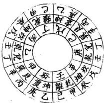

通書年神立成陰府太歲甲巳年艮巽乙庚年兌乾丙辛 年坎坤丁壬年離戊癸年震又曰府太歲惟忌開山營 造修方不忌甲巳年月日時屬土尅艮丙巽辛山乙庚年 月日時屬金尅乾甲兌丁已丑山丙辛年月日時属水尅 坎癸坤乙申辰山丁壬年月日時屬木尅離壬寅戌山戊 癸年月日時屬火尅震庚夾未山○起例曰正陰府甲巳 年艮巽乙庚年兌乾丙辛年坎坤丁壬年乾離戊癸年坤 震傍陰府甲巳年丙辛乙庚年丁壬丙辛年戊癸丁壬年 甲巳戊癸年乙庚陰府三合乙庚年巳丑丙辛年申辰丁

壬年寅戌戊癸年亥未 月神從月千起者 陰府太歲

甲已年 坎乾坤巽乾坤離震艮兌坎乾坤離震艮兌坎乾坤巽乾坤離

坤巽乾坤離震艮兌坎乾坤巽 乙庚年 震艮兌坎乾坤巽乾坤離震艮

丙辛年乾 兌坎乾坤巽乾坤離震艮兌坎

丁壬年 離震艮兌坎乾坤巽乾坤離震 乾坤巽乾坤離震艮兌坎乾坤

戊癸年 艮兌坎乾坤巽乾坤離震艮兌 巽乾坤離震艮兌坎乾坤巽乾

洪範五墓龍变運通書大全曰二十四山洪苑五行內正運用本年五子元遁数至本山墓辰其墓辰之枘音由变運取太歲縱音與本年墓是納音相生合曲吉墓運納音尅太歲納音由吉惟忌年月日時之納音尅墓運的音耳甲寅辰巽戊坎申辛八山正運馬水丑癸坤庚未五山正運屬土水土墓在辰

甲巳年戊辰未運忌用金年月日時乙庚年庚辰金運忌用火年月日時丙辛年壬辰水運忌用土年月日時

06

丁壬年甲辰火運忌用水年月日時戊癸年丙辰土運忌用本年月日時

離壬丙乙四山正運屬火火墓在戌

甲巳年甲戌火運忌用水年月日時乙庚年丙戌土運忌用木年月日時丙辛年戊戌木運忌用金年月日時丁壬年庚戌金運忌用火年月日時

震艮巳三山正運屬木木墓在未

000

甲巳年辛未土運忌用木年月日時乙庚年癸未木運忌用金年月日時丙辛年乙未金運忌用火年月日時丁壬年丁未水運忌用土年月日時

乾夷兌丁四山正運屬金金墓在丑

甲己年乙丑金運忌用火年月日時

冬至後丁丑水運忌用土年月日時乙庚年丁丑水運忌用土年月日時

冬至後己丑大運忌用水年月日時丙奉年己丑火運忌用水年月日時

冬至後辛丑土運忌用木年月日時丁壬年辛丑土運忌用本年月日時

冬至後癸丑木運忌用金年月日時戊癸年癸丑木運忌用金年月日時

冬至後乙丑金運忌用火年月日時

桉墓龍者本山龍洪範五行之墓庫變運者本墓庫之納 音隨歲運而變者也用五子元遁者與七政自冬至起算 同義上年冬至巳屬今年今年冬己屬明年天地之運皆 自子始也然五子元遁始子終亥而一歲統四時冬至後 丑月歲君未更而墓運己政丑爲金墓故金山之墓運冬 至後又重叟也如甲山正運水水墓在辰甲巳年五子元 遁自甲子順數得戊辰納音屬木郎為木運就山屬金金 墓在丑甲己年五子元遁自甲子順數得乙丑納音屬金 邵為金運冬至後属乙庚年用乙庚年五子元遁自丙子 順數得丁或用甲巳年五子元遁月甲子順數至乙亥又 進而順數至丑亦得丁納音屬水節爲水運餘倣此

年月尅山家

通書大全曰本年二十四山墓龍叟運某山運爲年月抽音所尅節爲年月尅某山惟新建宅舍新立墳塋論之其拆修豎造不動地基為舊塋附葬者皆不論

如甲子年納音屬金本年水土山暮運戊辰屬木受年納音之尅節為本年尅甲宙辰巽戌坎辛申八水山丑癸坤庚未五土山也甲子年丙寅丁卯甲戌乙亥月納音属火本年金山墓運乙丑屬金受月納音之尅郎爲正二九十月尅乾亥兌丁四金山也戊辰巳己月納音屬木本年木山墓運辛未属土受月納音之尅郎爲三四月尅震艮巳三木山也庚午辛未月納音屬土本年二十四山無水運郎其月無尅也壬申癸酉月納音屈金與本年納音同故亦尅水土山也丙子丁丑月納音屬水本年火山墓運甲戌屬火受月納音之尅節爲十一十二月尅離壬丙乙四火山也又如壬申年納音屬金本年二十四山無木運惟冬至後金山墓運癸丑屬木受年執音之尅郎為本年二十四山並無尅冬至後尅乾夾兌丁四金山也日時尅山家俱倣此凡自年月起山家之法用本年五子元遁歷数丑辰未戌四墓納音為年月納音所尅者其墓為某山之墓郎為年月尅某山蓋墓龍變運從山起而忌年月此從年月起而尅山家參互相推其理一也

運變龍墓 五墓 歸忌 徃亡 大煞 地囊 土符 九坎九蕉 九空 災煞天大

<table><tr><td colspan="5">年神從歲納音起者</td><td colspan="4">乾亥震艮離壬 乾亥水</td></tr><tr><td rowspan="2">0</td><td>年尅山家</td><td>子午年</td><td>寅申年</td><td>辰戌年</td><td></td><td colspan="2">乙庚年 兄丁已山丙乙</td><td>先丁山</td></tr><tr><td></td><td>甲水土山</td><td>離壬丙乙</td><td>乾吏先丁</td><td></td><td colspan="2">丙辛年</td><td>乾夾雜壬震艮水</td></tr><tr><td></td><td></td><td>子午年</td><td>寅申年</td><td>辰戌年</td><td></td><td colspan="2">先丁丙山巳山山</td><td></td></tr><tr><td></td><td></td><td>丙乾亥兄丁 冬至復尅</td><td>震艮巳</td><td>水土山</td><td></td><td colspan="2">離壬水土震艮 丁壬年</td><td></td></tr><tr><td></td><td>戌</td><td>乾奕先丁</td><td>離壬丙乙</td><td>水土山</td><td></td><td colspan="2">丙ン山已山</td><td></td></tr><tr><td></td><td></td><td>與乾亥先丁</td><td>離壬丙乙</td><td>震艮已</td><td></td><td>震艮離壬 戊癸年</td><td colspan="2">水土震艮</td></tr><tr><td>上二層核每甲丙戊真壬者乃位甲年申寅年 甲申甲辰甲戌感其不丙字者乃休丙子丙午</td><td>壬</td><td>乾来先丁</td><td>冬至後尅 乾吏兑丁</td><td>水土山</td><td></td><td>巳山丙乙</td><td>山巳山</td><td></td></tr><tr><td>丙寅西申南辰西成社題堰</td><td></td><td>丑未年</td><td>如酉年</td><td>巳亥年</td><td>月神隨四序者</td><td>春夏</td><td>秋 冬</td><td></td></tr><tr><td></td><td></td><td>乙震良巳</td><td>冬至後尅 乾英兑丁</td><td>水土山四擊</td><td></td><td>戊丑辰</td><td>!</td><td>未</td></tr><tr><td></td><td></td><td>丁 水土山</td><td>離丙</td><td>震艮巳</td><td>四忌</td><td>甲子丙子 八龍 2 鳥</td><td>庶子壬子 九虎</td><td></td></tr><tr><td></td><td></td><td>巳乾兑</td><td>冬至復尅 乾吏兑丁</td><td>震艮巳</td><td>四窍</td><td>乙亥丁夾辛亥</td><td></td><td>癸亥</td></tr><tr><td></td><td></td><td>辛水土山</td><td>冬至後尅 乾吏先丁</td><td>離壬丙</td><td>四耗</td><td></td><td>壬子夘戊午辛酉</td><td></td></tr><tr><td></td><td></td><td>癸水土山</td><td>乾方え丁</td><td>震艮巳</td><td>四廢</td><td></td><td>庚申辛酉壬子癸女甲寅卯丙午丁巳</td><td></td></tr><tr><td></td><td>月神從月音起者</td><td></td><td></td><td></td><td>五虛</td><td></td><td>巳酉丑申子辰亥卯未寅午戌</td><td></td></tr><tr><td></td><td>月尅山家</td><td></td><td></td><td>正二三四五六七八九十十十八風</td><td></td><td></td><td>丁五丁巳甲辰甲申丁未丁亥甲戊甲寅</td><td></td></tr><tr><td>山兌丁丙し</td><td></td><td>乾亥震艮 甲己年 兌丁已山</td><td></td><td>水土乾夾離壬</td><td></td><td></td><td></td><td></td></tr></table>

坐煞向煞 八山R 翎毛禁向 六害陰中太歲陰中煞 小耗淨攔煞

孝龍當公黑星明堂天刑蚩尤黑星正二三四五六七八九十十二十二未乙未震丙戌雨戌戌辰辛五辛五戊辰壬辰震戊辰丑寅子丑寅子丑寅子丑寅子寅己申亥如午酉子辰未戌丑戊巳午未寅知辰夾子丑申酉再子乙未甲子巳卯申辰西辰丁巳酉寅辛皇戊寅辛卯卿冉午癸五壬午巳酉壬戌丙戌丁亥丙甲辛未戊申嘉酉癸酉丑巳酉寅午戌卯未亥辰申子辰丑戌未如子酉午寅夾申巳辰丑戌未辰丑戌未辰丑戌未子酉午卯子酉午卯子酉午卯

文子丑寅辰巳午未申酉戍夾 丙甲壬庚丙甲壬庚丙甲壬庚 丁レ癸辛丁乙癸辛丁レ癸辛 壬庚丙甲壬庚丙甲壬庚丙甲 癸辛丁レ癸辛丁乙癸辛丁レ 未午巳辰卯寅丑子亥戌酉申 巳午未申酉戌夾子丑寅邱辰 子丑寅如辰巳午未申酉戍夾 申戌子寅辰午申戌子寅辰午 酉亥丑卯巳未酉夾丑卯巳未 戌子寅辰午申戌子寅辰午申 朱雀武流黑星 金匱 白虎天拂黑星

元武陰私黑星司命天明星 天星勾陳王勃黑星

王日官日 狗守昭 天寡守日爾然 帝舍相日民日成徒日隸日 宅空地寡

亥丑卯巳未酉夾丑卯巳未酉 手寅辰午申戌子寅辰午申戌 丑卯巳未酉亥丑卯巳未酉奕 寅辰午申戌子寅辰午申戌子 卯巳未酉夾丑卯巳未酉史丑 辰午申戌子寅辰午申戌子寅 巳未酉夾丑卯巳未酉夾丑卯 午申戌子寅辰午申戌子寅辰 未酉夾丑卯巳未酉夾丑卯巳

酉申未午已辰郊寅春 子夹戊酉申未午已夏 邱寅丑子夹戌酉申秋 午巳辰郊寅丑子奕冬

死别 成 丑 辰 未 方修作大利伏罪界日 夹 寅 已 申 凢方道遭火盡七日之內擇日起工半月內擇日豎造並不舉敗日 子 午 酉 不問吉凶方道丑 戌 年干甲乙丙丁戊巳庫辛壬癸凢造葬先看山家墓運陰府太歲不尅山頭若浮天空亡 天帑星 乾坤艮兌坎離震巽乾坤天官符占舍位並忌開山立向巡山羅鞭止忌立向次論 甲穿山羅睺 戌申午辰寅子戌申午辰寅子月家飛宮天地官符忌閒山立向又論山家墓還正陰府 山家困龍 乾庚丁巽甲癸乾庚丁巽冬太歲月日時忌尅山如山家官符穿山曠天禁朱雀山家 乙天禁朱雀 夾酉未巳聖五夾酉未巳卯五困龍並忌開山吉星到則能制但用通天竅走馬六壬星 丙丁獨火 寧戌申午辰寅子戌申午辰年千甲乙丙丁戊巳庚辛壬癸馬貴人爲主尅擇利宜年月兼求三奇紫白祿馬貴人諸 丙丁獨火 翌奕酉未巳笠亥酉未巳家鑾駕帝星若有一吉神同到照山向以佐其吉修造 戊 辰寧戌申午辰寧戌申午都天則擇豎造吉日安葬則擇破土吉日大吉 已 巳笠夾酉未巳翌夾酉未九人家修造內堂完備巳歸火入宅向後讀造麗廊或 真 天金神 午辰寧戌申午辰寧戌申住宅舍又欲修作安磑開渠修築等事只用修方法攝年 辛 未巳丑夾酉未巳聖夾酉月其山家墓運陰府太歲並不必忌惟浮天空亡巡山羅 壬 申午辰寧戌申午辰與戌水德星睺及月家飛宮方道緊煞忌之 癸 酉未巳卯丑夾酉未巳姐夾凡吉星到山為莓到方向為照若吉星到山到向併照中 右年神從甲遁千起例天帑星爲年千甲破敗五宮豎造安塟大利如修方對宮方上得吉星名曰吉星照 鬼即其衝也今臺本不用天帑星是不以天努為吉亦

寳無吉可言則破敗五鬼之不焉凶可知矣甲為穿山擢 曠乙為天禁朱雀甲乙之间為山家困龍丙丁為獨火戊 巳為都天與辛爲金神壬癸為水德十干本属一例今臺 本通書既不用戊己于癸而于丙丁獨火又云與年獨火 打爾火併方為災金神雖載在時憲書亦不甚以為拘忌 乃獨于甲乙則曰開山凶甚屬非理夫十干甲乙最吉不 當以遁干為凶壬癸為丙丁之對宗鏡諸書以水德制火 星其義略有可取戊已屬土入中宮疊太歲爲堆黃與月 建併忌動土猶土王用事忌勳土之義即不列為吉凶神 而於理固不背也已上数條出恊紀辨方書

年支子丑寅卯辰已午未申酉戌亥 巡山羅 癸艮甲乙巽丙丁坤庚辛乾壬 日凶方 子丑寅如辰己午未申酉戌夾 歲禁方 南東北西東北西南東北西南 太歲方 子丑寅邱辰己午未申酉戍夾 落撫忌方 数が癸酉日塗事 巳寅亥申巳寅亥申巳寅夾申 三殺方 其日三殺在寅紳 辰方落應之時孝 午郊子酉午如子酉午子酉 卷忌立控三段方 上五之蘇做此 未辰丑戌未辰丑戌未辰丑戌 協紀辦方舊曰二月甲戌四月丙申六月甲午七月戊申 八月庚辰九月辛卯十月甲子十二月甲子德合與赦 願所會之辰諸事不忌

九上官嫁娶出行入宅修造安修方一切動用宜四大吉時用黃道吉星時得吉星到時可勝諸凶耶有九觀略空旬空俱不忌或合通天竅走馬六壬天罡取用吉時吉神到山到向爲吉凢月忌日不忌嫁娶

兩春谷小夏大麗秋霜小冬大水分雨滿至暑署分降雪至寒戊子日子亥戌酉申未午巳辰卯寅丑兩春谷小夏大廉秋霜小冬大

水分兩萬至暑署分降雪至寒戊午日午巳辰卯寅丑子亥戊酉申未壬子日子史戌酉申未午巳辰卯富丑壬午日午巳辰卯寅丑子夾戌酉申未乙卯日酉申未午己辰如寅丑子亥戌巳卯日酉由未午巳辰卯寅丑子亥戌辛卯日酉申未午已辰卯寅丑子亥戌乙酉日卯寅丑子亥戌酉申未午巳辰巳酉日卯寅丑子亥戌酉申未午巳辰辛酉日卯寅丑子亥戌酉申未午巳辰月建運天道而左旋為天阙

月將稟地道而右轉爲地軸

安葬鳴吠日與寅壬寅丙午庚午壬午甲申丙申庚申

壬申乙酉丁酉巳酉辛酉癸酉

共十四日爲吠日

啟攢日 丙子庚子壬子甲寅丙寅乙卯丁如辛如癸郊甲午共十日爲鳴吠對日

月日 子丑寅姊辰巳午未申酉戌夾伏断 虛斗室女算房角張鬼觜胃壁

論暗金伏断時禽起倒詩曰日起時禽起子時日虛 月鬼火從箕水畢木氐金奎位土宿還從翌宿施 若論暗金時却看官曆本日下是何宿值日如震宿却是 太陽值日則將虛宿加子上順行遁至已時逢值娄宿 即是暗金時遇娄金狗故也允值日宿每加子順遁 遇四金即是暗金時故詩曰太陽逢巳月子未火星 雞虎水猶龍土星免犬木騎馬金歸申丑不酒諭 通書曰月遊火忌修方其熱與打頭火或年獨火併飛得 丙丁二字同到方其災方發無凶神併不妨

按月遊火即耒年太歲爲進氣方旺之辰於二十四山則又在巡山羅睺前一位去太歲尚遠又爲四利太陽本不爲凶第以火未發先炎故取太歲前一辰曰火月移一位故曰月遊然必與打頭火年獨火併又得丙丁同到而後爲忌也如子年前一辰爲丑丑年前一辰爲寅丑寅皆屬艮故子丑年正月月遊火同在艮八二月在離九三月在坎一順行九宮寅年前一辰爲如卯屬震故寅年正月月遊火在震三二月在巽四三月在中五順行九宮是也餘倣此又按月遊火逐月順飛九宮不以月建入中宮與大小月建同義

丙丁獨火 正二三四五六七八九十十十

中巽震坤 坎離艮兌乾 中巽農坤坎離艮兌乾 中中 中巽 丙辛年炒始良中 艮兌乾中 丁壬年 巽震坤坎離艮 離 戊癸年 艮兌 中巽震坤坎 雖艮兄

通書曰丙丁獨火忌修方其法以月建入中宮飛弔得丙丁二字到方修作動土犯之凶

按丙丁獨火乃諸火星之要取天干丙丁之氣照於其上爲火之耶由發也如甲已年丙寅月修作則以丙寅入中宮順数丙在中宮五丁在乾六卽正月即丙丁獨火在中宮與乾宮也若丁如月修作則以丁如入中宮丁在中五戊在乾六以次順数丙又在中五即二月丙丁獨火在中宮也然必與年獨火飛大煞併方忌

飛大煞打頭火

正二三四五六七八九十十二十二

戌辰甲未壬丙丑庚戌庚 申子辰年乾中巽震坤坎離艮兌乾中兌 夾巳乙申癸丁寅辛央辛

甲未壬丙丑庚戌庚戌辰已酉丑年震坤坎離艮兌乾中兌乾中巽乙申癸丁寅辛亥辛亥巳

丙丑庚戌庚戌辰甲未壬 寅午戌年離艮兌乾中兌乾中巽震坤坎 丁寅辛亥辛亥巳乙申癸

正二三四五六七八九十十一十二

戌庚戌辰甲未壬丙丑庚 夾未年乾中兌乾中巽震坤坎離艮兌

通書曰打頭火忌修方寅午年在午亥如未年在如申子辰年在子巳酉丑年在酉子午酉是本宮旺鄉飛宮犯之則凶○選擇宗鏡曰打頭火即三合旺方又爲金匱將星主火燭若疊太歲尤凶太旺則亢亢則屬火也其法以用月建入中宮順飛九宮遇本年三合旺方爲本月打頭火每宮占三位按打頭火即本年大煞逐月飛弔之位大煞義例已見年神其逐月飛弔與天官符同法天官符爲臨官大煞爲帝旺其曰火者以其旺極爲災亦猶災煞之又名天火耳打頭火名不雅馴又嫌多立名色易致失實故名曰飛大煞以存本義云

天官符爾宮

正二三四五六七八九十十十二

辰甲未壬丙丑庚戌庚戌

申子辰年中巽震坤坎離艮兌乾中兌乾

巳乙申癸丁寅辛夾辛亥

正二三四五六九八九十土十二

未壬丙丑庚戌庚戌辰甲

巳酉丑年坤坎離艮兌乾中兌乾中巽震

申癸丁寅辛夾辛亥巳乙

丑庚戍庚戌辰甲未壬丙

寅午戌年艮兑乾中兌乾中巽震坤坎離

寅辛亥辛亥巳乙申癸丁

庚戌辰甲未壬丙丑庚戊 夾如未年中兌乾中巽震坤坎離艮兌乾

辛亥巳乙申癸丁寅辛亥 通書曰天官符忌修方申子辰年屬水水臨官在故以 夾爲天官符巳酉丑年屬金金臨官在申故以申爲天官 符寅午戌年屬火火臨官在巳故以巳爲天官符卯未 年屬木木臨官在寅故以寅爲天官符

按天官符爲太歲三合五行方旺之氣故修造避之與月家遊祸同義名曰天官符者五行質具於地而氣行于天三合固氣也

通書曰天官符忌修方一年占一字選擇宗鏡曰申子辰年在亥巳酉丑年在申寅午戌年在巳夾如未年在寅以月建入中宮順飛九宮遇本年天官符耶占之字爲本月天官符每宮占三位

按月家飛宮天官符即本年天官符逐月飛吊之位如子年天官符在夾正月修作則以寅建入中宫順数復至中宮遇字即正月天官符在中宮若子年三月修作則以辰建入中宮順数至震三遇夾字震宮梳甲震乙三位即三月天官符在甲震乙也又按二十四山四正位不用卦而用支飛宮又不用支而用卦者以卦可逐宮而数也餘倣此

庚戌庚戌辰甲未壬丙丑

子年兌乾中兌乾中巽震坤坎離艮

辛亥辛亥巳乙申癸丁寅

丑庚戍庚戌辰甲未壬丙

丑年艮兌乾中兌乾中巽震坤坎離

寅辛亥辛亥巳乙申癸丁

寅年離艮兌乾中兌乾中巽震坤坎

丁寅辛亥辛亥已乙申癸

壬丙丑庚戍庚戍辰甲未

卯年坎離艮兌乾中兌乾中巽震坤

癸丁寅辛史辛亥巳乙申

未壬丙丑庚戌庚戍辰甲

辰年坤坎離艮兌乾中兌乾中巽震

申癸丁寅辛夾辛亥巳乙

甲未壬丙丑庚戌庚戌辰

已年震坤坎離艮兌乾中兌乾中巽辰甲未壬丙丑庚戍庚戌

午年巽震坤坎離艮兌乾中兌乾中

巳乙申癸丁寅辛亥辛亥

辰甲未壬丙丑庚戌庚戌

末年中巽震坤坎離艮兌乾中兌乾

巳乙申癸丁寅辛亥辛亥

戌辰甲未壬丙丑庚戌庚

申年乾中巽震坤坎離艮兌乾中兑

吏巳乙申癸丁寅辛亥辛

庚戍辰甲未壬丙丑庚戍

酉年兌乾中巽震坤坎離艮兌乾中

辛亥巳乙申癸丁寅辛亥

庚戌辰甲未壬丙丑庚戍

辛亥巳乙申癸丁寅辛亥

戌庚戌辰甲未壬丙丑庚

文辛亥巳乙申癸丁寅辛

大吉凶

太衝凶

通書曰地官符忌修方一年占一字○選擇宗鏡曰太歲前五位爲地官符以月建入中宮順飛九宮遇本年地官符所占之字爲本月地官符每宮占三位按地官符義例已見年神月家飛宮地官符即本年地官符逐月飛弔之位如子年地官符在辰正月修作則以寅建入中宮順数至兑七遇辰字兌宮統庚兌辛三位卽正月地官符在庚兌辛也若子年二月修作則以卯建入中宮順数至乾六遇辰字乾宮統戍乾吏三位即二月地官符在戌乾亥也餘倣此

制日

五不遇時

路空

天赦飛方定局

甲巳年

乙庚年

丙辛年

丁壬年

定黃黑道日丁未戊申巳辛丙辰

甲子丙寅丁卯巳巳辛未事登酉

丁丑丙戌甲午庚子壬寅癸卯乙巳曰五十一月並居申六十二月起於戌黃道乃程黑道逸

乙亥慶辰辛丑庚戌戊午

乙丑禺幸戊廣寅帝登

日干甲乙丙丁戊巳庚辛壬癸

正二三四五六七八九十土 假如正月從子上起道遠幾時通遼路遙何日還卿遇

此有之逸者為黃道無之遠者為黑道染倣此

定黃黑道時

子午申上起青龍丑未戊上起青龍寅申子上起

青龍 卯酉寅上起青龍辰戌辰上起青龍巳亥

年月日時

迎財吉

進寶吉

庫珠吉

大州牢

小縣獄

小重丧

子丑寅如辰巳午未申酉戍夾坤巽艮乾坤巽艮乾坤巽艮乾申巳寅亥申巳寅夾申巳寅夾冉丙甲壬廬丙甲壬庚丙甲壬酉午子酉午子酉午子壬 甲壬 甲壬有 甲

杂碧中乾兑艮離坎坤震巽進田吉谷熏簧乾中乾兑艮離坎坤震青龍吉崇一白緣兑巽中乾兌艮離坎坤大火吉皆九薪碧艮震巽中乾兌艮離坎小火吉垂白熏離坤震巽中乾兌艮離大重表羃羔一白坎坎坤震巽中乾兌艮十二星例三尋音紫坤離坎坤震巽中乾兌四太陰水黑岳八谷震艮離坎坤震巽中乾八龍德木一百冪羔翼兌艮離坎坤震巽中十病符既

冬至至立春四節内え低以一白入中宮足甲子氣けし止日是三萬而寅日值三 節候三元日白順圗 碧段四而寅日用事即以三皆入中宮四條乾在黄兑六白長七赤灣八白秋上走禹六壬 九禁坤一白震二黑兵是坎震良坤四方得崇白之吉餘欲此

谷雨至苦親四师肉為下元如四節山四事得以四绿入中宮起甲子し丑上中下 日 日乾五黃而與日克吳順去如戊辰日用事即以八白入中九樂乾一百見二世艮三碧鳴四棟坎五黄坤六白震是黄白四吉泉見見中

二一太歲土二太陽火三喪門木五官符翻火六死符木七歲破秋土九陰符金十福德金十吊客木假如卯年即以卯加太歲辰太陽己喪門涕節赦去

子丑寅如辰巳午未申酉戌夾坤丁丙巽乙甲限癸壬乾辛與申未午巳辰卯寅丑子夾戌酉成也 辰卯寅丑子亥一百案羃中乾兌艮離坎坤震巽熏谷番乾兌艮離坎坤震巽中紫皆兌艮離坎坤震巽中乾羃一百余艮離坎坤震翼中乾兌岳熏谷離坎坤震巽中乾兌艮音霫紫坎坤震巽中乾先艮離羔羅一百坤震巽中乾兑艮離坎谷簧熏震巽中乾兌艮離坎坤九紫音舊巽中乾兌艮離坎坤震

子午智日 辰戊丑未日 郊午醇 展未贞 已申点 午卯 未越辰 申实巳 酒郊午 丑成辰未 寅已申寅申色亥日

用後至冬 紫谷羅善熏百 用後至夏 真震坤坎离艮兑乾中 震坤坎离艮兑乾中巽 坤坎离艮兑乾中巽震 坎离艮兑乾，中兴震坤 离艮兑乾中巽震坤坎 良兑乾中巽震坤坎离 兑乾中巽震坤坎离艮 乾中翼震坤坎离艮兑 中巽震坤坎离艮见乾

冬至後子午卯酉日為上元一白起手耶冬至後辰戌丑未日為中元七赤起子時冬重復寅申巳亥日為下元四林起李明夏至後子年卯酉日為上元九紫起甲子

憂至後辰戌丑未日為中元三碧起甲李

夏至後寅申巳亥日為下元六白起甲子

論八宅生氣等星吉凶之源王肯堂自太極分陰陽陽之中有陰有陽所謂太陽少陰也陰之中有陽有陰所謂太陰少陽也太陽之中陽乾陰兌少陰之中陽離陰震少陽之中陽巽陰坎太陰之中陽艮陰坤所謂先天八卦乾父坤母震長男巽長女坎中男離中女艮少男尤少女所謂後天八卦也陽道主變其數以進為極故乾父得九震長男得八坎中男得七艮少男得六陰道主化其數以退為極坤母得一巽長女得二離中女得三尤少女得四此河圗洛書自然之數而不離乎五者也故先天之合而為生氣焉後天之合而為延年焉五數之合而為天醫焉乾九合艮六坎七合震八坤一合兌四巽二合離三陽得十五而陰得五故曰五數之合也共不合者皆官矣乾與離尤與震坤與坎艮與巽皆以陰而尅陽兇莫甚焉故為純命馬乾冉震巽典坤坎與艮兌與離皆陽尅陽陰尅陰其凶次之故為五鬼也乾與坎艮與震巽與兌坤與離皆六親相刑拔為六煞也乾與巽坎與離坤與震金木土相尅而子酉丑午相破害故為祸害也穩之合者相比而生吉不合者相尅者害而生凶此東四西四八宅之所以判而各星分配之所以殊也畫卦自下而上變卦自上而下故一變而乾得兌兌得乾離得震震得離巽得坎坎得巽艮得坤坤得艮所以為生氣也二變而乾得震震得乾坎得艮艮得坎巽得坤得巽所以為五鬼也三變而乾得坤坤得乾坎得離離得坎震得巽巽得震艮得兌兌得艮所以為延年也四變而乾得坎坎得乾艮得震震得艮巽得兌兌得巽離得坤坤得離所以為六煞安五變而乾得巽巽得乾坎得兌兌得坎艮得離離艮得艮霍震得坤坤得震所以為祸害典六變而乾得艮艮得乾坎得震震得坎巽得離離得巽坤得兌兌得坤所以為天醫史七變而乾得離離得乾坎得坤坤得坎艮得巽得艮震得充兌得震所以為絕命立世所傳遊年歌其源實出於此而特為捷法以括之時師執流而忘源不復深求其故此吉凶所以無據也

五行相尅金赴木木尅土土尅水水尅火火尅金

天于所属甲 木属 内 大属 大属 戊 属 土 金属水属地夫所屬子棟耳馬寅有卯有辰為 土 大 坤 土 未 金 土 申

人發之不同則宅之宜忌各異故祖孫或盛或衰父子或輿或廢夫婦而前後妻災祥各異兄弟而孟仲季休咎不同或居此多坎珂或遷彼而安茂皆命之合不合有以致此也古人不知命不如易故從卦以演命之理次從宅舍此各事之宜以合夫命庭得趨所宜而不拂

# 天地八卦五行所生之理則慶流奕葉而祥萃當身矣

<table><tr><td rowspan=1 colspan=1>八</td><td rowspan=1 colspan=1>七</td><td rowspan=1 colspan=1>六</td><td rowspan=1 colspan=1>五</td><td rowspan=1 colspan=1>四</td><td rowspan=1 colspan=1>三</td><td rowspan=1 colspan=1>二</td><td rowspan=1 colspan=1>二</td></tr><tr><td rowspan=1 colspan=1>坤</td><td rowspan=1 colspan=1>艮</td><td rowspan=1 colspan=1>坎</td><td rowspan=1 colspan=1>巽</td><td rowspan=1 colspan=1>震</td><td rowspan=1 colspan=1>離</td><td rowspan=1 colspan=1>兌</td><td rowspan=1 colspan=1>乾</td></tr><tr><td rowspan=1 colspan=2>太陰</td><td rowspan=1 colspan=2>少陽</td><td rowspan=1 colspan=2>少陰</td><td rowspan=1 colspan=2>太陽</td></tr><tr><td rowspan=1 colspan=4>陰</td><td rowspan=1 colspan=4>陽</td></tr></table>

一六居下二七居上三八居左四九居右五十居中

圖 河  
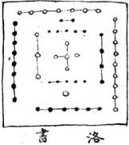

戴九履一左三石七二四為肩六八為足五居中宮

甲子五三八甲戌六三元九甲申四一 甲巳九三甲申八三五八五二 乙未三 卯三八 二八五

丙寅 丙戌九六 九六三 丙申 1司

丁 五八 丁未三

戊辰三 辰六三戊實台 戊子 二八4 至八

已巳七四 10日 已卯二会 己丑三ん六 已酉六 已未 九三六 六ミ九

庚 庚申 八二五

辛酉八二 七二四

壬寅四一 八壬成九六三 六三癸酉五八 五六八 癸美 九六三 北日

細字前數乃男命三元九宮後數是女命三元九宮

逢坎 现0 坤 3D 零 與 丑 女男 寄 灵坤 兴 乾 30 八

離 依後天八卦方合洛書之數

此乃照時憲書所載三元九宮亦與王肯堂筆塵所記以人命論宅之說相符

艮震巽離坤兌 天玉福絕延生 官坎 五天生建絕稱六 艮震巽離坤兌說 元光天離六震 生艮祸乾生坤 天 六雄延震亞坎 金 尘 还良施就祸坤 能震延坎绝免 翼秘艮五乾 龙離生震天坎 天坤天巽六艮 巽 还乾五却 五翼绝艮 生数坤 坎五复 坤. 兌

星然吉凶方胡定 吉諸亦無定

生氣星上吉書位延年星上吉武曲天醫星次吉在門伏位星亦書左而絕命星大南使軍五鬼星大凶輔貞禍害星次南出六然星次长

男女生命

坎離震巽為東四宅而男女命以三元起例吊至此四 宮者為東命載坤艮兌為西四宅而男女命以三元起 例吊至此四宮者為西命男之上元甲子起坎中元甲 子起巽下元甲子起兌自坎轉離轉艮轉兌轉乾轉中 轉巽轉震轉坤而逆行得中宮則寄坤女之上元甲子 起中宮中元起坤下元起艮自中宮至乾至兑至艮至 離至坎至坤至震至巽而順行得中宮則寄艮俱以九 宮排山掌訣輪數而得其宮

福元

宅之坐山為福德宮人各有所宜東四命居東四宅西 四命居西四宅是為得福元如西而居東東而居西方 雖或吉不受福也如東西之宅難改當於大門改之如 大門難改當其房之吉以住之房不可易當移其床以 就其吉則雖無力貧家亦可邀福也

宅舍大門

大門宜安於本命之四吉方不可安於本命之四凶方 又須合來龍坐山之吉方以開門父宜迎來水之吉以 立門三者俱全則德福全而奕葉流光矣屋有坐有向 命有東有西若耑論山向而不論命者大凶論命而不 論山向者小凶合命有合坐向者則求福如乾何兌何 乃西四宅也犬門宜在坤兌艮方以配乾之西四坐山 而床香火後門唐鋪之類亦宜安四吉之位以合坐山 若灶產坑厠確磨則宜安西四宅之四凶方以壓其凶 而灶之火門又宜嵩四吉方此宅惟乾坤艮兌西四宅 命居之則吉若坎離震巽東四宅命男女居之則吉凶 矣

按宅基外勢臨水栅更有九局烏局之真正者其力量自足以勝坐山也

六事

六事者乃門路灶井坑廁確磨居家必須之物安放得所取用便利人每忽其方道一犯凶方利用之物反為致屬之由暗地生災受禍不知良可嘆息

## 分房

分房者祖孫父子叔伯弟兄各宜所居之房位也雖分覺未分覺同居一宛之中而東西南北四隅之房各異宜各分别遣之則凶即一進之屋或僅一兩間者只丈尺之間合命者吉故東命第居東西命第居西無不福壽苟失其宜貪天不免矣

床坐

陽宅諸事惟床易為其所立法有四宜合命之吉方為最又宜合分之吉又宜合坐山之吉又宜合照水經以門論房之吉然四者難全當從其可據者以合其吉不越乎可先可後之間而已若精措置則為人移床生子生命可於側房小屋之合命者安床居之而以正房正屋與子孫合命者居作房安床則各無災而獲福矣灶坐火門

鍋灶人皆視為細小事而不知為立宅之要務如壯壓 本命生氣方則懷鬼胎或落胎不孕而而有子而不聰 明不得財不招人口可畜損敗若壓天醫方則久病卧 床體弱服藥無效若壓延年方則無壽婚姻難成夫婦 香 不和亥病窮塞若壓伏位則無財無素終身貧黃若壓 本命之破軍絕命方則無病有壽多子發則招奴婢無 火災如壓六煞方則發丁發財無病無訟無火災家門 安穩若壓禍害方不退財不傷人無病無訟若壓五鬼 方無火災無盜賊奴婢忠勤得力無病饗財田畜大旺 須大量屋之基址務使方位真正不可猜度誤事當用 大紙將屋址及層數逐一量明丈尺畫成一圃每基一 丈摺方一寸將屋穩圗分作八卦九宮寫明二十四方 向而後知某方某位為某間則吉凶聽然矣火門者鍋 底納柴燒火之口得向吉方福甚速期月之間可驗 子嗣貧富災病寺天者以日用飲食者此為根本也如 東命人火門朝東卦則吉何西卦則凶西命人火門向 西卦則吉向東卦則凶西命火門人身背西東炊火 乃是矣

符屋量明丈尺最為有理如壬山丙向者中為壬中左為子再左為癸更左為母而艮乃在牆外空處及東面之北中右為亥再右為乾更右為戌矣如癸山丁向者中為癸左為丑再左為艮更左即寅矣中右為子再右為壬更右為亥而乾乃在牆外空處及西面之北矣即此推之東西面之方位了然不爽更有癸丁壬丙不盡居中而偽偏右偏左者即當於盱偏處為中余另有別說載於別紙

## 香火、

土地神祠祖先祠堂皆香火也安本命之吉方則得福凶方必有咎古云移煙政火者謂無鍋煙香火有禍無福也若誤移其方則變其吉之來路反凶矣

## 坑厕

九此出穢之所用壓於本命之凶方鎮住凶神反發大福甚驗其方皆與灶屋烟窘相對用以壓之則吉矣然當詳審矣方位不可混錯或悞改於屋外之吉方則同路來路之凶矣即尺基丈址亦宜清楚的確

## 婚娜

命元是東四命者宜婚東四命妻則有子多福悞結西 四命妻則艱乎嗣不和不發福如坎命男配巽命女巽 為坎之生氣必有五子又和而助夫成家若坎命男娶 艮命女是為五鬼雖有二子必不和而竊財古云貪生 五子巨三郎武曲金星四子強五鬼廉貞兒兩個輔弼 只是半兒郎文曲水星惟一子破軍絕命守孤孀祿存 無子人延壽生剋休囚仔細詳此皆妻命固有准即得 來路灶向之合命者亦可斷其子之多寡有無也如乾 夫兌妻生氣有五子但金見金相敵主不和坤延年妻 四子和睦或云乾坤配合最宜應六子艮天醫妻三子 乾伏位妻只一女離絕命妻無子又離火尅金必惧內 坎六煞妻一子相争震五鬼妻二子長難抬又乾尅震 夫欺妻巽祸害妻為腐木嬾婦常受夫辱祿存無子夫 婦多壽餘命皆做此推然須論其星之生剋吉凶得位 不得位以為救助麼可廣嗣蘭吉矣

妻元論命之法較有益於通書吕才合婚之例予屡試之無如此之確有實驗也世之求婚配者先當留意其按呂才合婚之說即從遊年歌來所云生氣天醫五鬼絕命固相同而所云福德即延年歸魂即伏位遊魂即六煞絕體即禍害名易而寔則同但其下所註之數即九宮之數而細核之惟生遊絕歸四條之數

## 圖婚合才吕

不差其福天体五四條俱錯皆後人以訛傳訛不考從來習而不覺殊不知八卦中乾兌生於大陽離震生於少陰巽坎生於少陽艮坤生於太陰二太所生西四二少所生東四此命與宅所由分而各星吉凶皆從八卦挨變而起理固有據數亦可考奈何迷其源而奈其流乎因為訂正附錄於後至上元甲子起一宮時憲書現載書末以為男女命元婚元之數而舊存上元起於乂宮與今歷異或云竹書記年考之寔差一元廉熙甲子乃係下元未知孰是然畢竟以時憲書為准

乘生德福 四 三三 九一九 醫天 四三二一四七三六 四三二一九二一八 九八七六九二一八 九八七六四七三六 鬼五魂逃 x三二一九七三一 九六四八二四八六 九六四八二四八六 七三二一九七三一 命绝體絕 六四三一六九 九八七二四八二七 九八七二四八二七 六四三一六九三一 七六 1 八六三一 三一 八六 现歸 主子孫昌旺為大 吉遊魂歸魂絕體為中婚 較量輕重用之亦吉五鬼 口相連絕命禍害甚重為下婚避之則吉

八宅徵騎

有乾命男問師曰求親難就何法可速師為之改壯火門向坤延年方是速婚之向又令其卧床安於父母床之西南坤方得分居之延年後數月得婚縱不分房之吉者亦不出三年也又一貧士無聘財師為改移來路分房灶門向修方灶卦五事皆合延年又戒其灶塵糞厠溷水莫壓延年吉方踰年果得友人助貲而婚又艮命富戢半百無子而妻嚴不容娶妾問何法可全師曰此必灶座溷廁誤壓延年方也為之丈量基址分清方隅將灶廁壓凶方而七鍋火門皆向兌經年納七妾所娶皆生氣命各生子有福壽

有巽命夫配坎命生氣妻生五于後悞改灶之火門向 坤犯妻之絕命方大門又改於坤五子皆死師為改灶 大坤而火門向震又改大門於離後此妻復生四子宅 法能回造化如此

又一窶婦苦夫客不歸師為改延年灶何而歸 又有問妻妾婢僕不知其命奈何師曰先以西灶向與 食百日而安即是西命人倘有災即是東命人是以家 有百口者當立二灶火門東西使東命西命分別各食 於相合之灶則全象無咎矣

或問有子遠客何法得其歸師為改灶座壓其父之絕命方而火門向生氣以招子不及數月其子夢灶君絳衣玄剋播其乎曰父喚汝甚急何不速回其子歸養嗣以此法與人喚子多驗若奴僕进走則灶門座烟意壓於主命之五鬼而以火門向生氣方逊者决回然須查逃者之命如主乾命僕是震命乃五兒不可用用之必竊逃若火門向震必逊去不回乾主命得兌命僕不但不逊而且助主起家不惟奴僕為然即親友顯伴犯五鬼命者必耗財生氣命者助旺得力得延年命者交至老和同興發得伏位者平淡相交父而和氣犯六然者淫訟牽連犯絕命禍害者後必遭其茶毒也即生子亦可斷其贊孝忤逆有艮命與坤命兒同居財常裕老別子隔他鄉窘甚師曰陰坟陽宅二者能改天命奪神功命豈能主之如故宅不吉命獨好不能免其災貧古賢所以闡陰陽二宅之至理以佐天地之不全也因勸老人速歸故里與子同居安享餘年

又震命年老無子抱繼巽命延年之姪週歲取名壓子 其家神附隣童之身曰莫名壓子當名慶壽神以延年 之吉示之也後果至耄虛

有兑命生兒震命有碍師曰宅之難改有七塋元方妻元命子孫命坐山來路遊年移徒照水徑門法抽爻換泉此皆不易惟令其食息於吉方而有益於父命則藉以安而得其力矣可將此子同乳母去巽延年方或一里半里住房炊欽至大即於其方讀書不令身近父像則不但得分房之延年而易長有壽則其父亦得分房之生氣矣兌命生氣乾自巽方回視父之所居在西北為乾也

問兒夜啼瘡瘦求解之法師曰人犯兮房火門二者之 窗則有夜啼瘡患之昔卒至驚疳吐馮三六九之天傷 誠可惘也如孩兒坤艮土命犯震巽木而灶之火门又 向東乃木剋土主脾瀉醬府犯坎水是土剋水主驚風 急慢犯離大主痰啼嘔吐若東命孩兒把乾兌金必有 肺喘麻疹府癆之病震巽孩兒犯坤艮土必患瘧廟平 昔治人多驗可將東命孩兒房床安於父母床東南方 居臥即安然不夜啼矣此分房之法不論樓上樓下床 裏床外只要在父母安居臥之東雖尺基丈址亦有效 其西命孩兒宜在父母居卧之西也其人踰月又問 瘡哭俱愈但不能離乳食粥何法解除師曰可立一孩 兒命之吉灶句與乳母食即是兒食一樣之自能食 也其人從之而兒能食我師此法常毅醫人學之以挽 未病之先補救已病之後則造福無窮矣

乾命人悞食向南火門灶食患心疼肺喘痰嗷噎症師 教以另置一小缸灶壓坐於南以除離卦之凶而以火 門朝艮之天醫方食之踰月而病痊一半至半載而病 全愈矣若新灶吃幾日舊灶吃幾日則無效几餘命有 病俱以天醫為却病之方乾命遠客犯離歸路而命病 師曰犯來路者必從來治路今灶火門雖改天醫然不 能除病根可徃艮徃方或坤方住百日而歸自除根矣 其人從之果驗

乾命婦嫁勺離方面來路三年而離火剋乾金肺咳吐血將危師為改火門向艮天醫改床艮方將糞廁離方添設神位於艮方將柴段壓震五鬼方具烟窟水缸俱壓離方移確磨壓東方後一月而病去半但未除根師曰犯灶向病者則以天醫火門之灶食之可愈如犯來路者必從來路徙換方可其夫曰難徙奈何師曰身不必徙但將灶廁去隣家合來路未坤中延年方或丑艮天醫方作灶煮食送來家內食之其病人糞穢皆運至彼處父添設神位於其中待至百日後將各物移彌即為得來路之吉矣後果除根或問移去坑灶數事俱不可少手師曰灶座火門坑廁三者為最餘次之又問隣家無屋可租將若何師曰可於吉外方街墻之外鄰家以米換飯來食或寄煮其鍋亦效且將病人糞送至其家廁內滿百日回家即同移居而來之路矣但恐去來之方道不真則病根終不能除矣如東宅命欲用去來俱吉之方則惟丙午丁壬子癸至於甲卯乙則去東來西辰巽巳則去巽來乾未坤申丑艮寅而去來皆凶矣或又問糞廁小事移之未必若是之驗師曰見人有悞移而貧改之而富者以所移必得其所也

昔艮命人以火門向離禍害方事有將訟師為改床於 天醫乾方以遂禍害翌日其事頓息

有艮修坎犯五鬼失盜逃僕火驚師教於坤生氣方添造房屋乃得平安

有牡年坤命添造震禍害方屋一間師阻之曰一年後父必告汝忤逆其人曰父愛我豈有此事後一年父果告之致破財乃來叩師曰北方大屋不忍弟之獨居而欲進住何如師曰北方大屋與汝為絕命不利須於坤伏位艮生氣二方去住數月而後再進大屋則無災而有福矣其人不信竟住不一載而死傷致絕

遷移來路

如人住東方移遷到西方乃是震入翼鄉人只作兌宅修造乃木受金剋又是震之絕命此由不明來路之生剋必卒然致禍須從來路解之

陳簡青曰來路根也深宜詳究每見遷移即敗是來受剋也

## 修方

凡拆卸修葺添補換樣蓋瓦撫門壁墻憲及沿街墻頭水溝等皆謂之修方吉凶立應如合本命之吉凶必旬曰見驗而合宅門坐山坐卦者師為人造福而起高閣晒臺疊塔砌墩除患而開池鑿井倒牆伐木移寬改門等項皆可歲月計如乾命脩兌生氣半載有大財後出貴脩艮天醫坤延年乾伏位皆吉忌脩離震坎巽方必有禍如疾病是非災殃之類坤命脩艮生氣主富青旺田產脩兌乾隆坤皆吉如脩震坎巽坎離皆凶坎命脩巽生氣必致富貴脩離震坎皆吉脩乾兌坤艮則凶餘可類推

搖断八宅

易有八卦于定八宅又當論脩造之年月日時與宅之生旺剋制先當論人命舍宅之吉凶乃論修造四課與人命務要分清生剋制化不致偏勝而凶中吉中凶乃能判次於字握之間陽宅第一吉星曰生氣人命合得此吉方吉向又逢貪狼生旺之神修造定生五子大旺皆財催官貴顯百慶交集可歲月期也第二吉星曰天醫人命合得宅之床房灶向者有三子致中富叛造則人才旺相脩改則膝病免禍亦須四課扶助而福乃臻第三吉星曰延年人命合得此床路亦旺人發財而家行和氣多壽第四吉星曰伏位人命合得门路床房灶小康中壽只生女少子以上四方皆吉宜開大門作臥房安香火房內只宜安床至若舖面後門米倉銀庫賬房書房叱飯桌位學館畜欄栖棧俱宜於本命四吉方上及外廂安之其灶座宜於本命宅內之四凶方而灶之火門必須面向木命四吉方來路亦須向本命之四吉方其分房卧末亦宜合本命之四吉方有父毋俱要合父母床座之吉亦可其生山來龍必合本命之四吉乃得受其蔭庇否則雖有上等形勝吉秀貴氣亦徒然也放水出口拆補修方俱須合本命吉方乃能發福否則籠統無臉又妻元塋元灶卦照水經臨門法並宜合命之四吉忌命之四玄第一凶星曰絕命犯之主子孫威絕第二凶是曰六煞犯之主人命官非疾病孤寡傷人損畜破財第三凶星曰五兒犯之主奴僕遲走犬災盜賊損小口舌是非第四吉星曰禍害犯之雖官司得勝而傷人敗產損畜陰耗此本命四凶方位惟灶座烟憲確碾坑廁水缸井臼柴房灰屋人客往來飯桌空聞房屋及低臭水缸等事而已乃所以鎮壓其凶也按八宅之說從太少四象分來二大生者為西四宅卦二少生者為東四宅卦而以後天八卦方位入用此乃有源有本確然可信者也是心益年只有生氣延年天醫絕命五鬼六煞福害以及本卦伏位八星配八宅也至於貪巨樣父廉武破輔弼九星乃金星是一說故或可附於紫白九宮而以混入遊年八宅則不倫世皆習而不察特為正之

八宅既從卦論則五行亦當從卦即照洛書分九宮五行尚不錯亂忽雜以九星而五行各異生尅制化莫可適從所以遊年歌止有八個字即生氣延年亦15止十六字何嘗拿立五行乎窃謂宅法即當除九星之說專論八卦及二十四山向庭不淆惑焦弱侯所記脩學之說乃江南宅法之祖亦止論八卦五行蓋以八宅從八卦起也

宅基

陳簡青曰封拜陽宅必有旗皷幞頭天馬山現至於科甲書香之宅基不過六秀方秀美而已其世代殷當者必丙艮二方高厚砂水來若僅人丁陽基不遇粗頑氣旺又云陽基與陰地不同陽基喜地勢寬平局而寬前不破碎聖得方正右山右水皆陰基之善者若世代科甲家：殷當子孫衍昌千年世守者陽基必席頭高厚龍尾大起乃成大之局勢假如朝南之基平陽坤申地高艮寅他實山间坤申山高艮寅山起必是子孫世守之基征不特朝南陽基為然八山八局稳要席頭高而龍尾起請後之君子验之如虎頭不高龍尾不起不過數代終當易姓

又曰陰陽佳者百里之中可有教十處陽基大者百里 之中一二而乙

家座贅語

江寧府學明德堂後舊有一高阜土隆之墳起嘉靖初都御史陳鳳梧夷其阜建尊經阁於上未建阁之先府学偏試中者甚多景泰四年制科中式二百人而應天至二十四九人可謂極盛自建河後逼年漸咸隆慶以来稀若辰星矣萬曆已酉丙戊間太常寺卿冻南周公繼署府篆公雖善宅經謂儒学之文廟坐乾朝巽開巽門而學門居左屬處庙後明德堂後尊經開高大主事庙門與学門二木皆受乾金之剋陽宅以門為氣口生則福剋則禍於是以抽爻換象補酒之法修之於學之坎方起高樓曰青雲樓高於尊住以池乾中之氣而以收水生震巽二木以助二門之氣又於庙门前豎巨坊興學门之坊並峙以益震巽之勢於離造聚星亭使震巽二木生火以發文明之又以泮池河水不蓄於下手造文德木橋以遏水之流脩理甫畢公遷應天巡撫都御史學门內旧有房墙戊子冬公下徵拆去之曰此公明年大聲必出始血廷矣已丑焦公果應其占庚寅冬公連南戶侍面語余曰脩学一大魁余未敢言功也占當出三元坊中樞字亭上星字篆及區之三口星之三明圈皆寓三元之象君具識之乙未戊戌宋公與余相继登第人益以公之術為神頃年有議脩學者大京黃所博謀於衆余謂只宜循公之制不可輕改其發科之多少蓋心歲道利能所制不拘何宅皆可有之惟其宅本吉則宜靜聰以待吉之自會年度遷科：脩改斷無此理

按此不遇就一定之八卦五行以為生剋制化只就门論對坐山高大主事亦可使之貪生忘尅轉相為益于门而坎乃巽之生氣又直中元巽卦運旺之時所以其驗若應樂耳何嘗論九星論紫白式

## 筆塵

王肯堂

余里中一友劉生素不信陰陽機祥之說一日過余見余攝屋謂予曰聞門極測係吉凶宜審擇之予如其說必有為固詰其故劉曰余向開一後門而失大失盜官訟退田術者勸余塞之乃己可不信乎余漫矣曰人受命于天奈何歸咎一户劉曰不然何術者之奇中也居數日劉引術者樂生來虛心訪之樂曰利本命而成為上元生人寄位乾宮而所匍乃坎門六煞其法應火盜官訟退田某亦不知其所以然其書俱在因啟筐生示予名全光斗臨經專以人命論宅引余試而用之良驗淺于京師劑有聽調縣全王姓者精於宅法乃專周此書僕禍福往奇中屢欲訪之而以煩促故不果

八卦性情

乾兌震巽不宜尅坤艮二土不宜生坎離尅泄皆凶暴衛士須知以上情

尅至傷家長官災福患頻尅泄損妻妾六畜血財傾如 戊亥山不宜丙丁己午尅銳類此

凡三元命各有所宜若人命得何宅即于其宅生氣延年父醫伏位訚门路出入或脩樓臺或安牛馬並吉更得頻脩須原舊兮房或未路抵向大吉見碎金

後圗九宮生人各照本命人係何年所生男女上中下三元伏時憲書後所載即知某年所生男幾宮女幾宮即照所立各圖查之便知各人之吉凶方位惟是十二

年本命立春後時刻所生為下年本命務須查清為要 月與正月生人以立春日為主立春前時刻所生為上

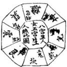

序王子道輔從子學爲舉子業者有年拜爲詩求道德性命之旨亦孜孜矻矻油然有得矣而其尊公序一蘭陵先生以名孝廉旁精堪輿家術時以謂得昔人不傳之秘蓋非精其術其理明故其術精也道輔心家學時得研精單思其術遂與先生等因謂堪輿要道莫先理氣而理氣之旨莫盡於楊筠松奧語數言與曾文遄青囊一序但其立言簡密雖大旨無遺序二而後學未能盡曉爰爲段分句釋務使詳明確貫望了然顏之曰青囊心印書成乞予爲之序其簡端予惟地理之說不知始於何時嘗攷漢藝文志有宮宅地形書二十卷有其書斯有其術而八卦五行經又托於黃帝所作豈即始於黃帝時與及觀周禮序三

則有墓大夫之職尚書則有卜瀍卜澗之事雅詩則有相其陰陽觀其流泉之語然皆以辨方正位而禍福之說不與焉惟晉郭景統始有所謂塟書而相地者遂競宗之得其傳者則惟西江之楊曾二公爲最著今觀青囊序所言陰陽之配合山水之動靜燦然序四如燭照而龜卜曾爲楊之高弟故楊公所傳眞諦曾特取而揭之數百言中則曾公信爲楊之功臣矣惜也時師識解未眞往往各逞巳見誤用前言遂至玄關背謬遺害不淺今得道輔爲之發揮明白如詔愚蒙如開聾瞽使時師後學俱可不迷所往是曾爲序五楊之功臣而道輔不又爲曾之功臣也哉然則道輔此註自當與青囊相爲表裏而其他葬經地脈經等書皆可一以貫之也予故嘉其言之有益於世遂序之以告世之讀青囊而不知所解者

康熙乙亥仲冬月友人愚谷氏張哲題於月泉

書院之敬業齋

小劉蓋自河出圗洛出書而有天地生成之數陰陽順逆之分地法因之爰以三教地理之說由來尚矣然流泉陰陽言觀言相堂楚山京或望或景而其書不傳晉郭子景純始著塟經而後其道顕麼世藏諸禁中序

楊筠松仙師之因演為徑名曰青囊天玉甚法號曰大玄室言湲理奧必賴師傳時俗強以已意牽解而宗旨晦矣元國師劉秉忠著為玉尺以明天玉止宣揚水神之出入而隱秘共用法於不言明初一默禪師目講者詩其秘後避雜天目山髮控延慶寺数過東陽與巍山趙氏祖相厚為遷陰陽兩基趙氏丁財科甲為八婺冠冕黙師功也趙為作淨戒寺春秋紀之惜其書未登梨故不廣播先君旁通堪堪輿壬子登賢書後届乙如而逝余小子為營塟計舉業之暇取遺書而習之聞孝序三

烏季子讓言九宜兩先生湯默師之傳書執贄請業先生以天玉授余讀之恍然有迄屢證諸舊塋其發編者必得纏中三卦之吉愈紅楊公一生精意皆在天中矣余懼世人為坊書所惑不得真傳悞人不淺丙子春以青囊心印問世又本默師之意偏天心印內外四卷註解詳明以公夙好庶幾明乎其旨從天地父母三卦以取配令本天地生成之數陰陽順逆之分以為體用將見上產賢良為

朝廷彌隆運下殷戶口為兆姓登康阜其於裁成輔相未必無小補玄

序三

康熙三十有六年歲次丁丑孟春之吉浦陽

王子道輔孝廉蘭陵公之家君也公昔與予交方弱冠潛心理學儒業外槩置勿問丙午歲予在衰經中公亦鍵尸讀禮兩人均爲營塟討韋同硯席朝夕得繼見扳談惟地理書之公確有所見因謂予曰今從未得牛眠雇舉庶不爲庸術所欺乎其青囊經亨

所爲說要在於不可易而已公於壬子登鄉荐不數年而逝故其說不傳之道輔名噪文壇亦復菅心地理上接楊會之傳下窺師之秋淹貫堪與獨步一時其所著青囊心印一册闡徵顯幽解釋尽務期人人通曉不敬秦以雜說大意與蘭陵謙論相似讀是書者務知王氏家學之有源而予淚幸蘭陵之有傳人也蘭陵惜不一見之矣貴

康熙乙亥歲仲冬華麓張德炳用熙氏撰

例言豈囊總重配合配合者陰陽自然之理陽交陰下密而施生陰交陽仰永而翕受所以濟化生而成高物也篇中皆取陽用陰配陰用陽配故偏有不言陰陽而言雌雄示入簡切

一理氣悉本河洛而五行順逆從此起也不知順逆不可以言陰陽不知陰陽不可以言配合苟舍是而談也理何異盲腴之說五采雖極津摩立能辨乎

一天五青囊王尺三書相爲表裏地理宗之以開物成者也青義心印 言

然天玉幽深玉尺稍除問世猶俟諸來歲青囊文不煩而意盡辭雖約而理該故先詳釋以公同好

一是編經文與諸坊刻稍異蓋自萬曆年間有淨陰淨陽之根本文中有不合者妾加改削後遂治而靑囊之旨晦矣今幸得默輝師秘本讀眞條分幾析服綴貫通始信地理有眞而宗旨不泯也擇斯術者抑何幸與

一地理之學代有傳人或一代數聖或問世一賢見知聞知與執中之貌無異故靑翼本郭氏傳書楊公闡其旨曾公序其詳則是書直與六鄉也垂不朽矣予以心印名身盡總乎子百載以下而飲接子百載以上之傳止堪以心相正云爾為見知耶為聞知耶子何敢言

一余家地理先自外祖黃先覺公馳譽海內又家多藏書先君傅綜經籍分情地理壬子以葩經獲薦賢書乙卯邊爾長逝余於衰經中收輯遺罰得地理一冊便不忍降間與江右俱遊士議論類甲可乙否未窺真諦因思一貫之說何獨地理不然酉春方侍愚各張夫子講學月泉書院中聞孝烏李子護言九宜兩先生來客於家姑丈永在黃光生之日新堂余就而正焉聆其言直探河源叩之則以爲得默禪師之秘青囊心印 言 二

也遂執讀而請業乃以獸師所正靑勢度余讀之諮然有得 夫不有傳者則此書不公不有註者則斯理終聊故不辭管 窺之陋遂分節註疏成以正諸友僉曰盍廣升傳使天下 孝子仁人讀之不爲庸術所欺且卜宅兆者盡符配合將錄 奇毓端上爲

國家糞降盛下爲兆姓增早繁爲功顧不大哉余曰某之志也一因謹附梓以質同志云

王宗臣識於深渙之呈瑞樓

心卯之說悉本正尺大玉二經之理參以默禪師之四匪敦爲聽見以解青囊也讀是書者諒巳心解而神許矣然辭雖淺恐初學者不得其門而入也爰以靑囊中之所有繪圖立局陳學者讀經而未明則觀之註覽註而未達則又證之圖庶由圗而得註由註而得經九陰陽順逆諸妙理無不熟悉於明中而登山觀水之際曉若指掌易如數珍其亦可不見陋於有道矣具亦可造福於人矣或云天地大文不可抒今所言者皆造化之理坤乾之秘何輕洩若是不畏丁甲之追乎噫余何知叁一

天地之大文莫過於青義余則從而逃其言中之理其言分之意也云爾余何知然大文不可抒而青囊巳洩其秘於前者蓋天地以生物為心物莫貴於人人莫重於親古昔先師自本天地之心以立故而著之為經欲後世覽其遺文明其精義以爲孝子仁人安親之一助則此書之釋也之不盡而又續之也亦斯志也世有同志者得之爲郎正爲津梯寧無收乎哉康熙歲在丙子春王正月人日深溪道輔氏王宗臣書於呈瑞樓

是經大唐國師揚筠松先生傳之會公之訣也以二氣五行一節二節之法成賦而曾子綴合成篇於地理之學曲必旨對明造化運行之機直參贊化育之大道也百言葬龍之法作龍以辨雖雄察金龍以定水口觀血脈以究源流忍三以詳采氣論陰陽以明氣運交媾之精分順逆以求祖宗潔歷之於堪興無餘蘊矣用三合五行量山收十二方生疊之吉以空大卦論水收十二路水神為配山管山水管水而五行生旺之氣吉凶之應昭然次又分二十四山方位之陰序

穴情之可否或正來或饒減而進退伸縮之法明矣所以辰來龍向依水局山與水之作用毫髮不爽至於溝壑八路之甲小中大神以定位而收山出煞之移取生尅出入以化凶俾天地不得專言凶之權鬼神不得操禍觸之柄真所謂改天命回造化之神術也豈時師之听能與知哉

明誠意伯靑田伯溫氏劉基撰青囊序心印卷之」

繡明李康定官先生同鑒定

陽公山水看雌雄天下諸書對不同

沛陽正宗臣著張以培同學 訂戴撫德

天地之氣有陰陽而化生萬物則山川之氣亦有陰陽而鍾經靈秀故堪輿之學雖術數亦稱地理焉然歷代相傳不之見知聞知之學今合會公問湍曰楊公主共說也亦猶子思子作中庸首仲尼曰爾他書非養老卽年老二字此序默禪師舌囊心印 卷上

政以山水二字何等確當且下文刪訛就正使一篇脈絡相承叚落門白誠地理之眞諦後學之正宗也看雌雄者太極之理靜而生陰動而生陽故地法因之靜而疑峙者爲陰動而流行者爲陽今不曰陰陽而曰雌雄者言山水配合之理猶牝牡交媾然勿曰有夫婦然後有男女男物備精萬物化生足也當時之肄業者各立其門各氏其氏如宗廟等書相沿巳久而雌雄配合之理矣違楊公心傳故曾公首禍之口諸書對不同所以別其途示人知所宗也比一語加晨鍾初聲使聞者爽然句以諸書與靑糞細玩而改正之則同不同

曰可以知所趨矣

先看金龍動不動次察血脈認來龍

當玩先有二字卽人山認水口之意此一句乃曾公栝楊公之心傳示也學之要訣也金龍者四塾之地各有金宿而四墓首長辰中有亢金故名金龍如百二十分金首甲子之金分來因得名焉動不動者如入山觀水口交鎖周密卽認取是屬何五行然後察其何五行之旺水入堂爲察血脈也冉辨其來龍為陰為陽與水神蠟雄配合何如若得龍水二神生與旺而同歸人墓則有化育之機而金龍動成言地矣青囊心印 卷上 二

否則龍水一神不交便失配合之理為金龍不動不成地矣 故默帥云人山尋水口登穴看明堂水口明堂是方可看消 詳尋水口者卽忽金龍看明堂者師察血脈也水口明堂是 方可消詳者言局前有生旺水入堂與龍神配合歸庫方可 立向以消綱也近方書以辰戍丑未龍不宜動動則四伏生 眞天罡食氣是以言水口者言龍豈不謬歟

龍分兩片陰陽取水對三之細認蹤

承上文認來龍而言龍有陰有陽見爲兩左當辨其爲陰為 陽是分取也水財三久者言寵行兩水輔必送龍二水中來 到風有三又於此三父之虛細添其陰龍則取陽水策嗣 陽龍則取陰水來配爲忍踪也正尺合密旨云陰用陽朗陽 用陰應師云二水夾來分左右到頭立穴論陰陽合而現 之可以得其旨矣

江南龍來江牝望江四龍去望江東

此卽天玉經中向者回山是父母意也竺字作向字解二句俱以左旋龍麗右水若爲倒且語氣含而禾露玩下文自巳見之

是以聖人卜河洛澤羽二水交乾嵩相共陰陽流水位下年卜

此一節引隱洛得配以證之也言地理之所尙久矣觀周公營沿察關水在市卷卜在西惟洛在其中其金曰我乃卜泗水東糧水西惟沿食我又卜瀑水束亦惟洛食詩云相其陰陽觀其流桌流水位三乎可玩卽得位之說卜年卜月者擇吉是都也

吾世景純明此術濟經立義號元室朱催發源生旺氣一一講說開愚蒙家

夫周公營洛懾下之大勢傳曰卜世三十卜年七自後世幸旨逼其微者禹晉世郭景純深明夫人之理察陰陽向俗之宜著爲葬經一卷立元公擘法蓋山水配合卽化柱交故以元名空言其流也楊公深得其旨故曾公易之以看雖凝宗人最親切躬白朱雀者局前之水也發燥者局前入堂之水也葬經云朱雀派於未盛朝於大旺澤於將衰流於囚謝法每一而後洩是也必得生旺水朝堂立向滔納深諸元空之旨方合唯雄之妙當一一爲後學之愚蒙開醒也一生二兮二生三三生萬物是元閒由管山兮水管水此是隱元妙印

青囊心印 上

一首太極也二者兩儀也三者三才也自太區分而兩儀生白兩儀生而三才衛如天五絕中天卦生於甲庚丙壬地封生於子午卯雪是開發處此中開竅乃化音萬物之根基在山則有山之生位在水則有水之生位密旨云山運收山水運收水各有起法此陰陽之不同乃其至憑全妙處識得陰陽兀妙理則知衰旺生與死不開坐山與來水但逢死氣皆無張

承上文言既知住山論山在水論水各有元開起法便知其 孰爲生旺執爲衰死而開井放棺迎接榮旺立向消納趋避

吉凶其法皆瞭然在目死氣無取者會公重言以教成之也 宗天羅經十二支後天再用于與維八于四雒輔支位子母公 孫同此推

先天河圖羅經土有十二支以定八方後天洛書有四正四隅至後人增入八于四維輔於支備故有二十四也除去戌巳不用蓋法國五十居中非土不生之意子母公孫卽天主經中四經金本水火四龍之說夫四經五行生旺墓皆任二十四位之中以推子母公孫之分各有其法故曰同此推羅經秘旨曰二十四位起雙山篇羣長生不放閑局內卦爻青義心印 卷上 五

顛倒用水之峒福洩機関然至逍精微非具道骨者恐未易发此

二十四山分順逆語取陰陽福與宗陽從左邊團團轉陰從右路轉相遍有人得其中意何愁大地不相逢

上言龍分陰陽尙未明言何如分此疏言之天地之理左行 順右行逆左爲世若爲陰假如壬子行龍至甲卯結穴爲左 旋屬陽如卯甲行龍至子壬結穴爲石處屬陰楊公口訣三 認取陰陽老祖天王經云若將入首為端的陰陽何處 此陰陽當自祖言別來中二句分最明知山之陰陽則水 之陰陽可用以配合能會其中閭竅則大地不難得矣此一 段乃地學之入手處

陽山陽向水流陽執定此說甚荒唐陰山陰向水流陰笑役胸泥都一般若能勘破個中理妙用本來同一體陰陽相見兩為難一山一水何足言

發明上女以左白旋順逆論陰陽不可執納甲而拘一治陰淨陽之說便將陽龍立陽向收陽水陰龍立陰向收陰水爲得法也且龍神入穴其後龍焉能節節純陰純陽而各水局又焉得陽龍無陰水陰龍無陽永若能卯陰陽相見之理使青囊心印 卷上 六

龍水二神生旺互交之謂妙用同一體此卽乙丙趨戌等元竅相通之妙王尺云難勢乎納印法莫妙乎變通又何須拘一山一水之淨陰淨陽爲也

李子舉白龍潭紀爲式乃右疑亥龍入手作王山丙向兼亥巳分金雖陰龍陰向而有寅甲陽水入堂若執治陰則犯陽水豉陰局主凶矣而反着紫着研及庄田萬頃蓋楊公作癸水龍以配甲木局得寅甲官旺水入堂出未坤歸庫上御街是合金羊收癸甲之憲也故發禍五子皆顯課未二句云莫夢流水出午官天折見貪弱蓋午位乃先天乾卦夫乾金左行生壬水右行生癸水而癸水龍弔於先天乾位丙午之明其水流破午方謂坤傷胎神故主夭折且南離之火是癸水正財而中破之故又主貧窮也楊課亦神矣哉

更有淨陰淨陽法前後入尺不宜雜斜正受來陰陽取氣乘生 則方無殺來山起頂須要知三師四節不須拘只要龍神得生 旺陰陽却與穴中珠

上言淨陰淨陽必不可拘此言淨陰淨陽各有所用蓋辨脈八穴買棺一線之氣單取淨陰淨陽故曰前後入尺不宜雜前者此脈之八尺是穴後者此穴後之入尺是脈言棺不胃囊心印 卷上 七

離脈脈不離棺也夫脈有斜來正來之不同必當以本脈道陽取淨為主不可有雜氣乘生旺者其脈之陰陽雖取淨矣又須得龍氣之生旺假如左旋而從生趨旺位住右旋而從旺至生位住斯得無殺俱從來山起頂處而來至後三四節不必拘也此龍之生莊最爲緊要而陰陽無殺皆從左右旋論却與穴中之取淨陰淨陽者不同

舉左旋乙辰惜巽人穴爲式當取巽木氣貫棺謂之氣乘旺 而無殺若乘辰氣則辰土被後龍木所傷便有殺矣 又如右旋巽辰八穴當乘長氣貫棺蓋長七從丙午火氣而 來謂土乘火生而無發也若乘巽氣則水龍來路巳生火面 洩盡本氣亦謂之有殺也此皆從穴後一二節土看生旺者 也

二十四山雙雙起少有時知此義五行分布二十四時師此義何曾記

此言二十四山而雙之作十二山蓋爲陰陽龍卦有生死墓絕等起法於十二方分宮也然有可雙著則雙之如四正旺位壬子水用卯木丙午火庚酉金此八山木屬一氣而雙之宜也至於乾亥丁未也龍不可變之為木巽巳癸丑四龍不焉秦心印 卷上 八

可雙之爲金坤申乙辰四龍不可雙之爲水艮寅辛戌四龍不可雙之爲火此數雙山五行有二氣不同不可從雙論時師少知其義也每一山之來龍入穴斷以正五行分左右旋論陰陽必不可侯用雙山三合論龍固矣故曰二十四山各有五行分布時師當記取也夫雙山三合之用爲龍神入穴處有生旺摹三方有峯巒應位及水神來去取其弔合經曰雙山三合成全局豈謂三宮之六龍皆從一氣論乎皆因昉書之悞相沿巳久人俱習焉而不察亦獨何哉另有雙山正鬱語詳見羅經解內

山土龍神木下水水囊龍神不上 山用此步水災量山百里江山一餉品

凡察龍神用雙山盤陽順陰逆起長生佈十二方此盤專審 龍脈入穴不用之於收水所謂山上龍神不下水也光察水 神看本水口合何五行之庫用挨星盤亦陽順陰逆從墓位 起破軍佈九星於十二宮分貪巨武三吉之水八堂出墓以 配龍神此盤專以論水立坐向不用之於審龍脈故曰水事 龍神不上山也用雙山盤以量山用挨星盤以步水雖百里 山水可一餉而定矣

青囊心印卷上

坊書中以雙山專論龍而從三合之變山謂山上龍神不下水以元空專論向而較其生尅於向何如謂水裏龍神不上山文云雙山龍尅元空向謂之短命殺元空向尅雙山龍門之換妻殺是一山而二五行猶一子而有一母且師第授愛視爲秘傳從未有林正之者余亦身蹈其事卒疑焉而莫所蓮從爻聞一李子舉獸師傳如披雲見天然終不敢自秘庶幾有同志者得此而攷正之不爲方家所惑其大有造人師豈淺鲜哉

更看諸位高峯起尖秀方圓須得位生方高聳旺人丁旺方起峯官祿至上文舉龍興水各論生旺此皮單以龍神生旺方論豐塞如長生方管人丁有秀峯起更主八丁俊秀官旺方管財祿有峯巒起更主財祿豐盈官居顯要夫砂可以見發論之貴賤雪心賦云論宮品之高下以砂法拼求

天上星辰似織羅水交三八要相過水發城門須夏會却如湖裏薦父鵝

借喻天上星辰有如繼羅然龍異水分順蓮其經緯亦相同也水交三八者繼言二十四山谷有吉水送龍界氣過堂相青慶心印 卷上 .十

交來會於城門出本龍庫位而法却如息之遠來入潮交結之有情也

當看明堂與朝水文庫大小俱得位截定生旺莫教流直流直 射家業退射破生方定少亡冲弦旺方財狼猶文若來時完女 亂庫方來到定爲殃

此論八手龍神當察則堂來去之水也凡堂局中生旺水宜來流過堂而去方收入口爲得水也凡死絕水宜去不入堂內夢出得殺文庫大小得位則生旺不流破矣載定者斷決陪乃看水煞處如有生旺水來水過堂竟於向前直流而山定主家業退敗雪心賦云流來混混出明堂氣勢朝散玉尺云一泓似箭射伯道孤寒是也所以生旺莫教流者蓋人丁實保於長生財破龍神生方則盤傷生氣定主少亡財祿必源於官旺冲破龍神旺方則財業飄零且喪成男之子沐浩宜靜來則多輕庫方宜去來則禍起俱爲不得位而成凶矣若龍眞穴的而遇此等凶水則有小元室摧制之法如下文所云

生出尅出名爲退生入尅入名爲運退水宜流千百步進水須 教近戸庭

書義心印卷上

上文言局中凶水及逆是水不合於龍必主生災禍遇龍穴 眞的豈可業故又立小元室之法借坐以消納之取生尅 八爲進神生尅出爲退神進神宜收入退神宜流去此止論 1 局中來去之水與山生尅何如全與龍神不相涉玉尺云五 行實無係於龍家禍福須取明於水路則小元空之用可知 矣此景純之神術而會公得楊公之親傳乃演其詳經云奪 神功故天命至矣

進退得位出公卿家資巨富旺人丁旺方帶殺來不宜庫中去亦非

當肴得位二字言進神之水宜於借局之冠臨旺方而來赴神之水宜於借局之死墓絕方而去謂之得位王尺云天關開財祿之源地戶澹化生之寶水法合則富貴人下兩全矣然得位又有旺方帶殺者如備局中旺方水來雖爲進神猶惡此水落在木龍八殺之宮是水雖旺而帶殺於中故不宜來也因水殺龍謂之收山不起

假如左旋巽龍人首氣屬陽木水宜倒左出未坤今或倒右而出局前有西辛絕胎水來入室若用小元空借坐庚金之生位作丙山壬向以收兩辛方庚金旺位之來水雖有蓮神青心印 卷上 兰

從旺位而來又合尅入比和丙山之吉然巽龍之八殺在酉所謂旺方帶殺來不宜也雖辛水尅山為吉而酉給岩內辛秀在外亦無用矣卽爲收山不起此地雖吉當惟慘禍如宋末文忠烈公祖地合此式其課曰一條辛水向東流文尅云下武封侯未二句公欲封公公不見公遇騎牛截斷頗後果以丁丑不利

得位又有庫中藏殺者如借局中死絕墓方水去識得退神之吉猶惡去水落在龍神八敘之方謂之庫中藏煞則出殺不净也

便如右旋坎龍人穴氣屬陰水宜水倒右出未坤今反未水倒左出辰是破煞倒冲入堂若用小五行借辛金局或坐子山或丑山其未水來雖合尅入比和之進神而辰方水去又合比和尅出之吉但坎龍八殺在辰俱是直中藏殺雖去亦非也小元空地其餘四水皆能制化獨龍神八殺水來去難制位故曰小五行地最忌水尅龍

四金四木井八水四火四土小五行大小盡莊元空裏二十四山有水神十個退神靈如鬼十四進神如鬼雲

此小五行之目也訣曰丙丁乙酉原屬火乾坤卯酉金同坐善心印 卷上

甲癸亥艮是木神戌未王庚土爲眞子寅辰異辛兼巳申與壬方是水神言金木火土山各有四而水山共有八專取坐山以察來去水路以收生尅出人進退二神之用也訣中坐字宣玩大者言陰陽龍水配合歸庫是為六元空也小者陰湯龍水不能配合故用倩局之庫出水爲小元空也乃收山出煞之元朝貧墓富之神術俱在犬小示空裏矣再提撥二十四山有水神者言小五行之山去生向尅向者共有土山此十山局前之水對向而去得山之所生所尅則退神之敘出矣雖富出何害故曰十何眼神靈如鬼也亦必須悠場平靜如不見其流而去為妙又小五行之向能生尅山者亦共十山山向比和著有四山若正五行龍神遇凶水直朝人堂著用此十四山制化前朝之凶水反為進神之吉故四十四進神如鬼靈也小云看尋一分

生入尅入為進神生出尅出爲退神進神若進家賚旺若還退時家不興退神宜退亦同旺若還進時絕除根

此以進退二神反覆言之結小元空之意也重在宜進宜退四字申上文得位之意夫借局中知生尅入者爲進神矣又須進神落在山之生旺方是進而益進家資不亦榮旺乏青心印 卷上

若進神方為山之退神必家通消索蓋天闊主財祿也借局中既知山生尅出者為退神矣又須退神落在本山死墓絕方是退所宜退人財不亦同旺乎若退神方反爲山之進神必人丁衰之蓋地軸濟化生也

逃歌云小元空之法專爲局前來去之水犯冲傷龍神生 旺方及段倒中沐浴八堂等害故用坐山與來去水俱以 小五行各定其所屬取生尅出人爲義定進退二神之吉凶 則能制龍神來去之凶水而化為吉水 假如一陽水龍其氣生於申中旺於壬子死於甲卯墓於乙 辰養於丁未當配辛金局水官到左出辰乃杏陰陽印見孟 配今水反倒右來於卯出於未是龍家死水入堂中傷未宮 龍神養位是滿局凶水財祿人丁必兩失矣若用方光空制 化法借甲木局坐亥木山立已向以收卯金水尅入水山而 卯宮死水化作甲木局之旺木反能漾射祿也以亥木山尅 出未土之去水面未宮發養位者化作甲木局歸庫之水反 能濟人丁也且又弔得亥卯未三合幣珠之妙故王天云一 訣千金入神精義又云至道精微惟聖人方能及此非聲知 其孰能知之大哉小元空之爲用乎

靑囊心印卷上

溝整明堂定方隅便從品折審縈紆四尺五寸爲一步折取須教向所宜小神須要入中神中神流入大神位三折更上御街去一舉登科名冠世

此穴前明堂故水訣也溝者水溝也者蓄水處也夫平嗟 之地明堂溝壑先定其方所大抵放水不宜直流品者限制 也折若曲轉也當審度縈紆而出也其步數謹依班尺四尺 五寸爲一步用二以星地折取水路審所宜向榮紓而出司 馬頭陀水法專取小神入中神中神流人大神位而出四雕 爲御階故有科名冠世之應

飛水溝放水初步從穴前葬口起步用乙辛丁癸小神位中折而用甲庚丙壬中神位三折則用乾坤艮巽大神位謂上御堦而出方得法

李子逃默師假陽水龍一局放水例穴前水溝初步由癸放丁得向本龍父母中折放庚三折注坤作匱以畜之再三曲過堂出異係本龍鄉皆是謂折得向所宜也可有科名冠世水神禍福原非細更須一一查公位乾坤艮巽長男興寅申巳亥長伶仃甲庚丙壬中男發子午卯酉中男殺乙辛丁癸少子強辰戊丑未少男殃

青囊心印 上

共

此申結上文穴前放水要入小中大神意也雪心賦云穴前折水依法循繩廖公云放水直從天上去水訣云放水須要入于維若放支神起禍殃夫于維乃虛無之位支神乃重濁之地恐太歲當其年或都天加臨其方便能發禍故水神禍福開係非細而公位須當審也小中大神分公位若何大神應在長而放水犯四生支神則長男受禍矣中神應中男而於水犯四收支神則中男受禍矣小神應少男而放水犯四庫支神則少男受禍矣此穴前放折乃以人事補夫工最爲梁妻拭砂經謂叨堂之水如人先入口之物其害養人稱緊比明堂決水乃人工作用之水也他無所用下文又是天然局前之水不可俱入放水中論

于午卯西號街屬神壇寺觀亦能興內有其第紅門水雷公館 位使人驚

李子云子午卯酉總名街瞻水若在本龍旺方來雖神壇寺觀亦能興發于名旗第午名紅門卯名雷公酉名館位此四水若有一水朝堂雖居旺位實有吉中之凶能使人畏懼不可不察也

青藥心印卷上

子水 凶主軍賊且隆 吉主稱軍成之財 午水 吉主出武 四十火監軍兵 吉主橫財驃富 酉水 吉主吉節女色 四七經亂段載 余觀子午卯酉四旺地也亦四敗之地故有此異應天五經 云止神百步始成龍水短便遭凶又云支水來去凶惟有宣 申巳亥水生旺福無比今曾公以四正支水另言之非細故 也當玩

貴貪狼井祿馬三合聯珠貴無價凶神流短吉神長富貴聲名滿天下

符乙丙丁三奇也詳在渾天裴卦內尋子父財官及貢人祿馬之位又有起貴法乃于龍之貴人方貪狼乃本龍之長生位祿者于龍祿方馬者支龍三令之馬位以上俱吉水若在三合聯珠之官旺方來入堂則主無價之貴矣其或有凶水人局者只要先有吉水到堂居內凶水居外及凶水短小吉神長大則富貴聲價傳天下矣五尺云迎神背煞化數生權是又在於智者能取之

富貴貧度在水神水是山家血脈稱山靜水動葦夜定水主財祿山人丁乾坤艮異號御皆四大尊神在內排生尅須憑五行佈要識天機元妙處乾坤艮巽水先長古神先入家豪富青囊心印 卷上

統言水神之吉凶而富貴貧賤因之何也經云外氣橫行內氣主生蓋水是外氣乃山家血脈最閑禍福山靜爲陰水動爲陽晝夜定也水神之氣動現於外乃身外之物身藉以養故主明祿龍神之氣靜注於內爲骨血之傳里福及人從主人丁元機云有人無財須求得水之地有財無人莫下孤單之穴夫乾坤艮巽爲四鄉皆俱在水口論而金木水火四龍神之配合俱在四邵階內排矣其或龍水二神不合鄉階者可將小元空爲憑怖五行於山水局中蓋此天機元妙處須要知也夫御階水使之流長而三吉水神先到堂人口則其家之豪邑不待言矣總結上文請藏一家舊日坟十坟理下九女貧惟有一坎能發福去水來山盡合情

此卽天五經中若還不信此經文但覆古人攻意也夫五行大小俱在元空裏十坟而惟有一坟發者彼九文之作用必不知天機元妙而此一坟之來山去水盡合堆雄交縛之妙也亦可以見聖人割制立法從回造化矣

宗廟本是陰陽元得四失六離爲坐三才六建雖爲妙得三失五盡為偏蓋因一行援外國遂肥五行無綱編以乾淨就危不青業心印 卷上 克

明所以禍福為胡亂

此應首節諸書對不同而纏其故也宗廟之名乃洪範五行遁山運以偏尅擇之用雪心風云宗廟之水出吳人用之山運有準其陰陽本是元渺若較之正五行中論順逆配水神立向雖得十龍之四墓而失十龍神三才六建之坐矣故曰得四失六難爲全美也其法又俱於坐下起長生順佈水神論生旺墓三宮雖合三才六述之坐位而金木水火八局也陰陽順逆之理又失五坐矣咏曰得三失五盡爲偏也蓋唐太宗按郭氏遺書減之禁中一行僞造滅壺經以化授外國其中宗廟永法有得四得三之吉然而五行順則大非龍水配合陰陽相見之理故宗廟之書傳而元空之旨不明而禍福多有不應矣此山水之雌維楊公得其統開萬世也學之宗也

心印 卷上青氣與語心印卷之下浦陽王宗臣著緒潮李一先生同顯定 傅旭元

坤壬乙文曲從頭出艮丙辛位位是廉員巽庚癸盡是武曲位乾甲丁貪狼一路行

楊公立四大水局教入知所平也單主陽水局名天卦水神以配右旋陰龍之用謂之天卦者俱從天于位上起長生順折生旺直等其分宮用挨星盤凡佈九星亦從此整於本水青義心印 卷下

庫位起破軍順挨九星於十二宮定舍巨武三吉之水奧語 中以天卦陽水神取四維立坐佈局作首音為例而陽水神 八于海局可推但陰水局名地卦水神者不在此例

其曰坤壬乙者蓋言坐坤山以收壬方之來水入堂倒右而出乙以配右屍辛金龍得生旺互交歸墓此卽辛壬會之忌合申于辰水局故曰文曲從頭出也

共曰艮兩辛者蓋言坐艮山以收丙方之來水八堂倒右而出辛以配右旋乙木龍得生旺五交入墓此卽乙丙亥之意合寅午戎火局故曰位位是貞也

其曰巽庚癸者盡言坐巽山收庚方之來水人堂倒右而出癸以配右旋丁火龍得生旺五交歸庫此卽斗牛納之意合已酉丑金局故曰畫是武曲位也

其曰乾甲丁者蓋言坐乾山取甲方之來水入堂倒合而出丁以配右旋癸水龍得生旺交入墓此卽金羊收之意合亥卯未木局故曰貪狼一路行也與語藏神至此豈淺學所能洲哉

引天五經云陰陽二字看零正坐向須加府卽此陽水神從零神起長生而陰水神之長生從正神起者可推而坐向之再漢心印 卷下

左爲陽子丑至戌亥右爲陰午巳至申未

天道左陽而右陰左順而右筵地法因之故自子而丑以迄戌於亥左行爲順爲陽自午而巳以迄由於未右行爲逆爲陰陽言子丑而陰午巳者蓋陽生於子之半陰生於午之半也觀二十四山分順逆左醇爲陽右轉爲陰可知矣與雄交會合元空雄與雌元空卦內推

夫知陽順陰逆之理則陽龍配以陰水陰龍宜配以陽 來為陰陽相見生旺互用歸軍謂之雌雄交會合元空也仰 加庫位陽順陰逆起破軍以完食巨武三吉入堂皆出於紀 空目內推也

山與水須要明此理水與山鴻福辨相閑

王尺云欲觀坐吉則須君水神之出入則龍與水得唯進交今合元六之必至以收龍水之生旺得坐則發福失坐則禍起不可不知

明元空只在五行中知此以不必尋納甲

既明元室之旨則龍水二神陽順陰逆佈局在五行生旺墓中知合此法自然丁財慈久不必單取刊強一節尋納用咎義心印 卷下

官取暫福也夫納甲之法取有拳可向則向之有水來湖則收之以配卦氣之淨陰淨陽此即前序中陰陽相見兩爲難一山一水何足言章

頗顛倒二十四山有珠寶近順行二十四山有火坑

二十四山分順逆使龍水二神辦維交媾或陽龍用陰水配或陰龍用陽水配無倒倒父合元空却夫婦有相顧之樂則能發福有珠寶之稱若失配合不得雌雄女媾之妙則逆其所順便能發福不有大坑之凶乎說金龍一經一緯義不窮動不勁直待高人施妙用

金龍者水口庫位也元廢最宜相通凡陽龍順行則水宜道行陰龍逆行則水宜順行一經一緒夷義不窮也然水口有動不動之分動則易於取裁不動則配合無自惟高人斯有變通妙用之施如龍穴真的用借局小五行之法

第一義要議龍身行與止第二元來脈明堂不可偏

龍身如五星聚磷龍杪鳳閣或邑字三台介字飛鵝之類行止者玉尺云其來如逐其止如伏左砂有歸左砂右錯衆水朝堂羣龍息足是也家脈明堂於此結穴處前當明堂後中來脈必承得脈真正堂氣靜聚雪心賦云登穴看明堂傳送功曹傳送概言虎砂功曹概言龍砂也古云龍虎所以請區穴既不可缺陷又不可過區過壓使後代乏人絕嗣也

明堂十字賦云水聚天心自然而得富貴又云堂中最宜聚窩訣云明堂亦是分宮位蕩歸左位長公興蕩歸右畔少男發不偏不故聚富中三子一齊足豐隆

前俊龍神前者如朝廟之山要特異朝迎後者蓋坐之山如御屏華蓋之類雪心賦云前嶂後屏文臣宰輔

八國城門賦云詳看國之周流必八方無風乃第壽氣城門如華表廣門關鎖重重龍力乃大

天心十道章氣既到自有天心凸處如太極圓暈必於十道無徧處既不皮腦傷龍又不太低脫脈

屈曲流神流神者入堂之水嘗辨其生旺宜入休宜去故須證然流神不可失之直必來去屈曲之元爲美末二句言高山平地總一般莫向無申非有靠於有處求無意明倒杖卦坐陰陽何必想例杖之法至十有二莫非陰來受陽來陰受乘氣貫棉之妙詳見十二杖注中卦陰陽者言坐穴乘氣或順或泄耳腰相受也明到杖之十卦坐陰陽何必言矣手子云假如陽卯脈入穴坐乙向辛右耳愛氣此陽氣順來以耳逆受陰卯脈入穴用向庚左耳乘氣此陰氣逆來以

歲掌模太極分明必有圖

氣到必有一圓暈處爲天心之離突當於圓暈中陰陽之際處立穴此穴可似穴掌模樣必如太極之有陰有陽分明有圖也

青囊心印 卷下

說五是方圓尖秀要分明

凡金木小火土五星要得或方或圓或尖秀麗而開而有情者爲上其兼體有次之王破碎散例者不吉

此言沙之元微也凡吉神高起則吉凶神高聳則凶若眠倒星辰在凶殺方亦內

假如卯龍結穴見坤申砂低陷糾有陣亡之應因中宮有殺風射穴故也賴公云陽關山陷因陣亡陽開申砂也陽衛壓塚初年滯結穴處見卯峯高歷也若坤龍更爲不吉他加金龍見離峯高過尖焰主殺戮之穴是金龍遇殺太強也

楊公云問君如何謂之鬼主山背後撐者是問君如何謂之曜龍虎肘外拖尖嘴總之鬼宜貼身而似死生則刼奪穴氣曜宜生動而飛揚死則穴氣衰微皆所以証火也

向放水生旺有吉休囚否

收放向前之堂水遇生旺入堂則吉休囚入堂則否前俱詳言之矣

知化氣生尅制化須熟記

青天心耶卷下

天地無全功以人事補天工全在生尅制化四字上探討耳如巒頭及水局或遇凶砂或遇惡水各有制化之法方可轉凶爲吉如開孤截蕩挨金剪火奮池發鐘等法皆於巒頭中制化者也如借局中取生尅出入消納等法皆於水局中制化者也凡制化等法當熟記於心始隔用時而無悞也二十四山分五行知得榮枯死與生翻天倒地對不同其中秘密在元空認龍立穴要分明在人仔細辨天心天心既辨穴何難但把向中放水看從外生人名爲進定知財寶積如山從內生出名爲退家內錢財化作灰生入尅入名爲旺子孫高官

此總東一篇以明其用也首句分字宜看言二十四山如格龍則用正五行佈局用雙山五行水局用挨星大元空五行龍水不合有借局小元室五行故曰分也然各五行中供有榮枯死生之吉凶須知也翻天者言陽氣如天順行倒地者言陰氣如地逆行也對不同者中有大小元空之秘也凡認龍則用正五行爲主立穴處要陰陽交媾綾急得宜又須察局前天心十道無偏其水神來去以配合龍神或用雙山三合立穴成局或以本龍翻父母合水神立穴成局則大元空青囊心郎 卷下 八

挨星之私在是矣此所謂記龍立穴辨天心收放水神之正 法也其有水神不合者則用小五行取生尅出入制化之制 化得宜則發人丁財祿制化失宜則家業成灰此又辨天心 之一法也用法至此無餘蘊矣

脈息生旺要知因龍歇脈寒禍必臨縱有他山來救助空勞祿馬護龍神

上言配合作用之法詳矣然千里來龍止求一席之地必須氣脈眞正得生與旺方可施功有如穿山而龍落空亡過峽被風吹水刼或入首孤單而龍不來氣不聚巒頭不肥滿而穴無正星或穴情模糊無兩庀蟬翼砂界一齒蝦鬚水而藏風不得水此皆爲龍啟脈寒經云脈息孤寒人財衰敗總有他山可指爲祿馬貴天亦室勞其護矣此入穴之賑一線之氣要得其眞楊公所以叮告戒之也

勸君再把星辰辨吉凶禍福如神見識得此篇眞妙微又見郭璞再出現

辨星辰者如楊之斗樞廖之七政賴之五星各有吉凶須當辨也砂訣云請看人家面前砂斷人禍福定無差玉尺云砂如圓淨證孕忠貞勢或欹斜必主淫傍則吉凶禍福之機得

卷下

之於星辰者捷於影響也是篇楊之授曾者其理至精至粹 至妙至徵惟楊公接郭氏之傳則楊一郭也後之學者接楊 公之心傳神而明之亦楊之再現矣

要終原始余關靑囊告深客有難之者曰心印一書可謂發先人所未發矣然所論陰陽必有其原所言順逆豈無所自若非或有底見雖麗辭累牘終屬傷門豈以問世者無以自問乎予曰唯唯青囊之書總歸理氣理氣之源防於河洛嘗聞李李子舉默師之傳矣給亂衍義筆於編未以是終之以是始之之意也夫

吉蒙心印續編如軫原始

丙初層先天卦 二層後天方位 三四卦陽順 生圖 四層先天卦陰 後天方位 六盤盈縮閣

明陰陽五行氣分順逆間之師曰陰陽五行之氣皆申先天卦所生於後天四正四隔之宮當細推之乃以盈縮經度天盤於之畧得且說夫天午居後天地盤丙午縫中是先天乾卦爲天爲父大盤予居後天地盤壬子縫中是先天坤卦爲地爲母河國曰天一生水者謂南乾施生之始也乾金左旋而生陽水胎於後天地盤午丁於未坤生於申庚右旋而生陰水胎於後天地盤巳丙養於其辰生於乙二水者是乾金所生也地二生火若謂比坤發生之始也地坤左旋而生陽火胎於後天地盤子癸養於丑艮奇漢心印續通 要原始

生於寅甲右旋而生陰火胎於後天地盤壬亥養於乾戌生於 辛酉二火者是地坤所生也天三生木者天盤之酉居後天地 庚酉縫中本先天坎卦所居坎水位西屬陽卦得天三奇數 故從天而生木左旋而生陽木胎於後天地盤酉辛養於戌乾 生於亥壬右旋而生陰木胎於後天地盤庚中於坤未生於 丁午二木者是坎水所生也地四生金者天盤之卯居後天地 盤甲卯縫中本是先天離均所居離火位東屬陰卦得地四偶 數故從地而生金左旋而上陽金胎於後天地甲寅養於艮 丑生於癸子二金者是離久地坤所生也以金藏於土腹非火 不能流行而見也天五生土河圗以戊巳於中宮又分寄於長 戊丑未四支者蓋因先天土無正位卦氣之所而天五奇數乃 而陽故從陽水同生於未坤申冠於戌乾亥衰於五艮墓於辰 巽是以長戊五未各得土氣屬其位矣大五行之氣皆從先天 CCCいO C3 卦分陽順陰逆而生而後天生旺之山從此起也古人云先 天統龍者言龍家陰陽五行本於先天而施於後天二十四龍 黃泉之內所以放棺必曰內乘生氣者以氣由先天卦所生故 曰先天續龍也而後天佈局者悉肇於斯矣

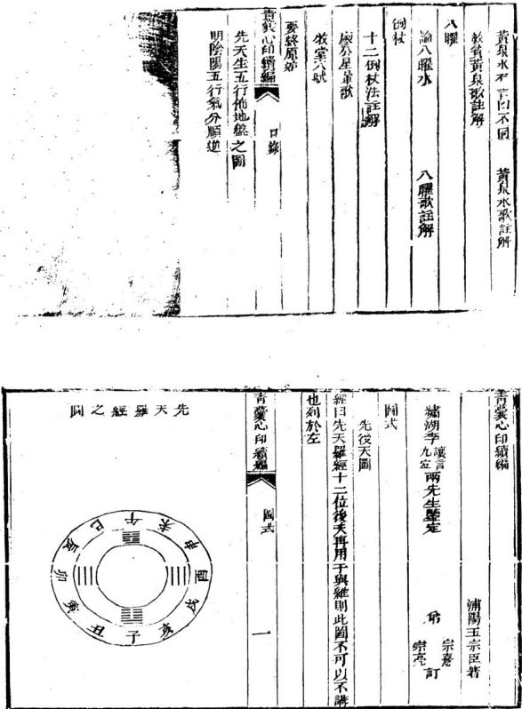

## 雙山換星兩盤圖

經曰用此步水與量山百里江山一餉開此圗尤爲堪輿家金靑囊心印續編

## 針也具於左

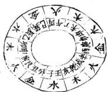

## 大元空國

經曰晉世景純明此術衍經立義號元空又曰雌與雄交會人靑囊心印編 式 三

元空則山川之變換萬有不齊而出水之配合理惟一致也固 約之以八局保覽者無疑義焉

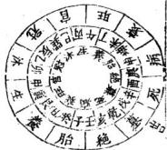

右陰木龍配陽火水局法宜收丑艮養位水寅甲長生水辰 巽冠帶水丙巳臨官水午丁旺位水入常流歸戌乾庫地而

收巽水堂坐癸向丁兼丑末主人多聰秀丙水特朝宜 坐艮向坤主驟富格貴催官收丁水宜坐甲向庚兼寅 申但煞不淨午水朝宜坐寅向申長見卯水主中薄 風聲

靑變心印緒羅

水配金临

不岐金龍配水水局法宜收未坤養位水申庚長生水庚乾尅帶水亥千臨官水子癸旺位水入堂流歸辰巽庫地而

圖金男配火陰

收壬水宜坐呷向艮多發中男收癸水宜坐庚向甲 收乾水宜坐向癸兼丑未

子水特朝宜聖申向寅兼坤艮大發丁財格貴催官

青藥心印續堀

右吟火龍配陽金水局法宜收辰巽養位水巳丙長生水长坤冠帶水申庚臨官水西辛旺位水入堂流歸丑艮車也血去

收庚水宜坐共向乾但當過西煞收辛水宜坐丙向壬辛水東流也 收坤水宜坐乙向辛兼辰戌

右陰水龍配陽木水局法宜收戌乾養位水亥壬長生水丑 艮冠帶水寅甲臨官水卯乙旺位水入堂流歸未坤庫也而 去

甲水特朝宜坐乾向巽主少年蜚聲收乙水宜坐壬向丙收艮水宜坐辛向乙兼辰戌卯水特朝宜坐亥向巳兼壬丙格貴主登科及第

石陽火龍配陰木水局法宜收未坤養位水丁午長生水辰冠帶水乙卯臨官水甲寅旺位水入堂流歸乾戌庫地而

甲水朝宜坐丁向癸乙水朝宜坐坤向艮然乙與辰同宮不若借未向丑卯水朝主白手成家催官篇云陽衞水來主聚富龍輕沙碎招淫奔畏見丙巳水入堂主入含抱養

靑囊心印續國式白冰於配陰金局法宜丑養位水子癸長水乾冠帶水辛酉臨下水屯理位水人帶沉辰巽庫北也大

辛水特朝宜坐艮向庚來宜坐癸則丁玉只云亥佛丁曲而發貴

異見辰水來碼破煞側沛土女多產厄男多旁傷吐血戌 克軍于里人之嗣若刀砂見定懼刀丘橡楊七尺云八 曜重遇刀砂難免龜法之誅

青囊心卯德張配陰 水局法岐乾成養泣水辛酉長生水承丁午亭官水丙巳旺位水入堂疏歸丑艮庫地而

朝宜坐午向乙丁水朝宜坐乾向巽坤水闹宜的丙亥山巳向載壬丙主大發人丁六秀水入堂沙合格台居風

青羹心印續題國式

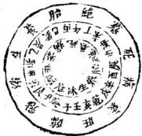

石陽水龍配陰木水局法宜收巽辰養位水乙卯長生水艮丑以帶水癸子臨宮水壬亥旺位水入室流歸未坤庫地而去

爽水朝宜坐巽向乾壬水朝宜坐乙向辛艮水朝 坐丙向水兼巳亥乾水特朝又見乾峯高聳回山作珂 貴主科知暮選催宮云磯入雲宿生宰輔

小元空國說

經曰大小俱在元空裏十個退神靈如鬼十四進神卯鬼雪是 山川融結豈能盡符大元空則小元空洵補教之善術也五尺 靑囊心印續論 i 云法顯元紳功莫剝至道精後惟聖人方能及此非春知其 就能知之天玉云此是收山出煞書歷觀仙師秘訣謂可挽回 這化能使人朝貧暮富面余遍閣名地何多符食近坊書皆從 向止論生尅殊失宗旨不觀玉尺鄉乎從嶺坐大之吉凶須看 水神之出入小元空訣云乾坤卯今金同坐皆明明言之而世 強以巳意牽解何戲予故辨之夫世之制志者爲具圖於 左

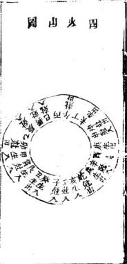

袂云丙丁乙酉原屬火是四火山喜甲癸亥艮方水來爲七 人干寅辰異辛巳申壬大水來爲尅人吉丑庚戌未方水去 爲生出乾坤卯午方水去爲尅出吉

訣云乾坤卯午金同坐則四金山喜戌未丑庚方水來爲生入丙丁巳酉亦水來爲尅人俱吉甲癸亥艮左水去爲尅出子寅辰巽辛巳申壬方水去爲生出俱吉

訣云甲癸亥艮是木神此四木山喜子寅辰異巳辛壬山水來爲生入乾坤卯午方水來爲尅人俱吉喜丙丁酉乙方水去爲生出減未丑庚方永去爲尅出俱吉青衆心印縮船 き

訣云戌戌未丑庚土爲此四土山喜丙丁乙酉方水來爲生 入甲癸亥良方水去爲尅入俱吉喜乾坤卯午方水去爲 生山子寅辰巽辛巳申壬方水去爲尅出俱古

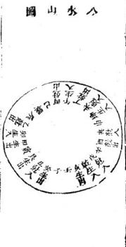

訣云子寅辰巽辛兼巳申與壬方是水神此入水山喜乾地 卯午方水來爲生入丑庚戌未方水來爲尅入俱吉喜甲 癸亥艮方水去為生出丙丁乙酉方水去爲尅出俱吉

經曰宗廟本是陰陽元得四失六難爲全雪心賦云宗廟之水法悞人似此法竟可畧然用之山運可存也姑備之

.断

第一養生水到堂貪狼星照顯文帝長位兒孫多貴人丁呂熾性忠良水大曲瀦官職重水小樺迤福壽長養生流去終煩絕少年孤空房

沐浴方水断

沐浴水來犯桃花女人淫乱不由他投河自縊隨人走血病官災破敗家子午方來曲業盡如酉流來好暗奢若還流破生神一位墮產風流帶望伽

青囊心印續

冠帶方水斷

冠帶水來人聰慧雅致風流好賭奢七歲兕童龍詩賦文章博 學萬人誇水神流去三房苦碧亂嬰鬼死不差更損深閏孀態 女此方停蓄乃為

臨官方水断

臨官方位水趨墳祿馬朝元喜氣新少午早入青雲路賢相籌謀佐聖君最忌此方砂水去成材之子另歸陰閨中少婦常啼服財穀空一徹骨費

帝旺方水断

帝旺朝來望前一團和氣發庄田爵高威重名插遠金穀豐 紅有利錢最怕休四來滾散石愚豪富不多年此方流去財源 張之食貧窮怨上天

衰方水断

衰方管局巨門星學堂水到發聰明少年及第文章貴人旺年高金滿盈出入起居乘聖焉宴遊歌舞王壺傾旺局七宜來則吉去須灣曲更留情

病死方水所

病死二方水忌來天門地尸不爲更有辨名官顯水若針吉囊心印續編

一飛起火災損妻飛刁兵脈紫瘋海女麼胎必主其家遭此

墓庫方水斷

墓庫之宮怕水臨破軍流云久爲與陣上揚兵文武貴池御區 壽富如春回前直去家資父啻經年不了人未列克軍千星 外三男二子把周零

絕胎方水斷

絕非水斷不生兒無孕無刀絕溪枝縫使胎生不義育夫妻父 于各分離水泓婦女多淫水小私清宿地此處只宜為水

口祿存流盡佩金魚

土曜九星

七曜訣

大墓屬霞半絕胎是祿存武曲陷官莊逢衰是巨門養生貪狠位伏俗冠帶文康口兼病死七曜一齊分

九星公位m

貪頭長子巨興中武曲三房家必隆文敗中房祿敗季改襄長 于受貧寤收山出煞有何功破祿文廉要坐巨輔武收入 一穴何愁大地不相道

旨心印知 七九星

又七曜詩

貧须臨位未無兵紫草生從腳下來兩驗紅顏猶尙友袁斬新裁

此曲朝來最是奇兒孫金有名鹽若見水流從吉位鐘鳴陽 食不須疑

文曲星辰事若何流來推桴水生多勇士其中泥上聚應知白蟻結成巢

祿存若見水冲來吹淳翻棺最可哀不信請君開穴看此中泥 水使生災

寐貞潮水繕蟲多蛇鼠穿塋自作窠屍胃損來多黑燭聚房子 受炎磨

巨門乾淨起死塵穴內祥烟瑞氣新因此兒孫多富貫山入清秀更楚羣

陂軍帝位不堪言竹太藤祖規聲德又主兩頭嶂墻聚死骸棺 木兩難至

論去而不及

水從庫位而出正合本說主營福治久假如陰木一局氣通成

庫今水未到戌乾於申酉方逐出謂之不及主發福之人不壽 或雖得貴而無禮虛云爻而不及顏淵三十便身囚

論交而太過

水到庫位而出謂之眞夫婦自有化吉之機假如陰木一局立歸戊廟今水過戌乾於亥于方始出謂之過亢主老年科第晚平發福經云情過而几呂墨八旬方陰會

論陰陽錯

假如陰木龍水宜歸戌庫水不歸成直過五方出夫丑條丁火庫而謂之陽結主出人多孤寡逆云過陽第以光夫

又如陽木龍水宜歸未庫今永不歸非而至辰方出夫辰係壬水庫卽謂之陰結主出人多鰥獨經云見陰錯以傷妻黃泉水

泉水有吉凶不同

五尺云少亡橫死爲犯黃泉故立向消納所避最重火曰八段黃泉雖云惡曜若在生方例難同斷是貴泉又非純凶觀之歌訣云四路黃泉能役人辰戌丑未有耳四路黃泉能人乾坤艮巽有巨門則黃泉之有凶有吉也明之故辨之俾世知

黃水歌

庚丁坤上是苗原乙丙須防巽水光甲癸向中憂見艮辛壬水路伯宮

黃泉從坐山起不從向上論其曰庚丁中是黃泉若蓋言坐甲山甲木墓於未坐癸山癸水亦同慕於未未坤同宮故云乙丙防巽水首蓋言坐辛山華金墓於農坐千山壬水亦墓於辰辰巽同宮故云○甲癸向憂艮首言坐夷山庚金墓於丑生丁山丁火同臺於丑飛艮同宮故云○辛壬水路怕乾者言坐乙山乙水藝於戌坐丙山丙火亦墓於戌戌乾同官故云蓋破軍墓地四野黃泉能穀人若此也救魯簧泉歌

辛入乾宮百萬庄癸歸艮步顯文章乙向巽流清富貫丁終是萬斯稍

辛八乾宮百萬正

辛向乾水屬黃泉今反以爲救貧者何蓋陽不龍入穴垂乙向辛世氣生於乾亥於九星爲貪狼取配癸水成局乙乃癸之生位夫癸水旺於壬亥衰於乾戌於力星爲巨門傳龍神貸狼水水神巨門水入堂故有百萬庄之應若從乾位流心印續論 泉 至

去是冲弦龍家生方天玉經云流破生方員少下化之年定見刑主丁壬年有橫少丁之凶若陰陽龍袖遇乾坤艮巽在墓方者乃眞黃泉水去爲上御砦水來必帶四金卽爲破煞倒冲不可不悔

癸歸艮位顯文章

癸向艮水本屬黃泉今乃以爲救貧者何蓋陽火龍入穴坐 丁向癸其氣生於艮實於九星爲食狼取配乙木火局丁乃 乙之生位夫乙木旺於甲寅衰於艮五於九星爲巨門得龍 神貪復水水補巨門水入堂故有此應丑艮爲天市爲六秀 自爾文章著願若艮艮位流生破龍家生方矣主乙而年有 損少丁之厄

乙向巽流清富貴

乙向巽水原屬黃泉今以爲收貧者何陽金龍入穴坐辛 向乙其氣生於巽巳於九星爲貪狼取配火成局辛乃丁 之生位失丁火旺於巳丙靠於辰巽於九星爲巨門得貪狼 巨門二吉水入堂故有此應且巽爲大乙爲六秀合巽辛相 見主清雅富貴若從巽位流去是微龍家生氣主乙庚之 歲損少T

靑囊心叩殯編人 黄泉

一坤終是萬斯箱

叫坤水本屬黃泉今以爲收貧首何蘇陽水龍入穴坐癸向丁其氣生於坤申於九星爲貪狼取華金成局癸乃辛之生位夫辛金旺於庚申衰於坤未於么星爲巨門得龍神貪俱水神巨門一吉水入堂砭有此應且雖爲老母主掌中饋箱若從坤位流去是激散龍神生氣生丙辛于化年損少丁所謂四路黃泉能救人乾坤良巽有巨門者是也夫四路黃泉一曰少一曰救貧惕公傳其法而不宣其蘊重諸書但言黃泉可良而不原其故令人吳所適從至時病有圃言來爲黃泉去爲八殺者味可哂之甚也舍觀靑愛文雖未詳而聖巳備寓爰涇默師天玉汉本而闈發之以公同好庶幾學者可不惑於岐趨亦造福之助六爾

附後廊記云壬山丙向用門開五百年來產大木只因走了紫陽山下水乙庚之歲損嬰孩蓋府基條陽金龍人局取吧丁火坐壬向丙紫陽山傑辰巽地是流破龍家養生方故乙庚干化金之年有此凶則黃泉之忌去水也其明驗矣假如陽龍作丙向忌巽水爲黃泉王乙庚之年應禍陰氷龍作乙向亦忌巽水爲黃泉主丙辛之年應祠所謂乙丙須靑囊心而精病 釐泉八曜 雪

防巽水先世卽天玉經云長坐位上黃泉是于化之年名見刑以龍神論來吉去凶也其丁庚向忌流坤甲癸向巳流艮辛壬向忌流乾可推矣

八程

論入曜水

經曰旺中帶來不宜虛中藏殺去亦非以曜殺之爲禍最將烈也玉尺云曜方佛至閑室遭刑重遇刀砂難免憲法天玉云呂位若來見逆龍男女失其仙師相傳教人不可有犯犯則必主見血而凶然其中有以龍論名有只坐山取者有以水而

兼砂言者起倒載於左

八曜歌

攻龍坤兎震山淚巽鷄乾一兩兌蛇頭艮虎離名爲役曜犯之名 墓一齊休

曜殺從卦爻中生者也以八名如坎卦戌辰爲官鬼父故坎忌見辰水艮卦中西爲官鬼爻故艮忌見寅水震卦中庚申爲官鬼文畝震忌見申水巽卦中辛酉爲官鬼女故巽思見酉水離卦中已亥為官鬼久故離忌見亥水坤卦中乙卯爲官鬼故坤忌見卯水兌卦中丁巳爲官鬼爻故兌忌青表心印續編 八疆倒於

見巳水乾卦中壬午爲鬼父故乾忌見午水

按八曜中惟兌龍見巳水條生方玉尺云曜在生方例难俯 断

經曰明倒杖卦坐陰陽何必想雖妙在於心悟而訣庶以言傳 雪心賦云忝吐浮沉務依葬法詎非例杖之法與愛墓古詩定 註於下學者僧翫而自得之斯葬法其麼幾矣

十二例杖法

陰陽倒杖若能明開井放天上葬繩立定慄準深與術地後 倚與前迎接迎若誤旺順逆如差有廢興學者言明號減 法朝貧真富福非輕

悟善迢迢勢軟正選迤屈似蛇行氣從腦入棺中正順仗仙淺紗入神

脈緩中落用順杖以止受謂之捶穴如龍勢歐活脈情透迤不倍饒減法葬陽來陰受陰來陽愛直奔直送是也要下沙逆閭前案持朝胎水交會於前味依量續斷發福自然

## 例杖

急夢冲來氣勢雄旅棺忌直當氣從耳入識錄受逆杖傭 偏始有功

脈急中非用逆材以求謂之傷穴如龍勢雄強氣脈硬急饒滅轉跌避殺葬吐曲耳杖臂堆急歸後斜倚直奇是也要衆山拱做衆水交結門堂平正四獸咸備發福甚速須審脈陰到就陽減湊之法金魚交合為生

勢短來徐上聚高氣藏百官座英豪放棺湊緊當宁截縮入天

庭不用

四山高峻環抱木山低雲脈短打開百會拂頂闌脈葬之愛四山全備並不孤露主復跌斷復起明堂有泓水者方結否則粗氣未脫八風交映故須細看金魚交合爲的

杖

勁勢中來不可起到頭殺向壑嵬放棺脫殺乘生氣綴一能教發似雷

脈勢雄意朝山崖低戲處頤脈實姑故曰後蓋富頭太圓脫 脈犯燈乃於急氣將脫之閒稍離三尺緩其悍急使之和 靑裳心印續編 の杖 美五廟居藏

謂之脫殺粘穴要四獸皆低並不凌歷眞氣滴落衆山有情 方結不然脫氣失脈難免泥水之患須看陰來陽受惕來陰 受切不可靠脈如到頓帶煞當虛枯

開

直神中段不堪扦堂氣廷應在一邊依脈稍離二三尺法中開杖最精言

山長清體用開杖如開派然龍勢起借堂牧納坐緩落 而正之處向前朗對時所實濃渠折贈魯實術重遺深鍾 謂之聖殺奪扯方弦腳流振發等穴是世到頭亦審陰到陽

到右鬼樂照鷹之法為的

等

上明下急勢續唇子亞中停捕樂星十字剪安們受脈種花穿秋有誰能

形仰口小用穿杖如瘦體削木氣脈淺促串其所來取宛究之巾鑿孔穿入閭脈斜插橫撞深插謂之破煞穴又謂之凭煞穴却不可認錯散得擔蕩以悞人須看陰陽半來之脈為的

杖

吉囊心印結編例杖

勢雄氣猛峻無停脫落鋪羶辰唐平離脈號停中例杖員金中正墨坎瑩

派勢甚急就龍虛曰離猶如懸筆之取珠淌者謂之脫煞 六拋六接太陽影光穴縣拔馬荒封是也如龍雄勢猛卸落 平洋結成盤珠鋪缠展磨遙對來脈壘土浮葬高大爲坟便 之氣負用客上成堆賈有微窩織脫或章蛇灰線者方結 否則旺氣未平必主災禍須以四應金魚交合爲的

乳肥面滿依蟲去用開金仅水方闊大開塋中接氣開高没枚有商量

形仰面滿用没杖如肥乳頭金氣脈微茫乘其所止開金取水園裏塋道端正沉藏謂之藏煞穴却不可認錯頭硬天罡以人酌定淺深以定陰陽分數

對 杖

上直中平下忽低剛柔順逆兩相宜只堪對杖棺中正發福須教吉半之

上剛下柔就剛柔交接處對脈中拄故曰對蓋居上則陵急 取皁則微軟乃於高低相代之所乾滋判之間平分緩 阿囊心印廟編 倒杖

剛柔相濟中正對撞隨勢哉成使其得宜謂之中聚撞穴要 左右相登並無四陷穴倩明白生氣呈露如上無丁陷鉗免 水蟻之患須審陰到陽到金魚界合迎擴放送為的

截 杖

上雄直仰下平稜焦湯中間必有停截杖龍腰騎馬香初年小敗後仍興

山長直體用哉杖如騎馬香然氣脈不住直卸前去於稍停弱緩之處四正有情之所乘窩藏脈騎截依法造作謂之稱煞穴卽宜截橫哉騎龍斬關之六也

龍雄元武嘴尖長嘴上安境殺氣帛此是亂埋爲犯杖翻館同見刑

饒龍滅虎犯過脈中如侵境相犯卽棄死挨生外趨堂氣是 也斟酌緩急三合陰到陽到也謂之就正穴

杖

到頭峭芳維昂湊腳當峰直硬蓑巳脫未饒成困頓養屍無鑫少年六

巧穴天頓在脈上如有定處頓卽安頓之頓生氣窩口不靑義心印鑰

用掘鑿是此多窩鉗之結須得山廻水聚爲佳落脈分合或陽或凶酌量審薩謂之窩頓穴頓杖法曰四水夾護是雌龍獨有姓龍居此中棄急就平成頓杖剛柔相濟是眞蹤范越風曰杖不難於倒而難於放局不嫌其不正而嫌其不生水不嫌其不朝而嫌其不靜定杖法眞訣曰正來直受當用順杖而無冲腦散之縣勢雄耳受當用逆杖而有換生僚死之治來急愛當出縮杖而有歷煞就生之義勢急就氣當用經根有脫龍就局之名勢硬橫受當用開杖而有鬬祭之打勢促劍受當甲窮杖而有穿針之穴平中華突當母離杖開狐貴穴當用没杖騎龍斬開以截杖爲最無穴打岸以封杖爲截氣立穴卻杖名爲斬開挨殺貫順頓杖號為到騎龍

經曰識掌模太極分明心有國其廖公四象星暈之謂乎是烏可忽諸

星中太樞飯元徽於焉生兩儀陰陽須把肥瘦別龍穴要相得儀中饒城始堪裁光到必當誤若是動時分國象脈息窟突狀脈是有暈中生息是再成形窟是有窩在平面突是泡形現声心句絕 星畢

陽龍息入忌相逢陰龍脈窟凶脈象開井分四樣蓋粘拜倚撞緩用急用粘直倚橫撞尖息象開非有四類斬威拜弔墜息短用初長載當高弔低隧稱窟衆開井有四訣正求與架近用止廟用求深架淺折收突象開井有四法挨拜與斜插突單用挨雙併中正斜偏插同

核堂穴賦

魚尾擺開看後倚前視之勢虹腰雙下認橫扦直就之情莫道無頭無固橫看其蹤休言是水是金動中取穴順受逆受何拘判定平天心分求正求猶在省息於龍虎橫磨橫落無龍却達有龍直向直扦有氣須安無氣講山廢香處曰關斧直山打柔處曰人簷拋鞭須認節避刺要離根反手枯高骨冲天打額門歹裁如把傘平規合棍盤櫃出情難緩橫飛勢合翻區大臨弦出雄粗帶側尋打尖休動骨點鼻莫傷唇五直宜橫下二停妙影尋脏監扦鼠肉側耳定龍心牛鼻防牽水魚腮要合襟

地棗八封誰能會山與水相對地卦者指例左之水屬陰共法從地支位上起長生逆非言旺墓等故名地封凡天地二卦水神俱要與龍神合配謂之相對

父毋陰陽仔細尋前後相兼定前後相兼兩路看今定兩邊安此以人百龍當乘正氣貫穴也言龍有陰陽各有父母所生來當細辨次言支辰陰陽龍及干唯陰陽龍入穴其相兼實有兩路而收攷乘眞氣亦分兩退也

假如左旋子龍屬陽必以本支七分而廉後壬三分始得直天五經心印 卷之一 二

子氣人穴謂之後兼右旋子龍屬陰必以本支七分而兼前壬三分始得真子氣入穴謂之前兼

假如左旋壬龍屬陽必以本于七分而兼前子三分始得真壬氣人穴謂之前集右旋壬龍屬陰必以本于七分兼後子支三分始得眞壬氣入穴謂之後兼能如此則無孤虛龜甲差錯空七關煞等弊

昔楊公制穿山七十二龍盤格龍故言相兼以取正氣後朱 蔡二公作平分六十龍周佈於七十二龍之下如壬龍取丙 子爲正氣子龍取庚子爲正氣之類小後世最確富

卦內八卦不出位代代人尊貴向永流歸一路行到處有聲名 龍行出卦無官貴不用勞心力只把天醫福德未解見榮光 首二句以龍體言龍卦必須得本龍生方有水入堂流歸庫 地謂之不出位而蔭尊貴三四句以能配水爲用言立向合 本龍正配之水生旺互交歸庫謂之向水歸一路行知此法 托十到處有聲名傳矣若龍神生方無水來或水不流歸自 庫去謂之出位不必尋求矣雖將天醫福德從水神裝卦寧 有榮光之應哉

倒排父母蔭龍位 山同同流水十二陰陽一路排總是卦中來天玉經心印 卷之一 三

凡龍立向必須朝本龍父母宮爲倒排父母以蔭龍位而龍向陰陽配合全在水神之來處與龍家互相生旺水神之去處與龍家同歸墓位爲山向同流水又言十二陰陽順逆排配龍神一路之理皆天地卦中所出也

開天閃地定雌雄富貴此中逢翻天倒地對不同秘密在玄空閱元指乾坤艮巽四維屬陽開地指辰成丑未四支屬陰皆言火口定雌雄辨富貴也翻天句言龍左行取右旋之水配龍右行取左旋之水配各不同而雌橫配合之法秘密在玄竅相通耳猶劉公云陰陽配合得生富貴雙全是也

三陽水口盡源流富貫永無憂三陽六秀二神當立見入朝堂三陽者貪巨武即龍水二神生旺水也水口庫位也言二陽之水又在六夭宮來堂歸庫位爲蓋源流爲歸二神當也主速發故曰立見五尺云生旺同歸人財咸吉更從六秀方來尚門未紫

水到御街官便至神童狀元出印綬若然居水口玉御近台輔承上言既得三陽六秀歸二神穴若水出四維墓位爲到鄉街也官便至者發福速也又宜本方砂格雄悍領異鎮塞水口未句猶云天子親臨門弟也

夫五經心卯 1 四 葵焚鼓角隨流水艷艷紅施貴

鼓琴水聲鼓角水神之官旺位此言官旺位上水朝紅篇水神病方艷艷峯戀秀美也

上按三才井六建排定陰陽算下按玉輦埠門流龍去要回頭上宏者看來水以定坐山也三才坐位也以于支共有六位曰六逮用以排水神之生旺各有陰陽順逆之法謂之勝定陰陽算下按看局前水也王輦衰方也又名巨門捍門墓方也局前有巨門水入堂合數貧四大局恰好歸墓位更回頭纏玄武而去也此龍字富作水字

之兆分明號六龍名姓達天聰正山正向流支上寡天遭刑松 承上文六建名六龍乃陰陽之天根月宿也能知此立坐向 生與旺罔歸定主各姓達天之應正山句言支龍八首作 支向見支水出入當應寡刑之凶吏神多藏役收也 向若回山是父毋水流回何首水若上山父母同定見出三公 言立向須朝本龍父母官而水神出入宜取本配更得走玄 武故後有三公之應

假如甲木龍入首宜坐癸水司何甲木受生之宮曰回句申木取配癸水須得卯乙亥壬生旺水命桑穴前出未坤爲流天玉經心印 之一 五

回向首若又得纏玄武曰水土山必主久遶發福餘陰陽八局可推

共洛兩神爲夫婦認敗寅神路仙人秘密定陰陽使是正龍爾- -\*龍水配合為夫繡細認本龍本配水爲得真神路也定陰陽者如陰龍入首須收當配之陽水陽龍八首須收當配之陰水便是得正龍崗矣猶前言用本配癸水局得兩神夫婦之道也劉公云陰用陽朝陽角陰應相見協室家之義陰陽字看零正坐向須知病菩遇正神正位礙水入零堂天堂正向須知好認取來山腳水上排龍點位裝積粟萬餘倉又言陰陽二中千爲零陽支爲正陰分工支入首之脉辨王行以定坐向夫坐向之吉凶在水遇千水來則吉支水來則凶若遇句言龍遇支水爲病又作支向則爲正位裴矣如局勢宜立支向須於立穴處或 扶左挨石撥水入零堂必須得龍與局官旺之零神立正向方好又不可脫本龍之眞氣認取來山腦然後從水局中非龍何方是生是旺納之入堂點位裴萬餘倉之應必矣

正神百步始成龍水短使遭凶宋神不問長和短吉凶不同斷承上零正神而言百步喜亥水長大在龍局生旺方來始天玉經心印 卷之一 大

成就龍身之吉水短雖在生臣方而吉氣不舒亦凶以支辰藏後故也于水不論長短在吉位短亦吉在凶位仍凶不可不察

父毋作來到子息須去認生尅水上排龍照位分兄弟更子孫上二句認入首後龍開節處辨生尅以定吉凶龍從受生處來為又毋人首處爲子息若從尅洩之處來凶故曰認生尅氏云一節相生一代貴一節尅洩一代貧五尺云壬癸來自兌庚作體全之象坎水迎歸卯酉名須氣之神是也下二句辨人堂之水分金木水火陰陽人局各分生熙聽排龍四經五行以金爲兄水爲第水為于火爲係舉四經之坎岸而言非應房分之謂

二十四山分兩路認取五行主龍中交戰水中裴便是正龍傷前面若無凶交破莫斷為凶凶星看是何公頭竹細認踪由十四山分陰陽兩路須先記入首之龍是何五行爲主查曜殺水破殺水敗殺水黃果水來冲犯否或有一把便是正龍受傷凡龍作穴前面未當無殺位但要殺方無水來破局及無惡砂照入則不為凶若凶位水冲入砂射入在養生位禍長官旺位禍中衰病墓位禍幼故曰龍中交爵水中裝天玉經心印 卷之一 七

而知公位之遭凶也

先定來山後定向聯珠莫相放須知細覓五行綜官星結全龍先以入首之龍定陰陽五行然後配向立坐以收來去之水但來山賞收本龍三合之峯局前艮宜納正配三合之水為山向聯珠不相放也此法背由知五行之蹤而得能以此杵定應貴

五行若然翻值向百子千孫旺陰陽配合亦同論富貴此中尋此爲時師格龍但知從三合先四生四墓衆向四正所屬五行論龍神故誤人凶敗不知四正旺龍本兩長同氣其四生四墓入雙山雖是同宮面不同氣必當作一十六龍辨左查旋定陰陽從正五行父母作向故曰五行湖值向而有百子千孫也又辨水神與本龍配合生旺五交元竅相通不惟癸子孫而更富貴矣

假如右行乾辛申金龍入首若俠雙山乾是乙木龍當配丙火水宜出戊乾辛是丁火龍富配庚金水宜出丑艮申是癸水龍富配甲木水宜出未坤或三龍之水不出三方而例右出辰巽者乾龍不可作乙木而作陰金辛龍不可作丁大而作木金中龍不可作癸水而作辛金三龍俱取配王水成配天玉經心印 之一 入

則辰巽之去水爲二神歸虞矣斯得金龍動也須坐壬水局 六建山向辛金父母官謂之五行翻伯向則陰陽配合元竅 相通子絲富貫之應必矣餘可類推

雙山龍左行屬陽者 全再酉木甲卯 水壬子 火內雙山龍右行屬陰者金庚曹木甲卯 水壬子假加庚西雙山龍入首左行係陽金宜從巽巳方發祀起峯來至庚酉旺方成星結穴癸丑方起客應爲得三合龍峯之吉本配陰火水局作向局前收酉辛宮生水及巳丙旺水剩堂出丑艮此是陰小地卦陽龍之法也

如庚酉雙山入首右行除陰金宜從分丑方張神起峯而來至庚酉旺方成星結穴巽巳燕方起空應為得三龍峯之吉本配陽水水局作向局前收曰庚生位水及予癸旺位水八室出辰巽此是陽水天封配陰龍之法也

巳上雙山三合陰陽一十六龍外丑艮二七龍寄於陽水同父母不寄陰水中共一十八能佈局今但發明陽金醜陰火陰金聖陽水二局其陽水陽火陽水土及陰木陰火陰水龍可推

東西父母三般卦算直千金價二丁四幣山高官緋紫人長妄天主經心 卷之

父母不是未爲好無官只富蒙 反母不是未爲好無官只富易東封即天卦是倒右陽水配陰薩者也西卦卽地卦是左陰水配陽龍者也父毋卦凡金水水火土龍辨左旋右庭分陰陽五行所屬名尋本龍久母宮作向爲得父毋封也如右行陰龍遇本配陽水局爲得封水如左行陽遇本配陰水局爲得西卦水此爲得一般卦也凡二十四語得此三般全局主高官緋紫君獨取水局而不合本龍及向父母乃母不是不爲好應富無貴矣炙母排來看左右何首分休咎鬱山變向水零神鬲寶永無貧遇正神須敗絕五行當分別向一神仲子當子萬細惟掌先辨左右宛定陰喝五行之龍尋父母得向父母爲休美天則災咎雙山雙向者言坐于當乘支坐支當兼于又得于水從生旺入堂出墓主富貴四何韻遇支水在生旺征不亦福後終敗絕五六句當從本龍五行父母位立向天向父母爲隔向也宜綱詳之

君行宮位看順逆接得万特宮位若然見道龍男女失其院乖神入穴陰陽此言水祐歸堂陰陽也推局前之水須分願逆以定吉凶接得者言官旺方有水八堂近穴有情為天玉經心印 卷之一 十

奇特主速發無情而遠穴雖吉方則接不得矣若死墓絕方有水倒冲爲宮位見逆龍主男女失縣之凶劉公云破煞中生氣丁眷矣堪獸師云破煞倒冲男女絕蹤

更看父母下三吉三般卦第一

凡龍穴所向父毋言下之處乃穴前堂局也若得局前是父母封能生龍身之吉而又得龍卦及水封貪巨武三吉水八同歸墓位爲得三帳封第一之吉也總結上文寶以起下埃星之羞

天五經內傳心印卷之二

浦陽王宗臣道輔氏甫註同學宏學用氏正

二十四山起八官貪巨武輔榮四邊盡是逃亡穴下後人丁絕此以小游年引起挨星之法以貪巨祿文廉武破輔爲序順行三也例云乾甲離壬寅戌山坤壬乙上起貪狼與辛兌丁巳丑也乾甲丁上起貪振坤乙坎癸甲辰山艮丙辛上起貪狼艮丙震庚亥未山巽庚癸上起貪狼訣云收山出殺有何功破祿廉文要坐密貪巨武補收入穴何大地不相逢天五經心印 之二

貪狼本是吉星辰生氣融融煖似春紫黃滿棺生嫩莊見孫濟濟佐王臣

巨門穴氣如墟棺木乘之結水珠紫茜白藤生滿椁他年 富貴耀門閭

祿存穴冷如水棺內原來有水停土蟻木根皆入穴庄田賣盡純人丁

文曲水星坐時必然宥水浸棺屍兒孫貧苦家聲覿更主風飄死不歸

服貴獨火至爲凶蓋坐原來有地風棺倒屍翻生白見孫 代代主貧窮

武曲從來是吉神若還坐吉祥臨白結滿棺生紫茜自然富榮家門

破軍坐不堪聞曰蟻地虫滿棺中更有木根穿骨殖還格公訟播淫風

左輔原來是本宮若還坐吉還凶或然坐吉終須吉富貴榮華在此中

默師云巳上之法惟取陽龍陽同陽水陰龍陰向陰水如星

龍入首作丑山未向得巨門坐之吉另是一法不在天地父母三卦之內

若挨星爲最貫泄漏天機機天樓若然安在內家活常富貴大機若然安在外家活常退敗五星配出九星名天下任橫行言小游年不足取獨按星爲足貴也然佈挨星於龍山水局中各於大墓起破軍陽順陰逆佈九星取貪巨武三吉水八堂歸庫爲天機安在內矣主當富貴若水不合龍獨用挨星於水中佈罡稱三吉爲美則天機安在外矣但得一家無根之水初年雖吉而終退敗也五星指各龍所屬五行也能禮名龍所屬之五行後能佈名龍之九星能知各龍當配之水局然後能佈各水之九星則挨星之法得天下可橫行也楊公稱最貴為泄天機之秘者此耳

于雖乾艮巽坤壬陽順星辰輪支辰次震離兌陰卦逆行取 分定陰陽歸兩路順逆推排去知生知死亦知貧留取教兒孫 玉陽水也癸陰水也凡倒右之水屬陽局法從甲庚丙壬連 四生支位起長生順排水神之生旺息宮佈陽水起陽于順 行也凡倒左之水屬陰局法從于卯午西連四陰于位起長 生逆排水神之生旺墓嘗佈陰水從陰于逆行也知水有陰 天玉經心印 卷之二 三

陽兩路分順逆推非則死生貧當盡知矣留教兒孫者寶之也

天地父母三般卦時師未會話元空大卦神仙說本是此經訣不識宗支俱亂傳開口莫胡言若還不信此經文但要呂古入墳此承上文而言天卦卽東卦倒右之陽水地卦卽西卦倒左之陰水父母卦郎本龍尋父母作何也乃大玄空之秘用之以辨龍則知龍卦生旺墓之宗枝用之以辨水則知水卦生旺墓之宗枝用之以立向則知向卦龍與水之宗枝凡古興發之地必合三卦宗枝之訣其敢絕之地必失三卦之宗枝仁古人墳而知經言之不易矣分却東兩兩箇卦會者傳天下學取神仙經一宗切莫亂談五行山下問來由入首便知踪

神仙指青鳥子郭景純也言東西二卦乃出上古仙經五行山下問來由當辨八首來龍以推其陰陽是何五行允得來山之由然後審用何卦水神以配龍神立向斯謂知蹤而不淡

分定子孫十二位穴禍相連值千灾萬禍少人知尅者論宗枝凡龍八首其生旺墓死絕等共有十二位因其從生處而來天玉經心節 卷之二 四

故曰子孫必以入首龍氣正玉行爲主以推後龍之吉凶或相生相尅及死絕墓皆須辨之若是節節相生或生位及比和乃得宗枝之子孫爲吉龍也若愛尅洩及死墓絕而來凶欽曰論宗枝佚龍又有八卦與正五行之生尅如坤上龍轉申結穴此卦生正也寅龍轉艮人穴此正尅卦也或本龍轉辰士火龍轉金此皆正尅正也其千災萬禍皆山宗枝之患而少人知也玉尺云最喜來乘於進氣切忌陷入於休四又曰生能發足莫犯天罡旺處山身休逢死絕此之謂也重行位中出一位仁細祕中記假如來龍骨不真從此悞于人凡龍脈八穴當辨是何五行謂金木水火土中分出一位也卽於此五行依經秘訣以辨嘗脉之死生行止之眞爲陰陽之來路始得無悞若不以真龍骨脉爲主惟取天地二卦強節誤矣

一個排來千百個莫把星辰錯龍要合向向合水水合四吉位合祿合馬與官星本卦官旺尋合凶合吉合祥瑞何法能趨避但看大歲是何神立地見分明成敗盡從宮位斷三合年中是此示人辨龍拼水局立向消納井斷吉凶之法夫一龍局前排吉凶星辰若千百之多不可錯認若龍得合父母之向向天王經心印 卷之二 五

得本局貪巨武輔吉水水得合本卦之祿或合本龍之馬或合本龍之官星謂之合吉合祥瑞倘合本龍之殺須立向避之或有不避者遇都天本歲臨其位凶禍立見其吉凶名分公位逢三合之年應如養生位合殺主三合孟年長房見禍如官旺方合殺主三合仲年次房見禍如衰病墓方合殺主三合季年小房見禍如合吉在等方亦主三合年各房應福

佛扈仔細看五行看是何卦生來山八卦不知踪八卦九星空順逆排來各不同天卦在玄室

非星宿井龍之五行的以人首一節爲主推其從何卦所生若不知所生之根由雖用九星水法亦空矣然排龍有陰陽順逆之分而配水局以立坐向皆在玄卦內也不言地卦者省文也

假如左行甲卯龍入首是乾卦生來當配右行癸水成局然癸水是震卦生來水須倒左出未坤此龍水知得乾震二卦所生也

又如右行甲卯龍入首是離卦生來當配左行丙火合局然 丙火是艮卦生來水須倒石出戌乾此龍水知得離艮二卦 天王經心印 卷之二 六

所生也餘可類推

述男位上算輕游富貴容易收胎沐養生貪長共寇臨衰旺仲 李子排來病死位墓絕亦皆是分定陰陽順水裝三子一齊昌 用挨星排水神分陰陽二路辨順巡佈九星以收貪巨武人 堂出破軍位爲順水裝主三子俱昌矣

子寅辰與乾丙乙長男非此位午申戌與坤壬辛二男此位眞卯巳丑及艮庚丁三男位相生酉亥未兼巽申癸四男此位是此排二十四山分金木水火成四經五行之序而曰金一木二水三火四用之以佈水神實若分公位吉凶也公位吉凶上文里來龍問祖宗支水來去凶惟有寅申巳亥水生旺福無比指八首一節龍須辨陰陽五行若得生旺方來爲祖宗之吉北配龍之水從于位來吉與支位來去俱凶惟寅申巳亥支水在本龍長生之位又合配局旺神之宮主發福無北不可以支水槩作凶斷

甲庚丙壬俱屬陽順排五行詳乙辛丁癸俱屬陰逆排五行之陰陽順逆不同途須向此中求九星雙起雌雄異元關眞妙處此言龍水二神成配各從大墓起破軍佈挨星於龍水各宮天玉經心印 卷之三 七

之法也

假如右行陰金龍配壬水成局其陽水佈挨星之法則以大 墓辰巽位起破軍順佈巳丙午丁是祿存未坤申庚是貪狼 酉辛戌乾是文曲亥壬子是武曲癸爲右弼丑巨門艮爲左 輔寅甲卯乙是廉貞此順佈九星於水局得貪巨武水來八 堂法從四經天卦順佈挨星也其陰金龍佈挨星之法亦以 大墓辰乙位逆起破軍卯甲寅艮是祿存丑癸子壬是貪狼 亥乾戌辛是文曲酉庚甲是武曲埔為右弼未巨門丁爲左 輔午酉巳巽是廉貞此順節九是於龍山得貪三武峯起應 穴爲從雙山龍卦逆起挨星也 凡順行陽水局名天卦東卦逆行陰水局名地卦西卦從雙 山位起挨星龍卦配合成局名雌雄卦又名夫婦卦又名陰 陽卦則裝卦之名盡矣

東西二卦眞奇異須知本向水木向本水四神奇代代着紫衣首言陰陽二路水卦次言辨明何龍當配何水當立何向須合圓經秘法能以此扦主代代著紫衣也前言天地兩卦順逆不同途者卽此東西二卦也楊公恐後人忽挨星之秘復申言之

天玉經心印卷之二

水流出卦有何全一代出官員一折一代爲官祿二折二代福二折父母共長流馬上錦衣游馬上斬頭水出卦一代爲官罷直山直水去無翻塲務小官班

水出卦者非水出外卦也因來水實與龍相配未歸庫而出請之出卦此爲止得一折水不成全局止應一代小貴四句分水折數言局前之生旺水若出本墓位爲得三折水也應得二代貴五句若再得水纏玄武遶水神父母宮而去應馬上貴顯卽前章水上山父母同定見出三公意馬上斬頭者言局前出卦之水從水神病位而出借云馬上斬頭只得一折水也以四孟生地是各龍山馬位若水神非直病位出水爲馬上斬頭水言水至馬位卽斬斷而不能歸庫水成全局雖龍水二神合吉只主一代爲官矣直山直水者惟寅申巳亥四坐山遇馬在向前相對水從此出爲去無翻總龍神來水穴法合吉止塲務小官耳若三者無可取必不可扦天玉經內傳心印卷之三浦陽王宗臣道輔氏甫註下明國師劉伯溫輯同學其永先氏全校 鄭爾政一偉乾山乾向水來乾乾峯山狀元

左行甲木龍屬乾卦所生曰乾山其水倒左出未坤取配癸 水坐巽巳山作乾亥本龍父母甸曰乾向得乾亥水入堂曰 水來乾見乾峯高聳曰乾上高峯其水與峯俱居龍之二神 生旺位劉公云陰陽品配得生旺而富貴雙全

卯山卯向迎源水驟富石樂比

天五經心印卷之三

右行癸水龍從震封所生來曰卯山其水倒右出未坤取配 甲木坐辛戌山作乙辰本龍父母向曰卯向又見卯乙位龍 水二神生旺水來朝穴曰迅源水頓公云陽衡水來主驟富 午山午向午來堂大將鎭邊疆

右行乙木龍屬離卦生來曰午山其水倒右出戍乾取配丙火坐子癸山作午丁本龍父母甸曰午向又得龍局生旺水來朝堂曰午來堂震龍有奮武之威午水有將軍之應劉公云源流浩大偏宜武職坤山坤向水坤流富貴永無休

左行水土龍屬坤卦生來曰坤山共水位左出辰巽取即金坐寅艮山作坤申本龍父母向曰坤向又見坤申龍局二神生旺水來八堂曰水坤流卽本經云一龍往處有三龍世代富無窮之謂也

辨得陰陽兩路行五星要分明泥猷浪裡跳龍門浮海便飛身承上文龍與水當分別陰陽二路之行次言龍水二神屬何五行要分明也泥猷喻龍浪裡喻力此龍門言向得木龍父母生旺互交同墓也未句喻龍得水其發福便如化身飛騰依得四神爲第一官職無休歇穴上八卦要知情穴內卦裝清天玉經心印 卷之三 二

若能依金木水火四神之局配合立向爲第一吉主富貴永久穴上要知者承上女四神藏八卦而八卦又分二十四山凡立向收水須知穴上各有本龍陰陽之五行各有水神配含之眞情則龍水二卦始無悞是得三般卦也穴內卦裝清者指辨脉乘眞氣貫棺切不可使雜氣混入爲害靑囊云前後八尺不宜雜氣乘生旺方無殺

要求富貴三般封出卦家貧乏寅中巳亥生發長五行向中藏反戌丑未四金龍動得永不窮若還借庫富後貧自庫樂長春凡求富貴地須本龍本配水而向又朝父母爲得三般卦卽自庫樂長春也若遇水未及交至衰位遂出者謂之山卦主貧乏之應寅申巳亥四水乃金木水火四陽局長生之水又是四陰局官旺之水凡立向須納之入堂故曰五行向申藏也辰戌丑未乃金木水火龍之墓位名金龍水從此出爲自庫之金動矣主永不貧借庫者言水出局前衰方也衰方爲巨門水書曰惟有巨門可去來雖爲吉實有未歸庫之嫌故曰借庫主先富後貧卽交而不及

天都星起何方是五行長生旺火旆相對起高崗職位在學堂稗門官国華表起山水亦同例水秀峯奇出大宮四位一般看天玉經心卽 卷之三 三

天都星卽坐山後起星峯主大旺人丁凡坐局之生位卽龍家之旺位故曰五行長生旺火施相對者即向上有美峯高起也學堂指水神衰方巨門星有水朝峯秀主高官捍門墓位官同龍家死位得有華表峯鎭塞水口龍合大格水從六秀方來峯是六秀方起主出六貫凡金木水火四局同一例故曰一般看

坎離水火中天過龍墀移帝座實鳳閣四維朝寶殿登龍樓罡纵弔殺休犯著四墓多銷鑠金枝玉葉四孟裴金箱玉印藏承上文看局前各官之來水如峯巒得退以下所註之吉星又在龍水二神生旺之宮炤穴必應書顯若死墓絕位雖逢吉峯吉水如臨不爲吉逢凶峯及水冲射大凶二十四古凶星詳載於下

子名帝座午名龍墀卯爲將星金水酉爲華太陰乾爲龍樓太陽坤爲寶佐尊艮爲鳳閣曜巽名寶殿紫氣寅爲玉印天財申為金箱巳爲金枝亥名五葉紫微辰爲天罡戌爲天刼丑爲天弔未名天殺甲爲鬼殺庚名刼殺丙名帝釋炎烈士爲元武咸池乙爲功曹辛爲眞符丁爲帝輦帝赦癸名鸞大玉經心卯 卷之三 四

帝釋一名定州府紫微同八武倒排父母養龍神富貴萬餘春帝釋丙也多爲州府縣治之向紫徵亥也八武壬也同者言坐壬兼亥也如左行庚金龍坐于亥山立巳丙向謂得父母以生龍神也故曰倒排父母其曰養龍神者配龍神之水從生旺八堂歸庫以陰養龍神故有萬餘春之吉

得父母二般卦便是眞神路此斗七星去打劫離宮要相合言能辨明三般卦龍水配合爲旧便得眞神路矣次二句發三般卦中有犯龍神之八殺者當避

假如左行離龍入首氣合丁火配庚金若立亥壬向亥爲離之殺特有水照穴是離宮遭殺水合矣必遭刑戮北斗七星在壬亥之官有亥水殺離如遭劫賊之患欲出比殺宜作成乾二向放亥水於向外斯化殺爲權又如右行卯龍作庚向當避申水左行巽龍作辛向當避酉水右行坎龍作兩向宜避辰水左行坤龍作寅向宜避卯水左行兌龍作卯向宜避巳水右行艮龍作丙丁向宜避寅水巳上皆龍家八殺水犯者必主殺戮見血而亡凡見殺水如劫賊之凶雖合三般卦亦無至如左行金龍作乾山與向見午水朝入不作八殺大玉經心印 卷之三 五

乾金無火不流行且午乃先天乾位故不忌更有一星佐尊貫坤是金星位甲庚丙壬四龍神俱屬陽于行巽艮乾坤水向同富貴足典隆辰戌丑未一路行驟富振家聲此爲坐于維山以收倒右陽水局而舉坤山發言也佐尊坤也夫坐坤山之所貴在配辛全龍謂金星位也陽水從天卦于位起長生收亥壬子癸官旺水出辰巽是水向同行一路矣必主發福舉坤山辛金龍一局而于維十二局收倒右陽水之法可推矣依得封中爲第一失卦軍賊出不依方封失眞傳何必亂談天由示人須依天地二卦拂水神得真生旺八堂爲第一青否則有出軍賊之患如下女見子午卯酉方水來不在官旺位亦是失方卦致有是凶

十午卯酉四龍崗作祖人財旺水長百里住君王水短便遭傷 指坐子午卯酉四山取配倒右之陽水交媾成局須本龍長 生宮有水來朝謂得祖宗生万水主發人丁又是水局旺方 水主旺財祿故曰作祖人財旺須水源長遠而有佐君王之 應未句因四正之支水藏軍脈桃花殺若水短小則吉氣輕 微而殺易動主四玉只云子午必招軍賊源流清大而偏宜 六玉經心印 卷之三 六

武職卯酉本犯邪淫悠洋清徹而女友賢艮短與長之分也識得陰陽兩路行富貴達京城不黃陰陽兩路行萬丈火坑深總言龍夾各分陰陽兩路議得其理取配合定坐向富貴可易得也不識兩路而妄行扦十其害人不有若萬丈火坑乎前兼龍神前兼向聯珠莫相放後兼龍神後兼向排定陰陽算勇得零神與正神指日入青雲不識零神及正神代代絕除前兼向者言穴前水倒右天卦陽水局也當坐于維位兼後支謂前兼龍用前兼向收來水因以前于兼後支謂之前兼假如倒右水出未坤法宜坐甲木局收甲寅卯乙官旺水入堂出未坤以配右行癸水龍生旺同墓之用得合亥卯未雙山聯珠之法不相放也前兼龍神與後兼龍神詳在首章前後相兼定註中夫三合順聯珠惟右旋陰龍配陽水局有之若左旋陽龍配陰水局止有弔合聯珠而無順聯珠矣後兼向者言穴前水倒左地卦陰水局也法坐支位兼前于謂後兼龍用後兼向收來水因以後支兼前于謂之後兼假如倒左水出辰巽法宜坐辛金局收辛門申庚官旺水入堂出辰巽以配左行壬水龍生旺同墓之用此無聯珠三合而止有排定陰陽相配之法以算之也零于也正支也言能大玉經心印 卷之三 七

明于支龍入穴而以前後相兼取氣以相兼前後立向可得指日之吉若不明此法有除根之曰

倒非父母是真龍子息達天聰順排父母倒子息代代人財退倒非者指入首之龍分陰陽得向本龍父母宮爲真龍父母若天龍爲子息向回父母是爲子息達天聰順排父母者凡左旋之陽龍遇倒有之陽水右旋之陰龍遇倒左之陰水失陰陽之配俱爲順排主人財退敗也劉公云二女同居純陰不長有見並處獨陽不生是也

一龍宮中水便行子息受艱辛四三二龍逆去四子俱榮世龍行徑遠主離鄉四位發經商一龍四三三二龍局圖

時師不識挨屋學只把天心填東退財衆引西歸北到南方推 有龍終曰臥山中何嘗不易逢只是自家眼不的亂把山崗覓 言時師不識天地二卦起挨星取貪臣武三吉爲用立以天 心十道堂局之正立向不辨龍水二神生旺之位在東南而 誤收西北臨官在西北而反取東南使龍神水局倒置雖遇 言地終難發福皆因學術眼力之謬卽有眞龍真配處何嘗 識哉廖公曰局不嫌其不正而嫌其不得生旺者此也 世人不識天機秘洩破有何益汝今傳得地中仙玄空妙難言 補天倒地更玄立大封不易傳更有收山出殺訣亦兼與汝說 相逢大地有幾人個個是知心若退求地不種德穩口深臧 此楊公傳曾公偈語見玄空大封神妙莫測非易人任也翻 天倒地者陰陽生死之不同也收山出煞者小玄空有生尅 出入之用也詳在青囊此不贊章內言深理與采河洛 其道參贊化育其功回天改命九遇吉地及此經訣不可輕 授匪人以獲天譴慎之兩之王尺云懼洩天機之秘牧田石 室之幽又曰男之匪人天神共通凡抱道之士決宜自重當 凜仙師遺命 天玉經内傳心印三卷終 天玉經心和一卷之三 九

天五經外獨心印卷之四皆公蛇中松清豬為李東於言 兩先生定 九官 浦陽王宗臣道福氏甫註 同學李品子方 祖結八 氏全較陽子寅辰乾丙乙 目金名天寶經為一龍陰午申戌坤壬辛 曰水名龍子經爲二龍陽卯巳丑艮庚丁 曰水名玄女經為三龍陰酉亥未巽甲癸 日大名寶堅經為四龍

天王經心印 之四天玉經分房水法

子寅辰乾丙乙長男真端的午申戌坤壬辛次男此位眞卯巳丑與艮庚丁三男從此分酉亥夫與巽甲癸四男當此位第一折水長房折乾丙更要一第二斤水二男情坤辛王同行第三折水三房位艮庚丁吉制第四折水四男宮巽甲癸相逢者無四男還歸長仔細分明講

三三 早 望 土青辰戌丑未重 乙丙乾辰寅于 吉吉吉四四 房七四一主也父天官一金排丁星如之三神見凹見水官水當看後龍所屬地成中午区区区房八 11 主也母地官二木

大玉經心印 卷之四

右圜乃壙前放水之法取千神官旺位爲用

假如水倒右申木局坐壬向而理當初步放小神乙水八二步放中神甲水入注放未坤去十道者乃左右前後相對是也

默師云支爲陰靜為主神為雌千爲陽動為雄爲零神中方國壙也外方國壙前放水起步處也

雌維妙訣 山龍天一名天賓經一商音金父母東方爲天爲陽 上天陽上天陽上天陽下地陽下地陽下地陽 于北 寅京辰東 乾西 丙東 乙東一 四經五行以一龍爲天爲金屬陽凡坐子寅辰二支山者宜 收倒左之陰水夫陰逆上而行故皆曰上天陽凡坐乾兩 乙三山者宜收倒右之陽水去陽順下而行竣曰下天陽上 下卽佈水神順逆二字

山龍地二名龍子經一角音木子男西方為地爲陰

天玉經心印 卷之四

上地陰上地陰上地陰下地陰下地陰下地陰午南中西成酉 坤南壬西辛酉

四經五行以二龍爲地爲木屬陰凡坐午申戌三支山者宜收倒左之陰水夫陰逆上而行故皆上地陰凡坐坤千辛

三山者宜收倒右之陽水故皆曰下也陰

四經五行以三龍爲鬼爲水土屬陽凡坐卯巳丑三支山官一收倒左之陰水夫陰逆上行故皆曰上冠陽凡坐百與三千維山者立故倒右之陽水啟曰下火陽

山龍人四名寶臨經徵肯火孫息也南方爲人為陰四遠五行以四龍為人爲火屬陰凡坐西亥未三支山宜奴倒左之陰外夫陰逆上而行故皆曰上人陰先坐要申癸三山者宜收何右之陽水故皆曰下人陰

上四龍分夫地鬼人者言東方保日出之所陽升之宮爲天也西方乃曰入之宮陽没之卿爲地也北方為幽宜之宮爲鬼也南方乃陽和之宮爲人也兵上下之名言陰從下而上尹逆行有仰承之象曰土也陽待從止而下有施生之義曰下也 1

天五經心印卷之四

玄空大卦訣

封號立空理最幽乾坤良巽剛踪由坎難震兌分天地五行更在位中束第一天實經最妙第二要看龍子經第三一經名玄女第四寶照經爲名乾丙乙與子寅辰六位排來俱屬金艮其丁與卯巳丑六位屬水出人數巳上數名盡屬陽陽山陽水始相當坤壬辛與午申戌六位屬木無人識巽甲癸與酉亥未六位屬火君須紀巳上數者盡屬陰陰山陰水正相應此是陰陽夫卦五行之內號四經不癸能方財祿聚疏碳生方損少丁長生位上黃泉是壬化之年定見刑此是九天玄女訣毋得經薄則人按新安时志云壬山丙向申明謂五百年來產大才只因圭了紫陽山一水長地名 地名 乙真之成損要孩此其也玉尺亦云少三鑽死為犯黃泉

龍全位家富貴百子于攝位

一龍指生陰陽二金局金位指庚申酉辛一方是金位官旺水來堂必主富貴又係丁火壬水二龍長生水主百子千保然庚辛水七三吉六秀故主貴

一龍行來到本篇外保置田主

天五經心印卷之四

二龍指坐陰陽二水局本鄉指寅甲卯乙二方是本位官旺水入堂必主置止於分保又係孫丙二龍之長生方主發丁三龍行從本位去金玉家無數

三龍指坐陰陽一水局本位指亥壬子癸二方是水位之官旺水來堂必主金王多富是美金甲木龍之生方主發丁西龍行來到火中富貴出三公

四龍拉坐陰陽二火局火中指巳内午丁二方是火位之官旺水入堂主富貫丙丁水是六秀故主三公此二方乃庚金乙木生方主貴顯子

正神山上水文值百子千孫出零補前來水上交富貴出官潦乘神正神水交着見孫遭跌漕正神百步始成龍水短便遭凶零神不問長知短吉凶不同斷

正神山上者坐支山也言坐支山又見本龍所配之生旺水在支位來堂曰水交值獨取發丁改百子千孫出粟神于也言坐文山得生旺水在于維位來入堂不獨旺丁且發官僚若主子山而遇本龍所配之支水入堂主子孫吉凶無常蓮跌薄也正神百步一叚詳在前章

二十四山分五行頓逆要知倩每見時師錯用心便為來主眞天玉經心印 公之四 六

若將八首為端的陰陽何虞寬只取過龍來作主直龍却無取須三真龍來勢無錯認悞殺人

言二十四山各有一五行陽順陰迦須知也時師不辨來龍出身陰陽五行配局止以八首一卽爲主昧於順逆之理將何處尋陰陽又何處尋生旺乎責冀云來山起頂須要知惟取龍身左右旋以定入育之陰陽不以入首一節淨陰净陽使言龍身陰又恐失眞脉必須待眞龍來勢真氣住於此背臺毫釐謬以千里死該失蔭主人受禍矣郭仙師云塟乘生氣明斯理自方詐人道

五行者水尅向上百子于孫旺遇向若然行兩神代代高無貧言坐西北二山屬金屬水而本山有元辰水入堂能結向上東水南火曰水尅向也且東南二愈為天氣陽和生長之鄉向主發可若又值龍水兩神生旺互交必主久楊公因此二向多野和又得水尅向爲財局故更墻言之

龍生處有三龍世代高無窮更知三是五行主本身原屬土水重一土共五行生旺基同情三龍三個太家富銀為多盡節三龍位上若當凶三十絲根宗四位得位人織曰庫有錢與指坐辛金局為一龍生處也見坤申庚三方係水龍之長生天玉經心邱 卷之四

又辛金局之官旺汪洋入堂謂之有三龍主富無窮又須知 三龍係四經五行屬水長生居坤申爲永龍之主且坤屬土 故本身原屬土然水龍之生旺墓官重兼土龍在內故目 阿滿三龍卽水龍也三個又指坤申真三位之水得龍神水 句之生旺洋朝應六主三子俱富若陽水土龍水出坤申庚 方亥薩家生方破局之旺亥天主三子絕宗四經巽屬火在 凶龍內禽四位係壬水與卒金之庫得坤巾庚水入堂流出 與合辛壬尽矣主人肥滿而富有伐與也此與四三 二龍逆去同法川前局內有酉辛六秀水臾主榮覺此與得

七旺水止言財丁四經五行以金龍爲首致陽公以龍亡句提振再三後舉集此而通之其庶幾矣財山財水財易發也通井入遠奔財巨高出聰明只是少入丁且要順龍頗水去人財從此至順龍來去子孫昌代代足衣糧指左行陽金龍至官旺八首結穴四金是天下之財曰財山也財水者言陽金龍堡配丁火局有午巳丙官旺水來堂故曰財易發也然龍雖得本配爲吉而滿局火旺水來尅龍生富而不旺丁老得堂局寬大應案遠拱墓虛低遠得泄火氣主財丁兩旺故曰七通人達順龍順水去之謂也出聰明天王經心跡 卷之目

者因丙丁水爲六秀故人多聰俊夫陰陽八局中遇水尅龍者惟此一局虜公易舉而言之

拼山併向明堂水拆盡諸道理小心匠香本龍經一經各一名 五行無根水上折時師那會得放水與山同路行代代坐畢城 折山指入首辨陽之龍非的取本龍父母作向明堂水收 本龍用配之水八望掃庫也知此去謂折蓋諸道理矣看四 龍經者言金水水火四局中龍水相配各有五行之分卽一 經各一名也五行無根水上折山成山水自成水何言 白分五行山與水有陰陽五行之分及何生旺墓同情之位 其根由皆人所察在玄竅通處得之也故曰水上折此卽 故水與山同路行也能如此辨山排而明堂水而汙必主富 貴久遠矣此一節總經文察龍配局納永之妙而保贊之一 一龍行宮水口去兒孫多不吉籠行位遠主離鄉水位却無紡 二龍先行一龍上內反兼抱卷二折行二見眞龍白手置田豐 三龍先行一龍上入舍兼抱養四龍行位不分明父子絕人丁

二龍三龍二折行二圖見下

天王經心印卷之四令木水火各一言主命亦不同證得四行合主命自然發福此辨局前之水得何五行之土旺入局有主命合此水昔發福假如得金局生旺水入堂者主金命生人富貴金到火宮人死絕火入金宮定妻金火相刑人自溢縱然不縊也分離

言寅午戌堂局之地主庚申辛酉金命人寅午戌年死絕次 言巳丙午丁火命人遇巳酉丑堂局之地主寅午成年損妻 一局以相尅言也如巳火刑甲金申金刑寅本皆相刑尅故 有自縊分離之凶

金木水火四龍位生尅無窮極相生爲吉相尅四禍福在其中

于支二水要相依更把天星卦例推囊宮長男遨福應兌宮小 位吉凶知中男坎離天分定子息排來位却移

看局前來水是于維位來宜坐于維山以收之支辰位來宜坐支出收之謂于支相假也更把卦例推者須是本于本友之官旺水來爲吉否則不吉也假卯亥山巳向水街右倧雙山陽木局見賽宮卯水入堂是陽旺水舊長男發福

又加坐未山丑向係雙山陰水局水倒左見震宮卯水來朝乃陰木臨官水應長男發貴凡坐天支二山辨入堂之水是何卦中來以分公位吉凶如在乾震巽三卦之水合吉應長房賢福合凶應長房凶如艮坤兌三卦之水合吉應小男發福合四應小男凶坎離二卦水來合吉應中男發禍合凶應中男凶其吉者長生官旺也凶者死墓絕也排位却移者此也

四路黃泉

庚丁坤上是黃泉乙丙須防翼水先甲癸向中憂見艮辛壬水 天玉經心印 卷之四 土

路怕當乾

接庚向坤水爲黃泉者係左旋壬水龍入首取辛金爲配庚乃陽水之生位坤是善位法宜收癸辛庚坤生旺位水八堂流歸辰巽方成辛壬會全局今水流坤上是冲破龍神生養方矣主丙辛年有損少丁之凶

丁向同忌坤水者係右旋乙水龍入首取配丙火丁乃陰木之生位坤是養位法宜收甲丙丁坤生旺位水入堂流歸乾戌方合乙婦配丙夫交媾成局今水流坤上是冲破龍神生養方主丁壬年有損少丁之凶

七向巽水爲黃泉者緣右旋癸水龍入首取配甲木乙乃凶水之生位巽是養位法宜收壬甲乙巽水人堂流歸未坤方成全局合水流巽是冲破龍神生養方主丙辛年凶

丙向防與水者緣左旋庚金龍入首宜配丁火丙乃庚之生 位巽是養位法宜收辛丁兩巽生旺位水入堂流歸丑艮今 水流吳出是沖破龍神生養方主乙庚之年應禍

甲向忌艮水爲黃泉者緣左旋丙火龍入肖取乙木爲配甲乃丙之生位艮是養位法宜收丁乙丙艮水入堂流歸乾成合丙配乙交媾成局今水流艮是冲破龍神生養方主戊癸天五經心印 卷之四

又癸向忌艮水者綠右旋辛金龍八首配以壬水癸乃辛金 生位艮是養位法宜收辛壬癸艮生旺位水入堂流歸辰巽 今水流艮出冲破龍家生養方矣主丙辛年應禍

辛向怕乾爲黃泉者緣右旋丁火龍入首取配庚金辛乃丁 火生位乾是養位法宜收丙庚辛乾生旺水入堂流歸丑艮 令丁婦配庚失交媾成局今水乾出破龍家生養方矣主 成癸年凶

又壬向怕乾者係左旋甲木龍入首配以癸水壬乃甲木生 仁乾是養位法宜收乙癸壬乾生旺位水入堂流歸未坤今 水流乾出破龍神生養方矣主丁壬年應禍

經云流破生方損少丁長生位上黃泉是千化之年定見刑指流破乾坤艮巽係龍神之生養位而言如巖郡之壬山丙局記是也若排四維值陰陽龍神墓地水去爲上御街水來爲破煞倒冲宜辦

幸入乾官百萬生癸歸艮位顯文章乙向巽流清富貴丁坤終是萬斯箱

天五經心印卷之四

丰

此四大局詳在青囊後編中此復舉之以原本天玉也辛入乾宮者以左行水龍入首氣屬甲木癸水爲配坐乙向辛乾水朝堂乾乃甲木龍之生方癸水局之衰位於九星爲貪狼爲巨門得貪巨二吉水入堂且乾亥上應紫微垣故有是應

癸歸良位者以左行火龍入穴氣屬丙火乙木爲配作丁山癸向具水朝堂艮乃丙火龍生方乙木局衰位於九星爲貪狼爲巨門得此二吉水入堂且艮爲六秀上應天市垣故有是應

乙向巽流者以左行金龍八穴氣屬庚金丁火爲配坐辛向 乙巽水朝堂巽乃庚金龍生方丁火局衰位排九星值貪狼 值巨門得二吉水入堂且巽爲六秀上應太微垣故有是應 丁向坤水者以左行水龍入穴氣屬壬水辛金爲配坐癸向 丁坤水朝堂坤乃陽水龍生方陰金局衰位排九星值貞狼 值巨門得此二吉水八堂且坤爲老母主堂笥箱上應少微 垣故有是應

余觀此四大局名救貧而獨喜其來者以排在龍神生方日合曰天垣星道法雙譚云水法多四以收合四垣星者爲第大玉經心印卷之四 十四五蘭齋藏振一指此四局而言也若從此四維方流去爲嚴散龍神生氣其凶禍陽木龍應在丁壬年陽火龍應在戊癸年陽金龍應乙庚年陽水土龍應丙辛年有損少丁之凶

玄女天關大卦

更有一神難爲說時師不會得辰山戌向戌山辰驚動世間入寅歸甲水乙歸巽長流爲官定丙辰爲龍寅爲虎仔細尋根取巽丙丁爲六秀到世代無煩惱卯山辛向水來乾富貴出官員吉坐辰山遇水倒左法從卯上起長生逆排本神合子方臨官水來臨吉忍犯軍賊之凶若水倒右法從巳位起長生順排水神合申方臨官水來雖吉又犯玄武之川如坐戍山永倒左法從酉位起長生逆排水神合午方臨水吉恰犯軍賊之凶若水倒右法從亥位上起長生順排水神合寅方臨官水來吉又犯尾虎之四二山俱出人充惡而驚動世人楊公所謂出方虎者此也

寅歸甲水者言坐申山作寅向水倒左有甲方旺水八堂乙歸巽者言坐辛山作乙向得巽官巨門水入堂卽乙向巽流也二局水長大格貴定主爲官

丙辰爲龍寅爲虎者言坐寅山作申向水倒右法從寅上起 天玉經心印 卷之四

長生順佈水神得巽丙位臨官水丁宮旺位水來堂係六秀中赦文爲六秀到雖寅山爲凶必主世代無煩惱也頼公云丙丁有水名赦文永無凶禍臨家門

卯山辛向者指左行卯龍入首右乙山辛向得乾方生旺水來堂卽辛入乾宮也主富貴官員之應不也

人玉經外傳心印卷四終

康熙五十二年新鐫六圃沈新周先生地學地書自晉唐諸名公深造而外僞作猥多無識者一為邪說所中即病入膏肓不可復治六圃先生學貫三才足跡遍名勝得高人指授入此道良深既自求多福乃置身青雲之上猶冒作指述之人為著是書有歌有圖有說其歌一字一珠精義奧旨具於是矣其圗皆躬歷手摹山川開合布置地中生氣靈光畢露紙上說復發明其義文不虛生學者咏其歌按其圗繹其說得門既正自可入室造微安親福後可以自為不致為野師俗巫所誤仁孝君子珍重究心勿作尋常坊本觀也主人謹識

自序古之學者仰以觀乎天文俯以察乎地理今天文有禁非所宜言地理之遠者大者不敢知也若父母歿卜其宅兆而安厝之則孝子仁人人人得以自盡故日爲人子不知地聽俗巫指畫置其親於水泉螻蟻之鄉此與委之溝壑以與孤貍食之者同罪興言及此未嘗不戰慄震懼顧耕經芸史勢不能兼營年及壯自顧無他善狀爰逼覓堪輿書蒐其堂奧又贏糧躡屬窮幽勝所見古蹟既多亦間遇山翁奇土短長相窮切久之乃敢會羣說而折其衷集衆長以成一是幸卜祖父母父母及髮妻諸宅兆皆安穩然辛苦墊昏亦極矣始子之自爲是也人皆笑之及稍稍驗人又異之于曰否否天下事惟此事最明白耳他物或藏篋笥中不時見也山川擺設天地間任人橫看豐看豈不甚明勻然他事知一分算一分知五六分卽推中智以上獨此事欲知之必真知之不容牛上落下夫尋龍看格不遠千里眼光兼收數百里事七審穴脉候息耗察土壞中主氣剝舊心抽/

在盡精微彼俗巫野師何等智慧而皆之孝子但求安親那必福後是大不然夫禮父之心與吾之心等吾之心但願子孫成立祖父得安其體魄又能福子孫在天之靈豈不甚快若僅獲養屍無害而後嗣彫零冥冥中必怒然傷之故安親福後本一貫事不容作兩截觀也歲壬辰偶遊古歙江君天玉豪俠士也客我欵我話及山水事江君矍然曰始吾以先生爲道學士也今而知先生無所不用其極也明日邀遊瑞金旬月周覽鄰封各勝幾遍乃借之那江經夏涉秋江君固欲聞青烏白鶴之義子卽所聞所見圖而說之君以爲可傳也謀梓之子日以是災黎失我書生本色矣君日先生之本色自在卒就梓焉書成請其名子日俯察亦學問中一事也可名之曰地學

康熙壬辰歲菊月六圃沈鎬自題於梧石書樓

小引六圃先生上江名宿也其學無所不窺諸老先生委心折服推爲文壇實學此固非子所敢知向與

先君子有舊戊子

先生上公車曾一過我巳丑捷南宮歸途又過我

先生爲人不立城府甚平易近人問以古今人物廢興事蹟歷歷指諸掌折衷時事言簡而意該客有游藝者與之議盡出專家上問

先生何能著是曰讀書耳壬辰歲將謀先人審先生適在歙謁之節於祠問以山水事淺深國不周悉或曰讀書人屋裏談堪輿往往居勝未審昨子如何乃更邀

先生作踏靑行至勝處卽舍籃輿越險阻少壯不能從指示來山去水言休咎如響士人以爲神子乃請曰自鄙劣不足爲先生弟子願以比一事爲弟子可乎

先生笑曰此一事頗難君輕虎公子也此小引

親故登高臨深忍饑渴備諸辛苦庶幾戶若精言之又令人惟悴也君龍堪是子曰先生高年碩德且能是弟子輩有何不能先生曰君毋導我必我纂君崎嶇數日可則與言不可則止明日裏糧從先生所之迢迢適隳縣陟大巔曰此羣山之祖也若者帳若者龍若者過關轉折當於何處交會數日至交會處果然子詫曰是何神乎抑理也願卒爲弟子乃攀駕遲邦有問則爲圖說之不解即聚米堆沙予心忽忽有悟曰不如是不知將置吾親於何所今而後乃知目前之談地者皆以人親爲嘗者也且誰非人子願先生著書使有心者得以人人自盡先生初以爲非本色不肯固請之乃聽焉先出形勢二冊地理正傳盡是矣其未盡者俟之他年古 江瑞頓首識

火五巢土七業金八集水四業五行十一集龍格十六菜局五業總二業凡入十四集併序目共入十七葉二卷言穴沙木次星三穴塲水火土金水共十八集穴暈窩鄉乳突串脈乘氣天心十道共十五集沙法歌一菜龍虎案朝外陽擺列侍衛護經城郭目錄

2官鬼禽暗沙總巳上沙法共三十三葉水法十二葉殺七葉怪穴六葉權宜訣一葉論方位三葉論選擇共三葉片共一百一葉

地學望江沈鎬六圃氏著地理本形家言謂卽形察理也自太極分陰陽陰陽生五行五行生萬物太極無形者也陰陽亦無形者也至于五行乃有形象在天成象歲羹惑塡太白辰爲五星在地成形水火木金上爲五材凡此五材民並用之而大地渾土也人生于土歸于土故卜居卜葬視土而巳夫土一耳起面爲峯巒蔓而爲岡阜衍而爲平原古之皆人卯五行之中復有五行爰卽土之生相以別爲木火土金水之形論其生尅制化以立尋龍求穴之法是爲由家五和

地理先須辨五行木直火尖土宿橫金圓水曲各成象千變萬化此中生

火 土 金

木形 有如一木直冲天特立高峯體勢全渾身隱石或出石 頭面蒼古骨相堅此是賢貴大宗祖更須穿落看變傳 若敎就身要作穴亦須出嫩生光貞科第川古旨蠶 只恐氣促少連綿老椿若更有來歷族大丁蕃貴義延 1 木

立本只爲少祖星亦作旗鎗與貴人若便尊他爲去禮其下先須用祿存壇坫尊喬嶽立指顧八方從心龍樓鳳閣與寶座尊貴名龍論出身自是辭樓下殿去千里百里無數程逢州遇縣盛供應出入護衛多送迎五星正變節敷備始祖只是貪狼星種桃終須結橈子此中定作賢者宅爲國大輔身尊榮若是高山出叢木木頭土身土培木到底定作术花穴官虛秀氣俱是木似此祖宗亦極貴三台八座良可卜木爲文星居第一凡遇木星俱迪吉爲龍爲護與爲朝所難不得木星立立木看來不等閑是賔是主審端的一種名爲坐木星頭身是木足撐橫此是貴人大座格排衙唱喏多稟承令木肥帶金武將軍大座非異各劍戟森嚴旗鼓備水口定有點兵屯爲官顯耀甚威武出將入相成功動立木爲祖坐爲宗立老坐嫩常不同雖然未可執一論作穴多求嫩木功木嫩肯生花與實木嫩氣盛脈亦通秀嫩佳麗爲美女若教卑小是神童美女敗臺奮具設縣童文筆書案逢少年文章早科第結婚賢淑家典隆若令將來爲侍從金童玉女聚仙宮更有元禽尹詔現人間天上樂無窮種行木是龍格木星離離氣不隔望之如驢亦如飛前去變化將成穴多者入數少則三更多十河洛協拋棱走馬最佳妙直作天樓尤奇特夏章工妙功業盛科甲蔚起宗族傑若將爲帳更利奇備床牙笏世間希一林春銷無處謁穿犧變化可護知

<table><tr><td rowspan=1 colspan=1>此是世科世甲第忠孝貴重帝王師若將作朝同此貴只要穴中消愛之凡見大旺水成林是龍是帳是朝迎4或分旺氣左右翼只有中龍是渾成深山多尖莫漫羨隴右貪狼却少文只因峯多反成濁楊公早巳有許論我行雅州見雅山簇簇交峯有百千喚作雅州各甚好却少雅士在其間無中僅見使難得一个文峯勝十百山裏多峯是等閒氣促峯立非奇特此有大故君未知須知隴雅帳頭枝數千里外護正幹八州文物賴支持仙人當具此大嚴說與時師笑復嗤眠木不同立木形一經倒地像生成生枝生葉生花實發越無窮体認真莫言服木便不老眠木老相穴還早老木或求芽與眼插木生芽銜亦巧不如出嫩是生機局成穴成不用疑大枝大貴從嫩結小枝出嫩亦堪棲嫩怕單徵成穉体</td></tr><tr><td rowspan=1 colspan=1>力小氣弱荒蘭枝凡星取嫩不取楫又嫌太夢不豐肥瘦龍瘦穴人貧薄纔有文齊福不齊眠木生枝須認幹</td></tr><tr><td rowspan=1 colspan=1>踏幹尋去看愛換屬東走西成諸格梧桐芍藥異依段梧桐對節左右分行度中正天地心數節之後必轉麥橫行角出好畱神若敎尋龍踏盡處牧童也會點金精芍藥枝分先後見簡簡暢茂不疲倦有時突出夜丫頭有時生作菩薩面法云芍藥結苞深花未開時含好英教花尋取花苞在福祉方來事業新兼葭葉尖先後據山來成穗深藏葉開了蘆花便分散飄風著水耀承接葉底穗中當有物飛田過水看施設別有水木墓鞭名蘆鞭卽是兼葭根蘆花裊水東西點翰苑文壇堂主鹽             长L</td></tr></table>

二。。 广一一單纖難自作形穴只作行龍串脉星穿過定然開好帳四山合水爲城觀龍者峽旱知穴踏著真龍心裏驚蘆鞭類有笻竹杖慎看嫩形與老相蘆鞭嫩活處帳中第竹老盡縱橫放蘆鞭貴秀龍文章筠竹孤寡志遊蕩禍福都從龍格分不談龍格是虛誑杞梓枝分左右进亦作人字龍爲定初生斜出長成材常勝廟廊梁康任局成別出尊嚴穴頭幕想偏中正偏生楊柳是垂楊一畔生枝一壁光多是纏龍或帳角不暇立宅自開堂枝頭縱有隈藏穴畢竟偏榮絕一房無枝一邊又有護亦是行龍弱裏強若帶遊耗别出相又須刮目看行藏楊柳麥好爲玉梳一面多齒一面無齒罅員勻如碾玉更喜端方好兩隅轉面穿心中出脉此是造化好工夫前去定作紫霞帧邦媛邦翰輔皇圖楊柳之類有捲簾一酢橫腳長纖織一畔短擬却相配別有組旋乖一卷前去捲簾見天日多作蟠龍食水源凡是幹龍勢閒張是幹又須論短長長幹長行千百里短幹十里亦成章富貴論星論格局世代論節非渺茫岐枝豈云不結作到底氣偏多尋常枝論大小看長短枝復生枝枝無小家小枝衣食穴大家大枝亦可商大家小枝胡亂葬決定失位傾家囊又有一種發生木一同分枝幹上出但是性柔少骨氣彎環屈摺不知數過細太多人行斷而爲我纏我爾護東酉作穴前後藏衣食人丁亦小足似此名爲瓜藤龍未知亦作大物不一種蔓木名仙藏金蛇屈曲更穿雲小虛真須爭尺寸大處重昏又豐盈四神八將皆攢聚近水遙山秀氣佛若還扦得天然穴富遠貴長百世各又有藤蘇靈天木龍蛇交會五出沒龍是土出蛇是石或是不分解骨性不止生亂卽作用神亦非贏刻能裁鹿不令功勿明帝唯心心和第交章號大來為龍中出穴中希只有作朝紫若有遞攔誰隱龍方位又好亦無邪又有一兩樓欄亦似天葩熖歙緣火腳雖兇不焚木只作龍格不作穴前途穿變好穴成木曜火曜生縱橫定出公侯爲國輔自非世舊不承夢又有一種梅花格大撫小池聚散結 o似塚非塚非人爲就生木身逐枝節梅花本是狀元龍有時卽作花喵穴或爲龍略或餘氣或作包纏亦可餘尋蹤覓跡求其眞莫愛梅花勉強掘又有千葉美蓉花味木本木陸水哺無爭生凡花是 葵苑棠花爭榮華詣般花桑與花萼更有蓮蘭別一宋 0 3作花常生絕體上曜氣生氣費排喳曲舌卷舌水火鳴香心亦可嘻芝曲是死裏活蔚起雲頭吐秀身亦富亦貴亦高鼎只恐難綿與瓜又有一種成器木橫安玉尺橫放笏一字原立作蓋龍工字王字蠻其路61 术三 11

嶺飛直上成大洛傷雲逼漢竈望中跨鄉陵縣化州郡 尺欲濁爲牛饒似輒有柄卽爲父父供諸川不一家 器 同身步宗更步祖貴賤短長方可論立木怕枯倒怕析 破木析木用何有徹木漂床皆爲凶焚木燼木莫下手 木餘爲躍勢飛揚交牙撮仗守三堂脫離單植爲華表 雙龍懼門不可當岡淨眼地一例論飛花舊片頭推詩 株 2 0 經讀盡走天進

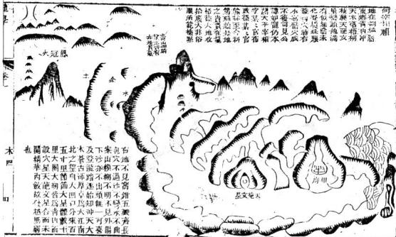

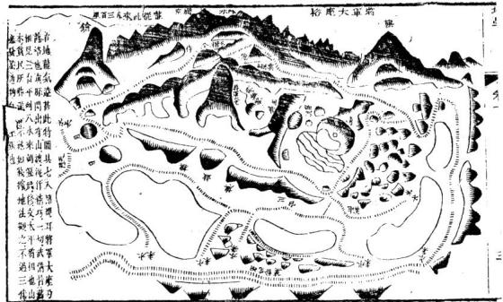

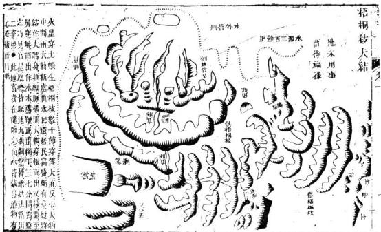

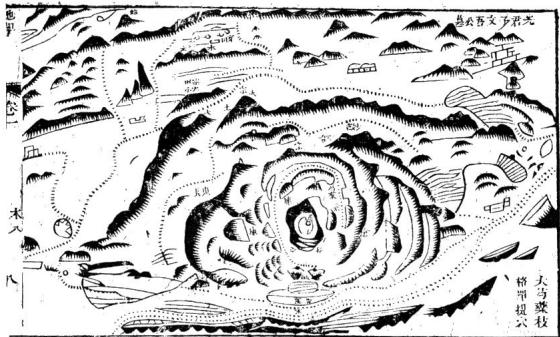

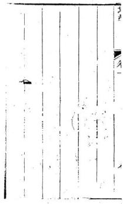

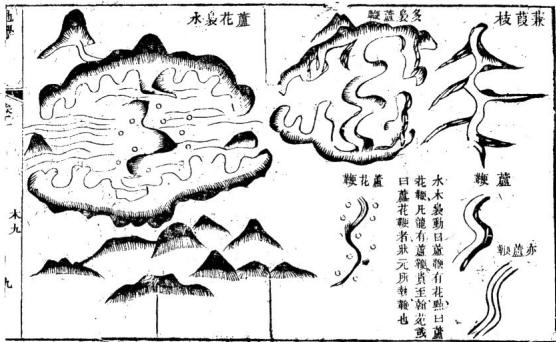

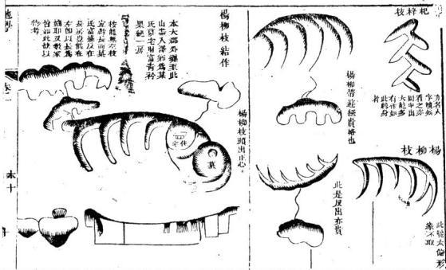

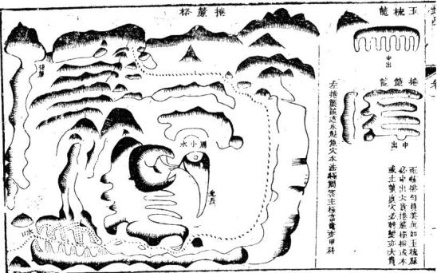

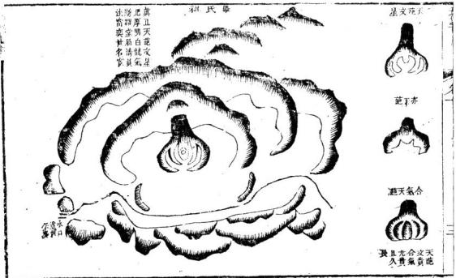

右劉唐二通皆梅花龍皆發則元皆世科第對祖舍衆花非獨秀之苗唐祖以梅花爲龍別葬飛奪之穴張葬簇花之中亦累世科第又句曲方山茅山皆有梅花龍李氏舍花非田狀元拜相曹氏非花中出衞史家世甚聲數里有魯肅墓葬花中穴情甚美親子孫居墓所世乏章縫孔氏葬花中子孫千餘富盛無利第蓋曹魯孔氏梅花四佈皆作李氏秀氣也我行四方所見梅花多有或作龍或作穴或作用神僧氣不一又有木袍星墩巾球撒珠似梅花而非凡止龍正穴尋廉看局須符真傳雨正結附結帶結欲站有乎精碧梅花巽貴未可慕名雨雲年之此在謂皆茶又不低均花也

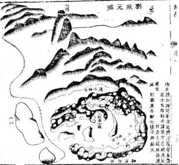

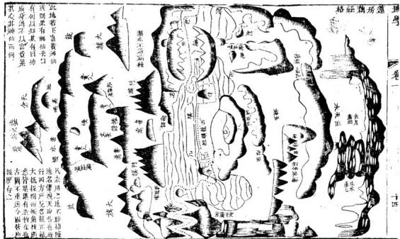

木本直也備放異矣必有起有止背區員正公小王方謂之謝尺一名一字文星第一貴也作者義全徐水口皆貴十字丁字人宇工字王字及橫飛王罪尺 等恪皆從一字生出詳龍格中外有樸句根撫秋屈 袋格討沙法中

玉尺立放卽爲玉鞭天一條矣亦忍有起 王方謂之王撫凶龍 爲水口皆貴如售六必不應樂區取以有 絲征段鞭马骤牛鞭芦鞭范拟竹竿竹管

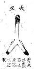

衣尺糠曲又皆器木也而世間器用何限或平而爲案方而爲臺曲而爲儿尖而爲筆爲槍莫非木也其間雅俗吉四之用致有天淵之殊而圍不盡象書不盡言明者胸中自有活法因方命式隨體喝形無不可也

右枯者末之生氣自絕或立而枯或眠行而枯何以知其枯也形體削瘦皮為乾焦有目者或知其枯也朽必倒木生意內終故腐爛也凡木孤立孤行無水土以養之風功氣散故枯穿金倒地水土沮洳不工巧自然朽矣枯朽同爲無用被有二或天破或人破天破生成頭裂胸穿人破則發土取石傷重不完也立木眠木皆有之析木則破而離故木有一天散小木不中材用人散財析之餘也漂者水盛木孤倒木順水固漂卽立木水浸亦漂或真木或山阜之水形與木爭勝負水勝則木漂矣者木遭火焚塵則焚餘也凡先木後火爲發火木先火後木爲助火木自火而言則火盛自木而言則木燒故火中之本最爲無用木火皆兼立眠亦爭勝負若木盛而間出些須少火則助木之秀發木之榮不作焚燼之論自曜氣下皆木餘之為用者謂後卷按地理論五行五行先木以木居生氣之初也夫猶是一氣也在天則爲元於時則爲春於五德則爲仁於七情則爲喜面在地成形形中蘊理理中測氣故日地理及曰葬乘生氣夫理則皆備矣氣則有生有旺有收有藏生則其木也旺則其火也收則金而載則水與土也而所乘者止言生氣元氣貫四輔仁中備五德且葬者歸帳復命之事帥氣旺收藏總以乘此之一元之生氣惟冰得生氣最先故言地者先言木理固然也惟木生幹備枝山川關大地亦論幹論後此如大惟木自句芒發達由一備二節以至千尋兩山阜始終亦論節數此如木惟木校核地中本之道生至於成實仍還本體而地理山同是何出每到底還其故相此如木惟木合根株幹枝杪未以一體山胃亦谷初中老盡以成一局此如水惟末有自根達末紋理周旋穴內暈紋亦周旋垂複此如來歉言地者先言木妙木則山也僅情唐過牛矣至于

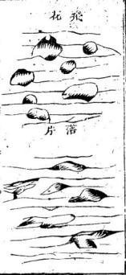

火形 娟天之火本陽精造化動南萬物形所以常爲萬山 問禮尋宗如至此穿雲薄霧摘天星山尅鳳自日現 虎豹只是常畜生雲關四頭可千里尋常峰嶺是見孫 分枝擘脉百十道必有一條是正身龍樓鳳閣與寶殿 不過彷彿重疊形若令火星自開悞鋸齒耕雲驚殺人 雛冠龍熖蓮花瓣刻炬燒天天欲焚有時烈火化爲旗 天作祖好根基諸旗自歸妙法裏必有將軍始用之 門旗走旗與捷報戰旗降棟與賊旗能收能用皆僞福 太阿自攬莫孤疑有時獨火作人形一貴當關羣小驚 近嫌破碎遠成武不妨極遠貼天青若起本身爲太祖 最空過木更興營有時飛火作禽形為冠距將喙尖生 超藉毛羽爽差出破石碎烟皆炎精或銜舟龍從天下 或作高岡梧鳳鳴或去臨田探水物又或蠶浮波心 諸禽多爲朝應用南方朱鳥合天星丹唇雄難與仙禮 亦作龍格成穴形穴暱通身發福快僥俸速退全案門 若加沙水別凶煞呂霍書貴無誇矜有時秀火出爲筆 只恐槎枒多費力請華自歸沙法裏木華金筆要剖所 行火卽頓卽旗星亦山洽山別有名牽連明滅遙相望 炎精骨氣走達巡看他穿落如何變成盡火氣别成形 五星惟火不結穴我行天下驗之靈却有燈花剪熖格 照天蠟燭亦聞名暗火開紅取暖氣只取其氣不規形 金頭火驅空開水木顛火腳朱遭焚土頭火腳成丹竈 地琴 卷一 火一 1

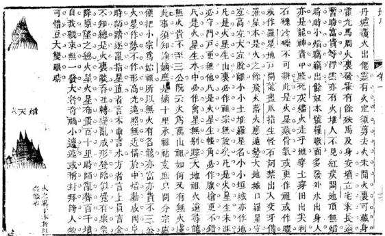

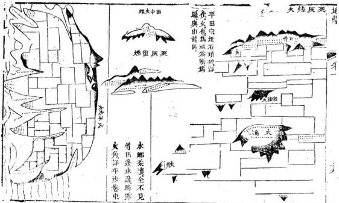

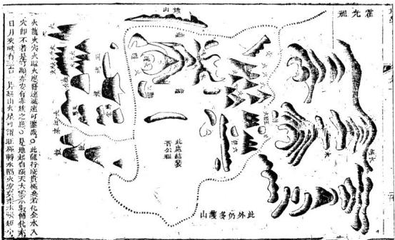

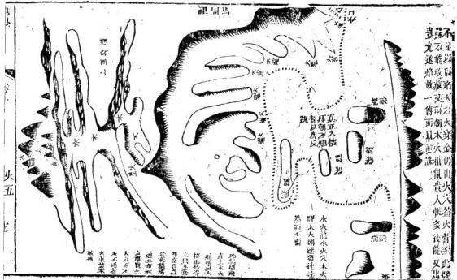

FT 卷一 干1 按火爲萬山之祖老火必不作穴少火間亦有成然 發而不永故知地者不用也若山農耕鑒居作於此 卽不得不埋葬然有田地卽有低平低者卽是水 平者卽是上也有士隔火有水制火故亦可宅可功 然終是自遮自掩故山人百世居山不作長安之夢 者拂理域之也其有大豪傑自山間來者必所居之 地不在火中木水土金皆有飛結獨火不然若怪峰 洞廢火中閒局仙翁釋子踞而宅之幽賞則有之矣 無識野師詫爲奇貨謙主人經營之及扦葬後萬無 一發休人則曰是某神爲祟某鬼作災而不知非也 凡此等處原是孤神寡宿只合作異端香火之地非 可非骨居人卽令當年全未開鑿並無刹宇我好得 而好遷之亦無發理吾故表而出之以告當世之故 慕神宇僧房費力營求及葬而不發又或收絕以歸 咎于神靈鬼物而不自知其誤者

生形土形不離端平方篤實博厚合歸藏正方玉屏及玉卷方面墮所爲天倉玉屏大貴不當得正非公轉封侯王角出亦須爲輔弼但不正拜副其傷天倉大者富敵國常平余廩足衣糧方而高者爲金匱者乃號爲金稱金櫃守藏天府吏金箱妃后近君王金印正方浮水而正官掌印緣文章又卑乃是恭盤土極薄展紙多輕揚恭盤展紙亦文物神他神童相應接别有鋪氊展席名或作平龍或愛穴龍有厚力能義延穴生餘氣鋪平間土開連屏便成帳連倉連庫俱橫放連城常據百十里小屏小帳盈一望當生太祖大火下轉龍頓舍成序臨凡饑都取穿心出十字穿心真好相一个衆心真未赤大地當穿三五帳高阜平帥相間生或穿平洋走順蕩下字人字巧轉身到頭大結無人葬个个尋龍走帳角但繹都作蓋撞大地龍神日夜守不許勢豪橫掘強土峙高壁名展誥小有峰巒生兩此是宦成膽國封不然道高召承部飛詔亦方同展紙脫離高山帶飛勢爲官高節特永恩不然學道天書至赦交畧與詔相同亦方亦動亦臨風稜角稍員兼水意人在天思雨露中後龍展誥卽天橋天橋長風地方高橫行直出尋中路到底橫落生賢豪更有龜蛇他湘應功名股展學王喬莫言是土便成方穀堆土堆變無常麥天委地或塌地如瓜如瓠如城猶橫行鋪排少脫部直行平隔逼一方一邊壁立成山勢一邊平田荒嶺閒或是而邊勻稱走1.22

刊似木似水却鐘張有時出伽多坑坎有時枯燥多面身龍膈帳角混綿長愈變魚魄無結作冷落鄉村州舍莊有時土變作獸形爲牛爲象如生成爲馬爲獅爲略蹤異獸蔓延長百等卑濁補應小龍黽蝙蝠蚝蟲亦七星爲龍爲穴爲帳角又或填空守水城看他收拾清漏氣貴賤原不因名稱有時士變作人形神童老翁隨喝成雖然擾小喜員淨及喜渾厚藏精神此是山川澤裏秀定出棄儀弗常人得君行道後嘗考一世功獸而世名若通上絕餘骸骨浮屍流棺形出沒或作停棺荒塚樣峨龍顏垣與敗屋碑履朽衣棄水邊小家遷葬空碌礙絕處逢生忽發場浮線泛牛水莊莊巨筏居停繫小挺樓船一座水中央四民揭騰無昬暮萬寶絡繹由經商小作州縣大侯王

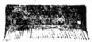

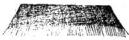

渡氢祖中聚溪平滴地 居故五状土瓮田山在 此尤里元所無申梅句 亦请有得為所畧花容 只顺鲁大可见起下縣 財其書方借背高田曹 鹿托蕊山丝後地不村 盛山骨玉托眠见大 乃古屏大饲體踪方 孔地正有太跳山 氏李急山池陰穿下 墓氏故作塘换付脉 宅處拜後塘光莊委 先平相樂中下微折 聖中前是有穴作二 南翎同地堆百银十 從鍾有梅阜前鐘像 宋四曹花保一叉里 高山御龍零同失平 南秀史故地横踪

自奸骏堰按是破质我儿李湖赤取墓氏來山方前世惟之具流貴融迁欲水儿天乃其来水数家关去人李姓觀造明氏農必化堂不田加大寒祺其地科法台计作季神有靠故氏嫁安之貴不有措年题得佳者亦至面地造碑分亦作验也字不矣  
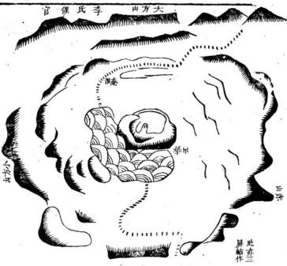  
早遷地线外之本南数老師田一方赤省年太顺四山山山有茅希爾山孤也也三山葬山開立亦亦方起此稱翠赤山名山蛟课此亦湖居小一月日地自迹平方在破山催不之野山茅水也官孤來中一山人法必也踪四在後明水入文不望青大堂也相定明青龍方支达大公然山山山定水翁已泰普前也遂到信發准在恤一入明之元北五前在相空自官通六省胡封典大南十所燕侯化部聯里見下

氏城U水土地一宅元 之城四長帳徙山莲末 长中山拖楼雲此姓有 者結图右岗半其丁丁 公作碧替千發最源孟 亦题存军徐祖者明章 善多如提單三恭地者 爲天作又夫葬理本 諱以府穴開中父自江 也此疆唱土矮公卜州 乌不象帳木卒葬義 稱專形角頭附父門 首乌水出土葬葬隙 他此滤庫脚诗氏 家菠元金穿 菲 端亦武转水 萨可十横穿 妻葬 亂江 無借径土金 长北 如作里递大 子赞 丁鞋出内開 备  

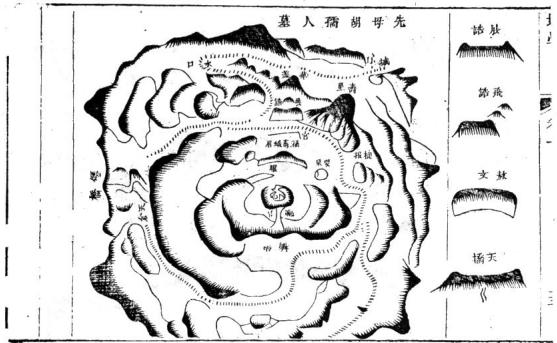

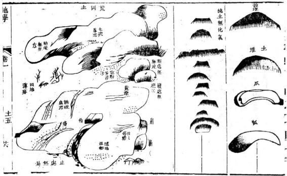

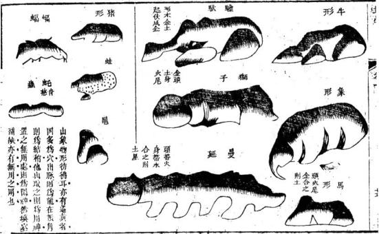

純土無造化怯所不用然生民衆矣安得皆台出惟土星平穆得土得局可係人財故居民千萬不患無葬所者以大地本多土也然亦須索泉脉觀土色 4夫察泉自有脊氣褶水可憑惟土色根難定亦有局勢完好而生色疏熙未葬之常敗此事土人自知之尺地多無名沙石訊咖縣滑冬乾夏涅者皆敗氣不可用若掘得黃紅淨土又得局者乃可葬右視土之說爲編戶掩埋言也若真龍大結目有不易之穴不以土色爲憑詳後卷

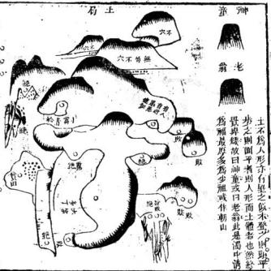

或問天下池上無非土者如向山阜又有土星與金木水火並列曰于不聞五行之中又有五行乎金有五金金銀銅鐵錫木有五木榆柳棗杏桑柘槐檀柞楢水有五水碧紫白黑黃火之特變亦成五色大地湧起山阜具有五形固宜然則大地積漸而成耶抑開闢自然耶曰且問子之一身精漸耶 自然耶五官百體何多異樣予謂官骸雖自渾成而血脉必有條理大地亦然大地固是開關渾成然山川條理并然自別就中分出五行論其生尅雖形家之說亦道理自然卜氏曰休言是木是金動中取穴楊公日觀星裁穴始爲真不論星辰是虛誑予謂楊公之說甚正卜氏聊爲俗人言之地理生尅與他術又不同龍有穿出復生連氣必化相傷相救相用之異穴有依母依子破母尅息之異沙有刧山官山福山賊山之異皆認星辰各有宜忌卽如土生于火火盛則土燥土能生金土重則埋金水爲土殺亦爲土官水土常合爲一而有主客水土互相防制而論勝負若曰無非土是惡知土能福土土能病土耶不學者所見無非山阜學而後知山不虛生阜不亂長愈學而知不足始勢不通天地人不足爲儒然則拘儒爲一切之論曰大地無非土謂非不格物之過耶

金形金形不過員而巳獻天之金出雲裏其下必以土爲基或坐雲水亦同理連金高勢成天馬或作馬鞍雨頭起連三濟美號三台若更連氣仰成水所以金星不開帳滚滚直行反多矣金星連連防不化不受火煉不生水如此連金實汪然大龍轉身作鬼尾金星帶土脊穹隆連生多腳爲輾蚣緣有化氣亦作穴無腳黍蝠是痴龍金形相猛常爲虎爲獅畢竟兼水土無威端的卽爲猫更微局促斯減鼠凡是頭金出鐘裏得火方可成精美凡是剛金不開肩得水方可生見于中等金形號坐金爲龍作穴多此星高爲金鐘巾玉釜低者亦名塌地金或爲銅鑼與養備日月星辰隨喝形正貞方是太陽體半圓乃號爲太陰細秀眞作蛾眉樣前必有幌副其形有光有魄方爲月無魄只是玉璜真星堆或金又或冰須看大體出何神金星定靜無行理地理却有流山金如金鼓鑄潑向地渾身是水頭員生馬蹄法馬與銀錠圭刀貝古有名此等皆從流金出別有烏頭傳子形金頭破碎卽帶火開水取水半由我金能生水園其宜水亦生金人罕知止緣精金沙裏出固須沟汰水爲資金星怕火要火制金不見火不成器金論生熟火文武生金遇範成鐘釜熟金淬礪工細瑣變成刀劍形似火金變爲瓊亦爲珠看他來路是何如如環或是天虹上如珠或是水之餘各認祖宗看變化莫設喝形空躊顯金星出骨亦排牙為刀爲戰爲矛金星本性屬威武金一

此泥應龍也地在水邊侯水黑其南切近多山山 無繁研中有一寫勢者曾出甲科官有名望然而無郭不爲此故羅用

局盲者数此按下宗观 大也必條穴强水讯人形： 龍又明生何形连迦丁也 分此随氣故不乾相數金 結地可阻不過人傳百是 借龍以範彷期以顛員 局作鸟不正德大乌富于 法下高四 多命今喬而其後子雨 渝佳俗中侧驗遷铺書替 者雨师赛取如起坏人低 不等循是一此面作蟹 可是觀銅壁形盛国名穴 献切镜题因穴如初多於 沉已富故星之初族有左 也用中遷頭改人穴攀 牌不左横采 私所以 徐已擘生 费陵右 苦真下右窄簪 借青穴脉之上穴按金不離員鑑有高員平員仰面貞覆手員以至缺金側金員而多變尤有流山金似水似土刀劍金似木似火楊公有武曲破軍輔星等名廖公有太陽太陰天罡等各仍多未盡故分別言之且夫星珠企也然有火星墜珠水星流珠之異圈金金也然有圈木圗土國水之異至于水物則金之悅離者也必起禮必開帳過水必有送迎作穴必有照不曠蕩孤立于泥中水中然後謂之真結作也語日十墩九孤不可不察天下山岡金星常多而剛金不化必不作穴金星孤立常作絕穴孝子妥親必求月後子不敢不所寧也

水形隨方就員任平拖有時高起侵天勢無範無圍水怎立 00水高便作上天雲祥雲彩雲浮雲氣此是水生最高體漲天之水還其次漲天是說洪荒初未排未決水漫遠形大勢無收煞到底塌地落平畬就此便分諸帳體雲毋水品異稱呼九腑芙蓉世所尊七腦五腦亦佳名三腦三台與華水頭曲動異他星凡言帳腦奇數却有偶數四八六奇數定然取中出偶數如何不偏促偶數有訣君未明透空出麻妙如神尋常思慮不及此龍行說道亦如人出人多智能聰俊難責忠良正直心爲官百計成巧宦亦是山川性結成雙腦是金亦是水脉從四出性非詭邊頂取中收雙氣古格忠實常出此有時坐水正成形有弧有肩全似人便作貴人被袍格古術號爲金水星此星至貴易結墻或出紫氣或就身就身依母出子明龍正格秀氣併生忠生孝生賢輔脯有芳名謝地靈金水搖蹈爲華蓋降勢飛鵞看翼翅華飛舊俱秀星得此方可言科第飛意降勢成不字五星名有支分勢看他龍格如何變難執水星論一例飛蠶一格變諸禽或爲僊鶴鳴于陰或作金鵞浴水面或作御河趁水解或爲孤雁還北雍或作羣雁度關形諸禽翅靜常帶火身肥體員不離金錐鷺專肥還帶士畢頭眉金水真有冠有味從火論兼形取用要調停諸般會形說不盡應樂眞時在取名華一格變鹿帖水

篇明秀麗居清要方山大格出使相模糊老儒官學校箬笠蓑衣務本農臺笠荷衣錫師號錢鐵遊僧爛面巫銅鼓兵樓制蠻道有時眠地水不動置頓方員隨器用如何知他是水體畢竟邊備常作弄不動還動生波折錦被錦袍任橫縱霞幀霓裳繁華夢鶉結牛衣寒苦其激紋員美便成花極盛芙蓉生水涯凡花根本出于木花形却屬水精華不信但看燕花靈一團香水更無他花形多端說不盡各認枝葉推根芽諸葉亦多水所爲荷葉團團水可裁苔芡渾員真水相藏藥細碎傍山四如有尖棱方帶火性柔水重火還廚有傾水自高來九天飛帛亦奇哉有腳爲旛無廊帛窄狹便爲仙帶裁飛帛旛帶不時用出世入世常兩倩文章華辯鸞四座避世金馬緣奇才無他秀氣好異仙宮佛宇相徘徊仙帶更細爲繩素又細絲線水住脚過龍巧妙生變化 06金蛇藕絲聯且脫蛛縣馬跡總奇蹤高魁大元名結作沙法遇之反見惡自經溝清人東縛蹤運變化又生足便是真龍嘉屈曲真龍應樂雷電珠霖兩能作茶生禮無足活動却爲蚱是蛇端的有蟻鳅鱔蚯蚓皆無川不堪侍從作開沙諸蟲亦多水所變蜒蚌蛤與螺州負介是金委曲水出內吐涎水彌漫蚌能匝珠珠水精流作員形或飛濫蟲形多端說不盡應樂真時任所喚諸獸眼形亦是水貞頭員身又員塵含員成曲水形血没骨側腦穴奇說爲獅爲虎爲大豕或爲兕牛與獨身待龍開頓作侍衛柔中時時生曉稱諸國多篇說不書喝形只取名之美又有一種水分飛兩腳如麻細且微或是真水或山腳擺布披潼成絲繞爲龍亦同生木理作穴破碎却不宜爲就能耿蛟龍穴還喜雲頭遮蔽之又有一種千絲墜細細垂絲下有贅頂平贅齊爲冕旒朝廟威儀大顯貴垂絲中間更串珠三五七珠士大夫九旒巳上不許用鬼神遮禁眼中無地理忠臣孝子事 只談忠孝更無餘貫珠撤珠多是水水泡滿山何纍巢 o或從頂下垂纓絡或當腰藤結環佩纓絡環佩妃后尊丈夫亦作朝天瑞水泡不應無故生其山定是水行地行地之水若江河闊漫平鋪莫制他木欄土防方入用依母依子看如何依母撞金取實際依子取木尋枝柯果是木根穿水出發苗抽幹生氣多若是順生初見木還用土培無差訛隄防關水木生旺開花作實喜陽和水邊木孤衣漂汎孟浪取用欠切磋又有水土成溫如地涵濕蒸陰氣伏士疏沙硬是死山掘下定有黃泉路假形價穴空藥觀定無脉線作穿渡冷石麻箍多縫裂不書熟曉遠不住張山食水暫時發斷不久長勿自誤水帳亦推蓋天旗隨風擺動拂雲低火旗水旗或對出門旗大旗相紛振戰旗降旗與捷報是火是水各分歧蕭福亦無太分別形穴生尅須知之水星大轉成天虹一頭飲水一頭峯又或兩頭都著水此是隴格非火凶穴在虹腰作穿落最喜山澗草青慈若是通山赤紅土太貴守然有大凶功臣國始梗圃法一跌赤族像何窮水星絕氣或成屍土木浮棺都作泥游魚躍水惟金經411 水二三

亦宁歸熟合地 上明坦表棄在 人故呈本物中 不水相朽晴由 精部士矣無中 人世各此资于 意费三有姑弱 豈者四森置能 其十分 里非越此 自当非可二不 水有出巨强十勝 名课末年心 德不重寅 人大見按往 不實所乱则之 知得坐本青土 即此盖五塚人 者木星以  

水也者氣而形形而氣者也高者爲雲霧開者爲湖海流者爲江河小則爲溪澗又小爲消讀浮者爲淵潭小則爲池塘又小爲窟澤動則爲鼓濤靜而爲綺穀及其至靜也則如拭如鏡散而經經波而點點挹彼注此器方則方器員則員器曲直時山直割之無所苦分之莫舊怨合之莫爲德故水形之變不可勝窮其爲祥雲爲彩雲爲漲天水爲水土連為虹霞爲仙橋爲流行水爲鋪地水爲鼓爲袍爲帛爲帶爲繩索爲絲線爲藤蘿爲花爲蔑爲珠爲星又或爲龍爲蛇爲禽為獸爲蟲爲魚各何多也靜言思之莫非至理時師無此學識不耐細煩欲一槩劃之吾以爲內莽滅裂也或問但是山周可葬而葬何川設名之多荅曰正為不知形像都無是處古語有之山川若能語葬師色如土藏腑若能語醫師食無所吾欲持此以贈時師云

1→71 一水二火三木四金五土此是先天生數 木生火火生土土生金金生水水又生木此是後天生 理東木西金南火北水中土此是五行本方 先天木陽火陰水陽金陰土陽後天木火陽金木陰 土陰陽之間木文金武火祿木秀土富皆美名 木蠢土愚金頑水蕩火凶皆惡名

大一生水地六成之地二生火天七成之天三生木地八成之地四生金天九成之天五生土地十成之此是河圖生成之數

承接多用後天如木下生火大下生士之類 地理連數多用先天火 星或或八六合八六 七 八爲 十

有如二火作祖七火開帳作一憩五土列屏十土連城作一憩四金走馬九金拋梭作一憩一木爲宗六木芙蓉作一憩三木品字八木頓笏作一憩此下或作五星歸垣或結三垣之局必是聖賢居葬之地目中未見姑言其理圗丁左 火二

有如純木或連三八必不作穴卽令作穴出人必蠢勉強學問迂腐無成何也純木無化氣也

又如土或連五十必不作穴卽令作穴出人必愚止堪務農濁富則有何也純土無化氣也

又如純金或連四九必不作穴卽令作穴出人必頑堪教誨或作軍賊何也純金無化氣也

統水不結地水性蕩軟生氣無主那能福人勉強穴之 出人游蕩終主絕祀

# (cC(o)

純火不結地火性燥烈物入皆消何可居勢勉強穴之立見凶敗遭瘟發火陷獄被兵族滅之道也

謹按五行無不生化者其純而不化者非龍也必帳角城牆又或鬼尾殆一往而窮俗人逞城帳踏去以之爲龍及至窮盡不成形穴乃裁割剛培妄云法葬此等育師往往人於紀其木土二宿雖不遽絕亦無出貴生賢之望乃其初下時誇封說拜彼實大妄主人又妄聽之可憐也

凡真龍行度必備五行連珠順生乃是正理然山川多 異不盡如此不得已而求其次亦必四星三星相間而 出其不全者以外纏外陽補足之然後賢達富貴可得 地學卷一 五行三五三

而言也 有如木星起祖木宜生穴却不生火而見水帳是爲滋 木之水穿過此水前又出木或立或又不生火而開 十屏是爲培木之土此木得水以滋之土以培之大旺 矣前去必開好枝葉作木華之穴又或穿華而過更作 木果之穴此木生氣內充華實董茂生賢出貴可以决 矣面猶或不貴者以少火尾也必前朝外陽不拘偏正 或見獨秀之火又或列炬之火以發木秀以溫木氣則 貴無疑矣

又如木星水滋土培前行正旺却當路遇一金星則此木受伐不生枝葉莫求花實但看成器成器必逢人有貴人現則木器可成

地在縣西七里梧相木穿土出蘆鞭穿水出行生木又穿土屏行度頗佳乃屏角穿金木被金伐不復生枝葉倒地數十丈更無委蛇成鞭形有垂絲帶和鈴喝王縣鞭小孤山貴人正朝經曰玉鞭絲線定逢人格亦合矣奈不成局元神斜傾兩沙不抱堂口不闕葬後數萬金灰敗五坊四絕一股僅延凡鍾此山者76 五行四 五

性皆蠢直衣食艱難及銘之身六世而極猶爲墳地 與敵家構訟數十年皆此龍穴之餘殃也古經云息 星尅母子榮昌母尅息星子滅亡是地木星作穴直 上逢金母尅息星所以五房四絕非有他古卽一房 亦危經又曰木得金來器用成是地玉鞭器成奈鞭 形太祖故所鍾蠢直無局故敗水去故貧至于損丁 終是木輕金重初非得木氣人文鼎盛二三代穿金 敗矣葬此者瓊祖也寵祖所葬又非地元神斜蕩與 此畧同後人重困棟祖幸得小局祖父母父母及妻 鎬自卜葬雖稍獲吉然無近功鎬老博一第未能救 窮集茹茶不堪眉列因談行木穿金之格一思及 此稍具圖說使于孫知之凡爲人子者卜地葬親不 可不慎也

又凡地法第一看龍第二看局此地之害在於無局然逆推龍法遠來雖好奈入首闊過脉散無峽不言龍真元别有走作此實補空閑神枉復喝形論局木火相得謂之木火通明然火前木謂之發火木火下木謂之益火木皆於火有益於木無功凡木穿金未甚猶有萌蘖之生穿火即成煨燼無復生棱矣如列木峰頭立石火曜斯爲秀氣木吐火華不爲大害若火重木輕即爲炬火不復言木矣似本行陰道無火亦不疑或 C後有火城去木稍遺或左右帳角火作旗餘或前山外陽火爲貴秀此則木星所喜也

凡木穿金倒地邇土重則朽水勝則漂火勝則焚重金則碎如龍長來歷好不合便休必與脉閃去故出此截路之金以止傷洩之氣人自走行錯路非此龍有初鮮終也

凡龍皆惡順水而木星尤甚若順江河流水走邊而生推極文秀終主流落無成

是地分自荒岡一往田塊高低間成山阜木穿水土小帳亦頗合格奈龍內順溪流外順湖流雖橫面結作各沙又順一重索外蒼茫萬頃出一秀上拮掘數于金空子不育繼一子敗其樂流蕩不陪

抄此木輕水重木爲水漂故其應如 武又凡地一重龍虎重閔外更無 所有最爲不空如龍穴秀美亦有發 貴者祖寢無大成且子孫不蕃

金龍生水水亦生金金水相謂之金白木清太貴秀且潔清無他間星又恐金寒水冷寒冷卽不發矣間土星固能止水然土性可寒可暖金水重併土亦寒之問以木星則溫矣然木亦畏寒必間火星然後發越奈金水中斷無出火之理或後障或外陽或左纏右護但頤望得火峯卽陽回氣轉生賢發貴矣此亦景測陰陽若在山陽卽純金水亦自和暖若在山陰必問間兒又看坐穴陰陽寒展以消息之山南水北爲陽山北木南爲陰此論喬嶽大川以作分別

窮可错下外為地知地 也见取走金此木踩在 能穴但水步老人吾 不劈陈穴盐龍丁邑 必密藏左至初之赤 甚小望蕩穴出盛城 長笔之軟不帐為版 局員辩穴及策邑名 不美如在四首胡 必特游里之稱氏 甚朝能而數開衣老 大端入局其開貢林 但正穴在位一之出 合每一田可関多一 造金峡田十坛難布 化水十局二卽以政 即得分之三悉二 受信氣处始城裳卿 用火足沙終不按科 無城石皆不專是七  

大堆水土合爲一丸故水常帶土土常帶水若以水爲 主純水汪洋必賴土以防之水大且能潰土又倡木以 滿之木攔土防更借火秀卽貴無疑矣若以土爲主土 弱卽不喜水恐成沮洳土無用水亦無用矣多是開岡 昔居人必貧葬骨必賤故士寒須火以暖之土燥須 水以絹之土重須木以疏之而金則土子土常穴金也 火爲萬福之主凡大聖大賢大封大拜無不自火星 者但勢雄性烈萬物入火皆鋪故遠則借其近則被 其烈大火星布置一二百里者所出之龍必十數百里 或千里然後結作如作外陽亦必隔房隔帳四五車然 後應穴龍有始祖朝亦有始祖龍之始禮不可見朝 之始祖反可見也卽舞常無焰之火聞墻之火特秀之 火亦必離一舍之地方可作穴若近在于里內外者必 龍行委曲穿過水土隔斷火氣不然卽非眞結矣舊云 燈火結花穴燭火結窩穴丹竈火結金丹穴理或有之 未嘗見也至于大火之中紅旗令字穴頗見時師妄爲 人作誤人凶絕戒之可矣

其金頭火腳火角流金暗火開新皆前火作川仍以他星爲主而所稱之火乃是火昭火骨非眞正炎炎之火又當別論矣

火凹火陰常有倫結坐穴安羣火皆藏亦有發一代科甲者然終不久且有他凶

驚巨湖當前士屏北門木口交織重重雲山蔡幹如垂密室中異美地也主大專子穴泥水相將自非哲士誰旅下穴泥中1 五 行 九

曰先天一二三四五生出水火木金土後天相生論源季順佈木火立金水五行純體應先天聯珠乃用後天理聚講五位名歸垣有時一峯成合體東看似木西似金南看是火北似水西南却及開平面又或頂上平如底五方必有正而踏面尋去乘其止又或兼四或兼三或兼兩體分背趾兼星但看出面處其間生尅易爲理有如金星又兼水便接木星亦無忌又如火星又兼十便接金星亦可矣其餘都照此例君天下山岡反多此金行順生是常理却有穿落變綱紀有如木星往前去不生火來直穿水大開水帳又出木逢生滋長木蕃蘊水大木小怕漂蕩却又穿土反尅水穿土前邊又出衣水生土培旺無此或不正穿只傷照併力生護亦同理此是生木不穿金但看開花與結實凡北是水實是金雖然是金性還水定生服體多枝蔓亂葉細節斷還起局中必有一穴尊于山萬水環抱裏或直臨水取外陽切身必賴親侍衛一重案山不可少此外取拾幾百里隔江隔湖非批換大開大合常如此若還連水無其數木逢金伐木始住穿金更不生枝葉倒地便論成器木器用百般隨時宜成得器用合尺度或看相難山自生天地初分巳有形器用都是後世作如何天地反從人此中有說君未諳聖人作事不等開制器尚象君聞否車軫象地象天雙輸輾地象日月水有舟橫集天船或遷或現難提摸有時蘇水陰洲渚嗜嘈雜雜甚平常古仙作穴當其處大封大拜人不解誰知大物必穴士土之常理固生金却有屏下出貴人貴人是木本尅土土爲大母不生嗔破胎生出諸殷貴前去穿落備五行到底作金作水穴兼覆重載土成尊

<table><tr><td>木火通明格可喜木遭火焚難用矣木大火小發水 火頭畧現便須止過火出木木更歲長夏繁陰木可 九花是木亦是火看他花璣尖員理員者是水尖是火 火曜倒地成花體此火肆出不焚木大貴威臂人莫凡 木小火大木發火此是柴薪非花桑穿火使無生木理 生土生金無不可此龍須看長遠行三五節中難結果 仍須分散多丘壑前却總縊右復左山多子孫人蕃 遠計審此方停安有如金星特地起生出子孫皆是水 水又傳木是順生不然定有土止水土變員形金復生 曹孫省祖常道理金行數節又開水水又生金金轉美 金小怕浣大方好大者將軍坐根裏將軍必有牘與鐘 前朝傍護木火起火星原是金之官金寒得大貞奇位 英雄兼備文武才相君定國天錢社金星頒者必穿火 穿火出金無不可再穿再出三五轉太丹火鍊成因果 遇士籠之爲鐘釜水淬變作刀動火凡成器用必逢人 上師亦是貴人星或出木身或左右或現前沙亦可憑 金不遇貴終不發牛田商賈俗經營間出英才好武勇 大志大言無戶成金星穿火流爲珠恐是餘氣爭斯須 若敎四望無收拾不須踏逐費工夫金徵土重金被埋 得木疏通出光鄉金少木多金反缺去金用木看裁培 金星不盡結金果穴土穴木無定規先賢所言桃李種 只從木種論元徵金清水白人高尚金寒水冷播寡相 清白固是論秀氣秀潔太過不興旺所以大龍帶零碎</td></tr></table>

<table><tr><td>TT 金有水子不怕火水護金母自停當水冷喜火溫 借火之氣遙相望若教鈕孫皆金水蟠踞一方數十里 華蓋飛愁到處生却行陰遁多寒氣結穴猥藏用神到 逆水食水速發理然而遲遲不肯發只因寒冷魂不喜 太祖外陽必求火或是火城作包裏樹木陰森須滋去 a 要向陽明莫藏槃大道車馬日浪行四顧人類陪作我 金水龍穴不覺寒發福發貴好因果 n0 0  有如水似垂天雲却不生木反生金水中沙裏滿金子 金星又小龍不成畢竟一變開土帳連屏連城無數皆 去水用金怕零碎精金貞美歲光瑩前朝仍要木火現 陰陽輻輳合天星此是賢者大墓宅定出碩輔名公卿 水中生火不爲奇龍雷當有火湘隨太海中問常見火 地理多用後天法還仗木神輔相之水火相傷亦相用 謙中互吹坎中離中男中女同父母及成峯室各分號 此是分龍大關簡水火並峙不須疑水星漫漫用士制 水大土小還陽清脈木爛之水止定徐看生金生木勢 水帳重重橫土起傳出生木國其理水帳重重徑生木 須要木盛成林麓水火木金各得方水徑生土却無舫 尊星不論形六小賢者出義堂中史 有如土星起作輒行去中間當見土莫說土星不爲鄭</td></tr></table>

火生工旺是大格火炎土燥不生物土燥變成灰與沙枯岸斷厠乾矢撅偏行側走開水帳侵天便把火氣隔火重水輕水仍乾仍看前去凡幾節要變老相生光員重開帳慢再起跌有變有化方爲龍脫老出嫩方作穴張惟老山葬老山只尋山人商古德有心去看長安花周道如何備拔涉

開帳者龍行之大格如貴人之出必有供帳所以重咸尊體也其格火曰蓮花帳曰鋸菌排雲日鳳冠口難冠日龍

土則爲屏列屏亦爲帳連城亦爲帳

水上相仆日水土連雲 070 00惟金無帳連金卽成水其雲母芙蓉等帳當中一位星頭論正者卽金也格俱巳見

北懷先論橫飛橫飛者在隴蜀一展萬里此至大不可言其次或展千里或展百里或數十里小者數里以至一望之地雖小大不同亦各成其爲帳

次則兩角向前一重再重有漸收之勢卽如一重雲母 帳再重九臘美蓉三重七臘四重五厲五重三台華 六董飛鸞卽將結穴矣格側巳見

凡帳須論結梢一開兩翅雖撐踏濶遠甚爲有力及到 角上若不成形不著力頓住只如此唯殺了帳亦不甚 貴故必視結梢或左旗右鼓或左旗右槍或左天倉右 地庫大者或左右更成龍樓鳳開之形或作飛鳳麒麟 青獅白象方爲有結梢其穿帳中行者貴可知矣 凡帳必離祖宗另出或先設帳幔而大星體出其下如 帳內將軍帳裏美人出帳貴入是也亦有就身開帳者 如鳳展兩翅及蓋天旗者是

出脉者祖下宗下屏帳下龍節星頭下皆有出脉處其格以正而中出爲第一然則執正求中可盡尋龍之法乎日未也夫天地多奇山川好地理尤不厭奇隔有絕大星辰不作正面者偏有中出是假奇出是真者天地之道固不離中然中無定體隨時處中執中無權刃身莫故星有正面猶恐所見者非面出不離中猶非中於是脈有中出有奇出非好奇也奇文大可必是乃可不如是不可也今明明見祖宗拔起龍樓鳳閣開帳翅中下一脉豈非中乎乃行不一二節忽然斷絕左顧右賢逼窄傾斜頑濁不化此是何故日假出也昧者執中強作老椿不絕卽敗哲師審之或於肩於角尋得一脈先渾後明逶迤精巧降崖踏還頭審視始知所見之中非中也此乃至中彼實虛堂假座傀儡形誤耳誤耳循此暗去前果成龍列屏開帳妙矣跟逐數節又忽粗硬擒曳欠缺邊生邊死醜形絕氣此是何故日又誤矣龍實側轉橫行我則逞中踏逐巳從某節集步閃去矣則又轉身尋其閃落果又色色合法如是一程數程百里千里皆要看他棲閃莫行錯路則眞龍正結可求而得矣凡中出必不貴頂貫頂者非眞中出必不瘦削瘦削者非眞中出必不崩瀉崩灣者非真中出必不滅没滅没者非眞中出必無橫崖攔斷攔斷者非眞中出可隱面不可破破碎者必非真中出可斷而不可解氣絕者必 00非真中出必先渾後明急遠下者非真中出必兩護中出必細嫩精所其相惡者非真中出必謂然 c足其休因肅敬者非眞中出雖微必盛其王氣弱客氣斷非眞中出雖護衞嚴密必寬綽有餘地其過于過迫枯燥腐爛渾是死氣斷匕非真

大郡過龍一大開兩肩中垂員乳正而不行脉從右肩出百里結郡城其中出者一野師代為人圖非萬金亥敗子孫走他鄉見絕無耗

按此中脈火下出金母尅子本 不可用氣象亦惡術者喝飛風 形強奉之故改正脉眉出及登 踏則所生穴星乃魯改相端正 李秀卒所出乳有亦有山配之 刀知问所見之中非中也至北 乃得中矣凡步龍看脉者審此

拋脈者氣勢飛動直下半原踪跡忽 断或問數丈或遠至一望之地忽起 星峯與後豚相接此急中衹陟中紙 也亦貴亦奇但須檢點體迴造局 勢莫將羅星零碎侍衛空勢之神認 作真龍拋脉也

雙龍合氣本是一龍開口爲二復合爲一三龍合氣本是一說開口唯舌復合為一四龍五龍以及九龍合氣本是一龍張牙舞瓜復令爲一菱形分而總合瓌合則氣合矣披為奇踪

龍行耿取忽穿平驛或遙水泥如見里許或數里乃於平成微靈毛脊謂之滑臨龍脉奇貴且耐久長按潛蹤與拋脉相似但掩脉以丈尺論潛踪則關且開矣

校幹以本論巳詳木星篇茲辨諸山法重出之如上格幹科第枝人財衣巾

按枝幹必委曲此限于幅姑直圆之觀者勿謂龍皆如此直行也後圖同此論

主輔以火

大祖以龍名鳳圍巖辰聚講爲格中途以開帳列屏爲 掃行度以樞桐芍藥諸体爲格少祖以特起尊星爲格 格之行也論雌雄論起伏論收放論撓棹論纏護論璽 逆論背面而其緊関節要處則在乎論峽

00 0 峽乃朕閒處也凡龍行太禮下必跌斷然後分宗帳模 下如疾關然後長行長行中必跌斷然後轉折轉折中 黃脉尊得真脉及將入首必跌斷然後起穴星此其大 者爲隱爲伏緊者爲束氣徽者爲過綱而總名之目峽 峽者狹也峯巒高闌過度處必窄挾峽者夾也過度窄 狹奴東徵所怕風吹水刧必仗兩邊迎送護衛以夾 輔之

亦名園何也日大者爲開小者爲映遠穴爲開近穴 爲峽

有如後帳百里前帳酒里中間長行數十里其兩邊大送迎相就各成圈子謂之關城中行者是龍春或高岡或平岡委蛇曲折謂之行度行度中有緊關處亦必作峽此則謂之関峽也

中春高兩外亦高則一龍左右有兩開城若兩外高中脊低伏或穿走平洋合前後左右觀之所見只一關城而脊水必分終是兩城也

開域雖左右對山川變化有大小方員長匾之不同亦有龍脊中行一畔作城一畔生枝者然終不如兩畔成城者之爲正幹也関城多端畧具一式于後1 龍格七

右龍脊中行兩帳環護作左右開城其城上城門逆貴格皆所以福節中龍城中擢列皆用神也

月凡峽以短爲貴而細者門峰腰亦有長而貴者必中間起節名曰鶴藤亦有長而無節而又貴者則仙橋也

凡蜂農鶴膝皆 看迎送經護

此直仙橋也必在雲山中直長精異履之如行橋上有械惕心顧盼雲山環衛有欣悅心方成仙橋主貴而順且出高人

連雖不幽不不得爲天龍峽矣山休為有貨氣亦可偏針不為穴理我能導吃不及人

按諸天池居山中四山環拱有如天府然是行龍處 非結穴處穴之無福若穴漏池之上立見消敗

龍開紺口夾一味脉從珠出最貴可次飛元大拜一合氣已見

峽以續龍亦有斷絕者如穿田過阪没深入水穿湖渡江甚且渡海要欲跡而不斷也

穿用者缺之正格比高山起禮 行度必欲穿田一穿再穿脫盡 殺氣然後出穴精秀蔭人和平 有福無

過販者龍過大野平用或 有脊阜或臨田失影不見 分水處因龍力大入地深 大勢自接大水自分但目 前難旅點耳前去心結大 郡或為行省都畿

龍過遂泥有墩泡相望謂之馬跡度泥亦有徑無驗泡者盡伏龍没入泥中不見其春也然傍必有薄法水自分

龍渡逢水育石脊引過者謂之金蛇過水嫁娜有泡點者謂之蘆林良水極細在有無間者謂之萬断雜畔俱極貴秀文章聲價皆第一必兩傍有侍有麼若盜風者我等

龍遇橫流有石地 出人周望是潛龍 從水中過也舊有 士大崩洪之召此 亦不必但履閒 渡耳亦必有侍有 護水痔而風不傷 乃佛否則但爲也 山之偃護

按形家謂過水必分八字過水必用石梁此常說也若江南河由浙達江刊溝由江達淮會通河山淮抵通其東方若菰松常鎮淮海靑齊諸郡道皆在水外一水直通何嘗分八字所見兩岸青泥白土何嘗有石梁而東方人財飛盛賢貴迭出何哉日此小間斷有天有人山至下地沒泥入水天也欲通漕轉從而鑿之人也天則自然矣人爲不能無傷然年深歲久各自豎立此亦如草木雖連根行生又各自著根于地水滋土養自然生旺不必復問連根別植所由來也夫分水者形也石梁者骨也形勢有偏低骨節有隱伏既經穿鑿難以復明在具大眼者登高而望幕地而思何天何人蹤跡何等交會安在固自聯然胸中特難爲淺兒寡間道也

文凡稱過水之龍者必水外之山無根遠近四面皆水固問過水根由若山龍各有條理其或有石入水者不過山脚餘波或亦謂之某龍過水者此流言也

代尋龍看禮宗看開帳無帳看佈枝帳有轉帳枝有奇枝止出反少閃落反多千枝萬派各有所爲變化無窮難以言盡謹圖三大幹之畧于左明者可以類求龍格三

南龍起喬南山上雲嶺轉黔中由桂嶺庾嶺東至建嶺乃轉而北度廣信之常山達巖北之黃山乃更東下至順結杭州逆結江寧其幹稍盡于江陰若雲南貴州廣西湖廣廣東江西福建浙江江南皆省會也巾幹起須彌南行至番南山與南幹分乃由番中上雪山開大帳南盡麗水北抵朔力近萬里中以西領山爲頂穿武都由終南東出漸為平地中平數千里東起泰山書於登萊一枝由淮南盡于海門若四川陝西河南山東皆省會也湖廣之湖北江南之江北皆中龍北幹自須彌發祖北經蔥嶺出關顏南轉向雲中入塞垣若從天而下中轉雁門東兩陘委蛇井代中復北出高柳循塞垣南轉爲

京師山西遼東其左右翼也

按南幹北有長江南有海東畫干海中幹南有江北有黃河東畫于海惟北幹其南則黃河北明沙漢而自古東圖不載沙漢之所止其東宜止千東洋而自遼以北亦不知東洋之所在漢北更有北山北山之後左是北海面宦客泊商無能至北海者寨內所得北幹才十分之一自古聖神多生北幹

本朝列聖陵寢雨京畿輔皆在北幹此其山川之厚發祥之長非草野耳日思處所能及也又形家常言三大幹其實中南共一幹而分北等則出者也此洲得源可源而知之禹賞導河仙不實山遊江皆言治水之始非言水源之始也黃河之謬山海經水經卒皆雜說自司馬遷始斷河出崑崙之非唐人通吐番始見崑崙元人尋前源始得其處實經崑得之東南而酉上更歷半月之程始得星宿海是爲河源則崑崙直西域一名山耳非四幹所由發也楊筠松云須彌山是萬山祖雖本梵書實爲有見葱嶺之東水出積石故曰黃河有兩源岷山特一支江所起耳其南有雅江有翔江有大渡河皆源自番中遠矣更南有飛水自雪山外榆葉河穿川雲之間鍾爲馬斷至敘府與岷江會乃趨峽而爲大江則江之源可得而考也

朝城德退被一統無外箭爐而西士商皆得而往至崑寄易耳有議者察水所由起知江之遠源發番南亂山中其源不一寶輿黃何分流以中幹爲春覆一杯水卽左八河右天江此二源清則南中二幹來歷無所隱惟 a

又地理談三大幹此大言耳夫形家之學不過爲士民卜居葬此三大幹例爲京都省會俱巳用事談此何獻曰子必類文孫必類禮知大幹之性情則小併之性尋龍既知龍格至于將成必須論局夫局者一圈也故有大局有中局有小局自本身之始祖與朝山之始祖各出纏護合成一剛是爲小局自本身之少祖與朝山之少祖各出靈護合成一圈是爲中局自本身之交母與朝山之帳幔各出手腳合成一圓是爲中局

無局不言龍只恐錯認局羅三堂同局垣門不必對如門堂門不如卦垣門自有天然備置也古地三陽潔淨董無零碎者以委曲變化不飲更增窒礙也吳西育一地方麵象把口中開大阪可稱大局矣然是閑城非主龍居蜜之地卽日開城亦有結豈無垣嚙堂南處見責人護產當城門而於乃時師於當城開唐硬福砂廳上求穴不巳一士人努目談地亦黨局亦各堂亦名匿三臺不必皆現鑑右封拜大地止見一堂者

大地必具三堂但不俱在前或在左偏右偏或反開在後穴自背水爲一堂及至橫水又圓一堂及至順水又開一堂然此三堂皆爲一穴而設不得每逢堂局卽求王人

0今步龍見上山下有幾枝下山上又有幾枝上下之間90 2 ?2

t今步龍見後山來有幾層前山回又有幾層去來之間必成局于中

0000 00兄局或員或方皆貴長者亦貴但要橫長不要直長凡員中要平方中要平

凡直要帶曲曲要向內若向外卽不成局今尋龍見羣山皆老相粗相忽見一方出嫩出秀局必在焉

今尋龍見羣山濟濟密密不堪容足忽關平田曠蜀局 必在焉

っ ○ っO 今尋龍見羣山散亂東奔西走忽然團聚局必在焉 今尋龍到落坪處所見悉皆荒材水忽然隘起四勢

抱向右右抱向 0 25.995.

此四抱須要垠大若寸光之從入大局中本自述了安能更知數重

有真局有假局 龍首羅城是真局左 3 右 関。 城 是假局 團聚處是真局去空處是假局 0

出老入細處是真局老相不改是假局

中右主山是真局無主是假局

中主太相日帶側是作見 中主太微太弱不能自振或陷 于獄囚之難是為假局 3 0 C 0 0

局必團聚回抱無疑矣雖然團聚必開面向內方是或局一有反背便是假局

開面是第一大事後山不開面則脈不下前山不開而則朝不來左山不開面則左抱無情右山不開面則右抱反背

今見一局十分圈聚却有一枝反背而去卽是假局而内飲

今見內局西沙開面無奈垣城或外城却有反飛此內局不假而外局飯

丙局假斷 断 外。 局。 假 是 地。

沙水稍稍反飛或足滯鄉沙若龍眞穴的亦不害其爲貴但主貴人離鄉耳要看是面是背如面作反張謂之離鄉可也若一向是背又作反飛此局麼斷是儀

/46 局三 看地無他識得背面百事已了背如人背回如人胸背 如手背而如手面從此想去

面向內背必向外面向我背必向人面向山背必向水 面向水背必向山亦有背出一枝又開面者此是漏氣 或自倫結或成小齡

亦有左看是背右看亦是背者此爲覆體以背向天此 自行龍不爲人用

亦有左看是面右看亦是面者此乃龍局大成之處枝枝結果節節開花然必有一局是其主結

今以木譬山譬之切矣然木果成千累萬除秕蠹而外皆嘉果也無甚特異者惟以人譬山乃爲最切人身五 うC官四肢百骸三百六十骨節處處皆穴而眞正主穴惟在男女二根若以局論必兩跨所開乃是與司

面必彎環向我固也亦有彎塡却不向我乃是山昔 面必兩山抱我固也亦有假抱難然具緊却是山背

不知昔面不必看地濟龍看局看穴看沙步步言背曲君局是其大畧也

固有龍似到此及步猶北却不成局無局不言龍 oo固有穴似到此及于四顧却不成局無局不言穴固有峽穿到此及步其處却不成局無局不言皎看局要緊只在背面背面原是易事童子當亦知之却有老于此道不知背面者諦之以背面反向人爭意北冀不可段每也っ

知背面便可學地使可精地垣墻羅城有開枝一边向內是面斗峭一邊向外是出者有一邊無枝鄰以平員向內爲面一邊多枝腳以控踏向外爲背者

切近枝腳必以彎環向內爲面參差向外者爲背其向外者不妨三五分飛此是暉氣也

小小垣局其四勢之泌內看如環外看亦如環內是中故有肉好外是環埂故有弦棲此不必曜氣分飛也垣之眞者真如築墻城之典者真如築城然不能無高低起伏若凹缺處正當穴塲名爲敗垣破城此穴定慶若非定穴不眞卽併審局亦非真矣

有龍行于大山而局成于小山者

有龍行于山而局成于岡者

有龍行于山于岡面局成于平洋者

有龍行于山于岡于洋而局復渡水別成一局以水環之者

有局成脫體水環之山復環之者

有拋而後拋脫而復脫一重水遶兩重水逸以至水遠無數者

有大局平局山環水遶可以意會不可以目昭者有龍行臨水本山出牛局水外之山湊成全局者

有龍出半局水湊半局者有半山半岡者有半岡半洋 局四

者有三七分相湊者然終不可破局凡局凶闢俱高也好俱平也好起伏也好但要當穴處看他周全不正當破城方好破城最怕嘗修當脇則遠風射心其穴斯廢

凡察局之真假須登一方高山看他佈置如懸明鏡必 無遯形

若山在一壁局又在一壁則所見者勢偏形夔須善會之

若無山可登須多用工夫四周行走看其遶抱交會若隔水甚多須乘舟周行察其起止遶抱未可辭勞凡由川移步損形在此看之局偏不正局缺不全琰步向彼忽然端正員好此甚不可造次也

局成于內可外望面知局成于內未可外望而知

何爲有此二說造物之玄誠有于此于彼者員機之士何敢執一也

凡地須議大交會大包喪大地城郭九重至于九重之外猶有重復者此要堰晴大不致廣大不足以知之一重包製再重包褻裏到中閒只一席之地剝一層又紳一層直至蕉心此要賑時細不畫精徵不足以知之九看地先要識五行正體變你因面尋龍必要知正格變格至于龍法將成其勢必散此非造化好奇造化必如此發揮方盡生成之妙到此地位工夫尤難此可據龍法面得未可據龍法而得故審局是到頭一著工夫未可曰吾但求真龍不須看局也局者眞龍止宿之地固須龍盡然龍之盡也非盡于無山處之謂盡乃盡于龍山吐氣處斯謂之盡也此龍口也或現于巔謂之飛龍或入于水謂之滑龍或在羣山之中謂之蟠龍故有橫水局有岡龍局而無直水之局若一山直來兩水直夾當前直去此卽是死山何龍之有何局之有其有大龍臨水內堂直去里許或一二里許此不得謂之直水何也其所臨之水必有橫局以攔之水外又必有橫沙以之沙外尤必有大水或是橫輔或是來朝則所言直水之局乃龍口所吐之津非直水溜去也况登局而看直必變方又或變員不爲直也故日無直水之局若直水作局當去木而作穴必非真龍止宿之地必敗人家

凡看地知星可以言格知格可以尋龍知龍可以審局 過此以往則穴也窮神入化難言難言

尋龍定要知龍格龍格五行離不得先論五行大星休義辰聚講爲上則火星作祖必多奇寶殿龍挾坊佛之怪形異狀無不可出雲興雨長四時巉嚴一開百十里畧如齒掛破衣開枝出腳必無數正幹離禮卽橫飛橫飛宜上正推求却有真龍出角頭能察真龍四步立兩邊護術自然周一頭兩肩端正好初原望勢失根由水流大燃無定綜木生腴地卽從容金星四員隨所出惟有土屏宜出中天下偏少巾出土所以難言拜與封中間穿落讀五行厥有順生與逆生相尅亦有相成理宜変宜換不宜純一星始終不変化若不爲帳卽爲城陰却橫飛論開帳帳不穿心不入相却有穿心中絕者反向角須出生旺退生運旺再四須原來此出非偏向中出反來作我用那邊也有這般兼我行用彼我爲中祖粗望勢還盧誑除却開帳踰生枝枝格雖備尙狐疑還有獲化忽彼此十條九條無數枝或反去中取偏出或反去高取低徹取偏偏待有擺備卧身侍衛不會離取低低去行自在外邊高者作藩籬不信但看人居室增高人矮有何疑然而未可執一論亦有主高川低時主乘直輦從徒步主是雄龍御其雌但是生龍身必傍龍側面向一邊非惟岡脊有如此石頌背面亦同然此中最緊看遇峽無峽有龍不合法是峽必然生窄狄是峽必然有杠夾老祖山粗峽亦粗雖粗還細莫摸柳漸麗漸鐵漸精好出相入細有工夫大星一節一个缺31 171 歌一

一大峽或將天池跨或當峽節有靈泉入帳出帳緊尋踏十字穿心官道勢節節如止反嫌直丁字人字隨他轉只聖峽中有道理却有一般參差帳帳分兩截相搭放中問斜峽作穿度前轉中勢須停當山岡高大佈置遠以愈多力愈題低小只宜三五峽跌所大多恐力倦若要峽多力不俸除非再起星辰現出石藏石有骨氣那更怕他斷了正行龍少閃行多循同踏逐易差說問出何馬憑過峽眞龍跌下走婆娑峽有藝楊不可論左不來兮右不至中間凹處峽或成此是雙號來合氣銷鎔渣子去形穢似此變化真奇貴木星伯看諸般枝眼行根腳有元微開花作果方結蒂餘無開峽不須火星炎炎不作峽犂頭菱角生腳下火蒸水降水爲涕相濟相成原不怕土星達生峽不成兩土中間或夾金凡作峽星部是水萬物成胎先構精常見龍行數十程攝戊有旺財丁科第必憑入手峽委宛名爲文曲星水木蘆鞭生翰苑蘆花三裏狀元各金蛇過水兼文武貫珠精巧出奇人味經馬跡奇踪跡聽明慧巧取科各毡上引繩粗裏細撒珠無據過泥坪臨田失彩龍廣大結作宜爲州和城星月連雲而出没設時無象出無根如此自成僊跡峽高賢大位極人臣拋修左右多巧高才名媛沐君恩工字平當看前後玉字封侯理可憑諸般卦畫無中監但有地坪能卽行虛頭定須食虎榜龍領方許跳龍門蜂騰蹈胙峽本相草蛇爪線峽精神陽過陰運峽不一結咽東氣缺功成不峽還須看作衙

如無侍爲峽不貴青人中座是長官左方參只簿以天乙太乙是尊星如何可作侍從各日月天光政夾照雲霞星宿僧天文童男童女供使令武夫夾通備持兵額餘走旗來往見金箱玉印護行程垂珠重珠要珞幼玉龍金鳳流蘇形龜蛇澤物抹低映逆魚水物不梁尋後帳出手名爲送前帳按手名爲迎一重送迎是小蕃雙迎雙送亦常情虞龍迎送不知教送迎交互嫌聞爭隔江迎送非虛語送迎盡處見天青無迎無送不成峽偏迎偏送是奴星連送圃看出水務令周密護流神也有灌星塞水口似此名爲閒峽城関城也右御象守也有旗故鐵閒門也有誰何把門卒也有賢貴司閣征也有當圓鎖鎗將渾如惡殺與凶神開城巾間亦結作大勢還護正龍行如此閉城左右設中行都以峽爲憑城大節長峽連見步步檢點親隨丁水去洩加峽中氣風來撼動陝巾神藏風聚水峽周密金憑迎送護山尊直至有送無迎處手足向抱穴將成星尊格好峽無破一路行來心甚樂未知正穴却何如此須看局何方落局如一國論大域大域始終一大極且除大域看羅城城在何方卜築興圈圃收來城郭好平平開地莫居民城中更須尋治所建牙開府不勝喧衙府有坦垣必凶中間庭事坐中尊得此方爲龍住所或宜藏玉或於人大龍必結陰陽宅陰不妨陽陽議陰陽宅開明取大勢陰宮祕密注真精三堂武是一龍作或借他山他水營龍到有如不成局還行錯路費沉外有龍有局皆停安也ぶ 纶能二 23

六惟有穴星最難捉先看真龍何處落矣看堂局何處成又看用神何處合却有開局與開局又有升堂入室座望七處是主星步到之時還是錯真龍落地陰閱亂令人心脩惟龍來局開星體正非者累累不利甚只因錯步走帳頭入首東氣不清淨入首一峽性命關從此斟酌龍情性喜棲喜閃是真龍直來直入是龍病轉步更尋龍轉跌必有十星居其正尋得峽美如絲線兩護秘密又開面自此前去起星辰此是穴星不必辨誰知前去又成虛三三五五都相如人不歸降各門戶我實與人無所殊此是分散小小籍枉誇大物費工夫一路行來龍不錯判此局開水亦念分散巒頭枝腳多當中要求穴一座作穴必定是尊舉十山萬水來朝迎尊星高大固爲美一般却有矮尊星尊星中座衆山輔却有尊星向隅尋分明帳裏坐尊星備諸儀仗與從人登星審之却有病不是臂斷使水傾此星還是作少祖穴星還走未會停走偏藏隱開小堂何必堂堂對大洋搜奇搜出眞精髓交却是正文章羣山衆隴取其特特高特大與特濶特地橫展特直走有時特地穿泥窟特小特藏走偏隅到此失蹤人所惑望之此處似局促入局觀之有方幅此是主人開門坐侍立奔走皆奴侯望之此地似曠蕩步到其地有星象高出作護平岡沙大垣大城在平望此是眞龍作盡結羣倦聚會大形狀到底收拾自完密眼孔小者不知量望之此處是用神地学 6111 穴星

周虛不向此中尋誰知裏粧偏是主牀頭錯認捉刀人諺云仙眼樵夫足一步未到莫輕詩望之此處不著監也會行過不三省却有節光隱耀星仙人點破當首肯真龍必定多棲走人見羣龍不見首龍首恒藏不示人仙人方許捉龍口一方羣山磊磊起山山踏遍都不是却有一片大蠻皮橫鋪澗展無星體此是卧龍性倨倣頤指羣山還氣使羣山彎彎曲曲行那知粗硬是尊星他山對此難消納到此方能驅遣人此星剛健得乾體多謝羣山伴我行羣山直走一山橫橫肱箕坐無傍人自是一橫收衆直宛宛之中詔主星羣山短縮一山長自行自止自商量單生斷不尋窮盡多從腰裏側開堂自回自轉收山水其餘羣短盡歸降羣山迢迢一山短短者橫行還委宛羣長作護喜多枝短者靠春行不遠此是主人負城居穿山出脉暗度險俗人不議穿山麻只說主人來歷短羣山皆土一山石此石當原有來歷原是火星氣焰猛多逢穿遏藏其骨至此得局發露出但見麟峋又鶻突內骨還多此外骨南離取象介中肉認真生氣能穿取下了定發非常福羣山皆石一止七脫殺出秀土爲主皮膚細嫩好摩掌略跟脊脉求穴所羣山有根一山脫脫了還起更精鑿荒茅野石閣水泥登臨四覽都回合拋落彭光巧收拾不得仙傳莫安作亦有無奇也無怪一當當山自在頭而用神色色齊近水遙山都映帶中庸大道理必生賢貴綿年代自拋荒不曾用山人到此心驚嚴想是鬼神遮人賜遙物留之冀有徒北是眞龍必有骨骨不可見占處商凡是尊星必肥厚龍長脉遠不消瘦凡是古星必清秀脫殺去濁方成就凡是龍頭必豁達必無他山敢凌壓凡是龍口必隱微如雕如望是還非天心所在必湧突雖落平洋亦氣足隱隱隆隆吉在中心知其義難指出葬口所在必窩藏不見頭面見靈光靈光如可揭而示只有凡夫無上穴星所在是主人主人必有親隨丁不知定法推沙法沙若真時穴亦真凡求穴星柏錯認認僕爲主是通病果能認僕知是僅四而主入亦可問正法尋龍乃求穴園局求穴法亦桂今与見水日有城有門有陽守此中畢竟有大吏更有垣墻在內地行行看看見內垣必有衙府在中間入垣端然見衙府自有主人復何言貴人升堂盛儀衛輝煌羅列非誇貴此是一格差易尋只要認真求精粹貴人入室無所見有時黙坐正墻面此又一格人不識直到發越人爭美水口城門憑眼晴得局因而尋主星時師以把羅經轉四家水法誤十人穴星不過座山眞假還從龍勢觀上山下來下山上定有形穴中間放上有幾枝下幾枝穴星中座方可僞只恐多枝都抱壁還是關城龍乘野後山向前前轉後定結騎龍無處走轉身須看大轉回迎送中間莫下手若教定穴迎送中亂它關峽空傷龍眞龍開局中間臥去山還有幾十座展開手腳百十里枝枝同轉爲城郭也有想稍徑飛去此是遠曜大頓挫隨身之水出兩爛惟有橫水在前通隔江峯巒都應付72.1 穴星二二

二 00? 6005大盡大結無然而大盡在中間窮盡非盡盡還錯人說盡龍我說窮窮畫如何又不同龍盡盡鍾山水氣龍窮水刦又風衝要保子孫望長久敎君慎勿葬窮龍龍有飛龍結山裘于山萬水環抱起全副精神聚山巔枝腳任飛幾百里龍有潛龍結水中千山萬水園重重全副精神結水巧爲雲爲雨皆粗工龍有回龍來歷遠及到結作四身轉轉身而祖或朝宗須知回轉要從容急遽到插非回龍勉強食水還成凶龍有盤龍同又過顧禮勸宗還顧我一水遶身成雲雷內有真龍安穩卧盤得真時福祚長渠家金穴永無禍龍有濁龍渾大山複嶺重關濁自然消除渣滓看一變石中隱玉生高賢龍有庸龍無格子癰痛絕少峯纏起到頭也白成星辰自作自爲無大體龍有嬾龍最可嫌無起無伏空憔橛不堪爲主不爲用世間固自有閑山龍有凶龍生帶煞到頭凶頑氣不化雖成星體莫安墳必出囚人終伏法龍有死龍龍自死走肉行屍空數里土疏沙硬水滋滋墾田作地不肥美有形有穴慎勿遷屍臭骨爛禍遺體庸師過把羅經轉某向某水便好矣龍有游龍巳結過餘氣飛揚還順挫殘山剩水小人案尊星不同此中坐奴龍經龍與邊龍亦論小大分吉凶得氣也能綿世代得水也可救貧窮若知尋龍尋大體那有尊星作此中却有羣龍會一窩三條五條或更多大會各自開即面各成營局無差訛尊卑亦不爭幾許及至登壇必有主爱執牛耳令葬公求取尊星向此中能有闕龍非龍會並峙兩爭皆不貴定是羅城水口山認作龍星遭退梅龍有傷龍龍本真却經傷損不出人它媒開作窑竈發土取石如丘陵或被庸師妄穿鑿或遭國伐星辰傷龍日論偏與正更看所傷重與邨氣麻未斷盡人事加功培補令生新報恩之地偏發快地神亦輿人同情只恐傷重龍已死便用挑培枉費心對此只爭浩歎追思追根彼何人有星有穴不復用防他岭退害人丁龍有敗龍龍自敗此閒氣逆論時代原先木是發積能氣消運去勸作怪草木菁憑変枯黃地皮員滿自崩壤或起蛟坑破雷震破散神魂不自在妖狐狡免爲室家蚌鼠穿洞真亡賴地氣巳敗空復爭強作強爲終有害或者年深氣自轉聞與後人乘其秦神龍端的果如神周仲麥化塵天星尋得穴星事入九到頭愈豐工夫深

卷二 火三 三穴城尋菁穴星論穴塲穴塲精細無情忙一个星辰有人未知穴塲落何方堂局開龍巳止其如面面皆可擬大堂開明甚美觀古仙或用小堂子秀星尖員眞可愛古仙或反向平几分明龍勢是直生古仙却又遷橫倚遷橫尚可又遷斜此事教人心惑矣橫斜尚在星頭前古仙有時遷後尾又或一隅便作穴並未上頂是何理或拋星體用其坪或竟葬在蕩故裏非是古仙好奇怪精神藏注各有體葬家最緊戒硬面星不開口穴不現若問穴塲何處有不是開口便開于口負是窩長是銘太陽少陽理自然含珠是突吐舌乳大陰少陰固其所開手亦同開口情四象能令萬物生窩鉗有全亦有缺缺取傍補方成穴故有邊窩與甲提助口湊手不用疑乳突不可孤單用慎看兩手分輕重上水手輕知不妨下水手重生靈光或出本身或外助只要環抱爲我漢把之紫者仍是口抱之稍寬乃是于口舍元氣手謀心最緊切要毋差分乳突兩抱若稍遠乳突之中仍要麗大象之中含小象老師到此還迷瓔常說九変先正體堂堂正正人所喜須知正體要開口開口不用看開手若不開口不開于但據正勢中間走便從硬面亂開穴衰哉此火必然絕當面不開開在舊名側腦是眞詮大人有時轉首顧自是心情向一邊卽從肩鴈卜宅兆不因側腦便有媾眉又不開開在股凶名沒骨有奇處靈光偏同軟內現穴塲一

一開鉗或吐乳詳觀四象穴其中生貴生賢理亦同又或當原生雙腦掬氣居中中自好開口開手向中間此穴不可用一偏

又或穴星是硬岡避去直眷用橫堂坐橫畢竟橫開口 四神交會非渺茫

或不用橫却用斜不樓枝幹樓極槎斜開手口卻明一檢點城垣如合花

是早如何穴得尾只困回面張山水開口開手甚分順流下者是其鬼俗師鬼上亂安墳反笑仙人穴不美分明龍盡起星辰安放堂中四面勻登之四願無真剛柔伸縮費推尋豈知廉從項下落開口開手作住城大星座反關水有頂無頂非所論

躔逼星頭無可裁拋向平原手腳開渾無麻線椎借勢或竟差移端的來但聚天心用神到發福綿遠無疑猜還有奇蹤人不識棄山脫脉無踪跡臨田界水復逢泥無中生有作胎息開口開手却相當遙山遠水盡歸降於中作穴自停要他無蹤跡可商量還是高金象日月齋木炬火相煇燥星尊氣急不住腦飛越坎廩成影光仙入自有隱度法凡夫不解朽傍復凡此九麥是真詮單股雙股不必言惟有單提宜中紛開口開手有後先或是木星先後出或是枝帳備一邊隔坪隔谷隔田地湊成皆可無所嫌隔溪隔河難借配斷是沙體非異山是龍博批最有力是沙無氣臂空學旗提逆水提了手順提無力何取焉

或問平面是何如卒面不與高山殊平而卽與書圖看垤不多爭尺寸岷倒星辰監起看尖員平曲總一般平面不在變體例別附平龍書卷間

窩爲太陽鉗爲少陽窩鉗如何是陽開故也如人胸如手掌如花開故曰陽也

乳爲少陰突爲太陰乳突如何是陰斂故也如人皆如搓拳如結實故曰陰也其說獨與男女二根有異星頭開口雨有又出手或星頭出手當圃又開口氣盛力洪所以重重手抱乳突陽中有蔭乳粗突便又開微口陰復誦陽生生不修化化不巳

拔凶神八將皆喜陽惡陰惟穴有陽受陰受然終是 喜陽故乳粗陰重穴取徵鉗突復陰重穴取微壓 也 1 互

窩有一邊包過一邊借外沙者其外沙有出自本星有出自後節者但要渾完

邊窩邊鉗必借沙補足其有不補者補不窩邊 有势地 所謂象鼻形也必是地高水來 凡緊沙邊必下水其寬曠邊必上水則聚氣得力矣反此卽非真結

邊鉗借護 是爲單提

一臂閏下水爲單提如一手提物也若彎抱過宮謂之弓腳一名先弓又曰仙宮俱有左右其外補一邊或出本星只爭先後或出後節多亦不過兩三節上所分更遠則水重氣隔難爲手足矣其出身星體及正側等變今不悉圖惡煩也龍到堂開有脉中出穴宜在矣奈陰脊硬面不肯愛穴攀者衰敗審得一邊開口有唇有堂穴卽在焉按此亦不拘鬼樂但要開口

正不可受橫亦無局斜側識徵有口靈光吐焉穴之大發

名龍大局堂堂之是正正之局葬之不發見後開口 開手穴斯在焉

按此亦開門窺壁之句大物往往如此大堂外陽 干奇百秀皆爲此設如貴人自坐室中千翳百官無 不祗侯豈必皆煩旅揖耶

水星專專取生意何爲生意水卽是水龍生木木涵水空根生芽生枝疇開結果生無限看來總是一萬水立木無枝或穴頂照天蠟燭乘清氣或作仙人出神穴願門飛出陽佛公柳退窺春穴芽眼將芽未芽生意滿或穴木根食地氣或穴胸膛看窩壓不然大木抱小木小木秀嫩紫氣出紫氣亦是木兼水穴了乳頭水盈盈坐木開股又開肱當中垂乳如男形此是人身根子穴生生化化天地精若還中乳不成象上取坦腹臍中放臍有小窩固是水肥水莫認爲金默若又坐眠秀且妍美女献花穴窩間眞水卽在龍漏穴天地生理有何嫌又有坐木名天葩亦如人坐多槎枒槿材委宛皆水章正穴中間水乳住或穴水窩同一理出人文秀官清華其有正眠與側職若似人形理亦然穴陰穴臍穴心乳耳眼口鼻股肱間伸掌手心屈凰肉高骨合骨丙外廉膀慶眼及闕尾三里伏兎與湧泉三百六十鍼炙穴認得其時皆可遷除此便是行生木生枝枝生何碌硃發芽作藥都成穴或插新條看接續枝丫安頓棄巢穴葛與女蘿施喬木穴花多穴花未開好取萼菌生意足亦有大開花心穴花殘作實艮可卜其或離離實巳成實則陽極而陰生實有外內與內肉此事須從根本尋梧桐葉止主偏子楊柳枝頭出正心自是兼葭成穗小由來芍葉結苞深別有梅花生滿樹三三五五何糾紛衆開取合蘇凍蕊衆合取放報先春梅花本是狀元格穴得眞時應亦眞蔓木太柔罪取實或瓜或果種攸分穴蕩木一

卷二鬱長匏短冬瓜腫橫制直切要留心東陵瓜美形員好瘋瓜出石成鋒棱瓜鄰甘美還香潔嘗況味水是仙真仙膳柴叢蒙丹實拔雲尋訪彼何人野夢狂花無結果珍求花假誤人貧木本草本同歸木蘆花蓮花蘭花出蘆花散漫不作穴穴取穗時葉裏護蓮花取開重重裏此是水鄉清秀物蘭花卷舌復吐舌蘭心宛宛穴有福我木倒地枝葉促看有節芽生意不如遂朽爛生樹雞靈芝仙菌從此出雲頭巧妙穴同環不發人丁亦發福成器第一玉尺木溫潤端正無窩突必在金膽玉匣中謹密包藏用無忽蘆花鞭與玉經鞭狀元所執美人憐鞭尋握處絲爲讀穴得真時應此班玉尺一裘爲曲尺曲尺穴在御處覓亦會見人作反穴只要當來應梨的曲尺一變為牛軛犁欄曲本綏其節火了如軛有長把此等須從曲中穴王尺粗長爲匾枝更粗橫杠無纏包玉鞭長銳鎗是更長而殺爲竹篙馬鞭可執以求窩牛鞭驅犢習勤勞此等皆從掘處穴雅俗還因氣類指玉尺又愛爲玉帶更變玉儿艮可愛玉儿無穴穴袒神玉帶無穴穴魚袋雖然器用人所爲地形實有此等在倒木編聰爲水簡浮簡靠岸逐流來水鄉村落爲居宅安墳亦頗發人財刳木剡木爲舟楫金船樓船成大格官牖檣眼係利害認得眞時堪作穴器用猥多不勝各對景喝形存平人格物自開學問事畧舉大槩遺後生舊說立木天穴坐木人穴眠木地穴此亦不拘但看高歷所在耳下無結作獨頭開高弦棱明白又在四山擁從中方作天穴若似寫非窩徹有化氣此名孩見頭化生膈乃吉穴之頂氣非穴塲也庸師見有化氣便妄開作天穴鑿壤眞龍天且殺之矣巢鴟或頂或面或在岐中忽開窩黶登涉頗難及王穴塲窩藏安穩有如密室不覺其爲隨峻之山此爲奇穴最貴楊眼者木當春時萌芽內動皮膚裂爲小服形家於此作穴謂之抑眼窺春必向東南以迎煖氣非又宜於春時其芽未現其痕甚微必審視生意盎然乃堪作穴不則虛愕之孔誤人貧耗且至衰絕正中有心高穴張公謂之致命穴不可下下則星死理或然矣腹中有勝穴必隆隆氣足窩歷深藏乃爲真的自頂穴塲木二 L

至腹皆不作乳突之穴以露風不成也胯下乃有窩 乳二穴乳男形窩女形此爲生生之根千穴百穴以 此爲正也其左右逃推或一重或再重皆不拘然以 再重爲佳眞龍正穴無不再重者此卽開口開手之 說也天根月窟星形巳盡於山原平地上忽露高乳 穴形蓋靈根穿地而出最爲精妙造化之所秘藏也 上有為蘿下有伏靈伏名形脫而氣通尤屬奇踪 天恨月窟伏靈皆拋穴影穴之類

僞膈雙腦没骨皆已見不贊

嫌

天下立木當少腸木常多立木不生岐技岐枝皆出眠木諸家穴法所缺茲獨詳之

眠木不穴頂厭有乳服男女等穴審局會意但穴其一

按人形朐腹坦陽無復脊脉 其通峽精徽在頂後或正或 偏不拘亦必有帳無振卽非

木體側眠出掌一邊一臂爲案

一股爲護真人形乳穴也背欲肥厚不須問鬼不用特衆但欲有帳幔湛之穴必孔頭雅上卽不效

過献亦在頂後

人形制眠出小窩臨壞是爲膽穴亦不問鬼樂惟帳峽燕蔽必不可有坐體臍有仰體臍有側體肺側齡無頭面穴以手足巳聞亦無男女二形以在隱薇中也

又人形惟本星爲近金土事木多蟲獸 形火則禽形

人皆南擊之有如眾走者故真龍出臂問一遷鼠肉穴以手挑籃其力在臂非必果有擁券作挽藍但言其意也

此橫龍亦不用東若出鬼尾反分散不眞然必有他持身托不致後空

人手軫後有高背動脉在其下故真龍出 鹿卽遷高骨穴其法不動骨但從骨下執 動處扦之必知人脉動于陷中不動于富 骨硬地乃知遷此

真龍出宇形卽遷掌心穴人掌四畔微高中有四扦團中稱依厚邊止當申指倒處其手指皆餘曜不可遙

按手臂鹿掌形倒稱他人露臂仙人露仙人現掌 何也地形只取彷佛必求全身未必得也亦如仙 人雲中出手故云然來處必穿雲水之帳不然不真 真龍到頭出眠木木星不下當頭 穴其枝檀又已發露無可穴者審 其龍芽穴之必收攝生氣中涵水 意萌芽動處乃是真穴若朽硬死 節穴之凶○按木本交星然張木 入首無敝無峽不貴何文之有聲 此餓稱遠其生根來歷處必有著 鞭文曲之峽故貴而文

無簡百眼服乃萌芽將動生意所穿必察生氣若爛肉破支廬朽蹈入師是死眼穴之

老幹忽接嫩枝穴幹誠老穴枝衣嫩法於老嫩相湊處審觀徵微窩壓久之須徵微作用不可傷指又須有切近非山庶免鳩揣此亦如世間接木法心精必慎發離甚遠老幹夾縱身得養則長失養則消固有名龍妙黏作此伎納者一佛龍後節出有嫩乳一家建之驛張萬金生子俊秀師地小穀起之號非家改于死復葬故處不效益方氣議以矣拔山圖盡處多出木星木多倒眠其堅者十之一二耳世俗圗書所言九變率皆竪木及登山捉穴漫無成法豈不誤人且眠體木星有可竪看者有不可監看者如眠笏側花璧看可也若生岐枝旅散曲折如何陞看故談木星者於眠木尤宜詳而眠木在地有是真體已結餘氣放散東觸西據不足道者有是眞龍大旺饰開手腳橫生枝蔓理不能監故作眠行者就身作穴有氣眼乳頭而巳如其發榮則有諸般花萼結實則有諸般果藏逢工遇巧則成諸殷器用夫天下之木種類無窮花實無窮器用制度又無窮有博物君子何能遍及酌存大畧使心明者依類而推猶愈於漫不及之使人憫惘也又木至盡頭如拖鎗卧創斷不可當頭下穴今天下原隱陵阿未必盡用而岡腳沙頭無不纍錄皆庸師所指爲盡龍者也及於登視率皆荒壟有子孫者少發福者無聞焉此何也直岡窮盡皆殺氣也頂殺焉得不絕露風走水安得不貧卽吾先世丘壟多犯此獘坐此單寒故於窮龍畫勢尤諄諄告戒使凡安親啟後者慎察生氣有無穴情毋聽庸師指鹿卽不爲發福計當爲瓜計也

火頭土身火細瑣坐穴見土不見火火微土盛資煖氣 貴龍常結此因果火重土輕成炎燥有則無人守錄虜 大形凶焰本無穴山山亦有飛鳳格大發速發勢熏大 無德處之終絕滅燈花剪焰必水花若是金花用不得 其餘入火皆成灰勸君不必尋火穴

  
鳳飛體侧

看山周

飛鳳南方朱雀之精也其應大又大貴且奇貴或白衣上殿或聯姻帝室得君執摧一時無兩然人情得勢多不修德積威所致天怒人張一敗如灰一趺赤族爲子孫久遠計者安用此爲哉如能真來遠穿氷穿田脫盡煞氣至臨局秀氣發露出此明曜可幸有吉無凶必戒子孫抑威用德忠君愛民庶幾久道也老火太祖也不可作穴壯火宗山也亦非穴處少火則穴秀矣謂之燈火亦不穴火而穴花花必水是且在帷箔中不被風不泄光則貨吉祥真美穴矣其花欲阿曲若正貞名鼓子花爲上所尅亦無用山行陰道金水太盛須火煖之臨穴星頭出叢火貴氣也必火輕士重仍穴土中坐穴見土不見火斯貴而有威富而爾久若火重土輕火炎土燥殺氣不餘葬必無福卽發亦有財無人不足貴也

土角流金亦可瘡土不穴觜質坐水上尅下兮母明子若果龍真窩氣好大作金堆當窩底有窩角窩窩不然吐下合掛盆水出盆口是生氣大約土下多方蝦鬚徹抱隱突意若遇平面棋盤土亦取突在將車位土寫垂乳乳是木名爲生子破母臘乳穴三停有當法只要停安皆發禰窩甜乳矣分伯仲惟有突兒土所重是失皆從窩生若還孤露卽無用又有土成方椅加齊不安詩空疎像若還暖嗽內又薄黃麗天則或虛弱 a官祿無成人不旺橫阜非星還認錯

無無不 火。生開 氣。口 圆不土变

變土不開口無生氣無穴凡星不開口強鑿穴皆凶土性緩無目前禍他面無氣脉主退敗久亦荒墳

土開寫高中有突突金得子矣穴之大發角有肩角星角得金卽穴突在窩中佳甚平中有突亦佳

凡四職衛名天財土本財星謂天賜財也腰大長仍是行龍非星體也時師誤認爲星作天財扦點誤葬冷空必損財下久亦墩絕此山前去仍有變化

0030土爲大母多慈少威凡非土者羅不得穴亦無大凶但恐似土非土又山調絕體忽成上形不開口亦無護手此必大龍舍庫或係朝應金箱玉印之顏無穴面妄穴之亦主敗絕此名孤土如孤寡老婦其性常毒也

金星剛便穴依子卽窩卽穴無差矣窩在頂上穴願門窩在面上穴口裏高在當胎卽穴心窩在腳下卽穴趾壽正穴正審三停窩偏卽穴偏與筒無窩有要天然須上對山觀起止金鐘玉釜與糍餅穴窩穴體總同理金盤銅鎰窩明白畧靠弦梭善食水淮有缺金號太陰弦月蟻眉秀且清挨光相魄開窩影進氣退氣妙如神地下星辰常反看水中映月鐘中人玉璜玉玦俱無饒重佩自然有韋敬鑽孔繫中是穴塲亦取微微窩與竄金鎧法馬取螺紋不妨窩影見層層金珠穿中須仔細惜土真如惜寸金蒼璧禮天視內好金錢落地看穿心虎形穴服穴口鼻穴類穴息說精神天馬穴澄蹬徹起脊膽合處仍窩形龜肩竈眼蟹吐沫無窩無簾不安存覆螺下口仰螺歷蚌爲珠母看開前羅磨平金穴磨眼葫蘆飽金穴臍心扇面上聚還下散玉錢微鐵穿農席帽箬笠本用神穴落窩屬須分明金星必不作乳穴乳是木體防金尅于中有一金垂乳必是水乳方用得水乳貞和委死生金出兩手相承接此名嫩水初出胎良是金母所震金頭木腳乳還非不是鬬斧便闌誰挨金傍木可作原有窩影方可爲金頭火驛楓葉尖多尖棕葉形赫挨金剪火有古法如無窩剪亦難金中蘊火天雄附烏頭側子皆藪壽削金取水要洩氣先陽歷年方不誤窩員鉗長畧同理窩多精形鉗似子金星不復更穴突若還作突是另體另識又是小金星又尋窩壓左可使金星無窩穴不成強穴頭金必誤人 2牛體金星弦枝明白兩角口抱下有內地現處是光隱處是魄湊合渾貝方是真月此穴最貴但要龍貞

穴必光魄之間必有墩阜以象星辰或祥雲擁之月不離水水不離月月必迎水水必映月善遷月形必令得水

一半月也而有上弦下弦一蛾眉也而有晦前頻後 朔後上弦爲進氣下弦晦前爲退氣

鍾按天文月生于西光在兩南爲遣氣而地理巳緊 之穴多反之嘗與高明驗論此事曰地形應天文如 水中映月鐘裏窺人都是反看卽斗極鬼杓亦然皆 此慶聆仍行細參

天馬行龍作用神水界龍止亦作穴穴禮天 乖證若似馬非馬仍是側縣馬 按此兩胯開大窩中有一片肉地

乳木出金

狮禾頭金乳水出金

法末傍金按

金不攀乳乳直木也上尅下必滅絕時師頂脉下穴無不貌者若龍眞氣止必有傍倚可遷或什壓殺穴挨金傍木見後

也金生水乳 母珍其子子依其母發福甚速久 長無禍

中涵水意乃堪法葬法見後

企頭木鄉葬金犯剛非木受殺法於金木相交處審有微微窩鷹用工打開見骨見土乃彝其中前關小塘照水池作法坐穴但見池壞彎護不見木乳奔去謂之開金取水一曰挨金傍木又日圓參又日四年者不出本身必出後開肩出手交會在前濂成大窩乳方可立其開金取水必照 大窩乳方可立其開金取水免熙有水意開必見畢土變美色始化若無影妄開及開 平土變美色始化若無影妄閒及開師樂不川

石愈多上愈惡者肺來不用 凡全望火應較金頸木曲為吏四 以火性烈事然大地往往出此 太祖火星骨氣至此發露而爲曜 也出于穴者謂之明昵驛從穴中 過卽是煞從穴巾過矣安得不凶 開金作池裁虛壓殺志與木廣同 金頭火腳舊名天罡上頭木脈名孤疆謙按廖公 祕古凡余星有硬者卽謂之明葬當有凶面雲者卽 謂之孤非當有凶閣扇獄掀微帶水意開面欲坦微 帶水意四小泡微輝亦必橫察孤罡求水制化

  
繁 尖

金坦閘肩卽成金木今但徵歌已有化柔之意金面開口

挨金傍木謂之開养穴挨金剪火謂之擁誓穴此與側腦法又不同慎看兩交專取水意亦用開削法

此皆偏聯得文貴媽

凡圓畏破孤剪燥裁蕩謂之法葬必施人力化殺爲後然淺非須具法限若妄意作爲鮮不誤事

大毒其無口者勿論交卽測口作其中火毒仍能殺人若是真龍正穴必刑開墳穴數年多經風雨其毒氣然後用之庶凭初年之心

## 突穴不金

斯富不甚異值錯長 宮員鉗果長穴處仍 成高前穴最

金星中復起突災又帶明謂之雙撞硬斷不成穴穴之凶

## 金小驳金大

金星開手矣前作突突又開口乃作穴謂之大金剝小金大金是龍格小

金是穴星其相接處必東氣化水開口處又化水化化無窮有吉無凶備人憂高鉗中有水喜維乳穴那知乳突不化必是不塊石能生水其水轉多窩鉗開口生氣所出必無水水望柔弱穴依母水頭必員當金處扶金取氣不犯霜甯鉗湊入篇毬裏水順蕩軟開偏側必聖水絕七夾子实小正當突上安突若稍大取動體水滿山畋花又多多中取時要瑳磨周折端詳求一特損看問摺水聚商水星依母還依子水盛體宏還出孔亂遲來子看來頭根本穿山方有ま水大木小無穿山慷懋僅活無生處或是漂來一截木小家浮泛表食所眞龍本立而道生爭看貴人來祀祖純水蕩軟必無穴亂作金地用不得土柔沙散水滋滋關阪虛堂補空開曬袍祿君以塗花鑰袍棉國溫復任旗嫌擺動尋旒資乘金不怕腳欹斜水流員轉作天虹長勻難穴反無功一頭飲水取氣穴稍稱金順微微豐飛帛僊帶看成結結處是金水搖拽埃全相水曜飛場此星水星大氣魄大水漫天卽是雲祥雲無穴穴月星大陽常怕雲遮掩日華雲爛要開明清行大水或成龍葬龍定葬龍口中亦有羣龍爭球穴不是餘氣便僊臨珠從詩出水之精不附金星附水星光貞小巧鑽中孔慎看龍真與局眞流行小冰或成蛇是蛇應樂有蝦墓耳目氣堂可作穴蛇股瘟氣禍人家水星開合爲諸花此附木呈裘面查無木花從何處發如花端的是空花 水必挨金柔用正 侧 水 也不拘正偏斜傳换水 水 埃廊 金在穴在後必乘金前必開中不然金 金 金 不真

水星面上歙褶湧動是波浪也中似取形若浪裏桃花金鱗蟲浪江豚拜風皆奇格亦取彷彿不必全身若又大而爲舟筏則成另体矣

右雲水水或爲錦袍錦被皆取花朶形象爲穴大畧不離乎突者近是

漫水騰勇生池 旺氣也有無脉 糠不拘星泡必 成纓眼星禽古 制別有關書博 學在人要取一 特能收衆氣

水流曲動關者爲飛帛有手足爲龍狹者爲仙帶爲蛇龍蛇有脊帛帶無春龍作口穴或顧穴蛇有耳口眼鼻氣堂等穴帛帶結而後穴大畧穴不離金有乳有突皆可下

大水傾瀉散漫無可下乎別出小位貴在定誦必全局所歸斯爲正結慎看田隴低沙

按莫變于水星其穴隱怪尤難察柔必取剛脫必聚 堂服倒星辰竪起看堅起星辰眠倒看味此數言思 過半矣

穴塲顏得乃求穴暈穴疊乃於穴為中再加縣酌者也穴塲大畧不離乎開口開手窩鉗乳突穴暈則太極一圈未有天地先有太極有天地天亦一太極地亦一太極所生萬物又各一太極故日萬物一太其統宗者也一物一太極其獨有者也太極中復涌太極至于地理一龍之始終所占之疆城所收之山水合成一遒此一太極也域中所開之城郭合成一個此又一太極也城中有垣又一木樞也垣中有宮又一太極也宮中有堂又一太極也堂中有座又一太極也穴暈乃指堂中之座此爲歸樓復命至精至密之所得此一圈以作墓壙納棺藏骨斯在其中故名穴暈日月在天其傍有暈暈無形而有形穴暈亦然

乍看則有久看則無細看又有粗人看之無細人看之有迂腐人看之無明哲人君之有

問穴暈在有無之間一个影子此可以意會然畢竟是畧畧高些子還是畧畧低些子日此俱未定須看陰陽地理以坦開爲陽收斂爲陰如在陽巾求陰則是畧畧高些一个图子如在陰中求陽則是畧畧低些一个地 穴一

1

間太極暈卽是窩鉗乳突否日不是窩鉗乳突卽是寫鉗乳突此何說也曰窩大則窩中又求暈富小卽窩卽暈突大突中又求暈突小卽突卽暈鉗乳皆長不問大小必求其暈窩是太陽突是太陰陰陽已老故能卽變鉗是少陽乳是少陰故須轉凌

窩中暈非必窩中又突也但看一片 兩地隱隱豐隆卽肉卽暈亦有底最 員好卽葬底中古人名穴往往如此

畢在上弦卽靠上弦窩中又有層

中無肉地上弦又井細察窩口生氣所聚穴暈在焉或隆隆而起或隱陛而藏得暈卽穴非哲師不能點非讀主不能川

問窩中兩水所聚如何可穴曰穴水眞氣那怕艮水古賢有水中卧水底眠之法水亦有陰陽皆如如箭是爲陰水陰水有殺固不可當著畢陽之中灘稍低藏氣不藏煞至于窩氣之所聚故可穴其速曰平勢提盆如盆中財水指提上強水從口出卽水帥氣哲師但知有氣不知有水但見提氣不見是水固難

間窩心窩口古人葬法是誠有之今人不信奈何口不信便罷爲天地山川留有餘不盡以待後人此亦哲師之福也

開窩分明上中下暈氣不明須察其傍若暈歸一邊卽倚傍而下

邊暈後必有靠前必有照或明或暗認眞得力方可爲之

此窩必邊厚邊薄或倚厚邊或倚薄邊亦無定須察生氣不可草草

此暈偏出星鄉轉向星頭卽到扦之以星頭作案或見朝山或不見朝山皆可

但後必坐鬼其鬼或雙或單或橫托皆不拘

地拳 卷二穴二三

窩有後先

。者。斜 量。侧 在。相

凡鉗口必有合毬無合氊而有漏槽者必是界水禍水非針也眞鉗頂氣必足鉗中心員淨有生氣名金視銀槽看暈

在不悉圗

在頂下名釵頭穴有湊簷規入二法

暈在鉗中卽穴中名銜珠穴其上有水

最在口卽穴口暈稍稍起各玉節夾蝕頭亦有暈低平堆土成墳者發福同其上中水來不畏有分消暗消二法亦

邊錯卽單提與邊窩同論 有架石攢葬下開溝道者

問窩鉗何不都扦上弦龍來水去不脫氣不犯濕豈不心安理順何苦扦中扦口水中眠水底臥寧非好奇饒倖曰否否不然古仙何敢好奇何敢僥倖凡定

窩鋪理不相遠但鈕地多一重隨子必有暈意如人物之乳汁從乳頭出稍上非其孔竅廉不來氣不注矣今人得乳往

世俗以長岡爲乳如帳中紫氣屏下紫氣蛇出草龍世舌皆以乳名其實則星体也或卧服或倚眠勢有急緩煞有隱現故有蓋帖倚撞壓煞藏煞閃煞脫煞等法今併明之

合兩手中脊而成暈現在周脊間謂之蓋穴有雲當正頂有華蓋當頓門右冠當額上必四勢周全八風不動又

煞脫穴粘

必坐穴見辱不見腳故名壓煞

撞穴穴乳中必暈現于中也北穴皆有 煞獨此四勢和平無所見煞故曰藏煞

乳身有煞不可穴穴于乳下日帖必骨在乳下也緊靠乳頭曰實粘讀過孔頭曰虛粘粘下一穴曰綴綴下一穴日脫脫下一穴日地推穴有如蓋中之配無中生有另有四勢可會也

宜拋而脫宜脫而綴宜綴而粘皆犯煞氣主有暴卒 之禍况宜粘而撞宜撞而有不彝下禍生烟消火 燼者乎作穴貪高十葬九禍

乳中有無閃穴一傍日簡穴有實尙上靠脊有虛倚下就層總看暈氣所在右蓋粘倚撞亦卽天地人之說但彼泛論星体此專論乳体

量氣微妙若隱若現若有若無必求眞的須串脉乘氣

## 串脉

穿山者非羅經所載辛亥巳亥等名之穿山須憑眼力看他如何大肖如何起頂如何穿過山頭如何穿到穴 e 。 60

其法以大首一峽魯性命閒正穿正出斜穿舟出曲地出染山順高出暈亦高穿山服低曲暈亦低穿山脈深渾氣卽隆隆而出穿山微微氣亦隱隱而出穿山踰脉氣必明出穿山脉背氣必脫出

無容求奇 正來正受 正正之旗 堂堂之陣 出 斜穿斜

曲人之峽文曲之名 他如何曲我如何迎 迎得著者發福發人 蒲山亂葬率皆荒墳 斜入針出其口 亦斜得脉得穴 自發人家強穴 正中必罹其凶

0星頭既起不復論底以脈穿山從星腹中穿出無復春脉可尋也世俗於星頭下更求脉不得肘卽得曜乘煞安遷是自未禍亦有星頭太大或太濶或自作委蛇頓跌穿山之脉不復作準乃有星中索脉之法舊有十二祕脉其可見者草蛇灰線其不可見者則脉行凹中脉行不中脉行層暈脉行層階脉牽隅必經指授筆舌難明今亦畧圖其意

星頭開面平鬪漫無捉摸於平中忽露委蛇毛脊是草蛇也須待脉頭開人字處得暈影乃是穴塲千萬不可傷脉傷脉卽壞靈光未得福先得禍矣此脉須臥觀之坐察之不然不得其真

灰線較草蛇尤爲隱祕於無中露意 旋露旋滿穴暈是影灰線亦是影以 影証影自非明哲誰龍知之

凹中脉者脉避高處偏行低處人手上寸口動脈實在隋中地脉亦然是圖兩肘高處乃俗師所步之脈也陷中乃真脈行處間星復低時師以爲補水棄之古仙所下多如此者

頂下暈影重重名天輪影多者或至七重俱從上下麻以層行必待出層兜轉方才作穴

隋眉行脉 頂下平級重重名玉階脉豚自 歷階而下直至出唇開口然後 成暈作穴

脉牽一隅者星頭平漫不見有脉及至開口生暈處同視之乃覺全身動脉聚此間

天下無不閒口之暈無無暈之穴無無脈之暈一步不到棄爲荒岡苟非其人無微不信

先臨骨必作 作。 旺氣閒骨必面生氣不然而擬作 作。 堆。 影。 掘。

乗氣師甲字丙子云云之透地乃真氣充塞地中遜出地範圍也安棺納骨在極量中則生貴

有 外。 暈。 有。 丙。 量。 外。 以。 開。 壙。 以 纳 棺。

外暈爲影內暈爲形憑影得形得形忘影外录內暈自然相套亦有差移安棺以玉須憑內暈

外暈一重內骨無數要知真的正臥暈心

石華自相至細閒到中間必得似石非石之士土自粗至細開到中間必得至精至美之土沙暈自粗至細開到中間得土可矣難拘精矣土亦不拘色色無定色曾見赤土之美有如朱沙者有如桃花者有如武都紫泥者有如霞天形雲者有如映水芙蓉者獨不喜猪色豬色是死土若更臺裂有水無疑曾見黃土之美有如麽黃者有如雄黃者有如硫黃者

有如蠟黃者有如雞彈黃者有如柳淡黃者獨小黃爲劣小黃者似黃非黃山無正氣土無正色細嫩猶好粗疏則非

曾見白土之美有的的如鉛粉者有嫩潤如豆粉者有鬆脆如燒膏粉者有帶花紋如切破天花粉者有堅如水晶者有細如碾玉者獨不喜香灰色香灰色亦死土無氣也

曾見靑土之美有如翠羽者有如碧雜者有如檀香如 茶褐者獨不喜粟色粟色亦有死生其生者有花紋細 濶木星結作多出此色不害其爲貴氣若死者色必粗 且黑又成豐裂斷非真穴

五土四備不用點土黑土水也五色相間出一穴中謂之五色土土亦不拘五色土亦不止五色

曾見緣士曾見碧士會見班鳩色土色本五也五色之變不可勝窮真氣亦如作坊隨其所染

真土必有花紋有如楨紋者有如冰紋者有如旋螺紋者有如人字紋者有如火熖紋者有如水浪紋者有貢如花朶者有如雲如錯者有反覆交細如連環瑣子著凡皆造化奇氣所結成也

龍黃土暈中以五色土爲異滿山五色土暈中以純武純白爲異

常土色不稱名一片玉玉亦有于紙人自未察耳但要骨真不拘土色

果龍眞局真星真暈真內暈又真五色土也好一色十 也好卽是黑土未嘗不好滿山不黑獨暈中土黑此造

e果龍真局真星真暈真內暈又真是土也好不是土也好不是土是什麼日或是沙穴或是泥穴或是水穴滿山不沙穴中獨沙是爲氣眼穴

滿山不泥穴中獨泥是爲龍管穴

滿山不水穴中有泉是爲龍泉穴 AA

蒲山不石當暈獨生一片大石是爲石占穴石大如棺 方正亦如棺古此穴塲千秋萬祧以待有德發而穴之 故名石占

凡真暈不生樹木有樹亦無深根發去浮根暈必淨土亦有木占穴當暈心獨生大樹或被風發或爲人蠻恰穴其中此亦造化蔽藏以待腦緣

此真而不與

8飛揚左之右之就局花著真而不真穴如何真沙真乃真有星有穴四勢無情掉運 不而不真

穴入

00 穴如何真案眞乃眞如有真案必對真穴案偏案走不 肯就手真而不奠

穴如何真勒真乃黃凡是真龍必有對將朝山背側或自飛去眞而不

穴如何真城眞乃眞適當破城真而不真穴如何眞藏風乃眞適有風煞真而不與穴如何真水眞乃其水不合或而不真

暈或一二重或多至八九重附是 細嫩足以容棺卽開金井偵勿打 破外暈

暈有暈心多是碗大白土適當金 井正中乃爲得穴

暈心初不見掘井重重將透底乃見見此卽正

暈巾看穿山有如粗暈是石嫩華

山面來這便是眞穿山半過祖 。發閒為穴乃真氣透地而出這地 o

伯大兩角常破外暈破暈則外邪侵內氣水上吉謹 龍長力大可葬雙棺若要倚附多相必非真穴而

低稀有暈的面不解須用饒誠方得其的饒者讀開一步涉者掘進一步饒必上水滅必下水饒減得法乃當心 0其法相度微影依下水一邊稍稍掘入看內輩若見內暈卽依暈開壙如未見稍稍開上如巳過稍稍退下必依粗暈爲墳以便開井納棺

薄 邊者蓋而薄靈也亦有減厚邊

此一定之規也

依稀有暈的而不的必審吞吐乃得其的吞者縮進 步吐者放出一步此非三停法乃一暈中呼吸法也在 必爾若玄武璧立斷不可吞吐必拓腮若輔車清 斷不可吐凡此吞吐只是稍補規上施下也若當真吞 入乃鑿開道納入腹中若當真吐出乃棄去窩鉗退 下口外此法葬也必龍眞局真所見又真是爲仙跡不 容僥倖

地学 穴暈九其法唇明弦不明稍稍規入上弦鑿之得暈乃止弦明晉不明稍稍退出平地堡之得暈乃止

內暈上弦易見下弦難見吐法尤難會意可也

頭總坦中葬之犯濕絕升高葬之露風絕此穴真氣實藏山腹中鑿洞作隧送棺腹內封塞其口以爲墓門其中必程

五色美土無石無煞方真

龍到局到星亦開口口內逼窄三停皆不可下審是真氣吐出口外於口外藝微微暈影下之此影必稍稍湧巽亦有

浮沉論氣氣浮因而浮之氣沉因而沉之亦有勢浮辨沉勢沉葬浮之法

0 。 0 之堆士成墳四勢自聚 窩坦之中隱隱而陷會其陷中雨 之鑿深埋玉四氣乃歸

右窩坦必在大口之中商地之上勢浮葬浮患露風沉其浮必令氣聚勢沉葬沉防犯濕浮其沉必令陽回右二端難以圖明必經指按

1之穴也

有底而無範圍空山野土亦有層數不須稱快有範圍而無蓋底淺深無度暈氣恐復不眞去淨揭蓋中間美土但要打到是處不須打盡是處若眞土有九只何必打盡九尺只打到四五尺度可客棺棺上更有眞土掩棺能隔客水斯止矣譬如蒸物只要頓任甑中火氣自上何必到底場筆

上肉淺者打下數尺見土變粗或土盡見石急下眞土 作底三寸然後頓棺不得將棺直頓死底之上何也有 餘不盡乃有油蓄有滔蓄乃有福庇無涵蓄少福庇也 上是浮土浮土有客水底下是死土死土有黃泉客 水有法可消黃泉無法可避

若底淺易見眞土不足容棺寧可淨上外取好土好灰 勻和堅築客水自消

天露能消煞氣掩棺堅築一尺以上仍爲浮土蓋之浮土作塚以受天露以消新煞庶無暴災若要砌石結頂須待三年以後此廖公之法也

窩鉗上大下小乳突上小下大有範團狹小不足棺止堪容抑者亦天生自然不客勉藏者也

來處必分止處必合分合地家之相說也但是星頭必上分下合但是在子必上分下合卽外如指頭亦必上分下合分合何是深談祗爲俗人專專怕水故鑿鑿而談分合且如乳穴突穴水分水合自不消言若窩穴鉗穴正在水中立穴分合當何言哉故曰分合者地家之粗說也

凡水有客水有黃泉地無生氣勝理不密則各水從外 侵入黃泉從內翻出固不論勢之高低也俗人但知惟 水專尋乳突謂其利水殊不知乳突無氣愈利水愈有 水窩鉗有氣雖在水中脈水底卧未嘗有水也

若論大分合自始祖至大交會不知幾千百分乃成一合垣又一合堂又一合座又一合口又一合此世俗所未嘗談也若止論星後一分中堂合星頭一分小堂合穴上一分穴下含只好說乳來若是窩錯再說不去故世間窩鉗之穴僥倖多存皆賴時師妄談分合之力也

此世俗所論三分三合也果如此亦作一穴但龍重水直不甚發禰又恐脊強面硬還是盧花亜不作穴也

龍星必有三分不必直來必有三合不必直愛俗圖以直教太眞育引瞎指也

窩鉗穴別看唇下合不如此圖

亡穴星十

增世於為他此 热浴较龍者大 不分曜者有分 曉合官併疑大 来之星有所合 年脚之 何星为式 虚求山龍也 無穴操者式 之或沙有 龍曲 大山龍板折 分膜特角真 大摺房穴 合演於能高 未顾有有 真器 头虎线

1眞穴所在其山必嫩其面必開其四勢必歸其風必藏其水必聚其窩鉗乳突必分明而有一點靈光何靈乎南可以意會不可言傳山明水秀目麗風和天光發新別一世界雜沓中清靜清靜中繁華塘對之而眼開也坐卧之而心快也氣之所舊精之所聚其光發中其氣凡射上之不背下之不魯左有之不得一協之大一勺之多如露如珠如隙中月如錢中影弄之如可搏也捨之不能去也領取領取難言難言

葬乘生氣地理千經萬卷總不外此一語乘者如車載人如人乘車必在其中不容駕問生氣是何形狀日認得助舉目便是不認得時更無可言没奈何說个生氣樣子大約只是開面祖有祖之生氣開面向前宗有宗之生氣開而向前龍有龍之生氣一節節開面向前至於臨局山山都有生氣个个都會開面看他面面是農著那一个則生氣聚于那一个惟中間一个主人儼然可畏蕩然可視所以這些山頭都面面把他觀著左山也開面觀著右山也開面戲著前山也開面興著後山也開面廣著一重開面兩兩開面三重四重以至入九重莫不開面傳耳而聽側目而視惟恐有失主人意旨山上有石石亦開面山盡有水水亦開面切近之蟬翼也開面牛角也開面切近之水報鬚也開而界眼也開面中間一掬之地謂之一點虛光也可謂之一大十二

TT生氣也可自他山瞻望惟此一山開面自此山四顧則山山開面水水開面沙沙開面若目之所見氣之所接政有一山敢不向我或敢去我則我非眞主人不必言穴矣或問開面只是開面如何便是生氣土木菩薩到也開面奈無生氣何日善哉問切哉言開面乃所以生氣開而又要認生氣大約生只是活龍活脉活沙活水活业面活土中活卽草木石塊無不活氣象活意思治則一圓生氣盎然在焉不然菩薩面還錯還錯天心十道

暈正中謂之天心古人尋龍執杖自扶尋到龍成局魯氣止水交堪作穴矣乃將杖尾指定堂氣朝案正中帶好之所放下之回身更看杖頭所指迎得龍氣不失主星則穴的矣若下合上不合又移步看之到指星頭氣路再放一杖乃回身向下看之迎得堂氣否不失朝案否若又上合下不合必是穴暈還假或併穴星不真又當更作思議此名倒杖法合此乃是眞山眞水真坐真向羅經可以不用定後坐前朝更看兩邊夾耳若坐在朝在夾耳不在則上下必差又稍稍移步上下消息之及至坐在朝在夾耳又在左右不差上下不差此爲天心安棺卧玉亦正當蠹魄之心所謂真龍正穴也從前達後此是一直從左達右此是一橫橫直之間一不十字校子謂之天心十道此定穴要緊正法也古从只用倒杖後人恐有差訛乃設立標法法於層中立一標星頭立一標左右夾耳各立一標用繩牽之歲个校子更用準繩法較量十字端正無差或用羅經較定校子 準繩法木工能之亦可意造用紙橫招打一線 直稻打一線被照不差卽是真十道羅經用朱用甲午埋一標卽天心一定之處矣中標既定行上看之天心不弟行下看之天心不差左右看之天心不弟則異穴在矣此名蠢子法實端的法也

中標一各磨臍標度量濶狹繫繩規轉則穴廣以成空爽凡

其法上對天星下對合襟天星只論氣泡合襟只論脣中夾耳只論兩肘總以坐下所見爲定

杖有正杖斜杖伸杖縮杖多名 要之爲定坐向耳

或立標牽繩或用羅經審定四証必明眠看嗟看其理一也十道有一歪斜其穴不眞有一缺陷其穴不真有一勉強其穴不眞生氣聚此靈光現此踏破鐵鞋爲此一針之地也天心一名穴針古法乘金相水穴士印木

项金星土

木印土穴承相金乘

古人不用羅經不用倒杖不用立標但以目頑乘金以爲坐相水以爲向穴土以安棺印木以抱穴是爲真穴法是爲眞眼法學者所當知也

不拘何星坐穴顧後其頂必員員者金也故曰乗金不拘何星坐穴贍前其脣必曲曲者水也故曰相水不拘何星所占之穴其地必平平者土也故日穴土不拘何星坐穴左右其兩肘必長曲直抱穴曲直者木也故日印木

論乘金度

金星固是員頂木雖身鍊亦是員頂水穴依母亦是員頂士必穴子亦是員頂火不作穴必穴水土仍是負頂故郭氏羅備五行及言穴法斷曰乘金

或問正體固是頂員若是側體没骨凹臘奈何日坐穴 觀之其頂亦員不然卧觀之必員不員不成頂氣

项金星金 頂金星木

  
顶金星水

凡穴頂坐穴視之必員何也負是蹤氣 亦是吉氣或隆隆而員或沛淨而貞總 之量土必員不員固不成吊

凡乱中取腿 怪中領異無 不乗金者高 山平地皆然

是祿儲水所云相水此唇氊卽是相水不必溝水田水池水始是水也乳突自滿仍要有辱若不出屏恐是絕氣之所窩鉗中凹所謂水中眼水底臥若不出辱則C何復言氣無氣何復言穴適則子孫跪再鋪風之物也辱之所容少擅之所客多無骨無穴無擅少丁凡作穴之所上有天翰影蓋下下有脣氣兜上穴將安逃擅地詳沙法中

上故而之曲非曲斯之謂也や以員兜節正亦有五分貴爲金臀曲爲水晉方爲土層皆吉直爲木脣尖爲火骨皆帶煞須用燕夢

昏金昏 皆氣 喜五日 如星轉 此出日

雖木穴亦宜

穴暈十四 木穴尤宜

1

管土

臀木

臀木又

眞正方替坐穴觀之如立臺上是土層也必是大龍大穴可葬多棺于孫衆多發福最久常是高穴騎刑壓煞亦有平地出此者皆吉

穴作扇面牛軛雨手開脛出昬員滿內 氣自聚若當口餘地橫攔如繇是爲木

穴下拖出直長餘氣高者爲舌平者 爲脣皆是煞氣若龍真穴的可作兜 金茲遷壓煞若龍穴平常樂之可也 主離鄉貧賤關狼自縊

中拖長直必自低平酌穴前坦中剛挑兜轉如作池法但取和平不必貯水坐穴觀之他見負神不見直殺吉若稍稍平治坐穴化員九吉

不拘何星但見尖脣師是出煞皆有水火法照樣刪地如中自有泉常貯不消必獲大福若池不沾水

但能化煞亦自吉鮮穴前餘氣隨意破碎或水溝散流城浮沙推走或陡峻出入或亂不縱價或田腔斜反蟲是四宅雖覺龍到穴到亦不可打主招橫滿則敬人識不徇何星當穴暈之中必有一片肉地不願不傾可坐可外和平中正乃是土也一鹽蟲光其虛布此非火生氣必乘乎此如論天心此是中心如論十道此是交會螺紋有外有內師暈層韋心也土宿渾然一片集然一撮以色占以意决也至矣盡矣

卽証印龍虎兩肘也詳沙法

地學

沙水龍真穴的論沙水沙為役兮水爲使龍真局會沙水朝穴的氣聚沙水止一種水夾一重沙沙若灣環水不斜水若彎環沙亦轉沙水原來是一家貼穴雨抱爲蝉翼昭身兩抱龍虎是青龍只是左臂名白虎只是右臂字不管靑龍與白虎只要下水關住氣龍虎之中號小堂小堂卽是我胸膛胸堂喜煖取緊秘又要寬坦能開陽寬緊得中看有情開面內向情方真肩厚肘開掌指會却患攀拳相鬬爭所嫌洪流皮毛破又怕飛走爲別个推車龍虎籤箕水下了貧窮人變鬼兩手原該出本身却有單提借外層外層亦從本帳落先到先收後湊成龍虎相抱爲交鎖紐會重重右復左大地護衛八九重開展翅都爲我龍虎之前乃出案案要橫平遠秀現案內橫水名中堂中堂水聚喜源長案外宜有朝山起好主賢賔相對峙或有丹鳳下青嘗是爲朱雀真地位從此環觀侍從山都取人形列兩邊諸殷擺列皆名器或頓左右或當前案外朝內爲大堂大堂之水常汪洋或逆或順或橫過水城只取平員方內堂水順外堂逆陰陽交媾誠廸吉內堂水逆外堂順交媾亦成不必問若教三堂都順流土牛牽去令人愁亦有大地逆大江朝山過去列外陽外勢逆收內水順大交大媾大文章乾流濕流原與田或是池塘或是泉若是長流看委曲若是湖淀向澄淵水疏最怕破天心損財損祿還損丁九曲朝來人大貴之玄流去產英不如橫過如弓樣也学 11 沙水一

1T1 一切平安久福人所忌衝胸與射脇又惡深坑當面跌 斜飛亂關不成龍交會渟濟方成穴真龍來處有屏帳 朝山屏帳龍一饒貴人宜依屏帳下文筆宜出屏帳上 三堂其住一羅城員淨羅城出本身亦有龍朝相湊合 中間有水過堂橫城宜高老貞如砌却防缺破賊風至 城中垣局開廳事城上旗銷鼓角備沙水團團總是圈 五星開面作城垣還有四饑須檢點官鬼禽聯相周旋 案山之餘名爲宮案前抽出雙或單或更發星或現而 收回官秀定爲官主星之餘名爲鬼橫龍作穴拖其尾 陰沉有力暗助人收鬼氣斯爲美城垣之餘名爲貧 不作他用專守門成禽成獸成人物關鏡宮城定發人 臂殷之餘各爲曜星出光芒示殺僧尖利奇怪消好 仕途風憲著威號曜星須輿刑殺辨刑星尖利刺人面 殺星直硬不可消或似拖鑰或殺刀斷頭穿胸輿弔頭 繩索枷杖不相饒無端還有諸般病頭風眼翳氣促問 疽包腫腳令人憎斷殷折肱還僥倖惡星照穴爲刼殺 採頭側面常竊發烟包火焰祿沙掀裙露體招邪狎 仍有諸弊亦向貫離鄉只爲沙水竄客亡定有伏沙 貧乞祗因沙水散沙中有秀水亦有水穀來速沙殺久 沙作朝陽水亦朝沙爲護衛水亦守貴賤雖然憑龍穴 數應常從沙水傳千變萬化無數形形家占驗各有物 言之不盡憑慧心轉移消在山人欲奪神功改天命 還觀世德可承禁

龍虎之外一切用神不拘高低大小岡巒山阜總名之日沙或日貴龍賤沙猶自有說或日但求一氣之眞勿以四山爲據此則非也不以四山爲據安知一氣之真卽以人論心固貴矣無手足何以護心主人固貴矣無佛從何以成主人又如有人必有居室有居室必有坦墻至于城郭雖或有或無然大官大貴無不專城而居者故無沙不成穴無護不成龍今論沙論其切者則先龍虎

青龍白虎

天上星辰惟中垣建極四傍有二十八宿旋遶包裏其左七宿日青龍右七宿日白虎地家象之故號左手爲青龍號右手爲白虎則青龍白虎只是左手右手之異名也

靑龍左抱白虎右抱則穴居其中近者同出星頭遠者同出後帳彎環罔抱謂之勻稱龍虎或一邊出星頭一邊出後帳謂之單提

或靑龍同轉作案或白虎同轉作案謂之先弓 或青龍自虎先後橫轉謂之遶抱

龍虎生曜互相出入謂之交牙

凡此皆有強窮有勝負有老嫩或各成形象皆論性情

L

7111 沙龍虎一

O 0 O o大約以面我爲眞昔我爲假本身運動龍虎爲真龍虎

其強弱勝負不拘龍虎只論上水下水龍在下水要龍強龍勝虎在下水卽要虎強虎勝或曰不怕青龍高萬丈只怕白虎高一尺此俗談勿聽可也雖有龍虎之勢而無龍虎之情其地必假

邊有力一邊無力房分不均

邊負活一邊死硬亦假

邊開豁一邊逼窄亦假

凡龍虎喜繁抱緊要繄得好若緊得死相不開眼目必主出人頑昧閉門喫飯作守錢虜若更緊本必主絕人凡龍虎最喜多重多至十重更好只怕飛去飛去便假凡龍虎餘氣拖長有半里一里以至數里者只要真情阿內旺氣向內此拖去愈長愈從力量之大只恐內情不真且氣走散則穴假矣

凡龍虎有走去數里或十餘里而本穴仍貴者必員身員頭俱巳入穴其走去者皆偏行側走雖遠何妨況他到底關門塞水作我用神故不嫌分散也

亦有龍虎過去仍成星體仍有結局自成貴穴而內穴亦貴者必龍氣盛旺一穴難收故有分結然須論正副亦有龍虎一邊層數多一邊層數少者

亦有龍虎分散變化各有結作都羅列奇秀明朝暗拱 作我用神者此必大恐

龍虎須合論亦有分論者相停好相不好相讀好桓銜不好

轉作案好拭淚不好椎胸不好鐵悞不好寺龍嫉主不好白虎銜屍不好

青龍乘仙好白虎乘仙亦好青龍生角好帶每不好虎生牙看安頓好不好

白虎有威膽好擎拳不好青龍亦咎

青龍出曜好出煞不好自虎亦然

不拘龍虎石痕症駁不好石藤交纏不好有惡石出相不好有惡木不死不活不好有惡相令人惜不好有洪路不好有人行路如繩纏頭不好有痕斷颈不好土死石死不如断續不好無氣絕氣不好發掘坑坎不好作窯作爐竈不好取石取土不好自破自敗不好狐兎爲窟巢不好起蛟起龍不好

潤澤好沮洳不好乾潔好枯燥不好草豐木盛好草枯木焦不好有靈泉好有惡水不好閒熱好炒鬧不好清靜好冷靜不好陽和好陰悽不好

青龍白虎當穴處要員滿豐厚當穴而凹冷風吹脅必王絶祀大四

龍虎壓穴非穴也龍虎不顧穴非穴也穴高龍虎顧不著非穴也龍虎如兩手取食供口取食不著不能供口手口不相應皆非穴也

1

沙龍虎二

龍虎同出星頭同出帳頭一理也近出爲開口遠出爲開手左右對分穴居中停出入中正房分均勺

不拘何星皆有單提 十个單九个眞以 拗水一臂得力也 此兩臂一短一長以 一爲案其一助之開 水得力當代發積

龍虎遶抱尤爲得力富貴吉府一切如意

龍逸虎虎遶龍一重門戶一重封蓋送重匕龍力到外陽更有尖貴峯自是福人居福地富長遠承興隆

此本富格仍須龍格清朝峯秀方貴他格有假獨此無假以逃抱親隈藏除氣掬于中斷無空實之理但要打得與

  
塞邊開遥

雖上水一邊稱可低薄亦須有力若全無力虧一房

一邊員括顧穴有情一邊死硬不願穴所仍是僞體龍必他往

龍 量數。1 龍來虎來撞背來只要勿稱

微弱無力連痿不乍也滅沒似有似無也手足切近用神如此復有何用

若無力邊又屬去水必非地矣下之貧賤漸至無人龍虎問

  
邊闕邊

成穴之後龍虎合局或從龍上虎上自出星體更去五里十里另有結局木穴貴彼穴亦貴因龍長力大穴收不盡不嫌分散但正副有分龍虎開山臨手兩邊勺稱各出半瑤漸匕低狀如人之兩手端拱護心此中正和平福祿之穴也

龍虎齊到人都道好誰知下後却生煩惱此說然而不然齊到何妨只要和平自然發福但恐兩尖相值如操戈相殺兩權相值如攀拳相毆尖員相值此殺彼傷則爲禍速矣龍虎會處必有合氊則中水不傾堂地自厚其合處或爲人作田作池但要田塍兜入池埂兜入皆吉或嫌龍虎連鎖妄也若橫擁如繩或反兜向外則不刊矣此須稍稍改正令他員淨若本是平原一片利地豐滿兜合干萬不可無故開塘作池鑿傷喪地必損人丁阻塞流神貞氣必壞若原有泉塘又不宜填塞不宜破荒填塞則秀氣自衰破卽永不發福問相欄何叫曰主兄弟不和亦多所案本另體老就龍虎作之亦吉但愁非正—10 結耳拭淚者此案不高不低恰當風下如人以手拭誤主少亡孤寡然惟逼窄始孫

## 案作轉回

兩沙固要內向却不喜鐵頭入懷青龍鑽懷主男淫白虎鑽懷主婦女淫若是外青龍鑽入內懷主招外男入室若是外白虎鐵入內懷主招外婦登牀

椎胸者如自執拳自權胸也必多死亡氣憤之事龍虎皆同鐵懷拭淚椎崩亦有貴龍出此沙者棄之可也

青龍中起旺氣出秀氣欣悅拱穴謂之乘仙龍主高科顯仕人物清高家門吉慶亦須看與穴力相稱毋令沙勝于穴若自成星體開面自去結作此穴亦不真

  
膽葳虎白

舊說生角吉帶劔凶。 謹接生角帶俱是立 曜但看龍形喜怒喜只

生牙危事也 詳曜星篇威 瞻主出人有 威有勝與肇

沙龍虎五

11

相議家

謹按龍虎相讓相銜與交紐交牙相似而大不同相讓吉交紐交牙尤大吉惟相銜大凶輕財虎豹吞噬血財重則噬人若龍凶殺重或至奇禍滅族今細分之交讓不拘龍虎一重兩重先到先收後到後收水上堂沙消殺氣故富貴吉利也交無卽相護之多重者其穴藏其砂環密其水曲折故富遠貴長交牙是一龍之頭自出上額下作穴口中或舌上或銜珠或氣上其下則口合而牙齒自相交牙與齒不正相值而齟鄙相入此卽遙讓之道也大貴大權位極人臣常至封拜相銜則龍頭自起不顧穴開口銜虎或虎頭自起不顧穴開口銜龍勢欲噬之非欲相讓只此一重餘皆驚竄東走西奔神藏煞出安得不凶總之吉沙自沙自有善相惡相也相銜自是惡相人見之目怖心驚相讓自是善相人見之目開心喜自須法眼毋容亂談

凡龍虎小沙多重謂之蟬翼然地氣 東西飲破洪路不一此卽耗氣之所 非錢祥之所也棄之

L

不拘龍虎有略當其郵謂之纏頭主繼死當頭自ヴ主刑死路可遮培改更斷可續黃之不可續棄之

內完美和平外出石出棲飛揚走動是曜氣也大貴大權

有等大形大勢但美觀及至作穴處龍虎當脅而斷一边斷爲捕脅風兩边斷爲剪燭風下之必絕多有富貴無德之人尊求此地而葬亦天也

世開有一等地龍也來得好局也開得好星頭也起得好朝對尖員如盡無往不好但穴無眞氣或賊風吹人或瑞殺剌傷不但假穴且是絕穴時師好談亥龍艮龍此亦從亥來或從艮入時師誇口封拜主人喜曰封拜及至葬下封不成拜不成不教年敗矣不再世絕矣此何故哉日造物無心而有心不如此世間富貴福澤都是姦雄勢利人作去清修賢德之士那更有轉身時也人俱壓罵時師時印亦漫笑而漫應之日奉行天道

地在太湖縣下鄉鳳樓冲相公回龍目香苔山辭核下殿而來曲折多翻身朝祖堂局開明呈奇列秀龍虎重重包裏水口重重闕鐵若據催官天星亦是天皇龍三合水何惠卵葬此烟銷火燼併無春秋麥飯乎及登視之則適當作穴處交風剪燭固宜絕例更察其後眞龍大勢一密三支遠者去五六十里近者十餘里各有結作隨其力量大小發越人丁多者或至数干科第亦有数家正穴仍聽以俟有德惟此乃作荒墳天也傳法沙門豈宜有後今其墳缘殘攜無餘謹圖大畧以明四風之書併關催官之妄平民隨地安親傑值絕穴要人憑勢任術反故故逢焉也人事哉據地談理其爲利害必有攸歸非漫然也有大龍虎有小龍虎此論開口開手開口之小者卽龍虎卽口卽暈莖無兩端開口稍大內必有蟬龔沙薄薄裏穴一名小龍虎開手之緊者隨其四象皆有小沙包最成穴開手之大者龍虎內又有小龍虎小龍虎內有薄沙薄沙內又有暈地學者察穴必以夾耳爲憑來耳者龍虎開處夾穴之兩耳也凡龍虎開口兩腮必拓龍虎開手兩肘必拓當此拓處上氣下傾下氣上迎穴矣如未當腮未當肘太上了不可穴如巳過腮巳過肘太下了不可穴故審龍虎以察穴塲審小龍虎以察穴對一定不移之法也歌曰時人盡說沙爲賤只恐連沙也不見認眞識得龍虎穴在中間差有限只恐連沙也不見在執地羅磨水地 卷二 沙龍虎七 BE

案山穴有龍虎卽有案山案者身之所憑手之所據貴人不憑虛而坐必據案處分事務無案是無憑據也龍虎兩開中水前去得案收同無案是無收拾矣此須論局類水局必逆水案始有力橫水局順案逆案皆可逆水局必順水案不然惡氣促難消案頭欲稍稍敢緊若放開洩水卽減福案欲灣環彎必抱內如抱外穴必假案有背面必面兩如面外穴必假案有生氣必向內如向外穴必假案有一點靈光與穴對照所謂東岸月生西岸百上方雲起下方陰者也夫主星之靈光形也案山之光影也影必隨形觀地下有片陰知天上有點雲覩西岸之白光知東方之月上觀形必察影察影乃知形楊公比之取水火夫取月中之水必方諸向月迎得點靈光如豆之大以盆盛之則水滴取日中之火必陽錢向日迎得一點靈光如豆之大以艾承之則火然稍有偏頗其光卽散火不燃水不滿矣穴星譬之日月炎炎盈盈案山中一點靈光譬之水鑑火鑑之門正正對無不上不下左右不差分亮則穴光始放以射案案影始回以迎穴求福得福求官得官求賢子孫得賢于孫各如本龍力量穴之高低穴之左右穴之深淺皆取乘乎此定向向此分經分此所謂天地山川自妙于分不待執羅經磨水石某丙丁某庚辛始謂之分經也若據兩丁庚辛之分經失天地山川自然之分經雖有吉星必被庸師作壞夫穴前有案有朝有外陽外陽呈奇池學 465.11 沙案八

刻秀只要面前有不必登對朝山朝貴只要面前有或對峰或對空皆不拘惟此正案一點靈光相對相照相射相迎若差分毫葬必不頗有大地被人作壞尤有大地巳下眞向不差復被吉師改壞眞可太息令人按芻也

凡案山必橫生必特起必有起有止必身可憑手可據目可下頑方謂之虛案山

其橫生特起必有來歷或出自龍虎或出自纏護或出百後帳或來自前朝亦有正竊穴之餘氣者則伏而復起穴必騎龍也亦有四望皆無來歷突然起自平中起自水中者然亦必有伏氣也

案山有來歷者亦過峽但多側體與眞龍東氣不同案山氣旺者亦私有結作但與正結聽別

案山自龍虎轉來或有帳纏卸下相連不跌斷雖甚有 指有力止可謂之橫攔若橫過不見起不見止止可謂 之橫障

案高過目或過頂目不能視案上物止可謂之遶障 案低爲腳所躡非手所據止可謂之遮攔

別于朝則通謂之案別于案則又分障與攔不然名不正言不順也

有條案有方案有曲案有中高案有中凹案有帶曜案有短小案有重重疊疊案有微薄案有高案有低案有堆案有散案

金錯役重將軍可用金錄長纖異于筆多是右曜必穴是將軍乃催爲用或是虎形乃用爲制不然無取焉又惟陰地可用陽宅不可川凡煞曜異端煞斷不可爲曜曜亦不能無殺在人消納其法至難

以有交牙拼衙交仗橫仗形家以龍自出曜為交身 議護祠曜爲排補交仗則大曜領籍相出入也構仗 則外罡備行相出入也此皆不可謂之案然曜多卽 無處置案故併明之仍詳曜氣篇

右鋪氈展席棋鵝辰紙本不得爲案亦有年龍平穴出如此案者亦有形穴應樂如美女鋪聽仙人奕綦神童展抵用此爲案者故侯明之

城外結作龍來三備亦眞合氣出脉亦貴登水高爲穴亦得力葬未久巳發科矣是去水局不甚發財所得小案橫攔案低関氣不固獨覓吉接氣下然止于三代

右高案有而墻而立者有圍門窺壁者有立扇神有舉幕者有垂簾者有高張羅制者有逆勢逆嫌者試低案有僅僅攔水者有漏水不住者有憑閼者有距者案裔不見外傷獲察端拱暗朝及瞻殺案年則幼應外陽俱在十

案不特起帳腳牽出橫埋逆水有力數世科第尤豈于財龍雖不遠三堂俱備四勢無虧自成城郭不爲人用人亦不得而侮之是宜容容多厚福也

沙案十二來去皆粗中間偏平簡腰處所也詎知秀氣偏經于此穴之當出神童狀元

。

堆員 O

應形穴龍口穴則爲珠獅子穴則爲毬將軍穴爲武印富穴爲庫月形穴則爲日名陰陽對照小者則爲星名孤星作月

手之所憑非金卽錢俗不可醫雖高向足道若龍穴孤露卽爲鉢重山常作寺院僧龕諸髡最好錢亦氣所鍾也

地之形象畧似之耳蛇形則爲蛤猫形則爲鼠虎形則爲羊豕或爲內堆臨之果然形家像形良非妄也

按形象有噬屍地地煞噬屍主屍錢丁絕若蛇形止可塟蛇不可塟眙猫形止可塟貓不可紫鼠成形止可塟虎不可塟兩堆若塟雖鼠爾堆爲彼所食主其家人丁漸死漸盡發塚視之屍亦不全久之但存餘殖一二而巳百驢之不失一也凡堆必孤風吹水刼本是纔穴又況有惡物瞰之惡怪其爲速禍也其說出子微書舊注未合今發明之

星 月形星應 蚌形珠應 如 落 0 O 0 散堆薄片有如幕 花惟果實穴廳之00堆 鼈形卵應 花 亦欲安額次第不0皆有散壞 0 喜散亂

711 沙業十三土堆石塊亦聚亦散若屯軍堆甲然者鄴軍形穴應之亦吉以上散星必有種兩為囊合處一底幾成個案象不然必是塵水亂沙毋喝形誤人也

謹按案者貴人所據之案惟橫如桌平如臺也如儿貞如璜身可憑手可撫乃真集耳其餘散形木非案理又或高者過眉低不及股止可謂之遮卽逃禍而亦謂之案則欠通矣今收入案部同論者欲從簡耳。

朝止案外有朝朝者見也坐山爲主前山爲負賔山向我謂之朝朝無他貴人而巳有立朝有坐朝有拜朝必任屏帳下方真孤獨則不貴也

有單貴有雙貴有三貴多至入九貴者單峯朝峯雙峯

貴人而外有丹鳳下翔是爲真朱雀亦可謂之芻其餘道可謂之擺列

朝立货下 案端朝 朝坐贵下屏 屏下貴正拜大封次則九卿 可以必

人货朝拜 矣而 决主。 主納 背。 官、可 大知頭 人贵從侍 貴人傍有小貴 在後爲從人在 前爲神童必朝小仍看龍力 貴人亦有朝神童者

雙貴 三台必中高位三公無疑聯登 相停 贵 三 台 亦有中矮者主出隱士亦 有並高者兄弟三睽若高 低出人必是假朝穴前無案貴人後無屏帳傍無侍從只單一峯此孤獨貴人不貴也○凡貴人出卿破碎不貴愬來逼主不貴主小客大不

貴人在帳外屏外非貴人也雖現不貴今人 見一尖秀出處處向之以爲貴人而不知 彼自有事業非僞我設也故禍必此特不生 卯朝卽文筆峯狀元峯達在雲表亦必有牲 意移步觀之卽非

面侧人貴 情不我向 貴人側面 誥展人货非穴矣穴眞出姦雄

貴人展語意在於 識偏立不妨穴 朝籍不朝貴主出 高賢

貴得是虛面之禪應亦同。

形家有左青龍右白虎前朱雀後立武龍虎人皆言之立武卽坐山朱雀卽朝山司文事亦司口舌貴卿飲朱雀顯明但惡開口必在案山外隔小水一重力眞若當穴前卽有朱雀見逼非福也○右貴人朱雀名實相稱乃是真朝其變朝借朝僞朝附擺列繆護及二堂總論申

外陽朝後有外陽遠山出改侯醫雲表與我有情若侍僞我設者皆用之須看本身力量若本身有百里來龍特結可收百里外陽若本身有三百里來龍特結可收三百里外陽更遠則不能見矣又有暗地交會法若本身只是零頭缺尺一鉤一搭連目前案朝還是仮借遑問外陽外陽亦謂之遠朝朝有三端前有貴人朱烏是他朔我若龍樓鳳閣帝座天門天闕是我朝尊雲表有至尊臣子所當朝拜要之可望而不可親山川多合形及於登之又不似也不然得毋有庸妄者思向彼中立穴乎須知外陽之尊者必是羣龍公祖非一家所敢私也

碧山除臘樓閣重重天 清氣爽正見中峯干里 特設造化奇功相當恰 好大拜大封

朝天閩謁天門觀帝座臣子之至榮也須自審品骨何等不然雖叩帝聞終是姓

tt不原水鄉特秀一點宛然望中萬家向之僅4特有一中何也特秀亦有正面正情苟非其真秀徒勞盼望

擺列正案正朝正陽而外皆擺列也宮室屏雲天倉剋廟司儀伏文勇之用武備之用華堂之用間之用至復身之用便手之用天地山川皆成形像格物者察之雖不能盡猶愈於不識不知悵然倒然者也玉屏下必有貴人特朝乃合格耳無貴有屏端正特設龍真亦封拜若在偏傷或衆家其之反覆取川有貴有不貴然亦無凶若屏自成龍他家強借爲用無益也帳下必有物或屏或貴人或交案則貴矣空設一帳無所歸宿恐不成格若龍眞穴成前朝無物止見一帳氣象和不亦貴但恐帳下亂山出腳不可收拾卽貴中有凶土不正方不屏而倉牛田濁籍 富豐衣足糧朝有别秀倉山刻傍貴面當壽基樂無量天下玉屏少倉山多展庫無他金 誥少馬山多或城郭上µ 星而巳富 金 超節或經護上起節或應也 馬金是開有 門 大帳結稽或爲龍或爲 朝或作外陽或填空缺馬 頭尾乃爲 有儀跋貴人分別論之馬山無他秀氣平常而巳沙鑑十六

法日進馬勝退馬敗天馬行空必產英雄馬頭低伏青雲無路胡馬嘶北風沙塲立戰功大馬趕小馬富貴傳天下兩馬背馳死别生離羣馬立仗當朝宰相金馬門中有貴人書獻萬言朝至尊馬上貴人志得時行撫載貴人必步靑雲馬前貴人有分功名馬後貴人奔走苦辛馬上坐神童年少狀元公童子在馬下定是執鞭者馬頭帶箭和戎無怨馬後如鞭江海堪憐肥馬樂症馬苦老馬尴羸無力顧主發堀傷殘乃是死馬伏此騰驥必成虛假若是戰馬必有旗雖若是座馬華飛暢庶民之馬牧放聞岡無儀無從隨意徜徉有獅有虎馬出其中此馬心悸無用有凶有駝有象馬又人相詳看威儀恐是立仗尋常幽福廢不大不看兼星總成虛話

馬鞍山取其中有展語必膺封有赦文染無四在飛詔出僊翁有仙橋雲路通掛欄山特地逢捷報馬來匆匆高科甲喜重重築複道通兩宮築沙提拜相公趨朝馬去來逢名卿相走從容不必尖不必員平過沙吉在

巳詳龍法沙法同 鼓必有旗配之或左旗有 金 鼓或左右開旗中置將鼓 鼓 或旗配鎗金配鼓金鼓土 土 鼓皆鼓也皆武具也節鈔 鼓 文臣亦建旗鼓疊鼓戰鼓 也侵雲入漢謂之頓鼓必 壘 配天旗雷鼓必五必有 鼓 鼓 掣電水應之穴必龍形搶 形金形巳見

## 筆文峯文 ▲ A

大者文峯小者文筆近者交峯遠者文筆木星固文也頭員者是笏非筆火星尖矣又恐破碎有文有筆正途功名可必矣法日狀元筆雲霄出宰相筆案頭出收啖筆了又出畫師筆成把出畫符餐蛇背出雕靑華纖纖出大畧宜秀宜遠宗特

擁書展紙巳見硯也水也墨無沙法墨池墨石墨水則有之筆架三台五腦也皆巳見

賔座所以安貴人也亦有虛設者須開展員滿焉復寬平乃佳又恐無知者於中作穴亦爲目前之累或作陽宅烟火門戶置頓非宜亦忌之若日收中漏有陽殺向穴凶。

十七

前山開空向穴中無禮物亦可作朝但欲客中地員平光藥亦忌安墳起房又欲薙光室 若浮沙亂石水路褶紋及惡水枯樹縱橫蔽塞皆能挺災主官非口舌人事不寧臺席器玩華釭華燭爐瓶供具隨宜喝形俱欲員美安停不露醴相

牙梳但欲如梳方員牛月各有形製 不必有齒露齒則成刑殺矣亦有忘 石光眞如梳者可爲案或設邊傍却 叙 C 古釵如又篦如比皆摘愛爲節不 篦 可置之正朝傍側隨宜安頓

纓絡垂佩巳見帳屏巳見簾幌見水法 右奩具及蟻眉主出美女其貴賤憑龍穴定之亦有貴 而可議如宣姜魯桓未人之爲者必水勝或兼有露 花等沙也又飛燕堆衣亦淫沙

裁幞魂帶巳見乾難猥賤物不爲朝亦不置高處山 沙尾諸彷彿有靴難形可置開處不欽當前 珠星峦流露之秀氣也刀杖諸用見曜氣 茶盤盞濠酒尊酒罍飯盂飯筥沙法中亦有象之者形 製各隨時用會意可也 金箱玉印巳見

金箱玉印貴人儀從也官擔衣樊行云李必需貴飛隨龍穴一侍衛侍衛皆人形也在前爲朝在傍爲侍在外爲衛清交濁武老者侍外幼者侍中金木居多火水間有土則痴肥運孟不堪使令置散後闕或分童童女省山亦有陰四會意在人也大約近者宜嫩宜秀宜純美違而守堂門守頂門守城門者卽不嫌惡相有如信臣精卒陳利兵而誰何其主人之尊嚴可知也但不可使惡相窺穴以有孟賁夏胄亦必開面向主和顏向主恭敬向主其嚴威猛厲所以禁禦非常寧容震驚主人而如惡相不使穴中不見見卽僞每山非侍備矣待必聞龍明自不敢倚增靠壁侍必對出所以尊主人若案頭執筆之吏賔客之從卿一而可矣若站威執仗無不成雙若守門守城雙則夾水面立單者靠下水一边亦有者如文吏排班武士列隊或文武分班必中堂兩飭陳設次第仍開堂道毋令蔽塞紛紜又或於中堂外峰屯蟻張徙兵執仗往來交職則衛矣主人益尊矣自非王侯不微衛卒父如屯丘聚兵多里無數補空守缺或天門地各設屯衛此必關府之尊元戎之貴天珍地禍見面稀矣若金箱玉印天倉地庫行倒行竈堆寶堆錢止可謂之供給日月星辰止可謂之夾照不得以侍衛目之至于天乙太乙巳屬尊星北辰則中天之主衞家號守門悍卒日北辰號輔峽侍從日天乙太乙皆妄言也朱蔡巳辨之矣

侍十九

尋常富貴墓宅未嘗見有侍衛也有守衛必大貴 爽此外 侍赖案 侍伊呂是 夾案侍周召是案頭 侍 0

主設拽賓設介儀從相當王侯之賁

有介無須尊不抗禮擁從自多其貴無比

肘外侍立中堂必開崇高富貴閣達禁懷地必眞龍大結堂堂正正之柯始有侍從分明著未尋龍但見有局有穴有案有朝有侍有衛可決其爲數百里眞龍特結然亦必轉步應宗仍恐倉庫旗槍之間或出幻局以誤人也

  
號同歸若盡求立體卽失之矣 下吉地盡須如此也○山川各有性情立坐仰服其 間見希出絕無而僅有者備圖之以婢一式非謂天 武列天門地戶各有防守屯軍坐甲悉成人形此亦 有此一方喜出脫離星體眞穴立主侍賓侍文班

穴之左右一重兩重三重可見者皆謂之龍虎其不可見者皆謂之護護之多者由兩三重以至八九正皆本龍所出之手脚也其有傍龍同我行來及至結作乃奔趨顧我者謂之纏龍纏龍轅正龍更長方能遠我之役包我之前但多是條條子不能間帳卽有帳亦是斜開側走大畧爲我而殷也纏龍或遶過龍虎前僞案山爲朝山或左右齊動或一伸一縮或一枝在大界水內一枝在大界水外湊而成凡是大地必有龍有虎有護有纏登高望之登朝望之莫不次第雖先後屈伸乘除反覆莫不相當如有千里交會難以一望須審水源

談沙只要重或小枝邊帳湊合而成皆可

官沙 99官在案外案山關攔內氣案亦不可無餘氣故案外有官如案前有山有外陽有貴人朝拜丹鳳來儀是有出現明官不必論官如案從朝出不必論官若一案之外非茫道野或遠水進山不爲穴用必求案外之官諺云一重案外見青天後代絕人烟雖未必然然發必不久故有正官有偏官有雙官有多官有鳳翅官有雲頭官有星月官有重疊官有無数官有現面官有假官

單鬼順傾縱貴亦貧。鬼還我氣鬼助我勢若我既橫結前案順後兒又順是爲漫藏鬼貧可必也

1 龍眞 鬼形破碎龍眞不貴 鬼或或尾或榻必 堅實分明若碎葉亂 枝是先也鬼也不取

鬼有流泉不是墓田惟穴空虛故藉鬼願若又沮亂泛出水泉流成洪路是竊盜鬼也凶其浮沙崩傾騰較穴

狐同此若發掘傷殘可醫者醫之鬼成洞壑穴不堪作穴欲收回鬼氣牧閭鬼力生石固有力成洞則洩氣祖宗有洞出人玲瓏穴星有嗣出人貧窮洞當腦後人家清九

鬼山窺穴穴後鬼不宜山窺况係鬼耶

人穴大吉

鬼勢扯去禍臨門戶鬼不 宜長况生枝節穴氣必耗

凡鬼長于穴生枝脚成星體有結作皆注之所惡謂其捨去穴氣也却有一等奇怪鬼轉爲護鬼轉為案鬼轉爲朝甚至轉爲城郭轉爲外陽者去雖長皆爲我川只因龍勢長遠氣力粗重不刧不洩不洩不結故分却被氣正所以培植清氣雖老于此道精于此道者常舒看而誤非之當爲法眼更進一德也

鬼本暗也轉而 明用陰陽變化 之奇也北此皆 中結又非騎斬 天下大地如此 者常十之二三 中人智不及此 有福者每以無 意智之官星變 同此

附靠山每名樂山樂音類 無鬼論靠凡側腦没骨一切橫軟之穴後必有靠有正 葬有轉靠有靠祖靠宗靠枝特靠借筍之異有靠則立 無靠則廢有坐穴回頭卽見靠者有立小明堂見靠者 有立大明堂見靠者又歷龔察之靠山之水必轉穴前 主脉穿心轉 其穴必真靠

宗是近親葬著卽與

借靠明白卽是眞穴舊傳有橫樂水樂橫樂雖不起山猶有托若坐水則虛矣惟後虛用樂樂又憑虛非也

按鬼與案一體耳右鬼用兒無鬼用樂鬼亦名尾樂 一名靠尾靠是名兒樂是號只是借此補空憑此証 穴貴賤大小原不拘此仍合龍局占之始知福磨何 等

禽沙禽者水中物也或守堂門或守垣門或守城門當者不過一墩耳或員或方或匾或長亦或參差不常有石處貴沙上次之糞壤爲下術名羅星亦有頭面面宜向內與山脫離下見來脉一邊臨水一邊連田有此守門內必有地羅曠之號來自西域謂之大餘其實五星餘氣皆有墩阜火則飛火落火木則飛花落片金則落星散星水則墜珠撒珠土則拋博擲塊其成形者如飛鳥伏鳥浮鷗沉鳧乃各禽星亦有如狗者如馬者如虎如獅如象者卽是獸星獸亦名禽亦有蟲形如蛇如蛾如蛙如蝦亦有介蟲形爲龜為髓爲竈爲蟹爲蚌爲螺亦有鱗蟲形爲游魚大者爲螭爲蛟爲龍蟲形亦可謂之俞以其總爲人擒也其特異者則爲華表爲載杠爲雙表爲倉爲橫爲巨後樓船或竟成大星體如橫土立木炤火高金帳水日月三星七星又多者爲屯軍列星其有冀如人形者必武相如武夫介胄武土持戈把守門戶此內必有非常尊貴不見主人數其門戶可知也祕云羅星是山巒所遣之矢其一條水卽溺也矢出于身却不粘身此說臨然有至理凡水足辰其脫離間虛必受風吹水刼不自成穴亦有不甚廣繼靠垣而立諱城而立倚門而立者要之人役也而世俗好於此中求穴如云泥裏鼈上灘魚水推羅磨之類及葬而不發葬而跋艷則日某處某人因某故打斷不知水口星辰本自脫離斷絕誰人打斷耶凡此流言小人倡之士大11 沙禽二十六 S.

夫亦和之可怪也巳凡鎮水星辰或在田中或在水中泥中或夾水夾泥或邊田邊水總是一理智者一望而知

其人形龍形金龜形舊術名日北辰非也各以本形目之可耳

諸禽星皆有立眠二體惟人形無之人形眼卽是眠屍 在水卽是浮屍主路亡溺死最爲不祥

諸禽鎮皆以有石爲貴純石尤佳川口龍頴楚豫大孤小孤南省金山焦山皆純石也 à

會見有於羅星上作穴者有石延丁無不必絕 曾見有於鎖水禽獸魚蟲等形上作穴者有穴亦發終 無大成水推裙破畢竟絕人

曾見有於鎮水簿筏上作穴者看地形大小大者得穴發丁發財小者則否百里洲之有陸法和也其大百里其地底皆不骨結成蓋漢南之餘秀也

曾見有於鎮水樓船上作穴者或遇大物必有真脉穿來還是自作自爲非沙體也

曾見有於捍門華表廊下作穴者此星立脉不卸下必絕若眠地華表可爲書閣卜葬則非

仲見有於華表捍門諸石峯頭上作穴者殺氣所橫必 凶絕

曾見有於水口滿魚上作穴者有脈亦發水物本在水中是龍是沙體認不同

凡水中有物鎮塞水口不拘何形皆吉但不空置之目

里知用

##

其生減以占起慶舊無而今有生舊本而今傾則旺氣衰欲好事

而傍習門之曰鉗鑑中央虛圍開攔重固其美無度門吏而可占智者秦影而尋形妄者乃造

生大山起大星體爲龍樓眉閣第排雲一林 春笋日華雲爛等格謂之地雄星若只如此便了專爲 我用我當真用得著卽貴不可言若彼自別作祖宗我 借為用須看有情無情有情借用亦住無情空劳扯拽

1 沙命二十七

曜沙 順者星之光芒也星氣盛則錄問光過入剌人不客 矣經星未嘗有芒五星順曉當旺盛賜則有芒遲習 張視斯謂之曜仰龍天象催太陽光芒最盛月卽次之 3 通卽無之其有芒者亦水木金三星止水未之見也 地理象天文故有室有曜 火曜尖如坐如針妙雖

鎖水星交 沉中在頭仗在 江泥垣。上在口如 中門鵝。唇為易 為為：龍。下牙。 暂交。角。為。在？ 光粗在柴。手。 奇在背在為 僕城。脊種爪。 其門上。下在 账為為為中。 伏交鏈針堂。 水銷。 兩 傍。 中在っ在 者空兩 通 交 衍 在 大為閣 3 金 0 地。

有立曜有账曜有暗曜有明曜曜必矣秀可愛消納隨人任用如意其破碎巉識急邊昭雖盛不大于星若身輕鄉重主輕客重用之不可驅之不能避之又無法皆是惡沙非昭也

非是光芒必父心直無甚委曲卽稍作灣環如笏如瓜宛宛而巳其扯長者謂之撫曳瀾大者謂之衣製有細捍娘娜者謂之舞袖飄帶不得爲曜因忠多端統收曜部詳之

尋常人財富貴平安之地其龍虎沛員嘗抱而已無所 謂曜也惟大物乃有曜夫仗節臨戎揚威萬里生殺山 巨出入帷聯呼吸風雷手握朝權口銜天憲此其鍾祥

職必有石或渾然石阜或似土實石或雋沙成石若土 壞拖曳止可謂之餘氣

山鄉出石是平常事必有威儀乃獲曜名不然直是雜石亂石何曜之有惟土岡土阜不鄉水鄉忽出石驪或直或眠絕無而僅有諒非大物不足當此也

曜是穴微曜不是穴曜中作穴一下便絕

0000地愈大曜總遠北者展翅百十里光饋相蹤氣勢自通 0自非僊眼誰識箇中

日星 天上日星光芒如此仰此觀之可2思螺班 如華如針如 0.5

關須而是 降裏止秀 c截不骤 赚。外。但 過。題要 只水

按曜星另是一家文字與常說不同惡煞不過直與尖此常說也今筆也針也槍也刀也笏也皆尖且直乃爲吉曜爲秀氣以其生相美觀與殺不同也欲過不過生災際禍此常說也今曜星偏歛當穴而止推當穴乃爲我用過穴卽難敢拾也凡顯水之沙要外沙包裏此常說也今曜氣偏不用以其尖利裏之於內必有所鳴故欲其臘頴而出也惡鬬鋒者何也日尖者刺之貞者受之安得不凶橫刀又取過穴者何也日手掘其把也橫笏順水者何也日臣道惡逆也右通身秀氣也祖宗先出秀氣行龍節節應之前朝又應之故立曜眠曜橫曜飛躍曜暗曜皆倩三門步步交鎖平地流神亦出曜橫攔鍾震逃運世籠忠真此有天然龍穴天然朝應加一毫作不得按曜星别是一家講究尋常地術止以龍虎後衣裙爲曜耳而不知明曜見明曜發露卽以爲四殺而棄擲之或差方向避之或鋤而去之噫此亦地神之會也巳夫龍穴之有曜如口之有牙手之有爪大官大貴之有排衙交仗棄擲不用則亦巳矣若用之而又避之是猶用口而使食物之不沾牙用手而使取物之不沾指得乎又若推衙而不對官交仗而不向主有是体統乎故用之則必向之向之則必酌其中母使幅任偏任生奸自然之理也如不能用而又鑿 6之是剔牙剪爪豈有全人役殺卒豈龍獨貴造物有知必誅庸師今語用曜者亦如口之用牙亦如身之用手手之用指指之用爪亦如官之用役役之用杖則所以養我供我威武我者自停自妥鍾祥召福權在造物而亦在人沙法中惟懼星最関利害故語之不厭其詳也

<table><tr><td>4 11 o 6 0 6 0 111 牙刀分飛者 何也 5 日器 有 O 场 电0 一 自赞 向 理也 -6 防 解国 爱 0 日 日 限 虎外 9 内 贸 康 笏 舞蹈唐 。 不 0 日 曜星另 也 是一 家文字 n o</td></tr><tr><td>何 输 3 C 出 申 2 以 此思之 三 之 正 用 0 用 关</td></tr><tr><td>石 办 明 獨角尤 王 舞 D 按星頭 出 集 作木 來踪 有 02 更作木華穴天 重 曦 一 重数 土 必 五屏土 报 上 0 0 火曜 称 不全 吉 客 職 出 登 3 毛 信 图 0 多 明 留 客 M 1 。 2 F 尤爲 #</td></tr></table>

除却龍穴論沙水沙水所開非小炎開口開手與開曲近取諸身窮其理龍虎不用就多般彎裝抱我斯為美惟有案山最緊要據案方成尊貴體便將好主對賢賔最臺貴人當面起一重水夾一重沙夾沙夾水看交牙明堂平底沙從水垣城高起水從沙初堂卽是我胸府坦蕩不容有挾藏案外陽開看擺列三吉不外尖員方人形侍從遠近立稟承用命何奔廿文峯筆陣發奇秀玉屏室據作遶擔旌旗鼓角安停安流星捷報踏飛黃詔誥赦文重疊至天梯掛榜遙相望插車進寶陳應下地岸天倉置兩廂丹禽元鶴從天下龜蛇蟠踞水中央金魯玉印呈左右玉圭象簡相煇煌華方山加席帷靴袍魚帶佩珂瑤繼頌盞囊琴書古席珍器玩競承臣天関地軸限來往日月各有照臨方文吏謁者受書啟武夫力士守關防靑獅白象把門戶屠題單表雙華杞龍樓寶殿開天闕仲橋夫馬謝恩章文武班迎仙仗廷元夏壽考樂無疆凡是鬼沙爲助穴鬼不助穴空推拽几是官沙爲助案官不助案空走竄凡是俞沙爲集水禽不塞木空委靡凡是曜沙必放光曜不放光空飛揚曜星獨獨有原故好與刑煞爭差互是曜尖利必可愛是煞尖利必可惡曜形殺形同不同收用消納還有功曜氣能收方作福殺星消得不爲凶山朝尚不如水朝水因山夾有根苗倉板玉階誠所愛夢頭潑而却難消夾水朝來力景長夾水殺來不可當水沙重疊防紛亂曲折來去不拘方天心破散莫言地天心平正聚千祥沙總一

3面前遮爛無所見檜鼎因宗須陟巘萬水千山暗拱悉何須唐突現當面亦有大地大開門遠朝江上數峯青畢竟平沙有羅列粗心浮氣莫輕評風傷常患瘋房竝水傷卽成水蠱病蟲穴癘風獸窟敗流朦流血各如應填坑塞井不如法出瘖出瞎須詳問亦有病憊無遺醫亦有病倦可改正流屍流棺如其厄火殃火廂因風發水遠堂寬發積遲水走沙飛敗還紀瘦龍敗穴死龍沙提籠牽犬或盤蛇葫蘆百結溝中瘠根苗積作定無差尋龍照穴細工夫沙水斟酌休粗浮體認不真消納錯誤人自誤總欄塗日作穴要象口龍虎要象手護沙要象腳案山經象桌朝山要象人外陽象樓博堂象堂屏象屏爪象垣城象城華表象旗竿兜水象班窅排班象皂隸防守象兵丁色色都要象不象不習形

也學

有山必有水大地之勢土與水合爲一九從域中論之則土是地之起處水是地之空處雨山之中必有水而永之中必有山有一龍行必界兩水有一枝行必界兩水卽有一指出亦必界兩水地理登山必眺水觀龍必水審穴必察水至于沙法無非夾水有一沙必有兩水沙一直水必兩直沙一湾水亦一漓未有水靠違山者然亦有時水既重大山被攔截而斗起沙被牽率而斜飛此又論大勢勝真耳論龍論水當從龍起處說起論穴論水卽從穴成處說起今因沙及水先從穴論

星頭渾澤本無所見暈下却有薄薄二沙抱來日蟬翼沙仰有微徵二水界來日蝦鬚水此水現穴卽止于其中其中卽天心也

乳突之明者其兩邊水起處先成小窩作黶如蠕眼對出有此則中乳分明

會于此名日內陽亦

葬地謂之開龍虎謂之圓毛皆龍局此內之水俱有去無來但要去得好

按手腳內回合之水總是乾流亦有天生泉窟者名蔭龍水乃真龍所自取給宜碧宜紫欲清欲香不可削鑽不可填塞亦不得濬放恐洩穴氣若氣盛自溢者亦聽自然一二家取給不妨若供給太多或車引蔭田必損穴秀又開口有合唇開手有合兜開縣有合璉星体始員穴氣始足內局雖宜緊固却要開暢陽明有光天化日之意有草芟之有木拔之有瓦礫除之有坑窟填之有反塹亂埂削之但令寬平毫不得穿鑿蔭樹厚植兩肘莫令蔽塞內陽若原搖熟地種麥不妨不可栽植花菓堆積糞穢有力之家能起碑亭樹石坊列儀衛者俱令局外安置無得目前凡此內水須今平漫而去不得澗滿若是真龍自然員浦若有陰滿漏槽漏壑漏幾必是都水断非真穴如是前人開空急宜填滿覆以草皮使之主合近景新安人家墳內都開暗溝放水流入月池俱將屏氣打破其民服賈四方未必非走散內氣之應也

大人君子胸襟坦蕩不容預設一物地法函手中有一墩阜謂之抱兒殺兩腳中有一墩阜謂之墮胎殺當目前有一墩阜謂之患眼殺今置石人石馬於龍虎之中得非殺乎設此目前從無典旺若於階下陳設威儀一聽所爲

龍虎外來山兩謂之中堂一日明堂案山外謂之大堂二其水有去有來有橫有直有流有淳因有水城水池等法

火 金城富貴水城同土城豐厚木貧窮 城 下了火城災立至此是流神辨吉凶 此俱論抱我金城反我立遭瘟火水城要向員中皆 向欽折鮮不敗絕土若向隅人泣窮途木城亦費貧 則難諱火若向失其窮可憐尖若向我立地發火

二

金池如璜秀才文章曲如初五月登科可必得更秀以蟻眉貴女又賢妻○按此皆以天生泉池爲塵若鑿作而成者未必然也

水曲如盡高科聲價隨意曲折有失有得○穴前欲得員足水生未必由人稱稍湖培令之合去亦可轉移吉祥

生就土本無魏

木池一字亦登科第吾見一家水城官至宰相一家木池進士

火池多凶奇禍音窮○按水畔卽沙池缺折沙亦參差故水亦有驪如此火池卽火曜也能爲禍能爲福若本身龍貴裁取得宜有官至風憲爵至封侯者

右五城五池皆論天生自然者或無溪濶池塘只是平田則亦以灣者爲金曲者爲水方者爲上直者爲木尖者爲火其占亦同今有力之家側於穴前祚池

且日月池是無池不金也據西山之說池水與穴亦 論五行生剋雖不可拘第恐所剛月池或反嗣破氊 層鑿傷堂地或沙本不歸水本不聚剛之強使就我 此則何益之有術家或云五城五池不驗非術不驗 也人事亂之耳

又城池拱對俱以目相不勞經盤穴雖順水堂實平山不傾鴻內氣足堂氣固逆水擴攔又見遠秀其家富足人丁甚旺六世後有人登科官州縣

平岡金土作穴逆收五里田源子孫數十富盛日新饒有倉箱無他知識然亦不敢僞惡人家以此僞根某更得發秀之地則久大之道也

平岡橫水結局完密前無秀峯後無奇格會作相君雖無功名可親後人亦囚敗然亦一時富貴也蓋其來龍眞亦是特幹故大貴目前庸平故少建白龍法水火交争故有四然平田水局固無破也取爲式

TPI水板倉 庄置朝 余 板 田 水箕簸 積堆簸簸 玉金人箕六朝中或水亥田或澗不梅但要平選領頭

## 水箕簸反

若還簸出退財不足倉板簸箕皆前山特來朝水故主富若就簸箕中作穴穴水一層低一層反弓而去葬下便敗好賭好訟領覆無餘

天梯之水直入青雲雲衢穩步只要龍眞

水階玉

  
步金堦 寶殿 水必有 王曆之

按倉板簸箕富水也有穴自足當之龍真亦有貴者簸箕傾出本不成穴不必更問朝水朝出非火作簸箕形有脉有氣辱氊兜入更有案朝亦富亦貴未可執論天梯玉階貴水也必有外陽必有龍樓閣寶殿之意必龍眞穴美始足當之若龍賤或作道土或以藝能召見亦有空山大壑作天梯玉階形狀此自制謂常匆因水似梯階便妄思立穴取對其派簸箕亦同此理也

龍虎內初龍初陽定大水案山兩中堂中陽定是樓水山兩大堂大陽始有來水去水遠朝內外堂外陽又多橫水若非橫水外陽不明矣此四堂四陽有俱全者有僅得一二者大畧內堂必有無內堂無穴矣或有中堂而無大堂外堂此有二等一則大堂外堂曲轉傍設或翻坐在後一則地小無之或有中堂大幸而無外堂此則多矣非無外堂也不見也亦井不見也衆緣公共不爲識也或初無中堂徑見大堂此無案之地有與有假有貴有賤或併中堂大堂而無之徑用外堂徑朝外陽此必假借漸非黃結

故有水聚天心有水破天心有來水破天心有去水破 天心有橫破天心有斜破天心有穿崩水有射服水有 纏身水有裏頭水有抱腳水有割腳水有拜朝水有反 跳水有暗朝水有夾拱水有福祿重重水有荒村野水

此龍虎或一重雨重以玉交牙多重繼必c前山之腳室中宜平

183 也海兜必作案曲货式大

四方入而之水皆至天心聚成深淵此大論也發財無此但水聚必有沙攢若穴高沙低水路渾涵不深究竟若被形唯尚水 0木然財多禍亦多也 3

心天破水来 去水破来水去水 天

背。有 天心宜 局 决破平 非b横坦 地直漠 有斜净

水脚抱  

或問纏身裏頭皆一水遶護何以有發財絕人之懸 曰有手腳爲纏身財來隨我安得不富無手點爲裏 頭水刼氣無餘沙裏氣不出圗宜悶絕若穴高沙水 低或問不絕亦頻頻死喪

氣足氈員有水搶腳費賦 日進人口安樂內氣足

反寸無壇有來腳自從葬 後人財蕭○披抱腳者本 身氣足百福來求石求富而

特邦入数禍自天來。接

低沙復 伏卽之 人特玄 不朝而 覺特去 耳拜u中。 之。間 案所心 也夾っ 但之

1 反踐過身不值一文按古人歌 括須心知其義卽如水過身而反 雖一文不值此古賦也若我氣自 足下沙重護轉遠何妨若內涉牽 動水又反跳則眞是水走沙飛

帽論大水弓橫過臨江有結必有内水內案 沙餘沙方保發福若洞庭彭蠡之內支江小江固有

江作木山星體長改鳳重虎項高過橫聞帳帳牽逆而來 00/不如此不足以承受江水若通江而結星內細斷水漲可淹必是守口星辰無大受用也

兩水夾玉案身近君玉井兩水夾鐵鐵定出偷牛漢

水遶重重有拜有封荒村野水人窮如鬼更多加一外堂乃有大地山重水復不可以層數計呈奇列齊目不暇又各員滿次第有如龍收非大福不居此非世德不享此世官世緣從可知也若荒材野水一望無際東奔西走按亂無依此其受用亦可知矣

按山走實處水走虛處或謂隨龍之水俱要到堂此小人之說也夫界穴之水必合初堂無疑矣界脉之水一餘兩節者必合中堂亦無疑矣若出脉頗長開勝展紐則界脉之水止可一邊到于中堂其一邊止可會于堂口無法到堂矣少祖以下隨龍之水會于大堂其常也亦止會于垣口未必會于天心小人之日止見眼前止以一條杠子如搶如蛇者爲龍當頭直下日龍到水會假如側下雖如捺如蛇其一逆之水且不到堂况言遂者乎至于開勝開翅必向脛角趨角下穴日龍到矣而不知其爲發到日水會矣而不知其為水疑下此者必絕此時師之所謂隨龍水到者也而何爲絕耶日宜也少祖之水會于城口或轉向穴前及左右反坐理亦難拘若始祖之遠大者大眼脇龍見及此故日隨龍冰俱到堂此小人之說 5鼠目寸光不足與之深談地理者也又氣止水交與水分八字皆地家淺說凡是作穴氣必止水必交必不分八字若氣不止水不交水分入乎雜收作穴若是騎龍其冰必分八名不分人中瓠爲騎龍故爲此等淺說者皆未嘗夢見此道者也

永城水池分合來去皆形也然有水性有水質有水色水怪有水神

有動有靜有剛有柔水本動也得靜乃穴雖流水亦用其靜淵潭是也真穴所止必面淵潭力剛載重力柔載輕柔甚止負毛舟更弱乃至沉羽古仙稱土驗水以別地力用其剛健酌其柔弱太弱則棄之

有清濁厚薄以色味聲氣驗之

澄清爲正紫碧爲異白者平常黃者顏劣紅者多凶鼎者卜下澄清者臨水觀之但見澄定清深不見其動糞測其底莫名其色如太空之無纖翳如明鐘之無群廉此水最貴出人情秀福祿綿長○紫水者多是眞泉井窟臨視之覺有紫光微紫出美女名賢深紫大貴女爲后男爲相望之騰騰有紫氣貴不可言○郡水多是泉窟亦有大澤長疏眞止碧如畫家所用大靑者必出高科頴第名士良臣望之融融青碧正當發越時也○自水凡水皆書皆自卽有紫碧異緣之異以深舉盛之亦清以淺器盛之亦白惟此獨現自相望之白卽之白若山小水大注详大白穴必平常無大福澤若泉窟之永白如米泄味甘則吉所忌味酸○黃泉最劣濁氣難除貧者下賤富者庸愚若土中滲出黃泉地又腐耀名爲流膿水必主惡瘡長病久且絕嗣○知泉銅讚之應也有磺則無穴矣若無礦則離之病憊也凡前沙流氣沫或本身腳下渗出紅冰名爲流血水主吐血崩淋士病難醫若當龍項新水逃流必主殺傷橫死若素無新泉偶破鑒傷於傷痕流出新鐵水是聊龍斷脉必主橫禍蓮連急醫之猶恐弗及也○黑水龍之惡氣西北邊多有之中原山澗亦往往而有或曰水傍榆葉桐葉所染或日澗底有黑石鳥泥亦不盡然或其源不黑其委不黑中間一藏獨異酌而盛之與他水同臨而視之卽黑洞納地真不可解此方人心必頑惡愚無所知對之作穴永不發福若果深叢所蔽伐之可也別有紅衣水紫衣水緣衣水俱於水面生衣皆障蔽也如不可除有穴不發又有紅隱藥絲藁甚者亦同水衣氣退地自蒙蔽氣至天與開除或能以人事廓清之亦獲福也水味

o 水必有味淨自嘗之味平吉淡者平常甘如薦漿必有 貴氣太甘卽秀鍾于水穴反無靈陵泉鐵鎮之應也必 無穴若無鏞作穴出人迂屬少智慧體水人困書水人 貧辛泉主兵離泉涉下必無吉穴若鹹而辛拋必有確 或有鹵有如更不毛不堪葬骨斷不福人 水氣

水九水氣香者第一論墨香出大儒晴紛香出美女馥稻香出富翁平者安穩腥則賤或作土亦凡水之當若作魚腥蛇聖不吉若臭惡不堪八鼻卽是死水穴之動擅若牛泓睹滿作踐成固宜以法清之水上常起氣者必山虛郡應非福也望之榮嗟圖貴氣矣若烟塵蒙截類頻如此必吉氣未至秀氣未開也○四時氣吟日冷漿泉不發四暗氣熱日湯泉氣鍾于泉不結穴矣冬溫夏涼泉水之常

有聲水病也卧而聽之若作北風震撼聲兵戈擾聲人衆喧爭聲旨大凶不必尋穴有作銅鼓聲者出武貴作環瑪聲者出朝貴或后妃作琴瑟聲清高若啾啾如悲泣聲孤窮寂寞不堪久住也

不光吠水乃有光如鏡光者貴天光覆新者大貴要之水不可勝山如坐穴中見水光動流迎自射人難以注視者少福多禍也

774 穴前不見沈水嘯水謂之乾流果龍之所止氣之所鍾 內尺融融外局重重十里百里皆爲我設何患乾流但 恐前去水落深城小水被大水打斷一局之外與我無 千則枯魚國酒賴矣故目無水木化龍恐人於水戊源 頭作穴耳 熟2

水傾高巖平濶長白如亮布疋故曰滋市此必深山老巖無作穴理前朝瀑布名掛孝水述身瀑布名掛劬亦皆凶亦有珍味簾應美女仙人穴雲兩案應蛟龍天躯穴俱宜稍遠仍要遮攔

## 乾濕水

春夏則濕秋冬乃乾濕則沮御乾卽拆裂此最無用之地爛骨絕人曾見一穴其初沮伽葬後乾潔發科第子孫甚盛又見一穴葬寫心四面沮洳生地草地衣後人鼎盛數世開府蓋龍虞氣真故出晚形以蔽俗目然雖在汕 中 掘下必無水土色亦異常果認得氣真加功揣摩可也

## 騰沸水

有水地中騰出高至數尺或一丈者非徑也伏流遇堅地不能更前进出地面急切難消故騰起也對此可作亭臺未堪立穴此亦與水尾鄭頭同論也有泉從底出泡味競起如釜中沸湯者非怪也此地氣盛旺宜爲蔭龍泉訣日有龍必有泉無泉是死山但令泉蔭龍毋今龍吐泉龍若專吐泉盜去穴中玄作穴藝須仗地行伽

## 伏流

永行地上其常也有時伏流地下漢潛江之漢池清之伏現皆是物也或又穿入洞洪水流增龍過其上黃帝橋陵江南天生橋亦異矣此其水源必兩出有現有伏若大收大聚水疏歸聖此無龍行其上之理其水十

oo 0 o 0 G4 oo上特連沙未斷耳正當伏流不可作穴連沙斷續不可爲龍若明堂水聚明白其出口處乃八洞洪或入沙伏流此與尋常明堂法同論無奇亦無怪也若明堂並不注水但見傾入洞壑中不知焉往或不見洞壑但見乾塘乾池此謂之滲池漏塘最不宜人能令當者貧貧者永不饑暗盜明 無所書積故曲察池底可作作之務令泉聚水國永不竭耗則貧者富富者久曾見劃處山環局聚的的主結而前有漏池其家不發亦不知作池豈造物別有意耶滲漏人沙不可樂作者無用也伏流沙食亦無用也曾見一地聞佳水源數里忽入浮沙竟爲沙食不成伏流其家素富葬後陰消漸貧矣沙食者爲禮所食不成伏流也

聚會水水之大慶也却有不善會者去來交爭橫斜交 鬬如橫破天心直破天心及亂破天心不咸儀格者皆 爭也水圗沙必圓凶何如之亦有兩水大會于前 清一濁此亦不宜生淫生亂雖有結作棄之可也 供給水

大地主于養人故水供人食水給人蔭其大用也然向之作穴取之蔭龍則此泉此池秀鍾于穴若不喧不竭供給何傷第恐以區區一泉萬家取供區區一池千頃助蔭其不耗竭者幾希水鵠則福力亦竭矣故當他水歲一耗竭是摹是宅事業平常但此等造化自有主張非人所能爲也

坑窟瑣碎水 中堂可容一池耳不容坑窟大堂衆水交會不宜頭碎 故日兩池並勢名爲哭字大塘喫小塘寡婦不離房 主中堂言也大堂萬頃萬冰烟火萬姓池塘星羅基 俱是旺氣但要大勢砥平耳所惡小水瑣瑞此尖微射 坐令堂地無一片干淨土此必非吉氣所鍾不如關門 窺壁不見爲淨

## 天水

穴前一池渾是爛泥葑蘋所積藏惡所爲對此無景分人心悲安墳立宅無福有鶴大堂天陷低不爲池高不爲田淺不容蜚不容船斷是水尾穴何取焉○高山旱池亦名天陷謂龍氣陷與天池旺氣異也用中深坑没牛陷人亦名天陷當穴有此非蔭泉又非秀氣不吉也若本係泉池爲人所運濬而清之卽發福矣○又有地多泉窟望之如列星此大水源頭也仞龍無結又有潰水碎出小泉不成灌舊不堪取没不利行走不可湮除此名壤地書氣滑亡長病長貧許逆離散

啞水獸之啞嗑泉飲之脹蟲泉飲之蠱狂泉飲之妄水 有此毒山必毒龍不須卜葬

水必有牽鱗介其常也陰龍之衆亦有鮒魚蝦蛻或生異蟲負苔負石水馬水龍亦秀氣所鐘苦生水經馬蝗及他毒轟毒其水水因毒人及于水慣設入總名惡水十

二私流怨豈有吉解仁人君子當思設法濟人有陰德卽有陰地矣

水水中有怪若隴若蛟潛伏其淵時見變此亦山川塗氣鍾于物卽不福人不必求穴若穴成于內龍潭守門者吉備一朝决被龍去水乾其穴反敗有他變怪者圖此。

## 水神

四瀆有禮帝王所禮也其他名山大川亦各有禮咸在 祀典道家自六十龍王各據山川必有名泉自成巢穴 顧有百師著主多方關葬若較坑龍篇必有風笛之義 水本 手上 要入章章 下っ口水。不か 沙階聚點不 便っ不o 7010 沙下 點 穴。 水 手不。 堂得口。 要若不 下便點 沙人穴 或問龍法有週送有雙迎雙送有交互迎送皆厚福大 貴茲勾藤反義夾刃夾殺乃至大凶何也形像不同 也迎送交瓦皆安和委宛故吉勾藤反戟必尖利惡相 反攻其上反傷其本故主大逆犬囪夾刃夾饗不間去 來皆逼側刺射如入室撰戈安得不自自至于殺 從穴過殺出穴下此却有大貴地穴中收拾不盡餘氣 飛揚者然亦主殺中得貴福過有災

側復消形或 永禁っ納像問 無。承。無不っ曜 關。不。页。同。法 有交衙交仗刑殺又有交鋒關鋒 何 順。直。悅。也。 流前。有。日 倾不。可。亦收。知。刺也。 o或。

前山宜展翅耳若既開後收如作穴獸卽是四獄山古壩境垣亦剛四獄一.獄中或沮池或有小墩阜及古墓經橫替內

四山壓穴天光蔽塞無出氣處卽是囚獄穴下後發動速遷之又人家墳墓不宜高築垣墻

來龍邊有邊無護沙邊有邊無曰偏瘋殺 左偏左藥 右偏右襄 龍偏卽楊柳枝之無護龍者沙偏卽邊富單提之無 湊沙者上水輕無妨全無不可下水無護水夫風來 不但病瘋且主貧絕○予歷觀偏風之家皆因時師 妄談三合六秀水法改門向墳向就之水不應塞而 塞門不磨斜而斜則偏瘋偏死口眼喝斜固自取也 風歸龍腰洪破龍麗日腰瘋殺

龍長來後有微東處日龍腰宜限藏和有風場之有洪路流破二三世後中屬衰敗 1坦腹癰瘋曰匏肚殺前沙見此亦可

穴法有仙人坦腹氣足而有騰若無聲面妄穴名金 剛肚絕亦有屬可穴但纏不佳世産腹病更帶沮 洳水蠱絕人

龍虎癰嫌如瓜如林曰腫腳殿前沙見之同 神石紅黑草木疎黃日疥竊殺在龍在沙同 贅疣游肱為患癭患翻殺光音留勝音核

遠龍贅疵游肱附寂乖餘聽之無妨但不可誤認作穴耳若穴星巳成附有贊疣藏有游骸此穴病也主患癭患癰貴人不免古仙有截贅去瘤法有鍼癰去毒法鄉去惡攘塡以精土必仙眼認真方可為之如依稀猜度不如聽之自然

殺三二

諸璞 e 惡峯窺穴名刼殺 大山逼我爲壓穴殺 朝粗拱惡爲仇讐殺 亂峯亂腳爲刺射殺 垣外舊窺爲探頭殺 楷槍陣戟爲叢兵殺 橫行讐見爲側面殺

抱肩 獻花鑽懷飛燕游絲 衣 牛衣笻杖鉢孟葫蘆提鐘 木柳 舞袖揚旛離鄉沙反背沙

烟包 火星卽水卽火殺淨屍露屍流棺停棺

四勢和平獨一山出縣相見逼日刧穀舊木以金為殺金以火爲殺土以木爲殺水以上爲殺此亦不拘但高曠穴卽穀必出石且惡相如盛形主充軍如惡鬼主蜜瘟如強盜遭殺焚如判官覆案類加醉道士遊腳僧被草衣或聽鶉僧道可皆刼星如美女如貴人頗菁蔥亦和平善消納存乎人

胡惟撰惡亂峯亂腳墳槍陣載皆巳見此須與穴論體負視相去遠近消息之穴力強差足勝在亦嫌關爭遠峯著茫繼粗亂曳腳有圃案邁攔不甚爲禍但亦不能呈祥下瑞止作閣山會見亂批遠峯爲狀元筆捷報皆可笑事彼不爲我設不爲因足矣遑計貴氣乎若鎗腳箭鋒相去不遠雖隔水猶惡之何也雖自可拋箭自可射也吾友一作穴平同未成星體而大山亂峯碎卿子以爲不可友自談地謂禮不嫌高隔水不畏亂不能止竟用之數年水火死裏竟無嗣哀哉垣墻之外有曲斷如人頭池窺望日振頭殺頭操 主遭賊龍賤自作賊後山窺垣爲暗探頭若是祖山爲內探頭主有非禮風聲尤宜棄去然須作分辨勿誣貴人文峯席帽爲探頭也生氣無主乞丐蠟貴穴亦不免木杓木身金頭或金頭木尾在沙法中亦主乞丐在本身多作絕穴在後爲鬼不妨蓋木杓木鬼體也

按士民清修者不能不貧貧而有品何害貧而亡賴至爲塵僧妖道及操壺飄甚矣憊安親之所有一于此必謹避之

附龍穴沙水諸貧相龍瘦貧穴露貧高穴貧無水貧 乾源貧去水地貧推車水貧簸箕水貧堂局開口無 樂山貧對城口立穴貧無閣攔貧穴寒冷貧順水沙 戒貧退田筆貧

士君子以奉先祀守墳墓爲孝離鄉非所願也然大運變澤人事改易不盡由人故有失業而離鄉者有服賈而潼鄉者有遊宦而離鄉者亦有慕名勝而離鄉者有不幸被刑而離鄉者有切樺被掠而離鄉者有因亂播散而離鄉者因是或離鄉而貧或離鄉而賤或離鄉而當或離鄉而貴或離而大貴或離鄉而不回或離鄉得志而榮歸或丁蕃族大鄉井不能容分散國方各成名族離鄉固不也故地理中有離鄉龍有離鄉穴有離鄉局有離鄉案有離鄉沙有離鄉外沙有離鄉城郭要之必空必露必反背必順水必斜飛乃成離鄉故薩鄉不同其究一也

龍來遠矣不悉圖圖其可望見者巳曲折精妙非當葬者離鄉流落五世始大發三百年始歡絕若論穴前佈置精緊不見離鄉山水但後官空開教十里始收局大同大抱局外包裹無數水自遶第四重帳後數百里始大會區知後空亦生離鄉試之數家皆驗

水厄農亡目前見浮屍流穀皆主水厄露屍停棺主旅亡其不一見者無得也巳詳龍法中

陽宅陰宅不同陽宅目前鬼尖峯火離宮尖峯出火烟包地火火星作穴火來龍出火曜火雲火池風火離位水來火火池火火曜火門對坤口水殺射宅火背後水冲不隔垣帳卽水卽火飛星過宅火赤岸對宅火陰地見尖峯貴懼官尖峯出大貴大元謙位水來曲折太貴曜大貴大威火池有吉有四香收用法火星不作穴若拖火廊看剪火法來龍出火曜太貴若蚩尤白芸休則主大凶飛星過穴者收角赤岸對穴若是金箱五即紫步帳大貴非此來惡之惟婢包地眠火迎風主發火與陰地同也

烟包大 陰陽皆王 火必迎麻

謀按平鄉水鄉原與山龍無異山鄉看起伏平鄉看收故如看昏上圖形只是服倒看耳高一寸卽是山低一寸卽是水但平鄉雖星體眠倒龍脉猶自牽連水郡則斷矣一斷再斷以至無數斷過關水裏過度峽水裏渡山鄉渡水必有石骨平鄉過水必有堅土水鄉併無是也過則過矣斷則斷矣然斷而不斷凡觀水鄉先須識此一方大水若江葦河何處發源何處交會則大勢得矣中間曲折變化俱照山龍法眠倒觀之何處起星何處開帳何處長行何處過何處東氣只要勢連不妨水斷過水跳起星頭前開堂局反是平田名日坐虛向實非坐虛也東氣結咽在水中耳亦有橫體凹腦側腦没骨眞似坐虛然用鬼用樂一與山龍同法故日地到平洋莫問踪只觀水遶是真穴又日平洋無脉開口爲憑夫水逮論龍論局也開口論穴也知此實與山鄉無異也故平鄉非怪水穴非怪也少所見卽多所怪耳

惟有騎龍眞似怪誰信脊梁有穴在氣不會止水不変當背作穴眞亡賴此有妙理君未通看來穴法一般同當春開窩成暈氣一點靈光現正中來山遠近皆奔來去山遠近皆收同國神圓聚成金斗更不作穴將安走水分八字不用疑兩堂兼食好東西順騎到騎因穴在橫騎斜騎各有宜十个騎龍九个假只因亂向背脊下十个騎龍一个眞催富催貴還催丁

看此中騎後山節節來前山節節同枝腳重重遠抱開暈分明不中騎更焉往當穴前化春氣爲堂氣兼食左右二堂巨富顯貴皆所應得也怪四

焦狀元祖也公諱法有明 元官 龍自牛首來南龍氣長力盛牛首作南省朝山分散又多此其一枝世平岡旺氣至此開堂後鬼兜收甚切穴橫正眷力量頗專因談備騎舉以爲式橫騎之妙固不止此也凡橫騎斜騎只收一邊堂水

石穴非怪也山鄉固多平鄉水鄉亦間有未可日有有無穴亦未可日石在穴在但看脉氣暈氣何如耳果龍法穴法實實在此開口開手的的分助堂局遶抱完完無破所謂止于石不得不葬于石也然難日石穴鑿下自然有土亦不必純土凡石中精黃土反是蟻竄水坑但要似石非石之土掘之一層嫩一層則眞穴也故曰掘得動築得碑得水成泥入口有味如此石穴葬之定貴若看之是石鑿之是石手撚之是石口嘗之是石極之不碎碎之不細如此石穴卽是殺氣況鋤不可施鑿不能入面日石巧乎哉亦聞混池石天生石品渾無縫裂攢棺其上大作土堆亦聞石占穴掀起大石正好安棺理或有之來嘗見也泥穴非怪也龍法穴法件件在此所謂止于泥不得不葬于泥也泥亦有天有人天則生成活泥勝黏五色兩不加沮早不成圻人則小人無知當穴發掘或取其土或作審窟水無去處乃成泥澤凡此皆無妨好遲正葬泥中五年之後通氣入骨化氣合山自然泥乾變成美土卽發福矣污泥掘去之借土培葬發福亦同若後高前低可作漏道者作之亦心安理順也泉穴有龍漏有泉眼有蔭泉泉有餘地規上弦作穴縮爲生氣而泉乾若泉上斗峭不可規入卽納棺泉中加土築之或作涌道可也若去泉稍蓮穴臨泉上食泉薩龍不必此泉之乾也沙穴當穴而沙卽非其中

爲壙不可掩没靈光

脫穴影光穴焦巳見

漏道者開井四周爲溝溝內發圈折水注氣前作水路水門溝用石砌炭塊塞之墜道入棺封砌其門三合築 o墳氣自升上水自潤下善法也漏道發圈法 國外用三合土堅築七寸井方墙方下臨溝可走棹西 地千治 家原已滿口以上集作負證大可優井上如發頭形中刀庚現留隙冷聖水自港出蟲風不得人 友有力之家府上の起 如地 8人 石地座棺 图 須景地方不可作成 2 池月大堆外 池歲溝廉外皆老土內起磚腳上覆方虢安缺三合者美十細沙碑灰和以黏米汁或用陽挑滑土沙話細甘句和土如乾糕歌不可太濕太温不使染且生內拆築舊一目之力然食易人相駁于乾湯不和如引客水

發圈作漏道必視前層若是土脣作之可也若天生石窩石暈兜以石好雖泥穴水穴自自ちっ發穿洩滿必損地靈雖葬無福矣固有嫌地可永器嗣藏穀藏米歷年不壤至於葬人則絕嗣夫何故哉乾燥亦凶徵他吉穴濶澤但不沮洳非明哲惡知之眞龍大幹不龍多世上人多爭奈何此須有个惟宜法因方乘勢用磋磨一鉤一搭善遷就零頭缺尺看膩那荒村野渡不忽畧殘山剩水俱蒐羅但有生氣可延丁但有旺氣財便興但有秀氣出秀士貴氣還須出貴人然面大小要成穴不成穴處相教抽穴成伽看可得水蒼蠅收子最小物服耳口鼻監宜生須知一物一太極 0萌芽曲眼皆可穴金星隨處尋窩屬挨金取水穴可點水性傾敬論剪裁有跛有折善施爲土星開面歲風處隨宜還福標祭主北市山上列多幣萬古千秋墳上墳發時鬱葱有羅列敗時漕没還崩傾儿此只須論旺氣來踪去跡那跟尋附城寸上如寸金十家卜葬五家典一朝城遷墳亦廢世間旺氣還從人人聚氣聚大家旺人去氣散地無豐大龍隨身多帶結便坐行龍將春貼橫上橫金借大龍巨富順貴常發越若出兩節節龍有峽有局更英嫌亦有坑窟破碎山中間片地泳然員偏有一家葬下發亂中取治好聞蘇亦有沮池潰爛山中周結實不流泉氣聚人能收凶勢發富發貴還生賢散中取聚局要緊一沙一水還抱穩串龍東氣一節眞偏令財旺生官品塡空飛花不是龍得水扦之可救窮補缺替人遮障風自隈自煖還有功眷氣盡處開人字也 隨

得穴可延五六世城興帳卜成窩氣常作人家間族祖只惡人強財不強還覓張曲食水處帳曲食味易斯在牛眞半假成還農目趁經南且發財急覓真龍救暴敗拔貧還須要救了有根有氣當長貧只管目前暫時發人無遠慮不成人水窮山盡亂堆沙坐沙得局發人家水鄉捞土築成隄靠隄還有脉穿泥亂葬纍纍干萬墳於中忽有一家典及到典時周折者局成脉到不欺人牛泓豬瀨臭祝藻無賴人家葬了娘後來發積成大族審龍覩勢却相當窩中勢聚堆上葬脫龍就局常興旺通中稍有有起龍作起金惟雙處氣真議有縣人水出堆土橫館加土封真誠有脉止于石累土作成青塚去惟有褶水不可用不過兩代連本送更有直殺不可當鼠尾槍頭無下塲切戒硬而不可盤頑金死士立時禍但是反背不須裁陰山煞水絕根該明明穴後鬼疵返安骨鬼中人絕後明明手抱躍分飛曜上安墳卽式微明明塞口小羅星矢溺安墳終絕人有星有抱金關世穴飽當代人孤苦有星有抱只無曆一代兩代無于孫有星無抱借遠護無穴如何綿世祥穴遇裹頭潑面木發財一代人變鬼穴塟交牙緊勢中但主絕人不救窮穴遇離鄉反背沙子孫飄蕩不還家沙反更飛無外局離鄉孤絕無遺有尋常卽不求大地畢覽延了分內事與人下穴先避凶致人敗絕損陰功農日心胸不能辨枉執團盤滿山旋神仙眼力聖賢心自揣身中有幾分不遇仁人與孝子青囊收拾赤霆經

9.地理曰形家葬者所以乘生氣惟山川之形有條緒脉絡而理寓有起伏翕圖而氣行古者升虛望楚陟巖隆原相其陰陽觀其流泉自觀形察勢耳爰樹入尺之泉照日景以定東酉折衷以定南北其爲法其模士非窺此指南指此因分布地支間以干雜亦其理也夫東木兩金南火北水此天地自然之位墓宅既定環觀四勢某山起某地陷某水去來因以生命年歲占其吉凶羅不可拘亦於理不悖然有生成之山卽有自然之穴自然之向取水火卽有自然之分經非天皇天市之說也又非四經三合之說也又非兩丁庚辛之說也自世有無目者出升望而不辨去來也陟降而罔知向背也祇見盤針混動以爲奇物也而神之更不尋龍捉穴但曰山來某方當作某向放某水談封說拜易于反掌凡曰記得清不必登山可坐而談地謂之方位家又人各爲說自唐至今乃紛然而二十四家卽如乾爲父坤爲母艮爲少男巽僞少女誰日不然今方位家乃日乾坤皆陽艮吳皆陰今執老母而涵之日爾男子執少弟面誣之日爾娼人未有不物然怒者方位家作此談大地有神想亦怒甚但彼不言故妄者得肆耳又如甲乙夫人而知其爲木也斗首則日甲屬水五運則日甲屬土翻卦則從離而屬火渾天則納乾而屬金洪範則日乙屬火斗首則日乙屬金三合則從辰而屬水納甲則從坤而屬土今有木器于此趙誣之口金鑄錢誣之曰土L..

博孫誣之日是水結成李誣之曰是火煉溝吾則簡斷然曰木而巳方位多門大率顧此又如水也源于未盛謂其發源也朝于大旺謂其方瀦也流于衰謝謂其洩去也今方位家乃以長生沐浴十二宮輪數之所執四金水口甚固且日三合不合以五合六合合之五合六合不合以九星五星合之九星五星不合以天卦地卦合之天卦地卦不合以穿山透地合之穿山透地又不合以分經納音合之分經納音又不合以宿度演禽合之果如是是天地山川隨人扯拽夫夢何之而不可也夫六秀御街亦有時驗然必龍穴在面方位隨之且夫山水之性情無不曲折者若槍冲箭射雖當方位之吉吾可决其必凶若委折去來雖雜方位之凶吾可决其必吉吾鄉有一豫章吳師劇談淨陰淨陽自改居基夫眠弓而就槍殺累主人併亡又一木姓者三代談元空自改墓宅捨倉板而面槌胸十日徑絕又一水姓者自幼讀書請易學仙談禪業地走四方與之坐談可以志倦與之登山師無異青盲自塋三代且目河洛合度門封山乃三子瘋癆一身飄泊又一周姓者談卦氣謂家家墓宅不合悉所宜改其家墓宅想改而合矣乃妻逃子死自斷一足殍死道傍又一木姓者啓其先骨國塟亥龍龍則亥矣然而殺曜也數年家傾產落宗簇收身數被刑乃遷去此人猶可救也但不知復談亥龍否卯夫亥曰天皇此何本也想因夏月納涼聞天官家談星宿竊而所之遂妄造催官一篇倘移時喻曰亥不大者論仰觀如法分度天皇何嘗作亥二十四曲多稱傳自九天元女水先生曰吾衛更高傳自元女之妄 明如 。自此。從形勢入中庸平實日 自進 于。 高。 方 0論于 c汙。 下 及 其 究 也 人。欺方。 位。 也後世 有述焉諸先師聞談者理氣 3 光。頭 义。 不非。 耶。 可。 。不。 知 何。2厚染衛上便之 卡 人5好談尤甚曲形勢明著客有不聽者然圓異端者者知 6 0 。阿 心。盲又士。面消此式家。o o知o 0。 。 此弗觀善設又善遯夫亦孰 得。0以鍼其不起之疾而有驗無驗可從不可聽之處皆脯21也

## 選擇說

Y 列焉以俟有目者之裁擇又自病多言每作而每報之 有服亦將草草災黎

或問選擇何如子應之日斯事也吾嘗考之經史矣卽如葬在禮則始死之年卽葬之年是古人不擇年也天子七月諸侯五月大夫三月十逾月是古大不擇月也至于日也禮有涓吉然與今說不同何以明之詩日吉日維成伯篇今曆書反日六戊不燒香又日吉日庚午既差我馬今曆書反曰犯馬本身是古人之所取今人之所忌則信書之不足信亦明矣外事用剛兩事用柔葬亦內事故春秋諸葬日皆用乙丁已辛癸惟宋共公有異雨變也凡日先擇而後卜祭先近日非先遠日稽擇逢生合旺之干支而决于蓍龜聖人之制止于如此夫豈草草者禍福天之所司人之所能僞者如是而巳若夫時古人弗論也觀于毀則朝時而編不毀則踰時而編巳丑雨不克葬庚寅日中而勢丁巳雨不克葬戊午下昃而葬古人何嘗有時刻之拘拘者論運解之修短後人何能及古人若吉因之轉變又何能相保周知今人擇日之衡皆好事者爲之非有所本也且夫古人例非風陰皆面南不過兩丁午之方無多端也始死卽葬何利道之有其他羣忌有禁尤不足道也文武之葬也周公卜之伯魚之非也孔子卜之顧形變色古人不廢至年月吉蠲則準諸禮而巳後世惑於陰自家之言至停其親數十年了孫衆多各懷氣命不葬其親哀哉此鬼去無祀者有張今問選日之事若陰陽叢辰五行建除金符天符羅天都天雷靈帝星金精鼇極五運六氣太乙六壬奇門運白大小十餘家年月吾嘗詳觀之率皆小人鄙夫私心家鑿無一成文面有理者邇來盛行斗首年月雖云有踰理甚不長惟造命一家見於宋元章奏於理正於心安其法去子平不遠沮欽合山命亡命較視生命爲難夫輪宮一百二十位神義莫尊于太歲泊宮六十仙神無雜曲手朝為祿命貴人以化命取之復以歲運合之八卦財官課以山家四柱財官課以主命理亦甚細而有條其去諸家雜說天壤矣書巳畧備辭酢在人吾葬三代六棺皆用造命其他弗視也無如世人之惑也上不考經中不閱史惟據俗巫橫推直君反覆數周堂此是被非更相傾朝五百年更無全美之日自吾懼之微所謂今美之日正全原之日也此因不足爭 賢者逆禮明者據造命俗人用諸家亦各贊所好而巳矣

## 地理正宗臆解目錄

原犀頁地理臆解序…正宗臆解自序凡例……地理正宗原序 五地理正宗卷之上…地理正宗卷之中地理正宗卷之下 七〇

## 地理指迷篇臆解目錄

指迷臆解自序……………………………一〇九地理臆解引言………一〇指迷騰解凡例一地理指迷篇篇目……………………一一二地理指迷篇卷之下………………………一四二

## 地理黑囊經目錄

罪囊親目録…………………一七五 黑葉經……

## 青囊心印目錄

二八一小引…… 二八四

## 青囊心印續編目錄

## 天玉經內傳心印目綠

天玉經內傳心印目錄 …………………………三]天玉經內傳心印卷之一……三二一天玉經內傳心印卷之二…… 三二六天玉經內傳心印卷之三… 三三一天玉經內傳心印卷之四…… 三三五

## 地學目錄
