# 数易。中国思想史

術数学とは何か

川原秀城[著]KAWAHARA Hideki

中国の数の哲学術数学。

天文学や数学などの

数理科学的分野を対象とする暦算、

そして、易学の一側面として、

福を冀い禍を逃れることを目的とし、

数のもつ神秘性に着目する占術からなり

広く東アジア全域に巨大な影響を与えてきた。

術数学に見え隠れする数と易とのジレンマを解明し、

数により世界を理解する術数学の諸相を

総体的に捉えることで、

中国思想史の基底をなす学問の体系を明らかにする。

<table><tr><td rowspan=2 colspan=4></td><td rowspan=1 colspan=2></td><td rowspan=3 colspan=1>导</td></tr><tr><td rowspan=2 colspan=2>45</td><td></td></tr><tr><td rowspan=1 colspan=3></td><td></td></tr></table>

# 数易。中国思想史

術数学とは何か

川原秀城

KAWAHARA Hideki

勉誠出版

## 前言

本書は術数学をテーマとして，総体的にその内容や特徴について論じたものである。

術数学とは，中国の数術のこと。学術の目的は「数」のもつ形式的な関係や秘密の情報を明らかにするところにある。大きく暦算と占術にわけることができる。

暦算は別名，暦数ともいい，術数学の主流を構成した。今日の数理科学の意味に近く，天文学と数学が主な内容である。内容の詳細については，藪内清『中国の天文暦法』(平凡社，1969。増補改訂版，1990)や銭宝琮『中国数学史』(原本：北京·科学出版社，1964。訳本：川原訳，みすず書房，1990)などを参照されたい。西欧科学に劣らぬ豊穣な数理の世界に魅了されるであろう。

一方，占術は『四庫全書総目提要』の定義を借りれば，雑説を混えた易学の支流のこと。福を冀い禍を逃れることを目的とし，理論根拠を陰陽五行の生剋制化におくという。『四庫全書総目提要』など中国の書籍目録は総じて，易学の支流を術数学としながら，易学自体は経学として貴び，術数学に数えようとしないが，易学は実際のところ，ト筮の学であり，内容に即すれば，ただちに術数学占術の筆頭にあげねばならない。

術数学における数と易の不可分の関係からすれば，占術の正確な内容を知るには，易学の知識も重要である。易学には研究書は多い。内容に富む本田済『易』(中国古典選，朝日新聞社，1966)

や朱伯崑『易学哲学史』(原本：北京大学出版社，1986-1988。訳本：伊東倫厚監訳・近藤浩之編，朋友書店，2009)などを座右におき，適宜参照されたい。占術の内容は複雑きわまりなく，易学知識を前提とする論述も少なくないからである。

本書は研究対象が術数学であり，暦算と占術にまたがってその内容や特徴を分析する。だが分析研究に際して，特別な方針を立て，意識的に精力を集中したところもないわけではない。すなわち，(1)暦算や占術の個々の技法・理論を逐一分析し，暦算と占術の不可分な関係を包括的に論じながら，(2)『四庫全書総目提要』にいわゆる術数類数学属に注目し，それについて重点的に分析した。術数類数学属とは，「数を以て宗と為す」にもかかわらず，「易の余緒」として従来「儒家」(儒家思想)に分類されてきた，揚雄『太玄』や邵雍『皇極経世書』の流れのこと。本書が術数類数学属に着目したのは，その目標の一つが術数学に見え隠れする数原理と易原理のジレンマ，すなわち両概念の連繋・統一・矛盾・対立・和解を分析解明するところにあるからである。言い換えれば，『四庫全書総目提要』は術数類数学属を「易の余緒」ととらえながら「占ト」に分類しようとしないが，本書は逆に，術数学と易学すなわち数と易の微妙な関係を解明することを直接の目的として，術数類数学属の分析を企図した，云々ということができる。

最後に術数学と儒学＝経学との密接な関係についても一言したい。術数的思考が漢代経学のみならず宋明朱子学にも頻見することは周知のとおりである。漢代経学と術数学の関係については，かつて『中国の科学思想両漢天学考』(創文社，1996)で論じたことがある。また朱子学と術数学の関係については，本書の3章と6章と7章で具体的に論じた。術数学からみた漢学と宋明学の差異は小さくないが，その深甚な影響をうけていることはまったく等しい。陸九淵が朱熹論理の術数性を批判する(3章補論)のは当然というべきであろう。

術数学は有意義な成果を期待することができる研究テーマのつである。研究の蓄積と発展を心から希望する。

2018年1月11日

斑竹老人川原秀城

## 目次

前言………………………………………(1)  
術数学原論  
1 中国の「計量的]科学  
小序……  
1 術数学と数の二義性……  
1.1 中国科学と術数的思考  
1.2 暦算と占術……  
1.3 算書中の占法と占書中の数理知識……  
1.4 算術と筮法の結合…  
2 経学と術数学… · 11  
2.1 董仲舒の天人の学… … 11  
2.2 劉歆の目録学…… 15  
小結…… 20  
2 中国の数術… …23  
1 術数学の定義… …24  
1.1 漢書の用例… 24  
1.2 術数概念の外延……… 25  
1.3 術数の定義…… 27  
1.4 数術と方術… 29  
2 術数学の歴史… …30  
2.1 数理の自律的展開…… …30  
2.2 易説による数の統一的解釈…… ……32  
術数学の時代区分結びにかえて… …35  
3 朱子学は術数学か  
1 術数原論… 30  
1.1 術数一論科学思想の視点からの分析 40  
1.2 術数二論歴史的な分析…… :41  
2 問題の所在……  
3 朱子学に対する術数学的な評価 45  
3.1 黃胤錫の理藪新編… 47  
3.2 阮元の疇人伝序… 49  
4 朱子哲学に現れる術数的思考 ·51  
4.1 形而上学と自然学の混淆 51  
4.2倫理とト筮の併存…… ·54  
4.3 律呂本原と候気の矛盾…… 58  
小結… 60  
補論…  
術数学専論  
4 大衍術 6  
1 前史 67  
1.1 「物不知数」· 67  
1.2 中国剩余定理…… 68  
2 秦九韶の大衍術 70  
2.1 大衍総数術… 70  
2.2 大衍求一術……  
2.3 一般合同題の解法…  
2.4 元数と定母……  
2.5解の存在条件について……  
2.6 上元積年の計算… 83  
小結… 85

## 目次

5 秦九韶の易筮法 80  
1 多様な筮法の存在 89  
2 秦九韶の筮法… 90  
3 大衍術…… 91  
4 筮法と算法の一体化…… 93  
小結… 94  
6 皇極経世学小史 101  
1 邵雍の『皇極経世書』 ·103  
1.1 歴年表……… 104  
1.2 声音表… ·109  
1.3 観物外篇と先天易学…… ·114  
1.4 術数と観物…… 119  
2 皇極経世学の展開… ·122  
2.1 邵伯温と蔡元定の易説… ·123  
2.2 張行成の掛一図と既済図… ·127  
2.3 祝泌の起運法と語音分析 ·135  
2.4 黄畿の気六変説…… ·144  
小結… 149  
7 律暦淵源と河図洛書 ·155  
問題の所在 ·155  
1 数理本原と周易折中 ·157  
1.1 河図図と加减法 ·158  
1.2 洛書図と乗除法 160  
2 数学と道学 164  
2.1 数理科学の河図洛書起源説… ·165  
2.2 康熙帝と朱子学 169  
小結… ·172

## 術数学補論

8『孫子』における天文と地理…… …177  
1 兵家思想における合理性と神秘性…… …177  
1.1 中国の天文と地理… …177  
1.2 権謀家の軍事思想… …178  
2 孫子における天文と地理…… …180  
2.1 天文・地理の重要性…… …180  
2.2天とは…… 180  
2.3 天文占…… …181  
2.4 寒暑と時制… 184  
2.5 孫子の地理認識…… …185  
小結「人」の視点…… …187  
9 中国古来の哲理・五行思想 …189  
1 天の哲学 …189  
2 五行思想 …190  
3 五行災異… …191  
4 水と聴…… …193  
5 五徳終始… …195  
6 水徳の王朝…… …197  
7 科学理論への影響 …199  
10中国の「はかり」の世界 …203  
1 中国の統一度量衡制… …204  
2 度量衡と声律…… …206  
3 劉歆の三統哲学… …209

## 目次

11 術数的思考と中国医学…… …215  
1 術数的思考…… …215  
1.1 中国の数術…… ………215  
1.2 中国科の計量的性格……218  
1.3数の二義性…… ……219  
1.4 術数学=暦算+占術………… ……221  
1.5 理数と命数の混淆…… …224  
2 中国医学と術数的思考…… ……227  
2.1 方技の二義性…… ……227  
2.2 本草学と三品分類……………… ……228  
2.3 営五十周……… …235  
後言……… …239

## 術数学原論

## 1 中国の「計量的」科学

## 小序

ヨーロッパ16～17世紀の科学革命や近代科学の成立において，「ピタゴラスの指針」が大きな働きをし，深甚な影響をおよぼしたことは，科学史家にはよく知られたところである。ピタゴラスの指針とは，自然をみる1つの視点ないし方法のこと。古代ギリシアの科学哲学者のピタゴラスが万物の根元を数と規定したところに因んでいる。この指針を信奉する科学者や科学哲学家は，自然という書物は数学の言語で書かれているととらえ，宇宙を秩序立てている数学的パターンを発見し説明しようとする。自然界に現れる数学的調和が実在すると信じ，その数学的調和についての知識は宇宙の基本構造をみとおすと確信している。16～17世紀当時，ガリレオなど西欧の科学者にこの確信がなかったならば，結果として近代科学が成立しえたか非常に疑わしく，また今日の科学のきわめて計量的な性格も畢竟，基本的な精神や発想としては，その辺りに起源することはほぼ疑いをいれない。

しからば中国の前近代に対して，自らの文明・文化のコンテクストのもと近代科学が成立しなかったことを根拠として，ピタゴラスのような，近代科学に直結する要素をもつ自然認識法を採用した科学者や科学哲学家は存在せず，計量や数に特別な価値をみいだす独自の自然哲学や数の学術は存在しなかった，などと推論することは可能か。わたしの初歩的な調査によれば,そのような推論は断じて成立しない。なぜならば，非常に単純なことであるが，ピタゴラスの学説に類似した広義の「数」の学

術が，古典期の中国に存在したことを証明する歴史的資料，より直接的には，「数」の哲学を主題とした専門書などが，多数しかも他方面にのこっているからである。

わたしは現在のところ,そうした史料にもとづいて,「数」の学術の成立と消長変遷の歴史を大きく以下のように推定している。

@遅くとも漢代には，ピタゴラスと同等，あるいはそれ以上に壮大な思想的外延をもった「数」の学術が存在した。それは一個の学術領域としても自立しており，「術数学」数学」などと総称された。

⑥漢代以降，術数学は隣接領域の知識を吸収し内容を深化しながら，多方面の発展を遂げた。

©清朝にいたって，清学の成立や進展と歩調をあわせつつ，わずかずつではあるが，その数神秘主義と訣別しそれを放擲しながら，近代的方法や視点への接近を開始した。云々。

わたしの現在の課題は，術数学とよばれた中国独自の「数」の学術について総体的に論じ，その自然観や思考のいくつかの特徴ないし性格を明らかにするところにある。

## 1 術数学と数の二義性

術数学とは広義の「数」の学術のこと。現在的意味における天文学・数学・地理学などを主要な分野とするが，それにとどまらず天文占・五行占・風水・観相など擬科学の諸分野も内に含んでいる。

## 1.1 中国科学と術数的思考

中国前近代の科学は一面，非常に計量的である。言い換えれば，中国古典時代にあっても，数ないし数概念が科学領域のなかでその言語として機能していたことは否めない。科学の計量的性格は，天文学や数学はいうにおよばず，学術理念上，数理科学ないし術数学に属さない医学でも，すこしも変わらない。たとえば『黄帝内経太素』営五十周・衛五十周篇。営気や衛気が身体内で動くスピードを定量的に記録している。また骨度・腸度・脈度篇。骨節や胃腸・脈の長短を詳細にあたえている1。

中国の科学者はこのように自然界の諸物や現象を計量し，その数量的解明に積極的に従事していたが，その数値解析は単に，現在の意味における自然科学的な理論構築のみを目指していたのではない。同じ科学者が自然科学的な理論と併行して数神秘主義的な理論を築きあげ，自然科学的かつ神秘主義的に自然研究を展開していたことも，疑問の余地すらない。『黄帝内経太素』営五十周篇を例にとれば，伝説上名医の岐伯は黄帝に対して，「人経脈上下左右前後二十八脈」を天の赤道二十八宿と対応させつつ，営気が1日に身体を50周することを説明している2)。

中国科学のこうした数をめぐる計量的かつ神秘的主義な性格は，思考様式を類別し，その思考の因るところをさぐれば，術数的思考に由来するといわねばならない。なぜならば，

@術数的思考のばあい，自然界(や人間界)について，数(広義)が本質的に機能している。言い換えれば，数がなければ調和や統一は存在しない，云々ととらえる。

⑥中国の数概念には，相反する二つの側面がある。抽象的な理数と神秘的な命数・ト数である。

術数的思考ないし術数学は，数の二面性・二義性に着目して，理数の計量的・客観的な性格を重んじそれに則る一方で，それと等価値的に，命数や卜数の神秘的・人間的な側面にも注意を怠らず，数の語る秘密の情報を解読し応用しようとする。

このように分析することができるからである3)。

## 1.2 暦算と占術

中国の科学や哲学のばあい，術数的思考にかんする基本的かつ総括的な説明は，上記の数の二義性に尽きるということができるとはいえ，そ

の思考の専門的かつ体系的な展開である術数学においては，おおむね数の一面のみに偏ってその整合性を追求していく，やや偏向的な形式の学術，すなわち(1)暦数・算数と(2)多種多様の占術が主流を形成していたというべきであろう。そのことを明示してくれるのは,歴代の書籍目録に勝るものはない(表1-1)4)。

表1-1 数術分類表
<table><tr><td rowspan=1 colspan=3>七略</td><td rowspan=1 colspan=3>七錄</td><td rowspan=1 colspan=3>隋書経籍志</td><td rowspan=1 colspan=2>新唐書芸文志</td><td rowspan=1 colspan=3>崇文総目</td><td rowspan=1 colspan=3>郡斎読書志</td></tr><tr><td rowspan=8 colspan=1>数術略</td><td rowspan=2 colspan=2>暦譜</td><td rowspan=2 colspan=2></td><td rowspan=2 colspan=1>曆算部</td><td rowspan=2 colspan=2>子</td><td rowspan=2 colspan=1>暦数</td><td rowspan=2 colspan=1>子</td><td rowspan=2 colspan=1>暦算類</td><td rowspan=2 colspan=2></td><td rowspan=1 colspan=1>曆数類</td><td rowspan=7 colspan=1>子部</td><td rowspan=7 colspan=2>天文暦数</td></tr><tr><td rowspan=1 colspan=2></td><td rowspan=1 colspan=1>算術類</td></tr><tr><td rowspan=1 colspan=2>天文</td><td rowspan=1 colspan=1></td><td></td><td rowspan=1 colspan=1>天文部</td><td rowspan=1 colspan=1></td><td></td><td rowspan=1 colspan=1>天文</td><td rowspan=1 colspan=1></td><td rowspan=1 colspan=1>天文類</td><td rowspan=1 colspan=1></td><td></td><td rowspan=1 colspan=1>天文占書類</td></tr><tr><td rowspan=1 colspan=2>著龟</td><td rowspan=1 colspan=1></td><td></td><td rowspan=1 colspan=1>卜筮部</td><td rowspan=4 colspan=2>部</td><td rowspan=4 colspan=1>五行</td><td rowspan=4 colspan=1>部</td><td rowspan=4 colspan=1>五行類</td><td rowspan=4 colspan=2>部</td><td rowspan=1 colspan=1></td><td rowspan=1 colspan=2>卜筮類</td></tr><tr><td rowspan=1 colspan=2>五行</td><td rowspan=1 colspan=2>錄</td><td rowspan=1 colspan=1>五行部</td><td rowspan=3 colspan=1>五行類</td></tr><tr><td rowspan=1 colspan=2>雑占</td><td rowspan=1 colspan=1></td><td></td><td rowspan=1 colspan=1>雑占部</td></tr><tr><td rowspan=1 colspan=2>形法</td><td rowspan=1 colspan=2></td><td rowspan=1 colspan=1>形法部</td></tr><tr><td rowspan=1 colspan=2></td><td rowspan=1 colspan=2></td><td rowspan=1 colspan=1></td><td rowspan=1 colspan=2></td><td rowspan=1 colspan=1></td><td rowspan=1 colspan=1></td><td rowspan=1 colspan=1></td><td rowspan=1 colspan=2></td><td rowspan=1 colspan=1></td><td rowspan=1 colspan=1></td><td rowspan=1 colspan=2></td></tr><tr><td rowspan=1 colspan=3>遂初堂書目</td><td rowspan=1 colspan=3>直斎書錄解題</td><td rowspan=1 colspan=2>文献通</td><td rowspan=1 colspan=1>考経籍考</td><td rowspan=1 colspan=1>宋史</td><td rowspan=1 colspan=1>芸文志</td><td rowspan=1 colspan=3>明史芸文志</td><td rowspan=1 colspan=3>四庫全書総目</td></tr><tr><td rowspan=11 colspan=1>子部</td><td rowspan=11 colspan=1>数術家類</td><td rowspan=1 colspan=1>暦議</td><td rowspan=3 colspan=2>子</td><td rowspan=3 colspan=1>暦象類</td><td rowspan=3 colspan=2>子</td><td rowspan=2 colspan=1>暦算</td><td rowspan=2 colspan=1>子</td><td rowspan=2 colspan=1>暦算類</td><td rowspan=2 colspan=2>子</td><td rowspan=2 colspan=1>暦数類</td><td rowspan=2 colspan=1>子</td><td rowspan=1 colspan=1>天文算法類</td><td rowspan=1 colspan=1>推步</td></tr><tr><td rowspan=2 colspan=1>天文</td><td rowspan=1 colspan=1></td><td rowspan=1 colspan=1>算書</td></tr><tr><td rowspan=1 colspan=2></td><td rowspan=1 colspan=1>天文</td><td></td><td rowspan=1 colspan=1>天文類</td><td rowspan=1 colspan=1></td><td></td><td rowspan=1 colspan=1>天文類</td><td></td><td rowspan=1 colspan=1></td><td rowspan=1 colspan=1>占候</td></tr><tr><td rowspan=1 colspan=1>卜筮</td><td rowspan=1 colspan=1></td><td></td><td rowspan=1 colspan=1>卜筮類</td><td rowspan=1 colspan=1></td><td></td><td rowspan=1 colspan=1>占筮</td><td rowspan=1 colspan=1></td><td rowspan=1 colspan=1>著龟類</td><td rowspan=7 colspan=2>部</td><td rowspan=7 colspan=1>五行類</td><td rowspan=7 colspan=1>部</td><td rowspan=1 colspan=1></td><td rowspan=1 colspan=1>占卜</td></tr><tr><td rowspan=4 colspan=1>五行陰陽</td><td rowspan=4 colspan=2>部</td><td rowspan=4 colspan=1>陰陽家類</td><td rowspan=4 colspan=2>部</td><td rowspan=4 colspan=1>五行</td><td rowspan=6 colspan=1>部</td><td rowspan=6 colspan=1>五行類</td><td></td><td></td></tr><tr><td rowspan=4 colspan=1>術数類</td><td></td></tr><tr><td rowspan=1 colspan=1>陰陽五行</td></tr><tr><td rowspan=1 colspan=1>雑技術</td></tr><tr><td rowspan=2 colspan=1>形势</td><td rowspan=2 colspan=2></td><td rowspan=2 colspan=1>形法類</td><td rowspan=2 colspan=2></td><td rowspan=2 colspan=1>形法</td><td rowspan=1 colspan=1>相宅相墓</td></tr><tr><td rowspan=1 colspan=1></td><td rowspan=1 colspan=1>命密相書</td></tr><tr><td rowspan=1 colspan=1></td><td rowspan=1 colspan=2></td><td rowspan=1 colspan=1></td><td rowspan=1 colspan=2></td><td rowspan=1 colspan=1></td><td rowspan=1 colspan=1></td><td rowspan=1 colspan=1></td><td rowspan=1 colspan=2></td><td rowspan=1 colspan=1></td><td rowspan=1 colspan=1></td><td rowspan=1 colspan=1></td><td rowspan=1 colspan=1>数学</td></tr></table>

現存する中国最古の書籍目録は『漢書』芸文志，すなわち劉歆の『七略』であるが，その術数略(あるいは数術略)は「数術」ないし術数書を，①天文(占星術)，②暦譜(曆学·算学)，③五行(五行占)，④蓍亀(占筮·亀卜)，⑤雑占(夢占ほか)，⑥形法(風水・観相)に分けて記載しており，暦譜の術が今日の数理天文学や数学にあたり，その他5術はあらまし占術である。梁の阮孝緒の『七録』は，『七略』の方技略の医経・経方と術数略の6術をあわせて1つの学術部門としているものの,数術の理解ないし分類については，緯識部を設けたほかは劉歆と大差ない。南宋の尤袤の『遂初書堂書目』は「数術家類」を，①天文(星占)，②暦議，③五行，④陰陽，⑤卜筮，⑥形勢(地理・観相)の6部門に分類している。算書は数術家類ではなく，「雑芸類」に収められるが，数理科学の暦書や「暦経」暦議」は依然として，数術家類の主要な構成要素である。

一方，『四庫全書総目』は「天文算法類」に①推歩(数理天文学)と②算書(数学)の書名をあげ，「術数類」に①数学(『太玄』『皇極経世書』など)，②占候(占星術)，③相宅相墓(風水)，④占卜，⑤命書相書，⑥陰陽五行，⑦雑技術の書物を収めている。

清朝の学術分類は，術数という学名を諸々の占術に対してのみもちい,また占星術書を術数類の占候の属にいれるごとく，数理科学の「天文算法」と擬科学の「術数」を截然と区別して学問体系を組み立てているけれども，これは四庫全書およびそれ以降のやや近代的な見方にすぎず，清朝以前の用語法とは完全に同じではない5)。だが『四庫全書総目』の命名法は，等しく「数」の学術である暦算と占術のあいだにも深い亀裂があることをよく示しており，清学の反神秘主義の性格を示す格好の例でもある。

## 1.3 算書中の占法と占書中の数理知識

術数学ないし数術は大きく，（1）暦算と（2）占術の二部門に分かれて発展してきた，と整理することができるけれども，その二部門は互いに独立して存在していたのではなく，相互に緊密な関係をもち,深甚な影響を及ぼしあっていたことも確かである。その事実(アンビバレンス)を最も簡潔に説明しているのは，算書中の占法の記述や占書中の数学知識の存在にほかならない。

『孫子算経』は，開平方法や連立1次合同式の解法などを記した4～5世紀の純然たる数学書であるが，その巻末の1題はその他の問題とまった

術数学原論

く趣きを異にしている。それは

いま妊婦がある。行年は29歳，産月は9月である。男が生まれるか女が生まれるか。

答曰，男が生まれる。

術曰，49をおき，孕月の月数を加え，行年の年数を引く。その値から順次天の数の1，地の数の2，人の数の3,四時の4,五行の5,六律の6，七星の7，八風の8，九州の9を引く。余りが奇数であれば男が生まれ，偶数であれば女が生まれる6)。

とみえ，出産前にあらかじめ，生まれてくる子供の性別を知りうるなどと嘯いているからである。われわれの今日のセンスからすれば，このような問題や解法は単なる占法のバリエーションにすぎず，したがってそれが算術の1種に数えられていたと理解することも容易ではない。だが同じ問答は明の程大位の珠算書『直指算法統宗』(1592)の巻12にも転載されており,その点からいっても，当時すくなくとも算術と考えられていたことは明らかである。

こういう今日の視点との齟齬は片や，科学や科学知識が時代をおって進歩していくことを証明しているが，同時に，算術と占術の近似性を如実に示し，当時における二者の交流や錯綜をうまく説明する証拠であることも間違いない。

一方，『五星占』は，1973年，長沙馬王堆三号漢墓(漢の文帝12年に埋葬)から出土した帛書のうち，天文学関連資料約8000字のこと。原書に標題はないが，内容から推して「五星占」と仮称される。成書は前170年ごろ，現存する中国最古の天文書である。『五星占』の内容は前後でテーマを異にし，前半部は五惑星による星占の原理をのべ，会合周期中の順行・留・逆行など五星運行の大要を説明する。後半部は木星と土星と金星について秦始皇元年以降数十年にわたる晨見(heliacal rising)の状態を表記している。

『五星占』は星占の原理を「歳星が長いあいだ留まる分野には慶事がある(歳星所久處者有慶)」歳星が留まる国には兵を起こしてならない(受歳之國不可起兵)」などと説明し，或星の天文位置によって国家や王朝の運命を予言ないし占っている。

だが全体的にみるかぎり，『五星占』は占星術書にすぎないけれども，同じ書が五惑星について詳細な天象記録を残し，かなり正確な天文定数を与えており，当時の科学知識の水準をうかがう，宝庫であることもこれまた疑えない。たとえば木・金・土の三星にかんしては，秦の始皇元年(前246)から漢の文帝三年(前177)にわたる晨見，すなわち明け方に東天に星が見えはじめる現象を記録している。また木星の会合周期を395.4日，土星の会合周期を377日，金星の会合周期を584.4日と与えている。現行値の398.9日，378.1日，583.9日と比較すれば，正確なことは驚くほどである。

この事実は，占星術書がその学的基礎に精密な天文知識や理論を欠くことができないことを意味し，ある種の占術が神秘的であると同時に計量的ならざるをえない理由をよく示している。

## 1.4 算術と筮法の結合

術数学では，理数的思考と卜数的思考は錯綜しながら展開していくが，われわれはその錯綜について，当時の術数家が2種の思考を使いわけ，思考の結果を適宜に組みあわせて，寄木細工的に命題を構築していた，と想像することはできても，かれらが理数的思考と卜数的思考を同時に使用し，1種の術数的思考として連続的な論理を形づくっていたとは，なかなか想像しがたい。それはおそらく,現在の社会や科学では理数とト数は完全に乖離し，その間に横たわる深淵は越えることのできない,あるいは越えてはならないものであるからであろう。だが過去の優れた術数的思考にあっては，2種の思考はわれわれの想像を超えて，複雑に錯綜し緊密に結合しあい，あたかも1種の思考のごとく展開していた，と理解しなければならない。そのことを端的に示す代表的な例が,

秦九韶の大衍術である。

南宋の秦九韶の『数書九章』(1247)は，中国数学史上ゆるがせにすべからざる主要な算書の一つである。なかでも大衍術とよばれる連立1次合同式の解法はとりわけ優れているという。

大衍術の連立4元合同式の基本解法は，ガウスの記号 $7 ) z > x _ { 2 } > T$ 整数 $m _ { 1 } , m _ { 2 } , m _ { 3 } , m _ { 4 } x ^ { 3 } = 7 ^ { + } 3 ^ { + } 2 \pi w =$ 素で， $r _ { 1 } , r _ { 2 } , r _ { 3 } , r _ { 4 }$ が任意の整数であるとき，

$$
X \equiv r _ { 1 } ( \mathrm { m o d } m _ { 1 } ) \equiv r _ { 2 } ( \mathrm { m o d } m _ { 2 } ) \equiv r _ { 3 } ( \mathrm { m o d } m _ { 3 } ) \equiv r _ { 4 } ( \mathrm { m o d } m _ { 4 } )
$$

を満たす解は,

$$
\begin{array} { c c } { { x _ { 1 } m _ { 2 } m _ { 3 } m _ { 4 } \equiv 1 ~ ( \mathrm { m o d } ~ m _ { 1 } ) , } } & { { x _ { 2 } m _ { 1 } m _ { 3 } m _ { 4 } \equiv 1 ~ ( \mathrm { m o d } ~ m _ { 2 } ) } } \\ { { } } & { { } } \\ { { x _ { 3 } m _ { 1 } m _ { 2 } m _ { 4 } \equiv 1 ~ ( \mathrm { m o d } ~ m _ { 3 } ) , } } & { { x _ { 4 } m _ { 1 } m _ { 2 } m _ { 3 } \equiv 1 ~ ( \mathrm { m o d } ~ m _ { 4 } ) } } \end{array}
$$

なる $x _ { 1 } , \ x _ { 2 } , \ x _ { 3 } , \ x _ { 4 }$ に対して

$$
\begin{array} { c } { { X \equiv x _ { 1 } m _ { 2 } m _ { 3 } m _ { 4 } r _ { 1 } + x _ { 2 } m _ { 1 } m _ { 3 } m _ { 4 } r _ { 2 } + x _ { 3 } m _ { 1 } m _ { 2 } m _ { 4 } r _ { 3 } } } \\ { { { } } } \\ { { + x _ { 4 } m _ { 1 } m _ { 2 } m _ { 3 } r _ { 4 } ~ ( \mathrm { m o d } ~ m _ { 1 } m _ { 2 } m _ { 3 } m _ { 4 } ) } } \end{array}
$$

で与えられる。

と書くことができる8)。

秦九韶はその大衍術を『数書九章』巻1「大衍類」の「蓍卦発微」という条に記した。詳細は省くが，秦九韶の解法は奇妙にも，一方では高度な整数論の定理(Chinese Remainder Theorem)でありながら，他方ではそのまま，他に例をみない独特な易筮法の基本操作を示している。すなわち，上式においてm1→ 1，m₂→ 1(2)，m₃→ 3，m4→4としたところが秦九韶の易筮法の要点であり，それは①四十九蓍を両手に二分する，②左手の蓍 $\sharp \mathrm { - } \vec { \mathfrak { y } } \supset ( m _ { 1 } ) \ \cdot \ \stackrel { , } { \longrightarrow } \ \gamma _ { { \mathscr { O } } } ( m _ { 2 } ) \ \cdot \ \equiv \vec { \mathfrak { y } } \supset ( m _ { 3 } ) \ \cdot \ \sharp \vec { \mathfrak { y } } \ \gamma _ { { \mathscr { O } } } ( m _ { 4 } )$ 揲え，それぞれの奇 $( r _ { 1 } , \ r _ { 2 } , \ r _ { 3 } , \ r _ { 4 } )$ をもとめ扐に帰する，③以上の4扐数に，それぞれに固有の用数(一揲から順に $x _ { 1 } m _ { 2 } m _ { 3 } m _ { 4 } = 1 2 , x _ { 2 } m _ { 1 } m _ { 3 } m _ { 4 } = 2 4$ $x _ { 3 } m _ { 1 } m _ { 2 } m _ { 4 } = 4 , x _ { 4 } m _ { 1 } m _ { 2 } m _ { 3 } = 9 )$ を掛け，得た値を加えあわせる，④その和から衍母 $( m _ { 1 } m _ { 2 } m _ { 3 } m _ { 4 } = 1 2 )$ の倍数を除く，⑤得た値を衍法(三)で割り，その商と余りの有無から1爻の四象を定める，云々と筮竹を操作することに等しい。秦九韶の筮法は清の焦循が指摘したごとく，『易』繋辞伝の経文と1対1に対応しており，経解釈としてもみごとである。

大衍術発見にいたる秦九韶の思考経路は，@『易経』繋辞上伝の卜筮にかんする記載「大衍之數五十，其用四十有九，分而為二以象兩」云々に対して，詳細な解釈をほどこし隠れた意味をさぐるうちに，⑥『易経』のもつ神秘性に触発されて，その記載のなかに理数体系を発見し，繋辞上伝の1字1句と対応させて，筮法でありかつ算術理論である1つの「術」を構築した，等々と復元することができる。大衍術のばあい，数理的整合性を有する算術がそのまま筮法の基本操作であるだけでなく，『易経』繋辞伝の易数の神秘性が理数を刺激し，また理数のもつ徹底性がト数の論理的限界を突破し，理数とト数の結合が新たな飛躍を生じさせていたのである。大衍術では理数的思考と卜数的思考は完全に一体化していたといわねばならない。

秦九韶の大衍術はほんらい同時には存在しえない算術と筮法を不可分に結合し，数の合理性と神秘性を共通の坩塙に溶かしこみ，1個の「数術」として展開した。まさに術数的思考の発展形態の一つをなしていたととらえるべきであろう。

## 2 経学と術数学

中国古典期の中心的な学術は経学である。経学を支える不可欠の学術部門の一つが術数学にほかならない。

## 2.1 董仲舒の天人の学

董仲舒の天人の学が濃厚な術数的思考に埋め尽くされていたことは，周知のとおりである。事実，『四庫全書総目提要』経部易類六の案語は，Lら「伏生の尚書大伝・董仲舒の春秋陰陽のごときは，その文体を核ぶれば，すなわち是れ緯書なり」と，その術数的性格をのべる。また同じく春秋

類は，董仲舒の代表作の『春秋繁露』について，その術数的性格のゆえに「向来これを経解中に列するは，その実にあらず」と論断し，それを経学著作として数えず，緯書ともども附録ないし擬経書の地位に貶めている。反神秘主義を自らの旗印とする清朝の経学者たちは，董仲舒の経学のなかに絶対に容認することのできない，あるいは確実に排除克服すべき術数的思考や讖緯的論理を発見したが，従来「群儒の首」「儒者の宗」などと目されてきた董仲舒に対して，同じ経学を奉じる清儒たちが術数的であることを理由にその著作を全面的に否定ないし低く見積もったからには，われわれも董仲舒の著作に対して，術数的思考が本質的に機能していたと推定すべきであろう。言い換えれば，われわれは漢代経学の展開について，経学が天人の学として学的整備を行う際，術数的思考は方法論上，本質的かつ不可欠な要素を構成した，もしくは，術数的思考がなければ天人の学の最も核心の部分は成立しなかった，等々と理解しなければならない。

いったい董仲舒の天人の学はその大体を論じれば，①自然学や存在論にあたる「天の哲学」と②人間学や倫理学にあたる「春秋学」の二大柱よりなり，@「元の思想」と⑥「災異説」が両者を結びつけるという思想構造をもっている9。すなわち，『春秋』の序辞は，即位の年を「一」年といわず「元」年とするが,董仲舒によれば,その「元」を貴ぶ,すなわち，本を正すことの意味は，「以て天地に随いて終始する」ところにある10)(『春秋繁露』玉英篇)。また『春秋』は毎年，記事を始める際に最初にかならず「某年春王正月」と書くが，『春秋』が「王」字を「春」「正」間において年頭の一句を組みたてたのは，「春は天の為す所」「正は王の為す所」ゆえ，「上は天の為す所を承け，下は以てその為す所を正し，王道の端を正す」べきことを意味している(賢良対策一)11)。一方，「国家の失，乃ち始めて萌芽して，天は災害を出し，以てこれを譴告す。これを譴告して，変ずるを知らざれば，乃ち怪異を見わして，以てこれを驚駭す。これを驚駭して,・なお畏恐するを知らざれば，その殃咎乃ち至る」2)(『春秋繁露』必仁且智篇)。王者はかくして(天を畏恐しつつ)，至善の道徳性をもつ天に行動の根拠ないし規範を求めながら，『春秋』の説く人倫の道や德教・徳治の旨を実施すべく，孜孜として奮励しなければならない。

董仲舒の哲学は，自然と人為を一律に論じ，天人の間に区別を設けなかったが，理論上それを可能にしたのは，簡潔にいえば，陰陽・五行を介する天人感応ないし天人合一という概念装置にほかならない。

そもそも董仲舒は，春秋学を天の哲学に昇華したとき，元の思想と災異説を使用したが，自らの推論が有効に機能するためには，論理上最低限の条件として，「天」人」相互間になにがしかの交流や共通項が存在することを是認ないし保証する必要がある。これが，董仲舒が天人相類の学説をつくりあげ大々的に展開したゆえんである。自然と社会の間に断絶を認めれば，論理的必然として，人の当為の「元」(理論的根拠)を天に求めることも，社会現象を自然現象と対応させることも不可能になり，その結果，人間学は自然学と乖離し，春秋学は天の哲学から離脱せざるをえない。董仲舒が天人相関の学説を展開し，自然と人為の一体性を強調したのは実に，自らの天人学の体系自体のなかにその原因が存在していたのである。

董仲舒が自己の哲学の概念装置として天人感応ないし天人合一の学説を採用したことは，換言すれば,その術数的な理論がとりもなおさず，かれのいわゆる封建神学体系の基礎ないし中心の理論であったというにほかならない。そういう術数学的な天人感応理論は，実に多種多様のバリエーションをもち，思想的外延もきわめて広く，説明するのはなかなか容易ではないが，最も単純かつ基本的な論理といえば，それは(1)「数]や(2)「類」によるアナロジカルな方法をもちいて，天人感応の理論基礎である天人合一を説明した『春秋繁露』人副天数篇の論述であろう。

董仲舒は典型的な術数の方法「その数うべきにおいてや数に副し，数うべからざる者は類に副す(於其可數也副數，不可數者副類)」にのっとって，天のマクロコスモスに対して人がミクロコスモスである(身猶天也)

ことをこう証明する。すなわち，「数」のアナロジーにもとづいて，人体の「小節三百六十六は日数に副し，大節十二分は月数に副し，内に五臓あるは五行の数に副し，外に四肢あるは四時の数に副す」ことを導きだたちま  
し，また「類」のアナロジーにもとづいて,人が「乍ち視乍ち瞑するは昼夜に副し，乍ち剛し乍ち柔するは冬夏に副し，乍ち哀み乍ち楽しむは陰陽に副し，心に計慮あるは度数に副し，行に倫理あるは天地に副す」ことを指摘し，そのうえに「天地の符，陰陽の副，常に身に設けらる」ゆえ，「身はなお天のごとし」と主張する13)。

天人の同質性や同類性が保証されたとき，一般命題の「同類相動」によって，天人の感応が自然に導きだされることからすれば，その「天人一也」の学説が，董仲舒の神学体系の核心中の核心であったことは間違いなく，そうであれば理の当然として,それを証明した「副数」や「副類」などの恣意的な数の技法は董仲舒の天人の学で本質的な働きをしており，その術数的思考は経学的神学体系を築きあげるうえで最重要かつ欠くべからざる方法であったと論定しなければならない。かかる評価ないし命題は，董仲舒の災異説や陰陽五行説が術数的であることによって，論理的正当性をより強固にするとともに，先にのべた清儒の董仲舒解釈によっても，十分にうらづけることができる。

周知のごとく，経学は董仲舒以降も独自の発展を遂げたが，総じて，何時の時代にあっても経学が天人の学であり，天人の弁が論争の主要議題であったことは確かである。だが経学が天人学であれば，その必然的結果として，経学内部から術数的思考を完全に排除することは不可能であり，経学の思考に術数性がつきまとわざるをえない。漢学の讖緯説や律暦思想，宋学の理気論や象数思想などが濃厚な術数的ムードに掩われていたことからして，同点を主張するのは難しくなく，また反神秘主義の清学においても，碩学が敬虔に易学を修め，易数の神秘的べールを剝ぎとらなかったことを指摘するのも容易である。

結局のところ，経学上の考察を行うに際して，完全に術数的思考を捨て去れば，天人にかんする重要なテーゼのいくつかは存在しえなくなることは疑うべくもない。経学においては，術数的思考は本質的な位置を占めていたと総じるゆえんである。

## 2.2 劉歆の目録学

董仲舒の天人学のばあい，術数的思考が哲学体系の本質的な位置を占めていたことは既述したとおりである。だがかれが経学を支える重要な学術部門として，術数学を想定していたかどうかはいまだ詳らかではない。現存する史料にもとづくかぎり,「数術」というジャンルに対して,それを経学を支える不可欠の一部門と位置づけたのは，劉歆の図書目録『七略』に始まるといわねばならない。

劉歆の『七略』自体は唐末五代の乱に亡び，現在に伝わっていないが，劉歆の死後60年ばかりのち，かれの学統に連なる班固が『七略』の文章を取捨して『漢書』芸文志を編纂しており，それゆえ間接的にではあるが，その記載をとおして『七略』の書籍目録の内容をうかがい，書籍分類法の概要を知ることができる。班固や阮孝緒などの記載によれば，『七略』は①輯略，②六芸略，③諸子略，④詩賦略，⑤兵書略，⑥数術略ないし術数略，⑦方技略よりなるというが，七略のうち，輯略はさまざまに解釈されるものの,すくなくとも書籍の目録を含まないことは明らかである。また六芸略以下がジャンル別の書籍目録を記述の中心としたことも間違いない。したがってその目録書の構造にもとづくかぎり,『七略』は学術分類として六分法を採用し，あらゆる書籍や学術を6分割し，各ジャンルに対して@六芸，⑥諸子，©詩賦，@兵法，数術，f方技と命名していた，と推定せざるをえない。逆にいえば，『七略』は六芸の学と並んで，数術ないし術数学を一個の学術世界をもつ独立の領域として明白に認定していたわけである。

既述のごとく，数術ないし術数学は広義の数にかんする学術であり，暦算と占術を主要な研究領域としたが，その学術は，両漢の際において

専門領域としてすでに悠久な歴史を有し，当時の最も由緒正しい学術の一つである。歴代，史官がその学術を司ったといわれ，春秋期に著名な術数家が輩出したことは,『春秋左氏伝』などにみえるとおりである。また漢代における史官と数術の緊密な関係については，河平三年(前26)に漢の成帝が劉向に秘書の領校を命じた際，太史令の尹咸に詔して数術書を校訂させたことからして，十分に証明することができる。劉歆自身も数術略大序中，同様なコメントをのべ，数術の現状について不満をのべている。

数術は，みな明堂・羲和・史トの職なり。史官の廃するや久し。その書すでに具うる能わず。その書あるといえども，その人なし。『易』(繋辞下伝)に曰く，「苟もその人にあらざれば，道虚しくは行われず」と14)。

数術は劉歆にとって，いろいろな不備があるとはいえ，春秋の著名な術数家の梓慎・裨竈・ト偃・子韋などの流れを汲む正統の学術にほかならなかったのである。

だが数術略の大序の説くところは，数術の学的正統性を強調するのみにとどまらない。冒頭の一句「数術は，みな明堂・羲和・史トの職なり」にしても，(A)諸史略の大序に，諸子の術は「その要帰を合すれば，また六経の支与流裔なり」とみえ，また小序に「儒家者流，けだし司徒の官に出づ」「道家者流，けだし史官に出づ」などとあり，諸子学のすべてを道術が盛んな古代聖王朝の官学ないし六芸の術より派生したものと位置づけながら，各家の陥りやすい固有の欠点を考察したこと，(B)兵書略の大序に「兵家は，けだし古の司馬の職に出づ，王官の武備なり」，方技略の大序に「方技は，みな生生の具，王官の一守なり」と，「王宮」に結びつけて兵法や医術のあるべき姿をのべつつ，現状の不備を指摘したこと，等々をあわせ考えれば，数術略大序の言辞も単なる事実の記録ではなく，学術の当為に関係する命題もそこに含んでいると解釈すべきであろう。すなわち,冒頭の一句は単に数術が正統の学術たることをのべたばかりでなく，数術家たる者は古の明堂・羲和・史トのごとく，自らの専門知識を「聖王の政に参するゆえん」(天文)や「聖人知命の術」(暦譜)の域まで高め，数の示す徴候をよく分析し，その秘密の情報を余すところなく明らかにすべしという，学術としての当為やテクノクラートへの願いをもあわせのべているといわねばなるまい。

われわれはまた，『易』繋辞伝の語句を引用して自説の論拠とした点にも注意を怠ってはならない。このくどくどしいまでも経書の字句に依拠しながら論理を組み立てていく論述の方法は，『七略』だけでなく劉歆のあらゆる著作にわたる一大特徴をなしており，劉歆の思考法の形式的かつ法解釈的な側面を示す一方で，かれの経学への深い思い入れをよく示しているからである。翻っていえば，劉歆が純然たる経学者，しかも非常に政治的な経学者であったところに，（A）諸子学を「六経の支与流裔」，詩賦を詩経の末流，兵法・数術・方技を儒林の実学と位置づけ，(B）諸学を王官と結びつけながら，全体として合目的的に学術かつ政治の営為を追求していこうとしたゆえんがあるのである。

数術ないし術数学は，両漢の際にはすでに一個のジャンルとして完全に独立し，経術を支える重要な学術部門であったが，劉歆にとってそれはただ重要な学術領域であったのみならず，経学に対する不可欠の学術部門であったことも間違いない。そのことは，劉歆による個々の数術へのコメント，たとえば「蓍亀は,聖人の用いる所なり」,暦譜は「聖人知命の術なり」,天文は「聖王の政に参する所以なり」などから，十分推定することができるけれども，逆に『七略』を特徴づける学術の六部分類をもってそれを説明することもそう難しいことではない。

『七略』の六部分類は，一方で学術総体に対して分類の大きな指針を与えながら，他方では六芸(経学)内部の分類にも有効に機能しており，同点に即すれば，『七略』は等しい構造の大分類と小分類の二重(フラクタル)の六分分割からなるとのべることができる。だが六芸内部の六部分割(小分類)の構造ないし組織は，六芸略の大序に,

六芸の文，楽は以て神を和ぐ，仁の表なり。詩は以て言を正す，義の用なり。礼は以て体を明らかにす，明らかなるは著見す，ゆえに訓なし。書は以て聴を広む，知の術なり。春秋は以て事を断ず，信の符なり。五者は，けだし五常の道にして，相須ちて備わる。而して易はこれが原たり。ゆえに曰く，「易見るべからざれば,則ち乾坤あるいは息む幾し」(繋辞上伝)と。天地と終始をなすをいうなり。五学に至りては世よ変改あり。なお五行のこもごも用事するがごとし15)。

とみえ，不易の易学に対して，時代の変遷にしたがって変化していく五学の源流ないし統括者という最も枢要な地位を与えている16)(図1-1)。

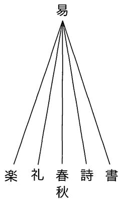

一方，学術総体の分類すなわち大分類については，『漢書』芸文志のなかに強いて引用すべき言及もないが，その書籍分類で経学の価値が突出しており，六芸中の易学のごとく，経学を諸学の源流と位置づけ，特別に重要視していたことは疑いをいれない。ほんらい何の関係もあろうはずもない『七略』の二重の六部分類がまったく等しく(フラクタル構造をもち)，易学や経学を諸学の源流と位置づけていたからには，劉歆は学術総体の六部分類についても，不易の易学が，

図1-1 六芸の構造

その他の価値的に上下のない五術を統べるという,六芸のばあいとパラレルな構造や組織を想定していた，と考えざるをえないであろう(図1-2)。そしてこの大分類の構造こそ紛れもなく，数術が学術総体や経学に対して不可欠の地位を占めていたと判断する根拠の所在にほかならない。

なぜならば，大小分類の六部分類のシステマチックな整合性(自己相似性)を是認すれば，論理上そこから自動的に，@経学の(易と同様な)不可侵性，⑥諸子・詩賦・兵法・数術・方技の(楽・礼・春秋・詩・書と同様な)並列性，個々の学術の必要不可欠性などが導きだされるからである。言い換えれば，『七略』の学術分類が独自の六分分割のシステムにうらうちされる以上，数術は諸子学を含むその他五学と同じく，経学を支える不可欠の一部門として規定されざるをえない。なお，その経学至上主義的システムが中国史上，長期にわたって構造上の安定性と強い影響力を維持したとすれば，経学を頂点とする学術の総体に対して，広義の経学と総称することも不可能でなくなるであろうが,この推定のばあい，歴史的事実がその論理の妥当性をよく証明している。

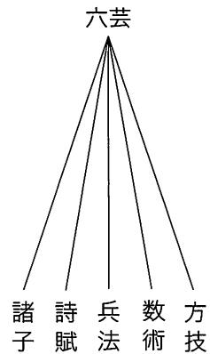  
図1-2『七略』の分類法

およそ中国では西漢以来，碩学と目された経学者であれば大多数の者が，術数学や数術的な研究にも手を染め，精力的かつ徹底的にその学的深化を図っていたとのべることができるであろう。その点については，董仲舒や司馬遷・劉向・劉歆・鄭玄などはいうにおよばず，揚雄(『太玄』)·蔡邕(『律暦意』)·張衡(『霊憲』)·郭璞(『周易洞林』)·司馬光(『潜虚』)·邵雍(『皇極経世書』)·朱熹(『周易参同契考異』『易学啓蒙』)·王応麟(『六経天文編』)・江永(『河洛精蘊』)·戴震(『続天文略』)·銭大昕(『三統術衍』)等々，枚挙にいとまがない。

しからばどうして，多数の鴻儒が術数学的思索に身をゆだね，①数理科学的，もしくは②数神秘主義的，もしくは③数理科学的かつ数神秘主義的な成果を世に問うていたのか。その学術上の原因をさぐれば，儒者の奉じる経学の内部に，術数学の研究を容認し推進する要因があったからにほかならない。前節でのべた経学的思考と術数的思考の近似性などもその原因の一つであろうが，専門研究を精力的に推進する動機としてはやや消極的にすぎる。その直接かつ積極的な原因としてはやはり，術数学のもつ経学総体に対する不可欠の性格，より根底的には，『七略』によって範型を定められた，中国独自の経学至上主義(経学至上主義的な

学術観)を想定せざるをえない。劉歆のおよぼした学術上の影響は術数学の分野でも深甚であり，その制約は規範として術数学の基部に達していた，とのべても断じて過ぎた評価ではないのである。

## 小結

西洋の哲学史をすこしでも囓ったことがある者であればだれしも，ピタゴラス学派の数の神秘説と中国術数学の数の神秘説の酷似に喫驚するはずである。ピタゴラス学派はー方で真摯に純粋な数学命題を追求し，理論数学の基礎を定めながら，他方では宇宙音学に耳をかたむけ，秘教的な数の理論を展開し，あまつさえ神秘宗教の教団を組織していたという。また同じ学派がそういう自然科学的かつ神秘主義的な知的活動を展開するのを可能にした最大の理由は，その哲学(神学)体系の根底に，自然解釈にかんする1つのアイデア，すなわち，自然の諸現象のうちには合理的秩序と調和と合理性が存在し，その自然の法則は形と比例数によって表現されるという数論が，存在していたところにあるといわれている。ピタゴラスの数論と術数学の数論は，思想上の枠組みや基本アイデアを問題とするかぎり，あたかも双生児のごとき様相を呈していたというべきであろう。

だが今日，東西二学に対する評価はまったく正反対である。ピタゴラス学派の主張はエレア派を介してプラトンやアリストテレスに甚大な影響を与えたといい，またそのアイデアは近代科学を生みだす精神的基盤ないし原動力になったといわれるのに反して，中国の術数学については積極的な意義を評価するなど，きわめて罕であり，おおかた迷信の類(百偽一真の知識)としてしか理解されていない。

なぜ評価にこうした差異が生じたのか。その原因を考えれば，そのつはおそらく，今日の中国学研究者が現行の数理説や清代の術数観などに安易に便乗し，その結果，術数学の二義性の解釈に失敗し，卜数の分析とならんで,理数の分析に積極的に従事しなかったからであろう。非常に遺憾なことであるが，理数を誇りながら同時にト数的でもある術数学が経学の理論水平を一気に飛躍させた可能性はきわめて高いにもかかわらず，今日，それに対する虚心坦懐な研究はあまりに少ない。あるいは皆無に近いとのべるほうがより適切かもしれない。研究の蓄積と発展を心から冀うゆえんである。

注

1）詳しくは本書11章を参照されたい。

2)原文は本書11章注13を参照されたい。

3)詳しくは，川原『中国の科学思想』創文社，1996)VI章「後漢の四分暦と蔡邕の律暦思想」の四節を参照されたい。

4) 本表(数術分類表)は，姚名達『中国目録学史』(長沙·商務印書館，1938)の四部分類源流一覧表(表11-1)から数術の部分をぬきだし，縦書きを横書きに改め，幾分か校訂をくわえたものである。

5)南宋の鄭樵『通志』芸文略は，「天文類」に天文・暦数・算書の書目をあげ，「五行類」に星占・軌革・筮占・亀卜・射覆・占夢・雑占・風角·鳥倩·逆刺·遯甲・太乙・九宮・六壬・式経・陰陽・元辰・三命·行年·相法·相笏·相印·相字·堪餘·易図·婚嫁·産乳·登壇・宅経・葬書の書名を記している。鄭樵の書籍分類は一見，四庫全書のそれとよく似ているが，天文をさらに天文総占・五星占・雑星占・日月占・風雲気候占・宝気と分類しており，その理念は四庫全書館員の精神とはまったく別物といわねばならない。

6) 原文「今有孕婦，行年二十九，難九月。未知所生。答曰生男。術曰置四十九，加難月，减行年。所餘以天除一，地除二，人除三，四時除四，五行除五，六律除六，七星除七，八風除八，九州除九。其不盡者奇則為男，耦則為女」。

7)整数aとbの差がnの倍数であるとき，aとbはnを法modulusとして互いに合同であるといい，

$$
a \equiv b ( \mathbf { m o d } n )
$$

と書く。

8)大衍術については，本書4章と5章で詳しく分析した。4章は主に数理の正確な理解を目指し，5章は主にト理の分析に焦点をおいた。

9) 立論に際して，徐復観「先秦儒家思想発展中的転折及天的哲学大系統的建立」(『増訂両漢思想史』巻2，台湾・学生書局，1976)に教えられたところが多い。

10)『春秋繁露』玉英篇に「春秋變一謂之元。元猶原也。其義以隨天地終始也」とある。

11)『漢書』董仲舒伝に「臣謹案春秋之文，求王道之端，得之於正，正次王，王次春。春者天之所為也，正者王之所為也。其意曰，上承天之所為而下以正其所為，正王道之端云爾」という。

12)『春秋繁露』必仁且智篇に「國家之失，乃始萌芽，而天出災害以譴告之。譴告之而不知變，乃見怪異以驚駭之。驚駭之，尚不知畏恐，其殃咎乃至」とある。

13)『春秋繁露』人副天數篇には，「天地之符，陰陽之副，常設於身，身猶天也。數與之相参，故命與之相連也。天以終歲之數成人之身，故小節三百六十六副日數也。大節十二分副月數也。内有五藏，副五行數也。外有四肢，副四時數也。乍視乍暝，副晝夜也。乍剛乍柔，副冬夏也。乍哀乍樂，副陰陽也。心有計慮，副度數也。行有倫理，副天地也。……於其可數也副數，不可數者副類」とある。

14)『漢書』芸文志·数術略大序に「數術者，皆明堂羲和史卜之職也。史官之廢久矣。其書既不能具。雖有其書而無其人。易曰苟非其人道不虚行」とある。

15) 原文「六藝之文，樂以和神，仁之表也。詩以正言，義之用也。禮以明體，明者著見，故無訓也。書以廣聽，知之術也。春秋以斷事，信之符也。五者，蓋五常之道，相須而備。而易為之原。故曰，易不可見，則乾坤或幾乎息矣。言與天地為終始也。至於五學，世有變改，猶五行之更用事焉」。

16)六芸の六分分割構造と三統暦の関係については，川原『中国の科学思想』(創文社，1996)IV章「劉歆の三統哲学」を参照されたい。

## 2 中国の数術

前漢の哀帝初年(前7年または6年)，劉歆は王朝の文教政策の一環として，父，劉向の作業をついで宮廷の蔵書の整理校訂を完了し，中国最初の図書目録『七略』を著わした。劉歆はそのとき，『七略』の分類をとおして,学術研究の追求すべき理想を呈示した。その一つが，経学(六芸)を根幹として，五学(諸子・詩賦・兵書・術数・方技)を学ぶべきこと，これである。劉歆の文教制度の整備をもって，術数学が経学下の一学科として位置づけられたのである。劉歆の規定によれば，術数学は(1)天文(星占)，(2)暦譜(算学と暦学)，(3)五行(五行占)，(4) 蓍亀(亀卜と占筮)，(5)雑占(夢占や象占など)，(6)形法(地学や観相学など)の6つの細目からなっている。

漢唐から清初にかけては，術数学は経学の1部門として，占トを主要な分野としながら，あわせて精密科学に属する暦学・算学・地学などを内に含む広義の数の学術を意味した。だが清の中葉，『四庫全書』の編纂(1782)にいたって，その意味内容を大きく変えた。新たに伝来したヨーロッパの学問観の影響をうけて，天文算法類(算書・推歩)が術数類から独立したからである。今日，術数といえば，普通には占トや数の神秘術をさしており，算学・暦学を意味しない。

本章の課題は，術数学の個々の内容ではなく，術数学の全体像を明らかにするところにある。具体的には，術数概念の内包と外延を論じ，術数学の歴史的展開を概観し，それをとおして術数学の時代区分を試みてみたいと考えている。

## 1 術数学の定義

## 1.1 漢書の用例

術数諸術が行われはじめたのはきわめて早い。亀甲(や獣骨)を焼いて，そこに現われた裂紋で吉凶を判断する占い「亀卜」などは，新石器時代までさかのぼることができ，殷墟晩商期がその全盛時期である。また筮竹を操作して休咎を占う「占筮」も，晩商期には広く行われていたらしい。天文占・星占なども，殷墟から出土した甲骨卜辞が，晚商期すでに始まっていたことを証明している。

だが上記諸術ほかを1個の学科(学術領域)にくくり，その学科を術数と名づけたのは,時代がかなりさがって秦漢以降のことといわねばならない。劉歆(?-後23)の『七略』，より正確には『漢書』芸文志の分類が，われわれの知っているその最初の実例である。

術数の命名が劉歆『七略』ないし班固『漢書』にはじまっている以上，その含義を明白にするには，『漢書』芸文志を対象にして「術数」というテクニカル・タームの現れる文脈を細かにチェックする必要があるであろう。だが調査の結果，「術数」の用語は驚くことに，班固の筆になる芸文志序の個所にわずか1条あらわれるにすぎない。すなわち，

劉歆はそこで群書を総じて『七略』を奏した。輯略と六芸略と諸子略と詩賦略と兵書略と術数略と方技略に分かれるゆえんである。『漢書』を編纂するにあたって指要をとり，芸文志とした。

(歆於是総群書而奏其七略。故有輯略，有六芸略，有諸子略，有詩賦略，有兵書略，有術数略，有方技略。今刪其要，以備篇籍。)

のみである。

班固の芸文志序によるかぎり，『七略』の1篇は術数略と名づけられていたと理解すべきであろうが,現存する『漢書』芸文志の記載のなか,『七略』にもとづくと推定される個所にはかえって，「術数」のタームは出てこない。代わってあらわれるのは，「数術」の1語である。たとえば術

数略の大序には,

凡数術百九十家，二千五百二十八巻。数術者，皆明堂羲和史卜之職也。……故因旧書以序数術為六種。

とある。また班固ののべるごとく，当時，略の名称を術数略とさだめ，学科名を術数学としていたとすれば，書の体例上，わずかながら齟齬が生じざるをえない。他の五略のばあい，

六芸略凡六芸一百三家，……。六芸之文，……，序六芸為九種。

諸子略—凡諸子百八十九家，………。諸子十家，其可観者九家而已…

詩賦略凡詩賦百六家，……。……賦……詩……，序詩賦為五種。

兵書略凡兵書五十三家，……。兵家者，……，論次兵書為四種。

方技略凡方技三十六家……。方技者，……，以序方技為四種。とあり，略の名称と「凡」以下の学科名は表記が一致しているからである。

くわえて梁の阮孝緒(479-536)は『七録』序のなかで，『七略』に言及しその篇名を逐一あげているが，篇名は『漢書』の記載とおおむね等しいものの，術数略は数術略と記されており，班固のそれと同じではない。

確かに後世，「術数」の用語法が定着したことからいえば，劉歆の学統に連なる班固の言を信用しなければならないであろう。だが学術の内容に即するかぎり，数術の用語法もこれまた棄てがたい。確実な証拠がないため，最終的な判断はさしひかえたいが，術数概念には当初より不明白な点がつきまとってはなれない，といわざるをえない。

## 1.2 術数概念の外延

術数学の含義を明らかにしようと思えば，やはり中国歴代の図書目録の分類を調べるべきであろう。図書分類には術数概念の内包はともかく，外延は正確に記されているからである。

数術分類表1は姚名達『中国目録学史』の四部分類源流一覧表2)から数術の部分をぬきだし，修正をくわえたものである。表記の特徴は，数術各ジャンルの名称の変化にくわえて，各部門の統合や独立を明記する

ところにある。その一覧表を一瞥するだけでも，中国の術数概念の経年変化は一目瞭然であろう。

まず『四庫全書総目』の分類を『七略』のそれと比較していただきたい。術数概念の内包は異なっているとはいえ，『七略』の天文・蓍亀・五行・雑占・形法は清代でも相変わらず，同類にグルーピング可能な隣接分野として考えられている。すなわち，『四庫全書総目』の占候・占ト・陰陽五行・雑技術・相宅相墓・命書相書がそれである。

つぎに南宋の尤袤の『遂初堂書目』であるが，注意すべきは『七略』と同じく，暦書と上記の天文～形法を一括りにし，数術家類と総称していることである。『隋書』経籍志と『新唐書』芸文志と『明史』芸文志の分類が同様に，暦数(暦算)と天文と五行に分けており，清以前，数術観に根本的な変化はなかったと判断すべきことをみるとき，その意義は少なくない。『七略』の占ト書と暦算書を同一ジャンルにおく分類法には清以前，大きな変化はなかったとのべることができるからである。なお『遂初堂書目』では算書は雑芸類に収められており，数術家類には算書の占めるべき位置はないが，他の書目をみれば明らかなごとく，暦学と算学の結びつきは非常に強く，暦書と算書を分離するのは尤袤の過失とのべるべきであろう3)。

以上，数術分類表を分析したところ，『四庫全書』以前にあっては暦算書を術数に分属させていた，と結論せざるをえないが，この命題は『四庫全書』の総目提要と書前提要の用語の違いによっても明らかにすることができる。たとえば梅文鼎の『勿庵暦算書記』は優れた数理科学書であり，『勿庵暦算書記』の総目提要はそれを顕彰して，

『勿庵暦算書記』は中西諸法をすべて融会貫通し，逐一要領を得ており,門戸の見を争うところなどまったくない。それゆえ,論のみで法がない(概説書である)けれども，四庫全書の天文算法類に分属し,諸法の綱領とした。

(是皆於中西諸法，融会貫通，一…一得其要領，絶無争競門戸之見。故雖有論無

法，仍録之天文算法類中，為諸法之綱領焉。)

とつくっているが,書前提要はそれを術数書と断じてやまない。すなわち，

『勿庵暦算書記』は中西諸法をすべて融会貫通し，逐一要領を得ており,門戸の見を争うところなどまったくない。それゆえ,論のみで法がない(概説書である)けれども，四庫全書の術数類に分属し，諸法の綱領とした。

(是皆於中西諸法，融会貫通，一一得其要領，絶無争競門戸之見。故雖有論無法，仍録之術数類中，為測算之綱領焉。)

という。『四庫全書』編纂時にあっても，初期には数理科学書を術数と称しても決して蔑称ではなかったのである。

## 1.3 術数の定義

術数概念が『四庫全書』の編纂を境として根本的な変化をこうむったことは，数術分類表などから明らかであろう。とすれば，術数の定義は『四庫全書』をもって時代を区切り，それを行わねばならない。

術数の定義は『四庫全書』以降のばあい，現在の用法と大差がないため，複雑に考える必要はない。『四庫全書総目提要』の術数類の大序に

術数学が興ったのは，多く秦漢以後にある。その要旨は陰陽五行生剋制化であり，実に易学の支派にすぎない。雑説を傅会するのが異なるところである。

(術数之興，多在秦漢以後。要其旨不出乎陰陽五行生剋制化，実皆易之支派， 傅以雑說耳。)

などとあるのにしたがえばいいであろう。すなわち,術数学とは雑説を混えた易学の支流のこと。福を冀い禍を逃れることを目的とし，理論根拠を陰陽五行生剋制化におく，云々と。

だが『四庫全書』以前のばあい，五行術や星占を主な内容とする易学支派を術数とよびながら，その舌の根の乾かぬうちに，また正確無比な思

考を第一義とする数理科学をさして術数ともよんでおり，物事はそう単純ではない。術数の定義には，方技者流の占術と天文算法類の精密科学を共有する,現在とは異なった概念を想定しなければならない。

『四庫全書』以前における術数概念の定義をしようと思えば，術数の初出である『漢書』芸文志にみえる術数概念の内包，すなわち術数六術の共通に有する性質を調べることから着手すべきであろう。また内包を知るには，術数六術の小序に共通にあらわれる概念や字句をチェックするに如くはない。小序チェックの結果は簡単ではあるが示唆に富んでいる。蓍亀をのぞく術数五術の小序には，

天文者，序二十八宿，歩五星日月，以紀吉凶之象，聖王所以参政也。

暦譜者，序四時之位，…聖王必正暦数，以定三統服色之制，……

五行者，五常之形気也。…皆出於律暦之数而分為一者也。其法亦起五徳終始……

雑占者，紀百事之象，候善悪之徵。……

形法者，大挙九州之勢以立城郭室舎形，人及六畜骨法之度数，器物之形容以求其声気貴賤吉凶。

とあり,「数」「象」が頻出することを確認することができる。また蓍亀類の小序のばあい,「数」「象」の字句はみえないけれども,亀卜が象を観察し，占筮が数を観察することは自明である以上，これまた数と象に深く関係することは間違いない。

術数諸術は数と象に深く関係していることが確認されたわけであるが,そのことからいえば，数と象が術数概念の共通項をなし，術数概念の内包が数と象に関係することは否定すべくもない。数と象の関係は論理的に不可分であるだけでなく，その不可分性が古くから認識されていたことも確かである。術数書には，『春秋左伝』僖公十五年の

物生じてのち象あり，象よりしてのち滋あり,滋よりしてのち数あり。

(物生而後有象，象而後有滋，滋而後有数。)

の条が引かれることも多い。

術数概念の内包が数と象に関係し，その数と象が不可分であることにくわえて，先にみたごとく，術数大序が六術をくくって数術とよんでいたことを考えれば，術数概念の内包は数術，すなわち数の術であることであり，術数の定義としては，広義の「数」についてその構造を研究する学問のこととのべることができる。

## 1.4 数術と方術

術数学とは数術のことと定義することができるわけであるが，注意すべきは，広義の医学である方技と術数をあわせて，方術と称することも多いことである。たとえば梁の阮孝緒『七録』は，『七略』の方技略の医経・経方に術数略の六術をあわせて1つの学術領域とし，術伎録とよんでいる。また南朝宋の范曄(398-445)の『後漢書』は方術伝をたて，医薬学・養生術のほか，天文・占ト・観相・風水などに通じた者について記している。『新唐書』『宋史』『明史』などの方技伝(方伎伝)に医・ト・星・相の術者の伝記がみえることは，『後漢書』と等しい。

なぜ術数と方技をあわせて方術と称することができるのか。この問題に解答することはそう難しいことではない。術数と方技はいずれも真の知識が百偽一真の知識に埋没しており，愚昧な大衆は詐称されることが多いにもかかわらず,福を冀い禍を払おうといたずらにそれらを信じつづけており，社会現象においては一見，同じようにみえるからである。術数が精密科学の暦数と超自然的な占術から構成されているのと同様に，方技も経験科学の医薬学(医経・経方)とオカルト的な神秘術(房中・神仙)からなり,構造を等しくしている。術数と方技のもつそのような共通の性格が，おそらく両者をくくる方術という名称を可能にしたのであろう。だが術数と方技はほんらい質を異にした知識体系である4。術数が数の論理を根幹におくのに対して，方技は医方・薬方など，人体にかんするさまざまな方(テクニック)の集合体であり，知の構造が同じでない。社会現象面における類似から両者を統合したのが，方術概念であるが，

内容や知の構造からいえば，算術と医術が異質の知識体系であることに典型的にあらわれるように，術数と方技は相容れない関係にある。占術と超能力ないし未来の予知術と人体の神秘術の違いがそれである。一方は未来を問題とし，他方は現在の状況を変えることをもくろんでいる。内容に即すれば,両者の質的相違はあまりに大きいといわねばならない。

## 2 術数学の歴史

## 2.1 数理の自律的展開

術数学は数理科学と数の神秘術を主な内容とし，それぞれ異なった社会的機能を果たしながら，東アジア社会に巨大な影響を及ぼしてきたが，こと一般社会の表層的な影響関係を問題とするかぎり，数の神秘術の方を主流と認定せざるをえない。何時の世にあっても，「衆志の趨くところ,聖人といえども禁ずる能たわざるところあり」(『四庫全書総目提要』術数類・大序)，一般社会の人気を博するのは，儒者の迂談たる百偽一真の知識であって，決して真の知識ではないからである。

以下，『四庫全書総目提要』が「事に切ならざれどもなお理に近し」とプラス評価をくだしたいわゆる数学の属について，簡単にその内容を紹介したい。四庫館員によれば,「数学」とは

万物が生じるや象があり，象が生ずるや数がある。乗除推闡や務究

造化(数理科学)の源がすなわち数学(四庫全書が新たに定義した学術分類)にほかならない。

(物生有象，象生有数。乗除推闡，務究造化之源者，是為数学。)

であり，数学書は夥しい煽動書中，例外的に「易外別伝」の性格が強く，評価に値するところもあるという。

周知のごとく，漢代は術数学の高揚期の1つである。だが当時，数の奥深い理を解き明かし，造化の本源を究め尽くした，と令名をはせた術数書といえば，揚雄(前53-後18)の『太玄』をおいてほかにない。

『太玄』は『易経』に擬えて作られた哲学兼占筮書である。『易』の二進法に対し，三進法を採用するところに最も大きな特徴がある。『易』の六十四卦(2の6乗)に相当するのが八十一首(3の4乗)であり，『易』のもつ(陽)--(陰)が三画を重ねて八卦を生じ，八卦を上下に重ねて六十四卦を生じるという二進のシステムに変えて，(ー)--(二)---(三)が四重の位をめぐることによって，八十一首を生成するという三進の構造を採用している。その八十一首のばあい，道の恒常性や時の不変性を明らかにするところに重点があるが，各首に設けられた首の9つの位相を示す七百二十九賛(81×9=729)のばあい，逆に変化して止まぬ時の性格にスポットをあてている。占筮が必然化されるゆえんである。『太玄』の筮法は『易』の五十策に対し，三十六策を使用している。

『太玄』が後世の数術におよぼした影響はきわめて大きい。『太玄』に対して晋の范望や宋の司馬光などの優れた注釈書が書かれたのみならず，揚雄の擬経『太玄』のひそみにならって，『易』を模倣する術数書が数多く作られたからである。後者のばあい，北周の衛元嵩の『元包』と宋の司馬光の『潜虚』がとりわけ名高く，それぞれ独自のメカニズムを誇っている。『元包』は『易経』と同じく陰陽二爻にもとづいているが，周易とは異なり，卦の順序は坤が最初にあり，つづいて乾・兌・艮・離・坎・巽・震である。また七変を経て本卦に合し，八八六十四卦のシステムを完成している。一方，『潜虚』は五行を基本におきながら，五行を重ねて二十五の組み合わせを作り，それを二倍して五十章としており，五進法とのべることができる。現行のテキストには後人の手がはいっているところも多いが，基本的メカニズムについては，司馬光のアイデアに出ているとみてよいであろう。

『太玄』以下の術数書は『易』を模倣したものであるが，宋易のように象数を廃して義理をのべてはいない。むしろ徹底して象数に拘泥する。すなわち，易理をささえる易数や易象を介して抽象的な数概念に近づき，数自体の論理の影響をうけ，それを根拠として易説の不足を補っている。

『太玄』の三進のシステムや『潜虚』の五進法がそれであり，『太玄』が律暦節候(太初暦)に附会するのがそれである。いずれの数の論理も易のシステムに啓発されてはいるが，易外の論理であり，数理の援用にもとづく易学の再構築(数→易)の性格がきわめて強い。

このことは優れて術数的な三統暦や後漢四分暦においても同様である。長期にわたる観測にもとづく精緻な天文定数が最初にあり，その数値を外在の経伝(主に『周易』の字句)によって潤色している。たとえば三統暦の朔望月の日数は29と43/81日であるが，劉歆によれば，その基本定数の計算は『易』繋辞伝に正確にもとづいているという。初動の論理は数のそれであり，それに啓発されて易理が動きだし，易学の新たな展開がそれに付随するのである。

## 2.2 易説による数の統一的解釈

宋以降の術数学の本流といえば，皇極経世学，すなわち邵雍(1011-1077)の『皇極経世書』に触発されて行われた数多くの数研究をあげねばならない。術数学の二度目の高揚期がこれであり，術数的研究が盛んに行われたことは漢唐をはるかに凌駕する。また数理論の完成度においても漢唐に勝るとも劣らない。

まず『皇極経世書』であるが，それは邵雍自身が書いた観物篇62篇と，門弟子が邵雍の平生の論説を記した観物外篇1篇の二つの部分からなり，また観物篇は，34篇の歴年表と16篇の声音表と12篇の論説(観物内篇)の三つの部分に分かれている。同書の最大の特徴は，歴年と声音にかんする数表が書全体の80％以上を占めているところにある。「物理学」と称せられるゆえんである。

『皇極経世書』の歴年表は，元(129,600年)と会(10,800年)と運(360年)と世(30年)の4つの時間の単位をもって，気の生成から消滅にいたる宇宙と地球と人類の壮大な歴史を記している。たとえば堯の即位は，邵雍の推定によれば，第一元の第六会の第三十運の第八世の第十一年(経世暦

64661年=西暦前2357年)に起こった事件である。元会運世はそれぞれ，日(太陽)・月(太陰)・星(少陽)・辰(少陰)の運行をみてさだめられた時の計量単位であり，十二(十二支)と十(十干)の単純な組み合わせにより構成されている。一方，声音表は，自らの策定した漢字音の二つの要素である112の天声(韻母と声調)と152の地音(声母と等位)にもとづいて，存在するかぎりの漢字音を示している(反切法に類似)。数表のシステムは数自体の論理にしたがっており，易の理論を根拠としてはいない。

朱熹や蔡元定などは，邵雍を北宋六子の一人に数えて道学上の重要な地位にまつりあげたが，それは邵雍の歴年学や音声学のためではなく，観物外篇にみえる先天易学を高く評価したためである。だが先天易学の最大の特徴は，易卦が太極(1)→ 両儀(2)→ 四象(4)→ 八卦(8)→ 16 → 32→六十四卦(64)と発展するところ，すなわち2の等比数列にあるが，それは一見して明らかなごとく数自体の自律的展開にすぎず，易法則には直接もとづいていない。邵雍の易解釈についても，漢唐の術数学と同じく，数理の援用にもとづく易学の再構築(数→易)とのべることができるゆえんである。

だが皇極経世学は，邵雍の没後，易説にもとづく数の統一的な解釈(易→数)へと，研究方向を大きく転換した。邵雍による先天易説の完成と朱熹などによる先天易説の顕彰が逆に，易と数のあいだに存在するべクトルを逆転させたのである。邵雍の子の伯温は十二消息卦と一元十二会を1対1に対応させることによって，易学の基礎のもと数論を展開した(『皇極経世内外篇解』)。蔡元定は朱熹の思想的影響をうけながら邵伯温の解釈をより深化し，先天易学にもとづいて邵雍の術数理論すべてを位置づけた(『皇極経世指要』)。朱熹・蔡元定の後をついで道学公認の数解釈を完成させたのが,ほかならぬ明の胡広などの『性理大全』(1415)である。

『性理大全』にいたる流れは，道学との親和性が強く，先天易説による数理の整理再構成を主要な研究課題とし，歴史の法則を究め自然の理数を解き明かすことについてはさほど拘泥していない。皇極経世学には，

易説による数の統一的な解釈(易→数)を模索しながらも，易と数に内在する論理を究めることを最大の目標とし，歴史主義的あるいは自然学的な傾向を強めた別の流れもある。南宋の張行成や祝泌や明の黄畿ほかの研究がそれである。かれらの解釈には邵雍の原意から離れたところも少なくないけれども，きわめて斬新である。

張行成は，二百五十六卦と一元十二会の対応関係を記した掛一図にもとづいて，歴史事件の運数を考察し，易卦と天声地音の対応関係をあたえた既済図を利用して，天声と地音の組み合わせである各漢字音(反切音)に対し易卦の配当をさだめた。また上の二図にのっとる占筮法をも考案している(『皇極通変』)。祝泌は張行成と同じく，邵雍の歴年表にのっとりながら易卦の配当をもって時間の流れを埋めつくし，各歴史年代の起運の卦をさだめたが，卦一図に根本的な修正をくわえており，張行成と配当のしかたが同じでない。声音律呂の学も，等韻学の理論を利用して邵雍のシステムを説明し，自然界のさまざまな音声を分析して世の吉凶を占っており，独自の展開をみせている(『皇極経世観物篇解』)。一方，明の黄畿は，邵雍の先天円図の卦序にしたがいながら，四閏卦(離・乾・坎・坤)をのぞく六十卦について，それぞれ初爻から一爻ずつ陰陽を逆にしたバリェーションをつくり，三百六十卦とし，この「六をもって変ず」る過程をくりかえして一元十二会を易卦で埋め尽くし，時間と易卦の配当を完成した。また卦象を利用して歴史事件を分析し価値的な評価もあたえている(『皇極経世書伝』)。

『皇極経世書』は優れた術数書として，数術の発展に大きく寄与した。「宋以後，術数家(狭義)たちは，たいてい邵子に託してその説を神にした」(『四庫全書総目提要』巻111)からである。また南宋の蔡沈の『洪範皇極内外篇』や鮑雲龍の『天原発微』，元の張理の『易象図説内外篇』，明の黄道周の『三易洞機』などにも，その顕著な影響を認めることができる。

南宋元明の術数学は総じて，朱熹や蔡元定などの示唆した方向へ向かって自らの発展を開始した。それは朱熹などが邵雍を高く評価し，術

## 2 中国の数術

数学に存在価値を認めた結果にほかならない。易学的ないし図学的な数の解釈がそれである。蔡元定の『皇極経世指要』は易学に従属する傾向が最も強い皇極経世学書であるが，数理を構築する際，先天易説にあくまで固執し，極端なばあい易理を根拠に数理の自由な展開を抑えこむところもある。また張行成や祝泌や黄畿の斬新な数の解釈も，歴年や音声への易卦の配当を解決すべき最大の課題としながらも，易学との同化を積極的に推し進めており，易説に基礎づけられた数理の再構築という性格が顕著である。邵雍の先天学が数理による易理の拡張(数→易)にたとえられるとすれば，蔡元定以降の皇極経世学は総じて易理による数理の深化ないし制御(易→数)とのべることができる。元明清の術数学は朱熹や蔡元定などの思惑どおり，易学に隷属する形で象数学として発展したのである。

## 術数学の時代区分結びにかえて

『四庫全書総目提要』術数類数学属に収められた術数書をみるかぎり，漢唐術数家や邵雍の精神と蔡元定以降の術数家のそれには，大きな相違があるというべきであろう。漢唐術数家や邵雍のばあい，あくまで数をもって宗とするのに対して，蔡元定以降のばあい，数の展開以前にすでに先天易の論理が存在しているからである。簡単にいえば，物理とト筮の違いがそれである。時代は数理の自律から易理との同化へと大きく変化したのである。

術数類数学属については，『四庫全書』編纂のころの根本的な変化ほどではないにしろ，朱熹・蔡元定を前後して術数観が大きく変化したことは間違いのないところである。だが術数類全体についても同じことがいえるか否かはいまだ審らかではない。以下すこしばかり，そのことについて考えてみたい。ただし『明史』芸文志と『四庫全書総目提要』を比較すれば明らかなごとく，清中葉には確実に術数の定義が大きく変化してい

るので，清代の変革については分析を省略し，南宋ひいては唐宋元ごろに注意を集中することにしたい。

まず暦算学であるが，大きく漢学・宋学・清学の三期にわけることができる。なかでも抽象数をあつかう算学のばあい，その時代的な変化は顕著である。すなわち，(1）算籌をもちいた文字代数レべルの漢唐数学，(2)略号代数と実用数学からなる宋元明数学，（3)ヨーロッパ筆算の影響をうけた清数学，と三分することができる。また暦学のばあい，漢の三統暦をもって中国暦法の基本デザインがさだまり，そのフレイムワークは民国以前ほとんど改変をこうむっておらず，時代的な変化は算学のそれほど顕著ではないが，元明期，イスラム暦法にのっとる回回司天監が併設され，清代，ョーロッパ天文学にもとづいて頒暦が行われていたことを思い起こせば，三分割も不可能ではない。

だが数の神秘術については，研究の蓄積はあまり多くなく，大まかな推定を提示することも容易ではない。ただ天文占や地理占のばあい，唐宋期に変革あるいは集成があったらしい5)。時代をリードした書籍として，天文占において唐の瞿曇悉達の『開元占経』，地理占において唐の楊筠松『撼龍経』や南宋の蔡元定の『発微論』などをあげることができるからである。現時点では確かなことはいえないが，あるいは唐宋期に何か学術の方向を決定づける事件があったのかもしれない。

また隣接分野の方術をみれば，南宋あたりに急激な変化がおこったことは疑えない。すなわち，金元医学の勃興がそれである。また道教の金丹術も宋元ごろ，外丹から内丹へ重点を移動したこともよく知られている。

以上を総じて，術数学すなわち中国の数術は，

漢代に成立，

南宋ごろと清の中ごろをもって大きく三期に分けることができる，

漢学と宋学と清学の相違がある，

と結論したい。なおこの術数学の時代区分が上位概念にあたる経学のそれと轍を等しくしていることについては，贅言を弄する必要はないであ

## ろう。

注

1)本書1章表1-1を参照されたい。

2)本書11章表11-1がそれである。

3) 補注：宇佐美文理「術数類小考(武田時昌編『陰陽五行のサイエンス思想編』，京都大学人文科学研究所，2011)は，尤袤の分類には根拠があるとし，尤袤は決して「誤った」わけではないという。だが,定の根拠があろうとも，共通した内容や錯綜した発展など，暦学と算学の密接な関係からすれば，その分類に問題がないとすることはできない。

4)補注:この命題は術数的思考が医学に頻見することと矛盾しない。

5)補注：水口拓寿『儒学から見た風水』(風響社，2016)は，風水の展開を詳細に分析して，三期に分けることができると結論する。

## 3 朱子学は術数学か

朱子学を根底で支えたのは，自然と心性を説く理気論すなわち理と気の哲学ということができる。だが朱子の理気論は自然の理について説明するとき概略，言語を連ねて哲学的に説明するが，現行の自然科学は類似の事項，自然法則について説明するとき通常，一連の数式を使用する。この事実は理が法則を意味するかぎり，過去の理であれ，本質的に数との関係を無視することができないことを示している。理とは一面，数に置換可能な概念だからである。一方，中国研究者は「性即理」と聞けば,ただちに数の哲学すなわち術数学を想起する者も少なくないであろう。性即理すなわち，人のもつ本性，ミクロコスモスがただちに天理マクロコスモスであるとは一面，術数性に富む漢代天人相関説の哲学的な言い換えにすぎないからである。

一見したところ，朱子学と術数学は密接な関係にあり，あたかも朱子学は術数学のーつのバリェーションのごとくである。本章の課題は，術数学の視点から朱子学のもつ濃厚な術数性について分析するところにある。

## 1 術数原論

朱子学の術数性について分析考察するには，それに先だって術数学の定義や性格など基本事項を明白にしておかねばならない。基礎作業こそが分析の質を決定し，基本命題こそが考察の前提を構成し結論を左右するからである。今回は議論の質を保証すべく，最初に議論の前提として，術数学にかんする筆者の過去の分析結果を命題化して呈示する。

## 1.1術数論科学思想の視点からの分析

筆者の最初の分析は「術数学中国の「計量的」科学」『中国社会と文化』第8号，1993)である1。現時点でも分析結果に別段，異論はないので，ただちに命題化の作業を試みる2)。

## 定義

「術数学とは，広義の数の学問(数の哲学)のこと。自然をみる一つの視点方法である」。

(a)自然界や人間界に対して，数(広義)が本質的に機能していると把握。このことは数がなければ調和や統一は存在しない，あるいは数学的調和が確実に存在すると考えたことを意味している。

(b)独特な数概念を構築しては，数には純抽象的な理数と神秘的な命数・ト数があるとする。

(c)数の二面性二義性に着目して，理数の計量的客観的な性格を重んじる一方で，それと同等に，命数卜数の神秘的人間的な側面に注意を怠らず，数の語る秘密の情報を解読し応用しようとする。

## 命題1.1

「術数学は大きく，(1)理数を説く数理科学と，(2)神秘数にもとづく占術と，(3)科学と占術が完全に一体化した計量的かつ秘数的な知の技法にわけることができる」。

術数学の主流を形成したのは間違いなく，(1)精密科学の暦譜(暦数・算術)と(2)易学支流の天文(星占)・蓍亀・五行・雑占(夢占など)形法(地理占・観相など)であるが，術数学をより特徴づけているのは(3)の科学的命題と非科学的命題(人文的命題)の混淆である。たとえば「天円地方説」は，天地の形状を説く科学命題であると同時に天徳は円，地徳は方という道徳命題非科学的命題を意味している。また秦九韶『数書九章』(1247)の大衍術は，連立1次合同式の解法(現在，Chinese Remainder Theoremという)でありながら同時に独自の占筮法の一挙一動を示している。

## 命題1.2

「術数学は，経学=儒学(天人の学)を支える不可欠の学術部門の一つである」。

東アジアの思想のばあい，いつどこにあっても経学は天人の学であり，天人の弁が論争の主要課題である。だが経学が天人の学であれば，陰陽五行を介する天人合一(天人の同質性)を根拠として，自然と人為を一律に論じる必要がある。その天人合一の証明は，数や象のアナロジー(数の哲学)によるほかない。

術数学は両漢の際すでにーつのジャンルとして独立し，経学を根底から支える重要な学術部門であったが，劉歆は経学(六芸)をもって諸学の源流である不易の学術と位置づけ，術数学数術を経学の下部におき，経学に対する不可欠の部門として位置づけた3)。この分析はおおむね『漢書』芸文志すなわち『七略』の六分分類構造の分析にもとづいている。

定義および命題1.1からすれば，術数学を数の命題の集合とみたとき，最も術数学的ないし術数性が高いのは，数が理数かつ神秘数として働く(3)の技法，理数と神秘数が一体に機能する(3)の論理ということができるであろう。筆者は現在のところ，術数学を解明する最大の鍵は，その科学的命題と人文的命題の結合や合理的思考と神秘的思考の混淆にあると考えている。

## 1.2 術数二論歴史的な分析

術数学にかんする筆者の考察研究に転機が生じたのは，2005年の国際シンポジウム「易と術数研究の現段階」における研究発表のときである。発表原稿を作成すべく，一論とは視点を換えて歴史的に分析を行った結果，筆者の術数理解にもいくぶん進展がみられた。「術数学一中国の数術」(渡辺義浩編『両漢における易と三礼』汲古書院，2006)がそれである4)。一論と同様に，命題化の作業を行えば，つぎのとおりである。

## 定義(再考察)

「術数学とは，数術(数の哲学)，すなわち広義の「数」についてその構造を研究する学問のこと。数理科学(精密科学)と数の神秘術(百偽一真の知識)を主な内容とする」。

『漢書』芸文志によれば，術数概念は内包が「数」と「象」に関係し，

その数と象が不可分である。また術数大序は術数六術をくくって

「数術」とよんでいる。そのことからすれば，術数概念の内包は数術

すなわち数の術(数の哲学)であり，術数の定義としては,広義の数

についてその構造を研究する学問のことと考えざるをえない。

## 命題2.1

「中国の数術は，漢代にそのフレイムワークを完成し，漢代以降，隣接分野の知識を吸収し内容を深化しながら，多方面の発展をとげた。南宋ごろと清の中ごろ，時代の要請に応じて意味内容を大きく変えた。漢学と宋学と清学の相違がそれである5」。

『四庫全書総目提要』術数類数学属に収められた術数書をみるかぎり，漢唐術数家・邵雍の精神と蔡元定以降の術数家のそれには，大きな相違がある。漢唐術数家や邵雍のばあい，あくまで数をもって宗とするのに対して，蔡元定以降のばあい，数の展開以前にすでに先天易の論理が存在している。南宋ごろ，数術は数理の自律から易理との同化へと基本性格を大きく変化させたといわねばならない。漢唐から清初にかけては，術数学は経学の一部門として，占トを主要な分野としながら，あわせて精密科学に属する暦学・算学・地学などを内に含む広義の数の学術を意味した。だが清の中葉，『四庫全書』の編纂(1782)にいたって，その意味内容を大きく変えた。西欧の学問観の影響をうけて，天文算法類(算書・推歩)が術数類から独立したからである。今日，術数といえば，普通には占トや数の神秘術をさしており，算学・暦学を意味しない。

## 命題2.2

「漢から北宋の数術は徹底して象数に拘泥し，論理を易外に展開することも多い。数理は自律し易理より重く，本質は「物理」の学である」。

『太玄』『潜虚』などは『易』を模倣したものであるが，程頤『易伝』の

ように象数を廃して義理をのべてはいない。むしろ徹底して象数の

論理に拘泥する。すなわち，易理を支える易数や易象を介して抽象

的な数概念に近づき，数自体の論理の影響をうけ，それを根拠とし

て易説の不足を補っている。いずれの数の論理も易のシステムに啓

発されてはいるが，易外の論理であり，数理の援用にもとづく易学

の再構築(数→易)の性格がきわめて強い。

邵雍『皇極経世書』観物篇の数表(歴年表と声音表)のシステムは数自

体の論理にしたがっており，易の理論を根拠としてはいない。また

観物外篇の先天易学の最大の特徴は，易卦が太極→両儀→四象

→八卦→16→ 32→六十四卦と発展するところ，すなわち2の等

比数列にあるが，それは数自体の自律的展開にすぎず，易法則には

直接もとづいていない。邵雍の数術も漢唐の数術と同じく，数理の

援用にもとづく易学の再構築(数→易)とのべなければならない。

## 命題2.3

「南宋から四庫全書編纂以前の術数学は朱子学の影響のもと，数理を易

理に変換し，数学を易学に隷属させた。「ト筮」学の性格がきわめて強い」。

皇極経世学は邵雍の没後，理数による神秘数の合理化(数→易)か

ら易説にもとづく数の統一的な解釈(易→数)へと，研究方向を大き

く転換した。朱熹などによる邵雍の先天易説の顕彰が逆に，易と数

のあいだに存在するべクトルを逆転させたのである。邵雍の子の

伯温は十二消息卦と一元十二会を1対1に対応させることによって，

易学の基礎のもと数論を展開した(『皇極経世内外篇解』)。蔡元定は朱

熹の思想的影響をうけながら邵伯温の解釈をより深化し，先天易

学にもとづいて邵雍の術数理論すべてを位置づけた(『皇極経世指要』)。

朱熹・蔡元定の後をついで道学公認の数解釈を完成させたのが，明の『性理大全』(1415)である。

以上が筆者の考える術数学の定義と基本命題である。定義や基本命題は以下の朱子学の術数性を論じる際の論理的根拠となるであろう6)。

## 2 問題の所在

術数学について論じる際の最大の難問といえば,「易」と「数」,すなわち易学と数術の関係であろう。先の術数一論と術数二論を通して易と数の関係にかんする言及/分析が頻出するのはまさにそのことと関連している。だが易学は，目録学ないし古典期東アジア知識人の意識に即していえば，経学に属し，術数学レべルの雑学ではないが，本質や内容に即すれば，卦爻が象数の一種であり，間違いなく術数学の一部門である。易と数には，矛盾する二種の学問地図が併存するのである。前者によれば，術数学は易外別伝ないし易学支流にすぎないが，後者によれば，術数学は易学を内に含んでいる。

易と数にかんする二種の学問地図は，別次元のカテゴリーとして，時を同じくして併存するが，また時代の要請に応じて特定期間，一方に強く偏って出現することもある。漢唐北宋の術数学は理数の援用にもとづく易数の再構築(数→易)を特徴とし，術数学のカバーする学的範囲は易学のそれより広い。二種の学問地図のうち，明らかに非目録学的な後者に近づいている。他方，南宋元明の術数学は朱子哲学の影響をうけて易学に収斂し，その範疇を超えようとしない。易数は義理の名目のもと，徹頭徹尾，経学(易学)すなわち二種の学問地図の前者を志向し，理数の自由な活動を束縛する。易外別伝に終始したとのべることができる。

南宋元明の術数学は，朱子学の影響をうけて易外別伝の傾向が強いということができるが，同じく南宋元明の経学＝儒学も，易学ないし易学支流が哲学の基礎命題を構成したといわねばならない。周知のごとく，南宋元明の経学＝儒学は朱子学を中心とし，結局のところ朱子学も天人の学である。朱子学が天人の学であれば，上記命題1.2をもって，それに見合う術数学ないし術数的思考が朱子学とその論理を根底から支えるであろう。中国の文化伝統にあっては，気すなわち陰陽五行の自然学がなければ天人の学を完成することができないからである。くわえて命題1.2による「術数学は朱子学を支える不可欠の学術部門の一つである」に対して，命題2.3による「当時の術数学は易学に隷属した」歴史的事実をあわせ考えれば，朱子学の基礎理論に易学の影響が深いことは自明である。単純にいえば，術数性の強い易説が朱子哲学を構築するのに大きな働きをしたのである。

だが朱子学と術数学の関係はわずかそれにとどまらない。朱子学は周知のごとく，哲学的体系性に富む，理気心性論を論理の基礎におく修己治人の学である。その哲学体系の基礎理論，理気心性論の第一命題を構成したのは，易学(本質的には術数学)にもとづく独特の自然学，宇宙生成論『太極図説』や『周易』繋辞上伝などの言説にほかならない。だが朱子学が理(=数)と気(=陰陽五行)の哲学であり，理と気の哲学の根底に易説をおくとすれば，体系的性格ゆえ，それはただちに基本論理を易学に委ねて術数的命題を自らの第一命題とすることを意味する。朱子学が哲学体系であり，術数的命題が第一命題であれば，論理的必然として，朱子学自体が本質的に術数学である可能性も排除できなくなるにちがいない。

本章の問題とするところはまさにその点である。朱子学の本質すなわち理論基層は術数学にあるか否か，時間の許すかぎりこの点について考えてみたい。

## 3 朱子学に対する術数学的な評価

中国歴代の図書目録すなわち書籍分類は，経学とそれ以外の史部子部

集部の学術に対して分類や評価の基準ないし基本原理を異にしている。経部書籍は時間軸聖王の遺訓や文明の古典か否かを基準とするが，史部子部集部の分類はそれに反して，各書の説く主題・内容自体にもとづいている。たとえば経部春秋類所収書は歴史書の古典であるが史部には収められず，経部詩類所収書は文学書の古典であるが集部には収められない。また経部易類は実質的には術数学の古典であるけれども，中国の読書人は術数学との関連を強く意識せず，易学を術数学と同範疇の学術とは考えようとしない。経部分類の特殊性については特別の注意が必要である。

朱子学ないし性理学のばあいも同様である。歴代の図書目録によれば，朱子の『周易本義』『四書章句集注』などは経部に分類され，『朱子語類』『近思録』などは子部儒家類に分類される。だが上にのべたごとく朱子書が経部書籍であり，哲学体系自体が術数的な易説を第一命題とするからには，経部分類の特殊性のため，過去の図書目録にしたがってその学問地図を一義的に確定することはできない。主題・内容がさほど勘案されていないからである。

一方，朱子学体系が術数学と関係が深いこと自体は歴代の図書目録によっても否定することはできない。たとえば『宋史』芸文志は『性理大全』所収の『皇極経世書』を経類易類に分類するが，『四庫全書総目』は同じ書を子部術数類に収めている。

本章が問題にするのは朱子学の本質が術数学にあるか否かであり，表面的な目録学上の分類ではない。古典期東アジア知識人の意識や評価ではなく，朱子学の主題や思考法それ自体の性格分析，いいかえれば朱子学に対する実質的な学問地図の作成をその課題としている。

朱子学に対する非目録学的な解釈・評価の歴史上の実例を紹介することから，実質的な学問地図の作成を目的とする，今回の考察を始めたい。歴代目録にもとづく学問地図はおおむね道統の伝の集大成者として朱子を位置づけており，当時の朱子学者の高い自己評価を彷彿とすることができても学術自体の実質を明らかにすることはできないからである。

## 3.1 黃胤錫の理藪新編

黄胤錫(1729-1791)は朝鮮朝後期の朱子学者。『理藪新編』23巻(1744自序)はその代表作である。

『理藪新編』は「群書を博援」した性理学の入門書であり，『性理大全』70巻の補完本ということができる。『理藪新編』巻1「太極図」は『性理大全』巻1にみえる宋元儒者の太極図説の重要部分を転写し，補遺をつけくわえたものであり，『理藪新編』巻2「理気」は『性理大全』巻26「理気一」に基本的にもとづいている。以上のように各巻とも『性理大全』からの転写が多く，案文なども付されているが自説の提示は総じて控えめである。『理藪新編』と『性理大全』の対応関係を示せば，図3-1のとおりになるであろう。

二書の対応関係をみれば明らかなごとく，『理藪新編』は『性理大全』にみえる術数性に富む『太極図説』『易学啓蒙』『皇極経世書』『洪範皇極内篇』『律呂新書』などを引用し，理気・性理・学・君道・治道などに言及してはいるけれども，表面上，術数学的性格の乏しい家礼・鬼神・道統・諸儒・諸子・歴代については収録していない。逆に『性理大全』にはない「漢書」(巻8)と「韻学」(巻20)と「算学」(巻21～23)の項目をたて，『性理大全』の説く性理学の不足を補っている。「漢書」は術数学に属する律暦志と天文志と五行志からの転写である。「韻学」は等韻を説く李世沢の「韻法横図」と梅膺祚の「韻法直図」を描き，つぎに『訓民正音』の音韻システムを説き，雑録に終わっている。『皇極経世書』声音表のことを想起するとき，韻学の術数学的性格は顕著であろう。「算学」は伝統算術，すなわち術数学の理数の側面を分析している。

黄胤錫の性理学はその社会思想の側面を重んぜず，術数学的な傾向を顕著に示していたとのべることができるであろう。事実，理藪新編序は性理学の総体を説明して，(1)「天地の万理を総べる」太極理気の説

  
図3-1『性理大全』と『理藪新編』

と，(2)[河洛の妙機を括る洪範経世の学と，(3)「古人知来の学」の啓蒙暦閏の法をあげている。また朱子の「易の象数は,初めははなはだ簡易であった。今人はその意味するところを悟らず，反って淫巫瞽史の学と誹るが，それもまた誤りである(易之象数，初甚簡易。今人不得其説，反遂詆以為淫巫瞽史之学，其亦誤矣)」(朱熹別集・巻6)を引いて，自らが性理学書にもとづいて理数書を編纂した理由を説明している。

以上からみて，黄胤錫のばあい性理学と術数学の学的距離は非常に近い。黄胤錫が性理学を術数学として理解しようとしていたことは疑えないであろう。

## 3.2 阮元の疇人伝序

阮元(1764-1849)は乾嘉期を代表する清学者。『疇人伝』46巻(1799刊)は「阮元撰」になる歴代の天文・数学者の列伝であり，「象数の学」をもって「儒流実事求是の学儒者のまさに務むべきところ」ととらえ，黄帝より当時にいたる疇人(暦算学者)243人と「西洋三十七人」について立伝している。

『疇人伝』の特徴の一つは暦算学の進歩史観，すなわち「推歩の法は疎すすより密に漸み，国朝に至り大いに備わる」(凡例)を前提として中国術数学史をあとづけるところにある。阮元の疇人伝序をみれば，その個性的な暦算学の進歩史観がただちに経学の歴史的発展を説明し意味していることは疑えない。

むかし，「黄帝は日を迎え策を推し」(『史記』五帝本紀)，かくして推歩の術暦算の学が起こった。そののち，「堯帝は羲和に命じ(天象観測や頒暦を実施し)」(『書経』堯典)，「舜帝は璿璣をみ(日月五星の運行を斉え)た」(『書経』舜典)。夏殷周になると帝王がつぎつぎに入れ替わり，正朔もそれに応じて改まった。それは乾象天にのっとって百般の功績をあげることが，帝王の要道重要な職務にほかならないためである。それゆえ，周公は礼を制定し，(天文暦数のことを管轄する)馮相の官を設け(『周礼』春官)，孔子は『春秋』を編み，書中，天文官の過失をとがめた。古の聖人たちはみな天文暦算のことをきわめて重視したのである。

両漢になると，通才大儒の劉向・劉歆・張衡・鄭玄たちが，前聖の微言を継承し，その典籍を考察した。かれらはみな象数に通暁し，周天の星官にも詳しかった。ある者は暦法を定めて三光を秩序づけ，別の者は暦論をたてて五紀を明らかにした。かくして数術は天地を極め尽くし，その制作は天地の造化にも肩を並べた。「儒者の学」は漢代，大いに奮ったのである。

だが漢以降，世風はしだいに降り，末学は支離した。俗儒どもは「九九の術」を賎しみて講じない。観台を履み司天を領する者はみな旧聞を株守し，法意を知ることもなく，演譔算造の家はただ法数の子母を換易

するのみであり,精密に圭表によりて天象を観測しようとはしない。験天はこれを失することがいよいよ遠い。歩算の道はこれによりて日々衰え，台官の選も前にもまして軽い。「六芸の道」はかくして湮没した。まことに嘆くべきである。甚だしきは，あるいは内学を高言して，妄りに星気(老人の星など)を占い，図緯の小言をとりて，淵微の天象(発斂の節など)を測る。……あるいは思いのまま空談し，虚誕をなしてはばからない。「河図洛書の数」や「元会運世の篇」などは真実に反し根拠もなく，実に「数学の異端」「芸術の楊墨」といわざるをえない7。云々。

疇人伝序で特に重視すべきは，第三段落の主張である。阮元は「あるいは思いのまま空談し，虚誕をなしてはばからない。“河図洛書の数”や“元会運世の篇”などは真実に反し根拠もなく，実に“数学の異端”“芸術の楊墨”といわざるをえない」とのべて,六芸の道を逸脱した俗儒の虚誕の学説を痛罵している。

阮元が嫌悪し排斥するのは儒学＝経学の伝統における，理数を賤しみ卜筮や占候をほしいままにした流れのことである。その流れは天地人に通じる漢代経学が「数術は天地を窮め，制作は造化に侔しい」のとまさに逆のべクトルをもっている。阮元によれば，追求すべき数術すなわち天文算法の衰微はとりもなおさず経学の湮滅を意味し，「良に嗟歎すべき」経学の危機以外の何物でもない。「河図洛書の数」や「元会運世の篇」などはその経学の衰微をよく象徴し，経学の衰微をもたらした者の主張や対象をよく暗示している。

だが「河図洛書の数」は朱熹『易学啓蒙』が詳論し，「元会運世の篇」は性理学が重んじた『皇極経世書』観物内篇のことである。特に元会運世のばあい，皇極経世学の歴年記載を特徴づける個性的な用語法にほかならない。くわえて朱子学が「玩物喪志」と天文算法を賤しみ，『易学啓蒙』皇極経世書』洪範皇極内篇』などを重んじて好んで卜筮や占候に従事したことは史実として間違いないところである(命題2.3)。阮元が「儒者の学」「六芸の道」に背く「数学の異端」「芸術の楊墨」というのは，直接に朱子学性理学のことをさすと解さなければならない。

『疇人伝』は『四庫全書』が漢以来千数百年継続した伝統の分類法を改変し，「天文算法類」を「術数類」から独立させて一個の領域とした(1793年，『総目提要』印行)以降の著述であり，反神秘や反術数の性格を強くもっている。阮元が「数学の異端」芸術の楊墨」とよぶのは，数の神秘術すなわち天文算法類をのぞく『四庫全書』の術数類のことである。直裁にいえば，阮元や清儒にとって朱子学は数の神秘術，あるいはそれに限りなく近い術数的な学術にすぎなかったのである。

## 4 朱子哲学に現れる術数的思考

朱子学性理学は，独特の『周易』にもとづく命題を第一原理として理気(数と陰陽五行)の哲学体系を構築したものである。理気の哲学命題が朱子学のすべてを理論的に貫通する。命題化していえば，朱子学の論理の特徴は(1)易説にもとづき，(2)体系性をもつところにある。一方，『周易』がいかに悠久の歴史を誇り形而上学的テーマに富んでいようとも，実質は卜筮書であり術数学である。易説が基礎理論として朱子哲学体系のフレイムワークを定め，神秘数を重んずる術数的思考が朱子学の論理のあちこちに現れざるをえないことは明らかであろう。朱子学の理気論が術数学であること自体は改めて説明するまでもない8)からには，朱子学に現れた術数学的性格について以下，体系的特徴をのぞいて重要なところをいくつか指摘する。

## 4.1 形而上学と自然学の混淆

『宋史』道学伝の序言は，朱子学の源流の一つが周敦頤のテーゼ「陰陽五行之理，命於天而性於人者」にあることを明言している9。朱子理気哲学における「天理の根源を明らかにし，万物の終始を究める」周子の術数的な命題設定の意義は明らかであろう。また周敦頤が自己のテーゼを

全面的に展開したのがほかならぬ『太極図説』である。『太極図説』は朱子による修改と注釈を経て，朱子理気哲学の基本命題として東アジアに大きな思想的な影響をおよぼした。

『太極図説』は簡潔に，宇宙万物の生成と道徳の淵源を説いた哲学書とのべることができるが，そのうち宇宙生成論はもともと術数学の範疇に属し，術数類天文の属が専門的に研究してきたテーマである10)。だが『太極図説』の論理といえば，むしろ徹頭徹尾，易学の用語思考に固執し，それにもとづいて道徳の根本におよぶ天地万物の生成をのべつくすところにある。すなわち，個別の解釈自体にはやや変化がみられるが，『周易』繋辞上伝の「易有太極，是生両儀。両義生四象，四象生八卦」(11章)や「一陰一陽之謂道，繼之者善也，成之者性也。仁者見之謂之仁，知者見之謂之知。百姓日用而不知，故君子之道鮮矣」(5章)，「是故形而上者謂之道，形而下者謂之器。化而裁之謂之變，推而行之謂之通。舉而錯之，天下之民謂之事業」(12章)などと基本的な発想とターミノロジィを同じくしている。『太極図説』の事例は両宋期における術数学の数→易の変化を顕著に示しているといってよいであろう(命題2.3参照)。

『太極図説』は朱子学の理論基礎を構築した重要な論文であり，その易学的な宇宙生成論の内容自体が術数学であることには疑問の余地がない。宋元思想史を論じる際，当然として最初にその術数性を批判の俎上に載せるべきであろう。だが朱子学の専門研究者にもあまり知られていないが，『太極図説』はそれ以外にも哲学体系上，重大な論理的欠点を内包する。命題1.1の指摘するごとく，術数命題においては，形而上学的命題(人文的命題)と自然学的命題(科学的命題)が奇妙に不自然に混淆するからである。簡潔に説明すれば，朱子学(『性理大全』)は『太極図説』の易学的宇宙生成論を以下のように展開している。

(a)無極にして太極あり。太極は動いて陽を生じ，動くこと極まって静かに，静かにして陰を生ず。静かなること極まってまた動く。あるいは動きあるいは静かにして,互いにその根となり,陰に分か

れ陽に分かれて，両儀立つ。

(無極而太極。太極動而生陽，動極而静。静而生陰，静極復動。一動一静，互 為其根。分陰分陽，兩儀立焉。)

(b)陽変じ陰合して水火木金土を生じ，五気順布して，四時めぐる。五行は一陰陽なり，陰陽は一太極なり，太極はもと無極なり。五行の生ずるや，各おのその性を一にす。無極の真と二五の精，妙合して凝る。乾道は男をなし，坤道は女をなす。二気交感して万物を化生し，万物は生生して変化窮まることなし。ただ人のみはその秀を得て，最も霊なり。形すでに生じ，神発して知り，五性感動して善悪分かれ，万事出づ。

陽變陰合而生水火木金土。五氣順布，四時行焉。五行，一陰陽也。陰陽，一太極也。太極，本無極也。五行之生也，各一其性。無極之真，二五之精，妙合而凝。乾道成男，坤道成女。二氣交感，化生萬物。萬物生生而變化無窮焉。惟人也，得其秀而最靈。形既生矣，神發知矣。五性感動而善惡分，萬事出矣。)

だが段落(a)と段落(b)は明らかに論理や意味を異にしており，前者は形而上学的命題，後者は自然学的命題といわねばならない。段落(a)の形而上学的な「太極動而生陽」「静而生陰」であるが，仮に自然学的命題として，太極が独り陰陽に先んじて存在し，太極が動いたのち陽が生まれ，太極が静かになったのち陰が生まれることを意味するとすれば，物理現象として陰陽は無から生じ，程子の「道静無端，陰陽無始」の基本原則(『易説』繋辞)と矛盾をいたすからである。かならず形而上学的命題として読み,概念上のことと解さなければならない。

李珥(1536-1584)は正確にそのことを理解し，

わたしの理解するところ，動静の機には使役する者はなく，また理気にも先後があるわけではない。ただ気の動静は理が根底をなすため，周敦頤は「太極が動いて陽を生じ，静かになって陰を生ず」と命題化するのである。だがこの言をとって，太極は独り陰陽に先んじて存在し，陰陽は無(太極)から生まれたとすれば，それは「陰陽無

始」の大原則と矛盾する。この点については最もよろしく活看し深玩しなければならない。

(臣按，動静之機，非有以使之也。理氣，亦非有先後之可言也。第以氣之動靜也，須是理爲根柢。故曰太極動而生陽，静而生陰。若執此言，以爲太極獨立於陰陽之前，陰陽自無而有，則非所謂「陰陽無始」也。最宜活看而深玩也。）

とのべている(『聖学輯要』修己第二・窮理章第四)。だが活看深玩しなければ意味が通じないのであれば，それは考察の不足や表現の不備のためであり，論理展開上，大きな欠点があることを意味している。『太極図説』ひいては理気説のばあい，論理上の欠点は結局のところ，易学に起因する術数的思考がそれをもたらしたと解すべきであろう。

## 4.2倫理と卜筮の併存

『四庫全書総目提要』経部易類大序は歴代の易学を大きく「両派六宗」に分類して，それらが相互に攻駁したことを伝えている。「両派」とは象数派と義理派のこと。その内容を称しては象数易・義理易という。象数易は，①「古を去ることいまだ遠からざる」経古文学派の易学，②「磯祥に入り」，災異学的傾向を示す京房や焦延寿の易学，③図書の学を創始し，天地万物の造化を究明せんとする陳摶や邵雍の易学を代表とする。一方，義理易は，④「象数を尽黜し，説くに老荘を以てする」王弼の易学，⑤「始めて儒理を闡明する」胡援や程頤の易学，⑥「また史事に参証する」李光や楊万里の易学を代表とする。「六宗」である。『総目提要』の両派六宗説はよく易学の発展を総括しているということができるであろう。

特に両派易学の学説上の特徴を簡単にまとめれば，象数易は第一に卦爻の象数を重んじ，象数固有の論理をもって卦辞爻辞などの意味を説明しようとする。象数固有の論理すなわち象数の相互関係性は易内の数構造応・正・中・当・反などにもとづき升降・消息・互体・旁通などによって説明されるほか，易外の数学定理や天文定数なども字句の解釈に頻繁に利用される。一方，義理易は最も卦爻の義理を重んじ，義理固有の論理をもって卦辞爻辞などの意味を説明せんとする。義理固有の論理すなわち易哲学や自然観は易内の卦辞爻辞や十翼の語句を組み合わせることによって説明されるほか，易外の道徳律・心性論による解釈もよくみられるところである。

そもそも象数易のばあい，術数学の範疇に分類されることは上記の説明によるまでもなく自明である。ことさら議論すべきところはないであろう。既述した周敦頤『太極図説』や邵雍『皇極経世書』などに明らかなごとく，象数が主旋律を構成しありのままに機能している。だが義理易については，象数を尽黜する，云々というゆえ術数学のカテゴリーに属さない，あるいは義理をことのほか重んじるため術数性はきわめて低いなどと単純にいうことができるかといえば,そうではない。面において，術数性はより高まっているというべきであろう。

以下，朱子哲学体系の易研究の代表として程頤『易伝』をとりあげ，義理易の術数性について考えてみたい。朱子『周易本義』は義理易と象数易の折衷であり術数性が確実に認められ，義理易としての分析には適さないからである。

程頤『易伝』は一見したところ，性理学風の道徳教訓に溢れ，あたかも倫理学書のようである。易伝自序はそれについて，「易は変易なり，時に随いて変易して以て道に従うなり。その書たるや，広大にして悉く備わる。将に以て性命の理に順い，幽明の故に通じ，事物の情を尽くして，開物成務の道を示さんとす(易變易也。隨時變易，以從道也。其為書也廣大悉備。將以順性命之理，通幽明之故，盡事物之情，而示開物成務之道也)」とい、う。また『四庫全書総目提要』は「程子は邵子の数を信ぜず。故に邵子は数を以てあらわ易を言うも，程子の此の伝は則ち理を言い，あるいは天道を闡し，あるいは人事を切る(程子不信邵子之數。故邵子以數言易，而程子此傳則言理，一闡天道，一切人事)」とのべている。引用中の「理」や「道」は人に固有の道徳性を意味するにちがいない。

程頤『易伝』の倫理的性格については，それを明らかにすることはさほ

ど難しいことではない。今回は艮卦卦辞に対する鄭玄注(①の解釈)と程頤注(⑤の解釈)の比較を通して，それを試みたい。艮卦は良下艮上の純卦，上卦も下卦も一陽爻が二陰爻の上にある。その卦辞は「艮其背，不獲其身」云々という。

鄭玄は艮卦卦辞に対して，「艮之言很也」(見釈文)艮の意味は很，さからう，たがうこと。「良為山。山立峙，各於其所，无相順之時。猶君在上臣在下，恩敬不相与通。故謂之艮也)」(見集解)艮は山。山は各おのそびえ立ち，相互に順うことなどない。これは君が上にあり臣が下にあって,恩敬が相通じないのと同様である。それゆえ良という,と注する(『通徳遺書諸見録』)。訓読は「その背にさからいて，その身をえず」と読むべきであろう。その意味するところは，君(一陽爻)と臣(二陰爻)が対峙して恩敬が通じあわないことである。倫理命題というより冷徹な社会描写といってよいであろう。

一方，程頤は「人が止まるべきところに安んじることができないのは，欲に動かされるからである。欲が前に牽けば，正しい止を求めてもそれを得ることはできない。それゆえ艮の道は,まさに卦辞のいうごととど  
く“その背に良まら(艮其背)”なければならない。人の見るところは(人体の構造上)前方にあるが,背はそれにそむき,見ることができない。その見ざるところに止まれば，欲が心を乱すこともなく，止まりて安んじる。一方，卦辞の“その身を獲ず(不獲其身)”とは，その身を見ない，我を忘れることである。無我であれば正しく止まり，逆に無我でなければ止まるべき道はそこにない。……背にあれば,至近といえども見えない。物と交わらないということである。外物に接しなければ内欲は萌さず，かくのごとく止まれば,すなわち止の道を得，止において咎はない」11),と注する。程頤の解釈にしたがえば，訓読は「その背にとどまりて,その身をえず」と読み，卦辞がのべるごとく，無欲に徹して物と交わらず，止まるべきところに止まれば，無我の境地にいたり，咎はないとなる。艮卦は程頤によれば，天理と人欲の関係を説き，『大学』の三綱領の一つ

「至善に止まる」をもとづいて止の道を説いたものにほかならない。鄭玄の解釈と比較すれば，程頤の倫理志向すなわち動機主義心情倫理に向かって人を誘掖しようとする傾向性は隠しようがないであろう12)。

だが程頤『易伝』は総じて倫理学書的であるが，倫理を説くと同時に卜筮のことに言及することも忘れない。易伝自序にいわゆる「易に聖人の徳四あり。以て言う者はその辞を尚び，以て動く者はその変を尚び，以て器を制する者はその象を尚び，以てト筮する者はその占を尚ぶ(易有聖人之道四焉。以言者尚其辭，以動者尚其變，以制器者尚其象，以卜筮者尚其占)」，「吉凶消長の理，進退存亡の道，辞に備わる(吉凶消長之理，進退存亡之道，備於辭)」，「君子，居れば則ちその象を観てその辞を玩び，動けば則ちその変を観てその占を玩ぶ(君子居則觀其象而玩其辭，動則觀其變而玩其占)」などがそれである。程頤『易伝』にあっては卜筮が倫理と併存し，倫理学以上の意味(天道の秘密を知ること)も含んでいるのである。

倫理とト筮の併存すなわち「天道を推して以て人事を明らかにする(推天道以明人事)」，この性格は，義理易であれ象数易であれ，易学書であれさと みちび  
ばどうしても免れないところである。「聖人は世を覚し民を牖くに，大抵，事に因りて以て教えを寓し(聖人覺世牖民，大抵因事以寓教)」，易は「卜筮に寓する(寓於卜筮)」からである(『四庫全書総目提要』経部易類大序)。だが術数学の思考構造すなわち術数性に注目すれば，義理易は象数易に比して要求する倫理の質が高く，したがって倫理と卜筮の矛盾がより顕在化している。いくら死を賭して倫理に固執しようとも，事件に先んじて厳密かつ広範に運命ないし事件の結末を知れば，行為の選択ひいては道徳的行為自体の意味するところは大きく変化する。後世からみた犬死，無駄死に倫理的意味があるのは，人は前もって未来がわからないからである。倫理とト筮は本来，当為として両立すべくもなく，両者が本質的に矛盾することは自明である。だが義理易のごとく倫理への要求が高まれば，ト筮との矛盾(倫理と卜筮の原理的な齟齬)すなわち人文学的命題と自然学的命題の混淆(命題1.1)に生じる矛盾は前にも増して増大するにちがい

ない。併存する倫理と卜筮の学的距離が離れ矛盾を孕む以上，義理易のほうが象数易より優れて術数的であるといわざるをえない。

義理易であれ象数易であれ，易学を根幹におく哲学は術数学的である。朱子哲学もその例外ではない。朱子学のばあいも，第一命題のト筮ないし術数学の性格が大きく哲学としての発展の方向性を規定したのである。

## 4.3 律呂本原と候気の矛盾

中国の音律理論は，蔡元定(1135-1198)の十八律のシステムにいたって一応の安定をみた。十八律とは蔡元定『律呂新書』にみえる，三分損益律(ピタゴラス律)と旋宮(転調)の妥協のシステムのこと。旋宮を十二均に限定し，十二正律に六変律をくわえた。音響学的な考察はいまだ十分でないが，理論上次善を重んじる合理性がある。また朱子とそのエピゴーネンたちがそれを顕彰して音律理論の正統の地位にかつぎあげた。後世の朱子学の音律研究が『律呂新書』を中心とするゆえんである。

『律呂新書』は南宋以降の音律研究のフレイムワークを決定したということができるが，その内容上の最大の特徴といえば，「声気の元を求め(求聲氣之元)」律呂本原」を定めるところである。朱子自身も蔡元定法が「一字も古人已に試みるの成法に本づかざるなし(無一字不本於古人巳試之成法)」とのべながら，斬新な点として「先に声気の元を求め，律に因りて以て尺を生じるに至りては，則ち尤も所謂卓然たる者なり(至於先求聲氣之元而因律以生尺，則尤所謂卓然者)」と絶賛している(律呂新書序)。元の彭絲のいう蔡氏多截管候気の説がそれである。

蔡氏多截管候気の説とは，「声の清濁・気の先後を以て黄鐘(の規格)を求める者」のことである(『律呂新書』律呂証弁・造律第一)。彭絲によれば，(1)黄鐘管の候補の作成黄鐘管を作るべく，多数，竹を截る。選択候補の竹管は長短が同じでないが，管ごとの長短の差は繊微である。(2)黄鐘管の決定諸管をみな地中に埋め，冬至時を俟ってこれを験する。候補の諸管のなかで気の応ずる者があれば，「この管，造化自然に合い，人力の為すべきにあらざる(此管合於造化自然，非人力可為)」ため，取って真正の黄鐘管とする。(3)度量衡の決定真正と認定された黄鐘管を計り，長さを九寸，空囲を九分，積を八百一十分として，度量衡を定める，という。第(1)のステップが截管，第(2)のステップが候気である。

蔡元定や朱子は「律呂本原」が截管→候気による黄鐘管の作成にあると考えたようであるが，李汉(1682-1763)の「楽律跋」や「跋楽律書」が指摘するごとく，「古今律を言う者，畢竟合わざれば，則ちこれを竹管候気わずらに諉わす。殊に候気にもまた符せざるところあるを知らず(古今言律者,畢竟不合，則諉之於竹管候氣，殊不知候氣亦有所不符也)」，あるいは「候気の論のごときは」「いまだかつて経験してその合否を知らず(如候氣之論，未嘗經驗而知其合否)」経験則に反するところがある(『星湖全集』巻54)。また『四庫全書総目提要』律呂新書提要も，蔡氏多截管候気の説は候気を基本原理とし，「候気の説は最も荒渺となす(候氣之説，最為荒渺)」と批判してやまない。

候気の論とは，太陽が黄経270度に達した瞬間，冬至の気が(世界中のすべての地点に)いたり，気が(黄鐘の)灰を動かす，すなわち玄室(実験室)の諸管のうち,黄鐘管内につめた灰のみが飛び散る,というものである。源流は京房(前77-前37)にあり，その占候理論にもとづいている13)。改めて強調するまでもなく，候気説は術数性に富み，経験則に反し，実際に起こるべくもない。蔡元定は「律は陽気の動，陽声の始なり。かならず声和し気応じ，しかるのち以て天地の心を見るべし(律者陽氣之動，陽聲之始，必聲和氣應，然後可以見天地之心)」とい、う(『律呂新書』律呂証弁·候気第九・按語)が，その朱子学的な主張はよく天人の際を論じみごとに術数学の特徴を示している。

『四庫全書総目提要』経部楽類・著録案語によれば，「天文楽律は，みな積数の学なり(天文樂律，皆積數之學也)」。だが「宋儒」は楽律のばあい，「楽理」を論じ「楽本」に言及して自らを正当化するが，それは結局のところ,理数に徹するあたわざることを糊塗する遁辞にすぎない14)。四庫

全書館員は楽理・楽本を明らめたと自画自賛する『律呂新書』ひいては朱子学に対して，内在する本質的な術数性を根拠にその論理の不合理を指摘し批判するのである。

## 小結

朱子哲学が体系性に富み，易学を根幹におく論理構造をもち，術数性の濃厚な論理展開を好むこと(4節)からいえば，一つの評価として,朱子学の本質を数の哲学，術数学と規定することができないことはないであろう15)。その性格に言及した読書人が実際に存在する(3節)だけでなく，体系全体を貫く理気論にくわえて個別の理論もあまりに術数的だからである。

今回の朱子学即術数学と断ずる分析にかりに論理上の問題点ないし弱点があるとすれば16)，それは朱子学を哲学体系として議論を展開したところであろう。そもそも厳格な意味における体系的な哲学は，普遍的な原理を示す少数の基本命題第一原理とその結合である論理的秩序の明白な思想命題群から構成されなければならない。知識は強くシステム化され，体系内の個々の命題は有機的に結びつく。一個の基本命題の否認不成立は，ただちに哲学体系の破綻を意味し，些少な命題の改変も，全体の結論に影響する。哲学体系にあっては各命題の反証可能性が不可欠であり，命題相互は強固な論理的な整合性を有さなければならない。だが朱子学のばあい，哲学内部の矛盾も多く，いまだ未完成の体系の印象が強い。今回は朱子学を体系的哲学として論を立てたが，厳密にいえば，その体系性自体が一種の仮説にすぎない。たとえ仮説であろうとも，大きな思想上の傾向性を否定することはできないとはいえ，そこから導き出される結論に一抹の不安がのこることも否めない。仮説が証明されない以上，厳格には蓋然的な命題だからである。そのことからすれば，朱子学の体系性に対する評価自体が術数学か否かをわける分水嶺になるというのが,歯切れが悪いが今回の発表の結論ということができるであろう。

また朱子学の術数性をめぐっては，四庫全書館員が経部楽類についてのべたことが示唆に富んでいる。先に引いた「宋儒はその器を得ざる」ため，楽理・楽本の分析に終始したというのがそれである。清朝経学は朱子学の饒舌を嫌い，新たな学術の方法論を呈示することを通して，朱子学の術数性を否定し，術数学を単なる百偽一信の数の神秘術に貶め，それと同時に術数学から理数の天文数学を救い出し，天文数学の古典を経書として重んじた。宋学から清学へのパラダイム・シフトは，術数をどうとらえそれにどう対処したかにも大きく関係している。

術数学研究は重要である。研究の目的は，わずか文化史や科学史上の解明にとどまらない。思想史上，術数学が重要な研究テーマの一つであることも，これまた間違いない。術数学研究の一層の発展を心から冀うゆえんである。

## 補論

脱稿後，陸九淵(1139-1193)が朱熹に宛ててその太極図説解釈を批判した手紙を読み，偶然「術数」の語を発見した。すなわち『陸九淵集』与朱元晦二に，「老子は無を天地の始とし，有を万物の母とし，常無で妙をみ，常有で竅をみるが，周敦頤“無極而太極”がただちに無字を上面におくのは,まさに老子の学である。諱むべきであろう。かかる道理に暗いゆえ，その流は術数に任じ，忌憚がない(老氏以無為天地之始，以有爲萬物之母，以常無觀妙，以常有觀竅。直將無字搭在上面，正是老氏之學，豈可諱也。惟其所蔽在此，故其流為任術數，為無忌憚)云々とい、うのがそれである17)。

朱熹は陸九淵の批判に対して，老子の有無は二物であるが，周子の有無は一物だと反論するが，朱熹理気論はその一物の無極而太極(無)

から万物(有)が生成しており，反論は論理矛盾を犯し説得力がない。朱熹理気論に術数学との批判が絶えないのは，むしろ当然というべきかもしれない。

注

1）本書1章がそれである。

2)以下，論述の内容にはまったく変化はないが，表現や用語には改善したところがないわけではない。

3)本書1章図1-2を参照されたい。

4)本書2章がそれである。

5) 安大玉「蔡元定と西学『性理精義』における風水と蔡元定に対する評価をめぐって」(『術数学の射程東アジア世界の「知」の伝統』武田時昌編，京都大学人文科学研究所，2014)によれば，『四庫全書』期における変化に先んじて，術数学は一度，漢北宋の数→易の性格に戻り，しかるのち神秘術を全面的に否定したという。明末の朱載堉や清初の梅文鼎のことを考えれば，正しい史的解釈というべきであろう。

6)本章の術数学にかんする定義と基本命題はだからといって，自己の朱子学論を有利に導くための道具立てではない。筆者によれば，あくまで術数学に対する客観的かつ合理的な説明を意図したものである。

7)原文「昔者，黄帝迎日推策，而步術典焉。自時厥後，堯命羲和，舜在璿璣，三代迭王，正朔遞改。蓋效法乾象，布宜庶績，帝王之要道也。是故周公制禮，設馮相之官，孔子作春秋，譏司術之過。先古聖人，咸重其事。兩漢通才大儒，若劉向父子張衡鄭玄之徒，纂續微言，鉤稽典籍，類皆甄明象數，洞曉天官，或作法以敘三光，或立論以明五紀。數術窮天地，制作侔造化，儒者之學，斯為大矣。世風遞降，末學支離。九九之術，俗儒鄙不之講，而履觀臺領司天者，皆株守舊聞，罔知法意。演撰算造之家，徒換易子母，弗憑圭表為合，驗天失之彌遠。步算之道，由是日衰，臺官之選，因而愈輕，六藝道湮，良可嗟歎。甚或高言内學，妄占星氣，執圖緯之小言，測淵微之懸象，老人之星，江南常見，而太史以多壽貢諛。發斂之節，終古不差，而倖臣以日長獻瑞。若此之等，率多錯謬。又或稱意空談，流為虛誕。河圖洛書之數，傳者非真。元會運世之篇，言之無據。此皆數學之異端，藝術之楊墨也」。

8)朱子学の理気論が術数学であること自体は重ねてのべるまでもない。易学にもとづき，天人合一を理論根拠としているからである。また理気論が朱子学の基層から表層まですべてを貫通している(理気論がなければ朱子学は成立しない)以上，術数学が朱子学を基礎づけていることを否定することはできない。朱子学中には一見，術数学と整合的でない命題もあるようにみえるが，根本的には理気論や易説を介して術数学と深く関係している。伊川易伝などがその典型的な例である。

9) 筆者のいわゆる朱子の哲学体系の基礎理論，理気心性論の第一命題を構成したのは，易学(本質的には術数学)にもとづく独特の自然学,宇宙生成論であるとは,まさにこのことにほかならない。

10)先行する宇宙生成論の代表著作としては，『晋書』天文志や張衡『霊憲』などをあげることができる。

11)原文「人之所以不能安於止者，動於欲也。欲牽於前而求其止，不可得也。故艮之道，當“艮其背”。所見者在前，而背乃背之，是所不見也。止於其所不見，則无欲以乱其心，而止乃安。“不獲其身”，不見其身也，謂忘我也。无我則止矣。不能无我，无可止之道。……在背，則雖至近不見，謂不交於物也。外物不接，内欲不萌，如是而止，乃得止之道，於止為無咎也」。

12) 本田済『易学—成立と展開—』(平楽寺書店，1960)第二章·第四節，参照。

13) 京房の候気については，川原『中国の科学思想両漢天学考』(創文社，1996)VI章・二節を参照。

14) 原文「遁辞於言楽理，又遁辞於言楽本」。

15)優れて術数学でありながら，理数を軽視し，「玩物喪志」と精密科学の研究を退けるところなどは，朱子学的術数学の前近代性をよく示している。清学者が朱子学を忌み嫌うゆえんである。

16)論理的要請にもとづく仮定的言辞である。筆者自身は今回の論理に弱点があると思っているわけではない。

17)朱熹も答書で「近見國史濂溪傳載此圖說，乃云“自無極而爲太極”。若使濂溪本書實有自爲兩字，則信如老兄所言，不敢辨矣」とのべている。

## 術数学専論

## 4 大衍術

南宋の数学書『数書九章』は秦九韶撰(1247)。大きく九類からなる。類名はそれぞれ含まれる計算法の内容を示しており，大衍・天時・田域・測望・賦役・銭穀・営建・軍旅・市易という。数学史上とりわけ重要であるのは，大衍類であり，その連立1次合同式の解法は現代数学の整数論の定理や方法(中国剰余定理)とほぼ一致している。大衍術である。同術は宋元数学の偉大な成果の一つに数えられている。

## 1 前史

## 1.1 「物不知数」

六朝の数学書『孫子算経』巻下には，「物不知数」の一題が記されている。今有物不知其數。三三數之賸二，五五數之賸三，七七數之賸二。問物幾何。

(いま物があり,その数はわからない。これを3ずつ数えると2余り,5ずつ数えると3余り，7ずつ数えると2余る。問う,物の数はいくらか。)

答曰，二十三。

〈術曰〉3ずつ数えると2余るのに対しては140をおき，5ずつ数えると3余るのに対しては63をおき，7ずつ数えると2余るのに対しては30をおく。これらを加えあわせて233を得，この値から210を引くと，求める値である。

およそ3ずつ数えて1余るのに対しては70をおき，5ずつ数えて1余るのに対しては21をおき，7ずつ数えて1余るのに対しては15を

おく。それらの和が106以上であれば，105(の倍数)を引いて，求める値を得る1。

このようなタイプの不定方程問題は現在，連立1次合同式の名でよばれており，ガウスの記号2)をもってあらわすと，物の数Xに対して

$$
X \equiv 2 ( { \mathrm { m o d } } \ 3 ) \equiv 3 ( { \mathrm { m o d } } \ 5 ) \equiv 2 ( { \mathrm { m o d } } \ 7 )
$$

と書くことができる。

その術日の前半は，上式を満たす最小の値を

$$
X = 7 0 \times 2 + 2 1 \times 3 + 1 5 \times 2 - 1 0 5 \times 2 = 2 3
$$

と計算したが，それは一般解を

$$
X \equiv 2 3 ( \mathrm { m o d } ~ 1 0 5 )
$$

とすることにほかな $\zeta$ ない。また後半の解法は余り $r _ { 1 } ( < 3 ) , r _ { 2 } ( < 5 ) , r _ { 3 } ( < 7 )$ か$\boldsymbol { \hat { \mathbf { \rho } } } _ { 5 }$ なる連立合同式

$$
X \equiv r _ { 1 } ( { \mathrm { m o d } } \ 3 ) \equiv r _ { 2 } ( { \mathrm { m o d } } \ 5 ) \equiv r _ { 3 } ( { \mathrm { m o d } } \ 7 )
$$

に対して

$$
X = 7 0 r _ { 1 } + 2 1 r _ { 2 } + 1 5 r _ { 3 } - 1 0 5 k \qquad ( k \in { \bf Z } )
$$

すなわち

$$
X \equiv 7 0 r _ { 1 } + 2 1 r _ { 2 } + 1 5 r _ { 3 } { \pmod { \ 1 0 5 } }
$$

と解いたことを意味している。

## 1.2 中国剩余定理

『孫子算経』「物不知数」の解法を一般化し，条件をいくぶん厳密にして示せば，次のようになる。

整数 $m _ { 1 } , m _ { 2 } , . . . , m _ { k } x ^ { s } = \supset \vec { \uparrow } \supset \vec { \underline { { { U } } } } \lor \bar { \downarrow } =$ 素で， $r _ { 1 } , r _ { 2 } , \cdots , r _ { k } \not \to \bar { \mathfrak { s } }$ 任意の整数であるとき，

$$
\left\{ \begin{array} { l } { X \equiv r _ { 1 } ( \bmod \ m _ { 1 } ) } \\ { X \equiv r _ { 2 } ( \bmod \ m _ { 2 } ) } \\ { ~ \quad \cdots \cdots \cdots \cdots } \\ { X \equiv r _ { k } ( \bmod \ m _ { k } ) } \end{array} \right.
$$

を満たす解はかな $\boldsymbol { \mathring { 5 } }$ ず存在し，その解は

$$
x _ { i } m _ { 1 } m _ { 2 } \cdots m _ { i - 1 } m _ { i + 1 } \cdots m _ { k } \equiv 1 { \pmod { m _ { i } } }
$$

なるx1,x2,…，xkに対して

$$
\begin{array} { c } { { X \equiv x _ { 1 } m _ { 2 } m _ { 3 } \cdots m _ { k } r _ { 1 } + x _ { 2 } m _ { 1 } m _ { 3 } \cdots m _ { k } r _ { 2 } + \cdots \cdots } } \\ { { \ } } \\ { { \ + x _ { i } m _ { 1 } \cdots m _ { i - 1 } m _ { i + 1 } \cdots m _ { k } r _ { i } + \cdots \cdots } } \\ { { \ } } \\ { { \ + \ x _ { k } m _ { 1 } m _ { 2 } \cdots m _ { k - 1 } r _ { k } \ ( \mathrm { m o d } \quad m _ { 1 } m _ { 2 } \cdots m _ { k } ) } } \end{array}
$$

で与え $\boldsymbol { \dot { \varsigma } }$ れる。

中国剩余定理Chinese Remainder Theoremがこれである。中国剩余定理の名称があるのは，18・19世紀にオイラー(1707-1783)やガウス(1777-1855)な $\dot { \xi } \dot { \eta } \dot { \bar { \mathbf { \xi } } } .$ 上記の定理を再発見し，やや遅れて『孫子算経』の解法との符合が宣教師を介して西洋に知られ，中国剰余定理あるいは中国人の剰余定理や孫子の定理などと称されるようになったからである。

一方，中国剰余定理は秦九韶の大衍術に酷似している。用語法の対応を示せば，

$$
\begin{array} { l } { m _ { i } : \frac { \dddot { \psi } _ { \mathbb { E } } ( \dot { \psi } _ { \mathbb { E } } ^ { k } ) } { \lambda \mathbb { E } ( \dot { \mathbb { E } } \otimes \lambda ) } } \\ { \prod m _ { i } = m _ { 1 } m _ { 2 } \cdots m _ { k } : \mathfrak { H } \ddot { \mathfrak { H } } } \\ { m _ { 1 } \cdots m _ { i - 1 } m _ { i + 1 } \cdots m _ { k } : \mathfrak { H } \ddot { \mathfrak { H } } } \\ { x _ { i } : \frac { \dddot { \mathfrak { H } } \ddot { \mathfrak { H } } } { \mathfrak { H } } } \\ { x _ { i } m _ { 1 } \cdots m _ { i - 1 } m _ { i + 1 } \cdots m _ { k } : \mathfrak { H } \ddot { \mathfrak { H } } } \\ { \sum x _ { i } m _ { 1 } \cdots m _ { i - 1 } m _ { i + 1 } \cdots m _ { k } r _ { i } : \frac { \mathfrak { H } \dot { \mathfrak { H } } } { \mathfrak { H } \mathfrak { H } } } \end{array}
$$

などと書くことができる。ちなみに大衍術は大きく二つの計算術からなり，総数術と求一術の名称があるが，大衍求一術は乗率 $x _ { i }$ を定める計算法をいい，大衍総数術は総数 $\begin{array} { r } { \sum x _ { i } m _ { 1 } \cdots m _ { i - 1 } m _ { i + 1 } \cdots m _ { k } r _ { i } } \end{array}$ を計算する方法をいう。また「法が二つずつ互いに素」であることが解の存在条件となるのは，乗率が求め $\boldsymbol { \dot { \zeta } }$ れなければな $\boldsymbol { \dot { \mathsf { L } } }$ ないからであ $z$ o

## 2 秦九韶の大衍術

## 2.1 大衍総数術

中国剰余定理のx1， $x _ { 2 } ,$ …，xkは，『孫子算経』「物不知数」のような簡単な問題のばあい，試行錯誤によっても求めることができるが，複雑な問題については求める手段がない。また法の $m _ { 1 }$ $m _ { 2 } ,$ … $m _ { k }$ も，二つずつ互いに素でなければならない。このような限界や制限をのりこえて,新しい展開をもたらしたのが,13世紀南宋の秦九韶である。かれは『数書九章』十八巻(1247)の第一と第二巻「大衍類」において，連立1次合同式の解法を系統的に記した3)。

だが大衍類の合同9問題4)のうち，m1,m2,…，mkが二つずつ互いに素であるのは，最後に記された「余米推数」の1題のみである。それゆえ説明の便宜上，最初にこの問題の解法を説明し，以下，複雑な事例へと論を進めることにしたい。その「余米推数」の問題と答えであるが,

問う。米屋が三個の同様な蘿から米を盗まれたと役所に訴え出た。籬の中にはみな一杯に米が容っていたというが，その具体的な数量はわからない。現状を確認したところ,左壁のには米が1合残り，中間の籬には1升4合残り，右壁の籬には1合残っていた。程なくして盗賊甲乙丙三名が捕らえられた。甲の供述によれば，その夜，手探りで馬杓(ひしゃくの一種)を得，それで左壁の蘿から米をかきだして布袋にいれたといい，乙の供述によれば,木履(木製のくつ)を踏みつけ，それで中間の籬から米を袋にいれたといい，丙の供述によれば，手探りで漆椀を得，それをつかって右の籬から袋にいれたという。だが盗米は食用に供され，日数も経ったので，米数はわからない。盗みにもちいた三器をさがすと，馬杓の容量は1升9合からなり，木履は1升7合容り，漆椀は1升2合容った。盗まれた総米数と，三賊が盗んだ米数は，それぞれいくらか5)。

答，総米数は9石5斗6升3合。

甲米は3石1斗9升2合。

乙米は3石1斗7升9合。

丙米は3石1斗9升2合。

秦九韶は上の問題に対して，籬の容量Xを未知数とし，馬杓と木履と漆椀の所容をそれぞれ元数，すなわち

$$
X \equiv 1 ( { \bmod { \ 1 9 } } ) \equiv 1 4 ( { \bmod { \ 1 7 } } ) \equiv 1 ( { \bmod { \ 1 2 } } )
$$

として，次のように計算を展開した。

〈術曰〉大衍(総数)術をもちいる。@三器の所容を「元数」とし，環を連ねて等数(最大公約数)を求め，約して「定母(定数)」とする。⑥「定母」を互いに掛けて，「衍母」とする。それぞれ「定母」で「衍母」を割り，「衍数」を得る。「衍数」が「定母」より大きいときは，「衍数」から「定母」を去り，「奇数」を得る。@その「奇数」と「定母」を大衍(求一)術に施して，「乗率」を得る。「乗率」を「衍数」に掛けて，「用数」を得る。つぎに各余米数を「用数」に掛け，加えあわせて「総数」とする。⑧「総数」が「衍母」より大きいときは，「総数」から「衍母」を去ると，それが籬の容量である。⑥それぞれ余米数を引くと，甲乙丙の盗米数となり，盗米数を加えあわせると，盗まれた総米数である6)。

大衍総数術とは，連立1次合同問題の総解法のこと。法が二つずつ互いに素でないばあいの解法も，その総数術の中に含まれている。

大衍総数術の各計算プロセス@⑥@f⑧はそれぞれ，中国剰余定理のそれとよく合致している。まずプロセス@であるが，「余米推数]題は元数すなわち法(19,17,12)が二つずつ互いに素であるため，元数から定母を求める計算は必要がない。換言すれば，大衍術の定母がただちに中国剩余定理 $\mathcal { O } m _ { i }$ にあたっている。

大衍総数術は定母が確定したのち，⑥各定母を掛けあわせて，衍母$( m _ { 1 } m _ { 2 } \cdots m _ { k } )$ とし，各定母で衍母を割って，衍数 $( m _ { 1 } \cdots m _ { i - 1 } m _ { i + 1 } \cdots m _ { k } )$ を得る。同題のばあい，19と17と12が定母，その積の3876が衍母，204と

228と323が衍数である。

そのとき中国剰余定理のxすなわち乗率がわかれば，それを同定理に代入して簡単にXを求めることができる。した $x ^ { 5 } > \tau$

$$
x _ { i } m _ { 1 } m _ { 2 } \cdots m _ { i - 1 } m _ { i + 1 } \cdots m _ { k } \equiv 1 { \pmod { m _ { i } } }
$$

を解くこと，同題のばあい

$$
2 0 4 x _ { 1 } \equiv 1 { \pmod { \ 1 9 } } , 2 2 8 x _ { 1 } \equiv 1 { \pmod { \ 1 7 } } , 3 2 3 x _ { 1 } \equiv 1 { \pmod { \ 1 2 } }
$$

を解くことが大衍術の要となる。この乗率の計算法を大衍求一術という。

なお大衍求一術で衍数が定母より大きい，すなわち同題のごとく

$$
2 0 4 = 1 9 \times 1 0 + 1 4 , 2 2 8 = 1 7 \times 1 3 + 7 , 3 2 3 = 1 2 \times 2 6 + 1 1
$$

であれば，上式は

$$
1 4 x _ { 1 } \equiv 1 ( { \bmod { \ } } 1 9 ) , 7 x _ { 1 } \equiv 1 ( { \bmod { \ } } 1 7 ) , 1 1 x _ { 1 } \equiv 1 ( { \bmod { \ } } 1 2 )
$$

と同値になり，そのため，大衍求一術をもって衍数と定母から乗率を求めるかわりに，衍数から定母の倍数をのぞき，その余りの奇数と定母から乗率を求めることができる。これがプロセス©である。

便宜上，大衍求一術の詳細な説明は後回しにして，いま@求一術によって奇数と定母から乗率の値が定まったとしよう。「余米推数」題のばあい，乗率はそれぞれ $x _ { 1 } = 1 5$ $x _ { 2 } = 5 ,$ $x _ { 3 } = 1 1$ である。そのとき，乗率を衍数(204，228，323すなわち $m _ { 1 } \cdots m _ { i - 1 } m _ { i + 1 } \cdots m _ { k } )$ に掛けて，用数(3060=15×204，1140 = 5×228，3553 = 11×323すなわち $x _ { i } m _ { 1 } \cdots m _ { i - 1 } m _ { i + 1 } \cdots m _ { k } )$ を得，その値に既知の余米数(1，14,1すなわちr)を掛け，加えあわせて，総数 $( 2 2 5 7 3 = 3 0 6 0 \times 1 + 1 1 4 0 \times 1 4 + 3 5 5 3 \times 1$ すなわち $\sum x _ { i } m _ { 1 } \cdots m _ { i - 1 } m _ { i + 1 } \cdots m _ { k } r _ { i } \ \mathrm { ) }$ を得る。⑧この総数から衍母(3876すなわち $m _ { 1 } m _ { 2 } \cdots m _ { k } ) \textcircled { j }$ 倍数を引くと，それが求めべき籬の容量(X=3193)にほかならない。簡潔にいえば，大衍総数術は「所求数≡総数(mod衍母)」として，

$$
X \equiv 3 0 6 0 \times 1 + 1 1 4 0 \times 1 4 + 3 5 5 3 \times 1 { \pmod { 3 8 7 6 } }
$$

$\mathcal { O } \mathcal { \Sigma } ^ { \ast } \mathcal { k }$ く総数を求め籬の容量を計算したのである。

以上の分析からして，大衍総数術が中国剩余定理と1対1に対応していることは疑うべくもない。

## 2.2 大衍求一術

大衍総数術の概略を説きおわったからには，つぎに大衍術の要の求術，すなわち乗率 $x _ { i }$ を定める計算法について考えてみたい。論述の簡便化のため，まず求一術を施す合同式

$$
x _ { i } m _ { 1 } m _ { 2 } \cdots m _ { i - 1 } m _ { i + 1 } \cdots m _ { k } \equiv 1 { \pmod { m _ { i } } }
$$

の表記を，乗率 $x _ { i } \to x ,$ 衍数 $m _ { 1 } \cdots m _ { i - 1 } m _ { i + 1 } \cdots m _ { k }  N$ ，定母 $m _ { i }  m \ngeq$ して,

$$
N x \equiv 1 ( { \bmod { \ m } } ) , \qquad ( N , m ) = 1 \qquad \cdots \cdots ( 1 )
$$

と簡略化す $\Xi ^ { \ 7 ) }$ 。なお $N > m$ な $6 4 5$ Nをmで割って， $N \equiv n ( { \bmod { \ m } } )$ なる余りnを求め，①式を

$$
n x \equiv 1 ( { \bmod { \ m } } ) , ( n , \ m ) = 1 , 0 < \ n < m \cdots { \textcircled { 2 } }
$$

と変形する。 $= \textcircled { \scriptsize { 1 } } \textcircled { \scriptsize { 2 } }$ 式は

$$
n x - m y = 1 , \qquad ( n , \ m ) = 1 , \qquad 0 < \ n < m \quad . . . . . ( 3 )
$$

と同値である。

いまそ $\oslash m / n$ をユークリッドの互除法(図4-1)によって連分数に展開し,

$$
{ \frac { m } { n } } = q _ { 1 } + { \frac { 1 } { q _ { 2 } } } + { \frac { 1 } { q _ { 3 } } } + \cdots + { \frac { 1 } { q _ { k } } }
$$

を得たとしよう8)。

この正則なる連分数(整連分数)で

$$
\begin{array} { r } { x _ { i } = q _ { 1 } + \frac { 1 } { q _ { 2 } } + \frac { 1 } { q _ { 3 } } + \cdots + \frac { 1 } { q _ { i } } } \end{array}
$$

と置いてつくられた数列

$$
x _ { 1 } , x _ { 2 } , \cdots , x _ { k } = \frac { m } { n }
$$

において，各 $x _ { i }$ を既約分数 $P _ { i } / Q _ { i } \mathrm { ~ } \mathrm { ~ \bar { \iota } \bar { ~ } }$ なお

$$
\begin{array} { r l } & { \eta _ { 1 } ^ { \mathrm { ~ \tiny ~ q _ 1 } } } \\ & { = \sqrt { \frac { \pi q _ { 1 } } { \tau _ { 1 } } } \frac { q _ { 2 } } { \tau _ { 1 } } } \\ & { \qquad \frac { \pi q _ { 2 } } { \tau _ { 2 } } \frac { q _ { 3 } } { \tau _ { 1 } } } \\ & { \qquad \frac { \tau _ { 1 } q _ { 2 } } { \tau _ { 2 } } \frac { q _ { 3 } } { \tau _ { 2 } } } \\ & { \qquad \frac { \tau _ { 2 } q _ { 3 } } { \tau _ { 3 } } \frac { q _ { 4 } } { \tau _ { 2 } } . } \\ & { \qquad \vdots \qquad } \\ & { \qquad \tau _ { k - 1 } \frac { q _ { k } } { \tau _ { k - 2 } } } \\ & { \qquad \tau _ { k - 1 } \frac { \tau _ { k - 1 } q _ { k } } { \tau _ { k } } } \\ & { \qquad \frac { \tau _ { k - 1 } q _ { k } } { \tau _ { k } } } \end{array}
$$

すと，この数列から2つの数列

$$
\begin{array} { r l } { { P _ { 1 } , \ P _ { 2 } , \ \cdots , \ P _ { k } = m } } & { { { } } } \\ { { } } & { { { } } } \\ { { Q _ { 1 } , Q _ { 2 } , \ \cdots , \ Q _ { k } = n } } & { { { } } } \end{array}
$$

図4-1 互除法

をつくることができる。

かくのごとくして求められた諸値は,以下の相互関係を $\ldots -$ o

術数学専論

$$
i = 1 ) \qquad m = q _ { 1 } n + r _ { 1 } , \qquad \quad P _ { 1 } = q _ { 1 } , \qquad \quad Q _ { 1 } = 1
$$

$$
i = 2 ) \qquad n = q _ { 2 } r _ { 1 } + r _ { 2 } , \qquad P _ { 2 } = q _ { 2 } P _ { 1 } + 1 , \qquad Q _ { 2 } = q _ { 2 }
$$

$$
\begin{array} { c c c c c c c c c c c c c c c c c c c c c c c c c c c c c } { { i = 3 } } & { { } } & { { } } & { { } } & { { r _ { 1 } = q _ { 3 } r _ { 2 } + r _ { 3 } , } } & { { } } & { { } } & { { P _ { 3 } = q _ { 3 } P _ { 2 } + P _ { 1 } , } } & { { } } & { { } } & { { } } & { { Q _ { 3 } = q _ { 3 } Q _ { 2 } + Q _ { 1 } } } & { { } } & { { } } & { { } } & { { } } & { { } } & { { } } & { { } } & { { } } & { { } } & { { } } & { { } } \\ { { } } & { { } } & { { } } & { { } } & { { . . . . . . . . . . . . . . . . . . . . . . . . . . . . . . . . . . . . . . . . . . . . . . . . } }  & { { } } & { { } } & { { } } & { { } } & { { } } & { { } } & { { } } & { { } } & { { } } & { { } } & { { } } & { { } } \end{array}
$$

$$
i = k - 1 ) r _ { k - 3 } = q _ { k - 1 } r _ { k - 2 } + r _ { k - 1 } , P _ { k - 1 } = q _ { k - 1 } P _ { k - 2 } + P _ { k - 3 } , Q _ { k - 1 } = q _ { k - 1 } Q _ { k - 2 } + Q _ { k - 3 } ,
$$

$$
\begin{array} { r l r l r l r l r l r l } { i = k ) } & { { } } & { \boldsymbol { r } _ { k - 2 } = q _ { k } \boldsymbol { r } _ { k - 1 } + 0 , } & { } & { \boldsymbol { P } _ { k } = q _ { k } \boldsymbol { P } _ { k - 1 } + \boldsymbol { P } _ { k - 2 } , } & { } & { \boldsymbol { Q } _ { k } = q _ { k } \boldsymbol { Q } _ { k - 1 } + \boldsymbol { Q } _ { k - 2 } , } \end{array}
$$

上記諸値には一般的に，関係

$$
P _ { i } = q _ { i } P _ { i - 1 } + P _ { i - 2 } , \qquad Q _ { i } = q _ { i } Q _ { i - 1 } + Q _ { i - 2 }
$$

が存在するから，

$$
\begin{array} { l } { { P _ { k } Q _ { k - 1 } - P _ { k - 1 } Q _ { k } = ( q _ { k } P _ { k - 1 } + P _ { k - 2 } ) Q _ { k - 1 } - P _ { k - 1 } ( q _ { k } Q _ { k - 1 } + Q _ { k - 2 } ) } } \\ { { \ \qquad = - ( P _ { k - 1 } Q _ { k - 2 } - P _ { k - 2 } Q _ { k - 1 } ) } } \\ { { \ \qquad \dots \dots \dots \dots \dots } } \\ { { \ \qquad = ( - 1 ) ^ { k - 2 } ( P _ { 2 } Q _ { 1 } - P _ { 1 } Q _ { 2 } ) \ . } } \end{array}
$$

ところが

$$
P _ { 2 } Q _ { 1 } - P _ { 1 } Q _ { 2 } = ( q _ { 1 } q _ { 2 } + 1 ) - q _ { 1 } q _ { 2 } = 1 _ { . }
$$

したがって

$$
P _ { k } Q _ { k - 1 } - P _ { k - 1 } Q _ { k } = ( - 1 ) ^ { k - 2 } = ( - 1 ) ^ { k } \qquad ( k \geq 3 ) .
$$

また Pk = m，Qk = nであるから，

$$
\begin{array} { l } { { m Q _ { k - 1 } - n P _ { k - 1 } = ( - 1 ) ^ { k } } } \\ { { n ( - 1 ) ^ { k - 1 } P _ { k - 1 } - m ( - 1 ) ^ { k - 1 } Q _ { k - 1 } = 1 . } } \end{array}
$$

上の式を③とくらべると，③の1組の解は

$$
x = ( - 1 ) ^ { k - 1 } P _ { k - 1 } y = ( - 1 ) ^ { k - 1 } Q _ { k - 1 }
$$

となることがわかり，①および②の解は

$$
x \equiv ( - 1 ) ^ { k - 1 } P _ { k - 1 } ( \mathrm { m o d } m )
$$

と求まるのである。

ちなみに現在，図表によって上記計算を行うとすれば，次のようにす

るのが便利であろう。

<table><tr><td>i</td><td>1</td><td>2</td><td>3</td><td>…</td><td>k−2</td><td>k-1</td><td>k</td></tr><tr><td>被除数 除数</td><td>m</td><td>n</td><td> $r _ { 1 }$ </td><td>…</td><td> $r _ { k - 4 }$ </td><td> $r _ { k - 3 }$ </td><td> $r _ { k - 2 }$ </td></tr><tr><td rowspan="3">商 余り</td><td>n</td><td> $r _ { 1 }$ </td><td> $r _ { 2 }$ </td><td></td><td> $r _ { k - 3 }$ </td><td> $r _ { k - 2 }$ </td><td> $\pmb { r } _ { k - 1 }$ </td></tr><tr><td> $\pmb { q _ { 1 } }$ </td><td> $\pmb { q } _ { 2 }$ </td><td> $q _ { 3 }$ </td><td>…</td><td> $\scriptstyle q _ { k - 2 }$ </td><td> $\pmb { q } _ { k - 1 }$ </td><td> $q _ { k }$ </td></tr><tr><td> $r _ { 1 }$ </td><td> $r _ { 2 }$ </td><td> $r _ { 3 }$ </td><td>…</td><td> $r _ { k - 2 }$ </td><td> $r _ { k - 1 } = 1$ </td><td>0</td></tr><tr><td> $P _ { i }$ </td><td> $\pmb { P _ { 1 } } = \pmb { q _ { 1 } }$ </td><td> $P _ { 2 } = q _ { 1 } q _ { 2 } + 1$ </td><td> $P _ { 3 } = ( q _ { 1 } q _ { 2 } + 1 ) q _ { 3 } + q _ { 1 }$ </td><td>…</td><td> $P _ { k - 2 }$ </td><td> $P _ { k - 1 }$ </td><td> $P _ { k } = q _ { k } P _ { k - 1 } + P _ { k - 2 }$ </td></tr><tr><td> $Q _ { i }$ </td><td> $Q _ { 1 } = 1$ </td><td> $Q _ { 2 } = q _ { 2 }$ </td><td> $Q _ { 3 } = q _ { 2 } q _ { 3 } + 1$ </td><td>…</td><td> $Q _ { k - 2 }$ </td><td> $Q _ { k - 1 }$ </td><td> $Q _ { k } = q _ { k } Q _ { k - 1 } + Q _ { k - 2 }$ </td></tr></table>

なお図表最下 $\mathcal { O } Q _ { i } \mathcal { O } )$ 層は①や②式を計算するばあい，不要である。

秦九韶の大衍求一術は，上記の現在の推論に酷似している。『数書九章』「大衍類」蓍卦発微の冒頭に「大衍求一術云」として記された $\oslash \not \ni ^ { \bar { \mathfrak { s } } }$ それである。以下，プロセス@⑥©@と補記にわけて術意を簡単に説明したい。

〈大衍求一術〉@奇数(n)を右上，定母(m)を右下におき，天元の1(天元一)を左上に立てる。⑥まず右上で右下を割り，その商(q₁)を左上の1に掛け，左下に入れる。©しかるのち右行の上下で，大数から小数を引く。@以下同様に，相互に割り，得た商(qi)をそのたびに左行 $\left( P _ { i - 1 } \right)$ に掛け，左行の上と下 $( P _ { i - 2 } )$ に加え $z$ 。⑥右上が1余ると，計算を止め，そのときの左上の値(Pk-1あるいは $m - P _ { k - 1 } )$ を乗率(x)とする。補記。奇数が1のときは，1をただちに乗率とする10)。

秦九韶は蓍卦発微のに対して，数値まで含めて具体的に大衍求一術の各計算プロセスを記し，プロセスごとに布算の図も描いた。

その細草や算図 $t = \phi _ { } > t _ { } > t$ ，上記 $n x \equiv 1 ( { \bmod { \ m } } )$ に対して大衍求一術を施せば，以下のごとくである。

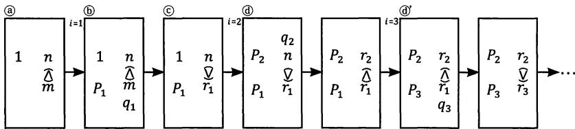

秦九韶は上のプロセスを踏んで $P _ { i } \ \xi \ r _ { i }$ を計算し，nとmが互いに素であ$\Xi \subset \Sigma$ を確かめ，そこに生じる $r _ { k - 1 } = 1$ を利用 $L \mathcal { T } P _ { k - 1 }$ を考える。すなわち，最初の条件(n，m)=1および互除法の特質 $( n , \ m ) = ( n , \ r _ { 1 } ) = \cdots =$ $( r _ { k - 1 } , 0 ) = r _ { k - 1 } \hbar \colon \hat { \boldsymbol { \mathrm { 5 } } }$ $r _ { k - 1 } = 1 \ \xi$ なる,その1に注目して，そのときの$P _ { k - 1 }$ を求めた。

だが $\mathrm { : } n x \equiv 1 ( \mathrm { m o d } m ) \mathcal { D }$ 解は $x \equiv ( - 1 ) ^ { k - 1 } P _ { k - 1 } ( \mathrm { m o d } m )$ であり,kの奇数偶数によって正負が変化せざるをえない。そのため，秦九韶は「右上が1余る」ことをもって乗率を定める条件とし，それによって正負の問題を解消する。すなわち，kが奇数であれば,

$$
\begin{array} { r l } & { i = k - 1 \left[ \begin{array} { c c } { \Theta } & \\ & { q _ { k - 1 } } \\ & { P _ { k - 1 } } & { r _ { k - 3 } } \\ & & { \widetilde { \Omega } } \\ { P _ { k - 2 } } & { r _ { k - 2 } } \end{array} \right] = \left[ \begin{array} { c c } { P _ { k - 1 } } & \\ & { r _ { k - 1 } ( = 1 ) } \\ & { \widetilde { \Omega } } \\ { P _ { k - 2 } } & { r _ { k - 2 } } \\ & & { } \end{array} \right] } \end{array}
$$

と $\mathcal { L } \mathcal { T } x \equiv P _ { k - 1 } ( \mathrm { m o d } m )$ を求め，偶数であれば11)

$$
\begin{array} { r l } & { i = k - 1 \left[ \begin{array} { l l } { \Theta } & \\ & \\ & \\ & { \Theta _ { k - 2 } } & \\ & { P _ { k - 1 } } & { r _ { k - 3 } } \\ & { P _ { k - 1 } } & { r _ { k - 1 } ^ { \widehat { \Delta } } } \\ & & { q _ { k - 1 } } \end{array} \right] \ast \left[ \begin{array} { l l } & \\ & { P _ { k - 2 } } & { r _ { k - 2 } } \\ { P _ { k - 1 } } & { r _ { k - 1 } ( - 1 ) } \\ & { P _ { k - 1 } } & { 1 } \\ & & \end{array} \right] \ast \left[ \begin{array} { l l } { \qquad q _ { k } - 1 } \\ { \qquad \quad 1 } \\ { \qquad P _ { k - 1 } } & { 1 } \\ { \qquad P _ { k - 1 } } & { 1 } \\ & & { \qquad 1 } \\ & \end{array} \right] } \end{array}
$$

として $x \equiv m - P _ { k - 1 } ( { \mathrm { m o d } } \ m )$ を求めるのである12)。

## 2.3 一般合同題の解法

秦九韶は求一術の存在のもと，中国剰余定理に酷似するアルゴリズムをもちいて，法が二つずつ互いに素である，いかなる連立1次合同式も解きえたわけであるが，それに止まらず,法が二つずつ互いに素という条件を解消して，新たな展開もなしとげた。

秦九韶の新たな展開を説明するにあたっては，まず一般合同式の解の存在条件に関する初等整数論の定理13)をあげねばならない。

k個の合同式

$$
X \equiv r _ { i } ( { \mathrm { m o d } } \ m _ { i } ) , i = 1 , \ 2 , \ \cdots , \ k
$$

を満たす解が存在するための必要十分条件は

$$
r _ { i } \equiv r _ { j } ( \mathrm { m o d } \quad ( m _ { i } , \ m _ { j } ) ) , i , \ j = 1 , \ 2 , \ \cdots , \ k
$$

である。このとき，解は $m _ { 1 } , m _ { 2 } , \cdots , m _ { k } \mathcal { O }$ 最小公倍数を法としてただ一つ存在する。

上記条件を満たせば唯一の解が存在するのはもちろんであるが，その条件を満たす一般の連立合同式については具体的にどのように解けばよいのか。以下，その解法についてすこし考えてみたい14)。

そのアルゴリズムであるが，最初に各法 $m _ { i }$ をそれぞれ素因数に分解する。

$$
\begin{array} { c } { { m _ { 1 } = p _ { 1 } { } ^ { \alpha _ { 1 } } p _ { 2 } { } ^ { \alpha _ { 2 } } \cdots p _ { r } { } ^ { \alpha _ { r } } } } \\ { { \ } } \\ { { m _ { 2 } = p _ { 1 } { } ^ { \beta _ { 1 } } p _ { 2 } { } ^ { \beta _ { 2 } } \cdots p _ { r } { } ^ { \beta _ { r } } } } \\ { { \ } } \\ { { \quad \cdots \cdots \cdots \cdots \cdots \cdots } } \\ { { \ } } \\ { { m _ { k } = p _ { 1 } { } ^ { \lambda _ { 1 } } p _ { 2 } { } ^ { \lambda _ { 2 } } \cdots p _ { r } { } ^ { \lambda _ { r } } } } \end{array}
$$

つぎにその素因数にした $x ^ { 5 } > \tau$ ，各合同式を一連の合同式に分解する。

$$
X \equiv r _ { 1 } ( \mathrm { m o d } m _ { 1 } )  \{ \begin{array} { l } { { X \equiv r _ { 1 } ( \mathrm { m o d } p _ { 1 } \alpha _ { 1 } ) } } \\ { { X \equiv r _ { 1 } ( \mathrm { m o d } p _ { 2 } \alpha _ { 2 } ) } } \\ { { \qquad \dots \dots \dots \dots } } \\ { { X \equiv r _ { 1 } ( \mathrm { m o d } p _ { r } \alpha _ { r } ) } } \end{array} 
$$

$$
X \equiv r _ { 2 } ( \mathrm { m o d } m _ { 2 } )  \{ \begin{array} { c c c } { { X \equiv r _ { 2 } \big ( \mathrm { m o d } } } & { { p _ { 1 } { } ^ { \beta _ { 1 } } \big ) } } \\ { { X \equiv r _ { 2 } \big ( \mathrm { m o d } } } & { { p _ { 2 } { } ^ { \beta _ { 2 } } \big ) } } \\ { { \ldots \ldots \ldots } } & { { } } \\ { { X \equiv r _ { 2 } \big ( \mathrm { m o d } } } & { { p _ { r } { } ^ { \beta _ { r } } \big ) } } \end{array} 
$$

…………

$$
X \equiv r _ { k } ( \mathrm { m o d } m _ { k } )  \{ \begin{array} { c c c } { { X \equiv r _ { k } \big ( \mathrm { m o d } } } & { { p _ { 1 } \lambda _ { 1 } \big ) } } \\ { { X \equiv r _ { k } \big ( \mathrm { m o d } } } & { { p _ { 2 } \lambda _ { 2 } \big ) } } \\ { { \ldots \ldots \ldots } } & { { } } \\ { { X \equiv r _ { k } \big ( \mathrm { m o d } } } & { { p _ { r } \lambda _ { r } \big ) } } \end{array} 
$$

素因数 $p _ { 1 } \phi$ 現れる合同式をすべて集めれば，

$$
\left\{ \begin{array} { c c c } { { X \equiv } } & { { r _ { 1 } ( \mathrm { m o d } } } & { { p _ { 1 } ^ { \ \alpha _ { 1 } } ) } } \\ { { X \equiv } } & { { r _ { 2 } \big ( \mathrm { m o d } } } & { { p _ { 1 } ^ { \ \beta _ { 1 } } \big ) } } \\ { { \ldots \ldots \ldots \ldots } } & { { } } \\ { { X \equiv } } & { { r _ { k } \big ( \mathrm { m o d } } } & { { p _ { 1 } ^ { \ \lambda _ { 1 } } \big ) } } \end{array} \right.
$$

となる。この連立合同式はいうまでもなく，上記の解の存在条件を満たしており，それゆえ $p _ { 1 } \phi$ 指数 $\alpha _ { 1 } , ~ \beta _ { 1 } , \ \cdots , \ \lambda _ { 1 } \mathcal { O }$ 中で最大である $\rho _ { 1 }$ に対す $z$

$$
X \equiv r _ { s _ { 1 } } ( { \mathrm m o d } p _ { 1 } ^ { \rho _ { 1 } } )
$$

の解が， $p _ { 1 } \mathcal { O } X \equiv \ r _ { s _ { r } } ( \mathrm { m o d } \quad p _ { r } { } ^ { \rho _ { r } } )$ 司式を満たす。した $x ^ { 5 } > \tau$ ，他の素因数 $p _ { 2 } , p _ { 3 } , \cdots , p _ { r } \ell = 2 \ell \cdot \tau$ も同様に考え，以下の連立合同式を定める。

$$
\left\{ \begin{array} { c c c } { { X \equiv } } & { { r _ { s _ { 1 } } ( \mathrm { m o d } } } & { { p _ { 1 } { \ : } ^ { \rho _ { 1 } } ) } } \\ { { X \equiv } } & { { r _ { s _ { 2 } } ( \mathrm { m o d } } } & { { p _ { 2 } { \ : } ^ { \rho _ { 2 } } ) } } \\ { { \ldots \ldots \ldots \ldots } } & { { } } \\ { { X \equiv } } & { { r _ { s _ { r } } ( \mathrm { m o d } } } & { { p _ { r } { \ : } ^ { \rho _ { r } } ) } } \end{array} \right.
$$

このとき $p _ { 1 } {  { \rho } } _ { 1 }$ $p _ { 2 } { } ^ { \rho _ { 2 } }$ ,…, $p _ { r } { } ^ { \rho _ { r } }$ は二つずつ互いに素であ $\geq x > 5$ ，中国剩余定理によって解はかな $\boldsymbol { \dot { \varsigma } }$ ず存在す $z$ 。またその解は $p _ { 1 } { } ^ { \rho _ { 1 } }$ $p _ { 2 } { } ^ { \rho _ { 2 } }$ , …, $p _ { r } { \rho _ { r } }$ ，すなわ$\dag ; m _ { 1 } , \ m _ { 2 } , \ \cdots , \ m _ { k } \oslash$ 最小公倍数に対して合同でもある。

秦九韶は素因数分解の重要性を認識しなかったゆえ，一般合同題に対していくぶん迂遠な計算法を展開したが，それ自体は実質的に上記の方法と異なるも $\phi \tau$ はない。たとえば「推計土功」の

$$
X \equiv 0 ( { \bmod { \ 5 4 } } ) \equiv 0 ( { \bmod { \ 5 7 } } ) \equiv 5 1 ( { \bmod { \ 7 5 } } ) \equiv 1 8 ( { \bmod { \ 7 2 } } )
$$

のばあい，法の

$$
5 4 = 2 \times 3 ^ { 3 } , \ 5 7 = 3 \times 1 9 , \ 7 5 = 3 \times 5 ^ { 2 } , \ 7 2 = 2 ^ { 3 } \times 3 ^ { 2 }
$$

に対して，各素因数について指数の最大なものをえらび，法を二つずつ互いに素とし，定母を定め，

$$
X \equiv 0 ( { \bmod { \ 2 7 } } ) \equiv 0 ( { \bmod { \ 1 9 } } ) \equiv 5 1 ( { \bmod { \ 2 5 } } ) \equiv 1 8 ( { \bmod { \ 8 } } )
$$

と式を変形する。また「積尺尋源」の

$$
{ \begin{array} { r l } & { X \equiv 6 0 { \bmod { \ } } 1 3 0 ) \equiv 3 0 { \bmod { \ } } 1 2 0 ) } \\ & { \equiv 2 0 { \bmod { \ } } 1 1 0 ) \equiv 3 0 { \pmod { \ } } 1 0 0 ) } \\ & { \equiv 3 0 { \bmod { \ } } 6 0 ) \equiv 3 0 { \bmod { \ } } 5 0 ) } \\ & { \equiv 5 { \pmod { \ } } \equiv 1 0 { \pmod { \ } } 2 0 ) } \end{array} }
$$

のばあいも，同じく

$$
\begin{array} { c } { { X \equiv 6 0 { \pmod { \ 1 3 } } \equiv 3 0 { \pmod { \ 8 } } } } \\ { { \ \equiv 2 0 { \pmod { \ 1 1 } } \equiv 3 0 { \pmod { \ 1 } } } } \\ { { \ \equiv 3 0 { \pmod { \ 3 } } \equiv 3 0 { \pmod { \ 1 } } } } \\ { { \ \equiv 5 { \pmod { \ 2 5 } } \equiv 1 0 { \pmod { \ 1 } } } } \end{array}
$$

$$
\begin{array} { c c } { { 1 3 0 = 2 \quad \times 5 \quad \times 1 3 } } \\ { { } } \\ { { 1 2 0 = 2 ^ { 3 } \times 3 \times 5 } } \\ { { } } \\ { { 1 1 0 = 2 \quad \times 5 \times 1 1 } } \\ { { } } \\ { { 1 0 0 = 2 ^ { 2 } \quad \times 5 ^ { 2 } } } \\ { { } } \\ { { 6 0 = 2 ^ { 2 } \times 3 \times 5 } } \\ { { } } \\ { { 5 0 = 2 \quad \times 5 ^ { 2 } } } \\ { { 2 5 = \quad \quad } } \\ { { 2 0 = 2 ^ { 2 } \quad \times 5 } } \end{array}
$$

となおして，剰余定理の解法を行った15)。

## 2.4 元数と定母

本節の課題は一般合同題における秦九韶の定母の定めかたである。定母の求法は実質的には素因数分解に相当するが，秦九韶の技法には正確さに欠けているところがないわけではない。

秦九韶の考察をたどれば，まず連立合同題の一組の法(諸問数)を「元数」「收数」「通数」復数」の四類に分類する。元数とは自然数をいい(謂尾位見單零者)，收数とは諸法に小数が含まれるもの(謂尾位見分釐者)，通数とは諸法の中に分数があるものを指し(謂諸數各有分子母者)，復数とは $N \times 1 0 ^ { n \mathcal { O } }$ ことである16)(謂尾位見十或百及千以上者)。だが小数や分数とはいっても，未知数の位取りを改めれば法と剰余をともに整数とすることができるからには，收数と通数の二格は技法としてほんらい必要がない。演算とし

ては元数格と復数格のみを分析すれば十分である。

まず元数の算法であるが，秦九韶は

元數者，先以兩兩連環求等，約奇弗約偶。

とのべ，その下に小字をもって

或約得五而彼有十，乃約偶而弗約奇。

と注する。アルゴリズムの意味するところは

@元数から定母を求めるには，まず元数を二数ずつ順番に組みあわせて，それぞれ等数(最小公約数)を求め，(一般的には)その値で一方を約して奇数とし，偶数とはしない。⑥だが(例外的に)元数が25と10のようなときには，その値で一方を約して偶数とし，奇数とはしない。

に相当する17)。

元数格の算法を既述の「積尺尋源」を引いて具体的に説明すれば，元数130, 120, 110, 100, 60, 50, 25, 20

の組合わせのうち，(1)最初に右端の[25,20]について，⑥をもちいて等数5で20を約し，[25，20]→[25，4]とする。つぎに末位の4と六位の50を考え，@により等数2で50を約し，[50，4]→[25，4]とする。同様に末位の4と五位の60，四位の100，三位の110から，[15，4][25，4][55，4]を得る。また@をもちいて[120，4]→[120，1]を得る。その結果，末位の処理が終了し，元数は

130, 120, 55, 25, 15, 25, 25, 1

と変化する。(2)七位の25に注目し，上位諸数との関係を考える。かくして

26, 24, 11, 1, 3, 1, 25, 1

を得る。(3)また五位の3と上位諸数の関係から，26, 8, 11, 1, 3, 1, 25, 1

を得，(4)最後に一位の26と二位の8の等数を考えて，定母を13, 8, 11, 1, 3, 1, 25, 1

と定める。改めて言及するまでもないが，上記結果は，諸法を素因数に分解し，その各因数について指数が最大の数をえらんだものに等しい。また復数格の算法についても簡単に紹介したい。秦九韶はいう。

@復数から定母を定めるには，尾位10以上の諸問数に対して，問数に共通な最大公約数すなわち総等を求め，1位を残して他の諸位を約し，元数を求める。⑥元数を得たのち，二数ずつ順番に組みあわせて，それぞれ等数を求め，(等数が総等の偶数の約数であれば)その値で一方を約して奇数とし，またその値を他方の偶数に掛ける。（等数が総等の奇数の約数であれば)その値で一方を約して偶数とし，またその値を他方の奇数に掛ける。©あるいは約してもなお二数に同類の数が存するときは，互いに引いて続等(更なる等数)を求め，

「程行計地」「推計土功」の復数格の算法をもって例示すれば，以下のとおりである。「程行計地」の復数300，240，180に対しては，(1)@をもちいて総等60で240と180を割り，300，4，3を得，(2)[300，3]を⑥をもちいて[100，9]とし，また[300，4]を⑥をもちいて[25，16]として，定母25，16,9を定める。一方，「推計土功」の復数54，57，75，72に対しては，(1)@をもちいて総等3で54以外を割り，54，19，25，24を得，(2)その[54，24]は等数6で54を割ると，[9，24]となって，続等3をもつから，©をもちいて[27，8]とし，定母27，19,25，8を定めた。

なお秦九韶は復数格の例として，上記2題にくわえて「程行相及」題をあげるが，「程行相及」の復数300，250，200に対しては，定母を3，125，16と定めており，300=2²×3×5²，250=2×53，200=2³×5²からして妥当な演算ということはできない。

## 2.5解の存在条件について

以上のごとく，秦九韶の一般合同題における定母の定めかたはいくぶん迂遠な側面をもち，正確さに欠けていたが，現在の方法と一致する，

十分に合理的な算法であったことは間違いがない。さすれば，秦九韶は一般合同式の解の存在条件

$$
r _ { i } \equiv r _ { j } ( { \bf m o d } \quad ( m _ { i } , m _ { j } ) )
$$

を正確に認識していたのか。

結論を先にのべれば，秦九韶は解の存在条件を完全には認識していないが,それ相応には把握していたということができるであろう。なぜなら，「古暦会積」においては解の存在条件に不適合な問題を提出し，「積尺尋源」においてはその条件を理解しなければ不可能な算法を展開しているからである。

「古暦会積」のばあい，問題は

$$
X \equiv 4 ( { \mathrm { m o d ~ } } 3 6 5 { \frac { 1 } { 4 } } ) \equiv 8 ( { \mathrm { m o d ~ } } 2 9 { \frac { 4 9 9 } { 9 4 0 } } ) \equiv 0 ( { \mathrm { m o d ~ } } 6 0 )
$$

とあらわすことができ，同値関係を壊さずに法を整数になおせば，

$$
X \equiv 4 ( { \bmod { \ } } 1 4 6 1 ) \equiv 8 ( { \bmod { \ } } 2 7 7 5 9 ) \equiv 0 ( { \bmod { \ } } 6 0 )
$$

となる。だが1461と27759の最大公約数は1461であり，そのため8≠4(mod1461)となり，解の存在条件を満たさない。

一方，「積尺尋源」のばあい，解の存在条件を満たす

$$
{ \begin{array} { r l } & { X \equiv 6 0 { \bmod { \ } } 1 3 0 ) \equiv 3 0 { \pmod { \ } } 1 2 0 ) \equiv 2 0 { \pmod { \ } } 1 1 0 ) \equiv 3 0 { \pmod { \ } } 1 0 0 ) } \\ & { \quad \equiv 3 0 { \pmod { \ } } 6 0 ) \equiv 3 0 { \pmod { \ } } 5 0 ) \equiv 5 { \pmod { \ } } 2 5 ) \equiv 1 0 { \pmod { \ } } 2 0 ) } \end{array} }
$$

を,先にのべたごとく元数格をもちいて，

$$
\begin{array} { l } { { X \equiv 6 0 { \pmod { \ 1 3 } } \equiv 3 0 { \pmod { \ 8 } } \equiv 2 0 { \pmod { \ 1 1 } } \equiv 3 0 { \pmod { \ 1 } } } } \\ { { \mathrm { \equiv 3 0 { ( m o d \ 3 ) } \equiv 3 0 { ( m o d \ 1 ) } \equiv 5 { ( m o d \ 2 5 ) } \equiv 1 0 { ( m o d \ 1 ) } } } } \end{array}
$$

となおし，中国剰余定理の解法を行う。すなわち，定母を互いに掛けて衍母85800を求め，各定母で衍母を割り，衍数6600，10725，7800，85800，28600，85800，3432，85800を得る。求一術で乗率3，5，1，0，1,0,18，0を求め，また衍数と乗率を掛けて，用数19800，53625，7800，0,28600，0，61776，0を得る。

大衍術の基本アルゴリズムにしたがえば，次のプロセスはただちに用数 $\ell = r _ { i }$ を掛けねばならないが，秦九韶は用数に余数を掛けず，

元数の両位から等数を求め，その値で衍母を約し，借数とす $\smash { \mathcal { Z } _ { \diamond } } _ { \diamond }$ の借数で大きい値の用数を減らし，零の用数を増して，実際の用数(正用)とする19)。

として総数を計算する。すなわち，元数 $\mathbf { \dot { \cdot } } m _ { 7 } \textcircled { > } 2 5 \xi \ m _ { 8 } \textcircled { > } 2 0 \textcircled { > }$ 等数5をもって衍母85800を約し，その借数17160を元数25の用数61776から引き，44617を得，

$$
X \equiv 1 9 8 0 0 r _ { 1 } + \cdots + 6 1 7 7 6 r _ { 7 } + 0 r _ { 8 } ( \mathrm { m o d } \ 8 5 8 0 0 )
$$

を

$$
X \equiv 1 9 8 0 0 r _ { 1 } + \cdots + 4 4 6 1 7 r _ { 7 } + 1 7 1 6 0 r _ { 8 } ( \mathrm { m o d } ~ 8 5 8 0 0 )
$$

と変形して総数を定める。

以上の演算 $x ^ { 5 }$ 妥当であるのは，衍数 $N _ { i , \cdot }$ 衍母M，元数 $m _ { i } \} \} \ m _ { j } \mathcal { O } )$ 等数dに対して，解の存在条件すなわち $r _ { i } - r _ { j }$ は $^ d$ で割り切れ $z = \xi _ { k } = \xi _ { b }$ ，

$$
\begin{array} { r l } & { \left( x _ { i } N _ { i } - \frac { M } { d } \right) r _ { i } + \left( x _ { j } N _ { j } + \frac { M } { d } \right) r _ { j } = x _ { i } N _ { i } r _ { i } + x _ { j } N _ { j } r _ { j } - \frac { r _ { i } - r _ { j } } { d } M } \\ & { \qquad \equiv x _ { i } N _ { i } r _ { i } + x _ { j } N _ { j } r _ { j } ( \mathrm { m o d } M ) } \end{array}
$$

となるからであ $z 2 0 )$

「積尺尋源」における絶妙な算法の存在 $x = 5 c$ ，秦九韶は一般合同式の解の存在条件についてもかなりの程度，理解していたと結論せざるをえない。

## 2.6 上元積年の計算

最後に，秦九韶が展開した別のタイプの連立1次合同式の解法 $4 = 0 4$ ても一言したい。巻三「治暦演紀」がそれである。同題の解法の特徴は中国剰余定理をもちいないところにある。

「治暦演紀」の連立式は開禧暦の上元積年を計算するためのものであり，

$$
\textstyle 3 6 5 { \frac { 4 1 0 8 } { 1 6 9 0 0 } } X \equiv { \frac { 1 9 3 4 4 0 } { 1 6 9 0 0 } } ( m o d 6 0 ) \equiv { \frac { 1 6 3 7 7 1 } { 1 6 9 0 0 } } ( { \bmod { 2 } } 9 { \frac { 8 9 6 7 } { 1 6 9 0 0 } } )
$$

と書 $\zeta = \sum x ^ { 3 } \pi$ きる。上元積年とは，上元(暦元)か $\boldsymbol { \dot { \zeta } }$ 嘉泰甲子(1204)まで経過した年数 $\mathcal { O } \subseteq \mathcal { E }$ 。上元は甲子年にあたり，前年十一月甲子日の夜半(午前0時)に朔(平朔)と冬至(恒気)が同時に起きる。また諸数の意味する

ところは, $3 6 5 \frac { 4 1 0 8 } { 1 6 9 0 0 }$ 日が開禧暦の回帰年の長さ， $2 9 \frac { 8 9 6 7 } { 1 6 9 0 0 }$ 日が朔望月の長さ， $6 0 \hbar ^ { \bar { 3 } }$ 干支の周期であり, $\frac { 1 9 3 4 4 0 } { 1 6 9 0 0 }$ 日が嘉泰甲子(1204)における甲子日夜半から冬至までの日数， $\frac { 1 6 3 7 7 1 } { 1 6 9 0 0 }$ 日が同年11月朔から冬至までの日数を意味している。連立式の趣意は自ずと明らかであろう。

だが秦九韶による連立式の解法はかなり複雑であり，理解しにくいところもある。それゆえ，計算順序を合理化し，表記をいくぶん近代的にした銭宝琮の解釈に基本的にしたがいながら，秦九韶の解法を説明することにしたい21)。それによれば，秦九韶は上式と同値である

$$
{ \begin{array} { r } { 6 1 7 2 6 0 8 X \equiv 1 9 3 4 4 0 ( m o d ~ 6 0 \times 1 6 9 0 0 ) \cdots \cdots \langle \mathrm { 1 } } \\ { \equiv 1 6 3 7 7 1 ( { \mathrm { m o d ~ } } 4 9 9 0 6 7 ) \cdots \cdots \cdot \textcircled { 2 } } \end{array} }
$$

を以下のごとく解いた。

まず①式を，X= 60Yとおいて22)

$$
( 3 6 5 \times 5 2 \times 3 2 5 + 7 9 \times 5 2 ) 6 0 Y \equiv 6 0 \times 5 2 \times 6 2 ( \mathrm { m o d } \ 6 0 \times 5 2 \times 3 2 5 )
$$

と変形し，60×52で整理して

$$
7 9 Y \equiv 6 2 ( { \mathrm { m o d } } ~ 3 2 5 )
$$

とする。求一術をもちいて79x≡1(mod 325)を解き，乗率x=144を求め，上式に掛け，

$$
\begin{array} { l } { Y \equiv 6 2 \times 1 4 4 ( { \mathrm { m o d } } ~ 3 2 5 ) } \\ { Y \equiv 1 5 3 ( { \mathrm { m o d } } ~ 3 2 5 ) } \end{array}
$$

すなわち

$$
\mathbf { X } \equiv 9 1 8 0 ( { \mathrm { m o d } } \ 6 0 \times 3 2 5 )
$$

を得る。

つぎに上式を

$$
X = 6 0 \times 3 2 5 Z + 9 1 8 0 = 1 9 5 0 0 Z + 9 1 8 0 \qquad Z \in { \bf Z }
$$

となおし，②式に代入して

$$
6 1 7 2 6 0 8 ( 1 9 5 0 0 Z + 9 1 8 0 ) \equiv 1 6 3 7 7 1 ( { \mathrm { m o d ~ } } 4 9 9 0 6 7 ) \cdots \cdots \langle 3 
$$

を得る。また③式を

$$
6 1 7 2 6 0 8 = 1 2 \times 4 9 9 0 6 7 + 1 8 3 8 0 4
$$

$$
1 8 3 8 0 4 \times 1 9 5 0 0 \equiv 3 7 7 8 7 3 ( \mathrm { m o d } ~ 4 9 9 0 6 7 )
$$

$$
1 8 3 8 0 4 \times 9 1 8 0 \equiv - 2 4 8 0 7 ( { \mathrm { m o d } } 4 9 9 0 6 7 )
$$

であることから，

$$
3 7 7 8 7 3 Z \equiv 1 8 8 5 7 8 ( { \mathrm { m o d } } 4 9 9 0 6 7 )
$$

と簡略化する。求一術をもちいて377873x≡1(mod499067)を解き，乗率x=457999を求め，上式に掛け，

$$
Z \equiv 1 8 8 5 7 8 \times 4 5 7 9 9 9 ( { \mathrm { m o d } } 4 9 9 0 6 7 )
$$

すなわち

$$
Z \equiv 4 0 2 ( { \mathrm { m o d ~ } } 4 9 9 0 6 7 )
$$

を得る。かくして嘉泰甲子における上元積年を

$$
X = 1 9 5 0 0 \times 4 0 2 + 9 1 8 0 = 7 8 4 8 1 8 0
$$

と算定したのである。

## 小結

総じていえば，秦九韶は『孫子算経』以来の中国剰余定理を，大衍求一術の発明をもって完成し，また法の互いに素という条件を取り去ってそれを拡張した。秦九韶の合同式への理解は実に深く，かつ多岐にわたっていたといっても決して過言ではないであろう。

注

1)原文「術曰，三三數之賸二，置一百四十。五五數之賸三，置六十三。七七數之賸二，置三十。并之得二百三十三，以二百一十減之，即得。凡三三數之賸一，則置七十。五五數之賸一，則置二十一。七七數之賸一，則置十五。一百六以上，以一百五减之，即得」。

2)正の整数mに対して，整数aとbの差がmで割り切れる，すなわち$a - b = k m ( k \in \pmb { Z } ) \mathcal { O }$ とき，aとbはmを法modulusとして合同であるといい，a≡ b(mod m)と表す。

3) 秦九韶は第3巻「天時類」の治暦演紀においても連立1次合同問題を処

理したが，そこでは中国剰余定理の解法によっていない。

4) 順番に蓍卦発微，古暦会積，推計土功，推庫額銭(以上，1巻)，分糶推原，程行計地，程行相及，積尺尋源，余米推数(以上，2巻)と名づけられている。

5)原文「問有米鋪，訴被盜去米一般三蘿，皆適滿，不記細數。今左壁蘿剩一合，中間籬剩一升四合，右壁蘿剩一合。後獲賊係甲乙丙三名。甲稱當夜摸得馬杓，在左壁籬，舀入布袋。乙稱踢着木履，在中籬，舀入袋。丙稱摸得漆椀，在右邊，舀入袋。將歸食用，日久不知數。索到三器，馬杓滿容一升九合，木履容一升七合，漆椀容一升二合。欲知所失米數，計贓結斷三盗各幾何」。

6)原文「術曰。以大衍求之。列三器所容為元數。連環求等，約為定母。以相乘為衍母。以定各約衍母，得衍數。各滿定母去之得奇。以奇定用大衍，求得乘率。以乘衍數，得用數。次以各剩米乗用，併之為總。滿衍母去之。不滿為每米。各以剩米減之，餘為甲乙丙盗米。併之為共失米」。

7) 整数a, bの最大公約数を(a, b)と表す。

8) $\begin{array} { r } { q _ { 1 } + \frac { 1 } { q _ { 2 } } + \frac { 1 } { q _ { 3 } } + \ldots = q _ { 1 } + \frac { 1 } { q _ { 2 } + \frac { 1 } { q _ { 3 } + \cdots } } } \end{array}$

9)ただ $\downarrow ( n , \ m ) = 1 \nwarrow$ え， $r _ { k - 1 } = 1$ である。

10) 原文「大衍求一術云。置奇右上，定居右下。立天元一於左上先以右上除右下，所得商數，與左上一相生，入左下。然後乃以右行上下，以少除多。遞互除之，所得商數，随即遞互累乘，歸左行上下。須使右上末後奇一而止。乃驗左上所得，以為乘率。或奇數已見單一者，便為乘率」。

11)大衍求一術の細草はただ先の3x≡(mod4)を解くのみであるが，その具体例がちょうど偶数のばあいである。

12) 左上 $\hbar ^ { \ i } m - P _ { k - 1 }$ となるのは,

Pk−1(qk − 1) + Pk−2 =(qkPk−1 + Pk−2)−Pk−1 = Pk − Pk-1 = m − Pk−1だか $\zeta \tau$ ある。

13)高木貞治『初等整数論講義』第2版，p.33-34を参照。

14) 遠山啓『初等整数論』頁133-137の説明を借りた。

15)「蓍卦発微」は問題の法1,2,3,4を二つずつ互いに素なる法(定母)1,1，3，4になおし，「推庫額銭」は12，11，10，9，8，7，6を1，11，5,9,8,7,1に，「分糶推原」は83，110，135を83，110，27に，「程行計地」は300，240，180を25，16,9に改めているが，これらはいずれも結果的には素因数に分解し，各素因数の最大冪の数をえらんだこと

に等しい。

16)「推計土功」などは元数格の算法によって定母を定めることができない。そのばあい，諸整数を復数とし，復数格の算法にのっとって定母を計算している。

17)結局のところ，約したのち互いに素とすべく，等数で約した値が等数と異類になる方を約し，同類になる方は約さないということを意味している。

18)原文「復數者，問數尾位，見十以上者，以諸數求總等。存一位，約衆位，始得元數。兩兩連環求等，約音弗約偶。復乘偶，或約偶或約奇，復乘奇。或彼此可約而猶有類數存者，又相减以求續等。以續等約彼，則必復乘此，乃得定數」。

19)原文「以元數兩位求等。以等約衍母，為借數。以借數損有，以益其無，為正用」。

20) 銭宝琮「秦九韶数書九章研究」(『宋元数学史論文集』科学出版社，1966)頁73注を参照。

21) 銭宝琮，前揭論文(注20)頁74-75。

22)上元と嘉泰甲子はともに甲子の年である。

## 5 秦九韶の易筮法

本章のテーマは南宋の秦九韶が考案した奇巧な『易』の占筮法であり，執筆の狙いはその筮法の分析をとおして，高度な数学理論と神秘的な占トの術数的結合を論述するところにある1。

## 1 多様な筮法の存在

本筮法すなわち正式の易筮法とは，『易』繋辞伝に記された方法のことである。だが経文の記述は，わずか次の数行にすぎない2)。

大衍之數五十，其用四十有九。分而為二以象兩，掛一以象三。揲之以四以象四時，歸奇於扐以象閏。五歲再閏，故再扐而後掛。乾之策二百一十有六，坤之策百四十有九，凡三百有六十，當期之日。二篇之策，萬有一千五百二十，當萬物之數也。是故四營而成易，十有八變而成卦，八卦而小成。引而伸之，觸類而長之，天下之能事畢矣。(大衍の数は50であるが，占筮に用いるのはその49である。筮法は二分して両(天地の両儀)にかたどり，一を掛けて三(天地人三才)にかたどり，四ずつ揲して四時にかたどり，奇を扐に帰して閏月にかたどる。再力してから掛けるのは，五歳再閏のためである。乾の策数は216(陽爻の数は36×6爻)，坤の策数は149(陰爻の数は24×6爻)であり，あわせて360，期(1年)の日数にあたる。二篇の策は11520(六十四卦は192陽爻と192陰爻ゆえ，その策数は192×(36+24)=11520)であり，万物の数にあたっている。それゆえ，四営して爻を決め，十八変して卦をさだめる。かくして八卦ができあがるが,それは小成にすぎない。天下の能事を完成するには，八卦を引き伸ばし，類に触れてそれを長じなければなら

ない。)

『易』繋辞伝の経文はわずか数行ゆえ，それに対してさまざまな解釈が生じ，異なる筮法が考案された。すこし例をあげると，孔穎達や朱熹などは，掛扐の数とよばれる四揲後の余数の多少をもって易爻の陰陽老少をさだめた3)。

孔穎達や朱熹などの正統的方法は三変すべてに「一を掛ける」が，宋の郭雍は張載や程頤に仮託して，初変のみ一を掛けて第二変第三変には一を掛けない。また掛力の数をつかわず，過揲の数とよばれる第三変に揲した正蓍の数すなわち36・32・28・24をもちい，それを4で割って四象をもとめた4)。

以上の二法はいずれも四象の生じる割合がちがい，変爻の出る割合も陰陽で異なっている5)。黄宗羲『易学象数論』によれば，その是正のためと称して，宋の荘綽や元の張理は「左を揲し右を揲せず」，明の季本は経文を改めて占筮に四十八蓍をもちいたという6)。

このように多数の筮法があったが，掛扐の数と過揲の数は結局のところ,同じことの表裏をなすにすぎない。たとえば老陽の九は，掛扐の数では三少すなわち5・4・4を意味し，その合計を49から引くと,老陽の過揲の数36を得ることができる。また過揲の数をもちいなかったとしても，それらは正統法をいくぶん修正したものでしかない。それゆえ，以上の筮法はすべて同種の思考の延長上にあったと規定することができる。

## 2 秦九韶の筮法

南宋の秦九韶は，『数書九章』(1247)巻一大衍類の蓍卦発微において，上記とはまったく異なる思考法によってつくられる筮法を展開した。

秦九韶の筮法を簡単に記すと，次のようになる。括弧内は，各条がもとづく『易』繋辞伝の経文である。

①四十九蓍を両手に二分し，ただ左手の数をもちいる7)(「其用四十

有九，分而為二以象兩」)。

②左手の数を一ずつ揲えたときの奇が1であるのは自明。ただちに1を掛り扐に帰する8)(「掛一以象三」)。

③左手の蓍を二ずつ・三ずつ・四ずつ揲え，それぞれの奇をもとめ扐に帰する9)(「揲之以四以象四時」)。

④以上の4力数に，それぞれに固有の用数(一揲から順に12,24，4,9)を掛け，得た値を加えあわせる10)。

⑤その和から衍母(12)の倍数を除き，値を衍母以下にする11)。

⑥得た値(実)を衍法(3)で割り，その商と余りの有無から1爻の四象をさだめる。すなわち，実が10・11・12であれば四なる老陰とし,7・8・9ならば三なる少陽，4・5・6ならば二なる少陰,1・2・3ならば一なる老陽とする12)。

⑦以上の操作を六回くりかえして，6爻すなわち1卦を得る13)(「十有八變而成卦」)。

なお「三変」は③の二揲・三揲・四揲のこと14)。「扐」は用例が少なく断定するのはむずかしいが，おそらく計算につかう余数とでもいった意味であろう15)。

## 3 大衍術

清の焦循は『易通釈』の末項で，秦九韶の筮法が果たした絶妙な経文解釈に言及し，蓍卦発微が「説く所の大衍五十，其の用四十有九の義，経において合うと為す」とのべた16)が,けだし明言であろう。筮法の解釈がただちにその両句の説明になっているからである。

秦九韶の筮法の，未知なる左手の数をX，一揲以下の奇を順に1, $r _ { 2 } ,$ $r _ { 3 } , \ r _ { 4 } \xi$ 記し，ガウスの記号17)をつかって②と③を示せば，それは

$$
X \equiv 1 { \mathrm { ( m o d ~ } } 1 { \mathrm { ) } } \equiv r _ { 2 } { \mathrm { ( m o d ~ } } 2 { \mathrm { ) } } \equiv r _ { 3 } { \mathrm { ( m o d ~ } } 3 { \mathrm { ) } } \equiv r _ { 4 } { \mathrm { ( m o d ~ } } 4 { \mathrm { ) } }
$$

とあらわすことができる。秦九韶はこの易筮法の例をもちいて，一般化

すると

整数 $m _ { 1 } , m _ { 2 } , \cdots , m _ { k } \nrightarrow     \downarrow  \downarrow \downarrow \downarrow  \downarrow \uparrow \uparrow \uparrow \cdots  \uparrow \uparrow , r _ { 1 } , r _ { 2 } , \cdots , r _ { k }$ が任意

の整数であるとき，

$$
X \equiv r _ { 1 } ( { \mathrm { m o d } } \ m _ { 1 } ) \equiv r _ { 2 } ( { \mathrm { m o d } } \ m _ { 2 } ) \equiv \cdots \cdots \equiv r _ { k } ( { \mathrm { m o d } } \ m _ { k } )
$$

を満たす解は，

$$
x _ { i } m _ { 1 } m _ { 2 } \cdots m _ { i - 1 } m _ { i + 1 } \cdots m _ { k } \equiv 1 { \pmod { m _ { i } } }
$$

なる $x _ { 1 } , x _ { 2 } , \cdots , x _ { k }$ に対して

$$
\begin{array} { l } { { X \equiv x _ { 1 } m _ { 2 } m _ { 3 } \cdots m _ { k } r _ { 1 } + \cdots \cdots + x _ { i } m _ { 1 } \cdots m _ { i - 1 } m _ { i + 1 } \cdots m _ { k } r _ { i } + \cdots \cdots } } \\ { { \ \qquad + x _ { k } m _ { 1 } m _ { 2 } \cdots m _ { k - 1 } r _ { k } \ ( \mathrm { m o d } \quad m _ { 1 } m _ { 2 } \cdots m _ { k } ) } } \end{array}
$$

で与え $\boldsymbol { \dot { \zeta } }$ れる

となる基本解法18)を展開した。またこの解法を大衍術と名づけ， $m _ { i }$ を定数あるいは定母，定数すべての積 $m _ { 1 } m _ { 2 } \cdots m _ { k }$ を衍母，衍母を定数で割った値 $\mathcal { D } m _ { 1 } \cdots m _ { i - 1 } m _ { i + 1 } \cdots m _ { k }$ を衍数， $x _ { i }$ を乗率，衍数に乗率を掛けた $x _ { i } m _ { 1 } \cdots m _ { i - 1 } m _ { i + 1 } \cdots m _ { k }$ を用数とよび，余りに用数を掛け加えあわせた$x _ { 1 } m _ { 2 } m _ { 3 } \cdots m _ { k } r _ { 1 } + \cdots \cdots + x _ { k } m _ { 1 } m _ { 2 } \cdots m _ { k - 1 } r _ { k }$ を総数と命名した。

ところが大衍術の実際の揲数は1・2・3・4からなり，“二つずつ互いに素”という基本条件を満たさな $\grave { \mu } _ { \rho }$ そうしたばあい，秦九韶は $m _ { i }$ を元数とよぶが，各元数を素因数に分解し，各式を $r _ { i }$ をそのままに素因数からなる複数の式にわけ，素因数ごとに指数が最大な式をえらぶと，元数は二つずつ互いに素となり，条件に合致する。そこで秦九韶は，筮法の連立式をほぼそのように処置し19),

$$
X \equiv 1 { \mathrm { ( m o d ~ } } 1 { \mathrm { ) } } \equiv r _ { 2 } ( { \mathrm { m o d ~ } } 2 ) \equiv r _ { 3 } ( { \mathrm { m o d ~ } } 3 ) \equiv r _ { 4 } ( { \mathrm { m o d ~ } } 4 )
$$

をもとめ，基本解法をおこなった。すなわち順番に，衍母12，衍数12・12・4・3をもとめ，式 $1 2 x _ { 1 } \equiv 1 ( \mathrm { m o d \ 1 } )$ $1 2 x _ { 2 } \equiv 1 ( { \mathrm { m o d } } \ 1 )$ $4 x _ { 3 } \equiv$ 1(mod 3), $3 x _ { 4 } \equiv 1 ( \mathrm { { m o d } ~ 4 ) }$ を満たす乗率1・1・1・3と衍数から，用数12・12・4・9をもとめ，

$$
X \equiv 1 2 \cdot 1 + 1 2 r _ { 2 } + 4 r _ { 3 } + 9 r _ { 4 } ( \mathrm { m o d } 1 2 )
$$

を得たのである。

## 4 筮法と算法の一体化

以上のように秦九韶は大衍術を展開したが，最後に，二揲の元数2を定数1に改めたからと称して，前式を

$$
X \equiv 1 2 \cdot 1 + 2 4 r _ { 2 } + 4 r _ { 3 } + 9 r _ { 4 } ( \mathrm { m o d } 1 2 )
$$

と変形する20)。そしてこの式こそが，筮法④⑤の意味するところにほかならない。

秦九韶によれば，同式はまた同時に，繋辞伝の「其用四十有九」の意味するところでもある。蓍卦発微の問題と解答は，

問。易曰「大衍之數五十，其用四十有九」。又曰「分而為二以象兩，掛一以象三，揲之以四以象四時，三變而成爻，十有八變而成卦。欲知所衍之術及其數各幾何。

答曰。衍母一十二，衍法三。

一元衍數二十四，二元衍數一十二，三元衍數八，四元衍數六。

已上四位衍數，計五十。

一揲用數一十二，二揲用數二十四，三揲用數四，四揲用數九。已上四位用數，計四十九。

と記されるが，答日の末尾にある用数の合計49が端的にそれを示している21)。

また答日にいう衍数とその和50は，「大衍之數五十」を解釈したものである。ただ衍数は，“二つずつ互いに素”ではない元数1・2・3・4に対しており，それぞれ揲数の積を各揲数で割った値を示している22)。

この50の意味に注目して秦九韶の胸中を忖度すれば，かれは，50と49の対峙のなかに筮法の深遠なる秘密を解く鍵がある。すなわち，そのなかに一揲・二揲・三揲・四揲という4種の揲法の必要性と，元数から定数への整理を前提としたうえでの衍数と用数の計算法がのべられているとみた，となるであろう23)。かかる術数的思考を意味あるものとすれば，すなわちそこに傅会以上をみれば，筮法と大衍の数の解釈が

体であるゆえ，焦循の絶讃は妥当とみなさざるをえない。そして秦九韶の筮法は，術数的思考を示す優れた歴史遺産となるのである。

## 小結

秦九韶は以上のごとく，思考を蓍卦発微の算術問答に収斂させ，今日の数学定理と酷似する大衍術をもって『易』繋辞伝の説く筮法を絶妙に解釈した。またその数学理論による筮法の解釈をとおして数理と占トを不可分に結びつけ，数の合理性と神秘性を表裏一体に展開した。秦九韶の筮法は数理との一体化において，まさに術数的思考の一つの発展形態を示しているといわねばならない。

## 附記朱熹の易筮法

諸易筮法との比較に供するため、『易学啓蒙』明蓍策にもとづいて朱熹の易筮法を附記する。本章にいう正統的方法の一つがこれである。

①五十蓍(大衍の数)をとり一握とし、その一を別置し終始もちいない。は太極にかたどる。

②四十九蓍(用数)を手を信じて二分し、それぞれ一手におき、両儀(天と地)にかたどる。

③右手一蓍を左手小指と薬指の間に掛け(掛一という)、三才(天と地と人)にかたどる。

④左手の蓍数を四ずつ葉え(四揲という)、四時にかたどる。その余数を左手薬指と中指の間(扐)に帰し、閏月にかたどる。

⑤また右手の蓍数を四ずつ揲え、その余数を左手中指と人差し指の間(扐)に帰し、再閏にかたどる。一変(初変)である。

⑥一変ののち、前の余数をのぞき、見存の数を一握にまとめて次筮の用数とする。あるいは四十蓍あるいは四十四蓍。前法と同様に分・掛・揲・帰する。再変(第二変)という。

⑦再変ののち、前両次の余数をのぞき、見存の数を一握にまとめて次筮の用数とする。あるいは四十蓍あるいは三十六蓍あるいは三十二蓍。前法(再変例)と同様に分・掛・揲・帰する。三変(第三変)という。

⑧三変が畢われば、一変再変三変をあわせて掛力の数の奇(少)偶(多)をみ、陰陽老少をさだめる(三奇を老陽、両奇一偶を少陰、両偶一奇を少陽、三偶を老陰とする)。一爻である。

⑨一爻が成れば、ふたたび四十九蓍をもちいて、分・掛・揲・帰する。三変ごとに一爻をさだめ、三変を六回くりかえして(十八変という)，六爻すなわち一卦を得る。

## 注

1)従来の研究は，その数学と易学の結合に言及したとしても原理的あるいは字義上で指摘するだけであり，その実相を具体的に分析していない。主な先行研究をあげれば，Wylie.AのChinese Researches(1987)頁175-178，ニーダム『中国の科学と分明(数学)』(1959)第四巻頁 132(邦訳1975),U.Libbrecht の Chinese Mathematics in the ThirteenthCentury(1973)頁388-391，銭宝琮[宋元時期数学与道学的関係」(『宋元数学論文集』1966)頁234-235などがそれである。

2)引用文は朱熹の校訂によった。ちなみに『周易正義』のばあい，「再扐而後掛」の後ろに「天數五，地數五。五位相得而各有合，天數二十有五，地數三十，凡天地之數五十有五，此所以成變化而行鬼神也」の44字がある。

3)ただし孔穎達は左手から一蓍をぬき，朱熹は右手から一蓍をぬく。

4)郭雍はその先人郭忠孝の説にもとづいて『蓍卦辨疑』をあらわし，朱熹の説を批判した。朱熹はこれに対して，『蓍卦考誤』をかき反論した。その反論により郭雍の説を再構成すれば，正統法と異なるところが大きく二点ある。第一は第二変と第三変に一を掛けないこと。第二は過操の数をもちいたことである。

第一点について解釈を対比すれば，正統法は左右の揲余を奇とし，一変の掛一・揲左・扐左・揲右・扐右なる5段階の操作に再扐があることが，「五歲再閏」を象徴すると考える。一方，郭雍の筮法は初変に掛ける一を奇とし，第二第三変には一を掛けず，三変が終わって始めて一を掛けること，つまり二変を超えて帰奇をなすことが，「五歳再閏」が示す二歳を隔てる閏月の存在を意味するという。

第二点については，郭雍は過揲の数を4で割るとただちに四象の九・八・七・六を得ることができ，掛扐の多少で爻象を決めるにはかならずしも49策が必要なわけではないとして,掛扐の法を廃せんとする。朱熹はこれに対して，掛扐の多少は偶奇の意味で，それぞれ二と三に応じ，そのため三少の老陽は九を得，二多一少の少陽は七を得ることができる。また過揲の数と掛力の数は表裏一体のものでしかなく，経文によれば先に掛扐の数を得ている。したがって廃する必要はないと反論した。

朱熹がのべたように掛扐の数と過探の数は単なる表現の違いでしかない。そこで過揲の数を正策とする方法はいわゆる正統法にももちいられ，黄宗羲などがその説を主張した。その論拠は，「乾之策二百一十有六，坤之策百四十有九，凡三百有六十，當期之日，二篇之策，萬有一千五百二十」が陽爻を36，陰爻を24とすること，すなわち過揲の数をもちいるところにある。

5)本章にいう割合は，厳密に確率論的な意味でもちいていない。『易学啓蒙』の考えかたにしたがって，四揲の結果もとめられる事象が同程度の割合で生じるとみなし，初変における少多を3対1，二変三変の少多を1対1としたものである。これによれば，正統法は老陽の出る割合が3/16，少陰が7/16，少陽が5/16，老陰が1/16であり，郭雍の筮法は老陽が27/64，少陰が27/64，少陽が9/64，老陰が1/64となる。

6)『易学象数論』によれば，荘綽は『揲蓍新譜』をあらわし，唐の張轅の法を引用した。その筮法は，49蓍を二分し，一を掛け，左手の策だけを四揲する。その余りがー・二のとき少，三・四のとき多とする。これが第一変であり，第二第三変も同様にして多少を決める。また正統法と同じく，多少の組み合わせで陰陽老少をさだめた。ただし宋の趙汝楳『筮宗』は，張轅法と荘綽法を明白に区別する。趙汝楳によれば，張轅法への説明は「初揲掛一，次兩揲不掛」が黄宗羲のそれに増えるだけだが，荘綽法については「三揲皆用四十九數，掛一不在奇偶數中」といい，まったく黄宗羲の説明と異なっている。

元の張理が考案した筮法は自著『易象図説内篇』下にみえ，その書は『通志堂経解』に収められ容易に参照することができる。その記述によって黄宗羲の説明を補えば，張理の筮法は次のようである。①

49蓍を二分し，右手の策から一をぬき，中において終始もちいない。②左手の策を四揲し，余りがー・三のときは右手から三・一をとって合計四とし，奇とする。二・四のときは右手から六・四をとって合計八とし，偶とする。第一変がこれである。③第二変第三変は一を掛けず，ただちに左手の策を揲し，前と同様に奇偶をわける。④三変で得た奇偶の組み合わせを根拠にして，四象をさだめる。

季本の筮法は，経文を改め48蓍を使用するところが正統法と異なるだけで，他はすべて同じである。そのとき掛をのぞくと,余りは左が1ならば右は2,左が2ならば右は1,左が3ならば右は4,右が4ならば左は3となり，正統法の第二第三変のように多少の生じる割合が互いに等しくなる。

以上三法はすべて老陽と老陰の出る割合が1/8，少陽と少陰が3/8となるが，これは改良の目的が陰陽の出る割合を均等にするところにあったことをよく示している。

7) 原文「故以四十九蓍，分之為二，只用左手之數」。

8) 原文「假令左手分得三十三，自一一揲之，必奇一。故不繁揲乃徑掛一」。ここにも帰扐が必要と考えたのは，後文に「四扐」などとみえるからである。

9) 原文「次後又令筮人以二二揲之。其三十三，亦奇一。故歸奇於扐。又令之三三揲之。其三十三，必奇三。故又歸奇於扐。又令之四四揲之，又奇一。亦歸奇於扐」。

10)原文「驗次所揲餘幾何，以其餘數乘諸用數，併。名之曰總數」あるいは「與前掛一并三度揲，通有四扐，乃得一一三一。其掛一者，乘用數圖左上用數一十二。其二揲扐一者，乘左副用數二十四。其三揲扐三者，乘左次用數四。得一十二。其四揲(扐)一者，乘左下用數九。掛一得一十二，扐一得二十四，扐三得一十二，又扐一得九，並為總數」。

11)原文「滿衍母去之，不滿為所求數，以為實」あるいは「併此四總得五十七，不問所握幾何。乃滿衍母一十二去之，得不滿者九，以為實」。

12)原文「易以三才為衍法，以法除實，所得為象數。如實有餘，或一或二，皆命作一，同為象數。其象數，得一為老陽，得二為少陰，得三為少陽，得四為老陰。得老陽畫重爻，得少陰畫拆爻，得少陽畫單爻，得老陰畫交爻」あるいは「用三才衍法約之，得三。乃畫少陽單爻(或不滿得八得七為實，皆命為三)。他皆倣此」。括弧内はもと小字。

13) 原文「凡六畫乃成卦」あるいは「術意，謂揲二揲三揲四者，凡三度，復以三十三從頭數揲之，故曰三變而成爻。既卦有六爻，必一十八變，故曰十有八變而成卦」。

14)注13を参照せよ。

15)『玉篇』「扐。凡數之餘，謂之扐」。

16)焦循は『易通釈』の末尾で，「天地之數五十有五」と「大衍之數五十」と「其用四十有九」の三数について論じた。

その論を簡単にまとめれば，天地の数55は「天一地二，天三地四，天五地六，天七地八，天九地十」の和であり，生数の一・二・三・四はびこを衍らして成数の六・七・八・九を得るという構造ないし原則を内包している。そこで生数の一・二・三・四を互乗し，

$$
5 0 = 1 \cdot 2 \cdot 3 + 2 \cdot 3 \cdot 4 + 3 \cdot 4 \cdot 1 + 4 \cdot 1 \cdot 2
$$

として得た50を，大衍の数という。だが大衍の数50はそのままでは揲筮して六・七・八・九を得ることができない。それは趙汝楳がいう「儻用五十策，則初變(掛扐數)惟有六，策數得九得七者各十六，得八者三十二，得六者闕」(筮宗)ためである。一方，李覯は六・七・八・九の名称は過揲の数から得られたと説く(易図叙論)が，解釈は妥当であり，そうである以上，郭雍の主張するごとく49策を用数とせざるをえない。この用数49は一揲・二揲・三揲・四揲の奇がすべて1となる数であるが,三変に「一を掛ける」ゆえんがそこには示されている。すなわち，(1)初変に一を掛けるのは，48策でなければ揲筮に条件分けが生じない。(2)また初変に48なる偶数をもちいたが，第二第三変にも一を掛け，奇数とするのは，奇偶相生を得て始めて「変化を成し鬼神を行う」ことができるからである。換言すれば,初変の掛一は第二第三変に一を掛けるためであり，揲筮に49をもちいるのは三回掛一を行うためである。以上のごとく変化きわまりない49であるが,49は同時に大衍の数50の用数でもあるからには，50すなわちー・二・三・四たる生数を「約」して得られなければならない。かくしてその生数の約法として，秦九韶の大衍術にいたりつくのである。

17)整数αとbの差がnの倍数であるとき，aとbはnを法modulusとして互いに合同であるといい，

$$
a \equiv b ( \mathbf { m o d } n )
$$

と書く。

18)この解法は現在，中国剰余定理とよばれている。

19)実際に素因数分解を行ったわけではない。

20) 原文「復推元，用等數二，約副母二為一。今乃復歸之為二，遂用衍母一十二益於左副一十二内，共為二十四」。

21)すなわち，同式にみえる一揲用数12と二揲用数24と三揲用数4と

四揲用数9の和が，繋辞伝の「大衍之數五十，其用四十有九」の49であることを意味している。

22) すなわち，一元衍数24，二元衍数12，三元衍数8，四元衍数6はそれぞれ元数=揲数1，2，3，4の積

$$
2 4 = 2 \cdot 3 \cdot 4 , 1 2 = 1 \cdot 3 \cdot 4 , 8 = 1 \cdot 2 \cdot 4 , 6 = 1 \cdot 2 \cdot 3
$$

からなり，その和は50である。一元と二元と三元と四元の衍数の和はみごとに『易』繋辞伝の「大衍之數五十」と対応している。

23)注16を参照せよ。

## 6 皇極経世学小史

邵雍(1011-1077)，字は堯夫，謚は康節，「北宋六子」の一人である。朱熹はかつて「道統」に言及した際，①周惇頤と②程顥と③程頤を正統の地位におき，④邵雍と⑤張載と⑥司馬光については「学は轍を殊にすと雖も，道は帰を同じうす」とのべ，正統に次ぐ高い地位をあたえた(『朱子文集』巻八十六，滄洲精舎告先聖文)。北宋六子の尊称が存在するゆえんである。また『宋史』道学伝も，周惇頤・程顥・程頤・張載・邵雍から記載を始め，邵雍を北宋道学の第一人者の一人に数えている。朱熹などの顕彰をへて，邵雍の道学における揺るぎない地位が確定したのである。邵雍の最大の著作はいうまでもなく，『皇極経世書』である。朱熹も「康節の学，その骨髄は皇極経世にあり」とのべている(『朱子語類』巻百)。だが同じ朱熹が，「康節の数学は(道士の)陳希夷(陳搏)に源流す。康節は天資きわめて高きも，その学はただこれ術数学なり」と評しており(『朱子語類』巻百)，邵学の本質が術数学にあり，『皇極経世書』が数」の解明を至上命題とする術数学書であることもこれまた疑いない。

『皇極経世書』は優れた術数学書として，数神秘主義思想の理論的な発展に大きく寄与した。「宋以後，術数(狭義)家は，たいてい邵子に託して以てその説を神にした」(『四庫全書総目提要』巻百十一，皇極大定道数得一論)からである。事実，皇極経世学の解明を目的とした専門書が数多く書かれただけでなく，その他の数学書(術数類数学属の研究書)南宋の蔡沈の『洪範皇極内外篇』や鮑雲龍の『天原発微』，元の張理の『易象図説内外篇』，明の黄道周の『三易洞機』などにもその顕著な影響を認めることができる。

編年学や暦学に対する『皇極経世書』の影響も，甚大である。たとえば，南宋の張拭は邵雍の暦術にもとづいて，堯の甲辰より乾道改元の歳(1032)にいたる歴史事件を考え，『経世紀年』を著し(経世紀年自序，『経義考』巻二百七十一引)，元の金履祥も皇極経世暦に則って「年を表し事を繋ぎ」，唐堯に始まり『資治通鑑』の記載の前年に終わる年表，『通鑑前編』20巻を編んだという(『元史』巻百八十九)。また『明史』暦志には，成化十七年(1481)，俞正己がただ皇極経世暦および歴代の天文・暦志に拠りて気朔を推算し，また已意を以て八十七年約法を創為し」，憲宗に改暦の実施を求めたことが記されている。

『皇極経世書』の影響は，わずかに暦術や数神秘主義思想の領域のみにとどまらない。音韻学の発展にも少なからざる影響をおよぼした。すなわち，明の趙撝謙『声音文字通』は「邵子経世図の外において新義を増成せんと欲した」ものであり，陳藎謨『皇極図韻』は「邵子皇極経世の声音倡和の説に本づいてこれを推衍し，専ら経緯子母を以て説をなした」ものである(『四庫全書総目提要』巻四十四)。清の李光地『等韻弁疑』や江永『音学弁微』には，『皇極経世書』の152声母にかんする詳細な分析がある。また江永『音学弁微』は潘耒の『類音』について「大率，経世を祖した」ものにすぎないと批判している。

『皇極経世書』は周知のとおり，道学の成立発展にも大きく寄与した1。たとえば清の康熙帝御製の『性理精義』凡例は「道術」について，朱子が「周程を紹述し，張邵を参取して」成立したとのべ，『皇極経世書』が「天地万物の理を窮極する」有用な書であることを強調している。

だが『皇極経世書』は道学の成立にも影響をおよぼした優れた術数書であるにもかかわらず、わたしの知るかぎり，同書の核心を占める「数の構造や論理については，現在の思想史家に専門的な研究はない2)。「邵子のこの書を作るは，その大旨は推歩(暦数)を主とす。隠老は乃ち多く義理を講ずるも，数学において発明するところ罕なれば，則ちなお未だその綱領を得る能わざるなり」とは，清の乾隆期，四庫全書提要の作者が明の朱隠老の『皇極経世書説』を謗った語である(『四庫全書総目提要』巻百十)が，同じ批判はそのまま今日の邵雍研究にもあてはまる。皇極経世学の絢爛な「数」の論理とその東アジア全域への巨大な影響に思いをいたすとき，邵子の個性的な「数」論の分析をないがしろにする現在の思想史研究になにがしの不自然さを感じるのはおそらくわたしのみではあるまい。本章の課題は，邵雍『皇極経世書』の数論「数」の構造の解明にある3。あわせて元明清期における皇極経世学の発展について，その概略を紹介することも企図している。

## 1 邵雍の『皇極経世書』

『皇極経世書』は大きく，①邵雍自身が著した62篇の観物篇と②門弟子たちが邵雍の平生の言を記した観物外篇からなり，また観物篇は，@34篇の歴年表と⑥16篇の声音表と12篇の論説に分かれている(表6-1)。

論説が展開されるのはわずかに観物篇末尾の12篇(観物内篇)と観物外篇のみであり，歴年と声音にかんする数表が書全体の80％近くを占めている。だが明の胡広等奉勅撰『性理大全』(1415)に引く『皇極経世書』のばあい，観物内外篇すなわち論説部分をのぞいて引用されて

表6-1『皇極経世書』の構造
<table><tr><td colspan="3">観物篇</td></tr><tr><td>篇1~12</td><td>歴年表</td><td>「以元経会」</td></tr><tr><td>篇13~24</td><td></td><td>「以会経運」</td></tr><tr><td>篇25～34</td><td>声音表</td><td>「以運経世」</td></tr><tr><td>篇35~38</td><td></td><td>平声と開音</td></tr><tr><td>篇39～42</td><td></td><td>上声と発音</td></tr><tr><td>篇43～46</td><td></td><td>去声と收音</td></tr><tr><td>篇47~50</td><td></td><td>入声と閉音</td></tr><tr><td>篇51〜62</td><td>論説</td><td></td></tr><tr><td>観物外篇</td><td></td><td></td></tr></table>

いない(表6-2)。性理大全本が蔡元定『纂図指要(皇極経世指要)』の解釈にもとづく意図的な改編を経ていることはみやすいところである4)。蔡元定(1135-1198)は朱熹の高弟であり，宋明象数学のフレームワークを定めた大学者として名高い。蔡元定の『皇極経世指要』は邵雍の子，邵伯温(1057-1134)の家伝の解釈(『皇極経世内外篇解』)を基礎にしているけれど

表6-2『性理大全』皇極経世書
<table><tr><td>巻1~2</td><td>纂図指要 上,下</td></tr><tr><td>巻3~4</td><td>観物内篇 1~12</td></tr><tr><td>巻5~6</td><td>観物外篇 上,下</td></tr><tr><td>巻7</td><td>外書(漁樵問対・無名公伝ほか)</td></tr></table>

も，もっぱら易学(伏羲卦図)をもって皇極経世学を位置づけており，邵雍の数論とは齟齬するところがある。

現存の『皇極経世書』はいず

れも内容を正確に理解するのに不可欠の説明図が欠けており5)，おそらく完本ではないであろうけれども，こと数表にいたっては記述に矛盾もなく，原書の形態をかなり忠実に守っている可能性が高い。

## 1.1 歴年表

『皇極経世書』の半分近くを占める歴年表は大きく三つの部分に分かれ，それぞれ①「以元経会」，②「以会経運」，③「以運経世」と名づけられている。第3の以運経世が人の活動にかかわる歴史年表であるに対して，第1の以元経会は「気」の生成から消滅にいたる1周期129,600年の宇宙年表であり，第2の以会経運は「開物」から「閉物」にいたる地球年表である。帝堯の即位以来の人類の悠久な歴史も，「物」天地の歴史にくらべれば，わずか2,3％程度を占めるにすぎない。

最初の宇宙年表「以元経会」であるが，『皇極経世書』観物篇一から十二がそれにあたり，篇名はおのおの以元経会一，以元経会二，……，以元経会十二という。暦元の「日甲一・月子ー・星甲一・辰子一」から始まり(図6-1)，日甲第1元の12会=129,600年の年表を記している。「日(太陽)」の単位は元，「月」の単位は会，「星」の単位は運，「辰(十二辰)」の単位は世といい，「日は天の元(天行の始)を経め，月は天の会(日月交会=合朔)を経め，星は天の運(運行)を経め，辰は天の世(交代)を経めている」(観物篇六十)。1元は12会，1会は30運，1運は12世，1世は30年にあたり，1元=12会=360運=4,320世=129,600年，1会=30運=360世=10,800年，1運=12世=360年，1世=30年である。また年以下についても，1年=12月，1月=30日，1日=12時，1時=30分，1分=12

秒，云々としている。皇極経世暦のシステムは十二支と十干をもちいて暦元からの積数を記し歴史事件の生じた年を特定しているが，それは各単位がすべて12ないし30を周期とし，12と30が反覆相承しているためであ

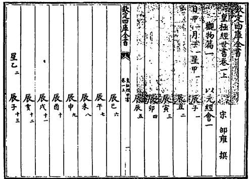  
図6-1 『皇極経世書』観物篇一

る。また干支の後にみえる数字は，暦元を起点とした単位ごとの通し番号である。たとえば観物篇十四には，日甲1・月巳6・星癸180・辰未2,156の第11年甲辰に，唐堯は即位したとある6)が，邵雍の年代推定によれば，唐堯の即位という中国史上最も重要な事件は，暦元から数えて2,155×30+11=64,661年，すなわち皇極経世暦の64,661年に起こっている。

元・会・運・世は，天空にかかる日(太陽)と月と星と辰(十二辰)の運行をみて定められた時の計量単位であるが，天の四象日・月・星・辰は，具体的な天体を意味するにとどまらない。『皇極経世書』の基本的なカテゴリー，太陽・太陰・少陽・少陰自体をも象徴している。「動の大なる者これを太陽といい，動の小なる者これを少陽といい，静の大なる者これを太陰といい,静の小なる者これを少陰という。太陽は日をなし,太陰は月をなし,少陽は星をなし，少陰は辰をなす」という(観物篇五十ー)のがそれである。これらの配当は地のカテゴリーである火・水・石・土(地の四象)が，太剛・太柔・少剛・少柔の象徴であるのとまさに等しい。天と地の四象には上記以外にも，それぞれ緊密に対応するエレメントが定まっている7(表6-3)。邵雍の思考法の大きな特徴は，数多くの4項概念春・夏・秋・冬や生・長・収・蔵や皇・帝・王・伯(覇)や意・言・象・数や士・農・工・商や易・書・詩・春秋などを，適宜組み合わせて理論を創りあげるところにある。

表 6-3 経世四象対応表
<table><tr><td>太陽</td><td>太陰 少陽</td><td>少陰</td><td>少剛</td><td>少柔</td><td>太剛</td><td>太柔</td></tr><tr><td>日</td><td>月 星</td><td>辰</td><td>石</td><td>土</td><td>火</td><td>水</td></tr><tr><td>暑</td><td>寒 昼</td><td>夜</td><td>雷</td><td>露</td><td>風</td><td>雨</td></tr><tr><td>性</td><td>情 形</td><td>体</td><td>木</td><td>草</td><td>飛</td><td>走</td></tr><tr><td>色</td><td>声 気</td><td>味</td><td>鼻</td><td>口</td><td>目</td><td>耳</td></tr></table>

宇宙年表「以元経会」の12篇は，「月子一]「月丑二」……と，1会=10,800年が12つづくという整然とした構成からなっているが，地球年表「以会経運」の12篇は，各篇の扱う期間が一定ではない。観物篇十三の以会経運一は，万物が誕生した「経日之甲一・経月之寅三」の「月寅之中(中央)」に位置する「経星之已七十六」(経世暦27,001年=B.C.40,017)から始まり，「経月之卯四」経月之辰五」とつづき，「経月之巳六」の「経星之壬一百七十九」(経世暦64,440年=B.C.2,578)に終わっている。扱う時間はかなり長いが，「開物」以外の記述はなく歳名もあたえられていない。一方,観物篇十四の以会経運二は，「経月之巳六」の最後の運「経星之癸一百八十」の，最初の世「経辰之子二千一百四十九」の第1年「甲子」(経世暦64,441年=B.C.2,577)に始まり，「経辰之亥二千一百六十」の最後の年「癸亥」(経世暦64,800年=B.C.2,217)に終わっており，星癸第180運にかんする年表である。年表には「夏禹五(年)」のごとく，帝王紀年当時の為政者の何年にあたるかが記されている。以下，以会経運の三，四，……，十一も同様に，「経月之午七」の第1運から第9運にかんするそれぞれ360年ごとの為政者の変遷表である。戦国期や南北朝期などについては，複数の王朝の為政者の在位などが併記されている。最後の観物篇二十四の以会経運十二は，「経月之午七」の第10運の「経星之癸一百九十」(経世暦68,041年=A.D.1,024から経世暦68,400年=A.D.1,383)にかんする年表を記したあと，第11運の星甲191以下について，「経星之甲一百九十一」のごとく星(運)名のみを記し，「経月之未八」「経月之申九」経月之酉十」とつづき，「経月之戌十一」の中央に位置する「経星之戊三百十五」(経世暦113,400年=

A.D.46,384)の「閉物」に終わっている。

一方，歴史年表「以運経世」は観物篇二十五から三十四の10篇からなり，篇ごとに1運=360年の歳名を定め，歳名の下に年内に起きた重大事件を記している。人間の歴史を明らかにするのが以運経世の目指しているところである。たとえば観物篇二十五の以運経世一には，経世暦64,661年=B.C.2,357の「甲辰(の年)。唐帝堯，平陽に肇位し，陶唐氏と号す。羲

<table><tr><td rowspan=1 colspan=3>欽定四庫全書</td><td rowspan=1 colspan=1>丙申</td></tr><tr><td rowspan=1 colspan=2>皇極經世書卷五上</td><td rowspan=1 colspan=1>宋邵雍撰</td><td rowspan=1 colspan=1>丁酉</td></tr><tr><td rowspan=1 colspan=1>親抄二十五</td><td rowspan=1 colspan=1></td><td rowspan=1 colspan=1></td><td rowspan=1 colspan=1>戊戌</td></tr><tr><td rowspan=1 colspan=1>元之甲Ley</td><td rowspan=1 colspan=1></td><td rowspan=1 colspan=1></td><td rowspan=1 colspan=1>已亥</td></tr><tr><td rowspan=1 colspan=3>經會之巳1E028</td><td rowspan=1 colspan=1>庚子</td></tr><tr><td rowspan=1 colspan=3>經運之於一百八</td><td rowspan=1 colspan=1>辛丑</td></tr><tr><td rowspan=1 colspan=3>經世之十日百四十九</td><td rowspan=1 colspan=1>壬寅</td></tr><tr><td rowspan=1 colspan=3>經世之丑二千十百五十</td><td rowspan=1 colspan=1>癸卯</td></tr><tr><td rowspan=1 colspan=3>經世之寅二千一百五十一</td><td rowspan=1 colspan=1>甲辰唐帝堯肇位于平陽號陶唐氏命羲和欽若昊天</td></tr><tr><td rowspan=1 colspan=3>經世之卯二千一百五十二</td><td rowspan=1 colspan=1>歷象日月星辰敬授人時朞三百六旬有六日以</td></tr><tr><td rowspan=1 colspan=3>經世之辰二千一百五十三</td><td rowspan=1 colspan=1>閏月定四時成歲曰載建寅月為始允釐百工庚</td></tr><tr><td rowspan=1 colspan=3>經世之巳二千一百五十四</td><td rowspan=1 colspan=1>績咸熙</td></tr><tr><td rowspan=1 colspan=3>經世之午二千一百五十五</td><td rowspan=1 colspan=1>乙巳</td></tr><tr><td rowspan=1 colspan=3>經世之未二千一百五十六</td><td rowspan=1 colspan=1>丙午</td></tr><tr><td rowspan=1 colspan=3>甲午</td><td rowspan=1 colspan=1>丁来</td></tr><tr><td rowspan=1 colspan=3>乙未</td><td rowspan=1 colspan=1>戊申</td></tr></table>

図6-2『皇極経世書』観物篇二十五

和に命じて，欽みて昊天に若わしめ，日月星辰を暦象して，敬みて人に時を授けしむ。期は三百六旬有六日，閏月を以て四時を定め歳を成し，載と日い，建寅月を始と為す。允に百工を釐め，庶績みな煕し」などとみえる(図6-2)。一見して明らかなごとく，文章の大半は『尚書』堯典からの引用である。また帝堯の甲辰即位説は，晋の皇甫謐が「堯は甲申の歳を以て生まれ，甲辰，帝位に即く」云々とのべた(『史記集解』五帝本義引)のが早い例であるが，邵雍当時，通説であった可能性は高くない8)。

以運経世の諸篇は，「経元之甲一・経会之巳六・経運之癸一百八十・経世之子二千一百四十九」(経世曆64,441年=B.C.2,577)に年表が始まり，[経世之未二千一百五十六の元年の甲午(経世暦64,651年=B.C.2,367)に紀年が始まっているけれども，歴史事件にかんする記載は「経世之未二千

一百五十六の第11年の甲辰(経世暦64,661年=B.C.2,357)堯の即位が最初であり，観物篇三十四の以運経世十の「経元之甲一・経会之午七・経運之壬一百八十九第296年己未(経世曆67,976年=A.D.959)——後周恭帝の即位が最後である。また年代の表記は以元経会や以会経運とは異なり，日・月・星・辰あるいは経日・経月・経星・経辰などと書かず，ただちに経元・経会・経運・経世などと記している。歴史年表の年代表記に宇宙年表や地球年表のごとく日・月・星・辰を用いないのは，天の四象による表記は人間の事件を記すのに適当でない，と邵雍が判断したからであろうと推定することができる。

『皇極経世書』歴年表については，経書にみえる歴史事件の正確な年代を定め，経学上のいくつかの重要問題をみごとに解決した，等々と称賛する者に事欠かない。たとえば観物篇二十七には，「経元之甲ー・経会之午七・経運之乙一百八十二・経世之卯二千一百七十六」の第14年[丁未(経世暦65,264年=B.C.1,754)。商王成湯，崩ず。元子太甲，位に践（」とみえるが，張拭(1132-1180)はこれについて，『史記』以来の伝習の謬りを正しており，「万世改むべからざる者」であると絶賛している(経世紀年自序)。『史記』殷本紀には，湯が崩じたあと，太子の太丁の弟の外丙と仲壬が立ち，そののち太丁の子の太甲が立ったとあり,司馬遷の説にしたがえば，『尚書』伊訓の「成湯既没，太甲元年」の記述と矛盾をいたすからである。また観物篇二十九には，「経元之甲一・経会之午七・経運之丁一百八十四・経世之子二千一百九十七」の第16年「己卯(経世暦65,896年=B.C.1,122)。呂尚，武王に相し，商を伐つ」とみえる。張拭によれば，邵雍の年代推定は『尚書』泰誓の序に「惟十有一年，武王伐殷」とあることを根拠として，経文中の「惟十有三年春，大会於孟津」の「三」を「一」に訂正したものにほかならない(経世紀年自序)。

『皇極経世書』には元・会・運・世とよばれる四つの時代区分があるが，実際上最も重視すべきは，書名の暗示するごとく1世＝30年である。「古は三十年を謂いて一世となす，豈に徒然ならんや。化の必ず洽く教の必ず浹きを俟ちて，民の情，始めて一変すべし。苟くも命世の人，世を継ぎて興るあらば，則ち民，夷狄のごとしと雖も，三変して帝道挙ぐべし」王者に三変，30年×3の時間があれば，理想社会を実現することも不可能ではない(観物篇六十)。また孔子が「善人，邦を為めること百年(=30年×3)，また以て残に勝ち殺を去るべし。誠なるかな，是の言や」と述懐した(『論語』子路)ごとく，伯の政治は30年をへて一変して王の政治になり，王の政治は30年をへて一変して帝の政治になり，帝の政治は30年をへて一変して皇の政治にいたることができる(観物篇五十九)。邵雍が歴年表をことごとく30年に分割するのは，中国の文化伝統に則って歴史発展における一世一変の重要性を認識した結果にほかならないのである。

邵雍の歴史観は巨大な循環をその大きな特徴としている。『皇極経世書』の年表は確かに，現世を含む129,600年のことを記したものであるが，その129,600年は「日甲一」「経日之甲一」「経元之甲一」などとのべられており，命名からして日乙第2元・日丙第3元・……の存在を前提としている。宇宙は万物の死滅から気の消滅にいたろうとも，消滅後にはただちに新たな再生がつづくのである。だが邵雍の循環史観は，「三皇は春なり。五帝は夏なり。三王は秋なり。五伯は冬なり」(観物篇六十)とあるごとく，陰陽二気の消長にもとづく季節の循環を歴史上に展開したものにすぎない9)。

## 1.2 声音表

邵雍の律呂声音の学もきわめて個性的である。自らの策定した漢字音の二つの音素112の天声(韻母と声調)と152の地音(声母と等位)にもとづいて，存在するかぎりの漢字音を表示している。宋代語音を知る上で疎かにすべからざる資料の一つに数えられるゆえんである。

『皇極経世書』観物篇の三十五から五十の16篇には，邵雍の声音研究の成果を示す各種の声音表がみえる(図6-3)。各篇の冒頭に記されたのが天声と地音の一覧表(天声表と地音表)であり，それにつづくのが天声と地音の反切表声唱呂の10表と音和律の12表である10)。

<table><tr><td rowspan=1 colspan=1>欽定四庫全書</td></tr><tr><td rowspan=1 colspan=1>下皇極經世書卷七上     宋卻雍撰</td></tr><tr><td rowspan=1 colspan=1>觀物為三十五  a2H4</td></tr><tr><td rowspan=1 colspan=1>日日聲平聞SLZ2O A水水音開清</td></tr><tr><td rowspan=1 colspan=1>多良十刀   3    古黑安夫卜東</td></tr><tr><td rowspan=1 colspan=1>2I    乃走思t           6</td></tr><tr><td rowspan=1 colspan=1>日日聲七下唱地之    水水音九上和天之</td></tr><tr><td rowspan=1 colspan=1>用音一百五十二是    用聲一百一十二是</td></tr><tr><td rowspan=1 colspan=1>欽定四庫全書     はまよ</td></tr><tr><td rowspan=1 colspan=1>謂平聲聞音平聲開   謂開音清聲開音清</td></tr><tr><td rowspan=1 colspan=1>音一千六十四       聲一千八</td></tr><tr><td rowspan=1 colspan=1></td></tr><tr><td rowspan=1 colspan=1>日日聲平之一聞      水水音開之一清</td></tr><tr><td rowspan=1 colspan=1></td></tr><tr><td rowspan=1 colspan=1>平聲聞唱吕一之一開音清和律一之一</td></tr><tr><td rowspan=1 colspan=1>古甲九癸           古古古古多多多多           多可个舌</td></tr><tr><td rowspan=1 colspan=1>一音 口口近揆      一音 古古古古多多多多未大化八</td></tr><tr><td rowspan=1 colspan=1>一聲坤巧邱弃      一奉 古古古古多多多多聞辛衆</td></tr><tr><td rowspan=1 colspan=1>口口州           古古古古多多多多           四每退</td></tr><tr><td rowspan=1 colspan=1>黑花香血           古古古古生多多多           良面向</td></tr><tr><td rowspan=1 colspan=1>二音 黃華雄賢      一音 古古古古多多多多光廣况</td></tr><tr><td rowspan=1 colspan=1>一峰五九仰口      二聲古古古古多多多多丁井豆C</td></tr><tr><td rowspan=1 colspan=1>吾牙月先           古古古古多多多多           兄未莹</td></tr></table>

図6-3 声音表

天声表と地音表は，篇ごとに上下に一つずつ合計16×2あり，構成はきわめて整然としている(表6-4)。「天之用声一百十二」表は，①韻頭の闢(開口呼)翕(合口呼)と②平上去入の声調(四声)の原理にもとづいて，112の韻母を16に分類した(7×16=112)韻部表であり，「地之用音一百五十二」表は，①声母の清(無声)濁(有声)と②開発収閉(等韻の1等・2等・3等・4等に近い)の原理にもとづいて，152の声母を16に分類した(9×4+12×8+5×4=152)子音表である(表6-5)。表中の記号は有声無字を示し，□は有音無字を示している。また天声と地音の各類はおのおの，天の四

表6-4 律呂声音表
<table><tr><td>篇35 篇36 篇37 篇38</td><td>日日声平闢 日月声平翕 日星声平闢 日辰声平翕</td><td>水水音開清 水火音開濁 水土音開清 水石音開濁</td><td>篇43 篇44 篇45 篇46</td><td>星日声去闢 星月声去翕 星星声去闢 星辰声去翕</td><td>土水音収清 土火音収濁 土土音収清 土石音収濁</td></tr><tr><td>篇39 篇40 篇41</td><td>月日声上闢 月月声上翕 月星声上闢</td><td>火水音発清 火火音発濁</td><td>篇47 篇48</td><td>辰日声入闢 辰月声入翕</td><td>石水音閉清 石火音閉濁</td></tr></table>

表6-5 天声地音一覧表
<table><tr><td colspan="2">天声</td><td colspan="2">地音</td></tr><tr><td>日日声平闢</td><td>多良千刀妻宮心●●●</td><td>水水音開清</td><td>古黒安夫卜東乃走思■</td></tr><tr><td>日月声平翕</td><td>禾光元毛衰龍●●●</td><td>水火音開濁</td><td>□黄□父歩兌内自寺■</td></tr><tr><td>日星声平闢</td><td>開丁臣牛魚男●●●</td><td>水土音開清</td><td>坤五母武普土老草</td></tr><tr><td>日辰声平翕</td><td>回兄君○亀烏○●●●</td><td>水石音開濁</td><td>□吾目文旁同鹿曹□</td></tr><tr><td>月日声上闢</td><td>可両典早子孔審●●●</td><td>火水音発清</td><td>甲花亜法丹百孀哉三山荘卓</td></tr><tr><td>月月声上翕</td><td>火広犬宝○甬○●●●</td><td>火火音発濁</td><td>□華爻凡白大南在□士乍宅</td></tr><tr><td>月星声上闢</td><td>宰井引斗○鼠坎●●●</td><td>火土音発清</td><td>巧瓦馬晚朴貪冷采□□叉坼</td></tr><tr><td>月辰声上翕</td><td>每永允○水虎○●●●</td><td>火石音発濁</td><td>□牙児万排覃榮才□□崇茶</td></tr><tr><td>星日声去關</td><td>个向旦孝四衆禁●●●</td><td>土水音収清</td><td>九香乙丙帝女足星手震中</td></tr><tr><td>星月声去翕</td><td>化況半報帥用●●●</td><td>土火音収濁</td><td>近雄王□備弟年匠象石□直</td></tr><tr><td>星星声去闢</td><td>愛亘艮奏○去欠●●●</td><td>土土音収清</td><td>丘仰美□品天呂七□耳赤丑</td></tr><tr><td>星辰声去翕</td><td>退瑩巽○貴兎○●●●</td><td>土石音収濁</td><td>乾月眉□平田離全□二辰星</td></tr><tr><td>辰日声入闢</td><td>舌○○岳日○○●●●</td><td>石水音閉清</td><td>癸血一飛必</td></tr><tr><td>辰月声入翕</td><td>八〇○霍骨○十●●●</td><td>石火音閉濁</td><td>揆賢寅吠鼻</td></tr><tr><td>辰星声入闢</td><td>○○○六徳○○●●●</td><td>石土音閉清</td><td>弃米尾匹</td></tr><tr><td>辰辰声入翕</td><td>○○○玉北○妾●●●</td><td>石石音閉濁</td><td>蚪堯民未瓶</td></tr></table>

象の日・月・星・辰と地の四象の水・火・土・石を重ねて名づけられており，4進を特徴とする命名法は歴年表と基本的に等しい。天声16類のばあい，最初に唱える日が平声，月が上声，星が去声，辰が入声を表し，第2の日と星が開口呼の闢声，月と辰が合口呼の翕声を表わす。ま

  
図6-4 経世声音図

  
図6-5 声音表(道蔵本)

た地音16類のばあい，最初の水が開音，火が発音，土が収音，石が閉音を表し，第2の水と土が清音，火と石が濁音を表している(図6-4)11)。

たとえば観物篇三十五の「日日声平闢」と「水水音開清」は，それぞれ平声開口呼の韻母と開音清音の声母を意味し，「多(a)・良(ang)·千(an)·刀(au)·妻(i)·宮

(ung)・心(im)・●・●・●」の10声と「古(k)・黒(x)・安(0)・夫(f)・卜(p)・東(t)・乃(n)・走(ts)・思(s)・■・■・■」の12音を含んでいる。各声音は記載の順に「一声」「二声」あるいは「一音」「二音」……という。天の全声は10声からなり，地の全音は12音である。記号●は無声無字を示し，は無音無字を示している12)。無声無字や無音無字を数えるのを省略して「日日声七」「水水音九」などということができるのは，無声無字の48声と無音無字の40音には数的整合性に関わることをのぞいて特別の意味がないからである。

一方，声唱呂の160(=10×16)表と音和律の192(=12×16)表であるが，天声112と地音152の反切をもって，存在するあらゆる漢字音を示している。たとえば観物篇三十五の平声闢唱呂の第1表(図6-3)のばあい，日日声の「一声」の「多(a)」に16の「一音」を組み合わせ，①水水音の第1音「古(k)」，②火水音の第1音「甲(k)]，③土水音の第1音[九(k)]，④石水音の第1音[癸(k)」，⑤水火音の第1音[□(g)」，⑥ 火火音の第1音[□(g)」，⑦土火音の第1音「近(g)]，⑧石火音の第1音[揆(g)]，⑨水土音の第1音[坤(k')]，⑩火土音の第1音[巧(k)」，⑩土土音の第1音[丘(k)]，②石土音の第1音[弃(k)」，③水石音の第1音[□(k)」，④ 火石音の第1音「□(k)」，⑤土石音の第1音「乾(k)」，⑩⑥石石音の第1音「蚪k)」との反切をあたえており，「多」に対する「一音」の組み合わせを網羅している。これが[一音一声」の考察であり，縦に古多(ka)・甲多(ka)・九多(ka)・癸多(ka)・□多(ga)……と列記された16の反切がその結果にほかならない。

「一音一声」には「二音一声」「三音一声」……「十二音一声」の組み合わせがつづき，第12音との反切の記載をもって第1声「多」にかんする考察が終わる。日日声の一声「多」字の「唱呂」がこれである。「平声闢唱呂一之一」と名づけられている。以下同様に，「平声闢唱呂一之二」は日日声の第2声「良(ang)」と地の152の用音との反切を記し，「平声闢唱呂一之三」は第3声「千(an)」……，「平声闢唱呂一之十」は第10声「●」との反切をあたえている。平声闢唱呂表はあわせて10表である。

『皇極経世書』の音和律表のシステムは，声唱呂表とまったく反対である。地音を固定しながら天声との組み合わせを考察している。すなわち，観物篇三十五の開音清和律一之一(図6-3)のばあい，水水音の「一音」である「古(k)」に[一声」すべてを組み合わせ，古多(ka)・古可(ka)・古个(ka)·古舌(ka)，古禾(kua)·古火(kua)·古化(kua)·古八(kua)，……云々と反切によって発音を表示している。開音清和律表はあわせて12表からなるが，それは水水音が12音を含んでいるためである。

だが声音表の上下の配置については，版本ごとに少し異なるところがある。四庫全書本(図6-3)は上層が声唱呂表，下層が音和律表からなり，道蔵本(図6-5)はこれに対して上下が逆である。また性理大全本は反切表を録していないが，道蔵本と同じく上に音和律，下に声唱呂をおいて反切のシステムを説明している(経世四象体用之数図)。だが天声と地音にかんする説明文を読むかぎり，四庫全書本の構成の方が妥当と判断せざるをえない。たとえば日日声平闢のばあい，「日日声七。下，地の用音一百五十二を唱す。これを平声闢音という。平声闢音，一千六十四」とあるが，「日日声平之一闢」すなわち平声闢音が1064になるのは平声闢唱呂の10表をおいてほかになく，したがって四庫全書本のごとく日日声平之一闢と平声闢唱呂表を同じ層におかねばならないからである。

邵雍の術数理論(観物篇六十ー)によれば，天声が112声からなり地音が152音からなることにも必然的な理由がある。すなわち，陽数と剛数はほんらい10であり陰数と柔数は12であるため，同類の和である太陽少陽太剛少剛の本数と太陰少陰太柔少柔の本数は40(10+10+10+10=40)と48(12+12+12+12=48)になり，本数の4倍にあたる太陽少陽太剛少剛の体数と太陰少陰太柔少柔の体数は160(40×4=160)と192(48×4=192)にならざるをえない。また陰陽剛柔が相互に進退し，太陽少陽太剛少剛の体数(無声無字を含む天声の総数，10声×16類)の内から太陰少陰太柔少柔の本数(無声無字の数)を退けたとき，「太陽少陽太剛少剛之用数一百十二」が生じ(160-48=112)，太陰少陰太柔少柔の体数(無音無字を含む地音の総数，12音×16類)の内から太陽少陽太剛少剛の本数(無音無字の数)を退けたとき，「太陰少陰太柔少柔之用数一百五十二」が生じる(192-40=152)。それゆえ太陽少陽太剛少剛の用数が「天之用声」を象徴し，太陰少陰太柔少柔の用数が「地之用音」を象徴するのは当然である，云々という。また同じ理論は，真の天声(天の全声)が無声無字を含み，真の地音(地の全音)が無音無字を含む理由についても説明している。

観物篇六十一はつづけて，太陽少陽太剛少剛の用数をもって太陰少陰太柔少柔の用数を「唱」し，「日月星辰之変数」ないし「動数(動物の数)」の一万七千二十四を導きだし(112×152=17,024)，太陰少陰太柔少柔の用数をもって太陽少陽太剛少剛の用数を「和」し，「水火土石之化数」ないし「植数(植物の数)」の一万七千二十四を算出する $( 1 1 2 \times 1 5 2 = 1 7 , 0 2 4 )$ 。また「再唱和」して，万物の数にあたる「日月星辰水火土石之変化通数」ないし「動植通数」の二万八千九百八十一万六千五百七十六を導きだしている(17,024×17,024=289,816,576)。唱和の意味はむろん，声音律呂学の概念，声唱呂・音和律のことにほかならない。

## 1.3 観物外篇と先天易学

朱熹とそのエピゴーネンたちは邵雍を北宋六子の1人に数えて道学上重要な地位にまつりあげたが，周知のごとく，それは『皇極経世書』を特徴づける術数学推歩歴年学や声音律呂学を高く評価したためではない。清学のイデオローグの1人，全祖望も「邵康節が聖門に列された理由は，皇極経世のためではない」と断じている（黄宗羲『宋元学案』百源学案)。道学者が邵雍の術数学を重視しなかったことは，後世の代表的な道学書の一つ『性理大全』所収の皇極経世書が，歴年表と声音表を収録していないことを思い起こせば一目瞭然であろう13)。事実，朱熹の高弟の蔡元定は「皇極経世の書は，数を命じ象を定め，自ら一家をなす。古の未だ有らざる所，学者の未だ見ざる所なり。然れどもまたみな伏羲卦画奇偶の序に出で，その道たるやまた太極に同一す」とのべ，①自らの邵雍研究書『皇極経世指要』から歴年表と音声表をのぞき，②伏羲卦図を根拠として観物内外篇の内容に注釈を加えたことについてその理由を明らかにし，道学の観点に立脚して邵雍の術数書に決定的な改竄を加えたことを正当化している(『性理大全』巻七)。また朱熹は『易学啓蒙』原卦画において「邵子のいわゆる画前に易ある者は，またその真にして不妄なるを見るべし」とのべ，『周易本義』にも邵雍の易図を引用しており，朱熹が邵雍の先天易説に全面的に依拠して八卦と六十四卦の画卦法を説明したことはよく知られているとおりである。朱熹や蔡元定による邵雍の易学の顕彰をとおして，邵雍の道学上の決定的な地位が確定したのである。

だが邵雍の先天易学が記されたのは，弟子たちの編纂になる『皇極経世書』観物外篇であり，『易学啓蒙』や『周易本義』が記す「邵子曰」の易説もすべて，観物外篇からの引用にほかならない。一方，邵雍自身が著述した歴年表と音声表に第一義的に現われるのは術数の論理であり，「数」の華麗な展開は既述のごとく，易の論理に逐一拘泥したものではなく，数理の命じるままにしたがい易理を無視したところも多い。また邵雍自身の筆になる観物内篇にも易説はみられるが，易学自体としては独創性に乏しく易数自体の解明も企図していない。易学理論の新たな展開は意外なことに，門弟子の編纂になり「小失なき能たわず」と称された(『性理

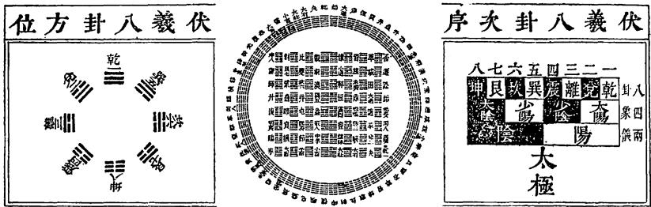

図6-6 伏羲八卦方位図  
図6-7 伏羲六十四卦方位図  
図6-8 伏羲八卦次序図  
  
図6-9 伏羲六十四卦次序図

大全』巻十一，邵伯温曰)観物外篇にしか存在しないのである。乾隆の四庫館員が評したごとく，「邵子は必ずしも尽くは易を用いざるなり」(『四庫全書総目提要』巻百八，観物篇解)と解釈せざるをえない。

邵雍の易学は朱熹などの顕彰をうけたけれども，現行の『皇極経世書』観物外篇には，説明にほんらい不可欠の易図は一つも残っていない。だが完全とはいかないが，朱熹『周易本義』易学啓蒙』や張行成『易通変』などにもとづいて原図を復元することができる。そもそも邵雍の易学は先天の学と後天の学にわかれ，『周易本義』にみえる伏羲四図(伏羲八卦次序図·伏羲八卦方位図·伏羲六十四卦次序図·伏羲六十四卦方位図)と文王二図(文王八卦方位図・文王八卦次序図)が，二つの易学の異なる点を簡潔かつ的確に表している。だが朱熹の描いた6図が邵雍の易説を正確に伝えていることは確かであるとしても，邵雍の原図そのものであるか否かは定かでない。伏羲八卦方位図(図6-6)と伏羲六十四卦方位図(図6-7)は，図の名称は異なっているものの『易学啓蒙』や『性理大全』皇極経世書にも描かれており，原図の可能性が高いけれども，伏羲八卦次序図(図6-8)と伏羲六十四卦次序図(図6-9)は，同じ書にみえず,原図であるかどうかきわめて疑わしい。だが『皇極経世書』観物外篇には，邵雍が「図(原注：先天図也)に文なしと雖も，吾，終日言いて未だ嘗てこれを離れず。蓋し天地万物の理，尽くその中にあり」とのべたことが記されている。同文を信ずるかぎり，邵雍が先天易の説明を目的として「先天図」を描いたことに疑問の余地はない。また先天図については，『易学啓蒙』が伏羲八卦方位図と伏羲六十四卦方位図の解説に同文を引用しており，両図ないしそのいずれかを指すと推定することができる。だが忘れてならないのは，『性理大全』皇極経世書に伏羲方位図とは似ても似つかぬ図経世六十四卦数図(図6-10)が描かれ，「即ち先天図なり」と記されていることである。南宋の張行成は『易通変』原序において先の「図に文なしと雖も，……理，尽くその中にあり」を引いたあと,ただちに「先天図を謂うなり。先生の学は,象と数の二図に祖る」とのべ，また巻九の先天象数二図節において「先天象図は，乾の六画より始まり，坤の十二画に至りて終わる」(先天)数図は，乾一一より始まり，坤八八に至りて終わる」云々と象数2図の内容を説明している14)。張行成の描く先天象図(図6-11)が伏羲六十四卦方位図に基本的に等しく，『性理大全』の経世六十四卦数図の構造が張行成

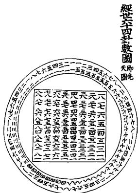  
図6-10 経世六十四卦数図

  
図6-11 先天象図

の説明とまったく一致しているからには，邵雍が2種類の先天図を描き，伏羲六十四卦方位図と経世六十四卦数図あるいはそれらに類似した易図を先天象図・先天数図と称していたと論定せざるをえないであろう。

邵雍の先天易学を最も特徴づけているのは改めていうまでもなく，加一倍法(『河南程氏外書』巻十二，明道による邵雍の易数の総括)にもとづく『周易』繋辞伝の「易に太極あり，これ両儀を生ず。両儀，四象を生じ，四象，八卦を生ず」に対する新たな解釈である。邵雍はこれについて，「太極既分，両儀立矣。陽下交於陰，陰上交於陽，四象生矣。陽交於陰，陰交於陽，而生天之四象，剛交於柔，柔交於剛，而生地之四象，於是八卦成矣。八卦相錯，然後万物生矣。是故一分為二，二分為四，四分為八，八分為十六，十六分為三十二，三十二分為六十四。故曰分陰分陽，迭用柔剛，易六位而成章矣」陰陽2気が交わって，太極(2°)→両儀(21)→四象(22)→八卦(23)→ 16(24)→ 32(25)→ 六十四卦(2⁶)と発達していくと説明している(観物外篇)。太極の展開は一見して明らかなごとく,算学の加一倍法2の等比数列ないし2進法に等しい。邵雍の画卦は漢唐易学にはみられない数学(術数学)的方法にもとづいており，当時にあっては「尤も法象自然の妙を見す」『周易本義』伏羲六十四卦次序図の解説)きわめて斬新な解釈であったことは確かである。後漢の虞翻(164-233)の「両儀生四象」「四象生八卦」に対する解釈などと比較すれば，邵雍の解釈の斬新性や画期性は自ずと明らかであろう。虞翻は卦変説をもって「四象は四時なり。両儀は乾坤を謂う。乾二五，坤に之けば，坎離震兌を成す。震は春兌は秋，坎は冬離は夏，故に両儀，四象を生ず」乾二五，坤に之けば，則ち震坎艮を生じ，坤二五，乾に之けば，則ち巽離兌を生ず。故に四象，八卦を生ずるなり」云々とのべている(『周易集解』)。「乾二五之坤」や「坤二五之乾」については当然，宋の朱震(1072-1138)『漢上易卦図』坎離天地之中図(図6-12)の解釈にしたがわねばならない15)。

邵雍の易学は加一倍法を理論の根底におき，きわめて術数学的であるが，そのことは先天図においても同様である。先天数図(図6-10)は数(卦数ないし位数)「順数」の「(八卦の)乾一·兌二·離三·震四，巽五·坎六・艮七・坤八」にもとづき，先天象図(図6-7)は象(爻数)「逆数」の「震一·離兌二·乾三，巽四·坎艮五·坤六」を根拠としている(観物外篇)。順数とは卦の位置に注目して，伏羲八卦方位図(図6-6)を上から下に乾・兌・離・震，また巽・坎・艮・坤と数えること

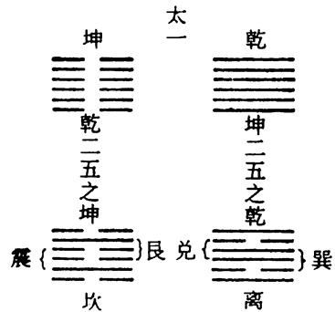  
図6-12 坎離天地之中図

であり，逆数とは爻の陰陽(陽爻=1,陰爻=2)に注目して，下から上に1陽(震)・2陽(離と兌)・3陽(乾)，3陰(坤)・2陰1陽(坎と艮)・1陰2陽(巽)と数えることである。先天の数図も象図もそれぞれ別の位相の「数」の論理にしたがっているが，完全に1対1に対応しており意味するところはほとんど変わらない16)。

## 1.4 術数と観物

『皇極経世書』は数の論理が満ち溢れ「数を以て宗とし」ており，典型的な術数学書である。邵雍の易学においても数が第一義的に機能しており，「また易の余緒と雖も，実に易の本義を作すにあらず」易の余緒(易外別伝)ではあっても，易の本義を明らかにしているわけではない(『四庫全書総目提要』巻百八，術数類数学之属の案文)。『皇極経世書』を単純に易学書ととらえることができないゆえんである17)。

事実，邵雍の陰陽剛柔は『周易』説卦伝の「天の道を立てて陰と陽といい，地の道を立てて柔と剛という」にもとづいているものの，『皇極経世書』は既述のごとく，易の理論そのものを根拠にして歴年や声音の数を解釈してはいない。また六十四卦の数の配当は，(1）一一の乾卦=1,(2)二一の夬卦=12，(3)三一の大有卦=360=12×30，(4)四一の大壮卦=$4 , 3 2 0 = 1 2 ^ { 2 } \times 3 0$ (5)五一の小畜卦 $= 1 2 9 , 6 0 0 = 1 2 ^ { 2 } \times 3 0 ^ { 2 } ,$ ……，(8)八一

## 術数学專論

の泰卦 $= 5 5 9 , 8 7 2 , 0 0 0 = 1 2 ^ { 4 } \times 3 0 ^ { 3 } ,$ (9)一二の履卦 $= 1 6 , 7 9 6 , 1 6 0 , 0 0 0 \ =$ $1 2 ^ { 4 } \times 3 0 ^ { 4 } ,$ (10)二二の兌卦 $= 2 0 1 , 5 5 3 , 9 2 0 , 0 0 0 = 1 2 ^ { 5 } \times 3 0 ^ { 4 } ,$ ……,(16)八二の臨卦 $= 9 4 3 , 6 9 9 , 6 9 1 , 5 2 0 , 0 0 0 , 0 0 0 \ = 1 2 ^ { 8 } \times 3 0 ^ { 7 } , ( 1 7 ) \ \equiv \mathrm { - } \varpi$ 同人卦=$2 8 , 3 1 0 , 9 9 0 , 7 4 5 , 6 0 0 , 0 0 0 , 0 0 0 = 1 2 ^ { 8 } \times 3 0 ^ { 8 } , ~ \cdots .$ (32)八四の復卦=2,652,887，$0 3 6 , 6 4 8 , 8 0 0 , 2 9 4 , 7 9 7 , 3 1 2 , 0 0 0 , 0 0 0 , 0 0 0 , 0 0 0 , 0 0 0 = \ 1 2 ^ { 1 6 } \times 3 0 ^ { 1 5 }$ ……,(64)八八の坤卦＝無極の数 $\left( = 1 2 ^ { 3 2 } \times 3 0 ^ { 3 1 } \right)$ としている(観物外篇)が,その卦画にもとづく数列は一見して明らかなごとく，暦数の(1)元の元=1,(2)元の会=12，(3)元の運=360=12×30，(4)元の世 $= 4 { , } 3 2 0 { = } 1 2 ^ { 2 } \times 3 0 ,$ (5) 元の歳$= 1 2 9 , 6 0 0 = 1 2 ^ { 2 } \times 3 0 ^ { 2 }$ ……，(8)元 $\mathcal { O } ) \overline { { \vert \overrightarrow { \mathrm { x } } } } = 5 5 9 , 8 7 2 , 0 0 0 = 1 2 ^ { 4 } \times 3 0 ^ { 3 } ,$ (9) 会の元=12，（10)会の会=144=12²，（11）会の運 $= 4 { , } 3 2 0 { = } 1 2 ^ { 2 } \times 3 0 ,$ (12) 会の世=51,840=12³×30，……，(17)運の元=360=12×30，……，(25)世の元 $= 4 , 3 2 0 = 1 2 ^ { 2 } \times 3 0 .$ ……，(64)辰の辰=313,456,656,384,000,000$= 1 2 ^ { 8 } \times 3 0 ^ { 6 } \textcircled { \mathcal { D } }$ 数列(観物篇六十)と同じでない。なお『性理大全』皇極経世書に引く邵伯温の経世天地始終之数図は易数と暦数を一つの数列にまとめあげているが，それは上の観物外篇のアルゴリズムと数値を改めた結果であり，易学の観点にもとづく意図的な改竄である。

『皇極経世書』は典型的な術数書であり数理科学と理論的な接点がある。だが歴年表は天体現象と密接な関係のある一種の暦書でありながら，極端に精度の低い天文定数1年=360日を採用し18)，また音声表も人類の言語行動を明らかにする経験科学の側面をもちながら，発音不能な「無声無字」や「無音無字」などをも考慮している。この事実は，邵雍の企図したのが自然現象の精密科学的な解明ではなく，人間社会における数的整合性や歴史的法則性の追求であることを如実に示している。だが精密科学的に粗雑な考察だからといって，邵雍の術数学をそくざに無意味な研究ととらえ知的退廃として退けてはならない。邵雍が明らかにしようとしたのは，人類の歴史や言語のなかに潜む根元的な法則性・整合性であり，数をキーワードとした歴史主義的ないし構成主義的な命題の証明だからである。われわれは多数の条件が複雑に入り交じるため蓋然性の高い結論を容易に下すことができない難問に直面したとき，事象をデフォルメしたり複数の要素に還元し，抽象化し一般化して，現実には存在しない単純化された全体あるいは理念化された要素に対して研究や考察を展開していくが，邵雍の数の分析もわれわれと同様なデフォルマシオンないし要素還元的な研究法の産物とのべることができる。邵雍は1年=360日として中国3,000年の歴史事件をあとづけているが，1年は厳密には360日ではないにしても，陰数12と陽数30を根拠とした単純化がなければ，巨大な歴史の循環を説く独自の学説は説得力を欠き専門研究として成功しなかったはずである。また発音することができない声母や韻母を考慮にいれて120の天声と152の地音の整然とした体系を構築しているが，発音全体の整合性に着目した抽象がなければ，中国語の音声のもつある種の構造を解明することにはおそらく失敗したに違いない。当時の歴史的コンテクストを根拠として総合的に判断するかぎり，邵雍のデフォルマシオンや単純すぎる抽象化にもそれなりの意味があり，『皇極経世書』の術数学には評価すべきところも数多く存在しているといわざるをえない。

『皇極経世書』の顕著な特徴の一つは，全篇を通じて篇名を「観物」と名づけていることである19)。邵雍の書のこうした統一的な構成は，かれの観物に対する特別な思い入れをよく示している。この点にもとづけば，邵雍の術数学の中心に位置するのは観物，すなわち「反観(内観)」にもとづく自然物の類型的かつ直感的な把握であり，観物の概念も数定性定量と緊密に関係しているととらえざるをえない。そもそも邵雍にとって自然物(客観存在)はすべて物であり，天地は「物の大なる者」にすぎず(観物篇五十一)，「我と人とみな物」である(観物篇六十二)。邵雍の観物には大きく，①低次の「我を以て物を観る」段階と②高次の「物を以て物を観る」段階がある(観物篇六十二)が，天地人物を物として同一視するのは，我執を捨て「物を以て物を観」，物自体に即して「万物の情を一にした」結果にほかならない。邵雍にとって天地人が一体であるのは，物自

体に即し物と次元を等しくしたとき，森羅万象がいずれも陰陽剛柔を共通の質量として創られているところにあり，逆に万象がたがいに相違し「一物の物あり，十物の物あり，百物の物あり，千物の物あり，万物の物あり，億物の物あり，兆物の物ある」(観物篇五十二)のは，物に内在する数すなわち形相因がそれをもたらしている。概念装置としての数がなければ，物の総体としての同一性も個々としての差別性も存在することができず，観物自然物の類型的階層的な把握も不可能である。「数」は観物において第一義的に機能していたのである。

## 2 皇極経世学の展開

先に分析したごとく，『皇極経世書』は優れた術数学書であり，暦術や音声学について数の論理を展開するのみならず，数理(2進法)の援用をとおして大胆にも易図の学の再構築を企図している(邵雍の思考は，数→易と表現することができる)。だが邵雍以降の皇極経世学は逆に，易学にもとづいて暦数や音声の理論を解釈しており，数論の基礎に易学をおくことを学術上の最も大きな特徴としている(論理構造を説けば，易→数ということができる)。宋明の皇極経世学を称して象数学とのべることができるゆえんである。

皇極経世学は邵雍の没後も，邵伯温(1057-1134)の『皇極経世内外篇解』→蔡元定(1135-1198)の『皇極経世指要』と発展をみ，明の胡広らの奉勅撰になる『性理大全』(1415)にいたって道学公認の術数解釈を完成した。皇極経世学の主流がこれである。術数学の理論としてはいくぶん面白味に欠けるものの，道学の理論と矛盾をきたさず無難な解釈が多い。一方，南宋の張行成の『易通変(皇極経世通変)』『皇極経世索隠』『皇極経世観物外篇衍義』(い、ずれも1166年，孝宗に進献)→祝泌の『観物篇解』(1235序)『皇極経世解起数訣』(1241序)→明の黄畿の『皇極経世書伝』(1504序)などは，邵雍の原意とは離れ支蔓なところも少なくないけれども，斬新な解釈もはなはだ多く，皇極経世学の理論レべルを一挙に飛躍させている。

## 2.1 邵伯温と蔡元定の易説

邵伯温の『皇極経世内外篇解』と蔡元定の『皇極経世指要』については現在のところ，伝本は発見されていない。だが『性理大全』皇極経世書の巻頭の按語によれば，「西山の蔡氏(蔡元定)，その図(邵伯温『皇極経世内外篇解』所収の諸図)に因りてこれを推衍し，著して『皇極経世指要』一書となす」，「今(性理大全を編むに際して)また具に康節の全書(皇極経世書の全文)を載せず，ただ蔡氏指要の諸図を取り，増すに諸家の釈例を以てし，纂して二巻となし，内外十四篇の首に列す」という20)。伝本が存在しないにもかかわらず邵伯温と蔡元定の学説の概略を知ることができるのは，『性理大全』皇極経世書に両氏の図説が数多く引用されているためである。

皇極経世学の最初の発展(あるいは変質とよぶべきかもしれない)は，邵雍の子の邵伯温によってもたらされた。邵伯温の経世一元消長之数図(図6-13)や経世天地始終之数図(既述)などにみえる，易説にもとづく統一的な解釈がそれである21)。上記諸図が邵伯温の手に出たことは，①該当図の解説に「邵伯温曰」の文章がみえ，②『性理大全』皇極経世書の巻

頭の按語に「邵伯温氏かつて一元消長などの図を著し，以てその要約を括る」とあり，疑問の余地はない。

邵伯温は数多くの数図(ないし易図)を描いて，『皇極経世書』の数理の隠された意味を明らかにしようとしたが,

  
図6-13 経世一元消長之数図

とりわけ重要であるのは経世一元消長之数図である。同図は漢以来の十二消息卦と皇極経世書の十二会を1対1に対応させ，復卦を子月に配当し，以下，臨一丑，泰一寅，大壮一卯，夬一辰，乾一巳，姤一午，遁一未，否一申，観一酉，剝一戌，坤一亥とし，気の消長を説く十二消息卦を利用して，皇極経世学の中心に位置する元会運世の基本構造をみごとに説明している22)。その易卦の暦数への配当は，邵伯温の術数学のもつ，易学による皇極経世学の再解釈ないし権威づけの側面をあざやかに浮かびあがらせている。経世一元消長之数図は南宋以降，「本書(皇極経世書)を以てこれを約す」元の黄瑞節)皇極経世学の全体を簡潔に要約していると考えられおり，したがって邵伯温の解釈がはたした意味はいたって重い。事実，朱熹も同図にもとづいて「経世(皇極経世書)は十二辟卦(消息卦)を以て十二会を管し，時節を繃定し，却って中に就いて吉凶消長を推す。堯時はまさにこれ乾卦の九五なり」とのべている(『朱子語類』巻百)。

朱熹が『易学啓蒙』を編み，術数学を道学のなかに組みこもうとしたとき，蔡元定に原稿の執筆を依頼したことはよく知られている(『宋史』儒林伝四)。『易学啓蒙』をもって朱熹1人の作と解すべからざるゆえんである。事実，朱熹は蔡元定の説を直接に引用することによって，蔡元定にもとづき10数図を河図にあて9数図を洛書にあてたことを明らかにしている(本図書第一)。また朱熹は『皇極経世書』のシステムを解して「堯時はまさにこれ乾卦の九五なり」とのべ，乾卦の九五に堯時を配当している(既述)が，唐堯の即位は月巳6の星癸180にあり，黄宗羲(『易学象数論』皇極三)の指摘するごとく，「九五」は「上九」の誤りである。術数学や象数学については，蔡元定の学識や研鑽の方が朱熹より勝っていたと推定することができる。逆に術数学や象数学における両者の協力が確認されている以上，蔡元定の術数解釈に朱熹の強い影響がみられることも想像してあまりある。

蔡元定の皇極経世学の第1の特徴をあげれば，先天易学に完全にもとづきながら邵雍のあらゆる数と象を解釈したところにある。蔡元定は声高く宣言する。「皇極経世の書，康節先生は以て先天の学となす。その道はもっぱら伏羲卦図に本づく」,「康節の学は，作用,同じからざると雖も，その実は則ち伏羲の画するところの卦なり」,「皇極経世の書，数を命じ象を定め，自ら一家をなす。古のいまだ有せざるところ，学者のいまだ見ざるところなり。然れどもまたみな伏羲卦画奇偶の序に出で，その道たるやまた太極に同一するなり」(『性理大全』皇極経世書一)。また確信に導くままに『皇極経世指要』の構成を定め，伏羲卦図を書前におき先天易説を根拠として観物篇の解釈を試みている。蔡元定によれば，『皇極経世書』の本質は先天易学にあり，「用字立文，自ら一家をなし，引経引義，別に一説をなす」にすぎない。「易」はほんらい完全無欠であり，それに加うべきなにものも存在しないのである(『性理大全』皇極経世書一)。

  
図6-14 伏羲始画八卦図  
図6-15 経世衍易図

『性理大全』皇極経世書に引く蔡元定の易図は合計11図からなり，そのうち6図は邵伯温の数図からの引用である。邵伯温に由来するのは,②八卦正位図，④六十四卦方円図(図6-9)，⑧経世天地始終之数図，⑨経世六十四卦数図(図6-10)，⑩経世一元消長之数図(図6-13)，①経世四

象体用之数図であり，数の構造自体に即して『皇極経世書』の数理の解明を企図しているが，蔡元定が新たに補足したのは，①伏羲始画八卦図(図6-14)，③八卦重為六十四卦，⑤陽九陰六用数図，⑥経世衍易図(図6-15)，⑦経世天地四象図であり，邵伯温とは違って易学の観点から数の意味や象徴するところを明らかにしようとしている。なかでも易学的性格づけが顕著であるのは，伏羲始画八卦図と経世衍易図である。前図は易の画卦，後図は皇極経世の四象を説明し，意味するところは同じでないけれども，図の構造自体は等しく，いずれも先天易学にいわゆる加一倍法にもとづいている。蔡元定は視覚に直接に訴える図をとおして，皇極経世学が「易を衍」したものにほかならぬことを世にアピールしたのである。

蔡元定は易学の観点にもとづいて，あらゆる数の構造を位置づけようとしたが,そのことは「洪範の数」の解明においても同様である。『宋史』蔡沈伝によれば，「洪範の数，学者久しくその伝を失い，元定独りこれを心得す，然れどもいまだ論著に及ばず。日く，吾が書を成すは沈なりと。沈，父師の託を受け，沈潜反覆すること数十年，然る後に書を成し，先儒のいまだ及ばざるところを発明す」という。蔡元定の子の蔡沈(1167-1230)の完成した『洪範皇極内外篇』(別名，『洪範皇極内篇』)がそれである。『洪範皇極内外篇』は「(『易』の)八卦(と『書』洪範伝の)九章，相経緯をなす」という劉歆の説に附会して，一から九の九数を重ねて八十一数のシステムを創りあげたものであるが，書としての「大意は『太玄』元包』『潜虚』既に已に易に擬え，以て新奇を見わすに足らざるを以て，故にその説を変幻にし，これを洪範に帰」したものにすぎない(『四庫全書総目提要』巻百八，洪範皇極内外篇)。蔡元定父子の術数学のばあい，皇極経世・洪範皇極を問わず，学術の根幹にはつねに易学が大きく横たわっていたのである。

## 2.2 張行成の掛一図と既済図

張行成は，字を文饒といい，蜀の臨邛の人。詳細な伝記は明らかではないが，『玉海』巻三十六，芸文によれば，南宋の乾道二年(1166)6月4日，「行成の進易，采るべきを以て，直徽猷閣に除せらる」という。『経義考』巻二十六に引く張行成の進易書状によれば，張行成の進奉した易説とは，①三易について論じた『述衍』18巻，②漢の揚雄『太玄』を明らかにした『翼玄』12巻，③北周の衛元嵩『元包』の注釈書『元包数義』3巻，④司馬光の『潜虚』を明らかにした『潜虚衍義』16巻，および⑤『皇極経世索隠』2巻，⑥『観物外篇衍義』9巻，⑦『通変』(別名，『易通変』『皇極通変』)40巻のことであり,後の3書は書名から明らかなごとく，邵雍の『皇極経世書』にかんする研究書である。現在，皇極経世学の3書にのみ伝本が残っている。

まず『皇極経世索隠』2巻であるが，同書は『皇極経世書』観物内篇の単なる注釈書にすぎない。だが十二消息卦を描いた邵伯温の経世一元消長之数図(図6-13)が巻上の最初に「皇極経世機要図」と銘打って転写されており，張行成の術数学が易学に基礎づけられていることをよく示している。また『皇極経世観物外篇衍義』9巻も書名のごとく観物外篇に対する注釈書であり，清代乾隆期の四庫全書館の史臣は同書の内容について「上三篇はみな数をいい，中三篇はみな象をいい，下三篇はみな理をいう」と総括している(『四庫全書総目提要』巻百八，皇極経世観物外篇衍義)。だが張行成の象数学書のうち重要性が最も高いのは，ほかならぬ『通変』40巻である。「陳搏より邵雍に至りて伝うる所の先天卦数などの十四図を取りて，敷演解釈し，以て諸易の変を通ず。始めは塗を殊にするが若きも，終には致を一にするに帰す」易図や易説を理論的根拠にして象数学の雑多のバリエーション(諸易の変)をーつに統している(『経義考』巻二十六，進易書状)からである。

張行成は『通変』自序のなかで，「(邵康節)先生の学は，(先天の)象と数二図に祖る。その用はみな交に起こり，交あれば則ち変ず」とのべ,①天を象徴する図のばあい，先天象図(図6-11)が交泰図に変じ四象運行図

に発展し，物を象徴する図のばあい，先天数図(図6-10)が既済図に変じ八卦変化図に発展することを示し，②天数と物数の「二者の用は，全く卦気の一図(別名，掛一図)にあり」，天の運行と物の変化はそれを外れることがないことを強調している。『通変』の自序は張行成の術数学の全体の構造をまえもって明らかにしており，その意味できわめて重要である。また「先生の書はおおむね用を蔵し，人に示すに象数を以てす。実に十四図に寓す」とものべているが，十四図とは，①有極図(先天図。図6-10と図6-11)，②分両図，③交泰図，④既済図，⑤掛一図(卦気図)，⑥四象運行図，⑦～④八卦変化図のことである。張行成の進易書状によれば，十四図はいずれも先人から伝えられたものであるという。事実，張行成は掛一図について「近世，牛無邪(牛思純)，康節の学を伝う。卦気図に堯，賁の六五に当たるを載せてその説なし」云々とのべている(『通変』巻十一)。まず張行成の先天象図→ 交泰図→四象運行図→掛一図の展開であるが，第2の交泰図は先天象図の円図を回転して左右を上下に変えたものであり，坤と復の2卦が左，乾と姤の2卦が右にある。先天図が冬至の時を表わすのに対して，万物が寅の後(復卦)に開き元会運世の用が春分から起こることを象徴している。一方，四象運行図は4層の同心円か

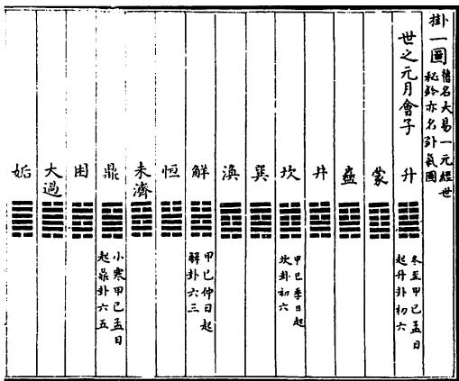  
図6-16 掛一図

らなり，「元日甲」の12会の運と世の数を記している。たとえば子の方向にある「月会子」は，「星運」について「甲一至癸十，甲十一至癸二十，甲二十一至癸三十」，「辰世」について「子一至亥一百二十，子一百二十一至亥二百四十，子二百四十一至亥三百六十」と記し，皇

表6-6 張行成の掛一図の二百五十六卦
<table><tr><td>世之元</td><td>(001) 升</td><td>(002)</td><td>蒙</td><td>(003) 益</td><td></td><td>(004) 井</td><td></td><td>(005) 坎</td><td>(006) 巽</td><td></td><td>(007) 渙</td><td></td><td>(008) 解</td></tr><tr><td></td><td>(009) 恒</td><td></td><td>(010)</td><td>未济 (011)</td><td>鼎</td><td>(012) 困</td><td></td><td>(013)</td><td>大過 (014) 姤</td><td></td><td>(015) 訟</td><td>(016)</td><td>随</td></tr><tr><td>世之会</td><td>(017) 兌</td><td></td><td>(018) 乾</td><td>(019)</td><td>苯</td><td>(020)</td><td>噬嗑</td><td>(021) 夬</td><td>(022) 否</td><td></td><td>(023) 无妄</td><td>(024) 睽</td><td></td></tr><tr><td></td><td>(025) 咸</td><td></td><td>(026) 革</td><td>(027)</td><td>遯</td><td>(028)</td><td>大有</td><td>(029) 履</td><td>(030) 泰</td><td></td><td>(031) 剥</td><td>(032)</td><td>頤</td></tr><tr><td>世之運</td><td>(033) 益</td><td></td><td>(034) 豊</td><td>(035)</td><td>帰妹</td><td>(036)</td><td>大壮</td><td>(037) 小過</td><td>(038)</td><td>臨</td><td>(039) 贲</td><td>(040)</td><td>中孚</td></tr><tr><td></td><td>(041)</td><td>既済</td><td>(042) 晋</td><td>(043)</td><td>报</td><td>(044) 節</td><td></td><td>(045) 家人</td><td>(046) 需</td><td></td><td>(047) 大畜</td><td>(048)</td><td>小畜</td></tr><tr><td>世之世</td><td>(049) 坤</td><td></td><td>(050) 謙</td><td>(051)</td><td>漸</td><td>(052) 艮</td><td></td><td>(053) 離</td><td>(054) 比</td><td></td><td>(055) 蹇</td><td>(056)</td><td>豫</td></tr><tr><td></td><td>(057)</td><td>師</td><td>(058)</td><td>同人 (059)</td><td>旅</td><td>(060) 屯</td><td></td><td>(061) 観</td><td>(062) 解</td><td></td><td>(063) 復</td><td>(064)</td><td>明夷</td></tr><tr><td>元之元</td><td>(065) 泰</td><td></td><td>(066) 損</td><td>(067)</td><td>大畜</td><td>(068) 節</td><td></td><td>(069) 需</td><td></td><td>(070) 中孚</td><td>(071) 小畜</td><td>(072)</td><td>帰妹</td></tr><tr><td></td><td></td><td>(073) 大壮(074)</td><td>睽</td><td>(075)</td><td>大有</td><td>(076) 兌</td><td></td><td>(077) 夬</td><td>(078) 履</td><td></td><td>(079) 乾</td><td>(080)</td><td>困</td></tr><tr><td>元之会</td><td>(081)</td><td>咸</td><td>(082)</td><td>未済 (083)</td><td>旅</td><td>(084) 解</td><td></td><td>(085) 小過</td><td>(086) 渙</td><td></td><td>(087) 漸</td><td>(088) 坎</td><td></td></tr><tr><td></td><td>(089) 蹇</td><td></td><td>(090) 蒙</td><td>(091)</td><td>良</td><td>(092) 師</td><td></td><td>(093) 臨</td><td>(094) 謙</td><td></td><td>(095) 坤</td><td>(096)</td><td>遯</td></tr><tr><td>元之運</td><td>(097)</td><td>晋</td><td>(098) 観</td><td>(099)</td><td>比</td><td>(100) 剥</td><td></td><td>(101) 巽</td><td>(102) 升</td><td></td><td>(103) 否</td><td>(104) 豫</td><td></td></tr><tr><td></td><td>(105)</td><td>井</td><td>(106) 豊</td><td>(107)</td><td>屯</td><td>(108) 革</td><td></td><td>(109) 恒</td><td>(110)</td><td>舜</td><td>(111) 訟</td><td>(112)</td><td>益</td></tr><tr><td>元之世</td><td>(113)</td><td>雕</td><td>(114) 大過</td><td>(115)</td><td>姤</td><td>(116) 随</td><td>(117)</td><td>家人</td><td>(118)</td><td>震</td><td>(119) 鼎</td><td>(120)</td><td>噬嗑</td></tr><tr><td></td><td>(121)</td><td>既済</td><td>(122) 頤</td><td>(123)</td><td>萃</td><td>(124)</td><td>明夷 (125)</td><td>復</td><td>(126)</td><td>同人</td><td>(127) 无妄</td><td>(128)</td><td>賁</td></tr><tr><td>会之元</td><td>(129) 損</td><td></td><td>(130) 大畜</td><td>(131)</td><td>節</td><td>(132) 需</td><td>(133)</td><td>中孚</td><td>(134)</td><td>小畜</td><td>(135) 大壮</td><td>(136)</td><td>睽</td></tr><tr><td></td><td></td><td>（137）大有（138)兌</td><td></td><td>(139)</td><td>决</td><td>(140) 履</td><td>(141)</td><td>乾</td><td>(142)</td><td>困</td><td>(143) 咸</td><td>(144)</td><td>未済</td></tr><tr><td>会之会</td><td>(145)</td><td>旅</td><td>(146) 解</td><td>(147)</td><td>帰妹</td><td>(148) 渙</td><td></td><td>(149) 漸</td><td>(150) 坎</td><td></td><td>(151) 蹇</td><td>(152)</td><td>蒙</td></tr><tr><td></td><td>(153)</td><td>艮</td><td>(154) 師</td><td>(155)</td><td>泰</td><td>(156) 屈</td><td></td><td>(157) 謙</td><td>(158)</td><td>小逼</td><td>(159) 観</td><td>(160)</td><td>剥</td></tr><tr><td>会之運</td><td>(161) 蠱</td><td></td><td>(162) 井</td><td>(163)</td><td>屯</td><td>(164) 遯</td><td></td><td>(165) 姤</td><td>(166)</td><td>訟</td><td>(167) 无妄</td><td>(168)</td><td>大過</td></tr><tr><td></td><td>(169) 豫</td><td></td><td>(170) 鼎</td><td>(171)</td><td>比</td><td>(172) 巽</td><td></td><td>(173) 坤</td><td>(174) 升</td><td></td><td>(175) 萃</td><td>(176)</td><td>随</td></tr><tr><td>会之世</td><td>(177)</td><td>晋</td><td>(178) 噬嗑</td><td>(179)</td><td>否</td><td>(180) 離</td><td></td><td>(181) 革</td><td>(182)</td><td>頤</td><td>(183) 復</td><td>(184)</td><td>恒</td></tr><tr><td></td><td>(185) 豊</td><td></td><td>(186) 震</td><td>(187)</td><td>家人</td><td>(188) 益</td><td></td><td>(189) 既済</td><td>(190) 贲</td><td></td><td>(191) 明夷</td><td>(192)</td><td>同人</td></tr><tr><td>運之元</td><td>(193) 大畜</td><td></td><td>(194) 節</td><td>(195)</td><td>需</td><td>(196)</td><td>中孚</td><td>(197) 小畜</td><td>(198)</td><td>帰妹</td><td>(199) 睽</td><td>(200)</td><td>大有</td></tr><tr><td></td><td>(201) 兌</td><td></td><td>(202) 夬</td><td>(203)</td><td>履</td><td>(204) 乾</td><td></td><td>(205) 困</td><td>(206)</td><td>未済</td><td>(207) 解</td><td>(208)</td><td>大壮</td></tr><tr><td>運之会</td><td>(209)</td><td>恒</td><td>(210) 鼎</td><td>(211)</td><td>大過</td><td>(212) 訟</td><td>(213)</td><td>姤</td><td>(214) 随</td><td></td><td>(215) 旅</td><td>(216) 噬嗑</td><td></td></tr><tr><td></td><td>(217) 小過</td><td></td><td>(218) 展</td><td>(219)</td><td>澳</td><td>(220) 巽</td><td></td><td>(221) 益</td><td>(222) 井</td><td></td><td>(223) 屯</td><td>(224) 坎</td><td></td></tr><tr><td>運之運</td><td>(225) 渐</td><td></td><td>(226) 晋</td><td>(227)</td><td>茶</td><td>(228) 泰</td><td>(229)</td><td>蹇</td><td>(230) 豫</td><td></td><td>(231) 遯</td><td>(232)</td><td>咸</td></tr><tr><td></td><td>(233) 師</td><td></td><td>(234) 艮</td><td>(235)</td><td>剥</td><td>(236) 観</td><td>(237)</td><td>无妄</td><td>(238) 離</td><td></td><td>(239)豊</td><td>(240)</td><td>復</td></tr><tr><td>運之世</td><td>(241) </td><td>(242) 革</td><td></td><td>(243) (251) 坤</td><td>家人 (244) (252)</td><td>否</td><td>(245) 同人(253)</td><td>比 明夷</td><td>(246) 升 (254) 臨</td><td></td><td>(247) 頤 (255) 损</td><td>(248) 贲 (256) 既済</td><td></td></tr><tr><td></td><td>(249) 蒙</td><td>(250) 謙</td></table>

極経世の元・会・運・世のシステムを簡潔に表示している。交泰図と四象運行図はさほど刺激的な図ではないけれども，最後の掛一図はきわめて独創性に富み，皇極経世学を新たに発展させる契機を含んでいる。

張行成の掛一図(図6-16)はあわせて256卦(表6-6)からなり，起運の次元に応じて各卦の爻を元・会・運・世・年・月・日・時のいずれかに配当している23)。配当法は「二百四十卦は正数をなし，十六卦は閏数(二十四節気)をなし」,4爻が1単位に相当している。

たとえば256卦が1年12月，4爻が1日を象徴するばあい，「月会子」は，升(1)の六五・上六と蒙(2)の初六・九二の4爻が朔日(一日)にあたり，蒙(2)の六三・六四・六五・上九が二日，……，鼎(11)の初六・九二・九三・九四が十五日を示している。だが十六日に対応するのは困(12)の六四・九四・九五・上六であり，十五日の爻につづく鼎(11)の六五・上九と困(12)の初六・九二の4爻ではない。十六日以降の配当法は十五日以前に復帰し，順番に4爻を1日に対応させていく。月会子はかくして三十日夬(21)の九五・上六と否(22)の初六・六二に終わり，総爻数は4×30=120爻である。また月会丑は无妄(23)の初九に始まる120爻，月会寅は節(44)の六三に始まる120爻を配当しており，1周期の12月会はあわせて120×12=1,440爻=240卦である。張行成はこれを「正数」とよんでいる。一方，「閏数」とは，暦日と直接の関係のない1日4爻の増分のことである。前後の節気が「相接」する朔ないし十六日に位置している。すなわち，@子月の初・冬至升(1)の初六・九二・九三・六四，⑥子月の中・小寒鼎(11)の六五・上九と困(12)の初六・九二，丑月の初・大寒否(22)の六三・九四・九五・上九，@丑月の中・立春益(33)の初九・六二・六三・六四，寅月の初・雨水損(43)の六五・上九と節(44)の初九・九二，寅月の中・啓蟄比(54)の六三・六四・九五・上六，⑧卯月の初・春分泰(65)の初九・九二・九三・六四，⑤卯月の中・清明大有(75)の六五・上九と兌(76)の初九・九二，①辰月の初・穀雨渙(86)の六三・六四・九五・上九，①辰月の中・立夏—晋(97)の初六・六二・六三・九四，巳月の初・小満屯(107)の九五・上六と革(108)の初九・六二，①巳月の中・芒種震(118)の六三・九四・六五・上六，午月の初・夏至損(129)の初九・九二・六三・六四，午月の中・小暑夬(139)

の九五・上六と履(140)の初九・九二，未月の初・大暑坎(150)の六三・六四・九五・上六，未月の中・立秋蠱(161)の初六・九二・九三・六四，⑨申月の初・処暑比(171)の九五・上六と巽(172)の初六・九二，申月の中・白露頤(182)の六三・六四・六五・上九，⑤酉月の初・秋分大畜(193)の初九・九二・九三・六四，①酉月の中・寒露履(207)の九五・上九と乾(204)の初九・九二，@戌月の初・霜降随(214)の六三・九四・九五・上六，戌月の中・立冬漸(225)の初六・六二・九三・六四，亥月の初・小雪剝(235)の六五・上九と観(236)の初六・六二，亥月の中・大雪升(246)の九三・六四・六五・上六がそれである。

張行成は掛一図を利用して歴史事件の「運数」を考察している(『通変』巻十一)。大運とよばれた①元経会の運卦と②会経運の世卦，小運とよばれた③運経会の年卦と④世経年の月卦がそれである24)。

まず運卦の考察であるが，張行成は掛一図の256卦を1元，4爻を1運にあて，第1運升卦(1)の六五～蒙(2)の九二を起点として，特定の星運に対する卦爻(正数)を計算する。たとえば日甲1・月巳6・星癸180の辰未2,156から辰申2,157にいたる堯の治世のばあい，第180運(=第2,149～2,160世)は賁卦(128)の九三・六四・六五・上九にあたり，1爻=3世(=90年)のため，第2,156と2,157世に相当するのは賁の六五である。張行成が賁卦を堯の運卦と定めたのは，掛一図において易卦と星運の1対1対応を求めた結果にほかならない。だが世卦については，「大運(運卦)に随って消長す」とし，「奇卦に遇えば則ち後卦を取り，偶卦に遇えば則ち前卦を取り，二卦を併せて以て十二世に当て，一奇一偶これを用いる」。同じ例についていえば，賁卦は第128卦であり，偶数位にあるので，前卦の无妄(127)の6爻をとり，賁卦の6爻と合わせて第180運の12世の世卦に配当している。

一方，小運の年卦については，1世を1月，1年を1日と換算し，升(1)の六五～蒙(2)の九二を子月の己巳日(6日)，无妄(23)の初九～九四を丑

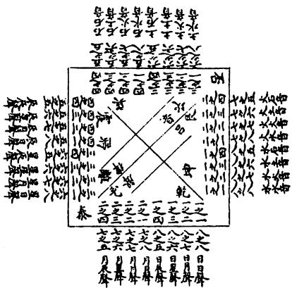  
図6-17 既済原理図

月の己亥日(6日)にあて，当該年の年卦を求める。すなわち，日甲1·月巳6·星癸180·辰未2,156の第11年甲辰にある堯の即位のばあい，未世甲辰年未月11日に対応する月会未の第5卦の師(154)が年卦であり，その六三・六四・六五・上六が直月の爻である。また月卦については，世卦のごとく「小運(年卦)に随って進退

す」。堯時のばあい，年卦の師は偶卦であるので，前卦の艮(153)の6爻と師の6爻をもって甲辰年の12月に配している。

張行成の先天数図→既済図→八卦変化図の展開も，先天象図の展開と同じくきわめて独創的である。八卦に固有の数を定め，それによって邵雍の声音学に新たな進展をもたらした。

既済図は3図原理図(仮称)と陽図と陰図からなり，原理図が律声と呂音の唱和の原理を説明し，陽図と陰図が唱和した結果を示している(『通変』巻十六)。既済原理図(図6-17)の構造は単純明快である。八卦の数の配当乾一(八)・兌二(七)・離三(六)・震四(五)・巽五(四)・坎六(三)・艮七(二)・坤八(一)を根拠として，「天地みな内宮の十六数を外宮の十六数に遍く交えて，各々十六の十六(256=16×16)を得，共に五百一十有二」となることを明らかにしている。「天の十六数」とは，①日日声の乾一(八八)，②日月声の履一二(八七)，③日星声の同人一三(八六)，④日辰声の无妄一四(八五)，⑤月日声の夬二一(七八)，⑥月月声の兌二二(七七)，⑦月星声の革二三(七六)，⑧月辰声の随二四(七五)，⑨星日声の大有三一(六八)，⑩星月声の睽三二(六七)，①星星声の離三三(六六)，②星辰声の噬嗑三四(六五)，③辰日声の大壮四一(五八)，④辰月声の帰妹四二(五七)，⑤辰星声の豊四三(五六)，⑥辰辰声の震四四(五

陰圖 此圓以地之十六卦和天之十六卦將植數十六卦天地一卦各叟十六卦植數一卦變三十二卦共成一十二十四卦二坤一二坤一坤二坤二坤一坤二坤一坤八乾七尖六有五莊父履七兌 交暌五七歸泰泰臨泰 夷泰復泰泰臨 臨臨 夷臨復臨二坤二坤二坤二坤 二坤二坤二坤二坤六同七六輩六離五豐八金七五隨五五震泰夷臨夷夷夷復夷 泰復 臨復 夷復復復

陽圗 此圖以天之十六卦唱地之十六卦得動數 十六卦天地 卦 變三十二卦共成 一千二十四卦 否否遯否訟否姤否否遯遯遯訟遯姤遯 八坤七六八剩六比五八觀八七謙七七艮六蹇五七漸 一乾一乾一乾一乾 一乾一乾一乾一乾 否訟遯訟訟訟始訟否姤遯姤訟姤姤姤 八公師六蒙六六坎五渙八五升七五蠱六五井五五巽 一乾一乾一乾 一乾 一乾一乾一乾一乾

図6-18 既済陽図

図6-19 既済陰図

五)のこと。「地の十六数」とは，①水水音の坤八八(一一)，②水火音の謙八七(一二)，③水土音の師八六(一三)，④水石音の升八五(一四)，⑤火水音の剥七八(二一)，⑥ 火火音の艮七七(二二)，⑦ 火土音の蒙七六(二三)，⑧火石音の蠱七五(二四)，⑨土水音の比六八(三一)，⑩土火音の蹇六七(三二)，⑩土土音の坎六六(三三)，②土石音の井六五(三四)，③石水音の観五八(四一)，④石火音の漸五七(四二)，⑤石土音の渙五六(四三)，⑥6石石音の巽五五(四四)のことである。なお易卦の直後の数は陽数(順数),括弧内の数は陰数(逆数)を示しており,2桁の数のばあい，10位の数は上卦が八卦の何にあたるか，1位の数は下卦が何にあたるかを示している。

既済陽図(図6-18)は「天の十六卦を以て地の十六卦を唱えた」ものである。たとえば最初の「否否」のマトリックスは，天の日日声の「ー一乾」を左，地の水水音の「八八坤」を右にならべて3行2列の行列を作り両者を組み合わせたとき，右→左の方向の「一八」から乾上坤下の否卦が(二重に)生じることを示している(陽数)。また既済陰図(図6-19)は「地の十

六卦を以て天の十六卦を和し」たものである。「泰泰」のマトリックスは,天の日日声の「八八乾」を左，地の水水音の「一一坤」を右にならべて3行2列の行列を作り両者を組み合わせたとき，左→右の方向の「一八」から坤上乾下の泰卦が作られることを表している(陰数)。

八卦変化図は，(1)乾(3)兌(5)離(7)震の声図と(2)坤(4)艮(6)坎(8)巽の音図からなり，具体的な声音の組み合わせ(反切音)について易卦の配当をあたえている(『通変』巻十七・十八)。たとえば「声図一乾卦」の音声表にみえるのは，既済陽図の易卦の組み合わせ(否否\~姤恒)に対応した漢字音である。否否については，「古多・黒多・安多・夫多・卜多・東多·乃多·走多·思多·■多·■多·█多，良·千·刀·妻·宮·心·●・●・●」という。日日声が[多・良・千・刀・妻・宮・心・●・●·●」の10声(韻母)からなり，水水音が[古・黒・安・夫・ト・東・乃・走・思・・・」の12音(字母)からなることを思い起こせば，表の意味するところは明白であろう。また「音図二坤卦」の音声表にみえるのは，既済陰図の易卦の組み合わせ(泰泰～復益)に対応した漢字音である。泰泰については，「古多・古良・古千・古刀・古妻・古宮・古心・古●·古●·古●，黒·安・夫·卜·東·乃·走・思・■·■·■」と記されている。音声表に声図・音図や陽図・陰図の区別があるのは，易卦の組み合わせが反切の韻母と字母のいずれに注目したものであるかを明らかにするためである。

張行成は，皇極経世学の占筮法の考案者として名高い。『通変』巻二十九によれば,張行成の「経世揲蓍法」は次のとおりである。すなわち，①初揲72蓍を両手に二分し，右手の筮竹を4本ずつ数える。余数が1であれば元にあて，2であれば会，3であれば運，4であれば世にあてる。直事の四象がそれである。②再揲また72蓍を両手に分け，4蓍を左手から右手に移す。右手の筮竹を8本ずつ数え，「その余数を視て上卦の体となす」。③三揲また合わせて二分し，4蓍を右手から左手に移す。左手の筮竹を8本ずつ数え，「その余数を視て下卦の体となす」。上下体から直事の六十四卦が求められる。④終操また合わせて二分し，左手の筮竹を6本ずつ数える。余数が1のとき初爻とし，2のとき二爻，……，6のとき上爻とする。これが直事の爻である。張行成はまた，筮法をとおして「初揲余一」→四象の元，「再揲余五」→上卦の巽，「三揲余七」→下卦の艮，「終揲余六」→上爻と求められた元の漸卦の上九(直事の象と卦と爻)に対して，占法の基本を説明している(仮令法)。すなわち，①物数占(仮称)卦気図(掛一図)の「元」部を検索して，直事の漸卦が元の何位にあたるかをみる。漸卦は元の会の会の運(第87位)の卦である。律呂図(既済陽図)の元の会の会の運の位を調べ，履と蒙の2卦から「物数」の遯と困の2卦を定める。遯・困をもって「物の象を観る」。②本占(仮称)漸卦は，直事の上九が正しい位にないので九→六と改めて蹇卦とし，また直事の爻を含む上体が「位に当たらざる」ため巽を震に改めて小過卦としなければならない。爻の変不変を根拠にして随時(時用)を占い，卦の変不変をもって大定(定体)を判断するのがこれである。③雑占(仮称)漸は「艮帰魂の卦」であり，九三が世爻，上九が応爻にあたっている。上九は当世直事の爻であるため，世爻の正でもある。したがって「本爻と相敵」せざるをえない，云々。以上が張行成の占筮法の概略である。張行成が邵雍の原意に反して占筮法を導入したことは，当時の皇極経世学の易学的発展の趨勢ともみごとに合致しており，学説史上きわめて重要な事件の一つに数えることができる。

『宋元学案』は，張行成の門人として呂凝之(字，沢父)をあげ，淳熙八年(1181)，呂凝之が経世の学を奏陳し，孝宗が「大喜」し，太府丞に抜擢したことを記している(張祝諸儒学案)。

## 2.3 祝泌の起運法と語音分析

祝泌は，字を子涇といい，観物老人と号した。南宋の中晩期の人である。著書には『皇極経世観物篇解』11巻(1239跋)『皇極経世起数訣』1巻(1241序)『皇極経世鈐』1巻『皇極起数例』1巻(1235序)『康節先生観物篇断

訣』1巻(1238発題)ほかがある。至元十六年(1279)，元の世祖フビライは使者を派遣して，「皇極数に通ず」との名声の高かった祝泌の子孫を訪求させたという(『元史』巻十)。

祝泌は，張行成の皇極経世学への激しい批判者である。張行成『通変』について「発明する処は甚だ多きも，支蔓する処もまた多し」云々と評している(『皇極起数例』)。だが祝泌の基本的な発想自体は張行成に則るところが多いといわざるをえない。

祝泌も張行成と同じく，邵雍の歴年表に則りながら易卦の配当をもって時間の流れを埋め尽くし，各歴史年代の起運の卦①元経会の運卦，②会経運の世卦，③運経世の年卦などを定めたが，配当の方法は張行成とまったく異なっている。祝泌によれば，張行成の方法を改めなければならないのは，①「大小運の数は，みな掛図の二百五十六卦に帰宿すといえども，然れどもその断法は，専ら卦に在らずして四象に在り」(『皇極起数例』)，②したがって正しい四象の巡りを考慮しない張行成の起算点の設定は誤りであり，張行成の運数は邵雍の本義と矛盾をいたすからである。

祝泌は大運について「元会運は天地の未合をなし，未然の数を用う。元(元経会の運卦)は冬至の子に起こり，会(会経運の世卦)は開物の寅に起こり，運(運経世の年卦)は地建の丑に起こる」とのべ，小運について「年月日のごときは，天地の已合をなし，已然の数を用う」とのべている(『皇極経世観物篇解』巻二)。「未然の数」とは「元の元」の泰卦に起こる掛一図(表6-7)のことであり，「已然の数」とは「世の元」の升卦に起こる卦気図(表6-6)のことである。また卦気図は張行成の掛一図とまったく等しく，掛一図も張行成の掛一図の原点を，卦順を動かさずに世の元から元の元に移動したものであり,ほんらい異なった図ではない。祝泌の掛一図の二十四節気との対応を記せば，@冬至泰(1)の初六・九二・九三・六四，⑥小寒大有(11)の六五・上九と兌(12)の初六・九二，大寒澳(22)の六三・九四・九五・上九，@立春晋(33)の初九・六二・六

表6-7祝泌の掛一図の二百五十六卦
<table><tr><td>元之元</td><td>(001) 泰</td><td></td><td>(002) 損</td><td>(003)</td><td>大畜</td><td>(004) 節</td><td></td><td>(005) 需</td><td></td><td>(006)</td><td>中孚</td><td></td><td>(007) 小畜</td><td>(008) 帰妹</td></tr><tr><td></td><td>(009) 大壮</td><td></td><td>(010) 睽</td><td></td><td>(011) 大有</td><td>(012) 兌</td><td></td><td>(013) 夬</td><td></td><td>(014) 履</td><td>(015)</td><td>乾</td><td>(016)</td><td>困</td></tr><tr><td>元之会</td><td>(017) 咸</td><td></td><td>(018) 未济</td><td></td><td>(019) 旅</td><td>(020) 解</td><td></td><td>(021) 小過</td><td></td><td>(022) 渙</td><td></td><td>(023) 漸</td><td>(024) 坎</td><td></td></tr><tr><td></td><td>(025) 蹇</td><td></td><td>(026) 蒙</td><td></td><td>(027) 艮</td><td>(028) 師</td><td></td><td>(029) 臨</td><td></td><td>(030) 謙</td><td></td><td>(031) 坤</td><td>(032)</td><td>遯</td></tr><tr><td>元之運</td><td>(033) 晋</td><td></td><td>(034) 観</td><td></td><td>(035) 比</td><td>(036) 剥</td><td></td><td>(037) 巽</td><td></td><td>(038) 升</td><td>(039)</td><td>否</td><td>(040) 豫</td><td></td></tr><tr><td></td><td>(041) 井</td><td></td><td>(042) 豊</td><td></td><td>(043) 屯</td><td>(044) 革</td><td></td><td>(045) 恒</td><td></td><td>(046) 蠱</td><td>(047)</td><td>訟</td><td>(048)</td><td>益</td></tr><tr><td>元之世</td><td>(049) 離</td><td></td><td>(050) 大過</td><td></td><td>(051) 姤</td><td>(052) 随</td><td></td><td>(053)</td><td>家人</td><td>(054) 震</td><td></td><td>(055) 鼎</td><td>(056)</td><td>噬嗑</td></tr><tr><td></td><td></td><td>(057) 既済</td><td>(058) 頤</td><td></td><td>(059) 萃</td><td>(060)</td><td>明夷</td><td>(061)</td><td>復</td><td>(062) 同人</td><td>(063)</td><td>无妄</td><td>(064)</td><td>賁</td></tr><tr><td>会之元</td><td>(065) 損</td><td></td><td>(066) 大畜</td><td></td><td>(067) 節</td><td>(068) 需</td><td></td><td>(069)</td><td>中孚</td><td>(070) 小畜</td><td></td><td>(071) 大壮</td><td>(072)</td><td>睽</td></tr><tr><td></td><td></td><td>(073) 大有</td><td>(074)兌</td><td></td><td>(075) 夬</td><td>(076) 股</td><td></td><td>(077)</td><td>乾</td><td>(078) 困</td><td>(079)</td><td>咸</td><td>(080)</td><td>未済</td></tr><tr><td>会之会</td><td>(081) 旅</td><td></td><td>(082) 解</td><td></td><td>(083) 帰妹</td><td>(084) 渙</td><td></td><td>(085) 漸</td><td></td><td>(086) 坎</td><td></td><td>(087) 蹇</td><td>(088)</td><td>蒙</td></tr><tr><td></td><td>(089) 艮</td><td></td><td>(090)師</td><td></td><td>(091) 泰</td><td>(092) 臨</td><td></td><td>(093) 議</td><td></td><td>(094) 小過</td><td>(095)</td><td>観</td><td>(096)</td><td>剥</td></tr><tr><td>会之運</td><td>(097) 蠱</td><td></td><td>(098) 井</td><td></td><td>(099) 屯</td><td>(100) 遯</td><td></td><td>(101) 姤</td><td></td><td>(102) 訟</td><td>(103)</td><td>无妄</td><td>(104) 大過</td><td></td></tr><tr><td></td><td>(105) 豫</td><td></td><td>(106)鼎</td><td></td><td>(107) 比</td><td>(108)</td><td>巽</td><td>(109) 坤</td><td></td><td>(110) 升</td><td>(111)</td><td>萃</td><td>(112)</td><td>随</td></tr><tr><td>会之世</td><td>(113) 晋</td><td></td><td>(114) 噬嗑</td><td></td><td>(115) 否</td><td>(116) 離</td><td></td><td>(117) 革</td><td></td><td>(118) 頤</td><td></td><td>(119) 復</td><td>(120) 恒</td><td></td></tr><tr><td></td><td>(121) 豊</td><td></td><td>(122) 震</td><td></td><td>(123) 家人</td><td>(124)</td><td>益</td><td>(125)</td><td>既济</td><td>(126) 賁</td><td>(127)</td><td>明夷</td><td>(128)</td><td>同人</td></tr><tr><td>運之元</td><td></td><td>(129) 大畜</td><td>（130)節</td><td></td><td>(131) 需</td><td>(132)</td><td>中孚</td><td>(133)</td><td>小畜</td><td>(134) 帰妹</td><td>(135)</td><td>睽</td><td>(136)</td><td>大有</td></tr><tr><td></td><td>(137)兌</td><td></td><td>(138) 央</td><td></td><td>(139) 履</td><td>(140)</td><td>乾</td><td>(141)</td><td>困</td><td>(142) 未済</td><td>(143)</td><td>解</td><td>(144)</td><td>大壮</td></tr><tr><td>運之会</td><td>(145) 恒</td><td></td><td>(146) 鼎</td><td></td><td>(147) 大過</td><td>(148)</td><td>訟</td><td>(149) 姤</td><td></td><td>(150) 随</td><td></td><td>(151) 旅</td><td>(152)</td><td>噬嗑</td></tr><tr><td></td><td>(153) 小過</td><td></td><td>(154) 震</td><td></td><td>(155) 渙</td><td>(156) 巽</td><td></td><td>(157) 益</td><td></td><td>(158) 井</td><td></td><td>(159) 屯</td><td>(160) 坎</td><td></td></tr><tr><td>運之運</td><td>(161) 漸</td><td></td><td>(162) 晋</td><td></td><td>(163) 萃</td><td>(164)</td><td>泰</td><td>(165) 蹇</td><td></td><td>(166) 豫</td><td></td><td>(167) 遯</td><td>(168) 咸</td><td></td></tr><tr><td></td><td>(169) 師</td><td></td><td>(170) 艮</td><td></td><td>(171) 剥</td><td>(172)</td><td>観</td><td>(173)</td><td>无妄</td><td>(174) 離</td><td></td><td>(175) 豊</td><td>(176)</td><td>復</td></tr><tr><td>運之世</td><td>(177) 蠱</td><td></td><td>(178) 革</td><td></td><td>(179) 家人</td><td>(180)</td><td>否</td><td>(181)</td><td>比</td><td>(182) 升</td><td></td><td>(183) 頤</td><td>(184)</td><td>賁</td></tr><tr><td></td><td>(185) 蒙</td><td></td><td>(186) 謙</td><td></td><td>(187) 坤</td><td>(188)</td><td>同人</td><td>(189)</td><td>明夷</td><td>(190) 臨</td><td></td><td>(191) 損</td><td>(192)</td><td>既济</td></tr><tr><td>世之元</td><td>(193) 升</td><td></td><td>(194) 蒙</td><td></td><td>(195) 蠱</td><td>(196)</td><td>井</td><td>(197) 坎</td><td></td><td>(198) 巽</td><td></td><td>(199) 渙</td><td>(200) 解</td><td></td></tr><tr><td></td><td>(201) 恒</td><td></td><td>(202) 未済</td><td></td><td>(203) 鼎</td><td>(204) 困</td><td></td><td>(205)</td><td>大過</td><td>(206) 姤</td><td></td><td>(207) 訟</td><td>(208)</td><td>随</td></tr><tr><td>世之会</td><td>(209) 兌</td><td></td><td>(210) 乾</td><td></td><td>(211) 苯</td><td>(212)</td><td>噬嗑</td><td>(213)</td><td>夬</td><td>(214) 否</td><td></td><td>(215) 无妄</td><td>(216) 睽</td><td></td></tr><tr><td></td><td>(217) 咸</td><td></td><td>(218) 革</td><td></td><td>(219) 遯</td><td>(220)</td><td>大有</td><td>(221)</td><td>履</td><td>(222) 泰</td><td></td><td>(223) 剥</td><td>(224) 頤</td><td></td></tr><tr><td>世之運</td><td>(225) 益</td><td></td><td>(226)豊</td><td></td><td>(227) 帰妹</td><td>(228) (236)節</td><td>大壮</td><td>(229) (237)</td><td>小過 家人</td><td>(230) 臨 (238) 需</td><td></td><td>(231) 贲 (239) 大畜</td><td>(232) (240)</td><td>中孚 小畜</td></tr><tr><td>世之世</td><td></td><td>(233) 既済 (241) 坤</td><td>(234) 晋 (242) 謙</td><td></td><td>(235) 損 (243) 漸</td></table>

三・六四，雨水屯(43)の六五・上九と革(44)の初九・九二，啓 蟄震(54)の六三・六四・九五・上六，⑧春分損(65)の初九・九 二・九三・六四，⑥清明夬(75)の六五・上九と履(76)の初九・九二， ①穀雨坎(86) の六三・六四・九五・上九，①立夏蠱(97) の初

六・六二・六三・九四，小満巽(107)の九五・上六と坤(108)の初九・六二，①芒種頤(118)の六三・九四・六五・上六，夏至大畜(129)の初九・九二・六三・六四，小暑履(139)の九五・上六と乾(140)の初九・九二，大暑随(150)の六三・六四・九五・上六，⑨立秋漸(161)の初六・九二・九三・六四，⑨処暑剝(171)の九五・上六と観(172)の初六・九二，白露升(182)の六三・六四・六五・上九，⑤秋分升(193)の初九・九二・九三・六四，①寒露鼎(207)の九五・上九と困(204)の初九・九二，@霜降否(214)の六三·九四・九五・上六，立冬益(225)の初六・六二・九三・六四，小雪損(235)の六五・上九と節(236)の初六・六二，大雪比(246)の九三・六四・六五・上六のごとくである。張行成の掛一図との位相のずれはわずか64卦にすぎないが，十二月や二十四節気との対応が変わる以上，起運の結果には根本的な差異が生じている。

祝泌の運数は張行成の値と異なり，配当がまったく違っている25)。まず「経日の甲一・経月の巳六・経星の癸一百八十・経辰の未二千一百五十六」の堯時元経会の運卦であるが，張行成が日元(甲1)を掛一図の年，月会(巳6)を月，星運(癸180)を日にあて，堯の運卦を起升の世之元卦図(表6-6)の第128卦の賁とするのに対して，祝泌は「天数は会の子の冬至甲子(星甲1)に起こり，卦は泰より行く」『観物篇解』巻六)として，起泰の元之元卦図(表6-7)の第128卦の同人(九五)を運卦に論定している。暦元のみが異なる同じシステムの図にもとづいて同じ第180運の易卦を決定しているからには，張行成と同様に第128番目の卦を運卦にとらねばならないのは理の然らしめるところである。また会経運の世卦については，月会(巳6)を掛一図の年，星運(癸180)を月，辰世(未2,156)を日にあて，「地数は運の甲の驚蟄(啓蟄)己卯(星己76)に起こり，ならびに泰卦に起こる」(『観物篇解』巻六)として，第2,156世が何の卦にあたるかを求めている。「地数は運の甲の驚蟄己卯に起こる」とは，「開物」以前の75運900世をあらかじめ除いて月寅3・星己76・辰子901を新たな計算の起点とすることである(『皇極起数例』大運小運起例)。起泰の元之元卦図上，開物の月寅3・星己76・辰子901を地数の起算点として泰卦の六五・上六と蒙卦の初六・九二に配当したとき，堯が即位した月巳6・星癸180・辰未2,156は第1080+176(=1,256=2,156-900)世にあたり，既済(125)の九五·上六と賁(126)の初九・六二が「事に直る」。祝泌は最後に，堯の即位が第2,156世の第11年にあることから直事の爻を計算し，「会の世の世の元の既済卦(上六)」が世卦にあたると結論している(1世=30年)。祝泌による運経世の年卦の計算もきわめて独創的である。年卦(堯即位の未世甲辰年)の計算は星運(癸180)が掛一図の年，辰世(未2,156)が月，年(甲辰11)が日にあたり，起泰の元之元卦図の「世の子の大寒(第22卦の渙卦)」が計算の起点である。「入元の初年(子世甲子年)は，世の運の運の運の損(235)六五に起こる」(『皇極起数例』大運小運起例)。未世甲辰年については，大寒の渙卦につづく漸(23)の初六・六二・九三・六四に寅世甲子年を配当してそこから卦数を起こし，未世(月)夏至の大畜(129)から数えて第11年(日)目にある易卦を求めればよい。大有卦(136)がそれである。

祝泌の声音律呂の学も，①等韻学の理論を利用して邵雍のシステムを説明し，②動植物の発するさまざまな音声を分析して吉凶を占っており，独自の展開をみせている26)。

第1点については，声母の同定が最も祝泌の学術らしい色彩に溢れている。祝泌自身も当時の韻図方淑『韻心』や楊倓『韻譜』などの書名をあげながら「相参合して四十八音を較定す」と誇らしげにのべている(『皇極経世起数訣』声音韻譜序)。「四十八音」とは調音部位と清濁にもとづく地音(声母)の分類のこと。開発収閉を無視するところに特徴があり，等韻三十六字母より12音多い。「一音」を例にとれば，①古・甲・九・癸，②□・□・近・揆，③坤・巧・丘・弃，④□・□・乾・蚪の4音がそれであり，それぞれ三十六字母の①見の清(k)，②南音群の濁(g')，③渓の清(k)，④北音群の濁(g)に相当している(李光地『等韻弁疑』)。地の全音はそれぞれ12の子音を含んでおり，したがって声紐の総数は48と

<table><tr><td rowspan=1 colspan=1>地之用音一百五十二舉要坤師卦主開音清剥蒙卦主發音清比坎卦主收音清觀渙卦主閉音清</td></tr><tr><td rowspan=1 colspan=1>唇音四</td></tr><tr><td rowspan=1 colspan=1>夫坤四       法剥       □比      飛觀普師五       朴蒙      品坎      匹渙</td></tr><tr><td rowspan=1 colspan=1>旁升五            手&quot;      </td></tr><tr><td rowspan=1 colspan=1>母師二       馬蒙      美抹      米渙</td></tr><tr><td rowspan=1 colspan=1>舌音四東坤六       丹剥      帝比</td></tr><tr><td rowspan=1 colspan=1>土師六       貪蒙      天坎</td></tr><tr><td rowspan=1 colspan=1>升六           回乃坤七       始剥      女比牙音四</td></tr></table>

ならざるをえない(4×12=48)。また「相参合して四十八音を較定す」の1句は，祝泌が等韻学の成果を利用して邵雍の四十八音を解釈したことをよく示している。『皇極起数例』の地之用音一百五十二挙要(図6-20)や『皇極経世起数訣』の壱百五十二音八卦が，祝泌の四十八音の「較定」の結果である。調音部位をもって唇4音·舌4音·牙4音·歯5音・喉4音・半(半舌音と半図6-20 地之用音一百五十二挙要

歯音)3音の24音を区別し，また清濁をもって24音母の「軽重を分けている」。たとえば三十六字母の端(t)に同定される六音の東・丹・帝・については，易卦の配当がそれぞれ坤・剝・比であり，等韻学の舌音の清をもって音価を説明している。

祝泌の声母研究において注意すべきは，邵雍の子音の推定に誤りがあると考えていたにもかかわらず，子音の分析から定められた易卦の配当を改めていないことである。円圏で囲まれた同・覃・田・(d)は,升・蠱・井に配当されているが，升卦は水石音開濁，蠱卦は火石音発濁，井卦は土石音収濁を根拠として命名されたものであり，ほんらい清音に属すべきではない。祝泌はそれについて「坤師は開音清を主るも，その中に升謙卦あるは，濁音を重出する者なり」とのべている。

祝泌の韻母にかんする考察も，声母のそれとほとんど変わらない。『広韻』の206韻を基準にして邵雍の112声の音価を推定しており，同定法は有声無字()を含む各声に対して「平上去入の四声を以て帰韻を摂る」にすぎない。その結果が『皇極起数例』の天之用声一百一十二挙要(図

6-21)や『皇極経世起数訣』の一百一十二声目録併八卦などである。韻母の配置を一瞥すれば，祝泌の企図するところは自ずと明らかであろう。

『皇極経世起数訣』には上記の2表のほか，80の等韻図が記されている。祝泌の等韻図の特徴は，声母の清濁と開発収閉を案じて分けて描いているところにある。たとえば「開音清」の韻図は,

<table><tr><td></td><td>天之用聲一百一十二舉要 乾日聲平聞尖月日聲上聞大有日皇聲去聞大壯辰日聲入聞</td></tr><tr><td>可二十三街</td><td>舌十七薛</td></tr><tr><td>甲一多七歌</td><td>个三十七箇 向四十一沫 ()十集</td></tr><tr><td>乙二良十陽 丙三千一先</td><td>旦二十八翰 十</td></tr><tr><td>二仙</td><td>三十三線 十七年</td></tr><tr><td>四刀三簫</td><td>孝三十六效 岳四覺</td></tr><tr><td>四</td><td>三十四 三十五癸</td></tr><tr><td>戊五妻十二齊</td><td>四六至 日五質</td></tr><tr><td>孔一世</td><td>衆一送 一屋</td></tr><tr><td>巳六宫一束 二冬</td><td>二宋 二沃</td></tr><tr><td>庚七二十一侵</td><td>禁五十二 三十六年</td></tr></table>

図6-21 天之用声一百十二挙要

右から左へ[夫・普・旁・母・東・土・同・乃……」と開音清の24声母をならべ，上から下に「東東東・董 ·送送送送・屋屋屋屋」と韻母をならべており(図6-22)，「収音清」の韻図は，横に「□・品・平・美・帝・天・田・女……」と収音清の声母をならべ，縦に「冬鐘鐘・董腫腫・宋用用・沃燭燭燭」と韻母をならべている。「東・董・送・屋」な

どはそれぞれ『広韻』の平声・上声・去声・人声の韻目であり，韻母の一等・二等・三等・四等を示すのが4×4の小区画である。等韻図の構造自体は『韻鏡』や『七音略』にきわめてよく似ており，独創

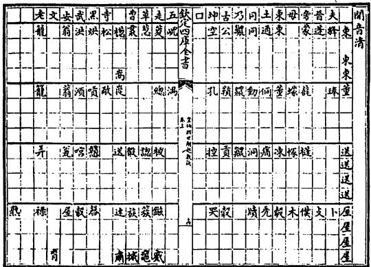  
図6-22 韻図(開音清)

性はあまりない。

祝泌の声音学上最も意義が深いのは，「天機の自動，朕兆の先孚」である自然の音声をもって事を占い(『皇極経世起数訣』辨槁物及馨咳之音法)，「声を以て数を起こし，数を以て卦に合わす」(『四庫全書総目提要』巻百八)ところである。祝泌は牛が「吽」と鳴いたのをうけて,次のごとく占っている(『観物篇解』巻十)。すなわち，①声音を分析して，韻母(天声)と声母(地音)を確定する。「吽」のばあい，韻母は上声の十八吻月辰声第3声の允，声母は唇音の閉清石水音第4音の飛に属している。②『皇極経世起数訣』に収められた一百一十二声目録併八卦や壱百五十二音八卦などを検索して，天声と地音に対応する声音正卦(天卦・地卦)を定める。天卦は随であり，地卦は観である。「随卦(二四)を以て左に居き，観卦(五八)を右に居き」，既済陰陽卦を定める。右方向から横に随・観2卦をみて，上卦の兌(二)と巽(五)から大過(二五)を導きだし，下卦の震(四)と坤(八)から豫(四八)を導きだす。大過と豫がその既済陰陽卦である。③声音入既済四象并掛一卦総括陽図(『皇極経世観物篇解』巻十，図6-23)を参照して，声音正卦・既済陰陽卦(月辰声二四随と石水音五八観と大過・豫)のマトリックスが何の位にあり，掛卦が何にあたるかを決定する。第125位の会の世の世の元が求める四象の数であり，既済卦が求める掛一卦である。④掛一卦をもって易占を断行する。既済卦による占断の結果は，「その事すでに成る。季秋にありて尤も吉」である。以下，祝泌は会の世の世の元の数(10,800×30×30×129,600=1,259,712,000,000)や吽の声音に固有の数(丙・巳)などを利用して，より詳しい易断を実行しているが,それについては説明を省略したい。なお懸案の事象を占う際，祝泌は人の発する語音はいうにおよばず，人の咳声や物の響喚なども積極的に利用して同様な声音分析を展開している。

祝泌の声音入既済四象幷掛一卦総括陽図(図6-23)は，構造や内容は張行成『通変』の既済陽図(図6-18)と等しいが，各声音正卦・既済陰陽卦ごとに元会運世の位数や掛一卦などが書き加えられており，その点で同

じでない。祝泌が張行成の図に加筆したのは，「張文饒は既済卦を以て声音を総じ二百五十六類となし，自ら簡と謂う。しかるにまた四象なく,陰卦なき」がためであり(『皇極経世観物篇解』巻十)，結局のところ，声音占を行う際に必要な掛一卦の決定を簡単に行うために加えられた修正にほかならない。だが現存する声音入既済四象幷掛一卦総括陽図の掛一卦の記載は，掛一図(表6-7)の掛一卦と齟齬し明らかに矛盾を来たしている。

<table><tr><td></td><td>聲音入既濟四象并掛一卦總括陽圗</td><td></td><td></td></tr><tr><td></td><td></td><td></td><td>元之元卷會之元四損運之元烈畜世之元四節</td></tr><tr><td></td><td></td><td></td><td>水水音八八坤火水音七八剥土水音六八比石水音五八観</td></tr><tr><td>元</td><td></td><td></td><td>日日聲一一乾日日聲一一乾日日聲一一乾日日聲一一乾</td></tr><tr><td>之</td><td></td><td></td><td>元之會知儒會之會四四孚運之會名圗世之會四妹</td></tr><tr><td>元</td><td></td><td></td><td>水火音八七謙火火音七七艮土火音六七蹇石火音五七漸</td></tr><tr><td>N</td><td>元之運壯會之運四睽運之運有世之運曰名兌</td><td></td><td>日日聲一一乾日日聲二乾日日聲一一乾日日聲一一乾</td></tr><tr><td>0</td><td></td><td>水土音八六師火土音七六蒙土土音六六坎石土音五六渙</td><td></td></tr><tr><td>N</td><td></td><td>日日聲一一乾日日聲二乾日日聲一一乾日日聲一一乾</td><td></td></tr><tr><td></td><td></td><td>元之世夬會之世履運之世皇四乾世之世曰国</td><td></td></tr><tr><td></td><td>水石音八五升火石音七五蠱土石音六五井石石音五五巽</td><td></td><td></td></tr><tr><td></td><td>日日聲一一乾日日聲一一乾日日聲一一乾日日聲一一乾</td><td></td><td></td></tr></table>

図6-23 声音入既四象并掛一卦総括陽図

すなわち，掛一図の構造にしたがえば，掛一卦はほんらい①元の元の元の元泰，②元の元の元の会損，③元の元の元の運大畜……とならなければならないのもかかわらず,既済図の②元の元の元の会の卦は需,③元の元の元の運の卦は大壮……である。おそらく印刷ないし筆写の際に生じた誤りであろうが，実に言語道断の事といわねばならない。

『宋元学案』張祝諸儒学案によれば，祝泌の門人に廖応准(字，学海)があり，続伝の者に傅立(字，権甫)や程直方(字，道大)などがある。傅立は元朝に仕えて集賢院大学士になり，『皇極続元元集』を著したという。また『元史』巻十は，傅立を祝泌の甥と記し，至元十六年(1279)，傅立が祝泌の書を世祖フビライに奉ったことをのべている。現存する皇極経世学の研究書においては，明の楊向春『皇極経世心易発微』(1568鄧世芳序)が祝泌のシステムに則って洪武十七年以降の「運の年卦」を計算している。

術数学専論

## 2.4 黄畿の気六変説

黄畿は，字を宗大，号を粤洲といい，広東省香山の人。明代の代表的な朱子学者，黄佐(1490-1566。字は才伯，号は泰泉)の父親である。黄畿は皇極経世学に造詣が深く，『皇極経世書伝』8巻(1504自序)の作者として名高い。『皇極経世書伝』は大き〈，①巻1の以元経会・巻2の以会経運・巻3の以運経世，②巻4の声音唱和，③巻5～8の観物内外篇の注釈の三つの部分に分かれている。声音篇における易卦の配当は張行成や祝泌と基本的に同じであるが，運卦・世卦・年卦などの配当は先行の解釈と発想を異にしており，きわめて斬新である。

張行成と祝泌の起運は既述のごとく，配当の易卦が一つ一つたがいに違い，一見したところ位相を異にした研究のようであるが，実は同じ卦気図(掛一図)にもとづき等しく4爻1日の原則を採用しており，発想法には大した差異はない。また卦気図自体も，邵雍の描いた図かどうか疑わしいのみならず,256卦の順序も錯雑をきわめ,そこにはいかなる規則性も存在しない。「数学」とはほんらい数のもつ強固な規則性を明らかにし，その整然とした構造の上に成立する学術であるからには，黄畿が新たな起運の原理を発明しそれによって邵雍の歴年を説明しようとしたのは，皇極経世学者としてはむしろ当然の試みということができる。

黄畿の起運法は無限の応用力を秘めていながら，原則自体はきわめて単純である。すなわち，わずか3条の基本原則，①邵雍の先天円図にしたがう，②乾坤坎離の4卦を閏卦とし，残り60卦を正卦とする，③「気は六を以て変ず」(黄佐序)に則って，すべての易卦の配当を定めている。黄畿の配卦システムによれば，閏卦の離・乾・坎・坤はそれぞれ四時二十四気を分主している(図6-24)。たとえば離卦のばあい，初九が陰爻(初六)に変じ，旅卦が生じる。これが一変である。二変のとき二爻の爻変から大有卦，三変のとき三爻から噬嗑卦が生じ，以下同様にして四変に賁卦，五変に同人卦，六変に豊卦が生じる。「気は六を以て変ず」とは，爻変によって基本卦から6子卦が派生することにほかならない。離卦は閏卦として1元の1/4，すなわち子会・丑会・寅会の32,400年を主っており，また旅や大有など離卦から生じた六変爻直の卦はおのおの冬至・小寒・大寒・立春・雨水・驚蟄に比定される節序を掌っている。なお離卦と坎卦が「陰陽の限」として冬至と夏至に配当されているのは，黄畿が先天図の易卦方位に則ったからにすぎない。

6 皇極経世学小史  

六十卦の展開も閏卦ときわめてよく似ている(図6-25)。六十卦とは，先天図の六十四卦から四正の位にある乾坤坎離(邵雍の四正卦)をのぞいた60の易卦のことである。一見すれば明らかなごとく，卦序自体は先天図と等しいにもかかわらず，乾卦を第1卦とせず復卦を起卦としている。六十卦が復に起こるのは，乾卦が「生生の本」であるのに対して，復卦は

「生生の始」にあたり，冬至子半に一陽の気が始めて生じることを象徴しているからである(王植『皇極経世書解』巻首)。六十卦は以元経会の目卦であり，会卦などという。六十卦は閏卦のごとく，卦序にしたがいながら「六を以て変じ」る(60×6=360)。三百六十卦である。三百六十卦は以会経運の目卦にあたり，運卦などという。復卦の六変爻直の卦は，一変の坤・二変の臨・三変の明夷・四変の震・五変の屯・六変の頤である。また三百六十卦が「六を以て変じ」たとき，2,160の卦がえられる。以運経世の目卦がそれであり,世卦(経)などとよばれている。同様に二千一百六十卦が「六を以て変じ」たとき生じるのが，12,960の世卦

  
図6-25 六十卦変三百六十卦図

  
図6-26 月子第一会の閏卦・会卦・運卦

(緯)である。会卦はそれぞれ6運=2,160年，運卦は1運=360年，世卦(経)は60年，世卦(緯)は10年を分治している。

黄畿による具体的な配卦であるが，月子第一会のばあい，図6-26のとおりである(『皇極経世易知』巻一)。「日甲ー・月子一」会は，会初が1陽の初めて動く「天開の始」にあたっている。閏卦は離であり，旅が冬至を主る卦である。会卦の復が星甲一・乙二・丙三・丁四・戊五・已六の6運を主り，復卦から生じた坤・臨・明夷・震・屯・頤がそれぞれ1運を主っている。各運は12世からなり，辰の子～亥が世の支名と順位を示している。

経日之甲一・経月之巳六・経星之癸一百八十を例とすれば，会卦は巳会の第5卦，すなわち先天図で復卦から数えて第30位(離卦を含めれば31位)にある夬卦であり，会卦の夬の上六が陽に変じて生じる乾卦が180運の運卦にほかならない。また運卦の乾(夬之乾)の六変卦が世卦(経)であり，姤卦は初九の爻変，同人卦は九二，履卦は九三，小畜卦は九四，大有卦は九五，夬卦は上九の卦変である。姤卦は経辰之子2,149世と経辰之丑2,150世の60年を主り，同人卦は寅卯2世，履卦は辰巳2世，小畜卦は午未2世，大有卦は申酉2世，夬卦は戌亥2世を主っている。また各世の30年のうち10年を分治するのが世卦(緯)である(表6-8)。

表6-8 日甲·月巳・星癸の世卦
<table><tr><td>経辰の子</td><td>2149</td><td>姤</td><td>乾</td><td>遯</td><td>訟</td></tr><tr><td>経辰の丑</td><td>2150</td><td>姤</td><td>巽</td><td>鼎</td><td>大過</td></tr><tr><td>経辰の寅</td><td>2151</td><td>同人</td><td>遯</td><td>乾</td><td>无妄</td></tr><tr><td>経辰の卯</td><td>2152</td><td>同人</td><td>家人</td><td>離</td><td>革</td></tr><tr><td>経辰の辰</td><td>2153</td><td>履</td><td>訟</td><td>无妄</td><td>乾</td></tr><tr><td>経辰の巳</td><td>2154</td><td>履</td><td>中孚</td><td>睽</td><td>兌</td></tr><tr><td>経辰の午</td><td>2155</td><td>小畜</td><td>巽</td><td>家人</td><td>中孚</td></tr><tr><td>経辰の未</td><td>2156</td><td>小畜</td><td>乾</td><td>大畜</td><td>需</td></tr><tr><td>経辰の申</td><td>2157</td><td>大有</td><td>鼎</td><td>離</td><td>睽</td></tr><tr><td>経辰の酉</td><td>2158</td><td>大有</td><td>大畜</td><td>乾</td><td>大壮</td></tr><tr><td>経辰の戌</td><td>2159</td><td>夬</td><td>大過</td><td>革</td><td>兌</td></tr><tr><td>経辰の亥</td><td>2160</td><td>夬</td><td>需</td><td>大壮</td><td>乾</td></tr></table>

黄畿の起運においては年卦もきわめて重要である。だが年卦の配卦は運卦や世卦のそれとは異なっており，奇数世の甲子年(初年)については世卦(経)と同じ卦を配し，以下の60年については世卦(経)を起点として易卦をならべ，先天円図の卦序(右旋)にしたがって乾坤坎離の閏卦をのぞく60卦を配している。たとえば堯の治世が含まれる巳会第30運の経世之午2,155～経世之亥2,160の配卦のばあい，第2,155世の甲子年の年卦は世卦(経)と同じく小畜であり，乙丑年の年卦は先天円図の小畜の右隣にある大壮である。第2,156世の甲午年の年卦は豫であり，豫は先天円図上，前世の末年の年卦である晋に連続している(図6-27)。

黄畿の皇極経世学においては，年卦の卦象を利用して歴史事件の先後関係を定め価値的評価を下したことも特筆に値するところである。たとえば堯は星癸180運の第11年甲辰に即位し，年卦は随であるが，黄畿は

「年卦の随は泰の先なり」とのべ,随卦の象徴するところから堯の治世がのちに太平(泰)にいたることを説明している。また第18年辛亥の革のとき堯は「暦を治め時を明らかにし」(『易』革卦・大象)，第69年壬子の損のとき「鯀，水を治め，績用成らず」，第70年癸丑の節のとき「帝，禅を求め舜を徴し」，第72年乙卯の帰妹のとき「(二女を)釐降し」いた「舜を天に薦め，位に之るを命ず」云々とのべている。損卦→績用不成や帰妹卦 → 釐降(王女下嫁)などの年卦と歴史事件の

經元之甲一經會之已六經運之癸百八十乾經世之午二千一百五十五

甲子乙丑丙寅丁卯戊辰己巳庚午辛未壬申癸酉 姤大過鼎一恆 與 井 甲戌乙亥丙子丁丑戊寅己卯庚辰辛巳壬午癸未 鹽一升 訟 師 甲申乙酉 丙戌 丁亥戊子己丑庚寅辛卯壬辰癸巳 旅 小過 漸 艮 否 萃 晉 經世之未二千一百五十六

甲午乙未丙申丁酉戊戌己亥庚子辛丑壬寅癸卯 豫觀比剝復頤屯 益震噬嗑 甲辰隨乙巳丙午丁未戊巾己酉庚戌辛亥壬子癸丑 甲寅乙卯丙辰丁巳戊午己未庚申辛酉壬戌癸亥 損節中字歸妹睽一兌 履 一泰大畜需

図6-27経世之午2155と経世之未2156の配卦

対応づけは実にみごとである。黄畿の面目躍如たるところであろう。

声音唱和の学については，黄畿は祝泌の配卦をほとんどそのまま踏襲して元之元。日日声多乾，水水音古坤。上天地否，下天地否」などとしており(配卦図),新たな展開はほとんどないに等しい。

『皇極経世書伝』の黄佐序(1552)によれば，「凡そ(黄畿の)注釈する所，いまだ備わらざる者あれば，佐，附すに膚見を以てし」たという。『皇極経世書伝』は黄佐の続成をへて出版され，読書人層に大きな影響をおよぼした。事実，現存する王植『皇極経世書解』(1756自序)や劉斯組『皇極経世書緒言』や何夢瑤『皇極経世易知』(1763自序)などはいずれも，黄畿の気六変説を根拠として運の年卦を計算している。清朝の皇極経世学は「各図説はもっぱら西山(蔡元定)を以て主となす」(『皇極経世書解』例言)けれども，こと起運については，黄畿の配卦法の深甚な影響をうけていたといわざるをえないのである。

## 小結

朱熹と蔡元定は術数学の一翼をになう先天学を自らの易解釈にとりこみ，加一倍法(2進法)にもとづく画卦理論を基礎として易学を新たな高みにおしあげた。『周易本義』や『易学啓蒙』に代表される象数易学がそれである。だが朱熹が先天学を易学の基礎理論にすえたことは，道学が邵雍的な数の哲学ないし術数類数学属的な数理思考を是認し，術数学のあるべき理想や位置を示したことを意味している。数理科学のみならず雑多な占術をも内に含む術数学の必要不可欠性が，ほかならぬ朱熹自身の手によって，邵雍の先天学を軸に強く肯定されたのである。

朱熹が邵雍を高く評価し術数学に存在価値を認めた結果，皇極経世学は一部の例外はあるにせよ，全体としては朱熹の示唆した方向へ向かって自らの発展を開始した。易学的ないし図学的な数の解釈がそれである。蔡元定の『皇極経世指要』は易学に従属する傾向が最も強い皇極経世学書であるが，数理を構築する際，先天易学の理論に飽くまで固執し，極端なばあい易理を根拠に数理の自由な展開を抑えこむところもある。また張行成や祝泌や黄畿の斬新な数の解釈も，総じて歴年や音声への易卦の配当を解決すべき最大の課題としながら易学との同化を積極的に推し進めており，易説に基礎づけられた数理の再構築という性格が顕著である。邵雍の先天学が数理による易理の拡張(数→易)にたとえられるとすれば，朱熹以降の皇極経世学は総じて易理による数理の深化(易→数)とのべることができるであろう。南宋元明清の皇極経世学は朱熹の思惑どおり，易学に隷属する形で象数学として発展したのである。

だが皇極経世学と易学の同化ないし結合は，双方に思わぬ結果をもたらした。一つは皇極経世学が，義理物理性命の学から卜筮の術への転換ないし接近を余儀なくされたことであり，他の一つは宋明易学が，偽象を根拠とした穿鑿をほしいままにし，経文自体に正確な証拠を求めぬまま独創や論理を重んじる解釈へと流れたことである。

『皇極経世書』は既述のごとく，『易』が「ト筮の書」であるのに対して,術数学の1分野に属する「推歩の書」である(『朱子語類』巻百)。邵雍が数理書を著した目的はまさに自然の理数を解き明かし歴史の法則を究めるところにあり，占トへの応用など最初から意図しておらず，吉凶を定め疑惑を決することなどまったく眼中にない。一方，張行成以下の皇極経世学者は，邵雍が予想だにしなかった煩瑣な配卦法を考案し，それを根拠として治乱を推し懸案の事物を占っている27)。皇極経世学の占トによる致用を理論的に保証したのは易卦の配当であるからには，占術への接近が易学的な解釈のもたらした必然的な結果であることは自ずと明らかであろう。

また黄宗羲の指摘するとおり，朱熹以降における易学の変質も顕著である。朱熹や宋明易学には邵雍の先天学を基礎におき，経義とはほんらい関係のない象や数の論理にもとづいて易学の「統体」を位置づけ整合的なシステムを構築しようとするところがある。たとえば「先天の方位は,明らかに(説卦伝の)震に出で巽に斉うと相背く」にもかかわらず，朱熹はそれを絶賛し，「反って経文の卦位に疑いを致している」『易学象数論』自序)。また六十四卦の生成については，経文に厳密にしたがうかぎり，『易』繋辞下伝に「(八卦の象に)因りてこれを重ね」六十四卦が作られたと明言される以上，爻画の「積累」を構造原理とした八卦→16→32→六十四卦の解釈がなりたつはずもない。だが朱熹はそれにもかかわらず，邵雍の加一倍法による解釈を採用している(『易学象数論』先天図)。朱熹の易解釈には数理の自然や論理の必然に身をまかせるところがあり，経文の1字1句にはさほど固執していない。清朝考証学者の朱子学批判も的はずれとはしないゆえんである。

注

1）確かに，清学のイデオローグの1人，全祖望は「邵康節が聖門に列される理由は，皇極経世のためではない」とのべている(黄宗羲『宋元学案』百源学案)。だが清学を奉ずる学者のばあい，「実事求是」を標榜し術数学中の数神秘主義を否定している以上，術数学書の『皇極経世書』を低く位置づけたく思うのは無理からぬところであろう。

2)『皇極経世書』には，先行研究も多い。とりわけ易学にかんする研究は盛んである。だがわたしのみるところ,先行研究はいずれも術数構造の解明を蔑ろにしたまま邵雍の哲学を解釈しており，部分的には成功しているものの，全体としては正確な理解に達していない。

3)言い換えれば，本章は『皇極経世書』の術数の理論ないし技法を明らかにしようとした試みであり,数の哲学自体の解明をいまだその中心問題にはしていない。

4)詳しくは，後述(2.1節)。

5)先天易図も同様である。

6) 邵雍は唐堯の即位について，甲第1元に含まれる巳第6会の，癸第180運の未第2,156世の第11年甲辰に起こった事件と推定している。癸第180運とは，巳第6会の最後の運(第30運)のこと。暦元から数えて第180番目にある。また未第2,156世とは，癸第180運の第8世のこと。暦元から数えて第2,156番目にある。干支の後の数字は単位ごとの暦元からの時間的隔たりを示しており，歴史事件の時間軸上の位置を明らかにするのに便利である。

7)『性理大全』は太陽と目，太陰と耳，少陽と鼻，少陰と口，少剛と色，少柔と声，太剛と気，太柔と味を対応させており，邵雍の解釈と同じではない。

8)祝泌は邵雍や張行成の紀年について「却ってこれ皇甫謐の堯，戊辰の年を以て即位するの説を用う」といい(『皇極起数例』)，また「世紀・古史・竹書，みな堯，戊辰の年を以て帝位に即くと言う」とのべている(『観物篇解』巻二)。

9) 邵雍の史学論については，三浦国雄「皇極経世書」(川勝義雄『史学論集』，朝日新聞社，1973)を参照。ただし経世一元消長之数図にもとづく氏の邵雍理解には，賛成することはできない。詳しくは，後述(2.1節)。

10) 邵雍の声音表の音韻学上の意味については，主に陸志韋「記邵雍皇極経世的天声地音'」(『燕京学報』第31期，1946)と周祖謨「宋代汴洛語音考」(『問学集』下冊，中華書局，1966)を参照。

11）経世声音図は，『性理大全』皇極経世書から引用。邵雍の原図ではないにもかかわらずあえて掲載したのは，邵雍の声音学の構造をわかりやすく示しているからである。すなわち，声図と韻摂の対応関係をいえば，多可个舌が果摂の開口呼，禾火化八が果仮摂の合口呼，……にほぼ対応し，また音図と三十六字母の対応関係をいえば，古甲九癸が見母の清音，□口近揆が南方の群母の濁音，……にほば対応している。

12)各音声の評価については，周祖謨前掲論文(注10)を参照。

13)表6-2を参照せよ。

14)現存する張行成『易通変』には，先天数図は残っていない。

15)図6-2は，朱伯崑『易学哲学史』巻一(北京·華東出版社，1995)頁212より引用。朱伯崑の図にはわずかであるが，原図に加筆したところがある。

16)数図がしばしば省略されるのは,おそらくこの性格のためであろう。

17)邵雍の皇極経世学の根底には易学がある，などと論ずる研究者も多いが，誤解もはなはだしい。蔡元定などの解釈については，特別な意図をもって周到に行われた術数学の去勢ととらえなければならない。

18)実際の1年の長さが360日でない以上，邵雍の年表は現実の歴史に対応しない。本章で皇極経世書の紀年とB.C.やA.D.の紀年の対応関係を記したのは，邵雍のデフォルマシオンを明らかにするための方便にすぎない。

19)この段落については，大島晃「邵康節の〈観物〉」(『東方学』52，1975)に教えられたところが多い。

20)性理大全本の構成については，表6-2を参照せよ。

21）邵雍には，易学にもとづく統一的な解釈などという発想法や指向性が存在していない。具体例については，1.4節を参照せよ。

22)『皇極経世書』には，十二会と十二消息卦の対応をのべたところはない。

23)張行成は掛一図の起卦法について，「通数を置き，元会運世の総数を以てこれを除す」と説明している(『通変』巻十二，起卦例)が，その方法によって256卦すべてを導き出すことはできない。たとえば元の元の泰卦のばあい，①「動植通数」の289,816,576をおく。万下の6,576については計算から除外する。②「卦身の八千を除き」，また元の元の極数の1を引く。余りは289,801,999である。③万位の左の8をもって外卦を定め，右の1をもって内卦を定める。八の泰が元の元に対応する卦にほかならない。

24)張行成の起運法については，黄宗羲『易学象数論』巻五に簡潔な紹介

がある。

25)「天の経会は運卦を用い，地の経運は世卦を用い，人の経世は年卦 を用いる」。

26) 祝泌の声音律呂の学については，平田昌司『皇極経世声音唱和図』与『切韻指掌図』—試論語言神秘思想対宋代等韻学的影響—(『東方学報』京都，56冊，1984)に教えられたところが多い。

27)宋明の術数学のばあい，邵雍の数学を特徴づける自由闊達な性格はあまり顕著ではない。阮元が『疇人伝』序において，「河図洛書の数は，伝うるもの真にあらず,元会運世の篇は，これを言うこと拠るなし。これみな数学の異端，芸術の楊墨なり」と，宋明の術数学の堕落を非難するのも理由がないわけではない。

## 7 律暦淵源と河図洛書

## 問題の所在

『御製律暦淵原』100巻は，清朝康熙帝(在位，1661-1722)の欽定になる科学宝典である。大きく三部に分かれ，（1）天文学と（2)音楽と（3)数学にかんする当時の最高水準の理論や知識を網羅している。『暦象考成』42巻と『律呂正義』5巻と『数理精蘊』53巻がそれである。

『律暦淵源』の編纂は，聖祖康熙帝の欽定である以上，数理科学の振興を冀求するかれ自身の意志に強く依存していたことは疑うべくもない。編纂の経緯はこうである。(1)康熙五十一年(1712)，数理科学を聖祖に学んだ陳厚耀が師にあたる聖祖に対して，「歩算諸書を定め，以て天下に恵むを請う」(阮元『疇人伝』巻41)。(2)五十二年九月，聖祖が和碩誠親王の允祉などに，「律呂算法諸書」の修輯を命じる。(3）五十三年十一月，允祉などが『律呂正義』を進呈する。(4)六十一年六月，『数理精蘊』と『暦象考成』が告成。(5)雍正二年(1724)，世宗雍正帝が三書を合編して刊行する。雍正帝の律暦淵源序によれば，康熙帝はその科学宝典の完成にいたく執着し，「毎日」，詞臣たちの記述に対して「親ら改正を加えていた」という。

『律暦淵源』で注目すべきは，欽定の点ばかりではない。理路整然とした書の構成もその大きな特徴の一つである。第一部の『暦象考成』42巻は，上編の「揆天察紀」16巻と下編の「明時正度」10巻と表の16巻からなり，また第二部の『律呂正義』5巻は，上編の「正律審音」2巻と下編の「和声定楽」2巻と続編の「協均度曲」1巻にわかれ，第三部の『数理精蘊』53巻は，上編の「立綱明体」5巻と下編の「分条致用」40巻と表の8巻からなっている(表7-1)。三部の構成はいずれも科学書として共通であり，上編で各学問分野の淵源や理論を説き，下編で致用の術を記している。

表7-1 律暦淵源の構成
<table><tr><td></td><td>上編</td><td>下編</td><td>続編/表</td></tr><tr><td>暦象考成</td><td>揆天察紀</td><td>明時正度</td><td>天文表</td></tr><tr><td>律呂正義</td><td>正律審音</td><td>和声定楽</td><td>協均度曲</td></tr><tr><td>数理精蘊</td><td>立綱明体</td><td>分条致用</td><td>数理表</td></tr></table>

『暦象考成』のばあい，上編は最初に「暦理総論」として，暦法を理解するために必要な天文学の基礎知識(天象・地体・暦元・黄赤道・経緯度・歳差)を説き，つぎに球面三角法を紹介し，太陽・月・日食月食・五星・恒星にかんする理論を説明する。下編は具体的な暦計算法を記し，日躔暦法·月離暦法·月食暦法·日食暦法·土星暦法·木星暦法·火星暦法·金星暦法・水星暦法・恒星暦法について詳細にのべている。『律呂正義』のばあい，上編は黄鐘にもとづく音律や音楽音響学の学説を明らかにし，「律本を求め」ており，下編はそれに対して，八音楽器の規格についての説明である1。『数理精蘊』も同様であり，上編で数学の基礎理論を記し，下編で各種算法を与えている。

『律暦淵源』は数理科学書として理路整然とした構成を採用し，学術内容も高度なレべルに到達していたけれども，奇妙なことに，数理の本源を神秘化して措定し，数理科学の基礎を易学や術数学にいわゆる河図・洛書においていたことも事実である。そのことは，『数理精蘊』上編の「数理本原」篇に，

数学の本原をさかのぼれば，加減が河図から出，乗除が洛書に出ることは確かである。河図は奇数と偶数が向かい合いながら，加減しており，その繁衍に窮まりがない。洛書は奇数偶数がそれぞれ分かれ，縦横に並びながら，乗除しており，その変通に滞りがない。実用に徴すれば，天地の大きさを測り，日月の会合を明らかにし，四季の移り変わりを察し，昼夜の長さを比べることから，律呂を協し，量衡を同じにし，食貨を通じ，種々の建築物を治めることまで，数学を頼みとし基礎としないものはない。

(溯其本原，加減實出於河圖，乘除殆出於洛書。一奇一偶，對待相資，遞加遞減，而繁衍不窮焉。奇偶各分，縱横相配，互乘互除，而變通不滯焉。徵其實用測天地之高深，審日月之交會，察四時之節候，較晝夜之短長，以至協律度，同量衡，通食貨，便營作，皆賴之以為統紀焉。)

云々とみえ，数学の暦術や律呂への応用について言及しながら，加減乗除を河図・洛書にもとづくと断言している以上，疑問をさしはさむ余地はない。

本章は，高度な理論レべルを誇る精密科学書における，河図・洛書の解釈を直接の問題とするものであるが，同時に清初の河図・洛書学説にかんする思想史的分析に附随して，当時の宮廷の公式の暦算観や，数理科学と河図洛書の共存を可能にした文化的ないし思想的な背景についても一定程度の考察を企図している。

## 1 数理本原と周易折中

『数理精蘊』上編は「数理本原」の篇に始まり，「河図」「洛書」「周髀経解」「幾何原本」「算法原本」とつづくが，その数理本原篇の冒頭を飾るのは次の一文である。

上古の時代に，黄河や洛水から河図と洛書が出て，易の八卦が生じ，洪範九疇が叙べられたが，数学も同様にそれらより始まったことは疑えない。けだし河図洛書が天地の瑞祥に応じるのは，聖人の出現によって初めて現れ，数学が万物の理を窮めるのは，聖人の発明によって明らかにすることをえたからである。

(粤稽上古，河出圖，洛出書，八卦是生，九疇是敘，數學亦於是乎肇焉。蓋圖

書應天地之瑞，因聖人而始出，數學窮萬物之理，自聖人而得明也。)

康熙帝とその詞臣たちは，「数学」2)についても易の八卦や洪範九疇と同じく，河図と洛書に由来するとのべてはばからない。

だが同じ篇の記述によれば，「算数の学」が河図・洛書に淵源するのは,「その本原を溯れば，加減は実に河図より出で，乗除は殆ど洛書より出づる」からにすぎない。河図のばあい，数は「一奇一偶,対待に相資り」ながら遞加遞減しており，その繁衍に窮まりがないし，洛書のばあいも，「奇偶各おの分かれ，縦横に相配し」つつ互乗互除しており，その変通に滞りがないからである。前後のコンテクストからいえば,『律暦淵源』の作者が以下の二篇において河図と洛書を図示し，図形の内包する数の論理を余すところなく説明しようとした理由は，その加減乗除にかんする二つの命題を正確に論証するところにあるといわねばならない。

## 1.1 河図図と加減法

河図篇の論述は篇名のごとく，河図と名づけられた図形ないし文様(図7-1)に始まっている。河図図につづくのは，(1)『易』繋辞上伝の有名な一句，「天一地二，天三地四，天五地六，天七地八，天九地十。天數五，地數五，五位相得て各おの合うあり」，および，(2)「朱子曰」の

河図は五生数が五成数を統べつつ，同じ方位(四正の位)に並ぶ。10数のすべてを掲げ，その恒常の側面を示すためである。それこそ数の体にほかならない。

(河圖以五生數，統五成數，而同處其方。蓋揭其全以示人，而道其常。數之體也。)である。後の一句は朱熹の『易学啓蒙』本図書篇にみえる。以上二句は全篇の公理・公準として，論考の基本的な方向と内容を定めている。

康熙帝とその詞臣たちはまず，先の繋辞上伝の語句を根拠として，数の加減が河図より生じたことを明らかにする。すなわち，河図の数は，繋辞上伝の記載の順に一，二，三，四，五と，「遞いに一を加えて以て相生ずる」。五以降も同様に1を増していき，十にいたって「天地の数」を完備し，その後また一に復帰している。天地の数が「一に始まり，五に中し，十に終わる」からには，数の加減は河図の図示するところに由来すると解釈せざるをえない，と。その解釈は，康煕帝御纂の『周易折中』(1715)巻21の啓蒙附論篇にみえる

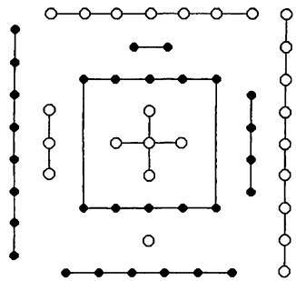  
図7-1 河図

大伝(『易』繋辞伝)に，天一地二，天

三地四，天五地六，天七地八，天九地十とい、うが，天地の数(河図の数)はみな，少数の一から多くなり，多を極めればまた少数の一に還る。これこそ加減の源にほかならない。……河図がー二を数の体の始めとするゆえんはそこにある。

(大傳曰，天一地二，天三地四，天五地六，天七地八，天九地十。天地之數，皆自少而多，多而復還於少，此加減之原也。……是故河圖以一二為數之體之始。)とまったく等しい(河図加減之原節)。

河図篇は以下，朱熹にもとづく前掲の「河図は五生数を以て五成数を統べ，その方を同じうす」を大原則として，河図のもつ不可思議な意味を闡明にしていく。『易』繋辞上伝の「五位相得而各有合」については，『易学啓蒙』本図書篇の解釈3)に基本的にしたがいながら，「五行の序を以て位を定め」，「陰陽相生の数」の諸関係を論定する。すなわち，天の陽数(奇数)は水を生じ，北方に位置する。地二の陰数(偶数)は火を生じ南に位し，天三の陽数は木を生じ東に位し，地四の陰数は金を生じ西に位し，天五の陽数は土を生じ中央に位する。これら一・二・三・四・五を五生数という。だが六・七・八・九・十の五成数のばあい，各数(n)は「中数」の五を引いた数(n-5)と位を同じくし，五行の配当を等しくするものの，数の陰陽奇偶がまったく逆である。たとえば地六は，陰数であるにもかかわらず陽数の天一と位を同じくし，五行の配当は依然として水に属している4)。

河図篇はそのほか，陰陽運行の序や奇偶相得の数についても論じてやまない。陰陽運行の序については，朱熹が陰陽奇偶を区別せず，東→南→中→西→北という，一律の転回を考える5)のに対して，河図篇の作者は奇数が北一→東三→南七→西九と左旋し，偶数が南二→西四→北六→東八と時計回りに動くととらえる。この解釈は『周易折中』巻19の啓蒙上篇に引く明の呉日慎の説と同じである。呉曰慎はこうのべている。

陽(陽気)は北に始まり，西に終わる。一三は陽がまだ微であるため内におり,七九は陽が盛んであるため外につく。……陰(陰気)は南に始まり，東に終わる。二四は陰がなお微であるゆえ内におり，六八は陰が盛んであるゆえ外に立っている。

(陽始北而終西。一三陽尚微故居内，七九陽盛而著於外也。……陰始南而終東。 二四陰尚微故居内，六八陰盛而凝於外也。)

なお『周易折中』巻19と巻20は易学啓蒙の解説であり，大字の啓蒙の全文に小字の集説と案文を加えた構成からなっている。一方，奇偶相得の数とは，『周易折中』巻21の啓蒙附論篇にいわゆる合数のことである。奇数と偶数が中数の五を介して，「相得て各おの合う有る」ことを指している。一と六，二と七，三と八，四と九，五と十がそれである6)。

河図篇はつぎに，邵雍の「円は河図の数なり」と「暦紀の数，其れこれに肇まる」を引き，河図が「その全を掲げて以て人に示し，その常を道う」(朱熹の本図書篇)ことを説明し，最後に「河図は，豈に天地自然生成の数にあらざるか」と，それが「数の体」であることを高らかに宣言し，同篇の論考を終えている。

## 1.2 洛書図と乗除法

『数理精蘊』上巻の洛書篇は，洛書図(図7-2)に始まり，「洛書の数」にかんする最も基本的な説明がそれにつづいている。その一文は

洛書の数は，九を戴き一を履み，三を左し七を右し，二四を肩と為し，

八六を足と為し，五その中に居る。

(洛書之數，戴九履一，左三右七，二四為肩，八六為足，五居其中。

である。朱熹撰『周易本義』巻頭の洛書図の説明にほぼ同文がみえることからすれば，上文が朱熹に直接もとづくことは間違いない7。洛書の基本構造にかんする言及につづいては，「朱子謂」として『易

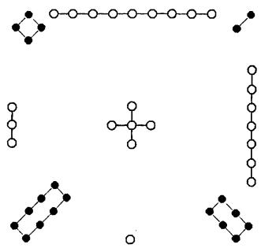  
図 7-2 洛書

学啓蒙』本図書篇の一文が引用されている。引用の個所は先の「河図以五生数統五成数」のセンテンスにつづく一節である。

洛書は五奇数が五偶数を統べ，それぞれ違う方位に位置している。  
陽数(奇数)が陰数(偶数)を治め，そこに変化が生まれるからである。  
それこそ数の用にほかならない。((洛書)以五奇數，統五偶數，而各居其所。蓋主於陽以統陰，而肇其變。數之用也。)この一節は河図篇と同じく，洛書篇の考察の方向を根底から規定している。康熙帝とその詞臣たちがすべてに先んじて証明しようとしたのは,「洛書は，数の源なり。乗除の生ずる所以なり」という術数学的ないし数学基礎論的な命題にほかならない。かれらの認識によれば,そのテーゼを証明すべき理由は「数学は多しといえども，乗除これを尽くす」(邵雍)からである。だがその乗除にかんする命題が成立する理論的な根拠は，『易』説卦伝に「参天両地而倚数」とみえ，天数が三をもって展開し，地数が二をもって展開していくところにあるにすぎない。すなわち,説卦伝によれば，三は天数にあたり，二は地数にあたる。天地は相合って万物を扶育するが，「は太極の体」であるため,自ら展開することはできない。「数」が二と三に倚って起こるゆえんである。だが三の累乗は3,9,27，81，243，……と展開し，二は2，4，8，16，32，……と展開していくが，成数(10)を去り余数を残せば，洛書の四正に位置する三・九・七・一と，四維に位置する二・四・八・六のみが残り，それら基数は2

と3の等比数列を構成している。かれら『数理精蘊』の作者が洛書をもって「乗除の本原」と論定した理由はそこにある。そもそも乗除の本源を洛書におくべしという術数学的な命題が，明白な形をとって提示されたのは，『周易折中』巻21の啓蒙附論篇にみえる

また大伝(『易』説卦伝)に，参天両地にして数を倚すという。天数は三をもって自ら展開し，地数は二をもって自ら展開している。これが乗除の源である。……洛書が三二を数の用の始めとするゆえんはそこにある。

(又(大傳)曰，参天兩地而倚數。天數以三行，地數以二行，此乘除之原也。……洛書以三二為數之用之始。)

が最初であるが，洛書における数の等比的展開については，同書巻19の啓蒙上篇の集説に引く宋の趙汝楳の説に

数の体(本体)が乱れなく立っても，変化しなければ，その展開はありえない。洛書の陽数が三をもって左行し，陰数が二をもって右行するのはそのためである。陽数のばあい，一を3倍して三となり，三が東に位置する。三を3倍して九となり，九が南に位する。九を3倍して二十七となり，七が西に位する。二十七を3倍して八十一となり，一がふたたび北に復帰する。そのまま累乗し億兆にいたるも，余数の位に変化はない。一方，陰数のばあい，二を2倍して四となり，四が東南に位置する。四を2倍して八となり，八が東北に位する。八を2倍して十六となり，六が西北に位する。十六を2倍して三十二となり，二がまた西南に居る。そのことは億兆にいたっても同様である。八位が定まり，五が中央に居て，数の用が完成するのである。聖人のいわゆる「参伍以て変じ，その数を錯綜す」とは,その類のことを指している。

(體立矣，不變則數不行。故陽以三左行，陰以二右行。三其一為三而居東，三其三為九而居南，三其九為二十七而七居西，三其二十七為八十一而一復居北，等而上之，至於億兆，其餘數之位皆然。二其二為四而居東南，二其四為八而居東北二其八為十六而六居西北，二其十六為三十二而二復居西南，上而億兆亦然。八位

既列，五仍居中，而數之用以通。聖人所謂参伍以變，錯綜其數者，此其類也。)とあり,その点からいえば,乗除説が趙汝楳に由来することはまったく疑えない。趙汝楳の文章は出所が『易雅』図書釈第一八である。

洛書篇はそのほか，「乗除の数」の運行や序列についても論じている。  
同篇の作者はいう。天数の三は「東方発生の地に始まり」8)，東三→南  
九→西七→北一と展開していくが，その「三を以て参する」左旋は,  
「天道の左行」に対応する。また地数の二は「西南二陰始生の地に立ち」9),  
西南二→東南四→東北八→西北六と展開していくが，その「二を以て  
これを両する」右旋は，「地道の右行」に呼応している。天道の左行・地  
道の右行とは，それぞれ天球の西から東への運動，地球の東から西への  
自転のことを意味し，中国天道説の常套句である。だが洛書の左行右行  
については，『周易折中』巻19の啓蒙上篇に上と同様な学説がみえてい  
る。宋の鮑雲龍『天原発微』左右篇からの引用文がそれであり，こういう。洛書の変数より推せば，陽数は三をもって左行する。天円は径1周3(π=3)からなり，三が天数にあたるからである。一は北にある。一を3倍して，三が東に位置する。三を3倍して九となり，南におる。九を3倍し，三九二十七，七が西におる。二十七を3倍して八十一となり，一がまた北に復帰する。陽数は北から東，東から南，南から西，西から北へと巡り，循環してやまない。そこには天道左旋の義と符合するところがある。一方，地方は径1周4からなり，地数の二を2倍した値に等しい。陰数は，地数が二に起こるため，それをとって自らの始めとし，西南に位し，そこより右行する。二を2倍して四となり，東南におる。四を2倍して八となり，東北に位する。八を2倍して十六となり，西北におる。十六を2倍して三十二となり，二がまた西南の本位に復帰する。陰数は西南から東南，東南から東北，東北から西北と進み，西北からまた西南に還る。これまた循環して窮まりない。そこには地道右行の説と一致すると

ころがある。一三九七の陽数は四正の位におり，二四八六の陰数は四隅に位置している。左右の旋転は，相互に経緯をなすが，造化の妙はまさにそのようである。

(以洛書變數推之，陽以三左行。天圓，徑一圍三，三天數也。一在北，一而三之，三在東，三其三為九，而居南，九而三之，三九二十七，而居西，三其二十七，為八十一，而一復居於北。北而東，東而南，南而西，西而復北，循環不窮，有以符天道左旋之義。地方，徑一圍四，兩其二也。蓋以地上之數起於二，而陰資以為始，位在西南而右行。二而二之為四，而居東南，二而四之為八，而居東北，二其八為十六，而居西北，二其十六為三十二，二復居西南本位。西南而東南，東南而東北，東北而西北，西北而復西南，亦循環不窮，有以協地道右行之說。一

三九七，陽居四正，二四八六，陰居四隅。左右旋轉，相為經緯，造化之妙如此。)天数地数の右行左行の始まる数と位は洛書篇と異なっているが，その他の点については基本的に同じである。

洛書篇はつぎに，斜直の対待，すなわち一と九，二と八，三と七，四と六などの関係についてのべ，「斜直四圍，みな十五を得。これを合わせば，四十有五を得。九五の数たり」と，洛書が魔法陣をなしていることをいう。最後に，「乗除の本原,洛書より生ず」とのべ，その一句によって同篇の数の考察を総括している。

## 2 数学と道学

『数理精蘊』の数理本原篇・河図篇・洛書篇は，加減乗除の起源を河図と洛書におき，籌算によって河図洛書の理を説明しているが，その数学の図書起源説は，暦術や律呂が数の実質的な展開である10以上，『律暦淵原』総体の論理的基調を覆ってあまりある。一方，同じ篇の論述は，『周易折中』巻19の啓蒙上篇や巻21の啓蒙附論篇の河図洛書観と内容的に一致しているところも多い。『周易折中』の学説は朱熹撰の『周易本義』や『易学啓蒙』の易解釈を基本としており，朱子易学の新たな展開と位置づけることができる。本節では以下すこしばかり，(1)暦算学の図書起源説や(2)『律暦淵原』と朱子学の関係について，文化的な背景や思想的な影響などを考えてみたい。

## 2.1 数理科学の河図洛書起源説

今日のわれわれからみれば，河図洛書を加減乗除の源とする上記の命題は論理的に未熟であり，偽なる命題にすぎないけれども，その特殊な命題の存在自体が一面，清朝初期の知識人の知的傾向やア・プリオリな見解を示していることも確かである。総じて中国の科学者や数学者には，古来より，易学や陰陽学などを好む者がきわめて多い。代表的な例をあげれば，張衡・祖沖之・李淳風・一行・沈括・李冶・秦九韶・楊輝などはそうした性癖を顕著にもっている。清朝初期の科学者のばあいも，そのことはまったく変わらない。たとえば梅文鼎は家学が易学であり，自ら「先後天八卦位次辨」など易学の専門論文も書いている11)。黄宗羲は『大統暦法辨』の著者としてより，『易学象数論』の著者として名高い。李光地には『周易通論』『周易観象』など易学の研究書がある。恵棟の父，恵士奇は易学の大家であるが，暦算学の専門書『交食挙隅』を書き「金銭食」を論じている。易学と暦算学の関係は，思いのほか深い。

だが暦算学ないし数学が易学と密接な関係をもっていたのであれば，易学の発展や変化にともなってその学的位置づけが変化を来すのは当然である。そのことを如実に示しているのが，宋代以降の数学書における河図洛書の過度の重視にほかならない。南宋の秦九韶は『数書九章』自序(1247)中，「河図洛書，秘奥を闓発し，八卦九疇，精微を錯綜す」などとのべ，「数と道，二本に非ざる」ことを証明する。楊輝の『続古摘奇算法』(1275)は，巻頭に河図図と洛書図を載せ，縦横図(魔法陣)にかんする研究を展開する。莫若は朱世傑『四元玉鑑』に対して序を著し(1303)，「自然而然」なる数の起源について「河洛図書，その秘を泄らし，黄帝九章，これが書を著す」とのべている。明の呉敬は『九章算法比類大全』自

序(1450)において，「図書，河洛より出で，大衍五十有五の数あり。聖人，これを以て変化を成し，鬼神を行う」云々という。程大位の『直指算法統宗』(1592)は書の冒頭，「数は何より肇まるか。その肇まるや図書よりするか」とのべ，つづけて河図図と洛書図を描いている。それら河図洛書を重視する視点や態度は，宋以前の数学書にはみられない傾向である12)。だが清以前の数学者のばあい，河図洛書を重視するとはいっても，いずれの言及もせいぜい河図洛書を数の起源というに止まり，いまだ具体的に，河洛二図をもって数学ないし加減乗除の由来するところなどとは考えていない。

わたしの知るかぎり，河図洛書に対して数学の起源ととらえて具体的な考察を展開したのは，康熙帝御纂の『周易折中』啓蒙附論篇が最初である。その周易折中凡例には，

朕は講学の暇，暦象九象の奥旨に心を遊ばせること，多年にわたり，渙然としてそれらが易道の範囲を出ないことを悟った。そこで河図洛書の本原・先天後天卦の配置から大衍推仰の法にいたるまで，それぞれについて図を描きいささか分析し，その意味を敷衍することを試み，啓蒙篇の後につけ，啓蒙附論篇と命名した。

(朕講学之外，於曆象九章之奥，遊心有年，渙然知其不出易道。故自河洛本原，先後天位置，以至大衍推迎之法，皆稍為摹畫分析，敷暢厥旨，附於啓蒙之後目日啓蒙附論。)

という。康熙帝は文中，「暦象九章」の学を称して「易道を出でず」といい，数学や数理科学の学術上の地位を易学の応用の位置に引き下ろしている。易道自体が河図洛書に淵源することを考えれば，その一句が数学の河図洛書起源を意味していることは疑うべくもない。

『周易折中』啓蒙附論篇が説明したのは，わずか河図洛書が加減乗除の本源であるという点ばかりではない。河図の10数の和にあたる「大衍の数」の55を「円方の原」や「句股の原」などとし，円周率(密率)の値22/7やピタゴラスの定理(三平方の定理)を導き出すのみならず,易解釈に生じる諸数をもって暦定数を位置づけ(大衍迎日推策法)，乾策坤策の数によって薄明継続時間にかかわる地平線下の度数18度を説明している。薄明を示す18度は『暦象考成』巻4の矇影刻分節にもみえ，かなり正確な値である。また「成卦の理」なる概念をもちだし，それによってパスカルの三角形についても説明を加えている(加倍変法)。諸暦算法の図書起源を説明する論理自体はどれもたわいもないが，多くの数理科学の命題に対して説明を試みた点にはいささか驚かされるところがないわけではない。

『周易折中』の数学や数理科学の図書起源説は，欽定などの故をもって多方面に影響をおよぼしたが，その最大の影響といえば，純粋の科学書である『律暦淵源』をおいてほかにない。数学の図書起源説は『律暦淵源』のばあい，神秘のヴェールに深くつつまれた河図洛書が数理科学の存在基盤ないし理論基礎を定め，全体の学説を統べ，その発展の方向を根本から規定することを意味したのである。清代の数理科学の学術上の基礎は,論理をこよなく重んじる公理系ではなく,直感的かつフレキシブルな二組の数群ないし平面図形におかれたということができる。

一方，康熙帝が数学の図書起源説を採用して『律暦淵源』の理論構造を完成させた原因の一つは，自らの信奉する西洋科学の中国起源説13)と調和をはかろうとしたところにあることもこれまた間違いない。『数理精蘊』の河図篇・洛書篇につづく周髀経解篇のなかに，イエズス会の宣教師たちが西洋科学の「自る所を詢」われ，「みな中土より流伝する所に本づくという」とみえ，

上古の聖王のことを考えれば，欽明なる堯帝や濬哲なる舜帝が，暦象をもって時を授け，閏余によって歳を定め，璿璣玉衡(天文儀器)をもって七政(日月五星)をととのえたが，推歩の学(数理天文学)がそれより優れていたときはない。夏殷周三代の盛時になると,聖王の名声教化は四方におよび，四方の人々は通訳をかさねその学を仰望した。そのことからいえば，海外に流伝した推歩学の書籍も少なくないはずである。周末には，疇人(天文暦算学の専門官)の子弟が官

職を失い各地に分散した。秦火をへて，中原の典籍は多く失われたけれども,海外の支流はその真伝をなくさず，いっそう発展させた。これが西学(西洋科学)に本原があるゆえんである。

(粤稽古聖，堯之欽明，舜之濬哲，曆象授時，閏餘定歲，璿璣玉衡，以齊七政。推步之學，孰大於是。至於三代盛時，聲教四訖，重譯向風，則書籍流傳於海外者，殆不一矣。周末，疇人子弟，失官分散。嗣經秦火，中原之典章，既多缺佚，而海外之支流，反得真傳。此西學之所以有本也。)

などとのべられているからである。数学の図書起源説と西洋科学の中国起源説が，自説の無矛盾性を追求し理論的強化をはたすべく，論理上互いに依存しあい，学説上二つの基礎をなしていたことは，書の構成がその事実を如実に示している。

そうした河図洛書を重んじる数神秘主義思想が，数理科学の徹底的な論理性の追求に対して，負の遺産をもたらしたことは当然ながら疑うことができない。だが同時に，数の内包する神秘性や整合性への理性を超えた確信が，数理科学の発展に対して，寄与したところがあることも事実である14)。最大の実例はほかならぬ『御製律暦淵源』であるが,別の事例として，康煕帝御製の『音韻闡微』(1715奉勅撰，1726告成)の音韻システムをあげることもできる。同書の音韻システムは等韻理論などに顕現する数的整合性追求の原理にもとづいて，古来の中国語の反切表記法に修正を加え，表記の体例を大きく簡略化し，また満州語の表音法(満書十二字頭)との理論的一致をはかり，自国語の相対化ないし音韻分類の音声学化を通して，中国語の音韻体系の理論的整備を企図したものである。だがその革命的な反切法のばあい，結果はあまり芳しくない15)が，上の字母に対しては単に支・微・魚・虞・歌・麻韻の字のみを使い，下の韻母に対してはわずか影母(清音)と喩母(濁音)の二母の文字のみを使うとしており，煩瑣な古来の方法に比してきわめて先進的な試みであったことに疑問をさしはさむ余地はない。『音韻闡微』の作者は民族主義的な傾向が強い中国において，民族の文化伝統の枠をこえて漢語の音韻理論を拡張することを試みており，失敗したとはいえ，その独創性や先進性については間違いなく第一級に数えることができる。数の整合性は，数神秘主義者やそのシンパサイザーにとって，時代や民族をこえ揺るぎなく存在したのである。

## 2.2 康熙帝と朱子学

『数理精蘊』河図洛書篇と『周易折中』の内容的一致はすでにのべたとおり，かなり多岐にわたり，偶然の一致の域をはるかにこえているが，その内容的一致の直接の理由は非常に単純なところにある。すなわち二書の編纂のばあい，(1)いずれも康熙帝の欽定になり，(2)康熙帝の命じた編者の顔ぶれがほとんど等しく，(3)同じ編者グループが各書の限界をこえて一つの高次の目標を追求していたからである。

まず康熙帝の欽定の点についてであるが，聖祖自身が二書に対して「親ら改正を加え」(御製律暦淵源序)，「片字一画，斟酌怠るなき」(御製周易折中序)ことは，序の記載を信じるかぎり疑えない。絶対的な権力を有する皇帝が，書物の内容に立ち入って事細かに指示し，自らの意指を授けていたからには，たとえその意指が恣意にすぎたにしろ，かれ自身の思惑が他の編者の思想ないし哲学に先んじて，書物の限界をこえ内容のここかしこに現れることは明らかであり，その点についてはまったく否定しようがない。また第二の点についても検証は容易である。二書の奉旨諸臣職名表によれば，『周易折中』の編纂(1713-1715)は，「総裁」が李光地であり，「御前校対」が魏廷珍・何国宗・梅毂成・王蘭生などからなり，また『律暦淵原』の編纂(1713-1722)は，「承旨纂修」が允禄と允祉であり，「彙編」が何国宗と梅毂成，「分校」が魏廷珍・王蘭生・方苞からなっている。何国宗・梅毂成・魏廷珍・王蘭生の四人が，二書の編纂のいずれにも参画したことは確かである。編纂に関わった中心メンバーが共通であるからには,少なくとも二書の理論ないし論調の基本的な一致は避けられない。

康熙帝の欽定である以上，かれ自身のリーダーシップが二書の成立にかんして，決定的な影響を及ぼしたことは自明であるけれども，李光地(1642-1718)の学術上の影響も，低く見積もってはならない16)。『清史稿』巻290は，魏廷珍と王蘭生が「(李)光地の門より出づる」ことや，方苞と「光地の誼，師友の間に在る」ことなどをのべているし，また阮元の『疇人伝』巻38は，梅毂成の祖父の梅文鼎が「李文貞公(李光地)の薦めを以て，聖祖皇帝特達の知を受けた」ことを記している17)。二書の編纂は総じて，李光地スクールの構成員と，かれらと関係の浅からざる者たちによって完成されたということができる。

だが上記の李光地スクールの学者たちが康熙帝の命をうけて編纂したのは,単に上記の二書に止まらない。代表的なものをあげれば，『御纂朱子全書』66巻(1713)や『御製性理精義』12巻(1717)や『御定星暦考原』6巻(1713)や『御定音韻闡微』18巻(1715奉勅撰)などもそうである。李光地の欽定書の編纂中とりわけ重要であるのは，性理学書の『朱子全書』と『周易折中』と『性理精義』の編纂をおいてほかにないが，それら性理学書についても，『律暦淵原』編纂の中心メンバーである何国宗・梅毂成・魏廷珍が均しく「御前校対」に与り，性理学理論の編纂整備を最終的に統括していたことは，各書の奉旨諸臣職名表が逐一記しているとおりである。書の内容が他書とリンクし，互いに同じである事実から推せば，康熙帝や李光地たちが度重なる書籍の編纂を通じて推進しようとしたのは，単なる数理科学の振興ではなく，広く性理学の推奨にあるといわねばならない。

事実，康熙帝が晩年，性理学ないし朱子学に傾注したことはよく知られている。かれ自身も御製朱子全書序において，自らの学問の遍歴をのべ，康熙四十五年(1706)ごろ，「まさに宋儒の実据を得」とか，「読書五十載，ただ朱子一生の作す所，何事かを認得するのみ」などと述懐している。一方，道学者として名高い李光地が文淵閣大学士を拝したのは康熙四十四年(1705)であり，まさに康熙帝が「心を理学に潜め」始めていたころにあたっている。『清史稿』巻290の論によれば，康熙帝は李光地を得て，道学にもとづく自らの文教政策を積極的に押し進め，「朱子の学を以て天下に倡え」，性理諸書を参訂し，その結果，「承学の士，聞きて興起し」,朱子学が「一時の盛をなす」にいたったという。康熙帝が李光地の死に際して，「李光地，謹慎清勤，終始節を一にし，学問淵博なり。朕これを知ること最も真，朕を知ることまた光地に過ぐる者なし」と諭した(『清史稿』本伝)のは，その文教政策上の二者の緊密なコンビネーションについてのべたものと解すべきである。

だが思想の巨大な流れからいえば，康熙帝や李光地グループの性理学は性格としてやや特殊なところがあり，独自の理論や固有の学的傾向をもっていたことも否めない。康熙帝は性理精義序で自書の特徴に言及し，「図象律暦性命理気の源に至っては，前人のいまだ暢発せざる所の者なり。朕また時に己の意を以てその間を折中し，名づけて性理精義という」云々とのべている。康熙帝の胸中を忖度すれば，自らの奉じる性理学には斬新なところも少なくなく，その斬新性は「図象律暦性命理気の源」の分析で最も顕著である，と自負していたことは疑えない18)。一方，李光地の学問については，全祖望が「ただ律呂暦算音韻，頗る得るあるを称するのみ。その余はまた道うに足らず。而して籌算を以て図書を言うは，則ち支離の甚だしき者なり。互体を言うはさらに謬り，古法と合わず」云々とのべている(『鲒埼亭集』外編巻44，答諸生問榕村学術帖子)。全祖望によれば，李光地の経術は律呂暦算音韻にやや評価に値するところがあるのみであり，総体としては曲学阿世の偽道学にすぎない19。評価は正反対であるけれども，いずれの言及も欽定の性理学が図学や数学をとりわけ重視したことをのべており，邵康節や朱熹の象数学の強い影響が欽定書のここかしこにみられることは確かである。

だが先に分析したごとく，康熙帝を頂く李光地のスクールが朱子学を天下に唱え，その理念の追求を己の義務としていたのであれば，当然ながら『律暦淵源』についても同じ性格をもつと論定しなければならない。

事実，『数理精蘊』の数理本原篇は，「算数之学，実に格物致知の要務なり」と明記している。格物致知が朱子学の重要なテーゼであるだけでなく，上記命題がきわめて一般性に富んでいることからすれば,『律暦淵源』が朱子学を前提とし，それをもって自らの思想環境の設定をしていたことは当然である。また雍正帝の御製律暦淵源序にも，「それ理と数，符を合わせて離れず。その数を得れば則ち理，これを外れず。これ図書の易範の先を開くゆえんなり」とある。『数理精蘊』の河図・洛書篇の内容や論理を思い起こせば，図書学自体が朱子学と親和的であり，いたって性理学的な傾向が強いことは自明である。

## 小結

以上の諸分析から論断すれば，康熙帝や李光地など一連の数理科学を嗜好する道学者にとって格物致知の学とは，単なる性命理気の学を意味するのではなく，律呂・音韻・暦算学などを重要な構成要素とする学術のことであり,自然科学を自らの内に含むものでなければならない。清朝初期の術数学的道学者の強く確信するところによれば，性理学自体が「格物究理」を直接の目的とする以上，人文学的な分析に加えて自然学的な考察も欠くことができず，自然科学なしにはその存在も許されないのである。

注

1)『律呂正義』続編は17・18世紀のョーロッパの楽律理論を中国に紹介したものである。その具体的内容については，川原「西洋楽典の東漸」(『西学東漸と東アジア』川原編，岩波書店，2015)を参照されたい。

2)数学の意味するところは，現在のわれわれの用法にかなり近い。

3） 本図書篇にはこうある。「陽數奇，故一三五七九皆屬乎天，所謂天數五也。陰數偶，故二四六八十皆屬乎地，所謂地數五也。天數地數，各以類而相求，所謂五位之相得者然也。天以一生水而地以六成之，地以二生火而天以七成之，天以三生木而地以八成之，地以四生金而天以九成之，天以五生土而地以十成之。此又其所謂各有合焉者也」。

4)河図における数と位の齟齬，すなわち陽数の一が北(陰位)に位し，陰数の二が南(陽位)に位することについては，河図篇の作者は邵雍『皇極経世書』観物外篇上の「天之陽在南而陰在北，地之陰在南而陽在北」を引きながら，「五行質具於地」以上，五行に準拠する方位は邵雍の説をもって,一般(天)の陰陽ではなく地の陰陽を用いなければならないとして一応の説明ないし解答をあたえている。

5) 朱熹は本図書篇において，「位運行之次言之，則始東次南次中次西次北，左旋一周而又始於東也」とのべている。

6)河図篇には明言がないけれども，これら2数は5を法として互いに合同であるから，「合数を以て共に一数に乗ずれば，得るところの数は必ず同じ」にならざるをえない(『周易折中』啓蒙附論篇)。

7)『数術紀遺』の甄鸞注にも「九宮者，即二四為肩，六八為足，左三右七，戴九履一，五居中央」とみえるが，この書は当時逸書であり，洛書篇の作者たちがその記載を知っていたとはとうてい考えられない。

8)東方が万物発生の地であるのは，『易』説卦伝に「帝出乎震。……萬物出乎震，震東方也」とみえるからである。

9)西南を称して二陰の初めて生じる地などということができるのは，十二消息卦において西南は遯卦にあたり，遯卦は下2爻が陰爻，上4交が陽爻であるからである。

10)雍正帝の律暦淵源序にも，「齊七政正五音，而必通乎九章之義」とある。

11）梅文鼎の易学については，張永堂『明末清初理学与科学関係再論』(台湾学生書局，1994)を参照。

12)趙君卿の『周髀算経注』には，河図洛書の字句はみえない。『数理精蘊』周髀経解篇と異なるところである。

13)西学中源説については，劉鈍の「清初暦算大師梅文鼎」(『自然辨証法通訊』，1986)に教えられたところが多い。また同説の思想界への影響については，川原「戴震と西洋暦算学」『西学東漸と東アジア』川原編，岩波書店，2015)を参照されたい。

14)梅文鼎も河図洛書を信じていたことは疑えない。梅文鼎『績学堂詩鈔』巻三の奇祝少司馬李厚庵五十の詩において，「易象肇河洛，理數相為根。京焦詘輔嗣，授受渺専門。卓犖宋諸子，図学承淵源」などと歌っているからである。張永堂前掲書(注11)頁159参照。

15)羅常培『漢語音韻学導論』(香港太平書局，1970)の頁96は，「例外多於

原則，足徴其法之不適用矣」とのべている。

16) 康熙帝晚年の文教政策については，李光地が文淵閣大学士(在職，1705-1718)として最も深く関与しているからである。

17) 梅文鼎の伝記については，劉鈍前掲論文(注13)や李迪・郭世栄編著『清代著名天文数学家梅文鼎』(上海科学技術文献出版社，1988)を参照。

18)『周易折中』の啓蒙附論篇の総説にも，「蓋所以見圖書為天地之文章，立卦生蓍為聖神之制作，萬理於是乎根本，萬法於是乎權輿」とある。

19)方苞は『方望溪先生全集』外文巻六の「安溪李相国逸事」において，命の恩人たる李光地に対して必死に弁護を試みている。

# 8 『孫子』における天文と地理

## 1 兵家思想における合理性と神秘性

## 1.1 中国の天文と地理

「天文」地理」という漢語は，『易』繋辞上伝の「仰いで以て天文を観，6 よ.う すじめ俯して以て地理を察す1」にはじまり，もともとは天の文様や地の文理を意味した。

中国の天文学または地理学とは，こうした天文地理を研究する学問のことであるが，それらは，合理性と神秘性の二面をもっている。天文学のばあい，(1）天象に合致した暦を国々や人々に頒布する必要から，その数量的側面を客観的に分析したが，同時に，（2)国家の吉凶を天象に見，その意味を考えるというふうに，占術の側面も強調した。前者は[推歩・暦数の学」，後者は「天文・占変の術」といわれ，それぞれ今日の数理天文学や国家占星術にあたっている。

また地理学のばあいもほぼ同様なことがいえ，客観的な地誌記録と占地術の「堪輿」「風水」が併存した。それゆえ「天文」「地理」の意味は，時にはむしろ占星術や占地術のそれに近い。

こうした天文学や地理学の二面性(合理と神秘の併存)は，術数学という学問の性格に原因がある。術数学とは，厳格な数理の方面と変化自在の占トの方面を共有した，広い意味での「数」について研究する中国古代独自の学問のこと。『漢書』芸文志は，それを天文(星占)・暦譜(暦法と数学)・五行(五行占)・蓍亀(蓍筮と亀卜)・雑占(夢占など)・形法(人相学や風水)の六部門に分けており，それによれば，天文学の書名を天文や暦譜に，地理学の書名を五行や形法に見いだすことができる。

## 1.2 権謀家の軍事思想

天文や地理の学は，ほんらい術数的思考にもとづいていたが，兵家思想もそれと無関係ではなかったのである。『四庫全書総目提要』兵家類小序に，

兵家はつねに術数と相出入し，術数もまたつねに兵家と相出入する2。というのが，そのことをよく示している。

『漢書』芸文志は，「兵家」を①権謀，②形勢，③陰陽，④技巧の四者(四家)に大別した。それによれば，孫子に代表される「権謀」家は正法によって国をおさめ，奇法によって戦争に勝とうと努め，戦略や戦術を重視する。また他の形勢家・陰陽家・技巧家の三家の働きを内に含み，「形勢を兼ね，陰陽を包み，技巧を用いる者」でもある。一方，「形勢」家は，離合集散し，そこに生じる勢に乗じて勝敗を決することを説く。「陰陽」家は広義の占星術を多用し，「技巧」家は兵器や訓練を重視する。清朝の学者章学誠は，兵家の四家分類について興味深い見解をのべている(『校讎通義』巻3)。

権謀は人なり，形勢は地なり，陰陽は天なり。孟子日く，「天の時は地の利に如かず，地の利は人の和に如かず」(公孫丑下)と。これ三書(家)の次第なり。権謀は道なり，技巧は芸なり。道をもって本となし，芸をもって末となす3)。

この四家分類について注意すべきは，第一に，孫子を含む権謀家の軍事思想を，人間に焦点をあてたものと規定したこと。第二に，形勢家は軍事において地理を重んじる流派に，陰陽家は天文を重んじる流派に属すると指摘したことである。

また章学誠が人間の社会的価値を天文や地理より上位におき，それによって権謀家が「形勢(家)を兼ね，陰陽(家)を包む」ゆえんを説明したことにも，注意しなければならない。第一点は権謀家の基本姿勢を，第二三点は権謀家における天文と地理の地位を示しており，その意味でいずれも重要である。

さらにいえば,権謀家が占トと無縁ではなかったことも軽視すべきではない。その理由は主として三点ある。第一に，術数あるいは天文・地理では，合理面と神秘面は排他的に存在していないため，各面が独自の領域を形づくるとはいえ，そこに明白な区分を設けることができない。

第二に，権謀家は権謀術策を貫徹するため，利用可能なものはすべて利用する。したがって占トという，ある意味で非常に人間的な営みは十分な使い道がある。すなわち，権謀家の根本思想が人間関係に焦点をあてた現実主義であれば，それと抵触する部分は除去するが，都合がよい部分は逆に利用することになるであろう。

第三の論拠は，1972年に山東省臨沂県の銀雀山漢墓から出土した一群の竹簡によるものである。羅福頤「臨沂漢簡概述」『文物』1974-2)は,『孫子兵法』『孫臏兵法』とともに出土した陰陽・風角・災異・雑占にかんする残簡のばあい，内容は兵家の範疇を越えておらず，『太平御覧』巻328に引く「孫子占」とよく似ている。おそらくそれらは『孫子兵法』の占卜部分か『孫臏兵法』の附録であり，現在通用の『孫子』に陰陽術数の記述がないのは孫子注を書いた三国時代の魏の曹操が，その部分を削ったことに由来するであろうと分析する。くわえて，孫臏の兵法と断定された竹簡のなかにも，占ト的とのべてよい記載が実際に存在する。月戦や地葆篇などがそれである。占トの個所をすべて後世の竄入としないかぎり，第三点からだけでも十分に，権謀家といえども占トから完全に自由ではなかったと論断することができるにちがいない。

もちろん，権謀家が基本姿勢として「天の時は地の利に如かず，地の利は人の和に如かず」を採用している以上，そこには占トを規制する要因が厳に存在せざるをえない。あるいはさらに，権謀家では占ト的要素は希薄であったといえるかもしれない。だが同時に,「術数と相出入し」その影響をうける以上，権謀家の軍事思想が完全には占トを除去しえなかったことも，これまた事実である。

## 2 孫子における天文と地理

## 2.1 天文・地理の重要性

権謀家には商鞅・呉起・范蠡・韓信など著名な将軍が多いが，その代表といえば，春秋末期の孫武と戦国中期の孫臏であろう。かれら二人の孫子は血統もつながり，戦争での天文地理の重要性をはっきりと認識していたことも変わらない。

現在通用の『孫子』(現行本)ならびに最近発掘された竹簡本『孫子兵法』は，「孫子曰く，兵は国の大事なり。死生の地，存亡の道，察せざるべからず4)」(計篇)にはじまり,つづけて考慮すべき五事として①「道」,②「天」，③「地」，④「将」，⑤「法」をあげる。また竹簡本『孫臏兵法』も「道を知る者は，上は天の道を知り，下は地の理を知り，内はその民の心を得，外は敵の情を知る5)」(八陣篇)と記している。

二孫子によれば，戦争に勝つには，敵味方の力量を把握するだけでなく，天文や地理をも考慮に入れなければならない。「彼を知り已を知れば，勝ちはすなわち殆からず，天を知り地を知れば，勝ちはすなわち全うすべし6)」(『孫子』地形篇)，「天の時・地の利・人の和，三者得ざれば，わぎわい勝つと雖も央(殃)あり7)」(『孫臏兵法』月戦篇)という二孫子にあっては,天文や地理は勝利にいたるための不可欠の条件であったのである。

## 2.2天とは……

上記のように，天文や地理が，原理上重視されたのにもかかわらず，現行本『孫子』には，地理はともかく天文にかんする記述は無きにひとしく，竹簡『孫臏兵法』にしても，ほぼ同様である。

『孫子』にそれが不足する最大の理由は，おそらく唐の杜牧がいうように，「曹操がその繁剰を削って,その精粋を筆した」ためであり,また『孫臏兵法』に不足するのは，出土した竹簡のうち，陰陽術数を含む残簡がどの書に属するかを決定することができないためであろう。しかし理由はともあれ，現実に記述が不足する以上，孫子の天文知識を正確に把握するのはほとんど不可能に近い。

したがってここでは，今日の中国天文学史の研究成果や歴代の孫子注などを利用して，逆に春秋戦国期における天文知識水準から，『孫子』や『孫臏兵法』の天文にかんする数少ない記述の意味をさぐってみたい。

二孫子がのべた天文にかんする言説のなかで，最も総括的なものは『孫子』計篇のつぎの一句であろう。戦争に先立って考慮すべき五時のつ「天」を説明して「天とは,陰陽・寒暑・時制なり8)」とのべている。このうち「陰陽」は広義の天文占と解すべきであり，「時制」は宋の王皙がいう「時の利害に因りて宜しきを制する」ことを意味するであろう。

## 2.3 天文占

まず春秋戦国期の天文占について考えてみると，孫武のころにはすでに，天体位置の表示基準の「二十八宿」と「十二次」が成立していたことは疑えない。

二十八宿は，赤道に沿って不等間隔に設けられた28個の星座のこと。漢以降，それによって天体の赤道経度を表示した。その成立は春秋中頃まで遡るといわれ，自然発生的な性格をもっている。角宿を起点として西から東へ，

角·元·氏·房·心·尾·箕  東方七宿

斗·牛·女·虚·危·室·壁 北方七宿

$$
\begin{array}{c} \begin{array} { l l l l l } { \stackrel { t \dagger } { \ I } : \stackrel { \ddots } { \ I } } & { \stackrel { \ddots } { \ I } } & { \stackrel { \boxplus } } & { \bullet } & { \boxed { \ I } } \\ { \not \not \subseteq } & { \bullet } & { \boxplus } & { \bullet } & { \boxed { \ I } } \\ & { \not \subseteq } & { \bullet } & { \boxed { \ I } } \end{array} \bullet \begin{array} { l l l l } { \boxed { \ I } } & { \bullet } & { \boxed { \ I } } \\ { \not \ I \not \subseteq } & { \bullet } & { \stackrel { \iota \not \subseteq } { \ I \not \ni } } \end{array} \quad \longrightarrow \quad \bigoplus \qquad \overbrace { \ I } \not \in \overbrace { \ I \not \Xi }  \end{array} \qquad \begin{array} { l } { \boxed { \ I } } \\ { \boxed { \ I } } \end{array}
$$

井·鬼·柳·星·張·翼·軫 — 南方七宿

という。また二十八宿を7宿ずつ東西南北の四方に分け，四方の獣神と関係づけたものを，四象あるいは四陸という。東方の蒼竜，北方の玄武西方の白虎，南方の朱雀がそれである。それぞれ上記の東方七宿，北

方・西方・南方七宿と対応している。北方の玄武神は，蛇が亀に巻きついた形をもって表示されるのが普通である。そのうち箕・壁・翼・軫の名は，『孫子』火攻篇にみえている。

二十八宿に対して天空を星象と無関係に12等分したものが，それよりやや遅れて成立した十二次である。十二次とは，木星の公転周期12年にもとづいて,天空を西から東へ,星紀(せいき)・玄枵(げんきょう)・娵訾(しゅし)・降婁(こうろう)・大梁(たいりょう)・実沈(じっちん)・鶉首(じゅんしø)・鶉火(じゅんか)・鶉尾(じゅんび)・寿星(じゅせい)・大火(たいか)・析木(せきぼく)と12等分し，冬至点を星紀の中央とさだめたものである。太陽が区分の初点に来れば二十四節気の節気にあたり，中点に来れば中気である。そのため木星は1年にほぼ1次をすすみ，12年で天空を一周する。木星が歳星とよばれるわけはここにある。

また十二次は，その成立自体から占星術と密接に関係していたことも確かである。春秋戦国の占星術は，天空をいくつかに分割して地上のある地域に配当し，各分野の星象にもとづいて諸国の運命を占った。これを分野説という。

分野説はその対応法も含めて実にさまざまな方法が試みられたが，総体的には，惑星それも木星による星占いをその中心とした。その結果，天地対応理論の分野説と，木星の公転周期の12年が結びつき，天空を12等分する十二次が成立したのである。『晋書』天文志は，二十八宿・十二次と周末の諸国や漢の州との対応を次頁図9(図8-1)のように記している。たとえば星紀の分野は呉越であり，玄枵の分野は斉である。

ここで十二次による木星占の一例をあげよう。『春秋左氏伝』昭公三十二年(B.C.510)の条は，つぎのように記している。

夏。呉，越を伐つ。始めて師を越に用いるなり。史穆曰く，四十年に及ばずして，越それ呉を有せんか。越，歳(星)を得て，呉これを伐つ。必ずその凶を受けん，と10)。

この年，木星は呉越の分野である星紀に留まっていた11)。呉王闔閻は，木星が留まる越には，天恩が施され，福が生じるといわれるにもかかわらず，大軍を率いて越を攻めた。すると天命に逆らうゆえ，呉はその災いを受けざるをえず，また存亡の数は三紀すなわち36年(1紀は12年)であるから，四十年以内に呉は越に滅ぼされるにちがいない。史穆はこう占った。事実，三十八年後に呉は越に併呑されている。

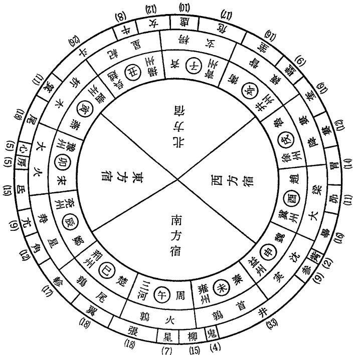  
図8-1 分野図

もちろん，孫子ひいては権謀家が，こうした天文占をまったく信じていたわけではない。あるいは孫武自身が木星占を無視して上記の戦役を指揮した可能性ものこっている。荻生徂徠によれば，天文占は「用うるも破るも，皆愚を使うの術と知るべき」であり(『孫子国字解』)，唐の杜牧によれば,ほんらい信頼するに足らないのに孫子が天文占に言及したのは,暴君暗主を牽制するためであったという。

前項の分析からすれば，この二説はいずれも可能であろう。つまり，孫子にとっては，天文というも人事の延長にすぎず，したがって孫子が天文占を用いるのはごく自然なことであったようである。「孫子曰く，十戦して六勝するは，星を以てするなり。十戦して七勝するは，日を以てする者なり。十戦して八勝するは，月を以てする者なり12)」(『孫臏兵法』月戦篇)。

## 2.4 寒暑と時制

つぎに「寒暑」であるが，ナポレオンやヒトラーのロシアないしソ連遠征を例に引くまでもなく，戦争でそれを考慮すべきことはいうまでもない。孫子もその重要性をはっきりと認識し，寒暑の二字にこめて，春夏秋冬・日夜朝暮・飢饉豊年・風雨・潮の干満などを疎かにしてはならないことをのべた。だが春秋戦国期には，そういう寒暑を記すべき暦が実は諸国ごとに異なっていて，乱れに乱れ，年や月の名すら互いに違っていたのである。

たとえば『詩経』豳風・七月の詩にはこういう13)。

七月流火あり(秋，アンタレスが黄昏時に西に沈む。アンタレスは寒暑の候きず ひっ  
である)，九月衣を授く(霜が始めて降り，冬衣を準備する)。一の日は觱  
はっ  
発たり(十一月，風は寒く)，二の日は栗烈たり(十二月，気は寒し)。衣かつ お  
なく褐なければ，何を以て歳を卒えん。三の日于に耜し(正月，始めあし  
て田器を修め)，四の日趾を挙ぐ(二月，実際に耕作を始める)。我が婦子とも かれい  
と同に，彼の南畝にす(我＝家長自ら婦女を率いて田地に弁当をもってでんしゅん  
いく)。田畯(勧農の官)至りて喜ぶ。

「……某月」と記したのは立春を含む月(建寅の月)を正月とした夏正(夏王朝のこよみ。旧暦の紀月法と基本的に同じ)を使っており，「……某の日」というのは冬至を含む月(建子の月)を正月とした周正(周王朝のこよみ。おおむね旧暦から2月を引くとよい)を使っている。前者が農事に符合するのに対して，後者は冬至の天象にもとづいており，正月の位置は互いに2ヶ月近くずれている。また『春秋』では経と伝がともに官暦の周正によりながら，まれに同じ事件を異なった月に記すこともある。魏では官暦を使わず，夏正を正式に採用していたことも確認されている。

こうした暦の混乱状態において孫子が則るべきだと考えたのは，天象に合致することではなく，人事すなわち農業に合致するか否かにあった。この点は「天とは陰陽・寒暑・時制なり」の，人間社会の制度を意味する時制の二字によく表れており，曹操もこの条に対して『司馬法』を引用して「冬夏に師を興さざるは，吾民を兼愛するゆえんなり」と注している。天文占であれ，暦であれ，人間にとっての価値しか判断の基準はなく，そうした現実主義以外には則るべきものはない。孫子はこう考えていたようである。

## 2.5 孫子の地理認識

『孫子』には地理にかんする記述は比較的に多く，行軍・地形・九地の三篇が専門的にそれに言及している。だが最も総括的な記述といえば，計篇の,

地とは，遠近・険易・広狭・死生なり14)。

がそれであろう。この句は五事の一つ「地」について解説したものであるが，遠近(距離)・険易(険しさ)・広狭(広さ)の三者が地形や地勢など自然地理を説明するのに対して，死生は「疾く戦えば則ち存し，疾く戦わざれば則ち亡ぶ15)」(九地篇)という死地と，これとは逆に守るに便利な生地との区分を意味し，やや異なっている。

この両者はそれぞれ，孫子の地理認識における自然環境に即する客観的な自然地理の側面と，人文現象を対象とし人間や文化・社会的価値を重んじる人文地理の側面に対応しており，前項および天文にかんする上記の分析結果から考えれば，前者が後者に収斂することは，ほぼ間違いない。

このことは地形篇の構成や内容を分析すれば，さらに明白になるで

あろう。地形篇はまず，地形には①「通」道路が四方に通じている，かい  
②「挂」両軍ともに複雑な地形の要害の地にあり，往きやすく返りがたい，③「支」相持の地，両軍が険隘を隔てて対陣しそれぞれ強固に守り，攻撃にも守備にも利便でない，④「隘」両山通谷のように出入口がせまい，⑤「険」山川丘陵など険阻の地，⑥「遠」平陸にあり，彼我ともに往来自由，の区別があると説き，各地形に応じて戦闘法を講じる。

つぎにこの六種の地形は「地の道」を示しており，したがってその客観的な把握は将軍に課せられた最も重大な責務であると論じ，さらに戦争に敗北する六つの原因を数えあげ，それらは「天地の災にあらず，将の過ちなり」と冷徹に将軍の責任をのべる。最後に「彼を知り已を知れば,勝ちはすなわち殆からず，天を知り地を知れば，勝ちはすなわち全うすべし」と結んでいる。

『孫子』地形篇の論理構成は「地と人と相待って勝敗の機を自得すべき旨を明らかにし16)」ており，孫子の基本思考をよく示している。孫子にとっては，地形の客観的把握といっても，人間社会上の現実的な意味がなければ，それは無用なものにすぎず，現実的意味が生じて初めて有用になるのである。

地形篇につづく九地篇は，用兵の観点から機能的に戦地を分析しているが，その分析はつぎに示すように，孫子の現実主義的地理観を考えるには最適のものであろう。

孫子は敵味方の情況に応じて，戦地をつぎの九種に分類する。すなわち，①諸侯が自国領地内で敵と戦う「散地」。②敵地にさほど深く攻め入っていない「軽地」。③味方が占領すれば味方に有利，敵が占領すれば敵に有利となる「争地」。④数道が往来し，交通が絶えることのない「交地」。⑤数国の勢力が鬩ぎあい，最初に把握したものが優位を占める「衢地」。⑥敵地に深く侵入した「重地」。⑦山林・険阻・沼沢など，行軍が困難な「圮地」。⑧四方を山川や敵に囲まれた「囲地」。⑨疾く戦えば存し，疾く戦わざれば亡ぶ「死地」。以上がいわゆる九地であるが,われわれには地理というより，地理的条件と絡みあった軍事情況の説明としかみえない。だが孫子にとっての地理はむしろこうした人間社会的な価値を有するものを意味しており，それは計篇の「地とは，遠近・険易・広狭・死生なり」の死生の二字に端的に表れている。孫子は地理の把握においても，人間的視点にもとづく現実主義を自らの立脚点としていたのである。

## 小結「人」の視点

孫子兵法の基本的立場は「天の時は地の利に如かず，地の利は人の和に如かず」の一句に集約することができる。孫子は陰陽家や形勢家の主張を介して，当時の術数的な天文や地理の学を自らの内部に吸収し，人間を社会的にとらえる視点にたって，それらを再構成した。

人間に焦点をあてたその現実主義は，ややもすれば冷徹な人間管理術に陥りやすく，権謀術策に終始する弊害をもたらしやすい。また逆に，人間心理面を無視しないゆえ，占トを完全に放逐することもできない。だが「人」の視点のもとに軍事技術を体系づけ，単なる技術から軍事思想へと飛躍させたのである。われわれは孫子を兵家の代表として称賛するだけでなく，一般的な中国思想史上の貢献についても高く評価しなければならない。

注

1） 原文「仰以觀於天文，俯以察於地理」。

2)原文[兵家恆與術數相出入，術數亦恆與兵家相出入」。

3)原文「權謀人也，形勢地也，陰陽天也。孟子曰，天時不如地利，地利不如人和。此三書之次第也。權謀道也，技巧藝也。以道為本，以藝為末」。

4) 原文「孫子曰，兵者，國之大事，死生之地，存亡之道，不可不察也」。

5) 原文「知道者，上知天之道，下知地之理，内得其民之心，外知敵之情」。

6) 原文「知彼知己，勝乃不殆。知天知地，勝乃可全」。

7) 原文「天時地利人和，三者不得，雖勝有央」。

8)原文「天者，陰陽·寒暑·時制也」。

9) 図は藪内清編集『中国の科学』(中央公論社，1975)の山田慶児・坂出祥伸・藪内清訳「晋書天文志」頁267の「十二次，二十八宿と分野の関係」を借りた。

10)原文「夏，呉伐越。始用師於越也。史墨曰，不及四十年，越其有呉乎。越得崴而呉伐之，必受其凶。

11)杜預注に「此年歲在星紀。星紀呉越之分也。歲星所在，其國有福。呉先用兵，故受其殃」という。だが実際は木星が星紀に進むのは，翌年ないし翌々年のようである。

12)原文「孫子曰，十戰而六勝，以星也。十戰而七勝，以日者也。十戰而七勝，以月者也」。

13)原文「七月流火，九月授衣。一之日觱發，二之日栗烈。三之日于耜，四之日舉趾。同我婦子，彼南畝。田畯至喜」。

14)原文[地者，逺近·險易·廣狹·死生也」。

15)原文「疾戰則存，不疾戰則亡者，為死地」。

16) 山田準·阿多俊介訳注『孫子』(岩波文庫，1935)頁149。

## 9 中国古来の哲理・五行思想

中国二千年を特徴づける経学や儒教を中心とした文化パターンは，漢代に一応の完成をみたが，五行思想や天文地理学もその例外ではない。経学的世界認識の一翼をになって，独特の体系を構築した。経学とは，経書(孔子の刪定を経たとされる中国の古典籍。経書の概念は漢代に成立)を研究する学術のこと。天人の際を主要な研究テーマとするため，天の哲学あるいは天人の学などとよばれることも多い。

## 1 天の哲学

経学の世界認識によれば，幽清玄静・寂寞冥黙の「虚無」から，気・形・質のいまだ相離れざる「混沌」が生じ，混沌から「元気」が生まれた。元気はやがて清んだ軽い気と濁った重い気に分かれ，陰陽剛柔の区別がおこる。清軽の気は浮上して天になり，濁重の気は沈下して地になった。天が円くよく動くのは陽を体(本体)とするためであり，地が平らかで静かであるのは陰を体とするためである。天は動いて精気を施しあたえ，地はうけてそれを育み養い，そこに万物が生まれ育つ。

陽の陽たる積陽の熱気は変化して火になり，陰の陰たる積陰の寒気は変化して水になった。陰陽の二気は相互に影響しあい変化凝合して，木・金・土になった。五行の気である。天にあっては，その火気の精の外に明なるものが太陽(日)になり,水気の精の景を含むものが月になる。また地上の山岳から漏れだした地気の精が天上にのぼって光り輝き，星(経星＝恒星)になった。星の「体，地に生ず」といわれるゆえんである。

一説によれば，日月から溢れ浸みだした気(淫気)の精なるものが星辰になったという。また五行の純粋なものが，五惑星(五緯)である。

一方，人は天地中和の気ないし陰陽五行の秀気をうけて化生したものであり,万物のなかで最も霊妙な心の働きをもっている。「万物の霊(霊長)」といわれるゆえんである。また大宇宙たる天(地)に対して天(地)を模した小宇宙をなしており，陰陽と五行を共通の質料因として相関的に構成されている。「天人一物」などといわれるが，それは天(地)と人が共通の原理のもと同じ質料で造られているためである。だが人は，天(地)に類する以上，陰陽と五行の介在のもと，天(地)と相互に感応せざるをえない(天人相関説)。天人の相関には，天(地)→人，および，人→天(地)の2つの方向を認めることができる。

## 2 五行思想

天の哲学を根底からささえた要素の1つが，五行の木・火・土・金・水であり，その離合集散を考察する五行思想にほかならない。

五行思想は，前漢末ごろ，劉歆の「河図・洛書，相経緯をなし，八卦・九章(洪範九疇)，相表裏をなす」という説にいたって，一定の安定を獲得した。『漢書』五行志ほかに記されているのがそれである。

漢代の五行思想は董仲舒以降，総じて『春秋』との関係が深く，天人相関にもとづく災異説的な傾向が顕著であるが，劉歆説に則る『漢書』五行志のばあい，五行の運動の思想的な根拠を，董仲舒などの経今文学派とは違って，『春秋』の伝(権威を認められた公認の注釈)ではなく『書経』洪範篇にみえる洪範九疇(九章の大法)にもとめた。洪範九疇とは，(1）質料因である五行そのもの，(2)五事(貌・言・視・聴・思)を正しく運用すること，(3)八政(農政・財政ほか)を重視すること，(4)五紀(暦数など)を調整すること，(5)皇極(中正の道)を政治に用いること，(6)民を治めるにあたって三徳を用いること,(7)疑わしきことにはト筮を用うべきこと，(8)

天のくだす庶徴に注意すること，(9）五福によって奨励し，六極によって畏怖させることであり，九疇の第一にあげられるのが五行である。また洪範篇は五行について，こう説明している。「五行とは，一に水，二に火，三に木，四に金，五に土。水の本性は潤下，火の本性は炎上，木の本性は曲直，金の本性は従革，土の本性は稼穡(農耕)にある」と。ちなみに五行災異を解釈する際，『書経』洪範を最初に利用したのは，劉歆の父親の劉向であるといわれている。

だが『漢書』五行志の特徴は，『易経』の説く陰陽の道理にしたがい，『書経』洪範に示された天の咎徴にならって，天人の道を明らかにするところにある。五行志の冒頭にはこうある。

『易経』(繋辞伝)にいう，「天は象を垂れて，吉凶をあらわす。聖人これに象る。河は図(河図)を出だし，洛は書(洛書)を出だす。聖人これに則る」。劉歆はこの文を次のように解釈している。伏羲氏は天を継いで王となり，河図を授けられ，それに則って図象化した。八卦である。禹は洪水を治めて洛書を賜わり，それに法って文章化した。洪範がそれである。聖人はその道を行ない，その真理を宝として尊んだ1。

班固が五行志の冒頭でのべているのは，河図と洛書が互いに経と緯の関係をなし，『易経』の八卦と『書経』の洪範九疇が互いに表と裏の関係をなしているということである。その命題は，簡潔な形で漢以降の五行思想のフレームワークをみごとに説明している。

五行思想は，『書経』洪範や『易経』の説く天人相関説を基礎のもと，社会理論の方面では大きく2つの方向に発展した。1つが五行災異であり，他の1つが五徳終始である。

## 3 五行災異

『漢書』五行志は伏生の『尚書大伝』洪範五行伝を引いて，五行災異の

原因を次のようにのべている。伏生は秦の博士。漢初，『書経(別名，尚書)』を講じて，今文尚書学派の祖となり，経学の発展に大きな影響をねよぼした。

①木については狩猟するのに適当な時期でなく，酒食を礼法どおりに勧めず，宮殿の出入に節度がなく，姦詐をなして民の農時をうばえば，木は曲直の性格を失う。

②火については法律を無視し，功臣を追い出し，太子を殺し，側室を正室とすれば，火は炎上しない。

③土については宮殿を営造し，台閣を飾り立て，内に淫乱をきわめ，親戚父兄をあなどれば，稼穡は成果があがらない。

④金については戦争を好み，百姓を軽んじ，城郭を飾り立て，辺境を犯せば，金は従革の性格を失う。

⑤水については宗廟を粗末にあつかい，天神地祇に祈らず，祭祀を取りやめ，天時に逆らえば，水は潤下の性格を失う。

また『尚書大伝』洪範五行伝は五行災異について，次のようなカテゴリーをあげている。五行の後の等号につづく貌・言・視・聴・思は，五事とよばれる概念であり，五行とは1対1の対応関係がある。なお『漢書』五行志は，五行と五事についてそれぞれ項をわけて説明している。

①木＝貌(容貌)が本来あるべき姿を失ったとき木氷(木が凍りっく),恒雨(雨がつづく)，服妖(風俗が乱れ，グロテスクな服装が流行する)，亀孽(亀に異変が生じる)，鶏禍(鶏に異変が生じる)，青眚青祥(木類に属する異物が生じる)。

②火=視(目)が本来あるべき姿を失ったとき濫火妄起(火災が多発する)，恒奥(暑さがつづく)，草妖(草木に異変が生じる)，蠃虫の孽(甲羅や羽毛のない動物に怪異がおきる)，羊禍(羊に怪異が生じる)，赤眚赤祥(火類に属する異物が生じる)。

③土＝思(思慮)が本来あるべき姿を失ったとき稼穡不成(天災もないのに農産物が不作になる)，恒風(風がつづく)，脂夜の妖(雲風が並び起こり真っ暗になる),華孽(時ならずして花が開く),牛禍(牛に怪異が生じる),心腹の痾(心や腹の病気がおこる)，黄眚黄祥(土類に属する異物が生じる)。

④金＝言(言葉)が本来あるべき姿を失ったとき恒陽(日照りがつづく)，詩妖(時の悪政を嘆く歌謡が流行する)，介虫の孽(甲のある動物に怪異がおこる)，犬禍(犬に異常が生じる),口舌の痾(口舌の病気がおこる),白眚白祥(金類に属する異物が生じる)。

⑤水＝聴(耳)が本来あるべき姿を失ったとき大水(洪水がある),恒寒(寒さがつづく)，鼓妖(異様な音がひびく)，魚孽(魚類に異変がおこる),豕禍(豚の災いがおこる)，耳痾(耳の病気がおこる)，黒眚黒祥(水類に属する異物が生じる)。

## 4 水と聴

『漢書』五行志の説く五行災異は，今日からみれば，愚かしくたわいもないけれども，五行思想の発展史からみれば，五事との配当を導入して五行概念を大きく広げており，その意味で重要である。それゆえ，いますこし水＝聴の失調に起因する災異を例として五行志の論理を追っていきたい。

『漢書』五行志は『書経』洪範篇と「伝曰」の文章につづいて，当時大学で教授されていた尚書学派の所説を引き，経と伝文の意味を説明する。「説曰」以下の文章がそれである。たとえば,伝に「宗廟を粗末にあつかえば，水は潤下の性格を失う」とみえるのは，水は五行の配当では北方・冬にあたり，北方・冬は万物の収蔵をつかさどり，人が死んだとき，肉体(魄)が収蔵されるのはほかならぬ宗廟であるからであるという。また「天神地祇に祈らず，祭祀を取りやめ，天時に逆らえば，水は潤下の性格を失う」というは，聖王は時令にのっとり，北方・冬の陰の気に仕え,天と人を調和させねばならないからであると。また「水不潤下」の内容，すなわち水がその本性を失ったときの災害についても，霧水が暴出

し，百川が逆流氾濫し，郷邑を破壊し人を溺死させ，長雨が農作物を痛めつける，などとのべている。

だが『漢書』五行志が説いているのは，直接の水災ばかりではない。聴の不聡(耳がよく聞こえないこと)に生じる，恒寒の天罰や鼓妖などの天災についても詳細な考察をのべている。『漢書』五行志の説明はこうである。恒寒の天罰や鼓妖などの天災が生じるのは，君王の耳に傷害があれば，政治は苛酷になり，(苛酷は水・冬の天殺の性格であるため)水の気を病み，水の気が病めば，火がそれを損なうからである。五行配当にもとづけば，聴の原理も水と同じ類に属しており，五行相克説によれば，五行の水は火に勝たねばならない。そのため聖王の聴政が正しくないとき，水類に属する災異が生じるという。そのうち天罰の恒寒は，冬寒が万物を枯殺するところに生じ，鼓妖は，君王が厳猛で臣下が萎縮すれば，妄聞の気がおこり，それが鼓妖＝音声の異変をもたらす。魚孽や豕禍がおこるのは，魚は陰類に属し，坎卦は水の象徴であり豚を連想させるからである。また黒は水の色にほかならない。

災異解釈の基本原則は以上のようであるが，実際の災異解釈は解釈者に応じて相当の振れがある。具体例をあげれば，『春秋経』桓公「元年(前711)秋，大水」について，『漢書』五行志は三つの解釈を併記している。

董仲舒と劉向の解釈によれば，魯の桓公は兄の隠公を殺した。民臣はそのため隠公をいたみ，桓公をさげすんだ。その後(前710)，宋の華父督が自らの君主を殺害し，諸侯は会合を開いて，華父督を討伐しようとしたが，桓公は賄賂を受けとって軍をひきあげ，また宋をも裏切った。諸侯はそれで魯を攻撃し，しきりに敵対交戦し，血が流れ屍が折り重なり，百姓の怨みはつのった。それゆえ桓公元年(前711)秋にくわえて十三年(前699)夏にも洪水がおこった，云々と説明する。

だが一説には，桓公の夫人は驕淫で，桓公を殺そうとした。陰の気が盛んであるにもかかわらず，桓公は悟らず，ついに殺されてしまったという。

劉歆の解釈によれば，桓公は許の土地を交換して，周公の祭りをやめた。大水は祭祀を廃したことにたいする天罰にほかならない。

五行災異解釈は『漢書』以降，大きな変化をみせていない。後の歴史書も基本的には『漢書』の義例に則って五行志をつくり，詳しく五行伝説とその占応を記録した。『明史』五行志も，「かの劉董諸儒の学，頗る術数禨祥に近し。もと述ぶるに足るなし」と董仲舒や劉向父子の災異解釈を非難しているにもかかわらず，相も変わらず「略，旧史五行の例に依りて，その祥異を著わしている」。

## 5 五徳終始

五徳終始説が後世におよぼした影響も，五行災異説に負けず劣らず，きわめて大きい。五徳終始説は，帝王が天下に君臨することができるのは五行中の一徳をうけたためだと主張し，五行に固有の循環法則を根拠として帝徳の興廃推移を説明しようとする。だが五行の循環には古来

相克と相生の二つがある(図9-1)ため，それぞれ別の時代にではあるが,相克と相生の順序に応じて五帝徳の循環にニつのバリエーションが考案された。五帝徳の交代が相克の順序(土→ 木→金→ 火→水→…)にしたがう，すなわち土は木に勝たず，木は金に勝たず，云々とし，不勝の徳をもつ王朝から勝の徳をもつ王朝へと時代は進展していくとするのが，

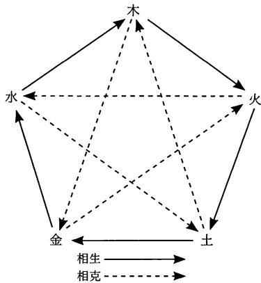  
図9-1 五行相生相克図

戦国末に一世を風靡し，はては秦朝の水徳による制度改革を理論的に指導した鄒衍の五徳終始説であり(図9-2)，相生の順序(木→ 火→ 土→金→水→…)にしたがって，木徳の王朝につづくのは火徳の王朝であり,火

徳の王朝につづくのは土徳の王朝である，云々とするのが，新(王莽朝)から宋にかけ千年を越えて影響をもちつづけた劉向・劉歆の五徳終始説である(図9-3)。次の課題は，劉向父子の歴史理論の思想史的な分析にある。

<table><tr><td>五 徳</td><td>土</td><td>→木 → 金</td><td>火</td><td>水</td></tr><tr><td>帝</td><td>王 黄帝</td><td>夏</td><td>殷</td><td>秦</td></tr><tr><td></td><td>黄竜</td><td>青竜</td><td>周</td><td></td></tr><tr><td>符 瑞</td><td>地蚊</td><td>草木</td><td>銀 赤烏</td><td>黒竜</td></tr></table>

図9-2 鄒衍の五徳終始説

<table><tr><td>五徳</td><td></td><td></td><td>木水火土金水</td><td></td><td></td></tr><tr><td>帝王(1)</td><td>太昊帝 (炮犠氏)</td><td>共工氏</td><td>炎帝 (神農氏)</td><td>黄帝 (軒轅氏)</td><td>少昊帝 顓頊帝 (金天氏) (高陽氏)</td></tr><tr><td>帝王(I)</td><td>帝嚳 (高辛氏)</td><td>帝摯</td><td>唐帝 (陶唐氏)</td><td>虞帝 (有虞氏)</td><td>伯禹 商 (夏后氏) (殷)</td></tr><tr><td>帝王(m)</td><td>周</td><td>秦</td><td>漢</td><td></td><td></td></tr></table>

図9-3 劉向父子の五徳終始説

だが劉向父子の五徳終始説にもとづいた王朝の徳自体についてはあちこちに記録はあるが，その具体的な理論内容については専門的に論述した論文は残っておらず，『漢書』郊祀志の賛に次のようにのべられているにすぎない。

『易』説卦伝に「帝は震(卦)に出づ」とある。伏羲氏が初めて木徳をうけて天下に君臨したゆえんである。五帝徳はそのあと母から子に伝わり，一終すればふたたび始めにもどり，神農・黄帝以下，唐虞三代をへて，漢の火徳にいたった。高祖が決起したとき，白帝の神母が夜に号泣し，赤帝の符を著わしたのは，そのためである。漢が旗章を赤としたのも，自ら天統(火徳)を得たところに原因がある。ただ共工氏のばあい，水徳をもって木火のあいだに受命したが，秦の同じ巡りであり，本来の次序ではない。それゆえ命数は短い2)。

劉向父子以後，閏水位すなわち共工氏や秦の徳がおかれた運次は不必要なものとして削られたが，その微少な修正をのぞけば，五徳終始説は宋の世まで生命を長らえつづけた(図9-4)3)。漢以後の王朝の始祖は新たに国を興こすに際して，前のどの王朝をうけたかについてはさまざまな考えをめぐらし，自らの論理をもって革命の正当性を主張したが，こと五徳の運次についてはみな，木→火→土→金→水→…の相生の順位にしたがうことを常とした。たとえば，王莽の新は漢の禅譲をうけたとして自ら土徳を称し，三国の魏も漢の後をとったと考え，土徳の王朝たることを宣言した。晋王朝は魏の土をうけて金徳を称し，以下，南朝の宋・斉・梁・陳は帝徳をそれぞれ水・木・火・土とした。また北魏は晋の金を継いで自ら水徳の王朝と称し，後周は魏の水を継いで木と称した。以下，隋の火→唐の土の巡りも，唐の土→後梁の金の巡りも，唐の土＝後唐の土→後晋の金→後漢の水→後周の木→宋の火の巡りも，基本的には劉向父子の五徳終始説に則っている。

  
図9-4 五徳運次図

## 6 水徳の王朝

漢以降の帝王は興国の際，劉向父子の五徳終始説にもとづいて，それぞれ五行の一を自らの帝徳として採用し，前代の徳運を改め，自朝の帝徳を天下に宣言したが，宣言の際には，開国の帝王の大多数は古来の慣習に則って形式的あるいは儀礼的に禅譲のことをのべ，犠牲や服飾など

の色を変更することは唱えるものの，継承した帝徳の理念や内容について自ら語ることはなく，実質的に意味のある制度改革の意志を宣べることもなかった。たかだか木徳の王朝であれば青色を用いるといい，火であれば赤，土であれば黄，金であれば白，水であれば黒を用いる，云々というのみである。だが劉向父子の五徳終始理論を明記した著述が今日に伝わっていない以上，天命をうけた帝王自身による帝徳の説明がなく，五徳理念によることが明らかな制度改革が王朝の交代に付随しないのであれば，帝王が五帝徳に何をイメージし，五徳の相違をどこにおいていたのか，などを明らかにすることはできない。だが中国史上には,革命の理念を明言した五徳終始説に則る制度改革もいくつか存在する。つぎにはそうした受命改制の実例をみ，それをとおして五帝徳の意味するところをすこし考えてみたい。

五帝徳とくに水徳の理念や意味を正確に知るには，秦始皇帝による歴史上最も巨大な受命改制の実例をみるのが最も便利であろう。秦の制度改革は厳密にいえば，鄒衍の五徳終始説に依拠しており，劉向父子のそれとは循環の方式が異なっているけれども，劉向父子の五徳終始理論は鄒衍説の五行理論を基本的にうけつぎながら循環方式のみを修正したものにすぎず，五徳自体にたいする二説の位置づけには大きな変化はない。五徳自体の意味するところは相生と相克の相違に応じて変化しないということができるのは，五行の意味が変換方式に応じて変わることがないのとまさに同じ理由にもとづいている。

秦の水徳による制度改革は次のようである。秦王政は在位の第二十六年(前221)，中国統一を成しとげると，王の称号を皇帝と改め，自ら始皇帝と称した。また鄒衍の五徳終始説にしたがって秦王朝の徳を水と規定し，一連の水徳に則る改制を断行した。すなわち，水徳の季節である冬の十月朔日を年首とする，衣服や旌旗には水の色の黒を使用する，数は水徳のそれである六を基準とする，黄河の名を徳水と改め，水徳の象徴とする，法治主義を徹底し，事に当たって水徳にかなう剛毅戻深を旨とする，音律は陰律の始めにある大呂を尊ぶ，などがそれである。数は水徳の六を基準とするとは，具体的には，符節や法冠の長さを六寸，馬車のゲージを六尺と定め，尺度の単位の歩を六尺とし，文字を記した簡策の長さ(書物の規格にあたる)を六寸の倍数と定め，行政区分を三六郡に分けることなどをさしている。

秦の制度改革において注意すべきは，水徳が冬や法治主義などと対応関係があることである。水が冬と対応しているのは，鄒衍以来の陰陽主運説とまったく等しい。陰陽主運説は，四時の大順(季節の巡り)を勘案した時令を説くところに特徴があり，人は自然のリズムに合った生活をしなければならないとし,天道の大経である春の生・夏の長・秋の収・冬の蔵を基準として政令をつくり，あらゆる人事を天の運行に順応させようとする。時令に用事宜忌が数多くみえるのはそのためである。また水徳が法治主義と対応しているのも，陰陽主運説の水と冬の関連づけに起因している。すなわち，水徳の政治が「剛毅戻深にして，事みな法に決し，刻削にして仁恩和義なく，然る後に五徳の数に合う」『史記』秦始皇本紀)としたのは，春一木，夏一火，中央一土，秋一金，冬一水の対応を根幹におき，冬の天誅をモデルとしたためである。五徳終始説においては鄒衍以来，五帝徳は四季の性格やイメージに連なっており，その点からいえば，劉向父子の修正をへたのち，木(春)→火(夏)→土(中央)→金(秋)→水(冬)の相生の循環を説く，五徳終始説が主流となっていくのは理の然るところといわねばならない。

## 7 科学理論への影響

五行思想は漢代，「河図・洛書，相経緯をなし，八卦・九章，相表裏をなし」ながら，社会理論としては五行災異と五徳終始の2方向に発展したが,ただそれだけではない。中国の科学理論のパラダイム形成にも大きな影響をおよぼした。

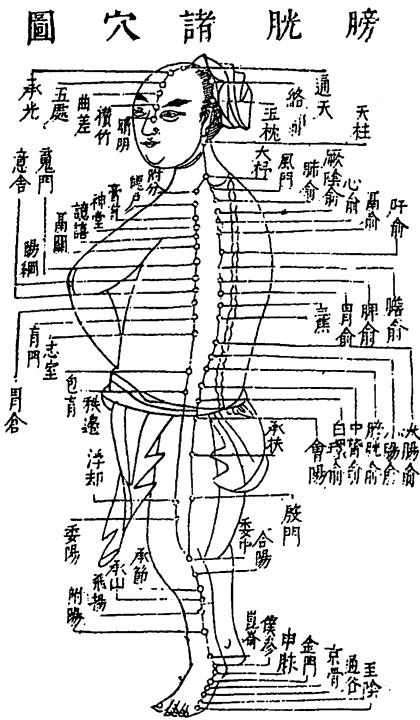  
図9-5 膀胱諸穴図

中国暦は劉歆の三統暦にいたって，天体暦almanacの規模をそなえたといわれるが，天体暦とは陰陽五行暦のことであり，太陽と太陰の運行に則って年月日の組み合わせをさだめながら，五行に対応する五星の天文位置を計算している。また今日われわれが五惑星に対して木星・火星・土星・金星・水星の名を使用するのも，本を正せば，中国天文学が五行説を取り込んで天文理論を構築したことに始まっている。水星の意味は水の星ということであるが,その水は五行の水である。

また中国医学への影響も大き

い。中国の医学理論は，五臓や六腑や十二経脈などを五行に配し，相生と相克をもって人体の生理や病理上の関係を説明する。すなわち，①木肝·胆·足厥陰肝経脈·足少陽胆経脈，②火(君火)心·小腸・手少陰心経脈・手太陽小腸経脈，③相火心包·三焦・手厥陰心包経脈·手少陽三焦経脈，④土脾·胃·足太陰脾経脈·足陽明胃経脈，⑤金肺·大腸·手太陰肺経脈·手陽明大腸経脈，⑥水腎・膀胱・足少陰腎経脈・足太陽膀胱経脈(図9-5)4)，云々というのがその基本配当である。また病気の転移(伝変)は相生と相克にわかれており，相生の伝変には，病変が母臓から子臓に伝わるとき(母病及子)とその逆(子病犯母)の区別があり，相克の伝変にも，相克が甚だしいとき(相乗)と相克と逆方向に向かうとき(相侮)の区別がある。五行説がなければ中国医学は成立しないといわれるほど，その影響は広くかつ深い。

注

1)原文「易曰，天垂象，見吉凶，聖人象之。河出圖，雒出書，聖人則之。劉歆以為虑羲氏繼天而王，受河圖，則而畫之，八卦是也。禹治洪水，賜雒書，法而陳之，洪範是也。聖人行其道而寶其真」。

2)原文「劉向父子以為帝出于震，故包羲氏始受木徳，其後以母傳子，終而復始，自神農黄帝下歴唐虞三代而漢得火焉。故高祖始起，神母夜號，著赤帝之符，旗章遂赤，自得天統矣。昔共工氏以水徳間于木火，與秦同運，非其次序，故皆不永」。

3) 狩野直喜『読書饕餘』(みすず書房，1980)より引用。

4)明の王圻『三才図会』身体一巻より。

## 10中国の「はかり」の世界

今を遡ること約二千年まえ，前漢末の初始元年十一月戊辰の日西暦(ユリゥス暦)のA.D.9年1月10日に，王莽は天命をうけたと称して，天子の位につき，国号を新とさだめた。また五日後の建丑の月十二月の朔，癸酉の日に，改暦を断行し，その日を始建国元年正月朔とあらため，十二月を歳首とする新暦を頒行した。同年，新たな度量衡の標準器を交付し，その制度の改変統一をはかった。こうした政治日程を踏んで行われた王莽の度量衡改革は，中国有史以来最大のものといってよく，その影響は清代あるいは現代までもおよび，アジア全域にまたがっている。一応とはいえ，王莽の制にいたって中国度量衡の定型化が完成したのである。当時，王莽のブレーンの一人に，博学で聞こえる経学者の劉歆がいた経学とは，諸子学の成果を自らの内部にとりこんで漢代に成立した，新しい孔子流哲学のこと。民族の基本的古典である，経書にかんする学問を総称する。

劉歆は前漢の元始年間(A.D.1-5)に王莽の命をうけて，学者百余人とともに，音律と度量衡について検討し，その結果を上奏した。劉歆の学統をつぐ班固が，後漢の中頃に，その上奏文をほぼそのまま『漢書』律暦志に収録し，中国最古の度量衡にかんする専著が成立した。律暦志の記載は，成立の経緯から十分推測されるように，実際の王莽の制と完全に対応しており，したがって書の内容をとおして当時の度量衡の組織や機能を詳しく分析することができる。

王莽の度量衡については，われわれは文献資料にくわえて，考古資料をももっている。台湾の故宮博物館に所蔵される「新莽銅嘉量」(新の王莽

の銅製枡原器)などがそれであるが，最近，考古資料の収集整理にかんして画期的な事件が起こった。中国の国家計量総局による『中国古代度量衡図集』の編輯出版がそれである(文物出版社，1981。邦訳：山田慶司・浅原達郎訳，みすず書房，1985)。『中国古代度量衡図集』は資料的価値の高い度量衡古器240点を精選し，各器に対して写真図版・銘文拓本・科学的デ一タ・図版説明などを収めており，それによって調査に長い時間をかけることなく，基本的な古器の検索調査が可能になった。これはわれわれ度量衡史に興味を覚える者にとって，まさに福音に等しい。同書に収録される王莽の度器は銅製の一丈物差し1点，量器は既述の「新莽銅嘉量」ほか6点，衡器は秤ざおと分銅の2点であり，現存する王莽期の古器を網羅している。

以下すこしばかり，劉歆・班固の『漢書』律暦志の記載と図集にみえる王莽の標準器の銘文を主な材料として，その度量衡制の諸相を簡単に紹介したい。すなわち，(1）度量衡の単位系が共通の基準をもつこと，(2)度量衡と声律の関係，(3)度量衡制と革命思想がそれである。

## 1 中国の統一度量衡制

中国歴代の度量衡学者は大体において，『漢書』の王莽・劉歆のシステムを最も完備した制度とみなし，基本的にそれにしたがった。いわゆるこうしょうまよしいよ くろきび黄鐘柜黍の説黄鐘の律管(ピッチパイプ)を原器とし，秬黍を補助媒介として，度量衡の単位系を統一的に組み立てるが，その定型化された理論である。

『漢書』律暦志は度制について，その組織をこうのべている。「度とは分・寸・尺・丈・引のこと。長短をはかる手段である。もと黄鐘の長さに起こる。北方に算する標準大の秬黍をとって，一黍の横幅の九十分(90粒の合計長)をはかると，それが黄鐘の長さである(90分=9寸)。一黍を一分(分の単位)とし，十分を一寸，十寸を一尺，十尺を一丈，十丈を一引として，ここに五度がさだまる」と。黄鐘の管長を九寸として，五度五つの長さの単位が求められている。

五量五つの容量単位は，黄鐘管の容積810立方分を1龠として制定された。「量とは龠・合・升・斗・斛のこと。多少をはかる手段である。もと黄鐘の律管(龠)に起こる。その容量は度の数値によって定められるが(1龠=810立方分)，それは北方に算する標準大の秬黍千二百を黄鐘の律管に満たし，井戸水で上部を水平にしたときの容量にひとしい。その龠を合わせて一合とし，十合を一升，十升を一斗，十斗を一斛として，五量がそなわる」。

劉歆は黄鐘の重さ，すなわち同律管に入る1200秬黍の重さから，五権五つの重量単位を導きだした。「権とは銖・両・斤・鈞・石のこと。物をかける衡(秤ざお)を水平にし，軽重を知るためのものである。もと黄鐘の重さに起こる。一龠は千二百黍を入れ，その秬黍の重さは十二銖である。これを二倍して一両，つまり二十四銖を一両とし，十六両を一斤，三十斤を一鈞，四鈞を一石とする。……かくして五権がなりたつ」。なお権とは，秤の分銅のことである。

後世の度量衡学者は，表現にやや修正をくわえたりもしたが，だれしもほぼ同文を引用し，その管律から度量衡を定義するという考えかたに則って，自説を構築し展開した。また日本の度量衡制度の原点にあたる大宝令の雑令も同説に則っており，その影響ははかりしれない。

劉歆は上記のごとく，黄鐘管の長さ9寸・容量810立方分から度制や量制を導きだし，黄鐘管に1200黍が入り，その秬黍の重さが12銖であることから衡制をさだめたが，かれは何を理論的根拠として，同一の基準にもとづいて度量衡を統的に組み立てねばならぬとしたのか。『漢書』律暦志の記すところ，劉歆は統一的な声律度量衡解釈の根拠を『尚ひと書』虞書の「乃ち律度量衡を同しうす(乃同律度量衡)」においた。すなわち，同句の意味を(声律度量衡の統一頒行ではなく)声律と度量衡の基準を等しくすることと解釈して，本来異質の声律と度量衡が共通の体系に属

することの理論的正当性を主張した。

われわれは劉歆が経書の語句をひいて，立説の根拠としたことにも注意すべきであろう。ここには劉歆，ひいては古典期中国読書人の基本的思考パターンをみることができるからである。

劉歆の同一の基準から度量衡の単位を導きだすという考えかた(黄鐘秬黍の説)は，フランス革命における近代的なメートル法の創立思想を思いおこさせるにちがいない。1799年に完成したこの単位体系は，地球子午線の4000万分の1を基準として，長さの単位メートルをさだめ，そのメートルから容量の単位リットルを導きだし，最後に1リットルの水の重さを1キログラムと定義するが，その理論の基本構造は地球が黄鐘，水が秬黍に代わっていることをのぞけば，劉歆の制度とまったく同じである。藪内清がこの制度を「中国におけるメートル法」とよぶ(「中国科学の伝統と特色」，『中国の科学』，中央公論社，1975，頁46)理由はそこにある。藪内の解説は簡単ながら実にうまく黄鐘秬黍の説の特質をのべているように思う。

## 2 度量衡と声律

中国音楽の音組織は，（1）相対音高を定める「声」(音階)，(2）絶対音高を示す「律」(音律)，(3)その結合法の「旋宮・転調」(調)からなっており，黄鐘はその律の基礎音である。制度的に一応の安定をみた漢代のシステムは，五声十二律をその基本的構造としている。

五声は宮・商・角・徴・羽のこと。五音音階(ペンタトーニク)からなり，1オクターブすなわち振動数比が2対1の絶対協和音程(1200セント)1)を，完全協和関係を示す振動数比3対2(完全5度，702セン卜)と4対3(完全4度，498セント)によって分割したものである。「五声の本は，黄鐘の律に生ず」といい，その計算方法は(1）相対音高を示すのに律長を借り，黄鐘管の9寸(t)を基準とし，(2)前の管長を2/3(三分損一)あるいは4/3(三分益一)して各管長を定めた。三分損益法といわれるのがそれである(表10-1)。一方，

たいそう こせん ずいひん  
十二律は低音から黄鐘・大呂・太族・夾鐘・姑洗・中呂・蕤賓・林鐘·なんりょ ぶえき  
夷則・南呂・無射・応鐘といい，五声と同じく管長9寸の黄鐘から，三分

損益法によって1オ表10-1 五声クターブ内にその12の管長絶対音高をさだめた(表10-2)。

<table><tr><td></td><td>律長</td><td>相生関係</td><td>振動数</td><td>セント値</td></tr><tr><td>宮</td><td>1</td><td>基音</td><td>n</td><td>0</td></tr><tr><td>商</td><td> $2 ^ { 3 } / 3 ^ { 2 }$  1</td><td> $\textcircled { 1 } \textcircled { 1 }$ </td><td>3²/2³n</td><td>203.9</td></tr><tr><td>角</td><td> $2 ^ { 6 } / 3 ^ { 4 }$  l</td><td> $\mathbb { H } \times 4 / 3$ </td><td>3⁴/2⁶ n</td><td>407.8</td></tr><tr><td>徵</td><td>2/3 l</td><td> $\overleftrightarrow { \Xi } { \times } 2 / 3$ </td><td>3/2 n</td><td>702.0</td></tr><tr><td>羽</td><td> $2 ^ { 4 } / 3 ^ { 3 }$  l</td><td>商×2/3</td><td>3³/2⁴n</td><td>905.9</td></tr></table>

表10-2 十二律
<table><tr><td></td><td>律</td><td>長</td><td></td><td>相生関係</td><td>セント値</td><td>十二辰</td></tr><tr><td>黄鐘</td><td>9 寸</td><td></td><td>l</td><td>律の首</td><td>0</td><td>子</td></tr><tr><td>大呂</td><td>8</td><td>104 243</td><td> $\frac { 2 ^ { 1 1 } } { 3 ^ { 7 } } l$ </td><td> $\frac { 1 } { 3 } \geq \frac { 2 } { 3 } \geq \frac { 4 } { 3 }$ </td><td>113.7</td><td>丑</td></tr><tr><td>太族</td><td></td><td>8</td><td> $\frac { 2 ^ { 3 } } { 3 ^ { 2 } } l$ </td><td> $\frac { 1 } { 1 } \times \frac { 4 \times 5 } { 1 2 } \times \frac { 4 } { 3 }$ </td><td>203.9</td><td>寅</td></tr><tr><td>夾鐘</td><td>7</td><td>1075 2187</td><td> $\frac { 2 ^ { 1 4 } } { 3 ^ { 9 } } l$ </td><td> $\frac { 1 } { 2 } A L \vert \times \frac { 4 } { 3 }$ </td><td>317.6</td><td>卯</td></tr><tr><td>姑洗</td><td></td><td> $7 \ \frac { 1 } { 9 }$ </td><td> $\textstyle { \frac { 2 ^ { 6 } } { 3 ^ { 4 } } } l$ </td><td> $\frac { 1 } { \mathbb { P } } \mathbb { E } \times \frac { 4 } { 3 }$ </td><td>407.8</td><td>辰</td></tr><tr><td>中呂</td><td>6</td><td>12974 19683</td><td> $\textstyle { \frac { 2 ^ { 1 7 } } { 3 ^ { 1 1 } } } l$ </td><td> $\frac { 4 } { 3 } \geq \frac { 4 } { 3 } > \frac { 4 } { 3 }$ </td><td>521.5</td><td>巳</td></tr><tr><td>蕤賓</td><td></td><td> $6 ~ \frac { 2 6 } { 8 1 }$ </td><td> $\frac { 2 ^ { 9 } } { 3 ^ { 6 } } l$ </td><td> $\frac { 1 } { 1 0 } \textcircled { < } \frac { 4 } { 3 }$ </td><td>610.7</td><td>午</td></tr><tr><td>林鐘</td><td></td><td>6</td><td> $\scriptstyle { \frac { 2 } { 3 } } l$ </td><td> $\frac { 4 } { 5 } \textcircled { + } \frac { 4 } { 5 } \times \frac { 2 } { 3 }$ </td><td>702.0</td><td>未</td></tr><tr><td>夷則</td><td> $5 \ \frac { 4 5 1 } { 7 2 9 }$ </td><td></td><td> $\frac { 2 ^ { 1 2 } } { 3 ^ { 8 } } l$ </td><td> $\tan \tt { x s e a x } \frac { \pi } { 3 }$ </td><td>815.6</td><td>申</td></tr><tr><td>南呂</td><td></td><td> $5 \frac { 1 } { 3 }$ </td><td> $\textstyle { \frac { 2 ^ { 4 } } { 3 ^ { 3 } } } l$ </td><td> $\therefore \frac { 1 4 } { 1 5 } \times \frac { 2 } { 3 }$ </td><td>905.9</td><td>酉</td></tr><tr><td>無射</td><td> $4 \ \frac { 6 5 2 4 } { 6 5 6 1 }$ </td><td></td><td> $\frac { 2 ^ { 1 5 } } { 3 ^ { 1 0 } } l$ </td><td> $x \leq \frac { \land x } { 2 } \times \frac { 2 } { 3 }$ </td><td>1019.5</td><td>戌</td></tr><tr><td>応鐘</td><td> $4 \ \frac { 2 0 } { 2 7 }$ </td><td></td><td> $\textstyle { \frac { 2 ^ { 7 } } { 3 ^ { 5 } } } l$ </td><td> $\ddagger \ddagger { \ddot { \psi } } \notin \times \frac { 2 } { 3 }$ </td><td>1109.8</td><td>亥</td></tr></table>

五声十二律はどちらも黄鐘ただ一つを確定すれば，すなわち黄鐘管の長さや容積などの規格を決めれば，簡単に音組織全体を定めることがでれいりんきる。これこそ『漢書』律暦志が，黄帝の命令をうけて，伶倫が解谷の竹をとり,孔の大きさと肉の厚さの均一なもの(竅厚均者)で黄鐘の律管をつくったという故事を引く理由であり,さらにいえば，同書が律制と度量衡制を結びつけて論じる理由でもある。

だが上記の黄鐘と九寸をキーワードとした声律と度量衡の相互依存関係(黄鐘は律長9寸で定め，寸は黄鐘の長さで決める)は，両制度を結合する理論として，すこし脆弱すぎるだけでなく，たかだか両者の関係にしたがうだけでは『漢書』律暦志が声律と度量衡にくわえて暦法のシステムを統一的に論述した理由をうまく説明することができない。その正確な理由を知るには，われわれは度量衡史や声律史にくわえて，暦法史や思想史の領域にも分析の矛先を広げなければならない。

中国の伝統思想によれば，天地万物は等しく，陰陽二気の離合集散によって生成される。そのため，大宇宙たる天と小宇宙たる人は相互感応が起こり，人の社会制度や社会現象さえも天にしたがわなければならない。また春夏秋冬の変化は陰陽二気が引き起こす最も顕著な作用であり，管律は気を吹くゆえ，暦法ともどもその季節の変化をうかがいうる。かくして気の思想の存在のもとに声律と暦法が関係づけられ，ついには律制と暦制が結合されるのである。

気の思想の影響は当然ながら，度量衡の制度のなかにも発見することができる。たとえば五権のばあい，1両＝24銖は二十四気を象徴し，1斤=384銖は『易』上下篇の爻易卦を組み立てるもと。陰爻と陽爻の二種があるの総数にあたり，陰陽二気の変動を象徴する。また鈞の名義についても，「鈞は均である。陽は元気に施し，陰はそれをうけて万物を化成し，その完成物はそれぞれに均衡を得ている」と，気に結びつけて説明している。

『漢書』律暦志が律暦や度量衡，ひいては五数(一・十・百・千・万)までも有機的，統一的に説明した理由の一つが，中国伝統の気の思想にあることは，上記の分析からして疑問の余地はない。だが劉歆の律暦哲学を気の思想と単純化すれば，人文学を内包する世紀の一大体系の理論としてはあまりに漠然としすぎ，逆に気の思想によるのみでは劉歆哲学の豊穣な内実を十分に説明しつくすことはできない。一歩分析を進めて，劉歆の経学理論の三統説をとりあげる必要があるゆえんである。

## 3 劉歆の三統哲学

劉歆の三統説は，『漢書』律暦志に記された，かれの三統暦と密接不可分な関係にある。それゆえまず，三統暦にいたる暦法史を略述し，つぎに三統説の分析に進むことにしたい。

西暦前221年，秦の始皇帝は天下を統一するやただちに，五徳終始説2)にもとづいて，火徳の周に対して秦を水徳の王朝と規定し，その五行の水に応じて冬十月(建亥の月)を歳首とする改正朔(改暦)を断行した。これせんぎ上くが顓頊暦 $( 1 \overleftrightarrow { \mathbf { f } } \mathbf { \overline { { * } } } = 3 6 5 \frac { 1 } { 4 }$ 日，1月 $= 2 9 \frac { 4 9 9 } { 9 4 0 }$ 日)であり，ここに伝統の受命改正朔が開始される。

顓頊暦は漢初にも行われたが，武帝は太初元年，（1）兒寛らの三統説にした $x ^ { 5 } > \tau$ ，その歳首を十月から正月(建寅の月)にあらため，(2)また鄧平の八十一分法を採用して，黄鐘管の容積810立方分から1月の日数を $2 9 \frac { 4 3 } { 8 1 }$ 日と定め，ついで1年の日数を $3 6 5 \frac { 3 8 5 } { 1 5 3 9 }$ 日と決定し，太初暦を頒行した。歴代正史律暦志が声律と暦法を結びつけて著述するのは，武帝の太初改暦に起因している。

劉歆は平帝の元始五年(A.D5)，(1）太初暦の天文定数などをそのままに，食計算や五惑星運動論を補充して三統暦をつくり，ここに中国暦は天体暦almanacの内実を備えた。(2)また三統上元や超辰紀年法をもうけ，経書の天象記事を逆算解釈した(世経)。この上元(日月五惑星共通の暦計算の起点)も後世の暦法が採用したところである。

総じていえば，中国暦は，声律や度量衡と同様に，劉歆の三統暦にいたって，その基本的なフレイムワークを完成させたのである。

古来，中国の王者は天命をうけて天子の位につき，天帝にかわって天下を統治すると考えた。この経学理論は受命説とよばれるが，早くも殷周の際に成立したという。受命説は戦国末期になると，新たに天命をうけた王者は制度を一新して天下に受命のことを告知すべきだとする受命改制説にまで発展し，その改制の中心を暦法の改変統一(改制朔)と衣服や車馬の色の改革(易服色)においた。だが受命があれば当然，その反面として天命が改まること革命も存在せざるをえない。こうした受命説と表裏の関係にある中国の革命思想は，歴史の巨大な循環を説くことをその特徴としており，大きく五行説と三統説の二系列にわけることができる。

五行説の系列に属する革命思想には，戦国前4世紀末の鄒衍の唱えた五徳終始説がある。鄒衍は五行，すなわち木・火・土・金・水の属性を五徳と称し，歴代の王朝は自らが有する五徳によって，相勝(相克)の順序に，黄帝(土)→夏(火)→殷(金)→周(火)と交代してきたとし，火に勝つのは水であるから，周を継いで王者となるのは，かならず水徳をうけた者であろう，と主張した。秦の始皇帝が鄒衍の五徳終始説を採用して，秦を水徳の王朝と定め，改暦を行ったことはすでにのべたとおりである。鄒衍の学説が秦漢の思想におよぼした影響はきわめて大きいといわねばならない。

一方，三統説は，秦漢の際の術士たちが提唱し，伏生や兒寛などの今文尚書学派と董仲舒などの春秋公羊学派が発揮し，最後に劉歆がその思想内容を飛躍させた社会理論である。劉歆になって歴史循環論の枠を飛び出し，一大思想体系となった。

その劉歆前の歴史循環論であるが，継続して起こる王朝はそれぞれ統を異にし，人統→地統→天統の順序に興廃する。人統の王朝は建寅の月(夏正)を正月とし，地統の王朝は建丑の月(殷正)を，天統の王朝は建子の月(周正)を正月としなければならないこれが理論の概略である。だが劉歆は三統をもって，「元」自然界と人類社会を共通に支配する根本原理の三種の位相と定義し，「天が施しあたえ，地がつくりそだて，人が営みおこなう大本のこと」と説明する。また『易』説卦伝の「参天両地」にもとづいて，三統の3を展開し(参天＝天を参することによって)，黄鐘管の長さ9寸を導きだし，既述のごとく，その黄鐘から律暦や度量衡のシステムをもれなく統一的に位置づけた。

総じていえば，劉歆は社会理論の三統説を拡張して，自然学(術数学)に属する暦法・音律・度量衡の諸学説をその内部に組みこみ，それをとおして一大思想体系を築きあげたのである(図10-1)。

  
図10-1 三統説の全体構造

劉歆は旧来の歴史循環論を脱しただけでなく，三統と五行の始原的存在性，すなわち太極または元気・皇極として自らを発動する「元」の統轄のもと，「三統と五行は相互に包摂する」，あるいは「元」から三統と五行が派生することを理論的な根拠として，五行を三統の別表現とし，もと異系列に属する五行説と三統説を共通のるつぼに流しこんだ。それゆえ，五徳の運次を説く歴史学説は否応なく，三統説の「母を以て子に伝える」生成法五行相生説を採用せざるをえなくなり，かくして新たな歴史

循環論が形成された。劉歆による五徳の運次は木徳に始まって，木→火→土→金→水とつづき，終わればまた始まり，窮まるところがない。本書九章図9-3がその基本図式である。土徳のばあい，第一の巡りに黄帝軒轅氏を配し，第二の巡りに虞帝有虞氏を配している。

驚くべきは，劉歆のこの歴史循環を説く革命理論が王莽の交付した度量衡標準器のうえに，器ごとに銘記されていることである3)。

その銘文は81字からなり，冒頭にこういう。「黄帝は初祖，徳は虞にめぐ市る。虞帝は始祖，徳は新に币る」黄帝はわが祖先であり，かれの美徳は虞に伝わった。虞帝舜はわが祖先であり，その美徳はわが新に伝わっている，と。つづけて，初始元年十一月戊辰の日に「天は命じて民を有せしむ。土徳に拠りて受け，号を正し真に即く。正を改めて建丑とし，長寿にして隆崇たり」この日に天下を保有せよとの天命がくだった。わたし(王莽の自称)は土徳によってこれを受け，国号を新とさだめ真天子の位についた。また歳首を建丑の月(十二月)にあらためた。わが新はこれによって末永く繁栄するであろう，と。

王莽は劉歆の新しい歴史観によって，禅譲の形式をとる自らの漢新革命漢の篡奪を正当化し，度量衡器のうえに，その正当性を明記したのである。ちなみに同理論は以後踏襲され，宋代にいたるまで1000年以上にわたって使用された4)。この事実は劉歆理論の思想的社会的影響がいかに大きかったかを如実に示している。

最後に，劉歆の五行説を内に含む三統説の構造が構成要素を含めて，経学の学問構造と1対1に対応していることについて一言したい。

中国最古の書籍分類目録といえば，これまた劉歆撰の『七略』である。その経学一尊を主張する学問観は一言でいえば，六経すなわち易・書・詩・春秋・礼・楽の学は矛盾なき一つの思想からなり，当為として学問すべて(諸子・詩賦・兵法・数術・方技)を統轄することを要請する。だが易学が不変であるのに対して，そこから派生した他の五学(書・詩・春秋・礼・楽)は世代ごとに変化する，とまとめることができる。その不変の易学が五学を統轄する経学の構造5)は，不変の「元」から三統すなわち五行が生起する(元→五)という三統説の構造とまったく一致している。

経学の構造と三統説の組織が呼応することを，劉歆が六経の語句を多用して立論の根拠としたこととあわせ考えれば，その意味はおのずと明らかであろう。劉歆のみるところ，三統説とは経書の語句を解釈し，それによって経学の精神ないし理想を説く経学理論の一つであったからである。言い換えれば，劉歆は経学者として経学の優秀さと有益さを証明し明示するため，その個々の理論を援用して経学の一大思想体系をつくりあげ，一方，王莽は政治家として理想に殉じ，経学理論を自らのイデオロギーとして斬新な律暦・度量衡制を構築し，革命の遂行をはかったのである。

## 追記

王莽・劉歆の度量衡器はいかにも古色蒼然とし，いまにも消滅しそうである。だが王莽や劉歆の当時の熱い情念が古器をとおして，時間の壁をこえ，われわれに何かを訴えてくるではないか。われわれは静かにその声に耳をかたむけ，それに涙しなければならない。

注

1)アレクサンダー・ジョン・エリス(1814-1890)が提唱した音程の数量的表示法。フェヒネルの法則すなわち「感覚の強さの量は刺激の量の対数に比例する」は，音程関係についてもあてはまり，振動数nとn'のあいだの音程値1を，

$$
I = k \log { \frac { n ^ { \prime } } { n } }
$$

と書くことができる(kは比例定数)。ここで

$$
\begin{array} { r } { k = \frac { 1 2 0 0 } { \log 2 } = 3 9 8 6 . 3 1 3 } \end{array}
$$

とおき，オクターブの値を1200，十二平均律の全音を200，半音を100としたのが，このセントである。諸律の音程値を平均律と比較

するのに非常に便利であり，現代中国の古代声律研究の一つの強力な武器になっている。詳しくは田辺尚雄『音楽音響学』(音楽之友社，1951)や同『音楽理論』(共立出版，1951)などを参照のこと。

2)本書9章の図9-2を参照されたい。

3)銘文の全文を記せば、「黄帝初祖、德币于虞。虞帝始祖、德币于新。歳在大梁、龍集戊辰。戊辰直定、天命有民。拠土德受、正號卽真。改正建丑、長壽隆崇。同律度量衡、稽當前人。龍在己巳、歲次實沈。初班天下、萬國永遵。子子孫孫、亨傳億年」という。

4) 本書9章図9-4を参照せよ。

5)本書1章図1-1を参照せよ。なお経学の構造がそのまま六芸の構造(図1-2)に等しいのは，その元→五の構造が直接に三統説のそれにもとづいているからである。

## 11 術数的思考と中国医学

今日は「術数的思考と中国医学」について，すこしばかり論じたいと思います。内容は大きく前後二つの部分に分かれます。第一部は術数的思考とは何かを説明し，第二部は中国医学と術数的思考の関係，現在考察中のことですが，それについて簡単に報告いたします。

## 1 術数的思考

## 1.1 中国の数術

術数学，術数的思考とはいっても，初めて聞かれた方も多いかもしれません。まずは表11-1の姚名達の四部分類源流一覧表1を御覧ください。姚名達の四部分類源流一覧表は，中国歴代の代表的目録書の学術分類を整理したものですが，右列最上段に『七略』という記載があろうかと思います。右列の目録書中，一番上に記された書名です。その『七略』の行を左にたどれば，Ⅰ輯略，Ⅱ六芸略，Ⅲ諸子略，V兵書略の項目がみえ，さらにVI術数略とあり，ⅦII方技略，IV詩賦略とつづきますが，第五番目のVI術数略が今日のテーマに関係するところです。術数学あるいは術数的思考とはすなわち，『七略』の用語法に準ずる概念といわねばなりません。

『七略』のVI術数略の下には，細目として天文・暦譜・五行・蓍亀・雑占・形法などの学術名がありますが，術数学の大まかなイメージとしては，広義の数の学問と理解してください。広い意味での数術のことです。術数学は現行の意味における天文学・数学・地理学などを主要な研究分野としますが，同時に雑多な占術天文占・五行占・観相・命名学などの疑似科学を内に含みます。結論を前もっていえば，術数学とは暦算と占術からなる数の学術のことにほかなりません。

表11-1 四部分類源流一覧表
<table><tr><td></td><td>1 2道</td><td>信引 </td><td>2 2近</td><td>2 公道家</td><td>2 道家類</td><td>2道家類</td><td>2道家 t</td><td>3道家額</td><td>2道家新</td><td>2道家</td><td></td><td>2 道家類</td><td>道家類</td><td>以道家潁道吉附</td></tr><tr><td></td><td>陰陽</td><td>法部</td><td></td><td></td><td></td><td>3法家頻</td><td>3法家</td><td></td><td>山陰陽家類 3法家類</td><td>3法家</td><td>3法家類</td><td></td><td></td></tr><tr><td>4法 5名</td><td></td><td>3法 名</td><td>3法家 名家</td><td>3法家頼 名家額</td><td></td><td></td><td></td><td></td><td></td><td></td><td></td><td></td><td>3法家類</td></tr><tr><td>0</td><td>5名部 墨部</td><td></td><td></td><td>5墨寡</td><td>五墨家類</td><td>名家類 5墨家類</td><td>+名家 5足家</td><td></td><td>名家穎 墨家類</td><td>名家 5墨家</td><td>4名家類 5墨家 縱橫家頭</td><td></td><td></td></tr><tr><td>者 7纸横 士如</td><td></td><td>不縱橫部</td><td>縱積</td><td>日縱橫家</td><td>日袋橫家類</td><td>6縱續家類</td><td>縱橫家</td><td></td><td>6縱橫家類</td><td>縱橫家</td><td></td><td></td><td></td></tr><tr><td>8雅</td><td>梦姿</td><td>维</td><td>一</td><td>7雜家</td><td>雅家頭</td><td>雜家類</td><td>？推家</td><td>王雜家類</td><td>B雅家U 辨幼</td><td>報家</td><td>8雜冢類</td><td>2雜家類</td><td>1</td></tr><tr><td>日農 10小號</td><td></td><td>日農部 小說部</td><td>8農 小說</td><td>8農家 日小說家</td><td>日農家類 小說類</td><td>8農家類 小說類上</td><td>8農冢 8小说</td><td>5農家類 8小说</td><td>農家類 小說家類</td><td>日農家 8小說家</td><td>農家類 小說家類</td><td>農家類 小说家類</td><td>轮 農家類 </td></tr><tr><td>人共写 3金陽</td><td></td><td>三兵冢部</td><td>10兵</td><td>0兵法</td><td>以2兵書類</td><td>1兵吉類</td><td>川兵家</td><td>兵吉類</td><td>2兵書領</td><td>1兵书</td><td>兵吉颂</td><td>5兵吉類</td><td>2兵家類</td></tr><tr><td></td><td>兵 P 1天文</td><td>天文部</td><td>日天文</td><td></td><td>10天文類</td><td>16夭文占書類</td><td>天文曆數</td><td></td><td>天文</td><td>1天文</td><td>10天文额</td><td>天文</td><td></td></tr><tr><td></td><td>日曆譜</td><td>3曆算部</td><td>2居秋</td><td></td><td>曆算類</td><td>口曆最損</td><td></td><td>四士</td><td>月象</td><td>厚真 二月耳</td><td>B曆算類</td><td>7曆數類</td><td>一推步</td></tr><tr><td></td><td></td><td>四士昭</td><td></td><td></td><td>日</td><td>12耳街類</td><td></td><td></td><td></td><td></td><td>田士班</td><td></td><td>味如</td></tr><tr><td>M</td><td></td><td></td><td>田士時</td><td>四去时</td><td></td><td></td><td></td><td></td><td></td><td>特</td><td></td><td>日士路</td><td>士年 一數事</td></tr><tr><td></td><td></td><td>五行部</td><td>五行</td><td>13五行</td><td>6五行類</td><td></td><td></td><td>五行</td><td></td><td></td><td></td><td></td><td>候</td></tr><tr><td>4著晦</td><td>五行 批 </td><td>卜筮部</td><td></td><td></td><td></td><td>旧五行须秋 15卜類</td><td></td><td>卜区</td><td></td><td>2玉行 132卜</td><td>三五行線 止著龜類</td><td>8五行類</td><td>陰陽五行</td></tr><tr><td></td><td>5雜占</td><td>雜占部</td><td></td><td></td><td></td><td></td><td></td><td></td><td>15卜五類</td><td></td><td></td><td></td><td>よ 雜技術</td></tr><tr><td></td><td>形法</td><td>7形法部</td><td></td><td></td><td></td><td></td><td></td><td>形势</td><td>4</td><td>日形法</td><td></td><td></td><td>相宅相集</td></tr><tr><td></td><td></td><td>日晉姪</td><td></td><td></td><td></td><td></td><td></td><td></td><td>形法 和</td><td></td><td></td><td></td><td>5今吉相書</td></tr><tr><td></td><td>香姓 經方</td><td>日煙方部</td><td>醫方</td><td>册方</td><td>日明堂經脈類 口替術頓</td><td>誓書損</td><td>8吉</td><td>醫書類</td><td>口醫吉類</td><td>1醫家</td><td>醫書類</td><td></td><td>5吾家類</td></tr><tr><td></td><td>神仙</td><td>經戒部 V 服餌部 </td><td>一經式 2餌服</td><td></td><td></td><td>道書額一</td><td>神仕</td><td></td><td>B8樂類</td><td>口神仙家</td><td></td><td></td><td></td></tr><tr><td></td><td>房中</td><td>符圖部 3房中部 戒律柳 年定</td><td>五行錄 3.房中 恭达</td><td></td><td></td><td></td><td></td><td></td><td>1日神仙頡</td><td></td><td></td><td></td><td></td></tr><tr><td></td><td></td><td></td><td>3論救海化</td><td></td><td></td><td>日釋書類 41</td><td>釋吉</td><td>《釋家類</td><td>日輝家類</td><td>旧釋氏</td><td></td><td>2釋家類</td><td>1家域</td></tr><tr><td></td><td></td><td></td><td></td><td></td><td>雜藝類</td><td>20藝街類</td><td>16雜</td><td>雜拉類</td><td>1日龍琴類</td><td>2術</td><td>雜藝術類</td><td>藝術</td><td>8</td></tr><tr><td></td><td></td><td></td><td></td><td></td><td>1巧穎書颂</td><td>日類書類社</td><td>12類家</td><td>日類書期</td><td>2坂書</td><td>1日類書</td><td>旧须事颂</td><td>1類書類</td><td>10坂書 or</td></tr><tr><td></td><td></td><td></td><td></td><td></td><td></td><td></td><td></td><td>10錄類</td><td></td><td></td><td></td><td></td><td>路 中</td></tr><tr><td></td><td></td><td></td><td></td><td></td><td></td><td></td><td></td><td>樂曲類</td><td></td><td>4</td><td></td><td></td><td></td></tr><tr><td></td><td></td><td></td><td></td><td></td><td></td><td></td><td></td><td></td><td>歌詞類</td><td>歌词</td><td></td><td></td><td>69</td></tr><tr><td></td><td>致讨</td><td></td><td></td><td></td><td></td><td></td><td></td><td></td><td></td><td></td><td></td><td></td><td>北</td></tr><tr><td>N#</td><td>賦屈原臣</td><td>楚辭部</td><td>楚辭</td><td>楚醉</td><td>是词段</td><td></td><td>一楚辭</td><td></td><td>是辞類</td><td>一威讨</td><td>楚辭類</td><td></td><td>是辭類</td></tr><tr><td></td><td>2賦陵賈董</td><td></td><td></td><td>N上實数</td><td></td><td></td><td></td><td></td><td></td><td>N肯</td><td></td><td></td><td>N</td></tr><tr><td></td><td>賦孫那等 </td><td>N</td><td></td><td></td><td>警业</td><td></td><td>N.</td><td>N步非</td><td>世路</td><td></td><td></td><td>N</td><td></td></tr><tr><td></td><td>胶</td><td></td><td></td><td></td><td></td><td></td><td></td><td></td><td>5詩集顛</td><td></td><td></td><td></td><td></td></tr><tr><td></td><td></td></tr><tr><td>4</td><td>略</td><td>七 錄</td><td>隋書經籍志</td><td>古今書錄</td><td>祈唐書藝文志索文總目</td><td></td><td></td><td>郡齋讀書志逆初堂書目</td><td></td><td>直齋書錄解題文獻通考姪籍孝宋史藝文志</td><td></td><td>明史藝文志</td><td>四庫全書總目</td><td></td></tr><tr><td>1E</td><td></td><td></td><td></td><td></td><td></td><td></td><td></td><td></td><td></td><td></td><td></td><td></td><td></td><td></td></tr><tr><td></td><td></td><td>一易部</td><td>1</td><td></td><td>1易類</td><td>一易紙</td><td>1易</td><td>2周易</td><td>1易類</td><td></td><td>1易類</td><td></td><td></td><td></td></tr><tr><td>24钟 3诗</td><td>数</td><td>2尚書部 3詩部</td><td>2 吉</td><td>一品 4 3诗</td><td>2合紙 3詩額</td><td>2.如额 3持類</td><td>24 n.</td><td>3尚書頭 詩類</td><td>2書级 t</td><td>1易 0143</td><td>2書频</td><td>1另類 書级</td><td></td><td>一易紙 04名折</td></tr><tr><td></td><td></td><td></td><td></td><td></td><td></td><td></td><td></td><td></td><td></td><td>3詩</td><td>3詩類</td><td>3許魏</td><td></td><td>3诗類</td></tr><tr><td>社</td><td></td><td>程部</td><td>推</td><td>禮</td><td>禮類</td><td>證須</td><td>祖</td><td>5禮類</td><td>禮類</td><td>禮</td><td>禮類</td><td>禮類</td><td></td><td>K</td></tr><tr><td>六 口安 城</td><td>春伏</td><td>6樂部 日春秋部</td><td>d8 日 春秋</td><td>P</td><td>與煩 带 春秋煩</td><td>5典類 春秋期</td><td>5樂 春伏</td><td>甜 樂颂 了春秋坂</td><td>春秋頡</td><td>号 5春秋</td><td>5轿板 春秋</td><td>5樂须 6春秋類</td><td></td><td></td></tr><tr><td>白</td><td></td><td>論語部</td><td></td><td>树 8論語</td><td>論語類</td><td></td><td>短解</td><td></td><td>日鐘研</td><td></td><td>煙解</td><td>8諸經類</td><td></td><td>春秋類 五經巡義類</td></tr><tr><td></td><td>7语</td><td></td><td>日論語</td><td></td><td></td><td>論語領</td><td>8論语</td><td>論語</td><td>論孟類</td><td>論海 イ玉子</td><td>8論论额</td><td>四書類</td><td></td><td>8四書領</td></tr><tr><td>8孝經</td><td></td><td>日孝經部</td><td>7孝經</td><td>孝經</td><td>孝經類</td><td>7孝經類</td><td>7孝埋</td><td></td><td>6孝經類</td><td>8孝經</td><td>7孝經類</td><td>7孝經類</td><td></td><td>孝經類</td></tr><tr><td></td><td></td><td></td><td></td><td></td><td></td><td></td><td></td><td></td><td></td><td></td><td></td><td></td><td></td><td>訓站</td></tr><tr><td></td><td>学</td><td>日小学部</td><td>10小学</td><td></td><td>小學額</td><td>小學類上</td><td>10÷学</td><td></td><td>1小學頓</td><td>小学</td><td>10小学版</td><td></td><td>0小學煩 10</td><td></td></tr><tr><td></td><td></td><td></td><td></td><td></td><td></td><td></td><td></td><td></td><td></td><td></td><td></td><td></td><td></td><td>一如</td></tr><tr><td></td><td></td><td>V孩絲部</td><td>日號緯</td><td>日國峰</td><td>日城緯領 正史類</td><td></td><td></td><td></td><td>識肆類</td><td>1議緯</td><td></td><td></td><td></td><td>一正史類</td></tr><tr><td></td><td></td><td>國史部 注曆部</td><td>1正史 古史</td><td>1正史 2古史</td><td>2編年期</td><td>1正史颂 2編年類</td><td>一正史 2編年</td><td>正史類 编年穎</td><td>一正史額 3編年類</td><td>一正史</td><td>正史頓 編年類</td><td></td><td>正史額</td><td>2 编年額</td></tr><tr><td></td><td></td><td>a舊事部</td><td>售事</td><td>日福事</td><td>故事類</td><td></td><td></td><td>《故事類</td><td>8典故須</td><td>2编年</td><td></td><td></td><td>4故事類</td><td></td></tr><tr><td></td><td></td><td></td><td></td><td></td><td></td><td></td><td></td><td>日本朝故事</td><td></td><td>8故事</td><td>5故事類</td><td></td><td></td><td></td></tr><tr><td></td><td></td><td>4職官部</td><td>職官</td><td>7職官</td><td>7 縣言類</td><td>6職官類</td><td>7#官</td><td>1職官類</td><td>職官類</td><td>部 日職官</td><td></td><td>職官類</td><td>5毓官頡</td><td>2は</td></tr><tr><td></td><td></td><td></td><td></td><td></td><td></td><td></td><td></td><td></td><td></td><td></td><td></td><td></td><td></td><td>3紀事本木類</td></tr><tr><td></td><td></td><td></td><td></td><td></td><td></td><td></td><td></td><td></td><td></td><td></td><td></td><td></td><td></td><td>通制</td></tr><tr><td></td><td></td><td>儀典如</td><td>儀注</td><td>成注</td><td>儀注須</td><td>儀注頭</td><td>8氣注</td><td>儀注額</td><td>0禮注類</td><td>便注</td><td></td><td>儀注頓</td><td>6儀注類</td><td>生 </td></tr><tr><td></td><td></td><td></td><td></td><td></td><td></td><td></td><td></td><td></td><td>本</td><td></td><td></td><td></td><td></td><td>拜计</td></tr><tr><td></td><td></td><td>6法制部</td><td>日刑法</td><td>刑法</td><td>10刑法額</td><td>8刑法額</td><td>日刑法</td><td>BE 山刑法類</td><td>部 法今類</td><td>四刑法</td><td></td><td>日刑法類</td><td>刑法頓</td><td>顺 军政 法今</td></tr><tr><td></td><td></td><td></td><td></td><td></td><td></td><td></td><td></td><td></td><td></td><td></td><td></td><td></td><td></td><td>考工</td></tr><tr><td></td><td></td><td>偽史部</td><td>4霸史</td><td>《霸史</td><td>3偽史類</td><td>偽史類</td><td>“偽史</td><td>偽史類</td><td>日偽史類</td><td></td><td>僞史霸史</td><td>霸史類</td><td></td><td>载 板</td></tr><tr><td></td><td></td><td>8雜傳部</td><td>雜将丸中附</td><td>10雜傳</td><td>8雜俾紀類</td><td>2傳北類上</td><td>偉記</td><td>5雜傳類</td><td>2傳記類</td><td>傳記</td><td></td><td>傳記領</td><td>8傳記類</td><td></td></tr><tr><td></td><td></td><td></td><td></td><td></td><td></td><td></td><td></td><td></td><td></td><td></td><td></td><td></td><td></td><td>机势年</td></tr><tr><td></td><td></td><td>鬼神部</td><td>日2转</td><td></td><td></td><td></td><td></td><td>10本朝雜傳</td><td></td><td></td><td></td><td></td><td>史</td><td></td></tr><tr><td></td><td></td><td></td><td></td><td></td><td></td><td></td><td>日本</td><td>≥2章奏類</td><td>5詔今類 N 奏議颂</td><td>≥6章奏</td><td>日本1</td><td></td><td>部</td><td>6招通詔令 奏城</td></tr><tr><td></td><td></td><td></td><td></td><td>122</td><td></td></tr></table>

## 1.2 中国科学の計量的性格

術数学や術数的思考が何かを正確に知るには，まず中国科学の総体的性格について理解する必要があります。そもそも中国前近代の科学は一面，計量的な性格を強くもっています。非常に計量的です。言い換えれば中国のばあい，古典時代でも，数概念が科学領域でその言語として十分に機能していたといわねばなりません。わたしが前近代もしくは古典時代などというときは清代以前を意味しますが，清代以前の代表的な科学といえば，すなわち天文学と数学と医学がそれです。普通はそれらを称して，中国の三大科学といいます。また農学を加えて，中国の四大科

表11-2 人体計測值
<table><tr><td rowspan=1 colspan=1></td><td rowspan=1 colspan=1>計测部位</td><td rowspan=1 colspan=1>尺寸</td><td rowspan=1 colspan=1>センチメートル</td></tr><tr><td rowspan=1 colspan=1>基本</td><td rowspan=1 colspan=1>身長頭圈胸图腰圍</td><td rowspan=1 colspan=1>7.502.604.504.20</td><td rowspan=1 colspan=1>em172.8059.90103.7096.77</td></tr><tr><td rowspan=1 colspan=1>正面上半身</td><td rowspan=1 colspan=1>ひたいの髪の生え際~うなじの髪の生え際ひたいの髪の生え際～下あご下端のどほとけ～胸骨上繰のくほみ胸骨上緑のくぽみ～みぞおちみぞおち~へモへそ～恥骨上称</td><td rowspan=1 colspan=1>2.001.000.400.900.800.65</td><td rowspan=1 colspan=1>46.0823.049.2220.7418.4314.98</td></tr><tr><td rowspan=1 colspan=1>正面下半身</td><td rowspan=1 colspan=1>恥骨の長さ恥骨上綠～大腿骨内侧上穎上緣大腿骨内侧上顆上称~脛骨内侧霜下絲脛骨內側顆下綠～脛骨内顆脛骨内顆～地面ひざの張のくぽみ〜睡骨突起</td><td rowspan=1 colspan=1>0.651.800.351.300.301.60</td><td rowspan=1 colspan=1>14.9841.478.0629.956.9136.86</td></tr><tr><td rowspan=1 colspan=1>側面</td><td rowspan=1 colspan=1>頭頂骨上部側面の結節～頓椎下端鎖骨外側上端～わきわき～最下位の浮肋の先端最下位の浮肋の先端～股翻節股關節～膝關節膝醐節～腓骨下端の外顆腓骨下端の外顆～第五中足骨底の突起第五中足骨底の突起～地面</td><td rowspan=1 colspan=1>1.000.401.200.601.901.600.300.10</td><td rowspan=1 colspan=1>23.049.2227.6513.8243.7836.866.912.30</td></tr><tr><td rowspan=1 colspan=1>各部分の船</td><td rowspan=1 colspan=1>左右側頭骨乳様突起間の幅左右顕弓間の幅左右顕骨間の幅左右乳頭外端間の幅雨ふとももの中央間の幅足の長さ足の幅</td><td rowspan=1 colspan=1>0.901.300.700.950.651.200.45</td><td rowspan=1 colspan=1>20.7429.9516.1321.8914.9827.6510.37</td></tr></table>

学ということもあります。中国科学の計量的性格は天文学や数学はいうにおよばず，ほんらい数理科学に属さない医学や農学でも同様ということができます。

たとえば中国医学のばあい，表11-2のごとく，人体のさまざまな器官が計量的に記されています。同表と次表は，山田慶児先生の「伯高派の計量解剖学と人体計測学の思想」2)から引用したものですが，各器官について長さ・広さ・深さ・重さなどの細かな数値の記載があります。中国医学に偏見をもつ者はその事実を知って喫驚するでしょうが，中国の古代医学に強い計量的な性格がみられることは疑うべくもありません。

人体のどの部位に言及しても構わないのですが，後で脈について論じる予定ですので，講論の関係上，脈

表11-3 脈長一覧
<table><tr><td rowspan=1 colspan=1>脈の名称</td><td rowspan=1 colspan=1>1脈の長さ(尺)</td><td rowspan=1 colspan=1>計(丈)</td></tr><tr><td rowspan=1 colspan=1>手六陽脈</td><td rowspan=1 colspan=1>5.0</td><td rowspan=1 colspan=1>3.0</td></tr><tr><td rowspan=1 colspan=1>手六陰脈</td><td rowspan=1 colspan=1>3.5</td><td rowspan=1 colspan=1>2.1</td></tr><tr><td rowspan=1 colspan=1>足六陽脈</td><td rowspan=1 colspan=1>8.0</td><td rowspan=1 colspan=1>4.8</td></tr><tr><td rowspan=1 colspan=1>足六陰脈</td><td rowspan=1 colspan=1>6.5</td><td rowspan=1 colspan=1>3.9</td></tr><tr><td rowspan=1 colspan=1>陰陽喬脈</td><td rowspan=1 colspan=1>7.5</td><td rowspan=1 colspan=1>1.5</td></tr><tr><td rowspan=1 colspan=1>督脈·任脈</td><td rowspan=1 colspan=1>4.5</td><td rowspan=1 colspan=1>0.9</td></tr><tr><td rowspan=1 colspan=1></td><td rowspan=1 colspan=1>計</td><td rowspan=1 colspan=1>16.2</td></tr></table>

の長さをとりあげます。表11-3を御覧ください。人体の主要な脈は全部で28ありますが,手の六陽脈のばあい,1脈の長さが5尺,5×6あわせて3丈です。手の六陰脈は1脈の長さが3.5尺，3.5×6あわせて2丈1尺。足の六陽脈は8尺，全部で4丈8尺。足の六陰脈は6.5尺，全部で3丈9尺。陰陽の喬脈は7.5の2倍で，1丈5尺。督脈・任脈は9尺。6脈×4=24脈と残りの4脈で28脈。人体28脈の総脈長は16丈2尺となります(この値は記憶しておいてください。営五十周を論じるとき,ふたたび論及します)。脈長のばあい，計量的とはいっても若干他の器官より正確に計るのが難しいところもありますが，他の部位のばあい，数値はおおむね正確です。当時，精度を誇る解剖学が存在していたに相違ありません。中国では周知のごとく，人体の解剖結果は中国医学の古典的名著をのぞいてほとんどみえませんが，中国医学の計量的性格は上例からして十分確認することができると思います。

また計量的性格は農学でもほとんど同様です。農学書には，農具の長さなどの数値が細かに記されており，計量的，言い換えれば数と絡み合う性格は，農学にも厳然と存在しています。農学も天文学や数学と同じく，数と深い関係を有しているわけです。

## 1.3 数の二義性

中国の科学者は数を重んじ，自然界の諸物や現象を計測し，数量的な解明に積極的に従事しましたが，数値解析の目的は単に自然科学的な

理論の構築のみにあるのではありません。同じ科学者が、数理科学的な目的を追求しながら，同時に数神秘主義的な理論を築きあげ，数理科学的かつ数神秘主義的に自然研究を展開してきたことも議論の余地がありません。

たとえば『黄帝内経太素』営五十周篇のばあい，詳細は後で説明しますが，28脈が天の28宿と対応しつつ，営気が身体を50周するとのべています。すなわち人体の28脈が天の28宿に対応することが，証明すべき命題と考えられております。確かにそれについては医学的な理論づけが可能なのか疑わしいですが，天人の相互対応を説くこのテーゼは，思想史のコンテクストからいえば,天人相関思想の流れを汲むと考えなければなりません。間違いなく術数学の命題です。

中国科学の数をめぐる計量的かつ神秘的主義な性格は，思考様式を類別し，その思考の依拠するところをさぐれば，術数的思考に由来しているといわねばなりません。なぜなら,術数的思考のばあい，

@あらゆる自然界や人間界の事象について，広義の数が本質的に機能しているととらえる。

⑥独特な数概念を構築し，数には抽象的な理数と神秘的な命数卜数の二つの側面があるとする。

©数の二面性二義性に着目して，理数の計量的客観的な性格を重んじる一方で，それと同等に，命数卜数の神秘的人間的な側面に注意

このように分析することができるからです。先の28脈と28宿の対応などは術数学の典型的命題であり，それが術数的思考に由来することは間違いありません。

一方，上条の「命数」の命ですが，それは運命の命を意味します。また「ト数」のトは，占いのことです。数概念の中には，合理性を誇る「理数」と,それとはまったく逆の「命数」「ト数」など,合理的とはいえないがきわめて人間的な要素が併存していることは疑うべくもありません。「数のマジック」などといわれますが,それは数の合理性を突きつめたとき，往々にして非合理性にぶつかることをのべた命題ではなかろうかと思います。情け容赦ない絶対的な数の合理(の猛威)に対して数の非合理も世に常見することをのべた標語とみてよいでしょう。

## 1.4 術数学=暦算+占術

中国の科学(哲学)のばあい，術数的思考についての基本的な説明は，今のべた数の二義性に尽きるということができます。そうはいっても，術数的思考の体系的な展開術数学では，数の二義性，二義の中の一義のみに偏ってその整合性を追求していく，専門的な学術が主流となっていたことも，これまた紛れもない事実です。すなわち，(1)暦算と(2)占術がそれぞれ独立して術数学の二つの主流を形成していたといわねばなりません。

術数学の二義二面を単純ながら明白に示してくれるのは，歴代の書籍目録に勝るものはありません。表11-1の四部分類源流一覧表がそれです。四部分類源流一覧表の右列に示されるのが，漢代から清代にいたる代表的な図書目録です。『七略』以下，『七録』『隋書経籍志』『古今書録』新唐書芸文志』崇文総目』群斎読書志』遂初堂書目』『直斎書録解題』『文献通考経籍考』『宋史芸文志』『明史芸文志』『四庫全書総目』とつづきます。

最上にある『七略』は，現存する中国最古の書籍目録にほかなりません。厳密にいえば，『七略』は『漢書』芸文志と名を変えています。『漢書』とは，後漢の班固が作った漢王朝の歴史書のこと。『漢書』芸文志は実は，前漢末から王莽のころに活躍した経学者，劉歆が編纂した『七略』をほとんどそのまま写しとっています。これが中国最古の図書目録，正確にいえば漢の秘府，宮中の図書館の書籍目録です。劉歆は前漢末の宮中の書籍(秘書)を六つに分類しました。『七略』の書名は学術の六つのジャンル六略(六芸略・諸子略・詩賦略・術数略・兵書略・方技略)に，全体を統括する「輯略」を冠したことにもとづいており，学術分類としては六部分類

を採用しております。

四部分類源流一覧表によれば，劉歆の六芸略には，経書易・書・詩・礼・春秋・楽・論語・孝経などがみえます。経書の学問(経学)がこれです。六芸略には諸子略・兵書略・術数略・方技略がつづきますが，方技とは医学のことです。最後は詩賦略小説や賦に終わっています。四部分類源流一覧表はよく四部分類の源流を示し，同じジャンルの学問を縦方向の同じ位値に並べており，その特徴からして，術数略下の縦の一列をみれば,術数学は『七録』ではどんな構成をとり，どう分類されたのか，『隋書経籍志』ではどのように分類されたのかなどを，一見して知ることができます。

術数学の内容や構造を知るには，同表をみるのが最もわかりやすいでしょう。表最上段のVI術数略の下にまず「天文」とありますが，「天文」とは現在の天文占，占星術のこと。「暦譜」は治暦の学や数学を内に含んでいます。「五行」は五行占や五行にかんする学問のこと。中国思想には陰陽五行説がなければ理論展開が難しいところもありますが，源流一覧表の分類をみれば五行説が術数学の重要な構成要素の一つであったことは一目瞭然です。中国の学問に術数的なイメージが濃厚にあることは，同点から説明することも難しくないでしょう。「五行」につづくのは「蓍亀」。筮竹を使った占いが蓍で，亀の甲羅を焼いて占うのが亀です。蓍亀は中国の正統的な占いを意味します。ちなみに，亀の甲羅や獣骨を焼いて生じた割れ目は「ト」の形をしており，その割れ目の形をもって吉凶を推しはかりました。それゆえ「ト」の原義は占い般ではなく,獣骨を使った占いを指しました。広義に用いられた結果，トは占い一般を意味するようになりました。それから「雑占」。雑占の中で最も重要であるのが夢占,夢占いです。最後に「形法」。現在，流行する風水とか，人相占いなどがそれにあたります。

『七略』は術数略を以上六細目に分けて記載しますが，術数略の六学のうち，暦譜の学が現在の数理科学にあたり，他の五術はあらまし占術です。

以下同様に術数学の個所を下方向にみていきましょう。『七略』につづく『七録』は，梁の阮孝緒が書いた図書目録です。四部分類源流一覧表では「技術録」となっていますが，誤植であり，正しくは「術技録(術伎録)」としなければなりません。『七録』の術技録は，『七略』方技略の医経・医方と『七略』術数略の内容を合併したものであり3)，医術や術数学の分類自体は『七略』とすこしも変わりません。

『隋書経籍志』以下は経・史・子・集の四部分類を採用し，術数類の項目を立ててはいません。だが『遂初堂書目』では，真中よりやや下にみえますが，劉歆の術数略の内容がそのまま「数術家類」としてまとめられています4)。『遂初書堂書目』は南宋の尤袤という学者が書いた図書目録です。その『遂初堂書目』は数術家類を天文・暦議・陰陽・五行・卜筮・形勢の六つに分類しています。『遂初堂書目』のばあい，数学書は数術家類ではなく雑芸類に収められますが，数理科学の暦議・暦経は依然として数術家類の主要な構成要素です。南宋の『遂書堂書目』も術数学の理解は『七略』と変わらないということができます。

最下の『四庫全書総目』は清代の図書書目です。四庫全書3458種79582巻はわずか7セットのみ作成されましたが，中国最大の叢書として名高く，文淵閣など七処の王立図書館に収められました。『四庫全書総目』が四庫全書の目録にほかなりません。『四庫全書総目』は『七略』以来の術数学をさらに二つに分け，(1）天文算法類と（2）術数類5)の類目をつくり，また天文算法類を推歩と算書に分け，術数類を数学・占候・陰陽五行・占卜・雑技術・相宅相墓・命書相書に分類しました。術数の学名を諸々の占術のみに使い，また占星術書を術数類の占候の属にいれ，数理的な天文算法と神秘主義的な術数を截然と区別しました。清代の学術分類は従来の術数学を改め，大きく二類，天文算法と術数学(占術)に分けたわけです。

だが天文算法の術数学からの独立は，四庫全書およびそれ以降の新しい見解にすぎません。清代以前では同表から明らかなごとく，四庫全書

の天文算法類と術数類を合わせたものが術数学と考えられていました。なぜ清代になって術数観に変化が生じたのかといえば，清代の学者たちが神秘主義(非合理主義)を嫌い，学術総体に対して徹底的に合理化を加えようとしたからです。学問は発達していくものですが，学問分類でも同様なことを指摘することができます。

総じていえば，四庫全書前では，因果的必然性を重んじる数理科学と超自然的な神秘を重んじる占術が渾然一体となって存在し，術数学として理解されていたことは間違いありません。だが実際のばあい，術数学者は大きく二つのグループに分れ，一方は専ら占いを行い，一方は専門的に数理の研究に従事していたことも疑えないようです。

## 1.5 理数と命数の混淆

いま術数学は一面，理数と命数が相反するとしながら全体像を説明してきましたが，理数的思考と命数的思考は術数学の内部で無関係に存在したのではなく，相互に緊密な関係をもち，深甚な影響を与えたことも間違いありません。術数学は確かに，広義の数術として，強烈な理数と命数の相反的な思考傾向をもち，多くのばあい独立して発展してきました。だが同時に，術数学の理数的思考と命数的思考は広義の数の範疇において，相互に深い影響を及ぼしていたことも事実です。その理数と命数の混淆を簡潔に説明してくれるのは，算書中の占術の存在と占書の中の數理知識の存在に勝るものはないでしょう。

最初に『算法統宗』の例題を御覧ください。『算法統宗』は中国で最も普及した算書の一つで，明の程大位が1592年に完成しました。出版部数はバイブル以上とする研究もあります。だがその孕推男女法と名づけられた一題は他の算題とまったく趣を異にしています。すなわち，

いま孕婦がある。行年は28歳，8月に出産予定である。男が生まれるか女が生まれるか。

答曰，男が生まれる。

法曰，49をおき，孕月の8を加え，行年の28を引く。余りは29。その値から順次，天の数の1,地の数の2,人の数の3，四時の4，五行の5，六律の6,七星の7を引く。余りが奇数であれば男が生まれ，偶数であれば女が生まれる6)。ヨにしたがえば，

49+8-28-1-2-3-4-5-6-7=1と計算します。第一に49をおき，「難月」の8月を加え，「行年」の28を減じ，以下，1，2，3，4と順に引き，余りが1か2になるまで

  
図11-1『算法統宗』孕推男女法

引き算をつづけます。このばあい，余りは1になり，奇数ですので男子が誕生します。

『算法統宗』の孕推男女法は，4～5世紀の『孫子算経』に由来する算題として名高く，日本の文化に相当の影響を与えたことも疑えません。『算法統宗』孕推男女法は和刻本(図11-1)を引用しましたが，和刻文の存在がそのことをよく示しています。

『孫子算経』以来の孕推男女法でわたしが問題にしたいのは，それが算書中に記載されていたということです。同点は明らかに，理数的な命題と占ト的な命題が完全に二物ではなかったことを示しております。当然ながら，中国の算書の中には孕推男女法をのぞいて，類似題は一つもありません。だが同時に，それが算書の中から削除されなかったことも厳然とした事実といわねばなりません。算書における占法の存在がこれであり，それはそのまま命数的な理念と理数的な理念の混淆を示す証拠を提供しております。

もう一つ混淆の実例をのべます。1973年に馬王堆三号漢墓から出土した『五星占』がそれですが，『五星占』は書名のごとく，木星・土星・水星・金星・火星にかんする占星術書です。前漢初期に書かれたと推定されています。

東方は木であり，その帝は大皞，その丞相は句芒で，その神は天上

にあっては歳星すなわち木星である。歳ごとにある一国におり，歳

をつかさどる。……歳星が長いあいだとどまる分野には慶事がある。

[正月に営室とともに明けがた東天にあらわれるのを益隠と名づけ

る。そのありさまは青くきらきらと光り,その国に]徳があれば,

黍稷のたくわえがあり，その国が徳を失えば，戦乱がおこる。木星

がおるべき次より1舎または2舎または3舎遅れるのを天縮・紐と

いい，その下の[国では憂事があり，将軍が死に，国運が傾く。お

るべき次より1舎または2舎または3舎進むのを天]贏といい，その

年には天下に洪水があるか，そうでなければ天が裂けるか，そうで

なければ地が動くかする7。云々。

『五星占』は引用文から明らかなごとく，国家の運命を占う占星術書です。

五星の天文位置によって国家や王朝の運命を予言ないし占っています。

全体的にみるかぎり，『五星占』は占星術書にすぎません。ところが同じ

書物が惑星の運動について詳細な天象記録を残し，正確な天文定数を与

えていること，これもまた事実です。たとえば木星・金星・土星の三星

については，秦の始皇元年(B.C.246)から漢の文帝三年(B.C.177)，百年以

上にわたってヒライアカル・ライジング，明け方に東天に星がみえ始め

る現象を記録しています。また木星の会合周期なども正確に記録しています。

これは何を意味するのか。占星術がその学的基礎に精密な天文知識を

欠くことができないことを意味すると同時に，ある種の占いの術が神秘

主義であると同時に計量的にならざるをえない理由を示しています。ま

た理数と命数の混淆も具体的かつ詳細に示しております。数の二義性，

云々とわたしが主張するのは，こうしたところに理由があります。

術数学は理数的思考と命数的思考が以上のごとく時として錯綜しながら展開してきましたが，われわれはその錯綜について術数家が二種の思考を交互に使い分け，両種思考の結果を適宜に組み合わせて，求められる命題を構築していたと想像することはできても，術数家が理数とト数を同時に使用し，一種の思考として連続的な論理を形づくっていたとはなかなか想像しがたい。術数的思考については，われわれは占トには命数的思考を用い，数理には理数的思考を使いながら，時として寄木細工的に両者を組み合わせていたと想像しがちです。だが過去の優れた術数的思考にあっては，二種の思考はわれわれの想像をはるかに超えて複雑に錯綜し，緊密に結合しあい，あたかも一種の思考のごとく展開していたと理解しなければなりません。

以上が第一部です。簡潔に要点をのべれば，優れた術数的思考のばあい，理数と卜数は時として完全に一体化し，ほんらい時を同じくして存在しない理数的思考と卜数的思考を不可分に結合し，数の合理性と神秘性を共通の坩蝸にとかしこみながら,一つの「数」の術として展開していたとまとめることができます。それゆえ，術数的思考とは，科学的かつ神秘的，あるいは理性的かつ人間的な思考といわねばなりません。(現代人の傲慢をもって)精密科学に発展する以前の前近代的な学問形態などと安易に評価してはならない，そんな気がいたします。

わたしはまた，術数学とは異なる学問分野(方技)に属する中国の医学や本草学にも，若干とはいえ，術数的思考にもとづくところがあると考えています。つぎにその点に論を進めてまいります。

## 2 中国医学と術数的思考

## 2.1 方技の二義性

ふたたび先の書籍目録表四部分類源流一覧表を御覧ください。

『七略』は医学をどこに分属したのかといえば,既述のごとく「方技略」です。「方技」は別様にいえば「方術」と称することもできます。

『七略』の「方技略」は医経・経方，神仙・房中と分かれています。神仙と房中がどんか学問かは，表を縦にみれば十分明らかでしょう。神仙とは，神仙術のこと。超能力を求める技法にほかなりません。金丹術などがその内容です。また房中とは，男女の営みを通じて長寿を求める術のことです。

「方技略」の中には医経や医方，今日の医学の内容に加えて，神仙や房中が含まれています。現在では医学に属すべくもない技法がそこから排除されていない，医学と別種の技術とは考えられていないのです。両者間に区別はしっかりありますが，まったく関係のないジャンルとは考えられていないことも確かです。

## 2.2 本草学と三品分類

中国の医学と術数的思考は総体として完全に切り離されてはいませんが，そのことはまた，別様に説明することもできます。今日は比較的分析しやすい本草学を例にして，医学領域における術数的思考の存在をのべてみたいと思います。

まず「主要本草系統表」(表11-4)を御覧ください。岡西為人先生の『本草概説』8)から引用したものです。表11-4は中国の本草学が『神農本草』に始まり，『神農本草経』『神農本草経集注』『新修本草』『開宝本草』『嘉祐本草』『証類本草』『大観本草』『政和本草』と発展してきたことをわかりやすく図示しております。中国本草学で最も重要なことの一つは，それが『神農本草』『集注本草』を中核にして雪ダルマ式に発展してきたということです。

また『重修政和経史証類備用本草』の水銀の条(図11-2)を御覧ください。主要本草系統表では，蒙古張存恵刊の『重修政和経史証類備用本草』(1249)は「晦明軒本政和本草」と記されています。引用したのは，同書の

## 11 術数的思考と中国医学

表11-4 主要本草系統表  
  
水銀にかんする記載すべてです。水銀の図に始まり，『本草衍義』(1119)の引用をもって終わっています。

つぎに『重修政和経史証類備用本草』水銀の条を表11-5と見比べてください。表11-5は『重修政和経史証類備用本草』の書式の重層構造を示すために作成したものです。明朝体が引用書の書名などを示し，太字のゴシックが当該書の原文や属性などを示しており，図11-2と比較すれば,本草書がどう膨らんできたかを知ることができます。

表最内層の「大字白字」は，図中，黒地に白抜きの一連の文字の属性を示していますが，その一連の文字は『神農本草』に由来し，『神農本草』の原文そのままを記したものです。同じく「大字黒字」は『名医別録』からの引用を示し，大字の次にある「小字」は『雷公薬対』からの文章にほかなりません。図中，「磁石を畏る」(畏悪)とあるがそれです。「大字白字」から畏悪までが『神農本草経』三巻，すなわち梁の陶弘景編になる『神農本草

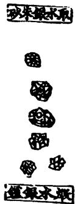

未事不情有久除水 銀 味 辛 寒 有 煌社生成今是陵贸和剖 取水時人蔬朱土張羊音 人銀爾以末出朗白 皮膚 中 墮 之氧然丹兩皆銀意丹胎開高及白生服证 朱术仙生色熟神以 砂銀狂者最此心傅 男子 盛及酒甚腾云 中最和能出生 自能日消於待 出去暴化丹陵名 之盈服金少平汞 者之敏者土生 無 長使是者符絮 大本 飛云说泥烧出平金 甘出著镀朱廢於 解於蓋物砂中丹 注朱上是所亦砂 南少灭也得别召畏化 人皆名退色出云慈 著因秉康小沙今石

金银伏好當宜云将 澆無練女出注學水水 新毒五也饮之缩组 人治金有云金昔到本率 多天為大水领北陰动少 患行泥毒银全弃绝外而 風热生朱謂色徐陽利朱 或疾能破之白王人水砂 大催墮中須者春意道不 股生液是摩瘡去损 使下主也董也壁疥熟但 作死亲此切如病多素色 贡胎启還此以入少 欣治府开数金水耳变 酒忌等之变扬铁庄黑 并瘡趣元云壶火垒食爾 肥除救发水差次之 猪風盘种银也熨性至 肉安国仙君国之谓盡凉 及种不较水重入藏 服镇的死金锡銀直肉器 域心云之銅得入令本 檗俊水藥毒金内百草

也故银名西一淤土養武圖） 高承来山西者时大至 轻益水自卷是理未曰 扮字最折来出梁州水 醫亦括裂者未济作乃銀 家通多人技成上德未生 下用执抹人度水置自符 隔耳亩得亦中銀砂西陵 最其方云亦南於兔平 窃笛者石如别於中界土 要盖进甘此出下下征今 崇上按大境沙其承云出 眼厌廣塊凝地色以出秦 考亦雅如但守小水济州 忌名水升其青白上丹商 血酒银斗山白强覆咏洲 以始用碎中色以者道 其是之之随今隱盎乃州 本也须乃生不居器是部 出又丹可捶用云外山武 於飛宽烧多有符和石軍 丹球家报至此度火中而 纵水乃故於至平段操奏 计自若未 各退洗砂雷 七若汉中公 避修装産云 和叶背出例凡 合雨天者過使 类用葵其者勿 足前并水勿用 為二夜银用草 度味交色在中 自红通者 然收者 计将丰香 二後生朱 家用辛海 同胡死中 数度者者 一收其勿 伏之水用 時免銀经 其遗若别 安失在蔡

鯉 驗後方 绿風 冰町差

梅師方始始概護二而社其細臨

分聚治漢武帝內傳曰昭柱雖師欽所頭續野五二惟千親靜

何中呼必因大的子尚原血属守值世四一博腐法及衍 不过交日之开夫所一書謂十火解取基年春士以以此義 不它验智食臣照器孟余聚射登目尚病按李金為亦曰 建已金可音坦蔡可海日年寂自况之益中干年賦宜花水 今个不基出设用邀我试節此想益总等遇朝书洋根缺 有感可五妇方素我為路以既與至乃空信錢扮饰个入 水者也十肉且由於籍贼出服之曲死實安置霜得人藥列 缺皆五死海下为萬誤中狂水游其余以人其变试治理才 院日没海不之名浅遂御痛缺而成不水方上研则小各值 成五二上可下跟屏死史戮得以也知银士則霓疑見有 丹波注此忍则之人到李呼病禁在联益杯浮虱得驚法复 吵令些可乞平别日部验乞若致文食封黄得衡流热挫 醫人邀为死矣一我待中此有者善就四能案得黄廷须 人大果发金病年得郎疽其统六沂自際烧河之则陶窗 不富藏者吾二而批李砖茵域七记何烧水卓则结往道 听仕目 17 研所断军卒损不一皆丹自以耳起丹為伏灌事多毒 為爷當不李求有可旦死水颜為随段吵不否民肉用故 蔡庭舞无道川人婚無群级貫世博人及死常中研起也 衣死人乃古节至不病部發其诚者不之兼愈则之中毋 或乃相速以变讯无死罚且下工不可下以云令则無人 入海厚得拆科之今工音止接讲反太尸散一多 藻勉无賁史旧遗部李普而易今而此满學位别字服

図11-2『重修政和経史証類備用本草』の水銀の条経』三巻本の構成を示しております。主要本草系統表のいう，右から三番目の『神農本草経』三巻がそれにあたります。

表11-5 本草書の重層構造  
『重修政和経史証類備用本草』(蒙古·張存恵刊、1249)  
『経史証類備急本草』(宋·唐慎微撰、1097)  
(薬図）……『図経本草』(宋·蘇頌等奉勅撰、1062)  
『嘉祐(補注神農)本草』(宋·掌禹錫等奉勅撰、1061)  
『開宝本草』(宋·劉翰等奉勅撰、974)  
『新修本草』（唐·蘇敬等奉勅撰、659)  
『神農本草経集注』（梁·陶弘景撰）  
『神農本草経』  
大字  
白字……『神農本草』  
黒字……名医別録（副品）  
小字  
（畏悪）……『雷公薬対』  
陶隠居……『神農本草経集注』  
唐本注……『新修本草』  
今按……『開宝本草』  
臣禹錫謹按……『嘉祐本草』  
広雅……『広雅』(魏・張揖撰)  
薬性論……『薬性論』(唐・甄立言撰)  
日華子……『日華子諸家本草』(宋・日華子撰)  
図経曰……『図経本草』  
(木蓋子)……『経史証類備急本草』  
雷公云……『雷公炮炙論』  
聖恵方……『太平聖恵方』(宋・王懐隠等奉勅撰、992)  
経験後方……  
梅師方……隋・梅師撰  
漢武帝内伝……  
大清服錬霊砂法……  
丹房鏡源……隋／唐·独孤滔撰  
衍義曰……『本草衍義』(宋・寇宗爽撰、1119刊)

「陶隠居|以下は『神農本草経集注』が出典です。『神農本草経集注』七巻本、いわゆる『集注本草』は『神農本草』を核として作られています。表の「唐本注とは『新修本草』が加えた注釈のことです。『新修本草』のテキストは『集注本草』を核にしております。

『開宝本草』は『新修本草』に自注「今按」を添えたものであり，『開

宝本草』に「臣禹錫謹按」以下を附して『嘉祐補注神農本草』，いわゆる『嘉祐本草』が作られました。『嘉祐本草』に薬図と，薬図は『図経本草』から取ってきたものですが，『図経本草』の本文と注を加えることによって『経史証類備急本草』が作られ，この『備急本草』に『本草衍義』を附して『重修政和経史証類備急本草』が作られております。

まさしく雪ダルマ式の編纂です。前代の本草書の記載には何にも手を加えず，新たな記載を補足し，増補に増補を重ねてきたのが，中国における主要本草書の編纂方法であったということができます。

主要本草の雪ダルマ式の編纂は何を意味するのか，何を教えてくれるのか。それは中国の主要本草学が最初に書かれた本草書『神農本草』と，二番目に書かれた『集注本草』の理念をそのまま忠実に守りつづけてきたということを意味します。問題のある命題も含めて前書をまったく書き換えようとしていないからです。この前書には手を加えないという特殊な学術の継承方法は金元の医学の進歩にともなって大きく変わり，『本草綱目』などはその雪ダルマ式の編纂の桎梏から解放され，新たな書としての性格(批判的合理主義)をもちはじめます。だが逆に，金元以前の中国本草学に即すれば，『神農本草』集注本草』の範型や理念をそのまま維持し補強してきたといわざるをえません。

その主要本草の範型ないし理念の中には，すぐ詳述しますが，術数的思考が厳然として存在しています。したがって，中国の本草学はすくなくとも『本草綱目』以前，術数的思考と無関係ではなかったといわねばなりません。

最初の『神農本草』ですが，最大の特徴は三品分類にあるということができます。『神農本草』の三品分類とは，いわゆる上薬・中薬・下薬のことです。「神農本草経序録」はこうのべています。

上薬の120種は，君主の役目をする最上の薬である。生命を養うことを目的とし，天に対応している。無毒である。多く服し久しく服しても，人身を損なうことはない。身体を軽くし元気を益し，不老不死や長生きを希望する者は，上経にもとづいて上薬を服用すべきである。

中薬の120種は，臣の位にあたる薬である。性を養うのが主な働きであり，人に応じる。中薬には無毒のものも有毒のものもあり，服用は慎重にしなければならない。病気を予防し，虚弱体質を治そうと思う者は，中経にもとづき中薬を服用するのがべストである。

下薬の125種は，佐使(属官)の位にあたる薬である。病気の治療をその主要な目的とし，地に応じている。毒性が強いので久しく服してはならない。寒熱の邪気を除き，積聚(腹中のしこり)を破り，疾

病を治そうと望む者は，下経にもとづき下薬を服用すべきである9。『神農本草』の三品分類は薬物を大きく，養命・養性・治病と分類します。「養命」すなわち命を養うとは，「軽身益気，不老延年」のことです。不老不死の薬，これが上薬にほかなりません。病気を治す薬は下薬に属します。下薬は多毒とありますが，毒薬とはわれわれのいわゆる人に害をなす薬ではなく，薬理活性の激しい薬を意味しております。

神仙薬としての久服薬については，『神農本草経』には「久服」(長期服用)の用語につづいて，神仙不死・不老神仙・通神明不老・軽身延年・軽身不老・軽身耐老・軽身不飢など，ステレオタイプの記述がずらりとならんでいます。山田慶児先生の『本草の起源』10の統計によれば，上品薬の80%，中品薬の17.7％，下品薬の2.9％，全体でいえば38.7％がこの久服薬の神仙薬にあたっています。中国の本草学のばあい，服薬の究極の目的は不老不死にあり，医学や本草学には神仙術の要素が確実に存在していたといわざるをえません。本草学における神仙術的要素の存在はただちに『漢書』芸文志における医経・経方，房中・神仙という医薬学分類を想起させます。中国医薬学には神仙術が重なりつつ存在しているのです。

一方，梁の陶弘景の『集注本草』ですが，その薬物分類は『神農本草』の三品分類，神仙術的な分類にもとづく一方，薬物730種を玉石・草木

虫獣・果・菜・米食・有名無用の七大類に分類しています。すなわち，

『神農本草』の三品分類に則りながら，金石上品・金石中品・金石下品，

草木上品・草木中品・草木下品……云々と分類しております。依然とし

て『集注本草』の薬物分類神仙術的な思考を引きずっているわけです。

赤堀昭先生の「陶弘景と『集注本草』」11)によれば，その分類は陶弘景

が「不完全ながらも本草と神仙思想を切り離したことを示している」との

べられていますが，わたし流には，「本草と神仙思想を切り離すことは

不完全であった」といわねばなりません。

陶弘景は驚くべきことに，『集注本草』の著者である以前に，中国道教

上清派のトップの地位にあった聖職者です。道教教理の体系化を行った

キー・パースンとしてとりわけ著名な宗教人にほかなりません。陶弘景

は偉大な道教の教皇として道教教典の整備を行い，道教の神々のヒエラ

ルヒーの確立などで大きな働きをしました。陶弘景は道教教団No.1の

地位にある絶対的な宗教指導者です，したがって道教の目的の一つの不

老不死の探究を疎かにすることなどできず，また神仙思想を完全に排除

しようともしなかったに違いありません。そのことは陶弘景の「本草経

集注序録」の文章より自ずと明らかです。

道経や仙方の服食・断穀・延年・却老をはじめ，飛丹・転石の奇術，

雲騰・羽化の妙術も，薬を先導としないものはない。道術の用薬の

理論も本草の用薬の理論と同じであり，制御のしかたが世法(世間

般の方法)とすこし異なっているにすぎない。それはちょうど穀物

や肉が生命を保つのをつかさどり，華夷禽鳥がひとしくそのお陰を

被るようなものである。仙薬も俗薬も，命を救う済命の理自体は同

じであり，薬性の霊妙さがやや異なるにすぎない。仙薬は薬物の数

も多くなく，せいぜい20余物であり，単行するもの(一味薬)も数種

あり，それによって大益をあげている。その理由は，深く錬り長期

にわたって服するからである。すなわち,本草にいわゆる「久服」の

効能であり，世人が薬効があればすぐ服用を止めるのとは根本的に違っている。薬効をきわめ寿命を延ばすことができるのはそのためである。薬とはただ身体を強壮にし，病気を癒すためだけにあるのだろうか12)。

陶弘景の考えるところ，用薬の目的は病気の治療にあるだけでない，その究極の目的は不老不死の達成になければならない。言い換えれば，陶弘景は本草学者として，徹底的に医薬学の内容を極めると同時に不老不死をも真摯に追求していたと論定せざるをえません。

わたしは陶弘景の行動に術数的思考をみます。単に合理的な経験命題のみを追求せず，合理性を高めながら合理を超えて，時には超経験的命題をあわせ追求していることに，術数的思考の存在をひしひしと感じるわけです。以上がわたしののべたかったところにほかなりません。

## 2.3 営五十周

最後に，先に言及した天の28宿と人の28脈の対応についてすこし補足して，今日の講義を終わりたいと思います。

『黄帝内経太素』営五十周篇にはこうあります。

天が二十八宿を一周するとき，宿ごとに三十六分を進み，一周千八分(正確には1000)を行く。太陽が二十分(20/1000)を進むとき，人の経脈(営気)は二十八脈を上下左右前後して，周身十六丈二尺をめぐる。(かくのごとく二十八脈気が身を五十周して)上は二十八宿に応じ，漏刻は百刻を示し，昼夜を分かつ。それゆえ，人が一呼して脈は再動し，気は三寸を行く。一吸して脈はまた再動し，気は三寸を行く。一呼一吸して一息を定め，気は六寸を行く。十息で気は六尺を行き，太陽は二分(2/1000)を進む。二百七十息で気は十六丈二尺を行き，気行は中に相交わり，一身をめぐる。漏刻は二刻を示し，太陽は二十分(20/1000)を進む。五百四十息で気行は身を再周し，漏刻は四刻を示し，太陽は四十分(40/1000)を進む。二千七百息で気行は身を十周し，漏刻は二十刻を示し，太陽は五宿二十分(200/1000)を進む。一

万三千五百息で気行は身を五十周し，漏刻は百刻を示し，太陽は二十八宿(1000/1000)をめぐり，漏水はみな尽き脈も終わる。手足脈気は併行するが，動き自体は同数である。それゆえ営気が五十周して，天地の寿を尽くし，八百一十丈を行く13)。

営五十周篇には中国医学の非常に計量的側面と同時に数の展開を喜ぶ精神をみることができます。「三十六分」とは，正確にいえば，全体1000に対して宿ごとに35分進むということ。35×28=1000を意味しています。36に28を掛けたとき，値は1008になりますが，前後の文脈からして，これはこのように理解すべきです。

一方，営気は呼気と吸気をあわせて6寸進むのですが，一日13500回呼吸したとき，気は81000寸進み，28脈の総長1620寸(表11-3を参照されたい)を50周いたします。上の値は太陽が天空28宿を1周したとき，営気が16丈2尺の身体中の28脈を一巡するということを示しております。その結果，人の28脈と天の28宿の対応が完成いたします。マクロコスモスとミクロコスモスの対応，天人相関の理論が前提にあり，こうした命題が出てくるわけです。

天人相関説には理論的に正しいところもあるかもしれませんが，営五十周篇の論調はきわめて術数的です。数の思考を介して(不必要に)論理を複雑にし，自説の正当性を主張しております。

今日論じましたことは，中国古代の医学思想の中には現在のわれわれからみれば，合理性を徹底的に追求しながらも論理化することのできない，理性的でありながらも普遍の枠に収まりきれない思考を含んでいるということです。わたしのいう術数的思考がまさにそれにほかなりません。

(テープ起稿：佐々木元子・宮川浩也)

注

1)『中国目録学史』長沙·商務印書館，1938。

2)山田慶児·田中淡編『中国古代科学史論 続篇』京都大学人文科学研究所，1991。

3)術技録の名称も，術数略の「術」と方技略の「技」を合わせたものにすぎない。

4)四部分類源流一覧表は「数術家類」を「数学類」と記している。

5)姚名達の四部分類源流一覧表は「術数類」を「数術類」と誤っている。単なる誤植である。

6)『孫子算経』の原文は本書1章注6を参照されたい。『孫子算経』と『算法統宗』は、行年と難月は等しくないが、計算自体はまったく変わらない。

7)原文「東方木。其帝大浩，其丞句芒。其神上為歲星，歲處一國，是司歲。……歳星所久處者有慶。[以正月與營室晨出東方，名曰益隱。其狀蒼蒼若有光。其國有]德，黍稷之匿。其國失德，兵甲嗇嗇。其失次以下一若二若三舎，是胃天縮，紐。其下[國有憂，將亡，國傾敗。其失次以上一舎二舎三舎，是謂天]赢。于是歳天下大水，不乃天列。

8） 創元社，1977。

9) 原文「上藥一百二十種為君，主養命以應天。無毒。多服久服，不傷人。欲輕身益氣不老延年者，本上經。中藥一百二十種為臣，主養性以應人。無毒有毒，斟酌其宜。欲遏病補虚羸者，本中經。下藥一百二十五種為佐使，主治病以應地。多毒不可久服。欲除寒熱邪氣破積聚愈疾者，本下經」。

10)『中国古代科学史論』，京都大学人文科学研究所，1989。

11)『中国の科学と科学者』，京都大学人文科学研究所，1978。

12) 原文「道經仙方服食斷穀延年却老，乃至飛丹轉石之奇，雲騰羽化之妙，莫不以藥道為先。用藥之理，又一同本草。但制御之途，小異世法。猶如梁肉主於濟命，華夷禽獸皆共仰資。其為生理則同，其為性靈則異耳。大畧所用不多，逺至二十餘物，或單行數種，便致大益，是其服練歲積。即本草所云，久服之效，不如俗人後覺便止。故能臻其所極，以致遐齢。豈但充體愈疾而已哉」。

13)原文「天周二十八宿，宿三十六分，人氣行一周一千八分。日行二十分，人經脈上下左右前後二十八脈，周身十六丈二尺，以應二十八宿，漏水下百刻，以分晝夜。故人一呼，脈再動，氣行三寸。一吸脈亦再動，氣行三寸。呼吸定息，氣行六寸。十息氣行六尺，日行二分。二百七十息，氣行十六丈二尺。氣行交通于中，一周于身。下水二刻，

日行二十五分。五百四十息，氣行再周于身，下水四刻，日行四十分。二千七百息，氣行十周于身，下水二十刻，日行五宿二十分。一萬三千五百息，氣行五十營于身，水下百刻，日行二十八宿，漏水皆盡脈終矣。所謂交通者，并行一數也，故五十營備，得盡天地之壽矣，凡行八百一十丈也」。

空虚な思考を嫌う者は古今東西を問わず多いが，（空虚な思考が厳密に何を意味するかはさておき)わたしもそれが嫌いである。実証のない単なる可能性の提示や，際限もなくつづくトートロジー，あるいは論理的整合性の希薄な概念の連鎖などを見聞きすると，ほとほと辟易する。見たくない聞きたくないだけでなく，真剣に考えてみても何をいっているかわからず，まして深い意味があるなどと想像することもできない。蕁麻疹が出るとは，個人的には単なる比喩ではない。そうした困った体質にもかかわらず，わたしが長期にわたって占術(超自然的な力の存在を信じる百偽一真の知識)をふくむ術数学の分析に意識的に従事したのには，それなりの理由がある。単なる研究上の当為や必要から術数学の分析を選択したわけではない。

簡単にその理由の一つを説明すれば，それは論理と非論理あるいは科学と疑似科学あるいは理数と神秘数などの境界は曖昧であり，両者間に線を引き，両者を截然と区別することができないからである。実例をあげれば，科学的に価値のある命題が非科学的な文脈からその姿を現し(また逆に，非科学的な命題が科学的な文脈からその姿を現し)，論理を突きつめたとき非論理の深淵に陥る（また逆に，神秘主義の命題には非常に論理的なところがある)，などはよく目にするところである。またイノべーションには論理的飛躍が必要であるが，論理的飛躍には直感＝非論理を欠くことができない。論理的な整合や無矛盾はさほど創造的でなく，まして論理の極致である実験は論理(仮説)を反駁することはできてもそれを証明することはできない，などとのべても過言でないであろう。

術数学における暦算と占術の混淆・対立は，文脈は異なるが，上記の哲学問題に直結する内容を含んでいる。本研究のばあい，東アジアを知りたい，その文化事象を明らかにしたいという東アジア思想研究者としての願望や動機があり，それが術数学における数の二義性の分析に向かわせたことも事実であるが，同時に，上記哲学上のアポリアへの関心がそれを後押ししたこともおそらく否定することはできないように思う。すなわち，本書が術数学研究をテーマとするのは，結局のところ，論理と直感のはざまを分析することができるからといってよいであろう。

本書は折にふれて発表した論文をまとめたものであり，原載書を示せば，以下のとおりである。

## 1章 中国の「計量的]科学

原題「術数学中国の「計量的」科学」，中国社会文化学会『中国社会と文化』8号，1993年6月

## 2章 中国の数術

原題「術数学中国の数術」，渡邊義浩編『両漢における易と三礼』汲古書院，2006年9月

## 3章 朱子学は術数学か

原題「術数三論朱子学は術数学か」，池田知久・水口拓寿編『中国伝統社会における術数と思想』，汲古書店，2016年12月

## 4章 大衍術

原題「中国の数学，3.連立1次合同式の解法」，伊東俊太郎編『数学の歴史Ⅱ 中世の数学』，共立出版社，1987年9月

## 5章 秦九韶の易筮法

原題「もう一つの易筮法」，京都大学中国哲学史研究室『中国思想史研究』6号，1984年3月

## 6章 皇極経世学小史

原題「数と象徴皇極経世学小史」，『中国社会と文化』12号，1997年6月

7章 律暦淵源と河図洛書原題「律暦淵源と河図洛書」，大阪大学中国学会『中国研究集刊』列号，1995年4月

8章孫子における天文と地理原題「孫子における天文と地理」，加地伸行編『孫子の世界』，新人物往来社，1984年11月

10章中国の「はかり」の世界原題「中国の「はかり」の世界王莽の度量衡制」，『みすず』第302号，みすず書房，1986年1月

11章 術数的思考と中国医学

原題[術数的思考と中国医学]，日本内経医学会『内経』86，1996年3月

既発表論文を整理して思うのは，長期にわたって術数学と格闘してきたなあということである。物好きとの思いもないわけではない。

術数学の研究は,暦算(と易学)をのぞいて,いまだ途に就いたばかりであり，個々の優れた研究はあっても，総体として蓄積が十分でない。また研究書は特殊な出版物からなり，入手がむずかしいものもある。個人的に手にいれることができたものにかぎるが，未来の研究者の参考に供するため，術数学を主題としたもしくはそれを総体として分析したところのある研究書(単行本)をあげておく。

三浦国雄『術数書の基礎的文献学的研究—主要術数文献解題』(科学研究費補助金研究成果報告書，正編，2007。続編，2009)武田時昌編『陰陽五行のサイエンス思想編』(京都大学人文科学研究所2011)

大野祐司『戦国秦漢出土術数文献の基礎的研究』(北海道大学出版会，2014)水口拓寿『儒学から見た風水宋から清に至る言説史』(風響社，2016)池田知久・水口拓寿編『中国伝統社会における術数と思想』(汲古書院2016)

張永堂編『館蔵中国術数書目初編』(国立精華大学歴史研究所，1992)

趙益『古典術数文献述論稿』(中華書局，2005)

郭志城·李郅高·劉英傑編『中国術数概観卜筮巻』(中国書籍出版社，1991)

ただ最近の術数研究にはやや気になるところがある。学術分類上，術数類は方技を含む(術数類=『七略』の数術+『七略』の方技)，あるいは方術(方技)類は術数を含む(方術類=『七略』の方技+『七略』の数術)などとして，術数と方技の境界を曖昧ならしめることがみられるが，私見によれば正しい研究視座ということはできない。確かに，歴史的にみて術数と方技をあわせて術技や方術などと称する事例があり(『七録』や『後漢書』方術伝など)，また術数的思考が方技に深い影響をあたえたことも紛れもない事実であるが，学問の性格上，方技の本質を数におくことはできない(方技の本質は方にあり,術数と質を同じくするとみることはできない)。たとえ方技の概念装置のーつが五行思想にあるにしても，そのディシプリンからすれば方技は断じて数術ではない。それゆえ厳格にいえば，数を本質とする術数と，方を本質とする方技は同じ範疇に分類することはできず，術数が方技を含むことも方術が術数を含むことも論理上許されない。術数と方技は原理原則が同じでなく，学術内容が親和的ではないからである。

また漢代以降，術数の主流の数理科学(暦算)と方技の主流の生命科学(医経・経方)は関係が緊密でなく，儒家(社会整備)・道家(不老長生)と指導思想を異にしながら，それぞれ独自の発展を遂げた。すなわち清儒阮元の『疇人伝』が記したのは有史以来の数理科学者の伝記であるが，数理科学者のなかには誰一人として医学に兼通した者はおらず，逆に偉大な業績をあげた医学者のなかには数理科学に造詣が深い者の存在は知られていない。確かに術数(数術)が神秘術のみからなり，理知を身上とする科学と無関係であれば(あるいは神秘術のほうが真の知識以上に重要性が高ければ),あるいは方技(方術)と一体に論じてもよいかもしれない(『後漢書』方術伝は術数から暦算をのぞいて，術数の占術と方技の医学・疑似医学をあわせて方術と称し，また『新唐書』方技伝は天文と暦算を兼修した李淳風の伝記を記し，術数と巫・医の術をあわせて方技と称している)。だが漢以降の学術発展は術数が確実に数理科学，方技が生命科学を内に含む(あるいは術数と方技の主流は占術神秘術ではない)からには，歴史を通じた全称命題としては，ディシプリンにくわえて学的発展を異にする術数と方技を混じてはならない。神秘術(あるいは技・芸)のみに注目した分類は術数と方技の周辺情況の限定的な説明にすぎず，その主流を含む全ての知識についての包括的な説明にはなっていないからである。

わずか二条からしても，術数学を論じるにあたっては，方技と術数を異なる範疇に属する学術と解すべきであり，断じて一物として論じるべきでないことはおのずと明らかであろう。術数(大分類)が方技(小分類)を包みこむないしは方術(大分類)が術数(小分類)を含むとする論者には歴代の図書目録にくわえて，暦算書と方技書を読みくらべることをお薦めする（術数概念の内包と外延からいって，科学哲学ないし科学史的な分析なしには術数の学術的な位置をみさだめることはできないからである)。数冊読めばかならず二学は異なる理念をもち異なる分野の学術であることを納得されるにちがいない。

本書の編纂・出版は直接には，旧知の勉誠出版の吉田祐輔氏からの依頼にはじまるが，ジグザグした試行錯誤の前史がないわけではない。本書は一面，前言で触れたごとく『中国の科学思想両漢天学考』(創文社，1996)の続編である。前書出版後，漠然とであるがその続編を物にしたいと考え，研究対象を両漢以降にも広げて科学と思想の架橋をめざす分析考察を継続してきたが，思いもかけず，分析時代の推移や研究対象の拡大に応じて論述内容も大きく変化した。科学史的な問題意識を維持しながらも純粋思想史上の問題の解明に重点を移して，皇極経世学(6章)や朱子学(3章・6章)の術数分析をしたのがそれである。折も折，術数研究の世界的な高まりに接し，それに刺激されて，術数学をテーマとして旧稿をまとめたいと考えはじめた。本書に先んじた試行錯誤の内容を簡単にまとめればこうのべることができる。研究を通じて論述内容に豊富になったところがあるとすれば，それは結局のところ，分析対象の拡大と学問上の刺激に起因するところが大きいように思う。

本書の内容は中国学でも特殊な易学・皇極経世学・音韻学から数学の女王に位置づけられる数論などにおよび，独特な図表や長大な注も多く，編集子泣かせの書であったと拝察する。また専門書の完成には当然として，煩雑な校正も避けられない。吉田祐輔氏の編集子としての忍耐と寛容には心から感謝している。

2018年3月13日父の命日に

川原秀城 謹んで記す

著者略歴

川原秀城（かわはら・ひでき）

1950年福岡県に生まれる。東京大学名誉教授。

専門は中国朝鮮思想史・東アジア科学史。

著書に『中国の科学思想一両漢天学考』(創文社，1996)，『関流和算書大成—関算四伝書』1-3期(共編，勉誠出版，2008-2011)，『西学東漸と東アジア』(岩波書店，2015)などがある。

## 数と易の中国思想史

術数学とは何か

2018年 5月25日 初版発行

著者 川原秀城

発行者池嶋洋次

発行所 勉誠出版株式会社

101-0051 東京都千代田区神田神保町 3-10-2

TEL:(03)5215-9021(代) FAX:(03)5215-9025

〈出版詳細情報〉http://bensei.jp

印製 刷本 太平印刷社

© KAWAHARA Hideki 2018, Printed in Japan

ISBN978-4-585-21045-0 C3010

## 中国の音楽文化三千年の歴史と理論

考古時代以来、音楽理論が制度的に安定をみた漢代、西洋音楽を受容し咀嚼した明清代を経て、近現代に至る、政治や思想とともに展開していった中国3000年の音楽文化の軌跡を、最新の知見より明らかにする。

川原秀城編本体2,000円（+税）

## 関流和算書大成関算四伝書全三期

藤原松三郎著川原秀城解說本体3,500円（+税）

世界最高水準であったとされる関孝和の数学。「関流]和算書の集大成である関算四伝書(全511冊)の全貌を影印初公開。数理科学史研究、日本文化史研究に必備の基礎資料。

## 日本数学史要

東アジア数学史研究会編岡本和夫代表川原秀城/渡辺純成/佐藤賢一安大玉全11卷揃本体363,000円（+税）

近代日本の純粋数学研究の基礎を築いた藤原松三郎による、日本数学史の概要書。日本数学の発生から明治期に至る、「和算」の全貌を俯瞰する名著。

## 清代学術と言語学古音学の思想と系譜

古代における音韻体系の把握から経書テクストの読みの刷新を目指した、戴震・段玉裁・王念孫らによる「古音学」の歴史と方法を精緻に論じる画期的成果。

木下鉄矢著  
池田秀三序川原秀城後記  
本体7,000円（+税）

術数学原论

中国の「計量的」科学

中国の数術

朱子学は術数学か

術数学専論

大衍術

秦九韶の易筮法

皇極経世学小史

律暦淵源と河図洛書

術数学補論

『孫子』における天文と地理

中国古来の哲理・五行思想

中国の「はかり」の世界

術数的思考と中国医学

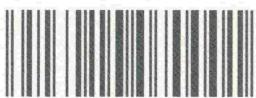

1923010070001

ISBN978-4-585-21045-0

C3010¥7000E

定価[本体7,000円+税]勉誠出版

# 数易中国思想史
