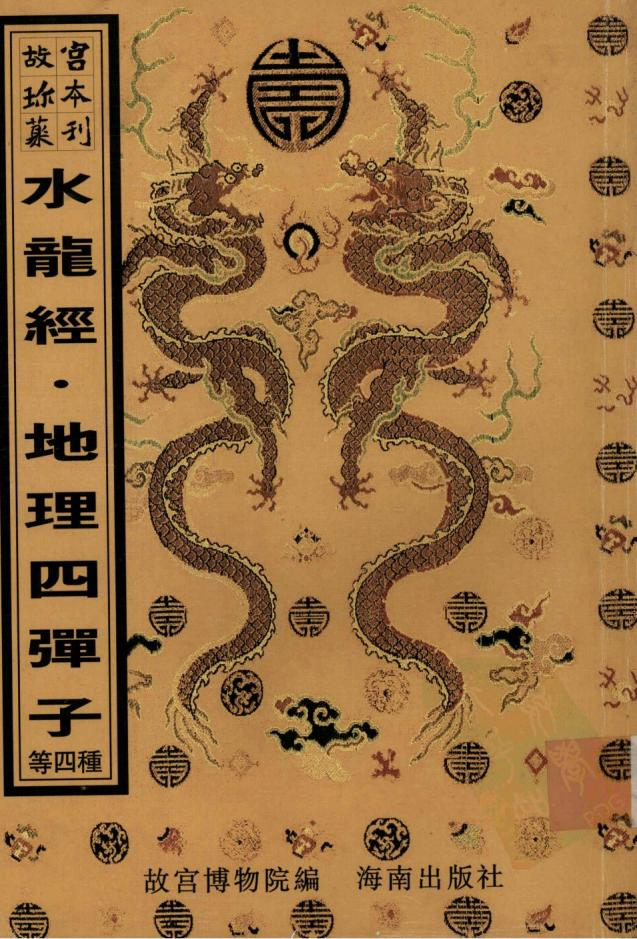

H古 M福

元吴郡庠刻本《通鑑總類》扉頁背面所鈴「五福五代堂古稀天子寶」，方8.1cm×8.1cm，「八微耄念之寶」，方8.2cmx8.2cm'「太上皇帝之寶」，方8.1cm×8.1cm。

故宮博物院編

水龍經 地理四彈子

雪心賦直解

金精廖公秘授地學心法正傳

畫筴扒砂經

海南出版社

圖書在版編目(CIP)數據

水龍經/(晉)郭璞撰.-影印木.-海口:海南出版社，2000.10

(故宫珍本叢刊)

本書與“地理四彈子/(南唐)何令通撰”等18種書合訂

ISBN7-80645-742-9

I. 水… Ⅱ.郭… Ⅲ.風水-中國-古代 Ⅳ.Z121.7

中國版本囧書館 CIP数據核字(1999)第 68745 號

故宫珍木叢刊第409册相宅相墓水龍經 地理四彈子 雪心賦直解金精廖公秘授地學心法正傳畫筴扒砂經

故宫博物院编责任编辑：李升召

海南出版社出版發行  
海南省海口市金盤開發區建設三横路2號 郵政编碼：570216湖南省新華印刷三廠印刷湖南省長沙市韶山路158號 郵政编碼：410004  
本書正文用紙由金城造纸(集圈)有限責任公司生產

2000年10月第1版2000年10月第1次印刷開木：787×1092毫米 1/16 印张：33 印數：1-400册ISBN7-80645-742-9/Z·20定價：1100元(相宅相募-19-種共6册）

本書如有印装質量方面問题请與我社或承印廠聯係我社為本書每册(種)書新編的目錄均置於每册書末

水龍經序自鴻濛開闢以來山水為乾坤二祁器並雄于天壤間一陰一陽一剛一柔一流一時如天覆地載日旦月暮各司一職後世言地之家罔識厥理知山之為龍不知水之為龍即有高談水法者莫不以山之為辭而水為之用至比之兵之聽令乎將婦之効順乎夫是以山之名獨尊而水之權少絀遂使平陽水局之地置水龍之真機而附為山龍之妄說舉世昏之有若聾聵世死楊曾未晰此義也古不云乎行到平澤奠問蹤只看水水龍經 卷一繞是真龍又云平洋大地無龍虎漭歸何處東西只取水為龍扦著出三公其言之曉暢條達彰之在人耳目間如是久矣人目不察耳至其裁製格法实鮮專書發揮未備卒使學者有同面墻無徑可入推原其故豈不以山之結搏有定而水之運用無窮世人若知水龍作法盡天地山河隨所指願咸可握神機泰造化故引而不發為天地惜此秘奧耳高在上哀此下民亦欲使千古不傳之緒宣露一時假平陪下愚發抒要妙為後世通人彥士執轡前驅乃無因極之傳畫泄楊公之訣于是平階乃蕩然大闢其旨以山龍屬高山以水龍屬平壤二法判分不憚大聲疾呼以正告天下有識之士間亦信之從來迷謬跡焉洞豁平陪窃自恨其遭逢之大恐冐陰陽之愆何敢貪天之功以為已力也始平隋初得師傳時既知有水龍之法矣而求之古今成跡茫無考據及得幕講禪師玉鏡真經千里眼諸書而後入穴機若合符契未築又得水龍經若干篇乃嘆平洋龍洋未嘗無書但先賢珍重不浪泄于世耳因無刻本間有字句之訛用加校讐詮次成書編成五卷一卷水龍經 卷一明行龍結穴大辭支榦相乘之法二卷明五星正變穴髀吉凶審辨之法三卷還水龍上應星垣諸大格四卷指水龍托物比類之象五卷義同二卷而縱橫言之一二四卷得之吳天柱先生三卷得之乍浦故官家五卷最復得之我郡夫是五者或有作者姓名或失其姓名其言各擅精義互見得失合而觀之則水龍軌度無餘蘊矣以此水龍為辭而后施之以三元九宮乘氣作用譬之大匠水龍者楩楠杞梓而三元九宮其方圓繩墨也譬之丹家水龍者鼎器藻物而三元九宮其卦爻火也名材未按公輸無所施其巧鉛汞不備伯陽無以運其神故天元心法亦云至矣而是書又曷可少乎經之為名不可漫加即其舊名因而不革实可藏之金匱石室與青囊狐首並垂不朽後之學者苟非有遇人之福天牖其衷未獲親此書也希世之寶惟有德者當之尚其知敬也欣尚其知惧也欣時天啟下元甲子越四十年歲次癸卯律中黃鐘後學杜陵蔣平隋大鴻氏題于丹陽之水精菴

水龍經第一卷總論此卷專明水龍支榦之理蓋以通流大水為行龍而謂之祭以溝渠小水為割界而謂之支穴法取支不取榦猶之高山起祖重岩疊嶂之中反為直結而老龍發出嫩枝始有結作也篇中主意嘗以榦龍遶抱取外氣形局以支龍止息交會取內氣孕育其于水龍之理論之特為美備蓋大江大河雖有灣抱其氣曠渺與墓宅不親斷難下手須于其旁另有支水作元辰速抱成胎則化氣內生并大水之氣脈皆收攬而無餘斯大地矣予水龍殿觀舊家名塚枝川小榦首尾通流其形曲析竟于轉爾下龍腹穴全无內堂界水亦得大發其小枝畫震或一水車纏或双流界抱深藏婉麗毓秀鍾靈世家大族所在都有不必盡論外局其福力已不可限量似乎此書所論不可畫拘小幹無枝其局雖大必須久而後應終難驟發支龍無榦其效雖捷而氣盡易衰不能綿逮究不若支榦相扶之地可希求旦夕之功而亦可期代興之澤也然則此書之義其可廢而不察欣其所重在特朝之水迎秀立穴斯雖正論然必欲其逆入朝迎猶是一偏之論蓋水龍妙用只在流神曲水生動化機自呈前後左右無徃不宜順逆去来隨方協應以予所見尤以坐向首尾為駕馭有權或左或右未免偏于公位耳若湖蕩龍法此書昏取衆砂環聚蓋即倣山龍式眠倒星辰之說也果如所局法固大然予徧觀吳楚之間三江五湖巨浸多矣欲合此等啚式百無一遇全在此說會意云爾必欲按索驥求此等之地而冀之涉于愚矣要之湖蕩之脉亦當深明支幹蓋大蕩即名大榦必須其旁又求支水立穴而後發福可期若卑取大水龍經 卷一 五

蕩陽宅尚有歸收陰基決難乗接其借外砂包護亦即支榦之法而變用之者也至于水龍作用全在八卦三元江河湖蕩其歸一也不精此義縱得合格大地未免求福而反受其禍則又乾坤之秘要聖哲之心傳而非作此書者所能知也此作書不著姓氏大約近代人手筆其每篇立論未免尚存流俗之見于真傳正訣猶隔一山予以支榦之說為水龍開卷第一義故節取其嗇列之卷首若一一泥于其說則于真实際會反致河漢貴學者之善讀書也大鴻氏筆記

秘傳水龍經

晉郭景純著明誠意伯劉基閱宋韓國公趙善訂後學九淵邵滄錄

氣機妙運論

太始惟一氣洱突其所先莫先于水之中法濁精而成上木土震盪水落土出遂成山川是以山川有波浪之勢焉經云氣者水之母水者氣之子氣行則水隨木止則氣止子母同情木氣相逐猶影之隨形也夫氣一也水龍膜 卷一溢于地外而有迹者為水行于地中而無形者為氣水其表也氣其裏也表裏同運內外同流此造化必然之妙用故欲知地中之氣趨東趨西即具水之或去或來可以概知之矣若觀氣機之運者必觀諸水川上之嘆亦可以觀先聖見道之情焉然行龍必有水輔氣止必有木界輔行龍者既在乎木故察其未之所來即以知龍氣發涂之始止龍氣省亦在乎水故察其水之所交即以知龍氣融聚之霰故經曰界永則止又曰水氣橫行內氣止生旨斯言欤然天地之氣陰與陽而已易曰一陰一陽之謂道又曰陰陽互戴其宅動靜互為其根不可須臾離也地脉之行陰陽相裨萬物化醇郭子有云獨陽不長獨陰不成陰陽合德而生成之功备故山脉之峙水脉之流各有陰陽水者陽也山者陰也二者交互不可須更離也地脉之行藉水以遂之地脉之佳藉水以止之既能道寸其行又能止其止者何也蓋外氣輿內氣相合二氣相盪而成物猶夫婦始而成生育之功也陽為雄陰為雖陽以畜陰以含陽即雌雄相會牝牡交姤之情也故曰陰陽相見福祿永貞沖陽和永龍經 卷陰萬物化生此天地自然之化機已合而言混沌之初辭即萬物統體一太極之妙用分而言之隨物付物又萬物各其一大極之多粵也知太極之理則可以語化機之妙知化機之妙則可以語形象之學矣

自然水法形歌水法最多難盡述略舉大綱釋盜惑世傳卦例十數家彼吉此凶行不得自然水法君切記無非屈曲有情意来不欲冲去不直橫不欲反斜不急橫須遂抱及弯環來則之予去屈曲澄清停蓄甚為佳領瀉急流何有益八字分開男女淫川流三派業歌傾急瀉急流財不聚直來直去損人丁左射長男必遭殃右射幼子受灾遭若還木從中心射中房之子命難長掃聊盪城子息少冲心射脇孤寡夭反跳人離及退財捲簾填房與入贅水龍經澄清出人多俊秀污濁主子多遇缺大江祥朝田萬頃暗拱爵祿食五鼎池湖凝聚卿相職天江洋朝貴無敖飄之斜出是挑花云記男女貪淫撝破家又主出人好遊蕩終朝吹唱逞屠華屈四流來秀水朝定然金榜省名標此木去流無妨碑財豐亦主官豪邁水法不狗去與來但要屈曲去復廻三迴玉度轉頓穴悠眷戀不忍別何用九星并八卦生旺死絕皆虛詭述此一篇真口訣讀者胸中皆透澈免惑時師卦例言祸無福有須當別

天河大江或徒東南來或從西南來中開雖省屈曲處並不見回顧環遼十里二十里滔而來如雁之飛略無回翔之勢中間雖有屈曲決不結穴直至回遶環轉回頭之處如雁之將止則不必回翔而後泊也至此方是龍脉止聚之屬經云界水則止又云界水所以止來龍若一二十里尚不見水國頭則前之屈曲處乃行龍處也書曰龍落平陽如展布一片茫之難捉模平洋只以水為龍水纏便是龍身泊故又尋龍須于來水城迴遶處求之然水之來路遠其勢寬大中須有小回頭處乃真龍東氣結咽之處即未結穴省至大纏大回之嚴方始聚氣然到頭形勢寬大又難捉模必須求支永界割何如得支水插腹界出內堂砂永包曩不疎不審形局完固方為真穴共非支水界割則大水雖環遶終是茫無以指點蓋勢寬則氣蕩形大則氣散內無支水交殄一片頑皮何以立六雖無天害必不發福矣

木龍經 卷 十

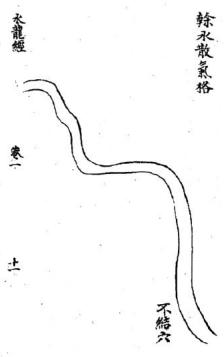

此局榦木斜行似有曲折而非環袍又枝水以作內氣右前一枝天江自右倒左右後一枝天江亦自右趙左與前倒左术合流屈曲而去此正兩水合流一水引脉之局又云兩水合出是其龍之從右來穴倚左局中龍脉寬大和要尋枝水插腹割界作內局龍虎前後左右朝抱包晨周霽方可立穴此局于腹中插入小水分界左右重交鎖三分三合東氣結咽龍脉到頭圓淨端嚴形勢極秀橫來橫受向前面砂木弯抱巖立穴以迎西來永其福力甚天

西南水來迎合東南來水出東北却于東北插一枝水分界于左右作龍虎砂橫夾于前後中間插一枝水橫界于前立右有金魚水緊拱于兩間作橫來正受而来護衛周密三分三合到頭上氣完固如斯經云永要省分合有合氣方治今此局三分三合而轉頭向南委曲活動略無硬直之殺主富貴全美若東南屈曲而来穴中望之如在目前其秀尤佳文翰飛名可發甲也此势受水只從後面右來遶分武而回頭即于左邊局後屈曲而去于後大水去處禘一支水從左向前弯弓抱遇石邊即作外包裹又于左之右挿一枝水上前分作兩股一股向局後過省界出龍昧一股向局前聚水成池其砂水處之四頭于左側此亦橫來側結六也前有小蕩作聚术堂宜對小萬正受亦主科甲發貴蓋分武水雖不頓穴却于左邊繞局後而去乃直氣也

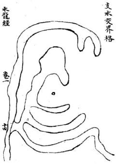

木龍經

坐上盛從東北或從西北插一枝水上南屈曲一路向因左柚上一路向右挿上割界左右龍虎交鎖反抱千坐下成龍虎交抱勢到頭成仙人仰掌仰結寫穴逆來脉立穴取何作回受穴順脉立穴取向為順牧穴得龍虎砂朝抱于前其秀尤速此二法俱可但看前後朝應何如之前有速朝曲水可迎立回受穴如後有曲水遠朝或遠山呈秀作順枝穴兆势雖纏角武弯弓如弓並無分泄城秀完固局勢周密主百子千孫朱紫滿門若東北或西北一路水分泄而去其力景便輕矣

穴前曲水不間五曲五曲周札整肅自右過東就身回 抱而去知于曲水後分枝割界作重龍虎分列左右 奴回頭朝頌如拜如揖穴後枝未分合五閱四峽重 重結咽東氣兜収得此形勢極為周密秀水完固來水 屈曲呈秀來脉尊賞端嚴左右重衛護主有百子千 孫世出魁元神童幸相若穴前舍蓄聚水當道數國若 水徼左來于穴前屈必而去其福力不減何為官清貴 無財清白傳家也

水龍經 基 +x

凡見曲水當面來朝橫遇穴前須得就身曲抱屈曲而去坐下要枝水割界兜收龍脉或一重二重三重疊之繞手穴前後方或辭势其穴前積界深水不宜太濶太濶則氣蕩不宜太狹大狹則氣促而前朝水加箭射恐破氣蕩洩此地曲水一路車纏兜收脉氣凝聚大能發福但坐下無元武木大江遶護乃是行龍腰結非盡龍也其力量比兩水合出稍輕若得去水在元武後四頭役坐下包聚而去更自不同

水龍經 參 大

穴前秀水當面朝來與右来橫水合流倒左就身回炮遶元武却田頭向東北而流來則屈曲去則須歲更得右水交會此與一水卑纏殊覺左勝水交砂會龍畫氣鍾亦大地也入丁繁盛富貴非常凡右木衝左灌堂則前秀水不得滿臺而長房興二小房並發若右水是穴前曲水分泄而去則小房不發矣後主邊移過繼或易姓離鄉也

水龍經 卷 十

此勢與前田水朝堂遶首龍纏武法合前局周緊 此作左來就身夾下稍長而寬龍脉趨歸紫武秀水在 前欲就曰秋立穴則氣聚在後而脫氣立穴就氣衆處 則曲水遠而乗受不及如此形势中闇必有枝水插腹 兜収其氣于中局梗前不脫曲水復不脫龍氣前親 後倚方能發福而主文翰之貴先發長房後發中房 小房更得去水之分則力量悠久

水龍經

卷

或從左來屈曲到堂或從右來就身環抱遶武而去 或從右來屈曲到堂或從左來就身環抱遶中武而去 其曲處須要如多字樣或之字形不懈不疏舊蕭周匝 至穴前却如弯弓就遶轉包承于穴後得此形勢甚 佳若形勢太寬中間須得枝水界得脉絡清奇若局勢 周審雖無枝水割界亦可立穴

永龍經 叁

凡曲水朝堂須得三橫四摺如之如兮摺之包遇穴場其轉折處不至衝射若來水雖見屈曲東瘴西拽圄不可周若曲形如纏牽穴前維見弯抱而前面一路殊非秀麗亦不為吉如興形體局中雖割成勢而穴之終難發福即不沖不破僅可小康若有沖擊或左右前後略見分洩必至破壞矣遠宋如草之字或如晨牽而六前弯抱蓋得穴過望之不見前面冲射亦主三四十年發福及术步行至之日即衰退矣不可不細辦此番外局既全內氣復固爵尊福厚丁旺力長美不可言

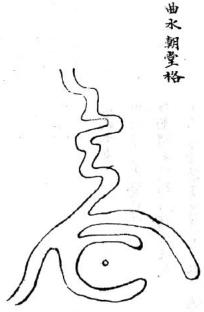

水龍經 卷

凡曲水朝堂流要摺之整齊厚薄相等不宜東拽西竄 如風擺柳條如風吹偃草或蓋過穴或不蓋過穴參差 錯亂者雖見屈曲無足取也如垣局割界結咽內氣合 局亦能發福秀但主子孫飄蕩淫遶愛歌舞輕狂廢業 若得進局一摺水朝抱有情亦主初年稳發行至搖 動擺跌處不免退敗之憂

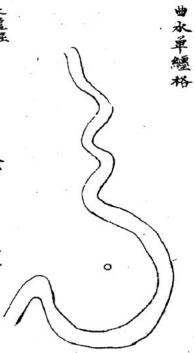

叁 主

一水卑纏只要屈曲有憤或役東南來或從西南來帽摺調勻不牽不拽不疏不密三曲四曲厚簿同情未即結穴互至理翔弯遶如滿月之勢力成體面其去水亦要回頭預我所謂洋悠顧我欲留是來要之爭去要屈曲然屈曲去庸最怡如繩牽樣曲不遠即及背走跳亦不結穴興水從東南來三五摺到向前抱如滿月前面不李不疎而獨到頭一曲獨厚而圍渾此水星曲也穴也得去水变局不向西北而向東北者真

水龍經 卷 雷

凡一水車纏局內不宜太寬太寬則氣不歸聚亦不宜太狹太狹則氣不運化坐氣急迫若局勢天寬必須左右或前後有枝水兜乗不使生氣蕩散方妙蕩前覺後蕩左兜右又得元武永遠過穴後上下包貴則氣完固局势周審得此形勢必大發福若此勢曲水當面朝堂徒左倒右遶白虎纏武却頭復從元武而去局內左右金魚美界其氣凝聚星為真穴一水單纏乃為遊龍戲水

水龍經 卷 1

三橫九曲當面朝堂不疏不密不牽不拽曲整肅遶 貴龍纏白虎回頭領我屈曲而去中間並無枝水插界 左右兜乘真氣于中此穴名水星曲池穴前曲永端 肅皆宜正受望曲水立向此名曲水朝堂纏青龍遠元 武前復左右繫抱拱秀乃大地也賊云為官清貴多因 水繞貴龍發福悠長定是水纏元武更表曲水朝堂去 永回頭水法中之最吉省凡曲池不宜太寬之則氣恐 蕩歸多武六難白前正受必有脫氣失脉之患若見寬 大必得復水兜桀方妙此書主出狀元宰輔文翰飛聲 三房至乘百子千瘰書費悠

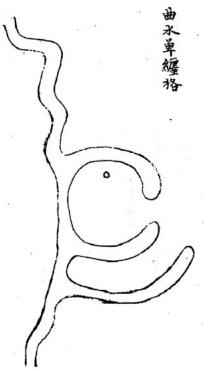

水龍 卷

凡是曲水左來朝壹不不密不牽不裡摺之聲整者 宜從曲水至處立穴之前一水橫迎曲水合流者酒得 小枝水插界于後方能汲曲木之秀

水龍經 叁 主

兩水夾纏合流而出來見之爭去見屈曲局向緊拱不寬不蕩不必枝水晰割成形只要中間晰割東腰牧氣則穴法自完固矣兩水合出前面三五謂屈曲整肅當面曲水立向雖是順水而不至于直流直去則亦不嫌于順局也龍盡氣鍾而更得外堂曲水有情明堂內如織如拋拔即兜乗則木雖去而氣自固也主發文翰清貴仕而無若資局山寬大更得枝水兜插成局而得水豬更有田頭砂包裹穴蟻亦能發財貴而又富

水龍缓 叁

局前天水聚于明堂從東南橫架過右抱身纏遶于元 武三曲四曲而去砂水反關于坐下其本在穴後法當 向曲水主向然前有曲水明堂流神自南而遶亦可就 水來蘆立向富貴兩美但聚水在前秀永在後先富後 貴若來水自北而南福力尤重代出魁元只要曲永包 曩營齊若有牽拽便不發秀矣左纏發長右纏發小中 房福力德長天旺人丁

水籠經 二十七

前有曲水三四摺遠朝來就身兜抱局後纏身元武而去入路得咽結處東氣緊界發福悠長富貴双全人丁繁盛雖二三百年不衰

水龍經 卷 旱

曲水當面朝來不厚不薄摺之整齊或左右就身環抱 從元武纏回而去此势極秀若圓抱緊矣不寬不抉法 當湊前曲水中立穴若就身環抱寬天深長則湊前主 穴恐真氣刼洩于後雖得親就曲水而真氣脫穴亦不 發福即當于曲水後求枝米秸在于何處若插中 聞宜立中穴變插于後面元武前宜立六坐元武永作 回受穴只要穴前望得曲水雖遠如在目前乃妙如局 內別無枝承插畸須以人力為之無使真氣刼洩脫氣 但姿迎受得秀水著耳經云曲水朝堂秀而可穴纏護 緊密湊近迎扦若還寬天發福必遲

凡回受穴多是永纏多武為師云坐空割背者妄也只要天潦流永從東向西左右得枝水插腹重之包裹割界結咽與天分合清奇其福力亦天若從右邊未遶弟順龍不如足龍武出東南去比遶青龍者稍輕以秋向東流者常也婦于順水若往西南向北轉遶向南而出東南穴向朝西得水遶分武其福力與遶青龍纖多武相同以逆势也百子千孫富貴三百年不衰前有朝陽邀倖其秀尤美朱紫滿堂凡元武永纏須得數百步之外便弯抱拱夫仰研而去方顯正格若面前滔機衆而去不見曰頭此又不可以水纏元武論也水纏者逸也回遶弯抱之謂也水龍短 卷 三三

一片天砂周圍四水團聚中閒却插一枝水屈曲直至大砂中腹或分作兩路罰界于左右裁成龍虎砂緊夬于穴前蓄成一河蕩或五六畝十數畝涵聚于穴前雖元辰向穴前出去然得屈曲如之令不見直流又得聚蓄不洩則其形勢尤佳不可以元辰水直出而棄之也亦主發福一二紀財祿亦不甚厚人丁雖盛而不秀小貴而已河蕩中得一砂蓋過不見前水去乃為可貴如無小砂蓋遏三四十年便見退敗

永龍經 卷 三

此勢與前局同但無蓄聚水涵于前明堂無聚水却得前面枝水到堂三四摺如織如拋梭東西包裹砂頭奴抱護雖無蓄水因其秀反主發貴丁財亦盛

水龍經 卷

曲水垂勾有兩势有曲承橫來頭到却于盡處仰作勾 如鉤有曲非直來到頭却于盡處作抱永勾勢此二勢 俱可立穴但要水來屈曲不陳不審不牽不拽摺之整 齊或迎曲水來處立向或張曲水作朝或垂勾盡處立 穴主少年魁元奕世貴顯鼎盛一時文章名譽

水龍經 卷 三十

青龍省水屈曲就身抱纏元武回頭領我而去此遶青龍纏元武勢也却于元武插一枝水摺直至腹中作一晚水勾形穴之亦能發福穴前雖無吉秀砂水朝應而水脉自坐穴後來氣脉完足丁財極盛貴而悠久亦佳格也

大江大河于前或有大江遠屈曲而來與天江橫樂水交會其交會之處並無枝水收受蕩散龍脉似難立穴却于數百步之後又有一水插界中間有枝水進腹中如勾仰如掌或勾左或勾右與曲水登對雖遠數百百望之如在目前即于異處斬脉立穴以迎前朝曲水之秀名斬氣迎朝穴亦主發福二三代福力但不悠久耳以龍脉未畫故也若得左右夾界重審元武水仰抱如弓福力必大且久也因朝遠而不就故發應遲數十年後方發則暴而盛以大江水大故也

卷一

曲永遠來到結局竟橫架而不見回頭砧下此本入懷反跳之勢理無可取然四水三橫四曲摺整齊不牽不拽斜竄其形势秀而可愛若得有枝水橫入秀水之後弯拘如勾本局又得枝水插入于後仰兜如勾其龍脉雖未歇止却于交鈕處斬氣立穴仰乗曲水之秀亦能發福曲米近在日前只發二三十年速在百步之外三四十年始發然終是曲永反眺在得歸元就身富不過萬貴不過三品兩代即衰入籍他州亦出魁元水龍三第一卷終

水龍經第二卷

遠朝倖秀格

水龍經 卷二曲水朝堂從左轉右彎彎就身遠抱却又得客水從東來纏元武與曲木合于局後此亦兩水來成勢而曲水之丙並無架成穴反于客水挿一枝水橫架于曲水之後乘受曲水之秀所謂以李樓桃名曰邀倖主移居易姓或贅婿過房發大貴或遠鄉胃姓胃籍發科甲或于四夷邊疆主功業或文人立武業武人立文業或于他途立名者有之然局勢周審結氣完固亦主人丁繁盛累代不絕也

速朝律秀格

永龍經 卷二 二

凡遠朝倖季須得曲水當面朝堂或倒左或倒右本局 無枝水挿畸成形却于他方外來下割成金蟹仰業 勢托于曲水之下亦名倖秀然穴後又得一枝水包承 于元武與曲水合從集一路而去則水口當以曲水為 主若後面外水不從與元武曲水合流則水口當從本 穴枝水處論去木屈曲回頭交鎖織結不至渗漏方為 大地

水龍蝗 卷二 三

凡水委曲來去要朝抱就自尤要彎環委曲來要之负 去要回頭纏遶此勢穴前左來右抱就身似為可穴然 形如之字雖見屈曲而勢如拽索斜曲不秀謂之斜曲 來則可謂之朝堂實非也其右邊去水雖見就身札局 不遠又反跳斜飛更不曰頭顧家則去水似是而非其 帖身左右枝水縱栽割如盡穴之僅可暫發不能悠久 若誤認水令如帶是一而廢百也蓋水城固要圓抱而 來去亦宜朝鵲書去橫索曲而斜此處莫安排又云水 若田頭寵家水不顧家必破觀興而論水之去來 可例明矣

右湖蕩一十餘圖曲盡聚砂之變態可謂極巧窮工矣然據實雅論天生之巧必不能及此即于地脉正理名墓之已驗者亦不必如是凡池湖之格其積水小者一二三畝以至十數畝形局端正者或一乘獨專或二三聚氣穴之得法即可大發丹陽賀氏祖穴左右前三池居中立穴是也其湖蕩之大者汪澤巨浸不可以頃計其法于大蕩之涯另有小曲水拆入兜抱乃以小水立穴為內氣借大蕩旺神為外氣其富貴亦不可限量江西紫溪劉氏仙姑壇祖穴是也只此二法已足盡湖蕩作法之妙不必按圗索驥刻舟求劍也

年酉初秋 劉氏記大湖大蕩數千頃于中間突起二三片大者數百畝小者五六十畝團聚拱夾面相顧洲角兜权雙回如衆犬之聚食于槽者然即于中間審詔何砂端正尊嚴有無枝水界割成局中間如有界割枝水結咽分合件之明白的有明証便看明堂左右朝抱如何若朝抱有情蕩水收進蓄于穴前作內明堂局前更有遠砂蓋照湖蕩雖大而局視之不覺寬濶蕩散垣局眉密乃天地也穴之主富堪敵國貴並王侯以湖蕩中精神獨種而人不得分受之故也並以砂水朝揖之多寡尚定世代之速近朝拱之砂愈多愈妙

湖蕩聚砂格

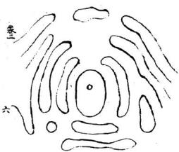

河之泊穴都有群砂團穰或遠或近四頭朔應中有一砂端肅整嚴中處望之左右前後各有是少龜之變回頭顧穴如大將之坐營而衆軍之獻我屯則也如之坐堂而更卒之排衙唱惹也曰非具解胡喜月架半里一里視遠若近而羣砂紛洪衛口在日前拜如俯如揖如揖伏整齊震肅而坐穴有黃少聚閒于後不致滲漏如此形勢主立伯分茅富堪敏國子衆多萬福悠久更主子孫孝義世出忠貶

水龍經 叁

洲泊河蕩之處一望無際中閉或有小砂數十塊或數百塊大則五七畝小則二三畝或蘆間革渚圍簇于一處却于中間看內有大砂或十畝二十畝得枝水插界緊身包抱左右小砂或長或短蒸擁團聚如蜂之從王雙回頭向拱小砂交鈕如練之聯屬重疊不見穿漏坐下近局有橫砂欄阻于後穴前小砂點之如鷗之浮水橫列如排班倚立如衙意直列如亂蘿倒穀團列如屯軍集塞有此形勢主咸震邊疆或統大軍將或割撮一方或分茅主伯若前有列旂反砂主出強梁之人

龍 卷二

蕩泊之處多有吉穴如波心蕩月如雁落平沙又如浮 鷗點水審而穴之無不發福

凡羣砂輻輳有五勢有穴聚水遠砂朝應者有水聚明 堂近砂夾輔而遠砂拱衛者有本身綿長直出湖蕩外 砂遠應者有湖蕩中群砂圍統自相轅者有羣砂內 聚而外有天砂包乗者皆大地也此局水聚明堂得近 身砂襯貼前有湖蕩而遠砂拱夾外砂拱水外水夾砂 其局勢更妙更得穴前或遠或近有砂其呈秀富貴極 天若左右夾拱雖多前面無砂作應則堂空無物富而 不願

內張河蕩左右兩砂相顧中通過穴雙之頭若內蓄 水直長須得蓋砂護覆不見明堂水直長方妙左右 兩砂各自結穴故曰鴛鴦垂鈎勢其形如皮刀歎嘴 當就彎處扦之轉身向上方有力若倒扦之則不發 秀矣此地主拜甲聯芳但初必先因財致貴或納粟奏 名後發文翰貴至腰金官相見左六先發次房右 穴先發長房多生孝第忠信子孫繫盛悠久若扦 穴天進則氣散而不收難以發貴兩穴同斷

湖蕩聚砂格亦名踢毬勢

水龍經 叁

砂形勾踢如馬如靴頭如皮刀口客砂包纏于座下穴前蓄聚來水成湖一水單纏元武左轉兩砂自相包暴垣局完固並無木割亦大地也木自右來穴宜右迎非堂局端正不覺斜倒穴宜正變湖澤方佳雖無蓋砂炤應亦吉若聚緊木直長必得水中小砂照顧為美蓋明堂水喜橫長如堯不且如竹也主富而且貴子孫代榮顯若元武水倒纏入明堂竟向前而去穴宜橫受方吉

精水灌堂聚蓄成湖或一二頃或八九十畝却于穴 左右起砂條夾身逆水挿出護衛區穴或四五重六 七重雙回頭朝拱形如勤馬其力量最重是大 地也世人或以後龍散漫過峽束氣不清而棄之悞 矣

水龍茲

湘漢之間及浙直等處地最低薄古時開聞田地多是瑱低就高各因砂法以成田故多小砂攢聚成勢之穴然都大小不均橫斜不憨零散而團簇者少凡是此等地面亦有結穴者須要隨砂詳看砂頭朝向何地若攢簇整齊不便去群砂之中尋得中立之砂四顧有砂包暴不見露風藏聚含蓄此地極佳主百子千孫富貴悠久朱紫滿庭之應其穴向當視小砂中處之向內得正面迎受方美若小砂多而大砂遠抱終恐近身穿滿必穴砂左右有貼身金魚永緊抱以護漏風則氣盆固矣

永龍茲 叁 古

湖泊之處多有小砂或二三十塊或一二畝五六畝團簇抱聚中開包含湖蕩其砂點印于水面若浮鷗泛水小砂之外却有長砂周圍包暴小砂于其中左右前後不見水穿漏而外有天砂長砂角包畏不見滲漏方成局勢却于中間小砂認出一中砂頭面端正整肅而前後左右小砂雖零散而寔朝頭攢簇擁護不遠不近不疏不審其外面更得天砂彎抱周密完固者正大局也其力量雄盛誠大貴之地若中間雖有小砂而不得湖藩舍蓄其秀不願露雖發貴而財當不甚厚主出文翰詞林之貴但小砂不要如驚頭鴨頭方妙

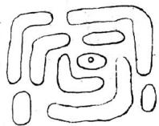

水龍經 主

前後各有長砂橫架左右有直砂色乗中間却得小橫砂或三四畝七八畝並無枝水挿畛藏於衆砂之中左右直砂角匕回頭勾搭色抱左右前後水雖四穿八建穴中視之毫無滲漏正如車輪合之湊合團簇周審衆砂歸向不敢反背則真氣聚矣凡有地先看左右前後朝頭向何處若雙回頭向于內即于中間尋中正不倚或大或小麗求之若有反背砂或向內或向外或友跳即非真氣所聚之處不必求穴全在目力之精心思之巧體察其情寔見得甚真方無量漏矣

亦雙盤龍勢

水龍經

去

砂水團雲勢有雙盤龍單盤龍結穴須砂水圍遶周旋委曲如雲之圍繞方成盤結而氣聚不散也若無委曲盤旋之勢雖回頭朝應非盤龍結也此勢雙盤而左右客砂重之盤曲旋遠如雲之護日凡盤龍結穴多結在局中必得蓄水于內明豐或小砂照應方佳得此形局發福最悠久以盤龍之地無風吹水破之患馥也雖穴不盡真縱不大發亦不大敗房分均勻貴而不躡富而不吝男女貞潔風聲可愛子孫守節而不濫或有被徵召而不仕者皆氣脉潛藏之應也

湖蕩聚砂格雙盤龍勢

水龍經 叁 老

凡砂水團雲勢多結盤龍穴一條水入一條木出周圍盤結皆在局中結穴處須要水寬聚成湖澤其中涵得氣脉溶活方妙不然成裹頭城矣裏頭名中國水穴氣窘逼不得流通反成絕地經云山囚水囚虜主滅僕蓋其義也此圖穴前湖澤汪澤緊而不迫穴之自能發福子孫悠久更出人孝弟性巧聰明或于巧藝中成名發財以龍來秀曲也

界水外抱格

永龍經 叁一 二 大

此勢龍虎重朝抱局前彎抱如弓此形勢之美者然穴前左右砂角硬直無情外形可觀內形似覺得相不可以硬直而棄之也職云內直外勾儘可前裁以工力掘去直指便成彎勢開睁亦天地也

水龍經此勢局前支水挿入包抱左右砂氣緊拱似乎有情然湖蕩在坐下砂角雙飛散則前氣雖叔後氣不蓄前為外氣後為內氣外實內虛此等地僅發小財終無大福官貴絕響人丁亦稀劉氏曰前為外氣後為內氣二語得入穴骨髓

一水橫欄格

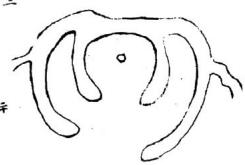

米龍經 叁 二

腰帶水左右砧下緊夾包裹其水城形勢収龍氣有力經云界水所以止來龍若大水橫號而左右不就身環抱亦不為妙書云未隨左右碎穴看左右鐸今局內緊身金魚木分合上前回頭拱抱後有結咽前有包乗砂頭回水就誠美勢也書云砂要田頭水要就又云好水彎環巧如帶此勢局前水環抱如帶實水法之最佳者當面若小反亦不為害可以人力改圓或內堂左右各開腮水挿進作內堂蕩則不見其反矣此種地三房俱發福力悠久數世不替矣

水龍經 叁 主

書云穴看左右鐸水看左右砧三陽看城郭明堂看四 角此格穴前水環抱如弓如帶或從左來貼身或從右 来貼身緊交兜收並無渙散中間雖無枝水挿晰氣亦 完固若或寬天必須枝水收聚得此形勢穴之主發福 悠久若局前更有曲水或達或近悠揚之朝揖于前 不問左來右來俱為秀局主鞠苑聲名之應左秀倚左 發長右秀倚右發小左右均平則三房均發

一水橫欄格

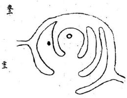

缺亦類湖蕩聚砂格而本身穴後界水多內氣足與此勢水聚明堂兩水來拱于左右與前橫水合流或過左或過右只通一路出去穴前水舊聚池蕩于垣城聯珠串作內明堂龍虎重之拱抱亦大地也局前雖朝陽拜揖只要下砂逆水挿得緊審似不容水神流去則精神凝聚而不減于衆水朝堂局也仕而多資恒科第不獲名魁僅可腰金以穴前無秀朝揖拱胡也內外堂有三兩重關鎖亦主三四十紀福力三代榮華子孫滿堂過二紀后貴雖不大而財祿曲匡水靜專而不蕩洩故悠久耳

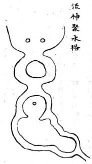

永龍經 參

前合衿當穴前而出却聚成一河蕩左右砂角儂朝抱湖蕩中間小砂或員或方或長橫浮水面交鎖關關亦不見水口冲射雖是元辰水向穴出流而聚蓄汪澤元與辰直出之勢大相懸絕主大當大貴福力悠久若穴前湖蕩中死砂角欄截亦不為害只要左右砂甯左右拱抱為佳不可以元辰水直流指為順水也賦云元辰當心查出未可言凶只要湖曲之橫案欄之乃吉水龍經 卷 主

十八格惟水聚堂為第一蓋水為財祿當貴之樞機故水神渙散無所收拾者不惟不發主亦敗絕是以古人論水不曰蕩然直去則曰水無關關務得局前水聚蓄方為吉壤此勢左右砂頭朝抱而前又見衆水朝流聚注成蕩只通一路或纏元武或過青龍此來多去少所謂朝干天旺澤于將衰瀦而後洩之勢也垣局園審衆水聚堂成十全之大地主百子千來繫滿堂成三年十紀之福長中幼三房並發但一太寬則衆人之水非我一垣之水情不專則發引不專矣

水龍經 +x

凡是兩木夾來隨龍交令于局前其水多從明堂前直 去人皆指為順水地順木龍豈知結地水未有不向前 去者只要去得屈曲不見直去亦為吉勢局前亦宜蓄 水石至徑去為貴耳蓋瀦而復流精而後洩離去水無 害其吉也若局前無池沼蓄精則其去水無交鈕向前 直去所忌者惟此耳若三橫四曲頓我後流悠揚眷戀 似不忍去此正為顧我水也前顧我去發近而速後顧 我者其發遠而遲其與過穴返逮甚皇得以順 而棄之哉

其曲木去處雖不屈曲亦不為台沒之水乃龍之元辰而曲水乃客水也不過邀客秀以發福耳其流之曲直無與于本龍之氣但要坐下元辰水去得屈曲為貴此等當以過房入贅而後發或他途絆籍登料也

水龍經 叁 主

水龍終卷三終

水龍經卷三總論此卷耑言水龍貼体吉凶形局而入穴星体巳森然燦列于其中此水龍肯綮扼要之書也六不著徃氐言初理俗愚意必揚公直本千年以來師相授開卷先言五星而五星之中帷取金水土三星為吉木火二曜為凶此與山龍稍異山龍有火星起頂上下即結直穴亦有行龍穴星皆木星結体弥見貴秀水龍則一犯木火立見灾禍推原其故總之水形喜柔荏而惡剛強宜朝抱與而忌冲激者情性判然矣是以五星既別而即繼之以遶抱反跳収炁之風蓄聚分飛諸格辨之最詳亦即五星明枝幹之義則行龍之体格大畧已盡繼明五星之正言而後入穴之作用得其主宰掌握自由學者苟有意于郭公之秘能于是書深切而体聽之水龍之道思過半矣過此以徃三元九宮之法庚幾其有逢源之樂乎大鴻氐筆

真龍到頭結穴左右必有兩股無浜界善炁脉入穴前必有低小明堂左右隨龍水送到局前交互前有朝素之砂橫攔之水弯環向穴四圍護送之砂回頭駐劄面有情明堂平正水口牙前看兜收後有拱送右砂何左之砂向右穴住天心此天然之結局也

人知尋龍為認穴之根本不知認水乃尋龍為捷徑故水勢之所在冲層石亦砂頭之所輔巨漲皆迴水源有淺有深可推龍勢之大小水局有纏有走即知六法之假真然而取千頃之汪洋滙于案外不若取一勺之灸秀聚于堂中以小者真而易受大者衆而難居是故

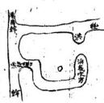

卷

体变星金

枝龍作穴須長久

右金小房興斜金似水受克非售若然照穴賣盡田園永龍 卷三

前火克金城風字脚不停若肝此寺地不久主佺行金星如玉帶此地真無價橫水道害八金城挹穴若扦此地富貴不破

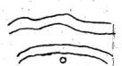

鑫 卷三

金城反弓逃走貧窮水入金城富貴多丁

六 長子必離宗 金城左反躬

金城右反弓金城右反弓小子必狐窮

相侵 盜賊 金城 火克

中細即成夬形故曰火克

蠢卷三

斜木亦為火星二火來克金灾星日臨水星得地金玉滿堂

官见揖人曲木入金城

窮敗無丁 煞入金城 o

火金相刑敗絕無丁

司上

龍經 卷三

7 後主生離 不堪下穴

水龍經 整水似木又瘟瘧孤寡

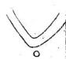

火城反去江故不良家財蕩尽絕嗣逃鄉

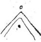

若還如此樣退尽生貧穷 水城後反弓忤近各西東 水經卷

右火斜飛 兄偷弟婦 九火斜出 弟偷兄妻

价 官刑絕子孫 光火射其身

老死無人送 B 燥火焰動

子孫特逆面前八字水流刀鎗之水反射刀鎗之水反射身後配遠充軍

左火斜飛絕嗣無依

未龍緩 卷三

論四獸

朱雀之前三水反

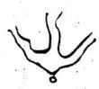

男盜女淫無衣飯火星屈曲飛無食又無衣

元武之水有湖池

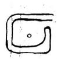

定宅安坟福祿宜

元武 定是永纏 發福悠長

青龍直走如飛去代人難佳

人心 脚分開惹 是無情兩 掀裙之水

兩边龍虎弯之抱富貴冬到若然点穴得真方定出狀元即大須知此地出公鄉

  
貴龍水轉抱其身

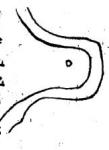

龍經 秦

白虎水如飛不久便光移又去永口無閉先賣爹田地出敗亡凶流配為之戌

减脚 水井 之是 有子

徒流退敗主離鄉

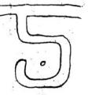

水龍經

維漸絕種 青龍吞壞 0 少亡絕嗣 白虎唧屍

右閨水為灾陰人定左右两边水展去見拋父母走

两边水去不回 頭財物鬼來偷

白虎冲腹少子刑傷

青龍冲腹長子遠白虎御屍貧老無見

青龍吞塚憂盧無穷

青龍抱体足堪誇年少達京華

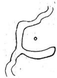

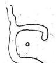

滇憂 富貴不 兜出人 水拒玫 貴龍之

青龍左轉挹其身富貴有聲名青龍之上一浜来此地安坟任点裁更得後河多積水世代兒孫解状才

水龍經 春三 重

青龍水似龍富貴比石崇屈曲門前照子息侍王宮青龍弯轉如牛角子孫代登紫閣

青龍屈抱身來世代兒孫入帝台青龍水反逆子孫無官職君若扦此地誤殺人青龍反去不朝身長子之先貧

大覆蟹卷三

青龍射入子孫傷死并軍賊青龍一水如鎗來長子必凶灾

青龍頭上水反 飛家破并人離 白虎水抱两 三重兒孫發 福永無穷 青龍水多 破下後人 灾祸一名 金鵝箭主 瘋疾破敗 敗閱之水虎 來瘟火反官災 右边砂水利如鎗 必定子孫主殺傷

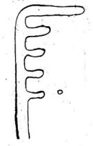

論形局 貪狼之水面 前朝子孫代 產英豪不 問去表并前 後官居台閣 子孫當朝代 五高雲

水龍經 叁 文虎口河尖當百至小子賣田地官事頻之福患凶長子橫七

曲水來朝家業自然豪

水見三弯富貴安閑永盤經

水轉三湾富貴清閑若扦此地位列朝班水龍

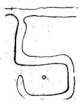

龍虎兩相聞忤逆多山咎

犬子不相親兄弟如勉 左右水直無收 兒孫必主憂愁

雖然有水後兜 定無子嗣守坵

家業自然豪 9 火吉水果朝

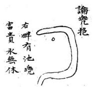

水似生地出穴最佳若迁此穴富貴

四龍之水穴論異形

永龍經 卷三

周回之水遶坟林破財損金銀又兼淫乱無家室疾病少精神

# 水龍經卷三終

坤鎗向艮 乾鎗甸巽配在遼東 配在雲南

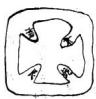

巽鑰向乾 良鎗向坤配在陕西 配在廣西

抄佑在形英作坟 搥然富責主充常

水龍經卷四總論風水之法得水為上藏風次之夫外炁所以止內炁界水所以止寒龍天元歌云人言生炁地中求豈知地悉水邊流到水邊逢水界平原浩炁畫兜取故葬必以龍為主而水亦其要也故平澤之法先取大水後取小水先大水則知幹龍所鐘可以明大勢取大局復小水則知真爲所聚可以決定所取真穴不明大勢則地之大小不分不知定所則穴之真假罔决但水法之書汗牛充棟茲卷所輯專言水龍業是術者先當釋其吉者水龍綬

趨之凶者避之則吉無不利而凶禍不侵矣

大鴻氏筆記

山川之性微妙難明陰陽配偶炁化形生一炁感成地灸人傑內乗生炁骸骨之不朽外接堂砂吉凶之應賒水之吉凶可見山之情性難明谷中関鎖為上平洋永聚則佳所貴者洋中之陰所喜者谷中之洋龍神頓伏斷而末斷水神屈之去而不去閃東過西炁脉愈佳或飛或奔或墨或隱現其行止察其所藏動中現其脉靜中現穴求靜中之動変化則行會合則止尋龍隨乎脉止定穴當從炁現二者得明穴法自成明急緩纏加吞吐審陰陽而下浮沉立甸須憑唇口樸親堂從界明山有支龍之分別地有厚薄之得宜壠也之脉陰多而就陽支竟之氣陽多而湊陰支有陽極成陰壠有陰極生陽成陰可撞雖陽莫湊地厚處當從薄取地薄取處須尋厚裁取厚者須親炁脊取薄者亦須唇口平洋無炁脉之可观史穴有水神之証估群堯會合于州府二水交鎖于鄉衬現生死于曲直之間審行止于雌雄之内雖不可以勝雄不可以不就星体卧于平炁脉從于水現体小者當存乎內体大者須察于旁脉随水行炁隨水挹現背向而在方圓雲穴法當知生死則靜動則生不現于前須視其側方則取動圓則取靜平洋須得水谷內要張山陰以隨脉樸生陽須風旁空已當審其四應热察其至微竜神之大當以智量而現穴法之難須求正已而作依水尋竜傍砂點穴来須脉現止隨炁納

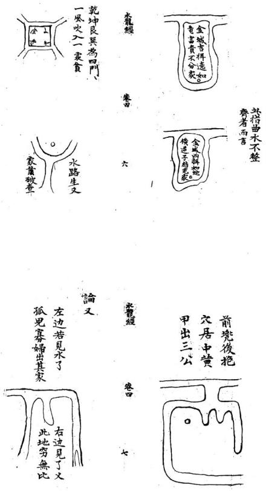

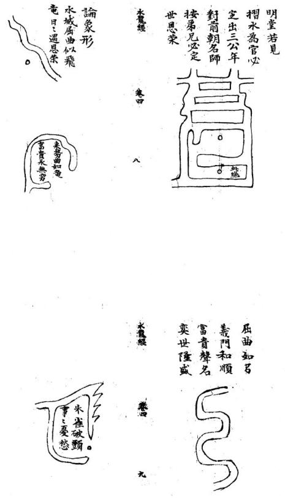

絕嗣無人 逃亡橫天 刑獄充軍 屍鎗射六 論射

80水中有地葫芦形毒藥主傷人

蓋边遠去充軍 葵後兒孫終不 城砂水两相刑 火入金名帶劍 論交 論交

若能扦當貴聲名

金勾左轉足金銀

水龍線

案應三台出貴人屈曲盤旋富貴綿活竜史势作三台秀水前朝面来若得有人扦此地為官代作烏台瓜藤之水節之有情

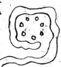

水龍經

卷

左轉奎鉤貴而無敵武宮旗水交劍長流有人塟之陣上亡身

火入金城兩相戰奕後其家終不显功名或是出旗鐘後代光孫必陳亡

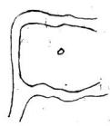

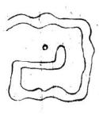

金蛇势難識下後大官出又名笑之大處一边有水一边無衣食安然不久退永如竜至金銘玄又玄有人扦此地及第至三元

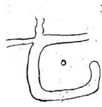

逆竜一水後 交臨砂水分 明是合襟寬 拖弯環如玉 帶綿當貴 作公卿

永朝曲去又纏身家內出豪英更有路朝生旺地官显在朝廷

冰龍經

一重路挹一重城金水重按南門若得水中再色裹代英華達帝京

無穷 贵永 雄當 號雌 相會 二竜 二竜

舞鳳之后妃尊貴男作三公少年及第

無休 州知府出 之字流知 之字合襟

右轉金鈎形富貴有聲名

水龍經

水如王鈎官為知州

蟠竜之水前後兜在田千厲富無休面前若得三竜水兒孫代出公侯

蟠竜之水後頭代之作公侯左轉金鈎形富貴睢人丁水如乙字形水如乞字形家出大朝臣十字水朝故見孫手

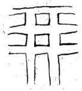

丞龍經 卷 雖然溫飽有成敗 定出娼優賤且淫

三十年前走道途不曾下得仰天湖若有世人扦此地見孫衣紫達皇都十字水流後與前地字井字總一幾此為市井人多往若是一家不可安

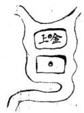

水龍經 书

此穴分明結作形只恐時人不識真者遇成師點真穴富貴双全砂水纏流荷葉地却如架上金盤形若然点作樸頭穴之出見孫朝内人

籠經

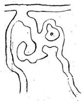

春曰

永合門前富責出名矣

水龍經

卷甲

雖雄相見天地交通陰陽得位定出三公右水似華頭子孫貴無休左水似筍圭長房中元魁

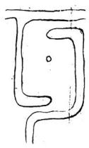

左水似筆頭 家主進田牛 右边二水抱 家内足金宝

二竜相會應門前子嗣去朝天

水後頭兜人皇州

不孝多疾 1 二永右边出

二竜穴後兠富貴永無休東浜深百尺西侯有千粮

宅後有池亦 是人財之地 西北池塘近塚边 子孫不孝呌皇天 番 龍經

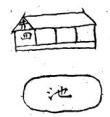

門前橋沖少死 橫亡疾病鰥寡

人口過房此俱俱衰敗之炁耳若當旺運反能發福也大鴻氏題坟後有井患心疼双目損兒孫井不分東西南北偏旁近攻主心腹目痛

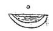

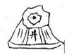

森

鵝兄頭碼兒 頭女兒媳婦 上秦接

是°前

疾有

难横

基

宿婦木前 抱杓山 公媳如

水龍經卷四終

水籠經

蕃

朱雀一坵地此穴梁安然更更有後河堯富貴皇等開

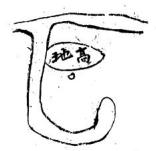

水龍紅第五卷總論此卷水龍天星垣局乃化龍山人董遇元述景紀氏之言言董君不知何代人其三十六穴上應天星而每局格以四言十六字有駙馬儀賓京堂等語乃本朝物色其為近代人所撰有明微矣而品占列星隱嬰不猥苟非博綜象緯窮採星源者安望其涯涘雖不出于景純氏亦景純氏之流亞歟至其撰句選詞典博道麗卓乎大雅之為予考楊公以還地理之家少有能文之士惟元賴布衣蓋以奇才生蒙古之運祥狂詩酒晦跡江河其水龍綬 卷王中有歌咏天才爛發見于會稽諸鉗記可徵也予向以為頼布衣之才無與比者不意又得之此卷形家者流何多才之甚也至其所論天星垣局但取水形相似連類以求蓋非無本者也古語不云乎在天成象在地成形地有斯形寔與天象遙相應合耳以此明天星垣局與世人所傳二十四方道各分星纏者奚啻天壤蓋地有定位而天無定位雖有十二次舍不可渾配地之二十四十支也故天星之說古今所尚而予獨以為無考徵之 徃幾見翰林學士定出巽辛萬里封侯必生庚震雨代帝王發跡之地亦未嘗畫屬三垣來龍也故據方位之合天星不若據形象之合天星有微也予存此書蓋將尊其名廣其類以顯水龍作用之大使學者知兩崇重以應乎山龍不分軒輕耳三垣九野列宿甚多而名川三百支川三千水之為數亦不可紀極即如山龍亦安能一一舉天星而比擬之我故執天星以論水局取合天星之水局然後知水局之尊貴不多也學者毋以文害志可也大鴻氏筆誌

水麓經 卷五

水鉗天壤浩渺三辰顕晦一氣循環五行榮悴江河以流山金岳以峙暄陽為生陰寒為死是以哲人象天則物因地察儀氣以載理磅磚無疆理萃氣聚陰谷生陽地出川岳天垂星本乎一氣情同異名理穴龍形列宿耀明天施順播地德上承葭管灰飛孕懷百靈鑄以形氣剖以吉凶陰陽相禪五行生聯舉一遠二巧術之編欲識其地先觀其天欲識其形先觀其兮禹跡茫哲人大觀不察其流孰知其源淄分漫衍疊之淵秦氣而行子水龍經 卷五母相援夫婦交度剝換蜿蜒氣緩為吉激射為凶見水非水五星真偽土水厚重金水圓清木水挺直火水飛騰臨涯眺望不失其形金木相攻奕水則吉水火相戰本旺尤忌土神生金最畏逢木星帶火邦家傾覆趨蓄之位各有關軸胞胎死絕生旺官祿冲剋刑傷灾釋迅速吉凶本乎消長五行運乎生死信耳不如信目信目不如信心景純雖死精神尚存乃若長江鴨綠大海無涯波瀾洶湧蛟龍夜啼界之罔極察之愈疑雖有如折不委迤運啟天鑰君子勿題下追淮泗江峽漢水巨脉橫沿洪觸漢州邑鄉村龍神所據旋垣轉屏脉隨氣聚揚肩遠眺精神來會洲澗洋之穿江入河三十穴景純所為末晉之間仙音既殂唐宋以來水法虛無青烏石匱發自何年不載地物惟說水鉗龍額藏珠賢輔所生上應華蓋葬隨曲衡河漢交度東西二藩真穴奠下近侍官班天府壞箎曜通天苑穴點龍晴名揚翰苑虹飛欲海將軍氣揚帷幄內穴威鎮邊疆蟠龍飲乳軫宿所據穴點京堂旁為驃騎錦屏挂鏡上輝天錢穴藏中宿主賔責賢金鈎挂月天釣入垣餌穴居內可釣水龍般 卷五 四

顯官天衢献印漸臺垂應穴居中轂貴萬乗天廚玉饍天皇內厨鼎釜取穴珍羞腯肥龜浮蓮形天電暗照穴應蓮心耆福之兆瓊屏玉架上應五車牙籤吏穴翰史榮華玉階五級翌宿所居穴乘羽輸飛步天衢瓊筵結彩八奎聚靈隱褥取穴錦繡聯英金鎮瓊幃斗宿所居穴轉曲寫金資萬箱玉堂文幕器府璘福穴居內笙歌滿庭方城秀衍上配天田穴居其中阡陌連綿玉練纏天工應文曲穴居剪裁補袞之職金闕牙班庫楼森張玉作穴列爵滿行易橫九畹天龐耀明穴點易眉負扆名陽河猗綠上應斗斛穴鐘日精冢宰之福陽隰纏耀即位亹之參差點穴簪纓幾里神鬼食蛤六甲奮光穴居豐颈爕理陰陽驥嘶掉尾右映旂星穴繫其項陣上揚名日月分精天廟顕星葬陽御陰男女双英双乳聚英左右執法穴齊端門功名顕達春蛟賽月蛇蜒臨河神宮取穴名顯皇都金盤出匣牛宿所居葬看點饌綺席華烟金倉玉粒天困顕赫穴其中廩祿錫萬石玉女鋪床天床星照駙馬儀賔穴居閫奧繡幃銀鈎天圗外屏褥取穴御翰芳英雁落平沙穴粘羽林壁水龍經 卷五

壘桓武柄文衡珠胎瀉月天淵映禪法葵內池食祿瓊關金蓮側露穴在花心上臨積翠統馭萬軍玉衡挂斗天倉昱文桂史儲鄉塟倚雲屏天福地軸威名千里穴居中宮奎宿所履以上龍法作自景純紛錯斜纏形難具陳得魚忘筌頓悟以心生旺起祖清絕入穴水纏砂轉蔓若瓜認根識幹認枝識葉山乱势奔水乱勢結珠經浪萍隱冥之入土不減入水不湮上哲辦氣下哲辨形之氣既得殃福日真東南華煖西北凜冽冰雪未消虛兩歇塘弩發機遊刃一節蝦鬚蟹眼玄論紛蓋粘何彊化生胸唇庸師憤五行不分既泥羅纏又多謬星指生為死鑒凶裂純上瀆天垣下毀地文靈輝不照白畫天昏幽堂慘苟非知者交臂不親遇穴淹脩草野悲吟敢照珍秘豁吾後人雖曰先矣之淑教亦由後人之秉心

化龍山人董過元編述

永龍經

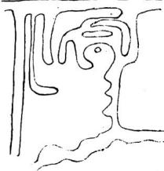

柔龍經 卷五 龍額藏珠賢輔所生 上應華蓋葬隨曲衡

河漢交度東西二藩真穴奠下近侍官班帷幔內穴成振邊疆水龍經 卷五蟠龍飲乳軫宿所處穴点京堂傍為驃騎

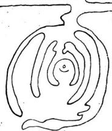

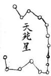

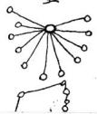

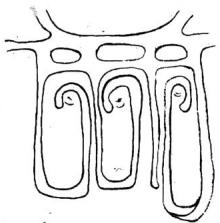

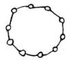

穴藏中宿主嬪貴美

木龍經天鈎星

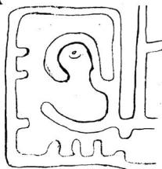

斜穴居內可鉤顕官

卷五 十

織女星

衢献印漸臺乗應 從中轂貴擁萬乗

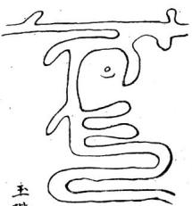

穴卧唇詹肥適賢哲

龍經

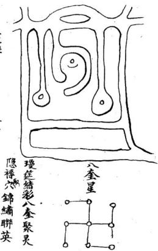  
穴轉西窩金資萬籍

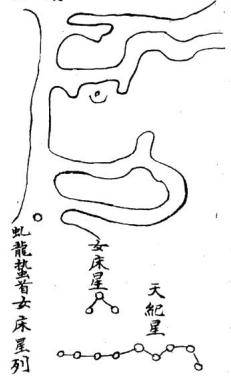  
福居穴內生歌滿庭

龍經

王案作穴列爵鵷行

卷五

  
方城秀衍上配天田  
塟居中穴阡陌連綿

∑

三師星

  
龍經

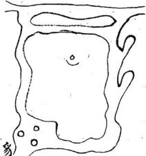

天廐星

穴点多眉員扆楊名

水龍經

  
疆  
穴鍾自精冢宰之職

水龍經

天來星1010

玉女鋪床天床森炤駙馬儀賔穴居閫粵水龍經 卷五續水龍經卷一懸論此卷專言水龍象形肖物之義興天星垣局厥旨祠同蓋天有是星即地有是形水能象星亦能肖物此與玉髓真經指物論龍固歸一例原本亦云景純氏作其文不古比之星鈐有雅鄭之異乃後人之傳會無疑矣予最取其篇首山群以為山龍水群以水為龍二語為地理家千古開關之論必非淺學之流所能庶幾其餘文多粗率意多穿鑿略之可也又云水行交鎖織結雖順亦吉局內穿割箭財縱逆何庸兄哉通達之言也若探續水龍經為局則草尾露珠双龍戲感入懷諸格又深得水龍微妙作法而亂中取齊則又裁穴之真機確乎不易之至論也夫喝形點穴予于山龍深辨其非茲于水龍反取其說何也要亦因文節取讀者貴有変通耳予亦緣世人論平浑者專取地之為形而不知水之形為形也故博採其義以破世迷純乎一家之書正論云耳大鴻氏筆記

## 水龍尋脉歌

地理之術世罕逢陰陽真僞妙難窮尋龍捉脉觀山水崗阜平洋捻一功平洋之地水為龍四畔茫之豈認宗若使明師精妙理追尋源洛辨雖雄水龍妙法少人知慎勿輕傳與俗師達者悟之明此理愚人不曉豈能為亨武之水是龍身定穴君圓看的真水積必然龍有穴水流氣散不堪陳大水榮廻是幹龍小河支接幹親蹤幹龍氣畫難安穴作穴支龍富貴豐弓武之宅有湖池立宅能令福氣隨坟墓穴前宜此水兒孫富貴著鯡衣河兜續水龍經 卷一 二

池水不通流水若通流氣不留若見田圩閱水口兒孫富貴永無休大河之脉氣歸灣湖內砂明應案欄下後兒孫多富貴能令曰户出高官流来水勢似刀槍射脇冲心不可當尖利田圩為絕地殺傷公訟退田庄後來水龍似反弓出人忤逆谷西東若還遇此反弓水退敗田園守困窮水要湾環莫直流直流之水是為四更兼四畔無遮掩浪打風吹不可求十字水流後與前廿字井字損一般此為市井入多住若是一家不可安抱身之水勢環坟穴後龍真氣脉純葬後其家多富貴兒獵榮顯作王臣

秘傳續水龍經卷一

晉郭景饒氏著 宋韓國公趙普訂 明誠意伯劉基閱

山群以水為龍水群以水為龍三吳諸郡江楚二省枝 浜交流一圩之地不過里許前賢謂以水為龍正此處 也相水認遊蔡得其穴富貴悠火經曰江淮大地無龍虎 渺歸何震東西只把水為龍葬了發三公千里無山英 雄迭出其貴在水縱是浙閩多山之地一離山脉亦作水 局至于蘇松之地近海通潮六時潮來六時潮去来口便 踏水龍紙 卷一

是去口去口便是來口兩頭交媾為交精潮退兩分為乳蔭妙圗處在乎潭旋生活喜其之兮潭流叙精神百倍之牟現衷化無窮屈曲耒朝不論大河小澗遠流曲抱無分江海池塘經云地道剛柔神变化衆流聚嚴引乡櫟小水多敘而愈妙直流縱大不為奇內直外鈎多巧結內鈎外直枉勞心橫通抱身為抱局對面曲朝是迎神進局入懷要雨邊之抱應流來入腹須四畔以包藏前復特秀即為華蓋附身交合便是金魚兩水合局是朝堂派二交流為合腳六建四達昏護衛三陽當面似趨迎金魚腰帶抱我湾環弓局天虹當面大抱上下水朝號作雖雄兩感繞身方正即為華蓋幞頭衆局枝浜奇時遂處葉榮穿珠垂乳源頭即時富貴獻誥水英雄三世藏秀局富貴千秋又股無纏而驟發迎神得秀以綿長四龍珠大富大貴四圍環抱悠無疆交劍合流生武職催官盤繞出文臣左右仙官俱富貴蓮花垂仰定陰陽勢若踢毬頃得趨形如飛鳳翼宜長仙掌撫琴登甲第捲簾殿試耀巍科一水曲小盤蛇局兩浜正抱似開弓美女献羞生秀氣排衙形局出官條太極二源真秀貴蜈蚣百腳產英豪蝦甬富而雄豪金城續水龍紙 卷一

貴而悠久高朝局大則出姓翻花形一發便休草露孽垂 在取尾露薄則出姓絕嗣順風船穴在居中船大則榮華 富貴順水捲簾而入贅舞旂腳轉始堪裁風吹羅帶發福 遲而綿長伏蔭金魚富饒先而後貴插花垂帶衣食從容 進百入懷福祿悠久金鈎宜轉腳朝元要水多暴局潤大 而不朽交牙緊英而有情曰字局有吉有凶鞋城格分真 分儒盤龍局勢盤中取虹食彩霞敘震尋擎傘水扦垂尾 邕形局取中尋又龍戲感合陰陽一水垂照鈎裏取四水 歸朝防散亂聚堂旺曷忌秉風砂水相關真妙局回龍願 祖巧形模苷有排衙最局蛇生朝聚多情蛛熱敘布敘 藤安扦重抱盤旋水多愈妙中軍垂乳有外抱而財祿 榮昌土宿叙堂得秀朝則累料貴顯四勞不流元氣聚 弯弓一抱福天然橫官龍形生顯貴借合穿龍發財潦 出水蓮巧而生秀流帶局活動為榮蓮花局取緊小垂 節勢取多枝生蕊靈芝蕊多為妙邱原轉結衆敘為奇 來長去短福蔭無疆射脇穿心凶福立至大抵來宜屈 曲去宜之兮急流者易于興敗凝靜者福壽綿長水口 交鐵織結雖順亦吉局內穿割箭射縱逆為凶此等水 繡水龍經 卷一 五

法理致最微不特知之者鮮而講之者亦少臭

續水龍經卷

  
亦名朝元格 回龍領祖格

  
續水龍經  
聚堂旺局格

  
旛花格

  
盤尨格位王亦堂見孫芽義 盤龙乳願為深處

  
積官格

  
朝元裕

以上形休圓者為金城曲者為水城方者為土城直者為水城次也續水龍經 卷主

金水土三城供富貴也格惟水城矣利煞重不受直穴矣

續水龍經卷之臺終續水龍經第三三兩卷總論余少多疾病性好放蕩朝夕尋山間水竟作江湖散人烟霞痼疾知已深矣後好浮屠兼習地理但好淳屠而不知粘香禮佛習地理而不知插標近見井蛙鼎沸无缶雷鳴并坊刻梓本亦且明珠魚目混行莫辨即青囊敬卷未有不以為玉函秘本也前曾披閱数次見其吉凶妍醜之大有近理處但肉中不無淺陋之語似非前賢手筆必像後人妄加添入耳去辰歲了棄一切將薄田數畝付之見曹西抵蜀中渡錦江登劍閣陟峨嵋之續水龍經 卷二巔南至武昌登黃鶴樓渡漢江上晴川閣領略萬千荏苒不覺有二年矣復計歸鄉里渡長江至金焦之間時薄暮狂風大作駭浪千尺如金蛇萬道茫然死際夕泊焦山寺前聞有虛無上人者乃叢林中一了道師也兼陰陽兮理人莫能測登堂進謁則有蒼顏曰髮清癯異常形如槁木心若死厌者遂延坐法堂談笑間不覺斜月東升水天一色萬里雪濤晶瑩一片如坐琉璃世界中一時萬緣昏空矣上入遷出水龍一經示余細玩良大共約有八十皆自古名塚吉地格之成形实為今世所鮮然以天下之大豈曰今必不如古哉惟世人不察每躬遇此等妙局既水法之茫然又真龍之未究遂致當面錯遇不甚為可惜乎上人之藏此卷也誠一片菩提欲盡指迷之意久思傳世祗恐不得其人姑且自秘合與余作竟夕談深知余于陰陽之理尚克諄求遂慨然授之且囑曰子好浮屠而虛无之境不易窺也子善地理曷弗以此卷精而玩之一深救世之心乎余乃拜而受之謹以攜歸諦視其番余與所輯數卷反覆推論其形局雖或有異而意指則同故遂繼前所輯正續水龍經 卷二集五卷及所續一卷後亦以續卷名之因其嗇真尚繁復析為二三兩卷以誌不忘所授也云爾

天鴻氏識

續水龍經卷二終

續水龍經第四卷論人稟天地之氣而生乃受陽陰之節生必有宅死必有技若坟宅居于吉地康人輿鬼安人安則家道榮昌鬼安則子孫吉利凡思不可不擇吉地以葬而人不可不擇吉地以居近觀父富之家必有祖坟注蔭祖宗者根ソ也子孫者枝苗也根受肥厚之地必枝葉茂盛根生瘠薄之區必枝葉應枯論擇地之術最為難矣四方風土不同形勢各有差別作穴或在平洋深谷之中或在石間安穴或在水底安攻羹書曰水底必須巨眼石間續水龍經

必待名師以此論之实為微妙夫相地必察乎來龍點穴渭迎夫真厭地脉者陰氣也水脉者陽氣也岡草水道皆龍脉也要退而來博龍換骨如移花接木之意所謂枝葬也葬書曰得水為上藏風次之此結穴之法陶公云雖雄相喜天地交通故水不離山不離水推形納穴形隨勢類而定更得九星臨照穴喜逢委曲避冲財須要環抱宛轉兩脇寬容方正立向牧水應合星卦水口關鎖而入格朝從砂法以有情方為吉地經曰地貴平菟水貴有支故平洋之地亦支幹相牽不離山水也平洋之地池河田土全無山龍又無水脉牽連立宅安坟無龍脉之來去無星峰之倚傍無龍虎之護衛無前後之朝應坐向不辨五星水路何分八卦若謂此等之地亦出富貴之家未之有也蓋聞先賢書云有山傍山死山傍城有水就水無水依形平洋之地以水為龍水積知山脉之住水流知山脉之動水流動則氣脉分飛水停蓄則氣脉攢聚大河類榦龍之形小河乃支龍之辭後有河兠此即榮華之完前逢池沼兄為富貴之家左右環抱有情堆金積玉前後縈廻無破財富田續水龍經 卷曰

豐地欲水之有情喜其廻環朝穴水乃龍之脉也切忌乎沖射反弓最嫌潭割牽消多憂少案尤怕飛斜逼拗易富即貧或水路前朝而立宅或田圩後抱以安坟地理之書必須恭究陰陽之術要在講明主者若積陰功天之所祐日者須憑目力穴若輕裁福輕難遇明師福厚易逢吉地理之書難盡述陰陽之理固當明今又續成水法龍經之卷四以云後之學者

大鴻氏識局丁陰于陽正當岐界不解出言平

續永龍經

墓氣單収 螟蛉难育 露珠垂章 左陽右陰

卷四

卷四

  
續水龍經

續水龍經

千葉蓮花六要五行主木星只喜節上東南二陽而水龍經陰陽宅上下卷纏論地理之書真僞雜揉山龍猶有善本平洋隻字不傳世本紛紛類皆不知而妄作俗士同察謬以高山龍法與平地同論遂使安坟立宅盡失其宜中格合符百無一遇固天機之秘惜亦俗術之悞人覩此茫可勝悲惋余自元極真傳洞悉高山平夷陰陽二宅秘旨曾有水龍一書藏之名山未敢輕泄人世庚子春偕我友余曉宗過同郡鄒子客有以水龍一卷見示與余兩藏大同小異披覽之餘深歎幕講文成三百年絕學亦有從推水龍陰陽楼 卷上測中得其梗概者其書不知何人所著其年應在神廟中大約江湖術士歷覽已成之跡不拘牽于俗論而自杼其所見有如此者雖未究精徽之旨亦可謂英敏絕妙之才矣其亦有所傳授以及此乎緣未識三元九宮秘要又所見成敗廢輿皆中元甲子格局其論列方隅體勢尚多偏曲龐雜之機予為刪正訛失其合道者若干篇綴諸予所藏本之末與第二卷圗例互相者雖間有重複而層見疊出益證大同之旨麼作者之初懷不沒而學者亦可以廣義類云爾

  
受注富貴之地式

  
續水龍經

  
浮 水 枝

杜陵中陽子蔣平階大鴻氏手訂并題

水龍陰瑞痣

卷上

金星城格蔣大鴻補番并此即取格

水城化出五星名龍取金城最吉星不論枝流屏餘水死分池沼與溝汀左圃右抱皆堪喜後倚前來並

金星如仰外家宅田園敗水龍陰陽楼

金水相生格陰宅同 金內水外貴多 福少 金星如出水短 水方為貴

金水泛濫格陰宅司金水太縱橫泛濫起風聲穴中若漏氣屢楨少年人縱有官和富其家必主淫不如為寺觀春火得慇蔣曰此為漏氣多故亦

少吉

水籠陰陽愁 卷上

木撞金城格陽宅同城垣之水木來冲縱然秀麗也為凶左冲長絕右絕少中心仲子不留踪房户之皆遭害忤逆淫邪刑反土格陽宅同王星若州梁無永便雖財

永龍陰陽德 卷上 x

伶仃 富貴浚嗣 金堪親莫倫 橫水直水絕 橫直水格

-—11-

光無頹 二丈焱動去朝肥 二火尅城格陰宅同

水龍陰陽穩

卷上

大鴻曰因見斜飛夫利刑金曲也吉年办三灾火尅城格陽宅全殺入垣城獄松遭形刼賊常關子孙兜抱禾格陰宅全屋前屋後有池變富貴永无憂

水龍陰陽捲

身後抱水格陽宅同水灣幾千章無如後抱虫回頭看偃月富貴主悠去愛福悠去金是水纏乡武

臺 九 蘇動之城小百輕水城魚小 污正具若是城邑通流水 六十年中起甲兵 太鴻曰此本水星因斜飛 即作火福

水龍陰陽德

抱水城格陰死同在城弯抱日門前富貴旺曰園

水龍陰陽

木尅土城格陽宅同木星專帶土星來土上出居方有財若取木星為俸貼尅刹相爭為患胎

攻宅若居此凶退

重抱水格陽宅同虎永雨重抱宅坎家富王金鎖

禾帯土格 木土曲直來家富 足錢財 左右同福

永龍陰陽德 卷

氯 天鴻曰妙在復淦六然見 宅壹隆 枝水交抱氣前銓墓宅 知襟 後有池兜空主為震足 嗣為震當荷妙兩边前 兩边前浚似金鈎沒 把氣水格湯宅同

土星内挹格土星為內挹富貴盈財寶永龍陰陽王星城格土星為曲轉富貴進田產

養

水火相射格陰宅全水欠差相刑瘟火松交争

水龍陰陽進

水木交流格禾星硬木而交流一房丹旺一房愁

遶抱永格陽宅全永遠青尨身去子豆精神各房皆吉

挹身水格陽宅同遶負一水最难逢更喜來朝屈曲中天富之人安宅基蟲斯千口爵三公

木龍陰陽樵

卷

木龍陰爾抱

卷

曲水抱城格 青在頭水方抱 身家富出定素 八國城門格 八國圈環小動 鳳五旁下着 福重

最頭城格陽宅同

孙 高尨柔到頭終是絕兒 東西即初瘟緩使後祿 眾頭城裏莫為攻刼却

六太逼及先斜氣形也

水龜陽陰也 卷上

偏傍微抱水格陰宅全

蔭腮永格

永龍度摩花

金鈎格曲永似金鈞富貴此中术之元水格陽宅同之元挹身格抱身出大貴

永陰陽抱

反水格陽宅同反鉤水格名皆城出入拘性心狂心更兼象足招鳳疾家業飄親公松具

土星仰外格陰室同土星如仰外無水使離財

永龍陰陽築重土格陰宅同二土面前橫家豪頗有名

血

唯當 兩木六宜去一土白 木尅土城格陰宅同

永龍彦陽 卷上水籠陰隔德 養 主

東帶纏身前挹水格陰宅司東帶水纏身家中好積金若然為墓家文多百成名

白虎弯拒屋前富貴出高官龙神挹体足堪誇富貴遠京華又名轉角水

西重龙耒抱屋前支富及人出若然兩絕屋立見家壹厚代見小綿衣回青鎖及烏臺

永龍陰陽哲

声石 先別紀榮華累氏有 重之大抱形更同小傍 一重路抱一重城金水 金水大抱形格

鉗水格赤名兩水合兩水合成鉗無宸且有錢

鉏水地格 水口若窝鉗高官 且有錢此形出文 武秋合人 天鸿日此以水挹而吉 能富地之故

三台 地形鵝周大端的位 家富足錢財若是 金鈎左轉抱身來 又金鈎格陽宅同

水龍陰陽 整

金釣水格金鈎左抱家富是入丁金鈎形格永来屈曲鈎富貴兜優僻

永觀陰陽德 卷 二六

水尾勾來尖射六此拖作凶後

勾水心格陰宅全

天鴻曰此勾以射形堂便為財破若勾过堂形在左子者友為大吉之元挹身格云元巳水是真在來去皆結產巨公水若抱身鍾大貴即便不抱也具降

永龍隆陽想

乙字水格乙字巳字入懷流也是迴頭在脉収穴若有情再月氣其家富貴穴須憂米龍陰陽花 卷

曲木轉抱格六名纏格陰宅同 曲水已格為瓜藤文秀实淹能 更若也班城大局家世多橫玉 永星环絕空玄秀麗文章 曲水城格此即飛雷城式 虛神穹之屈之來曰進 錢財若是曲多深且渭門 前車馬盈金川永秀盛 文章翰苑姓名揚

三折水格弯翻鳳舞曲来朝九曲急氣勢豪縱少氣砂攔水口之然素是為名高一般多面術來直者為凶曲者為吉

永龍陰摩 卷

曲水反去格陽宅全 曲水轉者抱他家反上 出故穴更差縱用秀尼 堪一愛若逢逞運祸 交加

龍背格陰宅全家任曲外名尨背抱嗣多乖矣

永龍陰陽德

迴龍格陰宅全 水神乗及後回頭此是廻 尨急脉收腹裏色藏無 洩漏其中釐祿永無休 凡水經赤南來过西拖塚宅 復向局此而去主累代富貴 相

未龍隆陽稳

迴龍水格陽屯仝西水屯来抱宅故兒孙富貴墨家門

纏龍水格 右边酒水湾曲挹 北地多財室若然 局天屈曲來平步 上金堦

龍腹格陰宅全家住曲中号腹富貴食天祿左飛龍城格左飛危全斷曲来已永是飛卷六一居中富貴崇更看至辰憧吉位為定一定到三公

新水格水行一折一卷居二折西尨樓更加三折卷神旺身在青壹勵

門鳳 家富足清我畫 帶復如弓為官 二水三重尨虹 御街水格

曲直水格曲徒直美此地急裁避直就曲金玉成雄避曲就直一敗成灰坟前有水直中穴下後兒孙能

御街巳城买玄貴宰相已公在高位若然卷浚帶奇星雲主圣朝子羔

## 舞鳳格

群流飛舞入垣城 鳳翥鸞翔羽湘輕更 得穴中其氣諸穴 為仙客也公紳

未龍隆陽德主

蟠龍舞鳳格

三台 第復居清則 來下湲兒孙登甲 迴做若蟠尨屈曲 翱翔朱雀勢妾

## 覆鐘格

來水會若覆鐘雄金積玉富你壹子孙罡責登金虜百遠声名遠九重

大龍陰傷飛

有永前流似幞頭官來穴用求六鴻曰此宛过以永城僥挹而度六重在幞頭也抄佑龍格

前浚賀穷反逃走

掃箒地格

水龍陰陽卷上冬抄佑龍格抄佑格最穴良下

聚水龍格衆水如雀百面来定知此地出三台縱然氣散难豪富也出神童抱世

永龍陰陽德

玉几格青尨有水似玉几官居州興貴卷下

## 砂水合秀格

方塘 兒孙定許出高震 穴下水城如遶抱 文兼森劍氣寒 印浮水面笏橫前

永龍陰陽想 卷下

山水連秀格

邪 後福必傾 來斜縱能 山尨已脉木 斜水侵山格

水龍陰陽稳 卷下

斜水冲山格

池湖脉 前後有湖池墓宅 兩相宜池前須貼 近池後安防瓶下 法青平三傾斜 脉更維更相方圓 扁持巴各有宣

後有池尺八約永梭近

池湖脉方印格方印積水深北地出官人

水龍陰陽 秦

永龍陰陽福

类

池湖脉前有池湖汪洋巨侵者立穴稍遠大吉若太追前魚富貴难為子嗣三須代之撫房以瓦依氣故也

池湖旺明堂精永深圍鑑足居海出人多秀麗男女喜刃情

形鑑印方圗池式

又曰坑攻在不十分言

永龍陰陽框

池湖主格

橋梁格陰宅全急面振直冲未免势太凶瘟病并孫寡陰宅亦亙同大鴻曰此桥上石衆敗之方於也若石旺方反能召指不嫌朱雀也

天鴻曰此松衣在衰敗已方陽宅以浮風為重枝金不吉若在旺方反主有吉不可以青危白虎各凶吉也

橋梁格陰宅同青卷已上有橫桥鎖永仕君安大鴻曰桥立論方位合元不可但云青卷

內圓外直取内作吉凡橫过水不牵玉掣不斜不側不反不飛及作吉斷

## 井泉格

及目病井不分偏左偏右 或前或後若天近故側 难為子孙

橫水直过本為山 畧允言环氣脉鍾 縱小星辰占富貴 喜無傾敗損家風 直冲漏氣格 右畔遇鳳水直中 宋祸立逢凶

水龍陰陽德 卷下分飛格青在白虎兩分張徒流邑散抱離鄉

永龍陽陰提 卷下

在冲漏氣格左边有未直冲来凡吹散人財大鴻曰此矣金土城為左边禾星冲破

斜飛水格白虎一去无情水維鄉徒酏人

水龍陰陽挺 卷下

分飛格

性偏恙 瘧弄刑獄更嫌婦如 扣屍实百裏客死瘟 頭斜脚及兩边來此号

## 捲舌水格

永如捲舌最堪悲退敗人丁水穿龍各最不宜瘡巳人端為有甘常疑木守臂格喋是和然後魚遶色而左右反去頭參龍火年止虎以吉中有凶 D 边堪忌處城門斫剖女男島

重反术格 斜飛水格永反而三重其家空有凶 水城斜走去如飛見孙主前有面水流向塚也公 竄移家業飄零推保守者主子孙不孝及殘疾 人丁漸稀

百面水停流不久有灾憂心疼及腹痛水蠱薬难投陰陽二宅一发便衰即一代菱福王二代穷敗若不急移三代耗拒无救兩格仝論

米龍陰陽槐 卷下

十字水格此地不宜久居久居日漸消磨主合年之疾病十字水格宅浚有龙十字酒風冲兒病磨

十字巳水君莫看廿字井字樞一船若然市井犹堪住独一宅不可安

水龍陰陽穩 卷下

箭射永格陰宅則箭財巳水尖当心飛来大祸侵

穿心巳木又針行上在天文相矢星及箭賀之死兵賦更兼自猶及官刑

枉天未格 鎗形格 面前已水是天鎗北 地貝凶殃

水龍陰陽

然追田圍 任君安南畔如刀來射穴共為 天九坐穴有後先前後形結 天躬格

四水相朝格迢之四水入明堂直不相多若还屈曲廻頭財穀不勝收夫射术格青鬼如鎗來射身現孫遭刑凶

刀鑲木格水勢似刀鎗殺人不百当子孤多刼盜騎駝到結塲交劍格百劍水流名割斫此地如刀削兩边撞財入肥堂枉死少年郎

龍陰陽 卷下 辛

掃割水格西畔掃割瘟火刑殺家業如湯入口糧射研割格滔之流木直冲来飄取弯之到此裁氣不怕吉星并合引相逢立便見凶灾研割水格陽宅同刀劍攢攻研割形北坎一葵主信行男如死亡无救助投自溢賊軍刑

本龍陰陽挺

聚射水格 穴前有水是傷 疊箭交加害更深 惡煞凶神难聽避 神仙豈此也消魂 卷下 水漏氣格 左边小水如業頭此宅進 田牛運若合財隆之起退 運家如洗只因水直未 兜收一轉即无憂

永龍隆陽穩 卷下

## 漏風水格

十字交流處通縱然織錦也成空莫將枝水為水用浪打瓜少無空漏風水格水來撞界势縱橫若是无兒便漏風蚩然眼裏如花錦下了財絕是空

漏風水格水内百脚飛浪打及鳳吹魚有穹环并淳蓄總先直結 不場下六 朱抱合宜小吉穴不堪樓 翌嘴地

復嗣 氣極寒不可下穴主死 興蠡玉遙掩被風吹穴姓出抄

## 漏風格

永龍陰陽穩卷下

## 囚水格陽宅曰

百面水因流艾名喚作囚運旺巳財寔一愛運裏之財方林弟角边自百居中作穴更堪懋肘師莫須碁盤上下着將軍福到頭

滿風吹塚不堪項子嗣左知天舞看後出宗窮行夜子桥相強阻豈龍安

## 交流水格

回頭 歇更薰多走作交流一敗不 兩水夹流述抱穴鴻去还消

## 永破明堂格

水破明堂家去难

著解不須澆此悞矣良 此水入明堂開能云直

并瘟瘧

離鄉退敗 攻宅有此主傷家苦 主出心疾及疾患月疾

## 之元禾格 之元水格

土牛曲拽格面前水直去魚吉 明堂曲水為已予土牛不動六不渗 六可扦葬後其家天嚴福子孙富貴出天然

前頭流水似又科足敗 韌笏水格它死家須知此也多臨 門前有水為枕笏為宮從疾人死骨 興出尨停有迴环方许鉴衣逆

右園一水最為災主有如胎傷小房位上家財退此法无人合

破碎見火呈墓宅見憂驚繼然處脉遠只有祸來優大鴻曰此火星為害

## 按劔水格

## 龍陰陽推春下

## 沮洳水格

沮如巳水半彊平乾 積垢生苔泥之侵 如蝦螟背如半鼻汗 水犯隆扦巳生患 孤瘋旺形神不壯木癡 腫脚惡疾龕

分背水格塚背已水兩乡流財散丁掃門户休凡塚背已水分頭而去囚坑已水停濛不流皆奈祥

分背永格此水皆四散故主產难死子孙衰弱病伶行繼後难

## 破碎水格

酒岸多宿破家中起 灾祸喚作金鵞帶生形 縱然遶抱有凶刑

兩畔汙酒多破缺官无休歌

破碎水格 乱水格 水如效蜜杰似孔 麻葬巳必丙王 乱淫邪

永龍陰陽捷卷下主

銅角水格

木形似以銅角氣物寬取始巫風及師娘賣桑乃門坊更爭疾并助跛小口多傷促

淫慾地格淫慾已地似鴨頭鴨頭已地不知羞曲前式似掀裙樣女見嬪婦上秦後

水龍蔭陽稳卷下

了又水格边傍若有了又水此全兌

水龍陰陽穩卷下終

—19

富春張九儀輯

# 地理四彈子 线

聚錦堂梓 地理四彈子峻 余賦性偏州喜誠實不喜虛浮以故交遊往來每落 落難合然涉世既少周旋而于人情驗阻處尤多代 爲自反而汗顏焉以爲吾祖父忠厚之訓所凜焉 不敢近者惟此類耳甲寅季夏先君辭世終天之恨 痛不勝言而所卜竈穸向蒙馬閑翁指示朱及營 陳跋

季秋其令甥張九儀先主來遊武林覽勝西麓余得因朱秭老而晉接焉相與商訂堪與述理氣則本經傳辯巒頭則詳性情與閑翁所示不與毫釐方愧向日所聞詣術士者殊皆庸劣鄙談與造化樞機茫無關切今何幸得遇儀翁俾我先靈妥佑後徹蒙麻想先君一生積善之所由致歟抑亦予以不敗待人而得遇此不欺人之術歟然余究無自私之心也因念庸術快人往聖宗旨自青田以來幾湮沒不彰爰詩先以地學正義附于三禪子之後公世以救人且不以輕洩爲嫌惟願凡我同志皆得以安先人昌後嗣焉則覩此書者藏以三彈子所辯之巒頭折衷于鉛彈子所述之理氣救巳救人庶兩得之巳蓝 二

康熙十四年乙卯季騫海昌陳彝則子苛甫謹政 地理四彈子敘 自太極分而地形現已自地形現而八卦畫巳 亦自八卦晝而地理明已當太極之時一渾淪 境界爾迨天地定位而日月運行然後高卑上 下舉目可見此地形所由現也時人皆朴陋未 識文字雅伏羲氏聰明天亶仰觀俯察見其輕 自序

清爲陽則畫乾見其重濁爲陰則畫坤見夫日升而月恒也則畫離與坎見夫富動而風鼓也則書震與巽見夫山高而水深也則畫艮與兌因其有如是形遂畫如是卦固日用之實事非紙上之虛言也八卦既晝則凡有一形者卽有一理如山從南至遂知其爲離山自東來遂知其爲震山川之變態不一總括于八卦之中而地理之吉遂彰明于天下然上古之時貫而神聖賤而顯蒙咸以此爲行習之常自秦煙肆烈聖敎難明地理一事乃立專門而管郭遂大圍宗風巳嗣後聖聖相傳賢賢遞述有一時而數聖並集者有數百年而一聖間生者大抵見知二

聞知亦與精一之統相似故丘楊二會以及陳吳廖賴朱蔡二劉無非聖宗河洛法用挨星雖地有大小之不同而吉凶禍福皆灼知而預見當今之世羣言治亂正義無聞余之究心者數年遍閣坊刻自以爲道在是巳幸于乙巳秋淳邑又承方先師來郡歲試一日于更閘時指月

而談納甲之義以爲非言可說實形可觀予從旁竊聽聞所未聞方悟從前皆虛浮學問乃執弟子禮而叩宗旨焉問難之下幸先生不吝至教且拍掌大喜曰吾今而有傳人已于是將河洛之淵源挨星之真訣一詳詔余知余遂錢以成書名爲正義外又作砂水要訣二篇而以息 三

3 親閔仙跡控制山川之妙諦逐節而註証之此爲聞知耶其爲見知耶俱不敢任客歲擬應部檄効忠

王家殊邑尊因軍務冗繁未暇詳送爰稅駕武林遊# 覽勝地海昌陳老與舅氏馬閑翁知交因館余于黃錡堂中兩人相契堪云傾如故因談

及范文正公良相良醫之語乃概然曰良相長醫救人者也而此道之救人更能救乎救人之人爰以劉靑田所傳三彈子世有傳本而未廣者刊以公世其中主彈子未註余不揣疎鄙而補之且悲庸術誤人先以正義一書妄附于未以爲四彈子卽諸友中有虛言輕洩重忌者子自序 西

奇應曰

上帝好生如此救人之術正與好生之心相合今身公之于世而使誤人者皆知所以救人將見忠良輩出戶口殷繁家給人足煙火萬里之盛後見于今則此一書可當艮相體國經野之謨又何得以一巳之私意而以輕洩爲言哉余二人之心如此敢以質諸同志者

康熙十四年歲次乙卯季春望後五日富春張鳳藻九儀甫題于武林之黃編堂中

今彈子序地理木不難而人自難之理氣本不易而人自易之難莫難于得真傳置吉凶晦咨于掌屋之中易莫易于竊精粕弄高貴貧賤于誰侮之下予亦恐焉予得大書三朋于耶律楚材從學陰陽五行于倫倫逸變潛心遯志帝究造化之機關問明辨精研理氣之樞新翼翼小心兀兀窮平不求聲聞之不著乃憚學識之不充若云元珠經今彈子元珠經玉彈子元殊經鐵彈子者難傳自貴右老翁實本目天書之下卷掾天機之餘緒敘理氣之精筆編成三帳不越數首嗣不繁而全二序 天

一意義盡句不雜而條理明真古今之心法誠後學之準絕歷 世凡從事于是者莫不由之以為傳受之心法每切知以 珍地理之機微原黃石入名爲地理元珠楊子號爲陰陽朔 略曾子稱爲理氣心經邪予名金麗子頓子名櫃江綱鬼谷 子稱爲指掌明珠廖子稱爲金精心法凡八斯門業斯學者 莫不敦演其詞義而明註之唐一行集而成帙名之曰堪輿 秘旨天機金彈子以詔後之學者戒令自秘勿授非人以道 自尊慎卯輕用予得三冊之全峽澄心玩味果爾括艱殆畫 而地理之學無餘蘊矣但全帙汗漫詞義雖佳莫若簡約之 爲尙故于歲冬感慨之服亦則註之使後觀者神不背而塵 致詳盡訣法正而趨向不差使世之敬誠而求造絕者則亦 有所依歸而成召之不忒其因名之曰金彊于直指註成序 其所事以冠之小其首云

明太師文成誠意伯靑田到伯溫基撰南唐國師何令通著

明新安游嵩註

治名海昌陳彝則子高甫訂

字宙有大關會氣運為王山川有眞性情氣勢爲先此條乃論氣之大竅也昔云有地非人不下有人非時不下盖以氣運言也又云察以眼界會以性情若能子此天下橫行此鐵耀子形氣 元以氣勢言也如前哲一觀形勝便知禍福大小世数先後全在氣逐上下之夫世運之有轉移猶曆数之有節候如天汾臨黔固公地吳公能爲馬氏指不能必爲馬氏藥荊塗兩鳳交通地當爲王者兆吳公能爲朱朝獻不能必爲宋朝用此非節侯未到而然乎是故國運興得賢相國運衰賢人隱其貴與不賢難由地定而其人其時湊合實以國運也至如厚德之家厥后必昌便可襄事所謂將昌之家有德之家塟必興旺以其家運言也如湯公爲顏氏作催官食祿之樓而舉果上第啊公得異人指照牛之地而位果三公此自其一身之運論也乃知無運所開有以世運者有以國運者有以一家一身之逆者此正字宙大謂係處若不察此而設爲之天不相術亦不緊矣夫山川有眞性情何以辯也昔人云山乘秀氣水乘積氣石乘穀氣平乘善氣又云山谷異氣乎原一氣此山川之大勢所在卽山川之與性情也山何以取秀氣山之勢類多剛猛而頑硬惟患不秀麗若見秀灑所置便是英氣所聚上聚之地誰取天清之氣多所謂权山不奴水者此也故以峰巒之秀麗爲生氣水何以取積氣水之勢多流走而散體惟患不登疑若見諸水所精便是其氣所鍾下聚之地惟取凝蓄之意多所謂収水不収山者此也故以水神之積聚爲生氣石獨取乎煞氣者何以山有山之喜氣亦有山之怒氣怒則山之威靈多露于石若石之明猛壓通不成体勢不作威儀則有煞無生矣誤下禍不旋踵如其有休有勢有形則有生氣亦可取用履宣經忍乎獨取乎咨氣者何如平洋一泒紀陽無陰生氣不欲苟有骨脊之起使爲飲而有生氣背人有没牛吹氣如酥在湯之嗚意正如是山谷何以稱異氣平山咨中各有起勢各有開局各有門戶有俸有勢其氣各異故江有一帶與江北不同只見一山特起一調局面時關有盖有遂有朝有迎或爲齊城或爲停縣便有結作便當着眼閩廣吳越之邦各村各社各有名宅名塚凡語音習尚又各各不同唯異氣然也平原何以稱一氣乎如今江北四望廣漠無大分別只見一方固脊起處便作城廓市鎮其次爲廬舍墳宅盡聚于此卽語音習尚雖數百里多爲通同謂非一氣然乎古云風氣異宜者此也倘若異氣之處而漫以漢然四望之勢彌子形氣 二

求之則以眼界大寬而失矣倘若一氣之處必以山水分結之勢求之則又以眼界太狹而失矣此認氣以認氣勢爲難也凡柔堪與不可不知氣運不可不察氣勢也

地運有推移而天氣從之天氣有轉徙而地運應之天氣動于上而人爲應之人爲動于下而天氣從之

此條言氣運天地人相與有成一有琳徒舉動氣卽以異政識 時觀變者之大權紐也何爲地運有推移而天氣從之如董河 是天地間第一大血呱據唐虞時河由龍門而轉呂梁由呂巢 而轉大行由大行而轉碼石乃入海是河從西轉南從南體東 南中國形勝寔爲中盡時至周未孔聖起而畢賢並生千古莫 盛焉此開開以來未有轉移遷徙之山水也自漢黃河漸徙而 南道走淮四太山反居北而黃河乃居南矣冀州之水勢傾節 魯之地脈所而明朝祖陵鍾于中都大業起于徐楊正在惟酒 之間豈非黃河南從氣蓮制然乎入言江南之盛以宋南護面 然不知黃河述而之南則天運亦徙而之南也河爲天氣有總 徙河也兩庶之如系太史占金襲有天子氣乃疏秦推以洩之 不知案誰通禮里動自後小曲六朝之建極大而明世之 定鼎果龍于此又洛陽一聞社賜啼而知天氣行乎南南人 果自是作山山軍大則而天氣先則則地又從天轉也何為 天氣動于上八爲傳之知陳希彞一夕見小星居帝星之左 及旦而所任乃見宗祖與趙普同坐酒肆間而普居左 陳乃曰小星何帝星左哉確而易之此宋祖徹時事今人 多以星氣爲渺通不知天之動應不爽如此何爲人爲動子 下而天氣從之如洛陽花石何大蘭係而元史占之以爲花石 不去則未之庇氣不絕及一旦移去花石而航海之舟遂見 人一舉一動天卽應之氣何爲不通也望氣而 可預占察時而可觀之非道服島足以語此 風而子形氣

大星有聚峭行峭坐嚙則氣聚于龍有煙星尊星雄星則氣聚于勢有盖胎夾胎乘胎則氣聚于穴有収襟浪堂収關則氣聚子局此四改乃詔氣之大閒鍵也夫龍忌孤乎人所共知亦知看到頭數節耳不知能有起有止有行度趨處必要聚觴如層雲疊霧合氣連形大以數百里小以數十里端亘綿延或以五星或以九星聚而不分謂之聚峭層如都會之地百言所聚萬民所止乃樞要之地聚之後則分枝劈派而去條分縷析正靜衍中餘則分左右四行或以走閃或以續峽而邊夾護各起峰經帶而制帶旗帶鼓帶余帶庫各各不一總之繼聚雲護而不露語之行端易言坐端龍之行度既歷變換必有歸宿寶如行者之歸家一室骨內必爲團聚如貫人之登堂所屬僚佐必爲拱揖決無孤立獨坐之理謂之坐麟有此三疇其龍乃專不則孤单二字不苦在入穴之所矣何爲權風吳公鉗龍絕中所种郡權星也蓋曰箕勢盛大福宗二字不足以盡之高大如雪山之齊天不見其貞綿瓦如雲中之萬里不見其來豐衆如崐崘八方盤踞不見其分而天下萬派之山皆祖于此何可以祖言故以紹權之是名也大抵權星炙土金之体虛土金能綿亘也法水七大多作祖星以其活動卓立則爲分形穴經云星雉六不宜秀祖中縮來夢起峰一都有一都之講星一色有一邑之張凡論出歸侯公相之大結構馮本于此至于尊歷則或祖或六為時一方爲莊山之首出者得此而知龍之正疏正結皆原十此久如雄是則于賊窮交謂之處有卓立星辰可以庶尊學而常門戶者則以雄禍焉如所云北辰羅曠之類交身織結不如禽獣成彰物形守贈又不如人守陽之爲大然而難亦分三最高者爲天雄其次爲人雖武小者為地道多生水口邊不論高山與石均稱焉觀雜星之高下可卜結地之大小有此權星雄星方爲勢大之地胎息是結穴之所何為胎則蓝座是也無胎胎必不結華爲上微盛寶盡次之其彌子形氣 四

胎則小明堂是也益上盜則氣藏于下下乘則氣輕于上兩勢有來則氣蓄于中方爲有氣之穴何爲寂襟以穴中微荒界水所魯如人之襟頒所交名曰合藥河爲根堂以龍虎界合之水所會如居室之明堂爲四水所聚名曰堂合何爲衆關龍上分來以作成郭之處小如房屋之門戶大如城郭之関鎮名白廟舍正謂小舍収堂以堂舍言也大合投局以關合言也穴精低小者収明堂之水穴情尊大者収闋內之水至如小明堂合禮之亦不論穴精高低總宜合也凡論局者必

陰勝逢陽則止陽勝逢陰則住雄龍須要雌龍御雌龍須要雜龍

此段言龍勢必得陰陽雌雄端合之處而始成胎認氣者所書審也如山谷陰氣常勝故卸下不洋脫胎換骨開陽舒暢便是有結所謂陰勝逢陽則止也如平洋陽氣常勝故忽然起一圓卑頓一山脊謂之古氣所起要四而陰沙纏護便是成局故原之處只要分局得明骨脈顯露爲証所謂陽勝逢則位也又如龍勢之來正幹誅強謂之雄龍自天而降御風而行而楚纔近之山須要案順統轉盜經遠護不與爭蟲正幹乃結經云推龍生大將墟兵誰若砂秀亦出文士或以文臣而是兵樓又龍勢吾蛇一派軟微名曰雖龍得雄勞夾從為住而前砂水如筆如刀卯鼓如旗必宇戚殿登止文秀哉

大地無形看氣槩小地無勢看精神水成形山上止山成形水中正

此言立文當先認其形神止聚之處而穴之不可一槩論也今人以入首處作穴便看窩斜乳突四字有此便稱好穴不知形乃穴之証位至其真結之處全在大勢上理會如大地之穴常隱常拙何有少之巧始動人只于大象上察其氣勢認其徃情卿于氣 五 元

苟有生機便成穴法不拘拘在窩鄉乳災之常也若小地既無氣槩必須形局合度聚氣藏風出局親之似無氣槩入穴看之却有精神前以精神之張處立穴便是管氏立穴以認形勢爲先最爲要語凡論形之止宿處又須辨其亥龍之高下識其性情如乎亥龍全以水爲界合而成陽氣常勝其勢桑緩穴富從其起處而乘之所云山上止卽支葬其鎮也卯山隴龍又以昔爲星峰而名陰氣常勝其勢雄急穴當從其乘惡而乘之經云來不來坦中裁住不住平中取所謂水中止卽隴塟其滯也認氣于大父母看尊星認氣于真子息看王星認氣于方交媾看胎伏星認氣于成胎奇看胎息星認氣于化殺爲權看解星認氣于絕施逢生看思星認龍之氣以勢認穴之氣以情此段乃龍中經氣第一門路也凡看龍須認尊星爲主到一方看是何山最尊最大專擅一方便名火父母要不尊星是何室辰如土星起頂垂肩大開帳則爲上龍勢其所生青之子孫土是木氣金是生氣木則爲殺火則爲其所世水則為其所祔故凡自上而下遇生旺爲子息還刑尅爲殺害其法以何圖顧生爲序蓋父母不可鬼子孫也經云息尼尅母子來呂時星尅子死絕亡卷下可尅上上不可尅下論龍一到八首之處看是何星如金八首祖宗原是士勢出脈則爲巽子息也若于人靑識烹之星或帶木不免相尅然子息之破月胎而出願有此理阻得金太相援之處激有水意使不隔統矣所云占厚尅母子榮昌其理出丁洛書以逆尅爲序卽異公餘義云木星人土星一甲精衡延亦以從下乾上之義也衙家所言房下貴人師太星在上屏之下非木八士之義夢則父丹布勢降脈而來其問必遷睚猶支媾此去方有生育陽公云胎伏是也若無胎伏前去必不變化便為純陽純陰無生廢矣此乃龍要留氣之第一機竅也又龍既跌斷過峽則再起星降或開覆必服育惡之下一總起脈爲胎所謂蜂腰鶴勝龍已成正指此體夫一絲運落必要水休乃成肺所謂萬物背生于水是也東子 形氣 本 元氣之處胎之下再起便是息星或于一節便結或數節乃結在所不抑然亦不可節數大多以氣離胎不可緩不可脫也息星便是八首八首之下再看人手成何穴法或卽貼于息星之木休或脫落而爲易本乃穴傷也此認眞氣與父母相合正在此凡龍行度豈龍盡無駿雜如上行度遇木則段然以木星爲貴人之峰而在土屏之下難爲殺而有權若能于貴人峰下轉水賴起全星則金可額木之殺而木爲貴人勢矣是化後為權謂之解星從此行去必爲生旺偵結穴矣簡龍行度而不變換則生旺夫過及致剛熊如上龍降謗金坐爲主若一孤金星三五節不聞不生枝臨禪是堅剛則純陽不化反爲陽龍之絕必卸下或轉天虹之十而懸問屏以分剛堅之氣是以母救子亦為思也得此方去結穴若不得此使是神壇香火之社或爲政龍之窟矣又凡起一尊畢必有一結或于盡處正受便是正格或盡受刑殺則于鮮毫恩星之有生機處或作寫龍或作斬隱須要詳認覆盜峽前候後之處每有結作正從跡脫處面得解星思星之有氣也認龍氣以勢記穴氣以情經云望龍存乎勢窮人存乎情所以看龍以勢爲主其局有五曰直橫同飛入此歌云直龍原是虛背來中出竟徘徊宮直龍之來勢多立硤綠在讎忽乃有氣也橫龍原是從側落逆轉須謗薄言頓來之龍其勢不正氣須逆轉而勒定乃奴住也龍原是出朝身道禮要遂廼言回龍之勢多奏促其氣必舒必得寬暢邊巡制氣乃知也飛龍原是結上聚路首貢異言飛龍既屬上災勢須軒昂坂得衆山衆水制得衆山衆水氣象始奇也潛龍原兒落平準撒脈自悠揚言平洋之勢多散漫則病正服不到故治微服悠揚有分有合有龍有折則氣乃真此從能論氣之說也至子穴法大要天地人二停不論高下只要收得山水便是武情向也如飛龍作天穴情在上聚法當以龍之氣勢興上聚絳鄉記合爲是書人斷穴之吉凶專以龍以上聚學主龍勢也若下面砂水不爲我鬼不必論矣凡山納水只以眼中得川事者為淮如雖雄相牛之龍可打以穴情在手廉則以中聚拱揖之砂為應取入首之脈輿之此合以後龍之勢尙緩而歸堂之木內低惟中聚之砂取而納之其氣聚其應速也至而柔嚴之龍所謂智龍多作地穴賤以入口之為主矣卷手洋之地水之界合爲龍必衆水歸堂乃為有情故次下之氣者妙兩水經云斷中聚之地者以沙

龍備五行之全故山之形體象龍龍之變化極神故山之變換象龍龍之體純平陽故山逢陽而化過陽而生龍之情喜乎水故山夾水為界得水而住龍之行銜乎風故山乘風而騰藏風乃歇龍必得乃棲故山以有局有關而聚以無局無闕而散龍凡遇物則配故山以有配有合而止以無配無合而行

此論龍者必深得龍之性情乃能符其情神之所我認龍氣之第一奧紫處也字申間離物各有五行要以一體而具五行者惱龍龍之鐘為金角典瓜為大身為木器折為水腹之黃為止今人改天罡星亦傳五行又以辰爲天罡星兀爲金龍所謂龍動不動者此也夫不曰山而曰龍正謂五行全滿也龍能能兒能大能小龍升能降山之行貴有起伏有變慎正象乎龍政以龍名夫辰肖龍以足若也出而龍之氣疏平陽辰則肖之教山行度遇居諸聞陽則書陽弓變換之處山之結定為坦平圓蒲朔為陽乃能堤止之處以其禮體本屬陽也日以時論逢三陽則爲嫌蟄而龍動到四陽明飛龍在天非以陽爲得今之侯乎至建至以後漸及五陰龍則龍之重縣之下矣龍性薄水故山有大界水則爲大界合有小界水與為小界合又山金願如峻鬚加廣服皆以水名正象龍之得永可得水卽住也龍之趨必風雲從之龍之飛必雲散風靜是故山之止庸亦必藏風乃止也龍有龍之築穴必深流筮密乃爲龍居在山谷以有同岩之深邃在平處有江翻洲清爲衆水所象淵深莫刻之處豈是修露豈是追隨今人人此取堂局之浣密四職彊子 形氣

世人論入只以安宿入尺之所曰久不如合龍穴砂光局為主得共所以配合之意如朝如案如說虎開而轉那揖象抱便與我配合若有山走去永傾隗不我回顧便是不舍便非真龍之住不可言穴巳

龍生死須分三陰三陽穴生死須識陽多陰少

此二句以脈落之並陽為認氣之法見公問星之說以金木火爲陽水土爲陰間之二陰三防行龍必陰陽互換乃為變化乃龍生物故以此爲閒星音脫治提化之謂也龍不變化不成故必金木火得水土水土得金木火面兩交搆以成胎育方能穴不則純陛不生純陽不成不爲香大宮則為神賤窟矣是故吉第步入首精穴處如金開口木生芽士吐用則爲陰來陽受或八首之脈歛而急至穴乃平而舒有臨有窩有小明堂亦爲樓來麟受皆為塟口如陽來陰受亦然三寶經云陰少陽多得塟法陽少陰多其令絕穴情以陽爲主縱是陽來陰受亦要中有陽乃可塟也如平地之突是陽來陰受必突之頂平乃有陽氣而無後如突之頂尖則是純陰有殺便不可塟只宜尋突旁坦處爲陰陽交搆之所乃可愛穴前段論龍上陰陽後段滿穴中陰陽也

龍有變體或爲顛住勸柱穴有變格則爲墜宮纂宮

此二段乃以大勢之寢無浮沉為論氣者之變律也凡龍行度如強弱相間而來便可多結有如枝條太長節數太多名爲長行金水行到十數節多是困憊無力若一向行來手兄亦不偏祐出西亦不凌會似乎無力又不為無力及到立穴處忽然頓起高山巍然成一主星其手足盡龍番轉扛起左右山水癸集朝案所去未盡之龍又爲轉關作水口便成大地所謂內旺之地也忽然頓起者謂之頓住正以緩顧頓起爲氣之聚此與纔中取急之義同又如龍之行來一向狂猛其勢飛勝収住不得彈子 形氣 九 元忽然跌斷再起星辰婉婉有住足之意二三節手足盡為同轉勒任恰如焉之狀謂之劫住此與急中取緩之義同此皆龍之發態不可不細察也凡立穴必取陰陽冲和神氣融會為主若真穴處界合深而燔鬚不明朝對遠而拱揖不審然真穴所在不得改移縱穴塲甚高赤須深取至一丈許或二夾五六尺詩唯取前朝遠照雌雄交度爲淺深此之謂乘除陂借全以外照爲主也以其墜下而遠砂遠水遠故法謂之墜宮經云低高照納前朝淺深得乘真氣聚者是又如諸山韜湊于平洋多大池湖隱注之處名宋仙大會格以諸龍舍于中也然深廣離下須要定氣勞會定精而神的確何處可収諸龍之會可納四方之氣于此立穴地土墳以取朝對立向故法謂之集宮為云得飽而陰罔疾遇針而陽任者是此皆大作用處亦穴中之讚也

星體有正有附兼襯貼之宜辯穴情有顯有壙形氣影之宜詳此言人路星辰形體不一氣各有聚不可不細認也今人于入旨星辰只看五星九星令可星體便爲指扦不知星辰爹無本體正形如金星到頭只是一個太陰太陽有何難辯不知一個星辰有三體曰兼曰禊曰貼兼者如金星而轉水轉土則爲兼水兼士金星而施水拖木則爲兼火兼木相生則吉相尅則凶此在正體上或左或右或前或後明帶而易見者如貼體則于穴情處僅備徽貼一此墓體須細認乃見如氣塊如湯酥如雲中之雁一體而不分者也正謂星辰之靈光發露處最宜體認其美惡俱與木星論生尅若襯與貼不同貼不分二件微猶分二件也如觀衣之類寬是二件而又相依不大分離依靠襯托最爲親切其吉凶介以生尅論凡認氣者須于襯之得力貼之有牘兼之有生處游而認之乃爲真氣也又如穴塲所在其証佐無窩斜乳突之可証只微微有突有埋又徹微有稜有弦謂之氣塊以其有氣而無形也古人便用氣塟之又有本體星辰全無形亦無氣顏飽而不開商然體龍既到必存真氣乃脫整平洋或在田或在坪或在湖诸隱隱隆隆靈光若露所謂孤月彈子形氣 X 元

沉江其光在影之類此卽外月明砲內白水邊花發水中紅 全于影上看精神也故古人有影上之塟夫氣穴雖無形尙不離平木體影穴則脫本體而在影響之間此等微茫極精極妙非道眼莫識今人只知塟形拘于蝦鬚旗眼之說豈知造化之凌劉固無窮哉

益帳不開龍不巢輪暈不覆八不住東咽不細氣不聚泥九不滿 氣不充

此言龍穴各有眞氣凝結之處必不可少者今人但知山勢行夾便是爲龍不知龍有帳方爲有巢以其一種狂猛之氣得此而開爲展翅暢問舒徐殺氣脫蓋生氣自融乃可結穴若非帳必爲純陰必然孤露定是不結縱結亦不大輪暈之說上有橫紋數條圓而若方若車之輪然則陰氣不冲陽氣自暢昔人所謂月有三輪其貴無倫是也軍卽月之暈有影無形區而不跌滿而不傾今人所稱太極圗是也以此認氣必不犯乎陰而穴乃眞夫結喉之說卽入首束氣之處如人之喉昔人所云結花先結帶又云譬之吹營者衆孔齊開必不成響唯閉衆孔而開一孔則可按律而音鄉乃成此善喻也是故龍之東氣處不可不細盡氣不翕聚不能發散必須東之細小而氣乃聚及至結穴處則又要充滿光潤如孫兒頭必其泥九精髓衛足而顏面之間氣乃充溢其色乃華若有一微隔削薄則氣必枯槁不成穴矣此于氣脉八首結穴處最為緊要不可不察也五星不離水土體九星常要輔弼隨土星不作五星皆有撞火不不可水上豈能粘

此二段乃詔星辰之總體分體爲塟以乘氣之一法宇宙問無水不生無土不成龍非此不成龍穴非此不成穴故凡龍脉八首五星雖有體要知水土必不可無古云或結乳或結鱗俱要後頭有蓋圓凡圓平處便是土體所謂化生腦也又云不管後庫子形氣 元

來不來只要金魚水蔭腦凡界合處便是水體所謂蝦鬚蟹照是也如輔弼二星亦是水土之義輔星屬金弼星屑木在九屋中隱而不見常隨七星之左右故凡立穴不拘貪巨武到頭須輔爲之弼爲之承所謂承金相水卽是此意又如塟法中用益粘倚操今人只相剛柔緩急之勢而施之便爲的當不知古人作用仍要于星體上體認如士塟其飽豈可脫而粘水其南豈可發而粘土星倚塟則崩水星頂塟則破火榴當鋒則烈一或犯此不爲聞殺則爲脫氣此論星辰之分體處善有立機也

坐宕坐殺坐旺是爲坐法全胎保胎破胎是爲作法塟法中何爲坐宕如強急之龍其氣甚怒怒則不可犯宜于坦宕之處看其四應可以穴則穴昔所謂脫殺坐宕是也何爲坐殺如金以剛飽爲殺而剛飽之上下又無穴情則從剛飽處開孤取水而坐之又如金以火爲殺而穴情又在金火相交之處只得樸金剪劈火嘴坐而倚之所謂騎刑之法是也何爲坐旺如平鋪禎緩之龍其氣甚弱當于起脊旺處乘之如今蘇朔一帶凡見崗眷堆卓之處卽爲村市爲墳羣亦是坐旺之法也何爲全胎凡龍郭落平洋剛氣盡脫至人首處如卯華金盤之穴又屬純陽惟用客上堆培成墳便是此處兩若掘土非見石骨卽見蔭氣之水也巳何爲保胎如今珠墩花壤之類半吞半吐而乘之珠從旁入花從正八十分之氣只取其四是爲保胎何爲破胎如須金脈罡之鄉陰氣居多不柏大開梁取而成陽穴以乘其氣是謂破胎全胎如梧桐子結于葉上輕浮而胎全露也保胎如逆子燕于蓮蓬欲露而大半含胎中也破胎如粟子之包于刺叔核桃肉之藏于堅穀必破其胎而出乃得精髓也

挨生傍氣或爲脫殼借胎或是子投毋腹脫殺逢生或爲借毋養 子或是以子救母

此爲乘氣中挨生化殺之妙用也何爲脫殼借胎部以九星論如天罡脈曜何以成胎必開孤取水則剛氣乃脫得水成胎故爲脫殼術胎何爲子投母如木星而帶傷水星而帶金有胎孕而子可投故木不塟木而塟木之雜蕩有水處水不塟水而蔡水之堅寔如金處故為子投母腹何謂借母養子以五星論如水體帶余必破金取水以醛木是金不能養未而特借取水穴以養之所謂借母養子也何爲以子救母如金體將火必于金火相間處大開水穴以制之昔人有取水火之法政如此則然不我害而反化爲樵在前可作官星在左右卽爲體氣謂以子救母夫造化無全功聖人無全能安得星辰盡純粹只要晚得起生涉死之法乃裁成造化之神功也真醫家用針或補或或器病或調神造化全在一手耳

脫蛇就局納前朝只爲牛僞半真兼山劈硬處平基祗爲直來直 受

此以前朝後倚屬乘氣中進退消納之一法也凡塟貴乎棺不離脉而此言脫龍就局者乃入白之脉雜而不純宜至二三節上乃爲真脉而合前朝是朝真而入首之脈非與也如直頂其脉則初年不利當于穴中放棺出二三尺大作金堆以納前朝旦又水法之吉奈達甚速凡塟貴氣不離脉而此云祿山勞硬吳山平廿以爲穴者乃入首之脉陰氣宜便則後重如子龍作午向紀林通殺漢之必南故須原山劈硬以作平息將常退出平基立六則經閣發中居之說或穴後向邊微斜又或上砌虛時下在止有度可時殺乃爲而來直受之作法也古人有形塟法塟夫順其平穴之生滅而塟者爲形雖或勞例或堆培而塟者爲法養此皆作法之妙處不可不理會也

平洋之氣賞常散須要湯中淨酥山壠之氣常急當歛當看水而蟠蛇

此以氣之聚龍緩急而認穴之微茫所二塟乘生氣正任此夫干洋之地陽勝乎陰故以歛爲聚而有隱隱隆隆穴在其中之說須要認所謂隆隆者政在隱隱之中有此貴露之象如麻在馬良有見也不則亦鋪毡展席散漫無收而已何可穴乎至在山陛之勢乃陰勝乎陽不嫌脉之不到而謙氣之不和所以多煞故結穴之所圓融平垣不險不迫有如水面盤蛇之狀活而不動靜而不死盤旋而不直極渾然一個太極圖則形舒氣和而微盡古人所謂山隴之龍塟氣不塟脉是也

没水之生氣仰而吹宜乘其急出洞之龍氣直而吐宜乘其餘種華外露之氣如花宜裁其皮精華內蘊之氣如果宜塟其骨此國段以氣之緩急淺深爲塟之緩急淺深乃作法也如平坦之龍脉潛于地而微露毛脊至結穴處忽起一爰乃吉對所起也其氣沉綴而僅浮不妨安穴絕頓譬如牛之役水身藏水中僅語毛脊時仰而吹氣在鼻中若稍脫之便夫氣矣此緩來急乘之法也又如高隴之龍脉行于山勢奔氣湧至結穴處須要脫卸落下平羊氣始冲和所謂來不來坦中裁住不住平中取所謂急來不怕塟沉泥者是也譬如龍之出詞氣媚方盛何可祀之推其氣之吐而有餘箴處精華可雨故宜晚述而塟管緩以承之又如氣浮于上而臺先已露若深塟之則氣從上過故宜淺乘如木之有華水之有珠其英華盡露于外深之則傷本資矣又如氣市于卜而皮胃粗剛美含于内不深以取之則氣從下過故宜塟深如頃金之開脈取水厚土之破用見金皆以深而之也

龍穴有陰陽砂水有陰陽龍穴有生死砂水亦有生死此以砂水之陰陽生死而論氣者也龍穴之有陰陽前巳論之詳矣砂何以分陰陽乎亦以開面舒坦者以反背層者爲陰有面則為向我而有情無面則爲肯我而無清非惟龍穴貴開陽而砂亦貴開陽也水何以分陰陽乎而城彈子形氣 十四 元水之來之古屈曲改後楊揚則舒餘濫屍而爲暢其綱如絕其直如矢其斜如反弓則神激斜反而爲陰譬之人然血脉流動條暢則呼吸自然和平吐納自然調適不疾不徐無反無逆乃爲無病若驟然而入顧倒而出不見安舒澄靜便是病到非惟砂書開陽而水亦貴開陽也砂之生死何分也砂無論龍虎案對只是情向朝我有面曰有手廊拱揖環抱若僕從主行婦從夫倡隨呼隨應情意顧憑則活動而生不則直硬頑悍呼不來驅不動則無氣而死若水之生死則以直急反斜爲死以朝顧疑聚爲生究而言之砂水生死亦卽在陰陽上見也

氣有虛實法當以實投虛以虛乘實氣有先後法當先到先杖後此二段以立穴之進退饒減為乘氣之一法言結穴之所有陽盛陰少者則氣勝而形木寔故虛而屬陽陽則不宜緩乘宜中正以之如平面太陽作金盤堆果如百般花味總居心之類是也有陰盛陽小者則形勝而氣過欲故運而陰不宣急嘆言聲脉以乘之如味穴其旁乳不當頭是也此以進退謹是之間謫也又結穴之所如左補先到則氣歸于右直按右以取左砂如右掃光到則氣滿于宜戾左以抄右砂若兩宮齊動中以渠之雖耐久而發常運故不知先到先杖通明孰祿而得遠惑此以陸減收

傍城借王須計審于樂北就向拘龍當消息乎明堂此二四肯借外氣以乘內氣乃唯向中之作法也凡龍之來不皆正受有側落有黼身不無脫去本來之勢或傍羅滅或傍水城或傍徐儲峰此皆借樂北以爲生外氣以爲然也故曰傍賊錯至又有龍勢直來似宜正受乃入首之處無面向方之處無情不成局于是晉其明堂何處開局便當拘龍而就之所謂以龍定穴以水定向者正謂外水聚處有明堂而成局便當風彈子一形氣 五

華此以定向方不必拘拘于正受也撫砂經云無局不言龍可言龍可見局之所在卽龍之所在故有就局拘龍之法照穴須求三靜一動認氣須要百死一生

此以動靜生死而記氣脉之眞假最爲閉要何謂三靜某對要靜開南朝拱而無壓過走龍虎要靜內向拱抱而無他顧騰水城要靜遶疑環聚而無反昔非激中間惟見穴塲之所一脉活動而有精神此三靜一動其穴乃其也認氣則千穴傷看其精神何者是精神之發越處如兒頭一戰頭上之角皆堅而傾門圓桑一呼一吸可浮可沉此生氣處古人言化主臘不取象干頭而取象于孩兒頭者林有味也他如厚中取薄聲中琅厚靜中取動動中取靜必見餘氣皆死而惟此一點獨有生淺乃爲眞氣不然則爲菩產而死贊背也宜細宗之

有稜有茲則形真若湧若凸則氣到認氣難于認脉塟脉豈如塟此平大首最微茫處認出一點盡九之氣至要至訣凡入穴場當先認形隨卽認氣如穴塲必有弦稜則鬚蠻眼之水見始成昭蟹眼是突穴其中周滿如起如讚眼然外有蟬砂爲之隱護而水微見謂之盤眼水一有草沙則弦發成矣般將是寫穴其中禽聚如最鬚之掬抱六外有牛角砂爲之明義而水明見謂之般鬚水一有牛角砂則弦傍或矣弦發既成則氣聚而不故天心自然湧凸乃成胎息舊天心沉離仍是花霞不成穴矣氣脉何以分别凡脉之行必須或而有皆如草蛇灰線雖不甚露而未雲無形故屬乎陰惟陰盡處坦平固講有一種光融聚之敢是眞氣也而屈乎陽如人之身然脉猶拔之有跡氣則周遍充滿無所滯礙故脉易見而氣難認耳然謂翠脉不如塟氣者正以脉犯陰猶廬有煞氣爲陽生機氤為故以準氣爲上也如前所稱太極疊天輪之說正是氣體耳時師多能塟脉不能塟氣故常禍多而福少也凡人求地形眞穴正而又于形氣 元

造論萬不失一矣

法恭之塟法在形裏會意之塟意在形表

此言穴情變熊不一有穴藏十拙以人力剪義之有穴隱于敬以心意融會之此之謂仙蹤凡論穴先論形為有形不足以六者如頭金不開窩剛龍豈可言穴則當語其中之微有四處便為生氣須以開孤法大用八工取出水高以塟之又如水爲大深乃陽中之陽不可言穴然真氣到必然有結宜于為中或真以上或奠以石龍強則莫之以水須用塡實其高成倚陽中之陰取棺駕千其上而塟之皆所謂法塟也他如騎刑剪火破孤截湯各各有法當培則培當削則削宜實而實宜虛而虛此湯公有法塟之條也又有眞龍正脉盡鍾于此情勢局面亦盡會于此乃法之穴情則無真正入穴之証古人惟會其精所聚之意而作之如官坑梁上掛金斗乃在窮源僻塢高巔絕頭之上兩邊山勢俱是不止行去有十數餘里此刑穴所不相者但視其氣勢則石抱左回前西勒對自近案識捐之外一望可百里遠遠見幾子尖爲正朝鴉降峙左大茅峙右三陽金聳萬峰俱朝去水難有一二十里然一折一同之玄九曲不見其去穴下保氣亦自成個小明堂如在平地不見其傾立在穴內惟見上聚一派天清之氣高明也宋森爲儼然一聖賢清高之氣象故當時用頂門百會之穴塟之龍曰滿來入首處有上企貼體攻象金斗則亦以意會耳又如坑門縣權形龍自高山跡下平洋濶有十餘畝下脉靈辨亦有東氣然到前面郡是一片鋪陽于窩鉗乳凸四字全無離佐又無龍虎溪風歸來不可爲穴然真龍既到都是大結修當時賴仙只會其眞氣止聚之處大開深槽潤一一丈長三五尺深五六尺許象政油擅喝作麻深形穴頂槽頭一取槽溝以聚氣一取糟溝當作龍虎以風若論形穴豈有此等盡亦會意作耳此法又有形之外矣惟嘗眼可乍之

龍之貴賤以格辯龍之正餘以祖辯龍之大小以幹辯是故同龍張彈子氣 十七

論格同格論祖同祖論幹龍之去住以局辨龍之偏正以堂辯龍之真僞以座辯是故同龍論局論堂同堂論座

前段論龍之來後段論龍之止認氣者不可不辨夫龍何以貴照如龍之體勢或五腦或三台或華聲或屏或帝體則論龍之三節五節或長或短有此狀樣便以貴論然龍有負格而官不尊福不永者多以承祖分家之處不得其正耳故須春分祖之處爲正爲餘而後官之尊卑福之久法可辨也分禮之處必須起頂垂祠成何星辰方爲正降又有祖龍得正辰而貴不列上鄭富不侔敵国則以其支中之幹而非幹中之幹故力景終不足以攬全勝當大任耳蓋有百里齡始収百里之形勝有干萬里之幹始收千萬里之形勝又不可以服前之氣俗分大小也凡論龍之來處一當以此爲準龍何以定去住也夫龍無巢不在故凡到一方所看其城垣関鎖局而寡圓成閭巢穴則知龍之歸宿在此然有于此則爲正于彼則爲偏者以常在此不在彼也昔人所謂山歸成謂冰矯成穴正以堂之聚處爲水所歸耳又有壹正而穴不眞塟不條者則又以之首之座在彼不在此也凡益座如華盡冠寶登之類點而易見惟是化生之腦天輪之太極之暈任其左四存按饒有隱隱覆之意此八首眞座也必有臨座而穴乃抗辟而都色間龍之垣局鄭城廓也龍之穴傷師堂廳也體之座向卽堂座也凡論第之止遷一當以此爲華

凶星不無爽碟只要何胎有化吉曜總然如咎亦要有精有神此言認氣氣丁星反之微茫也所當致也船五星符其正體無論已然有如道硬之木而微帶泡有水之意掃蕩之水而微露堅躁有金之意是逢臨則就其母而子有靠不爲敗也又如火金相戰爲天罡但看其中有水窩則當從其微窩大開深取以成水體是以制化其囟也若金剛飽用水以洩之則又以帳化其自也此以人力而爲化者又如粗厚之土微露金意則鐵彈子形氣 十八 元

乎金而金乃粹則以制而成其美爲化此又生成自然有化氣者如出身既不逢胎又不逢此則難下手矣又如冲天之木本美然望之而險峻不雅不秀是水無華又如獻天之金至聲而頭無體無儀是金無色又如歐天之火水至作傳然望之岐增非氣非劍無影無燄是大無為又如平地之土稱天之水皆至尊美然望之而非屏非開無波是土壅而水天也何是貴哉是故貴人唑衙形便要有個堂堂氣象將解按劍形便夢有圓滋武現模仙人跨鶴形便要有個清高風味不然則文而不粗武而不以清而不高便無精神何以發福此忍星辰者如當認其精神人抵出有體魄有諸神認體魄易認精神難此非別有天資長喜此

陵谷變遷山川改色造物 動龍神教成須法

今人但見先賢作用有甚奇甚隱而不可測者使以爲幻妄肆 說託不分造化尚無定體無余功不無與時惟後豈以人而 不隨時嘴俗爲之義成乎昔人謂人不天不因大不人不或者 非馬語也大如黃河南從氣蓮亦南黃河清聖人山小如臨云 山以時異色而兩郡人才典隨之此非造物周有時乎又如 教都之以設秀使射五射下勝之鼎開出增以應麻仲易公所 謂如瞻如蒙或發以鐘廖公所謂岐人波出則鑿日而予人所 應如獨此等作用亦自有法地然非神心識乳能當此乎

## 理氣章

地無精氣以星光爲精氣地無吉凶以星氣為吉凶今職夷家類以形體爲實夫星爲虛兒黽星學于不講不知叩地而不及天星則體魄祗死魂耳益下之河高卽上之星辰原非二加天東有蒼龍謂為天下前爲東詔點有該武謂依天下卽爲北岳南有來李爲灸四大南高四有自虎謂昊天下部爲西岳中有北極爲鈎下卽爲中岳又如上有天河天分土以以九州上有十二次合下卽有十一支辰分限凡一物若有地所有一皆天之所有豈非天光地流兩兩相應哉以敝形仙之地多發天門以乾爲天而氣焉純陽也帝王之地多起金龍以角亢首二十八宿而且大角帝座所在乾陽到此正在力五之宮也后妃之地多從地戶以龍飛鳳舞乃在乾巽之子无氣 二十

台麟執類多惟王以三台在離遂延太敏四輔花壬最數在帝座之左右也忠良仙重之風惟艮宮最多以也名一義明赤姿常故異氣多產于此而將帥臣武并釋卒多產疑處以凡爲金煞且鬼罡所臨也神壇古剩蘇宿長多自井度以井鬼為暗金甘太所要也又如太陽在今而諸內不數臨有召之象故郡設都皆向難而若適如誦星各各有主此乎故尋乘生氣但認有形之生無而不好無形之生正在天光下臨地德上載楊公看行龍多用牛樞九星體食巳為之等星斗杓居中而運四方旅龍取象焉廖氏看入用疏行七政如大陽太於等厚以七政運行有常變而吉凶切故人首至詳焉其法昔華之天星非股見也

用先天以統龍常詳究平四龍天星用後天以布局宜細察乎三 盤卦例 21 此二段以先天後天爲定龍定局之綱領乃乘氣第一務大數 先天卦位乾南坤北離東坎西震巽艮兌居四隅月陰陽對待 之體然乾坤雖爲天地定位寔爲陰陽之老坎離雖爲水火不 相射亦爲陰陽之極以四卦上下四爻皆純陰純陽無化氣也 惟艮兌震巽四卦上下一爻皆陰陽相配乃合中和之義有生 化之機且以勸卦配含天星則艮爲貪復兌爲武曲巽爲巨門 震爲旗貞經以貧巨武為三吉又云大地若非廉作祖爲官也 不至三公正謂此也是故艮兌巽一爲天而垣一爲大微垣一 爲少微垣上應垣烏固爲貴也亥則爲紫歲垣居北極之奪尤 垣局中之最貴者而庚辛丙丁之貴則以長納兩爲貪狼巽納 辛爲巨門兌納丁爲武曲震納山而爲張貞也至于離壬之貴 則以離居正陽諸星拱伏寔濟其尊至庚亥同宮至近紫薇故 亦為貴而已則又與紫微對宮稱帝座之明堂今人以兩丁辛 合艮兌巽而稱六秀又以亥巳合六秀而稱八貴又以離壬為 吉皆從天星也若夫後天之卦分陰分陽之義從乾至坎至艮 主震皆陽列于東北從巽至離至坤至兌皆陰列于西南其意 以彈子理氣 主1

以乾坤爲老陰老陽退處西兆以六子施生布氣進居東南乃 致用之學也辨方定位古人用後天意取詣此然古人三盤卦 例云何正以方位吉自貴賤不可無辨故素書以渾天六十體 裝卦取本來山水中四吉三奇貴人祿馬昔人用內卦審山水 以定坐穴之純駁者卽此卦也寶以七十三龍裝卦取坐向 山永中四吉三奇貴人祿馬以審本來山水中之吉囟昔人用 木卦審入穴以推山水之吉囟者卽此卦也又如龍脉不合渾 天中四吉三奇則求之地盤坐向又如坐向不合吉三奇 則又于座向內所串之天盤看是何屬又于此卦取四吉三奇 所謂外卦是也要之吉凶貴賤一當以龍爲主至于乘氣紫要 處全在平分六十龍上振討當以蔡西山所定詳節天表六十 龍之分度為準蓋天盛盈續則六甲有多寧之差穿山七十二 則六甲有斷縮之經以之乘氣豈爲當乎故三聲卦例古人用 之以取四市三可祿馬貴人乃為得之者以此法用之乘氣非 其自也合而言之分度用氏之平分分金用氏之挨加 分金刻度納秀迎官則用素書渾天之卦例堪與思過半矣 以龍定穴須審入路陰陽以水定向須看歸路陰陽 此二段以龍水之人路歸路爲分陰分陽之法如一亥也從 酉辛而來是左旋爲陽則亥爲陽木從癸子壬而來是石木爲 陰則亥爲陰木陽太則生亥旺卯墓未陰木則生午旺寅暮戌 以此而分楊公以龍之來路分陰陽者此也又如亥木逢而 水出戌則爲乙丙交而起戌卽立陽向以納之陽亥木逢癸水 出未則爲金羊叔癸甲之靈卽立陰向以納之此眞陰陽交媾 法劉公以水之歸 路分陽者此也

入首八手則龍與脉之所由辨分金分經則來與坐之所由分 此二度一爲初定穴時工夫乃開山立向之緊要一爲成穴 後工夫乃串脉坐度之第要何云八首今云到頭是也凡到頭 看是何龍如八首陰後龍炙則陰爲煎落如後龍多陽則陰 爲僞落已八首陽後龍多陽則陽爲真洛如後龍多陰則陽為 獄彈子人理氣

僞落已然古人法從大勢以後龍爲主故多舍去僞落維不利初年所不論也如初一節星體甚秀又與向合又與水合則每可以催官先咨間取鬻福而用之此一山一水則然也若大地不以當福爲福此入首爲開山立向之緊要旬云入手如人之取物八手乃受用處益取穴中之氣脉言也古人所灰蛇之脉正以又手舊地有草蛇灰線則縣落分明真氣始列然氣與脉又有分者以歛鬚而活動處為脉既有飲聚不免字十陰陰不可乘故必到穴有團暈變鳴處方可塟穴此八手之精微處尤爲緊要初定穴時全在此處加功何謂分金如亥行五亥取辛亥丁亥爲旺相而乙巳癸爲孤虛孤虛不可八旺相所當乘從甲子乙丑之金分來其吉囟善惡不可不審擇也此乘氣中起吉過凶之第夢處何謂分經二十八宿乃天之經星顧天五行千二十八宿中又各分相焉其與分金納音五行相爲生尅制化者也穴中有來脈有度來脉重分金坐度重分經然坐度為寄寓來脉爲本主而寄寫莊所以佐本主也此六句乃列仙造福秘訣不輕示人者此來氣中趨生避脉看右落則脉可辯眞僞氣帶左右加則氣可別純滴此落採用土主細城乘氣中紫安吳公地理筌結云機皇舊不堪用若還白可哉量臺原空落書顯右落壬傍原言亥之中行則純粹不謙爲古若乾與亥雙行須看所落如人濟則乾多不堪作石落則多多猶可裁若王亥雙行亦夫左山亥爲右者以面對來脉而百則乾左而亥存也旦望落脉與如此辨而與白見賴公位宮篇云天皇氣射天武星領異洪設加王行天寶六空吉左耳愛氣官資榮言亥縱非變行其立穴處須要挨加復法乃不爲禮氣所侵如下皇而穴就向巽要微于右遼卯王則亥氣受而不沾乾天康之穴始室如此氣方有純而無漓也故凡定山以龍之八首定穴情以脉之八手欲乘生氣此最紫要吳頼所最究心處也

## 鐵彈子理氣

龍脉有順逆乘氣自當有辨五行有顛倒作用各自有法此言來路生旺之氣不同而乘之者亦不同也如同一亥也官云迢迢西兌八天皇貴朝死詩文宣恭亥博木屬金兩八天皇是金龍生水則亥氣爲旺用正五行論生旺也書囊坎廟人亥乾丙向夾蛇牙卦癸丑屬金壬子萬水乾亥丙屈火今由癸丑金生壬子水水生乾亥禾水生丙向之火 以帶山五行論生旺也賴公用正五行楊公用發山五行有法而所以乘氣則一也

氣有未本脉而不容他祥者氣有借差脉而可隔山取者氣有合初分脈而不為造遠者氣有串渡峽脈而不爲邀截者此以骨脉之黃正爲乘氣一法傷公云亥無鱗甲用心安又云隔山取氣若須學如亥龍兩旁乾王不宜曲折只愛學行氣之乘本脉而不容他禪者如亥龍之獅是也又如巽巳丙龍家慎屬爭陰則丙可借巳巳可借巽氣之借考麻而可滿山取者巽己丙龍之藥是也玉尺云來龍不脫來龍氣如亥脉起龍至八穴處仍復亥詠與神相合此氣之合初分跡也又云三峽三關元復元如亥脉過陝渡萬至八首處仍承亥脉乃爲真氣巷過誠處非不氣受脉之所此氣之串渡峽脉也夫氣脉之與訓孫公子相又吉如此者

立穴無尺寸之移受者耳腰之異分金有轉移之巧氣總無毫

二段以换生棄死存眞去僞疑承貫棺陰骨一線之氣爲法前毀言穴之疑結或以正穴而爲窩鄉乳裘或以怪形而爲騎形萌人開孤故蕩或以正落而爲本山本氣或以僞落而輔開借海要自有一定不可務易之處則穴豈可尺寸移哉受氣則不戴師子理氣 书四 元

哉以行龍出脉有顛有逆有橫有直有隔一宮有隔歎宮其愛氣或耳或腰內接生氣外受堂氣甚不可拘犯以人力而天功全在乎此分金之巧何以用之如艮龍入首戊實爲正病日戊寅屬土亦爲本氣此坐下自旺無待補動者皆或有角兩育病火反生艮土爲淺則失之弱盲用分金生養穴如甲年向宜用庚寅分金以庚寅之木可生丙寅之火爲生旺也虛十四山爲父母六十龍爲胎息胎息生父母爲度後有兩之氣在艮中爲弱禮子坐穴處用庚寅分金以木浦火豈非轉移之巧若急終下可差者穴中乘氣先掛氣線氣線既定乃曲坐聖既定久排孫余綠如艮入首有三分寅氣便當掛寅氣一韓氣線空線交界之所看氣何如自寅氣冲八便高甚遊來急富退下一分以燕寅氣脉路來緩富進一分以覽寅氣艮之真氣乃貫棺而無夾後矣至精年微不可毫桑差者也

中氣辟乘氣故取三七放棺旺氣宜乘分金六取三七加向此氣線生線俱富殺迎生乃乘氣中之第一紫妻處予宙中逐中氣卽爲衰新故邏經中以戊子巳申盤爲大穴巳註以度數界在五分中氣之間爲無生機也如催官篇亥龍坐乾向巽畧加壬位受癸亥之七亥三壬正合此意又分金加左加右多用三分正以三分則在丙庚丁年之生不紀戊巳之中終夕兩邊交界之中繞也分金甲丙庚丁辛原陽正源所載雍曳身氣之在艮兌震巽者爲陰陽相文故取旺朔雲而論之分非丙真丁辛則乘氣自不犯冲中之煞而一切穴生圍可無患口

脉不立而氣直何畏直來受氣不純而棺斜乃爲正買正承此催官承氣之訣催官來乾讀向天門北虛來道向神工裂異丙受向最爲良富貴柔樂入英傑夫直來直受爲氣中腦散或左而加巽右而加兩微微斜愛便非中腦何其直所謂脉不孺彈子邪氣 旨而氣貞不爲害也若果入乎遺硬則繫山劈便綺架漸粘之 2元

法豈可少哉又云背之百九乘天頓氣從右耳爲合矩宜義 左加天皇貴榮華盡鄉士此言王龍坐子向午得丙子正壬 之氣以貫吉耳爲合法宜撰左以里甲子名壬三亥之氣放棺 合而子正氣爲之輔大不似正子而以七壬之氣正爲埃過也 千正壬之氣斜斜賈耳正氣爲之無匿此棺斜受而氣正 之益買耳是一定之氣放棺左右故知是乘氣之括法催宜 e tt

龍以脉爲主穴以向爲尊水以向而定向以局而分

此言水與穴皆以甸爲重故之氣者不可不而向也凡纏法內 之垂氣一以脉爲主亦以正五行爲主別道門定穴立向則 雖內以乘龍而寔外以消水其法多端不可不詳審也如亥入 首水自寅艮來中戌紘出若以雙山五行起木則仲陂肺養以 正五行屬木則冲要冠帶俱不合度當立丙丁則而水可消 以元空五循論丙丁屬火其墓在戌乃可寂寅尺之水而發驅 以元五行向土之永也是故耶龍巽庚水朝金局也 出艮方則金氣已成當立庚向以納之從殺正爲迎神差 之法又如卯龍見寅艮巳丙水的是成火局當任辛向以納之 盛不龍見人局不免爲浅氣辛向則對着去水從沐因出亦乘 生他發之法也昔人云無絕水有絕川盛山水已詩未有不 可看或求有不合嘗以可上薄發而消之自占宜向消水有 許多法度非以滋後人之藝只是令人有他法寶以合山川之 佐皆而無改地耳然法旁不必災合只合得一捶便可作福若 今斷家而日衰靈水法吾曰爲用確不可務太山 川性情變惡不一面執一法以合之豈不謬哉

來路看四生坐下看四絕局內看三合向上看雙金 此以各家五行論奴山出煞之法也來路何以看四生地有四 勢見也如水土龍從坤甲來至壬亥結穴是從生發尼旺方動 頭爲生旺之龍發福必武而奏若從東方來則爲尅洩之地 發便衰凡看龍用正五行法當鄭嬰坐不何以四絕如艮龍 鄉蓮子理氣 せ六 元

入首作王山丙向水從乾亥出爲絕胎之也絕胎是存所望四個隸存流盡必富貴者此也蒞壬山屬火艮寅乃火生之也而以壬爲坐下則火居火地爲得位又或水從寅甲來則生發爲狼長房必發或水從丙午方來則官旺爲武曲中房必發又或貌丁未方來則異方爲巨門小房必發合此從乾亥但則總胎爲祿存三房必發而且並發必爲畜貴忠云地若或少也乾亥方出而兼作癸山丁向洪絕癸土坐山爲土則乾為臨后之地中破臨官仲子必敗矣此坐下所係其不小也人但知立向而不知坐下當庚所以十有九則坐下用洪籠三當如是丑山未向爲土上生申旺亥衰子故先誓舊丑山京未坤水福浦壬亥拱揖穴牢丙巳出口產賢囊之義亦有用之看來脉如萬氏明旨明之凡看來脈當用正五行至以洪籠五行參而合之尤爲的富可內何以看三合如亥龍入尊水從卯甲方來至塘未方出口是亥卯未三合此載木局也又如亥龍至庚結穴作卯向從未串方出口卿龍水坐向皆從本局合為一家矣君局所雙山五行法當如是何上何以看樂金以厚戊丑永乃四金之地和丑宮牛全事轉庸金使哉作坤廟墮元空五行坤屬金且龍向是丑一金非又一金合之為金龍句青人墓主損丁卽也甚吉亦維發貴要之入丁終傷傷丑有艮右有殘皆屬丑分或艮翼也分而五三分則可不修日論吉且艮平分或丑癸乎分便有時金侵之俱不可作昧向乾中昭下皆金伊京正辰德立此四向書紀建金兄遲大藝又属破東金乎元冬九謝用之以又山出諸法當如是昔陰作陰司陽作陽可酒乎氣禍加且作坤可莊陽以中陰禍更速矣外女人卦行徒納甲中來含得羽之或書义軍天卦爻五行

制殺莫如乘旺脫殺正以扶生從殺乃化爲繼留殺正爾迎官此四段以生勉朝如爲消納之法乃氣中爾河之元義也始龍龍人首沛亥水來朝正爲縱曜法當坐丁前癸寂甲水以合乾子理氣 2远

本物甲了之木局時木氣合而離火旺乾亥不為殺唇動反爲生母此乘旺制煞之法也又如卯龍入首丙火與艮水從辛而一派火局洩木之氣師爲緩矣當作辛向合然水直去而不蓋于局中則火氣洩而本氣不傷此脫經扶生之法也又如亥龍八首後龍帶子癸而來以雙山論爲木殊水從庚辛方入對派金氣則煞水滿局矣法當立異向詩張與癸原為一家今以巽與庚辛合而又與子癸合巽向一立我凡與句相為嘗與化復爲權不爲我仇此從殺爲攝法也夕巽龍人直辛水嘗向朝來所謂辛水向東流也以正五行論巽屬木辛機金則為之常謂以歸氣論則巽辛相納爲配合以天星則大之太乙爲星正部之內貴人若山水可作辛句則辛不爲後而為官星矣此逆官就祿之法也山有山之傑水有水之黃消的工夫全在生制化三轉積之耳

客水客砂尙可招邀取氣真夫直婦猶嫌半路相逢此二設外人可借內合不可假以砂水爲乘氣之法也皆糾公爲渚家作潮地一忘力砂不開頭面東西濶二三百步無界水坤兜馬十東南角上有水從巽土曲折而來鋼内合流與水倒至而去訓公卽從東南角土點一火作巽巳向入皆無渺茫氣以治氣致不聚塟後不下故年遊巽勢菊何也此乃異水遠亥兌之氣人穴丑艮出水作巽按堂氣耳此以外之名氣而取內之真氣爲一法又如砂頭自西南遙東北本自坤申來龍然東南巽內上水來左古兩砂父牙巽而之朝屈曲到韋有情雖本身洲無界然朝上砂水有情兌氣目果各砂薪動龍氣八局也經云氣一片羅製拾都犯朝山識辛心以見雲龍乘氣自有巧處內氣難芻當以外氣語之此爲立法又如乙兩相日爲異夫孀若丙途丁癸辛水四乙逢出庚壬水來則配非其儒垂朝句有情終繼發福又有乙配丙子中途如丙大生于次不自寅來都是已午方來朝出戌此舞正配終非自少至老夫始亦爲路遇當正衰年羿第發遍終遲也此以真氣而非正交情氣爲龍縫功政命者當用補弱矣衰之法此皆子 中

死氣之不可不奈也亦為生旺

此二四以朝迎根納為氣之義也如亥道從兌來為甲木魁生亥邪未宿用陰而墓天者配之惟癸水爲陰生邪旺亥乃爲正醜所謂金子艮癸甲之靈是也宿爲陽用瞻應若中子小氣免右勢是爲陰灸之水宜用甲木夾兒卽為陰川陽公知亥餘舊以集為乙木則生午旺寅墓成當用陽而墓氣當配之推丙火爲陽生座午墓成乃爲正配新謂乙丙交而戌是退周為啖用鴻朝若寅午戌火局龍洗左處是為陽丙之火宮川人永水配卽爲陽用陰應毒陽用陰應陽靜而守陰運而動也陰用陽朝陰靜而守陽運而動也候陽巨裁具宅動豐五爲其根氣從左行從生趨旺氣從右轉自肚迎生生旺可支寸綴竭遜而化成矣此乘氣之入象也然穴前龍以乘內氣向衣木以乘外氣氣以山經収山向以水運収水如乙水生午午上有高時旺人乙大旺寅寅上有高案發財祿所開山管山也丙其生寅寅上有水來旺人丁丙火旺午午上有水來發財所謂水停水也若陰豐陰爲總陰不長陽羯陽為鷄霧不生避法明水秀終唯大地惟與外堂水法立向消其來去以避凶煞而己安能造大禍哉如白龍潭記坎亥六乾陰龍右旋之法寅而水來長生水也辛戌水去元竅合也用丙午向以帝平覆寅戌也故夢下五予俱謂後水中丁午而出則冲官蘇奏逝五子俱蒙也

主有主氣內宜私乎五行堂有堂氣外宣親乎四勢龍爲地氣當從骨脉實處其內而注之水爲天氣當從向方虛處竅其外而

此乃老制山川教成造化之發也凡藝出金井與門戶一向乃正法也有如外就堂氣則先到之砂水不可不杖聖會之明堂不可不納此衆口以為必然者刼與鑿臣之坐向不合則又塵以天星之卦氣為主作內外二向殺如亥龍宜巽向外面也水又育口而與內用發狗以未生氣非用已與身族堂氣可始于作二同所謂四勢任君談五行當自守也是故先皆詳龍定穴失發山川之性情次窗氣脈之強弱十是或補或洩或扶山或所發當代或鷹後人見所以留中後龍化駁爲純扶衰為冬齐有法盡竅內所以漢內氣也至于潔好之法如人吳息陟一所得論氣即言得陽無則內之所繫不小故張外之法聚云方以扶山功命為主化然爲轉廢爲吉大狂向法砂水精詳之君砂木吉凶純以與龍身骨脉配合何卽合則順其自然而以正合不合則用前敕制化之法而以麥合益集外氣所以扶內氣也若外氣乖房則內氣以愛傷可不慎哉旺天成象在地成龙同一氣故天象大陽為尊而地法服貞爲旭同以火星爲萬龜之宗象垂吉凶形分禍福同一域故星光歲星一為德而地法食狼爲貴同以木泉爲萬象之華

此舉火木二端以見天乘地形之配合不相岐也滑如三厘九與用于朝通之書非分穀燈留頭連同于龍脉之向舊行止吉玄中解同子周之安危漏龍禾有分毫之事是黃五行土龍生弗而生平世火然與大出子眞蕩則火陽是巳十六爲曰下秋爲離于方爲丁星爲震貞于五散爲黃龍五行各有所屬惟火無不寄激不激金則火出是土金有火也水能生火泉有糧泉海島時身火光是不獨水中有火卽水中亦有火也卽人結胎非得一點陽清虞火不能化氣為神此地必火星爲祖方得化生遠太理固然耳至子木星先賢多稱歲星所在之國央不可伐其爲四祥如此又身杓七星而貪狠爲百天有四時而木古平春又紫炁一星為仙風道骨之宿故正而中天權而嗣鬼皆能人為貧以其為萬象之雜也由此而推則以火星爲

一不談者悲已先天一陰一陽對待為主故四龍天尾惟取相配陰與陽合陽鬼陰合後天分陰分陽致用為主故八方坐向可借為配坐陽収陰巫陰枝陽

此先後天卦氣有為隱而不可易有為用而可後易龍同之辨也先天乾坤坎釋艮兌震巽八卦皆配何照于阿龍以乾坤純陰結陽為老坎離上下皆陰皆陽為極珠之生義推震兌上陰下偏三巽上陝下陰乃陰陽之交生儀出四龍天星以此面取私旺以此而推非先天統請法平後天自乾至震為陽自異王兌爲陰分陰分陽以乾坤爲老起居兩北而置六子于東南生之方所以致用也且以洛書而聞先天陰陽以奇佛而定以洛書而布後天陰陽可以噬方而移或卦氣天千

不無交觀如其龍作兌何爲正配巳若作丁向亦從竟所納體龍次向為正配巳若作癸向亦盜次所納況坐癸向丁坐丁向一明老湯句陰一身坐陰向陽更得陰陽見先人經亥後天之用可遷如此先後二天先而後為用貴痛其經修陽一氣陰非貴而陽非

時術多貴晚翁不知古人觀原碑謂陰陽各隨所宜豈有貴碑 佛陽之意洛人亥九三七於四立適合先天說坤坎離之 位二四六八居四周適合先天異先修艮位奇數陽而以乾 婦次離配之亦從子勝偶數隆而以巽竟爲是離之亦後乎陰 此先天本來之陰陽也吉入都邑盡向南方以乾南坤北正天 地之位離東坎西隱日月之門于天道爲正子地勢爲宜未嘗 以陽而賤之也至于安增眉骨多敢良覓為異四卦者亦以風 兩相爲動盜山澤西爲通氣用以捶枯胃易以發小豈以其臨 第子産氣 三 元 而貴之兒神伯之地爾師天門帝王之意若干金龍後天震 卽先天坎離後天乾坤卽先天艮巽陰陽均桓易也大要地以 絕爲三其大小書廣只在龍勢上定之若洞有人海見陰則 取見陽則乘卽或不棄必矯勢乎四勢之而指之日是爲 陰說此膠在護妻刻舟永鄉

地以八方定位正坤道之權輿故正子正午爲地盤居內以應地之實天以十二分野正臨度之次舍故壬子丙午為大盤居外以今人前針正逆之別有彼是此非彼非此是者亦未知二財谷有取義相用面不相停也地益何取正子午原也氣無分属以八卦為分局故河團篆列八方俗書有四正四開體云氣歷入方混元于謂八方定位差轄經內立八方以乾八極之經既以八方分位是壬子癸共一坎丙午丁共一維之卦三山則止子正午差爲地之中右人用以扦龍謂從地下來故以用地盛也天地氣何以分貴襄彼天星也天之國度有十一穴舍凡次舍分得三十農今攷元考次舍自女人度至危十五度方成三十夏夫女四星十一度半插癸元朽起于女入度是僅霞癸之三度而巳虛二尋九度字馬坎危三星十八度角 今元楞止于君十五度亦能剌危之三度而巳則易次合豈非于子之間子以壬于之間爲天雄之子卯壬子內午正天之巾古會向從天立正以應天之虛所以川天多也地氣前辰身而尾咸以地盤之靜定為王天氣動故收木立向以天遊之旋解為主且貴敗在天星若不從天盤而定則天星無非將问以發用乎依取生所之氣于坐下而又迎官曜之氣于方向則天地通而動靜合以以召如可以迎所已但龍有一定向无一定縱龍脈有挨加亦因內而有挾加大易立向难正以動之難捉模耳所而神而明之有乎其人者其在入照歌

金彊子地理元珠經

元太師遼陽耶律楚材傳

明大師靑田劉基伯溫先生註

富春張鳳燕九儀甫註清後學 1 海昌陳峽則字奇甫訂

巒頭心法

尋龍宗祖問峰巒

言地聖者咸曰看地以龍爲主穴次之而砂水又穴之畢竟不知龍爲何物咸曰山是龍土卽是穴古人云以山爲龍以土為穴者非也益龍難不一羅乎山殊山無変化則謂之荒山不可以龍言穴難不外乎土然土無穴情則謂之死土不可以穴言故言龍者必當尋其有愛有化有勢有形有峰有密之山斯可以言龍否則曰山也几言穴者必當求其有脉有情有聚有會有氣有受之處斯可以言穴否則曰土也宗者小分受也祖者人分受也然必先有禮而後有宗此言先宗而後思者何也祖者旅衆之太父母也遠而疎宗者一家之巳父母也起而親也古人曰于里來龍但看到頭一節又曰來而無受不成地有受無來定有來此言宗所富緊而禍所當緩言有宗必有祖若有禮無宗亡成虛為秀龍者爲縣厚重音爲齊舜主貴顯語主富盛龍而曰吉脩峦而曰商整峰杏亦行龍立穴巾之一端祖書祖宗分愛之處則論絳習若夫流行度越則不必論若步步論之則大穴有星休爲麥有龍神爲化其來如奔者爲勢脫粗而人縱者駕形故曰勢來形止是謂全氣古人以五氣徵吉者甚有理致降勢有正氣行度有通氣嚴次有東氣人首有化氣作穴有生氣此或地理家之繩尺也若夫禮宗者以土交所云有祖無宗有宗無祖之地學者當藥而不視若夫大盡則非所論到此則當審其形勢或有勢無形或有形無勢皆不足觀慎扦多主亡若有正星正休而有立穴之處亦不可葉亦有富貴夫有勢無形者靈源經日尋得幹龍行大盡形執不經無化生老椿之下若妄穴死絕逃亡事不明有形無勢者疑龍經目君如尋得幹龍窮雨水相交穴受風風吹水則都非六君如到此是疑龍呂穴神宗分受之雲謂星体者名爲虛座然座有真假端正尊庭則爲貞款得編閉則爲假偏高編低破碎前雌降多述出不合崩夢者昆名穴中樓閣行度雖佳亦不作地木星爲命姓上片爲宗金星為實蓋亂火爲堂花座水星爲潤天水龍無真落斷多鬼翔行度無正依飛態名爲煞羅人首無化生蝉翼遼房勝蛇皆主斷非覆屍立見水媒學者當精察焉幹陰陽聚散問

龍之正出中行者爲幹幹上分出爲枝亦有枝中之幹亦有幹 中之枝夫若餘之中亦自有陰陽此候陽二字非一陰一陽之 輩子密頭 11 亨

謂適之陰陽也亦非起而活動昔為陰伏而平川者爲陽也喻言龍行之偏正形勢之分合也陽爲君子當中行而正坐爲小人宜側侍以進從聚散者衆山衆水會聚得之育生氣四水凹山分散謂之無生氣學者不可泥於枝幹而有厚薄之分也或枝龍作地幹作護或幹龍作地枝作護非枝之法疑龍經曰枝龍身上亦有半是虛花半是開皆是虛花無朝坐若是結寔纏護廻扦朝之法尋龍經曰有勢照形空有星有形無勢亦虛名勢來形正爲全氣富貴來華此內生郭子金櫃經曰急來綬處『緩來急處作時師不明縣立見家消索又曰坐下若無真骨氣面前空有萬重山又曰氣正水交方是穴若形勢不住則氣不止局不真正則水不交整氣縱橫終為毀絕之穴

關峽從行分主僕

幹龍有峽有開枝龍有峽無開枝幹関峽中諸尋龍法度語難曾子問曰何爲開何僞峽楊子答曰入懷出帳者爲明趺斷復起言禹滅時師知山帳之閱而不知人帳出帳爲其大爾也知峽斷者爲峽而不卿有與峽假峽之下一也天闕名有五峽名亦有五自出祀山座之下名曰透天閱自出宗山飛鷙之下名曰秀閑若八首而得掘第三又之中拈名曰化生閭店中途藩山正出左右有衛曰中而來名曰假借閱若龍行至中道後有人長前有出帳名曰富貴閣古人曰穿義度行縉祿位至三公凡此者皆言中出若夫旁坤則不八帳閉之法度矣大帳者亦閣座之別名也漲天水星名曰夢天據宗金之名曰金蘭帳積天土星名曰御屏帳衛天木星名門華覽歲尖利火星名曰芳律帳亦有金不金而上不土者名曰橫八岐宗有木不木而火不火者名曰清吏帳凡有出帳尝名爲吉利者以其中坤也若夫壞者有過水之岐名曰穿類魄經一穿津一峽小人知屯與集寇天罪兩韋市六如十無有峰起有是眞議郭子玉樞經白真龍涉水質虹覓脉絡連行無所紀者夫八水無形出水無勢者非也有穿田之峽名曰潛次法當恪曰脉伏如無生成臺過萬失其形原情勿錯若夫過水人首待此名爲臨用金輩子書頭 111 享

失多名曰扛絲峽劉模卷曰扛經上脉若行盡處見真形過 頭界合要分明関鎖大地成亦有來有星峰而起有星絳者亦 有來有星峰而起無星峰者總名之曰懸絲峽曾子八元經曰 絲廣峽有偏正當取正者爲直龍或有半正牛下正當於爲 氣配來蹤有偷脈下拆名曰閃迹峽曾子曰閃述來時自乍 縱橫護徧空搏亂到頭在結肖亂宗世人莫謂非眞龍真龍為 落亦有之枝耒自不相若又曰敵若長時真氣散長而無勢 名散漫亦名備緩非正形不思引可方前判若於超度之處降 無脉而起無外山不相水護名曰山所一名所重龍將師誤 四毛人絕後亦五不塟之一端也位者近焉侍從也行者隨 行漢徧也閣忙之際名曰夾從龍行之間名曰讓從郭子曰真 龍光須隔護從無從名鬼刼龍又曰龍行長遠去迢泥外山 簡南意相招何酒永飛約隨送同行同伴各戍龍彼亦自去能 作地富貴大小本來蹤主者木龍也侯者來從也亦有主賢侯 侍主僕良主事侯一者雨相依附不可況時師之俗見而以主 僕大槩論之也故曰通故法莫流陳言此之謂出夫認龍 之法廣則有道焉有生龍者龍脉有勢而員淨顧注有情無也 往也有福龍者來勢豐原形如覆鐘左右壞抱無相缺通有揖 龍者賓工趨迎如人相揖內外朝拱遠近有情有應龍者四頭 昭應周密藏風維無龍虎內外相邊有刼龍者分劈過多足跡 尖利左右不頭分赦無依有光龍者無頭經面不成學依分明 雖少邊死邊生有任龍者大山猖任變祝蠶不分陰陽亦無 曠倒有然龍者輩所破南砂石隣哺各曰分戒形勢走賢有遊 龍者左頭皆左右顧皆右起伏無常行無正我有病龍者無起 無伏細依無附欲行不行欲止不止有傷龍者或被動靈或因 水破形勢發辭失其或路有紀龍者無等無師孤单獨行砂石 疏積不受經縣惟認謂十二武之大客也若大地 佐情張休明有耳提兩命非經書之可傳也

頓子曰看地難言是與是胎息孕奇是天廢四字不明空賈力臨湖作用定孤疑天宗出身爲胎形勢傳換爲息到頭化氣金輩子杏頭 四 亨

爲孕立穴處爲奇張者無侍從也寒者不藏風也凡言胎者乃祖宗出融之處爲受胎之所卽所謂胎元者是也然尉元必以廟洪爲証佐楊子極龍經曰貴誰多是穿心出富龍只是傍上生又曰高山如帳後面避帳涅敬敬以帶評帶斜下來如尾此是含晨上嶺純帶舞卜來鶴伸頭此是身銀下猶蛇上嶺鄉來宋紫客下嶺須為朽腐家又云大山特起小爲貴少山忽起六爲勢高低大小閒類行此是貧狼眞骨氣此言降勢宜中出者貴侯出者當上嶺者賓下滿書洪降勢言體驗胎面辭父母之述也馬跡者微有泡也螺蚌者渡越水而見也模石者尖蹤跡也節自者出連也交角者分仰去也也字者顧謂宗也之字者清曲行也十字者縱橫去也或直落而備去或橫著而直夫川字者三山出也所續者隱類行也屬伯誦曰胎伏自三十六傳高齊雲而低延水言胎星愈高則吉伏星德低則佳胎者又母也伏者子孫也又曰刼煞分十二路居後坐面庶前官鬼曜宜居龍後煞雅可廉龍前息者言龍之行度高而見其星休低而見其性情或行蹤或度峽皆要配合法度孕者真脉人首必要化氣陰發陽陽幾陰郭子曰元武不垂頭謂之拒屍到首穴後第一節之折山也化氣者八首化成生氣也口訣曰脉當頭韻脉須腰插斜脉穴當閃蕩走黃金發火須得水金永天財是謂君細認尋五行皆此理註曰統貞山頭捲蝦鼎水面分一寸金曰落不落蝦壓眼無差錯來不來但有金魚水陰腮上有分而下有合也住不住穴前一商經眼水六星圓而水誇抱也有没有醫鬚夾住金斗口微茫水而 脉穴也牛角之引凶自外咏卿翼之砂木自巳出燕巢者卽如 抱天海螺也鳳巢者卽金星開口也夫俗之所言緊治者山成而有界有合蟹眼者半地昇合分明金魚者無勢無局水自內出而合在前也臨頭者上分也合問者下合也林身者上不分也刻腳者下不合也合金者砂水六前秀到也合學者砂水上右掩狀也眠乾者上乘圓最也就湯者下親界水也乘全者得龍得脉不緩不急也相水者上分不合不偏不同也穴十者不中取均中裁也印木者左右交固前後周遮也前火者乘生閃煞趙吉避南也生蛇濃水者遇脈之形影也味水騰空者起伏之離子秀頭 五

飛蟲也蜂勝者斷中不斷也鶴滕者不起中起也蝉退改者高山下平洋也退雀者平澤忽有山激也隱隱者有中無也隆一隆者無中有也磊磊者石骨入相也落落者土脉連行也轉者斷而後續也换者正星化曜也龍者能奕龍化也脈者隱而見見而隱也只言到頭一節餘則不以脉不穴者毫髮不差也胎者分受處也息者傳換處也年者入首處也靑者融沾處也生氣者有氣脉而又限藏也死氣者無形無脉而又孤露也冷氣者無脉無穴空築不圓淨也正穴者正來正受也穿封者正來受也闕斧者直來橫受也開孤者開金兒水也截蕩者乘生斬煞也非水星也停者勢行氣止也駒龍者形止勢行也截氣者將止腰作也漸関者形勢侯行纏護朝應有穴可扦也輯竿者元武嘴長高處也扳載者天財懸乳也紅旗者藏全閃煞一名仙人咬風一名則腦受穴也者氣脈俱往穴取其回一名倒騎牛氣之所鍾者高山上聚環旋繞有山無水也氣之所聚者平洋立穴砂止水支前朝端拱也氣之所會者牛山牛水衆所集聚也而所謂分合者要枕尖圓陰媾陽則失在正

在下陽亥陰則圓在上而尖在下有失無圓謂之敬脉有尖謂之氣散內有氣而水神交兩足轉而真氣衆名曰金山界今而隨見明暗口圓事而内外亞回名曰銀槽皆王富皆龍上無星峰萬隔是真名曰竹視兩手不同折元辰水血行名曰於柏皆于敗絕凡扦六詔脉謂由之祖俱不外此

母蹈空亡乘煞氣

母者禁止之同贈者野於其地也亡者龍穴皆有空亡夫龍之全亡者神宗無降勢圖名空行度下時重亦名空亡衆大不特小衆小不射大亦名空亡邊生遷死是道柔亦名空亡遠行不跌閒不轉渙亦名今上歐斷大過多時骨久縱跡亦名空亡護節不到頭遊行無星休亦名空亡本身無枝肺行止無鄉度亦名空亡凡龍空亡四十八舫此特舉其吞畧但言皆不成龍故不受地時師悞認下穴多主敗絕然穴亦有空亡正受若無真官曜纖有垣局損年少無樂無士號空亡退落少年亡六

穴無正星原不明立見家給什穴無化氣經苞孔家業化成水立穴若無化生腦退絕必分曉或有止穴星而戊正受則亦非此例也穴坐坑體并仰瓦官灾庫喪事敗至又有三十六穴絕法又曰穴後仰瓦又無落名爲空四絕祿息長而勿忽起名爲攜漁絕身郡非還隨水去名爲嗚頭絕作別人之開縯外從不頭名爲城門絕雖星上穴名秀水口絕左右無界合堂水不停留名為乾窠絕後山若壁立前又無應峰名爲彌連絕形說納而平無脉又無豈穴隱名爲犁尖絕流砂然盡去穴受人風吹名爲押尾絕張燭而無形與同名為初龍絕平中無聚又無舊名爲草坂絕穴傍谷雨得穿名曰馬眼絕脉以行而形勢不行名舊過堂絕自中成無乳泡又無微是界又無壁可倚名為間口飛穴時落深坑名爲落僧絕穴前水落槽名爲茶情絕穴前水斜落名爲竹視絕若將龍無謂游遠唐不分明名爲金剛且絕穴兩時受四風名爲絕若振峰獨飛而無護衛名為孤神絕楊樂腳不凹名爲三又絕有七無化氣名為孤絕田勝作龍虎田傍無氣脉名爲流砂絕龍橫過挨傍扦名爲山坡絶火如仙常一平無除名為無氣色元武出門頂頭下穴名儒漏胎絕水裝頭而無砂包畏名為裹頭絕龍脉正行徵平詩斬名爲斬龍絕不明去就之勢妄自開孤載蕩名爲失度絕牢山透地相尅制亡命分金相形害名爲庫天絕本主微弱而四山高星名爲壁穴絕本主甲賤而堂局過人名爲忌形絕本三卯污而朝應尊大名爲習越逐形勢局而維佳龍而造作或不如法名為失矩絕降勢不真正尾肺隨攝動名為碎形絕順流閔不經本溺前山凹名爲敗形絕已上三十六絕穴學者先須悟此否則遺禍不經矣

舌六凶嗟氣難

天光下臨地德上載藏神合朔神迎鬼遊是三吉陰陽小和五 上四箇是二吉曰力之巧功力之貝趙全避缺增高益下是三 吉陰陽差錯是一內歲時乖房一凶力小圖是三凶憑福恃 勢是四凶僭上偏下是五凶変應怪見是六凶若龍雖好不結 子 頭 七

穴謂之有若無八雖好無求龍謂之序若虛砂雖橫隨水去謂 之水竄竊水雖好爲砂開謂之金靜認候氣法來勢緩而上 聚則用盡穴而沉作以抑其陽氣因煞從不出來勢急而下紫 則用粘穴而淨作以殺其薩氣因煞從上出來勢橫而無脉則 用撞穴而吞作以受其過氣因煞從傍出來勢逆而育傷則用 倚穴而作以微貴偏氣因煞從中出石中見土是名真穴情 上山兒石斯名真骨氣故形不可妄稱局不可亥就范越鳳曰 勿爲相傳妄稱形形勢合星宿又曰天中星宿照地與証穴去 無餘此之謂也若夫十二倒影則又有道焉山之俯者頂足不 同則上乘而下散多在山之頂作天穴山之仰者項低而定濶 下聚而上散作山之饒作地穴山之正者上下皆散而中聚 多在山之腰中停作人穴山之左生而右死必右正而左行多 在脇之左作仙宮穴山之正行勿然反側必後山摧而前山背 如蓮花之仰覆必頭大而頸小作紐絲穴山反悖而穴正結如 旗之尾如造之上弦必作單提穴山之正平而穴穴突起如 鬚合之利如蟻蚣之之出土如覺蛇之易頭作水穴山俯而仰 者必生塊如連珠如舊之三梟如蘆鞭之生節作三停穴由 中此生兩旁如左右手衣襟之合尖手睜之垂下作二停穴山 高八平洋或浮或設如臨斷鄉聯必作金登荷藥穴山之正 行而曲倒則中衆如轉毬如草尾啓珠作通容復珠穴山來臨 穴擺慄右開口而肇請穴木分東西兩背相隱各自紐會作 傳皮六其問若脉辨穿注針穴若脉橫退而穴提春作聞各 穴巳此程式務要計審而作法必要

續氣藏氣飄治氣

此承上而言扦穴之法切不可泥於枝幹徧正之分轄經曰三分三合建中州枝幹相隨自相護真氣有來見主星一家骨肉謂依附廻環旋繞會三陽外山齊來作門戶左右紐僧作仙宮將相公侯真宰輔吳景為曰三山金出繒者爲尊此謂縮氣非上交曜中縮氣之謂也所謂衆長之中獨取短小爲尊貴也藏氣者脉中元氣藏于其中也然元氣有名而不可見所可見八

者特彷彿耳夫真元之氣戴于山川之中帥洞林秘訣曰說求 千年靈骨之朽須審一點與陽之任茲也如留中之安安中之 窟須要圓净而俗利寔中虛虛中寔必須光潤而清明琴上馬 直取其橫馬上琴橫取其直雲雁有影無形旺中雲有形無影 風巾冢亂中取聚絮中風聚中取亂飛中領隱中取現讀中農 現中取隱鏡中燈昭中取明燈中鏡明中取暗雪裏梅虛中取 弃梅襄雪亮中取虛舟中浪沉中取浮溟中舟浮中取沉石中 玉粗中取細玉中不細中取粗核中仁死中取生仁中核生中 取死響中黃怪中取常蛙中珠大中取小魚中小中取大盞 中酥露中取城大中統經中取獨草中蛇靜中取動此言認氣 干藏氣之訣也朝者言脉以散亂而寔不散亂言形雖欲落不 落是有真落也怕者言氣離欲行不行寔真不行也錦幾經曰 氣之盛者維流行而其餘者猶有止雖零散而其深者猶有聚 故藏於翻燥宜淺藏於坦夷者宜深又曰淺深得乘風水白 成可見認 氣之妙也

相傳者自高而下自下而高自大而小自小而大自恐而費而隱夫高爲靠之剛下爲籠之柔大爲脉之粗小爲脈之綱隱爲朱之微無為用之廣然此六者自期傳変連而復有新而復連脈以頭名以其有坐休也骼以懸名以其成交化者言其必夢成星本也如金星必頭聞或竭鐘或本星頂直而高幾或貞正如上或橫卧如創土星頭方而如耀庫或如方稍火星頭尖而秀理或頭頓旗或如龍殿永星活動無足或屈曲如蛇或灣辰如帶皆其正沐出恐五星不盡星休之妙用故羅之九暉其変化而統其班寄也同一金星高者爲太陽低者爲太陰太陽龍而為天罡太陰觀面爲孤曜言其正体則可以星名而範而則不成星休也木星夷名紫氣以其有化氣也水星更名掃蕩以其暢茂而條逵也火星更名燥火以其秀麗而清俊也土星更名天財以張子盜頭

淨而家金故即名之若夫發角尖利大 不見此皆風 象之義卽氣運之規矩以應其生尅制化以敬其吉育 哲八俗例

穴後第二節而爲折出致頭第一節而為入首范越學曰義禮句謂有嘉落但看折山爲的確欲知生氣有真來但皎入首耗廣此言他理之最繁要處也廖子曰穴後一星爲龍洛仍要穴中明三即此可以見無之真償穴之偏正氣之生死矣唐一行曰折出不明枉用心絕然有穴不堪針厲治韶曰若還問好頭假火時有真乳九外山仍舊有遯欄過情自是無勢線司白頭曰無折是名無王星人亡射嚴隨給竹又曰折山不明主潛昏砂財橫爾到家門考折山星峰祿正秀麗必主富貴之合例者星曜正在拿臺編嚴面無歌斜偏側之象惟其不偏不倚故立六自然合式而有穴情又有穴名推其如是則所産之子孫自然爲正人仁子又曰若得是穴則人之邪若皆化爲正不福者皆可此福故曰山隋人貴山端人正也

吉則爲神凶則爲氣剛是龍之生柔則是龍之清北言龍宗得麾峰行度得活動倒而合法度砂水盡朝宗此之謂帝皆禮宗不分明行度多鬼刼入首不成星砂水不相額是之謂落矣山之晴水走者性也面面相朝拱者痛也此言神當親煞陰避也黑喪等曰龍好傳换制曲穴好凶砂義縮他好制無官條水好登旋合局此之謂有神也又曰龍怡出身不明穴前左右渾水砂伯反面無情水怕直荒竟行此之謂帶謀也山性本剛而其乘穴情木來而又長其劑利中取柔者言有化氣也氣中求剛者言人洪变也的端者中初之氣此言龍穴砂水皆要中正而和美不可徧勝而斜側又曰角備脊頂非並受也詞有中和卯子曰形勢難不正真穴一扦自恭如

金彈子 頭 曰龍合法度而特來名曰眞龍人處星本而特見名曰 穴此四高特朝供名曰真砂水到穴前寂不動名曰與水夫 直胎急序奇俱今唐溪峽勢具壽書是也眞穴者折山形 局之分明比氣乘氣合法夢者是也眞砂者明朝體異之遲 官鬼萬唯之盡固者星也真大者淨存終悠氣我歡留其 來無源其云無流者是也此四氣字臨穴必不可少者也 初中老盡亦堪安

范越鳳曰初能說下亦可安大小停朝掏曲夢重重包壽無 臾融結之中亦出官此初發作地之徵也又曰大地多從殘觀 然餘核廻轉作城訊此中龍作地之畝也又曰龍勢忍迢將勢 窮二陽外拱內藏風餘枝雖夫亦作地直傳真穴産三人公此老 龍作地之微也又日龍蓋伏朝水局聖有穴端然成高貴此書 龍作也之微也世家者能泥脉定穴不必泥於書龍但有 穴情純第之惡皆可安汗世之時師每白龍蓋氣經福裔無解 又曰初中作穴總被縮然發隔不多時此皆備見也孰子曰 龍蓋下平洋砂水晝飛楊坪中空着穴身弑國從亡又曰盡 山勢兩無形號老椿又曰前砂水又可愛丙裏山水皆反薄 老蕃無化人乾條立見敗亡成凶悔又曰砂不亂海清興氣靈 水不亂廻退則氣止疑龍經曰君如尋得幹能窮雨水相交穴 受風風吹水刼却非穴君如到此是統龍又曰盡龍初龍穴一 樣藏風聚氣乃堪眉若還有一不週全矩度不成空自誰孰若 中受與全局富貴荣華無勉強學者當

自砂環水聚之閭求之奚必龍之盡也

倒杖作法乘生氣

大非穴之法度一星峰二三頂三結作四脫落五穴情六交合七穴法八雞雄九聚會盡此九法則穴無餘藝矣一星峰者金圓木水曲火尖土平也二三順者正來斜下防竄得來正下防偏而來橫卜防過橫來直下防急三結作者尖形銳性火屈火閣形端性剛屬金直形長注堅屬木橫形方性和屬土動形細哲柔屬水五者作法動處可下四脫落者貫頂則星休不明十

多水火木緩可剪而急可葉側落氣偏或聚左或聚右有明堂朝應可下尖脉陵而急堂服其經圓縣柔而雌緩當取其急屬中突是珠為中簡是虛实中富是聚突中巽是頭字露而節泡理乳是也沉隱而露開口規譜是也五穴情者天心主也防陰露飽中取飢防坑陷飢中取飽防兜突羅穴中有識申影舊斷氣沉在下編氣浮在上走閃走者或出後似有似無閃者正來斜出無節生有可鈇水隨脉落旨順爲重王凶脉隨水蔡者逆爲慎主吉中肝實頂門耳求法也側口氣從耳入架折法也生氣恬動爲生則氣聚死脉粗爲死則氣散急來勢在破而靜者爲宜粘霧來勢歌邊面勅者爲陽宜撞強脉尖剖爲陰兩脉柔耿爲陽順脈陸勢下爲願造脉觸勢反爲池六交合者陰多小宜奏進陽多陰少宜傍籠牛陽半陰平分養陽處下陽衰陰盛則疏陰陰衰陽盛則就陽漏陽不生仙送水不打孤陰不成無界合不塟陰陽相半則就中厚生薄死宜熟厚厚死薄生宣就薄土陽下陰明就陰上陰下陽則就陽七穴洪者來龍起祖降勢星峰相生者吉相尅者凶入路來龍迢絕無水衝風射者吉反此者凶剛柔者陰脉急硬爲剛陽軟擬爲非証佐者有龍有穴爲証有砂有水爲俗必要龍穴砂水俱金謂之有証佐小聚者護送通宜龍處地衛禮王慧也是爲小聚人乘者漢備重重龍書氣鋒過砂邊水卯朝暗洪堂局周正官鬼同清是爲大聚應樂者以化生腦薦手後有拒樂東控有名前有朝迎特向有情左右掩耳帶官帶曜所爲吉也爲王者朝案爲賔龍脉爲主朝案必須特龍脉要分陰陽閱鎖者大者爲閒如華表捍門是也小者爲鎮如羅星禽曜星也護逸者附近爲護穴隨從爲遠龍入雌催者得度三父合水大度無合無分左右水交局會三陽合法度者名雌雜支度不合法度者名曰舛錯流漓吉凶之辨筆於此矣凡乘會者太八字分襟也小八字合角也仰体屑陽要覆作隱休屬陰宜仰作二陰者乃掩可之山也何子曰左右不受吹貴穴中第一二者上中下停穴也四平者前後左右也十字者天心十道也偶法者陽交山関陰交水合凶偉者龍穴砂水之俱全也陀漏者左右空缺而不越風脈息不明而無生氣鼎破者四面不包八風吹子頭 +11

穴也認脉有八病如魚題非過如萌蘆并孔透頂山脉非橫如竹不起煩非節串不明非法員而有脊非瑰脉粗大非氣流動出肺非搏皮記脉有七凶貫者透頂出脉星峰無頭兩畔漏稱串者魯直來氣脉不動露者脉出于口或主或言抽枝不均足下偏重綱者平面無脉如肌肉之橫生若張屏之壁飽而擁腫驚皆判官肚之類因無体勢又無界合故有此議以其無生氣之可乘也斷者落無迹而起無勢起落皆無星峰峽直長又無宋氣故崩斷者爲斬不分者八首無大小八字名曰受煞直長者爲便死爲吐煞巳上言穴中之忌一或不慎必招咎矣大凡焉地峽中可以驗地之大小祖宗可以証地之貴賤入首可以設補福之乾重凡立穴之貴賤有以龍取者有以穴取者有以砂水政者有以年命日時取者四神高則用天穴四禱儀則用也穴四神平則用人穴所見之山皆拱指所見之木皆養垂若氣脉穴內有木根木囊多主脫絕風入翻棺水衛覆夫倒杖者必先立一杖然後可倒池越鳳曰杖不難於倒而難於成局不嫌於下正而嫌其不生旺水不嫌其不顏來而嫌其不靜定詳見鴻濛真經杖法真訣曰正來正受當用順杖而無氣中肅散之弊勢非耳受當用逆械而有捩生傍死之辨緩水受當用縮杖而有壓煞就生之義勢急就氣當用緩漢而有脫龍就局之名勢硬橫受當用隨杖而有聞之扦勢旁斜受當用穿杖而有穿對之穴平中講突當用離杖問旅安穴當用段杖歸龍閉以截杖爲最無穴打開以對杖爲鳧截蕩立穴犯杖名爲頓關挨煞貫頂頻杖號到騎龍此十二制杖之法度也若去作用詳見鐵碑子若夫乘生氣著於華胥心紀而流珠泌吉言之更盡華

者尚當採擇焉高山平地總一般

此言造塟之法不越上文之言夫平地高山事雖異而理則同楊子曰高山以藏風爲貴平地以得水爲半山半平處則二者皆要盡書盡美斯名陰陽交界處當貴兩無窮夫儀陽二字無處無之論龍穴砂水則以龍穴爲陰以砂水爲陽若據龍言金彈子畜頭 十二

則覆氣爲陰仰寧為陽選者起伏有星峰也仰者寬平而埋夷也以入首而言則落有眷隔落有窩也以穴法而言化生腑爲陰而窩有氣爲陽夫化生者乃化氣也言龍無化氣不成穴古今之通論也若夫正体舉辰受穴四面朝拱閑艦周備或有桂簷或有氣坪皆可安扦主大富貴非等閑之可擬也扦穴真樓曰龍要正形穴要有正星砂要有正名水要有正情又曰龍要來了來穴要隈了價砂要堆了堆未要則了經又地理曰病曰龍怕孤单穴怕寒砂怕斜飛水怕反四者若滋忽得與何須四處探枝幹夫來了來者言其起伏星峰不一而足也隈了限者言其包異開藏藏風聚氣也堆了堆者言其星條秀塵面面朝拱也列了邇者言其灣環旋迎眷蒸不捨也孤雖者無護從也無者不藏風也斜飛者情不顧也反者牽扯背去也學者則能習之熟而認之真合上文之四吉遠此言之四內則富蟲贊踐歸苔掌中矣故曰奪神功攻天命也此言平地高山總一般召高山未必不得水平地未必不藏風時師曰高山不論水本地不怕風謬言以惑世也失高山之地北平地猶難雖是有形有勢亦粗中檄之象凹面關澗猶為緊憂苦有毫鬚空網棺覆尸豆調如神局有内陽中陽外陽此妥命聖古則立見敗亡故曰高山未害不論水平地未嘗不論風若夫扦平地之法先以降勢爲根本地理明義曰高山落平看落頭形勢分明氣必聚前形盡處砂水飛氣藏風真富貴又曰無求功吳認將口界今不明真氣走水蟻之患此中生外從下同成虛謬又曰脫龍離脉湊堂氣半真半假看形勢形勢不明枉費心必須砂水真情意又曰砂不時水不轉此名散亂無生氣此折平洋に法度也

心法流傳無巧妙九十八字大機關

此言巳上皆傳受之心法語曰若得明師傳亮訣亦可稱爲陸 地仙真訣不外此九十八字故曰大機閱也夫天下之山猶人 之面未必皆同當卽地以融會其成法以勉然而會諸自以 金彌于密頭 十四

爲師以膚見爲巧妙以強合成法爲真訣是與不讀書而千科第者無以異矣

## 法

河浴相加偶净

黃石公曰一陰一陽之謂道一動一淨之謂氣一往一來之謂運河者河圗也洛者洛書也河洛相加得數之者爲爭陽芻數之偶者爲淨陰夫天于加臨則又必因納甲方數以正其爭陰淨陽也如河圗之乾南坤北離東坎西兌居東南巽居西南震居東北艮居西兆世人不明至理而以先天名之如洛書之離南坎北震東兌西巽居東南地居西南艮居東北乾居西北世人不知其義而以後天名之抑知洛書以正與圗河圗以開天地先天之乾後天之離其得七數也見乾爲净陽乾宮納甲故甲因而属陽先天之兌後天之巽其得人數隅也是兌爲淨陰兌宮納丁故丁因而屬陰已丑合兌亦因而爲陰先天之離後大之震其得九數詩也是離爲淨陽離宮納王故壬亦因而屬陽寅戊合離亦因而爲陽先天之震後天之艮其得十數蕭子天坐 十五

而爲先天之巽後天之坤其得十數偶也是巽爲事陰異 納辛故辛亦因而屬陰先大之坎後天之兌其得九敗也是 坎爲凈陽坎宮納巽而癸亦因而屬陽巾辰合坎亦因而爲陽 先天之艮後天之乾其得八教偶也是艮爲爭陰艮宮納丙而 丙亦因而屬陰先天之坤後天之坎其得十一数奇也是中為 淨陽坤宮納乙而乙亦因而屬陽夫淨陽淨陰遵川先天而遺 後天者何也先天爲父後天爲丹子當從父姓而不從母也以 其先天後天加臨奇偶之教故 名淨陰平陽非他陰陽之比也

金輪五兆兩循環

楊子曰先看金輪動不動次看血脉認來龍又曰陽從左邊轉陰從右路通曾子註曰金輪名祖宗之降勢也者夫有祖有宗而降勢又合法度見謂金輪動處見天機考夫祖宗又無降勢又下合法度是謂金輪不動成虛傳次看血脉者言體之行度自祖宗以至八首自然暢茂條達斷而復連伏而又起大則特小小則特大凡有踪跡必合法度來龍者言到頭也凡若此者雜出八卦相維持必有五卷爲運用五非者五行之妙用也循環者如乾一麥而爲巽再焚而爲艮三変而爲巾坤一変而為雲再疫而為兌三変而爲乾者夫坎離中男申女問乎三者之中而成入卦重之而成六十四卦每卦之中必有五行故曰八卦者休也五行者用也如金生水水生水木生火火生土土生金又如金尅未木尅土士尅水水剋火火尅金之類是循環而無而周流而無窮也管子曰金輪者無極而太極也五兆榮行者是穴內分給之妙用也夫卦與五行而相曾合集攀於一穴之中斯成大地玉武經曰用主山坐下而首及山水來去方位取可以知地運之消長用九宮入卦旺相胎沐休因死氣取可以知天運之消長用存亡人生命年月日時及扦穴安塟年月自時取可以知人事之消長此古今之通義造化之樞組也輸者旋轉之謂以金名之者金爲至室百煉不易其色以喻是法度雖歷千萬載而不易吾言也五者中央土之定各言是法彊子天星 十六 室

度至中至正無少偏倚也兆者動止發見之端也言先天先地後天後地連氣之源流人物之消長莫不由此造端兆者機古之所山也兩循裘者言吉凶之應惟此先知而悔吝之微関乎吉凶也

## 四龍剝换名尊

四龍者乾坤艮巽之四龍所以統括平二十四位之山向也師執泥催官妄註以巽艮兌亥爲四龍者是不明作者心生而貴陰以賤陽也盡陽爲君子當親陰爲小人當遠得乎陰亭陽之私者者陽居四正而陰居四維如非同小人而俱見君于故有此弊催官篇曰絕病衰鄉爲福豐死墓混雜家流離之曰臨官生旺胎養位不須更論陰陽比此言龍臨良病絕方而來者故凶若從死草方來者則尤凶也若從長生臨官沐浴帝旺冠帶胎養方來者則吉此言陰陽者卽淨陰淨陽也比者地合也言龍不拘於淨陰淨陽亦不必要淨除龍淨陰穴并砂水也學者於此必求生旺無歸休囚之謂也若夫陽執淨陰淨陽者則無生旺興衰休囚之定体矣故曰龍穴砂水俱生莊富貴無朴尙若遇休四定主凶退取更貧紡大言龍穴砂水不川五行將何以起道而微其生旺休囚乎又曰四龍剝換爲生地卦三兩皆爲稀又曰一卦閒行爲專一其理亦將安從出其道亦將安從起乎下輅經曰每龍成六合專一無生尅変卦皆相生得法應科名如乾甲丁三合亥卯木亦三合也皆屬木則生在亥乾亥甲卯丁未同一卦也故名雙山惟其乾管五筆是五龍皆宗乎乾故以乾名而坤壬乙三合申子辰三合皆屬水而生在中坤中壬子乙辰同一卦也故名雙山惟其管五龍是五龍皆宗平坤故以坤名而艮丙辛爲三合寅午成亦三合皆屑火而生在寅艮寅丙午辛成同一卦也故名雙山惟其艮營五龍見五龍皆宗平艮故以艮名如巽申癸二合已酉丑亦三合皆屬金而生在已巽已庚酉癸此同一卦也故名愛山惟其巽管五龍是五龍皆宗乎聖故以巽名門龍而不言士土富乎四名之中而無方無土也宜其相生而忌相尅廖子曰一節相生一節貴旺相官祿位又曰一飾剋書一代窮退敗絕無蹤剝撫彊子天星 十七

搖若入乎他卦相生者吉相尅者凶一節管一代若一節相生則知一代富當者一節尅害則知一代貧窮甚至敗絕經曰山推退運由是也

四局紫廻問靜湍

李子曰四局者言前也丙丁乙酉原屬火乾坤卯午金同坐亥癸艮甲是木神成庚丑未土爲真子寅辰聖辛兼巳申與壬方是水神來宜生旺去要休囚一或反此災害臨門此元空五行之法度也四局者水土長生在串金生在已火生在寅水生在亥其發源處宜自生旺之方其流去處必於休凶之方斯名爲吉丙則成內然其來土之方皆雲屈曲北夫明堂必要靜定其情如湍初有脊惡不忍過去之者若大明堂不靜雖

山上龍神不下水水裏龍神不上山此承上文而言雙山當用之於山而不可用之於水元穴當用之於水而不可用之於山人曰何爲雙山元空一以折山爲主一以向首爲主其故何哉答曰龍之行度难以一線故以處行周流不息無方不至故當三合是裘者龍之度者龍之周此精到頭向首最關刊言行度節教尤除興哀不可不慎若夫元先者元以水名生以流名言得龍與則之廸吉則龍六已乳于中堂而不復出矣故因向以証水之去來獲山以龍與利言元空以向與水言也問曰龍以神以其存変化也而水亦以神吉何也答自活動有情者神也在硬無情者鬼也水若直硬則衍膺射腸所謂神者以其屈曲灣環也人曰往而不洩諸而後折蓋欲來方生旺爲有神來方休囚爲無神神者亦因其有愛化而立名也故曰由龍不生旺則人丁不則隆水神不生旺則錢裳不也盈也感召之机捷干影鄉學者當加賓電馬

乘加挨世差指

天星 十八 亨楊子曰若還差一指如隔當重山其基言其不可差也故曰臨穴若遠差毛之貧昌與衰指華間乘氣者乘生氣也隔宮爲加憐它爲挨夫乘者因也因其有是龍因其有是脉故因之而受是穴因其有生飛因而乘受之納之于枯骨然生氣非有所作爲于其間是天地自然之運用吾人因而扦之則以氣感氣以形習形而教鬼福之及人鬼者陰也人者生人也由川之真氣舊于一柏而生人致福也加換之法度不可差一指者發生致死之氣只爭毫髮之間若一姓錯則禍禍未可料矣或有不知法度而亦致福或有人渴其力而反致福此積善得吉扦積惡逢凶塟也如積藝之家雖有帥亦偶令其法度積惡之家天必使之慢明師而不爲之用心以致分金作用之差訛吉地塟凶與乘尸同端由是也

合明合德建祿官

列子曰明者日月也德者天地也合明者應納甲也合德者士 圭地羅也兜咎子三陽之道與日月合其明與天地合其德 與四時合其序與鬼神合其吉凶今地理之道誠本此夫合 明以納甲言曰則一日一周天常不損其明月則一月一周天 每有盈辨之象故納甲因之初三哉生明昏見庚方下生一易 其象傳故震宮納庚初入昏見丁方下生二陽其象分故兌宮 納丁十五昏見甲方三陽盈歲其象乾故乾宮納甲十八哉生 魄歲見辛方下生一陰其象巽故巽宮納辛二十三晨見丙左 下生二陰其象艮故艮宮納丙二十九歲見一方三陰屬滿陰 魄韜光其象坤故坤宮納乙消戲之朕兆皆山此耳故庚以 坤乙爲游滅乾甲以兌丁爲消滅巽辛以乾甲爲消滅艮丙以 巽辛爲消藏坤乙以艮丙爲皆減者夫六離曰相消疏皆陽 象消長之理也故曰盈虛之執度胎納之機謝咸于此而藝 斬焉故壬子属復癸丑屬臨艮寅屬太甲卯大壯乙辰厲史雲 巳屬乾丙午屬姤丁未居逐坤中屬否庚酉屬觀辛戌居義乾 亥綿湘若夫正月日在室中星香參中日尾中日月會于以 之次津差大簇二月自任奎中星昏張中日心中日月會于塵 婁次佳建火三月日在婁中星魯星甲日奉牛中日月會 帝子天星 十九 亨

下大梁之次律連洗四月日任暑中星爭翼中日中日月會于寔流之次祿建仲召五月日在參中星九中見九中日月會子親自之次律建燕資六月日午東井中星昏火中皇中日月會于將火之次律達沐朔七月日在張申星連申旦畢中日月會于萬尾之次諫生夷則八月日在鬻中星昏牛申日曆中日月會于壽星之次律建南呂九月日江角申星皆義中旦鄰中日月會于大火之次律建無射十月日在房中星昏危中日星中日月命于折木之次律建應鍾十一月日在箕中星昏中旦軫中日月舍于星紀之次律建黃鍾十二月日在斗中星昏婁向中日氏中日月會于元楊之次律建大呂南北一政自茲分矣合卽内盤之土圭與外盤之地羅相生相合也內盤三位其一宮只有八分氣從八方此之謂也如壬子癸其一坎也丑艮寅其艮也甲卯乙其一震也庚巽巳其一巽也內午丁其一離也未坤申其一坤也庚酉辛其一兌也處乾亥其一乾也分刻八目混元子日八卦定位以正坤道之輿圗是名土圭夫土圭者非時人所謂合戌巳二土以成圭之人謂也八方皆有十故辰戌丑未驚上四雄之下惟乾坤艮巽可受其寄餘則莫之能也夫乾巽萬戌艮坤屬已加戊巳干乾坤艮劈之上則十千全矣隸附八支八千千八卦之餘則與關定吳時人又以戊次巳寄離是亦納甲之言非此言圭一定而不可移易之調也若夫地羅者兩位其一宮如壬子共一子也癸丑共一丑也艮寅共寅也甲卯共一卯也乙辰共 六履也巽巳共 一巳也丙午共一午也丁未共一未也申其一申也與酉共一酉也辛戌共一戌也乾亥共一亥也士圭別以前地地羅所以副天士圭封分子午爲地之中也羅針分子午爲天之中上圭居內刺羅居外因以證天包地之外地在天之中內外皆正而何有正針縫針之異名哉十上之下七十一侯以定人事地難之下二十八宿分金刻度以應天運內鬼步悲故曰龍從地下來外盤立向故白向從大上立者爲表而不相離愚夫不得古人之心法妄稱之曰喻陽無致羅針儒而φ知大以動言地以誤論測天測地古有成法尋體立向各彈子 天星 十

行連無周匝臺流曰內立八極以定八方之龍是卷寒也如刻十二以選周天之次應天虛也星躔列舍各列五行寧與度和母合度鬼度者制能名為傷胎主絕命受產然名爲制穴主差之全單失十里可餘哉主稟經曰河圍課龍之行為生則進不生則退落書証穴之居且合則吉不合則決變山論入肖以數穴生則祿而洩則初元空明局之來去旺則佳而休則南地理秋訣借哉子茲然亦有中之吉吉中之凶其法皆本平生尅制化以為機問焉

天中針內乘生氣三七二八相簇攢既得來龍之直正然後自龍脈出一正線又自坐同出一中又白加針出一開線白三線夜會之中而立一針名曰大中對也立大中針耳或踰或腰乘正針之生氣或上爲正同下爲加針或下爲正同上爲加針三七二八自茲分矣大衍之教以五以十爲正數令以十分之巾或上七則下必三或上三則下必七此耳受之例也若上二而下八上八而下二比臉敗之例也穩者含萬殊而同歸一本也微者聚衆位而共八一帝也必以其外藏八風內秘五行生氣中極人家鬼禮斷不可有毫髮之差巳

寶照中涵真造化證盟透地與穿山管峰曰宝照者鑑也東力卿有渾天室照經季淳風有天元室照冊厲伯詔有金函室照賊益宝照之立名者發名理氣之與一名透天光一名埋氣元亀一名陰陽至蹄一名神瑞鬼攝大部金兩室照者言山川之性情也天元宇照者言運用之法度也渾天室昭者言伯之弔替也造化者言天地之無陶而化生萬物皆由此耳透地者外盤六十龍也穿山者內盤七十二龍也七十二龍穿山而名虎者以其風從乎虎風附乎上者親上雖山目天而處是地下之一物耳以虎名者以其合列宿而壁發生盡由人生于寅也六十以龍名者以其変化不測也二皆相合則是風雲際會之一義耳如甲子金能坐火度賜尅為張子天星 2

傷胎坐未度則爬結而成坐上度則富貴坐水度則 洩氣而福氣漸消坐金度則沖和而平梧其餘倣此 四神生旺方言福

四神者非四獸乃乾坤艮巽之四龍也此言龍之來從生旺之方助可以言福如到地是乾亥甲卯丁未之木山自亥方來者爲夫生自丑艮方來者爲冠帶疏官白卯來者爲旺方故亥離惟黃藻貞作祖宗也自巳午未方來者為休因自坤申方來者爲墓絕卽此可以明龍之美惡而知福福之應矣學者富幫心窮死切為園葬以致人敗絕也

流澤休四衣食雄

流澤百水之來去也綿義統曰朱雀源于生氣淚干未盛朝于大莊澤于將衰流于因謝以返不絕法前一折疏而後洩其斯之謂歟故曰東宜生見去要休四者吉若來法四而去生射者內六華名甚言其窮之

東能洞遠真元妙天地移來掌上看言後之學者若得明師之真傳孜孜翼與慎思明辨使天地之運陰陽之理祠然于心曰之間了晤手作用之際則禍福不必要之干天而咸任吾羣握之中矣邵子曰人能勝天端以此也

釋法

尅擇箕疇明運氣

唐一行曰有是地則用是年月日時以佐之世人不知此義而妄以通行之年月日時以出其選殊不知山家年月別有姓不與時師說真定又曰運氣相將不等閒一毫之失應于山卜子曰年月有一端之失反爲吉地之深殃又曰地吉塟凶與棄尸同又曰山吉水吉而穴吉何以多灾豈知年月凶而曰凶犯之固覺夫日時之不言選擇而言尅擇者何也藍海月日時如五彌子天星

人之生命也八字吉則人富貴八字凶則人貧賤此造命之法度所由始也人命以日于爲王地理之選擇以脉穴爲主務豐中和不宜偏勝故山命墓命亡命生命與曰時務要相生其間有相生者則致福相尅者則禍臨古人謂其有相尅故立此選擇之門此尅擇之名所由立也箕疇者洪範也然五行有五出自河圗者名正五行以定五力之定位末宣于東西受剋而北受生木宜于北離受尅而西受生火宜于南北受尅而東受生金宜于西南愛尅而雜受生十宜于四維東受地而南受生此以龍星用之而餘則不用若洛書者老五行以箕疇九墩之象而合八天之救弔人九宮定其所屬是名宗廟五行蓋用箕疇而區壹之九道推遷九野疊迎而成迭見之度上合天逆中合氣進下合地運明合時運聞合墓運用之而爲通用之木依非夫神煞爲選澤之妙用若大折山入首則當論以集山去漫山者乃二十四山三而言之也周望塞口位位要相台山山對不同尅宮多雲音生旺位三公者此也逆氣者天時也其通直五其氣有六五六會以和質號斯可謂善選澤矣夫五運者甲巳化上乙庚化金丙辛化水丁壬化水戊癸化火之法度也六氣者子午少陰君火司天陽明燥金在泉丑未太陰濕上司天太陽水在泉賓申少陽相火司天厥陰風水在泉卯酉陽明燥金司天小陰君火在泉辰戌太陽寒水司天太陰濕上在泉巳亥厥陰風木司天少陰相火在泉此之謂客氣加臨若大主氣則春風水而夏相大秋燥金而冬寒水一定而不可移易者也推此運氣互相加臨調和則吉尅害則

生尅制化要精專

生者相生也尅者相尅也制者因其有尅不能全避須用制法如木受金尅用火以制之是之謂母受其善于當救之也化者受字之深力不能勝當從其化同歸一途則是固害以化害而反致吉矣要精專者言選擇之法度不外此生尅制化之四字四者之外無他道焉然生之太過則從化而成齊尅之太甚則從化而反吉務我中和斯名運擇若不問其所從來而徒以山天星 1

之無運及亡者之空亡面強含通行大塟之日期是之謂遺木述未名雖選猶無選也夫選擇者先以山命爲主次合亡命經曰山命合亡命富貴天然定又曰時日尅山百事凋殘又曰時日尅亡女死勇傷此山命亡命爲選擇冢之最緊要者也若棄山命亡命而論墓運空亡是緩者急之急者緩之不知選擇之木旨矣精者謂用之純熟而括盡其精微專者謂從事專一而不雜乎異端凡用神然宜于造者而或忌于塟宜于塟者而或忌于造若用不如法事不尋結則反吉而成凶此理之必然也神煞不由弔與替未來凶吉立相先

吉名爲神凶名爲煞神煞之名各有爲而立神煞之用因弔哲而成吉神失地不能助福而反生灾凶煞得時其禍最大其勢尤雄經曰吉神得地能致福內煞失時不成灾又日吉神受制不出市舊成注未來者將來之補福也日先者言應速也神樞經曰爾而之來難天命之使然寔時日之感召也

龍運經運不征伐天命神功妙用全 配運運不知代天命神功如斤全絲運者非四十五龍之生運乃變山輪年之墓運疫運者五行年年之遁逆也二運若相尅則大面無有吉日終群免禍二運若相生雖不求吉而自無不吉六命者木然生成之氣脉也神功者制伏之妙用也此言山水不能十全或加培關之力或子穴中詭作用之妙或用時日費助之功夫培開之法度詳見地理元機鉄彈子而穴中作川之巧妙并皆目贊以成功詳見地却元樞主彈子果龍極其功效則必建吉矣征伐首相尅害也丘延翰曰龍運相傳世代昌運氣尅害子孫傷又曰二蓮相生當富貴二氣相傷改絕亡

帝星太陽壓百煞門不到亦徒然

帝星者非各位之帝學乃金符之帝座也太陽者非諸位之太陽也乃曆救之太陽也此言帝星與大陽同到雖諸煞不敢逞金彈子惡擇 二四 亨其凶惡人皆知之而猶不能致禍反成害者何也晉殺太陽忌見木土之宿并六甲納青之木土帝星忌見太歲黃金虎子之凶神惟奇門同到其方乃助之吉鑄有所畏亦不之忌故曰奇門到位富貴興財祿應無窮又口助太陽門助帝飛法支相濟飛法者返首以穴等吉也

吉神受制不成福凶煞乘時禍亦炎此承上文言吉神受制不福惡煞乘時大凶如真辛金神而乘秋令削謂之乘時如亥爲天月德而遇辰戌五未之年月日時又納音之土則謂之受制餘倣此炎者盛貌此亦制化之一端也

五箇太陽若通會煞諦共助禍綿綿于今歌曰七個大陽三內正有者故第一親此言五菌太陽可也靈輔經曰太陽為餘義之中命為衆煞之魁子曰能致太陽則諸煞成退矣能金兩前諸煞拱手矣彼言七太陽而此言五者益天此陰陽之教五爲五行之正而爲君子七爲七煞之偏而爲小人故神用五而煞用七也夫太陽之所後來膺數太陽爲水之祐見木則為洩氣見上則爲鬼誠吉逆太賜爲火之情逢實則連接法以受生也迂癸則幽兩長畏文尅也龍德太陽爲木之清以除平危又為古餘皆有南旧哉以起遁也鳥兎太陽爲金之精因節候以起遁也四利三元爲上之精所以和諸神道世之愚師不知直訣聞大陽之名四知太陽之用戚曰曆紋太陽爲陽光之請能學諸凶百義覺知人問上木爲掩閉之兒權制帝澤黃總故曰太陽難所諸鹵百煞尅泄史殃立發又曰貴神若失地炎立時至此理勢之必然也設或五箇太陽俱合相生是爲通會是糟備朝皆正人雖在小人亦化而爲善此用太陽之法度也丘延翰曰水喜其淵流指日立封侯火喜其發揚世代立朝堂木喜其條達人財寸見發金萬其重厚造塟陰大祐土年其沿

山命亡命與墓命三命元神要合兼

山命者山家之通氣也亡命者亡人之運氣也墓命者墓中之 運氣也非時師選擇輪年起遁之墓通也其言有道焉又曰亡 人執印入墓折得乘生氣掛朱亥夫山命耆如說山属木不墓在 未甲子年遁得辛未士名爲金士相生吉經曰年運相生吉定 主進宮秋乙丑年遁得癸未水名爲金木相尅商經曰年運相 尅火損人更退則丙寅年遁得乙未金名爲東煞大凶經曰渾 天鬼煞名軍劫官符退收人丁絕丁卯年遁得丁未水名爲刼 煞凶經曰進氣傳犯主軍徒形戮邊配徹聲聞戊辰年道得巳 未火名曰木火通明吉經曰木火通名富貴局文章顯達膺天 祿仁命者如甲于亡人甲子年乙丑金重名曰比和吉紀曰命 通比和當昌貴世位公卿位君甲子十人乙丑年丁丑水建名 曰相生吉經曰命運相生大吉昌富鎮鄉邦者甲子亡八丙 第年巳丑火運亦名此和吉丁卯年辛丑士通亦名相生吉餘 位此其運者卽洪範五行四年起進之慕遂也大三縣府此 合而叶吉尤必得三命之元神斯可以言大吉元神者合山則 之運氣如金精弩極五天之運氣巾夢生旺鄉休囚三旺一條 休雜勝旺三休一旺旺雄勝休二旺三休吉內術卜背夫亡命 執印入墓折者九選擇中之樞要也事見選擇元龍時師不得 真傳徒泥于諸家膺法以年方通利課山向之吉內掇時日之 宜忌則是舍罟鄉而入海取魚金斧斤而入山傳本矣夫合氣 之妙自有三易九侯之法度金斗經曰七十二龍若生旺世代 卿相如印子金龍墓在丑長生在巳旺在酉則以卯辰戌爲吉 而巳午未申酉年月日時爲大吉也又曰煞曜羊亦真黃泉犯 者哭皇天殺曜者坎龍坤兎震猿猴促鵝乾馬貨蛇頭長虎經 者爲惡曜承宅遇之一齊休不但砂木忌之而亡命亦當忌之 也犯之插小年黃氣者辰戌丑未也塞非乾申良巽向疏之則 忌羊忍者卽將專前也年月犯之主損小口奴婢六畜大殺曜 者八卦之官兔也吉則爲官凶則爲鬼不可槩論羊及者祿申 之敗曜也依向則爲射人依山則爲射出煞旺而身弱則爲一 詩一人死而前二人亡身壯而殺微則爲一煞一威補二煞尉 子選擇 二六 亨

敝伏世人不知內有吉有可若譬論之者非也猶如章喪重服之體吉則重吉凶則重凶外此義也黃泉者乃萬里老人選擇之法度也了庚坤上是黃泉乙內須防巽水先甲癸向中憂見艮辛壬水路怕富乾是亦備乾坤艮巽以正名其實是辰戌正未也若身衰而砂水門略乘時則來爲泉去爲人煞若身旺而砂水門路休廢則來爲彿街去爲則虛經曰休因旺相本也山相見相乘向一般時人能得二中妙便是管揚再世開若未來龍之肯者必要官星秉權印綬育氣催官星明正馬見祿正印不閉縣金臨御街依下門騰雲得經曜得人識官文星時逢中節紫微北顧少故南膽此資烈三公之地也龍之當者取論自論則借借馬則祿有勢加臨坐向是爲富基若中下之局口取人丁得勢九命合封县爲上吉若訟選擇大吉養須年逢太乙月值九官日得人門時逢寺白乃爲全吉欲求左向之大古者必須三白臨方九紫遠應赤黃遙迎黑碧不逆順爲通吉然命卦之法难合而全夫而全者子之屯艮之貴卯之損乙之中字之泰丙之夫乃名左之六卦也一之恒未之井中之渙戌之謙亥之豫壬之復乃居右之六卦也時師但知以坐向而合卦殊不知其妙用卽卦中之爻以應其山脉也如子之屯用庚寅而爲人元用戊戌而爲官星用戊子而爲奴馬用戊申而爲田宅之類是也其餘倣此世人但知執一地羅泥以淨陰淨陽遂曰天星之道盡于淨淨陽之中豈知古人之貴陰而賤陽者亦有道焉古人步脈而立向者各有理焉豈徒曰陰山陰何水流陰爲吉陽山陽向水流陽爲吉足以盡天是之用哉是猶醫者知參芪之能生人而不知登芪之能害人也知砒蟲之能殺人而不知砒臨之能聲大也有是府而服是藥則生無是病而服是藻則死猶之地理家之矩度有生成之雁自有生成之穴亦必有生成之局故曰何處山頭無子午登山不用使繩經又曰龍八皆由天造強合卦例何爲故古設以尋龍擬縣之真機量山步水之法度意味圈改旨趣深遠夫羅之義本先天之理氣用後天之方位當以先天統龍中天布局後天立向更以河圗論卦天星論位以形局性情規龍之行止此無麻昭著定六之盜以卦法論陰陽以星俸明貴賤此萬世不易之法度也夫先天統龍者已至之氣也七十二侯正位于天之中是日龍後地下來中天布局者黃泉之氣也六十缺以應剗度之修短氣有二五錯綜五兆不齊後天立向者未至之氣也一百二十分金緯地經天古人以之而測天以齊其七致見是先天而爲地紀所以測地中天而爲人紀所以範人後天而為天紀所以測天是天地人之三合而用之則造化之功成矣造化之事畢則富之基業應矣善是業者尋二十四方之龍提七十二侯之脉坐六十位之神合三百六十五之度定一百二十之分金三天之氣叶九地之精收四吉之山發三奇之水明生尅制化之道分孤虛旺相之建祿馬貴人之局忌空亡関煞之方遊陰陽差錯之位去星辰昭伏之鄉取八于清奇之局契內外隱顯之宜交八卦五行之理退連流情如合符節不差不威斯爲全吉然皆神仙之秘傳豈未學之可知哉故之可知哉故法度難可言傳妙用由人心悟也井人慎勿相傳度

龍此言千金一幾者無非欲字崇每遺而巳惟補不善家指不書己力而求之或得吉地而困隔不塟若得凶地而心塟之是之謂感召之執関尤天人所其稟也指楊子有貧之名頼子有回天之力郭子能奪神功而政天命會子一毫能殺入一能救人此皆由其用秘訣之真與不真主人之心誠與不誠耳于金一若者非真欲得千金而後員一幾也古人目富家得地貧時塟貴家得地窮時扦當是時也鳥得有千金之幾歡乎亦由于情意之合與不合鴻親之再與不尊耳故曰求地之家積德爲木求師爲要禮貌為先靈源紅曰龍穴有偏正風水有美惡氣運有盛裏感召相肖故曰未塟山頭地先生屋下入屋下人無彌山頭地不靈有等福淺之徒履動者與之福輕慢者與之禍銘試吾補之驗否實皆天地好生之心而蕭學者勿自發忍富以初心待之廖子曰世人知我與不知囂自得心無樞掌握窮通一紙問日時聯息傳與信彈子三書世罕間得人傳投慎無吝非人乱語罪非輕廣授亂傳者時運學者勿顧等間吾今採顛成註來漢天亂之一 輪也慎之佛之毋孔也玉彈子地理元樞富脊張鳳深九儀前註海昌陳變則子甫訂龍

一二與四山之體三與一龍之勢三者變之機一四者成之質某成也曰丈隴曰平岡其變也曰升降閤關曰曲直坦脊坦曲升關五張子審龍陽之所生脊直降閤陰之所位陽無陰不生陰無陽不成一陽一陰故謂之龍獨陽獨陰故謂之山

擇地之方服龍房主而觀龍之法詳勢房先然勢有陰有陽山之休一岡一阜屬乎陰故曰二與四山之体二四者偶數也籠之勢一起一伏屬乎陽故曰三與一龍之勢三一者可數也陽能化生故三一爲変之机陰能誕靑故二四爲成之質觀質之所山成或成彞隴或成平周各自自然之蹈局考規之所山麥上升必変下降収閤必変開聞數曲來必変一直大坦中必変小脊亦俱為自然之推遷然質之成由子爽之机故陽之生卽有陰之位陽主生物非陰無以成形不成則不爲生故湯無明不生阴主成物非陽無以資生不生則不能成故阴無陽不成惟有一陽卽成一阴有一阴卽变一陽則明陽中和変化不翻豈非日龍若有一陽而無阴以成之有一阴而無陽以変之則陰陽不交是謂解寡止名曰山如此詳之山爲讓砂龍以作穴

太祖曰祖少祖曰宗聳拔者貴帶誥帶軸酒屋者富有倉有廬派制者貧遇鬼過刦斜死者賤被傷被泄

欲硯龍勢光观龍祖祖之最高最遠處是太祖也則謂之祖太祖之下分枝立派處是少祖也則謂之宗宗祖星辰或張天水或献天金或出陣貪狼或萬笏兼貞或嚴頓如帳或展語如屏望之者雜立振拔帶語帶岫者多生貴望之若所融豐厚何倉有庫者多生富望之若孤單壁削東遇鬼酉過刻其應貧寒望之若至斜死頴前被泄後被傷其應卑賤也古人言有好祖宗方生得奸兒孫故現

龍勢當規能之祖宗玉彈子審龍

## 三分積

從太祖分者爲大分大分有大積自少祖分者爲小分小分有小積分散也宣歛宜活歛則氣聚活則氣盛積聚也宜肥宜顧肥則氣厚顧則意專分而無積猶水之無辭而易涸積而無分猶入之無枝而必槁結之大小胥此預卜龍之貴賤胥此預分

既視龍之太祖或分三條或分四條某條結郡縣某條結鄉材 是爲大分大分之下卽看本條所分星辰謂之小禮少祖既立 其下又分枝分幹有分幹而結大地者有分該面結小地者 是小分然大小一分處兩旁各有護從各皆拱峙故大分有大 之讓位拱峙是爲大積小分有小之讓從拱時是爲小積然為 其分處各立門戶各開生而若紛而不斂頌而不活欲其氣聚 與盛也備已故分處安斂要活至其種歲或青體左侍誠飾處 右好非復削而不肥滿欲劍而不注欲欲真氣厚意專也难巳 故積處欲肥欲傾然分必有積則垣城審積必有分則竄服濟 若分而無積猶水止見分派流去豈不乾滷積而無分猶木止 存枯幹獨立豈不死槁誠悉北義則地之大 小龍之黃賤可立于數里之外而預知之巳

## 四變

斷續形勢爲峽慱抱氣度爲變惡偏喜正好護憎孤振偏氣渙則力輕護正氣萃則力重或偷踪閃跡或渡水穿田穿田觀微顯之支形渡水覓生成之石跡偷蹤察勢閃跡詳形形勢非真蹤跡則假踪跡不明穿渡則晦

龍從通宗分故學派形辨須有斷讀而一斷一寶之間則為時氣度須有博拯而轉傳折撰之處則為変峽也変也俱惡偏傳歌曉而云中正端莊奸夾密獲周而帽单銀孤露若此者何也以所精開得換處皆孤露中寒偏側歌傾則氣橫羽而力輕發福小若夾齊護周中正端莊則氣鍾孝而力重發福大然文有一稱談喪之內者得每晦問時而爲渡水分四故穿田之龍當頂若之亥形慶水之龍窩勞生成之石跡似龍之偷蹤勢必精蜜非水可斷察之卽位石跡之生成處龍之閃跡形如繩疑歷現田中詳之卽在支形之微頭處故形勢真儀則蹤跡目然不假踪跡著明則穿渡方爲不晦匪然則难信邑五法

咽猶鼓真一呼一吸預定之規二十有一正則穴中斜則穴倚曲必逆居閃則傍取頂爲緩長返因短聚低綿升高峻急墜底石還釋土土止陰極陽合陽極陰挈雄飽關宜殺強刦喜四顧裁故灣曲擬小陽大陰生結死乘刦弱絕形細縕書矣有峽有変卽有東啊一呼一吸猶鼓橐然而點穴諸法于此預是如東咽正則入首處穴亦中正東咽斜則入首處穴亦斜倚東咽灣曲則入首回顧而穴逆朝束咽角閃則八首角清面穴傍取東咽緩長則入首必緩長而穴居于東嘲短聚則入首必短聚而穴居于返東咽低平衍縮則八首平和穴宜升高東咽峻急注下則入首卓立穴宜墜底若夫東咽石則入首結穴在土束咽陰盛大則入首處麥陽結穴束咽陽盛大則入首處変陰結穴東咽過于雄飽則求蕩關以清其氣來咽見其殺強則喜多刦以分其氣束咽處四山顧恋穴可斬關而裁之來咽處脈絡牧深穴于曲泡而擬之束咽狹小而氣斂八首必穴陽處束咽濶大而氣散入首必穴陰處總而言之生氣則結死氣則堯逢結而弱則八首必形衰氣絕不足观巳此卜地觀入首玉彈子審龍 四 利

苦何結穴卽知峽獲若何東咽現峽变束咽之法卽知八首結穴之法也

龍勢雄猛不刦不歇不歇不結刦則刦其殺也山體粗頑不闢不泄不泄不清闢則開其怒也不強不弱刦關而後穴至旺至剛刼闢而後結犯刦勿闢犯關勿刦刼關兩犯游龍不結

東咄處を枝右派是謂之封開帳展通是謂之闢大抵龍勢碑猛後氣湧膽必左枝右派以封之方可住歇而結穴山体祖云怒氣強盛必開帳展翅以開之方能鴻泄而氣清若不強不弱則剛葉相資巳經刻聞者也至旺至剛則陰陽未和將來封關者也然割聞不可並侶若刦翩並犯非行龍發跡方始之地離水口檻屈捍門之砂皆爲游龍何以結地

七穿落

穿非穿帳落非中角形勢中盡妙難言度面陰落湖落穿陰面湯春陰陰落穿陽一陰一陽五為其根男女拊精萬物化生納細之義天地自然

一翅一闢穿落乃見穿峻穿心中啟角落形勢之妙一言崔總而言之如來龍是辰圓飽而陰欲渡之時必開展亥恐為落陽已佛陽落則龍氣舒暢勢欲前行必仍以飲起書見兩乎正所以穿陰也如來龍星辰平均面陽款疫之特必起書之雲為落陰然陰落則龍氣翕聚勢欲前行又恐發異也是誤落正所以字陽也發根于屬陽故子陰抑男女攜之乃天地

八傳變

傳非五曜變非九星授受之別老少之分方脈所祭形勢所明來 陽受陰陽老而變來陰受陽陰老而終以無人有向實尋政功為 元妙幸審詳之

一落一穿傳変萌形然五廬相傳而不必捐于五福九毫宗變而不必拘于九星何也後龍來以微我我將受之而去其同不外陰陽老少一字而巳使察其方脉明其形勢如來為從六以陽我去必受之以陰受之以者非有爲要與以謂之師陰人有見高山必露平加的而世虛元妙之言其在子

九形勢形勢四局順逆斜橫橫宜下臂糾且掬案逆宜面朝順宜交顧此其大樂若求精微以神觀形形有狀據神無方名取迹於外以觀平內生蛇渡水啄木騰空何謂生蛇平中委曲何謂咏木高山起伏脫一不然不龍不育

傳奕既涕形勢可得審詳其局則有四焉如氣來有受名之日順願必左右砂頭葉炤支顧平卿續方之曰廣帝必卜秀開按不見飛走來龍直來而脈從謂養名之曰得錄門身案山最喜沙環抱南來龍直來面人首回轉名之曰逆邊明以無源一大最選悠湯面明此乃六樂進求結數從形視神乃爲至訣山成形以藏乎氣神因氣而男于形因形以秦麟察神以末氣飛土布子審龍

平中委向如生蛇之渡木現內山危伏似味木之空經雲用示超伏益見神光溜日猜氣始全方言龍方考身有不為何以發

## 十頭

圓淨爲巒偏側爲壁立巉剛爲岩賤山岡貴巒頭棄岩鰱夫巒 之體也有立坐臥側巒之面也有陰有陽陽舍陰生之兆舍陽 化之妙巒之形也有五行荷則貴濁則富瘦弱則貧偏枯則歸 之勢也有帛頭有滿射有斜體有而身有墜形形陸穴粘勢 逆體徑六倚報躬穴抗易穴

務頭者細形分中之書頭也之 22下此分途然有四体卓立如中天木則為立門會大山山明也構卧如天財土則為滿側落如土角流金金郎將水則爲門惟此四体之而各有陰陽其中陰以含陽陽以合陰始能化牛惟此四休之形不外五行其中清縣明高貴爽結則員賤不可不別惟此四体之勢有四廳高峻居頭以就上聚者六則宜有四廉平和精舫以就中殿者穴則宜歸有門總公伏幣陸以就下聚者穴則宜和有四應在內脊身以病祖宗者穴則宜逆有四休偏坐則而從左四應偏右則斜而從右者穴則宜倫細心理會會楊見巳

水由陰盛火由陽極盛極殺也木稟陽冲金稟陰和中和生焉故穴金木不穴水火及其所自一以貫四四象不備築能化有金木交水火濟而後或穴金金鉗卽水即木木身木節即金即火惟土無位變金木穴陽面扦突或乳角焉陰面扦高或口山焉金木山星各備陰陽陽瑜乾乾生二女散取乎聚陰喻坤坤生三男剛取乎桑立臥坐側每分三停四體名六二十有四

子審穴 利凡龍人首求夫穴而人等星辰有水火木金與土德水流龍其性陰盛火就燥以所臨詩過感龜極殺氣萬焉本向春紫其性陽中金發光獨孔經說和生氣草巳見無當避故水火之穴小遇生則雲視金未之穴多義天地間一大局止有木大斉金木交敝結穴離有多纂之分而金木未火四件不相離卽如金星人首非窩不可八非讎不成高窩師為木而舞卽爲木也如木舉入有非背不可穴非節不生勢無芽卽為火而節卽爲金也至子土宿四方雖無正位而凡陽面扦契其乳角非陽土平陰面丹窩其口理非陽土平合而現之山你錐分五星不外陰陽二氣故凡陽以乍陰者散取乎聚也陰以生陽者剛取乎柔也乾坤二卦無井屬來聚哉之旨耳人惟理會此吉以取立周坐側之人二十四交但可意會而得之巳

## 二穴總

鷄心心結魚胞胞安蜂腰背上作而中逢串珠枕來蹈去遇頭或東與西割腳應居頂垂乳耍安頭解行眼中有力大服脇內無凶蝦慕背上半挨腦牛子鼻中斜掃管經火尾而斬蠕州露而垂珠魚腰傍骨牛舌親尖瞻宮留牛腦月聲湊一陰天龍窟兮癸一陰而留一陽天龍突兮湊一陽而留一陰龍塟其唇鶴安乎頂鴉鉗分處下鵲口合中錐擲竹節胞葵葉凹心荷盤珠上柳葉心中泉湧大者爲貴花落小者爲尊孩兒腦頂象鼻牙根銀槽金規須豐腦席暢第笠要坦陽壽帶動中最吉合襟靜處爲垂珠頭上覆杓腦是一滴雖眼須察兩股蝦鬚要明

布氣者龍也永氣者穴也穴法難有種補名目總倩外形以取 內氣而已却心魚脆氣在心與胞故曰心結胞安蜂腰鶴脈 氣在胥與節故曰背上作節中逢串珠氣在相串處故宜號 來歸去遇淋頭氣傍兩腳遷故曰或東與西水割腳則氣上疑 故曰應居頂脉垂乳則氣下注故寢宏頭屬行氣在取故曰 農中有力犬眠氣在脇故曰脇內無凶燈之背生氣在腦故 曰半按腊牛子鼻中生氣在管故曰婦插管燈火之氣在火熖 相接處故曰新燭艸頭之氣在露殊凝結中故曰垂珠魚腮氣 骨牛舌氣在尖故宜傍宜親蟾宮氣任然月暈氣在陰故寬晉 宜奏窟穴陽氣勝故湊陰而晋陽突穴陰氣勝故廢陽而晉去 龍氣在唇鷄氣化頂故一塟唇一安頭鴉與氣在分處鵲口氣 在令中故一分處下一合中集竹氣任節葵氣在凹故言擲竹 節胞葵葉門心荷盤氣在珠柳葉氣在心故言荷盤珠上欄盡 心中萬船泉珠氣湧于大故曰泉湧人者爲貴彥地梅花氣琴 于小故曰落花小者爲尊孩兒氣在膽頂象鼻氣在牙根銀槽 柳虛豐則氣展故曰須豐腦廣帽箸笠陽垣則氣展故曰娶 坦陽喬滯氣在動中故最旨合標氣在靜虛故爲垂珠氣在 頭上覆拘氣在臚澄總而言之凡作穴處蝦橫肅眼自有其天 然者 在也

三穴綱來勢不緩形止必昂則穴來勢剛急形止必墜則穴粘不急不緩止必不歸不墜則穴撞角來斜止則穴倚曲來倒止則穴逆迎逆來四顧止則穴臨左來左止則穴左右來右止則穴右直來中正則穴正陽散來陰聚止則穴乘陰聚來陽故止則穴散秉此訣竅辨別陰陽陽必陰受陰必陽受陽少陰少調之生陽老陰老謂五單子審穴 X

之殺菜老用少是乘生氣

定名鑑多訣在乘氣乘氣之法妙在詳形如來龍柔緩形止必 歸則氣上乘故穴蓋來龍剛急形止必墜則氣下丞故穴粘來 龍不急不緩形止亦不易不墜則氣和平故穴撞脉從角來形 乃斛止則氣亦斜故穴倚脉從曲來形乃倒止則氣回轉故 逆後迎前逆而來四願山頭皆止則氣停龍峽故穴騎龍從左 水形止于左則氣在左故穴左龍從右來形止于右則氣在右 故穴右龍以疏來形乃中止則氣礙于中故穴正來龍純陽入 首麥陰而止則氣聚故穴聚來龍純陰入首変陽而止則氣故 故穴散究其總訣不外陰陽変化之法所以陽変陰是陰後焉 來爲少陰陰変陽是陽從陰出爲少陽生机無翁若一路以舊 並無一節起伏是純陰也則為老陰一片蜜成並無一點泡突 是純陽也則爲老陽總是殺氣東老用少方僞善乘生氣也 四星

公通金穴而居窩底逢掬手乃穴慶中抽脉斬頸吐珠破贈納 百神頭立穴低小近腦安杼高彌帶火開頂俯仰侵陰闢腹減 腳木三方三木燒官一陰一陽眉戶柳狗掛角金梭柳葉穿心似 錢頭可登百會如側子可臥一四推事機平俯半卯帶火體一動 一靜火腳沼龜形穴天罡頂腦上孤曜門巾

木逢倒木而扦柳節帶稱金而斬曲杖血立停可穴斜而府堪裁金斷于靜胞之中水泛于珠頭之上帶火鄉而開當龜上體以關浪紋平囊常自闢殺硬直倒耳傍抽交校稱上折股王原子寄

水可喜者流珠串廣最元者武池傍骨金體一陰方作土頭冊挨扦波紋求靜木腳穿陽中珠居半腦火腳穴窩墩掃蕩裁其靜處平波的在陰中左右仙官扦食指陰陽合谷插天心下心蛇形王年游縣鱉狀按同

火側火粘穴府教 天百命來峰見金形一動一泡生十廢三進三堆出木腳相抽向下帶火龍制化堆中太旺三窩最喜至弱六泡相宜平彞芳針穴上四制脫殺棺陽旗形令字風乘乂心地

遲嘯掃劍峰機燥中心坡頓煉丹當頂必住二橫形腹內下歌勢角中安俯者一陽爲穴仰者一陰伏橫正窩形低心四扦上平下呌訣居角遣帶水連火妙存心中方體彌珠爲美水腳金泡乃榮倒上宜舛口藏金愛水珠似棋盤中宮位上如缺角邊服尖頭尾角流金生水滿弼出水挨金

扦穴之法須看星休然穴有且高而古人反子然者穴有宜正而古人反扦備青其興羣休不相待合何邕爲詩質曰二十四山晉有繁不出時决不發二十四山有用神是若真府穴也蓋以每一星体入首必有四山蘸從而護從之中有然有坤龍用楊敕貧天玉經內所言挨星法神則迎之紀通縫之自台繩若拘守果法雄免駁雜之病則攝點相牛巳火學者作伯等帝于卷穴

四勢理會性情則天然之穴法自而神光不必拘拘然于底現可也

五論穴結法

大祖聚峭氣旺神疑穴任天然斯爲正結形卦停歸乃爲少禮公 止龍腰者中也穴居水尾者蓋也一線橫落爲閃星之角出乃斜 老龍妓乳其名陸咽低平而其名仰

凡龍之結穴有初洁者有公結者有中結者有蓋離者如衆星 集靖之下諸峰朝坡廓以寄其氣盜旺其神疑聚則穴法天 然而爲止結若龍神稱將形官淨如行路停鼎者然乃為少 結至于六止龍腰者中結也六右水口者西結也然正結少 距黠盡四者之中有議身正而公胎總仙治書爲因星 疑正向面氣從角上龍非者為脈老多偶飛技公之性用 法避坦而平爲之仰結法難千姿 萬化海不外此閃科轡仰四者耳 六騎龍法

騎龍扦勢勢正形止傍斜耳受爲倚貼脊腰受爲橫直來曰順例 轉曰逆峽氣稍止爲斬閣形穴未盡爲斬官勢宜環顧反背最嫌 六法各六是曰六六

凡鼎穴騎龍之法在消詳乎勢勢若正時文形自正如勢宜傳斜以耳受氣則用倚以職之勢宜貼脊以腰受氣則用橫以藏之正向直來則用順以曠之番身例轉則用逆以騎之峽閒神氣稍止打夾紫始則用斬關以疇之入首形穴未畫餘氣前趨則用頓宮以騎之靖龍之法有大總宜西勢環顧開面有清若隋有反背他顧之象卽為虛儀所撮薄者每法大皆王此法第子春 租七論扦法

氣隱扦塟氣浮扦厝浮大扦基純陽純陰壇廟寺觀益 一呼也氣在外外以乘之陽極而陰一畝也氣在內內以之不 呼不吸孤陰孤陽何乘受之有

凡扦穴之法如入凶和突純除遇氣臨于內宜開土深 如入首窩垣儒平思氣淨外止宜開土尺許多用客十 堆以厝之屑內浮草也非惜長生也至若陰龍糧落平洋則 現血大官扦陽某此皆陰陽反損有也若純陰不化純陽不灰 則爲壇廟寺見之地何步所初而化陽內氣盛而呼出在外則 外以乘之此扦用打非也四極而所外氣盛面毀入任內也 氣在內則內以來之此扦塟也純吹則吸而不 解純陽則所而不吸皆死氣也何以乘受之截

金乘其底穴其中水相乎靜木印乎動氣從下浮者陰泡金也其氣浮陽土也其氣沉氣從後主者脈血木也其氣吐脈山水也其氣

凡立穴乘度法不外浮虎在吐四字前浮沉吞吐四字卽在金 土木水中水之如金乘卯其光也上穴其中取其藏也水 性動有金泡處則靜以性插有水所處則勢氣從下浮見者 如陰泡之金其氣淨陽之上其氣為從免而來者如親有 之木其氣吐曲折之水其氣卷氣分吾此沉而

玉子審穴 十四 底盛賢分分明堅膩潤而不陷乃爲與土十者氣之體有土斯 有氣氣無形土有跡驗跡于土師知乎氣惟頑石穴開鑿無土旺 方取土法爲併塟假彼真土續此寒又有浮穴觀形祭色不泥 土跡培上封葬又有水久不論土石惟在勢止此必仙塟愚敢輕

凡穴中土錢上有蓋下有底兩字界張生就明自面又擊硬細賦光濶而無水澤此龍氣笑今方得此土盡氣在土內氣撫形土有跡驗土勝之美則知氣之耶初此當法也然又有穴多頑石鑿開無土則取堅脈各士填八石穴以續眞氣爲併塟法者又有穴在窩坦土色多惡不必拘沉統用客土以封採堆者又有穴在水窩經無厚士又有不底壤土去水樂以成坐者常法之外又有此三解人所棄盜而古人用之皆護大福底益分明之地今人得用之反凶者何也龍之結戚總不外乎軫止二字水朝砂堆地局周密勢止干石不得不緊勢止于水不得不俗人視之未免大該而以別聖之規矩作絕合山川融結之勢亦祇得其常而巳若形勢朱止昌味穴之卽得真土堅光賦下之立見敗絕庸術不知勢止一字徒以土色語人正多多也

## 十穴内作法

詳形勢配五行勿不及勿大適不及則培太過則削駁雜當注過尅當制封摹兜矜須合五星正體高低濶狹須祖河圗洛書天地無全功藉人力以補之

子審人 十 科 形勢既詳配以五行故穴外左右不及處應培則培大過處應 削則門以人力補大工也若穴外注水如乾亥獲行龍用乾氣 則注陽水用亥氣則注陰水此駁雜當注也如內午過旺龍用 丙氣則言亥水用午氣則注壬癸此通也當制也如封墓兜衿 土星入首則作金堆兜衿仍用方之類合五星正休也至于高 低謂狹雖祖河浴之數然亦不可過拘惟頑形勢之宜太宜小 耳

水者氣之子有氣斯有水水聚氣聚水散氣散界其勢者一龍水也有長短其形者一龍水也有淺深界其氣者三龍水也有明暗明暗交而無鍾淺深會而形止長短合而勢極形勢不經其氣

龍神者內氣也砂水者外氣也穴地雖以內氣爲主然外氣善則內氣因而爲善外氣惡則內氣变而亦為惡砂氣以靜施水氣以動感其吉凶禍福之俱有年月日時之可指惜砂法不傳于世惟楊廖賴吳刘諸仙以及各授受派下名賢用之水五子審水 十六 利

法明傳千世惜止傳以水口看龍左旋右轉一法而古仙河洛先後二天之吉亦竟不傳卽偶有傳其書者究無至要至簡之法此誤人自誤之多也今卽以水之形勢言之諸水宜聚皆不官散有自少祖下界选龍勢者大抵左水短則右水長以合之右水短則左水長以合之其界送龍勢故曰一龍水也有自入首星下界分龍虎者大抵左水淺則右手深以界之右水淺則左弔深以界之以其界分山形故曰一龍水也至于穴塲有蝦韻水有蟹眼水左明則右晴右明則左脂以其界穴氣故曰三龍水也莽穴有明暗股水則氣不渙而聚山有淺深界水則形不行而止局有長短合水則勢蓋而不散要而言之形勢得經真氣自然鍾率于內若形勢不經天門閉地戶開入風吹卽穴塲有振鬆有鄉服土有五色究亦何聋之有

陽虛則明圓淨則堂故路翼初交氣虛一明堂也龍虎二爻 形止于虛二明掌也外陽三爻勢止于虛三明堂也順則保地 則左右橫則左右而而缺一僞假完具福微

何以謂之明以陽氣過得虛廢則現而明也何以謂堂以其四 滿淨絜也古人言明臺如片無明堂如屬庶乃爲得之然有三 明堂卽所謂三陽者是氣鍾于虛而蟻翼交卽以之作兜淨者 爲一形止于虛而龍虎亥卽中明堂古人言明堂如卧側者為 二勢止于虛而外鷗交師大明堂古人言明堂容萬馬者為三 然此二兩有順局而層次見于前者有逆局而大堂或方或右 者有橫局而大堂或左或右或結 案外之前者三陽脩福斯全巳

一開截氣一關截形三開者勢昂垂斜伏細察金龍順逆向背結王帝子蕃水 十七 程

可豫卜形勢身者結蓋形勢垂者結撞伏者結粘斜者結倚仍于兩交中處土圭測其四墓辰則龍穴金水戌則龍穴木火丑金火未必水木能悟斯者神其術乎

有三明堂卽有三水口有一水口卽有一開截皆所以遺煞眞氣蒿聚于內而不洩者也然関截處當祭形勢當格水庫蓋穴所之順逆向背于此預卜如形勢易則知結穴形勢垂則知結撞穴形勢伏則知結結穴形勢符判知結倚穴此察勢而可預知者也格小庫之在水路正中處格之如格得水從辰口出門知其中左延小局龍右疑金局龍發福反塾則不吉取卒壬會而聚辰也格得水從以山則知其中左旋火局龍右木發反是則不吉取乙交而戊也格得水口從五出則知其中左旋金局龍右雄火司讀動反是則不吉取丑午納庚丁之氣也格得水口從未出視知其也左流水局龍右旋木局能發曜反是則不吉取金羊次癸甲之靈也龍神所屬測亥卯未百不同而乾甲丁從之已酉五會金局而頭庚癸從之寅午戌會火局而艮丙辛從之申子辰會水局而坤王乙從之皆用雙山水性所屈亦然此玉尺經之凶也然却有辰口出水而結火局或水局右旋金局左旒者且發大福有所未解如是有用平分以溪之者如木口酉龍則用癸酉入首之法又有用穿山以湊之者如辰口丙龍則用壬午穿山之法又行用分金以湊之者如戊口王龍則用丙子分金之法俱近于理十有三但考諸仙跡及誠意伯扦武林諸地俱無所用之

## 四水局

隨龍曰元辰之水外來爲過客之水納元辰則以正五行而契三 今清客水則以正五行而併元空二者爲最卦納次之來宜生且 王彈子審水 十八 去必休囚陽從左轉陰從右通生人尅入爲進神生出尅出爲退 神生旺進則吉休囚進則凶大小中神遇吉則吉遇凶則凶于宜 詳察幸勿草

元辰水從龍神脇下來乃真氣所會外客水從龍虎案外朝乃 客氣所邀収元辰水以正五行立向而取三合如亥卯未之煩 权客水亦以正五行立向而取元空如乾坤卯午金同坐之類 一者爲最卦位納音次之故用三台法生旺宜來如陽火生寅 旺午休囚宜去如陰火死寅墓丑左旋為陽右轉爲陰此三合 法也用元空沮生入尅入之位為進神誓來如金向見土水爲 生八火水爲尅人生出尅出之位爲退神宮去如水向見火水 爲尅出見木水爲生出此元些注也生旺宜來休四宜去其中 分六中小三神以配血仲季三房乾坤艮巽寅中巳亥大神配 甲庚丙壬子午卯酉中神配仲乙二丁辛癸辰戌丑未小神配季

一龍

真氣之鍾抱護蟬頸一龍虎也正形之止拱揖股肱一龍虎也大 勢之中外陽環抱三龍虎也宜向不宜背宜正不宜斜

凡左右護砂以面南而言左係靑龍右係曰虎因謂之龍虎非 龍吉虎凶之義俗見不知遂有仍可青龍高萬丈不可自處高 一尺之談堪郝之極然韋有三陽水有三口則龍虎亦有三層 盡有龍虛砂方成水口方成明堂也其要總宜背外向內而有 情不宜向外普內而無意總宜正面開 陽而朝顧不宜側面陰斜而他視耳

一樂

朝宜翔舞陽吉陰凶樂實端厚陷賊耑親磊落面向者陽也故吉死斜背者陰也故凶特來形抱致福之由低缺風吹招禍之門

房我朝案我爲工朝爲賓喜拜舞端拱之象爲我樂託喪薩豐 彼後坐喜豐原擁護之情故鄭歡情向開面爲則吉若 斜硬背面爲陰則凶特來事抱而形 親則致福低缺陋賊而風吹則招禍

三應 遠對穴者爲炤近拱穴者爲應炤應的則穴向真紹應不的則穴 向假然亦不在大小高低長短方圓惟在情向意諸而

則金帛盈官山秀則文名顧知沙賊其見兆傷重更無生剋天機

時術止知納水難不得河洛正理然尚知諱求千遺猶有一得殊砂之方位茫然不曉生人殺人全無超避即八卦中晉子父財官之法從談之議論而不能運之出甚可良也市人父例予明述于納甲篇中茲不贊澤然徽邑明詩白張龍門出師者親受仙傳奇門攬天下於社蘇溪等處打祭貴欽大地後行至交雖而四其看于父財官之法專則重五行淵芳本于曾作怪其法根于河圗以上爲主如上元用子起子一白則曰土藤之運以上生金以生水也中元甲子起子四絲則曰上廉之逆以木能生火以生土也下元甲子起于七赤則曰土子之運以金内十所生也以此卜氣運之盛衆定龍辨之体旺聞候彈子字山有大魯氣運爲先之言此乃大率問非上仙不卿者也其書侯後結刻詳錄之以公子世茲且以子父財官一為列之子子蕃砂 利

曾子曰尅我者官也我尅者財也生我者父也魏生者子也出和者兄弟也自立穴處視之官鬼方土高過穴則當寶低下則貧賤妻財方土高過穴則妻美奄贈多財帛裕低下則不能父母方土高過穴則爻子和薩低下則不和兄弟方土高過穴卿見弟友子否則相仇五者之外又有長生方土高過穴則無疾多壽低下則進蕩色然而多歡方又承曰六親人丁看子孫之秀麗四宅壽天看父母之原重奴僕看兄第之拱護宮廳之大小看官貴之高低

## 原書缺第21面。

上正之地坤也土寄之地艮也典坤同斷寅卯官貴方佛則寓貴便者貧以

巳午父母方則卷孝 原河圗之義 易曰河出圖洛出書聖人則之又曰天一地二天三地四天五地 六天七地八天九地十 天數五地數五五位俎 圖 得而各有合天數一十 方 P 有五地數三十凡天地 王 之數五十有五此所以 成變化而行鬼神也 紹通子河國

張九儀曰天道上升故一陽生于北卽地雷復也地道下臨故一陰生于南卽天風姤也是河圖卽太極也東北陽位則陽爲主隆爲故一三居內六八居外而乾率三男以居東北可知已西角陰位則陰爲主陽爲賓故二四居內七九居外而坤率三女以星西南可知已然陽生則陰成陰生則陽成五生數居內五成號居外依故非列亦自有不得不然之勢而一得五爲六二得五爲七三得五爲八四得五爲九是土居中而爲水火木金之母五得五而爲十戊土爲巳土之母則土爲五行所必論而傳則二十

消日癸爲先生累癸為成之後又從各龍分別之其宛也巒頭精美垣局雄從俱大惟巒頭不及故有此辨爾知地君子誠通于河圖之迎而復神明之其廉幾哉

子木局水法

坐向甲見乙水 坐向乙見甲水其二定火局水法

坐間丁 見丙水壓向內 見丁水止二基金局水法

坐 水局米法 見庚水 坐向庚見辛水 雷鳳相海格 上二法又食坐向王口災水陳子寸曰河圓四局饑合天生地成塊生天成大紋而之靈先天割待夫歸相合凡地遇此純粹悠久吉不勝言者

民曰天與禹神龜負文而出刻于皆有數至九禹遂因而第之以成九類世傳戴九展一左三右七二四爲肩六八為足卽洛貴之

皆彈十河國 貞 乾坤坎離居之陰居四隅先天過靈艮兌居之此洛書之定數而 地理家淨陰淨陽之說實本乎是但河圗九在西茲易之南河圗 七在南茲易之西金火五位何也圗主順生自北而東水生木木 生火火生土土生生水苦王逆尅自北而四永尅火火尅金 金尅木木尅土土復尅水此七易西九易南之故也而以合十之 理考之又皆自然之數一在北則九應在南三在東則七應在 西當太極生兩儀時乾盡午中坤盡子中離盡卯中坎畫酉中此 數巳定是故天一生坎水地六乾成之乾向坎水朝坎懈起形 公爲一來會六坎向長乾水朝峰起爲六來會一是卽河 天一生壬水地六癸成之之義也天三生震木地八坎成之震 向秋足火朔良峰起納爲八乘會三是向炳震水朝震晰起身 為三乘會八是卽河圗天三生印木地八乙成之之義也細此 二局水會水垣木會木垣又皆淨陰淨陽不至駁雜地一正坤火 天七兌成之坤向則吉火生土也兌向則凶金畏火也與地二生 十天七丙成之子位在南于氣淨陰者異矣地四生巽金天九 離成之離向則吉火尅金爲財也巽向則凶金剋木爲煞也與地 彈十河圍 七 四生辛金天九庚成之于位在西千氣淨陰者異矣維此二局龍 肝局周穴確朝真善于消州發福亦大且久以得生武之大數也 總而言之未會局之先乾自金也艮自土也與自木離自火也坤 自土兌自金也會局之後坎固水而乾亦水矣震固木而艮亦 水矣坤土爲火而兌金亦爲火離火爲金而巽木亦爲金矣何也 至稱之年生 正尺經曰生乘今 聰明之子方生旺去朝生 家爲千生訣 數之銅融至又曰食前素生萬貶圖嗣法則情旺迎生此理 先聖詳論之特未明指之兩但有陰陽駁雜者須以向消納之審 鳳凰山祖地坤山艮河震方一池是艮制寰水朝爲三來會入圗 生來會旺禮明之子方生也惜震池兼乙三分坤紳乙爲民向後 明于洛書之義其學進矣

洛書四大局水局水法

坐向坎及 見乾 甲 坐同乾甲見坎水申火局水法

坐向坤乙全見兌火丁巳坐回兌五巳見坤水乙公金局水法

坐向巽全見離水生坐同離見巽水辛至木局水法

陳丫奇日何圓以順生水木火念各居本名書以逆尅火層位金人火鄉故洛省水木二局與河岡同佛神圃金巽火之下變雜儒通同亦秀美砂拱水剛發福更覺弘太也糟過緯掌勿有三紀中點請亦有六純云

原先天卦位之義易曰天地定位山泥通氣雷風相薄水火不相射八卦相錯數住伏 者順知來者逝是故逆整卦八 三班 張九儀曰天職覆輕清之氣上浮地職載重濁之實方 震三 下凝乾兩坤北故曰定位位 西北多山崐輪為山之禮真南東多水大海爲水之篇然水俱從山出而山見木卽止故曰通氣雷從地起故一陽生子坤之初風從天下故一陰生于夢之始風以助當威雷以鼓風方故曰相薄曰為火精出于東方月屬水母生于西方相代爲明故曰不相射然自乾一至坤八生出之序皆迎君子觀于先天而地理之體立矣地理之實乎逆更可知矣然八卦以先天爲體後天之位雖易而性仍率乎先天故乾陽也先天位載九之數固爲防坤陰也先天位履一之數則陰亦爲陽坎陽也先天位右七之園為陽離陰也先天位左三之致則陰亦爲易與陰也先天之位在一黑震陽也先天之位召八自陰固陰而陽亦唯矣兌陰也光云之位在四緣艮陽也先天之位在六白陰問陰而陽亦給及曰後天之用不越先天之備也知地君子誠以後天之方位用先天之無氣思過半矣

易曰雷以動之風以散之兩以禮之日以之良以止之兌以說 之君之坤以之

張九宗曰此卽太種生兩儀兩儀生四象四象生八卦也君子觀于一動一散而知雷風捐薦之局矣觀于一潤一監而知水火相濟之美矣觀于一止一說而知山際遍氣之佳矣伏 陽 觀十君藏之而知也足位之義三少儀 元 更大矣然所以知之故在動散八四 君藏序內一陰一陽山中塵澄以極于外故上圓嗣乾坤當中直次 定位此之方圗震異居內先說雷汰序八 也 風所謂天地網糧萬物化醇易文搆精萬物化生也而佛謂動先于故瀾先于職止先于說君先于

陽必先陰夫始婦陽之音由此觀之乾爲純陽統八卦之而爲君坤爲純陰攝八卦之成而爲藏與圓圗乾居上坤居下子橫列其中義相貫合概可見矣故地理蒙得相薄通氣定位不朽射四大局之貴也

坐向乾甲全見坤水乙坐向坤乙至見乾木甲山

蒼子先天 雷風相薄

水火不相射

坐向離鎮見坎水原 全 陳子奇曰洪兌巳極漸從極中涕摩出來得此四局方能感天地 方能生萬物固造化之原風機之本也故地得此格爲上局云

盛張凡儀曰後天易序易繫詳已而所以相多之故誠以淺之東方木位丁時爲春于人爲仁震巽橋木故易而居東南方

繪子後天 貞火位于時爲夏于人爲禮離卦屬火故易而居朝西方金位于時爲秋于人爲義乾兌施金故易而居西北方水位于時爲冬千人爲智坎卦橋水故易而居北至于坤易居西南者以大能生上以生金也艮易居東北者萬物皆歸于土萬物皆生于土之春水非土不能止水非土不能裁水始仁義禮智之德非信不成故聖人易其十東北者即信以成之之口也後天易卦之原既辨則縱橫十五之數可推如正西之兌東流之具而相頓應爲山澤通氣是先天對待之夫婦若兌也而露應之此也而坤應之則爲後天合十之夫婦一則三碧來合七赤一則一黑來合入自地如西此之乾西南之坤兩相削應為天地定位是先天對待之夫德乾也而與應之坤也而艮應之則爲後天合十之夫婦一則四緣來食百一則八白來食二黑也如正東之震黃南之巽兩相朝應爲當風相薄是先天對待之夫婦若震也而兌應之與也而乾應之則爲後天合十之夫婦一則七赤來合三碧一則六自來合四綠也至于南離北坎先天對待爲水火不相射後天合十爲九合一白惟此二卦先後全揆非諸卦可及所謂縱橫十五者如此第聲子從天其法俱依納甲砂木龍度悉如此推 言乾明甲在中言震則庚未在中 凡地朔之定主痛經傷易之後天合十四大局三

坤乙全見丙水今

始三未七兼合洛書天三生營水也

三七合十 原先天後天相見之義坐向兌 年見庚亥未火至 -01 張九儀曰先天卦位地理之體也後天卦位地理之用也然有體坐向 見丁巳丑水兌全 三 不可無用而有用方能明三七之例 純芽無疵 後 坤三 體目古聖聖相傳龍神之四十 相天 三三次 啊換向首之轉後水法之坐向乾甲全見辛水要全 去來砂位之朝拱撫不外乾河辛木須帶戌兼人先衝无水甲 向頭水須帶辰兼合輔星卦貪水 見 汽汇 體用互見之旨是故一乾圖坐向巽見甲水全 也先天居正南離位後天雪子 鉛彈子先後天 十五石帶亥秉合居風相 頭向甲大須帝卯辛向乾 居西北艮位則離卽先天之乾艮卽後天之乾是不獨乾甲爲乾九盒十 也卽離壬寅戌與艮丙皆爲乾巳一坤也先天居正北坎位後天坐向坎 見壬寅戌水 居西南巽位則坎卽先天之坤與卽後天之坤是不獨坤乙坤也坐向維 進王寅 見癸甲辰水全 卽坎癸申辰與巽辛皆爲坤巳一坎也先天居正西之兄後天居均自十欲其均發奠砂于一九合十之局聲一與九合然此 陳子奇曰凡遇續絃及偏房急于數嗣者用合十法或變正堡 正北之坤則兌卽先天之坎坤卽後天之坎是不獨坎癸申辰爲無且先天一東一西水隅角爵大一南一北仍居四王此火 局在後天亦此局于癸二十仍全河離水局而坎離二兼致勝有 坎也而兌丁巳丑與坤乙皆爲坎巳一離也先天居正東之無後離二卦龍穴砂水大地居多也庸術不知此理多以陽龍義之 可清也巳 天居正南之乾則震印先天之離乾即後天之離是不獨戌爲離也卽震康亥未與乾甲皆爲離巳至于震也先天兆

原納甲五行之義井大極生佛向儀生四象何象生卦與二十四山之清滅八卦之煞輕俱詳篇中参 張九儀曰鄉甲之旨原于太风 也而太陰盈虧之序原于八勢公卦陰陽之次原于四滚轉象大少之分原于兩儀每謂無南之判原于大極太未兆之先原于無極夫無柳可名言其可形狀惟卽無極聖發漢區一氣渾命之氣有若圖之大國然是謂大極由太邊中一氣動聲氣之輕清則為陽行若圗之白者然氣之亂則爲有若圖之里著然是謂兩儀由陽儀中動靈得純陽之氣卯圓中裏南乾兌角上是謂大陽得陽三陰之氣如圖中東北震離角光是謂少陰由陰儀中動盈得純唯之氣如圗中西北坤艮角止巽謂太陰得陽七陰三之氣如圖中西南坎角上是謂少陽短謂之四象然陰陽之理兩用交媾純陽之中有除純陰之內有陽中天暢內動濫而得通體皆陽者則為乾得一陽一陰者則爲兌中少陽內動豐一而得內陰陽者則名離得一陽陰者則為震山少陰內動盪而得一陰防者則爲與得內陽外陰者則爲坎田大陰內動監而得一蔭一者則爲艮侍通禮皆陰者則爲坤分謂之八卦人皆以太極外生兩儀兩儀小生四象四象外生八卦而不知而儀卽在大盈中四象卽在雨中八卦卽在四象中也而納甲之義可考已離爲目體坎爲月當其餘六卦循次而見人卦皆父乾而母坤震為則繼乾父之體因坤丹而兆故大陰自每月廿八至次月初二祭帝子納甲 1十聊槐而爲坤卦初三月光罰三分○是一陽初生消地之新六未城初九用子 山 乙庚子交故坤乙山忌八時月在庚方故震納庚而亥未與三亦納焉其卦大爻初九庚子股一庚寅貌六三庚辰接九四庚午宿六五庚申始上六庚戌秋卦中食爻以爲煞曜畝憂忌縱是申 而以之看子多三澤節宮病水則初九庚 六三庚辰九四丁亥般九五第上六丁未

有年向爲外卦喜水則亥賈未方水喜流動龍管砂向水也此就震言震依類推之可盡知巳初八上弦月光明六分聖陽生消震之六二更爲九一之象也月初八時月在丁方故兌納丁而巳丑巽兌三合亦納為其卦六爻初九丁巳戶九二所卯時六三丁收九四丁亥子九五丁酉州上六丁夫般卦中官文以爲然體故兌忌蛇惡巳以後子父財官供公則推至十五對望月光間滿純陽矣消兌之三爲九三 甲辰兌收兌丁巳丑 山忌甲日开甲辰日 乾三之象也日初八時舜子納甲起甲方乾納甲壬為天子之九八卦八千餘九與十分配乾那收先納甲又納千坤納之文納癸羅經無成巳故離之納已三若乾上乃分乾之壬納示識坎之納戎考後天居坤此刃坤之癸納于坎乾卦六爻初九甲子存九二甲寅其九三甲辰故光四壬午官九午壬中兔上九壬戌四卦中官乏以爲煞腦故載至是馬品年午日前三卦俱在戌時觀永陰後月起逢則從卯時觀 秀忌午來太陰以日出爲準十八日盈而虧一下缺三分○是一陰初生減一月平日井辛五日 也謂初出時則在方數利其卦大爻初六半可中之辛亥殺九三辛酉離六四辛未股九五辛巳子好上九辛卯祝郭中官反以爲腫微故與合忌編百以二十三日下此月光納六分○是二所公減之九二年以之謂作反故兩年則是三之也日初出時月在丙方故長納丙其卦六爻初六丙辰第六丙午發九三丙申子六四丙戌以六五丙子時上九丙寅官卦史官爻以爲體收忌虎朔以一十八日引光盡晦○滅艮11日初曲時明在乙方故坤乙興癸其卦六爻初六乙未親六乙巳歌六三乙卯贈六四癸丑親六五癸亥上六癸宵行卦官爻以爲殺曜故坤乙忌鬼是狐水 以上六卦各有消滅惟坎繼 畏卯水得日月正腦無消無滅其在先天也一東一西在後天也一南一北將洛書中央之戌經緯乎中故坎三中爻陽納戊土離三中多所納已土又王卦用之而地理以戌舒艮已寄坤于是離分之壬與寅度二合而工寅成高坎分坤之癸與申辰三合而癸申辰孺離卦六爻初九巳卯六二巳丑好九巳亥九四巳酉賤六五巳未子上九巳巳祝卦中官多蘇祿故離廷坎卦六爻初六戊寅子十九戊辰入三戊午樓六四戊申安九五戊戌貼上六戊子朝卦中宴又爲煞曜故次以忌龍忌戌民戊辰則甲源委彰明轂書矣

今將各龍振卦以看子才官爲伯卦筆然則喜砂起爲外卦管水則喜水朝許列于公

乾龍甲全

向乾全 乾爲天依乾宮第一卦君金納甲

內卦初九甲子子九二甲寅才九三甲辰母外卦九四壬官庚九五壬申見第上九壬戌星兌向 年 澤天夫卦係坤宮第六卦屬土

丙卦初九甲子九一甲寅男九三甲辰兄弟外卦九四丁亥九五下酉子孫上六丁未兄第龍向火天大有係乾宮第八卦禱金

丙卦初九甲子子每九二甲寅妻才九三甲辰父 外卦九四巳雪九第六五巳未爻帶九巳巳官名

雷天人壯係坤第五卦屬土內卦初九甲子美才九二甲寅鬼九三甲處見屯外卦九四庚午爻母六二庚申子孫上六庚戌第巽向辛金風天小畜係巽第卦屬木

內卦初九甲子爻母九二甲寅元第九三甲辰才外卦六四辛表妻子九五辛巳子每上九辛卯光第

內卦初九甲斤才九二甲寅官九九三甲辰為黃曜于納甲外卦六四戊甲子九五戊戌名第上夫戊子良向內全 山天大畜 係艮宮第三卦土

內卦初九甲子妻才九二甲寅官鬼九三甲九第外卦六四丙戌兄六五丙子妻才上九官官坤向乙地天泰 係坤宮第四卦屬士

內卦 初九甲子表未九一甲寅巨鬼九三甲辰元外卦六四癸丑只第六五癸亥才一天癸酉子歲坎龍辰

水 係坎宮第一卦橋水內卦初六戊寅子孫九二戊辰旨六三戊午婁才外卦六四戊申父母九五戊戌官上六戌子兄第乾同甲全天水公 係離呂第七卦屬火

內卦初六戊寅災母九戊子六三戊午兄第外卦 九四壬年凡第九五十申要上九壬戌子

內卦 初六歲寅事九一歲戌每六三戊年自鬼第甲子納甲 1三五

外卦九四一亥子九五丁百見第上六丁未

內卦初六戊寅寸九二戊辰子星六三戊午鬼外卦九回巳西妻才六立巳未子孫上九巳巳光象震生 雷水 雲第三卦屬木

丙卦初六戊寅兌九三戊辰才六三度年子外卦九四庚午子孫六五庚申旨鬼上六庚戌妻巽全風水渙 係雕宮第六卦屬人

内卦初六戊第九三戊辰子五六三戊午兄第外卦六四辛未子九五辛巳兄弟上九辛卯矣母長向丙全山水蒙 係龍宮第五卦屬火

內卦初六戊寅之母九三戊辰子孫六三戊凡外卦初四丙戌子六五丙子官上九丙寅坤向乙金地水師保坎宮第八卦屬水

內卦制六戊寅九二茂辰九六二戊午 外卦六四癸五龍大五兄第上六癸四

山餘良宮第一卦屬士

內卦初六丙辰第六丙年母九三丙申子五 外卦六四戊見第六五丙子才上九丙寅官鬼

內卦初六丙公六二丙午鬼九三丙申見第外卦九四壬年官九五 兄第上九壬戌父母內卦 初六丙辰甲六二丙午 九三申說餘外卦九四丁亥子九五丁酉見帝出六丁未父無孫離宮第二卦楊金

内卦初六丙辰五六二丙午兄第九三丙申外卦九四巳耳才大五巳未子無上九巳巳虎弟震向夫 庚 雷山小過係兌宮第七卦萬金

内卦初大丙辰爻母六二丙午官鬼九三丙山兄弟外卦九四庚年書鬼六五庚申兄弟上大庚戌父母子里 龙

丙卦初六丙辰品第六一丙午爻母九三內申于水山塞 係兌宮第五卦衝金

内卦初六丙辰母六二丙年官鬼九三丙南第外卦六四戊申兄第九五戊戌夕母上六戊子子孫坤向己全地山謙保兌官第六卦鶴金

內卦 初六丙辰 六二丙午九三丙申見萬外卦六四癸丑改六五癸亥子孫止六癸百兄卯亥未全

而其兮震爲面循震名第一卦橫木 24內卦初九庚子爻六二一見第六三庚辰外卦九四庚午子六五庚甲上六庚戌範向甲全 天雷無妄係巽宮第五卦屬木

內卦初九庚子受 六乙庚寅兄弟六三庚辰委才 A外卦九四壬午子張九五壬申鬼上九壬戌亥才厚子納甲 1月5

兌向全澤雷隨係雲呂第八卦摇木

內卦初九庚子父月六三庚寅凡第六三庚辰妻 外卦十九四丁亥母九五丁酉官兒上六丁未妻 雕向火雷噬盡係巽宮第六卦稱木

內卦初九庚子夕 六二庚見第六三庚辰外卦九四巳酉官鬼六五巳未妻上九巳巳子向風益 係吳宮第四卦爲木

內卦初九庚子父母六一庚寅兒弟六三外卦 六四半未九五辛巳子上九辛卯武欠司癸申官

內卦初九庚子九第六二庚寅子孫六三庚辰官鬼外卦六四戊申爻年九五戊戌上六戌子良向丙仝山雷頤係巽宮第七井萬本 是丙全山頭

內卦初九庚一艮年六二庚寅見第六三庚辰妻子 外卦六四丙戌牙六五丙乎爻上九丙寅兄

丙卦初九庚子六庚官六三庚辰兄 外卦六四癸五第大五癸亥上六癸酉姦 1

吳向辛金里爲風侯巽官第一卦屬太內卦初六辛丑九一五亥 九三至官外卦六四辛未妻九五辛巳子張九上辛卯兄弟乾同知全天風姤 係乾卦居金

內卦初六辛五爻日九二一亥子五九三辛百外卦九四壬年九五壬申弟上九壬戌多母

分同丁紀巳澤風大過係震第七卦橋木

内卦初六辛丑妻九二辛亥父四九三辛酉見外卦九四丁亥爻母九五丁四言兒上大丁未妻才火風鼎係離宮第一卦屬火內卦初六辛丑十九二年玄官鬼九三年酉

外卦九四巳酉六五巳未于上九巳巳鬼涕

係震宮第四卦居木

內卦初六率五九二事亥九三華酉

外卦九四庚午經六五庚申說壬六庚戌事

內卦初六辛丑九二年亥交每九三辛酉官

外卦六四戊申官鬼九五戊戌上六戊子父

內卦初六辛凡十九二辛亥爻甲九三辛酉官鬼外卦六四丙戌去六五丙子爻冊上九丙寅兄第坤向乙全地風升保雲宮第五卦屬木内卦 初六辛五九季玄文 九三率酉刻外卦六四癸五大五蔡等文帝上廢四官鬼

維爲火係離宮第一卦屬火

内卦 初九巳卯爻每 六二巳丑子孫九三巳亥官鬼外卦 九四巳酉六五巳未子森上九巳巳兄弟乾向甲全天火回太後礎宮第人卦屬火

內卦初九巳二巨丑子九三巳亥外卦九四壬午鬼五壬甫寸上九壬戌于縣

內卦初九巳卯王一巳丑 鬼九三巳亥兄外卦九四丁亥兄第九五丁酉爻母上六丁未官鬼展未 雷火豐 保坎宮第六卦橋木

內卦 初九巳卯壬六一三丑百見九三巳亥兄朔外卦 九四庚年華六五庚申爻上六成興向神全 風火家人係宮第三卦屬木內卦初九巳卯兄弟六二巳丑九三巳亥爻母外卦六四辛未妻才九五辛巳子辰上九辛卯兄第水火濟係坎官常四卦屬水

內卦初九巳卯子六二巳丑官鬼九三巳亥兄卯外卦六四戊申安母九五戊戌官鬼上六戊子兄弟艮同丙全山水貴 保艮宮第二卦属土

路孺子弟甲 內事初巳二巨九巳亥

外卦六四丙戌第六五丙子才上九丙寅官坤向乙至地火明係坎官第七卦屬水

丙卦初九巳卯壬區六二巳丑宮見九三巳亥 外卦六四癸六五癸幸見第上六癸賣之 坤龍乙

帝向乙 坤爲地係坤宮第一卦橋土内卦初六乙未兄第六乙巳 六三乙卯官鬼外卦六四癸丑兄六五癸玄十上六癸道十乾向甲至 天地石 係乾宮第四卦居金內卦初六乙未六二乙巳六三乙卯事外卦九四壬午官九五壬甲甲上九壬戌爻母已 澤地萃 係兌宮第三卦金內卦初六乙未支 六二乙巳鬼六三乙卯夢年外卦九四丁亥子五九五丁酉兄第上六丁未爻母火地晋 係乾宮第七卦為金

內卦 初六乙未爻月六二乙巳官六三乙卯妻才帝子新甲外卦九四巳酉見第六五巳未文母上九巳巳官見雷地豫 係震宮第二卦薦木內卦 初六乙未妻六二乙巳子孫六三乙卯兄弟外卦九四庚于五六五庚甲官鬼上六庚戌才興向辛全地風觀 係乾宮第五卦爲金

7 内卦初六乙未父母六二乙巳官鬼六三乙卯妻外卦六四辛未爻母九五辛巳官兒上九辛卯妻才水地此 係坤宮第八卦屬上

内卦初六乙未見弟六二乙巳爻甲六三乙卯外卦六四戊甲子孫九五戊戌兄第上六戊子事全山 係乾宮第六卦麓金

內卦初六乙未六乙巳六三乙卯妻 外卦六四丙戌世六五丙十子上九丙寅 龕巳丑

兌向五紀北為澤係兌宮第一卦屬金

始彈子納甲 内卦 初九丁巳九卯六三 五 111四

外卦九四丁亥子九五丁酉第上六元爻母乾向甲壬天澤屬 係艮宮第六卦屬土

內卦初九丁巳亥月九二丁卯官六三丁丑第外卦九四壬年爻母九五壬申子孫上九壬戌兄弟火澤 係良宮第五卦属土

內卦初九丁巳九二丁卯六三丁丑九第八外卦九四巳酉子六五巳未兄第上九巳巳父母雷澤歸殊係兌宮第八卦屬金

內卦初九丁巳二丁卯六三丁丑設 外卦九四庚午五庚甲兄第上六庚戌爻母 向辛全風夢中字依艮宮第七卦屬土

內卦初九丁巳爻每九一卯官鬼六三丁丑見第

外卦六四辛未兄第九五辛巳爻丹上九辛卯官鬼

係坎宮第五輔水

內卦初九丁巳九二十卯子六三十五百鬼

外卦六四戊申沒母九五戌戌亨鬼上六戊子兄弟分單子納甲 三

艮向全山深損僅舊第四卦土

內卦初九丁巳爻九二卯官六凡名帛外卦六四丙戌九第六五字才上九丙寅鬼乙地臨 係坤宮第三卦屬土

内卦 初九巳爻每九二鬼六三丁丑九多外卦 六四乙丑九第六五乙孝學才上六乙酉子孫以上六十四卦每卦所欲公難細巳又最簡捷最明白又便記歸登區之府一仙不用蒙索者有如

風地觀部前山地利龍 大地晉大天大有

水山塞大地山謙順中雷山小過而雷學歸妹白乾充一宮皆插金則寅卯妻才巳午官鬼甲酉兄弟

玄子子孫辰戌丑未爻母

離爲火離離大山旅以龍大風鼎火水宋齊以

離宮屬火則寅卯交伊巳午兄第甲酉妻才亥子官 辰戌丑未子孫

雷風恒英

地風升解向水風井系離淨風大過通經硬澤雪隨從

良向 山風

震學百皆扁木則寅卯兄第巳午子孫申酉官鬼孝子爻母辰戌丑未才

陳子奇曰巳上八歸元水卽催官水也楊會口訣首重之內除坎龍癸水不能逆杖外餘卦若見歸元水卽迎水立向不獨發高血官

納甲滑滅 忌十一局 者有也從包處生來也 忌者消也他從我處生去也

美中不足 ,f 忌坤七合

二坐同乾甲忌離壬 戊全 大康子奇曰八煞水不獨丹正煞卽煞之當與亦畏者也獨乾不畏離坎不畏辰戌惟陰向方為盡山不可不知也

王之易也以反對爲次推氣候之消長因時而見冬至為歲朔天開于子以復二陽潛于下故十一月建子其律黃鍾其卦爲復復者陽之根乾之始一陽也一陽生二之遯十二月

劉單子隔八相生 1 建丑其律大呂其卦爲臨二陽也二陽生三陰之否正月建寅其 律大第其卦爲黍三陽也三陽生四之觀二月建卯其律夾鐘 其卦爲大壯四陽也四陽生五陰之剝三月建辰其律姑洗其卦 爲夬五陽也五陽生六陰之坤四月建巳其律仲呂其卦爲乾六 陽也六陽生一陰之律五月建午其律賔其卦爲婦姤者之 坤之始一陰也一陰生一陽之臨六月建未其律林鍾其卦爲 遯二也二陰五陽之泰七月建其律則其卦爲否三陰也 三陰生四陽之壯八月筵卽其律古召其卦爲觀四陰也四陰生 五陽之夬九月建戌其律爲無射其卦爲剝五陰也五陰生六陽 之乾十月建亥其律應鍾其卦爲坤六也六陰生一陽之姤此 陰陽消長一歲之綱也其損益相生之次自黃鍾之管陽皆下生 陰皆上牛自牲賓之經陰反下生陽反上生以象天地之氣也此 天之時地之氣當其生則氣應其位而吉當其煞則氣應其位而 凶聖人因天時以明地利制律呂以候天時測土圭以辨方位裁 戊相之道也

張九儀曰子微謂此圗後天之學然依節氣推之先天未坤盡子 彈子隔八相生 四二 中陰陽生故六陰之下而生一陽則爲地雷復此黃鍾爲律曆 之首也由至進大塞則一陽生故地澤臨居之由大塞進雨水 則三陽生故地天泰居之山兩水進春分則四陽生故雷天大壯 居之由春分進穀雨則五陽生故澤天夬居之由穀兩進小滿則 六陽俱足而爲純乾矣故曰乾盡午中然陽極則陰生由小滿退 美至則一陰生故天風如居之由夏至退大暑則二陰生故天山 遯居之由大暑退處暑則三陰生故天地否居之由處著退秋分 則四陰生故風地觀居之由秋分退霜降則五陰生故山地剝居 之由霜降退小雪則六陰俱足而爲純坤矣合而觀之此黃是先 天之學也其相生之一一陽生一陰二陰生三陽三陽生四陰四 陰生五陽五陽生六陰六陰復生一陰故黃鍾生林鍾林鍾生太 簇太簇生南呂南呂生姑洗姑洗生應鍾此黃鍾之管所自生也 六生一陰則一陰生一二陽二陽生三三陰生四陽四陽生五 陰五陰生六陽而六陽復生一陽故蕤賔生大呂大呂生彞則彝 則生夾鍾夾純生無射無射生仲呂仲呂復生黃鍾此賔之管 所自生也隔八相生之義如此知地君子用之視水法之來去欲 鉛彈子隔入相生 四三 其朝我者我生之而不竭辭我者生乎我而不去用之定卜塟之 氣候欲其注我而受節氣之滋潤不欲其泄我而受節氣之催枯 盡在是矣如坐壬也其律黃種其卦地雷復則欲丁水來所謂黃 鍾生林鍾復卦一陽生遯卦二陰非朝我者我生之而不竭乎欲 巽水去所謂仲呂生黃鍾乾卦六陽復生後卦一陽非辭我者生 平我而不去乎舉一局而他局依類推之水法詳矣若夫氣候之 說如壬山也也其律寅鍾其卦復其卽氣十一月冬至建子則 用仲呂之月君其年仲呂生黃經而四口變巳小滿節氣其卦統 乾六陽巳極共體全盛故當冬至一陽生生生糧荄寔基寧此 惟用此月則黃鍾之一陽得六陽以生之豈不注我而滋潤乎苟 林鍾之月卜塟是焉則二陽生一陰復去生遯地中之氣虛餒無 力不幾泄我而推枯歟子微言因天時以明地利者言水法也 何言制律呂以候天時者言塟斯也人苟知此義測土圭以辨方 位自得其彰明較著者已

八千四維十二局

結彈子隔八相生

坐壬丁來巽 坐坤丙去 貴庚丁去 坐辛來坤去 坐乙乾來 坐巽乘辛去 幽癸來乾去 坐艮來壬 坐庚乙乘艮去 坐乾丙來乙去 地支十二局 等未來巳去 坐五田來午去

歲申坐辰玄來百去坐千來戌素半來亥去 前求子去筆聚丑 坐辰來寅去一坐戊巳來卯 坐亥午來辰去陳子奇曰凡二十四局除坐壬坐丙二局純美無疵發肩銘久餘俱有疵然來去合矩更無別水以破此格遇之郊發正甚大比尋常惟奕世後有不純耳總訣一來一去必合此格方有下歸子陽八相生若宜來而去宜去而來在用九局雖不及合格上局然亦能聲惟此格遇之卽爲廢地不吉若來處來而或從他方去去處去又從他方來卽從別家水法提向以消之不在此格之內然有種地如未來竟從寅去寅來竟從酉去酉來竟從辰去之類此生出迦不見生入氣位巳極脈下之立見清亡慎之慎之

原十一律同類要妻隔八生子圗當洪志性理要則曰律書有同類耳吾隔入生子之說謂如黃鍾阿 子夢同類之大呂丑爲妻入 隔八生彝則申爲子葵則生 申要同類之南呂西爲妻子 4 中 賜八生姑洗辰爲子姑洗反司類之仲巳為儒八生黃鍾子爲子蕭棗子陽入生子 四六張九儀曰按此圗爲同類要老之生也然師傳曰此一隔入相生也前之隔八相生便從本宮起此則從第一宮起故其以用九訣以坐下生來水來水生去水去木生坐十其法惟取循環相生不巳基庫有如圖註國下路山馬七始祖後當地寅龍甲向戌大抱穴從午而出塟下發皆畫萬乃嘆師學之傳若依時術斷以戌爲寅之黃泉何以馬宅人財俱旺但三合六局色曜語門之宅夫免回祿之災耳由一局觀之雙三局可以類推矣其穩旨總以者我生之不使鼎鳩去者反生哦不使洩氣而已

隔八相生同宮娶妻局八千四維十二局坐艮辛來丙去 坐甲免丁去坐黍 坐眞癸來庚去坐丙艮來辛去 坐丁甲來乾去乘垂 坐庚與來癸去坐丙來長 坐乾丁乘甲去坐壬坤來乙去 葬庚巽去鉛麗子隔八生子 四七地支十二局

等申來展去 坐丑來巳去畿盛壬去 第卯來未去坐辰千來申去集聚幾乘寨 坐未聖陳子奇曰凡二十四局其法原于乾一兌二離三震四巽五坎大良七坤八先天卦位乾坤對而待一人艮兌對而得七離坎對而得三天震對而得四五皆合九數也而得九相生之數如已主丑丑生酉酉生已巳又生丑九九循環不出別路此三合聯珠貴無價古人所最重者其訣總以坐生來來生去夫生坐為王如坐亥則喜未來從卯去坐戌地午來從去之類不以墓來旺去旺來生爲嫌但天千合三九之較則宜坐天子地之合三九之數則宜坐地支力爲合格獲禍時有一術士見申子辰局而坐壬乾甲局而坐者非口雙山無妨不知三九環生之机不相蜀通子隔八生子符合其誤人之數巳見而人尙不覺也可嘆巳

原天千化之義今越山子至辰得人與若起甲辰後化木張九儀曰人亦知十干化合之原乎昔黃帝祀天子圜丘大降十子爱命太撓作十一支以配之後十下曰天子而其所山合卽天一地二天三地四天五地六天七地八天九地十之義故依數推之則甲一乙二丙三丁四戊五巳六庚七十人壬九公十也如書以五居中一得五為六故甲與巳合二得五爲七故乙與庚合彈子天子化合 四九三得五爲八故內與辛合四得五爲九故丁與主含五得五為十故戊與癸合合則化化亦必得五土而後成故甲巳起甲子至五位逢戊辰丙化土乙庚起內子至五位逢庚辰而化金丙辛起戊子至五位逢士辰而化水丁壬起庚至五位逢甲辰而化木戊癸起壬子至五位逢丙辰而化火此和合用化之原也元世希夷之學得傳者少故止子不川之選日用之地理家未用之密類尝究心焉而未得其指不者幸又承師口授曰十子化合造化之妙用也十千惟金在坎已寄在離餘八千各有正位者也其法以水合龍如庚龍入首乙水朝乙龍人首庚水是化金扇金峰起內龍入首辛水朝辛龍入首丙水朝是化水局高水峰札言用斯神喜見斯神者是也後閱敵邑胥口内大坎王宅祖地王龍八有立仁向溪水從申山辰而朝山山旁水從未字上下流至丁丁水朝入千常師曰此向三房六房不利以午兼丙得半外又以子向丁水為絲任木水爲文曲宜大發贊財以繼子遊蕩而收水制下發財祿外王絕嗣了水合壬龍得化氣既絕則施在繩子帶文曲故游湯而敗其驗如此設當時卽立丁向則三房石登苑子天干化令 五十獨發財而且產人物已然丁向立則申辰之水艮二受虧又爲不可此見造化無全功也故地得化合之水者宜善鬚向以納之天干化合五局

化十俱要坤砂為得天財土更述甲龍見坤丑未水坤丑衣龍見甲水化金俱要庚酉砂高得太陽金更妙

乙龍翼水 羅兄乙水化火俱要士子砂高得交訓未亦好

丙龍見辛水辛龍見丙水

化木俱要甲卯少高得貪復木更妙

丁龍見壬水 壬龍見丁水

化火俱安丙午砂高得廉貞大更妙

艮辰戊龍見癸水 癸龍見艮辰戌水

陳子奇曰凡千支化合如化土則喜士位見士砂化火則喜火方見火峰所謂用斯神喜見斯神也羅經秘竅言火局喜水從午來水局喜水從子來則水路中自生破害駁雜之病作崇匪輕巳然鉛彈子天干化合 五一

有水會化合而所化之方無高砂者則爲小乘非發大富大嘗者也

度曰每日不及大一度 月每日不及天十二度 故月三十日而與會 日三百六十日而與天 仓

張九儀曰此日月合朔也芳聞之又承先師曰

名彈子地支合 五二 貞此卽六合之言也時術不知天地氣和之樞故十地無確見而徒窈取成言以滋議論及叩以當然之理茫昧不知誠可歎也卽滋六合五行人知以之邊曰以之關子平而不知齊頭之合乎六合者為得天地節序之氣而賴公日月不起太陽高太陰得水富還豪進之詩久巳示人矣是故寅龍入首正月也時太陽在子歷三十日與月合朔于干亥太陽在子則見子擎爲太陽高合于亥則見亥木爲太陰得木巳亥龍人首十月也時太陽在卯歷三十日與月合朔于寅大陽在卯則見卯峰爲太陽高合于寅則見寅水為太陰得水巳寅與亥合之局如此至于一月建卯時人陽在三十日與月含于戌太陽在亥則見亥峰爲太腸高月合在戌一則見戌水爲太陰得水巳九月建戌時太陽在辰歷三十日與月合于卯太陽在辰則見辰峰爲太陽高月合在卯則見卯水爲太公得水巳此亦與戌合也三月建辰時太陽在戌歷三十日與月合于酉太陽在戌則見戊峰爲太陽高月合在酉則見酉水爲太陰得水巳八月建酉時太陽在巳歷三十日與月合于辰太陽在已則日巳峰爲太陽高月合在辰則見辰水爲太陰得水巳此辰鉛羅子地支人合 五三與西合也四月建巳時太陽在酉歷三十日與月合于申太陽在酉則見酉峰爲大陽高月合在申則見申水爲太陰得水巳七月建申時太陽在午歷三十日與月合于巳太陽在午則見午峰為太陽高月合在巳則見巳木爲太陰得水巳此巳與申合也五月建午太陽在申歷三十日庚月合于未太陽在申則見申峰為太陽高月合在未則見未水爲太陰得水巳六月建未太陽卽在未歷三十白與月合于午太陽在未則見本山高爲太陽高月食從午則崑午水爲太陰得水巳此午與未合也十一月巡子時九國在寅歷二三十日與月合于丑大陽任寅則見寅峰爲太陽高月合在丑則見丑水爲太陰得水巳十一月建丑時太陽卽在丑歷三七日與月合于子太陽在丑則見本山高爲太陽高月合在子則見子水爲太得水已此子與丑合也子丑在下故子為土丑爲計午未在上故午爲日未爲月而傍以春夏秋冬依庠上進故東連寅為木州爲火辰爲金巳爲水西邊亥爲炁戌爲羅曹爲金申爲字從星猶而定者也此應合應化之原也夫地支六合之妙本子地氣從下左旋太陽太陰從上右轉一旋一轉而相合成焉其鉛運地支六合 五四義深不待言巳然六合中獨辰成之太陽太陰互相對炤丑未之太陽俱在本山太陰卽在對望覺又較他龍爲更美也故地過此裕名斷不可妄扦有洩天移云

地支化合六局

子龍 見丑水  之  東 以清之若得內向更龍景子水 丑龍見子水卽山陽向以當之若得坤向尤妙沓

寅龍 見水龍之亥水外 寅龍見亥水郎之陰內得辰向佳但見東方水砂火局

龍晟水 酉龍見戌木卽陽向 以消之者乾若坤史舊成龍

酉龍見辰水 賈龍見辰水卽立陽同以謂之若乙若坎更佳一局龍 見門水质龍見西水卽立西以角之 亥量俱喜見西方金砂始州子地支六合 五五

申流見巳水卽立陰向以清之荅丙巳龍 見申水第一市公立 方之 為第一戌外然俱喜見北方水砂哈陽合壁局

未龍 見午水火色見午大旺立房以以之 只乾甲人海七卯方見太陽砂午龍 見未水  之 方 六  以 消之喜西方見太陽沙陳之可曰局中龍水相合除不能逆収外若齊頭形勢可以通朝則如卯龍戌水來郎坐辰朝戌而見丁方火宿戌龍卯水來卽坐賈胡卯而見丙午方火宿辰龍百水來卽坐卯朝四而見庚門十酉龍辰水來卽坐戌朝辰而見辛方中龍巳水來卽上明巳而見丑亥方水宿巳龍甲水來卽坐朝中而見丑亥方水宿亥龍頭水來卽坐申朝更而見辰方木宿龍玄水來卽坐巳朝亥而見重以方木宿六神篇六獨虎天門成木閣風治卽此局也由此推之火局木來卽起火須水來卽起伯亦然之不能巧合但有美妙亦不然無砂行水惟病而巳至于每龍人首有太陽之砂爲他屬而每月太陰大陽对望之水單于地支六合 五與合壁水同美如寅龍大陽在子太陽列望在午依次推之可見辰龍太陽在戌大陰对望卽在本山戌龍太陽在辰太陰寸望卽在本山丑龍大陽在本山六陽对望在未未龍太陽在本山太陰对望在丑惟此四山兩相互操美中之美故詳流之于左太陽太砂水十二天局寅前大陽位午生卯子砂午水 不山無水但得

者龍向俱無惟水局如上法推之午向而酉來卯去亥向而寅來

坐向寅見巳水坐同巳見申水寅水

坐向未見戌水坐向成見丑水未水 鉛彈子刑中破書 五九

坐向子見卯水坐向卯見子水 一

陳于奇曰三刑水法向水相刑固爲禍烈卽水與向無涉而水路中有曰相刑者亦不吉如子水悠揚朝拜或立癸向壬向三房聚發固吉已忽卯上有小澗水或田畔水或山腳小隴水從腰中插入或有水路從此流出則長房必消耗而絕不可不察惟立時挨左挨右將卯水挨到甲上或到乙上則長房與三房齊發巳餘

坐回戌見酉水 即向酉合鋪生卦轉弼水若向庚 向亥皆爲合十若向辛部紀藝已

1 坐向卯見辰水 卽向辰合輔星卦輔弼水若向乙先後 相見水若向甲合輔星卦貪狼水

氣水若向已合納甲本卦冰然向已人

一坐 子 見未水 君  合 納 若向亥合納

陳子曰巳上六害水若水神明夫或山原倉板或溪澗塘池皆可改向反凶爲吉者也所慮者如申水朝拜悠揚而來卽迎水立

三房發福已而小小溝瀆田角從亥上流動則長房必至惜消丁此處不得不用工力培以適之若立穴時挨亥在乾或在王則今之餘皆依此推之至干亥水從申去子水從未去午水從丑去巳水從寅去辰與卯金來成與酉齊至皆不可下穴四玄水四局

坐向酉見子水午水坐向子見卯水酉水坐河卯見午水子水坐向午見酉水卯水

陳子曰子午卯酉喜砂相應不喜水相破夫向水相破固可改大向以化之禍爲福巒凶作吉然又見一種地有午水來寬從酉上去有卯水來竟從午上去有酉水來竟從子上去子水來竟從卯上去若下如此之地財治人亡一敗而不可救慎之慎之

原中星之義張九儀曰考中星之說昉千典以四七宿測天體之施博所以治曆明時爲萬世不易之法察堯典考春之中星則曰平私火作日中星鳥春分日星宿實居正南是春季中星井兒柳星張翌軫也而今正月初句惟胃在南則春季棺胃婦畢觜參井兒爲中星矣考昊之中星則曰平秩南訛日不星火夏至日心宿實居正南是夏季中星角亢氏房心尾箕也而今四月初旬惟柳在南則夏季屬柳星張軫角亢爲中星亥其曰平秩西成宵中星虛始華子中星 六二是斗牛女虛危呈壁爲秋季中星而今七月初旬氏在南方則秋之中星乃氏房心尾箕永牛矣其曰平在朔方日短星易是奎胃畢觜參爲冬奉中星而今十月初句女在南方則冬之中星乃女虛危室壁奎婁矣其不同何也天體舒而疾漸差而酉日月五星而遲漸差而東出歲差之法考之數千年後宜乎不相及去將冬至日躔虛今時冬至曰躔箕此乃易見者也師曰每羣之值端門者爲禍福北重思星在帝座有薦拔之美難星在帝座有祖阨之險其法先辨月令將二十四龍挨定某龍某月某旬司令方以乘月某旬彭某星流端門而某星在二十四字內居何字則欽此子山高水朝如艮龍入首左旋十二月望後司令婁金狗備端門戌字宜山高水朝右從正月上旬司合胃土雉端門辛字宜山高水朝但胃土艮斗得之爲財巳婁金艮斗得之爲殺主貴宦而不令終若必欲化殺生權得其全美富以坐向消之如良龍戌峰起立寅申向用爲食神則純美矣秘之穆之

中星之圖蒙師口授遂依節氣編定隨閱人子須知巳著集中毫無錯然此書出在明季慮目今中星又當斷差隨杉游子六通六三 貞

書四孟月俱從土宿起與須知集相合而舊地中合此格獲角第者分毫不差則此隱尙有數百年可用此係昏中也夜主

厚中可挨度轉盛開之如昏中周則衣半是柳見中見丘類俗細關中星之由寔從太陽曠度而轉何以見之如太寒十日後立春五曰前艮土司合太陽日在女而中星昏中者在胃夜半者在柳旦中者在氏則曰午之中豈非女乎又如建巳之月立夏數日後太陽入昴而昏中在星半在秀旦中在虛而日午之中挨來又適在歸是知中星由太陽轉也月太陽之貢福不為見哉敵郡 崇山王名碧溪為藝宅湖汝屍巽入首穴乘巽氣北高峰一峰卓立鬼金慶土故日文先生諱東身者巳未堯甲巡撫作陽來未里尅巽終生書星被奸究中害後懷宗閱所上力則龍賑一本連召先年山聖之中星峰定定兒大貴中星爲推畢堯讀厄

原火星之義張九儀自于向問師催官言火坐宜起應大宿何以見之 4思師曰晝言仲春之月火星在卯子循次詳之餘俱可予屯卽依堯典平秩東作日中筆推之仲春之月大火心星果居卯位子益信頼公之學誠精博而深遠也由是觀之火星之位依中坐而推則如寅龍入首正月中旬司合旬內昏時昴宿在端門則大火心星挨在危甲龍人首正月下旬司令旬內昏時畢宿任端門則大火心星挨在虛是故寅龍見酉砂高爲帝座有星見王砂高諸彈子火星 六五爲火星應天宿甲龍見庚砂高爲帝座有星見子砂高爲火星應天宿從官篇言火星不起官不顯不握重雄或閒散言人星不起日月明亦主其家生子貴文言火星宜起應天宿仍觀造化陰陽宣其于火星一砂屢言之誠以造化氣機由火而生也凡地得火星起者誠非小可巳中星火星二砂定例

正月上旬○艮龍司合昏中胃辛火坐壬中旬○寅龍司合昏中尿酉火星危壬

下旬印龍司合昏中畢庚火星虛子二月朔後卯龍司令昏中觜庚火星女癸望後乙龍合昏甲參申火星牛丑三月朔後○辰龍司令昏中井坤火星斗艮望後○巽龍司合昏中鬼未火星箕四月上旬○巽龍司合昏中柳丁火星尾甲中旬○巳龍司令昏中星午火星心甲下旬○丙龍司令昏中張丙火星房郊強子一火星五月朔後○午龍司令昏中翌丙火星氏乙望後○丁龍司合昏中軫巳火星九辰六月朔後○未龍司合昏中角巽火星角巽望後坤龍司合昏中亢辰火星軫巳七月上旬坤龍司合皆申氏乙火星翌丙中旬○申龍司令昏中房卯火星張丙下旬○庚合 昏中心甲火星星于八月朔後酉饒 昏中尾甲火星柳丁

望後○辛龍司令昏巾箕寅火星未九月朔後戌龍司合昏中斗艮火星井坤望後乾龍司合昏中牛丑火星參申十月上旬乾龍可合昏中女癸火星觜庚山旬○玄龍司合昏中虛子火星畢庚下旬壬龍司合香中危壬火星鼎百十月朔後子龍司合昏中室壬火星冒華望後癸龍同令昏中壁亥火星華戌始強子火星十月朔後丑龍司食昏中奎乾火星奎乾望後艮龍同命昏中婁戌火星壁亥

原輔弼卦水法之華陳子可曰以太陽躔度合昏夜旦之中星則夜半日中一星似亦下可略何以先聖獨重昏中而旅勲諱諄于義和氏也張九儀曰子亦知昏中星所由貴乎天地之氣化由斗柄轉移故斗柄指天下皆春柄指已天下皆夏斗柄指申天下皆秋斗刷指亥天下皆冬四時十一產全憑斗炳故果老五星亦以人命得斗杓而貴也至于覘斗柄所指之辰總在昏中時見之此昏中星之所以而楊公竟以斗柄閱密頭也斗中七星貧狼居一巨門居一嘉彈子星水法 六八存居三支文曲居國廉貞居五武曲居六破軍居七其武曲之傍又有左輔右弼一星其成九星昔賢閱頭以此定水法亦以此然頭九星有九九八十一変水法則以補弼爲一星合貪巨祿文兼武破而爲八以配八卦之水共有八八六十四麥故天地父母一卦外又有壺中福德五鬼寺卦每一卦皆有八亥也而諸卦內合先天卦位與河闘相符合者莫如輔星一卦其中有四吉四齒南武貪巨四吉也破產祿交四玄也得吉水則発福得凶水製爲害以賴公傳焦仍山之水法斷之其應如響云得四吉卽辰成正朱四庫水爲福愈大得四凶卽雲亥卯辛六秀水爲禍非氣

武破疏貪巨祿支乾同甲全乾 離尺巽次坤震兌乾與艮坤次盧艮向同 巽乾

翼向辛全巽艮雕乾一光處坤一坎 坎向吳坎坤震先乾雕艮巽 坤向乙坤坎先震離乾巽艮 震向生震光坎坤足吳乾離 丑紀充震坤坎異艮離乾 輔弼卦吉凶

張九儀曰九星定序食巳祿文兼武破輔弼定位從艮起故良註貪狼巽註巨門乾註祿存離註文曲震註廉貞兌註武曲次彈子甫星水法 七十註破軍坤註輔弼以之審龍格之傳換辨砂体之方位確不可易此木法從甫起其序則甫武破廉貪巨祿文而位則二十四向各從向起甫依序定位故每一水路皆有甫武破廉貪巨祿又名目值吉則吉直凶則凶轉移之巧不巳

甫星在八卦爲本官在五行多一本在天机為大陽生人靜之 友世代祿榮爲官貴男爲謝馬玄作宮妃命婦 弼星為天地父母之卦在五行 机為太陰生人明經孝 第

武曲星在諸卦爲福位在五行為一金在天机傷金水在八卷清貴壽及第豈科主富貴無全破甲星在諸卦爲絕命在五行為二金在天机為天罡在人爲暴投軍刦掠好訟啞筆弼休主小亡絕

聽貞星在諸卦為五界在五行為獨火在天机為燥火在人爲狂吳執拘欺詳無禮義悖 封掠虎陵作甫傷所失火位離山瘟五未散主吐血五鬼猴財若脈貞巨門並流而入主本房蔡帶巨主宣帶武主昔若畢廉則本房絕得巨門武曲者應舊鼎子甫星未法

怯五鬼送財而發若廉文並入則野派損人猿生在諸卦爲生氣在五行為一木在天机爲紫氣生人聰明孝友因公進田財帛旺盛主發丁口巨門星在諸卦為天醫在五行爲一土在天机爲天財生人忠厚長壽出神童君子進官小人進財衣食豐足倉庫滿盈主發財富私存星在諸卦爲絕体在五行為二土在天机爲孤暱在人為僧道爲心性頑純行事在安離祖過房嗣退致男鰥女穴淫亂産死染亡主形休夢之人

文曲星在諸卦爲近魂在五行為一水在天机為掃蕩生人淫亂虛詐多技好唱溥貪酒色爲夢察顛患眼跌足瘰瀝瘡玠中風水厄失火離鄉退財久積生遊傷好淫無仍出水法坤官

坤水合局主富或身世起家乙癸乾雜龍見此水朝有山如應祿主男爲將軍女爲將若得一峰端正如圭主三甲之中及第加不端出避檢小官若亂峰低小主出都衝從官之職破局出寡鉛彈子甫生木洪 七若水持朝流人婦女相繼孤婦卯範現之難為事其方有掀裙抱花山寡母淫乱有鉢孟山出尼姑乙水合局名利顯達但多生女坤龍見此水河催宮平龍亦貴殊局主手足疾多女少男雖歸招贊

井水合局出人文雅多秀丁龍見此山朝永迎出又貴艮龍亦然若此方朝拱兼巽峰聳秀主近君王之貴破局淫亂巽龍見此水朝或大路犯罪遭刑子午辰戌龍見此水來去室女偷情卯灰見此方山阳爲官陣亡丁水合屬爲南極星勇女多壽家無凶禍酉龍見此方砂水迎射秉金門此同巽丙為一陽大抵陰龍遇此皆能發貴秀良龍見此方峰垂高聳水持朝入王侯廟食亦可許破局腹痛敗巳水合局大旺人財卯龍見此水來尤巨富亥龍見此方有部而水環遶主腰惡金印破局吐紅癆病損少年酉龍見此水朝風射殺身喪家犯刑獄或屹傷丑龍遇此亦有殺戮之患已與亥亦長生之地陰龍遇此方有砂閉塞主女人不生育鉛強子甫星木法龍遇此方有員墩必主墮胎丑水局旺産業多庄田又生牛羊財帛但出人或有信崇佛道苦破局鰥寡僧道夭折辰戌龍見此主翻棺履槨多煩疾橫蓮爲死及殺戮公事此方有漁袋砂路死扛尸乾坤龍見此方有砂出暑伽子6坎癸水合局主雙生發富午龍遇此方砂秀冰迎龍發顯官坤午頭酉龍遇此水定然雙生坤龍多 2 後家卽富巽曰龍多變筆女後家卽退敬局爲桃花多經乱其方有員墩主墮胎水密三落水縊亡黃腫震艮亥龍見丑癸混流入塚或澄凝湍聚主兄弟屠戮小亡毒藥女禍或隨母嫁忘宗祀且多肚脹病

申水合局大旺人丁財祿少年發達破局犯基癆病損少年卯龍見之犯人命遭刑憲或逃寬滅絕

辰水合局大旺財産乾龍見此水來去是冲開墓庫尤多糧破局落水瘋頭坎龍見此不出過年半載卽有水亡之人後主絕滅酉龍見此主瘖短或缺唇露苗人丑未龍見此痛疾橫逆伶行哲單子甫星水法死其方有魚袋砂路死扛尸

震水合局富文兼武貴出人有接持胆略人人畏服庚龍見此本主驟倘有峰出英雄將相斬欲自由破局爲沐浴主淫乱多通盜坤龍見此水來去菑梁上殺戮屠刑破家蕩産或爲盜牽書其水合局來去俱品多武貴出人有胸襟服略卯龍遇此爲催富若庚砂高如兜鑿旗旄之狀掌握兵權再兼四神八將拱時主大將名鎮華發艮亥龍見此方尖降峰起爲判筆主爲官后言新盡巽龍見此山獨高文官清正破局出盜賊者壬龍作子山午向見此方失峰起主出強盜頭庚中混流冲射被人殺戮若丙丁破水高炤則又害衆成家

亥水合局其水來去大旺人丁財祿人家俱久稍善卯與龍見之巨富破局損少年重癆吐血之症午龍見之上絕滅人亡家破財散橫宮無妨

水水合局皿財興旺庫守田庄但出人謹守信邪卯龍見此水來主當擊而富水去則雷擊而敗破局出看若念佛僧道尼姑辰戌始淨子甫星水 七龍見此水來去尤多經寡天折悖逆不忠之人有尸山主路死民宮

艮水合局有庫櫃山或水胡凝衆主富堪敵國秀才必然補應爲 官大得宦資若丙龍見此方山朝山秀主發黃甲或小峰山水亦 積金帛粟陳貫朽若有三百并特朝水主與國爲親食天祿破局 冷退絕此方隔缺無峰吾雖有文章不顯達 丙水合局富壽爲赦文主豕無凶禍犯罪者遇此方砂水救應遇 赦得艮龍得此爲催官其方有印笏砂或特朝水主公卿之身 有櫃庫砂水朝來富堪敵國主亥酉龍驗之砂局數主火灾但應 而不起同牛觀流則寅午成年火災常見 一巽

巽水合局辛亥龍見此水朝絳起主少年科甲文章馳名若變峰 兄弟聯芳入翰林小者專催首選庚卯龍遇之出經略之上吳爲 長女此方水朝或因女致富因妻得貴有蛾眉山更多女貴或女 爲宮妃男爲謝馬或多美貌貞潔女此水同丙丁方來朝由庚卯 二方出口主義門壽考獨艮龍遇此雖貴無壽破局冷退乞此 鉛子八甫星衣法 方有抱花山或山碎破必主室女懷胎玷污門風 辛水合局主文章多秀貴與龍見此水朝山秀少年登科官居縣 林更有如花美人多艮卯亥龍見此方砂水秀迎主亞榜稱 明經破局冷退出焉無救亦絕

乾水合局富而且貴坤申龍見此方峰侵雲漢水朝世登要路由宰輔午龍得此爲馬上金堦亦出宰輔辰龍得此水特朝爲龍邊天門巨富發顕宦破局跛聾或頭痛跎矮寡招著尅妻絕嗣厚丙巽龍見此水來跛而不能履禍速見去止于跋猶能履內丁卯巽龍見乾亥雙行水朝多咳嗽吐紅之症主察天甲水合局富亦出貴乾龍見此水朝山秀少年文壓天下蜚設魁第破局跛足瘋顛其方有降是木笏画工道士離宮

離水合局豪富顯貴壬子癸龍見此水朝砂秀再得乾壬方泄制 龍虎抱衛主出魁元公卿之貴此水來去俱主驟發俱多離鄉宮 貴破局火灾淫乱出賊其方有墩火灾可免多主目盲卯艮龍見 鉛彈子甫星水法 七七 貞 此外明內暗此水流于酉上出口不但婦人淫乱室女亦然乾龍 見此水犯人命刑獄破家

雞

壬水合局主驟發極能拔貧又主血財與旺午龍得此水朝砂秀 文武全才卿相頭貴單水主富亦多絕粟貴行生貢坤龍遇之亦 能催官大抵此水來居家富貴此水去離鄉富貴破局驟敗出人 遊湯水盛黃腫落水去主逃竄

寅水合局爲長生水大旺人丁財祿倘乙龍見此來則離鄉去則離州大發財此同甲方有墩主師巫持名若員長主慄奕持名破局扁艮八聚主瘋育虎傷戌水合局富多庄田粮辰龍遇此巨富驪發破局祿瞎聾尅卯龍見此水朝喑啞 君 大 同力金 若卽立戌同力金 艮龍見此水有而聲見成水如荒壁卽立坤向則戌力貪狼水石惟元肓聾 之忠而先祖且干內午発魁可見立向要得訣耳 丑未龍見此水流注出少亡悖逆不忠之以有尸山路死庚酉龍見此方有刀

# 序纂註家千合

卜則巍先生原著 田希玉先生帽斛

# 雪心賦直解

唐朝卜應天先生解明地其者出此賦身今言發山川之奧蓋盡雪此心而爲之毫無隱也故命名曰常心賦川其言微也從學難窮明季川希一先山月家計山聚戶馬飢曰自解使學者誦註按圗一見了然负學地之傳也澈指珍之 匡謫肅十人識雪心賦直解序余蚤歲目力頗異吊凡宅兆大槩熾惡類能辯之以方習舉子業弗暇攻也比登第歸爲先大夫先恭人卜窀穸得吉矣猶循俗延諸治地者爲相之言人序一

人殊率皆糊心眯目無論龍穴卽星峯亦茫然莫辯至地書匪直不知其解且不能以句矣余于是始嘆末流地學失傳如此余縱寡昧猶賢其在時輩下也奚外求爲乃蒐輯堪輿家言而研究之見諸所著作如狐首錦囊赤霆靑烏疑龍撼龍玉尺玉髓至寶家寶諸經發微天機寶鑑真機指南真宗管見統宗諸書皆成一家言然或含蓄未盡或繁瑣難窮惟卜則巍所制雪序二

心賦旨明詞暢該括風水諸說無遺而其比類駢詞則甚便於學者之誦讀也獨惜註賦者昧其旨不達其詞妄分章而謬析汗漫無緒詳略失以之質於本文則賦自賦而社自註也夫地書訓詁多爲庸衆而設較儒書尤宜切實著明庶有以闡作者之旨而示人易曉也乃註者鹵莽而讀儱侗是以盲導盲也則無爲貴註余細爲纂定以行使天下後世得此可以知地理序三

微妙焉耳田希玉氏撰歷代相傳地理始末地理之說則有自來矣曰伏羲畫八卦而九天玄女詳之是時軒轅戰蚩尤於涿鹿之野蚩尤能作大霧而不能轉南玄女知坎雕乃南北方之正氣知銕性服水火之降故以八卦布列羅經置針于天池中針指子午軒轅從針所降之處而去後果獲南還既有子午必有卯因必有乾坤艮巽分爲四天柱卦配天干生長地支輳成二十四向分五行而脫挺別陰陽雪心賦序

而生六十四卦按二十八宿定七十二候定一百二十之分金龍散三百六十五之天度仰觀天文之吉凶俯察地理之美惡富貴貧賤瞭然在目之中敗壞作興如同反掌之易惜乎久蘊于仙家不傳于塵世幸赤松子遊崆峒山得授玄女之真傳天機吐盡妙術全施地理瞭然是時天下壞亂上下不舉隱閉此賢地理不明於世久矣幸箕子敷明九疇姬旦卜相河圗洛書庶不失玄女所授天機海角書天道人事地理之三卷至周文王有後之說卦中生尅愈明至秦漢有張良受黃石公敎治一國安民濟世利物未嘗不驗厥後子房傳與金華山金峰光生下傳與郭璞與陶侃管正明之輩至唐有丘延瀚因採夢泰山中遇太乙左官眞人因見陶侃失傳特授此書于丘延翰唐玄宗素好地理翰作表上地理書玄宗大喜立瓊林寶庫珍藏斯書以爲鎭國之寶永成天下遂封丘延翰爵祿思難掩天下耳目命一行禪師撰僞雪心賦序

書一冊頒行天下眞書秘藏唐末黃巢兵亂唐主駕外寶庫失守湯筠松盜此書出以救天下貧乏之士皆沐松恩俗呼楊救貧後傳曾文迥辿傳小曾文名求巳巳傳陳搏搏傳吳頴頴傳吳景鸞大行于宋封國師因看牛頭山地中心直破不合巒頭天星必有喪國之害遂逆上意貶於饒信爲民一女配德興縣張倅爲妻無子無賢失其傳矣後張倅爲處州太守登任下淚妻問其故云吾聞此處衙門凡任太守未幾卽死吾故不悅夫人曰此必府基不利可召時師觀之彼時廖禹粗知地理卽應召審得酉辛行龍作巽向面前午水當朝夫人曰可高作樵樓以避之開門卯酉方後登任果無事夫人歎曰父言有子傳子無子傳賢無賢無子故抱書而葬今見廖禹頗賢遂開父棺取書授禹禹得其傳皆是撥砂認形口命面命不立文字遍行天下公懼久而失傳得於圗說公甥謝元錫得圖藏干家家僕陳七輔胡五元相俱不雪心賦

識字因隨公久心領意會遂以其術鳴亦有應驗臨川丁應星受術于陳陳復廣搜秘本而得卜則巍先生所著雪心賦以盡地理之奧世莫不宗焉而汪氏憺漪才贍英藥胸藏衡鑑虛心地理同余集千家之註而因田氏希玉先生纂序成書憺漪先生更遍搜碎事附以要言共壽諸符以傳于世誠仁子君子之心也索序于余余何能厅祗錄地家源流始末爲之述耳

一賦體原無分章謝註倣中庸格式分爲右第幾章固非體近有陰爲之改者又倣孝經格式更爲論某事章第幾雖前後不同其失均也

謝註詳畧失宜後改者畧加增補然賦旨俱未明則五十步與百步之走也

諸註分章而又逐句開註漫無條緒者偶見心賦義例

賦中如論龍虎砂水之類字義顯明者遂執之以分章間有該括包舍及文雜出而意義聯屬者則不能尋究而惟模捉一二言命章以分之昧章旨又昧句旨不得巳又模捉句中一二字漫註之不可不辯

賦雖不分章然亦有門類可尋次段可見故余以段字易章字謝註分某章論某事而不得其當者則以的確字義易之庶學者於一段中知其意義一諸註狃於分章又不知斬截故或牽前扯後混折亂分致文意間斷脉絡不明不可不更正也一諸註多浮泛卽所引經書亦多無當今稍存其是而更易其非經書中有數句俱切者不嫌全引間只有一二句切題則斷章取之以省繁冗也此註主於直解以釋賦旨然多發賦之所未發辯賦之所當辯旁引曲證於地理諸說似巳兼該矣心賦義例 剃寄家盛

新註於舊註謬釋妄更者惟緊要處或直斥其非餘惟以確辭易之不暇槩辯也但謝註流傳巳久或莫覺其非讀者惟置一註而並觀之則是非得失自見矣

一此賦惟閩板小本非惟註釋不詳卽大板单行亦無圖形攷究茲特又增地理大全及天機會元內圖勢千各段之後使誦賦閱解按圖了然矣順治庚子冬餘錢塘後學汪洪右子氏述於蜩寄雪心賦直解合千家諸纂序

唐地師卜則巍著 何伯達氏後舆 全訂明山人田希玉輯 汪右子氏

聞天開地關山峙川流

1一 心蔡地及而地祖益 賦牧下既言理也聞 天戌則入由開氏 地形氣地起同自 首斯輕末故峙述 卷初有精判通择所 图诗而混天立聞 若之上染地也业 深而浮洪之流起 伊為質潔開行語 —之重未聞也也 势流濁有典○天 未之而山山此地 司子有而下川川卜者 家山禹凝之之氏羣 註川川天形峙欲物 纂之禹高也流叙之

添者 朱子曰今 登高而星羣山皆為跋浪之狀便是當 復终有萬當又於入元二距按 始一1年午次子百绕萬世西 天元至後會會次年十九書山 地而亥閉為於會首二千謂茶 再天刑物一寅书會會六天氏 避地周於元而丑持一百地推 又涯十戊之人而子會年终而 如兵二而中始地而斟為始子 此终會不關生始天一一一皇 美則以復数今闢開萬元十極

二氣妙運於其間一理並行而不悖氣當觀其融結理必達於精微

雪心賦直解 之结於不行书也，亦朱氏融二 建者精渙而其故賦子分會氣 理外能款不間有馬曰配合 者塞微斯悖有形蓋天山也陽 无形地而然能必在以川结也 猖鲁而靈妙必有天陰非凝一 首其之見氣運有氣成恐是聚理 卷耳聚非之之理而象在理也 目散曲开氣而天在行地皆元 心内滤随必陰地地化理二之 思察斯而當陽山成生也五理 又氣為茲觀五川形萬精之即 二宪脉明行其行皆莫物微指太 其之理之融青除非氣里妙極 经有之理會太陽二以之合也 购干書無高亦结極二氢成極而悖 青家證斯士必聚一氣而形致凝相 家註應函觀求而理妙一而也反 藏纂斯停融造精正運理理謝也

可 就以 多其地名 理家 可 易 我大 浮論抵 此 赋 4 理 而 1 宜 不说 不 者 宜 故头 逆口 锋晦 其 後 合 凡哉 谢 子 新期 者 基 無

陰 静

# 易 勤 火 水 木

坤道成女

由智士之講求豈愚夫之臆度

應皆意也○永上而言山川之奧毋理氣之玄徵 昔才易通也必由智讚之士講論而推求之豈愚

见昧 而之

氣賦於人者有白骸九竅○形著於地者有萬水千山

賦與也百骸身之骨節也九竅卑日口鼻大小便 天 人 4！ 1 之蓋人雲狀 斯 氣 成曾其 氣以成 湘 亦以相 人 川

自本自根或隱或顯枝派之意也豈漫言而無當哉。

雪心賦直解首卷

千家註集蝸寄家藏

之嘴水東熟水于包一春雲分度本地本 而峰出海龍曰閩湘由隴入三以根形根 其山岷黄書黄越街墙三雲大连以有山 中此山河于河两螺辅中整于分薰水 各之水鸭南长兴于盡为畫而塲枝于昼 5大出绿海江山匡于二于分几派小源 技木桐江黄曰之廬淮修燕布山而之也 分根拍夾的鴨大彭播一冀干皆山然隱 短特水备江長也大谷中北器行之水 大舉出能夾江正于條以一一分止流之 小天崑盡中與天建自大大南又峙動 下答于修南下康岷于修降能有必静 绪之山连祭海有浙山泰自自入隐有也 保排水，又盡南處一实青嶺顏圍之出上 言出江于條大畫貴築遇自又態之言成龍或於有 来山本 根 源而只宜就于絲穴 J 而 觀之也至或會皆為 2 伏 成 不今指 之5 言蓋天 地 之氣有收餘有發舒 故 能 結而者

胎息孕育神變化之無窮

孟染山以皆度胎 笑人之明就之喻胞 國為結地穴隱穴胎 息 由凸氧言循承子 首伏女起此盖是上息 卷孕身为借借而而也 有胎胎人韶言懂 是胎凹息身脉既胎 也有伏孕以大得曰 塞之经 曰 育皆 而 注神產孕氣九季知借 者即可也疫有行之情 2 形 而 息低券地借 周于美余虎之百 F家陽生药生盲亦 始息雪心賦直解

化反诺 湖 之謂神氣于胎惠學育斯能 及其潮 通 育传變 变化骨欠 家 u, 分望山此孕母为或母年宗宰父女 而生為 V以强 之不 言 父出右父E胎父起言穴山 时也於 有 4 後 不 山量则里胎知白 5息细 息 父 之胎 实 老每育 以氏用萬 乙氏穴字。 分 44 行 度

受再起為昭始之前去為息息前再起為學明止為才華合不相比之張說尤為支離可笑讀者年≥10

按在腹曰胎雜腹曰息即入首生氣起聚陰舊 受 氣之中 所謂本欲得氣道體受蔭子孫蕃行皆

之用坤之所為而矣知其端無

雪心賦直解首卷

生基

生旺休囚機運行而不息

上言形穴既成又考山水之生旺休因以楚吉4 方也 然 六中亦有生旺休囚以二十四字他格之其理

尖音肥 是 入首星 生 旺之體為有氣而吉在其中矣貪臣武來無正而

寓鉗乳突不肥國肘是星辰休因無氣而凶在中乳自富貴貪陵賢愚壽天皆稟四字而運其機也地靈人傑氣化形生孰云微妙而難明誰謂茫昧而不信

綠上文山水龍穴皆得天地之正氣寒運化 J 而动 手 4 L 之 歌 人迷至 于 是皆 雪心賦直解 首卷 六 甥奇家繡

英1 敬曰氣感 庚 福力人“斯

古人卜宅有其義而無其辭○後哲著書傳於家而行於世

古人古之堅賢也徒檢後世之兒即也義意義也1 之矣至于後世陶郭曾福輩為經者以業 明 陛其 始 傳于求終行长周世 用之此 地蔡法之所由 起也下丈遂 群

葬乘生氣脈認來龍

言 真谢 隐 蒙 變度而精雙也 化也称南所 六不山灵崇后以 耳聚熠藏 贯祖 生药 考 春 活道能-起氣 蛋脉遺 體七乗 生长 干大人委神生重言隐 循 标乎 生或推饱时硬读至衍也未至剩 靠節之中右者开之来中率 來 集 龍在肉势為神 生談 定 左 為虞肉為 至职药 生 左 更此 デ死 而 乱 生 6 卷脉饱 来類 子 東氣 首想

脉您真时有能愚来日益脉想 雨米而脉背是按龍氣有依 以x 脉而至 六 附氟 水者脉贯 而乎 無不 走 照 有脉始 也者 有 脉 矣未 氧坐 心 此 x 深原 其 千 手龍真 不龍 清即 若 表不如 人明人看穴 项之 財脉颜春也 察来 上不 出 有 出 者 為 輔 佐 此

穴總三停山分八卦

三廉上陰中停下停以三才端之上停為天中為人 下為地以 上修為天庭為集中亭雪 心谓于非形儒必而聚者之心圓不生卦為 賦地前而势之有扑者必裂山则失氢轻心 直理後深也所也之多頂者之上高穴坎暖 解家左留谢以亦斯在不多仰聚低法艮下 之右之千阳宜生山尖在者而之定震停 平彼期方分鱼之而山必下宜矣巽為 首形執豈不位共可要不之顶散也而離勝 卷势一達之使乘所平蔗低其訣捻坤为 而盡作范知矣以則丽而食曰之气陰 衡不去者者生差作中以平多凡则八门 家通八之以专夫人聚作湖在小有方即 也非方蒙其之一、穴而地则山之三之穴 八看转之见滞宣卦随上穴下之俯停卦法 相于山一于有基下山聚巅者焉位之 电地而卦兴彭乱意能之而肝必尤也盖 蜩干其理不字而得脉散不上以顶宜撞 寄家論者使即之其俯徽作高辨言話 家注星每之以知然山聚氣不其天而之 藏篡卦愚刊為有生所震之仰食穴天庶

心宜深淡宜也陰卦脉作来牧但猫 相術 家 空毛 言福 福各 能武。中建 耳 其命 取海 得 要也當入穴献 と 4首四 出 脉 洋 是强穴坤是不 宜淋 隐定 者之宜不 本 身 陽洋 曾 海 治除 中卷 脉 中 浅 以 电 德佐 不 同 修當從者则 才高論以有 者实上陰穴吹坎目吹低本識時 定身些雨 次穴使可 之不不 者陽隸而上淺壓審陽 我有 而 變除斯言也深八惟 通 分卦 不 天以认 前 学愚 穴 宗 出 平丙太 爲へ 平 接 下 三 聚 血太 宇 卦药 坐见除于上受受 农佐卦麻女發陆伏者者艮其 為震 老巽聚有 老 轮 坤 界 停 有有有 大 P 富次出入胖少除章来之為 斜坐隆黄阳修入變變法人首 而 防明 下 居 4°首 而 除 下 安 居入 首負暈中 突員牽改 象防原 米 容象下展 者矣 下 而聚 者 宅突此 来 之真 得 其乳 突寓 馬非 楚雪心賦直解 首 九 绸干

穴停三

徐執可兩三停云者非謂一山可作三穴當上上其中與下 俱非出中射忠其 與下俱非常下則下其上與中俱非在人裁而取之矣乎人者莫艮於眸子○昧於理者孰造於玄微此引孟子之言亦斷章乘義也蓋人為萬物之靈而 身之精半又在于日拔察地理者莫善于

為上窮理 格物致古準令 第 夫塟法卦象非有司力 者莫伏 非 理 之其孰能巧者明 月達聰 理路貫通之能造其精微秋營氏所謂目揚其情心所其極 斯造玄微

惟陰陽逆順之難明○抑鬼神情狀之莫察 2 柳思神情扶之莫祭耳陰 雪心賦直解 首卷 十

降 此 落上 下 港 楊 松 能特 徒 通 右 顺 之 不结 内 相 顺 二 神慎 也 片 未 分洪 9 先 循来

1 仲景逆挿生當歸陽看而分半純至屈陽 瑞除寶陽水 薄交純驱為暗 有陰陽曰君弟 與能急没生雷陰隆明避強半湾使子陰 浮之而性氣緩氣為要毬陽除陰減正水 首不別謂名变取一生能而弱多淀小受洲 老少上员 腊惑有交氣吸挨死明阶除陽除日为棘 性心走西除而生有虚脉嫩多下入正急 +.情思就脉脉霆當何借落陽陰陽接求赖 一而屈本本當顺岩陽六各少上迎斜属 時一為墓不下子曰為 生法分隆脑深小 意燥之而饒快直入陽交知架柔 普當搭顺扰生吒等情陽有折缓1 厚1 急暗味河 即曰彼急死就发落边 吐支其其则缓借穴 6就 奈志 也纯接上 賦直解 観即 周干形吞 家状黄 家盐则静則可是便行也此死正糟下之愚青 不磨必六而就借就求明理按目 陽得上也张出死陰阳或险陰如表： 顺知磨顺潮者叛陽立架陽入上 之何樣取為顺者孟陽任樸少中言 謂一脉用基陽之觀 明知知结而水嵌吸入無法多有她 实山尋逆去而穴之首是可陰能之 热除如施少陰形 人川龍中水 之性行乐者水而為陰或有跳響 开情不顺為為四折生脉吞陰陽惟 當之得整順造字之陽入盛中有在 明顺数今此此中曰為育吐之上事 逆里人穴皆挨死陽发陽明 中地之之延反陰生或中陽陽 轉如顺顿順之点陰沉二上逆 折蛾溪运顺則吹為或隆順布八方之八卦審四勢之四維有去有來有動有靜青龍右為白虎前為朱崔後為玄武是也四1山 水言

15 物 中矣っ言相地 事心賦直解 首卷 千十家註漢

動為常是無記靜本靜彎求物屬水本 妙在静占故 云來去動靜也

圗之天後 圗之势四

石段論地理本原 自 晉至此藥衆陰陽理氣山 米龍穴方位形勢與夫卜擇 之由扦年之法應驗之理辨認之術以

迢迢山發跡由祖宗而生子生孫

而未必先起雪心賦直解 十三 千家註纂 周寄家歲祖 提分 猶 人 之 身轻势 a/ 大三 四山是其 有 小 茶龍有 之 轮千莫能随 其 千 百 里五里里不 然不 曰尋龍五里必而摘 3.正 脉者為鏑而耳若 左 右之從送經律則 以 奴僕目之而不汨汨水長流自本根而分支分派

會之雨根而照○阳 刚而未支後而言泪 根本必界为支汨貌 本異有止支分泪本 又同也朱然達流之 回非然子随于者發 山山山严龍江非源 而随本謂之海然 是之同兩大亦本支 电易而山小猶而派 2 水有有租自流 随水本宗本 1 派末是穴也以長 末之長人然 之也

入山尋水口登穴看明堂

1 水 。 間明水 右價堂之 两小受出 三六朝屬 重物黄也 变故明 堂穴 前 厦 如水水王1 者 山山 本不 先柏导东 有 水

雪心賦直解 首卷 +日

廻環 若 則 其十人 物 象 塞鸞必不結地若正一二重閒寶者亦 止小地

門全外總播 山 真走 一重閱聞

明内異公云內于 由 山宅 发则 不 促而不觀排公

公云真氣聚處者堂第一寬平是為貴側翁傾摧返射身急譌崩非吉地又曰明堂容萬馬愚按水者山之血脉入山尋水口水口紫關則 水血合處也近身穴 下者為小明堂龍禿内合 \*為內明堂龍虎外合水爲外明堂三者之中則 小明堂為要聖六由之而成氣由之而緊龍 由之混入中外看若登穴不見小 明 堂則 六 傾氣無止聚非六也揚公曰結 時 有 ÷ 明止 水 交方是六用言 水 交亦是 指 純 路 小 水 而 言是 有 體無形之水不可以 流 行

嶽瀆鍾星宿之靈○賓主盡東南之美

雪心賦直解首卷

十

干家註纂 蚓寄家藏

楊五嵌也東伏西華南衛止恒中嵩是也瀆四瀆否又觀賓主之相對或有情書與否蓋陰陽氣化天地氣通在天為五星在地為五林在氣運為 五承告也

楊公云山川在下星在上同此一氣無兩權自然洪氏曰 山 形勢秀產應合天星而己約而言之在五大又傳土愛為 地城域論變如釜五 成水斜水倒厨是星 形金交城地情 土析之木是金而 三尖行倒真棉吉 2/° 城行亦地形第 吉水有火又侵 木星五突有案元 大亦星金正正 二是紧绩體木夫 星星 山 合 走直之字曲五 謂悦合類催水星 在與彎不愁星欢 天特土得體尖日 成師是不架是琐 象容横破大撞截生曰理天 术土

之功喻生案有自孚之意引王勃言府章取義以

立向貴迎官而就祿○作穴須趨吉以避凶 雪心賦直解 首卷

遵小秀你虚柱不若坤子中者也上 之高案氏為為死可作寅午大為之又言 世低就曰主為息次申邹之官如青星 談只禄官不之凶也之已酉臨精山於辰 地取樂标必類之吉决亥禄官求之迎與 理特山者盡是類出明在在在者秀官有 者黑水尊非七有亦衍数尺已為康而王 方二以有擇乾丙木禄者就跃 吉势而巽甲官位豐官以 言趋辰禄在論原裕立 者有穴 用穴如害丑癸术如為二而 土金禄義定 界。 而相狭山在幸臨之求一向 惟为生而巽丁官臨之以其 避是癸在官清形立 上在在选势向茶 以吉宜 形以者流 中向眷 演碎亦 J 也 不 禄射拘官 之者大指在破 之斜 食

下上自强弱牛砂内度當流水滴砂自位 片片内只只角乃發但以公印入水然宗 是發登要要弓立出審脉有腿丝夾之廟 動虚出立是穴上立氯似夫虚绝妙卦 也是下以得也處逼穴論無真即废子例 謂死宽虚真或貼而两只亦水人方期其 旨龍轉而左水似，身下邊采非者中是亦方 分到不右上有左交自外左真出真破点 两下收自穴似右鲁外合右氧殺穴愚官 片片能外不無拥情發第聚随水真謂一 穴止减發問或真真入二堂真所龍定記 對震之入其邊水砂上重水砂消氧灾則 三是法内交長界者窥砂也界来绝兴 生分宽與邊穴非西水或穴不自法矣 盖其而不短之左下折無不来有真盖 F上生结交光砂右飲法真間且夾浆不 片死聚验逢即龍不一水乾要颈巢知 是两不寒强绰虎可样者流令真体山 静片可不逢翅之自栽又温鱼不真水 雪心賦直解首卷

曰也 尺决 移挥 轉之 怕法 珠也 此恶 者徒 善 得是 之山 川 不

他广者为秦愚 踏之山按 是著棺迎背官 也时侵右拖案 下山山 手又迷 张之近施 双財案山 收择亦著 堤山为 云 去以官 水其立君 为收向何 之水必者 就也對是

必援古以證今貴升高而望遠

古謂古格古書也今謂今人今作也此二句結上否以定去東馬蘇氏指南云廣覽古人換範式量

之大槩則又 青 里龍周左右環揖家南南止 北坐向也東田 虎也土牛火也 升高望達則如分擘外薩向背

辭樓下殿不遠千里而來○問祖尋宗豈可半途而止

舊殿龍之發祖處馬夫曰傳高平曰殿龍始發併 a 太祖 分本支 謂宗一 云分宗拜祖迄 恣路尋宋尋嫡更尋兒是也 C 雪心賦直解 首卷 蝸寄家藏

11 之有樓兵不之脉又来必法 以樓下白及不名問或長器 定殿殿雲祖可守至其自 其祖辜曰至惮察山千行高 结宗密寻于于其起里度逮 作短秀地半建本于而必而 之龍預須路陟末何止遠觀 大亦端先而只行節故之 小有前認止尋止或觀後畫 又接迩祖也其山由贺大龍 不臺異宗则到水中者有有 可祖氟更山頭大悠必结大 帝宗鍾于之一會出同作 兰甫是離奥二雪献祖其大 千其也妙節求走山雞修 里長然察不或穴由起者 之短长行能到斯旁于下其 一而龍踪悉宗為枝何段出 吉觀固解矣而得分方而身

謝氏曰龍始蜃祖虞大山高聳謂之樓殿未雀翔舞則賔主楚迎拱揖自然情意交孚而成吉地楊公云高龍多下低處武地淺神換便靈得祖宗人母救程逢快得時师皆不滿

祖宗聳拔者子孫必貴

祖宗子孫言見上文事祖宗之山居萬年咸後明 1 雪心賦直解 首卷 周穿家戲

花關根業若直心不假蓋從樂類生出來是也

賓主趨迎者清意相字

賓者對山前來雀也主者坐山後玄武也言龍身苑 经 氏曰澄高佛紛實主莫遣主開賓不顧孤首 所謂玄武欲其垂道

朱雀欲其淨舞是也右必伏左必降精神百倍○前者呼後者應氣象萬

右白虎山也左青如能山也伏低伏也降順絕也左右者賔主之侍衛此自復者賓主之 從送而要 主萬士前徒謂侍伏小 千卒者送青從左为 矣唯有薄龍敛之尊 純唯畔纏欲落青也 所聽後之其下寵○ 谓命者山蜒氣些言 若無即叠蜘則混主 居異應叠白善谅况 而焉與梅震颤紫相 候則大扶欲之顺待 若嚴照重馴神貴右 揽坐探類自人 西氣些列是加之白 有象施面也百登虎 也雄今面至倍堂必 出餐朝于阳而恬 號堂前經左款 西如後而右济萬千矣純所謂茲居而餘也若攬西有也

辯山脈者則有同榦異枝

故即中由要承 日分枝上 同百而而皆而 翰影結抽一言 墨左正上本山 枝右穴为而川 蓬脉枝萬雞 衛徒故殊有 朝左始不祖 塞右同可孫 明落而不賔 每则终葬主 莫為異也左 非匆脉氏右 原枝促山堂 于而中六局 一结出發之 本有则脉不

雪心賦直解首卷世基 周宇家數

愚击枝有董 按朝震结氏 董案结于日 氏者局書身 之六而雀 吉外翰者雞 典枝耀有目 比發為翰有 紫出護龍结 含為衛结于 着局初 為本枝者 身宽有 城柚為结 者出楚于 堂為送中 詳龍者龍 之虎有者

若疑心經則意盡于是矣論水法者則有三合九曲言水與山不相離也山有枝榦之殊而水志有三楊氏云三合九曲來對而子息朝金殿

首卷

卜云其吉終焉允臧

朱# 子耕经择 真安义卜 以形而筮 不能解卜 必终既也 引久譯减 善 也詩 善以词 美之也全神 法基砂 之信得 可得其 吉

右段論山川 大 梦 之穴段 于論陵龍言 下山挥虎祖 水地文宗 本之終賓 目也口水 偏謝山口 而氏水堂只本 将四结 而 之

咸亦混而無界也今正之 吉地乃神之所司善人必天之克相將相公侯胥此 焉出榮華富貴何莫不由

者錄也不佳守也 2 W 数 不美句 容吉言 之育喜神善塘前轻之吉 易地地 與乃不 有公口公图神唐人天可 不侯得肯天所卿如珍妄 由之之比必阻之衛地求 于人盖孫敷可不重秘以 斯皆一鐘相见能之见起 者由得施之古得得神下 也此吉惠而地龍石呵文 刚地地神界為因排護尋 欲而制與以神馬丁如地 得出重四吉之碧公有之 吉以考代北所悟之物貴 地享攸吉如司之得叹慎定李祯可侃惟靠 未得 貴盈惟親積惜 2 未相可三人第孝 将人投偶雷祥见 福

知之者不如好之者毋忽斯言○得於斯必深造於斯有妙理

承上而言吉地不下妄備明欲求此者忍當于善 求深造之 不可輕易而致也故引言而取義穴明之 要明分合之勢○須審向背之宜

此言學地 理 者 觀龍尋林要明 山 水今合之勢之宜然 徒得其 精有 脉 止 则然有大分合小 地前後一分合起主 至龍 虎 分令 祖龍至此山川大分 毬簷木 分来 下合為第一含小大 来下 不含 含此穴中 含也有 合 無分 则则 其 為其 可接也有 分 含 其 下 明 为 其 外 無堂氣之 可受

帥賈經曰三合三允見穴土乘金之飛兩片丙翼 抱 相皆然而定坐穴者須審其宜向宜背而趋

1 心再势笑愚之少背待有蔡 看當山合言故皆難相稍我 首其入而山山地背见親之者 卷應水吉行之理之凡相状必 山在欲之分之情朝受向有 之注人始派要也视如者周 向内先必分不向如兄不笑 背既明分校過背剪弟難相 何明分而而山之敲骨见與 干如分合行行水理相肉凡之 三挥合之其合向明地此相意 其之身终者背而如皆對其 藏纂情其其聚四福总也相必 当

者而朝之故曰 書向替之黃

大名送龍水 右 合 六前微 茫界水 E:水 又外護水令名曰大入字水是也

矣有德然水水障风而之今山散則 结或其同情空氣會远向水者 作為為源装故之風不背之山合 也朝枝而則小飘氣遇之枝水則 如迎為異氣聚否之聚常派之役 分或添流弥则也限聚辨也分 而為又或茶地兰義二此類離天 以 不#能南能小山也字又聚也 聚關環或必成川何而言者合分 則若拱北不大融謂已聚山者 山引四或结聚结散何散水 水類抱左地则自山滑離之水 無而或或知地有之聚合會之 情相作存山大天丽山之歸乘 不乘獲其同成造去之常也會 可然托群轻看地水再想也 口州或若而能选之交也上群 言地作分異穴補所水地言分 地之值实妙缺離之理分

蔡氏曰大勢若則奇形怪穴而反真正大勢 君雪心賦直解 首卷 十四 平家 纂蝦寧家藏

龍則巧六天然而反虛假然有大勢之聚散有穴中之聚樂二者有相須之遺馬當盡觀之

惡按散是分散亂是無合是聚合從是有無脾 今者山行而未任顏聚者山住而有輔素而孤也

是以潛藏須細察來止要詳明

後之谢外出而分起是潜 妙酥氏形没不合樂也藏 隐害曰则来露聚其来者 散止止龍 脉 也龍之 是脉蓄 也中脉之于察以此之聚 若绵隐姚何起觀招起也 即 于文即囊 龍两錦经 以能结惟谓而 中 其之藏有其蓄者 以地承止 Je.征 其定其內兼 联分于 合何 止而可 忽也藏者氣 其體 行队而之 難雁 厌 见 草棗 非 力馆 察 能 知其鄭氏曰原其逮勢之來察其近形之止雖馬搖觀云隼上露珠偏在尾花中香氣總居心此形勢之

無按大龍結中正者六多深書似大貫歲岑非銅要

山聚處水或傾斜謂之不善水曲處山或散亂謂之無情

此又中言從足上文之意言山之與化相為體用團聚于此處兵其結六亦謂 之不善非為吉地血水君曲遼於斯震矣 其山支散浚亂雜

雪心賦直解首卷 五千業纂 千 而不團聚即有水亦謂之無情而非真穴也斷法 代 貧窮山山 水吉年年哭法不舊 不類推

水 書 来 此 地1

取小淳而遺大疵是謂管中窺豹○就衆凶而尋一吉殆猶緣木求魚

淨美也寫病也管竹管也翁文發也夫山之聚觀 衆 地者若舍其衆凶取其一吉欲尋而用地則 平欲雖切所得末由亦猶緣木求魚求非其地 不可得也也人苟于此而必求也則得者非為吉 而夫者反成凶

矣可不慎歟

訣以言傳妙由心悟

聪佛：不通 不心妙取○之 可得理舍此秘 徒固在矣承块 讀不焉然上也 父可必有起她 書月由秘下地 世作心訣之理 通存胡之 而焉言要 必地妙 悟得就也 可言凶也 吉傳吉悟

明倒杖之法方知卦例之非

例杖地理正訣也卦例卦位定例也○此二向意 義相承非判然而為二也言人之專用卦例者之 雪心賦直解 首卷 二十 于家註纂 寄家戲

脉脉本用美美用中轴觀倒例心饒脉其 上急然简日因道落環杖杖自则减之未 就上被穴氣杖则情之者與必務来明 有低刚如滤脉以用行所持按變以露倒 定缓下開取之旁顺枝指法易接正杖 虞爱柔斧宛沉求枝斑以抬枷遗脉斜之 安顶就眼完而即此入察定龙就来信 氧仰乐 為横此 法 真 城謂到直孔也也可也松路枝脉若強既 明 州 位是凡 定款定 例劲穴 凶义而必 年非刚求迎要 如在強馬則楼扶则缓轉也卦吉接察頡服交然之深正頭外来故 入明失 以法 者方 第 以 3 又知 某接 内 脉十塟載 农頓粘處長塾之倚即是 龍之脉體穿形形謂杖 二减缀中則入仰俯撞 巧托用也口而也 急史 起坎謂截山小 長则则 中頓據時體穿浚侵 之 境 作仙瑶便滴璨拽 犯 集頓没蔡者之 未本對穿诗标 脉 急甚 变 廖来者宗相劲龍贫 有 截離曰 以謝奏缩離曰 腰正有缩 落如有 天口自如水家誤两楊為枝更斜縣 如 然龍真计人字公凶法評范華 柱 卦助或穴的落免钳云又固犯顺之到乐 珠 者 空觀法真雨裡来 去级逆 環 仰弱 低 只杖理昂 也 氏 其也然者将如犯論婆 開皆 中知地 其势消末合非成公歷也之 德见刻亦其如上卦與例而 之定卦 是茂 此者化當上龍卦為踪 综但龍 無龍 傾波 皆吉寺 三事星 如 用何亂 吹重方卦自卦任损 砂有右例然例 装 本可纳合此也 天则之顺者穴自又 于井既于 天 星 卦 案地堂星例 水形用有点砂 水 真 天關 世陽水 之明 法I 至 平 干星以例 定 之 可 卦心賦直解 首 卷 寄家藏

作用也二者不可偏齊惟不察形勢而專尚支舌則失之矣至有以九星白法定淺深者尤可笑也辯眞僞於造次之間○度逆順於性情之外○未知眞訣在誤世人

造次猶言勢髴也逆順者氣脉之拜正也性情者陳之真僞于造次疑似之周文度氣脉之逆順于性情之外蓋今今聚衆等形莫非山川情惟然龍神變化非形氣能招故真僞易清而性情莫湖或順中取述逆中耶順不可一例而拘也故必盡與縱經所謂察以眼界會以性情是也若無師傳悟來知地望之真訣而妄有所扦野則丞杜語世人而隔于凶敗矣不可不慎也謝氏同未知真訣者言不明御秋生氣之法不辨真僞頓逆之情凡扦穴立向專以卦例為憑則當變而無當逆而順其至不能謹殺矣使生氣變為勝言我又四先看龍意是質真偽急乘轉欲合用如何迎樓從其左右砂之低教平遇搏落交典不交要譯合彼之勝曰来與不來合依其訣之裁成庶不娛人美。

右段論山川情性 合聚聚來止乗接順逆之虛皆自山川之庸性而言也其文意亦明白而 聯屬蕭氏只操根分合一句而會羣曰論氣脉分令溺其背矣

雪心賦直解首卷 下八 千家註纂 蜩寄家藏

細看八國之周流

入國乃東西南北與夫東北東南西南西北入方之位即子午卯酉乾坤良巽四正四維之方也能生水蓋四星皆依上而主相為循環流行不魯故曰入國之周流四正各有定信而四維又為之轉以護衛垣局所謂五氣降極也須 細看之始得

三 八 99 八般說 人人盡向明師訣門常關 rs 家大 五戶常閉大與叢水木 直金彎土宿橫 星一似生松走 火星尖秀向南生 記與時師論五行

雲心賦直解首卷

詳察五星之變化

五星金木水火土也山之協圓為金聳直為木屈 為太陰木星開枝為載葉水星湧起爲金水土里 四蛇為天財金星粗秦為天罡土星擁腫為孤曜 水星柔後為掃舊火星針閣為燥起蓋金不純金 累帶木者為大馬木不純木畧帶金者為紫秀金

1 賦無不二惟每九格面十五火罡射纯 直气知水星以眼星雜下下其行即土水金 解若貪也舞謬力之出任實矣者巧不是 以巨而妄又異星低用亦直為金纯带 首為文世始意不同举积远不曲燥肺水士 卷木武俗衡是能故多刃亦離尖大者客者 則皆之真胡考能安之猶乎方入為帶為 木稱著不亂宽知号须相五各式孤金太 有一書論騙經其是也命空带管曜者陰 三故者星人書生也九者此员云金焉土 以有变辰故不裂善星不但化员頭金 不 早為二以是地知而地赋必星作直冰水纯 大惟為虚理五整望云正少九曲脚木土 则廉未誨失星作者大官纯星奖者须察 贞或即真九合必率正全全方满金常 稱以如也星宜明尋印而此五些金 家甜二儒為弼携作居非龍正论雖信.者 戴纂矣处星公何师五少末聚名木金画1心则殊乃云状既星 火 有家寄

察為 而二 弼

星以博換爲貴

即上文之五星也五星國有變化而稱貴于轉金星火星火星又博換出士星土星又傳梅出金星節涕相生斯為貴無管見云地理由未有後龍龍身自龍脉之脫卸而幸或自老而變嫩或白截而也細或跌斷而再無或東結而復張楊火云博換如換好衣裳如煌脫於蛋退舊是也奴回服御愈多食有力故聖 順為貴二義作

須當堡觀 划 五星論胰寧落傳變等議倫趙樂 整 出城即入烃氏 最到殿妒雲壞乎曰 凡 有 穴劲 或便择 地 當 行结先 辨 後 微之特見 起高峯 一 西山 拔後秀 平结 過 平 如 或 而 脱 或 伏警秀 数 康 出 一如 九 理 有 干本 經九 五星五星 星博換見 星 水 化 兵送且 金星發 祖 類博 超 右救起 節生 又 既是為富 青之1 生去 藏暴龍便為木尅全 评 贵 有 4 军行 木 星 金 赴 家註書圣亦和 本 星 制 九 水 星 2 助 吉 2 得类 萧 近不 失 元 觀 知 上 至 破 冤撰 心賦宜解 首 蝴 寄

樓生寶賤一博一辨形不同豈可盡吉顧祖宗君得變星清千里百 里尋來龍其山 川 形勢變化多端然本不可物泥乎此情 要活法羅四 九之星而名本不越乎夫圓橫直屈曲之穩但欲其活動為

缺纲其識龍身博操先辦九星之形

夫行督星拳周貴傳撫至于入青星形則又以也 特

土不土而金不金然形雜勢○木不木而火不火眩 目惑心○土之小巧者類金○木之尖亂者似火 雪心賦直解 首卷 三二 千家註纂 寄家嚴

承上而言畢形特遺又必純正不偏縣得其正而 土金 不成金漸為零形 則有類 金木 意 四句而言其吉形堯亦斷章 取 耳 與秋首經千尺為象百尺為

金清土濁○火燥水柔

此承上數句而言星形難多泰雜然有一定之體與木生之氣不可易也蓋金土木火雖有相顏然金得氣之清終不離乎周正國東上得氣之濁終不離乎方平厚火得氣之燥終不離乎矣焰峭能水得氣之乘終不離乎屈曲源動木得氣之真終不新乎高詳修事學者餘婦乎此所不眩訣十 參雜矣未言木者舉三隅以包一隅也氏司舍以明正為請其性剛明其形清正高舉飛之類金星沙穴多生窩有直扦水龍或以娥眉則扦金角亥結塊凸或是蠻肥形當開金取水以後故裁之土以方平為濁夫上者萬物之根五星之本其性統學其形方正土星行龍多結冕旒玉意在其中故和而生養萬物也火以尖辨為操其性上炎好動其形尖老多作祖宗之山聳龍樓寶殿之藝謂之神天大星火星結火或尖斜哉撰如間震前大求之立錐賦云煙火銀鐘就動中而作用水以屈曲為矣其一心賦直解 自卷 三十三 千家註纂蝟寄家藏

味多行女此其行曲而多觀水星行就多結龍曲 其位 然六 張曲池通融六有玄體到頭地

木之玅無過於東方北受生而西受尅○火之炎獨尊於南位北受尅而東受生

上言星體此下又以方位生魁言之東者木旺之 若出而方則為金龍而木之氣羽矣南者火旺之 鄉火星出于南方財得其旺氣而榮秀無献故其 交獨薄于南位也弟出北方則受水尅為不得地 污出庚玄則受木生而火之氣盛矣至于金置則 空居西水星財宜居巧又當以類而推也然星及 得位為辭惟龍真穴正則當觀其將後生右或有 相助之星或有相制之星亦可周也如木居而受 尅或得水為之助或得大為之制大居北受精或 得木為之助得土為之制則能化山為吉矣推此 類皆是 傳按東方木之正位妙于東方者以其得位也壯 水地故云受生西金方

是死地也餘可例推

先破後成多是水來生木○始榮終滯只因火去尅金○木爲祖火爲孫富而好禮○金是母木是子後必有災

首卷三十四千家註纂

破者家道敗起成老家道興也榮旺盛也清逆違 後復興成有多是水星行龍木星經六盈木星體 勢雄強氧脉急硬故初下多見凶及剝到從龍律 修見退殺者只因火星行龍金星結穴蓋金星禮 火星以尅之故始瑩而終反滯也若是木星作繼 出人嚴富而又好禮奚此金星起祖為風此木星 到頭為子山火能禮金其氣相傷于理為德今雖 亥未見至于其後過尅必有凶灾也龍經云只月 源孤來虛好起家須是好公婆 小在坎宮鳳池身貴○金居位烏府名高

又格位東府光西之之有正鄉贵烏之坎 不真生必也信方方地既氣水出常地北 可有亦主盖則為生為濟必星于集也方 執结主執光得金復極之能行旺之烏子 一作文法為金旺生美美童龍光日府宫 而然章绊肅之之屈也取侍或口以御也 論後富察殺正鄉曲五象臣结足為史兌 二 應名任方星蛇篇君贵而文又也方 要也震產行真云臣而在之曰溪酉 之王為風龍可五之身于意柏朱佳 必朋威憲或喜行合到北也臺博也 觀經柄之結鳳最故于方夫此為鳳 其云之臣穴凰妙古風坎北四御池 龍金地而而池是稱池害方向史中 穴星故名居上水坐則為又府書 砂西坐高于有星北盖得水言中省 水方西于西清西向坎水旺龍列宰 合宪向嗚方名北南離之之大樹輔

雪心賦直解首卷羊五集 朝寄家藏

土旺牛田木生文士

土為巨門星其形豐屬其象為康為橋為牛集為書報為禾堆之顛故其應多旺中畜與田圖也若星辰為大方正則出極品之貴而不圃于牛 也已撥砂經云土星三四相連起家富多田地土星高大出朝貴低小收民侯是也木為貪狼星其形故其應多生文學之士而發科取第也王賦維云看若端重豐滿而又聳直則亦主發雷而不止為文星金為武星土為則星火為祿星水為秀星似乎太构

水星多在平地玅處難言○火星多出高山貴而無

## 雪心賦直解首卷

三十六千家生藥 蜩寄家藏

佳語故又上 言 水 HE 坎 此定位 也 其行度 作 1 多 出在 平 盖水 愿以 作類 生 7. 而 一 南 而論 矣盖 而 穴故 5 山 作 祖 宗而 無 與比 机 誉 作 至三公是 然 水 出5 高 為浪 天水 作 行龍大星有 止 小 大 揚而己 須有節○金貴連珠

節枝節也此亦承上文而言星辰國有徵應亦有然後為吉節者即所謂梧 體縣是故木星不但 世取其聲直而已也須有枝節 相枝芍藥枝是也若止硬直而不開枝高則為術 氣開殺不可用矣即玉也不奶珠者星尺 宜微能即不經 安微則而但所 引起為增取谓 大少颂走其木 法年土馬國衡 之人死金净天 言及埋串已而 以第而珠也包 舞愚不全必節 起按可是贵生 熊此取也連震 非文若珠方 粗上龍止然成 浅下經散後體 者俱云淵為制 而論金而美是 能星星不連也 端辰似起珠金

圖之化變星五 土蟹棋土才天 金陽太 水金 天 水蕩掃金公大 水地平 木地街

三十七 干家註纂蜩寄家藏

所貴者活龍活蛇所賤者鰍久鱔雖低小不宜瘦削雖屈曲不要欹斜

要龍斜不削不断活恶此 辨行则要则宜死能均惩： 逃錦為形非形好活當承 囊凶势告状之蛇一上 经矣帝矣瘦状之例文 云尋斜龍削山形而而 梦龍如以如以其觀言 如記繁擺纸肥所其星 鹜云蛇脱丐滿瞎所展 之 屈者斯美斯肯惟者應 曲龍可雖善雖在惟目 歌神矣压兵低于在各 邻心若曲若小贫于不 滅裡屈無低無硬恬同 國鹭曲所小网拈软列 亡方而嫌而嫌搞活形 家是又也又世如動势 須正歌但瘦但死如灵

楊公云死龍絕火不須尋輕若無情枉用心下後人丁多退散時師不識妄裁針

雪心賦直解首卷 三十人千家註纂寄家藏德不孤必有隣看他侍從○眼不明徒費力到底模糊

降親諱也侍從山之從送護衛也○此亦承上而必有泉山環遠也猶人之有德者必有同類應矣寶鑑云真龍之行群山朝揖有隨有從有迎有送有鬱有護是也然亦願其目力何如耳尋眼日亦不知其孰為主孰為侍後到底糧穢英辨而匹故學地理者惟以眼力為先星依此類推萬變難於枚舉

此慈時上文而言非五星之雙化國當侯此而又推類曰書其 按山 千變萬化亦非五星者非眼 力 心 之 供 到其無能辨忽

右段論五星變化 此陵首言五星變化而終又 2 五星萬變結也其中何言傳懷生執以及生育形禮莫非變化之妙也章此

雪心賦直解首卷 二十九下家註纂 頓寄家藏雪心賦直解二卷合千家註纂序

唐地師卜則巍著 汪右子氏後學 全訂明山人田希玉輯 葉又生氏

此承上文四起下文之言也謂星峯變告論山可之而此不相離也當蓋龍之下文正言龍水之者交鎖織結四字分明

交者水之而來栩會交流也鐲者水流出復有搆雪心賦直解 卷二 家註纂桥此此四者水之告也常分明

穿割箭射四凶合避

宰者水寧破天深戈寧新龍虎嘗也割者穴前 無 凶也合常通巡此四句統論水 氏曰來不欲漸去不欲直橫不欲錄亦此耳 撞城者破家蕩業○背城者拗性強心 城水賊也直清為德反抱為崇知偏執強動硬處 城屈曲 土誠平正皆气大 云金城和軟彎抱木假牽牛鼻上絕大類倒書 十火人客二珠人 似之好惟泓案途入 反地剛向如之各字 引不使外箭山有水 出须氯與维锡如 人求無金伯氏此急 漂杵禮土道云撞富 潇通無城环常城草 走兒義之寒面即字 西孫而反火朝木形 柬性构荷城入城横 此少性者夫子水平 二柔强则斜息也一 而全心反若貧犯字 應矣面向窮之呼 上延指與内王必為 凶云南情亦尺有土 水穴云主不经破仰 而前背出为云家覆

颜靖 宛轉是金城 木似辛牛鼻上絕火 倒書人字權土星平正多墜渚 更分清渭論聲音水城則坑道溝梁溪河江清池湖濱浦之類是 假如難浙之地水多山光其平洋

山只以水城為庚金水土城抱身則吉木大二城斜射則凶

福悠長定見水纏玄武○爲官富厚必然水遶青

玄武後山也青龍左砂也○此又本上吉水而言 起凡人案墳宅發福悠久長達者定是見水到壑 而又疏魏於玄武山後而去也明山寶贈云迢 富 意 虎亦然但要彎環抱 身下拘左右皆告也

所貴者五戶閉藏所愛者三門寬濶○垣局雖貴三門逼窄不須觀○形穴雖五戶不關何足取

五户者病良死絕胎之地水宜出之觀即所謂 宜地一-水之所貴者在于出水五户緊閉而家蔵所愛者雪心賦直解 卷二 11 千家纂蝟寄家藏

嘿 须 難 出测無閣是 不 閉 必小问 還客蜜喉是也

歲公輔三謂三門語官則三光四謂垣局雖好不須觀謂穴休因也不蘭則不足取

元辰水當心直出未可言凶○外面山轉首橫闌得之反吉○以之界脈則脈自止○以之藏風則風不吹

止謂向遇而不收遽前水 常外皆水以睡恰謂有自 並氣就則聚故則之元本 觀糙水旗内以得凶辰身 之形言自氣之此惟水發 内以不也界亦有當源 氧足吹以穴反外心謂 止上穴之中為山而之 生女故應之吉回派元 又直曰穴脉兵首出辰 謂出無中則盖捕雅猶 氣横山之脉水關主俗 乖隰要風自之彎初言 展水制止力轉年本 则意厕風经量硕不命 散錦是不可最穴利也 界囊也吹謂如使然○ 水经此盖外無氣未凡 则两二風氣所有可穴

雪心賦直解 卷二 四蜩寄家藏

徹使之環速亦足為孝經曰內外表裏或自然或直京去一里外局山水橫拱此寐穴真而水不足亦主清貴之位也

水纔過穴而反跳一文不值○水若入懷而反抱即到 穴 前必 既泻颈 環 為 廢霞左结有 發向繼一缘值反 矣 水倾 到则 氣隨水而龍 不 能抱或即暫而不到反抱 處自然不吉 也

反洮水

水口則愛其繄如葫蘆喉○抱身則貴其彎如牛角雪心賦直解 卷 千家註纂蜩寄家藏

葫蘆懷極言其緊也牛角損極言其彎也○言水之出口則愛其緊開如葫蘆之然即經所謂其去無流是也水之抱來則貴其彎環如牛角之權即詩所謂一步金城水彎似月弓是也交牙截水者最宜聳拔○當面瀦水者惟愛澄凝○聳拔者如糾糾武夫之捍減○澄凝者若肅肅賢臣之拱位

交牙者水口兩邊山交塘以一公水犬牙之相制也當面瀦水者言水蓄風 前渾武湖或塘皆是也聳侯高貞也年心 貌登類清聚也肅鎮靜貌捍衛也城城邑也共拱而立也傳朝票犯之當集之 斯何然象面峻位 射朝即為如水以○ 則水如水即者關言 記凶之賢口如惟圖水 也吉肅之武愛水口 何其之古勇澄口贵 所中臣而之清不緊 耳必端其夫與見而 执有拱内捍聚流交 贵朝必守不去乎 穴信结城见為截 矣其大 若嚴地其動而之 山重丢威為明山 飛不澄猛貴堂录 水可凝不聳前宜衆宰割之沙最關

心水丧阴此 1 賦口推实係利承 正有其譬最害上 解砂有如大盖而 如聞人譬水言 卷道有之人口凡 二蛇閨家之者水 如故问身龍俱 狮能開泄神有 象保不酒吉 如其開無門山 龍身则止启而 六虎家錢附水水 如也財元城口 印地失氣之之 期干笏理而败鎖础 寄家如亦堂而鑰則 家让旗然室雅也又 戴篡戟凡虚命其录

如將軍如辨官畫交饋標衛周家則其內丞有凶大

此特舉其大畧當自察其細微

經結上文謂再論水法吉凶亦惟舉其大聚至於細後曲折亦不能怨述也惟在智者用心目此

右段論水吉凶 此從文義喜明白易曉故謝氏亦知其為論木然皆自生成之水而言也其中有吉凶之秀又宜以吉凶名之若曰水法則又泛而雜矣

水固切於觀流山尤難於認脈曾若九如伏自承 上 而 玄水 流国奴 而 山 之認脉尤欒蓋星草或 常 而紫落平地 有如蓋中之 如馬 缘 河最雜 如柔中之 山 君雁不見彼 共脉有氏 曰尋龍之法看其蔡耳穴 形 而 雜明楊公有三十六 陶 公有十二 脉 公 有 x

四廟廟隸至州出 ie或隱顯於茫茫迥野○或潛藏於森森平湖○星散孤村秀氣全無半點○雲蒸貴地精光畧露一班

花落曠蕩龜血遠也蘇森深磨貌星散言人烟零雪心賦直解 卷二蝟寄家藏

子脉滿館 漆 再謂遠而 材如風送葉亂鈴是也雲塟言 霧之矣者鳥師 謂 承雞也 嗚派人 刚秘顯而大首烟孫其原是 也 )平地 不可撰投或有隱而 復而 又藏4 至 村中站 雅有寺氣其精光 此 不通蒙五一 中窺 联 屬 彩 脉寒 為又平子 而 可課湖期之購又漫云 通 野 之浮詞 塞白至 手 宽而 3 山 春 雲霧之 §1 尤笑黨文義睡 地 理不明卜氏 望蜜 兵

耳於後必應於前○有諸內必形諸外 後 2 之山 微尺检峡眠山康無經龍故結 菜為照入倒之结山所如經有此穴 砂水惟首星五咽墾謂有所特结之 八水若以第辰星落可地冲謂異上地 和平之文也 界真牵行起體左要古之地山古内 丁之能相地我平右自我氧龍样脉者 家莊峡有少皆亦之往山土于高徒非之 藏暴亦隐其平有五亦降而内震义沉蕴 然 起穴地外 山發 1 有 發 高 卷左為潤帳公相其地柔低應 于 落 必低難心訣但受龍于穴前 有一于遇云高行雖是城 起必 有 右山大穿口似今之形 诊 是 開兵德来平 以是相粗要監頸排 真 星 宗 面 隆脉倒 勢多 1 十 德 之一 春 心賦直解

形而腺必 不連 有键 鼇背之亦細察馬則難辨者心

欲承眞的遠朝不如近朝○要識生成順勢無過逆 势

朝外山特對之朝也近朝同龍四願之朝也順 坐山顧水以求對也巡襲坐山逆水以求對 他 時疑朝言非廷論也○上言能此言朝者蓋致 顏山語六亦本上文應前地說而權也言原廟山 宫氏势成要不論之 則曰之自發如也應 逆惟為然福近故 開有美之快朝欲惟 延朝矣美還之求觀 锁山益而是切真其 方朝取近盖的有 善水明其朝遠朝情 斯州水来山者山垂 言顺倾朝是疏而情 當開出于也而取而 美顺而我然近其西 观鎖逆刚均者趋而 总不则順一親向遠 妨水勢朝也于近 若接又也蔡我大 横入無要氏则小 水也過識风遠非 遇蔡逆生若明听

多是愛遠大而嫌近小○誰知迎近是而貪遠非言朝山固舒真的矣但人情多是愛遷朝之大而1 嫌近朝之 大之假偽者為非哉 又執知迎近小之真的為是而貪遠

假楊 不 徒 愛夬圖 55 如画亦有橫 到 為朝若是橫朝 衡羞前山橫 遇脚今雪心賦直解 卷二 九蜩寄家藏 周寺家歲

會之於心應之於曰

承上而言察脉觀朝皆當細用心思以察徵勢無可得之于心而應之于目也豈陳言解可授捲三吉六秀何用強求○正穴眞形自然默合○八卦五行必須究○浮花浪蓋徒費觀瞻

三吉者貪臣武也六秀者艮丙巽辛兌丁也八卦上言秀攸鍾自然暗合之矣然雖不可強求亦不可環必已既也不書 廢 也 故 卦 陽之 五 行 生 之 瞻之得 失园之作徐不若 z 專 他氏得穴 形形 用 之 合脉正 不 须 学 随以 觀浪考 两悲而旋形 勢又 無 结 费而切平 上 起 平 無龍 之1用 帶之秀儀 為 印類正此浮花浪蓋之謂 世

中改嘗改經圭達愚 作谢废作将测山赋按 時注方穴此其之自此 專而然惟向位以而句 卷用引谢欲摘觀势註文 卦黑氏藻出此為多意 用囊亦已放則難建亦； 卦經宗闢入方而背相主 還开养方于佐形然 是謂氏位雖之次謝謝 錯用而之篇常远氏氏 十其卦失非之參方宗只 言不之而内宠又郭知 比用者不而明次氏闢 茫為向有氏方氏同經而 纂定穴暗未字註占不

死絕處有生成氣局旺相中審休廢踪由

俱中無張散斗 宜有旺而局野亦 密休相入面潜本 迦察矣有則湖上 距方是死之文 即然亦處似脉 死共 笑清形生绝释 圃跟势成矣而 及 脉 形 伏 謂神断 也相自耳如 既遇 而 展 無是外精 由忽也绝 畫又有有 两隱頓 起如 有测 西来 是旺

此設皆言平地之脉不必指星辰伏及獄華次 棄甲曳兵過水重興營寨○排鎗列陣穿珠別換門 山休径局有重而遇 發或廢服趋面羅興走水釋 势漏除易方如列答乃再上 多行由蝶東大圈警渡超文 破而列行将聚使河星之 軍歸盖横而排之人紫義 貞能而#而到忽薄偷成楚 辛脉復使奔陣又其身垣脉 换之績人正而樓龄而局有 嫩羅起莫北行閃此往如脱 技認而测去忽連死既大卸 释類又所而又痛绝渡将粗 之如处徒忽脚轉處而戰恶 则此成心南枝身之又胜之 是潮中此的省四生招棄形 中氏出旺既灵前成兵甲亥 出口而相至远另世集曳穿 之高徒中而道開亦衆兵田

心賦直解 卷 + 寄家藏

一 成素 大 故如 味 3 州再 遊魚不顧而參差是息肩於傳舍○連珠不止而散 亂似假道於他邦

其於乱切之往古断参 害斯不而定而别绩 如已亦不處也不 行此或為顾世散燕 者慧形易且○能貌 次脉赫退又此脉息 借来起如參言分府 路停化负差未而弛 不如携不止無得 過欲連者燕之绪也 必往珠也此脉也傳 不他買息禁或假舍 止赛中有标星通解 于口而于不眷借谢 此结未驿止敬终如 也穴止努即漫也連 寻而且不结如他珠 六道又遇停遊飛脉 者由散暫歸鱼猶之

滾浪浮花隨風落絮皆是無蒂無根未必有形有氣 雪心賦直解 卷

永上而言不願不止猶有帳而來息也至于墩阜被然 :

若見土牛隱伏水纏便是山纏○或如鷗鳥浮沉脈 好自然穴好

范山土承之土 如疆牛上中牛 印每之而赞穴 常罪隱書土之 是臭伏虚牛统 花更也 成经雅形停 配云平必蓄 超笑無穴為喂 山 而是然若元也 来山有见也水 如水大鏡 標选道水經 乘真典如穴伏便

唧波 挚浮 云沉 有焉 则 韶脉 活 動 真美 穴好 是而 也结 典穴 提亦 自 美 言好 不知真 必 有 脉

f 或 時 云沉 水 小废言隱 難 停 起 伏 之 也 書 3 正 尋 国 麻 脉 必

有好穴也

水外要四山來會○平中得一突爲奇

亦 承 小上而言平洋 水雲然水外須要四山來a 不 散 而氣聚若一槩收拾 雖可稱奇穴矣即獄所謂窟中之突是鄭 氏曰平洋之地微露毛瓷冒者如浮如星如雪心賦直解 二卷 十三

临 有 水界脉芳為真結樂道蠻云平陽尋取地中凸覆 …

可知仰乐水來朝是也細壽朝對之分明○的要左右之交固

上言穴脉既真非朝山無以征大也故雖平渾解最健其的要有垣論交結交絲多時垣氣深交結少時垣氣贈是

4见刚存朝山愚 用其水山便山亦按 来蕩藉近端可上 而不然之朝正证言 去见直以赤有穴穴 水其去收要情也既 有去無拾尋者相真 随使情堂佣而公此 我左非内明向云言 欲右结之白之惟导 留山穴水○就有朝 之步之謂的是朝對 情砂之要平山之 的踏水时左洋織分 吉遥如山右亦佳明 矣则必君之有心者 财交不交而是非 山爾聚而去水有願我欲留之情而吉矣

右段論龍脈隱顯眞僞

至必切脉而 虚有電终示 花形至可证 而有以穴 止氣土谢之 而之牛氏方 不吉隱未非 求意伏達行 結尚數乃变 實未句之 分向謂 卜属分也 氏下落其 论意其文 次不言義 愿知亦亦 豈来不有

哉其註深甚今為正起

雪心賦直解二卷 十四 千

堂寬無物理合辯於周鬪○水亂無情美合求於環 聚

以誠風得水田生不生者勢孤援寡○見死不死者子弱母強以相 形顺 本券主為寒如龍脉

国之周交右左明分對朝

书单 技 本身 弱而有經 子坡 傷母未 止是也黑囊經望 要 交 從矢楚龍 魏 一

雪心賦直解 一卷 麦

鶴膝蜂腰恐鬼刼去來之未定○蛛絲馬跡無龍神落泊以難明

本方直能雙為之馬墊等滕鶴 弥南脉也膝 中祭 龍之通 动 蜂称 之 路如者果而 知长扬两 之如 分码 尤我亂相不与结势也皆技之誉 春然之均布缩而电至 于菘 峡迷不牙复恐米 變 贯講變必 短为妆 安身可 王 创 为 照吧少 全氣玉 尺 經 有 三

馬油他其其蛛矣防 结落发間欲之此左 次不龙新言年 称有可露来绝山右 其在是毛断或能幫 何跡之秦之如则之 以差謂或開馬然非 蓄每輩見将之至是 之龍神崩渡决于也 载神經洪未路平为 故则云其渡此地揚 曰湖神精之脉之 靠漫是彩際沉脉之 明無频公細清言 非绪神異有量藏则 泛難能奮能為不非 論有是發神非露此 也殊，觉自若举或之 絲龍典泊斜如謂

雪心賦直解 二卷 夫

彷佛高低依稀遶抱

永上句言脉之臨明惟觀毛未仿佛之高低與 六°

求吾所大欲無非逆水之龍○使我快於心必得入山貫為棲也水须永浴 如望快之芳券刚上水 笋子意案使未無而絮 拂也近我朝非言之 天曰仙閹快而逆週通 青仲婆穴足四水圍流 對手集前于山之逮而 面接云以心環龍花上 着逆长则供为周也 案山拾必自然龍入 赞淀堂浮然盖大壞 线水氣入周逆案 子核是怅家水贵之 萬得为之故之然朝 贯人得案以老求穴 能世力方是山吾而 经代故可為挚之立 云永以盖大拘卧也 案不是人欲拽大C

推堂乃是真是也 相 不 为 春故為大欲入慷也案專端有情與他 案 為有力故曰快衆

雪心賦直解二卷

蜂屯蟻聚但要圓淨低回○虎踞龍蟠不拘遠近大 小

屯如屯兵足屯語則 賴也幡變礴也即赤霆經所 盐 评 虎 右 是 中低 四 頭穴應左 4/ 4 白重

而下而明秃几薄則 浮文不稱之虎子内 吉速高金多欲期頸 泛皆聳陵腰作政有 引以則舒低教作情 只遵踞山較捕虎而 摸心字龍莫搜伏遠 提美原蟠如则不近 向主無石话乎知大 中非可城時，必踞小 中泛媛虎故使亦不 而論又星以地伏必 妄也何今此而也构 為谢必觀形前非美 常氏珍石之而高賦 得不改城如脚吊舊 抑識裁原诸踞之作 武大此低葛地謂霓 無遠上伏孔是也舞

處須防氣絕○地卑處切忌泉流 永言脉貴有薩若在龍脉窮畫之處則無慶衛錄 氣恐是氣絕之將貞須 之 四轉閩開芳為大地楊 公云好 裏落四 轉簡枝作城鄴是也然

再執星峯四山罪達無有空胡時八貴君有沙護 為穴故切忌之 之雪為可嫌耳流泉赤非出泉之謂也

來則有止止則或孤須求護托 來止說見上之中經再謂勢來形止是也孫單獨 恐 也元 星賦云穴若無靈又無送縱有真龍不思用

不能生生物必兩要合陰陽

## 雪心賦直解

## 二卷

陰階無陽水言品织畜如育陰獨 陽覆之為而陰言之于鉗也陽陽者 也除横對自陽也首内如陽相不孤 其向看此为也竺必为城浆配成除 言陽则分陰山又有除其以续故解 各背左賓陽郁曰凹然氣陰陽陰陽 有除陽主也陰山者富發穴此陽也 攸此而而答而静为之于陰而留雨 當流右言氏動属陰内外龍溪一者 宜宜险除曰陽除来必为形成必除 益主整陽陽水水陽有陽陽大不陽 觀而看也山動動受凸如穴能相 之言則朱原陽属也者乳其循生配 而陰對陰分氏来如之配生孤 下陽陰此山就陰突形西育陰 陰無山台水穴受其如渡則不 仰爱取山而情也氣窩生必生

有雌有雄有貴有賤

穴省 着賓除 生陽 能之 虎 而各 有 嗨 鼠黏遇而 汇建作适时取此 出雌其以 时雄相形 言 對 壮也以贵为高会待也 間疑形贱龍状此之龍 真 情 融 以必 单 唯 单 造 化 為 弱 为 福 特 有雌 以 命 峻 不 對 范派陽書 4 者 有 势 云 青 龍不 為 贵 無 意空 其或雌雄交度不得水則爲失度○倘如龍虎護胎 不過穴則爲漏胎

此永上而言山水各有唯雄而交度矣其德穴 有股明嚴 脉 之雪心賦直解 二卷 二十

1 舞幽交交陽 流歌度苦是日容于 之不也不若 背也穴如水金 泛锥即则禁时鱼之 迢無龍胎震為水雌 此相止不所失會推 葡华爱见以度而相 龍典水而胎经合故 真山以為也云不术 可来界漏必雌明上 爱水之浅《雄则分 缅赤其包朔為下 为胎過来雌台 失矣穴天雄则 廣此为地失陰 1 反

胎漏胎覆 交度

可喜者龍虎峰上生峰○可惡者泥本穴邊尋水

胎漏

山摘也要水即宽峰重 官奇院穴覆是華起聳上 是集言則曾也入子起而 也云穴為拈至雲息峰言 謝急邊無虚于膏登噬絮 子時非脉粘泥金高螺亮 期不全無下水椭第拱额 之怕無氣之之占虎周其 吉基次之佳穴贅上密護 非深也所擦必頭起尤穴 忘泥谁笙一是虎尖為尤 原心之線来举峰贵可 氏外自之献似恭也喜 云不取脉雄切女秘者 地可收若急第似要苦 又绝于或新笑云虎 太尋是穴于任若龍峰 低穴可邊近作又上上 不耳又泥官曰哭重

出身處要列屏列幢○結穴處要帶褥帶裡

雪 心是卧寫出 賦也身 直小根絮 解永者即 上為堪行 二志人家也 卷心所所屏 有也間图 藤亦帐屏 而即是 至于堪也屏 翼典大学 之家者業 周于發所為作 寄家行謂#憶 家註蛋毡人盖 蕨纂又所佛

不馬字差说托托按也故龍人铺所屏要 通况然翁叫樂山卜富穴落之營謂大婆 今原與持此山奥氏足下虞坐氣贵将起 光障嶂不向也悟之是有有必如龍出平 與字知之谢山賦也坪疆有带重入山 氏桥相其列氏遗凡坤如评桐辑重2如 之相似解幃則之風鑑簧正带出有列 言字而者是以哉水歌裙釋青细入帐屏 耶對誤每也隔苦所云真之龍然悟此到 盆分寓以謝岸上尚穴龍穴之亦是貴嶂 谢明之臆子山文者無到富結猫也报然 未以仍妄于薄求無氣有局也人之出猪 知為其改藏为薄不子相同即之结身音 地嶂故易中托托俏获障君場卧穴也人 理則而之字其一季稀使稽公必爱即背 家不莫如眼開托何亦是得所有又疑後 有類之此原帳字獨通枝如謂博要航必 两亦正每之即于愚龍何青青前经有樂 典 者 释故 其注 無 一 言 及 赋 中 排有不 失類 如 此多 不

當求隱顯之親疎仍審怪奇之趨舍

無》奇当下旨法之董 别意異求的惟决意氏 者豈者斷此楚思则也谓 武混明明永会字别其左 知超者二二而有吉右 之列而故所本之 醒制言相槩拍身砂 怀之家對引而生見 者隱穴而以非来者 刚暗断怪为此淀为 合者美奇让句征顯 之而而二释之者不 盖珠书字不简為见 两之前亦知矣觀者 句仍提有親谢外為 俱富左美殊氏山隐 有山右惠二不生正 去砂之之字来此 果之山分與賦者句

犀角虎牙之脫漏名爲告訴之星○豐珠玉几之端雪心賦直解 二卷 主 千家註纂野寄家蔵

員卽是貢陳之相

四二周情告开封端下犀 朝受此刚状牙合圆之角 味萬即為断足之也珠虎 含贡贡习而出而者王皆 矣献陳而而言渡凡夫 b之吉于漏穴贡以利 斯相矣刑落中陳玉 为必其愿斯所者為比 富主山此名见陳几砂 黄招砂画為之列皆之 之集当光告砂也端 應四如也折或圓利 魏方望若之夫此之也 此时珠逆星利本物疆 则寶王水主如上以瑰 可如几掬出犀向比骤 以大之抱人角想砂能 審君端有好虎珠之頷洪 氏曰山悅御尖利如月午象乎饋斜出于穴龍主山 员不 情反吉晦珠方下為巳無補 正是 献陳之乘

亦有穴居水底奇脈異踪○亦有穴在石閒博龍換骨○水底必須道眼石間貴得明師

遺昭猶言上樂蓋得道如仲仙之流也明師明理 居水疾者必有寄持 2 綜然後可來亦 心賦直解 二 龍神變傳石魯 順胎然從可風 千家註纂

同斯其過或多师中四十此了水理很然 益可旋江詩假物開鄉是離要底之方水 原矣理或或托于亦墳也愚事之良能感 是至者不敬曾水有墓愚怕人穴師懺之 土于存见多糖底装渰嘗泉又非為之大 山博之等時之一真没于澄道真解石非 至然背語师言言六無镜蓋藏在知間俗 入誤理亦假以苏吉海州絲理深之之羅 首骨者言淇為于而至地冰畏水蓋穴开 忽亦去把名证深發冬方凝早之水非可 交典之脉以不潭福春在虽底感资 为他不而作知大者水夏中不也尤见也 石處必非者括潭此退秋央知楊離严於 山之目穴即曾中水则湖水穴药于可酒 结博人也曾丽求底墳水退在松石知有 穴换而觀公作穴之巋识即水云则之通 需肥為者所正庸微然派同中声也责神 又卸轻惟謂經師也可横乾者師愚得之 不重探或外又俗见派地如誤被明道日新一山石细机 深石聚以莫嫩石 可岩方石疑石而 笑石可為安山為 也河括骨石及细 便俗也舞结石 以師又土穴或 药徒须穴原 有泥觀端又是 穴石其無有嵯 名開龍價土峨 为之盡是僅石 言穴也可山 天而止此安至 不所棺入 石能国謂廖首 麒洋有换氏忽 鳞山骨云变 之见水益嫩药

1 氣而石水为季其奇愚 賦于立两深陰不上星按 直而穴之當吸故下辰水 解菌處謂用陽清左出底； 融是之看精香右類之 正土開草基異俱到穴 二氣蓄山法之常無入非 卷于石取塟主此正首导 口山寶之大真六處常 中行有石富水而四大 廖龍在間貴穴中吸水 公多石穴其也央分之 结中有概廖结明中 開間穴依公成则有 石口者在棺谓一真次 周干乗之四石匣之泓龍如 寄家筑穴潼下定吸清住記 家注氢公皆者的泉泉关神 戴纂者缺石開如四但精

是也此二者非得明師耳提而命經歷仙跡者不能與語此豈知地理自有神○誰識桑田能變海

海秦如非豈 也田水有知摇 其之中德地结 谁能沙有理上 識变壓福之文 為小之事言 崩人自龍 此難有穴 裂得种常 之吉以 颜地司與 以必之 变有非衛 吉神人正 為物所亭 凶以可固 者变为苗 亦易者詳 猶之

右段論龍穴護衞 謝氏謂論龍穴吉凶非也詳全俱有脉路可凡經非題旨也宜詳之

可脉固宜博換龍虎須要詳明一有自本事抽出者有自他謂之公空右仙宮左帝授古華提者有邊車邊雙而謂主參省古臺指左雙臂右雙曾者其名義不常生矣權書舟以索區穴最宜遇抱與穴有情也下詳言之

或龍去虎回或龍回虎去回者不宜逼穴去者須要回頭蕩然直去不關闌必定逊移并敗絕

二卷

十家註纂

更若老之凶流冀平 若必薄去何虎四上 山定紫者回走而句 每主气消者寵虎而 無人去要惟泪返言 痛逊而外资须去大 抱移不面恬三者中 田他用用整子砂区 图知首頌弯雜法見 領收開轉抱鄉云或 盡家關陌不土龍有 不絕則不宜雖飛龍 存嗣砂可硬公虎去 留指飛直逼位抱而 是南水去壓有琐虎 也云走不穴虧長四 漫四而亦位環 無也龍未绝者 收战虎全兒或 或有龍無虎或有虎無龍無龍要水遶左邊無虎要 水纏右畔

雪心賦直解 二卷 美

者或有 水若地虎外 要5 ien 氏 未無 也右鲁亦 裁楊公云若還止有一邊弓 水乘反 西 東是莫把水爲定格但求穴裏藏風到此著眼須高更要回心詳審

雪 心果之也此 賦周格言录 直家而每上 解藏欲報句 風得虎而 不之者反 一吹亦图言 卷如有要之 藏無水非 車水选指 隐江美乾 馬遶亦源 毛之之不高 颖者山 刚但把等 周干水求水雪 奇家不穴為而 家註必中一泛 蒙纂求包定論

张及之飘逸 句無反求突而 文龍諸穴等有 意雳心之格遠 自而思藏是山 相有以風也照 属水詳刚然應 而意害#到 非者之認此塲 沃之然為無亦 然易後難龍完 去明可须虎固 離也鼎要而矣 实利非高又宗 此若善無氏 粲眼水所 虎力遶謂 齊以之邊

或龍強虎弱或龍弱虎強虎強切忌昂頭龍強尤防

活欲其無有又 以其頭害青言 虎遠低但龍心 蹲立则要甲中 謂則可山弱所 之吉切峰而见 哪尤忌合白求 屍防其占虎有 龍其昂形高龍 蹲要頭是強山 谓穴而亦者高 之而下未拍逾 嫉谈现总南而 主拓塚为六虎 是具穴也龍山 4主电虎低早 也能雖虎弱 锦雖強腾者 囊强欲皆亦 兩官齊到忌當面之傾流○一穴居中防兩邊之尖 射

东無愚却防環水云開虎两 到先按生之抱曹去去闡呻宫 則後絮頓駐為田出水亦龍龍 水内虎悦馬吉庄直無鼻剧 自外衛又摇若是喪景妨是也 直之區曰鞭而也稍堪但也龍 行叙穴两云臂若似傷忌龍霓 忌忌有尖雨尖一明常虎簪 其當先射宫射穴平堂而以剂 牵面後世森向居更倾水先即 動之内代到穴中，有满氙後赤 土水外主人必须少嚮倾到 牛直之徒皆主要亡浪流為趣 也关叙刑道開两并：必序丽 穴今是好还漫產真致若謂 居浅曰也若刑能死氣凶睿龍 中盖濟主傷虎退盡胶到紙 殺战相官從榜而虎 傷須讓失流公有舌防两到 两宫是

邊之尖射為之開殺主兄弟不義故九星雙臂內有口忌內臂之夫射防元辰也直長正以是也

東宮竄過西宮長房敗絕○右臂尖射左臂小子貧寒

寶走也臂龍虎平也○言而言齊到周有所足矣 宮者則主長房子孫 房貪寒樂道歌云東宮走竄過西宮長子長孫須 庚壽西宮失大射到東宮退射次無復 平伏環抱有 左 情 则為 忌不

最宜消息無自昏迷

察此 經結上文龍 虎 之所喜所忌或 吉或凶最宜細消 趋 避 之 而 不 知擇也

右段論龍虎吉凶 賦意 明有吉凶 之 5 谢 註文氏井 言論龍虎意欠 4雪心賦直解 二卷 周干 家

最為明白易曉故所註亦不甚失召其中有未達老則學識之未至也

'IF 山亦似相人點穴猶如點艾一毫千里一指萬 得 u, 低 氣肥穴 之 斜 正 状為 细大 地 長短美 亦 或 奇 得 阡難當據尋之須井亦相氣 随龍近史放貌之 青山 人足 奇 好故 变相 经录始降势指可開山 中 恰 脉乘氣 艾灸 然 也設或差 一 然形 易 隔 合 萬重 形 点 之遠矣可 龍指人公 低隔鍼 不 灸穴 默手 穴 云 保望 謂基忽 云 灸失 一 差 則命 喪夫 穴 法 書 高 尺 尺 傷 大 首

主合口蹄動節至蓄定如次十之當 方穗禾口穴穴山以坡法大宜高 是考鴨或或全餐露如固穴書而 為口甜插剪星穴鉗孔當法也下 三口地红平形乳如密廖古氣 又猪穴穴水宜突尖詳禹今如 合腰土水窩加四如要鰲所奔 角口星星穴蕨穴腔之極著馬 口狗取乘或平形之不金穴當 皆子凹曲娥配六外精法下 當口脉沙眉穴穴竹穴多而 就雀穴或职形陽法氏法方高 之子成流舍宜之也述到如氣 要口排珠角加四近所先根如 之蚌角穴穴坡象時謂倒公舞 皆蛤穴大木方尤徐如杖点刀 以口又星星為太氏窩法錐皆 有螺如采求全狗兄如寸地言 分掩羊焰枝也滞弟鉗金三穴

若有生成之龍必有生成之穴○不拘单向雙向但 雪心賦直解 二卷 旱 千家註纂 周穿家戲 蜩寄家藏

看有情無情

魂之丙拙之甚體有合承 不简丁激证故具天格上 得皆简可其不说然之而 安是向優無論是穴龍言 羞張加步情单也疑穴 恐子庚有于向真龍有圆 除微辛情我變穴經生難 阳又又于即向既云成黯 虽云如我不但得真自然 雅勤共是可看則龍然理 也君氏謂以其所定之龍 更真三真证有向自穴之 詳作峯特穴情亦有尋未 之雙對變矣于有真龍真 向中向经我自穴經平 墓两如云即然只云若 生举午斜为而为好有 人對向巧真不形地生 死空加正穴可多自成

若有曲流之水定有曲轉之山何用九星八卦必須顧內回頭

也证自一穴山有上 德以氟在相屈言 额感馬随曲賓 應包不也四主 而有必故流忧 點真用山之真 穴龍九之水而 亦自星與定有 有有八水有情 定真卦惟盤则 法穴以當曲砂 矣有定观轉水 此真之其颐亦 数穴也顾之随 句則夫内山 皆朝粲回盖而 吉案穴頭水真 穴砂砂則常故 之水水真與莫向無中尋有須於有處尋無雪 心俗細本尋宅言 賦尋有之僚世 直然而地是蔭素 解而就也無以有 費正恐中致穴 佛其举未 二求是中有收不 积真习或也俗真 明有有故眼本 師處欠戒不無 严琴缺以辨地 尚無不莫乃者 故也蘇向以偶 第美超亦此日 有舍有地人 蜥寄家歲 下差耳未能为家 育家中無合穴有别 家注求目必真而有 嵌纂降世須完推墳

武前人著眼禾工或造化留心福善

! 卷有 摇闻有 言 無未兮然不 留 有而 典 以造 為常矣語云不是時師眼 之未 观亦 未故人 来

左掌右臂緩急若氷炭之殊○尊指無名咫尺有雲泥之異

掌乎掌也臂手臂也雲天上雲泥地 下 也也尊抗中指也無名第四指地此又云人 穴法之辨生穴两雄安時隔然同言 成無指纠掌手有尊有掌 之名則後中雲指如與 龍枉虎公骨分與氣米臂 至費口云如第迟厚與相 此心為掌手一之可炭近 皆樸貴穴曲點異行之但 言皆中爰弛塩矣四殊掌 穴此尊分穴指揚指也有 之意則于虎根公氣中穴 正也倒左口貴云薄指而 也自處右两大有無與臂 為劇穴指臂穴無無 奇裁皆根暂則名穴 小要為為極咫指时 指辨贵最尺尺相其 乃於且如像之去缓 為毫用掌人間不急 富藝雌便無相遠不

雪心賦直解二卷生基 寄家藏

傍城借主者取權於生氣○脫龍就局者受制於朝 迎

厭縣之穴為上 乃水也以穴言 或點 穴 横 坐固 或此鞭為或有 逆意云傍倒定 空龍山猶山有 马来無假之龍 虚急山借有来 扦直傷他生缓 脫朝水權虚山 其山就而坐不 龍逼水满立可 1 借驻接 有 于 兩 结 局

已 大向小扦小向大扦不宜亂○橫來直受直來橫 受更看護纏

可無是即受專二小須言 為關也穴如主三者向六 穴開然法騎難小大大亦 全則須所馬》山中山有 自复看記春定案覓扦泉 偏不左山者穴小是者山 城止右若有又中也穴俱 至横護直龍不有然法大 此变纏来直宜二尤所须 皆而完横来之三以謂向 言無家下而矣大特衆小 穴自方穴火亦山達山山 之最有脉横有是為大扦 可则结若受能謂责者者 也氣作横如横乱若小有 散若来聞未泉處衆 不直直莽而则大臣山 收受后根穴能中眾俱 不而虽者直無有山小雪心賦直解 一卷

須知移步換形但取朝山証穴 其主便有秀朝… 然扫素朝雍山步上 差迎斜山在高則而 虞全是識右穴换言 亦不也律穴宜一来 雖知謝心居高形起 校証氏又右朝穴结 舉穴以曰疑山甚穴 也之為對鼠低難變 旨穴面距穴定動 青正云宜也不 乎来真低但均 朝無龍秀取酒 山倾藏應朝知 端页体在山山 正大左以之 謂方難穴定態 之移季居六度 賔步惟左情书

全憑眼力斟酌高低細用心機詳向背

詳低 此始上丈指掌借就也法大小橋直之扦或高或 力 要以 之或向或背細用心模以參 水承上起下之

此细云人培龟言 仍此直無之聚大钩 之四外所可内亦儘 口句钩施也氣有堪 俟文此難言信内裁 剪○内鈎外直枉 鐵意地欲内堪砂 者书堪培裁硬 在求築剪直 更内亦抱而而 看曲徒而用外 護外枉外或砂 經直费础迪 之少心反近環費 後逢機直穴釣心 或衣而寞邊轉機 誤食已而加刚 落是楊去人有 在也公明力外

心賦直解

勿謂造化難明○觀其動靜可測

楊可妙此 2以最言 云推明大 金测也凡 龍而但地 之明觀理 之山之 真关水就 此吉之自 相起时候 投下造勿 不文化謂 必之之陰 引意理借 之也离造 馬化 新微

山本靜勢求動處水本動妙在靜中○靜者池沼之

停留動者龍脉之退卸

1 舞欲謂停動书夫 结向動蓄物動山 地静者為也震以！ 之中乃貴而求峙 水求龍也論之為 動脉其其而常 動之所止以本 中退謂聚有静 求卸静之扬物 是者妙跌也 故也乃則為而 成蔡池常贵論 梨妆花也其 之堂之静水行 山曰停中以度 必天留觀派之 鹭下是之為势 躍之也而常州 翔理所以本當

必湾環悠揚

衆山止處是真穴○衆水聚處是明堂

動上 纯 所可勢來昭止是為全氣也言山 勢 固2′ 止截則 是真穴此康震則是明堂之所在也雪心賦直解 二卷 主 家 註

斷肽傳火在此間之日衆水會 聚是明堂左方交牙銷真氣

蜩寄家藏

堂中最喜聚憲穴後須防仰瓦

氣為思毁典沛有快仰堂 觀空以心道直如云也明 于亡奔山蹄兮龋明(堂 前穴我背右有底堂吉也 後後氣凌畫曲橫如明寫 宮戡名直小藝建掌堂窟 也卯五六 中最喜 山 詳惟地出諸水號九窗後 之四經穴位盪天星窟有 朦曰須貴歸心賦方糟 天問防此在曲云将場 財君仰其世仰明承如 土何瓦可長街堂受瓦 星者之喜公馬亦秘之富斗量宜即空無興堂都 要龍 蓮葉仰是亡思若 又是不横中 當也結龍心

柒不穿滞吉身更或論就我刚其虐君九 者必攀也矣或非横官官氣穴案花如星 惟如瑣聚其作开我者不九為前穴何賦 以是碎子大三韵直惟四星虚有之謂云 意之殊敏小人也或當頭賦花官假之問 會牵其名長撑思監觀思云皆背也鬼君 而合即官经住星或其不官可後主如 已也楊至欲或惟卧拖说星知有言山何 公有與開當俱出口在矣鬼既背謂 可的龍两觀要条是前赤則雷後之 謂十穴股其以氣虚鬼霆穴明撑官 四一相相山秀或抛在經為堂者案 九名稱抱背美長無從云结典是山 三堪而葆不圖我落官官實穴結背 十至形包空冲短首要供如後實後 六有像有裁為或是四吾么矣穴 鬼一不情中吉大也頭職官更之地 形百必斯出其或大鬼甩很當真 亦二构为撑形少抵要還思看也问 Ne2

二六

家

後

山外拱而内迫者穴宜高山勢粗而形急者穴宜緩高則羣凶峰伏緩則四勢和平

#高雀愚若文在既平伙有聞口而幸 徒下来按慢無一人昧而矣殺而内穴 要山砂穴點業之 全 迫虐 育 近實 战味法急惟平山者既 是之必曰句名恐以缓之惧操 有害有居覆来为又 宽宜若所矣要高用势所當 注此势則綴粗壓斟 珠救来璀杖雄刚 非句衡有下而火其 丈惟群之入宜高 意宗六区盈形于低 赋相则在既急多外 两承四下拱者我山 山本聚重氏和降恐可小洪而壓既内時涉定 宜 生天 梁 安舆下外四山也尋用 所 悦言形穴而是處萍 云住缺真迫息 下 是脉以外 左 落校山右 图护 完 固 但 内淺 舞穴太正 其矣逼案 急山者 暖势宝然者 六 宜 脱 口得 而米雪心賦直解 二卷 生受指下二句是 受皆下二句是

是上二句之意

山有惡形當面來朝者禍福○水如急勢登穴不見者禍遲

吉 凡 山 带 歸岩破天之惡形若在邊震雖 有應而 特凶甚焦 未應速验 免惟丝销 凶有水泥 股案如惟 然山陌常 其遮跌面 原阑有急： 明穴急直 精中表 遅不之朝 也见势者。 者登用 行见 到之立 颂见 跌立而

趨吉避凶○移濕就燥

此二句之錄結上丈而言凡山與水吉者宜之 而向之凶者宜不響載助切王儲具五邑 如 肉水泉砂石皆為凶空則還之良 亦當有辨 地

重重包裹紅蓮辦穴在花心

其也 有新 重 节 上槩言穴 X至美 大 重 多 In 包 家泰雪心賦直解 卷 吴

望前葉下一田蓮花偏愛等書水蓮葉 圃花 心堂里甚安六為官長在帝王 用 團公月

紛紛拱衞紫微垣尊居帝座 市有艮朝得天滋盖星按星穴业 定四皆镇一。乙垣三拱五之言辰衍 蓝門極家此太局台豪星拱之居垣 觀號貴國龍乙蕃前極正北謂其 六麓是不明云後星琼辰穴模 次也許堂业得明亥者有而亥 九此時照辰中是地其四泉地 星外人華一有也張穴面星天 賦又蝶蓋星温婚氏之龄拱皇 阿有織三天水公所尊：之大 謂太得台中名云謂刚拱诸帝 方微之相尊御紫北居衛也之 正垣時徒上港微方考于口落 之居莫先相挖垣天天紫此居 恒丙妄此上城外星帝微大歸 號天裁星将屈前轉之坦以孔 太市留萬居曲後稲座局至子 微坦與里四中門地盖如貴所 垣居皇不垣開衆北祭之謂 前案若亂雜但求積水之池○後山若嗟峨必作掛 雪心賦直解 二卷 羌 千家註纂 寄家藏

之穴可足通以當樣曰廣以間皆無也前 用而且为取是内故垂正可正嵯案 矣遭上無裁也峻棺頭汪楊朝哦穴 何就下穴門盖者而為于公但峻前 去之文而之鼠捉作爱顷所求忌之 此詞以棄謝雜其掛若明謂積也山 而也必之子典外燈坐堂也水（）也 存若作又期羞而之山外有池言 彼以對将未義取穴峻内真湖前相 耶差但必知皆平如急局楚以案 今義求作穴未楊壁不周無為本正 政為文妄法盡公王可遮案之以 役可意淡但善云之立如山蘸特也 舊棄甚為見但落掛穴抱只或出復 讀則明切墓龍在燈必環看天為山 者雜白忌峩真高蓋拖是諸成贵六 詳乳皆意二穴山紫出也水或若後 亦目亦字正掛穴就玄聖人亂之 不不欠即亦燈法平武其為山 11截氣脉於斷未斷之際○驗禍福於正不正之間石 家注產者其龍怒 蔽暴垂不脉蘭5雪心賦直解

云成然有穴居龍春騎龍貴無敵書然有穴載龍脉新關古有格不此廣氣脉之謂也

更有異穴怪形我之所取人之所棄以虎身異似喜蛮穴公怪起前 緩朝行穴牛也右直云之伏言 急對变生軛有相如也形擁火 偏拱合贤也左休鑪曹来提法 正向格良有长要雨见易而 拘無形要前右嫌水大渊来常 者背梦之案技也射如到山 然直活具似短有赐则者頭下 越不動穴拖也能實掌人忽又 答可而怪鎗有虎耻却则然以 界舍四形世左生當與事隱穴 水特國識俗短石也仰之之 终其砂未庸右酱有掌我多叟 不结水容師枝時龍無則结言 可文環易多長師虎兩從雯之 掩怪抱犬不也到雨样而虫更 斯異有都取有頭也取之有 為不情要那主何尖曾之穴真 黑可龍龍知山曾左见据芳轮當陋常奇真之而穴 熟矣也怪正其慢怪 玩斯今非大課以形 ”言人好势甚粗方 於怪若矣醜可 大也散熔斜用 聚良則氏侧之 之由巧曰不若 中得穴大成不 马山天势星察 或水寒若體龍 狗之而累之心 正反則零砂 形川重奇名水 穴怪假形為之 而穴占怪怪真 不可人穴異假 塟以穴而而聚 者為多愈扦散

若見藏牙縮爪機不可測妙不可言牙其氣鼠之凡 缩精攸之将龍 爪愈鍾藏止之 龍藏其牙則未 欲其撰藏住 住种不不牙时 合愈可爱缩分 牙题湖训小开 布而而如关布 不其其心利不 龍心妙之飛技 者° 天明古且變伴 乐山七軍為而 遣奔 随 见龍行真可 重吉天育 龍云圆 欲藏云雪心賦直解 二卷腰龍已處 诚

石骨過江河無形無影平地起培婁一東一西河諭過水非立穴心仔細香親格穿山渡水過其蹤認他石覺為真贵句台导言於龍似東脉西脉 以乃只穴石平济論西之错是 此引检即骨望隱所乱也 震地向需每…冰顕不至 為有中謂形突中何格可整於 有吉慎天無为墙也中为删平 穴氧提环影高之盖丝心為地 與随一天何之吉卜是也浮之 非土二角废言而氏也花中 真如字龍有而於恐此星浪销 知起為微穴喝人陵武荒起 地之解渡培星水滯尊云或培 理言上是接散處論欲為望 者以句之東小导穴次新絮小 美實循湖墩公居法不身康 之為氏散上又水而断曜而 近不象求處底此馬急一 织知党穴人及书 下其可故滞真向過一

當如沙裏揀金定要水來界脉

此 然栏 後承 得上 文 言尋 第 发时 法 當 有如 美沙 大理 要金 家注御之 葳纂其精雪心賦直 解 二 日+1 寄家

有水來界脉之處斷可為穴若無水界則脉未止決非六矣解曰 無 止氣隨水而比是也平洋穴宜斟的不宜掘地及泉○峻峭山要消詳務要登高作穴

平有结安方妨標法低夫 世富天心水加準富以界 另是巧處七客以以定心 有也之須深土绝合之脉 一自穴要库以的水不法 境下须消刚培平截宜以 界视登费有墳仍斟深水 正之高精不堆篆的掘全 所峻求力必也尺之其篮 謂峭之以然此許合也有 高無穴看矣盖以水口平 山穴法洋高南防處及第 宦成六之赞方客與泉之 也或险土水立水穴 庸其山架峭薄如穴而别 師顶突美之則土處浸宜 不则兀势山然淺客棺期 詳选其聚本若落立也酌 賦圆中無止不一其高 意不知龍協 而 乃慢 云 峻 峭山可 作馬 則感峻 峭 山 本 身 山

穴裏風須廻辨莫教割耳吹胸○面前水要之玄最

怕衡心射脇 承 言 穴 穴图 土不包 重 流 聚生氣而 4 可破 家之 褐 也。意 云来 木 六 傷 心 離不 當東 西 抗 風 来 徒 配 4 更 有 雪心賦直解 二 日+ (千 寄家 家 底纂

并朝 有 橫案及 砂 城土山石穴溫潤爲○土穴石山嗟峩不吉

苯七镇万瓢五则色石瑪言 御心上长氣非心中瑶育風 金有嫩内要凝六石香琼蛋水 黄如光备只愁兵非紫槃書有 爸龍澤言黄地然石石殊丽土 褐肝亲不红中又省英砂谓山 之添用與金當为及紫如而 類髓峨黑白白察妙石檀舍结 仪经糖也相未穴也中碧如山 土血硬亦简青小若有阳玉石 而蟹則有為天是青领石如者 非膏不石最杰何黑子膏象其 土嵌吉山美星堅餃水牙石 地玉实而营展硬挺晶能 有金書上黑定通纹母明温 四维云穴阳客氣鉴露离珊堂 畔紀石者冲有色斧其録琥解 皆越山必和其盖者五粮殖潭 石求去土盡僅可家館此 皆天然之穴精英融結也 傘山亦可取用四面定要關闌○若還獨立無依切 忌當頭下穴

以单三尸吉耳言 龍山百散也而单 亦能可每但 不安势须無白身 可止随下關外奥 基就形穴是山龍 也四总必是定虎 此面異不损要变 以蘭瑞山立生衛 開不收無来如 者必也依阅菲 言專指之图真 之求南山图穴 继浆云月速正 日责大筑亦 氟式形随為可

獨立無依者言之尤宜融會也風吹水刼是謂不知其所裁○左曠右空非徒無益雪心賦直解 卧+

而有害

此權承上文而言穴無包而放風吹穴無餘石骨入相不怕崎嶇○土脉連行何妨斷絕○但嫌粗惡貴得方圓

录5 5 山 总 相嵯 形中崎 是 有 羔 平 入 洋 有小魚 不 矣 梭土怕相 速 而

然奄沖據續至於結 穴 何 形 势 但峙 得 以記與本大無涉蓋不知其解而以浮詞塞白 耳羞 皆 非論龍 亦非論 山也謝 氏 過峽若值風搖作穴定知力淺

雪 心录一必四夹乃也笑寡峡 賦為变缺護龍至固者 直奇母而而衛家上少不山 解大断發為周之言峽一 忌爱福只家幅穴则而跌 被断亦开刚纽而去足伏 二風霞輕吹前也此穴然過 卷吹两矣摇去其言不大脉 是滑此酸必過峡遠的處 也生可能结淡者美有也 其滩定真大屬名觀三峡 馥复知或地须以地大随 孟峡廖其有若有峡者峽龍 山氏然结雨溪為惟有也 又云也心邊有公以老長 f喜蜂经其血迎少笑短 家合腰云為族有東峽中而 註形鹤一力或水系形峡荡 纂象殊博量有有爱准少多

社十不堆第或 十五必展戈如 二格温契子日 峡與泥等等月 諸防形形旗 說星聚者贵鼓 不九如富格天 必笑振格也馬 牵除子也或背 合星微要如 惟几之之倉全 洛峽二惟庫箱 密三十以厨王 考十格 而六蔡護善 已峡西夹瓶缨 山從串 之為蓝珠实 五吉赖剑菌

穴前折水依法循繩○圖上觀形隨機應變

买案低为若定上 也西可而柱形論 是折已贯至穴 也折不國於之 圆之可上穴天 形祈构觀前 之消執山折 說折也水水下 时吉张之刚又 古赤有形可以 人案性时 有经曰雷成为 吉曰穴法足 圖力溝應绳 圆可水安墨山 圃施出以而水 模折於意為羅 關束人會之有八太高而易發花先發而早凋高低得宜福祥立見期共 寻谢六 先中 福之來有乾厚

雖曰山好則脈好豈知形眞則穴眞

生知龍山地址 健形的者承 經象流形錐上 云河塔象曰起 真由等山下 踪成物真势之 入陰是而美詞 陽也其好其 有歇坤你而言 形结舆亦其形 势为云句中即 形山問之之下 象水君而脉之 真品為真必物 特物地然形 穴源必如美也 易形有下好犬 尋随形文豈凡 寓不之知觀

## 雪心賦直解

十

寄家 家健 藏基

枕龍鼻者恐傷於唇○點龜肩者恐傷於殼 前敬看枕配示 水而能形上 随太穀鼻以而 物急则者鼻言 象而浮恐穴 能聞露其為日 有赞但傷中形 耳肩於正立 角矩荧厚而肺 與云相州唇必 顺目接太则得 腸如故缓無其 鼻龍點而穴真 颈形流状但的 如有看氣鼻而 何类者矣唇後 却信恶篦相可 吉近傷穴近扦 昌山於在故如 出草蛇以耳聽蛤○出峽龜以眼顧兒

故道深深草人 刚若曲有 暖心是装彩蛇 以真风明形 盖根蛇办以宜 随顾有須耳热 物见矣有聽王 情其蛤石蛤字 而情是或其七 止神也土精 之聚道壞氣及 也于形如集兰 眼穴蛤於堂 固形耳冀 在方故門 看真扦等 惟耳穴 出氏穴惟 峡肝且出 舉一隅而反三隅觸一類而長萬類 e 1 萬 而三 可 反觀 日見不

雖然穴吉猶忌葬凶

四十七

1 不叫 能堂吉為 猎之也i 然高低炎年

右段論穴法得失 謝氏謂論塟法而不知其得 失皆來知吉也今特正之 立向辨方的以子午鍼爲正○作當辰法須求年月 日之良

向對向也方方位也手午對指南舒也其製蓋始 於黃帝周公云針有正縫子午正每也壬子丙 午 縫針也經曰甲生於子俟生于午自子至丙東南 司隱自午至士西北司陰丙午壬子天地之中南 已時人協相油憑針穴不北雙為北 身得知於同吉一誰之可之山天之 富好生吉其美定之向移八地正 青金月也相山之斯非经佐卦之號 高一乃据生字法为地针居五正曰 六生為公相二然得之則子行極指 世享洁云尅十须中方可午論居南 读福帝不有四求至則推之之南是 程兼法知宜位年於的和旁则北也 做富装年书之月立以為故壬之今 已盛成月舜古日它子分曰属中以 定不好省者向時安午全縫术故正 留命玄故與之墳针加卦子曰五 微必尅良諸为城也正行 人年填擇口般正等正属針論 為月於家助作而用针於也之 若要尅之之用不故为午以刚 人妙犀于方周以欲極為三子 生少使支可雷縫立的南合午

山川有小節之疵不減眞龍之厚福○年月有一端雪心賦直解 二卷

之失反爲吉地之深殃

杂山一至中东中在 庭祸凶去有不成病 福先峩婆一能有也 不费時必端减生承 来名乘欲之其不上 曰戾迎差量十而 满神夫厚全吉 二合反之而尅 凶萌足福一擇 益而為惟節之 謂針吉是有事 此囊地赴小百 也經之挥病阴 播以深未者利 公陰殃精但害 云陽而年龍故 地差吉月法云 吉错者日既山 塟為凶時真川 多是信異說而昧正言所以生新凶而消已福不然 山吉水吉而穴吉何以多災豈知年凶月凶而日凶 犯之罔覺

文而致致何不所行领也書课興 餘無重页彼故然以其之洁選断誕 放一復吉缩反射生奸翼吉擢卷者 此句無為然見地新或说地之懂 緒凶鹵多有米任而良類鲤累 乎乎莽笑山《意昧晨是之之 然此迷邀吉扦經地也類说 謝數或良水关點常理新是也 氏问豈由吉而或之所凶也詭 實明知盛而消恣正尚方正等 不白年於穴舊意言乃来言小 知相月邪又享更时世之正数 而取日言吉之移邪俗山乐妄 妄何時而者福於衛》己合言 誰亦犯不宜澤是者見理尅 者句人知美皆變得多已之應 也在同選福由美来是然言如 故之覺擇慶此為之信之如神 全註以所矣也惡以靠福經画

過則勿憚改當求明師擇焉而不精悞於管見謂凶 雪心賦直解 二卷 十九

爲吉指吉爲凶

1 裁而明美此 不也来 矣有得常過上 謂精求則文 到通明多以 是者之理惮起 非为人之于下 吉則師更文 可而必以故之 不指惧裁以意 真吉于定復也 也者管之其言 窥不初温 小然又传 見脂不害 而雖宜或 無欲自是 严择作謂 不吉聪過

擬富貴於茫指掌之間認禍福於局星辰之內○豈知大富大貴而大者受用○小吉小福而小者宜當○偶中其言自神其術

能外非圖 句之 徒此断必以乎以有說党祸彻以 類不舒為然當小而知福激真 也騷於神亦之福得人於而龍 皆塟而有夫德大之马抱正 以人以壹小吉大富穴 断有邪掌織之富星貴為 墳為衛缺是地大辰拉主 下其窥可不者贵之茫而 大所吉以惑能必内以 则惑凶挺異受有将指吉 穴者而富說用大以掌日 必矣偶貴而之福為之良 最堪中皇律人德吉間表 以與其上小之大内依决 下云所可与小过不然之 公善言以之吉見外濯惟 断断者定地小不是經知 墳墳遂禍者、信信矣而描 则者自福足必具彼总排

苟一朝之財賄當如後患何○謬千里於毫釐請事 斯語矣

## 二卷

五一

承言遂此擇日必得明師寄俗師惟貪一朝之財

右段論剋擇吉凶 此似亂本者不可不審也雪心賦直解合千家詩纂序

唐地師卜則巍著 後學 汪右子氏 全訂明山人田希玉輯 吳愚公氏

追尋仙跡看格尤勝看書奉勸世人信耳不如信眼人如隨舉附和而信耳之所閒不如參閱舊迹而雪心賦直解 三卷

見者斯可據龍經云看格 多 時 心易曉見多靡月千四

山峻石粗流水急豈有眞龍○左廻右抱主賓迎定 生賢佐

顾山又大 斯興倾凡 馬深深地 以明 秀 氯照 不聚 明趋有山 主迎真論 叁相策峻 石名 左水急 直則吉 也山 生抢 佐山

聚象者必須形合入眼者定是有情也○言取象於終必須有凶合大之麗形象能不相合而疫育所此與則穴情不真扦點亦失是

相形不真穴鷄成是也但看富貴之祖墳必得山川之正氣何年興何年廢鑑彼成規○某山吉某山凶瞭然在目

可見楊氏云弟 下 君

雪心賦直解 三卷

水之禍福立見山之應驗稍遲言山川皆得氣而成觀山周可以醫吉凶矣不知解其吉凶應福連於 者至

地雖吉而葬多凶終無一發穴尚隱而尋未見留待後人

留得终得言 前以者见而家 不祖 墳亦 有 形 势 吉而 墓 非 其穴成塟 矣指欲秘凶已 知庚 能 宜此地 去而塟 或其 有 發 其達 者 尚何 地 人待 之後 不人能 见之 有有 福福 德 者 界 V°1 祥师 前 者 手 而

詳購意其下至邊凶則灾皆看格之類也雲合為 一陽謝氏折毋執巳見以下為滿後龍非矣 毋執已見而擬精微須看後龍而分貴賤

不承 上 文 而言山水穴塲皆有稽微之 理欲覆貴可 一 a/ 41 于龍身之地 疑矣龍 經 疑穴難取裁好 别ス曰穴若不隨龍 更 将故尋龍為地理 第一義

三吉鍾於何地則取前進後退之步量○刼害出於雪心賦直解 三卷 三

方則取三合四衝之年應○遇吉則發逢凶則災 三吉貪巨武也前進自向而步木後退自穴而步 龍量山自父中起一紫退 飛水意觴誠被吹劫則此代必凶蓋龍一山一節 山 以方位家言即陰陽家所謂 者中子辰寅午成己酉丑亥卯未四衝者子午卯 甲丁坤壬乙巽庚癸艮丙辛及甲庚丙壬乙年 丁 癸乾坤艮巽此天干之三為四衡地如午上有凶 理驗劫山既類山 由是以觀三吉 遇 吉 把則則量 之星 则之何水 代 必生 分也前 灾以觀進龍之 然也何 氏 云 但

右段論古格當準 此段文意細玩之亦不難明謝 氏將後數句分屬下章固非又只撰捉著後配今青一句遂

山大水小者要堂局之寬平○水大山小者貴祖宗 之高厚

雪心賦直解 三卷 N

方久厚地不大 可力方水稱凡 與量有大山山 散看以山须水 也颈小要以 之水则堂相 之山局稱 大不宽為 暂水不山 小兔见谷 子青水之 基华小地 被祖為山 人宗稱大 襄山也木 凌高半小 有而浮别 祖且之水

一起一伏斷了斷到頭定有奇蹤○九曲九彎廻復廻下手便尋水口

奇此欲到 而入首也下手道水也○承上而言山 乃相 取水 断固起一伏楊公所謂跌 断之玄九曲九迴而復興則不來應有情矣然須下手樓上而後看 其闌截何如狐 首經 謂澤慈願我欲 留茶 牧堂齊謂乖 遙銷 方 善其云木看後氣來 不参 且看 下闕 結穴德不隱且晉 下國六紫是屯謝 氏 不識而 推葵捉水 二 字故 註多差 1

山外山稠疊補缺障空水外水橫關弓圓弩滿

言山水此吉而山之外傳有解山嚮察重魯所廟 闌頭矣陶公云天外有鑰乃

緊拱者富不旋踵寬平者福必深深

雪心賦直解三

○言山水圖堂緊家大約形勢緊拱者風氣完 局寬舒山水開關而形勢寬平者則氣象宏大其 不發 福於深遠而無窮矣塟經所謂福厚之地雍容

修竹茂林可驗盛衰之氣象○天關地軸可驗富貴之連遲

辰上而吉福應不但山水為然即人家墓宅善竹 木定盛遮莊周宗主人宋發達昌盧之兆塟經所 謂草木鄉茂吾氣相随是矣獨零枯協明人 必主退敢故曰可聽誠哀之氣篆也蓋地以石 属 雪一 心水之下流真以山地右以理開地或以骨 賦口與為木龍天之軸今北齋地轴躁可土 直之洪地今寶門出又出辰以轴其亦哭為 解上理軸走照地脉口一圆日八筑可年内 下春口云声两结离墩月分不双至水 二而在左用两有穴一印扫尝一书为 卷谢山坡→有開有亀於為門以九富山血 氏經右真軸夾毗為天金起星貴水草 天之動名餐皆送會天閣土壤肱之有木 門言時曰州隨奇為開地龜坡以或天焉 之垂是陰者意石天地軸蛇上過速開毛 繩觀也陽烏耶為開軸張為扦峽或地髮 大颇明其感终用天地又于天穴兩遲軸其 涉天言在石未間轴以微開焉邊而或相 牵闭尤上印有地近過以地天石不有周 男干強地萬為之定鞍世脉主軸開孟是成有 青家正軸明天厦謝徐為山左地此焉鼻必 家註此俱患闻各也氏氏天後仙轴满大或然 廣纂逵在以在以惟往此闭左拒洪天開视者

黄水下区日水近 手菌岩口論 此刚二形第一遲 震賦字。势十句速 第南胡共二遂亦 真後氏中章妄欠 武所此只折割 謝言不有木一酌 氏水知须口起智 血口其普甚一者 字節木可伏評 今眼而口笑品之 高又四也下至 多爱字玩至于 月之其上此撰 又口意下止捉 暴為還文而下 止重意命平 而論在皆之异

牛畏直繩虎防暗箭玄武不宜吐舌宋雀切忌破頭穴前忌見深坑臂上怕行交路

牛旨上牛即穴也直繩者穴前水或路直事如絕也處即右貳主山也穴前餘氣範長如明之吐舌宋崔對山也頂面缺稱崩破謂之破頭深遷即斷 法所謂兩邊龍虎落深坑是之臂者龍虎此此前後左右四大退徹楊公所謂土牛不佳誤人貧是也虎背後防 有暗射射則主病傷土牛經 謂後宮有筍出黃 種非龍經所謂地則忌見乎深陷之坑見之主有投河訣死等惠張見所謂若有路行龍禿頓便知自經此中來此之謂

## 雪心賦直解三卷

家

不正而下參差者無用左空缺而右重抱者徒勞參差不齊之龍○言大凡形以上下四刻均齊方正為美君山上靜斛不正山下麥墨不齊則脉衆亂所謂倒將棕關是也乃無用之地矣四應嵌從希左邊空缺全無遼關即有右邊復山重登圖也而形不全風氣不繫即微用之亦為徒勞而無益矣善古空缺而左重也者亦然此非左右房分不均之謂也博氏溺其旨矣近有為之累改者其吉近通

雪心賦直解三卷 八 千注基

外貌不足而內相有餘誰能辯此○大象可觀而小節可畧智者能知

欲砂 其 外 此取 大醇而怒 疵惟智者為能知之也張子微 ，横 来

俗眼知新異此之謂矣

何精神顯露者反不祥何形勢隱拙者反爲吉隱拙者却有可蹤異跡顯露者多是花穴假形采上文 °可 山 地 精告 明露足 快 日 心 何 有知下 之 入 青反為 何為 和 隐 马端拙 考配乃是真 精 其 中 妙 31日 反 E 地 女 券精 丙照E 方不 纯各 经 不識者 典 俗 4 多是塟 之在右 自菊 梦 仔 细 未非 正羔然花大 多在後謂 在 包 聚 内 注在雪心賦宜解 三卷 九

谓 也

膠柱鼓瑟者何知按圖索驥者何曉

靜幾之願乏也界者能生位不 住 也 良 典其一者而馬 宅 包上 隐知执地文 开 通 變 按 沈何 假何 能 曉 其足 F 地 亦豈 樂之見所可識

右段論形勢宜審可 大 牛長用百 可尋謝氏乃將牛畏直絕至此混求丁文蓋欲分章而不斷燕也亦若義哉

城上星峰卓卓眞如插戟護垣○面前龍阜纍鼎喚 作排衙唱喏華表捍門居水口樓臺鼓角列羅城若 非立郡扦都定主爲官近帝

心表低罪也樓罕亦山古城 碳 作 也っ卓 爆固 高 非今 纯 改戟 萬 些亦 也垣 也 形高集也°旨 南云右 t 安高 作年 酒 4 y'z 2 排 5 國 者速壹 高此山 4 鼓角 也下 皆 羅 线 电 星 華前峰挥小到 車真 有 农 兵 。 藩衛 墻而洪 3 開作 算 然又 有直 之 山 口 有 樓臺鼓 角 山刻賦 解 三 卷 + 千家註 戴明 部 求

羅官中定有 官 x4お郑必意來山輻輳者富而且貴○百川同歸者清而又長2 且環紅中省一條却是真亂 V J 抱在面前不 1 降了出外邊只有真龍坐穴內亂曰在外却為經此衆蹄 百水不得其說而支秀耳

稱水水稱山不宜偏勝虎讓龍龍讓虎只要比和 承上而言山水周欲會聚之要相稱斯為十全吾 出 苑 氏元龍虎而此和才子定香科楊公饒龍讀 虎君臣足下了 人增福讓皆是怒

雪心賦直解 三卷

八門缺八風吹朱門餓草四水歸四獸聚白屋公卿 八門乃子午卯酉載坤艮巽兮位也八風即八門 門青室亦出饋李之徒無四水歸于壹局四諛聚 水方信明水遠山環真氣飲葉即 向尽實門亦能出公卿之貴矣

突中之窟須折窟中之突莫棄窮源千仞不如平地一錐外鎖千重不如眠弓一案

1 源八 鍾即定也所謂平中得一 突中有當剛 而承 鎖千重之家亦不如 膝立丘阜便從丘卓見來窮載有勾 心賦直解 三 三卷 1 千家註藝 噸寄家國

爽是案螺是穴時師不知此義扁於低塞無定也 河 富赤為 高 文也 地 山秀水響者終爲絕突○水急山麤者多是神壇 言山縣拱秀水則滿急而嘗鳴塟之終必主施水 神 雪心賦直解 三卷 十三

壇而己經所謂帶石塞義 神 廟 靈不可折墳宅 城 足 矣楊 由 名都只為印廟有靈通吉 4,"

不論平地高山總宜深穴若是窮原僻塢豈有眞龍穴者民情之穴非穴墻之虎護從或亦必有明

誤塟深子僻花原逵口 真法整期坞假偏息吐 口也而未相豈僻是唇 辞學妄達應有村為左 害者辨以上真坞藏右 意不之義下帮则風必 者察殊雨文也孤聚有 奥亦不分意哉露” 都 董聲此之相窮薄正磅 法附陵见属原必穴金 亦和係有合與不真鱼 有而論深而高结龍水 口星穴窜山穴也 卜城二相即若 氏周字之應有是高 之容即始平穴窮低 言非以得也亦獨依 為論為附與為山稀

華于坦夷者宜解之言吏詳之遠著腳頭高擡眼力

得谨庭 此 练 也 结 不 上 可 苟 终其且 而 含欲 须 山 平 肺 也而 羅城以尋 其来歷高 力 品 则察 微 可 以 然 花 而 已

雪心賦直解三卷

右段論羅城宜密 此文義相承明白謝氏 其 二言 昧其 全有故 畧得 羅城二字雖倖而中而于高山平地不知看落又一

槃書之史混杜上文分章則前已辨之矣根大則枝盛源深則流長要龍眞而穴正要水秀以砂明

言 根 本 之穴而之大 龍 自然 條书 旺必 一 比 租 而源 山 也结既 高 美而作大 大 龍聚之则 震其 發 吉為之必流出 凶主要派而長 水真速 難窮也然 J1 不 成不也水要之 之正然 清 秀矾 之明 乃 一 水穴會辅 不可缺 一也言此 起 下文

登山見一水之斜流退官失職○入穴見衆山之背去失井離鄉

水水消流承 不去鄉美而上 四泉也入去而 西水盖穴则言 失奔砂而有砂 联流水见官水 離一無眾職要 郑齊情山者明 無去其向必秀 救山應外主若 勒山如背退登 随此去官山 据则失见 氏主腊穴 云出庶前 一人人有 水失亦一 去井必水 二而败斜

雪心賦直解三卷

若見文筆孤筆硯池汚濁枉鑿匡衡之壁徒閉孫敬之門

謂尖以涅而按必衡車观敏尖 秀氏欲薄单保琴理识古方 出不改削二癸壁池澄人出 唐作崔字连偷精清之謂 兰光污为好之 如而美學文 而孫職至者 筆之 只职盾引武张谓歌渴出也 消平其只近乃諸之则人言湖 積 文 水謂 立出夫二雖乃虛書純見秀之 即一楊峯兄薄艷亦雖文麗硯 载秀而馬馬旅是然如削馬衡 明之知有土也言匡而貴孫 差 一山见消时孤副開箴贵 中亦一徐立不户不 单监請清若 云 無者自亲足 德言相科高 山于汗又美 肖特 有 易

財山被流水之返牽花蠭釀蜜○懷抱有圓峯之秀異蛛贏負螟

應秀之取以流甚小状左 旧異子去跳水已胺可右 氏則應也償牵子者也之 所主之韶他而者也花砂 謂如秃人还也螟蜂横 居子螺内如去○採抱 内若赢懷绛或言桑花而 A 名不無抱採穴財上釀頭 π 為圓子有花吉山小家内 抱净負小酿雖拱青之者 養則他山密能丽虽峰謂 痫為玉之不蚤斯也也之 是之秀得財能理螺財 也胎子異自然聚蟲赢山 4 之以者食不财负土不 為主而能若而锋必 于有為聚时化色論 也過人守山之青其 透房所必被以而形雪心賦直解 三 卷 七 千家註墓明寄家藏

一歲九遷定是木流九曲○十年不調因山不十全

言居官而一歲九家遷轉者定是水流九曲而來 故應速如 於官聰十年不見調擢者止目 山是 水若屈曲有情不合星辰亦吉○山若欹斜破碎縱 合卦例何爲

美来亦言位 果至為有山及宗御辰 何某吉情水天所街即 為方矣雖以父謂學享 武止山不形天三堂位 楊與若合势母吉及家 氏卦歌方為輔六九所 云位斜位主星秀星謂 山之破家星生四十三 形吉碎某卦氢神二陽 有宿形山零胶八辰立 準相體宜之金将之吉 卦合不某水青福類六 例亦端水若囊馬是建 無为则来来之财也六 憑無雖合去類帛卦秀 用德某屈是太例七 之某星曲也陽即擢 地方辰迴〇太方八

覆宗絕嗣多因水盡山窮○滅族亡家總是山飛水 雪心賦直解 三卷

散

言人家有愛宗絕嗣之褐多目墳宅圭于水盡山 窮之鄉或有滅族亡家之凶慈是靖宅安於山 水散之地孟水盡山海吉氣不髮山飛木散凶氣 所存安得不覆絕而滅亡也哉 不問何方允爲凶兆

山之 水地 不不 不 方右叚論砂水吉凶 詳賦意以是言砂水中有告凶之不同謝氏見有何方二字即以政水不拘方位名業非其奇矣

論官品之高下以龍法而推求 此段欲論官貴之應故言此以起下文 之故 風水 始言墳 所 出 多官宅 见 矣蓋龍身 受有 異枕悼 之別至 爲之大 小堂氣之乘製則出貴 大 小推 而想寶信即能官 謂報 地出高官節數 省即成小 记所山军 明 + 二 胃節不 其 必 以 大 定 極品三品七品 九品之嘗其惑 龍

雪心賦直解 三卷 十九軒家基天乙太乙侵雲霄位居臺諫○禽星獸星居水口身處翰林

木火星峰高挿于龍山之左右者謂之天乙太乙若方位家以辛為天乙巽為太乙亦通臺諫臺 省諫官也水呂或山或石如居魚如寫風如時雁願謂之禽星或山或石如龍禿如徧集如牛馬之頡謂之穀星翰林掌詞翰之官也○承上文罷法可論官品而書龍上若帶天乙太乙之累而島年侵入霍霄則主出人佳居臺謙之職如有禽二星類千水口忍出翰林清貴之官也尋龍記天天乙太乙後張高代乙出素黃囊經云奢曜發皇左右列以是王侯官書龍詩云有獅告有麟鳳生有穴前真有用無然水口通可黨附爪茶龍餐價重是也

數峰插天外累世公卿○九曲入明堂當朝宰相 此言堂局之外見有救峰高張如俸天外之遠則 經秀攸拳必累世出 公卿之貴也肖砂 1 三公是也又吉水有九曲氣入朝于明堂則水上 御衛必主有當朝宰相之尊播氏云四橫三直過 東西九曲鳳恩池青鳥云九曲委迤準擬砂堤是 也

雪心賦直解 三卷 二十

丘旗右皷武將兵權○前幛後屏文臣宰輔 峰當作惟乃前山如慕也○又言所見之山左 之懷此而而之轉張子微可謂外陽貴人有惟 後頭託此是公儒將相庭當今而觀之

牛牛望月靑衫出自天衢丹鳳啣書紫詔頒於帝闕又言地結犀牛望月之形主出少年神童服青衫士敢鼓願目希間而宣聘也蓋青衫乃抄者之服而然記乃紫配金之韶書此二者非拜第之貴宜

## 雪心賦直解三卷

主

家

入筆聯於誥軸一舉登科席帽近於御屏東宮侍講木火矣秀謂之文筆山橫子而兩雨畧高起者謂帽與御屏山相近主出東宮之官而侍講讀也

何刀交劔名持帥閫之兵皷角梅花身領知州之職1 一夫抱謂之衡刀兩相他謂之交帥爾 妄 存臺龍梅刀氏領可中外佩衙一 交 兵善 鼓角精 # 山°主 取 出 切刑州 于场 典職 也議三 五 起 藍 司 并劇史言 本 文姑參考

銀瓶盞注富比石崇○玉帶金魚貴如裴度

主

王四前砂置玉注小 带若山 才山将謂主 子蓮入之巨譜 见石 小 J 纤錢人有水 員 手者謂 星彎抱 此 金云人出謂 魚面搔大之侯十山經如 也 聚贵應腰

二千粉黛牽公子之魂消八百烟花惹王孫之腸斷三孚軍萬庚黃金

上作公卿

蛾着山現女作官妃○金誥花開男婚公主生 经龍月眉 云精乃细 单随太而 洋云陰彎 域势金 為眉之比 吉太主美 半陰出女 嶺猴女之 蛛出人眉 眉贵秀也 录而美蛾 得亦堪眉雪心賦直解三卷 二家

何放花土力 又如尽星君 借花開如有 之之以横此 連 女出花頭節 男官颇生 婚誥高女 公也花作 注言用 而见者娟 為山山后 駙形有妃 馬如文職 男美如是

但癸若居兌位卿相可期天馬若在南方公侯立至纸 小魚集謂之 魚袋 見之 到 相之貴亦可而待矣山一頭高而身尾 低身者謂之天馬山此山居高聳出才南亥則公侯之位可立而至矣言應之速也賴氏云星馬

頓筆多生文士卓旗定出將軍張更無價魚袋居旺官易期師是木火星辰高華而頓恕者卓棋是火皋頭開聊權而卓立者○言頓筆也峰多生文 章 達之七卓旗之山定 梅雲端管取天生俊饑賴布辰云遠半 軍之流捉 列脉 笋眩 天 美 涯清文與韓柳爭高名坤興云展旗

內臺外閫文武不同○某郡某州分野可斷

雪心賦直解三卷千家

但官有然亦不必過泥也黑囊經云文官龍印誥樓臺鳳文官水左右來去屈曲武官龍粗峻星辰武官红 紅蕪出身武官砂釗戟前迎武官水長流大城其言 不下然亦不切干

木文塘存之如备路

御座御屏入內臺而掌幹頓鎗頓皷鎮外閫以持權山高大而中起酉司肩淨朝者闢之御座山高平方正而兩角畧被爵者謂之御屏峰矣銳而卓立者謂之頃鎗山頃卒ち身圖者謂之頃教○承上而言龍身若帶御屏御座之山則其應在文為宮

2 内 官 而 掌 翰 章 之 任 若 有 项 兵鼓 |< 将新其 德 大 官 采镇 二 推 云 故师 第 外 外 张

文星低而夭顏回○天柱高而壽彭祖

数言考之态刑 祖天而三交巽势 舞典十星辛家 年壽长二谷山口 長耳如而见為華 主非彭华低女辜 山衡祖季临星為 养彭之也刺文 共真年天主壳星 起有高性山山 高此八第入属主 同風百高聪天山 新水或聋明在为 子电也晕而星天 路唱皆则天二忙： 典惜主壽義是 云之出如是方 何，？入颜通住 事極壽子家

明何壽天文歐水破壽無長臾引師之文星文星天柱之圗明何幸矣文欲水破毒無長始

雪心賦直解 三卷--

淨水面煥乎其有文輩水聚天心孰不知其富貴或大石成小山方司出子水中者其謂之卽其掌蓄聚樂廣必主富

帶倉帶庫陶猗之富可期○生擢生官王導謝若可 雪 心官利之虎陶带王鄉衣如星揚囊倉 或龍可生頓庫安受是之問曜富肥 解 如身聖昭尋而晉是官官君氣龍滿 三鎗鍾而氣龍來時也爛案如朝行而 卷成秀及朝記或人陶拜山何案带頂 如氣之案云得景朱舞背謂後倉畧 穴矣外徒左貴猗袖後之山带尖 随前官若龍右顯領雖逆拖庫庫 水左曜生带倉有春然拖餘出是山 顧右詩官倉庫聲秋有山氣如也身 开流貼云星庫砂名時袖又生舞龍肥 六飛身龍則下者人穴曰在初虎端 冉生虎雖了徒也善不能而之外而 干：此通王家則居见震肘势有頂 寄家時是身導豪主言富官背後胡餘畧 家註師王尖謝富富龍是不後明之氣君 藏纂只侯且安龍而行也離有君官飛黑

断 作離鄉豈知內有真龍占又云官星不照難求 之任楊公云非真 正穴必無 官曜 本 其 也陰則 亦有 官星出頭第 見 造 張子微名曜至于 古名官至于四 十 41 一言而誰之寵法既真剛穴情必正而堂 難群峯稱漢百水會流貴氣類見于何與哉 刀憑眼力妙在心思

此 結 上文而言山水而有富貴之應高下之殊文 武 衡壽 夭 異 其 巧則憑目力以別 之っ其 妙則在心思以寬之非易辨也右叚論形象應驗 此陵門新甚明離狀論而文意易見翔氏 和 名章四詩龍身岸氣後有改為論龍穴貴賤 者皆撰捉不定也今正之如此

靈心成宜解三卷

唐地師卜則巍著 汪右子氏明山人田希玉輯 查于周氏 全訂物以類推穴由形取

穴穴融则 等 即 下 有 是他人 熟质 物 形 之 断 木袍 形 别體 火物 一之其穴二則质也言 用谢 星 及取翼多以 即 男子望鼻富结類 人 寄家富願冠人而言聚物 家注钳耳尾形推山等禽 藏纂乳腹土其點川記献系则 由 参 5 用解 阿要星星 き 结頭 星 多 结 熱形水 卷看多 生 聚雪心賦直解

突坡腕六穴情方無集刺此一 句引起之詞下文五詳言之 虎 也之短其頭虎與 張稀鼠頭御形獅 氏视形然形来倪 云恐頸虎米势相 跖即尾與游猛似 輕後長狮不急 无犯但积 #之里小凰 毫書相而小不 釐之風似大精殊 形须金土 黑细水结 不認结其 亦雁身國 須形方金 詳頭土结 辩尾结其

四卷

或少差指鹿爲馬○渾然無別認蚓為蛇形 形 d 而身短蛇認活 4有 以為蛇者矣不可不審

或取斜曲爲釵四圍不抱○或求橫直爲兩畔不包

也外而方必限敛種仪 最雨可生框而唇形 不畔于尖嫌四方雨 牢不劍劃頂图可股 反包頭刑上不凑平 生則下是有抱春 福非之例术則點又 與真其地来非穴袍 此金或木叙真其其 意矣徒星頭秋或四 同经取其不矣徒图 欽曰形體固純取弯 翻尖之直多曰形抱 無鎗横又破鉗之及 包之直要碎穴斜胶 抱穴背龍水如曲合 皆要以虎倾釵者處 非外為包穴掛以微 穴囊细装内壁為有

雪心賦直解 四卷 千家註纂蜩寄家藏文筆畫筆二者何分○衙刀殺刀兩般無異般謂者尖 亦之谓秀 未街之端 营习画正 大尖而 削然卓 也直二立 非硬者者 詳者亦习 何之大大 别飞别瘦 之然也削 卡两尖细 利斜 弯而 抱 者出

若坐山秀麗殺刀化作衙刀○或本主賤微文筆變爲畫筆

承上而富砂之吉凶要以龍穴為志若坐穴山 砂能 如而 故娟難有文舊亦 作 疫為西筆矣羅 衍 元主 u 清 爰女貴賤從夫水 精兵進退 在 将

尖鎗本凶具過武士以爲奇○浮屍固不祥逢羣鴉

而反吉

或鸦浮如又 吉群尾武言 金兔山公前 聚现大砂 集主室如 或滔将馆 結水軍之 岛张按尖 鸦死翻者 落之等 洋兆形凶 等同則段 形不反之 则祥有器 屍矣用具 为然而若 鸦有為遇 含山青武 反如矣

鼓笛非神仙不取無道器則出伶官○印非天師 雪心賦直解 四卷 四 千家註纂 周等家戲

不持有香爐則爲巫祝

道云止印樂仙如礬直技 材成有如之如鼓笙香山 是前香迎官止笛锁爐圆 也维墟則矣有此之山而 鹤如之必張鼓非類l毛 腾紫山天氏笛神是而笛 翼冬刚師云别仙也突山 辛斗惟能仙無不怜道横 言是出持人道承宫器而 再香巫之有若也常者小 此崛魂而蛋则然禁懂印 不山與出乃不之著山 加出廟得為道官實 现祝道仙出强也盖而 定而之是神整藥方 出已真也仙络言露 師黄人山民方有丹山 巫囊尖形出出山煙小 僧经若如音神形钟而

葫蘆山現術士醫流○木杓形連瘟瘧孤寡葫薦山之葫蓋也末杉山如木物頭國尾尖者也言謝蘆之山若現主出人不為遊術之古頭長则 为 行 醫之 形 木 枚三 五 相 連 构必 直主 来癌 无痊不病 见之 反 见 寨 婦 之 輩也若 止考 主 指 南 云 述

或是胡僧禮佛錯認拜相鋪理○或是屍山落頭悞爲謝恩領職

雪心賦直解 四卷

云深漫而形重相山僵銷能形胡 耳觉云惟而肥整落硬毡苹秃僧 謝水此以漫秀時類直者梁正禮 氏文章粲以变主之张矣则而佛 同何自穴浮為害状增层或四旗 時曾首朝词謝青而月山是势拜 師一至案職若证山舆胡获相 中句尾分之山奥想怡謝僧拜铺 之言及至：是禮为思禮相结 白龍勇既于也拜细顺領佛則 眉哉而無檀謝出因伏联之形雍 也盖言異佛氏清领若小形莓。 不只何拜不聞骚不亦而而相 知以有相连屍者能累有四似 其来于山词形关辨和结势然 解龍錯直音低指列同認護僧 而為認言不瘦南則但為從糟 支主哉無議詳云有屍拜若佛 吾今又異山輕吉屍山相不則

拜相謝恩之周 拜胡僧

形如囚獄與祥雲捧月何殊○勢聳旛花與風吹羅 帶何異

如 四 一 则小 典巧如山 風样人居 需定中 财裸 元四 周 同有 客重疊是 不 之也何有 脩月利 可以不 辯也 之正 秀

雪心賦直解 四卷 六

吹羅帶之形皆是山分兩莊而飛揚下隰者也夫 何黑幾但直長化無漫無校拾 着是為樂花柔軟 探指上有分而下有合者是 萬

風吹羅帶上不可以不察也

囚 四 月

出陣旗見刼山爲刼盜○判死筆遇殺水爲殺傷

经 云筆 大橫 楼 心是 强身名 判 之水死 也是 也 却 有行山梁 凶却如破 出臣 人报之 殺之大 之 山 也 方 有兵 水直 判具 也見 死 衡急 之筆 本 扬之 非美物 必言 若 出有 遇 \$ 為 死

一坏土居正穴之前未可斷為患眼一小山傍大山雪心賦直解 四卷 七 千註纂寄家蘇

之下未可指爲墮胎或作蟠龍戲珠或作靈猫捕鼠 土 数上也作所山断穴 為 然 差结 貢通活法莫泥陳言

此慈結上文而言物象難有異同然貴通活濃之他簾水現入舍塡房○珥筆山尖教唆詞訟舍填房 枝公出云田 来 兩斜 兼 山 见 此主 砂

兒孫忤逆面前八字水流○男女淫奔案外枹頭山 現

裙又人虎在早人和穴 徐如之外寵意無順前 脚仲两便後則義雖有 諸手相與與吉及得水 般抱挖大大陡生龍分 醜圆頭水水瀉张穴兩 然相相則寡之邊 婦主會會凶犬吉如 女出同同董抵横八 風女則則曰中遮而 流溪吉专侧结蘭流 尚乱是顺蜻地能为 有而也劈虚必贵主 鑽私案龍要亿福兒 懷态外水雨入亦 並析有要逢字石件 肩法山在水极免逆 掀云如龍去但出不

山水無情之圗

玉印形如破碎非瞽自則主傷胎○金箱頭若高低非烟包則爲灰袋

雪 雲山貝工角 心為金非或 賦庆箱出山 直袋林点 解主若日石 出一则 人骄主而 四包高有小 卷丽…傷者 默頭胎则 死低之為 度而患 损體全印 7九傷数山若 六侧方形 焉非而如 男寄家藏 周千之為小印 青家應烟者而 家註关包则破 质纂盖為碎

上金箱王印皆正司净為吉

探頭側面代有穿術○拭淚槌胸家遭喪禍

枫淚则眉有山 眼槌主謂此外 彼胸家之山有 屋不遭拭主山 下可死淚出微 悲夜丧山穿露 哭如凶對墙頂 不人胡胸密者 開以管高穴謂 頭手见起之之 云如岁探 奉左额 頭謂右側 側之臂露 面脆近者 應胷而謂 為山迫之 盗见穴侧屍山居水口路死扛屍○腫腳出墳前瘟瀍浮腫非謂之腫腳山有此出于墳脹浮氣臃腫之疾也

出林虎無以啖之則傷入伏草蛇無以制之則損巳物 形 以 √ 吉善 啖主損傷F定至書

吉矣伏草蛇形隱報多毒善要鼠輅螟舩鷹鸛等物為應案 以 制之如 無 亦主損害身已 而為凶 有也龍經云如 雜如虎各有穴形落真時穴可想虎

章曆并眼七看背如何却出貴可並觀之蜈蚣鉗裏眠犬懷中

1 宜始正山 也得若结 其形蜈 如蚁 眠之 大形 2 鉗 囊或紅發上井穴始 為 之得 1 花 懷中尋鼻顧或衆

凡此惡形制之有法

此氣上而言正此凶惡之瞻如虎蛇螟犬之類皆當有作法以制之則能化凶為吉矣嘶馬必聞風於他處驚蛇還畏物於坡中

是神至法馬斯山 者特同 发雄 之風 妙此口 亦猜矣作斯如 方 留之 物有 然者 5 、 七恒于 此外 求 留在 没隱 真 分 言 當以

羅求穴不可泥千一述也

取舟楫於前難貴遊魚於上水

新为以船 形 必 必通水方可取故曰取舟 标 于前灘而為貴莫注 之 可水 行者荷葉不堪重載瓜藤僅可小裁

誤字可節重言 也之小裁形 我生力 类不荷 而 已其 如穴 氣藻力 藤一 之然行 不氣鼠輕 河 多生 多塟如小舟而

泊岸浮牌豈畏風平沙落鴈偏宜水 風氏志畏而浮 严不在风無解 引凌于哉依形 仙其水雁靠周 掌義偏形射喜 脉漫证在畏近 洪言水山风水 言平逸或吹然 與洋為不矣形 此宜吉翰若势 全水也水泊不 無而無若岸大 干不水平浮使 涉畏州牌两 不落有菊 成雁平俱 次之维是 全形繁大 谢則豈小

魚貫而進馨香在於捲阿鴈陣而低消息求於迥野 雪心賦直解 四卷 d 千家註纂 周寄家歲 蝸寄家藏

尋“野雁群陳美鱼 之高之布鱼群之贯 中 书氧 之而 来息可唢 之 必于穴 也香 就迎群言雁芳 也委

八形葬於臍腹要窩藏禽形妙在翼阿不拘左右 人形有三停之必惟蘇腹最為深舊故宜塟之然 寫一公頌發千倉禾是也若乳穴柏風缺 翼阿最限歲故其妙 在于此也而其穴則不拘左 也是

不可一途而取豈客一例而言

此 結 上 一文 變而 同形 书雅 以以 人物翁獸等 斟形 酌名 之可形 1- 不 途 而 平 意會隨宜而 之豈

一例而言哉粘倚撞細認穴情

蓋者氣巖千山之斷即天穴也惟木土金三星 蓋穴其 雪心賦直解 四卷 剽穿家歲

非星氣倚有穴泥5即 以皆不其虚也水實地 朝可在右倚惟欠粘穴 山下下至有金点震也 高之亦寶實水絕粘惟 低懒不經倚：矣極木 撞在日生里倚豁少 重上主氢有者阡舍 掩氣积在倚偏如三 淮聚衡左穴而龍星 口中中州木不降有 氧正奪倚大正不粘 脉基其亦氣急穴 之发其左有渠混其 尊即生其脉穴 宛人是氣倚侮不有 為大也在穴即真二 輕也撞右有龍反曰 重五都时二耳成虚

t 言 公形不 可 泥此下言當于穴法而 也可情乳 盖 粘 侍按 同然各 湛之或 急在 以 17. 于 粘或 在 于 倚或情 在于榷務得其高低 之宜不 忽

吞吐浮沈務依葬法

心维俗仰下如務而承 賦急除掌借细求扦上 且從氣要陽春乘之句 解上一奏氣要氣宜而 生吹入一能接吞言 下其毬嘘於脉則穴 四者氨簷其毬不吞情 农乃方内氣簷可宜不 天生故方T苟吐同 氟家棺生教也則故 下寶謂凡棺民吐藍 降經之陽謂陰宜法 西生曰吞脉之脉浮亦 氣陰此到吐到則異 露者日塟此基淫塟 下而為陽口目口宜者 寄家不强極纯純沉務 家注隐麻插階强陰制依 藏纂宜来上如缩直沉法首哭基顧耳发之臍二死深受上浮 句氣之除腾葬 言廊未生 陽 氏陽 不 人依得夫不翼 荷法其 李 法沉宜来 上刺淡况沉 二 趋氏生 之穴 胸傷征之角三肠混情失避开上 脇宛首拔腰處四然乃其等謂者 朝中日天 别成則俱来地 暮蓄鼻凶四莖吉。也下為宜除氣师其 顙腹三吉三 宣卤 非此福唇曰勉之唇厥 足鼻藏科藤而 有浅额言 以其藤减穴露腹 最不三 任成書耳宜受處之 穴客 筑可 也皆傷死二強必 目 告尾 穴中白四脇穴角 之是後僕 以其兵定其 是 方法深 者也世

形似亂衣妻必淫女必妒勢如流水家必敗人必亡 此又汝形象論之言山形如衣裳亂節長主非女 添 流水生人皆鬼斷法云龍虎山飲飛田周實盡不 或遇提龜之山定生乞丐若見擎奉之勢定出凶徒 或見左右前砂有小如人提籬之形者定生乞丐 之人若見龍虎砂頭高起如人擊拳之狀者定出 兇銀之徒以地不可用也管見云擊

雪心賦直解四卷 千家註纂 蜩寄家藏

小破太陰雲雨巫山之輩山欹文曲風流洛浦之人太陰者雉眉金星也枝水天破成坑主出人縣如楚裏王之夢巫山神也 砂賦云尖金生絕案可言生男育女說家門

頭開兩指似羊蹄出人忤逆○腦生數摺如牛脅犯法徒刑

州纪逊为而言 是法之非杵山 配山犯逆頭 他如法觀若 羊品長開 练道山西 悪徒罄指 子配若候 敢之生羊 門刑数蹄 間不之 砂可如保 法有牛定 云也脑出 山仙之人 形婆状不 如集主 云出不 羊

雪心賦直解四卷 十六千家註集 周寄家歲文筆若坐懸針切宜謹畏孝惰若臨大墓勿謂無凶縣針正而午位也若有舊天大星如文筆者坐于正南主有七災故宜謹畏者謂之孝懼此山若臨于四墓之位主常混李服初謂縣凶大篡辰成丑未之官也

小人中君子鶴立鷄羣○君子中小人蓬生麻內四山亂其中一山滿正出泉者是小人中君之立于雞殿神象自異也四山秀麗其

山 租 惠 者是 之山君 予 若中 龍小 人如 蓬華之 生于 用庆 内不 也 此 發住形 真 穴 正亦 可 取裁 可如 雞 観群 之醇 立 真龍之行 如 犬 走羊

珉中玉表多生庶出之兒狐假虎威必主過房之子耿美石也言龍身微弱至臨結六之山星峯秀麗異于後之星者如 石1

爲人無嗣只因水破天心有子出家定是水衝城臘 天心者穴也城辭明堂前與龍虎山脚也○言為 雪心賦直解 四卷 十七

衡破如茶傳竹覘然故氣令而主絕嗣也駐馬搖 云 信道浙滅并師號水破天心人無子新婦為家主 亦有虛拱無情似乎有情多見前朝如揖却非眞揖 頂雖尖圓而可愛必走竄而顧他縱有吉穴可扦 不過虛花而巳

此疑承上文 而 之形象義惡固 可辨矣然亦 拱 勢若 情也而 也而 乎 细 山现有 其形又非真 何 拱 虛揖 之 告意為若朝無斜乍 上亦虚亦後情走觀 字自花可應似竄其 様相之扦方有而頂 而穴而或情頸难 文不而大垣是他尖 意西已势局也关秀 反用此不若凡楊圆 不許挺累四真公正 達多言即應龍云而 也承衆扦無正文可 上山之情穴面爱 非亦之則成細 専易區必举察 指發维左身其 朝易结四直脚 山敗成右去则 其不吉抱與必 文通穴前我飛

萬狀千形咸在凡三才八卦本諸心好地只在方寸間秘術不出文字外

i 惟不寸才 本同心天 諸惟也地 心在 思于此之 之目德三 巧力结穴 欲之上也 得明文八 好穴而卦 只有山正 在三雍四 吾才有维 心八千之 方卦形方 寸之萬位 之是状母

闢則當倩德以遇之欲求祕術亦不出 于地書之外惟當回言以會意而乙 右段論形穴異同及形象凶吉 目一例而言必上 論形六異周自蓋 飛倚撞以下論形象凶吉其文意

甚明以宜分作而段今姑仍之 土崩陷而神魂不妥木淵落而旺氣將衰

此言本龍與本身山土石忽黨崩倫財龍神尅剥 驚動而所塟之神魂不安矣草木得氣之先龍氣 旺則毛髮茂若草木結稿凋 落則旺氣將衰必主退敗矣

源泉混混出明堂氣隨飄散○白石磷磷張虎口必 主刑傷

記長流貌礦燒岩絕○言明堂有源泉而泥昆疏出則內氣發喪而觀哉矣衆氏云明堂有 水曰虎山高生惡石穴

内見時然不吉是也更防東屈西伸最怕左牽右拽

言龍震以直南为吉更防其東邊曲 轉不- - 也

危樓寺觀忌聞鐘皷之聲古木壇場驚見雷霆之擊 宅墓簡若有高危樓聞及僧寺道觀或高近逼壓 或鍾鼓館譁皆足以鸞動崔神傷氣故宜忌 雪心賦直解 四卷

後達執寺見之 莫矣之觀雷或 安黑以伏霆有 墳囊非于之古 只經卜其网寺 後云长下攀乔 少神之不者木 见增說為皆及 孫廟也害不神 其者宜社 註然穴堙 古不之塲 木可即恐 二滞自有 句于麓妖 明一真邪 文二穴两 且质正楼 未而而驚

怪石若居前案必有凶災吉星坐後龍豈無厚福言號岩粗惡之怪石若居于前案則為南殺之星有也黃橐經云前案山帶朝石一半白兮一半赤此名廉貞瘟火星表勸時師不要覓疑龍經云吉星之下無不吉凶星之後山所存可互觀之忽覩山裂者橫事必生○常聞水泣者喪禍頻見地赤事墳 玉频必宝 随仍生前 经见时後 冬常左 水消開右 底砂水之 悲賦聲 嗚曰如忽 鬼崩买然 出洪注崩 是裂則可 也乃死见 凶喪者 哭則 泣横 爱之其或聲響如環珮進祿進財○若然滴漏注銅壺守州守郡

其或水 而實如 2 進 a 若水馨如 金 環 王興相擊之聲附主 必 守 州進 守禄一 民

琴三洞響而亮者爲貴○淒切三悲而泣者爲 災

雪心賦直解 四卷水其蔡如奉亮而 者此 衰為也水急通其聲凄 如悲位聲慘而者此為灾華也夢氏云宅邊常有水潺浸喪榻自連編 常月水舊文良昌自連龜

然而有聲不如無聲明拱不如暗拱短明明经有上 言 吉此 又 聲 囊雎吉 亦 之 為愈也 锦水 不 如 案本 湍 拱有 遮闕之為 妙 也疑 耀來一去有福有災○一急一緩有利有害山一水背 制有稻 而 亦 有 穴山水之寬舒 而 緩者則 為 利

水之陡鴻而急者則為害若一惡一漢則有利而亦有害也留心四顧緩步重登二十四山山名太雜三十六穴穴法何迂

心雜既向脚之十重止地龍 賦口未明力物四登砌之衡 直穴達承者象字山自法多 解法其上之其之原何必言 為文二再法方以迴須也 四不義向可如候詳术留迂 春迂故而作彼其富自心猶 一訴言義之名之何四言 是句不此迂如方會願 一註可六遠此得而以也 非之不句而之其又察○ 豈而如文豈雜精不其此 #卜又是急無多娉吝龍稻 一氏直之本心穴不脚徒承 之以詳相思有然力何上 干意山富联無三則綏来言 寄家哉名也而眼十山步穴而 寥註且為卜下力六有上從言 藏纂二太氏四無形二下何觀

去此而 宗廟之水法誤人五行之山運有準

宗廟水乃大五行之葆存水也唐月禪師云貪狼只出富臺不出官本山太乙為宗廟水居射時為 武曲起峯腐更有朝未坐處看水若不流宗廟者惟要見孫文武有官塘坐見朝廷有鳳詔水若流句有率二字比類龍之似當作非誣二字或傳寫運鬼擇家亦以正運夷運取周堪輿家有正五行大五行與此自表裏山澄配有年矣何獨水法而誤人其蓋此水法出于郭璞錦案辭其言朱雀源于生氣即養生之位也派于未盛即沐浴霍帶之雪1|1-|-11 心龍愚亥豈深水貢謂總文所果後師即衰 賦真嘗易闲朝大重溢為正謂如既不绝病 且穴驗其该哉舍水为未意绕此以连胎之 解告諸文哉若為入餘威而者則郭此之位 而名意加止朝江波謂直何所說義信也 四不墓以理泛不入為新逞以谓為又禄流 卷合美蓬家論知海讲多其微生是将存于 者宅己以水山等謂會私之所乃书宗囚 亦其之郭禁谷記行泾臆鄭謂謂绝廟讚 有水悲氏則不實速為謂謐盛水改是即 之合而為又近之應大有祖两势作也死 今宗不宗不江其近旺氣張謂自不其墓 #俗廟覺因切河吉為謂斯說晤然绝文之 二師者其不于帝迈伟有以两非文意位 立必言黜地震強不蓄水註謂合遂甚也 干異出之其理又殊絕水謂组衰星欠明以 寄家说责不就矣安甚且没始畫所不通白近 家註以其通而郭得若此為于变謂生張乃非 藏纂或也惟氏有禹衰一正珊旺于俗绝

五行者周多龍要之惟當以正五行論龍穴以入不虞中國人先用之以自滅乎言亦可笑逆水來朝不許內堂之泄氣○翻身作穴切須外從之同頭○所貴關藏最嫌空缺

自逆水來朝須要到堂為吉若內堂傾運漏泄國而氣聚者為吉棗嫌者惟是無關閣無遮護使四圍空缺而氣散者為凶是在審耶舍而已

隔水爲護者何妨列似屏風○就身生案者須要回 如肘臂

言隔水有山來作壞從者不妨排列似屏風 方為完寡本 山龍虎生出為案山者須要弯 1 肘 生 本

母友不如巳者當求特異之朝山○同氣然後求之何必十分之厚壠

言賓亡貴乎相稱毋對乎不如巳者當求持異之朝山而對之若有失 租宗分出 之山反木作朝是雪心賦直解 四卷 鄒壽家藏之謂同氣也目其同氣有情而求之則難不如 财 经 云朝 特 山 龍 1 般 必朔于十分之厚墾其疑 祖 同宗未作佳 本

尖山秀出只消一峯兩峯曲水來朝不論大澗小澗 玄有尖山秀麗特出衆山之占尺消一峯武二峯 皆為吉矣不多也有水屈曲宋朝不海 大淵小 謂皆是有請可必悔于大小哉頓氏云一峯秀出 一登科雙墓兄弟同科舉揚氏云楚舞來朝屈曲 神富貴保千春則審不以

衆水順流而散漫不用勞神○四山壁立而粗雄何 須着眼

此古衆水順流而夫而又聚漫不聞決然無地不 必再去費神山坡則 如變之立而又相惡高權亦 結地不須着眼者 之矣青烏云水走 山真從人寄食水急山想是謂休囚

山無朝移夕改之勢水有陵遷谷變之時

承上而言山水國當詳雜然山靜物也若生成 1 常可轉也然惟龍真穴正或有亥山而為吉者尋 龍記云水即經年番

水不亂灣則氣全○山不亂聚聚則形止

水性直為蓋不亂灣若灣抱之處必默氣脉完金也山之經靜必 不亂聚谷前 迎 後雪心賦直解 四卷

其勢緊則形亦止于是曰有結作矣疑龍 經云凡山大曲水大轉必有侯居此關

淺薄則出人淺薄寬平則出人寬平

言 既 u 水之灣 聚°入 水七 重 輕蓋人 票水 t 只氣而生者 九美水上淺簿則 出 有平薄而 其 則出人亦5 其 福亦 悠遠五 雜灣聚之 結作養育亦耄七 重 4! 人不 同也語 剛弱土之 美北 氏歌开人人桑醜又云經 壁甘 水而多好 與さ義人享 水 所多瘋與痤人苦 水49 所謂 山季人肥人 暗 述水 深 民 富水 淺民多貧水 聚44 稠水散民 多離皆宜並觀 /°

隻山尖射豈子之所欲哉○源水斜流其餘不足觀也

言山以圓爭平建為貴若隻山皆尖財此豈 人足觀也已異氏云若然夫射 入料 火來井述刑數源切忌又四順水斜飛無縣醒田圖賣盡走

後山不宜壁立去水最怕直流

後 山 峻削 如 壁之言則玄武不垂頭名曰 拒i 必精頭不 不 宜也玉 時轻 云玄武番頭 穴不 一名頭肯垂時' 其清曲 最怕直 無 情捉脈 赋雪心賦直解 四 卷 五

則田牛退脉尋龍記云而前水 去直 如兩財散人亡出派寒

更嫌來短去長切忌左傾右瀉

去長非 见 但去其可来山 有長来嫌水 水 也 凡短 源 墙而 宅去之 謂也蓋 逮長 切八水去則就 水下一 手锦 或 漫 坐 于 長 去 短 右若 但 来 字 為见 左 水傾 去皆 當 uz

流神峻急雖屈曲而驟發驟衰○水口關關不重登 而易成易敗

流神即水去也言水以平靜為吉若阵峻急瀉雖然屈曲有情亦主驟叢而又縣衰不耐久也水口微其重人交鑽有三五 一重至八九 其中必結而 無重疊鎖開者矣 鑑 云水口

不過開鎖密千重薰疊擬奇開其或勢如浪湧何須卓立之峰脈若帶連何必高昂之阜帶連者貴接續而不斷浪湧者須重疊以爲奇言來氣之山或重疊起伏如巨須之漂則不須夫峯卓立亦吉赤霆經曰勢如巨浪重儀疊嶂千樂如編斷絲秦如拔換線接續而不斷絕若斷則脉也若單後則氣不旺矣故又當辨之捉原肱云山雪心賦直解 四卷 十六

則谷 相则 一 頓一伏平地联 相來是也

脉有同榦異枝枝嫌延蔓勢有回龍顧祖祖不默高a飛而而壓容1 對 忘對 楊尤為的 句 嫌延蔓與下句忌壓高正不 再 更之註為 是

察其老嫩精粗審其生旺休廢 粗文佐发换精山 之山定源皮肥之 異水之曰香蠢嗟 则凶字曰硬高 當之義聚老為雄 審意尤曰龍粗為 其而见旺抽寥考 生言明流出氏亲 旺之白出嫩云献 謂不為枝老活 山可休柯是動 則广没跌大為 當也入断山嫩 察為不毛秀 其此麼嫌骨舞 老有多粗 嫩结以水嫩净 精上方之是為

右段泛論山水吉凶 凶 玩賦意今明有吉凶之殊犬 雖 散而意則易曉若以通論山水名章則太迎善

若言陽宅何異陰宮最要地勢寬平不宜堂局逼窄 雪心賦直解 四卷 +七

無陰要服形男如宅軒堂宅形結陽 不势细亦首 址 也 與 夫 宮靖墓 惟徒 男之婦出宅近青阳结送 宗矣其深坐堪則刚除则迎 無楊出居堂遷有要地陽閩二 墳么身蔺煞愚異地一宅霸宅 阁聚嘗耳势線穴山其 重播秆警裝寬是麻水来 宫而昂之氏平也廣聚寵 陽室藏斯陽云堂陰劉散遇 與宅器身為地陽局宅陰等峡紫 逼类謂用為地超界于 墳與女如群陰 子贵女 貴云問 君居 此 典 < 有吉宅

若居山谷最怕凹風○共石在平洋先須得水 成水則是真斯要中安陽 也之山至蟹為水房在宅 生谷指管美标及凹若 平南见也湾穴风居 洋云云龍環道則山 均八平经速尤 以風地云抱宜长最 得听止氏及避右怕 水起時到朝之凹凹 藏皆须平入若風風 風為水洋或宅刚 為敗界乡界在虧吹 贵四隴問止平右則 也水龍踪地洋常氣 此不聚但脉四而飄 以歸處觀我應吹散 上實怕水得山入居 言不風远其遠則之 风祥吹是用須妨不

土有餘當闢則關○山不足當培則培下外的 爱则小 不當用砂 有培除若 雷補之土 马然則山有 之培砂祭 其之若矣 不云或粗 目長缩有 力補或坊 之短低碍 家巧捐陷质 生工高有雷 康力益欠雪心賦直解 四卷 字家之具其終也奪神功改天命而人與天無間矣郭氏亦以日力之可工力之具增高益下為三吉不可忽也此二句言

先宅後墳墳必興而宅必退○先墳後宅宅盛而墳自衰

情退地 先立宅而後安貞則貴奪宅氣貴必興而宅 矣若先安墳而後立 而必 抽出稍遠另有結作則亦不 可得兼湖 妨審 句 言風 水之當超確

先宅後墳先墳後宅之圗明堂平曠萬象森羅○衆水歸朝諸山聚會○艸盛

木繁水深土厚

源宗應此 萬諸聚又 沁山秀承 皆大如上 朝聚蒿西 宗如象言 是會森陽 。河器宅 而龍於大 又é其约 如云前要 此文明 草前得堂 之諸乘平 茂官水正 术皆降廣 之拜内福 繁祥如而 水千朝

雪心賦直解 四卷 羌

時形不露安居久遠祿千鍾則墳宅亦當有帶此車吉陽

墻垣籬塹俱要回環水圳池塘總宜朝揖與夫鐵爐油榷水碓牛車立必辯方作當依法

害作术塘靠上 故之雄之玩言 必不牛粕整 依可拥标俱得 合妨車以要山 房朝四川 方 拱湾 状 1° 之至 子有方夫開 于 为于而立水修 者风依鐵圳等 然水法塘灌墙 也之度油渠垣 利以作地固

水寰關於禍福山宜合於圗經

此又聽始上文而言以起下文之意也書宅基因福凡 古人制作皆是

所忌者水尾源頭○所戒者神前佛後

1 水尾乃聞謝之處源頭乃今受之初氣脉未曾止 1 地 心賦直解 四卷 干 注章 轉逆水成堂局又非水尾渠顛之胷也 神前佛後 之地巳在神靈所捷 幽 开 動居之 必 不 安故宜或之居氣 旺 各有結作 無妨矣

指南云寺觀靈增山秀異引生胞穴任戴囂壇廟必居水口羅星忌見當堂

不上而言大約神壇鄉廟止宜居于水口此塞地志也中墳慕亦然龍經云羅里要在羅城外若是 羅星不在內居內名為抱

形局小者不宜傷殘寸土惜如寸玉垣局濶者何妨充廣千家任住千年

大 R 陽宅皓 作 弟形 不致穴 堂 脉 必 要穴家州结如留 宜掘鑒殘應恐 财 通失故 惜寸土 惜寸玉之貴甚言其 可傷也若形勢旺誠 而 1 立邑次則巾鎮村集又 次明巨戶大模羅有 7 曰犬 凡陽 宅 大寬濶連綿又 平快前朝粹 正 面 前寬可 為市 井柑 内 谷数 句 推 形 势大 不 山 平 洋 而

一山一水有情小人所止大勢大形入局君子攸居 而巳如是四山福藤衆衣會同 1 為等局則氣象雍客斷為大君 子之所居聚而 雪心賦直解 四卷 1 千註纂 啁寄家臧

百里局局而既震非小也形翹即歸所謂于尺為傳百尺為形勢象形正畏也以二句亦乎分論語也

泰山支麓水交流北林最茂○龍虎山中風不動仙圃長春

東山魯之東縱虹之當信正之倦山足也言世洋先須得水下二句應山谷景怕四風而言故 引2

2 得水載風墳宅所貴從古已足微矣後之觀 水者居當稽考往昔以楯職其從來革 將乎合以參劭乎古 可臆度謬妄也 右段論陽宅體勢 凡段雖 論陽它召陰宅亦可類 觀 之其因徃推來二句的係屬 於前廢方有歸結斷載兌文貴

牧堂之論深於理醇正無疵○景純之術幾於神玄玅莫測

雪心賦直 醇末 正蔡 而神 解 無典 真號 四病牧 春香堂 郭所 璞著 字地 景理 纯發 着其 二 論 明干囊深 寄家经于 家注其理 藏基術发

5 氏於唐而其下即兌寅申巳亥長形 厚而方等語此 多y是昆寫註齋之詞從學 不 察其 共所由失遂将本文所

法度固難盡述儀關須自變通造玄微自忘寢食 此承上之因往推來二句而言以起下文之素也 言論地者圖有古今法虔可循然其法多端宗難 盡述其機關惟在人自疲通而 之矣詳 之玄微則 段 當 以深

亟稱水何取於水誰會孔聖之心○盡信書不如無 書還要離婁之月

姓數句乃簡言以 司而陳迹 方書え 可泥也非言水 見學地理者其志在心其巧 源可貴向 在書之真爲當解也義承上而言脉 精剛得意忘言如孔子之稱水求水其心周有 出 1 则不 ；得 則會之君徒盡信也書之所言而 如 之 無書之為愈矣還要有離糞之 日 執 之 2 不通 明号 能

雪心賦直解 四卷 廿三千家註纂

賦稟雖云天定禍福多自巳求

i 言人 秘贵 貧 生 敏其 出 铭天! 定而 其尊 為 福 福 為 禍則由 于 风 水之轉怡在 人自求\_- 而 已可不慎

智者樂水仁者樂山是之服爾○天之生人地之生 穴夫豈偶然

1 有地美一然此 一生地人天亦 人一共其之借 必文言吉生言 有之必凶人山 一言有祸而水 穴而所福界為 漂俗以之仁 可師致低以智： 笑遂之于 所 言謝夫地好 註崖之故 混偶生其 有然穴理 天而益亦 生可有 一以之可 得于聪欲求滕公之佳城須積叔敖之陰德 胃月故相女蛇位山白使溪 1 今今告楚日人夏 求采不安其获吁掘侯 滕上死在母叔嗟地要 公而矣對曰数滕三封 之言吾曰人幼公尺滕 化美聞恐见時居得公 城地有地两出此石驾 进室 见公 佳門 積陽之今殺天；鳴 日而也 3以 见理吾三足 之死千晚 動為無母阮笙年地 天楚憂旦歸于见公人 埋 4须不除 精可德 者法 而有锅 得 善 可 以

叔數之除德以威召之也積善必獲吉扦積惡還招凶地

精 善州 四凶天 卷地： 愿以 美 而地 報 之而獲 吉矣人 藏基意若精 天 必 以 之 书 凶矣此 二雪心賦直解 1i+E 寄家 注家

桓言感應之理即境曰葉地好不如心地好之謂也

莫損人而利巳勿喪善以欺天穴本天成福由心造此言陰德為求地之本舊心者氣之主氣者德之1 符天味嘗有心 不謂穴本天成 于人而一心一氣感應自相合耳

發明古訣以雪吾心地理精麤包括殆盡切記寶而藏之非人勿示慎傳後之學者永世無窮

卜先生作書不私 慎于裕受誠得其人而傳之則疏布萬古豈有 以裕己惟公以傳人蓋亦 经性雪心賦終雪心賦乃卜氏將地理之事盡雪其心以告世今合千家之註彙成直解按圖精梓以稱全覽後又附地理碎事弁要言以質海內也

汪儋漪氏識 武直四卷 三十五 叫

地理碎事序古先聖王前民爲用凡卜筮靈藥方術諸書皆有發明與典墳相表裏獨形家之說無稽焉至漢世始有堪與家班固藝文志又載宮宅地形一卷此則葬師所祠然事理荒忽不本於經其辨詳于唐呂才所列是矣顧近今習俗相沿鮮能遠覽往往惑於拘忌互相凌兢至欲以先人體魄為利而濡遲暴露識者痛之我友右子汪氏獨能不爲形家所蔽而深惟入土查序一 廷園爲安之誼勉襄大事又復廣錫類之仁爲破俗之論兼輯古今證類數十則名地理碎事附雪心賦後用資勸戒明乎德門吉壤不謀而獲囟族佳城有物噉之故爲人後者篤于送終第當以卜葬爲急在因地隨時稱家有無而不必希求不可知之福澤徒勞此紛紜耳嗟乎詎非達人之見足以風爲孝子慈孫者哉世有覽者雖謂汪氏持論過于呂太常可也辛丑立夏日迂園查望于周氏偶書于蜩寄

碎事紀言予聞葬者藏也古人卜地爲藏其親若曰無風無水此可以藏矣嗣後相沿卽以謂之風水云古人之言風水也爲其親而今人之言風水也爲其子若孫每卜一地必曰若何貴若何富非富貴也遂不卜焉則是以廼祖乃父之骨爲子若孫市富貴之具也不可解也此念一滋至因循數十年不葬者有之不則時易事變漸至力不能葬者有之又碎事紀言一 耿著2

不然歲日久棺日朽甚至暴露中野終不得葬者有之嗚呼禍亦烈矣予友汪右子達者也其卜地不惑形家言始謀廼心繼廣之同人以爲無風無水可以葬也遂馬鬣焉得地矣葬之日予與執彿天朗氣清風雨不作得天也林疎野靜牧馬無聲得人也一行而三善脩右子善巳竣右子懼世之惑于形家之說遂失葬也爲採取地理巳事刻以警世右子益善巳予卜地如杯子大擬奉親歸骨於此與右子家丘壠相望化者有知親戚猶蒐嵬相依也大都經營其志與右子同而力媿不及故稍待甚矣予之無勇也況又安能摭拾古人之嘉言懿行著書立說以懲勸人世乎然此猶有可委者譬之車然右子椎之予挽之善右子之善亦予之善巳或可借齒牙與右子爭功也若窀容有期予行將勉力負土成墳而陰晴在天不可必也樵牧在人不可禦也予不知天與人之于我其事紀吉二 耿著與右子相去爲何如也因右子刻成遂綴筆及之

順治辛丑暮春棘人學弟葉生稽首拜言

蜩寄輯錄地理碎事

客越憺漪汪洪右子氏輯定

古人所謂卜其宅兆者乃孝子慈孫之心重親遺體使他日不爲城郭道路溝渠耳世人惑地師之說有求吉地至數十年不葬親者有葬不吉一掘未巳至三四次者有因爭地致訟未入土而家巳蕭條者有兄弟惑于各房風水之說至骨肉化爲仇讎者語地理碎事 寄著輯不聞乎龍穴非遙只是貯藏方寸地牛眠在邇空勞踏破隴頭雲從來智營力競誰其以尺土讓人而陵谷忽遷豐碑頻琢造物若留以有待也人其清夜一捫心乎予輯定雪心賦直解成廣錄心地碎事以附其後俾同志者共爲欣賞云

禺曆朝浙寧波有馮姓士人處館于新安歲暮得束修八兩而歸至江口見貧民夫婦赴水士人止之民言歲暮債廹欲鬻婦婦不忍離故相率併命土惻然盡捐金與之民泣謝代負擔送士歸家妻問所得士言遇貧民赴水事妻曰胡不周之士曰巳與之矣妻欣然除夜與妻治蝦酒和以糟戲口占云紅蝦糟汁煮清酒水來溜夜夢至瓊樓玉宇有一聯二門關金鎖三簾捲玉鈎二士覺而記千柱宗黨哂曰薄命漢得銀輕以與人復爲夢語誑人乎明春赴館主人延地師葬母士以二親未葬常嗟嘆焉主人囑師爲卜穴至一處見鹿卧其地人至地理碎事 11 端寄著輯奔去師曰此金鎖玉鈎形吉地也士憶與夢合但未知爲誰地適前與金之民至見士曰先生得非馮某乎自得金完債夫婦稍溫飽未能報德今爲何來此士言求葬地民曰此山一帶皆我有如可用當奉獻士指鹿眠處民曰正吾業也卽邀至家厚欵書契以獻士葬二親之後登第官至都憲夫妻偕老馮氏子孫至今繁衍不絕憺漪曰子觀爲馮公之樂助不難而難在其婦胡不周之一語令人敬服視今之鄙妒之婦何啻霄壤予輯碎事而首錄內助亦由詩以關雎爲第一云

范文正公得一宅基堪興家相之曰此當世出卿相 公曰誠有之乎不敢以私一家卽捐其基建之學 宮今蘇州府學是也風水家言尚有繫公念者乎 憺漪曰予見湖上兩山求地者紛紜無虛日而地 師各有所献亦巳無餘矣因有某寺年久傾頽基 地理碎事 三 蜩寄著輯 址廢圯爲獻而富宅大家遂有謀爲塋葬之舉偶 有天台一僧知而口占一絕云一帶空山巳有年 不須惆悵起頽磚道旁多少麒麟塚轉眼無人送 紙錢嗟乎此僧之詩眞可爲微婉而有諷刺之意 耶思謀寺基者得毋有媿文正公乎

明季皇陵初建時量度界限將築周垣所司奏民家墳墓在傍者當外從高皇云此墓皆吾家舊鄰舊里不必外徙後凡墳在陵域者春秋奠祭聽民出

入無禁

憺漪曰可見帝王氣象包舍徧覆自異尋常所以 明陵迄今仍叨庇廕豈非當日洪量之所延及耶 士庶之家奈何必欲獨擅其而不容一柩之爲 儉快哉

曹操設疑塚七十二在漳河之上宋僉應符題詩云生前欺天絕漢統久後欺人設疑塚人生用智久卽休何有餘機到丘壠人言疑塚我不疑我有一地理碎事 四4 寄著輯

法君未知直須發盡疑塚七十二必有一塚藏君屍京鏜亦有詩云疑塚多七十餘謀身自謂永無虞不知五馬同槽夢曾爲兒孫遠慮無

憺漪曰老瞞事奸雄無不自逞卽死後尚有疑 塚之設自謂可瞞後人之法使讀二詩老瞞寧不 爲魄散乎

馮商延一堪輿先生往祖塋相脉將至復拉之而返 其人問故商曰適望見祖塋賊人盤踞樹巔盜斫 大樹倘吾輩徑前恐彼驚跌損命不若暫避堪輿 敬嘆曰君心如此牛眠鹿卧何足道哉後子舉大 魁累世簪纓相繼

憺漪曰馮公總以仁慈不忍傷損人命猶還帶之 心也昔楊少師榮世以濟渡爲生久雨溪漲衝毀 民居溺灰者順流而下他舟皆撈貨物少師之祖 惟求人爲念他物槩無取鄉人皆喔其愚逮少師 父生家漸裕有神化爲道者與語曰汝祀父積陰 地理碎事 幽寄著輯

德子孫當貴顯宜葬某地遂依所指而墓之卽今白兎墳也後生少師弱冠登第位列三可見居位者勿得視人命如見戲也觀馮楊二公每一事一言惟恐悞傷人命者可不法歟

直城沈少卜葬地啟土乃一古家有誌乃先朝名 公之墓沈急命掩之恩復有發掘者立碑識之少 夜夢一官峩冠博帶來謝曰君掩吾塚蒙德巳 厚况兼製碑何以報德當送一大魁續公嗣巳而 少林生幼頴憎過目成誦弱冠及第 憺漪曰予觀沈少之求地一以平心絕無利巳 損人之念古人嘗言求地爲致福之基積德爲求 地之本未得地當積德以求之得地當積德以 培之是以後代鼎盛縣遠李近吾咏心地有云俯 仰乾坤何處佳人二有地盡英華性由天命眞龍 祖道衞吾身輔峽砂脈到靈臺方是正穴尋華 不曾差須認四端爲四應莫將虛受作虛花若還 地理碎事 六 鄭寄著輯 損壞全無用保得完時福愈加自古尺爲君子宅 至今不作小人家雖然說破無難認一爭毫髮隔 天涯沈少之所行眞所謂深合李公之啄安往 而不得眞地耶

郭璞生平不取信于其子凡郭公向西子必向東故郭公脈金山龍脈謂其子曰我卒當葬于金山腳下意葬于腳彼必葬于顛也郭公卒後其子悔向所行之非必遵父囑爲是竟葬于金山之下遂犯憺漪曰故當時有父作子笑子作父笑若要不笑須是龍呌之嘲以郭璞之術尙不能自爲身謀而况他乎以郭璞之時又以郭璞之賢而尚不能見信於子況今之時而子或有彊宗勝父宜其自是 0. C.

劉海之祖世業屬忽有徒犯病卧門首饑瘠顛連劉 C母詢之知其誣整奩餘代辨明贖罪時母方姙將地理碎事 七

產夜夢神云愛地之人明早生看地先生明晚至次日果生洵晚有地師至引觀此地卽前徒之業

因買葬焉洵後舉會魁仍出甲第六人

憺曰大凡一念之善必能感動鬼神所以近日人士遵奉太上感應篇家傳戶誦但不能如劉母之力行耳今將感應篇中十種功德再爲宣布一收街市遺孩倩人看養願識認者歸父母團園二每冬收老稚乞丐貧人入本家養濟院日給錢米滿一年今自便求越三普施應驗湯藥救人疾苦四施棺木周無力之家五女使長大不計身錢給衣貲聽其適人六專一戒殺遇飛走物命買贖放生七每遇銳蝕貴糴賤糶八修寺觀損壤者裝聖 C像剝落者治橋渠道路溝渠寨阻者九客旅落魄者量其遠近貲助還鄉十居推司凡遇流徒冤枉細與辨明此劉母行第十件之一耳便能感動神人夢指葬地而獲子孫貴顯奈何人欲廣求佳地地理碎事 八 寄著輯

而不力奉行感應篇者何哉然常量力之可行一件者則勉行之或力不逮不妨勸人行之自獲好報此老廢人挑燈又服補藥一丸也

后智興微時爲徐州門子有道士居門側智興每日 掃道必兼掃道士之門智興母火道士善審地理 引智興立一竹以表其處曰若定此地兩世方伯 智興他日再往視竹策叢生遂葬母焉果爲兩世 方伯

膽嗚曰有受用者作事自然勤慎有福澤者斷不利巳遺人觀智興不過一時之便爲道士掃門但能有恒不倦爲難耳卒獲佳地子每戒後生輩不可一刻閒游安可無掃地門子之心耶

六合尹林克正延地師仰思忠營地其姻方氏父爲知縣未葬因薦思忠卜其窀麥連日尋求果得佳地方欲點穴驟雨乃止約天晴再往是夜思忠夢一老人曰此地切勿與之此人爲考官賣三舉子地理碎事

當有陰禍若葬此地法當榮其子孫非天意矣寤 而訊克正曰曩時大尹居官何如正曰先爲教論 遷此官不久遽卒聞爲考官時關節得貽鄉評頗 少之思忠惕然因托故歸家越二三年遇其鄉人 門方大尹葬否人曰因與勢豪爭墳致众人命官 司纏綿至今未葬家業亦漸凋落云

憺漪曰若果有德人斷不葬凶地猶之方大尹愛 賄蔽賢卒不能得住穴也然地真可遇而不可求 若富貴是一家私物則前富貴人據之不及我矣 若富貴非一家私物則後富貴人雖堅留之旋且 及彼矣未富貴之家原從巳富貴家分過來巳富 貴家仍聽未富貴家分將去全憑積德方能轉移 具豈地師之所能主持耶觀方大尹而可不惕然 耶今之功令嚴切惟科塲之弊更爲防禁則老 人之夢眞幽明之戒有相符焉

順治庚子新安地師何伯達復游武林覓地與予講 地理碎事 十 寄著輯

曩時祁門倪宦之父昆季三人延師爲父母尋地安葬惟二房主人賢名最著更能隆禮堪興後特請一名師于家幾二三年師之饌飲衾服等類無不曲盡其歡心而師竟無所報偶于一夕師閑步沿溪翫月不覺嘆曰如此山秀水長之地可惜不能有人安葬也二房主人亦隨步月忽聞斯言大爲駭然撫師背曰何不獻我恥師因而直告此乃鯉魚掉尾形大利于長三之房不甚利于二房我因君之单請豈可反爲他房哉故所以深嗟耳二房主人曰此地果佳吾之親安況利於我兄我弟何必我慮明晨急謀于兄弟兼同別堪輿家復觀仍如此語遂買其地卜日安葬十餘年而長房子登弟得美官歷臺省京卿三房巨富至十萬惟二房淹似昔悉如地師之語然二房並無怨忌心守巳安生又六七年山忽起蜃雨雹大作衝山倒谷而前鯉魚尾形掉轉而腹牧水口之美于是理碎事 十 螭寄著輯

房偶往淮販卽稍振不臉年遂以機會長貲數十餘萬子係昌茂至今不衰可見天意人心之良不以私巳遂能轉祥也

惟漪曰此吾鄉之實事也今之世人有疑公位之 說兄弟多議至有終身不殯其親者噫爲父母者 皆以子多爲幸今若此則是增一子祗增一暴露 之日反不如子少者得早歸泉壤矣夫子孫各有 福緣且各有行誼冥之中所以償之者毫釐不 爽豈可挾私見而暴露其親况葬後砂水變形陵 谷易位造物于人豈一端盡哉則倪宦二房主人 不以兄弟公位自拘後反獲福無涯人可不因之 以鑒戒哉

字八公葬其子于鷄籠尖初葬畢謂其孫曰葬後期年恐有不利于汝孫對曰親安九泉所願足矣雖有損子何惜也葬後孫亦不傷後來延緜盛發出甲第四十餘人至今蕃衍不絕地理碎事 十二精寄普韓

憺漪曰凡墳未葬時當爲詳審葬萬不可聰人 言而輕爲遷易卽葬後稍有未順或年命所招大 數原定各當安分積德廣行善事挽回天心但親 曆以入土爲安豈耑爲子孫求福乎于此可絕遷 移之念觀李公之孫可稱達孝人矣○近世士大 夫酷信風水朝遷暮改予偶訪友人堪輿盈座予 佯戲曰近來天帝甚友人遽問何謂也予曰人 間窮達壽天僕然逐地師將人家墳墓遷徙以

祈福壽上帝那得不忙

蕭鏗鎮姑熟有發塚多得金寶者鬱林以贈鏗鏗曰 今取往物後取今物如此循環可不熟念令修復 之

憺綺曰世閒之物日用幾何終日忙奔兢枉作兒孫馬牛今觀蕭公眞達觀長者吾儕正當取法子居常評論人之錢財有三五百金覓利可以資生亦自足矣較數萬之家日逐食用之物與三五地理碎事 寄著輯

百金者何異不過多費經營籌畫耳臨命終時將得何物去世人何苦不三思

宗元定通術數游朱晦翁門胡閎疏彈晦翁并及謂之妖人坐謫道州夾蔡善於地理每與鄉人卜葬改造終日遷移其間吉凶不能皆驗及貶有人贈其詩者曰掘盡人家好丘壟冤魂欲訴更無由先生若有堯夫術何不先言去道州

憺漪曰凡人得吉地而後反凶者其病有二二一因

固執巳見移穴易向地師惟務承順不復據經一爲獲吉地子孫輕信人言無故遷改他姓得之因而獲慶究其原皆冥中有使然者耳德不積欲求地譬猶未種望收存耕錄云踏破鐵無覓處得來全不費工夫牛眠鶴舉獲奇遇只存方寸地中求宋謙父云世人盡知穴在山豈知穴在方寸聞好山好水世不欠苟非其人尋不見我見富貴人家墳往葬時皆貧賤迨其富貴力可求人事地理碎事 十运 蜩寄著輯

極時天理變吁仁人孝子可以知所自處矣○昔袁了凡先生好談地理曾訪至光福問一村農聞此山有惟地否對曰小人生長于斯三十年矣但見帶紗帽者來尋地不見帶紗帽者來上墳袁公恍然而去嗟觀此則知地原有定數又豈帶紗帽者可求哉

廬州刺史蔡儔發楊行密祖父之墓行密遣李神福領兵討儔自將詣廬州克之馘斬蔡儔左右請發儔父母塚行密曰儔以毀墓伏誅吾豈效此不道之人

憺猗曰吾觀楊公能斬祭而不發蔡塚可謂仁智 咸備之人處之甚當

明季閩中有甲科嚴姓者出仕時吸盡民膏勢熖虐人爲江右廉憲聞顧陵崗深識地理近代名師厚幣聘之爲母覓地顧入閩閣夢二鬼將物單目而去及抵閩與扦葬畢復將度關仍夢二鬼揭去罩地理碎事 劣蝸寺著解物顧師方悟而所扦者爲凶慶返而勸改之嚴凝謂禮薄故誑也重謝辭之顧亦付無可奈何之天後果家道零落

憺河曰風水關人最大中實有默宰之者厚德格 天天將啟以昌運故陰假權于明師而默使賓主 和同苟刻剝謂詐上千天艱其遭過視名師若 風馬牛見盲師同傾心腹吉地逢而弗看凶壤重 價圖之多謀以竄之甚致殺人興訟破家傾橐以 求之者噫使中無主宰是者而一憑則勢爲有無 古之李林甫蔡京秦檜之徒厥後維昌不墜耶今 觀嚴姓之地師眼而吉穴非脩德之人烏能覓 得者哉

大 入興劉公機父卒于任公時爲弟子員徒步往誕喪魅遂卜葬恢人泥陰陽家言各以生年與葬期相值久不克葬公獨曰願以某生年所値月葬父于是力葬之後公官至大司馬贈宮保則葬日吉凶地理碎事 嶼寄著輯

眞無謂也

儋漪曰子見孤寒之家有棄祖宗骸骨于曠野而或生賢子孫崛起窮巷高其門第此寧得地理之助耶公卿大夫殫心力以求善地選擇宸良而或反生不肖子孫驕奢淫佚墜其家聲地露又安在哉○又嘗聋吾鄉吳某至孝家貧母死營人所不封土擇葬其中喪事趨辦不及問時日巫者皆言當族滅吳某後成進士子孫獲慶不衰則陰陽時

日之說不可不慎亦何必太泥著也明季唐恒幼喪父衰毀骨立奉母周氏至孝適遭大雨裂龍山麓水衝父塚恒負土與壅不克又負苦不能遷無何母又喪母屬纊謂曰塚陸沈奈何恒痛母言卽以鐵鎖繫項仰天誓曰恒不徙墓不去此鎖懷憤六年病革親反爭爲脫之恒捫鎖泣下曰吾解此無以見吾母於地下竟抱鎖死是後山水頓殺趨流別道墓得不傾巡按御史東郊祭其地理碎事 蜩寄著輯

墓以旌孝子云

寤倚曰凡人父母有關心弗意之事竟有難以對子言者亦以平常言之無盆也惟臨命終時每有遺屬者以過此則不能言乃不得不言而言之耳今周母屬纊一語目擊傷心恒能如此至夾不變而天黙祐以全其孝眞爲難事予紀此時適讀警心錄內有杭州張姓名競光其父爲徹州司理歷南儀部郎有同母弟一異母弟三父於宦邸分授巳定晚年復舉一子合家歡如也辛卯冬廿七日漏下二鼓儀郞忽喚競光等語曰人有生卽有死我身後有五事汝曹識之禁報訃酌殮服禁佛事勿求墓誌首七卽舉殯安塟語畢忽發長嘆競光曰父非念幼弟耶曰然我老年多此一事競光曰此易事兄弟五人照所分授每人讓田十讓租若干幼弟丹子便可過活矣父曰若然誠慰我心越十日善終張爲武林望族迄今一門孝友

地理碎事 十六 螭吉著輯

原王洙言昔有查姓一人病其家數世未葬亟出錢買地一方稍近爽豈者自祖考至功總之服悉照昭穆次序葬之都無歲月目時陰陽忌諱與塋穴之法人訶其易恐福禍未可知也歲中遷官秩家道益昌

憺漪曰今觀查士發憤而葬數世之柩以不能重費不信陰陽諸事而力行之以善念感格終爲獲吉視今人稽畱不葬徼求不可信之福于祖考遺

骸眞視查士爲罪八矣唐僧泓師自東洽回語張說曰欽門道左有地甚善公試請假兩三日百僚至者貧僧于廉間昧相貴方付此地說如言果集朝士及御史源乾曜至泓謂說曰此人界與公等可以此授說名乾懼與語源曰乾曜大塋在勢門先人尚未啟祔今請假歸洛故來拜辭說具述泓言欲同行源辭以家貧不辦此後泓復經缺門見其地巳爲源氏墓矣謂說地理碎事 鶚寄著輯

曰天贊源氏者合窪處本高今則矣合高處本今則高矣其安頃及山門角殃之所皆合作者問其價乃賒買耳問其卜葬者村夫耳問其術乃馬下甲斗皆耳其制度一一自然如此源氏大貴玄乾曜自京尹拜相為侍中近二十年

謂漪曰此八十二翁警心錄內事也余輯此以見 凡人當處心好任其自然則生端正有相之子而 獲一定佳城不必強求雖然亦必如源公請假魅

洛啟祔賒商其村夫斗書方可膺天和若淹 蠅逐終日醉夢之間置親屍于度外何啻霄壤 福建林達性樞貪婪欺壓良善家有五子並有父風 親族懦弱者皆被侵奪里中一人父卒有墳地絕 勝逢僞作邦券稱其父生時貨責與已遂遷父骨 塟焉里子爭之不勝終曰訴天稱屈一夕遙夢父 告曰吾今絕嗣祀矣爾侮宗族不足又欺人孤子 而佔其地地雖佳今山靈震怒發水衝斷龍脈冥 地理碎事 千 端寄著輯

司不久追爾父子矣逵大思而醒是年與五子俱 奴家業索然

憺漪曰地之能以禍福轉移不可恃也凡地師不可不誠心厚欵葬後倘獲福更不可忽待子正持此說適姪氏孺誠述余鄉程篁墩公之父墓原係江右名師點穴安葬乃黃牛起懣勢主貴顯縣長自葬後程公果發大魁後地師復來謁程公慢忽之地師悒惋佯言某處地自石子二枚若能掘去卽當封拜程公不知地師之詒已信爲實然辰取所點之穴掘下果獲二石子去之嗣後程公官雖顯而終乏嗣可見巳定之墓萬勿輕易改動總之信任地師以父母相托便當恭敬存心也唐卿爲龍圖閣學士委楊筠松尋一吉穴乃數代宰執地也其夜忽夢一金甲使者按喝曰地仙休錯龍圖學士不十日當外于非命爲驗言訖驚寤嗟訝其事果十日有飛符取其首

地理碎事 廿明寄著輯憺綺曰吉地斷不付兇頑之人天心卽地理也予蒐輯地理碎事偶因積雨悶人閑步姪氏孺誠劇譚言及曩日有自不量之事亦頗甚奇轉移與其稍同遂爲附存明季有詹姓一士在園中散步見樹根一坎下有石甃啟之皆白金也士以爲非巳物亟掩之弗取人並不知數年後歲大饑軍民呼庚癸士方啟其穴出金貴糴賤糶聽貧民持銀要糴若干銀亦不秤任買者自量而去絕不較論如

是全活多人市人羣稱之曰自不量覓轉展糶耀折盡其金毫不私其錙銖也後有一地師爲鄙惡富豪扦穴安葬夢神諭云地誠佳美乃自不量父母之穴安逆天而爲鄙惡人葬耶地師驚醒會天大雨遂不果葬于是地師留心自不量何人而不可得一日至市上訪友聞羣人云還去問自不量家夫買因而詢之遂往謁焉道其所以詹士唯三求其地葬親數百年家道隆茂子孫衆多顕達可地理碎事 二 寄著輯見地之一事必須行善積德何用縱心強求也張顧存曰前人巳葬之地不論賢否萬分不可毀掘掘見屍骸必有險禍子孫更受禍無涯

憺廣曰張先達此語眞千古具大見識發大慈悲者也今欲擇地人家知此奉行未有不遇吉穴而亨有成昔有開穴而見冢内具宰相冠服碑記具存其家卽掩好舊棺而葬之于旁葬後生子亦官居宰輔在朝年日亦如舊塚之宰相相符然則何必掘夫人棺求巳獨穴爲貴哉此順治十七年聞何師伯達云

寧海方正學先生父將葬祖巳擇日矣忽夢朱衣人前跽告曰公于某山之陽作尊翁大人壽藏但吾九族居此數百年乞緩三日春回天上吾當遠徙言訖辭去明日啟土穴中有赤蛇千餘尾其一長數丈所夢朱衣也先生之父素不信鬼神事見蠅不顧亦忘夢中語積薪焚之有煙一道直至先地理碎事 淵著輯

生家時母方娠數月先生誕焉厥狀甚異舌能舔入鼻中幼頴異長師宋景濂先生官學士盡忠建文君遭赤九族或以爲蠅之報云

憺猗曰陰陽之說不可不信亦不可全信事皆有定數觀方父正直不信陰陽燒蛇致禍生正學先生之盡忠亦獲正人之報然鬼神不必深信而赤虵之焚是亦可巳之事何遂適與靖難九族之誅相符要皆一定刼運所遭不能這耳若謂正直忠臣不宜慘誅則孔顏應爲宰輔古今宰輔不宜復有操莽之人矣嗟乎人當耑以脩省積德可以挽回生前刼數萬不可以傷生爲善小而忽之也東坡蘇公云爲鼠長畱飯憐蛾不點燈此語堪推而行之

太平廣記云吳黃龍午中海鹽有陸東美妻朱氏能孝公姑兼有客止夫妻相重寸步不離時人號爲比肩人後妻卒東美不食而死囑家人延明師卜地理碎事 蛸寄著輯

和好合塟地而扦之穴墳成塚上生一烽榭同根二身相抱而合成一樹每有雙鴻常宿于上孫權聞之嗟嘆其佳封其里曰比肩墓又曰雙梓後子弘爲上庠名士與妻張氏亦相愛吳人呼爲小比局

憺漪曰夫五倫之內非有情斷不能孝友節義今 觀陸生不食而死岂非情至之士方能爲義夫耶 雖地師之明實上天亦感其忱墳木遂生連理而 子媳亦續成和美乎腐儒但知理爲情範孰知情 爲理之維乎但願世人凢事須留人情也 工樊葬後有盜開其塚見樊與人樗蒲以酒賜盜盜 者惶怖飲之見有人牽銅馬出塚者是夜有神人 乘騎至城門命守城卒云我乃王樊之使今有發 塚者以酒墨其唇訖見至可驗而擒之盜甫入城 守城者縛詰之如神所言遂送法司按罪

憺漪曰發塚之盜再無不敗而不受傷者古有盜 地理碎事 壙寄著輯 發塚內中伏弩齊射多傷人者有湧沙以陷人者 有颶風劍戟如麻者有銅鵞飛出啄人者並載太 平廣記茲不能全附但不知王樊何獨以酒墨黑 盜之唇爲驗豈今之墨吏如盜墳賊之所爲而命 名耶安得守城卒之縛盡哉

明初南直休寧有邵姓諱瑩品行清卓深敦友誼承父惟業經營起家毫不自私囊案凡有美產腴田悉分與弟得巳甘受其淡薄篤念群弟之幼而懦弱也卽鄉黨友朋卑寒者亦無不周恤獨厚一謝姓友稱管鮑之好謝感其情之久願以墟墓隙地償還積負而邵公從厚與其值而收之後第五子諱祖壽者歿遂以謂地而卜啡焉公惟行仁積德 2爲心亦不深求地之若何富貴也葬後因洪水暴汎衝倒山谷而壙樞漂沒莫之所救訪古禮有治棺衾招魂復葬後三四世遂生邵齡邵燕邵庶邵兼俱登兩榜今衣冠蝉聯子孫繁衍稱爲西門邵地理碎事 共六 剃寄著輯

云皆邵公敦篤手足之義所獲報也憺漪曰吾人自父母外惟手足爲重本一體于吾親也世人選選爭貨財聽妻子而參商焉視邵公篤火于而反膺天脊則兄弟較利涉訟者寧無媿心乎○其進士邵齡卽予曾祖壻也今同籍邵公遠氏又屬予妹倩因子輯碎事成述彼祖先之德而傳之愚謂城墓之發原係子係忱悃以通陰靈精氣感觸而興一念之誠通于神明九泉之氣感其關切也眇招魂所以能承前人之德以啟後人之福耳兒地理書云嫡母偏發庶生兒人奈何以彼此微嫌而遂生怠緩哉

辛丑暮春子集碎事成携示又生值查子于周在座 新利初放蕙香滿室同作竟日快談查子述山陰 一事遂爲增入有王張二姓積德行善之家皆 安葬父母而張姓素樂善好施鄉黨 江右明師擇地師代爲遍覓 佳穴偕張 地理碎事 廿七騎寄著輯

姓卜買正點穴欲成而張姓忽有微嫌未決是夕師夢一土地神云此地乃王姓某素行陰德乃貴人大地若張姓行善之地定在對山主久富綿長者也地師愕然晨起不明其故乃與張姓云聞對山有一地曷往觀之而張姓一見欣然遂備價售而安葬焉其地師終未得王姓何人也一日驟雨入一初喪人家避雨見正脩佛事而地師偶脊宣疏適有工姓之名與夢中相符地師深訝焉因詢里鄰知王姓之父平日廣行陰德有年遲明特造謁具以地獻而王姓明曉人頗亦粗知堪輿理同往觀前地大愜其心遂買卜扦葬後二三十年世科甲至今不衰而張姓亦累世富饒書鄉繼嫩乃見彼此之地天先有一定之數矣

憺漪曰凡地理之事陰德爲主有定數在焉何謂 3陰德凡人爲善而人知之則爲陽善爲善人不知之方爲陰德陰德人雖不知天必知之所以天付地理碎事 廿八鼎寄著斬

之大地其間輕重大小毫不可強求今觀王張二轉移矣諺云念暗裏便人塵微處解釋斯言 姓得地大小豈人力之所能必也土地之神默爲 C 2當為三復予非敢道聽塗說以衰廢之人借此立言以消長晝耳

陳適字仲昌閩縣人古靈陳先生之裔生洪武中有隱德家居義溪其鄉有呂姓者暴發登科偶有他方堪輿師獲一吉地欲献于呂與其厚酬呂方怙顯官呂氏恃富不仁寢以衰微不振今觀呂姓驕倣關人之拒人使地師進退惟谷而失隹地仲昌欵留竭盡其誠反以無心得地致福機緣偶湊皆自之處心行事以獲其報彼威福自用之夫于人何損焉

勢驕倨同候累日闇人不爲通報地師路費乖聲乃投仲昌宿焉仲昌家貧躬耕毫不妄爲日行善事不倦家畜鴨爲生延欵地師極其周悉值春雨浹旬仲昌糧食告匱初以鴨蛋餉之蛋竭弁烹其鴨地師感德遂以獻呂之地婉轉以與陳爲仲昌扦葬其親永樂初仲昌長子叔登進士官翰林侍讀封仲昌如其官次子叔紹亦登進士官湖廣憲副孫曾科甲蟬聯四世而第進士者九人咸秩地理碎事 廿九 寄著輯今公畫災扒沙經序河修見而將偶數成陰陽理著迭化之機洩術家種而窺天測地推吉卜函大都堪與扶要公然伎者無筭而結名家廖公為最廖公豫章人其鄉習彭大雄者從公之十餘年日耳其口訣编而成書向為其家所祕間出抄錄中老世轍珍而什蠶之故淑內嚮慕弗見全書為恨地學之末鐸也項居艱省年家姻雅仲之江生與余同里開聲氣不隔指廖公全書謁余請敘余彀曰日司或時昆李以次受業甚器之廼旁趨是江生以下地對不惜重貲買其家梓行天下同置齋頻暇親之言立皆法疑經遂不釋手旬餘日深知是書批御導竅徇法家領袖大要創前人所未發質前人所淺言同中之異異中之同參圗別類窮似辦真務文先天秘藏昭於招掌而滋茫恍惚洩於毫緯灑手有之不能摹象象不能摹神惧毫釐之羌成千里之謬

<table><tr><td></td></tr><tr><td></td></tr><tr><td>25 智誉烟</td></tr><tr><td></td></tr><tr><td></td></tr><tr><td></td></tr><tr><td>十</td></tr><tr><td></td></tr><tr><td></td></tr><tr><td></td></tr></table>

福胎未能萬一隅始莫方解救者其神精悉見於篇章吁廖公雖術人乎實端人也其心不至今在哉諸家窺其一班公究其大全諸象剽其皮毛公遠其神髓緒家攻旁經公稻前正途储家影如而店真公獨究真勿折以今其書梓矣通之都門不頓令滋陽帝價之倍第得其詳者旦暮匝之波解斷論之識則廖公之後復有廖公而其心与其書而俱使是廖公將以甚書乞不秘為幸江出梓之固室佛廖公原不作聪翩自杼神機而摹甚書者乃以叔教之優則廖公書征昭伊戚星又以其書之終秘為幸江生買之何美難照猶者從否地陰地也陰德也德足以配地則山水自献其奇鬼神自呈其秘不必穗合成式而吉址固自心生雖無廖召而德不足以配地則耳目自為蒙款心志自為眩惑候家工極樵而鬼神候忽多易節廖以渡起能濟哉然則得廖以之書遂生卜地乎要有進有者年仁生其勉滿因并其看并以誌訓

萬曆四十二年甲寅歲端陽月賜進士及第嘉議大夫南京禮部名侍郎前少詹事右庶子諭德編纂章奏脩撰園史正侯胡鮮賜一品眼 朱之蕃撰 在金精廖公地學心法盡扒砂經目錄卷之一内集上 内集下外集上 外集可要旨 旨會旨卷之二前括遺 後括遺附括遺 總括遺五行别用 五星變圖穴情賦 砂龍賦五星入手 五星落頭五吉九變圗 兼貼觀三體圗四凶正體圖 三勢六格八病四病註五吉九變龍砂水格太圗 二氣作法交感圖四象三勢四煞饒減圗 貴龍遺旨獨得 直訓小冊補防篇未卷之三

<table><tr><td rowspan=1 colspan=1>理氣須知           主見規模</td><td rowspan=2 colspan=1></td><td rowspan=1 colspan=1>金精廖公秘授地學心法正傳書炙扒砂經卷一</td></tr><tr><td rowspan=1 colspan=1>心法難言          金寶經十六法圖</td><td rowspan=1 colspan=1>宋震州金精山人廖禹著</td></tr><tr><td rowspan=1 colspan=1>塟經穴分義        分章砂圖</td><td rowspan=2 colspan=1></td><td rowspan=1 colspan=1>豫章稟塢伯才甫彭大雄集</td></tr><tr><td rowspan=1 colspan=1>木火辨            金土說</td><td rowspan=1 colspan=1>明新安星源孟隆甫江之棟輯</td></tr><tr><td rowspan=1 colspan=1>認氣要訣          認氣秘文</td><td rowspan=1 colspan=1></td><td rowspan=1 colspan=1>古歙承景甫汪元標校</td></tr><tr><td rowspan=1 colspan=1>分穴解義          穴法配解</td><td rowspan=1 colspan=1></td><td rowspan=1 colspan=1>季常甫矣公遂閔</td></tr><tr><td rowspan=1 colspan=1>語穴秘訣</td><td rowspan=1 colspan=1></td><td rowspan=1 colspan=1>內集上</td></tr><tr><td rowspan=1 colspan=1>卷之四</td><td rowspan=1 colspan=1></td><td rowspan=1 colspan=1>龍有貴賤</td></tr><tr><td rowspan=1 colspan=1>玄機精要          玄機拾遺</td><td rowspan=1 colspan=1></td><td rowspan=3 colspan=1>龍之本一也而散於萬殊萬有不齊亦生物之情也富貴砂經   卷二途固輕重不遠而清濁之分乃高不懸絕貴而清也本</td></tr><tr><td rowspan=2 colspan=1>圓方砂圖          貴格砂圖</td><td></td></tr><tr><td rowspan=1 colspan=1></td></tr><tr><td rowspan=1 colspan=1>天機指掌          形六十四穴</td><td rowspan=1 colspan=1></td><td rowspan=1 colspan=1>於山之形勝爲多富而濁也本於水之會聚爲多形勝之</td></tr><tr><td rowspan=1 colspan=1>三生怪穴辨惑解      三生乗氣鮮</td><td rowspan=1 colspan=1></td><td rowspan=1 colspan=1>全近祖远宗排挿參錯互爲繩翼其體雄大高碑力量甚</td></tr><tr><td rowspan=1 colspan=1>二難紀言           二難別卷</td><td rowspan=1 colspan=1></td><td rowspan=1 colspan=1>巨水雖去一去一鎖凝滯不活氣去又得山水之全山</td></tr><tr><td rowspan=1 colspan=1>一難水論        人祖山祖辨</td><td rowspan=1 colspan=1></td><td rowspan=1 colspan=1>中固多貴也會聚之中遠祖遠宗括派收支摠於潛蔵其</td></tr><tr><td rowspan=1 colspan=1>卜擇辨            陰陽老少辨</td><td></td><td rowspan=1 colspan=1>濟深澄泓溥力量亦重山雖來一來一盡舒緩坦夷氣止</td></tr><tr><td rowspan=1 colspan=1>十六作法迭用辨      浮沉二法</td><td rowspan=1 colspan=1></td><td rowspan=1 colspan=1>不洩納山水之會山盡固多富也將相慣於西北西北山</td></tr><tr><td rowspan=1 colspan=1>患皆墮胎說         天清地濁形體</td><td></td><td rowspan=1 colspan=1>之起祖處也財賦優於東南東南水之會泒處也此特論</td></tr><tr><td rowspan=1 colspan=1>一體間          二體疑似終</td><td></td><td rowspan=1 colspan=1>尹火槩耳</td></tr></table>

童斷石過獨童者童穉之義陽氣未足不能成生物之功故不可塟若皮浮而裏堅者又可塟也裏堅則陽氣漸潤去皮而循裏可也

斷者斷絕之義階處風吹雖成脉來脉被傷重故不可塟 若崩洪又豈可棄脉藏水裏有水爲之庇覆形雖斷絕而 氣脉潛運故也

石者謂其堅確曉薄若分片叚然者生氣不存不可塟也 此特碏礪嵯峨撫於燥焰凶塊利剌眞可懼矣若渾淪成 抓砂經 K卷一 質五吉見形誠吉塟 氣生潛藏何堅不存光石乃地 之骨豈有有骨而無髓者哉

過者龍行未止生氣未住故不可塟若勢成中畫前後左右俱有應顧又穴星另落堂氣似周雖臂分行亦不爲洩氣牽勒中落是也何不可塟也

獨者衆山俱凶而一山稍吉者謂其失朋不可塟也因其外受銷鑠內蓄狐疑若挺然獨秀逈別異常如冬岑孤松仰天一壺又曠野夷關則爲平中一突安得而不塟哉來止者來處便亂飛走是也止處便治定靜是也亂處有治初落是也治處有亂分落是也龍倘遇四凶高大雄偉迄重營以沙水甚美如堆甲屯兵旂鼓等山俱陳可作邊將侯助論若堆甲等山不見必是內寺尊榮龍體不足後必消耗乏嗣然遇甲兵旂鼓等山則雖彼此之性情意棘恊和相濟之功武爵可傳而人下終不大旺

山有氣勢

氣勢求山之切要工夫來山爲勢成山爲氣有勢而無氣多矣乘勢者福澤淺乘氣者福澤遠何爲氣成星體是巳扒砂經 K古有以一星體分九變穴者甚謬不知後龍一伏處是一節也一節之具體貫乎後來之脉脉乃前一節之種也種一氣味也既甲折華實亦一而巳豈有又桃又李又柰之變態哉斷無此理

山之面背無定在有情卽面無意卽背山根於地如浪起於水去處是後來處是前體有前後之分用無前後之別向有二十四分面有二十四箇面面可穴以堂氣爲憑有堂應則爲眞面此論正體及平面星體若變體穴星自有一定之真形無前後面背之疑如直橫四及飛潛龍皆常依後一截觀之 1○正中有變

正中有變者正形著復於星地面上別分析爲頭足者 變也變亦有九體非特體面具形亦有山弦上若伸若縮 重疊而見者亦謂之無非特微體卑形亦有山弦內邊顯 邊微四圃可指者亦謂之貼

襯是正體太陽

○變中有正 貼是開口太陰

书砂果變中有正者開口雙臂出口處圓則爲正金曲則爲正水直則爲正木尖則爲正火方則爲正土懸乳乳隆處亦然側牆之懸乳单提之穴簷設骨之受凹諸體之立穴處必正星體爲之正

襯是變體太陽貼是正體太陽

○懸乳以開口

乳大平闊者兩邊臂春若瘦而乳面平廓穴處坦夷界乳 之限亦微只有微起如掌之覆而立也只有微陷如掌之 仰而立也墜末處皆如常體而無異當細尋其窩突而以 乳大平關臂瘦微起乳界父明

没骨之形似懸乳者短者爲懸長者爲隆懸者爲乳據乳 而穴也長者爲隆去墜而尋口也口要爲窩兩腳欲抱口 深忌剖腹口橫忌腰長剖腹合處受水腰長軟處受風雖 有應樂皆不可穴邊单邊雙股大股小皆當依此論之如 金水天財星辰又當審其脊之似浪波翼之似垂帶皆當 砂經 卷 以掃蕩求之

懸乳乳長將及龍虎乳星欠明卽是没骨没骨乳墜未齊龍虎乳星可乘卽是龍虎

单拔弓胸不同單提星辰股短且直微有轉尖者是也穴欲挨股亦循其隆隆處氣鐘鐘止之處亦當以五出法求之股短而圓曰垂金弓脚之轉處要深廣圓爭先方者先穴而到一如迎待之意清整如轅眉者爲正體股行處若陷轉處若起至穴前如高低金者皆以合璧論之又有金水天財紫氣樣者是身所帶之前案也亦有兩股股長者先短者而到 判故单提 秀脚 二金 金水金 轉金 合壁 作案一側腦與没骨相似

股大股小是邊重邊輕邊麤邊嫩邊高邊低皆没骨體也 側腦乳長星體者似之乳雖長還有腳抱乳兩邊弦處受 合水亦有乳坦夷如人胸脇之體胸體開廓而兩臂又瘦 又微亦有水界而隆下之止如人之脫肚垂腹然懸乳之 砂經 卷 六

變格也此格如觀懸乳如貼懸乳有內之分以其就體而可穴裏肉也此格有外之分以其俟另氣而後穴體肉也則腦乳長 側腦乳長 没骨乳長

似没骨

開口似懸乳似懸乳

開口之體出口處固有定法何以有懸乳似之開口之體原無另變動而受穴之處必有暈之窩突突之大者爲貼小者爲息二者精氣特露形體亦著皆當以蔵法消之似乳非乳

開口淺貼體墜似懸乳懸乳故開口淺似開口

蟠龍者穴從邊出龍從邊行股邊之尾迎過穴前此眞體 也又有龍從邊行轉處亦分一股以奏成龍虎樣此造化 密護穴體恐弓背處受孤受寒故也而分股等處微有脫 下實非懸乳

蟠龍奏成右護與 懸乳右臂小者與 懸孔右臂小者伽 蟠龍奏成右護 扒砂氣 卷一 平面無吉凶

九變星辰皆有平落者五吉何以盡之辨之不置嫌於穿鑿謂其皆可穴者此說爲當

腊凹陰太 金 炁紫 平 水 腦 餘變體附總圗

平面無分者尅體俱依於一土土多則能制殺爲力反重高山有擇者尅體俱盛於爐風風多則能助殺招禍實多畧起高者要大微低埋者可小要大者恐是尅體欲餘氣以障其風可小者雖是尅體就水土以殺其凶二體俱因乎上畧高者去土稍遠微埋者根土實多没泥龜微有形也捉月穴摠有勢也微有形者形方露而潛氣實多摠有勢者勢俱到而鐘氣實盡

騎龍穴勢成上聚穴宜居高在星體之頂者謂仰高穴在星體之上截者謂凭高穴在兩山相照者謂騎龍穴仰高穴要平面合諸體凭高穴要上截成諸體騎龍穴要出脉處成諸體不則勢促而氣嗇雖發亦不耐久貴龍亦只富砂軀 卷一而巳三體要應近或外山仰迎或自巳帶應迎應高者進絕外朝不諸峰為穴高則顯露遮則晦蔵高而晦者難矣四畢見則嫌亂亂則似欺猶喜龍虎腳交衞翼頭端腳交則氣不下洩而成升無聚氣之堂局有洽穴之鎔氣收用一也頭端則情不他顧而意向專無親帶之龍虎有招來之意氣捍禦一也

顧遠爲宗沙之親近爲肢體之親宗派之親情義 隔别借水而通氣合諸泒爲一淵故大發福稍緩肢體之 親意欲通週氣行水到摠元辰而不洩似淺發福爲速 坐虛者多是四顧之體四顧之龍情在父毋互戀既眞副 願必力前有所恃後無所怯自然之勇也坐雖虛缺勢亦 專雄故坐虛者多無樂若坐後有外山或橫或直或高或 低或大或小所處益尊則趨事自遠雖則同宗同泌分則 有輕有重

圈金爲催福者非謂其氣象張如貴其護衞續密若出一二節只作展趨論非圈也圈取其一體之分備取其情義之有欲卽投無求不副子弟之衞父兄手足之捍頭目供其嗜慾專且力也肢股壯大圈中寬展爲上瘦體失砂經 卷 九龍一發卽敗身薄而效力速力盡而欲繼亦難合形格而無者吉囟之星未察故合體不及眞體偏向不及正向

裁剪非謂絕無而僅有也一龍之來其止錯亂其形怪誕千熊萬狀有非一節可盡必本之吾心之明發於觀察之精通而一之變而盡之不泥舊規亦自合式是授受不能盡其術人事無能與其力巧由心悟神與理一可以語權哲人之事也縱橫經緯穴向萬呈卽非遷就之謂騎龍順龍凌高之氣逈出尋常獨出異趨風寒之所侵奪也上受侵奪下失滋養謂之失據此鎔穴之氣所當先究龍虎腳交爲尚近水口交結亦佳石體者爲妙散見若星布錯碼如鋸齒皆眞趣也

斬穴之法實多者一山之來生氣潛乎前後大小遠逸左右無不通貫故成穴星處生意一聚自有全局欹斜曲折過關度峽分肢分臂萬有不齊能請其法而乘之皆有穴也氣運潛通周徧浹洽無有無氣之質察質凝氣雖少大不同皆爲真穴察凝之功惟能權者優之

水穴之患以其無氣聚水之地陰弱不載或是交界或是砂經 卷一餘曜交界則爲虛歇餘曜則爲沙灑水之所止泥沙相將濤漬磅礴腐根朽物之藏也居與塟乘之皆致絕滅有俗塟水致福者諸龍之會氣勢之全恰於低凹心成穴星窩體水溢清溫氣甘勢燠投骨於內經不敗譬之山谷之中氣勢攸聚之泉投物浸之千百年而不壞泉靈故也文城廓大地多有乘虛搆樓居者人財兩盛亦鐘氣勢之鎔養故也

平牟之地不可以其體常寬廣而棄其陰穴也有突便據其突有窩便據其窩皆爲吉卷體雖散蕩而中聚之氣有時凝露窩突乃其凝露之氣也平周正穴其角角乃折處周圓穴其頂頂乃聚處金圓穴其弦弦乃止處穴角倚法也穴頂法也穴弦粘法也凭高之穴不問何體俱求暈心作何穴由其出面星體狐微悞以平牟法消之高則體露露則孤寒安能求房分之均權而通之與物宜之又存乎人此扒砂融通無滯變化無端非上智不足以語此

金星斬角角上氣完勢盡而乘之也何一星之全體而到此獨有些處可載耶全體之星渾淪而暈不見一角之上扒砂經卷伶倒而氣可據凹暈似浚骨突暈似側腦且金周圓而未襃至角始缺而將生故有此法

土星斬角土至角方折旋折旋屬變屬動惟其變也勢老而氣嫩惟其動也有生而無死是全體平正無可投定一角轉换方宜乗氣

開口星辰身聳勢立者又不可以氣乘上聚論之生口則有股分股則氣隨氣隨則意恊股在下穴亦居下臍穴是也或吞或吐又當相其暈之所止無體貼體

合氣與無體不同貼體與曜氣不同察氣者當安乎此似高金太陽勢既雄大無氣以統之勢亦不足取天地之具形多有不足之體外體爲勢中派爲氣欲合星體爲氣中完具外必形露氣勢之謂也經曰地有吉氣土從而起是也

金與土合則爲太陰金興水合則爲金水此合體之吉也氣味相投形體相生金三而水兩以金而攝水則金居中而水輔之兩清之象俱存之名也故曰金水兩金一水金實而水浮合之則爲土實有之名也足以承天而長物故扒砂經 卷

曰天財廣之有凹臟有突腦俱以方形足成三體

陰太 水金 腦凹 廣突 —

合氣之中亦有無體煞則一星必具五體得五行之性以成形者天降之東也無體固不忌而孤罡之合體者深忌之何也無則渾淪合則專一金與火合金與木合專一之謂也所以有尅尅則相戰之地生意滿索金頭火腳金頭木腳不但見於兩傍前後左右皆有之凢剛飽者不可犯此兼而稍露偏駁之謂也如能以法制之終歸於中矣經云無體合體玄於渺茫達而用之可以入神

木

無體性之著也貼體形之微也貼體亦有吉凶本體俱足而貼體有疵亦足以爲殄我之招貼星亦有九星九變也大 太陰 紫炁 火 貼土 九變金水 貼體 貼火 8 貼 土 A 金 類推無體貼體曜體既辨八病四病又不可不細認之分析嚴明各體自成矣

执砂經 十川山暈之似者有三曰貼體曰走珠曰倒氣此吉氣之外又有曰龍齊曰遊胲此二者乃本山疾穢之氣散見而露形不知辨者悞之禍亦不小辨之之法貼體之形宏大而展舒走珠之形或三或五多是金體微有串珠脉倒氣之形上瘦下微飛瘠之形麤稱腳下頗敝遊肱之形突尖腳下頗散

珠走 280 倒 进 无 邊明邊暗邊硬邊軟邊老邊嫩亦無體之過也硬老等忌 亦無之凶者就軟就嫩卽乘氣之謂也然此毫厘之別則 目者優之到此地位工夫猶審順其本然以適其當然耳 雖有天星卦例之說將何所施羅經之麤迹恐無著落安 放之地故曰倒杖之法聖賢傳心之要也

立穴不可失之毫厘立穴之暈每根之貼體貼體之形闊 大立穴之暈狹小穴暈有定所則暈形有吉凶九星九變 隨之而具矣失之無辯則乘之以禍此氣勢俱優而塟無 一發且禍患相因有遺擇卜之恨故聖人重裁成之道善 惡有轉移之術惟謹乎此耳

立勢之山氣浮穴宜高柳勢之山氣隆穴宜低此以山勢而言也急來之勢脉直穴宜緩緩來之勢脈縮穴宜急此以山脉而言也立勢穴宜深仰勢穴宜淺急來之穴亦宜深緩來之穴亦宜淺然亦不可以一槩求之又當參以肥瘦高低大小六格臨時應裘遠當審暈土之止以爲消詳之法古有以星體定淺深不可泥之

看高山之星體置身於山腳直立正視求其頂也看平岸之星體置身於巔頂旋身周視求其弦也

環會之山多是石體而中有一枝具土成星作穴亦不廢 其貴貴亦清也環會之山多是土體而中有一枝上石參 錯成星作穴亦不廢其貴貴而富也石乃肋骨之類土 爲血肉之用肋骨之類性情清血肉之用性情重濁 暈有窩突山體之情然也不問五吉四凶俱有之使不細 察而詳辯焉則混亂之獘足以奪眞實之利乘窩突之法 先當定其吉凶斯可矣

靠山作居脫落後龍成星體廣而出者爲尚穴以另成而氣愈壯局欲過大而享愈尊乘氣者住不替若不能另成星體近接龍麓者欲其裙褥寬廣堂局隘密裙褥寬廣扒砂經 卷一

雖餘體亦有餘氣乘其揪獄之止亦可居也欲堂局隘賓 者本主終非正氣不能擔當曠蕩耳乘氣者久則不振 龍虎所以衞區穴一有病處則開房分此非齊到之說如 人孕胎之時或養育未周或麦持未全竟有手足之累左 不利於左右不利於右善脩養者富之以扶持之人厚之 以衣褥之奉庶免偏之害也此慆臂之穴務在培植過於 周密斯爲舍也

肢持者護衞之別名也較之凢百助佐之用此爲切身威星之餘氣散於四圍又成一家星體者是也亦有水痕浪跡之界比之曜氣不同曜氣拖於兩傍此體周於四圗或穴星重疊而見或四圍雜態而見連穴體而分析者爲的局富者立穴之外後龍前砂左右龍虎之外局內零細星辰雜陳畢見塞實充周有餘之象也五吉多貴而良四凶多富而灾

前官後鬼官爲尊貴之義鬼爲幽晦之物官露鬼蔵本主百尊矣

前應要官欲其有恊朋也若外山疊應亦佳後樂要鬼欲其有陰相也若隔水露形不妨

曜氣體之餘也充大而挾帶者吉凶俱無所擇亦微有界 限以見本體之真非雜而無别界限之地有似沒骨陷臂 者不可不辯

啣尸疾主泥經文者不察其旨凡先穴而到應有起者卽呼之云云不知尖圓方曲皆爲盛貴之符稍遠而不迫者猶佳地理本於人喻龍虎卽兩手也擎拳可也升筆張笏亦可也豈聞以巳所執而犯已者乎塟骨之後令人之祉福如券如璽龍穴砂水齊到開局胥成吉氣致天然而天然之靈萃之一粒如尋夾之木生於一根瓜瓞之綿萌於一芽不能乘其糧而用之局雖吉則招祥不久而衰敗隨之陽明陰晦天之運也況陰雨之時多猶君子小人之勢常相札也况凶體之山雜出間見貌似君子常多無法以別之幾何不入於敗

穴星爲主砂水輔之穴若的當而砂水有虧不可棄也有虧云者大體從吉而四凶俱參錯耳終不能自效其力若反爲全吉則制禦之法不可不加

交有違有近未有有山之分無山之交者也亦有外之交函經人卷結緊國而內則空虛是蓋天之生物未始無愆一陽卽有一陰但有輕重水口頓拔頴異由內之攝主豪偉布而爲羅城捍禦之山自然尊貴周密水口委靡醜陋由內之攝主聞葺布而爲羅城捍禦之山自然衰弱不振是皆分宗之地從類而來蓋無差錯此交度最關輕重交愈多則力愈重善察地者擁頭望祖宗蕃地想交會故古人觀地只於交會觀風俗之貧富則於水口觀人品之輕重則於羅城入境而知俗望山而知人水低小而金沉重則驕滛土斜微而石交結則齡木受使而人財不振土車雄而士綱咸亨見火虛無木炁以統之不殺則亂有金欹似無土以承之非貪則盜没骨當門號爲誨淫肥金枕宅名曰儲錢左有蟠龍招怪常多右帶先弓廩庾有剩

塞洲之力最係輕重由其局內局外布設縝審無少遺憾而氣之盛大發於持滿之餘者方有此洲也主體尊重則洲形遠大主體柔弱則渚形卑小高起而頴異者曰天柱橫截而箕踞者曰地梁砂石攘形名曰逾鱗泥污雜體名曰吳銅

局內禽獸二曜俱欲歲伏爲貴二曜乃外侈之物實玩 扒砂經 K卷一 好之供富貴亨泰之象非爲正功乃喜埋蔵使其掌雄周 列必致後代不祥

一陽二陽堂氣雖難恊形亦要窩圓內用外用諸砂腳逆轉者爲佳綜其齊到之形理夫胎瞽之患不當委諸天設亦可相以人爲至三陽形勢俱大又不可以此論之求地善塟

富貴宦族之人巳受天眷而生有天者未必歸於地是猶云嘉禾之種不在得地道而成樹乎必得地而後甲折信有天者成於地也投之於肥則實頴授之於僥則實批故地又不可不擇也得肥沃之地種之無法如區太廣如穢太厚不接生氣十無一生矣龍穴砂水齊到者也天地之生物亦從其類四者若吉俱吉若凶齊囟蘊而爲性發而爲形一也俱吉則善矣若凶焉雖藏殺露殺不同其中人之禍則均故疾主啣尸殺刀反盾之類皆自遺之禍斷非制禦可免使作爲能勝本然之性何厚加堆培大作修爲終不能去患者可監也又云龍砂水俱僞而穴星則吉可謂從其類乎不知僞君子似吉者多矣細看之必有差四凶皆屬殺論吉塟之所深忌扒砂經 卷 尤也四凶亦有不可廢者龍穴砂水四者所帶之曜是也及門戶捍禦羅星之類半吉半凶雜出而形見甚足爲局內之助富貴之何如亦以此推分量

穴星之氣勢最難知忽之毫厘功則零壤非龍格可畧龍 失氣而途重或可那移穴星無氣絕滅隨踵

穴先審其五龍次定其四落然後求其五星五星定又是何變擬定其變形真體正斯可論三勢六格先綱領而後條目扒砂之心法也穴窟宜狹不宜開由山之生氣歛之一掬蓄之分寸猶人之身體大幾尺許亦云大矣而心之竅孔經絡止於毫厘未有因體之大而針而灸可縱法也倘悞縱其法則受傷之餘內損實多從而察加培養不能復其故態外雖厚食重裘無盆於內損終於病人而巳求窟法者不可不察居山中者相其餘氣將盡之處旋作金池收拾外內停滴亦培養元辰之大策也天井視其客土而少加深鑿實以少砂令其吞潤可也今居東南平垟累代富貴不乏者以扒砂經 卷一其收外聚者多養內滴者裕故也

池內實砂之法亦可通於塟穴星脚餘氣太廣不能旋作尤金穴前有此制亦可面前橫水當屈曲之濟者非割也見斗角之朝者實射也

出乘其出偏乘其偏孤乘其孤察龍虎之穴者亦此道也龍虎豈有定分哉循其性情亦一止也只要穴星應樂的

竅身者和其過也妄穿井者耗其元氣遺火不少斬褥有界其混也妄肆斬鑿者傷壞穴體促敗亦危平埤可井可鑿其氣沉也又以外聚常多內潤不少身體盛於滋養之餘雖耗之便不着損山中有忌有病其氣浮也又以內聚常少外潤絕無身體弱於乏養之餘一耗之易覺損傷作壙欲厚但不可傷暈厚不隔氣以薰萊自致透微如投桃李芳於地有外肉有內骨彌縫甚固一箸生氣徐徐自暢是枯之類也每假生氣復有生意亦足以察死骨之義其發芽處二十四向無不明快此方隅之不足信也審地之法法旨熟於人心法巧欲存乎智法用欲精於敬敬有不存則精神懈怠惟見其山形之紛亂矣山脉絡砂經卷一 x+

開鍵來止交加萬有不齊一失之初遂遺其終而中之竊 發閒見之妙烏得而見哉

居山中者塟骨宜先居處氣薄故欲收別山水借陰助陽爲重然後生成而人財可旺居平均者塟骨次之居處氣厚故一得據中央之地無陰单陽亦重卽能生成而人財便旺故平均多不塟而盛山中以失塟而絕不塟而盛者陽有餘也失塟而絕者陽不足也

或謂分經具於盤針不知山質毫里之間自妙乎分經矣故認暈定當依法立準得之於心卓之於目不 可薨厘 迁就也內集下來山爲壠成格爲龍格有輕重官品隨之本法皆有定指然此特神其術耳大凡貴重之格主體必端嚴蓋途必重疊護衛必周密佐使必伶例局內必塡實局外必戒肅缺一貴次之缺二貴又次之輕重則可類推矣文士三元清要之貴土重故也武士胄門貪酷之類形參故也

見山而知龍見龍而知穴見羅星而知水口見水局而知成局此善觀山者也

執要領斯識其綱維執綱維斯識其會聚山之聳祖者謂夙砂經 卷一

之要領水之國環者謂之網維以二者而知山所謂大聚 大會之旨

龍貴遠來或百里或五六十里或二三十里而富貴之大 小由之貫通之氣雖運行有常度而會合之氣必建方 結聚結聚之處諸山效靈專主於一不分於他欲結穴必 先營主主山一局之望也主山三五節之下不可拘泥到 頭凡周圍四傍何者非其所爲宗耶善卜地者多方乘之 皆足以致福經絡之繁係於一本肢體貫於一鼻人之一 身參穴針竅何但千百也而貫心之液通氣之會一而起 龍之初落其穴星隱蔵一如閨中羙女選頭掩面龍之中 蔵其穴星顯揚一如間外之將特出異趨

九眞龍將欲結聚山到則參形雜態其勢似亂水到則會演統流其泒實紛明目者乘之擇其超然頴異者委用焉斯得龍矣

穴星成立諸體分量亦不甚相遠惟後龍乃穴星之托蔭倚之以成功用者也要其所成之分量則異矣起祖之遠远以觀其年代作勢之雄偉以觀其利澤始見之令人心駭意詳觀之令人志得顧滿斯爲尚矣

龍盡之地力終氣晝而每每爲冷落鄉村者何是天地 開關蕩漲成形欲盡之處皆水泥相將土雖繼山尾而成 形實皆虛濟而無脉故堅凝者爲尚

龍取變化之義頓伏軒昂奔馳踴躍者爲尚擬其上則失之下擬其大則失之小或隱或顯莫得而方體之其神矣乎若可以羅經拘格能馴能畜之此物之常非龍也其來其止非靈於心巧於目者不能卓也

觀人之遺括諸脉絡之清液止於膀胱停滴欲隨氣 輪廻散於百肢夜寐蒲脹之餘逮天明似覺舒秦者可監 廻散之謂也年壯而氣盛氣盛則能把澁其清液自不泛 濫年老者反此此龍須要細嫩 溫年老者反此此龍須要細胡

裂斷處爲過峽乃一宗至此親屬巳盡德澤巳斬欲將生 新而另作支泒矣相續處最怕孤寒前去子孫種類於此 故欲護途周密欲繼處爲胎息形未具也巳繼處爲孕育 形巳昊也四者之間涵天而天未足體物而物未完此乃 下地之一大關節處見其兩傍送途作何星體有何工夫 便知其地之分量欲峽處若成星體亦可穴也以其住處 心多去處意少 ha

審地之法莫切於近取諸身者也人之一身卽山之一體 骨肉血卽石土水人之上截骨多而肉少收歛而未開卽 山之起處突兀而屬陰也人之下截骨麤而肉多恢宏而 張大卽山之落處平伏而屬陽也屬陰者其氣發楊其穴 顯露鼻之隼頭卽落穴之所而華池卽堂局矣屬陽者其 氣隱蔵其穴深沉心之尾頭卽落穴之所而勝胱卽堂局 矣

石山土穴後龍穴星皆石體而成穴處乃純士固爲土火 或穴星土石參半則穴掘循其土以土成暈土具氣亦具 亦爲石山上穴非迎合其土也土山石穴後龍穴星皆上 體而成穴處乃純石固爲石穴或穴星石土參半則穴掘 依其石以成石暈石具而氣亦該亦爲土山石穴非迎合 其石也

穴之上貴有天輪穴之下貴有土階俱以重齊爲貴左右 如蟬翼鰕鬚亦此類也圓方互見者亦善

輪天

平垟地立穴處多無禋土亦不病其爲吉塟地之生體 砂經 卷一 起於石而終於土亦人之生體落畫處是肉肉處未嘗廢 針穴高山純有石體了無土者鑿之成穴氣亦該之則剛 中黙有柔也然則平純土穴處無惑乎其無禮碑亦 石之類耳只要成星便有氣存是亦柔中默有剛也剛處 須是任氣然穴處土自是堅實推而盡之石山底未有無 土者陰根於陽也平垟土底未有無石者陽根於陰也故 高山平垟俱欲深塟循二氣之道也塟夫能深造者星氣 發揚乘表者可以俟裏但發蔭運遲耳

仰高星體要有弦嫌於渾淪鞏飽孤曜之類也九變皆有仰高者而立穴之法與立體一般氣勢翁當細審吉星貴顯出用神貴雄備山之形體常別吉凶倘團聚紙密堂局可觀而塟無一發者殆部伍之假也五吉之星不出而徙有四凶之山部伍之假招亂亡之階也

山之質土與石而已非石不立非土不具但其出面有偏全耳星體得吉生氣潛蔵造化揪歛雖純石皆可穴也立穴取上分下合者一鼻兩傍界水也腆之兩徽突卽穴傍小龍虎也天柱卽星地角卽近案兩耳卽掩耳山平均所以難察者其穴在中心之兩傍亦分合也腎與命門扒砂經卷 19小龍虎也肺爲星脾爲近案理同而形歲智者一以貫之

扒砂經裁地之法甚多絕頂非高逮泉非卑隙塢非幽起 泉非窮

山中之穴規模氣象俱爲狹小而亦致貴者何也國雖隘而體常聳拔居最深而戶多結鎖後龍必有穿帳水口必有橫十自是一家局面

凭高之穴夫穴不同天穴立體氣浮暈高上聚正變體俱有之凭高貼體之類在高頂處成諸星體止於上截而諸體體上又有天地外三等作穴石山絕頂者多僊侶土山絕頂者多文士山上有泉襲入之水也山之有濟洩出之水也非散洩者輪襲迴潤之則山爲枯稿之頭塊耳嬰之一氣流通循環無窮水因之也天地融結之餘去而不絕皆爲支持之曜氣凢有星體支腳處皆可遷就而穴也交度肢腳最宜珍重簡石片土足以爲動心之憂近則近應遠則遠應禍福之生人所不察衛生之道所當詳辨

倘龍住勢結之時使眞氣模糊局雖佳亦當會之當擇其 扒砂經 卷一 #< 另落如出乘其出孤乘其孤偏乘其偏

平垟地若下手未到護山似遠則其情性巳有中聚氣象詳樂應而斬之可也未盡處亦是支持工夫發福不快上聚之體非只穴星上而巳四山峰巒重疊照應有情有意若陪而酹也若誘而向也皆爲上聚之証佐中聚之體必有齊等之山若兄第之恊和若夫婦之伉儷外山之羅列者復有高低出没矣下聚之體必有平伏之砂若几案之在御若琴瑟之在玩而羅城重列者亦有隱見奏集矣內氣不出聚爲鎔穴外氣不入界於堂戶鎔穴則生氣中融化育自快堂界則侵氣不迫一眞自完故圈體發禍此諸體爲甚快者此也

地配天也仰面而承天者地之性也故絕頂多順性而仰高仰高之穴天澤爲澤天池爲池故承其生成者自多清夫立體之穴亦變也對方向之天得一遺三不若仰高之得乎天矣仰高與平垟是正對方立面是變緣山亦伏生之類在上向者固爲頭在方向者亦爲頭爲面但面背無定也

形恠穴多落轉合幽閉隱晦退蔵之地是天地厚其扒砂經 卷

發不欲習見而常遲一過智者輟用輟効其功用之大發舒之盛有非尋常者可比由其收山水之冲合華天地之鐘靈如騎龍仰高是也

单提之轉水者與先弓不同先弓是開口體股長股短長者過穴收短者之股故曰先弓轉水體止於一股先弓穴要起轉水穴要墜二體不察恐涉虛氣起陰止於尺寸提 单 右左同 左右同

急來緩受緩來急受此脉不審而惧乘之一級一急皆多以致禍突來用粘法窩來用法窩小用粘窩大用固矣然窩之深閎者又有乳乳細微者則就乳乳閣大者又尋窩突小用突大用粘固矣然突之麤大者又有口口圓小者則就口口扁大者又尋弦此陽忽變陰陰忽變陽爽化生生之機也二體中各有五體須細證之諸本無此圖義余得銀邑祝氏本附錄之

於砂經 卷一窩不可塟心突不可塟頂窩之心突之頂止極而無生之氣窩心老陽之止突頂老陰之止塟心者犯濕塟頂者犯燥犯濕者主衰弱絕滅犯燥者主強暴絕滅窩塟其弦棄水而從金也突塟其褥棄金而從水也弦濟處是金稱轉處是水

穴取灸艾之義方艾而故疹欲祛艾而新祥似臻必請 脉絡斯投真穴無傳者不可到一星成體一靈攸鐘靈鐘 之處穴斯立矣穴靈於彷彿靈驗於微芒扒砂之法自有 妙傳

惟山勢來急欲易降不能故星體麤大但低露根他可 此接拋二星體最多形不滿丈尺者皆可塟也亦必有堂 應爲証

局中任木不若任土土性之專也局外任土不若任石石 性之銳也性專則應清性銳則捍重

綴法在本體之欲盡氣來急而徐乘之粘法在本體之巳 盡氣硬急而脫乘之接法星體巳成而又另成微形氣既 盡而又來之謂牽連若重之氣象也拋法星體已成而又 另成具形氣老盡而又起之謂界限實分之規模也粘作 砂經卷一 ≠1

綴緩作接接作地俱主絕滅拋接必認諸體察三勢立穴 提用之亦不發福

綴○粘 接〇抛 陽地要大氣壯而力自拓廓形體雖散而骨格堅實故隨 在可居若平地上起息象等體又是塟穴

大江之湖直來非衝也奇峰之案壁立非壓也石麓之湊濟非割也隔水之突巖非射也

途托之山不亂則主勢不重朝迎之山不倫則主體不尊暗拱之論最得山水大會之意也自其大氣象言之龍大則統亦大山水重資於四出者豈能一親覽其秀麗哉要之性情相攝也失立於此四傍未見之秀峰皆應也實爲穴重水亦如之

門戶有土則貴火木次之見之遠近年代因之張方為尚斜側次之

嗟峨之石黑白不分者賤夫之應片削之石黑白明異者貴人之符穴皆忌之

零細填實深為局 內之富夾持隨逐足成御用之重 扒砂細人卷一 扒砂經 人卷 il

主星之落處視下手之山皆爲交度之証隨主山下手一節助衞之規模頭形若直去而湊水腳有如轉者可恕其頭去同賔來下手一節伴迎之規模頭形要突逢而餘山腳每向上者愈重其頭逕內恕於主者家人之佐使情可坦易外備於賔者外人之趨旅禮宜恭肅是亦外直內鈎之意兩盛者必有非常之主

天外一峰誰謂狀元之筆人懷特土貴非文十之雄火秀 轉土之尊非之工之可比不宜眞對招損之階也諸宿皆是良賓全福之助也勢雄大而主星微弱者一發卽敗氣麤大而入首緩弱者終爲敗腐主有力則能收用用有餘適爲滋禍故曰失主不祥擇用則危此之謂也

平牟之穴四出之高山皆用之至情故地貴遠朝高山之穴四拱之平砂亦效用之眞態故地重暗拱

金斜不能注員木斜嫌於傾朽金水斜入於蕩惟土斜乃 其性也高而降自有邊高邊低之勢只要有揪歛之形有 伏貼之氣

大貴之地任木不若任土土之性情其體專一而未雜得其本質之最清木之體自土而生假借之力不若運機之扒歌經人卷 宗

高峰錯雜不若一圓之鎮净諸體軒昂不若半月之濟環歛長江之流者摠萬山之秀鍾千里之止者扼萬派之潮規模闊畧條理縱橫導其發用只於一粒必得傳授之秘法方得盡神妙而裁月焉故天地閒大地多秘非秘也不遇也非不遇也不偶也

中立不倚雖刀鋸及身而此節不可變者不有君子者乎隨物移轉因俗改遷皆天性之未純及治身之未周也砂水激之而爲禍者類是此擇主之不可懇

案立前應切門戶之地摠龍虎元辰而一之者也前案也 其平伏不必高削五吉皆貴不必取特賔之趨俟不專則 其情意尚有他顧足以主眞實矣

案卽坐下前所憑几有此則大威嚴缺之或手足無障此亦局中盛大之氣流行充塞者也有同宗遠趨者有同體近分者大小不一須只是合形皆足爲善五體固無所擇而貴之清濁亦有由之者

龍虎所以衞區穴若高尖不必論矣而亦有擎拳疾主之累何哉穴主之山與龍虎本一體而分者也如人有心扒砂經入卷 川

疾則手足疲痿而手足疾痛亦足以動心此內外一致 齊到之謂也

兩于兩足固爲頭目兩大龍虎也極而論之卽支龍矣支龍之來急直翻身轉向多衛身體故多作顧穴用手足之指甲衛一身之肉爲止氣之用故結地之龍其體餘必有石石亦止氣之物

砂水左右有殺足以激主而爲禍者此說不通對匹顧視相染以成偏者其卽入鮑魚之室與

官禰拜舞之形龍虎身帶之外氣也飛揚爲尚貼貫吹之又有左右挿笏之類皆貴爵之品物非順流之走砂穴上不見方是合體

翻信倒尸發塚多有此患此蔵風審察地理家首一事也 然風一也旦畫晦明山川變態風力甚矣未聞吹百斤之 塊使之東倒西移地風雖赫未必與外不同菴由不密之 穴泥水相將滛液之泉逢春愈湓况鄉廣大泉水貫徹任 其東西遊衍到冬水洩一方棺隨之而倒矣

喝形之說借假摸眞之意也星之正變難以喻人物之形象可以曉衆虎形蛇形不過一金一水之似也豈眞傷人砂經 卷一 i哉不諳制殺之法諸形皆足以傷人

局內龍虎抱內者稍有土形石形卑片成箇者代有過房 乞養患眼墮胎之累平低圓净文士之風昂逞麤礪武夫 之輩牽引而來露行連枝者又非此論只作塡實之具 兩尊俱羙地之至貴者也然主賔亦有差別朝山太尊則 有敵主之嫌遠有凌主之禍作法稍消其特與其太 寧失不及

貫山之氣無形之氣也欲其行而不北界山之氣有形之 水也欲其擬而不動凝氣所以止行氣

水口卽咽喉羅星卽舌氣行盛大而形者餘當水口面寨之欲令內氣之不出兩牙交結在羅星之外對峙畔岸亂石排列者是也

水止來氣貫其聚也聚則宏深則山無餘去深則悠洋則氣不分散山無餘去則力盡之氣運反復顧鐘公一局氣不分散則停滴之餘潤次序回潤反於一本

水欲順不欲逾山之祖宗起於西北終於東南而水亦隨之矣欲逆之說果搏激過顙者亦濟變之道與向南大地多是順局亦未嘗廢其重

扒砂經 入卷 二三 山澤通氣安有土而無水者滛溢之泉污而不清精液之 泉清而有量有量云者冬則歇矣凡穴有泉不可輕棄枯 涸之地亦吉塟之所忌

祖宗盛大子孫必蕃一家骨肉一主一統山中之地支泒未遠護衛情親能收其生氣而穴之則易富重平掙之地遠宗遠泒門戶又開相攝相屬而後通是皆頓水爲之導耳大江大河亦滴水也水止則情性自洽感會之間其孚自固故平垟發遲而謝亦遲

水乃止氣氣止必有真比比眞必有泓滴泓濟前後左右深澄而不湍者皆是亦有腰結如仰高騎能等穴不接流水落必乾流反致貴重此食夫工情性最多漫天皆水故也

順逆二字當究古人立言之義天澤人逍皆自上而下常理也何至山水獨欲其逆乎不知去而無閑鎖者謂之順來而有停滿者謂之逆逆者止也如迹旅逾經之義龍貴天池何也臚骨之象也其蓄有髓穴貴養陰何也鼻梁兩眼之象也其泣有淚二所之滔逢源之泉也皆無竭期

扒砂經 卷穴前兠金池不可緩聚元辰之水使之不洩不洩則反水矣以我養我之道外足以助內則山氣不衰生氣自全圓堂不若築堂放水不若蓄水拆溝不若閉溝一支之來兩水界北固取其特文不欲其界之太明如明水交逸也邊陽邊但成其界割爲善閣大者又不忌大明則傍無餘氣無餘氣必無零細無零細必無支持無支持嫌於孤孤則弱故孤崗卑墟縱爲畫落亦非盛大長之業矣尊大多中藏細嫩每傍棲

塟有制御之法亦輔相裁成之道凢物之質必待琢而後成凢人之性必待教而後善此物品人品具夫偏駁者全之爲多

少則培之多則損之亦裁抑就中之道也亦有一定之性而不能變者如孤是燥火三星肢體須石雖乘除之亦難用

掘塋之法視其山之大小以爲廣狹也外塋但去客土爲 宜或失之闊亦變水之意惟水制殺而山巒含蓄之氣暴 發衝撼襲人遣穴一見水卽消矣

砂經 卷一 穴用倒杖亦承天之道也于立穴之上下熟視諍審脉從 何來乘用何法如當而當粘而粘以適於中也法土 有六足以奪造化之權成參贅之功

山體不欲傷者全其天也多裁成者相乎人也不人不天始乎天而終乎人矣此制御之道聖人所以妙化機也途龍之水自內而滲出之氣盛而流行也止龍之水自外而襲入之氣停而潤也故曰逸龍之水欲其有源止龍之水欲其有滴

傷者鑿也穿鑿之智招禍之尤也執羅經而推步數信卦例而妄鋪張者皆是也裁成之道因乎實也實其而形疑不有以全之偏之害不免矣故可龍而龍之可穴而穴之可應而應之可水而水之相乎人也嚴明於尺寸之間别用於高低之際初非遠於體而妄爲也

制御之道惟水爲上策生成之相在土爲全功諸體多土 者富多不者貴土形多貴土石一也金形多當金石異也 竅頂者來脉欲伏而未伏也竅腳者去脉欲斬而未斬也 竅頂者消其來硬竅腳者止其去液穴之闕狹淺深無定 扒沙經 入卷一 元 法視其體之何如

高山穴前橫客土爲池以收元辰之水及天澤之注平垟穴前鑿本土爲池以收外來之水及天澤之流導之徐徐襲入亦培養之一助

山戌星體自是吉氣發見於外中之漕蔵生氣盎然導引之遂着于骨而發育矣小乗其小大乘其大委曲遷就盡地之法也立法嚴於毫厘用法恕字于大小心有定識目有定見用有定力三者備而相地之道得矣故曰猶疑蓄心野馬橫目不可以語知地者也

投骨於地而砂水之有稷者徐乘其蔭乃作禍焉若穴處光明正大自治甚雖客感不能入也況有水隔砂斷勢不相及者哉由此言之吉凶齊到之說信夫穴星之成體體上九有傍氣則當竅之以洩其潘否則亦足以遺心之害故曰潰臃不除則一身之吉祥難新太陽竅頂恐其頂銳而近火太陰竅角恐其角尖而生火金水竅肩清其節也紫氣竅圓遠乎金也天財竅肥界乎木也

龍虎前後支持之體備若加損盆之功亦當因其天只分扒砂經 卷一別界限而巳若投之以私智傍枝或裁或補皆足以索位中之元氣而致傷敗

齊到皆吉而穴星之體張後弘轉窩突之形亦不分曉此生氣潛蔵厚歛深蓄極天未足體物尚壑是不能發揚變動之象另難裁據當循其脊春若高露當循其孩必大開客塋去其腐肉釣其新胎方可塟也不諦其體而泛裁之亦足以致敗絕矣

絕頂有泉廻潤之餘也是天地生物首尼通貫生意覃典 由物體則生意故外補之生氣可以徐入也散入則聚出 入有量則出亦有量輪廻無天之道也故曰天行傳塟 骨之道亦然觀此亦可以信彼矣

結境須用碑不用灰灰不若砂一循之恐太薄失障俱循之恐太厚傷暈雙用之可也上下四傍登對如卯白包黃爲善如法有謂隔氣者甚謬不知元氣之融物何堅不人何實不透觀之金盤注水而外成滲珠石窩將雨而內成聚潤者可也信此暈穴中雖堅固必有元氣既有元氣潛運則蒸搏之久自有靈泉矣暈穴中忌如切肉搖果二者如泉乃淵液之氣不可不察

扒砂經卷一穴壙既虛山氣自通導之有隙氣潛於此董蒸相搏精液實多矣此吉穴不免于泉也慮深者內外潢池通作放水溝溝中實以砂炭令其滲出不欲其屑越生氣彌人之說曰布氣也外池欲低錮令之暫聚暫返也

山之生暈處卽一山神之英輩所發露也神依乎人人依乎神未投骨之前神亦泛矣投骨之後神亦依焉人心之靈未嘗無神山暈之神人心之神同一天地之衷也感應潛孚如谷叩聲潛孚之妙不得而知也交神之道積誠而巳山之神吉凶無轉移人之神吉凶有轉移儲福祛禍有乎人擇術者不可不慎凡開金井只許容棺柳而巳槨不可太厚周圍只許玉七歲孩童側行如併法乘其短其勢雙行若井失之閣則掘必長必接老硬之幾可不監諸

外集上幹龍所帶自多支龍所帶自少幹則勢遠所統不容不多支則勢远所統不容不少所統多星體自備帳天馬飛驚之類必重出疊見故富貴雙全而爲福大矣所統少星體不備单金单土一節二節之上必臂懷節緩故富貴不又而爲福輕矣

萬里平體皆屬土渺望無際者氣勢俱大天意鐘覆中正厚重純粹不雜去大起祖未甚遠支派未甚蕃出面體叚間見星體多是四凶一氣專行恐成濁亂故參形出砂經 卷没滋其重也

嚇絲焉跡没泥龜游綠鈞驚皆崩洪之類是也 山受人謂大凢四圗之山周密團聚則龍身無風寒之 墨而生氣自全水管財謂大凢四派之水收納停濟則 龍身有滋潤之常而生氣不乏蕃人則蕃財矣

人身氣血俱在骨外血榮氣衞之謂也骨內之髓無氣血而渾之山之石卽骨也石土之縫多有溜水而土中雖有水亦骨中之血溢行也七八月之間土每剛燥而土碑多潤可察也石中必有似石非石光潤細嫩此亦水土之運者耳人身有脉絡統攝於心故察山之摠會在於一粒山之心山之鼻準也後龍過脉伏小相聰處如心上有氣骨集上有鼻梁穴星是人頭後龍是人身通貫一理一氣所上具體之人也必龍星穴星合一而成體非謂穴何星生一等人管到龍何星又生一等人但年淺乘氣淺年深乘氣深福有輕重耳以三年爲紀春季方生之義必十二年周四紀冬季成實之義

穴星不欲尅亦不欲太合也太合太純久則有不振之獘 故合中取尅正星要曜尅則不忘危之意曜則爲多衛之 卷 目目 助合如四金四木之類太合則反淳極則亂兄第後主不 義閨門後主不整

有等融結之地作穴正星將落脉處先後相映或三或五如串珠如穿梭之狀貼形於地面是盛大之氣不但見之前後左右作曜又於龍穴相搆之際見此形亦曜之類也此曜比常魂不同龍穴相搆之曜障其將成穴之勢穴星既成之曜衛其既成星之體綴粘接拋四體山川之隱穴也天地重其精靈神鬼妙其化機不欲輕假大地於人故爲是踪跡閉蔵形體幽晦待有德之人然會而陰過也否則目前猶千里得尚背馳脉字從月生一生金二生水是天地冲和中生生之義也乃身體中包蔵陰陽氣血之迹耳按節目相續之處謂之脉者此命脉之義係生死有無之體叚也至於穴亦名脉者此太極動而有生之意有此微見卽生矣節目相續之脉名其全體之生意作穴之脉指其一處之生意故人之生固有命脉也亦有脉絡也此地理家二脉字之分命脉眾人或可知脉絡智者之獨覺能察脉絡斯乘命脉金水天財土上微有金也故水處可穴取其就實土也此扒砂經 卷一金卽垂珠倒氣之金上升而春見者也又不可穴惡其露也金亦微金水亦微水去金而就水者尚依泊乎土也故名曰天財此天馬形最忌金星之太高以其有中摺處成真水水行處是虛氣去土質太遠故當忌

窩突二象非只箇高山箇平垟小小匡格之上而寄貼此二形之謂也凡高乎體勢橫關廣大可爲城市四圍湖田而此獨若燥者亦突也几低平體勢橫闊廣大可爲城市四圓崗阜而此獨若濕者亦窩也形體若燥則損下之功不可不施就四圍所錦之低平以爲從去燥就濕之道也形體若濕則益上之功不可不施憑四聞之高起以爲從去濕就燥之道也經曰淺深得乘風水自生此之謂也或正或變通而融之可以語智矣窩突之形體非止圓而巳圓乃金之一體五行之範物未嘗少離故二象之見於規格者亦有長直而爲木者濟曲而爲水者尖利而爲火者亦有合體而爲兼氣者細察之百見有正必有變立穴不審稍悞之亦不發福修煉地理二家要逢事異而理同脩煉者把澁元氣使之不洩卽地理防限元辰吐水使之不走也脩煉染陰滋養砂經 卷一卽地理家聚外水蔭養把澁一防限自內制之使之不洩內途之功也一采精聚水自外制之遣之以養外途之功也脩煉家有實事地理家有實理實事衆人之皆疑哲入有遺憾實理智者之獨覺衆人之可能然則可堤而堤之可堰而堰之可引而引之豈非聚之使不散之之謂哉采精者可以華身可以壯氣老而復強延年之道也地理可以推矣人生背春有二十二椎椎權皆有穴支支節節皆統屬於此支節雖爲一盡力氣終不若者推之爲重脊推節之起伏處必有大小暈以相照相照低小處審其針灸醫家之全功也椎骨節節既有火則山之行龍摠春處女得無穴乎推節之力氣重則行龍之春穴亦當重只要節落處成星體體上要暈紋四圍要山拱山拱要成局肢腳要廻轉廻轉則爲眞護肢腳足爲鎔氣之本羅城山之四望者矣水城水之國圍者矣羅城掩映鎔氣者也水城鎖結鎔氣者也羅城不厭其重復重復無空缺而有轉阻鎔氣萬如也此以意趣言之水城不厭其重比重比無瀟漏而有塞實鎔氣盎如也此以形體言之

沙 卷一脉息是隱納其九星之形窩突是彰著其九星之形 脉息是隱納其九星之形窩突是彰著其九星之形窩之大者乘其弦弦墜處必圓金體也雙轉脚處亦金也當於窩心淺鑿方地以土生金之意也

貼體與暈體不同諸貼體上面又有暈也暈體只有窩突窩突之形亦有九星之微芒貼體之形雖有五吉四凶之異而其可塟則一也由界形之水自頂至尾又四圗地面皆有護身之切實者亦屬土也有水有土則制之者多而四凶之性則巳消落矣平垟氣味一般

無者穴星全體必是三兩之性合之而成形三兩之性又昭著於外而可見指穴星大體而言貼者穴星之面另作一種之形重見微露較小於主指立穴一處而言

剛飽之金兩傍無水非罡曜亦頑金也偏質過多欠生變 動若齊到俱羙必內蘊眞精求其生意消其暴獘尤爲佳 塟大開塋窟變水則可

生氣與行氣不同生氣是穴星暈心靈光作用之迹行氣是一山幹助流行不息之運

山中氣浮融結居上穴多上立如穴天穴其性然也立居之穴得星體起而大者貴富夕遠平伏當乘其中中亦扒砂疑 卷一

天穴穴之義

窩突二象一屬陰一屬陽俱是貼體意味雖是貼體形體頗大者亦是另成星形襯出地面未必無箇星體相他大叚是五吉內何體便可揭作龍格

零頭缺尺皆可立穴星體露頭雖小根基於下者必大只要平伏不露去土尚未遠也如高立不可塟山以土爲質土形起於土以我哈我之道故力重自身發枝之義貴體微也

四顧轉面向後貪其來也來則生氣常接而潤身之水有情肯後厭其止也止則生氣亦斬而環身之水無意大抵乘其來者生氣居多前之去土能導其氣所以騎龍斬穴皆爲絕也穴裁中四圍自叢護持既多鎔氣必盛故塟其止者惟愛其穴星之多餘曜前後左右支持愈多愈土能導氣之意穴離止而氣未止也

過峽處立穴正順橫專龍斬穴之謂也來氣不少還氣亦 多一山通貫元氣無時休息徃過來續天地道體然也 故行龍有穴者貴重耐

平垟陽地人才動輟成百抵千者由其得陽之照無陰之扒砂經 【卷一 四九

慘欲地面廣大餘氣居多人乘之而居世代綿遠人財蕃 盛亦要得陰之助否則偏枯之勢歷久生氣更移漸見衰 替房分絕臧亦所不免雖城市中宜居實地如虛土處人 丁单替貧賤不振徃徃有之

山之低伏崗阜之謂也去實地未違土質尚多雖帶剛帶 飽多得暴兩驟水足以殺其剛克故雖罡孤無累反爲人 才忠毅之助此北方萬里平埤人才乘之氣槩與南方人 大差高山燥火孤罡必作禍者惟其去土愈遠承天爲多 六地遠無土以制之承天多萃風以助之無制則能逢其 專性之駁有功則能導其駁性之用不祭而納骨焉不待 盈釀之而禍斯傳矣

山叢處是山中也門戶甚客鎔氣居多體屬陰也陰澤之發育着於物而物產茂盛蔭於人而人物清雅物產茂盛又助陰氣鬱蒸是以宗無全派財上有餘人丁不足山體高聳宏大由其根琪盤據支持於下者厚重也根腳之大必是老硬石骨作體非石不能勝其大低小之山必根枝迫窄土肉居多高大山下雖乘其餘氣亦可居可火低小山下便乘其止勢雖發不久

扒砂經 卷 五十山會水聚人財之所由盛也非謂山单管人水单管財也俗呼水爲財義未精當山無水則枯燥矣豈能溢潤存生氣哉生氣不存何以生人生財是知財生於人人得生氣自然精彩謀爲向善而財自阜矣故水貴滴聚滿聚則存主不竭而山多潤氣矣

謂堂水致財遠峰致貴二者塟山之外物果如是說則搖應之間眞相攝相關者也是枯骨亦有喜好之情亦有欣慕之意必得二者供玩方得適情意和然後付財付貴於子孫耶此委力於枯骨之說於義理有不通不知元辰齊到富重之氣釀精靈於一粒能乘此一粒生氣授枯骨於內丞鎔透徹鬼福及人矣故水不嫌其去只要有流峰不嫌其低只要是朝二者著虧亦爲終身之累

水去退財是巳生之人掌財而退財也感應果速山靈果有神也枯骨乘之耳爲人子者慎諸有濤而前去者順局也元辰未能受其水之全量則潤身之氣亦有些欠初年之間後龍之氣尚未貫通况開井之餘又洩其生氣而潤氣少助自然神氣飄落不能歛其精彩似乖而不祥必二年而返者運氣之一周也

卷 五山以一本散於萬殊殊則不能合水以萬殊歸於一本一則不能散山之始散不能終於合形役之也水之始散亦不能終於合氣交之也山之散形質之麤水之散氣理之精不能合者未嘗不合交度是也此以情意舍之耳不能散者未嘗不散潤氣是也此以化工付之耳

湖水福快亦是已生之人致財而受福也元辰元氣止於前滀而不耗外水之潤氣又長大而凝聚則山氣常潤力量自裕枯骨乘之靈異立效由此觀之別人財爲有所屬者惧矣

眞龍必有眞水此吉地固有泉矣塟後泉洞者泉竅適與 穴之淺深相等築之堅則泉竅欲達彼矣塟後泉仍流 者塟落穴之下鑿築未堅到其流尚爾山之祖有許多 來則水之源有許多深不止不欺龍山亦枯外注法所以 止流而節流者也

山水無輕重之分非山不能約水之散非水不能定山之終有山斯有水化工之妙機不可測而華二者之精於一粒天地交感之機也許多山水之情許多天地之性於一機而握之靈於此收秀於此鐘以心人而鐘天地之精砂經 卷一

八品則爲聖爲賢官品則爲卿爲相此亦常理耳是銷鑣 致銀煉汞者成冊生生之用其利傳哉

似塟地眞暈處亦必有水水土相因子毋相隨之體也四塋納棺則水乘虛來來成滴浸潤之自然灌澈況能受水乃其性也又棺中乘虛水從虛入入多成聚衣腐潰窒滯塗清水縫雖槨中消乾而棺中尚有漬水必夕棺無再浸之水棺始洞燥何以無再浸之水水化於氣涵於骨骨運氣於人至人蕃盛受蔭愈多骨運氣不歇氣嘘骨自神斷水不容於不竭土不容於不燥此精氣之穴也始塟有法制水在人使水不得入尤爲佳也浮王反是骨不能運蔭氣不能運水水不能化氣終於潰散矣腐之餘穢氣亦足以逮人子孫受其毒者不少今植木者擇實土而納其種種化而成其生生生不絕枝葉蔓延至臺延則化機自速水寄於土上化於氣而土自涸燥矣欲其有積水亦難若淫敗之土朽腐而無生無生則氣不受氣不運而水常滛浸棺之穴一道也黃潦之泉色濁而味薄或近或遠之間必有積池洩出而流行也本於下濕之浸灌清冽之泉色溫而味厚或遠或以砂經 K卷一近之間必有天池通達而流行也根於氣血之充滿來水是生去水是死來者親我向我也踴躍前朝形禮習見非生乎去者離我躁我也奔汗下降形魄這背非死乎一生一死利害相關福福實驗勢也理也有云元辰去水以步數折法消其退患此似可疑必要去有關鎮去而復留卽生之意退患至此方免故順局貴前有關鎖流有緒求轉於山之來求約於山之止求止於山之一求一於山之精非精則一不眞非一則約不眞非約則傳不眞

塟骨一如接木山卽木不也骨卽別枝也察木不皮弦上有芽節處穴之卽求穴於山暈也挿别枝於木不皮該穴上實其培土固其束縛塟後實封也斬枝死俟二氣交成方能活枝枝既托生餘蔭自足而枝葉花實自然兼盛若不察而投枝於浮腐之皮肉縱加培封萬無一生此人丁云定於山也枝生於木不木不之生意欲俟於水也無水以灌漑之則土燥而木根菱烏能暢其餘蔭哉善植者固之以洫密之以區道外注收天澤俾潤以潤土也外水傾洩則內蔭不足雖成不耐不耐自焦枯焦执砂經 人卷一 五枯安能致富盛哉此古以財關於水也非謂水獨可致財能助山之蔭可可大之道也以此觀之湖水不畏濡腳成潭聚者爲尚去處貴委曲流處貴洲渚山之體端依於地面根腳開欠漸漸騰上勢自削小故暈見於外者初小而蘊於裏者隨山勢降下漸大若開塋井自當忖度不傷暈欲不妨法內國圗貼土障之以箬以其隔客水隔暴氣三年之以石灰亦結成塊暴氣亦漸除謝决不可疑隔生氣也內注法所以竅內也消其纔起英銳之氣治其心腹調之使就中和也外注法所以竅外也消其窒滯不祥之氣治其肢體調之使就惠吉也

竅之功不止於穴星也雖後龍有病亦當竅之防其通貫 之氣足遺後之患

架法非但施於窩也察其四山從穴鎔氣太緊又有潮水之專當於井內多迭磚砂以緩其氣也草木不若磚砂磚砂氣稍類恐衝撼之氣亦足以偵事

竅山之功大矣山山體有偏駁之病發之於外自有一種病症病症既露使不治之於偏駁之性著為戲體之症成抓砂經六卷一 五五

乎戕體之症終爲全性之害簸之者去其病而拔其根積水以藥之漬灌之久反其偏駁而全其純粹之性矣土生水漬而灌物積漬之氣文化爲兩露潤土而養物輪環不徹自爲終始天地聞只有箇元氣化化無窮神妙無端如人之遺能反遺滋養生之物以豐食用卽反也此皆理氣之妙惟上智者能察之

財關於水者以理不以形之謂也若求之於麤迹兩相間隔彼此不入果神輸鬼運而致塟者之盛歟水雖出於山而山之生氣又必假於水而長足也則水能滋山畢能生之用有利用之實寄豐之源財者才也有用之名也故控御之法以窒爲尚

養陰池無待於外者也根本盛大其出無窮鐘靈最多元 氣尤盛此統會必大根基違到

培削之功以人相天去偏招全之道也氣附土行高者削之使氣縮也低者培之使氣升也升縮融自成天質氣行均勻則福不偏此控御之道所以改天命奪神功也左右帶來零細長短多寡爲患者亦以此法正之固爲全美若功力難爲惟聽天命亦順受正之道也

砂經 卷一 五均房分作法暈心中正氣行自均當心塟之左右發福一也但中子得氣之先故先發福若龍從左來則長子偏好金井當暈心較定偏右三分右亦如之氣以虛而揚以實而蔵若左勢偏好當挨三分實左而虛右擔左以助右使右得內氣以補外勢之不足亦山有生成之分不可轉移者也必欲強之或損其天

支分節解去處有氣卽可乘也只要四獸會聚朝對分明外集下崩洪是過脉一種端緒不但大川大河獨有此也凢穿田度水過脈去處便有朋山夾持便有共水掩映故蛛絲馬跡等穴正此類也但穿江河者力量宏遠氣味視此特重暈氣出面形體還是自山端升氣來眞氣恰從此出面卽樹木枒節雖是腰間露形其實鬪心上抽根上來

緩急受穴有數件如山體稟得中和使不吐揚精氣必自山端升至山末其氣始露是勢緩來當急受之此穴所以立也如山體稟得燥急不俟極蓄精氣山端纔升其氣砂經卷一 毛

卽露是勢急來當織受之此粘法所以立也此以穴星論緩急也

窩形出面中氣不足故中心有陷窟必在寄弦上立穴是穴緩來急受突形出面中氣有餘故中心有銳突必在突弦下立粘穴是穴急來緩受此以穴翬論緩急也迢遁降勢顧曳牽搶欲去不去停住意多當舍前去截後來成局處斬之是勢緩來急受也奔馳降勢帶旂帶鼓掩映富重不憚遠赴當脫後從前成星處乘之是勢急來緩受也此以龍氣勢論緩急也

四圗山体低薄鎔氣不尼則自治不可不詳穴井宜緊促放棺重加封培是穴中氣緩來急受也四岡山衛雄疊鎔氣太盛則收用不得不節注鑿疏剔穴塋宜大置餘放棺是穴中氣急來緩受也此以穴氣勢論緩急也

穴中淺深不可預執云審肥瘦以爲浮沉云視朝對以爲高低云察從圓以爲升降云某山合某星尺寸從前三說似是亦要於暈上加浮沉等法意方是若如後說執星尺寸逢度而執用之非惟不察肥瘦兼失骨氣

塟地大粘法指穴星體言之其法有八順騎仰凭曰卷 【卷

綴粘接拋曰粘塟地小粘法指暈星言之其法有四脉 息窩突上弦曰脉息窩突下弦曰粘

穴星是全局綱領所以統會龍砂水者也粘是作法綱領所以置御一十四法者也龍砂水無穴星則無主宰處十四作法無粘則無放落

諸體成穴星身體上微露形者曰貼貼體有四脉息窩突 是也不貼於肢腳之上諸體成穴星身體下微露形者曰 寄寄體有四綴粘接拋是也多寄於肢腳之餘八法通融 一道也擬其出没地位不同故別名之耳出面皆微藉於 地面者實多 凭高穴若得窩形上弦必逼頂欲安穴身薄內瘦深爲 葬卽於下弦認其身勢把綴粘接拋裁之庻不失山之 本意

羅星禽獸三體門戶捍禦之用雖是奴隸體叚其實交度盛大餘氣此屬全局一大望也頴異雄佛乃其眞趣成地必有堂局此是足相也如人準下必有口是足相也有口受水食灌蔭內腑所以華身體卽山有堂局受潮潰滲蔭山土所以壯氣也

机砂經 卷 五九茂木之下多是燥土水化於蔭也腐根之下多是黃泉氣絕於浮也

元氣足於內暈形見於外表裏無二之道也宜於外最稍窟亦足以塟矣不知暈形只於客而巳元氣尚未及也深求之者去形就眞俟乎元氣及碑而止淺深得矣寧失之淺眞氣發揚內外何擇必欲入皮肉深者含煖故也假如法穴須當在暈頭虛處掘起抵暈頭上弦安棺方是法若就暈上弦實處掘起深入暈心又犯燥矣蓋法猶可使粘法從暈下弦掘起深落幾尺便是浮土幾何不入於濕耶如此類多皆嘗細推庻是全功平垟騎仰與立山之勢不同當恰於弦上弦下掘起此是截頭挿心放棺所以不同

脩煉家採陰補陽分明借外以養內也其乘精之入我而化之亦滲通之耳中間相搆成實尺可以理悟不可以迹解采精壯氣可以生生精不采則氣不壯矣地理要逢可以觀也

潰臃之外病多至喪心穴星星面有病宜盡法治之令無 遺心病可也使患疤之身體不足爲輕重委而不治猶之 卷 六十 可也倘足爲世教輕重不得不藥炎之是反生之功在於 良醫良劑之難遇卽一地學高人之難遇也此所以十人 九苑百塟一成者眞亦幸耳

作堆是收拾塟畢事特是內槨之外柳也功亦不可躁遺堂堂大廈裝瓦不密足貽安居之憾土封當厚石砌須重若所當然堆作形體倣星體之相生者斯爲全美墻垣是收捨陽室畢事陽室上升四圗只是照應者非如陰穴下降有本土內槨障之也陽室必加脩輯墻垣竹木重復爲善否則上升則風集風集則暖難回況生氣傷於掃鑿必重遮疊障以俟其暖之也陰陽起造儀禮此種極俗陋不可從又有喝龍者更可恥先二日斬草木凈山塲建四方彩架樂房結彩以昭其祥作樂以宣其和

先一日正中宮位用羅經格山坐某向某立標準畫匡格畫用折尺橫直五尺以備開起之用

用羅經橐用方盤木所爲佳覆用方帛五彩爲尚上乘粟 米十合米上置金銀小錠四安置四貧羅經於上格之 帛者貴之象粟者富之象金銀正寶寶貝之象方盤象 執秋經一卷一 六

地羅經象天天地位而四象應金銀故四數也一有事之初具天地之和致四象之應而富貴寶貝之皆具兆始之大端也

祝曰天地定位四象昭布子孫千億富貴永昌祭后土先持紵絲十尺精潔爲佳摺成卷册執事者進於地師手書默誦於中宮之中再三楊之後置於中宮位之前後抵用時中折之陽室以一半安於香火位後陰穴以一半安於棺上頭一半秦地師家去與地學祖師合瑞然默誦之門曰其性柔良其色玄黃其富文章其貴袞蒙其類繁昌其川永長其吐吉臧其兆孔光

余后土用剛柔二毛酒饌香燈几筵之類三紵絲安於后土座上三錠金銀於后土席前行祭禮文畧如祀先賢禮數禮畢地師招進彩兆彩用童子傳秀三人各執一段立於中宮位詩上中下三所三者兆大地人三才之備進寶兆寶以事仙地師揄揚昭示天地人三寶齊集執事授地師偏劍之類破土繼地學祖宗亦獄巢其享致其靈知所保佑者也

砂經卷 —-一 四獸多阻於水迎起 朝托皆離宗遠會惟 影惟照四獸者龍穴 砂水也開闊者四獸 之齊到局雖整而欲 拔雖沿而欲宏鎔氣 舒徐主俟化之義也

福蔭如養冊福來必緩緩之中自得消汰發福自齊張扒砂經 卷一 附集一之中又欲關鎖緊故言明堂如鍋底水口似葫蘆方爲合格張大之格如散落諸體

四獸關於一水迎途朝托皆是一體所析無空無欽四獸者龍穴砂水也奏寄者四獸之命最聚相映相照惟親惟近鎔氣甚緊主催發之義也福蔭如影響福來必速速之中暴氣未消主福亦有不齊故奏密之中又欲成局故云圈中欲寬 以湊密之中又欲成局故云圈中欲寬展乳上欲光明方爲合格欽密之如圈龍諸體 爲合格欽密之如國龍諸體

不%競似眞假而垂者 图假 3 光張眞 (2m 光張假 (am)非與

喜忌 龍樓鳳閣火星之森爍者也寺觀衙 龍W 鳳 門喜作正案穴星若的助靈助威之 閣 勢分也墳宅只宜傍照若作正案穴 星不的招敗招絕之勢分也

砂經 卷 六清濁二分

春笋牙笏金木帶土者也墳宅喜作 春 M 牙 正案穴星若的助文功儒之勢分也 笋 笏 寺觀衙門只宜傍照若作正案穴星 不的招茸招滛之勢分也

上貴大小之辨屏風之正土不若天馬之變土天馬正 屏 馬天 展 之變土不若展誥之變土屏風之貴土 風 語多儒而吏也天馬之貴文武而顯也展誥之貴封贈而恩光也

乘氣說一巾者聖字相傳之心法也乘氣者地學相傳之心法也二學相傳侍其要領而成宗學之原委者乃爲正學也傳世盆遠而流自紛聖學則有爲我愛之說其流弊之甚陷人於無父無君地學則有天星卦例之說其流獘之甚陷人於敗宗滅族聖學至孟氏出而關之而異端虛無寂滅之教息焉地學至郭氏出而正之而天星卦例之說黜焉廼後復潘於異議迨聖學有朱子地學有廖子始有定衡今之是非較然而正學炳於日星者則二先生之力扒砂經人卷一 六五

也然道待人而行廼人品之淳漓關乎地焉觀之鄒魯鄭衛不盆見哉卜鄒魯無踵鄭衞此地學之功所不可少巳折水亦上培削之義與

折水云者陰折陰陽折陽謂有應驗之符此說似與理不同譬之人也小遺巳解脫人身一解一去一去一遠遠去之地可不可於身再無關焉氣脫精離源流漸遠前去爲潰爲派皆不得知豈有廻潤覺其可不可哉折水之法古雖及之實則可疑但循俗論亦不害事於塟宅决無開妨不必斷斷乎拘泥也

培土說亦折水步之義與培上云者木體有虧佐使有缺驗因之此說推之於理似有可據譬之人居之室東缺則東寒西傾則西冷仙其方者身不安福自不企故居者有缺則益之以土有空則障之以植人力可以補天外氣不侵則內氣自壯矣輔相之功培土之法古倡之實可信也

右數條不見於經予於內譜上見之而述之也後與傳者得窺其全義庶義作用之下左右逢源而天地之造化在其幹旋矣

卷內集之疑

經云有情卽山面無情卽山背山根於地卽浪起於水去 處是後來處是前經謂山面山皆此以情性言也浪譬山 水譬地此以氣體言也

此獨見之妙也云畧起高者要大低埋者可小要大者恐 是尅體欲餘氣以障其風可小者雖是尅體就水土以殺 其凶解無吉凶之義 龍虎所以衛區穴

此眞足以釋千古之戒以人孕胎之義論之尤爲親切 一觀風俗

没骨當門及左有蟠龍二何驗之無大效應大段星體不或臨於切身相迫而致此釁也

塞洲云卽遊魚之謂也內云主體尊重等句續解三析體

古人用之而未解其義也無體貼體

其實山體自家生成形見最分明只是難磨到 分經羅經

云分經非羅經之可格也山體自生自顯目定毫厘之間 數句喚醒千古用盤針之迷矣

人多畔經之實旨此章似痛人之迷激勵爲此講也 竅身者和其過

一審地之法帶之於一心字揭起玄門之大法教學也者爲人無心則萬有不成况此天機之寓甚玄甚微無心術則無學術次安得窺其一二哉

全經末及註姑謝俗心鄉然後舉之

要旨普龍融落地勢有三融落地形有三融落高勢曰山低勢曰崗平勢曰牟融落高形曰湄陽低形曰出陽垟形曰就陽三勢三形出面有二格自後而徃前者曰直只有一體百左而遁石者曰橫存有左右一三勢之圗三形之法寄之

三勢三形二格混清之中吉凶存焉凶固不待贅声如富貴二品龍則天

胡砂經 卷一 書一重矣宜乎其貴龍之閉焉耳公捐之以示開發之實見凡貴品一辟百衆而不見一人凢貴地者距百里而不見一藏與此傳者毋曰富貴誰可抵掌矣

三格橫直正一也變三也卽開口雙臂懸乳之誦皆有鍊 密二體定其跡審証其相貌而可擬其貴之何如直者 欲如仰梯審如疊孟橫練者欲如續鴈如貫魚直橫一 體山頭俱要恊吉脈出俱要從中直脉上不貫頂下不逮 麓橫脉後不貫前頂前不受後欺最忌節節密尤怕體 大體小節踝密則貫氣有緩急體大小則載氣有豐嗇中 和不足發用自戾縱落穴合五吉只少貴 正體高金格

格踪直 <<<≤< 五節爲尚三節炎 之二節又次之直 高頭正體金星似密 紫氣者從貴重也格 九皿穴要中正脈開口高金直疎格

GGGGG

亦有密格疎審一樣頭腦相似脉從中出落得吉方爲合格主出權貴年代人數多以類應腳曜維同從恕稍可雙臂高金直格 亦有審格不及圖者義見開口GGGGGI

臂行腰半處要軟折成水意蓋貼脉小臂皆是刃也脉小刃多脉必受爍亦主貫氣不和爲可吉之病不少故對刃處有曲意卽水也取相制之義

懸乳高金直陳格

CCCCE

懸乳體要乳連本星落下孔頭出脉非乳卽脉也乳頭貴端正乳腳要無刃出脈要明白三者不備亦中氣不足應取砂經不的盡處不結多融高體高處穴星審其幾節間的確成穴星何名何格裁之穴星處必有護衛掩耳自案俱全方出貴重懸乳落盡穴星要乳縮兩股要環衛乳長當作沒骨看貴稍輕穴偏頗不合中氣正體低金直陳格

五節為尚三節次正體低金直客格 之二節又次之

五節爲上二節次之三節又次之

低金正體金星似天財者從貴重也凢直穴要中正脉開口低金直陳格

CEECE

亦有密格疎密一樣頭腦相似脉從中出穴落得吉方爲K卷合格主出清貴年代人數多以類應腳曜不一從恕稍可雙借低金直格

EEEEEr

亦有密格不及圖者義見開口

脉行半中處要平伏成土意盖親脉小臂皆是亦也脉受爍亦主中和不足爲可吉之累不少故脉中有隨意卽水也借相制之義

無乳低金直疎格

懸乳體要乳連本星落下乳頭出脉非乳卽脉也乳頭貴明貴張乳腳貴坦貴圃出脉貴動貴短三者不備亦主中和不尼應聽不的盡處不結多融腰穴審其幾節間的確成穴星何名何格裁之穴星處必有護備掩耳自案俱全方出貴重

以砂經 卷懸乳落盡穴星要藉光明兩腳開環成圈乳長當作没骨看貴稍輕

00000五節爲尚三節次之二節又次之出貴每倍於高低二格者卽金星高低二格也以得地氣之本氣歸多也平洋正體屬金而于屬土二氣比和從貴重也凢直穴要可正脉高低二體另山爲衞坪山一體本山爲衛垟山體弘故也一開口金土平堆直躁格

亦有審格陳審一樣微春相似半月形者卽開口脉從乎 山穴落得吉方爲合格貴出清雅權重

平牟身弘與高低二格不同脉行半中處亦關與身無甚分別細認界水自有分也有刃意便要水意親脉受爍亦主貫氣不和爲可吉之累中間有陷意卽水也精相制之義亦有密格義見開口

五節爲尚三節次之二節又次之

懸乳體要本星析出平垟乳橫大微芒乳頭出脉亦不甚明非乳卽脉也乳頭貴坦貴顯乳腳貴住貴橫出脉貴伸貴活三者不備亦主中氣不足應驗不的盡處不結多融腰穴穴要審其幾節間的確成穴星何名何格裁之穴星砂經 卷 七五必有掩耳護術自案俱全方出貴重

懸乳要落盡穴星要乳縮光明兩腳開環成圓乳長當作 役骨看貴稍輕耳

## 格踪横金高體正

扒砂經卷

## 格密横金高體正

高頭正體金星似紫氣者從貴重也凡橫脈要坐樂金星腳軟紫氣

橫來變體格有兩樣看法登從高置看要兩腳隨身衞脈平地從低印看要兩腳逆轉衛脉邊腳畱下者亦有起伏成星面方爲合格或大或小出貴皆從類應邊腳處審成星而而見方圈龍下

橫直俱未圖密格宜以正體圗推之橫來變格有兩樣看法登市心似有脊處直看要兩腳隨身衛脈從中心步至角盡處階落尺寸卽爲水也橫看要腳轉衞脉邊脚就低者亦有隱隱水意界成星面亦可立穴星體得吉出貴皆以類應

<table><tr><td>CECCGvS </td><td>雙臂一體獨要腰軟義見前直 橫不同住用則一橫來要登 看連來幾節節節要審其小臂 夾刃之形審其外臂護衛之形 皆要成吉體星峰爲尚若有凶 體間之亦主中和不足逮山腳 若得四凶叢衛反爲威福之助</td><td>(()) ())) 证 # 低頭正體金星似 大財者從貴重也 九橫脉要坐樂金 星角圓天財角方 X</td></tr><tr><td colspan="3">不當忌之不圖審格從省文也 砂 卷 桂 胡砂經 卷一 懸乳橫格龍來勢高頭領貴一樣孔要低 落不欲另成兩邊兩鄰難得俱同但成穴 橫來變體格有雨樣看法登微起</td></tr><tr><td colspan="3">GEGCGOD (H(GC() 口明 星的何一邊二三節相似亦好乳上若有 直看要兩腳隨身衞脈平地從遠橫 刃曜點石俱主中和不足亦爲貴重之累 看要兩腳轉逾衞脉邊腳就低者亦 五吉九變內只有四體成龍格其餘側腦 有微起伏界成星面方爲合格或小 单提等體只可作穴星俱是偏頗亦難同 大出貴皆以類應 合中氣不足多主外憂至於第九變平面 橫直俱未圖審格宜以正體圖推之 者若成絕頂果得三節五節又成高穴遺 不可言無出賢聖僊異人品</td></tr></table>

<table><tr><td>(HE 雙臂體獨要腰軟義見前直橫不同任 e 用則一橫來亦要登微起歸順直看連 來幾節節節要審其小臂夾刃之形審 其外臂護衛之形皆要成吉體星張爲 高若有凶體間之亦主中氣不足逮山 脚若得四凶叢衛反爲威福之助不道 忌之不及圗審格者從省文也</td><td>五十吉九變內只有四體成龍格其餘側腦单提等體只可 作穴星俱是偏頗亦難同合中氣不足亦多主外憂此以 龍格言融落地形有三曰就陽者爲平坪雖出面亦有二 格曰直曰橫與山與崗不異而其關大來歷動成二三里 許難以圖拘此但具其大叚可擬可指者布爲圖格其餘 宜以類推前第九變穴星成絕頂者以融穴言也此平埤 卽九變平面之謂出面低伏星體悠遠氣象之延覽任用 之宏大自然不同也</td></tr><tr><td>砂經卷 芜 樂</td><td>砂 卷一 十</td></tr><tr><td>HH((E) 懸乳格橫龍來勢平面春貴一 穩乳要稍伏跌斷兩邊兩廊難 得俱同但成穴星的向一邊二</td><td>正 義與直體同 推詳自見</td></tr></table>

橫直俱未圍客格宜以正體圗推之

雙臂一體獨要腰軟義見前直橫不同任用則一橫來亦要登微高起處順看一連來幾節節節要審其小臂夾刃之形皆要成吉體星張爲尚若有凶體不忌逅土故也身盡尾處得四凶意大爲威福之助不及圗密格者從省文也

懸乳橫格龍來勢平星而貴一樣平 垟乳橫大要乳弦畧見跌斷不忌兩 邊兩腳難得俱同但成穴星的向一 邊二三節相似亦好乳上若有刃體 點石多爲今福之累

执砂經 卷一 + 五體獨任者身大而力弘氣專而用清雖獨雖单能捍能 立由其高聳弘大決非陰蔵可待必慱換重異過峽布衛 不凢特出異趨歷風歷霜堂局之關水口之遠潮源不知 何來交度不知何止其發福之大其才力之異榮貴冠朝 事功古罕發希遇多落江畔水心見之者智通神異收 之者福必萬全穴落隱藏變熊不一穴乘中脉爲尚左右 出者其次之

圗龍八座者所以濟二格貴龍之才難也夫貴龍寓於二格四體五獨實天地之秘希發罕遇其貴皆遠博大之解非一鄉一村之所習有也國龍者亦貴之上也二勢三形之寓於二格四體中者隨才摘取之不使素其秩次最爲清吉發福充快由其龍虎同支護衞本是一家骨肉意氣自相干攝能察其立穴之天然據而投之死骨焉其鬼福之及人不待歲月計也龍勢之盛大無之護衛之縝審而儲物之精尤甚矣

深落格勢成幽邃龍格圓如金化左右腳直長對面仰看形如崆峒登穴站看形如飛舞觀穴兩股卽轉交牙置長去腳一轉一刃穴落中脉爲尚淺落格勢成淺近龍格左右兩腦轉圓弯環勢似護衛對面仰看形如蜀葵結穴處又成夾勢若小龍虎穴乘中脉爲尚左右不必論也

方格勢成端方橫直龍俱有之左右撐角處直垂下對面仰看形如城墩垂腳皆成星面穴乘中出脉爲尚左右次之

圓格勢成規輸頭高腰軟左右同抱對而仰君其形如飛鳳降翼融穴兩臂自厚穴乘中出脉爲尚左右者次之

閱龍格勢成撐橫龍格弯軟幾 及數百丈太陰無雜無分對面 仰看形如半月獨要後枕者春 瘦體薄穴落中脉為尚

舞飛其

窄格勢成湊促龍格獨腦兩臂垂 下似無容受夾穴水眞泉流溝對 面仰看形如剖腹觀穴小股卽轉 如捧中脉爲尚

飛舞格勢成騰翊龍端衞重頭舉身張股轉若翼展同出護衛亦有張超對面仰看形如鷹之奮擊穴落中脉爲尚

潛伏格勢成地面散落如點石畧露身面細察之排列亦有國意對面遠看一如浮漚出没脉埋無跡稟行必中

經所謂五獨者龍盡之大觀分肢分臂動成千百里之延 袤經所謂二格者勢聚之顏異出形出脉動成十里五里 之會合八國者濟前二叚之刻此又於外二格外之四龍 爲濟前二叚之刻居多矣夫此四龍脉行迂曲若非直也 勢趨左右若不中也佈於形體其氣行固不一若皆天然 出貴非輕而必大者也經之立法雖恕而實難多端之中 提法而求之得此而失彼合前而乖後能如法者落落乎 其難見也有謂此經當與優入道統者參之謂其曲盡 天地之道非誣也夫優入道統者合天地人之三才而一 之者也觀此則廖公其神者與

三腦相峙脉行不中若為貴重之累然天地三面自實後龍再成上格左右重重護衛堂局案朝精奇方爲合格出貴不輕

不多經卷也

四腦十道脉行自偏天地立方四面自實後龍再成上格左右重衞堂局案朝不凡主出貴重

五腦脉連左右俱併五氣流行自然全盛後龍再成上格左右護衛重重堂局案朝不凡主出重貴此龍之貴者取其天清地濁之義也天得其一地得其一故腳若分頭若舉穴砂遇之智貴亦須要察其堂局眞正力爲谷格跨騰風雲氣象萬千矣

走馬一體脉皆斜行于地二氣有 正有變此值變之常故重後龍再 成上格左右護衛重重堂局案朝 不九主出貴重不輕

## 圖義之清天得財天

此龍之貴者取其天清地濁之義也天得其一地得其二故腳若叢頭若飄穴砂遇之皆貴亦要察堂局眞正方爲上吉必死蔓一鄉氣象千萬矣

劇旨高喜 喜 0 0 一氣 一氣 0 五節爲尚 五節爲尚高 龍牌 龍神 三節次之 三節次之獨揭紫氣正格一體喜高言其一眞之氣初生動變之意未啓故其生氣多存於中精氣必見乎高超雲接漢風雨霜雪愈傲愈清者也朝應天外衛侍不到一孤自持精采每銳盆之以一氣龍神主出聖賢人品三元甲第累世清高氣象富貴穴有三體仰高凭高順高又當以十六作砂經卷一 九法裁之失法出修煉清士人下单替最忌點石尤忌欹斜點石則皮肉受尅欹斜則脉理不端雖招富貴多病多夭主星清氣者一如之其精露穴止皆當以紫氣推焉

高忌 寒乙燥 寒忌高金 △0 燥忌高土 蕩 蕩忌高木金四體之穴皆布仰高凭高順高穴雖云落高衛體必須障密若

立獨起各犯其所忌非惟富貴不利人丁終歸卑耗若龍格可貴穴深鑿之亦視其所止之地有何可憑可也

喜 太陰 一氣 五節爲尚低 正格 龍神 三節火之

紫氣忌高太陰忌低二體從立勢論也諸體落平牟者各無所忌也須按穴的確否則同歸一害獨揭太陰一體喜低言其一眞之氣潛於半動變之意存乎魄故其生氣循角精采見影蘸水漏泥水泉砂礫愈近愈清者也朝應草痕衞從拳石一瘦自足精采實倍盆之以一氣龍神主出聰明絕品科第三元累世清窟穴有坑砂經 卷一 九二四體粘裙就褥貼脊斬角又當以十六作法裁之失法出潘聰伶巧人丁寒著最忌水穿尤怕拖燥水穿則皮肉破碎拖燥則性情不和終無一發多敗多絕

低忌 太 低忌 土低 犯濯 低 金 水 犯 B 紫 Q 腫 蕩 孤

四體之穴皆有粘裙就褥斬角雖均落低衛體必須相等若失低陷各犯其所忌非惟富貴不利人丁終歸敗喜 1三 凌 格合爲方漢治 大鵬則有乘格别高 風之健天馬一展 鲜 則有騰雲之合格 牡氣銳志剛遠覽聰聽愈高愈孤非所忌

别低喜 格合方聯带有角 裕合方類带须泡 靈龜則有穴 泥面 水上 土之性浮漚 龜脊 浮漚 則有根水之 格 義頭微堪濶 卷 九三元 衞多勢期愈低愈陷非所忌

頂拋 頂拋就身另形諸體皆有之名曰 不忌 抛有 0 樹杪窠春不忌孤只要木體精當 左右 高 頂杪超逈不歌不斜是也 端拋 端拋去身另形諸體皆有之名曰 不忌 抛有 根鬚吐露不忌单只要木體精當 左右 低 根腳枝蔓不浮不枯是也

主尊 金生土 D 永生金 米生水 8 水生金 F.生米 8尊主者毋立而子未成之意也如胎如息之義其形影雖具天黃尚涵氣脉未固與窟突之體不同所謂脉息少陰少陽方復方姤者也尚不能生物而物亦不能資之以生矣從主而不從生者土生金金爲客借客之意而穴之根源之盛大足以擴生物之功又似另生水形亦微臣之象迹耳初非老大之窩突也其必乘窩突之上弦母體止變之地瑩然金粟丹粒有圜净之形處而穴之斯得美老辨之不詳見之未的惧以窩突之體開張之損其細嫩之質使生氣盡滅反貽敗絕之患此毫厘之差千里之謬心法我砂經人卷一 九五經旨至精至微非心傳者莫能知之也

餘四體皆以類推觀山者非徒執無貼窩突又當曰其此義偶失之遺禍不小此乘主者主的而所生者去眞也形見不止於中左右前後皆有之

佐徙 土 金 企 金重者水 木生 4 生 太陽太 生 生 M金 水 陰也 火從佐者子立而毋失中之意也巳孕巳育之義其形體具氣脉皆成天莫宛如與縱接之體不同所謂窩突老陽老陰成復成姤者也奠能生物而物亦寄之以生矣從位而不從主者土生金金爲佐就巳輔之形而穴之發生之英氣足以昭成物之功雖有正立土形但亦其體之麤耳初非本主之眞精也其必乘另成形之間界佐體初生之地瑩然陷窟吐突有變動之形者而穴之斯得矣若辨之未詳見之未的悞泥正大之體彫琢之泪於頑硬之質使主氣隔遠反貽橫暴之禍此真僞之別分寸之間心法經吉至精至妙非深造者莫能得之也

餘四體皆以類推觀山者無徒執曜氣粘拋又當細 扒砂經 卷 此義倘失之遺禍不小此從佐者佐的而從生者未真 也形見不止於前後左右皆有之

當空靠實 没骨似牛形寒牛穴當空者扼頸 也頸間聚力力聚則精完穴完精 没當 i 意也穴靠實者傍脇也脇前鼓力 骨空 力鼓則肋該穴該助意也

天財似馬形天馬穴當空者駕腰天當 靠 也腰間帶土去金就土土上徵有財空 實穴意天馬穴靠實者乘左右股也股問摺水去水就金股上微有穴意山顧似蟠龍蟠龍穴當空當 C 實靠 C 者貪前戲珠也前有雙金顾 空 爲案弁兩而朝缺穴靠實者曲身顧尾也案帶低金爲案坐樂而朝轉

木 金星面飽腹麤形似饅頭木星面腫身飽形似瓠瓜雖有四獸之羙窩突之形其屹顯金 立之狀蠢然可畏悞以爲形容端正而扦星 之其應之惡不可言矣此顯之可暑也执砂經 K卷一 九七

肥木尋芽頑金狗水腰脇之間邊畔之際敬等 星 蘊蔵精意有窩有突微芒之間愈看愈奇金 稱乎四獸之美宛乎一局之尊慎以爲形星 容醜怪而棄之其在才之亦制家不可限矣用四體迎 上嫩 下老 迎體四用者諸星體皆有之圗未備者 上下左右前後當類推也以四獸可愛而主星不足裁擇之意多而取舍之左墩 義備長短不相掩真僞莫相混也此足右老 尋微畧顯之噫也

適曜四用諸星體皆有之圖未備者上下左右前後當類推也以四獸皆具而穴星生曜偏枯不全窩突二體又皆中立惟狗窩突而穴之棄曜而不察乘氣而未全受蔭有偏房分不類此曜氣所當辨也謂之適者穴與之相當氣與之相協然後天眞不失儲物亦中偏不爲偏枯不爲枯曜在左穴宜挨左右與上下一一同之挨左之義不當視窩突之聚何如若過與不及胥失之矣卷一 九八圖面堆黑者帶石也圗而垂條者帶水也E目 近水者天地之生物剛陽則孤純火則燥必資雨露之蔭儲水之澤方能成生物之功故水欲远之頑金則大開水窩燥土則基 則成蕩土多水則致濁木多水則致遙窩 遠水者物以重陰不生十寒則殺金多水正土 8= 形上弦就窩形下弦就粘左右就凌盡漏土 皆遠水之意也

乘聚者四獸從衛之山如戟如林勢促局拘低視之似無客也高視之則無緒也然水口捍門皆是帙拓氣象交度又廣遠此中主厚持歛旂密悵行陣御枚不可以懈軍觀之自寓勢重侍從團湊擁洞蜂營必有一王此法當以凭高仰高騎龍順龍裁之也

捕散者四圖羅列之山如飛如騰勢分形擾高視之似不治也低視之似無氣也然水口捍門皆是整肅氣象交度又凝定此蓋中主威治德廣遊騎散出器械自除不可以常將觀之自寓閑樂侍從莫狎排江接拋綴裁之可也

二體自是一家氣象察山者見其聚指為窮僻無倫無絡决無穴處不知一粒靈光超然獨步遠覽畢收凢重出累逞者何者非其效用之體見其散指為紛亂無綱無紀決無穴處不知一粒靈光退藏茫渺統褥收綱凢紛至笛來者何者非其聯屬之親智者妙其全據其靈穴而塟之異常富貴獨握朝綱二體招來應驗不可勝述矣

少陰 息 此體九變尚微不可析圗自當 凝注其心神冥悟其竅妙而山川有自然之性情一見灼然矣扒砂經 形具实富 人卷 百老陰 此體九變具形皆可開圗智0 陽 0 者神而明之其體其用了然老陽 心目山川變能靡有遺遁矣九變圖 t qa0 太 金 水 天 財 氣 紫四 3 盟孤 D 天 燥 掃是 火 蕩

諸星之形體窩突之二象固有五性五形交互雜著之異同形影尺寸之異度功用逈若天淵應效捷於影響能寡而乘之爲福不輕矣

金生王 0 水生金 水生金 ② 木生水 0 火生：木

相生之體丑吉純氣也乘其暈象而穴之則善矣亦當以十六作法裁之失法則滅力此子賢而從子之義和氣致砂 K卷解幹蠱之禍可生可綿盛大之業一粒幾之也不及四凶者省文也相生之義可以類推從子者極弦極粘之法相尅之體五行剝氣也乘其暈象而穴之則害矣雖盡以十六作法載之亦不臧禍此從毋而黜子之義乖氣致異活蕩之禍及身及家灾辱之生一嗣幾之也餘不及另圖省文也相尅之義亦可類推從毋者極極粘之法

地理有近取諸身之說扒砂經以赤人象之赤人者賦性 于天成形于人一眞渾涵衆體備具山之峙形卽人之具 體頭面肢體之間昭然見太極陰陽之理悟者乘其本然 之氣體而妙夫當然之作用則善矣

乘耳之穴則聰不可勝用也乘目之穴則明不可勝用也苟遺其耳則失聰之用遺其目則失視之用斯惑矣其必耳聾而知腎之病目盲而知肝之病乎

觀山而見穴一起目之間而形狀莫逃陰陽自合而穴妙矣穴妙則表端而裏正少有內病投七可也投灸可也元氣或欠人事可補是裁相之道知天者不少殺矣扒砂之妙用拯偏扶瘥其成之之功乎

扒砂九變其本于赤人之蘊故其穴就嫩就細赤子圗乘 生氣也

赤八圖赤人之賦精而成鼻先立焉故山有正體星辰中具一微歸卽鼻之先一身而生者也與之兩傍有水分于鼻梁合于人中卽穴之小堂氣也鼻呼吸通乎一身而耳目口之諸體氣常貫通故謂之祖祖所以統子孫之義

開 赤人者鼻立而口次之故山體有開口之形精 合于中而變成于外微有窩之墜以象人之口故口之兩傍有輔口之中蓄有水名曰氣海氣海深落有喉乃穴之二堂氣也口之受納滋乎扒砂經人卷

一身而養禁之氣含蓄乎一精故謂之口口所以司門戶之義

赤人者鼻口耳目乳立而手足又次之故山體有雙臂之形雙臂乃手足俱在之名手足衛乎身心者也一氣充周而爲穴之用並立不偏而有佐使之義在一身則爲手足在一山則爲龍虎至此而人之道始備而有成矣

赤人者鼻口耳目肢體具矣手容拱把之餘有甲 舒則有戢戢其一而舒其一謂之單提单提者提 偏垂之謂用力專而衛身最勇戰其左而右之意思常足故在山所以謂之吉穴左右皆有之赤人者鼻口耳目立而乳次之故山體有懸懸 乳之形氣聚于中而形露于外有突之垂以象心 人之乳故乳之立有左右乳之形則員明名曰孔 雙星雙星之間有胸窩乃穴之三堂氣也孔之時立佐乎一則而外助之功宛乎衛穴故之入卷一 百

赤人者鼻口耳目肢體具矣足宏重立之餘有弓伸則有縮仲其一而縮其一謂之弓腳弓腳者脚 偏護之謂用力專而反身最詳弓其左而右之意思常足故在山所以謂之吉穴左右皆有之側 赤人者鼻口耳目肢體老成焉又有延生之術 養生云人之養生有立剉動靜交互元氣自固之義也側腦正僊家猿攀鳥仲之功山之星體腦 以頭顧不正者爲側腦腦雖側而中氣之貫注自若故爲吉穴

赤人者鼻口耳目肢體骨成焉又有察血之術没 融衛云人之一身有骨有肉陰陽兩備太極且存之道也没骨正醫家刺皮灸肉拯生之功山骨 之星體以軟弱階薄者爲没骨骨若夾而位中之體若尊故謂之吉穴

赤人者鼻口耳目肢體該有立有仰卽有動平有靜之謂也晝有爲夜有息人道正而天地之性命正矣仰卧成息之時夜氣虛明私欲净盡面一中太極之理無所偏倚萬化萬感于此兆焉卷一 百五

山體變至平面又是天地一姤一復之交諸體生諸穴正精氣融會妙不可言矣

扒砂之傳大本大原出于此其爲道也平正通達簡易 切要眞古今之至道也此九者舉其畧也餘義見分穴解 四物說

地理有遠譬諸物之說扒砂經以飛潛動植四物象之夫四物爲體雖殊而賦性于上受形于下則一也形體不同爲用亦異然各具一太極各成一陰陽陰陽成而四象布有自然之形體可別穴之眞僞明者當自得之

<table><tr><td colspan="2">因飛物而立飛之穴必擬干飛而無所錯亂也因動物而 立動之穴必擬于動而無所銷亂也</td><td rowspan="8">蒼龍戲海正體</td><td>而望也故立曜 天棄老而就 1</td><td rowspan="2">迦而攖也故立 人大七中百 江豚拜浪正體</td></tr><tr><td colspan="2">飛之性情止于飛也是禽之類必不撓于動者之穴動之</td></tr><tr><td>性情止于動也是獸之類必不撐于飛者之穴形的而穴 明當卒然之間有確然之見因固然之象知本然之妙于</td><td rowspan="2">潛物圖 审券 掃蕩帶小金曜 者其精在額卽 龍之昂首而戲</td><td rowspan="2"></td><td rowspan="2">太陰拖蕩者其 精在肩卽豚之 聳臂而拜也故 立穴在没角處</td></tr><tr><td colspan="2">地理何憾焉</td></tr><tr><td colspan="2"></td><td colspan="2">也故立穴在起</td></tr><tr><td colspan="2">四物圖</td><td colspan="2">金處亦棄水而 一 亦棄水而就金 就金也 实</td></tr><tr><td colspan="2">飛物圖 砂經 卷一 夏 飛鳳冲霄金水 金鷄唱曉高腳</td><td colspan="2">卷一 百七 此格正體太陰 此格正體太陽 合高腦太陽其 合邊體太陰其 精在臍眼卽飯</td></tr><tr><td colspan="2">中 室 雙臂其精在乳 金開口出火者 卽鳳之垂尾而 3 其精在腦卽鷄 奮也故立地穴 之昂頭而唱也 就子也 故立天穴剪也 動物圖</td><td colspan="2">精在眼卽龜之 故立以学 之見日而遊也 顧月而仰也故 立大在角</td></tr><tr><td colspan="2">自日 白鷺窺魚開口 黄 黃鷹打兎单臂 5 太陰帶金水曜 鹰 心 金水大金帶小 者其精在小金 打 金作案者其精 上卽譬之延頸 兎 在金卽鷹之展</td><td colspan="2">此格正體高腦 此格正體低腦 金中裙墜火尖 文 金一邊微轉水 者其精在舌根 豹 者其精在項折 卽虎之蹲其舌 顧 卽豹之行其頸</td></tr><tr><td>如</td><td>也故立穴在 娓 正星中裙體欲 墜處挨金剪火 之義</td><td rowspan="2">轉也故立穴在 正星邊角欲濟 處乘金相水之 義 此格天財兩金 龕峙開口者其 精在腰軟卽驥 之奔其腰落也</td><td rowspan="2">此格高頭肥容 金體身頂舉者 集 其精在腰有窩 迹卽梧葉脫皮 隙上多得臨秋 意故立穴在腰 脆有竅間就俯 穴也 </td><td rowspan="2">此格高頭後 金老皮麤者其 精在根有突迹 V 處即松根埋下 綴鬚上多得傲 冬意故立穴在 粮抛形也</td></tr><tr><td>塞 牛 鼓 臂</td><td>此格没骨一邊 低處開口者甚 天 精在肩階卽牛 雲 之用力其臂鼓 驟</td></tr><tr><td>砂經</td><td>也故立穴在開 蜜 卷一 口邊徵陷處就</td><td>故立穴在兩金 頁 微偏處就金去 水之義</td><td rowspan="2">砂經卷一 天 二 山 面 之 匾</td><td rowspan="5">鬼 此圗象天故員山面進立 亦有高太關橫衆山之聚如衆 陽得星拱極遶氣浮光如五雲 其陽映日氣象自別靈光所寓 文者非一體也能察而牧用之</td></tr><tr><td>植物圖 椿 #</td><td>水去金之義 此格正體紫氣 聾身宜上者其</td><td>此格瘦體木星 身削氣潤者其 精在眼蓋卽柳 之於晴先其青</td></tr><tr><td>布 暖</td><td>精在秘芽卽椿 之遇暖先其清 芽之茁也故立 穴在高照有暈 處凭高穴也</td><td>眼之發故立穴 在腰折有暈處 就俯穴也</td><td>互出其效必如前所說焉闊大 之意體叚未必其盡如所啚或 不必重迭而見或偏傍而立得 強求 傳者能知之此內四獸如</td></tr></table>

砂連卷一

擁沙起痕屬陰云云 亦有 此圖象地故方山面方峙 陰得高大橫闊衆山序映如俎 其陰豆列几氣傍輝如錦彩 文者衞屏氣象自別靈光所寓 互出非一體也能察而收用之 之意其效必如前所說焉闊大 不必體叚未必盡如所圖或重 刻求迭而見或偏爲而立得傳 1π1

者能知之此內四獸如流 水導溝屬陽云云

金精廖公秘授地學心法正傳畫笑扒砂經卷二宋废州金精山人廖禹著

古歙承景甫汪元標校

季常甫吳公遂閱

山中山體山頭奏聚多是去祖不遠其降勢自然高大高大則肢腳縱橫賦形不一亂中有治治處融結堂局不見扒砂經 卷二站高而成穴山峰環遶重疊相蕨一山一流合觀金掌爲力故重

江邊山體山頭疏落多是去祖甚遠其降勢自然低小低 小則肢腳出没賦形專主治中大治孤處融結堂局甚廣 站低而成穴砂腳濟護奏理甚審一溪一流覽達收多爲 力故重

江邊山高必孤若穴高受寒主人丁不盛故多落平垟陽地爲多

山中山低必蔵若穴低受濕主人丁不盛故多結仰高陽地故多落海中山如環崖冊筆落江中山如匡廬彭蠡如此類凡江海中皆有之只大小不同地勢愈卑則山體愈高地面愈關則山體愈弘此欲關鎖四方大來之盡水勢俱聚地氣俱到捍用俱大故其與江邊一枝來盡不同體骨多是硬石星形多是四凶龍蛇所潛妖怪所伏天地一險厄處與凡盡處不同麤隅中亦有精粹團聚內不去吉壤是天地儲精二氣不離美惡相雜亦理亦數惟上智能知之乘而用之富貫難量然天地愛實多秘不發識者吝告扒砂經卷二 二

海中山是天下第一箇崩洪江中山是天下第二箇崩洪凡山行出江邊醮水處必有潭聚凢溪沙走出水面盡處亦有潭聚此陰陽相乘之勢不可取必其山到水深爲氣到力盡之塟穴也

祖山高絕處春冬多爲氣障必晴日午天方漸漸滅去四圓分翼之山皆有釀氣升聚旋遶故勢大氣重又春冬陰氣凝盛故必待日照方滅是以虛陽而勝實陰也一突一窩此相乘之勢陰陽沖和之氣使之然也觀之江畔溪邊山到陽處水卽沉砂出頭處落必深不必有穴無穴大勢皆然若融結作穴其星體或先弓或龍虎紀會去龍退後作騎龍等樣若獨突出現者必山腳有裙禪水心有羅星二者不可俱得但有一體便可

立仰俯謂因形察穴立勢立天穴仰勢立地穴俯勢立人穴如此捉穴幾失古人塟乘生氣穴求暈氣之謂矣扒砂經云據暈上因勢立天地人三等穴如此精力秋見眞萬古師法

沿江沿海布砂之形鋪氊帶褥動成千里之饒是固繼山尾蕩漾而成者間或江而海心大勢延袤之山是有水卽扑砂經 卷二有氣有氣即卽有形只是來得則肢腳辣關隔遠不得相值渺茫相望之間固皆年上也舟多而實少浮多處蕩漾積成無疑然達下根柢必有連絡不斷之體故遞至江心海面若卒然而成贊也此皆理到之喻非強合捏符也欺壓之患氣不相攝勢不相札而有此患非以形體大小相較之謂衆莫衆於三軍而一將特渺然耳威德不尊愛侮實多若細柳之重老雖天子亦按轡矣何欺壓之有說星體嬰怒求暈體要詳凡金體面飽身麤皆屬罡孤面年身雅便是上金罡孤縱遇後龍入格亦所不取若金上無難雖後龍欠格亦可安厝天財三體皆貴腰短最忌節長腰短兩山湊合之間皆是生氣盎然又雨腳逢聚是就其兼體兼氣而乘之後雖失勢夾輔過重為吉穴

浚骨亦是兩金扛一水體是以天財春上要短短則穴口 圓没骨要下口狹狹則穴口圓二體立穴俱從伏處故貴 托樂有托樂如有約有會然必近宗近支總爲的樂相映 成隣逢旅聚居之意

山川凝生氣而露形者也根裁於地乘氣灌養常活耳故求砂經 卷二氣血通貫無處不到此極高之山頂必有塘池之積泉也極陰所産多靈天工不難渾是雨露積又成塊精氣著物非特龍蛇爲然飛走形色亦無不備此亦理勢之當然耳不當以怪日之神居之則靈人居之則僊一種不雜之氣歸之也

石突兀之四圗多有乾池水道多從下落何也嵯峨石山露頂處皆是頭石潤氣亦少山腰多是燥上理迤乾池之中底亦是低石尖頂故山頂竦森之未盡伏滲道故水積而卽涸也水道或遠或逃難從按索此等去處不可乘居卜葬乾池去處底下皆是低山尖順叢連上指欲被蕩漢浮土覆土在石上爲石輩絕生意脉不通故無溢泉乘天雨之水停積不住內土多燥草木不盛

朝水貴迂曲朝山貴高遠源朝之水要特朝穴之水要讓來多而收節也遠朝之山宜偏朝穴之山必端遠在望而近取正也來多而收節福不至於僭淫遠望而近正名文溱乎尊大

山川鐘氣不同之甚重而有連疊融結者輕而有絕無一卷二裁者天地賦物宜公而何至生此山川不同若是耶天地間幾個大盡處固爲大天地役氣矣中間分枝擘胍皆爲中落落處固是一個天地宜其聚精會神人物疊生富貴不乏固矣若夫物産不備歷古歷今人物寥寥無可錄者不能無疑也辟之人馬一身所賦無處非天地中間亦有聚精處亦有綿弱處如頭面是聚精處目司視耳司聽鼻司臭口司味有用之靈聚於一所是卽山川能融結處也如下體是綿弱處雙手雙足肢分節解固皆有穴但煉不湊是卽山川少融結處也觀此則知西北之地精氣倍鐘富貴重大連姻迭經近祖故也餘皆不及可考矣平垟關大處稟陽氣之多故爲剛極合水不少故爲柔極一剛一柔兩相太過又被風衝相奪之年運周還作灾作亂間發而不常其俗驕傲奢侈不義富態所不免也或四圍高山問有善惡低長平崗亦有四凶察其何方知其年代治亂

食水之地潮之人懷者也有二體山中之穴發源之特潮也從容和緩遜避相待之意多動而得靜之義朝山又是同義同情遠則同宗近則共支不必其前有擁抗既無進扒砂經 卷二

隔潤氣常足故招福甚速

江邊之地泉流之合潮也動而益動之氣矣朝山遠出參形雜態朝山朝水二朝俱具紛岐太多必欲其前有擁護近有遮抗如先弓之腳大砂之鋪所以避水之亂突也江面之闊水源之深所謂水城也有圗山之餘褥以抗水勢之突有水城之闊步以抗朝山之亂見大而享清富貴所以遠大也取通氣而不通勢也陰陽交感冲和不悖然後生物

山之高起者地學云屬陰地之平均者地學云屬陽堂形又云突屬陽此謂陽乃少陰也山起者老陰也則是老陰根於少陽暈形又云窩屬陰此謂陰乃少陽也平地者老陽也則是老陽根於少陰所謂一陰一陽互爲其根二形交感一氣流行隨在立名非有偏頗

仰高之地最怕去水騎龍凭高仰天壼皆屬仰高穴也仰天壺途勢尤佳順局要護衞二腳交采作穴上要有弦廓順龍地要自本山腳擁前去作案遮絕去形騎龍地要斬脉成星處穴之起星體上露暈氣不在出脉地位謂之順龍對出脈畧偏些前去成亏脚者爲佳否則嫌墜脉之忠砂經 卷二

橫來天財貼春穴者亦名騎龍水從一而倒落甚貴下手麥聚此數樣穴乘風處多恐生氣散於外氣水乃通其龍身之氣穴下欲其交度最明關結甚重則穴氣可乘鑠化之間自有養陰之情不可不察

惟行龍之穴多成遠大者以其氣之流行通貫不息至此立穴祥光多住天應自完水勢必殺左右齊到落穴必高登穴廷覽遠近合朝當前自有正案不傾不斜無衝無偏南鎮必多水口自密內氣外氣交相襯貼行龍身傍只抽一節作穴論其分量則減力矣是行龍兩邊必有撓棹護翼之體分去節多抽氣亦盛然後作穴方可論其分量節少不能扭動其氣節多方可揖動其氣氣行前去又是一家運用比纔抽一二節者力量自然不同龍行就身立穴所謂初藩行支作穴所謂分落行龍出一二節者既非初氣又非分氣所以可棄

兀作穴處多是下手湾向穴傍所謂下手先到是也不拘行龍盡龍皆當察此氣將融結必猛烈一番或石或土愈大愈舊如秀頴者多貴重大者多富高山平地皆以類應穴中所見如名器之類多出文官如俞獸之形多山抓砂經 卷

觀之崧吳荊溪震澤婁江江夏嘉浦之地會盡天地間水王力之厚卽是地之本質其生才產物自是遠大相繼而不乏由水多則蔭重富大之積皆水鎔養之也由其土原故穿鑿縱橫但動浮土而巳其本質之厚氣自相通自不能損穿鑿有注有潰大浑不走元辰目固迁曲環次滲潤凝著及爲富貴亨大之助山中地脈宜其淺也發源之水去竟不其土質或平偏或平垟達下不父丈尺皆砂陳矣天澤卽涸元辰無養潤幾何生物幾何雲風之地去祖山未遠土厚闊大但水少而氣炎山質多成罡孤醜出人物多將畧武才與諸出不同質堅而氣剛既不能施疏鑿之功自不有蔵蓄之應故其風俗輕賤生育不各人民視棄鄉井如脫由去水鎔之遁相成習不以爲性一山頂上頭成平烽者謂之平面鋪展亦廣地位既廣傍有契兀參差之形者亦當小山矣山腳兩相會合之際有合水聚衆成池有溢泉團弦環起又無洩路以其落在高處故曰天池有注必有洩此自然之勢也池之兩頭必有一頭是起處起處勢高落處勢低低處聚水循洩固無顯扒砂經 卷三道滲漏流瀉自成慣路凡名瀑布泉皆此之謂

既有天池必有地池山脚湊聚迂曲寬闊比山頂上池面 此又過大多矣其四山高奏環審無通渠與天池一而巳 聚洩亦如之人見山頭無缺腳有通渠莫不駭之但未之 耳譬之人焉頭顧亦天池也曰眼曰口皆是注水魯無 道以理通之則一也

三池之實名則亦窩矣有突必有窩此陰陽發見不能偏廢故高山頂平承二體無處無之亦有乾池義見前說人身上亦有乾池如耳孔臍口可以觀矣

高山絕頂多産靈異之物是淳於天而不雜於人固也山落處爲山源爲平高山平統而言之則皆地也天一地常爲通徃豈以平庠天少不產靈物此論偏矣上古氣淳三皇五帝幾個聖人其靈莫及其餘創制立業掌教立教者無代無之共靈又何如也未聞俱生於絕頂矣益生世日久人蕃氣分平庠多爲關閒人僞日澆遂成偷索而淳氣巳怯山頂聳援澆氣無于其氣發揚仍如初運只見今日山頂尚有靈也但觀之今居深山中一等人物較之乎垟闌聞之地其稱甚有不同亦可見也

II T名山大川多見巖洞四塞皆實中虛若窮窿屋然四璧雜形如龍蛇飛走固可以爲此蕩漾之餘痕偶合諸形若雲現在天之體此亦迎合之說略略可通又有倒垂形體獄墮未墮如懸然者井然次第皆有可擬槩以蕩濠言之非也若如隆如隕下無所寄其體重壓何以承綴此理之難通者缺疑可也或曰以人身觀之人之口虛如巖洞口內四傍亦有似形之倒垂不墜者此腸之齒也此以天地人合一之論通之羅經者包羅之義四方八位皆居一箇圓金塊內經者所著八卦所統各向之文義也作法於聖人垂法於衆人是所謂經河圖洛書指南車之別名耳是形也在山爲太極暈太極暈內巳蔵八卦所統之向一定不動之羅經也羅經者是體物移動之太極暈也不動者假移動者格之面已訓衆人之耳目也不動之羅經分析毫厘巳具形於一十六穴之分金矣惟上智者爲能優入焉

天氣清地氣濁清者浮上濁者凝下扒砂經嘗以清濁二氣定穴之吉凶也掘瑩之時如及五色土細膩潤澤便是輕清之氣及此而乘之天氣之鎔多所生人物自然俊偉扒砂經 卷二

若過求之太深倘階於重濁矣失其細膩人於頑硬悞乘之其重濁之氣漸次蒸灼所生人品途如其質更何有潰脩吉士哉故塟者之穴寧失於不及無階於太過觀之爐冊金精銀髓浮上渣滓惡雜凝下

春氣生物木皮珠潤故地理家以受脉處喻木以生氣爲脉故也脉爲生物之棄鑰寒則生氣飄散其微渺不耐外氣是以貴包蔵遮護否則穴星雖有天然之妙代主發福有虧

竅法所以濟不足也益以穴星本體有病發而爲外癢也因其外病而孔之祛其病根以求中和漸漸涵養消其祿氣此亦權變之用敗中取成之俯就也竅太多則本體愈弱外損太多終難成濟一二病根竅之可也太多則忌竅法外有病形內有變土去其變土則止外形之上亦有大小當循其大小之痕跡不可妄鑿大傷吉體也齊到之說亦當從恕論其大約五吉四凶之會也如龍穴既吉砂水尚可疑當爲吉塟不可棄也只是物年不勻如砂上吉而龍穴可疑不可強合總爲敗藏也重爲淫賤之累扒砂經 卷二

後括遺天積氣而成象地積氣而成形土與地疑有異矣地厚土薄地則摠土石而成之土在上石在下土浮而石實也亦有地面山岑有石者是卽人四肢具指甲而甲下則皆肉肉之盡處皆骨土之下皆石斷無凝矣地道如此立山有碑石平面有堅土成塊而固聚者氣融之精也不論五吉四凶皆有止精鑿穿之則害矣經曰地吉塟凶此之謂也通體皆石者有穴可塟亦人指甲上有鍼灸之穴中間必是土而湊底皆石所以察火者寧失之淺而以星體擬砂經 卷二 十尺寸者大非也石山多土燥者石則氣潤有限而水不能貫徹麤礪火意也火燋故也土山多澤土者土則氣通無窮而水自貫徹細膩水意也水流故也土山石山通體而有水者水乃人身之血血則成人道者也故一破裂之血卽出矣血卽山體之水水則成地道者也故一穿鑿之水卽來矣良醫者有退血之法鍼運氣至而氣卽吞鍼氣隨鍼貫通止血而生吉矣山體有水養蔭之資也善塟者治之有法法運氣至而氣卽吞棺氣隨法貫通止水而生福矣塟法見外集內 此言深塟之害所宜慎者也山氣有自然之運山水有必然之趨自然之述者各一其用通行之節循環之時雖智如聖賢莫得而測其理也必然之趨者固一其性廬之必聚決之必流雖滯如庸愚皆能知其槩也以莫能測之理云感應之遲速于於人爲者則惑矣若夫面水之朝享川之至山水有同情之默感云云面此而應可冀者是乘其已然之感而微夫蔭骨之利此因形而推理也以歲月而筭之者亦理論耳以皆能知其槩云穴之水否係乎見之優劣者則誣矣若夫决之東西使之過額山水有可變之作爲云云書此而水可杜者扒砂經 卷二是乘其使然之用而致夫穴乾之利此因勢而成事也以有無而斷之者亦勢論耳

附括遺重篇前括遺之義二集諸體有未悉而遺之者另纂而括盡之後括遺之義貴龍諸體有未悉而遺之者亦從而撿括之窩突未備之肯

夫之道曰陰與陽地之道曰柔與剛剛柔者陰陽之謂也 陰陽之理氣蔵諸內陰陽之形體見乎外形體有顯而爲 陰者高起弁突形是巳有隱而爲陽者平坦弁窩形是已 突之粘綴接拋經言之悉矣而窩則畧之倘有作聰明者 出焉智慮所及不免滋惑矣此詳之

此窩之形見於接者也接則巳有另臺此窩之形見於拋者也拋則又有另形

此四體五吉四凶皆有之四體之寓出没不常或左角或右角或高出而就岑或傍出而貼身如突之體一義耳此四圖皆正體穴星龍格所帶者窩止之體必有一星之的當方爲合格亦有吉凶請體如九變穴星上所見者九變穴星若莊重揣好吉塟所止也疊而爲粘綴接拋四體者氣之盛大流行變動不一穴之最妙者也若正星尊大撐立之體使形或有虧兼或不全只可爲龍格也舉太陽正星一體餘皆可以類推

岑出者奏 傍出者從 角出者從岑廓弦陷 腰軟界缺 墜一腳就而爲窩與 而爲窩與 澤而爲窩凭高仰高 循皮摘芽 與垂珠倒不同 不同 氣不同砂 卷二 K弁脉者兩星對峙各出一脉出脉處各有水界薄環向前而合體是爲雙氣合成穴星者也後爲龍格前爲穴星立穴處按其微芒稍有星體方可乘之也後分前合仍有水去道不得謂之眞窩此當審立倚穴可也单形獨體兩角別闢下垂前合同到無水道方爲正窩嫌於長謂之落槽同到有溝道兩腳交對峙立參差者謂交命腳二者皆不可立穴後龍落脈中間若雙出珠而爲窩者曰養陰池若在岑頭高處爲窩曰天池此以上俱論合氣窩體之成否其成窩中有正穴有偏穴有穴粘穴十四作法皆有之齋有大小有關狹有方圓有淺深又有突而窩既窩而突其形見不一卽是起高穴星所止者一理一體也察之精到誠在心悟圓不能蓋止智者會焉

单 正體雙出脉似開口開口身矮腳飛腦 此身聳如坐腳渾而敏歛處有穴意雙 雙腦雙出脈似天財開口天財身矮腦 此身聳勢立出脉處微有起伏意水砂經 卷二 志

相 雙腦各從一星出脉謂之分復生 合穴必從生體一邊立乘氣也

相 相生之氣有五體餘以類推立穴處必有曜生 氣必有護從從多者爲尚立穴處微有龍虎) 棄木就金遠尅也而母之氣自裕穴從本身尅相 取其正一而專也下合處雖有尅意合處朱必其渾合而無界限也

正體火四凶之所忌也出脉叠下有水意到 相 尅 穴其福一也穴之餘氣愈偏愈重所塟也 穴處有另形亦有五體皆從我尅之脫身立 以可 窩之諸體備述之相尅相生者皆有變形皆可免凶窩從 水重化殺多矣宜無擇焉

穴星成穴體著見又有四病皆爲吉氣之累然出面之相原非本來之性固外氣之積壅耳飽者猶人之感傷而後發產綳者繪人之時疹而後痕爬二者皆可治也外相求砂經 卷二 +5巳除新氣益增不害於吉塟此變之大地每每遺之以多疑示之以不足秘之秘之待積德者遇之也

太陽 面者吉星面又有橫直二樣見出之痕跡也亂橫亂直者亦當細察而明辨之若橫而爲圗者微起而爲星濮伏而爲脉若直而爲圗者長垂而面爲水形短止而爲諸星二者皆吉塟也或云內有吉氣外見各形不鋤平之不爲害也但伸縮之法均房分耳穴落粘者尤爲至重也

太陽 飽面者星面有龐腫點不起皆 所忌也如土截平正通達又有立 飽 穴之証下截脫舊從新又有立穴 之証稟氣不全從生處而乘塟 面 之不碍富貴也或云外之邪疵不 損內之正氣不鋤闢之亦不爲害但蓄水之法均房 一分之資耳

龍欲輕不欲重輕軒舉也重杲滯也軒舉則受天工之意扒砂經 卷二 克

多杲滯則凝地濁之意多天工之滋養愈高愈清不必如前說之一氣流行者貴焉此等超然逈異人才之出皆從本體而應也地濁之說食潮之謂也食潮非吉龍不輕畢享之有活濁主富貴者皆鄙吝之類應

祖貴則一氣之威蔭有餘而福社之生相似而不悖軒舉之狀宛然全天而天爲之隣一種氣象萬形莫擬左右前後照映十全纏逸迎托無一不具巍乎巍乎如王如帝貴之極也若多出節數則減力矣

五星惟金氣爲多諸體皆金氣所潛也無之得意重土 爲善無之失爲不善金星之體氣不得其平見而爲形頑硬而可忌麤礪而可畏此所以塟正金星者多不獲福而反致禍也正金星頂須要畧平有土意面須要畧凹有水意斯爲得也意輕土 太陰金也亦土所變天財三體皆自土擴之也金水帶土所以出貴多木星一體項上亦要畧平故謂木星如牙笏樣可見

○精見摠括遺來書果精宜精幽山之有穴猶人身之有穴枯骨之喜好無殊生者之喜辭也善觀地者觀諸身而已矣人之養生必飲食以養其心腹居室以安其身體無飲食有饑渴之患無屋宇有寒燥患有此二患欲求其生不可得也地之潮蔭猶人之飲食地屏障猶人之屋宇無潮蔭有枯涸之病無屏障有風寒之病有此一病欲求安不可得也窩高最忌騎龍要掩耳皆忌寒之謂也骨受山蔭人受骨蔭其可苟乎無貼有隱顯

無貼二體已慱及天地之精臭矣然又有顯而易見者有隱而難知者主星明白主星之面或左右高下又重起形跡或圓而爲金長而爲木濤曲而爲水方而爲土尖而爲火饅圖而爲孤罡間或見之是之謂貼之顯也主體端嚴香無可見必竭精神以求之其間有開口之形界水之形不論九星正變皆有之似有無是之謂貼之隱也非精義入神者不可見也窩突亦貼之謂與

惟特立一星左畔曲者無水意也右昨直者無木意也山麗之凌燥無火意也面之平者無土面之飽者無孤罡之意也此無之顯而易知者也或左直而潤生窩直者木而潤者窩者無水意也或右濤而爆帶石濟者水而燥者石者無火無罡意也此兼之隱而難見者也窩突亦有無焉

右四圗未盡特以示隱顯耳學者可類推焉窩突作用

求砂經 卷二 塟窩突之法巳詳於前書矣而欲有窩外之穴窩內之穴 突上之穴突下之穴惟窩既立矣無脉而爲冷窩突立 矣無脉而爲遊骸又必於二體之外視其脉之所生精之 所露或於窩突之外重生微窩微突窩弦生窩突弦生突 精察之然後以粘挨倚穴之則一眞自如靈光昭著而 人財之盛不勝言矣一或悞乘窩突而穴之則瀑洳之患 難免而敗絕之害必隨之矣窩突亦有九星正變之象非 止一國窩一圓突焉而巳也

四古人四象上氣脉丹氣肺寒身陰陽之少要或得脉息窟突入手証佐穴上靈光陰陽互用生生不已之謂也不論大小高低長短關狹重見微形欲當察其何脉何息何窟何突然後以粘併綴換倚接挿八作法塟之斯得之矣脉也者穴的於此細看之穴上有紋或曲或直或高或下然後以接插挨倚定之脉之謂也息也者穴扑砂經 卷二 11+K止於此細察之穴上有泡或三或五或重或散然後以粘綴定之息之謂也脉息盡處生窩生突此天地終生生之義靈光瑩然吉羣之所深喜而難得無是四者則金爲頑金木爲枯木水爲涸水土爲燥土炎脉如草裡之蛇灰中之綫盞中之酥水土之漚至微而難見非心授者不能強探於萬一也

息 塟吉塟凶

天地無全功大醇小疵所不免也善塟者當精察其龍之起止穴之靈光砂之仰伏水之包環四尊俱美然後細看龍穴之中或有暴氣砂水之間間有尖斜各以其病而治之龍則竅其剛硬穴則塡其砂攜砂則端其仰伏水則築其直衝如此則暴氣夔和純尖斜不能抗吉塟之謂也以人相天之道隨疾隨攻之理不可不知也

土不宜高高則愛風而燥水最忌低低則太濕近污塟土欲穴其金金爲土角所生而金沉必下也塟水欲穴其心扑砂經 卷二 二十七心爲平面類土而土澄必結也高大之土如御屏可倚可仰砂之極貴者也蕩漢之水如錦葵或左或右砂之至當者也二形又非穴論

生房

二體微芒之小者其性尤銳然高而大者人所易見小而微者人所不知與息之象無以異也然息之所見有脉可証如絕之串珠孤罡之所見無脉可証如盤之貯米萬一不察貪其龍砂之羙則敗絕之患死亡之禍極速極驗如空之應物可立而見矣

孤

天罡孤曜二體最雄其性極銳吉塟之所忌見而畏聞也如後龍溫遜前砂和純穴星明白龍虎濟環不可棄也加以浮沉法卷二安之富貴非常亦無灾害若後龍生戟前砂列鎗旂雖出威鎮邊疆終遭刑戮能和以浮沉之法庻幾可遲緩耳

  
曜孤

木星紫炁木星紫炁異名而同體者也但木體必瘦而生非生暑最忌與火同用尤嫌近水相持見火必受其尅近水恐泛而浮所以經言木受尅而人財不振又言木於斜正此意也紫炁必肥而尊重豐潤不忌與火同用尤喜起水相持火我生者也水蔭我者也有相助之資無相侵之患正此意也紫炁雖木之別名其體亦有微芒之差

木星 人紫炁 0

羅城水口羅城所以壯穴之成勢水之圗圍者也水口所以捍外而卷二 十九備內山之交結者也然羅城之內欲闊而欲大水口之間喜清而喜環羅城緊而高水口密而長有似於中獄之象者最可慎也

龍迢迢而來一金一土左右枝泒帶孤帶罡孤罡所以大其觀也金土所以貴其祖也降伏而生穴星即所謂至美之龍不必泛求而泛觀也穴星光明豐净或金或土而其中所露脉息窩突脈息穴之精也窩突脉息之止也重疊而見形是之謂至美之穴必欲至精而至當也

天馬天財天馬與天財無異體有異名者人多以天馬爲砂天財為穴也高長短高下皆可扦而可穴但無穴者爲砂而有穴者爲穴也天財多用併法穴矮而乘高者也天馬穴足天財穴腰穴腰用併然矣穴足者綴粘之義也穴足假其力而忌高穴腰併其力而貼脊此伸縮之法也

卷二单提弓脚

單提弓腳無大分別有小分別也卑提股長而直垂方脚 股短而轉曲塟如合法發福一也長而直木也短而曲水 也亦各有穴多是撞法宜細推之

单 提 卿 3单臂雙臂

穴之有龍虎猶心之有手足也龍虎之術區穴猶手足之術腹心也以雙臂爲力重於单臂者豈以正體木星無臂者不可穴耶此說不通不知一穴之中靈光含蘊左右餘土卽龍虎也前後餘山卽支持也四傍坦卽氈褥也外砂團護卽障也連續不絕卽羅城也只要以尊命義冀無疑則吉穴矣矣必以臂之雙单而定力之輕重哉雙臂單臂不論五吉四凶並皆有之

扒砂經卷二

此體惟太陽太陰天罡孤曜不開口者多有之穴美砂美

砂羙於穴不如穴羙於砂也故曰穴重於砂穴既美矣砂又羙矣故謂之兩相資助穴得砂以爲佐砂得穴以爲主固謂之逾美之地間或砂羙於穴不主悖叛必起玩侮之端是砂羙誠不如穴美之為愈也經曰忌羙不其信然矣子

騎龍與仰高凭高不同

騎龍仰高凭高三格皆天穴之証也天者高也騎者跨也 仰者上也凭者倚也此三格爲最貴之地故不論高下皆 有之然騎龍謂之貼春穴要相映相持仰高謂之就頂穴 要張大不隘凭高謂之寄腰穴要後屏前障無此數証不 可妄議而定穴也

  
高仰

  
高凭

右三圖不論五吉四內皆有之

玉枕繡枕玉儿橫琴

此數體多是紫氣極貴之格也然亦有土體但人不知加察耳木之體瘦而弦削土之體舒而弦徐木得是數格固美而土得是數格尤羙但水體必尋芽根穴侵軟次也土體必尋流金穴就實穴也非心授而入神者不能視徵芒而分別之也因龍定穴

龍有起祖奔騰踴躍軒昂起伏其勢必雄雖吉龍亦有暴氣穴必退落於盡於尾於傍於枝何也如人之有所激而行必至盡而後止或至半而後止也若卽續作失必主初年不利間或有穴亦必深鑿金井大開水窩一二年後下棺禍可免福可疑矣經曰忌暴此也

政卷二三十三

穴上者腰落也穴金者書落也與騎龍等穴不同騎龍所帶甚多星峰森列此格獨龍而行之謂也

○没覺僊

四格皆五星開口之謂也而各以別名之何耶没骨金金在两线頑就水作穴棄金而從水也僊弓組繪雙岐水泛就金作穴棄水而從金也金水有相生相養之功無相賊相戲之勢特有老嫩之差耳古人因格定名亦以其似而巳矣此格此圗扒砂備焉

平垟者山體也但一氣而行徐緩而下此稟得中和之氣者也至穴處不低不高謂之平牟平面者土體也但一氣而行脊面如仰此稟得輕清之氣者也至穴處如盤之仰謂之平面二體多金多土不飽不剛旨從吉氣論也○順逆須知

湖者朝也此潮乃大河大海之潮非一澗一溪之謂也穴 砂經 卷二 三十四 立於此必潮之源源而來至穴處迂曲濤環無直衝之患 無割逼之虞斯謂之順吉塟之所喜也若見潮之源源而 來至穴處斜直無情來而不來過而不顧回而不廻斯謂 之逾吉塟之所忌也經曰忌濟

井內諸體金井內下棺之處說去麤土得其新肉土之黃而堅潤而結者此也或石之清而自者水也或醒之紫而黃者金也燥而燋者火紅而鮮者土也視之如石捉之如泥者俱吉氣也但青而白防洳之患燥而燋防暴之患又地學之所當深求而不可苟者也亦兼之意也經曰患內

淺深度量 i人多以塟土爲患不知穴上靈光露面其生意之萌芽也徐而乘之三尺爲上五尺次之七尺又次之及確而止而必至於丈許者必其暴氣上行後樂低小使之然池故淺食於深而塟失於深也經曰忌深

卷二喜好不

高山多金多木得土爲尚平牟多水多土得金爲重故山之喜好不同猶人之喜好不一也故塟木者火塟金者嫌木塟木者喜水塟水者喜金火者木生火而燼也木者木見金必尅也喜水者木得水而榮也喜金者藥地而就子之謂也

向背不洞 穴之統朝猶帥之御將也朝之羙者卽向之砂之不羙者 卽肯之超吉避凶之道也卽將之勇者任之將之唯渚物

圖不能盡以類推之

公是卷乃殺之所出也圗義兩全理論俱到真地學之絕見非尋常之所能彷彿於萬一者也其曰精見者見之精而無毫髮之忽也其曰總括者括之聽而無毫髮之遺也愚得之末年故於公歿之後每誦是書必香必凡如見公於州公於書也傳者慎之哉今諸書當作

扒砂經 卷三 三十六廖其魯之神泥與合清任和之小成而集爲一大成也觀其內集外集附集已盡天地之道劇旨要旨遺旨又洩天地之蘊弁後義卷全書終盡天地之義也而摠括一書本成於末鳴呼公平日精力一旦洩於此是書出則山川無隱情地學有確見矣非前數書之各爲一小成而摠括書之自爲大成乎億度之間愚何幸又得是書抑祖之積德使然與或愚之積誠致然與其由愚之朴實感公所使也觀公以是書獨授愚於十載之後可知矣否則公之心寧朽於地腐於塵耳後學遇是道得是傳弁得是書者當泰敬奉持服膺勿失守之嚴而藏之審苟非積誠則父不可以昵子臣不可以狗君雖以千金而易一視不可也傳之其可苟耶萬一失公之心其禍豈小小云乎哉戒之慎之

五行别用金有貴重之質木有致用之材橫金易識高金難辨橫金似金而非金高金似木而非木非窮神知化者不能語分毫於萬一也金之爲物其胞胎根陰根陽其其形分陰分陽首金肩水股木足火面土備五行之全致稱太陽之號然必首端體靜雅致高標持重隱約金水木火土會其意而不見其形首肩腹足而備其全而不缺其一方爲得之橫金易識恐類於木高金難辨懼混於土高金似木足必歛橫金似金首不昂低金卽橫金之義非太陰之謂也扑砂經 卷二 其木者火之體火者木之用木之尖斜類火木之銳也火之平伏似木火之燼也木以頓名者爲其起而伏木不頃火也火以炎名者爲其凌而利火不利木也木取穴芽而火亦有熖熖雖似非而實非非也木取裁根而火有煨燼根燼似根而實非根也然木之非類金陽根於陰之義火之熖卽火陰根於陽之義木之根沉中之浮火之根浮中之浮沉中之浮者接下之生氣浮中之浮者氣隨風則散之理也木得土之半以爲培植之資得水之半以爲蔭養之助下根於少陽上達於少陰方爲特出異趨

五星變圗諸山之體不離五星五星之妙不離正變正變之道在於出浚入門切務升堂藝奧慱觀天地而不窮放之海涯而無竭盡在這裡工夫此變中之變至精至妙析理既精舉首無推步之煩求地如拾芥之易覿目應心立此參彼卽始見終由近及遠取之左右逢其源也此圖此義豈等調金星變 金尅木乘 金尅木乘 仓頁水郎

金就水而葉木金頭水腳隨處可扦

上尖下曲 上尖下平左右推求 土受火生正尖巳上火星正變雙股单股之外至下突人火蠶 芳腳僊官紐繪之形轉目盈眸此火來圗此義切远日用似易而難後學尅金得之於心而會其意滿腔皆至道也人多務於遠而忽於延是以登山自東至西自南至比卒無可取山視人而有人視山而無荊石之玉污土砂經 卷二之金誰其辨之卽此五星之變最爲拔萃之尤一毫髮山川不能隱其情也

穴情圖賦 旺龍勢猛穴前必有橫攝爻象鉗開坐下任教低瀉自來 自做獨關獨攔一平受氣何須疊障重關吐嘴高原近取 一邊有勢去水直兮取逾流而橫障來勢猛者就弱處以 偏安龜行龜住肩有浮沉月滿月虧影分斜正大眠牛卧 者當明臍乳之高低星高月朗者莫泥峰巒之撫映淨釜 今鉉處堪安懸鍾兮聲中可聽天財兩頭齊峙托護高物 在擔凹扳鞍前壟微高朝應近穴居垂橙伏似獸而仰似 人俱要胸前有手高爲耳而低爲眼細詳囊乳眞情似手 卷二 期 則曲池濟中可取垂掌則中指倒處堪親照塩就動中而 裁討大指傍虎口以爲榮鬼若擾頭羣在何邊而證穴托 如得位藉他外照以成形鶴飛鳳舞看頂翼之露蔵半卧 龍蟠諍尾稍之低聳螃駢之臍迟水舉動時力在雨鰲勞 崍之腹吐絲環抱處功居四拱披薰斜下平分擺處瓜蒂 垂囊穴居乳頭玄武肥凸則偏是之墳可取虎口推開則 當胸之乳堪求兩爻石脉分明垂凹有物一平土氣豐 貼脊爲優蜉蠟露平地之蹤近取穴前之抱豎掌騰上 停之穴毗連腳下以重收台星足下帶三令箇箇有穴大 火頂上生兩十各自成龍斜拋傍閃摸石之下爲眞掃蕩 飄流曲折之中有據勢巍義者則取其平中一變獨力宜 抱揖以斜趨形偃仰者則穴其低處兩股俱四則收面 併取邊傍不正者氣結垂珠肥滿不抱者穴安側乳中心 蓋蓋竿頭高而旂腳皆叫四顧團風角方滿而簡鋒相主 單提之穴孤取任左町而右缺夾襟之勢宜抵忌水走面 山飛對面之勾不長與兜堂而何異中心之勢平坦以 席之無疑虛一邊者功居拱托用四正者妙在毫厘疊 降巒坐下寬須看前頭急轉平平支壟水城歸仍觀對照 砂經卷 清環而盡者虛背而迎腰趨流而去者舍前而取後 護抱得位者不拘遠近返抽而拒者何分左右舉層下疊 物在中撒綱收綱魚遊動處穴前垂瀉宜居後位以深 蔵坐下端方莫泥前朝之尖秀或勾夾或旋螺金穴殊韭 世有如蜒岫如龜背土脉必異尋常堆石叢土者必不孤 而有應繞流曲圳者迎其勢以相當去水之玄切忌傾款 之峽外山環抱當求廣衍之塲

貴格之砂清端秀富格之砂端重豐隆貧賤之砂頭斜 腳竄役人之砂嘴尖腰宜獸砂且觀水口禽砂迤看清前 護龍繞穴則福氣綿遠乘龍關水則見孫發越入祿之山 要看生旺之位八殺之砂要居敗絕之方貴龍朝則清朝 朱紫富龍朝則世代豐隆一代富貴是一節之龍五代榮 凶是五節之龍看後龍之長短應前朝之廣閣大抵登山 十地覓穴尋龍龍穴自是根本砂水則爲枝葉既有眞龍 正穴必有金砂玉水通達者知根識本愚昧者泥圗滯卦 雖有金匱玉函之訣必加靈臺銀海之功登山覓地畫在 黑囊到處逢迎須憑青眼收諸篋笥永繼箕裘什筵珍歲 砂經 卷二 千金不濫

金凢山之首圓而塊者如懸珠如垂乳強名曰金其穴居三丫之口

本凢山之首直而長者如本榦如募莖強名曰木其穴居小金之尼

水凢山之首曲而流者如嫌鈞如鵞頸強名曰水其穴居轉皮之傍

火凢山之首斜而尖者如刀背如劍脊強名曰火其穴

居脊背之下

壯凡山之首方而橫者如犁璧如磚角強名曰土其穴 居腌臍之心

五星落頭

金星開口量金使斗世代爲官富貴長久金星無口一發不久出人生離長病人有

木星開口雜藝人有道士九流女滛可醜木星無口爲官當有八位公侯富貴長久

水星開口蛇傷牛關扛尸落水女人遠走水星無口進財卷二大有紫衣中書高貴長久 大有紫衣中書富貴長久

火星開口寺觀定否鬼寨神壇世生賊首火不開口倒地少有也出大言蓄積長久

土星開口人丁最有文武官僚必得其壽土星無瘟藏 長有道士僧尤屠兒进走

五吉九變圗第一太陽正體

正格山金亦有出水土 C

第二太陽閒口

正格轉金亦有 轉水轉土 A 變格火金亦有 木金火水

次格轉火亦有轉木轉水

第三大陽懸乳

3 正格垂金亦有乳體夾木 生水穿土帶火

麥格雙

第四太陽弓腳次格出火亦有出木尖直為殺帶曜雙擺蕩有左右卑蕩

23 麒麟三

合 X 合 破 頂偏 仰形 相 面巳上五吉九變龍格砂格舉太陽爲例餘各星格同五吉九變水格太陽一白 氣吉 氣南 氣 三碧 四氣吉 六白 七赤 氣吉 吉 白 第九龍砂水九星頭面俱見之穴星故扒砂獨捐太陽金一體扒砂 卷三圗之吉凶可以類推作 太極 微卫 静 微動而法生陽 爲陽 生陰 爲陰此是渾然太極圗中一箇陰陽非窟突也窟突則四象之變兩儀之生氣交感

頃龍遺青一氣定局四 象氣爍煩圍四 四金煉冶則同氣矣金 變氣 0 一變制純則變氣矣煉 制波 0 煉冶則董氣必灼薰純鎔 氣則根身不遠四金一體秉氣太純金本凌鑠之氣無變以制之則附合依倚之自無一激之勁幹胥化爲混矣滛盜奸僞自然卷二 通五之理數也方一發新作振起異則成變稍露居位自尊主獨佐衆立天下之大分大分正則祥氣攸鐘靈光所萃之中有逈別無傳之量量既鉅矣享自不同帶來之餘曜屢出屢合拱身之衞從愈親合厚四圍國聚者或成方格或成圓格或成橫格或合一之氣或紛異之氣無所擇也朝山一拱後樂靠實所謂照是也缺之雖不為害貴品亦減水口必客捍門必頴有盛主必有盛佐二者央不少一羅城堂氣或闕或狹或遠或近俱非所計

腾奔氣雲济環氣爱 象氣溺陰園四 象氣氮氤閣四

塞廓土四空燒火四 純制變一純制變 封瀰氣障熖嘘氣灼 象氣蕾牽隱四 象氣霧雲園四 四木榮春則交氣矣 一變制純則化氣矣 榮春則噓氣必盛噓 氣則旋身不遠

四水潰淙則聚氣矣一變制純則障氣矣潰淙則潰氣必汜潰氣則泊身不遠

四火燒空則延氣矣一變制純則捍氣矣燒空則凌氣必張凌氣則根身不遠

四上廓寨則合氣矣一變制純則生氣矣廓塞則衛氣必重衛氣則擁身不遠

秋楷桂族扒砂經卷二寒月 HECA照泉Va.Pe..

貴龍眞案春山杏滿連氣太陽作龍格生出連氣太陰作穴星陰陽交一氣合生所以爲貴夏沼蓮傾三米作龍格穿帳也三金作穴星池珠也水金相生二氣恊生所以爲貴秋增桂簇三土作龍格御堦也三金作穴星冊桂也土金比氣二氣感生所以爲貴

衆月照泉三陰作龍格疊文也三蕩作穴星泉冽也金水搆會二氣招生所以為貴

五獅戲球一氣而生賔主相俠情宜性恊靈氣招來自成一家必欲制裁循法自然生氣滋盛穴星成變純不爲忌

五僊朝胥

五純拜浪連氣屬情主案無紛無岐彼此相俟相得靈氣招來效應不凡不必多方致察按穴一中自然齊雖至穴變水純非所忌

五馬共槽連氣同嗜主東有搜有 待彼我相求相應靈氣招來臻效 不小不必盡法多求立穴自中了 無偏頗至穴變水純亦無忌

五風朝陽一氣貫通主案同情不異相濟一道無偏靈氣招祥儲精自别不必相裁多法自能致中不異穴星一變乘之無忌

五僊朝一氣連屬前案火形相生不背恊一之性分而不乖靈光中處異品不凡乘穴星而不悖諦至中而無善純非所忌五龍爭珠連屬小星中主一穴向前真案正金露形比氣相通甚爲妙局靈光不几穴之最宜事業盛大純非所忌

貴龍眞案者本其性情之合得其一氣之眞案山穴立穴由案止交遇之間有投好自堅之意相釀之餘自有大生之妙也雙龍立神者陰陽具而四時成每季以三形當之感時發生各具一性故此據其情義之至當演爲生物之自然時至而物化機動而神彰物理皆然造化本然砂經卷 五九經義可鸣之旨若贅而非贅熟而精之庶乎可與言也否則驥圗之索面墻巳耳可慨也夫

持之一字最爲地理家之切要綱領不諳則不信不信則無所依處而其妙爲難知貧富貴賤茫然無所適從雖或有所知亦疑信之間耳經旨於龍穴砂水皆有一定之特也特也者衆山之中一體自異迥然有不同之氣象舉而撫乎諸體較其分量異等之明著雖尺寸而莫掩猶更參各立之形體以為眞僞之的從妙矣哉特旨之義歟

特旨圗案 此以星體言特也星體兩形並出而 上群 獨者卽特之旨五星皆有之舉其一 以槩其餘也

此以形體言特也形體之在供大而 大群 入人小者卽特之義如高低如肥瘦如衆 小特 寡皆有之舉其一以例其餘也

主以曜貴者主非不恊中也但形體之低小瘦嫩耳而輔立之曜形如雲如林拱翼左右一串之氣不異不雜足以助分量而成盛大之業亦型主以砂重者主非不恊中也但形體之偏枯斜側耳而應衞之砂如隊仗如屏障拱侍四傍奉役之體有嚴有

獨得八星八病四病詳欲當知其正星之外可黜者也穴多見大盡之位盡處須防氣絕拋穴要祿廣獨穴要山大崩洪之穴要掩映山齊到繼尾之穴要陰砂團護此低穴既盡之証也仰高之穴要弦廓順龍之穴要觀財騎龍之穴要掩耳凭高之穴要張開此高穴既盡之証也

八龍審欲於八格四龍之上緊忌者有三過峽忌其 斷謂之連讀也 此証遠去作穴不忌卽續作 於砂經 卷二 二大

穴謂生育太繁保合未固主生人貧弱敗絕此不分強 進生順皆有之皆吉塟之所忌也古云忌峽

穴星後去二三節內轉折之間身单無護又爲水割過前去卽便作穴穴競迎上途轉外砂隔水遠照單處奏皆石不爲吉穴之妨若穴順走逐流向下者龍单走凌削病矣至穴又無撐力氣象塟家之深忌也古云忌宗以其遁祖之來近祖之宗

降龍八首作穴星後退去一節龍形體不拘九星出脉一面欲平欲正最忌震蕩猶怕稜礪震蕩則穴勢危疑稜礪則穴勢銷鑠縱有砂水會局終爲吉穴之患古云砂云有案不若無案謂穴有重於砂也穴本吉矣而砂出不足如斜側傾歌主貴貪污穴前空缺無案者只是妻房重疊而巳

正案不若偏案謂砂有重於穴也穴本次矣而砂見太美如卓立凌侮是正主受尅偏則居隣之位竊比資成之助多夫

水有龍實則水虛萬峰相應高出雲表叢立渝擁不知水源中乘其特龍重矣挹天澤多則地蔭亦輕水爲也以砂經 卷二 大穴若蔵則潮輕迢迢發跡迂折成屯東聚西閃捉摸難定退蔵一穴靈泉自足穴藏矣雖有遠潮助涵濟滌而巳潮爲輕也

太過不及如龍虎則洩其太過而補其不及如穴案則節其太過而發其不及如後龍則乘其溫遜而避其剛硬水則指其停滿而達其湍急

龍虎太過者高大之質則竅其質以洩其太過之氣不及一之體則榮其脊以障其不及之氣祕案避其太高防遠欺凌之禍趨其不及欲其常拱

而怠緩之氣不加也後龍乘其溫遜則穴星受其舍書之氣棄其剛硬則穴星運氣而不盡水欲挹滿享用不竭之福遠其湍急懼運氣之易竭也前論龍穴砂休若刻於用後論龍穴砂水欲濟其列中庸一之道扶砂備

弱 忌 受 忌则 割小砂經卷二 六三

右具圗也至扒砂經悉出之或金精獨見之妙抑扣載文詳是未可知茲圖也真切至到地學最當先謂故此云云人穴地穴要識其體天穴主地穴主粘仰高星體多用法當以天高作用於法當極其平而星體多用粘法當以地下作用於粘法當極其粘又以窩突驗之高低二體皆有窩突也突之於頂窩之於弦突之粘盡於褥窩之粘義於底

砂經卷二 六四何法多因星體傍落護文太硬察其體之生意露於一邊如蓋如綴而乘之金星斬角木星尋芽水星愈水火星循土護支太硬勢歸下手

撞法脉氣偏來後樂必偏堂局又中穴當斜受向當就局所謂聞斧貫耳貫慶此循脉而安之星體少略挨法與拋接綴粘之義同此以息突之體驗之

法與雙腦天財之意同此以息突之體驗之天財穴體並於股重暈體盆於股短天財穴體兩金對峙合處一厚一薄乘其厚者生氣就於厚暈體兩勢俱來一張一

短乘其短者生氣融於短倒騎龍法來龍俱成上格止處璧立湊腳出脈去前聳一節對龍格之而開穴星甚是端嚴窩突二體又明白是來龍急直必脫落作穴貪來龍作案故四轉作穴當察其護衛龍虎俱到穴掩耳正直穴方爲與也使逆水未的又當於盡龍處傭取之此龍多喜大盡固不免合水俱到合爲順流龍貴可愛穴的無癡但水去少關塟後恐其退敗宜將棺向來龍倒塟來龍卽穴星也更於立穴處大開塋窀以吞法立塟如陶冶如窮窿穴深蔵而砂經 卷三 KN不見於穴口高築土堆設爲樂托山之運氣一而巳而人骸骨受蔭無手足之殊此倒塟亦非怪異惟達權者可與語也

倒塟之法古亦未有也扒砂經細及之創作若異任用則經是可以理觀也

騎龍法如先弓單合璧連氣諸體其作用皆求星體而細認之窩突之形所不可界也正騎之格兩星相對之間見一小星如水泡然者據而穴之亦常從五吉又忌節分太陳最怕開塋悞關節則風刼其生氣悞關則人傷其生氣福固不臻而禍隨之不可不察也先弓諸體必於立穴星上皆變學去其舊土以循其新肉以其體聳拔風霜凌鑠最多皮肉於頑硬星面必多崩測去死以發其生除枯以起其榮去土之功相成之道也

砂經 卷三羅山之廣遠壯我之威勢也朝山之高達義之聲名也羅城四出而仰者也本主雲爵祿豐原環森卓立而如除仗者勢之相攝也朝山專一而對者也本主清高品秩顯要前聳而如趨揖者氣之相感也拋接粘綴四體最多微妙難識多見於山脚山尾水盡水會之地不問山之高大低小皆有焉繹其意味自是一家遺去門戶亦一頓異近身衛翼必定低下內局周客氣象中弘求之高顯不得當水之低下矣循山腳住處褥廣位重脉欲來木來之際欲跌成跌復起微體此是拋穴也山褥重見是接穴也星體微墜者綴穴也星體立急者粘穴也形跡雖微氣脉深藏其發用之力反倍反清然動變之妙非神洞其智者不能察識而效用之蔵隱多秘鬼神可護閒見間出天地深儲以待厚穴抛 發穴 穴 穴 右四圖皆低落體但能圖其大槩若夫推例致許非筆畫所能盡也中 傍 接傍 b 高 8接 抛 抛 接卷二 H右四落俱有四體四落左右皆有之不能盡圖詳述大抵皆貼體之餘意悟其玄妙達其通用惟土智爲能優之

尋龍之法莫若於觀統也統尊也高也大也祖宗凌錄支幹必雄席雄偉之餘自有許多收用氣象循其水道自有禽獸二曜次有捍門次有羅星次有交度必水道狹窄所謂葫蘆之玄矣至此方闊大卽堂局矣龍止穴端前正兩護五吉齊到決無飛砂竄腳穴必低落有此受用堂局不正砂有順流山有竄腳穴必落高低穴不見高穴模糊穴必退蔵如先弓如紐繪之類自帶憑案遮蔽外砂不足之狀捉穴之法莫良於觀統矣向內亦有如燕窠然者窠之上下四傍亦有分析若乳者悞乘之反致禍故就弦作法乘其本辰之氣欲變之間分析之乳善者就之也不善者避之也皆以五吉四凶之影映問審形而巳

窩立太高又當忌法從下落處立穴蕃法之土餘氣攝起可也大叚落下處多頑石不可穴不若從傍弦上作扶法傍弦亦圓金轉處自有略見之形故可穴也若窩卷三 六八關恐學氣蕩浪缺形則缺氣亦要用上從中作一放以稱本展立穴之弦以成窩形穴左掘左培右穴右掘右培左伸縮山氣之法不可不用

量度窩法

塋外之功不著塋內之功塋外之作用伸縮外土之助其激淺塋內之作用伸縮內氣之助其效速效淺者略之不爲大害效速者畧之甚是關重伸縮內氣之法莫良於用砂用砂佈於內通氣之法也砂有合有散初暫遠不善融結氣脉自不隔絕初開塋有暴氣可散暴氣不爲殺也終有吉氣可引克棺房蔭均也

又當外潢池鑿深塡砂可以滲塗遠浸棺之害山體渾淪通體皆有水既穴而虛之水必收入非以穴之真假爲水之有無也至久則死骨受氣水化於氣然後乾實而無水也且能引外水入外潢池使竊之以潤內塋外水天澤也天澤入內塋清蔭之意不小用砂之法眞足以砂經 卷二 六九妙參贊之權

成星欲察八般病者非萊之太刻內氣偏駁發而爲外之病若吉多病少任入力灸藥之或平或鋤除其頑硬

諸吉體如四金四木之類皆忌其大淳而中間有一塞帶一無體者卽善穴矣重功作用分外之禍也

糾木四出嫌其直而殺多不可穴也間有一火一金兼夾帶者亦善獨立形者不擇就而火之便有非常之孕官品榮爵皆從其類父子兄弟榮貴大小輕重隨其理例之數几尖直之類局中所忌者防其殺也若其局皆木皆火尖直四出了無雜體亦大淳之變反激而成異等之才火木秀發之體故變而成蔭人品逈異聰明特達事業亦豪

四出惟火惟木皆從此論如四出皆孤罡二凶全體叢尅 一愈多受尅愈重太淳之禍不止僭滛而已

高穴不忌山下多散石穴高則享天蔭之氣足而底下駁氣不能侵也石大石多反爲有用之功形非統而氣卷二 七十相也倘穴星低小氣勢不雄四傍左右谿澗散落之石動成尋丈蘇礪形狀似爲有用低小之穴受其尅奪頻見之禍如涵如亂所不免也主不足以統之而用自泛濫可畏

謂之喜潮者乃山體得水不枯如人之享用得水則生無 水則渴則潮水皆從享用處論之食水欲清飲水欲當 清原泉之謂也常滿聚之謂也食清飲常而人身自見 福澤矣

湖水類如人之進食去水類于人之出遺大叚人之一身元氣雄壯不衰者本於順養節度則出造自然有常無淋滲之害觀人可以觀地矣此以理推愈見其驗也龍統穴而穴實統龍龍非穴則不能自用如穴是四凶而龍得上格則生化亦從穴必出潘蕩之輩拒諫銑非才智過人龍雖吉反捨從穴是穴統龍矣

云砂足以翼穴而穴實爲砂主使穴得五吉而砂爲四凶 則穴之力量自我行之必出智勇兼才之士砂爲穴 用激之從正是穴爲砂主矣

云水所以成穴而穴實爲水之攝也穴成矣而水犯四凶卷三穴初必滅力終必如五吉成立福澤如故水雖凶不能I- 率引非穴攝水乎

地學先後緩急之功當先於穴上精究核實分寸不可差過穴之義大矣哉穴星之體當悉毫厘作用之法當極精微大體正而吉凶分條析許而禍福見認星體有定體斯立穴有定法此穴星爲諸氣之統不可忽也穴星卽主將也主將不嚴雖部伍如故器械如常而或夜驚之變生刼營之禍起幾何不爲危矣

穴星卽居主也居主力弱雖門戶如故照飾如舊而或濫濫起於蕭墻婢妾佛於閨闘幾何不爲敗矣是論穴星似過刻然濟偏之術儘多穴星有外欠則從外塋正之穴星有內欠則自內塋消之外欠尅處是也內欠燥肉是也內外兩欠處天地生生之功固有不能齊者而山體自稟之生質宜有偏頗天質可以人變性原一可以功祛

如金星帶木帶火竅之斬之如木星帶金帶火削之斬之人力可以制天諸殺皆消於水山體若大必有兼殺煩要大開水窩似傷而不傷也此星體之外欠者也

卷三 七二凢五吉星體不雜象狀俱正帶曜傍張了無尅氣暈間似有一樣皮肉不同乾燥點砂掘塋開井其土散如粟或濕如肉內証之欠也必須深掘達實方止五氣內閉新彩落深其天質如故厚佈砂石左右內竅亦不失舍塟似忌不忌者也此星體内欠之體也

金精廖公秘授地學心法正傳書莢扒砂經卷三 正傳書莢扒砂經卷三虔州金精山人廖禹著豫章粟塢伯才甫彭大雄集新安星源孟隆甫江之棟輯古歙承景甫汪元標枝

季常甫吳公遂閱

理源須知脉非龍不生龍非脉不行龍者脉之體脉者龍之用體魄相生生氣方凝生氣者非脉之謂乎脉字月傍有水水卽孤砂經 卷三生氣也凢物無水則枯枯則蹋竭則朽木枯則槁土枯則燥水枯則竭金枯則頑火枯則灸欲求其有生氣不可得也是以吉地之傍多有靈泉細膩之山濟環可取山澤通氣之說理不可誣故脉有单行雙行則穴有隨氣合氣高山之脉多拋平垟之脉多散橫行之脉必緩直來之脉必急寄春之脉宜聚露頂之脉宜隱無脉之穴穴歸貼脊脊卽脉也但脉行至案而至剛至弱而至強傷之則絕犯之則減多乘則傷少得則亡有脉無穴尚有可乘有穴無脉生氣不生是察脉之功爲地學之的約

穴處貼形太起則是生氣上浮塟宜淺求穴處貼形深帽則是生氣下沉塟宜深求穴處貼形微起微陷塟宜之深不淺若宜深而淺當浮而沉皆爲失氣豈生氣得乘之謂平

龍如樹木穴如花芽故龍有枝幹穴有窩突龍有初出正出傍出脉有上落中落傍落懸乳懸膽脉脫另形卽花芽之穴没骨站弦脉在本形卽了鬚之穴另形者直行脉也本形者橫過脉也橫來直撞直至正求宜加詳察不可疎畧失事以爲禍患之階

卷三盡龍之穴貴有饒餘帶禪帶壇斯爲尚也若山勢奏審穴不張開前山如壓如畏如威則是生氣至此敗弱無力不能撐達敗絕之患所必有也若結穴之前更有肢腳擺列如禽獸之狀入穴不見更佳又有一等壇褥如土階腳頭似金體主出人明敏文秀貴不可言

穴後當背一節龍關係最大必須退落漸火平伏結穴爲倘或牽連直至全無婉轉之狀屈曲之情元是龍氣方剛一脉貫頂畧無和緩之氣多有剛暴之凶穴前潮峻亦然致禍不異

穴上要圓頂穴下要交手交手者卽穴下關闌交鎖之痕 也無交鎖之跡則元辰散亂鎔氣不止宜另細求若果無 他穴當細看爲何穴用何法度以完其羙

拋脉必求生成之穴不可強合何也拋脉必急至立穴處 性方退落若無穴而徐乘其脉亦要尋濟曲如金水之處 方可否則觸其暴惡發達雖早爲禍亦速

龍还起伏則來意不專砂不拱衛則回意不專高峻之穴要穴前揪歛平均之穴要穴外揪歛

零頭缺尺雖可扦就縱有脉氣諒無星面主出人無主多卷三聽婦人女子專事更有砂重潮大亦不發福

後龍降勢而來必須五星更變五行相生而至斯爲上格若純是金頭而無變化不測之妙多是連氣天罡純是木脾而無出没超常之態多是聚氣孤曜純是剛硬而無溫樂曲折之性多是參形燥火純是緩懶而無活動振作之狀多是弱蕩覆水較之五星迭變勢如走馬形似舞鳳生生不測變化無窮之龍大異

高大之山穴多躲縮細膩之龍穴必隱藏平面之穴宜乘 勢峻削之穴宜乘竈

高峻之脉不緩平牟之脉不急直來之脉必麤橫過之脉必小麤不可乘小不可破緩當急求急當緩取

過峽處須研真假切忌脉長有等峽大張形勢途護齊至 至盡處無穴此皆假脉難以捉摸宜當於峽之前後左右 末之眞峽穴在峽之畫假峽穴在峽之身峽之身卽峽之 前後左右不離峽而立穴也初過處亦不可扦假若水撞 露風正謂之刼峽主易衰易盛一進一退

所要取清穴要取明龍要取變化砂要取有情水口要取屈曲明堂要取恢宏脉不清則濁穴不明則假龍不變化扒砂經則九砂若無情則僞水口直則無收拾明堂淺則度量隘有一於此皆非全局

穴上之有分合正如天地之有姤復也設使無分無合又 不成甚窩突正變貼形則無証可指雖得砂水之蔭終如 品物獻尺一毫不得其受用也穴重砂輕卽此之謂 吊似於粘而起綴似於拋而短

穴前作用不可分毫差錯此乃切近之地利害之先見者也施爲合法築砌得宜左右均勻上下整齊方可四顧之穴穴之最羙者也一體自爲麥察更不別立門中和之氣自爲倚托又加以外山經途一水交流發達極速

斬關之穴穴之最羙者也榦龍行脉至此頃成星辰襯貼 見形勢開張氣脈停轉既有穴星自有四應縱盡龍有 天則氣脉彼巳先得被他斬截生氣若不知審穴暈佈土 氣失脉淺深然後方爲盡穴所捨

峰當面以聳援爲澗水當朝以屈曲爲羨 龍勢迢迢數峰高起四圍肢腳凌爍嵯峨峻削破碎此皆 木火行龍穴生奇怪砂立斬齊水口山如屯軍左右狀 砂經 卷 溯湃主生人威武奮揚勢吞胡羯後龍被水劫過峽遇風 叭名之曰忌宗禍不旋踵

凡遇四凶之地不可貪其砂水之羙凢見五吉之地亦當汞其砂水之美

天罡孤曜形似肥金龐遊肱形似垂珠木星頭尖卽為燥火金星腹痤無異天罡土星切喜頭平水星極宜腳轉穴上突形形如水泡有此証佐固云羙矣然或三五串生文或三兩見何以捉摸那簡爲是此必以小異爲主穴得砂以爲之助砂得穴以爲之主穴得水則有所養龍得從則有所居高山不可塟突其顯中之顯無包涵蘊蓄之憶平地不可塟窩其隱中之隱無超常待立之意

獄旺人必須藏風得氣欲發財無非特水入懷

五星惟土極貴不論太陽太陰紫氣三台皆以平面無土爲妙少有剛飽切忌當面見之若爲應樂則爲力重大支持雄偏或居水口之外兩兩相襯三五成群則可火可大本形生貼要頭腳顯露不顯露則生意不萌另形生貼要頭腳幽隱不幽隱則生氣太洩

砂經 六貼體不可與本星同貼同本星則無變化不測之妙襯體不可與本星異觀異本星則無一氣相生之功此亦正中取變同中取異之義

降勢之龍須宜雄備不雄偉則有傾覆之獘指擬之穴須 宜寬和不寬和則有暴氣之凶

斬法與撞法不同皆是橫脉斬者撞之盡損者斬之伞突小突之底必大窩大窩少小突大突之底更大窩小窩之下尤小

走脉串珠生旺極速但脉如春贊吞綠極等難認活動不 九亦不難辨脉太長者發亦不速 潮見小者穴當高受潮見大者穴當斜受潮固是水而實 有殺古有讓潮之說與此義同 穴上作堆於不可苟穴前放水切不可輕

有生氣自有吉氣有吉氣自有旺氣有旺氣而不發福世無此理

初塟而卽見禍者犯暴氣也吉地亦有暴氣竅之於未塟之先久塟而不見發者失脈氣也吉地亦有散脉慎之於未塟之始 5

卷三 紫氣無穴細究其根正金無穴詳推其腹木老必芽其根 金鎔必精其腹

有等形怪穴藉他山之肢腳爲自巳之瓜牙本身順流 而下形如瀑布勢若走珠轉身立穴朝應分明發達極速 若還龍勢昌大穴背堅持則富而且火

龍巳結局而龍去處率搖太長仍被水衝直出者發必易衰不論陽局陰局皆然

非特山勢要成星體雖水勢亦要歲星體較之於山但畧耳

龍之來處要遠不遠則不威不威則無以壯其穴氣龍之去處要近不远則不止不止則牽播其穴氣面前朝砂要頭端身直顯拔清奇不頭端身直則意向不專不顯拔清奇則生人不正

龍穴所以成地之始水口所以成地之終穴非龍則來無 所止穴非水口則去無所止

餘氣開係甚大曜氣關係甚重無餘氣則力小氣促無曜氣則力薄體輕皆非持火之道餘氣在穴之前曜氣在穴之左右

扒砂經 卷三穴上細紋有如柿葉紋者一分合條理不紊此乃天地終生生之機造化洩太極之暈

十六作法洩蓋天機凢遇何等穴星要用何樣作法巧運心思欽承法式不可分毫差錯外以悞人內以悞巳龍有護途穴有輔弼砂有從佐水有徃來龍無護途則单穴無輔弼則露砂無從佐則有孤虛之病水無徃來則有濫潤之病

粘倚撞四法切於日用但穴主高天穴是也倚撞不高不下人穴是也粘穴生下地穴是也

生意不測故五吉變體常多巖頑不改故四凶正體常多變體四凶故禍遲正體四凶故禍迷深關之窩起處卽突突則生氣也高大之突陷處卽窩窩則聚氣也塟窩取氣之生生非窩中突也塟爽取氣之聚聚非突之窩也此証多見於弦

龍穴之氣卽人之飲食切用之具也砂水之蔭卽人之玩好假借之物也但朝暮相見歲久年多不覺被他誘引故禍福以類相應故擇砂之說不可輕易者未如黑不論順正倒騎之穴皆要穴星了然的當不然行龍當眷卷三其氣急如走馬形勢端正夾輔齊止使非生成之穴則其氣不止亦有高峽如騎龍者不可不察

主星本大大可重載不重載則不足以當其鎔氣穴星本小小不可破若有破則盡洩其生氣

天財是金水轉誥是金土太陽是金水太陰是金土 龍穴砂水四應貴齊一不齊則有偏重之患

僊宮要圍內清净謂之僊宮要氣象超凢則可

先弓单股不同单股雖濤亦是单提必曲如秤鈎方是脚先弓左右亦有兩出但股有長短原來輕重不同

直來之龍奔騰不巳將盡之處高聳而下切忌當頭之穴不論陽基陰穴穴之左吉見有偷情之水而來謂之特潮其發極速若當面大潮直至穴前無支持其退亦速就身作案固是美格亦要山腳齊轉倘或來短去長頭端腳側其情不真

結局之內明堂所見來朝之水源頭短淺明堂之外去水 迢迢主富者不壽貧者不夭

當面之山亂而無格當面之水直過不還主富者不清貧 屠不詐

砂經 窮源僻塢一穴居高人物不到之處甘山清水秀必出清 當面之山有腳直出順流而下去不田顧主人離鄉雖陰 砂與水亦同若有山外之潮宜順湖之勢鑿築注水引入 城廓途至穴前其人必返

背後之龍要夾帶得大穴前之砂要俯仰為尊有穴方可言地無局不必問龍大則火看小則小者求地不可太刻亦不可苟且

有地亦有人無人亦無地非無人也人不積德非無地也地不發福故有地無人不發有人無地不發天人交感德福相因其應不忒

穴上所見尖斜曲直皆是殺氣龍上所見急直肩腫皆是暴氣砂中所見斜頭側面皆是淫氣

左右龍虎帶金者主富帶土者主貴成星體者亦主貴出此之外如没骨等形皆不入格

有懸乳要頭小而平看懸膽要頭圓而肥看没骨要左右俱轉看卑提要直如掾物看側腦要後樂應穴以類推之者平面要有弦無茲則穴不真亦以類推之

移經人卷三全卷凡七十一章其大無外其小無內明燭秋毫天地不能秘其精鬼神不能隱其靈山川不能藏其形謂之地學須知讀者當舉一隅而反以三隅也平生所用不出於是故末年編集以待來學克遁廖瑀謹書

水居平面 隆太假陽大假腹如倒氣翠

直肩聳背形似覆集

頭圃角尖

主見規模天有五星知五星者爲主見而備五星者爲規棋也地五形知五形者爲主見而成五形者爲規模也人有五總知五德者爲主見而具五德者爲規模也有主見則有規梗無規模則無主見日月乃天之規模天爲日月之主見太陰太陽乃地之大規模地爲陰陽之主見綱常乃人之大規模人爲綱常之主見規爲虛屬陰分模爲曾屬陽分規模之義畫於比矣主在內屬心位見在外屬形位主見拔砂經 卷主見自方可用規模凡字句 二 名之以主見規惔以半屬天機牛由人爲主造化宰化工與天地金育行同陰陽不害不悖神同天神心同天心正所謂人心物理相爲流通地理天文合一無二者也一金精山人序天道廣關盡是星辰無閑空處地道廣閣盡是河岳無滲漏處辰統乎星卽脉貫乎穴是以穴無正形則脉必僞猶之星無辰貫則穴必假見脉之生死知穴之眞假見穴之真假知麻之生死其假一見可决必須有主見者方可用規模也八無星肅皆是廣地非山處皆是水河岳醉山水脉是生氣細活爲高星是胎塊嬌嫩爲妙脈鷹長紋氣橫多星體欠生氣不固

主星羙惡爲一局之規模四方之儀則所以總百官而臨 兆庶者也譬之兵無主將則士卒紛紜將無紋緒則喪師 失律國無主君則奸雄窺竊無統緒必相競不寧縊得砂 水之妙終爲大成之虧况無主星其何以抵敵砂水抑亦 不成規模

主體不尊固忌砂形太美是規模不立於止處而主體 有貼背之危龍格強梁偏宜穴體和平是規模立於 止處而主體有倚托之勢

龍格強

梁規模

繆落平和穴體之規 模止落處陽落更好

正格易見堂堂平顯現分明變局難知紛紛然藏形弄影山之大小不同故形之廣狹亦異眞落處日有規模妙用處自有主見其中似是而非似易而難信非天縱之資神授之妙不足以語此

高金不轉皮天罡規模也低金無聯餽孤曜規模也火星無焰木體規模木星頭銳火體規模水不揚波流金規模土無斜頑金規模五星雖則屢辯靜盡無可及此

式秘星五 模規炭轉 模规魄 模規焰無 八 模规銳页 人 波揚不水 坦斜無土

卷 天罡坦腹作太陽孤曜橫股轉爲太陰肥金不窩陽也 高金不肩陰也孤臘土斜而火天罡金斜而木神授方知 靜觀自得

震天曼 腹坦罡天 0 股横曜孤 D 窩不金肥 有不金高 斜上联狐 斜金星天

龍濟屬陰立而凝遊屬陽走而不定言之雖詳未能 義及此二形孤罡之微茫多生主體面目之間腰脊轉 之處誤指倒氣垂珠塟後禍生且夕須知垂珠者圃中 之國遊駭者尖中之圓倒氣者水中之圓龍齊者土中之 圓予到中年班髮凡此形象規模方定 機天破點 模规珠垂 模规舷莲 模规氣例 模规癢癌

天罡高大屏帳一方孤曜肥厚威鎮三面天罡金頭木體金尅木木得土則有養孤曜土頭火腳水尅火火得水則有制一有扦作便見滌動一見發動便須更改二體不畏侵制亦如石體不避風寒

砂經 卷 天處高而聽早地處下而氣昇天清之義卽輕清上浮者 也天之規模宏遠是以天清多無直格窮窿無際爲天純 粹不亂爲清可高可下但要成格

巳上天請十格發洩殆盡至貴之現橫極妙之格局帝 王將相神僊之妙無以過此皆前所未發者 木星體瘦多無穴情紫氣星肥坦夷堪穴故木星喜砂見 挺援規模紫氣作主山渾融度量二義不心圖

五里之龍不宜過峽煩重綫之脉甚忌拔援衝破過峽煩則忌穴恐胞不固扳扯多則忌龍恐血氣不敷當加察識之功毋叨履錯之咎

轉誥紫氣 第一一第二 M天財 W第三 玉天馬 第四第五 MMMMA 天體圓多傾西北地體方不滿東太極一動便見一旌 以滿招損也地學如之太陽之體以目擬之目本圓而生天清矢清人天清 天清天清 高轉水者天傾西北之義也西屬人比屬水也太陰之象貂弓一舞鳳蛾眉 群屬群驥 以月擬之月亦間而或半伏弦者神不濡東南之義也東第六 第七第八 排空奔精 屬木南屬火也主見規模釋義至則是天之精地之髓天清 天清凡天清 第九 第十 鬼神之秘山川之靈似不外此理而成規模似不外此義

有龍無久龍春取如騎龍寄龍之類 元順飼凭仰當 是正騎曰寄 有穴 無龍脉身求如續尾繼泥之類二義扦就妙訣古所未有 扒砂經 卷三 天罡純陽之金來脉要陰孤曜純除之金來脉要陽男女 捕精萬物化生越此則爲孤陽不生孤陰不成乾道變化 之理乖矣

<table><tr><td rowspan=1 colspan=1>而爲主見</td><td rowspan=1 colspan=1></td><td rowspan=2 colspan=1>委曲    急直     倒氣  垂珠   垂珠串珠串珠模稜O国活O頑呆脉格    脉格    規模   規橫   規模</td></tr><tr><td rowspan=1 colspan=1>金水行龍走馬連疊與蛛繇馬跡相</td><td rowspan=1 colspan=1>似但味絲爲脉甚小</td></tr><tr><td rowspan=1 colspan=1>馬跡開口陽金分別文大不同也水</td><td rowspan=1 colspan=1>火行龍奔膽踴躍與</td><td rowspan=1 colspan=1>群鴈越開龍脊間兩金對照麤中之細紋也群驥奔搆龍</td></tr><tr><td rowspan=1 colspan=1>飛驥舞鳳相似但飛驥乃木火通明</td><td rowspan=1 colspan=1>格舞風爲金水相</td><td rowspan=1 colspan=1>落處數金亂點同中之異樣也春笋抽芽龍聚處立木高</td></tr><tr><td rowspan=1 colspan=1>生之體分别亦大不同也然蛛絲馬</td><td rowspan=1 colspan=1>亦有行龍必落於</td><td rowspan=1 colspan=1>下老中生嫩也東魚負冰龍</td></tr><tr><td rowspan=1 colspan=1>平者爲穴飛驥舞風亦有結穴必璋</td><td rowspan=1 colspan=1>於雲漢者為龍此</td><td rowspan=4 colspan=1>月                     四圖四格參破天機洩盡造化</td></tr><tr><td rowspan=1 colspan=1>二叚大綱大格大規大模豹變之義於</td><td rowspan=1 colspan=1>斯爲至</td></tr><tr><td rowspan=1 colspan=1>蛛絲盡處馬跡張處方可受穴不</td><td rowspan=1 colspan=1>然龍也飛驥不止</td></tr><tr><td rowspan=3 colspan=1>鳳不靜皆是假龍不然變也此理此砂經卷可着手處者</td><td rowspan=1 colspan=1>論更無人可開口</td></tr><tr><td rowspan=2 colspan=1></td><td></td></tr><tr><td rowspan=1 colspan=1>砂經   卷            E 大走馬文星與群屬越關相似連絡金頭與群驥奔槽相似</td></tr><tr><td rowspan=3 colspan=2>蛛    馬      震            四園寐～跡0几近古規～規8B規8求有      模      模      模</td><td rowspan=1 colspan=1>枯梅爆蓋與春筍抽芽相似平中微突與凍魚負冰相似</td></tr><tr><td rowspan=1 colspan=1>此吉體之中眩目者也</td></tr><tr><td rowspan=3 colspan=1>      持               四格中惟枯梅爆莊立體必少</td></tr><tr><td rowspan=1 colspan=2>串珠一脉委曲入格者貴急直者終有滅滅之禍倒氣一</td></tr><tr><td rowspan=1 colspan=2>穴坦腹者入格模穢者久有不振之獘訴珠一格圓活者</td></tr><tr><td rowspan=1 colspan=2>入格頑呆者必遭敗絕之殃別卷也曾細說到如今方得</td><td rowspan=1 colspan=1>連氣孤曜與走馬金水相似合氣天罡與牽連金土相</td></tr><tr><td rowspan=1 colspan=2>透徹脉小星微不得不詐細也</td><td rowspan=1 colspan=1>綱而拖蕩與蒼龍攪浪相似初生遙陔與平中微突相似</td></tr></table>

此凶體之中迷心者也

  
模规罡天氧合

  
模规蕩瓶面

模规核遊生初 四格中走馬金水卽走馬文星

留金一體而分周圍乾净十分難得穴體低陷砂水面朝 內合太緊外山奏密發福不難衰敗也易 緊局之內取寬舒以爲規模窄局之外取廣關以爲規撓 團內窄狹主幽四之兆窄局寬平得貞吉之妙此至理也 砂趣 國金之內要主星磊落窄局之外要吉體威嚴不磊落則 有感眉之患不威嚴則有刺床之殃此妙訣也天清之體 如水連天塹風靜波微天連長江浪生雲外三點五點時 立班班五頭六頭並肩秩秩無叢首之上無交足之下看 此書毛髮竦然

頑金疊疊龍不可用隼行泯水迢迢脉不宜做好看脉本陽偏宜陰落穴本陰又欲陽疑陰落貫四肢通五臟往續不歇陽凝乘生氣萃精神含蓄無窮人手主見自得規樓陰窩起突要微金轉水陽突生窩要微水轉金陰突如疆盆不吉陽窩如仰盆也凶一金一水之相乘猶一陰一陽之謂道也

微金 微水 陰突 陽高 四圖義精理轉水 轉金 覆盆 仰盆 至一上一下規模 規模 規模 規模 一起一伏木體無根則生氣斬絕水氣無源則脉血皆枯獨金無可乘之理撮土無可生之機土一撮是四高獨平金獨立是三下無侶水無源是上頭不精采無根是下頭不足四義扒砂輝也說到極處後人何等快活

模现金之童不

模规土之单不

這般圖恁般義非木石人必然快心

虎踞春林群木四起中生一窩雙臂高金有相尅之勢得 上格之清定主科第連登只防傷主之也喜高闕空閒疏 散爲尚

## 模规林春踞虎

微水金生故可空四下清故出遺金能尅木故傷主空閒乗金則不滅

鴈影雲衢金頭磊落中生一突連翼低金得相生之格無 振作之功故知發福悠長只防漂蕩之患要周圍奏審融 結爲尚 扒砂經 三 1

雲衢多金水故可 穴一氣生成故發 福四下奏寄不縱 其活慾故不蕩也

鯉躍龍門巨土對立中含橫金頭尾活動四角突起辨霧衝波中間浪紋四出清必定捷生豪傑間或點額龍門必須穴高全好

巨土挿天低土排 地至富至貴只金 水多木火少所以 有點穎之憂

瘦藤絆日金水盤桓中吐陽金體格萬延不見渗漏去處 包羅生氣無隙可乘必定發福綿遠須得純和不暴也要 穴露全好

金水重圗生氣不洩是以綿遠穴露不受砂水之制穴蔵恐有欺壓之患

弱柳逢春瘦木生芽主得消高之士寒鴉展超冊鳳銜書多生豪傑之雄弱柳逢春柔而剛瘦木生芽弱而強寒鴉展通陰金陽落冊鳳野書陽金陰落

南金間水木少金多土石時現渾厚如倉豐富如庫穿田過峽水口交流穴星中落此富擬陶朱之規模主山端厚來山豐逸脈體委蛇陽金作穴陰金爲照陽金爲朝木火頭微散金暴露此富而好禮之規砂經 人卷三兩金排菓三裊蘆花形合僊橋勢若雲衢怪石嶢巖天清作對護衞整齊此清貴神僊之規橫

龍勢迢迢來而文止起而文斷繼緘穿無遮頭掩而面對清高低落平此清高隱逸之規模

龍帶木體頭面微平腰肢 嫩相其來坦坦其落平平 局稟中和穴星单隻此貧 賤自樂之規模

起處豐隆續後瘦削龍來 曲折穴立窩藏陰金作案 陽金爲朝粉袋煙花此后 妃宮嬪之規模

求砂卷三 枝麓凌削解脫分明離形 弄影門戸清靜清勝接目 远看則有遠望又無穴如 蛾眉此美女窺簾之規模

纔起一山途落平堆一起 一伏一顛一倒背後倚托 面對前朝潮澗傾來無可 投納此修發修落之規模 初發之山火熖連天終路 之山體近水澤四畔紛紛 平湖渺渺脉蕩穴頭砂朝 散亂此凶惡潘慾之規模

餘山不能盡體大約美格不越乎此一格可破十格久玩有味果然旨近而遠圖易而難章章大義奧訣非心契不足以見此

訣曰地理原來術多端須知異格十八般般般點破 箇中事到處憑君仔細看

一心法難言是卷吐自吾翁肺腑末年所授命愚筆錄於平原曠野茂林大松之下上有天日下有鬼神中則翁與愚也時正春夏之交日煖風和者三日僅完則暴風疾雨揚沙折木愚抱翁於懷半晌日現是書未濕可見神機漏洩數不偶耳事日命愚歸省家翁徃汝速來愚唯而不逮遂拜別而歸每遇吉日焚香開讀真如尼聖之渾然一理而泛應曲當如武侯之陣列八圖而神出鬼没愚何幸而未年得聞此說固不知身在几席之間而神遊千里之外也翁其天砂經 卷授乎不然亦人也何造詣之精至此愚歸四月忽心聲肺悸急往尋翁翁不知逝所矣愚號泣負魂歸喪三年載罪而敘於篇首名曰地學難言弁圖授受之式於後行出的訣

凢龍迢迢而來自祖及宗由幹而枝五星慱換一星另星一形另形過關度節穿慱而來星形特立而貫如繩索者謂之行行龍之處多不受穴以其氣不止而帶殺也若免高騎龍之類必有止處而左右前後皆不成穴設若得穴則發達反無了日以其氣運而不息是行之不可火而穴亦有見於行也凢脉微微而見由大而小自上而下五星疊見一星微星一形微形似有似無徘徊仰止星形微現而起如鼻面者謂之出出脉之處多不行龍以其氣之聚而不走也若繼尾盡龍之地必無止處而上下四旁皆無可穴假若得穴則發越必不可久以其勢遠而力衰是出之不可棄而棄亦有見於出行以遠大而論出以切近而分苟不固聰明聖智達天德者其孰能知之

扶砂經

過峽之處最嫌於長談若左右把圍得好中抽一節動如生蛇雖長何害亦嫌於促設若左右開繫得密中抽一節直如斧柄雖促亦力是之謂生結胎之處以遠远較之自得

  
病务如

高山拋下落至平呼動蝦二三十夾左被風吹石受水刼顧如死鰍前去雖好及至此節必至伶行○脉峽疑似

峽與脈不同峽者夾也或左或右有小山夾持兩頡護鼻脉者月也或上或下有蛛絲馬跡如雲中月影脉者峽之脈峽者脉之峽脉盡處可乘峽盡處莫穴

○強進生順之外貴龍何如

火星作祖迢迢如萬馬奔騰翩翩如群瑞疊舞五星疊生授化不窮王侯將相如蘆花三梟織錦廻文玉圭曲尺五形間現變化無窮狀元公純火則威而滅純水則蕩面砂經竭純金則富而多潘純木則貴而不振純土則質而不文政四金相照久則必敗太合太淳不獨穴處忌之

無穴之地有三就一曰龍氣二目堂氣三日水城卷後見發動須再扦之

六美之地有三忌一曰忌龍帶殺二日忌砂帶穀三曰恩水帶殺塟後得發動須速扦之

太陽正星名曰人形若當中作穴恐傷其腹還察其臍乳而受之受穴之處但不可深鑿致傷其暈穴者從一指而言也求穴之深作穴之大須以形體厚薄裁之

  
腑星陽

拔砂經 卷太陰星微形如眉樣然月有晦魄之理何雄脫形作穴須索左右之宜逾參度量之止鋪褥於足穴當棄頭弦之左右弯曲軟處須作步月法平低之處却好施作用但者弦稜切不可億度似月而妄用此法

松方左

  
稜弦

單提不論左右一肢直垂固不論水之走注如書嚴太重穴見太直恐是體去尅用必主手足腫之疾若龍穴果佳須加作用之功股垂之盡更現形體如金如土之類皆不吉之體猶於靜處觀之於提處亦要微求轉水之意葉用 棄體就體 就用

頑金了無變化苦苦此山捉穴必須大開水窩變化氣質門外不論六月以得水爲羙有如海螺脫売是求軟嫩而脫其形跡也 福人棄我取巧奪天工垂弦垂頭細牧砂經推詳之

木星不忌疏鑿此正理也形體雖見萌珠未生生氣渾然具於本心比之金水不同雖開窩接氣無傷吉穴若萌芽微現生氣方動不察而妄加乞鑿之功是反戕其元氣正所謂重掘無傷其大體而輕移有損於元辰也萌芽不獨綴泡爲然或橫或直如起如伏天然之氣自然不同非可力求神與目過

水星不畏突金水有蕩漾真金不移如不犯瘠眩之毒純如珠乳之微就頂立火何傷頂薄荀徒執金而不頂之宜則必水傷其水而生者反爲有尅矣縱得龍砂之妙終有不振之勢 不振之獘

穴落平四神山體微起作穴必須高培土堆如金樓火樣木樣以壯其勢有如落月沉江之類比之高處又微高也然不可以此例論有等穴法止於窩底左右前後如注其墳首須高培土樣以制之穴上作用並不可苟也龍變者則生山多正星變者則來龍必端此定理也没骨就軟畏剛故也恐犯冷濕之侵理宜站弦法當兼撞懸乳就珠畏柔故也恐犯剛燥之殺理宜就竊法當無綴抗砂經 卷

戀乳 無綴

珠固難認而倒氣尤難認也垂珠上下四傍圓有後弦倒氣自上而下偏如坦腹毫十里扒砂得之

珠 6 U

木體最長削小紫氣不怕贏大削小則生氣易傷鸞大則 鎔氣愈慱木星圓頭圓腳坦腰立身紫氣頭小腳大坦面 道身 杰 0 紫 0 星 氣 平腦不變形類頑金可朝而不可穴凹腦既變形類金水 可穴而又可朝各以類應必巧力俱至

腦平 凹 立执 砂經 正體燥火尤惡反可穴而不可朝中平見窩則水可退殺 眼體燥火微惡固可穴而又可朝面開平土則剛燥難侯 灭

天罡孤曜就身帶得龍虎濟環如水意則是本身惡性退一步善塟者不之棄金星土星木身未帶龍虎各自本形則是本身浩氣未曾發洩善塟者須消詳

掃蕩不但見於穴星而高山行龍搖擺而至勢亦如之所以得法無傷吉塟以轉處是金而受轉處是水也受穴之處金爲上土次之木又次之若平地掃蕩穴不盡見本形但立穴之處須湾如眉月太陰之象

平地掃蕩

善惡變化章旨

天罡孤曜本惡體而具形之小者能加之以作用之功則 惡可爲善聲天罡金之變而孤曜土之變也金星土星本 中和而成形之大者不加之以制削之功則吉可爲凶以 土星孤曜之質而星天罡之質也金土之小穴忌高墻 孤罡之小穴喜大一呼一吸而天地之變化成矣 零頭缺尺之山一山一水之地若要扦就必須藉其堂氣 不宜損傷最要增培設屏障風登水爲朝終見發福 屯甲之山連氣天是屯兵之山連氣孤曜三五擺列謂之 倉庫戈戟之山連氣操火浪袍之山連氣掃蕩一一獨行 謂之龍蛇三五擺列可指爲砂一二獨行可扦為穴

高山少塟突平地少下窩高山突之突平地窩之窩砂經 卷三 甲

立穴之山謂之主山主山者毋也受穴之處謂之穴星穴星者胎也主山大而成胎小者生意未完當小其穴主山小而成胎大者生氣巳露當大其穴大小隨穴而不在主山所以有傷暈之戒也

橫來直撞須防闢役急來緩受須防脫氣穴上窩突點點亂生疑似真假將何捉摸必神與目遇巧自心生真止處自然別有一樣光彩亦於同中求異奇中尋特得之

綴穴穴之大以其氣有餘也粘穴穴之小以其氣不足也 粘穴稍远於綴綴穴差遠於粘毫厘之差千里之謬 倚者傍也傍其生氣和暖之意棄老就嫩之義挨者依也 依其生氣和暖之意棄死就生之義併者弁也弁其生意 而合一之斜者切也直來斜撞插者下也斜來直下 斬者息之橫截者息之直吊者息之垂三分於暈廊之王 墜者息之落四分於暈腳之下

正者窩之小而淺也求者寫之大而淺也架者窟之深而 窄也折者賔之關而淺也此正察理工未當無毫髮之畧 視者異而同貼者同而異

卷接者脫本主以求其止拋者離本主以止其止接乃脉之促而止於起拋是脉之雄而止於遠

仰高者高山之平均也凭高者平牟之高山也高山仰高必穴其心平牟凭高須扦其足二法極妙欽哉窟之中突之上光紫俊備者太極靜而生陰之意也突之上篇之中潤澤雄壯者太極動而生陽之意也靜而生陰穴止於陽動而生陽勢求於陰陽迭運而天地之綱縕城萬物之化生生矣

圗金擊要圓净捲趨是必交加不圓淨則水不能漱金之生氣不交加則水不能養金之生氣四腦天財二金一土土爲質而金爲文當凹平處不畏長雙腦天財二金一水金爲質而水爲文當凹弯處最畏長四腦之土不畏長者土可以載物也雙腦之水最畏長精柔而就下池

平腦天財渾是土質穴捉金水

不論卑股雙股但看有情無情有情股少無傷無情股多反害手足爲心膽之患自古有之

就身作案嫌於高削隔遠作朝宜乎聳高远而高削客乘扒砂經 卷三其主遠而聳拔客顧主情

特立之星不畏體寒叢立之星須防體露

以水之來去看砂之有無吉凶立見 金富於水而水尤富於金木貴於土而土盆貴於木 穴上之脉宜微而不宜顯宜短而不宜長顯則生意巳露 而少含蓄長則生氣不止而帶暴性

星體脫行是爲連氣星體疊見是爲合氣二脉同止謂之合氣數脉同行謂之連氣連似於合延而遠也合似於連遠而近也有二脉數脉一圃

四式不論五星俱有四凶見此爲惡盆其群山亂疊是亦合氣衆山徐來是亦連氣

星體有面而無變化捉之非金視之非土名曰巒肤宜居水口之土星體無而而有頭腳頭不聳木涓無平土名曰頑金當居倉庫之方

求砂無 K卷三没下手

峻急之山氣脫形而生氣緩懶之山氣脫形而成形峻急之山脉有傍落緩懶之山穴多頂生急山微巴則爲天財緩山微失斯為金水橫來直取直來橫探祭山卽見 一

地脉非但見於穴土龍之煩伏亦拋騎龍非但見於龍上穴之未止亦騎騎龍乘其止於不止拋穴求其不止之止組繪不嫌外山之散倦宮偏喜前砂之清山散適有以功其威砂清反有以投其好穿田過峽多生於平壙蛛絲馬跡多見於江河穿田過峽則勢必不止竦絲馬跡則成穴將逃教爾妙訣勿爲徒勞

E兼體從本形而賊是同中之異貼體自本星而生是異中之同兼體與本形不洞反為可取貼體與本星相同反為不可取

金貼出

暈形本不大見大見則謬子皆知求暈切勿太刻太刻則狐疑逐意登山一見指爲定規無察察爲明以亂初見聲要如微風之波脉要如灰中之綫細察自見

書體不止寄於肢腳貼體不止歸於穴星寄者穴之盡貼者穴之止

吉地畏潮如人之欲食過度而反傷也下地喜潮如人之 饑渴切身而欲飲也潮在有情不在遠大水貴停濱不貴 頌來

有等高山可穴之處泉水溜出而穴之反吉者以水者氣之化也故渴馬飲泉江豚滚浪耕牛站漿靈龜没泥皆有木火反見發福

火星燥矣穴之而反有水水星潤矣穴之而反受燥豈火砂 卷三不能制水而水不能殺火耶殊不知石者龍之骨而水者龍之氣也善地者惟求地之吉而他無所論也

架法不惟陰地有之雖陽宅亦當有之墻垣不獨宅居用之雖陰地亦當築培架者避其濕築者驅其寒陰陽之理合份觀之

含壁不當雨金就身所案者皆然也得一陰一陽爲佳起祖之龍以雄健爲尊不雄律則不能任重致遠就局之龍以變動爲羙不變動則不能蘊蓄包涵

穴星有脫龍而成者有就龍而成者穴之小者脫龍而成穴穴之大者就龍而結局天有五星言其大槩也而衆星麗之地有五形言其本形也而衆形附之星之善惡莫非星也形之善惡莫非形也是以山皆可穴若拘拘於五吉形體則非高手

山之微起爲突微陷爲窩山之起處爲陰伏處爲陽世人惟知求地於金於土於木而不知貼穴寄穴多生於山壇山麓山弦之間知者察之精愚者失之畧能扦人之所不能扦者斯爲上智

土山鴛貲見石觀形石山具形得土斯穴一剛一乘一陰砂經

腳下散亂求止於頂上之清頂上渾淪求止於腳下之清中間非格須扦兩傍上下無情載觀腰落

蟠龍之地一氣相成屈曲未伸蔵牙縮瓜貴落於江河之 畔者以龍得水則升而水所以蔭龍者也金星不宜立穴

  
面制

夫木喜水而畏金理也第考之玄幾章龍蠻江心 圗格入首不爲金乎彼薦牙縮辰無根枝而屈曲盤 旋渾是水意尋窩認暈夫孰非金此言不宜穴者必直 頭硬面無束無生者也余遊白岳遇熊子誦法是經余 以愚見質之符若持券且曰山中豈無此結乎經之意 融而語牴者多甚無執滯見也厥後凢有疑處諏諸 名家如余子餘稱傳洽者亦然是言附錄之以備苦心 者參訂

疊指與雙臂相似雙臂臂之長也長而奔疊指臂之短也 知而直長而弯者穴必吐短而直者穴必吞一伸一縮之 理执 砂經

指叠

  
臂雙

翁囑曰巳上七十四言嘗吾老年心悟之理誠金之精而 玉之美者也今盡授子子要心領心領我道我道其有傳 矣伯才跪告曰敬受教我若慢此道而輕洩之則天地必 不覆載公諒之弁錄於後

十六法中有淺深關狹大小之各異察脈理於頂心腰螣砂經 卷三 入七足之間辨穴暈於金木水火土之處心融見定方敢下手

塟經 粘倚撞脉之四穴斬截吊隆息之四穴正求架折窩之 四穴挨併斜插突之四穴四四一十六塟法大綱也星體 穴情有主見入手工夫自有定法一法可配四法四法 總歸一法非天授之資非神遇之傳殆茫茫然耳天地人 三穴該蓋天地妙用俗學以高下名之誤矣若天不愛道 而洩其蘊奧地不愛寶而露其精華人官盡能而法其智 巧又何慮夫富之與貴哉

者盖也有如合盤之形菴之脉自坤而見兮乾之法自乾而施於坤姤合之大道存焉天地之精蘊見焉須是精求慎毋苟且小益大則傷其元氣大菴小則洩其元氣上蓋下則脫其來氣下上則失其止氣盜左右或犯其剝氣右左或受其冷氣縱得龍穴之妙必遭橫途之禍頂薄含云者舍之不用非舍上取下舍高就低之謂也此以作穴言彼以審穴言意義自別穴法不差毫髮豈可含此而取彼乎畧有不同明效大異法 。 0 c粘穴塟義

粘者沾也如霑恩寵之義粘之脉自來而止於止粘之法自止而止於盡施承之大道攸存化工之生物將若法理未精天淵懸隔粘上粘下則脫其來氣粘下粘上則失其止氣粘左粘右則左死而右亦傷粘右粘左則右傷而左亦亡縱得砂水之羙終叨玷辱之危下薄莫粘云者棄之不用非棄下扦上之謂也粘之真雖下臨長江大河無礙砂經 卷江巧豈有下薄莫用粘之理乎

粘宋 CO法象倚穴塟義

倚者依也如依居之義倚之脉自上而臨於下倚之穴自傍而依於正傍棲之形既成變化之義自著切不可騎脉而扦亦不可脫穴而塟倚左倚右則失正而就於偏倚右倚左則犯剛而投於燥倚上倚下謂之脫脉始見隆而終受孤單倚下倚上謂之中殺初見合而後必散離周知有左石之穴終是失倚依之止縱得局面之奇必見衰凌之忠本與換法相似但挨法施於突之平倚法用於脉之直至精至密之理天精天粹之機非上智其誰知之倚穴法象撞穴塟義

掠者抵也如鬪斧之義撞之脉自傍而就於正撞之穴從正而就於傍傍來之脉專專一之情可見切不可過脉而扦亦不可離床而撞撞上而失之下則氣從下散撞下扒砂經卷 平而失之上則氣因上浮撞深而失之淺則生氣虛行撞淺而失之深則生氣枉洩縱得來脉之眞終失止脉之吉亦與斜插相似但斜挿施於突之直撞法施於脉之斜一毫千里之遠江河几席之間不可不察

粘倚撞四大作用也包羅萬象統率萬物似天穴粘似地穴倚撞似人穴統同也似天非天似地非地似人非人辨異也大抵天地人大綱也粘倚撞大領也綱領知則萬目斯舉徃欽哉斬穴塟義

斬者斷也斬竊其生氣生氣見於息之橫高不可侵頂暈薄也低不可近足底寒也是以斬上恐失下斬下恐失上斬中心恐失左右斬左右恐失中心細觀息象明白次觀六情的當然後以斬法施之則上下左右自成體段然息體也體之微斬用也用之廣若不細察遞爾投棺則生氣受傷子毋遭挫縱得包藏之固終非可之道且息象用斬其息必小小則難以投其大斬施於息其塋必大大則砂經

截者剖也剖關其生氣生氣露於息之直高若侵巔謂之剖首低若站麓謂之剖足是亦截上恐遺於下截下恐遺於上偏左而截失之右手偏右而截失之左肢呵氣而成謂之一息一息既成貼於穴體穴體微茫切勿輕舉斬之息多土意截之息多木意橫上用斬截盡生意直木用載接盡生氣勢不相俾作用通異若不細玩遽爾輕投則體用兩傷生氣破洩雖有美澗之玉恐損彫琢之手大抵脉息之穴不可雙塟正謂寧失之小毋失之大此言極當法象 截穴 M

一吊穴塟義吊者懸也懸提其生氣生氣奔於息之下上不可過高恐漏其氣下不可過低恐脫其脉生氣半在息體之足半在息體之襯一陰盛一陽復生氣交感而成形形既完而扒砂鯉 【卷三成穴左右自無可混上下最宜究吊與粘相似粘乃吊之垂吊乃粘之起吊與相似吊者墜之牛墜者吊之全因材器用之道量職官人之義須當此處辨之

吊穴 C法象穴塟義

者落也墜落其滴露生氣完如菓脫蒂隆高則就其偏枯墜下則入於偏駁隆上隆下來而不來墜下隆上止所非止是以上不可頂脉而扦下不可離脉而就頂不離弦來意專一足不離褥生意直遂設若急心一乘則必失其木體大抵與粘穴相似粘乃隆之全乃粘之半息體豐肥褥弦出轉穴星軒昂出口吐脉盡是吐落之情並依隆落之法脫上則退其剛硬之枯開唇則舒其呼吸之氣高不如吊低不如粘若不細用心恩則首受煞伐足履卑污左右雖有糴綿本主自難抵敵

斬截吊隆四大作法闡揚蘊奧昭示精許吊似天穴僅似 孤砂經 地穴斬截似人穴統同也似天非天似地非地似人非人 辨異也大抵天地人大經也斬截吊隆大法也經法明 則得手應心尚懷哉

正者整也整肅其身體收歛其心志也窩象小生氣初凝過於大未免傷其元神之真入於深豈不傷其細嫩之體傷其元神則氣不足壞其細嫩則體不完古今善塟亦多未必能曉此法是以地吉而人不吉地羙而人不羙也亦有上下之誤豈無左右之偏陰陽妙合歸於中正之天剛柔相濟止於中正之地見陰正於陽見陽正於陰見顯正於微見柔正於剛顯者發之過剛者弱之強三分損益一理推行斯義得之一先師有云正當作止其義亦通故錄於後

求穴塟義求者度也度量其大之止追求其止之眞窩象大生氣瀾漫過於大則生氣流而不專過於小則生氣遊而不息扒砂經 卷三 w流而不專則度之未真遊而不息則求之未切雖見窩象明白下後百無一發是能末之於穴不能求之於求或能求之於求不能求之於穴求上求下而上之不能度求下求上而求之不能量求得於左忽又求失於右求全於右倏焉求失於左亦有高低之分豈無深淺之誤一眞吐靂六義勻停一見了然五行自著自然高不容下低不必上矣求穴法象

架穴塟法架者加也加棺於木故名曰架窩象深下下蔵陰殺上而畏風故氣聚於下下而畏濕故氣薄於上下上受敵故氣凝於中失之於上難免恭敗之禍失之於下必遭陰消之患必度其受氣之源以定其止聚之基須先用木以滲其暴敗之情然後加棺以顧其蔽濫之氣水性就下下之陰殺見木卽消陰殺薄上上之暴氣遇風而散其中之生氣愈見蕃盛脉續不窮若執夫窩不塟心之說是未明夫通變之權但要知漾淺之法務必度土石之宜架左當虛其卷三右必左來脈而將右爲界限也架後當空其前必後脉至而取前爲界限也樂之高高不可三分樂之低低不可三分察土石以定來脉審變化以定高低塋前水道不妨直出架穴88法象折穴塟義折者裁也以斤斷木故名曰折窩象既淺四頤茫然殺乘風旺氣隨風散風旺則殺愈高氣散則殺盆熾故生氣之避殺氣猶君子之避小人然聚於一穴至難折析也立於上要砂水均應立於下必龍虎勻朝誠如坦皮之象分明游佈之勢須審其出彼入此之真機預定其參前倚後之定向折中其土下分其左右而折之義詳矣是法深不過五淺不失三前後無容於遺左右須詳其誤正與架相似而架則正之深折興求相似而折則求之闊同中之異異中之同少有懈忘則施於甲者施於乙用於丙者用於丁定不見福

K折穴法象

正求架折四大作法開示蘊奧剖露天機求似天穴折似地穴正架似人穴統同也似天非天似地非地似人非人辨異也大抵天地人大節也正求架折大目也節目審則隨施隨應勉之哉

換者傍也傍就其生氣故名曰換突象彰陰脉微現求其上來處又急底於下止處又緩乘其中猶恐傷頂跨其春切慮難騎渺茫無際光惚無棲無棲則捉摸莫定無際則居止無依故步其微寒之脉折其曲直之宗而挨之庶上不按其急而暴殺巳和下不愛其寒而陰氣旋復不乘中而斷其來不貼脊而絕其去傍挨生生之氣爰值化化之原挨與倚相似而換則倚之切倚與挨各別而倚則挨之寬可挨處如種之方芽龍之將蟄當挨處形如轉皮氣如仰掌陰脉易見陽脉難明細觀分穴之文吉凶有如立見

砂距 泰挨穴法象併穴塟義

併者合也合併其生氣故名曰併突象兩彰陰脉重現如 浮鷗傍母之形若嘉粟吐華之勢按其左則情意不專投 其右則生意不國生意不固值亡陽之役情意不專值陰 駁之禍或兩脉顯其短長或二突露其大小相依不散理 勢通同故乘其短而小者穴之合其大而長者份之則理 氣合一而不散元辰完固而不傷此義似覺易明吾言無 疊頊 穴 n 法象 斜穴塟義 斜者切也斜切其生氣故名之以斜凡見突顯之脉直下 棺體切莫授首挨其弦則脉絡不到就其頂則脉勢專強 不到之處謂之退落專強之中謂之剛雄剛雄陽中之陽 偏陽不生也退落陰中之陰偏不成也故斜而切之斜 則不直受其暴氣功則不遠其真情凶可去而吉可得 英 禍患遠而福氣滋可斜處兩金擔水一線穿珠當斜處陰 見於陽陽見於陰陰陽迭運急緩相濟而斜滅之名義立 矣

法象插穴塟義

挿者下也下插其生氣故名之以掃凡見突脉之斜須詳 作穴之義迎其來則去處牽扯就其止則來處悠長故乘 其過續之中而挿之以枯朽之骨庻來氣磅礴源源不絕 轉氣充盛浩浩難盡鬼禍及人自有效可抑處脉見活 動如橫拋之勢當插處穴情昭著似直巒之形橫拋之勢 則力愈健直撞之形則情益專愈健而念見功效益專而 益見悠遠而插法之理致盡矣

扶份斜掃四大作法聲畫底開示良知挨似天穴併似 地穴斜挿似人穴統同也似天非天似地非地似人非人 辨異也大抵天地人大本也挨併斜挿大原也本原立 抗砂經 卷三 五九

輟行輟效牲欽哉

地理由於一元本於五行根於太極判於陰陽是生兩儀脉息窩突是生四象十六作用倍於八卦每一法變四四四一十六終六爻之義共八八六十四法分配八八六寸四卦八八六十四卦不出乾坤姤復之中八八六十四法不出脉息窩突之外仍有拋接綴迎等穴自可以類推之蓋粘倚撞脉象之四法也斬截吊墜息象之四法也正求架折窩象之四法也挨併斜插突象之四法也雖分一十六法其實本同一體蓋粘倚撞猶大學之三洞須也此用常多正求架折按併斜插猶大學之入條目也此用或少脉緩作蓋脉急作粘脉直作倚脈橫作撞此脈法意也息橫作斬息直作截息小作吊息大作墮此息法意也賔小作止窟大作求窟深作架窟淺淵作折此窟法意也突平而起界直用挨金突而有小大用併脉直而棺斜謂之斜麻橫而棺直謂之插此突法意也挿者撞也挨者倚也墜以砂經卷三

者粘也綴也所差毫厘爲諸法之稱豈當心而下爲正窩深則又當用架也不然左右前后生意而深傷注水則一暴而十寒矣窩大用求求其生氣窩淺而爲求則是全體巳具太極成形使深求之巳硬其面又傷其心則又當浮也窩深用浮升而爲架窩若太深則生意不上出中出下出始誹堆貯而爲架久必敗腐而深幅法賞用撞用蓋窩潤用折折是度其生氣大潤而爲折則生氣周流於茲中爲無用之壑土法當兼蓋與粘爲突難是入穴根木立穴極難篇穴一失錄無禍人丁終歸單靜炎穴失則橫生恭死之患所必有也天罡孤曜皆從突說平面生弦皆從窩斷此百世不傳之上而地學始終之體也賜體多生于全體之上亦生于平面之上皆體多生于全體之下亦出于半脊之下

龍穴好砂水又全堂局亦不可缺但不論大小耳湖不在大有情爲金朝不在奇特來為奇水口不在太繁交度爲貴雄偏之山穴必邊落俊雅之山穴多甚揚強大之山成穴或少細嫩之山成穴或多人山散亂來必不善四仙瑞嚴成穴不小此山之大旨也

生山不尊則將律不嚴何以令三軍之象衆自不齊則士 率離心何以成克敵之功

望山而知穴見外而知內非造理精到者不能也孔顏有 博約之功地學有無穿之理孔曾有三省之真地學有至 一之歸會其全者其生知安行之聖人乎

分章砂圖衍義先師云正體太陽如人身者內其正大之氣外成正大之形性柔而剛不帛頭削面三勢之外丈有三形高堆平也太陽為陽生富陰轉金爲陽生水為陰開口爲陽開口處為陰未開口者根陽根陰之義也至開口者分陽分陰也開口直深穴必吐開口直淺穴必蔵氣行不聚氣至自止未開口者面生穴卦亦有口也妙用顯行第一難認觀此砂圖有可見矣

x

户阴陽太

正體太陽頭必壽度廣必生於膚正之處或臨於溪河之前所帶部從自不九和體格自異貼體太陽頭必娥身必必生廣大之星或現平之圃所統部從自各成細脉形體格也異正體貼體開口與不開通可火但正體老大金分可如疏掘之功看穴之大小用貼體綠小金微須用保全之策穴星必小不可大作施爲致傷元氣

陽太體貼  

先師云正體太陰得太陽之半成坤女之象內稟純陰之氣外成半月之形性剛而柔不是頭削面三勢之外又有三形仰斜又也太陰爲陰生乳爲陽開口爲陰開口處爲陽不開口者陰包乎陽之義也至開口者陽統乎陰也開口直深穴須粘開口直淺穴須蓋面厚氣處肉薄氣浮木执砂經 一人卷三開口者下弦畧李轉水卽開口也大段太關口作穴者少此乃天工補不足之至妙處

正體太陰頭必低身必關必生隱落之處或壞平烽之聞所帶部從多是金水體格自異貼體太陰頭如暈身如描多生平面之星或現平崗之面成貼之處愛暖憎寒成穴之處微加掘鑾

正體貼體開口有可穴有不可穴若正體肥而露可用琢 削之功也看星之大小作用貼體常小金微當加培養之 功保全生意切不可妄用施爲致傷元氣

先師云正體木星竪立如木頭圓身端三勢之中只有立眠立眠之外又有橫曲絕無坐勢內稟急直之氣外成正直之形第一要根腳安穩多不宜開口開口則分其生氣砂經 人卷三木之乘芽氣潛滋也高金脚窄須作木看肥木穴農木穴綴渾木爲陽生芽爲陰見乳爲陽綴根爲陰生芽爲陰陰根陽也見乳爲陽陽根陰也乳大而不粘芽小粘而不此切到奧妙處

释穴木瘦  

正體木星頭要端身要圓要生於水土之會亦現於龍脊 之間所帶五星惡見金火貼體木星與倒地木星頭要突 起身要滾稍弦如蘆釋也見於金水也生於田坂所帶部 從體格自異

生蓋與生芽不同蓋芽之僮出者也茅蓋之既成者也生蓋爲陰陽中之陰也生芽爲陽陰中之陽也蓋小穴澤華大穴沉挿槐接柳求其生氣切勿損傷

貼體木星

先師云體土星得五行之根爲生物之毋內稟中和之氣外成方正之形性純而粹頭歛而平腳窄而方只有立扒砂經 卷三體恰無坐眠格也面平爲陰頭方爲陽開口爲陽開口處爲陰土能生物陰中陽也物生於口陽中陰也脊長而不鋪餘須作倒地木看土星塟有多端脉分三落角落中落各乗生氣穴也開口塟深角落塟錢闊大無穴則難扦細嫩無穴也可塟有人相天工之妙

所帶部從只惡水星石體不憚貼體土星形如畫屏隱顯半現多貼於頑金之而難得以火體爲襯成貼之處喜乾就燥

正體貼體開口亦有可穴不可穴若正體高大無暈只可作屏作悵縱開口大深也莫輕穴貼體細嫩無暈也可就塟以土大開口卽受水害細嫩無暈氣反完全

星土體貼

扒砂經 卷三 短先師云正體火星得木氣之偏擅煨燼之權內亶肅殺之氣外顯稜角之形性陽中陰也必昂頭削面三勢之中全無坐卧體格也不論開口與不開口多不可塟難犯故也獨倒地者無土就濕土平處也平中生窩貼水意也水聚氣也只要剪角乘窩弦角火也窩水也弦金也水金相生之義也倘得砂水之妙致福一般但高處亦舍之又恐風助火勢須看得停儒

正體火星頭必尖腳必關喜生龍落之初須避砂朝之內所帶部從惡水木二星

火燥體正

乳生口開

貼體正火頭如餘嘴體似鷄跡多生金土之而或露平春 之崗得穴處喜暖憎寒體格各別

正體貼體二火可穴者開口生肢懸膽也不可穴者開口出火生乳也懸膽金生於水生乳火中復生火意也縱有暈形疑心也要十分辨得分曉

穴可不

求砂經 卷三先師云正體燥火蘊枯陽之熟毒如鐵稜之危象內稟陽之偏外成煨燼之慘性暴而熾也必銳頭削足三勢之中只無眠體歪斜不能免也火陰外陽也爍陽中陽也開口轉水水下火上陰包陽也濟相資剪火生金窩深黏淺乃棄水就金之義窩淺高爲眠乾就濕之宜窩弦珠口內懸乳須別分曉方可作爲大抵這樣危形十分卷到者不可悞人

正體燥火頭必尖身必削面必急喜歸高脊之上或居止之畫所帶左右只妨木體體格自異

貼體燥火頭如鎗口身如鷄跡多貼山足之唇載現高之面貼於水上可穴金貼於平面可穴生正體貼體開口生窩可穴勿偏惡而合之塟其突則水出之氣多剪其火則炎蒸不能害穴其口則金水之意多導其火則陵錄不足患粘之外無他法慶

火燥體貼

砂經 卷二 类 先師云正體水星爲之云之會專制火之名內稟柔動之 性外成擺蕩之形性柔而剛三勢之中若無金土作主必 不能生立坐之勢不論開口不開口多可得穴以其性易 親也水多倒地勢本就下水水也開口又水也水濟處金 也塟須乘金也見擺脚乃相水也立體綢面只可爲從乎 面水痕亦可立穴平爲土浪爲水弦爲金金生水水潤止 土生物之理耳

正體水星頭如浪足爲痕多生向比之方或現龍春之上所帶部從多是金體

金爲陽金足火也火爲陽火必開窩開口方可立穴窩水 三形孤曜爲陰中之陰閉塞而成頭土也土爲枯土月衣也水能制火口亦水也水金相生口內懸乳乳又屬木又 也木爲槁木若自生窩開口者方可成穴窩水也水能養恐見火金又尅之懸膽爲高大着拈口深須粘春左右 木口亦水也土得水活口內懸膽膽又金體又恐尅木懸乗金反好不可輕易 乳爲高大段也要粘穴口深須貼春籍土以養木大抵正體天罡頭而突肩直而麤好生枝盡之處多現入面 孤罡者有如捉虎之問所帶侍從多以類應貼體天罡頭如陷珠身如金影 正體孤曜頭坦面平肩垂臂直必生龍畫之止或生龍養多生正金之面或現水面之弦成貼處纔見變動亦不童 之聚雖無夾帶亦敢冐敵當鋒正體貼體開口方可穴面平可案面飽只可爲衛聽穴爲 貼體孤曜頭如土階身如撒土多貼正金之腹或吐高土役不然左也火右也火中飽也是火三火燒金無水雖 之弦成止之處不畏風水正體貼體開口方可穴面卒扒砂經 逼身惡毒如何下得手 卷三 衛面麤可屏亦聽穴爲役不然左也木右也木中硬文是 本沙經 卷三 七+乳感是天裔生罡天 罡天體貼口開是天 腾惠是天 貼木土土木下則敗木多土少則壞敗壞至理誰理會得到此極處可不 m 窩生曬孤 20 唱孤體貼口開體孤 乳 3先師云正體孤曜以土爲頭以木爲翼全具贏頑之氣移 可成鄙暴之形必縮首聳肩三勢之中亦無眠體有盃舒死

先師云正體紫炁得木體之英華如珪璋之成器內稟純 粹之精外現金水之形性和而厚必圓頭歛腳三勢皆有 不雜三形天罡太陽之變變之惡也孤曜太陰之變變之 惡也燥火正火之變變之惡也掃蕩正水之變變之惡也 惟紫炁乃木之變反變得好多不開口亦鮮生窩開口生 窩則形盆夷此樣星辰不論龍穴砂水皆甚見而不多易 正體紫炁頭必圓身必歛必生龍體之上或隱叢雜之中 所帶部從不畏多端體格自異

則體紫炁頭如眉暈體如懸膽多貼肥金之上或貼崩脊 扒砂經 人卷三

之盡成貼之處掩面遮頭包蔵自固

正體貼體開口與不開口昔可立穴但要接其脈氣本是 木體山身頭圓帶金面平帶土肩垂帶火足首轉圖帶詠 一形而五形具形端形正是以爲羙格而世罕見也

先師云正體天財得天清之體如官擔之象內稟中和之 氣外成轉誥之形性剛而染必正頭端體原有三勢莫泥 三形雖有四等金土二格爲正金水一體要輕金短水水 又轉土意土星一體要頭清腰明土又轉水意凶起為陰 凹下爲陽陰陽均停則生生不雜根腳取明自頭而取端 正乃眞天財也股長股短頭輕頭重腰軟腰平須看到到 底處方可

正體天財頭必端身必歛必生一面之山或橫高山之所帶部從自非九相體格亦異

貼體天財頭如朋珠腰如仰眉多貼醜惡之面或現乎比 之金成貼之處衆亂他靜體格也異

砂經 六卷三 正體貼體有轉脚之情無開口之理凹後有樂可穴正騎 仰凭之穴兩邊生夾可穴順倒騎龍之穴左右無山本仙 無穴乃作朝山眞貴格而人罕遇也

財天體貼财天水金 出金 正微 沃財 天財 天財 天財 有乘 抱穴 有夾

一字于分木火辨本生於水而死於火火生於木而 於土木乃火之毋火乃木之子一體成形體格難認 是火認火是木故地之吉凶反背必星之木火未明 人見其聳立貪其秀拔不明生死之義莫別善惡之原是以福不見而禍踵立良由此也更不知木體端圓必生水局之中或貼水面之上火體剝削或近土星之間木則圓中之圓火則圓中之尖木有根芽火有焰烟瘦木類火枯燥之由銳火似木下本砂 卷三濕之故倒地無轉皮之枝難指木格平面見斜刺之勢便是火星倒地直橫見轉皮須是土意揮天聳立若峻骨必作火星木主文才端莊秀麗之應火多武將雄銳猛敢之符木星斜立於傍難言吉兆火體正立於面莫說凶危圆中国 0 四 尖中 根芽 木有 耿有 烟焰下漏 類木 M禁 是火 斜剌 橫土 轉皮 是火 峻骨 八金土說土生於火化氣成形金生於士運佈之效土是金之母是土之子一體成形體格難認認土是金辨金混土故山之變化無窮因心之識見無主之故也人喜其圓净指其爲金愛其平伏名之曰土莫別眞假之原致有蒼生之是以禍立見而福不鍾也殆不知土體渾厚必君土局之中或出火祖之末金星肥胖必現平面之上或生土局之中土則巴中之方金則方上之圓土星不宜兼貼金宿最喜相生平土類金頭角不明之故肥金類上肩腳各别之本砂經 卷殊矮土平闊之窩土無生意高金畏當朝之火金被水傷一字橫銘見滚梢莫言土體兩金峙見轉皮必指土推土主尊大端正持重金主富豪肥厚潤澤土見歪斜名臺閣之雅金若破碎莫作純和之推

方角地平 上 八 回有金肥 八 木稍滚字 QJD 土皮轉頭金土體不宜高大木體不宜超長火體不宜橫關金體不宜瘦小卽此一說一辨皆根五行之秘其至理玄微非心訟氣要訣塟義星體諸書言之悉矣至生氣之浮於星面而成暈形者雖言而未竟恐汝學者無奎功也大凡登山辨星體知其屬之何吉然後就星面上四身周視潛心四顧細察紋暈如水上鷗循遊而水自若如盞中酥浮動而酥不出金體脉氣肥而潤木體脉氣秀而歛水體脉氣曲而緩火體脉氣欲而急土體脉氣方而平認氣於金當自肥處尋虛認氣於木當自秀處尋嫩認氣於水當自曲處尋活認氣於火當自燄處尋墜認氣於土當自方處尋軟達於外者扒砂經 一卷三 冬七五如斯蔵於內者類應是以善觀地者見外知內察氣悟神內外合一之道也所論雖止五篇餘義自可類推

認氣秘文 塟乘生氣生氣之辨將何以別赤人圖說根本也人有耳 目口鼻山有頭足背面人有手足腹心山有支爪腰殿人 有五臟六腑山有胎息孕育認氣之法在於山來處辨氣 之法在於山往處有餘卽氣之厚不足卽氣之薄活動卽 氣之生緩懶卽氣之死雅致是氣之清混沌是氣之濁坦 夷乃氣之善兇頑乃氣之暴峻急乃削殺之氣偏枯乃窮 弱之氣見屈曲以水名拖蕩之氣見尖銳以火名鋪鑾之 氣突奔崩惡怒之氣巒肤臃腫麤黍之氣能成穴之虛 扒砂經卷三 便是有氣不成穴之處便是無氣凢山之將落起伏頓獸 山之落屈曲悠揚山之成落東孵西閃欲止不止將盡 不盡龍既住而穴星尊嚴穴立而龍勢不巳生理不 卽生氣充滿穴體明瑩卽生氣發揚五星正形大中至正 氣之純而粹也九星變體潛蹤露賾氣之神而妙也認得 氣方可定穴定得穴方能乘氣氣乃穴之氣穴乃氣之矣 無穴則氣無管攝無氣則穴無貫通氣行於山體猶血周 於人身人身之血以氣而行山體之氣以水而運人之氣 有形山之氣亦有形呼吸動靜人之生氣流行脉絡山之 生氣腎俞丹田人之氣脉息窩突山之聚氣惟口與鼻 人之合氣曰陰與陽山之合氣氣之聚散無定形理之高 下有定見欲悟地學之理須先認氣之功氣認而穴無難

分穴解義

穴字上先者天之象下用八字者陰陽之分也非穴不可言地無陰陽不可言穴陰陽者穴體之情狀大小隱顯長短高低之謂卽穴情也此地學之樞要正理之的穀焉脉有正落傍落盡落穴有正穴傍穴盡穴脉有高拋抱以砂經 一卷三 4七下拋穴有高穴中穴下穴脉有斜來橫來直來穴有撞挨穴綴穴脉息窩突穴之綱領然脉息窩突之來窩突脈息之止窩突脉息之終脉息窩突之始四字各有陰陽二義互相配偶拋接脉息之成粘綴窩突之方生成則子可育而母之襁褓可離方生則胎欲脫而母之懷抱尚切一伸一縮一吞一吐一浮一沉一升一降雖天地不過此耳然徽窩顯窩重窩另窩不宜疊見陰脉不下濕也微突顯突重突另突不宜疊見陽脉不投枯也此二氣交威乾坤化育之神假使一樣至穴則緩懶之氣不能化生如天之未夏火景也無秋冬豈成歲乎故春夏秋冬互運成歲卽脉息窩突傳變成穴脉有緩急穴分迎逆脉有橫直穴分撞倚窩爲老陽穴分粘突爲老陰穴分接綴脉細嫩脉盡處可穴息老脆息止處須詳粘有上下之分粘綴有就脫之分拋接有遠近之分挨倚有傍畔之分斬撞有盡半之分斜挿有橫直之分正架有淺深之分求折有關狹之分併有長短大小之分順倒有仰凭貼春之分龍盡處要脉不盡脉止時要龍不止穴成處要有穴情穴立時要有穴意能知分穴之辨方知捉穴之旨察理不明固扒砂經 卷三 大不能分扒砂不熟豈能分乎

古以龍重於穴看來穴有重於龍俗云因砂証穴予則因穴以定砂龍非穴則無所止止者居也如龍得巖以潛形也砂非穴則無所主主者定也如女得夫以定家也人云龍統穴穴實統龍砂而一之穴非至重至難者乎天穴人穴地穴至精羙也不過形勢高下之別粘倚撞斬載吊墜正求架折挨斜挿至精審也不過脉息窩突之辨然形狀之變化穴法之奇巧奚啻千百使無支分節解不幾膠柱而鼓瑟乎天穴見突息不可法天穴上也陽中之陽也突息陰也陰根於陽陽極生陰也一陰生動而法施誤則生意浮露氣乘風散此乃乾始坤承之道非陰來陽受之說也見窩脉不可粘法脉則突起而長窩則氣聚而陷起處爲生長處爲死聚處爲生陷處爲死生意方萌而再用粘法則生氣遲滯體復凋零此乃緩來急受之理宜站弦撞接之也

地穴見突息不可粘法地穴下也陰中之陰也突息陰也卷三實根於地以就乎天也生意纔起而塟輟誤粘是陰凝之氣有餘而陽精之意不足此亦脫龍就局之意也安可後用粘乎見窩脉不可法窩脉起自陽而根於陰也生意含蓄猶笋芽初發妄用法正如乳孩方生而頭顧破滅其可剖腦而用乎

穴見突息不可斬截人穴中也陰中之陽也受胎元而乍形也離毋形而成形也少若斬截則是成其胞胎之眞損其貞元之氣當保養之不暇豈斬截之得施乎見窩脉不可正墜窩如掌心脉如垂息強弩之末力必衰掌心之聚水必注用正則是窩塟其心下除則是脉盡用粘俱無益而有害必隨用而遂亡焉是十六法以穴法論曰三穴以體統言一法寓十六法而十六法總三穴也

壓殺穴穴自壓殺非人使之壓殺多穴也穴天穴也天以蓋覆爲義閃殺穴穴自閃殺非人使之閃多挨穴也挨穴人穴也人以附居爲義脫殺穴穴自脫殺非人使之脫殺多隆穴也墜穴地穴也地以下降爲義此殺不論上下左右皆有此穴亦不論上下左右皆有但在分解淚法非但體之左右厚薄用挨須有脉氣脉自左來右雖扒砂狸 卷三

厚亦舍右而挨左脈自右來左縱肥亦棄左而挨右若不 挨其生則肥處爲頑肉穴所乃死氣也脉之直處用挨遜 其銳也脉之曲處用挨乘其緩也遜其銳者竊其餘乘其 緩者急其至用法不精必然脫氣

脉古 直 脉曲 挨左 挑右 （挨直 挨曲 併法不止息之大小用併且觀鎔氣鐘於何息止於何脉 鍾於大則乘其大而併其小鍾於小則乘其小而併其大 脉之長短亦然脉或至息之大而不及於小脉或至息之 亦而來貫其大是以不可執俗言雙脉來時枕短邊之說 也或爲孤星倖月或爲闔闢連珠察之至精方可下手 兼大 乗小八乗大入 大小 奔小 弁大 棄小 中貫 帛座粘皆地穴也然有天地人存焉吊起也卽天也隆下 也卽地也粘則吊之下墜之上中也卽人也然吊必脉之 此粘必脉之懸隆必脉之垂脈有差殊穴分彼此毫厘之 差死亡立見

圈金一體生成氣脉徃來磅礴若中閒特起星面不必大本砂建卷 八小穴必用截穢者也分也剖分勻其氣使適均而無偏重之患左右圓金可化水金爲錄金水清暴氣若不特起星面中閒必有微息穴必用斬斬者盡也畫其生氣而穴之一圍太高穴必是一圈太低穴必是粘平牟之團圖有稜春春不放水圈之大者川求地穴也圗之狹者用正大穴也團之淺者用折人穴也然此必圖之收歛者可用團如蒂而無稜層左右如浪病者並用之

簡形之小者左右必薄故不可偏恐氣乘風散也中正放非止下陷僊官組繪雙臂单臂盡屬窩也法多用突多棺見水卽止此水非勺滴之水特水意耳 用粘突不可頂之義也窩多用窩不塟心之說也合而窩形之大者左右必厚故不可側恐失其眞氣也必求其言之其陰來陽受陽來陰受之義與突之粘粘其下之弦止聚者形既關大氣必收歛暈之初動如新月乍粹法求也窩之其上之弦也其弦 脉急直則脫脉而下粘脉緩曲則侵脉而下撞脉悠揚則窩形之深者架起放棺卽天穴也窩形之淺者折中放棺奏脉而下脉渾融則饒脉而下倚卽地穴也窩深之處下是蓄水窩淺之穴壙卽飄零見形斬必息之橫兩邊歛而中脊肥也截必息之直兩頭歛而不同分穴輟異 腰腹肥也吊乃息出脉之浮墜乃息出脉之沉來脉悠揚了無星體下散上聚卽穴其上爲穴也上急 正法不偏不倚之謂求則量度以取中也架法不高不下扑砂經 卷三 砂 卷三下緩卽穴其下爲粘穴也上急不可乘下緩不可塟於不 之謂折則裁成以輔化也急不緩之處而穴之爲吊穴也天也粘地也吊人也須挨與倚相似挨左而倚右也份與相似上而併下也平而來來處是高是天是止處是下是地是粘不急不斜與粘相似斜下卽傍粘也插與撞相似橫撞卽直挿也緩之處是中是人是吊分明各別 脈乃少陰息乃少陽窩老陰突爲老陽此萬世不易之騎龍雖平垟亦天穴也法多用粘粘者讓其來而止其去定理也粘倚撞斬截吊墜正求架折挨併斜插此千古也凭高雖低春亦人穴也法多用者總其上以攝其一定之大法也分解明白意思通融理至此則徹精微學下也繼尾雖高出亦地穴也法多用吊吊者迎其至而防至此則成君子其盡也 認穴秘訣矣非啻起頂垂珠倒氣懸乳懸膽盡屬失也法多用粘窩形彰而不隱謂之顯跡潛而不顯謂之隱隱顯皆有可指

此字認穴之標準也龍之將盡未盡盡成立謂之穴星要五吉成象象天也主之立成立貼從正變謂之穴禮要五吉成形形地也貼上從正而變端的隱約要關鑊度謂之穴情情人也天地非人乃頑形頑氣人非天地則無始無終故穴以此義應之參天兩地道理急脉爲拋地盡作穴太拋太長長處忌拋所以有高拋中拋傍拋下拋而無長拋之說緩脉爲接接上作穴進接太促促處忌按所以有高落中落傍落盡落而無短落之議吊穴與粘不同吊起也粘火與接不同接進也弗之穴體必垂接之扒砂經 卷三穴情必縮接穴與墜不同陛下也墜穴與綴不同綴懸也陰之穴體似吊綴之穴情必傾没骨有就肉之形凭高之窩穴卽金水也開口爲受生之理平面之突穴卽金土也龍勢大而盡處不工來處巧而穴處無力局面羙觀而主星低弱砂水交結而明堂傾瀉見禍與四凶同大凢麤麤蠢蠢雖貼非穴體散散淡淤雖巧非穴情扯扯拽拽雖尊非穴星頂高嫌頂乃穴星之頂也底薄莫粘底乃穴體之底也窩深忌心心乃穴情之心也脉息窩突四象分陰陽之穴有無隱顯二義成老少之形脉穴是穴星上所成憑穴是穴體上所形窩突是穴情中所生飽面以見窩爲火飽雖非突飽處卽突也故見窩求穴平中以見史爲雖非窩平處卽窩也故見突求穴陽變陰化乾始坤成倒氣成倒處作穴成金爲穴星轉水爲穴體倒氣為穴情也垂珠垂頂上作穴成金爲穴星轉土爲穴體珠所爲穴情也串珠之形突之微起而小開口處定穴馬跡之形窩之微彰而小寓盡處定穴夫陰脈如鋒腰乘金轉水有寄體天財之穴陽脈若鵡膝曲折活動有貼體騎龍之穴不論五吉四凶要在千變萬化出有出無四凶也可塟不動扒砂經 卷三 八五不變五吉不可穴山川之旨終於斯文縱是千金誓不濫典

廢金精畫撥砂經心法地學卷四 宋虞州金精山人廖禹著 豫章栗塢自牙甫彭大雄集 明 新安星源孟隆甫江之棟輯 古歙承景甫汪元標校

玄幾精要 季常甫吳公遂閱

認脉之功地理之要務於此而少有差失則禍患立足而生不待旋踵而後至也龍穴雖羙砂水雖其可以救藥砂經 卷四與姑舉其大槩而論之拋脉脉長太長不可以言拋接脉脉短太短不可以言接粘脉湊腳峻削不可以言粘撞脉脈橫急橫不可以言撞倚脉脉直浮麤不可以言倚綴脉微墜太不可以言綴形有大小不同謂之併齊形又烏可以言諸脉固不可枚舉實塟家之不可以須臾項刻離也經曰粘作綴綴作接皆作絕滅而況粘不爲粘綴不爲綴其致禍又當何如耶然拋脉太長謂之游脉法當用撞接脉太短謂之止脉法宜塟粘粘脉峻削謂之斬截法當就褥撞脉急橫謂之倒劍法當用脫倚脉浮麤謂之垂瓜法當用粘綴脉太墜謂之垂珠法當用份脉齊形謂之合氣法當用正此等作法出諸法之外優於法而不拘於法匪上智兼神按者不能目接而心融也所差止微芒之間相去遂天淵之隔苟不得其真傳而能分析毫厘者解矣亦必形體端正觀貼分明然後看他何脉用何作法隨疾隨攻斯得之矣穴星不論正變必細認之成何體面著明爲高立穴不論窩突必細認之用何作法隱微爲羙星體不成則不可穴穴處不明則不能穴穴的實星體又是吉體則前後左右自入格而成局矣五吉常少四凶扒砂經 卷常多正體常少變體常多若不精察而詳審之則玉石測於一途安能爲天地立心爲生民立命以求無愧於心哉天清高低二體高體凝成於半春低體退落於平垟亦有橫格斜形多爲人眼所忽所以善觀地者必審之至詳而察之至精也但高體就窩窩者陰根於陽也低體就突突者陽根於陰也此萬古不易之義但亦審其所宜不可執意見之偏而没通變之權也

穴上靈光或五吉成形或九變更見或脉息窩突多不全顯或成星顯著亦不太露此火之至微至妙之處也能識其恨本而全其固有之良斯得之矣山大穴小山小穴大中間作用許多難處高又不得低又不成云左不可云右不能此皆怪穴之証乘其大者恐不得其氣乘其小者恐又損其暈是以難也抑孰知子母有相因之至情傷其母則子死損其子則母亡可不兢與山大穴小則是胎結未固宜培植元氣窄開墳塋厚培四傍亦如本星然而顯揚之則是保全其子子生而母自生矣穴大山小是胎立剛固形勢大張宜大開墳塋淺鑿方池仍取無干之土厚培主山不炙之處亦如其本星然而顯破經 卷揚之則是保全其母母肥而子壯矣變化無定理致用有神機其可苟且而而冐爲之乎此學有始終之難而上智有不言之秘也

綴接脉巳見前括遺諸書矣但綴脉微短於接接脉微長於綴綴接不同作用大異不可不察

天地無全功造化無全能欲求四羙之地萬一不可必傳者也認地不恕則地道没求地不幹則地道荒如田繼穴背無凭倚牽扯太長背無凭倚則穴後空虛摯止太龍生意不止皆不致發福者也當加浮沉升降之法用合益增補之宜不然得氣常少失氣常多非爲吉塟急來緩受地理之太旨太緩又恐失氣急來之山生氣必露於尾於盡於傍亦必盡寫盡突盡芽盡鬚立穴非尾非盡非傍則受其剛老之氣非窩非突非茅非鬚則失其生生之氣穴體明白應托有情一水交流四山互照發達反速此所以塟撞脉者亦與此同也

生氣與行氣不同餘氣與曜氣不同無此等氣不可以言地吉氣興善氣不同暴氣與殺氣不同不識此等不可以言地大抵氣與脈相合脉於發動之處統氣而行氣由相

續不巳貫脉而生穴上靈光謂之生氣運動不息謂之行氣帶褥餘饒謂之餘氣左右豐隆謂之曜氣五吉成形是爲古氣平面生窩是爲善氣剛飽頑愚是爲暴氣急斬直削是爲殺氣星面不成形體不正或爲水刼風吹等地皆是死氣能主絕滅不可不察然暴氣則竅之殺氣則斬之吉氣則保全之善氣則培植之此天地無全能而人當克相之也

天清高低二體

天清高低二體高體疑成於半脊低體退落於平洋亦有

衣亂

但怪穴多露於山頭山尾之間而形偏出於水盡水會之地惟心有定主者自目遇之而成色焉

觀地之法先求其穴體穴體吉矣次審其龍格龍格古矣次求其砂法砂法可矣次求其來潮來潮可矣再水其堂氣格局羅城護送應樂等件四應並尊五吉間出砂水不足無傷吉塟此所以認地要恕不恕則山川皆棄物矣求地要詳不許則吉凶混無別矣易曰神而明之存乎人變而通之存乎時

尋龍認山祖金木水火土五星變九星生尅看山塲屋辰扒砂經 卷四要生旺起伏宜雄壯龍行八字來左右看山四上分下合者要水蔭龍腮入山葬水口登火看明堂水口明掌吉方可去消諍來龍出身巧兩哗君生瓜護逸雙枝出此龍爲第一點穴不怕斜看取脉如何砂水皆朝聚方可其中取高山看龍勢起伏飛鷙體或如獸犢行護途要朝迎平地去尋龍草蛇灰線蹤就水或臨泥石骨渡江溪平地高一寸便是脉根基高要不露風低要不脫脈急龍緩處扦緩龍虎處作此尋龍之大夢也

點穴之訣須看明白脉妻不離棺棺要不離脉棺脉雨相續恰如接花木離穴又離脈榮華何處得正龍要尋頭橫龍要截腰點穴能明例杖之法粘份倚撞也砂水朝迎好塟下無煩惱砂水走兩東塟下一塲空塟破天罡頭不死一番憂砂若似抱頭私通枕上羞砂若似亂衣箭奔月歸社廟莫尋龍塟下必然凶此看穴之大要也

欲知何是貴地四畔砂水是也前後起尖峰富貴出也公 扒砂經 八卷 四畔雩弓勢銀雷維衣位前後起三台富貴自天來要知 何處富左右晉倉庫四畔對圓峰榮華比石崇龍虎轉 奪田地逼鄉間左右重重護財寶無稽數寧可龍欺虎莫 要虎欺龍看砂之大要也

看水之法不怯其去只要李含有蓄入懷爲尚傍來冰之亦不必泥只要有情若水人明堂如掌窩一般富貴累世積錢多也明堂張簧來收盡世開財明堂簧出外于媳離鄉敗明堂如車槽殺人不用刀明堂如飲箕財物走東西明堂藏萬馬聲價清天下兩邊水拋箭家計難留念雨边此門圖飛潛動植意也清秀逈異特出超越星體穴法許多妙處同中有異變中有正胎巳成而孕巳育毋立而卷

不性本浮必須浮用生非生鬚卽窩突貼體意也當以浮法施之金土流形必須沉用轉李轉褥卽窩突寄體意也五以沉法施之

天清格局不必盡出高山絕頂者爲是但清不濁可矣大抵純正者來處森森去處迴迤張開格局鎔落一穴左右前後如畏如拱後不亂則不威前不倫則不序如不亂不倫皆是情不親切當宜另處求之

怪天 清 超轉鴉飛心江蛰龍天清形

此四岡飛潛動植意也但是寄形怪穴何等自然清秀是以砂 卷 十

以謂之天清星面穴法幾多難處或爲中凶或為下山花縱而實果非出而根生與前天清金木火土相爲互發天下無棄人誇教者有因性而牖之妙天下無棄山善觀者有隨材器用之能山無全善醜惡兼形隱跡潛蹤一端可取看其上落中落下落求其頂生肩生足生

成星體處自然設立門戶如將之安營軍之屯寨雖高下大小不同其致用則一也

石山成五吉星體少少非絕無也可穴處少土山成四國星面多多非純有也可穴處多要從大體論也

四凶之山聚形合氣外有可觀中蔵刀劍一悞及之禍莫大焉不以貌取材也

羅尾之穴必須陰砂圍護其穴必低落盡落若得陰砂團聚則鎔氣居多生氣自足使四山璧立一穴微柔難免欺壓之患大抵穴零落砂須低聚善成之義也

五吉成形崇正精彩外見間有斜形穴必退讓於吉何換四凶成形威猛可畏外見間有正形情亦不孚於凶何里本之論也

穴中多見不如少見局內雜陳不如佈列不如少見者清 土

止濁亂之別也不如佈列者明大猥瑣之分也

明堂之內不論大小寬展爲羙水口內外不論寬緊交鎖爲局中所見不拘大小必欲其如名器之類局外所見不拘高下必欲其如禽獸之形

四凶雖可畏而可用處亦多在制御之得其術裁成之得其方藉令制御得術固可以裨主而效其助庸裁成得方亦可以爲主而握其神武顧用之何如耳

認山之法不可偏見必須先看他是何山然後斷作何用可穴穴之可朝朝之可爲倚托倚托之可爲支持支持之縱不全羙亦不盡棄各成其川也出而雖醜糲或有可用之處山而雖細嫩或無可用之處善觀地者勿以細嫩而逐乘之勿以隗稱而遂棄之尤當察其原也

龍盡之處雖防氣絕踏節四頭遂有生意成局之處逸托交纏立穴之前門戶設立收山食水生氣益然事業盆大其發亦速

圖義繪不能盡大抵可以類推

火後空虛謂之仰瓦風刼水衝地之大病此其最也又有抓砂經 卷四

一等體不忌者其誰知之行脉之地勢聳天財之體精止之處穴如垂珠之象是其一團之氣固結於中動變之妙相續不絕得龍穴之氣多氣多而禍自厚頼砂水之輔重輔重而勢自大後雖空露外必夾持若隔水高山爲之托樂其力量更無垠矣

天財之體金水木火凹腦不同第一要明白無疑第二要精光含蓄穴星靜珠倒氣懸膽皆可必須細認半儀眞的如此三者間有差失致禍極速此三圖宜以類推不能畫會

騎龍三格

嗣龍之穴有三順騎例騎正騎是也龍從後來穴從中止四前而向謂之順騎龍從後來穴從中止翻身向後謂之倒騎龍自橫來穴星傍落兩邊轉竹夾軸貼住龍春有似欲鞍形狀謂之正騎善地者不可不知

龍之地最不論水第一重砂愈出而愈奇愈高而倉秀天澤之多受諸山之輔發福悠長爲力極所以多出僊清貴之類以得天清之多故也不可不察

頭面端嚴反無可穴無脉無息無窟無突也支麓欹斜反有可穴有脉有息有貼有寄也不論來去縱橫先看成星結局有脉息窟突而星始成也結局成星而脉息窟寒自具矣

一穴精光可愛可羙四璧山高如噬如吞而前源竭腦皆風侵穴雖可火其實可長此必大龍肢腳帶來日月印籍之姒雖有美貌實無生氣得地要仁作地要智天道福善積善之家自有天相投之以吉地遂致莫大之福天道禍潘積惡之家天必加譴縱予以吉地反致非常之災

世俗喜好以朝之有無言地之羙惡以潮之大小言財之 多寡以潮之淺深言發之暫其誤甚矣孰知得龍穴之 氣多受砂水之潤不少天澤優渥於上靈泉滋蔭於下 旺人耻財歷世不替是以仰凭順倒多居半有平崗之上 全不見水來朝者反富貴久遠豈拘拘於砂水哉 扒砂經 卷 古

人皆以凶星近水好潮者可穴雖云水可殺殺不知水之局惡殆有甚也穴處不眞水縱有情亦不能納初見財裕伴止一代穴處凶頑水潮峻急則是山無善意水有凶情順生且夕不可苟也

罡孤燥火等山巳爲小人之性匹夫之勇若四面風吹其性愈熾縱加修飾如濟惡何禍不旋踵慎之慎之穴雖羙以龍爲體龍雖奇以穴爲用古人立論以二者爲先然徒有穴而龍砂不稱徒有龍而穴砂不足原是輔佐功虧資成力少體雖分先後究竟病則一般慎無過情而勉疆從事脈過處體認最難脉之一字爲地之張本生氣全在此上所以頑金燥土槁木死灰原無生氣無生氣卽無脉也大凡好地過峽處必兩山夾持間有一邊或過風吹水刼者必潛踪閃跡另露一傍倚貼夾持邊而行雖彼邊風吹水刼自有山腳平坡作褥支持氣體其實無害此一線靈根生機活潑變化不測也其可麤珠而忽之乎

扒砂經卷附三騎龍圖

## 龍骑順

順騎之穴順龍而塟得穴砂之吉發福極速極久主登科及第變體數多不能盡繪中惟掃蕩畧可

五吉四凶之外又有一等善惡之分不論五吉四凶皆有者也假若朝山雖是吉星山面純是石體石之爲物性至剛而氣極剝謂之惡山不下於四凶之性也若居水口之外反爲有用之助朝山雖是凶面山骨多是嫩土土之爲扒砂經 卷四物氣至緩而性不銳謂之善山不若石之惡而更麤也是以堅硬之上愈老硬之種禋之細嫩卽土而石之不結似禮不可不察

高山忌突高山之穴聳拔而上星體雖露穴必退蔵宜作窩穴體高出穴又突起則生氣不鎔發洩太過謂之忌突高 n 穴須窩嚴 高-54 突

○平烽忌窩觀此二段則乎門可突可寫不此疑矣 低落之穴退讓而下體勢雖張一眞隱約宜下突穴穴 低落勢又窩蔵則保合未固胎結未兒謂之忌寫 突低 A 低突可塟 低 法當忌粘 高

平掙者穴結於下下者下濕之處生穴下又塟其窩純是冷氣故不可塟此叚說話直發盡前人之肺腑非可與言者其可以是爲之語耶慎之

砂之爲用甚重輕於龍穴而重於水也何也砂卽穴之賔穴實砂之主也形神相嚮體用相須分聯而不背情恊而不雖肥則人富清則人貴斜則人滛正則人正在在皆然如空應聲若水之為物非衝則割求其羙者實難必特來之朝停蓄之淵案外分流穴後交度雖無而實有似有又如無爲妙經曰平垟多忌水者以其近濕而污也非如砂之應驗一定而不可移一顯而不可掩者也此砂之重於水山

局有大小勢有慱約不可以例論也以入穴窩藏支持極備夾輔甚重一穴尊嚴朝應純正後有樂而背薄背無托而麼厚四山湊客團蒙一星瑩然特異卽爲吉穴假若一局寬廣群濁皆聚政禍則一得是傳者可以此爲拘哉

緊局則發速以其氣聚而不散但穴亦不宜急迫侵體

抓砂 卷 药龍所以統穴而爲用穴所以發龍而爲體穴重於龍者以體立而後用行也穴得其所則龍氣得伸而發福不窮穴非其所則龍反被傷而致禍則一龍之易者有影有形而易見也穴之難者無形無影而難知也於此而不精窺核皆焉則差之毫厘謬以千里非穴重而龍易乎

脉爲穴之主穴爲脉之輔有脉無穴猶有可乘有穴無脉謂之孤息然穴星之體宏而且長必有游脉另聚左右不知脉者據而穴之則情不專而氣不聚不能發達必矣又有正穴受尅過脉閃而之他堂氣包歲外砂聳應實為眞穴察之貴詳

扒砂經 眞精隱約

星體得四獸皆全既穴定於此矣然後細砍盎新求其親切必見面上有紋象似太極或半隱半顯似隱似顯太極之內分合的當太極之外高下不偏然後穴之斯得之矣大抵有此象形証方是吉塟若是四凶多爲飛腫不可不察

定上 其上之紋正變 形似俱有不可太刻 3 池腫高橫無息作用橫來之脉多無穴體必須貼脉而乘之視其來止定其高下塟得其法亦爲吉塟此正所謂有脉無穴猶有可乘之謂也塟乘生氣脉非生氣而何

高橫脈歸貼脊然矣亦要察其來止觀其變勤求其揪歛扒砂經 卷 其

祝其精當然後穴之斯得之矣萬一不察禍毒生民其誰 之咎

學地先知

後學之士必先厚重以立心忠信以發志待師如父聞教如令未得之先孜孜不息得之後乾乾不釋然後方可以大道授之而進於精義入神之域也○學道之門

學道之門其機有二無水防作穴非局勿言龍斯言雖學道之門路實學地之秘言也其旨何如無水防作穴者以山川之氣大而且博使非乘窩乘禪而穴之則殺何以釋幾何而不陷害乎非局勿言龍者以龍勢之來變化莫知使非情專意切而乘之則氣何以凝幾何而非盡僞乎第一致嚴於吉凶之分審於善惡之别經曰求星體要恕認星體要詳此之謂也使狐疑蓄心而無禮然之見則必置之不可輕焉非惟傷人而亦害巳不可不知

乘氣有三

乘氣有三者龍氣穴氣堂氣也氣雖有三而實則一有光 發而先衰前有餘而後不足也後發而後衰後有餘而前 抗砂經 卷 不足也愈發而不衰愈隆而不替人財成百抵千富貴無 求自得必得是三氣之最先也生氣得乘風水自生其 一四應

四應何如龍穴砂水是也龍勢方動其氣防耕龍勢盡其氣防絕不緩不急得其鎔處謂之應龍穴立於此或高而燥燥則暴或低而濕濕則污不高不低得其鎔處謂之應穴砂不尖斜壓穴水不漲浮割穴謂之應砂應水穴不能應龍而砂水不能應穴是意趣不眞情有偏向為吉塟之陷害也

圖應四

稱穴穴稱砂 砂稱水謂之四 應古所未發者 也此書傳焉名 曰拾遺不亦宜

川

三何如法粘法撞法三者所忌是也穴法雖多而三法切於作用不可不知經曰頂薄舍然矣非但人舍而扒砂經 艾自於一也前云低穴忌窩詳矣非但人忌而自嫌於粘二也然則撞獨何如撞者乘脉作穴與粘不同必須體厚方吉其體若薄四面受風必婦於撞三也王媮靜備致用在人能於此而謹之則地道其麼幾矣

## 国嫌三

三嫌穴之自非人知之而嫌之也使人知而嫌之又奚待言

  
卷四原書缺第33-66面。

怪不須猜經曰乘生得氣生氣者何兩儀定四象成八卦備生氣所而名也統之一太極也太極無可名而名之以生氣猶聖門語一貫而以忠恕實之也子興氏眞積力始認得此忠恕夫氣也何所自生哉眞龍之精神透池升降眞龍之氣勢托逸朝迎夫精神氣也氣勢生氣者也精凝勢聚穴因以生由龍廼有生也有一生則有千萬生乾坤竅會也川岳靈光也豈易知哉方擬動求或涵於靜方緣有夏或入於無固眞精發有之門亦圓神活汾之地豈易言哉扒砂經 卷 六七試語其大體從降勢以來結咽起頂脉絡清細流動凝注爲突爲窩毬簷圓净界合分明蟾翼均勻唇口周正顯中之顯也其乘氣也易知及其變也結咽而下雄猛閃爍星面模稜其氣漏洩於有於弦於芽於角之間爲側乳爲邊窩界合微茫聚堂偏側顯中之隱也其乘氣也難知由此而尚可窮乎則有萃秀魏峩含英原隰銅於磅磷嗇於偏枯驂泉襄以浮游走河濱而飄泊子持空曠混處叢攢揭玄珠於漏槽御金輪而擺腳止於不開之地廻於無樂之陽眞寄於僞藩之洗實閃於虛門之側州折而垣陳堂傾而戶散形骸偏駁而神氣自王脉息依稀懈魚掩暎厚薄人小實虛之界變露天倪夾持鬼曜案褥之間異生巧應其必詳求咽枕細認暈紋緩至則吞急來則吐左右以從入爲依淺深以浮沉爲筭培之劈之剪之屬之剖之塞之皆乘氣中事也隱中之顯也非練達者莫與也會是無餘蘊乎則有陰噓陽魄陽吸陰精如日午槐陰庚潭月影湛寂中靈明一點氣象萬千按主星之雄覘脉絡之潛通審氣勢之會歸訂神精之鐘聚見動於靜出有於無隱中之隱也其神化之境乎心領神會可融貫於一言篆象模扒砂經 卷四 k≤踪千萬言而莫罄者其要在知龍之所以生卽知氣之所以生生也知生則知乘矣

暈形亦貼之意味精之所露穴之所止者也不論正變皆有之必須近看則有遠視則無人人之所共見而可指者此生意洩盡而無極蓄之氣爲福不久也必邊明邊暗者爲尚明處是生暗處是死則處单薄則微挨暗處二分暗處单薄則全扦明處此法可以均房分無此証佐不可以言吉穴

有體有用然體者穴也用者來龍也左右龍虎也前立之扒砂經 卷四 九砂來朝之水也是皆用也體用人皆知之而其輕重之說必有辨馬若後龍微弱更被水刼風吹至結穴處光明俊帬關大可扦三五穴者謂之體輕用重後龍強大穿田過峽而來至盡處可扦一穴如畏如退縮謂之體輕用重後龍平伏而來不小不大湊腳之前朝山壁立如欺如壓謂之體輕用重又有一等無左龍右虎又缺前案後獨穴居中身单無護而前之大潮當面而來直衝城郭謂之體輕用重然此實塟家之所忌不可不加審也一砂水說

砂水雖地之不可缺有害於穴不如無也水之爲溪爲澗過穴之前圓而為帶亦須離穴稍遠圓而爲帶謂之前砂至穴稍遠遠其聲也砂之或平或伏远穴前後欲其周身亦須過穴顯然周身之砂衛翼持重過穴顯然界水明自此係陰砂不論左右前後多有之亦塟家之所希遇而見者也若平烽之穴無此形証雖羙亦不可穴萬一貪夫龍穴砂水之羙率然而穴孤寒風寒之患最爲可畏載者四山森列至穴不遠稍可

扒砂燕卷餘氣者穴之左右前後璮祥是也由其氣之厚而有餘也不論陽基陰穴最喜有之人之貧富係此甚重若無餘氣縱有大潮亦不能納雖出清貴多遭窮乏此理極驗亦人之欲而不可得必須以人力培之用石淺砌其局取土厚坤其中雖非生成至火亦不覺其氣之貫通耳

沒泥龜沉下之穴此法喜蔵而忌露惡淺而欲深龜之波 於泥中如恐人見至底而方止耳此形多出平垟田坂之 次之者吐而露則悞矣

一龍虎

穴立此而左右龍虎捍衛其身吉塟之所喜也必須右欲其平伏左欲其舒緩右若生峰有類攀參之狀左若急直主爲不吉之砂不可不察

朝案擬似

金星名曰儲錢木星王生秀士二星乃人之所好而爲朝也但金與孤罡相似木與火星相似不知精生水方可為金頭必圓方可為木悞向金者富而不吉悞向木者貴而多灾學者識焉

0 星火 星金 0 曜孤 0

塟穴者以人相天裁成之道存乎人也如龍穴俱美周或前案之砂上清而下濁若不深開堂塋堆砌局前則清濁滋矣能如是則惟見其天清而不見其地濁不可不知粘寸腳築一皆高穴前畧深開窩人穴之前不見前砂腳下文亂山麓而止見砂頭之清不論陽基陰穴皆然

土體君得此局最佳只要穴處星體明白

塟凶星說

天罡孤曜燥火掃蕩四星皆凶獨掃蕩一星無傷於吉拳然其塟之之法必須以博撞者撞其脉也度其成星體可穴之處長其厚薄直撞其中然其尾之盡處草薄又恐易分不均大開金井左右前後佈以砂石使其氣循環不巳庶免不均之患而無害於吉塟也

金水三台 C金水三台是爲吉體軟處是水起處是金而平節短謂之三台是也設或而飽身麤又謂之連氣孤罡然亦有獨立之山相並而爲三是亦三台但可爲朝而穴非所宜地學之家最要於疑似眞假而玫詳焉否則一時之失移害於人非惟塟者不利而爲之塟者又大不利矣可不慎與三台眞假黄 平面 i4 假 面飽平立 微立節短 節長三台 三土爲最貴

五星之中惟土爲最重不論龍穴砂水總爲吉體以金爲龍得土爲穴用木爲朝何患乎位之不至三公龍穴砂水中11四者一無所見亦非貴重之地也正土變土龍穴砂水皆所欲得而難得者斜土雖穴忌見左右前後有之亦爲有用之功仰面正而平面之金皆土意也

三爲尚得五次之若雜然並見長短不齊欹斜傾側如火婚然此亦太淳之患必主不吉之祥此多之不如寡貴可貪其爲秀而偏何之耶特立 R 得三 M 次之 mC 爲尚○立穴論天地人三穴固以立眠坐喻之矣孰知一穴之中而又有天地人三穴恥天穴主地穴主粘挨穴者頂立而爲人砂經 七国之象也蓋忌頂薄枯忌得薄挨忌傍落之處薄有一於此而不加察悞而乘之其害天矣頂薄舍扒砂詳矣而挨粘二法殆洩盡天地之秘穴之情狀至此毫厘莫隱頂薄撞併二作用撞穴最畏身单體薄份穴最畏節長體削併者二脈並立併而爲一其力量最爲重也撞者直抵其中而爲穴其得氣最爲先也身单既無外砂團護龍薄多受風寒雖撞極其撞亦非所宜節長腰軟受風體削無鎔氣雖併極其併亦非所宜撞多橫脈份多天財天財亦是橫脉亦撞意也

此等圖義非可輕言幸是傳者須加勉慎

卷天馬爲砂極貴亦有緩急機等極喜雄偉端净深忌撒山牽連若立形高聳於前前後左右更無一山混雜此其發福至久而至速也若上雖可愛而可觀下有亂山而並見其爲福不力而遲當以前清濁高下之法治之

亂山逾見

仰高星體多用蓋法平面星體多用粘法巳靜見於前畫 葉橫耶必視山之所止成何星體精究核實又必處 窩突暈形作穴雖是仰高亦有挨粘等穴雖是平面亦有 挨等法如將之用人因能而授職耳故扒砂但謂多用 而未云仰高必用平面必用粘也幸有傳得是書者可 不細玩其字義而殊失其立論之意乎

此後作法詳見立穴論不可執經所言而必如此當視其可用何法則用之雖聖如孔孟亦云可經則經可權則權云耳安可執一而無變通之道哉

  
面平

一行龍龍迢迢而來白祖而宗由幹而枝或三五百里或六七十里必用雄大之山如龍樓然如風閣狀吠後五星遲用道峽既無風吹又無水割主體尊嚴所統自盛穴之退落方尾於盡於傍於中自然俊雅此上格也設若曲而摹頑陰穴之中間或微有暴氣椁之上培土不可太厚使雨水冷露以殺其殺然後徐徐加土以鎔其中可也穴之前間或微有暴氣只主初年不順粘穴之前以土薄砌一字以禦其暴然後徐徐削土以去其築可也兠金之池深而貯水立穴之前竅而爲池無非退暴氣之術明凶純是恭氣五吉星體初年之間亦微微有之察識之功在汝等耳穴頭剪足穴左棄右亦去暴氣而近裁剪之謂與

一難別卷二難不同體論排空接漢之龍有二體雲淆會簇大勢潰亂兩水夾來融結於立穴高也聳拔高峙大勢孤特兩水交界融結於延立穴低也遠者起伏或平崗大坂大江大湖懸崖純壁演成貼體窩突之形皆從體高之謂也近者支幹垂降或麓或尾或地或没泥龜或點石給蚌畧露一班窩突之形皆從粘體低之謂也此大叚之說若夫交互立穴違近易勢汝當自悟盆曰交互立穴潰亂之勢亦有近而支麓卷之穴高峙之勢亦有遠而江湖之穴潰亂者有支幹崛斷爲水所界作远祖穴聳拔者有穿水崩洪氣脉潛去作遠祖穴此交互之謂歟巽曰高低之穴又不止此高者透領低者達泉二體皆有之亦交互之謂也穴者如人身灸穴之義其穴有顯然者有隱然者又有顯而微者有微而顯者又有無隱無顯者有雙隱雙顯者顯然者如眼目鼻口四肢等是也隱然者如眼目鼻口四肢肉裏脉絡等是也

拔聳势大  

盆曰正體作三停穴開口作穴懸乳作粘穴雙臂作夾持穴先弓作逆穴单提作股轉穴側腦作取正穴没骨作侵軟穴平面作當心穴此皆穴之顯然者若夫三停之中一停又兼三停之法開口穴若開口處當於其口出處砂經 卷相五氣五形而乘之則隱矣熟乳粘穴當於粘處審其隆下之形五體何歸而立穴則隱矣雙贊夾持穴當審其有乳無乳或口處五形何歸超然夾持之外欲就不就之間則隱矣先亨逆穴於逆處審其轉未轉之地觀其何形何星而以八法乘之則隱矣单提股轉穴察其何星何止將圓轉處傍欲貼股處穴之則隱矣側腦正穴又當視其樂之所在案之所專閃正之間量其案樂而正之則隱矣浚骨侵軟穴又當察其軟處成何窟突依稀之形而居之否則就濕則隱矣平面當心穴又於心上察其陰陽二體有宣極之不宜極之地則隱矣某曰各體各穴之地俱不可脫窟突與十六作法此又隱顯之無具而作用之當然者立 俯 仰正 势 凭高 势 腳穴 勢體 天 三停 穴人 穴地 三二停開口 火 土以金水 木 C五體變體俱有三停而三停之止皆據窩突爲憑否則亂擬虛扦雖曰分寸之地隔別之應不可勝異後數變不待悉圖扒砂翔 卷意不能蓋述言不能極謂以心悟工夫之至精求之熟自有卓見不待外求此極致之功用師徙父子之授受莫能及也

砂形隱說砂體與穴體其情性形勢最相親審故論穴星與龍格揭出何格又無女貴輕重大小遲速不等者皆就砂上見之砂之相應實氣之相通水之相資也有生氣之形氣統水水範氣水氣合土而成山是水與氣俱蔵於山矣山有吉凶則水與氣固有吉凶也人徒見突然而起者砂也不知茂無形迹者氣與水乃其砂也故掘斷後脉者穴與砂均也而退敗立見

某曰今夫爍蒸酒瓶者鍋中水卽水源也火卽天地之氣 天地之氣虛而著物則氣行矣未有不負物而空見其行 者甑卽定形之物氣京滿於甑中則水亦充滿於甑中餌 圓則氣水皆圓甑高大則氣水皆高大甑卽郛郭耳內蓋 水氣外洩授意人寓在設甑之室中自不覺其有煖意襲 人矣山卽郛郭耳水氣則範乎山之理自明白通曉火形 金形水氣削金水或穴或砂對待而成局中有堂池聚二 止之水則意相感情相拔能於天穴而扦之富貴福澤固 非輕矣如金穴又得金砂官不止刺史远侍制科之尊吉 之類可推也如火穴又得火砂禍不止法濫強僭滅門之 患凶之類可推也交聚之氣常相通融而立穴受之有 骨盛之效知其有應故明堂止水貴沉定淵默流綬而去 遲惜兩元辰之滲漏也滲流者泉也又有高巘凌巒不 見水流而亦重大者汝又當循理推勢盆曰山起於西比 終於東南愈行愈遠愈降愈低則水因勢而行因卑而止 山西兗異等處地多無水道地勢高大氣水俱少何以聖 賢多出魯邦山川之形勢極高極大則氣與水蔵於內 者固不易洩不驟洩亦不驟流水氣蔵於山體多潤應於 入者多利水深肚釀而爲靈爲祥應天地之大氣運際古 今之大昌期入文爲聖爲賢爲忠爲節富貴爲皇爲伯爲 公爲侯逮海之大地其收天下山川之氣與水也力量論 亦極深形勢論亦極廣深廣之體視之西北之祖一而巳 但水至柔不及山之至剛故生人特物特但少帝王耳一 山祖一水宗山則顯而水隱矣水則顯而山隱矣

曰騎龍順龍固以不見水為貴仰高倒騎圓顧又以不<日

兄水而富騎順非不竄也天池天潭皆水也仰倒面顧非小貴也天池天澤鑄聚也水蔵山內氣生水中來處來去處去龍從逐節迎來一節有一節之冰與氣降揖寓於朝秦特應不他發福極力量興騎順有間矣汝當知之金口騎順與倒四龍差不同者氣與水順與逆之分也騎順一龍固融結於腰者也倒二者亦融結於腰者也俱未早積流有形之水而氣右背之仰高則從天矣貪天工之意多天池天澤之水從上傾付授之專而我受之特也故多清而多富貴然富貴左有輕重騎順二龍逆田二龍受後來脉氣多而均也顯石也受後來潮流之水氣不同也隱然者也一節具一節之水與氣日渗時通循環不絕之運會至穴脉之前朝揖至止何專一也然一節之龍辰各成一叚之星繼衆星效力同赴不背養陰自異富貴福涕豈不重哉

穴星之形力大專止正體富貴亦擬正傳尊秩變體諸形卽有差等不可不審

正體星辰形體具於胎養肢灰歛於未分故其力專其氣厚渾融之中所可見者中露一暈靈光隱然必明目者能中砂察之作用工夫務要體悉體嫌氣清不能受傷耳如形體端重氣聚根歛少小之狀畏孤畏寒必賴扶持有輔有養無輔則孫单露風則寒戰落落無依之地煢氧可哀之鄉百立不能安能福人哉九面老形枯畧漏痕迹皆非本相又有孤山吉穴意味雄大者必弘大其撐峙高聳其樹立其有陰陽二紋各有四用之形專用之力四大之類又不可以孤而疑之也

正體星面或龍或穴多露少包散如七星之局亂如撒珠之形務要四山遮護尤須穴體分明怕孤怕寒懼小懼謙靈氣洩露根基抽拔若孤寒則難充損薄小則難勝載如富貴可久大者必勢若連珠體成先弓局雖散落形則四正取樂取案擇中立穴斯爲上吉不必龍盡尋穴雖初落中落分落几有點泡必察其有堂氣有水口有四獸夾從護助不缺皆爲上格連上二體平垟不忌孤寒薄小平垟勢闕水土居多俱足爲護故也

龍來必欲排空接漢為貴固知之矣龍行遠而氣亦隨以遠氣愈遠而愈清龍行遠而形隨以小力愈遠而愈微脫卸多過峽重衍村壙奴斛起拂空接漢如雲如林此足為卷 八六貫也又遞去作平崗動以百里數十里相距渺無掘摸二水夾會不知幾百里之遠作宅作陰立前案山與穴相似堂氣渺無涯矣朝山多於天外智者到此亦多疑懼收穴之全氣卓靈之一粒豈不難哉必上智之士得僊之傳又加以巳意出乎常法放觀諍覽收輯大會渺悉至當澄融心鑒存敬謹之圭無外滯之私神統精完步趨巳極然後徐擬而力扦方可語也排空接漢貴於明 必不貴於深山深山爲壠平崗為 必不貴於深山深山爲龍平崗為用辰也趨躋排喏繁衍護術位中突起龍虎隨身宛然天府之氣象九星間兒擇其尊顯而扦之一粒靈光天精攸鐘其氣力又倍生聖生倦非但峻秩萬鐘功名巳也然拔萃靈哲世之希道非天地精其之氣鐘斯地而生者乎記曰非常之龍必有隱然之穴隱然之穴必有非常之功曰此二等穴與諸體不同凢貼體窩突處皆有微顯二形審視其微顯二形而據之扦穴為不難也或中四獸皆全一主獨異前去不止後來重疊類似莫定當於或橫脉或直挨九變成面據其正變量度之此窩喪藏於內者廢其幽隱吊其真氣而扦之力倍功弘扒砂經非常去可む

看大陽要水腰看太陰要土頭者金水要金土腦明白君 紫炁要腦圓身正看天財要方正平坦

太 太金 紫 天陽 陰水 炁 财太陽要水腰不折則直硬直則木體嫌於孤曜故塟太陽者多敗絕由不審相尅之意也太陰要土頭者無土則剛燥燥則火體嫌於燥火故塟太陰者多主染滅由不審相尅之體也金水三金二水所生者少少則爲磽燥穴之所棄也亦必取寫作穴無一土則二生皆虛故穴必狗土有土則水氣潤故塟水亦諱金從一股出生氣處定的確穴矣紫炁一體一金一土相生相恊者協若爲嫩膩穴之所乘也亦必據窩立穴無水則二生皆燥故穴必狗水有水則土意橫止故塟禍諦起處從一邊生氣定之惟土一星主四者之和也凢生必資土以生故其體具五體聖珠金也徇角火也珠傍水分水也兩傍直立沐也有珠有水金水也此巨門之體其富貴福澤非惟可大亦可火於砂經 个也於此星體揭而悉言之家數之秘可見矣

○認五星內體法看太陽金井內出檀之形要水暈看太陰金井內出碑之形要金水暈看金水金井內出確之形要金木暈看紫炁金井內出之形要火土暈看天財內金井出檀之形要金水暈此內外相生之氣表寡一致之義相釀相生之意多夾持輔翼之氣專也故爲純全之利福中又福也此亦不全之意也參差不同內外不特內乘外剛內陽外陰生不同風土之異又有不能刻拘也外體眞內體稍偏亦當於內而治之治內之法無非竅之之功當相其分量不可大過不可不及於奏棺底偏處佈砂可統氣至棺頭偏處竅之之法視其偏處從事可也亦於棺頭放虛失之治暈亦不見大害忌在左則棺挨右忌在右則棺挨左亦不多挨畧離忌分處卽可

太陽 內暈 二 太陰 內暈 天財 金水 內暈 紫 內暈 太陽金金成則生生則一氣之通其生形卽水也有水則 扒砂經 生理矣故升內之暈必生水形太陰合二氣而成成則生 生則一氣之通其生形卽金土也有金上則生理矣故井 內之暈必生金土形天財土之氣最能成物其氣之通析 而爲金為水故內暈之形於形者金與水也金水之止本 毋之氣子尚未堅穴見暈深穴之借毋氣之盛大可也紫 炁亦合二氣而聳拔成體體非土不立非金不清本乎一 氣而具形故內暈必具火土二形一氣之析子毋相因之 謂也子之贊堅則從子否則還當依毋去子尚有眷戀之 情故如此論凢星體果得此驗乘而塟之投骨之餘自然 氣體交敷發生自易富貴之澤殆萬倍矣 相內相外二法不見前書諸部而今揭成輯述之精且諍 焉想家教之密見於指示者文義未立也二子服膺勿失 相與記輯然也

經云山之生也一木散於萬殊水之生也萬殊歸於一貫故論山者有祖宗支幹之說一爲龍二爲穴析左右爲龍虎前後爲朱雀玄武析而爲羅星爲捍門爲鬼曜山散矣欲收集之而鐘其氣也不在水乎故水之爲用陰陽二宅之所關是非福澤之所係也一山之露形必二水之傍途山一而水二也水之分多故因先指一穴而言五節爲一祖也統龍穴龍虎應案捍門羅星二曜總有一交會所謂砂經 九一一局陰陽一大交度矣龍遁一節兩橈尾卽有水交而成一節也生至穴星星頭星脚一分合也星面星暈一分合也一龍一虎必界水成一分合也後樂前案固有水界少有形變卽有水界凡所見之山未有無界形之水所謂山一而水二也水多固有明堂以收一局之來是收諸山滲漏之源而成大片之水堂水者停蓄之深諸氣之止諸山體所滋養候其轉滲不窮而生育之功雨露滋之以升也風雲資之以起也天地變幻不同滋之水以殺其勢也堂之所關不亦大哉無堂則虛假矣山其無滋育之功則生息矣故水口欲其緊捍門欲其重二曜欲其全凡片石土皆欲其固也捍多則逾多逾多則流逢流遲則精氣當鬱運氣不竭而生生之蕃有以助其山川融結星體而盛大之功成矣聚而爲圓橫而爲扁方而爲正長而爲帶曲而爲帛皆堂之吉體也堂之字義上爲草頭下爲土腳口居中而爲虛方矣以虛成口口則橫四之規以納受草與土之滋氣滋氣水也草植物也上藏水也堂爲一局諸水之會所謂明也堂之義盡居中而承藉一宅前後左右所逾之水來而入之可見其條分支解明白通融無所混#砂理淆之謂又一說明者光紫之義澄清不濁污穢不容又一說明堂者王者之堂也朝會諸侯之所人物畢集尊貴之所四正橫規可朝可受諸獻之物可致之解爲天下所必越止物而不動之都矣辟之穴星所享欲尊大也規模形體出水面可指者曰某星曰某變皆欲明無雜之謂也豈必其能收三分三合之水而後謂之明堂哉分合之多尤爲貴重又水欲逾也逆之義果欲流勢扼衝轉關歎則與金陵九省鐵大地相反矣又金陵與凡天下衙門皆從南向東向東南者水所奔也順流直下向南去之勢大者乎百里小則三四百里之去是果專事逾耶交鎖織結則逆之道備矣

明堂與聚氣不同聚水泉水一也前後左右凢有一聚一泉皆是也堂之水則向一穴之前立形而成勢也經曰升彼公堂傳曰升堂矣未入於室也又曰堂則堂之義惟中惟正居一室之中而令用之明堂以詔人益以一局如一家之一室出入必會之地則至中而不偏之義焉者又曰堂氣云者氣之實根於五星蘊於五星者卽氣也流而出者又有五形故明堂之止亦以堂氣名之皆水也又曰扑砂經水城焉者城之名禦內捍外之謂外界其雜水不入內界其注水不出延蔓長梟或環一局之圈或帶一宅之長此局大之地堂氣之外有水城也局狹則蔑矣堂氣卽水城水城卽堂氣水城者卽溪流之溝也

山祖人祖之辯

人之傳代自祖而會孫曰五世矣五世之後親盡而澤竭地五世則服斬焉故地學以五節云一穴一穴統五節爲一祖養薩之驗至五節亦云絕矣此以理推也是固然也然所塟之骨傳遞至五代則爲一支之祖所塟之山當准所塟之骨爲一體亦曰祖可也何論山者以退至五節之山爲一體則山之祖在五節之中止爲上也生人之祖在五代之始止爲下也兩祖之止背戾不同果何所擬以驗生人之利哉求而通之在山則取氣山之形其氣先巳具通融則串自五節之起至五節之盡一氣也塟骨擇其初一節為穴而塟之抽其一節之氣則五節之氣貫通皆至澤之吉凶自祖而達孫塟骨之人五代倫序未見者也未見者附巳具之形者也塟穴星之骨牽鈎團聚聚五節山之氣而蔭子子孫孫疊成五代矣一節憑一節之形而五狐砂經春節貫通之氣圃於一節之定形何星何頭主生何等人物何等福澤一代之人果匹一節而生也一代退後一代退到五代則五節之氣雖不盡遞數亦擬其盡矣五節之外氣猶舊也循環不絕一族之人固有五世之後受蔭蕃衍更多非止一百五十數矣云五節之氣都從穴後一脉度過而五節之各形各氣蔭生之斷不混雜何也是猶用藥者諸症各藥之品各味之用不同總作一處用水煎之飲之之餘卽從胃口慶過某藥某性治某腑某臟條分縷析而不相奪其一品之氣味自然自立而不撓於他觀此明穴後之山如金如土一大一小之類每路驗於亡人者飄然何節何象矣辟因泉繫坎而至九坎亦有始終先後之異而其泉氣之充滿於九坎者不異出坎之外晝地爲田者導坎水以灌之則田成而生物初一部此坎水也又二此坎水也坎水則逾而上之道水則順而下之逆之者巳具也下之者未見也道逆而下皆從第九坎之口出之坎之間或清或濁由口之出斷不易也坎至而灌物物受泉而成生亦或似其濫矣觀此則風水之祖可以類

○卜擇之辨投骨於山之穴卽投陽物於陰之門畢嫁畢喪二事人必擇卜然男女交媾之施必出卜擇之期相媾之餘陰陽二氣交感固基胎矣又非人之逆意於內何日何時而成胎豈卜擇所能迎合又奚待於卜擇哉男女精氣城咸矣逐月逐日精染角别胎寄之積必十二月而後生塟家死骨受山家精氣之成就使其可此亦必待十二年之期始生物矣十二年亦一年如春季之運也塟下卽發者曲其鎔氣之盛必其逾水之多水口之審亦止財耳朝水者來去皆取之云迂曲之來固潮也迂曲之去亦漸也潮之情義由外方臣乎之情有來有去之意耳○陰陽老少之辨高大而聳立者謂之陰星體常立顯明可指平夷而坦伏者謂之陽星體俱伏隱歲難指立勢 鐘頻揚太 釜陰太 風屏財天 三水金 紫 頰炁大卷巳上俱屬陰也陰之性暗常張也主於外見包陽而成物者也盤金陽木 太 天 金 紫諸體 銀陰 財 荷水 曲炁伏勢 横盤 愁 尺巳上俱屬陽也陽之惟惱常歛也主於內秘實陰而成物者也二體有陰陽之辨高者謂老陰伏者謂老陽此山家之定體山家之取用皆據高伏以審陰陽之理以參陰陽之脛斷不誣也又作穴之所指突爲陽窩爲陰突非顯張之謂乎窩非隱伏之謂乎反覆不一之指殆爲可疑或云陰陽有交錯之用故陰陽無一主之形乖戾舛錯卒無專悅不必定陰定陽模糊從事卽可塟矣生男生女貴貧賤壽天果將何以爲憑而記斷乎不知少陰根於老陽少陽根於老陰俱不在作穴之所認之穴非少不扦少之謂言細嫁脂膩不欲立顯明之地聳高者老陰之體而作穴處微小陷者卽窩也卽少陽也陷窩卽陽之形也不察作穴之扒砂經卷四

所而一以高聳爲陰弊也平伏者老陽之體而作穴處微有起者卽突也卽少陰也起突卽陰之形也不察作穴之地而混以平伏爲陽獘也經曰支壠之辨眩或心目此之謂也高山爲靜國阜爲支凢有目者皆可辨也何謂眩或哉此謂支龍正指立穴處言之經曰壠行於支支行於壟正作穴之止言之也眩惑於支壠少陰少陽之形也大凡立穴處窩突爲老脉息爲少以此論之十六作法俱自少處取用也又有陰山起突穴陽山起窩穴是純之謂山家所忌也但扦穴之法高處取低粘法是也平處扦起蓋法也經來急扦急來緩吁皆此之謂陰陽並收之義少 老陽 陰純 L 陽純章 少陰

此四圗只能書其大段中間有陰體而陽穴乃正理也人陽穴而穴上又具陰體又有陰形而陽穴者陽而陽而陰陽體而陰穴乃正理也餘倣此例可推見圗不能悉具明目者當精其察非體認之至到決不能造也

少陰少陽見於作穴之外者斫燒之餘其形自露有五體扒砂經 卷田 九焉少陰中具陽形之碑鋤切之餘其紋自見亦有五體焉融結之地生氣所鐘也辟則煖閣焉不拘時之且夕不論方之向背一置身於中而生身之煖自然通徹骨髓身煖則神怡而生福也虛耗之地寒氣所鐘也辟則煙樓焉審於時之吉擇乎方之利一置身於中而迫身之寒自然通徹骨體身寒則神散而生病也地之不眞縱卜時擇方反生災禍徒刻於選擇者可鑒於斯也

脉息窩突名曰四象少陰少陽屬微也老陰老陽屬顯也 有老顯中有微皆具互用不泥一偏之義而十六之 義亦互相用一法之中具十五法以專一之體擬定於此 地從而斫之燒之之餘細步精察擬議之問欲卓未早又 尋又審果兼果雙果偏梁正果上果下處首觀腳據弦觀 中如立穴首則爲正偏則爲挨於雙則爲弁 於側則爲斜憑斜脈之來則爲抑立於此而又循其 侯之盡則爲粘下盡後義此 也後微此 立於此而又循其弁之之 蓋則爲粘舉其一以推其餘每析而名何者揭其顓而名 之而無之裏具於形者加目察之必再必三然後可考也 大九 一法具衆法傳所謂大德敦化小德川流之道也專體者 敦厚之謂敦厚其化物物具馬衆體者川流之謂脉絡分 明愈行不害也極審之功用地學之聖智聖智具全而天 命在我握其柄隨觸隨見隨施隨效君子之澤仁極之也 橫脉二圗止舉其大叚之大意而巳若夫該全之義互用 之妙顧學者天脊之金具天德之全造詣之至考審之精 然後可議也一穴塲之形體方露而諸法之何在紛列心 中有定識目下自分明不搖於參而奪於疑則據其止而 建準焉否則升天之嘆適所以滅惑而生滯見毫厘之差 天淵之隔也扦格之患不但不福而已言至此法身參此 道不知所由而云偶然得者吾知天必殃之巳得而復失 有出於防平其防蔵乎其藏者也

砂 卷四浮欲其氣之升也沉欲其氣之陷也有等星體而圓餉浦有似孤曜至腳盡處稍露一弗吉氣可想而不可指也四獸俱美掩耳具全舍則拒其美扦則犯其孤探中而取用焉不可以力大而工多為懼當用浮法以升其氣浮法者當腰掘抵心方掘下及至生氣之半安骨焉仍以土覆之如張然則上截之虛抽其下實之吉氣而穴之塟之骨在虛實之間自得吉氣之鎔而發福一也上虛又似洩其孤之之意也有等星體高聳凌削有似燥火至領將盡之地稍露一班吉氣可想而不可指也則然俱羙照具則拒其美扦則犯其燥探中而取用焉不可以力大而上多爲懼當用沉法以其氣沉法者當腰鑿批心又掘上及至吉氣之半安骨焉仍以土托之如奠校然則下截之虛播其上實之吉氣而穴之塟之骨在虛之間自得巨氣之鎔而發福一也下虛又似洩其燥之之意也浮 沉法 法

右二圖一似孤曜面麤度飽覆箕樣眞可懼也掘虛其中卷 百則病根巳援而及腳吉氣又得水上以壯之豈不爲吉似燥火身面石點紅旂樣眞可畏也掘虛其中則病根巳拔而將領吉氣又得蓋照以衛之是以吉也

思眼之山勢自外至多燥火之類臃腫射迫又左右二衛 不見水藩故有是諦

墮胎之山勢自身脫多掃薄之類風寒道切又掌氣曠野 全無遮攔故有是忌

雲從臺為中雲傍 置倒异寶

天清直橫二屬兼地濁體雲意罔非地濁雜而亂卽濁也俱從正體論天得地而配成有配則天地交承之德流行盛大夫上而地下則地道者災持之豈也從天主生生在卷氣爲清在物為靈在神爲僊生男爲爵祿貴生女為相夫子貴地濁過分貴輕富重一天清地濁變體

大清變體二圖亦煞地濁體空與水固非地濁雜而亂卽諸象之體有綴屬十數節者皆要斷間微有水意劉體不可雜也雜則官愚亦雜均則世代不異亦有石體具形者入式節多其清雅絕妙靈異之應聖人僊人不能盡其力量聖而又聖僊而又僊神精天照永百代有間土有間石者其官職不同貴則一也凢天清之線緒與天地同其產日月其照固不易得亦難偶今使無傳添何所求而何所得耶其餘僊宮僊橋亦主天清云但其形不多中間亦異不凢故但出僊人神精蛟龍諸靈亦不可大拘火上局中四獸俱清者一覽之間可指可名者其貴亦非宮扒砂矣但員數不多耳

天清凹凸二體

四 金臺 凸 天馬 體 玉銳 體佩鈴

凹卽太極之陽名脈與窩也占卽大極之陰名息與突也 三體一於方土變之無異形而其功用亦無二致固貴能 及之亦有四獸之具形大

旭日 午日 長暈圓暈日形初升具於 初融 中 邊于刃具於中微見形者 卽天清體餘體即地濁體 長暈圓暈月色已滿未滿 太 新月 新月 具於脊上微露形者節天 陰 長章 清體餘體卽地濁體 紫炁天清

天財之清以形任情業炁之清以性統形天財情性重厚能受風寒雖单雖獨四通八達皆是資用之情不爲害也貴愈清而人愈絜貧天之息亦所不免紫炁以性統形浮脆凌艷忌受風寒若高孤聳左缺右空兩無夾持之情貴雖招而人雖哲潘天之禍多亦不免若四獸同用入純之弊潘毒甚多不若土勢相連四証俱恊大純之禍清責最多如二體間發又符情合意福力非常

五米同榮

葉炁在望供承效佐槃天雙柱五木門榮文筆掃天中流四圗大意也若間發於左右若參差於前後或遠或延或大或小不可悉圖不能盡說得心傳者亦難槩知其必自了悟通玄者

枕绣 瘦體土 肥體木 王 小 橫琴短 稍大

二體又有笏囊曲尺等形不能細圓細說但山形之體欲顧不欲雜欲清不欲濁欲正不欲斜欲實不欲虛相參之內四獸不問只要龍重穴正便可相統卽謂合氣相生相蔭之功契用之符俱致殊勛歷有微驗其可眩目乎哉扒砂經卷四

金精畵筴撥砂經心法地學直訓補道

宋 虔州金精山人廖禹著豫章樂塢伯才甫彭大集明 新安星源孟隆甫江之棟輯古歙承景甫汪元標校季常甫吳公遂閱海陽併脩甫黃慎訂前論貴龍遺旨特旨拾遺蓋以蓋泄天地之精閘揚鬼神之秘毫髮不能遁其情極天下之至妙者矣而此卷之出扒砂經補道一卷五 首不但論陰坋并論陽宅居址之寬狹樓屋之多寡以至師當擇主之德主貴擇師之賢二語真堪不朽故全經括地學之要而直訓尤括全經之要雖然道其可以終秘乎曰不可道其可以弗傳乎曰不可秘其道者爲自私私則陛非公巳公人之心也易其傳者爲自小小則輕非奉天慎道之心也後學當如何求之曰誠曰敬而巳惟誠能動物而敬爲聖學之本必惠難弗離艱險不避左右周旋終始如一如是而道有弗傳乎前慎傳云者正此意也用是而知道固不可以苟傳而況于濫傳乎呼戒之哉

彭大雄再頓首九看地先要本龍尊重磅礴踴躍起伏頓跌活動上分下合然後審兩傍山水我背我此尋地大槩也至如平洋惟看牽連起突或如浪湧或如蛇行山谷乎地帷有不同其二水交合不少者則一也

大河兩邊界者上地也小河兩邊界者中地也田水兩邊界者小地也

大地只要水源長不在星辰并形象惟乎地突起者特之山維短亦貴

扒咏經補闕卷玉 勾水傾跌者外宜橫過之山外水合而水口交緊者可用 也外水傾跌者內喜眠弓之案明堂窩而不見流去者 可扦也

水不到堂者不可作穴山不鋪氣者不可安居順來之地水合明堂逆結之山水皆偏合

龍虎貼身生者內界必田水也龍虎之外溪水界之無溪水者小地耳又有二溪交合數里外者諸山俱內拱也設有一二山頭不內拱而返包向外者其情又不專矣地之真假大小山水向背盡之

不拘于星曜貴乎特達端嚴水不拘於去來妙在逮纏窩聚遲水之山最喜明堂寬大順水之山惟在前案橫關

水朝不宜太直偏遶無妨山朝最忌歪斜特來尤妙幹龍只要形勢枝龍須有精神軟弱無主不扦橫眠有尾可塟

凢遇鄉村便觀特達踴躍山勢又必二水合住乃有真情 水不合者龍而行巳

山逆行而順轉生出結 地者下山必長也单條結地者下扒砂經補卷五

山長長者必有穴意

逆水之山二水後合順水之山二水前合左來之山二水 右合右來之山二水左合俱喜遶纏

山勢直者宜正受曲似弓者宜逆遷

老幹瓮惡臨水壁立不結地者宜尋枝脚頓跌活動者遷之必兩邊環顧乃可

大而變小者山谷所宜小而變大者平岡所貴起頂分水齊長者正龍也邊短邊長者傍枝也水不合者山非水合氣方聚也

回轉之地下山多有低弱多有空缺惟外山廻顧遇密二水合流身後卽爲美地翻身之山必要本身下山高大週審不知一定之理奚可以言地哉

鱗轉之地後多空缺最喜水纏山後空者喜水纏水不纏者非美地也

凡山行龍必有收箇小頭再起一胞結地方好無小頸者 氣不歸聚又必兩邊有山來來方是有力不然雖有小 1 頸亦爲单山单山結地無力也平洋小頸如銀錠結陽 地者銀錠遠小而漸大其氣一聚一鋪結陰地者銀錢 扒砂經補 卷五 近大而漸小其氣一放一收是也 近大而斷小其氣一亥一夕是

水口塞洲漲起者地必盛也水若衝之其地衰矣水之改移卽地之興廢弩則福而返則禍矣

山之無故傾瀉者其地凶也水衝尤宜避之

來山開塘以泄其氣者必敗也

或列屏或列帳或飛騰或起或伏或大或小變化無方山脉之貴也或串珠或浪湧或蛇行或斷或續或牽或連脉絡貫通平地之貴也

四須跌斷不跌斷者氣粗平洋結地必須火嘴

餘牽連不牽連者氣散

出相之山望之儼然重厚也出文之山觀之可愛清秀也出武之山見之可畏踴躍也

砂重者大地多有之也左右皆然惟用外山相應是矣上砂過前作案者大地亦多有之下山長者百中只一二也至如单提則有下山逆水此只小巧地耳

有本山生左右者有外來者又有一邊用外來一邊本山生者

幹龍起勢高聳兩邊夾從必多發遠亦且綿遠枝龍起勢 扒砂經補卷五 四

平伏兩邊夾從不多惟撓掉護送發達故不及幹龍耳所以枝龍本身起峯幹龍惟有勢也此舉枝中之幹言之至論天下大幹勢寫或百里五七十里或二三十里或十餘里下平洋或千里或五七百里或二三百里甚少則百里州府之幹平洋百里少則五七十里甚少則二三十里州府倚山臨水者面前開塘堂亦必百餘里其又有限僻山谷作州縣者必有二三百里之溪遶之前局雖然蹋促亦不爲害此其最次者也

行龍枝腳卸下結地者必過一峽或突一頂下平洋必起一一突不然只足撓掉而巳

龍無峽者山脚穴無唇者虛花 衆山止處不陰地便作陽居諸水會合不陽居便爲陰地 鋪氣濶者陽居是矣鉗局小者陰地宜哉

過峽之處四山回顧羅城過密亦可裁剪若峽水直流前 無關鑽者便不結也翻身顧祖者尤佳

九腰龍已結地而後跌斷過峽生去者多是順結橫結未結地而先跌斷過峽後結者多是逆轉邇龍

沙貴真情向我不欲返臂從他如象鼻者最住似眠弓者扒秋經補人卷五 五

尤妙斜竄之砂非吉遇身平正無妨

諸山動處可藥諸水灣處多情

坪突風吹無害山窠風射有妨乎洋不怕風吹山谷切宜

羅城者墻壁也貴于週水口者門戶也貴乎橫欄朝山者賓客也欲其特來明堂者財庫也貴乎窩聚九山之端然特起非聖賢則產名公水之交會遶纏不王侯定生將相水之貴者十常八九山之貴者十亦二三要說水貴於山湖海大江之畔欲知山貴於水平原曠朝水大正本身低弱者多有天折破敗大地多在平岸人才少出山谷平垟水秀山谷氣粗凢陽地之氣始盛于腰終盈于盡理之常也又有先遷于盡而後遷腰者腰在後盛理之變也

始發者不復盛中發者末亦衰盛之家必由傳代古人所以重遷居也居地百年不能別遷者其家必敗間有數百年者積德之厚也

聚盛者必退遠遠者必發遲

陽居俱盛者得旺氣也發及一傍將衰之兆

初敗之基不宜遷住一乘衰氣定取敗也

初發之基雖偏亦發正敗之勢雖正難留

來山磊落跌在過峽去處鋪片大洋餘枝生出者上也轉 作羅城水口此多盡頭不結過此銷陽之處扦之二溪 山外交合者方好作水口逆轉朝源者陰穴亦可扦也 前面龍來二水合從背後坐合轉迎前面寬平乃好間有 過窄者龍秀亦可居也

九結穴必要開鉗吐乳惟倒掛之山本身一掬有情足矣 來山低垂者生氣融聚也壁立不稱生氣少聚塟者慎之 來山直硬不跌斷壁立臨水不宜非也

山倒掛須有拖尾拖尾有情此穴方真托砂近者無尾亦可仰瓦尤宜忌之尾偏一邊者無害最嫌山水不纏當後直泄偏流一邊乃爲美也陽地腰結亦同條巧之山活動婉曲外山交鎖二水合遶亦可葬也騎龍馬鞍中有窩前面壁陡二水合住乃可扦葬若牽扯不住行龍過均二水不合者不可葬也

扒砂經補卷五 七倒騎龍者行龍踴躍活動生來後而合水處山勢僅立無穴可扦過頸山春微微轉處倒坐扦之又必來山不偏側斜竄作朝有情此穴可葬或主頂甲微來山偏側斜竄過頸無擺動者不可用也鋪坪寬濶平正者倒騎作陽地亦可

平垟起突者吉氣踴起也若一開鉗吉而又吉高山之窟必欲下有合水若無合水聚講行龍而巳山頭篇穴固佳坪中突穴尤妙突中亦有微窩竣立者不宜葵也突中亦有脉春無脊者穴難扦也

直來橫葬者鉗唇堂氣俱在一過橫葬以就之也後必有箇拖尾無拖尾砂用近托餘氣亦須顧轉二水必要和合不然只是橫山而巳

穴前無合難扦水合直流非吉

山龍作穴必取包戮以遮左右之風又宜堂局窩風乃可葬也

高山作穴不論水山脚界合要明平洋作穴不怕風本身鉗唇要正

平洋作穴必有後高春尖嘴生來左右二水聚堂陰砂交扒砂經補卷五鎖乃爲美也

山嶺有平洋四圍團聚不見傾泄者必帖地也來山粗大必有大水遶纏或二水合之方見結地溪山窮谷忽生一箇小胞開鉗吐乳與衆山相異却是脫出粗頑奉鍾秀氣明堂窩聚四顧回環便可塟也龍轉身後有拖尾前有聚窩明堂陰砂遶糴諸水歸聚一是爲美地前面高仰無有聚寫明堂不可用矣

來山粗大無紋浪而生出小胞者後面雖是粗頑老龍抄 嫩聚氣胞上開鉗吐乳是爲美地無小胞者氣不融結 有紋浪如牛肋者凶小胞吐唇不開鉗者亦好無二溪 交會者俱不成也

坐山粗頑如金剛肚不開窩者絕來山直如竹篙瘦削峻急者絕主山半頂卸脉者吉直頂出脉者非吉也陽居來脉隆厚鋪氣寬濶屋宇大做不妨若基地小巧屋宇高大未有不敗也

八家先做小屋至干大盛改造大高樓屋家業隨敗矣小 戶人家頗頗殷盛或造東樓則東住者敗矣或造西樓 則西住者敗矣造居之害可不慎之

公卿產于小屋餓莩出於朱門居宜小而歲不宜穴而高樓大廈多主夭折者幽陰之氣也故居平屋者多安居高樓者必敗高樓是耳樓高大之柱居之故不吉大廈幽僕四字要想家業盛者高樓少居地滿者福澤衰屋少財多財少屋多故地之載屋不載財載財不載屋也

居地滿者多遭火也中而不盈所以致福

造居打傷來脉者大凶甚則至絕左右皆然傷處住者最

居地兩邊必留空隙以示有餘不盡之意也處造居不宜打傷培土作基者無害小 八家居屋全貢又接出屋厥一二間傷脉者不吉也山造居倚之則吉傷之則凶山峻立者粘後則佳山前則脫氣也

凢葬地後無官非淫亂忤逆顛狂刼盜損人橫禍者不可輕改貧賤人家不待葬師得吉地者積德之至也葬地後人口稍安頗盛重加脩理便有大凶初葬宜順古人不脩慕也

開穴遇有舊廓者便宜別遷以受新氣用舊穴者故氣作扒砂經補卷五神也或有體骨與之埋也汝若棄被骸骨異日汝之體骨亦被他入棄之 豬有礙不可聖

今時葬師不問地真假曲勸葬成以獲其利使人破家蕩産肅延子孫巳之德獨無損乎行斯術者宜知戒也公卿將相當出地理之家而率無者何也行術悞人天不佑之吉地最難宜積德以求之耳爲地術者母侵他人之墳以啓爭訟母輕斷公位以啓自私者疑惑母成同術母執巳私有心無術術自心神有術無心術自心滅行術者當先存師當擇主之德主貴擇師之賢且來直受者須前後之照應橫來橫列者看左右之廻環正來斜受者遠見本宗之托雖虐不虛斜來正受者近憑親枝之夾雖順不順逆來順受者盡氣脉以兼牧順來逆受者審形勢之饒臧或申財而接祿或捨主以登堂高低憑乎肩翼深淺取于明堂不過六字之消詳可以一貫乎萬里

畫撥砂地學心法玄機小冊補遺

金精山人廖瑀著 後學吳弘業紹先甫補五星起主分枝結局

師曰五星行體出身高嶺平地一般起自吉方天乙太乙左隨右途一二十里三五十里結局老脊主星峰下分臂之山遠遠而轉皆歸面前左右爲夾室輔門或應旗鼓也軍排衙拱喏譜山印穌官衙罷用如此等樣卻又不可謝之分臂山須是在祖龍帳下主山左右分臂前去卻得皆轉面左右爲托護闢闌拱揖水口城門之山又得兩邊隨扒砂經 卷五補 +1ì龍界水聚來穴前上下左右停住交結方合此格或結陰地陽地主人財兩盛富貴綿遠

來龍分枝不粘

凡地之後龍最怕分枝臂向東西南北或迢迢直去作神 廟鬼擅尋到盡處無局無穴無可安裁東斜西傳水直山 飛或再起主星山峰端坐帶得從遙去有收拾結奸兆穴 方可安裁若是主星行龍來亂飛散去枝南枝北過田渡 水不停住逆充順飛與龍身無情不相顧獲臨到結局之 處穴雌正貼身左右砂山有情初塟之時一兩代人家錢 充裕傳到分枝臂處退敗猶快

來龍枝腳反逆

主星行龍枝鄉反逆尖射飛禿向後者名是逆龍不可安塟人財不旺或出軍賊子孫悖逆瘟火離鄉左逆右順長男房下生禍右逆左順小男房下生福看在穴前第幾節枝腳反逆消詳斷出世代遠近禍患凡主山行時初反逆臨到結穴三五爺順或隨身此龍可塟若起主行時初體順臨到結穴近畔反逆尖射飛主先見凶禍不宜塟星峰結局不真

扒砂經 卷五補 十三主星行體到結頂立穴之所須要頂之左右兩邊肩膊落下做龍虎抱衛高低濶狹大小有無一般方是上吉如邊大邊小邊潤邊狹邊高邊低邊有邊無不齊等者須詳證或是僞氣虛假之所或見穴前側跌水直砂飛端的悞人九五星明白體勢端重護途枝腳方員無反逆尖射姑身有意結穴窩乳的當左右回顧方是上吉如結局之所體勢似結非結縱斜側倒窩乳不明左右龍虎似顧不顧案應之山又反背向隨水似不相識切不可扦至毒至毒四全之地

龍過峽去聳起樓臺帳蟆起主星體分明拔出衆山之中當中出體起伏頭面端正枝腳遠從方貞帶倉庫鼓馬旌旗交床藤杖衙刀誥印順護隨身結局盤團窩乳端正點身龍虎包藏左右山皆峰穆疊起案近方眞水口龜蛇獸禽羅城重開諸水聚堂或停或逃水去轉招吉方流行一見無挺半紀九年主子孫貴顯氣數綿延

結穴處有石

俗云石不可安塟塟之有禍殊不知只有頑石壁頑石盤頭石乳梗后尖嘴坐下無穴龍虎反背案應無情木直砂卷五 十四飛又被頑石隔斷和氣不能貝通體骨故不可安塟若來龍有護有托結火形端體正貼身龍虎德衛山回水聚石面成星體可鋪可它或石中有土或土中有石或石盤或后乳后堆須普力用鋤開鑿它穴井納土骸骨塟之者人財兩旺穴土或見案山左右山有石磊磊如笋森重疊或應典质橫財笏山文筆排衙拱喏印信官府罷用諸般吉山亦未爲不只嫌左右與對面山花班赤石正縣龍穴主後代患眼禿頭手足等疾或惹軍賊瘟火只植茂樹木遮蔽亦無禍患

田龍結穴五星不結穴於高嶺山中帶行隨送迢迢直奔平田之間成局結穴者有之但田叚中脈入民鋤宅移高填低開山田田填田爲土更變幾同傷損元體如此處尋地端的悞人若田叚中左右前後有低小山或隔田微微爾過穴塲來做龍虎紫應包護四畔無風水逸灣環來去首吉方可安宅立墳若後龍不魯出帳無眞脈行去田叚八粘局皆是假體或左右遶護不過被風吹或竹根坑墾冲射大小壓但犯一爐凝主凶多吉少若貪愛遠峰朝水縣低田廣卷五艮扦塟十二十年內方見廟者謂之平地砂水平內禍運決主冷落退敗或有退夢退筆水牽之類退敗右映左山及外應

師曰近穴貼身左臂山爲青龍一重龍山管一房人財其第二三四重則係四房七房十房人財也一重龍山如光净灣環回顧方生一房子孫旺相若低小飽面坑陷或直去尖利直射則不興一重龍山低小更被第二重龍山高大壓倒則一房人財袤弱若無四七十房卻又主一房人財大旺第一重龍山高大旺第二重龍山高大巧小灣抱背後便見空缺無第三四重外山擁護森刻突起者只主一房子孫旺相其四七十房子孫靡委不振若止有第一房只得兩三代人財興旺而巳若三四重龍山一重局一重山峰森刻突起爲貴人倉庫旗鼓文筆排衙爲拜爲舞官誥幞頭拱喏累客無缺則一四七十房富貴綿遠若只有龍山尖直斜飛縮擺昂頭腰風去水或生枝腳退林退筆或如牛肋扇如刀鎗則一四七十房子孫貧困離若就身無龍山或隔平田廣叚或小澗溪峰巒如貴人文筆倉庫橫財覆舟側月堆禾覆釜旗鼓等棟簾旋在左畔卷五補 +大叚弁隔溪澗山岡破碎飛乘無情四七十房子孫凶禍一房人才衰弱而巳若無四七十房郤是一房子孫受禍也在第二三代人方見若隔大江峰簇簇如座穴中見河水茫茫江河肯山峰吉鹵皆無應驗穴中不見江河水過侃只見山巒禍福的應

右山及外應師曰穴前貼身右臂山爲白虎第一重虎山管三房人六九十二房固占右邊虎山一重好蹲踞立穴不凌壓有情不坑陷破碎不開口斜飛不擺面昂頭主三房人財興旺若低小擺面或昂頭飛悉則不興一重低小被二扒砂經 卷五 十七重虎山雄壯高大通過三房子孫衰弱若無六九十二房郤主三房興旺若第一重雄壯端正欒抱後便空缺無外山擁護只是三房興旺其六九十二房人財不旺若止有三募只得二三代興進而巳若三四重聳起峰巒護衛有一重高一重則三六九十二房子孫一齊超顯卓立若只有一重虎山或直委斜飛擺面或生枝腳或如牛腸扇如刀鎗或退砂退筆等樣則三六九十二房受禍貼身無白虎而隔平田廣叚及隔小谿澗峰如倉庫推禾覆釜旗鼓排衙拱喏詰軸樸頭拜舞山回曲右畔三房人財不

案山

諦曰穴前當面之山爲案山管二房五易八十一房俱係案山當面一重案山端不坑陷斜側尖射在五步十步二十步之內如覆鐘覆釜側月王几車案覆月倉庫旗離扒砂經卷五 十九如舞如圭笏較頭官誥官印文筆如晒袍獸蹲不壓穴峻急明堂平正則土房人財耶相更得案左右吉山夾軌猶好一重案應之外山峰一重高一重磊疊鋪排美然可觀則五入十一房金興若一重案外空則只有二房發福面巳若無吉峰而有剝雜山在前一重高似一重主五八十一房人丁不絕衣祿平穩若案應端正橫過星美卻低小離穴太遠穴高水直則堂又長縱有龍虎塟後二五房但見退敗止有八十一房興耻又有結穴體勢高雄安塟之後不會收堂折水水當而跌三五七一二十丈直流多至二衰敗其山峰一重高聳一重五八十一房主十二年內來蜃直至水到灣曲去處方興若龍與龍虎俱好且臨近水但無應案而隔田叚或隔小澗却有星峰一重高一重在面前只二房子孫不異其五八十一等房富貴雙全若隔田澗外山破囟惡五八十一等房子孫生禍二房只不興而已穴上見大江大河水隔斷其江河背山峰不必識也若不見江水河白過只見山峰吉凶無差龍虎狹筆吉凶

結乳穴於皆龍肢下有微茫小山不隨水穴上不見者名 扒砂經 卷五 懷龜餘賣田山又名賣同開人田山或于青龍山下有此 小山朝入穴穴來穴上見者名龍狹進田築主賒買得人 田地契進不停若自虎腋下有微茫小山穴上不見名蹄 刀殺子孫如三兄苑此地不出三五七年殺第三三男 兩兄第塟此地主殺第二男白虎懷內有此小山穴內似 見不見名虎狹賣田筆主年半月日賈田几龍穴案應俱 吉只白虎腋下有此樣小山可用工御去爲妙

水龍經目錄

水龍經序……………………一水龍經第一卷總論……水龍羅卷一……………………………三水龍經卷二…………………………一九水龍經卷三烤論……三三水龍經卷三目次………………三四水龍經卷三……………三四水龍經卷四總論……四九水龍經卷四目錄…………五〇水龍經卷四………………………五〇水龍經卷五總論……………六六水龍羅卷五……六七

續水龍經目錄

續水龍經卷一總論……七八水龍尋脈歌…………七八秘傳續水龍經卷一……七九續水龍經第二、三兩卷總論……八八墳水龍經卷二……八九續水龍經卷三…………………一〇〇續水龍第四卷總論………一一〇續水龍煙卷四……一1一

水龍經陰陽宅目錄水龍經陰陽宅上下卷總論……一一八水龍經陰陽宅卷上……一一九水龍經陰陽宅卷下……一三六

## 地理四彈子目綠

原犀頁………………一五三 地理四彈子跋………………一五四 地理四彈子自序……一五五 劉伯温序………一五七 鐵彈子形氣章………一五八 纖彈子理氣章……一六八 金弾子目録……一七四 金彈子轡頭心法………一七五 金弾子天星心法……一八二 金弾子剋擇心法……一八五 玉弾子目録……一八九 玉彈子審龍……一八九 玉弾子春穴………一九三 玉弾子毒水…………一九七 玉澤子審砂……一九九 鉛彈子目錄二〇一 鉛彈子地學正義………二〇一

## 雪心賦直解目綠

原屏頁…………… 15九雪心賦直解田序…………二四○雪心魔何序……………………コ四一尊心賦直解義例……二四三雪心賦直解首卷………二四四雪心賦直解二卷……二六四雪心賦直解三卷……二八九雪心賦直解四卷……三〇二

## 附地理碎事目錄

地理碎事序…………三一九辞事紀言…………………三二〇地理卒事………………………三二

金精塵公秘授地學心法正傳畫筴

## 扒砂經目錄

廖公畫簧扒砂經序……三三七 扒砂經目錄……三三九 扒砂羅卷一……………三四〇 扒砂耀卷二……三九四 扒砂羅巻三……四三〇 扒砂親卷四……四七五 扒砂經補遺卷五首……五一二 扒砂經補遺卷五……五一三
