故|宫藏本—术|数—丛刊—下

# 地理人子須知

重刊人子须知资孝地理心学统宗

## Piis

明代徐维志（善继）、维事（善述）兄弟所著之《地理人子须知》，是集堪舆学大成之作，在峦头方面有杰出成就，是风水学史上的重要著作。据序中所记载，二人本孪生兄弟，少年遭家难而弃儒治堪舆之学，游学四方，遍访名师，先后游历燕、齐、吴、楚、闽、粤等地，同时注意考察各地风水，不论名城大都伟丽之观，还是绝嶂幽壑，猿鸟之径，遗墟荒陇，狐兔之宫，均一一探究，先后三十年。由于徐氏昆玉有着丰富的实践经验，书中的许多真知灼见，发前人所未发，殊为难能可贵。是书初刊于明嘉靖年间，万历癸未重刊时，有较大增改。本次校勘出版，以故宫所藏明隆庆本《重刊人子须知资孝地理心学统宗》为底本，以清刊《地理人子须知》三十九卷为校本，并吸收了其它学者的重要研究成果，是当前最完善的版本之一。全书简体横排，更方便现代读者阅读。因收入了明刊本中所有精美绘图，故称《绘图地理人子须知》。

定价：78.00（全二册）

故宫藏本术数丛刊

# 绘 图地理人子須知

重刊人子须知资孝地理心学统宗

華龄出版社

责任编辑：薛治

责任印制：李未圻

图书在版编目(CIP)数据

绘图地理人子须知/（明）徐善继，（明）徐善述著；郑同编校.

—北京：华龄出版社，2011.11ISBN 978-7-80178-890-0

I. ①绘…Ⅱ.①徐…②徐…③郑…Ⅲ. ①风水一中国一明代 IV. ①B992.4

中国版本图书馆CIP数据核字（2011）第226286号

书名：绘图地理人子须知

作者：（明）徐善继 徐善述著 郑同编校

出版发行：华龄出版社

印 刷：九洲财鑫印刷有限公司

版次：2012年1月第1版2012年1月第1次印刷

开本：787×10921/16

印 张：31.5

字数：650千字

印数：1\~4000册

定价：78.00元（全二册）

地址：北京市西城区鼓楼西大街41号邮编：100009

电话：(010) 84044445

传 真：84039173

# 重刊人子须知资孝地理心学统宗卷五

卷五之一

此以下五卷专论砂法。夫砂者，合前朝、后乐、左右龙虎、罗城、侍卫、水口诸山，与夫官、鬼、禽、曜，皆谓之砂也。古人以砂拨山形而相授受，故谓之砂。廖金精云：“先贤教人元有法，只从砂上拨。因此号作拨砂图，次第以砂悟。”谢双湖氏乃谓“高大者为山，低小者为砂”，则失其旨矣。大凡真龙融结处，自然诸山拱卫，献奇列秀，《葬书》所谓“若怀万宝而宴息，若具万赡而洁齐”；子微所谓“万卒影从成禁卫，千官拥护是朝廷”。而前后左右远近之砂，自然拥从照应。杨公所谓“但登正穴试一观，呼吸四维无不至”。此皆善形容砂之情状者也。但诸家砂法，略无统纪。君子观之，厌其鄙俚。且因山美恶定地吉凶，又当以龙穴为准，砂则不过取其朝应护从之用耳。卜氏云：“德不孤，必有邻，看他侍卫，以证龙穴之真伪。”是又不可尽弃者，辑诸砂法。

## 砂法总论

夫砂者，穴之前后左右山也。吴公云：“龙穴既真，前后左右之山自然相应；若龙穴不真，虽有妙砂，亦为无益。”故穴、砂如美女，贵贱从夫。廖公云：“龙贱若还砂遇贵，反变为凶具；砂贱若还遇贵龙，砂亦不为凶。”卜氏有“文笔变画笔，牙刀化杀刀”之论，意先龙穴而后砂也。然曾公云：“先看劫砂何方起，劫砂照处全无地。”《玉函》云：“四山反乱走东西，纵有好穴亦弃置。”是又先于砂矣。盖砂固随乎龙穴，而关祸福亦紧。故何野云云：“但把前砂覆旧坟，祸福应如神。”范氏云：“先观龙穴知真假，细审龙砂断吉凶。”金精云：“龙如上格砂如下，虽贵无声价。后龙如弱好前砂，只荫外甥家。”砂之所系如此，岂可忽诸!但砂法极繁，难于悉举，而其大要不外乎方圆尖正者为吉，破碎斜侧者为凶，开面有情、秀丽光彩者为吉，巉岩走窜、丑恶无情者为凶。然亦只近穴者为准，远则勿泥。若以形像论之，则如御屏、锦帐、御伞、金炉、贵人、天马、文笔、诰轴、金箱、玉印、殿阁、楼台、展旗、顿鼓、玉带、金鱼、晒袍、卓笏之类，砂之吉者也。如投算、掷枪、烟包、破衣、抱肩、献花、探头、侧面、提箩、覆杓、断头、流尸之类，砂之凶者也。廖氏以富、贵、贱三科定之，谓肥

绘 图 地 理 人 子 须 知

圆方正者为富，清奇秀丽者为贵，欹斜破碎者为贱，亦最有理。诚于此而察之，砂法之妙，思过半矣。

## 论青龙白虎

《葬书》曰：“葬以左为青龙，右为白虎。”《心经》云：“地理家以左为青龙，右为白虎。”夫所谓青龙、白虎者，穴左右二臂之异名也。《曲礼注》云：“朱雀、玄武、青龙、白虎，四方宿名也。”然则地理以前山为朱雀，后山为玄武，左山为青龙，右山为白虎，亦假借四方之宿以别四方之山，非谓山之形皆欲如其物也。俗乃谓左山欲象龙，右山欲象虎，谬矣！夫龙虎以卫穴得名，固不可无，然亦不可深泥。盖地亦有无龙虎而吉者，亦有龙虎俱全而凶者。要之，龙真穴的，初不拘此。苟龙不真，穴不的，纵有极美之龙虎，终属虚花。然又有说焉。《经》曰：“噫气为能散生气，龙虎所以卫区穴。”盖以葬者乘生气也，而气乘风则散，必有龙虎二山以卫之，则穴场周密，生气融聚。但其山有自本身左右发出两臂为龙虎者；有本身独出，而两傍之山生来抱我为龙虎者；又有一畔就本身发出，一畔是外山生来凑成龙虎者。以本身发出者为上，而他山假合者次之。皆须裹抱穴场，勿令孤露受风为美。其形则初无定规，但要护穴有情。《囊金》云：“最宜回抱，与穴有情。”《葬书》云“青龙欲其蜿蜒，白虎欲其驯俯”是也。又须左右揖让，高低相称方吉。切忌两相斗竞，及尖射、破碎、反逆、走窜、斜飞、直长、高压、低陷、瘦弱、露筋、断腰、折臂、昂头、摆面、粗恶、短缩、迫狭、强硬、插落、顺水、飞走、如刀、如枪、如退田笔，或生巉岩之石而成凶恶之状，或东西窜射，或虎衔尸而嫉主，或龙虎齐到而雄昂相斗，或左右凹空而风射穴场，皆为不吉，不可不察。又看水从左来，虎山宜长；水从右来，龙山宜长。又要下手一臂逆关兜贮上手，方为有力。廖氏云：“龙虎古称卫区穴，祸福最亲切。”卜氏云“龙虎尤要详明”，岂可忽乎？故须有真龙正穴，而左右龙虎二山或有不足，亦未可为全吉。又须检点，恐结作未真，或点穴不当。如其结作真，点穴当，而龙虎不足者，乃天地无全功，造化有亏缺不齐处，也须扦葬，但公位不均，付之福缘，君子勿泥也。

本身龙虎图

此龙虎自本身左右两臂发出者，谓之真龙虎，极有力。  
范越凤云“龙虎山自本身生来者为胜”是也。

<table><tr><td rowspan=1 colspan=1>外山龙虎图</td><td rowspan=1 colspan=1></td><td rowspan=1 colspan=1>此山穴间不见不可作龙论。此山穴间不见不可作虎论。</td><td rowspan=1 colspan=1>此龙虎自外山生来者，谓之假合龙虎。范越凤谓“不自本身发者，则不可以龙虎论”，亦有理。但验古墓，作龙虎决祸福亦应。若穴间不见，则不可作龙虎论也。</td></tr><tr><td rowspan=1 colspan=1>湊合龙虎图</td><td rowspan=1 colspan=1>水来……           本身有龙无虎，外山凑合，要水倒左。</td><td rowspan=1 colspan=1>本身有虎无龙，外山凑合，要水倒右。</td><td rowspan=1 colspan=1>此龙虎一畔本身发出，一畔外山凑合，要凑合山贴身近穴为好。《指南》云：“有龙无虎多为吉，有虎无龙亦不凶，若得外山连接应，分明有穴福常丰。”又须本身发出之臂作下手为有力。卜氏云：“无龙要水绕左边，无虎要水缠右畔。”刘氏云：“水来自左，无左亦可；水来自右，无右亦裁。”谢氏谓：“无青龙要水从左边来，绕右抱穴而去；无白虎要水从右边来，绕左抱穴而去。”皆确论也。</td></tr><tr><td rowspan=1 colspan=1>龙虎所主公位及年代</td><td rowspan=1 colspan=1>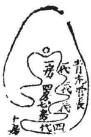</td><td rowspan=1 colspan=1></td><td rowspan=1 colspan=1>青龙管长房，四七十房同占；白虎管幼房，三六九房同占。此泛语耳。若断祸福，须分管各房，年代吉凶亦然。举二图式，可以类推。中房论明堂案对，亦有远近，分管二五八房之异。大抵君子择地，求安吾亲，公位置之勿问可也。分管者，如长房以第一重青龙论之，四房以第二重青龙论之。若第一重好而第二重不好，则第一房吉，第四房不吉。他仿此推。其说亦多不验，君子勿泥。</td></tr></table>

## 龙虎吉类①

<table><tr><td>龙虎降伏</td><td>龙虎比和</td><td>龙虎逊让</td></tr><tr><td></td><td></td><td></td></tr></table>

以上三格皆主一门和义，富贵平康，兄友弟恭，妻贤子孝。

<table><tr><td>龙虎排衙</td><td>龙虎带印</td><td>龙虎带牙刀</td><td>龙虎带笏印</td><td>龙虎带剑</td></tr><tr><td></td><td>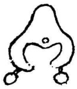</td><td></td><td></td><td></td></tr></table>

以上五格皆主贵，有威权，能文能武。

<table><tr><td rowspan=1 colspan=1>龙虎交会</td><td rowspan=1 colspan=1>龙虎开</td></tr><tr><td rowspan=1 colspan=1></td><td rowspan=1 colspan=1></td></tr><tr><td rowspan=1 colspan=1>此一格主易发财禄，富贵悠久，至吉。</td><td rowspan=1 colspan=1>主贵而有威权，傲物轩昂，眼空海宇。</td></tr></table>

上龙虎吉格，不能尽述，姑举十者以为式。彼龙虎之降伏者，低降俯伏，弯抱有情也。比和者，左右均匀，不强不弱也。逊让者，或前或后，而不相斗竟也。吴公云：“龙降虎伏，义门和睦，子孝妻贤，身膺五福。”范越凤云：“龙虎两纯和，才子定登科。”卜氏云：“虎让龙，龙逊虎，只要比和。”杨公云：“饶龙让虎君臣足，下了令人增福禄。堂上资财似涌泉，积谷堆金无数目。”故此三格皆主一门和义，富贵平康，兄爱弟恭，妻贤子孝也。第四格龙虎排牙者，两畔重迭，如官贵升堂，而役卒执杖排衙也。范氏云：“龙虎两排衙，富贵播京华。”亦须交互而不使元辰水直去为吉。第五格龙虎带印者，左右皆有墩埠也。吴国师云：“左右双垂金弹子，七岁神童通经史。不但文章四海传，更有威权振人主。”第六格龙虎带牙刀者，两畔拖尖利也。范氏云：“龙畔牙刀出，身著绯袍笏；虎带牙刀形，为将统千兵。”第七格龙虎带印笏者，一畔圆墩，一畔直埠也。董氏云：“印笏如生龙虎身，才子英雄压万人。”第八格龙虎仗剑者，直而尖也。吴国师云：“龙虎仗剑剑头尖，自由斩砍掌兵权。”徐国公祖地合此格，详见砂法卷图。自排衙至此五格，皆主贵有威权，能文能武也。此五格有似带曜，但曜则联属不断，此则断而复续为异耳。第九格龙虎交会者，左右绕抱过宫也。吴公云：“龙虎相交抱过宫，赀财易发永丰隆。”故此格主易发财禄，而富贵悠久也。第十格龙虎开睁者，两畔开展落肩，然后抱掬弯曲也。睁即肱也。《礼》曰：“并坐不横肱，恐防左右。”相地亦似相人，今开睁，亦如人之横肱，祇见其轩昂骄傲耳，故此格主贵而立威，傲物轻人，有昂昂之态也。

## 龙格凶类①

<table><tr><td rowspan=1 colspan=1>龙虎相斗</td><td rowspan=1 colspan=1>龙虎相争</td><td rowspan=1 colspan=1>龙虎相射</td><td rowspan=1 colspan=1>龙虎飞走</td><td rowspan=1 colspan=1>龙虎推车</td></tr><tr><td rowspan=1 colspan=1></td><td rowspan=1 colspan=1></td><td rowspan=1 colspan=1>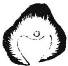</td><td rowspan=1 colspan=1>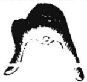</td><td rowspan=1 colspan=1></td></tr><tr><td rowspan=1 colspan=1>两边高昂相对，主兄弟不和。</td><td rowspan=1 colspan=1>主兄弟争财失义及目疾。</td><td rowspan=1 colspan=1>主兄弟相杀为军配。</td><td rowspan=1 colspan=1>主父南子北，兄东弟西，夫妇生离。</td><td rowspan=1 colspan=1>主退尽田产。</td></tr><tr><td rowspan=1 colspan=1>龙虎折臂</td><td rowspan=1 colspan=1>龙虎反背</td><td rowspan=1 colspan=1>龙虎短缩</td><td rowspan=1 colspan=1>龙虎顺水</td><td rowspan=1 colspan=1>龙虎交路</td></tr><tr><td rowspan=1 colspan=1>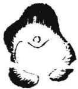</td><td rowspan=1 colspan=1>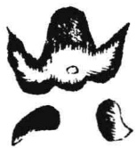</td><td rowspan=1 colspan=1>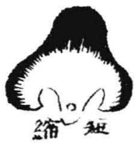</td><td rowspan=1 colspan=1></td><td rowspan=1 colspan=1>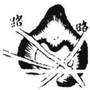</td></tr><tr><td rowspan=1 colspan=1>主残疾绝嗣。</td><td rowspan=1 colspan=1>主妻逆子拗，兄弟不和。</td><td rowspan=1 colspan=1>主孤寡伶仃，贫寒无倚。</td><td rowspan=1 colspan=1>主卖尽田庐，离乡绝嗣。</td><td rowspan=1 colspan=1>主自缢牢狱，风跛疾厄。</td></tr></table>

右龙虎凶格，亦不止此，姑举十者以为式。第一格龙虎相斗，《驻马扬鞭》云：“两宫齐到，人皆道好，必主杀伤，却生烦恼。”盖齐到无相让之情，有抗敌之势，故主兄弟不和。若元辰水直流，外面无关，又主因不和而退败。卜氏云：“两宫齐到，忌当面之倾流。”第二格龙虎相争，乃当龙虎之中适有墩埠，而龙虎二山齐止于墩埠左右，有相争之状，故主兄弟争财失义。此格吉地亦多有之，宜于葬法内避之，则无此患。否则，不但不义，亦主男女目疾，及抱养堕胎等患。第三格龙虎相射，乃左右尖

利相对也，主遭徒刑。谢氏云：“龙虎两尖射，世代主徒刑。”第四格龙虎分飞，乃左右两山不相弯抱，而各分走向外也。范氏云：“龙虎两分飞，父子各东西。”第五格龙虎推车，乃左右两臂直长，如人以手推车也。何氏云：“龙虎手推车，田地不留些。”第六格龙虎折臂，乃左右断凹，如人两臂折断也。范氏云：“龙虎两腰低，风吹受孤栖。”第七格龙虎反背，乃左右两臂逆向后去，无情抱穴也。董氏云：“龙虎追奔向背弯，忤逆儿孙要打娘。”第八格龙虎短缩，乃护胎不过也。卜氏云：“龙虎护胎不过穴，谓之漏胎，主孤寡贫寒。”第九格龙虎顺水，乃左右二山随水顺飞也，主退尽田产。范氏云：“龙山随水出，便是卖田笔；虎山随水长，便是杀人枪。”第十格龙虎交路，主有自缢枷锁之患。卜氏云“臂上怕行交路”是也。已上龙虎吉凶诸格，皆左右之山相同者也。复有龙凶虎吉、虎凶龙吉，左右不同诸格，详图于下，宜细察之。

## 青龙凶格①

  
白虎反此同推，不复具图。

## 总论朝案二山

夫曰朝曰案，皆穴前之山，本自有辨，不可紊而为一也。盖其近而小者称案，远而高者称朝。谓之案者，如贵人据案处分政令之义；谓之朝者，即宾主相对抗礼之义。故案山近小，而朝山高远也。凡地贵于近案远朝两备。有近案则穴前收拾周密，无元辰直长、明堂旷阔、气不融聚之患，于以知其结作之真；有远朝则有配对，有证应，开豁光明，势局宏大，无逼窄促窒之虞，于以知其气象之广。故远朝、近案俱全，则内外堂局具备，三阳六建皆明，而为地之至美者也。又有一等吉地，不见朝山，却不可图贪远秀而失穴。吴公云：“坐下若无真气脉，面前空有万重山。”又云：“坐下无

龙，朝对成空。”只要龙穴真，虽无朝山，亦为大地，不必尽拘。或云：“一重案外见青天，后代少绵延。”予见多有美地一重案者，福祉悠久，不足深泥。却未见有无案山而结地者。即无近案，亦要左右龙虎砂相交固，关聚内气，此则如同有案。若无低小近案，砂又不交，面前空旷，堂气不聚，必无融结。时师贪其宽堂远秀，指为大地，最能惑人。此近秀远朝有无真伪之当辨者也。大抵案山宜近，朝山宜远。《龙子经》云：“伸手摸著案，税钱千万贯。”言案之近也。张子微云：“或从百里数百里，忽起朝迎间邑城。”言朝之远也。近案宜低，远朝宜高。范氏云：“远朝不怕冲天，近案尤嫌过脑。”且近案贵于有情。卜氏云：“外耸千重，不若眠弓一案。”又曰：“多是爱远大而嫌近小，谁知就近是而贪远非。”远朝贵于秀丽。赖氏云：“远峰列笋天涯青，文与韩柳争高名。”蔡文节公云“天涯目断凝苍色，不以形亲见丑容。”此朝案远近高低等诀之所当辨者，宜审之哉。

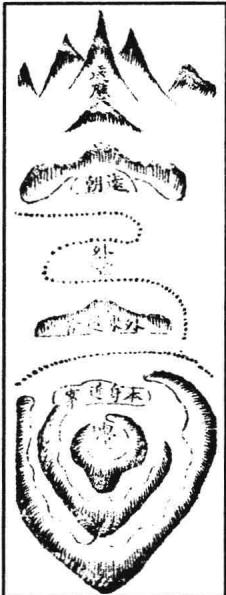

## 论案山

凡穴前低小之山，名曰案山。如贵人据案之义。其山宜低小，或如玉几、如横琴、如弓眠、如带横、如倒笏、如按剑、如席帽、如蛾眉、如三台、如官担、如天马、如龟蛇、如旌节、如书台、如金箱、如玉印、如笔架、如书筒等物，而横遮外阳朝对山之脚者是也。也不必拘其合于形像，但以端正、圆巧、秀媚、光彩、平正、齐整、回抱有情为吉；顺水、飞走、或向穴尖射、及臃肿、粗大、破碎、巉岩、丑恶、走窜、反背无情为凶。或是外来之山，或是本身之山，皆宜逆水，谓之溯水案。《经》云：“吉地应有溯流案，有案且须生本干。弯环曲抱向穴前，诸山藉此为护捍。”然虽贵其有近案，却不可太近，而有逼窒之势，主出人顽冥昏浊，不可训诱。杨公云：“案山逼迫人凶顽。”又不可使之突兀当前，如窒胸塞心之状、流尸停棺之形，及丑石巉岩可畏之象。且远近之说，亦不必太拘。惟是穴前第一重低小之山，或平冈、田畲、高洲、小埠，皆是砂案，只要有情耳。

## 本身案山

此本身山生来，横在穴前，收关元辰之水而为案者，极吉。吴公《快捷方式》云：“本身连臂一山，横在面前有情，不远不高不低，不斜走麓恶反背，却于此外又见外阳秀峰，或尖圆方正，而此山遮却外山筋脚，极为吉地。”又须逆水为美。杨公云：“吉地应有溯流案。”其或顺水而绕抱过宫者亦吉。或顺水而外面却又有逆砂以拦截之，则尤吉。大抵无问逆顺，只要弯抱有情，开面向穴者为吉。若直奔、走窜、反面无情及形破碎、尖射、欹斜、臃肿、断头、丑恶、崩洪、带石、巉岩、欺压、雄逼等形则凶矣。

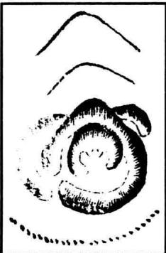

<table><tr><td rowspan=1 colspan=1>外来案山</td><td rowspan=1 colspan=1>又式</td><td rowspan=1 colspan=1>外案重秀图</td></tr><tr><td rowspan=1 colspan=1>vO)</td><td rowspan=1 colspan=1>AD)</td><td rowspan=1 colspan=1>EO</td></tr></table>

此外山为案，低小当前，亦能关收内堂元辰之气，不使荡然无关，故亦谓之吉案。其形象不必拘，只要有情，不飞走、丑恶、尖射为美。逆水生来为上，顺水远抱过穴，不斜走亦吉。此山之外又见外阳秀丽之山，献奇列秀，一重高一重，乃为美也。

## 论朝山

二二六

夫朝山者，朝对之山也。欲其有情于我，如宾之见主，臣之见君，子之奉父，妻之从夫。登穴而望，端然特立，异于众山，天然朝拱，不待推择，乃真朝也。《经》云：“惟有朝山真有情，将相公侯立可断。”又云：“真龙藏幸穴难寻，惟有朝山识幸心。”是盖既有生成之龙穴，必有自然之朝应，所谓“门内有君子，门外君子至”。刘氏云：“若有龙穴，而无特秀之朝案，乃是鬼龙虚结，决非真穴。纵有十分融结，亦福力小。”《赋》云：“毋友不如己者，当求特异之朝山。”然朝对之山，亦有数格，不可不察。有特朝山，有横朝山，有伪朝山。以迢递远来，两水夹送，拜伏而至者，谓之特朝，此格为上。有此朝山，融结必真。廖氏云：“当面推来名曰朝，不怕远迢迢。”杨公云：“当面推来始是真。”又云：“朝山与龙一般远，共祖同宗来作伴。”又云“客山千里来作朝，朝到面前为近案”是也。横朝者，横开帐幕，有情面穴。或两边如排衙唱喏之状。杨公云：“亦有横列为朝者，若是横朝似衙喏。前山横过脚分枝，枝上作朝首先下。首下作绛或尖圆，双双来朝列我前。大作排班小衙列，如鱼骈头蚕比肩。”吴公云：“朝山本自爱特来，横案为朝亦可裁。首起应峰身拜伏，消详对面有龙回。”伪朝者，纵有尖峰秀丽，却大势直去无情，而下无拜伏之山，上非正应之意。杨公云：“朝山亦自有真假，若是真时直来也；若是假时山不来，徒爱尖圆巧如画；若有真朝水入怀，不必尖圆如龙马。但要低昂起伏来，不爱尖倾直去者。直去名曰坠朝山，虽有尖圆也是闲。譬如贵人侧面立，与我情意不相关。”又云：“案山如玉插青天，当面推来始是真。侧面成峰身直去，与我无情似有情。时师见此多求穴，下了哪知误杀人。”是故须察朝山之真情，不可遽以尖圆秀丽之峰峦，便为朝山之吉。然亦有无朝山而向水者。《八段锦》云：“有案不须朝水，水朝无案贵多。”朱桃仙云：“有案须端正，无山要水朝。”吴公云：“有山向山，无山向水。水有真情，自当大贵。”杨公云：“也有真龙无朝山，只看诸水聚其间。”至于朝山形象，亦不必拘。大抵欲其端正秀丽，或尖、或圆、或方、或平，皆须光彩妩媚，忌其破碎、巉岩、峻嶒、丑恶、欹斜、走窜、反背、凸窟、尖射、臃肿、麓雄、崩赤、枯瘦、无情。刘氏谓：“朝案之吉者，秀特在前，屏幛在后，或平帐在前，秀特远拱。尖似卓笔，圆似顿笏，方如几案，横似诰辅。

或五星俱会，三台列拱，悬钟顿鼓，列阵排班。对面朝拱者为吉，而山冈撩乱，恶石巉岩，山脚尖射，形体破碎，势如飞奔，顺流而去，势如尸卧，对穴如欹者为凶。世俗乃有拘执形象，先以龙穴定作某形，必欲朝案合得其形为应。如金钗形用妆台、粉盒为案，虎形肉堆为案之类，先辈已皆力议其非，不必深泥。予尝谓山川自开辟以来，形定不能变易，物类大小、长短、方圆、贵贱，随时不同。故席帽贱于唐而贵于宋，金鱼、玉鱼佩于前代，而我皇朝不用。其它百物，不可殚举。要之，皆非定法，何可拘执?智者勿泥。其于朝山所

主富贵，则《囊金》谓尖圆秀丽者主文章荣达，方正肥满者主子孙巨富。吴国师谓方而秀者主王侯宰辅，位极人臣，尖而秀者主文章荣显，圆而肥满者主巨富小贵。固皆有理。但砂如美女，贵贱从夫，非朝应之山所可必，又当先察龙穴为准也。

## 论平原无朝案

或问曰：廖氏云：“第一尤嫌无案山，衣食必艰难。”地固以有案山朝对为吉，但平原旷野，弥望无山者，是无朝案，此地恐不可用矣。答曰：平原之穴，只取平原为案，高一寸为山。或田中草坪，或水界田岸，但微高者皆是朝案。详而观之，皆有吉凶，又何必泥于山峰之朝案哉！且山谷中亦有一等贵地无朝山者，却必有近案低小之山，以关内气。廖氏之言，特为无案而发者，故地不可无案。观物祝公曰：“数十里外远朝山，渺渺茫茫旷野间，近案又无堂气散，千重青秀也空闲。”梁箬溪曰：“左右周回似有情，来龙落穴亦分明。水长无案明堂旷，下后儿孙家计倾。”其朝山之有无，不甚为轻重也！

## 论不见外阳

或问：地有全不见外阳朝秀者，此地亦有大贵力量否？答曰：亦先审龙。若龙短者，多是山脚漏落，局又窒塞，决无大贵力量。如是大龙结穴，却多有从山重迭包裹，故不见外阳。只要龙真穴美，外阳何足论哉！世人误认大地，正坐此弊。盖地之大小，由龙之力量。若不原龙穴，一概只贪砂水，必为假地所误。诚以大堂局，山势罗列，诸峰献秀，如三千粉黛、八百烟花，起人眼目，昧者眩焉。不知此等山水，多结省郡州县阳基。廖金精所谓“帝都山水必大聚，中聚为城市，阴穴宜居小聚中。”故阴穴多是收敛完固，四势周密，而不在于大堂局、远秀峰之为美也。乌可以局大便为地大，其不见外洋朝秀者，遂谓其无大贵力量乎？予所见名墓，如朱文公母地，在建阳寒泉岭，穴前一山逼近，不见外洋。文公子在、孙鉴，皆官侍郎，曾孙浚，尚理宗公主。至今徽州、建宁两地，世袭博士。近其子孙于左扦一穴，出一进士，名凌，号龙冈，官湖广佥宪；右扦一穴，出二乡科。又蔡西山先生自卜寿藏，乃大龙结穴山谷中。左山当前，尽幛外洋，一切不见。其孙文肃公杭拜相，后嗣蕃衍。及廖公下乐平许学士地，董公下婺源倪御史祖地，又京山李方伯祖地，台州陈会元、王侍郎，杭州胡尚书诸祖地，其格也，图下。文公母地、许学士祖地，俱见水法卷。倪氏地见穴法卷。

右地在建阳，地名翠岚山。其龙起自西山，开幛出身，奔行雄伟，重重渡峡，至翁田复大断，自青苗中过脉而起，又开幛成卷帘殿试之格，复列三台，正脉中落，逶迤细嫩，势若生蛇。两畔重迭抱卫，入首太阴金星结穴，穴挂左角。右畔拖曜。只是穴低，而逆关一臂太近且高，当前为案，无开畅明堂，不见外阳。外重下山又短缩，内水斜流，似倾泻。以俗眼论，龙虎、明堂、朝对，若无一可取，反似穷源僻坞。不知大龙奔行数十里，于此融结。而溪水环绕，拦截包转，龙将焉往？穴结拥从之中，极其周密，所谓藏风聚气者也。虽不见外洋，不害其贵也。噫！非西山先生之明见，孰能识此？

京山李方伯祖也

右地在京山早市，地名班提马口。其龙来历甚远，不详述。姑自少祖大月山言之，连起星峰落平冈，重重开帐度峡，逶迤奔行数十里。比入局，开大帐，帐中抽出嫩条。又连穿田束气，入首，结平中之突，突面安穴。前吐毡唇，左右重重包裹。下关一山，逆水拦过穴前，开正面向穴，成一字文星贵格。内局紧固，外洋宽畅，大溪环绕，湖水暗朝，得水藏风，真吉地也。系九渊公自卜。葬后，其孙五华公淑登进士，官至方伯，封君南台。公寿考八十五。孙翼轩公（维桢）、会轩（维极）、介轩（维朴）、德轩（维

标）、用轩（维楫）诸公，父子兄弟连登科甲，入翰苑，司文衡，富贵方全。

左地在台州府城北，土名后岭。其龙与府龙共祖，自括苍、天姥，历仙居、天台三四百里，不及详述。将近城十里之间，分脉右落，实乃府龙之送从龙也。起高大山峰，迭迭如帐。帐中抽出一脉，逶迤奇巧，走马串珠咸备。又自本龙右帐随生一枝，一般高大。而此龙借左边府龙之山为用，却又是包在中间，顿跌牵连，伏落低平，直出数百丈。而结穴横于腰，乃以府龙过峡之星为文星正案，清奇特异。本身右手不转，而府龙开帐之背，却自缠过右手之后有情，逆大江而作门户。府前望海诸峰，迭在水口，皆为得力。但穴前无余气，又在低平之中，四山高耸，面前迫窄，亦无文笔，不见外洋。本身下手直去，不人俗眼，呼作飞剑出匣形。葬铺静陈公，人丁大旺，出进士、会元、会魁、乡荐，衣冠数十人，理学一人，即恭愍公。迨今富贵未艾，乡传系遇头仙下。左地在杭州府治东北二十五里，土名星亭山。其龙自平田顿起高大峰峦开帐，帐中开脉分枝，迢递数里，自相从聚环抱。双龙双虎，中垂一乳，水木之星落穴，倚过右边。乾龙入首，作戌山辰向，形如风吹罗带。内气藏聚，明堂内外交锁，不见外洋。葬后出端愍公世宁，登进士，官至太子太保、兵部尚书，赠少保。子曰纯，官太守。

绘 图 地 理 人 子 须 知杭州胡尚書祖地

近穴一案橫捌不見外洋山水

右地在莆田县西南二十里官路上。其龙与府龙分结，自三紫山分脉，磅礴绵亘，顿伏雄俊。比入首，开大帐，帐中抽出正脉，垂头结穴。左右弯抱，重重包裹。当面右臂横拦，以作近案，关聚内气。外洋暗拱，溪水环绕，系尚书简肃公良永敕葬之地。以俗观之，右山顺水，内堂逼狭，不见外洋。下手宽远，造亭以补之，亦作法之善也。不知龙气旺处，局多紧固。外洋不见何害焉?方氏葬后，科甲联登，人才迭出，富贵寿考。赡厓公攸绩官山东左方伯，福祉绵延未艾。

左地在临海县东北十里，土名双桥。其龙自府龙分出，顿起冲天木星，一连四座，奇秀非常。两边护从，重重迭迭，逞奇列秀，数十里外大缠大绕。本身一脉清俊，入首星辰尊贵，成太阳金星，开窝正净，融结精巧。当穴前吐一唇，铺下平田数十丈，仍突起圆山如蛾眉，以作正应。穴前八字水交于左边，绕从右去。而右砂隐隐，逆抱过前。倒流百步，转卯。出口处有龟蛇捍门，屈曲流入丁方。丁上文笔插天，穴中不见。出邓公，登庚戍进士，官都谏，升光禄卿，人丁大旺，田连阡陌，一门鼎盛。

## 论朝山暗拱

或问地理书谓“明朝不如暗拱”，此说何如？答曰：真龙结作，其力量大者，虽数百里之外，犹为用神。如朱子论冀都地，谓江南五岭诸山乃是第四五重案。其间相去数千里，安得而见？只是论地先要识大势，然后可以语此。若小龙小穴，亦欲指远外山水以为朝拱，则非也。盖必有百里来龙，方有百里局势；千里来龙，方有千里照应。各随龙穴力量何如。尝见今人论地，不察龙穴力量，一概贪远秀，慕大局，凡案外水口各处，有奇峰秀水，则指为暗拱。及见有凶山恶水，则又谓穴间不见无害。噫！何其谬耶！既吉者为暗拱，其凶者岂非暗杀乎？此不识根本，徒论枝叶者耳。苟龙穴真贵，则其凶恶形状虽列于前而见之且不足畏；龙穴不真，虽奇峰插天，秀水特朝，亦为无益。况其不见者？杨公云：“砂如美女，贵贱从夫；水似精兵，进退由将。”卜氏云：“本主微贱，文笔变为画笔；龙穴特秀，杀刀化作牙刀。”此不易之论也。然又贵于活变，圆机心悟，不可执一。固有穴间不见，奇妙暗拱于外，而其应亦在于外者。或女贵，或离乡而贵，或贵在外家，皆是也。且如建阳书林阳基，四面奇峰周回罗列，秀入云表。及至入穴，则麓山迫塞拱夹而已，面前之奇砂皆列于外，斜走不止。此乃秀气发扬于外，而内则窒暗卑污，故其间亦蔑有显者，虽多丰富，而俗不尚礼。然文藉乃由此出，远播天下，是亦外秀之应也。

《葬书》云：“若怀万宝而宴息，若具万赡而洁齐。”又云：“若宝而有也。”《黑囊经》云：“前砂欲其堆了堆。”《雪心赋》有“三千粉黛”、“八百胭花”之说，是皆言前砂以重迭为贵。诚如所论，不几于太乱杂乎？夫前朝之砂固贵其重重迭迭，献奇列秀。然峰峦太多，乱杂混浊，可以向此，可以向彼，则情意不专，乌得为吉？《赋》云：“尖峰秀出，只消一峰两峰。”则确论也。吴公《口诀》云：“三峰对中，两峰对空。”其慎重如此。如乐平县徐附马祖地，前峙双峰。先是，一明师同其徒见之曰：“此地当出国婚之贵。”其徒遂为徐氏私下之，不识向空，而偏向一峰。师复过之，讶曰：“误矣！”乃索其课，题曰：“好对空兮却对峰，他年莫道地无功。为官必定因妻贵，意正浓时却中风。”后徐氏果两尚公主，骄横不检，廷臣劾之取首级。可见两峰尚有对空之不可误，况峰峦之乱杂者乎？故龙虎山张真人阳基，前对琵琶山，旧名枪刀山，虽耸拔森立，如锯齿排列，然以太多而不得为文笔，乃符笔矣。其富贵自两汉相传至今，悠久不替，乃其龙穴之美，非前砂之所能主也。虽然，却又不可拘执。若前峰环列，献奇逞秀，又多为大贵龙穴之应。只要中间有一二峰特异，取为正对，如金鸡县状元吴伯宗公阳基在新田者，前朝七十二峰，果出七十二人科第。然七十二峰岂非多乎？只是中有双峰特异，以为正对①。又兰溪县范氏祖地，前对九峰，有九子登科之贵，是其应也。故凡峰峦混杂者，必须中有一二峰挺然独异，天然朝拱，不待推择。而余山排列，皆面面有情，拥从左右，乃至贵之格也，又不可以乱杂论。惟欲其去穴稍远为吉。盖众峰罗列，若太近穴，终觉乱浊。稍远则自然清奇秀丽。何也？秀峰虽秀，近而视之亦丑；丑峰虽丑，远而视之亦秀，故尔。大抵朝山虽欲其列秀献奇，又不可徒

贪其秀，致有失穴之患。故曰：“坐下若无真气脉，面前空有万重山。”又曰：“坐下无龙，朝对成空。”尤当致察于龙穴，而不可徒以朝秀为爱耳。予尝谓世人都只爱尖峰，不知地理重真龙。龙若不真穴不的，朝堪图画总成空。盖亦崇本抑末之意。

龙虎山图见阳基卷。

新田吴氏阳基图见阳基图。

右地在乐平县金山乡。其龙穴俱美，惜乎立向少差，减福如此。盖立向既差，则内之乘气分金，外之砂水向背皆相戾矣。所谓差之毫厘，谬以千里，岂不信夫。

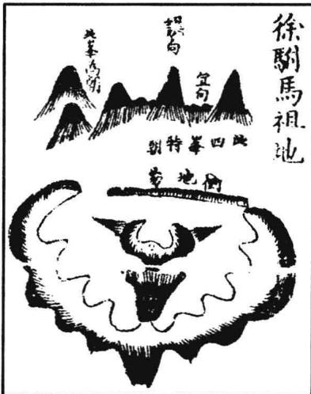

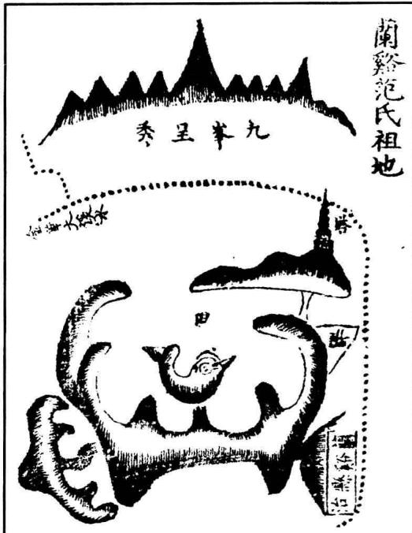

左地在兰溪县东一里许，乃县龙之分结者。分后顿起展诰土星，为贴身帐。自帐中正脉抽出，侧落一边，开口成窝穴之格。内堂团聚，外洋开畅，金华府河水横抱，绕带左右。龙虎均匀奇巧，近案逆水弯抱有情。外面九峰，插天特秀。范氏葬后，一父生十子，九登科。其一未第者，是为香溪先生浚，笃志道学，世称大儒，故今俗传十子九登科云。

## 论孤峰独秀

或问：朝案乱杂之说，固已闻命。然一山朝拱者，又有谓孤峰独秀而不吉，何也？答曰：此说是论龙身，非论朝砂也。盖龙法

忌孤峰独秀，恐其单寒。所谓龙怕孤单，而贵有盖送护从者是也。朝砂则欲其耸秀。苟有一峰挺然独异，秀入云表，乃极贵之格，砂法中谓之文笔插天。若坐下龙穴真的，主理学大儒、神童状元之贵，又何忌夫一峰之独秀乎？尝见朱文公、王荆公之祖地，罗一峰公阳宅也，皆是一峰特秀，岂可谓孤峰独秀而不吉？或曰：诚如所论，则《雪心赋》内“文笔孤单”之说非与?曰：《雪心赋》后人更换本文处极多。尝考董德彰所注本作“文笔欹斜”，颇为有理。盖《赋》既有文笔孤单之忌，又何复云“尖峰秀出，只消一峰两峰”？岂应自相矛盾如此？其不足信明矣。且龙穴真贵，虽朝峰欹斜，亦不为大害，但稍减力而已。尝观宁都县尚书董文僖公祖坟顿钟形在县之地名璜坊者，前峰欹侧，其课云：“可惜状元峰不正，他年亦作探花郎。”果出文僖公越，登成化已丑科探花，官至礼部尚书。可见地之美恶在龙穴，而不在于前朝之峰。故虽欹斜亦且出贵，而何孤峰独秀之足忌哉！

## 卷五之二

## 论前应后照

穴前案外之山，谓之前应；穴后玄武顶背之山，谓之后照。亦曰前照后盖，即前朝后坐之山也。谢氏谓之前亲后倚；陈氏谓之在后者为宝殿，在前者为龙楼；卜氏谓前帐后屏；刘氏谓特秀在前，屏幛在后；郑氏谓“群峰独秀矗矗于其前，迭帐献奇层层于其后。”皆指此也。周东楼谓前应即第二重案山，及三重五重皆是。要尖如笔，卓如笏，方如诰轴，重高一重，如衬锦然，皆端正美好者是也。后照即福储峰，乃祖山在结顶之后，或两臂之外，尊贵高大，矗矗然托护于玄武，如宝座，如御屏，如帏帐、帘幕者是也。若回龙、脱龙、横龙之穴，不得祖宗为照山，亦须外山之尊贵高大者在后托护之，使玄武枕以为照，而不陷于空亡可也。有等怪穴，翻身逆势，坐空以当朝水者，又有坐后有深潭融注，或水缠绕合襟者，皆不以此拘也。其前应之山，若得有近案山可关内堂，则外虽无应山，不害其为吉地。卜氏云“外耸千重，不若眠弓一案”是也。杨公以向前空阔无朝应为人劫。若当面有水阳朝，或有低近之砂横抱，则不忌。故曰：“人劫当从向上求，面前空阔要远朝①。有水特来砂横抱，信知人劫小为妖。”大抵前应后照山俱全而重迭者，尤为上吉。二者较之，后照尤紧。万物负阴而抱阳，故穴后不可以无屏障以蔽背风。其坐后高山，亦谓之天柱峰。卜氏云：“天柱高而寿彭祖。”亦谓之福储峰。赵缘督云：“后座重重高照，百福攸集。”故有此山，则主福寿双全，康宁百顺，人丁蕃衍，富贵攸久。如承天曾司空始祖地在彭泽者，其前应后照重迭齐整，故司空乔梓，高寿厚福，夫妇齐眉。诸孙蕃衍，四世同堂，满门朱紫，百福咸集，是其格也。又徐国公始祖地在丰城者，亦以后枕帝座，盖照有力，前应齐全而吉。二图并具下。

右地在彭泽九都，土名桥亭。其龙来自鸣水山，远不详述。至计家岭，顿起御屏为少祖。栖闪数节，横列大帐，中峰独耸福储。又数节入首，列三台。中台推出正体太阳金星，开口结穴。穴间平坦，左右包裹重迭，取作莲花形花心穴。穴下余气铺毡，明堂融聚，近案顺水拜伏，为谢恩领诰。外洋诸峰，如挂榜，如天马、文笔、席帽，种种罗列，前应后照齐全。水口狮象捍门，流神绕青龙，缠玄武，诸吉咸备，真美地也。元至正间，曾氏葬宝二公。公四子，伯永一，居桥亭；仲曰永二，居柳树下；叔曰永三，居小岭。今皆富盛。季曰永四公，以武功从太祖高皇帝肃清江汉，定藉安陆②。再传百户公，三传万户公，延及于今，世袭千户。知县公逊，岁荐。今金堂赠太保、尚书。赠员外公辉，以孙贵，赠太保、尚书。七代阳白公璠，登进士，官陕西少参。致仕，进阶中宪大夫，累封太保、工部尚书。罗泉公秉，岁荐，授光禄署丞。八代确庵公省吾，登进士，累官太保、大司空，衣蟒束玉，世代皆一品恩荣。廪生速庵省吾、可庵宗吾，及九代诸孙，人文济济，福祉未艾云。

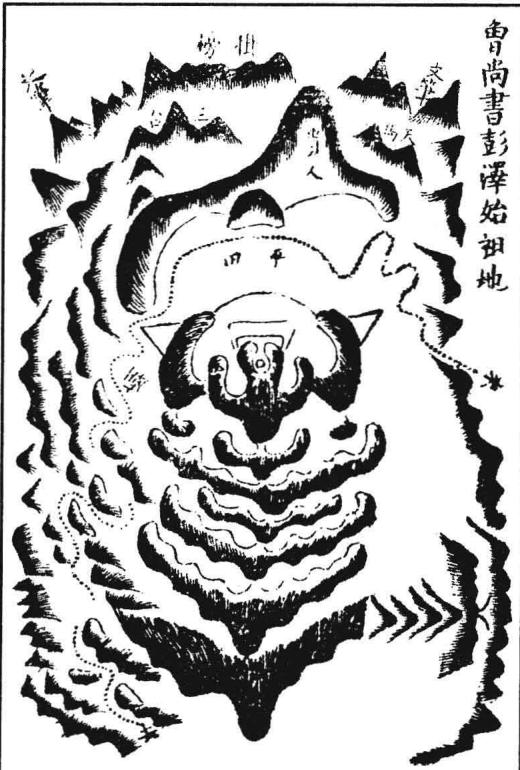

按：是地也，龙势雄猛，武星结穴，力量全，故主世袭簪缨。天柱高，福储厚，故主享遐龄，备百福。前沙顺水拜伏，故离乡显贵。余气多，故人丁衍，运祚永。

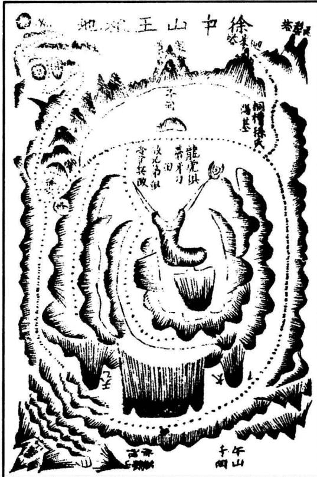

左地在丰城，土名桐槽。其龙自罗山入临川境，转至桐槽，系省龙分结，迢递而来。将入局，横列大帐，左右天乙、太乙中耸，帝座秀异清奇。正脉从帝座中逶迤而下，复开九脑芙蓉帐。帐中顿起大贵人，耸立特异，节节上格贵龙。复大断，霞帔过脉，隐隐三台挂角而下，撒落平坡，开口结穴。到头丑怪，穴似散漫，龙虎带剑，似乎分飞不顾，俗见无不惊骇。殊不知大龙干地，曜气发露，贵秀全在于此，但不利初年耳。徐氏宋建炎四年葬后，果不利，从戌迁濠州，生王，为我皇朝开国元勋，朝班庙享，皆居第一，封魏国公，进中山王，三代追封王爵。女为文孝皇后。次子永昌，复以成祖推功，封定国公，南北两京，世袭公爵，俱掌兵政。诸勋贵莫与比论。旧有记云：“桐槽人地，猎猎塌塌。火脚金头，却似牛轭。帝座后

殿，贵人前席。日月捍门，龙虎持戟。有人葬著，王侯两国。百年已后，富贵方得。  
若问发迹，先须江北。

按：是地也，龙分省城正干，穴枕帝座，故力量大。日月捍门，故王侯之尊。穴怪①，堂气顺，故发越迟。龙虎俱带贵曜，兄弟皆掌兵权。曜飞杨，局逐水，故离乡而贵。虽然，徐氏之贵地尤多，未必全在此穴。但其钳记若是，其验亦神矣哉！

[传疑]晋郭景纯至丰城，改扦邑治。见此水口有日月捍门二阜，讶曰：“此内有至尊地乎？”随察之，曰：“日月反位，非至尊，不过王侯地耳。”遂私作记而去。观其神验如此，信非景纯不能。

## 论左辅右弼

左辅右弼者，龙穴贵证也。在穴之左右特起两山，夹耳对峙者，尤为紧切。要夹照登对，不相参差为美。又要高低、大小、远近相等，方为合格。或圆耸如太阴太阳，谓之日月夹照；或卓立如顿笔展旗，谓之文武侍卫；或方平延褒，谓之列幛列屏；或围绕盘旋而包裹，或高峙秀拔而拱夹，或重重迭迭，如禁卫两班；或济济森森，如影从万卒。此皆左辅右弼，侍卫之砂之至贵者也。其在后龙之左右者，谓之天以太乙；其在过峡之左右者，谓之天角天弧；其在前朝之左右者，谓之金吾执法；其在明堂之左右者，谓之天关地轴；其在水口之左右者，谓之华表捍门。一皆辅弼推类之易名也。其或边有边无，边多边少，边高边低，边大边小，则不合此格，贵又差轻矣。

## 论天门地户

天门地户，亦名三门五户。在法天门欲其开阔，地户欲其闭密。卜氏云：“垣局虽贵，三门逼窄不须观。形穴虽奇，五户不关何足取。”又云：“所贵者五户闭藏，所忌者三门紧窄。”盖穴之左右，不问青龙白虎，但水来一边谓之天门，水去一边谓之地户。赵缘督云：“水从左来流右去，左边为天门，右边为地户；水从右来流左去，右边为天门，左边为地户。不拘青龙白虎，但水来一边要开阔宽畅，山明水秀，水去一边，要高帐紧密，闭塞重迭，不见水去为吉。合此则结作真，力量大，发福速，运祚远。若天门当开而反闭塞，地户当闭而反宽旷，乃是山水不相交会，此处决无真龙结作，不必寻索穴场也。”世俗有误执白虎不宜高昂，而不察水之来去者，是未获真诀，而以白虎为真虎耳。殊不知青龙白虎，乃术家假借此名，以称左右之砂而已。只要收水一边山势强盛有力，收得水住，使气便融聚。董氏德彰谓“下砂收尽源头水，儿孙买尽世间田”是也①。既曰下手砂，又何可拘青龙白虎？且极大之地，秉生杀权，为都邑省郡者，右砂强胜。如京师之西山，南畿之鸡笼、石头城，福建之虎头，江西之西山，浙江之西湖诸山，莫不皆然。此又以右胜为威武之权耳。第寻常小可之地，又不可以此为法也。

## 论罗城垣局

罗城垣局，即前朝后托相连于周围者也。要重重迭迭，高耸周回，层层级级，盘旋围绕，补缺帐空，如城之有女墙垛者，故曰罗城。又如天文三垣星象，各有围垣之星以卫帝座，故又谓之垣局。垣局者，即罗城也。卜氏云：“纷纷拱卫紫微垣，尊居帝座；重重包裹红连瓣，穴在花心。”又曰：“山外山稠迭，补缺幛空。”又曰：“华表捍门居水口，楼台鼓角列罗城。”赖氏曰“四神八将应位起”，杨氏曰“外山百里作罗城”，皆善言垣局之情状者也。大抵欲其宽大周圆，不知水从何出。朱子曰：“拱揖环抱无空缺处，宛然自一乾坤。”乃罗城之上吉也。

## 卷五之三

## 论乐山①

乐山者，穴后乐托之山，正应穴场而盖托者是也。撞背来龙结穴，及穴星起顶者，皆不论乐。惟是横龙穴，及凹脑、侧脑、没骨等穴，必要乐山贴身盖应，方为真穴。廖氏云：“横龙结穴必要鬼，乐山宜后峙。”吴公云：“担凹攀鞍要乐山，切须贴背应穴场。”故乐山为枕穴之砂，不可不审。然乐有三格，曰特乐、曰借乐、曰虚乐。特乐者，远远特来，挺然贴穴；借乐者，虽非特来，而横帐贴穴，不令空旷；虚乐者，既非特来，又不横绕，而低陷躲闪，散乱远旷，枕穴不著者也。特乐为上，借乐为次，虚乐不可用矣。其于形象，皆不必拘。惟以端然卓立，高阔帐护，不令空缺为吉。且乐星亦不拘定是本身山，只客山亦可。若得乐下之水流到穴前，最为至贵。又穴上回头便见乐山，或明堂中见者最吉。皆须贴背，不宜远旷。

<table><tr><td rowspan=1 colspan=1>特乐图</td><td rowspan=1 colspan=1>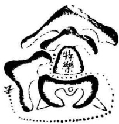</td><td rowspan=1 colspan=1>此远山特来，挺然贴穴应乐者，至吉，主骤发富贵，大旺人丁，康宁长寿。</td></tr><tr><td rowspan=1 colspan=1>借乐图</td><td rowspan=1 colspan=1></td><td rowspan=1 colspan=1>此横幛贴穴，不空缺，正乐应，亦有力，是吉地真穴，福祉于特乐。</td></tr><tr><td rowspan=1 colspan=1>虚乐图</td><td rowspan=1 colspan=1></td><td rowspan=1 colspan=1>此穴后空虚，无正乐，虽有小山，偏旁低闪，不枕穴场，是凶地假地。</td></tr></table>

右地在浮梁县北乡，金探花公达葬父地也。其龙甚远。将作穴，开帐中落出脉，连起数节文星，落下平坡，成卢鞭袅、落地梅花之格。两畔小埠夹从，正脉中行，垒垒复起文星，跌断结咽，入首结天才凹脑之穴。后乐贴背，撑顿有力。前面堆堆迭迭，奇峰朝拱。明堂湖田融注，下关抱卫有情，曜气坛褥，证应明白。系艮龙入首，扦已丙相①，卯水朝入。以攀鞍穴后乐撑贴，取作跃马赴敌形，屯军案，真特乐有力，催官之格也。嘉靖辛丑年卜葬，后六年丙午，公乃发魁。又十年丙辰，会元及第。今富贵方隆。

<table><tr><td>特樂格 浮梁金探花父地 4 类器 广联料 子</td><td>廣曰何氏父子尚書名地 # 傘御 掛屏風 大 溪 兴</td><td>曾 紹 六 公 地 陈玉 下 养 尺 僊 鸽 第事 龜 条</td></tr></table>

右地在广昌县西一里，土名桃竹坑。系县龙分结。分后五峰中出，逶迤顿伏。将入穴，乃束气起天财土星，横脉结穴。穴完又起星峰，踊跃以去。立穴处似过脉状。只是后有御屏特乐，撑贴有力，证得情真。穴前一字文星及蛾眉为案。案外奇峰献秀，下关逆抱包裹。前铺官星，大河绕带，局势完密，真贵地也。吏部公文渊父以疫卒洪武丙寅，抬柩至此遇雨，遂葬，今乡称天葬地。公时方半岁，乙丑生，后登永乐戊寅进士，累官至吏部尚书。子乔新，官至刑部尚书，谥敏肃。玄孙曰源，进士；曰涛，元解；曰沆，解元。子曰孔阳，诸公连登科甲，富贵方隆。

右在邑北一里，土名郑冲元，乃县龙分结。自分脉后，过分水岭峡，顿起丫山，开大帐，仙桥出脉，走弄数十节。入局顿起飞蛾鹤腾翼格，中垂嫩脉，落平坡，为太阴转面开窝。窝间微乳，两畔微钳，穴情甚巧。前吐坦毡，左右盘缠，龟蛇捧抱，横脉落穴。后乐一峰，挺然特耸，取作仙人跨鹤形。明堂、朝对、下关、水口皆美，董德彰先生下，课云：“鹤腾亥脉出仙桥，卯向分明艮水朝。一峰西兑撑天柱，两峰辰巽贴云霄。左右龟蛇盘足下，面前丹诏列功曹。人间富贵浑闲事，定有天书诏誉髦。”

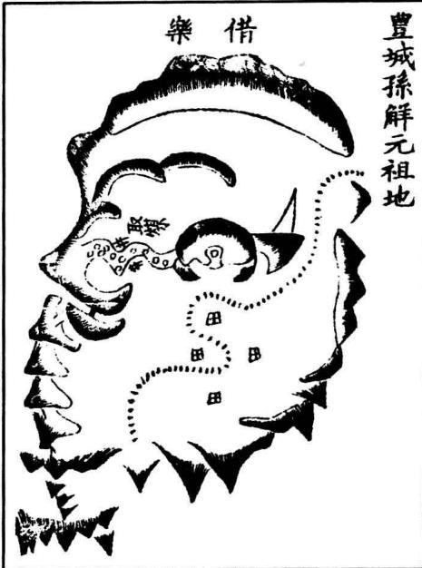

左地在丰城长安之蟹坑。其龙起孤山作祖，行数十里来，踊跃奔腾，磊磊落落。将入局，顿起九脑芙蓉大帐。帐中落脉，大断过峡，重迭迎送。复起飞蛾，中出一脉，走弄成卢鞭三袅贵格。结咽入首，为平面太阴文星开窝之穴。横脉结作，借乐立穴。喜有后山高帐，乐托有力，正应其穴，所以为吉。且左右龙虎均匀，当面天马双峰正案，田源潮水聚堂，下关水口交固，真可称贵地。葬后孙氏溥发解①，兄弟联登科甲。惜乎来龙山上挖取煤炭，伤泄龙气，故未可云尽美也。

上乐砂姑出此三格，辨其真伪，以定取舍耳。其有左乐、右乐、中乐、长乐、高乐、低乐等格，则详于乐山证穴之下，兹不重及也。

## 论下手砂

不问西南东北，但去水一边谓之下手，又曰下臂，又曰下关。诀云：“有地无地，先看下臂。”又云：“看地有何难，先观下手山。”又云：“未看后龙来不来，且看下关紧不紧；未看结穴稳不稳，且看下关回不回。”此等语虽浅近俗俚，然至理本不外是。盖下手砂最关紧切。有下关则结作，无下关则无结作。下关重迭，结作愈大；下关空旷，则不须寻地。吴公《地理件目》云：“凡青龙白虎既浑全，美好布法，不问左右，定要下手一山兜乘得上手山过，方是吉地。假如穴前水流倒左，则左为下手，要左臂一山逆水，长于右山，兜住右边山水。若穴前水流归右，则右为下手，要右臂一山逆水，长过左山，兜住左边山水；如此谓之逆关，乃为吉地，主发财禄。若下手短缩，兜上手山水不过，其它好处皆不得力，乃是假穴，不可下也。”按：《件目》此论，诚为有理。且逆水下关，谓之财砂，最能发财。杨公云：“惟有下手救得人，世代不教贫。”廖氏云：“问君如何富，下山来相辏。问君如何贫，下山顺水奔。”董德彰云：“下砂收尽源头水，儿孙买尽世间田。”万万山《何知歌》云“何知人家富了富，下臂重重来抱顾；何知人家贫了贫，下关空旷不朝坟”是也。大抵逆水砂不虚生。凡见一山迢迢弯曲，逆兜上手水者，便宜寻索龙穴，决有结作。愚尝谓“有山逆水不虚生，定为真龙作股肱。盘桓收截源头势，宜于此处觅佳城。”亦指下关言耳，学者审之。

<table><tr><td rowspan=1 colspan=1>青龙逆关</td><td rowspan=1 colspan=1>……</td><td rowspan=1 colspan=1>此青龙长，兜乘得上手山水过，乃是吉地。</td><td rowspan=1 colspan=1>白虎逆关</td><td rowspan=1 colspan=1></td><td rowspan=1 colspan=1>此白虎长，兜乘得上手水过，乃是吉地。</td></tr><tr><td rowspan=1 colspan=1>白虎顺关</td><td rowspan=1 colspan=1></td><td rowspan=1 colspan=1>此青龙短，兜乘上手山水不过，乃是凶地。</td><td rowspan=1 colspan=1>青龙顺关</td><td rowspan=1 colspan=1></td><td rowspan=1 colspan=1>此白虎短，兜乘上手山水不过，乃是凶地。</td></tr></table>

若有大河，不可只论小水，又须以大河水论顺逆。大抵有一重水，必要一重砂收之。如小水倒左，大河水倒右，却要近穴左山先长，以收小水，然后外重又得右山长，兜收大河之水，方为合法。蔡牧堂云：“顺逆二途，如盲如瞽，似非灼然有见，鲜不以逆为顺，以顺为逆。”是故要知山川之大势，黙定于数里之外，而后能知顺逆于咫尺微芒之间。否则黑白混淆，以逆为顺，以顺为逆者多矣。

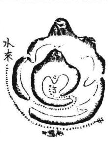

此小水倒归右，大河水倒归左。近穴虎山先长，以收小水。外重龙山又长，以收大河之水，为合格，是美地。

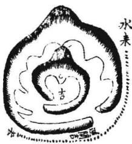

此小水倒归左，大河水倒归右。近穴龙山先长，以收小水，外重虎山又长，以收大河之水，为合格，是美地。

凡下关砂，又须审其有力无力。若徒有下关而不近穴，或低小，或短缩，或顺水不回，谓之无力，虽多无益。若其山高障，回护顾穴有力，虽只一重，或只十数步，亦能结作。逆砂一尺可致富。又云“不要千山并万陇，一山有情亦足用”是也。然此特甚言下砂逆水之不虚生者，其实一山有情，与夫数步逆砂，纵有融结，不过裁剪小穴，张山食水而已。若论大地，须合诸山众水观之，非一山之所能结也。

已上所论下手砂法，以逆关为吉，顺关为凶，此乃地之常格。却又有等大富贵地，多是顺关顺缠而吉者，惟要大势是逆局则美。盖逆局要顺缠，顺局要逆缠，此亦阴阳交会自然之理。予兄弟所见甚多，如信州于知府祖地，上手高曲，下手短缩。泉州庄氏地，上砂顺窜，下臂空旷，皆吉，乃其格也。

左地在广信，土名新潭。亥龙巽向，俗呼寒牛出栏形。其龙逆水奔上，将入首，起飞蛾落脉，逶迤如生蛇。顿起金水天财穴，后有孝顺鬼。龙虎护穴，如牛角弯抱。肘外则直长无情，元辰长。而外山上首高出，下手空旷为异耳。盖元辰虽长，前有湖水聚注；龙虎山内弯外直，却穴间不见飞走。且肘外直长，乃曜气也。上山高大，乃青龙起库。下虽空旷，乃系逆局，大河水绕。卜氏云“水缠便是山缠”也。所贵者穴后乐山特特，衬贴有力，证得穴场明白。葬后即出阆山公，名洪，登正德辛已进士，官太守，巨富，福祉未艾。

绘 图 地 理 人 须 知

左地在晋江县南二十里。其龙甚远不尽述。姑自少祖言之。罗裳山涨天水星，千丝坠格。帐中抽出一脉，逶迤清巧，金水迭迭，起伏精俊，骨脉秀异。连断过峡，有小墩埠金弹子夹脉。两边缠护，重重包送。至八石山，结庄氏阳基。众山从簇，乃复起水星帐。帐中出脉，金水磊落，十数级间，精神顿异。仍起迭帐，偏落右边，入首结穴。而左山高耸，外重紫帽诸山插天。右即大海汪洋，一望无际，惟姑山如天马浮于海波之心。登穴见前面府城，东西二塔如卓笔左右，而清凉三台正照。大洋、小洋、凤山诸秀又皆逞奇列异，莫不快目。但结穴偏侧，左山太重，右边风扫，青龙顺窜，不入俗眼。不知水缠便是山缠。且水之深处，即山之高处。郭氏曰“得水为上”，故为吉地。葬后，

出琦公，乡荐，晋阳知县；壬春，进士，节推；一俊，进士，少参；用宾，进士，佥 宪；国桢，进士，现任布政；壬凡、思宽、履丰俱进士，现在；望栋、履朋俱乡荐。 人文济济，福祉未艾。长房、中房皆离乡出贵，今漳福兴庄氏是也。惟少房守祖，人 丁富盛。若时俗之见，必以右臂风扫，小房不利为嫌，孰知水胜于山之妙哉！

又二地，其一乃下手短缩，上手高出。其一乃上砂顺窜，下臂空旷，皆吉。又有一等翻身逆势，全无下关而吉者。廖氏云“坐空转面去当潮，不怕八风摇”是也。又有顺水砂，顺关门，又有上砂高逼，下砂空旷而吉者。

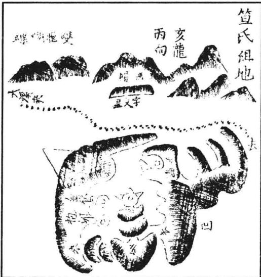  
是地在吾邑，土名港口。龙旺穴尊，龙虎降伏，明堂平坦，而左畔一山顺水拖下，乃是顺关门。李养素下，课云：“子午之秋步蟾宫而折丹桂，丑未之春登虎榜而宴琼林。”葬后，果出二贵，嘉靖壬子、戊午秋榜，乙丑进士，福祉未艾。

右地在浙江常山县，地名三冈。龙势

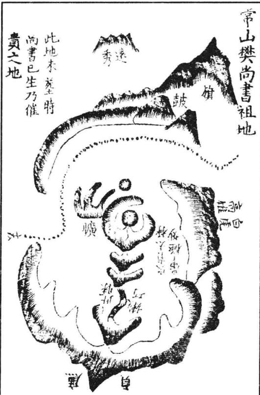

甚雄，入局复起廉贞少祖，中落一脉，脱下平冈，为眠体华盖，一节结咽成金星突穴。四围圆晕太极甚巧。但左山低小，右畔高雄，水自右流左，下关反弱为异。然龙穴既贵，右山虽高，主威武之权。左山虽低，本身一臂贴近有力。兼以穴暖，且大河绕抱，水口拦截，虽低不忌。葬后出清简公莹，登进士，官至刑部尚书。

已上所论顺关，及无下手砂等地，皆须逆局有水特朝方可，切要龙真穴的。若察龙穴不真，不若守其常格，以下山有力为主，犹为节制之兵，虽不大胜，亦不大败。若妄意图大，不拘下砂，为害不浅，戒之慎之。

## 论水口砂

水口砂者，水流去处两岸之山也。切不可空缺，令水直出，必欲其山周密稠迭，交节关锁，狭而塞，高而拱，或两边相结，如犬牙交错，如群鹅相钻。或峙立高峰，岩崖峭立；或水中异石，挺然中立，如印如笏，如兽如禽，如龟如蛇，如鱼如笋；或左右高山对峙，如狮象、旗鼓；或排列如布阵屯兵；或横嶂如列仓贮囷；或填塞如宝殿龙楼：或把截如武夫之干城；或簇集如将兵之拱卫，或磊磊如车马阗骈，或森森如剑戟竖立，重重迭迭，不计其数，迢递迂回，至于数十里者，则为水口砂之至美也。若更有捍门、华表、罗星、北辰、游鱼等砂，尤为至贵。吴公《快捷方式》云：“凡一乡一村，必有一源水。水去处谓之水口，若有高峰大山交牙关锁，重迭周密，不见水去，即其中便可寻地。若更有异石，带头带尾，逆水朝入，其中必有大贵之地。”《撼龙经》云：“到处先看水口山，水口交牙内局宽。便向宽容平处觅，左右周旋无空间。”《砂经》云：“第一看山相地法，先看水口狭。”陶公云：“水口无关，漫说当年富贵；天外有钥，乃知积代公候。”《入式歌》云：“水口一山如虎卧，回头不许众山过。高昂截断水难流，此物名为神仙座。”卜氏云：“水口则爱其紧如葫卢喉。”范越凤云：“水口之山，欲高而大，拱而塞。”又云：“若有石山朝入于内，如铜鱼金龟、悬钟顿鼓，随水生上，关锁重迭，不知去处尤佳。”杨公云：“捍门水口尖峰起，圆峰北辰位。坐镇城门不见流，富贵保千秋。”《坤鉴歌》云：“水口不嫌关锁密，千重万迭总奇关。罗城铁阵并华表，宝殿龙楼是强。”皆论水口砂之形势妙旨也。又须察其情形何如。若其大情顺水下奔，而无回头顾内之意，亦不足取。欲其情意顾内，步步回头，横截逆转，而山脚只只向内逆插，则其情意皆真。刘氏云：“若向面朝入，如相君堂署，大将屯兵，节节把守，无阶可进。小官卑将，拱手而立。若是有此情意形势，关锁水口，斯为至贵，其内必有大富大贵阴地阳基。诚以水口为一方门户，若关锁周密，则此方旺气不泄，龙神融聚，故愈多愈好。《龙经》云：“关门若有十重锁，定有王侯居比间。”若其山不周密，或山势走窜，或一节低一节，一重远一重，一山小一山，即是水口旷阔无关，此方旺气便随流水飘散，而龙神与之俱往，岂复能结富贵之地？纵有龙穴，亦发福不久。非惟阴地不美，而此方居民亦必贫困消条，多庄佃佣奴，而无名门右族、富贵之家、豪杰之士矣。故曰“水口之砂最关利害”。其水口间有大桥、林木、佛祠、神庙，亦关祸福。或水冲损桥梁，或伐木毁庙，则凶祸之来不可救助，尤宜慎

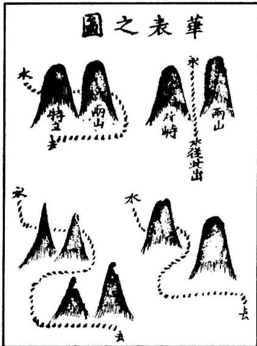

之。若或水口罗星诸砂被水冲破，或忽崩裂，则此方凶败立应。如迭有奇石高洲忽然露出，则此方富贵骤至，皆应如桴鼓。智者见之，可以预验休咎。廖氏云：“若还水打破罗星，官败举无名。忽然水口洲滩出，士荐官迁秩。”水口之所系如此也。

## 华表山

华表者，水口间有奇峰挺然卓立，或两山对峙，水从中出，或横拦高填，窒塞水中者，皆是也。要高耸天表，方称华表之名。水口有此，于内必有大地。《赋》云：“华表捍门居水口，楼台鼓角列罗城。

右捍門第三格乃橫水出口之際左右有山如門對峙而水從中去者也虬格亦貴

右擇門第二格乃穴前左右有山如門對峙而水從中出者也此格亦主大貴但要外陽育水特朝大河當面橫逸內堂關闌龍虎交會方好否則元辰太是未為

格二第門捍

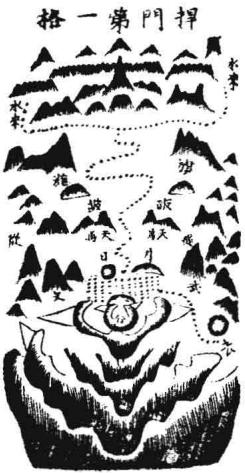

右捍門第格乃穴前左古有山如門對峙而放出外陽山水朝入者也此格極貴主大貴公侯郡王台輔皇后貴妃神仙神童扶元

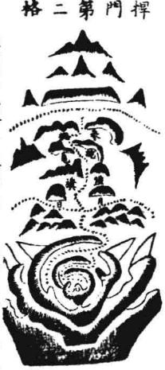

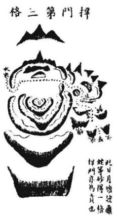

## 北辰

北辰者，水口间巉岩石山，耸身数仞，形状怪异，当于中流，挺然朝入者是也。亦谓之尊星。此格极贵，千不逢一，非王侯大地，未易有此。杨公云：“一个北辰管万兵，驸马公侯招讨名。高大峥嵘耸云汉，必是争天夺国人。”又曰：“北辰之星天中尊，上将下相列分明。此星乾坤镇国宝，隐藏闭口莫胡陈。”许仙曰：“却有一样北辰星，形若真兮贵莫论。北辰高大出万乘，若然低小也朝臣。”曾公云：“山家最贵北辰星，水口高岩大石蹲。见此便知极贵地，必出争雄逞猛人。”吴公云：“水口交罗生怪石，大小高低论重轻。高大名为北辰位，必产英雄不敢闻。百丈石山高耸起，此名大兽北辰星。水口若见北辰镇，巨石涌起胆寒惊。此星若还关水口，必主皇王镇国人。”又云：“水中石山侵上天，拥起嵯峨压众山。代代武文人过府，英雄猛烈万人看。水中圆墩有石印，若还低陷也昌荣。大山粗昂是北辰，定产男儿统万兵。”《禁星论》曰：“筠松禁星禁何星?余星不禁禁北辰。至尊之星所当禁，恐君泄漏害君身。”又曰：“大地

重刊人子须知资孝地理心学统宗卷五

二四六

龙神朝暮守，不许凡人乱开口。劝君遇著北辰星，禁口禁眼宜谨守。”盖水口北辰极贵，上者多为禁穴之应，不可轻谈；中者王侯宰辅、皇亲国戚，斩杀自由，非寻常小贵之地而能有此。《太华经》亦谓北辰星居溪中、水口，或旁应左右，皆为大贵，若非州郡邑镇，即出英雄豪杰之士，惊天动地之人。故凡水口罗城之间，如见有此，其中必有大贵之地，宜于其内寻索龙穴。或难予曰：北辰者，即北极天之枢星。孔子所谓“居其所而众星拱之”者也。此星至尊至贵，而乃为门户间把守关隘之职，何也？答曰：此固术家取义欠当，然亦不过假借美名以称特异之砂耳。如天乙、太乙、太阳、太阴之名，亦皆尊贵星辰，而术家乃以太乙、天乙侍立左右，太阳、太阴夹照峡场。日月捍门，考其所取，莫不皆为贵地证验。若以循名求义较之，则此等贵星，安可使为侍卫，为夹从，为把守关隘之职？故此不过假借美名耳。其实无有所谓日月、北辰、天乙、太乙以临之也。义固弗当，但袭之既久，不可改称，今姑从之。

吴公《口诀》云：“北辰是石山嵯峨，雄昂高插，峭壁岩崖突兀奇怪，生耳，生角，生嘴，如将军，如判官，如小鬼，如卧龙，如麒麟，如狮象，如海螺，如飞凤，如仙鹤，如猛虎，如展旗，如堆甲，如凉伞，如走旗，如锯齿，如枪刀，如幡带，如排符，如笔架，挺然拔耸万仞，巍峨屹立，堆迭于水口之间。望之而神惊，就之而心怖，崚嶒峻险、怪异巉岩者是也。若非有诸般古怪形状，则不可谓之北辰。”此星极贵，上格贵龙方有此应，亦不拘多寡，但得一二亦为大贵。须居水口为真，若穴上见之反为不吉。

## 罗 星

夫罗星者，水口关拦之中，有堆埠特起，或石或土，于平中突然当于门户之间，四面水绕者是也。石者为上，土者次之，要居罗城之外为贵。《经》云：“罗星要在罗城外，若是罗星不在内。居内名为抱养瘰，又为患眼堕胎山。罗星若在罗城口，城口皆为玉笋班。”然此虽居关口城外，又须有山抱阑，乃为有力。《经》云：“水中重重生异石，定有罗星当水立。罗星外面有山关，上生下生细寻觅。”然亦有真伪，尤宜详审。《经》云：“盖缘罗星有真假，真假天然非人力。真是罗星有首尾，首逆上流尾拖水。”又云：“欲识罗星真妙诀，一边枕水一边田。田中有骨脉相连，或为顽石焦土坚。此是罗星有余气，卓立为星在水边。”盖罗星在天为火之余曜，故又称曰火罗，所以有顽石焦土。然其龙神亦必多有火星。《经》云：“火星龙始有罗星”。其形则以尖圆方正端扁为美。《经》云：“贪巨罗星方与尖，辅弼武曲圆扁眠。禄存廉贞多碎破，破军尖破最堪嫌。只有尖圆方扁星，此是罗星得正形。忽然四面皆是水，两山环合郁然青。”看罗星之法，有此数诀，不可不识。大抵见有罗星，又合法度，其内必有大富贵地。盖缘罗星乃是证佐，决不虚生矣！若其数多尤妙。然非极贵龙穴不能多也。诀云“一个罗星抵万山”，况其多乎？

已上所论华表、捍门、北辰、罗星，皆水口至贵之砂，得一亦为富贵龙穴之应。

但水口之砂，亦不止此。如所谓金马门、游鱼洲、赦文星、牛羊坠、百万仓、万石困、合旗、顿鼓、车马、战纛等砂，皆为吉地之应，兹不备及。盖贵人门下多车马，富人门下多质库。故水中之砂，亦各以类相从也。大抵水中之砂，雄强高峻、嵯峨峻嶒、不生手脚枝叶、怪石巉岩、望之可畏者方为真水口砂。如大贵人，必是大将帅，或雄悍武夫，披坚执锐，把守关隘，出入之人，必须盘诘，方得往来，岂容寻常直进直出？故水口砂必是丑陋凶恶星辰把截。《经》云：“莫道廉禄无好处，大为将相公侯门。”是言有公侯将相之地，必用他作门户也。又云：“禄存无禄只为关，破军不破只为拦。关阑之山作水口，必有罗星在水间。”是言既有关阑二山异于寻常，则必有罗星在水中，或落河火星为禽为曜，以为应证。此皆天造地设，自然符契之理。且水口关阑，不特阴地阳宅而已，凡天下大垣局、京机、省城以及州郡，莫不皆有大关阑、大罗星，特形势宽大，规模宏远，未易察识。《经》云：“大河之山有砥柱，四川之口生滟滪。大孤小孤彭蠡前，采石金山作门户。”又云：“大河碣石至海穷，海外诸峰补垣局。更有焦山罗刹石，虽是罗星门不固。此是大寻罗星法，识者便知愚未悟。”又云：“请君看此州县关，何处不生水口山？水口关阑皆破禄，无脚交牙如迭环。或为横山如卧虎，或作重重如瓜瓠。禹凿龙门透大河，便是当时关水处。太行走出河中府，河北河南关两所。大河北来曲射东，西山在水如眠龙。马耳山枕大江口，绝无脚手为神庙。灵壁山来截淮河，更无一脚如横过。海门之山锁两浙，两山相合如环玦。文廉生脚锁缁流，横在水中为两截。大关大锁数十重，定有罗星横截气。截住江河不许流，关内不知多少地。小罗小锁及小关，一州一县须有阑。十阑十锁百十里，定有王侯居此间。乡落罗星小关锁，枕水如戈石横卧。但看无脚是关阑，重数多少分将佐。君如能识水口山，便识天戈并禄破。”①观此则知水口关阑、罗星等砂，虽有大小不同，其实皆一理耳。

## 卷五之四

## 官鬼总论

此卷专论官鬼、禽曜。夫所谓官鬼、禽曜者，乃真穴前后左右发出余气之山。在前者曰官星，在后者曰鬼星，在龙虎外左右者曰曜星，在明堂左右及水口间曰禽星，亦曰明曜，皆为富贵龙穴之证也。傅文懿公立《四灵歌》云：“禽曜星与官鬼，都是好龙生秀气。穴前穴后龙虎旁，有此定为公相地。”卜氏云：“要识前官后鬼，方知结实虚花。”又云：“禽星兽星居水口，身处翰林。”又云：“生曜主官，王谢之名可望。”此官鬼禽曜之所以不可无也。著其要于下。

## 论官星

官星者，龙虎横抱，穴外背后有山拖向前去者也。子微云：“试问如何是官星？本命山前更有山。”此乃龙旺，秀气融结包会不尽，故又发为官星也。龙之贵气重大者，官星亦必重大；龙之贵气轻小者，官星亦必轻小。所谓大小，非论形体，乃气脉之力量也。名为官星，有吉无凶。但恐龙穴不真，纵有官星亦为无益。子微云：“大凡官星无凶恶，只恐似官非是官。”官星在横山龙虎外，故多不见。亦有见者，谓之现世官、

现面官。《经》云：“官星在前多不见，见者名为现世官。”若龙穴真，主当代贵。大抵官星虽有吉无凶，亦必龙穴真则吉。否则皆凶。且不必拘其形象，而为繁锁之论云。如京山王氏伯珍公地，官星格也，图下。

左地在京山，土名接官厅新堰弯。其龙系县龙分干，来历甚远，不及详述。将入局，开帐重重，大断起尖山，为廉贞火星。生出土星，土又生出金星，是为大月山。又自月山下连穿三峡过田，如抛毬，如走马，如梭带线，如珠牵丝，龙气旺盛，枝脚蕃衍，护从周密。正脉中出，为太阴星，串脉吐出微乳结穴。穴情甚秀，两掬弯抱，宽畅有情。内堂融聚，外洋平衍。而右臂复大转包裹，为玉带砂，横绕穴前。其余气复当面抽出，发为官曜，去三十余里。两畔枝脚回抱重迭，关顾有力，真贵地也。只是官星去远，此穴结于龙腰之间，山势未止，孰识为此等大地？葬后出希且公，登进士，官佥宪。曰桥，进士，官方伯；曰格，进士，官少卿。方伯之子宗茂，进士，官侍御。今又池公宗载登进士，累官都宪；曰宗彦、宗蓁、宗楚、大本、大有，曰阶诸公，连登科甲，人才迭出，富贵未艾。

按：是地余气去长，此图不收余气篇内，直以官星取者，以去山在虎砂外，对穴穿田而去，是官星格耳。但穴左山势太短，似与右气不均。然既铺毡作王氏阳基，又溢为灵泉于基前，则其气以泉发，与右等也。此造化隐微，须详审精察，未易入俗眼耳。

[传奇]王氏基前有灵泉，每虹气现，则王氏有发科甲者，屡验。王氏诸公号虹塘、虹泉、瑞地，咸取此耳。隆庆戊辰，虹现，王氏无会试者，人以为不验。既而，是科翼轩李公维祯登第入翰林应之。盖李公乃侍御虹塘公宗茂婿也。

重刊人子须知資孝地理心学统宗卷五

右地在南昌，土名马鞍溪。其龙起自帐幕岭，正脉穿田至朱坊，横开平岗大帐。帐中出脉，迢递二十余里。将入首，又大断过峡，起三台，垂乳开窝结穴。前吐余毡，后拖鬼撑。第青龙直硬窜堂，下关低陷，不入俗眼。不知回龙顾祖，骨肉一家，青龙虽窜，是为明曜。又拖官星，适足为贵证。葬后，诸公季清进士，子肃进士，伯跃侍郎，伯秀副宪，廷重进士，廷梅副宪，廷悰、廷膏、廷宝、廷楫俱乡科。仕贤进士，仕阶进士，仕慎、仕松、仕泰俱乡科。曰睿，进士，御史；曰材，布政；曰桂，进士；曰樟、曰淑、曰场、一龙、一鹏、一壙俱乡科，封

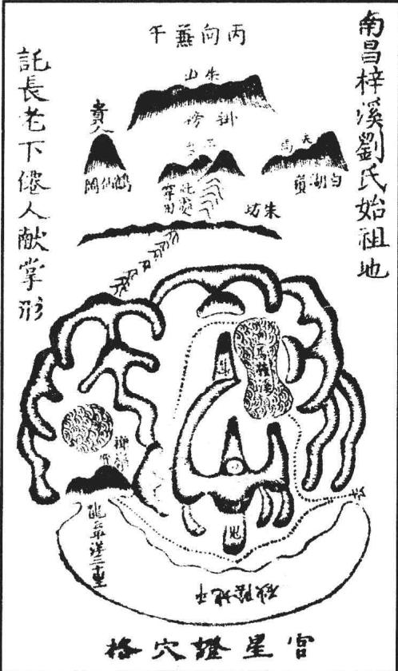

荫应例，衣冠百余人，人丁大旺，富贵鼎盛未艾。

二四九

## 论鬼星

鬼星者，穴后拖撑之山，枕乐穴场者也。杨公云：“问君如何谓之鬼，鬼在后头撑者是。”盖撞背来龙结穴则无鬼。惟是横龙结穴，必须有鬼星撑在穴后，方证得穴之真实。廖氏谓“横龙结穴必须鬼”者是也。以其在穴后分泄本身之气，故取义于窃，而名之曰鬼。吴香山云：“鬼于地理中不在屈指①，亦不在星辰之例。凡论地理，只看来龙入穴，左右龙虎，朱雀前砂，及山水大情交会与不交会，四维八峙缺折与不缺折，鬼置之不论可也。但穴有偏斜处，却有借鬼为证者。”此说最善。盖鬼不必于有为吉，亦不必于无为凶，特以偏斜之穴，须用鬼证耳。如此则鬼何关于地之大小轻重耶？前辈亦有言：“鬼者，诡也。奇异变幻，不可尽信，岂有专取的于鬼？亦有有鬼不可当穴者，又宜于穴法通变，不可尽泥于鬼。”又云：“鬼者，诡也。诡异奇怪之穴，须用鬼证之。观鬼之脉，知穴之情。”又曰：“鬼是漏窃真龙之气，大地必无鬼。”又曰：“大地真龙，气盛而旺，故有鬼山或去数里。”又曰：“鬼夺我气，不宜高大。”又曰“屏帐鬼星高大，使相纷纭”之说不一，要之，至理必以龙穴为主。龙穴贵秀，则鬼为吉；龙穴假伪，则鬼为凶。譬犹世有鬼祟，若人气盛旺，家道兴隆，则鬼献祯祥，反为兆福；若人气萎，家道复替，则鬼出妖怪，能为我祸。取义一同，全以龙气为主，而后论鬼。龙穴不真，生气散漫，则鬼为祸贼矣。若徒以鬼星形状决贵贱祸福，而不论龙穴之根本，则失之矣。且鬼星亦惟可以理尽，不可以形拘。只欲其光彩浑厚、秀丽尊重、中方中圆、或直或横、或双或三，重重弯抱，贴卫本身，不散漫奔窜，不丑恶可嫌，则得其妙，奚必琐琐论其形状，至百二十之多哉！今以横、直、双、边、高、长、短数格具图为式，触类而长之。

左地在婺源县，土名大田寺，乃诸汪始祖愿公墓也。其龙势甚长，不及详述。入首平冈，结穴精巧。龙虎弯抱，余气悠衍。明堂平广，内气融聚，外洋宽畅。但结穴处龙脉未尽，横受之穴。正当穴后，一脉穿田，顿起鬼星，横枕抱卫有力，证得穴星尊贵，此所以为美地也。葬后鼎盛，出科甲数十人，尚书亦数人。若中丞、侍御、方面郡邑守佐，难以悉举。至今子孙蕃衍，富贵齐美。虽汪氏诸派佳地尤多，此其发源，钟秀为最云。

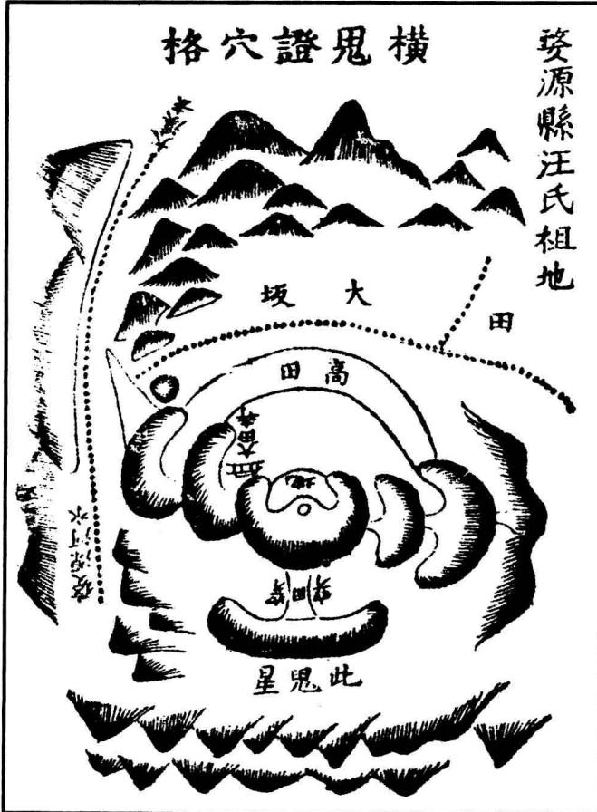

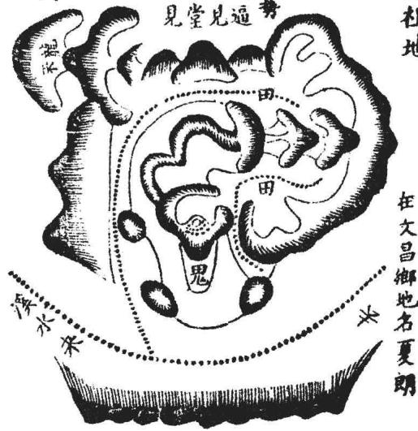  
豐城縣雷尚書祖地

右地在吉水县文昌乡，土名夏郎，状元刘文介公俨祖地也。其龙来脉甚远，不详述。入局开大帐，连穿数峡，走闪翻身，转盘屈曲，为芦鞭格。入首顿起金星开钳，中垂小乳，乳下平坦，穴结乳头。两掬弯抱有情，内堂紧聚，外洋开畅，前朝秀丽，后障高耸。坐枕鬼星，直撑有力。大溪后缠，四从稠迭，水口交锁。葬后出鼎实公，登进士，官副宪。曰庸性，发高科。文介公俨，正统壬戌状元，官至少卿，赠礼部左侍郎。又尝观其凤形，亦美地也。今福祉未艾。

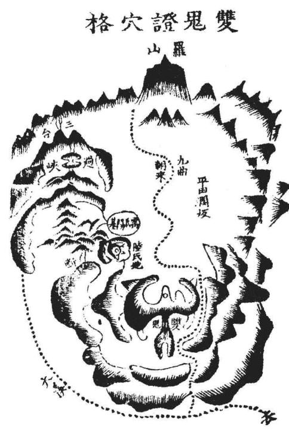

右地在丰城，土名雷坊，俗呼象形。其龙起自小山地名二台，作祖垂正脉，过峡穿田，复起星峰，横列入帐。脉自帐中垂落，逶迤一绵，活动搂闪，复起山，迢递数十节，将入局，又大断过峡，顿起横帐，结姻束气，起双脑星辰。担凹中垂一乳，结穴为双金扛水之格，系横龙入首，后有夜丫双鬼贴身，证穴有力，再有屏乐高障，而穴前两臂掬抱，均匀可爱，当面流神，九曲来朝，诸峰献奇列秀，真贵地也。雷氏葬后，出古和公礼，登进士，官至少傅、工部尚书，蟒衣玉带。从姪曰达，登进士，官至方伯，迄今富贵未艾。

右地在邑西三里，地名湖墠，其龙分天门山大龙之右脉，抽出嫩条，磊落逶迤数里，下平岗，入首为倒地油尺，水星结曲睁穴，穴星低平，左右顿立高山，后有魏坡，丫峰高帐，前有诸山朝揖，大溪环绕，小水缠身，亦福龙格也。近无龙虎，下关似旷，颇难察认。只是穴后拖有长鬼，带墩如拳①也。系艮龙，百步入首，扦丙向。叶氏始祖迪功郎墓，自宋迄今，人丁大旺，多出儒官，间有科第，人多文雅，为礼让之族。嘉靖庚子，坟忽陷，有气如雾出者，竟日亟修葺之，而举族遭回禄之灾。足征数百年犹关福荫未替云②。

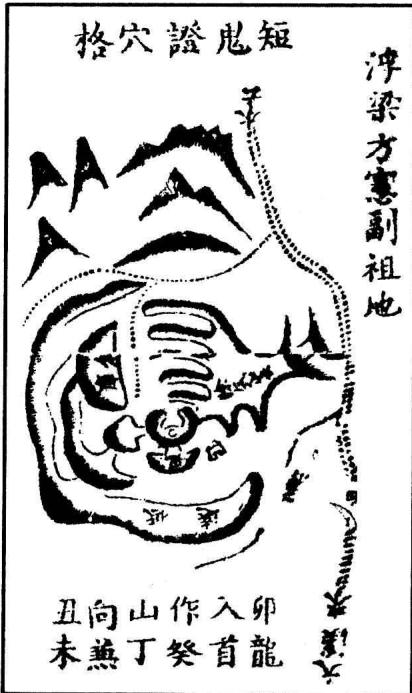

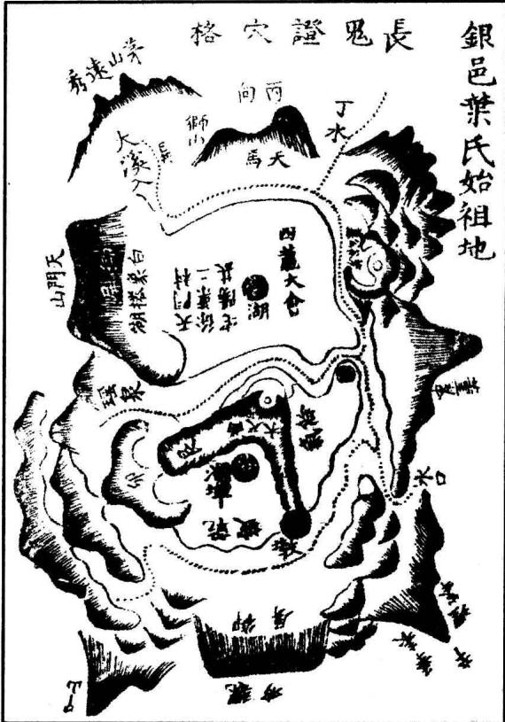

左地在浮梁县南五里，土名毛岭。远龙不详述。入首大断开帐，落脉结咽，起金星，转面结横腰穴。龙气奔走六七里不住。只是穴后短鬼，撑贴甚奇，证得穴真。其去势乃余气长，力量大。自方氏葬后，奕世科甲。

## 论禽星

禽星者，水口中之石也，亦谓之落河火星。杨公云：“问君如何谓之禽，龟鱼生在水中心。”或如笋、如笏、如游鱼、龟蛇、飞凫、金箱、玉印、莲花、笔架，森森迭迭，磊磊落落，或高或下，或长或尖，或圆或方，或散或聚，如此禽曜，极为贵秀。

若见高昂二丈三丈，主为官入朝，极品之贵。州省城垣水口中多有之。若小小石头，依山傍水，浮石无根者，谓之称官不见禄，终是假官人。必有根盘结水中，耸起高昂为美。凡入乡村，水口间、溪河中见有此奇异之石，必有大贵之地，宜寻取龙穴，不可忽也。如福建瓯宁李天官及泰和蜀口欧阳氏祖地，皆河中石曜挺然奇异而应贵穴，此禽星之验也。吾邑瑶溪张氏海虾戏珠形，一印石当前，亦其格也，见下。

右地在建宁府南七里，土名里街。其龙开帐撒落平阳，顺水而下。入首翻身逆水，突起高墩，成太阳金星结穴。右畔石曜浮于水中，贴身照穴有力，且以关内堂，塞填外堂，迥然独异，是为贵应。后乐撑天高帐二重，而本身一字文星横拦穴前，以收内气。而外洋宽畅，大溪之水特朝数里，真贵地也。乃翠屏①，自择以葬其父岩叟。葬后数年而尚书公生②。至今富贵未艾。俗呼为上水鱼形。以愚观之，当作蟠龙戏珠形。

右地在泰和县西南十里，地名蜀口。其龙与县龙同祖，至武山，又迢递三十余里，与县龙分脉，不详述。入局开帐过峡，顿起御屏。中垂一脉结穴，穴情甚巧。两畔重重包裹，前铺毡褥，下关有力。穴当逆朝大局，罗城垣聚，远秀拱揖，赣河特朝，与小源合会，绕青龙，缠玄武。而河

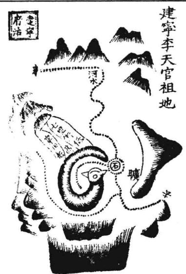

中巨石、禽曜关锁水口，以为贵证。左手一穴，俗呼水推罗磨形，亦美地。其阳基正坐御屏，亦具此局此曜③，故欧阳氏人丁大旺，巨富、显贵、高寿，诸福咸集，皆此阴

绘 图 地 理 人 子 须 知重刊人子须知資孝地理心学统宗卷五

二五三

阳二地所钟也。系孚先、觉先二公自卜。今两房富贵皆均，兹特详于下。

绘图地理人须知

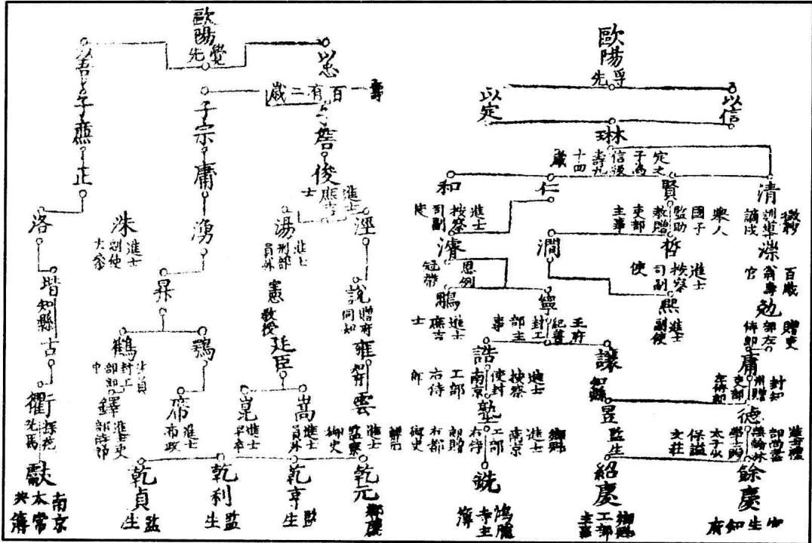

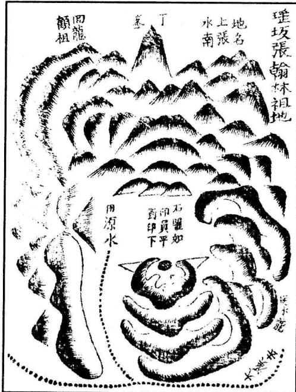

左地在吾邑二十九都水南。其龙来脉发自港头松山，分干甚远，不详述。奔腾百余里，起归仙火星作少祖。又磊磊落落数十里，开帐过峡重迭。比入局，展帐转身，飞蛾降势，结回龙顾祖之穴。龙势跃踊，穴情清巧。左右回环，堂局团聚，四势和平，前朝秀异，一峰侵云，尖丽可爱。穴下石印，圆平当前，以为贵证。艮龙入首，扦癸山丁向兼丑未，系廖金精下。取作海虾戏珠形，以禽星石印为征也。葬后，出兄弟四神童①、一驸马②，入翰林者四：淋公、显忠公、仲谥公③、式公④，理学二⑤、进士数十人，封荫奏名登仕版者又百余人，世宦蝉联。以石印当前，亦怀内圆墩，主贵人出继，故秋谷公嘉善以侄继姑，为徐知州从龙公子。怀内圆墩自本身生者，主出继外姓；自外山生者，主外姓入继。此盖本身生者耳。至今三族繁盛不替。

## 论曜星

曜星者，亦是龙之贵气旺盛发泄而出者也。凡龙虎肘外、龙身枝脚、穴前左右之砂、明堂下开水口，及龙身随带之间，但有尖利巨石，皆为曜星。凡地贵必有曜。杨筠松云：“龙真穴真只无曜，空有星峰重迭照。纵饶积玉与堆金，儿孙终主登科少。”是言有曜方有贵气。又宜长大。杨公云：“曜星短小只些儿，簿尉丞参品位卑。科第纵饶侥幸得，终归夭折少年时。”故曜若长大，则贵亦远大，曜短小则贵亦短小。又宜近穴。故云：“曜星若现石尖生，贴身横过面前平。伸手若还拈得著，少年一纪状元名。”盖远则见效迟，近则可以催官速发矣。此皆确论。但其所谓“或如刀，或如剑，随水顺飞俱冉冉。庸师只断定离乡，不知内有真龙占。”此则必以龙穴决其吉凶。盖来龙是祖宗、父母，穴是主人，曜星乃是客，必先以本身龙穴为祖，而后可以定其吉凶。果龙穴真贵，则如大贵人，必有军将兵卫，或左或右，或出或入，或来或去，皆是奔走服役，故顺去者亦无所畏。若龙穴假贱，则为离乡退田刑杀之砂矣。张子微谓：“顺水去曜，必要外面有遮拦裹截则吉。若一向荡然无收，乃是离乡之砂，而不可为曜。”固为有理，终不若以龙穴为主，而兼之子微遮拦裹截之说，则尽善矣。杨公云：“龙山双管进田笔，进契年年吉。右边尖射便为凶，千万莫相逢。”或疑其说，以为虎山带曜者不可用。殊不知前辈教人，各随意所寓。虎尖诚有不可用者。若龙穴贵，则彼为真曜，又与刑杀不同。进田、退田二笔，不可全以在龙虎者为是，只以上水、下水取之为当。若在龙而顺水带杀，亦为退笔；在虎而逆水有情，亦为进笔。此亦姑就进退二笔言之。若推其至，必以龙穴为主。苟龙穴既真，所谓“随水顺飞俱冉冉”者，皆贵曜矣，何分青龙白虎？何分顺水逆水哉！但刑杀有似于曜，各要分别。杨公云：“或如钻，或如针，两边相指穴前寻。非惟子息多清贵，更须积玉与堆金。”又云：“圆峰连堆堆又跌，射到穴前尖又劣。兄弟父子庆同年，紫绶黄麻朝玉阙。”又云：“或斗射，或交锋，尖尖有石在其中。贤良科甲浑闲事，三台八座及神童。”此皆有口诀传授。不然，尖尖相射相指相斗之砂，皆为刑杀，主兄弟相笺，及遭军配、杀戮、凶祸，乌可为贵？张子微以两尖相射者，必要以逊让回避为吉。射到穴前者，以横直别之。横者为吉，直射向穴为凶。诚确论也。盖此等贵曜，亦与凶杀颇为同形，毫厘之间，便分吉凶。苟无真见，未有不畏惧者。故杨公云：“禽曜星，贵无价，生在穴前形丑怪①。尖尖顺水或斜飞，世俗庸师见即怕。”诚以曜星尖利，亦有顺水，亦有斜飞者。自常格论之，为退田笔、离乡砂，实有可畏。高人见得龙穴真贵，故不以为嫌。苟龙穴不真，则为刑杀而凶矣。《玉峰宝传》云：“不遇刑杀，大官不发。大煞大刑，高科魁名。”或疑其说，以为如此则亦无所畏刑煞耶。是不然。世人以曜星为刑煞，故其辞曰：“若要大官高

浮梁李侍郎祖地

# 鳳凰展翅形刻上穴

科，除非世俗所谓刑煞也。”又云：“刑不刑，煞不煞，秀在尖拔。”其意谓世人所谓刑，实非刑，所谓煞，实非煞也，其秀意全在于尖拔处。除非遇此，然后谓之遇刑煞，非世人之所谓刑煞也。如浮梁李侍郎、丰城黄尚书、乐邑沐国公，及吾邑张尚书诸祖地，皆见有尖利顺窜之砂。以常见论之，则为不吉。只是龙真穴的，乃为明曜，适是贵地之证，是其格也。诸图具列于下：

左地在浮梁东乡义仓坞，乃大龙翻身朝祖，穴在穷源。且右砂窜下明堂，尖利顺水，前砂尖利向穴，局又迫狭，无一可

入俗眼。国师吴景鸾为李氏下后，出侯二、侍郎五、神童四、开国食邑者一、学士三。盖其龙以火星三台中落，飞扬顿伏，翻身起顶，降势垂脉，成金星开窝之穴，皆是贵格。下关一臂有力。前面砂虽可畏，乃是明曜，如大贵人必有披坚执锐侍从之人为我

所用，何畏之有？其水尾源头局面虽窄，然顾祖之穴，骨肉①一家。况是大龙翻身入坞，非比小龙山脚小穴。卜氏谓：“穷源僻坞，岂有真龙？”盖恐人以山脚无龙处扦地耳。

右地在丰城，土名浣江犬眠冈。其龙自两髻山作祖，行度甚远，不及详述。比入局，横列九脑芙蓉阔帐，正脉中落，重穿九脑，复作工字，复大断过峡，顿起直三台入首，为天财土星，担凹中结垂珠穴。穴情甚巧，气蹙于前，后宫仰瓦，而明堂紧巧。下手有力，后有帐幕撑乐，前有群峰呈秀，近有狮象镇塞，远有日月捍门，真吉地也。葬后出徽猷、焕章二学士②，

二五六

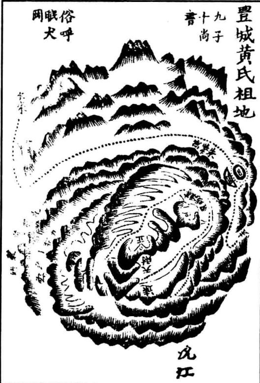

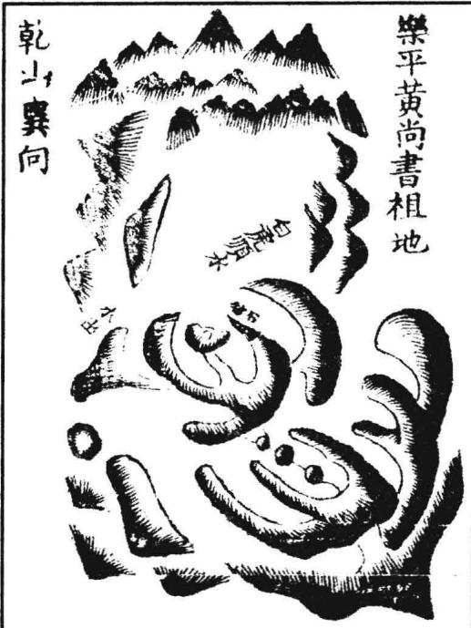

指切近者言之。自王大山分两龙，一枝逆水而上，去结明溪许氏阳基；一枝顺水而下。比入局，翻身逆当大河洋朝以结此穴。将入首，大断出帐度峡，连起贪狼，卓拔飞扬，形势雄伟。复顿玉枕土星，结咽束气，起凹脑土星，垂短乳，乳复开窝。窝之左右两石钳甚巧。窝中平坦天然，仅可容棺。穴下余气则陡峻顽硬，而龙虎两山，头虽高昂，脚却俯伏插落，拱抱有情。大河水自辰巽转午，当面阳朝，绕流脚下。河中巨石磷磷，如兽如禽。朝山数十里外耸入云霄，如褰旗、展帐、带甲马、招军旗、兜鍪、剑戟、金甲、金

左地在乐平治南九十里，土名高桥。其龙来远，不详述。入局落平冈，开帐穿峡，起华盖，中出结穴。两掬有情，穴前毡褥平坦，明堂融注，前朝奇峰罗列，取作胡僧礼佛形，以群秀当前也。只白虎巨石长出，如笏顺水。系缘督赵仙翁为程氏下。曰：“曜星现，笏砂斜，出贵当出外甥家。”主人叹曰：“奈何？”翁曰：“休嗟！休嗟！还是自家！”后果生女适蓝杭黄氏。女回省母而丧子，因抱弟子归黄为已子，即尚书公也。果符仙翁之言。

右地在乐平县，地名大汾潭③。其龙来历甚远。吴公《钳记》只以王大山为祖，盖

按：此地后龙虽美，至结穴处，山峻星粗，全身恶石。白虎雄昂，青龙顺窜，砂飞穴陡。横龙入首，落脉模糊。其直串龙势而去之山，似乎不住。况穴星而无顶，坐当凹处，后无乐山，元辰又倾，水口低远，无一可入俗眼者，初见莫不惊骇。不知大干龙地，禀气厚，力量大，山峻星粗，与之称也；全身恶石，威武应也；白虎昂雄，杀伐权也；青龙顺窜，离乡贵也；星无正顶，凹脑格也；龙势不住，余气旺也；穴陡水倾，先凶兆也；后乐无山，水口低远，干龙护从，隔州隔县，不取近也。诸般丑拙，总为吉用。但未葬时，梁公有曰“福在三十年后，祸在初葬之时。”苟非李公有高出寻常万倍之见，岂能葬之哉？盖积善之报，冥冥中必有主之者耳。笃生黔宁，辅我皇明，为开国元勋，世享爵禄，岂偶然哉！

[传疑]宋末，丞相马碧梧廷鸾慕其地，不能识穴，请张真人降，神笔神批云：“吾是鹅塘之土地，丞相问吾求大地。相地之师未降生，得地之人未了未。”丞相喜曰：“吾夫人未生，未了未，其吾夫人寿藏乎？”神复批云：“丞相好不安分！此李国公葬祖母地也。”丞相乃止。大汾有李公者，家世积德，生五子，好施与，作小舟渡人。吾邑地师梁饶与之善，因远回求渡。时岁暮矣，且雪。李公曰：“天寒如此，何不止宿吾家，待霁而行？”梁遂宿焉。明日，天又雪。又明日，雪甚，路无行人。公待之愈厚。至元旦，始霁。梁求行，公又固留，因款待舟中，且以同日之欲渡者饮。至酣，梁乃乘醉大呼曰：“世上何人能识我，今日时师后代仙。吾所下地非贵即富。”李公因曰：“愿公赐我吉地！”梁叹曰：“此间诚有大地，但恐公无此福耳！”李公曰：“据吾先世积德，吾生平好善，除却天子之外，任是将相王侯地，吾可当之。”梁壮其言，令画字拆。公乃用舟篙于土上书一“二”字，曰：“当报我第一等地。”梁曰：“土上加一乃王字也！”知其福厚，遂报之，指陈先代明师钳赞。公大喜。梁复谓曰：“此地曜气发露，令人可畏，初葬未免无凶，人丁家产皆须有损。祸后而福始应，其贵又当从武功中来。”公曰：“果有后福，先凶勿恤也。但非已业，乃吾宗富侄之山，恐未易图。”后数年，乐平明师彭大雅已报其侄。侄不之信。公因以基地易之，以葬其妻。初果勿利，公寻卒以时疫。五子亡其四，其一子又因争水利伤人，戌定远。后于定远生黔宁王英。元末，天下大乱，我太祖起兵黎阳。于田野中，前军报称虎睡当道上。命勿放箭，但鸣鼓以进。及进则非虎，乃一童睡耳，童即英也。上喜曰：“此虎将也！”乃育之军中，赐以国姓。洪武初，复姓。上令姓木，刘伯温曰：“英镇云南，火战之地，以木生火，当济以水。”又赐点水，故令姓沐。神所以“未了未”者，其“木李”二字乎？

右地在台州府治南五里，地名紫纱岙。其龙发自望海峰，辞楼下殿，精神雄猛，骨脉清奇。比入局，复大断束脉，顿起高峦，成大阳金星结穴。穴甚精巧，但左臂直硬，窜入明堂。内局偏斜，既逼且窄。登穴观之，不见外洋。只是龙气甚旺，穴星甚尊，藏风聚气，乃为真美。外阳一字文星暗拱，水口交固。葬后出七进士、二太守、一侍郎、四文魁，人丁大旺。一房离乡，今居江西，亦出两进士。但不利长房耳。

按：是地乃侍郎敬所王公宗沐祖地也，发福悠久，英才迭出，富贵鼎盛，不偶然也。

右地在治南二十里，土名桃枝源。其龙 即吴国师仲祥所下十院张氏倒骑龙穴之余气 山发来者。只此盘旋又五里，开帐中落。入 首复大断，起飞蛾束气，结穴尊重。但上手 砂直硬顺水，下臂短缩，收乘不过为异耳。 此贵地之曜也。葬后出省斋公宪，官礼部尚 书。外一穴俗呼蛇形，富地耳。

[传疑]董公见此有内外二穴，内穴最贵，却怪异殊常。龙山直硬顺水，下关短缩，局逼窄，不见明堂，又是穷源僻坞。外穴龙虎齐整，明堂宽平，易入俗眼。公自度，若先点外穴，则内穴必弃。乃先点内穴。葬毕，又指外穴。人果皆以外穴为美，而嫌内穴。丰城何巡宰见而奇之，曰：“内穴虽丑，可出尚书。”后果验。

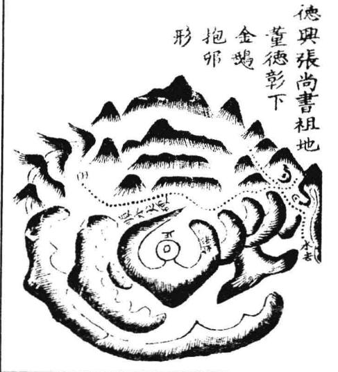

曜气亦有出于水口者，如临海谢皇后祖地，其格也。

绘 图 地 理 人 须 知臨海謝皇后祖地

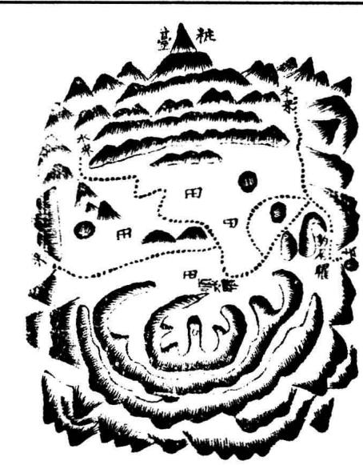

左地在台州府治北八十里，地名黄砂。其龙发自天姥，历仙居，奔行百余里。中间换剥、过脉、开帐，盖莫能尽悉。将作穴，星峰精秀，五星、九星皆全。而起者冲天，伏者入地；大者横开阔帐，动十余里；小者如丝如线，如拳如杯，至于无形。曲者如生蛇，方者如屏台，尤皆奇巧。入首帐中落脉，垂头作穴，而本身帐角两肩包来，右边微薄，而左砂太长，冲过穴前，顺水无情为异耳。然大势团聚，众山环绕，水口重重，华表、捍门、禽星、兽星迥然奇异，故其课云：“水口豹尾一山，封王驻节。”葬后，出一后①，封侯王②。

左地在台州府治东南四十里，地名水家洋钱岙。其龙自星海峰发祖，五十余里，至黄土岭过脉，迭起大帐，连过数峡。乃顿御屏，屏中落脉，翻身面南，顿伏逶迤，成走马串珠入穴。穴甚奇秀，亥龙入首，作丙相。龙身分出一枝，送至近穴，成太阴文星，以为正案。登穴观之，似乎太逼，不见外洋。其实翻身大转，穴前之水逆绕于右，与大江大会，合襟在御屏后，数十里山水皆暗相拥抱。葬后，先出小贵，曾孙潮登进士，官至方伯。方伯公之子曰云程，登进士，官至刑部尚书。孙椿龄、松龄俱贵，迎恩官知府。惜被庸术凿去曜气，福力遂减。

《紫堂秘诀》云：“斩尖截曜，是犹剪爪截发，以为赘疣，而不知体肤之伤戕。”此世俗之人，见尖曜则畏之，听时师之言，斩凿除去。如人身体，头有发，手有爪牙，始成人形。以为无用而去之，不成人体矣！月禅师云：“虎有爪，威始壮，龙无角焰物非神。焰角牙爪形体见，秀灵孕育不凡人。”爪牙焰角即尖曜也。白云先生《颖秀》篇云：“不尖不贵，不圆不富。”释者曰：“尖谓秀曜也，圆谓仓库也。”又云：“山之秀，水之秀，山水秀行俱出曜。山之曜，水之曜，不怕尖来及飞走。湖池生角岸如枪，沙嘴石牙水之宝。欲去还留往复回，全家食禄堆官诰。”此言水亦有曜也。又云：“曜在山，不如水，山发迟迟水快利。水中更有石尖生，官不出门取高第。”此言水曜之应快于山曜也。《玉髓经》中如水火既济之地，池案缺焰，池心拔笋，皆曜也。大抵水速于山，以其混混长留，不舍昼夜。而其来也无穷，而不可遏，所以易发。故杨公“不怕山尖与水飞”，水亦言曜也。水飞是水左右屈折，尖岸交牙，如鸟翼飞扇，非言其飞去也。白云先生云：“学术十年，不识龙脉。行地十年，不识曜诀。迁坟十年，不定穴法。积三十年之智而后得师，更十年从学，而后尽术。”夫以张公之明览，犹至三十年后自知术未精，不敢谓尽。及得师而敬学焉，又十年而第尽术。以四十年之久，而仅明地理，不亦难乎？今人剽窃遗文，涉猎古断，粗能谙晓，便谓尽术，欺世乎？欺天乎？不然，白云岂复为谦辞哉！一行曰：“上在东宫日，与白云先生张约猎于温泉之野。御驾疾驰，约二十里许，上偶过一山，见新坟。白云与上观谛久之，曰：葬失其穴！’上曰：何也？’对曰：下龙头，枕头角，不三年，自消砾。’适遇樵人，问曰：何人葬?’樵人曰：山之南崔巽死而葬焉。’上欲救之，令樵人引导至巽门。其子斩衰迎，盖不知东宫也。上曰：山前新坟误葬矣！’曰：父遗言葬此。’上曰：何言？”对曰：安龙头，枕龙耳，不三年，万乘至。’上惊！约曰：臣学未精。’刘氏俎谈白云先生张约断崔氏坟，有龙头龙耳之差。猎归，东宫问曰：龙耳、龙角，孰是孰非？”约曰：臣之说非。’东宫曰：以义言之，谓之消砾，何也？’约曰：臣不惟失穴法，于曜法亦有未精。其前山曜，臣以为车轮带鬼扫，故谓消砾当在三年之前。今其父“万乘”之占既验，殿下果幸其家，则前山之曜乃车轮带虎尾，非是扫也。九原可作，所愿学焉。”观此，则白云之说信征云。吁，难矣！杨公云“其官也，其曜也，其生也，其死也，其去也，其来也。官曜生死去来诀，六字不离乎口说，有人明得六字诀，须是神仙亲口说。”既分定官曜，只谓生死去来。杨公言之而不尽之，此又在乎口诀机缄也。

一、凡砂之形象，不必尽拘。廖氏云：“喝砂相似便为是，奉劝莫执泥。”又云：“砂形变像原不一，触类宜详推；在人心巧与目明，自可立名称。”

二、凡砂之拟于物类，不可胶执。盖山形万古不易，而物类则因时更变。固有古方而今圆，古贱而今贵，亦有古有而今无者。如席帽贱于唐而贵于宋，玉鱼、金鱼佩于宋而国朝不用之类，乌可尽以执泥？在人活泼而决之耳。

三、凡砂格中，多有御用之物，如帝座、御屏之属，非谓有禁穴，乃朝臣之应也。廖氏云：“格中多有帝主制，非谓其有位。宰相侍从近清光，朝夕得翱翔。”

四、砂格有专论其山峦之头者，有专论其山峦之脚者，有兼头脚而论者，又有两山、三山相合而成一格者，不可拘于一律。如华盖、文笔等，则专取其山头；进田笔、倒笏等，则专取其山脚；谢恩、绛节等，则兼取其山之头脚；马上贵人、点兵报捷之类，则取数山相映，凑合而成者也，在人聪巧可取。亦须多见古格，而心有所主也。

五、砂格中又有所谓阴砂者，则专看平田、小洲，及小可墩埠、山麓、石脊之类，及穴中不见者。此等砂形，或在明堂，或在左右，或在水口，亦关利害，不可不察。

六、砂中又有刑杀，不可不知。廖氏云：“砂中有杀人不知，贵贱最难医。仔细消砂杀有八，射探冲破压。更兼反断走皆凶，解说要人通。射是以尖来向穴，徒配何须说？探是斜山少露头，作贼不知休。破是浪痕直透顶，淫乱恣游骋。冲是横来插穴前，非祸自连绵。压是穴前砂崛起，奴仆常反主。反是曲身去向朝，离反永飘飘。断是脑下自横浪，斩首无人葬。走是斜身顺水飞，游荡不思归。若是真龙去杀合，祸福终须杂。避凶趋吉最为奇，穴上讨便宜。”又吴国师云：“砂中有杀要消详，立穴先须作主张。巉岩高压及尖射，避却方能免祸殃。”盖近穴有丑形之砂，亦须回避为美。远则勿泥。

二六二

七、龙真穴的，而偶有一砂之嫌，众人莫敢信者，则思喝形以制之。盖喝形亦可压制诸砂。卜氏云“尖枪本凶器，遇武士以为奇。浮尸固不祥，遇群鸦而反吉”之类，亦有理。如旗枪当面，或作将军大座；枷锁横尸，则取贵人监斩之类。大抵要取重于龙穴也。

八、砂形肖物类而多应，不特阴地，阳宅，即如郡邑，亦所关系。若黄坡严家坡有杯篓①石，其乡篓卜有灵。弋阳圭峰如拍板，其邑多出戏子。常邑塔山如葫芦而多名医，莆田壸公山如卓笏而多朝贵②。承天马良丫髻双峰居水口，而郡多双荐。是皆砂之应验耳。

九、凡观砂法，须审向背、情性。司马头陀曰“以端方而知其忠，以倾侧而知其佞，柔乱以知淫，卑劣以知贼，粗猛以知恶，瘦薄以知贫。粹美知慈，威武知断。”《宝鉴》云：“山厚人肥，山瘦人饥，山清人贵，山破人悲，山归人聚，山走人离，山长人勇，山缩人低，山明人达，山暗人迷，山顺人孝，山逆人欺。”此皆其正耳。蔡牧堂曰：“观形貌得其伪，观性情得其真。”斯确论也。

<table><tr><td rowspan=1 colspan=1>中格贵砂</td><td rowspan=1 colspan=1>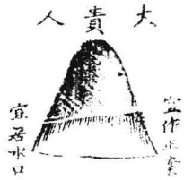</td><td rowspan=1 colspan=1>大贵人者，木星高耸而尊严秀丽也。凡贵人砂，皆是木星。凡文笔砂，皆是火星。贵人不宜破碎、敲斜、丑恶。上格龙主文章贵显，典大郡。中格龙有文名，不显贵。贱龙主僧道孤独无子。</td></tr><tr><td rowspan=1 colspan=1>中格贵砂</td><td rowspan=1 colspan=1>人当下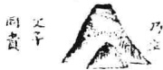        年格               大拾出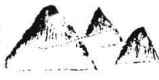</td><td rowspan=1 colspan=1>大小贵人者，一峰高大，一峰低小也。上一格主父子同贵，下一格主兄弟同贵。皆要砂形秀丽。上格龙主父子兄弟叔侄同科同朝。中格龙主父子兄弟有文名，无显贵。贱龙主僧道师徒有名。</td></tr><tr><td rowspan=1 colspan=1>上格贵砂</td><td rowspan=1 colspan=1>人閣凰楼龍       宜作</td><td rowspan=1 colspan=1>龙楼凤阁贵人，乃木星居水星之上，火星之下耳。盖自下生上，以水木，木生火，故为最贵。要星辰特异，各各合形，尊严光彩，方合格局。上格龙主高科显贵，功在社稷，泽及生民，恩深奕世。中格龙主翰苑声价，日近天颜。贱龙主富有声。</td></tr><tr><td rowspan=1 colspan=1>上格贵砂</td><td rowspan=1 colspan=1>八黄馬金臺正宜作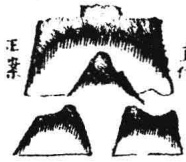</td><td rowspan=1 colspan=1>玉堂金马贵人者，乃贵人之后有御座，前有马山也。要清秀端正，忌破碎走窜。宜左右均匀。上格龙主文章冠世，高科及第，玉堂贵显。中格龙主典大藩。贱龙主富贵多仆马。</td></tr></table>

<table><tr><td colspan="1" rowspan="1">上格贵砂</td><td colspan="1" rowspan="1">人贵下帐</td><td colspan="1" rowspan="1">帐下贵人者，水星之下有木星也。要清秀端正，忌破碎粗丑、欹斜飞走、迫近高雄、巉岩带右。上格龙主尚书侍从，锦衣玉带。中格龙主典州郡之官。贱龙主出僧道得官。</td></tr><tr><td colspan="1" rowspan="1">上格贵砂</td><td colspan="1" rowspan="1">八是下盖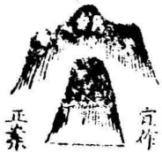</td><td colspan="1" rowspan="1">盖下贵人者，华盖之下有木星也。要清秀端正，忌欹侧粗恶。须三盖不同，其所应则无异也。三盖者，华盖、宝盖、冠盖。上格龙主尚书侍从台谏。中格龙主出镇大藩。贱龙主出僧道。</td></tr><tr><td colspan="1" rowspan="1">上格贵砂</td><td colspan="1" rowspan="1">人貴上殿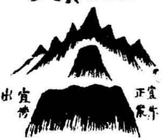</td><td colspan="1" rowspan="1">殿上贵人者，聚气火星之下有木星，木星之下又有水星。要三星皆清秀端正，忌破碎飞走。上格龙主宰相，秉国政，系安危。中格龙主有文章名誉，出典大藩。贱龙主僧道蒙恩。</td></tr><tr><td colspan="1" rowspan="1">上格贵砂</td><td colspan="1" rowspan="1">人貴閣堂</td><td colspan="1" rowspan="1">台阁贵人者，聚气火星之下有土星，土星之下又有木星也。要三星秀丽端正，忌破碎欹斜。上格龙主拜相，宠遇独隆。中格龙主尚书侍从，一人兼数职之禄。贱龙主僧道入朝面圣。</td></tr><tr><td colspan="1" rowspan="1">上格贵砂</td><td colspan="1" rowspan="1">人貴榜觀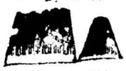出海    政计</td><td colspan="1" rowspan="1">观榜贵人者，水星之傍有木星也。要端正秀丽，忌欹斜不正。榜高贵人低者是正格，或榜低贵人高，亦吉。但低者不宜太低。上格龙主科第高登，翰林荣贵。中格龙主郡邑之官，富冠乡邑。贱龙主僧道奴卒之属。</td></tr><tr><td colspan="1" rowspan="1">上格贵砂</td><td colspan="1" rowspan="1">2.</td><td colspan="1" rowspan="1">玉堂贵人者，聚气火星之下有木星也。火星明，木星秀，贵入玉堂。忌破碎、欹斜、飞走、浪痕、崩赤。上格龙主翰林院知制诰，经筵讲官。中格龙主文章名誉，升朝之职。贱龙主僧道得贵人扶持。</td></tr><tr><td colspan="1" rowspan="1">上格贵砂</td><td colspan="1" rowspan="1">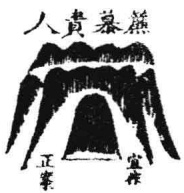</td><td colspan="1" rowspan="1">帘幕贵人者，木星在数重水星帐下，或在数重之中，皆是也。要清丽端正为合格，忌粗丑、破碎、欹斜不正。上格龙主执政公孤，极品之贵，及女贵。中格龙主典大藩，方面重臣。贱龙主为优人、乐户、妓者。</td></tr><tr><td colspan="1" rowspan="1">上格贵砂</td><td colspan="1" rowspan="1">人貴軒臨</td><td colspan="1" rowspan="1">临轩贵人者，木星在罘罳侍从之前也。要清秀端正为合格，忌破碎丑陋、欹斜不尊、带石点剥。上格龙主白衣上殿，状元宰辅，承恩荫宠。中格龙重重封诰，望重位尊。贱龙主僧道面君，徒从众多。</td></tr><tr><td colspan="1" rowspan="1">上格贵砂</td><td colspan="1" rowspan="1">人貴髮披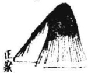宜作</td><td colspan="1" rowspan="1">披发贵人者，木星旁拖，似于斜侧也。此乃木星带火，不可以斜侧为嫌。但要清秀，切忌丑恶。上格龙主文武全才，威震中外，斩伐自由。中格龙主布政提刑之贵。贱龙主法师有灵显。</td></tr><tr><td colspan="1" rowspan="1">上格贵砂</td><td colspan="1" rowspan="1">书階五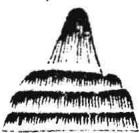正案             宜作</td><td colspan="1" rowspan="1">玉阶贵人者，木星在迭级数重之外也。要端正秀丽，而阶级重重平正为合格也。上格龙主出朝贵，秉政专权。中格龙主将校有威勇。贱龙主杂职。</td></tr><tr><td colspan="1" rowspan="1">上格贵砂</td><td colspan="1" rowspan="1">人貴下節</td><td colspan="1" rowspan="1">踏节贵人，要看节山高低相称，大小疏密均匀，而贵人之山居于其下，端正尊严，方为合格。上格龙主文章清贵，文武全才，出使外国。中格龙主职掌大藩，威权烜赫。贱龙主艺术巫祝。</td></tr><tr><td colspan="1" rowspan="1">上格贵砂</td><td colspan="1" rowspan="1">人贵座御正案</td><td colspan="1" rowspan="1">御座贵人，要星辰尊重，左右相称，方为合格。玉楼、宝殿、宫妃、贵人、侍臣、四将军俱备，贵不可言之格也。上格龙主运筹帷幄，为帝王师，及明贤理学，配享追谥。中格龙升朝侍从，及驸马、妃后仪宾、长吏。贱龙神庙血食。</td></tr><tr><td colspan="1" rowspan="1">上格贵砂</td><td colspan="1" rowspan="1">人貴橋仙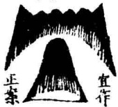</td><td colspan="1" rowspan="1">仙桥本水星而两角又撑火木也。下有木星，亦帐下贵人耳。要仙桥开展，左右均匀，而贵人正当其下，不欹不斜，方为合格。上格龙年少高科，翰苑清贵，神仙清高。中格龙清高贤士，文章藻华，禄位高升。贱龙主狷介之士，及高僧。</td></tr><tr><td colspan="1" rowspan="1">上格贵砂</td><td colspan="1" rowspan="1">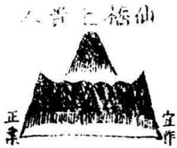</td><td colspan="1" rowspan="1">仙桥之上有贵人，与幕外贵人相似，但此格差贵。要清秀端正方为合格。多出人好神仙，及出清高大儒。上格龙主位极人臣，志慕神仙。中格龙主完名全节高寿。贱龙主无子孙独享高寿。</td></tr><tr><td colspan="1" rowspan="1">上格贵砂</td><td colspan="1" rowspan="1">人責講侍</td><td colspan="1" rowspan="1">侍讲贵人者，木星山畔有土星如台，若贵人侍于案之侧也。要端正清秀，忌斜走粗丑。上格龙侍读侍讲，经筵台阁之贵，为王者师。中格龙主儒官训导之职，及吏员蒙师。贱龙主侍卒奴隶。</td></tr><tr><td colspan="1" rowspan="1">上格贵砂</td><td colspan="1" rowspan="1">人貴外幕</td><td colspan="1" rowspan="1">幕外贵人者，木星在水星数重山外，如人在帘幕外立也。要端正清秀，忌欹斜粗丑，不合格。上格龙主升朝之贵。中格龙主孤独，子孙先死，自享福贵。贱龙主高僧奴隶。</td></tr><tr><td colspan="1" rowspan="1">上格贵砂</td><td colspan="1" rowspan="1">人畏上馬</td><td colspan="1" rowspan="1">马上贵人，要人高马低，星辰清秀，方为合格。若得旌节、仪从相称，福力尤加。主文武全才，功勋掀揭。上格龙尚书侍御，威振边方，汗马功勋。中格龙主典大藩，及富豪多才产仆马。贱龙主牧马及木匠。</td></tr><tr><td colspan="1" rowspan="1">上格贵砂</td><td colspan="1" rowspan="1">人日圭顿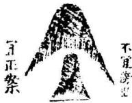</td><td colspan="1" rowspan="1">执圭贵人，要星体清秀，人高圭正，不欹斜破碎，方为合格。若御座、台盖、旗鼓相应，尤为贵格。上格龙主尚书九卿，立朝正大。中格龙主科甲，出京堂显贵。贱龙主僧道，拜礼神佛。</td></tr><tr><td colspan="1" rowspan="1">上格贵砂</td><td colspan="1" rowspan="1">人貴門龍案正</td><td colspan="1" rowspan="1">龙门贵人者，木星两旁俱有华盖峰也。要清正端秀，方为合格。忌斜侧、不正、带石则减福。上格龙少年及第，直言敢谏，朝野闻名。中格龙主皇亲国戚，文武全才。贱龙主屡试不第，拜谒侯门。</td></tr><tr><td colspan="1" rowspan="1">上格贵砂</td><td colspan="1" rowspan="1">人贵執五傍出             置作正</td><td colspan="1" rowspan="1">执笏贵人要星体清秀，人高笏正，不欹斜破碎，方为合格。若御座、台盖、旗鼓相应，尤贵。上格龙主尚书九卿，立朝正大。中格龙主科甲出身，京堂显贵。贱龙主僧道，拜礼神佛。</td></tr><tr><td colspan="1" rowspan="1">中格贵砂</td><td colspan="1" rowspan="1">人書制拨宜正書</td><td colspan="1" rowspan="1">按剑贵人者，贵人山下有尖利之砂倒地也。要逆水为吉，顺水为凶。其剑亦忌射穴。此砂多主武。上格龙主将军元帅，威振四夷。中格龙主监斩提刑之贵。贱龙主出刽子手。</td></tr><tr><td colspan="1" rowspan="1">上格贵砂</td><td colspan="1" rowspan="1">人贵馬五</td><td colspan="1" rowspan="1">五马贵人者，贵人山居五马山之中也。要诸峰秀丽，忌破碎、粗丑、飞脚乱窜。此砂主武。上格龙主尚书侍从，有功边疆。中格龙主五马专城，及典马之官，巨富多马。贱龙主牧马贩马。</td></tr><tr><td colspan="1" rowspan="1">上格贵砂</td><td colspan="1" rowspan="1">人貴中門馬金</td><td colspan="1" rowspan="1">金马门中，贵人一峰居中。天马左右要均匀端秀，贵人低亦不妨。廖金精下白牛坦地、杭州高阁老江头祖地，皆此朝山，俱拜相。上格龙主拜相，兄弟叔侄同科。中格龙主文名翰苑。贱龙主牧马蕃息。</td></tr><tr><td colspan="1" rowspan="1">中格贵砂</td><td colspan="1" rowspan="1">人貴篇雙</td><td colspan="1" rowspan="1">双荐贵人者，双峰同峙也。要清气光彩，双峰相等。忌斜侧巉岩，飞走破碎，或一高一低，亦不合格。上格龙主兄弟联登科甲，并驾齐驱。中格龙主富，双妻双子。贱龙兄弟同入公门。</td></tr></table>

<table><tr><td colspan="1" rowspan="1">上格贵砂</td><td colspan="1" rowspan="1">人員薦雙司作正來</td><td colspan="1" rowspan="1">此亦双荐贵人，与前格同。但前乃同峙，此则联峙矣。要双峰相平，清秀妩媚。忌侧窜飞走。上格龙主兄弟联科同登翰廷。中格龙主双妻双子。贱龙主兄弟出家。</td></tr><tr><td colspan="1" rowspan="1">上格贵砂</td><td colspan="1" rowspan="1">書講重雙上      凡作</td><td colspan="1" rowspan="1">双童讲书者，两木星中夹一土星也。要土方正，木直耸秀丽。忌土破碎，木斜侧。多主双贵。上格龙主兄弟同入翰林，经筵进讲。中格龙主兄弟仝科仝朝，巨富。贱龙主兄弟经商。</td></tr><tr><td colspan="1" rowspan="1">中格贵砂</td><td colspan="1" rowspan="1">人贵右左A 夾穴耳者是右貴在右曰会责</td><td colspan="1" rowspan="1">左右贵人者，秀峰不当正面，或左或右也。正面砂反丑恶，而左右有秀峰。主偏房庶出之贵。断曰：“秀峰耳边插，偏房生子登科甲。”上格龙主贵为近侍。中格龙主藩臬重臣。贱龙主奴仆聪明。</td></tr><tr><td colspan="1" rowspan="1">上格贵砂</td><td colspan="1" rowspan="1">人貴星文</td><td colspan="1" rowspan="1">文星贵人者，木星之下有太阴蛾眉之山也。要两山俱秀丽，忌破碎、斜侧、走足带火。上格龙主文章显达，职兼文武。中格龙主文名远播，品位不隆，多女贵。贱龙主男女淫泆，内丑。</td></tr><tr><td colspan="1" rowspan="1">上格贵砂</td><td colspan="1" rowspan="1">人貴下屏</td><td colspan="1" rowspan="1">屏下贵人者，土星下有木星也。要土方正，木端耸。忌土斜倾而不正，木破碎而飞走，有此则不吉。上格龙主师保秉政，侍从之臣。中格龙主方面重臣。贱龙主杂职及名僧。</td></tr><tr><td colspan="1" rowspan="1">上格贵砂</td><td colspan="1" rowspan="1">人貴下台</td><td colspan="1" rowspan="1">台下贵人者，三台之下有木星也。要台星均匀，木星端耸。忌台星不均，木星斜侧，不合格。上格龙主神童面圣，三公极品。中格龙主升朝之贵。贱龙主出名僧，门徒甚众。</td></tr><tr><td colspan="1" rowspan="1">上格贵砂</td><td colspan="1" rowspan="1">人貴誥捧</td><td colspan="1" rowspan="1">捧诰贵人者，要贵人端耸，诰轴方平，及高低相称，不倚不斜，方为合格。廖氏谓荣达之象，最吉。上格龙主天恩宠渥，重拜褒封。中格龙主为侍御、钦差、传宣之职。贱龙主走卒师巫。</td></tr><tr><td colspan="1" rowspan="1">上格贵砂</td><td colspan="1" rowspan="1">人貴誥展正</td><td colspan="1" rowspan="1">展诰贵人，乃木星耸于诰轴砂上。要清秀、尊严、适当，不偏不倚，方为合格。上格龙主受君眷宠，征聘入朝，师保尊隆，及出仙子神道。中格龙主玺书褒谕，封赠父母。贱龙主神庙威仪</td></tr><tr><td colspan="1" rowspan="1">上格贵砂</td><td colspan="1" rowspan="1">星文眉蛾</td><td colspan="1" rowspan="1">蛾眉文星者，状如半月，光媚纤巧也。要两角均匀，端正清秀。忌臃肿破碎，边高边低，欹斜不正等类。上格龙主文章名誉，状元神童，女贵为妃。中格龙主出人清秀，官位不显，虚名则胜。多主女贵。贱龙主妇女貌美，而贫有风声。</td></tr><tr><td colspan="1" rowspan="1">上格贵砂</td><td colspan="1" rowspan="1">星文寿福</td><td colspan="1" rowspan="1">福寿文星者，中稍起顶，颇类三台，故尤为吉。要两畔均匀，端正秀丽。忌臃肿破碎。上格龙主富贵双全，居官极品，居位长久，福寿绵远。中格龙主高寿厚福，但无显贵。贱龙主僧道寿高，颇有名誉。</td></tr><tr><td colspan="1" rowspan="1">上格贵砂</td><td colspan="1" rowspan="1"></td><td colspan="1" rowspan="1">清贵文星者，清瘦之山，嫩巧而细也。要两畔均匀，忌带石粗丑，边高边下，斜侧。比蛾眉，此格稍高大为异耳。上格龙主翰苑清贵，名望远播。中格龙主虚名不贵，廉介恬退，家无储积。贱龙主僧道聪明，妇人不洁。</td></tr><tr><td colspan="1" rowspan="1">中格贵砂</td><td colspan="1" rowspan="1">星文雜驳</td><td colspan="1" rowspan="1">驳杂文星者，两旁断而复有低坪，不高，不为品字、三台，中顶不起，不为宝盖，此所以为文星而驳杂也。亦曰飞蛾文星。上格龙主出人博学，名满天下，无意功名。中格龙主能文博记，随波混流，和气同俗。贱龙主能文多艺，飘荡无成。</td></tr></table>

<table><tr><td colspan="1" rowspan="1">上格贵砂</td><td colspan="1" rowspan="1">星文福帶水宜  正宜诺  案作</td><td colspan="1" rowspan="1">带福文星者，即一字文星而高大带土，体平正妩媚也。要庞厚而不臃肿，不粗丑，忌带石、崚嶒、破碎。上格龙主文武全才，极品禄位。中格龙主科第荣名，巨富寿考。贱龙主出人伶俐，为隶卒，长寿。</td></tr><tr><td colspan="1" rowspan="1">上格贵砂</td><td colspan="1" rowspan="1">星大曜帯A正官作</td><td colspan="1" rowspan="1">带曜文星者，乃木星两旁生火曜也。亦颇似蛾眉文星，但圆平不同耳。蛾眉圆，此格平正，复于侧畔出曜，故曰带曜文星。忌粗恶。上格龙主文章显达，名垂当世，后学宗师。中格龙主有文名，不能显达。贱龙主秀才善养外妇，不顾正妻。</td></tr><tr><td colspan="1" rowspan="1">上格贵砂</td><td colspan="1" rowspan="1">一字文星反复四面皆方正者，名正一字文星，尤贵。与此格文星颇异。h宜居水口 宜作正案</td><td colspan="1" rowspan="1">一字文星者，乃倒地木星也。要清秀、平正、端尊。忌粗丑、斜走、破碎、不平正、带石、尖窜、顺水。上格龙主神童、状元、宰相、侯伯，一品之贵。中格龙主魁解清贵，名誉著扬。贱龙主虚誉从隆，实德则病，空有文章。</td></tr><tr><td colspan="1" rowspan="1">上格贵砂</td><td colspan="1" rowspan="1">星文笏柱正作</td><td colspan="1" rowspan="1">柱笏文星者，木星卓立，不欹不斜，而清秀端正也。亦名象简文星。要光彩妩媚，忌臃肿、粗丑、斜侧、走窜。上格龙主状元、尚书、侍从、台阁之官。中格龙主翰苑清高，贵及谏垣之职。贱龙主僧道清修，笃信神佛。</td></tr><tr><td colspan="1" rowspan="1">上格贵砂</td><td colspan="1" rowspan="1">星文圭王空作</td><td colspan="1" rowspan="1">玉圭文星，土之耸高体，要顶平，身直，不欹不斜，挺然清秀，方为合格。莆田壶公山合此格。朱子之同安，见此山曰：“莆田多人才，此公作怪。”上格龙主出垂绅正笏，立朝燮理阴阳，及崇儒祯傅，满朝朱紫。中格龙主贵，有忠贞，文名远播。贱龙主寿富之人及高僧。</td></tr><tr><td colspan="1" rowspan="1">上格贵砂</td><td colspan="1" rowspan="1"></td><td colspan="1" rowspan="1">金箱文星，土之低平者。要方正平圆，不欹不斜，方为合格。此砂要再见贵人、玉印、文笔相助，方为大贵。上格龙主科名高显。中格龙主腰金五马。贱龙主小富义民。</td></tr><tr><td colspan="1" rowspan="1">上格贵砂</td><td colspan="1" rowspan="1">星文印王出水口者是羅星        出正尚者是文星</td><td colspan="1" rowspan="1">玉印文星者，圆小山埠或石墩也。要圆平，忌破碎。出正面或龙虎左右是文星，若在水口，便为罗星矣。上格龙主状元宰辅，冠世文明，才兼文武。中格龙主巨富百万，纳奏官职。贱龙主出僧道，有权，及堕胎患眼。</td></tr><tr><td colspan="1" rowspan="1">上格贵砂</td><td colspan="1" rowspan="1">星文印方在水者是灌星         出正而者丈星</td><td colspan="1" rowspan="1">方印文星者，亦小山埠或石墩也。此格若见龙楼、天马等砂相称，尤贵。不宜破碎，若破碎则为伪印。上格龙主才兼文武，出将人相。中格龙主文名远播，方面重臣。贱龙主草寇伪职，僧道之流，螟蛉异儿。</td></tr><tr><td colspan="1" rowspan="1">上格贵砂</td><td colspan="1" rowspan="1">星文脚折宜傍出        正安术</td><td colspan="1" rowspan="1">折脚文星，乃一脚抛火也。此星若面平嫩媚，亦作吉星，主文官兼武。若粗丑则不吉，要火脚逆水方合。上格龙主文官兼武。中格龙主小贵惧内。贱龙主跛跏残疾。</td></tr><tr><td colspan="1" rowspan="1">上格贵砂</td><td colspan="1" rowspan="1">文默貞二日</td><td colspan="1" rowspan="1">圆璧文星，形薄而上平，有微起之坛，其圆如规乃是。若方匾、偏斜、肥缺，皆非也。上格龙主王侯极品。中格龙主科第文名。贱龙主出僧道。</td></tr><tr><td colspan="1" rowspan="1">上格贵砂</td><td colspan="1" rowspan="1">星文弼輔</td><td colspan="1" rowspan="1">辅弼文星者，文星中起，左右皆有小埠夹从，如左辅右弼也。要左右之墩埠均匀，大小相等，远近相平为合格。上格龙主状元宰相，文武全才。中格龙主父子同朝。贱龙主双妻双子。</td></tr><tr><td colspan="1" rowspan="1">上格贵砂</td><td colspan="1" rowspan="1"></td><td colspan="1" rowspan="1">辅弼二格。此与前格同，但此中星稍低，左右相夹，亦类三台。若外有他秀，此格尤贵。要圆正而左右均匀，方为合格。上格龙主男为附马，女作宫妃。中格龙主文章高世，父子兄弟齐名。贱龙主淫贱风声。</td></tr><tr><td colspan="1" rowspan="1">上格贵砂</td><td colspan="1" rowspan="1">星文葩天素</td><td colspan="1" rowspan="1">天葩文星者，木之秀发而为葩，如花瓣然。要清嫩匀均。此格极贵，作龙身尤佳。在沙洛要中有贝星，正向朝穴，无此则是终节凶格耳。上格龙主状元宰相，文章冠世，后学宗师。中格龙主有文名而不显达。贱龙主博学能文，而盛实则无。</td></tr><tr><td colspan="1" rowspan="1">中格贵砂</td><td colspan="1" rowspan="1">星文赦</td><td colspan="1" rowspan="1">赦文星者，颇带土体。若方角骨立，则为御屏。此特角垂圆而肥饱耳。宜居水口，主一方永无凶祸。上格龙主出使外国。中格龙主典郡牧邑。贱龙主僧道而富。</td></tr><tr><td colspan="1" rowspan="1">中格贵砂</td><td colspan="1" rowspan="1">星武大宜作案</td><td colspan="1" rowspan="1">大武星者，其形雄伟，体势尊严，谓之武星。但不宜欹斜、破碎，即云中金、献天金是也。上格龙主大将征伐，威镇华夷。中格龙主田连阡陌，郡邑守卫之职。贱龙主出燥烈无涵养之人。</td></tr></table>

<table><tr><td>上格贵砂 宜居水口</td><td>星武立特 宜作正案 </td><td>特立武星者，众山低小，此星辰独高，光彩异常，故曰特立 武星。亦犹顿钟金星，而此主贵尤重耳。 上格龙主出使大藩，声价英烈。 中格龙主出英雄武略之人。 贱龙主出军贼、横逆之人。</td></tr><tr><td>中格贵砂</td><td>鍾金  金玉 </td><td>金钟、玉釜皆金星。其高大者曰金钟，低小曰玉釜。二者在 物而言之，本为贵重之器。故阳宅阴地，凡见此二山，皆作 贵砂而断。欲其圆净光彩，不走窜，不偏侧，不带火者为吉。 若欹斜、破碎、走足、尖利、带火，有痕浪、折皱、崩赤者为 凶也。若有从砂夹护，又当兼从砂断其吉凶，不可执一也。此 砂亦宜居夹耳左右。 上格龙主文章科第，敌国之富。 中格龙主小富小贵。 贱龙主僧道及神灵。</td></tr><tr><td>上格贵砂</td><td>車龍 </td><td>龙车者，以龙引车之状也。以形言之，则龙头居前向穴则吉， 故必有拜下之山，斯为可贵也已。 上格龙主文章振扬，拜节封侯，秉麾军民。 中格龙主州县小官，富多车马。 贱龙主吏典仆之人。</td></tr><tr><td>上格贵砂</td><td>筆鳳 </td><td>凤辇虽有尖翌而不射穴，及穴中不见，惟有尖秀之峰突兀在 前，方为合格。 上格龙主文章名誉，致身通显，及女贵。 中格龙主科第，州县之官。 贱龙主累举不第，贵在外家</td></tr><tr><td>中格贵砂</td><td>爐金 </td><td>金炉者，多是石山，有似于金炉之状。若更有仙桥相应，主 丹药升仙，及出御医，膺聘荣显。 上格龙主富贵升朝，清要之官。 中格龙主豪富好仙。 贱龙主出师巫，及神坛寺庙。</td></tr></table>

绘图地理人子须知绘图地理人子须知

<table><tr><td colspan="1" rowspan="1">上格贵砂</td><td colspan="1" rowspan="1"></td><td colspan="1" rowspan="1">御屏风者，乃土星之特峙者也。要方正骨立、耸峙不欹斜、不走足，方为合格。上格龙主文臣宰辅，功著鼎彝，泽及子孙。中格龙主出镇大藩，巨富全福。贱龙主孤贫僧道。</td></tr><tr><td colspan="1" rowspan="1">上格贵砂</td><td colspan="1" rowspan="1">基書御             政</td><td colspan="1" rowspan="1">御书台者，土星之低小者也。要顶方而平，面阔而正，忌斜破、走足、崩面、痕浪等弊。上格龙主经筵进讲，东宫师保之贵，宸翰玺书之赐。中格龙主典郡。贱龙主僧道。</td></tr><tr><td colspan="1" rowspan="1">上格贵砂</td><td colspan="1" rowspan="1"></td><td colspan="1" rowspan="1">皇帝座者，一峰耸立，两肩均平者也。要中峰秀侵云汉，两旁平正，方为合格。忌斜欹、碎痕、破折，要四山拥从。上格龙主封王侯，子孙袭爵位，女后妃，朱紫满门。亦出神仙。中格龙主文章名誉，尚书侍从。贱龙主州县卑职，沾恩光。</td></tr><tr><td colspan="1" rowspan="1">上格贵砂</td><td colspan="1" rowspan="1">爐御</td><td colspan="1" rowspan="1">御炉之砂，金土相生，故贵。要圆方伶俐，尊贵有情，无欹斜破碎之形，方为合格。上格龙主日近天颜，身惹御香。中格龙主富贵而好事鬼神。贱龙主神庙威灵及僧道巫祝。</td></tr><tr><td colspan="1" rowspan="1">上格贵砂</td><td colspan="1" rowspan="1">易牙末鼎</td><td colspan="1" rowspan="1">满床牙笏者，或尖峰，或石笋丛聚，有似于牙笏满床。不论大小高低，但以清秀为吉。上格龙主三世同朝，满门朱紫，累世富贵。中格龙主父子兄弟同科，文章名誉。贱龙主画工、法师、僧道。</td></tr><tr><td colspan="1" rowspan="2">格砂</td><td colspan="1" rowspan="1"></td><td colspan="1" rowspan="2">诰轴、展轴、诰轴开花。诰轴砂者，乃土星而两角高起者也。此格长阔者为展诰，狭小者为诰轴，皆以平正清秀、无破碎者为吉。又有轴上生花之格，若得贵人、盖帐诸贵砂相应，力量愈胜。然展轴亦不专取土星，若水星两角微起者，亦是展轴。但水星角起，又似仙桥。惟仙桥则角起颇高，而成两火济水之格，展诰则只微高而不成火星为异耳。上格龙主膺帝命，褒封恩宠，驸马皇亲。中格龙主贵近天颜。贱龙主小贵而富。</td></tr><tr><td colspan="1" rowspan="1">花開軸誥</td></tr><tr><td colspan="1" rowspan="1">中格贵砂</td><td colspan="1" rowspan="1">爐跪</td><td colspan="1" rowspan="1">跪炉砂者，山峦一头高耸，一头低平，如人跪之状也。此砂宜高大，不宜破碎及走脚、飞动、顺水。宜居水口。上格龙主尚书、宰执、侍从之臣。中格龙主富而好事神佛。贱龙主僧道能礼拜神佛。</td></tr><tr><td colspan="1" rowspan="1">中格贵砂</td><td colspan="1" rowspan="1">筆文五正案</td><td colspan="1" rowspan="1">文笔者，文星尖秀卓立耸拔者也。要端正清奇，忌斜破走足。大凡笔砂，宜远在天表。断法云：“状元笔，千里云霄出。”上格龙主文章、科第、显贵，名誉远播。中格龙主有文名，典州郡。贱龙主蒙师，画工精巧。</td></tr><tr><td colspan="1" rowspan="1">上格贵砂</td><td colspan="1" rowspan="1">筆風彩</td><td colspan="1" rowspan="1">彩凤笔者，火星插天而下有从山飞扬之势，如彩风腾霄者也。要端正秀丽，远在天表，方为合格。上格龙主理学崇儒，文章冠世，后学宗师，神童状元，翰苑师保。中格龙主魁解、高第、奕世荣显。贱龙主画工精巧，名播天下。</td></tr><tr><td colspan="1" rowspan="1">上格贵砂</td><td colspan="1" rowspan="1">筆相宰</td><td colspan="1" rowspan="1">宰相笔者，火星卓立于土星之上而不居中。诀云：“宰相笔，案头出。”要案正笔秀为合格耳。上格龙主出太平宰相，进秉钧权。中格龙主京堂侍从，及镇掌大藩贱龙主蒙师，生徒众多。</td></tr></table>

<table><tr><td colspan="1" rowspan="1">上格贵砂</td><td colspan="1" rowspan="1">筆公三宜作正案</td><td colspan="1" rowspan="1">三公笔者，三峰卓立于土星之上也。要秀丽清奇，中尊旁卑，不失其序，疏密相等，不欹不斜，方为合格。上格龙主公孤极品，掌握朝纲，身系天下安危。中格龙主父子兄弟联科，玉堂显荣。贱龙主明经授徒，文名远播而无显位。</td></tr><tr><td colspan="1" rowspan="1">下格贱砂</td><td colspan="1" rowspan="1"></td><td colspan="1" rowspan="1">骂天笔者，尖峰开两岐也。纵秀丽亦不吉。刘白头云：“文笔开丫又带歪，十遭赴举九空回。”即此之谓与？上格龙主刀笔进身，居官不正。中格龙主秀才不第，及画工、讼师。贱龙主是非争讼，出人缺唇。</td></tr><tr><td colspan="1" rowspan="1">上格贵砂</td><td colspan="1" rowspan="1">筆元伏宜作正案</td><td colspan="1" rowspan="1">状元笔者，火星耸于土星之上，要正当其笔，又须土方正，火清秀，高而且远，方为合格。上格龙主一举登科，神童及第，公孤仙客。中格龙主科第文名，职掌文衡。贱龙主文章之士，儒官训教。</td></tr><tr><td colspan="1" rowspan="1">中格贵砂</td><td colspan="1" rowspan="1">陣筆</td><td colspan="1" rowspan="1">笔阵者，数峰特立，有似于笔阵，虽高卑不同，也宜中峰高，左右峰卑方好。若颠倒错乱，则吉中有咎耳。上格龙主父子兄弟叔侄同登科第，俱有文名。中格龙主一家大小俱有文名，累举不第。贱龙主画师、法师。</td></tr><tr><td colspan="1" rowspan="1">下格贱砂</td><td colspan="1" rowspan="1"></td><td colspan="1" rowspan="1">斗讼笔者，穴前两尖相对如斗射也。凡穴前遇此，多主争讼之应，兄弟不和，专好唆告词讼。上格龙主为官不避权奸，直言为奏，好辩招非，嗜杀无情。中格龙主富，兄弟不和，及好争斗。贱龙主教唆词讼，倾家荡产。</td></tr><tr><td colspan="1" rowspan="1">中格贵砂</td><td colspan="1" rowspan="1">師法</td><td colspan="1" rowspan="1">法师笔者，尖峰之上连开数歧，亦如骂天笔，而丫岐尤多者是也。若出自台盖之下，主因法而得官。上格龙主法师显应，驱神役鬼，因以承恩。中格龙主法师用法而富。贱龙主法师流离困苦。</td></tr><tr><td colspan="1" rowspan="1">下格贱砂</td><td colspan="1" rowspan="1"></td><td colspan="1" rowspan="1">和尚笔者，尖峰之旁有陀背之形也。金火相战，所以贱也。更有仙桥相助，的主高僧无疑。上格龙主高僧聪慧，有文名而沾恩宠。中格龙主僧人有法灵验。贱龙主出贫僧。</td></tr><tr><td colspan="1" rowspan="1">中格贵砂</td><td colspan="1" rowspan="1"></td><td colspan="1" rowspan="1">醮池笔者，文笔倒地醮入水中也。若顺水，多离乡出贵；若逆水，主巨富，时进田产及横财。上格龙主文章科第。中格龙主秀才有文名，巨富。贱龙主蒙师、僧道、水溺。</td></tr><tr><td colspan="1" rowspan="1">上格富砂</td><td colspan="2" rowspan="1"></td></tr><tr><td colspan="3" rowspan="1">进田笔者，凡龙虎之山，带低小之砂，逆水而上者是。吴公云：“进田之砂无左右，只要坟前有。逆来蘸水不教干，买尽外州田。”然亦欲其弯抱如牛角，有情面穴方为上吉。亦有不在本身龙虎山，而在外来逆水，穴上见之有情，不尖射者皆是。进田笔主发外来横财、田产。龙穴贵，则催贵。大抵此砂极易发，若近穴蘸水，寅葬则卯发。予尝谓逆砂一尺可致富，亦指近穴者言耳。上格龙主一举登科，为官富厚。中格龙主田连阡陌，时进横财。贱龙</td></tr><tr><td colspan="1" rowspan="1">下格贱砂</td><td colspan="2" rowspan="1"></td></tr><tr><td colspan="3" rowspan="1">退田笔者，不论左右，但有山头尖而顺水去者，名退田笔。若两水夹送流下去者，退败尤甚，不问过穴与不曾过穴，但穴前尖者，便是退笔。凡有一田丘，一地角，随水下去者，便主退卖田产。退笔多者，主倒尽田产，贫苦伶仃，离乡背井，极为凶恶。立向先须避此。亦主少亡，生子不育，久而绝灭。尖射穴场者，主杀伤人命，斗殴争讼，破家亡身。旧说青龙为进田笔，白虎为退田笔者非是。上格龙主清贵威武，家无储积。中格龙主贫穷，退尽家产。贱龙主乞丐。</td></tr><tr><td colspan="1" rowspan="1">下格贱砂</td><td colspan="2" rowspan="1"></td></tr><tr><td colspan="3" rowspan="1">离乡砂者，顺水飞走，无复关阑也。凡上下臂交过者，须要外一重有下手回转拦住方好。若外重无承托，只是过身，乃离乡之应也。不过身而飞扬趋出者亦是。又有一等龙穴，朝应皆贵，而有离乡之证者，此不足畏。盖仕宦本离乡而贵显者，又多寄居他所。杨公云“官不离乡任何所？”是也。亦须认龙穴端的，而后可用。上格龙主离乡贵显，立功异域。中格龙主离乡发达。贱龙主遭配流移。</td></tr><tr><td colspan="1" rowspan="1">上格贵砂</td><td colspan="1" rowspan="1"></td><td colspan="1" rowspan="1">笔架者，或三峰，或五峰，有似于笔架之状，虽高低不同，亦宜中高旁低。若当高反低，当低反高，则吉中有咎也。上格龙主父子兄弟叔侄同科同朝。中格龙主三世五世俱有文名之士。贱龙主僧道法师有声名。</td></tr><tr><td colspan="1" rowspan="1">中格贵砂</td><td colspan="1" rowspan="1">熊璃琉</td><td colspan="1" rowspan="1">琉璃帘者，平冈下高田层迭磊落，水光横列，如琉璃之状。要如迭浪层均正，无尖破之形，方为合格。上格龙主出皇后、贵妃、国戚。中格龙主侍从之臣巨富。贱龙主神庙。</td></tr><tr><td colspan="1" rowspan="1">中格贵砂</td><td colspan="1" rowspan="1">蘇珠真</td><td colspan="1" rowspan="1">珍珠帘者，大山开帐，中间瀑泉为石所拦，滴滴如珠而下，故曰珍珠帘。龙贱为孝帘。上格龙主出妃嫔公主。中格龙主神佛香火显灵。贱龙主多丧亡，长有孝服。</td></tr></table>

<table><tr><td rowspan=1 colspan=1>上格贵砂</td><td rowspan=1 colspan=1>旗元状</td><td rowspan=1 colspan=1>状元旗者，木星排列而身似水体，至山足，又开面出蛾眉文星，所以为贵也。要头顶秀丽，有文笔、台盖相应者，方为合格。上格龙主大魁天下。中格龙主魁解出身，官居外阃，及女柄男权。贱龙主文名远播而无实。</td></tr><tr><td rowspan=1 colspan=1>中格贵砂</td><td rowspan=1 colspan=1>旗軍招</td><td rowspan=1 colspan=1>招军旗者，旗形高大，而众脚飞扬，而有一带缠绕，势如招动者为合格。要甲马顿起，有鼓相应者为真。上格龙主义兵为开国之勋，世享爵禄。中格龙主义勇保障。贱龙主草寇、神庙、军卒。</td></tr><tr><td rowspan=1 colspan=1>中格贵砂</td><td rowspan=1 colspan=1>旗勝得</td><td rowspan=1 colspan=1>得胜旗者，旗形攸扬卓立，大势向内逆水，身头似文旗，而山脚舒展，星峰光彩，所以为吉。上格龙主辅国元勋，铭功鼎彝，世袭承宠。中格龙主职掌元戎，武功受宠。贱龙主军伍得功。</td></tr><tr><td rowspan=1 colspan=1>中格贵砂</td><td rowspan=1 colspan=1>旗戦</td><td rowspan=1 colspan=1>战旗者，卓立峻直，而有威武之象。此格如三品字者，若有鼓角相应，尤为显贵。上格龙主出将入相，节制诸军。中格龙主小官统领兵卒。贱龙主为卒上阵争战。</td></tr><tr><td rowspan=1 colspan=1>上格贵砂</td><td rowspan=1 colspan=1></td><td rowspan=1 colspan=1>令旗乃两旗相向，而中开旁高者是也。要两旗高低、大小相称，足虽两门飞扬，而身则耸立尊严，方为合格。此砂有两等，一等正当穴前，一等两峙水口，为门旗。此主大贵。上格龙主五府，出镇抚诸将，节制数省。中格龙主兄弟统领兵卒。贱龙主横逆大盗。</td></tr></table>

<table><tr><td colspan="1" rowspan="1">下格贱砂</td><td colspan="1" rowspan="1">旗贼</td><td colspan="1" rowspan="1">贼旗者，尖射破碎，欹斜丑恶，又有黑石巉岩，皆非吉格，故主凶。若出于水口，而穴间不见者，亦作吉断。上格龙主大将专征伐，不忠赤族。中格龙主常遭贼凶劫杀。贱龙主凶贼劫掠之人。</td></tr><tr><td colspan="1" rowspan="1">下格贱砂</td><td colspan="1" rowspan="1">旗降</td><td colspan="1" rowspan="1">降旗者，榻地破碎而飞走，焰动顺水也。头身大势向内，而旗脚向外者，为败旗。头身向外者，为降旗。上格龙主出入领兵，战败而降于敌人。中格龙主为大盗，终以降灭。贱龙主为盗寇，绝嗣灭族。</td></tr><tr><td colspan="1" rowspan="1">下格贱砂</td><td colspan="1" rowspan="1"></td><td colspan="1" rowspan="1">败旗亦榻地破碎，而不顺水，差胜于降旗。盖胜负兵家之常，降则辱国辱身，无复可为矣。此败旗所以逆水也。上格龙大将征伐而败。中格龙主将校萎靡不振。贱龙主寇盗诛夷。</td></tr><tr><td colspan="1" rowspan="1">中格贵砂</td><td colspan="1" rowspan="1"></td><td colspan="1" rowspan="1">顿旗者，乃火星高耸而飞扬，故曰顿旗。须要山峰雄伟，气势轩昂，脚虽飞扬而不反乱者，方为合格。上格龙主出大将军，及文臣专征伐。中格龙总制三边，军功掀揭。贱龙主死军卒兵败。</td></tr><tr><td colspan="1" rowspan="1">中格贵砂</td><td colspan="1" rowspan="1"></td><td colspan="1" rowspan="1">顿鼓者，耸体金星，高大雄猛，有若顿鼓之状。不宜破碎，要圆净端正，方为合格。上格龙主出将军及藩臣使节。中格龙主富而好音乐。贱龙主神庙灵迹乐鼓之人。</td></tr><tr><td colspan="1" rowspan="1">中格贵砂</td><td colspan="1" rowspan="1"></td><td colspan="1" rowspan="1">堆甲者，小山及平岗层迭重出，如堆甲之状。要旗鼓二山相应，方为合格。若出自御屏、三台之下，当作牙笏。上格龙主兵权武贵，汗马功劳。中格龙主军官威武，家积金玉。贱龙主疾病、争兢、恶死。</td></tr><tr><td colspan="1" rowspan="1">下格贱砂</td><td colspan="1" rowspan="1"></td><td colspan="1" rowspan="1">钵盂者，圆山多寡不一，有似于钵盂也。若出台盖之下，又当呼作盆碗之类，亦看后龙何如。或只一山圆而带脚，亦是钵盂。上格龙主名僧及寺观巨富。中格龙主僧人小富。贱龙主出游僧沿门化食。</td></tr><tr><td colspan="1" rowspan="1">中格贵砂</td><td colspan="1" rowspan="1"></td><td colspan="1" rowspan="1">捷报者，秀峰迭起奔来，如出征奏捷，露布驰报之状，故曰报捷。要山形光彩，来势向穴。上格龙主登科及第。中格龙主巡司驱丞，承差之人。贱龙主出为人报捷及铺兵。</td></tr><tr><td colspan="1" rowspan="1">中格贵砂</td><td colspan="1" rowspan="1"></td><td colspan="1" rowspan="1">点兵者，皆乱石在平田或平野，而大小不一，或如猪羊牛马，或如鸦鸟，或如人立。主大将建立功名之象。黑石无害也。上格龙主大将立功名，当身荣显。中格龙主富而抱他人之子为己子。贱龙主恶疾患眼，病苦。</td></tr><tr><td colspan="1" rowspan="1">中格贵砂</td><td colspan="1" rowspan="1">軍屯</td><td colspan="1" rowspan="1">屯军者，小埠或土或石，杂立于外，平野与诸大山相间错杂，有若屯军之状。上格龙主大将节制诸路，生杀自由。中格龙主武官。贱龙主淫乱混浊。</td></tr><tr><td colspan="1" rowspan="1">下格贱砂</td><td colspan="1" rowspan="1"></td><td colspan="1" rowspan="1">降节者，本佛家神仙之具，其形有似于梳，切忌作正案。凡阳宅与阴地有此者，多为不吉。上格龙主异姓同居，淫乱不洁。中格龙主僧道有声名。贱龙主神庙香火。</td></tr><tr><td colspan="1" rowspan="1">上格贵砂</td><td colspan="1" rowspan="1"></td><td colspan="1" rowspan="1">踏节者，尖秀木星五峰以上，即为踏节。要均匀，大小疏密相等为合格。忌破碎、浪痕、折皱。上格龙主监司藩镇，受节鉞，兄弟齐名。中格龙主出使外国，及兄弟同贵。贱龙主承差同杂职。</td></tr><tr><td colspan="1" rowspan="1">上格贵砂</td><td colspan="1" rowspan="1"></td><td colspan="1" rowspan="1">旌节者，与踏节不同。星峰横列，缺少一边，谓之旌节。要清秀光彩，忌浪痕崩破。上格龙主出镇大藩，祖孙同朝。中格龙主兄弟俱有文名，而无显贵。贱龙主出人有才能。</td></tr><tr><td colspan="1" rowspan="1">中格贵砂</td><td colspan="1" rowspan="1">節独</td><td colspan="1" rowspan="1">独节者，平时会藩仪从，有独节杖是也。其形如杖，上踏铁环，从卒以手持之，独环便有踏响之声，以警行者。上格龙主立大藩，权制一路。中龙格主将兵异域。贱龙主军卒。</td></tr><tr><td colspan="1" rowspan="1">中格富砂中格富砂</td><td colspan="1" rowspan="1"></td><td colspan="1" rowspan="1">祸褥二格者，同是平面土星，其形乃平铺于下，如铺毡展席。但二者形体亦各不同。祸平而方，褥平而长，冢前多有之，最难察识。看山不如按图。按图而视之，方圆长短灿然可见；登山而望之，则衣满目，东西迷向，而胸中之方圆规矩、曲直准绳已冥然而无据矣。此非可以纸上语者也。上格龙主贵近天颜。中格龙主富而多子。贱龙主僧道多徒，亦主多疾。</td></tr><tr><td colspan="1" rowspan="1">中格富砂中格贵砂</td><td colspan="1" rowspan="1">袍堆</td><td colspan="1" rowspan="1">晒袍、堆袍二者不同，一山展扬，稍有飞动皱折者为晒袍，重重迭迭，皱折不一者为堆袍。皆欲其有情而向穴。若反朝向外，加以尖利，则为不吉。以袍领向穴，体势皆顺，故主贵。袍，章服也，为身之饰，而又耀之以日光，故主文章，又以为面君之物，故主贵。上格龙主世代有贵而不大显。中格龙主为官多是非，黜罢不得超达。贱龙主杀伤破败，投降外国之应。</td></tr><tr><td colspan="1" rowspan="1">上格贵砂</td><td colspan="1" rowspan="1">靠</td><td colspan="1" rowspan="1">幞头者，开肩土星，中高两旁肩低，有似于幞头也。其为物既加于人首，固为贵矣。矧非人臣面君不敢戴，尤为最贵重者也。穴前见有此砂，欲其方正端严，不欹斜，不破碎，方为合格。又有一等土星，开一边肩者，亦为之幞头。廖氏又以之为幞头匣。要之，皆幞头耳。尝见有此形者，多是大贵之地。然亦当以后龙定其贵之轻重焉。上格龙主王侯烈士，公孤极品，世享爵禄。中格龙主方面大臣，富贵有声。贱龙主富盛。</td></tr><tr><td colspan="1" rowspan="1">中格贵砂</td><td colspan="1" rowspan="1"></td><td colspan="1" rowspan="1">流笏者，一字文星顺水而流，或泛水，皆谓之流笏。但顺水者多主离乡而有富贵。上格龙主大富，离乡发贵，及出使外国。中格龙主离乡而富。贱龙主流落他乡，及水溺。</td></tr><tr><td colspan="1" rowspan="1">下格富砂</td><td colspan="1" rowspan="1"></td><td colspan="1" rowspan="1">堆肉者，山冈簇集，如堆肉之状。重重迭迭，大小不等。若圆净，主富；亦如堆甲之状，又主武贵。破碎则凶。上格龙主大富，亦主武贵，以其有类堆甲。中格龙主淫乱浊富。贱龙主贫穷淫滥。</td></tr><tr><td colspan="1" rowspan="1">下格贱砂</td><td colspan="1" rowspan="1"></td><td colspan="1" rowspan="1">提箩者，如乞丐提箩之状。此山穴上不宜见之，最为不吉，砂格中之所深忌者也。上格龙主虽有富贵，不免有疯癫之人。中格龙主僧道。贱龙主乞丐。</td></tr><tr><td colspan="1" rowspan="1">下格贱砂</td><td colspan="1" rowspan="1"></td><td colspan="1" rowspan="1">幡者，山脚飞扬，奔走长远，或一里，或数里，如今人立播之状。顺水者凶，逆水者吉。上格龙主武职威权。中格龙主富离乡，淫奔夭折。贱龙主僧道神灵，长病痨瘵。</td></tr><tr><td colspan="1" rowspan="1">下格贱砂</td><td colspan="1" rowspan="1">伞破</td><td colspan="1" rowspan="1">破伞似棕榈叶，一峰端正，分脚停匀。然前砂见之亦不吉，何况破碎乎？宜其凶也。上格龙主好杀狠恶，威武名扬。中格龙主富而不洁。贱龙主争兢贫穷无赖之事。</td></tr><tr><td colspan="1" rowspan="1">中格贵砂</td><td colspan="1" rowspan="1">履朝靴朝</td><td colspan="1" rowspan="1">靴履似幞头而非幞头，上下二级停匀。靴履下级，靴面低长，与上级不称，是为靴。履双只主贵，单只者主清高、孤独，难为妻子。上格龙主文臣侍从，硕儒执礼。中格龙主富而好礼。贱龙主螟蛉长病。</td></tr><tr><td colspan="1" rowspan="1">下格贱砂</td><td colspan="1" rowspan="1">鞋    僧</td><td colspan="1" rowspan="1">僧鞋，是同一平阜中有分开之纹，以袱裹鞋之象也。顺水者凶，逆水者主出富僧。上格龙主出高僧，游遍天下，有名。中格龙主僧人有智能贱龙主贫僧长病</td></tr><tr><td colspan="1" rowspan="1">上格贵砂</td><td colspan="1" rowspan="1"></td><td colspan="1" rowspan="1">玉带者，横木弯抱，有似于带。又有金鱼以应之，则为玉带。金鱼者，带之旁或带之首有墩阜，或石如金鱼之状者是也。上格龙主公孤之贵，进封侯伯，蟒衣玉带。中格龙主高科，典大藩。贱龙主女贵。</td></tr><tr><td colspan="1" rowspan="1">中格贵砂</td><td colspan="1" rowspan="1">带金</td><td colspan="1" rowspan="1">金带、银带，平面水星弯抱者，皆谓之金带、银带。或平坡，或田圳，皆以圆抱穴场者为是。此砂不拘顺水逆水，盖带总是抱过身者也。上格龙主典州郡，及因妇而贵。中格龙主县宰之官，主有女贵。贱龙主经商。</td></tr><tr><td colspan="1" rowspan="1">上格贵砂</td><td colspan="1" rowspan="1">袋魚全</td><td colspan="1" rowspan="1">金鱼者，墩阜之长曲者也。此砂不宜作正案，宜居下关，宜居水口。若水口间有洲塞镇，亦名游鱼洲，主富贵悠久。上格龙主鼎鼐之臣，满门朱紫。中格龙主典州郡，及巨富。贱龙主出人飘荡，及出游僧。</td></tr><tr><td colspan="1" rowspan="1">上格贵砂</td><td colspan="1" rowspan="1"></td><td colspan="1" rowspan="1">玉几，反复皆可。盖玉几之后，必有贵人圆正，或尖峰峦。玉几反而抱之，亦如贵人御玉几之状，故反复皆贵。上格龙主大贵，位至三公。中格龙主方面重臣。贱龙主僧道。</td></tr><tr><td colspan="1" rowspan="1">中格贵砂</td><td colspan="1" rowspan="1"></td><td colspan="1" rowspan="1">席帽砂者，亦台星之变格。要均匀清秀，忌斜侧、走窜、破碎。上一格有贵人者为胜，二格低小杂职，三格大贵。上格龙主升朝侍从之臣。中格龙主郡牧邑宰。贱龙主出僧道。</td></tr><tr><td colspan="1" rowspan="1">中格贵砂</td><td colspan="1" rowspan="1"></td><td colspan="1" rowspan="1">模糊席帽者，或圆顶不起，或尖而斜，或走一足，皆是也。上一格主为官不正，无治才决断。下一格差胜。上格龙主世代有官不替。中格龙主郡牧邑宰。贱龙主道士。</td></tr><tr><td colspan="1" rowspan="1">中格贵砂</td><td colspan="1" rowspan="1">宜作</td><td colspan="1" rowspan="1">唐帽与席帽相似，但无脚者为席帽，有脚者为唐帽，亦曰唐幞，其实皆一类也。有脚亦名垂带。断诀云：“唐帽若垂带，才子文章快。”上格龙主世代有官不替。中格龙主清高，征召不起。贱龙主道士军配。</td></tr><tr><td colspan="1" rowspan="1">上格贵砂</td><td colspan="1" rowspan="1"></td><td colspan="1" rowspan="1">铁帽与席帽相似，但席帽、唐帽皆清秀，铁帽则肿丑带石为异耳。其贵贱全系于龙穴。上格龙主军官有功，世袭戎宦。中格龙主武臣富。贱龙主军配遭凶，贫贱。</td></tr><tr><td colspan="1" rowspan="1">上格贵砂</td><td colspan="1" rowspan="1">盖實宜居水口              空作正案        二</td><td colspan="1" rowspan="1">三峰略起，头圆者为宝盖。要均匀、端正、清秀，忌破碎、飞走、斜侧、带石、丑恶。若远而清者大贵。亦有二山三山相应结成者，亦当同断。上格龙主升朝显贵。中格龙主科第，典州郡。贱龙主僧道。</td></tr></table>

<table><tr><td colspan="1" rowspan="1">上格贵龙</td><td colspan="1" rowspan="1">宜作工案二</td><td colspan="1" rowspan="1">三峰起，带尖者为华盖。要均匀齐正，清秀端严。忌破碎、斜侧、飞走、石丑。大抵虽有丑形而远者，则不必泥。上格龙主文章清史，功著鼎彝。中格龙主科第，典州郡。贱龙主僧道。</td></tr><tr><td colspan="1" rowspan="1">上格贵龙</td><td colspan="1" rowspan="1">盖    冠宜居正素</td><td colspan="1" rowspan="1">独出一峰，似华盖而短小者为冠盖。要均匀齐整、清秀端岩。忌破碎、丑粗、飞走、斜侧、不正。得仪仗旌节尤贵。上格龙主科第显贵，车马填门。中格龙主富，仆马丰盈。贱龙主神庙卒从之徒。</td></tr><tr><td colspan="1" rowspan="1">上格贵砂</td><td colspan="1" rowspan="1">水</td><td colspan="1" rowspan="1">三峰尖微茫出者为马盖，要清秀端正，忌破碎粗丑，飞走斜侧，得仪仗、旌节尤贵。上格龙主出大将军，威镇华夷。中格龙主文武兼全，及高寿。贱龙主败走无成。</td></tr><tr><td colspan="1" rowspan="1">中格贵砂</td><td colspan="1" rowspan="1">馬使出</td><td colspan="1" rowspan="1">出使马者，马山之下拖尖利之砂也。马本驰走之物，复见飞走之砂出于其下，本有远使之象。上格龙出使外国，有功荣显，及威镇华夷。中格龙主多仆马豪富，而奔走外乡。贱格主出走马及木匠。</td></tr><tr><td colspan="1" rowspan="1">中格贵砂</td><td colspan="1" rowspan="1">馬旗带</td><td colspan="1" rowspan="1">带旗马者，马山之下拖焰动之砂，如旗之飞动者也。旗马共是一山者，方为合格。上格龙主出元戎总兵，专节鉞，主功勋。中格龙主将校有武功。贱龙主出草寇、大盗，及神庙。</td></tr><tr><td colspan="1" rowspan="1">上格贵砂</td><td colspan="1" rowspan="1"></td><td colspan="1" rowspan="1">交驰马者，两两双峰，如马之相驰骤也。要两马之山，一马左高右低，一马右高左低，方为合格。上格龙主兄弟叔侄连登科第，朱紫满门。中格龙主富冠乡邑，多骏马。贱龙主出人走马奴隶。</td></tr><tr><td colspan="1" rowspan="1">上格贵砂</td><td colspan="1" rowspan="1">馬甲世</td><td colspan="1" rowspan="1">带甲马者，马山身带痕迹，如战马之披甲也。要旗鼓、贵人诸砂相应，其穴尤吉。上格龙主出大将军，专征伐，立功边塞。中格龙主偏将有功。贱龙主神坛庙宇灵显。</td></tr><tr><td colspan="1" rowspan="1">上格贵砂</td><td colspan="1" rowspan="1"></td><td colspan="1" rowspan="1">天马者，峙立双峰，一高一低，有似于马，故曰天马。然以天名之，亦欲其高耸清秀，远贴天表耳。在午未者尤贵。上格龙主出典大藩，方面之职。中格龙主五马专城。贱龙主走卒牧马之人。</td></tr><tr><td colspan="1" rowspan="1">上格贵砂</td><td colspan="1" rowspan="1">頭回馬勒宜案</td><td colspan="1" rowspan="1">勒马回头者，天马山转脚也。要清秀，忌破碎。若见旗鼓相应，主武职威名，汗马功业。上格龙主出使边方，威武烜赫。中格龙主巨富仆马。贱龙主牧马贩马。</td></tr><tr><td colspan="1" rowspan="1">下格贱砂</td><td colspan="1" rowspan="1"></td><td colspan="1" rowspan="1">破网者，披折洪破杂出。主家业破落，泉漏不干。又主疽疮，及冷溃骨疽肷烂之疾。又主徒杖刑罪。上格龙主武职。中格龙主家业或兴或败，及恶疾之人。贱龙主徒杖刑罪、贫穷。</td></tr><tr><td colspan="1" rowspan="1">中格贵砂下格贱砂</td><td colspan="1" rowspan="1"></td><td colspan="1" rowspan="1">锦帐乃水星横阔者，有数格，皆取得于龙。若富龙则为帐，若贵龙则为挂榜之砂耳。要长阔方齐，无浪痕破碎，无山脚飞斜，方为合格。右一格山头歪侧而粗，更有砂碎巉岩，而山足飞斜散乱，则为鹑衣百被之格也。然虽破碎而远，亦不为害。凡丑形，未有不是近者。凡秀砂，未有不是远者。欲辨砂形之妍媸，亦当审其远近耳。上格龙主贵。中格龙主富冠乡邑。贱龙主淫乱。</td></tr></table>

<table><tr><td colspan="1" rowspan="1">下格贱砂</td><td colspan="1" rowspan="1">棺客</td><td colspan="1" rowspan="1">棺形横见者，主丧祸，亦客亡弃官而归。若斜而顺水者，主客死在外，灵榇不归。上水者，亦主返亡。头高尾低者为棺。首尾平匀者非也。上格龙主为官在外而死。中格龙主为商溺水而死。贱龙主全家瘟疫而死。</td></tr><tr><td colspan="1" rowspan="1">中格贵砂</td><td colspan="1" rowspan="1">琴横案正宜</td><td colspan="1" rowspan="1">横琴者，平冈眠体木星，两头微低，有似平琴之状。亦曰文星，要清秀平正，方为合格。忌破碎尖窜。上格龙主文章誉望，富贵双全。中格龙主清秀富足、尊严。贱龙主人好琴而清贫。</td></tr><tr><td colspan="1" rowspan="1">中格贵砂</td><td colspan="1" rowspan="1">轴玉筒金宜居水口      宜作正案</td><td colspan="1" rowspan="1">金筒玉轴，方而直长者为金筒，方而横长者为玉轴。二形虽别，但以仿佛似之，不可拘泥也。上格龙主文章科第，禄及子孙。中格龙主州县左右之官。贱龙主僧道符法之人。</td></tr><tr><td colspan="1" rowspan="1">中格贵砂</td><td colspan="1" rowspan="1"></td><td colspan="1" rowspan="1">妆台者，星峰迭拥，有若妆台之状。后龙若贵，亦出大贵。不然，只主女贵而已。上格龙主嫔妃，而家亦因女有贵。中格龙主女贵。贱龙主女子娇妖淫贱。</td></tr><tr><td colspan="1" rowspan="1">中格贵砂</td><td colspan="1" rowspan="1"></td><td colspan="1" rowspan="1">镜台，以台山之外圆峰出头，如镜之状，故谓之镜台。要星峰圆正，适相登对，方为合格。上格龙主女贵为后妃，及荣膺一品。中格龙主女贵受诰封，多生女。贱龙主女淫贱。</td></tr><tr><td colspan="1" rowspan="1">中格贵砂</td><td colspan="1" rowspan="1"></td><td colspan="1" rowspan="1">杯盘者，小山重迭，有似于杯之状。其为器，富贵贫贱之家皆有之，却非贵砂也。上格龙主位至正卿，为国之桢干。中格龙主饕餮饮食之人。贱龙主僧道。</td></tr><tr><td colspan="1" rowspan="1">中格贵砂</td><td colspan="1" rowspan="1"></td><td colspan="1" rowspan="1">五雷者，或高山，或平冈，有五峰丛立，有五山排立，皆谓之五雷之格。上格龙主五马专城，腰金衣紫。中格龙主兄弟同科而有威名。贱龙主雷惊恶死。</td></tr><tr><td colspan="1" rowspan="1">上格贵砂</td><td colspan="1" rowspan="1">      宣作正案</td><td colspan="1" rowspan="1">龙楼凤阁，本王者之居，最为贵重，必大贵之地方可当此。故《玉髓经》云“前砂见此主大贵，左右君王日月朝。”盖不借他星相助，自能致贵。上格龙主封公侯，朱紫满门，富贵鼎盛。中格龙主宰相，男尚公主。贱龙主掌大权。</td></tr><tr><td colspan="1" rowspan="1">上格贵砂</td><td colspan="1" rowspan="1"></td><td colspan="1" rowspan="1">帘幕乃高山连峰，如铺帘围，如设幕，不缺不折，不凹不断，斯谓帘幕贵砂。上格龙主富贵双全。中格龙主富盛，宾客满门。贱龙主名妓，多交贵人。</td></tr><tr><td colspan="1" rowspan="1">中格贵砂</td><td colspan="1" rowspan="1"></td><td colspan="1" rowspan="1">御伞者，星辰带水浪痕折，有似于伞，但不宜破碎、欹斜，方为合格。亦须高耸特异则贵。上格龙主登第贵显，出身即为朝官。中格龙主驲丞巡司。贱龙主皂隶奴仆。</td></tr><tr><td colspan="1" rowspan="1">上格贵砂</td><td colspan="1" rowspan="1"></td><td colspan="1" rowspan="1">御台者，平正秀丽，似金非金。金则蛾眉矣。似土非土，土则相台矣。似木非木，木则一字文星矣。此砂千不逢一。上格龙为禁穴，出后妃。中格龙出宰相。贱龙出女贵。</td></tr><tr><td colspan="1" rowspan="1">上格贵砂</td><td colspan="1" rowspan="1"></td><td colspan="1" rowspan="1">御台前有日月者，尤为至贵之应。或日月山左右夹照，皆为至贵。上格龙为禁穴，出后妃。中格龙出宰相、神童、状元。贱龙亦有小贵。</td></tr><tr><td>中格贵砂</td><td> 上格龙主神童状元。 中格龙主富贵风流。 贱龙主痨瘵之疾。</td><td>掣电者，冈阜走动如生蛇也。更有流水随山走动，谓之掣电 水龙，吉，乃是明曜。</td></tr><tr><td>上格贵砂</td><td></td><td>祥云者，景云也，亦名庆云。天之瑞物，不可常有。砂形合 此，乃至贵龙穴之应。予兄弟所见，惟二房自卜寿藏合此。 上格龙主神仙白日飞升，白衣登殿，为帝者师。 中格龙主为官近帝。 贱龙主清修高洁，世有文名。</td></tr><tr><td></td><td></td><td></td></tr><tr><td>如人坐云端。吕梁洪乃其水口山，有子房庙，亦灵感。</td><td colspan="2">《经》曰：“神仙之地，势如迭云。”四山拥从如云也。张子房自卜寿藏，在徐州子房 山，乃中条分干，结骑龙穴。前有九重朝案，次第层迭，成上天梯格，四面环绕， 按：子房受黄石公秘书，宜其知地之精。加以辟谷，自卜寿藏，何其智耶！子不疑 袭留侯，文帝时除爵。世传张道陵乃其八代孙，两汉迄今，号称天师。国朝，封大 真人，掌天下道教事，世袭二品，今五十代，亦此地之钟灵，与龙虎山阳基毓秀也。</td></tr><tr><td>上格贵砂</td><td></td><td></td></tr><tr><td>之砂也。 上格龙主公孤极品，功盖天下，满门朱紫。</td><td colspan="2">夫三台六星，太微、轩辕之上，泰阶平则治道昌，此正三台也。若三峰乃三公星， 世俗为三台，不复革耳。然取应亦颇与三台不甚相远，第不如六符，力量尤重。故 《玉髓经》云“力量又在三台上，六世儿孙袭封荫”。六世者，指六星所应也。大抵 此等星辰，主重拜褒封，簪缨世代，恩荣稠迭，子孙蕃衍，朱紫盈门，乃极贵极吉 中格龙主位列九卿，父子同朝。</td></tr><tr><td colspan="1" rowspan="1">上格贵砂上格贵砂</td><td colspan="1" rowspan="1">橋仙宜居水案正作宜橋   仙pdktne窘</td><td colspan="1" rowspan="1">仙桥本水星，两角撑火者为上，撑木者次之。盖水火有既济之功，故贵。吾邑治正面此砂，南唐国师吴法旺扦，谶云：“仙桥砂现，间出异人。”故此邦多有神仙。如张紫琼真人、万万山赵缘督真人①、龙潭徐仙翁、三清李仙姑，及祝观物、吴白云、傅少华、傅初庵、祝刚阳、徐丹台子云外老人，皆异人也，俱产此邦。但此砂宜远而清秀，若太近不清，及低小不高，亦挂榜砂耳。上格龙主神仙大臣，屡诏不起，志慕神仙。中格龙主完名全节，高寿神仙。贱龙主清高不仕，及出高僧。</td></tr><tr><td colspan="1" rowspan="1">上格贵砂</td><td colspan="1" rowspan="1">梯天上</td><td colspan="1" rowspan="1">上天梯者，连起星一层高一层。要山形清秀，大小相等，高低有序，方为合格。若见仙桥，主白日升天。上格龙主年少状元，官近君王，父子兄弟同朝。中格龙主兄弟同科，父子同朝。贱龙主出人聪俊巧艺。</td></tr><tr><td colspan="1" rowspan="1">上格贵砂</td><td colspan="1" rowspan="1">隊簇仙群事幕</td><td colspan="1" rowspan="1">群仙簇队者，诸峰森森簇簇，重重迭迭，如蜂屯蚁聚，皆秀丽清奇者也。亦为三千粉黛，八百烟花，富贵之象也。上格龙主公侯国戚，驸马、女妃，神仙。中格龙主镇大藩，巨富多仆从，武贵。贱龙主出人风流飘荡。</td></tr><tr><td colspan="1" rowspan="1">下格贱砂</td><td colspan="1" rowspan="1"></td><td colspan="1" rowspan="1">奠杯之形，横列者是。或有盘，或无盘，或开或合，皆为奠杯。品字本吉。若列品字，开阔展布则吉。上格龙主富贵双全。中格龙主小富，抱养他人之子。贱龙主堕胎、患眼、僧道。</td></tr><tr><td colspan="1" rowspan="1">中格贵砂</td><td colspan="1" rowspan="1"></td><td colspan="1" rowspan="1">银瓶盏筋，或有盏而无瓶，此则可假为瓶山，亦自仿佛。不指为瓶，则不过为贵秀之峰也。上格龙主贵，上殿捧献觞。中格龙主富盛，宾客满门。贱龙主卖酒、僧道。</td></tr></table>

绘 图 地 理 人 子 须 知• 绘 图 地 理 人 子 须 知

<table><tr><td colspan="1" rowspan="1">下格富砂</td><td colspan="1" rowspan="1"></td><td colspan="1" rowspan="1">斗者，方正而卑，或石或土，有似于斗者为斗。但不可拘泥，多是土星。要方正，忌破碎。上格龙主廪膳纳票之官。中格龙主小富。贱龙主出米牙之人。</td></tr><tr><td colspan="1" rowspan="1">下格贱砂</td><td colspan="1" rowspan="1">杓木</td><td colspan="1" rowspan="1">木杓者，以其有似于木杓，盖今乞丐及化缘道人所带，不过微柄，为穿孔系带之所而已。故柄短者主乞丐。上格龙主富贵，多堕胎淫欲。中格龙主淫乱。贱龙主淫欲、乞丐、瘟癀。</td></tr><tr><td colspan="1" rowspan="1">下格贱砂</td><td colspan="1" rowspan="1"></td><td colspan="1" rowspan="1">枷者，丁山两脚重迭，有似于枷。此形最为不祥，穴前见此，皆主死罪、囚系、官灾。上格龙主风宪衙门，号令军民。中格龙主犯罪被枷号。贱龙主狱囚死罪。</td></tr><tr><td colspan="1" rowspan="1">下格贱砂</td><td colspan="1" rowspan="1"></td><td colspan="1" rowspan="1">抱肩砂者，大山欹斜，外有小山居其旁，如人相抱之状。又有后山转脚抱前山，其丑尤甚。上格龙主富贵而淫泆内乱。中格龙主男淫女滥，丑名远播。贱龙主娼妓。</td></tr><tr><td colspan="1" rowspan="1">下格贱砂</td><td colspan="1" rowspan="1"></td><td colspan="1" rowspan="1">刺面砂者，近见有石附于其山，望之如人刺面，以药贴面之状，亦如以针刺面，皆主人黥配。尖圆相值，又主杀伤。上格龙主军配得官。中格龙主军配而富。贱龙主军配、杀戮、阵亡。</td></tr><tr><td colspan="1" rowspan="1">下格贱砂</td><td colspan="1" rowspan="1">A批</td><td colspan="1" rowspan="1">掀裙砂者，一山数脚飞开，如人掀裙之状，及有浪痕摆折，皆主不吉。上一格女滥，下一格主男女皆淫。上格龙主富贵而淫。中格龙主淫滥浊富。贱龙主妇人淫欲为娼，男人飘荡。</td></tr><tr><td colspan="1" rowspan="1">下格贱砂</td><td colspan="1" rowspan="1"></td><td colspan="1" rowspan="1">咒诅山者，二山相合，如合掌然。富贵之地，亦间有之，主出人为事灭绝天理，令人咒诅。若为庵观寺院，则又迪吉。上格龙主势焰作威福，多人咒诅。中格龙主凶狠而富，多遭凶。贱龙主优婆夷、优婆塞。</td></tr><tr><td colspan="1" rowspan="1">下格贱砂</td><td colspan="1" rowspan="1"></td><td colspan="1" rowspan="1">破厨者，禄存中之破碎而凶者。穴上见之，事事不吉。惟挺然居于水口，把截门户，则又为吉星。上格龙主退官罢职。中格龙主先富而后贫。贱龙主乞丐。</td></tr><tr><td colspan="1" rowspan="1">中格贵砂</td><td colspan="1" rowspan="1">武      </td><td colspan="1" rowspan="1">兜鍪者，顶起而有倾侧之势，拽裙如鳖，亦微带殿盖，横视之则为杀耳。旗鼓同见者合格。上格龙主勋业世爵，威武好勇。中格龙主武职小官，武断乡曲。贱龙主军卒贱役，凶狠贼徒。</td></tr><tr><td colspan="1" rowspan="1">中格贵砂</td><td colspan="1" rowspan="1">校毬</td><td colspan="1" rowspan="1">毬杖之形不一，有从高山生下，出脚为杖者。若山高峻而端严，则可指为将军打毬。有从山脉落下闪断，复于平处特为杖者，颇有毬仿佛相类，不可拘泥。上格龙主寿考荣贵。中格龙主富寿，异姓同居。贱龙主贫贱、残疾、患眼、堕胎。</td></tr><tr><td colspan="1" rowspan="1">中格富砂</td><td colspan="1" rowspan="1"></td><td colspan="1" rowspan="1">仰船者，多是土星横迭，有仰船之状。不破碎者横直皆可，船头勾上者更吉。上格龙主出征外国，兼并土地，建立大功。中格龙主出江湖干运，兴家致富。贱龙主行商之人，及淫贱。</td></tr><tr><td colspan="1" rowspan="1">下格富砂</td><td colspan="1" rowspan="1"></td><td colspan="1" rowspan="1">赌博之砂，若在旁出而龙神吉者，亦主因赌得财。但此等之砂，终非全吉，至龙气尽时，败莫能救。此所以为贱砂。上格龙主经商坐贾，巧艺得钱，作谋成家。中格龙主因赌得钱，出人奸险。贱龙主好赌破家，浮华不实。</td></tr></table>

<table><tr><td colspan="1" rowspan="1">下格富砂</td><td colspan="1" rowspan="1"></td><td colspan="1" rowspan="1">接钱之砂，乃要下砂逆水，方是接钱，主进财帛。若顺水有砂，反为送钱出外，退败。上格龙主司财之官。中格龙主坐贾得财，因亲发达。贱龙主多疾病，是非括括。</td></tr><tr><td colspan="1" rowspan="1">下格富砂</td><td colspan="1" rowspan="1">銭盖被錦</td><td colspan="1" rowspan="1">锦被堆不与诸山连接，或圆扁，或方长，四旁皆有裙脚，如撒被之状，方应此形。上格龙主富贵双全。中格龙主富冠乡邑。贱龙主堕胎、恶疾。</td></tr><tr><td colspan="1" rowspan="1">下格富砂</td><td colspan="1" rowspan="1"></td><td colspan="1" rowspan="1">堆钱山，不必泥两头有辨索之状，因形定名者，随穴指喝，仿象而已，岂必如图画摸写过真耶？上格龙主富贵双全。中格龙主富冠乡邑。贱龙主出走卒军籍。</td></tr><tr><td colspan="1" rowspan="1">中格富砂</td><td colspan="1" rowspan="1"></td><td colspan="1" rowspan="1">卧牛者，乃浊体土星，其形有似于牛卧也。若山无脚出，即为仓库之砂，大宜出于水口间。上格龙主为官富厚。中格龙主富而多牛马之字。贱龙困穷，多生好睡之人。</td></tr><tr><td colspan="1" rowspan="1">中格富砂</td><td colspan="1" rowspan="1">狮卧</td><td colspan="1" rowspan="1">狮主富，亦主贵。狮形面方头大，腰狭尾阔，前重后轻，土星之浊者也。此等砂亦宜稍远，或出水口为美。上格龙主出人魁伟、富厚、方面，大享福寿。中格龙主巨富小贵。贱龙主出人粗率穷困。</td></tr><tr><td colspan="1" rowspan="1">中格富砂</td><td colspan="1" rowspan="1">虎伏</td><td colspan="1" rowspan="1">伏虎者，星峰雄伟，有似于虎也。此土星之肥大者，要星辰光彩，头脚圆正为吉。上格龙主田连阡陌，亦有小贵武功。中格龙主妇人堕胎、盗窃，有财而浊。贱龙主被虎伤无嗣。</td></tr><tr><td colspan="1" rowspan="1">中格富砂</td><td colspan="1" rowspan="1"></td><td colspan="1" rowspan="1">骆驼者，星峰秀丽，有似马形。以驼有峰颖异，尤贵于马。此格可贵可富，尤看旁星相应何如耳。上格龙主富贵双全。中格龙主小富，多生魁伟享福之人。贱龙主贫困而浊。</td></tr><tr><td colspan="1" rowspan="1">下格贱砂</td><td colspan="1" rowspan="1">采頁探頭</td><td colspan="1" rowspan="1">探头砂者，小山在大山之外，或居其上，或在其旁，如小人攒头窥伺。斜侧不正，贼寇之象也。上格龙主家常有失窃。中格龙主招贼入屋。贱龙主出人为寇盗。</td></tr><tr><td colspan="1" rowspan="1">中格富砂</td><td colspan="1" rowspan="1"></td><td colspan="1" rowspan="1">柜库三格，其一为柜，其二为库，皆土星，主大富。若有贵峰而龙又贵者，主富贵两全。龙穴小贵，亦主少财进身，买官纳粟之职。第三格则以主星火土为禄，土为财，主大贵大富，不假别星为助。更有贵格龙穴，当主贵极人臣。但柜库要首尾高下匀停，而逆水肥满，乃吉。若顺水破碎，头高尾低，则为破库虚柜，及棺椁之象，则为凶砂矣。上格龙主户部及司财税之官。中格龙主巨富多蓄积。贱龙主衣食温饱，定是居库之人。</td></tr><tr><td colspan="1" rowspan="1">中格贵砂</td><td colspan="2" rowspan="1"></td></tr><tr><td colspan="3" rowspan="1">仓囷之形，多出于土星。亦有类金星者。故凡金星带土体，及土星不方正者，皆谓之仓，小者谓之库。凡仓库所应，皆主富。龙穴贵者，则主公辅食邑之贵。连厥仓、陈积仓、百万仓，皆能应藩镇屯驻去处。阴阳二宅见之，亦主大富大贵。其它止是富砂。寄仓以其在外洋，故属外郡。百万仓有似御屏而不方正，差小者亦名万石仓。此系大星辰，主大富，亦有贵，却须形穴雄伟之地，而后可以当此。上格龙主食邑进爵，世享天福，敌国巨富。中格龙主田连阡陌，纳粟进职，粮冠郡邑。贱龙主浊富淫欲。</td></tr></table>

<table><tr><td rowspan=1 colspan=1>下格贱砂</td><td rowspan=1 colspan=1>格 </td><td rowspan=1 colspan=1>流尸砂如葫芦形，主溺死。盖葫芦有嘴，如头颈之形。如有颈，下加腹故也。顺水尤凶。上格龙主为官客死。中格龙主医者传名，多外死。贱龙主溺死。</td></tr><tr><td rowspan=1 colspan=1>下格贱砂</td><td rowspan=1 colspan=1>花献</td><td rowspan=1 colspan=1>献花砂两脚飞开，中间开花，故曰献花。专主女人淫滥。纵是龙穴贵，亦不免于风声。上格龙主富贵而妇人淫滥，丑声远扬。中格龙主妇人淫滥。贱龙主娼妓。</td></tr><tr><td rowspan=1 colspan=1>下格贱砂</td><td rowspan=1 colspan=1></td><td rowspan=1 colspan=1>此山欹斜尖利，内抱一小山，乃主抱养他人之子，或以无子而淫乱也。穴内不见则不忌。上格龙主抱养他人之子。中格龙主内乱不洁。贱龙主男女淫奔，及痨瘵之疾。</td></tr><tr><td rowspan=1 colspan=1>下格贱砂</td><td rowspan=1 colspan=1></td><td rowspan=1 colspan=1>堕胎砂者，墩阜适于两开山脚之下也。主堕胎不育，及眼疾、过房、螟蛉之子。上格龙主富贵而堕胎不育，无嗣。中格龙主螟蛉、目疾、堕胎。贱龙主产难。</td></tr><tr><td rowspan=1 colspan=1>上格贵砂</td><td rowspan=1 colspan=1></td><td rowspan=1 colspan=1>丹诏一名诏仙，卓立土星旁有小峰者是。又一格，以一字文星前生长峡，亦是。皆极贵。《经》云“才自回家复诏人，御书盈阁极荣显。”上格龙主拜相，名垂青史，神仙。中格龙主文章科第，寿考延长。贱龙主清高康宁。</td></tr></table>

上诸砂图，不过载之为式而已。若夫形之妍媸，品物之繁庶，岂第笔端所能仿佛于万一哉！惟守约以该博，由浅以究深，引而伸之，触类而长之，则存乎其人耳。

## 重刊人子须知资孝地理心学统宗卷六

卷六之一

此以下五卷，专论水法。夫天一生水，水实万物之祖。水在天地间为最多，四海五湖，特其概耳。浴日月，浸乾坤，皆水之效灵者也。故水于阴阳家，曰山水，曰风水，水居其半，可谓重矣。而地书乃以水居四科之末，似以水为轻于龙穴也。殊不知龙非水送，则无以明其来；穴非水界，则无以明其止。盖“外气横形，内气止生”，是龙穴又赖水为证应。然则，居四科之末者，特以次序言，非以轻重言也。故郭氏曰“得水为上”，杨氏曰“未看山，先看水，有山无水休寻地”，廖氏曰“寻龙点穴须仔细，先须看水势”，皆言水之当重，与龙穴均也。辑水法。

## 水法总论

夫水者，龙之血脉也。《葬书》以水为外气，良有旨哉！西山蔡文节公云：“两水之中必有山。”故水会即龙尽，水交则龙止，水飞走即生气散，水融注则内气聚。此自然之理也。尝观轻水所多秃与瘿人，重水所多厘与躄人，甘水所多好与美人，辛水所多疽与痤人，苦水所多尪与伛人。是水能移人形体性情如此。且水深处民多富，水浅处民多贫，水聚处民多稠，水散处民多离。是水之关祸福又如此，孰谓地理之可忽夫水哉！《水经》谓“五行始焉，万物所由生，元气之腠液。”《管子》曰：“水者，地之血气，筋脉之流通者。”故曰水其具财也。而地理家谓山管人丁水管财，诚然不爽。然水有大小，有远近，有深浅。观其形势，察其性情，而吉凶取舍有定见矣。然其大旨不过来者欲其屈曲，横者欲其绕抱，去者欲其盘桓，而汇聚者欲其悠扬，囊江融潴澄凝。登穴见之，不直冲，不斜撇，不峻急，不湍激，不反跳翻弓，不倾泻陡跌，不射不牵，不割不穿，而有情顾穴，环绕缠抱，恋恋不舍。《葬书》所谓“洋洋悠悠，顾我欲留。其来无源，其去无流。”吴公所谓“来去之玄横绕带”，卜氏所谓“交锁织结之宜求，穿割箭射之宜避”。又谓“水本动，妙在静中。”谢双湖氏所谓“水之吉者，聚而不散，见其来而不见其去”，传伯通所谓“囊聚之水，深如锅底，圆如镜面，方如棋盘”，及“诸源会合，九曲来朝”，则尽其肯綮矣。其间又有方位吉凶之辨，固不必尽拘，亦乌可尽弃？宜于穴法中，依绳墨以消纳之，控制之，斯为尽善。且古人扦建州

邑，有取于水者，如吉水县两水交流，状吉文字；秀水县，八十余里巽水特朝。一以形吉，一以方秀，皆以水得名。而两邑人才萃产皆多，亦见古人命名之不苟也，学者当审思之。大抵风水之法，得水为上。故京师万水朝宗，金陵长江特朝，而为帝都之大。三吴富甲天下，而有太湖、震泽巨浸。东鲁大海外洋，与夫三楚江汉夹会，洞庭融注，西江彭蠡濛汇，而越之绍、宁、杭、台、嘉、湖，闽之福、兴、泉、漳，广之广、惠、潮、海等处，皆以得水而人才渊薮矣。

## 论水发源

夫发源水者，明堂中溯观来源之水也。水之发源，欲其深长。深长则龙气旺，发福必悠久。若水源短，则龙必短，发福不远大。吴公云“来短去长，无大力量”是也。

## 论水到局

水到局者，来水入堂之谓也。水之到局，欲其入堂，欲其到口为吉。若水远来入局，将及到明堂，却便反挑撇去，谓之不到堂。水或到堂，而无下关收水，或不肯流至下砂拦截之处，谓之不入口，总为无益。故水以到堂入口为贵。其水之大小，则不

必拘也。若水在逆砂之外，前虽不见，亦作到堂论。盖大地面前多有横砂，而外明堂水多不能见，此即明朝不如暗拱之说。如朱子论冀都之地，前面黄河环绕。自黄河至冀都数百里，岂穴前所能见哉！但此等语，非井蛙之见所可识也。世俗又多执送龙两水俱要上堂，此误也。惟顺局去水地，可以两水到堂，当面合襟。若非去水地，则只一边到堂。盖两水合襟，乃穴前界脉虾须水耳，自龙虎外则不拘之。今以论送龙水，岂不大谬矣乎！然所谓到堂入口，惟富地为然，贵地亦多有不如此者，又不必拘也。此水最速富。吾邑陈九万祖地，葬下即发财巨富，此格也。图具于左。

左地在吾邑五都，土名张村铺官路侧。其龙乃顺势翻成逆势，气甚旺盛。入首大断，起连气

二九八

金星，微开钳口。结穴临田蘸水。穴前田源囊聚。近身一掬横砂为案，低伏如眠弓，绕抱有情，以关堂气，使一源之水既到堂又入口。吴公口诀所谓“水要嗑得着，砂要摸得着。”卜氏云“紧夹者福不旋踵”，惟此地为然。董公德彰为陈氏扦之，许以速发。

果窑穷甫完，天尚未明，孝子秉烛以归，路逢群盗分赃，忽见火光人众，惊疑捕盗者至，弃财走散。陈氏因以得之，遂致骤富。今乡人传谓“寅葬卯发”云。又吴书源宽为池州府张氏下一地，亦是寅葬卯发，大略与此相同，兹不赘述。

## 论水出口

出口者，水既到堂，必有去处，谓之出口。水之出口，欲其弯环屈曲，迂回深聚。《葬书》云“其去无流”，又云“顾我欲留”为妙。若直而急，浅而峻则凶矣。大抵宜罗星、游鱼、北辰、华表、捍门关阑重迭之砂，则其出自美也。若水直去荡然者，决无真气内聚也。

## 论朝水

朝水者，穴前特来之水也。此水至吉。盖风水之法，得水为上。穴既当朝，则得水矣。卜氏云：“求吾所大欲，无非逆水之龙。”予谓逆水龙固美，不若当朝之穴为尤美也。爰逆水多是枝龙，岂如干龙，两水夹送，至将结作处，却翻身数节，逆当朝水结穴，力量极大。此所以不贵逆水之龙，而贵逆水之穴矣。但水固以特来当面朝穴为吉，若或直急冲射，湍怒有声，则反为凶。故来朝之水，又须屈折弯曲、悠扬深缓，方为合法。不可概以特朝为吉也。《葬书》既以得水为上，而陶公又谓“当面朝入，子息贫寒”，何也？正谓其冲射湍激，反带凶煞，故尔。《雪心赋》云：“交锁织结，四吉当求。”又云：“九曲入明堂，当朝宰相。”此则以其屈曲有情，水法之至吉者也。大抵朝水一勺能救贫，洋洋当面朝，当代出官僚。若欲催官催富，必得朝水之地，可取验也。催贵如叫岩寺三地，催富如乐平江氏地，其格也，图并具下。

下地在铅山，地名叫岩。其龙发自灵山，六十余里，至赭亭山，起御屏土星，方正骨立，清秀特异。正脉中出，度峡，连起星峰，顿伏磊落。入首分结三穴，皆共一局，俱当信河特朝。其正结者为贵溪丘参政父地，入首开帐，为巨石山，抽下一线土脉，过峡甚巧，起连气金星。又于金星之下，结喉束气小巧，成走马文星入穴。两畔从山粗大，而本身独小。穴前平坦，四势团聚，真催贵之地。参政公名旭鉴，初为信椽时，信守金公者，明堪舆术。舟行叫岩山下，因游寺。登眺之间，见而叹曰；“金带数条，置之闲处，良可惜哉！”丘在侧，知其为美地，乃图以葬父。葬后，丘即以吏材任通政知事，廷臣荐擢黄严令，有异政，事闻，玺书褒美，擢台州府判。七年，民诣阙保升知府。又六年，升浙江参政。从子祺，官至处州太守。孙鼎，登进士，官至都宪。祺之孙九仞，进士。曾孙民范，进士，大参。曰钥，知县；曰镐，同知；曰钿，知州。民望，节推；民仰，乡科；汝良，进士。诸公俱世显荣，至今富贵未艾。

二九九

<table><tr><td colspan="2"> 樂平汪氏祖地 来敲 董德彰 寅甲句 門送 也名生巨洋原  雙筆居子子 手夜進田 中龍寅甲</td><td rowspan="2">华盖中抽结咽，起金星，成仰高之穴。穴 上平坦，四旁皆石曜。穴下石岩，人呼如 应，故名叫岩。岩之中有禅室，即叫岩寺 也。登穴平坦如常，不知穴下之险。前面 山水拱照。右畔河中一石，名曰卷绩，高 广数十仞，挺然中流砥柱，锁尽信河之 水。隔岸大青山高障有力，真催官之地。 葬后，汪氏父子联登高第，兄弟同入翰 苑。文庄公父凤登进士，官至参政。四 子：长僎，登进士，官太参；次即文庄公 俊，登乡会二元，官礼部尚书，谥文庄； 次伟，登进士，官吏部侍郎；幼佃，登进 士，官侍读、太常少卿。曰审、曰宛，皆 登科甲。又尝观汪氏阳基，甚美，五石祖 地尤贵，此特其催官耳。 其尽处为费氏地，清湖公完夫人墓 也。龙脉到头逆转，顿起穴星，成正体太 阳，开钳结穴。后复自本身抽出，起太阴 文星之案。登穴周密，内气融聚，外阳暗 拱。葬后不数年，唐衢公尧年即连登科 甲，几半纪而腰金，真催官之地也。 上三地虽得催官之水，然究其实，自 少祖赭亭山以下，石山雄伟，星峰秀丽， 节节龙入贵格。穴星又皆清秀，下关卷绩 一石，卓立河中，迥然特异，尤为贵证。 兼以秀水特朝，故能催贵。若徒以其水而 已矣，则凡特朝之水，皆可谓之催贵乎？ 故龙穴砂水，不可缺一也。 左地在乐平十三都，土名洋源。坤申 龙，寅甲向，而有寅甲水特朝，乃催富之 地也。董德彰所下，课云：“半夜敲门送 契来。”葬后周年，汪氏果得绝户田产，</td></tr></table>

因以骤富云。  
[传疑]汪氏有表叔者，富而无子，居相近。彼侄不孝叔。冬月值户役自县归。甚

绘 图 地 理 人 子 须 知绘 图 地 理 人 子 须 知

夜，谓其侄曰：“吾老矣，无子。田产家业皆汝所有，门户应汝值之。”其侄忤之，因相诟。侄自谓己业倍叔，叔业任与人无悔。于是投汪氏。时已夜半，汪睡醒，敲其门。汪起纳之。其人尽以田产家业契付汪氏，因而骤富，果符董师“半夜敲门送契来”之课云。

## 论去水

去水者，穴前见水之去也。此水极凶。廖氏云“第一莫下去水地，立见退家计”是也。然古名术亦有下去水之穴，未可概以为凶。如徽州府基，开化、崇安二县基，皆顺水，见其直去二十余里。但山势关截高固，其民皆富盛。举此为谕，他可类求。要之，皆以龙真穴的，砂又关阑锁抱，又或小势虽去，大势则逆，非一向直去方可。若小水既去，大势又顺，决无融结，的主败绝，不可观索矣。大抵去水地发富必迟，如蔡西山先生祖地，在建阳麻沙，九世方出贤贵。又杨文敏公祖地，在欧宁丰乐者，三百年后方出宰相，是其征也。然又不可一概谓去水地无速发者。若穴前紧夹，不见去水，亦能速发，如乐平明溪许学士祖地。却亦能催贵焉。

右地在欧宁县之丰乐里，地名白狐①。其龙甚远，逆奔而上，穿峡顿起洪山高广。辞楼下殿，逶迤顿跌数十节，复开帐起三台，正脉中落，磊落数节，结太阳金星开钳之穴。穴后正乐洪山，及三台贴帐。而本身白虎一砂遮却明堂，但午上秀山朝应而已。其龙虽雄伟，而结穴奇怪，局势大顺，虎砂逼硬下堂，穴星粗大，信非仙指，人莫识之。盖其入局之际，右边送龙之水至此百余里，前会浦城之溪，亦百余里。可见山水大会。而本身之龙，却逆奔至此，翻顺作穴。大势虽顺，而白虎一臂逆收过前，遮却顺去之水。四面八方，奇峰罗列，锦帐、御屏、文笔及天马贵人等砂咸备，真大贵之地也。笃生文敏，为时宗臣，岂偶然

  
重刊人子须知資孝地理心学统宗卷六

哉！但此地形宽穴丑，局顺势缓，发作最迟耳。葬后三百年，始出文敏公荣，拜相。

汪东麓公佃佥宪闽时，修《武夷山志》，题《万大传》末云：“据其墓上石刻宋大中祥符元年葬’，去文敏生，三百余年，地脉不应若是之远始验，堪舆家无此论。”按：东麓公此论，盖未审也。地理有远至数百年方应者，有近止数年即应者，皆不可谓无此理。如廖公下安仁吴氏地，课云“七八世内钱粮满区，九世十世朱紫盈门。”果四百余年，出若峰公，登进士，官廉宪，人才迭出。又舒马山课吾邑祝氏地云：“七代八代科甲联登。”果其代内连出都谏。又广信娄氏祖地在茶山寺者，课云：“七代八代富贵声名，出一妃嫔，祸及家庭。”后果其代出娄妃，配宁王遭祸。又廖公下吾邑张氏仙人翘足形，也课云：“五百年后双产贵苗。”果五百年，张氏二房同出科甲。此可见数百年后应验不诬也。其发之速者或周年，或半纪，或一纪，不可尽举。尝观东麓公

祖地在叫岩寺者，葬不数年，而公之父子兄弟联登高第，跻显宦，一时骤发，福应甚速，宜乎公以三百年为远也。

左地穴前白虎一砂横拦，尽障外洋，一无所见，亦无明堂，亦无朝山，只是藏风，穴极暖，故发福速也。左地在乐平十六都江家桥，其龙穴结作详见廖金精地课具下。课曰：“奉命为寻阴地一穴，在乐邑明溪之南，江家桥畔。其龙自茅山作祖起峰，拥下百里，复下平田，崛起山峰作穴。或磊磊落落，或隐隐隆隆，千峰丛集，万象昭著。欲到未到之间，如惊蛇出草，如走鹿出林。行而欲止，遗而欲收。集顿骇走，自辰巽山城盘桓，一起一伏，入震入申，栖闪万状，落下平洋，遗踪失迹。自戌入未，复起山峰数节，作正艮入首，为将军大坐之势。扦乙山辛向，辛上展帐遮拦，若堆甲之状。放元辰辛水，九步归乾，归癸，归庚，归坤，入甲，又归庚，合大溪巽水，又归庚兑长流。顿旗山在未，展旗山在

[祭文]维大宋建炎三年，岁次己酉十月丙子朔越二十日乙未，朝请大夫直徽猷阁知桂州兼管内劝农公事充广南西路兵马都铃辖兼本路安抚使主管经略司公事赐紫金鱼袋许中，谨托武功郎谢永锡，以清酌庶馐之奠，致祭于故金精山人伯禹廖公之墓而言曰：惟翁深穷青囊之说，淹该阴阳地理之书。曩我外氏，为倅虔州，丧亲罢官，因召与俱。故番易之山川坟墓，过目则索隐而尽得；世俗之吉凶祸福，发占指期而不诬。时我大人，衔哀倚庐，匍匐有请。肯顾蓬居，卜大父之宅兆，期来裔之丰腴。谓言无爽，举酒酹予。殆将五纪，应验咸如。先训在耳，其能舍诸？剖符来虔，及其里闾，相望丘陇，金精故庐。易守八桂，召命登途。今欲瞻拜，简书有拘。外孙谢侯，世资范模，官位通显，幅金纤紫。翁死布衣亦命矣夫！托陈薄奠，旨酒嘉蔬，侑以鄙文，往吊荒隅。尚享！

又丰城李天官祖地，亦是顺局，葬后即出贵，并具下。

右地在丰城东乡，土名文江桥。其龙起自尧山，廉贞作祖，顿伏行二十余里。将入局，撒落平阳，渡水而来，逶迤活动，势若生蛇。卯脉，扦乙山辛向，左右二水合流，屈曲而去。面前砂水依稀，重重交会。但局势顺水，不入俗眼。初非择而取之，因势所阻，停柩于此而遇之也。旧有记云：“文江桥，武江口，小小蛇儿顺水走。有人葬得著，金印大如斗。”李氏葬后，出裕公，登进士，官至吏部尚书。子官太守，孙贵发解，登癸丑进士，官翰林编修。吏部公从侄曰讃，乡荐，封中宪大夫。其子曰廷观，登进士，官副使；曰廷谟，登庚辰进士。父子兄弟继登科甲，福祉未艾。

# 重刊人子须知资孝地理心学统宗卷六

<table><tr><td></td><td>窦氏湖。龙势甚远，入首平冈飞蛾，个字 中出，数节精俊，为水木到头，起顶开钳， 于田中吐出唇毡圆正。左右掬抱有情，但 元辰水当面平田去里许，外山却横拦回顾。 系壬亥龙，扦戌山辰向兼乾巽。葬后出侍 郎公闇，登成化己丑会元，官至少宗伯， 一代清贵即不振。 按：是地也，元辰水当面直去，登穴 见之。前山虽拦却远，何得有力？所喜穴 低藏，水田平坦耳。然龙穴虽美，只一代 清贵即败，亦以水凶也。予两至其地，询 土人，谓低田原是湖也，土名犹称窦氏湖。 后改湖为田，费氏遂败。 大凡去水地，必须穴低伏。穴低伏则 水虽去而平坦，不知其去。又须临穴不见 水为善。若临穴见水去者，不吉。如许学 士及李尚书祖地，皆临穴不见水，两畔砂 又交结，且龙旺穴暖，此所以葬后即出显 贵也。 论聚水 聚水最吉。师云“水朝不若水聚”。吴 公云：“一潭深水注穴前，不见来源与去 源。巨万资财无足羡，贵入朝堂代有传。” 故凡穴前水，最宜深聚。盖水本动，妙在 静中。聚则静矣，此其所以为贵。据深凝 之水，四季融注，此郭氏所谓“得水为上” 者也。不佞尝谓湖有千年不涸之水，家有 千年不散之财，此聚水之所以为至贵也。①</td></tr></table>

落平洋，铺毡展席，隐隐隆隆，分牙布爪。比入局，开平田大帐，束气结咽，成银锭脉，为平中一突泛水文星。左右面前三湖汪洋巨浸。近有玉带砂低伏弯抱，以关内气。远有文笔峰秀贴天表，以为贵证。明堂宽广，四势和平。登穴视之，山明水秀，气象宏大，真美地也。系亥龙转艮，作丑山未向兼丁癸。葬后出默斋公，富冠于郡。官兵马，膺封诰。子淡庵公邦泰，登进士，司文衡，官江西廉宪。诸孙连登科第，人才迭出，富贵方隆。

右地在江西省城永和门外。其龙分省干旺气，分脉后脱落平洋，起冈阜，来历甚远，不详述。比入局，连开帐穿峡，束为平面走马文星，数节结穴。穴乃平中之突，突间开钳，两畔掬抱，界水明白。余毡铺坦，前峰拱揖。但明堂太宽，天设城墙，关束藏聚。而穴前融潴之水，四季不涸，此得水为上者也。葬后出张公元春，登进士，官太守。子曰召，官经历；曰贺，官光禄署丞，屡历封诰。孙曰仲、曰作，皆以乡魁进士，官至腰金。洪阳公位登乡会二魁，入翰林，官南京国子司业，福祉未艾。

聚水亦有以人为而吉者，如常山詹氏祖地，土名大塘者，其塘水之聚，乃筑填为之。《葬书》所谓“工力之具”是也。

右地在常山西南二十里。其龙来历甚远，不详述。将入局，开大帐。帐中落脉，连起贪狼数峰。磊落穿田过峡即结穴。结穴后，余气山又穿田去七八里，而皆回转为下关水口诸砂。后乐高障，前朝清秀，罗城重迭，水口交固，罗星镇塞，诚美地也。但明堂倾出，水不融聚，筑坝为大塘，以聚水于穴前，此作法之善也。葬后出范川公莱，进士，廉宪；寒泉，知县；鹭山，经历；道南，兵马。今靖吾公献策、浚源、思虞、洞源、思谦，佥宪子在泮，俱联登科甲，与古愚伯仲，人文济济，福祉未艾。

  
常山詹氏祖地

# 卷六之二

论诸水①

## 海潮水

海之为水，四渎之所聚也。水势既聚，则龙势大止。故凡大干龙，多止于海滨。而其融结，或产王侯，或生富贵。至于潮水之来，亦可验其吉凶。潮头高而色白者为吉。古歌云：“海水逆潮人爱惜，两浙英雄由此出，十五不潮人叹息。”又云：“江左秀气在潮水，潮白时人多富贵。”如昆山县，近数十年前海潮抵其邑者三，状元亦三应之。又泉州沙塞潮河，近年开通，潮水抵城，而人才盛冠八闽。仙游古潮抵县，故多显贵。宋初，莆田因筑木兰陂，潮止陂下，而贵萃莆阳。故潮关地气盛替。且阴地得潮最吉。如余姚孙忠烈公地，穴前潮水交会，而孙氏满门朱紫。又王阳明先生祖地，在县西十里，穴结平洋。穴前水屈曲而去，海潮一起，涌入朝穴。旧有记云：“封山一地最难求，穴落平洋水绕流。奇峰隐隐云霄见，文魁天下武封侯。”葬后，阳明先生父海日公华登成化辛丑状元，官至南京吏部尚书。阳明登会魁，正德末官南赣都御史，以平宸濠功，封新建伯，南京兵部尚书。隆庆初，追封新建侯，谥文成，果符“文魁天下武封侯”之验。

## 黄河水

天下之水，发源之远者，惟黄河为最。故其滨河两涯，多为都会，如洛邑、安邑、平阳、蒲坂是也。但水势急峻，变态不一矣。盖黄河上通天运，关系甚大，故其水四时皆浊。若一澄清，则为明王之应。谚云：“黄河清，圣人生。”古歌云“黄河在北四时浊，急风翻浪泥沙恶。五百年来一遍清，此乃南朝圣帝生”是也。皇朝，黄河关系陵寝，冲决不常，未为无虑。司国计者，宜有以备之云。

## 江水

夫江为四渎之长，亦诸水之所注也。然其势既浩荡，必以弯抱屈曲为吉。故金陵 襟带长江，而为天下都会，良有以也。

## 湖水

夫湖水乃诸水之聚注处，汪汪洋洋，万顷一平，水之最吉者也。不拘大湖小湖，阴阳二宅，见之俱吉。吴越武肃钱王时，有异人教王坝筑西湖以建府治，其垂祚可悠久不替。否则，王气不满百年。王不听，果九十年而止。

## 溪涧水

大凡大干龙之地，多居江湖河海之旁，已前论之详矣。然行龙之小干小枝，尤多结作于溪涧之间，是溪涧之水不可不察也。其水必以屈曲环绕、聚注深缓为佳。若直而太急，溜而有声，峻而跌漈，则皆不吉。故《赋》云：“曲水来朝，不问大涧小涧。”言屈曲之吉也。郭书云：“以水为朱雀者，忌夫湍激，谓之悲泣。”言有声凶也。

## 平田水

平田水者，水散田中，平夷悠缓，不冲不射，不割不穿，不带凶杀。凡穴得之最吉。亦以有情朝穴，到堂融聚为佳。若其无情而不到堂，纵有诸吉，亦无补于用也。

## 沟洫水

沟洫水者，沟渠田洫之水也。结穴之处，亦欲其屈曲悠汇，而忌直急、摆撇、冲射、穿割、无情，皆不吉也。

## 池塘水

池塘之水，乃地势污下，会集诸水者也。若是生成原有者，亦储禄之类，穴前得之最吉，不可填塞。如误填塞，祸灾立应。若凿池开塘，亦须详审，不可妄开，伤残龙脉，发泄地气，立招凶祸。且池塘凶者，谓之照盆杀，主少亡。断法云：“上塘连下

塘，寡母守空房。”不可不慎。

右地在浮梁县东五里，土名高园。其龙发自东乡，两溪夹送百余里交会，欲尽未尽之际，翻身起水星大帐。帐中出脉，大断过峡，顿起御屏土星，方正清奇。中出微乳，左右贴身龙虎掬抱有情，以结天然之穴。外龙虎自水星帐两臂环抱交纽，如铺毡搢笏，平伏盘固。前峰高插云汉特朝。从沙如贵人、天马、诰辅、旗鼓、种种罗列。穴下灵泉融注，内堂夹聚，外洋宽畅。课云：“青龙搢笏，白虎铺毡，二纪年后，当为帝王之师。”果二纪年间，尚书貌孙为理宗师保。朱氏同时朱紫满门，有九子十神童之称。时外甥亦登神童科，故云。其后子孙不知此地贵在灵泉，乃平为田，遂溃其秀，朱氏顿败。

[传疑]朱氏其时荣显甚隆，理宗尝命纰孙图祖冢来看，乃献此图。上以朱笔点前峰曰：“卿为朕师，乃此峰之钟秀也，当封为王师峰。”是时此山即崩块，俨如点朱，迄今乡人犹以王师峰呼之。

# 星 戲水金 向兼西 卯作庚 艮龍轉

杜侍即祖地

睡虎形穴前開塘即遭凶禍杜氏美地雖多此其近祖因左臂積凹乃間塘取土以培之適以取禍可為妄動之戎

按：已上三地，皆于穴前妄有改作而致祸败。杜氏之开凿尤大，故其祸尤惨。廖公云：“开池穿井多有忌，消详莫轻易。”朱子云：“祖茔之侧，数兴土功，以致惊动，亦能招灾。”渠不信夫！为人子孙，可不慎重。胡乃辄尔兴作，自取凶咎。予所目击，不能悉举，姑出此三格，以告明者，当知所慎云。

或谓杜氏地虎形，不可轻犯。今乃兴工开池以惊动之，故取祸之速，在旬月间，其以此耳。夫形固不必泥，然亦往往有应验者，此类是也。曩予兄弟游闽，观蔡牧堂先生自卜寿藏，在崇安县，土名箬山。乡人云是虎形地。当时牧堂嘱曰：“古人有庙祭，无墓祭。”乃别立享堂，即祠堂也。去墓甚远。迄今子孙守之，不敢设祭于墓。窃谓牧堂父子，尝与道学之辙，其于论地，见之《发微》诸书，所谓醇正无疵者也，亦乃拘于形象若是乎？可见地有偶合其形者，亦当随俗避忌。所谓事之无害于理者，从俗可也，又何必深辟哉！

天池水者，乃高山顶上有池水也。以其高在山巅云汉间，故曰天池。《龙经》云：“高山顶上有池水，两水夹得真龙行。问君高顶何生水，此是真龙楼上气。楼殿之上水泉生，水还落处两边迎，真龙却在泉中过。”又有平洋龙身有湖，亦是天池。龙行过峡断处有池，亦谓之天池。是不可必拘于高山顶上之池方号天池，盖在龙身上者，皆谓之天池。如不在龙身：则为池塘水矣，岂可天池名乎？峡上左右两池，脉从中出，谓之左侍右卫，亦名养荫水。廖氏云“龙上如生两池水，养荫斯为美”是也。亦有一畔有池，一畔无池者，《经》云“也有单池在旁抱，单池终不及两池”是也。天池一名天汉，一名天潢。《经》云“池平两水夹又清，此处名为天汉星。天汉天潢入阁道，此星入相居天庭。”蔡文节公云：“龙带天池，则有贵气而绵远。”故凡龙身有此池者，其所结作，力量甚大。但须四时水注为美。若或忽然干枯，败祸立至。诗云：“山顶天池人少知，周回深阔最为奇。能盛天池荫龙脉，盈竭犹能验盛衰。”又云：“平坂天池大且深，真龙脉盛故凝成。四时融注极荣贵，一旦干枯即败倾。”故天池或平浅，乍有乍无，亦不为吉。诗云：“天池之水浅而平，乍无乍有或欹倾，此湖不敢言奇异，富贵难凭只守成。”是以凡天池之水，宜深注而四时不涸为佳耳。大抵真是天池，则其水自然

深聚澄凝，四时如一，罕有涸竭倾枯之患，知者宜详审之。

## 注脉水

注脉水者，湖水注于穴前也，亦名仰天湖。大龙形势甚强，及到尽处，无穴可下，必于未尽之间结为天湖之穴。虽在龙行之时，而必有注脉之水，四时不竭。此即真气融结，宜于此寻穴。其水注以后去者，或复起为案，或为官曜，皆贵也。朱文公葬母地合此。

右地在建阳崇泰里寒泉岭天湖阳，文公母祝氏夫人墓也。龙自高山脱脉穿田，起为平冈。又逶迤数节，为湖田。双脉合而为穴，穴居湖水，而本身前起成高阜，为太阴文星之案。外洋暗拱，左右映带，大溪横绕，真得水藏风之美地也。文公子在、孙鉴皆官侍郎，曾孙浚尚理宗公主，至今徽州、建宁两地，世习博士，考亭富盛，科第不替。虽然，文公之德，宜其子孙万世而愈盛，固未必专系于地。然似此山川，钟灵孕秀，亦宜其传世之克显也。古云：“惟岳降神，生甫及申。”夫岂虚语哉！文公三子：垫、野、在。垫居徽之婺源，今袭博士；埜居考亭，今富盛有科甲；在居建宁府城，今世袭博士。皆人丁大旺。

## 源头水

源头者，龙之发源处也。此处水源来短去长，真龙不住。《赋》云：“穷源僻坞，岂有真龙？”吴公云：“源头地，水尾山，时师到此不须谈。”尝见亦有大龙结穴在山谷中，而内堂水源甚短，有似于源头水尾者，尤须详审，不可一概论也。如浮梁李侍郎祖地①、建阳蔡文肃公祖地②是耳③。

## 沮洳水

沮洳水者，非冷泉窟穴，而遍山遍地常湿，视之不见有水，践之鞋底皆湿。或是石山里，如死牛皮，不问四时，常有湿汗。或掘凿坑坎，水即盈满。或春夏泉流，秋冬枯涸，却常是污湿浸淫，此皆沮洳水也。张子微云：“沮洳水乃是山龙气衰脉散，如人受病，气不通而血妄行。妇人则为崩漏，男子则为痔痿，皆原于气衰血滞，积年累岁不愈，而天年不永，因此害生。纵饶苟延侥幸，必容貌憔悴，肌体痿蔺，不问男女，皆不生子。惟觉淹淹，不知死之将至云尔。此最无取。”又云：“若有石曜，湿如牛鼻，慎勿用之。”皆确论也。

## 臭秽水

臭秽水者，或牛泓猪涔，或腐臭成浆，或浊浓稠滞，搅动腥秽，气不可闻也。阴阳二宅皆忌。有此，主女人崩漏，男子痔痿、痘癀、夭折、盲目、淫恶。仍主门户衰落，产业退失。《明堂内经》云“流脓出泉，腐臭成浆，牛泓猪涔，污秽浊黄，主瘟招疫，家道不昌，痈疽痔漏，子孙少亡”是也。

## 泥浆水

泥浆水者，乃干湿池也。得雨则盈，雨霁则涸。望之似可扬尘，践之或至没胫，滋滋浸渍，常有泥浆。此乃不吉之地，地脉疏漏，最为不吉，主客死抛尸，人衰财散，多招痼疾。

## 送龙水

送龙水者，龙之发足处，两水界送，直至龙尽而合者也。干龙则论河水溪水，枝龙则或山溪田源夹送龙神。然此送龙之水，不可拘其两水会堂，只一边到堂，一边不

上堂，亦不为害。若两水俱到面前会合，则是去水之穴为然，其它或合于左，或合于右，或合于后。此水源长则龙长，水源浅则龙短，力量大小，察此可知也。

## 乾流水

乾流水者，高处是山，低处是水，故虽无流泉滴沥，亦谓之水，曰乾流耳。雨下则亦有水淋流，雨止则无此水界脉束气。穴之左右贴近，必须有之方妙。若穴下乾流，切忌直长倾倒，亦宜平缓悠回，最关初年祸福，故尔。

## 合襟水

合襟水者，穴前界脉上分下合之水，如胸前衣襟之交合，故名合襟水也。盖脉来则有分水以导之，脉止则有合水以界之，故有小分合、大分合。其融结有三分三合。穴前后一分合，起主至龙虎所交二分合，少祖至山水大会三分合也。小合为小明堂，大合为大明堂。合龙虎内为内明堂，合龙虎外为外明堂。以内界水分合审气脉，定穴之聚散；外界水分合审明堂，定局势之聚散。内界水隐微难见，外界水显明易见。内

界水收得紧，合流不散，曰天聚，是自然雌雄会也。内界水出，与外界水关得住，合于明堂，曰人聚，是隐然雌雄会也。明堂外龙虎包，不见水出，曰地聚，是显然雌雄会也。此谓三合三分，合襟水之合夫矩度者也。有此则近而虾须蟹眼具备，远而蝉翼、龙虎、缠护明白，前亲后倚分晓，乃融结真切矣。

鄱阳余氏佑曰：合襟水者，即股明股暗雌雄水也。虾须蟹眼二水，自穴后两旁环绕至穴前，如虾须样。二水上有分，下有合，则阴阳交济，而雌雄相配。或二水上有分，下无合，则阴阳离拆，而雌雄不配，谓之失经。经，常也。雌雄不配，则失其常矣。论穴之界水，不过如此。而术家之言，曰个字、三叉、鸡迹、蟹眼、蝉翼、鱼腮、十字、毬檐、化生脑、泥丸宫，又有所谓水里眼、剪刀交、水里坐、水里卧、蜗窟、蛤尖、交金、界玉、鸡胸、鸠尾、寿带、孩衿、罗文土宿、生龟死鳖、眠干就湿、割脚临头、大口出小口、水过山不过等说，又有所谓两片牛角砂、一滴蟹眼水、舌尖堪下莫伤唇、齿罅可扦休近骨、虚檐雨过声犹滴、古鼎烟销气尚浮、雪水融时湖水涨、水边花发水中红等说，种种多端。其间所指多一事。一意而二三其

  
上如毬之圆，下如檐之滴断，故曰毬檐。后倚三龙山，上分送龙水，又名随龙水。前亲三龙水，下合送龙水，不拘合于穴前，多有合于左右及穴后者。合于后者名曰后合襟水。

# 重刊人子须知資孝地理心学统宗卷六

说，固不足取。胡乃又有庸师野俗之辞云“空手把锄头，步行骑水牛。人从桥上过，桥流水不流。兔在茅冈走，鹰来水面飞。老鼠梁上过，猫儿总不知”等语，假杨公之名，以取信于人。杨公岂有此诡异之说哉！是皆术者不明正理，立此奇名怪语，欺世骇俗，自神其术而已。明理君子，置之勿谈可也。按：余氏此论确当，故录之以为明辨云。

## 极晕水

极晕水者，真穴必有太极之晕。诀云：“隐隐微微，仿仿佛佛，粗看有形，细看无物。”又曰：“远看似有，近看则无。侧看突起，正看模糊。”皆善状太极晕之妙诀也。故凡入穴，回头见圆晕在微薄隐显之间，是谓有太极圆晕也。水非真有水，乃低处为水耳。诀云：“高一寸为山，低一寸为水。”郭景纯《葬书》“乘金相水，穴土印木。”廖氏“紫微太乙，旺龙木星”与此义同。故此太极晕，不特论水，尤切于穴。廖氏云：“若还锄破太极晕，水蚁便侵棺。”正此晕矣。附极晕图。

  
元辰水

元辰水者，龙虎之内，穴前合襟处水也，乃我本身亲贴者。不拘干流湿流，均谓之元辰水。此水切忌倾走。譬之龙身元气，一滴不可泄也。必须左右有砂拦截，使之曲折为美。卜氏云：“元辰水当心直出，未可言凶。”乃权辞，戒人勿执一耳。其实元辰之水当心直出而长，为地大忌。故下文复救之曰：“外面山转首横拦，得之反吉。”盖地固有龙真穴的，不幸而元辰长者，又须局势紧巧乃可。若一向直去，局又旷阔，则真气不骤，必无融结。亦有大龙气盛，结穴已完，而余气吐为毡褥，为曜气，一齐收敛不尽，而有元辰水出者，但初代不利。必须行到砂拦水截之处，方发财禄。然此等地必多清贵，虽位列显耀，而家储终不富盈耳。其亦有多富积者，必在数代之后也。附元辰水吉凶图。

<table><tr><td></td><td></td><td></td><td></td></tr><tr><td>此元辰水直出，有 外水横截，吉，但 主不利初代。</td><td>此元辰水直出，有 外山横塞，吉，但 主不利初代。</td><td>此元辰水屈曲而出， 初年亦发，至吉。</td><td>此元辰直长，无砂 水拦截，不结地， 极凶。</td></tr></table>

## 天心水

天心者，当穴前明堂中正处谓之天心也。若有水融聚，谓之水聚天心，主巨富显贵。卜氏云：“水聚天心，孰不知其富贵？”若此处水穿堂直过，谓之水破天心，主财不聚而人丁稀少。且水既直穿，气必不聚，不可求穴，或有穴亦花假不真。误下之，主财散人微。《赋》云：“为人无子，只因水破天心。”故天心之水宜聚而不宜散，宜弯环而不宜直牵。又一说，界水淋墓头亦谓之水破天心，主无子。二者皆凶，切须细察。要之，水淋墓头，为祸尤甚。

<table><tr><td></td><td>此水聚天心也，主 富贵。</td><td></td><td>此水破天心也，主 贫绝。</td></tr></table>

## 真应水

真应水者，泉注穴前，以应真龙之结作者也。盖好龙旺盛，既结穴后，秀气不尽，溢发为泉，应我真穴。不拘大小，但要澄清甘美，春夏不溢，秋冬不竭，潴而不流，静而无声者为是。亦名灵泉。若有此水，必有大贵之地，宜于此处求索，不可忽也。如湖广夏靖公祖地，及广西吕文简公祖地，皆有真应水，是其格也。

右地在德兴治南四十里，土名毛桥。其龙自茅山廉贞作祖，宝殿龙楼，发下凑天土星—御屏，方正骨立，秀贴天表。中出一脉，顿跌走弄，穿田处四金相照。复数节，开帐，闪落右出，下平地结穴，开两掬甚巧。钳中真应水不涸不溢。前朝帐下贵人，大河绕带，跪炉高镇水口。穴上回头，正坐御屏可爱。只是入首右畔受风，故葬后一人仕元死难。左畔曜星顺水不回，故时敏公遂居湘阴①。国初，忠靖公原吉位至户部尚书，进公孤，赠三代，及吾邑②忠靖公子瑄，官太常少卿。孙崇文，登进士，官南京通政参议。

左地在湖广大冶县西六十里，土名茅潭。其龙来脉甚远，不详述。比入局，开大帐。帐中山脉，连起数峰，状如大小走马①。又顿跌逶迤数里，穿峡作芦鞭袅。入首起太阴高金，穴结上聚。下铺余毡悠扬，当前真应水不涸不溢为证。下关一山，如牛角弯抱有情。明堂湖水融注。前朝龙楼宝殿，贵人秀丽。但近案带石如兜鍪，故葬后当代即补戌广西。三代璋公发科，官县令，以子贵赠少保。县令公子即文简公调阳，登庚戌榜眼，累官至少保兼太子太传、吏部尚书、武英殿大学士。子兴周，庚辰进士，与诸公连登科甲，至今富贵方隆。

## 禄储水

禄储水者，水之融注，如禄之储积也。或穴前，或穴后，或穴之左右，或

水口间，有深潴融聚之潭、湖、池、沼、塘、窟皆是也，或储水聚会亦是。要深大不涸竭为美。主厚禄，主储积巨富，悠久不替。

## 论诸泉

## 嘉泉

嘉泉者，其味甘，其色莹，其气香也。亦曰甘泉。澄之愈清，混之难浊，春夏不盈，秋冬不涸，暑凉寒暖，四时莹澈。此泉至美，阴穴近之，乃龙气之旺迸裂不禁者，大富贵地方有此应，亦名真应水。阳宅有此嘉泉，居民饮之，富贵长寿，一方多庆。

## 冷浆泉

冷浆泉者，其味淡，其色浑，其气腥也。亦曰泥水泉。不可灌溉，不堪盥俯，不宜炊饮。或滋滋浸渍，清不能澄，浊不能混。或得雨则盈，雨霁则涸。或春夏溢流，秋冬枯竭，皆为不吉。是乃龙气萎弱，地脉疏漏。阴穴近此最凶，不可误为真应水而

扦葬也。阳宅饮之，非但此方无有富贵，仍主瘟疫长病，黄肿憔悴，久而绝灭。

## 醴泉

醴泉者，味甘如醴，故名之也。《礼纬》云：“王者刑杀当罪，赏锡当功，得礼之宜，则醴泉出。”《鹖冠子》曰：“圣人之德，上及太清，下及太宁，中及万灵，则醴泉出。”《瑞应图》曰：“王者纯和，饮食不贡献则醴泉出。饮之令人寿。”此盖圣王德感，神物之来，非偶尔也。固虽地龙气脉之所发泄，然亦不可泥为气旺，而必于求地也。

## 汤泉

汤泉者，即温泉也，俗又谓之暖水，世言阳泉。是硫黄在下，故其水上出沸热。或曰矾石在下。此固莫得而辨。大抵龙之旺气，融而为泉。泉而沸热，其气发散，不能结穴，亦不必泥为硫黄矾石也。杨公云：“凡是温泉莫寻地，真阳温厚化为水。滔滔汩汩日夜流，且是水口无关阑。”又有一等水源，冬温夏凉，俗名暖水者，又多出富贵，与汤泉不同，不可一概论也。

## 矿泉

矿泉者，其下有矿，而上有泉迸者也。其色红，亦谓之红泉。龙脉气钟于矿，其山泉流，红色粘滞。他时矿利发泄，必致掘凿伤毁，纵有美穴，孝子亦当慎重。况气钟于矿而为世宝，岂复能结阴地？不特智者而后知其不可也。

## 铜泉

铜泉者，其水可浸铁为铜者也。以其色类胆汁，又名胆泉。是龙脉旺气皆钟于泉，不能结地，不必求穴也。

## 涌 泉

涌泉者，泉自地中涌出，起泡喷沸；或石岩涌出，乍起乍没，如潮水起白泡者皆是也。有此涌泉，则地气发泄于泉，或为胜境仙宫，灵神所栖之地，不可求穴也。

## 溅 泉

溅泉者，出窍如射，冷冽殊常，及阴极肃杀之气所发，最为凶恶，不可求穴也。

## 没泉

没泉者，水从下漏者也。下有虚窍，潜通他所，水溜其下，如没池中，不见其去。此乃虚陷之地，气不融结，不必求穴也。

## 黄 泉

黄泉者，非论其色，乃水入于地，谓之水落黄泉也。春雨乍起，则其水骤涨而起；雨才止，而水即浸入地中。四时干竭，乃浮沙之地，龙气虚耗。其乡非惟不结阴地，而所居之民亦贫困无聊。或为灵神所栖，或为鬼魅所都而已。坑深水浅，水落深坑，亦谓之水落黄泉，不必寻地。此与方位家黄泉之说不同。

## 漏 泉

漏泉者，点滴渗漏，乃龙气之弱者，不可求穴也。

## 冷泉

冷泉者，清流冷冽，乃受极阴之气，决不能融结造化也。《玉峰宝传》云：“漏泉、冷泉、溅泉、红泉，乳中及明堂皆不宜有。若或有之，痔漏病丑，发泄地气，家储无有。”

## 龙湫泉

龙湫泉，孕育蛟龙之窟也。或旱岁祈祷辄应者亦是。如雁荡山大龙湫、小龙湫之类。此泉多出大山亢阴之所，为鬼魅之都，而不可求穴也。

## 瀑布泉

瀑布泉者，山岩流泉，飞奔石壁之下，如掷布帛之状者也。穴前见之，或如孝帘，或如垂泪，或如白刃等状，固为不吉。又或有声，如轰雷，如槌鼓，如哭泣，如悲诉，尤为不祥。不待智者而后知其不宜矣。其有幽奇岩洞，飞瀑如珍珠帘者，亦只主仙释清高，而不可以求穴也。予兄弟尝游龙虎山、武夷山，及天台、雁荡诸名山，莫不皆有水帘洞。其泉自万仞飞泻，悬崖撒落，而于半泻，如垂帘当门，微风动摇，严若水晶珍珠帘幕垂下摇摆之状，故名水帘洞。虽幽奇殊甚，然不过缁流栖遁而已，终觉阴气袭人，亦无久居之者。

已上诸泉，惟嘉泉为吉，余皆非宜。醴泉、汤泉、铜泉、龙湫泉则气钟于泉，红泉 气钟于矿，冷浆泉气之萎弱，没泉、黄泉、漏泉气之虚陷，涌泉、溅泉气之发泄，冷泉气之 阴杀，瀑布气之阳惨，皆无融结，不必追寻。醴泉、汤泉、铜泉、龙湫惟不结地，而祸应不 系于泉。其冷浆泉，主召瘟疫；红泉，主咯血、痨瘵、杀戮；涌泉、溅泉、漏泉、冷泉主崩 漏、痔瘘、翻胃、风狂、颠痫、浮肿诸凶，驯以绝灭，又岂但痼疾贫困而已哉！

## 卷六之三

## 论明堂

三一六

夫明堂者，天子之堂，向明而治，百官考绩之所聚，天下朝献之所归也。地理家以穴前之地借名于此，亦以山聚水归，其象殆相仿佛焉，此明堂之所由名也。然所谓明堂有二：曰内明堂，曰外明堂，亦曰大小明堂。二者不可一概而论。刘氏云：“凡山势来缓，平平结穴，龙虎环抱，近案当前，则当论内明堂。内明堂不可太阔，太阔近乎旷荡，旷荡则不藏风；又不可太狭，太狭则气局促，局促则穴不贵显。须要宽狭适中，方圆合格，不卑湿，不欹侧，无流泉滴沥，无圆峰内抱，不生恶石，斯为内明堂之善也。凡山势来急，垂下结穴，龙虎与穴相登，前案远，则当论外明堂。外明堂必须两边宽展，不可窄狭，四山围绕，略无空缺。又见外水曲折，远远朝来，斯为外明堂之善也。愚谓大富贵地，必结内外明堂。内明堂欲其团聚，不欲其旷阔；外明堂欲其开畅，不欲其逼窄。盖内堂宽则气不融聚，外堂狭则局不开明，故尔。《龙子经》曰：“伸手摸著案，税钱千万贯。”此论明堂之宜紧也。《明堂经》云：“明堂方广，可容万马，王侯陵寝，雄霸天下。千骑簇立，回还翕集。将相公辅，封侯传袭。其平如砥，或如锅底，容数百人，公相墓址。”此论外明堂之宜宽也。不然，外明堂奚取于伸手探案？而内明堂安用万马之容哉！故《吴公秘诀》云：“内外明堂分两般，内宜团聚外宜宽。二堂具备三阳足，此地当知代有官。”诚确论矣。世人不遇明师口诀，不识内外明堂之辨，多是贪大堂局，惑于万马之说，一概以宽阔为贵，徒贪大势，而不知内堂空旷，真气不融，安有结作？故凡美穴，必须龙虎内有内堂团聚，收拾元辰。或有低小近案，或横拦之砂，以关束内气，然后外面却有宽畅明堂，罗列远秀，乃为全美。此内外明堂不可不辨别者。其于局势大小，又当以龙论之。如百里来龙，结作自有百里规模；千里来龙，结作自有千里气象。小小之龙，结局必小，不可贪大局势。廖金精曰：“帝都山水必大聚，中聚为城市。坟宅宜居小聚中，消息夺神功。”大抵宽阔处要明堂逼狭，逼狭处要明堂宽阔。古人立言，各有所指。如杨公既云：“出入短小气量狭，只为明堂有案山。”吴公亦谓“明堂狭窄人愚顽。”而观物祝公又云：“数十里外远朝山，渺渺茫茫旷野间，近案又无堂气散，千重清秀也空闲。”梁箬溪又云：“左右周回似有情，来龙落穴亦分明。水长无案明堂旷，下后儿孙家计倾。”诸公岂自相矛盾哉？殊不知各有所指，不可执一，要在变通辨察耳。至若穴低堂近而又囊聚者，葬后主初代便发。其或穴高堂远，纵是龙真穴的，亦难发越。惟是真结，亦不拘忌。廖公云：“若是穴高明堂远，只要有城转。莫因此样便疑心，龙住乃为真。”大抵明堂欲其平正、开畅、团聚。朝抱者为吉，陡泻、倾侧、破碎、窒塞、反背者为凶。诸家形像，初不必拘，惟以有情于我者，乃为贵耳。《明堂经》云：“斜巧正拙，难可优劣。有情于我，是为真穴。”不易之论也。诸书所载不一，如《搜水经》明堂一百八十样，《泄天机》堂气八十一变格，皆琐碎支离，徒为繁文。今参互考订，取其切实足为定式者，得吉凶各九格。苟能于此触类而长之，则亦思过半矣。

## 明堂吉格①

绘图地理人子须知

<table><tr><td colspan="1" rowspan="1">堂明鐵交</td><td colspan="1" rowspan="1">交锁者，明堂中两边砂交锁也。《经》云：“明堂要如衣领，左纽右纽方为贵。或是山脚与田陇，如此关阑真可喜。”又云：“众水聚处是明堂，左右交牙锁真气。如此明堂方是真，锁结交牙诚可贵。”此堂极吉，主巨富显贵。</td><td colspan="1" rowspan="1">堂明密周</td><td colspan="1" rowspan="1">周密者，乃四围拱固而无泄也。盖堂气周密，则生气自聚。杨公云：“明堂惜水如惜血，堂里避风如避贼。莫令空缺被风吹，莫使溜牙遭水劫。”故明堂以周密为贵。若有凹缺，则非周密矣。罗城周密亦吉。</td></tr><tr><td colspan="1" rowspan="1">堂明抱选F</td><td colspan="1" rowspan="1">绕抱者，乃堂气绕抱，使水城全身弯曲，诚有可取。故曰：“内堂绕，发越极速；外堂绕，富贵悠长。”杨公云：“明堂绕曲如绳样，绕向穴前弯内向。内向之水绕身曲，对面抱来弓带象。”</td><td colspan="1" rowspan="1">堂明聚融</td><td colspan="1" rowspan="1">融聚者，明堂之水融潴囊聚也，至贵。卜氏云：“水聚天心，孰不知其富贵？”杨公云：“明堂如掌心，家富斗量金。”又云：“明堂如锅底，富贵人难比。”大抵皆融聚之水也。</td></tr><tr><td colspan="1" rowspan="1">堂明坦平平世</td><td colspan="1" rowspan="1">平坦者，乃明堂中开畅平正，而无杂乱高下之碍也。此堂极吉。杨公云：“真气聚处看明堂，明堂里面要平畅。”《明堂经》云：“其平如砥，公相基址。”</td><td colspan="1" rowspan="1">式堂明進朝</td><td colspan="1" rowspan="1">朝进者，乃特朝之水，汪汪万顷朝入穴也。此堂至吉，主巨富冠郡，田连阡陌，位极人臣，满门鼎盛。且主易发财禄，朝贫暮富。田源水自高而下，层层级级朝入穴者尤吉。</td></tr><tr><td colspan="1" rowspan="1">堂明聚廣</td><td colspan="1" rowspan="1">广聚者，众山众水围聚也。《葬书》云：“若怀万宝而宴息，若具万膳而洁齐。”又云：“若览而有。”皆明堂内百物具备之意，此明堂之至贵也。要山明水秀，如朝海拱辰为合格。</td><td colspan="1" rowspan="1">堂明暢寛</td><td colspan="1" rowspan="1">宽畅者，明堂中开旷明畅，不窄狭，不逼塞也。此堂至贵，切不可以旷野空阔不周固者为宽畅。要有低砂交结，或低平近案关聚内气，或水融聚为真。</td></tr></table>

<table><tr><td></td><td>大会者，诸龙大尽，众水归堂，如万邦之纳贡，如百辟之 来朝，故曰大会也。主贵至王侯，富至敌国。杨公云：“四 龙大会，有地必大。”亦须诸山自百余里来，至此皆大尽方 是。此与广聚不同，广聚者，惟山水团聚重迭而已，非有 众龙大尽也。</td></tr></table>

上明堂吉格，岂止于斯？姑辑数者以为式耳。大抵明堂之吉，举目之间，形势自然可爱，气象自然可观。《葬书》所谓“天光发新，朝海拱辰”，斯为妙矣。

## 明堂凶格①

<table><tr><td>堂明段劫 </td><td>劫杀者，乃明堂中有 砂，尖嘴顺水，或射 入穴中也。凡有此皆 不可用。盖明堂乃诸 水聚处，欲其平正。 若有尖砂顺水，则主 退财、离乡、军死。 尖而射穴，则主刑 杀、阵亡、恶死，至 凶。吴公云：“劫杀 照破全无地，顺水斜 飞无躲避。若然尖射 入穴来，忤逆刑戮须 切忌。”</td><td>堂明背歹  </td><td>反背明堂，悖逆之 象也。当穴宜弓抱 拱身，而反突反 背，何凶如之？主 逆妻拗子，悖戾之 奴，百无一成，岂 但门衰户薄已哉！</td></tr><tr><td colspan="1" rowspan="1">堂明塞室</td><td colspan="1" rowspan="1">窒塞者，堂中有阜窒塞而不舒畅也。主出人顽钝。杨公云：“出人矮小气量狭，只为明堂有案山。”吴公云：“明堂塞，人凶顽。”盖穴前宜开明。若有墩阜当前逼塞，不但顽浊，又主产难、目疾、抱养、填房。若两宫齐到，一墩居中，主兄弟不义。亦有贵地，有墩阜前塞者，终觉开明舒畅。</td><td colspan="1" rowspan="1">堂明倒傾RUR</td><td colspan="1" rowspan="1">倾倒者，明堂水倾，龙虎顺随而去也。此堂最有亏损。断诀云：“明堂倾倒，休夸穴好。”廖氏云：“若是堂倾无落聚，有穴终须弃。”故倾倒明堂，纵有龙穴，亦须弃置。董氏云：“明堂第一嫌倾倒，倾倒有砂随水走。买尽田园走外乡，更主儿孙多寿天。”</td></tr><tr><td colspan="1" rowspan="1">堂明窄逼</td><td colspan="1" rowspan="1">逼窄者，乃案逼穴前，堂局促狭也。若龙穴真，仅可小康。亦主出人顽浊凶狠，无足取也。杨公云：“明堂逼窄人凶顽。”廖氏云：“逼窄生人必蠢顽，猥锁更贪悭。</td><td colspan="1" rowspan="1">堂明側偏</td><td colspan="1" rowspan="1">偏侧者，乃堂势倾侧，偏于一畔，边高边下而不平正也。廖氏云：“侧势斜来向一边，妻子不团圆。斜是欹从穴边过，岁岁长生祸。”</td></tr></table>

<table><tr><td rowspan=1 colspan=1>堂明碎破</td><td rowspan=1 colspan=1>破碎者，明堂中或突或窟，或尖或石而不净者是也。主百事无成，祸盗迭出，家道不宁，少亡孤寡之患，及招图赖人命之非，飞来灾祸，退败产业。此等明堂，最为不吉。</td><td rowspan=1 colspan=1>堂明瀉陡</td><td rowspan=1 colspan=1>陡泻者，穴前峻急而水倾泻也。此堂极凶，主损人恶死及飞祸，不但退败产业而已。纵是真龙好穴，亦退败后始发。邹国师仲容云：“倾泻明堂不可安，穴前陡峻不弯环。纵有真龙能发福，卖尽田庐始出官。”</td></tr><tr><td rowspan=1 colspan=1>堂明野曠</td><td rowspan=1 colspan=3>旷野者，穴前一望无涯，荡然宽广，无复关阑之谓也。此堂极凶，却能眩人，以其宽阔，多见远秀罗列清奇，而古人又有“明堂容万马”之说，是以昧者惑焉。不知明堂旷野，则风飘气散，安有融结？吴公口诀云：“明堂容万马，亦忌旷而野。”观物祝公泌曰：“数十里外远朝山，渺渺茫茫旷野间，近案又无堂气散，千重清秀也空闲。”梁箬溪饶曰：“左右周回似有情，来龙落穴亦分明。水长无案明堂旷，下后儿孙家计倾。”穴当大逆朝水之局，明堂虽旷不畏也。</td></tr></table>

上明堂凶格，亦不止此，举此为式，可以类推。大要多见古格，自能心悟，吉凶祸福，举目洞知，又不在于笔舌所悉。但明堂管初年祸福，关系最紧，务要审择，不可忽也。

## 卷六之四

## 论水城

夫水城者，以水为范我之城，所以界限龙气，不使荡然散逸者也。洪悟斋云“水城为龙穴之门户”是矣。其形不一，难以概陈。古人以五星配之，最为精当。所谓五星者，曰金星城、木星城、水星城、火星城、土星城是也。凡水城，不问江河溪涧、沟渠坑洫皆是。大抵以抱身弯曲有情为吉，斜侧反跳无情为凶。具图于下：

「金城]金星水城，弯曲抱身，极吉。有三格：曰正金、曰左金、曰右金。图具下：

<table><tr><td></td><td></td><td></td></tr><tr><td>弯曲抱身，如弓圆弩满， 左右来去皆可。</td><td>水自右来而左去，左畔弯 环曰左金，要龙山兜白虎。</td><td>水自左来而右去，右畔弯 环曰右金，要虎山兜青龙。</td></tr></table>

诗曰：抱身弯曲号金城，圆转浑如绕带形。不但显荣及富盛，满门和义世康宁。  
[木城]木星水城，直峻无情，大凶。有三格：曰直木、曰横木、曰斜木。

<table><tr><td rowspan=1 colspan=1></td><td rowspan=1 colspan=1>城木横A</td><td rowspan=1 colspan=1></td></tr><tr><td rowspan=1 colspan=1>直峻冲心射面，不可以其为特朝也，主凶。</td><td rowspan=1 colspan=1>横木城一水穿堂而过，既直且急，全无顾穴之情，主凶。</td><td rowspan=1 colspan=1>斜木水城，来去皆无情也，主凶。</td></tr></table>

诗曰：峻急直流号木城，势如冲射最无情。军贼流离及少死，贫苦困顿受伶仃。

[水城]水星水城，之玄屈曲，最吉。有三格：曰正水、左水、右水也。《赋》云：“九曲入明堂，当朝宰相。”乃此水耳。

<table><tr><td rowspan=1 colspan=1>正水</td><td rowspan=1 colspan=1>左水</td><td rowspan=1 colspan=1>右水</td></tr><tr><td rowspan=1 colspan=1></td><td rowspan=1 colspan=1></td><td rowspan=1 colspan=1></td></tr></table>

诗曰：屈曲之玄号水城，盘桓顾穴似多情。贵入朝堂官极品，更讲奕世有声名。

[火城]火星水城，尖斜碎破，极凶。有两格：曰双火、单火。两边俱有者为双 火，边有边无者为单火，皆凶。

三二三

诗曰：破碎尖斜号火城，或如交剑急流争。更兼湍激声澎湃，不须此处觅佳城。  
[土城]土星水城，横平而方，半吉，只一格。

诗曰：方正横平号土城，有凶有吉要详明。悠洋深潴知为美，争流响峻祸非轻。

## 五星背城

五星背城者，水皆背我而去也。地理以向背定吉凶。水既背去，其凶可知。求其庶几者，惟水星半吉。亦须龙真穴正方可。其它皆大凶无救。龙穴纵美，亦须弃之。卜氏云：“撞城者破家荡产，背城者拗性强心。”

<table><tr><td rowspan=1 colspan=1>金星背城</td><td rowspan=1 colspan=1>木星背城</td><td rowspan=1 colspan=1>水星斜背</td><td rowspan=1 colspan=1>水星背城</td></tr><tr><td rowspan=1 colspan=1>8</td><td rowspan=1 colspan=1></td><td rowspan=1 colspan=1></td><td rowspan=1 colspan=1></td></tr><tr><td rowspan=1 colspan=2>火星背城</td><td rowspan=1 colspan=2>土星背城</td></tr><tr><td rowspan=1 colspan=1></td><td rowspan=1 colspan=1></td><td rowspan=1 colspan=1></td><td rowspan=1 colspan=1></td></tr></table>

诗曰：五星城水背皆凶，乃与反拗卷帘同。纵饶龙穴砂皆美，终主儿孙彻骨穷。

## 水城详议

夫水城之法，固以金城、水城屈曲弯抱者为吉，木城、土城、火城直冲、斜折、横平、尖撇者为凶。然其间吉凶，又须有辨。如金城弯曲抱身，或才过穴即撇摆反去；水城屈曲朝入，或将到堂又峻急有声。此皆不得谓之全吉。其直冲朝入，与斜折、横平、尖撇者，或穴前有低小案山，遮搪不见，而去势又复盘旋环绕有情，则亦未可遽为全凶。故论水者，又当细审而详辨之，不可忽也。若夫里头、割脚、反跳、翻弓、箭城门、断城门等格，则皆凶不可救，断然不可用矣。诸格详议如下。

<table><tr><td colspan="1" rowspan="1"></td><td colspan="1" rowspan="1">此水才弯抱过穴，即反撇而去，不顾穴，半吉。卜氏云：“水若入怀而反抱，一发便衰。”</td></tr><tr><td colspan="1" rowspan="1"></td><td colspan="1" rowspan="1">此水屈曲远朝，及近穴，却撇去无情，或急峻有声者，皆不吉。</td></tr><tr><td colspan="1" rowspan="1"></td><td colspan="1" rowspan="1">此水城横平不弯抱，才过穴即反撇而去，大凶。卜氏云：“水才过穴而反挑，一文不值。”</td></tr><tr><td colspan="1" rowspan="1"></td><td colspan="1" rowspan="1">此水斜来不朝穴，过穴后却绕身有情，初代不利，后却吉。</td></tr><tr><td colspan="1" rowspan="1"></td><td colspan="1" rowspan="1">此水直冲，却有横掬一臂遮拦，不见直来，而复环绕有情，吉。</td></tr><tr><td colspan="1" rowspan="1"></td><td colspan="1" rowspan="1">此水直冲，至近穴有小墩阜搪抵，不见其来。而后去又绕身有情，亦作吉。</td></tr><tr><td colspan="1" rowspan="1"></td><td colspan="1" rowspan="1">此水远虽直来，及到近穴，却潴聚成深蓄，亦吉。</td></tr><tr><td colspan="1" rowspan="1"></td><td colspan="1" rowspan="1">此水城尖而无情，有案搪抵，穴间不见尖砍，惟见外洋朝秀，穴后水却绕身，吉。</td></tr><tr><td colspan="1" rowspan="1"></td><td colspan="1" rowspan="1">此水反弓逆跳，至凶无救。</td></tr><tr><td colspan="1" rowspan="1"></td><td colspan="1" rowspan="1">此穴无龙虎，而水城扣脚洗割，虽绕身亦不吉，名曰里头城，主瘟疫贫绝，至凶。</td></tr><tr><td colspan="1" rowspan="1"></td><td colspan="1" rowspan="1">此穴全无余气，而水城割脚，主贫绝大凶。若上聚穴不以此拘。</td></tr><tr><td colspan="1" rowspan="1"></td><td colspan="1" rowspan="1">此水出局，被外水打断，水急，主刑煞官讼：左长，右幼，中中祸应，盖是门户不关故也。</td></tr></table>

## 朝怀水

朝怀者，当面对朝也。此水易发，主朝贫暮富。予尝谓“逆砂一尺可致富，朝水一杓能救贫。”然朝水不但发财而已，且能致贵。杨公云：“大水洋洋对面朝，列土更分茅。”青乌云：“大水洋朝，无上之贵。

## 卫身水

卫身水者，龙身奇异，忽于湖水中突起墩阜，结为形穴。穴之前后左右皆汪洋巨浸，如孤月沉江，江豚拜浪，莲

花出水等类，皆以水为护卫。水既澄清，不溢不涸，以为养荫。比之绕流之水，恐有冲刑之势，悲切之声，无如此静卫之最贵。

右地在台州南七里，地名古塘门。其龙发自望海峰，三台山势如万马，自天而下，星峰奇秀，有帐有峡，不及详述。至将结未结之际，藏踪隐迹，不见形影。平田中过骨，忽然顿起石山，雄伟高耸，展开两翅，如冲天之凤。转身中抽水木芦鞭，袅如丝。复飞起腾空紫炁，番身做穴。而四面皆流水绕过，初看者竟莫知其为何山来脉也。但海潮一起，各处皆涨，独过脉数丈之间，潮不能及，此其龙过之所也。地书云：“水缠便是山缠”。此地既四山周环，而复得水绕，尤为奇特。前耸文峰秀丽。葬后

當而特朝九曲入懷

重刊人子须知資孝地理心学统宗卷六

地祖生先齋虚蔡江晉

三二七

出秦公文，解元、进士、大参；曰武，进 士、御史；曰礼，进士、佥宪；曰鸣春， 员外郎；曰鸣夏，翰林。人丁大旺，福祉 未艾。

左地在晋江县东二十里，地名桃花山。其龙乃郡龙之大尽，自凤凰山过小岭峡，相牵相连，顿跌西兑行龙，直奔二十余里。至结穴，连过数峡，龙脉精巧，顿起水星大帐。帐中横出一脉，丙午落头结穴。帐身垂下缠护，入穴重重龙虎，作子癸向。面前海水，汪洋满目。远峰渺渺，艮上一峰独秀，如卓笔。水面一洲，宽十数里，穴中见之如拳，即印浮水面。出虚斋先生清，登科甲，官至大司成，著书立言，为理学名臣。三子皆登仕版。今其孙如川公登科第，富贵未艾。

## 聚面水

聚面者，乃诸水融聚于穴前也。《赋》

云：“水聚天心，孰不知其富贵？”盖水本动，妙在静中。聚则静矣，静则悠深融潴，无来无去，为水法中之上格也。

## 荡胸水

荡胸者，乃水势囊聚于穴前也。其势颇有近于聚面，但彼以诸水团聚而言，此以一水聚来，自小而大，如囊之聚物也。主极富。荡左则长房富，荡右则幼房富，至验。

# 绘图地理人子须知

拱背者，乃水缠穴后，即水绕玄武。《赋》云“发福悠长，定是水缠玄武”是也。主富贵绵远。盖水能聚龙之气，水缠尤胜山缠，故尔。

## 入口水

水纏玄武發福悠長

## 拱背水

入口者，乃水上堂而有逆砂拦收也。盖水势纵美而不到堂，或到堂而无拦收，皆未尽善。故必以入口为贵。若遇此水，主发福最快。但下山既长出收水，而水势至此必小反而去，不可作反背反挑论。

  
以里头水为缠腰水也里头水见后。

## 仓板水

仓板者，田源之水特朝也，亦同御街水，以其田丘坪坦，分级如御街耳。主贵有资财，富冠乡邦。此水最吉。董德彰曰：“不冲不割无穿射，惟有田朝胜海朝。”其言田朝之至美也。吾里戴都宪祖地合此水。

## 九曲水

九曲者，屈曲之玄也，亦名御街水。《经》云“直号天心曲御街。”此水极吉，主大富贵。卜氏云：“九曲入明堂，当朝宰相。”“一岁九迁，定是水流九曲。”

## 腰带水

气全。”主显贵鼎盛。但不可误

# 重刊人子须知资孝地理心学统宗卷六

腰带者，绕抱如束带也。即金城水，最吉。卜氏云：“水不乱变则

  
右地在湖滨。来龙入首，开帐结垂乳穴。两畔包裹，前对三山甚秀，一湖之水倒入穴前。下手一石挡水，为回流。葬后巨富，出孝子可畏，及诸秀士，福祉方隆。  
上地在二都，地名东泉寺。来龙甚旺，结穴甚清，前朝天马甚秀，田源朝水。只是元辰稍长，不利初代。葬后二代，出鸿源公儒，登嘉靖丙戌进士，官都宪。至今富贵未艾。

## 回流水

回流者，旋转逆回也。《葬经》云：“扬扬悠悠，顾我欲留。”又曰“潴而后泄”，皆回流水也。盖必有深潭，而又有石山拦截，势必逆回，如欲去而复回之意，极吉。如都昌吴孝子祖地合此格，图具右。

## 暗拱水

暗拱者，穴前不见，而水在砂外，或朝、或抱、或聚，皆谓之暗拱也。《经》云：“有真龙，无朝水，只看朝山为近侍。朝水案外暗循环，此穴亦非中下地。”谚云“明朝不如暗拱”，盖明朝恐或带杀，而暗拱有情，不害其为吉耳。

## 融潴水

融潴者，深水注聚不流，而莫知其来去也。此水主巨富显贵且悠久。若龙真穴的，有此吉水，前砂或不静亦无害。《赋》云“前案若乱杂，但求积水为奇。”

## 建祖事縣郭江潜

左地在则州石首，土名王始溪。其龙发自黄山，撒落平洋，迢递七八十里，势如浪涌，相牵相连，有摆有折，带仓带库。将入首，结咽

过脉，结穴巧异，成平面金水开钳之格。四水归堂，大缠大护。登穴观之，风气藏聚，形势丰厚，诚所谓隐隐隆隆，吉在其中。系子癸脉入首，作丁向兼午，为王氏始祖地。其左穴即催官之地，葬后即登科甲，入翰林。江野公官都谏，建议尤多忠鲠。凛然六子，三登科第，时称一麟三凤。乔衡，州守；乔吴，通守；乔桂，翰林。富贵未艾。

左地在潜江，土名白石港。其龙来远不详述。将结局，横开大帐，均分三枝，一枝作青龙，一枝作后托，中枝左栖右闪，逶迤活动，护卫重迭，圈帐抽出人字龙格。入首大旺，逆起穴星。下关包护有力，前据湖水融注。辛脉扦卯向，催官之地。郭氏葬后，子嵩少冈公登进士，官给事中；岱，官知州；嵩，官节推。孙之翰、之垣，俱官县尹之干。及玄孙铣，连登科第，迄今富贵未艾。

## 鸣珂水

鸣珂者，水入田窟，或入石窍，滴沥有声，如鸣珂也。或如铜壶滴漏，或如磜鼓之声，皆吉。卜氏云：“冬冬洞洞响而亮者为吉。”子微云“别有一般名磜鼓，冬冬関関如擂鼓”是也。此水主贵，但不可有悲切凄楚之声，则又凶矣。

## 瀑面水

瀑面者，穴星低小，而水势雄欺也。廖氏云：“欺是洋朝势大雄，穴小最为凶。”主不旺人丁，落水而亡。若后有高山托乐则不忌。

## 冲心水

冲心者，急流直撞入怀也。亦谓之水破天心。虽曰特朝，实则直射。陶公云：“当面朝入，子息贫寒。”正此水耳。盖水虽欲朝，亦必弯曲悠缓，不可急峻直射也。

## 射胁水

射胁者，乃水射左右两胁也。直曰射，横曰穿，皆凶，主横死、杀伤、阵亡、刑辟。左应长房，右应幼房。吴公云：“但凡水贵弯环，最怕冲心射胁。”

## 裹头水

裹头水者，即裹头城水也。乃龙弱孤寒，穴无余气，故水贴脚洗割周回而裹头也。主招瘟、招疫、贫寒、孤弱不振。

## 牵鼻水

牵鼻者，元辰之水斜牵而出，一向无拦也，谓之牵动土牛。葬之，主退田败产，冷破资财，及主少亡，孤寡不振。又有龙穴贵，水虽去而前交会者，只初年不利，后有富贵者，不在此论。

重刊人子须知资孝地理心学统宗卷六

左地在晋江县南四十余

里，土名画马。旧有钳云：“画马东，青蛇出水拜蜈蚣。”其龙甚远。将入首，星峰卓秀，横开大帐。帐中抽脉，石骨磷磷，大缠大送，重重包裹于数十里外，众山团聚。但主山将做穴处，出脉偏斜，成倒地木星。金水行龙，到头奇巧，无本身龙虎，元辰直流数里。两边缠护随水走出数里方回头。故初年不利。出詹公源，登成化乙丑进士，云南道御史。子咫亭公仰庇，嘉靖乙丑进士，云南道御史。今启东公甲戌进士，一门鼎盛。

左地在承天府北六十里，地名千工垱。其龙起自焦山，来历甚远。迢递行度，又数十里，分派一脉，出帐而落，变为平冈，为平阳，穿湖渡水，作平地水木星入首，结蒋氏阳基。复自基左抽出嫩脉，逶迤活弄，成倒地贪狼结穴。穴甚奇怪，似乎旷荡，俗眼难明。仔细检点，前案后乐，证佐分晓。水虽去而弯曲无嫌。系明师黎玄印所下，课以先富后贵。蒋氏仲泰葬后，果子季通、孙琦俱骤发财产，富冠其里。曾孙大方累仕经历，封赠父母。今人财两盛，果符明师之言，福祉方隆云。

## 穿臂水

穿臂者，穴之左右穿洗也。坎坑路陷，皆主不吉。穿左谓之穿龙臂，祸应长房；穿右谓之穿虎眼，祸应幼房。主痼疾、长病、淫乱、孤寡、自缢、无赖。

## 反身水

反身者，水到穴前反去也。有似于背城水，其凶尤甚。主倾败产业如洗、流离、乞丐，以致灭绝。

清腮水

## 割脚水

割脚水

割脚者，穴无余气，而水扣脚也。真穴有毡有唇，安有水来割脚？若水扣脚洗割，便非真穴，主贫寒孤苦，久而绝灭。仰高上聚之穴，不以此论。

泉水进裂

謂之漏腮

## 漏腮水

漏腮者，穴之两旁开发泉窦，而清泠长流也。或只一旁泉窍，亦是。此乃漏气之龙，全无融结。葬之，主家业退落，劫掠杀戮，男女痔漏。此与真应水不同。盖真龙水融注，澄洁不流，甘美而不冷冽为异耳。

## 淋头水

淋頭水交劍水

## 漏槽水

淋头者，穴上无脉，而水淋墓头也。夫水所以界龙之脉，今淋头而下，则无气脉，徒为界水绝穴，葬之不久，而人丁渐以不旺，驯致灭绝。窝钳之穴切须辨此。

## 分流水

分流者，穴前水分八字而流也。水既分流，龙则不住，其无结作可知。卜氏云“儿孙忤逆，面前八字水流”是也。惟骑龙虽不拘此，水却重重拦截关锁，不见水势分去，又且四山周密夹从，而穴的龙真，故不忌耳。

交剑者，穴前二水相交也。凡龙大尽，必有交剑之水以界绝之。此处脉穷气绝，不可求地。《经》云“二水相交穴受风”是也。对面二水来交亦凶。

## 交剑水

漏槽者，穴下深漏直倾如槽也。不拘有水无水，皆谓之漏槽。主倾家退产，少亡败祸。亦有真龙，结为钗钳穴，与漏槽相似，不可误

重刊人子须知資孝地理心学统宗卷六

兩水交流

界水淋穴

认，宜细审之。若果真是融结钗钳之穴，虽有漏槽，其下有唇毡可证。

面直射，或顺水斜飞，皆谓之刑杀。轻则败产离乡，重则杀戮军配、阵亡恶死。

## 卷帘水

卷帘者，穴前之水倾跌而去也。卜氏云：“卷帘水现，入舍填房。”此水极凶，主倒尽家业，少亡孤寡，并主寡母坐堂，招人入舍，渐至绝人。

## 流泥水

流泥水，穴前之水倾流而去，沙又随 水而飞也。杨公云“一水去，二水去，众 水奔出一齐去，山山随水不回头，失井离 乡无救助。”

## 斜撇水

斜撇者，水不到堂，斜撇而去也。或逆来斜去，或顺来斜去，皆是与穴无情，故凶。卜氏云“登穴见一水之斜流，退官失职”是也。

## 反挑水

反挑者，即反身背城也。此水极凶，为军为盗，离乡打劫，生离悖逆。卜氏云“水才过穴而反挑，一文不值”是也。

## 刑杀水

刑杀者，乱 水交流也。有一 水必有一砂。水 送砂尖，或当

三三六

# 卷六之六

## 论阳基

夫阳基与阴地力量不同，而所系尤重。故古人迁岐、迁镐、迁楚丘，皆见于《经》，诚以邦国庐井，人民居室所资之用，虽大小不同，而吉凶之符所应无异，亦地理中之至要不可缺者。著其概云。

## 总论阳基

夫阳基之与阴地，大段无异。其有不同者，则龙必欲其长，而穴必欲其阔，水必欲其大合聚，大弯曲，砂必欲其大交结，远朝拱。盖宅基力量大于阴地，故必山水大聚会处，然后可结。聚会愈多，则局势愈阔；局势愈阔，则结作愈大。上者为畿甸、省城，次者为郡，又其次者为州邑，又其次者为市井乡村基址，莫不各以聚之大小以别优劣。廖氏云：“建都山水必大聚，中聚为城市。坟宅宜居小聚中，消息夺神功。”畿甸垣局、省镇、郡邑俱不暇论，兹特以水聚之基，切于民居者论之。却有平支、山谷之不同。其大要，平支则以得水为美，山谷则以藏风为佳。卜氏云：“大山支下水交流，孔林最茂。”此平支之得水者也。“龙虎山中风不动，仙圃长春。”此山谷之藏风者也。平夷、山谷，力量不殊，特所结有异。此观阳基之大法矣。

## 论阳基龙穴砂水大概

夫阳基之龙，其起祖、出身、行度、过峡、枝脚桡棹，与夫穿落传变、台屏帐盖诸格，以及入首等法，与阴地龙格无异。其所不同者，特长短远近耳。盖阴地虽数节龙亦有结作，阳基非大龙旺盛长远者不能。廖氏云：“干龙住处分远近，千里为大郡。二三百里可为州，过此则封侯。百里只堪为县治，下此为市镇。”谢双湖云“凡结宅地，其龙比阴地必长数倍。故有三四百里龙，尽头决然结宅地，为郡、邑、市镇。稍短者或为大村”是也。至于穴法，则迥与阴地不同。阴穴虽千里来龙，入首结作，不过寻丈之地。阳穴大者为省城，必周数十里；次者为郡县，亦二三十里；又次者亦十数里；再小者为乡村市井，亦不下数里。故其铺展愈阔，则力量愈大。然铺展之阔，非干龙长盛者，乌能若是？此阳基所以必龙力大者方能结耳。若夫砂法，其朝应、护从、水口等山，亦须放眼界宽大察之，不与阴地取近穴砂为用者同也。谢双湖云：“宅地到头，朝应、护从往往减省，不如葬地周密富丽。盖宅地之用恒，故成其体而可以

三三八

享用长久；葬地之用暂，故盛其用而可以取效一时。”此可以见体用之轻重，乘除之理，消息之机。但砂亦未尝不周密富丽，特周回宽远，非一举所能尽收。其实则重迭拱朝，关锁交结，其周密富丽，尤有大可观者。大抵罗城宽大，又要朝对端尊，下关环抱有力为上。《经》云：“要知居址何为贵，水抱山回必有气。忽然陡泻朝对头，破碎斜飞非吉地。下手回环朝揖正，卫主端严无反柄。纵然不大也安和，住得百年家业盛。”其水则以数源数溪相合会，而朝曲绕抱、大湾转、大汇聚为美。故凡郡邑，未有不是大河大溪绕抱；虽小邑市井，亦必可通舟楫，可见水之会处，方可结阳基。亦有两水夹送，入首翻身逆朝一水而结穴者；有两水来送交会，就顺水而作穴者；有一边大河绕抱，一边小水相合而结穴者；有坐水后合襟而结穴者；有据水深聚而结穴者；有四面皆水者。虽数等不同，然皆以得水为贵，此阳基结作与阴地龙穴砂水不同之大概如此。然又分平支、山谷，作两等格局而论，方可定其融结规模，尽其山川情性也。

## 论平支阳基

平支之地，一望无际，亦必以龙之来历，穴之结作处高于众地，而后为真。如平地中一垣无高下之分，或穴势又复低沉，则非矣。然所谓高者，亦只尺许，或数寸，皆谓之高。但中原平阳如砥，其祖宗起处，在数百里外，撒于平坡，而变作平地旷野，或止高一寸，亦是龙身，水流不过，便为骨脉。俗眼望洋花眩，迷失东西南北，岂复知龙来历？况沟洫纵横，不可考究。或数十里，中间忽起突阜，有一石骨，又复隐藏。此正所谓“龙行地中，毛脊微露。”前去或逢巨浸之湖，或临大江、大河、大溪，必有隔河之龙交会，此处必结大墓址，而其水必异。常月禅师云：“藏踪隐迹，绝类离伦，穿田渡水，平地突起，既无龙虎，又无护卫，捉摸不真，其情在水。”杨氏云：“凡到平洋莫问踪，只看水绕是真龙。”盖大龙之尽处，必是被大河大江拦截无去处，方得他住。及到此田地，必皆是平原旷野，非常人所能收拾。望之无限，不见所际；据之无凭，不见所倚。然其百十里间，皆是环卫，无一山不顾盼，无一水不萦回。虽别处数百里外山水，莫不来此交会。气象堂局，最广阔舒畅者为藩镇省城，次者为大郡大州，又次者为小郡，又次者为大邑、小县、镇、场、堡、寨，愈降愈杀也。此等平夷处，只看水交会，及水绕曲环抱处为有结作，而最高处为穴场。虽千言万语，不能外是诀矣。《太阴经》云：“州县京畿地必平，水龙水卫水为城。堂基却在高高处，莫道窝藏是正形。”《玉髓经》云：“承府、县、镇无山可依者，地愈大，穴愈平，堂局愈阔。其穴或方圆四五十里，小者亦二三十里，又小者亦不下十数里，最小者亦必数里。而立营殿驻节麾处，不过堂奥一室之正地，是为的穴。”何以堂见其端的，实在何处？子微答曰：“一言以蔽之，曰最高处是也。”故虽广邈，断有一片高处，即是正穴。如今之州县，其有在水乡中建立者，然何尝见官治为水淹没？纵水到衙门，亦不及堂奥，此可见当时是独高处之验矣。至于阴地亦然。若在平野，断要高于众地，而后可迁。不然，绝死瘟癀，皆犯禁忌。又如街坊市井，虽是依附官治，试到堂中仔细检点，若人家住在两高合槽中间低泥处，其家必贫困，不旺人丁。若第宅据在高处，必是富贵之家。予兄弟所历京都郡邑，见稍高处未有不是诸衙门公廨者。此可见平支之龙，其穴的以最高处为贵也。《经》曰：“地有吉气，土随而起。”诚确论矣！又有一等平支中之高阜，却是护卫照应，不是正气所钟，虽高亦不吉，多是梵宫神宇之地，以为神庙则多感应，以为宅第则不可居，又不可不审乎此也。

## 论山谷阳基

凡山谷阳居，欲其脱落平地，宽广平夷，四面拱卫，无空缺凹陷，下手有力，水口交固，明堂开畅。据溪据河者为上，其穴亦欲其开展宽阔平坦，虽在山谷亦如平洋为善。若窄狭则不吉。《经》曰：“大凡阳宅怕穴小，穴小只宜安坟妙。小穴若为输奂居，气脉伤残俱凿了。况是子孙必众多，渐次分别少比和。一穴裂而为四五，正偏前后岂无讹?”又曰：“大凡阳宅安穴大，宽阔连绵又平快。前朝横正面前宽，可为百井于内外。如此方为阳宅居，窄小难容君莫爱。”又要高明，切忌四水高压，阴幽迫逼室塞，三阳不照。廖氏云：“四山高压宅居凶，人口少兴隆。阴幽窒塞号天牢，住宅决萧条。三阳不照名阴极，妖怪多藏匿。”又忌卑下污湿，及水冲宅背，回风射胁，水声潺湲。廖氏云：“卑下污湿不相宜，人口必多疾。流水若还冲屋背，人散家财退。凹风射胁最为凶，孤寡与贫穷。宅边常有水潺湲，丧祸日连绵。”且山谷阳基，最要藏风，乘得龙气为吉。切不可妄用穿凿。廖氏云：“若还穴小凿教宽，气脉便伤残。横龙最忌凿

穿脉，家财是消歇。”或谓“阳基乘势不论气，惟借坐山势”。此说最误人。凡阳基入首处，须要垂脉平铺，撒落平洋，来历明白。大势则有大水合聚，细微则有小水界合。若居在界水内，无不败绝，岂可乘借坐之虚势，而不论脉乎？此阳基之至要者，不可忽也。其它朝对、托乐、水口，皆阴地相同，自可互论，兹不赘及也。

右地在贵溪县西南八十里龙虎山。其龙分南干正脉中腰旺气①。将入局，转换顿跌，重重大帐侵云，枝叶蕃衍。盘石巉岩②入首列

三三九

撑天高帐①，复去数十里为水口，与朝山尽处交结②，如龙昂虎踞，狮象龟蛇诸怪状。前朝踞齿侵云③。卜氏云：“龙虎山中风不动，仙圃长春。”④道家谓之福地，诚然也。张氏自道陵炼丹龙虎崖，后飞升⑤。其后四代孙曰盛，复辟兹址居之。迄今五十代，世沐国宠，皆此山之应也。真人阳基，蔑有出其右者矣。

## 卷六之七

此一卷撮堪舆家紧要之言，俾便览阅究竟，而无廖氏《泄天机》诸《入式歌》及《阴契阳符》者，特辑录之。

## 俯察本源歌

稽古圣神察地理，无非山与水。山有脉络水有源，续断更牵连。五行生气潜于地，聚散因形势。形势盘桓气自凝，散漫气飘零。气聚人居身获吉，死则宜埋骨。气散人居身有凶，葬则必贫穷。古人俯察有四用，建都是为重。迁州立宅与安坟，大小聚中分。建都山水必大聚，中聚为城市。坟宅宜居小聚中，消息夺神功。聚在平夷气浮上，人居必兴旺。聚于高处气沉底，纳骨最相宜。山脉皆从西北起，祖宗昆仑是。四大干龙分枝去，江河水源委。大河以北大江南，湘汉与淮参。大河以南大江北，济与汾阳隔。安坟宜紧宅宜宽，高著眼来看。此是古人俯察诀，心会口难说。我今述作泄天机，传指世人迷。

## 俯察正法歌

气有聚散须俯察，不用漫山踏。先贤立法有凭依，具在《公刘》诗。“陟则在巘”登山岭，后龙贵勇猛。“复降在原”观落头，结穴要温柔。“乃陟南冈”对面望，觐京更端相。“观其泉流”察水来，朝挹喜荥回。“逝彼百泉”观去水，环抱斯为美。“瞻彼溥原”看明堂，关锁乃为良。“相其阴阳”定向者，景冈美则侯。厥后卫文迁楚丘，宫度实相侔。“升墟望楚”即陟巘，寻龙分背面。“降观于桑”即降原，望穴向平田。“揆之以日”正南北，景冈同一测。乃知此法古今同，千载所当宗。景纯《葬书》最精要，其次《龙经》妙。推原议论本于斯，句句是吾师。世人贵耳不信目，喜新厌陈俗。托言玄女与赤松，无稽偏信从。迩来异说纷纭出，各自夸秘术。天机演派祖公刘，截断在众川。

## 地理三科歌

世传地理有三科，分派至为多。形势难分方位次，此语尝从事。姓音已见吕才非，国典尚遵依。景纯著书兼取二，至当无容议。专言形势亦为偏，方位出后天。相其阴阳揆以日，立法最详悉。形势若吉方位凶，初下必贫穷。形势若凶方位吉，决定破家室。方位形势两相符，指日见兴隆。天机原祖公刘法，二者俱要纳。惟有姓音不可凭，谬妄最分明。声同音异尤无理，钟宫与终征。阴属宫音阳属商，覆姓更难详。亦有变姓与赐姓，过房何所定？三十八将最为先，纵合亦徒然。国师陵寝皆遵用，颁书与众共。生今反古敢相违，不说恐人迷。北方取信由来久，平洋可无咎。南方山水有高低，误用最非宜。直言无隐遵程教，可与知者道。

## 九星入式歌

厥初太极分清浊，清者浮廖郭。浊者凝为山与水，血脉总相关。血脉中间行五气，气行因体势。圆直曲尖方五形，分配五星名。圆形却又有四样，凑成九形象。九星圆者号太阳，太阴圆带方。圆而曲者名金水，木星直如矢。方是天财三脑分，拗脑土金身。双脑合形本金水，平脑土星是。此名五吉最为高，辨别在分毫。头圆两脚拖尖尾，便是天罡体。头圆脚直孤曜当，燥火尖似枪。扫荡一身浑是曲，四者为凶局。教君尽识九星形，砂上拨为清。凡认星辰须对面，九星容易辨。若还草木乱纷纷，莫便喝星辰。识得星辰不识用，万卷徒劳诵。识星须是得真传，方是地行仙。

## 九星正名

太阳星：头圆而身高者是。太阴星：头圆而身带方者。金水星：头圆而身曲者是。紫炁星：即火星身耸者是。天财星：有三体，皆带方。以上名曰五吉星也。天罡星：头圆脚尖者是。孤曜星：头圆带方脚直者是。燥火星：体尖利者是。扫荡星：凡曲者是。以上名四凶星也。

## 九星正变龙格歌

廖公自有星辰诀，绝胜前贤说。前贤专论北斗星，取象欠分明。禹今别定九星号，取用真奇妙。正形详具穴星篇，龙上却敷宣。太阳一星即左辅，高圆覆钟金。太阴本是右弼传，形迹方更圆。金水原来名武曲，三脑如金宿。木星惟号曰贪狼，一尖直更长。天财谁识巨门体，三般头脑异。天罡正与破军同，脚下出尖峰。孤曜禄存同一类，枯拳最相似。燥火廉贞实一名，尖斜芒扫形。扫荡属水配文曲，斜拖帛一幅。此是峦头正九星，体认要分明。一星又变为九样，其一名本相。连炁居二分炁三，第四开脚参。五为双爪六独爪，七变翻身巧。八是侧体九倒身，八十一形真。形有高低与肥瘦，喝名莫差谬。上中下格龙形分，富贵更详论。星辰看在何方上，其年当气旺。更寻出脉该何方，年命总相关。

## 九星正变穴星歌

九个星辰有正形，细说与君听。太阳端正覆钟样，太阴半月相。金水原来似凤飞，紫气笏囊垂。天财双脑头各异，凹脑展诰是。双脑贵人立马容，平脑玉屏风。天罡张盖形相并，孤曜如覆盘。燥火尖刀最是凶，扫荡展旗同。一个星辰又变九，正体皆居首。开口第二悬乳三，太极晕中涵。四是弓脚五双臂，单眼居六位。七为侧脑不须移，没骨八为奇。平面原来居第九，九变不离首。八砂熟记在心胸，开眼便相逢。

## 全局入式歌

地理由来分四用，皆以龙为重。吉凶祸福此中生，须要察真情。祖龙高顶名楼殿，常有云气现。聚绕名为聚讲山，根本在其间。讲罢龙行有美恶，生死与强弱。顺逆进退切须知，八法要详推。生是低昂多节目，死是无起伏。强是奔走势力宏，弱是瘦棱嶒。顺是开向前往，逆是向后去。进是龙身节节高，退是渐萧条。生强顺进皆为好，富贵兼寿考。死弱逆退最为凶，夭天折受贫穷。龙行过峡脉有四，正出左右次。回头顾祖出尤奇，穴状可前知。向首峡中能预定，一峡一穴正。两边遮护喜形成，最怕贼风生。若还穿帐要中出，角落未为吉。两重三重开府衙，一重只富家。若有贵人居帐下，此格真无价。地轴天关左右遮，或垂帐角斜。退卸换剥簏者细，凶星变吉气。老龙抽出嫩枝柯，跌断不嫌多。朋山共水难寻脉，石上留踪迹。唤作崩洪有十名，富贵此中生。龙上如生两池水，养荫斯为美。异骨奇毛洲与塘，须定出何方。夹卫护从两旁侍，天以太乙峙。右边武库左文官，队仗贴身安。迎龙先在穴前揖，送龙穴后立。缠龙缠过龙虎前，托龙居背边。欲作穴时看出脉，原有十二格。正偏大小与短长，高低要审详。更有曲直并断续，吉凶皆在目。蜂腰鹤膝最为奇，大忌被风吹。此是行龙诸法度，余详龙格部。凡寻大地要搜求，逐一究源流。

## 寻龙入式歌

爰从重浊凝于地，便有高低势。势来起伏是行踪，前贤呼作龙。龙神高处成楼殿，聚讲星辰见。讲罢辞楼下殿行，行度见精神。迢迢过峡并穿帐，剥换成几样。夹卫辅从两旁生，后送更前迎。枝脚随身无反逆，盘剥多奇特。此是山家作穴龙，定起主星峰。主星大小合龙格，造化便可测。二三节内穴星成，福力实非轻。节数远时福力小，再起星方妙。龙身显著穴隐藏，点穴贵精详。平地龙神因水势，认取原无二。隐隐隆隆正好寻，寻得值千金。凡入乡村先见穴，须把后龙别。若是眼高先见龙，寻得莫匆匆。此是寻龙神妙诀，是地便能决。试将遍去覆仙踪，端的有神通。

## 步龙认格歌

观山定把龙为本，吉凶方有准。世人论砂不论龙，正坐渺茫中。大抵真龙必有格，穴后好寻索。便来穴后现真形，应似谷中声。穴后星辰如不出，脉上要寻觅。只从脉上认峦头，莫向两旁求。两旁见格纵好看，终非吉凶断。有时穴后见星辰，原不出龙身。名曰照星一般取，事业皆堪许。更有两山映结成，亦可当其名。成格龙神最难遇，检点须从恕。按图索骥要求纯，误尽世间人。高大星辰管一代，余福犹未艾。若逢龙格小而低，一代便衰微。要识吉凶何代发，逐节从头踏。凶龙在后一同推，世代总能知。凡是星辰要盖送，盖送最宜重。盖送须要大而λ，尖圆却不拘。送到左缠还右护，时时更回顾。若还格好却孤寒，僧道做高官。星后落脉要中出，中出方为吉。左出为轻右更轻，轻重此中生。好格面平方合样，面饱何劳相。欹斜破碎浪痕高，凶祸定难逃。此诀廖公亲口授，句句无差谬。若将漏泄乱相传，雷电取回天。

## 落局入式歌

入穴当先明四落，有落皆堪作。初落原来近主山，局势必须完。中落余枝作城郭，吉气于斯泊。下落名为大尽龙，气势最英雄。分落后龙擘脉去，贯串还可取。四落中间分五龙，最要看行踪。龙若落时生降势，界截须伶俐。直龙原是撞背来，中出贵徘徊。横龙原是从侧落，逆转须磅礴。回龙原是曲翻身，顾祖要逡巡。飞龙原是结上聚，昂首真奇异。潜龙原是落平洋，撒脉自悠扬。吉凶皆用九星相，必须神煞旺。昔贤降势立论多，未免有差讹。穴星九变宜详辨，源流容易见。面前正应要分明，真假细推评。龙虎古称卫区穴，祸福最亲切。龙要蜿蜒虎要驯，反此见灾速。若如瓜瓠来回抱，福荫分长少。粗大瘦弱短缩形，破碎迫狭并。强直尖射与插落，斗竞低陷落。反走斜飞压穴凶，昂头摆面同。断腰露胁迭指类，恶石兼树死。败墙古路及深坑，凶祸逐形生。横龙出穴必要鬼，乐山宜后峙。官星本是出前山，曜气龙虎间。星辰盖照前后取，祗把穴为主。三阳不促六建全，十道要无偏。砂法水城与堂气，专部极详细。捍门水口及罗城，关锁要圆成。禽星兽星须颖异，罗星分种类。如斯全局最难逢，取用贵疏通。更有平洋局又别，倾廪为君说。星辰原出在高冈，撒脉下平洋。高冈聚讲与过峡，行龙皆一法。撒落平洋始不同，切莫失真踪。地有高低即山水，节目同一体。远山近水两旁缠，脉似藕丝连。倒身龙格隐复现，脉上行时见。隐隐隆隆正好寻，寻得值千金。龙若前逢水界截，穴向此中结。穴星平面细推求，切忌牵土牛。砂形亦有仰面格，一一要推测。其余卦法更精玄，备述在终篇。

## 穴星入式歌

问君何以名为穴，地理同人脉。问君何以名为星，天象即地形。龙神落处穴融结，须把星辰别。星辰不是妄称呼，形象实相符。圆直曲尖方五体，本是五形气。直曲方尖各带圆，凑作九星全。入式总歌已详备，如斯略解义。认得星辰形体时，祸福自能知。第一要分真与假，多有昏迷者。若是真者山水潮，假则去迢迢。第二要分生与死，时师多昧此。藏风得水是为生，死则气飘零。第三宜逆不宜顺，莫把寻常论。逆是下山脚先回，顺是逐水来。第四要嫩不要老，细看休草草。老是大山毛骨粗，嫩是换皮肤。穴星更有八般病，有病何劳定？斩指折痕项下拖，碎是石嵯峨。断肩有水穿膊出，剖腹脑长窟。折臂元来左右低，破面浪痕垂。陷足脚头窜入水，吐舌生尖嘴。此是成星终有亏，误用祸相随。穴面又有八般病，有病皆要医。贯顶脉从脑上抽，星峰不见头。坠足脉从脚下去，灵光内所聚。绷面横生脉数条，生气自潜消。饱肚粗如覆箕样，丑恶那堪相？莫言立穴太精详，凶吉此中藏。

## 点穴认势歌

认得星辰既真正，点穴宜相称。星辰真正穴争差，咫尺隔天涯。一个星辰有三势，立眠坐各异。立是身耸气上浮，天穴此中求。眠是身仰气下坠，地穴如斯是。坐是身屈气中藏，人穴最相当。一个星辰有六格，见穴须求索。大小高低与肥瘦，穴贵得其宜。大要宽开小要狭，作用当依法。低怕受湿高怕风，消息莫匆匆。肥宜浮上瘦沉下，反此皆凶也。三势六格笔难图，休道尽形无。点穴必先分四煞，留心莫乱挖。恶煞无过直与尖，真个得人嫌。两边圆净名全吉，藏煞穴第一。无饶无减穴居中，妙用夺神功。穴下如生尖直脚，压煞穴宜作。骑形高下自无凶，挨金法亦同。气脉直来形势急，脱煞穴宜立。须知粘穴落平夷，休嫌穴水泥。一边尖直来相从，闪煞穴宜用。从来倚脉亦如然，莫道穴居偏。此是穴星篇内诀，开端当解说。其余作法有专门，仿此不虚论。

## 怪穴辨惑歌

穴有奇怪人不识，造化无可测。体格何曾乱九星，不见得人惊。骑龙须要居龙脊，龙住应无敌。藏龟闪迹在田间，水绕是真龙。漱石莫疑安石罅，土穴端无价。捉月须云在水中，还要土来封。斩关已见前人下，细看终无假。坐穴转面去张潮，不怕八风摇。走珠墩阜出平地，三个五个是。仰高山顶见星辰，平面最为真。变态无穷聊举例，作用皆如是。乘生得气任君裁，奇怪不须猜。

## 消砂入式歌

真龙落处四山聚，亦自有名义。昔贤何以唤为砂，于理自呼差。杨曾教人原有格，只从砂上拨。因此名作拨砂图，次序以砂悟。大凡寻龙与点穴，细把前龙别。龙若住时砂有情，不住乱纵横。穴若正时砂效用，不正自飞动。真龙藏幸穴难寻，惟砂识幸心。砂有朝迎与侍卫，四者君须记。当面推来名曰朝，不怕远迢迢。若是真时方出现，假时难见面。迎是随龙先出来，见穴却回头。或随迎潮来聚集，远望低如揖。侍在穴前分两边，端拱默无言。遮头客山不许入，森森如竹立。卫是护龙左右随，生怕四风吹。本身枝脚为龙虎，皆在卫中数。只将四者拨前砂，括尽更无加。中间最是朝山紧，祸福尤有准。高低穴法取朝针，高则齐眉低应心。其次本身枝脚重，队仗真得用。谁知不见乃为奇，福应没差移。远迎近侍不可缺，只喜皆罗列。就中龙虎事如何，所贵在谐和。大抵砂形不须泥，有情便为贵。纵绕秀丽更尖圆，无意亦徒然。此是拨砂真妙诀，莫与时师说。时师将信又将疑，枉自泄天机。

## 喝砂分格歌

天机喝砂分造化，格列上中下。又分富贵贱三科，取用不差讹。肥圆端正名富局，堆钱如堆谷。清奇古怪是贵砂，队仗自荣华。欹斜臃肿皆为贱，碎头并破面。富砂只在三格间，贱是下格山。惟有贵砂为上格，图记自明白。请君著眼细推详，莫把作寻常。格中多有帝王制，非谓真有位。宰臣侍从近清光，朝夕得翱翔。冠服元来有冕裳，必要随时相。假如唐帽贱于唐，至宋入明堂。幞头始自后周出，晋汉为何物？莫因古制便非今，说破免疑心。喝砂须要龙为主，高下龙中取。贵龙若又遇贵砂，锦上更添花。龙贱若还砂遇贵，砂变为凶具。砂贱若还遇贵龙，砂亦不为凶。龙贱砂贱不足取，诸凶相继起。砂中有杀人不知，贵贱最难医。仔细消砂杀有八，射探冲破压。更兼反断走皆凶，解说要人通。射是一尖来向穴，徒配何须说？探是斜山少露头，作贼不知休。破是浪痕直透顶，淫乱恣游骋。冲是横来插穴前，非祸自连绵。压是穴前砂崛起，奴仆常反主。反是曲身去回朝，离反永飘摇。断是脑下自横浪，斩首无人葬。走是斜身顺水飞，游荡不思归。若是真龙去杀合，祸福终须杂。避凶趋吉最为奇，穴上讨便宜。

## 九星正变砂格歌

喝砂须用九星推，形体自能知。太阳有如覆钟样，太阴眠弓像。金水原来似凤真，木星号贵人。天财凹脑玉案体，双脑天马是。平脑分明是玉屏，天罡御伞形。孤曜宝库为最美，燥火龙楼起。扫荡原如屏帐开，九变此中来。第一长身是高耸，不须嫌臃肿。第二矮体本来低，亦须穴与齐。第三肥容要丰满，初不拘长短。第四瘦貌最清奇，棱角不用疑。第五聚气相连出，磊落争突兀。第六合形凑集成，或者是连名。第七破相反是相，半面生微浪。第八顶顶莫嫌斜，砂脚要渠遮。第九变来成仰面，却从平地现。八十一变有成规，须要触类推。砂形传变原不一，皆由九变出。在人心巧与目明，任意立名称。假如圆墩墨斗样，便断为木匠。又如平地见葫芦，便作太医呼。若有锤钳砧木列，儿孙必打铁。若逢山脚似排符，世代必为巫。此皆出在砂图外，请君以意会。消砂活法只如斯，此话是明师。砂形看在何方位，命合人富贵。假如子午卯酉方，此命最相当。太岁同年为福应，发达端然定。更将龙格共推详，灵验果非常。龙格砂形本无二，大同并小异。辨龙必要细推求，贵贱在峦头。喝砂相像便为是，举观无执泥。按图索骥最堪嘻，愈察愈生疑。前贤消砂至千百，造化难推测。我今传作喝砂歌，好语不须多。

## 消水入式歌

真龙落处众水聚，水聚方为是。昔贤何以水为先，水住穴堪扦。入乡先须看水口，留心莫乱走。两山对定似葫喉，真龙在里头。寻龙点穴须仔细，先要看水势。若是龙住水聚堂，不聚乱茫茫。穴落止时水便聚，不止迢迢去。穴居隐怪却难扦，细把水来辨。水本原是龙血脉，二者须要得。若见当面去匆匆，便是鬼劫龙。或是随龙来百里，见穴便停止。后来此处分雌雄，得水喜相同。若是阴阳分路明，下后富家兴。东牵西走不湾回，劝君莫轻裁。偏正穴法任君下，两角中心也。三叉中取更无疑，失一便为非。

## 辨水分格歌

三四六

天机水分富贵贱，上中下格辨。富贵的在三格中，贱是下格逢。湾环曲折皆为贵，贱是直流去。洋潮济济荡胸临，富盛斗量金。汪汪万顷无涯际，财帛来无数。荡流直去无关阑，穴吉也徒闲。面前峻急明堂远，只要有城转。莫因此样有疑心，龙居始为真。若是堂倾无聚处，有穴终须弃。龙真穴正出天然，切记好安扦。前面若逢卷帘水，定主填房子。直去百步不回头，此是退田牛。辨水须把龙为主，贵贱龙中取。贵水若还遇贵龙，下后出三公。龙贱水贵反不吉，决定破家室。水贱龙贵不为全，祸福两相兼。水贱龙贱不足取，绝人荒基推。水中有杀最难医，在人细详推。仔细消详煞八样，刑克冲破状。更兼穿割实为凶，箭射总皆同。形是土穴得土水，鳏寡孤独鬼。冲是洋潮势太雄，穴小最为凶。克是阳脉得阴水，初下退田地。破是众水穿罗城，妻妒女儿淫。穿是一水穿堂过，连绵非横祸。割是穴前扣脚流，欠债不知休。箭是面前来向穴，口舌频频见。射是一尖向穴冲，凶祸岁岁逢。真龙若与砂水对，祸福缘相配。天造地设一定规，凶吉难再移。

## 九星正变水形歌

水形须用五星状，一体分九样。蜗螺本是太阳星，分形有十名。太阴原来玉带势，金水仰面是。天财凹脑是横财，双脑荣华来。重重玉带御街是，天罡文武体。孤曜星辰最为高，燥火插尖刀。银带真形扫荡样，九变宜推想。第一元分聚面名，阔大最多情。第二本是荡胸水，切要莫欺主。第三拱抱迭两重，前后一般同。第四反身向外去，还要回头顾。第五抱臂左右回，须是曲折来。第六射脑有长短，平正方为上。第七原名是裹头，汪汪向面朝。第八牵鼻向前去，尤要横拦住。第九割脚不须疑，四畔无牵枝。形有阔狭有短长，请君仔细详。八十一变立成形，要人心自明。更看水出在何位，此命人富贵。龙格砂形共详论，应验不差分。若遇知音传与彼，对天各立誓。相传莫与负心人，传之祸及身。

## 明堂入式歌

寻得真龙与正穴，须把明堂别。明堂气聚始为奇，不聚即非宜。凡是穴前坦夷处，便是明堂位。大抵明堂原有三，取用必相参。小明堂在圆晕下，立穴辨真假。龙虎里是中明堂，交会要消详。大明堂在案山内，必须四水会。小明堂具作法篇，入式不重宣。中堂不必论形体，妙在雌雄喜。大堂水口要关阑，真气聚其间。关阑若譬为钮锁，钩镰亦其类。或是山脚与田，锁结喜重重。更有横龙来作穴，背后要堂塞。亦要把作三堂看，祸福一般般。明堂本是王者制，朝会皆于是。明堂光明照万方，宽阔始为良。好砂好水常聚面，种种皆可见。若还逼窄岂能容，坐井面墙同。宽阔生人亦轩豁，聪明更特达。逼窄生人必蠢顽，猥琐更贪悭。古云堂宽容万马，亦忌旷而野。外阑若在渺茫间，虽阔也如闲。万山取宽为正法，平洋还要狭。万山若狭平洋宽，此格不须看。前贤于此分公位，左长中居二。右边原是第三房，此理最优长。水居左位长位起，聚中诸子富。若居右位小公兴，经前要分明。龙真穴正堂气聚，富贵原非细。龙穴明堂俱各凶，永世不兴隆。龙穴若凶堂气好，二纪还温饱。龙穴若好明堂凶，初下便贫穷。一纪之余堂气迈，发福依还大。仙踪如此至为多，贫士却登科。我今著此名入式，句句无差忒。若能熟读悟玄微，后代仰明师。

## 明堂辨水歌

明堂本与水城异，浪说原非是。水城须在明堂中，形状不相同。溪港坑沟正名水，喝形须用此。平洋须看落珑田，无则不须言。无城却用明堂断，吉凶皆可判。堂中有杀切须知，山水一同推。堂杀原来凡十二，有一非吉地。射冲崩陷与分倾，泻势相同情。更有侧斜与逼狭，皆为不合法。射是山脚入堂来，远配不闻回。冲是横山过堂内，官司常见害。崩是山摧与岸颓，入眼作凶灾。缺是四围有不足，贼风消已福。陷是堂中多窟坑，罗赖此中生。分是水趋左右去，货财原不聚。倾是水返当面流，下后退田牛。泻是一级低一级，衣食常不给。侧是斜来向一边，妻子不团圆。斜是欹从穴前过，岁岁长生祸。逼是前砂来塞堂，代代蠢儿郎。狭是左右相挨椤，贫穷难过活。明堂犯煞祸尤紧，真同谷声应。四平堂若如蛛网，最是人丁旺。高下层层号御街，惟喜入胸怀。中低旁起如锅底，家中足钱米。屈曲田塍似马蹄，富贵复何疑？略举堂形宜触类，意会无执泥。心机巧处合天机，此语妙玄微。堂局若吉要洁净，有物皆为病。时人多自妄安排，于内起亭台。栽花砌路供游赏，祸生如反掌。时师放水更求研，穿凿损天然。廖公养老明堂诀，精详无欠缺。相传须是得端人，护持有鬼神。

## 洞明卦例入式歌

包羲仰观并俯察，八卦因兹画。古传地音合天星，来历甚分明。地形须把方位别，南离北坎列。震在东方兑在西，乾居西北维。西南为坤东北艮，东南元居巽。此法由来出后天，对待本天然。天星易识惟北斗，贪狼实居首。第二巨门三禄存，文曲四为尊。第五廉贞六武曲，七是破军宿。第八辅星号洞明，以物作权柄。先圣以星占方位，斯名为卦例。吉凶祸福此中生，隐秘多立名。天地卦为诸卦祖，八变从兹数。一为生气二天医，三从绝体居。四为游魂五鬼是，福德六中起。七名绝命八本宫，卦例夺神功。生气天医专放水，依法斯为美。五鬼福德向中推，其余坐穴宜。天父地母前贤用，效应其中有。惟有辅星最玄玄，用此卦为先。胜金卦本天机术，开门放水吉。青囊斗杓与开星，形吉用无效。宗庙五行可参作，专用还成错。原骨定峡可消详，察脉出何方。立字安向与占水，收山皆卦取。名是是法廖公传，会得是神仙。形势为先次方位，偏废皆非是。不明卦例去安坟，误尽世间人。

三四八

上洞明卦例，条绪甚繁，不必尽泥。惟天辅卦与天星净阴阳相符，用以审脉、乘气、立向、放水，不可废者。余皆衍文矣。下此又有排山星卦、雁交鹅卦、天龙卦、钳龙卦、禄马卦、挨星卦等，皆无理致，不足信也。

## 建都入式歌

四用建都为第一，天机原有术。帝都必要合星垣，紫微在中天。其次太微与天市，皆有帝座位。好向星垣认正形，仔细讨分明。紫微西藩星有七，东藩八星出。华盖扛星在后门，天床前面陈。中央一水直朝入，抱城九回屈。万山簇拥尽朝迎，拱极不虚称。太微垣局最方正，左右执法并。西藩上将次将先，次相上相连。东藩上相及次相，上将与次将。两藩九门分十星，一水绕城横。天市垣星二十二，各参国与地。国地中间有四门，东西南北分。众水分流来此聚，大河在中注。帝座居北市楼南，垣局总为三。外有天苑星十六，天园十三宿。天苑大水还三边，曲抱是天园。天市太微少全局，惟有紫微足。天下山川合者稀，过眼复昏迷。垣中多是太阳落，五吉相参错。四凶布列在两旁，济济俨朝王。略举中华旧都邑，与君为法式。要识星垣试往观，便见有多般。大江以南天目峙，海门似天市。建康形势洛阳同，王气古云钟。大江以北为川蜀，无垣休著目。更有江陵楚两都，从来只霸图。大河以南最奇特，自古多王国。关中原是天苑星，洛邑紫官形。大河以北尧都冀，宛然是紫气。河中河曲与燕山，皆在天市间。盛衰长短固大数，星垣必有故。当面如无朝揖山，混一最为难。从来建都置宫殿，处处皆南面。背阴向阳理合然，要寻地势扦。来龙最忌妄穿凿，旺气必消铄。垣中最忌妄增高，灾祸必难逃。阁门辇道莫轻易，依卦分方位。都城形必合天星，喝象要分明。城门十字木星定，数目与形称。唯有砂形最喜全，罗列与人看。龙楼宝殿耸后起，凤阙常前峙。御屏负扆贵重重，华盖正当中。宝座巍峨横玉几，御案陈玉玺。金炉御伞次第排，中心现御街。凤辇龙车横左右，旌旗拥前后。粉黛三千出六宫，烟花八百同。若有时见莫轻说，留与镇皇家。此歌不与乱流传，深藏向洞天。

## 郡邑入式歌

地理莫先建都国，已见前篇说。其次迁州立县衙，有术用无差。川流山峙成界限，请君高著眼。不比寻常宅与坟，一览见星辰。干龙住处分远近，千里为大郡。二三百里可为州，过此即封侯。百里只堪为县治，下此为镇市。龙住之时要垣夷，首贵向南离。朝对有情左右抱，流水更随绕。官长无虞民庶安，境内免饥寒。要识此方多出贵，后龙连秀气。要识此方多出文，笔砚眼中陈。要识此方多出武，屯军堆甲露。要识此方多出商，车舟现外洋。要识此方多出富，水口山来就。问君何以多出贫，龙上瘦嶙峋。问君何以多出贼，龙上头欹侧。问君何以多出僧，孤曜在前横。问君何以招瘟火，燥火向离坐。问君何以见刀兵，天罡石崚嶒。五吉星辰来出面，富贵依经断。四凶若见实难扦，扦后祸绵绵。曜中不怕山来射，射著天恩下。面前不怕水来冲，冲著财货丰。忽然水口洲滩出，士荐官迁秩。若还水打破罗星，官败举无名。要知迁后有更革，

龙来无远迹。要知见祸是何年，砂上究精玄。筑城亦要合星象，开门遵卦向。十字木星用最灵，余卦尽难凭。开池穿井多有忌，消详莫轻易。建台立塔本相宜，天柱镇坤维。后龙过脉忌穿凿，居民必萧索。前砂当面忌崩倾，官长有分争。其余节目全局备，一理元无二。龙穴砂水与明堂，专部在青囊。世传郭璞军州记，此本原来伪。更有杨公府尹铃，多被后人添。曾杨一记洪吉郡，专遵六秀论。土壤原来有实虚，称量见古书。累朝郡邑多废置，此诀君须记。有时要用便推行，千载可传名。

## 立宅入式歌

居民立宅最为先，宅吉福绵延。古称坟宅理无异，还须分气势。安坟死骨埋土中，乘气子孙隆。立宅生人居地上，乘气财丁旺。所以横冈亦可居，只要势来趋。市井乡都原有二，龙住方成市。市居必要傍街衢，向首理难拘。乡居必要龙神落，向首随龙作。市居地气有推迁，世代岂能延？乡居龙脉若来远，世代常平稳。大凡乡落看来龙，平原总隆隆。若是高山寻顿伏，升高皆在目。撒落平洋阔最奇，四顾忌倾危。左右高低势环拱，前迎并后拥。朝山有意宅前横，一水抱身行。出面星辰逢五吉，此宅为第一。四凶入首实堪憎，扦后绝人丁。朝若斜飞堂陡泻，立见家衰谢。若还穴小凿教宽，气脉便伤残。横龙最忌凿穿脉，家业易消歇。面前水去最难当，定主外州亡。过穴水返亦同忌，才发即陵替。后龙仓库两边排，富家积钱财。忽然文笔左右现，读书膺举荐。献花露裥乱衣形，家内有风声。因甚频频遭贼盗？天罡脑倾倒。因甚频频见火灾？燥火势崔嵬。因甚频频见瘟疫？孤曜带黄赤。因甚频频入讼庭，扫荡眼中横。龙如上格砂如下，虽贵无声价。后龙如弱好前砂，只荫外甥家。水凶穴吉金盆格，虽坏可从革。水吉穴凶如玉盘，一破永无完。神前佛后最为忌，废址犹当避。更嫌古狱古战场，必定有余殃。启坟平塚最不可，居人多坎坷。道路冲门亦不宜，常有是和非。流水若还冲屋背，人散家财退。宅边常有水潺湲，丧祸自连绵。三阳不照名阴极，妖怪多藏匿。蛟潭龙窟莫相邻，阴盛必孤贫。其余全局歌中备，此篇言大意。龙穴砂水与明堂，专部好消详。天机妙诀启群蒙，石破驾天龙。

## 安坟入式歌

安坟地内寻生气，此法非容易。景纯有见列为书，惟恐葬乘虚。气在地中何以辨?只相星辰面。必须得水与藏风，穴内气冲融。第一莫下去水地，立见退家计。第二休寻剑脊龙，杀师在其中。第三最忌凹风穴，铁定人丁绝。第四尤嫌无案山，衣食必艰难。第五生怕明堂跌，决是破家业。第六偏憎龙虎飞，人口主分离。更有童断石过独，生凶消己福。纵绕有穴出天然，奉劝莫安扦。廖公寻穴有真诀，担夫皆识得。个中书语本无多，只消入式歌。凡入乡都看倒落，后龙贵踊跃。一山出面合星辰，有应便为真。明堂气聚左右抱，送从一齐到。便须著眼用精神，点穴救人贫。平地星辰同一体，高低即山水。若能认脉葬其颠，最是福绵延。穴星变化宜推测，前贤立定格。星中太极最玄微，于焉生两仪。阴阳须把肥瘦别，龙穴要相得。仪中饶减始堪裁，先到必当挨。若是动时分四象，脉息窟突状。脉是有脊晕中生，息是再成形。窟是有窝在平面，突是泡形见。阳龙息突忌相逢，阴龙脉窟凶。脉象开井分四样，盖粘并倚撞。脉缓用盖急用粘，直尚倚撞尖息象。开井有四类，斩绝并吊坠。息短用斩长截当，高吊低坠藏窟象。开井有四诀，正求与架折。窟狭用正阔用毬，深架浅折收突象。开井有四法，挨并与斜插。突单用挨双并中，正斜偏插同。又分八卦定来脉，向首宜审择。开茔只在圆晕中，锄出便伤龙。尺寸请依天卦取，五吉斯为美。并中须与晕相当，深浅玉尺量。更求五吉分尺寸，公位此中论。作堆形状分五星，法度自分明。穴前放水用真诀，取路须曲折。是名作法有专门，于此略敷陈。法当精详见全局，请君先著目。龙格砂形与水城，分部极分明。时师不识星辰面，只把罗经转。罗经只定向何方，须用卦消详。古人得地由阴德，自然非势力。孙钟①孝感因誠瓜，源墓变凸洼。滕公石刻佳城句，陶侃牛眠处。吉地从来待吉人，护持有鬼神。若是恶人与善地，祸福皆反戾。图埋旧穴最为凶，造物岂兼容！

## 作法秘旨歌

龙穴砂水与堂气，生成自天地。于中作用本由人，有术验如神。第一传与点穴法，仔细去看踏。前后左右要端详，切记莫慌忙。第二传与开茔诀，阔狭依师说。若还锄开太极图，水蚁便侵棺。第三穿坟要详悉，浅深须用术。个中造化极精微，莫许众人知。第四作堆各有例，不可左右易。五行相克便为凶，灾祸更重重。第五放水宜步位，起卦用天辅。先量坐下后朱雀，阴阳有凶吉。第六取路贵迂曲，要合水星局。莫挨白虎避黄泉，犯著祸连连。第七喝形须相像，当把九星相。只论形穴误人多，星体没偏颇。第八画图要法度，笔笔休教误。看图富贵便能知，纸上露玄机。第九课验宜真实，仙踪从此出。莫谈怪异使人疑，祸福去详推。第十传授休轻泄，德人方可说。仙翁说戒鬼神知，后学请遵依。惟此十传名秘旨，尽是廖公语。虽然语句不成诗，字字泄天机。

## 阴契阳符

陈图南曰：“易之为书，广大悉备，体用具周，龟书张其目，马图握其纲。而地理之学，推明理气，此其标准也。盖理寓于气，气囿于形。形以目观，气须理察。葬者返气纳骨，以荫所生之法也。是故龙穴体耳，用又主之。体用相须，方能乘气。原夫天星卦气之法，明体致用，以先天卦配合阴阳，后天卦推排爻象。内四卦为天地日月，以六十卦为阴阳节候，于各卦之下，配分花甲，例纳五行，取其旺相，以合卦气，则八九之候，四六之节，起复终坤，卦用一周而岁功成矣。是知天地之大，星辰之远，事物之微，不能外乎易道也。凡龙神行度，几千万寻，势浮沉而形汗漫，行诡怪而气飘忽。以到头百尺之山，用裁八尺之穴，乘生气，注死骨，岂易言哉！故裁穴必须先究来山起祖，某骨某峡，某宿出脉，某宿行度，某星作宗，某星降势，某龙入穴。由穴至祖，节数若干，节侯若干，有无纯驳。山推退运，水察流行。退于后者计以候，流于前者度以步。山运十里，水步千尺，少有瑕疵，悉宜控制。逾于十里、千尺者，求其折候凑合，然后能得其机。合吉则吉，合凶则凶。一吉一凶，美恶相半。盖龙尽则气钟，气钟则受穴。穴者，用四龙之真，裁五兆之妙，审性情之趋向，视缓急之形容。形急者穴以缓，形缓者穴以急。明支珑，相朝应，分别逆顺，察三方，看十道，避五害，藏八风。龙正者穴以斜，龙斜者穴以正，泉之原委，朝之拱卫，龙其形体，穴其旅寓，裁成辅相山人。故朝流之情，依龙而不依穴。宾主登对，奇耦同情，则向首之干支宜审。格以土圭，精加订正，相其阴阳，阳生阴成，成须生应，音坐卦向，岁月日时，五行殊异，皆相协合，斯为美利。又况穴向分金有一百二十，空于旬者二十四，空于龟甲者二十四，为鬼煞者三十六，其可用者仅得三十六。又须金卦全，故曰“得金不得卦，谩自虚闲话；得卦不得金，枉费用苦心。”金卦两全，仅十二穴耳。然龟甲之穴，又当有说。若龙合上格，势勇形强，煞气太露，宜用龟甲，更涓四杀之日，此转杀为权之义也。然龙有势弱而气强者，穴宜从强；有势强而气弱者，穴宜从弱。龙值衰弱者，宜用分金生旺穴；龙值生旺者，宜用分金比和穴；龙值休囚者，宜用分金旺相穴。逐穴定其分金，得合某卦，值某分野，得其禽肖系某度数，取某星值垣，某星盖穴，某星值向，天分某禽某宿，地分某郡某州，某年月日时。去孤虚，即生旺，在归藏易某年某月，某气某候，某音某山，坐为某气；在连山易得天元某白某门，在周易得某宫方，某卦某爻为官星，某爻为人丁，某爻为田宅，某爻为仆马，某爻为世，某爻为应。却以葬日支干，凭六神系某兽类，临于某爻，某爻旺相，某爻空亡，某爻休囚，某爻比和。稍有亏欠，逐爻飞伏。如年过太乙，月值九宫，日逢八门，时遇奇白，升玄劫备，契合山运，斯为两全。失之天时，则两失矣。其折行取气，依左依右，分受入穴，十字定为潢池，是为堂气。内气止生，土龙而注；外气行形，主向而折。并从中出，右为正龙，气聚于左，穴以右受。气从左发，左为正龙，气凝于右，穴以左乘，气从右发，此乘气之枢要也。立穴无尺寸之移，受气有耳腰之异。至于行注，细微一寸，起音向为例，用天星，如临流行。五位水火木金土，逆顺生克，金井布气，浅注深行，以乘生气，泄杀气，毫厘勿差。更推本命禄马，循环相生，逐卦推排，随音消息。对天星，用地卦，推长幼命度，避已主撞沟，计分寸吉方，详将生贵命运，折行注之内。又推其生旺绝墓，控御山川，消祸生福。屏明暗杀神，远反吟白虎，避左右关煞，察曜星黄泉，审伏吟八杀。夫龙之贵者，取官宿秉权，印绶有气，催官明星，正马建禄，正印不闲，悬金鱼，临御阶，依玉门，腾云得经，宝曜得令，岁管文星，时值中节，紫微北顾，少微南瞻，此贵列三公之位。龙之富者，取偏官偏财，拱禄拱马，财富有势，如临向坐，是为富基。若夫中下之局，只取人丁得势，人命合卦，是为上吉。倘有分等，便从分数拟议。龙穴旁受，亦须金卦两全也。期间主常权变，惟理是适。如阳宅行注折布计度，尺寸同乎一理，无二议也。地画九宫，计量间架，所立之地，建标为准。如法凿池，一曲一折，行注受气。周流九宫，迎吉曜，避凶神。柱栋檐楹，趋避是谨。本音旺位，注而少行；本宫生位，行而勿滞。煞位则启，囚位则闭。启闭行注，流通水中，不宜外泄。屋漏之地，多注少行。中溜之地，宜行宜启。五行顺序，阴阳生成，不许繁杂，随其行度，为气从穴止。师云：“好龙要带贵，好砂要得位。好水要来去，好穴要行注。”《天机秘诀》云：“用卦不用卦，卦向穴中作。时师若用卦，用卦还是错。”正言此也。夫葬之用卦者，所以明辨吉凶，预陈休咎，定其山川合阁之机，察其阴阳生克之妙。内秘五行，外周八廓，审理地曜，推测天星，收禽步兽，逐鬼迎神，俾天光下临，地德上载，气感而应，鬼福及人。使神不得专其宰，天不能易其命。君子夺神功，改天命，岂虚语哉！《经》曰：“穴吉葬凶，与弃尸同。”且夫形势迹，陵迁谷变，增高益下，安知其为本来面目哉！察气之理，乘生出煞，消纳控制，精义入神。末学无师，何可妄议？故曰“形以目观，气须理察。”“揆之以日，相其阴阳。”而土圭有神器之称，不可忽也。若徒视为繁文，漫不加意，鲁莽妄作，误己误人，岂不为祸罪之魁乎？

上廖氏《泄天机》诸《入式歌》，并《阴契阳符》一篇，堪舆诸书无能出其右者，故特辑录，俾人子精详玩索，形势、方位各极其趣，而地理之能事毕矣。若夫二家蕴奥，有全尽在，博雅君子自可考也。

## 卷六之八

曰“杂著”，所以补遗也。

## 论风水要逆

吴草庐先生谓杜待制曰：“世间二事，同归殊途。修养家之丹法，地理家之葬法，可以一言蔽之曰要逆。”范氏乾曰：“生气周遍天地，浸灌一身。善摄生者，识生气之根，凝之于一身；善葬者，识生气之止聚之于一穴，其窃取生化之机一也。”予谓天下之事俱要顺，惟修养家之丹法，与地理家之葬法要逆。盖以二者殊事同理，一则炼身中之元气，归根复命以延其生；一则乘地中之生气，返纳于骨以荫所生。故善养生者逆凝夫元气于一窍之中，犹善葬者逆乘夫生气于一穴之内耳。”但风水家顺逆，要眼界宽方能检点。蔡牧堂曰：“论顺逆者要知山川文势，点定于数里之外，而后能辨顺逆于咫尺微茫之间。否则，黑白混淆，以逆为顺，以顺为逆者多矣。”故曰“顺逆二途，如盲如瞽”。自非灼然有见，鲜不误也。

## 论颠倒即逆

丹经子书云：“五行颠倒，大地七宝；五行顺行，法界火坑。”故神仙家有所谓颠倒之说，乃出世间法耳，即所谓逆也。地理之所谓逆者，盖无往而不然，不但逆水之龙局已也。如众大取其小，众小取其大；众高取其低，众低取其高；及众长取短，众短取长；硬来下软，软来下硬；直则扦曲，曲则扦直；宽处要窄，窄处要宽；横来直受，直者横受；石山土穴，土山石穴；雄取其雌，雌取其雄；饥取其饱，饱取其饥；斜则扦正，正则扦斜；坦中取突，突则取窝；圆取其尖，尖取其圆；缓取急处，急取缓处；强来取弱，弱来取强；老处求嫩，嫩处求老；山多处要水，水多处要山；舒旷处要紧夹，紧夹处要舒旷；阴来阳受，阳来阴受；有气要扦无气，无龙须下有龙；刚取其柔，柔取其刚；浮取其沈，沉取其浮；来者不宜太逼，去者须要回头；山本静势求动处，水本动妙在静中；龙从左来穴居其右，龙从右来穴居其左。凡此皆所谓逆也，即所谓颠倒之说也。智者察之，思过半矣。

## 论乘生气

地理家一言以蔽之，则郭氏之“乘生气”三字足以尽其肯綮矣。而所以察识乘之之妙，又在明地之理以得之。故原龙之起，察生气之来也；审穴之止，知生气之聚也。生气之来，有水以导之；生气之止，有水以界之；生气之聚，有砂以卫之，无风以散之。此察识生气之来、止、聚、散无余蕴矣。上古至人，发明龙、穴、砂、水四字，无非教人察生气而乘之，及气纳骨以荫所生，此造化生生无穷之妙，皆一生气之所流行而不息也。陶公云“乘生气则生生不绝”①谢氏所谓生气之生，非对死字而言，乃生生之生”是也。夫生生之气，如谷之种，粟之芽，在天为好生，在人为心，在性为仁，在地中为生气。《经》曰：“君子夺神功，改天命，祸福不旋日。”双湖谓此为全乘生气之理，故能变衰为盛，易祸为福。功在神者，夺之自我；命在天者，改之自我，祸福自应，不待终日也。赵访②深罪此言，以为欺天罔神，谤造化，诬生民。其言固正，第不知风水之理，乃造化生人物之妙用，必假灵于山川而后成。山川而奉天也，况人乎？

至人得之，正赞化育之事，本是天地之公。赵氏认作人心之私，泥而反昧矣。

## 附论乘吉凶

按：谢氏谓生气，乃生生之生，非对死字而言，此至当之论也。后人不知此理，误认景纯生气之旨，遂以生字对死字看。凡地之凶者，辄曰此乘死气。夫死安得有气？所谓一息不来身是壳也。既有气，又安得谓死？盖地中原有此生气，葬者得乘此气，则生生不绝。其不得乘此气者，是谓无气死土，为水泉，为蚁穴，故无生生之理而败绝也。但此生气妙在“乘”之一字。乘而得其法则吉，失其法则转生为杀，反吉为凶矣。《葬经》云：“地吉葬凶，与弃尸同。”杨公云：“地吉葬凶祸先发，名曰弃尸福不来。”盖得法则为冲和发育，乖法则或太刚而暴，太柔而弱，或偏驳不正，则其气之所生，遂为凶为恶，为小人，为邪淫。凡一切刚恶柔弱凶事，卒其所名也。《经》曰：“五气行乎地中，发而生乎万物。”既能生万物，亦能杀万物，非生气杀之也，不善乘气者自杀也。犹水能载舟，不善水者亦能覆舟耳。故无气之死土，其为祸轻；而葬乖于法者，祸尤甚焉。不睹夫乱臣贼子渠魁大盗乎？其权势富贵、才智勇力，或倾人主，或霸一方，此其祖地岂无气水泉蚁穴哉！卒至身遭刑戮，或灭族无噍类者，皆不善乘生气之所致耳。但生气之乘有二法焉，有形势之法，有理气之法。形势易知，理气难明，学者必求明师登山口诀可耳。

## 论浅深

《经》曰：“浅深得乘，风水自成。”蔡氏云：“宜浅而深则气从上过，宜深而浅则气从下过，虽得吉地而效不应。”盖当深而浅，当浅而深，差之咫尺之间，则接脉不著，反吉为凶矣。故牧堂曰：“浅深者，言乎其准的也。”诚以浅深为风水第一义。诸家所论不一，有以界水定者，有以合襟定者，有以小明堂定者，有以九星分寸尺定者，有以八卦分阴阳定者，有以四应定者，有以朝之远近度以玉尺而乘除定者，有以绳记标准于晕心晕弦定者，皆非至当。周氏曰：“浅深本于支城，支城本于郭氏之《葬经》。”《经》曰：“藏于涸燥者宜浅，葬于坦夷者宜深。”二谢①、郑②、洪③、及顾乃德诸人俱错解郭氏经旨，谓涸燥为珑脉浮，宜浅；坦夷为支脉沉，宜深。殊不知《经》曰“支葬其巅，葬其麓。”又曰“卜支如首，卜珑如足。”郭氏之意，诚以平支卑湿而颠独干，故云涸燥，涸燥岂指高珑乎?所谓宜浅者，正以平支不可深葬也。高珑崎岖而麓始平，故云坦夷，坦夷岂指平支乎?所谓宜深，正谓高不可浅葬也。支以突为正，城以窝为正。阴来必阳受，阳来必阴受也。司马头陀曰：“近以花果譬之。抽条发叶者，气之行也；开花垂实者，气之止也。萼之开花者，岂非气发于外乎？窝钳阳可知矣。果之垂实者，岂非气藏于内乎？乳突阴可知矣。是知阳发乎外，浅以乘之；阴藏于内，深以取之。”达僧亦曰：“何谓开，窝钳是也；何谓合，乳突是也。”形开则阳发于外，其气浮，故属阳；形合则阴蓄于内，其气沉，故属阴。阳则浅以乘之，合以聚之；阴则深以取之，辟以通之。此支珑分阴阳，定浅深一定之理也。但支城体段不一，窝钳乳突、大小阔狭各殊。况南方土薄而多石，气浮宜浅；北方土厚而无水，气沉宜深。宜深者即司马陀头所谓乳脉粗大，阳藏于深，必须深取，扩以通之；宜浅者即朱子所谓兴化、漳、泉间，棺只浮于土，土深者谨以一半入地，所以上封土甚厚。后来见福州人举移旧墓，稍深者无不有水，方知兴化、漳、泉葬浅者，乃防水耳。是盖地土有厚薄之殊，气脉有浮沉之异。地土厚，气脉沉，有葬之数丈者，不谓之过深；地土薄，气脉浮，有安柩土皮之上，用客土封培成冢者，不谓之过浅。况六尺之躯，裹而葬之，卧于地下，高不盈尺，而于数寸之间，察其生气以乘之，使枯骸得气，遗体昌荣，非至人哲师奚可轻议哉！

## 论风水无全美

好地无全美。蔡氏云：“欠缺不齐，天地之奇。”图谓以此，实福善祸淫之机，不使世人易识，大抵亦造化无全功，圣人无全能。故天倾西北，地不满东南，佛家所谓缺陷世界，如孔孟之不得其位，颜回不寿，由、赐少贫。世无全福之人，又安得有全美之地？或龙真而穴拙，或龙穴美而砂水有亏，或公位之不均，或先凶而后吉。遍观名墓，蔑有十全，此所谓物之不齐，物之情也。若欲全美，则世无可葬之地矣。善夫廖公之言曰：“成格龙神最难遇，检点须从恕。按图索骥要求纯，误尽世间人。”

## 论土色不必拘

廖氏《泄天机》有辨土色之说曰：“《锦囊经》谓土欲细而坚，润而不泽①，截肪切玉，备具五色。’又曰干如穴粟，湿如封肉，水泉沙砾，皆为凶宅。’又曰阴阳冲和，五土四备②。’注云：得势与形，而土色不佳，亦不贵也。’今按：九州土壤不同，而燥湿亦异，难以概拘。多见形势不吉，而土色具备，用之者祸不旋日；形势若吉，而土色不备，用之者常臻富贵。此土色之不必拘也。水泉砂砾，龙真穴正，自然无之，有则非吉地矣。”按：金精是论，确为至当。九州土壤不同，如孔林天下至美之地，无以加矣，乃是黑土，称曰黑坟，此其证也①。但人子厝亲，必求土色之美，此心乃安耳。

## 论葬必择良期

《葬书》云“岁时之乖为二凶”。卜氏云“山川有小节之疵，不减真龙之厚福；年月有一端之失，反为吉地之深殃。”又云：“龙吉穴吉砂水吉，何以多灾？年凶月凶日时凶，犯之罔觉。”又云：“作当依法，须求年月日之良。”杨公云：“好地如巨舟，良年如利楫。”陈图南曰：“龙真穴正，又须葬善时宜。”诸公所论如此，可见吉地又须良期而葬之，斯尽善矣。诚以葬必择期，如耕者之必当阳春发生之际，而始播百谷焉，则获穰穰盈仓之效矣。苟于收藏肃杀之时而施栽施植，吾知其雕谢可立待也。辛力徒劳，竟何益哉！是以人子既卜吉地，又卜良期以窀穸之，不使少有后日之悔可也。虽然，龙穴其本，年月为未耳。使地非吉兆，无生气之可乘，年月尽天下之选无益也。仙翁曰：“鼎内若无真种子，犹将水火煮空铛。”此徒徇年月之谓矣。

## 论风水不可妄加筑凿

卜氏云：“土有余，当辟则辟；山不足，当培则培。”郭氏云：“目力之巧，工力之具，趋全避缺，增高益下。”蔡牧堂曰：“山川之融结在天，而山水之裁成在人。”固皆指地之有不足者，培之辟之，损高益卑，使适于中，尽其当然，不害其为自然者也。但万金之璧，必玉人而可琢；千金之裘，岂拙匠所能裁？多见毁瓦画墁，非徒无益，而又坏之，此不可不慎也。况又有务为观美者，或广筑墙垣，深开月池，高起牌坊，及为崇台望柱，砌路建亭等事，莫知禁忌。往往有以此尽其孝敬之心，而反自取祸败者，是又深可悯也。诚以阴阳二宅，居葬已久，切忌妄有筑凿。朱子曰：“祖墓之侧，数兴土功，亦能挺穴。一或误伤龙脉，发泄地气，立招凶祸。廖氏云：“来龙最忌妄穿凿，旺气必消铄。”又云：“后龙过脉忌穿凿，居民必萧索。”又云：“开池穿井多有忌，消详莫轻易。”又云：“茔前切忌妄增高，灾祸必难逃。”又云：“明堂里面要洁净，有物皆为病。时人不识妄安排，于内起亭台。栽花砌路供游赏，祸生如反掌。”凡此皆所以丁宁告诫，欲人知所慎也。兹故特述以告，明者当自谨耳。

## 论风水有夙缘

得地自有缘法定数，不可强求。观卫灵公沙丘之铭，滕公古圹之记，韦斋寂历之诗，季通乡谑之谶，可见自有天缘也。但人子送终，不敢不自尽其心，抑安有坐待之理哉！求而得之，即所谓缘也。惟不可强耳。

卫灵公薨，卜葬故墓，不吉。卜于沙邱而吉。掘之，得石椁，铭曰：“不冯其子，灵公夺而埋之。”

汉夏侯婴，以功封滕公。及死将葬，未及墓，引车马跪地不前。掘之，得石室，铭曰：“佳城郁郁，三千年见白日。吁嗟！滕公居此室！”因以葬焉。

宋韦斋先生诗有“杯酒闲谈寂历中”之句。及文公改葬韦斋，屡迁不吉，最后得崇安之寂历山。

蔡西山尝同友人刘文简二人闲步四顾。乡人善谑者嘲之曰：“蔡季通，蔡季通，出门指西又指东，山中既有王侯地，何不归家葬祖宗！”季通愀然曰：“山中具有王侯地，争奈不在我山中。”文简悯之曰：“使我山有地，即可以奉。”季通谢曰：“君山诚有美地！”刘果以山与之。葬后，季通以孙贵，赠太傅。子文正公沉，以子贵，赠太师，进崇安伯。孙文肃公杭拜相，果符王侯之职。鄱阳余方伯佑曰：“地理之验，无如蔡氏者。牧堂父子寿地得地，贤贵迭出，海内莫之与伦，孰谓好地不获见乎？彼不得者，贪大求全。不知大地有神所司，且多怪异，欠缺不齐。以贪高图大之心求全责备，安可得乎？明地学者，当知深省云。”

# 重刊人子须知资孝地理心学统宗卷七

卷七之一

此一卷辨证诸家星卦之非理者，以祛世俗之惑。夫自公刘兴豳，“既景乃冈”；卫文迁楚，“景山与京”；周公营洛，“揆之以日”，而阴阳之旨实肇厥端。惟数圣引而不发，叔世之下，莫窥涯涘。哲人若杨、曾、吴、廖、赖、董辈，又不世出，管天蠡海之徒，遂家置炉锤，人挟机轴，伪词诞说，纵横竞起。而星卦各出多门，不胜谬戾。无怪乎吾儒摈为外道而不屑究之耳。兹辑阴阳旨原，首以星卦、国音、宗庙等说之乱真眩正者，逐款摭诸名家理论而辨明之，并以断验邪术诸弊，及通书神煞，详述其谬。复著宗旨一篇并三昧论，俾人子开卷即知阴阳正源，而不为旁蹊曲径所眩误云。

## 论九星之谬

九星云者，贪狼、巨门、禄存、文曲、廉贞、武曲、破军、左辅、右弼是也。立名之谬，则牧堂蔡氏曰：“名出于《北斗经》咒文。”按《星经》，北斗之名，一曰天枢，二曰璇，三曰机，四曰权，五曰衡，六曰闿阳，七曰瑶光，八曰辅，九曰弼。无贪狼、巨门之说也。其法以贪为上吉，武、巨次之，辅、弼又次之，禄、文、廉、破皆凶。立法之谬，蔡氏按《汉书》曰：“贪狼，以贪如狼虎为凶。廉贞，以廉而贞洁为吉。无贪狼为吉，廉贞为凶之说也。”其为五行，以贪为一木，巨为一土，禄为二土，文为一水，廉为独火，武为一金，破为二金，辅为二木，弼为九土。五行之谬，蔡氏按《星经》曰：“一星主天，二星主地，三星主火，四星主水，五星主土，六星主水，七星主金。”无贪狼为木，巨门为土之说也。至于以贪狼为生气，巨门为天医，禄存绝体，文曲为游魂，廉贞为五鬼，武曲为福德，破军为绝命，辅弼为本宫。蔡氏曰：“谓生气、天医、福德为三吉，绝体、游魂、五鬼、绝命、本宫为五凶，皆非郭氏本说也。”他如以贪为太常六合，巨为朱雀，禄存为贵人，文为小吉，廉为勾陈螣蛇，武为太阴青龙，破为白虎。又有一家以贪为木星，巨为天财，禄为孤曜，文为扫荡，廉为燥火，武为金水，破为天罡，辅为太阳，弼为太阴；又有一家以贪为生龙，巨为福龙，禄为病龙，又为狂龙，廉为死龙，武为旺龙，破为败龙，辅弼为绝龙；又有一家以贪为小吉传送，巨为大吉，禄为太乙胜光，又为从魁河魁，廉为功曹太冲，武为登明神

后，破为天罡；又有一家以贪为乐褥，巨为绿褥，禄为白雾，文为黄雾，廉为黄旗，武为绣褥，文破为黑池，辅弼为河番；又有一家以贪为生龙，巨为太阳，禄为大祸，文为暗曜，廉为腾蛇，武为太常，破为朱雀，辅弼为仗兵。凡此皆执偏见而各立门户，互相争竞，有不胜其舛错也。其在天星，以贪为天蓬，巨为天芮，禄为天衡，文为天辅，廉为天禽，武为天心，破为天柱，辅为天任，弼为天英。其在卦例，以贪为一坎，巨为二坤，禄为三震，文为四巽，廉为五中，武为六乾，破为七兑，辅为八艮，弼为九离。其在五色，以贪为一白，巨为二黑，禄为三碧，文为四禄，廉为五黄，武为六白，破为七赤，辅为八白，弼为九紫。所谓三白者，初无他凭据，无乃以乾、坎、艮坐后天之壮方云耳。白为吉，紫次之，余色皆凶。夫以碧、绿、黄、赤凶者，谓其属廉、禄、文、破也。紫白取贪、武、辅、弼以为吉，碧、绿、黄、赤因禄、文、廉、破以为凶，犹其术也。何二黑既属巨门，已为吉星，二黑乃为凶色？星吉色凶，自相水火。又况九星既以文曲为凶，奇门又以天辅为吉；九星既以贪狼为吉，遁甲又以天蓬为凶。是何吉凶之颠倒难凭若是乎？又按翻卦配星，以贪配生气，廉配五鬼，庶几同矣。乃又有有移之于山水，以本山起破军，顺行三匝，周二十四位。又有移之于主山，起破军，逆行九匝，而周七二骨节之说。则今之贪非复向之生气，安得犹谓之吉？今之廉非复向之五鬼，安得犹谓之凶？其消水法为例亦多。大率申、子、辰、寅、午、戌、壬、癸、艮、甲、乙、巽、丁、坤、庚、辛等一十六向，皆要水倒左边。殊不知在左边如三匝九匝之说，则必吉凶相参，未尝不置贪、巨于禄、文之先。已、酉、丑、亥、卯、未、丙、乾八方又要求倒右边，殊不知其右边如山水骨节之例，则亦吉凶迁居，未必不排辅、弼于武、破之后。何得便以切近之一字遽分左右之善恶乎？无怪乎蔡氏之黜之曰：“九星之五行所属不足据，而吉凶无准。”斯言也，诚万世不易之定论也。

## 论卦例之谬

诸家装卦之例，其说甚繁。姑举近世最宗尚者，如所谓《玉钥匙》云。其法取山坐某方，得某卦，以后天论穴，坐某方，得本卦之某爻，可变某卦，穴与某水之去合其律，去水与某水之来应本卦，与变卦之子母以为循环变化之妙。又法以山峙之方为贞卦，水去之方为悔卦，合成六画之卦。以水之纳付取干支为卦，之某爻某辞，即断其吉凶。至于廿四位阳穴放阴水，阴穴放阳水，在十二支者，取左旋隔八之律吕；在八干者，取五位相得而各自合之说，使之以阴摄阴也。卦之子母，母喜其来，但不喜其去。如乾喜甲来，坤忌乙去。震、巽、庚、辛、艮、丙、兑、丁、坎、癸、离、壬皆仿此。卦之三合，爱其入而不爱其出。如震爱亥、未，坎不出申、辰，兑于己丑，离于寅戌，亦仿北。卦之子母，不可相破。如取天地定位，则乾、甲不可放水出坤、乙。取雷风相薄，则震、庚不可放水出乾、甲。而他卦之子母亦犹此也。先后天不可相破。如坎山不放坤水，坤山不放坎水，艮于震，震于离，巽于兑，离于乾，坤于巽，兑于坎，乾于艮，皆仿此。又于先天圆图之对待，以横图乾一兑二之数，而合以为九。如乾与坤相对，则以乾之一而合坤之八，使成九数是也。又于后天圆图之对待，以洛书坎一坤二之数而合以为十。如乾与巽相对，则以乾之六而合巽之四，使成十数是也。于是坐向放水，如乾放巽，艮方坤，以为用中五之数，共成十有五数。殊不知大易之作，所以定天地之吉凶者，必待揲蓍而后得。其在风水日期之间，朱子所谓“古人之成法也，乌能如彼之牵合哉！”廖氏曰：“卦为宗者误人多，无龙无穴事如何？任尔装成天上卦，等闲家计落倾波。”刘氏曰：“下地不装诸卦例，登山不用使罗经。”正谓此也。其它卦例名目尤多，如所谓天卦、地卦、五鬼、壶中、横天、紫微、魁星、斗杓、玉函、挨星、红鸾，及单于梅花三卷，火星飞宫吊替之类，大抵与宗庙九星相伯仲，彼吉此凶，不相繁秽，于理无凭，祸福不验，流毒天下，感世诬民，初学之士，罔知真伪，一入其门，牢不可破。惟执其例，曰某来山合某卦某星，下某向，宜某水来，某水去。某星某卦浅若干，深若干。此其迷谬，非谓误人，且以自误，可慨哉！杨氏曰：“定卦番来是梦中，只观来历有无踪。仍将两手钳龙脉，莫把三星乱指空。”又云：“天宽地宽眼亦宽，真龙泊处是根源。不论五音诸卦例，但求主好对宾贤。”又曰：“隔山装卦泥星辰，下了误人贫。”曾氏云：“但登财禄君须下，莫用山头卦。”又曰：“四平八国与天心，世代时师何处寻。不识天心并十道，慢将卦例吐怀襟。”廖氏曰：“巧目神机参造化，透彻玄微贵无价。古传龙法及砂图，谁见神仙专论卦？假如龙法不真奇，岂得偏将卦例推？但要真龙并正穴，阴阳二路自相居。”卜氏曰：“水若屈曲有情，不合星辰亦吉。山如破碎欹斜，纵合卦例何为?”又云：“既明倒杖之法，方知卦例之非。”斯皆鄙且诡异者之良剂也。

## 论四龙分卦之谬

四龙分卦之术，出于《天玉经》。大要不过分四方四龙正神零神，前兼后兼而已。其四方江东八卦曰寅、甲、卯、乙、辰、巽、巳、丙，江西八卦曰申、庚、酉、辛、戌、乾、亥、壬。南曰午、丁、未、坤，北曰子、癸、丑、艮是也。四龙者，寅、辰、丙、乙。一龙加子、乾，二龙申、午、坤，三龙加卯、艮，四龙加酉、巽。又为三才六建焉。正神者十二支，零神者八干四维也。前兼山者，如子、丑、癸、艮是也。后兼山者，如壬、子、癸、丑是也。夫四方之分，不过曰“山向流水一路行，富贵有声名。龙行卦外无官职，不用劳心力。”盖欲子、癸、丑、艮之山，仍以子、癸、丑、艮之水；午、丁、未、坤之水，必于午、丁、未、坤之山。谓之南卦关地北关天，江东、江西各不出其八卦之外也。四龙之分，当以一龙为长男，二龙为次男，三龙为三男，四龙为四男。一龙金，二龙木，三龙水，四龙火。其三才六建者，不过曰“三阳六秀二神当，主人入庙堂。子寅辰逢乾丙乙，一龙真奇特。”盖欲子山寅山辰山各见乾丙乙之水也。他三龙而九才十八建者，并仿此。正零二神，不过欲正神为山，零神为水。山过峡合正神为吉，取以定向，向则以零，故曰无龙不作向，水不问来去，合零神则吉。其曰：“山上龙神不下水，水里龙神不上山”；“若遇正山正向装，拨水入零堂”，其大意也。前后二兼，不过欲双山双水，单山单水。其曰“前兼止下前兼水，后兼仍取后兼装”，其止归也。今按四龙，不过以乾、坤、艮、巽、丙、壬、庚、甲、乙、辛、丁、癸、子、午、卯、酉、寅、申、巳、亥、辰、戌、丑、未，各四析之，因其次序，类属而成四龙。其取义粗浅甚矣。且四方不知东西何以皆多，南北何以皆少？已、丙何以属东而不为南？亥、壬何以属西而不为北？况欲山水各不出卦，乃通篇之要说，则如子、午、寅、申四山，则右边无几，不知右边复有何字可以放水。又如已、亥、丑、未四山，左边亦惟一字而已，不幸水从左来，尚可以放水使入于于怀乎？何其不思之甚哉！由此言之，则其所谓“亥山若见水流东，代代出三公”者，真诬矣。其于五行，一龙何以爱金，金何以不于申、酉、庚、辛爱乎？二龙何以爱木，木何以不于甲、乙、寅、卯爱乎？三龙四龙之于水火，与其所谓本身属土者，皆无义可推。且其支神与水火土亦不相关，而相反也。其曰“金位一龙家富贵，百子千孙位。二龙行来到木乡，外保置田庄”等说，可谓诞矣。其三才六建之说，不知午与申、戍何以不纳东来之水，酉与亥、未何以不纳南来之朝乎？此三阳六秀所以为于一龙言之，而二三四龙之九才十八建者，卒亦不必究竟也。其曰“六建分明号六龙，名姓达天聪”者，可谓妄矣。既以丑、卯山放子、辰水为兄克弟，子、辰山放丑、卯水为弟克兄，午山放子水为父克子，子山放午水为子克父，则四龙之分，申、戌不宜在前，丑、卯不宜在后。地支既隔一位于维，不宜远近之不济也。如廖公“艮山丁向水流癸，丁上尖峰对”之记，则正神零神之说自废。知卜公“既有生成之龙，必有生成之穴”，不拘作单向双朝之赋，则兼后兼前之说亦荒。此则其尤下者也。盖与宗庙等术相颉颃，明理君子，必不若是其拘且惑也。

## 论三合龙之谬

俗师有传三合龙法之术，以五行三合取法。必先于水口之外寻其归于江者果何绝地。绝地云者，寅申已亥也然后溯流而上，以入其乡，却求风水为长生、帝旺、墓库之向。或山云贵而不富，向云富贵两全，然又并须逆兼于维，谓之阴阳得配。否则，女旺于男，弟盛于兄。如落江之水遇艮寅字，则为金绝，而阴阳二宅作巽、乙、庚、酉、癸、丑之向为吉，山次之，巳、丙、酉、辛、丑、艮者又次之。所以然者，金绝于寅，故宜流去。金生于巳，旺于酉，库于丑，所谓已酉丑会成金局，故宜向也。木绝申而亥、卯、局，水绝已而申、子、辰局，火绝亥而寅、午、戌局皆然。又自谓推演郭氏所谓“源于生气”，“朝于大旺”，“流于囚谢”之法。殊不知水必顺流而下于江，初非寅、申、巳、亥可向。向亦自有天然朝案之情，非生、旺、墓、库之方可泥，岂郭氏之本旨哉！胡乃又有神其术以诳人者，谓长生墓旺之定局，可预推地之某位山高，某位低陷，某位有路，某位有塘，神庙居某位，流水出某方。其例云：长长帝旺俱高耸，沐浴之方定有塘。若逢冠带多为路，临官坛庙属其方。病胎衰养皆低陷，死墓绝乡水去长。试入乡村墓宅按验之，亦间有中。然于龙穴真伪何补？适足愚弄俗辈耳。明理君子岂取重哉！

## 论星卦诸伪书之谬

《易》曰：“仰以观于天文，俯以察于地理。”盖天文易知，故曰观；地理难明，故曰察。且不徒曰地，而必曰理，明其理者，辄以仙称，此岂庸俗之所易知易能者乎？故地理，理学也。古之明于此者，自周召而下，若汉之留侯、唐之亚父丘公、大理卿曾公、晋参军郭公、宋处士陈图南及牧堂父子、国朝之刘诚意伯诸公，皆崇儒硕辅，及怀才抱德之隐君子。本自正学中来，故能穷天人之理，探造化之源。近世儒者，视为末务，而不暇究。传其术者，类多庸俗，邪正是非，懵莫之辨，惟拘所授而已。得杨氏之书者为杨，得曾氏之书者为曾。至于其书之真伪纯驳，悉无所知。讹谬相传，而淫巫瞽史遍天下，紫以夺朱，牢不可破。魏仙翁所谓“先入之言为主，正道无由闻耳。”夫天下事有真则有伪，有正斯有邪。使星卦果于阴阳理无所效灵，则升墟望楚者不必树臬以揆日，而卜洛造周者，又何必藉土圭测景以相其阴阳乎?《雪心赋》既云卦例之非矣，又何谓“布八方之八卦，审四势之四维？”又曰“山分八卦”，又曰“八卦五行，必须参究。”凡此非故自相矛盾，要必有说耳。杨筠松之徒曾文迪，堪舆家宗丘也。文迪以《青囊经》授之陈抟。抟复释注详明，称《天机书》以授吴克诚，传之景鸾以及廖瑀，廖瑀传伯通诸人①。时则有若赖文俊者②，又著为《催官》之篇，与廖氏诸书若合符节，故世称廖赖，儿童走卒皆知其为地理名家。今考其术，悉皆天星方位之说也。而顾以星卦为谬，何哉?盖阴阳家正学真旨，术者靳秘不传。好事者遂杜撰伪书，以至诸家星卦之文纷然竞出而杂乎其间，乱真眩正，不胜繁秽。宜乎君子之厌其鄙陋，而一切摈斥之耳。夫众恶必察，理贵穷源，学者须以伏羲之河图、尧之历象、大禹之洛书、箕子之洪范、文王之后天、周公之土圭、召公之相宅、孔子之天地数，以至周子之太极图，邵子之《皇极经世》、朱子之《风水议状》、蔡氏父子之《发微旨要》、历法律吕诸书，玩索其间，而各究其所以为阴阳之说，俾胸中有见，不为后世邪术所惑，然后取阴阳家之鸣世者，如陈抟所注之《青囊经》、张子房之《赤霆经》、郭景纯之《葬经》、陶士衡之《捉脉赋》、卜氏之《雪心赋》、廖金精之《泄天机》、赖布衣之《催官篇》等书，一一有以辨其真伪，分其纯驳，而复征之以仙迹名墓，则阴阳

三六四

真旨，自灼然不待辨而明矣。郑氏鉴曰：“地理之学，莫不为伪书所误。作伪者多假先贤名字，托真以信伪，此风水选择渭然凡下，列于术数。殊不知精妙一出河洛、太极图诸书之推验，果可以术数目之也耶？”曾葛溪曰：“紫阳朱子，崇正学，黜异端，而独于葬宅一事，以为古人不传，宜从俗择。然则地理者，岂非吾儒分内事乎？第其书之乱真眩正，非得真旨者，未易辨之。”我缘督翁曰：“得诀归来好看书。”有味哉其言之也！

## 论宗庙水法之谬

卜氏云：“宗庙之水法误人，五行之山运有准。”此论确也。何则？盖宗庙即洪范五行，以甲寅辰巽戌坎辛申为水，艮震已为木，离壬丙乙为火，兑丁乾亥为金，丑癸坤庚未为土，乃颠倒五行之法。按吴国师仲祥进呈表，谓用之以审山音、推变运而已。故曰“五行之山运有准”也。术家误用以论水法则谬矣。且其谬立九星相配之法，以五行之墓库起，一位为破军，次四位为禄存，次四为贪狼，次四为文曲，次四为武曲，次一为左辅，次一为巨门，次一为右弼，而最后之四为廉贞。并顺左而旋，凡水之来，遇狼、巨、武、辅、弼之五者则为吉，而收水亦以之；遇禄、文、廉、破之四者则为凶，而放水亦以之。如甲山属水，水墓在辰，辰即为破军；巽已丙午即禄存，丁未坤申即贪狼，庚酉辛戌即文曲，乾亥壬子即武曲，癸即左辅，丑即巨门，艮即右弼，寅甲卯乙即廉贞。而其安排九星，亦且变乱。盖其序本贪狼、禄、文、廉、武、破、辅、弼。今乃乱之，而乃破、禄、贪、文、武、左巨、右廉，其间多寡乃复不伦，抑又何据耶？蔡西山曰：“野俗之书，专论坐向水路之星辰。其星辰又取于北斗之九星，更无义理。”曾葛溪曰：“验之仙迹，亦多不合。大抵立言著述循理，而非徇人。彼升玄者，古称术仙也。乃曰合八卦，依八卦下；合破卦，依破卦下；合阴阳，依阴阳下；合宗庙，依宗庙下。要须通变，不可执泥。’是何言哉！诚如其说，则风水者不过听其遭遇，本无依据耳。是亦安用卦例为哉！”此其不足信也明矣。

## 论国音拘向之谬

国音之法，则朱子曰：“国音之说，自谓无用之谈。”又曰：“庸妄之偏说，以五音尽类群姓。而谓冢宅向背，各有所宜，乃不经之甚者，先儒以力辨之。”夫朱子所谓“先儒力辨”者，疑取吕氏之序《宅经》也。其言曰：“近世巫觋，妄分五姓。如张王为商，武庾为羽，似取谐韵。至于以柳为宫，以赵为角，又复不类。或同出一姓，分属宫商，或复姓数字，莫辨徵羽。此则事不稽古，义理乖僻者也。今以往躅证之，如曾相公①。祖地在建昌南丰县，乾山，寅甲向水去。俗师以为曾氏火音，水破长生。又如黄君谟，遇异人指穴在岳州平江县，其向七乙三辰，水归五丁，又交坤申。俗师亦谓水破商音，谷将主退财。二家富贵绵远。苏氏曰：“五姓从来不可凭，因官因地赐为称。商音黄氏尝为用，水破坤申愈显荣。”此其昭昭明证也。廖金精云：“惟有姓音不可凭，谬妄最分明。声同音异尤无理，钟宫与终徵。阳属宫音扬属商，覆姓更难详。亦有变姓与赐姓，过房何所定？三十八将最为先，纵合亦徒然。”此达理之论矣。

## 论断验小数之谬

蔡西山先生曰：“世之君子，寻常以地理为鄙事而莫之问。一旦有不得已，则茫然不知所谓，而托之野师巫俗。野师巫俗者，类皆怜邪小辈，能以诡谲小数，多为之巧，密探往事，兼以他术两为之说，幸中未来。君子既不知本源，以为祸福之权或出其手，委心而听命焉。使之立宅则生者不得安其居，使之作冢则死者不得安其葬。《俯察》云：“今之术士，善断坟者必谬于葬，以断坟下穴则穴必败，以下穴断坟则断不验。如浮沙断、覆坟经、入门断、透山光、隔山照、望宅断、搜鬼经、都天断、望龙断、隔江断，与夫鬼灵经、焓屋罗喉、开皇夹竹之类，皆可以一时所见谈祸福，而于龙穴初无与焉。予少时尝见有能地理克应者，虽奇验如神，而心窃疑其妄，然亦未能穷其所以然之故，因百计求之。及得其术，始信其诡伪可鄙。江湖上谓之拨推行术。每观售术之际，举止态度，深有可笑者。望之则有矜夸之色，问之则为孔窍之辞，或纵恣而大言，或禁秘而不答，是皆不过以祸福驰骋，耸动视听而已。或用之验旧扦新，立宅改路，开门放水，则必以左道为区处，言某日当进财纳庆，某年当受禄添丁。其言似若可信，故世之贪富贵、泥祸福者，争趋慕而信用之。虽聪明之士，亦不免为其所愚弄。智者观之，则其谬妄有不可掩焉者，益信西山所谓邪诡谲为不诬也。郑氏曰：“山川美恶，吉凶感召，固然也。而区区专以祸福言者，则涉于术数，非理也。”故凡地理之学，但当以理为主，其应验与否，一听其自然。若于理外迁就，以取日前克应，是犹诡遇获禽，君子不为也。兹故特详其弊，俾世之习斯术者，不可不慎。而人子之求宅兆者，知断验小数之无补，而不为其所惑，必从事乎龙穴根本，明理之良师云。

## 论克应谶兆之谬

克应谶兆，大抵皆术家假此神术而已。君子不察，亦往往有入其术者。甚矣，邪说之易惑也！按克应有二，其一谓穴中几尺下有某物某形某色，如所谓龙肝、凤髓、猩血、蟹膏、象牙、龙骨、虎珀、朱砂、丝红、绿翠之类。《玉髓经》取龙形有火焰

三六六

石，凤形有红黄石，虎形有虎威石，狮形有毬子石，象形金星石，及将军大座有剑，美女梳妆有镜之类。崔菊坡谓世俗骤见其说，必致惊骇而反成执泥，然不可谓无此理。若执为常法，则又不然，此亦固有见。予谓开井得红黄光泽坚实之土，或脆嫩细腻之石，及似石非石、似土非土，《葬书》所谓“裁金切玉，五土四备”之说，理或然也。而必取某形当得某物证应，岂不诞哉！乌可执以为法？又有虾、蟹、龟、鱼、蛇、虫活物，取为生气神异等说，皆不足信。固尝闻之，亦尝见之，大抵举不足为地之轻重，纵有亦不可泄露，泄露则龙力减，反为不吉，又安可取之为应哉！其次又有日时克应之说，专取下建时谶兆准验，固尝博访考求。有以奇门取者，有以斗罡取者，有以气候孤虚取者，有以方位论卦取者。或曰某方有某色物来，或曰某方有某色云起，或有响声至，或有贵人临。最其神者，曰马骑人①、鱼上树②之类，固亦颇准。第于龙穴美恶无与，地之吉凶何干？徒以此眩弄愚辈之信听而已，则亦何足尚哉！

## 论通书诸神煞之谬

夫选择星历通于天文，本理学也。古之明于星历者，自凤鸟氏、鬼臾与车区、羲和、叔仲诸人，皆弼辅重臣。及春秋、秦、汉以后，亦皆老师夙儒，如王翊、赤松之流，怀才抱德者。迨宋，若邵尧夫、蔡季通，又皆崇儒，其所言论纯正无疵。近世以来，流为异术，诡撰神煞之名，务于惊骇，名曰《通书》，蔓延海内，家喻户晓。虽有台历颁行，莫之能正。君子仓卒用之，亦莫能辨。间有知其妄者，不敢独异，亦各随俗。是故愈久而愈失其真，流毒千载，何有止极？兹敢陈其最妄诞者数条，以为明理君子拔茹药病之张本，俟知崇正学者更详考之。

一、《通书》神煞皆起于郭氏《元经》。杨公云“景纯虽说无年月”，则知《元经》亦非郭氏书。《通书》诸神煞又多出于《元经》之外，各家杜撰，巧立异名，使人畏恐。如云李广箭，则广汉武时人。丘公煞，丘公唐人。杨公忌，杨公南唐时。是唐汉之前无其煞与?他如所谓阎王催尸之煞、催尸上马之煞、血光打足、披头跌蹼之煞、风波自起之杀，类皆诳世。又有以定位为拾害，以开位为拾财、极富之类，又皆愚弄世人。至于有口鹗快、秋天日、长寿不老之类，是皆巧立异名之尤者。然名愈巧而术愈陋矣。按甘世彦云：“近世《通书》更易，不可尽信，观其论雌雄、殓鬼殃杀等说，或出某方杀人，或出某方杀畜，或又某日回丧家再复杀人杀畜。此因一人死后而杀数人。数人死后，辗转杀人之多，不几于绝灭乎?其不足信也明矣。又观所著启攒五音祖墓，乃道神煞，谓正月犯辛煞八人，六月犯癸煞七人，九月犯庚煞七人。如此惑世诬民，见闻之际，莫不惊骇。屡试无准，不足畏信，适足为明圣者所鄙云。

二、论年转诸神煞。考之《通书》，百有二十之多。以岁干起者曰山家困龙、巡山大耗、山家官符、天禁朱雀、坐山官符、穿山罗喉、值山血刃、金血刃、升玄燥火、羊刃杀、都天、太岁、朱雀杀；以岁支起者：坐山罗喉、山家血刃、山家刀砧、皇天灸退、支神退方、千斤血刃、白虎杀、阴中太岁、马前六害、翎毛禁、向旁杀、的杀、鬼道、兵道、死道、血道、地道、火道、天太岁、地太岁、病符、死符、将军、士皇、伏兵狼藉、游年五鬼、暴败、大祸、铁扫帚、天泼、刀士、游魂、黄播、豹尾、丧门、吊客、大禁、岁刑、岁压、牛皇七杀、蚕官、蚕室、蚕命、皇帝入座、帝车、帝辂、帝轴、帝舍、飞廉、怨杀、仇杀、禁杀、哭杀、碎金三杀、年禁杀、宅长杀、宅母杀、长男杀、中男杀、小口杀、妇人杀、天命杀、暗刀杀、净栏杀、天官符、地官符、田土官符、畜官符、通天大杀、皇天大杀、九良星杀等。或以长生、沐浴取，或以建、破、危、成取，或以三合四正取，或以对宫取，或逆或顺，或以五虎元遁取，或以五鼠元遁取。其间吉凶不一，如临官，金精以为旺气，《通书》乃谓官符；沐浴，六壬以为生运，金精又为败气。成位既为阴中官符、飞廉大杀、白虎、鬼火之凶，又为天喜、生气、进禄之吉。大概如此，诚何足深泥哉！

三、论月日诸神杀。夫月日之神杀，《通书》最繁。稽之《臞仙肘后经》所载，诸家神杀、六十花甲、周于一岁十二月之日辰，未有一日全无凶杀。若必欲拘之，卒无可用之日。臞仙不得已，乃折之曰：“神杀如天地之风云，无日不有。但或在东方，或在西方，智者察其所在而避之耳。”又云：“择其吉多者用之，如先儒论宋仁宗之朝，未尝无小人，而不足以胜善类之气。”斯二论诚为确当之言。如李卫公云“明人不论，暗者拘之。”此使贪使愚，兵家之术，又一说耳。

四、论山家诸神杀首称墓龙变运为最凶。唐一行所谓“不得克山家运气”，为大忌。《通书》以为墓龙变运，不可轻犯半字。注云：“年克山家杀宅长，月克山家宅母亡。日克山家杀新妇，时克山家小口当。”峨山谓见屡有犯之而不验者。太和周东楼氏云：“墓运之说，如水土山墓在辰，若岁遇甲己，墓在戊辰，纳音属木，忌金纳音年月日时之类。然如水生在申，旺于子。今独不思墓运既不可克，而生运旺运乃可克乎？既有墓运，又何得无生旺运乎？夫旺焉而克，或谓如子平推命法，身旺要煞，勿使旺盛无依，犹可言也。若乃生运则如始达之泉，于此乎克，岂不溃散元气，尚何抵于终穷而有墓哉？逆而推之，则胎养一运且未有生之日；顺而推之，则官带、临官二运亦未及旺之时。木生未旺，又何使之先受克乎？其论如此，意谓墓运不足信。然其言似正，实则本然。盖墓运之说，出自商氏《归藏》气候孤虚之易。以《归藏》为义，故止论墓运。且墓者，归止之所，居而不移，是其根本之地，可长可久，非若旺、官，只能眩耀于一时。且安有长旺常官之理？惟墓地五行，至此始具真性，《易》所谓“原始要终”，其此谓也。但岁克墓凶之说，固为伤山之元气。然亦必以天符为主。若其年月山家得天符之旺，岁音虽伤，何能为害?苟天符弗旺，墓虽克岁，安能为福?此其肯綮耳。

六、通书《地理大全》所载亡人猪头身运等一十八条，大原家宝亦谓其浩瀚无据。其可通用者，仅有郭氏《灵辖经》所载论金木水火土五行生数，取亡运归四墓，及四大魂星入墓之说，颇可从俗。其它如所谓亡人执印入墓，以亡命后五辰为魂，前五辰为印，要印遇长生，魂遇墓绝为吉。又有所谓四大年头，如亡人寅申已亥生，则取寅申已亥年月日时安葬为吉。又有所谓九宫魂入墓，又有所谓鬼谷子十干亡运，胡先生《指吉六轮经》、白鹤仙人《枕中记》及有《青龙枕记》、《龙子经》、《地甲宿经》等诀，皆以入墓为言。其间有以一十起于寅者，有以一岁起于寅者，有一十起于亥者，有一十起于坎者，有以一十起于离者，有逢墓而起一十者，有逢长生而起甲子者，推详吉凶，互有得失。观杨公所谓亡人命运，有多般不合也。如闲苏氏所云“课取山头生气旺，坐宫入局合星辰，亡人别有推详处，不用行年泥六轮”之句，其轻重得失见矣。

七、《发微》通书有安山命之法，其例云：“岁岁皆从子起正，逆行数至月辰停。就将其时月上起，顺行寻卯安命真。”其说如此，谓人生八字安命法，以卯定之，彼亦以时寻卯定山之命宫。愚谓山川自洪蒙判而天地分，两仪形而山川定。山川之千支万派，气相流通。葬者察地中之生气以旺死骨。枯骸得气，遗体受荫，此正理也。而乃谓山可以命理八字法论之，而为之安命则陋矣。设使以葬日为亡人再生之命，而年月为造命之术，亦不当安命于山也。

八、通书有所谓周堂者，不知其始自谁何？行世已久，泥之愈深。如行嫁周堂，通书所言行嫁白虎，有睡死床堂、灶厨、路门之例，以为择厨灶日用之。又曰值死乃白虎死，其日吉。值睡乃白虎睡，其日吉。俗则见其日死，遂谓凶不可犯。值睡亦不曰白虎睡，而于新人亦忌于睡，遂举家坐以达旦。若此者何其惑之甚与！何其愚之甚与！行之已久，略无议者。谓周堂之说有准不可犯与？则吾深求其理，而竟无其起例；谓不足信与？世俗信之至周且笃。噫！天下事莫不有理，其于理有未穷，则其知有不尽，无怪乎世俗之惑滋甚也。盖常俗不知察究其理，而儒者又不暇穷其术，拘于习俗，泥于常见，拘于忌讳，故耳。予谓阴阳之理，皆本于五行，其所以为祸福者，亦莫不以秉其生旺者为吉，而当其衰败者为凶，遇其相生者为福，值其相克者为祸，无余论

三六八

矣。而通书之设周堂者，既无五行之起例，则无生旺衰败之可推，无相生相克之可据，徒执定局，而乃拘于大月小月某日某日吉，某日某日凶，年年不异，月月相同，不几于胶柱而鼓瑟、刻舟而求剑乎？既无通变之机，又无的然吉凶之验，则其所谓周堂云者，祸福无凭，不足准信，削去不惑于君子亦宜矣！世人蹉过吉期，多因拘泥于此。竖造入宅，葬埋上官等日，皆有周堂之例，举一隅，他可类推，又何足深辨哉！

九、通书之最谬者，莫如三十六用。其说倡自祝文夫所撰《袖龙经》，诡立修方应验，以为修报催官之方，则能使闲居者不日起复；修报黄甲利方之方，则能使白衣者起举登科；修报火星青龙，则能使在官者转官加禄；修作极富星月财方，则能使贫者骤获横财；修定位魁罡，能舍财获窖；使鬼运钱来，则修鬼道之位；欲因妻得财，则修三女之方；欲因妻获官者，则用三台五库；欲因军得宝者，则用魁罡福星；使兵道将军，可以因军得官；修顺逆血刃，可以六畜大旺。修蚕命可旺蚕丝，修空亡则除冷退，救人长病修报天医，救人丧祸修作白虎。谓修金匮可旺人丁，谓修天瘟可除瘟疫。又有所谓祛鼠盗、解官讼、长寿年等事例，皆以修方为验，其陋如此。愚谓安葬坟墓，其地龙真穴的，融结不伪，真知其为富地，而用诸富星以助其富，真知其为贵地，而用诸贵星以催其贵，理或然也。而龙穴不真，徒徇年月，则亦无益。况修方而可以致富贵，可以使鬼运钱财，可以获古窖金银，可以救病，可以添寿哉！此理之所必无者。苟如其言，则求名之士不必朝读暮诵，讲求书史，是但修其催官之方，则自能取青紫如拾芥；求利之士，不必晓行夜算，坐贾行商，但修其极富之星，则自获宝窖；病者不必求医，修天医而可愈；讼者不必诉官，修天赦而可解矣。天下岂有是理也哉？惑世诬民，适取一笑耳。

以上通书诸说之谬，有一人之言而自相矛盾①，有数家之书而各相抵牾②者，不能悉具，姑撮其要如此。泰和周氏所著《阴阳定论》，亦颇详明，崇正学者，自当言下有悟云。

## 堪兴宗旨

天自太极肇分，两仪既判，立天之道曰阴与阳，立地之道曰柔与刚，统言之曰气。有气则有象，有象则有数。天列星辰，地列川岳。图出于河，书出于洛，象数备具，变化乃行，吉凶由生，道其昭昭矣。乎世当洪荒，光岳气完，神圣迭生。人皇相厥山川，分为九区，兄弟九人各居一方，则相地之法其来远矣。伏羲仰观天文，俯察地理，以画八卦，方位由定。黄帝置六相，以太常察地理，命大挠作甲子，造指南车，于雾中辨方，以灭蚩尤，则罗经之称神器，信不诬也。鲧汨五行，帝乃震怒，锡禹洪范九畴。乃莫公刘兴豳，陟则在巘，复降于原。既景乃冈，相其阴阳，民繁且宣。文王造周，更置卦位，是谓后天，而以入用。周公卜洛，相宅瀍涧之间，为周匹休。至于卫文，营室楚丘，树臬揆日，景山与京，此谁为哉？盖当时列国，皆有史官，如梓慎、甘公、唐昧、尹臯之流，皆以明于阴阳，主司宅兆而任之官。时入战国，则皆懵然。虽有鬼谷，不染世尘；青鸟、白鹤、赤松、黄石，皆避世之隐君子，抱道岩穴，悯侧斯世，演著《青囊》①。圯桥孺子，夜半授书。赤符应运，《赤霆》乃著。高陇原卑，前瞻后顾。相其主客，观其祖宗，制穴尺寸，定法五行。八卦九变，九星九宫。八方嘘吸，以占其风。穴前折水，折东屈西。妙斡造化，出入干支，天下之能事毕矣。功成名遂，鸿飞冥冥，托以辟谷，自卜寿茔②。甫及八代，是生道陵，择居龙虎，称号天师。五十传世，盛至于今。身后之谋，乃能如是，此又百代殊绝之杰也。金华石室，缄藏玄秘。汉尚识纬，义理乖僻。惟京房善易，以卦配六甲，休咎有征。迨至东晋，间生景纯，发为《葬书》，曰“葬乘生气”，曰“山有四势，气从八方”，曰“土圭测其方位，玉尺度其远迩”。皆妙参造化，默夺神功。惜被两儒删订迷真。淳风《小卷》，词约精义。而陶公捉脉之《赋》，似专言乎形局。及其结语，则云“更能配合天星，万古通行无此妙。”卜氏《雪心》之文，似不论于天星。及其警策，则云“八卦五行，必须参究”；又云“排八方之八卦，审四势之四维”。此又皆彻上彻下之论，非深造者莫识也。闻喜丘公，术本神授。扦立动星，占者以闻。爵以亚父，乃进图经三卷十章，真理气之心印，天机之秘诀也。唐高宗能以金函玉柜藏其书，而不知翼世即有黄巢之乱，琼林府库，皆真能守禅。一行能撰铜函伪经，以混其真。而不知其间乃有曾、杨之贤，金函秘书，悉为所得。曾、杨皆奔江南，求已为节制李司空所辟，因鉴丘公之辙，刊石作记，本图免祸。而不知野歌闲编，闻风杂出，流弊无穷。惟杨公传于文辿，而龙穴沙水之《心镜》始作。文迪传于希夷，而青囊经传之注解始详。赖布衣本杨公之俦匹，故《催官》、《旅寓》之论皆协天星。廖金精乃张守之选拔，故阳符阴契之说，皆出景鸾。子微一代伟人，而《玉髓经》专于形象，不得与廖、赖分抗。牧堂道学崇儒，而《发微论》未尝显辟天心。及乎朱晦庵、蔡西山，虽酷好风水，而教外别传，恐亦未究。故其不用某山向之说，遂起后人借口无穷之弊。不知西山尝有分金之注，而文公《山陵议状》，乃专辨于国音。迨夫传伯通《堪舆要约》，邹仲容《答汪伯彦书》，皆推明理气，承吴、廖之旨绪。刘太保《平砂玉尺》，诚意伯释之而愈明。他如李玄绪之《三易三元编》、司马大士之《光明大照图》、陈彦绎之《业珠》、厉伯韶之《分金断诀》、达僧记司马头陀之问答、潜斋述《素书宝镜》之注疏，董德彰著《四神秘诀》、《天卦青囊》、《金斗算法》、《雪心赋解》等书，虽学有浅深，词有纯驳，然皆能发挥阴阳，推明理气，而羽翼经旨，不可訾也。夫何谢子期者，定释四书，执其偏见，辟废天星。篁墩程公不察，首叙雄文，一倡群和，流毒海宇，深可悯恻。因尝慨夫此理之在天地，本无显晦。但自秦汉以来，每数百年始得一人，上明天道，下察民故，依经循法，为天下建邦立家，能使衰者振，仆者植，淹塞者达，响应神速，如呼谷中。然皆不数十年，其人亡则其术泯，书亦散逸不复见。民无所适从，大事皆委之时师，往往有遗憾焉。岂祸福予夺之柄，默有攸司？即不然，何哲人之生不数，虽缙绅君子，尚不知有堪舆之正学，况其下乎？不佞兄弟初尝深辟天星，久而罔验，乃觉偏一之非。嘉靖戊申春，与刚阳子祝君尚用、丹台子廷辅，及笪景明氏同参玄学，获遇至人灵阳赵仙翁，因而质之，觉以出世间法。言下有悟，复偕君迁、叶兄博搜吾兴诸仙遣文，征其课验名地，则皆吻合。于是始知教外别传，豁然了悟。迄今三十余年，颇亦真切。形势方位，天星峦头，诚为体用不可偏废。方位之有东南西北，犹一岁之有春夏秋冬；山家之有二十四向，犹一岁之有二十四气。六十龙应六十甲子也，七十二龙应七十二候也，三百六十五度即朞之三百六旬有六日也。一岁之中，一月之内，一日之间，既有时日支干孤虚旺相之不同，则二十四向、七十二龙、百二十分金、三百六十五缠度之间，岂无吉凶悔吝寓期间而顾不知审耶？但其理极繁细，极缜密，非粗浅所易知，卤莽所可测。况杂以诸家星卦之秽陋于其间，是以君子厌其谬妄耳。然太极图书，理气之源；八卦五行，阴阳之祖，自有不可诬者。特述宗旨，俾知所察云。

## 三味论

## 引

地学之关键有三：曰峦头、天星之说也，正针、缝针之辨也，诸家五行之用也。三者喋喋，迄无定论。盖术家阴相付受，以为秘传，迥然与世间常法悬绝。苟非历涉试验，灼见真知，何敢骤信?不佞兄弟囊因先人大事，辍举子业，苦心究此。初尝执以世间法曰：峦头形势，理也；天星方位，其谬也。子午正针，理也；壬子丙午缝针，其妄也。正五行，理也；洪范、八卦诸家五行，诞也。久而用之罔验，疑莫适从。幸方外懒云赵师觉之曰：“子不闻出世间法有颠倒五行之说乎?”于是复取吴、廖、傅、董诸书精详之，遍征其所下课验名墓，果与世间法不合，始大省悟。夫形家也、正针也、正五行也，其言诚直捷正大，岂知其似是实非，足以惑人哉！善乎吴草庐先生云：“世间万事俱要顺，惟丹法与葬法要逆。”此所以与世间法不同耳。语曰“三折肱医乃良”。不佞兄弟经涉磨挫，颠毛种种矣。管窥有得，各为论叙，名之曰三昧，以阐教外别传之意，请正于仁孝君子云。万历壬午正月，德兴天门山人徐善述书于楚云杜李氏燕山草堂。

三七二

## 峦头天星

夫地理之传，一而已矣。何学者之偏执也！学赖氏者主天星，而以形势为粗迹，往往龙势未审，辄挟罗经，累步逐节，以为方位辨。不知天星之方位，衹为穴间乘气消纳之矩，而来龙行度，何若是之拘乎？拘则动须掣肘，而彼活泼逶迤之龙脉，又安足取乎？读断龙诗者，又或以方位为渺茫，曰“下地不须凭卦例，登山不用带罗经”，刘氏岂欺我哉！以故乘气乖舛，而福祉翻成祸基。此皆一偏之见，非通学也。夫形势诚粗迹矣，而不先其迹，则脉络何由而验？方位虽渺茫矣，而阴阳五行，炉冶天地，其说岂妄诞而不经？况乎尺寸之内，移易之间，有吉有凶，有休有咎，可恁作一死局尔耶？故学者必知吾道之中，而后可与言形势；亦必知吾道之和，而后可与言方位。盖不偏不倚固为中，亦须正行不泥，旁行不流，乃能妙于中。如望势寻龙，既欲其中矣，而又欲寻方位以为中，不将执之为子莫之中耶？迨其灵光发越之处，可以斟酌其意向，斡旋其气机，而又不直遂，不娇揉，随势观理，而无少差谬。若卜氏所谓“正穴真形，自然默合”者，则中节之和也。中和本一理，而谓形势方位有不相须者乎？是中也者，地理之大本；和也者，地理之妙用。吾未闻体用而可析之为二者也。予兄弟早年周游四方，历览古格，见赖氏主天星，而所为未尝失形胜；刘氏黜罗经，而所为未尝遗方向。各从其体用之妙，而洞悉其默合之机，故一以形势得方位，一以方位定形势，非若俗学之各一其藩篱也。不佞故发之，俾毋为偏见所惑云。

## 正针缝针

地理之用，莫切于罗经。公刘迁豳面相阴阳，周公营洛而测景，卫文徙楚丘而揆日，此其矩矣。故《诗》曰“揆之以日”，又曰“既景乃冈”。其法以春分之日，立八尺之臬，以测其日出之景，表而正乎东；秋分之日，立八尺之臬，以测其日入之景，表而正乎西。至于南北，折量中平，架以十字之绳，准以方矩之尺，则东西南北四正适均。言天地大中至正之位者，莫是过矣。然此须历四时而后定。圣人以为不便夫民用，于是制土圭以代之，即今之罗经也。宜乎后之言罗经者，准之臬可也。奈何针所指，较于臬而偏丙，不相符合。是圣人又变而通之，立内外二盘，以针所指当子午之正，因名之曰正针；臬所测当壬子丙午两缝之间，因名之曰缝针。此所以有内盘、外盘、正针、缝针之不同耳。后世不知圣人制作之原，拟议于测，而又有金盘、铜盘，三七、二八，以至天盘、地盘之说，纷然杂出而莫之适从矣。要之，针法之多门，实由正、缝之弗辨也。今夫主正针者，以正为正，而曰“何有壬子丙午之偏？”主缝针者但知缝针之可用，而卒不能屈夫正针之说。此二家之所以争胜也。至为调停之说者，曰用正针以格来龙，用缝针以扦坐向，用三七、二八以消纳砂水。其诗曰：“先将子午定来冈，次把中针来较量。更加三七与二八，莫与时师竞短长。”此曲逛四针之巧而已，针何异用于是耶！外此复有所谓测天用正针，测地用缝针；格龙穴以内盘，定砂水以外盘之说。不知地附于天，而所测不能以有异。龙穴砂水俱一理，而方位何以有内外之殊？此皆牵强，而非至当不易之论也。苟非究极其理，经涉之久，磨砺之多，而徒得于骤闻之顷，岂能以遽信缝针之为是哉！盖天之气与地之气常略参差，故南北之位，阴阳之会，不能恰然齐一。是以针之所指，与臬之所测，亦有异也。天地之气，阳生于子中，极子午。自子至丙，东南司阳。阴始于午中，极于子中。自午至壬，西北司阴。浮针所指，即阴阳大分界。偏于壬丙者，针之泊于气耳。臬测以景，针以气，故不能符。人但拘夫正针之正为正也，而不知以臬较之则偏也，非正也；人但泥夫缝针之缝为偏也，而不知由臬准之则正也，非偏也。盖步太虚之广，推七政之缠次，皆准于臬。以天而测天，至当不易之论也。针泊于气，乃偏壬丙，哲人通其变，以便民用，故立缝针，合乎臬测，则得天地大中至正之位矣。后世不察，晓晓致辩，名家若廖金精者，求其理而不得，但曰：“针，金也，畏南方正位之火，故不敢正指于午，而偏于丙。”斯言也，于理未当，何足以屈服乎诸家？后之人又从而议之曰：“丙亦火也，针胡为而独指之哉？”盖廖氏惟知缝针之可用，而亦莫知其所以然之理也。夫天地之气不能恰然齐。天之气在于子午之中，地之气在壬子丙午之中。是以候气者冬至日于壬子之中置黄钟焉，夏至日于丙午之中置林钟焉，足可征矣。矧罗经古制，原于地支十二位，而加入八干四维，为二十四位，适壬子丙午之半为中也。堪舆家动推董公。予去董公世未远，又幸同其乡，尝得所贻之罗经而玩焉。其分于金则本《丛珠素书》。中剖戊子，以为阴阳混杂之界。而右列甲子、丙子于壬，以从大雪之阴局；左列庚子、壬子于子，以从冬至之阳局。非邵子“冬至子之半”与?其分金则本于陈希夷，以甲子配颐而邻壬之中，以丙子配中孚而正子之始，非即“颐初大雪末，而卦气起中孚”之说与？其分星土，则以虚、危之间，正针之中，而周天列宿各止其舍，又不与“考中星，齐七政”者符契与？然此董氏之制，盖沿袭于廖氏者矣。廖氏之说，详见于《泄天机》，可考也。由是观之，即上古而言，臬之所测，合焉而不差。自后世而论，廖、董诸人用之而有验。且今时之制算历者又宗之，非无征而不信，予何为而独不然哉！噫！冰不足疑也，而夏虫疑之。吾故愿学者之毋为夏虫焉可也。

## 诸家五行

地理窍妙，无出五行。五行之变不可胜穷。而要之，或以气言，或以质言，其概也。故山川之形，有曲者、直者、锐者、圆者、方者，具五行之质。而杨氏曰九星。廖氏又曰“九星析之而九九异形”，皆此五质之变也。宋儒有言：“质虽以气而成，然其体一定不易。气虽形乎质之内，而其用则循环不穷。”今必混而一之，则天地间不过轮一定局，而无变化错综之妙。斯造化亦小矣。是故至人识其妙而泄造化之机。又有二说焉：曰正五行以定其方，曰八卦五行以司其局，曰洪范五行以穷其山音。此景鸾吴公表于宋仁之朝者，诚地学之标准矣。然三说中惟洪范最玄，而管虢之注近于牵强，世有斥之为《灭蛮经》，而更论山音于五行者，此俗学之杜撰也。夫俗学无传，则此三说已错乱矣，而况乎甲子之五行又有三，曰天干五行、地支五行，与纳音五行是也。其相沿于甲子之五行又有四：曰三合五行、支藏五行、化气五行与变运五行是也。其反复于卦气，比附于形局，而通极于天文者，五行又有五：曰河图五行，浑天五行，双山五行，玄空五行，与宿度五行是也。其余支分节引，盖无论数十，而用者又欲取其生，忌其克，则议论孰从而定哉！予窃谓诸说虽苛烦，而必以三说为纲领。其见于甲子及相沿甲子者，皆洪范之通衢。其为河图，为双山，为玄空者，皆八卦之蹊径。而其为浑天，为宿度者，则又正气之开拓也。惟纲领正而诸说皆可兼举矣。然概而论之，五行不生则不壮，不克则不威，比其旋相为济通，诸气与质而不可相无者也。故金得火而益精，水得火而既济，土得木而疏通，水逢土而不荡，木缘金而成器，非相克之明验与？奚必生之而后可也？矧子本水乡，而火实生焉；午本火地，而水且寓焉。造化之生生又有如此其妙者，吾安得而泥之？第主宾内外之辨，与本末轻重之差，则在吾酌量之而已矣。故曰神而明之，存乎其人。

## 跋三昧论

通天地人曰儒。叔世罕通儒，而又何能堪舆也？自余所睹记，名家不少矣。大要拾前人糟粕。即下一形势，沾沾自命。此家户所有耳，何以称焉?晚而得徐君《三昧论》，犁然有当于心三者。理微眇而用最繁细，好奇者凿之，浅中者泥之，各以口舌争，至不可究诘。而世儒遂摈为外道矣。徐君二难：于书无所不窥，足迹半天下。盖晚年甫有定论。夫拘牵悠谬者，谈何容易耶！君所著有《人子须知》，传诵四远。尝语余曰：“假我数年，当不止此。”有味哉其言之！楚云杜李维桢书。

## 卷七之二

此以下凡六卷，专论方位理气之说，盖用卦之妙也。丹法非卦无以明火候之周天，葬法非卦无以测生气之淑慝。二者取用乎卦，其致一也。夫自河出图，洛出书，圣人则之而画卦，通神明之德，类万物之情，广大悉备，妙用无穷。堪舆家推原理气，乌可废此？但其条绪多端，名目不一，既有阴阳之辨，又有天星之配；既统卦气之属，又有五行之别。至于分野禽奇，贵人禄马，子父财官等说，虽门例甚繁，要之，皆一用卦而已矣。奈何作伪乱真，装卦轮星，出于羲画文演之外，而失古圣辨方正位、体国经野之旨。兹特辑《阴阳旨原》一卷，著太极、河图、洛书，证以丘、吴二公之心印，以见五行、八卦、天心、地脉之源委。复辑《阴阳妙用》五卷，质之廖、赖诸君之遗文，以详龙、穴、砂、水、方位吉凶之宜忌，俾知阴阳本原，而不沦一隅，不惑他岐云。

## 阴阳旨原①

## 太极图说

此无极而太极也。所以动而阳，静而阴之本体也。非有以离乎阴阳，即阴阳而指其本体，不杂乎阴阳而为言耳。二图：此太极之动而阳，静而阴也。中太极者，其本体也。阳动者，阳之动也，太极之用所以行；阴静者，阴之静也，大极之体所以立也。阴中之阳者，阳动之根也。阳中之阴者，阴静之根也。

此阳变阴合而生水、火、木、金、土也。阳变者，阳之变也；阴合者，阴之合也。水阴盛，故居右；火阳盛，故左；木阳稚，故次火；金阴稚，故次水；土冲气，故居中。而水火之交系乎上，阴根阳，阳根阴也。水而木，木而火，火而土，土而金，金而复水，如环无端。五气分，四时行也。太极、动静、五行一阴阳，五殊二实无余欠也。阴阳一太极，精粗本末无彼此

也。太极本无极，上天之载无声臭也。五行之生各一其性，气殊质异，各一其极，无假借也。动静阴阳，此无极二五所以妙合而无间也。乾男坤女，以气化者言，各一其性。男女一太极也，万物化生以形化者言，各一其性，而万物一太极也。

唐国师亚父丘公延翰云：“《易》曰：易有太极，是生两仪。两仪生四象，四象生八卦，八卦定吉凶。’夫太极未分之先，天地人物未有也。冲漠朕兆，惟一气耳。一气既分，轻清为天，重浊为地。轻清之精上而列日月星宿，浊气之精下疑山河草木，一阴一阳，两仪奠位，天地生成。人禀理气，混然中处，阳变阴合，五气以生。五气流行，八卦象位。八卦既定，四方始正，而变化无穷焉。地法本乎理气之妙，以推山川之生成。原始返终，以知死生之说，以定吉凶之机，其理微矣。”

宋国师吴公景鸾仲祥曰：“太极者，理气之原也。太极阴阳，初无鄙象名字，特借此以明此理气耳。太极决分，天地奠位。天体圆，圆者径一而围三，故数奇，因名曰阳；地体方，方者经一而围四，故数偶，因命曰阴。阳变阴合，而有太阳、太阴、少阳、少阴之象。而金生水，木生火也。水数六，居坎而生乾，金数九，居兑而生坤。火数七，居离而生巽。木数八，居震而生艮。于是震东，离南，兑西，坎北，巽东南，艮东北，坤西南，乾西北，八卦始有定位，而变化无穷焉。地法因之，故大挠氏为罗经，相其阴阳，为返本还原之道。立棺椁葬埋之说，使气感应，鬼福及人，明生成之意无间断也。”

三七五

## 河图图说

天一生水地六成之地二生火天七成之天三生木地八成之地四生金天九成之天五生土地十成之

此伏羲时河中龙马负图之数也。《易》曰：“天一地二，天三地四，天五地六，天七地八，天九地十。天数五，地数五，五位相得而各有合。天数二十有五，地数三十，凡天地之数五十有五，所以成变化，而行鬼神也。

丘公曰：“此伏羲时河中龙马负图之数也，伏羲因之以画八卦。其数始于一而终于十，以五生数统五成数。天一与地六合于北而生水，地二与天七合于南而生火，天三与地八合于东而生木，地四与天九合于西而生金，天五与地十合于中而生土。分配阴阳，节排五气，体此道耳。”

吴公曰：按河图者，卦象之始也。数生

乎全，故首一而终十，以生成自然之妙，明阴阳五气之流行，运四时循环之机，成寒暑发藏之迹。其数一六共宗，三八同道，二七为朋，四九作友，五十共宅。奇耦之配合，而后五行之位定矣。一三五七九所谓天数二十有五也，二四六八十所谓地数三十也。以生成之次言之，则始下次上，次左次右，以复于中，又始乎下也。以运行之次言之，则始东次南，次中，次西，次北，左旋一周而又始于东也。其生之内者，则阳居于左，而阴居于右。其成之在外者，则阴居下左，而阳居上右也。一者阳也，阳生于子而成于巳。二者阴也，阴生于午而成于亥。故东南主生，西北主成。四时之气，流行运用法乎此也。地法罗经，以十二支八干四维配于二十四路，推之以五气之生成，用以消息阴阳，测度造化，其用亦大矣。《葬书》所谓乘生气’者，其斯之谓与！”

## 洛书图说

此夏禹时洛中神龟负书之文也。《易》曰：“洛出书，圣人则之。”其数戴九履一，左三右七，二四为肩，六八为足。

三七六

丘公云：“按《易》曰：洛出书，圣人则之。’《书》曰：‘天乃锡禹洪范九畴，彝伦攸叙。’在昔夏后氏遇神龟载书出洛，其数始于一而终于九，夏禹因之平定水土，分别九川。箕子因之以作九畴。盖以先天八卦相为表里。地法因之，以明九宫八卦、门户内外。故南朱雀，北玄武，东青龙，西白虎，四正之方始定。是以圣人南面而立，

向明而治，法乎此也。”

吴公云：“洛书者，方位之始也。其数主乎变，故始一而终九，所以定四正四隅之方。以一、九、三、七阳数居四正之宫，而以二、四、六、八阴数居四隅之位。以其次而言之，其阳数则首东，次南，次西，次北也。其阴数则首西，次南，次东，次北也。合而言之，则首北，次西南，次东，次东南，次中，次西北，次西，次东北，而至于南也。其运行则水克火，火克金，金克木，左旋一周而土复水也。此法立九宫之说，以一、六、八配白，二配黑，三配碧，四配绿，五配黄，七配赤，九配紫者，盖法乎此。圣人因之南面而立，向明

而治。自古帝王大都，其方位妙用，莫不合乎此者，盖取乎四势之正气，数乃全也。”

重刊人子须知资孝地理心学统宗卷七

<table><tr><td rowspan=1 colspan=1>太极变卦</td><td rowspan=1 colspan=1></td><td rowspan=1 colspan=1></td><td rowspan=1 colspan=1></td><td rowspan=1 colspan=1>卦八生象四</td></tr><tr><td rowspan=1 colspan=1>河图变卦</td><td rowspan=1 colspan=1>極太有易</td><td rowspan=1 colspan=1>儀两生是</td><td rowspan=1 colspan=1>象四生儀两</td><td rowspan=1 colspan=1>卦八生象四</td></tr><tr><td rowspan=1 colspan=1>洛书变卦</td><td rowspan=1 colspan=1></td><td rowspan=1 colspan=1></td><td rowspan=1 colspan=1></td><td rowspan=1 colspan=1></td></tr></table>

此太极、河图、洛书皆可画卦之理也。蔡季通曰：“天地之理一而已。时有古今先后不同，而其理不容有二。故伏羲但据河图作易，不必预见洛书，而逆与之合。大禹

绘 图 地 理 人 了 须 知

但据洛书作范，亦不必追考河图，而暗与之符。所以然者，此理之外无复他理故也。”邵子曰：“未画卦前先有易。”旨哉言乎！

## 卦序

《系辞传》曰：“有太极，是生两仪，两仪生四象，四象生八卦。”邵子曰：一分为二、二分为四、四分为八也。《说卦传》曰：“易逆数也。”邵子曰：乾一、兑二、离三、震四、巽五、坎六、艮七、坤八，自乾至坤皆得未生之卦，若逆推四时。”

## 圖之對序天後

乾天也，故称乎父。坤地也，故称乎母。震一索而得男，故谓之长男；巽一索而得女，故谓之长女；坎再索而得男，故谓之中男；离再索而得女，故谓之中女；艮三索而得男，故为之少男；兑三索而得女，故谓之少女。邵子曰：“八卦之象，不易者四，反易者二，以六卦变而成八也。重卦之象，不易八，反易二十八，以三十六变而成六十四也。”又曰：“乾遇巽时观月窟，地遇雷处见天根。天根、月窟闲来往，三十六宫都生春。”

## 卦书

古者庖羲氏之王天下也，仰则观象于天，俯则观法于地，观鸟兽之文，与地之宜，近取诸身，远取诸物，于是始作八卦，以通神明之德，以类万物之情。

<table><tr><td rowspan=1 colspan=1>易有大極</td><td rowspan=1 colspan=1>太极者，象数未形而其理已具之称，形器已具，而其理无朕之目。在河图、洛书，皆虚中之象也。周子曰：“无极而太极。”邵子曰“道为太极”，又曰“心为太极”，此之谓也。</td></tr><tr><td rowspan=1 colspan=1>哈         陽儀   是生兩儀</td><td rowspan=1 colspan=1>太极之判，始生一奇一偶而为一画者二，是为两仪。其数则阳一而阴二。在河图、洛书则奇偶是也。周子所谓“太极动而生阳。动极而静，静而生阴。静极复动，一动一静，互为其根。分阴分阳，两仪立焉。”邵子所谓一分为二者，皆谓此也。</td></tr><tr><td rowspan=1 colspan=1>    少陽    少陰二    太陽一  兩儀生四象</td><td rowspan=1 colspan=1>两仪之上，各生一奇一偶而为二画者四，是谓四象。其位则太阳一、少阴二、少阳三、太阴四。其数则太阳九、少阴八、少阳七、太阴六。以河图言之，则六者一而得于五者也，七者二而得于五者也，八者三而得于五者也，九者四而得于五者也。以洛书言之，则九者十分一之余，八者十分二之余，七者十分三之余，六者十分四之余。周子谓水、火、木、金，邵子谓二分为四者，皆此也。</td></tr><tr><td rowspan=1 colspan=1>坤坎 巽五 饕        乾一四象生八卦羊品三三</td><td rowspan=1 colspan=1>四象之上，各生一奇一偶而为三画者八，于是三才略备，而有八卦之名矣。其位则乾一、兑二、离三、震四、巽五、坎六、艮七、坤八。在河图则乾、坤、离、坎居四实，兑、震、巽、艮分居四虚。在洛书则乾、坤、坎、离分居四方，兑、震、巽、艮分居四隅。《周礼》所谓“上易经卦皆八”，《大传》所谓“八卦成列”，邵子所谓“四分为八”者，皆指此而言也。</td></tr></table>

## 八卦分奇偶

八卦之上各生一奇一偶而为四画者十六。邵子所谓“八分为十六”者是也。又谓两仪之上各加八卦，又谓八卦之上各加两仪。

朱子曰：“此非某之说，乃康节之说；非康节之说，乃希夷之说；非希夷之说，乃

孔子之说。但当日诸儒既失其传，而方外之流阴相付受，以为丹灶之术。至今希夷、康节乃反之干易，而后其说始得复明于世。然与今《周易》次第行列多不同者，故闻者创见而不之信，只据见行《周易》缘文生义，穿凿破碎，有不胜其杜撰者。此《启蒙》之书所为作也。若能虚心逊志以求其通晓，玩之久熟，则天地变化之神，阴阳消长之妙，自将了然于心目之间，而有以识其奥矣。

以上自太极、河图、洛书，皆可画卦。邵子所谓“画有易”是也。原卦序、卦画，皆明卦理，非入用者耳。

## 八卦位

邵康节曰：乾南、坤北、离东、坎西、震东北、兑东南、巽西南、艮西北。自震至乾为顺，自巽至坤为逆。后六十四卦方位仿此。

## 伏羲八卦图说

《说卦》曰：“天地定位，山泽通气，雷风相薄，水火不相射，八卦相错。数往者顺，知来者逆。是故易逆数也。雷以动之，风以散之，雨以润之，日以烜之，艮以止之，兑以说之，乾以君之，坤以藏之。”

丘公云：“《易》曰：天地定位，山泽通气，雷风相薄，水火不相射，八卦相错，数往者顺，知来者逆。’此先天八卦方位也。乾坤纵则六子横，其数乾一、兑二、离三、震四、巽五、坎六、艮七、坤八。其方则乾南、坤北、离东、坎西、震东北、巽西南，艮西北、兑东南。自震至乾为顺，自巽至坤为逆。盖

震始交阴而阳生，巽始消阳而阴生。兑，阳之长者也；艮，阴之长。震、兑在天之阴，艮、巽在地之阳，故震、兑上阴而下阳，艮、巽上阳而下阴。乾、坤正上下之位，坎、离列左右之门，天地之所开辟，日月之所出入，春夏秋冬、晦朔弦望、昼夜寒暑，莫不由是而推，此先天之卦所以为理气之体也。地法因之以推二十四位生杀之炁、二十四气运化之机。明其消息阴阳，论其时日干支、孤虚旺相，以致于用，其理极矣。

吴公云：“此伏羲先天八卦，盖理气之体也。天地定位，乾对坤也；山泽通气，艮对兑也；雷风相搏，震对巽也；水火不相射，坎对离也。乾以纯阳位居南，坤以纯阴位居北，自乾坤交而男女生。离得坤之正性，故中虚，有日之象，日生于东，故正位乎东；坎得乾之正性，故中满，有月之象，生于西，故正位乎西。四正既定，然后乾一变为巽，故巽居乾左；二变成艮，故艮居坎左；三变成坤。坤一变为震，故震居坤左；二变成兑，故兑居离左；三变成乾。此变化之序，自然之理也。其法自子中至午中为阳，午中至子中为阴。以六十四卦分布为圆象，以推二十四气之运用。自冬至一阳生而复，周流至夏至初而为乾，故自子中至午中为天地长养万物之气，其数主生。

故雷雨居春夏，盛茂生发系焉。自夏至一阴生而始，流行至冬至初而为坤，故自午中至子中为天地归藏之气，其数主煞，故霜露居秋冬，结实收藏系焉。地法体之，以推四序、时日、支干、五行孤虚旺相之方，施之时事。罗经分配花甲，装排八卦之系，皆得理气耳。”

## 文王八卦图说

邵子曰：“此文王八卦，乃入用之位，后天之学也。”

《说卦》曰：“帝出乎震，齐乎巽，相见乎离，致役乎坤，说言乎兑，战乎乾，劳乎坎，成言乎艮。”“神也者，妙万物而为言者也。动万物者莫疾乎雷，挠万物者莫疾乎风，燥万物者莫灿乎火，说万物者莫说乎泽，润万物者莫润乎水，终万物始万物者莫盛乎艮。故水火相逮，雷风不相悖，山泽通气，然后能变化，既成万物也。”

丘公曰：“此文王八卦，乃入用之位，后天之位 也。伏羲先天八卦，乾生于子，坎终于寅，坤生于

午，离终于申，以明天之道也。至文王重卦，置乾于西北，退坤于西南，长子用事，而长女代母。坎离得位，而兑艮为偶，震巽为用也，以应地之方也。盖兑、离、巽得阳之多者也，艮、坎、震得阴之多者也，是以为天地用也。乾极阳，坤极阴，是不用也。以方位言之，震、兑始交者也，故当朝夕之位。坎、离交之极者也，故当子午之宫。巽、艮不交而阴阳不杂也，故当中之偏也。乾、坤纯阴纯阳也，故为不用之位也。此后天方位所以始震而终艮也。罗经方位由是而立。其所以推测造化，察地理山川以别吉凶，盖有至理存焉。此圣人明体致用之法也。”

吴公云：“此文王后天八卦方位，盖理气之用也。帝出乎震’，震东方也，震为雷，雷奋发而物生，春为阳之始，故震居之。说言乎兑’，兑正西也，兑为泽，有储聚之义，故为阴之始，故兑居之。震以一阳在下，兑以一阴在上，故曰始交。齐乎巽’，巽东南也。巽为风，长育万物，故居东南。成乎艮’，艮东北也。艮为山，山结止物。物作于春初，而止于冬末，万物之所以成始成终者也，故艮居之。艮以一阳在上，巽以一阴在下，故云不交。战乎乾’，乾西北也。致役乎坤’，坤西南也。伏羲起乾坤于上下，取相交变化物之义。及其成功，男女用事，有父退居之义。阳以顺动，故乾顺退居西北。坤以逆行，故坤逆退处西南。言战者，天地至此，肃杀之极。言役者，天地至此，肃杀之初。乾以纯阳老亢，坤以纯阴老极，无生成之意，故曰当不用之位。相见乎离’，离正南也，夏至阳极阴生，故离居之。劳乎坎’，坎正北也，冬

绘 图 地 理 人 须 知

至阴极阳生，故坎居之。坎阳居中，故为交之极。此先天之卦也，乃至文王重卦而后用以有行也。地法体之，以道造化所以生杀之故，辨方正位，趋吉避凶，良有以也。”

## 原支干

按：天干出于河图。天一生壬水，地六生癸水；天三生甲木，地八生乙木；天七生丙火，地二生丁火；天九生庚金，地四生辛金；天五生戊土，地十生己土。

地支出于洛书。子、午、卯、酉得天阳之数，居四正。寅、申、巳、亥、辰、戌、丑、未得地阴之数，而居四隅。阳数奇，故各主其一；阴数偶，故各主其二。辰、戌、丑、未土无定位，寄居四隅。

## 原配纳

陈希夷曰：“天干始于甲，终于癸，河图生成之

数也。地支起于子，终于亥，洛书奇偶之数也。阳自复始，六变而乾阳备；阴自姤始，六变而坤阴成。合二六之数为十二辰。夫甲、丙、戊、庚、壬，阳干也，子、寅、辰、

午、申、戌，阳支也；乙、丁、己、辛、癸，阴干也，丑、卯、巳、未、酉、亥，阴支也。法以阳干配阳支，阴干配阴支。犹木之有干有枝。以六甲配五子，自甲子为首，次第推排，而尽于癸亥。仍以干支本数计其成数，总其成数干支若干，然后以五数除之，其余数以先天河图象数冠之，周其有声者，纳之以五行之音，是为六甲纳音。圣人推以入用，以分金六十位定布于二十四，以正五行为各宫之主，以六甲大五行为纬，察其分金之胎、养、衰、死之气，定其孤、虚、旺、相之卦，内有戊己为龟甲空亡，甲乙为补接之空，以是消息阴阳，立葬乘气，定命审音，今之大五行也。

[补义]甲、己、子、午九，乙、庚、丑、未八，丙、辛、寅、申七，丁、壬、卯、酉六，戊、癸、辰、

此纳甲取象太阴之义。法先天八卦方位而推之者也。《易》曰：“天垂象，见吉凶，圣人象之。日往则月来，月往则日来，日月相推而明生焉。”又曰：“天地盈虚，与时消息。”夫天象之可见者，莫如日月，故日月丽天而运行，寒暑阴阳循环不已。而盈虚消息之理，于是而见，造化变通之机，由是而推。日为阳之象，阳中含阴，离二阳在外，而一阴居中，故离为日之正体。月为阴之象，阴中含阳。坎二阴在外而一阳居中，故坎为月之正体。盖日无迟速，而月有盈虚，卦有变化，而时有配纳。月本无光，丽日而明。以不明之体言之，则纯阴而象坤，晦朔之时也。越三日而哉生明，始资日之明而有光，因谓之朏，阳之初生也。昏见于庚，震一之象也，故震纳庚。越五日而资日之半明，因谓之上弦，阳之将半也。昏见于丁，二之象也，故兑纳丁。越十五日，与日对，资日之全明而大圆，因谓之望，言三阳具备也。昏见于甲，乾三之象也，故乾纳甲。又三日而哉生魄，与日之望偏而阴始生，因谓之魄，言阴复生也。晨见于辛，巽一●之象也，故巽纳辛。又五日而生晦，半资日之明，因谓之下弦，言阴生至半也。晨见于丙，艮二●之象也，故艮纳丙。又六日而与日交会，日之明全不相资，复晦而不明，因谓之晦。昼没于乙，坤三●之象也，故坤纳乙。此一月之消息盈虚也。地法因之，以推八卦之变，

分纳各干于八卦之位，用以统十二支之方，配以五行之位，本乎坎也。

洪悟斋理曰：“支干纳卦法者，坎离得乾坤之中爻，中名土之位，故纳戊已。戊己者，天干之中。戊阳土也，纳于坎，己阴土也，纳于离，从其类也。乾之六位，三甲三壬。坤之六位，三乙三癸纳之。此四干系于乾坤之内外。乾坤，诸卦之父母，奇偶变化，万物终始皆在焉，故始甲乙，终壬癸，以包六卦。所纳之干，括始终也。地理论二十四卦无戊已者，除居中央五，天地之元根。离外阳，故阳外壬配之；坎外阴，故坤外癸配之。其地支之寅、戌、巳、丑、亥、未、卯、辰各从其类纳合焉。坎正北为水，申子辰三合水局也，故隶于坎；离正南为火，寅午戌三合火局也，故隶于离；震正东为木，亥卯未三合木局也，故隶于震；兑正西为金，已酉丑三合金局也，故隶于兑。离、坎、震、兑四正也，故纳干而配支。乾、坤、艮、巽四隅也，故纳干而已。此支各统于卦之义矣。”

十定干八

此以后天八卦辅以支干而定其方位之次也。按《青囊经》曰：“圣人因八卦以推天时，用地支以配天干，制为土圭，别理地宜，以立人极。”陈希夷释之曰：“八卦为象数之始，天干所以附八卦，而地支所以佐天干也。故至人因卦以推时，用支以配干，而定其方位之次，制为土圭之器，以消息天地孤虚之气，盖自上古伏羲命大挠氏始立八卦之方，而先未有支干也。至尧命羲和考中星，始用十二辰位。周公作指南车，有其形而无方。至玄女授赤松子，始用卦气支干分配而成二十四位，以为神器。法以天数二十有五，执一

以为体，而二十四气备。地数三十，去六以为用，而二十四气全。五行生成，二气对待，北一南二，东三西四，中五冲气，奠居中处。明河图五行生成之气，推洛书九宫推移之迹。制以水北火南，木东金西，土中生成，化育有定序矣。天以一生水，坎者水之位也，故子正北。癸得地六之阴，水之柔也，故癸次于子。水不止则流荡而忘反，必土以止之，则能生物。丑者土之柔也，故丑次于癸。艮为山，土之刚也，故艮次子、丑而居东北，所以代震之施化也。土合而化气，将以生木。寅为稚木，故寅次于艮。甲得天三之阳，木之刚也，故甲次于寅。震者木之旺也，故卯居正东。乙得地八之阴，木之柔也，故乙次于卯。木非土无以盛，辰者土之正气，故辰次于乙木者，阳之稚也。木非旺不能生火，故巽为旺木而次于辰。旺极必齐生，所生火也。已为火之初气，故已次于巽。丙得天七之火，阳之刚也，故丙次于巳。离者火之位也，故午居正南。丁得地二之阴，火之柔也，故丁次于午。火旺必有止，将以生土也，故未次于丁。坤者地之体，土之正气也，故坤次于未。土旺必生金，申者金之初气也，故申次于坤。庚得天九之阳，金之刚也，故庚次于申。兑者金之位也，故酉居正西。辛得地四之阴，金之柔也，故辛次于酉。金非土无以成，戊者土之正气也，故戊次于辛。金者阴之稚也，金不盛不能化，故乾为旺金而次于戊。旺极而化成，所以生水也。亥为水之初气，故亥次于乾。壬得天乙之阳，水之刚也，故壬次于亥。于是二十四位有定方矣。戊己得大地之中，天五地十之气，故中处以为金母。金伏天干之戊土，而制于地支之午火，藏于地支之子水，本居子之中也，故土圭之器，其休以木，其用以金，而化成于水火。子水丙火寄迹于土中，其子午之正中既定，则天地之正气从可知矣。神哉！

## 卷七之三

## 原阴阳①

先天卦配洛书，值阳数者为净阳，值阴数者为净阴。其支干各统于卦。

此净阴净阳之定位也，法以先天卦乾南坤北、离东坎西四正之卦，配洛书戴九履一，左三右七之阳数，而为净阳；先天艮、震、巽、兑四隅之卦，配洛书二四为肩，六八为足之阴数，而为净阴。其支干亦各统于卦。为阴阳，然不曰阴阳，而必曰净阴净阳者，欲其不相驳杂也。地法因之。故阳龙必须阳向，阳水来去则吉，而杂阴则凶；阴龙必须阴向，阴水来去则吉，而杂阳则凶，本乎此也。

按：罗经方位，以十二位为阳，以十二位为阴。乾、甲、乙、坎、癸、申、辰、离、壬、寅、戌阳位，艮、丙、巽、辛、兑、丁、巳、丑、震、庚、亥、未阴位。盖法先天方位，而配以洛书象数而推明者也。先天卦位乾、坤、坎、离居四正之位，阳位也；洛书象数一、九、三、七居四阳之位，奇数也。故乾、坎、坤、离以居阳位而为阳，甲、乙、壬、癸以配阳卦而为阳，寅、

<table><tr><td></td></tr><tr><td>之陽陰属所位四十二</td></tr></table>

戌以阳支而配离从火，申、辰以阳支而配坎从水，故十二位为阳也。先天卦位震、巽、兑、艮居四隅之位，阴位也。洛书象数以二、四、六、八居四阴之位，隅数也。故震、

三八五

巽、兑、艮居阴位而为阴，酉、丁、庚、辛以配阴卦而为阴。亥、未以阴支而配震从木，巳、丑以阴支而配兑从金，故十二位阴也。是阴阳各有十二路，而地理家从阴位者，阴为天地之始，万物之母。阴有生生之意，而阳无焉，故贵阴而贱阳。凡行龙行水，将从并朝，各得其位而不杂，则阴阳和，造化备矣。以其位阴阳言之，则纯阳纯阴，似若无生意者。以卦气干支之阴阳言之，则阳中有阴焉，阴中有阳焉。何则？乾、坎以阳卦从阳，宜也，而坤、离为阴；甲、壬以阳干从阳，宜也，而乙、癸为阴；巽、兑以阴卦从阴，宜也，而艮、震为阳；丁、辛以阴干从阴，宜也，而丙、庚为阳。于是阴阳和而奇偶备，此堪兴家所以本先天理气，而用后天方位也。

## 原五行①

三八六

按宋国师吴公景鸾云：“方位五行有三：曰正五行，乃方位五行也；曰八卦五行，乃纳甲八局配纳五行也；曰洪范五行，乃山头纳音五行也。此三家五行，独四正之宫木东、金西、火南、水北无变易之说，余各有异属，而其用亦不同。以正五行论气，以八卦五行论局，以洪范五行论音，各有所主，不可一例也。正五行诀云：乾金坤艮土为宗，丑未辰戌土乡同，亥壬子癸北方水，寅甲卯乙巽木东，已丙午丁南位火，申庚酉辛西金逢。

此后天方位正五行，本之洛书，以天一居北而统亥、壬、坎、癸为水之正位，天九居南而统巳、丙、离、丁为火之正位，天三居东而统甲、寅、乙、震为木之正位，天七居西而统申、庚、兑、辛为金之位；地六居西北之隅而为乾金之位，地二居西南之隅而为坤土之位，天五居中，寄旺四季，而于辰、戌、丑、未之位，乃后天入用之五行，万古不易者也。”

八卦五行诀云：震庚亥未巽辛木，乾甲兑丁巳丑金，坎癸申辰皆属水，离壬寅戌火为真。坤乙艮丙向属土，八卦五行细论之。

此八卦五行，以卦配合支干而论其所属者也。乾属金，甲纳配于乾，故甲亦属金；坤属土，乙纳配于坤，故乙亦属土；艮属土，丙纳配于艮，故丙亦属土；巽属木，辛纳配于巽，故辛亦属木；震属木，庚纳配于震，亥未合于震，故庚、亥、未亦属木。兑属金，丁纳配于兑，已丑合于兑，故丁、巳、丑亦属金；离属火，外阳而内阴，乾之外三爻壬配之，而壬亦属火。寅戍以合于离而属火。坎属水，外阴而内阳，故坤之外三爻癸配之，而癸亦属水。申辰以合于坎而属水。此八卦五行相配之理也。

洪范五行②诀曰：甲寅辰巽大江水，戌坎申辛水亦同。震艮巳山③原属木，离壬丙乙火为宗。兑丁乾亥金生处，丑癸坤庚未土中。

按《洪范五行论》曰：“洪范之理，乃以八卦通变，演而伸之，为二十四位五行变化之情，盖八卦之变者。甲本属木，纳于乾宫，与坤交，以坤之上下二爻交换乾之上下二爻，化成坎象，甲随坎化，故属水也。乙本属木，纳于坤宫，坤与乾交，以乾之上下二爻交换坤之上下二爻，化成离象，乙受离化，故属火也。丙本属火，纳于艮宫，艮与兑对，以兑之下爻交换艮之下爻，化成离象，丙随离化，故属火也。丁本属火，纳配兑宫，兑与艮对，以艮之上爻交换兑之上爻，化成乾象，丁受乾化，故属金也。庚本属金，纳配于震，震与巽对，以巽之下爻交换震之下爻，化成坤象，庚受坤化，故属土也。辛本属金，纳配于巽，巽与震对，以震之上爻交换巽之下爻，化成坎象，辛受坎化，故属水也。壬本属水，纳配于离，离与坎对，以离之中爻交换坎之中爻，化成乾象，壬受乾化，本当属金，纳于离火，火焰金消，不能自立，退而附于离，故属火也。癸本属水，纳配于坎，坎与离对，以离之中爻交换坎之中爻，化成坤象，癸受坤化，故属土也。此入于纳甲之变。如乾坤以上下二爻交者，取象于否泰之义，故曰天地定位；艮震与巽兑交者，取象于咸、恒、损、益之义，故曰雷风相薄、山泽通气是也。离以中爻交于乾坤，乾坤以下爻交于坎离者，取象于既济之义，故曰水火不相射是也。乾坤本乎金土而不变者，乃阴阳之宗祖，众卦之父母，退身于休明之地，老亢而不变也。坎、离、震、兑立于四正，水火木金而不变者，以子、午、卯、酉正位，各专四旺之地，宣布四时之令，而气化行焉，故不变也。艮、巽用变者，艮土易位于坎震东北之界，处身衰丑病寅之间，思欲更相代立，自然成山而化木也。巽木易位于震离东南之界，处身于衰辰病已之间，不能自立，反归于水，辰为墓地，并与辰皆水也。亥本属水，因金以生，乘代金立，故亥变金也。寅本居木，因水以生，乘代水立，故寅变水也。已本属火，因木以生，乘代木立，故已变木也。申本属金，水长生地，金反生水，故申变水也。辰、戌、丑、未五土之神，分为四季，作造化甄陶之至，为厚载之质，本不可变。因土以生木，木附于土，夺土一半为水。水动土静，辰、戌阳之动也，故化为水，丑、未阴之静也，故仍为土。此化气五行所由取耳。”

蜀忠州太守南泉罗公①曰：论天时者百十有余家，各相矛盾。大概有一二主洪范五行。唐、宋、元至我明，如宋鲁珍历法、通书是也。一主正五行，则洪理之《历府》、池纪之《克择通书》是也。粤稽正五行，乃生成对待之体，理之各具者也。洪范五行，乃变化流行之用，理之相隔者也。正五行祖伏羲先天之易，洪范五行祖文王后天之易，先天者造化之原，后天者人事之用也。阴阳家始自轩辕征蚩尤，命风后作遁甲，命大挠作甲子，为兵家三式，曰太乙以知天地，曰六壬以知人也，曰奇门以知地也。至尧制历置闰，钦若昊天，敬授人时。舜在璇玑玉衡，以齐七政。夏、商、周正用三统，皆为人事而设也。若执先天之易以斥后天之易，则人必以为非圣无法矣。彼执正五行，斥洪范为《灭蛮经》者，果何所据而生今反古也哉！斥洪范者，谓其颠例五行，以甲、

三八八

寅、辰、巽、辛、申属水，艮、巳属木，壬、乙属火，丁、亥属金，庚、癸属土。殊不知纳音已先颠倒之矣。如甲、乙本木，子、丑本水，纳音则以为海中金，以至丙丁寅卯火、戊己辰已木等。于支之纳音亦莫不然。而主正五行者，何亦不以纳音为非乎？盖洪范五行之旨本于太阴纳甲，天象昭然可见，选择忌犯阴府，亦以纳甲化气克化气。如甲已化土，克艮、丙、巽、辛水；丙辛化水，克戊、坎、坤、癸火；戊癸化火，克震、庚、亥、未金；乙庚化金，克乾、甲、丁、兑木；丁壬化木，克离、壬、寅、戌土。以甲为土，以丙辛为水，戊癸为火，乙为金，丁壬为木，离、丙、午为土，谓非颠倒五行也哉？主正五行者，皆知忌阴府，而顾斥洪范为非，何其明于此而暗于彼耶？且地支三合，凡阴阳家皆用之，正五行以寅为木，以戌为土，洪范五行以寅、戌为水，而寅、午、戌则合成火局，寅午戌山皆用之。未闻以寅为木，戌为土，而用木局、土局者。正五行以申为金，辰为土，洪范五行以申、辰为水，而申、子、辰则合水局，申、子、辰山皆用之，未闻以申为金、辰为土，而用金局、土局者。正五行以已为火，丑为土而用火局土局者。正五行以亥为水、未为土。洪范五行以亥为金、未为土，而亥、卯、未则合成木局，亥、卯、未山皆用之，未闻以亥为金，以未为土，而用金局、土局者。辰、戌、丑、未大象属土，若年月日时用为土局，则阴阳驳杂不纯。要之，土寄旺于四时，理气生物，莫不有土，随在而融会，亦各从其类耳。其乾、甲、丁用亥、卯、未，坤、乙、壬用申、子、辰，艮、丙、辛用寅、午、戌，巽、庚、癸用巳、酉、丑，各年月日时又各有化合之妙，不可执一论也。如张氏之女嫁于李氏之男，而与之生子，则为李之妻与母矣，尚可执其终为张乎？李氏之男赘于张氏之女，而与之生子，则亦为张之夫与父矣，尚可执其终为李乎？此亦可以罕譬而喻也。盖太极动而生阳，静而生阴，阴变阳合而生水、火、木、金、土，五气布，四时行而生男女。万物皆一本而万殊也。太极虽有动静，而动静互为其根，虽动静生阴阳，而阴阳互藏其宅。虽阴阳生五行，而五行互相生克制化，斯为神无方，而易无体也，可以颠倒为非乎哉？大率阴阳造葬，以山家墓运为用神，而墓运通常以洪范五行变成流行者为主本。盖阴以正五行为体，以洪范五行为用，而造葬人事，皆于用上从事云尔。即以洪范五行作于唐一行，传流外国以灭蛮，何辽、金、元之及盛而不可灭也？此立灭蛮之说以斥洪范五行者，益见其不经之甚矣！今观《皇极》、《范围》等数，壬、甲从乾，乙、癸向坤等例，皆洪范纳甲旨也。子平六壬趋艮、六甲趋乾等例，皆颠倒五行旨也。易卦五行甲子等例，皆错综五行旨也。《辍耕录》论纳音，《百川学海》等书论洪范大五行，皆详密可据。不知主正五行者曾一一究之否也？说洪范五行者盛于唐，而唐之袁、李、杨、曾为阴阳数之宗，未闻斥其非也。《皇极》、《范围》衍于宋邵康节，乃理数之宗，未闻以纳甲为非也。宋辉山《通书》，我朝刊入司理监，通行天下。刘诚意、姚恭静诸公，皆精于阴阳之术者，亦未闻斥其非也。洪、池二字视前辈所造所见为何如，乃敢立学著书以误天下也哉！顾乃德《历正通书》辨之甚明，的为可信。但既以洪范五行论山运，又以正五行论龙运，殆不敢明斥洪池之非，而迁就引人于正耳。不知山向定穴，近而可凭。后龙变换，远而难定。年月日时，合山者不合龙，合龙者或不合山。卦例不真，补泄相反，又非专一精确之论。不若惟主洪范五行，专论山运之为直捷无弊也。予幼侍龙渊，先君子无闻斥正五行而主洪范。继验用洪范者常迪吉，而用正五行者多致凶。及考管、郭诸书，论洪范者历历可考，而论正五行者执滞不通。顾乃德之《历正》又为两可不经之论，则终无以解天下之误矣。乃集诸说切要可用者，概列于后，以俟有道者订之，以决天下之疑，以定天下之吉凶，或于养生送死者未必无小补云。时隆庆戊辰冬十月也。

又考宋中散大夫田吾公裕同、司天监杨维德奏编《茔原总录》，首编五行，云：“洪范者，此名大五行，盖五行之变体也，古今用之，极有征验。阴阳之妙，有不可诘。此殆如医家之用五运也，故今遵用之。”此与《百川学海》等书之说同。

有双山五行①、玄空五行②，皆佐辅龙穴者也。

## 原金卦

下六十甲子配六十四卦，内除坎、离、震、兑四卦。盖坎、离为阴阳之枢纽，震、兑为日月之门户，实统于六十四卦内耳。此先天之卦位，应周天之节候。地法因之，以察生气，审孤旺，明吉凶者也。重六十而为百二十分金，皆本乎此。

按陈希夷云：分金之法，则以甲、丙、戌、庚、壬分隶子、寅、辰、午、申、戌之位；乙、丁、己、辛、癸分隶丑、卯、已、未、酉、亥之位。陪而重之，为百二十金。其所以隶五行生旺休衰则同一例。其归藏大卦所用，除却坎、离、震、兑为本体不用，每值戊、已位为本卦之体，以次行，则甲子配颐，丙子配中孚，戌子配复，庚子得屯，壬子得谦，此子癸宫之分金卦也。乙丑得睽，丁丑得升，己丑得临，辛丑得小过，癸丑得蒙，此丑艮宫之分金卦也。甲寅得益，丙寅得渐，戊寅得泰，庚寅得需，壬寅得随，此甲寅宫之分金卦

也。乙卯得晋，丁卯得解，己卯得大壮，辛卯得豫，癸卯讼，此卯乙宫分金之卦也。甲辰得蛊，丙辰得革，戊辰得夬，庚辰得旅，壬辰得师，此辰巽宫分金之卦也。乙巳

圖子甲配卦十六天後

圖卦金龍地透

## 六甲浑天候卦

左后天卦流行之易，入用之卦也。法以雷、风、火、地、泽、天、水、山加于八卦之上，而成六十四卦。内除乾、坤、坎、离四卦以为主宰，而居无为之天，实统诸卦之气。以六十四卦配六十甲子而推排爻象，运于周天。地法因之以验吉凶者，本乎此也。八宫皆首雷者，帝出乎震也。

陈彦绎诗云：要识穿山虎，方行透地龙。浑天开宝镜，金水月相逢。左下图透地龙。

六十龙配卦法，以排山九宫掌依八节三奇例，分二十四气、七十二候、上中下三元，照依奇门遁甲，随冬、夏二至顺逆起局，寻龙穴所落之宫住。却看其龙穴干支属何甲，旬头原在何宫，其所占之宫卦名谓之符头卦，即以其卦移入八宫掌。先寻得龙穴之宫，亦移入八宫掌上，将符头卦不拘阴阳，一样顺飞，加所寻龙穴卦位起，依次而加到八节所管之位。以本节所占之卦为下卦，以加来之卦为上卦，看凑成何卦。又看

其卦世爻是何浑天持世，又穿定何宿，却以七元伏断演禽歌例加宿，要依阳顺阴逆加去，如日虚月鬼火箕之例，方知金、水、日、月、三奇、禄马、贵人、子、父、才、官方位。

假如庚子山，系冬至节坎卦司令之宫，甲午符头，已亥中局管候，即在排山七宫兑上起甲子，顺遁得甲午符头在坎，庚子龙穴又到兑，就九宫兑变作八宫掌兑。次将九宫甲午符头坎卦加八宫掌兑，次加艮于乾，次加震于坎，即住了。见得坐宫节卦。今加震到坎，震为雷，坎为水，乃凑成雷水解卦。次看解卦世爻是戊辰，浑天穿得七元心宿，乃属月狐之禽。月禽又该加鬼宿于兑上轮起，依次而去，看爻浑天各得何宿，以定金水日月。又看庚子禄在何位，甲子在兑，顺行见三奇逆在何位，依六爻浑天，挨子父财官亦在何位。

详考六十甲子所用六十卦，亦起于遁甲法。如庚子来山起冬至七宫，甲子顺行，庚子在甲午旬内，即从甲子起七宫，至甲子在坎，便以坎直符。顺从坎宫起，则庚子临飞到兑宫为定，则飞坎加在兑宫，飞艮加在乾宫，飞震加在坎宫。庚子原住坎宫，其上有飞震加临，即成雷水解卦。余可例推。六十甲子皆以气候起遁。气候起遁成卦，即非私意杜撰而成。且八卦所管莫不均平，无多寡阔狭之弊，永合天地气候。

## 六十透地龙四吉三奇到方定局

<table><tr><td rowspan=1 colspan=1>甲子三七壬</td><td rowspan=1 colspan=1>大雪上坎卦休</td><td rowspan=1 colspan=1>乙五</td><td rowspan=1 colspan=1>丙六</td><td rowspan=1 colspan=1>丁七</td><td rowspan=1 colspan=1>子八</td><td rowspan=1 colspan=1>父五</td><td rowspan=1 colspan=1>财四</td><td rowspan=1 colspan=1>官九六</td><td rowspan=1 colspan=1>金水三日月</td></tr><tr><td rowspan=1 colspan=1>丙子正壬</td><td rowspan=1 colspan=1>大雪下困卦休三</td><td rowspan=1 colspan=1>乙二</td><td rowspan=1 colspan=1>丙三</td><td rowspan=1 colspan=1>丁四</td><td rowspan=1 colspan=1>子五</td><td rowspan=1 colspan=1>父七六</td><td rowspan=1 colspan=1>财三</td><td rowspan=1 colspan=1>官一</td><td rowspan=1 colspan=1>八金日月</td></tr><tr><td rowspan=1 colspan=1>戊子五五子</td><td rowspan=1 colspan=1>大雪中师蒙休四</td><td rowspan=1 colspan=1>乙八</td><td rowspan=1 colspan=1>丙九</td><td rowspan=1 colspan=1>丁-</td><td rowspan=1 colspan=1>子二</td><td rowspan=1 colspan=1>父四</td><td rowspan=1 colspan=1>财七</td><td rowspan=1 colspan=1>官三</td><td rowspan=1 colspan=1>日月二金水</td></tr><tr><td rowspan=1 colspan=1>庚子正子</td><td rowspan=1 colspan=1>冬至中解卦休七</td><td rowspan=1 colspan=1>乙六</td><td rowspan=1 colspan=1>丙五</td><td rowspan=1 colspan=1>丁四</td><td rowspan=1 colspan=1>子四七</td><td rowspan=1 colspan=1>父无</td><td rowspan=1 colspan=1>财二八</td><td rowspan=1 colspan=1>官九</td><td rowspan=1 colspan=1>金水日月</td></tr><tr><td rowspan=1 colspan=1>壬子七子三癸</td><td rowspan=1 colspan=1>冬至上解卦休七</td><td rowspan=1 colspan=1>乙九</td><td rowspan=1 colspan=1>丙八</td><td rowspan=1 colspan=1>丁t</td><td rowspan=1 colspan=1>子一七</td><td rowspan=1 colspan=1>父无</td><td rowspan=1 colspan=1>财二八</td><td rowspan=1 colspan=1>官三</td><td rowspan=1 colspan=1>金水日月</td></tr><tr><td rowspan=1 colspan=1>乙丑三子七癸</td><td rowspan=1 colspan=1>小寒上涣卦休二</td><td rowspan=1 colspan=1>乙一</td><td rowspan=1 colspan=1>丙九</td><td rowspan=1 colspan=1>丁八</td><td rowspan=1 colspan=1>子六九</td><td rowspan=1 colspan=1>父二七</td><td rowspan=1 colspan=1>财无</td><td rowspan=1 colspan=1>官无</td><td rowspan=1 colspan=1>三金水日月</td></tr><tr><td rowspan=1 colspan=1>丁丑正癸</td><td rowspan=1 colspan=1>小寒下涣卦休二</td><td rowspan=1 colspan=1>乙四</td><td rowspan=1 colspan=1>丙三</td><td rowspan=1 colspan=1>丁=</td><td rowspan=1 colspan=1>子三九</td><td rowspan=1 colspan=1>父一二</td><td rowspan=1 colspan=1>财无</td><td rowspan=1 colspan=1>官无</td><td rowspan=1 colspan=1>六金水日月</td></tr><tr><td rowspan=1 colspan=1>己丑五五丑</td><td rowspan=1 colspan=1>小寒下未济谦卦休七</td><td rowspan=1 colspan=1>乙四</td><td rowspan=1 colspan=1>丙三</td><td rowspan=1 colspan=1>丁=</td><td rowspan=1 colspan=1>子六一八</td><td rowspan=1 colspan=1>父</td><td rowspan=1 colspan=1>财五七</td><td rowspan=1 colspan=1>官无</td><td rowspan=1 colspan=1>金水一日月六</td></tr><tr><td rowspan=1 colspan=1>辛丑正丑</td><td rowspan=1 colspan=1>大寒中渐卦休七</td><td rowspan=1 colspan=1>乙八</td><td rowspan=1 colspan=1>丙七</td><td rowspan=1 colspan=1>丁六</td><td rowspan=1 colspan=1>子五</td><td rowspan=1 colspan=1>父八六</td><td rowspan=1 colspan=1>财无</td><td rowspan=1 colspan=1>官九</td><td rowspan=1 colspan=1>金水三日月</td></tr><tr><td rowspan=1 colspan=1>癸丑三三艮</td><td rowspan=1 colspan=1>大寒上艮卦休</td><td rowspan=1 colspan=1>乙二</td><td rowspan=1 colspan=1>丙一</td><td rowspan=1 colspan=1>丁九</td><td rowspan=1 colspan=1>子八</td><td rowspan=1 colspan=1>父九</td><td rowspan=1 colspan=1>财六</td><td rowspan=1 colspan=1>官五</td><td rowspan=1 colspan=1>金水日月</td></tr><tr><td rowspan=1 colspan=1>丙寅三丑七艮</td><td rowspan=1 colspan=1>立春上小过休六</td><td rowspan=1 colspan=1>乙七</td><td rowspan=1 colspan=1>丙六</td><td rowspan=1 colspan=1>丁五</td><td rowspan=1 colspan=1>子无</td><td rowspan=1 colspan=1>父六九</td><td rowspan=1 colspan=1>财二</td><td rowspan=1 colspan=1>官二</td><td rowspan=1 colspan=1>八金水日月</td></tr><tr><td rowspan=1 colspan=1>戊寅五艮</td><td rowspan=1 colspan=1>立春下谦卦休九</td><td rowspan=1 colspan=1>乙一</td><td rowspan=1 colspan=1>丙九</td><td rowspan=1 colspan=1>丁八</td><td rowspan=1 colspan=1>子七</td><td rowspan=1 colspan=1>父九六</td><td rowspan=1 colspan=1>财无</td><td rowspan=1 colspan=1>官八</td><td rowspan=1 colspan=1>金水三日月</td></tr><tr><td rowspan=1 colspan=1>庚寅五五寅</td><td rowspan=1 colspan=1>立春下旅卦休九</td><td rowspan=1 colspan=1>乙-</td><td rowspan=1 colspan=1>丙九</td><td rowspan=1 colspan=1>丁八</td><td rowspan=1 colspan=1>子九三</td><td rowspan=1 colspan=1>父无</td><td rowspan=1 colspan=1>财二七官</td><td rowspan=1 colspan=1>无</td><td rowspan=1 colspan=1>三金水日月</td></tr></table>

<table><tr><td rowspan=1 colspan=1>壬寅正寅</td><td rowspan=1 colspan=1>雨水中旅卦休二</td><td rowspan=1 colspan=1>乙五</td><td rowspan=1 colspan=1>丙四</td><td rowspan=1 colspan=1>丁三</td><td rowspan=1 colspan=1>子四七</td><td rowspan=1 colspan=1>父无</td><td rowspan=1 colspan=1>财二七</td><td rowspan=1 colspan=1>官无</td><td rowspan=1 colspan=1>金水三日月</td><td></td></tr><tr><td rowspan=1 colspan=1>甲寅七寅三申</td><td rowspan=1 colspan=1>雨水中艮卦休</td><td rowspan=1 colspan=1>乙五</td><td rowspan=1 colspan=1>丙四</td><td rowspan=1 colspan=1>丁三</td><td rowspan=1 colspan=1>子二</td><td rowspan=1 colspan=1>父三</td><td rowspan=1 colspan=1>财九</td><td rowspan=1 colspan=1>官八</td><td rowspan=1 colspan=1>三金水日月</td><td></td></tr><tr><td rowspan=1 colspan=1>丁卯三寅七甲</td><td rowspan=1 colspan=1>惊蛰上无妄卦休四</td><td rowspan=1 colspan=1>乙九</td><td rowspan=1 colspan=1>丙八</td><td rowspan=1 colspan=1>丁七</td><td rowspan=1 colspan=1>子一</td><td rowspan=1 colspan=1>父一</td><td rowspan=1 colspan=1>财二八</td><td rowspan=1 colspan=1>官九</td><td rowspan=1 colspan=1>金水日月</td><td></td></tr><tr><td rowspan=1 colspan=1>已卯正甲</td><td rowspan=1 colspan=1>惊蛰上颐卦休八</td><td rowspan=1 colspan=1>乙九</td><td rowspan=1 colspan=1>丙八</td><td rowspan=1 colspan=1>丁七</td><td rowspan=1 colspan=1>子无</td><td rowspan=1 colspan=1>父一四</td><td rowspan=1 colspan=1>财二八</td><td rowspan=1 colspan=1>官一</td><td rowspan=1 colspan=1>五金水五日月</td><td></td></tr><tr><td rowspan=1 colspan=1>辛卯五甲五卯</td><td rowspan=1 colspan=1>惊蛰下随卦休九</td><td rowspan=1 colspan=1>乙三</td><td rowspan=1 colspan=1>丙二</td><td rowspan=1 colspan=1>丁-</td><td rowspan=1 colspan=1>子无</td><td rowspan=1 colspan=1>父九四</td><td rowspan=1 colspan=1>财二</td><td rowspan=1 colspan=1>官-</td><td rowspan=1 colspan=1>金水日月</td><td></td></tr><tr><td rowspan=1 colspan=1>癸卯正卯</td><td rowspan=1 colspan=1>春分中震卦休</td><td rowspan=1 colspan=1>乙八</td><td rowspan=1 colspan=1>丙七</td><td rowspan=1 colspan=1>丁六</td><td rowspan=1 colspan=1>子六</td><td rowspan=1 colspan=1>父九</td><td rowspan=1 colspan=1>财一七</td><td rowspan=1 colspan=1>官二</td><td rowspan=1 colspan=1>五金水日月</td><td></td></tr><tr><td rowspan=1 colspan=1>乙卯三乙</td><td rowspan=1 colspan=1>春分中屯卦休三</td><td rowspan=1 colspan=1>乙八</td><td rowspan=1 colspan=1>丙七</td><td rowspan=1 colspan=1>丁六</td><td rowspan=1 colspan=1>子八</td><td rowspan=1 colspan=1>父八</td><td rowspan=1 colspan=1>财无</td><td rowspan=1 colspan=1>官七</td><td rowspan=1 colspan=1>五金水日月</td><td></td></tr><tr><td rowspan=1 colspan=1>戊辰三卯七乙</td><td rowspan=1 colspan=1>清明上噬嗑休七</td><td rowspan=1 colspan=1>乙三</td><td rowspan=1 colspan=1>丙二</td><td rowspan=1 colspan=1>丁-</td><td rowspan=1 colspan=1>子九</td><td rowspan=1 colspan=1>父四</td><td rowspan=1 colspan=1>财二</td><td rowspan=1 colspan=1>官四</td><td rowspan=1 colspan=1>金水日月</td><td></td></tr><tr><td rowspan=1 colspan=1>庚辰正乙</td><td rowspan=1 colspan=1>清明上震卦休</td><td rowspan=1 colspan=1>乙三</td><td rowspan=1 colspan=1>丙二</td><td rowspan=1 colspan=1>丁-</td><td rowspan=1 colspan=1>子一</td><td rowspan=1 colspan=1>父四</td><td rowspan=1 colspan=1>财二</td><td rowspan=1 colspan=1>官六</td><td rowspan=1 colspan=1>金水七日月</td><td></td></tr><tr><td rowspan=1 colspan=1>壬辰五乙五艮</td><td rowspan=1 colspan=1>清明下复大过卦休二</td><td rowspan=1 colspan=1>乙六</td><td rowspan=1 colspan=1>丙五</td><td rowspan=1 colspan=1>丁四</td><td rowspan=1 colspan=1>子七</td><td rowspan=1 colspan=1>父三九</td><td rowspan=1 colspan=1>财三七二八</td><td rowspan=1 colspan=1>官六四</td><td rowspan=1 colspan=1>金水一日月四</td><td></td></tr><tr><td rowspan=1 colspan=1>甲辰正辰</td><td rowspan=1 colspan=1>谷雨下巽卦休一</td><td rowspan=1 colspan=1>乙七</td><td rowspan=1 colspan=1>丙六</td><td rowspan=1 colspan=1>丁五</td><td rowspan=1 colspan=1>子七</td><td rowspan=1 colspan=1>父一</td><td rowspan=1 colspan=1>财九六</td><td rowspan=1 colspan=1>官二</td><td rowspan=1 colspan=1>金水日月</td><td></td></tr><tr><td rowspan=1 colspan=1>丙辰辰三巽</td><td rowspan=1 colspan=1>谷雨中升卦休七</td><td rowspan=1 colspan=1>乙一</td><td rowspan=1 colspan=1>丙九</td><td rowspan=1 colspan=1>丁八</td><td rowspan=1 colspan=1>子二</td><td rowspan=1 colspan=1>父四七</td><td rowspan=1 colspan=1>财三六</td><td rowspan=1 colspan=1>官二</td><td rowspan=1 colspan=1>金水日月</td><td rowspan=1 colspan=1></td></tr><tr><td rowspan=1 colspan=1>己巳三辰七巽</td><td rowspan=1 colspan=1>立夏中鼎卦休六</td><td rowspan=1 colspan=1>乙九</td><td rowspan=1 colspan=1>丙八</td><td rowspan=1 colspan=1>丁t</td><td rowspan=1 colspan=1>子二</td><td rowspan=1 colspan=1>父无</td><td rowspan=1 colspan=1>财一四</td><td rowspan=1 colspan=1>官三</td><td rowspan=1 colspan=1>金水日月</td><td rowspan=1 colspan=1></td></tr><tr><td rowspan=1 colspan=1>辛巳正巽</td><td rowspan=1 colspan=1>立夏上大过休二</td><td rowspan=1 colspan=1>乙三</td><td rowspan=1 colspan=1>丙二</td><td rowspan=1 colspan=1>丁-</td><td rowspan=1 colspan=1>子一</td><td rowspan=1 colspan=1>父九六</td><td rowspan=1 colspan=1>财二</td><td rowspan=1 colspan=1>官一七</td><td rowspan=1 colspan=1>金水日月</td><td rowspan=1 colspan=1></td></tr><tr><td rowspan=1 colspan=1>癸巳五巽五巳</td><td rowspan=1 colspan=1>立夏下巽卦休</td><td rowspan=1 colspan=1>乙六</td><td rowspan=1 colspan=1>丙五</td><td rowspan=1 colspan=1>丁四</td><td rowspan=1 colspan=1>子六</td><td rowspan=1 colspan=1>父九</td><td rowspan=1 colspan=1>财二八</td><td rowspan=1 colspan=1>官一</td><td rowspan=1 colspan=1>金水七日月</td><td rowspan=1 colspan=1></td></tr><tr><td rowspan=1 colspan=1>乙巳正巳</td><td rowspan=1 colspan=1>小满下恒卦休八</td><td rowspan=1 colspan=1>乙七</td><td rowspan=1 colspan=1>丙六</td><td rowspan=1 colspan=1>丁五</td><td rowspan=1 colspan=1>子二</td><td rowspan=1 colspan=1>父一</td><td rowspan=1 colspan=1>财九</td><td rowspan=1 colspan=1>官-</td><td rowspan=1 colspan=1>三金水日月</td><td rowspan=1 colspan=1></td></tr><tr><td rowspan=1 colspan=1>丁巳七三丙</td><td rowspan=1 colspan=1>小满中蛊卦休三</td><td rowspan=1 colspan=1>乙二</td><td rowspan=1 colspan=1>丙九</td><td rowspan=1 colspan=1>丁八</td><td rowspan=1 colspan=1>子一</td><td rowspan=1 colspan=1>父二四</td><td rowspan=1 colspan=1>财二六</td><td rowspan=1 colspan=1>官二</td><td rowspan=1 colspan=1>六金水日月</td><td rowspan=2 colspan=1>—1</td></tr><tr><td rowspan=1 colspan=1>庚午三七丙</td><td rowspan=1 colspan=1>芒种中丰卦休三</td><td rowspan=1 colspan=1>乙二</td><td rowspan=1 colspan=1>丙一</td><td rowspan=1 colspan=1>丁九</td><td rowspan=1 colspan=1>子九</td><td rowspan=1 colspan=1>父二</td><td rowspan=1 colspan=1>财九</td><td rowspan=1 colspan=1>官一四</td><td rowspan=1 colspan=1>金水五日月</td></tr><tr><td rowspan=1 colspan=1>壬午正丙</td><td rowspan=1 colspan=1>芒种上家人休八</td><td rowspan=1 colspan=1>乙五</td><td rowspan=1 colspan=1>丙四</td><td rowspan=1 colspan=1>丁三</td><td rowspan=1 colspan=1>子二</td><td rowspan=1 colspan=1>父二</td><td rowspan=1 colspan=1>财四</td><td rowspan=1 colspan=1>官九</td><td rowspan=1 colspan=1>九金水日月</td><td rowspan=4 colspan=1></td></tr><tr><td rowspan=1 colspan=1>甲午五丙五午</td><td rowspan=1 colspan=1>芒种上离卦休</td><td rowspan=1 colspan=1>乙五</td><td rowspan=1 colspan=1>丙四</td><td rowspan=1 colspan=1>丁三</td><td rowspan=1 colspan=1>子四七</td><td rowspan=1 colspan=1>父三</td><td rowspan=1 colspan=1>财六</td><td rowspan=1 colspan=1>官二</td><td rowspan=1 colspan=1>日月</td></tr><tr><td rowspan=1 colspan=1>丙午正午</td><td rowspan=1 colspan=1>夏至下明夷休六</td><td rowspan=1 colspan=1>乙七</td><td rowspan=1 colspan=1>丙八</td><td rowspan=1 colspan=1>丁九</td><td rowspan=1 colspan=1>子一</td><td rowspan=1 colspan=1>父六</td><td rowspan=1 colspan=1>财无</td><td rowspan=1 colspan=1>官二八</td><td rowspan=1 colspan=1>金水日月</td></tr><tr><td rowspan=1 colspan=1>戊午三丁</td><td rowspan=1 colspan=1>夏至中既济休三</td><td rowspan=1 colspan=1>乙四</td><td rowspan=1 colspan=1>丙五</td><td rowspan=1 colspan=1>丁六</td><td rowspan=1 colspan=1>子六</td><td rowspan=1 colspan=1>父四</td><td rowspan=1 colspan=1>财三</td><td rowspan=1 colspan=1>官二</td><td rowspan=1 colspan=1>金水日月</td></tr><tr><td rowspan=1 colspan=1>辛未三七丁</td><td rowspan=1 colspan=1>小暑中革卦休七</td><td rowspan=1 colspan=1>乙三</td><td rowspan=1 colspan=1>丙四</td><td rowspan=1 colspan=1>丁五</td><td rowspan=1 colspan=1>子二</td><td rowspan=1 colspan=1>父二</td><td rowspan=1 colspan=1>财无</td><td rowspan=1 colspan=1>官四</td><td rowspan=1 colspan=1>金水五日月</td><td rowspan=1 colspan=1></td></tr></table>

<table><tr><td rowspan=1 colspan=1>癸未正丁</td><td rowspan=1 colspan=1>小暑上离卦休</td><td rowspan=1 colspan=1>乙九</td><td rowspan=1 colspan=1>丙一</td><td rowspan=1 colspan=1>丁=</td><td rowspan=1 colspan=1>子一七</td><td rowspan=1 colspan=1>父二</td><td rowspan=1 colspan=1>财八</td><td rowspan=1 colspan=1>官九</td><td rowspan=1 colspan=1>金水一日月一</td></tr><tr><td rowspan=1 colspan=1>乙未五丁五未</td><td rowspan=1 colspan=1>小暑上革卦休七否</td><td rowspan=1 colspan=1>乙九</td><td rowspan=1 colspan=1>丙一</td><td rowspan=1 colspan=1>丁=</td><td rowspan=1 colspan=1>子二六</td><td rowspan=1 colspan=1>父二四</td><td rowspan=1 colspan=1>财无</td><td rowspan=1 colspan=1>官一八</td><td rowspan=1 colspan=1>金水月一金水日五</td></tr><tr><td rowspan=1 colspan=1>丁未正未</td><td rowspan=1 colspan=1>大暑下豫卦休四</td><td rowspan=1 colspan=1>乙五</td><td rowspan=1 colspan=1>丙六</td><td rowspan=1 colspan=1>丁七</td><td rowspan=1 colspan=1>子八</td><td rowspan=1 colspan=1>父七</td><td rowspan=1 colspan=1>财三九</td><td rowspan=1 colspan=1>官二</td><td rowspan=1 colspan=1>金水日月</td></tr><tr><td rowspan=1 colspan=1>已未七</td><td rowspan=1 colspan=1>大暑下晋卦休二</td><td rowspan=1 colspan=1>乙五</td><td rowspan=1 colspan=1>丙六一</td><td rowspan=1 colspan=1>丁七</td><td rowspan=1 colspan=1>子无</td><td rowspan=1 colspan=1>父九三</td><td rowspan=1 colspan=1>财七</td><td rowspan=1 colspan=1>官八</td><td rowspan=1 colspan=1>金水日月</td></tr><tr><td rowspan=1 colspan=1>申七三未</td><td rowspan=1 colspan=1>立秋中观卦休三</td><td rowspan=1 colspan=1>乙六</td><td rowspan=1 colspan=1>丙七</td><td rowspan=1 colspan=1>丁八</td><td rowspan=1 colspan=1>子一</td><td rowspan=1 colspan=1>父一七</td><td rowspan=1 colspan=1>财二八</td><td rowspan=1 colspan=1>官六九</td><td rowspan=1 colspan=1>金水三日月</td></tr><tr><td rowspan=1 colspan=1>甲申正坤</td><td rowspan=1 colspan=1>立秋中坤卦休</td><td rowspan=1 colspan=1>乙六</td><td rowspan=1 colspan=1>丙七</td><td rowspan=1 colspan=1>丁八</td><td rowspan=1 colspan=1>子二</td><td rowspan=1 colspan=1>父九</td><td rowspan=1 colspan=1>财九</td><td rowspan=1 colspan=1>官八</td><td rowspan=1 colspan=1>八金日月</td></tr><tr><td rowspan=1 colspan=1>丙申五五申</td><td rowspan=1 colspan=1>立秋上否卦休七</td><td rowspan=1 colspan=1>乙三</td><td rowspan=1 colspan=1>丙四</td><td rowspan=1 colspan=1>丁五</td><td rowspan=1 colspan=1>子一</td><td rowspan=1 colspan=1>父七</td><td rowspan=1 colspan=1>财二</td><td rowspan=1 colspan=1>官二六</td><td rowspan=1 colspan=1>金五</td></tr><tr><td rowspan=1 colspan=1>戊申正申</td><td rowspan=1 colspan=1>处暑下萃卦休六</td><td rowspan=1 colspan=1>乙八</td><td rowspan=1 colspan=1>丙九</td><td rowspan=1 colspan=1>丁-</td><td rowspan=1 colspan=1>子二</td><td rowspan=1 colspan=1>父二九</td><td rowspan=1 colspan=1>财一</td><td rowspan=1 colspan=1>官二</td><td rowspan=1 colspan=1>七金水日月</td></tr><tr><td rowspan=1 colspan=1>庚申七甲三庚</td><td rowspan=1 colspan=1>处暑下坤卦休</td><td rowspan=1 colspan=1>乙八</td><td rowspan=1 colspan=1>丙九</td><td rowspan=1 colspan=1>丁-</td><td rowspan=1 colspan=1>子七</td><td rowspan=1 colspan=1>父二</td><td rowspan=1 colspan=1>财二</td><td rowspan=1 colspan=1>官</td><td rowspan=1 colspan=1>金水日月</td></tr><tr><td rowspan=1 colspan=1>癸三</td><td rowspan=1 colspan=1>白露中兑卦休</td><td rowspan=1 colspan=1>乙四</td><td rowspan=1 colspan=1>丙五</td><td rowspan=1 colspan=1>丁六</td><td rowspan=1 colspan=1>子七</td><td rowspan=1 colspan=1>父二八</td><td rowspan=1 colspan=1>财九</td><td rowspan=1 colspan=1>官四</td><td rowspan=1 colspan=1>八金</td></tr><tr><td rowspan=1 colspan=1>乙酉正庚</td><td rowspan=1 colspan=1>白露中归妹休八</td><td rowspan=1 colspan=1>乙四</td><td rowspan=1 colspan=1>丙五</td><td rowspan=1 colspan=1>丁六</td><td rowspan=1 colspan=1>子无</td><td rowspan=1 colspan=1>父二八</td><td rowspan=1 colspan=1>财九</td><td rowspan=1 colspan=1>官四六</td><td rowspan=1 colspan=1>金水一日月一</td></tr><tr><td rowspan=1 colspan=1>丁酉五庚五酉</td><td rowspan=1 colspan=1>白露上中孚休四</td><td rowspan=1 colspan=1>乙一</td><td rowspan=1 colspan=1>丙二</td><td rowspan=1 colspan=1>丁三</td><td rowspan=1 colspan=1>子无</td><td rowspan=1 colspan=1>父一</td><td rowspan=1 colspan=1>财无</td><td rowspan=1 colspan=1>官六九</td><td rowspan=1 colspan=1>金水日月</td></tr><tr><td rowspan=1 colspan=1>己酉正酉</td><td rowspan=1 colspan=1>秋分上归妹休九</td><td rowspan=1 colspan=1>乙六</td><td rowspan=1 colspan=1>丙九</td><td rowspan=1 colspan=1>丁-</td><td rowspan=1 colspan=1>子无</td><td rowspan=1 colspan=1>父六二</td><td rowspan=1 colspan=1>财四</td><td rowspan=1 colspan=1>官一八</td><td rowspan=1 colspan=1>七金水日月</td></tr><tr><td rowspan=1 colspan=1>辛酉三</td><td rowspan=1 colspan=1>秋分下履卦休六</td><td rowspan=1 colspan=1>乙五</td><td rowspan=1 colspan=1>丙六</td><td rowspan=1 colspan=1>丁七</td><td rowspan=1 colspan=1>子二</td><td rowspan=1 colspan=1>父四一</td><td rowspan=1 colspan=1>财无</td><td rowspan=1 colspan=1>官三</td><td rowspan=1 colspan=1>八金水日月</td></tr><tr><td rowspan=1 colspan=1>甲戌三酉七辛</td><td rowspan=1 colspan=1>寒露下兑卦休一</td><td rowspan=1 colspan=1>乙四</td><td rowspan=1 colspan=1>丙五</td><td rowspan=1 colspan=1>丁六</td><td rowspan=1 colspan=1>子七</td><td rowspan=1 colspan=1>父二八</td><td rowspan=1 colspan=1>财九</td><td rowspan=1 colspan=1>官四</td><td rowspan=1 colspan=1>八金水日月</td></tr><tr><td rowspan=1 colspan=1>丙戌正辛</td><td rowspan=1 colspan=1>寒露中履卦休六</td><td rowspan=1 colspan=1>乙-</td><td rowspan=1 colspan=1>丙二</td><td rowspan=1 colspan=1>丁三</td><td rowspan=1 colspan=1>子一</td><td rowspan=1 colspan=1>父一九</td><td rowspan=1 colspan=1>财无</td><td rowspan=1 colspan=1>官六</td><td rowspan=1 colspan=1>五金水日月</td></tr><tr><td rowspan=1 colspan=1>戊戌五五戌</td><td rowspan=1 colspan=1>寒露上需卦休六霜降</td><td rowspan=1 colspan=1>乙七</td><td rowspan=1 colspan=1>丙八</td><td rowspan=1 colspan=1>丁九</td><td rowspan=1 colspan=1>子七</td><td rowspan=1 colspan=1>父六七</td><td rowspan=1 colspan=1>财三九</td><td rowspan=1 colspan=1>官三一</td><td rowspan=1 colspan=1>金水日二金水月九</td></tr><tr><td rowspan=1 colspan=1>庚戌正戌</td><td rowspan=1 colspan=1>霜降上大有休四</td><td rowspan=1 colspan=1>乙六</td><td rowspan=1 colspan=1>丙七</td><td rowspan=1 colspan=1>丁八</td><td rowspan=1 colspan=1>子二</td><td rowspan=1 colspan=1>父一四</td><td rowspan=1 colspan=1>财九</td><td rowspan=1 colspan=1>官九</td><td rowspan=1 colspan=1>金水日月</td></tr><tr><td rowspan=1 colspan=1>壬戌三乾</td><td rowspan=1 colspan=1>霜降下需卦休七</td><td rowspan=1 colspan=1>乙三</td><td rowspan=1 colspan=1>丙四</td><td rowspan=1 colspan=1>丁五</td><td rowspan=1 colspan=1>子三</td><td rowspan=1 colspan=1>父无</td><td rowspan=1 colspan=1>财二</td><td rowspan=1 colspan=1>官六</td><td rowspan=1 colspan=1>五金</td></tr><tr><td rowspan=1 colspan=1>乙亥三</td><td rowspan=1 colspan=1>立冬下大有休四</td><td rowspan=1 colspan=1>乙四</td><td rowspan=1 colspan=1>丙五</td><td rowspan=1 colspan=1>丁六</td><td rowspan=1 colspan=1>子三</td><td rowspan=1 colspan=1>父二八</td><td rowspan=1 colspan=1>财七</td><td rowspan=1 colspan=1>官七</td><td rowspan=1 colspan=1>金水七日月</td></tr><tr><td rowspan=1 colspan=1>丁亥正乾</td><td rowspan=1 colspan=1>立冬中大壮休二</td><td rowspan=1 colspan=1>乙一</td><td rowspan=1 colspan=1>丙二</td><td rowspan=1 colspan=1>丁三</td><td rowspan=1 colspan=1>子七</td><td rowspan=1 colspan=1>父三</td><td rowspan=1 colspan=1>财九</td><td rowspan=1 colspan=1>官四</td><td rowspan=1 colspan=1>九</td></tr><tr><td rowspan=1 colspan=1>己亥五五亥</td><td rowspan=1 colspan=1>立中休小雪需</td><td rowspan=1 colspan=1>乙一</td><td rowspan=1 colspan=1>丙二</td><td rowspan=1 colspan=1>丁三</td><td rowspan=1 colspan=1>子一</td><td rowspan=1 colspan=1>父无</td><td rowspan=1 colspan=1>财四九</td><td rowspan=1 colspan=1>官四</td><td rowspan=1 colspan=1>金水日月</td></tr><tr><td rowspan=1 colspan=1>辛亥正亥</td><td rowspan=1 colspan=1>小雪上泰卦休三</td><td rowspan=1 colspan=1>乙六</td><td rowspan=1 colspan=1>丙七</td><td rowspan=1 colspan=1>丁八</td><td rowspan=1 colspan=1>子二</td><td rowspan=1 colspan=1>父无</td><td rowspan=1 colspan=1>财二九</td><td rowspan=1 colspan=1>官九</td><td rowspan=1 colspan=1>九金</td></tr><tr><td rowspan=1 colspan=1>癸亥七亥三壬</td><td rowspan=1 colspan=1>小雪下乾卦休一</td><td rowspan=1 colspan=1>乙三</td><td rowspan=1 colspan=1>丙四</td><td rowspan=1 colspan=1>丁五</td><td rowspan=1 colspan=1>子二</td><td rowspan=1 colspan=1>父七</td><td rowspan=1 colspan=1>财六</td><td rowspan=1 colspan=1>官二</td><td rowspan=1 colspan=1>五金水五日月</td></tr></table>

右吉奇诸局，出《素书》，取三奇之方，四吉之位，子、父、财、官之宫，山水相映则吉。

# 八卦统六十龙应七十二候

坎宫：大雪阴，甲子坎卦、丙子困卦、戊子师卦①；冬至阳，戊子蒙卦②、庚子解卦、壬子解卦；小寒，乙丑涣卦、丁丑涣卦、己丑未济卦③。

艮宫：大寒，己丑遯卦④、辛丑渐卦、癸丑艮卦；立春，丙寅小过卦、戊寅谦卦、庚寅旅卦⑤；雨水，庚寅谦卦⑥、壬寅旅卦、甲寅艮卦。

震宫：惊蛰，丁卯无妄卦、己卯颐卦、辛卯随卦⑦；春分，辛卯噬嗑卦⑧、癸卯震 卦、乙卯屯卦；清明，戊辰噬嗑卦、庚辰震卦、壬辰复卦⑨。

巽宫：谷雨，壬辰姤卦、甲辰巽卦、丙辰升卦；立夏，己巳鼎卦、辛巳大过卦、癸巳巽卦①；小满，癸巳巽卦、乙巳恒卦、丁巳蛊卦。

离宫：芒种阳，庚午坤卦、壬午家人卦、甲午离卦；夏至阴，甲午离卦、丙午明夷卦、戊午既济卦；小暑，辛未革卦、癸未离卦、乙未革卦。

坤宫：大暑，乙未萃卦、丁未豫卦、己未晋卦；立秋，壬申观卦、甲申坤卦、丙申否卦；处暑，丙申萃卦、戊申萃卦、庚申坤卦。

兑宫：白露，癸酉兑卦、乙酉归妹卦、丁酉中孚卦；秋分，丁酉损卦®、己酉归妹卦、辛酉履卦；寒露，甲戌兑卦、丙戌履卦、戊戌履卦。

乾宫：霜降，戊戌夬卦①、庚戌大有卦、壬戌需卦；立冬，乙亥大有卦、丁亥小畜卦、已亥夬卦②；小雪，己亥需卦③、辛酉泰卦、癸亥乾卦。

右六十龙应候遁卦。惟戊子、己丑、庚寅、辛卯、壬辰、癸巳、甲午、乙未、丙申、丁酉、戊戌、己亥十二龙各有二卦。盖此十二位正当其交界之处，古谓阴阳差错之龙，乃一半属前节气，一半属后节气，必如此分截明白，虽差错而亦未尝不有统属者也。

## 禽奇金卦总要

以透地龙论入首龙脉，遁取九宫，看三奇在何宫，四吉④、六亲、人丁⑤、田宅⑥、奴仆⑦、官贵⑧、贵人、禄马诸吉落在何宫。如在一宫⑨、在二宫、三宫①、四宫、五宫、六宫、七宫、八宫、九宫。若诸吉之方又有奇峰秀水朝应，允为上吉之地，所谓收四吉之山，发三奇之水，迎官就禄，趋吉避凶，使贵人秉柄，禄马效用，鬼劫不侵，去孤虚，乘旺相，屏龟甲，皆金卦之玄奥，葬法之微机也。

廖氏曰：“穴向分金有一百二十。空于旬者二十四，空于龟甲者二十四，为鬼杀者三十六，其可用者三十六。故曰得卦不得金，枉费用工心。得金不得卦，谩自空闲话。”金卦两全，方为上吉。然龟甲之穴又有说。若龙合上格，势勇形强，龙气太露，宜用龟甲。

[补注]甲壬阳孤，乙癸阴虚，共二十四位。又龟甲乃戊己二位，亦二十四。其鬼煞即羊刃、飞刃是也。

青田诚意刘先生伯温曰：“收五行精灵之气，归藏于穴中，不犯克泄，以伤其和。召金水日月之英华，使照灵于穴上，天将护其外，三奇孕其胎，则神藏而不散矣。布

于二十四山者为明煞，隐于六十分金、三百六十五度之中者为曜煞，见于砂水之来去为形杀，藏于年月日时者为星煞。结二十四山及六十分金、三百六十五度内，以至于砂水之中者，以向上消息之，使合法度，而不致伤制本气之真。若年月日时之中有星煞无星煞，则以年月日时克择之间，求合法度而已。生旺之气，行于一十二方，即长生、帝旺之位，运于年月日时者，即五运六气之顺布，以向上审五气之生旺，以年月审气运之流行，俾收生气于穴中，斯为作用之善也。

## 原天星

三九六

## 紫微垣

中天北极紫微星垣，天星之宸极，太乙之常居也，正临亥地，为天帝之最尊，所以南面而立者也。后有四辅四星居壬，勾陈六星居辛，六甲六星居乾，天纲八星居戌，华盖九星居坎，阁道五星居癸，咸池五星居丑，八毂八星居艮，天将军四星居寅，内陛六星居甲，司命六贵人在震，三师三星在乙，天理四星居辰，五诸侯居巽，内厨二星居巳，四贵人四星临丙，帝座二星居午，大理二星居丁，天枪三星居未，女床三星居坤，天棓五星居申，阳德、阴德二星居庚，内屏二星居兑，天乙、柱史、女史三星居辛，而有左卫七相、右卫七将以藩帝室。太阶、六符以辅治，北斗七政以翼垣。其气行于地，实为上吉之壤。地法以亥为正垣，贵南而贱北者，从天极而来也。

## 天市垣

东府天市星垣，天帝泉货之府司也。中有帝座，正临艮地。有称、斗、车、舟、府库、市楼、市肆以实其中，贯索、宗人、左右侍卫。匡衡《列国分野二十四星》曰：宋、南海、燕、东海、徐、吴越、齐、中山、九河、河间、晋、郑、周、秦、巴、蜀、梁、楚、韩、西河等藩列四方。贵人一星，旁照庚地，为捍卫府库之官。司命一星正临丁地，为五福寿命之司。其气行于地，实为上吉之壤。地法以艮为吉气，贵南而贱北者，从天星也。

## 少微垣

西掖少微星垣，士大夫权天帝文章之司府也，正居辛兑。中有帝座，正临兑地。西有随星五，为宫掖。内平四星为之御，中有虎贲、中郎、秘府、佥史、三少从官。左有轩辕长垣为之藩卫，右有帝师、帝友、客卿、博士六星为之侍御。后有三台，前有长平。其气行于地，实为次吉之壤。地法以兑辛为贵龙吉气，从天星也。

## 太微垣

南宫太微星垣，三光之庭，天帝受厘告功之室也。中有五帝座，正居北地。太乙、五尚书正居巽地。中有郎官、三公、谒者、九卿、五侯以辅导帝极。前有明堂三星居已，灵台三星居午，常陈为耳目之官，西将、东相各四星为藩垣，东华、西华以为门掖，左右执法二星，左右掖门二星。后有太阳守、太阴守各二星为卫，有张、翼、轸三宿为侍。其气行于地，实为次吉之壤。地法以巽、丙为贵龙吉气者，从天星也。

紫微垣以四贵人临丙而贵，阴德临庚而武，五尚书临巽而文，天乙临辛而寿，八谷临艮而富，司命临震而饶财，大理临丁而旺人。天市垣以司禄临丁而寿，贵人临庚而贵，贯索临巽而富，宗人临丙而旺人，车、舟、斗、秤临辛地而饶财。少微垣以五诸侯临丁而贵，三少临艮而富，虎贲临震而武，佥史临丙而文，长平临巽而饶财。太微垣以常陈临艮地而贵，郎官临庚地而富，九卿临辛而饶财，三公临丁地而寿。若此者，皆其向背情性也。地法凡状裁之法，悉宜精审。

## 列宿

角亢氐房心尾箕，斗牛女虚危室壁，奎娄胃昴毕觜参，井鬼柳星张翼轸。

丘公曰：地法以二十八宿为经分度，分配八方，推之为二十四路。又以二十八宿分配日月五星，纬星之炁分而隶之，就分配分野。天禽、地兽、在人各有主其所，以消息阴阳，辨其吉凶，论其情性，按其分野，布天星，立四正，占山川之所产，察人物之善恶，其理微矣。

吴公云：二十八宿，经星也，非二十八宿无以正天下之分度。故春分而星鸟昏中，夏至而星火昏中，秋分而星虚昏中，冬至而星昴昏中。以是占侯四时，察详地纪，深为著明矣。今以二十八宿论之，上而在天则有缠度之多寡，下而在地有分野之盈缩，在人有庶类之司，在物有禽兽之肖，在星则有列位之配，在位则有分金之类矣。《理气心印》。

角：二星，十三少。为武权，为贼将。在炁为木，在肖为蛟。[步天歌]两星南北正直著，中有平道上天田。总是黑星两相连，别有一焉名进贤，平道右畔独渊然。最上三星周鼎形，角下天门左平星。双双横于库楼上，库楼十星屈曲明。楼中五柱十五星。三三相聚如鼎形。其中四星列名衡，南门楼外两星横。[补注]角宿主布君之威信。平道主天子八达之衢。天田主内封建。进贤主卿相举逸才，又主吏部之事。周鼎主国之神器，占运祚。天门主朝聘。平星廷尉之象。库楼，其六大星为库，南四星为楼，兵车之府，亦名衡，主陈兵。南门，天之外门也，主守兵，亦主夷狄。

亢：四星，九度。为贼病，为蛊毒。在炁为金，在肖为龙，其在气也为暗金。步天歌四星恰似弯弓状，大角一星直上明。折威七子亢下横，大角右左摄提星。三三相聚如鼎形，折威下左顿顽星，两个斜安黄色精。顽西二星号阳门，色若顿顽直下存。[补注]亢宿主疾疫。大角主天王座也。折威主斩杀，摄提夹辅帝座也，主九卿。顿顽主考察囚犯情伪状。阳门主边塞险阴之地。

氐：四星，十六度半。在气为土，在肖为貉。[步天歌]四星似斗侧量米，天乳氏上黑一星，世人不识称无名。一个招摇梗河上，梗河横列三星状。帝席三黑河之西，亢池六星近摄提。氐下众星骑官出，骑官之众二十七。三三相聚十欠一，阵车氐下骑官次。骑官下三车骑位，天辐两星立阵旁，将军阵里震威霜。[补注]氐宿主天子之路寝。天乳主甘露。上黑主明兵。梗河，天子以备不虞，主兵丧。帝席主天子宴乐、献寿之所。克池主舟楫迎送。骑官主天子骑土之象。阵车，骑官之上都车马之将也。天辐主鸾驾，将军主骑将。

房：四星，五度半。在炁为日，在肖为兔。[步天歌]四星直下主明堂，键闭一黄斜向上。钩钤两个近其旁，罚有三星值键上，两咸夹罚似房状。房下一星号为日，从官两个日下出。补注]房宿主布政官也。键闭主闭藏。钩钤房之钤键，天之管钥。旁罚主皮金赎罪，两咸各四星，为房之户，主防淫泆也。为日，主明德耳。

心：三星，五度。为营室，在炁为月，在肖为狐。步天歌]三星中央色最深，下有积卒共十二，三三相聚心下是。补注]心宿中星为天子，前星为太子，后星为庶子。积卒主五营军士。

三九八

尾：九星，十七度。为不和，为贼盗，在炁为火，在肖为虎。[步天歌]九星如钩苍龙尾，下头五黑号龟星。尾上天江四横是，尾东一个名傅说。傅说东畔一鱼子，龟西一星是神宫，所以列在后妃中。[补注]尾宿后妃之府，在官之伤也。龟星主国吉凶，亦主水旱。大江主水，亦主关道。傅说主后宫，傅说所嗣。鱼子主水旱，亦主鱼。

神宫解衣内望。

箕：四星，十度。为口舌，为公讼。在炁为水，在肖为豹。[步天歌]四星形状如簸箕，箕下三星名木杵。箕前一黑是糠秕。[补注]箕宿后妃之位，主八风，并口舌蛮夷。木杵主丰歉。下糠同糠秕，与杵星同。

斗：六星，二十四度。为文职，为科名。在炁为木，在肖为獬。[步天歌]六星其状似北斗，魁上建星三相对。天弁建上三三九，斗下团圆十四星。虽然名鳖贯索形，天鸡建背双黑星。天钥柄前八黄精，狗国四方鸡下生。天渊十星鳖东边，更有两狗斗魁前。农家丈人斗下眠，天渊十黄狗色玄。[补注]斗宿为宰相，酌量政事之宜，尤主天子之事。斗即斗南六星也。建主为谋事。天弁市官之长。建上主列肆。鳖为水，虽主水旱。天鸡主候时。天钥主锁钥关闭。狗国主鲜卑、乌桓、沃沮。天渊主海中鱼鳖，亦主水旱。两狗主吠守，防奸回也。丈人主稼穑。天渊与前同。

牛：六星，七度。为尚，为僧道。在气为金，在肖为牛。其地杀也为暗金。步天歌]六星近在河岸头，头上虽然有两角，腹下从来欠一脚。牛下九黑是天田，田下三三九坎连。牛上直建三河鼓，鼓上三星号织女。左旗右旗各九星，河鼓两岸左边明。更有四黄名天桴，河鼓直下如连珠。罗堰三乌牛东居，渐台四星如口形。辇道东足下五丁，辇道渐台在河浒，欲得见时近织女。[补注]牛宿主牛，天田主天子京内之田。九坎、河鼓、织女、天桴主定漏刻。罗堰主蓄水。渐台主漏刻、律吕之事。辇道主天子嬉游之道。

女：四星，十一度半。为巧艺，为淫乱。在气为土，在物为蝠。[步天歌]四星如箕主嫁娶，十二诸侯在下陈。先从越国向西论，东西两周次三秦。雍州南下双雁门，代国向西一晋伸。韩魏各一皆北轮，楚之一国魏西屯。楚城南畔独燕军，燕西一郡是齐邻。齐北两邑平原君，欲知郑在越下存，十六黄星细区分。五个离珠女上星，败瓜之上瓠瓜生，两个各五瓠瓜明。天津九个弹弓形，两星入牛河中横。四个奚仲天津上，七个仲侧扶筐星。[补注]女宿天之府也，亦主妇女之位，亦主女工及产厄。越、周、秦、双雁、代也。代国、晋、韩、魏、楚、燕、齐、赵、郑有变，各以其国。离珠，须女之藏也。败瓜主种值。瓠瓜主阴谋果食。天津主关梁，亦主水溪。右车正也。扶筐主蚕事。

虚：二星，九度半。为哭泣，为丧狗。在炁为日，在肖为鼠。[步天歌]上下各一如连珠，命禄危非虚上呈。危虚之下哭泣星，哭泣双双下垒城。天垒团圆十三星，败臼四星城下横，臼西三个离瑜明。[补注]虚宿，冢宰之象，亦主死丧。命主行罚，司禄主爵禄。司危主骄佚，司非主愆过。哭泣主号哭。垒城主北夷、仃伶、匈奴。败臼如哭泣，亦主饥兵。离瑜主妇人服饰。

危：三星，十八度。为盖屋，为离宫。在炁为月，在肖为燕。[步天歌]三星不直曲为之，危上五黑号人星。人旁三四杵臼形，人上七星号车府。府上天钩九黄晶，钩上五乌子造父。危下四星号坟墓，墓下四星斜对虚。十个天钱梁下横，墓旁两星能盖

屋，身著黑衣危下宿。[补注]危宿义略同虚。人星主静众庶，防淫。杵主军粮，亦主丰歉。旧同臼，此星能仰能覆。车府，兵车之府。天钩主乘辇服饰法式。造父御官也。坟墓主丧葬之事。虚梁主园陵寝庙，非人所处。天钱主财帛之聚。盖屋主天子所居之室。

室：二星，十七度。为庙食，为王侯。在炁为火，在肖为猪。[步天歌]两星上有离宫出，绕室三双有六星。下头六个雷电形，垒壁阵次十二星。十二两头大似井，阵下分布羽林军。四十五卒下为群，军西四星多难论。仔细历历看区分，三粒黄金名鉄钺，一个真珠北落门。门东人魁九个子，四门一星天网是。雷旁两黑土公吏，螣蛇室上二十一。[补注]室宿天子之宫。离宫天子之别宫。雷电主兴雷动蛰，垒壁羽林之垣垒也。羽林，天军也。鈇钺亦诛夷。真珠主非常以候兵。人魁主张禽兽之官。网主武帐，天子游猎之会所。公吏主土工官。螣蛇主水虫。

壁：二星，十度。为文章，为秘府。在炁为水，在肖为输。[步天歌]两星下头是霹雳，霹雳五星横著行。云雨次之日四方，壁上天厩十圆黄，鈇锧五星羽林旁。补注]壁宿图书之府。霹雳主兴雷。云雨主水旱。天厩天马之厩，今驿亭也。鈇锧主斩葛饲牛马。

奎：十六星，十七度半。为文藻，为书府。在炁为木，在肖为狼。[步天歌]腰细头尖如破鞋，一十六星绕鞋生。外屏七乌奎上横，屏下七星天混明。司空左畔土之精，奎上一星军南门。河中六个阁道行，附路一星道旁明。五个吐花王良星，王良近上一策名。天策天混与外屏，一十五星皆不明。[补注]奎宿，天之武库也。外屏，天溷之蔽也，主人安危。下溷同天溷。司空主水土之事。南门主军出入。阁道，天子游别宫之道。附路备阁道之败复。王良，天子之御官也。策士，天子仆御。

娄：三星，十三度。为聚众，为代文。在炁为金，在肖为狗。其在炁也为暗金。步天歌三星不匀适一头，左更右更乌夹娄。天仓六个娄下头，天庾三星天仓脚，娄下十一将军侯。补注娄宿为兴兵聚众。左更右更牧师也。天仓谷藏也。天庾积粟之所。军侯主武兵。

胃：三星，十四度半。为仓库，为商贾。在炁为土，在肖为雉。[步天歌]三星鼎足河之次，天廪胃下叙四星。天囷十三如一形，河中八星名大陵。陵北九个天船名，陵中积尸一个星，积水船中一个精。补注]胃宿五谷之仓。天廪主积黍稷以供祭祀。天囷主给御粮。大陵主陵墓。天船主渡，亦主水旱。积尸明则人死如山。积水主候水灾。

昴：七星，十一度。为白衣，为儒林。在炁为日，在肖为鸡。步天歌]七星一聚实不少，河西月东各一星。月下五黄天阴名，阴下六星萏藁营。营中十六天苑形，河里六星名卷舌。舌中黑点天谗星，砺石舌旁斜四丁。[补注]昴宿天之日也，河、月并主女人灾福。天阴主从天子弋猎之臣，预阴谋也。萏藁供羊马之食。天苑天子之苑囿。卷舌主知谗佞。谗星主谗佞之事，乃谗佞臣妾。砺石主砺锋刃。

毕：八星，十六度。为猎弋，为游田。在炁为月，在肖为乌。[步天歌]恰似丫叉八星出，附耳毕股一星光。天街两星毕背旁，天节毕下八乌幢。毕上横列六诸王，王下四皂天高星。节下团圆九州城，毕口斜对五车口。车有三柱任从横，车中五个天潢精。潢畔咸池三黑星，天关一星车脚边。参旗九个参车间，旗下直建九斿连，斿下十三乌天园，九斿天园参脚边。[补注]毕宿天之雨师，亦主边兵。附耳主听得失。天街主国界也，南为华，北为夷。天节使臣所持。诸王主藩屏王室。天高主望氛侵。州城未详。五车，天子兵车舍也。天潢主河梁济渡之处。咸池，鱼囿也。天关主边塞事。参旗主候变御难。九斿主边军进退。天园主植菜疏之所。

觜：三星，一度。为葆旅，为行商。在炁为火，在肖为猴。[步天歌]三星相近参差，嘴上坐旗直指天，尊卑之位九相连。司怪曲立坐旗边，四乌大近井钺前。[补注]觜宿主五谷军储。坐旗主别君臣尊卑之位。司怪与天高同。

参：十星，九度。为斩艾。在炁为水，在肖为猴。步天歌总有十星觜相授，两肩双足三为心。伐有三星足里深，玉井四星右足阴。屏星两扇井南襟，军井四星屏上吟。左足下四天厕临，厕下一物天屎沉。补注参宿为忠良孝谨之子。伐主鲜卑、戎、狄之国。玉井，水象也。屏为屏风，主人安危。军井，行军之井也。天厕，主人安危。下屎同。

井：八星，三十一度。为水患，为行舟。在炁为木，在肖为犴。步天歌]八星横列河中静，一星名钺井边安。两河各三南北正，天樽三星井上头。樽上横列五诸侯，侯上北河西积水。欲觅积薪东畔是，钺下四星名水府。水府东边四星序，四渎横列南河里。南河下头是军市，军市团圆十三星。中有一个野鸡精，孙子丈人市下列。各立两星从东说，阏丘三个南河中。丘下一狼光逢茸，左边九个弯弧弓，一矢拟射顽狼胸。有个老人南极中，春秋出来寿无穷。[补注井宿主水源，亦诸侯帝戚王公之位。钺，主伺奢淫而斩之。两河，南河主火，北河主水。天樽主盛饘粥以给贫馁。诸侯常为帝定疑议。积水以伺酒用。积薪以备庖用。水府主泻溢流。四渎：江、淮、河、济。军市，天军贸易之市。野鸡、孙子皆侍丈人之侧，不见为灾。丈人主寿考之臣。阏丘，天子之双阙，诸侯之两观也。狼为野将，主杀掠。弧弓以备盗贼。老人，秋春之日见于丙，春分之日没于丁。

鬼：五星，三度。为淫词，为妖孽。在炁为金，在肖为羊，在气为暗金。步天歌四星形方似木柜，中央白者积尸气。鬼上四星是爟位，天狗七星鬼下是。外厨六间柳星次，天社六个弧东倚，社东一星是天纪。补注]鬼宿主死亡、疾病。积尸主死丧。爟主烽火。天狗以守贼也。厨，天子之外厨也。天社能平水土。天纪主知禽兽也。

柳：八星，十四度。为木果，为器皿。在炁为土，在肖为獐。步天歌]八星头曲垂似柳，近上三星号为酒，宴享之酺五星守。[补注]柳宿，主饮食、仓库、酒醋之位。酒，主酒。

星：七星，七度。为吉事，为非横。在炁为日，在肖为马。[步天歌]七星如钩柳下生，星上十七轩辕明。轩辕东头西内平，平下三个名天相，相下稷星横五灵。补注]星宿主后妃御女之位，为贤士。轩辕主雷雨之神，后宫之象也。内平，平罪之官。天相，丞相之象也。稷星，主农政也。

张：六星，十九度。为远客，为分离。在炁为月，在肖为鹿。[步天歌]六星似轸在星旁，张下只是有天庙。十四之星册四方，长垣列在上头光。[补注]张宿主太庙、明堂、御史之位。太庙，天子之祖庙。长垣主界域，及胡夷。

翼：二十二星，十九度。为觞客。在炁为火，在肖为蛇。[步天歌]二十四星大难识，上五下五横著行，中间六个恰似张，更有六星在何处？三三相连张畔附，必若不能分处所，更请向前看野取。五个黑星翼下头，欲知名字是东瓯。[补注]翼宿，主北道文藉。东瓯，蛮夷星也。

轸：四星，十八度半。为车服，为警跸。在炁为水，在肖为蚓。步天歌]四星似张翼相近，中间一个长沙子，左辖右辖附两星，军门两黄近翼是，门下四个土司空，门东七星青丘子。青丘之下名器府，器府之星三十二。以上便为太微宫，黄道向上看取是。[补注]轸宿主车骑。司空主土工。丘子、东瓯同。器府，乐器之府也。

右二十八宿并四垣悬象于天，其说本之《天文志》者如此。地法因之，以察其气之所主何如耳。

## 二十八宿迭见南方午位①

正月上旬日在女，初昏胃见南方午位；中旬日在虚，初昏昴见南方午位；下旬日在危，初昏毕见南方午位。

二月上半月日在室，初昏觜见南方午位；下半月日在壁，初昏参见南方午位。

三月上半月日在奎，初昏井见南方午位；下半月日在娄，初昏鬼见南方午位。

四月上旬日在胃，初昏柳见南方午位；中旬日在昴，初昏星见南方午位；下旬日在毕，初昏张见南方午位。

五月上半月日在觜，初昏翼见南方午位；下半月日在参，初昏轸见南方午位。

六月上半月日在井，初昏角见南方午位；下半月日在鬼，初昏亢见南方午位。

七月上旬日在柳，初昏氐见南方午位；中旬日在星，初昏房见南方午位；下旬日在张，初昏心见南方午位。

八月上半月日在翼，初昏尾见南方午位；下半月日在轸，初昏箕见南方午位。

九月上半月日在角，初昏斗见南方午位；下半月日在亢，初昏牛见南方午位。

十月上旬日在氐，初昏女见南方午位；中旬日在房，初昏虚见南方午位；下旬

日在心，初昏危见南方午位。

十一月上半月日在尾，初昏室见南方午位；下半月日在箕，初昏壁见南方午位。

十二月上半月日在斗，初昏奎见南方午位；下半月日在牛，初昏娄见南方午位。

## 二十八宿分野

子自须女八度，至危十五度，凡三十度有奇，为齐之分野，属青州，今山东登州、莱州、济南、东昌之地是也。

丑自南斗十二度至须女七度，凡三十度有奇，为吴越之分野，属扬州，今南京、凤阳等十四府，浙江杭州等十一府，江西南昌等十三府，广东广州等十府，广西梧州之地是也。

寅自尾十度至南斗十一度，凡三十度有奇，为燕之分野，属幽州，今京师北直隶、河间、保定、永定、永平、隆庆、宣府、保安、辽东之地是也。

卯自氐五度至尾九度，凡三十度有奇，为宋之分野，属豫州，今南直隶、丰沛之地是也。

辰自轸十二度至氐四度，凡三十度有奇，为郑之分野，属兖州，今河南开封、 汝宁之地是也。

巳自张十七度至轸十一度，凡三十度有奇，为楚之分野，属荆州，今河南南阳、陕西汉中、湖广武昌等十府，均州、四川夔州半入，广西桂、柳、宁之地是也。

午自柳九度至张十六度，凡三十度有奇，为周之分野。属营州，今河一府①，贵 州铜仁②，张属河南之南阳。

未自东井十六度至柳八度，凡三十度有奇，为秦之分野，属雍州，今河南洛阳、陕西都司西平、巩昌、延溪、宁夏，云南鹤庆等军民府之地是也。

申自毕十二度至东井十五度，凡三十度有奇，为晋、魏之分野，属梁州，一曰益州，今山西太原、大同、平阳、泽潞、四川顺庆、于藩、迭溪、云南十五府、贵州铜仁八府之地是也。

酉自胃七度至毕十一度，凡三十度有奇，为赵之分野，属冀州，今北直隶顺德、广平之地是也。

戌自奎五度至胄六度，凡三十度有奇，为鲁之分野，属徐州，今山东兖州之地是也。

亥自危十六度至奎四度，凡三十度有奇，为卫之分野，属并州，今北直隶大名，河南彰德府、怀庆、卫辉之地是也。

此天星下临之妙用也。盖星者，气之清而上者也；地者，气之浊而下者也。故天分星宿，地列山川，气行于地，形丽乎天，《经》所谓“天有象，地有形，上下相须而成一体”者也。故罗经二十四位，各有天星主之，星吉则吉，星凶则凶。乾配天厩星，又曰节越，曰北极，曰亢阳。坤配天钺星，又曰阴玄，曰玄戈，曰老阴。坎配天垒星，又曰阳光，曰太阴。离配天庙星，又曰阳权，曰天马，曰太阳，曰游魂。辰配天罡星，又曰亢金。戌配天魁星，又曰娄金，曰鼓盆。申配天阕星，又曰传送。寅配天棓星，又曰功曹。甲配天苑星，又曰天统，

曰阴机。乙配天官星，又曰官骑。壬配天辅星，又曰阴权。癸配天汉星，又曰阴光，曰摇光，曰北道。艮配天市垣阳枢星，亦曰天枢。巽配太乙星，亦曰阳旋。卯配阳衡星，亦曰天理，曰阿香，曰天命廉贞。酉配少微星，亦曰阳闿。亥配天皇星紫微垣，亦曰天门。已配天屏星，亦曰天堂，曰明堂，曰赤蛇。未配天常星，又曰鬼金。丑配天厨星，亦曰牵牛，曰牛金。庚配天汉星，亦曰阴衡。辛配天乙星，亦曰阴旋。丙配天贵星，亦曰太微阴枢。丁配天柱星，亦曰南极，曰寿星。此四垣诸星，照临四方，以主庶征。地法因之，以明其善恶，察其吉凶。所谓天光下临，地德上载，此之谓也。

## 原三易

按陈抟曰：三易穴卦内秘之法，法以太极为太易之统，阴阳为八卦之机，天阴、天阳、地柔、地刚分为四象，少阴、太阳、少阳、太阴、太刚、少柔、少刚、太柔列处八极。

天元连山六十四卦，以坎、离、震、兑分归四仲，以主二十四气，而周流三百六十五度四分度之一，以成一岁之纪。以章、会、统、元而历四千六百一十七岁，以成一元之易者，此六十四卦之用也。

地元归藏六十四卦，以冬至、夏至、秋分、春分之日居于四正，以定十二月卦。以月卦分为七十二候，以一水、二火、三木、四金、五土、六水、七火、八木、九金、十土，分隶八方。以六十四卦分定，以推气朔之会。此六十四卦之用也。

人元周易，以先天、后天分布方圆卦象。圆布者则乾尽于午中，坤尽于子中，离尽于卯中，坎尽于酉中。阳生于子而极于午，阴生于午而极于子，故其阳在南，其阴在北，所以对待阴阳，橐钥天地者，六十四卦之用也。堪舆之所用卦者，不外乎此。以连山而观天象之盈缩，以归藏而推气候之孤虚，以周易而乘地气之吉凶。用气以应曜，用阳以相阴，用虚以制杀，用相以迎生。使五运不僭，六气无倚，三奇当途，四吉顺度，龟甲逢生，空亡逢死，九九有气，六六无侵。于是六气顺成，八卦变化，五行颠倒，大地七宝，其气顺时应，机动神随，无有端倪矣。

## 原孤虚旺相

按李签云：“五气孤虚旺相，亦从卦气而分。乾三阳也，以中爻为本卦之体，分上下二爻于甲干，是二阳也。二阳为亢，故为阳之孤气。坤三也，以中爻为本卦之体，分上下二爻于乙干，是二阴也。二阴为极，故为阴之虚气。震阳卦而阴爻，阳下而阴上也，以中爻为本卦之体，分上下二爻于庚干，一阴一阳交合之象也，故为阳之相气。巽阴卦而阳爻，阳上而阴下也。以中爻为本卦之体，分上下二气于辛干，一阴一阳交合之象也，故为阴之相气。坎阳卦而阴爻，阳内而阴外也。以中爻为本卦之体，分上下二爻于癸干，是二阴也。二阴为极，故为阴之虚气。离阴卦而阳爻，阴内而阳外也。以中爻为本卦之体，分上下二爻于壬干，是二阳也，二阳为亢，故为阴之孤气。艮阳卦而阴爻，阳上而阴下也。以中爻为本卦之体，分上下二爻于丙干，一阴一阳交合成象也，故为阳之旺气。兑阴卦而阳爻，阴上而阳下也。以中爻为本卦之体，分上下二爻于丁干，一阴一阳交合象也，故为阴之相气。是故乾纳于甲①，坤纳于乙②，震纳庚，巽纳辛，离纳壬，兑纳丁，坎纳癸，艮纳丙。阳卦从阳干，阴卦从阴干也。于是天阴、天阳，地刚、地柔，一辟一阖，生成有定，变化无穷。地法用相以制孤，用旺以制虚，避孤虚于本山，乘旺相于异域，以复、姤、临、遁推天运，以艮、兑、震、巽乘地气，以甲、丙、戊、庚、壬为阳，分配子、寅、辰、午、申、戌之位，以乙、丁、巳、辛、癸为阴，分配丑、卯、巳、未、酉、亥之位，推排一百二十分金，验其孤虚旺相之卦，以为就趋之方。中有戊、已一十二位，为龟甲之煞。

释义戊己二干本无正位，寄旺四季，无可以为生之基，故为龟甲，犹龟甲之坚，气之所不行者，纲纪于支气而不行乎天，以从地故也。乃十二位地支之中也，有六甲补气，二十四位为孤虚之空亡③，故曰日辰不完，故为孤虚。其行地之际，天阳地阴，俱有其气，故有二十四位也，独有胎、养、生、旺四气堪用④。而一气甲子，厥阴生气司之；二气甲戌，太阳飞气司之；三气甲申，阳明收气司之；四气甲午，太阳化气司之；五气甲辰，少阳长气

圖之相旺虚孤山四十二

# 陰之陽為相 陰之陰為旺 陽之陰為虛 陽之陽為孤

## 圖之相旺虚孤甲六

  
与天度不相戾，而为神器之的焉耳。

司之；六气甲寅，少阴舒气司之。所以演天运，行地气也。其卦则随分金位下所属先天大卦装排，定其孤虚旺相。①期间遇孤虚旺相四气消息之，除乾、坤、坎、离四卦不用，余六十卦，分纪于六十甲子之位，数往者顺，知来者逆也。期间遇震、巽、兑、艮成卦六爻者为旺相，值乾、坤、坎、离成卦者为孤虚。即此而推，思过半矣。其五气之法，以天元六气、地元五行、人元六甲定其向首长短、阔狭、强弱、布气、行辰、迎杀、探鬼、操神、收山、用水，以为人利用者，地之宜也。夫形丽于天，气行于地，其孤虚旺相，亦验于理而已。

## 原天度黄道

土圭所以测日定方，立向分金，必上合宿度之真，下准山川之位，功用非小。此而有差，祸福千里。所谓知轻重必准于权衡，为方圆必法于规矩。而地理之于罗经，亦权衡规矩者尔，可不深究其的焉？矧其最微者，莫切于分度。尝考周天度数三百六十五度四分之一，今罗经悉以平分，每宫三十度，总得三百六十度，少了五度四分度之一。天行每一度计九百四十分，总少四千八百三十五分，计之在地，数千里矣，岂至当之理哉！然宿度以黄道为准，而古今历黄道度数随时损益不同，难拘定法。罗经之度，亦当以今之《授时大统历》黄道度数为准，则

<table><tr><td rowspan=1 colspan=1>星宿</td><td rowspan=1 colspan=1>统天</td><td rowspan=1 colspan=1>开僖</td><td rowspan=1 colspan=1>会天</td><td rowspan=1 colspan=1>授时大统</td></tr><tr><td rowspan=1 colspan=1>角</td><td rowspan=1 colspan=1>十二度九十分</td><td rowspan=1 colspan=1>十二度大</td><td rowspan=1 colspan=1>十二度大</td><td rowspan=1 colspan=1>十二度八十七分</td></tr><tr><td rowspan=1 colspan=1>亢</td><td rowspan=1 colspan=1>九度七十四分</td><td rowspan=1 colspan=1>九度大</td><td rowspan=1 colspan=1>九度大</td><td rowspan=1 colspan=1>九度五十六分</td></tr><tr><td rowspan=1 colspan=1>氐</td><td rowspan=1 colspan=1>十六度三十六分</td><td rowspan=1 colspan=1>十六度少</td><td rowspan=1 colspan=1>十六度少</td><td rowspan=1 colspan=1>十五度四十八分</td></tr><tr><td rowspan=1 colspan=1>房</td><td rowspan=1 colspan=1>五度六十分</td><td rowspan=1 colspan=1>五度大</td><td rowspan=1 colspan=1>五度大</td><td rowspan=1 colspan=1>六度二十七分</td></tr><tr><td rowspan=1 colspan=1>心</td><td rowspan=1 colspan=1>六度四分</td><td rowspan=1 colspan=1>六度</td><td rowspan=1 colspan=1>六度</td><td rowspan=1 colspan=1>七度九十五分</td></tr><tr><td rowspan=1 colspan=1>尾</td><td rowspan=1 colspan=1>十七度九十分</td><td rowspan=1 colspan=1>十八度</td><td rowspan=1 colspan=1>十八度</td><td rowspan=1 colspan=1>十七度九十五分</td></tr><tr><td rowspan=1 colspan=1>箕</td><td rowspan=1 colspan=1>九度三十三分</td><td rowspan=1 colspan=1>九度半</td><td rowspan=1 colspan=1>九度半</td><td rowspan=1 colspan=1>九度五十九分</td></tr><tr><td rowspan=1 colspan=1>斗</td><td rowspan=1 colspan=1>二十二度半</td><td rowspan=1 colspan=1>二十二度大</td><td rowspan=1 colspan=1>二十三度</td><td rowspan=1 colspan=1>二十三度四十七分</td></tr><tr><td rowspan=1 colspan=1>牛</td><td rowspan=1 colspan=1>八度六分</td><td rowspan=1 colspan=1>七度</td><td rowspan=1 colspan=1>七度</td><td rowspan=1 colspan=1>六度九十分</td></tr><tr><td rowspan=1 colspan=1>女</td><td rowspan=1 colspan=1>十度九十五分</td><td rowspan=1 colspan=1>十一度</td><td rowspan=1 colspan=1>十一度</td><td rowspan=1 colspan=1>十一度十二分</td></tr><tr><td rowspan=1 colspan=1>虚</td><td rowspan=1 colspan=1>九度二十八分十五秒</td><td rowspan=1 colspan=1>九度少七十九</td><td rowspan=1 colspan=1>九度少七十九</td><td rowspan=1 colspan=1>九度</td></tr><tr><td rowspan=1 colspan=1>危</td><td rowspan=1 colspan=1>十六度一十一分</td><td rowspan=1 colspan=1>十六度</td><td rowspan=1 colspan=1>十六度</td><td rowspan=1 colspan=1>十五度九十五分</td></tr><tr><td rowspan=1 colspan=1>室</td><td rowspan=1 colspan=1>十八度四十五分</td><td rowspan=1 colspan=1>十八度少</td><td rowspan=1 colspan=1>十八度少</td><td rowspan=1 colspan=1>十八度三十二分</td></tr><tr><td rowspan=1 colspan=1>壁</td><td rowspan=1 colspan=1>九度八十分</td><td rowspan=1 colspan=1>九度大</td><td rowspan=1 colspan=1>九度大</td><td rowspan=1 colspan=1>九度三十四分</td></tr><tr><td rowspan=1 colspan=1>奎</td><td rowspan=1 colspan=1>十八度二十一分</td><td rowspan=1 colspan=1>十八度</td><td rowspan=1 colspan=1>十八度</td><td rowspan=1 colspan=1>十七度八十七分</td></tr><tr><td rowspan=1 colspan=1>娄</td><td rowspan=1 colspan=1>十二度七十五分</td><td rowspan=1 colspan=1>十二度七十五分</td><td rowspan=1 colspan=1>十二度大</td><td rowspan=1 colspan=1>十二度三十六分</td></tr><tr><td rowspan=1 colspan=1>胃</td><td rowspan=1 colspan=1>十五度三十八分</td><td rowspan=1 colspan=1>十五度少</td><td rowspan=1 colspan=1>十五度少</td><td rowspan=1 colspan=1>十三度八十一分</td></tr><tr><td rowspan=1 colspan=1>昴</td><td rowspan=1 colspan=1>十一度九分</td><td rowspan=1 colspan=1>十一度</td><td rowspan=1 colspan=1>十一度</td><td rowspan=1 colspan=1>十一度</td></tr><tr><td rowspan=1 colspan=1>毕</td><td rowspan=1 colspan=1>十六度三十分</td><td rowspan=1 colspan=1>十六度半</td><td rowspan=1 colspan=1>十六度半</td><td rowspan=1 colspan=1>十六度半</td></tr><tr><td rowspan=1 colspan=1>觜</td><td rowspan=1 colspan=1>四十六分</td><td rowspan=1 colspan=1>半度</td><td rowspan=1 colspan=1>半度</td><td rowspan=1 colspan=1>二十五分</td></tr><tr><td rowspan=1 colspan=1>参</td><td rowspan=1 colspan=1>九度半</td><td rowspan=1 colspan=1>九度半</td><td rowspan=1 colspan=1>九度半</td><td rowspan=1 colspan=1>十度二十八分</td></tr><tr><td rowspan=1 colspan=1>井</td><td rowspan=1 colspan=1>二十九度九十七分</td><td rowspan=1 colspan=1>三十度少</td><td rowspan=1 colspan=1>三十度半</td><td rowspan=1 colspan=1>三十一度</td></tr><tr><td rowspan=1 colspan=1>鬼</td><td rowspan=1 colspan=1>二度三十七分</td><td rowspan=1 colspan=1>二度半</td><td rowspan=1 colspan=1>二度半</td><td rowspan=1 colspan=1>二度十一分</td></tr><tr><td rowspan=1 colspan=1>柳</td><td rowspan=1 colspan=1>十三度三十五分</td><td rowspan=1 colspan=1>十三度半</td><td rowspan=1 colspan=1>十三度半</td><td rowspan=1 colspan=1></td></tr><tr><td rowspan=1 colspan=1>星</td><td rowspan=1 colspan=1>六度七十五分</td><td rowspan=1 colspan=1>六度大</td><td rowspan=1 colspan=1>六度大</td><td rowspan=1 colspan=1>六度三十一分</td></tr><tr><td rowspan=1 colspan=1>张</td><td rowspan=1 colspan=1>十七度八十六分</td><td rowspan=1 colspan=1>十七度大</td><td rowspan=1 colspan=1>十七度大</td><td rowspan=1 colspan=1>十七度七十九分</td></tr><tr><td rowspan=1 colspan=1>翼</td><td rowspan=1 colspan=1>二十度三十八分</td><td rowspan=1 colspan=1>二十度少</td><td rowspan=1 colspan=1>二十度少</td><td rowspan=1 colspan=1>二十度</td></tr><tr><td rowspan=1 colspan=1>轸</td><td rowspan=1 colspan=1>十九度</td><td rowspan=1 colspan=1>十八度大</td><td rowspan=1 colspan=1>十八度大</td><td rowspan=1 colspan=1>十八度大</td></tr></table>

上黄道度数，自宋《统天历》至《授时历》，凡四变，而损益不同，盖可见矣。然天道三十年必一小变，乌有定法？如冬至日古在牵牛，宋文公时在壁，我朝国初在箕六度，今冬至日在箕四度矣。古今不同，此亦可验。

## 周天度数

[补义]周天三百六十五度四分度之一，考之蔡虚斋先生《易经·蒙》引云：“天行每一度，计九百四十分度之一，是将一度之分数分作四分之一也。以每度九百四十分分之为四分，则每分该二百三十五分而得之其四分之一也。以周天总数三百六十五度四分度之一之分数计之，共得三十四万三千三百三十五分，是天度分数之总也。

一说地本静，故平分三十度永定以测地。不知地附于天，故土圭之制，测日以准，则度数亦当准之于天。先正云：“俯察地理，必先仰观天文，然后可以操造化之柄。”未有背天时能明地理者，以负人和者。

## 附南针说

按罗经二十四位，子为正北，壬、癸辅之。午为正南，丙、丁辅之。卯为正东，甲、乙辅之。酉为正西，庚、辛辅之。子、午、卯、酉即文王后天坎、离、震、兑四方至正之位也。乾、坤、艮、巽为四隅，总以八干十二支，即东方甲、卯、乙、辰，而卯居正中；南方巳、丙、午、丁、未，而午居正中；西方申、庚、酉、辛、戌，而酉居正中；北方亥、壬、子、癸、丑，而子居正中。此大中至正之理，天地至极之位，万古之方。但后来浮针之制，较之日影，南望南斗，北对枢星，其针颇偏于丙，盖非南北之偏，实浮针之畏正火而然也。故立缝针以准天地之正位，是以针合天地之位也。后人遂杜撰其说，附会多端，或以节气为言，或以漏刻为喻，愈辨愈支。苟以浮针所指为正南北，则是将天地方位移转以就其针矣，岂有是理也哉！①

按廖金精曰：“古者辨方位，树八尺之

臬，而度其日出之影，以正东西。又参日中之影与极星以正南北。《周礼·匠人》之制度繁难，智者用周公指南车之制，规以木盘，外书二十四位，中为水池，滴水于其间，以磁石磨锋浮于水面，则指南。然后以臬影较之，则不指正南，常偏丙位，故以丙午间对针，则二十四位皆得其正矣。用此以代树臬，可谓简便，真万古不灭之良法也。昧者罔知，晓晓致辩，何其谬哉！”①

[详义]按《周礼·匠人》置臬以度日影，辨方正位之法。水地以垂②。置臬以垂， 视以景③为规识日出之景，与日人之景④，昼参诸日中之景⑤，夜考之极星⑥，以正 朝夕⑦。

候日出之影，度其臬端，以知西；候日入之影，度其臬端，以知东。昼日参候其臬影之最短处，为日中，以望臬，臬端则是正南；夜于臬南以望臬端，考之极星，则是正北。盖极星居北不移，故取正北。

右树臬测影以定四方之法。今得西山真先生武库所著公刘相阴阳图，谨按其式，具图以备考焉。

《经》云“既景乃岗”，又云“相其阴阳，度其夕阳。”《传》云“景，测日景以正四方也。相，视也。阴阳，向背、寒暖之宜也。山西曰夕阳。”严氏曰：“豳在梁山西，公刘相此地以建豳居也。”

## 附录宋山陵议状®

臣熹窃惟：至尊寿皇圣帝，圣德神功，覆冒寰宇，深仁厚泽，浸润生民。厌世上宾，率土哀慕。宜得吉土以奉衣冠之藏，垂裕后昆，永年无极。而山陵之卜，累月于兹，议论纷纭，讫无定说。臣尝窃究其所以，皆缘专信台史，而不广求术士，必取国音坐丙相壬之穴，而不博访名山，是以粗略苟简，唯欲祔于绍兴诸陵之旁，不惟未必得其形胜之善。若其穴中水泉之害，地面浮浅之虞，逼仄伤破之余，惊动诸陵之虑，虽明知亦不暇顾，群臣议者，又多不习此术，所以不能坚决剖判，致烦明诏，博访在廷，臣实痛之，其敢无辞以对？

盖臣闻之，葬之为言藏也，所以藏其祖考之遗体也。以子孙而藏其祖考之遗体，则必致其谨重诚敬之心，以为安固久远之计。使其形体全而神灵得安，则其子孙盛而祭祀不绝，此自然之理也。是以古人之葬，必择其地而卜筮以决之。不吉，则更择而再卜焉。近世以来，卜筮之法虽废，而择地之说犹存。士庶稍有财力之家，欲葬其先者，无不广招术士，博访名山，参互比较，择其善之尤者，然后用之。其或择之不精，地之不吉，则必有水泉、蝼蚁、地风之属以贼其内，使其形神不安，而子孙亦有死亡绝灭之忧，甚可畏也。其或虽得吉地，而葬之不厚，藏之不深，则兵戈乱离之际，无不遭罹发拙暴露之变，此又其所当虑之大者也。至于穿凿已多之处，地气已泄，虽有吉地，亦有全力。而祖莹之侧，数兴土工，以致惊动，亦能挺灾。此维术家之说，然亦不为无

理。以此而论，则今日明诏之所询者，其得失大概已可见矣。若夫台史之说，谬妄多端。以理而言，则记有之曰：“死者北首，生者南面，皆从其朔。”又曰：“葬于北方北首”，三代之达礼也。即是古之葬者，必坐北而向南，盖南阳而北阴，孝子之心，不忍死其亲，故虽葬之于墓，犹欲其负阴而抱阳也。岂有坐南向北，反背阳而向阴之理乎？若以术言，则凡择地者，必先论其主势之强弱，风气之聚散，水土之浅深，穴道之偏正，力量之全否，然后可以较其地之美恶。政使实有国音之说，亦必先此五者以得形胜之地，然后其术可得而推。今乃全不论此，而直信其庸妄之偏说，但以五音尽类群姓，而谓冢宅向背，各有所宜，乃不经之甚者，不惟先儒已力辨之，而近世民间亦多不用。今乃以为宗祖以来世守此法，顺之则吉，逆之则凶，则姑亦不问其理之如何，且以其事质之，则其谬不攻而自破矣。盖自永安迁奉以来，已遵用此法，而九世之间，国统再续。靖康之变，宗社为墟。高宗中兴，匹马南渡。寿皇复自旁支入继大统。至于思陵，亦用此法，而寿皇倦勤之后，旋即升遐。太上违豫日久，以致逊位。赤山亦用此法，而庄之魏邸相继薨谢。若曰吉凶由人，不在于地，不有所废，其何以兴也？则国音之说，自为无用之谈，从之未必为福，不从未必为祸矣，何为信之若是其笃，而守之若是其严哉！若曰其法果验，不可改易，则洛越诸陵无不坐南而向北，固已合于国音矣，又何吉之少而凶之多耶？台史之言，进退无据，类皆如此。试加诘问，使之置对，必无辞以自解矣。

若以地言，则绍兴诸陵，臣所未睹，不敢轻议。然赵彦逾固谓旧定神穴，土肉浅薄，开深五尺，下有水石，难以安建矣。而荆大声者，乃谓新定东头之穴，比之先定神穴高一尺一寸五分，开深九尺，即无水石。臣尝详考二人之言，反复计度。新穴比之旧穴，只高一尺一寸五分，则是新穴开至六尺一寸五分，则与旧穴五尺之下有水石处高低齐等，如何却可开至九尺，而其下二尺八寸五分无水石耶？且大声既知有此无水吉穴，当时便当指定，何故却定土肉浅薄，下有水石之处以为神穴，直至今日，前说漏露，无地可葬，然后乃言之耶？其反复谬妄，小人常态，虽若不足深责，然其奸心，乃欲奉寿皇梓宫置之水中而略不顾忌，则其罔上迷国、大逆无道之罪，不容诛矣。脱使其言别有曲折，然一坂之地，其广几何？而昭慈圣皇、皇后已用之矣，高宗一帝一后、徽宗一帝二后又用之矣，计其地气，已发泄而无余，行园、巡路、下宫之属，又已迫狭之甚，不可移减。今但就其空处，即以为穴，东西趱那，或远或近，初无定论。盖定穴之法，譬如针灸，自有一定之穴，而不可有毫厘之差。使医者之施砭艾，皆如今日台史之定宅兆，则攻一穴而偏身皆创矣，又安能得其穴道之正乎？若果此外别无可求，则亦无可奈何。而今两浙数州，皆为近甸，三二百里，岂无一处可备选择，而独迁就逼仄于此数步之间耶？政使必欲求得离山坐南向北之地，亦当先泛求壮厚高平可葬之处，然后择其合于此法者。况其谬妄不经之说，初不足信耶！

臣自南来，经由严州富阳县，见其江山之胜，雄伟非常。盖富阳乃孙氏所起之处，而严州乃高宗受命之邦也。说者又言临安县乃钱氏故乡，山川形胜，宽平邃密，而臣未之见也。凡此数处，臣虽未敢断其适然可用，然以臣之所已见闻者，逆推其未见未闻，安知其不更有佳处万万于此而灼然可用者乎？但今偏信台史之言，固执绍兴之说而不肯求耳。若欲求之，则臣窃见近年地理之学，出于江西、福建者为尤盛。政使未必皆精，然亦岂无一人粗知梗概大略乎？稳优于一二台史者。欲望圣明深察此理，斥去荆大声置之于法。即日行下两浙帅臣监司，疾速搜访，量支路费。多差人兵轿马，催遣赴阙，令于近甸广行相视，得五七处，然后遣官按行，命使覆按。不拘官品，但取通晓地理之人，参互考订，择一最吉之处，以奉寿皇神灵万世之安。虽已迫近七月之期，然事大礼重，不容苟简。其孙逢吉所谓“稍宽日月，别求吉兆为上。”此十一字者，实为至论。惟陛下采而用之，庶几有以稍慰天下臣子之心，为国家祈天永命之助。

臣本儒生，不晓术数，非敢妄以淫巫瞽史之言眩惑圣聪，自速讥诮。盖诚不忍以寿皇圣体之重，委之水泉沙砾之中，残破浮浅之地，是以痛愤激切，一一为陛下言之。譬如乡邻亲旧之间，有以此等大事商量，吾乃明知其事之利害必至于此，而不尽情以告之，人必以为不忠不信之人。而况臣子之于君父，又安忍有所顾忌而默默无言哉！惟陛下诏赐省察，断然行之，则天下万世不胜幸甚。谨录奏闻，伏候敕旨。

按：《宋山陵议状》，朱子盖深恶夫当时台史偏执姓音以拘山向，谓宋国赵姓，音属角，必用坐丙向壬之穴为吉，遂致有宋洛、越诸陵无不坐南向北。又欲苟简以衬寿皇于绍兴祖灵之旁，并其穴中水泉之害、地面浮浅之虞、逼仄伤破之余、惊动诸陵之虑，皆不之顾。此其迷谬已极。文公目击其非，故直陈辨议，以救台史之失，罚切如此。后世不察所言本旨，概以罗经方向为非，借口朱子所辟妄世葬法，俾洛河阴阳之源，理气乘生之妙，晦塞无传，徒泥形势粗迹一偏，以误人子。兹故附录议状，俾知所察云。

[补义]或问：据朱子议状，则凡风水向北者卒不可用乎？曰：非此之谓也。朱子特辨拘姓音坐向之谬，故言此以解其惑耳。其实风水之法，只要结穴真，初不拘于向南向北也。余兄弟历览四方名地，向北者不可枚举。姑就是编收图可证者，如铅山费状元祖地，坐丙向壬；华容刘尚书祖地，坐丁向癸；永康徐侍郎祖地，坐已向亥；徐国公始祖地，坐午向子。及晋江蔡虚斋、杭州茅状元、江山赵中丞，及运城袁氏、台州侯氏诸祖，皆名地而向北，足为征也。大约龙穴真，虽向北不害其吉；龙穴如假，虽向南无不为凶。若谓朱子必执向南为拘，其与拘姓音者何异？又乌足为朱子！

## 卷七之四

此后阴阳妙用，凡五卷。

## 二十四龙所主吉凶

壬龙阴权主之，主骤富贵，一二代而止。主僧道、技艺，有浮靡，少温良，乏人丁，多水厄，福力微，运祚促。

子龙阳光主之，主富贵有武略。主贼将悍卒，多骄惰，无忠节，子嗣寡，运祚促。

癸龙阴光主之，主骤富贵，一二代而止。主荣显饶财，少忠贞，多诡诈，人丁寡，运祚促。

丑龙牛金主之，主左道、财禄、大富大祸，少忠良，多奸诡，有邪淫，有孤寡，遭恶死，乏人丁。

艮龙阳枢主之，主极贵、巨富、高寿、文武将相、聪明俊雅、丰厚魁伟、美髯髭、忠良正直。下格亦主旺人饶财，小贵。

寅龙天棓主之，主不祥。若格贵穴吉，葬善时宜，亦发小福，多痼疾，短运祚。

甲龙阴机主之，主不祥。若格贵穴吉，葬善时宜，主一二代富贵，多痼疾、疯跛，后嗣微，运祚促。

卯龙阳衡主之，主威武胆略，忠勇刚毅，主富贵将相之识。多修长魁伟之士。下格亦主豪霸，旺人饶财。

乙龙天官主之，主不祥。若格贵穴吉，亦主一发，多庶子、螟蛉、赘婿。

辰龙天罡主之，主大不祥。若格贵穴吉，葬善时宜，局完水吉，亦主一二代富贵，一败如灰。多凶狠、夭亡、孤寡、恶死、痨瘵、兵火、军贼、绝灭、抄拈。

巽龙阳璇主之，主荣贵聪明，科甲文章。中格亦旺人饶财，女贵。

巳龙天屏主之，主中富，小贵，旺人，多淫佚浮靡。

丙龙阴枢主之，主贵禄荣显，富贵忠良。下格亦主旺人饶财，多田产赀货，良善文雅。

午龙阳权主之，若格贵穴吉，葬善时宜，主文武兼备，大富极贵，易发易败。多离乡客死，有回禄横亡，善浮靡，寡樸直，后祚微，气运促。

丁龙南极主之，主高寿，富贵荣显，神仙龟鹤之姿，文章清高之士。下格亦旺人丰财。

未龙鬼金主之，主大不祥。若格贵穴吉，葬善时宜，亦主有福有祸，左道荣贵，神佛灵显，名僧符法，有邪佞之资，少忠贞之气，多孤寡、淫贱、恶死。

坤龙天钺主之，主不祥。若格贵穴吉，葬善时宜，水朝山秀，亦主骤发富贵，女柄男权，多柔靡，无忠贞，有孤寡，有邪淫。作龙湫寺院则吉。

申龙天辟主之，局穴吉，仅可免祸。

庚龙天潢主之，主威权勇猛，文武之资，专征伐，多荣爵，延寿考。下格亦主旺人丰财，武断乡曲。

酉龙阳闿主之，主富贵，文武全才，公相英雄，弘霸之资，贵寿清高之士。下格亦主旺人财。

辛龙阴璇主之，主荣贵、爵禄、文章、聪明才辩、饶财多能。中格亦主多技艺、文雅、丰富、高寿、旺人。

戌龙天魁主之，主大不祥。纵局完穴吉，虽有富贵，亦易歇灭。多夭札、瘵疾、恶死、狱讼、孤寡。

乾龙阳机主之，主大不祥。若格贵穴吉，葬善时宜，主暴富，军伍武职，有胆勇，二代后则主歇灭、鳏寡、残疾、毒虐。主人好利少义，有勇急燥之性，多乖戾之气，中伤、恶死、绝灭。作神坛社庙则吉①。

亥龙天皇主之，主极贵巨富，荣显、高寿、公相、人品极伟，美髭髯，丰厚、忠义、良善，五福全，运祚长，福力大。下格亦主饶财旺人。

## 论双脉吉凶

乾亥双行：左落乾多亥少凶，右落亥多乾少可下，中抽平分可作行龙，不可下穴。

壬亥双行：左落亥多壬少可下，右落壬多亥少凶，中抽平分可作行龙，不可下穴。

丑艮双行：左落丑多艮少不吉，右落艮多丑少主贵。

寅艮双行：左落艮多寅少可下，右落寅多艮少凶，中抽平分可作行龙。

甲卯双行：左落甲多卯少不吉，右落卯多甲少可下，平分半吉，皆主疯跛痼疾。

卯乙双行：左落卯多乙少可下，右落乙多卯少不可下，平分半吉，皆主招赘过房，庶出、义子发。

辰巽双行：左落巽少辰多凶，右落巽多辰少半吉，平分凶，不可下。

丙午双行：左落丙多午少半吉，右落午多丙少凶，平分半吉，皆主回禄之灾。

午丁双行：左落午多丁少不吉，右落丁多午少半吉可下，平分亦不吉。

丁未双行：左落丁多未少半吉，右落未多丁少凶，平分亦凶。

申庚双行：左落申多庚少凶，右落庚多申少半吉可下，平分可作行龙。

辛戌双行：左落辛多戌少半吉，右落戌多辛少凶，不可下。平分可作行龙。

# 蔡西山先生详节天表六十龙吉凶分金八卦坐向纲目①

## 坎 宫

甲子大凶② 丙子半吉③ 戊子大凶④ 庚子大吉⑤

壬子次吉 乙丑半吉⑦ 丁丑大吉⑧ 己丑大凶⑨

## 艮 宫

辛丑半吉 癸丑大凶⑩ 丙寅次吉 戌寅大吉

庚寅大吉 壬寅大凶甲寅大凶

## 震 宫

丁卯半吉① 乙卯半吉② 辛卯次吉③癸卯半吉④  
乙卯大吉⑤ 戊辰半吉⑥ 庚辰大凶⑦壬辰大凶⑧

## 巽 宫

甲辰大吉⑨ 丙辰大凶 已已大凶① 辛乙大吉癸已大凶乙巳半吉丁巳半吉

## 离 宫

庚午大凶 壬午大吉 甲午大凶 丙午大吉戊午大凶 辛未大凶 癸未半吉

## 坤 宫

乙未大凶丁未大吉己未大凶壬申大吉甲申大吉 丙申大凶戊申大吉 庚申大凶

①木，房，七分申。  
② 水，角，正申。  
③ 土，轸，五分甲。  
④ 木，房，正卯。  
⑤ 金，氐，三分乙。  
⑥ 水，氏，七分乙。  
⑦ 土，氐，正乙。  
⑧ 水，亢，五分辰。  
⑨ 木，轸，正辰。  
① 火，轸，三分巽。  
① 金，翼，七分巽。  
① 木，翼，正巽。  
B 土，冀、张，五分巳火，张，正巳。土，奎、张，三分丙  
6 水，张，七分丙。  
① 土，星，正丙。  
B 土，昴。  
19 火，柳，正午。水，柳，三分丁。金，鬼，七分丁。土，井，正丁。  
3 水，井，五分未。水，井，正未。  
2 金，井，三分坤。  
26 火，参，七分坤。火，参，正坤。水，觜，五分申。火，胄，正申。  
③ 水，毕，三分庚。

## 兑宫

癸酉凶① 乙酉半吉② 丁酉凶③ 己酉大吉④

辛酉半吉⑤ 甲戌大吉⑥丙戌半吉⑦

## 乾 宫

戊戌大凶⑧ 庚戌大吉⑨ 壬戌大吉 乙亥凶①

丁亥大吉己亥凶辛亥大吉癸亥吉

①土，昴，七分庚。

②水，胃，昴正庚。

③火，胃，五分酉。

④水，胃，五分兑。

⑤土，娄，三分辛。

⑥金，娄三分酉，七分辛。

⑦火，奎，正辛。

⑧水，奎，五分辛。

⑨金，奎，正戌。

⑩火，奎，二分乾。

①水，室，三分戌。

火，室，正乾。

土，三分亥。

水，正亥。

⑤水，三分壬。

# 重刊人子须知资孝地理心学统宗卷八

卷八之一

## 二十四龙诸吉穴

壬龙凡三穴：子山午向、艮山坤向、辛山乙向。

子龙凡一穴：艮山坤向。

癸龙凡二穴：艮山坤向、子山午向。

丑龙凡一穴：壬山丙向。

艮龙凡八穴：癸山丁向、壬山丙向、甲山庚向、乙山辛向、卯山酉向、乾山巽向、亥山巳向、丑山未向。

寅龙凡二穴：艮山坤向、寅山申向。

甲龙凡二穴：艮山坤向、巽山乾向。

卯龙凡四穴：甲山庚向、乙山辛向、癸山丁向、巳山亥向。

乙龙凡一穴：艮山坤向。

辰龙凡二穴：巽山乾向、艮山坤向。

巽龙凡三穴：乙山辛向、已山亥向、坤山艮向。

已龙凡一穴：已山亥向。

丙龙凡四穴：已山亥向、甲山庚向、乙山辛向、坤山艮向。

午龙凡二穴：丙山壬向、丁山癸向。

丁龙凡二穴：坤山艮向、巳山亥向。

未龙凡一穴：坤山艮向。

坤龙凡一穴：丁山癸向。

申龙凡二穴：丁山癸向、庚山甲向。

庚龙凡二穴：酉山卯向、坤山艮向。

酉龙凡三穴：坤山艮向、乾山巽向、亥山巳向。

辛龙凡三穴：乾山巽向、酉山卯向、坤山艮向。

戌龙凡一穴：辛山乙向。

四 一八

乾龙凡二凡：辛山乙向、戌山辰向。

亥龙凡五穴：壬山丙向、乾山巽向、癸山丁向、丑山未向、酉山卯向。

以上二十四龙诸穴，以耳受气者为上，腰受气者次之，详具于下：

## 壬龙之穴

第一宜坐子向午穴。壬龙入首右落，穴子向午，宜挨左加亥半分，取丙子正壬之气贯右耳，《催官》诗云：“背一面九乘天辅（壬），气从右耳为合矩，穴宜挨左加天皇(亥)，富贵荣华振乡土。”

分金兼壬丙，宜庚午庚子；兼癸丁，宜丙午丙子。

第二宜坐艮向坤穴。壬龙人首右落，穴艮向坤，宜挨左加亥半分，取主脉贯右腰。《催官诗》云：“壬山迢迢穴天市（艮），天辅（壬）气奔冲右腧。穴左微侵半分亥，富贵声名向间里。”

分金：兼丑未宜辛丑辛未；兼寅申宜丙寅丙申

第三宜坐辛向乙穴。壬龙入首左落，穴辛向乙，宜挨右加子半分，取正壬脉贯左腰。《催官诗》云：“天辅（壬）穴向天官（乙）星，气从左腧通玄灵。穴宜挨右加阳光（子），亦主财富人俊英。”

分金：兼卯宜辛酉辛卯；兼辰宜丙辰丙戌。

## 坎龙之穴

第一宜坐艮向坤穴。子龙入首右落，穴艮向坤，宜挨右微加壬一分，使正子气贯右耳。《催官诗》云：“阳光（子）穴坐天市（艮）垣，气冲右耳乃为玄。穴宜挨左加天辅（壬），孕生六指多田园。”

分金：兼丑宜辛丑辛未；兼寅宜丙寅丙申。

## 癸龙之穴

第一宜坐艮向坤穴。癸龙入首右落，穴艮向坤，宜挨左微加子，取丁丑正癸脉贯右耳。《催官诗》云：“催官十三向玄戈（坤），阴光（癸）俊美右耳过。挨左微加半分月（子)，富贵便见风流多。”

分金：兼丑宜辛丑辛未；兼寅宜丙寅丙申。

第二宜坐子向午穴。癸龙入首左落，穴子向午，宜挨右微加丑，取丁丑正癸之气贯左耳。《催官诗》云：“阴光（癸）穴坎向炎精（午），左耳乘气不为轻。穴宜挨右微加牛（丑），出人英俊资财盛。”

分金：兼壬宜庚子庚午；兼癸宜丙寅丙子。

## 丑龙之穴

第一宜坐壬向丙穴。丑龙入首左落，穴壬向丙，宜挨右微加艮，取辛丑正脉贯左耳。《催官诗》云：“牛（丑）金走向大微（丙）垣，气奔左耳龙脉旋。阳枢（艮）微加穴粘右，水朝局锁多田园。”

分金：兼亥宜辛亥辛已；兼子宜丙子丙午。

## 艮龙之穴

第一宜坐癸向丁穴。艮龙入首左落，穴癸向丁，宜挨白虎加寅一分，使戊寅正艮气贯左耳。《催官诗》云：“催官第二穴宜癸，天市（艮）正气左冲耳。穴粘西兽微加寅，昼锦荣华耀闾里。”

分金：兼子宜庚子庚午；兼丑宜丁丑丁未。

第二宜坐壬向丙穴。艮龙入首横落，左来右出，穴壬向丙，宜挨右取戊寅正艮气贯左腰。《催官诗》云：“天市（艮）来龙太微（丙）向，气冲腰腧官资旺。阴阳相见福永祯，二枢（艮丙）配分相随唱。”

分金：兼亥宜辛亥辛巳；兼子宜丙子丙午。

第三宜坐甲向庚穴。艮龙入首右落，穴甲向庚，宜挨青龙加丑一分，取丙寅之气贯右耳。《催官诗》云：“天市（艮）迢迢穴阴机（丑），气冲右耳无逶迤。天厨（丑）微加穴粘左，富贵文武官班随。”

分金：兼寅宜庚寅庚申；兼卯宜丁酉丁卯。

第四宜坐乙向辛穴。艮龙入首横落，右来左出，穴乙向辛，宜挨左微加丑，取戊寅正气贯右腰。《催官诗》云：“阳枢（艮）穴坐天官星，右腰乘气多荣名。”

分金：兼卯宜辛卯辛酉；兼辰宜丙辰丙戌。

第五宜坐卯向酉穴。艮龙入首右落，穴卯向酉，宜挨青龙加丑一分，取丙寅之气贯右耳。《催官诗》云：“阳枢（艮）行龙向西兑，右耳乘气应为最。穴宜挨左加厨星(丑)，阀阅荣华定无艾。”

分金：兼甲宜辛卯辛酉；兼乙宜丁卯丁酉。

第六宜坐乾向巽穴。艮龙入首横落，左来右出，穴乾向巽，宜挨右取戊寅正艮之气贯左腰。《催官诗》云：“天市（艮）行龙向阳璇（巽），气冲左腧通微玄。屋润家肥积金宝，但恐夭折亏天年。”

分金：兼戌宜庚戌庚辰；兼亥宜丁亥丁巳。

第七宜坐亥向已穴。艮龙入首左落，穴亥向已，宜挨右取艮正气贯左腰，此穴有富无贵。

分金：兼乾宜辛亥辛巳；兼壬宜丁亥丁巳。

第八宜坐丑向未穴。艮龙入首左落，穴丑向未，宜挨右加寅一分，使戊寅正艮气贯右耳。

分金：兼癸宜辛丑辛未；兼亥宜丁丑丁未。

## 寅龙之穴

第一宜坐艮向坤穴。寅龙入首左落，穴艮向坤，宜挨右微加甲，取壬寅之气贯左耳。《催官诗》云：“功曹（寅）坐艮面玄戈（坤），左耳乘气无偏颇。微加甲位局周

完，龙脉精奇发如火。”此穴发福最速。

分金：兼丑宜辛丑辛未；兼寅宜丙寅丙申。

第二宜坐寅向申穴。寅龙入首，直来直受，作寅山申向。穴宜挨右，以取甲寅正气。要龙神奇特踊跃，穴星甚巧，砂水秀丽则可，缺一非吉。《催官诗》云：“功曹（寅）正向天关（申）星，龙脉颖异穴堪亲。砂水不备最凶恶，寡母怪疾多生嗔。”

分金：兼艮宜庚寅庚申；兼申宜丙寅丙申。

## 甲龙之穴

第一宜坐艮向坤穴。甲龙入首左落，穴艮向坤，宜挨右微加寅，取已卯正甲脉贯左耳。《催官诗》云：“阴玑（甲）起伏龙向坤，左耳乘气福无穷。穴宜粘右微加寅，龙奇局锁方堪用。”此穴易兴。

分金：兼丑宜辛丑辛未；兼寅宜丙寅丙申。

第二宜坐巽向乾穴。甲龙入首左落，穴巽向乾宜挨右，取已卯正气贯右腰。《催官诗》云：“阴机穴巽向机峰，气从右腰家兴隆。左右不交龙失度，鳏寡疯跛动瘟风。”

分金：兼辰宜庚辰庚戌；兼已宜丁已丁亥。

## 卯龙之穴

第一宜坐甲向庚穴。卯龙入首左落，穴甲向庚，宜挨白虎微加乙，取癸卯正气贯左耳。《催官诗》云：“催官第五穴宜甲，阳衡（卯）气从左耳发。穴挨西兽加天官(乙)，持节边疆掌生杀。”

分金：兼寅宜庚寅庚申；兼卯宜丁卯丁酉。

第二宜坐乙向辛穴。卯龙入首右落，穴乙向辛，宜挨青龙加甲半分，取癸卯正气贯右耳。《催官诗》云：“阿香（卯）东来穴天官（乙），气贯右耳神灵安。微加甲位穴粘左，先文后武荣官权。”

分金：兼卯宜辛卯辛酉；兼辰宜丙辰丙戌。

第三宜坐癸向丁穴。卯龙入首横落，左来右出，穴癸向丁，宜挨右取癸卯之气贯左腰。此穴《催官篇》未详载。

分金：兼子宜庚子庚午；兼丑宜丁丑丁未。

## 乙龙之穴

第一宜坐艮向坤穴。乙龙入首横落，左来右出，穴艮向坤，宜粘右取庚辰正乙脉贯左腰。《催官诗》云：“天官（乙）坤向穴天市（艮），气奔左腧乃为利。亢金微加穴粘左，亦主富贵人招赘。”

分金：兼丑宜辛丑辛未；兼寅宜丙寅丙申。

## 辰龙之穴

第一宜坐巽向乾穴。辰龙入首右落，穴巽向乾，宜挨左微加乙，取甲辰正气贯右耳。《催官诗》云：“亢金（辰）穴巽向阳机（乾），气从右耳为合矩。天官（乙）微加

穴粘左，巨富但恐无期颐。”

分金：兼辰宜庚辰庚戌；兼已宜丁巳丁亥。

第二宜坐艮向坤穴。辰龙入首左落，穴艮向坤，宜挨右微加乙，取甲辰正气贯左腰。《催官诗》云：“亢金（辰）行龙向玄戈（坤），左腰乘气力比和。天官（乙）微加穴挨左，龙要精异局关锁。”

分金：兼丑宜辛丑辛未；兼寅宜丙寅丙申。

## 巽龙之穴

第一宜坐乙向辛。巽龙入首左落，穴乙向辛，宜挨白虎加已一分，取辛已正巽之气贯左耳。《催官诗》云：“催官第四穴宜乙，阳璇（巽）左气冲耳入。天官（乙）借坐加青龙（已），禁阙宸官颁夜值。”

分金：兼卯宜辛卯辛酉；兼辰宜丙辰丙戌。

第二宜坐已向亥穴。巽龙入首右落，穴巳向亥，宜挨青龙加辰半分，取辛已正巽之气贯右耳。《催官诗》云：“太乙（巽）行龙天屏（巳）穴，右耳乘气真奇绝。亢金（辰）杀位勿加多，巨富小贵人英杰。”

分金：兼巽宜辛已辛亥；兼丙宜丁巳丁亥。

第三宜坐坤向艮穴。巽龙入首横落，右来左出，穴坤向艮，宜挨左取辛已正巽之气贯左腰。《催官诗》云：“太乙（巽）行龙向阳枢（艮），右腰乘气无差殊。砂奇水秀龙精异，诗礼富贵多金珠。”

分金：兼未宜辛未辛丑；兼申宜丙寅丙申。

## 巳龙之穴

第一宜坐已向亥穴。已龙入首宜挨左右，取巽丙之气入穴，坐已向亥，亦主富贵。《催官诗》云：“赤蛇（巳）头向天门北，直来直向神功裂。巽丙受穴最为良，富贵荣华人英杰。”

分金：兼巽宜辛已辛亥；兼丙宜丁巳丁亥。

## 丙龙之穴

第一宜坐已向亥穴。丙龙入首左落，穴巳向亥，宜稍挨右，取正丙气贯左耳。此穴《催官》未载，以统在已龙内也。

分金：兼巽宜辛巳辛亥；兼丙宜丁巳丁亥。

第二宜坐甲向庚穴。丙龙入首左落，穴甲向庚，宜稍挨右，取正丙气贯左耳。《催官》未载。

分金：兼寅宜庚寅庚申；兼卯宜丁卯丁酉。

第三宜坐乙向辛穴。丙龙入首左落，穴乙向辛，宜稍挨右，取丙气贯左腰。“催官第八丙龙乙，气冲左腰英才出。太微（丙）之龙穴粘已，左气贯耳富而己。”

分金：兼卯宜辛卯辛酉；兼辰宜丙辰丙戌。

第四宜坐坤向艮穴。丙龙入首左落，穴坤向艮，稍挨左加已，取正丙气贯右腰。《催官诗》云：“太微（丙）行龙向阳枢（艮），右腰乘炁无差殊。穴宜挨左加青蛇(已)，亦主人旺家资富。”

分金：兼未宜辛未辛丑；兼申宜丙申丙寅。

## 离龙之穴

第一宜坐丙向壬穴。离龙入首左落，作丙山壬向，宜挨白虎，加丁半分，取丙午正脉贯左耳。《催官诗》云：“催官第十穴天贵（丙），离宫左耳气从注。微加南极(丁）局周回，砂水合矩公侯至。”

分金：兼已宜辛已辛亥；兼午宜丙午丙子。

第二宜坐丁向癸穴。离龙入首右落，穴丁向癸，宜挨青龙加丙半分，取丙午正离脉贯右耳。《催官诗》云：“离山岩峣应日星，丁穴右耳乘阳精（午），微加天贵（丙）毫厘位，立见骤富官职荣。”

分金：兼午宜庚午庚子；兼未宜丁未丁丑。

## 丁龙之穴

第一宜坐坤向艮穴。丁龙入首右落，穴坤向艮，宜挨青蛇加午一分，取癸未正丁之气贯右耳。《催官诗》云：“催官第七穴宜坤，南极（丁）气从右耳奔。要使亢阴（坤）勿贯穴，微加天马（午）荣家门。”

分金：兼未宜辛未辛丑；兼申宜丙申丙寅。

第二宜坐已向亥穴。丁龙入首左落，穴巳向亥，宜挨白虎加未一分，取正丁脉癸未之气贯左耳。《催官诗》云：“南极（丁）行龙天皇（亥）向，气冲左耳最为上。穴粘西兽微加羊（未），阳权（午）慎勿毫厘间。”

分金：兼巽宜辛已辛亥；兼丙宜丁巳丁亥。

## 未龙之穴

第一宜坐坤向艮穴。未龙入首右落，穴坤向艮，宜挨右微加丁，取丁未正脉贯右耳。《催官诗》云：“未山起伏龙向艮，天宇（未）气冲右耳进。穴挨左位带丁来，左道荣华贵显盛。”

分金：兼未宜辛未辛丑；兼申宜丙寅丙申。

## 坤龙之穴

第一宜坐丁向癸穴。坤龙入首左落，作丁穴癸向，宜挨白虎微加申半分，取甲申正坤脉贯左耳。《催官诗》云：“丁穴回环局周锁，玄戈（坤）耳入气冲左。穴挨西兽微加申，龙脉真奇发如火。”

分金：兼午宜庚午庚子；兼未宜丁未丁丑。

## 申龙之穴

第一宜坐丁向癸穴。申龙入首左落，穴丁向癸，宜挨右微加坤，取戊申正脉贯左

耳。《催官诗》云：“申山局向阳光（癸）宫，左耳乘气力为重。玄戈（坤）微加穴粘右，龙尊穴美家资丰。”此穴主富。

分金：兼午宜庚午庚子；兼未宜丁未丁丑。

第二宜坐庚向甲穴。申龙入首右落，穴庚向甲，宜挨左微加坤，取戊申正脉贯右耳。《催官诗》云：“天阁（庚）龙坐天汉宫，气从右耳乘正龙。微加天钺（坤）辅龙行，水朝局锁人财隆。”此穴旺人。

分金：兼申宜庚申庚寅；兼酉宜丁酉丁卯。

## 庚龙之穴

第一宜坐酉向卯穴。庚龙入首右落，穴酉向卯，宜挨左加申一分，取乙酉正庚之气贯右耳。《催官诗》云：“催官第六向东震，天潢（庚）气从右耳进。微加申位多荣名，富压乡邦众钦信。”

分金：兼庚宜辛酉辛卯；兼辛宜丁酉丁卯。

第二宜坐坤向艮穴。庚龙入首左落，穴坤向艮，宜挨白虎加酉一分，取乙酉正庚之气贯左耳。《催官诗》云：“天潢（庚）正向天市（艮）星，气奔左耳真奇清。微加西兑穴挨右，水朝局备家资盈。”

分金：兼未宜辛未辛丑；兼申宜丙申丙寅。

## 酉龙之穴

第一宜坐坤向艮穴。酉龙入首左落，穴坤向艮，宜挨白虎加辛一分，取己酉正兑气贯左耳。“催官第九兑山艮，左气冲耳无多紊。略加天乙（辛）青龙来，亦主文章典州郡。”

分金：兼未宜辛未辛丑；兼申宜丙申丙寅。

第二宜坐乾向巽穴。酉龙入首右落，穴乾向巽，宜挨青龙加庚一分，取正兑脉贯右耳。《催官诗》云：“气冲右耳天厩（乾）虚”，言不立乾穴，使乾虚而立亥穴耳。

分金：兼戌宜庚戌庚辰；兼亥宜丁亥丁巳。

第三宜坐亥向已穴。酉龙入首右落，穴亥向巳，宜挨青龙加庚一分，取正己酉脉贯右耳。《催官诗》云：“金鸡（酉）来泊天门（亥）啼，气冲右耳天厩（乾）虚。微加天潢（庚）水砂朝，少年一举登科第。”

分金：兼乾宜辛亥辛巳；兼壬宜丁亥丁巳。

## 辛龙之穴

第一宜坐乾向巽穴。辛龙入首右落，穴乾向巽，宜挨青龙微加酉，取丙戌正辛之气贯右耳。诗云：“催官第三穴天厩（乾），天乙行龙右耳受。挨左立穴加少微（酉），中男及第纡紫绶。”

分金：兼戌宜庚戌庚辰；兼亥宜丁亥丁巳。

第二宜坐酉向卯穴。辛龙入首右落，穴酉向卯，宜挨白虎加戌一分，取丙戌正辛

之气贯左耳。诗云：“阴璇（辛）天西向东震，阴璇（辛）气从左耳进。微侵娄（申）位勿加多，巡警小官亦英俊。”

分金：兼庚宜辛酉辛卯；兼辛宜丁酉丁卯。

第三宜坐坤向艮穴。辛龙入首横落，左来右出，穴坤向艮，宜挨右取丙戌之气贯左腰。《催官诗》云：“阴璇（辛）龙向天市（艮）垣，气从左腧推其原。玉堂金马无分到，儒官俊雅多田园。”

分金：兼未宜辛未辛丑；兼申宜丙申丙寅。

## 戌龙之穴

第一宜坐辛向乙穴。戌龙入首左落，穴辛向乙，宜挨右加酉，取庚戌正气贯左耳。《催官诗》云：“戌龙迢迢穴向乙，鼓盆（戌）左气奔耳入。龙行起伏向洋朝，巨富但恐人残疾。”

分金：兼酉宜辛酉辛卯；兼戌宜丙戌丙辰。

## 乾龙之穴

第一宜坐辛向乙穴。乾龙入首左落，穴辛向乙，宜挨右微加戌，取丁亥正气贯左耳。《催官诗》云：“阳机（乾）来龙宜向乙，迢迢左气从耳入。穴宜挨右微加娄(戌)，水朝局备家资实。”

分金：兼酉宜辛酉辛卯；兼戌宜丙戌丙辰。

## 亥龙之穴

第一宜坐壬向丙穴。亥龙入首右落，穴壬向丙，宜挨青龙微加乾半分，取辛亥正气贯右耳。《催官诗》云：“催官第一天辅（壬）穴，天皇（亥）气从右耳接。穴宜挨左微加乾，天皇贯穴气无泄，四神八将俱朝迎，紫绶金章在前列。”

分金：兼亥宜辛亥辛巳；兼子宜丙子丙午。

第二宜坐乾向巽穴。亥龙入首左落，穴乾向巽，宜挨白虎微加壬半分，取癸亥之气贯左耳。《催官诗》云：“天皇（亥）气射天厩（乾）星，微挨西兽加壬行。天厩(乾）穴空始为吉，左耳受气官资荣。”

分金：兼戌宜庚戌庚辰；兼亥宜丁亥丁巳。

第三宜坐癸向丁穴。亥龙入首右落，穴癸向丁，宜挨青龙加乾一分，取辛亥正气贯右耳。《催官诗》云：“天皇（亥）气冲穴北道，挨左立穴为枢要。稍加乾位细推详，右耳乘气毋冲脑。”

分金：兼子宜庚子庚午；兼丑宜丁丑丁未。

第四宜坐酉向卯穴。亥龙入首左落，穴酉向卯，宜挨白虎，取辛气贯左耳，亦主贵富旺人。此穴《催官》未载，以其亥气入腰故耳。今取辛气贯耳则吉。

分金：兼甲宜辛卯辛酉；兼乙宜丁卯丁酉。

第五宜坐丑向未穴。亥龙入首右落，左出横脉作穿针斗斧之穴，宜挨青龙，取辛

亥正气贯右腰。《催官》不载。若龙真穴美，葬善时宜，亦主富贵。

分金：兼癸宜辛丑辛未；兼艮宜丁丑丁未。

上诸穴凡称《催官诗》者，即赖氏《催官篇》也，其挨左挨右，与夫所加分数，取龙气贯入于耳，贯入于腰等诀，毫厘之间，不可有失。先辈所谓“用卦不用卦，卦向穴中作。”又云“乘气慎勿差毫厘，此而有误，变吉为凶。”可不慎哉！学者须明师口传，不可臆度。

## 卷八之二

## 吉砂类①

## 四神全

乾坤艮巽曰四神，皆有峰峦高嶂，主贵。缺一亦减福力，故曰四神全。

## 八将备

艮丙巽辛兑丁震庚曰八将，亦曰八贵，皆有峰峦齐起相应，主贵。赖氏云：“四神八将应位起，龙真穴的齐卢崔。”

## 三角峙

艮巽兑曰三角，有峰鼎峙，主富贵。赖氏云：“奇峰列笋有三角，黄金白璧尚华侈。”

## 四维列

四维即四神，有峰高秀，主贵；低而重迭，主富。赖氏云：“催官之砂维四方，云霄屹立官爵强。四维低峰迭迭起，千仓万箱耀州里。”

## 三阳起

巽丙丁曰三阳。

## 八国周

甲庚丙壬乙辛丁癸曰八国，皆有峰峦，高嶂周密，极贵。要八位具全，缺一二位则不合格。

## 四势高

寅申已亥曰四时，皆有高峰主贵。

四二六

## 日月明

离为日，坎为月。故子午有峰对峙，名曰日月并明，主贵。若三火不起，而有子午之峰，亦吉。赖氏云：“火星少起日月明，亦主其家生贵子。”或有午峰而无子峰，若得子水来朝，亦吉。赖氏云：“日月不峙太阳高，太阴得水还富豪。”盖谓其有水为得太阴之体也。

## 禄马聚

禄马之砂，其例不一。有正禄、飞天禄、食禄、正马，又有借禄、借马。若得诸般禄马相聚，极贵。

## 诸禄马起例附此

正禄子午卯酉艮宫详，丙壬庚甲癸同乡，乙辛丁癸阴神位，十二神来坤上当。寅申已亥乾为禄，坤艮巽宫山宜强。

飞天禄子午卯酉在乾宫，辰戌丑未巽中逢。寅申已亥居坤上，若得为官便立功。

食禄巡山游禄要君分，乾兑搜求坎是尊。震巽寻乾为正路，坤离却向巽宫论。要知坎艮推坤位，福德排来最可珍。若见峰峦尖秀出，子孙车马满朝门。

正马乾用甲为真正马，坤来寻乙最为强。艮从丙上寻其位，巽向辛峰是马乡。若得双峰连不断，儿孙两府佩金章。

驿马申子辰山马艮寅，亥卯未山巽已寻，巳酉丑山乾亥上，寅午戌山在坤申。

借禄借马丙借巽为禄马场，壬借乾为禄马乡。申借艮为禄马地，庚借坤为禄马方。

以上各位有峰簇集，谓之禄马聚，主贵。亦不必俱有，只数字亦吉。

## 子宫旺

坎艮震为三男，多峰峦主旺人丁。

## 女山高

巽离兑为三女，其方高秀主女贵。

## 财帛丰

艮为货财之府，其位山峦高大丰厚丛簇，主多财帛。

## 寿星崇

丁为南极老人星，其位山高，主多寿考。

## 金马上阶

乾在天为天厩，蓄马之所也。午为正马，从其肖也。故乾为金马，午为天马。二 位有马山，更得兑山高耸，谓之马上金阶，贵。

## 赤蛇绕印

已为赤蛇，有印居之，主贵。赖氏云：“赤蛇绕印如圆平，腰悬斗印才纵横。”

## 太阳升殿

房、虚、昴、星四日宿在子午卯酉之位，若此四位有太阳金星四面相照，谓之太阳升殿，主极品之贵，敌国之富。

## 太阴入庙

心、危、毕、张四月宿在甲庚丙壬之位，若此四位有太阴金星四面相照，谓之太阴入庙，主男为附马，女作宫妃。

## 五气朝元

火星在南，水星在北，木星居东，金星居西，土星结穴，坐北面南，谓之五气朝 元，亦曰五星守垣，主极贵显，崇儒庙食。朱文公祖地合此①。

## 三火并秀

离为天干火，丙为地禄火，丁为人爵火。三位有峰并秀，极贵。赖氏云：“太阳正火当星马，丁柳丙张更无价。”盖丙午丁三位正值南方朱雀之位，而星柳张三宿在焉，故曰“火星宜起应天宿”也。

## 尊帝当前

丙丁有峰双峙，也主贵。

## 禄马拱后

艮禄乾马二位有山高嶂，主贵。

## 更点明

巽为更点，有峰耸秀，主贵。

## 天鼓振

卯酉艮巽为阳鼓，丙丁辛为阴鼓，有峰方圆，主贵。

## 文笔秀

巽辛二方有尖秀之峰，谓之真文笔，主贵显，科名高。赖氏云：“天以太乙真文笔，秀入云霄状元位。”

## 鱼袋塞

庚酉辛方有鱼袋砂，谓之金鱼袋，主贵。宜居水口，故曰塞。

## 玉带现

辛巽有带曰玉带，庚兑曰金带，有此砂，宜为正案，最贵。

## 金印浮

西兑庚申辛干有印，皆名金印，主贵。必在水中为真，故曰浮。卜氏云：“印浮水

面，焕乎其有文章。”

## 赦文起

丙丁庚辛之位有方山，谓之赦文星，主一方永无凶祸。

## 判笔攒

庚兑辛有峰，或立或卧，曰判笔。赖氏云：“判笔庚兑辛为良。”

## 马上御街

巽位有马山，兼有巽水朝，曰马上御街，主贵近帝王。廖氏曰：“马蹄踏破御街水，秀才出去状元来。”

## 贵参天柱

乾为天柱，若贵人之峰高耸乾位，主极贵。赖氏云：“玑入云霄生宰辅。”又云“世登要路重玑峰”。

## 宫国圆

子山宫国在戌，乾丑山在亥，壬每开位是也，有圆峰主贵。

## 谷将高天仓起

子山谷将在未，天仓在酉。丑山谷将在申，每危位是；天仓在戌，每收位是。有高山主贵。

## 凶砂类①

## 五星受制

火北，金南，土东，木西，水居四墓，谓之受制，纵吉地亦无大力量也。

## 四杀擅权

辰戌丑未四位高压崚嶒，带杀逼穴，主大凶恶逆，大盗诛夷。有赦文照者差减其凶。

## 八门缺

四二八

乾坎艮震巽离坤兑八卦之位凹陷，谓之八门缺。卜氏云：“八门缺，八风吹，朱门饿殍。

## 四面凹

辰戌丑未曰四金，最忌凹陷。赖氏云：“四金砂陷风一人，翻棺覆椁人遭殃。”

## 三火低

丙午丁三火低陷，主不贵。赖氏云：“火星不起官不显，不握重权或闲散。”

## 四神剥

乾坤艮巽之砂有石点剥，主凶。赖氏云：“四神乌石生点剥，家道终须见消索。”

## 魁罡雄

辰戌两位曰魁罡，忌高压冢宅。赖氏云：“魁罡高耸，冢宅出贼，乞丐沿街坊。”

## 阳关陷

申曰阳关，不宜低陷，主兵死。赖氏云：“阳关山陷因阵亡。”

## 子宫虚

坎震艮三男之位凹缺，曰子宫虚，主不旺人丁，多女少男。

## 禄位缺

禄位见前。又巳午艮亥亦曰禄位，若无山，主不贵。赖氏云：“禄神缺陷马空倚，催官贵人山低倾。虽有文章不显达，禄马不起金阶平。”

## 金阶平

乾兑低陷，也主不贵。

## 文星低

巽星为文星，低陷不吉。主贵而不禄。卜氏云：“文星低而夭颜回。”

## 天柱折

乾为天柱，若凹陷，谓之天柱折，主夭亡。有戌干风吹穴尤紧。

## 寿山倾

丁为寿山，若低缺，谓之寿山倾，主夭亡。

## 天母亏

坤为天母，宜高。若低陷，谓之天母亏，主寡母损阴人。

## 贼旗现

辰戌有旗曰贼旗，主出大盗。赖氏云：“贼旗斜侧位魁罡。”

## 煞刀出

辰戌丑未有尖山倒地，曰煞刀，主屠刽劫财。

## 回禄来

寅午戌三位有缺陷风吹穴，主灾。谓回禄之气随风而来也。

## 衡星压

卯为阳衡，忌高压，主利名蹭蹬。赖氏云：“阳衡高压初年滞。”盖卯乃太阳所出

之门，而山高则日晏迟滞之象，故难受君恩也。

## 仓库倒

辰戌丑未四墓之山斜侧破碎倒撺，谓之仓库倒，主贫穷。

## 财帛散

艮为财帛，其方砂皆散乱，或凹缺，谓之财帛散，主贫乏。

## 横尸见

鱼袋砂在坎癸四墓，曰横尸，主客死。

## 堕胎生

子癸丑有墩埠，谓之堕胎山，主堕胎。

## 马不上街

虽有马山而无御街水朝，谓之马不上街，不贵。何氏曰：“马不上街人不贵，秀才空自说文章。”

## 禄无正位

寅午巳卯申酉亥子，此正禄之地缺陷，谓之禄无正位，不贵。盖甲禄在寅，乙禄在卯，丙戌禄在巳，丁己禄居午，庚禄归申，辛禄到酉，壬禄在亥，癸禄居子。故此八位之砂宜其端正朝拱，不可缺陷，有水流破。如丙向忌水流已去，已位无山之类。

以上天星砂法，皆于临穴定位为准。

## 卷八之三

## 总论二十四位水法吉凶

子，武库水，主商贾得财，因军贼发越。

癸，财帛水，主骤发横财，生六指、缺唇、脚疾、堕胎。

丑，血财水，主旺牺牲，忤逆、孤寡、供佛、饭僧、礼拜香火。

艮，质库水，主财帛巨富，典质得横财，进禄位。

寅，白虎水，主虎伤手足，疯跛痼疾，凶狠痴愚，火灾。

甲，人爵水，主小贵，疯跛、痼疾、瘟火。

卯，天爵水，主骤富贵，发横财，出人长大英勇。

乙，地爵水，主牝鸡晨鸣，风声忤逆，螟蛉继赘。

辰，黄泉水，主横死夭折，伶仃孤寡，缺唇、痨瘵、恶疾、瘟疫。

巽，御街水，主高科、文名、富贵、因亲发财产、旺人、女贵。

巳，财宝水，主少富、少亡、喑哑、孤寡、淫佚、痨瘵、跛足、蛇伤。

丙，天贵水，主官贵、进女人财产田地。

午，红旗水，主军伍起家，官贵财、因女发财、武贵、火灾、离乡、目疾。

丁，人丁水，主旺人进财，富贵长寿，高科名位，与贵联姻。

未，色衣水，主痨瘵、暗疾、贼盗、风声、离乡、孤寡、僧道、伶仃。

坤，鬼箭水，主寡母坐堂、少亡、淫乱、僧尼。

申，绝命水，主外死、少亡、忤逆、孤寡、横暴。

庚，武职水，主勇略、财禄。

酉，金带水，主骤发富贵，进女人财产。

辛，甲科水，主聪明、发科第，开库进产。

戌，八煞水，主忤逆、不义、少亡、孤寡、痨瘵、恶死、颠狂、患脚、火灾。

乾，鳏寡水，主不育、痼疾、孤寡、忤逆、少亡、绝嗣。

亥，财禄水，主骤富大贵，累代昌盛。

壬，离乡水，主离乡、黄肿、水灾、堕胎。

## 总论阴阳二局水法吉凶

艮丙巽辛兑丁巳丑震庚亥未十二位属阴。

凡阴位来龙，宜扦阴位向首。其水宜从阴位发源，阴位到堂，阴位出口则吉。若杂于阳，谓之阳水破局，主凶。

大抵无有十全者，宜于葬法中控制之，消纳之也。

乾甲坤乙离壬寅戌坎癸申辰十二位属阳。

凡阳位来龙，宜扦阳位向首。其水宜从阳位发源，阳位到堂，阳位出口则吉。若杂于阴，谓之谓水破阳局，主凶。

## 诸吉水类①

## 三阳水

巽丙丁②。此方位家之三阳也。形势家不以此拘。李淳风曰：“流水一交处为一阳，内明堂为二阳，外明堂为三阳，各用密结。”曾文迪以明堂为内阳，案山为中阳，外朝山为外阳。

## 六建水

天建亥水，地建艮水，人建丁水，财建卯水，禄建巽水，马建丙水。此方位家之六建也。形势家不以此拘。曾文迪曰：“水在左为天建，主官寿；在右为地建，主田宅；在前为人建，主子孙。财建用本山大五行取之，如寅山丙水之类，主财帛；禄建亦用本山取之，如甲山寅水之类，主位望；马建亦用本山取之，如申山寅水之类，主车马。①

## 六秀水

艮丙巽辛兑丁。巽山忌见兑水为曜星，艮山忌见震巽水为克制，不以六秀论。

## 八贵水

艮丙巽辛兑丁震庚皆是配纳之宜，故贵。

## 五吉水

丁②、巽③、辛④、丙⑤、卯⑥。

## 赦文水

丙丁。离为君象，丙丁辅之为臣象。君者出令者也，臣者行君之令而致之民者也。故二宫之水曰赦文，主赦宥。赖氏云：“丙丁之水名赦文，永无凶祸罹家门。”

## 长寿水

艮丁丙兑。在宫，南极老人星司寿者也。春分时见丙，秋分时见丁，丙纳于艮，丁纳于兑，故此四位水皆主寿考。

## 催官水

艮山丙水、震山庚水、巽山辛水、兑山丁水，俱是纳乾之水，与龙阴阳相见，故 主催官进爵，骤富荣名。

## 横财水

庚辛亥山卯水、卯山庚辛水、亥艮山巽水、庚酉辛山艮水、离山壬子癸水、壬癸山午水、寅甲山坤申水、坤申山寅甲水，俱是阴阳相合，故发越最速，亦须特朝为验。

## 金带水

庚酉辛水绕抱，三位属金也。

## 银带水

艮水绕抱，为银带水。艮为银宝之地也。又艮字从银。

## 金阶水

庚兑辛水特朝，或田源平坦，亦以三位属金取义也。

## 御街水

阴局艮水巽水①，阳局乾水坤水②。诗云：“禄马还须要上街，坤申寅艮好推排。更生峰秀真为美，清节为官时选择。”又云：“乾坤艮巽御街水，须用长流百步余。大地趋朝罗列应，儿孙两府佩金鱼。”

## 阳鼓水

艮巽震兑水朝先到穴，为阳鼓先鸣。

## 阴鼓水

丙辛丁庚水朝先到穴，为阴鼓先鸣。谢献能作《清化胡知府祖地记》云：“阳鼓未鸣阴鼓鸣，人口尚千丁。”乃辛水朝穴也。

## 归元水

亥艮山丙丁巳水，丙丁山亥水，震巽山庚水，庚酉辛山震水，离山壬癸水，壬癸山坤水，绝胎二位水也。或元辰直流，或穴前直放，皆不为害，但不可太长耳。又按《大全》谓金绝于庚，水土绝于丙，火绝于壬，故甲庚丙壬四位为太乙归元水，主贵。亦通。

## 官曜水

艮见兑，兑见艮，巽见震庚亥，亥见巽，坎见离，离见壬，皆阴阳正配，无相混淆，故主催官发财禄。

## 花罗水

亥山已丙，艮丙山庚，巽山丁，兑丁山辛，庚山艮丙，震山丙，壬离山乙，坤山壬。其义未详。吴董多用之，故不删。

## 鬼乡水

震艮③。宋国师吴景鸾表云：“山不高于旺气，水不败于鬼乡。”故罹靖康之祸。

## 文秀学堂水

巽辛兑。巽辛乃天乙、太乙之照临，而辛兑乃天帝文章之府司，主士大夫之权也。故三位水主文名显贵。

## 金鱼御街水

丙水入巽转辛或丁，主富贵双全。若更东震水或山高应，尤贵。

## 财宝玉阶水

艮丙入兑丁，主官禄骤贵。

## 人丁催官水

丙流丁兑出，人丁旺盛荣贵。

## 金门上马水

丙水入兑转巽流震，金门棹臂，赫赫声名。

## 正官文秀水

巽水来长，主奕代文章，联名科第。

## 正官财帛水

巽水流西入亥，得兑震山高应，主资财巨万。

## 金马玉堂

巽水入西兑辛而出，主贵入朝班，翰苑荣显。辛水远转丁，主清秀奇才。

## 金门华表水

巽水流艮，主女为妃。

## 诸凶水类①

## 八山曜水

艮山忌见寅水，兑山忌见巳水，震山忌见申水，坤山忌见卯水，巽山忌见酉水，离山忌见亥水，坎山忌见辰水，乾山忌见午水。

其例起于浑天甲子所属之五行克八卦之所属也。如乾卦属金，乾宫壬午火爻克之乾山忌见午水为曜。他仿此推，朝来流去皆凶，重则诛夷刑戮，轻则杀伤刑挞，至验。诗曰：坎龙坤兔震猿猴，巽鸡乾马兑蛇头，艮虎离猪皆曜水，逢之宅墓一齐消。

## 四墓黄泉水②

辰水、戌水、丑水、未水。金墓丑，木墓未，火墓戌，水土墓辰，故曰四墓。盖墓者，从土而藏之义。如人之英姿俊美，玉之光华莹洁，墓而藏之，其美莫见。故以墓为黄泉者，即《传》所谓“不及黄泉毋相见”之义。如夭亡少死，与所葬之祖相依九泉下，故曰黄泉。亦名四金，以天宿亢、娄、鬼、牛所临之地。赖氏云：“四金朝流并坐向，痼疾寡夭人伶仃。”又名四杀。《入式歌》云“相逢何处祸偏多，四季宫中逢四杀”是也。故此四位水极凶，主夭亡、孤寡、痼疾、恶死、邪淫、痨瘵、瘟癀，亦须破局者为验。

## 反复黄泉水①

庚丁向忌见坤水，乙丙向忌见巽水，甲癸向忌见艮水，辛壬向忌见乾水。

此亦墓水也。亦曰四路黄泉，最忌水来。按《海角经》云：假如丙向隶艮，乙向隶坤，艮属土，土墓于辰，绝于巳，而巽居辰已之间，故凶。门路亦忌之，犯者主祸与四墓黄泉同。

坤向忌见庚丁水，巽向忌见乙丙水，艮向忌见甲癸水，乾向忌见辛壬水。此名八 路黄泉，忌水去，主祸同上。反复黄泉诗云：庚丁坤上是黄泉，坤向庚丁不可言。巽 向最嫌流丙乙，乙丙须防巽水先。甲癸向中忧见艮，艮逢甲癸祸炎炎。乾向辛壬为不 吉，辛壬向首怕流乾。

## 八曜杀水

甲向忌水流寅去，乙向忌水流辰去，丙向忌水流午去，丁向忌水流未去，庚向忌水流申去，辛向忌水流戍去，壬向忌水流亥去，癸向忌水流丑去。

诗云：甲怕流寅乙怕辰，丙午丁未要伤人，庚申辛戌宜当避，壬亥癸丑是凶神。又云：丙丁辛向忌寅流，壬癸逢蛇乙向牛，庚向逢申甲向亥，也教人犯配他州。亦名八向曜水，主凶。

## 桃花水③

卯酉乃太阴出入之门户，朔后晦前，其光状如娥眉，亦娇娆之象，故主淫欲。子午以与卯酉为四正耳。阳局忌见卯酉二水破局，主淫。若壬子癸龙有午水朝，主骤发，以离壬配纳，水制火伏而吉矣。离龙子水朝，虽发福必淫乱。盖纯卦不配，龙受坎制故耳。阴局子午二水破局，主淫。若庚辛阴龙见卯水朝，主大发。盖乾卦相配，金制水伏故尔。震山兔水，纵吉必淫，以纯卦不配，而龙受金制，故凶。

坎龙离水不宜入酉，谓之游魂桃花水，主淫。赖氏云：“坎龙离水入西兑，淫奔定主期桑中。”

## 风声水④

巽已水破阳局，主淫乱风声。赖氏云：“巽巳兼朝破阳局，那堪太乙生堆峰。深闺有女颜如玉，坠胎玷辱春风容。”坤水破阴局，主淫乱风声。坎离阳朝入阴局，主淫乱

风声。卯水破阳局，主风声。赖氏云：“卯水特朝主骤发，龙轻砂碎招淫奔。”

## 离乡水①

离水、壬水、寅水、戌水。离者，离去之义也，故主离乡远去。壬寅戌皆隶于离，故亦如之。凡四宫见水来去，吉地则主离乡而富贵，凶地则主移徙逃窜。

## 回禄水②

午水兼丙，寅午戌三方水，乙辰水破阴局。离为阳火，丙为阴火，二宫之水兼朝 混杂，必主火灾。若单朝则不忌。寅午戌三合火局，若俱有水朝入，或凹缺风吹，或 水从而出，皆主火灾。乙辰水来去破阴局，谓之带杀火，主火灾。

按赖氏《催官篇》云：“游魂阴枢水并入，寅午戌岁烧天红。葬法多注兑亥气，回禄受制应潜踪。”盖游魂午也，阴枢丙也。二水兼入，名曰天地阴阳火，必主火灾，其应多在寅午戌火旺年月。故葬法必于金井中用注之法以制之。须多注兑金以生亥水，又注亥水以控丙午之火，则回禄受制而不能为灾矣。今人不识注气之法，乃有訾议行注为非者，是不知裁成辅相，以斡旋造化之妙也。廖金精为吾邑张氏扦阳基于吴园，坐子癸向午丁，而有丙午水朝入，金精知不能免于回禄，乃凿坑于其方，名曰灭火坑，而注亥注兑以制之。嘱曰：“自此君家永绝回禄之灾。”但戒火坑不可填塞。张氏守其戒，五百余年无火灾。嘉靖壬戌，偶塞火坑，未旬日而灾百余舍，所灾之处，正与坑所塞者相值，而塞未及者，则截然反风灭火。符应如此，盖见地理之妙，而控制之术亦神矣哉！此予目击其事，谨述以告明者。

## 鳏寡水③

乾水④、坤水⑤。乾为老阳，坤为老阴，皆亢极无生成之义，故主鳏寡，甚则绝嗣。乾水尤可畏，坤水稍次之。乾水破阴局，主出鳏夫、痼疾、横逆。赖氏云：“阳玑来去跛能履，鳏寡继赘人无踪。”坤水破阴局，主出寡母、淫风，家多少亡。兼未水，主寡母私于僧道，及出尼姑和尚。亦须兼砂断之。赖氏云：“玄戈洋洋入冢宅，高堂红粉悲无穷。掀裙献花砂共位，妇女不洁招淫风。若有圆峰钵盂样，或出尼姑并和尚。”

## 痨療水

乙辰水、未坤水⑦、乾戌水®。凡四墓龙脉，及入怀尖射恶砂，或凹风吹穴，朝水破局，主痨瘵，极凶。不破局者无妨。

四三六

## 少亡水

辰水①、戌乾水②、坤申水③。赖氏云：“亢娄④流注非吉地，少亡悖逆无忠贞。又云：坤水洋洋入冢宅，高堂红粉悲无穷。”

## 痼疾水

寅甲水⑤，主疯跛残疾，盲目跎背。

辰水，主缺唇露齿，喑哑耳聋。

壬癸水⑦，主肿胀落水，自缢血崩。

戌乾水®⑧，主喑哑、盲聋、疯跛。

午水⑨，主瞎眼。

辰戌丑未四水，主痼疾横逆。

## 刑戮水①

坎龙见辰巽水，坤龙见卯水，震龙见坤申水，离龙见亥水，乾龙见丙午水，巽龙见酉水，艮龙见寅甲水，兑龙见已水。即八山曜水，主遭刑戮。凶者多致全家诛戮，纵吉地亦主遭刑，或遭盗杀，或战阵而亡，至验。不破局者无验。

## 牢狱水

午水破阴局，辰戌水破阴局。天狱星照午而贵人不临辰戌，故此三水破局，主遭 囚禁。若更有砂如狱如枷，或路绕如锁，临此三位，尤凶，主图圄死。

## 夭横水

辰水、戌水。辰戌为天罗地网，故二水破局，主凶恶夭横，粉身碎骨之惨。

## 恶死水

癸水，主溺，主药毒。

甲水，主缢，主木石压。

午水①，主牢囚，主火烧。

丑水②，主刀兵，主刑戮。

申水③，主阵亡，主水淹。

乙辰④，主木压，主水淹。

乾水⑤，主石压，主诛戮。

寅水⑥，主虎咬，主汤火。

已水⑦，主蛇咬，主自缢。

## 军配流移水

午水寅水癸水辰水庚申水凡此数水破局者必主远配，轻则徙窜。

## 盗寇水⑧

乙辰水辛戌水寅申水丑癸水未坤水吉地常遭盗寇，凶地常出盗寇。

## 乞丐水

辰水⑨、戌水。二水直去，无砂收拦，穴向顺去，主乞丐。

## 屠宰水

辰戌丑未水交流，此四杀水，纵吉亦不过屠宰而已。

## 螟蛉水

乙水、卯乙水、乙辰水、辛戌水、乾水。赖氏云：“天官来去招继赘。”又云：“阳玑来去跛能履，鳏寡继赘人无踪。”

## 悖逆水

辰水①、戌水。赖氏云：“亢娄流注非吉地，少亡悖逆无忠贞。”

## 妖魅水

丑水、未水。鬼牛不正之气，故主妖魅祟怪。

## 蛇虎水

已水主蛇伤，寅水主虎咬，破局者是。此亦以其所当而应也。徽州程氏、乐平朱氏二地，皆以虎伤，俱有寅水来也。其课云：“半夜夫妻八百丁。”①

## 河汨水

壬子水②、子癸水③、庚申水④、乙辰水⑤，此以水局而应也。若破局主水厄。

## 药毒水

癸水丑水⑥。赖氏云：“阴光天厨揖冢宅，随母改嫁忘其宗。少亡毒药因女祸，兄弟屠戮交相攻。”若见天医水解之，不忌。

## 瘟疫水

震山戌乾水，艮山未坤水，兑山丑癸水，巽山戌水，离山艮寅水，坎山丙午水，乾山卯水，坤山已水。

## 坠胎水

子癸水破阴局，巽已水破阳局。

## 雷惊水

亥卯未三合同见水，主雷惊墓及伤人。震山见亥未二水来去，必主雷惊。赖氏云：“未水来去龙入震，霹雳一声惊西东。”

## 左道水

未水、丑水。二水为僧道、法师、斋公，纵吉地亦主出人喜为供佛饭僧之事。赖氏云：“鬼牛来去空为吉，念经寡夭常逢凶。”

## 翻棺覆椁水

戌乾凹风射水，乙辰凹风射水，癸丑凹风射水，未坤凹风射水。

有凹缺，又有水冲射，是风送水入，为祸尤紧，故主翻棺覆椁。赖氏云：“四金砂陷风一人，翻棺覆椁人遭殃。”又云：“四金水射风入局，翻棺覆椁灾非轻。”

## 树根穿板水

寅甲水、乙辰水、戌乾水。破局者验。树根穿板，亦不拘此，惟龙无气脉而穴不受风者，必有树根穿入棺，贯其骸骨，甚为可畏。贯目则主子孙坏目，纳耳则聋耳，穿背则发背，穿足则跛足。

## 黄泉浸尸水

乙辰水①、坤申水②、壬子水③、戌乾水④、寅申水⑤。水浸尸骨，亦不拘此，惟龙脉无气而穴场受风者，虽至高之处，亦有水。水浸尸骨，驯以黑烂，主疾病黄肿，渐以绝人，不但贫贱而已。不破局者非是。

## 蚁蝼穿棺水

乙辰、寅甲、甲卯、艮寅、申庚、辛戌、未坤、癸丑、辰巽、坤申、乾亥。俱以龙穴不真者验。蚁蝼穿棺，亦不拘于此，凡斗煞必有蚁。予见徙地有蚁，不但穿棺，年深远者，并骸尽啮之，极为凶恶。

## 卷八之四

## 水法定论

卜氏云：“穴前放水，依法循绳。”《狐首经》云：“沟决之水，出于人为，祸福所系，审择是非。”《赤霆经》云：“人力可施，折东屈西，妙斡造化，出入干支。”诸家所论，莫不皆谓水要折放。而其所以折放之法，在于人为，以合天地自然之妙。蔡牧堂云“知者尽其所当然，而不害其为自然”者是也。但阴阳二宅之水，诸般卦例，拘忌太繁。纵欲用之，交相矛盾，何从取正？故刘公渊云：“一切置之勿论可也。”诚以龙穴真正，水或不循矩度，亦不害为吉地。杨公云：“水似精兵，进退由将。”则水亦不过龙穴之助耳。故云“水绕之玄莫问踪”是也。且诸家水法，其间是非难信者，有十余说焉。一是主山不定，一是支干取舍不同，一是生克出入吉凶所取不同，一是二十四位所属阴阳不同，一是诸家二十四位所属五行无定，一是宿度属五行不一，一是生旺衰病所起不同，一是宜倒左宜倒右于理无据，一是九星五星水法不同，一是步数尺寸白星难一，一是起禄马贵人各家不同，一是正针、缝针、铜盘针论水不同。凡此虽各具名术之书，及明师显用，夫何抵牾如此！姑陈其概。如主山不定之说，盖有以向首论消水者，以坐下论纳水者，以来龙论合水者，以落头论放水者，此主山之不定也。有以支干分大、中、小神，而谓小神宜流入中神，中神宜流入大神，而大神不宜流入中小神之支乾方者，有以大神、小神但要合禄马贵人，而先用支神，次及干维者；有三折内不用支神，而三折外不拘者；有专用干维，而全不用支神者；有取贪、巨、武三吉，而不论支干神者。此支干取舍之不同也。有以克出为吉，克入为凶者；有以克入为吉，克出为凶者；有以生入为吉，生出为凶者。此生克出入之不同也。有以净阳净阴论水者，有以真阴真阳论水者，有以叶七阴阳论水者。此阴阳所属之不同也。有以正五行论水者，有以洪范五行论水者，有以玄空五行论水者，有以八卦五行论水者。此五行取用之不同也。有以宿度论水者，其度数之所属五行，或金或木，《天机素书》与《丛珠瀛海》及依梁关属各不一，此宿度吉凶之不同也。有以来要生旺，去要休囚论水者，其生旺之说，或以三合起长生，或以坐山起长生，或以正五行起，或以玄空五行起。此生旺休囚之不同也。有以倒左倒右，宜流来宜流去论水者，而倒左倒右于理无根。论之先迹，多不相合。此左右来去之难信也。有以九星贪、巨、禄、文、廉、武、破、辅、弼论数，谓之三匝贪狼，弦起弦杀，中起中杀，而以贪、巨、武为三吉者。有六神水法，以青龙、白虎、朱雀、玄武、勾陈、螣蛇论水者，取青龙配木，白虎配金之类。有以太阴、太阳、金、水、天财、紫炁、天罡、燥火、扫荡、孤曜九星论水，而分四凶五吉者，此五星九星之不同也。有以步数论白星为吉而合水法者，或云一步管三年，或云一年关三步，此步数白星之不同也。有以禄马贵人论水者，其起禄马贵人之法，或以本山起，或以向首起，或以亡命起，此禄马贵人之不同也。有以子午正针论水者，有以壬子丙午缝针论水者，有以子癸午丁铜盘针论水者，此土圭罗经之不同也。复有紫微、单于、梅花，与夫青囊、斗杓、魁星、四门朝宗、天父地母等法，种种多门，各持一见，信此则失彼，从甲则违乙，茫无定据，岂理也哉！噫！是皆臆度阴阳，络笼祸福，而无真传灼见者也。幸吾兴吴氏亲授仙翁华山处士之传，三传而至廖金精、傅伯通。其后又有紫琼张真人、缘督赵仙翁，及观物祝公、文懿傅公、易岩齐公，皆洞彻玄微，各有著述。至国初，而乃有董德彰氏得其真诀，作用通神。而舒马山、祝仲阳、张落魄、郎庆和、李养素、胡竹心辈，出而相沿相袭，微机秘旨，赖有所存。今撮其要，复取管猇、司马头陀、范越凤、赖文俊、王制仙、刘白头诸家水法，择其理长者取之，无所据而不足取信者删之。其有未备者，又据所授以补之，庶几水法有定归之论，而人子无致眩惑云。

## 圹前折水法

按管公明指象云：“金斗不决而不泄矣，沙城导之，玉井潴之，然后择方而择利。心力之妙，功力之备，庶几见愚而见智。又况人之智之浅近，天之智之远大。明堂临钳，横决纳而不吐，是则饰形而致瑞。”

王氏曰：金斗，圹也；沙城，圹前横沟以砂碛填之，暗引两腋之水，聚于玉井，然后顺之六替①决之。玉井者，砂城导出之后，每一折作一井蓄之，然后择方而决之也。按穴前折水之法，只要曲折，不可直放。其折步亦以净阴阳论。阳龙宜放阳水，阴龙宜放阴水。又不可放支属，宜折曲流于乾维，而以水法五行论忌流。从长生、临冠、帝旺、墓、胎、养六相之方，宜流于衰、病、死、绝六替方位上去。

## 决水如吐故纳新

凡水不合法，而龙穴真的，则于穴前放水，用法度以全吉避凶，如吐故纳新焉。管氏曰：“如人之摄生，调荣燮卫，吐故纳新，饱甘泄秽。”王氏曰：“扩折如人之养生，饭食之，资养之，药石以宣补之。”

## 立向以消水

地真融结而水或不利，则斟酌向首以消纳之。管氏云：“龙穴真而水或不合阴阳，消纳由人。”

## 决水要心机巧

凡阴阳二宅之水，在人心目机巧，以曲折放之，使归于吉，避其凶位，流于吉方。

## 决水乃救助之法

王氏曰：“天地间无自然相得之来山，相符之去水。故决水者，乃救助之法。”《经》云：“沟决之水，出于人为，祸福所系，审择是非。”盖以天地无全功，圣人无全能。物之不齐，安得事事如法？故或龙真穴的，而于水不合法度者，则当以作法控制放之，使归吉避凶。蔡氏所谓“山川之融结在天，而山水之裁成在人。”宋末观物祝先生泌建议开浚饶之表湾河，以通康山湖，达省甚便。先生曰：“此丁方也，谓之玉门水，三甲子周当有王者。”后果百八十年间，淮王藩封居饶①。

## 格水当以水沟下格罗经

诀云：山上格山山始正，水中格水水方真。若然据定斜斜指，来山去水恐非神。管氏云：“当中岭格以定其分野。坐穴直指，徒诳以纷纭。”廖公云：“凡定水，必须于流来中下盘针。若溪涧水，则于溪涧中下盘针，田塘之水则于田塘源处随水势下盘。若大江、大河、平田、广坂，则须高著眼力望水势，可向流依低处下盘针。凡水一曲折则一移盘针，谚云水中放水。

## 水法宜五行相生

用正五行论本山入首一节之龙，其水不可克龙，而龙宜克水。宜山水比和，宜水生山，山生水。其或与龙不合，而于坐下山向合吉，则亦吉矣。

## 水法宜阴阳纯一不杂

用净阴净阳论本山入首一节之龙，阳龙宜阳水，阴龙宜阴水，谓之阴阳不驳杂。

乾甲离壬寅戌坤乙坎癸申辰十二位属阳。凡龙脉入首一节是阳者，则水之出入亦宜流于阳位，乃得阳气之纯。

艮丙震庚亥未巽辛兑丁巳丑十二位属阴。凡龙入首一节之脉是阴者，则水之出入

亦宜流于阴位，乃得阴气之纯。

上法亦不可泥。若龙真穴美，但水不合法者，宜临穴控制以消纳之，所谓“卦向穴中作也”。

## 水要来于六相去于六替

长生、冠带、临官、帝旺、胎、养为六相，衰、病、死、墓、绝、沐浴为六替。管氏云：“养生胎冠官旺弓表六相之潴泽，衰病死墓绝浴弓宜六替之所之。”郭氏曰：“朝于大旺，泽于将衰，流于囚谢，以返不绝。”赖氏云：“临官生旺胎养沐，不须更论阴阳也。”

## 水要干维纯粹

管氏云：“八干弓钟，天地之清。”王氏云：“四隅四正弓，取八卦之变通；四绝四墓弓，实五气之玄冥。”谚云“水要放从天上去”，言从天干位去也。

八干：甲丙庚壬乙辛丁癸。四维：乾坤艮巽。

## 水支属则用四正

震兑坎离为四正之位，虽属支辰，而得天地之四位，与众支位不同，决之亦吉。管氏曰：“坎离阴阳之正，震兑阴阳之门。二道流之，亦为权贵。”万万山云：“支头地气混泉流，四正元从八卦推。此水亦同天上去，玄虚立向也相宜。”

## 水不可以步数论吉凶

水之曲折，要与形势相称即吉。又以年代之说看步数者亦非。盖年代只论后龙为主。管氏曰：“三年一步以何凭而推？一步三年以何数而见？”傅文懿公云：“一年三步推何法？一步三年按甚文？运气如身营百脉，无时嘘息不调均。”

## 穴前横过水不须分相替

管氏曰：“一条流水角弓形，拦住前头却不行。相替未须分彼此，城门方始论屯亨。”按此穴前横绕之水，只可以水城形势论吉凶，不可以方位相替论祸福。

## 水口忌流生旺墓

水之来宜从生旺方入，水之去宜从死绝地出。反此皆不吉。紫琼真人云：“真龙入格论纯粹，秀水盘旋亦要良。生旺墓中如直去，定亏春色与传芳。”

## 水论相替不论星卦

王氏曰：“凡水之生、旺，欲其朝迎，官、养欲其顾揖，衰、病欲其所去，胎息欲其流通，败绝、库墓欲其安静。冠带动则荣，死绝来则忧。干性清而可任，支性浊而难犯。斟酌轻重，自有理致。古人亦不假借星名，虚空缘饰。”

## 论漏道

明堂大水曰漏道，系天造地设，自然而然者。管氏云“漏道之道者，其形势乃天然”是也。欲其如虎口之交牙，金关石窦，如牺牲之露角；龟印虹轮，如之如玄，重

峰迭嶂，则为漏道之贵也。

## 论息道

息道者，穴前放水之道也，在人裁成。管氏云：“息道之道，在其巧拙之能，横弯曲折，悉由愚智。”

## 水城要与二道相合

管氏云：“凡决流水，其归一揆。”然水城形势或与息道返，则悖焉。

## 水吉凶从龙

杨公云：“水似精兵，进退由将。”言水之吉凶从龙，而不得自专。多见吉地，秀水特朝，已发大贵。而龙博入凶节，则祸患突至，水虽吉亦莫能救。如宋丞相文文山公祖地，入局结穴皆美，第后龙过峡处一凹，丑风吹脉，而其年代行至此节，公乃遇难。虽然，公之大忠节义，流光万古，死且不朽，未足为祸。诵魏公“愿为良臣”之语，则不能无憾。时当阳九，是值天地大变，岂一地之所致哉！但其课亦神矣。课云：“大田一地如烟雾，四边诸水聚一条。辛水望东流，天下状元头①。南也朝，北也朝，满林黄叶乱飘飘。公欲封公公不见，公遇骑牛折断腰。”果忠烈公丁丑以后不利。按是地以巽山辛向，辛水朝，巽纳辛是正配。归东，震水合吉矣。及龙入凶节，水亦无益，是水吉凶从龙也。赵缘督翁谓“龙剥入凶地，有识者当预迁之。”

按《缘督琐录》云：“地有入首龙穴吉，剥龙到凶处则为祸，有识者亟迁之。如吴仲祥知其阳基将祸，二子四孙迁居四处，皆旺。马氏、濮氏同居不迁而败②。贾似道祖地，术者嘱其六十年后速迁，否则有大祸。课云正面诸侯半面君，癸酉生人受恩眷。六十年后速移迁，尾火虎星来出现。马头火焰插天红，到此令人无眼见。’似道命嘱癸酉，居相专权，国破身亡，其应如向。一智一愚，从违当知所辩。”愚按：缘督仙翁固须有见，古人亦往往有为之者。如廖金精自葬父地，系速福穴。伪行真落一节，艮山丙水，朝归乙辰。丁山高起，卯山有克，作不二年，可致骤富。二纪后则败。及金精留吴园张氏一十九年，辞归之际，有“先茔福泽将泯，亟欲西归，以图迁改。否则，灾害必生，噬脐何及？”之语。又铅山费状元阳基，在横林柴家埠者，初扦时，地师谓出状元后即宜别图。文宪公大魁后，未及迁而有周、吴、李三凶之祸，烧屋杀人，乃迁其址而吉。此固趋避吉避凶之一端。然当发福时，谁肯迁改?谁任此责?但有等地，穴孤寒而得水能富贵，而终以绝嗣，此则不孝有三，无后为大，君子预迁之。

# 卷八之五

## 水法详定

主山之说，不问鼠肉、仙宫、转斗、斗斧、贴脊等穴，横落、直落等龙，但只取落头一二丈为主，以论阴阳五行。其余皆不可拘泥。若发将亲切，入路分明，合之尤妙。

取用阴阳五行，两用不同。穴内消纳用净阴阳，山头纳音用大五行，生克出入用真五行，立向纳水用玄空五行。

生克出入，一说生穴、穴克者吉，克穴主凶。又一说以克入为之关煞。《玉髓经》却独取生入为吉。譬如人有泄气，随水妄泄不禁，必用涩药之义也。生出者如人之恋恋溺女色，克出者犹人之孳孳溺于贪财，此人之常情。不知返则必致于害，岂独此而已。世间万事皆然，得意处则易留，失意处则难往，亦涩药之义也。

司马氏则取生入克入者吉，不分阴阳，惟乾坤艮巽取上吉，八干次之，诸家议论亦多取生入克入者吉。古歌云：“生入克入人丁旺，生出克出百口亡。下来克上官兼富，上来克下子孙殃。”蔡氏《发挥》云：“只要自下克上，使合造化。”中间异同，何以取决？惟生入一说，未尝不同以为吉者。今取生入者为上，克入者次之。其生克相间者尤美。不得已，二节外或有生出克出者，亦无伤也。故但以第一节为紧要。

诸家言三节内不用支辰，谓之男女命坐大凶。一说三节内先行支辰，次及干者，不宜轻信，慎之。

水出长生、墓、旺之方，只论穴场所见者，是其不见者在所不问，其所出没只不要在生、旺、墓方上流。且如水山头则忌申子辰三方流出者是也。他准此。其它卦例多端，难于凭信，勿论是也。惟辅星卦与阴阳相符，可以遵用。廖公云：“惟有辅星最玄玄，用卦此为先。”予兄弟历观仙迹，合辅星者颇多，然亦在人智巧作为，趋吉避凶。范公曰：“山之生克制化，水之来去出泄，又在临时斟酌。”

沟口水没一节，观水之来去逆顺，要逆折放。若水从左来，沟口一节则当逆向左；若水从右来，则逆向右。谓之小水逆大水。

刘氏水法或谓斗柄水，盖有以见斡运循环不穷之义。然有节数太多者，恐无明堂深广，故不得不如此也。其有明堂窄狭，不必依其节数，可去则去。不然，地窄反不条畅，徒费功力无益，在智者临时斟酌而增损之，不可执一也。

蔡氏谓：“决水之法，要弯回宛转。”世有言长流吉，短流凶。若长若斜反无情，凶祸亦速，不若屈曲折聚，取有情意留恋，不忍遽去为妙。每折转处，必作圆斗或方斗，然后泄去为良法。

山水阴阳纯一，则不以五行相克为忌。得水生山、山克水尤妙。

或问：四方郡邑多下离向，或不是坎龙，如何可一律论？答曰：阴阳向首，亦在活法。但得山水比和为上。然亦有丙丁向者，岂到处皆是坎山来历？虽乾、壬、癸、甲皆可离向，辛、亥、震、兑、艮皆可以丙、丁向。

## 决水法

决水要与阴阳纯一。其来山去水不相驳杂，则无战争、击剥、淫蛊之虞。

决水要入干维，或四正之位亦可。不可决入支属，为得其精气，去其浊凝。

决水宜流于本山衰、病、死、绝、胎、养方，不可决于长生、沐浴、冠带、临官、帝旺、库墓之方，顺相替之宜。

决水要合会星宿，勿论诸家星卦。

决水要主克宾，忌宾克主。欲本山克水，欲本水生山。不欲水来克山，及山生水。

上决水明此五者，则法尽矣。切不可用俗术，论卦例、青囊、斗杓、魁星等无理之谬，亦不惑于谲术，分公位长中幼之妄诞。

钳口折水，若向面前直出，必是倾脱。故必要如之玄，如丁文锁节，屈曲折去，则不见倾直。其长短步数，只随地势所宜，切不可信俗术三年一步、三步一年，与夫几尺合某星，及某水利某子。此皆无根之论，不通理致。管氏、王氏之书亦尝深恶而痛绝之。

利于向首开钳，而或不利于决水，则内以乘气为主，而外以消纳为主，作内外两向为是。管氏曰：“内藏黄金斗，外掩众人口。四势任君谈，五行当自守。”王氏曰：“或有利钳不利向，或有利向不利钳，则当外顺形势，内会星宿。若钳与向俱利，则内外为一；若不利行水，又斡旋造化。故外之四势任君谈论，而内之乘气分金、五行星宿，当自守其心法可也。”

如张宗道扦青阳施吏部①公祖地，蛇形，粪门穴，已丙龙，扦甲山庚向，外作寅山申向。月池内放丁水，转放巽水。又如董德彰扦吾邑童尚书公轩祖地，鹞子番身形，内巳丙向，外丙午向。何野云扦华桥项氏蜈蚣形地，内离向，外丁未向，钳口丙向，巨富旺人，亦有州县官。

钳口折水用针之法，当就水口中用盘针下格，折节格之，切不可就穴上下格，便指其水路为某水，则宫分差讹，阴阳驳杂。当就沟中下格，庶得水路清切，宫分不差。若阳基放水，不可在明堂中下盘针，当就屋檐滴水处下盘针。若放沟水，又当就沟中随折，节节下盘针，则得水路清切不差。邹国师宽所谓“水中格水水难瞒”也。

以上水法，头绪尤多，恐未易洞知。今以二十四位解定吉凶诸水，俾一览无遗，便于趋避焉。

# 总阴局水吉凶方位以便折放

# 亥山入穴①

亥山即亥龙，余仿此。

## 亥山吉水

总开诸家水法名目于下，后皆仿此。

丙位：主大富贵和义。上格龙拜相。三阳水、赦文水、长寿水、花罗水、阴鼓水、归元水、进神水、横财水、义门水。

丁位：主大富贵、高科、寿考、孝义。上格龙出神童。三阳水、赦文水、长寿水、建财水、阴鼓水、归元水、进神水、横财水、义门水。

巽位：主文名、官爵、妻财。上格龙穴出状元、神仙，男为驸马，女作宫妃。三阳水、御街水、学堂水、奁财水、阳鼓水。

震：主武贵、威名、骤发、巨富。上格龙出兵部五府。催官水、鬼乡水、阳鼓水、纳财水。

庚：主功勋烜赫。上格龙主元戎上将。进神水、阳鼓水、金带水、横财水、金鱼水、鬼乡水。

辛：主魁解骤富。上格龙及第、翰苑、才名。进神水、阴鼓水、横财水、文秀水。

兑：主富贵。上格龙出后妃。进神水、阳鼓水、金带水、天财水。

## 亥山凶水

艮辰戌丑未黄泉，乾坤亢极，甲乙孤虚，寅午离乡，丙午双朝回禄，壬午桃花，申溷杂，卯未来去雷气，午牢狱。

## 艮山入穴③

## 艮山吉水

丁水：主大富贵、长寿。三阳水、赦文水、归元水、阴鼓水、催官水、进神水、长寿水。

辛：主发横财，得女人财产。主文章科第。建财水、女财水、金带水、鱼印水、文秀水、阴鼓水、横财水。

庚：主武功官职，及得军中财产。花罗水、阴鼓水、金印水、金鼓水、鬼乡水。

丙：主发横财、长寿，及官职崇高。三阳水、赦文水、配乾水、归元水、阴鼓水、催官水、长寿水、进神水、横财水。

亥：主发财旺人。进神水。

兑：主科名及发财。金带水。

## 艮山凶水

震巽退神、克制。若曲折则吉，来去无凶，福薄而已。子午桃花，辰戌丑未黄泉，甲乙孤虚、退神，壬坎混杂，寅曜水，申支气，乾坤亢极。

## 巽山入穴①

## 巽山吉水

辛、未：主得女财，主催贵，登高科。纳卦水、催官水、归元水、阴鼓水、文秀水、女财水、金鱼印水。

丁：主长寿、发财。花罗水、三阳水、赦文水、长寿水、阴鼓水。

庚：主武贵及得军中财。归元水、金印水、阴鼓水、鬼乡水。

艮：主富贵。天财水、进神水、银带水、阳鼓水。

亥：主旺人发财。进神水。

## 巽山凶水

辰戌丑未黄泉，乾坤亢极，兑曜星、退神，甲乙孤虚，子午桃花，寅离乡，壬子癸申混杂。

## 兑山入穴②

## 兑山吉水

丁水：主长寿、旺人。吴公云：“兑逢丁水寿同彭。”予所见池州府西门外杏花村郎氏祖地，系兑龙丁水出，即镜鉴兄弟及姊妹皆百余岁。又都昌万旭百岁，其阳基平中一突，后坐犬溪，空旷无乐山，却是兑龙丁水。三阳水、赦文水、长寿水、阴鼓水。

辛：主贵，得阴人财。金带水、花罗水、文秀水、金鱼印水、阴鼓水、女财水。

巽：主科名显贵，得阴人财。文秀水、进神水、阳鼓水、三阳水、妇财水。

震：主发横财，富贵。天财水、归元水、阳鼓水、金神水、鬼乡水。

艮：主大发田产，巨富。横财水、进神水、阳鼓水、银带水。

丙：主文章科第。三阳水、赦文水、阴鼓水。

## 兑山凶水

已曜星，午桃花又退神。寅申支煞，辰戌丑未黄泉，乾坤亢极，甲乙孤虚。

## 震山入穴

## 震山吉水

庚：主催官、富贵。催官水、卦气水、阴鼓水、归元水、金鱼印水。

辛：主文章富贵，得女财。文秀水、女财水、阴鼓水、归元水、金鱼印水。

丙：主长寿、旺人、富贵。三阳水、赦文水、长寿水、花罗水、阴鼓水。

丁：主文章、富贵、长寿。三阳水、赦文水、长寿水、建财水、阴鼓水。

艮：主发横财。进神水、银带水、横财水、阴鼓水。

亥：主富贵。配卦水、进神水。

## 震山凶水

申曜星，兑退神、蛾眉，乾坤亢极，子午桃花，丙午回禄，壬癸混杂，辰戌丑未黄泉。

## 辛山入穴①

## 辛山吉水

巽：主催官、高第、女贵、得妻财、长寿、神仙。吴公云：“辛逢巽秀神仙出。”言辛龙有巽峰巽水者，出神仙。予见金溪徐氏菖蒲塘一地，辛龙，有巽峰巽水，出一文一武一神仙②。又丰城范氏祖地在应墟，亥龙入辛，巽峰特秀，出一神仙曰登云，一土神曰小三官，亦甚灵感。三阳水、卦配水、进神水、催官水、女财水、文秀水、阴鼓水。

震：主武贵，发财，文官权武，威振边方。进神水、阳鼓水、魁乡水。

艮：主大发财产，典州郡。天财水、银带水、横财水、阴鼓水、进神水。

丁、丙：主长寿、富财、旺人、贵显。三阳水、赦文水、长寿水、阴鼓水。

## 辛山凶水

已刚火、退神，子午桃花，辰戌丑未黄泉，壬癸混杂，寅申支煞，乾坤亢极。

## 、庚山入穴③

## 庚山吉水

震水：主武贵，发财旺人。卦气水、进神水、催官水、阴鼓水、鬼乡水。

巽：主文章、高科第。进神水、三阳水、学堂水、御街水。

艮：主大发财，富贵旺人。花罗水、银带水、阴鼓水、御街水、进神水、横财水。

丙：主长寿、富贵。花罗水、三阳水、赦文水、阴鼓水、长寿水。

丁：主长寿、富贵。建财水、三阳水、赦文水、阴鼓水、长寿水。

亥：主大旺人财。配卦水。

## 庚山凶水

已刚火、退神水，子午桃花，乾坤亢极，辰戌丑未黄泉，甲乙孤虚，丙丁回禄，子癸孤虚、混杂，寅申支气。

## 丙山入穴

## 丙山吉水

艮：主多田产，旺人。催官水、纳卦水、阴鼓水。

震：主武贵、发财。鬼乡水、阳鼓水。

辛：主科第、旺人、发财。建财水、金带水、进神水、文秀水、阴鼓水、女财水、横财水、金鱼水印。

庚：主武贵，得军中财。花罗水、金带水、鬼乡水、进神水、阳鼓水。

兑：主科第、大富。进神水、阳鼓水、鬼乡水、横财水。

亥：主饶财旺人。归元水①。

## 丙山凶水

子桃花水，寅申支气，乾坤亢极，甲乙孤虚，壬癸混杂，辰戌丑未黄泉。

# 丁山入穴®

## 丁山吉水

艮：主高寿显贵。借配水、银带水、长寿水、阳鼓水、六秀水。

兑：主巨富旺人。正配水、金带水、阳鼓水、进神水、金鱼印水。

震：主武贵，发横财，旺人。天财水、进神水、阳鼓水。

巽：主科第高官，得女财。三阳水、女财水、阳鼓水、进神水。

辛：主科第，大发财产。花罗水、横财水、进神水、文秀水、女财水、阴鼓水、金带水、金鱼水。

庚：主发财、旺人、巨富。建财水、金带水、金印水、金鱼水、进神水、阴鼓水、横财水、鬼乡水。

亥：主饶财旺人。归元水③。

丁山凶水

子水桃花，壬癸孤虚、退神，乾坤亢极，离离乡，甲乙孤虚，辰戌丑未黄泉。

以上各阴局阴龙入首，编定诸家吉水方位，任从往来及折放通用，大利。

其破局凶水，若见来去，穴法宜趋避控制注气，切忌折放。

# 总阳局吉凶方位

# 离山入穴①

## 离山吉水

壬水：主发财催贵。纳乾水、阴鼓水、科甲水、横财水、催官水。

癸：主富。借配水、阴鼓水。

甲：主发财。建财水、进神水、阴鼓水。

乙：主发财。花罗水、进神水、阴鼓水。

坤：主女发财。阳鼓水。

寅：主横财。功曹水②。

申：主发财。传送水、驿马水。

离山凶水

亥曜星，子桃花、退神，卯酉蛾眉，丑未黄泉，庚辛艮丁丙混杂。

壬山入穴③

## 壬山吉水

离：主催官、巨富。进神水、纳乾水、催官水、阴鼓水、科甲水。

甲：主发财。进财水、阴鼓水。

乙：主富。花罗水、阴鼓水。

坤：主女发财。阳鼓水。

寅：主得横财。进神水、功曹水④

申：主得艺财。传送水。

壬山凶水

卯酉蛾眉，辰戌丑未黄泉，乾亢极，巽已丙丁庚辛震艮混杂。

坤山入穴

坤山吉水

癸：主发财催贵。建财水、催官水、阴鼓水、纳乾水。

乙：主富。阴鼓水、纳乾水。

离：主发财富贵。阳鼓水、进神水、科甲水。

壬：主科甲、巨富。花罗水、进神水、科甲水、阴鼓水。

甲：主小富。阴鼓水。

寅：主得军中财。功曹水①。

## 坤山凶水

卯桃花、曜星、退神，辰戌丑未黄泉，庚辛巽巳艮亥混杂，酉蛾眉，乾亢气。

## 癸山入穴②

## 癸山吉水

离：主发财。借配水、进神水、阳鼓水。

坤：主女发财。正配水、天财水、阳鼓水。

乙：主富。建财水、阴鼓水。

寅：主富。功曹水③。

甲：主发财。传送水。

## 癸山凶水

卯酉蛾眉，乾亢气，辰戌丑未黄泉，巽已丙丁庚辛震艮混杂。

以上编定诸阳局各山吉水所宜，来去并折放通用，大利。

其各山凶水所宜避之，行注控制，切忌折放。

## 进神退神二水诸山定局

生入、克出者谓之进神，生出、克入者谓之退神。进神水吉，退神水凶。

## 艮山属土

丙丁属火生艮土，为进神，吉。克出亥水。亥属水，艮土克之，亦为进神，吉。 生出庚、辛、兑属金，艮土生之，为退神。二卦借配，山泽通气，不以为凶。震、巽 属木，克艮土入，为退神，凶。

## 震巽山属木

亥水生入，为进神，吉。克出艮土，亦为进神，吉。生出丙、丁，为退神，于卦借配，不以为凶。克人庚、辛，亦为退神，于卦正配，不以为凶。克入兑金，又为巽之卦曜，大凶。

## 庚兑辛山属金

艮土生入为进神，吉。克出震、巽亦为进神，吉。丁火克入为退神，于卦正配，不以为凶。丙亦无忌。已、午为曜，退神，大凶。

## 亥山属水

庚、酉、辛生入为进神，吉。克出丙、丁亦为进神，吉。生出震、巽为退神，于

卦借配，不以为凶。艮土克入，亦为退神。

## 丙丁山属火

震、巽生入为进神，吉。克出庚、辛亦为进神，吉。生出艮土为退神。丙以艮配， 不以为凶。亥水克入，亦为退神。

## 离山属火

千、癸水克入为退神，于卦相配，不以为凶。坎水克旺卦，非宜。亥水克入，卦之正曜，大凶。

## 壬癸山属水

克离火为进神，吉。坤、艮土克入为退神。坤与癸正配无忌。艮则凶矣。

## 坤山属土

离火生入为进神，吉。克出壬、子、癸亦为进神，吉。生出申、庚、酉、辛为退神，凶。克入寅、卯、甲、乙亦为退神，凶。甲、乙无忌，惟卯为凶。

## 寅山属木

壬、子、癸水生入为进神，吉。克出坤土亦为进神，吉。生出丙、丁巳火为退神，凶。克入乾、申金正配，不凶。

## 甲山属木

壬子癸水生入为进神，吉。克出坤土为进神，吉。生出丙丁火为退神，凶。克入 乾申金正配，不凶。

## 乙山属木

壬、癸水生入，为进神，吉。克出坤、辰、戌土，为进神，吉。生出丙、丁火为 退神，凶。克入乾、申金正配，不凶。

## 巳山属火

卯木生入为进神，吉。克出庚、酉金为进神，吉。生出坤、戌土为退神，凶。克 人亥水正配，不凶。

## 丑未属土

丙、丁火生入为进神，吉。生出乾、申金为退神，凶。克入卯、巽水正配，不凶。

## 乾申属金

艮、丑、未土生人为进神，吉。克出寅、甲木为进神，吉。生出庚、酉金为退神，凶。克入午火曜水，凶。

## 辰戌山属土

午火生入为进神，吉。克出壬、癸为进神，吉。生出庚、酉、辛金为退神，凶。 克入寅、甲木为退神，正配不凶。

绘 图 地 理 人 须 知

## 子山属水

乾申金生入为进神，吉。克出午火为进神，吉。生出卯、巽木为退神，凶。克入坤、辰、戌土为退神，凶。

此外又有《摘奇》载十四进神十退神，今辨正于后。

## 十四进神水①

丙向午水朝，富贵保千秋。丁向午水入，田地金银积。未向坤水朝，大富出官僚。坤向申水至，亦出文章贵。申向申水来，富贵有梯媒。庚向申水至，百宝金银聚。亥向亥水朝，富贵永无休。壬向子水朝，田地遍他州。子向子水入，官贵登科第。癸向亥水朝，也自足田牛。辰向甲水朝，巨富足钱财。寅向水流丙，百口田庄进。甲向卯水至，富贵更无比。乙向甲水朝，财谷积成堆。

上十四进神水法，验仙迹多不准，不可深信。其可信者，惟有六向：申向申水朝、坤向坤水朝、亥向亥水朝、壬向子水朝、子向子水朝、乙向甲水朝。

其外八向进神水不吉，不可用。

## 十退神水

已向水流丁，打马去朝京。午向水流丙，五马坐专成。酉向水流辛，富有足金银。辛向水流丑，也自足田牛。戌向水流乾，金宝如沙积。乾向水流乾，富贵出双全。丑向水流艮，富贵声名远。卯向水流乙，财谷自然聚。辰向水流巽，富贵庄田进。巽向水流巽，管取富无比。

《摘奇》云：“此十退神水，谓之直流水，宜流去吉，朝来凶。”愚按：此退神水之说至凶，误人极甚。不知何为立此言也。《葬经》云“得水为上。”得水岂以水去为哉！前辈虽下去水地，亦必龙穴真的，砂锁周密，乌有不论龙穴真伪，而惟以方位合此退神，竟不畏其直去之理？智者勿信。

按：仙辈云：“水乃阵上之兵，进退由将。”故水有进神，有退神，如兵有义兵，有暴兵。暴兵所至，必有凶年，乌可向迩？犹退神不可使进也。义兵若时雨，孰不引领以溪“我后之来”？犹进神不可使退也。然进也退也，岂由于水与兵哉！必主将尊严，指挥素定，则所向有功，而境内晏然矣。哲师之用水，亦素熟娴而措之云。

## 卷八之六

太史公曰：“阴阳之术甚详而众忌讳，使人拘而多所畏。”儒者遂一切置而不讲，至触讳犯忌，一有不利，曰此偶然耳。则又矫枉过直，与太史公私旨谬矣。独怪夫业斯术者，务为名高，往往杜撰神煞名号。其言祸福之应如响，乃甲是而乙非，此弃而彼取，载在简编，莫知适从。噫！敝也久矣！廖金精氏曰：“神煞杳冥多潜变，世人有眼何曾见？眼既不见耳不闻，焉知山向占不占。”有味哉其言之也！第诸书神煞之传，相沿既久，拘忌成习，不可尽革。谨编山向便览一卷，以六十年太岁为纲，二十四山向为目，开卷则知某年某山向大利，某山向小利，某山向不利，庶易于检择，不以多岐亡羊，且以序四时之大顺云。时万历十年壬午春王正月，德兴山人徐善述寓云杜五华山房谨书。

## 万年图①

## 甲子年

大利山向酉山卯，六、七月。

小利山向乾山巽。

不利山向壬山丙浮天空、向煞，子山午年克，癸山丁年克，丑山未年克，艮山 坤阴府，寅山申年克，甲山庚年克、傍阴府，卯山酉炙退，乙山辛罗天退，辰山戌年 克、地官符，巽山乾年克、阴府，巳山亥三杀，丙山壬坐杀、傍阴府，午山子三杀， 丁山癸坐杀，未山丑三杀、年克，坤山艮年克，申山寅年克，庚山甲年克，辛山乙傍 阴府、年克，戌山辰年克，亥山巳天官符。

## 乙丑年

大利山向巽山乾，正、四、八、九、十月；丙山壬，二、三、八、九、十一月；午山子，三、八、九、十二月。

小利山向壬山丙、未山丑、坤山艮、亥山巳、戌山辰。

不利山向子山午炙退，癸山丁浮天空、罗天退，丑山未傍阴府，艮山坤年克，寅山申三杀，甲山庚坐煞、傍阴府。卯山酉三杀、年克，乙山辛坐杀，巳山亥年克、傍阴府、地官符，辰山戌三杀，丁山癸傍阴府，申山寅天官符、忌修方，庚山甲向杀，酉山卯阴府，辛山乙向杀，乾山巽阴府。

## 丙寅年

大利山向寅山申，六、七、九、十、十一月、十二月；甲山庚，三、四、五、七、十一月。

小利山向巽山乾、庚山甲、戌山辰、乾山巽。

不利山向壬山丙向杀，子山午三杀、阴府，癸山丁向杀、傍阴府，丑山未三杀， 艮山坤年克，卯山酉年克，乙山辛傍阴府，辰山戌傍阴府，巳山亥年克、天官符，丙 山壬坐杀，午山子地官符，丁山癸坐杀，未山丑阴府，坤山艮阴府，申山寅傍阴府，

酉山卯炙退，辛山乙浮天空亡、浮天退，亥山已三杀。

# 丁卯年

大利山向子山午，三、四月；癸山丁，三、四、七、十月；丑山未，四、十、 八、十二月；亥山巳，九、十一月；巳山亥，正、二、三、四、七、十二月；乾山巽， 二、六、十月。

小利山向艮山坤、卯山酉、辰山戌、坤山艮、巽山乾、丁山癸。

不利山向壬山丙年克、傍阴府，寅山申天官符、傍阴府，甲山庚坐杀，乙山辛年克、坐杀，丙山壬年克，午山子炙退、年克、阴府，未山丑地官符，申山寅三杀，庚山甲浮天空，向煞，酉山卯三杀，辛山乙向杀，戌山辰三杀、傍阴府。

## 戊辰年

大利山向酉山卯，六、十月。

小利山向艮山坤。

不利山向壬山丙向杀，子山午年克，癸山丁年克、浮天空，丑山未年克，寅山 申年克，甲山庚年克，卯山酉炙退、阴府，乙山辛罗天退，辰山戌年克，巽山乾年克， 巳山亥三杀，丙山壬坐杀，午山子三杀，丁山癸坐杀、浮天空，未山丑年克、三杀、 傍阴府，庚山甲年克、傍阴府、地官符，坤山艮年克、浮天空，申山寅年克，辛山乙 年克，戌山辰年克，亥山已傍阴府、天官符。

## 己巳年

大利山向午山子，二、五、六、九月；丁山癸，二、五、六、八月；未山丑，四、六、七、八、九、十一月。

小利山向丑山未、坤山艮、庚山甲、戌山辰、乾山巽、亥山巳。

不利山向壬山丙浮天空，子山午炙退，癸山丁罗天退，艮山坤年克、阴府，寅 山申三杀，甲山庚坐杀，卯山酉年克、三杀，乙山辛坐杀，辰山戌三杀，巽山乾阴府， 已山亥年克，丙山壬傍阴府，申山寅天官符，酉山卯地官符，辛山乙傍阴府、向杀。

## 庚午年

大利山向艮山坤，八、九月；寅山申，三、七、八、九月；卯山酉，正、五、 七月；乙山辛，三、四、七、十一、十二月；辰山戌，二、三、四、六、七、十一、 十二月。

小利山向未山丑、坤山艮、申山寅、庚山甲。

不利山向壬山丙坐杀，子山午三杀，癸山丁坐杀，丑山未三杀、傍阴府，甲山 庚傍阴府，巳山亥炙退、阴府、天官符，丙山壬向杀，午山子大杀，丁山癸年克、向 杀、浮天空、傍阴府，酉山卯炙退、傍阴府、年克，辛山乙罗天退，戌山辰地官符， 乾山巽年克、阴府，亥山巳年克、三杀。

## 辛未年

大利山向壬山丙，正、三、四、七、十月，宜葬忌造；巳山亥，正、三、六、十、十一月。

小利山向乾山巽、艮山坤、卯山酉。

不利山向子山午阴府、年克，癸山丁傍阴府、年克，丑山未年克，寅山申年克、天官符，甲山庚年克、向杀，乙山辛向杀、傍阴府，辰山戌年克、傍阴府，巽山乾年克，丙山壬浮天空利葬忌造，午山子炙退，丁山癸罗天退，未山丑年克，坤山艮年克、阴府，申山寅年克、三杀、傍阴府，酉山卯三杀，辛山乙年克、坐杀，戌山辰年克、三杀，亥山巳地官符。

## 壬申年

大利山向坤山艮，二、五、九、十、十一、十二月；申山寅，二、三、九、十 一、十二月；庚山甲，正、二、四、七、十月，忌造宜葬；酉山卯，正、二、五、六、 七、十月；辛山乙，正、二、四、七、八、十、十一月。

小利山向丑山未；艮山坤；巽山乾；乾山巽，冬至后不利；亥山已，冬至后不利。

不利山向壬山丙向杀、傍阴符，子山午地官符，癸山丁向杀，寅山申傍阴府，甲山庚浮天空，卯山酉炙退，乙山辛罗天退，辰山戌白虎，已山亥傍杀，丙山壬坐杀，午山子三杀、阴府，丁山癸坐杀、年克，未山丑三杀，戌山辰傍阴府。

## 癸酉年

大利山向巽山乾，四、九、十月；巳山亥，四、九、七、八月；壬山丙，二、 五、六、十一、十二月；午山子，正、二、五、六、八、十二月。

小利山向壬山丙、艮山坤、坤山艮、戌山辰。

不利山向子山午炙退，癸山丁罗天退，丑山未地官符，寅山申三杀，甲山庚坐杀，卯山酉三杀、阴府，乙山辛坐杀、浮天空，辰山戌三杀，丁山癸年克，未山丑傍阴府，申山寅天官符，庚山甲向杀、傍阴府，酉山卯年克，辛山乙向杀，乾山巽年克，亥山巳年克、傍阴府。

## 甲戌年

大利山向甲山庚，二、三、四、五、九、十一、十二月；卯山酉，二、五、十 一、十二月；乙山辛，二、四、五、九、十一、十二月；申山寅，正、二、四、五、 六、九、十、十一、十二月。

小利山向辰山戌、午山子、未山丑、坤山艮、庚山甲、戌山辰。

不利山向壬山丙浮天空、坐杀，子山午三杀，癸山丁坐杀，丑山未三杀，艮山 坤阴府，寅山申地官符，巽山坤乾阴府，巳山亥天官符，丙山壬向杀、傍阴府，丁山 癸向杀、年克，酉山卯炙退、年克，辛山乙傍阴府、罗天退，乾山巽年克，亥山巳三

四五八

杀、年克。

# 乙亥年

大利山向壬山丙，正、三、四、七、十月；亥山巳，五、六、八、十一月。

小利山向艮山坤、丙山壬。

不利山向子山午年克，癸山丁年克、浮天空，丑山未年克、傍阴府，寅山申年克、天官符，巽山乾年克，甲山庚年克、傍阴府，卯山酉地官符，乙山辛向杀，辰山戌年克，巳山亥傍阴府，午山子炙退，丁山癸傍阴府、罗天退，未山丑年克，坤山艮年克，申山寅年克、三杀，庚山甲年克、坐杀，酉山卯三杀、阴府，辛山乙年克、坐杀，戌山辰年克、三杀，乾山巽阴府。

## 丙子年

大利山向寅山申，正、二、三、四、五、六、八、九、十月；庚山甲，二、六、七、十月；戌山辰，三、七、八月。

小利山向丑山未、艮山坤、甲山庚、巽山乾、辛山乙浮天空，忌造，六七十月山吉。

不利山向壬山丙向杀，子山午阴府，癸山丁向杀、傍阴府，卯山酉炙退，乙山 辛傍阴府、罗天退，辰山戌地官符、傍阴府，巳山亥三杀，丙山壬坐杀，午山子三杀， 丁山癸年克、坐杀，未山丑三杀，坤山艮阴府、太岁，申山寅傍阴府，酉山卯年克， 乾山巽年克，亥山已天官符、年克。

## 丁丑年

大利山向丙山子，二、五、六、七、十、十一月；丁山癸，二、四、五、六、十一月；亥山巳，三、四、五、七、八、十一月。

小利山向艮山坤、酉山卯、乾山巽。

不利山向壬山丙傍阴府，子山午炙退、年克，癸山丁年克、罗天退，丑山未向杀，寅山申年克、三杀、傍阴府，甲山庚年克、坐杀，卯山酉三杀，乙山辛傍阴府，辰山戌年克、三杀，巽山乾年克，巳山亥地官符，午山子三杀，未山丑年克，申山寅三杀、天官符，坤山艮年克，庚山甲年克、向杀、浮天空，辛山乙年克、向杀，戍山辰年克、傍阴府。

## 戊寅年

大利山向艮山坤，三、八、九、十二月；甲山庚，二、四、五、六、七、十一月；辰山戌，正、三、四、五、六、十月。

小利山向寅山申、巽山乾、申山寅、戌山辰、乾山巽、坤山艮浮天空亡利。

不利山向壬山丙年克、坐杀，子山午三杀，癸山丁浮天空、坐杀，丑山未三杀，卯山酉阴府，乙山辛年克，巳山亥天官符，丙山壬年克、向杀，午山子地官符、年克，丁山癸浮天空、向杀，未山丑傍阴府，庚山甲傍阴府，酉山卯炙退，辛山乙罗天退，

亥山巳三杀、傍阴府。

## 巳卯年

大利山向壬山丙，浮天空日，造三、四、五、十月吉；癸山丁，三、四、五、 六、十月；丑山未，正、五、六、十二月；巳山亥，正、二、七、十一、十二月。

小利山向子山午；卯山酉；辰山戌；坤山艮；酉山卯，冬至后不利；乾山巽，冬至后不利；亥山已，冬至后不利。

不利山向艮山坤阴府，寅山申天官符，甲山庚坐杀，乙山辛坐杀，巽山乾阴府， 丙山千浮天空，午山子炙退，未山丑地官符，申山寅三杀，庚山甲三杀，辛山乙向杀、 傍阴府，戌山辰三杀。

## 庚辰年

大利山向寅山申，二、三、五、六、七、九月；坤山艮，二、六、九十月；庚山甲，正、四、六、七月。

小利山向子山午、辰山戌、巽山乾、辛山乙年上单符不忌、戌山辰。

不利山向壬山丙向杀，癸山丁向杀，丑山未傍阴府，艮山坤年克，甲山庚傍阴 府，卯山酉年克、炙退，乙山辛罗天退，巳山亥年克、傍阴府、三杀，丙山壬坐杀， 午山子三杀，丁山癸浮天空、傍阴府、坐杀，未山丑三杀，甲山寅地官符，酉山卯阴 府，乾山巽阴府，亥山已天官符。

## 辛巳年

大利山向巽山乾，正、四、六、七、八、九月；巳山亥，正、四、六、九、十、十二月，丁山癸，正、五、八、九、十一、十二月；未山丑，六、七、八、九、十月。

小利山向丑山未、艮山坤、坤山艮、戌山辰、乾山巽、亥山巳。

不利山向壬山丙年克，子山午炙退，癸山丁罗天退、傍阴府，寅山申三杀，甲山庚坐杀，卯山酉三杀，乙山辛年克、傍阴府、坐杀，辰山戌三杀、傍阴府，丙山壬年克、浮天空，午山子年克，申山寅天官符、傍阴府，庚山甲向杀，酉山卯地官符，辛山乙向杀。

## 壬午年

大利山向艮山坤，九、十、十一月；卯山酉，三、四、五、六、十一月；乙山 辛，二、五、六、七、十、十一月；申山寅，四、八、九、十一、十二月。

小利山向辰山戌、巽山乾、未山丑、坤山艮、庚山甲。

不利山向壬山丙向杀、傍阴府，子山午岁破、大耗，癸山丁向杀，丑山未三杀，寅山申傍阴府，甲山庚浮天空忌造葬吉，已山亥天官符，丙山壬坐杀，午山子阴府，丁山癸年克、坐杀、三杀，酉山卯年克、炙退，辛山乙罗天退，戌山辰地官符、傍阴府，乾山巽年克，亥山巳年克、三杀。

## 癸未年

大利山向壬山丙，正、七、九、十月；巳山亥，三、四、六、七、八、十一、 十二月；乾山巽，六、十、十二月。

小利山向艮山坤、丙山壬。

不利山向子山午年克，癸山丁年克，丑山未年克，寅山申年克、天官符，甲山庚年克、向杀，卯山酉阴府、地官符，乙山辛浮天空、向杀，辰山戌年克，巽山乾年克，午山子炙退，丁山癸罗天退，未山丑傍阴府、年克，坤山艮年克，申山寅三杀、年克，酉山卯三杀，辛山乙坐杀，年克，戌山辰年克、三杀，亥山巳傍阴府。

## 甲申年

大利山向坤山艮，二、三、九、十、十二月；申山寅，二、三、六、九、十、十一月；庚山甲，正、四、七、九、十月；酉山卯，四、五、六、十月。

小利山向丑山未、寅山申、甲山庚、辰山戌、戌山辰、乾山巽。

不利山向壬山丙年克、向杀、浮天空，子山午地官符，癸山丁向杀，艮山坤阴 府，卯山酉炙退，乙山辛罗天退、年克，巽山乾阴府，巳山亥三杀，丙山壬年克、坐 杀、傍阴府，午山子年克、三杀，丁山癸坐杀，未山丑三杀，辛山乙傍阴府，亥山巳 天官符。

## 乙酉年

大利山向巽山乾，六、九、十月；丙山壬，三、五、九、十一、十二月；午山 子，二、九、十一、十二月；未山丑，六、七、八、九、十月。

小利山向壬山丙；坤山艮；丁山癸，冬至后不利；酉山卯，冬至后不利；戌山辰；乾山巽，冬至后不利；亥山已，冬至后不利。

不利山向子山午炙退，癸山丁浮天空、罗天退，丑山未地官符、傍阴府，寅山申三杀，辰山戌三杀，巳山亥傍阴府，申山寅天官符，庚山甲向杀，辛山乙向杀。

## 丙戌年

大利山向艮山坤；卯山酉，二、三、五、六、十一、十二月。

小利山向午山子、乾山巽。

不利山向壬山丙坐杀，子山午阴府、年克、三杀，癸山丁三杀、年克、傍阴府，丑山未三杀、年克，寅山申年克、地官符，甲山庚年克，乙山辛傍阴府，辰山戌年克、傍阴府、岁杀、大败，巽山乾年克，巳山亥天官符，丙山壬向杀，丁山癸向杀，未山丑年克，坤山艮阴府、年克，申山寅傍阴府、年克，庚山甲年克，酉山卯炙退，辛山乙浮天空、年克、罗天退，戌山辰年克，亥山巳三杀。

## 丁亥年

大利山向子山午，三、四、七月；癸山丁，正、三、四、七、十月；丑山未，三、四、七、八、十二月；乾山巽，二、五、八、十、十一月；亥山巳，二、五、六、

八、九、十、十一月。

小利山向辰山戌、巽山乾、丙山壬、丁山癸、未山丑、坤山艮。

不利山向壬山丙傍阴府，艮山坤年克，寅山申天官符、傍阴府，甲山庚向杀，卯山西年克、地官符，乙山辛向杀，巳山亥年克，午山子阴府，申山寅三杀，庚山甲浮天空、坐杀，酉山卯三杀，辛山乙坐杀，戌山辰三杀、傍阴府。

## 戊子年

大利山向申山寅，正、二、三、十、十一、十二月；辛山乙，正、二、七、十月；戌山辰，三、七、八、九月。

小利山向子山午；丑山未；艮山坤；寅山申；甲山庚；乙山辛；巽山乾；丁山癸，冬至后不利；坤山艮，浮天空，宜葬，正、三、十、十一月吉；酉山卯，冬至后不利；乾山巽，冬至后不利；亥山巳，冬至后不利。

不利山向壬山丙向杀，卯山酉阴府、炙退，辰山戌地官符，已山亥三杀、丙山壬坐杀，午山子三杀，未山丑三杀、傍阴府，庚山甲傍阴府。

## 己丑年

大利山向午山子，五、六、九月吉。

小利山向壬山丙、癸山丁、丑山未、未山丑、坤山艮、戌山辰。

不利山向子山午炙退，艮山坤阴府，寅山申三杀，甲山庚坐杀，卯山酉三杀，乙山辛坐杀，辰山戌三杀，巽山乾阴府，巳山亥地官符，丙山壬傍阴府，丁山癸年克，申山寅天官符，庚山甲向杀，酉山卯年克，辛山乙向杀、傍阴府，乾山巽年克、浮天空，亥山巳年克。

## 庚寅年

大利山向艮山坤，八、九、十一、十二月；寅山申，三、六、七、八、九月； 卯山酉，三、五、七、九、十一、十二月；辰山戌，正、二、三、四、六、七、八、 九、十月。

小利山向巽山乾、未山丑、坤山艮、申山寅、庚山甲、辛山乙、戌山辰。

不利山向壬山丙年克，子山午三杀，癸山丁坐杀，丑山未三杀、傍阴府，甲山庚傍阴府，乙山辛年克，已山亥天官符、傍阴府，丙山壬年克、向杀；午山子年克、地官符，丁山癸向杀、浮天空、傍阴府，酉山卯阴府、炙退，乾山巽阴府，亥山已三杀。

## 辛卯年

大利山向丑山未，正、三、四、六、八月；巳山亥，正、三、四、七、八、十二月。

小利山向壬山丙，宜葬不宜造；艮山坤；卯山酉；巽山乾；丁山癸，冬至后不利；酉山卯，冬至后不利；乾山巽，冬至后不利；亥山巳，冬至后不利。

四六二

不利山向子山午阴府，癸山丁傍阴府，寅山申天官符，甲山庚向杀，乙山辛向杀、傍阴府，辰山戌傍阴府，丙山壬浮天空，午山子炙退，未山丑地官符，坤山艮阴府，申山寅三杀、傍阴府，庚山甲坐杀，辛山乙坐杀，戌山辰三杀。

## 壬辰年

大利山向酉山卯，正、二、十月。

小利山向艮山坤、乙山辛、乾山巽。

不利山向壬山丙向杀、傍阴府；子山午年克，癸山丁向杀、年克；丑山未年克， 寅山申年克、傍阴府，甲山庚年克、浮天空，卯山酉炙退、罗天退；午山子三煞、阴 府；辰山戌年克，巽山乾年克，已山亥三杀，丙山壬坐杀，丁山癸坐杀，未山丑三杀、 年克，坤山艮年克，甲山寅浮天空、年克、地官符，庚山甲年克，辛山乙年克，戌山 辰年克、傍阴府，亥山已天官符。

## 癸巳年

大利山向巽山乾，二、四、九、十月吉；丙山壬，三、五、六、七、十一月、 十二月；午山子，二、五、六、十一、十二月；丁山癸，二、五、六、十一、十二月。

小利山向壬山丙；癸山丁；丑山未；坤山艮，炙退；戌山辰；乾山巽。

不利山向艮山坤年克，寅山申三杀，甲山庚坐煞，卯山酉三杀、阴府、年克，乙山辛坐杀、浮天空，辰山戌三杀，巳山亥年克，未山丑傍阴府，申山寅天官符，庚山甲向杀，酉山卯地官符，辛山乙向杀，亥山已傍阴府。

## 甲午年

大利山向卯山酉，十一、十二月；乙山辛，三、四、五、十、十一、十二月。

小利山向午山子、乾山巽。

不利山向壬山丙浮天空、坐杀，子山午三杀、年克，癸山丁坐杀、年克，丑山 未三杀、年克，艮山坤阴府，寅山申年克，甲山庚年克，辰山戌年克，巽山乾年克、 阴府，巳山亥天官符，丙山壬向杀、傍阴府，丁山癸向杀，未山丑年克，坤山艮年克， 申山寅年克，庚山甲年克，酉山卯炙退，辛山乙傍阴府、年克，戌山辰年克、地官符， 亥山已三杀。

## 乙未年

大利山向壬山丙，正、三、四、七、十月；子山午，正、三、四、六、七、十月。

小利山向辰山戌、巽山乾、丙山壬、未山丑、坤山艮。

不利山向癸山丁浮天空，忌造宜葬；丑山未傍阴府；艮山坤年克；寅山申天官符；甲山庚向杀、傍阴府；卯山酉年克；乙山辛向杀；巳山亥年克、傍阴府；午山子炙退；丁山癸傍阴府；申山寅三杀；庚山甲坐杀；酉山卯三杀、阴府；辛山乙坐杀；戌山辰三杀；乾山巽阴府；亥山已地官符。

## 丙申年

大利山向庚山甲，正、二、四、六、七、十月；酉山卯，正、二、四、七、十月；戌山辰，三、六、七、八、九月。

小利山向丑山未；寅山申；甲山庚；巽山乾；辛山乙，浮天空，忌造宜葬；乾山巽。

不利山向壬山丙向杀，子山午阴府、地官符，癸山丁傍阴府、向杀，艮山坤年 克，卯山酉年克、炙退，乙山辛傍阴府，辰山戌傍阴府，已山亥年克、傍阴府，丙山 壬坐杀，午山子三杀，丁山癸坐杀，未山丑三杀，坤山艮阴府，申山寅傍阴府，亥山 已天官符。

## 丁酉年

大利山向巽山乾，正、二、四、七、十月；巳山亥，正、二、四、九、十月； 丁山癸，二、四、六、十一、十二月；未山丑，三、四、八、九、十、十一月；亥山 巳，四、五、八、十一月。

小利山向癸山丁、艮山坤、坤山艮、酉山卯、乾山巽。

不利山向壬山丙年克、傍阴府，子山午炙退，丑山未地官符，寅山申三杀、傍阴府，甲山庚坐煞，卯山酉三杀，乙山辛三克、坐杀，辰山戌三杀，丙山壬年克，午山子年克、阴府，申山寅天官符，庚山甲浮天空、向杀，辛山乙向煞，戌山辰傍阴府。

## 戊戌年

大利山向艮山坤，四、六、八、十一、十二月；乙山辛，二、四、五、七、九、 十二月。

小利山向午山子、乾山巽。

不利山向壬山丙坐杀，子山午三杀、年克，癸山丁浮天空、年克、坐杀，丑山未三杀、年克，寅山申年克、地官符，甲山庚年克，卯山酉阴府，辰山戌年克，巽山乾年克，巳山亥天官符，丙山壬向杀，丁山癸浮天空、向煞，未山丑傍阴府、年克，坤山艮浮天空、年克，申山寅年克，庚山甲傍阴府、年克，酉山卯炙退，辛山乙年克，戌山辰年克，亥山已傍阴府。

## 己亥年

大利山向癸山丁，正、三、四、五、六、十、十一月吉；丑山未，正、三、五、六、十二月吉；亥山巳，五、八、九、十、十一月：

小利山向子山午、辰山戌、丁山癸、未山丑、坤山艮、乾山巽。

不利山向壬山丙浮天空，艮山坤年克、阴府，寅山申天官符，甲山庚向杀，卯山酉年克、地官符，乙山辛向杀，巽山乾阴府，巳山亥年克，丙山壬傍阴府、浮天空，午山子炙退，申山寅三杀，庚山甲坐杀，酉山卯三杀，辛山乙傍阴府、坐杀，戌山辰三杀。

## 庚子年

大利山向寅山申，正、三、五、六、九月；坤山艮，正、二、六、十月；庚山 甲，五、六、七、十月；辛山乙，五、六、七、十月；戌山辰，六、七、八、十月。

小利山向子山午、艮山坤、乙山辛、巽山乾、申山寅。

不利山向壬山丙向杀，癸山丁向杀，丑山未傍阴府，甲山庚傍阴府，卯山酉炙 退，辰山戌地官符，巳山亥三杀、傍阴府，丙山壬坐杀，午山子三杀，丁山癸年克、 坐杀、阴府、浮天空，未山丑三杀，酉山卯年克、阴府，乾山巽年克、阴府，亥山巳 年克、天官符。

## 辛丑年

大利山向丁山癸，二、五、八、九、十一月；亥山巳，二、五、八、十一、十 二月。

小利山向壬山丙、艮山坤、午山子、酉山卯、乾山巽。

不利山向子山午炙退、年克、阴府，癸山丁傍阴府、年克，丑山未年克，寅山 申三杀、年克，甲山庚年克、坐杀，卯山酉三煞，乙山辛坐杀、傍阴府，辰山戌三杀、 傍阴府、年克，巽山乾年克，巳山亥地宫符，丙山壬浮天空，未山丑年克，坤山艮阴 府、年克，申山寅天官符、年克、傍阴府，庚山甲年克、向杀，辛山乙向杀、年克， 戌山辰年克。

## 壬寅年

大利山向艮山坤，九、十、十一、十二月；卯山酉，二、三、四、五、六、十 一月；乙山辛，二、五、六、七、十一、十二月。

小利山向辰山戌；巽山乾；未山丑；坤山艮；申山寅；庚山甲；酉山卯，冬至后不利；丁山癸，冬至后不利；辛山乙；乾山巽，冬至后不利；亥山已，冬至后不利。

不利山向壬山丙坐杀、傍阴府，子山午三杀，癸山丁坐杀，丑山未三杀，寅山申傍阴府，甲山庚浮天空，巳山亥天官符，丙山壬向杀，午山子阴府、地官符，丁山癸傍阴府。

## 癸卯年

大利山向壬山丙，五、六、七、十月；子山午，三、四、五、六、十月；丑山 未，四、五、六、八、十二月；巳山亥，正、二、三、四、七、八、十一、十二月。

小利山向癸山丁、艮山坤、辰山戌、巽山乾、丙山壬、坤山艮。

不利山向寅山申天官符，甲山庚向杀，卯山酉阴府，乙山辛浮天空、向杀，午山子炙退，丁山癸年克，未山丑地官符，甲山寅三杀，庚山甲傍阴府、坐杀，酉山卯年克、三杀，辛山乙坐煞，戍山辰三杀，乾山巽年克，亥山巳年克、傍阴府。

## 甲辰年

大利山向寅山申，二、三、四、五、六、九、十一、十二月；坤山艮，二、三、

四、九、十、十一月；庚山甲，正、四、六、十月。

小利山向子山午、丑山未、甲山庚、乙山辛、辰山戌、戌山辰。

不利山向壬山丙浮天空、向杀，癸山丁向杀，艮山坤阴府，卯山酉炙退，巽山 乾阴府，已山亥三杀，丙山壬傍阴府、坐杀，午山子三杀，丁山癸年克、坐杀，未山 丑三杀，申山寅地官符，酉山卯年克，亥山乙傍阴府，乾山巽年克，亥山已年克、天 官符。

## 乙巳年

大利山向丙山壬，二、八、九、十一、十二月；午山子，二、五、八、九、十 一、十二月。

小利山向壬山丙、艮山坤、亥山巳。

不利山向子山午炙退、年克，癸山丁年克、浮天空，丑山未年克、傍阴府，寅山申年克、三杀，甲山庚年克、坐杀、傍阴府，卯山酉三煞，乙山辛坐杀，辰山戌年克、三杀，巽山乾年克，巳山亥傍阴府，丁山癸傍阴府，未山丑年克，坤山艮年克，申山寅年克、天官符，庚山甲年克、向杀，酉山卯地官符、阴府，辛山乙年克、向杀，戌山辰年克，乾山巽阴府。

## 丙午年

大利山向艮山坤，一、八、九、十一、十二月；寅山申，三、七、八、九、十 月；甲山庚，三、四、五、六、七月；卯山酉，三、四、五、六、七月。

小利山向巽山乾、午山子、未山丑、庚山甲。

不利山向壬山丙坐杀，子山午年克、三杀，癸山丁傍阴府、坐杀，丑山未三煞，乙山辛傍阴府，辰山戌傍阴府，已山亥天官符，丙山壬向杀，丁山癸年克、向杀，坤山艮阴府，申山寅傍阴府，酉山卯年克、炙退，辛山乙浮天空，戌山辰地官符，乾山巽年克，亥山巳年克、三杀。

## 丁未年

大利山向巳山亥，正、二、四、七、八、十、十一、十二月；乾山巽，二、六、八、十、十一月。

小利山向艮山坤、卯山酉、丙山壬、丁山癸。

不利山向壬山丙傍阴府，子山午年克，癸山丁年克，丑山未年克，寅山申傍阴 府、天官符、年克，甲山庚年克、向杀，乙山辛向杀，辰山戌年克，巽山乾年克，午 山子炙退、阴府，未山丑年克，坤山艮年克，申山寅年克、三杀，庚山甲浮天空、坐 杀、年克，酉山卯三煞，辛山乙年克、坐煞，戌山辰三煞、年克，亥山巳天官符。

## 戊申年

大利山向坤山艮，正、二、六、九、十二月大吉；申山寅，正、二、三、六、十一、十二月；酉山卯，三、四、五、六、十月；辛山乙，正、二、四、五、六、九、

十月吉；戌山辰，三、五、六月。

小利山向丑山未、艮山坤、寅山申、甲山庚、辰山戌、巽山乾、乾山巽。

不利山向壬山丙年克、向杀，子山午地官符，癸山丁浮天空、向杀，卯山酉阴府、坐杀，乙山辛年克，巳山亥三杀，丙山壬年克、坐杀，午山子年克、三杀，丁山癸浮天空、坐杀，未山丑傍阴府、三杀，庚山甲傍阴府，亥山巳天官符、傍阴府。

## 己酉年

大利山向坤山艮，二、三、六、九、十二月吉。

小利山向癸山丁；巳山亥；午山子；丁山癸，冬至后不利；未山丑；酉山卯，冬至后不利；戌山辰；乾山巽，冬至后不利；亥山已，冬至后不利。

不利山向壬山丙浮天空，子山午炙退，丑山未地官符，艮山坤阴府，寅山申三 杀，甲山庚坐杀，卯山酉三杀，乙山辛坐杀，辰山戌三杀，巽山乾阴府，丙山壬浮天 空、傍阴府，甲山寅天官符，辛山乙。

## 庚戌年

大利山向乙山辛，二、三、十、十一、十二月；申山寅，正、三、四、五、六、八、九月；午山子。

小利山向辰山戌、巽山乾、辛山巳、未山丑、坤山艮、庚山甲、戌山辰。

不利山向壬山丙坐杀，子山午三杀，癸山丁坐杀，丑山未三杀、傍阴府，艮山 坤年克，寅山申地官符，甲山庚傍阴府，卯山酉年克，巳山亥天官符、傍阴府、年克， 丙山壬向杀，丁山癸向杀、傍阴府、浮天空，酉山卯炙退、阴府，乾山巽阴府，亥山 已三杀。

## 辛亥年

四六六

## 大利山向

小利山向丑山未、艮山坤、巽山乾、已山亥、丁山癸、未山丑、乾山巽、亥山巳。

不利山向壬山丙年克，子山午阴府，癸山丁傍阴府，寅山申天官符，甲山庚向杀，卯山酉地官符，乙山辛向杀、傍阴府、年克，辰山戌傍阴府，丙山壬年克、浮天空，午山子炙退、年克，坤山艮阴府，申山寅傍阴府、三杀，庚山甲坐杀，酉山卯三杀，辛山乙坐杀，戌山辰三煞。

## 壬子年

大利山向坤山艮，二、三、十一、十二月；申山寅，二、三、十一、十二月。

小利山向子山午；丑山未；艮山坤；乙山辛；巽山乾；庚山甲，二、十月忌造宜葬。

不利山向壬山丙傍阴府、向杀，癸山丁向杀，寅山申傍阴府，甲山庚浮天空， 卯山酉炙退，辰山戌地官符，巳山亥三杀，丙山壬坐杀，午山子阴府、三杀，丁山癸

年克、坐杀，未山丑三杀，酉山卯年克，戌山辰傍阴府，乾山巽年克，亥山巳天官符、年克。

## 癸丑年

大利山向丙山壬，四、五、六、十一月；午山子，五、六、八月吉；丁山癸，三、五、六、八、十一月。

小利山向壬山丙、艮山坤、酉山卯、乾山巽。

不利山向子山午炙退、年克，癸山丁年克，丑山未年克，寅山申三杀、年克，甲山庚年克、坐杀，卯山酉三杀、阴府，乙山辛浮天空、坐杀，辰山戌三杀、年克，巽山乾年克，巳山亥地官符。未山丑傍阴府，坤山艮年克，申山寅天官符、年克，庚山甲傍阴府、向杀、年克，辛山乙年克、向杀，戌山辰年克，亥山已傍阴府。

## 甲寅年

大利山向寅山申，三、六、九、十一、十二月；甲山庚，二、三、四、五、十 一、十二月；卯山酉，二、七、十、十二月；辰山戌，正、二、三、四、六、十、十 一月。

小利山向未山丑、坤山艮、申山寅、庚山甲、戌山辰、乾山巽。

不利山向壬山丙坐杀、浮天空、年杀，子山午三杀，癸山丁坐杀，丑山未三杀，艮山坤阴府，乙山辛年杀，巽山乾阴府，已山亥天官符，丙山壬向杀、傍阴府、年克，午山子年克、地官符，丁山癸向杀，酉山卯炙退，辛山乙傍阴府，亥山巳三杀。

## 乙卯年

大利山向壬山丙，三、四、六、七、十月；子山午，三、六、十月。

小利山向艮山坤；卯山酉；辰山戌；巽山乾；丙山壬；坤山艮；亥山巳，冬至后不利。

不利山向癸山丁浮天空，丑山未傍阴府，寅山申天官符，甲山庚傍阴府、向杀，乙山辛向杀，巳山亥傍阴府，午山子炙退，丁山癸傍阴府、年克，未山丑地官符，申山寅三杀，庚山甲坐杀，酉山卯三杀、阴府、年克，辛山乙坐杀，戌山辰三杀，乾山巽阴府、年克。

## 丙辰年

大利山向 酉山卯，二、六、七、十月。

小利山向艮山坤、卯山酉、丁山癸、乾山巽。

不利山向壬山丙向杀，子山午炙退、年克、阴府，癸山丁傍阴府、年克，丑山 未年克，寅山申年克，甲山庚年克，乙山辛傍阴府，辰山戌年克、傍阴府，巽山乾年 克，巳山亥三杀，丙山壬坐杀，午山子三杀，未山丑三杀、年克，坤山艮阴府、年克， 申山寅地官符、傍阴府、年克，庚山甲年克，辛山乙浮天空、年克，戌山辰年克，亥 山巳天官符。

## 丁巳年

大利山向巽山乾，正、二、四、九、十月；丙山壬，三、五、六、八、十一、 十二月；丁山癸，二、五、六、八、十一、十二月；未山丑，四、八、九、十月。

小利山向癸山丁、丑山未、坤山艮、乾山巽、亥山巳。

不利山向壬山丙傍阴府，子山午炙退，艮山坤，寅山申三杀、傍阴府，甲山庚 年克，卯山酉三杀、年克，乙山辛三杀，辰山戌三杀，巳山亥年克，午山子阴府，申 山寅天官符，庚山甲浮天空、向杀，酉山卯地官符，辛山乙向煞，戌山辰傍阴府。

## 戊午年

大利山向艮山坤，二、八、十一、十二月；甲山庚，四、五、六、十一月；乙 山辛，四、五、六、十一月；辰山戌，二、三、四、五、六、十一、十二月；申山寅， 正、五、七、九、十、十二月。

小利山向寅山申、巽山乾、午山子、辛山乙、乾山巽。

不利山向壬山丙坐杀；子山午三杀；丁山癸向杀、浮天空；丑山未三杀；卯山酉阴府；已山亥天官符；丙山壬向杀；丁山癸向杀，冬至后年克；未山丑傍阴府；坤山艮浮天空，忌造宜葬；庚山甲傍阴府；酉山卯炙退，冬至后年克；戌山辰地官符；亥山已三杀冬至后年克。

## 己未年

大利山向癸山丁，正、三、四、六、十月；巳山亥，正、七、十、十一、十二月；

小利山向壬山丙，浮天空，忌造宜葬，二、三、四、七、十月；子山午；丑山未；卯山酉；辰山戌；未山丑；坤山艮。

不利山向艮山坤阴府，寅山申天官符，甲山庚向杀，乙山辛向杀，巽山乾阴府， 丙山壬浮天空、傍阴府，午山子年克，丁山癸年克，申山寅三杀，庚山甲坐杀，酉山 卯年克、三杀，辛山乙傍阴府、坐杀，戌山辰三杀，乾山巽年克、浮天空，亥山已年 克、地官符。

## 庚申年

大利山向坤山艮，正、二、六、十月；庚山甲，正、四、五、六、七、十月； 辛山乙，正、四、五、六、七、十月；戌山辰，五、六、七月吉。

小利山向艮山坤、寅山申、辰山戌、巽山乾、申山寅。

不利山向壬山丙年克、向杀，子山午天官符，癸山丁向杀，丑山未傍阴府，甲 山庚傍阴府，卯山酉炙退，乙山辛年克，巳山亥傍阴府、三杀，丙山壬年克、三杀， 午山子年克、三杀，丁山癸坐杀、阴府、浮天空，未山丑三杀，酉山卯阴府，乾山巽 傍阴府，亥山已天官符。

## 辛酉年

大利山向巽山乾，正、六、九月吉；巳山亥，正、六、九、十月；未山丑，七、八、九、十月。

小利山向壬山丙；艮山坤；午山子；丁山癸，冬至后年克；酉山卯，冬至后年克；戌山辰；乾山巽，冬至后年克；亥山巳，冬至后年克。

不利山向子山午炙退、阴府，癸山丁傍阴府，丑山未地官符，寅山申三杀，甲 山庚坐杀，卯山酉三杀，乙山辛傍阴府，辰山戌傍阴府、三杀，丙山壬浮天空，坤山 艮阴府，申山寅傍阴府、天官符，庚山甲向杀，辛山乙向杀。

## 壬戌年

大利山向艮山坤，三、六、八、九、十二月；卯山酉，二、四、五、十一月； 乙山辛，二、四、五、六、十二月。

小利山向乾山巽。

不利山向壬山丙傍阴府、坐杀，子山午三杀、年克，癸山丁坐杀、年克，丑山 未三杀、年克，寅山申傍阴府、地官符、年克，甲山庚浮天空、年克，辰山戌年克、 大耗、罗喉，巽山乾年克、破败、五鬼，已山亥天官符，丙山壬向杀，午山子阴府， 丁山癸向杀，未山丑年克，坤山艮年克，申山寅年克，庚山甲年克，酉山卯炙退，辛 山乙年克，戌山辰年克、阴府，亥山巳三煞。

## 癸亥年

大利山向壬山丙，正、四、五、六、七、十月；子山午，三、四、五、六月；癸山丁，正、三、四、五、六、七月；丑山未，三、四、五、六、九、十二月，乾山巽，五、八、九、十、十一月。

小利山向辰山戌、巽山乾、丙山壬、丁山癸、坤山艮。

不利山向艮山坤年克，寅山申天官符，甲山庚向杀，卯山酉阴府、地官符、年 克，乙山辛浮天空、向杀，已山亥年克，岁破，午山子炙退，未山丑傍阴府，申山寅 三杀，庚山甲傍阴府、坐杀，酉山卯三杀，辛山乙坐杀，戌山辰三煞，亥山巳傍阴府。

## 万年图山向便览终

上万年图，编定二十四山通利，开卷了然，不烦推步。但其间又云三杀、炙退可向不可坐，太岁、浮天空可坐不可向①，又阴府太岁单干不化则不忌，李广箭有弓无箭、有箭无弓俱不忌②。又有子葬父不忌年克，葬母不忌月克，及七内乘凶即葬，不忌一切山向神煞等说，又在圆机之士酌其所宜，不必尽拘泥耳。夫神煞之烦，以《臞仙肘后经》及刘汉卿《阳明按索》等书考之，其在山向之凶者，二百四十有七。如此其伙，云何趋避？窃尝从俗，权其轻重而较量之云。其在山家之大不可犯者，曰三杀，即劫杀、灾杀、岁杀也，曰皇天炙退、坐煞、向煞。其在向者，曰太岁，曰浮天空亡。其在支干及纳音者，曰阴府太岁，曰李广箭，曰年月日时克山家。此数者为最凶，所当避忌者也。其次曰穿山罗喉①、曰破败五鬼，曰流财金神、崩腾八座、病符、死符及诸官符②等煞，则可略也③。又其次曰将军、蚕室、力士、兵道、火道、鬼道、地道、死道、帝车、帝舍、帝辂、帝轴、黄播、豹尾、吊客、飞廉、丧门、白虎、岁厌、岁刑、大祸、大杀、天禁、朱雀、山家困龙等，凡七十余位，谓之杂煞。喻峨山氏云“虽犯屡见贞吉，不必避忌”是也。术家又有所谓“若要发，做三煞；要发财，做流财；要富贵，撞太岁。”及救人冷退用空亡等说，以神其术者，大抵传授真伪不一，其亦何可尽信耶？又如通天窍、走马六壬云是杨公所用，且有过马不过窍，过窍不过马之戾。甚至子午卯酉四山向，十二年头并无全利。若欲拘执，则此四山水无利期。一人之言，自相抵牾如此，况其它乎？折之吾儒之理，一切置之勿论可也。第卜氏有“年日一端之失，反为吉地深殃”之赋。陈图南有“龙真穴正，又须葬善时宜”之说。杨公有年月利楫之论。是以人子不敢不慎，而从俗择之，盖亦无所不用其极，不使少有后日之悔一端云。

## 编校后记

明代徐维志（善继）、维事（善述）兄弟所著之《地理人子须知》，是集堪舆学大成之作，在峦头方面有杰出成就，是风水学史上的重要著作。据序中所记载，二人本孪生兄弟，少年遭家难而弃儒治堪舆之学，游学四方，遍访名师，先后游历燕、齐、吴、楚、闽、粤等地，同时注意考察各地风水，不论名城大都伟丽之观，还是绝嶂幽壑，猿鸟之径，遗墟荒陇，狐兔之宫，均一一探究，先后三十年。由于徐氏昆玉有着丰富的实践经验，书中的许多真知灼见，发前人所未发，殊为难能可贵。

是书初刊于明嘉靖年间，万历癸未重刊时，有较大增改。本次校勘出版，以故宫所藏明隆庆本《重刊人子须知资孝地理心学统宗》为底本，以清刊《地理人子须知》三十九卷、台湾武陵出版公司影印民国《精校地理人子须知》为校本，并吸收了学者单望阳先生校核大文堂本的成果，是当前最完善的版本之一。

《绘图地理人子须知》一书的编校整理工作，是集多人之力合作而成。本书的文字录入和标点部分，主要采用了国内堪舆学爱好者们的整理成果。全书简体横排，更方便现代读者阅读。因收入了明刊本中所有精美绘图，故称《绘图地理人子须知》。本书出版过程中，责任编辑薛治老师认真审校了此稿并提出重要修改意见。在此，我向辛勤录入的众位易友、单望阳先生及薛治老师一并致谢。

郑同

2011年12月

封面  
书名  
版权  
重刊人子须知资孝地理心学统宗卷五  
卷五之一  
砂法总论  
论青龙白虎  
龙虎吉类  
龙格凶类  
青龙凶格  
总论朝案二山  
论案山  
本身案山  
论朝山  
论平原无朝案  
论不见外阳  
论朝山暗拱  
论朝山乱杂  
论孤峰独秀  
卷五之二  
论前应后照  
论左辅右弼  
论天门地户  
论罗城垣局  
卷五之三  
论乐山  
论下手砂  
论水口砂  
华表山  
捍门  
北辰  
罗星  
卷五之四  
官鬼总论  
论官星  
论鬼星  
论禽星  
论曜星  
卷五之五  
口议  
重刊人子须知资孝地理心学统宗卷六  
卷六之一  
水法总论  
论水发源  
论水到局  
论水出口  
论朝水  
论去水  
论聚水  
卷六之二  
论诸水  
论诸泉  
卷六之三  
论明堂  
明堂吉格  
明堂凶格  
卷六之四  
论水城  
五星背城  
水城详议  
卷六之五  
论水形势  
卷六之六  
论阳基  
总论阳基  
论阳基龙穴砂水大概  
论平支阳基  
论山谷阳基  
卷六之七  
俯察本源歌  
俯察正法歌  
地理三科歌  
九星入式歌  
九星正名  
九星正变龙格歌  
九星正变穴星歌  
全局入式歌  
寻龙入式歌  
步龙认格歌  
落局入式歌  
穴星入式歌  
点穴认势歌  
怪穴辨惑歌  
消砂入式歌  
喝砂分格歌  
九星正变砂格歌  
消水入式歌  
辨水分格歌  
九星正变水形歌  
明堂入式歌  
明堂辨水歌  
洞明卦例入式歌  
建都入式歌  
郡邑入式歌  
立宅入式歌  
安坟入式歌  
作法秘旨歌  
阴契阳符  
卷六之八  
论风水要逆  
论颠倒即逆  
论乘生气  
附论乘吉凶  
论浅深  
论风水无全美  
论土色不必拘  
论葬必择良期  
论风水不可妄加筑凿  
论风水有夙缘  
重刊人子须知资孝地理心学统宗卷七  
卷七之一  
论九星之谬  
论卦例之谬  
论四龙分卦之谬  
论三合龙之谬  
论星卦诸伪书之谬  
论宗庙水法之谬  
论国音拘向之谬  
论断验小数之谬  
论克应谶兆之谬  
论通书诸神煞之谬  
堪兴宗旨  
三味论  
卷七之二  
阴阳旨原  
太极图说  
河图图说  
洛书图说  
卦序  
卦书  
文王八卦图说  
卷七之三  
原阴阳  
原五行  
原金卦  
六甲浑天候卦  
六十透地龙四吉三奇到方定局  
八卦统六十龙应七十二候  
禽奇金卦总要  
原天星  
二十八宿迭见南方午位  
二十八宿分野  
气布于地  
原三易  
原孤虚旺相  
原天度黄道  
诸历周天度数黄道总览图  
周天度数  
附南针说  
附录宋山陵议状  
卷七之四  
二十四龙所主吉凶  
论双脉吉凶  
蔡西山先生详节天表六十龙吉凶分金八卦坐向纲目  
重刊人子须知资孝地理心学统宗卷八  
卷八之一  
二十四龙诸吉穴  
卷八之二  
吉砂类  
凶砂类

卷八之三

总论二十四位水法吉凶

总论阴阳二局水法吉凶

诸吉水类

诸凶水类

卷八之四

水法定论

卷八之五

水法详定

决水法

总阳局吉凶方位

卷八之六

万年图

万年图山向便览终

编校后记
