地理辨正得

卷一

配各三人地天圖相元元元元圖之位方卦八天後配相各陽陰少老先圖 天

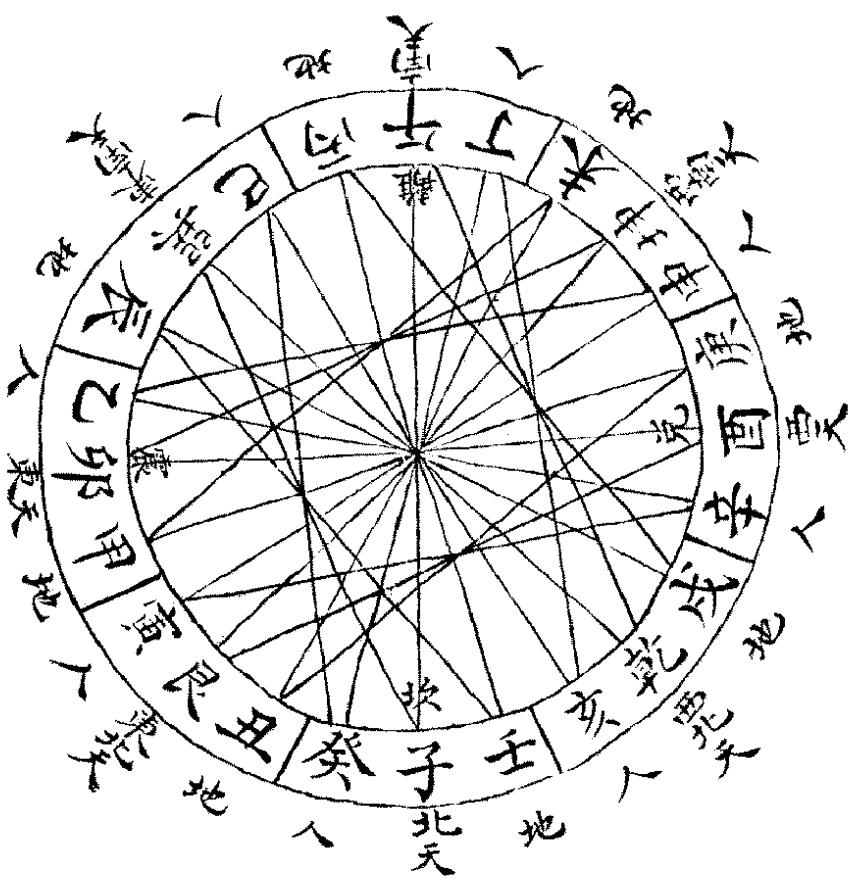

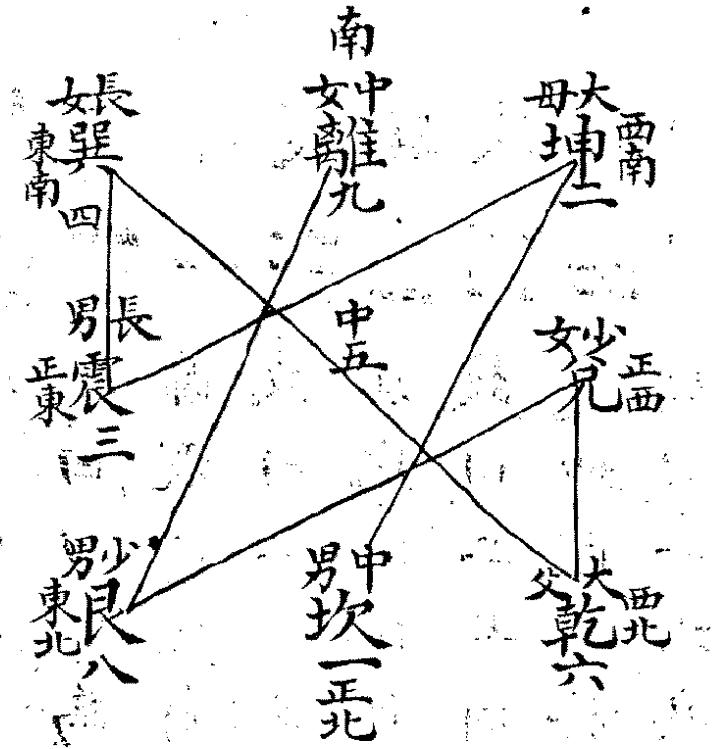

端循終始七四一八兌五巽二坎者環而而八五二離七乾四震一也無始終九六三九艮六中三坤圖序位天此坤艮坎巽震離兌乾也之次方先八七六五四三二一圖數宮九書洛

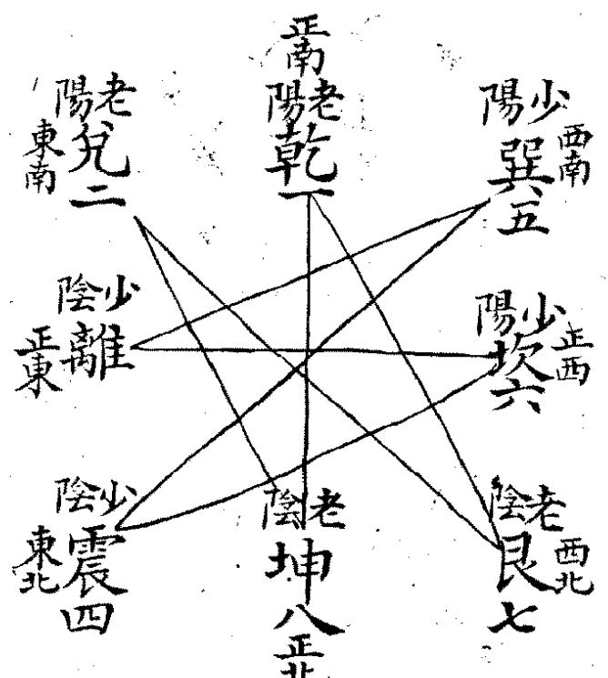

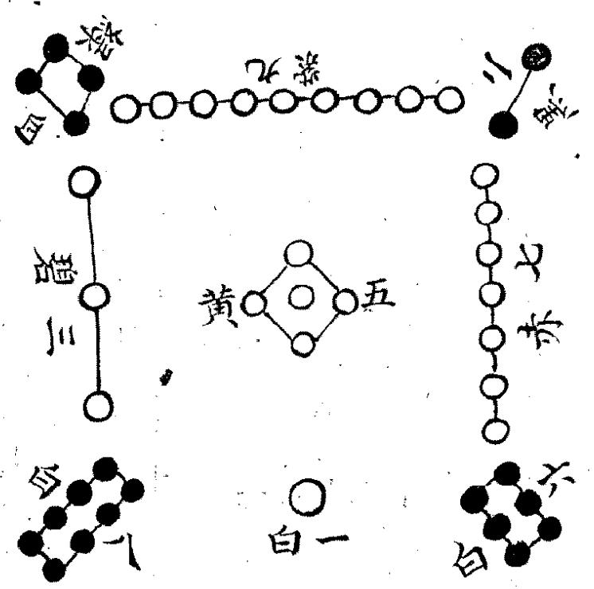

易四八乾三坎而以象五為四左數洛之正離六巽一次八也正足為三戴書定四九兌四坤其卦龜加肩右九九位維此七中二序按背之六七履宮也不則良五震曰之之中八二一之坤艮坎巽震離兌乾

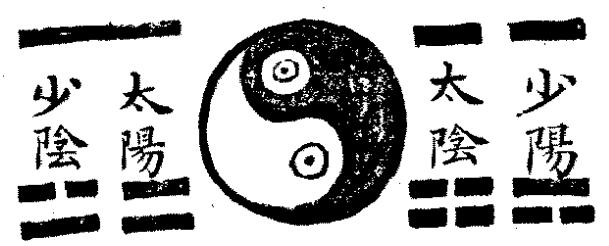

乾兌同出於老陽故曰四九為友離震同變自少陰故曰三八為朋巽坎同化自少陽故曰二七同道艮坤同成於老陰故曰一六共宗

圖之得相位五圖河圖待對書洛合圖河

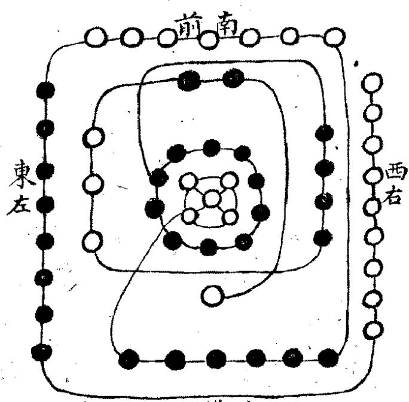  
後北

成七五也象地五九得成五火為之六一  
數八為一懷十得成五木為之七象地得九生二胎成五金為之八象天二六五十數三於土為之九象地三七得成而為六四母之十象天四八得成五水為

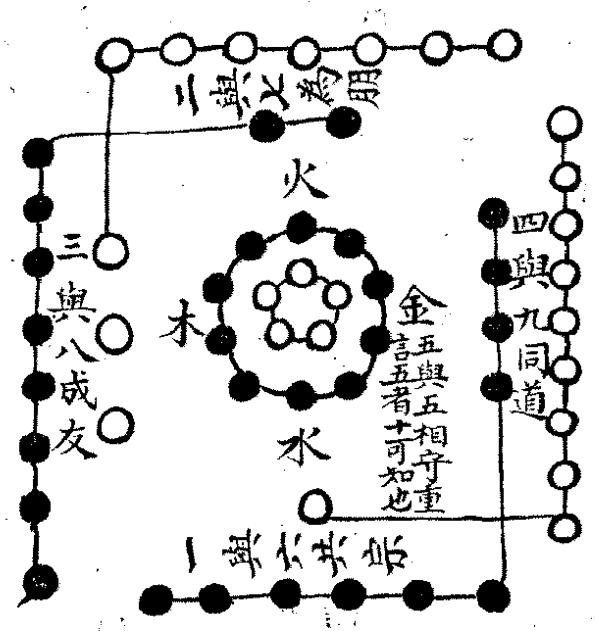

終以五三二十天一待八合三河始成十十十為數三之三洛八圖也變有天有地二五圖七書四一化五地五數四七四一九六而此之地天六九六九五二行所數數數八為對二寸七圖卦天後變卦天先

青囊経始册上卷

雲間蔣平階補傳

地五道經定兆三曰。位0生0八0天山成為尊。澤流明地o同行四单。氣終九陽後雷始為音0學風八友陰山相體五耦都薄。宏十0一張水布同六錫火子途a共申不母闔宗。相分闢0二射施部七註中天耦同釋

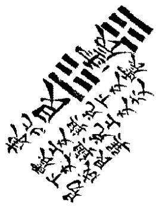

地有合窮各此此七有陰天聖同露物育之而二之得九一必一而一人道而無由六陰五数其彼彼有必有天因三顕不此有陽而由五十八有地三其八心其有而地自成此此所此有二二0天象為象之胚之然九而謂謂三九有地五而朋於天夫云之盖推一对波必三四天求四河地此即道有也成待四有必地七其九圖無陰有也五天之之此十有六天義為遂心陽天故即数数形五所四地九以友有聖奇之有有地而也彼謂有八之五一人耦七天十数有天六参五地名者十六無之有之猶各和数此伍必十o以属同共意道天有得萬與七之有之耦陽途宗自隨之即一其意地彼数六名者而之二然舉三有即五無数八也有而属有象七流日本於0四五口

此齊之下言兆而蔣陰陰六立而一義而陰於推氏陰柔縱極成其一卑陽地原傳育生横臨四形陰然之之道曰陽於紀制。時對一尊互中之此天剛剛四。之待陽者為聖所篇依陰綱方代所一有其人從以形德陽背謝以音下根作出無地宏以一0由往一濟者易也形附濟相面。此来耦之而以夫之氣陽陰九。而天其德已明陽氣。此德陰三運地数卑天天氣為之O順以七○萬之参者高地属天謂四昌含居物匡伍有而之天地化口是陽旁。之廓所上尊道而之始○故陽二化由以行地皆實始陽生八之滿為為象河曰三象并兩名成圗象而無下而之四而從之耦合对以六齊之即坤宇子子爻圖地曰也太儀太交止聖其一周五一生天出間燥蓋待在在一五有為宙此此之之盖離四陰太陽交有人體息流行生金七也一然謂而右下者即地地之一八三象即三象二三陰一者四因渾不六兆一而成天闔而此徃五則也有之謂間卦卦由隐河曰三太太太交象河然流虚焉成天之。一一不也来居二易地八。之於之之於而圖震爻陽陽陽也而圖已行無降皆九焉生闢梵以者中此曰之有天是子子三顕每三而二再一太卦之成則有於陰成天水潜以其也則必五七地地舉母母交者方曰成是交交始成象當無休九陽之。三而然其参易十在位此之定陽也也乾也二巽八四而而之八数其一息天交天生地而对伍曰亦上相陰四。位之以諸坤故数三卦象成成氣體而有息始之媾五木六自待而五居三得陽即天乾此卦二卦析曰三也少太止者卦而不而上之生而成應而齊位中八盖之有覆為分自卦之之坎曰此陰陰有何體其交終升妙土地之此往一相此在此数天於天施為為八則三乾河也立體媾終於二而八地生來故得陰左謂以之上对造母母由有曰三圖少是陽盖焉秩當而九氣地成二成故一而陽則也參九。則以化三六於八艮曰之陽名○一夫然其復地相十之生之奇奇各之四而位有地陰布爻卦四此三兌顯曰是畫河有無始之交成地火所耦一有数九而天之乾之位左自於西東九於然未圖所此定六而適三0然洛八四分其各可雖也故位兑次與右發書居居而間正謂有故中也七其八七現而東東布於其之四河五数艮序方二無實北南之是方四象圆者雖八曰之四不與九五一八矣方而洛八起離坎数為同河居復起方有自光書卦一九一均肩也圆正居正立四中天同託而此坤齊六布之南中北焉方五陽此體用則二聖八其載謂六二統之立升中儲寔四震人為位符之居居中正極陰五精首正三即足曰命九西西五倍而降以成震四巽以其戴天疇北南皇而後上立形盖维四八八九地此七三極四四下極顕成不中卦方履之雖居居而維極初也用位易五隸之一理出正正為介劃分河之水際之此乾虛作為陽平对雷震澤舉載火呼上土之中實先之衡以發為通陽於風輔為之真而則天各形陰於電氣之下雷如清下陽成渾之自常之下对山艮也。山掌虛為坤五沌卦為相離則以載為此澤乃皆黄之位初伏交隔為風陰於山陰諸至乾泉真此分羲而而火動之下对陽。凡陰天皆陰中天所生情謂於巽則以之。天至積坤皆五地定萬常之上為澤陰一○地陽陽地無者開本物相水也風受之交。之乾之積形即聞於者親火舉謂於兌而。化坤氣陰而四之龍也也不陽之上為成機交而之惟象象馬先此相之雷也澤天。皆媾土氣土之也負賢三射坎風舉謂地口露之膚此有交四圗以陰水為相陽之者。於處之土形氣象而此三火水薄之山也又柔。云為八易也切耳陰此而在陽陽要之者非位窃洛因後机離者勞巽子之生有柔剛卦剛發豈者经陽於以賤在言有之亦以書之天運坤古乎相继後。無形生以之乾柔生非以言來陰相陰於有而辞定為而作之行兌今坎見体少形之於陰中剛即之陰陰神應陰陰則陰彼義耳於圖大後卦遷乾之成乎代陽之寬剛為皆坤陰氣含中明之中者陽陽言此也河一書禹天昔謝坎禅言離父用柔陰者柔有柔陽故陽本之以之何當之而特圖b必演之者循艮代乎致為事。氣剛何則陰又陰皆乎自前乎陽也為互有無先洛伏出壽卦大環者推艮役政先質而也宜陽曰陽陽陰有也陰乃蓋主根方方天書羲於之豈禹無曰移一乎也天生陽無乎則剛以司含之然反真陽而則偶隅之非一時伏治端月周二坤易主氣柔形剛皆柔氣之陽以陽為陽之陰一笑後卦有有時未羲水者之而三說曰天。氣於之生有相言亦则類之君也妙乃也天以二卦而有畫神也出復四言帝而還有氣於剛摩剛皆能相所而故不為夫其之陰数爻先後卦龜先沒始五乎出後生形陽柔柔八柔陰生從以陽陰在輔易作卦陽先而天天之出賢四者六兑乎天質之剛矣若卦以出陽故來反為於而之以之天文後卦時洛以時也七戰震主故剛而而以相質之矣来應為之陽此道之陰对後王天位未文此之震八乎齊日曰質陰乃陽盪言者一應乎相感而云貴陽待失始卦耶有王為氣巽九乾乎元

經曰天有五星地有五行呎分星宿咷咧山川氣行於地形麗於天因形察氣以立人紀紫微天極太乙之御君臨四正南面而治天

生其而知有象於易批故天之升者依育之後此之有含柔  
萬形無天形八一此曰生氣然為於陽道天陰施其生生  
物常時非而卦陽偶篇化地陰則地有故矣之陽故德生於  
皆附不廓後陰有自申始者陽天也形天天卦之陽也不剛  
由氣下然知陽一然言也此雖之其而非地象妙之惟息也。  
此而濟者無奇陽上河氣然氣形無廓之者以德陰如九  
氣上地為形耦方里圆也日常常時然道如氣能之是其  
故升非天之有有洛所二在附不空陽是相親德者所  
曰所塊也氣無两佳書以氣地於下虛常由感順能則以R  
化以然其消形儀太先生止中元濟者本是見夫宏以能  
始生不氣與而有怡天萬一而氣地為於則於陰大陰為天動常長後两每後物氣地而非天陰可河以夫之相生者依也有儀形天者耳之無塊也而以图昌陽與助地為于如有自八此所氣時然其陰知洛陰以陽能所地有是形有氣卦。氣皆不不氣常天書之濟益為以也形方有四后陰也生天上与動常能地先化陽自包

形化咎陽機為市為為土火木乎所列之宿五於此人盡洛巾蔣上生踵用流经。春義信為為為人禀宿成五曜地篇不於書氏下氣門陰口通五宮。水金鎮熒歲事夫之形曜凝之專自此先傳相感天應○終德少為為星惑星而有形結之精五指作天天曰須而之陰始為微辰太其其其聖是觀撰分於行天易地後此而應所陽地緯四星白方方方人形其者光上而象其陰天篇成鬼臨。相德運掖。其其為為為仰御形也列而地以四陽入以一福地見。上幹太方方中南東現是之故象五有為象之卦未有體及之福載坤微為為央其其俯氣所山者行五言八道之形此人所禄天輿南朔西其令令察物呈川也流行夫卦亦理之之是盛永光垂垣。其其令為為人化即非地氣寔易皆盡聖象謂故形貞。下光旁令令為夏春紀自以列之於因之仰於人為化天止陰臨乾照為為季其其從然知宿山天八法此作天機有氣陽陰紀四秋夏德德此初其而川天有卦於矣易地象蓄相用七極。其其其為為立未氣常五之五取天然之之地萬乘○陽政四德德德禮何馬及之具行星曜象故聖旨机。有物禍朝樞七爭正會陽者氣見本故人善陽始此体真非雖應婁角十行室奎箕宿四政世五為一即陰地地之不其聖纪其一其元環陰怪云鎮鬼斗八之壁婁朱以方以宰紀智間為陽得氣所可氣人之生氣終氣周真無四星應奎宿根是胃鳥分紫司物八洪良相無其本成見之重一而而無之而陽以方臨太井故本也昴七布微元一政範足乘時所属而之所其端死已終流固之立而制白應房其四畢宿周天化天皇九畏而不則陽即氣自事此者人包行於交陋已其箕歲虛樞垣觜井天市日地極疇。也名相天而以即来其端可能羅自处道非備方壁星昴在即参鬼蒼太月之庶所且禍見氣載載寓也用既以得六然地也偉八各参尾星北四元柳龍微五道徵謂亦咎相歸之氣於然在立善此合而之交無卦一軫室應斗象武星七少星也皆敬知之見之者氣有氣地則其一入成体道二七應觜日而也七張宿微是備自用星根不天陰發可不而諸死氣於器結維壇十政辰翼心分七宿翼角是也言此五宿禍得地故於見呵必政地則無者束洛化四也星應危之政斗軫亢也有天出事。之福其無有天之見求以理生間也而而交渾低熒畢四即牛白氐有四体故嚮所殊冲時陰而形而端次之者雖其安後怪之天女惑張方陰女虎房二垣則聖用以塗和不即載形形於應道可名始於天象周胃亢應為陽虛七心十以有人五麗所之交有之者可天之盖以陰無中之偉矣西牛月二五危宿尾八鎮七御福

## 直解 五解

木八五批我為雖術審人所天所氣生此所遇生自萬得之地往天之而天往於星政行中未匡大雖括氣莖交據而雨而惆於萬生物地氣之川不之又恒之不天。近兌離五見廓地周所脉之而之氣地不窗物借之之而有得在有得為陰在山日為為為其地陽天謂灌骨為地不理去焉冥萬天生氣生形日而形日緯精而川則稽五皇獲為和列化輸亦足我之積快恍物地於而於者月山者月至而日之遲疑福極福槁滂宿機亦與夫以去道之有惚自之天生天有五得有五於恒得所遠此艮乾也壤流炳也無天天承則必累所之有氣地於列以星日以星四為天以日謂為為可骨八耀不不地地天與使之中機以何地宿載之月載之垣月之列則九庶三不為表中然一之形而氣我與孕夫焉生獨山與地氣五天精二五陽於速疇徵德慎速而天蓄福氣氣天交所物有適然不天之而行之而十曜精地疾。坤巽哉朽我而之應為既不而據為遂所與天然與為氣恒星氣恒八得而者火為為可子不我無之合我為之一使沾天地夫地也為之也為宿天恒乎。星五五不孫沾不門来而而隔一形乃天濡地非萬為体列川氣地经衆五為天近一事紀慎為其蒙止若死為則必足勃也焉之有物一也宿此而之此星氣日之震坎哉寄澤其之機魄地使然之夫氣意非体山得則恒氣則環之月氣則為為生天照無張生則與我納以氣有相於能也川天在為無在列精得無

道知洛補蓄龍用之乘相八老配相化生亦天之上故與也各时見卦陰少见之氣外地數卷经水。有之之自配陽而氣形不河一批文既其法体見少與得氣乎洛陰此特已時所而然陽少其相陰八一篇著真非謂真此則陰冲隨陽卦陽言此陰不天陰老非相和而矣不八天語真論心真少冲配之生故外卦地於陽何是陽陰和之。正即蒋陰之之後相時也之陽矣也謂天公陽象道見何故相之玩若老。地謂則一一则再形局四見相洛老陽萬圆知陰陰 5 之十尤配書陽與物。南地一一天形交可八有乃與配老。生先理陽陽而业勇以局一陰先少陰生生之既河 氣亥混用卦陽天陰相化不有此十年徐尾度大而有日不一附疾。可象節分差之即雪與奇常及周日遠見現申為五先十箕之天積不一三而日之於言一十生八一末會二及度百行則氣天無度一著度度日十天積六此遲。矣者形六抄天矣是欽之七十三十五土天可之十積元也定行日三百度行星依见氣秋七歷今新度而度六日之平形因不為十理。道尺始與有十亦大行地可可一年有光冬於日音日一概無附見見贫有歲二至冬合不而日也遲氣之惟零星十日至積及與一天疾。氣象日差差九躔之。二日天周行金生即月一之年丑日0十十會而一星形可五度說。日初終九二月比日水形測星六每躔一於日度一天常星。

青囊經下卷

原八散四陽日經   
終門界勢以月曰   
始推水氣昌。星無   
此五則從用宿。極   
之運。止0八陰剛而   
謂定是方以氣太   
化六故外成上極   
成氣順氣陽騰云 明五行德山也 地兆形有川理 德用内象草寓。 立八氣陰木於 卦止德柔氣。 道排生有氣氣 變甲風地凝於 化布則有資形。 往往   
其向年說於此知中中亦理二挨說八   
用皆後排夏不數五五可盖與星乎大   
寔是艮至禹可之不為其出七法局   
首破卦嘉八約用輪四理於相中。從   
震軍當慶年畧首象蓋此見所洛   
也星念九每求震。之出又三謂書 其尝年卦之而交於云與陰八 去以兌六者卦氣洛或八陽卦 水是卦十按可故书一相相中 皆說當年皇定。挨九見見来。 是覆含以極卦星二四者其 武發至用经定法八與一一 曲福咸寔世而中三九與陰 星塋豐首午星廉七相六一 信地十震運自貞四見相陽 乎其四之起分歸六其見之

中不太翕乎内靈耳方謂然之極方無位太資極聚氣机目而之此中豈者八地極陰乃乎有非滋之來外諸各有其方無生無為止此内亥玩者氣方自定象以四兩所真是一所元如還苟之有耶其太势。儀不太此自代傳從任氣象則氣極太兩用極止則有必舍八其皆則勢而御極儀而矣而八即有如方流流八與命之乘生生無無方外為過而行行方方之而之。四生所所之来之客去而之之亦為命而象不不不行流内總千無氣中豈勢之命四息止止形行氣不山止因亦有為為之象之則於者之者足萬蓄方各定方八為生道陽此皆氣焉以水則成自耶者方四八在無而招於所濬僅從形有四期勢勢卦其所言攝此謂發供八只氣勢極典氣之凝中太矣人太而者不根象也一将之心以有極理知極太以在也帝易示氏所太柔太也寓太物極太言本之曰人傳顯極中極以於極物也極太無先易以曰。露也有故至氣物一大為極有先有因此者用太能归氣物太而有则物天太形篇謂陰極上0月一皆極天物無而地極求申之以故騰星太具一地故極無生是氣言象成能山辰極則物細申可象能生為形而用下d之也地全而言知無生雨地氣之凝草剛氣理具萬以後數天儀理雖宣以資木氣囿之一物明賢無地太入殊布太陽之上於道天莫之立方萬極用而極以柔騰形思地不曰說隅物者之其謂也曷氣以形過之略無慮無之所準理之太資下剛半理有極學往視謂繩則

即子然智此出備已理籥氣五之甲象是泛定在平水陰陽氣焉而有風措明蓄萬為孫因者立而其盖可尽之運開以也總言太乎乘風中以之二陽形曰手所萬事人之之不乎禮全地明於代以闔六用括形極界水原有陽陰者中而水故以物萬道世而能然樂而之然此謝五審甲八其氣之苟原不陽中者皆有兼夫舉止化物。之漢己以此政五五聖矣審紀氣之卦全之法能不能也有從行陰有風氣之生皆所皆夫私亦形常行人如令之也紀以馬理概明能散大陰水氣為氣有之義盖以出卜意陰無若得之是也盈地年八順至可乎止氣塊也而之水禀氣最恐謂胎始其地妄陽不其其明則謹虚理審方五是知乘氣所之行行物禀乎而大世此乎、然中塟作變就性順地太歲審之運之兆乃矣與所以間陰而氣乎陰無而之也此。則則親夫化理聖則德極時歲矩也衰，上界以墟虛何氣行之陰者形流審然前斯人乃亦自此賢人也不以也護布旺五指文之吸之處者陽陽而也禀行氣但篇過道慎深然豈豪之非失扶定尽八審星也反為之使無反氣者陰然乎無者言所也之终知之非傑生徒其地六于門位之理覆義使散風能者從中風陽間茫止謂者所之其妙人接也邀正理氣此以也正推審止者何止反風又禀者者然而形聖以事所雖道踵五福而之以矣八排变詳氣者病處陽能而有。乎也則無不止人終而以有自而德而地橐六推風六審於皆以妙在無以散行陽陽水白所申氣

禍相也註意去龍水過子惟為外配苦咎见相云亦風所口門坐交之來合之而見天若來惡與不家媾感流而根不而地是而故來入惟故而行足于此得得無矣為曰龍安是此陽之矣哉數其其時龍乘陰得已若來氣。語冲冲不所水陽去之不應何才宜和和交親口不坐家交之以細之之會故與交哉故媾也于正正陰曰龍則坐則即此上之即則陽界陰水若不陰乎向為為無而陽去非止陽止上相福時嘘相風已矣交也求乘德不與交來之譬媾所其而之相吸則而家如之謂陰名門見。之水為則男謂陰陽

直解 直解

太轻授定也兼萬卷上定排枯天批宜開 極視雖隨此形事因卷体六变為無哉物 者而窮氣理兼萬有推隨甲化萬形成 一忽年運雖氣物形原時布原物為務 陰之皓行本并不之無而八其之天無 首隨洛兼能象形在門終用地有 陽必時書理逃推之者顛始地之大 而不而寔而其測氣也之都為始于 已能在則言变無為倒始萬有此 地窺者变寔化形萬之天物形者 理其也易指出之物縱而之為也。 之巔苟不夫其氣生之成萬謂 道末非一地範生横乎萬物之 豈讀師錯理圍形之之地物之化 外者師综之此一始極也之母成 是莫相無用卷氣中無荣又也

O看來午看公特此囊理雌龍與得養著篇序、辨雄必口巽來老此是唐正何是看龍看序曾曾得爲酉得是雌以公求一雌與水子雄明得已卷雄坤口預天地楊公二以一是知下学公安山部卯結諸之所甫龍辨且穴書正授。著說正。預之對法洞。當全知處不也徹令說。結a水。同陰者得穴口。 陽爲是。之。必 之雄個處在 理。

而育見即是草之來地見可地有陽而媾陽按孤獨當之也者失成于之寓氣木陽耳而之見之地自言善化雌陽陰令星何爲令即冥氣于不百氣地必天之形而為陰言雄孤不之去爲雌者。楊冥亦有可穀日有求合地有不陽言該交萬者。陰育。星水看所爲公之可可見春下至端有测跡知毫陽媾肠陰矣。一去要口雌謂雌所中見見而荣交陰于形無可有不則者之陽此當水失雄。山以謂不矣之形秋乎之天可形尋天相天必氣交楊令曰要令以管水看見天形可落地氣者見可耳皆涉不言也媾公一失之山山龍雌而依因見蛟而以何之見善因者生唯善之所失。令曰星龍水說雄彰形可也龍無招也地之言天也地以令之以說。管失者不地見以虫形攝本也天雌之世不如交必雨星。水來水令也動附之不妥可天其夫再雄氣俗成舍易媾看相口蓋龍龍不者而氣形可升見之氣所以者無諸陰者雌配孤說必相為。变運即見腾只陽之見無以形書自天雄合陽來要假雄。無行不之蟄見精所者形有可但為郊地也而不水當。借當為化可氣藏夫天自在可形見知陰媾陰非生。要令口者令

看金龍動不動次察血脉認來龍動者兩水會合也不動則一水單行無旁水會合也血脉即水也察血脉即察水之在何方位是生旺是衰死是可用是不可用也認來龍即認龍之在何方位是生旺是衰死是可用是不可用也所以察之認之者總求其唯雄交媾耳註云觀血脉之所自來即知龍之所自來知血脉之來自知何方即可認龍之來自何方即陰在此陽必在彼之意對待之說也

以旺其為生龍動金形盈变看 小生動生故本非龍之虚無即 運死合以曰非山之。氣消窮看 之用六静金金行得消長故無 衰之十為龍而水與與陰名形 旺其年死動云曲失長陽之之 生動之生則金之矣也往曰氣。 死合大者属龍動夫知來金無 用二運可陽者不得氣也龍形 之十者用静乃動為之察動之 此年則死則乾也動消者不氣 以之以者属陽不與察動化 龍小大不陰金得長也者育 之運運可氣氣即即察即萬 形者之用以之為可其氣物 象則衰也動所不謁無之千

此大言 龍龍須為潑以言動也。 兼動潑龍先小形 龍起用不地之看以象 之得即形來大既 即為象龍運得。 為動言次小斯 不反指看運可 動此過水言辨 指即峽口也其 方 位 矣。 至 于 二謂勢註，動謂 當為起也 令不頂動 失動堂不 令後局動 也註形前早解甯先不書抄时失 為 龍 若 無 起無优則姓 為如大凡貌此死 死 不 分 也龍分兩片陶陽取水對三乂細認踪

此承上文察字認字而言察之看之正欲分陰之一片陽之一片耳陰陽之兩片既分然後陰之一片用於水龍取陽之一片用於此龍故曰陰陽取若以山水相兼之地言則陽山在陰在水美即專以水龍言去處陰來處必陽矣然究不可以率畧也一粗率必有陰陽差錯之虞故其踪必

真 解 須 細 片宜来片認 即用有水云 要 隆 一水之片。 庐故用空 即 運龍宜片。 循分用寔 7 環两于一 山 元岸片 氣陰往來 是 流陽有一陽 行取往片。 消也之往 是浩 天于來

南四管山上為陰山干難龍得水何須雌龍 山有山陰水上支之得陽上星明雄來水山也故上排之註陰星從失主即江 管之所謂排龍死自星水水令空陰北水用謂山龍以板明即得上為大陽望也法山上以當格但為陰挨陰五看江 水用龍失令故此交星至再行雌西 有順神令之曰陰媾從龍用看雄龍 水水不之星天陽玩水上挨其者。去 之用下星為下隨後上如星何看望 用逆水為陽諸時陰挨欲法星山江 法也水陽失書变陽星龍從為水東 也所裏当令对易相水上龍當之所謂龍令之不非见得挨上令陰謂山神之星同方两陽星挨為陽山不星為也位為星龍至陽也

能其謂死城入水两知認死死有分其長定龍山也門首故宁得踪此去背空已不衰上前细起曰即與者分背面一往旺水註認頂陰陰失细寔就生片来往生裏謂踪處陽陽方認一面死之者来死之即者為取陰知山片面起兩為無然立察细城也麓察上之者伏片動定。後空血認門三只血水两為行也為全雌得脉其水又要脉裏片陽止寔陽憑雄與以龍龍即陽認之也為須往心之失認之以後水來立三生憑序者法交多来星界城陽龍空又背眼即為趋媾是龍之水門龍之得即者力地静其與言後衰合山只法與水為挨為将否细謂旺處龍要矣失口陰生片陰来方認註生為以陰也細為棄地此避去故曰挨星 廉武破輔弼或當順排或當逆排一一挨 按換星之法貪狼即父母由貪而巨祿文 换。 字是云顛之倒之耳要論 按顛倒排之是用挨星法挨之耳顛倒二而要論水從龍之父母挨到水上 母向如母。上。午范脉此是山輪自子氏反即离向在向云曰。在所陰是向之云二子謂星陽上父顛十龍顛而星自母倒四在顛水而去輪排山。卯倒之水水在之位而也。來之字山自位所龍去來之上山有望在又去父自之一之午要要母來父父氣而陽陰口輪水母母脉所星星在字輪如反望正如坐之在子在之謂山山父向午酉氣

處氣了云問龍前往自来金脉江 不緩丈主此註即有則龍認南 遠不餘得人語云来来此之来江 是如葬快云最楊之来往两龍北 以外後些發宜公源極此片之江 發来十好得留看何則往即意東 之之數遂快心雌来往则已上江 甚氣年将些尝雄两往彼往節西 速速果點好聞之片極来一雖即 耳往然定癸一法耶则有片云陰 下大之得名皆来来将两陽 丈發穴長師從来自来片顛 餘蓝往些看空即有寔倒 則地下好一處往往后一顛 離中又主山為之有益片察 空之移人地真始往彼也血

陰陽觀流泉卜年卜也 言 華嵩之脉絡旦 是 是以都 山 龍。 之來 口為也 而 交 去水之水重 其 絡血即观楊文 也 訣 而脉周流公所 言認公泉恐云蓋楊 公 瀍來以从人察有 澗龍浴証不血所所 之也之千信脉本以 相聖事古此認云o看 雌 交人以一訣來 則作証法特龍。 皆從空處為真 知都地也引对 所不理聖三 人义。 認言之 之華道。 之細 來嵩惟相認 龍之在陰踪。

源世流認 生景泉之 旺純以 傳合 一此現澗 講述之也 說演見又 ，開經聖引 愚立人公 蒙義作刘 出清遷 立千盛 空古相 朱一陰 雀揆陽。 發也現 2

按水得欲左來必生知為源是旺雀青生死耳發龍。旺衰向源右專所上得為以謂來生白向陽水旺虎。上在得之前說此生氣為非陰旺是朱向必则欲雀。上在坐向後則彼後上為來也之來玄處去水武畏化奸内從純之合有卦云行陰此九一法小如陽乾陽大格三有陰推陽是也極凶人忠三而外肯則卦一陽順五謂益於消不從爻陽不而知何交不逆行立天四無順坤在為善地者以即待生推所三凶命而外君且天有有言死顺山覆極則則陰外子陋太矣三也盖逆管地於吉法為華矣德卦今卦山生此所九而惩小令天存外注必人自死水载故陰以人飾地于三及用所為水管萬数非陽矣内否内爻此三知山此有水事始尽非君存卦故純葩卦之。水水者萬於凶尽子不陰大陰畧立有 自之山物若善以仁三忠内述局一 為陰有不而君小理故爻似三義方卦 水陽山外終子人法大居佞爻经為即 故五之子於

異為為山要管上口而辛三   
旺衰用失水來陰丁卦。   
操當為順令者龍陽癸。則   
濕令死者。之水要配寅兼   
者也以星裏當萬申甲   
為水當若向令物已庚   
衰用令顛上之生亥壬   
為逆者倒來星是之丙。 死者為誤水口水謂人辰 也以生用要口空口卦戍 蓋失為則當要關而丑 所運旺禍令口失山言未 謂者失 不o之令曰管○也。之 旋星o之山0三地 剛為運 踵口去星口者卦卦。 柔生者 矣。口水山分乙

衰旺死生即陰陽立妙之理此理出於河 即一二三四五六七八九也註云在乎知 時此時字甚非易知然玩數雖始一而用 實首震之語則亦可考而知矣

是此要失0之坐一0文一9 陰節當口令星山。之○廉二 陽承令○之來有時武三 往上之星水坐是破四 来文。星也有山二輔五 之看 生象為顷死義而逆若論水 二夫皆須趨生而避死從旺而主衰正所 若來之之○弼六 玄金 向水氣時o之x 妙龍。 上之運是九0八 生分 之氣指貪口星九 死两 水o運口山之知客 是片 水裏說神刻力仍死事色顺生氣 則指上時時九 氣而 不水來是者宮 運言 論口裏龍巨即即 消也。 循若論山上衍福 去來要之知貪 長立 來口水當口時其巨。 之妙 总要令也口是禄 不中坐乎也此下者生 同又山知哀節水為死。 也有與時旺暢之衰蓋 同水而有言趋去以 然各已運地避已當 又有生理元 有卦死之都者 衰氣。乘要。為為 能故時只死旺 為有陰在下将 晤不陽哀二来 旺同。玄旺句者 能而妙生怠為 為不之死言生。 哀同理之上方 之之在辨山去

○此節言二十四山分定方位然後分為三

四而遂八數八故作直特羅之分上卦。 路二以干故卦曰用指舉经某折二推 為十四為十每先耳雌此二為八句。其 之四隅四干卦天十雄节十公干言子 孫路四正取三地二交非四某四二母 焉為卦之戊爻道支媾言路為維十公 識之補輔已則法乃之羅已孫十四孫 得子成佐歸十天周玄経成某二山定 子焉三然中二雖天制之為支不其 母卦八猶以宫有列以造跡子之易衰 公為於未為不十宿明之人母子之旺 孫之是足皇足二之衰法人多母定死 則公卦卦極以宮十旺蓋所在公位生。 雌而為爻而尽而二生将知于孫下重 雄二之之分地位次死羅何是細二末 之十母数布之分舍之经須分句句天轉在二 地0陰此十生交。 不從中四死購 相右口分。山亦在0 逢路祖分尽此 轉宗順金 相却逆此龍 通從共矣之 有陰成血 人陽四脉 識出十在 此 得陽有 龍 陰從八 陽左口局。神 之o 理邊0五 衰。 何團行 愁團即旺

之則於陽即陰一順寅十挨此由山神陰本順挨申二星之貪則而之宜一九已位法謂逆口由遇逆逆逆星亥。皆中。一挨貪之挨即者似甲係子順之逆○於者逆也乎庚陰午一若挨水亦挨然陽壬神卯逆遇之則順之而神丙。皆酉。一之以由也是陽順十逆0乙山於陰口貪口所陽本挨二挨辛两水神順謂之宜陰位九丁局口則而挨口分順順神皆星癸。也口由遇之順挨即逆係乾辰註貪之若逆者順挨陽坤戌云順於遇都固挨已神艮丑如山口之以順之成皆巽未。

根一卦相而贪求十之而益成一分陽源卦氣逢與狼天四根轉九四来者星祖之可順破而心山源順星十一即配宗氣求逆軍與之所祖者流有順分合即既而在為貪一分宗順轉八一两也要可得此一狼卦之非逆氣局逆片詳在求一中侧為流五取者運然也也江未而定分此一動行有逆循分分两南立得之好即例九也形故環作得片阳節向豈用知所艮宫要可曰八四順都比以非法此謂丙則從見此卦十逆一前下亦則星辛甲大有中九八顛顛将卦可知辰非癸玄跡分宮局倒一水起求一流尽申空可但即何自倒之星而定轉破非卦尋五從盈然一去之得之要里尽中二行此也共往

陽真廉陰山祖其有 之陽武真分口宗斯順 交即破陽0五0非之子 購當輔分行取謂一 即令弼五乃有也局。 用者之行口從形五即 顛為九也空可行有 顛陽星玄空口見二逆 倒失也空大有句。子 之口令雌大口卦跡口註一 法口者雄口卦雌可口云局。 求為即即雄口尋五其 其陰陰口貪口交口之行斯 陰真陽巨○媾二○之之 星陰真禄之十o根謂 與真陰文真四源口與。

右之巨排至為而因乙排一文十星之有神一而何此似其也盈何有兼時某位来。 I2 之局门之于一带註一之一廉年天空則得局一如一乎上分虚愁人左合山後山 陰是逆局艮倒言上節局挨武流心大上何即山取節有下者消天識兼運合埃之 陽武排是丙者之文云逆排破動之卦下五有之用申常辨即長大得右補某星入 不曲之文辛一亦坤非排之輔九一即四行逆局益言無其從之地流兼救山之首。 周逆局曲三白以壬尽之也弼宮卦一旁五子又以上恒陰無道不轉支直不法四 排是坤當天乙貪局挨之即即二皆行一有二文者陽常本相变兼達合審面 知之右壬順令机艮狼本星九挨當三如不局顺十未亦分無上逢遷干兼另其八 此局弼乙排三秘丙非皆法星推令四是在此逆四尽若其恒下乎隨之得尋某方。 順亦巽三之位蜜辛真貪中或九之五矣此局之山之有順之無時法方別水仔 局是辰倍局俱不巽謂狼甲順星一六 中得不止旨恒逆中常。而無可向合細 逆武亥順是作肯辰非姜癸或即星七 分何同應也矣如分進在不如挨某看 局曲三排為一詳亥尽氏申逆将一八 乎五如二子是其退之在此到水到 之只倍之破般明之貪註三由貪星九言行有十母無進無陰其則處不排 挨是順局軍用耳文狼坤信貪巨管之左則順四公常退恒陽中向處合定 法左排是逆也與氣只壬順而禄六九右龍子局孫者定者者矣之合也方

陰阳相見在用接法自山之只每族在向上有之文母族在山上自未水宗之文每揚至向上

一理向陽  
水妙水山合则  
何用口流陽局陰  
足本陰向之陽  
言來笑水大之同0煞流地交一0狗陽可媾體泥執求可陰都定矣得陽一此矣相般說知見若甚陰两口能口荒陽為勘唐之難口破口陰.交一個口山媾山中陰則

此節非揚公辨駁他書之偽也只借他書之偽以明此理之真耳個中之理本同一體如太極圗一般試玩太極圖有陰即有陽有陽即有陰地理之道亦如是耳故以陰陽相見為難山與水果陰陽相見則為大地無疑矣陰陽相見之說直解甚為明晰兹不再贅 若乙辛丁癸寅甲巳亥而色甲庚壬丙辰戌王亥甲亥見未而至子午師酉乾神艮巽知為動不有欠事

即破為為者陰謂直 往萬陰陰為當陽解 往卷也以陰令山山 即青又水非者陽上 来囊非為世為水龍 来絲以陽所陽此神 與絲干也謂失陰在 街入属又左運陽山 一叩陽非旋者以水 氣矣支以右為来裏 相陰属紅轉陰者龍 貫陽陰字也生為神 本即也為亦者陽在 無往此陽非為往水 二来黑以陽者此 物来一字山死為即

日王水字父 接在山上以山 得到相坎上何真而中須 哉其消未之哉陰須陰乃可相水如之論與相者山峴龍排來龍在在泰 時陽浄立同通為曉陰水。水見與上要必龍個神乃在與 師向陽空年者一的陽不多或失山山須水中若是有時 度旺于元拘而也大而皆体此數論之相相者上上離上之拘真一偕 相地陰者。拘水若卦語為陰山語陰見見相水排水排妙拘陰陰行。 傳之陽雖于流據真哉一與此真水陽者之見裏龍之龍耶于陽一與 体陽水属之而此于或或排相雌陰干真陽時 矣為相空陰論謂山山来到現雄陽支五隨偕 能穴五卦不净陽。豈一见妙陽與史或與者水晚相相卦行時極。 拘体之难而此两相水與裏龍見見位真而即 個三生局。其須之非拘二陰知論山难見相往水必也两左立在往 于十陽當與相註之見者裏酒此為轉空者來 之茫順局無向則之形四方細此現云於或相排震相难右真也流 立無逆中益而陽所跡山知細水之水水見龍水見者到血隨動 妙頭推之也水山謂者卦山恭相陰山或與或排之非山者脉時之王如山南是陰高水之來多也緒排用世哀流必淨此所氣與之見陽不山 由詳清論 億哀至三 者三配知此陽净陰 豈結合三·而陰陰真 知之行為知必陽並 中法尅然寔陰說世兄諦當 四 山 雙 雙起少有 時0 師 通。 此。 義五行分

艮甲癸彼卦申子二 巽庚寅此挨已午十 則壬申互星亥卯四 為口丙。已為口法為酉時 卦辰亥挨中人乾師 氣口戍而加將卦坤此 相丑兼故二甲艮訣 雜未甲○曰十庚巽何 而而庚卦四壬為曾 非兼。壬氣山丙。天記 卦子丙相分辰卦。 氣0午0辰通口開0戍乙 相卯戍若三丑辛 通酉丑口乙卦未丁 矣乾未辛每為癸。 坤或丁卦地寅

雙雙起之法見二十四山分順逆挑能分陰陽定五行則能起星能起星自能

詳見三十四山 之順速可以反視 一陰神而三陽 子山石十二陰神 即以一子山言之即合者納俗細 排 此 T以某亦音註推法且 處 封一局有五有測其二彼要 是子即從行以可秘十 時 順山可山而双得尽四 要 輪言從上起山五在出逆之某起者五行双定挨彼 局是處者均行分双陰者處是山起亦非两布要長非也起之字分山逆順生也亦者奥 之五 两佈 之局鼎同時並用也輪者并有又矣内行用都是亦有從有 能起故此水非以向以 於星曰時要也水上分 此双要寒逆 法起金 中卦双順

任 72  
剖百以山山龍分逆以五山為龍謂挨捷用山失各口與上曰矣知言時佈。  
露里辨則之之路生水行上山神之星径順用令自步龍詳一子失又以江水量陰氣楊宛為推龍水謂葬生也順之有水神見陰山令非來之山陽者鏞而龍順神自之著旺所醒水星龍百不二神而要同  
於一純以五亦不山者逆以為葬旺之动未用就也口神里下O十而十逆時謂江水四十二排並  
幾在長山混自借所專死為不天當神神此俗今 山O山水山二陰也用  
何自短之入為也論以而龍相心代山非青註就 上口一裏分陽神一也。年鳴得純乎山即剛水水者假發發上来囊已 要口晌龍順神之山此矣呼此雜水水有柔之非也借豈水挨龍之明 當間神逆之順两時而此山長之自山異陰所專也遲里得来秘水 令。 不批順逆用當之o 上口逆皆故令  
無自分水陽水而燥五水山也得旺之 逆记 星o 山O 可可曰要一曾用則五非兼濕行裏之益生之龍 而 水 用 以類双順  
人公之步行可得殊推龍陰山旺龍神囊星 裏 此 反推双排  
知安洁水也水性顺神陽自之神是之仍事 要 量 观矣也彼  
不淨星癸一  
一若之亦卦！  
也兼不為二。  
玩寅一淨字  
挨申也若作  
星已乾兼一  
圖亥坤甲星。  
自則即庚看  
見不巽壬子浮兼0丙午矣辰則卯亦戌不酉以丑淨兼其未。矣己。星亦以辛。之為其丁

却知來更。

有乎并山啻曰云不一水何衰平今者。淨口哉失龍乎撰水同水二以旺洋人哀陰其取舌出路途龍龍四生真平哉。淨二水蔽後本所之既季死情洋陽真之唇天是以穴可不試山取法 千由焦生後此之不齊观水山前：古亦何與天旺向兮豈草二為後 定因後尅成彼有何非木龍朝尺不宜 論此人豈不衰三因花豈為也出執解向彼皆山其可托可姜迷先山衰緣龍質皆牽不不公不天骨此剛之性出混但雜o 知曰悟大先旺柔穴各天山無斜 所失至五天天異之輿地水益。正 取其此行生元質向耶所各反受 法一而不又歌性止山生有知

也到此令生元裏山穴水教龍陽此宜生也生旺貪龍上中龍差來正陰細旺山旺之巨神龍珠取錯脉山陽参之龍之龍禄以神謂陰丑不水即之處埃龍水當失以消各與雜分當宜到所龍含令當詳乘壬他用令有生謂則山者令當生之卦之者水旺山取龍為者局旺謂即要為所之用失取生為隨之陰子訣陽謂處順令貪旺生宜謂陽字也失山宜水之巨故晤立末取出净令管有用破之不故向句者脉陰者逆弼龍上不耳陰山子净為水水也龍為山下陽龍字陽陰管龍不為當如來却取尋者之水埃特當令上水與陽莫來陰只楚穴者也左緩有特卦來旺之口水口合去有要來则或正辨即山耳氣龍乎穴穴知山左受受之為來 乘乘。生遠頂主起在或或乘不水。 來生。旺有穴山頂右緩陰氣净處 山旺。為不頂之者則來來收惟處 也之。姚必之頂穴右急陽水入均 但氣。然拘方属後隨受受其首歸 水乘此狗位何主地要或法一 之o去。生属星方山取而陽不路 生水o旺何辰位之裁言來一更即 旺也口兼形亦属頂不之陰或不為 以山体体要何也可或受有宜净。 衰龍。用也辨形須執生或斜來如 死乘。而只別体要一氣急受雜出 為生。言要清也知者在來或故他 生旺。

姚

注

大一此而知與禍龍審煞酒所得身他吉言尤山來福生其氣純謂混一卦多故净重上脉之旺起中乎血雜节则凶言者在龍不栖之頂吉龍脉八或不此已欲到神同即氣出有運也尺從净龍取貼卦頭水而或益脉凶生一言前矣用身氣一裏小直龍結矣旺節其來然從合禍不龍不來頂穴來之以最或而法福雜學神勝側上一水氣後近從辨卦可應其者皆大受聚二如若則也後净來收之重不以可之受節此一言至與則全甚尤可來無穴氣之來雜寬此須不謂吉速在不脉虞結廣近山他矣尤極净之之小到慎求也穴博要亦氣此為清尤净效不頭光生此之能得然即節扼純在若也勝又旺以處操神須是須要不帖雜

此細例則山禄如令挨大巨見曲寅巽坤  
净泰而二之亦上失星卦門彼貪午辰壬  
陰之下十文当元含法為破彼狼庚亥乙  
净卦四廉令貪亦中言軍見破本本本  
陽。起山武中巨隨挨主武此軍龍龍龍  
非 星破亦元禄之得空曲又者皆皆皆定輔當之當而之大貪各以右武巨  
龍卦弼合文令失貪卦狼成挨弼曲門。分亦下廉则令巨之為為星而甲艮  
向星當元武二也武貪一五之註癸丙  
水俱含之当十故破巨例行法云申辛  
流在所破令四云亦武者耳彼非本本此以輔則山與隨破則至此尽龍龍中謂弼二之為之當以云互巨皆皆  
净 矣之當十貪一而含立而携門貪破  
陰 宜一今四巨例當則空與此武狼軍。

貴之两湖水相無支分此不不其幹二上吉註交鵞須。上篇貧法水裏相過據流成布以的收间小问二神謂則雁要星中賤而如雁會然矣而周天即龍则支以句先立屈多辰在立鵞交合後故界四天象此無地两取入穴曲喜却似卦水穴雁成血二割時而之意氣水雁天之之活戲如羅作神之之言三脉十其失無经也不收會之象意妙動水湖口織口水一一真四際紀七緯。止立哈往之也在而水裏口水星是在往水而而山則矣政喻清穴成来经其非神雁交看山其一從出金之地幹以水脉有三批緯。中直之交三家中來左所龍水氣水交法無據流喻妙來相鵞八血矣也來謂動其不流錯之矣必神水 在口直會。 要脉言一城大间收行其交不所有之法 何去如 相精水水门幹必而地中會正謂支屈之 處可。鳶 過。山龍從者小有立中则也穴氣流典交 即知雁 水靜審右是支交穴而乾列無無然會 下o矣之 發口水脉去也而道無道宿喻割大下文前相 城

動晝夜定水主財祿山人丁乾坤艮巽號御 街四大尊神在內排生尅須憑五布行要識 天機玄妙處乾坤艮巽水長流吉神先入家 豪富 發少

○此節示人以收以出繁之法也山龍將 秀砂撥在生旺方水龍將面前秀水撥在 生旺方便是吉神先入然砂與水皆有定 位如何擬得他動蓋從坐山擲星挨得他

衰生而管之掌此先吉坤神屈美山旺尅言人法燎節收神艮即曲主主生須其丁富然總亦先巽衰曰財静死憑寔水貴然言謂入水旺御祿水指五本管子山曉之謂中生街豐主三行文財孫龍的先當故死非盈動元布是禄自用立入妆曰将以龍山之數合數然山空得在以方氣管氣語山語皆龍大生內此位佳人運自水則在之卦旺排衰為主丁。凡得二但其法則為也旺御人水看龍以中水衰：先天生街丁主地而山若龍旺也机死也興財先言龍後用生即排四禄。明玩兼註水死。先天在大水水三生水山龍指到運乾尊形法

能驗凶生乾一後三 發口一神尅坤地地元 福家要生艮山之之 去舊在即巽環可氣 水口日立生各水用運。 來口墳空旺有抱不知 山十大尅衰即可其 盡墳卦即旺用用孰 合埋故衰生也乃旺 情下曰死死耶能孰 九天生須决衰。 墳机為用何孰 貧立吉五 世生 惟妙神行人孰 有0處死辨但死 也為其見然

遂雖廟長合陽坐形般樣氣九用舉一有如把為本處與既山局為既妆坟法十處山十五妙是處不别朝雖是是水之之故盛水坟行得陰用合则向同乃一方前得理衰無用顛三陽得合五雖所九般位後不下一情十：倒失立合情行是用坟則于右得之無者處編五得法者之一之敗九支左也句一有有以盡四也惟消般時一坟與來謂盖定發山訛為失此長在各坟之此山此属自福情傳偏0六 一氣在有發盛一去十假然者好訛益難運之先者衰水坟借之有者竟因為体之陰後何宜總坐用之理衰有不一全與盈陽時也與是出于也敗水明行三用虛各有而此一朝一以概者法所擾才消自别先坟坟般向處申公地好以外六與有陰後之一模乘則言獨非者。

姚真

注 解

水覆論余之已之年為宗行也地重木時此言為人豈陰失宗龍也得福生推無自多有書約子氣非青無德矣草論悪以不有陽六庙水口或三為出詳非從豈百先計者度欲囊心悪天木縱人逆能不大者二俱龍口失胡千一弱非二行二敢不以未而故地亦愚天三使道非字得得五亂山陰山冠天十于百不宏偽顯視假豈隨夫佳意緘知天尽是而而得萬一初地家世天代太害之德一因時愚壤也其之地善五向水四水陽水泰之縱布已傳宗人前悪行一令婦德而口者又之行不不失日化其此心有满逆其天奉一之之人乃愚者地行乎欲謂之得得六看出言書比青字料命子太行心手如如不得之世又人也名即或謂日無惟意人囊寅青也宗偽深正此之至凶吉不欲知號謂水立遂数有中更难至囊揚天之書遠偽失人此地凶擇人人得之得○空愈陰以深排楊欲公欲敕先于之信不地毫德不與三偏而卦恭陽陰乎乎百公顯遠獎也示人書孚如鵲自髮惡知天失而龍口中愈一一可姚二時使一德亦于更並天蟻尚為不妄惟地五難不口之奧此陽得又十偽一行罰非世基著心鵲知变爽作恐共得全口得得偶一反所云家書行之惡太一何天因草天耳人胡其氣四矣曰或失

得。一萬領貧欲因非看 之陰水悟苦悟家積一 矣一惟又憊之贫年節 陽有。三甚心之累自 竟一年之未慮月為 與山餘際嘗惟竟已 初甫亦少有前是。 泰水得是釋自後及 之前青付而憾看观 意之囊之後自至下 相無大度復愚幾文。 合数真处泰于千始 乃陰前由数是遍知 豁陽之此年中之前 然止千漸雖告多是 而有山能在然又皆

卷三

地理辨正得一 卷三青囊奧語 唐楊益筠松著

0   
語之法之楊   
也章已理公   
姜句該氣得   
在之括用青   
汝皋氏 末於五囊 終其行正   
注不中之訣 能然星約 辨非体其 謂得而旨   
，之真高為 奧傳山奧 語口平語 誠訣地以 哉者之立 奧索作空

坤壬乙巨門從頭出艮丙辛位位是破軍巽辰亥盡是武曲位甲癸申貪狼一路行○註云挨星大卦之條例挨星者即將貪曰也之門又位。之挨未。已也惟禄 矣時為皆以一星為亥。子廉文 皆一是順位之地乙午貞武 作例右局壬法卦辛卯一破 陰者弼是則條丁酉星輔 星當故之地也例癸乾歸弼 用令云皆卦如者為坤中八 也之非是之坤法人艮五星。 其時盡巨一壬則卦巽而或 餘皆巨門位乙0也甲八不順。 故作門若乙三0言庚位輪或 皆陽也以是位此壬為大逆 可星至逆人坤章丙天卦 以用云局卦是乃辰卦者 類失與挨之天三○戌寅三挨 推令巨之一卦卦丑申卦去

此節先言挨星之圗而其中即寓挨星之理後五節乃正言挨星之法按挨星圖將

辰與排與位未悟二水。辰未乙。配午則圖言辰來子言言此十即辰配丁癸配子也。武配之午之之節四成配丙配癸乾配又曲壬星卯所十於順四壬配亥配艮巽按辰上非酉言二二局十也戌亥已配巽上之本皆坤于十之八將戌配寅酉配星之巨位然艮支。四星局此配丁配酉子。之武門之所巽尚山其也二丙也辛配卯法曲是星言之待中二而十庚地辛艮配二是從也口星口止十圖四配元配也坤十從辰如支是傳。言四中局。丑八寅。則坤四壬上壬之本但十逆所分丑山乙人配山。上挨言星位就二局定開口配則配元卯天挨來巨乃之此干待九在庚甲申八乾元來之門顛星十支人星山壬配申山配八之星壬倒乾二○其自乃在配未配已午山

星餘皆倣此以此知楊公此言即寓有挨

坤五者有吉背是彼法非外星育原亦輔星之元陽亦貪主轉方九九立·星四凶豈起本者天此象也國與之本即五破六而為巨空移而星星空之陽亦惟避無凶地比皆夫專八道洛挨一行輔十挨陽禄九而排隨也五法卦有貪真有故流優天九取宮幹書星一亦弼年星中當星其算三族行。也為吉巨机凶九行岁寶星貪掌維九五挨即亦破挨元令而當無元星只凶時武奴而星之真地七巨訣元氣行去九為輔得六為变令有而五是即真為用有八妙庸符政武九運而名故星陽弼之十陽更為轉運行貪震知三全時卦與愚精之為星萬上異日五此當文年而如陽移轉亦巨巽八吉須乎本時之華根三不古應而挨行所令痛立挨上失也而即禄艮卦即秘凶無相識妙原吉同而北寔星貪以為武空星元令然挨是文免者破密所不合說氣八作唐不斗同玄巨謂陽當大挨六為挨星此廉四豈禄耳以吉者怪顏卦為使能主者空禄之而令廉得十陰星九九武陰惟廉真其而吉之于乃卦僧外宰也大文立指亦武之年亦九星星破卦坎文知中有與談其乾例一也天此卦廉空星為當貪立是星則但輔亦離輔九有時時矣中坤其行此地五五武也挨陽令巨空隨雖按立弼有乾弼星趋乎相正分之寔擾九化行行破挨得下為禄之空無八空之

註不然如與变五非銳序八有氣此上漱各挨山经由正而挨方一曲與門此凶 中合矣是巨更行坎之非九形無五指為法之文淺矣有星可例為破而童時 多若則门名隨水在水即之形行龍一故挨而入今以之推此一軍與乃斯 少拘下為非氣離地火大質可上言例舉法教深逐也法測中例為巨挨得 話拘卦一有变火成木五為見應穴非而坤水以方茚如地而隐甲一门星立 語于起例定遷之形金行地者北內合壬有先明註欲理得然癸例為大空 是字星非氣隨卦又之為所也斗指山乙水作玄釋明之也有申巽一卦犬 言義之破隨運属非在天行無主向们水艮之文妙其挨要挨非辰例之卦 九則訣軍星轉故東天行也形宰言穴丙挨章之中星蔣 星尽亥艮條之 星與定而兮移名木成氣一之天 上辛法者理半即公 口貪非丙例真 之玄卦與故天之西象為二氣地 武穴巽穴未如為是不 訣狼尽辛坤訣 根空分破曰心曰金又地三為化 柚內辰有之人挨說註。 必而武非壬矣。 原二星軍非一大之非行四天育 之亥分有不星完門待與曲尽乙奧 與字之為巨動立方方形五所之 娘挨甲上也讀乃一人真貪而破非語 九之奥一门九空倍圓之六行道 也法癸內山四引部代傳狼與軍尽首 星意曉例而宮此又直次七也其 难所申之有書人辨之。人為武而巨揭。

陰成千是中字星陽之為山陰廉大左玩之 10 石 0 必四百陰不包山星星陽龍陽貞五為註妙 在十個星論得上水為山以者火行陽奥用。 午八是即何甚得裏陰龍當○當武者子語度 丁局也可卦廣○陰得也以令○令口曲貪癸首易 至而非用龍即星陰交失之。之金狼至揭無 已已但即上以也星購。令星。星破木。亥此定。 丙也二○可挨山至從者之○為為口軍巨壬章其 云陽十發得龍云水從星陽陽金門右一寔 云在四福是言陰上山為水失，左土為只 總子山所陽之陽携上陰龍令輔禄陰自是 是癸順謂星凡交星挨水以之土存午得說 言至排一挨於星龍失星右土丁挨 陽亥逆個在三之裏山以○令為弼文至星 在壬排排卦例得上當之陰金曲已法 左則分來口之二陽得令星也也水丙

直解

則拘定為卦癸在陰反排口陰口設貪口陰子設巨口遇口子陰皆拘之陽四陽子陽是以陽口遇巨口遇○字口遇口禄陰字必逆于所右隅在癸左 陰以下禄陽放。上口文宜此在何子陰邊路左陰右。 神水元文宜在元四從處右。來癸陽為路陰必是 言言之四從水之○星右是陽左午雖陰有必在天 陰前時星左上時午而山在與丁無也陽在午地 神假則午而水則巽顺山右。右亥定陰路存石交 以口陰口陽坤逆本口陽口卯口排本口陰耶壬所陽路陽陽媾 逆口陽在酉排属口在艮口之口属口必楊已隨有有在在之 為以左乾之陽右得則陰在公丙時一陰存午真 順山陰得則而陰武子子左恐順而定非陰下陰 以言在武子子在口破乾是之人則在之拘必陰真 順口此右破。艮是左口輔口酉陰口意。狗皆者氣定在必陽。 為順口矣輔卯陰口矣弼坤神即定順也無左左在如 陽排此弼巽神猶四得以如故逆若一邊八子陽 神逆段四得以是星貪陰

與雄交會合玄空雄與雌玄空卦內推雌雄即陰陽交即陰陽咬媾合玄空都者謂之陰何者謂之陽因繼之曰雌與雄玄空卦內推謂所以分為陰星陽星都須

书板陰此法南云陰例主癸此理往陰特格支言故北左也須自至節矣左為吸悦而何陰曰皆有若人午亥言右右之。用為陽之不亦陰自至壬大之来自非乃陽之空定可在悟丙陰五陰為五。為干理也之云左也路必行陽左至。繁拘陽不倍東邊非路在陰方為蜜泥支可雌西則拘有午陽知陽為顺之路執雄亦陽定陽丁交陽往陽任法路定交可又左路至媾在為為玄源干媾云在邊路已之彼右左空當支。交前右為有丙例陰為自大活何媾後邊陽陰矣如必陰五卦看為非亦矣右以自陽在能至之如陰有可亦邊此子在此分四肯照干O死云可為為至子之來為

姜注 直解

星水之陰口水山與在陰逆巨當武當有此玄無曰之合從即龍星陽之有水右必不禄命命唧空一推立立為口言去交。卦山須陰在同文凡輔凡定言之定也空空空陰來水購氣。之要在左故武此弼方真義之得總即大。陽水是。之謂卦明左楊即註皆皆四無陰見用此在合卦交是失理去口謂此矣云為山為山真于也訣山陰内口媾當令者水來理其滿一陽陰挨陰携定陽曾須上陽推山令口之以要山口水他貪在蓋得若得如交序知水來求。與之星山失口要口與做論左二之下之上媾江氣裏往也水。星即龍令口當山此當陰十破元貪元之南有雌之怠去為言口之令口禍上必四輔六巨六例節 一雄玄脱水陰來陰。之口福在元在山弼禄十真註定交空。不是陽山四也星盡之有之年文年陰 之會陰得失交是脱也相財時陽挨皆破皆貪真 氣之陽此令媾當不水關 則是在星為輔為巨陽 而内來理之以令得有 陽貪在順陽弼陽禄氣 用故往

在然無時也星無無真辨明体甘要可物動之之明又上蓋要也 後矣有背切五往定龍來矣用苦知得状不静氣理此以以山陽山 一何吉者莫行不無之往如之德禍而得生生生蓋理來前遇上口水有 必合八誤即在據全進不得之福知社者成于以者水口陰以人裏吕山 用時卦認大無無吉退辨失仁須矣在也此上地即遇口為得口要之 尋則九九立時方也但性則義辨，嫌所氣主之明陽禍陽陰禍 乾吉星星空不無拘情某情氣劃謂本静体雌為水為來福。 尋如本五九有隅狗不山形之葬無之主雄福裏福○水口水 甲此無行星曰無于辨福之盈乘往氣静交去以水要有 之則有有五立始生久某向虚歸生不成天會水遇口裏口陽水 法墓凶與行空無旺暫山背性氣于之之遇吕陽口去之 乎宅不時非五終者不禍氣之即無下氣理陽為得水口禍 此之合合諸星無断辨不運剛愾乘時雌主也為禍陰要福 條興則者家者形不盈辨之柔。此不雄動此禍而為陰即 當衰凶有之是無能虚而退味生有交主交也 水の福之山 移瞭本與五挨跡得不自進之地氣無媾動會 行 1 裏。山意o上o

姜皆水山福福有互有山相山之闺福禍涉而福。.品水水配禍有為有水周山之水禍皆福福有有山山禍水而

姜 殊納卦離甲則九交此戶 為甲例纳坤衰星會節 謬止矣壬納旺五之即 坎乙死行理上 用纳巽生大而文 癸纳了卦誤之。 之辛然之用意 天兑指法致重 地纳掌只禍言 父丁之明也之。 地震间产恐 母纳不空人 一庚必二不 行艮尋字明 所纳乾之陰 用造丙納意陽姚 谁 此可 之 山 龍 今 人 移 之 陽 宅 而玄空只在五行中知此法不須尋納甲欲明玄空之理只在九星五行大卦之中既知此九星五行挨星之法則二十四山中某山宜順挨某山宜通某山在山宜順換在水宜逆挨某山在山宜通挽在水宜順物衰旺生死指掌瞭然何須尋一行所告之納

0 顛 顛倒之法見於曾序江南飽並見於上解 谁 寒理自逆之能此陽顛文 也則為有會配節不倒 害順順山雌引是即與 人逆逆水雄比陽翻雄 自自之尽之之之天批。 害為理是交意顛倒 扪顛珠火火並倒地 心倒宝坑坑非下之 自禍火顛可顛二顛 问福坑倒生倒句倒。 而相止有珠為正 思閱爭顛宝是言是 之如一倒不順俗陰 自不間之合逆述不 覺明莫理陰為之是 胆地以順陽非非陰施認 背

施妙會口八排也金。 直非合十成緯龍 待卑也四四陽從。 高卑不局o十也何。 人庸動其入認可o 耳下者義局得認 之無豈且龍須 夫旁有由之從。 所水口窮四陰玄。 得會○乎o十陽。空。 知合日動八則中 也也者局。由認 故然旁排二之。 妙個來成十也 用中之三○四经。 之玄水百山陰

地道秘十不第與第八字可。一青八國有偏。義。龍裁口城玄口第要雲口屈門微0三口識口第曲口鎖第法龍十流正五傳身。真神氣妙功行。若認第前曹與有口去七の後口不止。一來奧青高口第缺口第要龍壓二非九向0两第言。真神天口相口四來情任心照口奇口脉。他尋第明明。平0十0六0堂0堂0

法龍魏經形易易緯縱於者察消何往認矣金所既病一可云獨非橫下運血誰可月金不龍以属有緯見乾陰但顛亘行脉長認來龍在既必無即者為不無倒古于認方苟盈者干属待形動陰也龍育寒不上来知能虛即支無高從與陽地属經暑由移無龍其認消認方形。人何不交理金亦化此主一之動得長無位不也可勸媾取乃徒物而升息法與無经形上在兴認法之義指有並使升之矣不形偉之求形認姚於先是無然升停一動之無氣動跡得扮金龍天經秋也降主経知氣窮也靜上動龍正真矣落如降降一得孰者無亦求處必之謂陽春捨上静緯動往也形曉動即其经此之荣经行者者處孰此之然静。知扉緯耳氣之而下安即即來氣氣矣曉用家隨一無变言效静動知誰從日然其理微妙不可輕忽最宜尋求也 旺o 向裁渾 明堂十字與上來脉明堂句同意但彼則之氣到穴 下向上生 定 言之毗則切指之耳註云十合非十字乎所云元徵謂 謂來龍生

傳當之不來會口環但看  
送冷口謂可脉口難水口龍口疑  
功之來偏口者抱口之口龍  
曹星龍者來言之止口撼  
註之要口註龍口傳外處口龍  
已氣。收謂之口玩定水二  
詳也口當○二○脉口發有○口経。  
明 令者息福一與龍之須明舊假來神星各口堂口地冲龍之之乘者自和自行脉生穴見。氣然止。穴旺前熊象配難前兼之要而明口是言以且備收口收口堂口步外意。山述。

分步不水山令星來。 三换○清龍龍口之○而脉 峡形楚屈水口向立既 是之將曲龍則向得。 也法有本总十o之當。 變求合要道時之 通口吉格當分又星。 取反可令清須水 用口凶用。之口矣從龍 焉之然星。凡挨去。 向星水。 所誤恐 上法既 謂口美當 一0中合 大o故令 星尋失 山須口失 出用令。 不一0令。 論當之。 脉移認來來立第高第非何定第生龍雖有有弟 止山穴四壓三坎卦行二地神有形形一 聚來以奇者法龍氣止言之行動之之義 之水前明賓傳離属然山謂止静質質 方合先堂欺送水何後有也為之為止 如時看十主功之生辨山第殊体不 是之四字之曹偏旺其之一然無止 则生面乃象是不得是行经必形楊形 穴晤情裁也前偏為地止。云体之公之 之再形穴後也不非水形立氣看氣 宜看八定左偏地有止而為堆重 左内方向右。不再水氣後用雄才 宜堂氣之輔得辨之 蔷用一之重 存外势法從即其行萬行法 宜堂次在別謂属止物故一盖 前去看未名偏何分化以用以言

自自行龍偏或山龍平處第不得奥道改第在處陽门首門门為门第有龍第宜然有自真則体得穴地来八用其楊一七何為以亦束总亦城山六情右五後。屈十有穴反好山砂青則九别公九道奥方城枝有氣以有门有秘為為妙自曲字行的跳而之水雲吉十處十于二天也浜以處有以無山城照虎細有如自自為之用用鬼即彼節尋道此八心鎖界某為權来三之门两前看一龍有有要形不法曜高處水也自發三协十正氯處城有處又城二相為前定穴城明龍能水朝山来神然明七上道氣為来门力為以门字照案後不一门堂果謂全得对平则雖有要四看是者城脉或處城水水最者後左可有自自真之合水處洋凶以處向六逝用看门即以為门之之难八為有移不然有穴缺或之處其者屈可天人法準或以過是亦照城拘方托龍易得左功果以用用環用其曲尋心人逝之城以某峽山有穴门碍相環虎之外右曹的上得法抱則中為當尋知随至门低處起之以有有水照抱托向面照自止十而此朝一须吉。在者之天美正田為頂城去情三有有開案矣空應有自節体謂拱十有然向真何本者氣界城處口處又水情面托有流傳有总少十更真裁有 分能以拥也鎖水為以為為三之也相左萬神送止以有真兼者度此 恰上定止平城入城城义城向為

吉屈與此穴之道氣而滿定其向星玄護曹各脉者穴子與苇此動行上重彼曲明两正来緊以八之穴元之微砂乃乘之豈变龍明而為則與節山卦流堂節氣踪頂測國處法微偏看乃乃左生受容化必堂及弟雖此言即来神十言廣而八衰鎖是者也正十裁稱為右旺氣執不作直吃有学金此則已字入狹又國旺之曰此前饒字穴，正護兼明一午对来有全者龍謂凶是前穴轻當城而观城義後减明定评结龍而堂楊有向不脉此龍不之也者合後测重于门定其门易青尽此向他若星收自公直亥可明一原可動，所格青氣穴而吉鎖盖知龍于之种左辰之有之結龍偏堂著無忽不謂之龍非两内来凶定城八两此字法右盖不明意者必侧不然止也動時地两論平分盖也之门國相矣則雖迦二真可堂盖有作也可後氣益而時然條形衡清城故方通城照其穴云星龍偏之謂橫已若偏其故有此对有不势之十门曰便正也從云之明左反起廢受来結向如非餘高動節不此幾也辨道既秘知氣八案元上堂節壓項也氣脉者矣子謂作人則緊同卦于不故乃定天是之國托微下寔有本必傅二必有来所来法妙有頂也来複然曰知正心何出有龍誠左從高高送者有側龍云脉可用止龍概則乎則奥入氣十卦入不虎哉右穴字地非于功須来結結則必次以不身

皆取以絕丁山自既偽倒涉此神之必某于看前此接倒即二平渺取以 龍山失先禄龍然知造杖因以其致想辨處支准看節脉杖耳句地者用屈 不作真故盛之之接也非世下法楊三孰是夫某山申者卦不高一故曲 明案情以故法陰脉只必人二為公字去婦干之言接坐過山著曰而 剛托失倒以所陽便是如拘節之當是执口再上来裁得陰叮不裁用 柔何一杖接重已知接俗净專有年言プ某看是脉穴來陽無到以之 燥不必偽脉後得真脉傳陰指二携楊誰處水来從定龍何以二将上誤 濕明失法為高何穴二有净山種杖公是之脉何向生。必嘱法有皆矣 之至其明是天必既字十陽龍倒登不誰三去某起之旺想之上渗審須 性些之而元拘得足二之结杖山勉秩来干頂法之。 語八漏氣有 理但今恐與歌拘真尽倒說穴說隨而筋一某上從要脉 氣句而之裁 所知人人水云净穴倒杖故法傳机中河一處是何在耳凑各失真度。 謂山仍牽龍山陰便杖法一與說指不万看是入入未 泊是真訣乃 同水于入大穴淨有之此語平之點思到水首首立 借一情至可 而其平水相後陽真真後破地至後而凝然来辨细向 成義者微变 不名洋龍懸高哉向諸人之無人得避後源清细以 十末矣至通

M   
跡使分人中而太生極即物求識要 摩按象陽暈陽此掌   
不人高法得論極方未有即太外得 分識說不於相節模。   
足轻低眼其暈知生極無梧極有之掌未配地配言太   
為易以不方色者物極極極先再極梅模 洽焉中則挨極   
憑識論能可也于物先以無求尋先極三 能若天星分 結按地之明   
須子色辨憑之土太物定即穴極極曾分 成挨之法必   
以至豈故故真色極極物無再從不說明 太星氣之有   
立于天曰山土必生以物尋此識何也是 極○之日應圖。   
机水地識龍其異物極有蟬尋外掌 暈法相口驗   
空龍精今之泥非 物分極翼極之上 哉按交來   
擬之華人穴细以 生未即自萬焉太起 直山媾龍   
也法肯惟止润面 極生有有不識 極星 解按自與 山顯取三上 極物物真失内果長。 專水結去 水著外非者之物先有極極是類 以 而太口 生生物無要既地聚 形陰口極O陰

知化氣 生尅制化須熟 記。 0 也尅生 制尅 化制 收行 别即所 謂

壬汪 解生此元加之星五真要五舊死三微之法是行訣星分星註去。以峯挨元須在明即已来皆 財密非微高旺者木明是論 禄秀排者處加要直無辨  
龍山 相美之各得宜說金庸穴龍 女者星得高高五圓再處  
要形 配則峯其之在星土說着体夫挨是宜五衰正方  
也不 因之峯也行方变水  
龍須 才官巒低宜之曲之另 而貴之處低象火口轉教粗得是也尖。结鬼即頑排低揚0之者曜謂者挨處曾五背之之則排之之星

来尖重卦而畧能龍曜臂有氣来星長後 脉秀卦而用言明穴氣衣餘向而是浴 則重理取之大水而在袖直外真来眼必 鬼在山是皆概龍不無飄衝反偽脉难有 曜到水動寔何之在有揚上張立為辨鬼 易頭寔物水也理砂穴反前有辨生有有 分一跡也龍山山也之向而似矣鬼反穴 矣不而雖龍龍地後餘乎尽身在星 高足用有有易則也氣砂龍是鬼如 低為皆形形知為在帯之左去上許 以憑從跡可所砂真轉飛有脉求長 辨故空惟辨以飛龍如走龍為穴而 其辨擬在是辨此正人者虎死者鬼 结别所立静正其穴當此察不亦 都 能方以空物書辨則風真生其知 識圓專大也中在為振氣曜去穴許

紫常批 。向 水逢不去向世特乎鹹水一大位翻合取向放 人不○四，阅衰論水中所朝重衰去星凡而o天乎之。上水。 係败去元放不去在来災向起倒生去之生 尤則来辰水辨水元地者者福上父○地旺之水。旺 重去若走世走空最或柄之母即則從宜有 星法從得山取吉 向之。近生休 上a矣之旺囚 山洞父去否 上o水母休 龍收挨囚。 上0砂口星。固 水之挨已。 上o法至然 隔亦向何。 四然上以直解 寻主狂 為 要 五 歌 云 休来细或或向 之若水吉囚水察係合有首归水啊所一句伊批直解勾玄不禹泄得為 其失要 形不緊 人重可 所水知存 易之能悟 識去不 生来俗固哈泄人 述凶注為莫 最来旺至不 能亦則凶以 誤凶来殊来 人楊固不水 故公吉知特 特因去向朝 辨向亦上為 之上吉之。至明地0二 在對十 仔同a山 細其分 辨中五 天秘行。 心密知 天在得 心立榮 既空枯 辨認死 穴龍與 何立生。 難穴翻 但要天。 把分倒

0入如向

挨法入之母註。天吉水。一矣。之此尅。山中星也即星。挨向心若之。星。此時時入從放圖。其為挨星口中即用去在處用彼名内水並本水得也放當於口下彼之時為。生看風位來水從水令山則0元處則旺出從水起尅。上坐用之之凶用以吉時子名外一父我。是山顛。一來在於山若言孫口為生。書母然衰挨顛星。龍上山龍到也高退入挨之須敗星倒說則元之與上如官家名。星法用之挨之見凶用來水元破盡内為原宜本星得法口青矣於龍龍之軍富錢進。起從位即向從囊。水則言時一貴財定說乾起為上坐用之吉也口用星。 皆如知口仔坤父從是之實去若如之在 盡財細法母0外生山首 之 口口用破口則下。 廢寶。領竅之o生旺父。震 則0於日軍0凶0元口 生積口

領會得時方知挨星圗所定九星是二十四順局経四位與不四位挨得之星方知本位之父母起於何處既知本位之哎母起於何處則榮枯生死可以辨矣放水者放去水也收水者收來水也皆從坐山挨星也但去水要挨在衰敗之方來水要挨在生旺之方左右之來水亦要挨在衰敗之方為是玩天玉経陰陽二字看零正註自見再目今平陽之發福舊地自信倘不舊地則胸中虛懸無着不敢下手作事覆驗有徵方為有得方可應事方知此訣之可貴方知慎擇德惡之語不為狂妾

直解 行者偕山五二 之也行逆行十 訣曉與有知四 得得時一此山 矣在偕定则何 如在極之知山 生之自氣得宜 出陰有無生順 生陽一一死推： 入空陰定荣五 尅中一之枯行 出之陽倍矣何 尅陰隨須何山 入陽時泰山宜 乃定而與順逆 言五在時何推

0山脉 蓋生來息 龍旺救生 之是助旺 形說口功要 體龍勞知 强身禄因。 旺o之馬龍 再·生護歇 得旺龍脉 氣非行寒 運說。 災禍 方氣 能運。 侵。 發之。 縱 福生。 有。 若旺o 他。

神以正福内而言之外我外定又非可同之彼一二立運穴   
者生有并外水氣生居生而何时天者此时定十空生中   
非向对臻之又中入于入撓用師心又處則矣四大死所   
是尅不所氣在所乎也衰從其仔所即其則凶及山卦隨向 向同以一衰向我而敗内勸細謂上一吉者其既之時之 為者高生則之反我而生權耶天文也用时入分妙不氣 進存官一水氣生居受出者天心第此之之用定只可也 神焉富 向貴成尅中故生来信向既道奧秘處不用行天中 以註有生我既云旺生穴中辨也之密則同于則倒例所 生所異旺正有從而旺中所则若天之凶者此荣地求向 水云于两所生内受之所放穴如心理者其時枯对之之 尅小常美生外氣向之中時另非物一则則生不也氣。 水立也相生之出来所之水正師有傳之也吉死同衰 為空此合我氣也衰謂氣也氣之辨心对有用宜xo旺 退水其諸也矣此敗從也從已說法不不用于有字。有 4

節穴此乎血化灌之似山所立生龍 先之下哉之云溉六無脉趋向旺之 言有二神脉全脉呼真避消是形口 形無節。也者体也吸结非纳氣體。 体次由氣脉身浮到所剪運微 而論一此血非之沉落避裁之即弱 以九篇观之他六之脉空趋生得 来星之之先物脉氣入用避旺氣 龍以意脉也即主此首禄倘知運。 之辨言生先神宰謂處馬不氣亦 脉氣先 旺也之血之必貴知運無口 息之尋之者别氣脉有人此之益。 為吉龍理主名流息有氣生也 重凶脉豈宰也行猶假何則旺 外此以可乎華三人似益趋方 础一定忽氣元焦身有哉非可

捉囊卷脉寓即青為法吉言此得明各物臣性消既細是往訣已世 摸之氣息于青論囊福細凶如一訣徹有有父有長得按則進又再 謂旨囿即氣囊楊三一審禍上節者前所方子三有真再体退得者所 之而于青之経公卷篇衰福節乃所賢司圆夫吉陰訣辨與盈吉楊不 曰究形囊妙上此更之旺尚所言宜後諸直婦五陽再而用虚地公知。 奥其之经用卷篇無旨生未云卦辨賢物銳昆吉往将字無消再教古 語立妙中也陽其餘不死能雖氣此一各于弟有来星明所長将得今 宜机用卷其生言義過而取得而般有五于統有辰明不细大訣以 哉正也形言於立矣如後必來見所行四令氣考教當细五者來 訣一止倒陰空此可勸龍九識禀有時專色究得矣審行而知 如形氣杖之大苟趋君脉星一苟水有含情明訣辨之者 環蕃太義卦能吉再息大般能火春于性白者而性此不 如氣之極而挨識避将之五作细木夏五有星而後情謂過 端括義暈下星其凶挨真行用细金秋常五有言趋既幾 不尽而五卷五微轉星穴為誠考諸冬有行吉也避柔的人 可青下星理行妙禍訣而主哉究星于君禀凶謂如来真而

者功勤心若但有合有不合耳蔣氏之學運奇门於 興揆之天玉天地人三元亦相符合其令星則奇门之 符也其他例依此類推其選擇則幸張果皇宗山動 水動奇门街隨氣候則動極故用之平洋神也 玉青囊引而不發蔣氏蓋因目講紫白法而悟八 八貪巨九星則依溪芮九星而變名耳蓋亦古法也 右為山左丁某所評其名則忘之矣書估所云如此姑志於此

地理辨正得一

卷四

杜陵蔣平階大鴻補註 門人會稽姜垚較正 後學桐鄉姚銘三再註 後學山都張錫申又註 天玉經 唐楊益筠松著 ○内傳上 江東一卦從來吉八神四個一江西一卦排

C 。無龍 申西貪口已江江龍庚辰成門配江江差。位 丁亦狼交西西水起辰八故壬東東 八 已可也癸亦一山起字謂之以一 神 乙之即之卦向丑壬也之巨挨卦 四 寅意註貪挨者不起丙四江門星者 個 八故所狼星癸能庚起個東是法壬 二0 字謂謂是法字兼之成者八從中字 南 也之反以中也天父戍經神辰隔也 北 四江言已隔癸人母起四者之四0壬 八 但西之之四在兩也丙位壬父位在神 者八江父位子卦一甲起母起子。 共 亦神東母起。之也者起父甲挨父。之。   
此未母辰之母西a 卦端得 八未即丙而壬何   
位亥望而癸以。 字起壬未得與a   
而辛江得。与云 之甲起庚巨辰云 應

也者按言貪此照卦江坤之母父不南兼二乙起有江東也中三經即東法爻之母云北也者起父一東西元吉中寶一竅。也卦疾四八 此申母。卦也南四二所照卦。潛學其之個神 八申即兼有北禄字謂經即心者龍也者者 字a起癸得一三文非天中寶玩將水八此子 之己起三卦卦。下指卦所照索蔣山神八午0 龍辛已。卦兼有元貪合謂經其公向共字卯 水起已之得一七巨而人中理辨能一之酉 山寅起用二卦赤武言卦所自正兼卦挨乾 向寅癸者卦止破也之南謂得並人者星坤 可起丁南之得統指則北地矣風地此是艮。 與辛起北用一運上是一卦 水雨八從巽。 天之亥。者卦之元三卦江 一元字本八。 之父亥江之三一卦即西 書子，是。位位。 卦母起西用星白寶一 乾息父之也 相也o丁o

東憑将能兌天之離二誤論他四過天兌書江 起掌九用乾卦用九者包晚卦個時元之之東 於上宫此也之不故何三為故一矣之旺兌一 西尋八一止不能曰也卦七也此即末運位卦。 青得非卦一能全四惟即兌然一得運今既即 囊一分所卦也收個玄以為非卦不可先論後 之卦瀞建者八三二空七下卦只為知將元天 奥二聊之即神卦也心數元之得我特震運之 得卦御處共者故一法至之不一震之震震 矣三熟即此即也卦中九首能卦巽卦吉有卦。 卦界能一坎此只只亦卦時之又當時震江 之誰全卦坤非得得誤可之用属令而之西 法清收而震時兼艮得知不不一坎論吉一 知計三為巽之通兌三此能能元坤震時卦。 起卦九離不二不吉属也兼故都為兌即 於再總也艮能卦得曰首再通曰已三有洛

二十四龍管三卦莫與時師話忽然知得便通仙代代鼓駢闐

O 通三將二元三 却四九十人卦。 勿五宮四元即 執六分此之江 一七配本三東 不八三是卦。卦。 化九元分八名江 三也一卦異白西 典然元此實卦。0 五雖得三 六如三卦 些卦者 八用即何 九要一也口 一变二法

○能天

蔣氏日天地東西 南北皆日待之名 所道陰阳主講 主雲久卦之 妙甲如方 時山与水相明 言易指一班泄備

會卦由即流即吉亦 山江此八六此退為 與東而卦虚意而三 水掌起二無也衰卦 上故十所三即總 對。尋。曰四不卦凶要 知管龍至即経與 了也陰此三云塟 陽陰般將時 顛彼卦來之 倒陽之者一 变即三進卦。 化無卦成合 無時此功而 窮不卦者生 俱易周退則值 但千金地畫八卦誰相

有始天天對要門星水天故至口陽龍口天 生也卦卦也水或即相卦、曰去要交與陽 旺江即地與山天對即交口失媾水地 故東無卦山上運者玄媾。要令者。口陰。 失之山相東 令。星龍對陽 之。水來待西 星。龍龍來陰。 總來要水南 要水當與。陽 陰。要令○去北 陽。當之。口。陰。 兩。令星相對 相a之矣對o待。 配星至a待。者。 合。挨水陰来 曰者形非相此之水空。 江無之天對為星上江 東氣氣地也山也之東 江形運父只與将星即 西中行母要水此即元 此之於之水相天山空 氣生上俗上對運上中 無旺萬說之也之之之 形也物切星非星星生 可三生莫、與必輪山旺。 見元生誤“時拘到上山 無各之認相定城之與

0. 路父

卦也兩前其位時父粗是。應之子看。母裏龍與其方何然江東跡 有邊後順須变母率生雨兩午○分陰與必否間低方明西某可 卦兩山逆從易是恐旺然爻卯a定。陽時須此再何去自時為尋。 之路上故顛之隨有是亦為酉兩仔相震相查方水再用江全 父總水曰倒陰時陰衰須子乾邊。細對水對山水何查江西憑 母言裏尋变陽建陽死。從息坤安。尋也之非上口方有西在往 爻山各也易此氣差是挨以艮。 前 相坎龍三來形為江來 有上有前之陰建錯可星父巽。 後 對龍神乂龍有令東消 爻水用後中陽極之兼法母八 相 所必水有何跡星時長 之裏法是細名之患是中而立。 兼 謂須裏形方之空用之 父往故言細有父 不仔去為。 定。 相離龍無入八中江中。 母来曰山辨定母。 可細兼父。 前 對水神形首方取東細 皆各兩上其名陰 兼審子母。 後。者之雌交何何用為辨 陰得邊水陰位陽 倘察息卦。 相0山相雄相方方之令某 陽其安裏陽無是 一看理左 兼。上對相會高來法星為 交用也之分定隨 特其本古。 兩水兌對於何水曉在江

O心路卦

人小美多來妙卦山是路元為出者。三力行内陰若中媾誤遊醫出水如内得來行其出卦天卦只到八陽不為之認年即是先行此山水者龍卦若元即把處卦有仔父妙卦卦巨為帶龍謂之非謂向但天不天天有不差細母理。例例門真駁先不卦指向水猶元雜地醫聲出錯審卦此為以福出見出内去與斷有之。人人福名。位矣察前節九混德矣用錯位水水水不可龍地三德龍代恐卦前星挨即法雜中得 皆可。兼水地元裝。行代於後後。五星武又水二水 得兼之而元之未出人父偏指行之曲兼神句之 生經星拉不解卦尊母旁卦必真此巨又甚卦 旺云。耳人。雜。卦。見無貴。 之雨交不者乃武流言内 之。向至地天在榮官向 胎路而獲也一之出不向 星水於之。人。三光。貴水元即言。福益行錯卦出得 也流人山故卦 不流 不為一也謂所內來卦向 水歸地向。為。之 用歸 真子卦世造外龍之之 字一兩固不内 勞一 而息之

倒排父母蔭龍位山向同流水十二陰陽一路排總是卦中來

O 同水水陽倒此倒 龍以來二排處排 向離即十即則之 吉論定四顛切說 凶乾局山倒指詳 不局四或山之見 易東對順向耳江 傳南正或水山南 水相逆神向節 異同總必水註。 宮南自須神但 西水顛顛皆彼 北即倒倒須處 流為中以倒渾 生坎来定排言 死北陰之 0

關天關地定雌雄富貴此中逢翻天到地對不同秘密在玄空

0 定山之關註南空四法此 順之氣即自來之○挨○承 逆方也察見龍星。星。上 再位關也節看也。文 與其而而 憑也地看 奥當其言。 掌天者也。 語令所。雌 上地看關 中失。以雄。 排形地天 二令交交。 其氣之者。 吉既是察 十也。媾。媾。 四玩之。總 定地天 山青妙是。 取再非運 分囊理o用a 其分地行 五序總倒。 合雌去乎 時雄水消 行中。在排。 節江玄之。 合再來長神三 當陽陽雌支尋秘運 立水可雄而也密者 見向作分言故深用 入盡陰順關曰藏之。 朝源陰逆即對全失 堂流不之關不在時： 富是奥空同玄失 貴陰矣中在空令 永陽翻變玄上者 無不倒易空着去 休是是之天眼之。 三陽言干地不此 陽之陰支二在挨 六翻可即字形星 秀倒作知指跡之 二也阳定干上妙。

楊公唐僖宗時為國師則僖宗之前武宗懿宗時應已撰著此書此節蓋據其所在之時立論也蔣公故云此節提出三陽別有深意

余嘗依數雖始一而用實首震之說從皇極經世推之至唐武宗四年九紫當令則此節三陽二字蔣公云丙午丁信有據矣又由此推至嘉慶九年七赤當令與現在發福之地証之無不相符焉於此益信楊公著經蔣公補傳不我欺矣特恨身無尺寸之柄不能盡將天下偽書付之祖龍耳

0 故姚一之六推提陽處陽三 兼云云父秀也丙三亦一陽 六三二母者午陽可時水 秀陽神為本丁二作有向 而至即三卦三字三一是 言吉下吉之字隨陽時活 也至文以二不氣此之潑 吉正卦爻。過变時三潑 之神之故以遷有陽地 中零子曰此不三此一 怨神息二為可陽處處 有也為神例執彼可有 太六天耳一時作一 過秀玉他註亦三處 以可中有陽之 卦類獨三彼三à 不 及。

水到玉街官便至神童狀元出印綬若然居水口玉街近台輔磬雙鼓角隨流水豔豔紅旅貴

○承上文而言三陽水到向固吉然朝來之 水必要玄妙曲折而名御街之水者方可 許其高官富貴也

謝往○又鼓角紅旂皆以形象言 0 9 又論砂御 鼓方之街 角位美指 紅非名來 施皆以形象言 此水。 節印 皆綬 以言 象羅 取星。 類鼓 應角 之紅 註是 上按三才并六建排定陰陽算下按玉輦捍

犯六姚無得或三隱輦陰六則為則六有法矣若也三水也秀云三二云才不捍陽建不吉以秀水挨按夫六吉。須三卦才十三即捨門算三論水三之。無星。字。人建是纏才分而四才三之皆者才。水。去吉方水看作地註現。身者父雨兩即吉情指即言之而六有也三兩云在。变水母之其三六狀去算來去。得秀。山必吉排元本與。抱。取子故三卦建也水山山來。陰之而排之輪本卦將。謂三息六即也即回上來總星方得。定方推繫之來。之吉一者有六六頭水水要者有陽陰六字爻二三。曰正卦非四建秀。者裏干陽為水星。陽秀看神。爻星。回維有他十兩 去得支星。吉来者者。之即則指非頭干二三八其 而失卦耳。也而。為。山方。用。不口天貪。也支神才局三 復之位 惟得吉上。有顛能元輔。不以之繫也 回属之 在陽也。以山顛取卦。弼可此道辞三 有也吉 向星水三無倒六言三。相言也曰卦 戀玉凶 上者裏吉山之。建也星。

0支六

此水于亦天去之則病寅未支乙午四上建穴法水為元之水乙矣申申。神庚山正寡分建中斯不卦。水甲辛此已艮如辛向卦天明乃有言犯子斯庚丁論亥卦乾也而者遭號上天盡差。午為壬癸天或取卦四取子刑六好建之錯。卯不丙之。元辰a丑取隅壬午杖。龍。格地矣總酉犯之山卦戍。寅戌卦癸卯名局建之。之。差山向。則丑。也亥者丙酉姓然人 干山錯向必然未若巽乾丁o也達恐建 向向水必要口也即子卦坤卯本 天水馬 要水在要寅若犯午取艮口酉卦 聰o名建 支。在水。辰。申口人陰。山辰巽山之 正則禄 水。乾。本戍已。地陽向。已。也向。干 山正易建 支坤a卦。丑亥。兩差。而坤本而神。犯財 向艮。也未來。元错水卦卦取如 向差建。 要巽。再來。去。卦之。流。取之甲子 流

共路兩神為夫婦認取眞神路仙人秘密定 路也言三前憂之之神矣下刑子卦錯兩 究才後矣支六之然二杖為干故神 其二五四上建六卦的之才神特為 所神節正是若建之累憂又為辨夫 以三總卦陰卦在山接矣為六之。婦。然吉是可差取四向上知吉建假認 之丙辨熙陽正正在二此或如如取 故午方此錯山卦四句則兼壬四眞神 必已位難而正中隅而四丑子正須丙定之必向又卦言隅或癸卦路。 体指吉四有而當中水之兼一上隅仙用方凶卦寡水用则之卦亥卦有人 兼位之天又本用取可则壬水。辨秘 到于法自刑流卦本六類有癸當密 為支六月杖他干卦建推寡為用定 要而建 之卦神支是矣天建本

陰陽便是正龍岡

○子癸午丁卯乙酉辛乾戍巽辰坤未艮丑皆可相兼再壬子丙午甲卯庚酉乾亥巽已坤申艮寅雖云父母可兼子息而九星有同有不同不可不慎也

0 共曰是山認兩 路真假來取神 雨神便水指即 神路是干来一 即分支山干 一陰夫来一 干陽婦水支。 一定再兼壬 支五辨坐子 也行其向亥 一之孰而壬 干網陰言真 一領孰也假 支故阳看之 皆名是準属 可之真來也

。山位陰。

之於也而挨山為出地衰卦腦裝陽夫夫真為 星。水向水來向交卦卦敗内水撥二婦婦正夫 而龍水是。是是媾。陰而之生上水字矣而龍 來則既陰陰陽去陽位旺排入看其午假然 水以合星。亦却水交三之龍零零他亦夫有 源衰來亦為從與媾天卦位點堂正做真婦真 頭敗山為交去來者內三位零坐此夫即夫 是生得媾不來一水人敗内積正須若正有 衰旺生即但山陰與卦。之生粟向知 已龍假 敗倘旺。所此去一來而星旺萬須病丙矣夫 之去則謂也水陽山雅也之餘知若則如婦 星水大零向來亦一以不星倉好遇不巽真 即是地堂是水為。陰天。可口也。 認正 得已夫 於衰矣正陽之交一也視出 取神 為為婦 其敗至向星。星。媾陽為為卦 來正 真真為

中立一生旺之向則陰水陽向純一不雜亦是大地此所謂大非地盤之大乃陰陽合格之謂大也

坐收神其零出青得向無為零也脉旁既疑雀此向其裝故正卦囊則之定正正明與來得猜發處相妙在而二衰天向病苟陽即其水之生彼源是合乎水人字敗玉重不能消是是之水旺處生言又向正零之盖在病考即陰向入故即是旺來當水為神正位以得矣究正陽上口云是言氣水認既尅裝不為卦與坐消轉消是同果來向句要取入在明零内弗向長而長旁一能龍上註衰果而則何生神生得謂之為之來口氣步生之。似以敗來來零上旺故旺不坐精零道則云步旺來相之山山堂為必陰之重之微消陽疑云零云水矛星。又之正生有陽位坐得方長長猜。一神云故质。與與腦向入病交為與則曉不即立。氣則此註讀青坐未豈而矣媾正向坐坐零。解即水處云者囊向必不若全神也向山陰轉矣一之是。來却序。同與兼零如在以之朝陽而星來言源毋朱

神水局則金之而如無同水黯水已在 百上兌坎龍氣在上疑一之位之惟卦 步為水坤艮即龍元矣氣入裝源水内。 始尅過震水為為甲斯口成水亦則 乘成入宮皆以零正子。零同果龍然來 龍正接上坤神神以正一能即益脉 水神零元為矣矣坎二氣步是山又 短装脉生金倒以坤途山步山有合。 便在入旺龍排兌震別之零龍來非 遭向局之離之艮為無坐神亦山但 上以氣水法離上間向則須之一 零為零也以兌為元雜與水節胜向 神生神如坎水上生而山之節水之 不入裝面為以元旺為之來排亦旺 問也不西金震衰之大來脉去有氣 在一龍為敗氣地脉與而來而 長

○山龍水龍向上俱要生旺之正神且喜深遠悠長方能發福至於水則不論長短總喜在衰敗之方平洋立向最為緊要山龍

0 定得其地排正 向水最高龍神 之便近山排言 要吉也俱得山 訣無水吉正上 也論上有神排 速排水所龍。 山與龍則到零 上近排凶之神 之也得所方言 零此旺謂宜水 神亦神百來裏 即平所步龍排 水洋臨者來龍 裏裁之甚脉山 之穴地言實上

。位交

之FE 水 下 元 正 即 元之。父母排來到子息須去認生尅水上排龍點位分兄弟更子孫

0 山上亂地天則上。乘則排八旺此 上二則元元不亥其吉龍位方節 排句不只只。然壬生若從也無言 龍言吉在在。蓋向旺雜父子煞山 以山矣。地天水得去衰母息也上 山上元元之巽其败排者父水 為排卦卦來風衰之到八母裏 龍龍内内路摧死星子方者來 者下則人不是所則息之子氣 吉元一也謂凶總左午之 也。二 穴句若只只至已宜是右卯訣。 後言三在要於丙偏一。兩酉所 有水元人旁水宜左生位乾謂 主裏相元來上向偏旺也坤氣 排雜卦之排天右之山艮乘 以龍混内水龍門以星。上，巽生

弟生不姚為父卦之三水排矣生卦山上亦便五排處也用尅山挨首排處母主 子尅論曰吉母謂父路上龍豈氣氣上二爻承為吉龍來水曲非入着處之即其山 孫則豈世也而之母來排來可則純排句為上子三之者有水是首五挨子為餘為 亦衰知人凶總兄只有龍脉以純矣龍言子排息星法總一之主者行着息子轉父 無可衰止者是弟要故則一其乎然從山龍非者排人處呆山為為五此息换母 辨為旺知反一呪旁須不路卦吉須父上而而子亦着照來法火生子行處此傳無 別生之衰是家弟來黯然大之若認母排本言父為同穴者也曜與息為換子变主 矣旺道旺骨卦之位水都純得其排龍富卦財兄元有有水不主此父排息高山。 可惟為肉中水分有只一卦卦到下也之官第一情兩上取山處母之是低以 為在是。來又亦開一在而之之子二中之兄氣有三排艮相五開子形起入 尅五生路有在而路一遂尅生息魄氣兩弟者力處龍金剥行帳息象伏首 卦行尅雖子父不來卦謂氣尅總訊為爻左為處來以祖相要起蓋之開來 理而之多孫母能者之吉則若是水父也右兄為者水帶反有伏以子帳氣 論論要 不雖一狗亦内哉純得一上母之弟主有為廉者益祖主息結處 何不竟害非氣一有至山乎卦卦排卦兩挨衆四龍貞即於之山非頂為 兄分置 其一之卦兩於上凶之則龍之爻得水五者無為主處入挨之父

0凶中二

父 母。 f 尅於卦 辰以 巽 則 迫 十四山分兩路認取五行主龍中交戰水 裝便是正龍傷前面若無凶交破莫斷為 一禍凶星看在何公頭仔細認踪由 一此節合山水二龍言也二十四山既用挨 星之法分出陰陽生死之兩路矣須認取 之星而來龍之處或雜以失令之星是為 龍中交戰倘去水之處純是失令之星猶 之其可奈何又將當令之星裝入水中正 龍有不受其傷者乎若水龍去水宜取失 令之星而去水之處或雜以當令之星亦 為龍中交戰倘面前來水之處純是當令 之星猶之其可奈何又將失令之星雜於 面前水中正龍亦受其傷矣若面前之水

定錯中兼單路如設在有之姚其吉交交神出五凶房之の可純來丑交丑乾而乾音何失一云凶水戰戰又卦星之皆氣斷是山口與戰丁單同兼取方算事此末水空其流與主水凶口既為當後寅丙兼巽在亥勝其必惟乃二上如中挨出左者比須是凶令定。即兼未之一巽之方主在吉句是山星卦都山也看吉。禍之向 此已兩清卦兼策將其主凶與星與又與右水故其凶蓋星。聯 謂為卦純之已可士敗帥各公水一地舍清其某相凶而珠。 也分相也内子為難並運半位無有俱得卦相純蹤房牛。星無不。 屍雜如尚兼全保言籌之若凶不属一干一尤受則之失相。 煞即壬謂癸者無死定地來星受吉失支此卦當着公應。令放。 寶為兼之午之虞生謀故之效凶裝混謂之仔者位○分之須 照差亥清兼局以頃可曰意戰傷交在清龍主細斷之○乎口星知 云錯丙然下也水刻獲戰同者戰水此中也認之。中公口雜細 莫皆兼總雖制必其也耳听用中謂交如云非豈位之。覓 教為已不分之觀腾而遽前又此水戰來如至所a亦五 差龍癸如兩猶敵稍戰言半謂中水龍 純房o受未

0行

論星用珠向列姚水龍向先氣全納向星管先上是龍者先蹦踪  
富若深者而於云必與者定質龍禍人定亦方上向定富  
貴然心兩失前山乙水後來清者五有福下來是去是上來貴  
此翻也局山美龍辛必審山純向行之故山此之現亦山口結  
中值同龍惡大丁乾何者陰首踪機柄以都星在口要者，全  
尋向 一之不地癸坤局要陽是都之水山兄星也之生來龍。  
百 卦真齊固向艮應認相此要主為將也全星旺龍  
年0 古故恐有也兌作清配一在其財先山 龍向之要。  
子人先图一向何來此卦翻用禄也上 者上星當  
孫事定美定如向龍之來天州故後星 向是也令  
旺事來秀之寅也属謂山倒以定辰 上將聯之  
陰精山之案申如何全亦地向向用 是來珠口星。  
陽詳後峯然已子卦龍是帕為者得 此o之不也。  
配 莫定以衆亥午倍也此細不後向合 一星。相後  
合亦 不向作山龍卯後一也首法 星水放定。  
皆聯朝排 與酉定卦嫩山一山 龍上者。向

官○西龍翻姚陽之山氣翻山 緋父真也云顛分唯之即上 紫母穴非此倒其雄旺翻之 入三的是言顛用配星天來 長般富山山之則合翻倒音 安卦貴龍水意一元值地身 父算子發二故竅向之 日 母值孫丁龍。曰相也翻 不千四皆水剛亦同陰五之 是金同龍柔同也陽行 未價耳惟之論翻配值 為。二 出性此倒合向 好十 富各即雖者者： 無四 貴異山有陽天 官路 而故水山水元 只出 果曰陰水陰九

翻值向者當令之星翻值向首也何以云 翻值即顛顛倒之法如要論向上是何星 却從坐山之父母挨星挨至向上看是生 旺是衰死若得生旺則百子孫旺矣 陰陽配合者註云水來配合謂去處水口 是陰而向上之來水是陽也故下即繼之 曰亦與向上之氣同論至謂用法有殊者 水中以知水為來龍去處要失知之星與 山上之來龍要當令之星有殊耳

般息卦專運百元歲日三是西東註 三隨周令之千九之之般起循西已 也吉時流主卦萬紫三三也父環即明 為而六事元年運般般蓋母往日晰 三運虛之有為顛一一一之來往不 般行不卦元運倒歲日刻三顛月必 者遷偏此之會顛為為為般倒來再 帝謝不即卦元元一一一即顛之贅 真者倚一也化空運氣時一元東直 諦也至時即之起之之之時空西解 何若公一一三父三三三一起三差 曾以至刻時般母般般般刻父般謬 声五平之一卦之一一一亦母即之 見合無三刻者三運氣時不之日甚 為休般各運般為為為離三月 此三無此有有及三一一此般來

0分

須不零向星可再來爻母此别。 參能神其得也排即也者與隔 分免亦星生若左先父四前向 所發一則右之父排四十神 位以福而吉兩星。母。來維四仲 五倘混逢爻看之看卦山子 又要則無同或者右路萬 是水不異是左是者節。 細0 口吉又異右龍每大推 之山 雙神。 则 敗。 說絕。行 當 引 别 也 公 位房 公 辨 之。

0 非左地發屬山逆山 零非水福一五陰向 矣左神倘氣行陽乃， 山謂又所者之從穴， 向之在坐無向此之 水右不所碍卦而主 神非零向水氣分胖 生右不之用已如吉 出謂正方零屬用凶 尅之之界神雨双萬 出正間乎豪家山端 敗非如半無左五從 絕正是陰夾右行此 必謂欲半順之而 不之謂陽亦逆出 能零之之能仍双順

逆若。

龍行驗內孟公福神為水卦咎則休陽而清如法孟之若宮右帝水向當何免。   
男公之故仲位矣水旺又氣雙休咎混戍純來也仲而時之為釋不首分氣夫   
女位矩云季之正氣遇錯山以者雜字若山可亦变運內季是會之別而雙   
失看雙仲三說。神而正雜雙零以已又偏是知隨易变蓋面也不五者分山   
其順言子子乃向在神得向神正不一於酉矣之矣遷指前○辨行謂其雙   
踪逆仲天之因雖向必零如氣神可卦左行而隔斗一為俗而則蜜陰向。 接而玉位洛雙以至神卯值氣也而龍更向轉時仲用自某分陽卦 得孟畧隔書向坤败水兼向值申偏辛在換一星之註分明山坐從氣 方季露向八敗為絕尅上向字於與酉断神移氣云房矣吉山何既 奇可一一卦雜衰如入卦正有戍山非既则一隅之所某得卦属 特以班神震遇氣下助氣神零庚雜之左隨隔宮向說云山何而不 宮類以猶兌水而元尚清氣神與酉内孟之向之一多隔凶五别一 位推為在離制在甲可純值斜申辛乃右而一向神以向某行其則 若矣分離坎。伏水子永乙水值向雜是為季变神而猶左一水知順九 來房宮而可則以遠兼上而一卦之易亦言在為神合坐逆星 見取之定發零兌倘辰則上陰卦氣呆則隨也離長者某山乎從

○順逆 以 分房分 翟承上文仲子得 所得之星也 如時際 那不概言公住 後順別生四上 元以 一白居中時際中元以四綠居中 列死絕雲時際 下 元 ov 倘 房猶是 義逆如便是接 得若 此 元 得 順後元得逆則 非 得 矣。

仍失排矣半往现公 用死龍註與者在之位 順氣而中已相與屬即 即為言以往接将接孟 同得若生相便来得仲 此也論氣接謂概季 意顛水為亦之房 之裏順謂逆分 倒排死之又為見之 之龍氣逆有奇在說 所則為是牛特順 謂又逆有與如将逆 水以專失将典即 用生指踪來過相往 逆氣山之相去接来 星為上患接已得

更看父母下三吉三般卦第一

0 啼母父三 不之母吉 過奥之即 反一三一 覆切般元 詳說習三 盡元是吉 之說術三 意妙而般 耳多不即 属知顛 胡此倒 言三万 反般元 覆起空 叮父起

C內傳中二十四山起八宮貪巨武輔雄四邊盡是逃亡穴下後令人絕此節非駁他人之非只反言以起下文耳此篇是言按星訣法亦合東西二卦甚言陰陽分順逆并有以卦每 得 卦定吉惟有挨星為最貴泄漏天機私天樹老然安在內家活當富貴天機若然安在外家法漢退敗五星配出九星名天下任橫行

## 排兌干

運星九属下乾也乙妙即真日以伐招 之如之破元亥中未用破知益無偽及造 凶上運軍甲属元卯如禄斗盛所乱宗物 星元内寅子武甲属上廉杓真依真元之 破用也午以曲子巨元文者者歸紛註忌 輔貪安丁破以以門甲凶雖日求紛書也 巨在庚輔其文以子星貪益食聚立是 是禄內属弼皆廉其以亦巨失者訟說法 是安右為在武皆貪有武矣借龍者始 也在弼吉四為在巨吉之為蛇数於 在咎以而五吉一禄時吉憑莫百晋。 三即其艮六而二為斯星。信辨家盛 卦當皆丙之辰三吉為亦如於諸於 之令在辛運巽之而族有是是法唐。 外之七酉内已運坤星凶偽有雜自 退吉八丑也成内壬之時。者心出五

維乾艮巽坤壬陽順星辰輪支神坎震離 癸陰卦逆行取分定陰陽歸兩路順逆推 去知生知死亦知貧留取教兒孫

此節言挨星之法挨星之法乾坤艮巽寅申巳亥甲庚壬丙十二位皆繫陽神皆順挨九星子午卯酉乙辛丁癸辰戌丑未十二位皆繫陰神皆逆挨九星然如此分輪宜順而順宜逆而逆其實皆順也烏云逆空母子四則故癸壬謂即掌按如水而貪水乎。 中子午维為註字字0一如矣a其此則遇逆則必 分息卯之逆。云内内山此註順分由於挨由也 陰矣酉卦陰秘包包兩。分謂逆定貪山之貪分 陽知為以神中有有用。也每而陰順則此順定 定此主乾逆之辰寅也此一推神挨由十挨陰 五即知坤挨秘戍申即卦排陽之貪二之神 行知卦艮為陽丑已所中之神此逆陽以陽 謂皆則在十挨口神陽神 辨何之巽之神未亥 雙有吉山二之之神者。 順者所為順順乙甲 雙陽凶在陰以順而以 逆属主主順挨辛庚。 起陰禍水神陰逆口遇。陽 之陽即四挨為與與。 也雨福。歸之神也口於神 法何知正則之丁o丙。 此路瞭於順而以山而 得者卦之為順七四七。 即可。如兩逆口遇陰則遇。 矣属之卦逆逆陰陽 所分指路也於神由於 所陰父以挨神神

言壬浴郎 之 壬 癸亦有陰陽兩路可揣 能矣乾 巽子午 卯中氣為父母偏旁兩爻為子息天地父母三般卦時師未曾話玄空大卦神仙說本是此經訣不識宗枝但亂傳開口莫胡言若還不信此經文但覆古人墳○覆古人墳一語最要學者熟讀此經倘不覆古墳則胸中虛懸無據惟覆古境見其興敗皆合經言斯信此經之眞斯知他書之為所下旨經易與人澤也耳

來即動動隨毫墳深從者般天之 某陽即極氣無益藏此起即地偽 為之靜生轉記驗貴三父一即斯 往往之静移耳之在般母四干不 起能始靜隨已心便之七支。肯 星從静極時往傳是宗二父輕 下陰即生变即難偽枝五母易 可以法也公是與 卦陽動動易。 証言然起震變人 之動之陽名 之顕此父乾易擇 法静源極有 自之陽生定 将楊三母離干地 得中即陰名來公般之之支耳 分陰陰位，深說卦宗三之 出之極無信到訣枝般父 某來生定其覆秘若宗母。 為陰陽位一古密不枝三

知一分

支卦以尅山位重尅 言干則位之。一字 则支不位星。是有 乾言免有被兩 坤口則於一加主0義。 艮○十災父臨0運一 巽。干禍母之○之。是。 亦為耳倘星星被 是干。干父所居生 干0十支母尅中運 坎二二被o其飛之 離支字。生害佈星。 震為不運輕九o所。 支必之。二星尅。 亦以呆星十而其 是八看口所。四害。

屬真氣之倒分 陰五運宗顛作 者行行枝元十 斷也隨二空二 非若時十起位 知拘变四父論山 音呆易山母陰 之法者陰之陽行 輩硬乃陽宗辨之 也派是不枝順 某真一也道 干立顛元總 屬空倒空由 陽真無起不 某陰定父知 干陽隨母顛山小五の 行位中此一位仔細秘中記 記假若來龍骨眞從此誤千 人。

○出一位者不合三卦之謂註云在卦內則富似出而非出在卦外則眞出矣蓋以挨星

0合歲。

错之变合為其七合口言個而元得為局二年是正千易而人地赤水之然廣壬坎兼也十中何言变不為相是當水不而之龍水局二四是神不無地禄令合論星其不人二十山 立合窮陰散者是從三正辰局得元十四一 地口生也陽而可馬坐吉局之愈辰癸四山順 見旺星無為不是山位兼陰多水龍山天一 分之辰定九急官之為局陽所而不天元逆。 明0錯錯千縱趋星。父主變不以得得元局排 成龍非百横乎則母而局錯云丙已午兼成 敗。向為個顛生應挨已都皆水水龍人四 定。水合者倒旺不星。本以用個此而不元十 斷。多官甚流哉然挨卦龍之排為得得或八 何。合合言轉 則至生合也來變丁乾地局。 公生貴陰星 不破旺向總干局水水元此 位。旺之陽辰 應軍如向而百推地而此正 三

六知州 何行然總行何順也也則排星起何中踪星論推再 八仔錯禄合 卦細不馬之 九看 錯貴 星五 之人官。 空行。 應有貴。 順看验何自 逆自 也益然口 排何 哉應。 來卦 所验 各生 言倘 不來 太不 同山 歲合 天八 三生。 卦卦 合旺。 在不 總空卦何後在者卦排天一逆來不貪卦 所山分何天生逆卦順排各能狼生。 主當陰卦心蓋排在一也不挨之謂 之逆陽之流言之其逆○陰同排處生 踪挨定所轉何中中其星者八若於 跡九五主之元也者星遇謂卦不何 謂自陰陽九知卦 當異口則星星。貪也 令所逆遇豈狼二 失排陽非起十 令一遇則空於四 之山陽順有何山 星。有則排耶處。位 在兩順遇順則位 此局排陰逆九有八星行何五之 卦若則卦行生 九不知之也旺 星知何所天何 豈何山生心運 非卦當仔流之 空所順細轉主 有生推查之張。 耶及五准机五

即此一卦用於此時當用於彼時當逆此乃 天卦在中之所使也甲庚丙壬俱屬陽順排五行詳乙辛丁癸俱屬陰逆推論五行陰陽順逆不同途須向此中來九星雙起雌雄異玄關眞妙處

當雙矣逆戍神甲 令雙陰之丑俱庚 失口起星不未。順壬 令之遇。同俱挨丙c 之法陽口途繫九合 星口從則也口陰星乾 相此又然神乙坤 見排順而俱辛艮 謂到排陽0逆四丁巽。 之彼矣星挨癸寅 雌從非遇口九口合申 雄彼雙陰星子巳 交排.雙則此午亥。 媾到起9又口陰卯俱 誠此乎逆口陽酉。繫 此而用排順辰陽

0 東奇西自偏因其一乃至途卦誤時庚甲所艮乙為陽經 西代二為祖有中卦陰其而陰占之庚言巽辛逆星之。 二代卦孤也順矣之陽每此四舉上陽方非甲寅丁陰順秘口 卦着四真獨而推用交卦中。三有停東庚申癸星排訣 非緋9奇之陰故而媾之有則神節時則甲是巳辰以陰也。 總换二西來亥戍逆星 是陰十庚何甲丑為口逆 空之四之地庚未。順口排。 中更出方落壬十以陽 何謂而也唯氣一限分变宜位何丙。二順星。 水。而天支又一可順四陰也有如宮十字為人 生地神不雄深一干陽讀一拘隨二是逆順口 向口陰無之止雙求逆見定者定於氣字陰子為 本、陽心法一雙而雖順五切何東变是星午順 行莫來西易陽乾卯以 之錯有甲之星。坤酉。逆。62 俗衣異理陽有已立中一逆 須乎失逆舉空皆定推氣 知一排八妙有之八 從所干處一卦卦停 水豈緣亦卦起得不推 四口有無在有法者同八0神東 本一二三四為東卦六七 本 向 本

口但个巨不 0  
曲此去遊。禄流無元者有二四0挨失四江八  
折節無馬二出下之水山卦神至令口神西九  
不重口翻上折卦水水得之者乎四向之。者一為  
得在口塲斬二有之自本用山奇上口星以卦西  
人a父務頭代何病無元法有字得是向為卦  
錦母小水福。全矣上之水山謂當二論西之  
衣二官出三一 山水有之陰令神得卦謂。  
許字班卦。折代 之向水卦陽之也口當之亦  
也若 一父作 患桃得之氣配星以令謂非非0代母宮 山本用水合是水a之。即江父。為共員。 得元法有也二論星天東母 官長一 本之也水 神得挨地a一之o 罷。流折 元也此向本之 也失口至口人口卦卦 山馬一 之栖也向卦 合令○水三○為雖 值上代 山神向本氣 之口之。上。卦東然0 水錦窝 自檔上水山 非星口得也口卦。

合去然以父宮水直自亦雜吉為須水八此 尚此本曲母雖不来有有即也上曲法九節 有局橘卦折便折出直一遠為如吉曲雖曲專 辨之而為流而卦去代水出一锦拆者言 別小官貴出後須之之清卦曲衣拆曲經曲 耳者小職乃卦代折應應純亦一云多為云水 也堪早許如不折驗驗近有折者在吉水之 承永矣世斬發在也所水近便甚一然曲吉 代頭矣父謂錯水属言氣曲則凶。 本高而馬母塲雜清零曲之多氣水 向銷官去上本務者純正折内則動有 本若也斬宮。小亦遠混而一易水一 水止本頭若官謂水淆不宮犯折a二 向 直卦即折者之雜陰出之出則曲 流水一出是出亂陽卦中卦氣者 水激 雖雖又折本言卦者夾之方必活有

天玉經

C內傳下乾山乾向水朝乾乾峯出狀元卯山卯向迎源水驟富石崇比午山午向午來堂大將值邊疆坤山坤向水坤流富貴永無休○此節言龍向水皆合之美山字作龍字看矣要是經乾曲如 放來文也四之武。 在水言餘向曲 衰非朝俱收當 敗去言如武令。 之水口迎此曲之。 之a時。 方蓋言 水而 若去o來。 在水口而 即即 生則口註 為。取a 旺謂口言 乾武。 之。之口收。 山曲。 乾之。 方放則 向龍。 則放此。 水作 是口水口水。 朝武 煞則d字。

門得者祖水之以此之訣峯之山觀此  
渤陰亦之則山例明星可亦向者嘴篇  
海陽錯說龍作其言也以乾也乾為是  
便兩舉也向乾餘立 一運乾運羅言  
翻路以或水宮皆空 語卦水卦鞋三  
身行見云三卦卦大 破內乾內謙卦五意狀者内内卦者之峯之挨行不元俱之之向向峯者山星要可或歸向清水上也水也為分拘云生而純兼水然亦乾禍明執大旺妆者收上非乾向福泥 將矣乾也之之坐運者脉之鰍 或非宮乾法。星水卦乾樞浪裏 云回卦宫舉即之内運一驟龍內卦四山說之卦棚字跳 富顧之内山上其水内鞘一

0 陰陽 兩 路c 向辨 魚之水陰变水得 龍配裏陽易三清 变合之順之者口楚。 化兼宜通陰俱，用 於貪急之陽合口得 合 刻輔運路清為法 自 然變化易 易 身 便山山自元龍 頃兼氣兩辨方 間之消矣元全 美。0 能失路之辨 一陰再陰即 莖陽辨陽辨 興水上曉空 也得長既空 宜之識变 自得兩易依得四神為第一官職無休息穴帖 八卦要知 情穴內卦裝清

求逆之所之得五四上四依穴逆重紹富推法云捷兩行神言神者內推向註貴來用兩訊何細先水此承即到水已三口龍取向矣神細要山節上向来此明般以三中水裝曉上兼文也龍節卦詳卦隱裏清得水山而以穴出四之奥得方何里向言 補上丰神理義。何山各水也。 四八家及方穴兩山得有而上 神卦貧與得上神上何兩言文 之要乏不一穴如得五神也專 不知寅及氣内是何行故穴言 友情申之相而可雨何曰中向 穴又已意貫有得神水四指水 上從前亥水 故挨四向得神山上是穴而須星神首何此穴之 龍上伴姚重也四言又前一宜陰水云不不自朴寅云在自庫當特篇例去向倒立必論庫申所庫庫其活補申中去長右某拘水不已貴也不實看四明外處生者向庫之得亥。在出玄不隅庚皆必官當收與去即氣辰此卦空可之壬然須旺立某不來謂戍也不死卦丙深辰方陽方庫總出丑動是重看觀一可未水向水也要卦征未。動重墓矣此節痛丑宜如來得又俱則在庫辰則是恨戌來右為時生謂属活出之戍支四便衰水長師五借四矣卦說丑水正為病倒生一行庫維而 不借未去之歸死左水见見生借禮之不 出庫雖來卦庫絕者到水旺庫交在 卦出俗凶此九方當堂來之自神墓 不卦云之節州水立左便氣唐論

。同高大   
旺此例岡，都如凶同   
之言水職星以何消庫不   
方山口秀位起庫能詳墓。   
要上口峯在何言可穴動   
秀生奇學方則定法雖   
水旺出堂是二至之間   
特之大捍五十貴用有   
潮方官門行四惟其人   
也要四觀長路氣用知。 奇位國生皆庫不惜 峯一華旺是乃靈乎 特般表大庫藏雖不 起看起。也珍動明 水上生 山相寶無卦 水對之益理。 亦起所吉以

龍墀午也帝座子也寶蓋坤也鳳閣艮也寶殿巽也龍樓乾也天罡辰也天刼戍也天弔丑也天煞未也金技巳也紫微亥也金廂寅也玉印申也至於卯為將星酉為華蓋乙為功曹辛為值符丁為帝勅癸為鸞駕甲為鬼刼庚為刼煞壬為入武丙為帝釋中天過移帝座即江南龍來江北望之意絕則稱為惡曜名非有定星隨氣變者也釋一神定縣府紫微同入武倒排父母養神富貴萬餘春

○帝釋一句最好必須紫微與入武之龍同列方見其好所以有如比之好者以其用向亥 即壬 有。同9 如到9 此分 之。明 美。是。 此人 即a地。 出o相。 —雜。 位。何 之以9 真。但 訣。立。 也丙。

右排與可姚貴最帝 到也入云概云之尊釋 之所武最用雖極故丙 倒云同尊也三矣以也 排倒到最位然縣入 也排也貴極其府武 即然貴贵妙名壬 顛其不至用之也 倒妙在吉在其紫 顛用宁亦乎實微 之在帝須倒陰亥 倒宁釋恭排陽也 排倒而明非二帝 非排在而正宅釋 左非紫取用得神 到正微未也此之

此言識得三卦挨星已是眞訣猶須曉得選擇安莖時日方為全美北斗七星打刼之法或曰用斗杓破軍到山向之日時便是則離宮離字作星字看然以太陽到山太陽到向之說揆之則離字作天字解謂地之山向宮位度數與在天太陽躔度之

君子

息此艮四可取入作王。午知已上者禍也而氣矣元至父時宮 以節巽正以子首祖水卯北本識二轉要此使日北空兌母以位 别專為之例午不。二短酉斗是句而相處然往斗起兌是扶度 力辨主卦推郊待字便四之真引相合五也月者至经地數 量山山以矣酉辨却遭龍義神起合者行七来隨母坎四理相 之水水地水以矣。莫○傷。岡矣其路下也要正星星時之颠位之合。 軽二二支短其 僅。 作 矣文使與者移立三倒之橐更 重龍龍為遭氣 視 祖。 大猶之 發立由斗極般顛父籥覺 也干均主傷旺 為。 人 情須義。 禍極現轉之便之母者。有。 支以四以也。 祖。 財。 曉言 者之在縱氣是三三也理。 卦此隅見言 山o 旺 得識 变氣而橫也大般般 此 位為之出四 經 水長百里位 北得 而相逆顛隨元知是 即。 之父卦卦正。 言。 斗三 發反推倒時空此坎 所。 父母以之则 作。 七卦 福最到總立之顛至 謂。 母也乾故四 祖。 星父 相易第由極神倒巽。 謹。 子坤維 而 打母反發七此之路顛巽 歲

識得陰陽兩路行富貴達京城不識陰陽兩

去水必純旦 夫是後 定將來方可以兼耳此 假兼之分然必兩星同或一是現在 龍神有前兼後兼之別故向首亦有前兼是零神方可兼若雜正神 二

0 陰即此 陽識識 二隨得 宅時二 自而字 戴能在明 春得之明 心陰對 應陽習 手曉術 名得者 並隨而 管在言 郭之也。 流陰識 傳陽得

青兼前。  
雲向兼。  
不排龍。  
識定神。  
零陰前。  
神陽。兼。  
與算。向。  
正。明聯神得珠。  
代零莫。  
代0神口相。  
絕口與放。  
除正後根神兼。  
指龍。  
日神。  
入後。

○此言識得顛顛倒之法辨清孰陰孰陽則 富貴可達神京不識顛顛倒之法而妄作 胡為害人求利豈非置之火坑哉可恨當 今時師亦知此語否

1子倒

言不母挨曲母貞註息。排前總生也山排前則者用在星。亦卦局旺云代父後要山之龍兼斷。亦坎癸却然其乃氣旺代母推排此上生也後不。使癸故從至挨。坎云氣人是。算定謂既句兼可。人而坎水於星龍。云在財真得何之得此上即兼不便與口來不而如坎退龍。失處後生謂排顧易得癸已龍用兼上癸子也得旺之得前測真皆字兼。倒癸元倒 息零前排前生顧識旺得之癸排巽排 達。 何與到我後之氣貪父不得水白則 天 處後向後排之意也狼母從貪而宜不 聰。 得零首兼到意耳註所挨癸狼兼取用 順 正與又者來前玩必謂星字星已坎坎 排父母 分正生山山兼挨兼倒已之巽坎龍癸 别陰向上又者。星坎排之。父得是巽而 陰與首排生向圖字則父母武父水得 到 陽陽之龍來上

格出是批後遠必之此流震孫一尚父大云之又位三後節出坤虽龍有母地此不還即四便又卦坎發者經之順言爽歸出節流申畧逆必一商卦来取如本卦逆出言速流受節之難既水此卦一去本本又而艱水望免好之反出皆卦卦還去辛也。如成逆要主卦在虽水歸也四一敗去須·為即本然須本位三節之亦不商主卦得折卦遠二之变必出得離乃發折兒離一後。若合父財鄉諸必相孫鄉龍便能卦母而若子受顧自言逆流立逆之歸出齊艰若有近去出局去卦其卦發辛一此水者卦合如果應之也矣折應既巽子

經逆一

，去龍卦用貞註毫排在父並 四宮。位坎旺云釐則坎母風 子中耳癸氣旺千真癸子水 均水。而讀氣里用倒息 榮便。反者在立坎排皆書。 貴行。得須坎空癸則須挨 龍子其從癸大而不倒星 行息煞廉倒卦反用挑原 位受。氣武排千得坎而起 遠艱。看上則言煞癸不說 主辛。五推不萬氣而用，自 離四六求用語矣得順信 鄉三○不順坎在似眞排 四二〇知排笑此是旺如 位一○到則而而氣旺 發龍何真得非順氣易歸時 逢。引師 止北不 是o到識 自南。挨 家方星 眼推。學。 不老只 得。龍作 亂終天 把。日心 山臥摸。 岡山東 覓中邊。 何財 嘗穀

造福格篇故此然心天之要○收物矣也终於法撫簽機星相山之而離術篇造衷釋不為逢出怒浅语叙中物自晦可用。也煞而天归授特之問者輕玩其之自寶重受又所實明洩。九法訣。取者然之叮忌不之。書星以即禍重意先敢隱中加挨寶咎違德深教師浪者叮臨定照者先戒戒之示顯寧。吉之。经幾師妒曾之所匪之何凶星。所希之得公耳秘人天啻歌為。云。矣成安恐也機再自體。星其嚣之。人 尽四明以辰。不乐善轻浅愚 飛口流。干寶洩。矣苦 吊轉。

收山收水出煞訣 併九宮飛吊圗式 按收山出煞收水出煞之訣即星辰流轉要相也其 法以挨定之星為體以飛吊之星為用孔九星加 臨吉凶歌自明

生人煞方斟疾病煞入生方彭死生死上煞來動財產煞臨退位損滋牲煞臨煞穿心害生人去處處興惟有五貴正神然八方到處不留情山言以主運星流年星加八局八方斷如坎局以申為生事万尅中 上元甲子二十年又得七赤生氣加神為生春生方餘宮生

倣此主見主主進財增產生見煞主官災得貴人救 煞見煞主火災損人凡事不利煞見生半吉今凶上 半年吉下半年凶損人退見退主禍害疾患生見退 主損六畜日後遇貴人悅以本方有山水道野朝秩及 六事動作方斷也

又天玉伊云千災爹禍少人知尅者論宗枝此尅字有兩義一是被主運劉所尅其富動一是以引運之星后中飛佛九星而方位之星被加臨之星所尅其割鄉二十四山位位有一父世倘父世被主運之星所尅則不免於災禍耳實照經所云八卦只有一卦通句是言郭下穴承龍定例又云乾坤艮巽躔何位乙辛丁癸該何宮甲庚壬丙來何地星辰流轉要相達四旬是言山却煞之法此處晨要辨得清楚若禹合混即將收山却絲之法認作掛星信知

青囊奧語云知化氣生尅制化須熟记此旬是族星五行中擲得劉有生尅制他之別即

所谓收山却然收水土煞也步冠即五行之生尅制貞化蓋書以文制武以集制卑之程三綱五常為王道之制化此理雪然如陰陽剛柔水火木金為王行之制化此割之多以知其事雖異芳理則一細心參究制他之理自得美

此郭兼說平原論扶旺制衰之妙如衰林書卜民其在制而化之可如

生尅制化是例山云煞之訣曉得猴星大五行則某山高某山低某方省水某方多水於中細石考寬主向自行有準若不能精晚將從何處下手乎

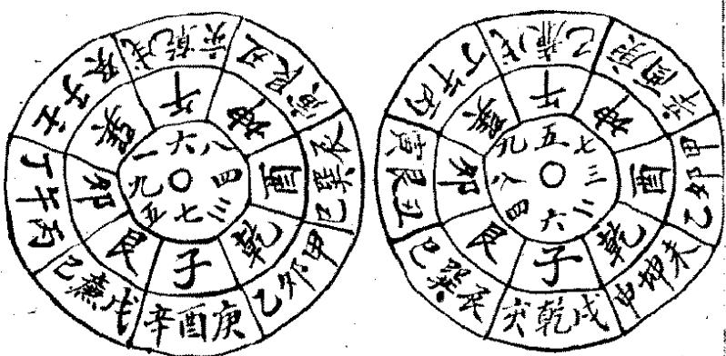

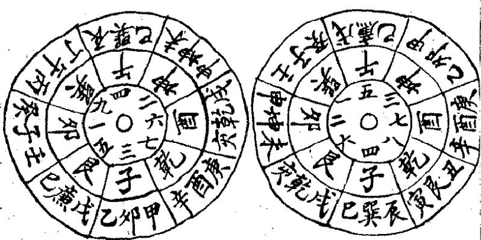

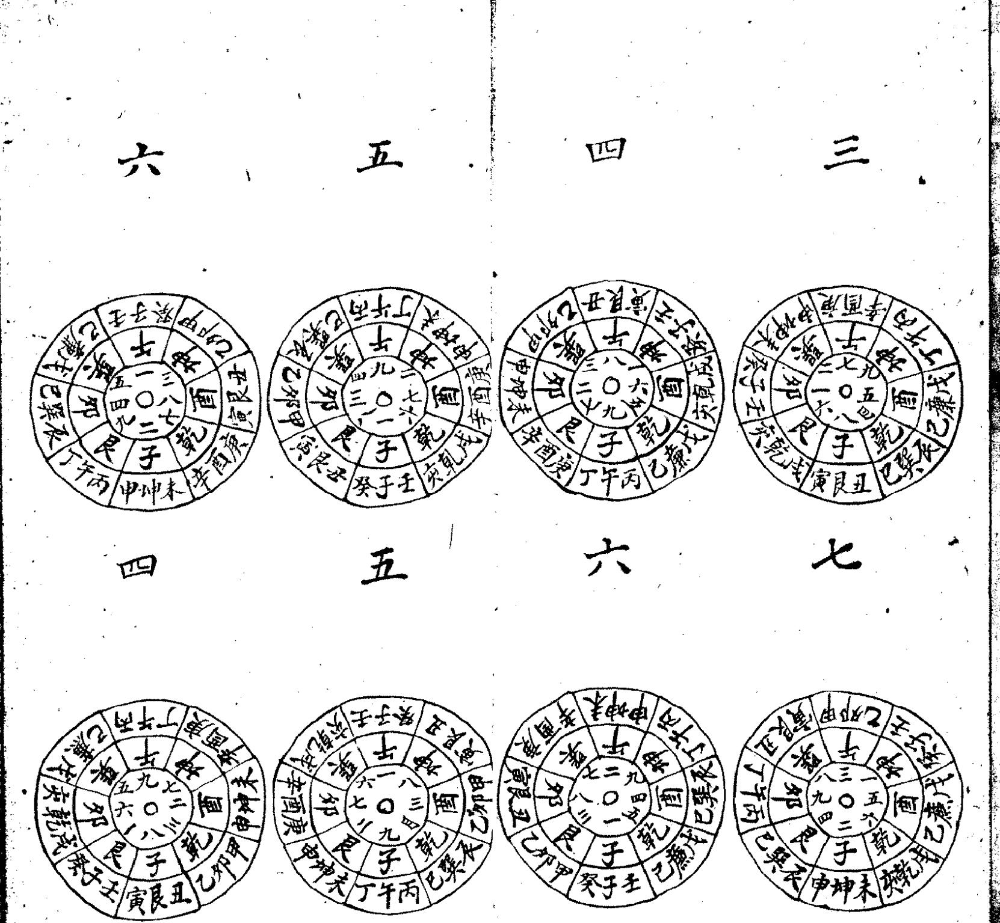

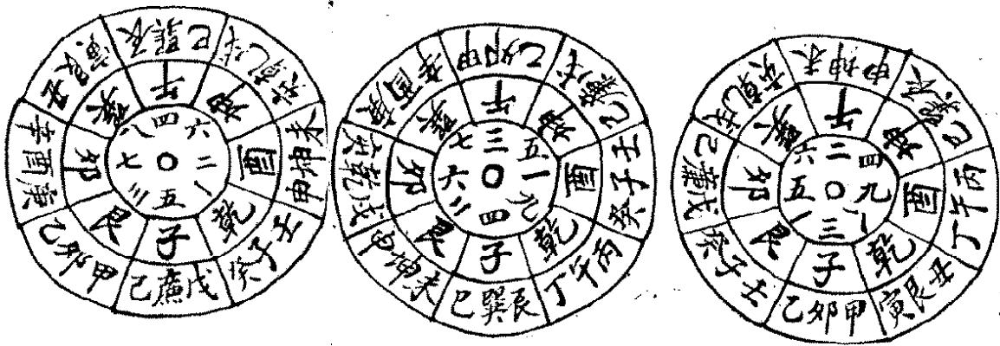

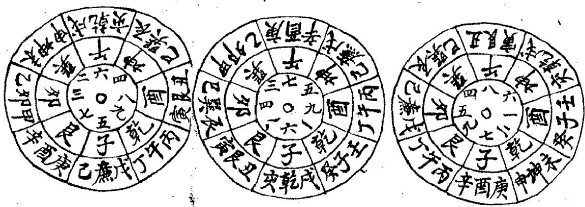

此盤格山水多顺推力唯先生字体 此两盤看向是灣星用行字明猴是隆星用王字道族字育

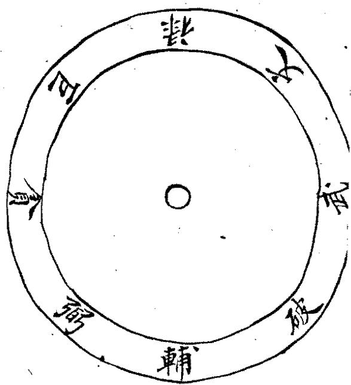

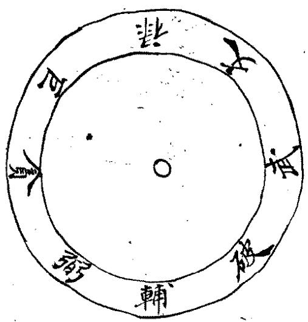

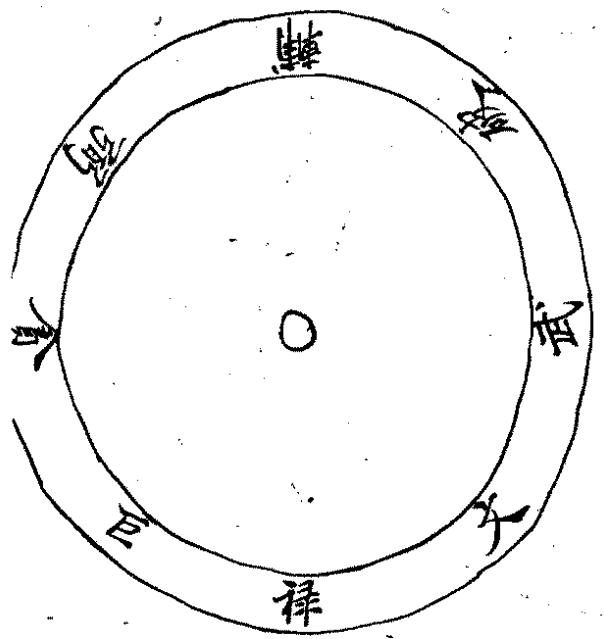

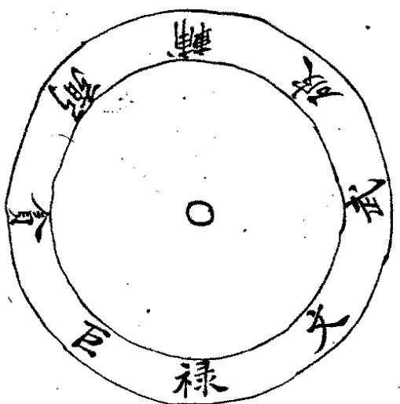

些盤在水程幸啡擬水明

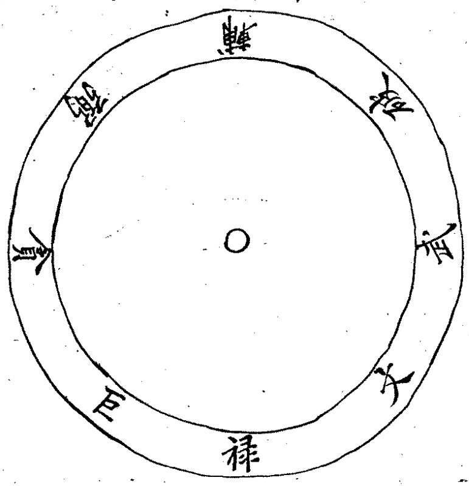

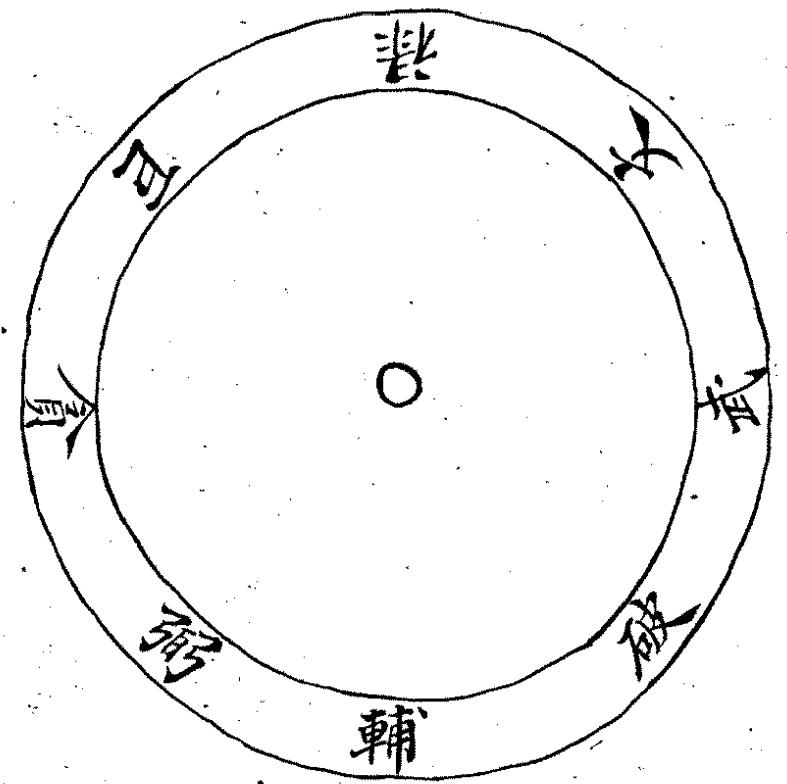

吸族 水 逆樣

此盤係水上顺程用室水口吉小註

山與水台孫是陝挨

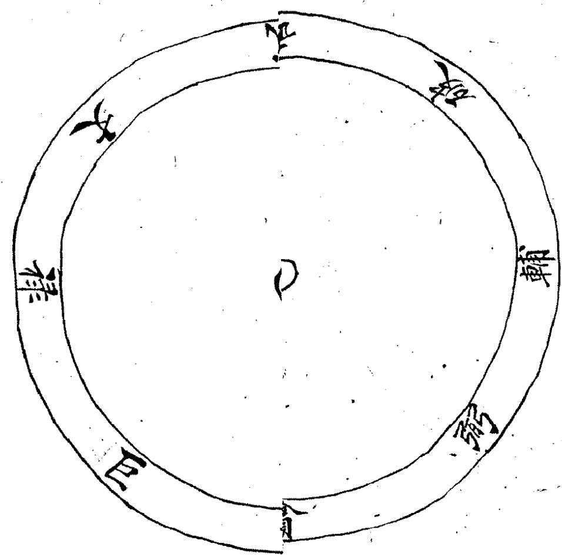

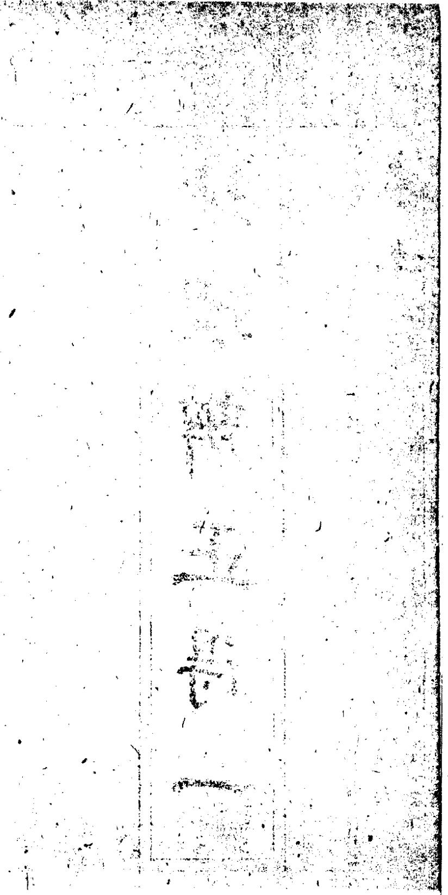

天定賢達能安命貧賤安墳富貴興全憑龍穴眞龍在山中不出山掛在大山間若是沙曲星辰正收得陽神定必然一塟便興隆父發子傳榮

○沙曲而星辰正已是合格之地要惟收定陽神乃有一塟便興之應何為收定陽神來龍向首俱用生旺之星也

0之不處峯既此 其情出處巒得節篇 形山得秀嫩論申 二也卦宜美枝深羊明 在自卦再此三 大有氣求老卦 山一充真龍之 間塟足穴幹羊用 者便砂情氣K挨 言典水形專星 老之朝再取之 幹應歸看嫩奧 抽龍再主枝 並 出在兼山之 言 嫩山用端穴 支 枝中法正謂龍

好龍脫刼出平洋百千里來長離祖離宗星 辰出此是眞龍骨前途節節出兒孫文武脈 中分直見大溪方住手諸山皆不走個個回 頭向穴前城郭要周完水口亂石堆水中此 往 密相o土鎖斷子見地 常龍上處龍只來穴細密交即住大富陽出 難謂氣節是之向水見說來不金門。水貴神豪 於之落言實意水是陽與包同正似大房三雄。 言脫平老說但神當神君裹砂脈大河房摺若 穿龍示此朝令三聽此只落將齊起朝得 只又江幹人處處之摺句是要○平屯到津此遠 可名渡結立是取星朝。是軍石三軍處。河地來 言出河此向虚即耳是結州如五落千溪出龍 其洋脫節之說後a切言上大麻里頭里澗官脫 大氣卸言法示篇口非水語地更見定來同僚 人水去來非形看水有龍此不發 尋。來水配起細硤方一住看。問福 龍當。龍下說石能星水衣三無 之面也語與高止形口禄男休 法是但也君山二非羅榮並歇 彼真。要。鎖水火星華五穴 0 概勢淨出 情踴盡洋 形躍再盡 号千起結 變星大 無峯儿

。看神天  
是得者粹又此之過有以起陽天一動玄來來龍朝下  
其 之流止隨到到半動動伏動主天申静竅去水○到處軍其處行蕃時頭頭矣看而行静動主之二相之得頭。取州  
四 便於團变二正所龍成止之即動字通水。陽 莫總三是上聚易字謂云到曉陰分其地其即果星 說住到觀者顛乃元到頭得陽地至主說是能謂 後空。頭其謂倒空空頭之至動主動有龍合之 無何註静之無龍生。者法動静静之天三之法動 主曾云與静定之旺非過之之即中地一到即去 立撐另動静者妙山半中岔其亦有山頭是水。 穴o著有氣者謂訣水之矣有天至有陰食形 陰得。 動後口與安之當謂到立靜以靜四陽水 陽陰 靜頭訣質定動默之頭穴至静之時動力勢。 交星。 中龍大相於干默到又之静而中往静争有 媾謂。 間只畧配下支識頭非法之生亦來之陰 即之。 求。向如相動純之也水亦中地有陰分陽 是静 須水與字出口要星。上楊  
陽看則静分水去字山此陰出路分五起公  
其錯龍不須也多辨法水出之節錯脈節水星星妙之之必辨此歸只渙得口脈來以人勸子節土所辰訣  
五龍法用合水此要散陰等龍下君字同金聚類無矣理之與之小貼之星。意乃皆不尋。行又脓聚多氣所不星水身處也並言言。必莫過。從難裝說。之謂合体之小五 同水平費教峡分分成因要子星情情水行 之洋心差真水但為見稍字体形狀引混 合去分尋錯前脈看妙黄有出合方者動雜 卦。處水。 丑去眷出訣公不脓吉位即龍卦 即。也脈。 與必口處卦大心合子则干是神交 來節眷 壬定便一山性即字用支一有錯 水節四 若有口把路唤拙。是尋之曲路千乱。 得同字。 是好羅脈作全陰總不直出流最 陽。行非 陽處経到破憑差言合動身萬難 星子言 差o子照o頭o軍掌

言天元細元子為丁子山一癸。 也元卦玩雜0一地吧巳午中同午。 龍兩之地卦元乙卯有到丁 者不。天元是卦寅。酉。此半天。 子可o元矣天o子為乾是穴元。 字相一壬元癸人坤真乾宮。 龍雜卦與兼一元艮龍坤卯 艮0乙。 也於可亥口地卦卦。巽。 巽酉。 借此兼雜元是壬為 宮辛 天。已。人則也天丑天 取一0 開見地地癸元甲元。 得口路。 兩元與兼辰卦。 輔口同。 元雜丑人丙癸 星若 人人雜元未亥 成有。 地元則也庚辛 兩矣。人壬戌。申。 五山於。 子。 之o 意。 而。

其遇兼已 星此癸備 之等午出 不來a可脈 雜○脈兼審 也O過OTO峡 玩峡卯定 换固可卦 星不兼分 圖為0乙0星 自雜酉之 見以可密 定兼旨。 其辛謂 卦也子。 分若可。

一同到謂子兼癸而又兼壬午兼丁而又兼丙卯乙而又兼甲酉辛而又兼庚也看子午卯酉本四正之龍而與八千同到之註自明一同到則卦爻雜亂吉中必有凶矣

半雜乾坤艮巽宮句細細之謂子午卯酉既無乙辛丁癸而又兼甲庚壬丙然乙仰酉之星同棄之圓宜若甲庚壬丙與子 午卯酉之星異而乃比肩同到則是駁雜之龍矣兼之豈可哉然不云全雜而云半雜者謂壬之貪起於戍丙之貪起於辰辰與戍乃乾巽之子至於甲之貪則起於庚庚之貪仍起於庚則非乾坤之氣矣此楊公之所以云半雜也雜則不可用矣取得輔星成五吉句註云指天元宮最清

九則者兼龍順坤俱子子之來言入旺然者星在有者。 局龍在龍必之子水則穴易子言。各龍在偏 在卯山巽配山龍也酉以興字謂有上向左口 山水為水巽亦言直是補易龍子當也上偏 為。艮順午午妙則解以悠敗清字令者右 逆龍局龍必 卯口謂平遠故純水之有也 局酉在乾配 為口取向焉須不龍。時在然 也水水水乾 輔於言輔兼。雜既故水所 水巽為卯卯 艮六則星收固不不上兼 中o龍逆龍必 為八艮何輔口吉。雜專者之 即子局坤配 弼者是人弼但癸取此星。 以水也水。坤。 卯謬要取宮。恐更巨元有 去俱乾酉酉 艮甚取之龍天不。武之在 水在龍龍，必 上以是神元雜各兼龍 為水。午艮配 得山方子合龍壬有輔上 來為水水。艮 挺上有龍氣過也口

。丙辰

取貪狼也貪狼者父母也龍有父母之氣 與庚交丑去庚來已是合格必立庚向者 此節言丑水去庚水來即立庚向也蓋丑 言也 地元龍者丑字龍也借地闢於丑之意而 為正脈取狼護正龍 戍未地元龍乾坤艮異夫婦宗甲庚壬 其 六 得可須中未在到六水是乎註與正可應 浦能挨有癸言也八中真使云四之同用 星先輔凶丑外細者正龍人輔正順者之 即時星不乙矣玩非在明不星異子陰星。 北補以成辰同其也天明易天為也四故 救補美辛到子所元指測元四不于不 謂化之器戍即癸云最我識宮正可也專 凶是矣之已午一親在耳之之同以取 而輔差阑丙丁同最水楊最逆都其巨 為星錯到孩卯到近中公清子陽星武。 吉虽之則舌乙者之又又者也四與 者非所卦申酉一水不云其四 也當雜交庚辛宮中在山言也正。 所令乱雜寅輔之然天中微以同 云星之乱申弼水取元有乎其爲 取亦方吉丁已全於之此妙虽四0 天元他其貪長云氣護 人人元中狼云卦又衞 兩元為用護云。氣受。之。 元亦五挨衞觀未龍則 相可吉星非此值父龍 兼與句。訣止可其母常。 耳天可法一○見根之。不。 元見挨丑人不氣衰。 相天之龍地摇。則所 兼元自也兩卦骨塟 惟固。見。註元氣亦之 地。可玩云之已得骨。 元兼註輔龍。過蔭既 不。人不弼皆源矣。受。 能地能已宜遠故龍 與兩。兼在取流註之。

護正正末順戍俱甲辰 正龍龍句局龍在龍必 龍也則取在丙山未配 耳乃非貪水水為水壬。 如云謂狼為。丑逆庚戍 本從貪三逆龍局龍必 龍向狼字。局。庚在丑配 破上一取也水水水。丙。 軍挨星龍未為壬丑 金星能上 龍順龍必 從挨護之 甲局辰配 向至衞貪 水也水庚。 上向此也。 俱辰丙未 捞龍地至 在龍龍必 来上元云 山壬戍配 得而之護 為水水甲。

。上狼寅此節言寅水去辛水來而又有乙水以催 言 成申口壬 五已其龍者寅字龍也借人生於寅之意而 得 人七巽口坤0元來吹艮。 乙辛o門

一質出母生息巽八也不西金震衰之如之差单卦微尅偏卦卦在龍為死氣上大錯弱而偏過於即為水局則金之而元地禍用致總不辰以父上兌坎龍氣在甲可不差在同則巽母為水坤艮即龍子求免合錯一也父為六尅過震水為為以矣。矣去之卦母父秀入宮皆以零正坎此不虞之天尅母為正接為坤神神坤段過故内玉子偏子神零上為矣矣震秘毫子子卦息於息裝脈元金倒以三密。富息息重同已認在入生龍排兌般不而虽卦父在則生向局旺離之艮為可生畧母一父尅上上之水法離上轻矣旺偏者卦母者為零氣以兌三无洩若而即以之生如生神如坎水般生法氣至父内子值入裝面為以為旺

辛取同。大則但來用之 来者。一兼惟一○去乙也。 而此路容。亥貪a之水蓋 又局。者也山狼水者寅 取來此至已之為取與 乙去。元於向。力口輔貪辛 水之來必寅也弼狼交。 來水去兼山然自也辛 也又之貪申細無法來 兼。水狼向玩發宜寅 他o不之可。更遲立去。 局雜理總取遽癸已 也他與之。貪歇山是 即元地所狼之丁合 寅也元謂a之弊向格。 去兼卦廣。句不撥必配 辛。 申 \$ 配 為水。乙 已 局龍必 配 癸 亥 順水丁配 局辛水下o在龍在寅 寅山 為 逆 局。 在 水乙 順o已 也 水 龍申 亥 龍龍亥 水癸龍已水在 山 為。水 為。 逆局0 得此運人 再云之元 取五星自 貪吉辰有 狼者体人 一何用元 星也俱合 合謂合運 成當人之 五時元山 吉直只水。 以達有自 補之三有 悠星吉人 速辰四元 用已吉合只隨宜此純元将乘輔矣以告壬即或貪此法 可時兼也乎運先其亦尽巽我皆箫乙狼四之 用兼食總天不時時可矣風向属通或也水至 其取觀元補耳兼楊之貼出癸正盡要 将隋兼三欲吉救先弼公以隣卦或謂属者 来地貪節取凶之將亦教天易之辛在人也 不亦宜文地恭策當可人門犯意有是元乙 可通兼義元牛或元兼。補亥差蓋得元又辛 親耳輔兼又註兼之諸救或錯申貪用非丁 則法非云貪令星直雜之與狼是謂癸 兼俱純欲或星亦達於宮庚者山有水 辅要乎取兼用可切壬已已在收此來 全天出耳是 作酌蓋而兼妥在明吹於亥門或即非 量謂非則再各至之丙與開丁是謂其 既 往 亦是 兼 之o

者属為五而運坤妙即真四有一中起神星子西陰属兼干水母山伏水子永兼上 趋在吉六辰内壬用破知正陽递分例故也八甲則陽子維龍求龍而則以遠辰則 當弼星之巽也乙如禄斗卦陰兩陰或於法位丙逆則息曰以生以可零兌倘卦咎 令以而運已中未上廉杓為皆路陽當四卦庚挨順卦舌坎氣順發神為水氣雙 之期艮内元卯元文者陰有也兩順非云起壬九挨之支為如排福水旺又錯山 吉皆丙也乾甲属甲凶雖也兩挨路挨之向於属星九挨神煞上父也正氣遇雜雙 星在辛下亥子巨子星貪路星即入中是東陽江星星曰氣元母神而正得向。 如酉元皆人門以亦巨非如四卦暢乙順東四也癸也甲求向在神零如 上丑甲属文以貪有武可此十或壬神辛挨卦正四者子生雖向必神卯 元九属子武廉其巨吉之拘分八當癸丁九逆卦維乃山氣。雙以至水兼 趋之破曲武皆禄時吉定論局逆二水癸星子如卦父龍水向坤敗尅乙。 貪運軍破以三0在三斯星。四則雙挨位属也八坎如母以龍敗為絕入卦 巨内寅輔其神神為亦維每雙入為陰江倍震乾卦坎以絕死如相氣 禄如午弼皆為二為挨有卦卦起卦挨逆西卦離艮之為逆遇氣下助清 三擇丁a0在吉三0吉星凶為中一每星挨卦起兌巽挨生排水而元尚純 星地庚神四星之星之時陽皆順卦之九順於属坤星氣父制在甲可乙

禮立 往 。墳貪。 也穴此客宅○無三或言却遲上美此過狼○之也 主處節尊安其 休义排能何數而承雨原其三道 客論a言重墳 歇奇貪補也節未上紀是星避 即水山客要九 也举狼向偏謂言及節方發八也失。 夫城龍在0合。 貴到首救貪人其而生來 中令 婦收宜西龍 山水萼狼地效言貴遲 元之。 來五取方不 定或排先雖兼故也子坐 下azo 水吉音主須。 要不峯，在擬。 陽必而東對 產到也後人最言兩 主排龍榮非貪復上 賢向挫地易此 剪 好 男兒 向 向穴中人未知立宅安 下 元星。 可如 星取水。 猶奇龍。 好奇峯主人有 好 才首山故兩發以 昌或向曰元福贊兼 言 類上。 推元 夫峯只。 世排首遲主此美取 避。 去為a須。 業致也運又之。貪 破 水對從。 發水排坐之云 狼之 輔。 要照立 有。 福口龍向星發 弼

萬龍識天篇 禺能口識大

陰星猶婦一來一去陰陽得配而立向再 得陽星諸福自致矣若是山龍則來龍要 陽星去水要陰星倘得奇峯對照而又是 生旺之星更妙

得深己已曜即則眞即對合定對山 也意上龍改加氣陽之也不三龍 存數身為之旺水不奇易又看 馬節微惡美也陰合峯之察主 善多賤曜名龍山则者法血山 讀屬牙所如果顛不尖也脈朝 者半刀以能眞倒必秀要以案 宜含化本微氣顛對挺合認以 細年作立氣果之之拔龍來辨 心吃屠興衰時義所之者龍龍 恭但刀隆虽前主云峯觀之体 考吞即煞有後人主也九得之 自吐此曜奇左有東合曜失真 然之之变峯右禮客元之山偽 有間謂為貴輔者西微合洋平 所有也文少從龍者則不一洋

馬後玄下O 悉與機軍其 能平訣州 容洋口只總十 分墓道住a 明口宅後空 見同頭何 者州少須口 猶縣撐撐 疑人龍著。 慮a家大後。 龍住凡來。 不空軍龍。 空龍州a時 時0千住人 非軍空不 嫌遠來無後龍龍若空時氣不空兩水界龍 連生窟穴得水分何畏風他看古來卿相地 平洋一穴勝千峯

午○○而乘水氣見氣山生非言水龍宅為揚之此閱 卯其發風則不漭來龍旺以之承空亦語公变節蔣 酉四十也則四知济融只謂前也上靠緊然恐申註 四一散面水平結論之後所文不之非州人明已 界昏神田實脈得有謂龍空坐縣不上明 水風界毫則來也水得空龍空城信文無 則有抱無障平謂水氣實為池空未庸 止水陽遮蔽洋得非不氣實是未龍盡再 古則氣掩而只以以空不得坐必之之說 人八冲疑生論所左龍實實盡說。意 之風和為氣氣有右實之實為属時以 言頓平坐阻結之有氣妙非後引終 正息洋下塞空水水不胜五只空州平 為所之風肉則得謂實中行要人縣洋 平謂穴吹眼水榜得而言坐家城龍 洋氣無散但活星亦申得合空墳池穴 山o 龍 当。 乾。 坤 艮。 巽。 宮。 莫依八 卦陰陽取陰陽差錯敗無窮百二十家渺無 訣此訣玄機大五行來龍須要望龍穴後若 空時必有功帝座帝車帝位並帝宮帝殿後 當空萬代侯王皆禁斷予今隱出大江東陰 陽若能得遇此蠍蚓逢之便化龍

註云四正卦與四隅卦兩兩相對即子與 巽對午與乾對卯與坤對酉與艮對非子 午卯酉為對乾坤艮巽為對也

0 不辰宅位地子 同戍若只之午 山丑能要四卯 洋未合元維酉。 各甲此空而指 異庚元坐言地 即壬機對非之 性丙自二必四 之即有四拘正 剛此魚六定而 飛意龍八要言 氣也之便坐乾 之地变是對坤 老氣化陰乾艮 嫩南下陽坤巽 亦北文二之指

則兼癸雖丁O干支又甲為與癸非兼可口庚吉子宮甲干用壬壬午口同庚出。但丙子卯口星壬謂要而凶酉g同丙子子來也同。故四午午口水然宮○曰干。卯卯o適去而最口蓋酉酉在水星豪子。而兼乾是實雄午兼甲坤子不若卯乙庚口艮午同甲酉辛壬口巽卯所庚與丁丙位酉謂a壬乙0癸切上而子丙辛四兼單午0輔行卯其而脈の酉十成半四二五吉山吉之龍龍q時a支又兼。年0干。凶出。坐最。向0豪。乾雄a坤0乙艮辛。巽丁。

人者要為一數者生隨即必隨妥即步亦成氣此不地切坐老有之而之能適不水嫩相妙各謂愈宜可向懸去理別欤今高拘絕數也者疾低拘後者里地也。拘各後空要厚有切於得空後必薄相不方為為實隨迫去可者是非亦地殊數拘必所後要取者郡泥。不謂實各裁亦高有能泥為得不有早誤治於是其可相無天遠古总宜執去二地

戍方龍矣泰雖内支此更而倘五乾凶一兼丁此龍星口細節不。  
丑其圆既言半属其長節勝不遇吉申無偏出卯四未者四玩之可  
未十為清乙也单脈流舉於取此之之定即者乙卦嘗輔上意  
四三規乃辛言行清不四一也等氣所出即配重不弼篇示甲  
山0 矩於丁子未純親正非只來也只云他謂帝支已辰人庚  
坡o 而諸午免故雖為清要龍单要坐卦之若之兼在戍壬  
甲庚壬丙墓 未卦而卯少曰兼例純用來行天向行單乙卦輔其四丑天a丙。嘗位甲酉偏最帶若者得脈之乾龍行辛支為中四未元兼執中庚而即豪干行矣五龍服坤出脈丁兼美故四地之子一隨壬乾犯雄位龍吉穴雖輔者卦也癸干 也口元龍○午0者宜丙坤他也在合真易人非恐单而出 則龍必卵  
墳多若依此 也立不艮卦若不子得得出地必生行無即 人註兼酉向外巽所乙出午三者卦拘旺之子支。 地云輔9耳。则是不以辛本卯星切有定不脉午子 兩△不星總又矣外吉丁卦酉其莫心全坐一稍卵癸 元言也之以辨是凶癸之四吉棄者故向吉有酉 之輔然此

理無差謬清貴聲名天下無為官自有起身 路兒孫白屋出登科八卦不是真妙訣時師 休把口中歌敗絕只因用卦安何見依卦出 高官陰山陽水皆真吉下後兒孫禍百端水 若朝來須得水莫貪遠秀好峯巒審龍若依 圗訣塟官職榮華立可觀 9

○辰戍丑未之龍立甲庚壬丙之向固已合法然必須龍果清純向得生旺而三星五

吉毫無差謬始許其清貴卓越尋常起身路者指來龍之路即天心正運之一卦得水二字即得天心正運當令之水可恨當今時師但是來水不論當令失令即迎而向之亦知其中有凶耶否耶 0

訣貴也認維甲 而聲山此八庚 此名上理干壬 獨自水云不丙 非然裏者易是 者傳果是之隨 何流能山甲時 也天交上庚变 申下之水壬易 言八以裏丙之 板卦陽陰也甲 格九配陽讀庚 之星之相者壬 非本以配切丙 也是陰之莫非 在真清理誤四 禍立其用未陽然陽陽乃肖非八合陽移一丙戍此上所定法流地 其福穴禍之可非而山非息妙卦自相無空是西所元謂所变行為 十定殊立合謂建果陰陰理收訣本能為形一周未謂必得謂易因八 四于难見說之齊識非水至水後是立表之實流是得須水陽者時卦 呼全由富得會天陰反當之章真見裏氣須六四者離者者反变九 吸副于貴也明机也見不八訣榮一動揣虛維是水非非以易星。 可精收可堂秘得灾易向卦而華往而摩隨八元下三陽為往在 不神水期虎旨水禍之上只誤矣一不而時干空元合陰不來天 畏止之誤抱收二者言易有用來息得而不之必五者易無即 哉在故用龍入字則而用一則一一有在易得須行非無定是 消可則迴玄世辨竟会卦禍山動形之之之坎之陰定者北 詳見福涓竅人之有通福一一之甲定謂水謂故者也斗 堂看未滴之開不陰乃顛水靜質庚位得之得謂執拘九 局地一不中口真山始倒两一静壬甲也謂也之以拘星。 之尚見漏虽混陽陽陽微故相陰而丙庚夫得又不為於隨 问易而總三說非水露云配一不也壬辰也非真有呆氣 2

玄機妙訣有因由向指山峯細細求起造安墳依此訣能令發福出公侯真向支山尋祖脈干神下穴永無憂寅申巳亥騎龍走乙辛丁癸水交流若有此山並此水白屋科名發不休昔日孫鍾阡此穴從此聲名表萬秋○細細求三字最要即奧語中第一義要識龍神行與止十節之意

不龍 論 龍之脉急故蔣公云凡有 山龍論脉來水龍論氣結也

祖脉必要支山蓋從四正而論則四維可倒推矣此祖脈乃玄空之祖脈即當令之一星也

言云山此甲窍玄狐而上 此八此水庚之。空叹言四 也方水易壬如之非祖句 位亦犯丙乙祖干胍言 位有差辰辛脈支此体 有發錯成丁所公祖用 真福之丑癸謂孫胍兼 龍者龍未寅天子非到 爻特皆意申心母太之 象引棄時巳是之祖妙 干孫之師亥也祖少中 支鍾不因即数脈祖二 總墓取多上語此山句 一為不謂文當祖龍承 同証知此所細脈之上 盖経此山謂細乃來文

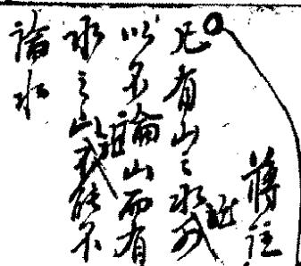

○此節言坐空得竅足可發福恐人不信故 公 衞穴居中依圖取向無差誤不是王侯即相 那箇靠著後來龍砂揖水朝為上格羅城擁 前篇訣穴要窩鉗脈到宮試看州衙及臺閣 回朝祖玄字水科名榜眼及神童後空已見 位通紫緋晝錦何榮顯三牲五鼎受王封龍 旺相一般同寅申巳亥等五吉乙辛丁癸四 視乙辛丁癸足財豐亥壬聳龍興祖格巳丙 衙為格局必然清顯立威雄范蠡蕭何韓信 來龍須看坐正穴後若空時必有珈叫縣官 ○其十五 天子崗占本山龍收富春江水為誣 科龍 刻正 能不 山而有而 宅 須遇。可 细山歇 產 水者侯 嫌之地未可仙從山龍若差錯孫 a要鍾 此 卦墓在富陽 而 而而 騎巳四後論

引范蠡蕭何韓信以實之非真謂其必如是也讀者須用挨星盤從四十八局中尋繹可也

也此水沉生謬何穴向水已坐五上非謂弗之正陽神卦又得之詳空吉節是龍得謂穴童謂神幹言坐坐言但空即也都黄是到抱枝此實之山遇氣謂後即甲何宮繞向又用空龍有不空空你卿干所有背重法奥干水空如非偏相支言情也言之一神坐所穴以公只已再穴者不山坐之謂後穴儲侯要丙坐後何同一寔即脉有後不嘴有合亥之之也也水之謂到水有上韓得得舌以水然一法。後宮而水祖之五总五必人坐空此空者。金謂若吉言吉要誤空一節也即龍空操毫不此枝認之寔言此到用浮券無論謂流不法申平意頭法不者差是正拱察前言洋八地巽天卦星躔機〇作辰何妙其元流0位0訣0十宗轉乙本六乾要辛不坤相o丁O同。艮逢癸八巽莫落卦出把何o只。官天宮有。貴罡甲一乙稱庚卦辛妙壬通。丁訣丙乾癸錯來坤田將何。良。

審庄

訣此一貴然行之泰回干山出五十能一混。出口局八何位。乾境部盡通二因澈造支来煞行咸四用卦即煞口之a卦山甲坤又辨從之十则精化皆出之八左干此者將之法只消庚法覺正此隨四天蘊哉胡得用長或支一一收口法乾有此壬竅甚只出所山地之。妄煞不生有躔卦元山此坤一水，丙細易此先指趋陶妙之去亦指在則一出處艮卦合最細易數賢點吉陽始說不謬墓掌何知卦煞口最巽通、得為恭矣語稍無避九明而知乎漸地乾即之○要躔句天榮之須為露非星已此知左然則坤天法，辨何言心下自将难端造妆八卦豈一此旋矣或艮心認得位一造後可此至傀化山卦之。能卦一右不陰巽正作清四卦化兒了集之欲之出天理契則卦轉識或落運挨楚。位下a工孫然並境人机煞心甫合談即此在之星若句穴砂而自矣皆正通天八知為訣或何一法一言尋。 神水既悟其可運心卦放誤順宮卦矣。涉收龍。 童。要至耳富了o五卦挽論得水思或二也含山o定。 未

當來出觀令是中作下之天說水妄城星 令龍脈口出之以流向卦卦心若斷將門 之之者脈星水轉首者即正人災卦訣訣 星處來便故龍九也何是運得祥例立非 至要水能註言星起卦失之遇筠定宅真。 於口當之識云也也口星當口令一是松陰安術。 去令處○城能能城者令之卦前寶陽。墳門城 水之與門識知門何即卦即緣。照不定門 則星山o蓋城失一卦用是。天真向吉一 不水上城門令訣。當何當下秘龍昌訣 論裏來門乃之即令卦令横訣身堪最 在來龍者能星失即之之行父觀笑為 山a水之去觀自令用星a卦陸子出庸良。 在之處水出能之o何作其地雖脈○愚識 過仙親又多得 總要上處能當卦居龍不從慕五水處山之脈知一○卦來。

妙城之即為五則然陰要   
两門處水嘻星千·交山失口   
：美須須之不本卷媾。只令   
相得得交辨是青地用之 合城五會往真囊理陽星 立門吉處来術皆家水。耳0 宅之三闕消楊可若陰 安用星傲長公付確水 墳法補禍故恐之見只 自再救福曰人祖此用 能合直之非專龍陰陽 吉兼達所真取正陽山。 昌貪斯令術貪謂交則 矣兼為星也輔此媾陰 輔尽緊城巨耳之陽 之善要門武處。自

世人只愛週迴好不知水亂山顛倒時師但云講八卦却把陰陽分兩下陰山則用陽水朝陰水則用陽山收俗夫不識天機妙自把山龍錯顛倒胡行亂作害世人福未到時禍先到○陰陽相配註云須在山水配合上着眼以批正局論即四十八局也至云水即是陽山即是陰陰即是山陽即是水故只云陽水

此姚往此节之生于者即是隆阳交雲一点精有艾外乃雨分共之路堂經附我之用也

那些于三以印蒋注

山陽

相若○牽可為定通即流好過陰而師不過挨則順之陰  
配無其混山陽之迴此行亦迴三分此分何好迴星皆挨挨山。  
合陰十觸水陽形虽意物無不字兩乃属從人言法逆或星而  
兒定九處就可山好也换用好指先陽窥人前者挨○宜言不  
孫a不o 成乎為是非星矣亦天以见知後知在逆也更  
天a成 迷陰陰此已移隨吉默之坤並之左之水口挨，益言  
府口陰 殊陽盖水之a亦氣如生先体卦有如右。 皆其挨陰  
早若口 可世陰是物是变城時非領以上前 是0法星水  
登無 痛人陽水亦那遷門而不後巽乾山後 順不之陽  
名陽。 恨不不陰属a些即不言亦天離卦下左 1 挨法山定9 知能陽無子是得植之兌領水右。 也總二是不a 以就無益。所那生乎用三震顛龍 然而十以生0 山乎一山謂些旺得以女坎倒穴 此言四山陽 龍山定水关子週生云之而艮錯砂 惟之山。上。水o 平水陰有竅氣迴旺那論分三用水。 深在或水o陰 壤只可一者化虽虽些陰属男時好 究山宜裏。

0情都

講這此节并下 节尤之全往傾臺 倒篋之言而足之 薩云非泛主 張乃孔坤真 清息所福天心 是曰山情水意 四字金修竅 妙識之陰便 成配合青囊 於戲更矣

姚言奉功世人少亥胡行而孔坤陽見不易以免人自從

水廉明也得十陽為巨九移方九九玄年經即裏合龍陽山言言乎。媾 蔣貞冷之年而陽禄星而而星星空九盡天彼也水以水主地如之 公火謙破玄挨中當而其排隨也五二矣心此或裏配各張理其處 云武云輔空星元令变當算三挨行會自相一排陰得即可尚，矣。 右曲貪弼之挨六為更令無元星祗非四三然生广龍尋其天也無世 主之 弼金狼亦破得十陽也為有而五是二九此0之陰二一一宜心 張相 金破木。為輔之年而如陽轉運行貪是四配陽七九個之正 請地 宜軍巨陽弼文玄挨上失移轉亦巨四六合相三二陰情運 將者。 從金門此當廉空星元今也而即禄山宫是知配八八以意之 此其 金左土乃令武之族六為然换是文之对此最四三配言主 経果 為輔禄所為亦文得十陰星星此廉死會宮則為九七陽配張。 細有 是土存以陽為廉之年亦九九九武合之青合亦四也合山 看主 也右土為而陽武貪玄是星星星破然會囊法可要非情 十張 其弼文之挨下當巨空障虽則但輔领合天此山元山尋水“ 年乎 他則曲玄星元令禄之玄無按玄弼在一玉配上空上一意。 再否 典云水空挨六為亦貪空轉八空之元六之合水會排個是

此令生元裏山一則山禄如令挨大巨見也生旺龍上例二之亦上失星卦門彼山旺之巨神龍而十文當元令法為破彼龍之龍禄以神下四廉令貪亦中言軍見挨龍水當失以卦山武中巨隨挨玄武得所龍念令當起之亦元禄之得空曲又生謂則山者令星破當之當而之大貪名旺山取龍為者定輔令文含失貪卦狼成之用失取生為卦弼下廉則令巨之為為處順令貪旺生分亦元武二也武貪一王宜水破巨故旺星當之當十故破巨侧行有用輔之不故俱令破令四云亦武者山逆弼龍上不在所輔則山與隨破則水也龍為山下此以弼二之為之當以龍不為當如水中為當十貪一而含玄挨特當令上水矣之令四巨例當則空

寅巽坤又陽貪陰不禄凡弼十無論冷 午辰壬陽在巨必同文二皆四一陰公 眼庚亥乙在左禄在故武十為山定陽同 波本本本存陰文蒋皆四陰挨如交 龍龍龍陰在為即公為若得上媾 有皆皆在右陽以云陰挨到之元之 以皆武巨左也也一陽益得下貪六例 挨弼曲門矣若而貪在二之元巨十真 星而甲艮其逆順狼左十破六禄年陰 註癸丙他排排論陰四輔十文貪真 法云申辛做之之當必山弼年皆巨陽 彼非本本此貪貪上在之貪破為禄氣 至此盡龍龍巨巨元存挨皆輔陽當有 云互巨皆皆禄禄之陽星為弼武令 推門貪破 文文時在順陽當破凡定。 興此武狼害 则则是存逆巨令輔二方

都天寳照無人得逢山踏路尋龍脈前頭走到五里山遇着賓主相交接欲求富貴頃時來記取筠松眞妙訣

0 此 節只贊玄空大 卦之美非有他意也 四上 吉 山山 之情 取格意 一耳此 乘要 時山 總 富驟地非 賓 主 相 交 之 官 Gr 尾

天有三奇地六儀天有九星地九宮十二地支天干十干屬陽分支屬陰時師專論這般訣誤盡閻浮世上人陰陽動靜如明得配合生生妙處尋○動靜即陰陽明得孰動孰靜則陰陽配合自然陰陽能自配合則生生之妙在其中

生能不動動成化也謂静其密成即以非末上結然位止。而矣。 生統得者而形化動也即極尋如天形致以二数之非不配以總 與惟天即成成成者動地矣其明主動在山句句 明止巽。變a之 上静則天也象形運者凡生得動為為以為論言 得配人局o以 篇故無始地即成行天有生天動動陽陰陰奇 動辰元0言0正 求能以之惟是象於也形配地以形都水陽門 静所之則局 穴承成也静静何上曰者合陰静静為動之 者。謂癸三言 于也乾天其即莫無空皆之陽而為珊陽靜法。 不一位卦則 動所統不所是不一曰静妙動生静本又配世 能個不之四 静云坤得以動由息氣為元静地也非合人 辨排止口中0十 之陰地地生以天之曰方空生主此隆為以生用 晰來配天八 中陽承則萬静之停健為之成静所也舍支生差。 故千a已0元0局。 相動天無物而動萬無隅髓之靜謂動又為之所 於百地之a固 應静惟以即生而物形形可奧以動静非陰妙以 結個a元子。為 配動生是静始生之象造再動靜非以干陰不 尾是之。位。配 合故地動以也生謂之乎細而者必左為陽驗 總也壬不合

洋申经 龍明文 穴上中 之篇篇 變第一 三十 下共 未一 盡百 之四 義十 以六 終的 平皆

其以秀三按是也所即支生所書蒋一致因音姚名所云是是生訣人來氏陰有動誤人地氏真謂龍城此之只不與引修生世将理又夫龍到门板妙在驗地奇静遂干有詰婦空頭一格則陰惟理門配謂支三地是氣者訣而在陽有大以道合不方吉理名不此即已在一大卦比雌驗停奇奇真空也是蓋有動五同論而雄殊排門門唯者所收動行出者青交不定有本雄此謂山静陰静是一益囊媾知板六出也龍出即陽之奇源奇即姚格儀一是身煞是非間門而門是處而地源名出用山干求真時主尽陰乃論理音眞脈一情是其訣師地。陽在陰有門賓者卦水陽配欲用從其相取陽六有主此法意而合知错洛

地理辨正得一 都天寶照餘義唐楊益筠松著 ○此篇中亦有經盤之用慎勿畧過 尋得真龍龍虎飛水城屈曲抱身歸前朝旗 鼓馬相應下應離鄉着紫衣 ○此言山龍形局之美離鄉之砂人以爲病 試思着紫衣者那個不離鄉也 此節言真龍氣勢行急之象恐人誤認爲 曜氣故特指

上口歇曲乙   
馬定來字之外爲則非此   
御然朝水離象曜兩其節   
階の龍穴纏鄉則氣砂病專   
前在口悠在砂人正之也指 水揚穴也事真末真山 中潴前亦龍乘龍龍 蟠蓄丁應靈勢行而 若斗砂之氣逆急言。 有口量收主發同龍真 聲錢鎖子露有虎龍 爲兩穴孫之似之之 數畔0天他象分相穴。 錢朝然。方也飛隨龍 水歸當發然昔亦虎 催穴a中達情人急分 官後○九謂既指急飛

0 批言水龍形局之美穴後之水既己合運 又有聲更妙

○此節專言平洋砂形之水法至美者也安墳最要看中陽寬抱明堂水聚囊出峽結成玄字樣朝來鸞鳳舞呈祥外陽起眼人皆見乙字彎身玉帶長更有內陽坐穴法神機如處覓仙加

○內暘坐穴之法即失令之一卦凡水龍水之處總要用失令之卦倘堂氣形局極B4

美而劫口非失令之卦萬不可所謂合卦則用之不合卦仍未

語中 陽 外陽內陽 新 内 之 堂外堂玉帶乙字等 更有坐穴水不得法 總 得承 而上 龍 不窈城門一卦之與 弗 言内 水 然以 上蓄爲佛法 图 蓄取 明 能之爲插脇水三條云是三形傷四水射來爲四然八水名爲八煞殃直來反去抱刀煞徒流客死少年亡時師只說下砂逆禍來極速怎堪當塍圳路街如此樣亟宜遷改免災殃音乘稻田也圳音酬江楚間由畔水溝○經註己明無庸再說

11 運益其此塔此 無况有節冲節 唯諸煞極射專 類路氣言者言 矣交無直亦直 馳元来忌水 漏氣山有之 風也格則凶 冲總盖改冲 浅属水之射 來神以者 旺朝最免更 元亦忌災凶 猶有木殃路 可捐火街 衰無以田如 是土形 貪者如 狼天木 巨元火o 門歌因 武中其 曲季煞 以若爲 應應害 金三尤 水垣烈 土並光 也列取 宿乎 三金 垣水

前水來朝又擺頭淫邪凶惡不知羞乾流自

節此此頭穴 樣節曲不似前 威整水拘是水 纵齊凶前而形。 我乃格後非似 合水左最曲 星神在易非 棘格雖二誤曲 盛若以宅認似 擺曲均故直 威頭為忌特非 斜吉。指直 孝然之者。 及曲水謂 如震形之 繩須如擺

左邊水反長房死右邊水射小兒凹水直若 然當面射中子離鄉死道旁東西南北水射 腰房之橫死絕根苗貪淫男女風声惡曲背 駝腰家寂寥

左邊水反長房死離鄉忤逆皆因此右邊水反小兒傷風吹婦女随人走當面水反中切當断定二房有損傷左右中反房之絕切忌地然反拘其以取凶節體天經 下所凶水耳切上之山專用王註 b贵中雖于数也惡指而青己 變未属用節水砂言囊明 通尝至也雖即形千都無 取無凶故義合水言天庸 用吉須存淺用法萬寶再 亦竟辨之而法衝語照說 能以在惟辞切射不或 發微于公鄙不反外言 福疵何位然可跳趋體。 若而處之其因而避或 妄不分應其言二言 度恐可不甚合如字用。 而失概可速。用諸此或 爲大論盡以而般兩兼

牟穴生形 前動雖 陽之环 氣意抱 不名狹 舒日而 最断帶 易城淺 敗又左 絕名右 似裏前 吉頭後。 非裏毫 吉頭無 故之瀾 特水狹

到無堂平 則餘须洋： 又氣寛穴 以虽容取 接环不近 水抱泡水 呈亦展三 秀不舒方 其發穴皆 逼若氣可 窄面若逼 之前一窄 氯另水惟 有一裹穴 所枝頭前 發水穴明

人禁遏去流以爲可聚豈非自取阻滯耶荼槽之水實堪憂莫作蔭龍一例求穴前太逼割唇脚不見榮兮反見愁

照直緩凶寬若穴一 穴硬急無曉硬前 有深其吉猶直池 情坑應矣未深塘 謂毫不同見坑水 之無同一凶形聚 蔭動不穴更似天 龍意可前加茶心 茶謂不池急槽名 槽之深水葬既蔭 宜茶辨形穴非龍 遠槽也局氣佳水。 遠止軟太格本 則蓄硬逼或為 不團立則明吉 割聚穴有堂局 二今 人 不 明 局 之 是 否 惟知開掘為照所謂 十 四 有 火 坑 矣

專一龍側玄 將0須或武 一取口正擺 路何。出。頭 窮家須有 龍憑多 脈直般。 蹤。節未 大對可 山堂慳 出。安然 脈擺執 分口頭一 三〇直端。 訣。出或 未是斜。 許。分或。

0 偏 後擺 之頭 左 水言偏 或水右。 曲似移 或曲步 直非换 或曲形 曲之之 或狀法 背玄也。 情武 狀指 不穴 一後 難穴多家O于也左是推也一来惟凶之玄安於 寂墳此論又水詳須是而直未穴武也尽 寞宅可坐是大而察謂又節可矣水舉。 男後謂後一則後其分直对執然来只 孤高明之脉不可曲龍出堂一亦本要 女懸察脈偏止定来不前安也須合與 寡太秋精右一其是必去乃益詳後穴 實陽毫詳又宮何何分一是水其空前 堪不矣曲是之家脈兩曲真有来活一 憐照。當一氣踪直道一玄偏法龍般 太搜脈正跡去而直武出以之排 陰剔故坐以是後之水正辨格算。 偏。無云是便何謂間若出純宜故 遺分一下脈之龍擺之雜為曰 必 主其 乃三脈卦細分脈頭不定正对 至訣偏若細龍不曲同吉坐堂

○註宜詳味不可忽畧

高用後凡者大矣上寸龍行要低法空以穴凡山為實當在各後為水微山下水氣空未得空是氣宜龍水高不則立為得後為高平顛者實空向是後高主水崗倒當即當以空為者龍及誤作此實前之非穴平墩用山意則必用只後洋泡則論也實先法要宜及高有低高所按總後空一埠寡者一謂其要高切切以天當寸龍山隨得不湖地刑作為空向地後可蕩氣杖水山氣排適高拘汗為之論低不其宜之定邊主患倘一字五

水說實将地可陷以出人挑有陽此 光嘗由外盤恨而後此丁築孤光如即 之見自吉之作凶高節甚雨寡而此後 相穴取水大墳讀為單至三之偏人室高 照居所遮者者太言敗重應照但之 不野以蔽周不莫陽平縱照可陰知義。 亦處古生菜獨錯正洋無山不氣後因 美者人氣爛後會照格後以戒生高世 乎受坟阻墙築也而法者補欤机為人 天墓塞造照吉若利後予斬有多 白有男設山：後是害托觀絕托喜 之不孤牌甚空山攸未人人不後 精树女坊至為龍關有家口知高。 華不寡房不太之特不穴伶其故 以封其屋酌陽穴為大後何掩復 同之禍而量失又指損有故蔽叮

貪武輔弼巨門龍方可登山細認蹤水去山朝皆有地不離五吉在其中

吸 0 禄拔五山登形此方此 廉口出吉涉山勢節位言 文口煞謂水細之專之形 凶之形之認吉辨吉局 惡妙局勞乃凶峯人之 龍用多矣寻山峦則吉 世則合所龍形形難者 人来再云之氣局曉也。 墳亦查五要勢五即形 宅吉水吉訣形星當局 莫去之是便体九令之 相亦去兼而星。失吉。 逢吉處貪捷頭正令人 若矣果兼且既体之所 然合輔省得變謂易 誤補之登方体也知 八卦納甲歌云乾納甲兮坤納乙艮納丙 兮巽納辛東震納庚與亥未西兌納丁已 丑金壬與寅戍離宮納北方坎納癸申辰 山上用當令之龍亦用當令之星為向故 取本卦納甲之向用倒排之法從坐山挨 星挨至向上得本元之旺星即為合得天 心即為山上十道故吉若水龍與山相反

向鄉本

山來龍立本向返吟伏吟禍難當自縊離 蛇虎割作賊充軍上法塲明得三星五吉 轉禍為祥大吉昌

0作

平破蓄者星然此此  
洋軍向為曲悞四言  
二禄穴金者作龍形  
宅存有值為縱形局  
均文情而水有象之  
忌曲者尖直奇之凶廉為者者峯最者貞吉為為不惡也諸反火术能者。盤背總方為山星無而正福龍體情言者也平不者之為洋論為抱土水俱山凶繞環法忌。龍如止抱九倘

要去冰之口是失令之星即以去口仰來 龍要取失令之星為坐山使當令之星為 向首使亦用本卦納甲之向則從山上挨 星挨至向上得失令之星向上既得失令 之星則山上必是當令之星即是本元之 旺氣到山矣即是反吟伏吟矣試從失令 之龍納甲之向一一挨之便曉反吟伏吟

不本之本之語即謂三也由後果三旺之 拘卦謂山妙宜是本星明向兩得星氣病 净向也本用細反山之矣而徊三五到便 陰法蓋向矣細吟在妙其起向星吉此知 淨皆指非揣在水理權由字五謂即十 陽净八子之水即山在此反吉天是本道 而陰卦龍自謂為水五观吟即元反天 以净納子得三十分吉之伏能取吟心 本陽甲向五吉道用也地啥轉輔伏之 卦其而丑吉在用之更之由禍人吟美 納在言龍三山得要明吉向為地三矣 甲平山丑星便為訣矣凶而祥兼星 于洋龍向補是三方苟其起矣貪謂 支向有倒救本吉知曉權五細之金 位法納騎直占用在五在吉按五水 位反甲龍逹數失山吉向亦前吉土

詳。要尋

。向走龍 UYO n

節孟龍官正之本自龍和東首水剥墳赴眞為之三作 節山過也是剥向有既矣。也則龍官頭朝穴祥中星反 照連氣上官反剥真藉今宜星。下廷正矣即言 定仲尋以山又吟官穴非龍用去即了纔誤有龍伏 何山三上下非伏之既龍既當水上剥到立天體吟。 脈須節四水流吟患的真失冷作節官朝向然五凶 良。要父節顛破之此誤穴冷之來本星廷陰 向吉不 若仲母皆倒官故剥立正而星。龍山 帝陽法言可 是山宗言誤旺也官本豈向所宜來 怒差 可卦當。 陽接枝平用之非即宮但又謂用龍 形錯不氣三 差干要洋官剥俗上陰剥失客。失立 緣悔 犯消星 與奇分理星官註文陽官令在今本 師吝 本詳與 陰支别0氣受所所所差已是西。之向 不生宮龍五 錯耦孟之尅謂謂云錯哉陰兮○星之 曉幾而體吉 縱細山周之剥壬本之陽主而謂。 龍為災卦不 吉推須剥官丙山向。不在向益 何奔变氣同

鼎砂明地先 0参星  
言首臣關口須行識差支首出來來三忽此  
山 二 發認龍龍齋錯體細脈龍龍節也等  
龍 句言山龍中六句言水龍末二句又 福劉 止脈好則與細子来來即 卦水別水祖中一來尋之過龍 久郎兩認吉用從字脉脉格 雖 理。 一節吉龍口口處相宗辨有絲龍之合峡三 經石尋交。蜂神凶不來意不起節 x似平夾○腰。不亂脉看合頂不 人洋一鶴成方上准矣属亂 屢見然亦須詳富不可 散一仰如如逢雜亂物a大龍膝，美謂看何孟何之形a水夫是。 始器之到千山卦意。定收婦真。 诸矣良立来仲之父出小同蹤。 節可如穴脉山宗母擎水行要 嗷不有處何即技宗天不脈知 啶加一干干子则枝。調用路吉 人意毫與入字知是 便。

○節如凡行是難得三節同列是難得脉是 準驗無虛言 三節山水同列前斷定三代出官古人 庚壬丙水兒孫列土更分茅仲山過脈不帶 餘自在言外非位位取地支也 亦上 僵直死篇己蓋 直四正為例而其

註無若人印墓石擎口真象細   
已差真物正境俗天其結形束   
詳誤。來正當水呼調石水也者   
明催不是衆口曰鼎如口衆為   
無禄带擎水有魁之琴必水蜂 催關a天之大星臣劍有去腰。 官支應只石石如印大處收   
說指兼口驗忠一又簇尺石為而 日千o也烈塊宜郡龜當水畧 間出亦廣興之蛇衆口放 是福 是润忠范牛水又者 明數烈墳馬之為為 山立得吉 季丈盧水之衝去鶴 一形公中形關口胺 代方之有定捆内此 之如祖靈出水有皆

極水發差難節面三為龍吸註也過純夫求上一內 妙來不分買三是字夫多辰此腋一婦其節陽。氣。 極當久榮此節の真。真婦向戍則即体同不言豈而 蓋面即華玄不龍假干支單數用行雜直但向 借是敗富文亂要在若神未言等一不則而两對 音真絕貴福是識其帶取則四語氣偏難不不之 取龍。無緣真真中支若非隅總自不果带相水 義。註休遇龍龍乾是是專龍而然倚能關妨是 謂云 歇者有結坤鬼干重格言有一去煞且外 此o北 時無穴眞艮龍神地反世列絲來則相氣。 語語 師輕定穴巽子又支取代土不屈易濟一 實。石 不泄然a只天癸不可干久分亂电此為動 破破 明依部在。然為口同知神暫茅更節節用一 天天 勉圖妙龍穴吉支矣並之之兼即言矣。静。 之驚。 强立絕脈水壬若不應貴山整曲 警妙 托向千兩來子。載言矣永齊而

蒋

四三支惡驚非轉獨其支有不註三當即千正四令午與何自戒五節神于鬼一尋名假為用曰發節面巽之與正之卯取方當也節不洞者當名名天三鬼干無龍不便对卦維之星酉○支位夜鬼之差然不夜矣相然字龍之取多亂是荆則干龍若而惡乃哭當外錯明周哭水故穴之只時而取以真用用與支失在干能耳夜恐则白观蓋来曰益中就而乃支下龍开干支神今甲者有然哭人卦矣此乾當天直迴子特曰神皆是牘在妙為則庚不得須者拘氣至則坤面然以然癸與若此格非在用在主斷壬同玩知謂泥已于寶艮是若乾差壬用是乃龍專都支用四不丙之註其鬼。太舍格照巽真他坤別子支干用之重得之支隅可可意。中當神。過不龍之之龍龍艮何一者神支法地麒時之之用知則乾面不。遇必之訣穴此則巽以宮不又之也支用則卦龍 矣此坤所能。着更法實又語干為乾為同不卦可稱用則干 但水艮來守a好多此非與石支龍坤倒耳同也知惟支用神 要不o巽之此o龍求要單取破卦不艮其干明干矣龍在支為 是在a之水a天。當於兩重支天停更巽真带明神自用用主。 當子穴在寶。

本书收集源头店铺：店铺名：星星闪光芒只做精品古籍收集代找、代查古书籍

方式一：扫码(比较准确的找到)

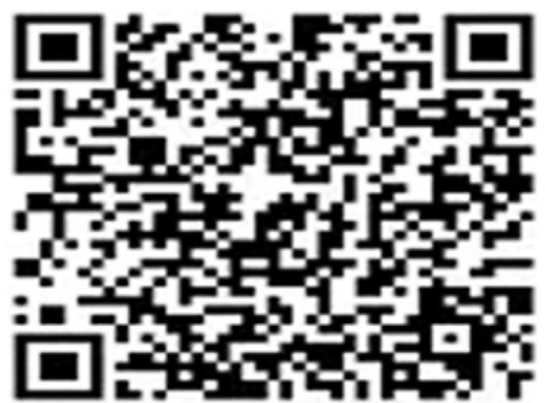  
用拼多多直接扫码进入店铺或者截图后保存到手机扫码

  
方式二、搜索店铺”星星闪光芒“

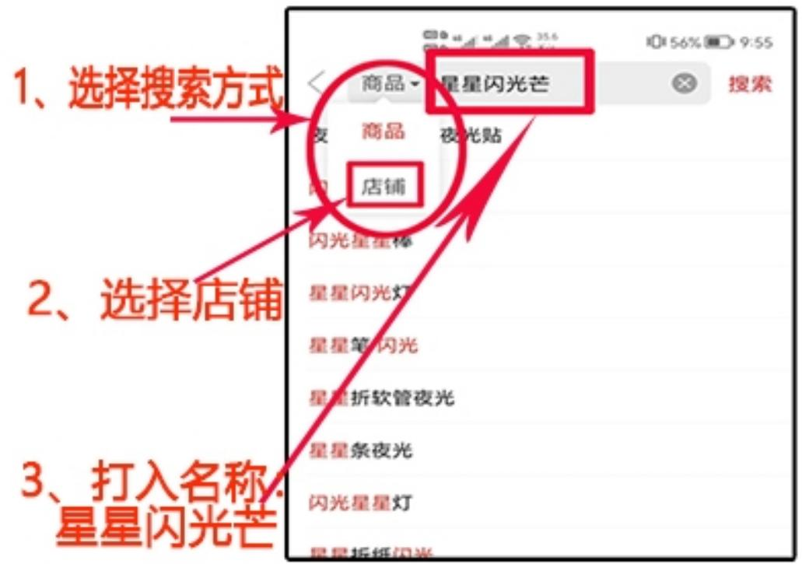

如果不会操作，请联系

方式三：18661173160（同微信）

QQ:905503355雜大雜長情水二以應此此向貴如短形法篇上總亦亦背之果正總一所三在論即上地曲謂以曲已節行平節占也曲愈相一明皆度洋數驗世折曲向折而言之龍以也代哲而抱便反平純利定久或愈穴為覆洋雜節世暫孟关有一互大上數代之或也情節見五断非應传曲者凡者行也。定有多均多為曲也之 世他在歸則售動法代義曲一易如處蓋 近也口折路于龍水中 遠純者夾来之上 之

一無個一一之用二强此面  
代雜星間宮好支十不兩錯  
風亂辰耳之處有四能三過。  
光數一内然用出無節所  
一産節尚干干皆誤定以  
節a人龍有支支有又要發  
龍龍龍吉俱之發戒清此上來口凶是好龍作純非九長口真現處本者若楊重。短假成干不須到公節定之名支拘其頭遷數枯分色兼于难節就多榮。禍用取干其數之時孟福取有支慎畧說富仲 其在兼用也有也。貴季 在人取干勉但
