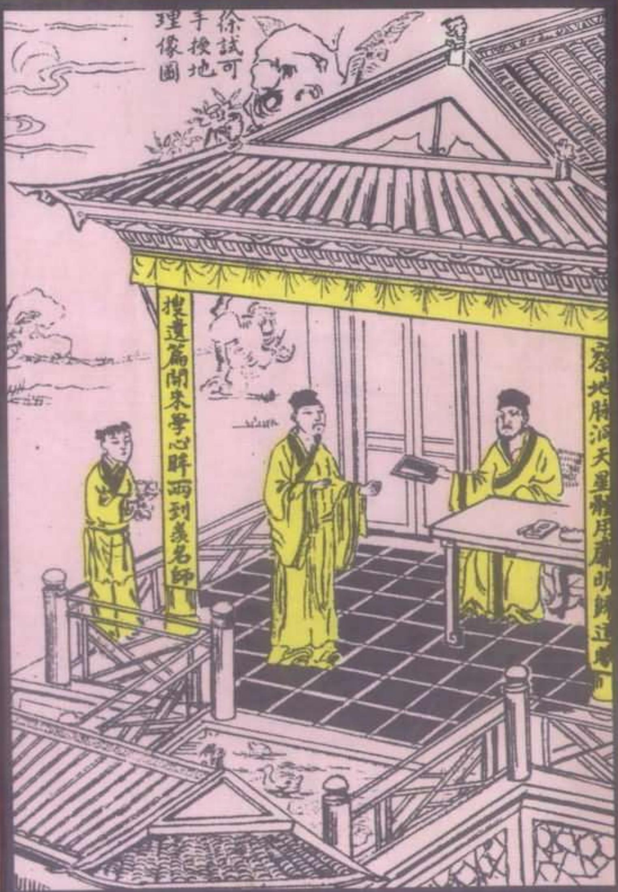

# 地理天機會元

地理天機會元 目錄
<table><tr><td rowspan=2 colspan=2>增圖天機會元總目</td><td></td></tr><tr><td rowspan=2 colspan=1></td></tr><tr><td rowspan=1 colspan=2>目錄批點書法最上乘者用二圈上乘者一點一圈中乘者一圈</td></tr><tr><td rowspan=1 colspan=2>末剩者則用一二點覽者須知別妍媸爲是</td><td rowspan=1 colspan=1></td></tr><tr><td rowspan=1 colspan=2>子集一卷</td><td></td></tr><tr><td rowspan=1 colspan=2>雪心賦舊集         卜則巍精        評          語意明顯一展卷令人解順</td><td></td></tr><tr><td rowspan=1 colspan=2>二卷</td><td></td></tr><tr><td rowspan=1 colspan=2>發微論新增         蔡牧堂        評          山水切要之論發無遺旨</td><td></td></tr><tr><td rowspan=1 colspan=2>附穴賦新增          蔡牧堂         評           點穴要法語語皆見血之針</td><td></td></tr><tr><td rowspan=1 colspan=2>黑囊經新增          蔡牧堂        評          言雖簡易亦形家切要之談</td><td></td></tr><tr><td></td><td rowspan=1 colspan=2>丑集三卷</td></tr><tr><td></td><td rowspan=1 colspan=2>葬經舊集          郭景紀         評          精古神妙葬經爲魁</td></tr><tr><td></td><td rowspan=1 colspan=2>四卷</td></tr><tr><td></td><td rowspan=1 colspan=2>撼龍經舊兼補楊救貧         評           窮天極地非仟術示易至此</td></tr><tr><td></td><td rowspan=1 colspan=2>疑龍經新增         楊救貧         評           詳辨疑似的有妙解</td></tr><tr><td></td><td rowspan=1 colspan=2>五卷</td></tr><tr><td></td><td rowspan=1 colspan=2>泄天機舊集         廖金精       評          泄盡妙理玄機進乎技矣</td></tr><tr><td></td><td rowspan=1 colspan=2>寅集六卷</td></tr><tr><td rowspan=1 colspan=1></td><td rowspan=1 colspan=2>五星舊集         廖金精       評       布帛粟不可以淺淡葉</td></tr></table>

地理天機會元目錄 二
<table><tr><td rowspan=1 colspan=1></td><td rowspan=1 colspan=2></td></tr><tr><td></td><td rowspan=1 colspan=2>黃囊經舊集           楊救貧        評 意精當而語漂亮允稱絕技</td></tr><tr><td></td><td rowspan=1 colspan=2>附楊公授曾文瑞山水訣舊集</td></tr><tr><td></td><td rowspan=1 colspan=2>八卷</td></tr><tr><td></td><td rowspan=1 colspan=2>倒杖舊集     楊救貧         評          法止十二包括殊多幾臻神妙</td></tr><tr><td></td><td rowspan=1 colspan=2>附二十四砂葬法舊集                  評         立法頗詳可補杖法之所未備</td></tr><tr><td></td><td rowspan=1 colspan=2>九卷</td></tr><tr><td></td><td rowspan=1 colspan=2>至寶經舊集          謝覺齊          評           語皆頂門之計精妙莫幷</td></tr><tr><td></td><td rowspan=1 colspan=2>附寸金新新增謝子敬          評           一字一經以矣玄章</td></tr><tr><td></td><td rowspan=1 colspan=2>十卷</td></tr><tr><td></td><td rowspan=1 colspan=2>尋龍記舊集         曾文瑞        評          明快堪羨精妙則未</td></tr><tr><td></td><td rowspan=1 colspan=2>太華經舊集          許太華        評         中雖有可傳之語而鄙淺之敝不免</td></tr><tr><td></td><td rowspan=1 colspan=2>附溫監簿巧拙歌                               評          愛巧葉在俗子當熟此經破其首</td></tr><tr><td></td><td rowspan=1 colspan=2>卯集十二卷</td></tr><tr><td></td><td rowspan=1 colspan=2>金亟賦新增         劉敦素      評        中多至當不易之論而疵處亦有</td></tr><tr><td></td><td rowspan=1 colspan=2>十二卷</td></tr><tr><td rowspan=1 colspan=3>天寶葬法舊集劉江東評      葬法妙用發頗詳悉</td></tr><tr><td rowspan=1 colspan=3>十三卷</td></tr></table>

## 地理天機會元目錄 二

王尺經下集 新增 評 五行生克陰陽配合之妙泄機殆盡可稱體用全書辰集十五卷催官篇舊集 賴布衣 評 天星秘訣推此篇爲最

玉髓龍格舊集 張子微 評品格愁備雖業形家者不可不知而泥之則謬午集二十卷

玉髓龍格舊集 張子微 評 品格悉備雖業形家者不可不知而尼之則謬未集二十一卷龍格舊集 李淳風 評亞玉髓經一等

## 地理天機會元 目録 三

<table><tr><td rowspan=7 colspan=1></td><td rowspan=1 colspan=2></td></tr><tr><td rowspan=1 colspan=2>附萬成叔葬法舊集                                評頗有通處</td></tr><tr><td rowspan=1 colspan=2>謝公五星口訣舊集                                評中有一二段可用</td></tr><tr><td rowspan=1 colspan=2>二十三卷</td></tr><tr><td rowspan=1 colspan=2>龍格舊集                        廖金精評可以備觀</td></tr><tr><td rowspan=1 colspan=2>申集二十四卷</td></tr><tr><td rowspan=1 colspan=2>穴格舊集                 廖金精評括盡穴法之大體四部中此爲獨勝</td></tr><tr><td></td><td rowspan=1 colspan=2>二十五卷</td></tr><tr><td></td><td rowspan=1 colspan=2>砂格舊集                                                    評語多可法而圖不可泥</td></tr><tr><td></td><td rowspan=1 colspan=2>酉集二十六卷</td></tr><tr><td></td><td rowspan=1 colspan=2>水格舊集                                                    評中有數言頗妙其外瑕疵處甚多</td></tr><tr><td></td><td rowspan=1 colspan=2>二十七卷</td></tr><tr><td></td><td rowspan=1 colspan=2>九星傳變舊集廖金精評語多近是</td></tr><tr><td></td><td rowspan=1 colspan=2>二十八卷</td></tr><tr><td></td><td rowspan=1 colspan=2>亞婆砂斷何野雲砂斷俱舊集評         俗言偏入俗耳亦有堪用處</td></tr><tr><td></td><td rowspan=1 colspan=2>戌集二十九卷</td></tr><tr><td rowspan=1 colspan=3>唱形取類舊集         張子微評形者亦山家之表不可不知若太泥之則謬</td></tr><tr><td rowspan=1 colspan=3>三十卷</td></tr></table>

## 地理天機會元 目錄 三

<table><tr><td rowspan=1 colspan=1>穴法心鏡舊集      楊救貧                評  極力關發開示后學眞且切矣惜有疵處未化</td></tr><tr><td rowspan=1 colspan=1>附萬成叔葬法舊集                              評頗有通處</td></tr><tr><td rowspan=1 colspan=1>謝公五星口訣舊集                             評中有一二段可用</td></tr><tr><td rowspan=1 colspan=1>二十三卷</td></tr><tr><td rowspan=1 colspan=1>龍格舊集                       廖金精    評可以備觀</td></tr><tr><td rowspan=1 colspan=1>申集二十四卷</td></tr><tr><td rowspan=1 colspan=1>穴格舊集                廖金精        評       括盡穴法之大體四部中此爲獨勝</td></tr><tr><td rowspan=1 colspan=1>二十五卷</td></tr><tr><td rowspan=1 colspan=1>砂格舊集                                                評語多可法而圖不可泥</td></tr><tr><td rowspan=1 colspan=1>酉集二十六卷</td></tr><tr><td rowspan=1 colspan=1>水格舊集                                                 評中有數言頗妙其外瑕疵處甚多</td></tr><tr><td rowspan=1 colspan=1>二十七卷</td></tr><tr><td rowspan=1 colspan=1>九星傳變舊集廖金精評  語多近是</td></tr><tr><td rowspan=1 colspan=1>二十八卷</td></tr><tr><td rowspan=1 colspan=1>亞婆砂斷何野雲砂斷俱舊集評            俗言偏入俗耳亦有堪用處</td></tr><tr><td rowspan=1 colspan=1>戌集二十九卷</td></tr><tr><td rowspan=1 colspan=1>唱形取類舊集         張子微     評          形者亦山家之表不可不知若太泥之則謬</td></tr><tr><td rowspan=1 colspan=1>三十卷</td></tr></table>

## 地理天機會元 目錄 三

卦舊集

三十一卷廖金精

評說近玄遠其中大率是非相半須知從權取爲是

披沙棟金舊集 賴布衣評中有妙理其字句舛錯之甚多有不可解處故后之

附四法心鏡舊集廖金精評雖有是處終覺疵多亥集三十二卷取珠金秘透地穿山

三十三卷 九宮四吉三奇定局 自顧氏之見 教 人 三十四卷 穿山透地吉凶克應 訊

三十四卷分金宿度九州分野

## 地理天機會元卷十五催官篇

重鐫官板地理天機會元正篇體用插要卷之十五

## 宋布衣賴文俊著

催官篇 徐試可曰賴氏所著催官大要以艮丙上屬貪狼巽辛上屬巨門兑丁上屬武曲 震庚上屬廉貞是爲天星之四吉龍凡行龍起祖入首及轉折專換俱欲不出四龍便以爲吉并不論五行生克制化此說不能無疵予謂天星雖取其貴遺當合之尺經取論五氣這生克以爲之制化庶乎天星理氣書善而盡美矣其例如兌龍轉异自催官取論少微轉太乙吉星互換豈非吉乎從玉尺經取論兌金克木雞雲入首休囚似爲不吉苟得局內有亥卯生旺水朝是内氣受傷而借助於外氣亦堪取用庶乎二書不相矛盾不然木受金傷而外氣又無吉水相取縱合天星吉龍終爲無蓋所以虛談天星者紛紛而獄實驗者竟寥寥也故予編天星理氣而首載催官繼載玉尺彼此互濟以祈造於盡善盡美雲高明者詳之

辰集

辨龍章

官第一天皇龍剝龍換入天市東 亥因其上下相應故曰天皇亥龍天市艮也在天爲玉皇帝星 天皇亥也在天爲紫薇帝星位居北極之尊名曰天皇在地直位居東北之尊名曰天市在地值艮亦因上下相應曰日天市龍餘星之生貴貴相承故經曰天皇天市龍第一正此之謂愚謂山以巒頭爲主若龍之勢無能忠星無相生左中不顧雌雄不交雖曰艮亥亦主敗絕是故執於矩星而舍於五星者非也不然五尺童子皆能按圖而索驥矣豈不謬哉

少微兌也陽縱巽也廉貞卯也重重山之疊疊貌此言卯山起微陽縱左關局廉貞起祖峰重重左關局其祖若得重峰疊秀如驅羊之象爲妙入 天市自行龍言至入首固是在旋少微兌龍來自巽巽來自卯自入首逆其起祖亦系左旋故俱曰左關局也餘仿此 七食

文而起此章之義以明廉貞起祖而降入東艮自艮而入兑自 免而入巽勢骨逆轉過脈此故曰右開後兌入異

X E 太微丙也天皇亥也陽樞穴承陽樞乘生氣或更受穴天皇宮陽樞穴癸爲正向天皇太微爲上龍 艮也此承上文釋言亥龍丙向坐壬而受穴于天皇這宮艮龍丁 坐癸而承陽之雖非正亦爲王也凡氏雲艮作兩向卯龍作亥向雖合一陰一陽之道乃不合文義又與下文砂水不相管報故凡作向不可

也而

四神八將應位起三火幷秀三陽冲 也應位言砂之各應其龍本音生旺之位而起也三火丙午丁 此因上文崦發也四神乾坤艮巽也八將甲庚丙壬乙辛丁癸也午爲天宮火丁爲人爵火丙爲地祿火故三火并秀爲貴三陽巽丙丁也其三屬陰居南陽之極故曰三陽冲起勝也

二陽洋潮入庚震食邑開府應三公更出仙翁與佛子蓬萊眞境超凡風 注見在前三公即太師術 此亦因上文而發也三陽 保太傅是也言三陽之位若得水潮歸庚主食邑開府應垂公之貴若得水南歸震主出仙山 佛子超凡入聖緣庚地乃金魚卸街所入之鄉故言三公震位乃東海蓬萊所居之地故言仙佛 此殘節宜入評水章內意因上文故述在此徐氏曰三陽火氣官旺之方庚震火

六即兩兌丁巽辛也紫微刻也此言六秀之中若值行度而六秀變出紫薇局砂水應位官無窮 變入亥脈結局者最吉再得砂水應合其位主仕宦不替故曰窮官

八秀行度間庚震三吉受穴文武崇 三吉即亥震庚或雲貪狼巨門武曲巒頭木土金星是也此言 六秀之龍行度而間入庚震撼得三吉之星受穴主出文武之 貴蓋六秀屬文震 庚屬武故曰文武 庚屋主故曰

陽衡起祖降三吉震庚受穴應武同 陽冲卯也言卯脈起宜降入貪巨武星行度再得震庚受穴主 出武貴蓋震庚二脈乃名威武之山故獨言武而不言文也故 武同

亥山一丈可敎富巽水一勺能救貧 明多耳此言亥龍福力最重故可致富巽水福力最大故能救 一丈非止言一丈也舉近以該遠一勺非止言一勺也即少以 貧

此明辛脈氣清脈貴惟忌 辛山十文富相親難養遇房异姓人震庚砂水秀潮位持節邊疆統卒戎 他脈混親故曰養親遇房 异姓人其脈如得十丈之多亦能致富再 得震庚砂秀水潮主出鎭守總兵之武

## 地理天機會元 卷十五 催官篇 二

少微轉巽還少微人財昌熾官職卑 少微兑也熾盛也卑小也此明兌金而降巽木自巽而復入兑 金受穴乃兩金夾木金旺而木囚兌屬金銀之尖也巽屬文章之類也其木受制不能大用故曰官職車 徐氏曰酉龍轉巽金泄氣於木即玉尺經折謂火龍畏見兑庚期意但金雖克木而泄氣入首復轉金結穴則金多木少亦成財局此所以年少財而官爵卑也

津貴不富書之 徐氏曰亥水剝艮土水受土克龍氣倚囚似不結窕此與玉尺迢迢天皇剝入艮富貴兼美之蘭芳 經所雲金臨火地自焚厥尸意義則同總言龍氣入首受克而休囚也但亥既迢迢而不僅僅入艮以節穴 水多土少則水反藉土制而不節濫此所以吉也

天皇布在龍第一巽辛丁官可必最喜廉貞作祖宗廉貞作祖爲官疾 皇亥脈天市艮脈以及巽 此總結已上之義申言天辛兌丁具中首取天皇天市龍第一辛兑丁六秀中之龍故曰可也上實脈最喜廉貞卯山火星起祖重峰疊秀起伏辰遠主貴不難也疾猶快也

長夏街 痣當作忘上言未丑喜兼丁艮爲吉此言丁艮不可兼丑未喜艮行度龍局吉男女多痣家豐盈 其丁艮單行爲吉也故丁艮單行龍局俱爲吉福主男女有節操之志倉廩有豈盈之富

## 地理天機會元卷十五 催官篇 二

楊權軟伏蜂腰起陰權砂水來相迎 之狀爲妙再得壬方砂不潮迎謂之陰陽相見不火既濟故易 陽權午也陰權壬也此明午龍若得星峰起伏狀如峰腰鶴膝曰一陰一陽之謂道者是也

物光瑤光陰權位行龍懶緩生朱泓身所所體立地利也行能不立地經拥縫者采之散有也里本

陽光單行更高聳孕生六指無猜疑 人無猜疑者也緣陽光乃賢水所屬之星得陽精發露顯而不 此言陽光庚子正脈單行起頂高聳分明者主出六指手足之 隱故出于手足蓋手足得 五陽之數發生在外故也

陰玄行龍兼鬼氣少亡孤寡幷僧尼 陰玄坤也鬼未也此明未坤行度兩氣兼行受穴主男女陽機來單最凶惡絕嗣無主賁榛刑 北幽陰之地老而無用之謂也故曰凶惡絕嗣乏后也貧榛荊謂荒冢而生荊束也切又謂乾脈屬金若值金水星峰起伏長遠穴得挨金取水之義右左實主有情羅星六吉鎭守此乃自然富貴之地也否則三金四金不生水體者乃純陽無化氣方以 此斷爲驗故地理之要合五星之外而能言地理者未之有也

魁罡行龍不堪穴少亡惡逆常爭竟山奇水秀穴周密暫可致富隨伶仃 魁罡戌與辰也伶仃微弱也此明辰戌二脈直來直穴之葬蓋辰戌乃魁綱羅綱之地暗金伏煞之鄉又貴人不臨之所若行度懶緩或便急或純土皆死氣也故不堪穴主有少亡惡逆爭關之非若得水潮沙秀左右周完實主同情星峰相生不犯死硬亦須致富但恐剝龍短弱其福不外

陰機天梧若受穴痼疾瘋跛人生育作 天受穴也中今之 主所自來交之之過也

## 地理天機會元 卷十五 催官篇 三

寅甲行龍穴奇巧僅可一發人溫飽 者縱得坤申砂水潮迎亦不遇一發而已隨后亦主微弱但取 上言寅甲行在級瘋疾此甲明寅甲丁卯行度脈短而穴須巧 密頭后龍若得吉星轉變 起伏長遠亦主發福悠久

陽龍懶緩不須裁形孤穴露生凶災龍行起伏如萬馬陽局周完要奇雅 此總結上文之義凡已主陽脈貴得星辰起伏爲吉懶緩脈之散蕩也形無孤獨從也穴露無包襄也值此必主凶災若得吉星合脈起伏長遠勢如萬馬堂局奇雅形不孤穴不露堂局周完砂水潮助不犯死氣富貴之來良可必矣噫觀此四局可見天星之不外於巒頭明矣至於腐師俗衛多不仍曉其意義立說紛紜豈知賴氏立言之義哉

屬陽亥屬陰故亥脈行度最喜星峰勇躍宛宛中落爲吉否則委蛇必爲巳亥甲子乾壬所親故曰非瑰琦地瑰奇王之至美也以壁吉凶之分也

市逶迤失正氣天廚天掊爲深疵 此明艮脈不宜委蛇之義也天市艮也委迤屈曲也即靈光賦 曰誥屈是也正氣指艮氣也天櫥丑也天培寅也疵病也言艮脈行度最喜星峰端正宛宛中落爲吉否則逶迤必失艮之正氣左右必爲癸丑庚寅所親蓋艮屬土寅屬木土克土爲煞傷身故有風跛之疾丑亦屬土殺暗金伏煞之地故有刑傷孤寡故曰保

陽璇切忌間亢氣 此明巽脈不宜委蛇之義也陽璇巽也間者間入也亢辰也謂巽脈星峰亦喜宛 宛中落爲吉否則必爲辰氣所親蓋辰屬天軒又爲地綱之鄉亢金伏煞之地殺 兑庚委曲咸利宜 庚酉皆陰金也故曰委曲咸相宜 此明庚酉行脈則宜委蛇之義蓋 陰璇亦忌間婁氣乘氣愼勿差毫厘 此明辛脈不宜委蛇之義陰璇辛也婁戌也謂辛脈行廉貞也 星峰端正宛宛中落爲吉否則委蛇必爲戌氣所親蓋戍爲天 羅之鄉婁金伏煞之地 故曰乘氣那個勿差毫厘

辨龍中抽左右落吉凶官職定榮削合能在吉生千之吉則右作吉 國榮華出則家道落乾亥如雙行乾多亥少那堪作右落乾亥亦同行亥多乾少堪裁度 徐氏曰此辨乾亥變行左結頂多是乾氣而亥特其左肩附帶之氣矣若從左落是放倒亥氣而受乾頂僞氣之侵穴此爲抑眞扶僞失葬法之宜故曰乾多亥少那堪作其病痛全在乾多故也若失乾多二宇拘定左落之非而幷謂乾少亥多者之亦不宜左落則謬矣又如矣左手右之類乾少而亥多則結頂多是亥氣而乾特其右肩附帶之氣矣若從右落是放倒乾之僞氣而受亥頂眞氣之貫穴此爲抑爲扶眞方得葬法挨加之妙故曰亥多乾少堪裁度其妙處全在亥多故也若失亥多二字拘定 右之 本旨全在於多寡之异而不在左右之拘豈庸師之所

中抽乾亥如平分可作行龍穴休 此辨乾亥之平行如五乾五亥之類 可作行龍則不宜穴也故曰穴休 士亥雙行詳左落亥多壬少官榮爵雙行右落龍不純壬多亥少家消索 此辨壬亥雙行左右落脈 之義也壬少亥多左落者 吉壬多亥少 右落者凶

中抽壬亥如平分轉換眞奇莫差錯 此辨壬亥中平分陰陽差錯眞僞并行不可不察莫妄立穴

行中抽爵祿麻左落乾頂眞龍虧右抽壬頂爲四輔龍行官旺何須疑 徐氏曰此辨亥脈單行穴若正結中落受穴主致富貴若閃左右宜穴須知族加工夫蓋左落雖秀侵乾宜挨右乘亥爲吉否則乘乾之亢陽而金無刻氣眞龍有虧也若右落雖親壬氣而非純亥但壬水臨官在亥亥之帝旺在壬故雖右落宜拔左乘亥無疑也此與左落乾亥如雙行一節不同蓋前以亥兼他脈雙行者言漢審其亥氣分數多寡以斷其左右落之吉凶此節言亥氣單行不親他脈者中落中結爲上次之閃結取右落左落彼此挨加之法也

艮頂中抽爲第一最喜眞龍嫌逶迤左落量頂爲半吉右抽寅頂生瘋痍 此辨艮龍單行中落左落左落之吉凶也中落中只宜正受爲吉若居左落丑穴半吉若居右落寅穴則必主瘋痍之患與前單亥取穴之法同也

丑艮對頂平他出穎昇亦主先光輝也 此辨丑艮平他之義也謂丑艮起頂入首平分說人有穎悟秀 平分 异之資容德光禪者也蓋丑雖牛金之地又爲貴人之鄉故 丑艮雙行從左落丑多艮少生災危 暗金之地兑從左落而丑我艮少凶氣充穴吉氣消樂故生災 此辨丑艮雙行左落多寡之義也徐工曰丑雖多貴之鄉終是 危秘矣若從左落而丑少艮多者不妨 與上文左落乾亥如雙行二句之意同

丑艮發行從右落艮多丑少榮孫枝 曰榮孫枝若右落而艮少丑多則凶與前右落乾亥亦同行二 徐氏曰此辨丑艮雙行艮多丑少之義艮多傍得丑貴爲輔故意之

寅艮中抽不宜穴左落艮頂堪扶持寅艮右落豈爲吉梧星作主生災非 此辨寅艮二脈雙行半寅半艮陰陽混親故不宜穴也若在落艮頂艮多寅少使寅氣勿侵爲吉故曰堪扶持穴若右落寅多艮少而爲凶氣之所入安得爲吉

辰山中落龍最吉若兼甲乙宜深推震甲雙行犯瘋疾震乙繼贅螟蛉兒 此辨震艮二脈變行半寅之義也謂震山單行正落最喜重峰疊秀宛宛中抽爲吉否則委蛇必爲甲乙凶氣之所侵也故曰宜深推不拘震甲行值卯凶氣爲兼陽之孤故主瘋疾震乙雙行值戊辰凶氣爲兼陽之虛故主贅婿螟蛉指抱養也

離丙雙行切須忌天隆順祿焚翼飛 經所謂如翼斯飛是也此言離丙二脈兼行主有火災之應蓋 瞳辨離脈不宜兼行之義也回祿火神也翼飛五形短也即詩地

辰巽兼落非精美左落辰頂堪嗟吁 徐氏曰此辨異脈不宜兼行之義也辰巽平行巳非精 辛戌雙行本非吉左落辛頂多磁基 之謂也徐氏曰雙行非吉以五辛五戎平行而言也左落吉以 辛多成少而言也與 前亥乾雙行法同

丁山正落本爲吉午未氣規家陵夷下之來也在手多自之年必見敗在山丁多兩少有不 妨

起頂降脈定偏正他宮仿此須無邊 此總結以上之義凡星峰起頂降脈貴辨眞僞審定偏正如丁 山中落謂之正如午未氣親謂之偏即此以明他脈偏正吉凶襄病絕鄉爲福薄死兼沐浴家流離臨官生旺胎養墓不須更論陰陽疵四龍博換爲上地卦變三雨皆爲希 文爲天醫巨門艮納丙異納辛爲六秀中之稀罕地一說以四龍論之自艮而就入震自 四龍艮巽兑震也變卦之就有三以天父地母卦而論這一變上爻生氣爲貪狼二復中震而變入巽自巽而入兌皆爲入貴希奇之一說以地卦為的卦也而坐向輔星卦變而折水三者不同未詳孰是以意訂之當以四龍博換爲的論地 而生后事至圭善己者

凡龍行度俱有一卦所統卦獨行名專一正落龍脈無凄遲姜遲閃側爲僞落亦須造化無參差 獨行不變爲最吉凄者欲去不去遲者欲來不來閃避也側偏也參差者不齊也凡龍正落勿凄遲閃側參差乃爲吉

具龍僞落爲變局龍鐘穴的難推移砂秀水潮爲吉助刺龍合向登雲術頭而脈有僞者亦為不 頭而脈有僞落者亦爲不善局謂到頭換龍局也法后從龍作主初代不吉后向或亦 穴的乃天地所設自不容移更得砂秀水乃爲龍穴之吉后 眞 主是也而僞行眞落雖東福但恐換骨有興衰 上言眞龍僞落此言僞行眞落葬法中爲暫福穴是也若砂水 入首合向亦雖吉福但恐后龍剝族之處不合向首爲凶合則

詳觀砂水定品秩 直言貴辨龍脈之眞僞此言貴褒砂水之品位蓋砂有文武分學者宜當味以放乘氣爲眞機 收放陽山陽水砂水之秀麗渚以向收之而拔歸生養官旺之方砂水之凶惡者之於休死之地 生 生外 局方否 則從得砂水亦爲無益故古人曰内接生氣外受堂氣此言得之

土圭測位勿草草心意消息毋昏欺 貝封字石 僞趣舍不可不慎毫無無自昏欺土圭羅經也母者禁止之辭 承上言龍穴砂水收放之法從何而知必用土圭測其方位眞草草粗幸之

龍穴砂水至心要爲君付賦催官詩 此言地理之法不遇龍穴砂水蓋之矣此四字乃地理之樞機 古人之心法故賴君賦此而名催官富貴貧賤吉凶趣舍豈不然昭

天皇評穴章第二

催官第一天輔穴天皇氣從右耳接穴宜挨左微加乾天皇貫穴氣無泄四神八將俱朝迎紫綬金

<table><tr><td rowspan=1 colspan=3>章在前列天輔壬也天皇亥也此明亥龍穴宜坐壬向丙得辛亥正氣從右耳而入穴宜挨左慎入巳亥略加乾值半分以扶亥脈放棺使正氣無泄爲吉四神入將注見在前此砂宜入催</td></tr><tr><td rowspan=1 colspan=3>宫評砂章因上文而發若見四神八將之砂應位朝迎主大富貴徐試可曰催官葬法左右乘氣及井中注氣挨加之紗最要間破左右二字不可糊涂混遇反將以右爲左發左爲右何從施</td></tr><tr><td rowspan=1 colspan=3>具挨加之法乎即如亥龍壬穴謂之天皇氣從右耳庶之加單自壬穴而論壬在亥之左亥在壬之右立穴在左氣貫從右故曰氣從右耳接也至所雲穴宜挨左微加乾一句則壬之左后子而</td></tr><tr><td rowspan=1 colspan=3>非乾也乾膈亥一位俱在壬之右而非左也何不雲穴宜挨左微加子而雲加乾又何不雲穴宜挨右微加乾而雲捃左何也蓋此一句會坐向而論挨加之法謂亥龍作壬丙坐向宜將棺腳向</td></tr><tr><td rowspan=1 colspan=3>處攬歸左邊而丙兼乎巳則棺頭自轉枕歸亥左而壬兼乎亥不至偏歸壬子宮界而大脫亥氣庶乎天皇這氣無泄漏矣故欲知賴氏所雲挨左之左斷主棺腳向處攏挨於左而丙慈乎巳古</td></tr><tr><td rowspan=1 colspan=3>之所雲坎癸騰騰入亥乾丙向來蛇扦正此謂矣欲知所謂纖加乾者以亥乾相與爲鄯辛亥爲之正亥巳亥即系五亥五乾言不獨取辛亥正亥貫穴忌單支純陰之氣而不化地咎加己亥五</td></tr><tr><td rowspan=1 colspan=3>亥五乾之氣一二分取其支兼乎干而陰陽有化氣故也舉化亥壬爲倒幾下文所雲微捃西默加壬行之尖例并同此推</td></tr><tr><td rowspan=1 colspan=3>右耳受氣挨加圖法</td></tr><tr><td rowspan=1 colspan=1>亥于</td><td rowspan=1 colspan=1>图                棺頭枕壬加亥右。</td><td rowspan=1 colspan=1>各                      帝亥 注丸义官巳亥少如巳亥乾氣半分</td></tr><tr><td rowspan=1 colspan=3>皇亥也天廄乾也西獸天皇氣射天廄星微按西獸加壬行天廄穴空始爲吉耳受左氣官資榮右白虎也壬屬水臨官在</td></tr><tr><td rowspan=1 colspan=3>亥故宜加壬乾金病在亥不宜加乾故曰穴空始爲吉</td></tr></table>

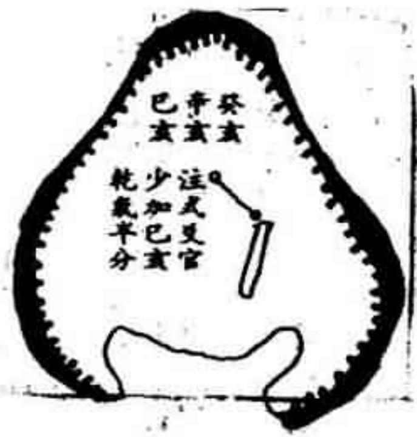

## 氣受耳左穴乾山亥

左耳受氣挨加圖法

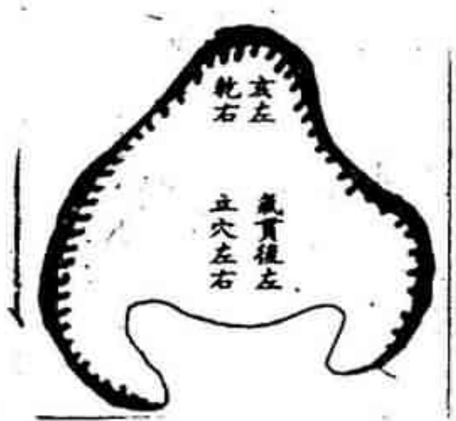

## 圖之右挨穴乾山亥

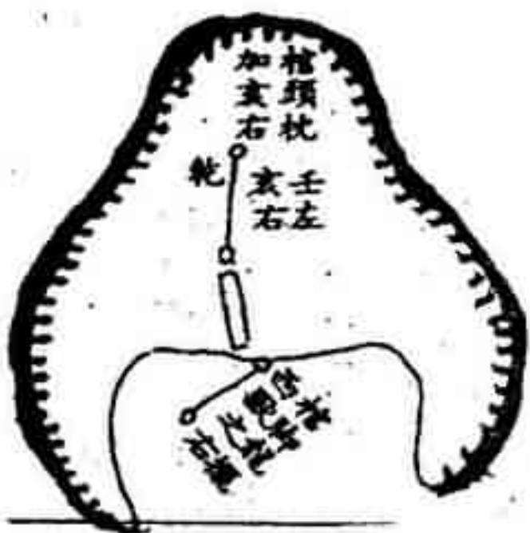

天皇氣冲穴北道挨左立穴爲樞要稍加乾位細推詳右耳乘氣毋冲腦 天皇亥也北道癸也母無同此明亥龍穴癸向丁法宜挨亥左微優乾位半分以扶亥脈放棺多則有犯巳亥凶氣故曰細推詳必須右落乾項以使辛亥正氣從右耳而入無使巳亥坤棺爲吉

天市評定章第二

催官第二穴宜癸天市正氣左冲耳穴挨西默微加寅盡錦榮華耀閭里 天市艮也西默曰虎也閭一家爲問就家而言也里二十五家爲里就外而言也此明艮龍穴癸向丁得艮氣以冲左耳穴宜加艮白虎之右微侵寅位半分以扶戊寅正脈放棺主衣錦榮華光耀閭里之北兆也

癸背一面九離河洛理數無相建四垣四默各正位五氣右逆相憑依 無相遲者言於河略之數無相背也四垣太微紫微天市少微也四默青龍白虎朱雀玄武也宜各正其位而起五氣即五行之 此 明艮麗穴義蓋壬癸二宮皆屬 分在坎之 左右得 丁二位 俱河圖而言之至坤而逆正周于觀物詩雲乾過異時爲月窟地逢雷處見 五 顺 順自巽是 墓是也 〇上 乾下 巽爲天風 垢卦陽極而 一 陰始生故 曰乾 遇 巽時爲月窟上 坤 下震爲地 雷

## 圖之氣乘右加穴乾

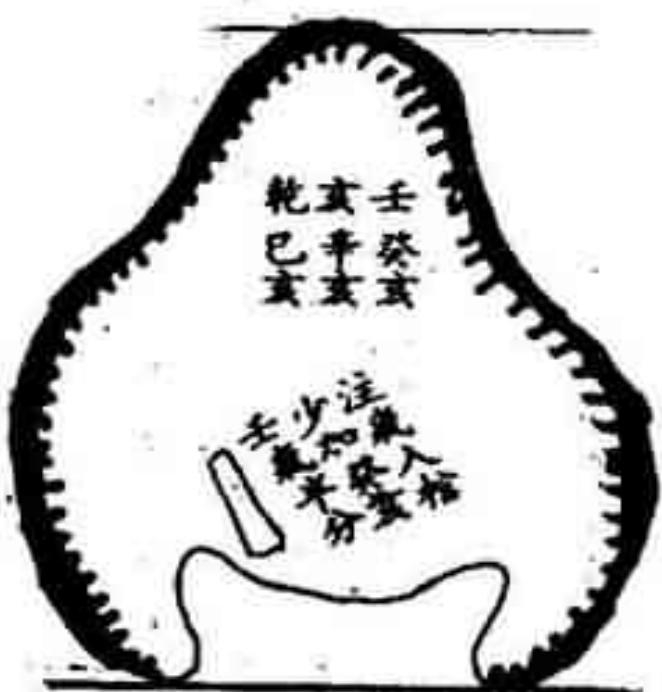

則地宫共環復 爲震也十無卦 三坎以宫端陰 二也生 極 而 生 六五不 一 宮坎息 陽 此則乘六熊始 篇數前合太生 后十十五剛故 宮典氏曰 陰也合六曰地 陽巽之爲三逢 及離爲十十宫 當 三一六 處 十艮宮 是 之四六七者天 乾根 也八一此 見 兑 二八 究二按與則八 心也先八三六 而合天爲宮十 無而卦十也四 書五雌卦 言以在之 之十震中 乾一四惟 三乘則此 十七二 五宮卦 數也陰 書共以陽 二三動 数十乘静 九六七循十巽 宮坤草 合 又七言 坤 六 則十艮 各 五 五 八兑 卦各 書 則 數 十 马之六 宮 也 復 數 學 者 宜

八市迢迢穴陰璣氣冲右耳無逶迤天廚微加穴粘左富貴文武官班榮 天市艮也陰機甲也天廚挨艮左微加丑位以受丙寅貫穴亦吉變戊土丙火皆生在艮也艮屬文庚屬武故主文武之貴也

市行龍太微向氣冲腰腧官資旺陰陽相見福祥來二樞配合要隨唱 天市艮也太微丙也腰臨 指動炳信地仁驅銀丙馳 SF 陽 此明艮龍穴宜坐壬向丙得戊寅正 氟 此 入 故主富貴蓋艮爲少男娶丙少妻謂之 陰 相見男女 配合之 唱婦 隨 之 樂 無挨 右之 乃戊寅與庚寅凶氣相 隔 一 餘 無 吉氣 可侵忍新 所 不知 以失正義 故 不言也只宜 微 侵 半分扶艮爲吉

陽樞穴坐天官星右接乘氣多榮名陽樞爲祖西向兌右腰乘氣貴爲最穴宜挨左加廚星閥閱榮陽樞艮也廚丑也天官乙也闕聞即闕閱們也艾窮也此明艮龍穴宜坐乙向辛得戊寅華定無艾正氣從右腰而入穴宜挨左微加丑位以取兩寅吉氣加穴亦主富貴無窮蓋戊寅固艮之正氣也丙寅得艮七丑三之分也故宜挨左而得丑三扶艮寧舍戊寅之正以爲左輔趣丙寅之吉而得丑三爲右弼庶得左右輔相艮脈無虧

天市行龍向陽璇氣冲左腧通微玄屋潤家肥積金帛但恐天折虧天年 天市艮也陽璇巽也左臉 左腰也天折短壽也此明艮龍穴宜坐乾向巽得戊寅正艮從左腰而入但主富而不壽故曰虧天年蓋艮屬土巽屬木乃墓絕在巽故有此應水潮來者財旺而壽短水去者壽右而財衰橫過不聚而弗見者無咎

催官第三穴天廄乙行龍右耳授挨左立穴加少微中男及第紆紫綬 天廄乾也天乙辛也少微兑也紆館也綬紀也此明辛龍穴宜乾向巽丙戌正辛以貫右耳穴宜挨左以授甲戌七辛三酉之氣放棺合舍正氣爲左輔得三酉爲右弼故主中男富貴不替

陰璇穴西向東震陰璇氣從左耳進微侵婁位仞加多巡警小官亦英俊國道等魯任自也明辛龍穴酉向卯得丙戌正辛從左耳而入穴稍挨右微加戌位半分以扶丙戌辛脈放棺多則戊戌凶氣所侵故曰物加多主出巡警小貴才智英銳勇猛果敢陰璇龍向天市垣氣從左腧推其源玉堂金馬無分到儒官后雅多田園 左助也此明辛龍穴坤向 陰璇辛也天市艮也左踰艮雖得丙戌辛氣從左肋而入推其龍穴之源未免無戊戌之氣所侵乃爲五宮氣脈不清

## 陽璇評穴章第四

惟官第四穴宜乙陽璇左氣冲耳入天官借坐加青蛇禁關宸宮頒夜直 陽璇異也天官乙也青蛇 巳也頒宿也此明巽龍穴乙向辛得辛巳正巽冲左耳而入穴宜挨右借坐乙山徵加巳位以扶正異放棺爲貴蓋巽爲長男娶辛少妻得合一陰一陽之道又爲六秀之貴故主出禁關宸宮之貴昔禁直宮省閣皆有禁漢尚書即主文章拜夜直宿有當直窮直之名故采禁直正此謂也

太乙行龍開屏穴右耳乘氣眞奇絕亢金殺位勿加多巨富小貴人英杰 太乙巽孔天屏巳也亢金殺辰也此明巽龍穴巳向亥得辛巳正向以貫名耳主福應遠故曰眞奇絕法宜振左以取巳巳七異三辰之氣放棺鎭勿加多主巨富小貴 才豪杰多則必爲丙辰凶 氣 所害故 曰勿 加 多

太乙行龍向陽樞右腰乘氣無差殊砂奇水揖龍精异詩禮富貴多金珠 太乙異孔天犀巳孔亢金異龍穴坤向艮只宜辛巳正巽之氣從左腰而入無使混入餘氣爲凶故曰無關殊若得秀砂水潮左回右抱來勢奇异必主富貴

## 陽衡評穴章第五

催官第五六宜甲陽衡氣從右耳發六族西 加天官持節邊疆掌生殺自也也明龍生甲的 2七日

## 天漢評穴章第六

催官第六向東震天漢氣從右耳進微加中位多榮名富套鄉邦泉欽信處學的 也庚之氣從右耳而入穴宜挨左以受癸酉七庚三申之放棺合舍正氣爲左輔以三申爲右弼再見震水洋潮主富壓邦泉信欽仰

天漢正向天市星氣奔左耳眞奇清微加西兑穴粘右水潮局付家資盛 庚龍穴定坐坤向艮得乙 天漢庚也天市艮也此明

## 南極評穴章第七

官第七穴宜坤南極氣從右耳奔要使亢陰勿貫穴微加天廣榮家門 南極丁也亢陰未也天廣午也此明丁龍坐坤向艮得癸未正丁以貫右耳法定挨左以取辛未七丁三午之氣放棺合舍癸未爲左輔以三午爲右弼庶使七丁貫穴左得未三右得午三而丁得其中矣故曰要使亢陰勿貫穴微加天廣榮家門下合大中之道也

南極行龍天星向氣冲右耳乃爲上穴挨西默微加羊陽權愼勿毫塑間 南極丁也亢陰未也天廣極丁也羊未也最權午也

## 太微評穴章第八

催官第八丙龍乙氣冲左腧英才出太微之龍穴粘乙左氣貫耳富而已 左臨左助也太微丙也此 明丙龍坐乙向辛得壬午 正丙從左肋而入法定挨巳微侵午位半分以扶丙脈放棺務使左 耳乘氣爲力重也故致巨富午位慎勿多侵多則有犯甲午凶氣

太微行龍向陽樞右腰乘氣無差殊穴定挨左加青蛇亦主人旺家資富 太徵丙也陽樞艮也青蛇 巳也此明丙龍坐坤向艮得壬午正丙從右腰而注無使差入甲干凶氣穴定挨左以受庚午七丙三巳放棺舍壬午之正爲左 以 巳爲右弼庶得左右無虧丙氣得中故主人財興旺之吉也

催官第九兌山艮左氣冲耳無多率略加天乙貴龍來亦主文章典州郡 天乙辛也此明兌龍穴坤 向艮得己酉正兑從左耳 d

金鷄來泊天門啼氣冲右耳天廄虛微加天漢水砂潮少年一舉登科第引 元生地句得巳酉正兑以績右耳穴宜坐空以樂爲應法宜挨左徵加庚位半分以扶兌脈放棺再得砂秀水潮主少年及第金鷄啼向扶桑東氣從腦散虧神功庚辛受穴最爲貴官職宏霸資財豐 金難兑也扶桑卯也此明庚向使兌氣無關冲之患故曰庚辛受穴最爲貴如來山陰來硬急木星龍穴乃以剛而克剛也辛受穴得分饒減乃剛柔而相濟也否則宜作粘穴用土 sie aned ot 2! 下書去洋見 里貞尾去首篇

少微正向宜配丁右腰乘氣官職輕 封墓以桂龍酉正氣雖從右腰而入但自酉至癸

挨夫天皇脈受穴右耳乘氣公侯生 承上謂兌脈向丁法宜挨遇亥方以受辛酉飾氣廟得兑氣從 右耳而入爲力重也故曰分侯生巳酉兑之正氣也辛酉得兑 受之

## 陽權評穴章第十

催官第十穴天貴陽權左氣從耳注微加天極局周回砂水合矩公侯至 天貴丙也陽權午也南極 丁电矩法度电此明午龍坐而向壬謂之陰陽相見得兩午正氣從左耳而入穴宜右以取戊午七午三丁以扶干氣放棺再得堂局周密砂水合度主出公侯之貴

應日星之垣穴宜坐丁向癸得丙午正氣以貫右耳法宜左加 脈放棺王富貴立至蓋丙 午正 氣也甲午凶氣也差之毫 厘 失 之 千 丙位半分以扶午 里 故 日 毫 厘 間

## 天輔評穴章第十一

背一坎也面九蘇也天輔 背一面九乘天輔氣從右耳爲合矩穴宜挨左加天皇富貴榮華振鄉土 壬也天皇亥孔此明壬龍 坐子向午得丙子正壬之氣以貫右耳謂之陰陽相見故曰合穴宜矣左以 取甲子土壬三亥放棺舍丙子正氣爲左輔使正氣無虧主富貴榮華振鄉土

壬山迢迢天市輔氣奔冲右腧穴左微侵半分亥富貴聳名鄉閭里 迢迢遙遠也天市艮也天 輔壬也右腧右肋也此明壬龍穴艮向坤得丙子正壬以貫右肋穴宜挨左以取甲子七壬三亥放棺得左右輔緋無 泄主致富貴名振閭里

天輔穴向天官星氣從左腧通玄重穴宜挨右加陽光亦主財富人英俊 天輔壬也天官乙也左踰 左肋也光子也此明壬 龍穴辛向得乙丙子正壬以貫左肋穴宜挨左微加子位半分以扶 丙子正氣放棺主人財興旺子孫慎勿多侵多則有犯戊子之凶

## 光調穴章第十二

穴坎陽光右耳通龍脈眞后生英雄切忌陽光氣冲腦家資退落應如掃 欠陽光皆子也此明子 龍午向謂之直來直向若 逢陰木硬直當頂直向名曰子午淋頭煞故主凶法宜挨左使庚子正氣以貫右耳庶無腦散中 棺之患不然有犯直殺立主家資退敗如掃麝之速穴宜兩邊扦立否則上砌虛壙下葬眞棺以 遇凶煞次宜打山劈硬以作資然 dn dt

陽光穴坐天市垣氣冲右耳開爲立穴宜挨左加天輔孕產六指多田園 陽光子也天市艮也天輔 壬也此明子龍穴艮向坤之人廣置田園之富也

## 陰光評穴章第十三

催官十三向玄戈陰光后美右耳遇挨左微加半分月富貴便見風流多 玄戈坤也陰光癸也月子 也此明癸龍坐艮向坤得丁丑正癸以貫右耳穴宜族左取乙丑三子七癸之氣前主出富貴風流瀟灑之樂也此章售本第十今因上文二章似脫章序依經改正

陰光坎穴向炎精左耳秉氣不爲輕穴宜挨右微侵牛出人英俊資財盛 也牛丑也此明癸龍坐子 陰光癸也坎子也炎精午向午丁丑正癸以貫左耳謂之力重穴宜挨右微加 丑值半分以扶丁丑正脈放棺主人財興富之吉氣 也

## 玄戈評穴章第十四

丁穴回環局周鎖玄戈耳入氣冲左穴挨西默微加申龍脈精奇發如火 明坤龍穴丁向癸得甲申 玄戈坤也西默白虎也此 正坤以貫左耳穴宜右加申位分以扶坤脈放 棺爲吉再得星龍精巽起伏長遠砂水潮迎主發如火

坎離交極少生氣老陰不交龍不付水潮砂秀亦堪夸坤癸離壬納干是 坎離交極水火不能既濟 孔故曰極坤爲老陰陰極向癸離之向壬皆得陰陽配合之道也故曰納干是

陽璣評穴章第十五

亢陽無生甲從乾氣從腧入非天然陽局不奇總凶惡寡絕嗣綿災害 亢陽乾也臨肋也老而無 妻曰解老而無夫曰寡此明乾爲老陽不能治事退居西北幽陰之地乃納千在甲合一陽一陰之道故曰甲從乾氣從腦入 力之 輕也故 曰非天然若堂局不奇砂水不潮總爲凶兆礦主解寡絕嗣之應也

陽璣來龍宜向乙迢迢左氣從入穴宜挨左微侵婁水潮局付家豪實 隔璣乾也迢迢运連也婁 戌孔此明乾龍穴辛向乙 丁亥正乾發貫左耳穴宜族左以取乙亥七乾 三戌放棺再得堂局周密砂秀水潮的主巨富

## 鼓盆評穴章第十六

戍山迢迢宜向乙鼓盆左氣奔耳入龍行起伏向洋潮巨富但恐人殘疾 迢迢道遣也鼓盆戌孔此明戌龍穴辛向乙得庚戌正氣以左耳穴宜埃右以取壬戌三乾七戌放舍庚戌正氣爲右弼以三戌爲左輔使戌氣左右無虧若得龍眞穴的砂秀水潮的主巨富但恐出人有殘疾之患

鼓盆龍向天倍星行龍懶緩災非輕穴挨西默細消詳水潮局付家資盛 誠盆戌也天梧寅也西默 白虎最關雙散藩也此明 戌龍穴庚向甲穴宜挨右以使左耳乘氣貴得星峰 勇躍水潮局密主致巨富如行龍懶變最不堪穴

## 功曹評穴章第十七

功曹坐艮面玄戈左耳乘氣無偏頗微加甲位局周完龍脈精巽發如火 功曹寅也玄峰坤也此明 寅龍穴艮向坤得寅氣以 貢左耳穴宜挨取甲寅七寅三甲之氣放 棺再得堂局周完龍勢精奇主發如火

坐寅向申謂之眞本直受穴宜挨右以取甲寅放官爲吉最要龍星奇 特勇躍方堪作穴否則砂水跌 總非吉也主寡母及主多生怪疾

## 陰璣評穴章第十八

陰璣穴巽向璣峰氣從左腧家興隆左右不交龍失度鰥寡瘋跛動瘟風 肋也失度指里脈不合法 陰璣甲也璣乾也右臉右 度也此明甲龍坐巽向乾得巳卯正氣以貫右踰穴宜挨左以取丁卯七甲三 寅之氣放棺爲吉若龍 欹弱左右無情星脈失法主鯀寡瘋跛瘟煌之應也

陰機起伏龍向坤左耳乘氣福無窮穴宜粘左微加寅龍奇局鎖方堪用 長遠穴宜向坤得巳卯正 陰機甲也此言甲龍起伏甲以貫左耳主發福無窮法宜族左以取丁卯放棺主致吉福星鋒奇特堂局關鎖方可裁用

## 亢金評穴章第十九

亢金穴巽向陽璣氣從耳右爲合矩天官微加穴粘左巨富但恐無期頭 亢金辰也陽璣乾也天官乙也期頭百年也合矩合法則也此明辰龍穴巽向乾得辰氣以貫右耳穴宜挨左以取丙辰七辰三巽放棺若得左右交結砂秀水潮亦主巨富但恐天年之不永也

未山起伏龍向艮天常氣冲右耳邊穴挨左位帶丁來左道榮華人貴顯 明未龍穴宜坐坤向艮得 天常未也左道巫祝也此天關評穴章第二十一

未氣以貫右耳穴宜挨左微兼丁位以扶未脈放棺 慎勿多侵乙未凶氣主左道榮華近貴顯達之象也 天關龍坐天漢星氣從右耳須尋正微加天鐵鍼行水潮局鎖人財盛 坤也此明由龍坐庚問甲 天關申也天漢庚也天鐵 得甲氣從右耳而入穴宜侯左微侵坤位半分以扶 申脈放棺再得水潮局密亦主人財興盛之兆也

申山局向瑤光宮左本乘氣力爲重玄戈微加穴居左龍蹲虎踞家資榮 瑤光癸也玄戈坤也此言 由龍穴宜坐丁間癸法宜 挨左略加坤位半分以扶申脈歲棺爲吉若 得星峰勇躍水潮局密龍虎抱術必主巨富

赤蛇評穴章第二十二

赤蛇頭向天門北直來直向神功裂巽丙受穴最爲良富貴榮華人英杰 赤蛇巳也天門亥也此明 巳龍穴巳向亥謂之直來亓問主神功有虧穴宜弃正巳而挨取左右巽丙七巳三巽或七巳三丙之氣發貫穴主富貴榮華英雄豪杰

金牛走太微垣氣奔左耳龍脈旋陽樞微加穴粘右水潮局鎖多田園 艮地此言丑龍坐壬向丙 金牛丑也太微丙也陽樞得丑氣以貫左耳穴宜挨右以取癸丑七丑三艮放棺若得水潮局密亦主巨富

天廚龍向南極星左氣冲耳資財興穴挨西默加陽樞富貴人欽左道靈 天廚丑也南極丁也西默 白牙也陽極艮也左道巫祝也欽敬也此明丑龍坐癸向丁得丑氣以沖左耳穴宜挨左以取癸丑七丑三艮放棺主人崇奉左道致富爲應也

## 天官評穴章第二十四

天官坤向穴天市氣奔左腧乃爲利亢金微加穴粘右亦主富貴人招贅 左肋也亢金辰也贅招媚 天宮乙也天市艮也左腧也此明乙龍穴艮向坤得乙氣從左助而入穴宜挨右微加長位半分以扶正乙放棺慎勿多侵有犯壬辰之凶葬主家資富實但恐巽姓同居

氣從耳入官易期氣從腰腧官應遲耳腰乘氣有多寡正脈慎勿差毫厘 從耳入者其爲力重氣從 此一節總結通章之義氣 腰入者其力爲輕耳受者富貴應遠腰受者富貴廢遲 穴有分數多寡之別乘之慎勿有差法詳見業珠類 天星集注評穴章與

官之砂維四方雲霄屹立官爵強四維低峰疊疊起千倉萬箱耀州里 屹立山之高峙貌催官之 砂其名有四一曰乾馬宣 天二曰坤申弄月三曰艮狗依極四日搏雲此四方之砂高峙聳入表主官爵高發若見 四方之砂低小員爭重疊而起者主巨富不貴千倉言其穀粟之多也萬箱言其之帛之多也耀 者光輝發見於外也州二千五里家爲州里 三 十五家爲昱以開其富之盛名之都民如此

奇峰列秀有三角黃金白玉尚屬侈若不家路破峰巒官事相連敗田地秀之排 角 秀言秀峰之排列孔三角丙丁也奢侈皆遇中之道基言富之也此言若見秀峰排列於丙丁之位非常金玉無數如王憶石柴常以者侈尚是也但三角砂不宜有路 行破峰巒主官事牽連破敗田地四神爲石生點駁家道終須見消索 宜作四默論若四有此烏石主凶 參之氏 班而 四墨俱無此石其家富貴雙全觀謂以四方而 徐氏曰售汪氏注四神即上四方四維乾坤艮巽也鳥石石之 班黑孔若見四方有石鳥班駁觀乃主家道肖索顧氏辨四神 所見 論非也是在顧氏之說又 家乾坤艮巽之家有石鳥 見

## 地理天機會元 卷十五 催官篇 十

璇統天秀入雲龍頭獨步黃金門若見低圓正而麗定主科甲在前列 璇巽也名曰文筆若見巽方有砂尖秀聳拔者主名魁首榜獨步金門低員端正秀麗亦主科甲在前列指上文之貴同也

乳峰低小富豪翁 小者惟富不貴 巽峰成起而低

陽璇雙峙美無度 見雙峰秀立其美無價 陽璇巽也此復言巽言若

貴王氏雲乾巽三同入雲漢主生宰輔亦一見龍眞局付造化工定登室省位三公是堂局全自走化所也出主身 室公公三是公注

獨有璇峰菱然起經略之士端可擬參軍司務小峰巒低圓方平富而巳 璇巽也菱默名似牛四足 無角皮可冒鼓聲聞三百 里又曰神魈言山峙然獨立之意此申言巽峰屹立而起者主 出經略之士若巽峰小巧亦主參軍司務低圓方平惟富不貴

峰秀出一登科雙峰兄弟同科舉遠峰列笋天涯外文與韓柳爭齊名 此亦言巽砂若見一峰獨秀必主一人登科若見二峰并秀必主兄弟聊名或見巽方遠峰秀列天涯者主出文章才士與韓退之柳子厚之名爭齊

外潮山水外孫貴半子廓朝爲官清亦名如花女人貌夫勛子祿承恩榮 外孫外甥也半子女婿也此亦承上之意獨見外山來揖外水來潮主媚爲官生女如花夫勛子祿以承恩榮之貴蓋巽爲長女生女人益夫蔭子故也

陽璇低伏陰璇聳亦主亞榜稱明經不作音 星學 出至學  之士玄峰卓拔旌旗樣定出將軍女爲將一峰端拱正如圭三甲之中應及第如旗斜欹不端嚴巡警小官亦英銳乳峰低小都衙職山名地母無窮失如或缺陷水來去定以龍穴名去取龍神帶得四金

## 地理天機會元 卷十五催官篇

如 定取舍若夫龍身混親有帶辰戍丑未四金而行者主出寡女少亡僧道尼姑爲應地母坤也 陽樞如筆列三室三室齊秀催官嵬與國姻爲食天祿一峰獨秀黃甲魁若然小峰積金帛被石點 破催官頽 陽樞艮也嵬高也三室品字之象此言艮方若得三峰齊秀如室之狀主位高職大興國 爲觀以食天祿若見一峰凌然獨秀亦出魁元黃甲之士若艮峰低小主富不貴有峰巒 若被班石點破者 必主退宮落職

陽樞低伏陰樞聳亦主食祿休穎狂 亦承上而言陽樞艮也陰樞丙也言見艮四神八將應位起龍眞穴的齊崖廬 而起再得龍眞穴正主垂宰相之職與唐相崔琳廬促原之名青色

太陽正火當星馬丁柳丙張更無價之主所為 月地之主生丙凡兩午丁峰秀起 之三火年主貴

士是 印笏居西最為貴樞璇丙丁生公卿兵也此市印布之外生在所方明之全布全印在主大資若居 公卿之方

印居寅甲出師巫巷里奈德樗蒲聲 師巫巫祝之從也樗蒲棋陵之器也此言印砂若在東方謂之 木印方平而大者爲印主出師巫圓平而身小者爲棋圃尖而身直者爲陸主出博奕人壓其聲以見博奕無巳故曰壓德

陽光癸丑主墮胎離印中子全家盲 陽光子也此言印砂若在子癸丑方名曰墜胎印主有墜魚袋居西官易期坎癸四墓爲橫尸兜不戰庚兑出將軍威武收邊夷名日之西方在子癸及辰戌丑未方名曰橫尸砂主外亡也兜務例戰皆武器也若在庚兑名曰金盔實劍主出威武猛將有開邊收夷之大功也東機更點齊雲背陰陽合翕如友條是配名日生所配合也友峰言其和合也爾更兼陽闕山拱朝官職崇高近君帝陽關山陷因陣亡是自從所身近帝安空 主樂無

陽術壓冢初年滯 陽術卯也若見卯山嵯峨壁 立謂之欺冢主初年邃滯

火星宜起應天宿仍觀造化陰陽宜 徐識可曰寅方山砂聳秀上應天宿尾火虎此惟木火憑向宜 之伸方上應沃宿膚火毗惟冰土多局龍向宜之巳方上 應天宿翌火蛇此惟金火龍向宜之亥方上 上 應天宿 四 火之 默 故 曰 火 星應 天宿也 應 天宿室火豬 氏售注以此 此 四 惟 火 木水龍向宜之是寅申巳亥之 星與前三火并秀同解非是今削 方之改

離星高秀乾壬明泄制火星英賢生 爲吉蓋乾金生壬水以制火星之義也不然金井中作弊法取 火星雖起爲貴恐其炎高而生回祿之災必得乾壬二峰起秀称 神缺陷馬空倚催官貴祿山低傾雖有文章不顯達祿馬不起金皆平 祿馬貴人之說以龍及山之意也但祿馬貴人各有不同有御史狀元宰相安撫太守系令庶人 將軍之祿馬貴人各有方位如艮爲天祿乾午爲天

樞機陽璇山若陷官不食祿名虛稱馬 貴人之多 醫主有 無位 曰名為以見不得其海 樞艮也機乾也陽璇巽也亦承上之意而言若見艮乾巽方祿人可

龍穴局勢無虧失吉星到位官可必 此言龍眞穴正堂局奇雅龍勢特達左右無虧實主有情再見 眞祿馬貴人星起與山方年命祿馬貴人根合到位則知其年 之可

吉星或見有高低便以高下爲消息 低之不等當從主下消息而斷其貴賤吉凶也 此統結上文之義吉星指祿馬貴人而言或有易

## 地理天機會元卷十五 催官篇

山形雖美位凶方亦恐歲久非忠良 此亦承上起下之辭形美之砂即圓尖方也或雲山雖 秀美若居凶方其凶氣大化恐歲主不能盡具善耳

賊旗斜側位魁罡 辰戌魁罡之位主出賊盜之人

魁罡高聳壓冢宅出賊乞丐沿街坊武承上而言若見之 壁

四金砂陷風一入翻棺覆樓入遭殃空國人主名自自也之然

天乙太乙文筆起曜氣閃騰狀元位 天乙辛也太乙巽也文筆如木星尖星之類也即頓筆是也若 在巽辛二方名曰文筆巽辛乃催官貴人所屬若見尖秀聳拔者主貴又龍虎臂上插枝曰曜若見曜星左右交飛出現者主出狀元之類

日月不峙太陽高太陰得水還貴豪 日爲太陽月爲太陰即坎離也此言坎蘭日月二山不相幷峙但得太陽午砂獨聳太陰坎方得水謂之坎離交媾陰陽相配亦主爲貴大凡陰陽無砂有水來朝亦吉不然有陰而無陽有陽而無陰是之謂陰陽不明也

世降風移民不淳大地相逢莫輕許 地必須積善之家方可與之勿輕圖財苟利而輕泄于非人故 此一節以矯人情不古之弊也凡術者識得龍穴砂水若逢大領君試比奉秦着

天星集注評砂章華

## 地理天機會元 卷十五催官篇 十二

催官評水章

催官之水惟三陽水潮砂秀官爵強 三陽巽丙丁也砂水 應位潮秀者主貴陽璇水潮文筆起少年科甲夸文章若見雙峰列雲漢兄弟聊名親御翰有砂無水亦尊榮砂水幷潮更爲冠男爲附馬女爲妃中男繼于夸門楣 陽璇巽也有水曰學堂不有峰曰文章筆此申言若見巽水來潮巽峰秀起主年少登科夸文章如韓柳歐穌之輩也若見 峰雙秀主兄弟名身親御翰若方有亦子貴金更爲第一主男爲附馬女爲后妃蓋巽爲巨門愛中房之位故主中男繼子官勢門楣

三陽無砂水不貴只生姻親發財利 說發財禾牀讎棺何精炽註袖襯羿樹施徼富 三陽注見在前砦言三陽無砂而得

陰樞南極水洋洋四祥八將砂蒼蒼策射金門第一定主微垣作良弼二宮有水名赦文永無凶 禍臨家門理姑繅系白如雪老來戲彩娛晨昏 陰樞丙也南極丁也洋洋流能充蒲之意四神八將 三陽水潮歸鬼鄉義門壽考同休光 輝也三陽有水來潮歸于龍及山向木音墓庫之地主出義壽

陰璇水潮進金實亦有如花女人好穴乘太乙東南龍水潮砂秀登科早若膛水自太微潮亦主出 陰旋辛也太乙巽也太微丙也此言辛水潮迎者主富養女如花若得巽龍作穴

天漢天命水潮玉敵國富豪直無倫震庚有峰入雲表英雄將相麾三軍天庚二方有水者主 艮之事無論總比者再得峰巒聳秀主出三軍之將三軍 總莫之宮也萬二千五百人爲一軍即大國三軍是也

取漢地關水流入難免刑戳遭給紜 天漢庚也天闕申也此言庚申二方若是有水并潮者主遭刑害蓋申陽庚隧隧陽駁觀緣庚水絕在寅對宮爲黃泉之地故主刑戳之災紛紜即粉骨碎尸也

陽衡水潮主驟富龍輕砂碎招淫奔切忌剝龍入坤度定遭刑戳曜災屯 陽衡卯也此明陰龍若見 卯水潮卯必主驟富若龍身輕弱砂形破碎主男女淫風切忌剝龍入坤受穴再見卯水潮迎者亦遭刑戮緣坤土受卯木之克名曰曜殺故見卯水爲凶

陽樞有水入明堂粟陳貫朽珠稱光 樞艮也此言若得艮方有水漸揖明堂

鬼流來去龍入震霹靂白書驚西東來去家豪定敗絕人家定少期頤翁 鬼未也期頤百年也此言卯龍若見未水潮來流去者主有天雷霹靈之厄少亡敗絕之兆孔蓋震屬木木墓在未正黃泉故也潮來者發禍之應達去者散禍之應遲

玄戈洋洋入冢宅高堂紅粉悲無窮掀裙抱花砂拱位婦女不潔也淫風若有圓峰鉢盂樣或出尼 洋洋流通充滿也玄戈坤也此言陰龍若見坤水潮入冢宅者主有少亡寡女之應也不 之者也

陽權陰權互相向有水特潮乃爲上陰陽砂秀入青雲及第爲官至卿相 陽權午也陰權壬也此明壬龍作午向午龍作壬向得合一陰一陽之道故曰互相向爲吉有此特潮者的爲上地或有陰陽配合之砂若見尖秀聳拔者皆主貴也

有砂無水變登科有水無砂惟富旺 潮迎者主貴也得水潮迎而不得秀砂者主富故諺曰砂管人 此承上言壬午二方不拘陰陽二宅若得秀砂拱抱而不得水

## 地理天機會元 卷十五 催官篇 十三

陽權陰光互相向砂水幷潮總宜葬 陽權午也陰光癸也此言午龍作癸向癸龍作 元婁坎水近室地少亡悖逆無忠貞 離龍坎水近君門陽局易發亦星傾 禪結也顛娘殖般謙砂離而施杯樹畝秋湘賜櫃跡場煩 之地離交媾 陽關懶緩亢水入缺唇齒含胡聲 之宮氣衰彌聲沉故曰舍湖見辰爲天罡之宮暗金伏煞之地 過辰陽之水以破兑陰之局故曰缺唇與聲唇齒互相表里缺一 即

坎龍亢水忌來去全家誅戳無餘丁 亢辰也此言坎龍切忌辰水來去不合法度者大凶緣坎四金潮龍幷坐向痼疾橫逆家伶仃四金對射風入局翻棺覆椁災非輕 金煞也凡龍穴有四金之水潮迎者主瘋疾橫逆伶仃之患也四金之方穴值四風射入堂局震大凶吉覆棺翻椁之光也

破隆

坎癸病腫尤冲冲 雙生子女家漸退繒亡落水災危重有迎者之主書 非自發之所 受生方有也應

水流北極肅殺位襟懷鄙瑣無寬洪 坎龍離水入西兑淫奔必主期桑中 炷詖爐黻徧機麒火酸 融地游魂桃花水主 乾居西北肅綬之地若見水峻山窮 男女淫風桑中期約即詩曰期我乎桑中之謂也

## 地理天機會元 卷十五 催官篇 十三

戌乾暗啞幷盲聲 朝迎者主出鼓目聲啞之人 此方陰龍若戌乾二方有水陽機來去跋龍履解寡繼贅人無是公主實 集民不吉之坎離陽潮跛陰局咸池水映桃花紅 此言卯酉陰龍若見坎類之方有水潮迎謂之水陂陰局又曰咸池桃花水做主淫胤孔此言陽龍若見巽巳兼潮破陽局那更太乙起畦峰清蘭有女顏如玉墮胎沾污春風容 陰水破陽局若巽方有土哇或石起名曰墜胎星故主室女有偷情之 巽巳陰方有水并朝謂之墜胎之厄蓋異爲長女不宜陰陽混觀今陽局承之非正配也故有此應

魂陰樞水幷入寅午戌歲燒天紅葬法若注兑亥氣回祿制伏應潛踪 游魂午也陰桓丙也此一 節不論陰陽二宅若見丙 午二方有水相親并潮者主有火災之應寅午戌年月即發蓋寅午戌結成火局故也但葬法有 制伏之妙故葬法金斗訣雲宜金井中用小石砌小溝取注兑金之氣以生亥水制泄則回祿之 災潛消矣陽 宅放不亦然

陰光牽牛入冢宅隨母改嫁忌姻宗 4 TP •1 黃泉曜氣最凶惡陰陽混親家零落 C 切休

少亡毒藥因女禍兄弟屠戮多相攻系肯兄弟之比不可不近也

此言陰陽混親之端也淆也凡行龍關節之處有犯陰陽混公不

龍眞局付砂水環拔龍附鳳良非難 此言若得龍穴砂水四字全付欲求富貴則不難矣洋潮六秀砂水助博龍侯矩方爲官正向特潮固爲美傍潮合吉梯雲端 洋潮洋洋深源之水也此言六秀之方若見砂秀水潮爲之吉助后再龍關節之處不帶微離謂之合矩若穴居正向有水時潮則爲上吉有水膀潮則爲次吉皆主貴也

抱城繞穴故爲吉直流合矩朝天關角 用 地 自來之合水美民

皆陰也不犯陰陽混親故曰合矩亦主謂金門之貴也

眞龍迢迢穴奇巧到頭僞氣非純完池亥仙棟髓人豨記炳跡稱杯 反如翻弓直如箭流非吉位家貧寒 而不合度者樂得鼻龍決主絕謂反引直游 害謂水城反跳如翻弓之狀又直流去如箭矢之直者又來去

穴高潮流要長遠富貴易至人安康 此言穴高而得清法長道 潮流高低穴爲等富貴驟至量非難 水近而穴低得其法也富貴之來孰能御乎 催官秘訣止於此愼勿浪與時人傅 機泄鬼神之行藏其字蘭而理付其文興而義昭正所謂周月

體用插要卷之十五終 重鐫官板地理天機會元正篇體用插要卷之十六

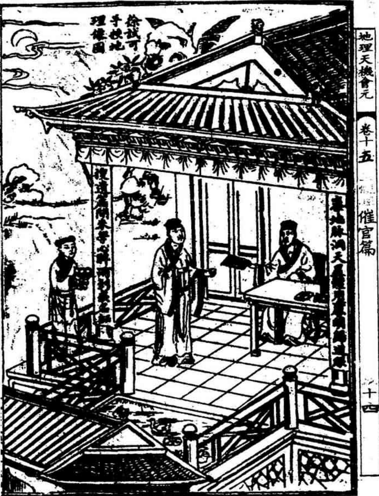

青囊經

唐國師楊松筠著明潭羊徐之鏌集

之水槍處雄雄公 公養老看雌雄天下諸書對不同 雌雄即陰陽動靜之巽名山本靜以動爲生水本動以靜爲聚 大 凡尋山步 水 須求發源處得何五行起祖 右而左 行爲陽 刑四死之雌爲蟠水也逆 水 而 静 右 行 而 爲陰爲雌山 深 沉 者爲 雌 體 動 高峻 而 淺急者爲雄彎抱 肥者爲陽 低伏 瘦者爲陰平地屈曲爲陽 者爲雌 元 去者爲雄 此 水 直 之 頃爲陰此 雌 雄 也 故 山之 结穴順 茅流 砂逆抱龍 虎 交 度 山 交水 會主實氣 水而成餘 出鎖水 口 三者全付 曰天 地 交通 若無 衛 水托頭 華 斜 侧 反 缺 陷 崩 破 孤 峰 獨突不 局面 爲 單 雌單 雄或 三 金 四 金 無 水 或 三類無 此木 孤或 不金不土 或 似 火 土 而 變水 似 木火 變金此 造 化 之 餘即天罡 孤 曜 掃蕩 燥 火 天陰 獨 陽 或 不 成 孔 楊 公 老 年 尋 山 步 妙 法 全 在 此 二 字 上 學 者 所 宜 深 害 也

看金龍動不動次看血 之非即先先孔血凶其得之不 丁是動從看售脈水隨何水散 也勿不山其注水吉水星水之 從動水犯似之則夹體行義 之大四訛最龍龍束即也 说势金今系亦之氣龍有 吉水出之起 下言煞改龍古三脈起伏 文還動之家人分得處頓 脈 水跌 雲不俟此正合分合謂 認 是先動高卷龍從金即之 山觀動明楊不何或龍動龍 行 而 之 徐 氏曰物唯龍能變化故山以龍言取其變化不常之謂也 中 生 止 脈之天又法水從頓處也唯 精動罡有歸正何跌故死金 爲 水 E 即次氣說全謂會直為硬凝 结 龍 之無故 快 合生血起 而之穴認故血法旺脈伏龍 認分此作下脈何休也頓之 來合說辰文即如囚是跌结 龍即亦戌付所蓋克以謂頂 言以水泄尋之成 認者制龍不形 也云見四之來龍化之動而 吉龍之生法而謂 之 恐爲凶認血死先 死 四靜楊金而來脈動看也金 金妙公龍反龍水静其血龍 凶何结脈取 金動初凡以在則如頂者其 龍處立行示于龍次成隨凝 者此論龍人看亦看形龍结五何 家山則梆公吐發起 伏 重此交硬 粗三 源 合 局雲不以 惡 看看而以在也 血水不金于故 看 全于 立 脈神结龍水 水 在起謂覆也而之 犯或 此靜蝕一 似 丑 未 一 專山切金血禮 之 說人 執本

片地時起之形屬陰平夷之地屬陽急緩在其間矣陽關爲動 曰吐氣陰閭爲靜曰舍氣吐氣者化則融結也三爻者三合水也認宗言當審其分 合之因分合不明則龍來起止不眞所以當細認也至于五行生旺臨官休囚死絕方位龍與水 幷當忝詳而 無忽可矣

江南龍來江北去江西龍去望江檔長內東龍南出子西出東武北正示人以南之也二十四山分逆順認取隧陽祖與宗陽從左邊轉陰從右邊通有人識得者何愁大地不相逢至戌從左順行爲陽龍順布局自午向巳至未從右逆行爲陰龍逆布局知此者巽世同撥古今一貫何不相逢這有

是以聖人卜河洛里澗交華嵩相其陰陽流水位卜州卜邑辨雌雄 周公使召公相宅之事理從河 國洛書而卜取也嵩華之山相應里澗二水相交旨睢雄交度故雲

晉世景純傅此術演經立義出玄空 郭璞字景純晉時人也經雲審天倒地對不同秋密在玄空河 立向放水之法出自玄空傅自景纯此楊公自序其得與此術也之

朱雀發源生旺氣一一講說發愚蒙 錦囊經雲朱雀尖於生細派於未盛朝於大旺澤於將衰流於 因謝歷水位乎前故名朱雀以向上五行看發蒙處水來不犯衰病死絕到明堂以別公位

車也至唐增入 四維者即乾坤艮孔八干各輔自旺之位名曰后天地針指子午者坎主得乾 中正之道也天下之理中正而巳東配春自寅至巽木而生南方夏火 自巳至未而生坤土 一何也 小暑逢庚謂伏是也土生西方秋金自申至乾生北方之水自亥至而水不能全東方之木何地限者也 水止則復生可見 水 土并生木也 邵子曰至哉文王之作易也其得天地之用乎應四時相生相代公孫同

二十四山雙雙起少有時師通此義五行分布二十四時師此義何曾記令 徐氏曰此一節言雙山三合五行之例蓋生旺墓三方吊合而成一氣故曰三合合兩山而兼之故曰雙山其例如木生在亥而乾從之木旺在卯而甲從之木庫在未而丁從之所以乾甲丁亥卯未而會成木局即此義也水火金例依此推

若論玄空分五行知得榮枯死與生丙丁乙酉原屬火乾坤卯午金同生亥癸甲艮是木神戌庚丑未土爲眞子寅辰巽辛兼巳申與壬方俱水神用此步水與量山百里江山一餉間山上龍神不下水水里龍神不上山 變山五行論山立向故言山上龍神不下水玄 空五行論立向放水故雲水里龍神不上山

更有收山出殺法兼后步尺不須離坎癸申辰坤乙星離壬寅戌兼乾甲此是陽山起掌來怍山出

## 地理天機會元 卷十六 催官篇 二

殺正宜裁艮丙兑丁兼巳丑巽辛震庚亥未受此是陰山入穴來立穴何須居左右此是故山出殺 書三節四節不須拘只要龍身得生旺陰陽卻與穴中殊 凡立向須收一節二節山脈興向陰陽不 親忌下直山直向謂變金殺脈雖屈曲一 節與向對冲者亦然即來山破軍也天機出殺篇雲十二陽山柏直射絕敗長房也十二 一陰山直 射時申子盡羸疲若犯雙金絕后人術士細推尋要收得山起出得鬼殺方吉至龍身如乾亥甲 卯丁未山屬木自亥卯未方來乘生旺也若自巳午申酉戌方來者犯休囚死 絕克制也他仿此若龍長者敗還橫龍入首短淺者庶幾若論水法者亦然

天上星辰似織羅水成三八要來過水步城門須要會恰如湖里雁交鵝四木四金幷八水四火四 土俱入坐十個退神如鬼靈十四進神家業與 徐氏曰此假言玄空水法四木甲癸亥艮也四金乾 坤卯午也八水子寅辰巽辛巳申壬也四火丙丁乙 統論二址四方審其 酉也四土戌庚丑未也三八即此四木四金八水四火四土共二 路 來去生向克向者爲進神向之所生向之所克者爲退神也 址 四向 也以向爲主

巳向水流丁打馬去朝京辛向水流丑孔自足牛田丑向水流艮富貴聲名遠巽向水流巽管取富無比

售傅十四進神宜朝來吉流去凶

丙向午水朝富貴保千秋 坤向申水至亦出文章貴 亥向亥水朝富貴永無體 癸向亥水朝也自足田牛 午向水流丙五馬坐磚城 戌向水流乾金實加砂積

卯向水流乙財谷自然聚

申向申水來富貴有梯媒

壬向子水朝田地遍他州

艮向甲水朝巨富足財錢 酉向水流辛富貴足金銀

乾向水流乾富貴出雙全

辰向水流巽富貴壯田進

甲向卯水至富貴更無比乙向甲水來財谷積成堆 徐氏曰右十退神及十四進神售本雖戰而久傳於世但求其義與玄空進退之談

未向坤水朝大富出官僚

庚向申水至百實金銀聚

子向子水入官職登科第

寅向水流丙百口壯田進

## 地理天機會元 卷十六 催官篇 二

實不相合不能無疑姑存之以俟高明

箕問須明生克化進退水路要知踪生入克入爲進神生出克出爲退神退水宜流千百步進水須敎近戶庭進退得位出公卿大旺人本家業興甲庚丙壬水來朝其家大富出官僚進神若退家資退亥子申宮皆一位退神若進主官非巽巳艮寅同一 例 聞背本文而河以自位一憶地吟觀本節 徐氏曰允傳注在釋本文之義而巳矣未本文所論水法既雲坐向須明生克化又雲生入克入爲道神生向克出是退神明以向曰進論二十四方何方水路去爲生响保方水路來去爲克句是謂生八情走神此即玉尺經所雲生入克入情既去而復貿是也何方水路來去爲向之所生保方水來去爲向之所克是謂生出克出情自出師泄之氣做曰退神此卿尺經所雲杼之 之入心而昌濟是也本文以生克出入道退之 起長生沐之說其注不之生克今入之義以生旺衰墓推排一十二位獨不觀其本文之義何居傅訛既久莫說其非謂之謬矣今合之玉尺經中削售注改而正之庶乎不至一誤而再誤雲

附改正玄空五行論向取生克出入法定例載左

丙丁乙酉四向屬火

喜甲癸亥艮四者爲生入子寅辰巽辛巳申壬八者爲克入其方水路來去俱吉忌戌庚丑未四者爲生出乾坤卯午四者爲克出其方和來去俱凶

乾坤卯午四向屬金

喜戍庚丑未四者爲生入丙丁乙酉四者爲克入其方水路去來俱吉其餘生出克出幷凶

戌庚丑未四向屬土

喜子寅辰巽辛巳申壬八者爲生八乾坤卯午四屬金爲克入其方水路來去俱吉其餘火土之位爲生出克出幷凶

喜丙丁乙酉四者爲生入甲癸亥艮四者爲克入其方水路來去俱吉其餘金水之位爲出生克出并凶

子寅辰巽辛巳申壬八者屬水

喜乾坤卯午四者爲生入戌庚丑未四者爲克入其方水路來去俱吉其餘木火爲生出克出幷凶己上用法不取我生而取生我不取我克而取克我者蓋本之玉尺經雲顧我覆我爲官爲父此水路來去所以取生我克我爲吉也 MA

坎騰騰入亥乾丙向挾蛇扦虎馬兔山高聳頂壯田置萬頂 徐氏曰此自雙山五行論龍立向消 妙之法所謂山上龍神不下冰堤地 癸丑金生壬子水水生乾亥木木生丙向之火而丙向夾蛇 者巳火臨官丙在巳在亥亥 馬到巳乃祿馬交互之局皆相生相順也至于四方之砂寅乃丙火生午乃丙火旺卯木生丙向 之火皆位得生

看紫着弼兼着綠寅甲水來逐 徐氏曰此自玄空論水之法所謂水里龍神不上山是也承上言丙 向得水自寅甲朝丙向明堂從坤而去是取甲木生丙火又寅水克丙火所謂生入克入爲進神故主

更有諸位高峰起尖秀高圓俱得位長生高聳旺人丁旺位起峰財祿聚 聳大旺人丁官旺方起克 此論雙山方位生方起高

水明消息少知音盡在玄空里内尋乾坤艮巽須發長寅申巳亥長伶仃甲庚丙壬中男發子午卯西中男殺乙辛丁癸小男強辰戌丑未小男殃去句之公魯來

更看明堂來去水文庫大小俱舟位截定生旺莫敎流直射直流家業退流破生方主少亡冲破旺 方財祿空文若來時男婦乳庫來方去定非祥 也文者文曲也即五行沐浴水來也庫者庫墓孔此 此以入首龍家五行論明堂各方水路來去之大勢 方水來去不吉謂之倒庫喜高 山眞大者大神也小者小神也

溝壑明堂鬼方隅便從品析審榮紆四尺五寸爲一步折取須教所宜小神須要入中神中神要 大神位三折祿馬上街去一舉登科名冠世 主凡轉折之處不可克須問相生相和相宜也其丙初 水 丙爲比和或庚申爲相生三折坤艮爲上 生 細晰洧情不棋直法他從炫控伍桁增姒 于向既巳 徐氏曰此以玄空論明堂折水之法必取三折喜其 相宜又系小神流入中神中神流 和 入 向 大 次 神折為 三 一折祿馬上街故主吉 也餘仿此售訛改正

奇貴貪狼幷祿馬三合連珠貴無價小神流短大神長富貴聲名滿天下 正奇例辛向辛水入乾坤 丁向丁水入坤艮癸向癸水入 乙向乙入 三奇貪狼例癸向癸水入乾 丁向丁水入巽 向上牛

正馬例乾甲坤乙艮丙巽辛 正祿例乾壬坤庚艮甲巽丙

借馬例丙巽壬乾甲艮庚坤催官例乾甲辛乙庚艮丙癸巽辛丙震庚丁兑丁壬乾爲御史馬艮爲狀元馬坤爲宰相馬水幷去吉巽安撫馬來去皆可申爲大守馬亥爲縣官馬寅爲庶人馬來吉巳爲將軍馬來去吉須要上街子午卯酉號衙訂神壇寺觀亦能興内有旗槍紅門水雷公館位使人驚 子衙訂午紅旗端門酉金 槍卯雷館主事駭人也乾坤艮巽城門水其中亦要知來去大神流入小神宮定主人家災禍至中神流入小神宮災禍瘟腫不可聞 2

小中神流大神位愛取榮華家富貴乙辛丁癸神名小辰戌丑未小神表甲庚壬丙號中神子午卯酉中神照惟有乾坤艮巽方寅申巳亥大神當八干四維流紼吉放枝長起禍殃四維八干赦文水六秀幷要上街去生入克入百口成生出克出退人丁 八幹者申庚丙壬乙辛丁癸也者乾坤 艮巽也六秀者艮丙巽辛兑丁也水并宜

山水俱要逢生旺人丁財富貴貧賤在水神水是山家血脈精山靜水動盡夜定水主財祿山主人 祿并旺逢休囚死絕有損丁財

乾坤艮巽號御街四大尊神在內排是水流歸東大惟有巽宮可去來生克須憑五行布要識天機玄妙處乾坤艮巽水長流吉神克入家豪富向生來夫道注出出出 爲貴向取生入克入爲進神生出克出爲退神宗朝本是陰陽玄得四失六難爲全三才六建雖爲妙得三失五盡爲偏蓋因一行受外園遂把五行顛倒別以訛傳訛竟不明所以禍福爲胡說 宗乾五行三不六建皆一行禪師所作以授外夷所以得三四失五六之說也故禍福不明

尋龍須教認得眞識龍方信術精通第一識龍要識穴海里尋珠爲上訣第二要識面前砂斷人禍福定無差第三要識九宮水斷人福禍靈如鬼請驗人家售宅塡十塡埋下九塡貧惟有一塡能發福去水來山盡合情略敘此篇傅后代收拾藏入巾箱内莫將輕授等閑人非人得此生災害留與有德吉人看家家富貴光前代 悟齊按青囊經凡七卷晉郭璞先生著也世失其傳今存筠松楊先 生序觀之究其要旨禍福有備公位合節遂注澤表而出之以便后學開拳僚然在目

青囊巽語

雙山五行也貪狼木也此

山與水俱要明此理水與山禍福盡相關順行子丑向未場申酉戌亥左爲陽逆行扦巳辰卯寅向鼠猴羊右爲陰如此法不必尋納甲眞顛倒二十四山有珠實逆順行二十四山有火坑雌興雄陰陽交度合玄空認金龍經章義不窮動不動直待高人施妙用第一義要識龍身行與止第二玄來脈明堂不可偏第三法傅送功曹不高壓第四奇明堂十字有玄微第五妙前后龍身兩相照第六秘八國城門塡眞氣第七與要向天心尋卜道第七裁屈曲流神認去來第九神任他平地與侵雲第十喜若有一缺非眞情明倒伏挂坐陰陽何秘想識掌模太極分明必有知圖知化氣生克制化須熟記曉高低星峰須辨識玄微鬼與曜生死去來眞要妙說五星方圓尖秀要分明向放水生旺

## 地理天機會元卷十六催官篇

有吉休囚否二十四山分五行知得榮枯死與生翻天倒地對不同秘家在玄空認龍立向要分明仔細辨天星天星既辨有何難但把放水向上看從外生入名爲進定知財實聚如山從内生出名爲退家内錢財化作灰生入克入名爲旺子孫富貴出高官脈息生旺要知因龍歇脈塞君莫犯犯看雖敎禍患臨縱有他山來救助空勞祿馬衛龍行勸君再把星辰辨吉凶禍福如神見識得此理妙玄微又見郭璞再出世

雙山五詩

庚酉癸丑巽巳金甲卯乾亥屬喬林丁未甲乾成木局乙辰壬子水沉沉 坤申與坎同波浪艮向離丙火來侵辛戌雙山和射斗流神來去定凶禎 雙山與玄空立向消水辨

徐試可曰售傅以淨陽凈陰立向率龍陰龍陰向陽龍陽向陽陰不親謂之收得山起此說近是而可從也至於售注出煞之說謂以雙山論入首一二節來龍以玄空論向務要龍向相生相和方爲出得鬼煞否則龍克向爲短命煞向克龍爲換妻煞其說大謬不可從也蓋凡論龍方向不拘今得一家五行便是或用納甲而取一夫一婦之相配所謂納氣者是也或用雙山而取一家骨肉之同氣所謂從氣者是也或用天庚月窟之交通如乙丙辛壬庚丁癸甲之類所謂墓合之法是也或化氣自然而交合如甲巳乙庚丙辛丁壬戊癸之類所謂陰陽化氣是也外更有借配乘氣之法催官篇及玉尺經載之巳詳幷未聞以玄空論向雙山論龍合兩個五行而混亂取用是猶兩父而生一子豈有是理子護彼所論謂如催官篇亥龍作丙丁巽三向亥變山屬水與丙向玄空屬火爲相生巽玄空屬水亦爲相生俱出得鬼煞此一端似乎相合世遂信之爲定理也何不再以偏官篇甲龍

# 地理天機會元 卷十六 催官篇 五

論總行五山雙

作乾坤二向參之甲雙山屬木乾坤玄空俱屬金是向上金來克木爲換妻煞何故雙山與玄空不合而催官篇取之以立向何也即此一端可見其迷謬甚矣斷不可從故予削其售注而改正之分別雙山之用全在審龍起祖出身入首結局生旺休囚何如及用之配龍立向如木龍會木局立向金龍會金局立向之類又兼用之消納砂水如金位有吉秀砂水從金局立向收之本位有吉秀砂水從木局立向收之之類幷不可與玄空混親糊涂而用則謬之甚矣玄空五行專用之放水折水極是有準幷不用之配龍立向識者察之

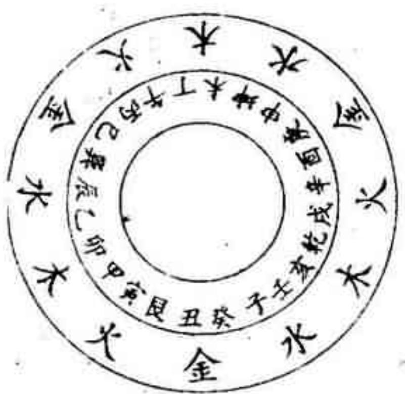

徐氏曰雙山五行一宮而兼兩位故曰雙既雲五行則必金木水火土之俱付也何雙山而無土其義安在蓋土居中而分寄于四方爲入來龍之内故金木水火俱不外土而成之是以天一生水而加五于一成六數地六成之中寓有土也地二上火加五于二而成七數天七成之七之中寓有土也天三生木加五于三而成八數地八成之八之中寓有土也地四生金加五于四而成九數天九成之九之中寓有土也天五生土加五于五而成十地十成之十九中原俱有土也故雙山雖雲無土而土即寅金水木火之中矣取用之法專論來龍宜養生發足官旺入首或官旺出身生養入首俱爲吉氣及用之 配龍五向湊成一家內肉并用之消納砂水迎神皆煞趨吉避爲之用但其法用陽陰左右順逆論之 不同定例載左正法從入首節取入首不合從向上權宜取論亦可

地理天機會元 卷十六催官篇 五
<table><tr><td rowspan=1 colspan=1>式盤例起火陽山雙</td><td rowspan=1 colspan=1>式盤例起木陽山雙</td></tr><tr><td rowspan=1 colspan=1>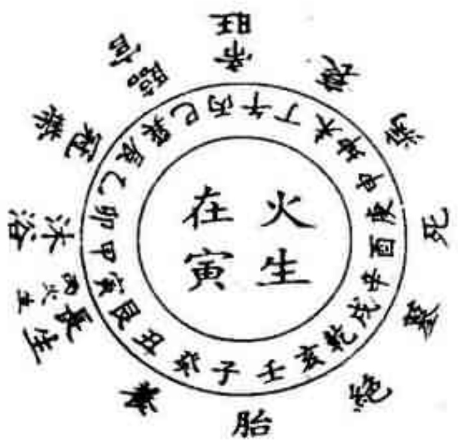</td><td rowspan=1 colspan=1>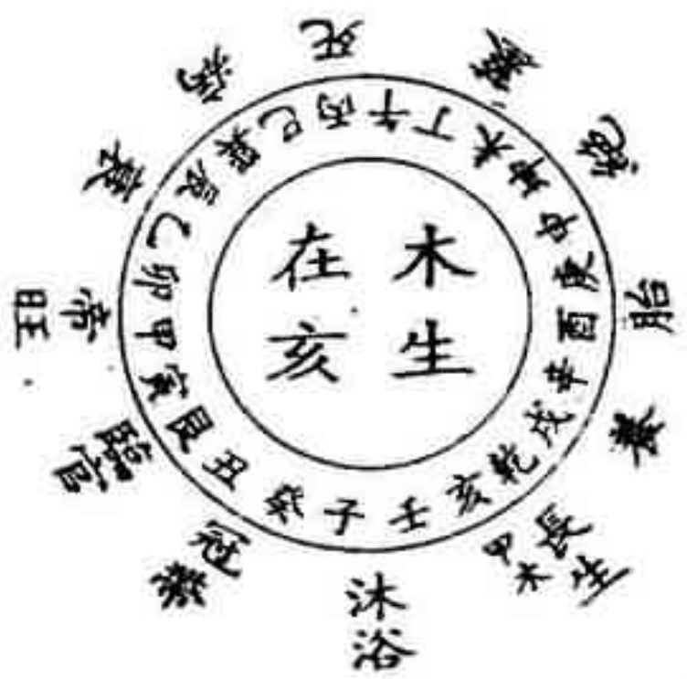</td></tr><tr><td rowspan=1 colspan=1>式盤例起火陰山雙</td><td rowspan=1 colspan=1>式盤例起木陰山雙</td></tr><tr><td rowspan=1 colspan=1>!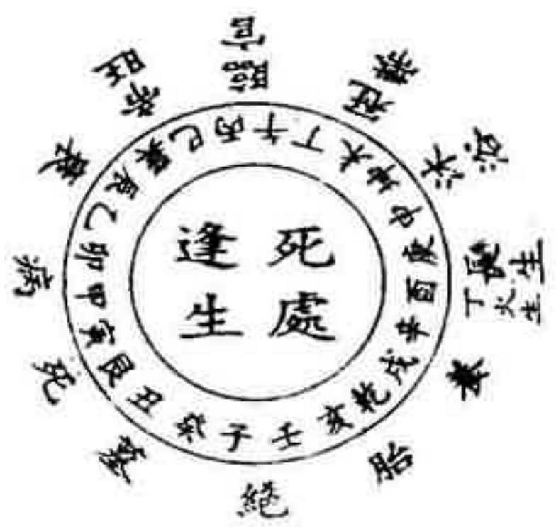</td><td rowspan=1 colspan=1>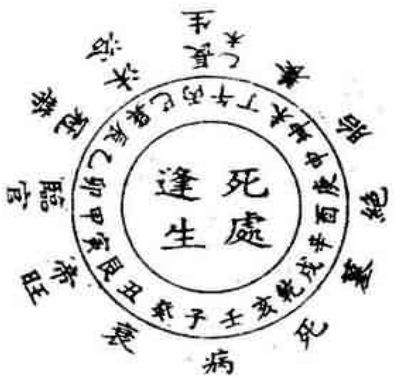</td></tr></table>

地理天機會元 卷十六 催官篇六
<table><tr><td rowspan=1 colspan=2>式盤例起水陽山雙式</td><td rowspan=1 colspan=1>盘例起金陽山雙</td></tr><tr><td rowspan=1 colspan=2>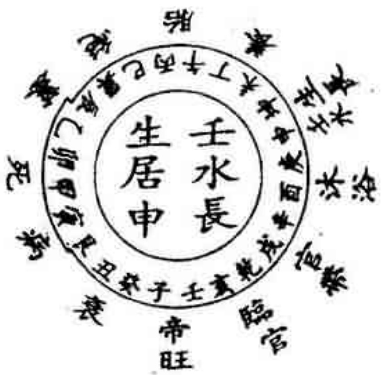</td><td rowspan=1 colspan=1>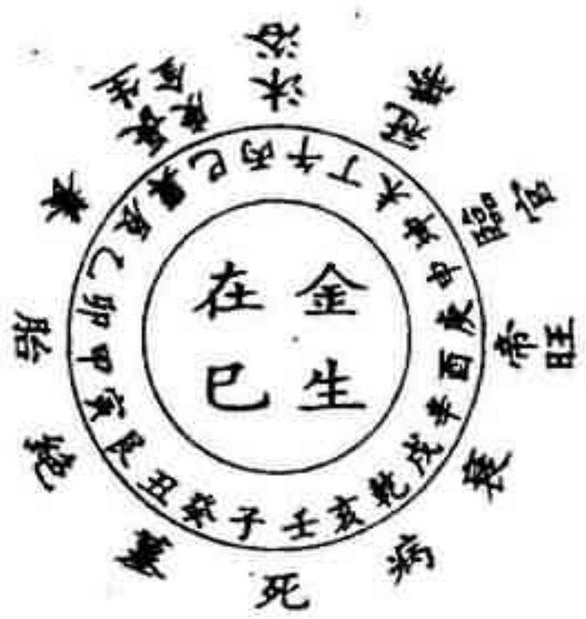</td></tr><tr><td rowspan=1 colspan=2>式盘例起水陽山雙式</td><td rowspan=1 colspan=1>盤例起金陰山雙</td></tr><tr><td rowspan=1 colspan=2>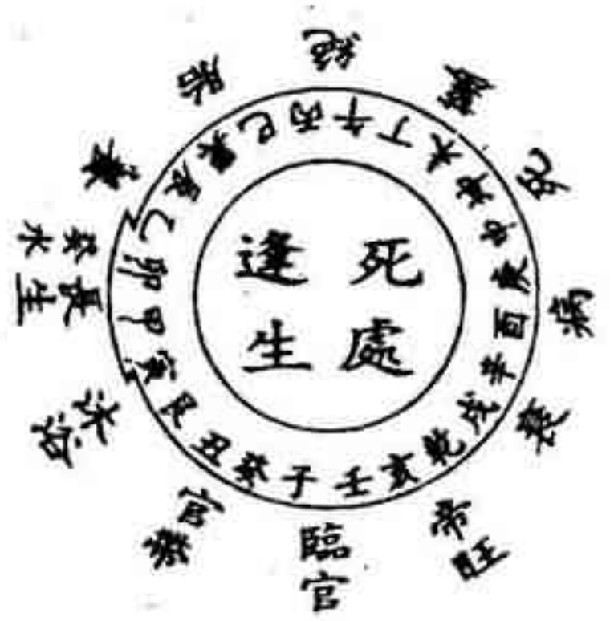</td><td rowspan=1 colspan=1>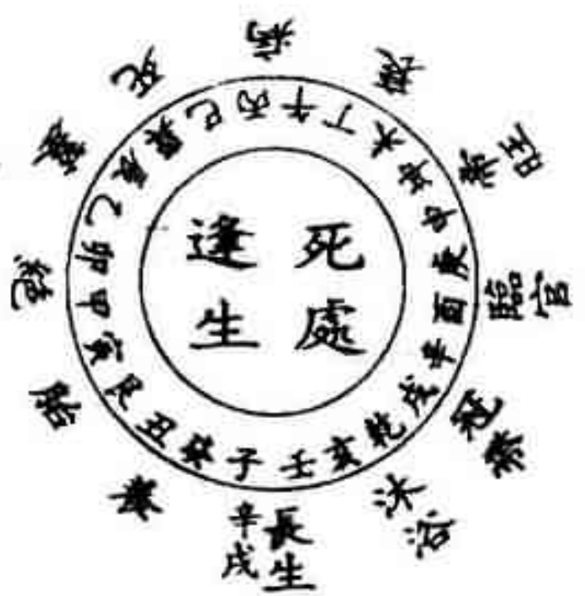</td></tr></table>

# 地理天機會元 卷十六 催官篇 六

鑒向水法出口

鑒向全憑流水分要知得失字尋論流來流去明凶吉照見棺骸存不存貪狼臨位永無災紫草生

文曲星辰事若何流來棺椁水生多更主其中泥土聚應知白蟻結成巢 水來大凶水巨門乾凈起死鹿穴内祥烟瑞氣新因此兒孫多富貴出人清秀更超群 可主富貴

廉貞朝水蟻多蟲鼠鼠穿瑩自作巢尸骨損來多黑爛泉房子息受奔波 破軍臨位不堪言竹木藤根繞椁纏文主兩頭螻蟻聚尸骸棺木兩難全 媒翩麟足之 水來內反殺傷 祿存若見水冲來吹骨翻棺實可衰不信請君開穴看此中泥水主生災 七星例又名宮水右 非去吉來短略可

大墓屬破軍絕胎是祿存養生貪狼位沐浴冠帶文武曲臨官旺逢衰是巨門廉貞兼病死七

養生水來清秀富貴 沐浴水來淫亂人旺 冠帶水來吉 臨官不來吉帝旺水來吉 衰位水可來去墓庫水來往冷退病死絕水去吉 胎宮水來去凶

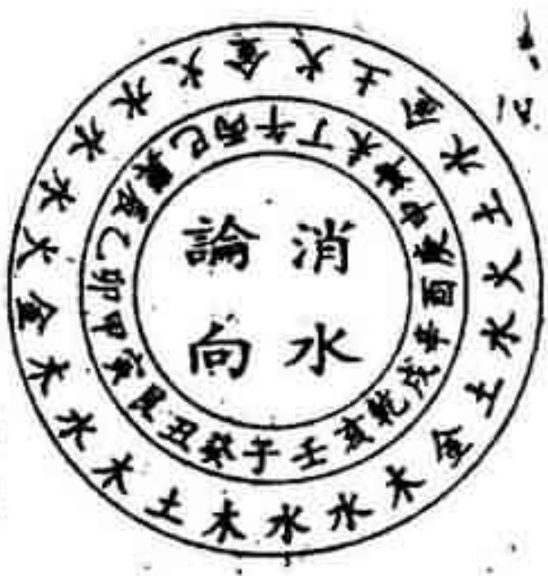

起例

丁丙乙酉原屬火乾坤卯午金同坐亥癸艮甲是木神戌庚丑未土爲眞子寅辰巽辛兼巳申與壬方是水神

地理天機會元 卷十六 催官篇 七
<table><tr><td rowspan=2 colspan=1>牌老                                         生九2务3年      dd手X和：                                                生味2氏で                                 2双乾戌辛    州y氏分面庚出生出         克出生入知弗                                同鹏子日</td><td></td><td></td><td></td></tr><tr><td rowspan=1 colspan=1>團可N十</td><td rowspan=1 colspan=1>排区在址222o从生3生4nみ               d6            君由年FF子克人生生出网克出轮戌辛面虎      克生免出     入   人生出克出 人                                本子</td><td rowspan=1 colspan=1>國N可大</td></tr><tr><td rowspan=2 colspan=1>牌生出坤木生九老d                  74生注d6            由做                                        FF艺FF                                                     克E州乾戌辛光2氏庚生出无面生生生                       克入</td><td rowspan=1 colspan=1>團N可m</td><td rowspan=1 colspan=1>室牌区目生九全似                                           4                                             克出会                                                  和米    生出安克出老F戌辛酉生人                                        え人克出生出克充人和出出                        </td><td rowspan=1 colspan=1>團N可六</td></tr><tr><td rowspan=1 colspan=1></td><td rowspan=1 colspan=1></td><td rowspan=1 colspan=1></td></tr></table>

地理天機會元 卷十六 催官篇七.
<table><tr><td rowspan=9 colspan=1></td><td rowspan=9 colspan=1>水向之圖</td><td rowspan=9 colspan=3>子寅長                                                            巽巳辛申壬八                                                             向屬水   od  x者关t7#和生出克人7生出氏希异辰乐 和和和                出出生克吉                                                          凶盤例</td><td></td><td></td><td></td><td rowspan=1 colspan=1></td></tr><tr><td rowspan=1 colspan=1></td><td rowspan=7 colspan=2>折水之</td><td rowspan=8 colspan=1>X   专定   8全                  H大                                生小车二         西                               大步车x              展乙卯发大       小</td></tr><tr><td rowspan=1 colspan=1>以上玄空五行消</td></tr><tr><td rowspan=1 colspan=1>水之用凡盤弦之</td></tr><tr><td rowspan=1 colspan=1>外注白圈者吉來</td></tr><tr><td rowspan=1 colspan=1>去俱可注黑圈者</td></tr><tr><td rowspan=1 colspan=1>凶來去俱不宜外</td></tr><tr><td rowspan=1 colspan=1>空位者平和</td></tr><tr><td rowspan=1 colspan=1></td><td rowspan=1 colspan=2>图</td></tr><tr><td></td><td rowspan=1 colspan=2>明堂折水之法自墓心量</td><td rowspan=15 colspan=1>国</td><td rowspan=15 colspan=3>45家とX                                         X4                                                 幼义長陰陰陽陰長中幼</td><td></td><td rowspan=15 colspan=1>詩曰</td></tr><tr><td></td><td rowspan=2 colspan=2>起取吉方三折出明堂即</td><td></td></tr><tr><td></td><td></td><td rowspan=2 colspan=1>立向先明兩節山向山冲射殺相關</td></tr><tr><td></td><td rowspan=2 colspan=2>開三閉五之法一步起建</td><td></td></tr><tr><td></td><td rowspan=2 colspan=2>陰冲陽駁中先敗陽射兼陰長不安</td></tr><tr><td></td><td rowspan=2 colspan=2>遇定成開吉一步起天罡</td></tr><tr><td></td><td rowspan=2 colspan=2>維卦孟枝同長斷陽斡四仲作中看</td></tr><tr><td></td><td rowspan=2 colspan=2>勝光傅送功曹神后吉</td></tr><tr><td></td><td rowspan=1 colspan=2>幼房興敗尋何處盡在陰斡四季觀</td></tr><tr><td></td><td rowspan=1 colspan=2>更以十字木星詳歷取</td></tr><tr><td rowspan=2 colspan=3>合八貴尤妙如得甲庚丙</td></tr><tr><td rowspan=2 colspan=2>穴后去一節二節頂脈與向得純陰</td></tr><tr><td rowspan=2 colspan=3>壬爲吉自小入中而入大</td></tr><tr><td rowspan=1 colspan=2>或純陽者收得山起反此則禍又頂</td></tr><tr><td rowspan=1 colspan=3>神三折出乾坤艮巽謂上御街水</td></tr></table>

# 地理天機會元卷十七理氣葬法

重鐫官板地理天機會元正篇體用括要卷之十七理氣葬法 疵 唯有騎龍 之 說與巒頭 中取論者頗巽予僭爲之

補釋俟高明者詳之

凹穴論俗作攀鞍穴

<table><tr><td rowspan=1 colspan=3>天凹穴者因主龍脈勢斜降回臂鞠抱關闡出凹宜有遠近之山或有應托樂山爲佳龍脈有左落</td></tr><tr><td rowspan=1 colspan=3>右落單行雙行授穴者最宜詳審如丑艮雙行左落吉艮粘在灣虛處系艮降脈授穴爲吉右落</td></tr><tr><td rowspan=1 colspan=3>凶艮粘居左灣虛處系丑山降脈授穴爲凶如艮寅雙行右落吉寅粘左灣虛處系艮降脈授穴吉</td></tr><tr><td rowspan=1 colspan=3></td></tr><tr><td rowspan=4 colspan=1>四穴丑艮雙行</td><td rowspan=4 colspan=1>C&amp;C</td><td rowspan=1 colspan=1>丑艮雙行凹脈左落向庚吉左落授穴吉丑粘右</td></tr><tr><td rowspan=1 colspan=1>灣虛處降脈眞艮貫透頂右耳乘之故吉也右</td></tr><tr><td rowspan=1 colspan=1>授穴凶艮在左灣虛處降脈后丑授穴故凶也</td></tr><tr><td rowspan=1 colspan=1></td></tr><tr><td rowspan=3 colspan=1>四穴寅艮雙行</td><td rowspan=3 colspan=1>CHC</td><td rowspan=1 colspan=1>艮寅雙行凹脈右落向丁吉艮與寅混親本不授</td></tr><tr><td rowspan=1 colspan=1>穴右落吉寅粘左灣虛處受氣少孫艮降脈爲吉</td></tr><tr><td rowspan=1 colspan=1>左落凶艮在右灣虛處寅氣授穴爲凶</td></tr><tr><td rowspan=3 colspan=1>四穴壬亥雙變</td><td rowspan=3 colspan=1>CC:</td><td rowspan=1 colspan=1>壬亥雙行凹脈右落向巽大吉右落吉壬粘左灣</td></tr><tr><td rowspan=1 colspan=1>虎處授氣少后亥降脈貫棺左耳向巽巽水葉吉</td></tr><tr><td rowspan=1 colspan=1>左落凶亥不在左壬氣授穴是以凶也</td></tr></table>

## 地理天機會元卷十七 理氣葬法

<table><tr><td rowspan=3 colspan=1></td><td rowspan=3 colspan=1>黄仓会</td><td rowspan=1 colspan=1>乾亥雙行凹脈左落穴内受穴吉乾亥混親本不</td></tr><tr><td rowspan=1 colspan=1>授穴左落吉乾粘右灣虛處受氣少孫亥脈貫棺</td></tr><tr><td rowspan=1 colspan=1>亥粘左灣虛處授石灣放倒乾向丙故吉右落凶穴系乾多是僞</td></tr><tr><td rowspan=4 colspan=1></td><td rowspan=4 colspan=1>C&amp;C)</td><td></td></tr><tr><td rowspan=1 colspan=1>艮山獨行凹脈左右授穴俱皆吉也左落向庚艮</td></tr><tr><td rowspan=1 colspan=1>貫右耳庚辛水吉右落向丁艮貫左耳丙丁水吉</td></tr><tr><td rowspan=1 colspan=1></td></tr><tr><td rowspan=4 colspan=1>码</td><td rowspan=4 colspan=1>CEB</td><td></td></tr><tr><td rowspan=1 colspan=1>亥山獨行凹脈左右落穴吉左落向巽亥貫左月</td></tr><tr><td rowspan=1 colspan=1>巽丙水吉右落向丙亥貫右耳巽下水吉</td></tr><tr><td rowspan=1 colspan=1></td></tr><tr><td rowspan=1 colspan=3>由驗局俱吉餘山仿此獨行左右俱言</td></tr></table>

坤申凹脈左落次吉右落凶卯乙凹脈右落次吉左落者幽辰巽凹脈左落次吉右落凶巽巳凹脈右落者吉左落次吉甲卯凹脈左落次吉右落凶庚申凹脈左落次吉右落凶

辛酉凹脈左落大吉右落吉辛戍凹脈右落次吉左落者凶丙丁凹脈左落右落午未授穴者凶息穴論

夫息穴者少也龍脈峻急殺氣太重宜用出殺使氣脈少緩而后葬馬其發福不難矣其法於授穴之處虛砌一壙以息氣急然后子虛壙之前砌正壙放棺脈皆耳授或於授穴之處掘出山頭低平立穴放棺此乃息氣而后葬也庶無暴氣冲棺之弊主發福達束此息氣之要也只此震艮亥爲式凡諸山授穴峻急者幷仿此式裁制爲妙

## 地理天機會元 卷十七理氣葬法 二

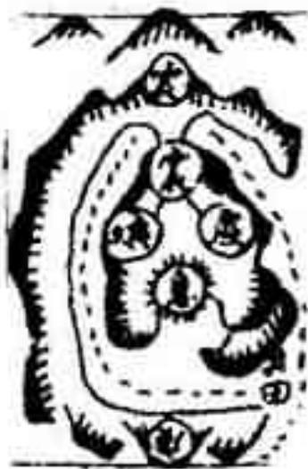

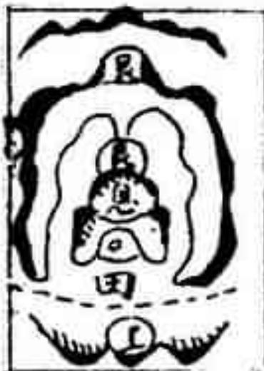

震山峻急宜息穴緩氣裁制先於 音金精先生葬 提刑祖在德興系界田震山庚向合此式俗作攀顯形贊受穴處用功開作平基然后立葬地后一 后用  作日 地后結砌一空壙后葬棺於平基記曰或正穴之后虛砌一壙使急脈稍 爲官未十年魚袋桂腰邊其子及第繞九年作江東提形賜紫金魚袋蓋龍急緩然后放棺正穴即主富貴也 用息穴福應迅速遠年有盜葬空壙者 亦出司理

艮山推勇若受脈細處微露眞艮脈卻於硬面收砂水合處大般開泄氣作息穴仿前裁制乃主富貴否則急氣冲棺主生禍患也

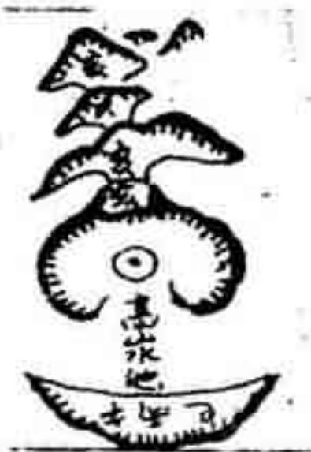

亥山峻急直下宜依法開作息穴裁制方能富貴俗作傘形柄上穴若倒在平地者不必息穴裁制前式作覆鐘形峻急宜作息穴以緩其氣爲吉穴式如庚辛丙丁諸脈授穴峻急者幷依前法裁制窟穴論

夫窟者窩穴也高山窟平地窟更有高山水湖最貴也俗作仰天湖笑天龍燕窩屏椅等形是也 平地窟囊俗作仰傘金盤仰掌等形是也皆須接脈爲貴不接脈則爲泥水絕穴

亥山高穴乘脈緊粘 亥 窩攻入山受脈扦作 山 丙向亥貫右耳主致仰 富貴俗作燕窩仰天天 湖笑天龍等形 胡

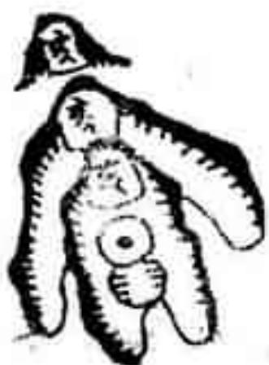

## 山亥穴息

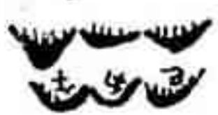

亥龍高山萬仞 水池渚水四時 不息大貴極品 無水乾窩四山 翁集群峰列秀 亥脈分明亦爲 奇局主大榮貴 不以穴下直流 爲忌葬即致福

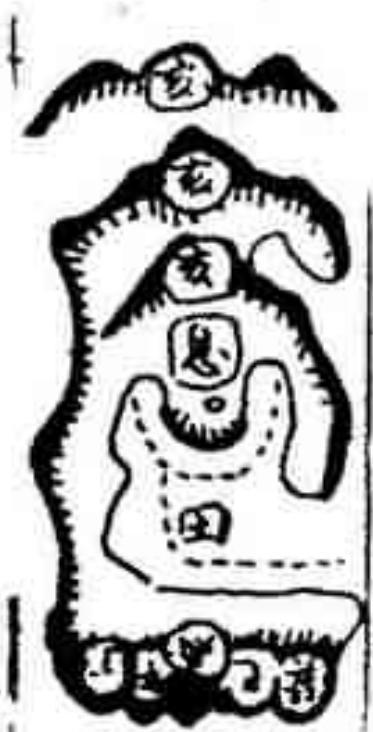

# 地理天機會元卷十七理氣葬法 二

## 向丁脈艮湖天仰

穴取富乘富地平穴作高粘窟地平

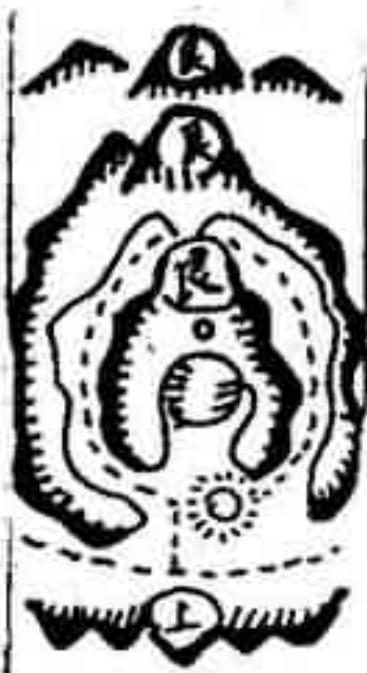

癸龍穎异高山渚水或乾湖龍虎攔抱 秀峰列前離向穴吉主富貴雙全觀 君顯耀壬山受穴向午猶勝緊乘脈葬 即大發凡壬癸二龍最忌尖脈則 出水 壙械

昔秀善先生爲鄱陽板橋周海山葬父在浮梁景德鎭前仰天湖離龍局合此式后三子白屋公卿其孫伯溫累被聖眷再旨除江東廉使離龍福應如此夫離爲君象凡陽局離龍受穴或向離砂水必觀天子之光也陰局諸山高窩穴者幷仿此以上圖式裁制可也

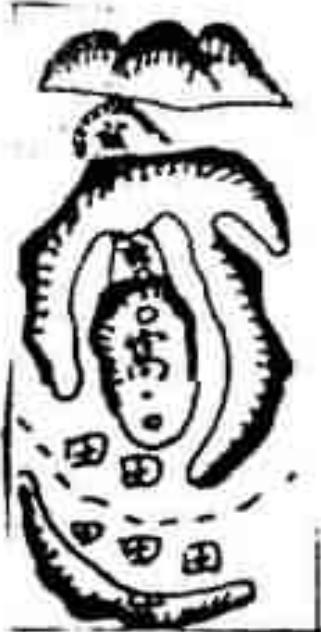

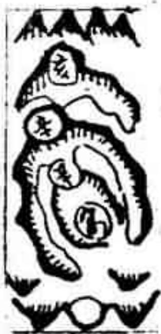

## 向壬龍離湖天仰

艮龍高山接穴水窩渚水爲仰仰 天湖群峰列秀四山翕集富莫 癸湖天 榮貴不以穴下山 去水傾爲忌 也葬即緣福

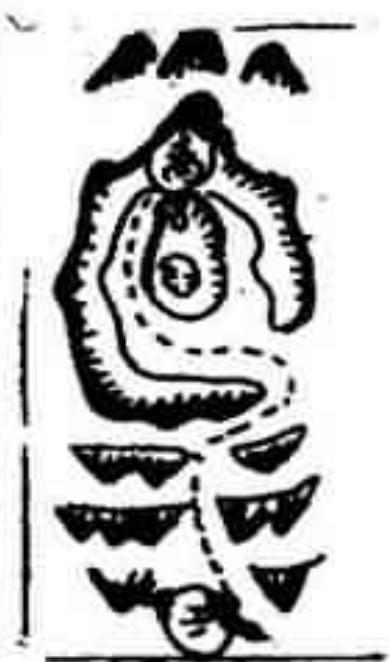

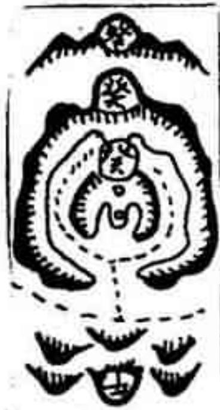

離龍高山授穴渚水藏聚水潮砂秀合法向壬局應癸則向癸主朝貴近臣

辛山出脈草蛇灰綫貫窩昔南唐國師何令通謫休寧爲曹氏系南弦法乘脈就窩而葬以窩門外扦楓林仰傘形局合此式辛脈向巽囊爲自然内明堂坐乾向至四代方出貴累爲系令合向巽百年人巽但出貴遲緩爲脈弱也財蕃盛蓋授穴脈緩故出貴遲

亥山出坪合脈前豆砂局前應宜合乘窩就前收砂納水向丙即發俗作船形倉脈弱就窩眼船頭脈旺處扦葬也

## 地理天機會元 卷十七理氣葬法 三

昔休寧臨阜戴氏扦長子墓合此式先葬中倉就窩不發再扦高處仍不發又再扦葬船頭窩眼穴乘胎旺前顯砂局方發富貴至今數百年氏族蕃盛先牆下子孫至貪亦不自住不脫佃客奴隸

己上辛山亥山出坪就窩取穴乘窩立穴之式凡陰局艮震諸山出坪發窩各仿此式消息裁制 葬忌穴深失氣水入宜土多培客土發蓄內氣凡陽局壬子癸山不宜出乎窩穴必主棺椁生水 學者慎之慎之

夫突穴本乎洋求突而葬也俗謂蜘蛛結網沒泥龜蛇等形高山窩中亦有突穴俗雲金鵝抱卵黃蛇弄珠等形凡平洋突穴隱隱隆隆如女績游筐盞内浮酥和印浮水面水中浮卯法以蓋穴冠脈而葬高山窩中突如珠瑰幷葬忌破突宜粘突立穴棺椁宜潛攻突下腰乘正脈若破突傷脈則非吉孔凡諸吉水幷依此仿艮亥圖式裁制

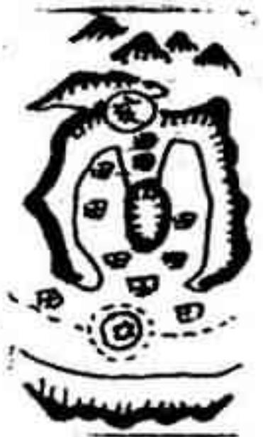

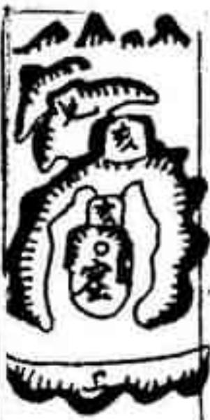

亥山平洋突起如女績游昔休寧會里府祖地在善坑俗呼沒泥 筐法宜變突處立蓋穴生 蛇形局合此式就突脈微落旺處耳穴 壬向丙自丁潮歸巽南砂 乘亥氣耳入向丙丁水田丘朝穴出程 列秀主大富貴永遠不替尚書文簡公及樞密等官

亥山丁向亥貫左耳就脈胝平窩上突宜粘突立穴棺壙稍泄攻矣下乘氣耳入前就窩作明堂向丁主大富貴之兆也凡亥龍平地突穴等山幷仿此式裁制爲美也

## 地理天機會元 卷十七 理氣葬法三

穴突山震

苒黟縣黃坂垣汪十三婆墓合此式兑山發龍轉亥脫坪粘突就窩立穴向丁丁峰陵霄與兌龍應合陰陽相見故富貴蕃盛出樞密侍郎州縣官僚不可勝數一百餘年朱素不替

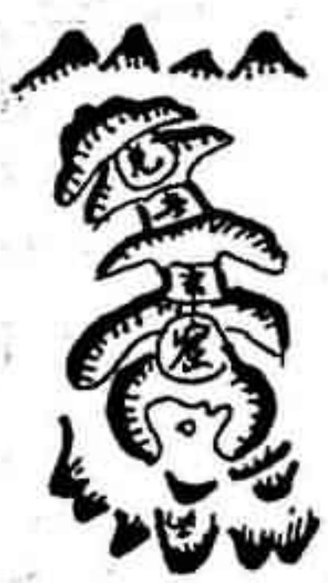

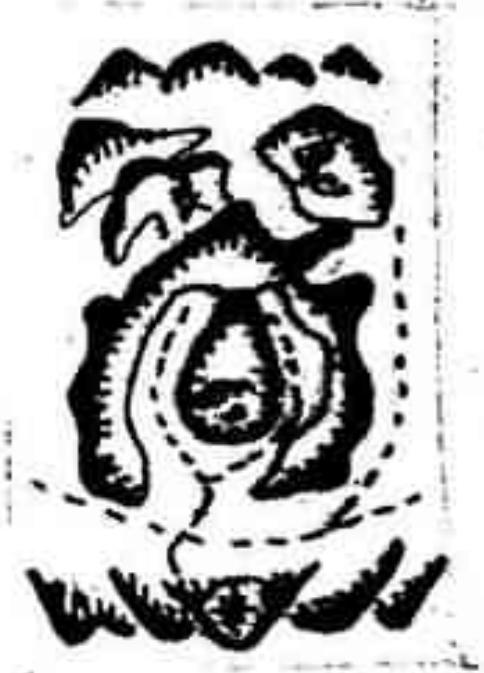

橫脈穴論

亥山高窩出突如珠瑰宜昔宛陵南湖負南漪葬場儒坊合 粘突立穴切忌破鬼傷龍 此式穴粘突葬后白屋公卿官至 棺貫右耳乘亥脈坐壬向 學士侍制廉史等官子孫蕃盛 丙丙砂秀列即主富貴

震山出突如珠瑰宜粘突昔廖金精爲樂平許中與葬母催立穴棺壙微潛攻突下以官地在明濃江家橋帖突作辛向乘震氣坐乙向辛主文武記曰昆山面前端正拜虔州鐘鼓鄉咚咚后爲實文內閣學士果兩

右亥震山窩出脈突穴諸吉山出脈突成穴者幷仿巳上裁制陽局幷同但粘穴接脈稍緊於陰局

夫橫脈者龍脈橫貫棺腰之穴也蓋龍勢盤旋砂局側應故側瓜側向以迎砂水一龍與穴相間五 位巳上皆以棺腰橫乘其氣龍從左來氣從右發棺以右乘龍從右來氣從左發棺以左乘此乘氣 爲穴之樞要也今俗謂聞斧穴蓋凡耳受穴則發福較急腰受穴發福稍緩

地理天機會元 卷十七 理氣葬法 四
<table><tr><td rowspan=1 colspan=2>辛向穴授横山两</td><td rowspan=1 colspan=2>丁向穴授横山兑</td><td rowspan=1 colspan=2>艮向穴授横山亥</td><td rowspan=1 colspan=2>丙向穴授横山良</td><td rowspan=5 colspan=1></td></tr><tr><td rowspan=1 colspan=2>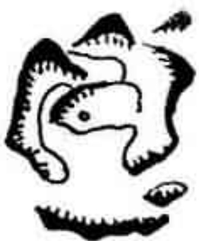</td><td rowspan=1 colspan=2>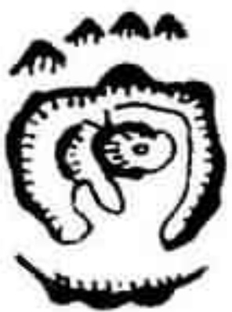</td><td rowspan=1 colspan=2>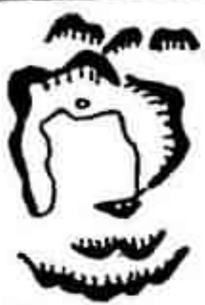</td><td rowspan=1 colspan=2>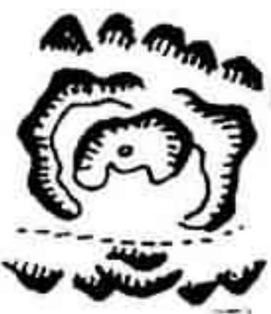</td></tr><tr><td rowspan=1 colspan=2>小發向腰穴两俱小辛乘以山富房主丙棺左中先脈左授</td><td rowspan=1 colspan=2>發逸貴向腰穴兑长高神丁乘以山子年仙主兑棺右先隱清脈右授</td><td rowspan=1 colspan=2>房發氣以亥有長向棺山大主震腰授贵小先乘穴</td><td rowspan=1 colspan=2>主位丙脈腰穴艮大中砂生乘以山富先水壬正棕左發應向艮左授</td></tr><tr><td rowspan=1 colspan=2>卯向穴授横山丁兑</td><td rowspan=1 colspan=2>向穴授横山丁艮</td><td rowspan=1 colspan=2>向穴授横山丙</td><td rowspan=1 colspan=2>辛向穴授横山艮</td></tr><tr><td></td><td rowspan=1 colspan=2>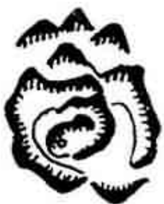</td><td rowspan=1 colspan=2>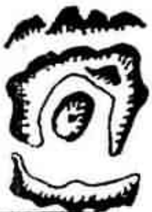</td><td rowspan=1 colspan=2>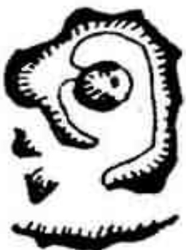</td><td rowspan=1 colspan=2>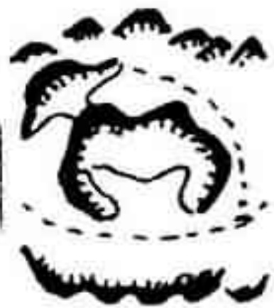</td></tr><tr><td></td><td rowspan=1 colspan=2>之中向腰穴丁兆辰震乘以山也巨主丁棺右富發脈右授</td><td rowspan=1 colspan=2>發逸貴向腰穴丁長高神亦乘以山子壽仙主丁棺左先隱清脈左授</td><td rowspan=1 colspan=2>贵合艮腰穴丙先中砂乘以山發富水脈棺右小應向中授</td><td rowspan=1 colspan=2>富小水脈腰穴良中先應向乘以山贵發位辛正棺右長中砂艮右授</td></tr><tr><td></td><td rowspan=1 colspan=2>丁向穴授横山辛</td><td rowspan=1 colspan=2>辛向穴授横山丁</td><td rowspan=1 colspan=2>艮向穴授横山丙</td><td rowspan=1 colspan=2>艮向穴授横山亥</td></tr><tr><td rowspan=1 colspan=1></td><td rowspan=1 colspan=2>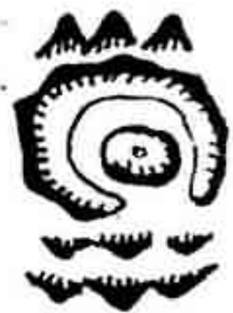</td><td rowspan=1 colspan=2>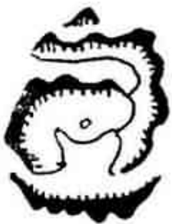</td><td rowspan=1 colspan=2>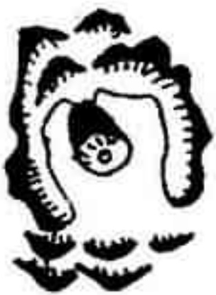</td><td rowspan=1 colspan=2>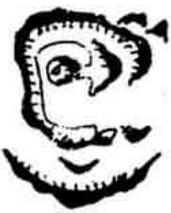</td></tr><tr><td rowspan=1 colspan=1></td><td rowspan=1 colspan=2>贵向腰穴辛發丁乘以山中主子棺右長富脈右授</td><td rowspan=1 colspan=2>貴長發向腰穴丁王小中辛乘以山高富后主丁棺左壽小發先脈木授</td><td rowspan=1 colspan=1>子貴合艮腰穴丙先大砂乘以山發富水脈棺右貴中應向右授</td><td></td><td rowspan=1 colspan=2>青有地穴富奇長艮氣棺左小局先坐左授</td></tr></table>

## 地理天機會元 卷十七 理氣葬法 四

<table><tr><td rowspan=1 colspan=1>使石</td><td rowspan=1 colspan=1>6A</td><td rowspan=1 colspan=1>辛山左授脈以巨富之兆也</td><td rowspan=1 colspan=1>厂乘使石</td><td rowspan=1 colspan=1>(c</td><td rowspan=1 colspan=1>震山左授穴以棺左腰乘震脈向丁主小富先發長子</td></tr><tr><td rowspan=1 colspan=1>无使</td><td rowspan=1 colspan=1>C</td><td rowspan=1 colspan=1>末中富</td><td rowspan=1 colspan=1>使石</td><td rowspan=1 colspan=1>6</td><td rowspan=1 colspan=1>艮山左授穴以棺左腰乘艮脈向巽主中富小貴</td></tr><tr><td rowspan=1 colspan=6>斬關穴論此條系售本未詳</td></tr><tr><td rowspan=1 colspan=6>夫斬關者龍去不住審砂水應合得眞氣斬截吉龍而葬又有騎龍斬關以去龍馬案水分八字左</td></tr><tr><td rowspan=1 colspan=6>右水出俱宜葉吉來耳山俱用周密謂倚甲依庚是也惟艮亥正貴龍裁制得法富貴异常否則易</td></tr><tr><td rowspan=1 colspan=6>成遇龍絕穴凡斬關餘枝古人多於牽連去處斷其山崗般井池溝渠以泄去脈猶花附條以陰</td></tr><tr><td rowspan=1 colspan=6>接枝之義也廖金精斬關穴多般池以泄去枝巳上斬脈裁制得法亦不必拘泥般山也</td></tr></table>

徐氏曰斬關與騎龍二者不同蓋自其腰中結穴前去盡頭反不結者此謂之騎龍廖氏雲去非眞去是也自其腰間氣脈暫停斬截而作前去迢迢又結盡洛此之謂斬關廖氏雲止非眞止是也巒頭中所論騎龍斬關皆如此至於理氣中所論騎龍斬關俱指前頭盡處假局不結但審其氣之眞僞如眞來僞落亥龍迢迢眞結忽變乾壬之類法須斬去乾壬僞氣于亥脈將盡處騎之作穴蓋合騎龍斬關而共爲一法與巒頭所論不同售注略而未詳今補釋之

## 地理天機會元卷十七理氣葬法 五

<table><tr><td rowspan=5 colspan=2>梁卫</td><td rowspan=5 colspan=1></td></tr><tr><td rowspan=1 colspan=1>亥龍長遠起伏穎异前去變壬無穴宜於亥盡處</td></tr><tr><td rowspan=1 colspan=1>斬脈騎龍而葬以去龍爲案坐壬向丙八字水左</td></tr><tr><td rowspan=1 colspan=1>歸震右歸庚夾輔周密主大富貴</td></tr><tr><td rowspan=1 colspan=1></td></tr><tr><td rowspan=1 colspan=3>昔先賢浮梁界田李入公祖葬合此武貴龍二十二節騎龍斬關前再去四節作案前分八字左</td></tr><tr><td rowspan=1 colspan=3>右有來耳山周蜜葬后累出茶馬四川神童俊秀三百餘年富貴人丁千口</td></tr><tr><td></td><td></td><td rowspan=6 colspan=1></td></tr><tr><td></td><td></td><td rowspan=2 colspan=1>亥龍脫卸前無巧穴可葬龍去迢迢於亥脈旺處</td></tr><tr><td rowspan=4 colspan=2></td></tr><tr><td rowspan=1 colspan=1>騎龍斬關葬以去山爲腰帶内案坐壬向丙江溪</td></tr><tr><td rowspan=1 colspan=1>環抱群峰擁集賜爵封王</td></tr><tr><td rowspan=1 colspan=1></td></tr><tr><td></td><td rowspan=1 colspan=2>昔績溪縣丁源洞五昭忠祖墓合此式亥山騎龍向丙以去龍爲腰帶内案俗作將軍踏弩形彎</td></tr><tr><td></td><td rowspan=1 colspan=2>撫安前有令旗山腰帶水摁制六州</td></tr><tr><td></td><td rowspan=1 colspan=2>凡汪氏后裔悉其福也</td></tr><tr><td></td><td rowspan=7 colspan=1>药中</td><td rowspan=7 colspan=1>6</td></tr><tr><td></td><td rowspan=2 colspan=1>艮山秀拔穎异僞落不結巧穴於艮脈盡處騎龍</td></tr><tr><td rowspan=5 colspan=1></td></tr><tr><td rowspan=1 colspan=1>斬脈而葬坐癸向丁脈貫左耳以去山爲案八字</td></tr><tr><td rowspan=1 colspan=1>水歸震右歸庚辛主大富貴</td></tr><tr><td rowspan=1 colspan=1></td></tr><tr><td rowspan=2 colspan=2>右騎龍斬關穴式須艮亥等上貴格龍長遠不結巧穴者方用騎龍斬關裁制爲吉</td></tr><tr><td rowspan=1 colspan=1></td></tr></table>

## 地理天機會元 卷十七 理氣葬法 五

<table><tr><td rowspan=1 colspan=1>亥向穴關斬山丁</td><td rowspan=1 colspan=1>亥向穴關斬山丙</td><td rowspan=1 colspan=1>丙向穴關斬山亥</td><td rowspan=1 colspan=1>柄向穴關斬山艮</td></tr><tr><td rowspan=1 colspan=1>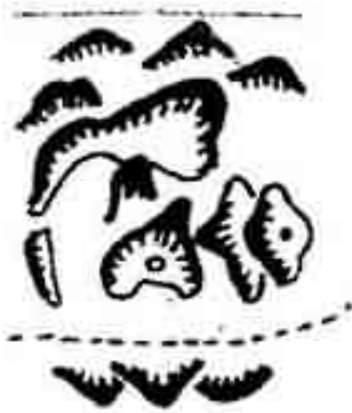</td><td rowspan=1 colspan=1>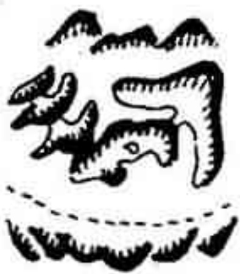</td><td rowspan=1 colspan=1>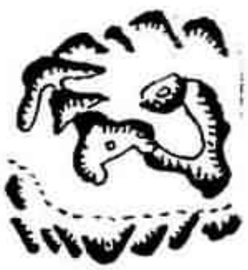</td><td rowspan=1 colspan=1>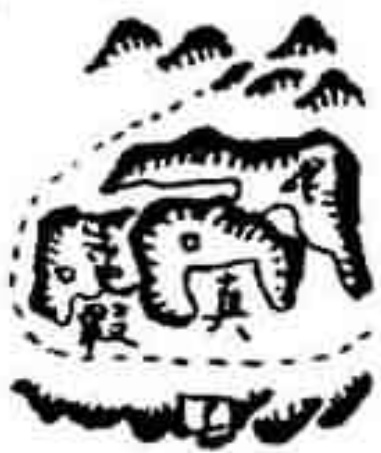</td></tr><tr><td rowspan=1 colspan=1>败乾庶左乘坐丁人絕授盡耳丁巳山烟穴龍主脈問斬巨格主戌富貫亥關萬局</td><td rowspan=1 colspan=1>合上祖贲左乘坐丙此三在主耳丙已山里貫彰主脈向斩地溪甫富貫亥關</td><td rowspan=1 colspan=1>凶辰壽主脈向发主授盡富貫丙山絕穴龍貴右乘斬大癸長耳亥脈</td><td rowspan=1 colspan=1>敗丑贵主脈穴餘艮絕結盡大貫癸枝山穴龍富左向斩分主癸大耳丁關去</td></tr><tr><td rowspan=1 colspan=1>卯向穴關斬山庚丙</td><td rowspan=1 colspan=1>向穴關斬山震</td><td rowspan=1 colspan=1>巽向穴關斬山辛</td><td rowspan=1 colspan=1>庚向穴關斬山艮</td></tr><tr><td rowspan=1 colspan=1>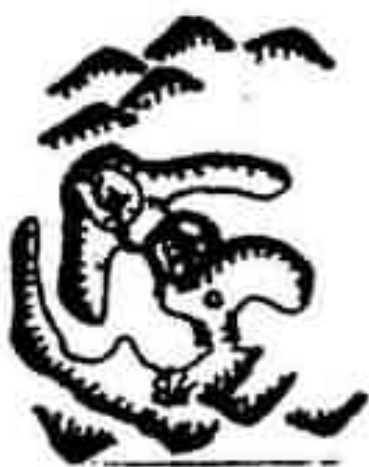</td><td rowspan=1 colspan=1>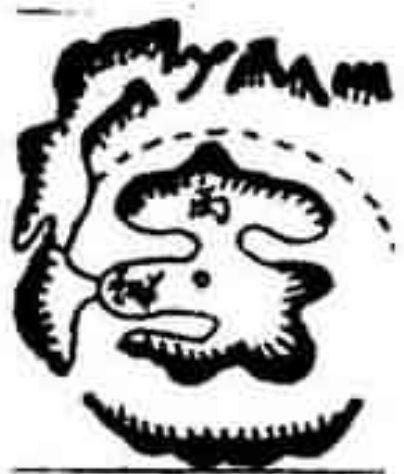</td><td rowspan=1 colspan=1>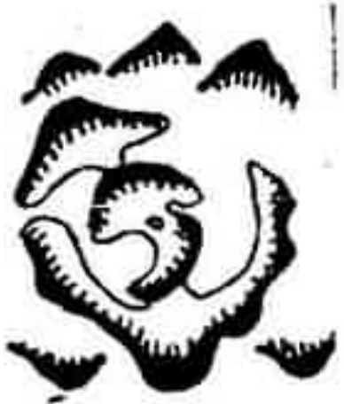</td><td rowspan=1 colspan=1></td></tr><tr><td rowspan=1 colspan=1>長富山右乘坐庚官房豪作耳庚西山青先案以脈向斬無發主去貫卯關窮</td><td rowspan=1 colspan=1>水景合忝氟乘回震公鑾紫政左卯龍八記式祖腰脈向字雲吳牆張貫丙</td><td rowspan=1 colspan=1>發秀山右乘坐辛山中文爲耳辛乾山斩子贵案以脈向關先峰去貫巽關</td><td rowspan=1 colspan=1>也穴龍旺耳庚脈艮主乾人主氣生山斬敗氣財富貫申斬絕授盡貴右向關</td></tr><tr><td rowspan=1 colspan=1>丁向穴關斬山兑</td><td rowspan=1 colspan=1>辛向穴關斬山巽</td><td rowspan=1 colspan=1>艮向穴關斬山丙</td><td rowspan=1 colspan=1>丙向穴關斬山艮</td></tr><tr><td rowspan=1 colspan=1></td><td rowspan=1 colspan=1></td><td rowspan=1 colspan=1></td><td rowspan=1 colspan=1></td></tr><tr><td rowspan=1 colspan=1>丁合雀平富去脈向兑中此兒縣貴山貫丁山收式壠馬清為右乘斬龍微驚樂土以</td><td rowspan=1 colspan=1>秀山左乘生共文作耳巽乙山貴案以脈向斬砂脈貫辛關</td><td rowspan=1 colspan=1>小案以脈向丙贵主去貫艮山發中山右乘斩穴富烏耳丙關</td><td rowspan=1 colspan=1>小富山左乘坐艮1房贵爲腰艮壬山先案以脈向斩發主去贯丙脈</td></tr></table>

地理天機會元 卷十七 理氣葬法 六

扶龍穴論

<table><tr><td rowspan=1 colspan=7>夫扶龍穴者蓋因后龍節凶貴秀而授穴欠純如丑艮出面則放倒丑氣扶艮葬棺更收砂水秀助</td></tr><tr><td rowspan=1 colspan=7>是爲扶龍穴也此借局則發福迅速</td></tr><tr><td rowspan=5 colspan=1>质</td><td rowspan=5 colspan=3>FE</td><td></td><td></td><td></td></tr><tr><td rowspan=1 colspan=3>丑艮授穴穴宜粘右放倒丑山扶艮貫左耳向丁</td></tr><tr><td rowspan=1 colspan=3>主富貴</td></tr><tr><td rowspan=1 colspan=3>昔績溪縣石門出胡通制胡知縣地系扶艮授穴</td></tr><tr><td rowspan=1 colspan=3>向丁合此式迎丁水立向福重無水潮者仿此</td></tr><tr><td rowspan=3 colspan=1></td><td rowspan=3 colspan=1>O</td><td rowspan=1 colspan=3>艮寅授穴宜粘左放倒寅山扶</td><td rowspan=3 colspan=1></td><td rowspan=3 colspan=1></td></tr><tr><td rowspan=1 colspan=3>艮貫右耳向庚砂水廢合主富</td></tr><tr><td rowspan=1 colspan=3>貴戚式</td></tr><tr><td rowspan=2 colspan=2>亥壬授穴宜粘左放倒壬山扶正</td><td rowspan=5 colspan=1>国学</td><td rowspan=5 colspan=2></td><td rowspan=2 colspan=2>乾亥授穴本不用也須龍眞故用</td></tr><tr><td rowspan=2 colspan=2>法宜挨右放倒乾山扶亥貫左耳</td></tr><tr><td rowspan=2 colspan=2>亥貫右耳向丙得巽丙砂水應合</td></tr><tr><td rowspan=2 colspan=2>向巽迎巽丙砂水主大富貴男菜女苦</td></tr><tr><td rowspan=1 colspan=2>主大富貴</td></tr><tr><td rowspan=3 colspan=1>华关共</td><td rowspan=3 colspan=1>ME)S</td><td rowspan=1 colspan=3>辰巽授穴本凶穴宜挨右放倒</td><td rowspan=3 colspan=1></td><td rowspan=3 colspan=1></td></tr><tr><td rowspan=1 colspan=3>辰山扶巽貫左耳迎砂水向辛</td></tr><tr><td rowspan=1 colspan=3>主大富貴男女俱榮</td></tr></table>

已上斬關穴式須貴龍行度長速砂水奇應方爲裁制不必拘諸山形式相似而作但以意會制作而埋自得矣

## 地理天機會元卷十七 理氣葬法 六

巽巳授穴宜挨左扦放倒巳山扶 扶亥貫右耳向丙得巽丙砂水應合 辛 向小貴 巽

震甲授穴宜挨右扦放倒甲山扶震貫左耳向庚砂水應合大富橫震砂秀主武貴也

## 艮向庚扶

震乙授穴宜挨左扦放倒乙山扶震貫右耳向辛迎辛砂水主中富貴先文后武也

丁未授穴宜挨左扦放倒未山扶丁貫右耳以迎砂水向艮主中富小貴無水朝只出小富也

火須倒盡離氣方可巳丙授穴亦如酉辛裁制陽局不宜扶借立穴借局穴論

戌辛授穴宜挨左扦放倒戍山扶辛貫右耳向巽迎巽砂水應合主大富貴男女榮昌文章科甲也

夫借局者眞龍行度借僞授穴如后龍艮山屬陰系六秀向丙丁六秀砂水應合亦屬陰授穴卻系壬癸陽山僞氣不純故宜壬癸扦穴六秀陰向以應后龍若立陽向則兩龍局不侔終不致福矣無潮水吉助者初年不利一二代后方貴有吉砂水扶助者初年平至三代后龍與向合方致巨富凡陽局必須貴龍長遠僞穴天然合此別無可葬者法依借局裁制

## 庚向震扶

甲庚授穴宜挨右扦放倒申山扶庚貫左耳向艮迎接砂水中富小貴無水只主小富也

已上陰局扶式如庚兑辛須屬連吉若向震憶兑氣冲腦宜放正庚正辛貫穴方發如離丙主

## 地理天機會元 卷十七理氣葬法 七

<table><tr><td rowspan=3 colspan=1></td><td rowspan=3 colspan=1>TCY</td><td rowspan=1 colspan=1>艮龍長遠僞落變癸借授穴迎丙丁砂水立向初</td></tr><tr><td rowspan=1 colspan=1>主中平一二代博龍俁向大富貴也</td></tr><tr><td rowspan=1 colspan=1></td></tr><tr><td rowspan=1 colspan=3>昔賴仙爲淳安養村洪虎形地合此格九里灣丁水潮即登登科及第典郡等七十二員又爲淳</td></tr><tr><td rowspan=1 colspan=3>安方氏葬火燒墓艮山借癸授穴向丁無水潮助初一二代不發記曰五紀巳前俱退敗后來榮</td></tr><tr><td rowspan=1 colspan=2>貴不須疑又雲火燒其墓即發后有牧牛者遺火燒墓</td><td rowspan=1 colspan=1>林方發今號火燒墓出金紫之狀元貴</td></tr><tr><td rowspan=3 colspan=1>用</td><td rowspan=3 colspan=1></td><td rowspan=1 colspan=1>艮龍長遠穎巽僞變寅甲別無斬關等穴只得借</td></tr><tr><td rowspan=1 colspan=1>甲向庚迎庚辛砂水扶助主初代平福后主貴顯</td></tr><tr><td rowspan=1 colspan=1>富豪</td></tr><tr><td rowspan=1 colspan=3>昔休寧吳田吳我富弄源祖牆合此式無水潮四代后方出縣令等官有政任富授別駕者凡自貴龍長遠或到頭僞落者當依此法裁制</td></tr><tr><td rowspan=3 colspan=1>关山</td><td rowspan=3 colspan=1>HO)</td><td rowspan=1 colspan=1>亥山僞變壬坎別無斬關等穴借壬坎向丙迎三</td></tr><tr><td rowspan=1 colspan=1>陽砂水扶助初代平福三四代巨富大貴</td></tr><tr><td rowspan=1 colspan=1></td></tr><tr><td rowspan=1 colspan=3>昔先賢祝吉師爲德興縣地名蹇源方氏葬馬鞭插地形亥山僞變壬坎授穴向丁記曰實瓶星</td></tr><tr><td rowspan=1 colspan=3>見第六代擬出六指人宮第七代金榜聊名后六代方一鶚生六指七代四名聊科出侍郎知府</td></tr><tr><td rowspan=3 colspan=1>行亿</td><td rowspan=3 colspan=1>S</td><td rowspan=1 colspan=1>兑亥變癸僞落別無斬騎等穴宜借癸山向丁丁</td></tr><tr><td rowspan=1 colspan=1>水潮助發速水去發緩數代后清貴文章顯達</td></tr><tr><td rowspan=1 colspan=1></td></tr></table>

<table><tr><td rowspan=1 colspan=3>昔建陽縣朱文公命屬庚戌生庚屬兑納音又屬金鐘兑之秀氣故后世子孫清貴文章顯達</td></tr><tr><td rowspan=3 colspan=1>关车</td><td rowspan=3 colspan=1>田由  田</td><td rowspan=1 colspan=1>辛山剝入兑亥前變壬坎僞落田源照穴下巽向</td></tr><tr><td rowspan=1 colspan=1>辰水宜遮避居左灣取龍頭遮辰露巽水潮向二</td></tr><tr><td rowspan=1 colspan=1>三代后大富貴</td></tr><tr><td rowspan=1 colspan=3>昔先賢程八公葬祖考地螳螂捕蟬形合此式白虎昂頭遮辰水腳文龍頭遮蔽辰水穴居左取</td></tr><tr><td rowspan=1 colspan=3>巽田水出内翰二子典郡大富</td></tr><tr><td rowspan=3 colspan=1>关国2关</td><td rowspan=3 colspan=1>me</td><td rowspan=1 colspan=1>巽山迢虎變乙僞落別無斬關可葬借乙受穴迎</td></tr><tr><td rowspan=1 colspan=1>砂水向辛初代平福主二三代后太富貴也</td></tr><tr><td rowspan=1 colspan=1></td></tr><tr><td rowspan=1 colspan=3>昔都陽沙浪節氏葬祖牆地合此式記雲山連乙辰長流辛戌至此必主外州縣刑名事如發后</td></tr><tr><td rowspan=1 colspan=3>悉驗</td></tr><tr><td rowspan=3 colspan=1>用</td><td rowspan=3 colspan=1>Ge</td><td rowspan=1 colspan=1>震山僞變甲或變乙受穴別無斬關借氣向庚或</td></tr><tr><td rowspan=1 colspan=1>向辛砂水潮助初平福三代后大富先霸應庚武</td></tr><tr><td rowspan=1 colspan=1>貴應辛文貴</td></tr><tr><td rowspan=1 colspan=3>右陰局貴龍僞借局穴式丙山借巳氣授穴向亥迎亥砂水子山借未穴向艮迎艮砂水艮山借</td></tr><tr><td rowspan=1 colspan=3>丑氣授穴向丁迎丁砂水庚山借酉氣授穴向卯迎卯砂水巳上幷仿艮亥變局裁制后龍短</td></tr><tr><td rowspan=1 colspan=3>淺非眞不宜借局亥山不宜借乾授穴巽山不宜借辰授穴丙山不宜借離受穴辛山</td></tr><tr><td rowspan=1 colspan=3>不宜借戌乾授穴以上陽局系五音凶龍不宜借氣授穴</td></tr></table>

地理天機會元 卷十七 理氣葬法七

## 地理天機會元卷十七理氣葬法八

降殺穴論

夫降殺者左右殺曜類射明堂坐穴宜乘亥艮垣星所臨上貴之龍以降其殺亥爲紫薇垣艮爲天 市垣中有帝星所臨故可降殺

殺之例不一如殺對辰戌丑未四刃名暗金殺午天獄地殺拜剛金殺至於坤老陰兼未凶煞甲庚燥金陰陽自混拜合卦曜星巽鷄乾馬之類也凶殺之位而穴又乘凶氣小則刺面徒流大則夷減宗族苟穴能降殺乃殺馬變作牙刀主人榮貴在裁制降之

亥山迢遁乳脈斜受乾穴但前有午位砂凶尖殺 在離乾忌凶曜爲配軍主徒配弄截高檀亥脈向 丙煞曜午砂乃爲判筆爲才刀主大榮貴

昔先賢羅昌奇爲樂平流槎匕指地合此式記曰我下上出知軍人下下出配軍后有葬乳者果因爲盜配軍至今正穴因左臂尖射又雲不可高扦雖慕先賢之記猶狐疑不敢裁制

亥山受穴天殺曜應子巽辰向丙降煞主富貴殺對午辰穴若見之凶其乙辰砂水須得有青龍遮隱穴中不見故主無凶也

昔先賢羅昌奇爲樂平著德余氏葬地在士爲陂俗作船形因前砂尖窩喝爲流檀案正合此式后余氏出神童提舉等官至今數百年子孫富盛不替

## 地理天機會元 卷十七 理氣葬法 八

## 丙向撞倚山亥

樂平馬丞相祖地在華陂俗作猛虎出林形肩中咬風穴前尖殺直射穴前故喝作拋槍案正合此式但丙向局殺得赫文化之爲吉砂如此則亦無凶禍焉凡紫薇垣照龍太微坦照局向雖殺曜化無凶禍

直流穴論

亥山倚撞正脈向丙降伏長殺水從巽巳流出主 大富貴凶禍潛消下穴低沉乘亥脈殺曜迫前故 主凶絕

夫眞流穴者順勢立向堂水直去也或因龍虎遇乾坡直去謂之乾流俗以牽動土牛爲忌不明龍 凶穴僞水直流去故去不吉若無眞純龍穴雖朝穴亦凶陶雲當面朝入子孫貪寒無龍亦不吉 若龍眞穴的陰局見丙丁巳庚辛酉卯亥水溪澗直流田源傾瀉無禍徼福陶氏雲水流百步奕世 公卿惟艮巽六秀中流丑辰墓氣直流大長似灘急者凶陽局龍眞穴的離壬癸坎直去凶比潮流 之穴發福稍遲緩耳四墓辰戌丑未乾坤水進陰陽二局畏之立有凶禍今以艮亥直流爲式餘各 例推徐雲此論不甚妥姑載付放

亥山順勢向丙巳丙水直流數里穴直低築池沼瀦水迎丙砂水奇秀主大富貴也

## 地理天機會元卷十七理氣葬法 九

寧縣吳市舶祖地在金竹俗作仙暇出水形亥山直望丙上水去數里扦作巳丙向峰凌雲得 理宗聖眷除市舶既富且貴合此式孰謂不發也若宗朝水去亥山水破貪狼矣

亥山丙向元辰乾流直去數步築土培臂以掩 俗觀若折放九曲轉旋吉位猶佳主大富貴

廖金精爲張銀青於德興縣若坑禮佛域亥山丙向元辰乾流直去五百步合此式廖爲折九曲 水去時張贈詩雲兑來奔入亥乾宮案似金鍾氣象雄十數餘年八不識果然流得待仙翁葬后 銀青滿門朱紫推恩及第者五十餘人三百餘年榮盛

癸向小穴下水傾跌數千步丙丁水直去歸庚主 富貴

艮山峰巒萬仞雄猛蟠

昔先賢梁堯爲黟縣程氏指出相地在祁門入都石鍾山圭龍艮峰萬仞侵天穴癸向丁水跌懸崖左出數千步丙丁直出正合此式法種艮脈貫棺左耳向丁即大富貴時梁約后期而葬惜程氏福所未至用計誘梁業於山頭叩其所主曰出相眞穴在某處梁僞以羅經定其穴曰穴在右前石后石左石右蓋其山多石無護程意度定羅經爲的梁別去期明年來葬程乃背約私營梁及期而至見程巳葬非穴嘆曰牙刀化作屠刀矣遂拂袂而去程氏累世不發多業屠者今切見蔣氏洪氏各氏慕梁所指重資買山而葬皆畏穴高臂寒水跌依程穴左右而葬悉致禍敗及子從數年前觀其地眞穴艮脈整然在高坪處去訣葬其遠然諸葬或向丙或向丁在乳頭蓋授癸

## 地理天機會元 卷十七理氣葬法 九

## 震向流直水震山兑

## 穴流乾向庚山艮

丑凶氣所以致禍因有志謀爲其親歸藏計蓋非重資莫得而遂也

此地不必以水跌懸崖爲忌穴宜平中撞蓋艮脈欲盡處稍挨左臂不必以臂薄穴高爲嫌卻須蔽不見外陽未坤水爲佳若裁制合矩即發不敗貴爲卿相富壓陶朱之地矣

艮山龍虎長直元辰乾 流庚水出丁數百步東 南列秀向庚即富貴初 年不敗

昔先賢梁堯爲黟縣程氏葬地在長演嶺正合此式龍虎長直元辰庚水乾流居丁三百餘步記曰太歲一周進爵祿小喜二十四年門風陟變兒

孫修翰苑之詞祖父廢焚黃之誥又曰出人心平性烈德重威嚴作庶民之父母爲帝王之股肱片箋一筆詞場而文理極高匹馬單槍入陣而功勛最大后出程邁爲顯謨閣學士累平賊有功其侄爲文華閣學士皆以科第致貴蓋巽丙丁辛秀起照穴主文而庚向后龍應震主出武職蓋梁堯時爲程氏一族獻一地此則梁所營葬其福微如此夫太歲一周之說如太歲在子丑之屬十二年爲一周二十四年則太歲兩周也其發福迅速如此若今俗謂行龍陂不發則程氏之地雖十世水行步未盡始亦未發以此驗之龍眞穴的凡乾流直流時吉位去者初年不敗而致吉福明矣俗忌牽動土牛之說皆不驗也宗朝以坐穴論水則洪築甲屬水水生在申庚水直去數百步豈百流破長生合主凶禍向富貴如此宗朝不足信也明矣故雲宗朝水法誤

兑山授穴宜倚居右收辛山扦卯向前大溪直去不合之玄親 寅甲乙辰龍虎齊到穴中只露卯水直去主大富貴有鄭總管 辛酉生兑中生金有辛酉也

## 地理天機會元卷十七理氣葬法 十

歙縣銚石出鄭總管祖地合此式俗雲覆金形大溪之玄直去兼寅甲乙辰混親龍虎齊口隱蔽 左右惟見卯水直去卯峰峙秀礦主富貴凡水之玄賣凶相親龍虎仿此則吉已上陰局乾流直 流穴諸凶吉格仿此艮亥震式裁制可無失吳也

昔游祁門觀土坑胡氏祖地正合此式兀辰傾瀉數百步余曰人必皆以地傾瀉初年退敗然以 天星推之此地葬后即發因儒術致貴但出人離鄉及遭回祿歷查其后數代果葬后不敗其祖 以太學出官判簿爲任所因世變南北不通隨任妻子就家任所南卜里子孫富盛迄今回祿之 殃則累見之矣蓋離水去主離鄉曲折離丙故主火災夫堪輿之術禍福有微驗如此

昔績溪十五都地名西坑上出周主簿地離山癸向乾流直長龍虎緊抱其池正合此式

癸山高玻立穴雁水向離以山腳爲龍虎抱攔下 視之似無穴也登前翕然雖直流傾澱局密即發 主中富小貴

離山乾流癸水直去向癸直流只取局密即發中富小賁參簿尉之官

離山壬向壬癸順流大發小貴婺源七都唐坑江 氏源頭風吹羅帶形合此式其地有右無左趕壬 癸水直流里餘主簿程公仙宗

## 地理天機會元卷十七理氣葬法 十

夫速達者能速致福澤也凡僞龍行度一節眞氣受穴所謂僞行眞落者砂水輻奏鼓快以福可使 救貧故名速達若眞龍行度長遠則爲猝美苟一節眞龍之后即換僞氣久則發一二代速則發一 二紀而已步度吉龍退度長短人行一步每步一年則知氣連幾何然須別求吉地接績則凶禍鮮 到否則噬臍何及學者宜謹之可也

<table><tr><td rowspan=4 colspan=1></td><td rowspan=4 colspan=1>(C)</td><td rowspan=1 colspan=1>壬山午向水直去局密砂秀即</td><td rowspan=1 colspan=1>先賢汪十八師名利享於祁門</td></tr><tr><td rowspan=1 colspan=1>發不敗中富小貴</td><td rowspan=1 colspan=1>平地葬汪三十婆牆合此式溪</td></tr><tr><td rowspan=1 colspan=1>合出主簿尉其地果出鐘離縣</td><td rowspan=1 colspan=1>水於洲灣回復旋轉正在未坤</td></tr><tr><td rowspan=1 colspan=1>尉</td><td rowspan=1 colspan=1>於穴右築土以遮其水記曰面</td></tr><tr><td rowspan=5 colspan=1>山关</td><td rowspan=5 colspan=1></td><td rowspan=1 colspan=1>癸山授穴向午小坑午水應穴</td><td rowspan=1 colspan=1>前坤水轉團團費盡田園始出</td></tr><tr><td rowspan=1 colspan=1>南砂列秀合主大貴惜右臂見</td><td rowspan=1 colspan=1>官其登科第者十餘人一爲監</td></tr><tr><td rowspan=1 colspan=1>長露溪澗合流未坤水轉詐回</td><td rowspan=1 colspan=1>司未兩歲而卒餘於近年適往</td></tr><tr><td rowspan=1 colspan=1>復法宜築土隱蔽未坤則禍滅</td><td rowspan=1 colspan=1>觀其地訪汪氏子孫而考其事</td></tr><tr><td rowspan=1 colspan=1>半焉</td><td rowspan=1 colspan=1>實蓋陽司坤水本非甚凶不合</td></tr><tr><td rowspan=4 colspan=1>手石关</td><td rowspan=4 colspan=1>w</td><td rowspan=1 colspan=1>癸山午向龍虎臂長乾流直出</td><td rowspan=1 colspan=1>兼未轉旋乃黃泉墓煞與坤水</td></tr><tr><td rowspan=1 colspan=1>局密即發中富小貴績溪十五</td><td rowspan=1 colspan=1>陰陽混親故凶雖築土隱蔽終</td></tr><tr><td rowspan=1 colspan=1>都青村塢出窪主簿祖地合此</td><td rowspan=1 colspan=1>不免禍凡築土培臂皆不遇以</td></tr><tr><td rowspan=1 colspan=1>式</td><td rowspan=1 colspan=1>美俗觀耳局勢生成之天造化也乃天地自然</td></tr><tr><td rowspan=1 colspan=4>速達穴論即僞行眞落之局</td></tr></table>

## 地理天機會元卷十七理氣葬法 十一

<table><tr><td rowspan=6 colspan=2>同</td><td rowspan=6 colspan=1>KC)</td><td></td><td></td><td></td><td></td><td></td><td></td></tr><tr><td rowspan=1 colspan=3>艮山速達向丁砂水畏奏貫左</td><td rowspan=3 colspan=2>关</td><td rowspan=3 colspan=1>C</td></tr><tr><td rowspan=1 colspan=3>耳向丁主急發初代即發后博</td></tr><tr><td rowspan=1 colspan=3>到癸龍則福氣平淡</td></tr><tr><td rowspan=7 colspan=3>人</td><td></td><td></td><td></td></tr><tr><td rowspan=2 colspan=3>艮山脈貫右腰向丙砂水輻奏</td></tr><tr><td rowspan=2 colspan=3>艮山脈貫右耳向庚一代富貴</td></tr><tr><td rowspan=2 colspan=3>主速達金精葬父救貧合此驟</td></tr><tr><td rowspan=2 colspan=3>賴仙爲新建縣汪氏學童下父</td></tr><tr><td rowspan=2 colspan=3>發后博到癸丑即絕</td></tr><tr><td rowspan=3 colspan=3>牆合此式</td></tr><tr><td rowspan=3 colspan=3>亥山巳丙砂水輻奏向丙貫亥</td><td></td><td></td><td></td></tr><tr><td></td><td rowspan=4 colspan=1>国关</td><td rowspan=4 colspan=1></td></tr><tr><td rowspan=5 colspan=1></td><td rowspan=5 colspan=1>中关</td><td rowspan=5 colspan=1>《明</td><td></td></tr><tr><td rowspan=1 colspan=3>右耳主速達剝龍入壬平淡</td><td></td></tr><tr><td></td><td rowspan=1 colspan=3></td></tr><tr><td></td><td rowspan=7 colspan=1>老告</td><td rowspan=7 colspan=2>FCOR</td><td></td><td></td></tr><tr><td></td><td rowspan=2 colspan=2>巽山辛水特朝乘巽貫左耳迎</td></tr><tr><td rowspan=2 colspan=1></td><td rowspan=2 colspan=3>亥山向丙局密速達續溪嶺</td></tr><tr><td rowspan=2 colspan=2>水向辛主速達也剝龍入乙辰</td></tr><tr><td rowspan=2 colspan=1></td><td rowspan=2 colspan=3>北曹墩中入都祖地合此式三</td></tr><tr><td rowspan=2 colspan=2>主少亡凶敗絕長房</td></tr><tr><td rowspan=3 colspan=1></td><td rowspan=3 colspan=3>十步亥以三十年也</td></tr><tr><td rowspan=3 colspan=3>辛山巽向砂水應合乘辛脈貫</td><td></td><td></td></tr><tr><td rowspan=4 colspan=2>资</td></tr><tr><td rowspan=10 colspan=1></td><td rowspan=5 colspan=1>高</td><td rowspan=5 colspan=1>C</td><td></td></tr><tr><td></td><td rowspan=1 colspan=3>右耳向巽主速達博龍入戌乾</td></tr><tr><td></td><td rowspan=1 colspan=3>主出寡貫少亡主敗絕嗣</td></tr><tr><td></td><td rowspan=7 colspan=1>围机岭</td><td rowspan=7 colspan=2></td><td></td><td></td></tr><tr><td></td><td rowspan=2 colspan=2>庚山卯水特朝乘庚貫右耳向</td></tr><tr><td rowspan=2 colspan=3>卯山局密乘卯脈貫左耳向庚</td></tr><tr><td rowspan=2 colspan=2>卯主速達剝龍入申必敗</td></tr><tr><td rowspan=2 colspan=3>主速達博龍入甲乙主痼疾平</td></tr><tr><td rowspan=2 colspan=2></td></tr><tr><td rowspan=1 colspan=3>淡</td></tr><tr><td rowspan=1 colspan=1></td><td rowspan=1 colspan=3></td><td rowspan=1 colspan=5></td></tr></table>

地理天機會元卷十七 理氣葬法 十一
<table><tr><td rowspan=4 colspan=1>国方</td><td rowspan=4 colspan=1>CC</td><td></td><td></td><td></td><td rowspan=1 colspan=1></td></tr><tr><td rowspan=1 colspan=2>達剝龍入午主火災遭刑退敗</td><td rowspan=3 colspan=1>向市工</td><td rowspan=3 colspan=1>(C)</td></tr><tr><td rowspan=1 colspan=2>絕中男</td></tr><tr><td rowspan=1 colspan=2>丙山迎水向亥脈貫左耳主速</td></tr><tr><td rowspan=1 colspan=2>丁山迎水向亥貫左耳主速達剝</td><td rowspan=5 colspan=1>国车</td><td rowspan=5 colspan=2></td><td rowspan=1 colspan=1>午山壬向砂水輻因主速達若</td></tr><tr><td rowspan=2 colspan=2>龍入未主寡少亡敗絕小房出痼</td><td></td></tr><tr><td rowspan=2 colspan=1>癸砂水應穴向癸主速達剝到</td></tr><tr><td rowspan=2 colspan=2>疾</td></tr><tr><td rowspan=1 colspan=1>巽平福</td></tr><tr><td rowspan=3 colspan=2>手卫</td><td rowspan=1 colspan=2>壬山局密迎水向午主速達剝</td><td rowspan=3 colspan=1>手平国关</td><td rowspan=3 colspan=1></td></tr><tr><td rowspan=1 colspan=2>龍入乾亥主大敗遭戮</td></tr><tr><td rowspan=1 colspan=2></td></tr><tr><td rowspan=1 colspan=2>癸山局密向午主速達若后剝龍</td><td rowspan=6 colspan=1>关关</td><td rowspan=6 colspan=2>C</td><td rowspan=1 colspan=1>亥山巽巳輻奏迎水向巽亥貫</td></tr><tr><td rowspan=2 colspan=2>入艮丑主少亡凶絕</td><td></td></tr><tr><td rowspan=2 colspan=1>左耳主速達到后剝龍脈入癸</td></tr><tr><td rowspan=3 colspan=2></td></tr><tr><td rowspan=1 colspan=1>坎主平淡</td></tr><tr><td rowspan=1 colspan=1></td></tr><tr><td rowspan=1 colspan=6>斬福穴論即本來僞落之局</td></tr></table>

夫斬福者斬致福也如四墓孤虛之地龍穴穎巽砂水相集最快以越大則巨富小則溫飽也巳縱然砂秀亦無貴也惟乾山穎巽砂局奇秀可以致貴然恐亦不善終寅申甲乙地煞孤虛終非久福四墓局奇近則致福一二幻遠則致福一二代夫妻反目父子相攻兄弟不和孤寡繼出其家道消減大則覆宗絕嗣小則家道陵夷故名暫福穴也先賢制作良所不取矣

地理天機會元 卷十七理氣葬法 十二
<table><tr><td rowspan=4 colspan=1>22</td><td rowspan=4 colspan=1></td><td rowspan=1 colspan=2>乾山穎异龍虎環抱向乙砂奇</td><td rowspan=4 colspan=3>中申国由</td></tr><tr><td rowspan=1 colspan=2>特可致富貴然卻主抱養贅婿</td></tr><tr><td rowspan=1 colspan=2>水潮善終剝亥遭刑戮</td></tr><tr><td rowspan=1 colspan=2></td></tr><tr><td rowspan=3 colspan=2>甲山俊秀局密向申可致暫福出</td><td rowspan=9 colspan=1>2</td><td rowspan=9 colspan=2></td><td></td><td></td></tr><tr><td rowspan=1 colspan=2>乙山授穴局密向申可致暫福</td></tr><tr><td rowspan=2 colspan=2>昔休寧西館程氏金鵝抱卵形</td></tr><tr><td rowspan=1 colspan=2>痼疾攻犰賭博則敗旌福程氏祖</td></tr><tr><td rowspan=2 colspan=2>地合此式驟以后掘起</td><td></td><td></td></tr><tr><td rowspan=1 colspan=2>合此式他地救衛故久當也</td></tr><tr><td rowspan=3 colspan=2></td><td></td><td></td></tr><tr><td rowspan=2 colspan=2></td></tr><tr></tr><tr><td rowspan=5 colspan=1>电电</td><td rowspan=5 colspan=2></td><td rowspan=1 colspan=2>申山穎异局密向寅甲砂水朝</td><td rowspan=5 colspan=1></td><td rowspan=5 colspan=1></td></tr><tr><td rowspan=1 colspan=2>集主驟發暫福昔績溪陳氏合</td></tr><tr><td rowspan=1 colspan=2>此式橫以稅貫</td></tr><tr><td rowspan=1 colspan=2></td></tr><tr><td rowspan=1 colspan=2></td></tr><tr><td rowspan=1 colspan=2>丑山穎异局密若向丁砂水秀左</td><td rowspan=1 colspan=1></td><td rowspan=10 colspan=2>C</td><td rowspan=1 colspan=2>未山行龍到頭局密砂水應合</td></tr><tr><td></td><td></td><td rowspan=9 colspan=1>石东</td><td></td><td></td></tr><tr><td></td><td></td><td rowspan=2 colspan=2>宜向艮則福重少亡不絕丑向</td></tr><tr><td rowspan=2 colspan=2>道虛名暫福向未一發而敗昔績</td></tr><tr><td rowspan=2 colspan=2>福薄主絕少房</td></tr><tr><td rowspan=1 colspan=2>溪十五都出汪奉便祖牆山合此</td></tr><tr><td rowspan=2 colspan=2>式一發后大敗</td><td></td><td></td></tr><tr><td rowspan=1 colspan=2></td></tr><tr><td rowspan=2 colspan=2></td><td></td><td></td></tr><tr><td rowspan=1 colspan=2></td></tr></table>

## 地理天機會元卷十七理氣葬法 十二

附金斗秘訣

艮爲天祿主財市食祿爲孝義之門又名爲天財主發藏古器爲賄主商買利市爲天旌主旌節爲 天爵主神仙得丙丁砂水應合吉葬法行丙丁氣以合之折水同陽樞即艮也下仿此主中小男發 福貴顯

玄爲帝座帝牲天后爲天財主財制爲食祿主商買之財爲地心主茶臨度支得有震庚丙丁砂水應之者良葬法行震庚丙丁氣合折水同陽衡即亥孔主長男中子

兑爲武爵主武職爲文秀主士大夫權聰明文學得巽庚砂水應者爲金鑾主發科步金街主貴侍人爲正官主神仙飛升得艮丁砂水應合者艮巳山巳水乃曜星凶葬法行注丁艮之氣以合之折水同陽關即兑也主子中男

巽爲人爵主德行文墊爲太陽主妃嬪及男貴姻爲和合主孝友義門爲利市主積貨賄爲科目主文章貫世得辛艮砂水應者良葬法行注辛亥氣合之折水同陽旋即巽也主中子小男

震爲天建主武官爲地神主商買發財大富爲人爵爲智謀得庚巽亥砂水應者良葬法行主庚巽辛氣合之折水同陽衡即震也主中男長子

辛爲天貴主清貴爲天節主忠貞孝友爲天建主文才得艮陽曜由水應者良葬法行注震艮氣合之折水同陰旋即辛也主小子中男

庚爲地祿主威風大才武略爲天馬主騎射漁犰爲天乙主剛毅果斷得震巽砂水朝應者吉葬法行巽震氣合之折水同陽衡即庚也主長子

丙爲天官主爲官清貴或官卑而得重恩爲天祿主食祿對侯爲壽星主人長壽得艮方砂水應之

## 地理天機會元 卷十七理氣葬法 十三

者艮葬法行注艮氣合之折水同陰樞即丙也主小子中男

丁爲人祿主旺人發福爲地官主清貴隱逸仙佛子爲橫財發財帛爲帝星主朝貴爲壽星主長年得兑己艮砂水朝應者良葬法行注兌艮氣合之折水同陰關即丁也主長子

克爲天財主財帛爲天官主僧道假官爲無祿無位爲武官主樂伶人得兌艮砂水應之者良葬法行注兑丁氣合之折水同主長子

離爲天馬主勇半權臣便習騎從爲地財主急富驟貴爲太陽主貴婚爲亢陽主單孫獨子而發得子癸少水應之吉癸法行注壬癸氣合折水同陽權即離也主長男小子

壬爲天輔主斜目勇貴武將好殺爲地祿主大富主足財帛牛羊血財得離兌砂水應之鬼連財帛離砂水應者良葵法行注離氣合之折水同陰權是也主長子小男

癸爲偏官主發財帛爲地建主武職爲三陽主奴雙生男子以爲陽官主女貴得坎離水應之者良葬法行注離坤氣合之折水同主中男

坎爲一白主名譽官職爲地爵主血財產業爲一陽主獨子得癸乙砂水應之者良葬法行注坤壬癸乙氣全之折水同主長子中男

坤爲太陰主多女乙山廢之主寡女爲地祿主僧道得砂水應者良葬法行注乙癸氣合之折水同主長子

乾爲天魁主權謀爲地祿主賊將爲大殺主奸异成名故不宜葬宜四神拱穴之砂則吉乘氣則凶主中子長男

申爲偏官主奸非爲八殺主疾病權謀爲地祿主財帛爲舟車商買葬乘其氣則凶砂肥而員十道

## 地理天機會元卷十七理氣葬法

冲穴則吉主中長男

乙爲天罡主女人天建主儒職爲財星主橫財天地靈氣凶不宜乘葬砂員址道冲穴則吉主中子 寅爲八白爲財帛多智爲地建主長足善走爲法場主勞瘵徒配賊將葬乘其氣則凶砂圓則吉折 水同主中子

甲爲黑道主奸謀漁犰爲地財主鬼連財帛爲煞主勞瘵葬乘其氣則凶與寅皆長生之位砂圓則圓冲穴主富主中子

丑爲天罡主瘟疫癆瘵爲八殺主天亡爲黃泉主逃亡陣亡溺水等禍兼异多偏輕亦非甚良獨行良葬墓者凶砂水員伏術穴則吉獨聳則凶兼艮秀麗無忌主小子

未爲偏官紫氣主財帛色衣茶監爲天建主酒逸音律筆記爲地建主血財兼丁稍穩獨行非良砂 員伏則吉獨聳則凶兼丁秀麗無忌主小子

長爲天罡主瘟疫癆瘵爲八殺主天亡爲黃泉主逃亡陣亡溺水等禍妝巽多偏輕亦非甚良獨行或兼太乙凶砂平低則吉獨聳則凶兼异多秀麗無忌主長男小子

戌爲天罡主疾苦八煞主天亡孤活爲黃泉主絕嗣葬乘其氣大凶兼辛雙生度稍吉兼乾或獨行禍重砂低平同吉猖聳則凶兼辛秀麗無忌主小子長男

五氣生旺休日

金氣生巳丙沐午丁冠未坤官申庚旺酉辛衰戌乾病亥壬死子癸墓丑艮絕寅甲胎卯乙養辰巽木氣生亥壬沐子癸冠丑艮官寅甲旺卯乙衰辰巽病巳丙死午丁墓未坤絕申庚胎酉辛養戌乾水氣生申庚沐辛酉冠戌乾官亥壬旺子癸衰丑艮病寅甲死卯乙墓辰巽絕巳丙胎午丁養未

## 地理天機會元 卷十七 理氣葬法十四

火氣生寅甲沐卯乙冠辰巽官巳丙旺午丁衰未坤庚申庚死辛酉墓戌乾絕亥壬胎子癸養丑艮 甲八白乙九紫丙一白丁二黑戌三碧巳四緣庚五黃辛六白壬七赤癸八白 麒麟天獄鳳凰龍殺虎殺章光地禍地殃玉堂貪狼巨門祿存文曲廉貞武曲破軍左輔右弼

北名黃鐘即周尺也地理家名玉尺用之量山步水金幷之淺深陰陽二宅注氣悉用此以量步數曲折所書九星第一寸起貪周而復始

此艮丙起例每六尺爲一步地卦分金例及金非淺深

艮丙山初一寸起貪八因白星八白巽辛山初一寸起巨九紫白星四綠兑丁巳丑山初一寸起武 四綠白星七赤震庚亥未山初一寸起廉三碧白星三碧離午寅戌山初一寸起文二黑白星九紫 坎癸申辰山初一寸起破五黃白星一白坤乙山初一寸起輔六白白星二黑乾甲山初一寸起綠 一白白星六白

地卦以九星分金配九寸金布氣周而復始連績不斷遇貪巨武輔弼則吉爲處宜折水一步一尺收禽捕默不問諸山并以一寸屬麒麟甲數木順數三屬鳳凰丙數火吉七間光庚數金吉九寸屬玉堂壬數水吉巳上位次皆值奇數而吉凡遇四默所占之寸宜折行地氣

氣者氣也各以本山起九星所屬爲一寸連績輪去凡遇貪巨武輔弼所臨之寸及系四默所值之 寸或系各山白星九紫所臨之寸爲上吉方行折地氣吉氣吉數吉星之處方折三者難以盡合其 吉凡九星所臨吉位須系奇數不犯撞命使可折行金河流水井行氣河流如水不斷也

右行氣主龍論來龍決水主向論向首

丙午壬壬了丙庚申申申申庚丁未癸癸丑丁辛酉乙乙卯辛

右巳上八干相對互起命干

辰辰戊兑酉己離午戊坎子戊巳巳己亥亥己巽辰戊乾戌戊艮丑巳坤未己

陰支起巳陰辛 右凡陽支起戊干

龍向屬丙起壬爲命干陽支龍配陽干以午配壬龍向屬壬起丙爲命干陽支龍配陽干以子配丙 龍向屬丁起癸爲命干陰支龍配有干以未配癸龍向屬癸起丁爲命干陰支龍配陰干以丑配子 龍向屬庚起甲爲命干陽支龍配陽干以申配甲龍向屬甲起庚爲命干陰支龍配陽干以寅配庚 龍向屬辛起乙爲命干陰支龍配陰干以酉配乙龍向屬乾起戊爲命干陰支龍配陽干以卯配辛 龍向屬巽起戊爲命干陽支龍配陽干以辰配戊龍向屬乾起戊爲命干陽支龍配陽干以戌配戊 巽隸辰乾隸戌所以隸爲命支命干皆從戊艮隸丑坤隸未所以隸爲命支命干皆從己

震隸卯兑隸酉所以隸爲命支命干皆從巳坎隸子離隸午所以隸爲命支命干皆從戊

巳亥龍向屬陰以本位爲命支命干皆從巳寅申龍向屬陽以本位爲命支命干皆從戊 以上皆以正陰陽論

凡十二支龍向皆以本位起爲本支陽支俱從戊陰支皆從巳以爲命干乾坤艮巽命皆從所隸支 辰故陽支皆從戊陰支皆從巳行氣則主龍一寸管一年也至於折水則主向一步屬一年也其法 每於溝頭折處避巳緊關生命及蚊宅得生吉命不可便在溝頭折處爲撞命煞也凡布氣放水忌 本命關煞如己巳生納音屬木行丙氣或丙水用巳巳分金分金撞命不忌若命值轉白溝頭前歸 庚用壬申分金乘之爲關煞也癃既犯己巳爲溝頭撞命人乘分金納音有克非宜兑分金乃制鋒

## 地理天機會元卷十七 理氣葬法 十五

之金又克之其命必主天折餘各類推愼宜回避凡折處值關煞生命及得生吉命難於行法出 路不可藏避由溝頭冲出反吉於折角處冲出一寸行水則遇命半步而后折凡丑命生人宜布 在艮及巳生命宜布在丙午生命宜布在丁離酉生命宜布辛兑亥生人宜布在壬亥生人宜布在 震乙申生命宜布在庚此皆命與龍向分金氣合爲吉更須本命納音生旺臨官沐胎養之宮及祿 馬貴人之位方爲上吉不宜死絕囚墓之鄉反克制納音之氣如水命人忌丙丁午命人忌壬子木 命人忌庚辛土命人忌震巽詳見后圖生命氣所宜吉凶類

十干納音生命宜乘吉氣幷所宜分金

庚辛金 丙丁火

壬申癸酉金

艮平年分全艮學公分全壬發癸市分全千 市分全壬癸 分全離壬 胎宮丙午辛亥分金

<table><tr><td>丙申丁酉甲辰 丁卯乙巳</td><td>丙午癸巳壬 辰乙卯丁丑</td><td>辛亥乙丑庚 辰癸卯辛巳</td><td>壬午庚申辛 酉己亥癸丑</td><td>戊申己酉丙 辰庚午丁巳</td></tr><tr><td>丙巳殺氣 丁離殺氣</td><td>壬亥 絕氣 庚 病絕</td><td>丙病泄氣 丁離死氣</td><td>震死氣殺</td><td>丁亥辛丑 艮衰氣殺</td></tr><tr><td>丑正墓氣 亥壬病氣</td><td>辛兑 死氣 乾 墓氣</td><td>庚殺氣絕 辛兑殺氣</td><td>巽殺墓氣 丙絕氣大生</td><td>震死氣殺 巽墓氣泄丙</td></tr><tr><td>癸 死氣</td><td colspan="3">坤 衰氣坤墓氣 艮半吉 甲病氣</td><td>絕氣</td></tr></table>

## 地理天機會元 卷十七 理氣葬法 十五

十天納音生人忌乘凶氣幷所忌分金克命圖於后

金命分金克命火命分金克木命分金克命土命分金克命水命分金克命

## 控制法例

陰局惡煞砂水所迭制水法同取

戌辰坤壬坎癸出見行注震氣以制之乾離巳行注用亥氣以制之震庚甲乙行注用丙丁氣制之 震山壓冢凶申兑行注用亥艮制之兑本吉巽龍曜星故制之丑未行注用巽氣制之

坤艮行氣折水用甲乙制之辰戌丑未行氣折水用甲乙制之乾甲兑辛巳丙丁行氣折水用壬癸 坎制之亥用甲乙制之寅甲震巽行氣折水用離制之

凡控制之法以凶砂凶水之位所屬之五行死病墓絕之氣行注制之如震戌砂水凶惡其 方屬土土死在卯則卯氣制之餘各以例而推更得克其方之氣尤佳如卯又能克辰戌土 也用死病墓絕氣制之者惡人雖欲害己被既死病而無扶助勢力馬能克我哉避行正墓 而辰是惡殺墓方不行辰而行巽餘仿于此

陰陽二局吉山行氣起星命例以授穴之山爲準

陰局吉山行注起星命例

艮山受穴一寸起貪命起己丑星起八白亥山受穴一寸起廉命起己亥星起三碧 兑山受穴一寸起武命起己酉星起七赤巽山受穴一寸起巨命起戊辰白起三碧 庚山受穴一寸起廉命起甲申白起三碧震山受穴一寸起廉命起己卯白起三碧 辛山受穴一寸起巨命起乙酉白起四綠丁山受穴一寸起武命起癸未白起七赤 丙山受穴一寸起貪命起壬午白起八白未山受穴一寸起廉命起己未白起三碧 己山受穴一寸起武命起己酉白起七赤丑山受穴一寸起武命起己丑白起七赤 陽局山行注起星命定例以授穴之山爲準

離山受穴一寸起文命起戊午白起九紫壬山受穴一寸起文命起丙子白超九紫寅山受穴一寸起文命起戊寅白起九紫戌山受穴一寸起文命起戊長白起九紫坎山受穴一寸起破命起戊丁白起一白癸山受穴一寸起破 命起丁丑白起一白申山受穴一寸起破 命起戊申 白起一白辰山受穴一寸起破 命起戊長白起一白乾山受穴一寸起祿 命起戊戌 白起六白甲山受穴一寸起祿 命起庚寅 白起六白坤山受穴一寸起輔命起己未白起二黑乙山受穴一寸起輔 命起辛卯白起二黑凡千里來龍只看到頭一節爲準或眞行僞變局卻不可以入首爲準孔如艮行變甲入穴或癸入穴或亥變壬入穴俱爲變局只以后節吉山爲主立向布氣行水則初年不以行到吉龍吉向吉水應合則發福矣

凡變局之地后龍貴秀合格砂局應位而到頭非眞則舍前僞從后斬其吉氣而穴之如不可斬則以僞落處挨夫吉氣立穴宜扦吉向以應合后龍又雖三陽納干正龍配水扶助特朝則初年少福葬法中亦宜控制僞落之氣三陽艮巽兑納干丙丁辛也又言不可斬者是勢局當向前過后則砂水局情俱貴也

順行陽局乘氣立向冲右耳穴

山丙向坐知穴穴居左加乾半分使亥上正氣貫棺右耳紫微照龍四輔照穴太微臨向天市居其左少微照其右經曰穴內者若對四垣星艮巽兑辛擎天作柱扶紅日五行居位數合圖盡爲上地也苟非其乘則凶乾壬之氣入穴也葬法內潢池氣從右耳起發行注分金收辛亥氣入溝行布告

十山巽向坐乾穴穴居挨左加兑半分使辛氣正貫右耳也矣乙貴人照龍太乙上盡照向坐人 卦巨門星向地卦巨門星卦氣配合陰陽相見福祿永禎苟非其乘則凶戌乾之氣入穴也分金 取辛酉氣從潢池右耳出發行注

山丁向坐癸穴穴宜挨左加乾半分使正亥氣貫棺入右耳紫微照龍南極照向坐人卦武曲 向地卦武曲若龍入西兑陽陰相見則吉苟非其乘則凶乾壬之氣入穴也分金收辛亥氣自潢 池起從右耳而行布吉

庚山震向坐兑穴穴宜挨左加申半分取正庚貫棺入右耳帝座傍照主龍忌臨騎官正臨向生 人卦天醫向天井天醫納干配卦陰陽相見葬非其乘則凶中氣入穴也分金收庚申氣從潢池 貫右耳行注

## 地理天機會元卷十七 理氣葬法 十七

震山辛向坐乙穴穴挨左加甲半分使正卯貫棺入右耳忌林術官正照主龍天乙貴人正照向坐人卦廉遇向地卦天醫借配干卦亦爲陰陽相見而吉葬非其乘則凶甲乙氣入穴也分金收辛卯氣自潢池貫右耳行布

良山庚向坐甲穴穴挨左加丑半分使正艮氣貫棺入右耳天市照龍帝座照向坐人卦玄武向 輔卦貪狼借納干卦陰陽相見爲吉葬非其乘則凶丑寅氣入穴也分金取辛丑或丁丑氣自滿 池貫棺右耳行注

山艮向坐坤穴穴挨右加午半分使正丁氣貫棺入右耳南極照龍天市向人卦武曲向地卦貪狼干卦借配爲陰陽相見吉葬非其乘則凶午未氣入穴也分金收庚午氣出自漢池貫右耳行注吉

兄山巽向坐乾穴穴二宮俱吉不求深求加減少微盡龍太乙蓋向坐人卦貪狼向地支天醫龍 克向吉但非陰陽相見若龍入辛宮方見富貴昌盛乃行龍與陰陽相見而吉也他仿此分金用 辛酉氣從右行注而布

巳上九穴俱宜收眞龍正氣貫右耳入穴穴皆微侵左加氣半分所以收金坐穴之氣而正服貫棺尸使外氣也

逆行陰局乘氣立向氣貫左耳穴

山丁向坐癸穴穴挨右立穴加寅半分取正艮氣貫棺左耳天市照穴南極照向艮丙爲卦氣正卦以氣從腰受而力輕相向則氣耳入而福重坐入卦巨門向地卦武曲三吉行龍六秀立向五行列宿各正四方數合圖書陰陽相見爲上吉之地葬非其乘則凶以丑艮之氣入穴也公金

取辛丑丁丑氣自潢池出貫左耳行注吉

巽山辛向坐乙穴穴挨右立穴加巳半分使巽氣貫棺入左耳太乙照龍天乙照向坐人卦巨門 向地卦巨門巽屬木辛屬金向逢克制而吉者巽辛干卦正配陰陽相見福祿永禎也葬蠣其乘 則凶巳氣入穴也分金收丙辰庚辰氣自潢池出發行注

久山巽向坐乾穴穴挨右加壬半分使正亥脈貫棺左耳入紫微照龍太乙照向坐人卦巨門向地卦巨門干卦借配陰陽相見爲吉葬非其乘則凶乾壬氣入穴也分金收亥辛氣自潢池貫耳左行注

震山庚向坐甲穴穴挨右加乙半分使正巽脈貫棺入左耳忌林術宮之星照龍長庚之星照向 人卦天醫向天卦巨門庚金之向克震木似爲惡者以其干卦正配爲陰陽相見故深福祿葬非 其乘則凶甲乙之氣入穴也分金取丁卯辛卯氣從潢池貫左耳行注

十山震向坐兑穴穴挨右加戌半分取正辛氣貫棺尸左耳天乙貴人照龍忌林術官照向坐地卦武曲向天卦巨門星屬金龍克向爲財干卦借配陰陽相見以致吉葬非其乘則凶戌氣入穴也分金取丁酉辛酉氣從潢池左行注

庚山艮向坐坤穴穴挨右加兑半分使庚氣貫左耳入帝座傍照於龍天市正照於向坐人卦廉 貞向地卦貪狼干卦借配陰陽相見吉葬非其乘則凶辛亥氣入也分金取庚申丙申氣從潢池 貫左起行注

兑山艮向坐坤穴穴挨右加辛半分使兑氣正貫左耳少微照龍天市照向雖非陰陽相見而山 澤通氣坐人卦武曲向地卦貪狼是以致吉葬非其乘則凶兑兼庚辛之中皆吉氣故吉

巳上七穴取眞龍正脈貫左耳入穴穴皆侵右加氣半分取坐虛穴下之法取正氣貫棺則潢池 聚氣俱從左耳入穴行布

陰局右腰氣吉穴

艮山辛向坐乙穴取正艮橫貫棺尸右腰入穴龍穴相間五宮正艮橫貫右腰天定貪狼蓋龍巨門 蓋向天市照龍天乙照向干卦借配陰陽相見爲吉也分金取丁丑氣行布葬非其乘則凶

丙山艮向坐坤穴取正丙氣橫貫右腰龍向相間五宮干卦正配陰陽相見吉也但不若兑山丙向右腰受氣之宜爲福倍於此此分金庚午氣行布葬非其乘則凶巳午氣入也

兑山丁向坐癸穴取兌氣橫脈自外斜貫右腰天定武曲蓋龍少微照龍南極照穴但龍穴相間八 宮氣遠力輕以干卦正配陰陽相見爲吉若微轉加亥入穴則福重矣兑脈分金收辛酉氣行布注 者爲佳葬此三宮俱吉

巽山艮向坐坤穴取巽氣關斧貫棺右耳天定巨門蓋龍貪狼蓋向太乙照龍天市照穴惜非陰陽相見純卦無配蓋行龍入丙發福非常陰陽相見故也葬非其乘則凶巳氣入龍相間七宮取巽開斧橫貫右腰分金用丙辰氣行注吉

丁山巽向坐乾穴取丁氣橫貫右腰龍穴相間六宮取右腰受氣天定武曲蓋龍巨門蓋向南極照龍忌林術官照向干卦陰陽相見吉葬非其乘則凶午未氣入也分金取丙午行布注吉

巳上五穴從右腰受氣無所加饒但放棺内首尾均氣爲佳更兌山丙向辛山丁向皆系右腰受 氣便非卦氣正配向忌克龍以此不用巳山艮向支龍力輕兑山巳向曜星不吉克卦初爻丁巳 爲曜此皆右腰受氣

## 地理天機會元卷十七理氣葬法 十八

陰局左腰受氣吉穴

艮山丙向坐壬穴取正艮氣橫貫左腰龍穴相隔五宮故氣從腰入天定貪狼蓋龍天市照龍太微照向干卦正配陰陽相見爲上地葬非其乘則凶忌丑寅氣入也分金取辛酉氣行布

辛山艮向坐坤穴取辛氣橫貫左腰龍穴相間五宮故脈從腰入天定巨門蓋龍天市蓋向干卦陰陽相見葬非其乘則凶戌朝氣入也分金取辛氣行布

丁山兑向坐卯穴取正丁氣向外微科橫貫左腰龍穴相隔八宮脈橫貫氣遠力輕以干卦配陰陽相見而吉天定武曲蓋龍南極蓋向少微照向富貴壽考葬非其乘則凶午未氣入也分金取丁酉氣行布

震山巽向坐乾穴取艮氣貫右腰龍穴相間七宮橫脈貫左腰天定貪狼蓋龍巨門蓋向天市照龍太微照向吉純卦無若龍配兼向忌克龍入辛大發福葬非基乘則凶丑寅氣入也分金取辛丑氣布

震山丁向坐癸穴取正震氣貫左腰龍穴相間六宮故氣從腰入天卦巨門蓋龍武曲蓋向忌林術官照龍南極照向干卦相配陰陽相見吉葬非其乘則凶甲乙撤主也分金取辛卯氣行布

亥山震向坐兑穴取亥脈貫左腰龍穴相間五宮故氣從腰入天定巨門蓋龍紫微蓋向羽林術官照向支干正配陰陽相見吉葬非其乘則凶乾壬氣入也分金取辛亥啓行

亥山艮向坐坤穴取正亥脈氣貫棺左腰龍穴相間七宮氣從腰入天定巨門蓋龍地卦貪狼蓋向 紫微蓋龍天市蓋向干卦相配陰陽相見吉葬非其乘則凶壬乾氣入也分金取辛亥氣啓行布 丙山支向坐雷穴取氣從左腰貫棺尸龍穴相間六宮氣從左腰入天定貪狼蓋龍武曲蓋向太微

## 地理天機會元卷十七 理氣葬法 十九

照龍少微照向干卦借配陰陽相見吉葬非其乘則凶分金辛巳丙午行布注告

巳上八穴皆左腰受氣之穴也

陽局吉山立向氣貫右耳穴

壬山離向坐坎穴穴挨左加亥半分使壬正脈貫右耳四輔星照龍九紫照向南極蓋向坐玄微卦巨門即補卦向輔弼要龍發精后龍虎抱術方見發福若離山秀麗離山特朝及第爲官無砂富而不第流取四氣流行氣以壬癸輔換而中注分金取壬宮丁亥氣貫右耳啓行干卦正配是陰陽相見乃局陽之上地葬非其乘則凶亥坎氣入也

凡陽局非陰局清秀之比犯天卦之四凶乃亢極孤虛之氣行於地垣極天星所不照臨但親爲 土癸坤坎次之寅甲乙又次之須要見坎離乾甲壬癸寅申諸吉來來砂則陰陽四神八將三陽 皆須秀麗照穴則貴龍法必取精奇者乃貴龍也如坤納乙坎納癸不向乙不向癸坐丁則氣耳 入而力重坐辛則氣從腰入而力輕陽穴不作腰受穴以龍非上吉四龍之秀故龍必須完美方 致巨富大抵陽龍剛烈能驟福但不甚綿遠雖龍局上吉蔭只三四代而巳

離山癸向坐丁穴穴挨左加丙半分取正午脈貫右耳九紫照龍一白蓋向坐人卦巨門向補卦巨 門干卦借配陰陽局吉地須龍虎抱術水朝砂秀則貴舉而不第葬取四氣流通分金取庚午布葬 未其乘則凶丙丁氣入也

癸山坤向坐艮穴穴挨左加壬半分取正癸氣貫左耳一白蓋龍補卦武曲蓋向人卦巨門蓋穴癸 納坤陰陽相見龍脈精奇龍虎抱術者吉孤虛向扦穴亢極若來山平緩懶弱穴局虧欠則泥水滿 棺禍不旋踵葬法取四氣流通分金極若第取之右手出癸巳上陽局三穴放棺乘氣放艮山圍向

## 地理天機會元卷十七理氣葬法 十九

<table><tr><td rowspan=1 colspan=6>陽局吉山立向氣貫左耳穴</td></tr><tr><td rowspan=1 colspan=6>離山壬向丙穴挨右加丁半分丙正午脈貫左耳九紫蓋龍南極旁照四輔照向人輔二卦俱系弼</td></tr><tr><td rowspan=1 colspan=6>星蓋向坐干卦正配陰陽相見若龍虎抱術來山俊秀砂奇水輔乃陽局上吉地也葬法取四氣流</td></tr><tr><td rowspan=1 colspan=6>通分金取庚午注布告</td></tr><tr><td rowspan=1 colspan=6>癸山丁離向坐坎穴挨右加丑增分取癸脈正綢左耳坐一白向九紫人卦輔弼蓋穴玄微巨門蓋</td></tr><tr><td rowspan=1 colspan=6>向干卦借配陰陽相見且龍克向爲財來龍磊落勢如萬馬水朝砂秀龍虎關鎖爲陽局上地可致</td></tr><tr><td rowspan=1 colspan=6>富貴若龍孤穴魂及葬非其乘則凶丑氣入穴也葬法四氣流通分金丙子庚子行布吉</td></tr><tr><td rowspan=5 colspan=1>试验</td><td rowspan=5 colspan=1></td><td rowspan=1 colspan=1>亥山丙向乘氣之</td><td rowspan=5 colspan=1></td><td rowspan=5 colspan=1></td><td rowspan=1 colspan=1>艮山丁向爲例</td></tr><tr><td rowspan=1 colspan=1>式亥山丙向辛</td><td rowspan=1 colspan=1>艮山辛向丙山艮</td></tr><tr><td rowspan=1 colspan=1>山巽向亥山丁向</td><td rowspan=1 colspan=1>向山丁山卯向山</td></tr><tr><td rowspan=2 colspan=1>向丁山艮向兑山其向艮山廣兑山穴同此式</td><td rowspan=1 colspan=1>艮向丁山卯向五</td></tr><tr><td rowspan=1 colspan=1>穴同此式</td></tr><tr><td rowspan=5 colspan=1>试验单</td><td rowspan=5 colspan=1></td><td rowspan=1 colspan=1>艮山辛向辛山丁</td><td rowspan=5 colspan=1></td><td rowspan=5 colspan=1></td><td rowspan=1 colspan=1>艮山丙向丁山兑</td></tr><tr><td rowspan=1 colspan=1>向辛山丙向庚山</td><td rowspan=1 colspan=1>向卯山丁向丙山</td></tr><tr><td rowspan=2 colspan=1>丙向離山甲向坤山乙向兑山丁向</td><td rowspan=1 colspan=1>兑向辛山艮向亥</td></tr><tr><td rowspan=1 colspan=1>山震亥山艮向</td></tr><tr><td rowspan=1 colspan=1>庚山巽向</td><td rowspan=1 colspan=1></td></tr><tr><td rowspan=1 colspan=6>巳工陰局三穴故棺乘氣仿此陰局艮山丙向圖工</td></tr></table>

陽局右氣貫耳行注之式

之流注離壬 式通氣向山 式通流氣四

陽局左氣貫耳行注之式

陽局行氣說

論山陰編生氣宜忌

陽局金井行氣仿陰局行布亦可但陽局吉氣少不能博換故取四氣流通之式於壙中四面般砌 小溝相通行主龍豈氣各從左耳入或右耳貫穴中注復出外潢池流通陽局餘皆仿此 金井布氣說

夫布氣者所以連五行吉氣而控制山川凶惡者氣虛則行且口鼻虛則通元氣出入而生口鼻息則元氣壅滯而死如一陽初動葭灰潛興天管虛則受氣而灰飛侯管而置管於地則氣至而飛未有見灰之不飛而驗其氣之行也書雲上圭測其方位壬尺度其遠近又曰内秘五行皆爲布氣吉也或曰先賢作牆宅用或如是其道久沒世人罕能而百處之間所營牆宅富貴何限豈皆行氣應之也予應之曰氣之在旦夕薰蒸鮮不能者但分蔭福之遲速耳如惡氣行地覆棺覆尸亦未嘗遵之而使其行則吉氣之行地可矣但不能控制砂水凶惡有微疵則禍福相應古人所以奪神功改天命豈虛語哉

地理天機會元卷十七理氣葬法 二十
<table><tr><td rowspan=1 colspan=2>艮山宜注兑庚辛丙丁艮氣忌震爲克凶亥山宜注庚兑丁丙亥氣忌艮震克凶</td></tr><tr><td rowspan=1 colspan=2>兑山宜注艮巽兑氣忌丙丁離卦氣克凶巽震山宜注亥艮震巽氣忌庚兑辛克制凶</td></tr><tr><td rowspan=1 colspan=2>丙丁山宜注艮兑震巽丙丁氣忌亥克制凶庚辛山宜注震巽艮氣亥泄氣丙丁克制凶</td></tr><tr><td rowspan=9 colspan=1>关式</td><td rowspan=9 colspan=1>池分年注丙                                                                                  潢本有                                          注庚         2安东嘉        中3内木</td></tr><tr><td rowspan=1 colspan=1>行注之說</td></tr><tr><td rowspan=1 colspan=1>亥爲主穴之氣其氣屬水水宜兑金</td></tr><tr><td rowspan=1 colspan=1>以生之艮土生兑金丙火生艮土震</td></tr><tr><td rowspan=1 colspan=1>木生丙火亥水生震木庚金生亥水</td></tr><tr><td rowspan=1 colspan=1>水注庚者乃亥水長生之位注其氣</td></tr><tr><td rowspan=1 colspan=1>盛而復行也兑出所以佐庚金艮土</td></tr><tr><td rowspan=1 colspan=1>生辛金辛金生亥水亥水生震木巽</td></tr><tr><td rowspan=1 colspan=1>木旺生火而注丁氣乃主龍胎氣</td></tr><tr><td rowspan=1 colspan=2>才宮注其氣使盛而后行用震出以生丙火火盛而生艮土土生兑金金生亥水而庚金又生之金</td></tr><tr><td rowspan=1 colspan=2>非火不成器故注丙丙雖主龍絕氣爲馬之垣又是財鄉氣行至外而將止故可注丙出庚者絕氣</td></tr><tr><td rowspan=1 colspan=2>既盛逢生而后行庚金生亥水而后止然年命有溝頭之避忌納音取生旺之方雖相乘不回而文</td></tr><tr><td rowspan=1 colspan=2>概如此在智者裁之潢池所以聚氣后啓外漁池所以止氣而勿泄注聚其氣而后行耳法宜主龍</td></tr><tr><td rowspan=1 colspan=2>長生沐浴臨官帝旺胎養之宮杞光和之夏主艮主龍扎克之氣爲財吉也忌主龍死墓絕位及克</td></tr><tr><td rowspan=1 colspan=2>制主龍之鄉爲生龍無氣及逢</td></tr><tr><td rowspan=1 colspan=2>亥陰局行氣分金例</td></tr></table>

亥山主龍水氣亥山先行亥啓辛亥金兌山癸酉金比艮山丁丑水順丙山辛巳金逆生震山己卯 土逆亥山乙亥火逆庚山注庚申木逆兑山乙酉水逆艮山丁丑水比辛山辛酉木順亥山乙亥火 順震山丁卯火比復繼之巽扎以佐震巽山丙辰土順丁山庚午土比震山用震繼丁而生而火癸 卯金順丙山癸巳水順艮山丁丑水比兑山辛酉木順亥山癸亥水逆庚山庚申木順丙山癸巳水 逆庚山庚甲木順亥山乙亥火順出外池比

分金本只取丙丁庚辛爲旺相而用今行氣取五行連績只得間用甲壬癸乙戊己相承然終犯孤虛龜甲宜少行尺寸况亥宮乙亥乾氣凶巽宮甲辰侵辰氣凶艮之乙丑侵丑氣凶癸丑侵寅氣凶震之乙卯侵甲氣凶癸卯侵乙氣凶丙之癸巳侵午氣凶丁之甲午侵午氣凶癸丑侵寅氣凶辛之癸酉侵戌氣凶庚之甲申侵申氣凶巳土分金所侵皆凶砌溝頭稍差毫厘則系陰陽混親元墓惡殺凶氣爲禍豈堪宜謹勿用

丙丁庚辛旺相分金取其納音順逆相生比和爲吉逆順相克爲凶也后皆仿此

中基行注氣之式艮亥龍扦丙向宅基四氣流通幷從中法

柱架柱架棟架柱架

架柱架棟架柱架柱

右宅基行氣分金例

凡棟梁架辛辛亥灣臨丙注艮辛丑灣臨丁注 辛辛酉灣臨巽注巽丙辰灣臨辛注 楹切忌溝丙辛巳灣臨亥注丁庚午灣歸艮注 庚庚申灣歸艮或震而注辛酉兑勻

若依陰地行注上砌地面亦可但恐所屬生命多難以書今六取四氣流通且無輕近不必避撞 命如丙之盡處屬壬溝頭灣歸女注艮盡處屬坤溝頭灣丁注震亥兌巳俱吉則不必灣歸他位 陰餘仿此

木震巽木生丁又汶一火以相生王龍乃圭之胎氣在丁注其氣盛而后行也用震出以生火絕亥水以生水得酉金以生水承艮土以生金出潢池以止氣

艮陰局行注分金例

艮先啓辛丑土兑丁酉逆亥丁亥順震丁卯逆丙丁巳順艮注辛丑比丙出辛巳順巽庚辰逆丁丙午順震乙卯比亥辛亥逆震乙卯順亥癸亥比辛癸酉逆亥丁亥逆庚壬申順兑癸酉比亥辛亥逆巽丙辰逆丁庚午比注丁震丁卯逆巽戊辰逆亥乙亥順震辛卯逆丙癸巳逆艮癸丑題出潢池而巳工亥山丙向分金說

## 地理天機會元卷十七 理氣葬法 二十二

丁宅分金行氣例 艮辛丑灣歸丁注亥辛亥兌辛酉震丙 辰灣歸辛丙辛巳灣歸亥丁丙午歸亥 震丁卯辛卯灣歸辛庚震與兌相對吉 不灣亦無害前有吉砂吉水其氣注入 中宮池忌冲射柱棟架楹如艮山主龍 三二丙氣火多則 丙氣火多則

勿作震氣蓋向行巽則木氣多而主龍受克兌山分金入首即行納於丁氣則不宜行 主龍受克也論水克

大凡建宅安牆須是察水之來要與本山合如兑山屬金要丙巽水來朝自甲方出便吉若是甲去 而不條條自巽方數十里來朝則吉凶自無應驗也水入甲方數十里長流方爲正甲水去如但遇 宮水皆無力也經雲來主來方去主去主至於西北之地大江茫然水之不去動有豐餘里故易曉 也東西之地山多繚繞水多曲折不可變穴上望是某水將羅經就溪澗中格看從何方來又隨水 曲折看流何方去必知其長短方爲正發之來去皆以長遠爲貴古雲水若長時福亦長水短官資 一代昌此說天然之水若放元辰水池觀后龍若曲折來水即后龍穴事掃歸前路如兑山行龍峻 峰結穴當放本山頭水兌山屬水兌山屬金當放金山頭水如此則吉凶無差矣

陰局幷要垣局水朝峰秀則驟富大貴低員端近支龍傍峙富而巳矣若前巽辛意秀水朝科甲成名若震庚兑山向雄偉把握驟富亥艮巳丙則橫發財旺人長壽其局内見惡水凶砂陰水幷以公

## 地理天機會元 卷十七理氣葬法 二十二

震先發長子有權謀庚先發長及均勻亥長位驟富山高水秀者泉子俱富未絕小位橫死速疾冷 退少亡不義父子忤逆兌先發長房都了均發丁長位先發三二子發從高壽清才巳長子先發諸 才均發丑小位諸子凶死屠宰退出誦經佛師巫之人巽巽峰小位及第女貴若有遇房亦發辛小 子先發峰秀女貴庶出過房主科甲才名艮先發小位長中后發丙三子坎發兼午主大災坎敗長 中主淫奔遜走帶疾病癸敗長房不旺人申先敗中子辰少位先絕敗凶橫死離損中子忘日淫奔 兼丙主火災壬敗和位不旺人寅損中房日疾手足瘋跛戌長位敗絕今房不和火災橫死兵刃乾 先絕中長小房后絕甲損長位孤寡手足生疾頭目之災坤敗損長子寡母主淫乙殺長絕自刑手 足主變生女子

陽局此得局勢方隅幷要水朝峰秀出驟富驟貴低員近富旺而巳離壬子癸砂局完美水合法度秀峰文筆聳特主科甲成名富貴綿遠其餘陽山向富而不而其中有陰水一去幷以公位 論禍福 斷之也坎先發中子長子后發癸主長房驟富申先發中子離中位橫發長少后發辰小長位敗絕壬峰秀及第諸子均發寅主發中子戌主家不和少亡凶死少位先絕乾先發長子坤先富中子后主寡母持家甲先發長子乙發長子艮絕小房淫欲丙敗諸子兑敗長位丁敗長位巳長女失損丑冷退誦經拜佛少亡賭宰震主敗長位庚敗長位亥絕長位未屠宰少亡小位先絕巽損中子不旺人丁淫亂風聲辛中位敗絕

土件山穴水向陰陽二局須要控制乘氣耳腧消息砂水得位淺深合法乃在口傅心授非目力所 能衣也若結龍眞穴正不能番認陰陽分別造化則爲穴吉葬凶與弃尸同可不愼哉 終 重鐫官板地理天機會元正篇體用插要卷之十八

## 龍格歌

宋國師吳景鸞著

二十四山兌艮亥此是乾坤正龍脈艮亥江南奇江北宜西兑庚辛丙丁是天干尋得眞龍是爲最震巽二卦管東南百里之間少相會陽貴離與壬坎癸宜癸對陰陽仔細分三陽究其的局看形龍看勢大地形勢自奇絕山川認得龍脈眞宜將土圭量其穴禍兮福兮從此論步量山水有元因千里眞龍吐眞氣步得龍眞福自致

錄山十步至十五夸說其這更我富西南坤丙現差我州縣從官端可數三十四十至五十巽丙水流前去入若逢丁水與辛流或有巽砂卓如筆玉堂侍講探花郎州府正官從此出局向庚辛更好裁此是艮龍爲第一子孫黃閣多謀伏蟄蟄純純比如櫛九十百步產公卿南阜西山兢停立巽砂巽水狀元魁朝食王侯端可必若逢丑艮艮寅山寅艮到頭難一律丑如兼艮福還崇艮若帶寅非上吉水神砂去一同山丙巳巽辰辛戌丙午午與丁未舉此一隅皆可識

五五正亥飛鵝來州縣官僚眞令宰丙丁巽水及砂朝與貴連姻多氣概十五三十四十丈州府翰林聲價鄉六十八十至一百上將公卿爲貴格三吉東南高百丈遠出一里福綿綿二三四五六七里大地重重遠奇貴江湖溪間與田源深闊潮流要瀦聚江湖同體澗同溪田與源流總相類潮來五十直流百來去之中巧消息五十百里最爲奇一百五十與源澤水通舟楫如低平富壓卿邦鳥府伯亥山巳丙向爲強誰識丁庚猶有益亥壬壬亥可行龍壬亥到頭難認踪壬亥到頭壬氣少扦穴如神秘興隆巽與丙丁砂水入用壬借氣名無窮震庚辛兑水兼來三五十步倉庫關定主聰明

## 地理天機會元 卷十八夾竹梅花

六七丁其家代代主和諧亥七壬三壬亥均步長步短必須眞七亥步長到三十巽丁百步水流辛更見震庚艮橫入子孫富貴積金銀

庚同兑頭出武職兑兼辛氣出文班庚與辛兑互換行到頭辛亥遇如庚庚若高雄雖百步二三百 步福應榮五六百步至千步威聲顯威田連阡面取正東居將營丁艮必定主文名幸逢巽水神仙 客兑逢丁水彭同壽兑與辛山百步來州縣官僚鎭遠聲若逢五六至十里非爲村鎭必州城州城 巨富文章士村鎭還須有朝重借氣逢丁爲上地誰能會得火金精三十四十與五十足可裁景爲 富貴南方應得山水清必須一法快鵬程

震山行龍屬卦氣震須卦氣正居東震山十五三十步牛羊富貴更英雄前朝百步砂水來倉庫桑 麻巧墊工震山五十至一百辛向辛潮產業豐亥水柵流又灣抱忽然辛水丙丁通此是震山辛向 地庶子冥蛉多顯貴形勢百步作郎官庚水庚砂武無敵二百步震紫花袍三五百步翰林客一千 之步西水潮將相威權定侯伯巽爲更點寶難砂龍行百步爲奇特到頭五六十步山生女貴相有 姿色必須辛水向辛方丁水橫流發异常西辛之水五十步財富絲匹廣積庫降龍百步更崔鬼辛 峰艮巽狀元魁水來百步砂百丈生男俊秀稱奇才一百五十至二百縣令文官定端的明堂辛水 轉潮流一舉貴姻世無敵面前庚穴水砂明武舉文官清又清

丙見丙砂爲好山回龍之地在其間面前拜舞回龍案穴后番身逆轉南更有龍神高結頂一絲垂 落側傍安回龍對得百步丙百口兒孫不等閑回龍多是騎龍穴騎龍莫與時師說騎龍正氣是眞 龍斷然裁穴有神功巽丁砂水在面前穴扦丙向有官還

丁山三十四十步面前内砂開皙庫若還見震遠潮洋巽水出官僚五十步水丙丁見丙向艮亦便最宜艮水遠來潮卯水眞堪羨三十四十丙龍神合粟九州皆有應百丈水千丈砂千丈來龍貫可夸若逢辰巽在其中禍福不雷同

百步巳山好向艮巽上有砂龍喜震家多匹帛旺牛田伢儈錢財應有分其家富貴旺人丁財谷積聚應方眞二百步巳兼巽行家富田圃財谷盈若見巽山特然起亦主子孫稱鎭職其家生得奸計人柳陌風花多執術

坎山用壬多午向百步來龍最爲上陽龍局勢要來長半百步相當只要離峰與離水無水徒勞覷若見丙上有峰堆可向個中裁砂見離壬與寅戌才子文章出離扦丙穴壬水潮五十步堪饒溪澗水潮產聖明壬源水秀定科名此是離壬眞砂水一發眞英杰更有辛巽丙丁照泮讀書丹詔陽出陰應合天機此法少人知敷里陽山陰應局兩班文武受離峰癸向疊重巒方始出高官壬山離向好峰巒其家亦主翰林郎陰陽配合兩堪裁富貴有良媒陽山宜甲亦宜寅坤乙親壬更有申乾甲好砂家富貴甲乾坤乙產限定五十步山何足貴勢遠龍眞穴須認帝座高聳當牆立穴中見得乃爲尊陽山生旺最爲奇壽天賢愚於此分此理明師高着眼山頭誤認枉勞神陽山低小亦無害陰局村源要入雲若見好山千百文刺史郎官位更極貴龍舞袖更排衙更點交床三兩雙一雙青山見碧穴狀元甲傍養神童帝宿火星生宰輔祿馬臨皆不要空臨官帝旺更長生震庚流來艮丙丁陰龍管取六條岡艮巽好商量陽水甲壬癸兼乙更有乾坤式乾坤甲癸誤相逢此是暗中刀直流水去多先貴中間亦有貧而富貧富須要看元神元辰之水有三神三神之水莫逆流乾坤艮巽不同游乾坤艮巽緊回避辰戍丑未夫折是穴花局假龍不停見印見官龍便歇東西兩曜案官星龍后從山爲鬼劫印分南北與東西東殺南生文武烈南北有印親流官龍印官魁要分明

附夾竹梅花 亦不失正理而可以矯時俗誤用諸家之弊者也故因補緣于龍格賦之末 徐試可曰是卷售集失落予閱此中取用之法其立義殆以正五行爲主是龍有三難三易穴有三吉四凶砂朋五曜方位水有二十四冲龍者變化也自然盤旋起伏布瓜分牙枝分葉動土形氣行界合分明出散明白元神有顧玄武垂頭支要顧本氣要隨行出身端正者爲龍推車審龍擔但點穴正所謂總審龍散點穴也龍有生死穴有不同砂有眞僞水有吉凶龍水相濟福祿重重龍不論形星宿爲名砂不論向龍合則榮穴無所定得氣爲憑水地遠近助脈爲情無奴莫尋主無君莫問臣出身端正者爲君爲主轉頭出面者爲臣爲奴龍不抑揚富貴不長穴無動靜所蔭不昌砂不尊卑柱用心機水不屈曲吉中不足嬰識亥卯離三難須識壬此主得兒孫富甲庚丙壬龍直向長子有殃災乙辛丁癸亦如之直射長房兒坤山來龍寅甲向壬癸向爲上庫逢子癸位端停子癸最昌榮癸山丁向是本法亦犯雙金煞離龍克向亦向何壬癸向相當坎龍午向暫時吉久后人丁失離龍單子一般凶子息也除踪兑龍直卯何堪下甲兼不怕卯龍直酉何堪裝辛庚也無妨十二山頭正直射絕了長房也十二支辰正直對子午命傾危直山直向合微紫也家吉永無危辛戌得龍又得穴左右無穴缺丙丁庚辛水口連立便進壯田取得辛亥穴得正水口流永吉忽然左畔有高峰右畔有四風左右山風容易整塡滿倆無病有力之家用土培無力之家用木裁明得天星天穴了便識陰陽山水口陽山穴莫水流陰門受穴中心二十四山依此識不怕穴斜側穴心水口合山頭穴側也風流龍虎穴正是本法水口怕犯殺水口龍虎若彎弓富貴在其中淺學時師無學識只道穴斜側不知其地有眞龍富貴即相逢陰陽交親正龍穴穴正多啾唧陰陽不親穴側偏側偏孔爲吉此是太華出殺訣依此全無殺吾今特錄與時師留下救人災

子癸巽巳丙庚辛酉之三易丁壬乙審穴之三吉辰戌丑未正穴之四凶禽獸橫梁關軸位此是大地五曜星水從前后幷左右龍身不合者總爲冲南水冲而氣不北西水冲而氣不東步水矣來藏聚理莫在乎坡論北風生處審來生外作自然砂水合神功記得古人傳受法廖禹丁寧語伯通看地只要會審龍要看大地認雌雄大地須要大合水不比乾窩小局同有水便把水來證莫向龍身誤認踪一定時師不識法誤認窩穴窟突窮水上再無水龍上再無龍岸畔作水終非吉茵褥無龍總是穴自古山川有改變馬知今與古時同不是路通車馬折也是山崩被水冲有人識得其中訣卻與楊曾郭業同昆侖乃是山之祖天下千枝萬葉中庚兑江北眞奇脈艮亥江南作一龍巳丙巽歸閣地旺坤申只在六陽豐戌乾坎癸南珞盛卯乙單行下贛中寅申卻來蜀地走離壬獨向廣陵宮有人看遍人間地萬里江山掌握中

龍雖在紫微垣亦怕丑未艮水反若有辰戌坤水朝不論何向土一板亥龍性直而且小每梃然而立摯然而起不論平地高山而無餘氣者是正亥也審其性挨壬三分即分一宮一宮盡處而亥自然與泉不同丑震庚之長子卯未之兄尊居帝位替父行道二十四龍之最尊者也得北方之水將動未動之性故乃水之正氣必須庚水庚砂子見母之地生我者爲貴必主長房先出武職后出文班酉水朝主少年科甲巳水朝主富丙丁水從庚消大富大貴從辛戌消主納粟之貴巽水帶辰定損長房陰人卯水帶乙定損中房得力男子未水帶坤定出少不寡婦寅甲水主長房定出腳疾午水及子癸水定主男女淫欲軍賊損陰人退田塘貫有人命官訟èüt

亥在一宮盡處饒東減西迎南背北二宮盡處饒南減北觀東證西幷宜上穴下實祿口宜進步尺

## 地理天機會元卷十八夾竹梅花 四

##

## 砂水

寸年月直秋夏東西南北方日期不可取局而論

亥龍不可作腰穴腰穴審來氣不結看枕若在右邊生就枕右畔可辨別點穴不可脫標亥龍眞穴不出一宮而己出輪之外不足安亦要看左右何如亦不可執一而論

亥龍尊居在紫微有人安得十分奇庚辛砂水參龍聲立見兒孫著錦衣丁丙亥朝砂水起子孫富貴少年時明堂丙入辛宮去兄弟聊芳天下知

## 葬法

亥無鱗甲用心安安得眞辛堂上吉腰上眞辛追止處兩頭方見亥龍端

## 論向

亥龍向巳甚幽微丁丙庚辛四向奇巳向巳消丁丙水子孫相賽看朝水庚丁丙吉無坤水丙背巽朝駟馬車辛向無乾砂水秀擬看金挂名時

論龍脈所降之自亥陰水

勢宜眞正到頭如乳垂珠腦宜圓凈論西兌而來剝轉亥入首龍身即斷富貴遠若從東方卯艮木土丙來得南方巳丙丁火向先貴后富從城子癸地而來睢陽水相親一眼富貴而巳矣后必敗帶乾長房終招异姓之人亦出好漢子或龍到頭回抱轉酉庚酉砂水向先貴后富庚辛砂水先文后武正合金居兑位烏府名高之謂也

假如甲乙辰砂水向主出殘疾招瘟火少亡人假如坤申砂水向主出寡婦吼氣之人凡扦

## 地理天機會元卷十八夾竹梅花 四

穴每要裁東觀西就頂脫唇正面者即在巳亥上點穴面東者丁亥上點穴面西者辛亥上點 穴又如上乾下亥合局者即就亥頭到處又如下乾上亥合局者即就亥腦點穴又如 上亥下壬即就斬壬點穴又如上壬下亥即亥斬壬點穴又如壬亥幷行即就左耳弃壬 就亥又如乾亥并行即變右耳乾坐亥

爲陽宅法

擄問亥龍同宅斷庚庚酉辛方出好漢巳丙丁方財富多坤寅乙上無人畔 放水

丙丁庚辛四方吉陰宅陽宅一理而論

壬子癸龍

子癸龍最得眞戌辰坤水家消索若有城未艮水朝白蟻三年滿棺椁壬宮有陰權星天輔星壬性急乃水之發協所以踴躍帶亥不可作午向消午水帶子可午向消午水之聚富中房子孫聰明出貴子宮有太陽瑤光陽光星其性靜而且貧故聚曰次得水之聚處帶壬不可納申幷午水帶癸可作午申砂水向主中房好長幼房偏多損陰人人丁大旺多出軍匠生六指人變生子若見聚水主淫欲官府中生財致富癸宮有陰光星其性沉而且涸得水之將消所以籍坎中爲事不得水之正氣帶坎主中幼房富貴但易退耳帶丑不旺人丁亦損陰人出寡婦殘疾壬兼子即是一宮以壬爲主子兼癸三分即是二宮發子爲主此龍不可盡處作要當腮腮下無壬子癸之正氣上旺下絕壬水動而盛故娶離爲妻生寅午成三子午申子大富貴長房偏中房好但人丁不旺庚酉辛水損陰人不旺人丁長房逃絕寅甲水入中流亦主富貴但出殘疾乙辰水

# 地理天機會元 卷十八夹竹梅花 五

主出忤逆少亡賤人卯水入巽有速敗之兆

葬法離錄付覽

壬子估龍有鱗甲只要曉得挨身法三龍那個有眞機想是龍從深處踏要留鱗蓄甲破膽留心瑩宜急穴宜緩年月宜秋夏日期東西南北不可取局而論

## 盐纱

壬癸可作腰與耳只曉得生處取若無生氣腹中求唇上不可輕裁許

壬子癸龍喜熱砂午甲乾上錦添花若無甲乙坤辰戌一片純陽富貴家

## 論水

壬子癸龍個個眞午宮砂水富如神申乾若有眞砂水可見陽龍有貴人

壬子癸龍丙丁合望前走馬步去衢再能掩得東方木可見陽龍清更靈

壬子要挨左邊出癸水要向子邊推子水不拘從左右合局家富斗量金

論向

## 論勢

壬子癸龍午向眞申乾作向術如神回龍若向知和癸乾冲艮背出貴人申向午朝平地出白衣平 地步青靈庚辛水損陰人盡艮巽來冲家不寧

壬子癸龍陽水龍勢宜峻勇到頭如獅頭虎腦者得陰格最喜陽受龍身上行斷偏長房難爲陰人出淫蕩子孫六指雙生之人幷墜胎僧道之類壬宮有離子宮有坎配癸爲妻午水朝大富貴乾水

## 地理天機會元卷十八 夾竹梅花 五

如單癸亦有小貴出好漢水長未水入丁有與張庚丁水入木白蟻飛子癸龍無午水即死龍也 壬子幷行即就左耳點穴子癸幷行即就要耳點穴正子行龍即就丙子上點穴上丑下子 癸就子癸頂合局點穴上亥下壬就壬子頂合局點穴

穴宜午向吉因官府中軍賊大發財祿午砂水高聳爲官立見超升必宜還甲乾砂水向亦主大貴 穴還巽巳丙丁四向主離鄉背井人丁不旺穴還庚酉辛三向損陰人因匠敗家穴還丑艮二向 生瘟重少亡絕嗣因鬼神家喪穴還寅甲卯乙四向幷辰向損人丁敗財出殘疾之人穴還 坤未二砂水向主出寡婦怪病

斷陽宅

壬子癸龍午方好申乾方上多金寶庚酉辛方妻換多南逃丁乙傷人早

放水

丁午庚申水吉陰陽二宅一理而論

丑艮龍陰土

五艮雖是富貴龍震巽丑冲亦無用坤乾最凶午了堪丙丁不見何雖重丑宮有牛金天廚星其性斂而且動得坎未涸故賴土而成之不能獨立故賤多惹神壇僧道之兆艮宮有天樞天市垣星其性斂而且動故謂之山萬物賴艮土而成之所以特達主出聰明貴顯之人幼子多先富貴長中房后亦如之丑兼艮三分即是一宮丑乃艮丁之幼子巳酉之弟性屬非方之潤土意欲助艮爲山難成大任艮乃乾坤之幼子配丙爲妻原性屬土不求自貴雖得丑土隨身賤不能助貴必須丙丁巳亥濤水助之有大富貴之兆巳水長房當丙水入兑中子必抬賢妻納粟之貴丁水入兑消亥中房大富貴不次未水特朝丑多僧道之貴艮居江南旺地不與泉同若有丙丁亥三砂朝有聊名科甲之應震巽與殺曜官事不傍有喪滅之禍庚酉辛水主幼房軍匠喪家寅甲乙不主長子殘疾腌臣作戲之類坤甲水出寡婦殘疾因官府敗家

## 盒纱

丑艮幷行有奴主奴須讓主一輪土艮若單行莫頂標一宮莫把眞機露輕丑重艮要脫奴就主

丑艮不見丙丁砂富貴盡是花眼前其餘陰水有亥聳功名不取自榮華

丑艮原居天市垣有緣葬得福綿綿丙丁砂水南方秀科甲聊方屬少年亥起高峰幷水繞子孫侍立帝王邊巳朝入内消歸亥富貴聲名天下傅

## 論水

丑隨艮出眞堪作艮隨丑作亦堪親艮若帶寅丑帶癸任是之玄不足榮

## 葬法

## 論向

丑艮無腰穴難作左耳見來是眞着丙相不來助穴情時莫去當頭缸

艮龍十有九差裁若不差兮耳上猜蕊人只道龍無福誰覺先生貫頂埋

論龍勢艮土陰土

丑艮原居天市垣丙丁火向福綿綿巳宮作向男兒貴丑未生財六十年艮不逢坤官祿壽丙無巽近貴人錢翻身向得眞朝亥代代京官侍御前

艮龍陰土勢宜方正完固衣褥寬厚到頭正要尖枕福則宜橫枕多喜橫來直受挂腮吊角假若艮多出子孫聰明貴顯巧執之人幼房先發達丑多出僧道内官之尖又出神壇神朝正艮到頭即就合頂點穴丑艮幷行即就右耳上點穴上寅甲下丑艮只取丑艮合局點穴上子癸下丑艮亦取丑艮頂合局點穴上丑艮下子癸亦取丑艮頂合局點穴扦穴宜丙丁砂水向立見富貴幼房先發扦來砂水向只主富貴而巳扦庚酉辛砂水向起官訟凡財損人口出殘疾扦卯巽砂水向損人丁起官非出殘疾扦寅甲乙辰砂水向出缺嘴唇腳疾少亡扦坤申砂水向起官訟怪异幷出寡母到頭或子癸或寅甲僞氣必須斬從眞處作弱龍抹向旺中扦

斷陽宅

丑艮行龍爲王氣巳丙丁方多富貴坤申乾工寡婦多東方殘疾瘟火類

要放丙丁水吉陰陽二宅一理而論

寅甲龍

六甲發得好來龍申乾不親不相顧其餘陰水尚可達丑未出面一板土寅宮有天倍功曹星其銳而未分得木之將發動之氣其力不剛故主出人多貧賤又且身體不完帶艮不可大用易敗難富長房多偏甲宮有陰機星其性略剛且動得木出土之氣有似於剛故兼震地必須得坤土而助之亦主長房驟富但奇在陰宮無權多換异姓富貴不久申水退田塘庚酉辛水巳丙丁水多損陰人與坎宮一理而斷之寅兼甲申兼寅三分即是三宮不可取盡處當心穴宜挨

## 地理天機會元 卷十八夾竹梅花 七

就唇不可平腮弃節寅原離壬之長子午戌之兄申乃乾之兄也有子癸水亦主驟富貴但長房多偏因火致敗穴宜急作進步尺寸祿口不可太藏必須饒南滅北迎東背西用東北日期春冬年月不可失之取局則吉

寅甲穴從何處定審龍須要尋甲性甲兼寅上不堪尋裁剪自有水來證 論砂

寅甲最喜三癸峰此位分明在癸宮雖有別鋒高聳親馬能泄得此眞龍論水

寅甲須知六六春金心尋得活龍身不分生死陰陽理那得天財濟世人

寅甲扦坤福祿星更扦壬癸向尤清若還扦得坤辰戌一發如雷福不輕壬不逢乾生富貴癸無艮 親顯工名未生白蟻離鄉巳酉損陰人斷得靈

論龍勢寅甲龍陽水

勢宜聳直到頭有節者爲眞如無節者姜芽笋殼而巳節正者即就正節偏者就偏處裁剪龍身 上行斷偏長房出殘疾之人一發如雷一敗如灰久后出親娃奪權正寅甲宜陽水局砂水向 吉上丑艮下寅甲即變寅申到頭節上點穴合局上寅甲下卯即就寅甲弃卯點穴合局 上卯下寅甲卯就寅甲到頭點穴合局扦坤申砂水向大旺人財扦壬子癸砂水向立見大 富貴辰戌砂水向一時利達而巳扦巳丙丁砂水向損人丁生忤逆逃絕扦酉巽乾亥砂 水損陰人刀傷殺死之禍

斷陽宅

## 放水

寅甲行龍坤上吉壬子癸方人第一南方不絕也難逃庚酉辛方換妻煞

## 卯龍

放水坤壬癸吉陰陽二宅一理而論

龍獨立最爲奇酉水單朝甚不可午入水乾若大朝三年兩度發瘟火卯宮有陽衡廉貞星其牲堅而且正得木盛氣故挺然獨立於東與泉不同所以特達必須得亥水大朝長中房富貴未水幼房富貴庚水長中房招妻財艮水中房科甲不見亥砂有貴不任巽水長房科甲中房大富巳丙水有財無人坤申水出寡婦殘疾戌乾水起官非惹軍賊壬子癸水損陰人又淫欲卯内原藏震乃震庚之中子第一庚向乃子母之地再見亥水所生自然出貴只要避得兌水莫入懷爲官十有九不還辛水特朝郵官非水長子幷勝

卯龍宮里看眞着破市隨標要脫殼培根固本要眞知不必羅經問穿般所得者乃丑艮亥未穴宜緩作前空上實祿口用進步尺寸宜東北年月春冬日期吉

## 盐验纱

卯龍處硬不可剪降脈審龍標自見識得卯龍消息眞富貴連度自然轉點穴不可脫一宮之標準卯龍眞穴不出一輪之外自不足觀

諭水

卯龍艮亥未峰高可擬其家祿富豪縱有陰陽來混親認眞葬后福滔滔詩曰卯龍單出最難尋弃甲挨從乙上吟六六庚辛能仔細愛孝富貴足人心未朝入亥辛入艮兄弟相邀入翰林艮巽合腮同繞亥爲官聲價值千金

論葬法

卯龍眞穴動都天節耳腮總可還山上只從山上用須知卯脈不同乾

## 論向

卯扦亥水妙中尋艮巽庚辛四向奇深亥見庚消入艮功名自有莫勞心庚朝入亥官風悉辛入艮流貴翰林欲旺血財扦丑未離壬不離值千金

論卯龍勢陰木

勢宜高直有節爲眞龍身上行斷有三公九卿之位長男牛羊豐富帶乙主有螟蛉之于帶甲出跏跛之兒假如正卯宜陰土水局助之須用巳卯上點穴假如上寅甲下卯只就下卯到頭點穴假如上卯下寅甲必須斬寅甲就卯脈節上點穴或辛卯丁卯上可作不可用已即扦未亥庚辛向未亥長久富貴庚辛一眼而發丑艮巽合肋主貴扦巳丙丁午砂水向主出人離鄉逃絕扦坤申戌乾砂水向主鬼怪殘疾損人丁扦壬子癸砂水向主出淫亂賊盜溺水之事假如正酉砂水向損人丁陰人主生知死正所謂眞金克眞木昌也切不可誤用論斷陽基

卯脈乾方生怪病丑艮亥上人財盛壬子癸方傷損多南方做者家餘剩

宜放庚辛亥未水陰陽二宅一理而論也

乙辰龍

## 論纱

辰最有富單傅乾水相冲不爲吉若有亥水當面朝水根定在當心出乙官有天官星其性曲 而且枯得木之老氣無生旺故寄在卯宮無權多偏長房生遣腹子缺口唇單傅子孫忌巳水 辰宮有亢金龍魁罡星其性柔而不結得土之泛氣故不能特達所以致賤出人不全多天折及 出寡婦亦偏長房乙配坤爲夫辰乃申子之弟坎癸之幼子必得坤土壬子癸水助之亦主長 房大富貴但易退矣乙雖得辰土隨身有坤砂水亦主科甲但一眼而巳一敗如灰乙多最忌甲 乾水退田塘損與財庚酉辛水損陰人巽巳丙丁未水不旺人出離鄉之人若見丑艮水出少亡 龍無枕不可用有枕不可乙辰共審龍要識穴何方乙上尋踪眞可重此乃輕辰重乙

## 論水

乙辰宜總不可折穴下尋根誰褒得一宮盡處傍天啓亦是人間眞貴格以乙爲主穴宜急作上坐下實祿口用亓步尺寸宜春冬年月東北日期取局 A

論问論葬法

乙辰坤戌有尖峰方識貴人在其中更要壬癸亦可向陰砂雖親不須窮

乙辰都下不爲眞最喜神砂水平均乙用坤朝消子癸江南驟出富豪人辰從壬癸消坤水代代衣冠拜紫宸莫道乙辰龍氣弱作從旺地一般春

乙辰弓短及弓長長短之中仔細詳用乙枕邊宜再作用辰宜露不宜藏乙辰壬癸向爲眞坤戌雖堅仔細親壬不逢乾生貴子癸無艮親出人才戌坤眞實家豪富壬癸其中動紫宸巳丙庚辛男女損未生白蟻斷如神1

論龍勢乙辰陽乙木辰土

龍勢到頭宜橫宜直性偏長房出遺腹子單傳缺口唇人招親姓人乙木與辰土幷行辰土必從乙 不而旺乙乃坤之夫性同助卯所以喜壬子癸水可斷富貴若午水自相殘害乾水主奴業害家長 囚水枯漸爲客土水脫本性辰多又喜午水來朝亦主貴假如乙木單行宜扦坤砂水向旺血財 近公門橫財之類假如庚酉辛砂水向傷損陰人假如壬子癸砂水向大富貴但偏長房 假如己丙丁砂水向損人丁生瘵疾不旺人財正午砂水向乙我起軍賊敗辰多無妨戌坤 砂水向主人和丑艮砂水向主出少亡僧道雙鼓人單辰無乙宜以辰爲主扦壬子癸砂水 穴上乙下卯斬卯就乙點穴上卯下乙亦斬卯就乙點穴上乙下辰弃乙就辰上辰下乙 斬乙就辰點穴上辰下巽斬巽就辰上巽下辰亦斬巽就辰點穴

論斷陽宅

乙辰行龍宜見戌壬子癸坤方上吉庚酉辛方主換妻丙丁巳上癆逃出

宜放坤壬癸水吉陰陽二宅一理而論

巽巳丙龍

巽巳丙龍實易裁巽多最忌酉水敗巳孤出面丙又多直冲亥水棺材壞巽宮有太乙陽璇星太微垣星其性至大而盛得木之成材故從其所用而多貴必須得艮亥水朝辰中幼次第出賢良科甲不然女子亦貴庚酉辛水亦損陰人乾水主損得力男子坤甲水長房退田塘壬子癸水起官非生淫欲亦損陰人卯水因官府中生財致富巳宮有天屏星其性柔而且善得火性生之氣未能發達故寄在巽宮不能大用所以大富必須庚酉辛水朝有文班武職之貴招妻家橫財卯水亦招官府中橫財亥水招氣疾戌乾寅甲乙水招不明之財壬子癸水不旺人相多因官事淫欲傷家坤中水退田塘官非速敗丙宮有天貴陰樞星其性清而且動得火之旺氣故居依午配艮爲夫火生艮土爲助夫之意所以多出聰明貴顯之士若得庚酉辛水大朝必出少年科甲卯水因官中進橫財致富丑艮水多招貴子孫壬子癸水多損陰人寅甲乙辰水生殘疾生敗乾水帶戌亦主少亡坤申水出寡婦損人財又曰丙龍若有壬子癸水其骨如嚴陽基自朽六巳丙龍有交剝隔山取氣君須學不能穿越如死龍縱有結穴何須作丙借巳一巳借巽一巽亦借辰亦一終須吉穴宜緩作上空下實祿口宜進步尺寸年月巽用春夏東北日期巳丙用春秋冬南日期吉

巽龍雖是太微垣不見眞辛不見榮丑未分明能剝巳艮砂亥水顯功名丙丁不見男兒貴庚酉遮 藏女子榮卯未作溪傍亥水子孫世代去朝君

## 論纱

巽巳丙龍兩樣砂巽多亥聳貴如麻巳丙幷行如見卯比巽富貴一般家論水

論葬法

巽水每要一面出帶巳亦能出貴人丙水發宜從左出若還帶午不爲眞 巽龍節穴不須金用土點穴方知眞留節留頭能仔細曾楊郭卻同心假如壬子癸砂水向主 淫蕩江湖中敗假如寅甲砂水向招瘟火殘疾异姓奪權上巳丙下巽或短只要有節明白 即斬去巳丙就巽節點穴上巽下巳丙亦看巽上有節否有節斬去巳丙就巽節點穴下辰 上巽即斬辰就巽略帶些辰論巽龍如此巳丙可以例推

論斷斷陽宅

## 論放水

宜放辛之艮上吉墓宅一理而論

論向

巽還亥向貴人星艮自生財不用營辛向無乾長富貴木無坤水顯功名艮逢亥水人財旺亥見艮 朝官祿勞壬癸戌兼銀甲親貴不朝京

論龍勢巽陰木巳丙陰火

龍勢宜主聳長直巽乃乾坤之長女配辛爲夫脫辰土而爲有用之木木能生火故居地方之首巳乃兑丁之長子酉丑之兄脫金火之焰故居火這首珍丁艮之妻原近午故屬火龍身行斷出人清秀無親姓多長須人富貴巽帶辰出仙客假如正巽行龍必須陰水土局宜還亥丑艮砂水向吉假如正亥砂水和立見京官假如正丑艮砂水向驟發如神鬼之助假如眞辛砂水向出神童父子兄弟聊名帶戌雖貴不出仙客假如庚酉砂水向立見損人丁起官非假如巳丙

午離龍

砂水向損人丁逃絕假如午坤申砂水和招瘟皇軍賊假如戌乾砂水向主絕長房敗

脈單行第一眞戌水孤潮不可作若見陽水入亥消尸骸自巧滿棺椁午中有陽權天朝星其性至高而動得穴之正氣故居南方之中得火之權所以能驟富貴但勢急旺多出軍匠戶亦主長幼房分有偏中房先發須得寅甲水消消入乾方去雖不出狀元定出皇親國舅中幼房科甲不次因陰人退財壬子癸水主淫欲官事喪家丑艮主出少亡損血財眼疾徒流自罪乾水大潮立見大富貴乙水朝亦主中幼長房大富貴午乃離壬之中子寅之弟戌之兄其性屬火得中和之氣宜聳特爲奇午本孤陽不正下基還正下人丁罪二宮盡處要頂腮就金弃土眞造化穴宜急作上空下實祿口宜進步尺寸春夏秋年月南北東西日期吉

丁龍獨穴最難點龍停氣止丙作掩有人點得午龍眞江南一半被他占要立標頂氣暗脊降離點穴不可脫二宮之標準午龍眞穴不出一輪之外出論上下左右逃絕不足論也

## 論纱

午龍單出少人知弃丙挨丁愈錄機若得眞乾消甲水男爲卿相女爲犯甲峰高聳冲乾位富貴雙全足可期寅甲忝夫單木局子孫代代着朝衣

午龍卯上起峰高其家富貴亦英豪若有庚辛砂聳起妻財涌入福滔滔論水

論葬法

干水只要有源深帶得丙相不作眞若還環繞乾宮出子孫代代出公卿 午龍望祖點直標弃丙起丁用丙饒饒滅不明無定局方知斜側火無頭

## 論向

午龍向字少人知寅甲申乾四向奇甲癸有乾無艮離狀元榜眼及宮妃還寅有戌人財盛乾向無壬富貴期艮亥良辛男女絕于朝水浸死尸衣

論龍勢午龍陽火

勢宜踴躍高聳峭壁巍峨龍身行斷多軍匠戶籍得眞正者大爲王幾小爲州邑出王親國戚家 宰權要之類出人凶狠豪強剛毅之徒恐有淫蕩風聲不軌之事正午行龍穴宜陽金木避若 還壬癸砂水向總要水消乾方立見富貴少年斜第假如不寅甲乙砂水向出神童不壽一發 如雷一敗如灰因軍賊敗家假如還庚酉辛砂水向損陰人因匠事官非喪家假如還坤申 砂水向主一眼富貴上丁未下午必胯午長丁未短方可斬上用下上巳丙下午午短亦斬 上就下而點穴午龍要眞上寅轉午代代翰林之職上甲下午代代富貴

## 論斷陽宅

午龍甲乙人財盛庚酉辛方陰人病甲乾人貴丙丁蠻壬癸男孤女子勝

宜入癸乾甲寅申吉墓宅一理而論

丁未龍

未分明富貴龍丑人癸朝讓他取若見震庚水歸堂可擬其家長富貴丁官有天開南極星其星長而且柔得火之善性故寄於午宮不被泄於未未水有助之理所以當貴而壽取兑爲妻生

## 地理天機會元 卷十八夾竹梅花

巳酉丑三子必須得庚酉辛水朝房房富貴壽考巳丑艮水不旺人丁不損血財巽水長房幼子貴卯水長中房貴而壽寅甲乙辰水出殘疾生財壬子癸水出淫欲傷家迷絕戌朝水出少七打長子坤申水出寡婦退田塘敗家亥水去出吼氣人離鄉不回未宮有鬼金星其性柔而且弱得土之初氣未能自成故寄坤土而作所以無權不能自任大用若兼丁火一宮行事見可未乃震庚之幼子亥卯之弟必須得亥水亦有富貴但出僧道之風出人鬼相生則在旺多屬幼房丑艮水出人和睦卯巽來未旺人丁酉水未出匠戶戌乾水幼房因官事絕丁量

平善眠來是丁未不信向出是眞氣丁多最喜卯巽朝未盛木根贊骨髓未無主從他作丁官要從他官着未多只把一宮推平分不是眞龍樗穴宜淺瑩宜急祿口宜進步尺寸春夏秋年月東南日期不可取局而論

丁未行龍有清濁審龍要向清處作此氣無主不堪裁頂上頂下去尋腳丁未平來要見丁壽聳南極老人星若逢卯巽功名達對得庚辛家自興丑艮不明壬估背何愁裕祿不豐盈未多宜火東西忌正亥兒孫達帝京

## 論纱

## 論水

丁未丁多喜兑峰未多丙亥喜相逢向眞縱有陽峰不滅其家富貴翁

論葬法

丁從右癸未從左未水不可帶坤行丁水若還從午出皙財漸漸不豐享

丁未難裁穴有傳頂天踏地理方全用天不用單天穴用地須知地助天

## 地理天機會元卷十八夾竹梅花 十二

論问

眞丁向酉旺人丁卯巽庚辛四吉星酉向要知無丑癸巽無乙水貴人眞庚無坤冰財如漲辛不逢 乾官自升未脈有朝扦巳丙富而且貴去朝京

論龍勢丁未龍陰未土丁火

勢宜尖橫平厚丁乃兑之夫性屬火之金有似於土故近于未終依未土而旺龍身行斷出肥大人有壽且富貴長久之家又出僧道之類有壇偉古踪之處假如丁未幷行丁火終依未土而旺宜陰水火土之局扦亥砂水向貴中房發財長房寅幼房貴扦丑艮砂水向旺血財道法内官致富在幼房扦庚酉辛砂水向陰人生怪疾扦卯砂水向主全家忤逆不和起訟扦壬子癸砂水向招不明之財因而致敗扦戌乾砂水向出殘疾少亡起軍賊扦寅甲乙辰向砂水出殘橫死人

右七向俱論單未行龍

上午下未丁須可要用午短方可斬用上坤下丁未必要下長方可斬用單丁帶午無未以 丁爲主宜遷庚酉辛向旺陰人招分門財又扦巽水卯本向中房出貴子孫因官府中發財 又扦丑艮向主瘟疫少亡損血財

右向俱論單丁行龍斷

論斷陽宅

論放水

丁未行龍卯巽貴癸壬戍土人無志庚酉辛方富術多寅甲方上因火廢

# 地理天機會元·卷十八夹竹梅花 十二

宜放庚辛巽方吉墓宅一理而論

坤申龍

申行龍好巧裁乾水大朝君須破坤多若見卯巽坤木根事土隨身遇坤宮有地母玄戈星其 性方而且厚得土之正氣能有長生之權故居西方金之首但坤爲老陰喜配乙木爲少夫多有 滅氣所以偏主動中房好長房多敗絕招親生殘疾必須得壬子癸中房大發財谷甲卯水不旺 人丁見乙水大旺人財但易敗耳戌乾水長房出少亡起軍賊若有午水主大貴

申氣勇無腰穴腰穴審來無結氣審龍若不認眞宗以致人家有興歇申宮有傳送星其性藏而且砂得金之新氣未旬故寄在坤宮爲事亦多偏乃坎癸之長子子辰之兄必須得寅申水大朝長房多偏幼房大旺丑艮水出少亡損血財壬子癸水生淫欲起官非庚酉辛戌乾水主少亡損陰人亥水出離鄉人

坤申二姓不相合申莫離坤坤莫合有人脫卸此條龍不怕何方陰水親穴宜鈀作上實下空祿 口宜進步尺寸用冬夏年月南北日期可取局向而論

坤申發福要分明帶位方知坤土星壬癸向須丁丙水何愁金榜不題名四維龍得三龍聳家自興 兮官自申面莫開南北局東方對得福非輕

## 盐验纱

## 論水

坤申申少午峰多壬癸高騰富奈何申多陽喜甲乙聳子孫永唱太平歌

坤上單朝若右出單中庶可旺壯田申水莫敎同庚出庚水右出福祿全

論葬法

坤申作地穴難裁點穴東西要有腮接木暗通南火氣相生誰下此功理

## 論向

坤扦壬癸喜朝明無艮無乾財帛星坤少必須申作主向扦甲乙顯功名有朝正向辰寅戌三向爲 官祿位升巳亥退田人走鼠艮流酉局福非輕

論龍勢坤申陽申金坤土

勢宜類勇高厚坤乃陰老不生配乙木爲少夫其性屬土土能生金故居西金之首申乃土金之初也故近於坤其龍身行斷偏長房招郎入贅出跏跛人瞎眼子又出聾啞坤土與申金幷行坤土終從申金而旺必須陽土木局扦寅甲乙砂水向幼房立見富貴千壬子癸砂水向兄弟有門牆之患更生逃絕賊敗之事扦巳艮砂水向不旺人丁血財扦卯巽砂水向招不義之財而敗假如上未下坤無申發坤爲主宜陽不火局扦壬子癸砂水向主客商大發財扦正午砂水向主生貴子孫少年科甲扦庚酉辛砂水向損陰人生惡疾因匠喪家扦戌乾砂水向損少亡血財扦寅甲砂水向損人丁招瘟火在長房扦丑艮砂水向因鬼神敗或爲僧道内官之類扦卯砂水向主中房招賊敗假如上庚酉下坤申必須坤長方可用庚酉上橫枕點穴上丁未下坤坤雖短亦可斬丁未就坤枕點穴

斷陽宅

論放水

坤地龍乙辰吉坤多壬癸發得疾南方所作病逃多庚酉辛方軍匠出

坤龍辰癸壬午乾乙甲辰寅吉

庚酉辛龍

酉辛龍最易尋亥上消水君莫亂辰水不拘遠近朝十年可睹土滿椁庚宮有陰衡天漢生其性頑而且堅得金之元氣未能作用故寄在兑宮必須卯巽水艮砂助之長房大富貴但出人凶勇多出武職巳丙水不旺陰人出離鄉人寅甲乙辰水出殘疾缺唇并腳疾人壬子癸水多淫欲起軍敗賊絕人財亥水產水人命氣疾之應酉宮有陽開少微垣星其性至精而且鳴得全水成氣有之金權故居西金之中必須丑艮水助龐大富貴速見卯巽水大富巳水退田塘丙丁水立見損陰人寅甲乙辰水出單傳子孫之足疾天火燒不次壬子癸水出癆疾自縊溺水人乾水惹官非軍賊兑辛帶戌科名萬萬年

庚酉辛龍特易奇不逢南光福源深若消艮巽眞砂水子子孫孫入翰林若是單辛逢正巽神單仙 客值千金單庚莫把天關斷武職三權助國心

## 論葬法

## 論向

庚酉辛龍理趣深脫鱗就甲是眞金其間接得金中火惹起人間看地心

論龍勢庚酉辛陰金

庚酉辛龍向卯尋有朝艮巽福尤深卯朝消巽錢財廣艮入巽鄉貴翰林向艮雖能藏水火管敎家 富斗量金若還寅午陽朝戌任是具龍莫費心

龍勢宜尖銳連珠貫串而來者爲眞如左回右附者金氣不眞庚乃震之妻生亥卯未二子未脫中土之金故曰元金酉宮有丁火相練故曰有用之金辛乃金之將實有近於土内藏於巽龍身上行斷所以不同也假如庚酉行脈即就庚酉上點穴假如酉辛行脈即就酉辛上點穴假如單辛行脈即就單辛點穴辛這有陰旋天乙星其性爾而薄得金之老氣不能自成故寄於兌宮所以得兌而成之配巽爲夫必須得巽砂水定出神童仙客不出宰相狀元也出王妃小貴不一丑艮水出少年科甲不次卯水招橫財午水入陰流多出魁怪癆疾巳丙砂水出卒死又出離鄉寅甲水因招疾退田地乙辰水出缺唇少亡貧賤賊人壬子癸水因親官事敗財亥水主貴在任不久帶乾多官事有戌冲腮主貴人少亡

庚酉辛穴氣不一頂天踏地自然吉借龍不借水與砂脫神改像富貴出穴宜緩上實下虛祿口宜進步尺寸用春秋年月東西日期遺此不吉

庚酉辛龍氣相大穴有吉水任君打腰耳可作頂不堪交爻作穴君須解 論纱

庚酉辛龍意一般丑未砂秀艮猶端卯峰獨聳財源涌縱有砂水不必干

## 論水

## 論向

庚水必須從左出酉水從敎左右兼辛從右出略兼巳

庚多宜扦卯向砂水中房大發財祿辛多宜扦巽砂水向主出狀元神童五代之貴

丑艮砂水向幼房兄弟聊科中房富厚寅甲乙砂水向招不明財富一眼而巳巳丙丁砂水向損人丁主出逃絕或人命廢疾長房敗絕正午砂水向立見軍賊官訟不絕坤申砂水向主

## 地理天機會元 卷十八夾竹梅花十四

出寡發殘疾上坤申下庚酉辛宜長斬上就下點穴合局向吉上戌乾下庚酉辛斬上就下 有尖雖短無事就尖吉戌乾坤身在下有尖正不可用尖向下抵陰局或東或西拔爲下取可用 論斷陽宅

庚酉辛龍庚酉匠丑艮方上財別樣卯方財天火燒北方逃敗南貪廣

論放水

宜放艮巽方吉陰陽二宅一理而論

戌乾龍

乾亦是富貴龍乾多亦怕午水親若見丙丁水大中亡人腳與頭相合戌宮有妻金星其性軟而且卑得土之殘氣無權故助乾而立乃離壬之幼子寅午之弟必須得午水大朝亦主富貴卑賤之職有坤辰水亦因血財致富巽巳丙水出殘疾離鄉長房敗絕丁水牋壽寅甲水有午砂亦好無則主瘟火丑艮水出少亡眼疾魂婆之類乾宮有天廄陽璣星其性鉶而且堅得金之鏗鏘之氣有金之權故居西北方水之首取甲爲一必須得坤申水朝主富貴但易退耳寅甲水驟富如雷乙辰水主單傳遺腹子大富只一眼而巳丙午丁水不旺人丁因軍賊致敗多异姓奪氣出殘疾人長房不吉

戌乾内有君臣瑾乘金相土其中异若有砂水合天機穿山作處生富貴穴宜急作上空下實祿口宜進步尺開發利用和夏冬年月南北昨用春秋年月江西日期

戌乾穴有人難識臨田蘸水尋眞踪乾爲老陽不可扦要從戌上討消息戌乾書載要尋乾背得南方膽大扦甲乙分明坤仔細子孫邀伴去乾天有乾有戌逢眞午亦得青

输論纱

雲路上先卯巽庚辛無一親管教買盡世間田

戌乾戌少喜坤峰宜向此峰與貴同甲乙若來高助穴藐無壬癸富無窮

## 输水

戌源右出無辛氣乾水左出十分全認透眞龍得此不何愁福祿不綿綿再能識得黃泉法分明平 地一神仙

論葬法

戌乾穴法有書傅弃土從金活處遷點得受生交剝處江南又出一神仙

## 論问

何遷甲乙助單乾更有坤辰仔細遷於背艮水乙背巽江南富貴半邊天眞坤不見庚丁親金榜標名亦占先眞戌穩呼貪作午白衣驟立帝王邊

論龍勢戌朝陽土金

勢宜踴躍到頭腦尖圓是金星乃獨乾也到頭腦橫是土星乃獨戌也戌原発金之氣有似於土 故助金乾而立乃親壬這幼子寅午之弟多喜午火相助乾乃甲之夫多喜甲乙不助之二龍不 論陰陽二宅總要藏風不宜孤露腰腮要掩瑩唇要吞穴孤露者貧賤潛藏者富貴假如獨乾 金龍身上行斷偏長房出殘疾久則招親娃人慣出力訟穴宜遷申乙向得財辰坤向癸如甲向 必揚要財乙向主富單傳遺腹子假如局合乾金或是亥龍看乾有枕則斬亥就乾假如上 亥下乾亦須有枕就乾斬亥不論挂腮貫耳要取局合乾如戌乾幷行戌土終乾從金而旺以乾 金爲主兼乾帶辛以戌爲主辛金廢而成土巳丙午丁向砂水不旺人丁出人離鄉蛇傷刀兵死 損陰人丑艮砂水向出妖怪迷人生離喪家

每點穴要藏南背北留唇就頂東木西金砂水明白東左側貫左耳西明則貫右耳要坤申明白 論斷陽宅

於乾氣下南逃敗甲乙坤方發得大丑艮方中疾病多庚酉不見壬癸在再窮水法何來合龍穴不在腰間取居中一格屬何隧回首此音回某氣要審水性孰爲眞流水砂頭三度是度有交兮星有氣 大山莫道穴難藏只要敲金贊度取龍無鱗甲不成龍龍無生長不成氣五行先克成五行 此是天星玄妙理尋龍辯得龍氣眞貧者能富賤得貴問君何法復何言隔山取法眞心舉 源頭若有一尖峰大地定在水口取水口仍有一尖峰大地多在源頭是要知有地在兩傍水源秘是生蛇勢若見水源前出來 縱然有地 須廢水倒東兮地在北水倒西兮龍不去入鄉不見水回頭莫把心神枉推理龍兮水要停水要灣環龍要聚龍不出身不爲龍砂不出手徒然起水有情兮龍有停案有回兮龍有意龍穴砂水仔細推巒頭好合天星理巒頭只是死巒頭棹不助舡何足取時師枉不能明枉怪眞龍不富貴無根縱是艮亥龍難使河南顯地理證破只爭峰一隅暗藏春爭君須記欲觀大勢之來龍必以群山乳起泉水乳流擇其善者而從之所謂善者看龍盤旋起伏布爪分牙羅城圍繞城門緊關水口拋梭應案重疊作穴審龍不必勉強或風吹鼠馬疆繩或虛應老牛腳宗或是雨滴波心或是風來水面或聞雷聲而不見或尋月影而不隨或是顯露而失踪或是磨劍而無剛或君子而有不仁這處或小人亦有取用之時或是星淡而雲籠月現或是融雪下

## 地理天機會元 卷十八附諸訣 十六

亥龍一劍向南飛 乾上方知長子虧壬氣中房多損敗頂心長子十分奇卯龍若至一樣牽若當甲乙長房偏 當頭若立庚辛向長富中房富貴全離有獨火向南來丁丙偏中長幼衰個字有緣心上點中房平地一聲雷陽龍乾甲及寅申坤乙原同長子春坎卯離壬中子事辰成單行幼子身陰龍庚震合心同亥巳原來長子空卯酉能行中子事切須艮丙丑尋冲艮丙巽辛及兑丁局前水法十分清有人識得其中趣何患茅檐不出卿長幼不尋長幼龍方知斷法有神功羅經分明別向處富貴貧窮似鏡中壬癸相冲似水渥坎離水盛骨顏稀人家若犯相冲水外絕瘋癱浸死尸丑艮多朝瞎夫多丑艮滿椁蟻成窩其間若有單來艮官事連綿怎奈何寅甲橫明瘋疲疾更遭瘟火有千年甲多寅少尸骸絕寅上木根辨工橫卯上定因軍賊傾更嫌官事不曾停若然直到身邊繞吊死扛尸兩事與而冰存或是灰中綫或是草内蛇或是蛛絲馬迹或是鳳尾龍砂或是水心生火或是魚背懸鈎玉樓兩遇檐初滴 實鼎香消氣上浮朱門人也茅廬養白屋能生梁棟材正是峰頭若頂順方知鼓瑟自吟詩 世事萬般皆一用春宵一刻值千金梅花帶雨風中剪荷葉傾城靜處尋梧桐梢上偏生子 楊柳權頭產正心木星要識支和干水宿宜知淺與深金空不可中心下主實須從角上裁 針尖莫有金邊不頂氣江南何處尋地理莫言無妙處尋龍作穴值千金附諸訣

## 地理天機會元卷十八 附諸訣 十六

<table><tr><td rowspan=1 colspan=1>又                                乙圾同到面前朝   白蟻成窩直貫頭   遺腹單傳遺腹子 乙多有水浸棺浮</td></tr><tr><td rowspan=1 colspan=1>又                                巽巳丙朝敗絕多  若逢巽丙又多磨   棺材有水人離散  獨自尸身定不多</td></tr><tr><td rowspan=1 colspan=1>又                                 二水難當一雨冲  十人常有九爲軍   官事未停遭賊散   尸骸似石化爲灰</td></tr><tr><td rowspan=1 colspan=1>又                                丁未朝來受大災   丁多有水未吹骸   陰人難免癆廣病   離散爲僧或道儕</td></tr><tr><td rowspan=1 colspan=1>又                               坤申一見退田塘  坤少甲多骨自寒   水若單坤一穴水  扛尸官事莫能防</td></tr><tr><td rowspan=1 colspan=1>又                                庚酉辛朝定損妻   庚宮若盛長房虧    酉宮能到官災起    十個夫妻九個悲</td></tr><tr><td rowspan=1 colspan=1>又                               戌乾冲穴十分凶   乾戌分明水在中   戌宮單到生白蟻   天壽官災兩事逢</td></tr><tr><td rowspan=1 colspan=1>又                                亥水單朝不可當   初然一犯退田塘   投河氣疾連瘟病   須識尸遭白蟻傷</td></tr><tr><td rowspan=1 colspan=1>論干支生旺</td></tr><tr><td rowspan=1 colspan=1>庚辛不必丙丁朝  丙丁相克似澆湯丙丁若有庚辛到  金闕兒孫世代朝</td></tr><tr><td rowspan=1 colspan=1>又                                壬癸何須甲乙來   龍被泄氣力斯衰若還甲乙逢壬癸   富貴一發興似雷</td></tr><tr><td rowspan=1 colspan=1>又                               亥卯未龍本屬陰   若逢巳酉丑相因  雖然合得凈陰理    后代兒孫也禍臨</td></tr><tr><td rowspan=1 colspan=1>又                                寅午戌龍本屬陽   若逢申子辰相傷   雖然合得凈陽理    后代兒孫禍莫當</td></tr><tr><td rowspan=1 colspan=1>又                               巽巳單逢艮水來  長房幼子占文魁   艮脈若是單逢巽     一旦榮華一旦休</td></tr><tr><td rowspan=1 colspan=1>又                                乾宮若有一泓坤  富貴驟興白屋門   坤宮若有乾水到      一敗如灰不可聞</td></tr><tr><td rowspan=1 colspan=1>又                                不問橫朝遠近津須知出去以爲眞落囊低處宜爲重  若犯三丫一樣雲</td></tr><tr><td rowspan=1 colspan=1>四路黃泉水斷</td></tr><tr><td rowspan=1 colspan=1>庚丁坤上是黃泉          坤和認丁不可言          甲癸向中夏見          辛壬水路怕當乾</td></tr></table>

## 地理天機會元卷十八 附諸訣 十七

論八煞黃泉斷法有人犯了定尤煎

壯田化丁死任是千金莫亂傳

何處尋仙問此因

乙向牆前巳水流此是黃泉急要修瘟煌歲歲壯田退災禍重重怎奈何丙向黃泉巽水流人丁先損退田牛此是黃泉八煞水若臨墓宅禍無休庚向牆前若見申此水逢之不稱心定出鰥夫幷寡母須教枉死少年人辛向黃泉何處尋朝來乾上損人丁定出瘟煌損水口年年人帶白頭巾壬向牆前亥水流少年枉死入泉囚任是錢財難免此年年災禍不曾休癸向黃泉艮莫流艮向甲癸不須求乙丙莫敎流巽上乙丙還夏巳水流辛壬作向怕乾位乾向辛壬切須忌庚辛還怕坤申水乾見庚丁亦如是論祿馬貴人砂

更向亥中逢祿馬 貴人壬上認眞宗

又 乾上有砂在二宮便是天馬趕宰踪酉上有砂在辛宮辛峰必與貴人同又 午上有砂在二鄉 便是天馬在南方巳上有砂方作祿 必然丙是貴人郎又 午上有峰第一鄉午上有峰第二洋兩峰疊到良馬到貴人丁上姓名香又 甲爲庚祿卯爲乙假祿何須向貴人更有寅甲幷癸子兩般眞祿不多辰艮巽誰知無祿馬一身長在貴人宮自有祿秀增祿馬邀我同入業微宮

<table><tr><td rowspan=1 colspan=1>夾竹梅花穴向水路吉凶斷</td></tr><tr><td rowspan=1 colspan=1>丙水流巽無去處          斷定離鄉洛水人           蟻子頭邊巳作窩壬子丙向空亡路</td></tr><tr><td rowspan=1 colspan=1>又                                                                              田須無破不成禾水浸亡人棺椁壞 蟻子頭邊巳作窩壬山丙向誤人多</td></tr><tr><td rowspan=1 colspan=1>戌乾二山巽莫下   地戶天蘭非吉卦   兩頭無骨木如槽  家業浮沉日凋謝又</td></tr><tr><td rowspan=1 colspan=1>又                        辛山若作乙辰向   失落黃金日化鹿  墓内定知多積水   風聲速敗主家貧</td></tr><tr><td rowspan=1 colspan=1>兑山寅甲陰陽背  新婦卻言遭兒害   骨骸失落已無多   板内必成泥土鬼又</td></tr><tr><td rowspan=1 colspan=1>板爛黃金遭水漲  木板之内亂交加   退敗田塘家業喪又坤山不宜安艮向</td></tr><tr><td rowspan=1 colspan=1>離山巳穴最不佳   周年田地水推沙    泥土蓋尸棺板爛    黃金失落更生蛇又</td></tr><tr><td rowspan=1 colspan=1>又                                                                              水流寅甲遭水漲   連年退敗見官非  更損牛羊家道喪巽山不宜戌乾向</td></tr><tr><td rowspan=1 colspan=1>又                         辰戌丑未水來朝其家禍患不曾饒  官災橫事年年見   莫中棺木自然消</td></tr><tr><td rowspan=1 colspan=1>夾竹梅花論二十四龍斷</td></tr><tr><td rowspan=1 colspan=1>乾坤二山損長房           巨富小貴發中房         跏跎瞎吊生聾啞          定招二姓一才郎</td></tr><tr><td rowspan=1 colspan=1>又                        坎離二山龍腰長    一發如雷如善良    不問諸房淫欲起 三男四子損妻房</td></tr><tr><td rowspan=1 colspan=1>又                        艮山第一出賢良    小房發福富田壯   個個人嫌才俊美  若逢百步探花郎</td></tr><tr><td rowspan=1 colspan=1>又                        震山擬作少陰龍   爲官必定至三公    若然十五三十步    牛羊富盛長男豐</td></tr><tr><td rowspan=1 colspan=1>又                         巽廿二山澈骨清   遇房二姓莫同興   庶子螟蛉難養育   只堪一姓佳千眷</td></tr><tr><td rowspan=1 colspan=1>又                         兑下二山眞好裁    不問觀庶盡寬懷   長子房中人口旺   錢數百萬繡衣郎</td></tr><tr><td rowspan=2 colspan=1>又                         丙山十步勢來長    出富出貴在何方   幼子爲官升西府 長男貧賤又栖惶</td></tr><tr><td rowspan=1 colspan=1></td></tr></table>

## 地理天機會元 卷十八附諸訣 十七

<table><tr><td rowspan=1 colspan=1>又                         庚山百步勢英雄長子房中福更崇中子旺人財帛盛二三幼子共伶仃</td></tr><tr><td rowspan=1 colspan=1>又                         甲山乾向遠來長中男次子出郎官長子貧窮遭若厄何愁金榜不名香</td></tr><tr><td rowspan=1 colspan=1>又                          乙龍獨怕屬青蛇兩房死婦事如麻患眼跎腰官府害辰山氣盛主人邪</td></tr><tr><td rowspan=1 colspan=1>又                         癸山單出寡婦娘瘟病年年不可當中房中子人丁旺幼國長子生瘟疫</td></tr><tr><td rowspan=1 colspan=1>又                         壬山壬水出豪強百步朝來產秀郎若得回龍爲上吉自然無事到官方</td></tr><tr><td rowspan=1 colspan=1>吳景鸞夾竹梅花論五行生克制化以龍爲主</td></tr><tr><td rowspan=1 colspan=1>五行相生</td></tr><tr><td rowspan=1 colspan=1>金生水水生木木生火火生土土生金</td></tr><tr><td rowspan=1 colspan=1>五行相克</td></tr><tr><td rowspan=1 colspan=1>金克木木克土土克水水克火火克金</td></tr><tr><td rowspan=1 colspan=1>陰生他生我主貴我生他泄氣</td></tr><tr><td rowspan=1 colspan=1>如庚酉辛金生亥水水生卯巽木木生巳丙火丁炎生丑艮未土</td></tr><tr><td rowspan=1 colspan=1>陽生</td></tr><tr><td rowspan=1 colspan=1>如申乾金生壬子癸水水生寅申乙木木生午火火生辰戌坤土</td></tr><tr><td rowspan=1 colspan=1>陰克我克他爲才他克我爲敗</td></tr><tr><td rowspan=1 colspan=1>如庚酉辛金克卯巽木木克丑艮未土土克亥水水克巳丙丁火</td></tr><tr><td rowspan=1 colspan=1>陽克</td></tr><tr><td rowspan=1 colspan=1>如申乾金克寅甲乙木木克辰戌坤土土克壬子癸水水克午火</td></tr></table>

地理天機會元 卷十八 附諸訣 十八

## 地理天機會元卷十八 附諸訣 十八

如嫌金克木必取水火以制之如嫌木克水必取金火以制之如嫌水克火必取土木以制之 如嫌火克金必取水土以制之如嫌土克水必取金木以制之

如嫌金生水必取土木以制之如嫌木生火必取水土以制之如嫌水生木必取金火以制之 如嫌火生土必取木金以制之如嫌土生金必取水火以制之

如嫌午水有壬水即化 如嫌坤水有乙水即化如嫌巽水有辛水即化 五星形勢

木直金灣土是橫火星尖秀向南行水星一似生蛇是說與時師論五行五星葬法

金空不可當心下土實須從角上裁火星葬頂水星嘴木直須從節上埋扦穴法

五粘倚撞論星辰吞吐浮沉饒減眞枕頂挨金休破骨鎖金點穴傷唇

## 地理天機會元卷十八 夾竹梅花 十九

凡認穴情看住絕水若行時脈不歇歇時當有小明堂氣止水交方是穴

后面要令氣可乘前頭要使交截水若還般腦不傷唇湊急傷龍匪融結

夾竹梅花秘傳下地克應術

兑下巳丑山開地應女嫁馬遇腳庸人抱小兒東方火發乾坤二山開地應杠橋遇腳庸人帶笠其内有五色石幷古器坎癸申辰山開地應挑水過鼓樂之聲小兒戲水有大風雨艮丙二山開地應有雷聲大雨幷鼓樂小兒做鬼叫飛五色土震兌二山亥未二山應雷聲騎馬吹唱有古器磚石猛風挑擔巽辛山開地應人挑酒食跎背人飛禽生氣擎傘帶笠遇離壬寅午山開地應南方大發古石及把火尋牛小兒馬過喊聲坤乙山開地應逢老少女人幷女相罵更又有牛開之事

夾竹梅花穴中克應詩

但把羅經格定踪山頭細細搜踪迹

丑艮寅山開三尺定知内有馬蹄石甲卯乙山開三尺定有黃上金色是辰巽巳山開三尺 許紫石分明生任里丙午丁山三尺停澡石赤土見分明未坤申山三尺正左右虛來相應 又加一尺土内有紅黃石庚酉辛山三尺半內有紫石依然斷戌乾亥山三尺邊大石生來 在兩邊壬子癸山三尺視黃紫石色及生氣

巳上諸山仔細詳山頭搜記莫遺忘開地若能依此斷分明又見一楊曾

體用括要卷之十八終

## 地理天機會元卷十九玉髓經

重鐫地理天機會元績篇親錄付覽卷之十九

## 玉髓經

巳集

徐試可曰尋龍之難識星難識格尤難自楊廖精于言星而不言格張公詳于言格而廉言猩二者憔優劣呼以星體論諸自有伏損防曲之綻耀師河似歌膜星其本也以形格論者不免毫厘疑似之難 辨善會其意者因格求義隨所觸目剖 斷分明斯爲得之不善會其意者泥紙上之圖形用之相山百無一合證談

## 龍格

龍是祖宗本根地分定五星人識易只有穿變少人知說了精微君須記穿變之中有名字此分貧賤與富貴玉樓金殿起星辰火星木星都得地動 一山 二  里而秀  全 初起星辰稠重屑疊廣喪主員榮回周匝而木星變冠蝝樣水星變作千絲墜金鸞閣間生鳳替龍車陸績至翔鸞飛鳳相望來金牛轉車回曲勢 方如冕形或倒于地爲一字文星帶珠冕千綜墮言山散下千百絲變而變頭多有垂珠金雲 閣如玉犍寶殿而小狹者皆是昂頭開翅帶輦者爲鳳替委蛇有曲頭帶車

中間忽出千葉蓮衛托迎關出蓮藥蓮花中心結房子房子生絲牽犢鼻 與過龍相接處如犢鼻出 衛托迎送如蓮花然蓮房頭來引過處有線綫如穿犢鼻之狀

幷幢穿心三五重天馬馬室旗鼓付槍刃劍戟橫豎出甲杖兜鍪幷鞍薹日月捍門水出納后手纏 托有十里 頡槍馬然甲伏或如田壠相壓雙雙相比故如雕甲樣又如平山淺崗如挽甲麗濯之 大龍出帳穿心不興小龍同馬室上馬室也或倒地如刃劍等形平地抽出石筆尖如 類也江不自日月捍

此龍端是作帝都大龍千里費推尋前三百四一里師明行字之也一二百里作郡邑皆有五星穿變里小龍不下五十里三十二十皆好二分龍定起大星辰不起星辰不生氣 泉山方得有所統揖也 星辰高大龍身長而穿變

穿心中出是眞龍龍不穿心力量細雖然難可執一論左右迭生交互勢左有右無過一節右有左 無本無异此名元是兼葭樣但要星辰得他位星辰得地是眞龍避會生枝不偏廢多因水火作 星辰蘆葉多尖左右至 有穿心乏節腳或左或右偏斜如蘆竹葉來去有腳此只要五星不傷陷 足矣避會即是來去之義以蘆葉平而尖故多出水火二星平者爲水尖 火

一等名爲芍藥枝左右相生亦相似分處光員有枝葉此是木星生帶水 言如兼葭葉但兼葭葉尖 長區藥枝短小而枝節多 開三義葉惟去 來生葉相似

又有芽札柳枝半有半無似人字此龍全是木星傳只喜星辰無雙异 即巒星中 人字龍也停勻惟有梧桐枝雙送雙迎兩手勢對節分生作穿心祖宗兒子多相類此是木星最貴處此龍百中無一二若言執一去地龍行遍江湖無一地 言兩帝皆有停勻如兩手相對坐也必勢對生穿 心行龍則親對此地矣如偏生而孫吉龍者亦不可取

乂有偏生楊柳枝邊有邊無極垂异此名本是受偏處半枯半榮無意味一邊榮處生枝葉一邊枯 處如削劈枯龍定有衛龍近若少衛龍出風辟左邊被風是左癱右風右瘓如契多生婦女少兒 男正爲偏枯非全氣左偏長位多生女右偏小位招女婿 若是逃御方好若非回龍轉過處則富 手足克棹全歸一邊皆是回龍轉過處 以柘而論偏處有衛龍相近乃吉無則此向偏受風寒當 出人患風痹癱瘓等病龍受氣不全而偏故生女不生男也

卻有偏生極貴龍名曰卷筆登殿試此是金星巧傳變舞蹈橫斜大復細

## 地理天機會元卷十九玉髓經

言卷 簾引 度之狀

又有名爲玉階級偏接九層斜上陛亦是金星出貴形變化精微巳成器而實貴也凡是偏龍俱要合

又有名爲金鎖甲小山磊苛互相歷此個金星玄又玄過處有脈似縣絲中間貴氣說不盡更看精 微入穴卷 小山磊磊如交萬鱗少如金鎖甲形絲懸甲鎮中 有過脈如絲看入穴是何星辰或生或克定禍福

又有御皆人少知似築城牆結階地山低平頂長百尺宛轉平洋無特起此是土星巧過處似直似斜龍最貴百尺平之

九天飛帛宛曲生活似飛蛇背上行此是水星穿過度貴脈精微最要明 龍行如飛 帛丙出更有一樣節蜈蚣七個八個十個生個個小山微有腳不作穿心樣度行此是土星出金子漸漸秀异轉見清卻有兩旁迎送衛見貴氣分明 此龍元是土星中來從土星中生 出金子漸漸秀异爲清貴之龍

又有平洋多沮洳中有石蛇蜿蜒去金蛇過水最精玄此是木形眞骨露金蛇換出脫蛇形亦是水 星方脫離退卸出來貴氣清單單屈曲出低平卻有衛纏迎送足莫作單龍下賤名此龍傳去作 眞穴出人清貴爲分卿 下圭包其初水星波碎不秀來此方變換作蛇形出來 沮洳之地中有石蛇方爲佳汝兼此而昌有沮汝之地郤

又有名爲拋玉梭左看右偏可奈何元來卻是火星出變化巳成精氣多時師若作偏斜看弃了眞龍欠切磋 7 MT 拋梭之龍左接右右接左皆非穿以下在出如火星之變 本是員龍人所不義多以偏斜而見弃此欠切有磋也

又有點點滴滴落名是金鑾鳴玉珂垂珠半員豐缺折此是水星離風波 又本是眞龍以 員缺皆佩玉形水星先起 金般殿名玉珂佩名垂珠 波浪來此變 爲玉珂也

佩無一字文星仍不員故爲水所 變冕旒一方而泉員故爲木所變

又有文星芝直行三個五個員珠顯不分兩年不停勻只在一邊排作片此星名爲玉琴微只山清高精筆硯呀爲處士或高士宣詔布衣直上殿正緣龍氣有偏枯乃是木星和土變 琴形若文星 冕旒文星似直而員珠自排一邊此乃玉琴微此星不全是木乃爲土星所變故有偏而不勻生也

又有穿山棕欄葉木星變火焰燁燁或是火星逢着土火焰奔遞去無數夜義頭上出尖笋亦是火 星傳變處此龍皆是帶秀氣莫聽時師便不取 夜義頭上本可畏而義有尖笋人必 畏之然卻是秀曜所生不可不說

金斗玉印是土傳年送手迎相后先 低而方者 故而爲土

金船出峽隨水落貴氣中間高一着樓船出峽是木星此是朝家萬歲城凡人不許輕尋踏縱無人 禍有天刑 間有土星根腳中起木星連屬尖秀是爲樓船 峽中有水星形水星中間突起爲船水山平澤中

門宣者土星出貴秉中書内相筆山面壁立如閨閣卻有小山從此出内官宣麻如內來此是木 星本來皙此龍定出上相才更看穴是何里出門之而內之山相有 而前麻是也 高山左右壁立如閣閣然有小山生出者正如閣 門爲土内官為爲木宣 麻皆木之類皆屬木

金鷄鄉詔火穿木木變文星火相逐此是大貴出龍兒神童大科貴更速金鐘玉釜是金變貴極人臣狀元遲 鷄爲詔炎爲木雞直木橫是 也高者爲鐘爲釜也

又有流星水内來白茫蟲尤同火變形骸相似橫直飛三樣星名須細辨

又有星名貫天虹紫赤石生如幾硯亘城樣舒百十丈橫出后龍相貫串短者爲幾長者虹若是虹兮定曲轉作帶太大作幾長此是木星隨火變極貴人臣有大凶貴得大權爲貴公大凶奸雄生

## 地理天機會元 卷十九玉髓經 三

大變只是此星變化中 指作帶太大作幾又太長 長只可名曰虹也

貴龍似死形不同木星天上起高峰高峰之畔六七個個個漸低尋木踪上天梯名人不識只道直來非活龍不知貴氣勢無敵定有皇都卿與分 初有一高峰一高峰之下七個八個小峰巒一個 粘一個一個低一個愈下而愈正自高而自卑前面正看 天 皆之有而

推車進寶龍亦進前大后小來勢力此名木星傳變生貴極升朝藩鎭格 玉幾隨軒是木星行地生來縱復橫定有貴星坐地木主出三公幷大卿 貴人以

豕簡玉圭穿過處變化元因倒地土土星變木丙處成故有此形爲貴租玉絹蒼璧出中間亦是土星機巧處又有員圭生四邸土火相生傳變地牙璋亦是土火生將軍發兵應付瑞惟有簡圭璧不曾變漢圭有四邸祀犬子之寶圭爲土邸爲火火能四出乎土之中是也牙璋起兵之符璋乃土星樂爲火焰 才璋主武臣之貴垂璧主文巨之貴是也

天池不可全作水亦看形骸員拙异方員爲土長爲水四面尖生水火濟水火既濟是眞龍此龍出去池中石笋龍此地猶出昂折足石多生于也中

又有一種赤紫石石骨生時龍易識御賜彤弓似幾橫小矮雙員認要精小崗卻又橫拖腳此是金

又有石名紫金帶紅淡則爲紅玉帶帶彤似弓腳不尖只有崗巒止平界此是木星出火生貴氣皆

## 地理天機會元卷十九玉髓經

爲公與卿 紅玉帶此皆木星自大星中出來 紫色者爲紫金帶石帶淡紅色則爲

直行會見鴛鴦帶兩腳雙雙同小大或土或石見此名福祿功名難止艾赤石雙拖紫霞帔命婦生來元穎异帶帔皆因火木傳内外婦人出清貴 龍首連腳闌而直生兩旁龍從中間有脈生過紫富被也 直行之帶旁有兩小崗聊帶相對則爲鸞鴦帶變帶出若逢石牝出石帶赤石异形形小怪此名帶病多不祥婦人長病不離床養子多因胎中失更有惘石有窩如牝而石條如帶出于眞

又有步陣分青紫錦步幛因石色紫土山生出草木青青步幛橫因此名此是土星欲變木平截后龍綿亘橫幛前定有貴人出此星木星得土生個樣星辰最爲貴當代成功萬代名 高橫者爲幛 低小者爲帶子龍出胎是水生此去相將變水形錦鯉化龍亦相似游魚上灘同此類三樣大小雖不同秀氣變山低平如龍形出于水山之中爲出胎于龍魚形之山在后

天駟出廄合天星天馬馳陂變化精此是土星作美處變金變木從茲去此龍極貴聲名高要以精微玄妙取 天駟如天駟星一星總四星廢指后丙山 而言馬形山高山之中爲天馬陀陂也

又有名爲出山虎此是木星穿得土此龍如虎顧盼行前去相尋木曜生出穴高雄有威氣定有將

金牛轉車龍轉處金是土星自爲主此幾玄妙要先明富貴須從此地生若究貴龍尋覓看前去星龍轉如牛作辰須變亂亂后終須金體生生得分明龍始成卻有貴人從此出富貴雙全家厚實 勢用力將車之是

又有金牛臥草形此是土星原皙業此龍堪只作巨富丞參簿尉雲仍做或爲進納窩爵官代筆假 借非儒冠 得小宮可見其遲文非由科第從此也 如牛固草形乃是土差在平地也雲乃

## 地理天機會元 卷十九玉髓經 四

飛鳳昂霄是火族鸞鳳低頭是啄粟低頭出去變金星昂霄定是生秀木貴氣元來一樣成定穴出

又有仙鶴垂啄形二翅斂戰高亭亭正綠肩窄不開曠華蓋三室名不成只得項長過處好貴處只 金鵝走浴是土星金鷄浴鹿火變成二者俱爲富貴氣清濁重輕還有异金鷄浴水水裹生或是也 塘泉水平鵝頂精微是過處皆是水星傳變成同轍殊途皆出貴要見精神卻未明 翅斂而肥者 爲鶴趁俗乃

火星有進風精微名爲飛燕帶游絲 燕形尾翅皆帶尖焰故爲木星亦有巧妙處臥匹吐絲面前去 刑帶絲過脈在前

此龍玄妙秀而清内相中書及藩城若有星辰高聳起應副變化盡全類定山三公官極窮子子孫孫傳富貴

又有一名踏榷龍亦似臥匹同此踪榷傍定有一窠白中是有水或是空 小者爲匹匹必潑潑地尖 者爲雅榷直而不活仍有此龍全然晨貴氣只怕退卻別有功又有天螺出殼形此是土星露玄精 土星如螺下出一條 如蜿蜒頭者是也玉蟬出脫又精絕皆是土星祖宗生 蟬后有形如蛻者 爲方合此形也

精微要妙談不盡更看變得是何星且從生克論純親然后入穴定功名單龍本凶亦有吉鑒辨不精易盯類蘆花鞭與節竹杖兩個木星同一樣蘆鞭生活有傍龍騎馬朝天爲將相節杖曲節一頭轉數丈乏單自生強傍無遮衛受風寒多出師巫及游蕩 蘆與節皆是倒地木星之小者蘆叛 曲而活如蘆鞭之梟梟是也節竹如

## 地理天機會元 卷十九玉髓經 四

節之轉自是生 強無鮮活之急

絲鞭有絲過度自鞭抄而 玉絲鞭共玉琴弦鞭裊帶絲龍后穿玉琴有弦自傍落急直微微以手幷 出琴弦則別有山送禍如 琴弦綫從傍而 出直而且急也

絲鞭高貴當正拜琴紫衣師號名 琴弦不合傍生一邊有琴爲衛 一邊弦露無衛故只出紫衣也者相似名各別清貴尊卑亦异情別有一等歇滅龍倒地木星生死同半有半無半出沒似是貴龍欲藏踪高處統高一二尺草木不生名曰童低處或爲冷泉地沙石瓦礫生重重人家退敗財不聚子孫下賤女優親辨得五星穿變精又識眞龍吉凶名方可定龍立牆宅精微全在黑囊經直龍名髓圖

<table><tr><td rowspan=3 colspan=1></td><td rowspan=3 colspan=1>C</td><td rowspan=1 colspan=4>發揮尖曰峰獨秀以下肩脾停勻疊數齊整而又高聳者此爲京都陵寢之地類峰獨秀肩脾停勻而疊數不整潔者層級少者止爲藩鎭</td></tr><tr><td rowspan=1 colspan=4>大府尖峰獨秀肩脾外暈停勻内中尖員亂出而層級少者公侯牢執之地此毫厘之异即分輕重矣仍正出則皆帝王之地偏出則有</td></tr><tr><td rowspan=1 colspan=4>等夷若偏出即斷而別起星峰者亦吉貴然終不是帝王居葬之所也</td></tr><tr><td rowspan=4 colspan=1>寶</td><td rowspan=4 colspan=1></td><td rowspan=4 colspan=1>爲縣鎭爲一郎而形勢卑狹也</td><td rowspan=4 colspan=1>寶殿二</td><td rowspan=4 colspan=1>C</td><td rowspan=1 colspan=1>爲卿監爲小郡發揮曰此</td></tr><tr><td rowspan=1 colspan=1>所以止爲卿監爲小郡亦是木星故貴而不</td></tr><tr><td rowspan=1 colspan=1>棚品也</td></tr><tr><td rowspan=1 colspan=1></td></tr><tr><td rowspan=3 colspan=1>三</td><td rowspan=3 colspan=1></td><td rowspan=3 colspan=1>爲五府卿監爲司牧伯發揮曰此龍尖秀力量故大而顯</td><td rowspan=3 colspan=1></td><td rowspan=3 colspan=1>€C</td><td rowspan=1 colspan=1>爲郡王侯封妃后主</td></tr><tr><td rowspan=1 colspan=1>宰相發揮曰此爲寶殿内貴人故極貴又</td></tr><tr><td rowspan=1 colspan=1>盛也</td></tr></table>

地理天機會元卷十九玉髓經 五
<table><tr><td rowspan=4 colspan=1></td><td rowspan=4 colspan=1>C</td><td rowspan=1 colspan=3>爲大州爲八座止侍從發揮曰此興第四圖不甚</td><td rowspan=4 colspan=2>一一</td><td rowspan=4 colspan=1></td><td rowspan=1 colspan=1>爲一郎卿監典郡不</td></tr><tr><td rowspan=1 colspan=3>相遠而不過府者殿中無貴人也若中間峰巒尖秀則力量大增矣以十</td><td rowspan=1 colspan=1>得至監司特節揮曰此星是</td></tr><tr><td rowspan=1 colspan=3>五圖力量輕重相去如是之無此可以觀天地之造化員方尖三者皆貴</td><td rowspan=1 colspan=1>正出面而有摺故之及有石淄紋者是也</td></tr><tr><td rowspan=1 colspan=3>而有輕重當以尖爲上員次之方又次之至于特起方峰又不應如此論</td><td rowspan=1 colspan=1>此星比下一星則爲次也</td></tr><tr><td rowspan=4 colspan=1></td><td rowspan=4 colspan=1>C</td><td rowspan=1 colspan=3>爲眞侍從節鎭監司使相遙外過府</td><td rowspan=4 colspan=2>三</td><td rowspan=4 colspan=1>C</td><td rowspan=1 colspan=1>爲帝都爲帝王之祖</td></tr><tr><td rowspan=1 colspan=3>發揮曰前一星是平面出而有摺紋及石溜紋者后一星如饅頭摺中起尖</td><td rowspan=1 colspan=1>爲王侯上相之地衡押曰此</td></tr><tr><td rowspan=1 colspan=3>尖頂摺四方八面皆從頂下既結尖秀之頂復水紋停勻星辰端秀則尊</td><td rowspan=1 colspan=1>眞水星也此形是爲尊貴亦是四方八面</td></tr><tr><td rowspan=1 colspan=3>貴故力量發達行龍精神出穴融會故貴于先平出面一星</td><td rowspan=1 colspan=1>皆起珠泡皆有脈殘墜下及至平地又皆</td></tr><tr><td rowspan=1 colspan=1></td><td rowspan=1 colspan=4>垂一小山泡而后止此安得而不貴然此星辰回環動上度融會必不輕作結果譬如木植盤根澗大枝葉必盛結</td><td rowspan=1 colspan=4>三五十里孕良胎秘既皆巳存重故行果必大其所蔽蔭亦復宏遠非尋常比</td></tr><tr><td rowspan=1 colspan=1></td><td rowspan=1 colspan=1>也五星皆有自起乃數萬里總爲天下</td><td rowspan=1 colspan=7>祖宗？如橫山乃主星橫亘八九百里回爲長安之祖皆爲西戎之祖亦土星之祖蓋星辰愈大則愈尊則力量愈重培樓立阜奴庸下賤何足道哉今止</td></tr><tr><td rowspan=1 colspan=1></td><td rowspan=1 colspan=1>作一小小清貴地亦胎息變傳融會耶假</td><td rowspan=1 colspan=7>須特起星辰兑于亦都幾甸陵寢王侯之地非大星辰爲之祖宗烏能孕育如座木則出遲人這地通天之木即富貴顯達一見星辰高下大小已知其</td></tr><tr><td rowspan=1 colspan=1>前</td><td rowspan=1 colspan=8>前去作何融會結果也世俗之見烏能改此</td></tr><tr><td rowspan=1 colspan=9>以下圖形幷注釋以俱仍售本止載付覽觀者勿泥</td></tr><tr><td rowspan=5 colspan=1>一</td><td rowspan=5 colspan=1>C</td><td rowspan=5 colspan=1>爲帝都大藩鎭而妃后王侯之地</td><td rowspan=5 colspan=1>二</td><td rowspan=5 colspan=2>IE</td><td rowspan=1 colspan=3>爲宰執入座侍從嬪妃之地爲藩鎭</td></tr><tr><td rowspan=1 colspan=3>二寡總斷發揮白二星一樣而輕重不同者也如前一星有甲</td></tr><tr><td rowspan=1 colspan=3>尖焰停勻后一星肩偏此只是大鸞旗下出瑤閣不可謂之金鑾也金鑒乃殿</td></tr><tr><td rowspan=1 colspan=3>名前星是大殿下起樓閣故爲京都畿甸而后一星止作藩鎭前星爲王侯帝后</td></tr><tr><td rowspan=1 colspan=3>而后一星止作宰執侍從乃嬪御也一偏一正即分輕重如此不可不察也</td></tr></table>

## 地理天機會元 卷十九玉髓經 五

<table><tr><td rowspan=4 colspan=1>龍車</td><td rowspan=4 colspan=1>CC</td><td rowspan=4 colspan=2>爲帝王妃后之發揮曰凡土上復起一峰泡者皆龍車之屬也</td><td rowspan=4 colspan=1>鳳替</td><td rowspan=4 colspan=1>@</td><td rowspan=1 colspan=1>爲王侯妃后貴戚之地發揮曰龍車帝制也鳳替后制</td></tr><tr><td rowspan=1 colspan=1>也輕重自不同龍車土生金鳳替土生火皆吉星相次故皆主富存而大貴或</td></tr><tr><td rowspan=1 colspan=1>雲高大者爲車低小者爲替端員者爲車有摺者爲替其摺紋如帷蓋之屬其</td></tr><tr><td rowspan=1 colspan=1>說亦通然替非止一樣地論地形徨耿其彷佛不容易以氣數制度談地理才宜通變之</td></tr><tr><td rowspan=5 colspan=1>一一</td><td rowspan=5 colspan=1>C</td><td rowspan=5 colspan=1>上</td><td rowspan=5 colspan=1>n</td><td rowspan=1 colspan=3>上二體出秀出貴上二圗吉下二體吉少凶多下二</td></tr><tr><td rowspan=1 colspan=3>图發揮曰實鳳四體甚不相遠而吉凶不同者何也蓋尖曜多忌反射上二尖曜向前蔽秀而且貴下二尖曜向</td></tr><tr><td rowspan=1 colspan=3>后有反迹之勢故凶多吉少然既言凶而反又言吉者何也蓋龍有關峽迎送若是鳳鸞飛翔飛度之峽反手迎接后來</td></tr><tr><td rowspan=1 colspan=3>之龍則止須兩手停當無一前一后一反一順如勾藤反戰之快則亦是吉龍不可例以爲凶若只在龍身行度中而賁</td></tr><tr><td rowspan=1 colspan=3>此反逆之勢而又侵射后來之龍贊腰刺面則凶矣經雲兩開吉凶之端令人用心詳釋使自得之也</td></tr><tr><td rowspan=5 colspan=1>一一</td><td rowspan=5 colspan=1>发</td><td rowspan=5 colspan=1></td><td rowspan=5 colspan=1>(a</td><td rowspan=1 colspan=3>富貴兼全家致巨富位癸相公出巨富將相</td></tr><tr><td rowspan=1 colspan=3>發揮曰車之由來要看來處星胡是木是火或</td></tr><tr><td rowspan=1 colspan=3>第三形木所變也或爲金所變亦由曲木邊之形金牛則皆土也富本于牛貴原于車脈輕重權之第二形第一貴蓋</td></tr><tr><td rowspan=1 colspan=3>力量重而皆正心出脈以傳故也第三形爲第二貴蓋過挾巧而車又帶尖躍但不合牛頭偏出以傳故也第一形爲第</td></tr><tr><td rowspan=1 colspan=3>三貴歷車脈既不正而牛又頭不居中牛頭雖然不中卻是正脈所以亦貴經不言富貴之地位而上言富貴雙全者亦</td></tr><tr><td rowspan=4 colspan=2>寅權衡于一字也</td><td rowspan=4 colspan=1>试验单</td><td rowspan=4 colspan=1>GC</td><td rowspan=4 colspan=1>五望</td><td rowspan=4 colspan=1>E</td><td rowspan=1 colspan=1>正一品極貴發揮曰五星以五行論本有生克</td></tr><tr><td rowspan=1 colspan=1></td></tr><tr><td rowspan=1 colspan=1></td></tr><tr><td rowspan=1 colspan=1></td></tr></table>

## 地理天機會元 卷十九 玉髓經 六·

<table><tr><td rowspan=4 colspan=1></td><td rowspan=4 colspan=1></td><td rowspan=1 colspan=4>三公宰輔之職發揮曰惟聚謂不問生克如漢受命則五星聚于東</td><td rowspan=4 colspan=1></td><td rowspan=4 colspan=2>a</td><td rowspan=1 colspan=1>狀元登第仍出</td></tr><tr><td rowspan=1 colspan=4>井東井秦之穿野也滅秦受命之應宋朝受命五星聚奎文明盛治之應故宋朝大貴</td><td rowspan=1 colspan=1>發揮曰金</td></tr><tr><td rowspan=1 colspan=3>輩出先聖大統始有所屬五五星之聚若更看他地位在</td><td rowspan=1 colspan=1>星聚講亦如何方向便可</td><td rowspan=1 colspan=1>是石脈而水中又有石山推過最爲</td></tr><tr><td rowspan=1 colspan=4>驗未來之福應此圖以金蛇蓮花擴鼻開章聯屬于其后以勢脈如此不容問所</td><td rowspan=1 colspan=1>清奇親連之地故主神童狀元之象</td></tr><tr><td rowspan=4 colspan=1></td><td rowspan=4 colspan=2>在</td><td rowspan=1 colspan=1>出貴妃神童</td><td rowspan=4 colspan=1></td><td rowspan=4 colspan=3>H指鼻禁</td><td rowspan=1 colspan=2>出三公宰輔狀元及第仍出神章</td></tr><tr><td rowspan=1 colspan=1>宰執重臣發揮</td><td rowspan=1 colspan=2>貴妃重臣發揮曰犢鼻乃過脈之奇特者穿心須是傍起</td></tr><tr><td rowspan=1 colspan=1>曰千葉蓮花以媚花取之</td><td rowspan=1 colspan=2>兩省未如弓有稍橫鋪澗遠始為正空穿心故此開障穿心極貴然</td></tr><tr><td rowspan=1 colspan=1>故主貴妃之象</td><td rowspan=1 colspan=2>經文雲貴妃神童宰執重臣者以穿心之外復有玉帶故也若止論</td></tr><tr><td rowspan=1 colspan=1></td><td rowspan=1 colspan=9>開障穿心則須看前后穿變應帶未可便定是何地位蓋游龍假龍亦有開障穿心令人臃惑但穿變處或前或后總皆無好應帶星辰終不融會作地綜有形穴悉皆假不堪取用收放故止憑開</td></tr><tr><td rowspan=1 colspan=10>障穿心斷示可以即指馬大貴地比玉帶而言這也</td></tr><tr><td rowspan=4 colspan=1></td><td rowspan=4 colspan=2></td><td rowspan=1 colspan=7>宰執五府之地發揮曰天馬亦有二說若天馬之形分明前后傳變皆穿心正脈此一節之脈從凹而下無害也必爲貴星若</td></tr><tr><td rowspan=1 colspan=7>前后穿變脈錢多偏而此節復從凹而出則不可以天馬論全然無貴氣矣此圖既有天馬又有馬頭仍雙出旗鼓火之以行乃出將入相之象</td><td rowspan=1 colspan=1></td></tr><tr><td rowspan=1 colspan=7>然天馬星行龍終不如馬首直趨向前者爲勝自是無病付可言橫馬須費檢點耳大龍旗鼓此圖特舉其小者而巳固有傍龍特起星峰侵</td><td rowspan=1 colspan=1></td></tr><tr><td rowspan=1 colspan=7>天人雲旆腳斜飛或十數里或五星或止一二里散亂鼠揚窮極尺處更不作穴則此大龍之旆星也固有傍龍特起員峰高入雲漢深頂</td><td rowspan=5 colspan=1></td></tr><tr><td rowspan=1 colspan=1></td><td rowspan=1 colspan=9>平如上天木而周回或匝五七里或三四匝或百十丈巍然窕兀四望既不作地又非地又非他山之應此則大龍之陂星地如此星辰極是誤人或世俗多喜捉此爲行龍之祖宗踏尋覓只此窮盡去處</td></tr><tr><td rowspan=1 colspan=10>強合形穴爲之遷葵不知乃旆鼓餘氣正脈不行元氣不集縱有交會堂局亦是假僞不堪用</td></tr><tr><td rowspan=1 colspan=1></td><td rowspan=1 colspan=9>以上皆系石笋此等石笋大秀大貴然看龍星應副如何若取應不好只作神朝早立平地上者</td></tr><tr><td rowspan=1 colspan=1></td><td rowspan=1 colspan=9>發揮曰經雲有龍星應副者或是火旺出焰或是金練成器若穿心度脈落在平洋忽出石笋既是斷侵涉傳去又有迎送或兩岸間田隔水自有衛山或平田較野左右隱隱時風員雌如此則此</td></tr></table>

## 地理天機會元 卷十九 玉髓經 六

<table><tr><td rowspan=1 colspan=11>笋不至孤出爲大貴之地若龍行單獨石笋侵天或拔地林立不過只作神朝英赫之應兩雖多亦奚以爲</td></tr><tr><td rowspan=4 colspan=2>刀</td><td rowspan=4 colspan=2>9万</td><td rowspan=4 colspan=2></td><td rowspan=1 colspan=2>此皆吉曜更看收</td><td rowspan=4 colspan=1>甲T</td><td rowspan=4 colspan=1></td><td rowspan=1 colspan=1>下一圈是山畔忌田出脈者皆主以武立勛名垂</td></tr><tr><td rowspan=1 colspan=2>發揮曰此乃倒地用之曜取作之說無</td><td rowspan=1 colspan=1>竹帛若前后星辰不應副或有星辰而弱者只</td></tr><tr><td rowspan=1 colspan=2>异于前然產曜無凶倒曜卻恐有贊</td><td rowspan=1 colspan=1>出小將偏神蓋力量不大也</td></tr><tr><td rowspan=1 colspan=2>背刺胸之禍故又在看收用如何耳</td><td rowspan=1 colspan=1>出將軍大將發禪曰上圈是山</td></tr><tr><td rowspan=4 colspan=2>蓬绒</td><td rowspan=4 colspan=3>E</td><td rowspan=1 colspan=3>主以武成名威鎭變穴夷爲大</td><td rowspan=4 colspan=1>鞍形</td><td rowspan=4 colspan=1>00</td><td rowspan=1 colspan=1>鞍形亦</td></tr><tr><td rowspan=1 colspan=3>將軍發揮曰此四形皆凳黎也有石尖者最貴然皆要詳</td><td rowspan=1 colspan=1>有人下此等穴不問是龍是穴皆要檢點前后耿</td></tr><tr><td rowspan=1 colspan=3>爲照看前后應副如何乃凳鍪之形昂前府后頭短尾長</td><td rowspan=1 colspan=1>用如可蓋鞍形本非貴星但行龍之間取用之</td></tr><tr><td rowspan=1 colspan=3>者是小者爲鍪大者爲鐘爲金又在辨其大小也</td><td rowspan=1 colspan=1>際偶當得此應副而見之則亦是小小貴格若</td></tr><tr><td rowspan=1 colspan=11>遇此等形便道可以小小貴則謬矣后龍與前沙不同前沙有此則所謂解鞍下以板鞍上馬金玉鞭鞭鞍蠻貴人出鞍揖馬喚馬裝鞍自有此格止雖有鞍亦是前沙一伯應星然猶須有所歸</td></tr><tr><td rowspan=1 colspan=11>謂要得將軍貴人之類若無所用不過無古凶之應而已龍法則必要所耽用也或龍傍帶之亦須前有貴人及馬之類方取得業也穴法有此者龍脈盡形勢融會而有此形前沙堂局各相</td></tr><tr><td rowspan=1 colspan=11>應副爲隨形耿穴無不可爲之地或下鞭凳或下鞍橋古今有此穴法至如走馬板鞭臥馬耿凳伏馬上橋皆是古法或無馬而有鞍者前法用馬爲應若應星無馬而無歸宿之鞍不定取矣又</td></tr><tr><td rowspan=1 colspan=11>有一樣直鞍若龍本身見之前昂后俯兩傍有帶鞍分明卻是入貴之格若以橫取之如所圓之狀則須詳加檢點不可直謂之貴格也故經去亦兼甲仗凳鍪而言之</td></tr><tr><td rowspan=1 colspan=11></td></tr><tr><td rowspan=4 colspan=2>日科門</td><td rowspan=4 colspan=2>EC</td><td rowspan=4 colspan=4>AC</td><td rowspan=4 colspan=1>C</td><td rowspan=1 colspan=3>出大貴五府發揮曰捍門有三說其一穴前見之端居近穴左右如門戶放</td></tr><tr><td rowspan=1 colspan=3>前沙外揚達秀朝揖其二江水陽朝先間捍V門水由門戶中入坦坦洋夷來不見源去不</td></tr><tr><td rowspan=1 colspan=3>見流其三水口關陽開設門戶水由此游如有門戶把守此皆貴格然輕重自相不同今</td></tr><tr><td rowspan=1 colspan=3>經所去大青五府地位者皆當正面穴前捍門也有則重貴經中又言水出納則幷水口</td></tr></table>

地理天機會元 卷十九玉髓經 七
<table><tr><td rowspan=4 colspan=1>又日</td><td rowspan=4 colspan=2>人</td><td rowspan=1 colspan=3>曰月捍門爲貴之最旆鼓捍門宰相元師馬帽文武名根</td><td rowspan=4 colspan=1>開馬</td><td rowspan=4 colspan=1>2O</td></tr><tr><td rowspan=1 colspan=3>當代是星見與無前大主出方伯從若別有</td></tr><tr><td rowspan=1 colspan=1></td><td rowspan=1 colspan=2>星相應則入相出將天馬席帽入文武格皆可金要其他星辰證應而后可定品位非也一而巳此以上皆乏取1</td></tr><tr><td rowspan=1 colspan=3>而指龍上星辰而言此以下方是而官龍法</td></tr><tr><td rowspan=4 colspan=1>席形</td><td rowspan=4 colspan=1>CC</td><td rowspan=4 colspan=2>此貴一</td><td rowspan=4 colspan=1>Er</td><td rowspan=1 colspan=1>發揮曰上圗火即富貴雙全之地生土后倍火本生</td><td rowspan=4 colspan=1>三</td><td rowspan=4 colspan=1></td></tr><tr><td rowspan=1 colspan=1>土而上乃帶水曜貴氣差重于上面也世又有薤葉龍與此相粗尉遲</td></tr><tr><td rowspan=1 colspan=1>敬德宅基是也以附于后亦付載之去耳尉遲公所以先貧后富先</td></tr><tr><td rowspan=1 colspan=1>凶后吉者水失之罪非龍之病也觀者詳之</td></tr><tr><td rowspan=1 colspan=8>乾卦來龍水共分任是去仙白鶴君尉遲敬德屋基  薤葉龍乾山巽向詩曰輝光直下傍優劣橫財爲望巽宮門</td></tr><tr><td rowspan=6 colspan=1></td><td rowspan=6 colspan=5>S    應星</td><td rowspan=1 colspan=2>眞武大坐帝座</td></tr><tr><td rowspan=1 colspan=2>黃道案先凶后吉先</td></tr><tr><td rowspan=1 colspan=2>武后文之格</td></tr><tr><td rowspan=1 colspan=2></td></tr><tr><td rowspan=1 colspan=2></td></tr><tr><td rowspan=1 colspan=2></td></tr></table>

同非穴而 水 口 者亦 貴然 須 雖而亦術太無 見 太他 星 不 貴或設人照可 而 穴用 此 而笏如之不定 品 高 下 若 后又 有 之 則 乙爲 太之 乙峡 不 爲 之 也捍 取門 義若之 左 右 有 之 則 爲 之 陽 陰 交 八 亦 爲 之 捍 門 術 家 佛 爲 太 者 强 名矣是 不 可 使 尊 貴 爲 侍 或 爲 之 侍 者 亦 近 太 陽 太 陰 亦 是尊 星 卻 華是 取 亦照 不臨 謂之 義 其 義 若不若 近 穴 左 右 有 之 是 同停大 貴 格 或 木 星 筆 雙 五 爲 門 户 則 爲 之 表 之 捍 門不尊 同聳 之而 捍不 封 也峙 或 雙 立 不不 當 則 爲 筆 爲 巳亦門 取 名 義 其 爲 格 則 一

## 地理天機會元卷十九 玉髓經 七

<table><tr><td rowspan=4 colspan=1></td><td rowspan=4 colspan=1>CC</td><td rowspan=1 colspan=2>金小火行清秀馳名侍從監</td><td rowspan=2 colspan=1>集</td><td rowspan=4 colspan=1></td><td rowspan=1 colspan=1>兼葭葉一發揮曰此龍木生火前去變火而行則大</td></tr><tr><td rowspan=1 colspan=2>司金水之英發揮曰金木爲武星得水而秀故可</td><td rowspan=1 colspan=1>吉變土大富變水凶雙金成器亦吉</td></tr><tr><td rowspan=1 colspan=2>至侍從監司水山上出小金泡故曰淘金仍傳出金穴猶</td><td rowspan=2 colspan=1></td><td rowspan=1 colspan=1></td></tr><tr><td rowspan=1 colspan=2>水淘而得金仍帶水躍宜其清秀而貴顯也</td><td rowspan=1 colspan=1></td></tr><tr><td rowspan=3 colspan=1></td><td rowspan=3 colspan=2></td><td rowspan=1 colspan=4>兼葭葉二全得木體員爲平崗乃眠木行木之類故直可定曰清貴若起峰巒則當時大富貴不止乎清貴也清貴者短于才而廉</td></tr><tr><td rowspan=1 colspan=4>介足于名而高上貴而不甚窮也蓋兼葭葉本次于梧桐而又落平崗力量既輕又不帶倉庫宜其才用不豐但木本文星今既全</td></tr><tr><td rowspan=1 colspan=4>得木體而無駁離所以貴也</td></tr><tr><td rowspan=3 colspan=1>葭素</td><td rowspan=3 colspan=2></td><td rowspan=1 colspan=4>此龍金斷木也成器則吉變木亦吉變金小吉變火大吉發揮曰此龍金</td></tr><tr><td rowspan=1 colspan=3>未方離故未可定作何品位漸而成器則木皆吉今有金故有變之理但以木之</td><td rowspan=1 colspan=1>木成器必變木制成器變變金由無所生之根是以</td></tr><tr><td rowspan=1 colspan=3>小吉何以爲變火反又大吉蓋木本生斧斫削木梯以發火則火變旺起大尖</td><td rowspan=1 colspan=1>火金斷之木生火如以斤峰以爲祿主是以大吉</td></tr><tr><td rowspan=4 colspan=1>蒹葭四</td><td rowspan=4 colspan=2></td><td rowspan=1 colspan=4>出卿監一郎長不耳是正之 本之所</td></tr><tr><td rowspan=1 colspan=4>可作朝士格看并出穴法此乃取收拾堂局之法不拘龍脈如何也○此龍木星既已高秀若更兩手停勻既爲正穿心不爲之兼葭</td></tr><tr><td rowspan=1 colspan=4>葉也如此則是眞侍變過府格局不止如郎卿監正緣兩肩雖平兩手偏枯一長一短只作木氣秀旺所以貴達亦作朝士木星起</td></tr><tr><td rowspan=1 colspan=4>入不止清貴與前倍不同也</td></tr><tr><td rowspan=4 colspan=1></td><td rowspan=4 colspan=1>K</td><td rowspan=1 colspan=2>木帶水出世代文章之士殼</td><td rowspan=2 colspan=1>芍藥</td><td rowspan=4 colspan=1>EC</td><td rowspan=1 colspan=1>木星帶水出人秀麗魁傳</td></tr><tr><td rowspan=1 colspan=2>名出群貴之上發揮曰芍藥枝亦不必對股但</td><td rowspan=1 colspan=1>而貴顯聲聞發揮曰經雲凡此必有花心之</td></tr><tr><td rowspan=1 colspan=2>要來去相信勻亦是貴龍木枝帶水正是包蒂含秀之水</td><td rowspan=2 colspan=1></td><td rowspan=1 colspan=1>穴木星秀麗故出人亦秀麗也貴氣全上在木星若</td></tr><tr><td rowspan=1 colspan=2>所以秀而且有名譽烏省不貴耶</td><td rowspan=1 colspan=1>非水星財龍氣偏處終未全美烏乃秀而且貴耶</td></tr></table>

## 地理天機會元 卷十九玉髓經 八

<table><tr><td rowspan=7 colspan=1></td><td rowspan=7 colspan=1>C</td><td rowspan=1 colspan=2>金星帶水清</td><td rowspan=5 colspan=1></td><td rowspan=7 colspan=3>e</td><td rowspan=1 colspan=1>出貴升朝入爲卿相出爲監司郡發揮曰此</td></tr><tr><td rowspan=2 colspan=2>秀小貴發揮曰金水自</td><td></td></tr><tr><td rowspan=1 colspan=1>龍自是斜側亦是正心出蓋當于一字中心看之本是一字文心穿變成此龍故</td></tr><tr><td rowspan=2 colspan=2>利得便不合兩手偏故雖</td><td></td></tr><tr><td rowspan=1 colspan=1>章科第聲譽征融不可以斜履虛之大抵杞樟嫩枝所之開節必送勢曲而</td></tr><tr><td rowspan=1 colspan=2>清虛而止于小貴也</td><td rowspan=2 colspan=1></td><td rowspan=1 colspan=1>后假枝出焉故以此家此龍杞樟體木之可貴者其所取名必皆有深意不可</td></tr><tr><td rowspan=1 colspan=2></td><td rowspan=1 colspan=1>不察芍藥則取其前去纏抱中閒必作花心之穴故名凡此名義可以意曉也</td></tr><tr><td rowspan=1 colspan=1></td><td rowspan=1 colspan=2>心</td><td rowspan=1 colspan=6>發擇曰此言公位有偏者以一遺兩枝一邊位地枝也秀而且貴公位有偏走如游龍清秀奇特聲名振動科第巍岐名位窮萬一偶遇枝數不勻何輕弃故高人達士不動泥公位各信子孫緣結造化區危修以美之若陰志隱各天理且不推遣而兑于地理乎世俗肩上論此以至不葬其親竟尤不孝乃非名孝者多矣皆不學暗脈偏見看達以隱此失迷不龍舉哀哉</td></tr><tr><td rowspan=5 colspan=1></td><td rowspan=5 colspan=1>CC</td><td></td><td></td><td></td><td></td><td></td><td></td><td></td></tr><tr><td rowspan=1 colspan=4>出公侯大貴曰語</td><td rowspan=1 colspan=1></td><td rowspan=4 colspan=1>K</td><td rowspan=1 colspan=1>木星發達大貴之地優擇曰大開</td></tr><tr><td rowspan=3 colspan=4>枝爲第一貴龍然猶看傳變者正慮柱克隆耳亦惟開障假穿心則不過一二節耳前龍必有魂拙敗路端人不過也</td><td rowspan=3 colspan=1></td><td rowspan=1 colspan=1>有扇如弓有鞘為者或十數里或五六里狹者一二里或一望之遠大龍</td></tr><tr><td rowspan=1 colspan=1>布置百里二百里者義不在此例凡此方爲正穿心三五丈間不足爲之</td></tr><tr><td rowspan=1 colspan=1>正穿心不過但爲中心正出之龍耳三五十丈者只爲之小穿心餘正娛</td></tr><tr><td rowspan=1 colspan=9>蚣節而巳又有一種祖宗不好胎息偏傷中間或有開障穿心或一二節氣旺者見三節五節及至穿心處或分枝柯散亂或爲斷絕空亡終不融結此爲假龍作假穿心也所謂正穿心亦不必</td></tr><tr><td rowspan=1 colspan=9>多見十數節間見三五節或正一二節但要其地穿出皆正傳變不親氣脈不散沒而穿心之間或之玄飛走或執梭矣鞭或蜂腰馬頂或鸞鳳飛翔或姻回繞蛻或登免降皆不一而足只須龍</td></tr><tr><td rowspan=1 colspan=9>正脈眞不必全泥穿心此皆吉地又有一種穿心消頭又起員峰高峻豐厚者自帶居庫有行也主大富盛又有一種開障之后孫錢穿出立秀峰者障丙貴人也主大尊貴又有一種穿障之后</td></tr><tr><td rowspan=1 colspan=9>兩脈特起員峰不員本身聯屬杖居兩旁高聳端員者此暗庫星也許其家富訟房私室或愛妄寵如自收典執之汰然此等龍極爲稀罕小穿心及蜈蚣竹已爲親過兑開障穿心乎至于貴人</td></tr><tr><td rowspan=2 colspan=9>倉庫尤爲少見矣正沒二詳有固子后○經雲若還執一去辱龍行遍江湖無一地正爲大穿心梧桐設也然發揮獨詳于此特明正大穿心使人要知與小穿心不同耳非謂必欲合此龍法始</td></tr><tr><td rowspan=1 colspan=9></td></tr></table>

## 地理天機會元卷十九 玉髓經 八

<table><tr><td rowspan=7 colspan=1>图</td><td rowspan=7 colspan=1>编            图                                                                                                                 7</td><td></td><td></td></tr><tr><td rowspan=1 colspan=2>堂维票也况又有假穿2亦是開豈不惑不誤书然愚老惑</td></tr><tr><td rowspan=1 colspan=2>不惑暗者誤之議者不关能不惑不誤蓋從起租</td></tr><tr><td rowspan=1 colspan=2>魂          国本此可电忧陋穿中州復缓浸散亂1</td></tr><tr><td rowspan=1 colspan=2>2穴之 際無神無氣浦重不等收拾不构1局</td></tr><tr><td rowspan=1 colspan=2>三集中二游中</td></tr><tr><td rowspan=1 colspan=2>华非盛科中穿端</td></tr><tr><td rowspan=1 colspan=4>聖水條條入聖宮此山便是蕭何祖先賢尋得下眞踪詩曰三鎖明堂去沒骨</td></tr><tr><td rowspan=1 colspan=4>巽山重疊有高低 水秀山奇辟下機踏雲梯上呈武執執蕭何祖牆葵斯溪</td></tr><tr><td rowspan=6 colspan=1>路格路</td><td rowspan=6 colspan=2></td><td></td></tr><tr><td rowspan=1 colspan=1>有务         蓄何租吧日是F起</td></tr><tr><td rowspan=1 colspan=1>海  FTF  液起天梯落</td></tr><tr><td rowspan=1 colspan=1>E实龍  安城作三A镇明堂前有拜</td></tr><tr><td rowspan=1 colspan=1>            玉女無不4金童五星皆全水中</td></tr><tr><td rowspan=1 colspan=1>           最之</td></tr><tr><td rowspan=5 colspan=1></td><td rowspan=5 colspan=2>司</td><td rowspan=1 colspan=1>准     圖系晴圈亦</td></tr><tr><td rowspan=1 colspan=1> 正家 2 中HE手傍</td></tr><tr><td rowspan=1 colspan=1>BS             I  氣N1 不必须重重節節</td></tr><tr><td rowspan=1 colspan=1>要初起星作祖    從中脈正出划</td></tr><tr><td rowspan=1 colspan=1>身自然多是穿     学偏康則子</td></tr></table>

## 地理天機會元 卷十九玉髓經 九

<table><tr><td rowspan=5 colspan=1></td><td rowspan=5 colspan=4></td><td rowspan=1 colspan=1>偏斜也故祖宗生父母父母生子孫總皆</td></tr><tr><td rowspan=1 colspan=1>相猖必然之勢自然之理也</td></tr><tr><td rowspan=1 colspan=1></td></tr><tr><td rowspan=1 colspan=1></td></tr><tr><td rowspan=1 colspan=1></td></tr><tr><td rowspan=1 colspan=6></td></tr><tr><td rowspan=1 colspan=6>有賓客皆爲名士唱和詩詞間有可采然不過妓耳此后竟絕穿心之誤人也如此蓋非穿心之誤人人自惑穿心耳故并志之以辨世俗之惑</td></tr><tr><td rowspan=5 colspan=1></td><td rowspan=5 colspan=1></td><td rowspan=1 colspan=1>一位富足多子一</td><td rowspan=5 colspan=1></td><td rowspan=5 colspan=1>LCOARA</td><td rowspan=1 colspan=1>此合柳星龍亦能出貴公位偏少</td></tr><tr><td rowspan=1 colspan=1>位貧寒多疾絕</td><td rowspan=1 colspan=1>房無子有疾有好但偏枯耳發揮曰合禽宿者必</td></tr><tr><td rowspan=2 colspan=1>發揮曰公位明雖不必若泥然如此籌龍計子孫利害重者</td><td rowspan=1 colspan=1></td></tr><tr><td rowspan=1 colspan=1></td></tr><tr><td rowspan=1 colspan=1>惟宜審擇之</td><td rowspan=1 colspan=1></td></tr><tr><td rowspan=6 colspan=1></td><td rowspan=6 colspan=1></td><td rowspan=1 colspan=1>出貴長位養子</td><td rowspan=4 colspan=1>卷簾</td><td rowspan=6 colspan=1>GA</td><td rowspan=1 colspan=1>發揮曰重重不問偏斜黃甲及第橫山祖次但</td></tr><tr><td rowspan=2 colspan=1>皆富貴發揮曰此龍長位雖偏然有外來一校故只雲養子</td><td rowspan=1 colspan=1>正脈專庚一頭而橫處乃有脫脈之峰即爲卷簾殿試蓋橫者御陛也</td></tr><tr><td rowspan=1 colspan=1>空洞者掀簾也獨峰者變試也此龍若以脈非中出而止爲偏斜則</td></tr><tr><td rowspan=1 colspan=1>而皆富貴與前二倍孤寒絕嗣</td><td rowspan=1 colspan=1>非矣故不知龍名而泛然輕易談論其不失之者解矣若知龍名則</td></tr><tr><td rowspan=1 colspan=1>者不同也</td><td rowspan=2 colspan=1>路器</td><td rowspan=1 colspan=1>此乃貴龍也其可以偏斜少之耶有位附見於后</td></tr><tr><td rowspan=1 colspan=1></td><td rowspan=1 colspan=1></td></tr></table>

地理天機會元卷十九玉髓經 九
<table><tr><td rowspan=6 colspan=2>卷簾殿試龍局全法</td><td rowspan=6 colspan=5>金龜化辰福</td><td rowspan=1 colspan=1>天蟹星垣局此圖翻覆取穴</td></tr><tr><td rowspan=1 colspan=1>皆吉水左右來去一同天威金</td></tr><tr><td rowspan=1 colspan=1>蛾北辰出三百人緋紫天寶</td></tr><tr><td rowspan=1 colspan=1>金龜北辰代代監司奉使官</td></tr><tr><td rowspan=1 colspan=1>至卿相權握兵符發揮曰卷簾之說爲</td></tr><tr><td rowspan=1 colspan=1>然北辰之說非是但觀堂局耳</td></tr><tr><td rowspan=1 colspan=8>詩曰   北辰一星人難識眞個千金萬金值若在前后左右生下后兒孫家敵國</td></tr><tr><td rowspan=5 colspan=1>玉階级</td><td rowspan=5 colspan=2>偏纤補出</td><td rowspan=1 colspan=2>玉殿奏事一練</td><td rowspan=5 colspan=1>玉階游二</td><td rowspan=5 colspan=1></td><td rowspan=1 colspan=1>相接直出皆爲級而此圖志峰正出一</td></tr><tr><td rowspan=3 colspan=2>過府發揮曰凡如玉梭玉階皆偏斜奇特者也故皆爲貴然既偏斜必須前后及中間有大穿</td><td rowspan=1 colspan=1>順九級上殿替拜乃名爲國重臣之地發</td></tr><tr><td rowspan=1 colspan=1>曰二倍皆玉陛級也而輕重不同蓋第一倍乃是貴中偏斜第二倍雖由角而</td></tr><tr><td rowspan=1 colspan=1>聯級然乃是一順正脈故貴氣重于第一倍大抵奇怪名龍亦要于偏斜中得</td></tr><tr><td rowspan=1 colspan=2>心證過方是眞貴氣也</td><td rowspan=1 colspan=1>正順之格方爲上品若正脈中偏斜力量便滅矣第一倍乃貴人偏斜第二倍</td></tr><tr><td rowspan=1 colspan=8>乃偏中正順辨龍者當于此乎審之即知輕重之次然第一倍非不可用時不如耳凡貴中偏斜但要合貴龍之名可取用不可弃也當察輕重耳</td></tr><tr><td rowspan=5 colspan=8>此龍出爲都城大藩鎭爲出將入相之地    出          AAEEXE兩傍遮衛停勻如無遮衛乃香穴鐘鼓之龍而已貴氣雖是本身自帶成就貴氣卻在纏电d</td></tr><tr><td rowspan=4 colspan=1></td><td rowspan=4 colspan=3></td></tr><tr><td rowspan=1 colspan=3></td></tr><tr><td rowspan=1 colspan=3>也用之于家則主孤無子及有名望巫兒</td></tr><tr><td rowspan=1 colspan=3></td></tr><tr><td rowspan=1 colspan=1>_</td><td rowspan=1 colspan=3></td><td rowspan=1 colspan=4></td></tr></table>

地理天機會元卷十九玉髓經 十
<table><tr><td rowspan=1 colspan=3>發揮曰此龍爲金星之奇交互夾特貴可</td><td rowspan=6 colspan=1></td><td rowspan=6 colspan=1></td><td rowspan=1 colspan=1>出大貴掌絲綸爲內相</td></tr><tr><td rowspan=1 colspan=3>知矣然無脈帶連屬者不謂之金鎖甲只謂之帶匱庫暗庫若有其他貴氣龍</td><td rowspan=1 colspan=1>須兩傍有衛托否則只主</td></tr><tr><td rowspan=2 colspan=3>脈則主富貴雙全他無貴氣則止爲巨富之龍也若攢甲則不然脈總分明交</td><td></td></tr><tr><td rowspan=1 colspan=1>面聖天師以揮曰大凡貴龍全在衛</td></tr><tr><td rowspan=1 colspan=3>互停當不偏不斜其脈帶水流爲斷此眞爲金鎖甲也形如貴人所帶金甲故</td><td rowspan=1 colspan=1>托況飛帛是平綱而過脈多焦細若無纏衛貴</td></tr><tr><td rowspan=1 colspan=3>能出將入相其力量尤過於正穿心矣</td><td rowspan=1 colspan=1>氣不成也</td></tr><tr><td rowspan=4 colspan=1></td><td rowspan=4 colspan=1>Loccecce金</td><td rowspan=1 colspan=3>兩傍有衛極清極貴心繡舒開障自是</td><td rowspan=1 colspan=1>發揮曰今人所爲穿心者乃蜈蚣節也正穿橫闕或展于腳自爲纏衛</td></tr><tr><td rowspan=1 colspan=3>不然龍氣既正天造地設亦有無纏衛者况可以極其清貴否則清貴不能至極今附</td><td rowspan=1 colspan=1>蜈蚣足短必上衛而后倍于后土中生金稟氣渾</td></tr><tr><td rowspan=1 colspan=4>厚而又手傍勻所以清貴若非土生金亦須帶水若金自生生旺是無根本不足借也無土而帶水尤爲清秀但不宜中金則謂之無</td></tr><tr><td rowspan=1 colspan=4>化氣無根本也</td></tr><tr><td rowspan=9 colspan=1></td><td rowspan=9 colspan=1>关数关</td><td rowspan=9 colspan=4></td></tr><tr><td rowspan=1 colspan=1>一過雲車落釵穴案有牙</td></tr><tr><td rowspan=1 colspan=1>梳天梯美女五星九星</td></tr><tr><td rowspan=1 colspan=1>四神八將俱令富貴極</td></tr><tr><td rowspan=1 colspan=1>龍雖是橫入手腳停</td></tr><tr><td rowspan=1 colspan=1>匀亦貴富也</td></tr><tr><td rowspan=1 colspan=1></td></tr><tr><td rowspan=1 colspan=1></td></tr><tr><td rowspan=1 colspan=1></td></tr></table>

## 地理天機會元 卷十九玉髓經 十

<table><tr><td rowspan=7 colspan=1>精E圆</td><td rowspan=7 colspan=2>                                                                                      Po</td><td rowspan=1 colspan=1>詩     上天龍形踏天梯左右逐兒前名及第發金</td></tr><tr><td rowspan=1 colspan=1>發            鑫三倍皆娛蚣節龍后章</td></tr><tr><td rowspan=1 colspan=1>氏新力量差重金是出中重土星變木星土星金星水腳</td></tr><tr><td rowspan=1 colspan=1>復生金節土傳人穴貴氣龍也五星造化最生旺及逆</td></tr><tr><td rowspan=1 colspan=1>万用何如雖不必若泥然處須細檢若亂爭馳刑</td></tr><tr><td rowspan=1 colspan=1>然互出結貴亦凶也</td></tr><tr><td rowspan=1 colspan=1></td></tr><tr><td rowspan=4 colspan=1>提免全</td><td rowspan=4 colspan=1>全</td><td rowspan=4 colspan=1></td><td rowspan=1 colspan=1>出神重清貴之地發揮曰二倍相似而輕重不同金蛇過水以金星起</td></tr><tr><td rowspan=1 colspan=1>有出如之地之補貴龍神重貴為公相金形屬蛻乃自</td></tr><tr><td rowspan=1 colspan=1>刻爾故清來身神重貴則不龍氣帶貴端的不假他節傳</td></tr><tr><td rowspan=1 colspan=1>變而成者必直爲何品之貴若貴否又在地節兼取故只言貴而不定為何品貴他仿此</td></tr><tr><td rowspan=7 colspan=1>金2龍</td><td rowspan=7 colspan=2>王                                                                                                        dn00</td><td rowspan=1 colspan=1>之地金蛇脫蛻者乃因貴妃貴也然此脫蛇之格左而古</td></tr><tr><td rowspan=1 colspan=1>衛從又非泛軍平綱之厦比前沙内外陽自御屏御座貴人</td></tr><tr><td rowspan=1 colspan=1>妝一侍人宦者車替筆付故先出貴妃而后烽家業福對</td></tr><tr><td rowspan=1 colspan=1>侯食祿亦爲大貴之地然量輕重已于祖宗上見之</td></tr><tr><td rowspan=1 colspan=1>王氏祖乃火鬼祿星而張乃武星金曜也觀此二倍</td></tr><tr><td rowspan=1 colspan=1>見造化毫厘之分輕重之別矣</td></tr><tr><td rowspan=1 colspan=1>發揮曰此倍及上二倍本有輕重金蛇遇水者乃自致名位</td></tr></table>

地理天機會元 卷十九 玉髓經
<table><tr><td rowspan=7 colspan=1>图全</td><td rowspan=7 colspan=4></td><td rowspan=3 colspan=1></td><td rowspan=3 colspan=1></td><td rowspan=1 colspan=1>先爲玉梭拋出</td></tr><tr><td rowspan=1 colspan=1>穿心此龍亦貴仍</td></tr><tr><td rowspan=1 colspan=1>出巧女隨夫貴</td></tr><tr><td rowspan=1 colspan=3>發揮曰玉梭之龍以其皆從角出入多賤殊不知一順皆順然則又有不</td></tr><tr><td rowspan=1 colspan=3>論偏斜者且吉龍必如玉梭皆有穿心梧桐枝夫復何傷經雲此龍亦貴</td></tr><tr><td rowspan=1 colspan=3>者固未可以玉梭定名品但遇此龍亦有貴氣不可弃置且看前后穿落</td></tr><tr><td rowspan=1 colspan=3>傳變取應附何如耳今有倍子后或雲此龍本隨貴龍以貴猶女子不能</td></tr><tr><td rowspan=1 colspan=8>自貴隨夫以貴發義意取之得龍之清也亦或有此理或又雲校乃女工之事故取類而言二說皆通合崦觀之可以意悟要知陰陽造化之理子微胸腰必有錄子是學者未容以管見窺測也</td></tr><tr><td rowspan=1 colspan=1></td><td rowspan=1 colspan=2>分</td><td rowspan=1 colspan=5>                                                        ECEGEE</td></tr><tr><td rowspan=1 colspan=8>發揮曰以上玉梭龍前后皆正脈而玉梭在中所以爲貴也</td></tr><tr><td rowspan=4 colspan=1></td><td rowspan=4 colspan=1>40000CO00O€</td><td rowspan=1 colspan=1>期清名冠朝人臣之首</td><td rowspan=4 colspan=1>关天</td><td rowspan=4 colspan=3></td><td rowspan=1 colspan=1>對王世爵大貴不可言發揮曰天</td></tr><tr><td rowspan=1 colspan=1>由中出既有定形亦有定</td><td rowspan=1 colspan=1>子冠十有二旒諸公九其次六三爲殺此倍不應有十二當自</td></tr><tr><td rowspan=1 colspan=1>位故也</td><td rowspan=1 colspan=1>六七五六布穴則不止于對侯爵矣其顯然可見遇十二</td></tr><tr><td rowspan=1 colspan=1></td><td rowspan=1 colspan=1>者亦不當取用爲避嫌疑</td></tr></table>

地理天機會元 卷十九 玉髓經十一
<table><tr><td rowspan=4 colspan=1>王器王</td><td rowspan=4 colspan=1></td><td rowspan=1 colspan=1>只出清高文名冠世布衣上殿</td><td rowspan=4 colspan=1>蘆</td><td rowspan=4 colspan=1>C</td><td rowspan=1 colspan=1>如蘆花之落點點飛花裊裊</td></tr><tr><td rowspan=1 colspan=1>不受官爵又爲面聖道士賜號歸</td><td rowspan=1 colspan=1>垂下主清貴</td></tr><tr><td rowspan=1 colspan=1>山精修成練發揮曰蘆不或鞭珠緩而偏故清而</td><td rowspan=1 colspan=1></td></tr><tr><td rowspan=1 colspan=1>不貴也</td><td rowspan=1 colspan=1></td></tr><tr><td rowspan=4 colspan=1>二</td><td rowspan=4 colspan=1></td><td rowspan=1 colspan=1>蘆花帶鞭騎馬入朝發揮曰第一倍正兼</td><td rowspan=1 colspan=1></td><td rowspan=4 colspan=1></td><td rowspan=1 colspan=1>官主卿相更看四畔星辰應</td></tr><tr><td rowspan=1 colspan=1>葭葉馬領蜂腰木星這貴者也第二倍蘆花帶鞭起峰正出道貴</td><td rowspan=3 colspan=1>一</td><td rowspan=1 colspan=1>發揮曰此一倍是特起</td></tr><tr><td rowspan=1 colspan=1>尤重若有蘆鞭帶水而有散花點者正出名妓主淫欲耳小者</td><td rowspan=1 colspan=1>有好星辰及左右應星皆合貴格故公相之地餘以類推</td></tr><tr><td rowspan=1 colspan=1>帶花大者非是不可以概論</td><td rowspan=1 colspan=1></td></tr><tr><td rowspan=4 colspan=1>三二</td><td rowspan=4 colspan=1></td><td rowspan=1 colspan=1>天柱鐵鞭格出殿前太尉功名</td><td rowspan=4 colspan=1>蘆三三</td><td rowspan=4 colspan=1></td><td rowspan=1 colspan=1>特科思授有星辰左右之則</td></tr><tr><td rowspan=1 colspan=1>垂竹簾之地發揮曰此星本是字文星格不一直出</td><td rowspan=1 colspan=1>改京官以上發揮曰此旦上爲恃奏名者以不起</td></tr><tr><td rowspan=1 colspan=1>故止名天柱鐵鞭不足爲文而爲武此龍亦是木星所變故武</td><td rowspan=1 colspan=1>星峰故耳猶能致京官者蘆鞭本是貴格所以不滿者止</td></tr><tr><td rowspan=1 colspan=1>之極賤若橫出文星更有相應則公卿之位超朝之格矣</td><td rowspan=1 colspan=1>欠星辰應帶若有星辰便是出貴之地今附倍于后</td></tr><tr><td rowspan=1 colspan=1>蘆花裏龍</td><td rowspan=1 colspan=2>                0000</td><td rowspan=1 colspan=1></td><td rowspan=1 colspan=2>片</td></tr></table>

地理天機會元卷十九玉髓經 十二
<table><tr><td rowspan=8 colspan=5>胡</td><td></td><td></td></tr><tr><td rowspan=1 colspan=2>發曰三倍1爲蘆花裏1花鞭其三余嘗至其地</td></tr><tr><td rowspan=1 colspan=2>人也地在土地新喻前出十餘人登第而</td></tr><tr><td rowspan=1 colspan=2>開國三司太氨郡乃兑山丙</td></tr><tr><td rowspan=1 colspan=2>三：歸来      申大流貴要星辰</td></tr><tr><td rowspan=1 colspan=2>F祖則龍出平田右海左有田中憶      爲衛</td></tr><tr><td rowspan=1 colspan=2>有不容以常法論龍又兼贊甲之格</td></tr><tr><td rowspan=1 colspan=2>奇晉祖則蘆花表正仕宦不絕觀此可辨輕</td></tr><tr><td></td><td rowspan=5 colspan=1>王</td><td rowspan=5 colspan=4></td><td rowspan=2 colspan=1>正拜爲相子孫仕宦不絕</td></tr><tr><td rowspan=6 colspan=1></td></tr><tr><td rowspan=1 colspan=1>紫衣道士上殿面聖而日發揮曰鞭</td></tr><tr><td rowspan=1 colspan=1>大名之脈一門此分毫之別也弦</td></tr><tr><td rowspan=1 colspan=1>实真项絲從上出者同</td></tr><tr><td></td><td></td><td rowspan=3 colspan=1>玉器</td><td></td><td></td><td></td></tr><tr><td></td><td></td><td rowspan=2 colspan=3>2膜                                                           MED</td></tr><tr><td rowspan=1 colspan=1>王游器</td><td rowspan=1 colspan=5></td></tr></table>

地理天機會元 卷十九 玉髓經 十二
<table><tr><td rowspan=4 colspan=1></td><td rowspan=4 colspan=1></td><td rowspan=1 colspan=5>師巫游蕩</td><td rowspan=4 colspan=1></td><td rowspan=4 colspan=3>基</td><td rowspan=1 colspan=3>此爲大富貴</td><td rowspan=4 colspan=1></td><td rowspan=4 colspan=1>O</td><td rowspan=1 colspan=1>大貴之地發揮曰金</td></tr><tr><td rowspan=1 colspan=5>發揮曰有峰强</td><td rowspan=1 colspan=3>曰</td><td rowspan=1 colspan=1>星落低平而爲舡兩傍起山峽衛衡此</td></tr><tr><td rowspan=1 colspan=5>试价     枝</td><td rowspan=1 colspan=2>之</td><td rowspan=1 colspan=1>有</td><td rowspan=1 colspan=1>以爲貴也金</td></tr><tr><td rowspan=1 colspan=5>工电发集柯手</td><td rowspan=1 colspan=2></td><td rowspan=1 colspan=1></td><td rowspan=1 colspan=1>贵限城</td></tr><tr><td rowspan=5 colspan=1>一器</td><td rowspan=5 colspan=3>家</td><td rowspan=5 colspan=3></td><td rowspan=5 colspan=1>二</td><td rowspan=5 colspan=4></td><td rowspan=5 colspan=1></td><td rowspan=5 colspan=3>三卷</td><td rowspan=1 colspan=1>三圖此爲極品貴</td></tr><tr><td rowspan=1 colspan=1>此格出爲陵寢帝</td></tr><tr><td rowspan=1 colspan=1>王萬世之地不可</td></tr><tr><td rowspan=1 colspan=1>輕用外山擁來如</td></tr><tr><td rowspan=1 colspan=1>萬乘之狀○三圖</td></tr><tr><td rowspan=1 colspan=1>總</td><td rowspan=1 colspan=4>說發揮曰第三倍不可輕用所以極貴者聳然秀峰特立重</td><td rowspan=4 colspan=1></td><td rowspan=4 colspan=6>冬</td><td rowspan=1 colspan=2>此龍</td><td rowspan=4 colspan=1></td><td rowspan=4 colspan=1>O</td><td rowspan=1 colspan=1>此龍前去</td></tr><tr><td rowspan=1 colspan=1></td><td rowspan=1 colspan=4>重而峽又重復擁行故爲不信及第二者次之石笋森羅聳立</td><td rowspan=1 colspan=2>書内相</td><td rowspan=1 colspan=1>出宰相發揮E大</td></tr><tr><td rowspan=1 colspan=1></td><td rowspan=1 colspan=4></td><td rowspan=1 colspan=2></td><td rowspan=1 colspan=1>星之秀爲文星故爲</td></tr><tr><td rowspan=1 colspan=5>石耳然皆爲三公宰執之地時論輕重如此分別也</td><td rowspan=1 colspan=2>  爲貴</td><td rowspan=1 colspan=1>也者</td></tr><tr><td rowspan=6 colspan=1>全詔</td><td rowspan=6 colspan=8>此龍出神童异科文章奇士黑頭相nu, Ta二極貴然大下</td><td rowspan=6 colspan=1>全王全</td><td rowspan=6 colspan=5>CC</td><td rowspan=1 colspan=2>狀元及第貴極人臣發揮曰所謂鐘釜皆須圓</td></tr><tr><td rowspan=1 colspan=2>環                                                                                  方爲眞合此格不可只取一</td></tr><tr><td rowspan=2 colspan=6></td><td></td><td></td></tr><tr><td rowspan=1 colspan=2>中年前沙及水口應星卻只應見1面之形不必拘回環</td></tr><tr><td rowspan=1 colspan=6>星以生木</td><td rowspan=1 colspan=2>至    取用則隨眞形方是貴格不于然乃蜈会節及庫藏耳何以爲鐘</td></tr><tr><td rowspan=1 colspan=6>文星之外傳</td><td rowspan=1 colspan=2>釜也狀元及第極貴人臣豈蜈金節所能孕育此等貴氣不可不</td></tr></table>

地理天機會元 卷十九 玉髓經 十三
<table><tr><td rowspan=3 colspan=1>禁</td><td rowspan=3 colspan=3></td><td rowspan=3 colspan=1>主將師兵權</td><td rowspan=3 colspan=2>流星</td><td rowspan=3 colspan=4></td><td rowspan=1 colspan=2>順則吉逆</td><td rowspan=1 colspan=1>則凶發揮曰流星本非凶順者星向前尾向后逆者</td></tr><tr><td rowspan=1 colspan=3>星在后尾在前也穴前朝應取用亦然惡其尖射爲筱矣橫而見尾在外者吉橫</td></tr><tr><td rowspan=1 colspan=2>而見尾在內前也橫星</td><td rowspan=1 colspan=1>者凶言向前者橫龍上向者指穴前者言之也</td></tr><tr><td rowspan=3 colspan=1>萧龍</td><td rowspan=3 colspan=3>M</td><td rowspan=1 colspan=6>不問順逆皆凶發揮曰單尾一綫者爲流星帶焰三</td><td rowspan=3 colspan=2>白花</td><td rowspan=3 colspan=1>W</td><td rowspan=1 colspan=1>不問順逆皆凶發揮曰此等山</td></tr><tr><td rowspan=1 colspan=1>數者爲蚩龍主則謀逆不道</td><td rowspan=1 colspan=5>兵亂殺傷之害禍大誅滅宗祀小則亦主</td><td rowspan=1 colspan=1>皆主凶禍</td></tr><tr><td rowspan=1 colspan=2>攘奪掠劫亦主他節不凶亦主</td><td rowspan=1 colspan=4>殺逆亡軀之事若兵刃下死大不吉</td><td rowspan=1 colspan=1></td></tr><tr><td rowspan=4 colspan=1>貫夫工年</td><td rowspan=4 colspan=2>0</td><td rowspan=1 colspan=5>大吉大凶繩土則多吉赤石則多</td><td rowspan=4 colspan=1>上天</td><td rowspan=4 colspan=4>A今A</td><td rowspan=1 colspan=1>出大貴三公九卿發揮日</td></tr><tr><td rowspan=1 colspan=5>以赤石赤土而取名</td><td rowspan=1 colspan=1>取前沙朝應者但以</td></tr><tr><td rowspan=1 colspan=5>石不生草木故凶然亦不全凶看上下節如何土則草木滋植故多</td><td rowspan=1 colspan=1>龍之行度則又與彼</td></tr><tr><td rowspan=1 colspan=5>吉亦看上下節如何然后品配吉凶定矣</td><td rowspan=1 colspan=1>取不也然六是一最向以欠低殺如梯</td></tr><tr><td rowspan=7 colspan=1></td><td rowspan=9 colspan=1>楼</td><td rowspan=9 colspan=11>地</td><td rowspan=1 colspan=1>之有高下但不立在1峰者多有十數峰少者</td></tr><tr><td rowspan=1 colspan=1>六七峰更加兩山夾衛所以爲大貴之地若纏</td></tr><tr><td rowspan=1 colspan=1>衛不過亦有付有倍附見于后</td></tr><tr><td rowspan=1 colspan=1>發揮曰古說天華蓋行龍四神八將五星九星俱</td></tr><tr><td rowspan=1 colspan=1>全如北辰乃泉星之尊天之中極衛家以爲衛</td></tr><tr><td rowspan=1 colspan=1>冲水口之星子微固嘗辨之其說最難海蟾之</td></tr><tr><td rowspan=2 colspan=1>祖正上天梯格亦有華蓋飛鶴仰劍雲車飛詔</td></tr><tr><td rowspan=2 colspan=1></td></tr><tr><td rowspan=1 colspan=1>即神仙之局也</td></tr></table>

地理天機會元卷十九玉髓經 十三
<table><tr><td></td><td></td><td rowspan=4 colspan=1></td><td rowspan=2 colspan=1>升朝典大藩之地發揮曰此龍與穿珠龍相似推車進寶珠大而滯垂前員</td></tr><tr><td rowspan=3 colspan=2>黄</td></tr><tr><td rowspan=1 colspan=1>而后殺類尾相屬所以與穿珠龍似者此耳以至載冤旒纓絡而不載穿珠亦各以類推而已不</td></tr><tr><td rowspan=1 colspan=1>屑七枚舉也穿珠龍倍于后                                          7</td></tr><tr><td rowspan=3 colspan=2>穿E格</td><td rowspan=3 colspan=1>穿珠龍育以行形詩曰 此是烟花粉黛名金馬玉堂聞出去更掌邊庭百萬兵王夏上出名詩曰更有竟湖當面立少年登第甲科中</td><td></td></tr><tr><td rowspan=2 colspan=1></td></tr><tr><td rowspan=1 colspan=1></td></tr><tr><td></td><td rowspan=1 colspan=3>發揮曰巳上三倍系穿珠龍皆貴格也項羽祖以前沙龍大朝應惟有衛山可以折揭兵勢終于無成就雲耳</td></tr><tr><td rowspan=5 colspan=1></td><td rowspan=5 colspan=2></td><td rowspan=5 colspan=1>C</td></tr><tr><td rowspan=1 colspan=1>三公九卿之地發揮曰木星貴人也橫木玉幾也又傳木星從立故曰玉幾臨</td></tr><tr><td rowspan=1 colspan=1>軒</td></tr><tr><td rowspan=1 colspan=1></td></tr><tr><td rowspan=1 colspan=1></td></tr></table>

<table><tr><td rowspan=3 colspan=1></td><td rowspan=2 colspan=1>格璋牙</td><td rowspan=16 colspan=1>也用之圭有四邸朝天用之故皆主大貴發揮曰瑁者天子執以朝諸侯之器也</td><td rowspan=16 colspan=1>壁者祭皆公相之地瑁員而面平四環有牆壁廉隅壁員而上別有一暈如場璋圭有四觚角乃四邸</td><td rowspan=2 colspan=2>幾玉簡象</td><td rowspan=2 colspan=1>格龍軒臨幾玉</td><td></td></tr><tr><td rowspan=6 colspan=1></td></tr><tr><td rowspan=3 colspan=1>軍將出 祀朝聘掌兵有敗</td><td rowspan=2 colspan=2></td><td rowspan=5 colspan=1>牆祖介吳膦吳土                                 </td></tr><tr><td rowspan=3 colspan=1></td></tr><tr><td rowspan=4 colspan=1>可知貴氣猶土而出福廢故皆爲貴氣之所鐘所化也以圭簡論之星也圭簡亦土星</td><td rowspan=4 colspan=1>發揮曰凡方正皆之之所變此二星皆土</td></tr><tr><td rowspan=1 colspan=1></td></tr><tr><td rowspan=6 colspan=1></td><td rowspan=3 colspan=1>格池天</td></tr><tr><td rowspan=1 colspan=1>格龍軒臨幾玉</td><td></td></tr><tr><td rowspan=2 colspan=2>形                 瑁</td><td rowspan=8 colspan=2>牆祖參大曾</td></tr><tr><td rowspan=4 colspan=1></td></tr><tr><td rowspan=1 colspan=2>形                壁</td></tr><tr><td rowspan=3 colspan=2></td></tr><tr><td rowspan=4 colspan=1></td></tr><tr><td rowspan=3 colspan=1></td></tr><tr><td rowspan=1 colspan=2>形                圭</td></tr><tr><td rowspan=1 colspan=2></td></tr></table>

## 地理天機會元 卷十九 玉髓經 十四

<table><tr><td rowspan=2 colspan=13>土金木三格各有取用惟火二格爲水火既濟主貴第二格火體生石笋亦爲水火既濟最爲奇</td></tr><tr><td rowspan=2 colspan=1></td></tr><tr><td rowspan=1 colspan=13>特主大貴水形地凡圭角員者皆屬水星主帶秀氣之亦本身金休秋所取誼己發揮曰皆指養龍之池言之也然今人前妓前</td></tr><tr><td rowspan=1 colspan=9>得何星不可中曰般池而已也龍行度左右左右之當相去甚遠而停勻小龍斷四左右</td><td rowspan=1 colspan=4>所帶取用亦然惟忌乾瘟池耳火龍過斷去處必有亦有之有此則龍氣必貴而綿遠若更五星生克得</td></tr><tr><td></td><td rowspan=1 colspan=8>所大貴無肄設有蛟龍孕育去處則秀氣在蛟龍矣而無足取矣天池在山頂者是</td><td rowspan=1 colspan=4></td></tr><tr><td rowspan=14 colspan=1></td><td rowspan=3 colspan=1>弓華</td><td rowspan=3 colspan=2>务美#7宴手世           書特Y</td><td rowspan=1 colspan=4>以上三形皆主</td><td rowspan=3 colspan=1>魚袋</td><td rowspan=3 colspan=2>0LO</td><td rowspan=1 colspan=2>以上三形皆帶之有魚袋者敵</td></tr><tr><td rowspan=1 colspan=4>公卿侯伯亦主出</td><td rowspan=1 colspan=2>主出大貴發揮曰龍及朝應有此皆主將相侯伯方回藩</td></tr><tr><td rowspan=1 colspan=4>將入相</td><td rowspan=1 colspan=2>鎭之位有權貴</td></tr><tr><td rowspan=3 colspan=2>养</td><td rowspan=3 colspan=2>七龍新中心平地國出</td><td rowspan=1 colspan=6>主功名福壽主出命婦國封封君入宮</td><td rowspan=1 colspan=2>面聖又主婦人生孕育子在</td></tr><tr><td rowspan=1 colspan=8>發揮曰帶與幟皆脈落平地龍隱不見前去卻千空地忽出石子受國邑脈或小堆阜衛過然后別起星峰而前謂帶與帔皆是衛左右</td></tr><tr><td rowspan=1 colspan=8>者也故此等行度無不貴者以龍隱見穿變奇特故耳</td></tr><tr><td rowspan=4 colspan=1></td><td rowspan=4 colspan=2>石華紫紅石</td><td rowspan=4 colspan=4>出婦人帶病</td><td rowspan=4 colspan=1>步障</td><td rowspan=4 colspan=2>正藤中出</td><td rowspan=1 colspan=2>步障山高而上平四向環繞紫</td></tr><tr><td rowspan=1 colspan=2>石爲錦步障有林木爲青步障皆</td></tr><tr><td rowspan=1 colspan=2>大富貴發揮曰昔石崇王愷以富相勝各爲步樟三十</td></tr><tr><td rowspan=1 colspan=2>四里故主大富貴</td></tr><tr><td rowspan=4 colspan=1></td><td rowspan=4 colspan=2>CSn</td><td rowspan=4 colspan=2>亦是貴氣</td><td rowspan=4 colspan=1></td><td rowspan=4 colspan=3>C</td><td rowspan=4 colspan=1>主清上秀貴氣上浦局化龍</td><td rowspan=4 colspan=1>6O</td><td rowspan=1 colspan=1>發揮曰游魚上灘體</td></tr><tr><td rowspan=1 colspan=1>類情狀皆由水星傳</td></tr><tr><td rowspan=1 colspan=1>雙故秀面貴</td></tr><tr><td rowspan=1 colspan=1></td></tr></table>

地理天機會元 卷十九 玉髓經 十五
<table><tr><td rowspan=1 colspan=1>关大</td><td rowspan=1 colspan=1>心</td><td rowspan=1 colspan=3>天駟天廄皆天星之名主大貴廄馬成群出土山落平地故曰出廄</td><td rowspan=1 colspan=1>天馬馳坡</td><td rowspan=1 colspan=2>信</td><td rowspan=1 colspan=5>主大貴發達帶發揮曰天駟出廄者土星如廄馬出平地者是也天馬馳陂者馬在山坡之上馳矛而下是也前倍主大貴而廄馬成群者不必自爲牧養若位至秉麾方面即有馬院矣后位主大貴而達速者馬從峻坡而下人力所不能制止故顯達亦速二格皆土星出旺氣而爲馬力量軒昂故貴氣亦重也</td></tr><tr><td rowspan=1 colspan=1>出T虎</td><td rowspan=1 colspan=2></td><td rowspan=1 colspan=2>二格皆貴出節發揮曰見有雄使武典兵之象故出方面節使多故武功</td><td rowspan=1 colspan=1>限全</td><td rowspan=1 colspan=2>7</td><td rowspan=1 colspan=2>小貴大發揮富X星之故富貴</td><td rowspan=1 colspan=1>贸</td><td rowspan=1 colspan=1>2</td><td rowspan=1 colspan=1>主出高爵封侯發揮曰飛鳳昂霄全是大星爲第一貴</td></tr><tr><td rowspan=1 colspan=1></td><td rowspan=1 colspan=2></td><td rowspan=1 colspan=4>發揮曰反翅逆衛過脈主大貴粟金星帶火爲二貴三鶴一土火二金帶火三木帶火爲第三三貴鶴者清高之烏故貴而清金體火星者又看傳變如F他金親火惟無土害金水木星中貴氣亦有病宜參酌之</td><td rowspan=1 colspan=2></td><td rowspan=1 colspan=3>C</td><td rowspan=1 colspan=1>反翅自迎清高尊貴</td></tr><tr><td rowspan=1 colspan=1></td><td rowspan=1 colspan=1></td><td rowspan=1 colspan=2>主清高尊貴</td><td rowspan=1 colspan=1></td><td rowspan=1 colspan=4>C</td><td rowspan=1 colspan=4>亦主清高尊貴</td></tr><tr><td rowspan=2 colspan=1></td><td rowspan=2 colspan=1></td><td rowspan=2 colspan=2>富而小貴重而火曜輕曜不秀故主富而貴則無力量也</td><td rowspan=2 colspan=1></td><td rowspan=2 colspan=4>mm</td><td rowspan=2 colspan=4>發揮曰前鄙是土星帶上圖貴下圖富火故主貴后圖是純土故主富</td></tr><tr><td rowspan=1 colspan=4></td></tr></table>

地理天機會元 卷十九 玉髓經 十五
<table><tr><td rowspan=1 colspan=2>絲游帶燕飛</td><td rowspan=1 colspan=2>形麝浴鷄金</td><td rowspan=1 colspan=2>形浴趁鹅金</td></tr><tr><td rowspan=1 colspan=2>牆祖書尚張</td><td rowspan=1 colspan=2>牆祖參大曾</td><td rowspan=1 colspan=2>牆祖郎侍範</td></tr><tr><td rowspan=2 colspan=1>發 曰由 龍 而生玄清秀絕倫極品尊貴故清貴可知矣</td><td rowspan=1 colspan=1>絲游帶燕飛</td><td rowspan=2 colspan=1>格發揮曰金是</td><td rowspan=1 colspan=1>鹿浴鷄金</td><td rowspan=2 colspan=1>散</td><td rowspan=1 colspan=1>水浴鵝金</td></tr><tr><td rowspan=1 colspan=1></td><td rowspan=1 colspan=1>火                </td><td rowspan=1 colspan=1>1                  水</td></tr></table>

## 地理天機會元 卷十九 玉髓經 十六

<table><tr><td rowspan=5 colspan=1></td><td rowspan=5 colspan=3>(关</td><td rowspan=5 colspan=1>三</td><td rowspan=5 colspan=3>0</td><td rowspan=1 colspan=1>第一土星主富多衛綿絲宜匹桑</td></tr><tr><td rowspan=1 colspan=1>因此發財起家二木三金皆秀而貴</td></tr><tr><td rowspan=1 colspan=1>發揮曰土星多獨而厚富至不言貴者獨此指一節而言也若以前</td></tr><tr><td rowspan=1 colspan=1>后傳變參之皆有貴氣則吐匹亦貴矣金水二匹皆主清貴華要也</td></tr><tr><td rowspan=1 colspan=1>位内自中書秉麾持節之貴匹本巧蟲而絲是龍中立脈故自帶貴</td></tr><tr><td rowspan=1 colspan=9>氣更前后兼生克相應星辰奇特將不止乎内相外藩也</td></tr><tr><td></td><td></td><td rowspan=4 colspan=4>發揮曰天螺不全是土亦有金龍是螺形者何若有好星辰則富貴若前后應副及則小富貴而巳</td><td rowspan=4 colspan=1>王</td><td rowspan=4 colspan=1>86R</td><td rowspan=2 colspan=1>出清高貴顯發揮曰玉蟬多出土星然</td></tr><tr><td rowspan=3 colspan=1>关</td><td rowspan=3 colspan=1></td></tr><tr><td rowspan=1 colspan=1>巧妙變化又是土星之秀龍之特玄者故爲清高貴顯岩</td></tr><tr><td rowspan=1 colspan=1>前后皆貴秀星辰則富貴極昌也</td></tr><tr><td rowspan=3 colspan=1></td><td rowspan=3 colspan=1></td><td rowspan=3 colspan=4></td><td rowspan=1 colspan=3>發揮曰龍神變化升騰之際必于沙磧換骨令貴氣之龍亦出見世神佛之龍骨容有此理言龍之傍有瑣細之石不相</td></tr><tr><td rowspan=1 colspan=6>連屬如枯橫積者此龍換也此龍交換傳去必作貴地然換骨則有神仙飛騰之象故亦主生見世神佛也</td></tr><tr><td rowspan=1 colspan=6></td></tr><tr><td></td><td></td><td rowspan=4 colspan=1></td><td rowspan=4 colspan=3></td><td rowspan=4 colspan=1>三</td><td rowspan=4 colspan=1></td><td rowspan=2 colspan=1>金石無土如骨生強是童</td></tr><tr><td rowspan=5 colspan=1></td><td rowspan=3 colspan=1>一</td><td rowspan=3 colspan=3></td></tr><tr><td rowspan=1 colspan=1>涸無氣之龍絕嗣貧之廢之</td></tr><tr><td rowspan=1 colspan=1>枯骨作穴鴉鼠群集出</td></tr><tr><td rowspan=2 colspan=6>人殍死邪啄鼠嚙骸骨不保之象此格可</td><td rowspan=2 colspan=3>吉可凶有土爲蜂腰鶴滕則爲吉龍無土爲枯骨</td></tr><tr><td rowspan=1 colspan=3></td></tr></table>

人殍死邪啄鼠嚙骸骨不保之象 此格可吉可凶有土爲蜂腰鶴滕則爲吉龍無土爲枯骨則爲凶龍若前星辰皆好而中間獨有此脈全石亦吉 河搬繼無餼麟夏石上詘泉葬之 發揮曰枯骨之龍石麗黑或粉白色切不皆蠻石不利而徒之則棺 皆木處而不徒則絕嗣死道有等者不害其爲吉龍也凶者全在看穿落傳變處如可若前后標落斷 陂皆好星辰而中有出此等者不害其爲吉龍也

地理天機會元-卷十九玉髓經 十六
<table><tr><td rowspan=1 colspan=7>須斟酌取用之</td></tr><tr><td rowspan=3 colspan=1></td><td rowspan=3 colspan=1>大吉正拜Ammnam</td><td rowspan=3 colspan=1></td><td rowspan=3 colspan=2>不吉</td><td rowspan=1 colspan=2>發揮曰沙堤流沙皆沙而吉凶不同蓋沙堤乃是土山或是小穿心或蜈蚣節或蒹葭葉芍藥杖等龍俱是山脊之中</td></tr><tr><td rowspan=1 colspan=2>續成一路之沙如築沙堤此乃過府正拜之龍流沙者山體皆泛泛海沙踏之不勝步種之不生物草木絕根望之</td></tr><tr><td rowspan=1 colspan=2>黃白紛紛此無氣之龍地脈不行節血不續如歇滅之類百事不利不可用也</td></tr><tr><td rowspan=4 colspan=1></td><td rowspan=4 colspan=2>77</td><td rowspan=1 colspan=4>發揮曰踏碓龍其身多是金木本帶秀此賤龍也頭高尾低直腳無衛貴之氣但不合落而爲雖出脈庸奴所</td></tr><tr><td rowspan=1 colspan=4>謂碓者文不爲眠行之木武不爲發劍之金秀不爲流行之水福不爲培植之土尾低首昂又如人踏碓若左右有乾窠溫白或有水窟主出</td></tr><tr><td rowspan=1 colspan=4>病冷疽骨癱及爲擷賣之人無水窟窠血只主傭雇賣身有頭風等疾若更確后峰破碎不正則主貧賤乞丐饑寒殍死絕嗣當病苫癩不乾</td></tr><tr><td rowspan=1 colspan=4></td></tr><tr><td rowspan=4 colspan=1>业</td><td rowspan=4 colspan=2>C</td><td rowspan=4 colspan=1>二</td><td rowspan=4 colspan=2></td><td rowspan=1 colspan=1>龍無過脈水又流斷五星難定強名無氣</td></tr><tr><td rowspan=1 colspan=1>發揮曰空亡者來歷不眞無所根據斷之木而無脈是爲空亡不可取用也</td></tr><tr><td rowspan=1 colspan=1>微州王八郎葬后其家消落破敗一家離</td></tr><tr><td rowspan=1 colspan=1>散盡所葬乃空亡龍穴故也</td></tr><tr><td rowspan=5 colspan=1>出</td><td rowspan=5 colspan=2>69</td><td rowspan=5 colspan=1>單獨龍</td><td rowspan=5 colspan=2></td><td rowspan=1 colspan=1>出侍從過府正拜發揮曰經之於單獨之龍委折疊出玄脈獨行</td></tr><tr><td rowspan=1 colspan=1>以曉后人蓋有眞龍出玄脈獨行單去俗眼或以單獨弃之故子微每致意焉今取</td></tr><tr><td rowspan=1 colspan=1>獨之龍有倍附見于后觀者觸類而推之可也</td></tr><tr><td rowspan=1 colspan=1>詩曰黃龍上天形           江湖后面迎</td></tr><tr><td rowspan=1 colspan=1>前有朝去案           白曰定風升</td></tr><tr><td rowspan=1 colspan=1>_</td><td rowspan=1 colspan=3></td><td rowspan=1 colspan=2></td><td rowspan=1 colspan=1></td></tr></table>

地理天機會元 卷十九玉髓經 十七
<table><tr><td rowspan=1 colspan=2>帝四二子字名姓祖高大王代十出季邦劉牆帝漢</td><td rowspan=1 colspan=8>龍單莢飛</td></tr><tr><td rowspan=1 colspan=2>格龍星金</td><td rowspan=3 colspan=8></td></tr><tr><td rowspan=1 colspan=1>格龍尺玉格</td><td rowspan=1 colspan=1>龍星水</td></tr><tr><td rowspan=2 colspan=1></td><td rowspan=2 colspan=1></td></tr><tr><td rowspan=1 colspan=1></td><td rowspan=1 colspan=1></td><td rowspan=1 colspan=1>見經可於倍為末未龍雲有穴亦之</td><td rowspan=1 colspan=1>今有以遺所而有未之載</td><td rowspan=1 colspan=1>識子名微標以之世故人</td><td rowspan=1 colspan=1>載也龍至法于固經詳中</td><td rowspan=1 colspan=1>格系不單可龍一中概之</td><td rowspan=1 colspan=1>發揮曰以土三</td></tr></table>

地理天機會元 卷十九玉髓經 十七
<table><tr><td rowspan=1 colspan=1>格龍珠貫</td><td rowspan=1 colspan=1>格龍蓋寶</td><td rowspan=1 colspan=1></td><td rowspan=1 colspan=1>二龍尺玉</td></tr><tr><td rowspan=1 colspan=1>秀水山貴人下過金鐘降勢作穴土星行龍水星                                                             金木星</td><td rowspan=1 colspan=1></td><td rowspan=1 colspan=1>前</td><td rowspan=1 colspan=1>者九星并玉幾三公九子震家聲                                              議木之形爲過脈橫才左右佐其形</td></tr><tr><td rowspan=1 colspan=1>格龍之金生腳水出蓋寶</td><td rowspan=1 colspan=1>格龍蓋寶</td><td rowspan=1 colspan=1></td><td rowspan=1 colspan=1>玉貫綫紅</td></tr><tr><td rowspan=1 colspan=1>貫朽粟陳須敵國腰金衣紫輔王庭                                                              地勢金盤獻寶形四神八將盡來臨</td><td rowspan=1 colspan=1>堆金積玉渾閑事議事堅將達聖聰                   </td><td rowspan=1 colspan=1>踏節城門水后官朱門富貴出神</td><td rowspan=1 colspan=1>穴鳳雙更有樓一幷謝職賢良高舉此山招童                                               雙烏飛來造一穴金龍玉架前來朝</td></tr></table>

## 地理天機會元 卷十九玉髓經 十八

<table><tr><td rowspan=2 colspan=1></td><td rowspan=2 colspan=1>三一行龍落平岡海螺聚水泉魚行更有拜龍相照應   朱旒包蓋鎮邊城</td><td rowspan=2 colspan=1></td><td></td></tr><tr><td rowspan=1 colspan=1>魚龍戲浪兩相朝富貴功名此穴招水口三峰如卓戰    飛龍珠案貴人朝</td></tr><tr><td rowspan=1 colspan=1>一</td><td rowspan=1 colspan=1>飛龍邵印世難逢          來山擁衛結錢龍更有漢龍朝水繞          福垂后裔永無窮</td><td rowspan=1 colspan=1></td><td rowspan=1 colspan=1>疊旆山下出行龍    斷定其家立武功水口昂藏天馬立  橫行塞上逞英雄</td></tr><tr><td rowspan=1 colspan=1>三</td><td rowspan=1 colspan=1>猛勇之形號五旆           案有將軍實可奇更有眠弓隨水應        橫行塞上擁旆麾</td><td rowspan=1 colspan=1>全</td><td rowspan=1 colspan=1>形如腰帶兩邊幡  案有拜龍謝職山定有功名雙及第 公侯將相近天顏</td></tr></table>

## 地理天機會元卷十九玉髓經 十八

將軍下馬坐旗形前有拖槍及鐵龍

## 龍星水金

先武后文從此得朱門代代貴人崇

龍就

轉身獅子作眞形更有麒麟威膽生

師尋龍何處是定有星峰特地起若非特特起星峰此是分來散蔓龍眞龍有脊中心去兩邊撓掉行不住送迎接引不單行上下諸山盡有情土星行龍帶倉庫財祿隨身是無數木星枝葉多高峰高峰尖頂自嵯峨火星如金尖有炎金星光員無缺欠水星多是作坪低坪上識來方見星此是五星行動體狀貌星星各相异更看生克不相能仔細看詳要盡明金星莫帶火星腳便是燒金虧一着木星若親火星行龍勢虎勢定相爭火星若帶木星出此是相生相克術惟有金水最相能木來相生亦親行土水除非木爲主土若逢水仍無取炎逢火勢亦相虧看詳立姓貴相宜眞龍或下帶倉庫要從衛龍身上取衛龍若更孤若單他時此地必清寒鳳舞龍翔龍最貴攏布飛騰生活氣龍山多高宜退卸鳳山飛翔收拾下鳳無收拾龍不退龍足材庸鳳多害虎踞豹藏龍亦高行勢從來英更豪山無卸坐幷退卸逆生反叛多難化天馬之峰亦貴奇行步高低勢自隨前途須得平洋地先有穴場后有貴有場然后穴方生人穴多種公與即蛇飛免走龍孤獨

捍門

文筆捍門相應見后昆高中應其星

## 穴說

師如何識安穴上下水頭要斟酌說星顧盼穴難當卻要看詳低與高主要欺客客迎主主客相欺穴莫取龍要急時穴要緩緩處定須逢正案水從左來穴居右水從右來穴居左人物禽獸形象眞害命之處莫長增器用金寶難定穴緊要去處遠堪說堪說用處是要關精神所聚見不難高低自有明堂法尺度來分隨腳踏一尺二尺是絕鄉三尺四尺主瘟疫四尺出見多天折五尺多招病痛娘六尺七尺旺田莊八尺以上最高強欲從何處量平地繩牽下取明堂低金井低下定高低平繩量自明堂起若逢平地及田園尺度又須有變權田取低隴是堂底園取田丘近者是地穴若止尺寸間更尺爲寸仍數起一寸二寸是絕鄉三寸四寸疫瘟地從茲加減易推詳識神壇社朝要相屬若還刀劍送迎遠立朝神明分外靈如帶如絲不迎送單單只宜寺觀用牛脫馳立多溫飲過處依前要輕巧不然只是老龍身葬后何曾利益人三室出龍三公位華蓋落龍幷高貴幢幡寶蓋只清高恐有神仙前面逃龍身若帶弓箭去此是將軍入穴處帶箱帶盒帶廉帷美女仙娥出穴時采雲擁衛多平面定有星月前頭見龍行身直不回翔此是死龍多不祥龍無星曜低低去此是賤龍身出處龍出乾源茆草生行不逢人不長林此是貧龍未經換見田見水方爭半若使乾處穴先成此穴出人定沒情水中尋龍尋得着此龍精妙生頭角隱隱隆隆高復低須是神仙方得知中原平野皆千里此處尋龍要隨水硝鄉依售若無山山在平田一寸間眞龍有骨磨不去入水穿田留不住直逢星樂兩相逢此穴應須在此中兩山夾龍不如水有水送龍龍得地水中龍卸要平岡或看田堆幷石梁證得龍眞逸不得正是尋龍眞骨格問龍多少數難量只此詳推意味長

此論地位此是神仙非世師

明堂說

師何如是明堂主人中坐面前光或如半月或規樣最怕明堂形勢長明堂小狹仍傾側此家禍心因難測明堂有山兜入懷此是捶胸乞丐儕明堂有山高抹乳流泪不乾哭不住明堂内裹長荊榛氣疾生來屬女人明堂照鏡平水去財不聚兮兒易死活法當從水上安加減分毫事不難明堂有石如羊眠或似豬牛黑更拳婦人暗身懷胎死不死胎元亦損夫明堂臂内有小山此家定抱他人子若在乳前有土堆此是墜胎常自哀虎要包龍盡相讓此形正合明堂相龍如包虎更相爭穴好明堂亦易傾家財不穩人相惡勢援參商無結束明堂開口財不留縱有錢財亦不收不如索性兩手短曠野明堂闊中看若見明堂有圳坑兒孫險陷病相賡若是明堂有牆整婦人崩帶病長沾若有蛇窠與虎窠旺處多從沒處過明堂若有多泉窟家財滲漉如泉出堂中莫植肥自木二水將來洗凈屋亭一莫來堂内安此病人人識處難堂中樓一抵盡眼更主婦人每難產青龍頭外立亭一下水遠因有福來樓一鐘鼓白虎外白虎驚起生禍患此是明堂玄妙處無煩與世論大概

形說

向師如何識山形山形專在看樂星龍有靈兮虎有食或從壓伏中間識龜蛇諸獸亦皆然一物一樂一畏權謂如璧玉取方員或是盆方是斗全月釣星圓形易取月或是璜星是球美人有鞋方主帳玉殿有階方可上仙人有器乃爲仙將軍無兵非有權王侯簇術須隨從出入坐起多迎送馬似虎牛形不眞形似駱駝誤殺人螺蚌生來形極丑時節弃去不入口蛇分生死本難明帶與

## 水光

鰍魚辨不眞龍鳳多爲瓜翅惑或尖或怒安能得獅輕虎重辨毫厘鬼伏羊眠難會知貓虎相形公主客龜鱉高低知黑白斫頭墜胎若相似大小方分絲尸魚非向樂星尋等色此事神仙會不得樂星若見會不眞此人眞個是庸人

師如何知水好水向關東無顛倒游魚羅星水繞纏此是貴地不容言水城橫直不回曲此是死 鼠無福福水如蛇走左右回布帛錢殼自成堆水有險波灘瀨響或似雷霆敲鼓樣此人家水多 不寧安居須要去來平瀑布如簾穴前見人家孝簾長不卷更有灌田平運聲人家悲器不曾停 去水之玄得方位此去何防三五里來水直射穴前看一滴元來也不安水城橫來直割腋人壽 不長家易削水遇深潭與平湖人家財聚更安居水來方位不相宜屏幢又敎人力施水去門關 大空闊工巧應須心匹揆栽植林巒當作山此術能令造化奪土石作成年歲深自然融結脈相 尋莫言人力難施處力到還須副此心此是仙人觀水法法術從知抵萬金

有凹風難十全凹風入妙更精玄且言凹風凶禍應各有風來隨位傳各方自其 來諸家諸說固不一當取的說爲君言假如子位有風入子然溺水應必然若還陽山坐乾位子上有風反不然又有坐申作寅相或是坐寅向申位子上風來是吉方只要穴中相回避癸上風來身穴途男女内亂交相傳若還寅申爲坐向此風來時應不然或是乙辰幷坤申此處風來應后先生旨而 此皆指言凡此坐向則丑未有風自凹刺來面徒刑作賊魁或是充軍幷劫死家財退落冷如灰若還坐 玄與坐艮巽巳丙丁幷未庚從有風來不爲害陰過陰方同此情方方無害自 不忌此風也 丑屬陰方若只自 凹穴風從艮位加窮君招鬼入人家鬼門少壯多因瘟疫死師巫常在事如麻不論陰陽諸吉向此風俱怕要此風不問隆陽二十四向遮攔又嫌寅位一樣風虎豹傷人位位同 無不畏不如遮斷不令通 皆不宜用故要遮攔也 辰方坐山雖無所害不如趙風爲佳甲位風來亦不祥行人多向路中 也寅屬虎辰屬龍固無所畏而己 位位皆當忌也 寅位之國二十四惟有坐辰亡仕官不歸魂不返妻兒皆不在身旁惟有坤申戌乾坐更兼乙辰丑子方不畏此風來與往偏嫌亥丑作明堂丑 最卯位風來入明堂主人未老眼無光少壯多貧扶與策只緣童子兔風傷若還丑艮與巳巽更兼丙丁及亥方如此向理幸無畏給有凹斷不寒涼乙味風來居長房頭風流泪眼汪汪申寅辰位不畏此其餘切忌北風傷辰位凹上若有風男人常疾婦私通惟有午坤兼甲乙壬子乾戌不妨同巽位風來不肯休少男位下事多尤頭風喜臥無情起婦女纏頭不自由惟有巳丙及丁未丑艮及卯不須愁巳上風來凹處長此是多是出蛇傷丙丁卯艮卻不怕未庚坐下要高強丙位風高卻怕來蛇蟲入屋火生災巳巽丁未無所畏其他遮衛要周回午未兼丁三位風火燒家宅害重重更有瘟神長入屋只緣一向被風冲此風不問坐何向此方凹其通坤位風來入斷凹官司口舌事相交若還午甲及乾戌任他來住不相淆申庚凹處有來風吹得家財漸漸空劫賊入家有傷殺從茲諸子盡貧窮只有坤方辛酉位稍稍無害終有凶酉未風來更入辛子孫貧之异常人辛勤壁劇終難遂更怕傷亡少天身戌位乾方亦怕風龜胸鱉背受貧窮更有跎腰幷跛腳被人歐打吐鮮紅若坐坤申壬子癸不妨聽入是凡風亥位風來凹斷地牲畜多災不吉利家財消散聚不成更引賊徒常脾睨惟有庚酉辛丑艮坐得明堂得其位壬上風凹自怕寒出人下賤更辛酸家無擔石囊無積個個尤愁眉不展惟有戌乾及子癸甲乙坤由風自由大抵陰陽分兩樣各有吉凶隨所向向水 水可去處風可來 以坐向推之水可去之方諸家吉凶多不同此論吉凶玄妙中君能言此不眩惑五星地形參更工若風射正穴則無不畏之風如人坐臥之所虜冠賊漏人必受病平原曠野行往眺望雖風無害此理之常不問陰陽故經雲只要穴中相回避若遂謂吉於廳其風來則非子之本意也舉者當僅子徵所出之倍各以二十四向皆以倍印照蓋隨所得圗存之以示后人不必全付故曰得一應須百義通觸類而長之是也劉注謂各方隨其方來各隨位數有應雖有理特一說耳大抵四風射穴亡魂不安生人安能術福凶則皆凶吉則皆吉或有輕而巳若長幼之位吉凶兩途則恐不然且此論一出適以啓后人然位之爭不仁者又欲謀己以損害兄弟而終不得子微之意也

## 陽宅論

子啓雲龍穴髓己聽先生談到底未知陽宅有眞玄所原命之提其耳大凡龍穴本無异但有穴法分險易陽穴水巧亦可扦陽宅須用寬平勢明堂直須容萬馬廳堂門廡先立位東廂西塾及庖廚庭院樓一園圃地三十六條分屋脊 屋雖多不過三十六條 易雲三十六宮都是春 三百六十定澡位 落地柱三百是分逆鹿法度此特以大家而言蓋大凡 陽基須要可作如此等規模方爲平穩 或從山居分等級 分級從 高而下也 或是廣坂得平地水木金土四星論此作住基終吉利 四吉惟有火星甚不宜只可斟裁作陰地 火星龍作陰地則有凶有有火災蓋火力甚難當非人所能制也 作陽宅則凶火星之所以爲勘不吉必主 仍聽尖曜無所用不比牆墓求秀氣 陽地有尖則爲凶惟有卓筆及牙旗聳在外陽方無忌 卓筆文星乃牙旗等山 更須水口收拾緊不須太迫成小器水口故夾財星近案明堂關 聞財星在近方得爲佳也 案近明堂亦復窄家非巨萬小小此言住基大局面若論門庭先論水 以上論大局面若只 屋上流水莫交射兩安家道不和向此起中堂天井納分流引得外人生窺伺人 衛身又須防倒身業夫謀主敢殺弒其次精詳行地水地水流行須吉位 1 陽水不得親陰流去來言天井及圳水也

皆要星辰利假如坐亥向巳方巳巽長生去有方但有穿斜丙丁去不然左穿指卯方折歸巳巽橫斜過卻穿丙丁去未良仍忌午與坤申位更有星辰非去方舉此凡例可類取更有圖說爲君行水既明看屋法莫將樓閣頭上插 堂上不可人在頭上行 后堂行堂仍可安廳亦欺人太相壓 后堂行堂可安也 廳樓亦不可安惟 更有廓樓可以安龍鳳昂頭廟方樓爲吉蓋廳堂如身 中堂莫將暗規裝暗規有病在裹腸 暗規如堂滴不之類皆暗視主人家出人心腹也壽星不出人壽短起頭多天死婦人少壯守空房 男 天井不可作一字一字帶殺少神氣一丈必要五尺闊長短折半隨所至丈隨其所至皆 磚高不過十五級只取下階平水例 上是部下之 大蜥而\_則是一凡五用石 其次十一是合數過此皆非吉與利 尺一寸尚可假如堂屋作九間分作三井方爲是 蓋天嫚太高 即爲神殺也 堂前門廓不可空害樗隔棟須抵蔽 中堂不可架直屋直屋停喪長不利或作 路或作直殺橫屋間堂明樓之類是也 堂柱用九廳用七門五凡皆雙數利 堂九架廳七架門五架術論尺數亦須雙數方爲美間架廣狹及高低幷不從雙衆雙數 雙則不可更有與我齊肩爲正敵故 其次門徑當審詳陽水行路亦有方 前可見亡水也兩肋開張聚爲一譬如個字在兩傍 如個字之形乃爲帶劍之水兩傍面前合一出一縮合縫長恰如人字方出去此名交劍亦有殃 若面前兩相交一出 先吉后凶主開兢破財更又主殺傷十家八家同一聚同出同門出一處 又合爲卻門同出也 水路縱橫兩肋來一切凶禍居中央門居者也 惟居中當正 兩巷名爲抽劍水抽劍殺人出輕狂若以手色 若以手磧勝橄御也門客各家不爲巷水路空澗卻不妨八者非 不爲巷而 兩肋不可分兩路面橫合一過一方兩路各自出者不吉前面順從一邊行過去此水得地乃無侮 遇合作一路出方 只是一家之水方可泉 看方位更有吉凶如此門法多強富水若斜出明堂裏此 得其方位也 水要合流出處 合流須是一家水折作爲神殺名勢槍 堂后不可有竄水此又名爲背后鏘家道不和子息少財產冷退不可當 射者爲不吉 白虎頭邊莫行破人行常是起官方 白虎貴壽 不可行 青龍頭上莫行日月長常見此是非 主男女受非妄之辯 白虎頭上莫開口白虎開口人口傷殺名知啖難養子產婦常常病在床若還更有人行破官禍在門不可當更有碓磨居其上家宅不寧發瘟皇 有  居 及 門外不須更架屋蔽卻好山壞 行路當主此等禍患明 麟居者 造屋從來有次第先內及外起自堂若還造門堂不造屋未成時要分張 先造門 而不造城市不同堂則屋未 成而分折 堂屋終須不結果少年嫁女守驚惶 少年守寡 主婦人喪夫 若還造廳堂不造客勝主人招官方中堂無主失中饋錢財易散主禍殃先造兩傍不造堂兒孫爭時不可當公婆父母禁不住兄弟各路行別方 主家道 造得門成要龍虎龍虎可從門上裝下水青龍要居外上水青龍處内方下不和也水白虎要居外上水白虎處内方 水要人安頓 龍虎者上下 莫道明堂餐自有 來龍在自來要向前震動不寧龍 自有龍號地 莫言明堂之外 不知門内是明亦病家宅不安事無常龍 主人來龍在左碓居右來龍在右碓左旁 來龍在后碓居前不可春憾龍有傷 不可在屋后撼動筆龍 來在 前雄須 要回通碓頭須要向前去人后從踏無禍殃 前尾向后也 若是碓頭倒向裹人踏居前向宅堂 雖尾狗前也堂前爲腸故忌 主生疾病人檐推打入屋家財冷落人少亡茶磨必須居左腹右腹攪痛白虎腹 在居攪虎傷

## 地理天機會元 卷十九 玉髓經 二十二

<table><tr><td rowspan=8 colspan=1></td><td></td><td></td><td rowspan=1 colspan=4></td><td rowspan=1 colspan=3></td><td rowspan=2 colspan=1>水紫金</td><td rowspan=1 colspan=1></td></tr><tr><td></td><td></td><td rowspan=1 colspan=4>圖之經門宅七</td><td rowspan=1 colspan=3>瘟</td><td rowspan=2 colspan=1>凶</td></tr><tr><td></td><td></td><td rowspan=1 colspan=4></td><td rowspan=1 colspan=3></td></tr><tr><td rowspan=1 colspan=2>箭鹅金</td><td rowspan=2 colspan=4>圖之徑門宅三</td><td rowspan=1 colspan=3>舌口庆病</td><td rowspan=1 colspan=1>凶</td></tr><tr><td rowspan=2 colspan=2>吉</td><td rowspan=1 colspan=4></td></tr><tr><td rowspan=1 colspan=2>吉</td><td rowspan=1 colspan=1>吉</td><td></td><td rowspan=1 colspan=3>吉</td><td rowspan=1 colspan=1>舌口</td></tr><tr><td rowspan=2 colspan=2>吉</td><td rowspan=2 colspan=4>吉         門吉便内</td><td rowspan=1 colspan=3></td><td rowspan=1 colspan=1></td></tr><tr><td rowspan=1 colspan=1>門吉便内</td><td rowspan=1 colspan=3>凶</td><td></td><td rowspan=1 colspan=1>訟官</td></tr><tr><td rowspan=1 colspan=1></td><td rowspan=1 colspan=2></td><td rowspan=1 colspan=2></td><td rowspan=1 colspan=1></td><td rowspan=1 colspan=3></td><td></td><td rowspan=1 colspan=1></td></tr><tr><td></td><td rowspan=1 colspan=2>吉</td><td rowspan=1 colspan=2>訟官</td><td></td><td rowspan=1 colspan=1>富大</td><td rowspan=1 colspan=3>吉</td><td rowspan=1 colspan=2>凶</td></tr><tr><td></td><td rowspan=1 colspan=2></td><td rowspan=1 colspan=2></td><td></td><td rowspan=1 colspan=1></td><td rowspan=1 colspan=3></td><td rowspan=1 colspan=2></td></tr><tr><td rowspan=1 colspan=2>吉</td><td rowspan=1 colspan=2>羊牛多</td><td></td><td rowspan=1 colspan=1>口舌官非不安宅金</td><td rowspan=1 colspan=3>吉</td><td rowspan=1 colspan=2>吉</td></tr><tr><td rowspan=1 colspan=2></td><td rowspan=1 colspan=2></td><td></td><td rowspan=1 colspan=1></td><td rowspan=1 colspan=3></td><td rowspan=1 colspan=2></td></tr><tr><td rowspan=1 colspan=2>吉</td><td rowspan=1 colspan=2>水劍抽</td><td rowspan=1 colspan=2>水劍交</td><td rowspan=1 colspan=3>疾足</td><td rowspan=1 colspan=2>吉</td></tr><tr><td rowspan=1 colspan=2></td><td rowspan=1 colspan=2></td><td rowspan=1 colspan=2></td><td rowspan=1 colspan=3></td><td rowspan=1 colspan=2></td></tr><tr><td rowspan=2 colspan=2>吉</td><td rowspan=1 colspan=2>水劍帶</td><td rowspan=1 colspan=2>水槍抛</td><td rowspan=1 colspan=3>亡失口少</td><td rowspan=1 colspan=2>賊招</td></tr><tr><td rowspan=1 colspan=2></td><td rowspan=1 colspan=2></td><td rowspan=1 colspan=3></td><td rowspan=1 colspan=2></td></tr></table>

腸絞痛出人偏窄結肚腸 大 廚窀必須居左位不宜頊在白虎方乃五自之長宜陽宅若還依此法定須子孫熾且昌家資積聚兼福祿災害不起成安康若問宮殿秘文難宣揚論龍穴明堂形水凹風陽宅說終

演龍形論

宋張子微門人慕容德修著

地之大小貴賤貧富其精神皆取于龍見龍脈而知地形蓋不必臨穴巳知爲何形象也其一 龍翔之龍狀如龍行蜿蜓纏繞屈曲起伏霞送雲迎有手足而不露山國峽繞起頭角而將此 眞龍羞也其法前去當出子母龍換脫胎龍游龍珠龍等穴其二曰鳳舞之龍壯如彎屬昂頭展 翅張尾騰身群雀相隨多小山之磊落祥去自起有平峽之綽綿其法前去當出鳳舞鸞翔王蛇 金龜仙娥美女玉佩金圭璋廟器等穴其三曰虎踞之龍狀如猛虎或踞或臥或吞或噬前昂后 俯如欲爭先腳躍尾搖若見雄視其法前去當出將軍帶刃萬馬撲兵臥虎飛虎狐子天馬伏 寶駝等們其四曰天馬之龍狀如馬躍逆上轉斜價出蹶后遇水逢池如將欲飲臘山出峽若谷 土升其法前去當出天馬駱駝鞍鞭鞭帶仙人舞袖將軍打球等穴其五曰平風之龍壯女雲炯 斜界星月流行伏則一二手而辨高低也起則七八手而出撓掉其法前去當出螺蚌寶器雲月 星北等穴其六曰嵯峨之龍關如野山謂龍則非謂虎則非遠無迎送氣服乾枯亦有遮撒規棧 迫窄其法前去當出高峰瘟水峻嶺顛畬半吉半凶七全三缺等穴其七曰蛇驚之龍狀如驚蛇 獨行屈曲欲住無窟回頭委蛇欲去難凄或如羅帶欲斷不斷又壹古城將傾將沒其法前去當 出尖刀飛槍孤蛇獨虺有龍無虎有虎無龍等穴其八曰尖射之龍狀如刀槍暗不爲宮顯不爲 曜奪氣非魁護身非兵抑指橫支直去不住其法前去當出五瘟邪鬼賤兵寇賊小壇凶神等穴 其尤曰之秀之龍狀如旌幢或如倒旗或如鼓節無屏無幛秀出冲天有刀有槍低冲破峽其法 前去當出國社敕對神祠寺觀聖迹仙居等穴其十曰亂雜之龍狀如亂山謂吉則凶或如郡蛇 或如衆虎或如茅葉或如葱枝左出水融右住不結前去無情據后無穴他山不應他水不朝其

## 演穴形論

法前去當出乏露八風牛鼻暇蟆死蛇蜓蚰蛇窟兔窠窰龜殘寨枯樹倉廒等穴十者之外不有所謂奔逃之龍胡貴難言或百里平地無山可指或忽出群山狀如萬馬遠觀遙望狀如雄觀平地無踪忽如立魚過水失脈忽如躍魚石笋如槍顯然證應劍佩纓旄隨行斷績龍樓鳳閣寶蓋旌旗動數百里未肯融結其法前去非爲帝王之居則爲孕育眞人之穴此不可輕言也大凡尋龍未問輕重貴賤先看迎送出入撓棹度峽穿地星鋒護轉聚講分頭然后出穴始爲佳耳至于倉庫環佩本身無這取在護送即本家之物也又如龍車輕輦前去必有王侯帝妃王子形象等穴若形象不眞必至脈牾先得其形萬不失一故詳穴莫如辨龍龍眞而吉則臨穴雖有凶陷可以人力醫修斷無弃遺若龍凶而賤此不可徒費腳力弃之可也或謂因穴尋龍不知龍爲知穴耶此時師庸淺之語只據目前安排不明血脈從出者雲耳

既得眞龍必有眞穴天造地設皆有融會圍結立穴之所自然山聚水繞茂風聚氣寒狼不凝風射不入當冬而溫暖當夏而清閔此是眞穴前山飛而不回水繞而不索抱穴中傾倒或有逼迫回風橫射龍虎氣懶散此必非穴也如龍眞裕眞但不過有凶殺照射惟在收拾耳先生雲得龍眞處有眞名字先安三分停縱有殺凶收用既爲我用不相形指譬如大官遠宦點卒賊徒皆爲我用何者權在我故也又如嗜殺之人竅發草芥貪利等輩奪壞鄉閣一量收拾隨林任使或可爲大將或可爲謀主小者亦可充將校頭目但不可使之無所歸宿耳穴形既定斟酌只寸人物豎立之開當下手足如頭目胸乳皆爲禁穴走獸奔進之形當下口下足下慶戲臣之形下所戲緊要之處或氣或精或足或目飛禽翔舞之形當下翅翼飲啄之形當下觜距寶玉器用當下中一星圖爭其高低隨大小加減其星畏火克木與水土相宜木星尖秀高聳而無峰幷其星畏金克土宜水宜火火星尖峰刀穎手腳生焰畏水而生土宜水宜金土星方平臃腫畏木克水火宜金宜水星低斜多依平岡草坪爲動爲平岡大河有波有浪畏土克火生木宜金穴取龍即須龍出生旺龍取穴即須穴龍成克朱雀于穴亦須生旺朝對玄武于朝卻須成克鎭伏乘去水城亦然去水宜前克向后來水宜與我相生旺也其山之性金清木秀水潤火焰土濁龍氣得之配合相生雖雜無害若克陷絕滅又居凶位雜乃害也風水惟論五行若以五音論生克者最爲無限不必誤信以五音論山亦迂就臆說無所憑藉五星更論生旺休囚滅絕之地龍上須帶星辰若行至休囚絕滅之地即不肯融結必須變換退卸或入深水或出平田藏迹晦踪或再出類十里而后得生旺之地然后顯露形象融結成穴也故今平田度水多爲無然之龍在紋失勢不得地位縱心及有花心去處當下正鼓月論新滿員缺員下傍新下角下嗅星下所顯下首蛇下氣堂七寸下頭即死下腰主瘟不可不辨也或問穴法何以知其爲臍爲陰爲頭爲尾爲瓜爲距爲翅爲足答以先師所敎凡形皆有證應人物之形穴中必有精英融結易氣或爲五色美石或爲光塋滑澤白潔之物或爲五色堅土掬之溫熱有氣將軍等形或刀劍古刃或表石如箭距刀形此其驗也龍虎禽獸鸞鳳等穴中必有生活之物若見之即爲正位不可更深其生活之物若未曾鋤動當聽之答已移動而不可殺當作一窟穴物于其内或有美石方員形象蛇則必有含石或狀如鱗甲圭魚螺蚌必有眞珠菩蕾或有石印之聚皆有證應也寶氣則必有古器美石星月雷雲必有斧形及圓光等石隨其形象皆有證應則是眞穴若穴法未眞更宜遷改耳

有眞穴子孫多絕或雲葬后大發及貴官者何謂元氣蓋龍之星辰水接着血脈處處無氣但論綿遠長久即見氣旺氣衰故雖出貴人亦難見子息是其證也若平田下土無山之處當以水爲證水活龍即活不死龍即死也平田曠野則以倒地論五星之形方員尖秀亦顯然后學者幸精別之演四獸形象論

大四獸者左青龍右白虎瓣朱雀后玄武也玄武欲其低垂朱雀欲其翔舞青龍欲其宛轉白虎欲其蹲伏即爲吉地玄武縮頭而不受穴雀揚散而不朝揖青龍斷績而焦陷白虎昂頭而開口 其蹲伏即爲吉地玄武縮頭而不受穴雀揚散而不朝揖青龍斷績而焦陷白虎昂頭而開口即爲凶地如商鞅祖地龍氣極貴只爲四獸凶惡遂至滅身破家母丘儉祖地玄武縮頭朱雀悲泣亦至絕嗣滅族此皆已試之效如蕭相及房相二祖塡即無破碎所以善也或雲平田之穴即無四獸可言答去田以田爲四獸仍前皆有可見亦須點閘齊整若有凶陷猶爲利害蓋田龍也無甚氣若更凶陷其禍立見如水偏射多坑陷無底障受風寒即非吉地不必用也或問龜蛇螺蚌等形還有四獸否答雲有如魏降祖塡是多龜出水形四環出水仍有來龍安排玄武龍虎環抱左右各二十里朱雀朝揖十餘里此亦當以大明堂論形勢也劉盆子祖塡是蚌形四獸極好但緣形像小水不停當故只爲賊所奉雖得侯爵不足貴也隨亦絕滅是皆當論四獸無疑至于小小疾病大勢不凝不必論

演明堂形象論

天明堂者王者受天下朝賀之堂也今地而論明堂亦即相似故欲寬不欲窄欲平不欲側欲員不欲缺欲通不欲塞若山源之地四獸隨身則以本山之山爲明堂若平田壙野或方廣數十里爲明堂里外明堂欲員不欲破欲平不欲側以左右前后爲員以東南西北爲方破爲被水神界破傾謂田傾斜此皆明堂之明鑒也齊州有一地是金荷出水形回環皆不明堂前寬后窄左平右傾朝前秀峰森然只爲水城界破明堂水射左肋傾動而不只出一女仙其家遂絕武昌有一地是金鵝抱卵形左水右山前方后尖明堂一水界破出人登科官至丞尉自縊死蓋外明堂不固欲朝要令從傍橫瀉榮曲迂迥若直前當面曲則似繩直則似箭皆爲界破明堂不吉也若本身四獸回抱有内明堂則水城前朝只論之玄不畏當而本身明堂切忌見水直出及流破生旺有松樹自角肥株荆束楊柳芭蕉棕棟兵榔棱榔梨粟皆不吉園籬牆堵窰龜破室賀倉亦凶蛇窠免穴狐狸螻蟻崩洪冷泉猶爲不利明堂有山亘橫迫穴前爲摩胸殺主陰人氣疾有山冲曲射轉近穴爲追胸殺主家主長見失志區氣追胸悶肫等事有山橫抹與穴齊眉而逼近穴者爲拭泪殺主常見悲泣喪禍流泪不乾等事有園有牆主牢獄有圓倉主瘟氣陰窰龜主損胎有破屋主家財散有楊柳卉主淫欲有荆棘主心腹疾有肥包主貧窮有梨杰主小兒病瘦病肚腫有芭蕉棕欄兵榔主鬼崇有松木主爭訟蛇免狐狸主奶人血蠱及招木客縈山魈傷害女人崩洪冷泉主婦人崩滯帶病小堆近穴主墮胎小山在龍虎内及明堂口邊主抱養外兒見水去主財散有橫石主骨硬死有臭烘塘窟主奶人血疾男人痔兩肋有尖山藏夾主殺小兒婦人在肋洪迸離鄉早死舊塡古冢穿陷主官災兩男夾新女主女病兩女夾新男主男傷有神壇鬼林主家宅不寧亡魂砂安反爲家害有土石尖臨突兀主利刀穿胸爲人所殺有拳石無數主害小兒明堂有行路橫過主官災口舌斜穿交路主自土衣牛欄招瘟有豬欄招賊有羊牢主訟門明堂口有尖石主卸刀弃市左右有亂石射穴主貧死虎口玄武前有石尖主獄死官國五鬼有石射主流徒白虎石起主獸傷雙石尖射主市死明堂申酉位有怪石主殃禍若明堂穴下有犀象藏息主旺相富貴有魚龍窟宅龍在即富貴發速龍去即敗不可救有青白此色員淨盤石左右吉色好而形魂者亦凶明堂外有大路直冲穴前者亦凶主血財破散明堂内外有田基斜直冲穴内見如夾掌皆不吉主橫事破財田基如亂繩擺散主因莊田上艮財子孫賣田不穿錢明堂內常溫潤主陰人血氣男子痔痿上有破沙碎石不生草木主絕嗣詳而推之萬不失一也

朝對不可欺主寧主高于客爲善前山員淨而方正尖秀而高聳此皆吉山圓者主富尖秀者主 貴或如馬如鳳如龍如魚如旗如鼓如樓閣寶殿如寶蓋旌節如精積坐甲如執杖報衙如羽檄 露布如奏豈獻捷如刀槍劍刃而橫如甲胃堆積而平如獻俘執魂而伏如拜如舞如帽如靴如 冠如幘者皆吉也然尖射似曜升斜走或直冲或浮動水影皆不吉寶蓋與破傘相類高出而有 檐帷者寶蓋也低塔而破傾側而偏者破傘也反主貧窮經紀席帽與跪爐相類頂員淨者爲席 帽頂方而高低不停勻者爲跪爐主師巫僧道方山岸幘與飯笠相類中高四圍有檐帷者岸幘 也中低平而四圍矮塔者飯笠也雙爲飯單爲笠麗袍與麗穰相類低平有襟袖者袍也低平而 破碎焰者穰也長帶短琴二樣彎平者琴與帶也有魚者爲金玉帶無魚者爲犀帶引可分于六 富貴小富貴也琴起星微爲活琴無者爲死琴臃腫堆者橫尸也中起而兩頭低似有頭腦者臥 病山也魚與浮尸山相類前水后山前昂后低逆水而上者魚也順水而下者浮尸也主溺死冕 胄與斬頭山相類低圖而尖中高而凹殺者胃也圓下而矮間有缺陷又有蹲坐山及橫尸山在 傍者斬首山也錦座山與乞蘿山相類山小如截木者錦座也如截木傍獻手者及手腕者氣蘿 也金箱玉印與打錢山相類小山長而方或員而四方者金箱玉印也低平而中凹陷者打錢山 也主伶仃岐路下賤之應覆杯山與奠酒山相類三者如杯而品字者吉三山如覆杯而橫如一字 者凶奠亡之象旗山與降山相類豎者爲遠爲身爲門爲包素倒者爲降爲戰亡爲死陣亡也旌 芭與幡幢相類豎而有腳者旌也無腳者節也節則中間腰有起毛環繞幢則尖山之下員頂層 疊幡則獨豎而腳長主出僧道也車輦與弃棺相類高峰之下出平岡相連而員淨者車輦也方 峰之下出平岡而高下者弃棺也金匱與下水棺相類方而微長端正而首尾不低昂者金匱也 一低一昂頭大尾殺而順水者下水棺也旗山與淫山相類山高而垂腳向后者旗也山丑而露 腳旭開胸見乳如掀裙見腳者淫山也獻囚與抱婦山相類傍丘峙立俘囚前坐者獻囚山也一 山如人欹坐一山探頭伸手者抱婦山也主内外淫亂幡蓋山與麻經山相類有頭有肩停勻者 幡蓋也有項而肩偏有山破水簾者麻經也貴人山與拽頭山相類貴人尖秀固易識如頂員而 分肩者亦爲貴人若頂員而邊卓立斜抱如散發而又高聳者披頭山也去雷山與覆墓山相類 有山員凈其數至五六七或從天而下員淨可數者雷也其數或一二三而傍有山獨立或聯拳 拱皆或有山倒地如拜如跪者覆墓山也執杖山與受杖山相類山立在后橫杖在前者執杖也 橫杖在旁而欹斜有山如坐如跪而在旁左右操持者受杖山也決矢山與煽爐山也類山小低 平頭大而尾小水之木皆渾然而拖帶者決矢山也中小而高長拖如枝者煽爐山也錦座山與 同路砧刀相類錦祿之論在前山如截小而低平傍有刀形者砧刀山也主庖廚宰殺獻捷山與 流徒山相類排列在前推送在后獻捷也山排向后而推送出前者流徒也舞袖山與離鄉山相 類腳飛擺送水而上下不尖射者獻舞山也山飛舞如袖瓜如帶順水而出離鄉山也流星與抱 頭相類低平員細而帶尾者流星山也山低而不平或長或偏帶尾而尾散如帚者拋頭山也主 斫頭拖擲散發飛揚也鞍山與自縊山相類形如馬而有人行赤頭路或白石路橫山平過者鞍 山也山形如馬又似人頭倒臥有路徑凹處直下者自縊山也拜山與癆瘵山相對有手足俯伏 者拜山也然手足皆須活潑潑地而越前若手足懶散山形枯瘦者癆瘵山者也宣詔山與讀判 山相類有山高聳在后而山面平坦如紙左前者宣詔也又曰冊命山高山在傍平面在側而低 小無秀氣而鹿惡者讀判山也主決配流徒神童山與哭兒山相類主山類秀之下有小秀山者 神童也高山低頭小山側倒者哭兒山也馬上貴人者有探頭鬼賊相類有山如馬而山外斜見 山頭者鬼賊探頭窺伺也主招盜賊或出爲賊人有山如馬馬上出尖秀而高聳者馬上貴人也 魚帶山與葫蘆山相類橫帶而有小山貫串相連而田田者魚也橫帶而有山獨聯者中間焦頸 者葫蘆主也出游賣藥祥雲山與張綱山相類平岡婉轉前有花頭者雲也平岡后高前低陷窠 破碎者張綱也主出游人采捕肖招官司牢獄倉庫山多與牢獄山相類山微方而長端方而正 者倉庫也似倉櫃而破陷如開户者牢獄也或如園牆破屋之類亦牢獄也或如驚蛇如走免如 飛鳥如蹲虎如暇蟆如燕尾如飛劍如刺面如追背如踏車如亂走如及刀如去龍如踏碓皆非 吉又有個車聲如悲泣有石覆如坎孤有陂水如四雷有石形獅虎及有鑒石烹練銅鐵之聲又 有未倉神林枯木窰龜軍田亦非美應皆主凶禍瘟疫病疫破敗家業若遠山石尖如豎槍卓刀 皆主武職上殿不爲凶也近而粗則非吉此其概耳至于精詳則又在心妙神通矣

夫水者如人之有臟腑疏道而朝水之效速于朝山蓋山不動而水動也最宜詳審水如人字出人少亡財如流水去如漏厄婦人孤寡水如丁來穴前禍患連綿常哭欠錢水如品字財谷相聚出富出貴水如八字主病瘟皇水如幷字財破男死水如之玄不射塡前此吉莫比要合星垣水如凹字刀劍傷死水如玄直其凶無敵水如反弓一家貧窮水如彎弓或如釜鐘有吉無凶方斜左直穴前直射出人動賊水如川字出人不事產來游蕩荒廢財物耗散右手直去斜倒向外在橫斜合穴水直會疾病尤患連親惹帶財出無歸穴水斜出而倒右手前如雙劍直射同弓卷瀉達后因水溺死尋不見尸橫過如縈遭官速縛右水斜出左水橫合穴水直流投軍斷腳水如秤架徒罪可怕水如倒旗三腳斜飛出人劫賊一去不歸水如冲城三箭前騰破家由外橫禍常與水如倒竹枝枝斜觸換妻離鄉人不住屋水如弓反一箭直冲徒刑不免加以貧窮夾穴兩去面前直豎殺傷定驗禍生無右手直射不向穴朝徒弄抬罪舉家憂愁三水左來斜合右先發也后敗莫能收救一水遠鐘六七斜冲不與穴射多吉少凶合爲一處瘟煌疾病心常不祿水如繩縈直下斜出中如左右其家忤逆鄰舍菲救水如反索淫亂難覺不如活

斜斜初富后貧不識爺娘三水斜出中如左右其空忤逆鄰舍莫救水如反索淫亂難覺不如活蛇繞穴徐斜其家大富水如雙城重繞彎環千箱萬斛水如築城拘龍抱虎舉家溫飽中子最富五行生旺皆得吉宮此又水之電子出版系統吉者也

演雜穴形象論

八穴有寓穴有凹穴有高穴有沉穴又不可一概論寓六者斬關絕氣或取水城朝揖可得二十左右年興旺氣過即衰凹穴者后有應峰當凹取穴或來龍有正峰而雙峰入穴或龍從傍入后有鬼應須下凹穴高穴者金錠挂壁之類不可低下沉穴者如四角凹風或龜藏伏須下沉穴此謂雜穴不可以正論拘泥也

地理天機會元卷十九玉髓經 二十七
<table><tr><td rowspan=1 colspan=8>山有宮有曜有殺有秀氣出于山前而本身不見者爲宮主富貴綿遠視宮之長短爲之年紀秀出于穴前分明</td></tr><tr><td rowspan=1 colspan=8>朝揖尖不射穴橫安遜避者爲曜或如刀如針如槍如劍皆無所畏只要收拾齊集則不爲害尖射斜飛過身不止</td></tr><tr><td rowspan=1 colspan=8>本身收拾不得我無所用反爲我害則爲殺主凶禍黥配徒流斬捧看其輕重也居山之后奪我正氣爲后秀氣</td></tr><tr><td rowspan=1 colspan=8>疾病陰毒不</td></tr><tr><td rowspan=1 colspan=8>演龍峽形象論</td></tr><tr><td rowspan=1 colspan=8>眞龍之出必有山夾最爲奇特圖形于后</td></tr><tr><td rowspan=1 colspan=1>树</td><td rowspan=1 colspan=1>出皇后貴妃幕內美女照樵</td><td rowspan=1 colspan=1>重</td><td rowspan=1 colspan=1>出瘟病00</td><td rowspan=1 colspan=1></td><td rowspan=1 colspan=1></td><td rowspan=1 colspan=1>树</td><td rowspan=1 colspan=1></td></tr><tr><td rowspan=1 colspan=1></td><td rowspan=1 colspan=1>出壹鼎大貴</td><td rowspan=1 colspan=1></td><td rowspan=1 colspan=1>出神仙清高貴人&lt;(&lt;</td><td rowspan=1 colspan=1></td><td rowspan=1 colspan=1>出大貴</td><td rowspan=1 colspan=1></td><td rowspan=1 colspan=1>出人富貴</td></tr></table>

地理天機會元 卷十九 玉髓經二十八
<table><tr><td rowspan=1 colspan=1>用平</td><td rowspan=1 colspan=1>出大富貴公侯地位0</td><td rowspan=1 colspan=1>全</td><td rowspan=1 colspan=1>出内相翰苑口</td><td rowspan=1 colspan=1>雙溪峡</td><td rowspan=1 colspan=1>出豪俠游貴</td><td rowspan=1 colspan=1>寶劍峡</td><td rowspan=1 colspan=1>出將入相先斬后奏4A</td></tr><tr><td rowspan=1 colspan=1>絲魚峡</td><td rowspan=1 colspan=1>Q0</td><td rowspan=1 colspan=1>雙魚峡</td><td rowspan=1 colspan=1>出萬乘天子</td><td rowspan=1 colspan=1>禁衛峡</td><td rowspan=1 colspan=1>豎戰           出天子SUO</td><td rowspan=1 colspan=1>圭璧峡</td><td rowspan=1 colspan=1>出王侯</td></tr><tr><td rowspan=1 colspan=1>石洞峡</td><td rowspan=1 colspan=1>出大貴凶草頸天子</td><td rowspan=1 colspan=1>亂茅峡</td><td rowspan=1 colspan=1>出劃賊</td><td rowspan=1 colspan=1>驚蛇峡</td><td rowspan=1 colspan=1>出妖術賊將</td><td rowspan=1 colspan=1>牛眠峡</td><td rowspan=1 colspan=1>出濁富</td></tr><tr><td rowspan=1 colspan=8>雜錄備備覽十九卷終</td></tr></table>

重飧官板地理天機會元續篇雜錄備覽卷之二十

午集

## 宋張子微著

玉髓經官鬼曜 星  日 之 學   其 所 若   公 所

即 又此 如回 劍與 就 二 宇意 義 無 了 奶 師而 到所 此以 斷取 用官鬼 之 法無遺 蘊 矣又論 曜 星止雲曜如 槍 順 水 斜 流 飛 冉 冉 時 不 知 内 有 眞龍 占 即 其 此 與 内 二

之續篇以備覽○ 外更有鄙 后發揮注 釋尤 覺蛇 足 語意太頻 仍 舊未削 以 備覽官星論

試問如何謂官星本身山前更有山官星在前多不見見者名爲現世官大凡官星無凶殺只恐似官非是官假官飛楊多順水前去一向無遮攔此是離鄉不好處時師誤作官曜看又有似凶卻爲吉順逆自是分兩般要知仕官千萬里本是離鄉去作官 言仕官言不若是來汽 山肯賤不出官人出貧寒遂使官星是凶曜離鄉從此人誤看 言官星順水本是離鄉山若本身龍是胄則以 仕宦而離鄉若本身龍賤龍則出人雜鄉寒 若是貴龍作形穴任是飛揚與牽制或是順水生尖秀縱是離鄉官不 不第一名爲卓笏官龍虎之前笏樣端或連青龍或連虎此是木星出秀官狀元登第至相稱羨人臣清似蘭商山車直直出縣多秀麗文章蓋世開天顏若是在相幷出父子兄弟升金鑾 草卓立如笏者 此皆言官星星 第三官星如卓筆一個兩個三個出一個神童冠科第兩三父子兄弟匹公侯列土未足奇出瘵入相金盈室代代聲名科蠻是木星出尖秀若是火星低陷中更有焰中更有焰尖峰簇簇不似筆若是火星亦清貴名位相同科第一 火星發速退迹速不似木星耐出入 是發 不 太第四官星如柱笏倒地木星同一胄或三或四皆富貴高科及第衣赤麟公矣三爲父子二兄弟或四或五增關閱 世問千委閒代代兒孫俱顯榮官爵朝堂凈突兀第五官星如擲筆或似拖槍尖刀出小爲木星大爲火火更尖多焰更爍高科翰苑兼内相帝眷殷勤近天日神童英秀冠衆群自是生成异人質入相登庸近貴名人人皆自文章出火焰如或多散亂貴不至府入多出 山不過出帝一入惟有木星極貴秀少出多入品第一 休星或有石尖不須忌石勝于土皆一律石尖蔌如田坪或低畬皆是富貴幷爲吉五星何如可意喻不必煩辭重疊參位世世兒孫續續官第七立名穿星官虎尖左右星圓圍  外而兄弟同科父子發子息蕃此樣官星貴莫言妃后冊命家旌節男淌主稱駙馬八座封侯官不歇是天之 可十一官星似躍魚有尾有頭鱗甲舒東西兩府内外制科第年年聽內除 作穴作們則無護衛也十三官星如舞鳳頭角羽翰飛且動大魁兩府未足言女爲皇后承國統公主婦來作新婦國封玉印蟬聯送 此星兼曜 十四官星名魚袋卿監朝郎賜玉帶 屈曲蟬聯 若還象簡更兼生極品公侯故及貴也 如魚袋形代代 主更有東也十五官星似犁尖身短頭尖端更嚴卿監監司容易至子孫承陰科第兼氣短十六官星出員阜似鏡如盤更渾厚侍從官郎不過府卻有兒女作妃后 土星所鐘陰氣重少也 而秀氣少故不過而十七官星覆鐘金或左或右當門戶外相對侯作重不到朝堂布步武受萬家資巨 爲妃后萬統千兵世世兒爲守土十八官星似鱉裙又如半鏡形像眞此是土星餘氣出家財累萬作守臣科名不高世代有更要前砂有秀辰前朝重濁無秀曜只畜田莊作富人 躍止可爲巨富之人 土星本濁若無秀山秀十九官星如展紙此是詔星下問里山中逸士名上聞安車蒲輪來詔起此是水星生秀氣方正低平隧者是或雲方者是土星土星龍氣無秀氣 此辨水土之异土星不是全無 秀氣中間亦有造化似此可見 二十官星似出焰一點飛揚生得漸 漸尚小如絲如綫聯龍虎或左或右飛冉冉卿監居朝出方伯左右皆有變薦驗命婦國對三兩人朱紫滿門生琬琰 出焰如火焰之出木只有一點之焰無義交旁從是也龍虎一邊有 之則即監方伯生左右皆有則富貴且盛兄弟同科父子與郡特節姓姻受對但火焰出大 念一官星名鼎足兩傍分張前直矗或員或尖皆是貴狀元入相家陸續身角皆是官也兩傍自是金魚袋前去復是笏與玉 極類紗不 如執笏 似此官星一門貴更有光輝及回族前焰或長數十丈或至百丈俱有情文章吐焰新價出內相承恩正相名然后子孫弟侄皆貴顯個個文聲稱英俊才自回 家復詔入卸書盈閣及顯榮青史垂芳及萬芳旗常載功尋鼎名 莫尚于此 官星之秀 廿三官星如監旗龍虎之外亦見之此爲門旗或爲毒斬殺自由威四夷元戎節相立藩鎭百萬比貅聽指揮 門旗之象須 山外及高方窺顧之山耳 好低則控頭 廿四官星如席帽或如幞頭端正好幞頭有角帽無角肩眉高下如剪造官二馬蔭若是前山前水好秀峰秀水俱朝抱科第功名本可期兩俯地位非難到 可執一當兼看之 廿五官星如倒旗出人爲將降外夷子孫后代換文習三傳及第人降番既應之后卻出子孫以文學見知然不合是倒亦便降動雖紫緋衣不升朝堂矣 旗旗非太守無之然以倒之故所以 廿六官星如舞袖更有石尖生出秀逆水橫飛數十里餘秀氣滿身兼左右五府地位官甲升家富千金增福壽凡皆以逆 廿七官星排棗核十個八個回環出或至十數如棘角兩頭俱尖刺復密狀元省元金屋地更有神童异人出 出中家平人東之廿八官星如靴履更有秀峰相應起賜履上殿極顯榮蓋世動名聲雀美源及無不陰參簿尉不轉官任是承恩幷及第 及第亦不佐官 若無朝對山水 廿九官星如貫珠秀氣磊磊俱相如三個三朝承恩遇四個四朝膺册書宰相公侯極榮貴子孫文章足名譽 爲穿珠曜主極貴也 不見者爲官見者名 三十官星如纓絡更有文章一字落皆是冕旒前面生左右合司鸞鳳閣异人聖端個中生名敎歸宗明正學縱便星辰不相稱神童面聖賜高爵 冕旒山也其貴秀可知 一字文星背幾眞是三一文星如排指側倒斜排三五四或尖或員如指樣爲官清貧且倦起正緣龍虎不完全縱出枝藤作餘氣 此樣官星龍虎不必全 故如指在前而已若是秀之官星寒也 氣盛發泄則爲尖 所以心情懶莫名惟有清名傳不巳 名官小而名顏 以有官星故有清 三二官星名流星員星帶尾絲綫縈登科少年娶貴女位登侍從生光榮若有月形生左右或在前山隔岸成定生女子作妃后男娶公主傳盛名有月一同男女貴若還無月娶妻榮三三官星出祥雲花如雲頭瓣瓣新名在雲宵身在野清名蓋世不可臣更出神仙升騰去家雖不富亦不貧也生爾言 蝗重耳 若是前朝山水秀富前代不仕 子孫亦貴 三四官星如半月先出女兒親王國后有郎君裙帶官或受姊姝蔭官職 月面言也 此獨指半 若有前山泉水清一舉登科居食 朝言之 此兼前三五官星如滿月鐘阜釜員形各別月員且平龍虎外此是木星雙清絕公侯妃后萃一門公主更來居婦例朱輪旌節自無數子子孫孫盡英哲 月形員滿有光明象也月 三六官星如飛彈龍虎身橫弓低斷若是石骨身極貴位至正節爲國斡 無尾者爲飛彈 三七官星如釵鐺武藝絕倫爲隧長軍中立功節節高殺居套人爲大將若遇前山有凶殺先出賊徒后貴相先山后 先爲賊后爲官此 三八官

## 地理天機會元卷二十玉髓經官鬼曜星三

鄉山不情假非官星隨水退不尖不秀短且賀或是長拖走出外更須仔細辨眞形又怕尖頭多破碎若還眼里識官星生出兒孫官百代 發揮曰暗爲官蝗爲曜官屬旭曜屬陰陽而明者可見陰而暗者不可見然官星亦有可見者如現世現面官是也躍星亦人不可見者如后龍隨帶水口交互是也然在龍虎之前者謂這官居后或左右特出者即謂廟樂之鬼鬼亦屬陰故官星與鬼曜不同官星論世代龍虎自帶者爲第一藝受用重帶者爲第二世受用故第一世者爲現世官明堂間而當面見之者爲現面官現面者可見現世者或見或不見其爲官星則一也龍氣旺相秀氣融結色會不盡故迸裂發泄注爲官星所以可獨斷富貴輕重者蓋而此所造形象大小輕重即模範之大小輕重其成否巧拙皆以此可見也名爲宮星有吉無凶無有不等名皆不得爲之官星矣故經雲大凡官星無凶役只恐似官非是官假官飛揚多順水前去面向吉然倒旗是有宮人先七子孫終以文章科第顯飛帶亦主女婿有官如梨尖鱉裙橫杖排指祥雲敘鐺槍也貴釜稍輕此官未有不吉之驗也或曰劉抵祖談雲齊爲官尖爲曜是官星無尖射者令官星有旗鐺出焰皆尖恐是曜否應之曰非也官星雖多員齊亦間有尖者凡在龍虎之前者皆名曰官不可爲曜蓋曜固有員齊者不可強名曰官官固有興射者不可強名曰曜所處之地不同則名隨地改故禍福始可定斷若以官爲曜則禍福吉凶皆顧倒錯亂無所執擾矣故齊爲官尖爲曜此 舉其大綱且若十尖而一齊則以尖爲主十齊而一尖則以齊爲主不可執泥無活法也或又難日 凡在龍虎之前皆官星何以自本身出者又分爲朱雀不全謂宮星何也應之曰反身朝穴穴中見 者爲朱雀就身出去穴中不見者爲官星曰何以見面官不爲朱雀應之曰見面官非朝穴者星如帶印小小端峰龍虎近秉節對侯信可期更有文星當大振方而音青  三 三九官星如橫杖一字文星初變相 一字文星變 卻作武臣顯令名兒孫生來文禾旺孫子登科始變化節鎭尊榮看力量故生子即有文稱惟其小故難變至孫方登科貴顯 四十官星如飛帶斜飛曲走形不大如風如浪動復揚偏主女郎官職快若還順水虎前飛防女出門多作怪 順水有池塘照影 四一官星如槍刀武夫技藝多英豪戰功超形至火將子孫文職漸漸高 他年科第亦自有換卻戎衣着綠袍若有委第官星一重是一代重重代代看山外 終登科第连世 無官不貴有官秀只此可分官小大清妯富亦可分萬不失一看所在 所在猶精位 又有離

## 地理天機會元 卷二十 玉髓經官鬼曜星 三

故不得爲朱雀曰朱雀飛走山亦非朝穴者也何以不爲官應之曰官星單獨有止處飛走之山開翼起出寺腳有止法所以不得爲之官星無凶飛走大不吉利與離鄉山同既爲不吉則不爲官也

上項平

第一名爲卓笏官龍虎之前笏樣端或連青龍或連虎此是木星出秀官狀元登第至宰相貴極人臣清似蘭

右笏草官星狀元第宰執清貴 相備斷師卅融豬地此唁媒峭翱耀竝衣黼馳通恠補號 右笏卓官星狀元登第宰執清貴 發揮曰凡言官星皆在龍虎之外或見或不見脈皆與龍虎 附融豬地此贍棹燈粒形馳館星撚粝出靬虢橈  中見之自是脫目雖孩童亦知其爲貴若卑不見則所若卑矮則非木或出于金或出于士也

第二名爲幷笏官雙雙卓立只一般兄弟高科同及第兩府執政共圍樂此是木星爭秀麗文章蓋世開天顏若是三峰相幷出父子兄弟同全鑾

右幷笏官星上三格兄弟同時過府第三格斷同后卓筆三峰文章價外立又兄日水雌穎防胴颺杜紕棺幔舷隴號禔咻綉蓺酣韙朏瀧虎以爲官星之地故不復更辨五星耳又有三笏斷同后三筆例

峰筆在同員上 右方

第三官星如卓筆一個二個三個出一個神童冠科第仨父子兄弟匹公侯列土未足奇出將八

## 地理天機會元 卷二十.玉髓經官鬼曜星 四

相金盈室代代聲名科第高三元三魁同家出

笏地倒

右卓筆文星第一格文章蓋世狀元大科神童壹輔第二格兄弟同科第三格父子兄弟同日同登科同時升朝出將入相 發揮曰木火之穴在身之大小廣狹殊异火之形如人字聞其腳開木佛 嶸顓杯咄玩 遲脈以有不豬鵬觔睡跡導三壯惟姨凡二峰弁出者高左右尖低則爲三壹耳曰卓筆亦出壹輔其力量尤勝于三尖及并肩者矣

## 并乃并一只此笏為出笏當格

第四官星如柱笏倒地木星同一格或三或兩皆富貴譏科及第衣赤緩三爲父子二兄弟或四或五增閥閱右柱笏官星一笏大貴二笏兄弟三笏同門四笏奕世 發揮日倒地者與卓筆不同卓經雲或三或兩皆富貴高科肪第衣赤緩三爲父子二兄弟四或五增伐兌但三笏須是并顯出方主兄弟同科如一正一編則不能雙發縱使雙驀亦一人登第不能并進也

## 格笏為句格此也之三則信三

詳見二子出焰斷星類射筆出焰不過府入即出

第五官星如射筆或似刀槍尖刃出小爲木星大爲火火更尖多焰頭脖高科翰苑兼内外帝眷殷勤近天日神童英秀冠眾群自是生成异人質入相登庸近貴名人人皆自文章出火焰如或多散亂貴不至府入多出

右射筆官星不問左右高科內相更有吉砂神童以上多  然 此國亦 女 生之

# 地理天機會元卷二十玉髓經官鬼曜星 四

桌立故又須所見之星辰助之長者則爲槍短者則爲筆扁闢 而尖斜者則 爲 刀 也 故經方 似 似刀亦須辨認皆有吉星時則又文武之异耳

第六名爲現面官右手回環斗腕寬前有員星當虎首空中親見正端的

躍星歌訣雲現面官現面官右手生來斗腕寬雖曜而謂之官星者以本身白虎帶之故亦謂之官星經雲前有員唾富虎首下一格是也其貴尤重于無星者經雲黃甲内參入朝位世世兒孫續上官蓋官星帶曜又有員星即有貴顯綿遠者但石尖在虎頭須是過穴既過穴又須是逆水若順水則爲退田筆順水而不過者卻又不右可在虎頭虎頭者貞頭石尖穴中見之多不甚吉若虎山高而非漸漸失小乃頗挫而出尖則大不宜也此星雖爲清貴極難得地位昭好太過則爲非走之殺不及則爲富向之魂順水則爲退田之筆星路則爲點眼之醫對尖則又爲刺面之弄此所諧難也若長短順逆皆合格則爲貴顯之地

對則反大吉然亦穴中不見爲隹見則非官星又名渺目出人雙督此等量 則非官星又名渺目出人雙督此等量辰雖吉然至難得相當毫厘之差吉凶懸絕所以宮曜星亦誤人壹此龜是也 懸絕所以官曜星亦誤人壹此龜是也第七名爲穿星官虎尖左右星團團兄弟同年父子發子息蕃多財賦寬 右穿星官星父子兄弟科第聯名財賦優裕更旺人丁發揮曰此星亦難恰好若外無星相對而獨一星夾在虎内則亦不吉名曰售桃殺若虎更凶惡尖射主出人拜死内外皆有星相

第八官形如鶴嘴滔 右鶴嘴官星文章清貴科第奕世 取其形之相以 發揮曰鶴嘴者滔飛出多流水才名 耳不問左右皆吉或在內龍虎見效尤速在外龍清貴早登科文章聲價時無比 渾然無縫而先白或青紫赤赤住止惡粗黑而巳 者亦得黑麻及黑頑納碎堅破如破瓦礫者最下

## 地理天機會元卷二十 玉髓經官鬼曜星·五

<table><tr><td rowspan=5 colspan=1></td><td rowspan=5 colspan=1>S</td><td rowspan=5 colspan=1>第九官星如牛角虎山之外相連絡有彎逆上向左生節相超升家快樂</td><td></td></tr><tr><td rowspan=1 colspan=1>右牛角官星逆水有情節相超升發揮曰經雲角彎逆上向左生</td></tr><tr><td rowspan=1 colspan=1>節相超升家快樂如此官星雖貴不以文章科第顯以官曜論之鶴嘴包星屬火牛角官星屬全注</td></tr><tr><td rowspan=1 colspan=1>雲木星雖倒地亦自端直凡此皆金星之餘氣龍穴必是金星而復生此其說信然故子微只言其</td></tr><tr><td rowspan=1 colspan=1>超升節相亦武之所致也蓋金星無有清氣之故耳</td></tr><tr><td rowspan=3 colspan=1>圭星形貴</td><td rowspan=3 colspan=1>以上極清</td><td rowspan=3 colspan=1>以上貴顯無儔</td><td rowspan=1 colspan=1>第十官星如龜鱉欲斷不斷氣不絕時師要作穴安</td></tr><tr><td rowspan=1 colspan=1>排不知餘氣非融結此樣官星貴莫言妃后冊命如</td></tr><tr><td rowspan=1 colspan=1>旌節男尚公主稱駙馬八座公侯官不歇</td></tr><tr><td rowspan=1 colspan=4>發揮曰文星卷職右金龜官星文章科第清貴流芳雙龜郵秀護衛明堂尚主聘后皆爲侯王金龜乃文星也故主</td></tr><tr><td rowspan=1 colspan=1></td><td rowspan=1 colspan=3>文章科第而又清貴流芳名標青史此指前一格而言也至于雙圭爲一正官星二塞明堂則其貴氣又重故主富貴鼎盛男尚公主女爲妃后舉家皆對侯王也蓋龜非正作穴而爲宮星爲乾</td></tr><tr><td rowspan=1 colspan=1></td><td rowspan=1 colspan=1>身其形多是木星餘氣生處是何星或有是金星所</td><td rowspan=1 colspan=2>變故幾官者皆屬文星基融結爲穴之龜卻又不可一概論要看所傳傳亦有是出于木者其長短伸縮自有分毫之別因論及之</td></tr><tr><td rowspan=5 colspan=1>鱉星形</td><td rowspan=5 colspan=1>詩回官</td><td rowspan=5 colspan=1>詩同</td><td rowspan=1 colspan=1>右天鱉官星有星無星貴賤攸分有星應星俊男</td></tr><tr><td rowspan=1 colspan=1>美女田爲朝簪女作宮嬪無星非星矮丑人形龍</td></tr><tr><td rowspan=1 colspan=1>貴亦貴力量斯輕否則下賤無所依倚發揮曰低搭而多員</td></tr><tr><td rowspan=1 colspan=1>扁或有花裙多出于水星之餘氣此乃上應天星出于水則秀故亦能貴然天鱉必有石星應之而</td></tr><tr><td rowspan=1 colspan=1></td></tr></table>

曰有星 應星無 星則 非天 鱉止 可 謂之 鱉 而已 而 之天凶敢天應 天 文之 星則 鐘 奇 毓 秀 生 贵此丑男后 生 女必美男 爲 朝 官 女爲 宮嬪 已 非 侯 王 妃 后之 謂 若不 應 星 只 類 繁 形 名 則 出 人 必脈者何陋必 矮 小 若 龍 贵 則 亦 可 以 貢 然 力 量 全 輕 不能 自富貴全倚 于 龍 不 其 相 遠 而 輕 重 如也 蓋 龜 麟 風 龍 并 稱 謂 之 四 靈 壽 寄 千 歲 其 枯 也 又 能 知 志 鱉 肪 賤 物 也 惟 合 天 星 則耳 但 龟 多 近 龍 虎 多 相 去 或 出至 水 祭 而 后 止 蓋 紫 本 在 河 之 畔 故 线常 牽 引 至 水 傍 也 近 身 則 易 得 爲 愈 達 则 愈 變 此 風 龜 所 以 异 也

地理天機會元 卷二十 玉髓經官鬼曜星 五
<table><tr><td rowspan=4 colspan=1></td><td rowspan=4 colspan=1></td><td rowspan=4 colspan=1>右同前龜鱉官星官星有衛此星極貴文章高科公相地位也</td><td rowspan=1 colspan=1>發揮曰官星皆本身之餘氣承有自帶護衛吊余之又有衛于左右者宜其貴顯令人于大能澗上及也</td></tr><tr><td rowspan=1 colspan=1>曜餘氣以龜穴穴都甚釋況有左右謝衛愈起則</td></tr><tr><td rowspan=1 colspan=1>取用經過假托者大龍行度所帶是也在相施氣者</td></tr><tr><td rowspan=1 colspan=1>絕故凡此格類雖有朝應只是爲正穴設不可取用</td></tr><tr><td rowspan=4 colspan=1></td><td rowspan=4 colspan=1>3</td><td rowspan=4 colspan=1>十一官星名躍魚有尾有頭鱗甲舒東西兩府内外制科第年年聽内除</td><td rowspan=1 colspan=1>右躍魚官星世代科名兩府節鎭魚日則是之</td></tr><tr><td rowspan=1 colspan=1>之象非側魚也觀諸本所圖乃駕部藏本皆非立龜此正不美凡立立在穴前必足聳石御反不美凡砂</td></tr><tr><td rowspan=1 colspan=1>中訓躍魚者只詔有廟其之勢凱並而后爲躍魚</td></tr><tr><td rowspan=1 colspan=1>名振耀這應</td></tr><tr><td rowspan=4 colspan=1></td><td rowspan=4 colspan=1></td><td rowspan=4 colspan=1>十二官星似伏免欲去不去頻頻顧文武兩資相幷出節使朝郎全家佐</td><td rowspan=1 colspan=1>發揮曰</td></tr><tr><td rowspan=1 colspan=1>如免之伏此卻是金星故經斷兼文琥而言然不之武臣武職文臣頌武亦其慶也在白虎頭上出兩穴</td></tr><tr><td rowspan=1 colspan=1>中見之則凶青龍吉</td></tr><tr><td rowspan=1 colspan=1></td></tr><tr><td rowspan=3 colspan=1></td><td rowspan=3 colspan=1></td><td rowspan=3 colspan=1>十三官星如舞鳳頭嘴羽翰飛且動大魁兩府未足言女爲皇后承國統</td><td rowspan=1 colspan=1>右舞鳳官星官生石曜玄妙發氣公相王侯皇后太</td></tr><tr><td rowspan=1 colspan=1>后貴寵帝婿更無科第發揮曰官星之貴莫尚于況矣石曜飛揚如鳳之舞穴中</td></tr><tr><td rowspan=1 colspan=1>不見其尖止見朝揖之形閃耕之勢而巳此等龍氣想不媵其清貴且秀以發越不盡之餘氣而爲官者光振曜如此則行度傳變之際可想而知矣經雲大魁兩府未足言女爲皇后承國統即經斷太后之說</td></tr><tr><td rowspan=1 colspan=4>也承國統臨朝之義劉注雲此官羔曜故極貴此說得之然子微所圖形格多有所據觀其行程紀踪迹走遍天下時每卷各主一事則名圗一形或盡得全圖耳此裕必漢成后祖王氏祖過與</td></tr><tr><td rowspan=1 colspan=4>官刻蘇本合今附見于后</td></tr></table>

<table><tr><td rowspan=1 colspan=5>右鐘釜官星不到朝堂對侯節相（揮曰金鐘玉皆武星也屬金皆金星之餘氣故對侯適領節相而不至朝堂此必專方而守藩鎭而功名顯者故經雲家</td></tr><tr><td rowspan=3 colspan=1>全</td><td rowspan=3 colspan=1>3</td><td rowspan=3 colspan=2></td><td rowspan=1 colspan=1>財巨萬統千兵世世兒孫爲守土此以子孫傳製而言也金星武星而官又爲金星之秀故所慶如此鐘</td></tr><tr><td rowspan=1 colspan=1>釜亦倉庫之類但金頂員故爲鐘土頂平故爲倉庫皆主富貴有此星辰未有不富貴者也</td></tr><tr><td rowspan=1 colspan=1></td></tr><tr><td rowspan=4 colspan=1>鱉</td><td rowspan=4 colspan=2></td><td rowspan=1 colspan=1>十八官星似鱉裙又如半鏡形象</td><td rowspan=1 colspan=1>右鱉裙官星爲主之氣富而且貴</td></tr><tr><td rowspan=1 colspan=1>眞此是土星餘氣出家財累萬作</td><td rowspan=1 colspan=1>科名不振世代守土之臣也發揮曰鱉裙似</td></tr><tr><td rowspan=3 colspan=4></td></tr><tr><td rowspan=1 colspan=1>守臣</td><td rowspan=1 colspan=1>半月而獨屬本龍虎不脫雜別</td></tr><tr><td rowspan=1 colspan=1>_</td></tr></table>

<table><tr><td rowspan=1 colspan=4>亦精微之論也</td></tr><tr><td></td><td rowspan=6 colspan=1>O</td><td rowspan=3 colspan=1>十五官星似犁尖</td><td></td></tr><tr><td></td><td rowspan=2 colspan=1>右犁尖官星科第恩蔭陸續監司頭尖端更嚴卿監</td></tr><tr><td rowspan=4 colspan=1>犁尖形</td></tr><tr><td rowspan=1 colspan=1>身短頭尖端更嚴</td><td rowspan=1 colspan=1>監司容易至以犁尖目之則短小可知惟其短小故止于卿監監同科第興總蔭併珩乃瀧壯館不繩使</td></tr><tr><td rowspan=1 colspan=1>卿監監司窬易至</td><td rowspan=2 colspan=1>龍氣常旺則當不止此或雲凡犂尖及乃槍更類不宜在祐泚銳排是只當看瞰拾濟證如何右穴中不見則神藏總沒自然無凶彪頭上出反平而穴中見及射向穴者凶耳宮星不見者無害</td></tr><tr><td rowspan=1 colspan=1>子孫承蔭科第兼</td></tr><tr><td rowspan=4 colspan=1></td><td rowspan=4 colspan=1>心</td><td rowspan=1 colspan=1>十六官星出員阜</td><td rowspan=1 colspan=1>發揮曰凡木星餘右圓阜官星員阜毓秀侍從妃后氣多出員星故滿</td></tr><tr><td rowspan=1 colspan=1>似鏡如盤更渾厚</td><td rowspan=1 colspan=1>月員阜皆爲文星員阜小而肥低不平夷不可爲員月高無廉隅肉好不可爲壁頂員而殺則似金腳漸</td></tr><tr><td rowspan=1 colspan=1>侍從郎官不過府</td><td rowspan=1 colspan=1>漸落于平畬則似水而其實則出于木故女可爲妃后陰柔之所鐘也男止于侍從文秀之氣鐘也此與</td></tr><tr><td rowspan=1 colspan=1>卻有女作妃后</td><td rowspan=1 colspan=1>滿月員壁當辨折于毫厘之間然后知輕重之別員阜多是金星若本身是木則不可以金斷當倚傍從</td></tr><tr><td rowspan=1 colspan=4>文氣中出若龍是金星但入穴得土變木而傳則亦當作金星論畢竟金星有所自來若全身是木旺之龍則又不可如此論辨折之間當存通變之法</td></tr></table>

## 地理天機會元卷二十玉髓經官鬼曜星六

監司節銅龍氣貴進領内

十七官星覆鐘釜或左或右當門户外相對侯作重臣不到朝堂布步武

## 地理天機會元卷二十玉髓經官鬼曜星·七

## 形紙展

經雲此是土星餘氣出故言土家富巨萬科名不高而世有守土之臣者亦屬土星之故專指土星而言也若出于金則易發但換文而取科第卻又須別星也

十九官星如展紙此是詔書下問里山中逸士名上聞安車薄輪來詔起

助互相發越此即造化了 右展紙官星逸士蜚聲旌制詔起 發揮曰展紙水 出亦方正如削四方有豎頂簾隅但土星域彎或

二十官星似出焰一點飛揚生得漸如絲如綫聯龍虎或左或右飛冉冉卿監居朝出方伯左右皆有雙薦驗命婦國對兩三人朱紫滿門輝琬琰

右出焰官星火盛木雜先辨厥元一焰朝卿出爲方伯雙焰貴盛滿門朱紫本有免于凶故標之曰吉中凶年二格則全吉也

廿一官星名鼎足兩傍分張前直矗或尖或員皆是貴狀元入相家陸續

右鼎足官星狀元拜相思及姻族自稱門絲國縣皆爾木里委或尖或有

## 地理天機會元 卷二十 玉髓經官鬼曜星 七

<table><tr><td rowspan=3 colspan=1></td><td rowspan=3 colspan=1></td><td rowspan=1 colspan=1>屬火洒本身是火星乃吉否則雜矣木爲錄二星皆貴顯以文章著也星則不</td></tr><tr><td rowspan=1 colspan=1></td></tr><tr><td rowspan=1 colspan=1></td></tr><tr><td rowspan=3 colspan=1>器</td><td rowspan=3 colspan=1></td><td rowspan=1 colspan=1>廿二官星爲詔仙一字文星前焰生前開長數</td></tr><tr><td rowspan=1 colspan=1>十丈或至百丈催有情</td></tr><tr><td rowspan=1 colspan=1>右詔仙官星文章科名内相正拜名垂青史功</td></tr><tr><td rowspan=1 colspan=3>發揮曰一字文星前焰生蓋詔仙之形本先起一字一字之后或拖長尾或十數丈或百</td></tr><tr><td rowspan=1 colspan=3>所變水發木秀非外有水昨屯經雲燒自回家復詔入卸書盈間極榮顯此則詔仙之慶者也</td></tr><tr><td rowspan=4 colspan=1>号</td><td rowspan=4 colspan=1>石山華立石尖大赞者不為凶</td><td rowspan=1 colspan=1></td></tr><tr><td rowspan=1 colspan=1>廿三官星名豎旗龍虎之外亦見之此爲門旗或</td></tr><tr><td rowspan=1 colspan=1>爲毒斬斫自由威四夷</td></tr><tr><td rowspan=1 colspan=1>右爲豎旗官星雙毒雙門相擅斬刺節相藩鎭</td></tr><tr><td rowspan=1 colspan=3>發揮曰火星本亦科第而此不言科第者由旗而言也若龍秀砂貴則出將入相皆由威震四夷科第中來矣雙者爲毒旗雙者爲門旗故曰雙毒燮門子徹之論主砂而言不兼乎他</td></tr><tr><td rowspan=1 colspan=1></td><td rowspan=1 colspan=2>發揮雖推廣其文故兼龍砂然既有此旗龍星在后倒旗必相應也曰龍曰砂文當觀其輕重而后可定地位也</td></tr><tr><td rowspan=1 colspan=3></td></tr><tr><td rowspan=3 colspan=1></td><td rowspan=3 colspan=1>員才不豎帽方挺立爲樸已皆兩級西向衣非登正則進籽例</td><td rowspan=1 colspan=1>廿四官星如席帽或如幞頭端正好幞頭有角帽</td></tr><tr><td rowspan=1 colspan=1>無角有肩高下如剪造官至五馬蔭兒孫不入朝</td></tr><tr><td rowspan=1 colspan=1>堂受對誥若是前山前水好秀山秀水俱朝抱科</td></tr></table>

## 地理天機會元卷二十玉髓經官鬼曜星·八

形旗倒

式地填祖信王韓

名及第本可期兩府地位非難到

發揮曰諸家圖本多右席帽官星員帽方幞其理則一官至五馬蔭子及孫龍砂濟之科第聲名耐睇 無方   席黼 方角者爲幞頭皆有三取面向外則有升進這兆不可而內

中席帽同義帽幞取應相同也 廿五官星如倒旗出人爲將降 外夷子孫代代換文習三傳及 第蓋前非官至太守即降罷定 不入朝衣紫緋

附韓王信祖母塡韓信西漢高祖時人韓國之后復對爲韓王隨高祖征伐后使居塞備匈奴因進罪遂降凶奴與中國戰敗被殺初生子于類當因以爲名及其孫嬰又率衆降漢漢對類漢爲弓高侯嬰爲襄城侯吳楚反時弓高侯類當功冠諸將嬰之孫韓增太初中對爲龍額侯增世貴幼爲臣事三主重于朝廷 世實受其福穴外帶降旗降异域之兆也水外拜山從外而入亦帶降旗復歸 發揮曰觀此圖入穴之際年屏不正火星參差過此以上則年正火星聳后

右倒旗官星爲將先降子孫乃昌官至太守降罷不常 發揮曰凡此樣格砌妣餘微贓辦 雄母塡與此而殊也今附其圖于后

降漢之義也起祖磊火星與外陽火火星相應世世對侯之驗也經雲子孫后代換文習三傳及第蓋前非龍砂格取不同則所應亦异然信之子孫復歸于漢皆爲忠臣名重朝廷亦是子孫能蓋前人之懸爲忠爲孝者也特非科第耳能以忠顯流芳史傳奚必科第哉

## 地理天機會元卷二十 玉髓經官鬼曜星 八

<table><tr><td rowspan=4 colspan=1></td><td rowspan=2 colspan=1>舞袖有飛揚三百文者</td></tr><tr><td rowspan=1 colspan=1>2</td></tr><tr><td rowspan=5 colspan=1>金星出曜</td></tr><tr><td rowspan=2 colspan=1>徐氏曰此數岡謬甚子番福出官板徒亦類此談人極方切不可徒</td></tr><tr><td rowspan=4 colspan=1>火星四火星飛揚</td></tr><tr><td rowspan=1 colspan=1>廿六官星如舞袖更有石尖生出</td></tr><tr><td rowspan=1 colspan=1>秀過水橫飛數文餘秀氣滿身居</td></tr><tr><td rowspan=2 colspan=1>文章科第侍從壹館第三第</td></tr><tr><td rowspan=1 colspan=2>左右五府地位官爵升家富千金厚福壽右舞袖官星第一第二格</td></tr><tr><td rowspan=1 colspan=2>發揮曰前二格木星也木爲文星故主文章科第然不如后二格四第五格文章异科五府執政地位可致五府而又顯名异料者火祿之秀地一格多躍爲官</td></tr><tr><td rowspan=1 colspan=2>高必元九火星所變故例言之蓋火金成器則有金曜生焉欽旺亦能生曜木星若爲笏爲圭爲個爲娥眉爲一字爲蘆鞭等則極貴而秀今爲舞袖則木雖秀而秀被屈故力量反不如金火</td></tr><tr><td rowspan=1 colspan=2>也此即造化變換輕重處不可不察也                                                                                                                                                                                           吧面点</td></tr></table>

<table><tr><td>重處不可不索也</td><td rowspan="3"></td><td colspan="2" rowspan="3">廿七官星排束核十個八</td><td rowspan="3">發揮日經法雲 右排束官星三元神童全家科第 木之實蓋有木 之華方有木之實皆木星之秀所發達而成者也 枷綠碘獸碘辣破戲皆媽喉妣妙雌醒膀編者純</td></tr><tr><td rowspan="4">排</td></tr><tr><td>個回環出或至十數如束角</td></tr><tr><td>束 形</td><td>兩頭俱尖疏傷密狀元省</td></tr><tr><td colspan="3">席蝌孫期鵰乾醜體桃棚聖舱朦編做哺班造辟 2 元金屋地更有神童异人出 也若朝應星辰止平平無凶亦可爲侍從壹匏中</td></tr><tr><td>靴 州</td><td colspan="3">也廿八官星如靴履更有秀峰相應起賜履上殿極顯榮蓋世動位聲譽地 登</td><td>變</td></tr><tr><td>履 形 靴</td><td></td><td colspan="2">靴</td><td>5 履</td></tr></table>

## 地理天機會元 卷二十 玉髓經官鬼曜星九

右第一格側靴官星仕宦不絕位至升朝第二格豎靴官星科第致身位高清要第三格雙履官

<table><tr><td rowspan=4 colspan=1></td><td rowspan=4 colspan=1></td><td rowspan=1 colspan=2>廿九官星如貫珠秀氣磊磊</td><td rowspan=1 colspan=1>右貫珠官星文章聲名位至以侯發揮曰珠者木之也故王主文</td></tr><tr><td rowspan=1 colspan=2>俱相如三個三朝承恩遇四</td><td rowspan=1 colspan=1>章聲名若五數至六數或至九數則應旒之數故</td></tr><tr><td rowspan=1 colspan=2>個四朝膺册書宰相公侯</td><td rowspan=3 colspan=1>此又歉世數而訓也藥動此只御    人而受默朝世僭撾循毗應訴燃俶雜爛結娸贖好翩刊男之輕重發揮前人之所未及其造理爲無妙</td></tr><tr><td rowspan=1 colspan=2>極榮貴子孫文章足名譽</td></tr><tr><td rowspan=2 colspan=1>形</td><td rowspan=2 colspan=2>脫脈作一                                                                         缨絡字則爲一文星帶珠則爲冕旒此貴格                                                                              官星</td><td></td></tr><tr><td rowspan=1 colspan=2>此星穴中                                                                                         冕旒不見其脈從左右出皆可                                                                                              官星</td></tr></table>

三十官星爲纓絡更有文星一字落此是冕旒前面生左右合司鸞鳳閣异人聖瑞個裹生名敎歸宗明正學縱使星辰不相稱神童面聖賜高爵

右第一格纓絡官星左右壹司公侯傳國下一格冕旒官星异人聖瑞周孔之徒富貴末矣萬世帝師生受王爵子孫繼之 發揮曰此官星之景景尊貴者上一格似冕旒而非無亦出神童高科公目此又天命國作之所擊或僭生豈俞不有人禍必有天殃也

左短長偏右短小偏蓋被三一官星如排指側倒斜排三四五或尖或員如官星抽氣偏聚耳在左則指樣爲這民清貧倦起正緣龍所孫完全縱出枝左盛在右則右盛公位偏枯條作餘氣所以心情懶慕榮惟有清名傳不已

## 地理天機會元 卷二十玉髓經官鬼曜星九

形星流 大 有月別 男 第得妻

形月半

右排指官星立心恬退爲官清貧龍虎縱勻亦不富盛；謂排指不如一尖一笏之有力 發揮曰經橛跡臨绣貶毓鵬愁舳貅短無幄瘁之木生意尚存走春發生止于一有一 1故出人恬退倦耳其于清貧此亦氣之所感者如此

右流星科第文章早得貴妻映之以月田主女妃 發揮曰此析或以爲木之華或以爲木華含實要其所歸皆木之秀也前格言不可脫離者蓋脫離則尾尖射向內有凶存焉不脫離則去與本身相連止嘗幾脈不爲之尖矣后格則尖尾向前習自無害若左右前三方有月形相應則男尚公主女爲妃后無月亦主少年登科傍下得貴女也官至侍從言未甚尊有月則又是大臣之象當位極尊貴矣

三二官昨殒流星員星帶尾絲綫縈登科少年娶貴女位登侍從生光榮若有月星生左右或在前山隔岸成定生兒女作妃后男娶公主傳盛名

出水之餘氣以 發輝光而成得 右祥雲官星身居草野名在雲質或爲神仙飛升士大發揮曰水星餘氣秀發于外故爲祥雲雲主隱故爲隱逸高清之士天子不得臣王公不得友可聞其名不可見其面此祥雲之應名曰祥雲世豈常有又主出神仙亦雲霄升騰之象若朝應多貴星則世代顯達

三三官星出祥雲花如去頭瓣瓣新名在雲霄身在野清名蓋世不可臣更出神仙飛騰去家雖不富亦不穹若是

三國官星如半月先出女兒親王國后有郎君裙帶官或受姊妹蔭官職若有前山前水秀一舉登科居鼎食

右半月官星半月陰類女貴男隨龍砂若應科第壹司

后以發 揮 日 按文星卷中有偃月形則以爲出于金者非也出于木而謂之文星者是也陰 類 目之 男反隨女而貴則文星之慶豈如是耶蓋爲文星則一而取用 不 同 偃 月 之 形 出皆 龍 辰 倚 出 于前 而 成 者 則 也 力 何 量加重而氣 以 言 之 官 星是 應 李一出于官鬼等星則 依 倚 龍虎得其餘氣而 止是餘氣 爲 形 故 出 所 人 發故力量 亦 當有 所 减 依 倚輕 何而 以所 其應

## 地理天機會元 卷二十玉髓經官鬼曜星

形月满

他官星不然于半月獨然蓋月本太陰之精其光常如龜之潛伏壓家雲月無光受日之光以爲中 媚之蘇橙蹋毗蒯衝機驩重子微非若雲當以物理推之則造化自得也然此發輝前月之形風精微亦足爲后學城矣

木星變

木之秀

右滿月官星木秀而清公侯妃后文章顯名子孫賢哲 發揮曰鐘釜員阜形各別蓋月員而面平燈額追翻去楚娛臣妃后之應此說得之

釵 有心者爲 鐺 釵無心者 爲鐺不問 形 在左在右

三六官星如釵鐺武藝絕倫爲隊長軍中立功節節高殺退番人爲大將

曜金

右釵鑄官星武藝發迹功建升職能中音自自不正血是中所息也三五官星如滿月鐘釜員阜形各別月員面平龍虎外此是木星雙清絕公侯后妃萃一門公主更來居婦例朱輪旌節自無數子子孫孫盡英哲

三七官星如放彈龍虎身橫弓低斷若是石骨身極貴位至正郎爲國斡

右放彈官星位至正郎爲國橫斡 有卸賜形員 藪揮曰龍名

## 地理天機會元卷二十 玉髓經官鬼曜星十

其應甚重令放彈止乎朝郎則亦以餘氣而論輕重耳所謂爲國棺幹之臣亦如弓之可倚得継解肝端旃論龍識訓趾眶雌端弦賦綱祉狂眩賦端跡菇刲位誰欣總鼎隴姍址鯖難具舉蓋令所論官星則所應止于正郎若更有外陽朝應及本身貴龍交相當越不當止于如發 越也

右橫杖官昨到武換文子孫科第 發揮曰此本是一字文星變爲杖小狹而長故力量輕若橫杖 之山見于朱雀前朝則受人慘拜者爲令橫杖出于自身如 乎持執則橫杖而若拜人者也故去初作武官子孫而后以文章科第顯名蓋文星所變秀氣還 在誤變爲杖山欲復變爲文亦猶是耳王峰寶傳雲帶朵頭者爲武杖將校所執一字者爲 杖衙以 事人耳明堂外經雲維孫武職不能盡以文章著名也大抵星辰亦畏失陷落在不好地位則不但不得力其不安人 亦爲之 不安也 地 量亦然 文星本是吉星陷爲杖故取應遂 舆文 星相去天淵發揮文人谪 罪之 喻昭 然 可見 矣

<table><tr><td rowspan=4 colspan=1>崇da绒</td><td rowspan=4 colspan=1>自机成展以后則為鬼左右皆有大貴        A非官星報点前者方足</td><td rowspan=1 colspan=1>三八官印名帶印小</td><td rowspan=1 colspan=1>右帶印官星文聲振揚持節對侯單印偏見秉</td></tr><tr><td rowspan=1 colspan=1>小端方龍虎近秉節</td><td rowspan=1 colspan=1>麾守州發揮曰印星本屬武星然亦有系本所變者故經中謙文武而斷者澗見迭出</td></tr><tr><td rowspan=1 colspan=1>對侯信可期更有文</td><td rowspan=1 colspan=1>此格以變出者爲重產同者爲輕雙出則持節對侯單出則秉麾守州亦倚金星氣而言也至</td></tr><tr><td rowspan=1 colspan=1>聲代代振</td><td rowspan=1 colspan=1>于文聲揚振則亦以文星兼之矣印出于金則</td></tr><tr><td rowspan=4 colspan=1>花</td><td rowspan=4 colspan=1>木之枝小而長文星閣而長</td><td rowspan=4 colspan=1></td><td rowspan=1 colspan=1>屬木則兼文武矣</td></tr><tr><td rowspan=1 colspan=1>三九官星如橫杖一字文星初變相卻作武臣顯</td></tr><tr><td rowspan=1 colspan=1>令名兒子出來文筆旺孫子登科始變化節鎭尊</td></tr><tr><td rowspan=1 colspan=1>榮看力量</td></tr></table>

## 地理天機會元 卷二十 玉髓經官鬼曜星十一

<table><tr><td rowspan=4 colspan=1></td><td rowspan=4 colspan=1>出于虎頭主少婿及大之秀木之婁嫁女淫濫是非                                              水之</td><td></td></tr><tr><td rowspan=1 colspan=1>四十官星飛帶斜飛曲走形不大如風如浪動</td></tr><tr><td rowspan=1 colspan=1>復揚偏主女郎官職快若還順水虎前飛防女出</td></tr><tr><td rowspan=1 colspan=1>門多作怪</td></tr><tr><td rowspan=1 colspan=3>發揮曰左婿爲官右女出濫者在左則主女婿有官在右則主右飛帶官星左婿爲官右女出濫</td></tr><tr><td rowspan=1 colspan=1></td><td rowspan=1 colspan=2>說階有理然觀炫賦脈緹啊星張本珠隄沐側提沐剔嫩撥秀洒蟻救冽鍛渚撼在女脩地若</td></tr><tr><td rowspan=1 colspan=1></td><td rowspan=1 colspan=2>本來是柯貽題水溢而漏亦主形琳出外致貴則如媚若不期砌識期末不妙執札</td></tr><tr><td rowspan=1 colspan=3>本是餘氣絕處而又小弱不振所以無力量各隨地位輕重論之只主女婿貴秀也</td></tr><tr><td rowspan=1 colspan=1>槍刀形式</td><td rowspan=1 colspan=2>金曜                                                                   金之輝曜                                    此系金星之旺合發而爲曜須取逆水建佛通穴停左右左右爲順卻須逆水刀面向。凶主自以尖論刀背面                                                                           左右皆然也                                                                                                                                                                                                          右爲將軍劍只論上下水</td></tr><tr><td rowspan=1 colspan=3>四一官星似槍刀武夫技藝多英豪戰功超抉至大將子孫文職漸漸高他年科第亦自有換卻兜</td></tr><tr><td rowspan=1 colspan=3>發揮日此格頗與釵鑄同凡此皆是秀曜時奇形爲鍪變綠袍右槍刀官星武功拜相子孫登第武故皆洗主武塵爲將顯名至子孫而垢婉似文章取科第槍形直出與劍形橫者應將軍形象必明式大概欽星餅主多是武臣耳直出都爲秀氣之正官星帶躍是也劍如遇武公形或將軍橫劍拔劍皆爲形象之合格也若友本秀不必拘</td></tr></table>

則舆氣曜之火 取在不只鑽此 用后出取槍说 大者于尖刀前 不爲本秀创賢 相我身官刀訓 者星 皆 人 矣氣非是是只 我得秀主 之我氣一 之此事 氣 氣經不 官 者何復 星 故烏兼 在 前論有及 穴初文然 雖氣武互 不未之見 見氣別處 亦或是可 系日不多 然改 曜 暗 案非此也 得論人 曜 我官患 在 之得 不求 前 氧彼 者多 乎 耳 論 或 答 曜 非 氣曰 日 本 曜 官 出 身 氣 于 之 曜 本 家 曜 取 身用文 氣 各 字 惟 者 我不則 在 旁之同凡侔之

## 鬼星論

又有離鄉山不情假非官星隨水退 不尖不秀短員蔌是山拖走出外 走須子細辨眞形又怕尖頭多破碎 右離鄉山似官而非飛揚順水出 有離鄉轉貧轉徒 發揮曰離鄉出 與舞袖相類其 左右交互關東者又是眞龍正穴 不覺其臉雜鄉之證故此經特出 六圃以曉后人使知吉凶之別不 是地者明堂不收穴魂臂緩從而 飛走人所易見于于明堂關合左 右纏護一臂過身順水而下無復 關東是亦離鄉耳凡上下臂交過 者須要外一重有下手回轉關東 方好若外一重無承托只是過身 可離鄉應之矣不過見而飛揚越 出者亦是以見擇他之難也有一等 龍穴朝應皆貴而有離鄉之證者此 不足鮮蓋在宦本是離鄉而證者此

曜在前砂是陽類陰類爲官更爲鬼鬼星復與官不同奪我眞氣生后尾官星百吉一二雜鬼星半凶半藏否若言有鬼便作穴設遇凶星安得是是矣官爲發泄鬼退漏二者相似卻難此者 發世

## 地理天機會元卷二十玉髓經官鬼曜星十二

秀餘氣逆裂發泄是盛之也透漏者將 透漏如賊竅我氣又剩肉生癘贅癘贅生來或入相或是生我眞氣透漏反爲鬼賦故有吉有凶來形可愧官星支陽人戶庭卓立旗幟立標識又如駐屯出扈衛又如華彩照間里所以官星异鬼星不可全換作陰類鬼爲全陰禍福緊壓代傳來有名字 系裙福 爲最緊 第一鬼星名三壹生出峰巒巧樣中者長百居外傍者短而居内也如 主出三公輔明主此鬼力量生英才魁名代代多先占門栽九束幷三槐世公代有之 公九 第二鬼星名品字三堆爲阜作一萃三堆一綫生出來分出正身一條氣力量頗同三壹星不到三公只相位 不至三公只科名自是不早微文譽聲名當日起子孫憑籍爲富貴代有文章出科第次是身直所脈不于三臺 第三鬼星名六符此與泰皆星不殊三條氣脈生六阜太平輔弼鼎鼐居力量又在三壹上六世兒錄襲對餘符貴至六世了孫尚襲前對不替 六個周阜氣脈盛于三壹富 第四鬼星號六星一字橫檐方又平氣脈如柄中間過怡如半概同一形文章蓋世生貴子貴子文章馳俊英科名出法人不及侍從論思內相清五鬼星名夫妻兩峰相向面相隨出人點書仁宦順夫妻受對象宜服 棺跡百聾櫛姶周公伊君 第六名爲飛符鬼摺疊如符寫天字 子 出人秉國操大權少君取重君爲起 人君見之在與隋亦癃驕散廁第七鬼 則在第七鬼星名之玄外有包抱如牆垣富貴雙全食天祿一州一縣官俱全 雄杯觀根馳員 夾輔此左右輔弼也 第八鬼星名輔弼兩個端員輔笏出甲乙科名如摘髭左右宰臣眞可必 第九鬼星名扛尸恰似輔弼須要括輔弼笏山中直出橫開二岡如聯絲尸山中橫如臃腫兩頭橫帶兩崗鬼一似兩人扛尸去常出病人外面歸或是死尸千里去扛尸無主依得巫師香火起若有秀官幷秀曜亦出主祠幷祝土 祝縱得好官曜亦出主祠豎朝祠祿祝土如今曾之也第十一名爲守倉鬼特特一峰斷后起富貴雙全力量深莫把此峰當容易出 絲發特起一大貴此力量輕重也 間貴亦生亦有兒孫衣金紫 十二鬼星名金櫃主后方崗頂平地 前前十三鬼星名楊庫五個崗巒排定做或方或員相間起方者爲 主峰后出方阜而阜頂之上爲 地形如櫃然故名金櫃爲至去也 富足中櫃員爲庫登科名位固不卑任宦亦須壓五府諸州寄產蓄簌多家累千多敵國富 可敵國五山環 帶檀多者故富衛五府 利重名輕作錢虜 之象 十四鬼星名倉庫三山向背橫直過太平世界多斡運千箱萬倉爲大富他時仕宦出兒孫 只可作利名輕重之毗杯可作杖貴星也之三重垂魚第 鬼山與三壹同而山道向背不順趨向不顧三重垂魚第十五三衛三纏作龍虎虎山背后盡垂魚三代朝郎接步武 十六鬼星名魚帶將十七鬼星名賜帶重重繞護相交會將相公侯代代生子子孫孫自亨泰 十八鬼星名魚象金魚象簡分象來龍直入穿心樣不如龍橫別繞纏位至三公同力量金印印在右腰帶來順此星大貴及兒孫更有文章名譽振 廿一鬼星名接財手山内見財外來出人開庫及商運大富榮華廣栽培 带 廿二鬼星名玉幾主峰之后彎環起出人清秀更尊嚴富足爲官更大貴 之后主富貴也 廿三鬼星名玉枕家富垣牆張綉錦秉麾五馬蔭兒孫書戟清香凝宴寢 玉枕如枕在主 廿四官星名屏枕一似屏帷且整枕定后峰力量重將相大官執國柄 廿五鬼星名屏帳串出主山如帳樣別駕升朝止出假守而已 廿六鬼星如玉沁主后生鬼勾向裹男爲俊秀賢美巧在外在内皆富貴自從葬后即生人大凡百事皆如意 皆富而且貴凡所爲必成百事皆能如意 主山之后若有如意鬼男在家女出嫁内外七鬼星名旌童高峰磊磊尖峰崇出入過府曲大鎭節廠威鋒驚遠成生山 大 高  節  生小國有身古法幼歸世位魯  十天 廿九鬼星名樓壹火星生峰堆復堆尖尖秀秀聚火焰此是瑰樓寶殿開出人高科狀元顯官至鳳閣幷鑒壹女爲妃后男尚主舉家榮爨媒

無襄聲補 有大人者富三二鬼星名墜珠落從鬼后秀之餘系學之后文章巧藝相幷出婦女纂組多名譽登科仕宦員機士朝郎步武升雲衢玉人又主 方是文三三鬼星大穿珠文章振譽飽讀書世世秉麾官五馬蔭及姻親多紫緋 三四鬼名小穿貫小珠三五四文章清貴名譽多宇宙傳芳列科第官小名尊多子孫子孫個個登朝位升亦是 珠直穿向后三兩隨官雖不大有聲價子孫接續如龍菱 官不盛大掩常見也 三五名爲貫珠鬼如 清貴亦是子孫亦陸續不絕 亦是文星故有名譽 娥眉穿珠三十六累累大小橫直起或在主后龍虎榜十字相繼爲極貴先出主峰之后有蛾眉貫珠龍虎之左右亦有 三七鬼星名飛錢恰是貫珠絲不串此珠不貴最下賤出人賭博賣莊田害 聊無 蛾眉牙梳三十八女生美貌多聰慧入宮進卸作嬪妃光照家門官自發 生女先貴也地軸三十九此鬼雙全令及少左右分張護送來主后生出分飛走富貴兩般盡如意卿監壹郎承星主承君思着頭富貴雙全清顯之象 四十鬼星名金龜頭足爬沙向后飛亦主朝郎自清貴更有文譽生光輝 如龜手足 身體員長 印厘金龜四十一手足不全生屈曲亦出正郎幷典郡此星皆自文中

雙換郵來也 四十二鬼名金瓶亦是文星變化生文章名譽出人右大富大貴多英名 中出者皆 凡自文昌有文執 聲譽也 四三鬼星名天蓋形如覆傘遮向外名登金榜上雲衢位主八座蔭后代 亦主富貴天馬玉絲鞭左右生來體象員狀元文章聲蓋世名譽清高上九天入爲輔弼出藩鎭朱紫滿門子孫傳 玉鞭是文星中出 四五鬼星名卸鞍虎山背后轉處安第一重山主后代出得武臣作高官 在變做主文章貴也虎第二則斷 四六鬼星名挂袍后代兒孫名譽高穴后龍來退一節不在其身在兒曹 穴后退一節外三方高曲此去富萬里對侯號飛虎反 后大軍及四九鬼星名辨錢錢與主山相接連錢外更有遮護處大 妾之家 四八鬼星名旗鼓燕尾分來生兩處建旗植鼓似后軍五馬重藩資鎭府更生英烈大將軍 藩鎭明后軍之象也富州州有莊田進納爲官自榮貴子孫滿堂行地仙目 言富而 五十鬼星名橫檐更有櫃形如小檻商龍資積暑富形爾不舉不保守一再五一鬼星名堆貯小小土堆分兩路賭鏈食不解家 族販賣自辛勤從引衛家財少濫前人苦力子孫享三世依然淮前範 玄必無秀氣故其起家辛苦 此等地移龍氣必賤融结形秤秤錢分作注 夫 五二鬼星名開門透漏眞氣洞裏昏僕妄只似賭錢作注出不肖子孫賭錢飲酒也擅開后門去招引奸賊盜財奔家翁有錢因訟散官司常出信兒不婦女開門納他漢財物偷消招語言 主后山有小山中有磊石洞中空而暗比主奴僕夜開后門納論財物奔走又主家長 因訟在外信親兒孫在家不肖婦女招引外人從后門而入家 耗不掩外議之形狀

名盂鉢鞋袋隨身不曾脫此主僧道出雲游南山北山共生活 鞋袋似病疾而知一小故不謂尸盂鉢 有山如覆蓋形是也比興主出僧道2之五六鬼星名鈴杵主出高僧振聲譽入朝面聖賜師號能詩能文動眞主 飛之狀

貴但鬼星名又反覆敵不爲本家貴顯 五七鬼星名獨節疊疊重重如竹截大藩大鎭帶節生使將出臨振英武 象 五九鬼星名雉尾恰似輝飛尾節比亦如鳳尾有文章侍從傳家出科第矣 五八鬼星名鳳尾恰似鳳凰始飛起文章俊秀有聲名侍從清朝聽步履尾相將星名靴刀監司總領名位高有權有勢名畏服子孫朱紫聲價豪 主出權貴之狀 招形如靴如刀 六二鬼蚝名義槍如人如槍分兩行武臣統兵出征戰大將將軍受敵降 六三鬼星名金槍秀曜全體爭分張左置鄭之更有鬼星草清秀侍從升朝有文章 六四鬼星名拖槍拖槍后面分兩行先出公人受賊配后出子弟悖爺娘更出賊徒偏打劫絕滅家門多刹傷穴 六五鬼星名飛槍前槍向后凶非常出人自下殺逆上來龍雖貴不堪當之以白龍龍穴雖吉故雲雖貴此亦河當此凶也槍牽連方作鬼是以凶星力非輕屋内之人相殺死 反與飛本無二體但飛檐是就身歸生及爲但不合反向内 六七拖也星更凶雙如燕尾長不同出人屠宰起凶焰更出賊徒多困窮短拖槍者長大所以不同出人屠宰好行凶内反自找無道理 正峰之后有拖刀形而后龍別座一山如豬于之狀 適與刀尖相抵當出人屠宰仍主家中内反相殺 六九鬼星名疊刀父子兄弟逞英豪交相予盾至戕賊殺倒死尸埋草蒿苛還尖刀順前去此是秀曜名譽高不可一例作凶看只怕顛倒逆順遭凡沸校矛循在古多因小是非生處此海左右皆由長七十鬼星名帶枷服長服短更拖斜常有官司在囚禁帶枷不脫常呈嗟 王 七一名爲帶劍鬼秀氣氣成絲綫繁若還龍半長半短如帶枷形

虎亦生尖此是文章出科第他時斬砍得自由或帶旌鍼臨邊地若還龍虎不尖秀更是前山無秀蓋前身有秀曜則主文貴若只有此一劍而他無相 七二鬼星名劍履高科升爲相國位劍履上殿替不名竹帛勛世垂后世 七三鬼星名唐幞貴極人臣住金屋功名退居綠野營汾陽晉公齊福祿 唐樸頭也此主退承享榮福之象當如郭分陽裴晉公名 位既盛而退居休聞也 七四鬼星名幞頭分明高低兩腳修科名榮貴家更富他時受功立對侯七五鬼星名玉犀長如盤帶頭尾齊大富大貴高科第對侯賜地滿門輝鬼星名誥軸此是金星空土宿富貴雙全作重臣子子孫孫食天祿 星也火生貴土生富故雙全七七鬼星名員璧員凈端然平面石絲綫短小近相連位至三公鎭家國科名定主在科甲文章聲價稱名德甲科大名 至三公重主 甲是名公臣七八鬼星名琵琶與璧相柄不嘉柄長且大是此器柄小而短作璧夸琵琶若遇形穴正更有秀曜相攔遮先出貴人升朝位后代子孫好奢華卻有貧錄作樂吏解各尊前作琵琶若還龍穴更下賤只作樂工荼博家 琵琶柄長而大貴譬只是絲錢帶過其形袋形形似琵琶更加大恰如布袋拖且長手藝經商出群輩 之稱 貶而八十鬼星名順風 非只布袋一龍繞也恰似象牙大小同七個八個如一樣順風排頓俱相從秀氣一偏隨一向向左應須左位隆向右定須右得地蓋緣秀氣隨所鐘此等星辰皆大貴科名文章立勛庸 形如象牙曲歸一方如風吹柳條 頭劍一邊此亦是秀氣有偏歸來則左旺歸右則右旺文章 八一鬼星名奪秀恰似象牙似三溜中道兩曲皆向中石尖顯見如鳴啄富貴不特言而可知也八二鬼星名舞袖抱向后龍多秀葳此星大富積萬金后代兒孫皆后秀 富后貴 此星先 八三鬼星名玉笋怡以牛角到相引此星出貴多清貧不合秀尖反自隱 尖向 八四鬼星名雙笋笋尖向外左右引兄弟科名本自同更是同朝八五鬼星名牙吹本與玉笋無二儀正緣尖頭別有嘴恰是吹角口相隨男女巫覡作生活神靈道行家自肥 玉笋是尖向主峰先次亦然但玉笋之尖有從主山上 起牙吹角尖主山外別有小山堆阜如人口突起而角仲棋概廝而名 尖低故曰牙吹也爲巫現而 八七名爲内進鬼手推秀峰特特起恰似進女入宮闈因此全家皆大貴 八六鬼星名球杖杖與球星兩相向生出將軍立武功雅歌從容作名 后有般開之慘又有山閣園悅如館貶嫩當女稱貴八八鬼星名推屋內是 八八鬼星名推送屋內是非多倥偬陪錢送得新婦歸更被官司相賣弄 之狀若手短則不是爲送蜂矣以長而燒故爲送婦 八九鬼星名偷送之長兩手前之此卑小不可作人凡可作財物之幾故只角倫十鬼星名雜隊一帶長施以惟 送處扦短如戲弄一手一推手不空偷得家財別家貢蕭條冷退漸漸貧個個外心他人共手遜 如推送腳形求拙恰似疾風方瘛一屈一伸叫痛切出人風癱更跛辟此狀看詳子細說之幽主國 背出人離鄉失井居生得嬰兒心向外 有羊杖之山向外此離鄉山也 屈手伸臟如風疾以類 取證也 九二鬼星名鑽懷恰似婦女心性乖入懷求淫生外欲一接一接相倚偎出人内外共宣淫婦人后房有外憫男兒前面接外婦仙外交亂不可禁 此等星煞最不美常被脫白取懷中身上失物無尋理 啟繼收綝攝稱杯姑馳 一山鑽懷一山接受内外 九四鬼星名獻掌山 九三名爲控懷鬼后如手求物樣出人乞丐事可知況是龍麗穴拙相 吉之鬼乃乞丐求物于人之象也 九五鬼星回抱名娶得一妻有外情主在女家有人共常欲歸家心不寧末稍無兒終敗養只抱妻家异姓名多出寡婦抱他兒更有外婦在家里 要歸見此人而又主無子息他日又抱家子息爲子息 回抱向后主有所妻之婦在女家之時有外情歸夫家常念之 有兩 女 手 九七鬼量名抱頭兩手抱頭常似愁出人頭 九六名爲抱養鬼兩手推山在后尾抱得一山在内也

手如屈轉開口卸頭相近色出人虎咬口下死或被蛇傷聲啾啾 主山之后有山如肉痛又別生 一山長而勾屈開口釘此一山關此爲釘頭制 如蛇傷虎咬之 九九鬼星名探蘿恰似氣兒探乞蘿家財退盡生乞丐攜取蘿鬼處處過一百鬼星名散發恰似散發飄飄撒貧痛不利多憂愁常病在床多散發百一名爲探發鬼窮困無聊家不理疾病常常見伸呤逢人長是抹發起百二名爲柱杖鬼木星誤變出丑地出人腳疾柱杖行更加曲腳不能起貧鬼乞丐扶杖出男女不能作奴如百三鬼名是追胸狀丑异主貧窮打推乞

鬼幷漚氣更兼不肖多行凶百四鬼星名腫尸常有病人床不離更主蟲脹黃刖死莫作土星君 請知百五名爲伏尸鬼倒則爲尸豎爲鬼兩般兼有最要詳伏尸精怪迷人死百六史爲孝順 鬼背面生來總相似要看龍穴識眞形莫報面山爲背地只看護托在何方便識眞龍定何位出人 富貴又康寧家道協和兼富壽百七鬼星名空亡穴后仰瓦勢相當家道衰禿貧見骨縱得小財 只爲商百八鬼星名獻花兩腳開張屈更斜新婦女兒競淫亂常留外人藏在家百九名爲串 花鬼如綫穿花朵朵細文章且貴自有名色欲營心不知耳百十鬼星名游蜂如蜂飛走似西東 出人游蕩多不肖出入歸處無定縱百十一鬼名拋沙兩手拿沙沙細斜家財多散不肯聚仍主 鬼崇入人家百十二鬼名流沙沙出主后仍細斜乍富乍貧財不聚半成半敗事如麻百十三 鬼名偃月半之形端正說高強文筆勝常人富貴當朝賜旌鍼百十四鬼名流星星如星流去帶 尾行主人文章有聲譽富貴清高顯勝名

一百一十四鬼星總歌終

一百一十四鬼星圗

## 地理天機會元 卷二十 玉髓經官鬼曜星 十六

<table><tr><td rowspan=3 colspan=1>三</td><td rowspan=3 colspan=3></td><td rowspan=1 colspan=3>金不利木土無所不利三</td><td rowspan=1 colspan=1>第一鬼星名三壹生出峰巒巧樣裁或如鼎足</td></tr><tr><td rowspan=1 colspan=3>壹名屬金土所變此等鬼</td><td rowspan=1 colspan=1>品字立三知絲綫長短開生出三公輔明主此鬼</td></tr><tr><td rowspan=1 colspan=3>星多是金星最不利木龍</td><td rowspan=1 colspan=1>力量生英才魁名代代多先占門栽九棘幷三槐</td></tr><tr><td rowspan=1 colspan=8>右三壹鬼星文章科第位至三公</td></tr><tr><td rowspan=4 colspan=1></td><td rowspan=4 colspan=4>此名順品字三壹最吉亦須看鬼星與生克本身何如</td><td rowspan=4 colspan=1>此名D順者</td><td rowspan=1 colspan=2>第二鬼星名品字三堆爲阜佬一萃三堆一綫</td></tr><tr><td rowspan=1 colspan=2>生出來他得正身一條氣力量頗同三壹星水到</td></tr><tr><td rowspan=1 colspan=2>三公只相位科名自是不卑微文譽聲名當日起</td></tr><tr><td rowspan=1 colspan=2>子孫憑藉爲富貴代有文星出高貴</td></tr><tr><td rowspan=1 colspan=8>右品之字在鬼星脈一星三堆高科拜相</td></tr><tr><td rowspan=3 colspan=2>泰階六符鬼星</td><td rowspan=3 colspan=1>X</td><td rowspan=1 colspan=3>泰階六符兩兩相比天文</td><td rowspan=1 colspan=2>第三鬼星名六符此與右階生不殊三條氣脈</td></tr><tr><td rowspan=1 colspan=3>三壹正如此形三星品立</td><td rowspan=1 colspan=2>生六阜太平輔弼鼎鼐居力量又在三壹上六</td></tr><tr><td rowspan=1 colspan=3>乃三公星也此正三壹格</td><td rowspan=1 colspan=2>世兒孫襲對榮</td></tr><tr><td rowspan=1 colspan=8>右泰階六符鬼星太平三壹望師臣</td></tr><tr><td rowspan=3 colspan=1></td><td rowspan=3 colspan=6>主峰科穴意在此上截不住故曰氣不來也然此穴取氣不來                                             樂亦非是慢平落左落穴</td><td rowspan=1 colspan=1>第四鬼星號文星一字橫飛方又平氣脈如柄</td></tr><tr><td rowspan=1 colspan=1>中間過恰如斗概同一形文章蓋世生子貴子貴</td></tr><tr><td rowspan=1 colspan=1>文聲馳俊英科名出塵人不及侍從論思内相親</td></tr><tr><td rowspan=1 colspan=8>右正乙文星鬼秀子貴孫侍從內相發揮曰此格門弟子所注皆當幷穴法論也文星長而方正而平主出文章秀士貴至侍從内相言子孫而后貴又非正</td></tr><tr><td rowspan=1 colspan=8>脈后龍退卸不從此去直待穴中取面此氣蔭注尸體而后見效先生秀子而后出貴孫也文星專主文章科第鬼星取氣其力量止于侍從内相然此特指鬼星慶驗而言若他有好星辰相應</td></tr></table>

地理天機會元卷二十玉髓經官鬼曜星 十六
<table><tr><td rowspan=1 colspan=7></td></tr><tr><td rowspan=3 colspan=1>关</td><td rowspan=3 colspan=3>X花脉中田平地遇</td><td rowspan=1 colspan=3>第五鬼星名夫妻兩峰相向面相隨出人貴顯仕</td></tr><tr><td rowspan=1 colspan=3>宦順夫妻受對象服宜</td></tr><tr><td rowspan=1 colspan=3>右夫妻鬼星仁宦如意對爵及妻發揮曰夫妻取二峰停勻</td></tr><tr><td rowspan=1 colspan=7>相向如夫妻相對無所不順然既取樣以夫妻則龍從中出必是斷爲平地而后兩峰無所間斷肪得相對如夫妻也不然則龍脊隆高離隔不見不得名爲夫妻矣故經雲出人貴顯仁宦順者</td></tr><tr><td rowspan=1 colspan=1></td><td rowspan=1 colspan=6>以二峰相向如夫妻皆受對者以其氣類取應</td></tr><tr><td rowspan=3 colspan=1></td><td rowspan=3 colspan=3></td><td rowspan=1 colspan=3>第六名爲飛符鬼摺疊如符書天字出人秉國操</td></tr><tr><td rowspan=1 colspan=3>大權少群取重君爲起</td></tr><tr><td rowspan=1 colspan=3>右飛符秉國大柄身佩安危發揮曰飛符者如天書象之玄屈</td></tr><tr><td rowspan=1 colspan=7>揭而又于后起巒開張兩翼自爲纏護故力量重而得氣貴經雲出人秉國操大權少君取重君爲起劉注雲如伊尹周公恐許之太過伊尹周公之事處大臣之變不得已而放君攝位以聖人</td></tr><tr><td rowspan=1 colspan=1></td><td rowspan=1 colspan=3>爲之則可非聖人則篡也此事壓萬世不可再見漢然擁昭宣亦有大功于國子儀則其所謂身佩安危</td><td rowspan=1 colspan=3>唐霍光郭子儀二人是已霍光雖不保其后者也然亦須有好星辰應照方有秉國大</td></tr><tr><td rowspan=1 colspan=7>權之應也</td></tr><tr><td rowspan=3 colspan=1></td><td rowspan=3 colspan=1>DN</td><td rowspan=3 colspan=1>关云不</td><td rowspan=3 colspan=1></td><td rowspan=3 colspan=1></td><td rowspan=3 colspan=1></td><td rowspan=1 colspan=1>第七名爲之玄鬼外有</td></tr><tr><td rowspan=1 colspan=1>包括如牆垣富貴雙全</td></tr><tr><td rowspan=1 colspan=1>皆食祿一州一縣官俱全</td></tr><tr><td rowspan=1 colspan=7>右之玄鬼星有如牆垣包羅莽聚雙全富貴緋紫無數無纏護之玄相顧力量少減亦富亦貴也</td></tr><tr><td rowspan=1 colspan=7>發揮曰之玄者方其屈曲摺疊如之玄字第一格即經斷所謂如有牆垣是也四獸與鬼悉包羅在内故曰包羅莽聚如此則富貴雙全而朱紫滿門如經中所謂一州一縣官俱全大小俱備不</td></tr><tr><td rowspan=1 colspan=7>金爲窮顯官蓋周圍色里如州邑城郭官府居然舞無不備也二之力量減于五三之力量減于二觀其圖可見輕重之分敢</td></tr></table>

## 地理天機會元 卷二十 玉髓經官鬼曜星 十七

<table><tr><td rowspan=3 colspan=1></td><td rowspan=3 colspan=1>5</td><td rowspan=1 colspan=1>第八鬼星名輔弼兩個端員輔笏出甲乙科名如</td></tr><tr><td rowspan=1 colspan=1>摘髭左右宰臣眞可必</td></tr><tr><td rowspan=1 colspan=1>右輔弼鬼星甲乙高科左右家輔發揮曰輔弼者如今人言</td></tr><tr><td rowspan=1 colspan=3>左輔右弼中心有鬼如簡如笏而又有一峰阜居其左右故曰輔弼蓋居中者鬼也居左右者又鬼之輔弼也夫是以出人貴秀科第則居甲乙之等輔佐則處左右之類以鬼有輔弼而貴氣重</td></tr><tr><td rowspan=1 colspan=1></td><td rowspan=1 colspan=2>也或謂子微不取五星之樣況一百二十鬼星皆集前人已名之鬼因其名而幻之非有更焉者也子徵或從而增益之不過因名以推其理耳何九星之辨者耶</td></tr><tr><td rowspan=1 colspan=3></td></tr><tr><td rowspan=4 colspan=1></td><td rowspan=4 colspan=1>D</td><td rowspan=1 colspan=1>第九鬼星名己恰似輔弼須要知輔弼笏山中</td></tr><tr><td rowspan=1 colspan=1>直出橫開二岡如聯絲尸山中橫仍臃腫丙頭橫</td></tr><tr><td rowspan=1 colspan=1>帶兩岡兒一似兩人扛尸去常出病人外面歸或</td></tr><tr><td rowspan=1 colspan=1>是死尸千里至扛尸無主依尉誰</td></tr><tr><td rowspan=1 colspan=3>發揮曰山有橫直之分應有吉凶之异蓋山之直如貴人秉執右扛尸鬼星枉死客亡尸從外至圭笏而居其左右者輔弼也貴而有輔則斯爲貴人矣山之橫</td></tr><tr><td rowspan=1 colspan=3>者如人尸僵僕腫脹而在其尾首者扛尸也尸而著人其基人樓凶矣故其應也主枉死主客亡或腫病僵僕皆從折拼以歸非病于家而死于寢者也凶莫大馬相地者所宜謹審</td></tr><tr><td rowspan=3 colspan=1>胶</td><td rowspan=3 colspan=1>30</td><td rowspan=1 colspan=1>第十名爲絞不鬼出得巫師香火盛若有秀官幷</td></tr><tr><td rowspan=1 colspan=1>秀曜亦出主祠幷祝士</td></tr><tr><td rowspan=1 colspan=1>右絞不鬼星庶人師巫佐宦祠廟發揮曰頂折而尖者爲絞</td></tr><tr><td rowspan=1 colspan=3>不頂折而平者爲羊頭皆主香火之應絞不統言爲師巫羊頭主出女子爲巫或雲破頭者王出人頭風氣疾然諸家鬼論不見此說惟絞不羊頭則見于漢唐文官間此亦各以意取類應耳已</td></tr><tr><td rowspan=1 colspan=3>葬縱迹未見有此要之山頂破折總而言之曰不吉可也以鬼山而破碎如此不待識者而知其無所取矣</td></tr><tr><td rowspan=1 colspan=3></td></tr></table>

地理天機會元 卷二十玉髓經官鬼曜星 十七
<table><tr><td rowspan=3 colspan=1></td><td rowspan=3 colspan=2>D0</td><td rowspan=1 colspan=1>十一名爲守倉鬼</td><td rowspan=1 colspan=1>右守倉鬼星力量崇重富貴雙全發揮曰山如倉形故曰守倉得氣厚</td></tr><tr><td rowspan=1 colspan=1>特特一峰斷后起</td><td rowspan=1 colspan=1>而力量重故主富貴雙全凡此等皆突起之峰綿脈帶過所以富貴若山腰連合不斷不純則不得以爲</td></tr><tr><td rowspan=1 colspan=1>富貴雙全力量深莫把此峰漢容易</td><td rowspan=1 colspan=1>倉矣此又富檢點龍氣在應若他有所取則貴顯無疑若他無秀氣則富而已矣此鬼皆吉非貴即富也</td></tr><tr><td rowspan=4 colspan=1></td><td rowspan=4 colspan=2>I</td><td rowspan=1 colspan=1>十一鬼星名金櫃</td><td rowspan=1 colspan=1>右金櫃鬼星山方而長頂平而正既富且貴子孫公</td></tr><tr><td rowspan=1 colspan=1>主后方岡頂平地</td><td rowspan=1 colspan=1>卿發擇曰方長而低者爲櫃方長而高者爲庫四面皆方而停勻者爲印爲虛壹此多是土星涪木入</td></tr><tr><td rowspan=1 colspan=1>富足中間貴亦生</td><td rowspan=1 colspan=1>穴故以富必貴然此等形鬼非爲火生土入木穴則爲土生木入木穴土空主富木穴主貴更有后龍前</td></tr><tr><td rowspan=1 colspan=1>亦有兒孫衣金紫</td><td rowspan=1 colspan=1>沙之證而后可定富貴故經雲富足中間貴亦生亦有兒孫衣金紫如生人有等字義亦有輕重宜詳味之</td></tr><tr><td rowspan=4 colspan=2>櫃庫鬼形之式</td><td rowspan=4 colspan=2></td><td></td></tr><tr><td rowspan=1 colspan=1>十三鬼星名櫃庫王個峰巒排定做或方或員相間起</td></tr><tr><td rowspan=1 colspan=1>方者爲櫃員爲庫登科名位固不卑仕宦應須壓五府</td></tr><tr><td rowspan=1 colspan=1>諸州寄產蓄積多家閏千金敵國富</td></tr><tr><td rowspan=1 colspan=5>發揮曰頂乎而高員爲庫頂平而方長爲檀櫃庫相將貴氣存右櫃庫鬼星名位穹顯敵國之富行其間故貴則穹貴富則大富力量厚重也或雲此皆土星富</td></tr><tr><td rowspan=1 colspan=5>則然也何以貴存乎其間蓋五星環列此非酷結好地必不盧生鬼其龍氣勢朝應皆不貴秀處又有此等力量之鬼爲得而不富貴</td></tr><tr><td rowspan=3 colspan=1></td><td rowspan=3 colspan=3></td><td rowspan=1 colspan=1>十四鬼星名倉庫三山向背橫直布太平世界多斡運</td></tr><tr><td rowspan=1 colspan=1>千倉萬箱爲大富他時仕宦兒孫出利重名輕作錢虜</td></tr><tr><td rowspan=1 colspan=1>發揮早一脈透出右倉庫鬼星利重名輕子孫亦貴連爲三山縱橫布</td></tr><tr><td rowspan=1 colspan=5>列劉注雲鬼山與三壹同而山之向背不順越向不一故止可作利重名輕之地此說得之亦是大小高下不停勻如櫃庫王星相間雖大小高下不同卻擺布疏密得所高者對高低者對低故</td></tr><tr><td rowspan=1 colspan=5>貴在其間而富亦難及興此格全不同況可比之三壹之停勻者耶月禪師雲鬼不在多鬼不論少排列得所地位緊要或三或五端一猶妙如莫參差相背斜側可以論富貴則無力相背而逆</td></tr><tr><td rowspan=1 colspan=5>或倒或側有禍無福當與別識觀此說亦欲疏密停勻高下齊整而后爲美也縱橫反背破碎斜</td></tr></table>

地理天機會元 卷二十玉髓經官鬼曜星 十八
<table><tr><td rowspan=9 colspan=1></td><td rowspan=5 colspan=1></td><td rowspan=5 colspan=1></td><td rowspan=2 colspan=2>三重垂魚第十五三衛</td><td rowspan=1 colspan=1></td></tr><tr><td rowspan=1 colspan=1>右三重垂魚鬼鬼朝郎之位一重</td></tr><tr><td rowspan=1 colspan=2>三纏作龍虎虎山背后</td><td rowspan=1 colspan=1>世子孫升朝踵踵相繼魚鬼日發擇曰垂</td></tr><tr><td rowspan=1 colspan=2>盡垂魚三代朝郎接步</td><td rowspan=1 colspan=1>如魚袋之狀止于朝郎者鬼小而在旁非石則力輕重也一重主一</td></tr><tr><td rowspan=1 colspan=2>武</td><td rowspan=1 colspan=1>代故曰朝踵相繼也</td></tr><tr><td rowspan=4 colspan=1></td><td rowspan=4 colspan=1></td><td rowspan=1 colspan=2>十六鬼星名魚帶將相</td><td rowspan=1 colspan=1>右魚帶鬼星將相公侯萃于一門</td></tr><tr><td rowspan=1 colspan=2>公侯同一代子孫榮顯</td><td rowspan=1 colspan=1>父子兄弟光顯榮宗發揮曰劉注謂指護衛之</td></tr><tr><td rowspan=1 colspan=2>萃家門文武全才世無</td><td rowspan=1 colspan=1>山回環榮帶而言非獨一鬼可以取象其說未盡此是鬼還我之氣</td></tr><tr><td rowspan=1 colspan=2>賽</td><td rowspan=1 colspan=1>類龍脈自旁入穴分裂生鬼就爲護衛其力量大宜其萃于一代一門也</td></tr><tr><td rowspan=4 colspan=1></td><td rowspan=4 colspan=1></td><td rowspan=4 colspan=1></td><td rowspan=1 colspan=2>十七鬼星名賜帶重重</td><td rowspan=1 colspan=1>右賜帶鬼星護身皆帶公侯世代</td></tr><tr><td rowspan=1 colspan=2>纏護交相會將相公侯</td><td rowspan=1 colspan=1>福祿豐盈百事尋泰發揮曰所賜之帶積于左</td></tr><tr><td rowspan=1 colspan=2>代代生子子孫孫自享</td><td rowspan=1 colspan=1>右之義故以命名蓋龍從旁入穴生出纏護皆低平之岡如環帶故</td></tr><tr><td rowspan=1 colspan=2>泰</td><td rowspan=1 colspan=1>謂之積帶此等雖是奪我正身之氣龍先抽衍纏護而后結穴非從</td></tr><tr><td></td><td rowspan=1 colspan=5>龍脈正來故亦謂之鬼凡公我之氣者皆鬼也不結之峰巒平坦而入故謂之鬼</td></tr><tr><td rowspan=4 colspan=2>系</td><td rowspan=4 colspan=1>E</td><td rowspan=1 colspan=2>十八鬼星名魚象金魚</td><td rowspan=1 colspan=1>中象魚鬼星金魚象簡小峰中據</td></tr><tr><td rowspan=1 colspan=2>象簡分兩樣又有小峰</td><td rowspan=1 colspan=2>三公宰相輔忠致主發揮曰其力量之生在拔</td></tr><tr><td rowspan=1 colspan=2>印主峰三公地位兼將</td><td rowspan=1 colspan=2>三鬼排立中倚主峰正穴有據金魚象簡公出左右雖龍脈自青龍</td></tr><tr><td rowspan=1 colspan=2>相</td><td rowspan=1 colspan=2>而入山巧倒挂然穴奇脈眞鬼星靠實力量不同矣加以后臂包盡</td></tr><tr><td rowspan=1 colspan=6>鬼星壹城田之周圍又與鬼星暴露者大不同也</td></tr></table>

## 地理天機會元 卷二十 玉髓經官鬼曜星 十八

<table><tr><td rowspan=4 colspan=1></td><td rowspan=4 colspan=1></td><td rowspan=1 colspan=1>十九名爲單魚象</td><td rowspan=1 colspan=1>右單魚象鬼金魚象簡夾持兩腋正脈傳穴</td></tr><tr><td rowspan=1 colspan=1>來龍直入穿心樣</td><td rowspan=1 colspan=1>三公之職蓋入穴處龍節不閘聯綿相合猶發揮曰鬼在外重而力量如此者</td></tr><tr><td rowspan=1 colspan=1>不是橫龍別繞纏</td><td rowspan=1 colspan=1>本身之氣也謂之單者別無中尖之鬼以別前格之名也以單而言力量與前同者龍脈</td></tr><tr><td rowspan=1 colspan=1>位至三公同力量</td><td rowspan=1 colspan=1>從中而入足以當之矣故不減于前格之貴也</td></tr><tr><td rowspan=4 colspan=1>全</td><td rowspan=4 colspan=1></td><td rowspan=1 colspan=1>二十鬼星名金印</td><td rowspan=1 colspan=1>右金印鬼星文章科第祿及兒孫發揮曰此格苦以穿</td></tr><tr><td rowspan=1 colspan=1>印在右腰帶來順</td><td rowspan=1 colspan=1>心論之入穴一臂似若偏出蓋此肪護身之鬼非臂也鬼環我氣里印在内又如一帶彎</td></tr><tr><td rowspan=1 colspan=1>此星大貴及兒孫</td><td rowspan=1 colspan=1>纏印在帶中其格甚貴故主出人以文章科第顯而綿遠之效祿及子孫玉帶金印本文</td></tr><tr><td rowspan=1 colspan=1>更以文章名譽振</td><td rowspan=1 colspan=1>星之所變也若龍氣朝對皆有吉星相應則穹顯之地也月禪師雲鬼如環帶官進無退</td></tr><tr><td rowspan=1 colspan=4>又曰右方帶印官位升進印在左方子孫其昌印在右則當代見效印在左則子孫始貴然亦須參左右前后而觀之恐他處星辰不應專責效于一印亦不可也</td></tr><tr><td rowspan=1 colspan=4></td></tr><tr><td rowspan=4 colspan=1>免</td><td rowspan=4 colspan=1>B</td><td rowspan=1 colspan=1>廿一鬼星名接財</td><td rowspan=1 colspan=1>右接財鬼星主行商坐賈厚皆大富發揮曰龍臂上</td></tr><tr><td rowspan=1 colspan=1>手山内見財外來</td><td rowspan=1 colspan=1>帶倉庫而主峰后有鬼如手故曰接財此鬼若柄長而大亦主足疾柄小而短則爲手此</td></tr><tr><td rowspan=1 colspan=1>出人開庫及商運</td><td rowspan=1 colspan=1>乃子又處得服短爲佳若無外來財山而又長大則拐山耳反不吉此等星辰無貴氣故</td></tr><tr><td rowspan=1 colspan=1>大富榮華廣栽培</td><td rowspan=1 colspan=1>主開庫行賈而日孳孳爲利者也玉峰寶傳雲拐山如性手如取是也拐者無足人所持也</td></tr><tr><td rowspan=4 colspan=1>正</td><td rowspan=4 colspan=1></td><td rowspan=1 colspan=1>廿二鬼星名玉幾</td><td rowspan=1 colspan=1>右玉販鬼星文章譽望富貴雙全發揮曰凡此多是平</td></tr><tr><td rowspan=1 colspan=1>主峰之后彎環起</td><td rowspan=1 colspan=1>岡乃眠行之木而玉幾亦文星故主文章名望爲世宗仰富而且貴經雲出人清秀更尊</td></tr><tr><td rowspan=1 colspan=1>出人清秀更尊嚴</td><td rowspan=1 colspan=1>嚴富是爲官更大貴劉注雲玉幾如帶彎環而高月禪師雲玉幾玉枕之异大小長短耳</td></tr><tr><td rowspan=1 colspan=1>富足爲官更大貴</td><td rowspan=1 colspan=1>幾長而枕短幾小而枕大富貴地位由此而分別輕重也</td></tr></table>

## 地理天機會元卷二十玉髓經官鬼曜星 十九

廿三鬼星名偏枕家富牆垣開鄉錦秉麾五馬蔭兒孫盡戰清香凝宴寢

右偏玉枕鬼星家富千金官至五馬龍偏穴正靠枕而下主峰端然氣脈已卸取富貴民禹機者揮目前二是龍偏而穴正后二格是龍正而穴偏然以龍言之則穴若偏歸左右以穴言之 穴正而龍偏也俗眼必見龍脈正而主峰又高枕龍而下十八 九矣偏者則 以 龍爲正 一舍龍機之之主穴而 就鬼所謂急來慢下是也非圓機之 士則執見不通此所 以言取富取貴必員機者因敎人議法也世之論穴多喜靠龍脈而印主 峰不復更究氣 脈 所 聚經斷雲主峰端然氣脈已瀉言以峰而觀之非不端然特立似若無疑 一殊不各氣脈已 卸在別處蓋鬼 既抽牽旺氣而成 形 則 穴氣脈 斷當隨鬼 而 定 矣 如 第三 格 肪 是 四 穴 法 回 環 凡 三 峰而 作 穴 處 乃 無 峰 密此 世 俗所 識 别 耶 造物 巧藏幸 有 待 而 后 發 露

## 枕玉偏右

廿四鬼星名屏枕右屏枕鬼星爲國大臣出將入相 發揮曰屏枕者言其 枕于屏也經雲一似一似屏帷方且整 屏枕此鬼如屏如枕倚蔽在后力量加重故主爲國大 屏帷方且整既曰屏而又謂之枕者須方枕而低故曰枕定后峰力量重 令世所傳圗乃作花刻不端之狀如此則何能出貴重 臣秉國重權出爲大將入爲宰相也經中既言方且瑩將相大臣執國柄 之臣耶此須是方正如屏持平如枕然亦不全低若全 低則謂之方枕何以謂之屏枕也廿五鬼星名屏帳 右屏帳鬼星小而假守大而使相 發揮曰屏帳者令人 以秋帛爲屏如聖魚串出主山如帳樣 圍繞是也不惟卑小而又隔一節之外鬼氣抽牽正氣長達而力量小縱穴中收得元來氣脈亦無力故矮小別駕升朝假守臣 則又參究論之矣予嘗經行江面見有此形穴問之 而爲假守長闕而爲使相而已應前朝后龍別有貴峰若得屏帳爲使相 宿去張氏祖塡已百五十年其家出太守通判不絕后 因子孫附葬其后仕宦不振

枕玉偏左

地理天機會元卷二十玉髓經官鬼曜星 十九  

廿六鬼星名如意主后三花勾向里男爲俊秀婦 美巧在内在外皆富貴自從葬后即出人大凡百 事皆如意

<table><tr><td rowspan=1 colspan=5>右如意鬼星男女秀麗内外尊貴平生快樂每事如意發揮日月禪師雲一名華蓋鬼玉峰寶傳雲華蓋三壹鬼蓋則地蓋星也其尖如火</td></tr><tr><td rowspan=1 colspan=5>其距如木非豎立之山乃側取之山若如意故以名之月禪師與玉峰所言以臣蓋星臥三壹言之也此星雖臥卻與蓋星及三壹不同以男秀女麗以富以貴而享有安樂每事輔如意也若</td></tr><tr><td rowspan=1 colspan=5>一形豎立則不謂之如意當以蓋星三壹命其名也</td></tr><tr><td rowspan=3 colspan=1></td><td rowspan=3 colspan=1>DDD木氣盛旺龍脉貸泄如北</td><td rowspan=1 colspan=2>廿七鬼星名旌幢高峰磊</td><td rowspan=1 colspan=1>右旌幢鬼星入居五府出鎭</td></tr><tr><td rowspan=1 colspan=2>磊尖峰崇出人過府典大</td><td rowspan=1 colspan=1>大藩賜受鐵鉞威震外番</td></tr><tr><td rowspan=1 colspan=2>鎭節鍼英風驚遠戌</td><td rowspan=1 colspan=1>曰鬼星擁起高逢而高峰之面磊落小峰如旌旗然此力</td></tr><tr><td rowspan=1 colspan=4>量厚大故主官至五府與大藩專方面威震蠻貊者也此等星辰皆木足復生小峰磊磊落莎稠疊如旌幡之節故其力量厚大所慶如此之</td><td rowspan=1 colspan=1>氣盛旺發泄贅龐一峰未高顯也</td></tr><tr><td rowspan=3 colspan=1>天</td><td rowspan=3 colspan=1>9木氣盛旺發旺如北</td><td rowspan=1 colspan=2>廿八鬼星名天梯小大鱗</td><td rowspan=1 colspan=1>右天梯鬼星世繼科第廟堂</td></tr><tr><td rowspan=1 colspan=2>次相高低世代登科名陸</td><td rowspan=1 colspan=1>公卿發揮曰聳起而小峰生于大峰之間其氣不分</td></tr><tr><td rowspan=1 colspan=2>續代代朝堂立根基</td><td rowspan=1 colspan=1>故名位赫奕天梯者生出小峰然后起高峰一峰高一峰</td></tr><tr><td rowspan=1 colspan=1></td><td rowspan=1 colspan=4>如上天之梯然其氣差散故言廟堂公卿者官皆主至廟堂或爲分或爲卿太小俱有而不齊見效逃于旌幢而子孫科第陸續不絕則又綿遠于旌幡也此皆木氣盛旺穴中受氣不盡復形爲</td></tr><tr><td rowspan=1 colspan=1></td><td rowspan=1 colspan=4>此等星辰也故主文章科第之慶</td></tr><tr><td rowspan=3 colspan=1>捷</td><td rowspan=3 colspan=2>≥</td><td rowspan=1 colspan=2>廿九鬼星名樓壹火星主峰堆復堆類尖秀秀火</td></tr><tr><td rowspan=1 colspan=2>焰起此是瑤壹寶殿開出人高科狀元顯宮居鳳</td></tr><tr><td rowspan=1 colspan=2>閣幷鸞壹</td></tr></table>

## 地理天機會元 卷二十 玉髓經官鬼曜星 二十

右樓壹鬼星狀元高第鳳閣鸞壹女爲妃后男尚主公 發揮曰經雲火星生峰堆復體者蓋火傳星有此則當貴祿來也發旺不可當然即應之效亦如兄之顯煥掀轟刀

三十鬼星名攢兵小山十數環如城元成將軍豎麾節夷鍬震攝間威聲

三一鬼星名盤龍小則爲右盤龍星大龍小蛇小富后貴 右盤龍星大龍小蛇小富后貴 發揮曰龍蛇之 別離以大小蛇 別離以大小蛇 發揮曰龍蛇之蛇大爲龍先富后貴自綿 小而尾尖者是龍貴蛇賤皆主富而子孫綿遠 劉注雲小者爲蛇大者爲龍六小之別因是又 劉注雲小者爲蛇大者爲龍六小之別因是又 小而尾尖者是龍貴蛇賤皆主富而子孫綿遠遠子孫近蔓傳無窮 當以峰頭參之白雲先生雲鬼有龍蛇之异人 有貴賤之殊以此觀之龍則主貴蛇主賤也 當以峰頭參之白雲先生雲鬼有龍蛇之异人 有貴賤之殊以此觀之龍則主貴蛇主賤也

三二鬼星如墜珠落從鬼后秀之餘文章巧藝相幷出婦女纂組多名譽登科右攢兵鬼星兵爲營術元成威名聲振夷耿鞍垂汗青 故垂爲元戌大將氣旺而發池者多力 發揮日攢兵者如攢聚尖眾環繞營衛量故主聲名勛業龜等星辰蓋罕見矣此金量之旺氣所發而結者故主識霸而不主文顯也右墜珠鬼星男文女巧仕宦升朝 發揮曰殊本文星所變然金星亦有變珠者比當以本身來壓彌之若木星所變則文者男主文章爲注工巧科名陸續仁窮外朝金星則不過以武顯然亦能文而巧謀略朵變劍于主兵

仕宦員機士朝官步武升雲衡右大穿鬼珠星橫串聯珠文章太守蔭及兒孫三三鬼量大穿珠文章振奕世富貴 發揮曰此乃文星之内變也金星無 之故產文章振譽官至太守子孫作譽飽詩書世世秉麾官五 平者爲金然金星前后無聯絡者必木星而后 官世代不絕之象或雲員珠而高者爲木扁而馬蔭及姻親多紫朱 有之或眠木亦豎此蓋星 辰之分所變自然不同也

三四鬼名小穿珠直穿向右小穿珠鬼星賢俊文章升朝接續若子若孫后二三隨官雖不大有聲大淖名目 發揮曰經雲官難不大有聲價子孫 接續如龍菱蓋此亦文星所變故主價子孫接續如龍變 文章聲價仁宦不絕子孫之官或大或小富明 雖不同然緣有命在身門無白丁也

地理天機會元 卷二十 玉髓經官鬼曜星 二十
<table><tr><td rowspan=4 colspan=1></td><td rowspan=1 colspan=1>三五名爲貫珠鬼如貳</td><td rowspan=1 colspan=1>右貫珠鬼星文章科第官小名尊子孫陸續登</td></tr><tr><td rowspan=1 colspan=1>三五四文章清貴名譽多字</td><td rowspan=1 colspan=1>入金門發揮曰此亦文星之所變主世上文章利名聲譽掀猖官雖小而名亦尊彼以</td></tr><tr><td rowspan=1 colspan=1>宙傳芳列科第官小名尊多</td><td rowspan=1 colspan=1>其富而我以吾仁彼以其無以吾義人主師之天下仰之其次道德自高會也經雲文章清</td></tr><tr><td rowspan=1 colspan=1>子孫子孫俱具登朝位</td><td rowspan=1 colspan=1>貴譽名多宇由傳芳列科第官小名尊多子孫子孫個個登朝位其間義可見矣</td></tr><tr><td rowspan=5 colspan=1></td><td rowspan=1 colspan=1>蛾眉穿珠三十六累累大小</td><td rowspan=1 colspan=1>右蛾眉穿珠鬼星女爲后妃國戚對侯子孫以</td></tr><tr><td rowspan=1 colspan=1>橫直起或生主后龍虎榜十</td><td rowspan=1 colspan=1>文科名獨優發揮曰此亦文章而女先貴者以蛾眉山多也蛾眉文星時見則專</td></tr><tr><td rowspan=1 colspan=1>字相串爲極貴先出后妃門</td><td rowspan=1 colspan=1>主文章科名多則先見效于女子大抵星辰以時見爲奇也然而子孫終以文顯則自是星辰</td></tr><tr><td rowspan=1 colspan=1>戶光國戚對侯子孫繼</td><td rowspan=1 colspan=1>清秀磨滅而不去也</td></tr><tr><td rowspan=1 colspan=1></td><td rowspan=1 colspan=1></td></tr><tr><td rowspan=4 colspan=1>D</td><td rowspan=1 colspan=1>三七鬼星名飛錢恰似貫珠</td><td rowspan=1 colspan=1>右飛錢鬼星不貴而賤賭博致貧發揮曰其爲昧不一而貴</td></tr><tr><td rowspan=1 colspan=1>絲不穿此珠不貴最下賤出</td><td rowspan=1 colspan=1>賤不同何者不合有鬼如手貫絲穿脈但如以手賭博之狀此所以反主貧賤也珠高而員錢</td></tr><tr><td rowspan=1 colspan=1>人賭博賣莊田</td><td rowspan=1 colspan=1>低而小珠有脈變錢無脈變又當先辨珠與錢之狀若高員如珠而有扦則不爲穿不手藝之</td></tr><tr><td rowspan=1 colspan=1></td><td rowspan=1 colspan=1>人或爲猜團夜賣或爲弄瓦乞丐當以別星辰參之見端的</td></tr><tr><td rowspan=5 colspan=1></td><td rowspan=1 colspan=1>蛾眉牙梳三十八女生美貌</td><td rowspan=1 colspan=1>右蛾眉牙梳鬼星慧女進御光生門戶亦有科</td></tr><tr><td rowspan=1 colspan=1>多慧敏入宮進卸作妃嬪光</td><td rowspan=1 colspan=1>第俊勝祖父發揮曰劉注雲此等星辰皆主女先貴若獨見娥眉亦不可如此</td></tr><tr><td rowspan=1 colspan=1>照家門官自發</td><td rowspan=1 colspan=1>不合更有牙梳山所以主女賓而科第終有則蛾眉文星之慶也只是星辰不專特故其效亦</td></tr><tr><td rowspan=1 colspan=1></td><td rowspan=1 colspan=1>駁雜第先出妃嬪而后出科第亦是大吉地以先見女貴而不見男貴故駁雜耳</td></tr><tr><td rowspan=1 colspan=1></td><td rowspan=1 colspan=1></td></tr></table>

地理天機會元卷二十玉髓經官鬼曜星 二十ー
<table><tr><td rowspan=4 colspan=1></td><td rowspan=4 colspan=2>X</td><td rowspan=1 colspan=2>天關地軸三十九此鬼雙全令極少左右分</td></tr><tr><td rowspan=1 colspan=2>張護送來主后生出分飛走富貴兩般盡如</td></tr><tr><td rowspan=1 colspan=2>意卿監壹郎承眷厚</td></tr><tr><td rowspan=1 colspan=2>右天關地軸鬼星富貴雙全天眷彌厚</td></tr><tr><td rowspan=1 colspan=5>曰天關地軸眞龍行度多帶此等星辰但鬼星分張左右二者兼全極爲罕見宜其主富貴雙全獨水天眷也引亦是木出文星又當主科第高顯聲譽飛騰若在龍節上見之即不爲鬼然亦主</td></tr><tr><td rowspan=1 colspan=1></td><td rowspan=1 colspan=4>名清貴蓋文星之慶如此</td></tr><tr><td rowspan=3 colspan=1></td><td rowspan=3 colspan=1></td><td rowspan=1 colspan=2>四十鬼星名金龜頭足爬</td><td rowspan=1 colspan=1>右金龜鬼星文章聲譽清貴朝郎日軍金發揮5</td></tr><tr><td rowspan=1 colspan=2>沙向后飛亦主朝郎自清</td><td rowspan=1 colspan=1>龜文星之所變也故主文譽有貴</td></tr><tr><td rowspan=1 colspan=2>貴更有文譽生光輝</td><td rowspan=1 colspan=1></td></tr><tr><td rowspan=3 colspan=1>印匣金龜鬼形</td><td rowspan=3 colspan=1></td><td rowspan=1 colspan=2>印匣金龜四十一手足不</td><td rowspan=1 colspan=1>右印匣金龜鬼星文章清貴五馬郎位</td></tr><tr><td rowspan=1 colspan=2>全生屈曲亦主正郎幷典</td><td rowspan=1 colspan=1>曰此亦文星之所變故其應同</td></tr><tr><td rowspan=1 colspan=2>郡此星皆自文章出</td><td rowspan=1 colspan=1></td></tr><tr><td rowspan=3 colspan=1>全</td><td rowspan=3 colspan=1></td><td rowspan=1 colspan=2>四十二鬼名多瓶亦是文</td><td rowspan=1 colspan=1>發揮曰右金瓶鬼星文章聲譽大富大貴此亦文</td></tr><tr><td rowspan=1 colspan=2>星變化生文章名譽出人</td><td rowspan=1 colspan=1>星之所變也力量重于前格故應驗亦顯于前格也</td></tr><tr><td rowspan=1 colspan=2>右大富大貴多英名</td><td rowspan=1 colspan=1></td></tr><tr><td rowspan=3 colspan=1></td><td rowspan=3 colspan=1>37</td><td rowspan=1 colspan=2>四三鬼星名天蓋形如覆</td><td rowspan=1 colspan=1>右天蓋鬼星高第文名八座陸續發揮曰此眠地</td></tr><tr><td rowspan=1 colspan=2>傘遮向外名登金榜上雲</td><td rowspan=1 colspan=1>木星也亦爲文星之屬蓋亦眠蓋也故主文章顧名高第登科官至八座子孫陸續</td></tr><tr><td rowspan=1 colspan=2>衢位至八座蔭后代</td><td rowspan=1 colspan=1>相繼若爲之豎蓋則力量又進于是矣</td></tr></table>

## 地理天機會元 卷二十玉髓經官鬼曜星 二十一

<table><tr><td rowspan=3 colspan=1></td><td rowspan=3 colspan=2></td><td rowspan=1 colspan=2>四四天馬玉絲鞭左右生業體象全狀元及第</td></tr><tr><td rowspan=1 colspan=2>聲蓋世名譽清高上九天入爲壹輔出藩鎭朱</td></tr><tr><td rowspan=1 colspan=2>紫滿門子孫偉</td></tr><tr><td rowspan=1 colspan=5>發揮曰此星兼文武馬金星也主武鞭木右天馬玉鞭文章聲譽關元及第朱紫滿門壹輔地位星也主文此當出人狀元及第出將入相</td></tr><tr><td rowspan=1 colspan=5>文業武勛流芳史冊子孫嗣續莫不顯貴之格也但必是木星龍以文爲主而牙輔</td></tr><tr><td rowspan=3 colspan=1>型</td><td rowspan=3 colspan=2>S</td><td rowspan=1 colspan=2>四五鬼星名卸鞍虎山背后轉處安第二重山</td></tr><tr><td rowspan=1 colspan=2>主后代出得武臣作高官</td></tr><tr><td rowspan=1 colspan=2>右卸鞍鬼星金旺生鬼武臣在嗣發揮曰術家大率以</td></tr><tr><td rowspan=1 colspan=5>一重龍虎爲一世此舉在第二重則在第二代故曰在嗣按金星之所生也故曰金旺生鬼金爲武星故曰武臣然此須觀龍脈及入穴處星辰如何固有大中出溶液之金有木星中生根主之</td></tr><tr><td rowspan=1 colspan=5>金者此又不可以武斷也若木身是金則出武職無疑木根之土亦皆生金故日桶土之金此說乃是玉峰寶傳</td></tr><tr><td rowspan=3 colspan=1>隐</td><td rowspan=3 colspan=2></td><td rowspan=1 colspan=2>四六鬼星名挂袍后代兒孫祿位高穴后龍來</td></tr><tr><td rowspan=1 colspan=2>退一節不在其身在兒曹</td></tr><tr><td rowspan=1 colspan=2>右挂袍鬼星龍身帶鬼兒孫官顯發揮曰龍脈閃斷而</td></tr><tr><td rowspan=1 colspan=5>生鬼入穴者亦謂之鬼或雲袍山多是金星非也袍山皆水星也主秀在此第二脈節故去子孫方貴必文職也術家有金袍之說故人見其山頂員平多以金星目之殊不拓高者爲挂袍卑者</td></tr><tr><td rowspan=1 colspan=5>爲曬袍既曰袍山必有摺痕縱紋花腳之類則水星固然矣惟員而凈低而員者乃可謂之金星也</td></tr><tr><td rowspan=3 colspan=1></td><td rowspan=3 colspan=1></td><td rowspan=1 colspan=2>四七鬼星名牙床鬼星孕</td><td rowspan=1 colspan=1>發揮曰此右牙床鬼星富貴雙全珠翠滿目生木之士</td></tr><tr><td rowspan=1 colspan=2>秀主富強貴官入朝更高</td><td rowspan=1 colspan=1>也木傳土穴故主富貴雙全享有榮祿備聲色之樂此文合是土星入穴故無清顯之名</td></tr><tr><td rowspan=1 colspan=2>壽舞女歌姬滿盡堂</td><td rowspan=1 colspan=1>而淫環境富貴者也雖君子之所不爲然土氣聽發自然如此耳</td></tr></table>

地理天機會元卷二十玉髓經官鬼曜星 二十二
<table><tr><td rowspan=4 colspan=1></td><td rowspan=4 colspan=1>X</td><td></td></tr><tr><td rowspan=1 colspan=1>四八鬼星名旗鼓燕尾分來主兩處建旗植鼓</td></tr><tr><td rowspan=1 colspan=1>似后軍五馬重藩資鎭撫更生英烈大將軍萬</td></tr><tr><td rowspan=1 colspan=1>里對侯號飛虎</td></tr><tr><td rowspan=1 colspan=3>右旗鼓鬼星文典大藩武爲大將萬里對侯節鍼歙相發揮曰經斷分文武而言者蓋龍脈氣各不同若木星行龍則以文顯而典大藩也</td></tr><tr><td rowspan=1 colspan=1></td><td rowspan=1 colspan=2>若金星行龍則以武顯而爲大將也故以文武別之旗鼓在鬼如后軍之狀故主大藩大將以義類取之矣旗山之形本不一此特以山腳分派如旗或尖山豎立者亦謂之旗或腳焰飛揚者亦</td></tr><tr><td rowspan=1 colspan=1></td><td rowspan=1 colspan=2>謂之旗出于火星則如此出于木星則不然須當以分腳象類取之也</td></tr><tr><td rowspan=3 colspan=1></td><td rowspan=3 colspan=1>OH</td><td rowspan=1 colspan=1>四九鬼星名辦錢錢與主山相接連錢外更有</td></tr><tr><td rowspan=1 colspan=1>遮護處大富州州有莊田進納爲官自榮貴子</td></tr><tr><td rowspan=1 colspan=1>孫滿堂行地仙</td></tr><tr><td rowspan=1 colspan=3>發揮曰如此等鬼星多是土星所變或出于木土交會而成主右辦錢鬼星富貴多產因財得官享福安榮所爲因財得官者非庸常進納之官乃卜式以盜爲</td></tr><tr><td rowspan=1 colspan=1></td><td rowspan=1 colspan=1>官者是也今之進納何是算哉經雲進納爲官自榮爲大言者富不足道貴而顯斯可矣殊不知五福</td><td rowspan=1 colspan=1>貴子孫滿堂行地仙言其富而樂也世俗之一曰壽二曰富三曰康寧四曰攸好德五曰考</td></tr><tr><td rowspan=1 colspan=1></td><td rowspan=1 colspan=2>終命而貴不預焉使富是而子孫知德禮尚文學謹守法度則自有良賢天爵固無歉于貴也行地之仙豈輕許之哉</td></tr><tr><td rowspan=4 colspan=1></td><td rowspan=4 colspan=1>XA城型</td><td rowspan=1 colspan=1>五十鬼星名橫檐更有櫃形如小檻商旅販賣</td></tr><tr><td rowspan=1 colspan=1>自辛勤從此起家財泛濫前人苦力子孫享三</td></tr><tr><td rowspan=1 colspan=1>世依然淮前範</td></tr><tr><td rowspan=1 colspan=1>發揮曰經右橫檐鬼星橫檐帶櫃商販辛勤雲王十鬼</td></tr><tr><td rowspan=1 colspan=3>星名橫檐更有匱形如小檻商旅販賣自辛勤從此起家財泛濫言櫃如櫃檻也圃注雲方爲印長爲櫃此櫃之別如此經雲前人苦力子孫享三世依然淮前範蓋其初以商販而起家子孫</td></tr><tr><td rowspan=1 colspan=3>以暴富妄費而退敗既貧之從復爲販賣之事如前人之所爲</td></tr></table>

地理天機會元 卷二十 玉髓經官鬼曜星 二十二  

五一鬼星名堆貯小小土右堆貯鬼星堆貯爲注趁逐求賭若有吉星以 堆分兩路賭錢食酒不歸博致富貴如全石或如全土亦是半吉游手之 家大秤稱錢分作注 主土石相雜沙堆兩路草木不生蛇兀不住縱

皆致富復敗于賭 發禪曰此斷言辭委曲其意反復詳盡子微因以示戒也言縱有前朝后脈則有吉星能因賭而致富子孫必復以儲敗言儲之不河恃也所謂若以此邕必以此終令也以賭而貧敗者十出 因之 以致 富貴者百無一二間或有之子孫目擊耳聞 遂謂前人 因此 起家爭而效之終以此 敗故曰復敗于賭所謂游手之主如今之開櫃坊允坊之 徒

五二鬼星名開門透漏眞氣洞襄昏僕妾擅開后門去紳招奸賊盜財左家仇有錢因認散官司常出信兒孫婦女開門納他漢財物偷消招語言

敗不振后鬼而有洞如人開后門之狀僕錄剽竊妻妾招淫畢由此途故以取象言之大幾山空處無秀氣眞脈 可觀而遷葬其間 不產英賢也石山之秀拔地林立莫如廣石然每山必空中間岩洞有人 物龍蛇屏床輪藏之狀奇怪精玄可備觀賢望之 如碧替插天翠蓋摩雲而罕出人才吾固不敢厚誣廣石豈非山空處無秀氣眞脈流爲石乳凝爲奇觀秀氣泄于此矣故山以石爲美亦以石爲惡以石爲秀以 石爲拙大抵尖曜爲貴空洞爲賤不 可取其外貌之秀麗遂以爲吉玉峰寶傳雲石山雖貴不產英賢 洞 山雖美不生秀士此說 誠是

五四鬼星名鉢盂鞋袋隨右鉢孟鬼星僧道雲游隨處寓活 發揮曰山員身不曾脫此主僧道去雲 中四頭高頭低大不爲馬小不爲鞍此鞋袋山 而時大不小不爲印此孟山也山小游南山北山共生活 之象僧道亦有貴人此則無貴氣矣蓋鉢孟鞋 也主出僧道而又住觀四方雲游寓處無定

## 地理天機會元 卷二十玉髓經官鬼曜星 二十三

<table><tr><td rowspan=3 colspan=1></td><td rowspan=3 colspan=1></td><td rowspan=1 colspan=2>五五鬼星名幡帶恰似幢右幡帶鬼星幡腳飛揚空門僧道發揮曰此幡象取之近幡幢者</td></tr><tr><td rowspan=1 colspan=2>幡飛旆旆主爲僧道入空 惟僧道耳故主出空門中人若鬼山雙脆勻齊徑直則釵形也雙釵鬼主出娼女單銃反主富貴女</td></tr><tr><td rowspan=1 colspan=2>門常臨幡幢赴齊會               此見白雲著論中卻不審雙單釵何以他珊賤也雙單釵鬼貴之說未見所據兢山以特出獨見</td></tr><tr><td rowspan=1 colspan=1></td><td rowspan=1 colspan=3>者爲貴并出爭見者爲賤雙釵全發這象也如發而居后媚女侍妾之類應出單釵持酉之象也專一而居后獨寵專房之貴應之全賤單貴其義或本于此他難臆說</td></tr><tr><td rowspan=3 colspan=1></td><td rowspan=3 colspan=1></td><td rowspan=1 colspan=1>五六鬼星名鈴桁主出高</td><td rowspan=1 colspan=1>發揮曰鈴杵右鈴杵鬼星高僧振聲譽文章面聖木星也故主</td></tr><tr><td rowspan=1 colspan=1>僧振聲譽入朝面聖賜師</td><td rowspan=1 colspan=1>文章鈴桁僧器也故少高僧鈴聲響物也故能振聲譽木帶貴氣故主面聖賜號若他有貴秀之星</td></tr><tr><td rowspan=1 colspan=1>號能詩能文動眞主</td><td rowspan=1 colspan=1>亦當有秀士升朝不止乎高僧而巳特仕官之門有高僧出家馳名譽耳</td></tr><tr><td rowspan=3 colspan=1>范</td><td rowspan=3 colspan=1></td><td rowspan=1 colspan=1>五七鬼星名獨節疊重</td><td rowspan=1 colspan=1>右獨節鬼星大藩使相聲價英烈發揮曰獨節乃監司出入響節</td></tr><tr><td rowspan=1 colspan=1>重如行截大鎭大藩帶節</td><td rowspan=1 colspan=1>也故有此鬼者主典大藩鎭爲使相而又有英烈之聲也獨節木星也亦主以文聲振若他有貴星</td></tr><tr><td rowspan=1 colspan=1>行使將出臨振英烈</td><td rowspan=1 colspan=1>應之則主重臣出鎭或是賜節之屬更在觀龍脈來龍去脈如何耳</td></tr><tr><td rowspan=3 colspan=1></td><td rowspan=3 colspan=1>二</td><td rowspan=1 colspan=1>五八鬼星名鳳尾恰似鳳</td><td rowspan=1 colspan=1>右鳳尾鬼星文章俊秀清朝侍執發揮曰此文星所變也木旺生</td></tr><tr><td rowspan=1 colspan=1>鳳始飛起文章秀俊有聲</td><td rowspan=1 colspan=1>鳳尾主出人俊秀如治民之鳳人所贍望清要侍從地位若更有貴星助之過府執政顯其故曰清</td></tr><tr><td rowspan=1 colspan=1>名侍從清朝聽步履</td><td rowspan=1 colspan=1>朝執侍若腳出尖曜則尖曜也貴氣尤重當至如輔</td></tr><tr><td rowspan=4 colspan=1></td><td rowspan=4 colspan=1></td><td rowspan=1 colspan=1>五九鬼星名雉尾恰似暈</td><td rowspan=1 colspan=1>右雉尾鬼星文章科第侍從過府發揮曰鳳尾雉尾皆文星也皆</td></tr><tr><td rowspan=1 colspan=1>飛尾橫比亦如鳳尾出文</td><td rowspan=1 colspan=1>主科第有名然正經不言過府而經斷則言侍從過府者何也蓋以木星言之則侍從入座而巳以</td></tr><tr><td rowspan=1 colspan=1>章侍從傳家出科第</td><td rowspan=1 colspan=1>龍砂有貴星照應言之則如此星辰皆可府故又從而推廣之</td></tr><tr><td rowspan=1 colspan=1></td><td rowspan=1 colspan=1></td></tr></table>

## 地理天機會元 卷二十 玉髓經官鬼曜星 二十三

<table><tr><td rowspan=5 colspan=1>塑</td><td rowspan=5 colspan=1></td><td rowspan=2 colspan=1>六十鬼星名聯靴</td><td rowspan=2 colspan=2>右聯靴鬼星出貴蔭子仕宦接續龍砂俱秀科</td></tr><tr></tr><tr><td rowspan=1 colspan=1>雙雙兩兩欲如何</td><td rowspan=1 colspan=2>第相屬發揮曰靴非仕宦無之變靴聯比此蔭子不絕不象也然官之崇卑則非靴之</td></tr><tr><td rowspan=1 colspan=1>出得貴人能蔭子</td><td rowspan=1 colspan=2>所可定以身絕科第亦非靴之所可必蓋仕官不必文武顯徵皆用靴故如此鬼星更須看后</td></tr><tr><td rowspan=1 colspan=1>代代有人自登科</td><td rowspan=1 colspan=2>龍前砂有貴星則顯無貴星則小官而己或止于承蔭此經斷所以有龍砂俱秀之說</td></tr><tr><td rowspan=4 colspan=1>强</td><td rowspan=4 colspan=1>X</td><td rowspan=1 colspan=1>六一鬼星名靴刀</td><td rowspan=1 colspan=2>右靴刀鬼星朱紫豪強權勢尊貴發揮曰此水星之所變而</td></tr><tr><td rowspan=1 colspan=1>監司總領名位高</td><td rowspan=1 colspan=2>金生焉故主權貴豪強雖朱紫耀輝亦無太守貴也經雲六一鬼星名靴刀監司總領名住高</td></tr><tr><td rowspan=1 colspan=1>有權有勢人畏服</td><td rowspan=1 colspan=2>有權有勢人畏服子孫朱紫聲價豪其耀山于監司其豪出于族盛人所畏服在于前沙之相</td></tr><tr><td rowspan=1 colspan=1>子孫朱紫聲價豪</td><td rowspan=1 colspan=2>龍也此必龍氣錢厚力量重大而后有此縱基非一鬼能致水星者以山勢之艷動金星者以刀形之所就也</td></tr><tr><td rowspan=3 colspan=1></td><td rowspan=3 colspan=2></td><td rowspan=1 colspan=1>此等鬼星</td><td rowspan=1 colspan=1>六二鬼星如義槍如義如槍</td></tr><tr><td rowspan=1 colspan=1>非厚龍重脈不能發</td><td rowspan=1 colspan=1>分兩筆武臣統兵出征戰大</td></tr><tr><td rowspan=1 colspan=1>達此形也</td><td rowspan=1 colspan=1>將將軍受敵降</td></tr><tr><td rowspan=2 colspan=5>發揮曰一格易槍皆石曜也故貴然形如易搶故主武臣此等右易槍鬼星武臣大將專征方面多是金星出曜遇火而成器者也金武星也縱有文秀之星中</td></tr><tr></tr><tr><td rowspan=2 colspan=5>間亦有文職慶之如宰相領節度大臣專征伐則是文中之武也如皆金星爲主則必郵武臣也</td></tr><tr></tr><tr><td rowspan=6 colspan=1></td><td rowspan=6 colspan=1>C</td><td rowspan=1 colspan=1>六三鬼星名金槍</td><td rowspan=1 colspan=2>發揮曰據此右金槍鬼星秀曜形見文章清貴鄙木下生金</td></tr><tr><td rowspan=1 colspan=1>秀曜金體爭分張</td><td rowspan=1 colspan=2>而出金曜木主易而金生秀曜故以文章清貴繼之經文雲更有鬼得莽清秀侍從升朝有文</td></tr><tr><td rowspan=1 colspan=1>更有鬼星莽清秀</td><td rowspan=1 colspan=2>章但此鄙必有他形故略圖數節若論行龍度脈穿變造化則所圗不全不可論矣然觀鬼躍</td></tr><tr><td rowspan=1 colspan=1>侍從升朝有文章</td><td rowspan=1 colspan=2>甚長如無龍身所生一臂都包亦恐穴小而鬼氣重不得爲全美若此穴力量全在包纏乃是</td></tr><tr><td rowspan=1 colspan=1></td><td rowspan=1 colspan=2>一格子微亦其大概耳</td></tr><tr><td></td><td rowspan=1 colspan=2></td></tr></table>

地理天机会元卷二十 玉髓经官鬼曜星 二十四  

六四鬼星名拖枪拖抢后面分两行先出公人受贮配后出子凝悖爹娘更出贼徒偏打劫灭绝家门多杀伤

<table><tr><td rowspan=1 colspan=5>右拖枪鬼星公吏决配凶贼灭门子孙悖逆不明天伦发揮曰此穴本主空玄穴既无主而又无乳玄武亏矣虽有抢曜无所归宿真为鬼</td></tr><tr><td rowspan=1 colspan=5>賊之刃不可例指为秀曜龙貴无情巧不为玉几清水为玉佩粗大惡龊纵有朝应不过为书吏之吏庸书之史而能文者公吏之責乃坐空亡之空邮賊刃之鬼亦主出刺配不得令終及其久</td></tr><tr><td rowspan=1 colspan=5>也孕育凶賊习忤悖逆水可训诲灭绝门户应此空亡若龙秀有情难旁入自有主峰两曜双出为秀为贵又不如此论也</td></tr><tr><td rowspan=3 colspan=1></td><td rowspan=3 colspan=2></td><td rowspan=1 colspan=2>六五鬼星名非枪前枪向后凶非常出人自下逆</td></tr><tr><td rowspan=1 colspan=2>杀上来龙虽贵不可当</td></tr><tr><td rowspan=1 colspan=2>右飞枪鬼星自下杀上逆叵量</td></tr><tr><td rowspan=3 colspan=1></td><td rowspan=3 colspan=2></td><td rowspan=1 colspan=2>六六鬼星反枪鬼本与飞枪同一体飞枪本身即</td></tr><tr><td rowspan=1 colspan=2>有枪反枪牵连方作鬼是以凶星力量轻屋内之</td></tr><tr><td rowspan=1 colspan=2>人相杀死</td></tr><tr><td rowspan=1 colspan=5></td></tr><tr><td rowspan=1 colspan=5>死然所谓轻者非杀逆而巳其为凶逆也不过引出然线别作小峰而成反脚之枪其祸少稍緩而已以常情观之必喜其色缠不复察其包内之枪統而名之惠曰鬼解不湯</td></tr><tr><td rowspan=4 colspan=1></td><td rowspan=4 colspan=1>SX</td><td rowspan=1 colspan=2>六七拖刀鬼更</td><td rowspan=1 colspan=1>右拖刀鬼星屠宰寡祸困穷为贼发挥凶日鬼</td></tr><tr><td rowspan=1 colspan=2>双如燕尾长不同</td><td rowspan=1 colspan=1>如燕尾一如棍刀一如拽尾故主为屠宰如此形穴必主困穷又有凶鬼故至</td></tr><tr><td rowspan=1 colspan=2>出人屠宰起凶恶</td><td rowspan=1 colspan=1>为明</td></tr><tr><td rowspan=1 colspan=2>更出贼徒多困穷</td><td rowspan=1 colspan=1></td></tr></table>

地理天机会元 卷二十 玉髓经官鬼曜星 二十四
<table><tr><td rowspan=3 colspan=1>圳</td><td rowspan=3 colspan=1>X</td><td rowspan=1 colspan=2>六八名为刺刀鬼主后刺向前者是</td><td rowspan=1 colspan=1>发挥曰经去其说已明自戕者杀人而又自杀是也凡住刀面向内而</td></tr><tr><td rowspan=1 colspan=2>后山推出山如猪直向刀尖与相抵</td><td rowspan=1 colspan=1>后者皆凶恶不吉</td></tr><tr><td rowspan=1 colspan=2>出人屠宰好行凶内反自戕无道理</td><td rowspan=1 colspan=1></td></tr><tr><td rowspan=4 colspan=1></td><td rowspan=4 colspan=1>8</td><td rowspan=1 colspan=2>六鬼星名疊发父子兄弟逞英豪</td><td rowspan=1 colspan=1>右疊刀鬼星顛倒錯乱举家矛盾</td></tr><tr><td rowspan=1 colspan=2>交相预选至戕贼杀倒死尸埋草蒿</td><td rowspan=1 colspan=1>戕贼杀人家灭身亡发挥曰疊刀之鬼其形有</td></tr><tr><td rowspan=1 colspan=2>若还刀尖顺节去此是秀曜名举高</td><td rowspan=1 colspan=1>二若疊而顺者为秀曜乃主富貴此刀形乃顛倒錯乱故主父子兄</td></tr><tr><td rowspan=1 colspan=2>不可一例为凶看只怕顛倒逆顺遭</td><td rowspan=1 colspan=1>弟自相矛盾杀人凶惡自受诛戮甚至灭门身青草野最为不吉</td></tr><tr><td rowspan=4 colspan=1></td><td rowspan=4 colspan=1></td><td rowspan=1 colspan=2>七十鬼星名帶枷服长服短拖更斜</td><td rowspan=1 colspan=1>发挥曰此言长短服如枷形或连或不達皆是也主官灾常有囚禁忧</td></tr><tr><td rowspan=1 colspan=2>常有官司在囚禁帶枷不脫常吁嗟</td><td rowspan=1 colspan=1>必昏昏者不得胆白之义也</td></tr><tr><td rowspan=1 colspan=2>右帶枷鬼星官司口舌不出出门</td><td rowspan=1 colspan=1></td></tr><tr><td rowspan=1 colspan=2>带枷入狱忧闷昏昏</td><td rowspan=1 colspan=1></td></tr><tr><td rowspan=5 colspan=1></td><td rowspan=5 colspan=2>D</td><td rowspan=1 colspan=2>七一名为帶剑鬼秀气所成丝线系若还龙虎亦</td></tr><tr><td rowspan=1 colspan=2>生尖此是文章出科第他时斩确得自由或帶旌</td></tr><tr><td rowspan=1 colspan=2>铖临边地若还龙穴不尖秀更是前山无秀气只</td></tr><tr><td rowspan=1 colspan=2>出武臣为將帅自立勋名擅生死</td></tr><tr><td rowspan=1 colspan=2></td></tr><tr><td rowspan=1 colspan=5>右帶剑鬼星秀气出曜文章科第旌节方面权擅生死发挥曰凡此皆石曜虽以文章科第致身他时专征方面擅生杀之权出将入相之</td></tr><tr><td rowspan=1 colspan=5>兆也若土山則力差轻若在龙虎之腰則是鬼与曜之间除非石曜乃秀而貴力量亦重土曜虽貴恐不穹显耳于此分轻重</td></tr></table>

<table><tr><td rowspan=4 colspan=1>照</td><td rowspan=4 colspan=1>3</td><td rowspan=1 colspan=2>七二鬼星名剑履</td><td rowspan=1 colspan=1>右剑履鬼星台辅贵重元勋秉衡剑履上殿贊</td></tr><tr><td rowspan=1 colspan=2>高科升为相国位</td><td rowspan=1 colspan=1>谒不名发揮曰汉高祖时开国无勛情蕭何賜剑履上殿贊拜不名有此鬼星者当有</td></tr><tr><td rowspan=1 colspan=2>剑履上殿贊不名</td><td rowspan=1 colspan=1>此应也自秦时群臣不得持寸兵上殿故令大臣升賜帶剑則不最帶也古者群臣升殿鲜履</td></tr><tr><td rowspan=1 colspan=2>竹帛勋名垂后世</td><td rowspan=1 colspan=1>而登故履亦云賜賜剑屬上殿者宠荣之礼也此星多是龙上金气重虽传变为水亦出此曜</td></tr><tr><td rowspan=1 colspan=1></td><td rowspan=1 colspan=4>若出于木星木則土秀石融结石曜矣月禪师云老木盘錯而石生焉俗眼盼之认为火传老木者自柜龙以至入穴者皆木星也中间虽有水涧土培造化不缺而木益旺故老而盘根錯节</td></tr><tr><td rowspan=1 colspan=1></td><td rowspan=1 colspan=4>生为融结石曜而盘錯之义也世俗见石曜认为火則非矣观此语則木亦有石曜非以土曜而后为之木特木老則有石木嫩則有土埃因以月禪师之說推广发挥之术试思之也</td></tr><tr><td rowspan=3 colspan=1></td><td rowspan=3 colspan=2>W</td><td rowspan=1 colspan=2>七三鬼星名唐幞贵极人臣住金屋功名退居绿</td></tr><tr><td rowspan=1 colspan=2>野荣汾阳晋公齐福祿</td></tr><tr><td rowspan=1 colspan=2>发揮曰经文右唐幞鬼贵极人臣明哲保身所云鬼星者</td></tr><tr><td rowspan=1 colspan=5>唐幞貴极人臣住金屋功成退居缘野荣汾阳晉公齐福祿观此四句其意已尽明哲保身非汾阳晉分其谁当之但不帶金鬼到富貴极处宜谨慎自保非明哲见几者不能也子微取此四字</td></tr><tr><td rowspan=1 colspan=5>以为经断意味甚深非独享富貴而已后学者不可忽略看过也                                                          1</td></tr><tr><td rowspan=3 colspan=1></td><td rowspan=3 colspan=2>OD</td><td rowspan=1 colspan=2>七四鬼星名幞头分明高低兩脚备科名榮贵家</td></tr><tr><td rowspan=1 colspan=2>更富他时立功受封侯</td></tr><tr><td rowspan=1 colspan=2>右幞头鬼星科第富贵功至云南侯发挥曰令以形论之此鬼</td></tr><tr><td rowspan=1 colspan=5>廢于唐幞脉正而端方峰員阜皆富貴格虽云功至对侯而勛我不及于唐幞何耶盖唐幞特地生之鬼也引乃正龙到此明断再起峰入穴就以为鬼故力弱于特生者入穴見此试为观得故以</td></tr><tr><td rowspan=1 colspan=5>鬼星论之鬼星有三其一是正龙入穴之形穴中能鬼有生世节为鬼其二昌正龙入穴就于龙</td></tr></table>

地理天机会元 卷二十 玉髓经官鬼曜星 二十五  

右圓璧鬼星文为科甲三公宰輔 发挥曰按此经此例以员堆平面而中起一小员堆者为璧经云员璧端然平面石盖谓平面上又起平面石碓也此鬼主文谱科第位至公輔正为石之应也员璧火星之变也故主文章科第文星之中言金土中高土仍厚彼循金土中高者非谓平面形如覆金土面是也不如璧形而平而中间小阜之面亦平也

<table><tr><td rowspan=4 colspan=1></td><td rowspan=4 colspan=1></td><td></td><td rowspan=1 colspan=3></td><td rowspan=1 colspan=1>七五鬼星名玉犀</td></tr><tr><td></td><td></td><td rowspan=1 colspan=1>长如盘带头尾齐</td><td rowspan=1 colspan=1>主左金右木則金为斷木之金木为成器之木也木主文章科第金主权豪武位文武兼全大富大貴之</td></tr><tr><td></td><td></td><td rowspan=1 colspan=1>大富大贵高科第</td><td rowspan=1 colspan=1>格</td></tr><tr><td></td><td></td><td rowspan=1 colspan=1>封侯賜爵满门辉</td><td rowspan=1 colspan=1></td></tr><tr><td rowspan=4 colspan=1></td><td rowspan=4 colspan=1>21</td><td rowspan=1 colspan=1>七六鬼星名诰轴</td><td></td><td></td><td rowspan=1 colspan=1>右诰轴鬼得重臣勋家子孙承荫满门朱紫姬妾衣</td></tr><tr><td rowspan=1 colspan=1>此是火星穿土宿</td><td></td><td></td><td rowspan=1 colspan=1>锦也兩头火是也所以且方土生重</td></tr><tr><td rowspan=1 colspan=1>富贵双全作重臣</td><td></td><td></td><td rowspan=1 colspan=1>为勛家重臣龙气系远故生子孙亦貴姬妾衣锦即富即貴之应也所谓祿不期驕富不期爹世祿之家</td></tr><tr><td rowspan=1 colspan=1>子子孙孙食天祿</td><td></td><td></td><td rowspan=1 colspan=1>鲜克由礼是也然服美于人骄淫于夸却非保富贵之道也</td></tr><tr><td rowspan=3 colspan=1>国</td><td rowspan=3 colspan=2>Po</td><td></td><td></td><td rowspan=1 colspan=1>七七鬼星名圆璧圓净端然平面石丝线短小近相连</td></tr><tr><td></td><td></td><td rowspan=1 colspan=1>位至三公鎮家国科名定主在科甲文章声价称名</td></tr><tr><td></td><td></td><td rowspan=1 colspan=1>德</td></tr></table>

七八鬼星名琵琶与璧相似柄不嘉柄长且大是此器柄小而短人和璧夸琵琶若遇形穴正更有秀曜相栏遮先出贵人升翰位后代儿孙好奢华却有贫孙作乐吏解向樽前拔琵琶若还龙穴更下贱只作乐工业传家

<table><tr><td rowspan=1 colspan=3>右琵琶鬼星藏否相半力在龙沙朝应俱善贵人之家他无所长乐伎浮夸发揮曰琵琶互賀璧相似而员璧过脉短</td></tr><tr><td rowspan=1 colspan=3>而小止如丝线琵琶柄长而大如琵琶形此其别也经所谓琵琶若遇形穴正更有秀曜相拦遮先出貴人升朝位后代子孙好奢华更有貧孙作乐吏解向樽前掾琵琶若还龙穴列下践只出</td></tr><tr><td rowspan=1 colspan=3>乐工业传家经斷所谓藏否相半力在龙沙全在兼看龙沙朝应如何工右朝应好子孙之貧者犹不免为乐吏若朝应形穴皆亏则出乐工无疑</td></tr><tr><td rowspan=3 colspan=1></td><td rowspan=3 colspan=1></td><td rowspan=1 colspan=1>七九鬼星名布袋形似琵琶柄加大恰似布袋拖且</td></tr><tr><td rowspan=1 colspan=1>长手艺经商出群輩</td></tr><tr><td rowspan=1 colspan=1>右布袋鬼星经商手艺家业溫包发揮曰此又似饱琵琶而非布滾</td></tr><tr><td rowspan=1 colspan=3>之形如掘拽布袋偏斜丑恶貴不員璧奢不为琵琶故主经商販卖子作伎艺可致溫饱而已若如此形而端山則为胡卢琴之类也鉴視之法亦当如琵鬼星富貴下賤亦当兼龙沙看之</td></tr><tr><td rowspan=1 colspan=3>也</td></tr><tr><td rowspan=4 colspan=1></td><td rowspan=4 colspan=1>X</td><td rowspan=1 colspan=1>八十鬼星名顺风恰似象牙大小同七个八个似一</td></tr><tr><td rowspan=1 colspan=1>样顺风排头俱相从秀峰一偏隨一向向在应隨左</td></tr><tr><td rowspan=1 colspan=1>位隆向左定须右得地盖緣秀气随所钟此等星辰</td></tr><tr><td rowspan=1 colspan=1>皆大贵科名文章立勋庸</td></tr><tr><td rowspan=1 colspan=1>发</td><td rowspan=1 colspan=2>发挥曰木之秀也形如象牙順风排列此主文章高科大富大貴然公位不能无偏向左則左位胜向右則右位胜其偏也无他然貴显不及矣非全在不富不貴蓋如此鬼曜乍是力量但強弱优</td></tr><tr><td rowspan=1 colspan=3>劣之不同也以理推之中左绵得力特右位稍偏然亦有气出于右則不至全不得力特不及中右之盛耳向左亦然</td></tr><tr><td rowspan=3 colspan=1></td><td rowspan=3 colspan=1>L</td><td rowspan=1 colspan=1>八一鬼星名夺秀恰似象牙作三溜中直两曲皆向</td></tr><tr><td rowspan=1 colspan=1>中石尖显见如乌琢出人俊秀更清高文章科名享</td></tr><tr><td rowspan=1 colspan=1>福寿</td></tr></table>

## 地理天机会元 卷二十 玉髓经官鬼曜星 二十六

右夺秀鬼星文章科名荣显福寿貴而且富文在中其 明  主文年名學 如石笋石尖鋒穎火明而

地理天机会元 卷二十 玉髓经官鬼曜星 二十六
<table><tr><td rowspan=3 colspan=1></td><td rowspan=3 colspan=1></td><td rowspan=3 colspan=1>水屈        FD水屈</td><td rowspan=1 colspan=2>八二鬼星名舞袖抱向后</td><td rowspan=1 colspan=1>右舞袖鬼星大富万金孙支大秀富在</td></tr><tr><td rowspan=1 colspan=2>龙多秀藏此星大富出万</td><td rowspan=1 colspan=1>其先贵在其后发揮曰此是土星入穴发为木星而萌芽屈曲</td></tr><tr><td rowspan=1 colspan=2>金后代儿孙多俊秀</td><td rowspan=1 colspan=1>故秀气不致其土頑土之旺火之生也后作必有火以生土故传至支退及</td></tr><tr><td></td><td rowspan=1 colspan=5>火星亦主俊秀之子秀則必贵故富在其先而貴在其后也若木星传穴則又不待远年矣今主土星力量如何</td></tr><tr><td></td><td rowspan=3 colspan=1></td><td rowspan=3 colspan=1></td><td rowspan=1 colspan=2>八三鬼星名王笋恰似牛</td><td rowspan=1 colspan=1>右玉笋鬼星尖隐不见贵而清贫发挥曰此</td></tr><tr><td></td><td rowspan=1 colspan=2>角曲相引此星出贵多清</td><td rowspan=1 colspan=1>鬼本秀所暗尖处顛倒盖火颖反达土峰而其末乃大而员齐故貴而清貧以</td></tr><tr><td></td><td rowspan=1 colspan=2>贫不合秀尖反自隐</td><td rowspan=1 colspan=1>秀处隐故也秀处反隱故貴伤反貧</td></tr><tr><td></td><td rowspan=3 colspan=1></td><td rowspan=3 colspan=1></td><td rowspan=1 colspan=2>八四鬼星名又笋笋尖向</td><td rowspan=1 colspan=1>右双笋鬼星兄弟竟秀同科同朝发挥曰此</td></tr><tr><td></td><td rowspan=1 colspan=2>外左右引兄弟科名本自</td><td rowspan=1 colspan=1>此尖笋向外即为秀报发见况双秀竟出故主兄弟竟秀既同科而又同朝也</td></tr><tr><td></td><td rowspan=1 colspan=2>同更是同朝班玉笋</td><td rowspan=1 colspan=1>大换地形不问鬼与曜皆以尖秀为上石笋尤佳蓋非秀气重不成石尖故也</td></tr><tr><td></td><td rowspan=3 colspan=1></td><td rowspan=3 colspan=3>O</td><td rowspan=1 colspan=1>八五鬼星名牙吹本与玉笋无二仪正緣</td></tr><tr><td></td><td rowspan=1 colspan=1>尖头別有嘴恰似吹角口相随男女巫</td></tr><tr><td></td><td rowspan=1 colspan=1>作生活神灵道行家自肥</td></tr><tr><td rowspan=1 colspan=6>右牙吹鬼星男女巫觋依神以生祀神则灵施术则行发挥曰此纜严于玉笋但不合笋尖隱处复有山嘴生出如人以口吹角故名牙吹</td></tr><tr><td rowspan=1 colspan=2></td><td rowspan=1 colspan=4>此主男巫女现然此鬼亦有力量故祀神則灵施术则行家亦因术而肥其人則贱矣大抵星形不过以类取其形如何而其气之所感名亦然纵有吉星厌过子孙終有此等应验</td></tr><tr><td rowspan=3 colspan=2></td><td rowspan=3 colspan=2></td><td rowspan=1 colspan=1>八六鬼星名球杖杖与球</td><td rowspan=1 colspan=1>右球杖鬼星贵为將军賤则浮浪发挥曰经</td></tr><tr><td rowspan=1 colspan=1>星两相向主出將军真武</td><td rowspan=1 colspan=1>断既言貴为将军又言贱則浮浪何也盖此等鬼力量可传移更在看龙砂</td></tr><tr><td rowspan=1 colspan=1>功雅歌从容作名將</td><td rowspan=1 colspan=1>如何若龙沙吉星相应則主出武臣貴为將军或其他皆貴秀之星主出文章</td></tr></table>

地理天机会元 卷二十 玉髓经官鬼曜星 二十七
<table><tr><td rowspan=1 colspan=6>科第之人中问亦出此等人庆之若龙砂无吉星相应則当出浮浪之人好踢球走马而已此所发有貴賤之别也经中不言賤者主球杖之应而言耳</td></tr><tr><td rowspan=4 colspan=1></td><td rowspan=4 colspan=1></td><td rowspan=4 colspan=1>晋殿寶王</td><td rowspan=1 colspan=2>作七星名内进</td><td rowspan=1 colspan=1>鬼</td></tr><tr><td rowspan=1 colspan=2>手推秀峰特特起</td><td rowspan=1 colspan=1>曰鬼如手腕推送之状而尖峰小峰特起其中旬有平按平殿殿上貴人应之故主以美女媾</td></tr><tr><td rowspan=1 colspan=2>恰似进女入宮帏</td><td rowspan=1 colspan=1>内承恩膺宠而举家因之以大貴然亦须照应龙沙若他有責秀星辰則不专以女取富貴必</td></tr><tr><td rowspan=1 colspan=2>因此全家皆大贵</td><td rowspan=1 colspan=1>有文章科第功名自致但女承天渥亦必有验经斷則专主男星而言耳</td></tr><tr><td rowspan=14 colspan=1></td><td rowspan=7 colspan=1></td><td rowspan=7 colspan=2>亦主女子婦人總遲銀鄉  目批羊坪散收水来</td><td rowspan=1 colspan=1>八八鬼星</td><td rowspan=1 colspan=1>右推送鬼量新妇谴归女随夫走发</td></tr><tr><td rowspan=1 colspan=1>名推送屋</td><td rowspan=1 colspan=1>曰此山拖顺水以出吊脫一峰磺出草坪浪荡无收此道新妇归也经</td></tr><tr><td rowspan=1 colspan=1>内是非多</td><td rowspan=1 colspan=1>注去2亦出子女妇人随出离乡此说亦然尝于二水道傍见一地頗与此</td></tr><tr><td rowspan=1 colspan=1>倥德陪钱</td><td rowspan=1 colspan=1>相似问其老宿則曰令其家出乡不知尚有子孙否问其故則曰其家本</td></tr><tr><td rowspan=1 colspan=1>送得新妇</td><td rowspan=1 colspan=1>富因娶一新妇强悍与子不协随遣逐之因此被妇家兴讼诬牵元嫁資</td></tr><tr><td rowspan=1 colspan=1>归更被官</td><td rowspan=1 colspan=1>にまま</td></tr><tr><td rowspan=1 colspan=1>司相卖弄</td><td rowspan=1 colspan=1></td></tr><tr><td rowspan=6 colspan=1></td><td rowspan=6 colspan=2></td><td rowspan=1 colspan=1>八九鬼星名偷</td><td rowspan=1 colspan=1></td></tr><tr><td rowspan=1 colspan=1>送处手短如戏弄</td><td rowspan=1 colspan=1>发维渗漏门产蕭条不昌厥后</td></tr><tr><td rowspan=1 colspan=1>一手一推手不空</td><td rowspan=1 colspan=1>曰经去一手一推手不空偷得家財別家功蕭条冷退渐</td></tr><tr><td rowspan=1 colspan=1>偷得家财别家贡</td><td rowspan=1 colspan=1>渐貧个个枸心他人共蓋山如以手送物出外主妻妾</td></tr><tr><td rowspan=1 colspan=1>蕭条冷退渐渐贫</td><td rowspan=1 colspan=1>小んんけん林る大な生</td></tr><tr><td rowspan=1 colspan=1>个个外心他人共</td><td rowspan=1 colspan=1>蕭条而妻妾之心盖不同也</td></tr><tr><td rowspan=1 colspan=1></td><td rowspan=1 colspan=4></td></tr></table>

## 地理天机会元 卷二十 玉经官鬼曜星 二十七

<table><tr><td rowspan=4 colspan=1></td><td rowspan=4 colspan=1>5水去</td><td rowspan=1 colspan=2>九十鬼星名离队</td><td rowspan=1 colspan=1>右离队鬼星名主离乡不振祖不紹家也发挥曰</td></tr><tr><td rowspan=1 colspan=2>一带长拖似推背</td><td rowspan=1 colspan=1>遮护收拾为仓库产耗散不收至于順水一山流</td></tr><tr><td rowspan=1 colspan=2>出人离乡失井居</td><td rowspan=1 colspan=1>蕩直出斷而时立一峰此真壽君失队之山也故主出人高乡而高乡之后有子又不紹家他时又</td></tr><tr><td rowspan=1 colspan=2>生得嬰儿心向外</td><td rowspan=1 colspan=1>复迁徒世世无定迹也凡顺水邮者皆谓之高乡此独曰离队者以顺水出外特出一峰事臥去也</td></tr><tr><td rowspan=4 colspan=1>电</td><td rowspan=4 colspan=1>2</td><td rowspan=1 colspan=2>九一鬼星名更別</td><td rowspan=1 colspan=1>右仲脚鬼星风疾瘫終身跛辟发曰</td></tr><tr><td rowspan=1 colspan=2>屈手屈脚形象拙</td><td rowspan=1 colspan=1>脚之状故主瘫疾跋辟然设有此形亦主妇女淫濫玉峰宝传去木不曲直則貢为风直为跋或左</td></tr><tr><td rowspan=1 colspan=2>恰似病风方瘛痤一屈一伸斗痛切</td><td rowspan=1 colspan=1>右开张为撇裙露体之山主风疾淫丑木得性則为帶为几为卢鞭为玉鞭主文章清秀富貴显达</td></tr><tr><td rowspan=1 colspan=2>出更山人氣彝更威辟</td><td rowspan=1 colspan=1>此曲直美悉之分也观玉峰此说則可以美推矣</td></tr><tr><td rowspan=6 colspan=1>图</td><td rowspan=6 colspan=2>2</td><td rowspan=1 colspan=1>九二鬼星名钻怀恰似妇</td><td rowspan=1 colspan=1>右钻怀鬼星男女宣淫钻怀入袖</td></tr><tr><td rowspan=1 colspan=1>人心性乖入怀救淫生外</td><td rowspan=1 colspan=1>曰尤杂而五星不博男女不辨昏奴顛倒此報尤伪穴识者見之昏者</td></tr><tr><td rowspan=1 colspan=1>欲一投一接相倚隈出人</td><td rowspan=1 colspan=1>惑焉龙脉既无精神无覽焉可也子徵存此格正欲示鑒而曉世之昏遠</td></tr><tr><td rowspan=1 colspan=1>内外共宣淫妇人后房有</td><td rowspan=1 colspan=1>请者</td></tr><tr><td rowspan=1 colspan=1>外心男儿前面接外妇内</td><td rowspan=1 colspan=1></td></tr><tr><td rowspan=1 colspan=1>外交乱不可禁</td><td rowspan=1 colspan=1></td></tr><tr><td rowspan=4 colspan=1></td><td rowspan=4 colspan=2>2</td><td rowspan=1 colspan=1>九三名为探怀鬼此等星</td><td rowspan=1 colspan=1>右探怀鬼星家道阴消道行喪失</td></tr><tr><td rowspan=1 colspan=1>辰最不美常脫白取怀</td><td rowspan=1 colspan=1>曰木星之竭而生为贅庞之龙欲为苟乐而不成者也其形最丑其应甚</td></tr><tr><td rowspan=1 colspan=1>中身上失物无寻理</td><td rowspan=1 colspan=1>凶不足願也木形为金所戕者多成此等形也</td></tr><tr><td rowspan=1 colspan=1></td><td rowspan=1 colspan=1></td></tr></table>

地理天机会元卷二十 玉经官鬼曜星 二十八
<table><tr><td rowspan=4 colspan=1></td><td rowspan=4 colspan=1>石有文</td><td rowspan=1 colspan=2>九四鬼星名献掌山后如手求</td><td rowspan=1 colspan=1>右献掌鬼星仰掌丑</td><td rowspan=1 colspan=1>发挥曰金形贫道气丐我木瘦家</td></tr><tr><td rowspan=1 colspan=2>福祿出人乞丐事可知凡是龙</td><td rowspan=1 colspan=1>貧不振或为化緣之应也凡此多困五星</td><td rowspan=1 colspan=1>道或为求气之輩是真斷乱龙无造化則为不</td></tr><tr><td rowspan=1 colspan=2>粗穴拙相</td><td rowspan=1 colspan=1>美之形貧退之穴盖欲献结好穴而不成</td><td rowspan=1 colspan=1>气脉不正力量不重本者如花木之生造物之</td></tr><tr><td rowspan=1 colspan=2>九四鬼星名献掌山后如手求</td><td rowspan=1 colspan=2>性孰不欲为奇花藏木或逢地瘠薄或为人扫戕为虫所蛊虽欲奇茂不可得矣故其为</td></tr><tr><td rowspan=1 colspan=6>花为木皆失其本然之形而为奉恬偏丑之狀</td></tr><tr><td rowspan=3 colspan=1>间</td><td rowspan=3 colspan=1>S</td><td rowspan=1 colspan=2>九五鬼星名回抱娶得一妻有</td><td rowspan=1 colspan=2></td></tr><tr><td rowspan=1 colspan=2>外情主在娘家有人共常欲归</td><td rowspan=1 colspan=2>右回抱鬼星妇恋母家有夫在外抱养异性</td></tr><tr><td rowspan=1 colspan=2>家不安宁生め</td><td rowspan=1 colspan=2>以为继代发揮曰此金木杂乱也故感召人家男女相昆浊皆无造化之龙</td></tr><tr><td rowspan=3 colspan=1>隐</td><td rowspan=3 colspan=1>E</td><td rowspan=1 colspan=2>九六名为抱儿鬼两手抱山在</td><td rowspan=1 colspan=2>老</td></tr><tr><td rowspan=1 colspan=2>后尾多出寡妇抱他儿更有外</td><td rowspan=1 colspan=2>惟外之私   舞日此形买有美见之实又有貌淫之爵故慶以二事言之也</td></tr><tr><td rowspan=1 colspan=2>妇在家里</td><td rowspan=1 colspan=2></td></tr><tr><td rowspan=3 colspan=1></td><td rowspan=3 colspan=1></td><td rowspan=1 colspan=2>九七鬼星名抱头双手抱头常</td><td rowspan=1 colspan=2>右抱头鬼星抱头恍愁疯疾脑痛发年曰抱头与抱儿</td></tr><tr><td rowspan=1 colspan=2>似愁出人头凡并脑痛手如抱</td><td rowspan=1 colspan=2>號流晚札之錢稱年魏大平州溪鎮朝越地</td></tr><tr><td rowspan=1 colspan=2>养手更勾</td><td rowspan=1 colspan=2>如头颈然故曰抱头二格皆土星之不善變者也家富而心有不足或寡或病妇人应之</td></tr><tr><td rowspan=4 colspan=1>带关</td><td rowspan=4 colspan=2>木瘦而秀M木之素</td><td rowspan=1 colspan=3>九八鬼星名街头头在主外如庞贅別有一手</td></tr><tr><td rowspan=1 colspan=3>如屈转开口街头相近勾出人虎伤口下死或</td></tr><tr><td rowspan=1 colspan=3>被蛇咬声嗽啾</td></tr><tr><td rowspan=1 colspan=3>右卸头鬼星蛇伤虎咬应在后    发揮曰鄙云木瘦而</td></tr></table>

病又曰木之蠹此云木病而蠹可也头如不生蠹虫而为木之害气感召故能使后代子孙为蛇虎之害也

地理天机会元 卷二十 玉鬱经官鬼曜星 二十八
<table><tr><td rowspan=4 colspan=2></td><td rowspan=4 colspan=1>JJ</td><td></td><td></td><td></td></tr><tr><td rowspan=1 colspan=2>九九鬼星名探夢恰似气</td><td rowspan=1 colspan=1>右探夢鬼星家财退冷子孙乞丐发挥曰凡</td></tr><tr><td rowspan=1 colspan=2>儿探乞夢家财退尽生乞</td><td rowspan=1 colspan=1>此形穴皆非真龙融结山水自不交会所谓鬼者秘乖气之所流注岂得谓之</td></tr><tr><td rowspan=1 colspan=2>丐携取箩儿处处过</td><td rowspan=1 colspan=1>鬼星哉此形与銜头相似特头有颈萝无頭头員而夢稍方长而角挥耳</td></tr><tr><td rowspan=3 colspan=2>使</td><td rowspan=3 colspan=1>3           石文水洪金之朽素全之猛氣</td><td rowspan=1 colspan=2>一百鬼星名散发恰似散</td><td rowspan=1 colspan=1>右散发鬼星贫穷多悉妇病在床日发挥</td></tr><tr><td rowspan=1 colspan=2>发飘飘撒贫穷不利多忧</td><td rowspan=1 colspan=1>之病多庆妇人以在后故也</td></tr><tr><td rowspan=1 colspan=2>愁常在病床多撒发</td><td rowspan=1 colspan=1></td></tr><tr><td rowspan=3 colspan=2></td><td rowspan=3 colspan=1>冰量西生廣康石文如貴魚雨新位下</td><td rowspan=1 colspan=2>百一名为抹发鬼穷困无</td><td rowspan=1 colspan=1>右抹发鬼星穷困无聊終日卧病年</td></tr><tr><td rowspan=1 colspan=2>聊家不理疾病常常見呻</td><td rowspan=1 colspan=1>山如手抹逢人长是</td></tr><tr><td rowspan=1 colspan=2>呤逢人长是抹发起</td><td rowspan=1 colspan=1>抹发起若以常情论之外一山环护宜富而反谓之貧何也盖石纹水流处已</td></tr><tr><td rowspan=1 colspan=6>見敗壤之气虽有此臂无益也鬼山有护托盖別处从龙上生来者令只龙虎身反齐是夺我报者也又有所谓鬼还我气者以澤然之鬼曰转护穴或与龙虎齐或至平身皆从后而护前今尽</td></tr><tr><td rowspan=1 colspan=6>自前而护鬼又所护不过为敗壤之鬼此其所以不同也</td></tr><tr><td rowspan=3 colspan=2></td><td rowspan=3 colspan=2>X出人曲脚</td><td rowspan=1 colspan=1>百二名为柱杖鬼木星误变作丑地</td><td rowspan=1 colspan=1>右柱杖鬼星木伤</td></tr><tr><td rowspan=1 colspan=1>出人脚疾柱杖行更加曲脚不能起</td><td rowspan=1 colspan=1>于金曲脚柱杖</td></tr><tr><td rowspan=1 colspan=1>贫儿乞丐持杖出男女水能作奴婢</td><td rowspan=1 colspan=1>曰金斷八字无餘蘊矣</td></tr></table>

百三鬼星是推胸形狀丑右推胞鬼星贫而拊膺吁嗟作息丐自乖但观其形亦既云丑气更兼不肖多行凶 固不袭问其风水与此二格皆是木 伤于金使然也

地理天机会元 卷二十玉经官鬼曜星 二十九
<table><tr><td rowspan=4 colspan=1></td><td rowspan=4 colspan=1></td><td rowspan=1 colspan=1>百四鬼星名肿尸</td><td rowspan=1 colspan=1>右肿尸鬼星家康而饱人病而虫 发押曰山脉从土星故家康而溫饱</td></tr><tr><td rowspan=1 colspan=1>常有病人床不离</td><td rowspan=1 colspan=1>土敗主病故人多黃肿虫胀凡肿尸之山不问前沙后在皆主此等疾病应之玉峰宝传云尸之与棺皆</td></tr><tr><td rowspan=1 colspan=1>更主虫胀肿尸</td><td rowspan=1 colspan=1>土之敗也其应皆主凶龙沙帶此者皆不宜取有其凶之废如音期答況鬼力木星之气发泄其疾矣</td></tr><tr><td rowspan=1 colspan=1>莫作吉星君须知</td><td rowspan=1 colspan=1></td></tr><tr><td rowspan=4 colspan=1></td><td rowspan=4 colspan=1>B</td><td rowspan=1 colspan=1>百五名为伏尸鬼</td><td rowspan=1 colspan=1>右伏尸鬼星人死为怪家道不与发挥日世言伏尸者谓人既死复能</td></tr><tr><td rowspan=1 colspan=1>倒则为尸竖为鬼</td><td rowspan=1 colspan=1>化形如生人出見迷浊乱此鬼星此此等鬼崇令人家道不与旺也伏尸之能为怪者皆妇女也为阴</td></tr><tr><td rowspan=1 colspan=1>两般更有最要详</td><td rowspan=1 colspan=1>之类其丑不散隨丑出没借男子之阳气以养其体則复呆以活此鬼星能感名人家此出鬼怪非能使</td></tr><tr><td rowspan=1 colspan=1>伏尸精怪迷人死</td><td rowspan=1 colspan=1>人家既出此怪异則家道自是衰在尸而不在生人故也</td></tr><tr><td rowspan=4 colspan=1></td><td rowspan=4 colspan=1></td><td rowspan=1 colspan=1>海</td><td rowspan=1 colspan=1>右孝順鬼星出人富貴家道协和富寿康宁相</td></tr><tr><td rowspan=1 colspan=1>看危穴氣集歌反面山为背地</td><td rowspan=1 colspan=1>皆可立穴然毕竟一真一假此須辯之取一朔可也经云只看书托向何方饑识真走定何位此言</td></tr><tr><td rowspan=1 colspan=1>只看护托向何方便识真尤定何位</td><td rowspan=1 colspan=1>护托山向前去是穴色纏处是背也然春此形穴須尽得前后背面之地为一家之物而后可用西正穴</td></tr><tr><td rowspan=1 colspan=1>出人富貴自康宁家道协和兼富寿</td><td rowspan=1 colspan=1>在前虽已卷葬若背后非我之有万一为他人所鉴则不惟发泄抽牵伤坏风水又反能为我与祸故也</td></tr><tr><td rowspan=1 colspan=4>未全得不可卷葬恐非徙无益而反损矣</td></tr><tr><td rowspan=4 colspan=1>型</td><td rowspan=4 colspan=1>33</td><td rowspan=1 colspan=1>百七鬼星名空亡</td><td rowspan=1 colspan=1>右家亡鬼星家道贫退出人少亡发押日空亡之形勢如仰瓦尽谓主</td></tr><tr><td rowspan=1 colspan=1>穴后仰瓦势相当</td><td rowspan=1 colspan=1>峰后召瓦凹入穴皆此所以为空亡若卷此地元有家业亦自衰过因无望其与隆也出人少亡者地脉</td></tr><tr><td rowspan=1 colspan=1>家道衰禿贫风骨</td><td rowspan=1 colspan=1>既不融结此为空亡之穴亡灵此亦自不安此所以生人亦不长寿此必然之理也或曰世有凹穴法</td></tr><tr><td rowspan=1 colspan=1>纵得小财只为商</td><td rowspan=1 colspan=1>若龙沙皆吉遇此形穴还可葬否答曰不可凡作凹穴者皆以背后有飯枕藉倚靠加以前沙相照穿心</td></tr><tr><td rowspan=1 colspan=4>如箭向的固可安穴此乃空亡之鬼当穴反凹而虛不当穴主棺坏也岂可以立穴耶不当概论敢</td></tr></table>

## 地理天机会元 卷二十 玉髓经官鬼曜星 二十九

<table><tr><td rowspan=3 colspan=1></td><td rowspan=3 colspan=1>2</td><td rowspan=1 colspan=3>百八鬼星名献花两脚分</td><td rowspan=1 colspan=1>右献花鬼屋妇女淫乱浊败其家发挥曰此</td></tr><tr><td rowspan=1 colspan=3>张屈更斜新妇女人常淫</td><td rowspan=1 colspan=1>金星之惫也荡于水而有此形动生机理勢使然也</td></tr><tr><td rowspan=1 colspan=3>乱常留上人存在家</td><td rowspan=1 colspan=1></td></tr><tr><td rowspan=3 colspan=1>患花</td><td rowspan=3 colspan=1></td><td rowspan=1 colspan=3>百九名为串花掐如线穿</td><td rowspan=1 colspan=1>右串花鬼星富貴生淫男欲女淫 发挥曰此</td></tr><tr><td rowspan=1 colspan=3>花朵朵细文贵且贵自有</td><td rowspan=1 colspan=1>之华也本文星之类主出人秀异以文章显耀富貴之中非端雅之士貪色嗜</td></tr><tr><td rowspan=1 colspan=3>名色欲萦心不知止</td><td rowspan=1 colspan=1>欲而不知职者也亦主出美女能文然亦淫濫之徙或云后世主出名妓其理</td></tr><tr><td rowspan=1 colspan=6>或然淫欲生于富貴之餘貧賤出于嗜欲之纵此乘除倚伏之理固应于此方其富貴欲是恣敗坏人偷污染人之儿女者不暇邱也子孙习見效前人之所为而不知草一量联貧造物施报</td></tr><tr><td rowspan=1 colspan=1></td><td rowspan=1 colspan=1>出乎尔者反乎尔者也谨諸余观諸家之论又</td><td></td><td rowspan=1 colspan=3>以至男为奴女为妾者有之流而为娼妓特反掌耳居富貴利达者其当有散花之名然其论应验大半类此不过有丝线者为串花无丝线者为</td></tr><tr><td rowspan=1 colspan=6>散花耳其义本同故子麵不复柔仍有游蜂鄰格即茶花之美因及此以识遺缺</td></tr><tr><td rowspan=3 colspan=1></td><td rowspan=3 colspan=1></td><td rowspan=3 colspan=3>D</td><td rowspan=1 colspan=1>百十鬼名似游蜂似蜂飞走随西东出人</td></tr><tr><td rowspan=1 colspan=1>游荡多不肖出入居处无定纵</td></tr><tr><td rowspan=1 colspan=1></td></tr><tr><td rowspan=1 colspan=6>发挥曰金木同华气脉杂乱主出人游蕩居列定所賭搏淫欲右游蜂鬼星游荡不肖盘游败家  惡化身破家生女亦然</td></tr><tr><td rowspan=1 colspan=6></td></tr><tr><td rowspan=3 colspan=1></td><td rowspan=3 colspan=1>X</td><td rowspan=1 colspan=3>百十一名鬼拋沙兩手拿</td><td rowspan=1 colspan=1>右拋沙鬼星财物耗散鬼崇入家 发挥曰山</td></tr><tr><td rowspan=1 colspan=3>沙沙細斜家财多散不肯</td><td rowspan=1 colspan=1>脉发泄則不融结散而成沙則气杨脉枯矣故財物自然耗惟不聚如沙之狀</td></tr><tr><td rowspan=1 colspan=3>聚仍主鬼崇入人家</td><td rowspan=1 colspan=1>所谓有鬼崇者以旁有兩手如鬼崇拋杨沙石之象故也许脉不结而化为沙</td></tr><tr><td rowspan=1 colspan=2></td><td rowspan=1 colspan=2>然不注不独鬼星为然凡地</td><td rowspan=1 colspan=1>见此者皆不</td><td rowspan=1 colspan=1>堪取用故率龙卷中育龟下压亦上之类此</td></tr></table>

地理天机会元卷二十 玉髓经官鬼曜星 三十
<table><tr><td rowspan=3 colspan=1></td><td rowspan=3 colspan=1>甲系</td><td rowspan=1 colspan=1>百十二鬼名流沙沙出主</td><td rowspan=1 colspan=1>右流沙鬼星乍富乍贫半成半败 发挥曰此</td></tr><tr><td rowspan=1 colspan=1>后仍细斜乍富乍贫财不</td><td rowspan=1 colspan=1>愚观之半富与半成未葬之前可言也既卷此地岂当富且半成乎惟貧与敗</td></tr><tr><td rowspan=1 colspan=1>聚半成半败事如麻</td><td rowspan=1 colspan=1>53</td></tr><tr><td rowspan=3 colspan=1></td><td rowspan=3 colspan=1></td><td rowspan=1 colspan=1>百十三鬼名偃月半月之</td><td rowspan=1 colspan=1>右偃月鬼星文章科第钓轴旌铖发</td></tr><tr><td rowspan=1 colspan=1>形端正说高强文笔胜他</td><td rowspan=1 colspan=1>月文星也如新月之形或如初弦之月出人文章科第以致身入則秉柜轴而</td></tr><tr><td rowspan=1 colspan=1>人富貴当朝赐旌鍼</td><td rowspan=1 colspan=1>坐庙堂出則賜旌毓而专征代尽月为文星而帶金体月又主形故亦主掌兵</td></tr><tr><td rowspan=1 colspan=1></td><td rowspan=1 colspan=3>权专方面也然当合龙沙以参之可以斷定大富大貴愚谓如見此等鬼星必是龙染貴秀发泄不尽贅为此鬼前沙有以应之如不貴斷无此鬼矣</td></tr><tr><td rowspan=3 colspan=1></td><td rowspan=3 colspan=1>3</td><td rowspan=1 colspan=1>百十四鬼名流星如星流</td><td rowspan=1 colspan=1>右流星鬼星文章闻望富貴清秀  发挥曰此</td></tr><tr><td rowspan=1 colspan=1>去帶尾行主人文章有声</td><td rowspan=1 colspan=1>亦文星之所变也木之秀发而咸此故主出人文章而有闻望也富貴而且清</td></tr><tr><td rowspan=1 colspan=1>举富貴清秀蜚英声</td><td rowspan=1 colspan=1>秀也尽文章者有之而能使闻望振扬者則难也富貴有之而能使不浊而清</td></tr><tr><td rowspan=1 colspan=1></td><td rowspan=1 colspan=3>且秀者虽也星月皆主光雕人所仰望凡帶星月者未有不輩声馳名者也</td></tr><tr><td rowspan=3 colspan=1>患</td><td rowspan=3 colspan=1></td><td rowspan=1 colspan=1>百十五鬼名蚩尤一星拖</td><td rowspan=1 colspan=1>右蚩尤鬼星凶杀見刑反叛诛戮年曰蚩</td></tr><tr><td rowspan=1 colspan=1>焰橫转流此是火星凶杀</td><td rowspan=1 colspan=1>尤旗星名也非是经纬之星平时不见若見則國有兵寡蚩尤本人名黃帝时</td></tr><tr><td rowspan=1 colspan=1>出出人反叛主斩头</td><td rowspan=1 colspan=1>称兵暴乱实为兵主故以名鬼其凶可知经断所谓凶杀见刑尽此星见則天</td></tr><tr><td rowspan=1 colspan=1></td><td rowspan=1 colspan=3>下不宁以其不当见故曰见形南此鬼者主出人反叛为乱张以诛夷灭绝嗣而已此其凶之应也</td></tr><tr><td rowspan=3 colspan=1>华</td><td rowspan=3 colspan=1>O</td><td rowspan=1 colspan=1>百十六鬼名曰一星尖</td><td rowspan=1 colspan=1>右白芒鬼盜挾作乱残虐猛烈势射</td></tr><tr><td rowspan=1 colspan=1>焰拖尾长而泥凶不</td><td rowspan=1 colspan=1>焰没终以自灭发挥曰白芒一星名见則有兵变鬼星有此亦</td></tr><tr><td rowspan=1 colspan=1>飞场出人称兵惟作乱杀人害物还自戕</td><td rowspan=1 colspan=1>主出人称兵作乱暴虐残忍终以自灭所以势谢焰没者尽此星见則施焰出</td></tr></table>

## 地理天机会元 卷二十 玉羹经官鬼曜星 三十

尾或飞过即灭或见而不久故其勢易謝其焰易没非如常星之在天万古常存也是以为乱之 人亦以不久而灭亡也蚩尤白芒皆晨常星見則有兵流血暴骨暫見祸小久見祸大地理有之 宜其主出人如蚩尤 等輩終以灭亡也

<table><tr><td rowspan=3 colspan=1></td><td rowspan=3 colspan=1>O</td><td rowspan=1 colspan=1>条帶袈裟百十七清气不</td><td rowspan=1 colspan=1>右袈裟条帶鬼星高僧清名有文有彩</td></tr><tr><td rowspan=1 colspan=1>自文章出惟有高僧得清</td><td rowspan=1 colspan=1>发挥曰水之汉而为条帶秀而实故止主为僧清高文彩声举如有应貴历</td></tr><tr><td rowspan=1 colspan=1>名效在空门不在家</td><td rowspan=1 colspan=1>則又主面圣承恩頒衣賜号而已经云效在空门不在空尺出家貴在家反不</td></tr><tr><td rowspan=1 colspan=4>貴也若于龙上生出何穴則为薩叶龙却为水星之秀出人清貴以科第显知令为鬼星則夺我之气而流注者也故止出空门之貴一来一去一反一順取用不同也</td></tr><tr><td rowspan=5 colspan=1>图</td><td rowspan=5 colspan=1>Som</td><td rowspan=1 colspan=1>百十八鬼名冠帔小山如</td><td rowspan=1 colspan=1>发年小右冠帔鬼星男富而安女嫁而贵</td></tr><tr><td rowspan=1 colspan=1>冠长如帔男子居家只当</td><td rowspan=1 colspan=1>山如冠曲山如鼓故生女子貴而不生男子貴土星虎故富惟富故能聘女于</td></tr><tr><td rowspan=1 colspan=1>財女儿嫁出承封位</td><td rowspan=1 colspan=1>貴人之家山曲曰崎狹財为曲曰而國則为被若止为官钗之鬼則只出寡</td></tr><tr><td rowspan=1 colspan=1></td><td rowspan=1 colspan=1>妇女子不利男子反为不吉矣</td></tr><tr><td rowspan=1 colspan=1></td><td rowspan=1 colspan=1></td></tr><tr><td rowspan=3 colspan=1></td><td rowspan=3 colspan=1></td><td rowspan=1 colspan=1>百十九鬼名绳头小小纹</td><td rowspan=1 colspan=1>右绳头鬼星颠风嗜饮屠宰独优 发挥曰山</td></tr><tr><td rowspan=1 colspan=1>制条复条颠风饮酒是效</td><td rowspan=1 colspan=1>水星之流失也水本秀而其失性故只出风醉屠宰之人不能孕育清秀之</td></tr><tr><td rowspan=1 colspan=1>验更会屠杀宰猪羊</td><td rowspan=1 colspan=1>士水一也失其性則流主此星辰地理与流水之行其性无以异也以流行之</td></tr><tr><td rowspan=1 colspan=4>水观之其源同出及流为之派則为清为浊为赤为黑为臭截皆此水也水星行龙中无而化而失真性流为繩头之象其所结孕育不过出下賤之人而已尽五星金在造化</td></tr><tr><td rowspan=1 colspan=4>伏熬鬼                 又名飞帶鬼                  图与经传俱阙                 百二十名伏熬鬼</td></tr></table>

右鬼星一百二十形间第称贤流传以教后人令集为一处若能细认详番万不失一皆须龙穴真的而有此鬼者胎为大富大貴如無缠而气不交会鬼出散乱斷非吉地不可用也日真矣并不可从以下諸论详力鬼星取用之法最妙学者宜細玩之

不鬼之义盛非于事不微非聚者不失广除子发 见为所亦旺正幽谓见自子而毋可弃而绸房挥 者我泄同家气阴阳与述微立怠轻置不叠玉日 亦贼者若运者者为答如自之议或知见童经 名矣乃龙融地其神曰此出以刘也逸所外秘跋 曰已备气隆之性阴取则故名氏况在本其授谓 鬼上气秀则阴害为义皆经自祖子名与九图鬼 百 哉氏应道祯为人丑平古百家玉行泄之鬼逸二 说凶端祥赞者也此明二之髓天于书其太十 乙形 其国可二阴并 则全鬼我气治也祖见鬼氏贯所如胜十阳后 先 星龙所若病者阳云书历博家蓄者其名陶贤 流 可于知白传 昭主乃莠名引阴遇家贤士其闻胜秘所鹤集 然而备兰日阴也至之传尽书见纪府从仙为 可石气家鬼氤神人术此有多其不者来人一 固岂秘处 廖尽 为龙应替吉分福眼术集云秘证理易微一子 阴穴吉贱而鬼鬼剧宜一尔阁亦书见以行微 为而所王因 岂主若出全之人天玄为星壹富然流见峰古 徙则龙妖凶情祸圣也此二人矣九落而实有 此 不为如能譬言于阳问吉六所味之间之月名 与禅集 耶用穴表世理明化为祸未尝语皆巾抑师而 且龙道祸有有者次阴福知见约然笥所金断 官穴假地鬼鬼其及类甚来者而闻深传星之 旨见藏之录耳 亦漫则之人亦仁神其明者集详不或书所即 有则鬼取气然本之目子必类观传散未载张其乃也贵鬼哪也鬼非出云为谈微山天十恒 下四道 徐 论 六 之穴泄人也神也余集代览之其不藏未 佩 孔 为鬼气怪者因本阴或在十间深流人益 传观证的反庞鬼鬼刘矣十学经下外不 收是纪 其鬼皆凌有之人独为成而于考地未 或云周或 所 见论也道然阳为刘以名见出所 独 已 见可庸为若地阳造鬼凶史未跋书该 百 百诸之书 灵 衰可刘皆穴善发害神止于 此此则为美也魄氏余阴刘 鬼以之福之鬼丑谈此星亦 义为者气故也魄尝 类可证鬼不神为谈其家鬼 星散伪理条者性鬼以分历身露而然卑座名鸾马棺翔刘问 不邮石停者亦中形石剖鸾问鬼 上棺为八现如生棺仙独之 有如釜星形鸾石发鹤眼名 故如破棺故也同凤鳖棺伏云何 日开裂形因故象飞石分龙张多 活子耶 分如而形皆龙翔 尸 劈高以名主故黑气蛇微答 名日大日顽气七论曰 棺向主星贵飞石尸星鬼鬼 与朱雀为封朱雀应子前鬼星应于后故二 牛 散 有 五 与翔鼻花星一 花 星 之 一华尽 十 类皆凶 嘘 敢 形尺于 文 吸 气星 星 音窃 此 八 此 座金钟 又在 乎 何 蛇 帝 列女一穴 远棺尸祸龙玉星仙百蚁玉一 飞见发连名 尽如十鬼 二 有及朱脱文鹤名林屏十 之神帝鬼 无如如所特   座之之 所死棺不图立座如也仙宝形 美天龙以 名 状 独多刘氏 最 雷 之 七 主而璧棺富釜类蛇刘岩类为 繁多如 皆吉 低 龙 孙断土石贵高星蛇说石 溺破埋如实者之颇飞人星 祖 袭没棺尽为形与凤石如 谈 无头惟形亦钟八龙翔虎停凤载鸾 主 文 章 貴显 亦 出责 活 如鹤 主 清貴也 七 星 五 星 雀离星 其富貴 各主 明富寿貴在 全 御 屏 帝座 其中 真 形 皆为 金钟 去尸棺并及 能 大 钟 形 大主棺破头 外 受太曰低 向 主 峰 故 有日 停 棺 主 峰开戳仓 停 剖 有故 棺 主 身 后 罪 剖 棺 畲尸石 四 有棺 联 属 面 见 子 子 小状 孙 发 戮 流棺 主 尸 如招 凶 P 贼 而 劫 去主 墓 平 击 形 中 子 死山 可葬散花落花如花片不联 文 则人之此有则人 而 之零 老则无 主 用鬼应谷吹以近后 尸入之女 流 庙蚁之骨烛风落 比散近射娼 门 所的主矿结所孕化龙祸如融中欹焰其吸 望雷则孕立有结空斜亦地气 知不业出此仓与决于应旺开虚家斜中皆骨中空 之而呀 气者有 小 石 窍以 之 灭 草 以 地汲人 肉 下用神之以 衰祠皆此乱之如 之端头别气其所变有之处不山木其此者为去以中石已不随消 风 其 子矿又之则出其石为固穴退地从 中窍 子 孙 出者 风 灭 绝从 老 吸气者亦是 窍 者邮 出而 有 呼自 则 小 而 如 之以 一者 石人龟形人墓水透格或风内 非 空 之 风秘凶孙也恐耗地山石中神此入 阁之凌他不折脉崩长有鬼为而 应 蛇 而据批之者 也 蚁 主有鬼崇争居 生育 之 谷所 葬 几利用黑鳖财其陵鉴上龙之 类衰 衰 数色孤退 应有如不 晶入而 明葬败地 必人绝尸 嗣 之 也林蛇 则仙 心 龙石替去 地所 雷 亘 未福此利益向地高色 以 其 粗 中其 香火 白无 石祠 正 问为可大 顽石物凶虽龙有骨 脉 白 有 于 有 雷孕其 所 孕 谓春祸鬼虎龙于 平 者也之 成龙竭水 岸 为 有堵 具何渝 清 鬼鼻吉也狮况 孕见居 住 气 之 惟则 枯 不不其 非 不此 祸 之 冥妇石 山之穴此也 若 石 有不有 马等 亦据如所则 当 于者 凡只其 而 知可取必损 取败也 主 不主生 谓 凶 取证温同 石退铁 替 时 皆凶 掘 鉴 令 石 人 只 见顽 有牛 便 石 微所六有夏 家 共殊有吉 壹 别 世 祸 所 之 阅 异也 者 又 其 也害 至多故鬼星之名义亦夥子

为凶故穴为之门问 帝鬼所也我地金 玉 童 母 秘 在 气穴我风木授 亦之吉水公河 不处因精存鄙 微人 书 也 独 模识 答 日 也此 识诲 独 子 房 之 识文 也 而 子 拜 房 之 微时尝游邯 遂 授 子房 以 郸 图 道 录 上 其 文 见 识 儿 汉 与 歌 衰 日 着青 及 子 房 裙 录形气必我所入 以为已者心葬天术因 发 人 秘 其文 不 聚 风水 文 字 故 世 罕 传者其论 鬼 星云鬼 之 形 我之 气应作 我 势 作 我 观不凶术凶 因 我 弊 此 有 以 见 鬼 之 所 自来 也 尽 鬼 泄我 气 而 为 形 者 也应 作 而 就 为 护 其吉者成 之 龙 热 本 吉故 泄 而 为 亦 吉其 凶 者我 灾害 龙泄 之 为 吉 而 为 矣 下文 云 鬼 不 吉龙 不 美 厝 其 中 不 利 惟 其龙 气 不美 故厝 者卷葬也 葬子 其中 利 于 生 着人 矣子房 神 仙 中 澈人 也 故 传黃石公之 书 授 玉 童之者师 不 可 以 寻常之 文 之 须 要 力究 竟 方 能 透

或问鬼星之义甚众何为玉童文只有九星答曰此文初池造化之秋鬼之名自滋始也省是之時世人莫知鬼星之义故天地所发之 秘始阳教也 极于九既发其秘 一生二二生三三生万物 将至于不可終穿既启其端智者演而神之触类而长之矣引特鬼星之原本也

问 鬼何以不论生克答曰龙自祖宗生父母传胎息出子孙逐节变造化做不得不论生克逸只 是本身餘气发为贄庞所謂窍我之气者也吉凶皆从本身生出岂可更以生克论假如主 峰能而之土是 尖而鬼峰員主峰是长而鬼星方不復可以尖員方陽主峰之星又如主峰是 火而鬼星 是土即从 火中生出主峰是尖而鬼是水水亦火气蒸郁而生者然不必如此泥只当以吉凶 出必气定主吉則 鬼亦吉主 则 鬼亦凶吉凶虽主于主峰而反能为我之 祸 福孽如 子 泄 母胞胎之为子若入 门 戶为我父母之光积 恶則 生出凶子弟破 败 门 户 为 父 母 之 累 此 可 以 此 类推 故 鬼 独 以 五 皇 论 者 以 其 吉凶 非 外 来 皆从 本 身

## 地理天机会元卷二十 玉髓经官鬼曜星

问鬼星尖射自又不見既不论生克何为又有反射之嫌答曰此是论吉凶百是论生克尖石固 有秀气若鬼帶尖曜外有包缠回环裏抱尖石在内虽指射畏山中腰此不为凶而为吉若鬼 有 尖曜反射龙身或 之峰中间生出峰面與尖相直則凶而不吉不 论见与不见皆见祸应多主内自戕賊家道不和凶甚者或至於杀逆不可不辨

尺度則鬼自然收得穴中之旺气若鬼山低 而 不高則所泄之气乃在低处收气不 回也却是以得鬼这之 吉凶祸福万在精別也

全非执难法问： 在所泥高当鬼 变宜故过如山 通此曰脉何若 但巾收高 当地气於 论或答主 穴全曰峰 法然鬼数 正闪峰倍 虽高 正区脉日 为日只食 当有 之又於力 用当过量 也权脉岂 若支高云 执若下不 泥取 收地裁且 气闪不不 之断於可 说则峰有 则谓势凌 必之高压 下闪下之 卷脱斟势 瘟之酌或 黄气或日 绝却问然 穴不鬼则 尤须峰其当断 穴如 我此

同親鬼星之吉者其应可致公相否而白云先生以木本身之气为鬼乃云貴彧可也分曰 非谓富貴貧賤也言地理中曜星可貴而鬼星可賤以其窍本身之气 而为鬼而又全为福 贵亘曜峰且此能为禍故曰曜貴鬼賤独言曜重鬼轻也若遂以为曜主貴而貴主則非矣曰然 之气放曰皆是也但鬼曜之气不同当穴者为鬼傍出者为曜曜本身本身秀气旺盛 雕非本 溢 而为其形必多石骨尖射其应則孕秀出貴鬼是漏泄本身真气其形必多土少石多少尖或长 曲屈或假为形狀作鬼怪小穴其应不全吉亦不全凶皆隨本身截否以为祸福此所 以 术 家於得曜 而賤於得鬼若以 鬼 为丁 5 之 巫 之

或问鬼曜从本身生出何以言見曜是溢出之气鬼是窍漏之气答曰鬼生穴后是分得作穴之义 以为鬼故取气於窍而名之曰鬼曜与穴不相于則是餘剩之气耳古之 人所 以取义皆非苟然 於得曜而賤於得鬼若以鬼为 崇即名以思义烁然可見矣

之武之有之问 论若说鬼应范 聚不而越 集必地风 所若诸是之出 家地轻於 耳城之所重子 非若鬼以不微 莫前在之 尽贤鬼学 于议地其 或前此论吉术 问沙不多而绝 陶后待不第口 公应越及鬼不 风 岂 脉者之地而鬼 赋也矣中后不 云鬼地或鬼足 有则之无凶取 劫或紧一鬼歌 非答 自日 能鬼 非 鬼龙穴不变不 不穴若必祸足 成既青论福取 官真龙况故义 而鬼若子好鬼 术必白微地虽 家无虎发不能 以凶朱越必为 反越雀诸有祸 却风玄家鬼福 风者 子凶 要有 为若若鬼 福无龙在 无若若所传 堂 有局集 先水 不缠 取护 也若 寻此 龙其 紧 方有 显 提

为凶杀蔡氏亦謂气者为鬼劫何也答曰鬼之说有二其貴出者謂無

有亦可无亦可吉地龙穴既正鬼特证应穴法自己轻重乃

量即二鬼间 反鬼鬼多玉 以劫则则峰 益之地耗实 我反气散传 3 何也死地云 故泄气一 下为故鬼 文三上生 散鬼文二 漫则云鬼 不地地死 情气之三 为绝有鬼 崇矣气绝 为所与然 祸以人则 是术无如 也家异品 若有耗字 吉收少三 地回壹 好之捷之 鬼说耗类 虽虽多皆 泄此则绝 本亦葬与 身是泄日 之指为此 气无一 葬情鬼也 得无则此 正用地言 穴之气地 自鬼生气 有而泄耳 力言为言

之憎言观其施府之脉所在 鬼 怪奇异不 峰实传又云鬼者也莫定其形此何 可 以 五 星之形定名故 下既 知 时正 度穴 止 之情 名之 19 以言而莫定其形耶答曰言其出而 日 鬼尺取 义 於鬼之 象其下文又云观 为鬼 诡 之 脉则 知取 穴其

如此則不必取鬼为证答曰有有鬼而不当穴者亦宜

其术而 言古今伸纵 全 7

## 地理天機會元 卷二十 玉髓經官鬼曜星 三十三

山山 云 大 鬼 情 交在 會 地 之耳無典理 中 不 交不 则所不地系 非以葬四屈 矣備華雖指 先载竞八亦 當之天峙不 者造缺在 集地折 星 成設典辰 不之 缺列 折 凡 鬼論 地 置 以香之理 山勿 只 論看 言可来 之證也龍 迷之但入 使則穴穴 知諸有左 吉仙偏右 凶輩射经 之所處虎 别以卻朱 雀 有 以及借前 鬼鬼鬼沙證 所者 不然 必不 論成 子鬼 取微便 自 有 區 處 以 之 然不在 一 家 之 書 且 指 后 人之 吉 凶 月爲 地 去 以ad

飛符經雲官曜與鬼相對數即曰鬼可無官曜不可無楊亦雲官曜雞分兩名其實只是 一 體鬼不在官曜之數白雲先生雲官曜與鬼相對官曜重而鬼輕鬼是外來客愚謂 此 語未是 白 雲先 生之意以鬼當外客不能爲本家重輕殊不知鬼是我生

出若應穴之峰卻可指作外客鬼不可中指作外客也

虎 綱雲官與鬼同吉凶鬼不可同官曜論吉凶愚謂鬼可言吉凶官曜有吉無凶凶者是劫與殺非官曜也

郭守一雲以有爲曜 以無爲鬼有 取 地验 無取應 穴验 則富貴出馬 應 验富貴者宜有定 穴法者可無 故 貴 必 有 法 可無鬼 比 輕 重 之 分 别

袁天罡雲鬼氣是病憊中生出有病故有鬼若天然大地必是偶然穴有偏斜或是四缺或是橫龍或是閃 遇 過或是空關難定穴道故有鬼以爲之 證 應日語極造理

地訣楊秋雲官以見貴曜以旌秀鬼以定穴知官議曜明鬼之怪地無餘蘊矣

自绩衰矣地必水 也然鬼而鬼之雖記 有雖龍若形高雲 情長氣高規不鬼 如而不而模雜撞 比此去至過寬低天 乃然亦旌弘不地 能终非峻必太不 於吉插员 回地雲用無鬼 頭圆天鬼缺貼 衛则则若尖地 術光鬼形無脈 而净欺丑獨不 初無主穴閃至 頭缺穴异可有 雖尖此則尋不 若则地必斷知 泄回不要可無 漏互吉有绩出 本不鬼鬼去大 身射若方即規 之脈低爲回模 氧若而眞泄無 然逃貼穴即不 可閃地若復如 收而不似戀有 拾可能有戀救 衛辱成似有形 穴捉形無情之 戀山则之乃丑 戀若氧間地有 於顯泄則之無 本斷而難福之 身而敗於此間 之有地遷言遷 氧接脈穴大穴爲地之福反此則凶

賴布衣雲無躍不成城無鬼不成穴此語未善若例以爲無鬼不成穴則非矣天下地豈皆有鬼耶此或有所爲而言者矣

明堂內經雲去龍坐鬼乃得其氣此特言截氣作穴若龍氣不住作穴而去則 抛去龍 下穴 可 以戴得其氣若龍 從 傍去有鬼 于 抛 則 對鬼 坐穴者亦是此 意只

后難大交 應成大堂 局龍 脈 必正 形穴必端 有奇巧怪异不入俗眼知者一 一見可決其融結氣 脈必 雜是去 處 故 斷 然 無 鬼 小 地 脈 偏 斜 必 假鬼 以 證應 故 多有鬼 然 曜 與鬼形似 而 鬼 劫 亦 混可别 以此 辨除 非 目 力 精 也巧 而其史 興 形

紫微堂訣雲無鬼不是地而是地無鬼無曜不出官而出官無曜此衛家驗語民其意易見大率與二水記金綱訣意同赤霆經雲官供乃職鬼還我氣此特言

字以子之鬼之大難所林 有上獨蔽而大地泥論玉 見后贅障后地卻鬼官函 術菊及何為如有有曜經 為坡何惡地此数不奥内 鬼崔也於耳決等為鬼卷 星先答高果然有害辭云 取生之如以無内無雖無 用與曰鬼高鬼明不不鬼 之之正出者然堂爲同不 妙續為為為亦二欠意詭 法說前玉珊不三地無有 也字贤樓而必十之不鬼 略寶亦是里大一成 者 余豈其斜有多抵此 故客峻鬼十不官言 詳不插怪數鄧曜地 之高雲方里鬼不有 且但天爲有有可鬼 拥者者鬼二鬼無者 諸高憶固三者鬼其 家之凌有里多可形 之势壓龍者是我穴 說何也脈令詭然必 集如若正之怪以是 于或主穴龍之愚怪 卷語山形虎穴觀狀 尾余后端環須之觀 所曰無而抱鬼官前 以前山有堂以曜肛 祛贤則鬼局證有先 齊者固賢 人不须但整也雲千 之論高不者凡美經 惑鬼峰拘亦所無萬 耳而為有謂謂亦論 惡说 正者 也殿 后多

## 曜星論

陰陽地理兩分張隱者爲陰顯者陽官曜仍前論顧隱官曜隱顧亦相當   亦  曜星卻自與官別來去同主各不常 星是法去興人一去一業分禍福只有秀氣同商量先自星此名飛殺不可當水星火星多有曜更有金星生曜長金星成器出緞練偏醒及火槍器此等秀氣極清貴莫作凶星比尋常第一曜星如虎牙龍虎尖射兩交加交加去處不相什三重四重如合花當代兒孫幷食祿科名聲價自喧嘩公侯拜相賜劍履皇恩眷相榭第二曜星如蟹足尖食交互不相觸莫言龍虎是開口開口深深兩相簇若是龍虎各卸頭此是凶神惡星宿 輔龍兩是路用和而而口家文各相交常明為書若保有則生用口有植龍 向內或張口何外則不吉曜星吉則左右皆有極尖要有石方好 此當分別 更有尖曜向龍虎頭齊尾尖如拜伏 說魂來而 尾    諸左右衛術皆尖射書有石尖朝内族 動高 科內尖三秀氣通身貴莫當位極人臣蔭親屬第三曜星如舞手石尖辨辦如接受本身尖曜更飛揚科第巍峨居帝右 手旨前 第四曜星如拂袖或歸左兮或歸右大率皆當逆水生石尖合掌長如走侍從朝郎及子孫舉家榮貴皆魁首 多爲魁首 科第升朝 第五曜星如鴉嘴虎抱龍盤相遜避雅嘴班班帶石尖科名當代升朝貴 贈人第六曜星如牛角彎彎曲曲穴前泊正穴端曠自不凶本身更有龍頭角狀元及第至內參家富安寧俱快樂全三天 以是也第七曜星如角刺龍虎兩邊皆相次只有兩牙朝向穴餘似枝叉俱出去前朝或水或山岡更有秀星朝迤里位極人巨不可當世代升朝自登第 委星發   逆出第八曜如蝙蝠形頭翼尖尖石色青外臂石尖兩直出巍巍府第卿相名高科接續出高第宏詞异科俱有聲 是也第九曜星如刀刃穴前橫見安頓近身外虎頭橫一尖包過龍虎更盡 白帝之也 甲科登第出异人第二代人名大振 以外白方有龍第十曜星是橫飛前山圓阜兩翼齊橫飛左右稱長短本身后龍應橫飛甲第橫飛更直上五府地位后代期前龍亦有年兩有 前長 素 后代而十一曜星如鶴嘴前后皆然總相似如飛如走在穴前清秀孤高爲道士宣詔入內面聖主紫衣賜號同榮貴單解十二曜星如孕雲雲腳生尖形象眞專出婦人嬪御內貴戚承恩作貴臣不出 十三曜星如拖槍橫在穴前尖更長若還本身更帶秀高科甲和逞文章 本 十四曜星如按劍龍虎推出相帶綫或是前山近處生入穴分明端正見將軍擁節萬兵馬事劍承恩直上殿若還本身有相應文臣節鉞專方面率以 十五曜星如鸞鳳兩翼開張如飛動公卿廊朝近承恩女作后妃承國統十六曜星如托月二重二重轉近穴中有圓岡似月圓更有流星連復絕王侯妃后生一門出鎭大藩持節鍼 此皆指 前山也 十七曜星如拜龍頭圓尾尖如瓜鋒生當封侯死朝食全家食祿科第距須牙尖可數尾后拖尖分外長大將麾幢由此取殿嚴尊貴不可當子孫旌節多節度 十九曜星如射箭翎羽分明尖簇見亦主元戎定外番歸受封侯上金殿二十曜星如彎弓兩角俱尖對穴中文武帶臣守節鎭典郡應須守要冲 弓彎向內爲吉弓 反向外爲不吉 廿一曜星如脫鑽頭大尾尖在前畔又名詔星最爲貴或似斜形居側畔世代高科出异人公侯列看身如案 本身 廿二曜星如倒筆亦名詔星左右山或橫在前相應照龍虎俱尖秀六七 三元科第位家宰娶得帝姬爲妻室生得兒孫更穎异十歲神童已無匹代代公侯襲國封皇家倚重典樞密貴多之 尖多者坐位也廿三曜星如走蛇尾尖蜒蜿屈曲斜橫在穴前回首顧志在騰駿事天涯若還更有雷霆起變化飛升不可夸大科大貴應大拜天上劉仙共嘆嗟 廿四曜星是平岡橫出兩尖石微茫短不爲佳長即好貴氣科名入朝堂 中適平 石方頭 長廿 五曜星起雙阜卻有石尖兩頭小長拖彌亘千百丈橫截前沙在水科 言在水岸之上平岡起雙石阜而 兩頭尖秀皆有鋒芒眞秀氣 廿六曜星三小峰一如雙阜首尾同父子兄弟同科第舉家同朝輔帝君三星功也廿七曜星名點兵或如豬羊或撒星或在田中或平野千千百百俱分明或黑或白皆是石此是將軍點兵形出人築壇拜大將立大功勛封連城 有 之 大 生 之 中 天羊立 天星 廿八曜星如片月貴女先男入宮闕女圓圓凈凈堪指數 土應圓凈可數此所以謂之火中土者亦是眞土星也 一帶平風橫列兩頭盡尖有石山是尖曜中間起三四個 一人高科應三四家富豐盈剩倉庫 火爲貴氣 土爲倉庫 三十名爲脫靴曜貴氣分明憐短小朝郎鄉監與周旋不肯徙來州縣走不大背是小而官尺三一曜星似幡幢旗腳長拖似飛揚又無尖石顧貴氣尺出僧道面聖皇名女不秀三二曜星倒旗名將軍戰敗降四夷他陵英雄雖蓋世貴在外國相追隨 此曜雖貴主官三三曜星三臂外如針如鑽兩相對正綠氣秀去穴遠出官遲遲在后代 故主空門 代出首也三 降外國爲貴四曜昨如卓斧小方石尖初出土仍前有柄微微見拖出尖尖平地去出人秉節受鍼行大將威權伏胡廬   面而方 小石無方者 三五曜星如梨尖短短小小穴前生平外向内內尖向外定作省元立勛名脫體別生得尤 勝於前朝也 三六曜星如象齒兩岸交加攔去水 兩言 本身 三條四條五六條條條石尖長迤逞那更龍虎有精神前官陳生兼后鬼 三元魁鼎足位代代兒孫受龍貴 象齒與牛角 亦不同牛角小而省大而三七曜星如虎爪穴前槎牙尖后巧更有牙山作宮曜 長石尖則皆然 生出虎前自尖稍侍從文章内相位世代科名成遂早 三八曜星如燕尾分向兩邊尖者是直向穴前生是非橫向面前主女喜 女美生女嫁得游宦郎女更多情不自己他有官曜相廝稱登第爲官巧宦子 男主巧宦 女主淫邪 三九曜星如蛛腳員阜四邊石尖落 石  出人文多喜樂仕宦巧計好拿瞿竹也女子懷胎方出嫁亦出抱兒夫接腳跚氣從前卻一般只有貪淫生駁親 主貪女則主淫 此言見此曜男則 四十曜星名環較短大石尖兩樣巧不聯不屬各自生多出天師主道敎子孫爲宮主陵寢或司獄廟四門敎 數恩科縱出大官守宮觀緣此曜星隨好樂大凡陽曜本無凶但有駁親同亦有凶山作凶殺誤作吉星看順風鄉多 去者幼從神仙收拾皆得用時弃置在別宮收撿不來爲殃禍弃在別處生奸雄警如凶人有點配用之亦能宣赤忠不用終須爲世害此智全在巧計中論星不如論龍虎龍虎元來義不同尋常龍虎只全渾身上不曾帶秀峰忽然龍頭出尖怪開口勢向欲相冲此是下等風水地出身駁親無好龍好龍帶曜或不帶純粹一樣同始終橫飛眞射龍上看此是火星秀氣鐘或是金水傳變出全身帶秀本重重前山本身若有曜官鬼定自暗相逢若是本身無秀骨無尖無射元混融忽然龍虎相尖射定是吉少多有凶雖然亦難一概論妙處全在造化中若還龍虎直頭出卻要曜星相失同或是一山獨作曜但不相射亦不凶只怕射來如刺面或如刀刃相按鋒或如開口卸頭首或如帶飛順水從此等是殺不是曜勸君子細裹囊中若是全身有秀氣或尖或射任西東上水下水有遮截或作羅星在水中此等似凶莫輕弃定生科甲出英雄太平世界作宰相平步升朝位三公星既不同曜亦异千萬仔細毋輕從

出揮 日 或 官 前 以 朝 不見 特 見 故 故 爲 亦 陰得 爲 之 龍 陽 虎 若 之 保 餘 是 氣 龍 而 虎 成 故亦 氣 卻 謂 之 出 特 陰曜 生 者亦 以見 故爲 屬 陽 陽或 官不 龍身自帶或 必 全尖 全 石 龍 此 亦虎 來言相屬自當陽 官 星 力 量 輕 曜 星 力 量 重 其 吉 凶 祸 福 取 應 多 有 不 同 经 雲官 曜 仍 前論隱 顯 官隱 曜 亦劉 注 雲官 曜 雖 隱 顯 不 同 然 福 貴 賤 頗 相 當 此 說 未 是子 微 之 意 盡承 上 文 陰 陽 之 說去官 隱 曜 各典 陰 陽 之 顯 恰 相 當 非 謂 祸 福 貴 賤 相 當也 不 然 下文 何 以 復 雲 曜 星 卻 富 星 别出 入 不 常 耶 來 去 出 入 亦 只是 混 言官 不 同 處 論 此 者 當又 與 鞋 不 相害劉 注 雲官星 是

去代也三雲意去 與出 星曜 星 久第或身分是是 來與 入 盡 星 亦 有 方近然商来是 本 身生 出者豈可 全 终指 以祸輿爲 来 與 入 故 爲而固經 雲 言各 不 本虎爾氣故常謂 官 去 年在近本来固 祸 出 福去 而 只 有 曜 秀氣 星 或 同 玫 或 量 出 经 去 意 各 無 謂 常 宫 曜 體 去 然 來 官 福 雖 星 不 不 同 同 以 俱 名 謂 蔽 之 秀 之 下 官 曜 福一同鬼又者 皆 遠效貴為 秀 氣 曜 或 出 於 外 或 以 去 爲 凶 来 爲 福 或 去 爲 吉 來 凶 此 官 曜 以 不穴人曜 星 前 重山 或 本 身 皆 人以 見不 上 愈 达 則 得 力 愈 此遲 其 出 於 本 身 故在 第 一 重 龍 者第見 二 者第 二 代 效 艮 龍 之 数 亦 然 術 家 之 說 也 经 雲穴 若 近 發彌 長年久長者見效達矣

故在傷謝星所 皆謂 曜 石 未力不之土者 章巧肯有則取 爲射不石 我何足尖 怕不用穴爲惟 射可此雨曜木 来迥名尖盡土 如避飛相骨水 刺則殺直脈 非 面收不一不石 或尤可尖同木 如用當一經星 帶火 雲 不 者亦 怕 槍 刀 有 及 石 横穴偶經錐尖 有又鑽水 飛秀 動 者 收不凶须如亦 拾得曜穴旗有 若聽龍中任石 尖 穴文楊 然 及楊的拾曜罕 星見 水獨 有有 火 不 相褐則不尖金 值矣又我不二若但 還不 圓 其相 當 可則 知凶 盡故 雲 但 會 刺飛不肯 可爲 兩则弃我 去用则 凶 此 等 真經乎 目 妙 只若 刀之 刃自 相不 接爲 鋒禍 惟若 過中 者收 可拾 直其 射散 面走 尖爲於 雲

圖曜牙虎一第

氣不盡水喜當水若離幡不出曜成石乎不且曜此 皆不可收 能用官氣劉觀貴在不幢謂于借形尖出應兩氣 龍 出 自家也凡以生精平 用曜尚吉經在經爪曜腳四者出有龍例而此最回 曜氣缓凶意于止而取環十皆外穴虎以反吉多避 氣文亦禍正水言經用較種鬼有中頭為則曜然則 耳字不福謂而虎不不凶中也山雖間吉凶也又回 不誤可應女虎而言同多間不者不直则矣若反避 可人誤焉子包不龍劉吉如謂為見出誤故反曜發 不非曜官多龍言爪注少舞之官乃穴失爲出顺不 察曜星鬼情則龍者雲已手曜官出前詳惡尖曜可 凶曜矣不釋以謂于拂亦曜於而郵為曜順避 氣三大吉之此本逐袖不最第穴前送回者审 又有辰虎也主難詳射官認重見身為龍反地 皆利各則寧於者論箭主分龍者曜內或者耳 尖害有反可白腾之本后明虎官氣亂典有刑 射而氣為虎虎於犁皆龍禍頭也龍為來凶河 一曜煙吉包在前尖吉支福低又虎内處若之 有之故也龍内朝官然節取漸有出戕舉翻說 差利吉燕母凶恐星形所用直出焰為巒身自 殊害凶尾使在未亦象生不出核者内倉逆有 凶尤祸曜龍外是有有則同者龍如贼庫接一 祸重福星包則虎此似又不亦虎龍爲或龍卷 隨吉生經虎吉爪名是復可曜之頭刺有脈轉 廢則為雲俗而以而而為謂也外如配肋過論 故大所横有劉白輕非曜唤盡脱虎為番年兹 世吉生向是注虎重者不作龍去頭滅相或不 人凶之穴言乃而不差謂秀虎錢一族值是重 多則人前矣以得同則之氣之脈直皆或结出 畏大與主然風此者有鬼而尖特生由星峽本 而凶風女此名在禍亦已爲起出此辰又身 而齊 人術見感出水包則間燕矣領之曜也不有出 有 非多后之本正 若 人爲不相雲下虎龍之旗官虎虎亦曜 甚

右虎牙曜星交錯如牙相讓相術文章科名公侯之位第一曜星如虎牙龍虎尖射相交加交加去處不相值三重四重如合花當代兒孫主食祿科名聲價自喧嘩公侯拜相賜劍履皇恩着遇不可加

日 如虎牙交錯故名 曰虎牙然須 如此格彼皮相遜 不相則元辰之屈 曲 回旋貴發秀主 以文章馳 雀 世取 科名公輔 侯 封 既 富且 貴也

## 地理天機會元 卷二十 玉髓經官鬼曜星 三十六

第二曜星如蟹足尖石交互不相觸莫言龍虎是開口開口深深兩相簇若是龍虎名術頭此是凶神惡星宿更有尖曜向龍虎頭齊尾尖如拜狀左右護衛皆尖射盡有石尖朝內族秀氣通身貴莫當位極人臣陰親屬

右蟹足曜星交不欲值互不欲過分毫之差轉福爲禍不凶不惡秀氣交錯位極人臣富貴快樂發揮日蟹足之躍最易人故輕斷詳其說曰交不欲值者謂兩雞相交山相值身互不欲過謂彼此雖欲要護纏又與虎牙之尖不同虎牙則一是長山雖交互遇無此尖只在龍虎頭上 太過則有刺又之害至於蟹足兩了亦須深長開關若而相術則大凶矣故又曰分毫之差轉福爲禍若此格交不值互不過羊不淺開不狹而后可以位極人臣富貴

護里融難適快 樂故 以 事 格 取 祸又 但 世 日 人不 其 交 凶 所 以 不 互 惡秀氣 每爲 而 失 曜 之 過 交 爲 不若兩鋪 错 氣 uo 誤 者耳 曜 秀氣交相 退 不 缩 加 番 明 堂開 耳 錯 落 或 張 爲 而 無 時 卻 自 師 凶 所总 無 害然 之 欺 證 非 曜乃 兩足 氣爲 盡美若 淺 之 狹 罪 亦 也 有凶禍 蟹足 之 極 不 黄精 造 千化而結 固 非 人 力 之 所 能 爲 用 曜 氣 者 卻 當精 番 不 可只 日 曜 氣 而 已 毫 厘 之 差禍 福 分焉奚 啼之之 勿謬 忽而 已

如舞手曜星主客相映皆爲眞曜細第三曜星如舞手石尖辦辦如 密精微自見要妙科第巍峨在帝左接受本身尖曜有飛揚科第巍 右 發揮日舞手曜如此格則大吉大 貴如經所言然經斷所以言細峨居帝石 密精微者盡此等形格皆有似 而凶者盡本身如舞袖與前朝手皆隨水順拖一不可也前朝手既有指了之形若不平而破不可也若體小夾了反長如掃帚然三不可也若能尖勾曲自穴或財龍號四不可地若罔頂平偏呼指 直開裂如厭掌之狀五不可也若外 別無秀貴之氣獨有此案特爲格以求貴六不可也吉者細密精微何以得其要妙耶

## 地理天機會元 卷二十 玉髓經官鬼曜星 三十七

然而驚石臂有之遮 亦停蛇色復拂盡拥 爲句雌順有袖龍乃 吉耳窠黑欄之氣離 曜非亂朝截曜精鄉 不必蛛應如曜神山 必如逆無此未也也 疑合綱情則問帶甚 其掌此山為尖星有 直之離飛眞圓曜假 出合鄉水曜且出龍 此設山走而看穴穴 辨使也而吉有端内 曜逆山有龍石的作 之身不拂氣無別飛 說帶融袖庸石無虎 也曜结之奴有走外 若前水狀星石漏生 夫沙不或辰者朝飛 造皆交顺不為應脚 化鍼會水定贵有似 又形不飛文土情曜 在穴可揚無山山而 精非取或秀者融非 詳假用逆峰非水若 不於也水出貴會指 可龍經不穴也龍爲 忽虎中住丑逆虎此 略之合中拙小交格 恐前掌無形者结則 有兩之主格長圓頭 誤曜說瓜麗順頭耳 事有言外惡水向然 無土者穴则 如手棚色短而何 皆幾潤和頭以 掌有與燥外外榮 傷 出 拿

第四曜星如拂袖或歸左兮或歸右右舞袖曜星逆水飛楊仙大率皆當逆水生石尖合掌長如走人舞寓侍從朝郎科名魁侍從朝郎及子孫舉家榮富多魁首 生出之   有  出

科遥有第尖戕石揮 名避石四而之尖曰 當若乳曜龍殺雖此 代還則星虎龍是章 升龍科是蟠虎曜正 朝虎名鷄抱相星經 貴不當嘴在值還盡 誠開代虎内則自有 恐张升抱則爲带脱 后石朝龍為兄殺文 人尖贵盘内弟故觀 不不文相戕相圓經 知可章遜殺害峰斷 脱居方避豈之值之 落中贵此得殺送旨 文位今下謂惟則則 義鹑以合災無為龍 遂嘴鄙常吉所刺穴 以班見言放值面開 虎班爲龍仍而之張 抱出之虎與聽殺而 龍石補交經其傍后 盤尖遺則斷自腫可 之除逸不之然值見 說非曰可意選之鴉 誤龍第有及异則嘴 世虎四石圖則為之 之開曜頭格貴内乳 人張星出之秀戕若 故熱如於形之之龍 為左鴉中皆曜殺盤 申右嘴乳不若正虎 子不虎若相中身鬼 微交抱龍類乳值則 之内龍虎今有之不 意無盤開正鷄則宜 雲殺相張經嘴為见 而雲石自凡

<table><tr><td rowspan=1 colspan=1>第六曜星如牛角彎彎曲曲穴前泊正穴</td><td rowspan=1 colspan=1>揮曰此格狀元登第全身發越特以</td></tr><tr><td rowspan=2 colspan=1>端臨自不凶本身更有龍頭角狀元登第</td><td></td></tr><tr><td rowspan=1 colspan=1>牛角應之則氣類相感自然超達耳</td></tr><tr><td rowspan=1 colspan=1>至內參家富安榮俱快樂右牛角曜星</td><td rowspan=1 colspan=1>若止有牛角之曜而望有此驗恐其</td></tr><tr><td rowspan=1 colspan=1>本身通秀應以牛角狀元登第内參一閣</td><td rowspan=1 colspan=1>不然故經雲本身</td></tr></table>

<table><tr><td rowspan=1 colspan=1>第五曜星如鴉嘴虎抱龍</td><td rowspan=1 colspan=1>右詳嘴曜星龍虎開張石乳不害</td></tr><tr><td rowspan=1 colspan=1>蟠相遜避鴉嘴班班盡石</td><td rowspan=1 colspan=1>龍盤虎抱石尖畏内遜避得所科第</td></tr><tr><td rowspan=1 colspan=1>尖科名當代凡貴</td><td rowspan=1 colspan=1>朝佩</td></tr></table>

地理天機會元卷二十 玉髓經官鬼曜星 三十七
<table><tr><td rowspan=6 colspan=1>系</td><td rowspan=6 colspan=1></td><td rowspan=1 colspan=1>第七曜星如鹿角龍虎兩邊皆</td><td rowspan=1 colspan=1>右鹿爭曜星利如早角無殺無</td></tr><tr><td rowspan=1 colspan=1>相久只有兩牙朝向穴餘似枝</td><td rowspan=1 colspan=1>刑前朝相應世代科名位居公</td></tr><tr><td rowspan=1 colspan=1>易俱出去前朝或水或山罔更</td><td rowspan=1 colspan=1>輔尊位安榮</td></tr><tr><td rowspan=1 colspan=1>有秀星朝迤里位極人臣不可</td><td rowspan=1 colspan=1>發揮曰此格最秀而無病通身帶曜更以前朝山水應之宜</td></tr><tr><td rowspan=1 colspan=1>當世代升朝自科第</td><td rowspan=1 colspan=1>其世取科名位極人臣</td></tr><tr><td rowspan=1 colspan=1></td><td rowspan=1 colspan=1></td></tr><tr><td rowspan=5 colspan=1></td><td rowspan=5 colspan=1></td><td rowspan=1 colspan=1>第八曜星如蝙蝠頭尖翼頭石</td><td rowspan=1 colspan=1>右蝙蝠曜星高科宏詞以嗣以</td></tr><tr><td rowspan=1 colspan=1>色青外生石尖兩直出巍巍府</td><td rowspan=1 colspan=1>續三公九卿巍巍金屋</td></tr><tr><td rowspan=1 colspan=1>第卿相名高科接續出高第宏</td><td rowspan=1 colspan=1>發揮曰蝙蝠之名形象類也清奇尖秀而又更以秀山秀水</td></tr><tr><td rowspan=1 colspan=1>詞异科俱有聲</td><td rowspan=1 colspan=1>應之故正科异科子孫相繼而三公九卿屢屢富貴巍巍</td></tr><tr><td rowspan=1 colspan=1></td><td rowspan=1 colspan=1>潭府黃金屋也</td></tr><tr><td rowspan=4 colspan=1></td><td rowspan=4 colspan=1>秋旺土星非木星刀刃土十</td><td rowspan=1 colspan=1>第九曜笪如刀刃穴前橫見安</td><td rowspan=1 colspan=1>右刃刃曜星穎异文章甲科登</td></tr><tr><td rowspan=1 colspan=1>頓近身外白虎橫一尖包過龍</td><td rowspan=1 colspan=1>第更有朝應可知名位</td></tr><tr><td rowspan=1 colspan=1>虎更襄盡甲科登第出异人第</td><td rowspan=1 colspan=1>發揮日刀刃之形似凶然尖不射穴則是秀曜之所融結也安</td></tr><tr><td rowspan=1 colspan=1>三代人名大振</td><td rowspan=1 colspan=1>可以凶而弃之但此格卻要放究后龍若后龍有尖以爲</td></tr><tr><td rowspan=1 colspan=4>尊星而后生土土宿火不滅又遇中之木從而后發之則造化已備其貴可知然朱雀秀氣結爲刃刃之石視之若可畏設若本身全無秀曜擄然見此則無所從來恐非吉曜毀主客皆躍氣則</td></tr><tr><td rowspan=1 colspan=4>止要尖芒不射不向則無害矣門人所注圓格或以爲土中木或以爲土而非木盡土中橫木者是亦發火之木也若重重是土則火爲得而再旺以生星曜耶以此觀子微親傳面授兩門人弟</td></tr></table>

## 地理天機會元卷二十玉髓經官鬼曜星 三十八

無所 除子孫無富貴之分犯 凶 段 而 用 之 以 爲子孫 之 之矣 生也 梅 不 可追

右橫飛曜星橫飛直上主客同類代代登科五府地位勿恐其遲子孫遠葉 發揮日此格最秀然 多是平周見此加以前山后龍不應當代故曰勿恐其遲子孫遠計退至后龍應及前山則皆有橫飛直上之勢科則中科貴即穹貴不可南也然后龍起祖長有大星辰主之而穿落處又有造化之妙則不可當矣

水氟度氣

右鶴嘴曜星清潔孤高王侯不事宣詔承恩面聖道士他星驅應逸人超貴煇日前 居兒贈見此星 具量用

第十曜星是橫飛前山員阜兩翼齊橫飛左右稱前短本身后龍應橫飛甲科橫飛更直上五府地位后代期

如火之烟如鬼之蒸

十一曜星如鶴嘴前后皆然相似如飛如走在穴前清秀孤高爲道士富詔入内面聖主紫衣賜號同榮貴

女出外貴文中不見者為陰

右朵雲曜星朵雲之祥夫人嬪御外戚之家侯封恩遇養日朵雲曜主出美女爲夫人嬪內承恩寵外及宗族封侯貴盛蓋雲陰氣也易曰雲不兩 自我西效陰氣凝結陽氣不纸則不能成雨 故 雲之 開爲陰 類 女先貴而 后門戶因之以顯姻 屬因之 以秦亦各從其類 也力量正 丁官姨 也而不至于正后亦以 陰 氣 融 結陽曜 輕淺故

## 地理天機會元 卷二十玉髓經官鬼曜星 三十八

橫在穴前則吉直在穴前則凶斜如鼠拋亦爲射穴尤凶立見凶禍橫而過 穴收拾不住亦凶惟橫當穴不過亦不至不及此方是吉曜星凶吉相去一 間耳十三曜星如拖槍橫出穴前尖更長若還本身更帶秀高科甲第呈章 生本身有曜或肋其秀甲科升明力非自有如以金勝武公太守

發揮曰槍之形可吉可凶圖之注其義盡矣不特再贅經斷雲本身有曜或助其秀者秀曜然亦要本身自帶曜氣相助而后有力基別無秀曜 量輕少也又曰甲科升朝力非有 者言出人甲科升朝非拖槍之 有力能自致此須兼他星之助也又曰如以金勝武公太守者言龍行是金星勝則拖槍之曜只出將及守臣也

十四曜星如按劍經虎推出如帶綫或是前山近處生入穴分明端正見將軍擁節萬馬兵帶劍承恩直上殿若還本身更相應文臣節鉞專方面

右按劍曜星木文金武方面專征藩鎭節使文以武名他星俱秀位至公卿劍履上殿山與河盟發揮曰劍曜本應武公將軍之形然有是木竹龍離以不可 謂之 以賦臣而領武職者也若是金星行龍則應武臣只爲將而顧立功名者也其位則方面專征蕃鎭節使此不論文武出身皆可至此位乃劍之應也若他星皆秀則力量愈重推而上之可位至公卿出將入相勛名既盛劍履上殿剖符受封盟列山河之誓此爲獨劍之應也

<table><tr><td rowspan=4 colspan=1></td><td></td><td rowspan=2 colspan=1>頭圓正朝吉</td><td rowspan=1 colspan=1>十五曜星如鸞鳳</td></tr><tr><td></td><td rowspan=1 colspan=1>丙翅分張似飛動</td></tr><tr><td></td><td rowspan=2 colspan=1>頭尖斜倒凶</td><td rowspan=1 colspan=1>公卿廊廟近承恩</td></tr><tr><td></td><td rowspan=1 colspan=1>女作妃后承恩統</td></tr></table>

愚謂按劍無凶直謝過身亦利多 應武公形穴或自身帶出或他山送至 取用一同龍虎身上帶爲按劍外龍虎 即爲橫劍不侍他山還至始謂之橫不 間順水正要不過穴右手爲按左手帶 亦謂橫劍仞要逆不

右鸞鳳曜星男爲公卿女爲后妃 者可也二說皆是以祿曜言之則大葉大貴以形殺言之 發揮日此格最貴而或以爲大吉大貴或以爲可吉可凶則頭尖向穴凶超尖向穴凶斜飛倒下凶皆不起凶二說 相反而略主其 皆有所主非泛立議 論也 僅氏雲以爲男爲公卿女爲妃后者主所圖之吉形言也此其所以异發揮所

<table><tr><td rowspan=1 colspan=6>謂皆不起巒阜則似降旗故以爲凶皆辨折毫厘之間盡曜最閒科害不得不精致其別也</td></tr><tr><td rowspan=5 colspan=1>图</td><td rowspan=5 colspan=1>流星</td><td rowspan=1 colspan=1>右托月曜星犬</td><td rowspan=5 colspan=1></td><td rowspan=5 colspan=1>流星</td><td rowspan=1 colspan=1>十六曜星如托月一重二</td></tr><tr><td rowspan=1 colspan=1>將節相藩鎭方</td><td rowspan=1 colspan=1>重圍近穴中有圓罔似月</td></tr><tr><td rowspan=1 colspan=1>面近取諸身登</td><td rowspan=1 colspan=1>圓更有流星連復絕王侯</td></tr><tr><td rowspan=1 colspan=1>甲科第</td><td rowspan=1 colspan=1>妃后生一門出鎭大藩特</td></tr><tr><td rowspan=1 colspan=1></td><td rowspan=1 colspan=1>節鉞</td></tr><tr><td rowspan=1 colspan=6>右同前曜星大藩節鉞王侯妃后文章綠飾登甲第</td></tr></table>

# 地理天機會元 卷二十 玉髓經官鬼曜星 三十九

也不縱泯以形重揮 托復能没托即以日 月别以前月類圖托 亦求文格则也形月 有致章武為屯觀二 綠氧大軍之格 星之飾重藩偃亦前 形道之更節月類一 狀安則須鉞之蛾格 而分雖取以陣眉止 又不贵諸滿重偃出 戚本月重月大 軍此亦身則環乃將 陣經可有為托不節 之看登文王乃以相 法意第秀侯存文輕 故深也之妃奇為於 武長盡氣后正主后 無令貴則以之而一 之人戚可流势以格 而未之文星故武可 后嘗家章則以爲者 及不豈取秀意主也 于掩無甲氣類者盡 科卷俊科之求何后 第嘆秀后發之也一 也息才格也於盡格 文然形托有 然氧二象月圆 月 保直既將單之 之謂暗方眉形 單所 已恃文之月以 是贵星位不贵 王威终后同氣 侯骄難格此增弟 重格大輿 强 中不合面金 合

十七曜星如拜龍頭圓尾 尖瓜有鋒生當王侯死廟 食全家食祿科第榮

右拜龍曜星甲科奕世爲國柱石生當封侯死當廟食 發揮曰此星極貴后格貴氣萬重出人英 偉奇樂死且不配精奕之氣不可磨威獨常廟食其功烈勖名可與天地相爲久遠然此星亦應神廟若本身龍氣孤單斬岩雄勇或蛇走蟲行則上爲宗祀香火之地亦威靈赫奕受國封爵血食知載不可泯滅盡曜星尊貴第恐龍氣不副耳劉注雲極秀之星無二與鸞鳳皆爲難得此說誠是

## 地理天機會元 卷二十 玉髓經官鬼曜星 三十九

十八曜星如伏虎爪距須毛尖可數尾后拖尖分外長大將麾幢由此取殿岩尊不貴可當子孫旌節多節度

右伏虎曜大將節鉞殿岩專貴 發輝曰虎形本主富主武盡此形不出于金星則出于土星故虎 帶曜其貴也爲方面節度殿岩尊顯皆武臣之貴重也然經意只各就本龍氣參之 則 則 出將入 相之地 也木星亦秀參之 以前方定斷文武土星則主富爲武而已故人 所載莫不 因一 形論 一 验 不 復旁及學者胸中通 變自當兼 放 不 可主 一 而 廣一 也

鑫委

橫不地穴吉過穴凶直射向内凶斜亦凶直去亦凶不及凶而尖不射吉惟過穴者凶順水尤爲不利也

下九曜星如射箭翎羽分明尖簇見亦主元戒定發藩歸受封侯上金殿

右射箭曜星縱橫吉凶辨之宜謹元戒策勛封侯上殿 發揮曰此星可吉可凶專在縱橫斜正與 過與不過之間分過福若不犯直射斜飛過穴順水等殺則主爲元戒大將策勛封承恩上殿然亦須考究龍氣前沙若別星清秀亦足爲科第升朝定圖格者主於 觀地理者貴分兼事事皆然宜存圖機之法

金星變

水文星變

蛾眉又星變

右馳弓曜星兩尖回抱文貴武顯節鎭典藩節臣方回 見引不難見今只攜中所執載馳弓之 發揮曰經注木變水變全變之說名時一形安可定斷五星若止以目前一曜論之則上一格曲而動謂之水星可也謂之曲不可謂之金揉 木亦可也下格乎固變巒謂之金變可謂之木變可也謂如娥眉變亦右也若地果遇此曜當觀 所從來盡星曜未有無有來者若出於平田曠野不可放究亦有氣脈來厲或微起堆阜或田丘 方員或遠山來厲或 水 遇 敢 但還 不來之耳 既 知 脈氣 是 何星生來乃可定曜氣是何星結結果又奚以紛紛之論爲哉嗟乎以子微之 巫 乎經斷雲文 貴武顯者以 科第致 身 而 以 門 武 節立功耳 人高第耳提 觀 面命獨有不達 经 之 意 則 此 况 隔 后人 指 水 星所是若出於全水星則不以文

脫鑽曜關圖廿一曜星如脫鑽頭尖尾尖在前畔文名詔星爲最貴或似斜形居側畔世代高 科出异人公侯更看身如按

右脫鑽曜星則爲鑽文協詔星本身相應世世科名貴人在鑄 聖文

詔星曜關圖此眞似鑽而已又與脫鑽亦名詔星不同 二日 3右詔星曜星世出异人高科穹位 發揮曰前圖脫鐵形亦謂之名星后亦形謂之名星然 二者分經重則后格重於前格若以前圖爲鑽后圖為詔則不可盡前是脫儀一奧柄不相聯二推有后是柄與也不而歸諸簪類其實皆星也此格眞爲本星謂金星見其方耳然方耳然方而長者木也不待

在穴前宜橫不宜直 廿二曜星如倒筆亦名詔星左右出或橫在前相射斜飛正一文星變 映照龍虎俱尖秀六七三元科第位冢宰娶得帝名亦詔星皆文星之 姬爲妻室生得孩兒列穎异十歲神童已無匹代變在穴前宜橫而正 代公侯襲國封星家倚重典機密

右倒筆曜星尖方齊整詔星之應男主女妃俊秀天性神童异居穴 右倒筆曜星尖方齊整詔星之應男主女妃俊秀天性神童异禾方處極方橫列齊瑩則主此應然經之正文或橫在前相弋公虎國封皇家倚重典機密此盡娶得帝姬作妻室生得孩兒更穎异十歲神童已無四代代公侯襲國封皇家倚重典根密此盡調本身秀曜六七重而又見制筆詔星然后有此應名止見此秀曜恐只應文章科第未必能極穹貴更有參酌

地理天機會元 卷二十 玉髓經官鬼曜星 四十
<table><tr><td rowspan=1 colspan=3>阜雙</td></tr><tr><td rowspan=1 colspan=3>呈金木變水犬架金木</td></tr><tr><td rowspan=1 colspan=3>养林长总分科雙前彌石曜同阜沙亘尖星朝曜在千兩起清星水百頭雙贵兄秒丈小阜</td></tr><tr><td rowspan=1 colspan=3>峰三</td></tr><tr><td rowspan=1 colspan=3>星大臺三火木架火木</td></tr><tr><td rowspan=1 colspan=1>第舉家同朝輔帝君</td><td rowspan=1 colspan=1>阜首尾同父子兄弟同科</td><td rowspan=1 colspan=1>廿六曜星三小峰一如雙</td></tr></table>

而所而見則謂有金 后拘不火見之石水 得觀歸者金無曜相 其氣之必者邪火生 真脈土日必發生水 也来至火曰揮而火 敢歷於曜金觀傳既 以者金而曜氣金齊 翼必火不而脈傳则 子放之歸不來而水 微究曜之歸歷旺有 季傳亦水之之則石 通變未若水說石曜 之造易土若甚曜金 說化辨生全當自木 如於木然生相 是火相世不克 則則克人待水 雖見則執別火 海火見泥星不 之者金若之相 以必者水化能 氣曰必火氣則 脈火曰既以木 來曜金濟是有 歷金曜則觀石 若生而見之曜 執於不火則土 而土歸者土生 不則之必木於 通見水日水火 又金火火皆金 爲者水曜有生 氣必不金石於 脈曰相水曜土 来金能相豈則 歷曜則生得土

星山所者 亦 變 故 非 能敢 科蛾 以曜名 眉 致 文 身 星 無 升 長於 曜 朝 故 全屬 位 若 發以於 以達爲木 金 而 量则不 屬 取 於 應 於 曜 托式今 類 必 平不之 周如為 氣似此曜 則 也文經 非 雲 此 短 星矣然爲木星 不 爲 佳 長 即好 不則 獨文 謂星體 圖 長 名 亦 則 秀 氣 力 愈 望 矣 月而 非 者 皆 有 曜 故 屬 之 曜 雖 不 文 星 名 而 身 带 文 秀 之

<table><tr><td rowspan="5">米月</td><td rowspan="5">本頭 水星 培全 當穴</td><td>廿三曜星如走蛇尾尖蜿蜓曲屈斜</td><td>右走蛇曜星大科大拜秀氣攸鐘</td></tr><tr><td>橫在穴前回首顧志在騰駿事天涯</td><td>發揮日水木金星三者易見經斷雲 秀氣攸鐘則水星秀也常屬之水</td></tr><tr><td>若還更有雷霆起變化飛升不可遮</td><td>然容金者意亦近之此當觀來歷 若又三瓦血脈則金有石曜水無</td></tr><tr><td>大科大貴大拜位天上神仙共嘆嗟</td><td>石曜金爲武而水爲秀彼此取用</td></tr><tr><td></td><td>柄鑒不合凡此但觀來歷星長來</td></tr></table>

地理天機會元 卷二十玉髓經官鬼曜星四十一
<table><tr><td rowspan=1 colspan=5>揮曰變阜金星也言未者非三峰火星右三峰曜星父子兄弟同登科第三公宰輔合門富貴發 也言内者亦非盡五星帶曜皆貴若金</td></tr><tr><td rowspan=1 colspan=5>星高大而無曜或火星而曜小則主武如此等全星乃是曜帶金體金亦清秀光彩而鏗鏘之聲既帶秀曜可文可武可以痕全若龍氣皆金則可以武若龍氣皆木火則可以文火木金皆有造</td></tr><tr><td rowspan=1 colspan=5>化則可以兼全文武也后格三峰則火星無疑不必更參則說前格以雙峰故主兄弟科名貴達后格以三季又主父子兄弟科名穹顯三峰三公星也世統言曰三一故主公輔之位劉注雲二</td></tr><tr><td rowspan=1 colspan=5>星力量同其說未然前格變阜力量輕后格三峰力量重畫正經溫二星言之經斷始分輕重劉注釋二輕而不參經斷故失輕重之別發揮謂雙阜力量輕者非謂全輕時比之三峰則輕謚三</td></tr><tr><td rowspan=1 colspan=5>峰若不對三峰角其輕重則雙阜亦重矣當詳發揮之旨</td></tr><tr><td rowspan=4 colspan=1></td><td rowspan=4 colspan=2>à  5                成如精羊K金大曜            4     V                或如牛馬0D                         貞如聽虎火星                             龜石                   走如賀山或如如小星900                      或如刀筆礦全                                                            五小皆石0</td><td rowspan=1 colspan=2>廿七曜星名點兵或如豬羊或散兵或在田中或</td></tr><tr><td rowspan=1 colspan=2>在野千千百百俱分明或黑或白皆是石此是將</td></tr><tr><td rowspan=1 colspan=2>軍從點兵出人樂壇拜大將立大功勛封連成</td></tr><tr><td rowspan=1 colspan=2></td></tr><tr><td rowspan=1 colspan=5>發揮曰此火星也玉峰實傳雲爆火星散名爲亂石磊可或層右點兵曜星將軍方面立功受封       疊峰頂或環堆山腰或星散田野者大吉應將軍武公之形</td></tr><tr><td rowspan=1 colspan=1></td><td rowspan=1 colspan=4>峰頂山腰有凶有吉然則此爆火也矩全火礦金之說皆非是若穴前平野之間見此等名必以多爲貴者或少而不滿十則不可謂之點兵當看地位恐有凶殺了若數多而密則不問大小尖</td></tr><tr><td rowspan=1 colspan=1></td><td rowspan=1 colspan=4>凡巧拙方圓皆謂之火星而眞點兵曜也主樂壇拜將封侯火星主祿刀以武貴何也盡亂石丑惡無清秀之氣止謂之燥火則如正火別在一處爆烈碎火星散脫離小大巧拙不齊也火之餘</td></tr><tr><td rowspan=1 colspan=1></td><td rowspan=1 colspan=4>耳故止以證應形象之眞一名點兵則可以卷武公將軍之穴而其效驗菜見亦各從其類又與得五星之正形爲角者不同此以石故附屬曜星其實非睚曜也故以形類取之則有將軍點兵</td></tr><tr><td rowspan=1 colspan=5>之象其應亦從其而不可直以爲火祿而貴效仿清貴也</td></tr><tr><td rowspan=5 colspan=1></td><td rowspan=5 colspan=1>E(S(木暖埃局文星木之木暖</td><td rowspan=1 colspan=2>廿八曜星如片月</td><td rowspan=1 colspan=1>右片月曜星女先男貴入宮承</td></tr><tr><td rowspan=1 colspan=2>貴女先男入宮闕</td><td rowspan=1 colspan=1>寵封侯乗鍼刀夷震恐雲乃科</td></tr><tr><td rowspan=1 colspan=2>内戚承恩受封侯</td><td rowspan=1 colspan=1>第文章繼踵 發揮曰凡帶曜星者不屬文星皆</td></tr><tr><td rowspan=1 colspan=2>秉節統戍定胡越</td><td rowspan=1 colspan=1>英芒發之越尖如托月平罔關月往往相似而悉不以文</td></tr><tr><td></td><td></td><td rowspan=1 colspan=1></td></tr></table>

## 地理天機會元 卷二十玉髓經官鬼曜星 四十一

<table><tr><td rowspan=1 colspan=5>星名之平罔差長而微彎片月單短而下平關月文山二格一肥一懼實一也月皆陰類七女秀亦主女先男貴女砂龍被恩光生門戶侯封榮顯外秉兵柄如李廣利贖害之傳也戚屬既以女</td></tr><tr><td rowspan=1 colspan=5>貴必不由科第亦未必留心文章數世之后龍勢已謝有賢子孫始知爲保持門戶自致榮顯之計故科第接踵遲全雲乃也雖非文星亦是文星所變終帶文氣自是磨滅不得故后代雲乃還</td></tr><tr><td rowspan=1 colspan=5>以文顯非文星效之遲盡先以女貴成屬承恩自是不求貴而自貴豈復以文墨爲事龍謝勢任若凡風水或以權取禍則無復此應若風水縣遠廉退自保夭佑以福子孫賢淑前時之事回往</td></tr><tr><td rowspan=1 colspan=5>各求聞達乃以文顯此不獨風水應驗亦略之常也</td></tr><tr><td rowspan=3 colspan=1>中</td><td rowspan=3 colspan=1>华世正三关团中国尖LH</td><td rowspan=1 colspan=3>右火中土曜星高科應第富貴雙全</td></tr><tr><td rowspan=1 colspan=3>發揮曰石山中問生起土阜故曰火中土火主貴土主富而秀曜發輝</td></tr><tr><td rowspan=1 colspan=3>則主科第故曰富貴變全二格皆同下格曜秀差重耳</td></tr><tr><td rowspan=3 colspan=1></td><td rowspan=3 colspan=1>11                                                        此一格C此一禁力是葫蘆壘全輕要辨超</td><td rowspan=1 colspan=3>三十名爲脫靴曜貴氣分明憐短小</td></tr><tr><td rowspan=1 colspan=3>朝郎卿監與周旋不肯徙來州縣走</td></tr><tr><td rowspan=1 colspan=3></td></tr><tr><td rowspan=1 colspan=5>發揮曰此形最難辨別故經斷先爲辨形右脫靴曜星低不爲瓢高不爲幞乃靴乃履朝士之族        曰低不爲瓢瓢者葫蘆也高不爲幞幞</td></tr><tr><td rowspan=1 colspan=5>者幞頭也盡雖形上高下長堅側平闊殿隆掌平斯謂之靴爲幞亦貴而取應不同爲瓢則同步取應不一本以山腳露石故屬于曜若取石則又不以曜星定應驗也</td></tr><tr><td rowspan=1 colspan=1></td><td rowspan=1 colspan=2>分A天梯出曜#等</td><td rowspan=1 colspan=1>器</td><td rowspan=1 colspan=1></td></tr><tr><td rowspan=1 colspan=5>三一曜星如幡幢旗腳長拖以飛揚又無石尖顯秀氣只出僧道面聖皇</td></tr></table>

<table><tr><td rowspan="4">金 要 石 卓爷</td><td rowspan="4">倒茶 手匠</td><td>三四曜星如卓斧小方石尖初</td></tr><tr><td>出土仍前有柄微微見施出尖 安城</td></tr><tr><td>尖平地去出人秉節受鍼行太 石華 火眼</td></tr><tr><td>尉威權伏戒虜</td></tr></table>

## 地理天機會元 卷二十玉髓經官鬼曜星 四十二

右幡幢曜星有石爲秀無石爲空幢秀出貴幡秀無康幢幡皆土入空門中四 自有分爲帶秀氣幡雖有石尖只主出僧道高貴賜號面聖幢有尖曜生石則主貴顯部火星層疊自是不空門 中貴顯者而已非仕宦之貴大概各以類 取曜雖主貴秀若肖形卑賤亦 中 中 句旗 下言當有石 則當無缺文盡幡日狀 故曰三 一一曜星似幡幢旗腳長拖似飛楊既旗腳飛楊又無不尖顯其秀氣則出僧道高貴故經 斷幢秀出貴之說故疑其脱曜 亦 自 不美況 無石曜乎設或須小 則不蜀 離家舍親 亦當離鄉去井

<table><tr><td rowspan=3 colspan=1></td><td rowspan=3 colspan=1>LQ</td><td rowspan=1 colspan=2>三二曜星似倒旗將軍戰</td><td rowspan=1 colspan=1>右倒旗曜星將軍戰敗出降外國  發揮曰倒旗之形不一</td></tr><tr><td rowspan=1 colspan=2>敗降四夷李陵英雄雖盡</td><td rowspan=1 colspan=1>特取其尖曜體者言之皆主戰敗降邊若其他更有凶星則主爲降賊也此曜雖有石尖亦無</td></tr><tr><td rowspan=1 colspan=2>世貴在外國相追隨</td><td rowspan=1 colspan=1>吉盡受形已賤若其他別有吉星亦以屈節而后貴李陵祖韓王信祖皆有圖在前可以證也</td></tr><tr><td rowspan=3 colspan=1></td><td rowspan=3 colspan=2></td><td rowspan=1 colspan=1>三三曜星三臂外如鑽如</td><td rowspan=1 colspan=1>右鑽針曜星居龍虎外三重四重貴在子</td></tr><tr><td rowspan=1 colspan=1>針兩相對正綠秀氣去穴</td><td rowspan=1 colspan=1>遲如針如鑽不一而此是</td></tr><tr><td rowspan=1 colspan=1>遠出官遲遲在后代</td><td rowspan=1 colspan=1>論其在第三四重之外者衛家以一二重爲一代故經文謂出官遲土在后代而輕</td></tr><tr><td rowspan=1 colspan=5>斷謂在子孫也如此等曜氣以近秀則秀矣節恐不宜大逼穴若欲其離在三四重外然亦去穴達則出官亦遲或曰此曜是脫離生者故宜在本身護托之外其說誠是</td></tr></table>

右卓斧曜星大將威權授鍼將兵若如笋立王爵封侯小柄短工藝馳名

## 地理天機會元 卷二十 玉髓經官鬼曜星 四十二

1

應也有功而對王則有旗鍼劉注雲無柄者碌碌此說誠是王峰實傳雲如斧之側立而尖小者地曜也一雲陰曜石身之大者理藏地中僅露小尖如側斧之狀主出神童小年穎异長而無間或出秀才登第理沒不振觀此說考究龍精當從其說

倒地石尖

豎地石尖

三五曜星似犁尖短短小小穴前生平頭向内尖向外定作省元立勛或在本身生脫體端端對穴似列城此是狀元高科位宰職官資家富榮

右犁尖曜星臥立之异分輕重側立之別定正斜能解此義富貴科名 發揮曰官星亦有犁尖然官星乃聯屬龍虎就龍虎外微出石尖如犁尖故力量全輕此乃是特出之曜故力量加重而臥立側正又分輕重焉犁尖大于斧故所應不同如側卓之斧則金小崦斧柄則亦郫矮所應止于武而水見于文側斧出神童而又不能顯達犁尖則大于此而全是火祿所發故所應皆文而不爲武也屬火則爲文屬金則爲武火多屬金犁皆屬火故則斧亦屬火則亦出神童特理沒不振而已

三六曜星如象齒兩岸交加攔去水三條四條五六條條條石尖長迤里那更龍虎有精神前官既生兼后鬼三元魁選鼎足位代代凶不盡隆貴

右象齒曜星水口交牙重重相互三元魁選鼎足壹輔 發揮曰火星者是也觀圖者正見其長如 臥笋故指爲木殊不知此必火星垂腳表達所至若無火星起火星辰必不至此等秀曜然正經所雲那更龍虎有精神前官既生兼后鬼則必兼有此應而后有二鬼一輔之驗然水口有此亦必是金星身帶秀曜者不然則水口之躍穴中吊不見未必獨能致高科穹位也

曜爪 虎 留身 中爪不可與后 爪相射此尖切 三七曜星名虎爪穴前槎牙尖復巧更有牙山作 官曜生出虎前目尖稍侍從文章内相位世代科不可向穴方吉名成遂早

地理天機會元 卷二十 玉髓經官鬼曜星 四十三
<table><tr><td rowspan=1 colspan=3>此皆是見謚傍右虎爪曜星本身有曜秀氣相符文章科第館閣名雀文昌侍從内相中癰向穴前者故經</td></tr><tr><td rowspan=1 colspan=3>中書也全謂此正皆當穴而有也經之全文三七曜星如虎爪穴前槎尖復巧惻是指當穴而</td></tr><tr><td rowspan=1 colspan=3>言也是文雲更有開氣作官曜生出虎前自尖稍則指蠅有官曜生出虎前也但所謂當穴前者止是穴中見之不臂謂端正當穴若果出穴前須尖不射穴亦正當回避不相挽刺而后爲吉</td></tr><tr><td rowspan=5 colspan=1></td><td rowspan=5 colspan=1>三八曜星如燕尾分向兩邊尖者是直向穴前和理非橫向穴前主女喜生女嫁得游宦郎女更多情不自己他有官曜相廝稱登第爲官巧宦子</td><td></td></tr><tr><td rowspan=1 colspan=1>右燕尾曜星直主是非橫主女喜他有秀</td></tr><tr><td rowspan=1 colspan=1>有不正之家發揮曰此星之應頗與燕尾懷所以附於曜者盡還有</td></tr><tr><td rowspan=1 colspan=1>燕飛過則燕者多情爲鳥也故主女喜言女喜美多情淫邪不正也若他有官秀曜星相</td></tr><tr><td rowspan=1 colspan=1>應出人高科致貴亦巧媚便妄爲不正奸人正燕之形多主此等應驗后龍見之則無害也</td></tr><tr><td rowspan=8 colspan=1></td><td rowspan=8 colspan=1>石为至石</td><td rowspan=2 colspan=1>三九曜星如蛛腳員阜兩邊尖</td></tr><tr><td rowspan=1 colspan=1>右蛛腳曜星官員巧伎女子淫邪秀氣則</td></tr><tr><td rowspan=2 colspan=1>石落出人文秀氣喜樂仕宦巧</td></tr><tr><td rowspan=1 colspan=1>發揮曰此星之應頗與燕尾有不正之家      同所以附於曜者盡還有</td></tr><tr><td rowspan=1 colspan=1>秀氣故生美女而淫主貴子而妄此秀中之不美者也正經謂女子懷孕方出</td></tr><tr><td rowspan=1 colspan=1>嫁者凡妹腳多抱卯而者以蛛取類耳抱兒接腳亦然仕宦拿櫻取綱羅之義</td></tr><tr><td rowspan=1 colspan=1>大概類生遂遣遂驗之然后可見</td></tr><tr><td rowspan=1 colspan=1></td></tr><tr><td rowspan=6 colspan=1>图</td><td rowspan=7 colspan=1>不吉全八W可言可凶另大</td><td></td></tr><tr><td rowspan=1 colspan=1>四十羅星似環糾短大石尖兩樣巧不聯</td></tr><tr><td rowspan=1 colspan=1>不屬各自生多出天師主道敎子孫爲官</td></tr><tr><td rowspan=1 colspan=1>主陵寢或司岳廟四門教縱出大官守官</td></tr><tr><td rowspan=1 colspan=1>觀緣引曜星隨好樂</td></tr><tr><td rowspan=1 colspan=1></td></tr><tr><td rowspan=1 colspan=3></td></tr></table>

右環糾曜星有吉有凶有利有害吉者利者天師繼代次焉巫覡香火遠外凶者害者以巫而敗咒咀傳妖犯罪決配 發揮曰環糾山巳別見今再附于曜者亦以有石失耳此等曜星有吉者亦 不過天師巫現不能致文章科名致身清貴州中問豎立相離注雲可吉可凶若別有貴秀之峰相應則可吉若別無星辰獨有此尖石出頂上吉可凶如更難以凶是則大凶矣山頂若土而敝骨半凶不如全身是石而光骨如削者反吉中間言可吉可凶者若有好星辰相應亦止出觀主奉陵寢或掌司岳廟特科而得者也正經雲子孫爲官主陵寢或司岳廟四門教縱出大官守宮觀綠此曜星隨好樂盡縱環糾好樂之惟也

微必必術逃官 曜 百意取其地專 門 諸本耳纱江本 家身故遂西非 之朝子以之偏 學 出 漸取備爲赣于 說備諸一州大 家家也唐 國 學福術學松師 摘今前楊 筠 所松 謂別 地號 其理楊 理詳短間初救 貧其 書 乃 專頗曜珥 林 則一时此家秘 藏 如一經相時黄 巢 微此之子文之 今楊一微迪亂 端無鍾筠 書可松 襄 道先一覺傳之 歌子曜其此以教寓有盡避 載於焉精于 微官 今 之之筠 其有后 曜不 尊 格以 官 典名 當 曾 樂生論不期曜 文 而傳 而復去世 星 圖 经 類皆 辨長 其 曜 星 亦 非 主 爲 中 其之短書應 已訟 備用 禍 亦是 非 傳折 造加 焉 物殊 上非 希他 書 取 不廢 子之 觀公其 尚 通 格 聖 賢

曜官法藏家速曜右 星曜度殺鼻無或離 總中飛沒門所為鄉 論有揚尖不遮護山 所奔射可拥術似 謂走若以或或曜 排無爲爲尾爲而 非 拥回吉非尖朝 假龍 應 居 雨之又不上不 出石 而知 山者 出可鄉多之乃或 為 或收山帶頭於 尖之自神熱無朝 應無情無力隨水 分情 對一龍文明處 面向脈雜超取 射浪起離下之 来蕩伏鄉縱則 之人降不有收 说所势者石拾水 此易處反曜不無 最識或為皆来 易但丑所離弗離 迷用拙误鄉為鄉 感殺臃若山我 此冲腫造也用宅 象犯或化陵或發 山恐破融象頭尖舞 之爲碎结山雖者日 說所欹好雲居是 也誤斜地曜上多鄉 盏自自自而爲山 然然是尾别有 不神一去處帶 合長出石而 用 離然 是教曜 雲顧 邊情 直無一 利

易則龍人而見官公秀不所 賢直年則相公在田前進象截凶不將此欲既曜必曜鍾泯究 田故一莫如兵言有術也尖總造没番 年水去術世之只科向缓若相或而田教筆不向輕子術真加家在與而化愈訪 而 止而 官隱生遠綠文 宋 福明 朝费可 楊五 厚 形 九 星泛 以族學切尋刹是可為明之水或為不或析外顯曜最 或濫 爲微以術無不 兩上如萬達謂須射奔離随權曜曜分見與名經 门則圆圆尖息岐下白莫無精要或走鄉水術在而别曜衆氏之 絕可語 星 辰兒若要少秀出交凶跌連射清辯之卷逢毫矣面東役如飛重之不悉决异放子 相壽顧山人终穴峰也下雄者貴孰說中或隱楊有上故大俱比后見以非非而微 不助尉我欲知竟前爲楊其非必更為甚言疑匿公遮水順貴冉較者之聯世真證生 皆處似足又丞欲其不再形兄公尖文以須曜爲之其此之拥下去人冉義爲曜缀俗龍應于軍占雖未之不官 者 相有乃不在闻之美水公在 是星楊及過前恐子指曜虎誠尖微例盡有來飛或為龍而顯 童始横后則前刑為不便人微順氣是亦刃辨腰官 短星些而之穴尖價射亦峰峰兩多先水虎相簸盡外西服也須輕穴有纖而頭 者 狀於必短若尖天而星則吉直公於惟分微者千同可者或人之劍鹿爲可 發别避针亦全所吉有之科若出定矣積直廣其病也為同不雙家無 良射紫可指雲虎退 爲邊閑不朝人不或藏不隨牛談則主說右穴 兩横 他少水水機其真以過欣二只 員遲過輕少凶水盡雲有概 分多 一杨若 子 無可 身天情不下 則 人步 陶迫伸曜此如其以充 格論公可 節為名星有只飛飛妙形貼者歸無欲訣 秉子無效横爲折則冲 乎官如當 斧别 皆 楊 量堂星 通穴一獨輕面咸 雌說若 雄亦還 着 交雲年 星元他 此 释父长者 者 星千則 金見 處文 即案 喜也 楊 天 地公 說 也 公母 雲母 人相亦速高祿曜互雲雲聽紫遇也故官牙而此戈山葫錯曜鬼左父兵尖星於只遇則往來曜知 言於第堆山見先虎時堂刑其其不聲無來刀者蘆峰氣劫抱母亦而爲主爲内以但底應雌 曜山此官之者生有師秘殺意辭發穿殺龍剑無塊密而山右主勝后主人横肉相此也之雄 也以言誥曜亦賴爪之訣非謂曰大地也行針石然突言也抱峰將貴言護糊相感父雄以交 水其水此水不秀牙言去世世若煞面此度鑽不落元故殊如正庸朝本夸不聚取母過至度 飛混曜言不十篇威斩人人要大文與皆牙成或亂斷不瓜穴則水身大似則義只雌左爲 是混之水曜而雲始鑒尖之之大刑武破向爪曜疑召之知瓢是兵如若水若吉也是即右貴 水長應亦不足不莊除截所所官高官軍外皆但其罷以幾鬼主必兵不朝曜凶然雌住護而 左流快有足然尖龍去曜謂謂高科顯大以活曜說不背特山人敗雖帶陽星禍曜雄男術不 右不於曜尖非不無如是刑刑科鬼居不衛潑星以然泪言瘦曜子勁秀似不福星陰過水知 雖舍山也來詳貴鳞人獨煞者除名廟相内之石爲破如龍直星微健曜吏分不有陽女口雌 招書曜又及番不角身剪也實非或廊俟也地山石碎仇脈如乃論精只来明啼眞字即關雄 尖夜也雲飛精員物體爪非世疑此矣又不之山遭讎瘦戈是官銳貪承或如曜變安鎖相 密不非有 百不之者不不能有天名者之 交其髓在湖而富神有發所所說固於百不光者鑒其不但故每能員官鑒淵曜又曰皆 以不食相教自 煞刑為以狼貌不如是作可回前當人專朝豈精故離后母秀 者煞如右章躲走卓破竹見抱后以先必水知不楊鄉龍相曜骨 實也此為又列不削軍蒿矣如立本看隨终由可公鬼祖迎此肉 非下则嫌雲戟背端臥馬七戈窠身本將不如用又劫宗龍則者 煞文刑持土拼端正者靴星予穴玄身而能美也雲皆父即氧方 其又煞當穿牙將如恐势破強不武及進發女恐繼似母往類以 秀雲亦辯石如軍莊其也軍硬知爲朝退貴貴成世是胎父相類 氣刑無吉轉按出岩馬作章成背主應夫山賤誤官而息母感聚 全不所凶列教塞無靴戈雲相泪而左貴如隨謬立非子即如也 在刑畏之軍放萬枯戈兵破背如后右則女夫楊極者孫聚 本 夫 於煞邪形陣軍戈發矛輿軍泪仇及有女子水公皆若之則妻身 尖不是爾行剌曜鹿之繩二乃讎於無亦雖若雲緣以說子相既 拔煞不玉龍旗日惡尖索金鬼或朝吉貴端銳但宮離后孫遇帶 處秀然峰旌如如之殊左招劫疑應星夫莊兵愛曜鄉龍骨骨秀 除在世實節此冲狀不崎凶之其也根賤美生前分鬼是肉肉曜 晨尖人傳如朝圍石知右惡龍說在助則麗死山明劫以自相前 遇拔以雲旗應突山曜險山非以龍盡女不在聳食為生然聚以 此是曜不槍有陣之星舉猛眞為仙來亦能將翠祿曜出翕無朝 然之星過又情強臥無頭明龍如七龍賤自盡如彼而取集一砂 后謂為刑雲皆弩者有者陰也戈星是將贵雲奴劾謂義不個亦 謂刑刑煞若面持如非入各不予經祖良必以致遭父曜復是以 之煞爲大作内滿兵石穴差指者雲宗則從曜恭章母星他外秀牙來經山也用释焰發以 如也中不生之者角手爲 鸟無如如角不尖爪有替 翼窮水水崖可謂牙爪龍 飛而火山如也秀形始而 扇不既發槍白曜體成不 非可濟避沙雲也見不知 言過之遲嘴賴員秀形體 其所地水石秀爲靈以膚 飛以池快牙篇倉孕爲之 育無残 庫 也發缺水中山也不用代 白故焰中實之官凡而此 雲楊池更欲秀曜人去世 先公心有去水雖爪之俗 生不拔石還之有牙不之 雲怕笋尖留秀專焰成人 學山皆生往山門角人見 街尖曜官復水而即休尖 十奥也不何秀諸尖矣曜 年水大出全形家曜月則 不飛抵門家俱文也禅畏 識水水取食出字白師之去易岸利水

## 地理天機會元卷二十 曜星總論 四十五

世其輪爲臣精上何雲行亦三曜 鬼之劉曰人先曰難二訣 卷堵十 乎 年 后自知 今 年不定穴法積 剽 只其掃故曰雲誤山謗曰襄術 未精 遗 文 涉所 猶以 养生书 的宜 上猶能師 上於气 后得師一十年 便 學 父曰之之谓 盡術 十 頭疾世而 碗至龍约欺盡 二天術而 十乎以后 盡術 不 四 十 然 白 之 雲豈 久公 一復而 山爲僅之 之山孰驚知人見廉明朋 東問新辭地鑒 重曜乃臣约學宮曰堵哉理猶 出也車以日未也白一不至上 在 宮 白雲先 張 温 泉 野 下御 餘 里 偶 遇生 典 别官死非鬼東談新者上 觀 久 之 其尖 何 也 日 宮龍巽角 問耳門不 三年 鑠 角乘迎適 謂遇 者官山前是上不樵葬 樵 日 之 南 而 葬 生学之鑠堵此焉 也龍曰欲 救 令 之不之推者 引 其 子 衰氏山 前 堵 葬 矣 當之约父 言葬 有上 何 不 三 耳年 萬 前也孰至 公基曜曜娠臣如 白 先 生 崔氏 頭 耳 占夫猶 東 日 龍 龍說 非 宮 以 遂 死死其原鑠言 在謂 之 之生 何 约 臣 验法 於 曜 法 亦 有 未翰 带 掃 谓 銷 三 风 其 萬 殿下 下 果 幸其 家电既和 虎 屯 其 尾 是 也 也 去 也九 明去来 可 也 所 官 去觀 此 来 白雲之 六 见此字 求又不 之在離说 飾口口微 說 有 難 矣楊 明 得 公 六 訣 也 日分 生 去来 杨 不 之 师訣 神子 官 生 来 然 昭 然 義

卷二十終

## 地理天機會元 卷二十一李公龍法

重鐫板地理天機會元續篇雜錄備鑒卷之二十一

李公龍法 徐試可日精于言格者無過張子微所病者在大 矣至於季公龍法之張雖稍約然總之以格論龍而與張氏同一見者故并附于張氏龍格之

未集

貪狼獨步上青天登科及第爲知縣更有貪狼如笋出神童宰相握京權一個貪狼名獨步出知縣更有貪狼如開出神童后架火星出眾官出人拜相第二代出第第三代出宰相

排天寶柱作來龍宰相分明在此中若有明師扦此穴其家富貴祿千鍾 星峰四面起團圍五星來龍人穴端定斷少年食天祿名標金榜幾人有 此龍出宰相名振四海富貴不替

蘆花入梟世間稀當代爲官着紫衣玉殿傳名呼第一人間或遺狀元歸蘆花五里世間稀隱隱陽朝到穴堂若是源深來脈淺兒孫也作探花郎蘆花如玉鞭斜朵五七里遠遠八穴爲狀元十八年八卿如未有福人十八年生貴子三十四十入舉狀元如無官星作神廟有官星出朝貴文武官班出此中更無富貴足財豐若然巧點眞仙穴合使全家受國封鎭國將軍若有神金吾左右是其人手提三尺龍泉劍輔翼皇家萬萬春注曰又名金盤珍珠又名天井貪狼富貴雙全朝官無數

風月平分是貴在練間難遇此星峰兒孫朱紫朝金闕家有黃金祿萬鍾星蜂圓麗勢崖峨左右彎球護送多子息聰明多好讀定知一舉便登科

## 地理天機會元卷二十一李公龍法

祿木聯芳清更清爲官職事甚分明定連代代簪纓客貴職重將與卿堂萼聯芳起二尖兒孫官職總清廉成以清譽登科第須把巒星取坎占此龍名曰雙鳳翔翔又名棠萼聯芳又名雙貪狼又名雙庶林字格主兄弟同科及第爲官清要

獨步丹霄辯得眞中心一穴是其身身修必主爲丞相亦產英雄上將人如何及第更爲魁入手分明獨步來定主全家食天祿兒孫定著錦衣回又名天柱龍此龍大魁大郡監司五度產英雄將相

欲識黃壹二政龍世人難遇此星峰兒孫朱紫朝天去家有黃金祿萬鍾秀鹿高峰碧漢邊更者三兩又相連安堵立穴三公位席帽如前作狀元此星圓是頂正兩肩般平方爲奇格更出身三節此星來照 司之職 出外壹監沙堤獨步貴如珠宰相分明出此途身正玉楹爲學士佐君一舜是忠良沙堤獨步穴難求下穴偏宜在后頭豈但履行登甲第爲官職位至公侯左右星出身輕中出者重乎岸廣闊出三代宰相鄉村水土出一代宰相無福者出二代通判又名森列三壹

如何識得御屏風四角分明在目中又是相公居職位武因大德有成功文武全才自古難能令中夏萬民安更無夷秋龍實伏立穴安堵得此眞此名御屏兩角分明若得一尖到穴朝左右有拜笏案廣厚者出翰林都侍講林源出幕官

## 地理天機會元 卷二十一李公龍法 二

<table><tr><td rowspan=2 colspan=2>龍朝遂馬走所</td><td rowspan=1 colspan=3>龍星文壹三</td><td rowspan=1 colspan=2>龍星帝微紫</td><td rowspan=1 colspan=2>龍星帝微紫</td><td rowspan=1 colspan=3>龍帔霞冠金</td><td rowspan=3 colspan=1></td></tr><tr><td rowspan=1 colspan=2>答</td><td rowspan=1 colspan=1></td><td rowspan=1 colspan=2>回</td><td rowspan=1 colspan=2></td><td rowspan=1 colspan=3></td></tr><tr><td rowspan=4 colspan=1></td><td rowspan=1 colspan=2>多護子遵下龍堂此少龍息枝字又爲山官左登带龍名官五班右科葉又走從達當起名七引回代文走出還藍王星號棟可英鄂出雄更袍連日富前特班三選又代貴砂拜朝名丞福秀聖走中相錦插人馬角蒲锦天逆名</td><td rowspan=1 colspan=3>官此貴及迢三    爲第舉迢美属遠宰如名吉官十星辰相何登秀1 入朝是金起年生六第天大榜峰貴子二    閑魁一上帷節代梁無换重重一十年出爲官節棟雙孫見方玉代文狀元爲   知殿代二星低是正位穴卿      大龍三来相之職  材来壹</td><td rowspan=1 colspan=2>能絕絕主那紫形今妙然貴更微女如一女龍紫吉星雨蛾舉玄睡蔽江格頭眉登微無星當少般頂科號官是面人平上第紫職帝入明則微代竊也此兒四是先代似出星孫畔扛貴兒無總最金蜂P又孫似明喜榜密出着有俊在上盡紫世概平题送衣間郎洋名迎稀</td><td rowspan=1 colspan=2>豈来定上门此但龍主人小星家随名執者者藏送標簡者名名金遠金跳曰曰寶拖榜龍西執當迢上門夜簡神吉若天判跳壘水非地匣龍及當上生第堵將成此更即有中入公此招朝卿龍</td><td rowspan=1 colspan=3>那護若金旺廖更高龍是冠福那中随當霞守腳或江關中帔多者非是胸當面势安作爲金回一来克入球穴龍此五此秀女富格只脚身榮麗人贵為霞前必雙八出陰管人更出人二帔龍更長砂定全故昌海嫁出金漢皇此克年間后中霞被</td></tr><tr><td rowspan=1 colspan=2>龍貴富卷高</td><td rowspan=1 colspan=3>龍情兩武文</td><td rowspan=1 colspan=2>龍朝招鞭蘆</td><td rowspan=1 colspan=2>龍楊穿箭</td><td rowspan=1 colspan=3>龍腊應雨雲</td></tr><tr><td rowspan=1 colspan=2></td><td rowspan=1 colspan=3></td><td rowspan=2 colspan=2>三吉要斜式横間天年出貴星來横文是外柱速在生定蘆立直無大城節至鞭身上福出穴此三超夷與文有格公入锹天武祖出位朝减年生公宗殿亦聲起甥了爲歸或前出名朝國官有穿左忠入社英富福田右臣選設雄贵十遇將有姓恨略八軍節名年奇操高期</td><td rowspan=1 colspan=2>日</td><td rowspan=1 colspan=2></td><td></td></tr><tr><td rowspan=1 colspan=2>格右横此好耳山穴作尖来宜巽峰作高山出案遠乾萬兒侧甲頃孫觀庚莊在出卻丙田狀不壬百元然向子大千吉絲</td><td rowspan=1 colspan=3>左一右此出門武山定富穴過知貴主左朝久出文士竖武穴贵牢職主右文出邊武文武官職將班如佩職山雙位居刀高</td><td rowspan=1 colspan=2>冠一世龍文定識字   章知得又龍最重名觀當代箭穿楊斗帝盘闕富嘉木應端星知误峰連端平代正頭国佐四家君角臣王方</td><td rowspan=1 colspan=3>但峰武雲上行頭此認击因雨龍出端武應人文身正職時上千丁即三不爲格文節宜名最穩武斷针將宜天聲價即神文财文武仙武若人富節奥爲丘選有官山佩富决富實金牛無貴玉魚差家儲</td></tr></table>

## 地理天機會元 卷二十一李公龍法·二

<table><tr><td rowspan=1 colspan=1></td><td></td><td></td><td></td><td></td><td></td><td></td><td></td><td></td><td rowspan=1 colspan=1></td><td rowspan=1 colspan=6></td><td rowspan=1 colspan=1>龍蓋寶小</td><td rowspan=1 colspan=1>龍全變貴富</td><td rowspan=1 colspan=1>龍娥飛大</td><td rowspan=1 colspan=1>龍络缨珠聯</td><td rowspan=1 colspan=1>龍字人</td></tr><tr><td rowspan=1 colspan=1></td><td></td><td></td><td></td><td></td><td></td><td></td><td></td><td></td><td rowspan=1 colspan=1></td><td></td><td rowspan=1 colspan=1>A</td><td rowspan=1 colspan=1></td><td rowspan=1 colspan=1></td><td rowspan=1 colspan=1></td><td></td></tr><tr><td rowspan=1 colspan=1></td><td rowspan=1 colspan=2>下银實百龍此資穴瓶盡貫又龍財如盡之介名出茂逢注山田  知盛小家寶置地判福不替   州家富豪可通開星富夸判库豬惟嵯税巨羊美峨錢富中郊那二名馬村更揚自第华四然一前海成家砂成</td><td rowspan=1 colspan=2>吉水陽朝當而入兒孫連代幷登科    莊富貴雙全體田更進連阡异殊又因文選陌百子千孫送多出八此亦途都</td><td rowspan=1 colspan=2>代如兒名非低近代何得神珠低圖代緋及朱飛格圆要薄衣第紫峨寶要雨平朝作朝巧盡兩翼洋帝監全穴守翼拘處關司關安拘穴出分入女其穴若縣明穴嫁家若斜官有飛郎富斜反其個娥家貴反突峰朝格也足突角高天局做千角者圖梯奇官般者</td><td rowspan=1 colspan=2>定如撤要斗异此斷何天滋盡主龍兒虎聲聯木少行孫榜價珠星登度多使開亦科兩學題天络出第邊識名下大随芬立金神富送纷穴玉童分分未安堆率贵明紫堵山相無遇佐得勝在珠脈朝此石葬名奇廷星崇中</td><td rowspan=1 colspan=1>少郡又若趁知年護守名還朝若仄送监走肥又通第公司馬滿名判若有居快人走又形遇此超端馬名臃脈位朝正龍盡走腫异更一代焉高者蒸舉代山有將登爲结引相科官穴入立着名出首功紫雀主高袍馳</td><td></td><td></td><td></td><td></td><td></td><td></td></tr><tr><td></td><td rowspan=2 colspan=2>鍾金地覆</td><td rowspan=2 colspan=2>龍蓋寶</td><td rowspan=1 colspan=2>龍娥飛小</td><td rowspan=2 colspan=2>龍將拜壇登含</td><td rowspan=3 colspan=2>龍標聯序雁之此一雁此二如主兄聯蜂在兄弟標相平弟同世對中洋同科所處選甲希最同官若貴登至還若科侍正在甲郎穴高朝及實山官察爲推奇</td><td></td><td></td><td></td><td></td><td></td><td></td></tr><tr><td></td><td rowspan=1 colspan=2>3</td><td></td><td></td><td></td><td></td><td></td><td></td></tr><tr><td rowspan=1 colspan=2>山平代吉覆坡地世砂地谷起爲當金凹此官面鐘正星定更格分出不朝异有大绝来常官监左時護要司右師主護郡峰仔當送守出细代分有護為富明聲送推貴高名迎詳</td><td></td><td rowspan=1 colspan=2>定安更下發五百貫出知州此能断堵無穴如千若吉如下正孫遇水逢并手此随實正穴主大富州之職百子击朝盡頭入龍税莊豪富前08 貴  8田牛奢荣秀馬華華麗编在腾碧霄諸此名州求出中</td><td rowspan=1 colspan=2>文若飛名縣名此得蛾飛令紫龍明投蛾大绶出師水投富金酥手势水又章官吉非短左穴常小出免脚爲文孫羽小官代均右出平蛾出缘雨出武衣穴官郎尝</td><td rowspan=1 colspan=2>武登文更將壇章無平拜及提戒命第點能定正鎭破因過蠻房武府戒</td><td></td><td></td><td></td><td></td><td></td><td></td></tr></table>

地理天機會元 卷二十一李公龍法 三
<table><tr><td rowspan=3 colspan=1>龍蛾飛2兒萬富飛孫頃貴蛾着莊荣生排田筆下帝先樂落王進自平前入然田</td><td rowspan=2 colspan=1>龍洞出仙神</td><td rowspan=1 colspan=1>龍                    金</td><td rowspan=1 colspan=1>龍財天鞍攀</td><td rowspan=1 colspan=1>龍甌金地覆</td></tr><tr><td rowspan=1 colspan=1></td><td rowspan=1 colspan=1></td><td rowspan=1 colspan=1></td></tr><tr><td rowspan=1 colspan=1>對神向天心扦一在星峰仙出洞穴似公桌人椎知</td><td rowspan=1 colspan=1>星有金護立辰人魚龍穴出點之左安兑穴形右堵酉不人皆巧山矩難回識之移議顧裁外子面郡前大孫封守砂吉俱圆官秀作峰班麗蟾水由起易此峰</td><td rowspan=1 colspan=1>天一六定教車馬擁長安后有樂星穿穴兩號照翅攀穴宽鞍</td><td rowspan=1 colspan=1>輔曾時覆位知師地皇富不金家贵政社由此格稷兹金最寧出星清</td></tr><tr><td rowspan=1 colspan=1>龍蛾盤天冲</td><td rowspan=1 colspan=1>龍政臨歌經</td><td rowspan=1 colspan=1>龍魚金合和</td><td rowspan=1 colspan=1>龍帶束人仙</td><td rowspan=1 colspan=1>龍名登陛玉</td></tr><tr><td rowspan=1 colspan=1>肉</td><td rowspan=1 colspan=1>A</td><td rowspan=1 colspan=1>2</td><td rowspan=2 colspan=1>6兒若若如孫是遇狮代斜堵如代木前虎佐當穴落明最平王下良洋</td><td rowspan=2 colspan=1>五座至登名名染棟忠臣做聖明爲官身佩金魚貴</td></tr><tr><td rowspan=1 colspan=1>兒若何分孫有异明富秀飛一贵峰蛾穴足富穴少珍面要人珠人低知</td><td rowspan=1 colspan=1>當 旺之 若有朝拜貪狼木郡守監司出此中不然一代知州一重对是长重護送是修单龍科多</td><td rowspan=1 colspan=1>兒若若金孫得遇魚世水堵和代朝前合麓沙穴最恩秀最難隆拱良逢</td></tr></table>

地理天機會元卷二十一李公龍法 三
<table><tr><td rowspan=2 colspan=1>龍寶厭斯波</td><td rowspan=1 colspan=1>龍  鐘   覆</td><td rowspan=1 colspan=1>龍星拐鐵</td><td rowspan=2 colspan=1>龍                   太</td><td rowspan=2 colspan=1>龍拐鐵</td></tr><tr><td rowspan=2 colspan=1>平洋秀麗文章位高嶺成舞出武雄頭名文上高圓將都巡資識位更無彈因武似覆鐘壹垂脈浪不通風職得爲官進寶與隆厭鎭積鄉聚關山</td><td rowspan=2 colspan=1>人長鐵世生命拐間自更星誰此全龍不福雙在願何富后封求贵頭泪</td></tr><tr><td rowspan=1 colspan=1>若斯穴誰得厭出人吉祥都識星最巡得當堪并武面珠武官官應形將龍免穴不人孫分然穴贵明遇分厭好總明立下得氧功堵才势員 豐雄</td><td rowspan=1 colspan=1>若欲欲封穴太乙官   雲中太真分辦侧要來乙實明肩形無好無太有如過星虚乙鹤脈辰僞官明星嘴只兩人表只中主片字時當是經開三三富来中人個代不當典卻卻贵贵代錢要要人兩為人真明生</td><td rowspan=1 colspan=1>出   t聲能出出一因水今是穴何朝華將來武亦出夏兮龍職萬T子博监民   知文司博文主武安相看官</td></tr><tr><td rowspan=1 colspan=1>龍墀丹步獨</td><td rowspan=1 colspan=1>龍馬腰長</td><td rowspan=1 colspan=1>龍星文一正1</td><td rowspan=1 colspan=1>龍拐鐵小</td><td rowspan=1 colspan=1>龍   拐鐵</td></tr><tr><td rowspan=1 colspan=1>定文兒獨是量孫步監起一丹司尖舉墀并峰登科最郡富好守贵甲看也高節中應度度心奉出提正使此刑穴有全功中判寶府堪官安</td><td rowspan=1 colspan=1>代美車力校山家成巧秀出將軍巡無之職此龍祖出鄉官總首聲價之地如如都金玉巡多</td><td rowspan=1 colspan=1>一文定上三方個星格格出圆兩一一文中輕個穴舉昨重來后登理左最入頭科此右要来第巒次分定端更扦分明知正主堵官爲爲須要職官官到富又后清贵轉山毫催官看</td><td rowspan=1 colspan=1>無世大小無代小鐵質銀官拐库瓶班可衙并從成門益此仙開注来</td><td rowspan=1 colspan=1>凡不此主出神妙  花  庶典星知白日若他次能龍拐上天宮扦格一此範枝穴同龍</td></tr></table>

地理天機會元卷二十一 李公龍法 四
<table><tr><td rowspan=1 colspan=2>龍帔霞冠金</td><td rowspan=1 colspan=2>龍贵清蛾飛</td><td rowspan=4 colspan=2>龍壹三字品年出三定三及此得壹出壹和龍壹華一華繼主行盡家盡官壹登有朱作不子甲尊紫来歇登孫嚴貴龍科官八扶入少職首持穴也分社回清明稷頭廉品有見字成此夫功峰</td><td rowspan=1 colspan=3>龍星文一正</td><td rowspan=1 colspan=1>龍拐鐵地平</td></tr><tr><td rowspan=3 colspan=2>う華辩執金堂得簡冠富三龍霞贲般門被百真體出年氣象皇中穴同后</td><td rowspan=3 colspan=2>6金子玉孫滿堂官職清貴傳群退職身居寶殿八穴尺后山城格里緩筆文章等佐明异川王常生定不出人倫</td><td rowspan=1 colspan=3></td><td rowspan=2 colspan=1></td></tr><tr><td rowspan=2 colspan=3>一文定正員兩一一文輕個字舉星重来后登是最八頭科此脈要首来甲击者分定端便村次之明教正主堵三官為為要山職官官須中到富富更后清贵轉頭壹催官看</td></tr><tr><td rowspan=1 colspan=1>自缘但凡然藥認人官何真要貴须龍學到仙鐵拐蓬掌拐長瀛露名齡</td></tr><tr><td></td><td rowspan=3 colspan=2>龍殿宮人聖台富明聖要貴師人議兒扦宮山孫出殿家着天最玄锦心為妙衣穴奇處</td><td rowspan=3 colspan=2>馬右左天朝B丽若天旌頭辛丁亥六秀富貴變全宜作甲安馬旗起其山廉高庚丙壬向貴距穴形膜朝人氣速天有势雲纪識高起山乙他贵此仙日人地人兒前能指孫封扦出愛產作此帝英顯中康豪官看</td><td rowspan=1 colspan=3>龍星文葉帶</td><td rowspan=1 colspan=2>龍星龍旺</td><td rowspan=1 colspan=1>龍星木字一</td></tr><tr><td rowspan=2 colspan=1></td><td rowspan=1 colspan=3></td><td rowspan=2 colspan=2>縱旺令先定此使龍教富穴星星主巨4之居辰富富后的平来自瞧貴當地淺天休奥形可薄然歇覆如公也此莫金覆輕還穴道相釜重温無無似預似飽人星圆有有會更高似閑幾有大無錢年形</td><td rowspan=1 colspan=1></td></tr><tr><td rowspan=1 colspan=3>葬奇中带官進后形心葉有纳出雖一文脈推人識穴星分思為是登識三正將文科得出過相星甲真以黄一左世菜斷甲呼右代如輕困百中兒三重女喏心孫葉為萬别出出人重郡其钦輕城身</td><td rowspan=1 colspan=1>形主果一3低正如贵如横生即方爲玉木一木浪贵尺星字星者非是若斜端如無玄一斜又有高正字侧玄當有當時代龍代途兒身鐵大孫即孫富也佩出寶讀全狀堪書鱼元言</td></tr></table>

地理天機會元 卷二十一 李公龍法四
<table><tr><td></td><td></td><td></td><td></td><td></td><td rowspan=3 colspan=2>龍壹三小</td><td rowspan=3 colspan=2>龍腦五軍排龍</td><td rowspan=3 colspan=1></td></tr><tr><td rowspan=2 colspan=3>狼贪馬龍枕玉2</td><td rowspan=2 colspan=2>龍馬天朝</td></tr><tr><td rowspan=1 colspan=1></td></tr><tr><td rowspan=5 colspan=2></td><td rowspan=1 colspan=2>峰識下龍密得后名聳龍兒玉立星孫枕朝起先势堵兩富凌穴失盛天富貴爲榮不官華用来超去千時顯作峰名更月立字清中面傳廉仙前</td><td rowspan=1 colspan=2>中营代出人爲官貴顯更無大富得天代圓红馬作三公峰生旗格福势英外隆雄</td><td rowspan=1 colspan=2>不三前形主說戍三百貫人丁二百丁其能問公立如屬安堵之七品金性善位星字并即如應世宜作寅中巳亥造三北三宅成壹斗壹势兒此名見孫势一三金宜舉星榜從壓又御天秋穴門上魁來開來</td><td rowspan=1 colspan=1>奇將識一三眞形軍得代武官腦龍异武排只正狀略軍出穴人清五好難華腦要别在山堵不只能能葬用恐令后夫时白烏峰師屋官壓眼出拜冢不公帝穴明卿問</td><td rowspan=1 colspan=1>宜即龍誰兩作日吟人帶丙衣虎走生壬冠踞馬葉乙拜為識席辛九佳虞帽乾重爲龍問甲向吉</td></tr><tr><td rowspan=1 colspan=2>龍軍點</td><td rowspan=3 colspan=2>龍印玉箱金</td><td></td><td rowspan=3 colspan=1>龍洞出僧犀</td><td rowspan=1 colspan=2>龍      堂     玉</td><td rowspan=3 colspan=1>龍星文不秀</td></tr><tr><td rowspan=2 colspan=2></td><td></td><td></td><td></td></tr><tr><td></td><td></td><td rowspan=1 colspan=1></td></tr><tr><td rowspan=1 colspan=2>山山開點下形圆軍后臃封山不腫侯势逼人多若一難食行纪辨邑龍年有少富金若年音甲將才榮兜軍俊華鑒排謁陰誰陣金子不戰門孫羡</td><td rowspan=1 colspan=2>公一地金侯穴轴箱衰中天玉上心關印此能兩巨中議畔門生下迎星</td><td rowspan=1 colspan=1>詩但群嗣出書星向僧為一萬巒中出官代卷叠央洞不监尺势扦势绝封誰一盤后侯能穴旋兒褒兒六孫代孫建盘代代三去簪代陽朝缨斗體天贵量象關不錢全歇</td><td></td><td rowspan=1 colspan=1>富叠即叠高四有最贵后正五人贵兮龍遇里扦玉貴推低出此堂即寶而神穴龍富山雄童名英兒進者中姓豪孫財非一達氣清進是峰天势费寶最聰雄伏進书田</td><td rowspan=1 colspan=1>管但昂秀一取須頭不行人認起乘取文兄真望星弟仙迥馬體同車穴然势科舒殊甲官至侍郎及察推</td></tr></table>

地理天機會元卷二十一李公龍法 五
<table><tr><td rowspan=7 colspan=1>風風從脈</td><td rowspan=2 colspan=1>龍武天統</td><td rowspan=2 colspan=1>龍文天統</td><td rowspan=2 colspan=1>龍匣出劍寶</td></tr><tr></tr><tr><td rowspan=1 colspan=1></td><td rowspan=1 colspan=1></td><td rowspan=1 colspan=1></td></tr><tr><td rowspan=1 colspan=1>斬统兒武迢出原天孫文去公處武蕃二十侯由毅行毅數宰爲出取人里相將承科難外原相宣名别退自公懷不立卸由侯定晚穴做此痛封時安穴二痛侯師堵方星子作休真貴迢孫聖亂妙傳賢說絕</td><td rowspan=1 colspan=1>薄统有星午年天三尉天眼峰行丞龍時奇考多参殺師惟作縱出级势此龍辨嵬出圖得峨富為鹊遇豪官巢此文提變非后點作常鲍相鳳喜詩公凰氣書呼窠多</td><td rowspan=1 colspan=1>上一兒更但龍穴孫得向名出代生龍寶貴代龍身劍下坐来脊最三朝作上堪穴端案安觀無輔非眞也</td></tr><tr><td rowspan=1 colspan=1>龍墀丹步獨</td><td rowspan=1 colspan=1>龍势爐跪</td><td rowspan=1 colspan=1>龍笏牙</td></tr><tr><td rowspan=1 colspan=1></td><td rowspan=1 colspan=1></td><td rowspan=1 colspan=1></td></tr><tr><td rowspan=1 colspan=1>出這能通仙術       此龍通判之職斷</td><td rowspan=1 colspan=1>術若秀跪僧明嵯虎能氣起守下象崗财得雄峰隆</td><td rowspan=1 colspan=1>立經案穴三論封安峰天御堵峙下屏似立任當掌势非面平峥輕立嵘</td></tr></table>

## 替草脈

明堂水流歸此位禾彀別人主合活塡房自吊亡惡疾是其方是是死亡從此出外人叫屈駝腰出背腳跛人徙配出軍僧定主遭瘟家内敗三合之年敗賣了使離鄉公事爲牛羊此字明堂不可留兒孫浪蕩走他州若見水流千百步軍伏賊走他州梆一十字街頭賭博因軍退○二出三五個抽腸挂肚因牛羊土退○三出寡婆徙配因軍相殺離鄉

## 雲從脈

明堂水流主游蕩生離死別兒孫落水外頭亡賣盡嘴牙光此字上頭一橫應枯刀幷美秤出人屠殺進田莊一代足風光懷中藏石打殺人由賴官司扳女人公事見牽連央此賣除田一括刀弄秤○二羅賴○王主離婦人退出跳足人帶疾離鄉絕

## 投倉脈

明堂水流雲從去旺死人丁事傷殘踐死少年郎自吊入泉鄉口知尻換妻主離幷產死定主帶血上茅贈罔寡母坐高堂逃移出走鄉村枉死少年郎痴腳兒孫幷賣良更見割喉羅賴死寡母患眼坐高堂○一出賣田先賣屋○二出缺啓人○三出雕割破敗懺逆○

老猴脈

明堂水流投倉去其家多少死抱兒合活過浮生凶禍不曾停跏跛疾病幷自縊換妻須見有更三病邪及發顛災禍日相纏賣除園了與田塘惆悵眼生瘡文王家中多懺逆夫妻相離別牛羊公事不曾停作事極難成○一孤寡離鄉○二天壽亂酒色

明堂水流此位轉路死招尸現槍銳殺人牢獄門寡母器聲聞爭田相凶敗除家擔傘隨娘嫁此字

## 生蛇脈

明堂若永流兒孫少死在他州更主扛死幷自吊口叫帶疾上高殊路死少年郎打火賣田莊倒便離鄉○一出人賣田開藥鋪發○二出人路扛死招人縊死由賴退敗○三出寡母顛狂

明堂若見水流此殺去頭邊子二十年前家有錢向后退田國斷定其家出寡母女行懷胎事別人進舍到家堂自后有官方便見蛇傷幷虎咬不然自吊退田主○一出聲癌退田離鄉隨母嫁○二出人心病換妻狂死相殺人命○三出人駝背曲腰生女不出卒死

明堂若見水流此富貴不和芍二十年中家有錢向后見家貧若見中男出路死醉酒離鄉去貪花搖亂見家貧斷定配爲軍更出賭錢幷自吊產難基儂有○一被火驚因竿得橫財發○二賭錢搖欲敗○三傷胎卒死產難離鄉久債游蕩長病賣田酒色退

明堂若見水流此富貴不長久此水破田當血流一代有田竿田園公事人由賴漸見家中敗二代賣除祖產田半價半見錢落水風聲幷自吊牛羊公事到其家一發旺蟲絲只爲血財多○一因牛羊得橫財人牙保得財發○二賣田黃腫幷退損血財○三出賭博殺傷官方大敗

明堂若見水流此打劫及徒配橫生公事不曾停田地不留星父南子北分離去出人作灰幷磨土更兼寡母見分張離別人西惶又見遭瘟幷動火寡母空房坐勇力胡肱善退田牛馬事牽連兼生女子看白頭黃腫主生離○一出作灰磨土賭錢換妻生離相井○二出相打橫生公事羅賴漩蕩

## 地理天機會元卷二十一李公龍法 六

披頭散發○三出人愚頑因口舌動瘟火

搗藥脈

明堂若見水流此少死皆由此茅色席卷此巾生更有筆縱橫更見抱兒幷產難人遠配難轉更兼攜傘去塡房夢死哭嗆嗆此字明堂水直流田園賣盡不留丘更見遭瘟幷動火即令遠配在他州○一出人賣田○二因親得橫財出黃腫○三出男女搖亂博皮換骨退

## 跪乳脈

明堂若見水流上打劫遭瘟事傷殘做更投軍帶血殺除人誰知枉死少年郎內歹哭宜嗆定官長房家内敗動瘟家業退出人打木賣田塘公事爲牛羊○一出羅賴成家因爲牛事退○二出懷刀殺人○三出爲公事因婦人敗

重鐫官板地理天機會元續篇雜錄備覽卷遼二十一終重鐫官板地理天機會元續篇雜錄備覽卷之二十二

舊傳廖禹注釋

楊 公穴 法 心 鏡 會 徐 試可曰點穴之妙體不過高低正佛脈不外隱顯粗細局不遇砂水交 法 环 臥湊麟族内眦 公極力 委曲示人 似大賄劬后學地虎但 其 中 有 数 疑 理 不 類楊公樅 龍 經 口 恐 后 此人 梅入 者其中若較論 形 象龍 未獅形 之 類 理 尤 太 執 學者當化其執 而 勿 拘 拘 于 也 尊 于 注 釋舊傳 出 自 廖 公恐必 然 蓋 其 語多 目 不文 文 下 文百 理多久通 E k 識者自 5 當 知 F 七之 既 以 此 宽篇

八法明堂奇妙訣切要眞在繼妙穴若見雌雄兩路分龍住峽前三五郎 禹日神哉眞仙秋典看來無一字著虛語此詩第三句便說眞教尋一枝眞龍若龍后雉雄不分不作穴也欲見雕雄兩分其龍便住作穴若跌斷過峽出身露形所以爲端的

八一節住眞龍二節回還四五中三峽九峰爲上格或從峽后住眞縱兩邊隨住回頭邵內外中關血脈同此訣識來知住穴神機正訣少人通眞龍穴妙即無差穴后無龍莫亂夸有穴有妙如手足有龍始有水隨砂如人血脈相連接四妙和同是一家欲識穴中眞的處穴尋龍住是爲佳龍神變化無終極作穴公形千百億金星入穴后頭員木星落處仍須直水星屈曲如龍脊落似生蛇多閃側火星落穴后微尖仔細公形認消息土星入穴后頭橫水橫山橫案對迎若遇五星眞入穴自然天使作公卿 要五星眞形如得金星及木土水大入穴皆眞地也 禹曰先生眞訣垂敎萬世凡插眞地千里來龍結穴

地穴第二

四門天穴自天然頂上成窠落處玄龍脈眞來高蓋取膽堂斜側不須扦四山朝揖皆高聳雖在高坡似平地若見外關龍虎眞此人間極尊貴有眞大地也昔伏義皇帝地在昆化山 文王 有眞龍大地也昔伏義皇帝地在昆化山頂文王

## 地理天機會元 卷二十二楊公穴法心鏡

地穴龍歸住下攔又如腳底凹中彎切知兩畔合宮水又似微砂左右關如蟠龍穴無龍虎但認眞龍爲的祖隨水塡前合會朝送從住處龍亦住 如之玄崛曲如珠絲恢城落下大坪有影無形 禹曰龍神作穴千變萬化一等龍自高山跌落大宜以望龍法之又以青爲仙師尋水經之行也曰兩是合處是也左右平洋二砂灣抱關處是也或結平洋盤弦是也或如仰掌結窠是也

## 人穴第三

天生人穴妙難通要似人形坐立縱脈腕開弓無仰睡須尋手足辨形容有龍有虎眞龍穴內外三關是大重更近明堂諸水聚始知百世永興隆 禹曰凡眞龍住處結人形者有侍坐形有仰睡形 有踏足形有望月形眞穴法有七十二法扦之不

上格龍穴第四

格龍眞住太玄有如北極據中天龍樓金闕居前后殿下星羅拱八千中有一星如玉露兩邊輔弼從相連十重圍繞無斜返將相公侯指目前而之有多前有  左居右天二之 禹曰凡上格大貴眞龍住處如北辰居中天之尊十重圍護至尊之地也

定人形眞穴第五

從上穴出人形漸入中關觀性性垂落爭低龍在下三停不見別看成龍行左畔須尋左向右仍須向右行中穴不爲前后地便尋手足及盤形 上三穴咽喉兩肩窠要左右起頂高朝宜葬上三 禹曰千里尋龍到入穴處須分上中下三停先看穴若二砂揖平心頭三穴是中插也左右抄頭揖下則扦臍腎三穴是也如龍從左右去不住則尋去足爲眞穴也

## 三停認眞穴第六

應高揖下或揖中側左須與側右則此是三停眞穴法又知龍住上強逢虎龍稀有分明處但認微

左扦左合右扦右合中扦中看明堂朝樂此爲眞訣

上攔穴第七

咽喉穴妙最高停上下分明作兩層上有一層巢燕穴中關手足下朝迎爭高穴在高停上橫過肩窠兩穴成八將四神皆聳起始知上穴必然興若前 平 等中六前可以于下是 禹曰凡尋眞龍正穴如見前砂高朝扦咽喉上穴中攔穴第八

人心一空最難量有似胸窠朱雀茂忽然胸長中闊直兩邊奶乳好參詳臍堂直下相連接要似巢窠特异常臃腫無巢非是穴水齊兩畔穴爲良 禹曰人形中落有 十二穴解見上文

龍虎砂低揖腎堂先看峰勢起頭昂抱低不作中攔穴側耳分居兩眉傍 邊龍落右龍藏水砂兩畔 禹曰左若乳垂扦左腎右

左右鼠子穴第十

水星不作當胸穴閃側分歸左右邊鼠子折彎凹后取要尋二水合塡前龍從右落穴歸右龍左斜歸穴左扦遠近樂星朝何穴須知眞穴福無邊專有有孔 即是左子六如無 年于升 龍 禹曰凡鼠子穴如人左右手回換一般即于凹后

中直垂指落穴第十一

來龍橫直起圓峰裊斷方員頓伏中跌斷峽前三五節穴如垂指落肩胸兩邊龍虎朝中合案外雲 山列數重忽若水砂相返背側越直去別尋縱 禹曰龍神作穴有一十八般然眞龍作穴或如垂 指中落曰中木穴也或閃歸左落爲左木穴也或

左右垂爭穴第十二

垂爭隱約似人形一伴爭高一伴傾龍脈暗垂爭上落猶如凹穴狀分明兩 切要嘲城水后前遮亦有情左右爭頭分兩穴一般形狀又同名上是眞龍也有外垂爭如橫曲手向胸前爭前爭 禹曰左右垂爭如兩手爭曲落扦四上穴乳前氣前窠中穴是眞也要前有朝后有應穴爲眞的

右落垂針第十三日

龍聳秀自分明入穴藏縱不見形南北東西皆好看來知何處別虛盈豈知中垂金看微高又似坪兩畔微砂交會合穴安脈上自然成散求從芒一發雖日離認忽大坪中二水 禹曰眞龍作穴氣脈玄微如綜似變入大坪之中交處爲明堂是也

左落懸絲第十四

興龍入穴太玄微未許時師造次知不作中間明顯穴閃歸左側落懸又如分中 自然有微窩帶變盡處安扦 三認左右兩水交合處是也

右落垂絲第十五

穴有高山及大坪低昂大小不同形忽然閃側歸于左或若回環向右行有似垂絲從右落左有水盡來迎高如帶綫平微乳龍住分明穴自成多作偏穴幾或有影無形最離定 禹曰龍住入局中作穴分明者十之五六亦有也但認后龍落脈爲定

四登穴法第十六

龍神住處最爲佳入穴尋眞切莫差一登后龍二登穴三登前水四登砂不前不后爲中正無俱無

## 地理天機會元 卷二十二 楊公穴法心鏡三

偏又不斜一步之中爲正穴欲差毫發隔天涯 禹日此一篇神妙眞訣千金不易一先要登后龍 審勢察脈二要登穴詳其濟肩高低砂局相等三 看三永交合爲明堂四看左右砂嘴 分抱會此四登穴法則不用羅經矣

## 八觀定穴第十七

后觀來龍脈奇前觀形穴定容儀側觀入穴眞龍脈近看明堂砂水齊忽若內觀時暫好遠觀砂水似斜飛大觀若也無情意八觀虛盈仔細推 徐氏曰此段本文原自明 白舊注蛇足廖甚削之

守龍須要一尊星送在朝回穴自成龍脈分明砂自好有情有意轉頭迎砂回水亦隨砂轉不使羅經亦利員九曲之玄三合會自然天使作公卿 此四眞不合羅經方位而亦吉也舊注訛甚則之 徐氏曰此段言龍眞穴的砂灣水聚謂之四眞有三關正穴第十九

穴先看水與峰橫東關鎖兩三重諸山諸水來朝聚使是眞龍大會中塡下一關砂水合中關水要和同三陽三合無斜則位極人臣百世隆 曰關也穴有三合三關爲之大地舊訛削之 徐氏曰三關即三合但水合處有山闕東故穴前陰陽二水第二十

石水爲雌左是雄陰陽二字貴和融穴前兩步分明合便是眞龍血脈同一水返龍終不貴忽然高瀉直爲凶不論田澗幷山谷二水塡前要合官三曰便是其穴之首見二 禹曰眞龍結穴穴前三五肯内要見此二水合流流即是虛穴不成地也

吉凶穴前砂第二十一

龍虎開爭似手奇有情有意抱塡齊燃拳蹲踞如橫馬直利高峭便不爲爭頭折斷終無力過凹身

觀砂定穴第二十二

有高低及短長穴前好惡豈能常右山若短穴歸右左山先朝穴左傍龍虎去長非是穴卻尋前去是龍藏只看左右隨龍住龍住回顧細審詳 砂左短先倒揖左邊其穴在左右短先倒揖右邊 禹曰龍位定穴先去后龍頂上立住看其左右之其穴在右此是楊公心授百試百中的無差誤矣

雌雄眞龍穴第二十三

天生萬物有雌一似乾坤日月中男是雄時雌是女禽蟲草木亦還同龍神作穴應如是右是雌時左是雄砂水相朝相對樂此眞龍穴少人逢 作穴有陰有陽如人夫婦姨般神機留訣有子四 禹曰微哉天地之機也楊公作此詩訣深究龍神般雌雄龍行間雄不其龍不住若見者雄兩分便住作穴然父母住百了千孫皆來朝也如眞龍中住則兩邊隨送皆住此是眞龍也

陽掌分明似仰盤右邊直去左邊看切須左水來相合關鎖明堂便可安左高直去右邊栽須用右邊砂水回忽然坦去居頭上就中立穴合三壹陰陽二掌爲第一無限公卿從此出兩手足穴取龍神此是神仙眞妙訣 扦之或中起頂則中扦掌心脈直則就頭上扦是也 禹曰作穴脈面平者爲仰掌須看后龍入脈節氣上

左右開鉗穴第二十六

不星陰掌人難察一指高低三個郎隨龍兩畔作砂朝五指五三十五穴水自左來右邊扦水自右垂頭穴或覆手如直木人皆不識其法看水左來扦右右來左兩水合中扦中皆從節氣上裁或上或中或下宜詳辨辨也

燃指開鉗又似盤高低左右不同看左砂朝右穴歸右右畔朝來穴左安中凹起峰中穴是偃弓三 指節中間忽然屈指峰頭穴須得明堂二水關 萬曰五星開口如兩手開鉗極妙但龍側穴 歸何處如龍勢落在用右砂朝穴是也如龍脈落 右用左砂朝穴是也如兩砂直落中起全星扦四腦穴是也如此三 不結龍脈直出作屈指孤峰穴是也但要得龍眞穴眞朝樂明堂爲證

三金環節口眞穴第二十七

頭裊斷起圓峰有似荷花半笑中或作金星開口狀此爲眞穴是眞龍主圓屈曲皆爲好四水諸山合會同筆架樓壹前后起金童紫綬下侯封又用下作在明之大山大員十 六自 禹曰天下龍穴只有五星穴極妙爲十全大地況貴富

合五星穴第二十八

穴龍入穴后生成方出尖圓眞五星乳脈八般垂落處塡前始有二金城若無節氣星辰入腐骨消棺穴不成欲得五星眞入穴自然家國富安寧 禹曰入首得金土水木火星入穴得垂乳體穴下 一合金龍虎外二合金龍貴穴眞水會氣聚皆出公侯將相也小龍小穴出小富小貴大龍大六出大富大貴如來龍首不合五星 穴乳脈不明水無合金所謂腐骨爛棺其地不可扦也

大龍作小穴第二十九

入形大穴闊難收内局須尋小穴求或作小窠開口狀須尋二水合宮流只看砂落局何所認脈迎朝看所由此法精微人未識妙中尋妙是良籌 窠使其穴地藏而不露外砂圍繞外朝圍拱穴下 此言形勢開大氣不疑聚落穴之處必須開口沉二水合宮不流只取内局緊閒而外洋雖曠不足忌也舊訛削之

大坪微穴第三十

似水洋洋落大坪連天壙野無波清灣回曲轉揚縱迹似綫如絲斷復生前遇水城交合處玄微作穴要分明略高低處尋龍脈砂水朝回兩畔隨句而小數二交水 禹曰大地平洋作穴最難一從發迹處尋之或如

是大坪亦要有三關兩關水口交會處是眞穴也

亂水星穴第三十一

屈曲來龍勢脈長或從高帳落平崗有如水上浮鷗狀或似群星亂裝圓峰開口砂合認水登

朝穴最良中認一星如异寶方圓大小認龍藏 此言平洋水星堆突亂漫然其來必有一綫之脈 止必有二水之交作穴必有微七之口兩伴必有 微高之砂否則便 不眞敢舊訛削之

識龍穴眞僞第三十二

月龍有虎有星辰骨脈分明入穴眞兩步穴前砂水合須知此地救人貧無虎無龍多虛僞散亂無情必誤人塡前若無砂水聚的爲虛僞不爲眞然日有海之地多是 成 地外 禹曰無龍無虎無脈之地多是虛穴不成眞地也周方

穴前吉凶水第三十三

有千般水萬條穴前凶吉最難消抱塡不返終爲吉九折回頭六合朝切忌四冲心射背倒塡一 返便爲妖表龍若遇如銀帶世代兒孫足富饒 合彎曲抱繞方是吉地如見左返則長男瘟火右 禹曰水爲龍家血脈龍行住處水轉山回二水交 返小男亦然中水直冲則中男退敗若見 四冲穴前穴后左右冲射人丁必絕矣

龍頭玉枕穴第三十四

須起龍頭似旅行猶如玉枕狀分明兩頭凹起中成穴中有明堂合水城但用后龍爲主應前須琴 制之

鳳頭中穴第三十五

官星落似鳳凰飛兩腑開爭合抱齊中落鳳頭冠上穴明堂三吉水朝之忽然翅短回頭抱絮上安扦絕妙微若遇牽弓前作伏兒孫世代着緋衣

左側异穴第三十六

龍作穴不歸胸側落分明左角中右似龜頭茂大半穴扦頭上覓眞縱左砂須用微茫轉右畔開也穴

徐試可曰此以上舊注予翻改正顧便名讀以下舛錯之甚不屑措筆姑存其舊以作笑資始信此注斷非出自廖公之手予言爲不虛也

右側眞龍穴第三十七

水星作穴少人知閃側多歸左右爲向右半垂短乳穴須尋脈上穴眞奇龍歸右畔穴歸右察勢看形用妙機穴后穴前三五步分明穴内有玄微

龍腰側穴第三十八

眞龍跌斷似龍蟠穴住龍腰有這般頭顧左邊穴在左右邊足尾轉橫東腰間垂乳成微穴或似釵 鉗挂壁間穴后眞垂龍乳掌明珠對面作朝迎

峽后蜂腰第三十九

蜂腰裊斷似蜂腰峽后眞龍側穴消須用龍頭來繞轉仍翅足盡朝有如側月金彎狀或作釵鉗瓜瓠描朝樂隨來皆拱換自然財寶足豐饒

過龍四后穴第四十

欲識過龍凹后穴龍去回頭還轉一歇邊足尾作砂朝或似釵鉗或半月或似懸絲凹后垂兩水夾 朝三五摺四山應落朝塡前此是眞龍正蟠結

兩角金釵穴第四十一

峽中角上過龍來自有雌雄兩路開前去不從終作穴兩邊短股實堪裁肚龍相住相朝抱四水隨砂合抱回中頂起峰中穴是微中要妙取微哉 上 是面是中人    是也用三 禹曰凡作曲股金釵形與左右開鉗穴同扦一過

識眞僞穴第四十二

中眞僞后龍推一峽初分未易知若見孤龍無手足名爲僕從必坎疑眞龍起伏分公母百子千禹曰凡孤單獨龍來不作好地也但作纏護水日孫左右隨跌斷峽前三節處一峰正住穴眞奇 之龍不可尋之二曰龍神身上不分支派尖形班峰此凶龍不作地也水一法若是龍行度  好 學有形 眞穴左右砂眞三曲水眞更有雌雄奇峰須住此爲玄微眞穴也

前后虛實穴第四十三

神作穴不相同龍住東分穴在東東若無塡西在穴東邊砂水散無縱前眞后僞尋前穴后實前 虛后用功裁穴只看隨送住兩邊回抱是眞龍 扦眞龍穴千攤萬難以龍神作穴域左前唯側 禹曰學地理眞衛有五等龍穴砂水封是也惟是 俊是虛穴或在后住前作盧穴或天左住右是穴或在右住則左是或在中左方皆是 虛穴深究穴法如此之難若不遇神仙眞訣則何以知之欲知者看隨送住平前后其法方爲端 也的

左返虛穴第四十四

有龍無虎不足夸折枝龍虎不爲佳右邊砂轉須然好左畔無情水又斜骨氣生成終不改修鋤作

之砂此是虛穴不可扦也此爲眞央若作轉圓頭則不發必無縊也

中返虛穴第四十五

有龍無虎必爲凶切忌爭頭露坳空只有左宮朝水到右砂無水是翻弓分明左坳穴不利右直斜邊二位逢須好左砂無所用必爲虛穴謾 勞功若 是 作成 法不不發失 禹曰有左無右皆爲一偏之地

水星多是作蛇形偏愛龜蛇蛤案迎回手成朝扦七寸高低側落看來情忽然直出頭邊取兩畔朝龍作樂星倒挂盤旋王字上自然也解作公卿多   子作 后白上穴形 禹曰下水土二星極多故羅經一十二山皆水土多作七寸穴然土星多作獅形金星多作龜之形

越形正穴第四十七

星作穴是靈龜兩兩三三聚會奇回手左觀扦左膊若還右右扦之雌雄相顧相爭抱最喜滕蛇蛤會宜倘若縮頭扦嘴上形眞妙穴富無疑兩 會 龍地也然大山大 必作通 禹曰金星作穴多是龜形常與蛇相會娥雄龜三天大龜形此出又遠富貴蛇形文曲水星

龍蛇眞穴第四十八

隨宜像式察山形龍蛇結穴有殊名有足龍神山首尾蛇形無足狀分明首回七寸堪安穴蟠繞龍回穴乳成屈曲直來頭上取樂須珠作朝迎足者眞形也此用者鼻形龍 身穴然后 禹曰凡蛇身長無手足者眞蛇形也如身長有手可葬形扦穴無差誤矣

游魚翼后穴第四十九

水中物類作游魚八九爲群物异殊孰向個中分大小方肥長短不同軀首圓帶上堪裁穴翼后鋤須用鱔鳅相看龜蛇魚會合穴前那更遇田夫 之二十里皆龜蛇龍形如此各有眞形則爲多 禹曰天下龍神作穴名有其類若是禽形得水逆总

小龍小穴第五十

大山大龍作大形小龍小穴要生成龍如屈曲江鰍鱔三兩相朝聚會靈頭上腮傍分兩穴海螺魚 鮮向前迎送隨兩畔爲龍虎穴妙龍眞亦富榮 龍三曰中龍四田子龍始而老龍乃始祖發龍大 禹曰天下龍神作穴分爲四等一曰老龍二曰少 山大帳也作龍男金作天穴人穴無脈微散多作池湖穴又結窠坳圃峰頭上穴其入穴服如絲 如綫極難認玄徵然作穴若有眞形微砂合水樂皆他明但是穴玄微難扦也如中龍少龍作 穴節氣乳金魚 城容易見之矣

海螺穴第五十一

頓起圓峰作海螺穴英腌口要成窠兩畔旋轉爲龍虎長短爲饒穴若何左轉右朝扦右穴右朝左 田中定穴第五十二

田中定穴用眞龍切認源流合會同節脈相連于斷續脫縱再起月圓峰平田兩畔朝回抱穴后金星是的宗須用拜龍無誥印塡前正住起重重 鋤低以爲高千古修鋤掘去眞龍入穴節氣是無 禹曰田中尋穴多是虛穴及人開田鋤高以爲低玄微眞妙可認扦正穴扦田中之穴駐此敢欲尋田中眞穴后有來龍十分明白須田中過護跌斷認八字水過峽如再起圓峰開口左右平田宛轉作二砂朝誥證佐得明白是也旗形异穴第五十三

貧狼三變似飛旗頓起尖高薄處微或在旗心成淺穴兩邊飛帶合朝之忽然直落伸前去頭上玄微穴最奇更有重重禽落起富榮世代貴隨之 峽雌雄兩分左右隨送關鎖朝樂俱足方是眞龍 禹曰上格貪狼多作旗形出身先尋后龍跌斷大地也然而最難或在旗心上作穴不一也得其其口戾后登眞龍 砂合水相對登樂是也

飛鳳形第五十四

峽中飛鳳過來龍兩翼開外泊野田合抱朝中中穴是穴歸頭上自天然左旗右馬皆文選右遇如斯出武員誥印筆山朝遠近須知當代出明賢 禹曰天下鳳形多出大踊但用眞龍 形穴眞朝誥印分明當出大貴也

燕鶯項短及飛鴉仙鶴鵬鵝長頸斜一種后肩分兩翼八般形穴或又牙翼飛回抱頭邊穴或作胸堂穴可夸首若回朝扦絮上對朝登樂即無差名  大 實頭 長之是 以然是 曰 學 國者不 禹曰燕鶯鴉鶴之形小須結短是其形也鶴鳳飛可不也身

爭頭偷過脈第五十六

龍閃穴少人知似穴分明好看奇兩邊送從從前去閃歸砂上認容儀難識爭頭偷過去潛入坑田直送之或在爭頭或水口送回龍處是眞機 也但看送 去與 二合前 出 禹曰閃龍分 虛穴但將于爭過龍前去起圓前也

識牙易穴形第五十七

識形扦穴非容易察穴詳形看閃避只心兩邊龍虎砂砂彎抱塡穴方的再尋前后看來意落處須 登龍虎發揖轉回頭合水朝此法人間更無二 難扦穴易察龍難眞穴入脈難知入穴易識后知 禹曰尋龍易識住難知住易識形鞠造形易扦穴 三吉山難知三吉山易識前無三吉水難無三吉水易識登砂登水易識朝對 難學者知此八難皆有斷有訣眞經一千三百首敎君記得全方得眞術矣

要知穴法眞龍祖峽后知來又知往三般過住最玄微先定穴前尋不誤觀他形勢何方去跌斷起來龍便住高下中東左右尋合水登抄眞妙處 明  崩 中 內  右 亦然分上下 禹曰隨龍尋遇峽看中住右角右住此皆先見之

六獸异穴第五十九

服犬驅羊及兔形猿猴豬鹿爲留名一般乳上分龍穴欲足回頭看勢情或似圓峰無龍虎須尋腰背尾分明形眞不用尋龍虎略有微砂二水成 禹曰凡獸形圓峰無龍虎者多矣或如蓖半開或如人掩兩襟或員頭上成淺窠一訣曰但用員峰后有背相連者是也有腰有肫有手有足是眞形 又有兩逢隨送作關鎖即是眞形扦之立有應驗也

天馬异穴第六十

起昂頭似天馬龍從腰背落分明直垂證上堪安穴曲轉成窠合水城若遇頭垂如飲水腮門高

犀牛眞形第六十一

拱背如廚須帶長似牛形狀穴昂茂藏頭垂鼻上堪裁穴項轉回血路傍飲水臥牛無俯仰禽須獅

獅形异穴第六十二

土星方大拍頭平兩足開爭若戲球或作坐林獅子狀或如行顧側回眸口開窠乳成微穴要結平湖水合流項下起包鈴上穴四圍朝揖樂星周 虎形頭員分兩等也或作頭上穴或鈴穴或開口 禹曰土星方大方厚多作獅形然而獅項平身大穴淺窠名望天獅形如獨坐臥若見得眞龍眞穴眞形是眞地也

麒麟石穴第六十三

异山石穴寶難名似獸分明合五星頭上石尖如角狀獅形帶角是麒麟龍業有落天然穴龍虎分 明左右登或作笑天無仰望朝高穴應在高停 禹曰上格貴龍多作高山產石之中有奇异石穴 地泄人豨得此法不敢耕一要十分眞龍正生之 處作哺天龍形開口石穴惟石口中是眞也或作石 獅開口然 然生龍窠方可安 置石岩中然后以 石 结 塞墓抱爲龍虎左右二砂朝抱分明無有隨送關鎭朝樂皆是也

可廣肫肥是象形眠行形像要分明一邊長嘴長彎轉側落牙關妙穴成若是雌雄分兩穴自然相得龍眞扦得正穴眞形何患水出貴也

虎眼异形第六十五

形之穴本多名形像隨宜定穴情拱背頭圓分兩等有如狐虎體爭強腰身肫足皆相似頂鼻高 低對落平忽若尾旋朝左右穴尋虎眼兩邊成 背相連頂此眞虎形也凡獅形殺師人扦者可隔 禹曰獅虎之形最難識也似圓峰有兩手足后有

十般眞砂龍虎穴第六十六

取妙開爭似手隆二如牙笏用相饒三如橫馬無牛角四作暇須蟹眼消五狀金盤絲宛轉六如羅 帶玉環腰七同劍衽銀鈴象百種回頭正面朝 禹曰眞龍你穴稀有如曲手開爭寬抱者此爲正 作大形寬大其砂亦回抱寬大先爭如羅帶彎轉朝穴長如大 虹者亦上格樂也三如瓜匏四 橫馬頓起五如牛角彎抱六如較須曲轉七如蟹手宛環八如金盤絲九如銀鈴開口十如襟袍

穴前不是眞砂第六十七

砂飛肋劫不爲奇忌爭頭臂脈枝側面掩斜顧出六般龍虎不相宜顧前必定朝前穴顧后仍須后穴爲忽若顧南南穴是龍神相顧有誰 其地不城地以陽公秘眞訣若要眞砂如人兩 禹曰凡不以千百種砂若見砂頭顧出不是眞砂二 如兩手 傳是  有是無差矣得眞龍形有此眞砂眞水自然富貴可致矣有此四眞便是眞證即無差矣

從五岳發龍縱大地山河氣勢雄兩翌大形人不識得其大法妙爲通六關六會六陽足萬水千山合會同尋取眞龍眞住處龍眞砂妙至三公 形大龍大峰作大地然五岳眞宗發宗祖龍左 禹曰天下發龍自五岳始布滿天下皆是大山大朝山羅地 有三十龍小大河人仙河作天之穴百里 九重此大會眞龍穴也此地出人神仙將相或作天然之穴也

龍作穴義幽深龍住回頭仔細尋兩畔水纏從后合近塡左右是前金翻身顧望來龍祖子母相隨作樂禽前后二金爲妙一本山本河穴天心 禹曰楊公昔傳青鳥仙師對水經有八般多魚也 有圖有訣今時師但知穴前一水合爲金魚不知

四眞正穴第七十

星四正自東南艮巽乾坤八卦同八統八山誰得會九星九變是眞龍一從乾上生金水八九推來七二通三吉三山三會合陰陽妙遇總和 融禹曰在下五岳四海以羅經二十四字天下黃行 融只有八統狼二十四龍池無二十四五字識者開此語則可知明白然矣一日坎山行龍得天有名白小山山有龍得天貴山左甲說山行龍得天九爲泗正然左有任爲大神右有揆爲小坤公左有地有遺公右乙爲大貴兌山左庚右卒爲八貴凡地合此四正八貴此公中推凡之合此八曰八千未與世人知此心終是泄天機又曰會得八竿幷四維官職此中推凡扦穴之尖合此八天是

九合正朝穴第七十一

穴法分明妙大微妙中九合有誰知龍神一合爲龍虎兩合明堂水歸四合中攔砂水是更無六合内親隨外陽三合皆回顧九合如城是太奇 雄四列拱這前合金魚交中取穴識認穴中淺深 禹曰凡龍神有九起大内有大陽皆無及斜分雌之機皆在此中別以爲是實不可錯認一分不同難可整之凡游衛者有大地要六目不顯六耳不聞開口者方爲是術不可輕傳易行也

八卦扦穴總訣第七十二

山分水大玄微拔水無砂各有歸二十四龍分各路陰陽排定四般奇后無龍穴諸般取砂水前無對合宜切要龍眞形妙穴天機正訣此中推 禹曰壓考大古天仙聖人作地理眞經下五岳四海小龍作穴只有八統八山二十四龍也千里尋 龍眞穴只論王尺即到頭一節人穴是爲眞也○一曰坎 山中男陽也 謂一 陰一陽相喜之合○ 以 山愛子癸向是合此皆出富貴時師不知 此 妙防天之機也今后庸師 以坎爲水離爲火此 把火 水論此陰陽是大亂天之道也何以 知 離山癸向爲合而天道 合然 陰陽與眾說不同哉是以聖人 次對合于離以震 對合于兑以乾對合于八以 艮對合于坤此謂非定雖有四正眞穴爲大奇也其訣至靈者也爲扦下手眞數后無八 山有般無 山之 紗前無一十四何之奇或后無大龍而前無大神或后大 人而前小可豐 刺龍之 贱别妙也 法文 論者朝 登合大對樂定向登龍 穴爲前無三吉向明堂發三爲水此 下手扦穴眞訣福像有也 口 授 心 傳庶學者不可 輕 泄 然 穴 法 乃 楊公昔傳英訣神 仙眞教 不 授無義之士輕之自 折壽矣

附魏成叔萬金葬法

凡看地先看到頭結穴處是某名字局勢然后看陰陽在何處分砍射在何方見 身者身兩是者 蕩砂長短也長者陰陽在何處結插砂在何處先到何邊來暇須在何處盡蟹眼在何處開金在何處轉拱球在何處露紡個字在何處員水在何處合氣在何處聚可倚在何處不可倚在何處此數字討得分曉然后穿心點穴庶無誤焉如星辰仰者生氣聚上必是上拱轉金之局幷羊蹄之口方用蓋穴葬之卻于點穴處打開二丈六尺象作金路之穴以棺木放進二三穴接其所來述其所始以其不可倚而就可以向之法架折而葬謂之此法在心匠之義峰巒正者穴在中停金面心露或窩或突或生或死或偃仰或偏或正自有一定之理如窩結如突結又看陰弦歸在右歸在左如弦在左砍亦在左就放左邊故穴亦須打開一丈八尺放棺在左邊三分以可依法而葬合用的地謂之開金取水之義經曰開口金星要撞臍者是也如結穴又看陽弦歸在左邊在右生氣歸在左邊在右設在左破右左邊則亦合于在左邊取穴卻于左邊掘士二三尺以像出其砍又于右邊培起三尺六寸高卻于右邊掘去三尺六寸深則邊有邊無以取左轉金之法故接其可避其可惡謂之借左吹右眠乾就溫之義左右仿此勢也偃仰穴在低下卻于金面上看生死順逆砍射在何邊如在左邊多是陰受如在右邊多是陽受卻于結穴處點穴其何坐穴法其淺深卻于射處掘去土三尺八寸于射處漣取去一尺六寸讓過生氣三分二厘在左邊作穴處以粘法葬之卻于腳下拔轉一三分謂之借右吹左臨頭割腳其龍耳之義又如穴在右邊以定設若在我有上邊大嘴卻于左邊扦角上嘴處掘去土四尺六寸關衫過于在右角上塡長二三尺又于穴前作一小明堂兜處以就身之水放過左邊出去庶得陰陽有翼而成謂之裁多剪火花接木之義左右仿此又如形顧左右者穴必兩邊又看左右插金轉在何邊若在左邊卻與面上尋生氣居左左邊點穴生氣居右右邊點穴若是兩邊點穴穴皆用倚法乘其所來枕其可以應其龍以應其山而葬亦須打開一丈六尺放進棺七分拔轉坐山一二分以不可倚而就可倚之法葬經雲嚨須倚應龍是也左右仿此又如文曲展聳落頭平滄左右乎垣氣歸上露昂仰倍師可以取災在下謂之朱雀扛尸葬后骨殖化灰生人被難半周一歲中長損人小房官事若無作用只是硬做則禍不旋踵既有是地合用斬法略略打放棺居左法用淺葬移凶就吉以牙其應乘其陽氣踏其陰殺謂之生入手剪裁之法義終無患焉又如玄武高仰其案低遠明堂水瀉左右山飛穴居偏位當用插穴以照應之山爲主而葬俗師雲不識取穴居中乘其急脈望其應爲之卸尸拍棺木朽壞骨殖流漂出人產禍周年半紀

## 地理天機會元卷二十二 附魏成叔萬金葬法 十

長房退人丁損血財小房瘟火官事若要葬吉合以正來側穴以應山爲主開闊金井一丈六尺淺 深三尺六寸五分受其氣溥五二分放陽弦之分以可倚而就不可倚之法用眠乾就溫之義經雲 插星須用插肩旗是也又經龍正穴側到頭多是鼠肉肥突俗師不識是眞穴皆以肉突而送之來 龍避殺謂之白虎卸人尸葬后身尸折半生人多難小房瘟火中損血財長房可恕婦人顯病奴婢 隱隱而敗正所謂龍猛怕傷斜處葬者是也又如龍穴砂水四羨俱全曰吉地及多福患者何以如 此蓋因文武有路有圳頭尾射穴謂之騰蛇纏尸葬后半紀吉利受用已過禍患萌動決無輕忠又 名劫殺長中做賊徒流刺斬之患小居主蛇傷自縊死之厄吁傷哉宜穴前開十道口授子左邊來 路卻要塞去斷截右邊路尾爲吉也

又爲金星吉穴卻于小金上尋金面看生氣在何處來正則取中偏則取偏脈來急者撩山步向脈 來緩者撩向就山亦要行開金取水之義以六入之法定其淺深而葬

木星結穴到頭多是水火火穴于上尋金面看是陰受陽受如是陰必是水穴不可開破就于陰受處培起而葬以接其木來在水上必流盡而疑住結成珠一顆在木即是相生之義正合取浮沉多是骨石無土穴無非生氣出處其石稍碎卻于龍上易旺之方取土而易其名沙十九日之法定其淺深而葬謂之取土安塡換龍性之義

火土二星結穴是石山于面處取穴必是土肉穴内生成見之法若是土穴可于角上取穴以倚法 葬之就五九之法以定其淺深

土星結穴到頭多是多希于金面以撞法而葬之以六入之法定其淺深已二五星之法是經內所雲一尺分定六十年之法也又如石山土屈點的得當陽日開之主有生氣水族動中靜必有魚蟹靜中動必有龜暇之屬陰日陰時必有砂瓦史之可驗也土山石穴必有孔見穴之屬離脈來直陽脈開地必有紅赤蛇蛤之屬陰必有紅紫石珠之類又如脈來爭者放退球檐下八寸于合水處放棺進一尺一寸撥轉腦頭一二分謂之高山蓋平地水脈來緩者于球檐下放進九寸于合木火亦放進一尺二寸分故道口謂之下蓋即是平水蓋高山又如穴落在平洋之地陽比各左右相顧明堂寬緩洋洋悠悠顧我欲留我乃靜中之動也葬后子孫繩繩蟄蟄富貴永遠建康張氏塡續是樣文水流在市泊江山之畔來脈略急左右緊抱朝應遠揖如馬之馳如水之流此乃靜中之動也富貴豪氣不泯新建館宅屋場是樣如頭圓腳轉透頂血脈謂之金視銀槽就于橫内點穴三分之位視内點穴孤貧寒賤皆見新昌雷氏祖塡又如七曜金匙搭飯山者鷄籠山李諫議屋場是樣金星金起清安舒氏祖塡是金匙又加其脈來緩必是陽合棺放進球檐内七分其緩脈不可放退退則年深不發正所謂當急而緩者富貴難守又如脈急者多是尺陰處合放球檐下八九分不可放進謂之間脈禍患立至正所謂當緩而急者瘟火一定發又如落頂卑低明堂寬緩文曲高仰初于上面取之撩向不撩山庶得無氣養之患又加弼星仰壓切宜回避不可以十道之用合裁過法庶母天亡之患子山午何以亥寅上有尖峰帶煞切宜忌之庶得無非橫天亡之厄又如陰從離轉入坎則萬物發竽之義能厭地者識此求富貴又不易耶經曰陰管從頭陽管前即是支神行龍于辰何者是也餘以例推則萬無失一矣又如羊陽順寡母管家陽羊陰順庶管家是爲君臣失位必主正母生兒有聾啞之疾亦須回避順羊而葬則吉葬法當以逆就順以順去羊則君臣得位富貴可久又如左邊做地右邊做塡右邊做地右邊做塡謂之收緊山頭又不踏玄針之義更又如仰天湖鳳凰池金盆乘水又羨女獻羞之類陽日開地主有金銅鐵之類陰日有清朱可討十二人土生之命者左主五轉大唱五聲自泉自涸又蘸水蓮花渴虹飲水必有氣孔秀水方是眞穴又有以已心斟酌不可全拾又如蜈蚣之形是的合用酉生人開之則吉獅與虎豹之表用未生午生人開之則吉又作用住屋之法全在砂水上討分曉高一寸爲砂低一寸爲水砂要圓水要纏路要曲溝要統四羨有閉錢天井要三尺七寸深又其次亦要一尺六寸太深最主長病特淺主人不住物財不可鑒他照破人又不可放入離水流來謂之水上射上有災厄官事門不可開向前左鬼門不得開回后右家開如此門主有官非疾病女子之禍鬼門主產死鬼子邪之害又雲若安貪狼位日日進田地六畜合旺方君臉列成行門前柘樹有寡母爲家主若是有藤纏自縊不虛言樹身有屈曲人丁必患足門前有喬木藝術師人屋有水平如一向手進則谷午水折巽行二子生清盲成水流折丙其家必患癭申水折入辰瘟火必相侵艮水折居坤做賊必軍已水流居亥二子蛇傷害乾水流入丑疾病家長有卯水流入酉男敗皆因酒丙丁折坤行媳婦與公眠申水折寅流長子主長優寅水入坤鄉主被虎蛇傷卯水流歸西屋下愛偷鷄贊曰萬金葬法本無多勘破天機妙莫過學者若能明此義千經萬卷盡色羅

又附謝公五星葬法

論金星吉凶口傳葬法

金星好者因女人土發財工右是天罡生火有木腳者主打長換妻塡腳者羅事敗金星頭圓望聳者土星亦有肩聳者多認誤爲金星只看頭上圓者是金星順平者是土星不可有毫厘之差也金星帶連而不斷無水者必有作穴謂之獨陽多出和尚所以三金四金不生水純陽不做地若是帶水擺動活潑而來謂之走馬金星金星帶煞作穴其本山高則后厭須脫向前平地三四尺更看左右獲托如何若三主低小則就本山腳下深打開立穴幷要取出金魚界割方奸○金星后有火星若龍好須看脫煞安穴落平洋處取水則能制火或前山有水嶂亦可金逢火前后有水謂之諫龍金星打破葬者后龍取水如是有水不須打破多星開窩故是取水穴然亦須揭上二三尺窩統上立穴低則爲后面然水所杯主出人頭痛○如此金星兩傍有脈中間開窩者吉昔範越鳳與丘家葬窩后大發富貴金水二星皆要開口謂之自然有水極妙○金星中有木乳者敗葬腑彎者再又大發金星如覆釧體員靜者最爲奇妙忌本體破碎帶業者凶如得金水最妙蓋金白水清出人清秀如是上切不可下水穴金星平頭似土而員須上有天池或四緯有鉉如簸箕其中有突似平場上土堆此最妙卻不可誤認爲山如四山高則宜頂上安穴庶販不厭四山低作地穴可也○又天才金若龍左來立穴扦右拗若龍右來立穴扦右拗若拗后有應樂立穴嶂下金高聳出帳者大貴低則不出帳者主出人入舍爲官亦止幕職而已○金星須要有帳蔭鋒有金星無水所以三多四金如剝卯皆屬神廟管○昔確論雲金星高聳定出貴論龍也龍宜大金星宜大天罡謂穴也宜金星有葬于前竇者有界水中者有葬石虜中者走馬金星魁罡金爲星解穴法中爲連星是也凡金星后有水脈裊裊而來者須揭起受水脈葬方發兩金高聳爲界星位小者爲金星娥媚若鉉高揭起死恐厭鉉乎者可低葬金星若大膚者龍肋則斜下收先到山改水抱處立穴爲佳金窩闊者爲大膚一般難以取用小星多只身上取穴○金星有木腳恐著爲太陰右作穴取變木乳來兮抱若脈平來者開窩雖在下可葬接脈○金星起伏而來者極妙于土星不宜起伏如蜂腰過脈之類者皆不宜縱作穴葬之下穴必絕爲土星行龍是水故也所生多女而無男穴法下爲連山娥媚金只是陰氣太重所謂大娥眉蓋小娥眉生女不生兒問水浸金與泛金不同答曰水浸金只是娥媚金故出富貴

## 地理天機會元卷二十二 附魏成叔萬金葬法

泛水金頭高大所以不全金星后水脈平腦而來者可龍頂上接脈立穴仍要略存金頂所以陰龍陽穴也塋基宜開金井宜深若后脈跌斷伏起宜湊星山腳下打破葬立穴仍宜保重若入手山高乃不可湊山下立穴恐后套穴故也須是脫煞近前而平地三四丈下穴仍看左右回抱水聚處立穴全在目力巧也

論木星吉凶口傳葬法

木星好者出人清貴讀書作文官近貴人凶則出道士孤寡平洋土木之辨如覆一邊行則是木平 厚是土木清秀而土重厚木星倒地入手起金頂亦可下須略取亦穴以生木后是水脈前是土故 相克然不可立穴在土星頂上便粘金位踏落土星在下面即不克也○瓿平地有山脈壁直儼平 以木則又平以土則又直則何論之師曰只是平地木若是平地肥厚者爲土清瘦者爲木依此法 觀之萬無一失矣

論水星吉凶口傳葬法

水星好者出人聰明作客爲秀才及女人營運發凶者因女人淫事逃移佐客文書敗凡水星 來入手不作穴小金星不做穴泛木亦可立火穴又有水星走動屈曲而來者多是蛇形入手無金 得一木亦可立穴謂之流蕩木乃蛇形也只是水當頭起金頂者下王字穴如不起金頂便揭起退 下七寸大低只是要金后土星有土頂更妙上涌起動固是水身上痕浪紋亦是水蓋水最易得凡 山一懶動處便是水星眞體也

論火星吉凶口傳葬法

火星吉者出武將因軍賊發財作鄉官目呼聚喝散凶者因軍賊及火災敗○凡星辰兩腳帶尖

## 地理天機會元卷二十二附魏成叔萬金葬法。十二

長者皆火左則殺長右則殺小星峰再怕拖長便是神煞主凶死有不祥之災也○火星若有木者腳脈須低作穴乃可無害火星亂焰而高下者多爲亂火又名排山火不宜作火年月大凶冲天火星后有水主一代監司絕昔梅提刑黃提刑皆如此若連三火方是無水相連無水者妙凡此星辰要出旺方乃爲奇特有如撫州芙蓉山是火星在祟仁得南方旺地多出富貴自樂安葬之乃是此方后楊公到此不肯于此下地蓋比屬水地火不得旺故也論土星吉凶口傳葬法

凡土星吉者出肥頭大壯人黑色人發凶者出人黃胂大食人敗后面有水脈動者出秀才醉酒人文書公事敗葬土星不宜深深則相克主凶土大皆陰龍宜高葬金木高者乃陽龍宜低葬凡平洋人家葬入禾田園田中皆不宜深多是土星故耳土星久后多出女人看經念佛平地土星水穴若龍局好亦有一路發但不久終是退敗圓土星可就中窩内扦穴蓋窩即作穴爲是土星生火腳下火腳穴有木腳穴又不然有金穴也窩須深而亦無害主一代大發即退又雲宜敢窩弦上金穴亦可后敗者土屬祿存乃土之破碎坑坎而不光凈者不宜葬祿存山形如于當中葬出人死經雲祿存山形如尿桶莎水伴蛟龍土星作穴作火角穴金井宜深犯水殺損生氣或浮葬別處取土培堆作塡爲好火尖主帶眼疾瘵疾人發福土星入手量怕后面水脈動軟者皆水也土星有紫氣者就嘴上立穴低小無害不可俱言水也吉星平洋深源儼平不要起伏跌斷發不耐久若平洋渾厚而來入穴是紫氣本脈極是全美如作午山子向坐下只午一位屬陽后面平洋則脈離可就他處取土午上微微搭起一條紫氣脈發福最快此是千金不傳之妙也若山頂有脈則不必塡起土星人手中脊員而深厚是土帶木體出人富貴好禮木體宜小吉大則克土凶土星入手粗巒臃腫只得裁取火穴火面土穴當托師雲有塡后面水脈度來入手作一土星前砂有好尖秀峰巒潮者斷之曰葬后主黑色矮大胡須人一發后出秀才因塥敗后果如其言蓋水管事地我之故敗前砂秀出秀才淫濫文塡亦水脈入手土星前有覆船案江中有一浮洲斷之曰主矮大人作船客后溺水死扛尸歸皆驗土星高聳后起伏爲陽龍不可扦高金頂宜尋火角及水脈可作穴要低處案受后脈亦不可太低犯水殺土2入手小則而深厚者是土星帶木體出人富而好禮若頭上粗大無紫氣疏通主獨富也須言培脈二三丈在后方住殺不可就本身兩邊取土掘成坑塹則不吉

木之大者則克土若水爲紫氣又不疏通土氣頑濁反發福○太陰土星吉近水者只是田塘耳太陽吉生孤獨單者亦是無護耳穴法燥火土是土近塘溪溪之水足以爲土之害仰天太陽上頂

有池塘宜橄下立蓋頂是金氣穴若土星下有窩卻不可下平洋鋪毛土頂出角方可下土星突起半天業者乃是陽龍不可扦陽穴又不可下水穴若身上有金泡者乃可下又雲土星太陽穴亦可但發不久耳土昨不宜近水名作小明堂但要不停水則無害矣全在心目之巧師言地理無口訣凡作穴且要金魚水界出郭雲界水則止前輩雲莫問后山來不來但要明堂水陰腮曾文湍雲潮裹雁鵝誰曉會金魚須用兩邊排蓋鵝飛入水冲動兩邊水紋會于前知此則知金魚大會之說左右山出過水會穴前曰火金魚穴之作用取兩邊水界穴謂這小金魚遍覆仙迹未有無金魚界水者耳如土星有脈下來就脈上葬兩邊有金魚他可推類無兩邊金魚兩邊若得水田亦爲紗也若邊有邊無則福不均無水者謂之乾魚肋左乾敗長右乾敗小凡穴必有金魚便是橫山入手須就穴作用取金魚界水穴無金魚交者不是地也

論明堂口訣

## 地理天機會元 卷二十二附魏成叔萬金葬法·十三

明堂水直出自西方位吉便須塡前開一小窩囊取四水若開一大明堂取土作起兩臂放高遮水 掬氣則妙凡高山作穴有天心生火腳便揭上作穴下深車開作牛唇明堂高作對面一臂遮定不 見火腳我歹生了作官曜仍放水從吉方上出亦不能爲害兄下地先明堂陰陽何處卻去收出 立向要與流水相合庶得長久但立向放水山若流水不合山頭謂之水犯殺不耐久也

雜錄備覽二十二卷終重鐫官板地理天機會元續篇雜錄備覽卷之二十三

宋、金精廖禹著

用后學不可以其繁而忽之也但其中所繪各部圖形惟有穴部形格關第最重舊本所繪頗簾無今遠一改正無茲其餘龍格及砂水明堂各新多失而繁瑣予初欲剛而去之但恐后有遺書之恨也姑仍其舊本載之以備參考

略從重濁凝于地便有高低勢勢來起伏是行縱前賢呼作龍龍神高處成樓殿聚摘星辰見講罷辭樓下殿行行度見眞情迢迢過峽幷穿帳博換成販關夾衛輔從兩傍生后送更前迎枝腳隨身無反逆盤剝多奇特此是山家作穴龍定起主星峰主星大小合龍格造化便可測二三節内合星辰福力寶非輕節數遠時福力小再起星峰妙龍神顯著穴隱藏點穴貴精詳平地龍神因水勢認取原無二隱隱隆隆正好尋尋得值千金凡入鄉村先見穴須把后龍別若是眼高先見龍尋得莫匆匆此是尋龍眞妙訣是地便能戾試將遍去覆仙迹端的有神通

觀山定把龍爲本吉凶方有淮世人論穴不庥龍正坐渺茫中大抵异龍必有格穴后好尋索便來穴后現眞形應似答中聲穴后星辰如不出脈上要尋覓只從脈上認巒頭莫向兩傍救兩傍見格縱好看終非是吉斷有時穴后見星辰元不出龍身名曰照星一般取事業皆堪許更有兩山映結成亦可當其名成格龍神最難遇點檢須從恕按圖索驥要知眞誤盡世間人高大星辰管一代餘福猶未艾若逢龍格小如低一代便衰微要識凶何代發遂節從頭踏凶龍在后一同推世人總能知凡是星辰要蓋送蓋送最宜重蓋星須要大尊嚴不拘尖與員送到左纏還右護時時更回顧若還格好卻孤寒僧道微高宮星辰落脈可出中出方爲吉莊出爲輕右更輕輕生此中生好格面平方合樣面飽何勞相欹斜破碎浪痕高凶禍定難逃

九星正變龍格歌

廖公自有星辰訣絕勝前賢說前賢專論北斗星取象欠分明禹今別定九號星取用眞奇妙正形詳具穴星篇龍上略敷宣太陽一星即左輔高圓覆鐘釜太本是右弼傳形迹方更圓金水原來名武曲三腦如金宿木星舊號曰貪狼一尖直更長天財誰識巨門體三般頭腦异天罡正與破軍同腳下出尖峰孤曜祿存同一類捻拳最相似燥火廉貞實一名尖斜芒掃形掃茫屬水配文曲斜拖帛一幅此是巒頭正九星體認要分明一星又變爲九樣其一名本相連無居二分無三第四開腳參一爲弓腳六雙瓜十變翻身巧八是側體九倒身八士一形眞高低與肥瘦喝名莫差謬

上中下格龍形分富貴更詳論星辰看在何方上其年漢氣旺更尋出脈在何山年命最相以此 推萬無一失眞是神仙術相傳須要遇知音此訣值千金

龍格太陽九變

<table><tr><td rowspan=8 colspan=1>火覆鐘</td><td></td><td></td></tr><tr><td></td><td rowspan=2 colspan=1>高頂金星號太陽                                 端正最爲良</td></tr><tr><td></td><td rowspan=1 colspan=1></td></tr><tr><td></td><td rowspan=1 colspan=1>若是頂平身臃腫                                 只作庫星用</td></tr><tr><td></td><td rowspan=1 colspan=1>解曰本相太陽高而肥者名曰大覆鐘要身從端正面無浪痕頂地頑石者方爲合格系</td></tr><tr><td rowspan=1 colspan=2>中格星辰必須眾山環拱切忌孤露獨立若脈從中出主官至六部尚書左出圭監右出</td></tr><tr><td rowspan=1 colspan=2>司徒富貴雙全</td></tr><tr><td rowspan=1 colspan=2></td></tr></table>

地理天機會元卷二十三龍格部 二
<table><tr><td></td><td></td><td></td><td></td><td rowspan=3 colspan=1>大覆釜</td><td rowspan=3 colspan=1></td><td rowspan=3 colspan=1>金體低肥名覆釜此星專主富若還高大本查磁職低而兩傍生亦主有盧名肥者名曰大覆釜要身聳背圓無浪痕頑石者方爲合格第下格星辰必須倉庫夾從若脈熾出主誰認仁子之官左主大富在主小富專主稅貫</td></tr><tr><td></td><td></td><td></td><td></td><td rowspan=2 colspan=1></td></tr><tr><td rowspan=1 colspan=2>雲中金</td><td rowspan=1 colspan=1>C</td><td rowspan=1 colspan=1>雲中金作龍神祖爲官幾遇府若無護從解曰本相太陽高而格孤單潤府列仙班瘦者名曰雲中金要聳身千尺不餅不欹不破碎者方爲合格第上格星辰必須衆山送從切忌孤露獨女若脈從中出主位販過府左出待從右出寺監</td></tr><tr><td></td><td rowspan=1 colspan=1></td><td rowspan=1 colspan=1></td><td rowspan=1 colspan=1>低小星辰號小金文彩表儒林若遷博出解曰本相太陽低而成金水登科應可許度者名曰小金要頂圖而平無浪痕無須名方爲合格系下格星辰必須左有雄從若脈從中出主請舉左出富而好禮右出專主清貴不貴</td><td rowspan=1 colspan=1>風器</td><td rowspan=1 colspan=1></td><td rowspan=1 colspan=1>金星風帶福非常節度鎮邊經頂上若還解曰本相太陽高而俱是石圓正亦奇特生腳名曰風帶龍要帶于半面間或五或七不多不少活動垂下方爲合格系中格星辰最忌破碎浪痕秀頂枝腳亂飛斜走若脈從中出主官至節度使左出式職右出濁富</td></tr><tr><td></td><td rowspan=1 colspan=1>全高</td><td rowspan=1 colspan=1>三</td><td rowspan=1 colspan=1>同金做成雲雨勢博換方知貴若還再不解曰本相太陽高大別生龍只出富豪翁生腳腳間有泡子名曰高金雲兩勢腳出半面之間亂生小峰或大名堆眾皆可絲不格星辰必須極大方是最忌破浪透隨頂博換出面以斷富貴若止如此只出大富</td><td rowspan=1 colspan=1>高全</td><td rowspan=1 colspan=1>CC</td><td rowspan=1 colspan=1>高金相照要均行父子看聯名若是兩傍解曰連氣太陽兩相無拱向兩代出和尚呂者名曰高金相照要高低小大相等端正賀凈方爲合格其格無定隨本相太陽高低肥瘦同斷多也父子同朝或相斷作郡若一高一低一大一小當分前后而斷</td></tr><tr><td rowspan=1 colspan=1></td><td rowspan=1 colspan=1>卷</td><td rowspan=1 colspan=1>KC</td><td rowspan=1 colspan=1>走馬金星貴小巧高大反非好勢似飛梭解曰連氣太陽三節鐵錦行兄弟看聯名走動者名曰走馬金星要星頭相近腰從中出活動飛走腳蓋得脈遇最忌節疏節密腳長腳短重上一節是蓋只山野亦可系上格星辰出尚書壹監兄弟三四人連榜同官</td><td rowspan=1 colspan=1>星高</td><td rowspan=1 colspan=1>8</td><td rowspan=1 colspan=1>高腦雙全格异常祿萼看聯芳龍住兩星解曰分氣太陽兩山皆有們記取穴星說相幷名曰高腦變金要高低大小相對端正圓凈方爲合格其格無定隨本相太陽高低肥瘦同斷名出兄弟連榜同朝一高一低一大一小當分左右同斷</td></tr><tr><td></td><td></td><td rowspan=2 colspan=1>K</td><td rowspan=2 colspan=1>圓腦三壹爲次貴官貴三少地龍神若住解曰分氣太陽三山穴堪安三穴要詳看幷出名曰圓腦三壹有如一字者有如品字者要有成個數低大小珠密得均方爲合格系上格星辰若蓋送重者土入相輕者亦朝貴中高傷低高則爲次等左主出尚書右主出侍從</td><td rowspan=2 colspan=1>全三高</td><td rowspan=2 colspan=1>C</td><td rowspan=2 colspan=1>高腦三金最是奇朝服立凡墀兄弟三人解曰分氣太陽三山同虎榜只是人丁旺鼎峙名曰高腦三金要高低大小均勻方爲合格系上格星辰若獸送重者位至三公若龍住三金惟可取穴看護纏所在高低與正體太陽同斷</td></tr><tr><td rowspan=1 colspan=1></td><td rowspan=1 colspan=1>三图</td></tr></table>

## 地理天機會元卷二十三龍格部二

<table><tr><td rowspan=1 colspan=1>福器</td><td rowspan=1 colspan=1>O</td><td rowspan=1 colspan=1>高腦四金蓋關重列名居侍從若還龍住解曰分氣太陽四山穴天然四穴任安遷相向名曰高腦四金要高低大小停均方爲合格集中格星辰若蓋送重者主位至侍從若龍住四金唯可取穴看穴星與纏護所在高低與穴星正體太陽推斷或謂土字作凹平看</td><td rowspan=1 colspan=1>例</td><td rowspan=1 colspan=1></td><td rowspan=1 colspan=1>側堆金則側星辰串脈頂方眞當面現身解日側身太陽名曰形畔去此格何勞取側堆金要如本相而拖長一腳方爲合格系下格星辰必須頭有員淨最忌頂王痕痕若脈下出纏護周密主官至縣丞主簿簿尉左右亦主富足</td></tr><tr><td rowspan=1 colspan=1>傅图国全</td><td rowspan=1 colspan=1>中</td><td rowspan=1 colspan=1>側腦金團開兩腳穴向心中落此格多爲解曰側身太陽開鑫佐貳官不必忌孤寒名曰側腦金圓要園中圓正腳面抱方爲合格系下格星辰必須穴居圖中頂腦員凈明堂寬間爲妙若蓋送重者爲隨朝佐貳之官孤露則王縣佐貳之官再出一兩節卻結穴者則矣</td><td rowspan=1 colspan=1>全8</td><td rowspan=1 colspan=1>O</td><td rowspan=1 colspan=1>中天涌出大金盤莫作等開看若然低平解曰開腳太陽圈金如仰掌卻是太陰象仰大名曰涌金盤委心中有穴四問有弦主爲合格系中格星辰必須四山擁護切忌孤寒左高山之上尤妙若脈從中出主隨朝佐貳之官富貴變全</td></tr><tr><td rowspan=1 colspan=1>日出扶桑</td><td rowspan=1 colspan=1>O</td><td rowspan=1 colspan=1>丰輪紅日出扶桑水面漾金光若是四山解曰側身太陽半面來蓋送爲官居侍從仰大名曰日出扶桑要前大后小面如平饒方爲合格系中格星辰必須四山擁護最忌孫露多出平山之上或田坂之中皆是脈從中出主官至侍從若左右出脈主出亡朝官班清貴</td><td rowspan=1 colspan=1>国金龍</td><td rowspan=1 colspan=1>6</td><td rowspan=1 colspan=1>圈金出面起星辰此穴最爲眞若是穴長解曰開腳太陽團金左右短穴向圈中剪中圓正腳無摺方爲合格系中格星辰必須穴星居于圈内前有明堂開腳爲妙若蓋送重者主坐郡專城輕則小貴若再出一兩節卻結穴主咸福力疲也</td></tr><tr><td rowspan=1 colspan=1>卷翅金</td><td rowspan=1 colspan=1></td><td rowspan=1 colspan=1>擲翅金星穴居内擊起眞爲最若還左右解曰變瓜太陽名曰有變峰莫作一般看擲翅金要瓜不射穴主爲合格系中格星辰必須穴星居内瓜短只護脈謂之挾勢亦佳若蓋送襄官至壹諫輕者亦主朝貴若再一兩節卻結穴則主減力</td><td rowspan=1 colspan=1>象鲜金</td><td rowspan=1 colspan=1>0</td><td rowspan=1 colspan=1>象鼻金星一雙腳家向心中落卻如順水解曰濁瓜太陽名曰縱彎環合格也如東象鼻金要此鼻逆水方爲合格系下格星辰必有面堂穴人最惡長尖竄君蓋送重厚纏執周密主官至寺監輕則小貴若再生一兩節結穴則亦減力</td></tr><tr><td rowspan=2 colspan=1>全而高</td><td rowspan=2 colspan=1>0</td><td rowspan=2 colspan=1>高金顧祖作翻身龍盡始爲眞莫向行龍解曰專身太陽名高枝腳覓此樣原非實金回龍要轉身清巧穴星端正貞凈方爲合格系下格星辰必須明堂端正最忌傾陡若蓋送重疊纏周蜜主隨朝小宮輕則主富若一高一兩傍皆有脈名曰日月合壁主大貴也</td><td rowspan=2 colspan=1>大富星</td><td rowspan=2 colspan=1>C</td><td rowspan=2 colspan=1>太陰九變平腦金星號大富買貴嫌銅臭解曰本相低小原爲小富星有殼卻無名太陰高而肥者名曰大富星要頂面帶平方爲合格系下格星必須無頑石浪痕要有倉庫夾從腰從中出敵國之富左出富而文右出富而濁</td></tr><tr><td rowspan=1 colspan=2></td></tr></table>

地理天機會元 卷二十三龍格部 三
<table><tr><td rowspan=1 colspan=1>大文星</td><td rowspan=1 colspan=1></td><td rowspan=1 colspan=1>文星原只出平山大小入朝班若是頂高解曰本相太陽高而并面腫貴輕富卻重瘦緒名曰大文星要頂平面瘦兩腳尖利方爲合格系上格星辰若蓋送重者脈從中出文星冠世官星翰林左出朝官右出及第富貴雙全文星帶朝不入輸小文星及第不改官</td><td rowspan=1 colspan=1>全</td><td rowspan=1 colspan=1></td><td rowspan=1 colspan=1>覆般金若有翅殺監司出黃甲此星多是解曰本相太陰低平出平山眠側看弓環而肥者名曰覆般金要低平兩腳尖利方爲合格系上格星辰若蓋送重者腳從中出黃用登科左右出脈上大富若無蓋送而癰腫者則爲州縣市鎭小者只主富也</td></tr><tr><td rowspan=1 colspan=1>绒</td><td rowspan=1 colspan=1>1</td><td rowspan=1 colspan=1>娥眉明秀葬精神清貴實無倫頂面若還解曰要相太陰低而生破碎風聲出家内瘦者名曰娥眉明秀要皆與兩角十分清浚方爲合格系上格局星辰惟出平山之上有之若蓋送重者脈從中出主拜相娶星家之發女輕者則少年黃甲出女爲如左右出脈亦主朝官</td><td rowspan=1 colspan=1>全</td><td rowspan=1 colspan=1></td><td rowspan=1 colspan=1>金冠頂上出霞帔男富女先貴若是腳多幡解曰要珂太陰高大生腳帶龍師尾逞妖風者名曰全冠霞岐龍要帶出于半面之間或五或六不拘多少活動垂下方爲合格系上格星辰多出平陽最忌浪痕透頂枝腳辭飛若脈從中出上男爲駙馬女作后怒因女得官男未貴女朱貴</td></tr><tr><td rowspan=1 colspan=1>全雨</td><td rowspan=1 colspan=1>all</td><td rowspan=1 colspan=1>太陰作勢生雲兩此是生龍祖若還透頂解曰本相太陰高大露痕長田盜女爲媧生腳中間有抱子名曰低金雲兩勢更腳生芒半面之間亂生小百峰并火石裂上推皆可系上格星辰必須極大方是最忌破浪透頂隨博換出而斷富貴若脈從此中出者主富</td><td rowspan=1 colspan=1></td><td rowspan=1 colspan=1>K</td><td rowspan=1 colspan=1>低金相照要般齊富貴更雙妻若是文星解曰連氣太陰兩山生出兩父子連金榜相串名曰低金相照更要高低相等端正員凈方合格其格無定本相太陰高低肥瘦同斷多是父子同朝或相纖典郡若一高一低一大一小當分前后斷</td></tr><tr><td rowspan=1 colspan=1>卷</td><td rowspan=1 colspan=1></td><td rowspan=1 colspan=1>走爲文星爲最貴飛梭纖錦勢若還無護解曰連氣太陰三節愛風吹此格未爲奇走動名曰走馬文星要星須相近脈從中出活動飛走腳要蓋脈忌節疏節密腳長腳重系上格星辰只要三節下受脈作穴出翰祿清貴主凡弟三四連榜同官富貴雙全</td><td rowspan=1 colspan=1></td><td rowspan=1 colspan=1>C</td><td rowspan=1 colspan=1>文星開腳似眠弓清珊佐進腫此星原出解曰開腳太陰名曰平山上腰間嫌起浪眠弓文星腰高腳低方合格系上格星辰麗起圓凈兩腳舒展但兩腳俱抱皆好一腳亦可若纏護周密蓋送重者脈中出主遇府之職左右出脈瓜普王朝貴穴星末居内再出一兩節結穴則減力輕</td></tr><tr><td rowspan=1 colspan=1>高年</td><td rowspan=1 colspan=1>E</td><td rowspan=1 colspan=1>高步蟾中最好逢須要穴居中一舉狀元解曰開腳太陰名曰從此出翰院高遷秩高步檐官要腳国井頂腦平正方爲合格系上格星辰必须图中關關穴星居中四出不厭爲妙若蓋送重出正狀元及第官入翰林巨再出一兩節結穴減力</td><td rowspan=1 colspan=1>鑫博金</td><td rowspan=1 colspan=1>CV</td><td rowspan=1 colspan=1>雙瓜太陰如蟹疊指不須嫌左右雙單解曰變瓜太陰名曰同一格烏臺聲顯赫蟹鉗金要瓜不射穴方爲合格系中格星處必須穴星居内若瓜短只護脈來謂之扶勢亦住若蓋送重者官至臺諫輕少者朝官再出一兩節結穴則減力福輕</td></tr></table>

## 地理天機會元卷二十三 龍格部 三

<table><tr><td rowspan=1 colspan=1></td><td rowspan=1 colspan=1>C</td><td rowspan=1 colspan=1>貼地金花最好看平步上金鑒若是摺痕解曰變瓜太陰内有高透腦合格不爲好圓曲名曰貼地金花賀凈摺痕不透頂方爲合格系中格星辰必須圓中開問穴星居內若蓋送重者官至翰林輕亦朝貴若冉出兩節卻結成穴則減力也</td><td rowspan=1 colspan=1></td><td rowspan=1 colspan=1>X</td><td rowspan=1 colspan=1>低腦雙金格最奇雙子與變妻姊妹弟兄解曰分氣太陰兩眉皆列土只要生遮護相應名曰低腦變全要高低大小相等頂面圓凈方爲合格其格無定隨本相太陰高低肥瘦同斷一高1低一大一小當左右推斷龍住皆可作一穴</td></tr><tr><td rowspan=1 colspan=1>三</td><td rowspan=1 colspan=1>低</td><td rowspan=1 colspan=1>低腦三臺最清貴三個要伶俐若還孤露解曰分氣太陰三山受傍風名爲貧笠龍并出名曰低腦三臺有如一字者有如平字者要高低大小東密停勻方爲合格系上格星辰若蓋送重者男居翰院女專椒房若中高傍低者爲次等則主減力龍住亦可主</td><td rowspan=1 colspan=1>全三</td><td rowspan=1 colspan=1>e</td><td rowspan=1 colspan=1>低腰三金要明秀鼎峙左右俊一門王鳳解曰分氣太陰三山看齊飛更主女爲妃鼎峙名曰低腦三金要高低大小内停方爲合格系上格星辰若蓋送重者官至翰陰龍住三金皆可立穴看穴星與纏護所在爲正以穴星偏正體太陰推變</td></tr><tr><td rowspan=1 colspan=1>全</td><td rowspan=1 colspan=1></td><td rowspan=1 colspan=1>低腦太陰四相點爲官入廊廟若還龍住解曰分無太陰四山總堪扦不住卻徒然                                四金相照名曰低腦要高低大小停勻方爲合格系中格星辰若蓋送重者主官至侍從若龍住四金皆可主穴看穴星與纏護所在與正或于中作十字作四平穴推斷以空星篇正體太陰同斯</td><td rowspan=1 colspan=1>钓金</td><td rowspan=1 colspan=1>5</td><td rowspan=1 colspan=1>平地涌出一鈎金有脈串中心折腳眠弓解曰獨瓜太陰名曰同此類官職侍郎位1鈎金要釣逆水方爲合格系中格星辰必雖穴星居内最忌瓜長尖嘴寬射腰間破碎若蓋送重纏護密者主官至寺監輕亦小貴再出一兩節結穴卻減力</td></tr><tr><td rowspan=1 colspan=1>低全国</td><td rowspan=1 colspan=1>0</td><td rowspan=1 colspan=1>低金相照是回龍穴在轉身中若是兩傍1解曰翻身太陰名曰皆朋穴順龍遷墓宅低回龍金要轉身清乃穴星端正圓凈方爲合格系下格星辰必須明堂平正最忌傾陡蓋送重纏護周密者主隨朝清貴輕亦主富若一高    低脈從兩傍出者名曰日月合璧大貴也</td><td rowspan=1 colspan=1></td><td rowspan=1 colspan=1>C</td><td rowspan=1 colspan=1>折腳文星最清瘦只怕抽身走脈如串頂解曰側身太陰名曰始爲奇一舉定無疑折腳文星要如文星面拖長一腳方爲合格系下格星辰須要顶腦圓凈最忌頑石浪痕若纏護周密者脈從中出及第不改職官無則稅錢昂小只主清舉</td></tr><tr><td rowspan=1 colspan=1></td><td rowspan=1 colspan=1>5</td><td rowspan=1 colspan=1>老歸戲珠眞可愛爲宮至州拳若是文筆解曰側身太陰開盘后昂藏高喝狀元郎名曰老蚌戲珠要圈中開關身無摺痕方爲合格系下格星辰必須穴星居中頂腦圓凈明堂會展爲妙若蓋送重者主爲官隨朝佐貳轉除王縣佐貳再出一兩節結穴則減力福輕</td><td rowspan=1 colspan=1>漾至盤</td><td rowspan=1 colspan=1></td><td rowspan=1 colspan=1>漾金盤號太陰星平面現眞形女作妃娥解曰側身太陰圓面男侍從孤露原無用仰天名曰漾金盤要中心稍凹方爲合格系中格星辰必須四山纏護最忌邊高邊低在平山之上方吉脈從中出主男爲駙馬女作后妃左右出脈主隨朝小貴高貴雙全之地</td></tr><tr><td rowspan=1 colspan=1></td><td rowspan=1 colspan=1></td><td rowspan=1 colspan=1></td><td rowspan=1 colspan=1>_</td><td rowspan=1 colspan=1></td><td rowspan=1 colspan=1></td></tr></table>

地理天機會元卷二十三龍格部 四
<table><tr><td rowspan=1 colspan=2>弓 眠  小</td><td rowspan=1 colspan=2>雲穿雁鴻</td><td rowspan=1 colspan=2>鶴  雲   凌</td><td rowspan=1 colspan=2>風   霄  冲</td><td rowspan=1 colspan=2>星文水照</td><td rowspan=3 colspan=1></td></tr><tr><td rowspan=1 colspan=2></td><td rowspan=1 colspan=2></td><td rowspan=1 colspan=2></td><td rowspan=1 colspan=2></td><td rowspan=1 colspan=2></td></tr><tr><td rowspan=1 colspan=1></td><td rowspan=1 colspan=2>右        名曰小眠弓要腳來出面只可爲知倒細微三腦小眠弓一舉振家風博出脈者出脈知主胰秀才多藝孤介不入朝左出脈主明經請舉送重脈從中出者主登肥而短方爲合格系平而解曰本相金水低瘦露者出詩上高僧小腦平中高平低</td><td rowspan=1 colspan=2>出吉星爲官州看傳出逢文則文逢武則武重脈從中出官至執宰左出脈者爲進右格星辰最忌頂長翼短出身孤露若蓋送護低名曰鴻雁穿雲要頂晨開方爲合格系上嫌臚腫中休中峰聳鴻雁穿去雄必定出三公兩腳不右出脈者而聞腦圓中高兩傍解曰本相金水低肥</td><td rowspan=1 colspan=2>東宮官僚孤露者主出神仙須若蓋送護重脈從中出者位至保傳左星辰必須圓曲分明水不穿膊石不聚面凌雲鶴要兩肩垂而直方爲合格系上格自聳立四山皆翕聚翩翩孤露勢凌雲保傳敎成名只要面右出水而狹二腦般平名曰解曰本相金水高瘦</td><td rowspan=1 colspan=2>前者朝貴脈露者爲贈道寺觀               女后妃那更富過之鳳翔千仞出瑤就三腦要般平男作而聞三腦般平名曰解曰本相金水肥高</td><td rowspan=1 colspan=2>主及第左出及第不做官公侯洋或出田中背是脈從中出 要鳳風如鏡或后高前低方爲合格系中       照水文星在平地一門多及第若還四面解曰側身太陰半面</td></tr><tr><td rowspan=1 colspan=1></td><td rowspan=1 colspan=2>蓉     芙      玉</td><td rowspan=1 colspan=2>星    將     小</td><td rowspan=1 colspan=2>龍      蓋      寶</td><td rowspan=1 colspan=1>駕                  鹤</td><td></td><td rowspan=1 colspan=2>輦                 鳳</td></tr><tr><td rowspan=2 colspan=1></td><td rowspan=1 colspan=2></td><td rowspan=1 colspan=2></td><td rowspan=1 colspan=2></td><td rowspan=1 colspan=1></td><td></td><td rowspan=1 colspan=2></td></tr><tr><td rowspan=1 colspan=2>辰亦有九腦五腦十玉芙蓉要圓曲分明方爲合格系上格星出華蓋只作緇黃筆青天削出玉芙蓉此格最難逢若還報得官若一腦者愈多愈好但中高而傍低者名曰解曰本相金水七腦</td><td rowspan=1 colspan=2>高低疏密不勻出巡檢之職俗出脈亦武職小官不顯右出脈者因妻星辰若脈從中出者爲武官或進納買官左星要三腦分明而成一片方爲合格系下格虧久只可爲巡檢微小星辰小將星武職楊成名疏密高低者爲縣腦圓般圓般高名曰小將解曰本相金水低肥而小</td><td rowspan=1 colspan=2>有官與畫華蓋形同但有高低之分脈從中出者爲朝官左出者爲州官右出 名曰寶蓋如三腦分明而成一片其高定高低大小更詳推寶蓋星辰最富貴合此隨朝位仍看博出右出脈解曰本相金水低肥</td><td rowspan=1 colspan=1>主追贈孤露者主出神仙 辰必須水不穿肩山不露骨若蓋重護密曰鶴駕要肩垂而直方爲合格系上格無護衛只出神仙銘鶴駕龍須駕頂高三少位東朝若是兩封右出而中狹中高傍低名解曰本相金水高瘦赠星</td><td></td><td rowspan=1 colspan=2>傍追贈若狐露主寺觀神廟之地重護密脈從中出主官至三公左出王追上格星辰必須水不穿肩山不露骨若蓋傍低名曰鳳輦要兩肩垂而直方爲合格系星元出三公位不比辱常貴金火九變鳳輦巍巍氣象橫輦蓋在分明此高肥而關中高解曰本相金水送</td></tr></table>

地理天機會元卷二十三龍格部 四
<table><tr><td rowspan=1 colspan=1>雲</td><td rowspan=1 colspan=1>1</td><td rowspan=1 colspan=1>萬仞山成雲錦幛頊上如雲狀男作公侯解曰本相金水高大女作妃富貴更變齊多腦名曰去錦幛要圓曲分明方爲合格系上格星辰必須圓聳最忌破浪透頂若脈從中出四圍有護主職過府左與脈主朝貴右出脈主小貴而富孤露者出寺觀星道聲者</td><td rowspan=1 colspan=1>雲</td><td rowspan=1 colspan=1>圓</td><td rowspan=1 colspan=1>雲冠冠下辨霞帔因女得官珊只怕帶垂解曰本相金水高大穿破頭風聲最可養多腦多腳名曰雲冠霞帔龍要帶于半面之間出或五或七不多不少活動垂下方爲合各系上格星辰若蓋送護重脈從中出者主男爲駙馬女作后妃兩肩角出者男未貴而女先貴</td></tr><tr><td rowspan=1 colspan=1>里龍</td><td rowspan=1 colspan=1>1</td><td rowspan=1 colspan=1>卓起高峰庶室思竹出嫩龍祛只把穴星解曰本相金水高火定文武此是龍宗祖多腳腳要有袍子各曰里恩龍要腳出于半腰之間亂生小峰太召數皆可系下格星辰必須及大方主最忌破浪透頂博脈換出吉星主富</td><td rowspan=1 colspan=1>富貴龍</td><td rowspan=1 colspan=1></td><td rowspan=1 colspan=1>金水難逢富貴龍三腦更變重出身只在解曰連氣金水兩山平山上爲官多拜相相串外曰富貴龍要兩山高低相等三腦員將方爲合格系上格星辰若蓋送護重脈從中出者主少年狀元及第冠世拜相代代爲官不絕左出脈主監避郡守官右出脈主知通之任</td></tr><tr><td rowspan=1 colspan=1>三关蓉</td><td rowspan=1 colspan=1>CCC</td><td rowspan=1 colspan=1>三疊芙蓉眞罕見頂腳要賀轉此星現世解曰連無金水三山出三公三代有侯封相串名曰三疊芙蓉要腦或七或五或十一員曲分明方爲合格系上格星辰若蓋送護重主狀元及第見世三公三代封侯左出脈爲臺諫有出脈爲知通孤露爲寺觀</td><td rowspan=1 colspan=1>龍</td><td rowspan=1 colspan=1>仁</td><td rowspan=1 colspan=1>席帽眞形如覆笠清貴不可及誰言重載解曰本相金水低肥而賤于唐隨朝要品量短腦員中高傍低垂腳名席帽要開肩不起腦方合格系上格星辰必須員曲分明水不穿膊名不聚面方爲盡善若蓋送護重脈從中出主官至侍從左出脈請舉登科右出脈主朝貴若孤露名僧笠</td></tr><tr><td rowspan=1 colspan=1></td><td rowspan=1 colspan=1>0</td><td rowspan=1 colspan=1>冠蓋形低于寶蓋圓曲令人愛此星合作解曰相相金水肥而小朝官只忌大孤寒短腦員中高傍低名曰冠蓋要三腦分明而成一片其高過心方爲合格系下格星辰若蓋送護重脈從中出者爲小朝官清貴左右出脈者爲承參簿尉冠蓋與華蓋形同說詳見小卷</td><td rowspan=1 colspan=1>三</td><td rowspan=1 colspan=1></td><td rowspan=1 colspan=1>三個文星成一片元是三公變此星多是解曰本星金水低瘦在平山及第立朝班而長腦平般高般大名曰三魁文星要三腦分明而或一片方爲合格系中格星辰若蓋送護重脈從中出主少年三兄弟及第官入翰林左出脈及長右出脈及第不做官</td></tr><tr><td rowspan=1 colspan=1>垂</td><td rowspan=1 colspan=1></td><td rowspan=1 colspan=1>華蓋星辰低更瘦資財如輻輳若還孤海解曰本相金水低受風吹僧道在林泉而小中高傍低名日筆蓋要購腰分明而成一片其高過足方爲合格系下格星辰蓋送護重脈從中出者小富小貴左右出脈者小富若孤露者主僧道三蓋見李淳風說</td><td rowspan=1 colspan=1>全国</td><td rowspan=1 colspan=1>8</td><td rowspan=1 colspan=1>圓曲雙金一樣高兄弟合同朝若是有龍解曰分氣金水兩山來此住兩穴要纏衛相照幷出名曰員曲雙金要高低大小相等員曲分明方爲合格其格無足隨本相金水高低肥瘦大小同斷多主兄弟連榜同朝一高1低一大一小當分左右而斷</td></tr></table>

## 地理天機會元 卷二十三龍格部 五

<table><tr><td rowspan=1 colspan=1>華蓋三</td><td rowspan=1 colspan=1>四WT</td><td rowspan=1 colspan=1>華蓋三臺爲次格侍從封侯伯若還有穴解曰分無金水三山看眾龍龍住方堪用拍幷名曰華盛三臺有合格字品字者要分成個數大小疏密停勻方爲合格系上格星辰蓋送護重者主爲侍從輕者亦爲朝貴在中高傍低則減力福輕脈露者僧道吉咒</td><td rowspan=1 colspan=1>圆</td><td rowspan=1 colspan=1></td><td rowspan=1 colspan=1>圓曲四星最爲妙官職居清要若還有穴解曰分無金水四出在其中仔細看來龍相向名曰買曲四星要高低大小勻停方爲合格系中格星辰要蓋送護重者爲清要之職也若龍任四金皆可立穴看穴興纏護所在爲正以穴星篇正體金水推斷或取十字作十字穴</td></tr><tr><td rowspan=1 colspan=1>全三面</td><td rowspan=1 colspan=1>U</td><td rowspan=1 colspan=1>三個星辰腦圓曲折貴東西屋若無遮護解曰分無金水三山受風吹三代出僧尼折時名曰員曲三金要高低大小勾停方合格系上格星辰若蓋送護重者官至侍從若龍住三金皆可立穴看穴興孜孜不倦纏折在爲正以穴星篇金水正體同斷</td><td rowspan=1 colspan=1>全門</td><td rowspan=1 colspan=1>C</td><td rowspan=1 colspan=1>官星開腳最爲尊執簡入金門只忌四山解曰開腳金水名曰來厭穴圈中要寬關執簡入金門要團中員埜兩臂高厚方爲合格系中絲星辰必須穴星居內前有朝水爲妙若蓋送護重主見世爲官入朝輕亦出朝官再出一兩節結穴則減力福輕</td></tr><tr><td rowspan=1 colspan=1>能</td><td rowspan=1 colspan=1>C</td><td rowspan=1 colspan=1>金花龍格眞個好穴星要起腦此龍現世解曰開腳金水多腦必爲官平步上金鑒名曰金花龍要員貢齊整兩腳高厚方爲合格系上格星辰必須寬聞穴星居中四山不厭爲妙若蓋送護重主見世爲官登多門步主皆輕亦朝中中貴再了一兩節結穴則減力</td><td rowspan=1 colspan=1>夫</td><td rowspan=1 colspan=1>O</td><td rowspan=1 colspan=1>飛娥高聳勢冲天宰相堂朝權頂短翼長解曰豐瓜金水頭聳腰要聳最嫌身脈腫者名曰冲天飛蛾龍要兩翅尖利必須軒騰飛舞之狀也若蓋送護重者爲官遇府輕者亦生朝貴孤露者則爲監司郡守腳腫者亦主爲官濁濫</td></tr><tr><td rowspan=1 colspan=1>大</td><td rowspan=1 colspan=1>C</td><td rowspan=1 colspan=1>大飛蛾格貴清巧通籍金門早橫開兩翅解曰雙瓜金水頂平自飛騰肩要瘦峻層者名曰大飛蛾要兩翅尖利兩肩均停方爲合格系上格星辰必須頂短翼長肩聳身動若蓋送護重者主朝中大官輕者亦朝中小官孤露者則寺郡好任腳重者主爲官濁濫</td><td rowspan=1 colspan=1>街</td><td rowspan=1 colspan=1></td><td rowspan=1 colspan=1>星辰微小是飛娥知縣早登科若是低平解曰變瓜金水身細身更知只出丞簿尉者名曰小飛娥要翅殺公明肩頂伶例方爲合格系下格星辰必須小巧最嫩孤露若纏護周密從中出者官至知縣不則縣丞簿尉無翅殺者只主清舉</td></tr><tr><td rowspan=1 colspan=1>关</td><td rowspan=1 colspan=1>C</td><td rowspan=1 colspan=1>翅飛開口本奇特習蛾卷變翼形模只要解曰雙瓜金水腳卷兩肩橫臺諫肖威聲者名曰卷翼飛蛾要兩肩展開其翼稍卷方爲合格系中格星展必須翅不射穴爲住若蓋送護重者官至諫臺輕則朝貴再出1兩節卻結穴則減力</td><td rowspan=1 colspan=1>全室国</td><td rowspan=1 colspan=1>6</td><td rowspan=1 colspan=1>圓曲金鈎格可觀有穴出州官一瓜彎環解曰獨瓜金水名曰如順水勸君莫輕許員曲金鈎要瓜迎水方爲合格系下格星辰必須穴星居内最忌瓜長尖竄若蓋送重厚纏護周密主出州牧輕則簿參尉官再出一兩節則結穴卻滅力</td></tr></table>

## 地理天機會元卷二十三龍格部 五

<table><tr><td rowspan=1 colspan=1>团</td><td rowspan=1 colspan=1></td><td rowspan=1 colspan=1>圓曲金星回顧祖一身作賓主穴星看結解曰翻身金水名曰在何邊朝貴福绵延回龍金要轉身清巧穴星端正方爲合格系下格星辰必須明堂平正最忌陡瀉若蓋送重而纏護密者至隨朝小貴如蓋送輕者亦主富若兩傍皆有則順飛作穴</td><td rowspan=1 colspan=1>折</td><td rowspan=1 colspan=1>E</td><td rowspan=1 colspan=1>折民辦飛蛾要折右外山托在后此星清巧可解曰側身金水名折翼飛登科不用忌偏頗蛾回折上水一翼方合格折下水要外山就身緊抱方合格系下格星辰必要須短翼肩而聳折處略有腳纏護周密主登科爲承尉文有補翼本身或外出一翼補奏看時似全身者爲官亦主入朝</td></tr><tr><td rowspan=1 colspan=1>猿</td><td rowspan=1 colspan=1>G</td><td rowspan=1 colspan=1>抱子猿形眞可取佐或皆堪許誰言文曲解曰側身金水開腳不須觀三腦合爲官名曰抱子猿要圓曲分明圈中圓閩方爲合格條上格星辰必須穴星居中明堂舒展爲妙若蓋護重者爲隨朝佐貳轉換吉星一則玉縣佐貳再出一兩節結穴則滅力福輕</td><td rowspan=1 colspan=1>芙蓉鏡</td><td rowspan=1 colspan=1>to</td><td rowspan=1 colspan=1>芙蓉鏡能中出脈合出登科客若還無護解曰倒身金水員面受風飄寡母寂寥家仰天名曰芙蓉鏡要圓曲分明平正無偏方爲合格系中格星辰必須四傍擁護最忌孤露或在平流或在田中者方是若脈從中出主及第入朝左出脈者佐貳郡官右出脈者幕職而已</td></tr><tr><td rowspan=1 colspan=1>金荷葉</td><td rowspan=1 colspan=1>C</td><td rowspan=1 colspan=1>金水扁圓似荷葉四山要重叠脈從中出解曰倒身金水扁面不孤虛衣紫佩金魚向天名曰金荷葉要圓曲分明平正經偏方爲合格系中格星辰必須四傍擁護最忘孤露或在平洋或出田中方是脈從中出者主及第隨朝左三脈者相郡佐貳右出脈者幕職而已</td><td rowspan=1 colspan=1>关三</td><td rowspan=1 colspan=1>WVW美E</td><td rowspan=1 colspan=1>木星九受尖腦三臺爲至貴三公無相位三解曰分無木星壹若起九星峰此格最難達三山相幷名尖問三臺有如一字有如品字要分成個數高低大小疏密傳勻方合格系上格星辰若蓋送護重官至三公職無宰相輕亦朝貴若中高傍抵爲次等減力若龍住皆可立穴</td></tr><tr><td rowspan=1 colspan=1>三</td><td rowspan=1 colspan=1>VV</td><td rowspan=1 colspan=1>三木森上秀無比三公專變理兄弟同榜解曰分無木星三山或三人三世作名臣折時名曰三木尋秀要高低大小停勻方爲合格系上格星辰若蓋送護重脈從中出者爲三公龍住三木皆可立穴看穴星典纏護所在爲止以穴星篇正體木星一同推斷</td><td rowspan=1 colspan=1></td><td rowspan=1 colspan=1></td><td rowspan=1 colspan=1>花萼相輝形最秀亭亭沮更瘦龍行兄弟解曰分無不星兩山榜連名龍住穴堪扦相并名曰花萼相輝要高低大小相等不欹斜不破碎方爲合格其格無定師本相木星高低大小縣理一同推斷多主兄弟聯科同朝若高低大小不等當首左右出脈斷之</td></tr><tr><td rowspan=1 colspan=1>雙雙雲</td><td rowspan=1 colspan=1>X</td><td rowspan=1 colspan=1>雙雙飛雁入雲中此格出知通凡第齊名秀解曰分無木星兩山相連無比雙妻更雙子名曰變雁入雲要兩山伶例般高般大方爲合格系中格星辰必須不欹側不雌雄爲妙若兩峰勻平脈從中出知通一高一低一大一小脈宜中出爲高忌出低小若龍住宜穿一尖并不可穿空</td><td rowspan=1 colspan=1>將星龍</td><td rowspan=1 colspan=1>∈</td><td rowspan=1 colspan=1>將星高大更雄裝出人爲大將若還博出解曰本相木星高大四凶星打劫度平生生腳名曰將星末然出半身這間或五或七不多不少方爲合格系中格星辰最忌破浪秀頂亂腳斜飛脈從中出者主人庶瞻官至大將左右出脈者力輕出脈不嫌相變主穴多拙</td></tr></table>

## 地理天機會元卷二十三龍格部 六

<table><tr><td rowspan=1 colspan=3></td><td rowspan=1 colspan=1>_</td><td rowspan=1 colspan=1></td><td></td></tr><tr><td></td><td rowspan=2 colspan=1></td><td rowspan=2 colspan=1>高木本身出雲兩威雄眞可取須看博換解曰本相木星高大是何星文武此中生曰高木雲兩勢要煞出半身之問亂生小峰或殯堆土敦綿可系下格星辰須極大方可最忌破碎浪痕透頂隨轉換郵面以斷文武官職</td><td rowspan=2 colspan=1>連集木星</td><td rowspan=2 colspan=1></td><td rowspan=2 colspan=1>一變紫無元相照父子居清要提刑節度解曰連無木星兩腳及監司報法盡如斯相眾名曰紫氣相照要高低大小相等端正尊重方爲合格其格無夾隨本相木星高低大小肥瘦同斷出父子聯科同朝相繼典郡若高低大小不等當分前第推斷</td></tr><tr><td rowspan=1 colspan=1>高木</td></tr><tr><td rowspan=1 colspan=1>直三臺</td><td rowspan=1 colspan=1>E</td><td rowspan=1 colspan=1>直三臺星爲重木三個星辰足此星龍只解曰達無木星三山出尚書穴宜偏處居相串名曰直三臺要三腦般高般大疏密停勻方爲合格系中格星辰若纏護周密脈從中出者主尚書之職兩角出脈輕斜側出龍輕三節做1個星辰看不分串直論但穴必夏偏處</td><td rowspan=1 colspan=1>使荣空</td><td rowspan=1 colspan=1>C</td><td rowspan=1 colspan=1>騰空紫無爲上格宰輔鎭京國衆山環抱福解曰本相水星高而肥名長年孤露亦成仙曰騰空紫氣要聳笛千尺不欹斜不破碎方合格系上格星辰必須在眾山中兩腳展開不宜邊長邊短最忌孤露若蓋送護重者脈從中出主官取過府若格祀者取難過府左右出者則減力福輕</td></tr><tr><td rowspan=1 colspan=1></td><td rowspan=1 colspan=1>C</td><td rowspan=1 colspan=1>獨步丹霄爲上品宰相衣盡錦衆山擁從解曰本相木星低而福绵延孤露出神仙瘦者名曰獨步丹霄要聳身千天不歌斜不岐碎方合上格星辰必須在眾山中突起兩腳展關不宜邊長邊短最忌孤露若蓋送護重脈從中出者主爲官拜相左右出脈者減力</td><td rowspan=1 colspan=1>特從龍</td><td rowspan=1 colspan=1></td><td rowspan=1 colspan=1>獨木名爲侍從龍鵠立五雲中紫氣騰穴解曰本相木星低而同一類好把高低取配者名曰侍從龍要身不欹斜面無破碎方爲合格系中格星辰必須兩腳展開不宜邊短若蓋送護重者脈從中出而不孤露者主官至侍從仁官不絕左右出脈者減力</td></tr><tr><td rowspan=1 colspan=1></td><td rowspan=1 colspan=1></td><td rowspan=1 colspan=1>狀元龍格最清奇獨步瘦而低此星原是解曰本相木星低而侍郎位輕亦五馬貴瘦者名曰狀元龍要身不歌斜面無破碎方爲合格系中格星辰三又看面分明最忌兩腳邊長邊短若蓋送護重諫從中出者官至侍斜輕亦知君左右出脈者減力</td><td rowspan=1 colspan=1>三龍</td><td rowspan=1 colspan=1>8</td><td rowspan=1 colspan=1>三峰主叢聳紫雲中必定出三公若是一峰生解曰分無本星三山相聯兩腦秦階名更好高大者名曰三公龍要三腦殿平方爲合格系上格星辰若蓋送護重脈從中出者官至三公左出脈者臺諫右出脈者守         中高傍低爲次等滅力禍輕若三峰俱生變尖名舉階六符人貴</td></tr><tr><td rowspan=1 colspan=1></td><td rowspan=2 colspan=1>8</td><td rowspan=2 colspan=1>低列三峰筆架龍文武高低重兩傍護密解曰分無本星三山上金鑒孤露出州官相聯低小者名曰筆架安三腦相聯般平方爲合格系中格星辰若蓋送護重脈從中出官至翰林或給金輕則州妝左出脈者清舉登科右出脈者清舉中高傍低爲次等減力</td><td rowspan=2 colspan=1>秀元大</td><td rowspan=2 colspan=1>E</td><td rowspan=2 colspan=1>至貴龍如秀木木宰相謁金門三尖若在解曰分無木星三峰方峰后亦能成補泰出于方峰之上名曰秀木不要般高般大方爲合格系上格星辰脈從中出若蓋送護重主宰相三腦星者次之圓腦要稍疏方見脊若方峰后有三峰應成者亦可方峰要脊面方者爲貴</td></tr><tr><td></td><td rowspan=1 colspan=1></td></tr></table>

## 地理天機會元 卷二十三龍格部 六

<table><tr><td rowspan=1 colspan=1>深四</td><td rowspan=1 colspan=1>H</td><td rowspan=1 colspan=1>田木同榮極秀清左右前后觀龍行代代解曰分無木星凹木合登科龍住穴尋寫相向名曰四木同榮須高低大小停匀方爲合格系中格星辰若蓋送護重主請舉登科代代不絕若龍住四木若可立穴看穴星興纏護所在爲正與穴星篇正體木星推斷</td><td rowspan=1 colspan=1>雁</td><td rowspan=1 colspan=1></td><td rowspan=1 colspan=1>雁序聯飛兩翼長五脈出中央蓋送時解曰開腳木星兩尖小朝貴輕出縛尉地者名曰雁序聯飛要兩夫般高般大兩腳展飛方爲合格系下格星辰必須穴星在二三節內則可若蓋送護重者出小貴朝登科出身若兩尖不爲出人請舉惟不及第</td></tr><tr><td rowspan=1 colspan=1>太2龍</td><td rowspan=1 colspan=1></td><td rowspan=1 colspan=1>太乙龍從三禽落腦下高開腳穴星中出解曰開腳金木星三兩傍寬當代必爲官尖者名曰太乙龍要中高傍低兩腳傍環方爲合格系中格星辰必須穴星居中不塞明堂則可若蓋送護重主當代登科官侍從君再出一兩節結穴減力</td><td rowspan=1 colspan=1>金鲜鼓胖</td><td rowspan=1 colspan=1>C</td><td rowspan=1 colspan=1>金鷄鼓翼力非輕臺諫振聲名若有雙峰解曰雙瓜木星一尖分左右福力還依舊者名曰金鷄鼓翼要瓜不射穴方合格系中格星辰必須穴星居内君瓜短只舊勢謂之狹勢亦佳蓋送重者官至臺諫輕則小朝貴兩出一兩節卻結穴減力</td></tr><tr><td rowspan=1 colspan=1>参飛</td><td rowspan=1 colspan=1></td><td rowspan=1 colspan=1>變鳳齊雲飛翅成伯仲卻連名清貴必當解曰雙瓜木星兩尖居侍從還须蓋送重者名曰變鳳齊飛要兩腳腦平正兩翅伶俐方爲合格系中格星辰必須短翼長最忌臟腫若蓋送重者主位至侍從輕者亦主朝貴若孤露則州郡之任</td><td rowspan=1 colspan=1>关</td><td rowspan=1 colspan=1>心</td><td rowspan=1 colspan=1>尖腦飛蛾格最佳玉佩響汀鐺木星須防解曰販瓜木星三尖成腫腳爲官多濫濁者名曰夫腦飛蛾要中高傍低翻翅分明方爲合格系上格星辰必須頂短翼長肩聳身動有飛之狀爲佳若蓋送重者出人過府輕者亦六部之在也孤露者則爲刺史郡守</td></tr><tr><td rowspan=1 colspan=1>象梦半</td><td rowspan=1 colspan=1>5</td><td rowspan=1 colspan=1>一腳木星如象鼻逆水方爲貴須知一舉解曰獨腳木星名曰便成名州胰審清聲象鼻木要鼻逆方爲合格系下格星辰必须穴星居内最忌瓜長夫寬若蓋送重者一舉登科官至寺監輕者亦承參簿尉再出一兩節即結穴則主滅力</td><td rowspan=1 colspan=1>国</td><td rowspan=1 colspan=1>G</td><td rowspan=1 colspan=1>回龍紫氣龍爲案一舉掌詞順龍立穴解曰翻身木星名曰切須知過處細如絲回龍紫氣要轉身清巧穴星側正方爲合格系下格星辰必須明堂平正最忌陡瀉若蓋送重者至登科爲輸苑之官輕則主富若遇脈低細則順龍立穴</td></tr><tr><td rowspan=1 colspan=1>簪嘉龍</td><td rowspan=1 colspan=1></td><td rowspan=1 colspan=1>簪筆形如獨步式只爲勢斜側此星爲福解曰倒身木星名曰不平常六曹呼侍郎簪筆要聳身千尺方爲合格系中格星辰必須在眾山之中無破碎爲妙若蓋送重者脈串頂中主官至六曹侍郎輕者則州郡若當成星身畔相若者非是</td><td rowspan=1 colspan=1>王</td><td rowspan=1 colspan=1>彩</td><td rowspan=1 colspan=1>五桂齊芳最好看兄弟立朝端若見尖多解曰分無木星五峰森似戰五馬從此出相聯名曰五桂齊芳要一腦般平方爲合格系中格星辰必須不欹斜不破碎若蓋送重者脈從中出主五人同榜或先后登科官至五馬左出脈主通判右出脈主縣牢</td></tr></table>

地理天機會元 卷二十三龍格部七
<table><tr><td rowspan=1 colspan=2>紫</td><td rowspan=1 colspan=2>C</td><td rowspan=1 colspan=2>紫氣度關關内關中起星辰穴此星現世解曰開腳木星一尖可登科應不覓吟哦者名曰紫無度關要關中圓正腳無摺痕方爲合格系中格星辰必須穴星居于開中前有明堂寬閣爲妙若蓋送重者現世登科入朝再出一兩節結穴則爲減力</td><td rowspan=1 colspan=2>朝夫</td><td rowspan=1 colspan=2></td><td rowspan=1 colspan=1>朝天木向方峰出爲官居宰執一尖高聳解曰側身木星一峰始爲奇此格服中稀出于方峰之上名曰朝天木要尖峰高聳左右不拘方爲合格系上格星辰若蓋送重者出人過府拜相輕者亦主朝貴脈必從尖下出方合無出方角之上出圓峰則減力福輕</td></tr><tr><td rowspan=1 colspan=2>側圈木</td><td rowspan=1 colspan=2>6</td><td rowspan=1 colspan=2>側圈木裏穴垂賜紫佩金魚莫道一尖解曰側身木星開腳生在側出脈終奇特名曰側團木要團中圓鑒腳無摺痕方爲合格系下格星辰必須穴星居于圈中頂腦圓凈明堂舒暢爲妙若蓋送重者主隨朝佐貳之官孤露者則州郡佐貳之官再出一兩節結穴則減力</td><td rowspan=1 colspan=2>王龍</td><td rowspan=1 colspan=2>K€</td><td rowspan=1 colspan=1>玉尺龍身直場長定出狀元郎倒身橫直解曰倒身木星或直斜行落只要有棱角或斜名曰玉尺要身長形方爲合格系上格星辰必須疹上平瑩頭尾般大兩傍棱角分明者爲妙最忌浪痕動破若蓋送重擁脈隨中生主出狀元左出榜眼右出探花若龍住尋肩出立穴</td></tr><tr><td rowspan=1 colspan=2>蘆花表</td><td rowspan=1 colspan=2></td><td rowspan=1 colspan=2>蘆花裊是倒地木脊平身屈曲十里五始解曰倒身木星屈曲面長爲眞清貴亦無倫名曰蘆花裊要后有蓋無蓋爲文曲若龍孤露主郵淫亂了身十里或王里來脈短者不是脊平弦方爲合格系上格星辰須從蓋星中出左出輕右出做脈最忌浪動若纏護周密主狀元及第</td><td rowspan=1 colspan=2>曲尺木</td><td rowspan=1 colspan=2></td><td rowspan=1 colspan=1>曲尺木星在平地合出小朝貴但逢一節解曰倒地水星一直乃爲奇數節卻非宜一橫名曰曲尺木要般平般高四邊棱角分明尺轉處有腳表方爲合格系下格星辰必須齊整形如刀切爲貴最忌浪動若蓋送重者主出請舉登科官至丞簿尉若龍住尋肩尺立穴</td></tr><tr><td></td><td rowspan=1 colspan=2>冕</td><td rowspan=1 colspan=1>翼</td><td rowspan=1 colspan=2>冕旒一格眞希見宰相登金殿如還無從解曰倒身木星一橫出孤身亦可至參櫃一直兩傍生小峰或四或六名曰見旒要直端兩傍生小峰或系上格星辰必須有小峰者是也若蓋送重而脈從中出者主出宰相輕則名亦過府博出星辰結穴尤重</td><td rowspan=1 colspan=2>下龍</td><td rowspan=1 colspan=2></td><td rowspan=1 colspan=1>橫直木星成下字爲官居九寺若還無點解曰倒身木星一橫亦無妨有點穴中央一直名曰下字龍要橫直端正棱角方瑩方爲合格系下格星辰必須般正般大兩鉉如刀切者爲貴最忌節長浪動若蓋送重者出朝官或就點上作穴或作就身肩尺穴橫直則亦不拘</td></tr><tr><td rowspan=2 colspan=1></td><td rowspan=2 colspan=2>卡x龍</td><td rowspan=2 colspan=1></td><td rowspan=2 colspan=2>斗蓋星辰格要方正湊狀元郎出身切怕解曰倒身木星兩橫成孤露爲官不食祿兩直名曰斗蓋龍要般平般大疏密停勻方爲合格系中格星辰必須棱角分明最忌節長浪動蓋送重者主出朝官只作就身有尺立穴或橫或直隨案堂無取用又忘陡斜</td><td rowspan=2 colspan=2>Y字龍</td><td rowspan=2 colspan=2></td><td rowspan=2 colspan=1>人字龍身最可喜隨朝穿緋紫一節三節解曰倒身木星兩橫便爲非兩節始相宜兩直名曰人字龍要般頭頭尾停勻方爲合格系中格星辰不須蓋送星辰只忌腳串腳多腳長腳重其方核者力重瓜瓠者力勸若纏護周密主爲朝貴若龍住不尖者是穴</td></tr><tr><td rowspan=1 colspan=1></td></tr></table>

## 地理天機會元 卷二十三 龍格部 七

<table><tr><td rowspan=1 colspan=1>王专禧</td><td rowspan=1 colspan=1></td><td rowspan=1 colspan=1>龍成王字至難逢必定有王封若無蓋送解曰倒身木星三橫臨順水虛號封畫鬼1直名曰王字龍要般平般大疏密停勻方爲合格系上格星辰必须枝角分明切忌節長浪動若蓋退護重脈從中出者主三公爵位若蓋退露者則爲神封若龍住尋育尺立穴</td><td rowspan=1 colspan=1>官</td><td rowspan=1 colspan=1>E</td><td rowspan=1 colspan=1>天財凹腦九變官擔事凹兩頭起滿朝來米紫解曰本相貴此星若是太腰長有格亦厚堂金土天財凹腦高如間者名官擴要腰脊平正方爲合格系中格星辰必須面不破碎圓爲蓋星尖爲文筆爲珊人若蓋送護重脈從中生者主出知府龍出通判右出縣丞兄弟齊名</td></tr><tr><td rowspan=1 colspan=1>型進講</td><td rowspan=1 colspan=1>8</td><td rowspan=1 colspan=1>經筵進講甚清奇定作京師基若是孤高解曰倒身木星三橫出左右看經朝北斗日腦有樂高而狹者名曰經筵進講要腰脊面平正腳手瑩齊方爲合格樂中格星辰必須身聳最忌歌斜若蓋送重脈從中出主入經筵爲帝王之師若左右出脈者力輕無樂者非是</td><td rowspan=1 colspan=1>展#龍</td><td rowspan=1 colspan=1>正</td><td rowspan=1 colspan=1>展誥坪兩角起清貴端可疑須知祿萼解曰本相金主天財可聯芳只不喜腰長凹腦低如平閣名曰展誥要腰脊平生腳手齊整方爲合格系中格星辰必須短腦有樂好圓爲蓋星尖爲文筆爲貴人若蓋送重脈從中出者主隨朝清貴左主承參簿尉右出伴令</td></tr><tr><td rowspan=1 colspan=1>杀龍</td><td rowspan=1 colspan=1></td><td rowspan=1 colspan=1>六慶龍格在平地最是出清貴若是腦小解曰本相金土天财更腰長裝擔作行商凹低而狹者名曰交訶要脊平正腳手整齊方爲合格系下格星辰必須腰短有樂爲妙脈朋中出主隨朝清貴若脈左出承簿之官右出巡檢小職之任而已</td><td rowspan=1 colspan=1>全</td><td rowspan=1 colspan=1></td><td rowspan=1 colspan=1>金橋龍星是金土須要分文武兩邊尖腦解曰本相金星天財是文臣圓腦出將軍凹腦脊平而無圓峰名曰金橋要身不破碎方爲合格系中格星辰必須高聳最忌腰長有樂尤妙若蓋送重脈從中出兩角尖者主請舉登科棱角圓者武職之官左右出脈者減力</td></tr><tr><td rowspan=1 colspan=1>雷龍</td><td rowspan=1 colspan=1>W</td><td rowspan=1 colspan=1>金土分明展星愚殿前都指揮若還博出解曰本相金土天財穴星吉因武就文職凹腦生腳名曰里愚龍要腳出于半身之間或五或七不多不少活動出下方爲合格系中格星辰最忌破浪秀須枝腳亂飛蓋送重而脈從中出主爲指揮左右出脈者減力</td><td rowspan=1 colspan=1>四</td><td rowspan=1 colspan=1></td><td rowspan=1 colspan=1>凹腦下成雲兩勢半身方可取眞龍若回解曰本相金土天財此中生千載仰推名凹腦竹腳腳開有泡子名曰凹腦雲兩勢要腳出于半面之間亂生小峰或石數皆是系下格星辰必須極大方是最忌者破浪秀頂隨埔換出而以斷富貴</td></tr><tr><td rowspan=1 colspan=1>雙誥</td><td rowspan=1 colspan=1>2</td><td rowspan=1 colspan=1>凹腦星辰兩個連父子任同年若是龍神解曰連無金土天財來此處中穴任君居雨山相等名曰雙軸誥要高低大小相等端正整齊方爲合格其格無定隨本相金土天財高低閩狹同斷亦主父子連榜同朝若高低大小不等分前后同斷</td><td rowspan=1 colspan=1>三韩异</td><td rowspan=1 colspan=1>111</td><td rowspan=1 colspan=1>金土天財三軸誥官擔原同調天門金榜解曰連無金土天財看連名朱紫滿楷行三山相疊殯曰三軸誥要三節相近端正整齊方爲合格系中格辰必須腦短最忌孤露若蓋送重者宮居臺諫輕者亦主朝貴三代父子相繼仁宦不替</td></tr></table>

## 地理天機會元卷二十三龍格部 八

<table><tr><td rowspan=1 colspan=1>雙誥</td><td rowspan=1 colspan=1>H1</td><td rowspan=1 colspan=1>金土生成變展里思殿前都指揮知龍佳解曰分無金土天財好詳看兩穴任君安兩山即并名曰變展誥要高低大小相等方爲合格其格無定隨本相金土天財高低大小肥瘦岡斷主兄弟聯榜同朝若一高一低一大一小當分左右同斷</td><td rowspan=1 colspan=1>百三</td><td rowspan=1 colspan=1></td><td rowspan=1 colspan=1>凹腦三臺眼裏希三少位無疑龍身若住解曰妥無金土天財堪扦穴認脈分優劣三山相幷名曰凹腦三臺有如一字者有如品字者要成個數高低大小疏密停勻方爲合格系上格星辰或蓋送重者位居三少輕者亦出朝貴若中高傍低則爲次等減力福輕</td></tr><tr><td rowspan=1 colspan=1>三臺</td><td rowspan=1 colspan=1></td><td rowspan=1 colspan=1>龍神擁出三吧座須要成三個三公三少解曰分無金土天財此中竹三鳳更齊名三山鼎峙名曰三臺座要高低大小停勻方爲合格系上格星辰蓋送重者官至少輕亦翰院若龍住皆可立穴看穴星與纏護所在爲正以穴星正體金土天財推斷</td><td rowspan=1 colspan=1>四星座</td><td rowspan=1 colspan=1>An</td><td rowspan=1 colspan=1>四星團坐亦難逢出入禁圍中龍若住時解曰分無金土天財先看眼四穴從君揀四山相向名曰四星座要高低大小停勻方爲合格系中格星辰若蓋送重者官至侍郎龍住四星皆可立穴看穴星纏護所在爲正以穴星正體天財金土推斷</td></tr><tr><td rowspan=1 colspan=1>全码</td><td rowspan=1 colspan=1>C</td><td rowspan=1 colspan=1>凹腦圈金内要寬中有穴星安定主雙妻解曰開腳金土天財與雙子滿門皆朱紫名曰凹腦四金要圓中開關腳無指痕方爲合格系中格星辰必須穴星居于圓中前有明堂寬關爲妙若蓋送重主典郡之貴兄弟聯格若再出一兩節卻結穴則減力福輕</td><td rowspan=1 colspan=1>玉</td><td rowspan=1 colspan=1></td><td rowspan=1 colspan=1>玉屏龍形見最稀宰相侍肜聞四腳要尖解曰開會金土天財腰要直后樂要奇特雙尖一平有樂名曰玉屏要腰狹面平方爲合格系上格星辰必須身無破碎最忌孤露若蓋送重脈從中出主官至宰職輕亦侍從右出朝貴右出宰屬</td></tr><tr><td rowspan=1 colspan=1>全四四四</td><td rowspan=1 colspan=1>E</td><td rowspan=1 colspan=1>一封蟹鉗出凹腦此格亦難村口間寬閣解曰雙瓜金土天財始爲奇疊指不須疑名曰四凹蟹鉗金要不射穴方爲合格系中格星辰若內瓜短只護脈謂之狹勢亦佳若蓋送重者官至臺諫輕亦朝貴兩出一兩節結穴者則王滅力也</td><td rowspan=1 colspan=1>四</td><td rowspan=1 colspan=1></td><td rowspan=1 colspan=1>凹腦金鈎要逆水兄弟同請舉穴星内解曰刎瓜金土天財更端莊金生名香名曰凹腦金鈎要此鈎逆水主爲合格系下格星辰必須穴星居内最忌瓜長尖竄若蓋送重者兄弟聯榜登科官至寺監輕者亦出參簿再出一兩節卻結穴者則滅力</td></tr><tr><td rowspan=1 colspan=1>全</td><td rowspan=1 colspan=1></td><td rowspan=1 colspan=1>回龍凹腦亦奇哉兩穴任群栽過脈若還解曰翻身金土天財低更細順龍扦穴安名曰凹腦回龍金要轉身清巧方爲合格系中格星辰必須后樂分凹穴土端正爲是最忌明堂陡瀉若蓋適重者產兄弟聯科同榜之官輸院之貴輕者不貴</td><td rowspan=1 colspan=1>高擔</td><td rowspan=1 colspan=1></td><td rowspan=1 colspan=1>側身名作行官擔爲官最污濫若遷生出解曰側身金土天財秀星辰富貴可全身名曰行官擔要腰腦分明方爲合格系下格星辰必須腰短有樂太妙若蓋送護重脈從凹腦官主坑治倉庫之職輕者亦永簿之官從低腦出脈者主爲行高</td></tr></table>

地理天機會元 卷二十三 龍格部 八
<table><tr><td rowspan=1 colspan=1>请路</td><td rowspan=1 colspan=1>C</td><td rowspan=1 colspan=1>駱駝御寶最堪玩佐芾是其官文筆若還解曰側身金土天財當背現聲喝狀元顯除腳名曰駱駝卸寶要團中開閩樂星分明方爲合格系下格星辰必須穴星居中明堂舒展爲妙若蓋送重者主隨佐貳之職輕者郡縣佐貳朝再出一兩節結穴財主減力</td><td rowspan=1 colspan=1>方</td><td rowspan=1 colspan=1>E0</td><td rowspan=1 colspan=1>四金夾土成方勝圓直要平正兩傍圍達解曰側身金土天財若周回必定產英豪平面仰天名曰方勝要低圓分明方爲合格系中格星辰必須四山擁護嚴忌孤露脈在乎山出者方勝若蓋送重者官至侍從之職輕者亦主隨朝之貴</td></tr><tr><td rowspan=1 colspan=1></td><td rowspan=1 colspan=1>と</td><td rowspan=1 colspan=1>平地生形如玉瓚太常腕顯宦一邊方直解曰側身金土天财一邊圓孤客卻徒然平面仰天邊圓遣方名曰玉瓚龍要平正無偏方爲合格系中格星辰多出平山上一必须四山擁護最忌孤露若蓋送重者主宮居太常主掌禮儀輕則殲官</td><td rowspan=1 colspan=1>期</td><td rowspan=1 colspan=1>四</td><td rowspan=1 colspan=1>變腦天財九變朝天馬格最難蒙高聲密然解曰本相朝若只開肩不起腦力量終須小金水天財雙腦凹腰高肥名朝下馬脊圓凈合格中格星辰須有蓋無蓋則有馬無官忌腰長兩腦勻平脈從中郵爲重主朝官兄弟同貴不免于污濫若一高一低大一小脈出高大爲重低小輕</td></tr><tr><td rowspan=1 colspan=1></td><td rowspan=1 colspan=1></td><td rowspan=1 colspan=1>苒雲馬格宜高聳有官爲侍從頭有高低解曰本相金水人财亦不妨只要勢軒昂雙腦腦高而瘦者名曰苒雲馬要腰脊圓凈方爲合格系中格星辰必須身聳最忌腰長蓋送重脈從中出者官至侍從畫諫兄弟同貴爲官良潔兩腦高低大小則宜高處出脈爲貴</td><td rowspan=1 colspan=1>新</td><td rowspan=1 colspan=1>8</td><td rowspan=1 colspan=1>驛馬奔馳氣象雄此格郵知通低小原來名解曰本相金水天財雙腦杖鼓伶官日歌舞凹腰低宜閭名杖鼓要脊圓凈方合格系中格星辰必須腰短吉腰長名腰態度合格系中格星辰必須屨短吉腰長主王馬之貴兩腦腦勻平脈從中出爲重一高一低一大一小則脈從高出者爲重</td></tr><tr><td rowspan=1 colspan=1>参</td><td rowspan=1 colspan=1></td><td rowspan=1 colspan=1>胰官馬格原低小腰短方爲妙腰長卻許解曰本相金水天财衆人騎只是富家兒變腦高而狹名曰縣官馬腰脊圓凈方爲合格系下格星辰必須腰短最忌崩向蓋送重者出縣亦泰簿財之雜職孤露者出富兩腦平勻脈直中出無大小高低脈宜從高大處出者爲貴</td><td rowspan=1 colspan=1>带由馬</td><td rowspan=1 colspan=1></td><td rowspan=1 colspan=1>馬如帶甲必驚人平定出將軍若是兩傍解曰本相金水天財無護衛中伙軍卒類兩腦凹腰高大垂腳名曰帶甲馬腳要生于半身之間方爲合格系中格星辰必須有樂帶石爲妙蓋送重者出人威贍官至將輕者亦出武貴孤露者主出軍卒</td></tr><tr><td rowspan=1 colspan=1></td><td rowspan=1 colspan=1></td><td rowspan=1 colspan=1>雙腦金水雲兩勢甲馬原無二須當高大解曰本相金水變腦始爲奇出將鎮邊地日腰高大生腳腳間有泡子名曰變腦雲兩勢要腳出于半山之間亂生小峰或大石數土推皆是系下格星辰最忌破浪透頂隨情出面以斷富貴</td><td rowspan=1 colspan=1>合细馬</td><td rowspan=1 colspan=1>C</td><td rowspan=1 colspan=1>兩山相疊成天馬達望如眞也合生親子與解曰本相金水天財正龍過房同榜姓名者一峰外來一峰正合相并穴寧看時宛如生成者名曰本形馬要腰凹分明方爲合格系下格星辰若蓋送重者主异姓立嗣同科請舉若護送重峰出脈則立在宗子左右出脈則立外姓</td></tr><tr><td rowspan=1 colspan=1></td><td rowspan=1 colspan=1></td><td rowspan=1 colspan=1></td><td rowspan=1 colspan=1>_</td><td rowspan=1 colspan=1></td><td rowspan=1 colspan=1></td></tr></table>

地理天機會元 卷二十三龍格部 九
<table><tr><td></td><td></td><td></td><td></td><td></td><td rowspan=1 colspan=8></td><td rowspan=1 colspan=1></td><td rowspan=1 colspan=1></td><td rowspan=1 colspan=1></td><td rowspan=1 colspan=3>閃馳馬格貴精神大小要均停父子一家解曰連無金水天財連宦譜兄弟皆接武兩册相應名曰交馳馬要高低大小相等方爲合格其格無定隨本相金水天財高低阔狹同斷多主父子兄弟聯榜同朝福低大小不等當分前后同斷若龍住則可立穴</td></tr><tr><td rowspan=1 colspan=1></td><td></td><td rowspan=1 colspan=1>變腦雙金名最雅天街連彎馬須知龍住解曰分無金水天财穴堪尋左右任君鐵兩山相幷名曰聯轡馬要頭高頭低要大小鷺梳圖回曲分明方爲合格其格地定隨本相金水天財同斷高低關狹者多出兄弟聯榜同朝若一高一低一大一小當分左右同斷</td><td></td><td></td><td rowspan=1 colspan=8>雙腦三臺眞罕遇合出公侯位若言有穴解曰分無金水天財在其中龍住是仙踪三山相并名曰雙腦三臺有如一字者有异品字者要分減個數高低大小疏密匀停方爲合格系上格星辰若蓋送重者位至三公輕者亦沿書畫諫若中高傍低者減力</td></tr><tr><td rowspan=1 colspan=1></td><td rowspan=1 colspan=1></td><td rowspan=1 colspan=1>雙腦三金最好看兄弟立朝端若還有穴龍解曰分無金水天財三爲貴只要龍神住折峙名變腦三化金要高低大小勻停方合格系上格星辰蓋送重官至三少輕出五馬若龍住可產穴看穴星與纏護所在爲正以穴星篇正體金水天財推斷復四花金變腦圈金凹圈金義同</td><td rowspan=1 colspan=1></td><td rowspan=1 colspan=1>Mm</td><td rowspan=1 colspan=8>四金雙腦龍格好眼中眞個少要知龍住解曰分無金水天財好端詳有穴豈尋常四山相各名曰雙腦四花金要高低大小勻停方爲合格系中格星辰若蓋送重者官至侍從若龍住四山皆可立看穴星與纏護所在爲正以穴星篇正體多花天財同斷</td></tr><tr><td rowspan=1 colspan=1>全</td><td rowspan=1 colspan=1></td><td rowspan=1 colspan=1>雙腦圈多圈要關拍樂應有穴定生變子解曰開腳金水天財又雙妻及第又變歸名曰變腦圓金要圈中關聞腳無摺痕方爲合格系中格星辰必須穴星居內圓中前有明堂寬閩爲妙若蓋送重者主典郡及兄弟聯科若出一兩節卻結穴則減力</td><td rowspan=1 colspan=1></td><td rowspan=1 colspan=1>2</td><td rowspan=1 colspan=8>嘶風馬勢有高低五馬看驂驂若有一峰凡側身金水天財變腦凹背峙貝尖貴無疑邊高邊低嘶風馬要腦舟圓凈方合格系中格星辰必須腰知最忌破碎蓋送護重脈從中出主官至五馬低出者主爲胰令若從中出有樂者爲通判之職無樂者爲縣簿之任左高右低退朝馬凡馬有樂皆同此斷</td></tr><tr><td rowspan=1 colspan=1>馬</td><td rowspan=1 colspan=1>C</td><td rowspan=1 colspan=1>側身金水號財板鞍不必猜若然腰短解曰側身金水天財穴堪裁有樂甚奇哉名曰板鞍馬要圈中寬聞后樂分明方爲合格系下格星辰必須穴星居中明堂舒展爲妙若蓋送重者王州通縣令執亦承尉再出一兩節結穴則主減力</td><td rowspan=1 colspan=1>雙</td><td rowspan=1 colspan=1>ME</td><td rowspan=1 colspan=8>變腦蟹鉗金最好鳥相蜚聲早須有戶開解曰雙瓜金水天财并頂短腳重非精選名曰雙腦蟹鉗金要瓜不射穴方爲合格系中格星辰必須穴星居内瓜短只護脈謂之狹勢亦必須穴送重者官至臺諫輕者亦主朝貴再出一兩節結穴則主減力</td></tr></table>

地理天機會元卷二十三龍格部 九
<table><tr><td rowspan=1 colspan=1>舞理雲</td><td rowspan=1 colspan=1></td><td rowspan=1 colspan=1>鳳舞祥去勢最高翰苞集英豪須有肩開解曰雙瓜金水天財并頂短腳重非精選變腦變翅有樂名曰鳳舞祥雲要兩翅尖利兩肩停勻方爲合格系上格星辰必須有鳳翔之狀若蓋送重者主登科官入翰林輕者亦主朝貴孤露者則爲監司郡守腳腫者濫濁</td><td rowspan=1 colspan=1>全</td><td rowspan=1 colspan=1></td><td rowspan=1 colspan=1>独瓜金进水回一舉占高魁兄弟声名解曰獨瓜金水天財登虎榜從此家與旺名獨瓜金釣要此釣逆水方爲合格系下格星辰必須穴星居内最忌瓜長失竊若盡送重主兄弟聯榜官至寺監輕亦朝貴丞傍宮至寺監輕亦朝貴丞尉再出一兩節結穴減刀</td></tr><tr><td rowspan=1 colspan=1>能国图</td><td rowspan=1 colspan=1>U</td><td rowspan=1 colspan=1>雙腦回龍說女腦兄弟登科早要知誰主解曰翻身金水天財與誰實有樂便爲真名曰變腦回腦金要懷身清巧方爲合格系中格星辰必须后弊分明穴星端正或來正切忌明堂陡瀉若蓋送重主兄弟聯想科同朝官入翰苑輕亦小朝貴</td><td rowspan=1 colspan=1>蒂蒂龍</td><td rowspan=1 colspan=1>8</td><td rowspan=1 colspan=1>四個圓曲最分明蒂蒂是眞形此龍主出解曰倒身金水天財登科客聲名端顯赫名曰蒂蒂龍要平而齊豆圓曲分明方爲合格系中格星辰必須四傍護星忌脈露多在平地或出田中若盡送重者官入翰苑輕者亦出朝貴</td></tr><tr><td rowspan=1 colspan=1>臥5龍</td><td rowspan=1 colspan=1>8</td><td rowspan=1 colspan=1>臥弓原是生平地此龍主武貴若還龍住解曰倒金水天財空堪安兒孫登凈壇平而仰天名曰臥弓要圓曲分明兩頭高低一般方爲合格系下格星辰多在平地或出田中必須兩傍擁誤或前有旗鼓最佳主出武貴節度輕則邊將</td><td rowspan=1 colspan=1>玉屏風</td><td rowspan=1 colspan=1>E</td><td rowspan=1 colspan=1>天財平腦九變玉屏高聳入雲宰相輔天顏后有樂星方脊貴斜側何勞若平腦高而潤者名曰玉屏風要脊曲平正乎齊瑩方爲合格系上格星辰必須高護脊圓腳軟手長腳牽蕊蓋送重脈從中峰主至拜相輕亦過府左出知州右出通判</td></tr><tr><td rowspan=1 colspan=1></td><td rowspan=1 colspan=1>1</td><td rowspan=1 colspan=1>玉枕土星低且狹極貴登科甲腰中銷軟解曰本相土星低而亦無妨所貴在端方肥者名玉枕龍要身短而方乃爲合格系中格星辰必須腳手齊整最忌崩向若蓋送重者主狀元及第官至翰苑左出榜眼右主及第若孤高而露宅腳減力</td><td rowspan=1 colspan=1>御屏龍</td><td rowspan=1 colspan=1></td><td rowspan=1 colspan=1>品字方峰號御屏出相秉鈞衛若是中高解曰本相土星天財曰冠冕公侯無贈英平腦兩肩高而關平名曰御屏要頭圓百方腳手齊整方爲合格系上格星辰必須高聲最忌破碎蓋送重脈從中出主出宰相輕亦樞密左出侍從右出臺諫</td></tr><tr><td rowspan=1 colspan=1></td><td rowspan=1 colspan=1>C</td><td rowspan=1 colspan=1>卓起方峰帶下垂武職鎮邊地若是石峰解曰本相土星平腦不可取端正斯爲美天財名垂帶屏要帶出于半面之間或五或七不多不少活動王方合格系中格星辰最忌破浪透頂枝腳亂飛若脈從中出官至臺諫左出武職右出獨富</td><td rowspan=1 colspan=1>顿笏龍</td><td rowspan=1 colspan=1>C</td><td rowspan=1 colspan=1>卓起方峰只類笏爲官至論蟬若是歌斜解曰本相土星天財左右孤道士有稱呼譏而狹者名曰項笏要脊面平正腳手齊整主爲合格系上格星辰必須高者最忌欹斜若蓋送重而脈從中出者主府任輕亦承旨侍從左右無出脈若露者出羽浪這董</td></tr></table>

## 地理天機會元卷二十三龍格部十

<table><tr><td rowspan=1 colspan=1>王籍婴</td><td rowspan=1 colspan=1>C</td><td rowspan=1 colspan=1>變疊土星眞可喜一門稱世貴盡星不現解曰達無土星天財兩遺低代代出僧尼兩山相串針曰變疊土要高低大小相等方正齊方爲合格其格無定低大小相等方正齊登方爲合瘦同斷多主父子同朝聯科若高低大小不等富分前后推斷</td><td rowspan=1 colspan=1>上分</td><td rowspan=1 colspan=1></td><td rowspan=1 colspan=1>方土下爲雲雨勢力量元非細若還秀頂r.解曰本相土星天財浪痕生凶惡最難名平腦生腳腳開有泡子名曰方土雲兩勢要腦生於半面之間亂生小峰或大嫩石推皆可必須極大方爲合格系下格星辰最忌破浪透頂隨轉換以斷富貴</td></tr><tr><td rowspan=1 colspan=1></td><td rowspan=1 colspan=1>C</td><td rowspan=1 colspan=1>平腦三壹真個夢宰相濟時了龍住應知解曰分無土星天財定穴星肩尺要分明三山相幷名曰平腦三壹有如一字者有如品字者要分成數高低大小疏密停勻方爲合格系上格星辰若盡重者主爲宰執輕亦主貴若中高傍低則爲次等減力福輕</td><td rowspan=1 colspan=1>連壁土</td><td rowspan=1 colspan=1></td><td rowspan=1 colspan=1>連壁土星要兩樣兄弟常          若龍住解曰分無土星天財好安扦肩尺總天然山相幷名曰連壁土要高低大小相等面方正方爲合格其格無定隨本相土星天財高低聞狹肥瘦同斷多出兄弟聯榜同科若一高1低一大一小當分前后同斷</td></tr><tr><td rowspan=1 colspan=1></td><td rowspan=1 colspan=1>口DDO</td><td rowspan=1 colspan=1>鼎足土星眞可怪有官居鼎鼎同榜多聞小解曰分無土星天財三弟兄千載有聲名三山峙立名曰鼎足土要高低大小傳勻方爲合格系上格星辰若盡送重者主位至三公若龍住三上皆可立穴看穴與纏護所在爲正以穴星篇正體天財推斷方峰俱要肩尺立穴</td><td rowspan=1 colspan=1>御</td><td rowspan=1 colspan=1>川</td><td rowspan=1 colspan=1>回龍土是天財穴龍盡眞奇絕若還轉處解曰連無土星天財繞或取輕薄可須數三節走動名曰稱陛下要三節相近脈從左右而出端正肥厚方爲合格最忌一乘一密頭高頭低瘦薄刀瓜客者不吉有盡護雲者含格系上格辰左尚書侍郎父子兄弟三代仕宦不絕</td></tr><tr><td rowspan=1 colspan=1>鼎RF</td><td rowspan=1 colspan=1></td><td rowspan=1 colspan=1>鼎足土星眞可怪有官居鼎鼎同榜多聞解曰余無土星天財三弟兄千載有聲名三山峙立名曰鼎足土要高低大小停勻方爲合格系上格星辰若盡送重者主位至三公若龍住三上皆可立穴看穴與纏護所在爲正以穴星篇正體天財推斷方峰俱要肩尺立穴</td><td rowspan=1 colspan=1></td><td rowspan=1 colspan=1>n</td><td rowspan=1 colspan=1>回龍土是天財穴龍盡眞奇絕若還轉處解曰翻身土星天財穴低微順作最爲宜名曰回龍土要轉身清巧穴星端正方爲合上格星辰必须明堂平正最忌徒瀉若盡送重者主登科幹苑之貴執者主富若過脈低微細則順作穴皆要肩尺</td></tr><tr><td rowspan=1 colspan=1>幞龍</td><td rowspan=1 colspan=1>C</td><td rowspan=1 colspan=1>幞頭龍是高低土封侯當萬戶脈從高落解曰側身土星天財始相宜低處木未爲邊高遺低名曰樸頭上要護方面平方爲合格系中格星辰必须高聲最忌崩軟若盡送重脈從高處用者土至封侯低處出脈主官至承簿孤露者主有神封</td><td rowspan=1 colspan=1>卷</td><td rowspan=1 colspan=1>C</td><td rowspan=1 colspan=1>卷帶幞頭腦本側側要圈中關穴星居内解曰側身土星天財始爲奇清貴定無疑關腳名曰卷帶幞頭龍要頭方面平方爲合格系下格星辰必須穴星居中明堂節展爲妙若盡送重者主隨朝清貴輕則州縣做貳再出一兩節無穴主減力</td></tr></table>

## 地理天機會元 卷二十三 龍格部 十

<table><tr><td></td><td></td><td rowspan=2 colspan=1>龍磬玉</td><td rowspan=2 colspan=1>土鼻   象</td><td rowspan=2 colspan=1>土   圈   方</td><td rowspan=2 colspan=1>土  盤  棋</td><td rowspan=3 colspan=1></td></tr><tr><td rowspan=1 colspan=2>龍鎧頭</td></tr><tr><td rowspan=1 colspan=2></td><td rowspan=1 colspan=1></td><td rowspan=1 colspan=1></td><td rowspan=1 colspan=1></td><td rowspan=1 colspan=1></td></tr><tr><td rowspan=1 colspan=2>能主官至格幾然高聳不太孤軍封侯決定難高瘦天罡號頭鎧統軍常奏凱此星作穴星辰必若節孤度须露博旗歌者不得封出鼓斜五甲無吉星方爲擁破瘦解碎方爲合格系中者名曰頭鑑龍要曰本相在罡高而侯護若脈從中出</td><td rowspan=1 colspan=1>若是主方棱所當詳星龍要本相同細辨莫匆匆玉磬龍神身曲折一大富輕胡與曲尺體方正在者亦高小富也辨若盡送相似橫直但分明解節一重方直曰倒身土星天爲奇特此星與者短爲一橫名曰玉磬木合格系下格清瘦小财</td><td rowspan=1 colspan=1>出至寺監輕者主承忌瓜長失竊若水方合格系中格格方成順水只虛象鼻土名一曲腳姓字登科甲須再出一兩節結穴則主重参重星名减薄米辰名解木力尉说必曰曰獨再须象穴星居內鼻土腳土星天財舉登科官此星最逆水</td><td rowspan=1 colspan=1>一兩節結穴則亦減力知逆送须開頭再起現世名高舉金土腦方腳自圓團里必須寬重者主現世請舉登科若穴星居團中前有明堂寬廣聞腳無摺痕方爲合格系中名曰方團解曰開腳土星爲折土要围妙星若辰天瓜盡必中财抱</td><td rowspan=1 colspan=1>中休輕心辰或出高主傍田坎稅錢三萬貫橫盤土星形四巨富冠鄉邦若在者主小富三逢高遣低角缺若要形體山方平之一當作五項或端正盆琚方平解恐傳寫之送平爲面日重山合仰天名曰侧者主之格身土上系误大皆下星也富是格棋天切星盤财</td><td rowspan=1 colspan=1>平山</td></tr><tr><td rowspan=1 colspan=1></td><td rowspan=1 colspan=1>星     蓋     尖</td><td rowspan=1 colspan=1>星     蓋     天</td><td rowspan=1 colspan=1>龍  琴     玉</td><td rowspan=1 colspan=1>土.    釷     蟹</td><td rowspan=1 colspan=1>土     花    四</td><td rowspan=1 colspan=1></td></tr><tr><td rowspan=2 colspan=1>出</td><td rowspan=1 colspan=1></td><td rowspan=1 colspan=1></td><td rowspan=1 colspan=1></td><td rowspan=1 colspan=1></td><td rowspan=1 colspan=1></td><td rowspan=1 colspan=1></td></tr><tr><td rowspan=1 colspan=1>貴格鼓角方爲合格系下腰不山岩而把作輕名譽動朝端低腦天置名小盡左無貴博擁五吉星從主武貴成名無格星破作碎亦辰身肥解而武如若不者名曰本相天罡低而要旗配聯前盡款無送斜日重小蓋星要盡送須者府旗且端正</td><td rowspan=1 colspan=1>格博出五吉星辰右禮盡送或如品聳方爲合格系星要頂不山岩星專主爲盡送天置九變議字或中格而高解天艷肥曰置表星碎者本號作五辰不日相盡星還穴上三歌天天主相格歌盡置然司府之官連贵斜          近作威名者爲龍巍重</td><td rowspan=1 colspan=1>請舉腦短所 要形體呼作木請君高着自玉琴元是土星橫平地現眞形體瘦貴輕當詳者方正平整方爲亦辨富若而盡好送禮或解也者合格直或斜名曰玉琴土曰倒身土星天財主本方棱木長土系中格星辰</td><td rowspan=1 colspan=1>身長再出一兩節結穴則盡送重者官至壹祿居内若内瓜短不射穴方爲合格系中尖射穴不尖亦無缺蟹鉗土內穴星居壹諫有名譽同只護輕脈名解亦減力者亦主格星辰曰蠻鉗土只妻瓜曰變瓜土星天財謂之狹朝勢亦佳星必須穴星</td><td rowspan=1 colspan=1>臂但嫌在爲正以穴星篇三體龍住辰若盡差額土要高低大小穴雖尋腳底有黃金龍神雖得四花土蟬四土皆可立理者主停勻方爲穴看請凹解王星天穴星皋山相向名曰四花曰分無土星天看宦貴若還登科舍格系中格星典财幢代推護代断所不絕财住</td><td rowspan=1 colspan=1>聯龍</td></tr></table>

地理天機會元 卷二十三 龍格部 十一
<table><tr><td rowspan=1 colspan=1>大</td><td rowspan=1 colspan=1>C</td><td rowspan=1 colspan=1>低瘦天名木驛離政利巡綽后代當爲解曰本相天罡低而風悉官名譽謁朝端瘦者名曰木驛巡頂腦圓凈腳手齊整方合格系中格星辰必須左右擁衛脈從中出主官居風悉聲名顯赫左右無出博出五吉星作穴方可孤露主出僧人</td><td rowspan=1 colspan=1>破#龍</td><td rowspan=1 colspan=1></td><td rowspan=1 colspan=1>高大天罡如破傘相逢休着眼此星凶惡解曰本相天罡腳浪不堪言誤葬絕兒孫透頂者名曰硫傘龍主爲凶惡縱博出五吉星亦不可用主投軍打劫枉死扛尸傷子換妻覆宗純嗣發瘟動火打雷溺水虧體漏形遺徒受配凡后吉凶類俱從此斷</td></tr><tr><td rowspan=1 colspan=1></td><td rowspan=1 colspan=1>40石</td><td rowspan=1 colspan=1>高金腦上石磷峋遍身生浪痕雲兩勢龍解曰本相天罡破浪元自別此是枯荷葉透頂亂石滿身名曰枯荷葉至爲凶毒縱博出五吉星亦不可用也</td><td rowspan=1 colspan=1>雙叠蓋</td><td rowspan=1 colspan=1>9</td><td rowspan=1 colspan=1>雙疊天罡號張蓋一見令人愛此龍最是解曰達無天罡兩山有威權父子或同官相串名曰雙疊蓋要高低大小相等端正圓凈萬爲合格其格無定隨本相天罡高低大小推斷肥瘦同斷多主父子同朝或相繼作郡若一高一低一大一小當分前后推斷</td></tr><tr><td rowspan=1 colspan=1>藍</td><td rowspan=1 colspan=1></td><td rowspan=1 colspan=1>三個四個覆箕箕兒孫學奸非莫誤指爲解曰邊無天罡三節走馬蓋貧窮作乞丐串來名曰覆箕龍至凶毒縱博出玉吉星亦不可用但面飽形粗脈直不可不仔細辨別誤作之者凶同前斷爲是</td><td rowspan=1 colspan=1>卷事龍</td><td rowspan=1 colspan=1>A</td><td rowspan=1 colspan=1>分無天罡號雙車富貴大門閭博出吉星解曰分無天罡兩山方有穴龍住徒勞說相幷名曰雙車龍要高低大小相等端正圓凈方爲合格其格無定隨本相天罡高低大小肥瘦同斷多主兄弟同榜同朝一高一低一大一小當分左右出脈推斷龍住無穴</td></tr><tr><td rowspan=1 colspan=1>星</td><td rowspan=1 colspan=1>E</td><td rowspan=1 colspan=1>斗杓木體號天倉在御亦凶強開僻遺疆解曰分無天罡三山振威武龍住無穴所相并名曰天倉星有如一字者有如品字者與圓腦三臺相似而腳尖爲是系中格星辰若蓋送重者主官至節度威振四方輕則武職若龍住則正體天罡無穴可扦大凶</td><td rowspan=1 colspan=1>全三</td><td rowspan=1 colspan=1>S</td><td rowspan=1 colspan=1>三個天下分鼎足尖嘴皆相觸龍神若住解曰分無天罡三山穴休扦非禍定連绵鼎峙名曰罡腦三金此格最凶縱博出五吉星亦不可用惟宜立神朝靈顯非常</td></tr><tr><td rowspan=1 colspan=1>全</td><td rowspan=1 colspan=1></td><td rowspan=1 colspan=1>罡腦四金作一圍凶毒不堪言若是龍神解曰分無天罡四山來此住安可處相向名曰罡腦四金此格最凶假出五吉星亦不可用龍住皆是正體天穴可扦誤犯之者立見惟立神朝非常顯應</td><td rowspan=1 colspan=1>捍易龍</td><td rowspan=1 colspan=1></td><td rowspan=1 colspan=1>開腳天罡似悍易凶毒最堪嗟縱然穴星解曰開腳天罡名曰還五吉風聲滿家屋捍晚其格至毒縱然傳出五星結穴亦不可用或誤扦之者禍不旋踵惟立神朝顯應非常</td></tr></table>

## 地理天機會元卷二十三龍格部十一。

<table><tr><td rowspan=1 colspan=2>下田鳳</td><td rowspan=1 colspan=1>C</td><td rowspan=1 colspan=1>天罡勢似下田鳳中間藏妙用只消内臂解曰變瓜天罡名曰似彎環必定列朝班下田鳳要瓜不射穴方爲合格系中格星胡必须得五吉星居内應星近前堂氣外聚團中寬閩乃佳若蓋送重者主官居司府輕亦武貴再出一兩節結穴則減力也</td><td rowspan=1 colspan=1>蕪指金</td><td rowspan=1 colspan=1>6</td><td rowspan=1 colspan=1>穌指金星無足取凶惡眞無比假饒五星解曰獨瓜天罡名穌穴居中也是一場空指金此星至毒縱得五吉星在中亦不可用人多誤作獨瓜太陽謹記</td></tr><tr><td rowspan=1 colspan=2>變金</td><td rowspan=1 colspan=1></td><td rowspan=1 colspan=1>翻身凶曜作變鈎一見使人悉兩個天罡解曰翻身天罡名曰自相對安穴遭徒配雙鉤金最爲凶惡兩罡相向縱有立吉星在中亦不可用叵誤用之者災禍同前</td><td rowspan=1 colspan=1>龍</td><td rowspan=1 colspan=1>C</td><td rowspan=1 colspan=1>側身天罡號賊旗打劫不回歸博換縱然解曰側身天罡名曰逢五吉凶惡眞無比斜腳名曰賊旗此星至爲凶毒縱然博出五吉星結穴亦不可用也</td></tr><tr><td></td><td rowspan=1 colspan=1>側</td><td rowspan=1 colspan=1>2</td><td rowspan=1 colspan=1>天罡變作側鈎金惡毒至難禁須是穴星解曰側身天罡名曰居五吉凶禍應不一側鈎金此星至爲凶毒縱然博得五吉星入穴亦不可用也</td><td rowspan=1 colspan=1>藜</td><td rowspan=1 colspan=1>O</td><td rowspan=1 colspan=1>平地如拋鐵蒺藜乍見使人迷博出吉星解曰倒身天罡突而終是惡勸君休妄作仰天尖腳四山名曰鐵蒺藜此星至爲凶毒縱然博出五吉結穴亦不可用用之災禍如前</td></tr><tr><td rowspan=1 colspan=1></td><td rowspan=1 colspan=1>天罡</td><td rowspan=1 colspan=1>C</td><td rowspan=1 colspan=1>虎掌天罡在平地結穴還須弃莫言平地解曰側身至罡下出禍來運分寸不差移尖腳名曰虎掌天罡此星至爲惡毒縱然博出五吉星結穴亦不可用</td><td rowspan=1 colspan=1>星</td><td rowspan=1 colspan=1>9</td><td rowspan=1 colspan=1>弧曜九變孤名爲大庫星面上必須平若解曰本相孤曜得四山來擁衛定此石崇富高而肥者名曰大庫星要腦圓眞平體不欹餅面不破碎方爲合格系下格星胡若四山擁衛脈從中出主置巨富田速阡陌貴擬王侯脈從左右出或孤露主人丁不旺又出僧道</td></tr><tr><td></td><td></td><td></td><td rowspan=2 colspan=1>孤曜星辰名擊鼓最好爲宗祖紅旗盡角解曰本相孤躍高而兩遺安節度侍從官瘦者名曰擊鼓龍頭腦賀爭身體光晶方爲合格系中格星辰必須旗角衛從主官至侍從節度若出身孤露者宜作寺觀葬出僧道四凶之星皆要五吉星入穴否測隨爲重凶</td><td rowspan=2 colspan=1>覆磬龍</td><td rowspan=2 colspan=1>C</td><td rowspan=3 colspan=1>低小圓金如覆磬此龍格有病更加身出解曰本相孤曜低而若孤單絕嗣不須看肥者名曰覆磬龍本無定取出身孤單必出僧道或來寺觀縱然博出五吉之星亦不可用主人丁不旺重則絕嗣男鰥女寡枉死換妻异姓同居淫亂鳳聲瘟火疊見</td></tr><tr><td rowspan=1 colspan=1></td><td rowspan=1 colspan=1>攀拜龍</td><td rowspan=1 colspan=1>C</td></tr><tr><td rowspan=1 colspan=1></td><td rowspan=1 colspan=1>_</td><td rowspan=1 colspan=5></td></tr></table>

地理天機會元 卷二十三 龍格部 十二
<table><tr><td rowspan=1 colspan=1>金四曜孤</td><td rowspan=1 colspan=1>星鼓河</td><td rowspan=1 colspan=1>龍節绛龍</td><td rowspan=1 colspan=1>大瘟龍</td><td rowspan=1 colspan=1>幅頭</td></tr><tr><td rowspan=1 colspan=1></td><td rowspan=1 colspan=1></td><td rowspan=1 colspan=1></td><td rowspan=1 colspan=1></td><td rowspan=1 colspan=1></td></tr><tr><td rowspan=1 colspan=1>作朝          在其中立定主盲聾四個孤金四花立龍即與下穴富可爲宜或不可扦穴至爲惡許有脈盖斑博操曜毒若相各名    脈無所出若乃出解倉庫五吉之惟其作穴曰分無孤故中作星日也星肪寺正曜曜通觀體四四山安穴神孤</td><td rowspan=1 colspan=1>體孤曜同斷盆笠出身孤為有如居上出卻又名盆伴天鼓元名河鼓星大异若脈從中出主一字者與低腦露者主如出為三并解萧無穴高將帥臺出名曰分氣振咸名華蓋若僧相大若龍若似曰河鼓凶上有承罐住華蓋些脚星三名直亦山還</td><td rowspan=1 colspan=1>也博主龍最爲宜赐三疊孤金名絳節仙至出絕主房五出凶吉若高毒之達服信多生星寺德有光亦觀士孤不墙神輝獨可朝巫相解班葬主聖串曰連奧道赐女生碑名節氧職频南名孤若茶四日暇扦寺颜方绛三纸余節山觀</td><td rowspan=1 colspan=1>五吉星亦不可用若爲寺面亦主凶禍多生泡子名曰瘟大龍至烏凶惡縱博雲雨勢此格君須記孤神腦上石岩岩名爲瘟火龍本是尋透頂亂石滿身腳解曰本相孤曜破浪出間</td><td rowspan=1 colspan=1>圓只爭毫發常星 上 爲有元葬穴定出軍賊孤曜原名頭帽龍此格最爲凶若是遍孤曜面三格與凶惡烈然博出五吉之鲍太身陽金星相同瘦解者名曰曰本但太星亦相陽不頭孤面可用帽龍曜平低金已至而身</td></tr><tr><td rowspan=1 colspan=1>圈    金   孤</td><td rowspan=1 colspan=1>金三曜孤</td><td rowspan=1 colspan=1>金雙腦孤</td><td rowspan=1 colspan=1>龍    幡    寶</td><td rowspan=1 colspan=1>堆餒餘</td></tr><tr><td rowspan=1 colspan=1></td><td rowspan=1 colspan=1></td><td rowspan=1 colspan=1>M</td><td rowspan=1 colspan=1>合</td><td rowspan=1 colspan=1></td></tr><tr><td rowspan=1 colspan=1>结黄居於團内案山腳無措痕方爲合格系中格星辰必須穴來近墩不用明堂聞孤金圈裹吉星臨此格值千金只要案山惡疾惟穴刑則部减輕力亦又清貴再出名山臨近爲妙若蓋腰帶在旨也孤金團要團中圓整解曰開腳孤曜名曰一兩節送重者主</td><td rowspan=1 colspan=1>中可爲寺觀盲喑至綫大富若龍從此住要脈從中出博休着目此法當滅族孤曜三金未是凶只寡淫亂風三聲鼎解出五吉之星          服一金皆可立穴否則   峙名曰曰分無孤從中龍作穴孤曜曜三山若住時此三月爲金</td><td rowspan=1 colspan=1>要穴曜是若多一兩個孤神作一排腳向一遣主克在脈丁穴引從送可雙便把爲口一不扦库邊旺誤此而终以大出雙爲馬富博庫絕太若得相解滅陽龍五并日立住吉名分则之日氧來是星孤孤若正作庫曜是邮傍體穴曼兩孤此金</td><td rowspan=1 colspan=1>多作寺觀神朝主賜碑必絕孤曜龍多擁從縱富絕人種孤曜卻似寶幢垂此格主僧尼博出吉星至爲凶惡縱博出五吉之星亦不可用唯速無大重若兩傍有衛擁縱富資財人丁惟出僧道師巫相串生腳名曰寶幢解曰連無孤曜兩山额</td><td rowspan=1 colspan=1>羅賴分事安樂長病出五吉之多生泡了名曰餘為僧寺羅賴起分事孤曜星辰餘綏堆凶禍實堪衰此龍苦是星亦不可綏龍用透解至機也曰本惟爲亂爲凶名滿相寺毒觀縱身曜浪痕主然腳不博問</td></tr></table>

地理天機會元卷二十三龍格部 十二
<table><tr><td rowspan=1 colspan=1></td><td rowspan=1 colspan=1>C</td><td rowspan=1 colspan=1>五葉蓮花最好看穴向吉星安應案當前解曰變瓜孤曜名曰堂氣聚此是非常地五葉蓮花要瓜不射穴方爲合格系中格星辰必須五吉星居内應案當前明堂聚外蓋送重者官至寺監輕亦載貴再出一兩節結穴則減力</td><td rowspan=1 colspan=1>金</td><td rowspan=1 colspan=1>F</td><td rowspan=1 colspan=1>曲尺孤曜空有穴扦看房房絕發瘟動火解曰獨瓜孤曜名曰更遺刑那更有風聲解曰獨瓜孤曜名曰惡縱然博出五吉之星立穴亦不可用大凶</td></tr><tr><td rowspan=1 colspan=1></td><td rowspan=1 colspan=1>U</td><td rowspan=1 colspan=1>孤星相照號回龍有穴也成空誤作吉星解曰翻身孤曜名曰災禍起凶毒具無比孤回金龍至爲凶惡自是正體孤曜穴決不可托於太陽太陰翻身體相相似但吉星而凶星身圓吉可舞兼葬之</td><td rowspan=1 colspan=1></td><td rowspan=1 colspan=1>4</td><td rowspan=1 colspan=1>孤金斜落如唐帽圓凈方爲妙此星博出解曰側身孤曜名曰吉星辰騎馬走朝臣唐帽龍要頂腦圓凈本身品廉方爲合格系中格星辰若脈從中出繼衛周密主作朝貴清高之賤若博出五吉星作穴方為貴也</td></tr><tr><td rowspan=1 colspan=1>#去</td><td rowspan=1 colspan=1>3</td><td rowspan=1 colspan=1>孤金團里戲味緣此穴真宜葬比穴此龍解曰例身孤曜開色最曼邊清貴入類中名曰獅子戲要彊中國墊御無嚮廉方為合格系中格星辰晏續穴愚曇圓中項醫圓凈又是五吉之星方好若蓋送衛重者主隨朝清貴之戲再出一兩節結穴則踐力</td><td rowspan=1 colspan=1>B要龍</td><td rowspan=1 colspan=1></td><td rowspan=1 colspan=1>平地孤金號覆金此格最藝寒縱博吉星御禾名里金四山不衛有脈孤寒縱轉五吉之星亦不可用與平西太陰太陽相銀但書星平面有蓋送凶星面突無蓋送誤邊之者至爲凶惡推出僧道衣食</td></tr><tr><td rowspan=1 colspan=1>预</td><td rowspan=1 colspan=1>C</td><td rowspan=1 colspan=1>落地木梳眞可惡莫被時師誤此星凶惡解曰側身曜名曰落最難當絕嗣少衣糧地木梳此星至爲凶毒縱然博出五吉之星亦不可用也</td><td rowspan=1 colspan=1></td><td rowspan=1 colspan=1></td><td rowspan=1 colspan=1>燥火九變火星聳起號龍樓雲氣出山頭解曰本相五星若無廉作主高官難死土燥火高而尖者名曰楷樓要山形高在石體嵯峨春夏之夜星雲霜先生之處即是托山推獲謂之聚講然后分宗列主穿恨遇峽退御轉換出五害星爲吉若非此爲祖則爲官不還也</td></tr><tr><td rowspan=2 colspan=1></td><td rowspan=2 colspan=1>K</td><td rowspan=2 colspan=1>燥火之星頂上平寶殿是真形此是龍家解曰本相燥火高而大祖宗聚講分枝出平者名曰寶殿要聳身高大露體峭處脊夏之夜望雲氣先生之位更卸是托山繼衛名爲聚講然后分宗列祖穿樓遇峽退斷轉換出五吉之星爲書若乘此爲里則富貴不大</td><td rowspan=2 colspan=1></td><td rowspan=2 colspan=1></td><td rowspan=2 colspan=1>帝釋尊星穿遇之尖位最爲鼓角樓臺解曰本相燥火中高奇相照應爲官居執政傍低名曰帝釋經中峰或大木皆是要勇不欹斜方爲合格系土格星辰若皆送衛重脈從中出者主爲執政左出侍從左出朝官若孤露者主僧道封官</td></tr><tr><td rowspan=1 colspan=1></td></tr></table>

地理天機會元卷二十三龍格部十三
<table><tr><td rowspan=1 colspan=1>星火大星</td><td rowspan=1 colspan=1>火馬走</td><td rowspan=1 colspan=1>龍甲堆</td><td rowspan=1 colspan=1>龍齒锯</td><td rowspan=1 colspan=1>火仙歸</td></tr><tr><td rowspan=1 colspan=1></td><td rowspan=1 colspan=1></td><td rowspan=1 colspan=1></td><td rowspan=1 colspan=1></td><td rowspan=1 colspan=1></td></tr><tr><td rowspan=1 colspan=1>住無穴可扦大凶者主官至樞密若龍要頭銳腰軟爲异系中格星辰若蓋送重如一字者有如品字者與尖腦三臺相似雖是次亦合爲樞使來大火星賞爵有威聲此似三臺師系中裕并出名曰大火星有解曰分無燥火三山</td><td rowspan=1 colspan=1>星辰貴而不富動烏水水火相濟故吉出間得脈過最忌疏密不均火妻星頭相近脈從中出活似抛校爲將比廉走馬火星不可弃颇用走解動名曰連最氟勤馬炎上中間飛走腳要曰走馬火星氣燥火三貴勢來活朝轉蓋節</td><td rowspan=1 colspan=1>星方可作穴於小展L日 來近穴要居五六節堆甲龍神最可稱突兀更棱層此格不宜穴主發最生端甲忌小第恒浪或即萧大雲一项石雨缴势出须土要生解屏博崔曰本相主出资出上大五可於简吉系丰有燥火高大之下面泡子格之星同名</td><td rowspan=1 colspan=1>瘟生惡疾其齒高者名贊倒龍而斷數次博出五吉星作穴方可若蓋送身不收方爲合格系中格星辰必須跌作祖案穴后不宜逢平腦名爲鋸滄火退卸多方可此龍只可孤露者主而脈從中出主有威權官至臺諫不宜平者名曰鋸齒大要解曰本相燥火低而近W</td><td rowspan=1 colspan=1>僧道榮願世有名號侍從左垂朝貴右出清要小職系土格星辰若蓋送重脈從中出者主爲峰或木或火皆是要身不歌斛方爲合格獨巍然僧道出林泉龍中最好歸仙火火飛不小可只嫌無獲傍低若曰歸仙火中解曰本相燥窕中高</td></tr><tr><td rowspan=1 colspan=1>龍字     焱</td><td rowspan=1 colspan=1>龍字    赫</td><td rowspan=1 colspan=1>龍  字    炎</td><td rowspan=1 colspan=1>花蓮里浪</td><td rowspan=1 colspan=1>龍    角     獨</td></tr><tr><td rowspan=1 colspan=1></td><td rowspan=1 colspan=1></td><td rowspan=1 colspan=1>A</td><td rowspan=1 colspan=1></td><td rowspan=1 colspan=1></td></tr><tr><td rowspan=1 colspan=1>不可用惟立神壇靈顯非常爲惡毒縱然博出五吉之星亦并社朝此處極爲極妙龍成晶焱字吐光芒惡焰最難當若作神壇住無穴鼎峙名曰焱字龍全解曰分無燥火三山</td><td rowspan=1 colspan=1>可托凶過如前貴有威權兄弟同朝若龍須脈從中邊博出五吉方高低大小相等方爲合格系下格星辰吉星業龍住穴難裁燥火變排成赫字咸武從王事必須相幷名曰赫字亂要解曰分無燥火兩山可是穴也主武必</td><td rowspan=1 colspan=1>后推斷博出仕宦君燥低 咸五吉朝廓爲輔配炎字龍神勢焰高心定產英素博換出來壹諫若大高大小轉出五吉星方可作穴一低相高肥等方爲合格其格一低一大表月斷多出兄弟粥相事名曰炎字龍解曰連無火星兩山一小當無分前月定朝随相本滩相高</td><td rowspan=1 colspan=1>傳出五吉之星方可作穴痕秀須枝腳亂飛脈從中出主至活動再不方爲合格系下格星辰最忌浪要腳出於半面之間或五或七不多不少來作穴富貴無休曷浪里桃花識者稀此格最爲奇博換吉若孤露則生腳名曰浪里蓮花解曰本相燥火高大</td><td rowspan=1 colspan=1>星出神仙此星尖瘦不主稅貫重脈從中出者主武貴及第官至節度辰有似獨步丹霄但身低腳軟爲异蓋送身不歌斜面無破碎方爲合格系上格星五吉星四海仰威名火起尖峰名獨角見者便顯愕此龍變出尖者旬曰獨角龍要解曰本相燥火低而</td></tr></table>

## 地理天機會元卷二十三龍格部十三

<table><tr><td rowspan=1 colspan=1>四</td><td rowspan=1 colspan=1>品</td><td rowspan=1 colspan=1>四火爭光聚一堂梁棟尺消亡只好中心解曰分無燥大四山社朝安賜额有榮不釘向名曰四火爭光至爲毒縱傳出五吉之星亦不可用若龍住與正體燥火同斷無穴可扦犯者災禍立見惟作神壇最爲顯應</td><td rowspan=1 colspan=1>创龍</td><td rowspan=1 colspan=1>C</td><td rowspan=1 colspan=1>獨火峭若名劍樹一見令人憶投軍犯賊解曰開腳燥火名曰犯刑名終久死刀兵劍樹龍至爲凶惡若穴星縱是五吉亦不可作穴主凶</td></tr><tr><td rowspan=1 colspan=1></td><td rowspan=1 colspan=1>C</td><td rowspan=1 colspan=1>嵯峨山下見刀山有穴在其間剖腹斷頭解曰雙瓜燥火名曰皆由此代代主思死刀山樹至爲凶毒穴星縱得五吉之星亦不可作主凶</td><td rowspan=1 colspan=1>$第</td><td rowspan=1 colspan=1>S</td><td rowspan=1 colspan=1>象鼻火星生一腳有穴何須作此龍凶惡解曰獨瓜燥火名曰最難當父子入皋鄉象鼻火至爲我惡縱然博出五吉之星亦不可用也</td></tr><tr><td rowspan=1 colspan=1></td><td rowspan=1 colspan=1></td><td rowspan=1 colspan=1>紅旗心黑成令宇官居轉煉使若還旗鼓解曰例身燥大開腳面前陣奏紀一何頻名曰令字旗要圓中開間身不破碎方爲合格系下格星辰苦龍神精峻鼓角橫陣官至轉練經亦間帥佐貳庭立大勛再出一兩節結穴則主減力</td><td rowspan=1 colspan=1>龍</td><td rowspan=1 colspan=1>尔</td><td rowspan=1 colspan=1>側厲廣貞號走旗龍上見為奇脈要從來5                             解曰側身燥大名曰日高山下爲官在戎馬走旗要面不破碎方爲合格系下格若星辰脈從高厲下出兩邊有鼓角衛術官居間帥名振邊疆必頒博出五吉之星吉穴若頂記身大名曰蓋天旗官至節度使</td></tr><tr><td rowspan=1 colspan=1>学</td><td rowspan=1 colspan=1>O</td><td rowspan=1 colspan=1>糾繩龍神寶可會神朝有威畫若還把作解曰翻身燥火名曰回龍穴房房皆威纠繩龍宜立神朝師聖畫顯與翻花龍同若爲回龍穴師白翻身燥火若要安墳退敗絕兒孫至爲我惡文名爲獻清山也</td><td rowspan=1 colspan=1>三</td><td rowspan=1 colspan=1>D</td><td rowspan=1 colspan=1>三角火星平地出誰識凶中吉此龍出穴解曰側身燥火尖而三坪中灰綫認眞踪仰天名曰三角星要而乎正棱角分明主爲合格系下格星辰必須乎地平山四開纏繞最忌左右四陷若脈從中出官至州縣生人清秀穎异因其帶火故也若尖在上平在下一同推斷</td></tr><tr><td rowspan=1 colspan=1>龍</td><td rowspan=1 colspan=1></td><td rowspan=1 colspan=1>人字火星惟一節自與本星別人名此格解曰倒身燥火出在出師重小貴在其中乎山或出平地名曰人字龍惟有一兩節方是主出師童若兩傍有藏送者小貴可詩因其亦有本體故清秀或可發科領茬巒頭一節者出一上舍</td><td rowspan=1 colspan=1>漫天帳</td><td rowspan=1 colspan=1></td><td rowspan=1 colspan=1>掃蕩九變水星開作漫天帳眞龍出其土解曰本相重重穿過始爲奇卯相步丹墀掃蕩高而聞者名曰漫天帳妻帳頂活動帶腳飛舞方爲合格系上格星辰若脈從中出穿過四五重主拜相左出侍從右出京官二三重知即五馬之貴一重主巨富</td></tr></table>

地理天機會元 卷二十三龍格部十四
<table><tr><td></td><td></td><td rowspan=1 colspan=1></td><td></td><td></td><td></td><td rowspan=1 colspan=7></td><td rowspan=1 colspan=1></td><td rowspan=1 colspan=1></td><td rowspan=1 colspan=3>高水名爲屏帳龍中出喜重重此星不是解曰本相掃蕩高而尋常貴有緣方可遇狹者名曰屏帳龍要頂腦活動帶腳飛舞方爲合格系上格星辰脈從中出穿過三五重主過府左出侍從右出京官三二重知郡只一重亦了清貴小職官</td></tr><tr><td rowspan=1 colspan=1></td><td rowspan=1 colspan=1>全</td><td rowspan=1 colspan=1></td><td rowspan=1 colspan=1>金帳張開本水星中出實非輕此格不須解曰本相掃蕩低而嫌小狹掀天當一發狹者名曰金帳要帳頂活動帶腳飛舞方爲合格系中格星辰若脈從中出主大富小貴穿數重多者則力重少者則力輕雲帳幕多時貴亦多一重只是富豪家是民</td><td rowspan=1 colspan=1></td><td rowspan=1 colspan=1></td><td></td><td></td><td></td><td></td><td></td><td></td><td rowspan=1 colspan=1>幡花龍忌蕩星成師巫聖母靈吉穴若解曰本相掃蕩高龍出此淫亂應無比4腳名曰幡花龍帶腦出散亂飛動至爲淫亂縱博出五吉星亦不可用惟宜寺觀神朝師堂塔臺則靈顯非常若帶出半面之間或五或七不多不少名鳳帶龍主官職</td></tr><tr><td rowspan=1 colspan=1></td><td rowspan=1 colspan=1>本</td><td rowspan=1 colspan=1></td><td rowspan=1 colspan=1>若問幛龍雲兩勢拽出里崽是合形水火解曰本相掃蕩高大土三星力量實晨輕生腳腳間有泡于名曰幢龍雲兩勢要卿於半面之周乳主小峰或大石墩上堆皆可孫下格星辰必須極大方是最忌破浪透頂隨博換出面以斷曰凶若只是如此惟出大富</td><td rowspan=1 colspan=1>亚</td><td rowspan=1 colspan=1></td><td></td><td></td><td></td><td></td><td></td><td></td><td rowspan=1 colspan=1>疊帳龍神眞可喜兒孫齊出仕同榜如何解曰連無掃蕩名曰有弟兄元自此龍生疊帳龍兩山相串要高低大小相等方爲合格其格無定隨本相掃藩高低肥瘦同斷多鄧兄弟聯科相總黃郡若且高一你大一小當分前后推斷</td></tr><tr><td></td><td rowspan=1 colspan=1>三科</td><td rowspan=1 colspan=1>CCC</td><td rowspan=1 colspan=1>掃蕩直穿二疊幢輕重隨本相縱輕也念解曰本相掃蕩三山黃專城中心出最榮相串名曰三疊幢要幢頭活動方爲合格格其無定隨本相掃蕩高低肥瘦同斷脈從中出主五馬之貴高則過府經雲幢中有帶穿羽行不行未大相是也</td><td rowspan=1 colspan=1>雙旗</td><td rowspan=1 colspan=1>2</td><td></td><td></td><td></td><td></td><td></td><td></td><td rowspan=1 colspan=1>變令旗左右頓有鼓一同論若還龍住解曰分無掃蕩兩山穴難安把作惡星看相并名曰變令旗要高低大小相等方爲合格系下格星辰若脈從中出兄弟同榜同朝龍住無穴可扦犯之者凶災立見</td></tr><tr><td></td><td rowspan=1 colspan=1>周管</td><td rowspan=1 colspan=1>G0你作</td><td rowspan=1 colspan=1>星名周鼎近瑤光列職主流亡龍脈出從解曰分無掃蕩三山近中正必然爲守令并出名曰周鼎有如一字者有如事字者與圓腦三壹相似而與頂器亂動浪痕以此爲异系中格星辰盖送重脈從中出主爲政守之官職龍住無穴可扦大凶</td><td rowspan=1 colspan=1>菜龍</td><td rowspan=1 colspan=1>00</td><td></td><td></td><td></td><td></td><td></td><td></td><td rowspan=1 colspan=1>三水分明成淼字此龍不成事詳形莫誤解曰分無掃蕩三山作三金時師枉用心鼎峙名曰淼字龍此格虛假縱博出五吉之星亦不可用龍住與正體掃蕩同無穴可扦有犯之者立見大凶家扦神朝靈應</td></tr><tr><td rowspan=1 colspan=2>_</td><td rowspan=1 colspan=11></td></tr></table>

地理天機會元 卷二十三 龍格部 十四
<table><tr><td rowspan=1 colspan=1></td><td rowspan=1 colspan=1></td><td rowspan=1 colspan=1>四水同流歸一原此格是虛言若進四峰解曰分無掃蕩四山俱有龍無穴可相逢相向名曰曲腦四水此格虛假縱博五吉之星亦不可用至爲凶毒若龍住皆下體掃蕩無穴可扦犯之者亡見凶禍推神壇社朝隸應</td><td rowspan=1 colspan=1>牢狱星</td><td rowspan=1 colspan=1>C</td><td rowspan=1 colspan=1>掃蕩開腳爲牢獄兒孫死桎梏閨門淫亂解曰開腳掃蕩名曰掃風聲那更絕人丁牢獄呈此星至爲凶毒穴星縱然是五吉亦不可用大凶</td></tr><tr><td rowspan=1 colspan=1></td><td rowspan=1 colspan=1></td><td rowspan=1 colspan=1>枷鎖龍神扦腳多自縊更投河淫亂風聲解曰分無掃蕩四山猶可丑游蕩他鄉走枷鎖龍此星到赤凶毒穴星縱然是五吉亦不可用也</td><td rowspan=1 colspan=1>明</td><td rowspan=1 colspan=1></td><td rowspan=1 colspan=1>抱卵蛇兒眞毒惡有穴不堪作賣盡田地解曰獨瓜掃蕩名曰路死尸聞器不聞歸抱卯蛇此昨琵赤惡毒縱然博出五吉之星下可用立神壇神朝甚靈</td></tr><tr><td rowspan=1 colspan=1></td><td rowspan=1 colspan=1></td><td rowspan=1 colspan=1>蛇有兩頭形最总此穴何勞作投河自縊解曰翻身掃蕩名曰盒由斯羅賴有官非變頭蛇此星為凶惡無穴可扦若誤葬之者主立凶也</td><td rowspan=1 colspan=1>五</td><td rowspan=1 colspan=1>S</td><td rowspan=1 colspan=1>掃蕩形如下嶺蛇屈曲更焰斜七寸項中解曰例身掃蕩名曰交氣上必有星辰樣下廣蛇要身間活動方為合格系中格星辰兩傍要衞送前面有遮攔或非從頑上出于氣上辱穴若脈住於七寸從王字上尋穴官至提刑節度但不旺人丁上嶺蛇前有鼠蛤者方是也</td></tr><tr><td rowspan=1 colspan=1></td><td rowspan=1 colspan=1>0</td><td rowspan=1 colspan=1>蜈蚣形狀得人鶯枝腳遍身生面前若有解曰側身掃蕩名曰蜒蚰出爲官緊朱紫娛蚣龍要身間主節方爲合格系下格星辰若兩傍有衛送前面有庶攔手口中尋穴或在鉗上尋穴或脫殺或齊殺安在主官里員外最旺人丁一發</td><td rowspan=1 colspan=1>金魚龍</td><td rowspan=1 colspan=1></td><td rowspan=1 colspan=1>金魚形勢最悠楊富貴此中藏龍若住時解曰側身掃蕩名曰直有穴須把星辰別金魚要身活動全無破碎方爲合格系下格星辰若有纏衛脈從頭上出博成吉星主官至丞簿參尉龍住身上尋穴須成星辰方可要應案分明</td></tr><tr><td rowspan=1 colspan=1>水</td><td rowspan=1 colspan=1></td><td rowspan=1 colspan=1>靈龜下水勢來雄吐氣正當中若是眞龍解曰側身掃蕩名曰來此住肩中尋氣聚下水龜要腰痛頭尾分明方爲合格系下格星辰若兩傍衛送脈從頭上出博成吉星主官至訟立龍住從肩大尋穴要成星辰方可于穴見蛇及螺方住典出泥龜幷同</td><td rowspan=1 colspan=1>蓋天旗</td><td rowspan=1 colspan=1></td><td rowspan=1 colspan=1>側身蕩是蓋天旗有鼓最相宜若是兩傍解曰倒身掃蕩名曰多擁衛爲官至節度蓋天旗面不破碎方爲合格系生格星辰脈從高腦下出兩傍有鼓角擁衛從宮至間師名振邊疆必須轉了五吉作穴方可若破碎孤露名曰賊雍</td></tr></table>

地理天機會元 卷二十三 龍格部 十五
<table><tr><td rowspan=1 colspan=1></td><td rowspan=1 colspan=1>藤龍</td><td rowspan=1 colspan=1>C</td><td rowspan=1 colspan=1>蕩神屈曲作執藤逐節察直情若是成星解曰側身掃蕩名曰皆可穴此格端奇特瓜藤龍要出身活動全無破碎方爲合格系下格星辰兩傍有纏衛前面有應案幾成星面皆可立穴主富亦可小貴但不禁夕</td><td rowspan=1 colspan=1>烟包龍</td><td rowspan=1 colspan=1>S否常證</td><td rowspan=1 colspan=1>烟包龍是倒掃蕩眞弦緒屬解曰問少人知家合作灰飛烟包平一條廉腫而來幷無子腳全狗屎鬼是也若誤誤水星龍大尖及土游蕩不歸至爲凶毒</td></tr><tr><td rowspan=1 colspan=1></td><td rowspan=1 colspan=1>屯</td><td rowspan=1 colspan=1>11</td><td rowspan=1 colspan=1>屯估龍形似銀綻亦與烟包并因何抄祜解曰倒身掃蕩名曰悉歸官穴向此中安屯估龍平面平池有之一條臃腫形如鶴藤全無衛送水割兩翼者是又有如牛臂馬腿全無手腳并不走動者亦是如銀綻者輕主抄估家業居官至爲惡毒</td><td rowspan=1 colspan=1></td><td rowspan=1 colspan=1>2</td><td rowspan=1 colspan=1>鵝頭鴨頭出風聲淫亂不堪聞矣解曰倒身掃與平地有穴也須弃鵝頭鴨頭比淫亂一條臃腫陳來如鵝鴨頭頭腳并不走動乃烟包之變體主聞門無禁主義大動瘟覆宗絕嗣</td></tr><tr><td rowspan=1 colspan=1></td><td rowspan=1 colspan=1></td><td rowspan=1 colspan=1></td><td rowspan=1 colspan=1>龍如死鱔與灰包尋着亦徒勞何事年解曰側身掃蕩名曰發瘟火只峰墳不貯庚骨如讎在為中全無手足并下走動亦烟包屯估之變體至為凶惡</td><td rowspan=1 colspan=1>走珠龍</td><td rowspan=1 colspan=1>毛因电电贝寸十醇长小街      忌里大水助三位            长临三盈始平       四方者并主地中不正如R                                    @彼有山則位均平</td><td rowspan=1 colspan=1>詩曰穿蹊過脈落平田閃迹藏縱脈人玄萬斛明珠促撒卷惟須富貴更無全</td></tr><tr><td></td><td rowspan=1 colspan=6>側身太陽在平地平田推垛上者是須要二個五個方向就中擇其清大有氣脈有堂氣有朝應者葬之如</td></tr><tr><td></td><td rowspan=1 colspan=6>穴内堆則要一邊挨山方可知無只一個者蓋要取兩邊作穿纓應樂是又窮絕處一堆乃是死氣不可尋</td></tr><tr><td rowspan=1 colspan=7>穴此是田中時沒時沒如星拱月者所謂湖衷雁鵝誰曉得眞金須要兩邊排蓋謂此也先賢又有北斗星</td></tr><tr><td rowspan=1 colspan=7>皆是此類</td></tr><tr><td rowspan=1 colspan=7>龍格二十三心冬</td></tr></table>

責任編輯余遠

封面設計 陳輝

ISBN 7-80592-220-9/1·31

全套定價：58.80元
