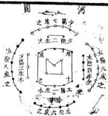
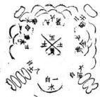
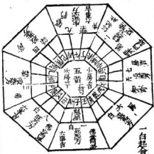

三白寶海 武林味水居士李日華擢予門人丁生道冲偕其戚吳君以所藏三白寶海謁予且請敘且告予曰是書也河浴卦疇之髓而形家之密諦也其說溫源於古至人迄元有幕講禪師者研精抽奧條流井然試按其法求之無不歷歷奇中將鬼神所司械鑰悉不出運掌而大化根帶果可窺耶意盖灑然異之予曰此不足異也物生而有象象有滋滋有數有位有形有情形有逆順致有奇偶位有旁正情有好惡至人消息之有制有化而因有權權設於心妙於用通於微故鼇可斷熊可鎖卜洛之龜可食補天之石可煉縱橫攘落不越寸靈郎三白寶海 鉤玄丘索所陳箕文所制亦剩語耳唯是二君褒衣矩步有事鉛槃而汎濫之觀乃及靑鳥暮講禪師予不知何許人計亦佛之徒治佛之說悉空一切恒沙世界無不以幻塵撥之柰何入是塵沙中作種種籌量也是則大可異者雖然以大化中人籌量大化一揉而團之一摧而滅之一會而融之惟空故活惟活故靈惟靈惟活故方之財儒之執圓之則佛之照二君必通予言而後免夫小道之泥亦併以告夫得是書而灑然異之者

二白寶海目錄詮次 李味水先生叙文太極無着序 太極圆河圍乙洛書乙 先後天八卦圗乙卷上五鎮正經論 紫白原本連山洪範論山頭白星起例 流年白星起例九星公位尅應 三元元龍主管山水生氣論 魁星論退氣論 死氣論殷氣論 關論五行相關三白寶海卷 自太歲巡山羅曠 既和論身納氣關煞生氣混雜論 起建方論認水相局詩 祖墓暗建殺論陰陽二宅侵殺論 建造所爲五行諭五黃臨村落論 關煞臨戊已都天論遮年戌已臨方定局卷中洛書本圖乙局 山局吊白方屬 九局乎原諭 建宅宅局弔白圓圗 總論宅白

住房孤絕詩 卷下 論井竈廁畜欄確磨門路論生氣吉方 修造遷移論 報工論 太歲飛官生尅宜利 天元運身起白例 五生命忌自中殺論 年頭白起例并圖 月白起例井國 日白星起例并圖 時白星起例并圖 白中有殺并國 修方要訣 三元暗制殺例 月建起黃道修方訣 三白寶漢 目錄 1 三元與廢斷訣 定局辨龍論 以下集九星 三元龍運生尅數論 三吉論 十惡論 三瑞五不祥論 三吉六秀與九星相參論 吉凶相反論 擇日法 停喪捷徑 諸穴選忌論 暗黃法 三白寶海自錄

太極數 易有太極生兩儀兩儀生四象四象生八卦以鎮八方乾 爲天爲父位西北坤爲地爲母位西南故曰天地定位艮 爲山位東北兌爲澤位正西故曰山澤通氣震爲雷位正 東巽爲風位東南故曰雷風相簿坎爲水位正北龍爲火 位正南故曰水火不相射各有配偶化生萬物則知乾異 坤二老相配震巽長男婦相配坎離中男婦相弦艮兌少 男婦相配乾三坤六合成九畫震五異四坎五離四艮五 兌四皆成九畫造化之端夫婦之道生育之本吉凶之原 俱由天數故日分陰分陽迭用剛柔乾居北坎艮震三男 三白寶海卷上 次之促子父也坤居南巽離兌三女夾之從乎母也以辰 南戌北斜分一界在東輿北爲陽在南與西爲陰乾兌屬 金霞巽屬木坤艮屬土坎水離火此五行生王制化之自 然也八卦居入方不動則無吉凶動則吉凶生矣故曰吉 凶悔吝生乎動者也以地言八山飛流動變而隔煞之方 尤忌冲刑以年月日時言誤犯煞方應區不而關煞都 天報應尤烈決無空過之理之晦跡林泉究心緇學竊 嘆先賢正經沉理于世茲按古本纂校分九九八十一局 飛星布運以度世人不致迷於禍患云貴 至正辛卯歲次仲春元沙門法心無着序

<table><tr><td rowspan="9">洛 2 单 x# 1 公 空 0O0 个 2 J 二白寶海</td><td>十凡天地之數五十有</td></tr><tr><td>五此所以成變化而行</td></tr><tr><td>鬼神也河國圓洛書方</td></tr><tr><td>圓者星也紀歷之數其</td></tr><tr><td>兆於此方者土也畫州</td></tr><tr><td>井田之法其倣於此河</td></tr><tr><td>載七前六後八左九右</td></tr><tr><td>洛數載九履一左三右</td></tr><tr><td>七河國洛書相爲經緯</td></tr><tr><td>卷上 </td><td>八卦九疇相爲表裏 三</td></tr><tr><td>天地定位 山澤通氣雷屬 相薄水 相射入卦相 关王众关 次 养 先 免川三 錯數往者順知來者逆自 國 乾至兌爲順異至坤爲逆</td><td>帝出乎震齊乎巽相 一見乎關致役乎坤說 三 #l 舞 1 言乎兌戰乎乾勞乎 坎成言乎艮</td></tr></table>

此陽變陰合而生水火木金土也者陽之變者陰之 合木陰盛居右火陽盛居左木陽穉次坎金蔭穉次離士 冲氣居中陰根陽陽根陰出水而木而火而土而金金復 生水循環無端五氣順布四時行焉合而言之統體一太 三白寶海卷上 太框區 二

按河圖者伏義氏王天 下龍馬負圓遂因其文 以盡入卦洛書者禹治 水時神龜負交自一至 九禹因其敘以成九疇 易曰天一地二天三地 四天五地六天七地八 天九地十天數五地數 五五位烟得面各有合 天數二十有五地數二 三白寶海卷上

元沙門幕講禪師集

龍門正宗願陽全成九道人校

于鏡正經論

三吳鄭鼎和守中道人閱

伏義神農皇帝三聖繼天立極而制三墳五典九丘八索 盡卦別州洪陰陽明造化定吉內指趨避夫陰陽者乃天 地之元氣萬物之根荄八卦者乃陰陽之窟宅造化之樞 紐原于河圍竅于洛書貧巨武亥廉祿硤輔弼九星也金 木水大土五行也五行分布十于屬天運而不止十二支 三白寶海卷上 屬地鎮而有常會合三元配偶四時而生萬物物物其稟 百法同塗人之壽天窮通貧賤富貴善惡繼絕皆原于此 蓋氣機順則萬物生而育焉氣機逆則萬物拂而蔽焉凡 一靜一動靡非陰陽造化之所爲而況常居此以受天地 之氣者乎故立宅營坋必擇善而處擇之善者得氣之正 則于孫昌茂彌清氣爽正直忠貞擇之不善者得氣之戾 則頑蠢昏迷貧苦天折誠宗斬能稟受有原安能改易是 皆氣化使然定物豈有心領覆哉古聖人倜世據人指點 龍穴眞機剖示飛星卦象俾營打獲吉妥存歿於不聲 凡擇地先看形勢次認來脈中分順逆勢急從緩勢緩從

世第五行一大江水戊坎申垂水亦同失為景

言如高山為主將也高同爲主星也唯喜來勢雄聳來圖迥遠頓峰軒是重矗秀麗左右趨迎賓主拱顧生炁魁曜峙列嵬峩之上羅嚴開煞環衛降伏之鄉風門水口星卦比和衆將扶佐諸凶潛伏形勢得此爲入格之地再得年月吉星照臨太乙太陽合向合坐二德三奇臨局臨方避吉凶惡發大可興工舊造更取吉星之山岡水路立向及生方閱池穿井置立門路主三十年後大發世代榮華若本山低陷開煞高尋水口笑開明堂傾塞卦父驗雜形勢散漫氣色蕭然立見災禍三十年後敗七十二年絕禍福無門惟地所主故吉人天相凶人鬼相趨進之道可不三自寶海卷上 二

慎歟若生炁星峰吏合關煞星峰名善惡相半縱爲官不善終雖富厚不中忠孝家門不正心衡不良若行生炁方門路飲關煞方水作闊殺方灶及房廁動用之類雖富貴主于孫必帶惡疾更方惡心毫髮不爽是書入秘人間茲悉心演出業是書者其待人而行哉

紫白原本連山範論

北方九九八十一炁除一白得八十數故甲寅辰巽戌坎辛申八山屬水水爲炁君之長外有一白南方七七四十九炁除九紫餘得四十數離壬丙乙四山屬火火炁者炁君之長外有九紫

十年凡三元所管之山方得生氣比和主六十年大吉得死退氣亦六十年小吉得煞氣六十年平穩弘治十七年甲子爲上元嘉靖四十三年甲子爲中元二天故四年甲子爲下元康熙二十三年甲子又爲上元今乾隆九年甲子爲中元

九星所屬公位尅應

坎官一白一宮貪狼天尊星坎卦管中男正北方屬水天建休門值率二旬一月一年應 生正發中男相尅殺中男坤宮二黑二宮巨門地福屋坤卦管宅母西北方屬土三白寶海卷上 1、

震宮三碧三官祿存天星星震卦管長男正東方屬衣天冲傷門值事三旬三月三年應生旺發長男相尅飛 反男異宮四緣四官文曲地計星巽卦管長女東南方屬木天輔杜門值事四旬四月四年應生發長端相尅殺中宮五黃五宮巡羅五鬼廉貞星居中史

乾宮六白六宮武曲地尊星乾卦管宅長西北方屬金天心開門值事六旬六月六年應生服發宅長相尅殺 宅具兌宮七赤七宮破軍天計星兌卦管少婦正西方屬金天柱驚門值事七旬七月七年應生正夢少女相尅飛 少女

妙用雨時憲書所數年圗月圗悉原本於夏易連山洪範也志斯道者詎可忽諸山頭白星起例子山一白是貪狼丑六白定分明卯龍三碧天羅起辰已四綠地都尋午山應龍足紫布未申二黑地福星酉龍七赤推天計戌六六自地尊星如酉山龍卽以七赤入中宮順飛八白到乾爲吉更乾流年白星起例申子辰年一白入中宮寅午戌年九紫入中宫已酉丑年七赤入中宫亥卯未年三碧入中宮開山移據用

右九星順布九宮須與原值官星相生吉相尅凶比和 旺相吉尅洩冲關凶此爲用一年月日時同

上元甲子起貪狼水自元龍管入山風水入山得貪氣山岡水路朝顧宅穴主六十年富貴

中元甲子起文曲四元龍管八山風水八山得文曲山岡水路朝顧宅穴主六十年富貴

下元甲子起破軍 金星 元龍管八山屬水八山得破置山岡水路朝顧宅穴主六十年富貴

此三元者下元完復起上元每元六十年其三六弟日入山處世癸用 東方三十四炁除四餘得三十數故震艮巳三山屬木木庚未注中 炁臣之禪合天三生木之數

西方二十六炁除六餘得二十數二黑戊土得祿于巽已金炁生巳故得巽四緣之炁而兌丁乾亥四出屬冬生春春生夏夏不能生秋故金資戌土祿處以寄生中央地炁辰戌丑未地承天數該炁一伯每墓分數於五四墓皆五炁五五二十五故丑癸坤庚未五山屬土而土又五行之尊故五黃居中

又西北六白得六炁正北一白得九炁東北八白得八炁止南九紫得七炁皆孕炁盈復綜之六六三十六九九三白廣海卷上 五

八十一八八六十四七七四十九故六白一白八白九紫皆為吉也正西之七赤得一炁正東之三碧得三集隸之成九西南之二黑偶之爲四東南之四緣綜之六其炁皆不足分借中黃一伯炁成之兌一借中一二十五成二十六震九借中黃二十五成三七四巽十六備中黃二十五成四十一坤四備中黃二十成二十九故赤碧綠黃黑皆不足爲吉也是書布洛書之方位道氣化之周流首論山白次論宅白又次論年月日時之自以備擇之用運以月建錯以九星綜以五行相生相尅而吉凶悔吝生焉福福券焉皆古先喆之艮宮八白八宮左輔明龍戶長卦管少男東北方屬土離宮九紫九宮右弼應龍星離卦管中女正南方屬八 天任生門值事八旬八月八年應公左旺發少男相尅殺 少9天英景門值事九旬九月九年應生 食中亥相尅公生氣論 左生氣卽母印緩星也五行相生萬物照育 中女稟得生然門路縱扦凶地選一生富次後貧窮稟得辰氣門路殺扦吉地初年不利久後高貴若值星峰聳拔綿亙秀麗如母之顧子賓之顧主更與魁星兩全此爲大貴入格之地或百里或數十里被脉作禮者名發將山也主生三男九子孝義良善科甲傳芳壽命延長三白寶海卷上 六

或山岡小水近促者亦富貴賢良隔遠相去亦主豐足如問不吉

詩曰生氣完聚出賢人孝義忠良佐聖君兄友弟恭家 和順自然富貴萬年春

魁星論魁星貪狼星也乃九宮之魁首爲文章牙笏之星在天爲萬靈之主宰在地爲百脉之權衡最吉之曜也若大江大水送此山重蠱廻環朝觀得此營造主子孫聰明邁衆世代爲官文章德業屋偈一世卽山路隔絕氣脉隱起徹露者亦出清奇儒雅高才逵士衣長饑一足此星若爲死炁亦出名僧高土若為退炁亦出舊能人詩曰魁星疊疊聳高峰九九星中第一龍扑泚年年生福德子孫世代沐重封 星見一自狼水 木星見八白左禎上火星見六白武金山見火本山泄氣方是此方造作有井灶房屬門路主退田產損六畜小人淺度恩多成怨義重招非利客不利主詩曰退炁繇來最不夏家紛犯著禍難當營謀失本仍招怨產業瀟條後不昌

死炁論者悉就爲死炁凡人家作此方屋行此方路及開此 方門主生女後敗範如火山見金金山見木本山見 土山見水水山見火皆是詩曰水路山岡犯死神家 三白寶海 卷上 七

門寂寂主孤貧呤退速遺類見禍看看後代又無人 被氣論我火山見水水山見土土山見木木山見金金 山見火是造化失常陰陽反逆相刑相尅爲仇爲害凡 山岡水路爲此局殺氣來冲來尅主惡疾刑傷忤逆凶 頑溺縊雷誅遭官歿陣孤天寡弱貧蕩厥絕

詩曰六趣生來受此殃只因定局欠思量急須移改凶爲吉免得兒孫患久長

關論封中夫關卽巡山羅獷五黃廉貞星也若山岡水路須案平橫遶謂之開殺勢伏名爲護龍此地起造營紛大吉若關方山峰昂聳或大水刑沖波濤响關名爲絕龍此地大凶主子孫凶頑惡逆奸盜徒流刀縊橫亡伶仃敗絕件件有之金關木主絕木關金主瘟水火相關主絕土關土主亡詩曰五炁相關惡逆侵山家冲破對朝臨于上相關猶自可支內相關立見凶

太歲巡山羅猴論每年太歲方爲建對宮向方爲破建爲天罡遊都大殺破爲河魁巡山羅猴太歲爲一年之主衆煞之王動作犯之飛灾橫禍財物消耗暴疾卒亡更損家長害田蠶若在殺方併年月日時之煞其禍尤品作於離方三果入中詩曰太歲傷家長巡風小宮忌作艮坤方餘飯此二白寶海卷上 人

房山家合大歲至室禍非常

旺炁星方又名納氣星方宜造作凡山圗水路房灶門廁在其方者火于生氣如值管龍之運尤吉主富貴文章子孫繁熾家和意協兄友弟恭若關煞相使則手足俱受其尅與關煞同論詩曰比和兄弟旺諸星管漏之時運逾興若遇失時關與煞依然駁雜禍來侵關煞生氣混雜論關煞峰高與生氣相等或水路亦然名爲善惡相半此地立宅營坋雖富而無禮貴不善終出人口善心狼強言奪理好訟喜爭尅衆起家易成易敗若開生方門立凶方向行生方路鑾殺方池作生方飲殺方水糧有人丁常纏火害縱有衣食破耗無端癡呆惡相初男女骨肉相傷詩曰山家閱破禍非常瘟毒有見血光只因善惡星相雜故令安處隱危

起建方訣前論太歲爲建歲破爲破此論山峰爲建低 處水際獨破姉平地以坐心爲主起建以水爲破進為 主破爲客且如離山坎方有水便是離山坎水如坎山 離方有水便是坎山離水又如乾山巽方是水便是乾 山巽水如艮山坤方是水便是艮山坤水如震山兌方 二白寶海卷上 九

是水便是震山兌水兌山震方有水便是兌山震水皆 以水為獲以山爲建若四關晉水便作中官局論 凡定局不可執一假如乾山來胍便作乾山局論郊萱 華竟來亦宜作兌山局轉展兼論如帶壬坎氣可將 坎局吉凶通融取用庶無失也餘局倣此

水相局起例詩東南乾局西南艮東北爲坤西北巽北離西震兌因東南方水路坎山同四方相等是牛寫遠近須從香火論

旭墓暗建殺凡入山造葬忌犯祖墓暗建方亦名暗建 殺主殺長房子孫建方者陰宅之主位著葬祖慕建方 主子孫忤逆不和尊舉無序故也詩曰建主長房傷 破主殺小房魁罡中房死犯者自身當作建山家殺 全家主恭亡君如求保佑急報在生左

陰陽二宅侵殺論陽炁道侵陰陰炁道侵陽侵陰陰受 尅侵陽陽愛傷如陰宅殺方忌起楚是侵陰也陽宅 殺方忌安切是侵陽也如先有陽宅後作陰坊在陽宅 生方則吉殺方則凶作陰宅亦然故二宅同方惟取皆 作吉方爲妙更值山局乘龍氣生王之年月日時必主 驛發僞二宅相犯陰陽反背更遇死退闕殺之年月日 時發解尤烈

建造所屬五行屋屬土以其方也確屬水以其動也井屬木以其深也屬屬金以其圓也廁方又爲土錐屬火以其尖也

論五黃在宮在方在村落五黃所在處皆忌修造動玉犯主癌火橫亡應以五數以五黃爲瘟瘞之主宮數五故也

在離方建錐子以二火助五黃之殺主燬五數人家殺一五數人造確則滅禍水尅火也

在坤艮方造屋以二土結成局必主發瘟連穿井則減禍木尅土也

一在震巽方穿井以二木尅制五黃之殺則禍少不宜造屋與鐫

在乾兌方造圃廟洩五黃之炁其通少漢遺方順則禍重不可報

在坎方造確乃五黃所制之地或遇或火任其所之無不酷烈

大抵五黃凶屋雀落受制之方宦落制方之地此天一地生成之理人當知所避忌一凡五黃關殺所在左不動則禍不見不助則禍不烈遇尅則禍滿知此避禍卽卯此生屬總一理也

二自寶海卷上關殺自方那廓戊已部 斷凡義氣死氣退氣五黃凶方更遇戊已都天臨其上或月建加臨立見凶禍吉凶各有所主堆木料人口灾損六畜欄圍主服疾宮事廁屋損人口六壽灰舍損小口空屋主喪事自繼土堆主墮胎落水山水冲射主心痛病死陽年損宅長陰年損宅母

遠年戌已都天臨方以五虎道尋戌巳所在考衡是甲巳年在辰巳方乙庚年在寅卯方丙辛年在戌亥方豐義丁王年在巾酉方戊癸年在午未方 肥主火盜瘟疫橫不為人量 五黃撰殺便坎山局 刀有 水 遮是 一白水入中宮天蓬管局羽音居北方王子癸卦屬中男貪狼星屬水半陰半陽山也

<table><tr><td colspan="4">三白寶海 二白寶海卷之中 品業西 h 長聖疑 望</td></tr><tr><td>東市的字東北庚 西市約乙西北納甲 2H家9 卷中 和 日 r x 电 辰 </td><td>津離民卷 </td><td>有站 凶不一收取甫白四柔 米 雪</td><td>不者浦國谷山外市以 事</td></tr><tr><td>2 国 N 東正 卯入甲 </td><td>兼 貞 廉</td><td>三卫</td><td>率 显本 秦 破</td></tr><tr><td>北 皇 康 </td><td>北 正 豪水 鑫 癸</td><td>孔 王</td><td>西 前</td></tr></table>

<table><tr><td colspan="3">圖 星 九</td><td>山 坎</td></tr><tr><td>下三羊寅申 中三子辰申命發巽 上三卯四辰巳命發</td><td>下后極富 震</td><td>局 子山用戊申丙辰丙午</td><td>子山用寅未百四 壬山用寅中四四吉</td></tr><tr><td>嵩書四 九紫治富教方</td><td>B 丙 降 泉低</td><td>丁五索市言給藥方 宋 X城中国</td><td>坤 岩湖 下元大吉未申档</td></tr><tr><td>震 m 山城嫩理古 八百尅無凶</td><td>分 局 中西吉风四 一百水爲主</td><td>子年一百入中官</td><td>申七赤中毛氣之庚天甲高 竟 一卡氣免城之典 山 成二屬土離色氣方</td></tr><tr><td>黃高鼎射宗湖棺 艮 中 平伏水吉</td><td>裂 山大水橱进吉</td><td>坎 王 六白金中宮幾雲</td><td>貴高六 乾 山水依平拱伏吉 +条盐餐划电</td></tr></table>

若坎巽垟三方山峯頓起高厚主子孫英俊豪杰孝義賢 良一舉登科或艮震離兌峯高水射主子孫天亡刑傷官 災絕滅橫案環遠則吉

詩曰坎局原來帝王鄉坤方水路坐生長營坌立宅皆 榮貴此局應須認水場又山言坐向水言局水路朝 迎坐吉凶坤坎汪洋關煞没不問三元福澤同

此星遇子年月日時大利營造王百日內君子遷官庶人進財中男先發縱值太藏諸殺無害若犯無氣年月併入三白實海中卷

墓之辰中房見中申子辰年應脩造一白年月值生氣 主三六九年進宮羽音財物從北方來

坎山坎卦武曲星領事名地尊曜玉鏡云山峯頓聳同厚營坌紫炁蓋棺亡人安穩子孫富貴和義立宅世代一榮華應申子辰年如本山低陷不吉

詩曰坎山坎水吉星臨岡水朝迎値萬金世代子孫家鼎盛居官顯達且遐齡

蹇卦坎山艮水天輔星領事化地都玉鏡云如山峯尖射水路冲激營坋水浸棺太木根貫屍先殺小房男女諸房並凶盜奸淫惡疾天絕山水低降不妨宅同詩曰坎山艮水號同無限家寶雪見湯休望子孫丞後業中元方前保出生

屯卦坎山震水天任星領事化明龍玉鏡云如山峰尖射水路冲滋營场狐議入穴損棺木讓東墻先殺長房諸皆凶火盜刑疾血產橫絕如岡遶吉宅同一詩曰坎山震水犯河魁萬鑑倉籍花作灰剛有作房無暉礙其餘移改莫胡為

井卦坎山巽水天英星領事化應龍五鐘云如山峰圓作墓亡人安中易富諸房亦吉但後代人冷絕宅同

三白寶海卷中

曰坎山巽水變昂昂福蔭春家中身肅積蓄慳貪家業惟則孫雖少养孟嘗。

瓦濟坎山離水蓋禽星領事化巡繩鏡云如山峰尖 射水路冲激營不祥棺欹屍亂縷聚蛇藏小房育聾 喑歷金水氣人隔疾凶死諸房凶出平案橫吉宅目 一詩日坎山離水是羅曉巖蠱費財百龍稠常被瘟火相 龍書更來怪妒總堪愁

比卦坎山坤水天柱星領事化破軍玉獲云和山峰圓秀水路朝迎葬理業炁蓋棺亡人安稻小房旺財置虛詩曰坎山坤水小房強圓水朝迎百事昌後代官高義富厚如扦此地姓名香

節封坎山兌水天冲星領事化天羅玉鐘云如山峰星水路直營坋立宅殺長房諸房火盜官刑破敗詩目坎山兌水號天羅下後兒孫疾病磨惡曜刑傷峯廩耗更防絕滋禍灾多

需卦坎山乾水天芮星領事化殺鬼玉鏡云如山水冲壓主殺宅字中房先減諸房並凶瘟火天絕宅同

詩日坎山乾水怕守流敗殿凶灾巳可憂惡疾百般并 火盜更防官訟少蚕收

三百寶津卷中四

坤 未山用西申午三日辰 未爲后為卯午 坤 乾 山 萬大國秀吉 坤山用寅甲午巳四日 德入安 平 局 寅卯業發 六白全中宮生刻方 -严 三黑盤坎 九 申山用申西未三日 黑大吉下元声 巳亥命發 星 白水中宮尅飛氣方一染市宮尖旁雪 六丙命不上 震 良 圖 坤山 山宗商舍低陷凶

坤山局二黑入中宮天芮星管局宮音屬土居西南刑主宅母純陰山也

若坤震吳離頓峰朝顧主子孫溫艮孝義富肯優遊武 艮兌乾三方山岡水路朝顧主遭刑犯法男女天亡奸 淫惡疾若低平橫案間遮獲福上元莊

詩曰致役原來屬太陰雷門爲母巽爲金雜大不鳴生虎伏自然聲價重南金

坤卦坤山坤水天任領事化司命玉錢云如山峰雄秀歷水路朝迎營場紫舊蓋棺亡人安益小房諸並吉子孫繁衛富貴良掌立宅同如低平水背平平

二白寶海卷中

詩曰坤山坤水起峰巒富貴榮華百代備百子干孫都 俊秀家蘇珍寶有干般

卦坤山兌水天輔星領事化狂龍玉鏡云如山峰尖 射逼壓營坋壙中水滿八分蛇蟻屯聚先殺長諸房並 凶瘋癆癰癱縊溺天賊中元三十年每姑立宅月 詩曰坤山兌水忌朝冲長女先亡禍患生一旦荒涼家 道絕中元也是暫興隆

泰卦坤山乾水天冲星領事化病龍玉鏡云如山峰尖射水路坤激營勞狐蟻八塚棺損骨游先殺長諸易藍凶子孫忤逆火盜瘟瘧刑傷滅絕立宅同如低降不妨

公 子孫世世 低 卯為部 書鳴前

詩曰坤山乾水起高岡疫記請九不可當更有一般堪畏處家門孤寡子孫亡

師卦坤山坎水天柱星領事化天魔玉鏡云如山峰員 秀至小房男女平善若尖射水路冲徽營坊凶突下元 亦發禰上中元不吉此方宜靜不宜動立宅同 詩曰坤山坎水是元龍他日平平退氣同山若低降猶 自可倘逢尖射總是凶

謙卦坤山艮水天禽星領事化蛇玉鏡云如山峰尖 射火路冲瀨營坑壤中蛇蟻屯聚棺損屍穿先害小房 諸房並凶淫蕩遭刑忤逆取倫殘疾瘟天立宅同

詩曰坤山艮永號凶神門戶乖張惱殺八若得低橫無 空缺翻然禍去福相親

便卦坤山震水天英星領事化天財玉鏡云如山峰高厚圓秀水路朝迎營切紫舊蓋棺亡人安生人福先發中房諸房並吉子孫孝義良善榮雜登 立宅周如低 千不吉詩曰坤山震水合眞機此地原來世所孺下後諸房今發跡當乘車馬拜丹墀

开卦坤山巽水天蓬星領事化生龍玉鏡云如山峰聳拔圓秀營城開壙見生氣異寶亡人安生人福紫齒蓋棺子孫賢孝文章科甲先發長諸房竝吉置外郡生田如山低平不吉立宅明修造加官爵此方宜動詩曰坤山巽水喜相親庭下春風日日郗諸子賢良多富貴英雄不讓孟咎君

明夷坤山離水天心星領事化太常玉鏡云如山峰牙 笏水路之玄營墳立宅呈孝友艮善出名僧仙道聰明 技巧之人低陷凶

詩曰坤山離水紫微星長功和同家道輿富貴榮華休 要膠守林待兎樂生平

<table><tr><td rowspan=1 colspan=5>圖 星九局 山震</td></tr><tr><td rowspan=1 colspan=1>宸山六乙命不上卯辰</td><td rowspan=1 colspan=1>己亥命發罪吉乙山用玄卯午未四口</td><td rowspan=1 colspan=2>卯子命發卯山用未申寅三日後登</td><td rowspan=1 colspan=1>未辰戌命卯酉巳午命發甲山用寅售午未辰五日</td></tr><tr><td rowspan=1 colspan=1>峰设和  重宫方</td><td rowspan=1 colspan=1>麻下器七法念中立秀內山水平婆把古</td><td></td><td rowspan=1 colspan=2>川水平伏吉高大山坤生或</td></tr><tr><td rowspan=1 colspan=1>震唇</td><td rowspan=1 colspan=1>洪 四米三</td><td></td><td rowspan=2 colspan=2>大出山水低平竟 五黃市宮通與四議本昭中官凡氣方大山寶吉亡人安靴</td></tr><tr><td rowspan=1 colspan=1>良集质</td><td rowspan=1 colspan=1>箱坎擦琴C</td><td></td></tr></table>

震山局三碧入中宮大沖星領局三宮角舊居東方甲 乙木卦管長男正陽山也宜坎巽乾峰巒顧從王子孫 孝義賢良登利及第若艮離坤兌頓峰峻削水路冲射 主子孫殘疾官災刑傷敗絕

詩曰東來帝旺福與元武青青百里迎管取上中元內運科名榮貴值千金

震封震山震水天蓬星領事化鸞舉玉鏡云如山峰水 路國秀之元回龍顧祖營場紫炁蓋棺亡人安中房先 發富貴置外郡田庄諸房英才特達榮登科第宅同 詩曰本山矗矗起高峰下後貲財勝石崇子孫英邁多 三日寶海卷中

集貴上中元內作三八

悅卦震山巽水天芮星領事化麗龍玉鏡云如山峰圓 厚水朝迎營墳紫舊蓋棺亡人安程先旺長諸房均 子孫艮善富貴昌盛如山凹陷平常宅同

詩曰震山巽水正相當財物年年滿庫倉宅長應招 貴子門閒先彩不尋

豐卦震山離水天柱星領事化絕命玉鏡云如山峰尖 一射水路中激營坋壞棺穿屍先殺長房男女諸藍凶莊 逆亂倫瘟火殘疾變怪絕該下元平過立宅同 3 詩曰震山離水若冲刑萬禍千灾盡發頭骨肉伶仃多 天拆下元死裏可逃生 豫卦震山坤水天英星領事化權龍玉鏡云如山峰尖 明水路冲或營髣骨壞屍穿先殺中房諸房並凶子孫 癡杲惡疾家門不和立宅同

詩曰震山坤水損中募疾病年年見血光不但刑傷併 火祠人丁寂寂誤汪汪

歸嫁震山兌水天禽星領事化五鬼玉鏡云如山峰尖 射水路冲激葬後垛柞損屍蟻聚狐屯六年六旬火盜 官刑天亡李死如山水低平畧可立宅同

詩曰震山兌水是廉貞干灾萬禍苦難禁不但風聲傳 三白寶海卷中 九

外境全家敗絕更傷心

大壯震山乾水天輔星領书化六合玉鏡云如山峰秀水路朝迎營坋紫炁蓋棺亡人安穩先旺長房諸畫旺盛立宅

詩白地都星曜兩分明秀麗龍岡拱宅庭惟有中元家 業盛上元下甲只平平

那卦震山坎水天任星領事化左輔玉鏡云如山峰圓頓水路朝迎營坋八九尺見古銅異物或金雀金魚紫一炁蓋棺亡人安穩先發小房諸房並吉宅同詩曰震山坎水向財宮二子豐榮似石崇朱紫滿堂官

職顓滔涵應在上元中 小過震山艮水天心星領事化六律玉鏡云如山峰尖 射水路中激營坋棺壞屍穿先殺宅長請房竝凶子孫 受禍孤寡伶仃山低平環遶吉立宅同

詩口震山艮水來冲破犯主禍患無差錯先須宅長受 刑傷次後諸房亦多故

平洋之注尋龍難水易故定局卽所以認龍也是部龍到頭也先求龍砂本之辭以定形次就生旺之方以立局其向朝水而背去水其生下生而之上多立局飾乃是真蹤卦氣必不可雜此迎官取之法地三白寶海卷中 十

巽 辰山星庚未申寅四且坤 竟 乾中關山出天代殿 山太平伏環吉 山水干降環吉局 襄山用申未巳三日 八公幸勢 九若遺名中星巳山寅甲午未酉吾 離 四緣爲主 坎九 巳卯子午人命發 山水国秀吉 午柒年吉 田水平伏團速吉星六甲命不上 三碧木中官氣三市富男七赤金中官秒分震 艮圖 異山 山水高六秀吉

搖文曲屬木爲風卦管長女正陰山也若處巽離地 頓峯圓厚主子孫登科置外郡田地名傳天下富貴綿 遠乾坎艮兌若有山岡水路冲射朝顧主瘋癆惡疾 潘蕩自刎諸九不吉

詩曰十有文曲號天輔六秀之中我爲祖午坤生炁發 榮華中上二元無開阻

共卦巽山巽水天中星領事化天羅五鏡云如山峰圓 秀水路朝迎營坊主紫炁蓋棺亡人安生人福良善富 貴如醜惡凹陷主子孫忤逆飄蕩立宅阿

詩曰巽山巽水起重峰細看原來是本宮更得中元星又吉定生賢子顯家風

小人巽山離水天任星領事化鳳筆玉鏡云如山峰圓秀水路朝迎營坋紫炁蓋棺亡人清泰小房富貴諸房董吉置外州庄田孝義夷華立宅同

詩曰巽山離水正當權日日家門進寶錢守掘優悠林 下士定教脫自祿高遙

觀卦吳山坤水天蓬星領事化天寶玉鎮云如山峰遠 來重厚圓秀水路之立朝拱營坋兒生炁葬後第茜繞 當亡人安中房先發科第置外郡生諸房並吉立宅同 詩曰重重牙笏疊嵯峨置立庄田財產多莫道中房偏 折柱諸房還許盡登料 折桂諸房還許盡登料

中孚巽山兌水天心屋領事化絕命玉鏡云如山峰尖射水路冲荊營扮開擴見砂石水窠先殺宅長子孫火盜刑廢殘疾繼溺蕩敗忤逆天繩水漣山平無妨宅同詩曰巽山兌水起峰高百出無端禍自來任爾貲財于萬石如湯嚮雪没分毫

小畜巽山乾水天禽星領事化地獄玉鏡云如山峰尖射水路冲破營切狐蟻屯聚棺損屍穿子孫瘋癆惡疾盲聾喑啞火盜官刑孤貧敗絕如山橫案低平吉半同三白寶海卷中

詩曰山乾木遠來冲此地營基菴禍凶若得低平環作案化凶爲吉莫疑猜

渙卦巽山坎水天英星領事化獨火玉鏡云如山峰尖 射水路冲激營切狐蟻屯聚先殺小房諸房垂凶主惡 疾官灾大盜忤逆上元凶中元畧可立宅同 詩曰巽山坎水不相傷若在中元也不妨木見火時爲 退炁箕裘不振實堪傷

新卦巽山艮水天柱星頌事化泣龍玉鏡云如山峰尖射永始冲激營切先殺小房諸房並凶共凶禍與巽山乾水同惟下元六十年畧可立宅周

詩曰巽山艮水起峻蟲聲疊難當禍患生絕嗣滅宗無 可柰下元甲子保康寧 益卦巽山震水天芮星領事化幅龍玉鏡云如山峰國 秀水路朝迎營坋開壙見生炁異物紫炁燒棺主于孫 文章豪華置外郡田產如山氏水直凶立宅同 詩曰巽山震水最堪誇巨土臨門富貴篆諸子英賢多 特達嘗教世代享榮書

中 六自金木宮生退葬方官 坤 山水冲园 乾 山舞麗水朝迎人貴局 離 九第火生中皆生義芳真 五黃爲 伏 吟 一日水中呂克死無方凶九星 百擬木克臣考私方凶翼 震 良国 山水畜射門综机

孫羅五鬼星居中央卦坤也此山喜坎艮離坤方山峰圓厚主于孫溫良賢德富貴壽考與震兌山峰水路冲射主遭刑犯法惡疾橫天鰥寡敗絕若低平橫案廻抱則吉此星主時行瘟疫遇申酉戌亥子年月日時爲有炁營造大吉辰戌丑未年八墓凶在官出宮皆忌犯此大凶

詩目四水週圍號中宮坎離交媾必亨通惟有上元能發福蘭玉傳芳到九重

坎卦中宮埃水天蓬星領事作魁星玉饒云如山峰重三白實海卷中

疊臨秀水路朝迎營場紫氣盖棺亡人安奏先發中是 科名財禪如值太歲生炁到方脩造加官進縣主同 詩曰魁星疊疊印重重起伏迢迢遠脈通有福人來居 此地官封五馬祿于鍾

艮卦中宮艮水天任屋領事化天官王鏡云如山峰遠 來厚重水路朝顧營坋柴炁盖棺亡人安穩主小房富 貴賢良諸房並吉子孫繁衍立宅同 詩曰明龍拱顧勢昂昂塟後家門百事昌更得好屋來 一助子孫忠孝佐朝廊

震卦中宮震水天冲星領事化天刑玉鏡云如山峰尖 射水路冲激營切狐屯蟻聚棺損屍築先殺長房惡疾 好懦火盜官刑投軍作賊蕩敗天誠諸房並凶上宅國 詩曰中宮震水殺星臨無限凶危百漂與莫道長房先 天喪全家敗絕可傷情

吳卦中宮巽水天輔星頌事化哭曜玉鏡云如山峯尖射水路坤刑營切狐蟻屯聚竹木穿屍先殺長房子孫火益官灾縊溺搖酗蕩逆殘形于災百禍各房絕懇國家犯之禍同如山低水曲不妨立宅同

詩曰中宮巽水起高峰造化逢之百事凶人口貲財如掃地上元一見便和同

阻卦中宮離水天英星領事化進財玉鏡云如山峰秀振水路朝迎營坊紫炁遮棺凶人安泰中房先發財應富貴忠良置外州田店諸房並吉如低陷平平立宅同詩曰太陰會合是眞龍來去廻龍左右逢一片完全鍾秀地于孫代代祿重重

坤卦中宮坤水天芮星頌事化明堂玉鏡云如山峰厚 重圓秀營坋立宅子孫聰明和睦如山醜惡凶

詩曰巨門圓厚起高峰子媳明福祿崇氷拱山朝人 口旺長幼和同萬事通

卦中宮兌水天柱星領事化勾陳玉鏡云如山峰尖射水路冲徽營功立宅此星爲帶甲金祿小房男女孤寡貧窮殘疾血刃男少女多下元六十年可

詩曰西方太白夜猴情自古稱爲血刃星耗盡家資傷小口下元陰極又陽生

乾卦中宮乾水天心星領事化福德玉鏡云如山峰圓秀水路朝拱營墳亾人安先旺宅長子孫賢孝世享榮華聲名遠攝立宅主出老人

詩曰武曲之水遠來朝進入庄田福自饒清白傳家娟族睦長年康健晚年高

三白寶海卷中 十K

乾 乾山甲中甲上主三碧本中宮尅死八白土生中宮生之七赤金毗動中右旺寅庚午乙酉日一炁方凶 柔方声山 辰戌巳亥白號地 山水平伏國速吉直配作 山城峯水朝朝吉大 乾 山水高秀朝迎星九局 亥山壬寅甲申壬一白水中宮生追為利未舊紀 二鼎土生中宮生申三日 万吉寅申巳亥命發 中沃六白金主坎茂山不双 五黃土墓山五星車四縣木中宮尅死為力紫六刻甲宮初一方中元吉 一乘方前不上 巽 震 良山水冲射凶 山水同秀朝迎吉山水種業低伏吉戊來亢 属金卦管宅長天門之位正陽山也此山宣坎離兌方響特生子孫登科及第富貴壽耇忌艮震巽坤山岡水路冲射主惡疾天凶諸九不吉

詩曰足跟一跳自天門魁曜南來勢益尊坎兌齊來相 繞護子孫科甲勒西崑

卦乾山乾水天柱星主事化天計玉鏡云如山峰相 願水路朝迎營坋立宅主小房興旺孝義忠良下元六

十年富貴榮顯詩曰乾山乾水勢昂最紫炁金精不磷剛長勿和著家一白寶海卷中 七

道盛下元應自出朝廊

心卦乾山坎水天芮星領事化紫微玉鏡云如山峰圓秀水路朝顧營坋紫炁遶棺凶人安泰主旺宅長子孫富貴良善進外州田庄諸房並吉立宅同

詩曰乾山以水吉星來大喜倉箱積寶財更主登科官 祿至白衣身到鳳風臺

遯卦乾山良水天英星領事化天羅玉鏡云如山峰尖 詩曰乾山艮水主刑傷産後瘋癆又血光淫盜官少蘊 疫死更防絕滅敗田月

乾山雲水天冲星領事化病龍玉鏡云如山峰圓秀水路朝營坋立宅先旺長男聰明秀發後孤貧中元六十年吉下元敗絕

詩曰乾山震水遠來峰長子榮華麗陳崇惟有中元春 色好下元依舊主孤窮

姤卦乾山巽水天禽星領事化血曜玉鏡云如山峰尖 射水路冲漁營毋蛇蟻入穴瘟瘧奸盜孤貧惡疾灾禍 與艮無異如山平拱作案反吉立宅旬

詩曰乾山巽水不豈來此地營居無限灾人口顛凶併天折倉糟百萬化塵埃

同人乾山離杰天逢屋頌事化綠稱玉鏡云如山峰國秀水路朝拱營坋開墉見生炁異物業舊繞棺亡人安泰中房男女英秀富貴忠良諸房並吉上元六十年發詩曰乾山離水上元興衣紫按緋上帝京莫道此屋常吉利他年也有不相應

否卦乾山坤水天仲星領事化天繩玉靖云如山峰尖射水路冲刑營坋蛇蟻八穴竹大穿尾長房先絕諸房竝囚頭貧逆軍賊飄凶立宅同詩曰乾山坤水本相傷先禍其家長位郎卽有田國皆退落妻兒父子各參商

屬卦乾山兌水天任星領事化天宮玉鏡云如山峰遠來矗秀水路朝拱營墳開壙見槨內溫暖紫茜瑞藤繞棺凶人安秦先主小房聰明科節諸房並吉孝義忠良世世榮連立宅厕

詩曰明龍滾滾自西來日見門庭進橫財先許小房登甲第諸子相繼上雲臺

化 四樣木中宮尅元希方凶 九紫火充中官歌無分四 入白土生中宮生氣方查低 坤申 优 乾技 山 三米国和 山水平状吉声： 局 二二士生中宮生演方 天 三轉木中宮克柔芳凶中 坎九 0,029.02020-山水高木聳秀吉 山水平供吉星 大金配快中官推方吉 五士 巡理凶 一白中宮生過柔方巽 震 良国 山水開秀朝拂大吉 山水平代吉 山九高大圓秀吉

22号 位西方庚辛卦曾少女正陰山也喜艮翼離乾山峰頓秀主世代爲官堆金積五忌坎震坤兌逼壓冲射主男女刑傷惡疾橫天百几不吉

詩曰少女山前離巽峰乾為善曜艮爲龍兌震二方無破損拖朱紆紫世朝宗

兌卦兌山兌水天英星領事化天滅玉鏡云如山峰小 射水路中刑營坊蛇蟻屯聚先殺小房諸房並凶子孫 讀逆作賊投軍孤寡天折灾禍百出立宅同

詩曰本山灾發火星高橫禍飛來怎得逃中少二房俱二白寶海卷中

殺盡諸房也自不相饒

大卦兌山乾水天任星領事化武相玉鏡云如山峰高厚圓結水路朝迎造坊開墳兒生無紫齒繞棺亡人安妥小房先發財祿諸房並吉子孫賢良富貴世代爲官詩曰夬卦繇來西北宜兌山得此可營居富貴明天付與勝如萬石及陶朱

因卦兌山坎水天冲星領事化白露玉鏡云如山逼壓 冲射水蕩反飄激營坋蛇蟻入宅竹木穿屍光役長房 諸房並凶兇頑飄蕩貧賊孤寡百禍齊至如低平無碑 詩曰兌山坎水不宜朝塟後家貲似雪消禍患貧窮猶

自可長房先滅次難逃卦兌山艮水天蓬星領事化天后玉鏡云如山峰屬秀水路朝拱造埸紫炁繞棺亾人安泰甲房男女良善聰明文章冠世諸房榮貴如山水無情不吉立宅國詩白兌山艮水本元微藝衛方能事事奇就守生涯應待鬼上元方許步雲榜

隨卦兌山震水天禽星領事化天瘟玉鏡云如山峰矣 射水路冲激遣切蛇蟻入穴主子孫瘟瘧惡疾一如官 到宋禍並至與兌山兌水同凶平拱作案青立宅同 詩曰兌山震水要潛露出冲閩百禍從産尼血光江 二百寶海卷中 1+1

悍女定然孤寡一塲空

大過兌山巽水天心屋領事化文秀玉鏡云婦山峰圓秀顧祖水路朝迎遣切紫炁蓋棺凶人安泰先旺宅長長房聰明長善巖寧壽考名傳外邑如山醜惡水反背不吉立宅何

詩曰兌山巽水子孫昌宗族和譜仁義堂家長長房飾福慶壽同彭祖享安康

卦兌山離水天芮星領事化貴人玉鏡云如山峰遠來重矗同顧水路朝迎之元到堂淺坋紫炁繞皆也人安泰先旺宅母子孫孝義忠良世登科第翰苑輩登播天下進外州庄田諸房竝吉下元尤利如山周低階水城反背不吉立宅司詩曰兌山離水遠來迎得比滔滔福祉生不但倉箱無限積高遷祿位旺人丁

莽卦兌山坤水天輔星領事代六合玉鏡云如山峯圓 結水路朝迎造場立宅男女聰明中元富貴上丁元 詩曰兌山坤水旺中元他日仍敎退福田不作蕭條林 下容也爲僧道免孤寒

一白中宮方艮 代富贵 吉A 克 乾山 六季命不豆山 山四吉ERE十午寅申五永命大村 三局離九 山供平水吉 山吉七中系方六自方三市中之星 吉有斯巽 震 良副 冬E NE巳年位 山水吉 山水路吉

四南方屬土位東北卦管少男正陽山也此山震乾兌起高岡秀麗朝拱主中房男女發福各房吉小房登科巽離坤方忌山水冲射于孫不吉

詩曰脉從東北秀方來左輔明星善曜開若得乾山紫爲印上元聲價到三台

民卦艮山艮水天芮星領事化天鑒玉鏡云如山岸圓結水路朝迎營毋立宅子孫衣祿自饒賢良孝義秀用聰明宅母有益加山低水有平平

詩日艮山艮水足金銀好水分明出富人下後兒孫遺三白寶海卷中

茂盛賢良孝義福如春

風卦艮吉震水天心星領事化少微玉鏡云如山峯圓 秀水歸之立朝願管墳立宅子孫孝義良善出名僧域 詩曰艮局東方若有山一家和氣自幽閒風清月白遺 堪許錦帳藏春一不可攀

玉卦艮山巽水天柱尾領事化白虎玉鏡云如山峯尖 秀水路曲朝營坋立宅于孫孝義忠良下元六十年豐 亨上中退耗此方宜靜

詩曰艮山巽水下元龍中上二元孤且窮若是水山俱醜惡子孫飄蕩更頭兒

卦艮山離水天冲星領事化天刑玉鏡云如山峯尖 射水路冲激管坊蛇蟻入穴草木穿屍先殺長房男女 諸房並兒盲龔喑啞瘟煌暴天癱瘓忤逆怪異人命終 歸絕滅如山低平無磚立宅同

詩曰艮山離水是兒神水善來冲定員入孤寡荒淫猶自可更愁一且化灰塵

河卦艮山坤水天禽星領事化天牢玉鏡云如山峯尖 射水路冲刑造坊此蟻聚穴亡人魂蕩于孫盜竹逆 殺人軍徒天滅如山平無水吉立宅同

詩曰艮山坤水兩相冲塟後兒孫去不遺坤水自來名 二白寶海卷中

孤寡况逢此地愈傷殘

卦艮山兌水天蓬星領事化迎財玉錢云如山峯圓 秀回龍水路朝迎拱楫造坋開壙見生炁異物先主中 房文章登第諸房並吉世代英忠置外郡田庄立宅同 詩白艮山兌水喜昂昂金玉貴財足萬箱子嗣文榮超 等列水來屈曲萬年昌

大商艮山乾水天英星領事化進寶玉鏡云如山峯遠 結圓厚願翹水路之立環遶造坋紫炁蓋棺亡人安秦 中房先財祿諸房並吉子孫聰明特達文章冠世科 甲聯芳如山飛水背不吉立宅

二山平作

詩曰艮山乾水旺見孫富比陶朱貴邁倫中房先方發 利第詣房相羅得明君

蒙卦艮山坎水天輔星領事化哭曜玉鏡云如山峯尖射水路坤激造坋動作大畧與艮山離水同兇但上下元小差中元絕滅無適如山平水去無妓

詩曰艮山坎水不宜扦墓宅逢之福必躔纔到中元生百禍他年亦自不堪言

三自寶海卷中 孟

離 坤下元首 乾 山 子午巳得猴 山水溪吉 與吉 局 離 中靈坎 九 八皇生選 十名 三生中生方 星 吉 巽 震 良 圖 0 朝皇

宜艮巽離峯轡聳秀主出文章秀士早登科甲不宜坎 乾震兌山水冲射主子孫孤貧敗絕

詩曰大德南來是應龍雲連午馬虎生風中元得氣熒熒發科名及第作三公

離卦維山離水天輔屋領事化聲玉鏡云如山峯遺 來厚結水路迢遞回龍營坋開壙見生炁異寶中茜繞 棺亡人安察長房先發科卑諸房並吉世代爲官峯茜 節田庄子孫孝義英才如無山水朝顧不吉立宅同

詩曰本山聳出萬山叢百里迢迢華舉峯一片洞天眞 福地官教世代襲侯封

晉卦離山坤水天心風領事化金龍玉鏡云如山峯圓 秀重疊水路朝迎回顧營切主子孫聰慧賢良富貴德 道藝老人出賢士立宅同

詩曰離山坤水值地尊子息賢良孝義門更得山岡圓侔秀萬年福祥蔭兒生

勝卦離山兌水天芮星領事化天羅玉鏡云如山峰尖 射水路冲刑營切蛇蟻入穴子孫飄蕩孤貧殘疾先損 宅母家破人亡如山橫攔作案水環抱回吉立宅同

詩曰離山兌水不相宜立宅安曰百事非骨內相看如 陌路冢徒四壁不勝悲 大有離山乾水天蓬星管事化大英玉鏡云如山峯尖 射水路冲激營造水浸屍棺先被中房諸房並見子孫 瘋勞瘟火盜賊官刑忤逆兒悍斂家滋祀應中下元如 在上元前三一年旺後三十三平過立宅周

詩曰離山乾水忌相逢葬下口孫一旦空所喜上元生意好下元中甲禍尤兒

未濟離山次水天禽星領事化死龍玉鏡云如山峯尖射水路冲刑造坋蛇蟻入穴主子孫育聾喑啞蘊災大三白寶海卷中

益炸座敗絕立宅同 詩曰離山坎水禍酒滔火盜風心人漸消任爾不崇家 富貴定教門戶變蓬高

旅卦離山艮水天冲星領事化祿存玉鏡云如山峯圓 甲秀水路朝迎營坋開壙見生炁異物紫炁繞棺亡人安 釋先誤長房登科諸貴孝義忠良聰明俊秀立宅同 詩曰離山艮水脈綿綿塟宅兒福祿全先主長房科 第早一門名達九重天

噬嗑離山震水天柱星領事化星池玉鏡云如山峯圓 秀水路朝迎造坋立宅主小房男女聰明孝義下元六 十年發福中上元孤貧女多男少後敗絕 詩曰離山震水不相譜下甲奠隆中上衰山水若紋粗 魂惡縱然龍過也生乖

飛卦離山巽水天任星領事化青龍玉鏡云如山峯圓秀水路朝迎營墳立宅主小房男女聰俊魁梧賢良貴祿出名士高僧文章技巧如山飛水背不吉

詩曰難山巽水只平平立宅家和萬事興若得大岡來 願主子孫榮顯遇公卿

論平原以上乃高山坡原水國兼用之圖如平原廣漢一望千里氣何不行理何不明哲之士胸腸洞達三白寶海卷中

丁百了豈平原另有一種道押不可類而觸之引而伸 之乎任爾平洋陸阜龍之屈仰變化千熊萬狀莫可端 倪亦自有水路相錯棊布星分止聚界合但地之善者 土豚隆厚瑞氣榮靄兒者地氣寒沙藥水窠大要於 平原中細認沙水朝迎趨吉避光收夾水合去水如地 局無水以路爲主又看來脉何方來到頭合何局如四 圍無水及無邊靠者亦作中宮局論總要合三元之氣 數識九星之善曜避關煞之刑冲斯得之矣

論建宅凡立宅興造先于殺方雄蓋茅屋舍宅立香 火暫安人眷後好向生氣吉方與工動作所有舊忌厨 廁盡行拆卸不得停留若舊屋仍在是以舊屋爲主起 造大凶卽新屋完備其中宮併圖殺兒方常宜安靜生 比星方常宜動作凡開門行路并灶床廁六神香火迎 賔款客置立確磨事事合法主子孫英俊艮善福壽雙 全三元主龍星方不犯闕煞亦宜動用其關煞凶方只 可安床貯貨蓋房床最忌坐生向殺爲陰陽反背兒最 喜坐煞方向生方大吉

今將各宅吊白吉兇及六事宣忌詳註各局之內以便查考

修造年月宜利附個至小索此四十五日旺三白寶海卷中

門法 丙內丙位甲度門乙丁放水水府官於建大舞年 坎伏艮五震天二以坐為主 周华申辰买 知午坤其位平脈加德动千般天井宜 宗放丁癸良甲水吉井乙方吉申方 黑左 六事吉 翼生次吉兼辰已申西玄方吉 三 房吉 一層瓜室陽巽大氣方午向午門庚及丁水流 門宜開坎便門能異午丁坤 丁乙自熱與未運坤 坎氣而助離火門戶六事要乞丙午坤百 吊 乙西庚門吉天井 宜深教申壬癸水 # 4 L 食水白车 建 六 合坎潮念英 四吉位真犯 襄坤风兌四 南方曲因山可副 于的丁門庚乙隆西 住不絕 衍善云本宅判白乙故水亦亨通開 富全吉他总作4門通在午坤未破 e盛家明事事凶 先觀外孙吉向三難壬寅城 又云行辰翼門上吉西丁 用小游年2四山可四 门次吉天井宜機放異水 4件 小游年上吉明乙参次吉井中丙一百 林伏風巨震武貪初法云誰方不利乾境坤具不相配 輕離坤破合群爸文

<table><tr><td>冀さ 木米は 常号 不有国 自座子血星</td><td>此坎宅遇子年月日時大利營造主百日內君子進載庶 山</td><td rowspan="8">人 +2 2 EAE</td><td>此星未申年大中官利申酉戌亥子年月日有氣辰巳年 月犯墓絕見修造犯之主嘉疫官事橫死</td></tr><tr><td></td><td>人進財中男先發遇太歲諸殺不妨若犯無氣年月日 辰午丁酉 画</td></tr><tr><td>辰巳入墓之辰中小見兄申子辰年應 NEKGHE</td><td>通在坎方 力帶過于年破軍到山忌造作下元不忌 八月吉 不英量 新+</td></tr><tr><td>甲较尚用 生氣在坎方穀遇子年武曲生氣到山造大利 巳午地电</td><td>日卷</td></tr><tr><td>退氣在艮方遇丑寅年文曲通氣到山造損宅長入古 子 </td><td>造場方</td></tr><tr><td>专米前书</td><td>魁星在巽方遇巳年貪狼到山造作利</td></tr><tr><td>+1以时 至人不用</td><td>退炁在離方遇午年武曲到山造作小利 2</td></tr><tr><td>巡羅在離方君遇午年廉貞五鬼到山犯主瘟差火盜 重</td><td>旺炁在坤方磁池味年左輔旺氣到山小利</td></tr><tr><td>第星草餐 考x</td><td>退主兑梁等退西年祿存死王到山頓長房將盖凶</td><td>殺炁在兌方遇酉年支曲殺星到山造作大兜殺長</td></tr><tr><td>人不無</td><td>校無在乾六遇戊亥年軍靑星到山穀宅母大凶</td><td>年祿存殺星到山殺長房人口</td></tr><tr><td>EOPEL</td><td>三白寶海卷中 手</td><td></td></tr><tr><td>.</td><td>垂向琴六門源吉門水り連來若 六游年坤伏免天乾延</td><td>三白寶海卷中 i 興是門是吉學教水為第二年 大魏年盒供異廷高生</td></tr><tr><td>.低 新玄壬子屏 本六</td><td>開只位垂明然方之方義病む # 天義宜執舞七生內丁來吉 星 以絕風生雲端 壬八集中白虎井井手就南古 净 魏高六</td><td>二位不宜存動化青象了不得尺云 单 丁手向貴門吉天井宜垣事雲其乙 3 如 坤娜愛肥乾五 教天良六</td></tr><tr><td></td><td></td><td></td></tr><tr><td>と丙米坤成</td><td>坤 竹处言子中方吉每 区 4 建 維氣左</td><td>三 爱 命</td></tr><tr><td>なり</td><td>星肉茶甲社星水放 北量业 划 坤宅武曲全 大事さ</td><td>西門西己申門座最共型 餐 4 旺 eew</td></tr><tr><td>以演三 山</td><td>宅壬乙解子貴 8 # 北易韓司宅中</td><td>在学農水必年 福 of 楼 树 里 置</td></tr><tr><td>康著</td><td>泉如位事人家足 汉人丁良門古天井 h 本 5 小房吉 2 x 次易言 長向ろ生所字當 門司宅堂在生吉</td><td>宅 电 h 香水火板</td></tr><tr><td></td><td></td><td></td></tr><tr><td>その午 吻乙成翼</td><td>宜通灰美之水香化 日 王</td><td>其以禁ーのが界 米 世 韩 真 全 佛堂生 在い井ミ四丁方注成 11</td></tr><tr><td>E3</td><td>+ 4 三 定 代 大門宜蘭乾坎坤 家 上 t 赤 門宜閘在坎生順</td><td>血官今明 品之吉 4 1 三木 子 友 北民便門亦庫 不雜</td></tr><tr><td>只献激品</td><td>共載方吉起就亡主 長平次 多 武全土金相友 子冬中庚大吉位 鲜计 学</td><td>林达坏起业 帝自丙半了親王止年 多み 3 紫房平 有 門吉</td></tr><tr><td>乙巳キ</td><td>2页甲 州 白尚丑向</td><td>家 A E</td></tr><tr><td></td><td></td><td>N 白水勇乾地天 我1物</td></tr><tr><td></td><td>川出門そ乙強水 货 者不き 流王乙亦立離再 7 危 5 40</td><td>神東上卒丁 有 SA 6 Y 多</td></tr><tr><td>黄王风医</td><td>七觀女砂吉☆ 春 明小瓣年 開貝義亦き共餘 </td><td>雙門吉大井宜屯放 果 4 星 S0 凡觀外砂吉 朝癸壬純水非宜帝力 è</td></tr><tr><td>やった 地中</td><td>斷定主少年亡行寅巳去門 九 势 P1 路 </td><td>以小等年有 國方吉 W 油 白 小</td></tr><tr><td>E</td><td>吉天井宜湖粒丁坤美辛水吉 生芳 小排年</td><td>4 历</td></tr><tr><td></td><td></td><td>路位 寶食</td></tr><tr><td>寅甲辰奖</td><td>最八深來自成井巳癸東方吉 六 # 坤伏也式乾解城破</td><td>第</td></tr><tr><td>味坤育季子</td><td>社巳午里寅古古床岡要向安吉 以食處康美旦離中</td><td>六商 LL 3 中康を旅乾巨</td></tr><tr><td></td><td></td><td>武</td></tr><tr><td></td><td></td><td></td></tr><tr><td></td><td></td><td></td></tr><tr><td></td><td></td><td></td></tr><tr><td></td><td></td><td></td></tr><tr><td></td><td></td><td></td></tr><tr><td></td><td></td><td></td></tr><tr><td></td><td></td><td></td></tr><tr><td></td><td></td><td></td></tr><tr><td></td><td></td><td></td></tr><tr><td></td><td></td><td></td></tr><tr><td></td><td></td><td></td></tr><tr><td></td><td></td><td></td></tr><tr><td></td><td></td><td></td></tr><tr><td></td><td></td><td></td></tr><tr><td></td><td></td><td></td></tr><tr><td></td><td></td><td></td></tr><tr><td></td><td></td><td></td></tr><tr><td></td><td></td><td></td></tr><tr><td></td><td></td><td></td></tr><tr><td></td><td></td><td></td></tr><tr><td></td><td></td><td></td></tr><tr><td></td><td></td><td></td></tr><tr><td></td><td></td><td></td></tr><tr><td></td><td></td><td></td></tr><tr><td></td><td></td><td></td></tr><tr><td></td><td></td><td></td></tr><tr><td></td><td></td><td></td></tr></table>

<table><tr><td rowspan=1 colspan=10> 设并灶會1                     新印博管分结</td></tr><tr><td></td><td rowspan=1 colspan=8>圖  白商 吊E  宅を終的近坤見方神外     三白寶海 巡羅在兌方等通酉年廉貞五鬼到山殺孕婦瘟灾橫禍退炁在坤方解斷過年右弼星到山忌修造犯主損人口殺無在離方遇午年破軍星到山忌修造犯之殺人 魁星在震方過卯年貪狼生炁到山造作大吉殺炁在艮方過年武曲星到山造作波宅長諸並見死炁在坎方遇子年左輔星到山修造小利BE吉井丁方吉純員和已方吉床吉天井宜派於辛庚丁水聯又六葵寅毛吉香門與漢向同方有社吉湖門排立八系臨裏月買明於社生動其民放公出甲以吉井和方吉实未月入墓修造犯之見五六七所在之方切忌修造大兇此星卯年入中富利亥子丑寅卯年月日時爲有氣未年丁西庚水き部方日善卷中基三电4谢XKX吉属吉欣秀四緑木二萬吉定勢15举建稳定R子多笔危店参五中岗4大薄年康公身风被世義體灶小澤1住纪能生製費望景宜岡坎大門開m柔木相生昆衡門水热穿</td><td></td></tr><tr><td rowspan=1 colspan=10></td></tr><tr><td rowspan=2 colspan=1></td><td rowspan=2 colspan=1>圖自书宅宫中 三白實海卷中重入中宫</td><td rowspan=1 colspan=1>裴炁在兌方</td><td rowspan=1 colspan=1>生炁在坤方死炁在離方遇午年左輔星到山修造大利丑</td><td rowspan=1 colspan=1></td><td rowspan=2 colspan=3>殺炁在艮万8遇卯年巨門星到山修造大利誼二五月古</td><td rowspan=1 colspan=1></td><td rowspan=2 colspan=1>退炁在坎方次利未年月入墓修造犯之百禍至</td></tr><tr><td rowspan=1 colspan=1>力遇酉年武曲星到山忌修造犯主殺入兇</td><td rowspan=1 colspan=1>月吉辰午未申</td><td rowspan=1 colspan=1></td><td></td></tr></table>

<table><tr><td>此星主時行安疫遇申酉戌支子年月日時爲有氣營造 大吉辰戌丑未年月爲入墓犯主刀兵瘟火盜賊官刑應</td><td rowspan="16">山可 化乃理土司 此星戌亥年入中宮利牛未申酉年月日時爲有氣逢丑 門名位藏 司 星土生金 柳木師石</td><td></td></tr><tr><td>五年五月五旬或云殺五人此星在宮出宮皆忌犯大兒</td><td>生炁在坎方遇子年巨門星到修造大利</td></tr><tr><td>子年一白入中宮 造作大利君子加官小人進財 全车出 内制武由延 天土实工</td><td></td></tr><tr><td>旺炁到山大利修造 </td><td>死炁在震方遇卯年文曲星到修造小利天人月 侯天月二德</td></tr><tr><td>卯年三碧殺炁 犯主飛灾橫禍長不利 先殺長</td><td>巡羅在巽方遇張年廉貞星到忌修造犯主大兒</td></tr><tr><td>殺炁到山犯主風勞惡疾老</td><td>魁星在離方遇午年貪狼星到小利</td></tr><tr><td>午年九紫入中宮 生氣到山加官進祿喜自南來</td><td>死炁在坤方遇味年祿存星到造作利</td></tr><tr><td>修造犯之損宅母</td><td>生炁在兌方遇酉年左輔星到大利造作</td></tr><tr><td>修造犯之主刀刃傷 戌亥年六白入中 雖退炁得善曜小利</td><td>納炁在乾方過或 年破軍星到忌修中官</td></tr><tr><td>三白寶海卷中 嚼 生凶貫例小年夢貝哉 月丙長門甲乙丁地水子甲乙方氣甲午 坤位有持質要系大不寧之 曾有破 行股未里門古速界宜深癸中工</td><td>三白實海卷中 盖</td></tr><tr><td>草なま 隸 頁下言味坤只旦方吉 乐 空 外派米市以觀外砂育！ 家内部門ア出方が生下中 就山縣宅發吉萬宅 义 下立華語斗所 a 周 强能 ¥ 空在坤方開大 l 诊 VE 宅さ民 四 家 空 門旁開便門</td><td>甲向丙門乙葵隆兩一位十分榮衣 S 大游年兌伏藍坎 置 貝延為異六 淺故巳丁壬車水井寅獎 雅 室坤天 &quot;4 等 业 能 生方 星幸山乙向 白吉</td></tr><tr><td></td><td>免 印民益 吉社巳午丑寅吉床宜 宅卯的和開車發昌更行</td></tr><tr><td>体又云行具男门 装 我 吉六井宜漢放丁生 埃吉 当</td><td>B X 尚 交甲乙去 辛位亦高强政水育 六百路 大門宜開在 V 使門四七坤使 そ</td></tr><tr><td>吊方吉 水谷坤有車次吉井 NERNE 1 六自金 然 商</td><td>總要多巳 丙午于門吉天秀宜 班 满 具饮房吉 房平 E 汇国</td></tr><tr><td>午二床典風尚司 南丁間最漢 转 安 姓凡事吉 海</td><td>深放丁甲未水井技 卡 丁午丙 七赤金 平 死柔方 巳方吉社版じあ方ね 1 5</td></tr><tr><td>白乙方坐客異黃 只包莫記印午 机 限 EE 氏 市</td><td>在床湖取向 F 房平 乙的甲門一登水放 学 色</td></tr><tr><td>尹前又云自有巳 尼 門吉天并宜派丁章外 S 效芳 </td><td>丙甲不定墙如長午 5 th 杜井</td></tr><tr><td>国 会 段四</td><td>始福宮泉 御 a </td></tr><tr><td>吉井申寅方吉灶孝子耶 员 大雙華 方库的辰肉</td><td>操不解夕云兩て孔</td></tr><tr><td>集 帝陽於小章此四十五日宜修地 乾伏於方艮天議</td><td>丁門吉天井宣坦放丁至 黄五</td></tr><tr><td>藝 逆端高絕庭卷生</td><td>赠 水吉井卯方き各申酉戌方吉 冲肉 房 心 床病甲向 免伏謙羅 小游年</td></tr></table>

<table><tr><td></td><td rowspan=1 colspan=3></td><td rowspan=1 colspan=2>此年入中宮利巳午未申酉年月日時爲有氣逢丑</td></tr><tr><td rowspan=1 colspan=1>寅年月入墓犯之見如在八方亦忌犯之殺人刀兵火盜</td><td></td><td></td><td></td><td rowspan=1 colspan=1>辰年月入墓犯主灾禍百出</td></tr><tr><td rowspan=1 colspan=1>死炁在坎方</td><td></td><td></td><td></td><td rowspan=1 colspan=1>殺炁在坎方實遇子年文曲殺星到山先損長詣並兇</td></tr><tr><td rowspan=1 colspan=1>退炁在艮方福国</td><td></td><td></td><td></td><td rowspan=1 colspan=1>旺炁在艮方体遇年巨門星到山小利修造卽天醫土</td></tr><tr><td rowspan=1 colspan=1>巡羅在震方繁烧遇卯年五鬼星到山大兒犯主瘟訟後</td><td></td><td></td><td></td><td rowspan=1 colspan=1>退烈在震方遇卯年武曲星到山修造欠利卽延年</td></tr><tr><td rowspan=1 colspan=1>旺炁在巽方通張年武曲星到山修造小利</td><td></td><td></td><td></td><td rowspan=1 colspan=1>退炁在巽方</td></tr><tr><td rowspan=1 colspan=1>生炁在離方</td><td></td><td></td><td></td><td rowspan=1 colspan=1>殺無在離方</td></tr><tr><td rowspan=1 colspan=1>死炁在坤方遇味年文曲星到山不利</td><td></td><td></td><td></td><td rowspan=1 colspan=1>巡羅在坤方遇味年五鬼星到山犯主瘟訟火盗大兒貞</td></tr><tr><td rowspan=1 colspan=1>殺炁在兌方遇酉年右弼星到山忌造作犯主兇灾</td><td></td><td></td><td></td><td rowspan=1 colspan=1>魁星在兌方翠遇酉年貪狼星到山修造大利武卽生炁</td></tr><tr><td rowspan=1 colspan=1>生炁在乾方遇靠以數年左輔星到山修作大利</td><td rowspan=1 colspan=2></td><td></td><td rowspan=1 colspan=1>生炁在乾方過年右弼星到山修造大利具</td></tr><tr><td rowspan=1 colspan=1>三白寶海卷中               票</td><td rowspan=1 colspan=2></td><td></td><td rowspan=1 colspan=1>三白寶海卷中               H</td></tr><tr><td rowspan=1 colspan=4>        大詩年貝伏曲天巽絕惠屬坤生兌起三華皮門上吉米廣門中書天米吉義建正  品艮井宜酒在異平水上吉丙水   奠创     勲正次吉并與百方社坤曲真C否卯長方床乾地且於方金 福 居 22            三站金吉明堂直塘左永倒业4豆宅南山申向能中二層文水宅  生會問門宅 三寒食3坤自最吉西來門水流     2       语     大門宣開在兌 日大西辛亦足折水門當        三房吉     屑 便門間具武金 燕百及午病  靠        王  四  穿宮主事金士考八自土開我力 酒再十不可言云坤轉半相生他門間乾方加近一地吊     深楼渊         {tM  緑西門天井直港放P三粉地  方亦吉   兩主三層木癸丙水吉典華未方X4六海机西泄坎永生BM白吉延辰申酒報方吉           上吉床同未向     福      11除中向丁辛出廂移水学    籍秀国路小验台美基RX       品丙兰田走奠業申西个坤                            c中門古天井宝深成甲乙率本井未方基染申真子寅方速同未向是伏實文巽張惠坤貪兌峰乾武坎巨德常兔俞  小海年親处砂吉  S</td><td rowspan=1 colspan=1>壬向壬門廣甲關水流李齊得和譜于         大辦年高伏坤六分五發葬方定新申世垂貝門合不吉裝考黃資老福前又      卡    就邑坎延艮扇一提行甲辰廣齊門古天井宜用廣雲兒下廣水吉乾兩飛強爲生異天雛入般亥香般年白成井甲I车方吉社富剪成亥吉白            寓名丁山百向延平+1子向子門率甲發坐寅日武曲可門宅六器宅水路亦生成於逢           大門堂開在制车骑 静     店門開在离。有鼎機又二行甲壬小爲吉席用计机易萬段出人財用学 2昂于門吉天奔宣漢               五  山山处心用吊然坤子乙吉    牌  九紫火  碳 甘国0国坎門含堤徐国州長房平黄異便門或超高癸的禁門券可宗处門 5          等育危屏治达較生高白宣之甲空宫乐地甲       Y                則廣與富貴七方吉县长西四   E 24   放潘收門與又全天井平端板五乙辛廣坤水吉共位圗                 金  小游年9佳股   寓氏坤文凭巨乾破以祿旦廉震貫思武</td></tr></table>

我義云此宅17 此星午年入中宮利寅卯辰巳午年月日時有氣逢戌年月入墓忌修造犯主瘟瘧橫禍九月九旬九日應到坤艮中宮大利獲橫財吉慶過天月德黃道併照更吉

巡羅在坎方 翠遇子年五鬼星到山犯主瘟瘧殺孕婦生炁在艮方 刀學遇五年祿存星到山修造大利書種夏至小 集四十五日 死炁在震方 無過卯年破軍星到山修造犯主損三月善曜在巽方遇引年左輔星到山修造小利

生炁在離方遇午年文曲星到山更天月德大修 造大利

退炁在兌方竟遇酉年巨門星到山忌造作

殺炁在乾方遇或年貪狼到山忌造作犯殺中房以上吊自九局專爲陽宅六事依法而行萬無一失

以結局山卦入中宮爲主順佈加臨爲客又方白爲體時白爲用體用一源天地乃動

論住房主孤絕斷詩乾坎西南震絕同坤艮東南離亦 淫惟有巽山併兌局東南正北絕同宮大言古年南 看宅吉凶 乾六天五禍絕延生巽天五六禍生絕延 坎五天生延絕禍六 離六五絕延禍生天 艮六絕禍生延天五 坤天延絕上禍五六 雲延主禍絕五天六 兌生禍延絕大五天

山

二白寶海下卷井竈廁畜攔確磨門路凡開池穿井取貪狼王癸水出文才富貴聰明之人武曲庚申水主一家孝義福壽雙全或就本局生氣方及吉星方取水亦吉最忌間煞方開掘池井必主風勞惡疾以應關煞凶禍三元主龍生炁方作竈大吉犯關煞主目疾腹痛刑傷天折廁同凡造畜國馬廢亦宜取貪狼星方與生王星方則吉最忌破軍位與關煞方犯主六畜賊偷獸殘瘋耗安碓磨亦宜吉方忌關煞方凡門路開置本宅關煞凶方禍不可言此方或通隣人往來主百禍相侵或被他家門二白寶海下卷

路冲射凶方亦主災非重疊

八要以中宮星爲主再看生剋在何方以知凶吉生中宮爲生氣星方中宮生者爲退炁星方剋中宮者爲殺炁星方中宮剋者爲死炁星方與中宮毗和者爲助旺星方卽一氣流通之說

凡人家開生炁方門行生炁方路穿生炁方井食生炁 方水造生炁方碓生炁方廁造生炁方欄愈造愈旺 愈脩愈吉值母輕忽以溢百禍

脩造遷多論凡遷居塟扮造屋俱宜本宅生正方主君 子加官祿庶人進橫財或九十日或二百日周年應如

悞犯本宅圖煞方主損宅長次傷小口更值天罡洞 魁關煞年月日時其應尤迍主飛灾橫禍火盜官刑 前七吉巳位 或干關煞玄方開張市肆亦招盜刧官非急宜遷改 或本吉方犯年月日時之南急宜報工或他家作犯本 20 宅亦須報工

論報工凡修造犯本山關煞及年月魁罡凶方或他家 犯囟方必須報工法在本家囟方合年月飛白吉星 天月德貴祿馬太陽庫樓黃道諸吉併臨方所報之化 凶爲吉庫禮周具佐玄

太歲飛宮生剋宜忌法凡興造或修中宮或方向須以 三白寶海卷下

當年太歲入中順尋八方看大歲生炁方方利修造如太歲辛卯納音木將辛卯入中宮壬辰乾癸巳兌壬辰癸巳長流水水能生木乾兌二左乃太歲生方修造大利甲午艮乙未離甲午乙未沙中金能剋木乃太歲殺方凶丙申坎丁酉坤丙申丁酉火火泄太歲木坎坤亦凶戊戌震巳亥巽一屬木與太歲毗助修之吉余倣此推生剋以知吉

天元身運起白例說三元通利年男人三九六宮連女命當推二八五男順女逆佈周天上元二十起距縣中元二十九鐵下元二十起大者 起零年逐位推如修造宅舍先推行年值紫自吉可興工再以所值之星入中宮順飛八方若得三白九紫併年月日時之紫白皆到所修作之方尤爲大利

五生命人須忌白中殺 金命人忌九紫火木命忌六白金水命忌八白土火命忌一自水此皆取三白吉星論之

年家自星起例上元甲于起一自中元四綠却爲頭下元七赤兌方是逆尋年分順宮遊

月家白星起例子午卯酉年正月起八白辰戌丑未年正月起五黃寅申巳亥年正月起二黑

月家白法不難求正月順尋一自頭四孟巽宮四仲兌四季之年逐次遊假如寅申巳亥是四孟年正月一白在異二黑在中三碧在乾之類二月一自在中三月一白在乾每月過一宮余類推

口家自星起例目家白法不難求二十四炁六官周冬至雨水及谷雨陽順一四七中遊夏至處暑霜降後九六三星逆行水如冬至後甲子爲上元起一白乙丑二黑雨水甲子爲中元起七赤乙丑入自谷雨甲子爲于元起四綠乙丑五黃並順布求值日兒入中宮順行夏至後甲子爲上元起九紫乙丑八白處

<table><tr><td></td><td></td><td></td><td></td><td></td><td>希定年月日時白星圗局于左以便查覽 紫</td><td>三白貴海 時五黃逆行 卷下</td><td></td><td>子時起四綠丑時五黃順行 夏至後子時起六白丑</td><td>果 4 後子時起三碧丑時二黑逆行寅申巳亥日冬至後 戌丑未日冬至後子時起七未丑時八白順行夏至</td><td>商 二黑順行夏至後子時起九紫丑時八白逆行辰</td><td>亥寅一般施如子卯酉日冬至後子時起一白丑時</td><td>屋逆 九星挨巽震排之順逆雨邊如日例</td><td>即伏制生不擎高四便能 冬至三元一四七子酉宮中順布之夏至九六三</td><td></td><td>時家白星起例時家白法更精微須知二至與三時</td><td>大白乙丑五黃竝逆布求值日星入中逆行 暑甲子爲中元起三碧乙丑二黑霜降甲子爲下元起</td></tr><tr><td></td><td></td><td></td><td></td><td></td><td></td><td></td><td></td><td>R</td><td></td><td></td><td></td><td></td><td></td><td></td><td>戌丑</td><td></td><td></td><td></td></tr><tr><td></td><td></td><td></td><td></td><td></td><td></td><td></td><td>月 元配月 2年</td><td>五二月四 </td><td></td><td></td><td></td><td></td><td></td><td>+2 そ</td><td>和出合 </td><td>地内不能 朋于砂水</td><td></td><td>创此州古者</td><td>社合志 力子方注藥</td><td>吉学合れ在</td><td>台な位だ名 </td></tr><tr><td></td><td></td><td></td><td></td><td></td><td></td><td></td><td></td><td></td><td>寅 辰 已 未戌</td><td>三白寶海 子卯午</td><td>九柔大白</td><td></td><td></td><td></td><td>圖</td><td>之</td><td>白</td><td>年</td><td>元 三</td><td></td><td></td><td></td><td></td></tr><tr><td></td><td>0</td><td>0</td><td></td><td>0 八七六</td><td>● 五</td><td>四</td><td>三</td><td>0</td><td>0 申 读</td><td>丑 酉 年</td><td>卷下</td><td>八白惠吾</td><td>七卷一自四</td><td>六自九紫</td><td>丑黃八白三</td><td>四七天一白</td><td>三六自九紫</td><td>三萬垂八</td><td></td><td>F</td><td>是年二是九是四</td><td>子三脏子陛子当</td><td>甲1点甲乾甲天 *</td></tr><tr><td></td><td>九 紫</td><td>白赤</td><td></td><td>白 中巽震坤坎 巽</td><td>黄</td><td></td><td>緑 碧</td><td>黑</td><td>白</td><td>年 年 西 月 七</td><td>真</td><td>吴 中</td><td>震</td><td>坎</td><td></td><td></td><td></td><td></td><td>一自四爆七赤 元元元</td><td>中下</td><td></td><td></td><td>满年清年助 大</td></tr><tr><td></td><td>乾中</td><td>乾</td><td>中</td><td></td><td>震</td><td>坤</td><td>坎</td><td>離艮 離</td><td>兌 良</td><td>年</td><td></td><td>界</td><td>坤 震</td><td>坤</td><td>雅 坎</td><td>艮</td><td>乾</td><td></td><td></td><td></td><td></td><td></td><td></td></tr><tr><td></td><td>兌</td><td>兌乾</td><td>中</td><td>巽</td><td>震</td><td>坤</td><td>坎</td><td>離</td><td></td><td>得</td><td>乾 中乾</td><td>巽中</td><td>震</td><td>坤</td><td>離</td><td></td><td>兌 艮</td><td></td><td></td><td></td><td></td><td>壬午癸未甲甲乙酉丙戌丁亥戊于巳丑庚寅 癸酉甲戌乙亥丙十丁五戊寅巳卯庚辰辛巳</td><td>中乾兌艮 戊年巳未庚申辛酉義癸亥 巳酉庚戊辛亥五子癸世寅之卯丙辰丁巳 庚子皇寅癸卯甲辰乙巳丙午十未戊申</td></tr><tr><td></td><td>艮</td><td>良 兌</td><td>乾</td><td>中</td><td>巽</td><td>震</td><td>地</td><td></td><td>青</td><td>育</td><td>免 良</td><td></td><td>異中</td><td>巽</td><td></td><td>離坎</td><td></td><td></td><td></td><td></td><td></td><td></td><td>甲子乙丑酉寅丁卯戊辰巳巳庚辛未壬</td></tr><tr><td></td><td>離</td><td>離 艮</td><td>兌 艮</td><td>乾</td><td>中</td><td></td><td>震</td><td>坎坤</td><td></td><td>青</td><td>兌 離 艮</td><td>乾 凭</td><td></td><td></td><td>坎坤震</td><td>坤</td><td>離坎</td><td></td><td></td><td></td><td></td><td></td><td></td></tr><tr><td></td><td>坎</td><td>離</td><td>兌</td><td>兗</td><td>乾</td><td>巽中乾</td><td>巽</td><td>震</td><td></td><td>玉</td><td>坎 離</td><td></td><td>乾 竟</td><td>中</td><td>巽</td><td>震</td><td>坤</td><td></td><td></td><td></td><td></td><td></td><td></td></tr><tr><td></td><td>坤坎 坤 震</td><td>離 坎</td><td>艮離</td><td>夏</td><td></td><td></td><td>中 異</td><td></td><td>四片</td><td></td><td>坤次</td><td>良 離</td><td>貝</td><td>乾</td><td>申</td><td></td><td></td><td></td><td></td><td></td><td>帝震登卑至甲吉盛長</td><td></td><td></td></tr><tr><td></td><td>震</td><td>坤 坎</td><td></td><td></td><td>兌</td><td>乾</td><td>中</td><td></td><td>月月角</td><td></td><td></td><td></td><td></td><td>兌</td><td>乾</td><td></td><td></td><td></td><td></td><td></td><td></td><td></td><td></td></tr><tr><td></td><td>巽 中異</td><td>震坤 坎</td><td>離</td><td>艮</td><td></td><td>兌乾</td><td>二</td><td>育</td><td></td><td></td><td>震坤坎</td><td>離</td><td>艮</td><td>免</td><td>巽中乾</td><td>震巽中</td><td>吹坤震巽</td><td></td><td></td><td></td><td></td><td></td><td></td></tr></table>

T 五未 百秦羅中巽震坤坎離一艮兌乾 百黃乾中巽震坤坎離艮兗 紫皆兌乾中巽震坤坎離艮 羃一自秦艮兌乾中巽震坤坎離 畫熏省離艮兌乾中巽震坤坎 尋築坎離艮兌乾中巽震坤 赤羅白坤坎離 八旦五二里震坤 坎 艮乾中巽 離艮兌 乾中 艮巽震 九業六自碧巽震坤坎 離良 乾 大

夏 內寅丁卯 乙两 午酉于 戊辰巳巳庚午 18 工中癸亥穴自屬畫異中乾 中乾兌艮離坎 兌艮離 坤 坎 坤震 坤震巽七赤一白鼎震異 中乾 兌艮離坎皆集云坤震巽中乾兌艮離 坎五入白二黑坎 累素白離坎 坤震巽中乾兌艮 乾兌艮離六百九紫艮 離 坤震巽中乾書合兌 艮 離 坎坤震巽 中一白亦乾 兌艮 離 坎坤震 中

十

午 C D 辰巳午 申 巽震坤坎離良兌乾中卯 巽辰未 巳 申 午 艮酉卯 乾中異震坤坎離艮兌成 中巽震坤坎離艮兌乾 一震坤 中 巽震 坤坎離良発乾 震 震坤 震坤坎 我 艮乾 離 良 坎 方更須有氣則福重無氣滅

凡修造必先通紫自到其方更須有氣則福重無氣滅福三白寶海卷下又當避又墓等殺所謂白中有殺少人知

白 闻交穿受暗六中 牛劍心尅建捷殺 殺殺殺殺殺殺圆 坎坎離茂 坎辰 辰 兌巽離乾丑 乾震離兌丑 艮辰坤震巽 中中 賈興乾乾兌 翼 坤離 艮兌乾

修方要訣鮮加不大凡修方先看本山命星所到方偶切忌動作犯主殺宅長如坎山吊一列是餘似生一再看殺星所在方偶切忌動作犯主殺宅長歐仙師解方所 是以母出尅水也又看不犯本山墓絕否犯主 餘倣此撲 殺 長其要訣先查山頭白殺星到何方次查三元年頭自殺星到何方又查月白殺星到何方以知避趨假如上元壬于年本宅是乾欲修離方本年中宫起七赤順輪八白乾九紫兌一白艮二黑離土能生金此方修之吉又如九紫到離卽上文本山所到方隅又如上元癸丑年中宮起六自順輸一白到離二里到竺碧到坤並是穀星白利水定離大名列二名 坎土翹水也 三雞到坤未刻三元按劍殺倒一白入中不作坎二黑入中不作坤自寶海卷下三碧入中不作震四緣入中不作幾五黃入中不作乾坤艮巽六白入中不作乾七赤入中不作兌八白入中不作艮 九案入中不作能月建起黃道修方訣月建屬九星以黃道為大吉犯自號治明堂犯天牢治玉掌以此伏彼能消灾迎福建爲青龍用爲頭除是明堂黃道逝滿爲天刑平朱雀寇爲金匱吉神求執爲天禮眞黃道破爲白虎危玉堂成爲天牢堅固殺收爲玄武盜賊愁開爲司命真黃道勾陳爲閉主徙流

三元選擇歌 麻衣先生著人家起造併修作選用須斟酌吉星貢福惡星處年月日時排先課行年家長命吉凶分明定進官吉宿退宮方左見有灾殃天地臨陽併日月五行分明別三元根本最爲精五兆要相生相剋對冲家破敗只此爲灾怪相生灾鬼逐爻分父母及見孫且論磧筭三元祖九躔傳今古連珠邇甲替宮飛一一要君知年月日時四課上仔細看體樸忽決白一時加方道實堪誇吉時有氣方爲吉九紫三壯一時玄黃黑總皆同吉玄爲爾分明說切怕臨墓絕五行有籌箭殺逐一要分別刑殺若臨傷兼三百賓海卷下 九厄本命爲蟠的白中有殺少人知臨死却求異六犍殺罹看四墓辰成丑未處三年兩載禍頻頻退敗又傷人太歲一星名最惡莫教優犯著破家瘟火事無休夫婦女人憂入白仍復審金木三元五行足本宮是木外來金內外自相征乾父坤母震居長艮少坎中相巽爲長女妹中宮兌少離女中甲首乙喉丙兩目癸足丁心戊巳廄庚膜辛勝領壬居乾首坤腹震手足三元耳官莫容易五行亦同例金來入水必遭殃水土主瘟煌木居土上多瘡鄉産婦併傷折火入金位心紅光瘟癘及灾殃犯着太歲併月建令人家破敗時師只道白居方到了便爲殘生殺之宮元來

吉聰明多官珊修營必定進田庄牛馬逼山岡二黑凶星君莫犯多被時師賺破家瘟火損其妻水土報君知王碧爲生發長房福祿更難量若然爲殺長房殃暴死見問王四綠爲殺莫興工長子禍重重如作恩星福自來長子庫常開五黃眞是囟神位瘋病遭官鬼田園六畜盡皆傷骨肉見分張七赤爲生發少房少女得衣糧如臨殺地須阬少不可修方道二元且有暗建殺畧與時師話一白二里至中宮坤坎却爲囟九星墓絕眞難識五行數中覓乾坤艮巽四宮流入着便爲休水使火土黃虛腫土木奸邪重同牛交創煞難當金木白刑傷甲于辰水居一六土五十三日寶海卷下 十尋逐火數寅午戌爲殃二七莫商量木殺怕逢亥卯未三八分明忌金逢四九莫匆匆巳酉丑年囟奉勸時師仔細筭訣定諸星斷但求五曜及三元萬古總流傳三元興廢斷訣

凡畿知九山興廢之運當先觀本山之局勢屬某山次究所作之時屬某元及所作所居之主屬某命合三者而配合之則吉凶可知矣三元龍星主管九山風水上元甲子六十年一白管中元甲子六十年四綠管下元甲子六十年七赤管每一元又分作三元各管二十年宛其獲應不同而消長各別蓋雖統屬龍星所管而初二十年分屬一

白水惟坎麗異三山愛生王之氣故獲福坤艮二山值炁乾兌二山值退炁平年離山值剋殺之氣有禍至中元二十年屬四綠木管惟震巽離受生旺之氣爲上乾兌坎值死退之氣次之坤震值尅殺之氣又次下元二十年屬七赤金管惟乾兌坎值生旺之氣爲上離坤艮值死退之氣次之震巽二山愛剋殺之炁爲禍中下二元倣此推但在本元甲子中所作之山雖有不吉猶未及于大禍推廢至他元甲子中隨其死退尅殺之炁而驗其禍敗應如影响又當觀主人之年命如值山家生旺之炁則吉值山家死退剋激之氣凶星卦比和人地相得方爲全美凡欲三白寶海卷下 土

知九也與辰之年當以本年甲子隨宮逆數去數至本山 當得某千亥卽殺入中宮將千支隨宮順去如遇生旺則 吉死退凶剋殺大凶然必以中宮干支爲本以六甲爲大 本蓋中宮千支者專臨之君六甲者純臨之君統臨專臨 皆善吉不待言如統臨者不吉而專臨者善不失爲吉統 臨者雖壽而專臨者不善則不免于凶然凶猶未甚也至 純臨專臨皆不善焉則凶禍之來不可救藥凡中宮干支 每十年而一易吉凶禍福亦隨而遷以是占之百不差一 飲知六親興廢之數當以本宮之星合本宮之卦察其 生剋之理數以驗其一定之榮枯假如坎山爲倒一白八

中二黑乾是土中納金爲本山之殺炁主父母雖受福而帶耗有火三碧在兌木受金剋主長房多天折又爲本山退炁則財亦不聚四綠在艮木來剋土主長婦恃強凌幼亦爲本山退炁財亦不聚六自在坎金中納水主宅長初退但爲本山之生炁財常有餘七赤在坤是金受土生主少婦獲福順利又爲本山生炁財産谷粟常豐八白在震土受木剋主小房愛制于長而與長同居九紫在巽火受木生主中婦遂意慍裕然爲本山死炁常不免于灾不特此也併可以是而占病患死生焉夫二黑在乾是土爲金耗其生于先天正北之位而六白耗之用于後天西南之三白寶海卷下

1

位而七赤又耗之且爲本山殺炁主宅母有終身嬴性之疾而不能自支三碧在兌木受金剋長子早亡然生于先天東北之位而四綠輔之用于後天正東之位而八自反爲所剋故主禱疾終不能享還齡也四隸在艮是本來剋土木有好爭之疾然生于先天西南之位而七赤虧其覩用于後天東南之位而九紫耗其氣故壽亦不永六白在坎是金爲水耗本有寒邪之疾然生于先天正南之位而五黃育之用于後天西北之位面二黑又生之且爲本山之生炁故宜壽彌高而福彌厚也七赤在坤是金受土生又爲本山生炁亦宜福壽兩齊然生于先天東南之位而九紫焚其身用于後天正西之位而三碧受其剋雖得不死而終不免于痰八白在震是上受木傷宜早喪矣然生于先天西北之位而二黑助之用于後天東北之位而四緣剋之又爲本山殺炁主痼疾纏綿九死一生但賴源未斷耳九紫在巽火受木生本有慶而無恙然生以先天正因大宋之位用于後天正南之位而五黃又耗之又爲本山之死炁故終身有虛癥之疾而莫可杖藥也餘倣此凡欲知六親巽廢之年于後天八卦之上各加本山屬卦觀其百得某卦而某人是某卦之子孫當屬何五行乃取本宮星次第加之因其生剋以得其吉凶一定之數如星生三白寶海卷下 吉

卦則吉星剋卦則蓋先以此爲大本然後以火珠林 卦象卦氣配合六爻將本元流年甲子逐爻推生剋斷之 庶禍福有准矣

夫龍者乘其所起也局者塟其所止也在山之法向坎卽 離向離卽坎向兌卽震向震卽兌向巽卽乾何乾卽巽向 坤卽艮向艮邯坤而澤國之阡大有異于山者大抵以山 之朝遶爲山之到頭故兌山坎作乾山坎作離山坎作震 州坎作巽山坎作艮山坎作坤山坎作兌山震作坎山艮 作乾山艮作異山艮作惟四正之地近南水卽坎北水卽

維東水卽兌西水卽震東南水卽乾西北水卽巽西南水卽艮東北水卽坤皆以先到水際取局也若係四隅之地偏左爲坤偏右爲艮近前爲乾近後爲巽其法先看龍砂水三美殊無走作缺陷然後看永自何方來砂自何方起假如坎之生氣在坤艮之關煞在坤今水自西南來砂自西南起而寺觀樓臺之類亦在西南則作坎不作艮又如巽水來朝艮砂高時是兌所喜而乾所畏則作兌不作乾如兌水到來坎砂昂起是乾所樂而兌所惡則作乾不作兌如丙丁爲水來堂乾亥高峯聳則作乾兌不作坎異如午方砂水相朝丑寅岡泉並茂則作離兌而不作乾坤三白寶海卷下 古

要之避煞就生變爲吉迎宮取祿脫龍就局之妙法也其向則朝來水而背去水其坐則饒下砂而滅上砂到頭節乃是眞蹤故曰衆山止處爲眞穴衆水會處是明堂此言局而龍在其中矣不則高山隆聳認脉何難而平洋水砂蕩洋田墩之類相雜而陳有何起伏撓棹知過峽東西不過取其地之違而長者命之曰龍如阡巽則曰龍自東南阡乾則龍自西北以至阡艮則龍自東北阡離則龍自正南坎兌震坤莫不皆然則此一區之士耳而龍頭龍尾東竄西奔有是理哉書云來不來只要金魚水蔭聰落 不落細看交襟與合角又曰有分無合成虛穴有合無分 其素不必有來噫得之矣此吊白之法所以窮山川之妙也論三元龍運生剋之數上元甲子得一白貪狼則震巽得生氣乾兌得退氣艮坤得剋氣離得殺氣中元甲子起四綠離得生氣震得旺氣乾兌得鬼氣坤艮得剋氣坎得退氣下元甲子起七赤坎得生氣乾得旺氣離得財氣坤艮得退氣震巽得殺氣生則主漸發旺則主並盛財則主驟起鬼則主敗絕退則主冷消此大畧也然亦有不同者生之福壯於旺而退之禍減于鬼體之與者其施生也厚而受剋也深惱之雜者其受傷也淺而滋生也微如震爲眞木離爲眞火坎爲眞水三白寶海卷下

坤爲眞土兌爲真金以坎剋離以兌剋震以震剋坤三元 之中靡有不盡而艮乃生木之土巽乃生金之木如艮值 1 卽在中下二元發福不減如坎有六七之朝無二五八之 煞乾有二八之生無五九之剋卽在中上二元興旺無息 若少善曜而多惡星雖逢生旺之際福禍相一遇殺退 之時必無噍類惟兌金之氣純剛不燬西東安妥三元如 一日矣善擇地者先求龍穴砂水之美以定形次就生旺 退殺之方以合局卒之循三元吉星取六秀以乘運雖羲 禹復生郭楊再起能易我言乎

三吉地論凡山前更有吉星朝顧水路到局潺湲不絕爲一吉地有車馬往來朝顧草木叢茂瑞氣溫暖爲二吉地山前吉星方近庵觀寺院聞皷鐘聲爲三吉地得三吉者一遇山開運利不避將軍太歲諸煞便可興工營建若在本山關煞方神前佛後鳴鐘擊皷主亡人不穩憂驚失道因氣受病子孫痴狂惡疾纏身破耗沒滅不可枚舉

一被霹靈龍神渙散二流水冲破流作坑坎三窮山獨峰四畔深陷案山險惡臨大江無回顧隔水方案四八風交三白寶海卷下 共

吹四獸不附坐穴處高四邊低破五明堂窄狹不容人存 立六愛死地堂中濁水江湧四時濕爛七天囚地明堂深 坑天井損陷八天鹽地地深一尺有石案山逼近反高左 右龍虎高于本主九天都地土色焦枯不生草木十天魔 地掘深一尺卽是濕泥土色黑爛不乾此十惡地造之卽 囟凡塟童子新地上吉或值舊地不宜仍在穴上或上或 下相去丈餘如穴在此中不可上下亦須盡去舊物四圍 低下削見新土方妙

青烏白鶴云若遷改墳墓如見三瑞則不可移移卽受一見龜蛇生氣二見溫暖如霧三見紫藤交合棺水急止弗改五不祥者一塚無故土自陷二塚上草木自死三家有淫亂風聲四男女忤逆顛痴爲盜被封刑傷訟天五田泰六畜無收家產退敗鬼怪見形並宜改之

三吉六秀與九星相参有用不用 大三吉六秀之原起于地母卦其說于七星之中取貪狼 爲生氣巨門爲天醫武曲爲福德貪狼居艮而艮納丙巨 門居巽而巽納辛武曲居兌而兌納丁故以貪武巨爲三 吉而以艮兩巽辛兑丁爲六秀夫所屬各居一行如屬木 者則火所樂而土所忌屬水者則木所喜而火所憂金火 三白寶海卷下 七樂真堂 與土莫不皆然是六秀固爲吉曜而要之各有攸用卽如 九星坤局則喜巽丙丁而惡艮辛兌巽局則喜丙丁而飛 艮辛兌中宮局則喜艮兩丁而惡巽乾局則惡艮巽雨 丙丁兌辛兌局則惡兌辛而喜丙丁艮巽艮局則惡丙丁 而喜辛兌離局則惡所無而喜丙丁艮巽惡者犯之卽得 六秀其禍立至喜者就之秀與星合其福倍隆卽震坎二 局有聽無喜而大發財祿斯可鏡矣今人見三吉六秀甘 之如飴見三煞退氣遠之如敵而不問喜忌不辨生尅于 古人立法之意毫不相泰則三尺童子市書熟讀亦能朝 誦暮言口耳相傳亦能道醢途說何難之有按圖棗驥執 簿呼名乃有當避不避而反近其不當避誤人多哉 吉囟相反論

所喜者行囟坐善所忌者行善坐囟凡山岡水路在關煞方發來在生煞方結作名行坐善此地營居作穴逢化吉遇難有林險中得財患中成事出外招尤在家無事此謂短中求長然終非久遠富厚之地若山岡水路在生炁方發來却在關煞方結作名行善坐凶此地營作必主好事多磨弄巧成拙利客害主變祥爲禍惹是與非不足憂愁無端灾變終難受福

擇日法太歲三殺退氣值殺值恩之論

三白寶海卷下 大樂眞堂太歲乃一年管領諸殺諸恩之尊神而三殺退氣金神諸殺之屬皆以年次居方各得五行之一氣九局既屬五行則有所喜有所忌喜者生我則趨之忌者剋我則避之奈何拘老生之常譚而一切指爲尤物哉故善擇選者不泥其所當然而直原其所以然則趨避皆得其宜矣聲古人立法自有深意要知一以生剋爲主故君子未嘗不惡其仇盜賊未嘗不愛其子尅與生盡之矣顧生剋之理具于五行而五行之理根于陰陽自古譚陰陽者莫辨于易敘五行者莫悉于書故曰八卦九章相爲表裏河圗洛書相爲經緯卽不言地理而惟曰仰觀俯察則地理之原實肇於此循是楊郭曾廖之著述吕才一行淳風天罡之選擇豈能有出于陽五行之外者乎則知河洛者四書五經也後世之作述者漢宋儒之訓話也互有得失矣且如三煞之說退氣之論原出理氣申子辰年煞在南巳酉五年煞在東而亥卯未寅午戊之年煞在西北者何也則以木火春夏發生之氣其時陽舒主于受剋金水秋冬之令其氣陰憐主于麓剋故申子辰巳酉丑之煞在東南而亥卯未寅午戍之煞居西與北也乃若申子辰年則退天之水氣以生東方之木亥卯未年則退天之木氣以生南方之火巳酉丑年則退天之金氣以生北方之水至于寅午戌三自寶海卷下 尤

年而退反在西北者正於夏秋相接金火參商而賴火以生士土以生金也不然巳火也何以長生金耶故必取九星爲主分九局以定五行而以生剋制化之法運量其間假如坎山一局東方及西北爲坐山之煞萬世不改而入白二黑有流年之煞及五黃所歸之方決不能輕動矣其六七所值方位因年求月因月求日必務查太陽黃道天月二德諸許吉辰及通書入選十全之吉與其橫歷禁忌之神然後因日求時亦須黃道四大吉時與本山六七生氣相合如原坐恩方流年恩到萬分之利卽過太歲謂之填恩若星家所云日犯歲君五行有救者也卽值三煞謂之化難若星家所云煞旺生印者也即逢退氣謂之制殺若星家所云食神生財者也如在本山之關煞而年月恩旺適到修之無疑如卽本山之生旺而年月仇難來填斷不可動至于開山立局則當據本山之納音看年月中宮有何恩難大歲所臨是何生殺而又證之五山墓運之法合則開之否則止之則九星理氣體用兼該龍局水破首尾照應師盡黜諸家不經之論可也彼區區神殺即一三奇一太陽亦能制之而况衆美交集羣吉皈依他哉此生尅制化之妙萬古不傳之秘也

停喪捷徑論

三自寶海卷下

凡人家停喪不宜久遠則以陰仕陽灾咎百出自燒以來天子七月諸侯五月大夫三月士踰月况以庚人豈可久停但得吉地山開運利金鷄鳴玉大吹天牛吼卽橫歷諸星不利亦可安葬青鳥經云好年不如好月好月不如好日好日不如好時好時不如好地蓋時爲果地爲根故不避諸凶也

諸穴避忌論

凡擇地卽得十吉若其地有伏屍舊塚者泄氣莫用用此 立見家道蕭索人丁天爽且如四畔有舊穴在關煞友亦 宜避之大槩得童子新地卽七分地亦作十分舊塚之地 直待幾百年後開集盡絕地此用也然或雖在舊垓之傍 而其地正得元運則宜擇其傍之差可者但不在以穴之 中可也

暗黃法名飛天大煞

其法以中元甲子起一白法徒順飛甲丙戌庚壬陽年在對冲乙丁巳辛癸陰陽懼夫五其所到之方犯之則禍烈于明黃或九局之中關煞之方有物冲射此星一到便通發禍其驗如神不可不曉也

三白寶浮卷下 州
