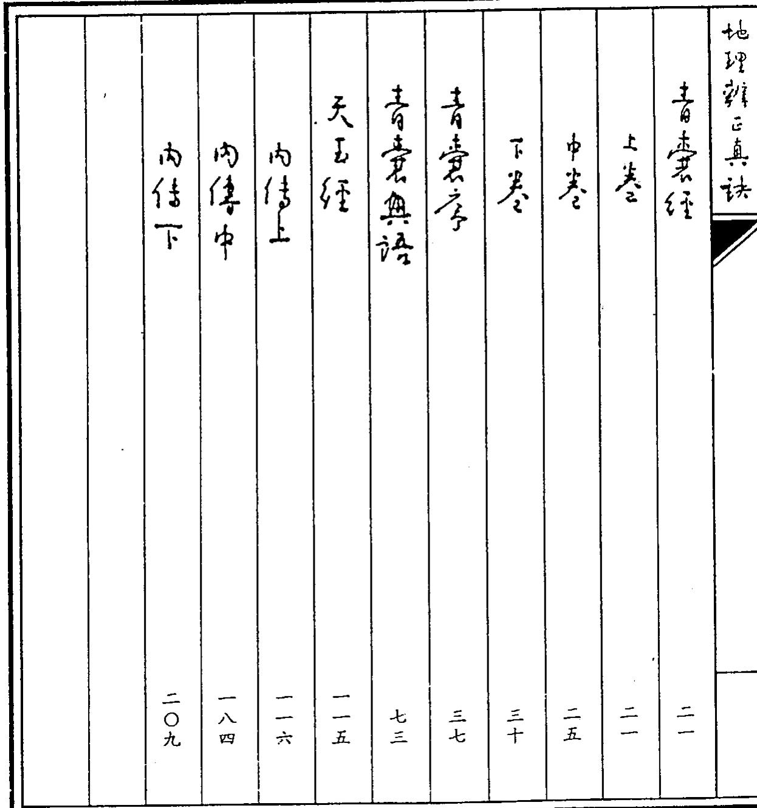
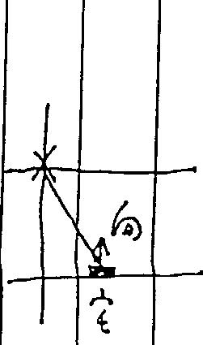
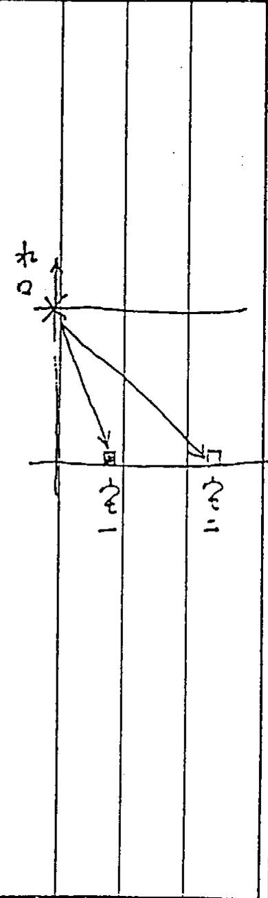

# 地理辨正真诀全集（王亭之）

> 来源：地理辨正真诀全集-王亭之.pdf

王宜之稿

# 地理辨正真诀

紫微文化服務社公地理辨正》真決王享之稿

符氏之學謂得自今桓子，而兮極子則不如仍許人也。此或存氏似許之詞亦未可知。

入門篇言三訣從娶

小序

清初府大鴻，有地仙之舉於南明时曾事唐王朱書鍵及唐王國改改服賞冠逃亡居帝辟一亂得舊予所藏言空必陽穴書也言之之與因輯玄古籍五る名地理正且自作註释由是成生言空經典。

然而府大鴻格於守秘。所以他的註解，得真訣者則視为宇字珠璣若不得決 則今头緒，祔遍翻故紙推丘不紅其所以然一甚之不如其地理辨正真读 言空三法秘委

經於是自胸臆，私心作解孰知愈求淫則去應遠故法代玄六大后一即得氏市子亦未能得其直傳而支當夏紛紜之真面目遂九故紙之間。

言以中州治汝正宗，一派相信代代字而所秘者實っ言玄空三決 8 排龍星 收山生煞 0 持此三訣讀府大鴻注 则公地理辨正諸為皆同白治

余重年隨生父紹如公習廣東玄紹如公得二生生之傳角二生生则为清末探行角近處牯丈而紹如么則排仍节。

度東室空誤以飛星為排龍而實不紅柳龍真訣復以智星为飛星但惟山出煞則得真傳且得言空家的形學即所謂巒頭之學尤重水法及平洋龍，王音之少时所習 即成其後習中州法之空的其礎。

九八六年末，送夏咸夷乃坐之三訣教授多後門人其後門人潘政諾及祥匡文即據之编美且收集王之於报立早上背表的来欄文字並詳加例解及圖表韓为公中州治玄空學三冊，於是中州法之空秘奧始多世人仰亥 學者成加推許或反以王文之皆公開私法為異八而實不知王之既己學佛且不以鼓地理辨正真法 言空三決秘要 三

分業，故實不欲更恪守一師僅待一徒之舊規不如將秘訣公開，俾業者不致心自用而誤人也

然當时所撰省習可補主者，兼且世人每誤以为中州法不講形學故午未集門人所問隨手劉記遂覺公中州派玄空學当五增三明能之讀者夏易知古人典務之精要。

一九九三年移居圗儲都一Toto多像多 於編译《富瑪法嘗書》之餘因取地理辨正 加以詳注書其精粹而父己九七年門人 阮文良亦移居圖辭都諸及學書出版經費 及寿辨《富瑪派學報之經济困辨文良乃 請工字之將所著公開俾著集經費且以陰貴 供王宜之美言老於之輕理重少以手書所 問世。名曰公地理辨正真決，名賢子 上虛語也。

小女若於夏成夷習走樂，九七年亦素图青 都數以言空如水公人設汁裝修助余望理圖 重，名成中州辰之形興子じ一寫，明女 專著問世如王則中州必且已書乃宣少 世智者有係自得直售也。

此廬曰說公地理辨正也諸為先說家之三 訣抉出其秘愚之度故名为入門。字空之 生度大訓入其門亦未必能員堂奧生入正 地理辨正真法 言空三法秘象 五 易若非有緣能得其訣則號讀破萬卷書亦 末能叩其門扉也是為序。

室空三訣夜用

抑能訣此分授地之用地之侵劣，可之可用一屬先天蓋天然自皆形極非人力所能情移。

我星訣此曾擇地後定屋向六向之用，此可隨人事安排集後天然向之物坏傍坐唯时間精移此时全變化閏係即之言 0玄时間推移「即空間

天言地賞，所以用之，未代表天。天學運仍即时間推移之象如斗稱指東為春之指每为秋，因此天即为时。

玄空即是时。此門今任何神秘

言空三法秘要

出星訣又分谷二：檢星楚星。

挨星日常用故称为正卦山向行二十四山之内，不出山，则用挨星决全盤，我仁由星盤定吉凶休咎知此山向於那一段时間公用，那一段时間不令用。

糟非常用故稱谷一變爻 。山向在二十四山之偏已得隣山之氣是則爾後 y即用替星讀以定星盤版富时精是亦稱分精卦 0

若山向怜居於丙山之分累， 或空針

不出卦为「時縫如磁針怡居壬山 t ふ山 引的交界綫

出卦るっ空針。如磁針怡在亥山も壬山之間。

時縫及空針之山向皆之用，用則大凶量座抑能亦须留音及此如恰多私山交界又出卦則的空龍百些好色永不賤錢的銷位，可能即a空從之飯

收山出勉訣用以訂全屋或墓的別制山向况定屋穴宜開陽實敝抑宜收藏為版其形則設計即宜用此訣訂。

言空三法秘要 玄空三談

挪雜訣

龍对山山起砧拿砧軍順逆两頭分，

巨存星十二，七凶王吉定朝

支義平出真龍貴須從入首說其真。

貪巨武補弼曾王去二破稱文廉為七凶 以延軍重出先回次故。 n

排龍圗分十二宮依十二支分男止十二支分地納天氣即納黃道十二富之氣故為陰。天星右旋故此十二支介右弦，即明时針方向精動。

十二空中，各納一陽，明夫P，亦即所謂雌雄陽为八干四維

ハ千即甲、乙·丙·丁、R、，壬、癸。十干中之戊己居中，故不用。

四維即乾、艮、巽、坤。此於後天卦中居四隅

國光國

十

如是八不四纵曾陽，左語，即逆时針方向桂動。

言空三法秘象 安是談

<table><tr><td rowspan=1 colspan=1></td><td rowspan=1 colspan=2>中冊</td><td rowspan=1 colspan=1>治空全學</td><td rowspan=1 colspan=2>う其大立见十州</td><td rowspan=1 colspan=2>此書只男</td><td rowspan=1 colspan=1>圓盆立用T2分</td><td rowspan=7 colspan=1>R此實播二</td></tr><tr><td rowspan=2 colspan=1>而</td><td rowspan=2 colspan=1>已</td><td rowspan=5 colspan=1></td><td rowspan=5 colspan=1>J</td><td rowspan=1 colspan=2>u</td><td rowspan=1 colspan=2>东</td><td rowspan=1 colspan=1>庚</td><td rowspan=1 colspan=1></td></tr><tr><td rowspan=4 colspan=2>打图</td><td rowspan=4 colspan=2></td><td rowspan=2 colspan=1>二学</td><td rowspan=2 colspan=1></td></tr><tr><td rowspan=3 colspan=1>賢乙</td><td rowspan=1 colspan=1>N</td></tr><tr><td rowspan=2 colspan=1>卯</td><td></td></tr><tr><td rowspan=1 colspan=1>tイwl</td><td rowspan=1 colspan=1></td></tr><tr><td rowspan=1 colspan=1>甲</td><td rowspan=1 colspan=1>会</td><td rowspan=1 colspan=1></td><td rowspan=1 colspan=1>已日</td><td rowspan=1 colspan=1></td><td rowspan=1 colspan=1></td><td rowspan=1 colspan=1>2</td><td rowspan=1 colspan=1></td><td rowspan=1 colspan=1>壬</td><td rowspan=1 colspan=1></td></tr></table>

换星

運是入中分隱陰顺逆按九官死功。不終詳見沈竹以公沈氏言空學也，及出公中州派之空以子。

大言妙無。用九，魚九分顺逆冬不同。每八卦，一卦通，躔何位落何公夫與擇各相從。陸元判吉凶山管山水

兩修路不相空。

見寅甲、巽已丙，坤申庚，乾室王，

玄空三訣秘安此十二陽順乃。

午丁未酉辛戌、子癸丑、卯乙辰，

此十二，陰逆裕

日子癸、日卯乙、曰牛丁、曰酉卒，

两相比是陰。

曰乾言、曰艮今、曰巽巳、曰坤巾

两不離， 0

曰庚甲曰馬壬此四干第陽名。

曰辰戌曰丑未此四支號筮陰

分陰陽定互仍，陰转陽陽精陰

有时陽有时陰顛之倒圍中尋。

天心換，九宫更通变化任橫行此訣著重說明二十四山陰陽

二十四山分集八卦協一卦管三山一卦中有屆陰相比者如坎卦管壬子癸三山其中子癸卯是陰而壬則

次第陽又如乾卦管戌乾亥三山其中乾定即是政陽石戊則谷策陰凡陽則順死左旋二凡陰則送死右旋。此即「陽順行 陰逆輪之意

替星

凡兼线此為陽兼陽陰兼陰則不用替星 地理辨正真诀 言空三法秘要 十五

0 此如子兼登之類。

若为陰陽互兼，如子弟壬之又或出卦弟如壬癸分劉兼玄丑州必用替星

精星只用十三星，却用贪狼甲申，用彗巨門壬卯乙世艮丙山皆砧軍巽卦三山芳武曲庚賓右弼丙星除陰逆陽順陽一位是為位是流神

如甲兼卯，或兼賓者为陰隱相兼後者为出卦東皆用積星。詳見中州治玄空此ッ下书。里說如下

如按挨星法，挨得山星為三，三为零卦， 管甲卯乙三山天之雅日卯地元龍明 甲人元龍公乙坛天元龍之山則用巨 門分精即將三改日二，入中宮忌幼。此 即伝用梦巨門壬卯乙之決

如苟地九龍伝却用貪狼邪甲中之法人元語亦依訣改三二

此中之順死逆義仍然依未改而之食為負 逆如卯用巨門精，依作曾食之天不 伝巨門之天元坤分陽收永曰此即賢中 之秘不皆說者也 0

至於旅神即如壬向，陽一位收仍日癸，此癸即为流神；又如子向隅一位逆仍多亥，此亥即日涼神。於流神方不宜見水口。

收山出煞訣

ね山宣低宜收欲宜隱歲之出紅宜通暢宜開陽此以論尾或墓穴之形制既也星定向則可接向星定恆山出然。

四莫季乙丁孔山，坤艮寅申子手間出延山頭一十四，總宜傾卸不宜欄，餘外十山谷收欽須將生氣象半關。

此即层、丸、丑、未、乙、字、丁、终、坤、艮、寅、申、子、午+2山勉向訴为收山向。

若方復筆位一則紹程情大夏設汁好山出煞收山則堂局實彥出然則堂而收欲者一必然怪大貧智易招飲不洋。此所以大廈大堂謂計之所以重要

言空三法秘要 公地理辨正直決

春來經

上卷

天尊地卑陽奇陰傷

一矣、二七同道、三八0②九友十同途開闔奇得五北生成无今冬。此言生天先天用河河盛之わ二セ少，三ハ为ホ，②九るも。五十居中的土此中一奇一男，即一局一陰五仍分佛王方即为五兆。

五兆分管春夏秋文及四立故歸天

角谷天时

八龍宏佈子母分施。

天地定位山澤通氣當风相藩れ火不相射巾五立極，制臨四方一面九，三七居立方二八四六，縱榜紀綱。

此言後天後天用清書濟書之對即今人所謂魔方降 從橫相加皆公十五。二 七 六

南九

12 三

古人重面南胡言背一面九風即可知。

洛書配後天八卦先天象天士，分天多、方。

坤兌乾

南 坎

巽零

丙國に对即始一、中二、三巽四、中为、乾、兌る、ハ九。

由生九星。一分限九、二）三碧祥存木、四帝文曲十、R寶、六白武曲金、七赤法全、.白专角、九此業右粥火 0

地理辨正真诀

此以一白白、八白、九紫，名此为な天之四吉，寸先天排於之貧巨哉補粥王吉不同先後天不可混浠。

陽以相陰陰以含陽之陽生於陰柔生於剛陰德宏濟，隱德順昌。

是故陽事陰陰育陽天依形地附氣此之謂化始 0

陰陽相濟相生先天一六即陰陽相濟故曰陽以相，陰以食陽 分天八卦成象，即陰陽柳生，此即乾坤父母生六子之意。

天分陽，氣可见，云形而。地的陰形。的派可見，旦可付有之之氣。此所以擇地須得先天之氣定向負內先天旺氣，

如之先後天柳補相成，得陰陽物生物齊之用勇獨由之力生戮日化治者言氣為帶體。

中类

經日：

天有五星·地有五行；天分星宿·地列山川氣仍於地形產於天因形察氣以立人已。

氣於天成象為五星，於地成象谷五行，而衍朔山川。故星宿有奉，山川众有书而人居天地之間唯因形察氣而立立都立巴八立城立卿立室立y協言空之此子由星伯以庶天由山川 以質地由是人紅立馬。

紫微天極太乙之御君臨四正南面而治天市東官少西掖太微南垣立方照曰極四七句經王德曾終，圍斡坤與垂光乾紀，七路握機流迪終路。

此言天之星象以明时推移非皆因 氣而成象。

星有四垣，分列四方。東日天市語，医為少微垣南為太微垣北曾此嘗徹垣訾徽面南故分君象二南曾大臣朝拱業微此即斗諸之用天府天機天明為宿東天市女民、历少微为士。

復習二十八宿，周儒道十二故稱之為經即東蒼龍七宿角氏六房心尾箕南朱雀七宿井鬼柳星張翼軫西白虎七宿奎書四卯里嘴久北之武七伯斗牛此虛虚危定壁。

五星有旦後木的象星東方春今之其德仁，火汝熒惑南方夏之，其德為辨正真读 音壹經 二七禮之土各鎮星中失，四季，其復分信全汝太白，百方，秋令，其德为義水为辰星，北方冬令，其德為。

此以五星攝五行，立五復，於是由天星衍为地之五行及人之五德，

七政即日月及五星。氣之流仍於天本參形勇则以五星之圍仍，四垣之推移二十八宿之旋動用以寵氣故贏时更替即有王仍王德之盛哀。

從德上載天光下臨陰用陽朝陽用珍應陰陽相見福祿永貞陰陽相乘禍咎踵門陰陽以相应为吉，以相乘有凶。 以日月为例常时圍乃即为相煎日語月強則为相乘。

協言空之學重在时空帕應。时分三之九臣则分二十②山。厚元之山為相應，失者曾相乘。

天之所臨，地之所盛，形止氣書萬物化生。氣感而庶鬼福及人。

之天有柔地有形上下物須而成一體，此 之謂化機 0

此言天人獻府故玄之學方非得时之生旺而己，得其生始，即澤食る用應，於是可以為福，反之，得其衰死，卯得“辨正真诀 二九氣之陰陽交乘是即芬禍

此言氣之成象武象謂之化機

下卷

無極而太極也，理會於氣氣囿於而。日月星宿剛氣上跨三山川草木子氣下凝資陽以昌用陰以戊

善極為天地系物之幸體當其宿擇巧月之时即顯谷陰陽是即为太役。至故於兮用之时则曾吾極，其起片分陰隱·此即言空如水之理則。

陰陽必有所害託經發顯其所寄即為。之故一氣而有用或用公則或用力天公陽故其氣剛其象为日月星地曰注，故其其行為未。

玄空由月星在知天时由山川草木初也形此即由陰陽之用而和时間空間之者凶六缺

抑於所格者分先天之丸即一地一穴之本質內如仍故十二官以周天賞道而每官必一陰一陽相云內在夫此っ資陽以昌，用陰以成之登。

此段說先天。

者臺經

陽復百象陰復百位。此有四狐力氣從八方外氣行形内氣止生乘风則散果水則止。「陽德，即由陽氣發擇的功能此功能即称A德 陰德同章。

陽能成象，陰則全位成分所以雖霧定位則一望而之故山川形努草木風哀，即曾陽德；而山水之氣未如仁乗納，见汝陰德

由陽陰由名氣此即形義麗分主故玄空小只講理氣富亦重經致其大廈如何分佛即是山形之幼這如何き你，即是水热。古人稱此法为，平洋龍凡平洋龍一水重於山坎街道走向及分常实即形此子當名文詳說。

地力四語者陽赤陰陽中省诊陰中宿 陽於排語即公陽入陽出陰入陰出 陽入陰出之陰入陽出。

何謂陽入陽出？未語为陽穴向亦陽。何謂陰入陰出？未於分陰穴向亦陰。何謂陽入陰出之未龍為陽穴向曾陰。何謂陰入陽出？未龍日陰六向为陽ね二十四山即成四十八。

氣從八方者謂八卦八食，即東南臣北等以辨正真诀 音秦經 三三四正，及東南東北八西南為北等四隅。八方之氣，其生旺界死隨时变易。

四想八方，散則日外氣，僅見其形而不紅其生死。若能乘氣納氣。則氣聚而不散是为內氣故陽宅重納氣而陰宅則重乘氣得氣止即是氣聚能得氣聚則有生機。辦得衰死之氣而総百精日生旺之一日，故实優於氣散。

何以紅氣之聚散？訣曰乘風則散界水則止。此所以水口印汝聚之若以谷氣必聚於山宵殆不初山公反不聚氣。故顺互北，用八卦排六甲，佈八門，推王逢人王六明地德三人道之因變化後始此之謂化成

順五乃之氣，即順王北。用經天八卦定九會即用八卦排六甲以定元軍如一四七起甲子午二五八起ゆ巾十三六九運起甲戊壬亭即是僧八門即佈星於八以常其得生旺衰死之氣推五運以五達者歲定六氣以六氣交转以定今之由之时三皆者，

中州派之空以水星節精 择日用 配会午、山、向、盤中之生五六氣九

此美說氣之功能即名之为化成，成者。即其功也。

抄公青任三卷，分言氣之性、相、用志佛分詳一切法皆言性相用柏內故紅壽实奇当時屈試傳未佛家學說有癸且貧狼學九曰生之名亦由西誠佳ま因知当日中會清屈域凡化交流，義令言空之此得而坐富。

本篇分曾求己所若曾氏传为揚芮公第

子公春若序約主上六在依公有經之如義理一解說陰陽之用，白說排龍馬族星未說替星紅其決者即知本篇實全召珠璣唯未得法則讀之必入五里霧中。

楊公差言老看雌雄天下諸書對不同

診幸 則稱公陰陽二陰陽 一起功用 即为仪天 ，故稱之为 h 作 分别·

「美」為叫雄生旺之时老則为陰

陽衰死之时

蓋陰陽起用，百厉極陽一起用曰盛一起用为衰，皆隨时問執移而更聲經如未未八運，八白为旺星，九此为未素之生氣生一交九则八的已限氣而紫则乘旺。

又以排龍而言七運排得金龍尚未十分哀敗以七赤分旺星故，但一至的運必凡禍殃以七赤破軍金已退義故。

玄空以盛衰多化而視雌都之生死馬但言密頭而不知理氣者固不同南言理氣而不知玄空三訣者亦不同故曰天下諸

書對不同

蔣大鴻註此為句時說：「然其中秘客催有看雌雄之一法此外更他去。足见對看雌雄之鄭重。

他又說：夫，地理之書汗牛充棟獨此一法不年之於先口口相，世一生美自管輅一郭漢一以來古今知者不能幾人。

化還坦白地說：既非聰明智巧可行附則 又出多宏臨博物所得與聞今者一言立虎 不初者累牘難明若欲向書卷中求之 負河漢矣由和言空正集佳在得決 地理辨正真诀 辨正真诀 三九

得訣後一點即明一即所謂一言立曉）至則妄事精測去直必遠，如言六大派辦門弟子甚，不過吉热浩大而己，結果唯有說各師冬法

先看全龍動不動次空血脈證來龍。

看雌雄 之法即先者金能次察血脈其會亦是排能法。

古人建誠建村式營宅營養必先擇地，經後定向崇造不似今人，宅墓已成然後我人看风水。

擇地之法先看金龍。動即為陰陽相垂應則如夫婦生生不息不動即为陰陽相乘乘則交互侵定誰是則为假夫歸假則女然毫生戮。

金龍 者即所謂百一節它六所在地位，必有入旨 」即城官都邑直直巾可弁心入如士路鞋入榜路此大路係即之入當 J

傳更精聖亦視寶如帝不境而定則徑在成路在門當五過，附近一分支街道一，引負由鄂正真法 青春之

形法判斷吉凶此則须分詳非本文所可包括。

有生氣謂之動。排龍得五吉，而所擇之地又有向可取，期的動矣。勇則便为不動。M以同一街道，宅皆同向，而旁凶互異此實由於全龍有劲有不動之故。

「穴血脈者乃由水認山，由血脈說來龍觀穴主山形水努並非血脉。故氏直斥之云：知血脈之未自何方即可認龍之來自何方矣。此楊公看雌雄之秘訣而非世人倒杖步學之死格局也 0L

然將氏實亦未洩秘其实雍血脈以

認來龍 即是由水口以定來龍來龍吾形界水而止足故佳由水認龍治得真矣此即所謂水之山家血垢清

換言之龍唯是氣無形可而界小」則百形故由百形以無形是为穴血脉而來能

龍分两片陰陽取中对三义細認陰

莊大鴻註此段最皆洩霜幼，結云：兩片即毗雄。陰在此則陽必在徃兩路用求母。 此即是說山龍好水務山龍分陽如形賢可見，惟聚气而己，水龍為陰有形質可象，故水即可如是謂「龍分兩片陰陽取亦即將氏陰在此，則隱必在得之貴是他抑偏多說一句為路相交卯又令人迷惑不幻山而水之陰陽如何相交

水之对官後卯是山胡宜說 hu 才ヌ L龍对山山起破軍

始下句即緊接云，「れ討三义細認陰」，此已明言要看三文水口以辨書龍

府氏又云：三即後誠門界れ合虞必有三文，細踪即血所以說未龍也知三义之在何方則知未龍之保何脉矣。此段亦已明言由三之水口以室未龍不过

水未者說明水之对方即是山。江南龍來江北於江西龍去望江東

此公青書序明說水龍对面即山故江 南水口，气吉脉则在对面江此之江西九口， 氣肺結在江東將氏之： 以有形之陰賢 求形之陽氣甚之。

之以王人卜河洛間二如六華高其る親流泉卜午卜世公都宮。

周公遷都治陽不說華為脉終如何但闕注澗二水相交由是可証水以諸龍非似後世堪與字之近山尋龍也。

而己足以證午世之興旺，會關乎水。卜宅、卜都，以至定官室，都同此法，故曰っ卜年卜世宅都宫

晋世景純佳此術演經立義出言空朱存設原生明氣一一講說開暑。

此說晉郭讀得傳此術和公吉來經之 要乃發揚言空之義。然今世佳公葬經 ，則吾非託名之作。

依晉書，郭漢門人趙載嘗竊其所歲公若經後其書贊，则今之公者來若又未紅求新璞得者物司否。

古人建空·都官、差，皆以面南为贵所以便院「集蟲昏厚 朱花為南方，背

發源須得生旺之氣，此芬先復天之而合。所以殆文曲龍於一四七尚非全凶而武曲左補石乃十一四七則未福反而貧狼龍可谷。

未來八運宣二里臣門龍、八白左輔龍火形之宅見五氣贞龍易怡火二丙H。

是學此對例即初昏源生狂之文先天排龍本體後天生理为功用，經用不能相

一生二3二生三，三生省物王玄關。山答山八3水管水此是陰陽石待言。

求大鴻云：「陰陽之妙用招於一。有一爻即官三爻有一卦即省三卦协曰一生二二生三此天地之玄開夕勇ね生生之夾鑰也此說弄聞五此言非說由來龍即得合穴之坐山由坐山自經得向水下即孫之山山、れ水。

此廣符ん又云：っ山之陰陽而水水之陰陽此上又故文金混矣則山之陰陽指先天排能之陰陽之水之陰陽則猜後天安星之陰陽，二者順從不同，即所谓 倒 7 顛倒識得陰陽玄妙理知其衰旺與生死。不苟上與來如但達死氣皆參权

此反說明，坐山迎來如不司。

來巾即後一た，W先天卯臨；坐山金片，即後天象星。

來水与來誰為一对；坐山與句卜為一寸。必須如是始刻雄而不昆孔。至王死一皆隨後天元運而定。

时州，如七之ホキる

先天羅經十二支後天再用干與維八干四維辅支位子母公孫同此推。

若以為言一經文字是說堪與罷經則可謂全同廢話然而却須注意他明明上出先天\_青從天售有此種分別。故大鴻之：此以即非言罷經制造之法美將羅經主指雌雄交滿之言。

幸節寶說排龍

排龍分十二言即先天貴道十二由子至玄書用地支然而用於之时生天之體即不足其用，蓋純用地支，則有陰而喜陽於王加以八千四輔助地土，由是陰陽得用可成生生不息之機。故曰王母公孫同此從。

將氏云：「卦分之母，而二十四陽曾之子焉。卦为公而二十四路为之係焉。乃故意沿清祝淺其實吾非況由宋臨龍得向而已益未治即言坐山可坐山则亡向巾，一旦百此，即生見不之，故曰谷子母公孫，不父鮮实，汤为子孰谷母孰A，訊分孫也

二十四山分顺逆，共成四十百八分，旦分即在此中分祖宗却從陰陽出。

青當序

陽從左邊團隸陰從右路转相通有人識得陰陽者行愁士地不相達。

四十八局一四混治其實銀簡筆排龍有二十四山，伝之取向-用陰用陽如是即成四十八局。

如子多排龍之山若擇地六用卯為陰入陰出 以子在先天为陰，卯在公天亦多也。

若子能擇地穴用寶別日陰入陽出以子在先天为陰而賓名紱天則分陽也如之一龍成二名二十四語即成四十八局。

山龍依星，星有五仍·故山龍侯亦力五沙如曾食狼龍先天貪狼集木故此能即以は的體や之即分来語为五行。

按一生天之氣分狼土、臣門土、徐存土 文曲水、儀贞火、武曲金、限全、左 輔土右弼土或云右粥金

弦天之用寶狼水、巨門土、祥存木、文 曲木廉貞土、破軍全、武曲全、左輔土 、右粥火。

先役天之五仍不同。先天的體·仪天为用故排龍看先天王沙妻星用天之今。然而無論先後天五行，皆為陰陽之用而隆地理辨正真诀 辨正真诀 1 五三

擇，故曰祖言都從陰陽出

然則陰陽如何起用？則指示其左旋右族之法。左逆即逆时針方向，右詳即順时行方向，此故先天陰陽转動之法，未你天不內，此众言經分之大秘氣。胡郑重而言之曰：有人識得陰陽者，何然大地不相逢此實己說，此中陰陽秘魯難知。

陽山陽向水流陽執定此說甚荒書陰山陰向私流陰，笑殺拘泥都一般。若能勘砂其中理妙用本未一體陰陽相見風谷郑一山一十何足言。

世傳淨陰淨陽法，拘泥宇義禮是為的陽龍得山陽水陰龍陰山陰也，此實不知兮

如是取一山一水，寓不淺食る自见之少用 經則巧謂陰陽朝凡？

存大鸿云「言空大卦，一山不分一山之陰陽西論與此山相見之陰陽一水不益一水之陰陽而論與此水相見之今陽。

此實言先天排龍与復天立向相会，即為舍陽相見。

如取巨門能为去龍矣但於一四七室中 则未得用，俏更用午山子向於七軍中 双七到向来龍之氣未解直入中官， 地理辨正真读 好正真诀

星挨排，二多中官山星，僅信後天，不足先天，故龍吉亦每用也，是尚未能称谷得见。若於八則來龍之氣直入中宫，然經与經天挨星成三般卦，如是怕谷陰陽A。

切氏弟子告心道人之： 此陰陽，以來者为陽，往者为陰。當令者日陽失運者为陰。生者多陽死者谷陰，非世所謂左旋右轉也亦非以山若陰而水日陽也 5又れ以红字外陽，里全为陰也。又非以干屬陽支集陰也此閩一破勇卷背棗，卯丝入扣矣。

二十四山雙之起，少有时卯通此義。五仍分帘二十四，時師此訣修曾记。

挪龍十二官每官两山一陰一陽切曰 二十四山倣々起此已明言排滄秘遙 切府大鴻云：而其巾實有奧秋惟得 秘讀者乃能通之，时師但從卷中修幸， 必不得之數也。蘇氏弟曰必心道人僅浦 光说： 其秘當在侧二室之內

今將排龍訣公闭直已沖書之空精筆前於門人韓錄之公中州派言空學之中省省未尽之義今將隨文說及智者得決少为福世人，勿但國私利。

山上龍神不下水，水柔龍神不上山，用此量山與步中，百里江山一的間。

山上龍神內排龍水裏龍神即定向委星。二者先後天不同博自然冬不相開均將大鸿云：此即上文山管山水管水之義而重言以漢美之。

蔣氏之註，一直不皆監破，故讀者仍易誤書所謂山れの指出星之坐山興向水。沈竹禍以言師之尊子亦未能劭此秘魯故以及下九釋之，足见前人之守秘。雖智者亦不得解

俗師尋龍走通千山萬水若識州龍奇安星之別，则何須奔走追尋耶，如曰っる里江山一晌間 L

然存氏第子世心道人却云：所謂龍神非來龍來脈之龍神足星生旺之龍神山上族得生旺之龍神謂之芽著龍神当代發水裏 得生順之龍神謂之葬者天公於便山自谷山，水自的わ不相假借也。此即有意含混，沈氏可能即受其誤道。

排能之生旺，依損星生旺之三般卦。如貪狼龍於一四七運生旺故可含混而言：之挨星生之龍神れ柔龍神即埃星直辨正真读 五九生旺全伝「天心 ，ぬ七運之っ天心」七八生旺自出亦为七赤破軍，此即符着天心發出隆 1°

更有浮陰淨陽法富復八尺不宜雜。斜正受來 陰陽兩氣乘生旺方無煞來山起頂須要紅 三節四節不須拘，只要龍神得生旺陰陽卻與 穴中殊。

此淨陰治陽法亦为定空秘魯。

IN 此涕陰渾陽 aるる 水流陽之淨陰謹陽也 2 蓋龍脉從一卦來 0 由是己異作透露

其實此無小說排龍十二官中一卦純清者僅得六宮即子辰亦申哉泠王卯巳未酉實六官則必出卦。然而此却非謂僅有六會可用於用王卯等官附不兼綫即可而子山夏六官則可見錢

所謂前後八尺即量度排龍时須在它穴正中且此中心監而後八尺一仍得來役正綫然徐始能謂之淨。龍為陰則为淨陰如十二支龍龍分陽則若淨陽如八干四維龍

地理辨正真诀 辨三真诀

現代大度，須成幢量度抑龍，不宜僅在一大廈軍位中帝度若大復第陰淨陽向水六一又去則祖隆大曆得益軍位之去凶則僅在於是否能承接生旺之氣。

言斜正受來者即說排龍後之選向。或正或斜今非指向水赤來龍之相对角座分以圗明之。

取向以氣乘生旺分吉此則須論後天安星說來山起頂最近它孝六基之水口对方說っ三第四節不須狗明此非如俗師之遍山追哥龍脉。

言只愛龍神得生旺陰陽切好穴中殊則己點耐抑龍之陰陽不同安星之陰陽訣者一看侯明

天上星辰仙鐵罷水交三八至相過水發城門 須要會卻如湖暑雁交爹。

蔣大鴻注本節云： 此以天象之經緯，明 九法之交夏。列星分布周天而每七政以六 錯其乎則乾道不戊而四时失紀矣。 んそ 水流行地中而無支流以界割其際，別此氣 不收，而立穴喜坊矣。

此已傾相授己明說幹流奇支流交会之水口即的來龍所对。蓋前己說明，氣界地理辨三真读 4三真读 六三

水而上，是故二水交有處即是收氣之度故其对面即可乘納其氣是即山龍

得氏又言：「故二十四山之水其間必有交道相過，生後血服真而金龍動。大韓小支，兩水相會合成三文石出，所謂城門者是也 L

是知三又水即城門，沈竹初之仍謂城門決別非此城門去非見水光而己。現代大廈枯立之城市兩路光之上富即次氏之城門，然却非言空古法之城門 0

府氏復云：湖裏雁交稽言一小從左來，一水從右去两水相遇，如發雁之一往一來也 此說允當。

高貴貧賤在水神水是山家血脈精山靜水動書夜定水主財深山人丁。

此上慶說「水神 乃播向水而言。向水得來山之精華故謂水是山富血脈精

然而何謂山靜水動書夜定？來龍向水馬畫復富有何關此則諸家註释皆所未言蓋不知義即難推测 0.

言空以先天为时，以天为空，此即一間之生旺，隨时間推移而化。又以先天为山龍，後天为向水是即先後天之體用一一靜一動靜者分體動者用。此體辦正真法一 六五 六五用伝時而定，協喻之明書夜定 而来龍吉則人丁吉向巾去則財祿吉。

今时頌水師但如 如主財梁山人了 却誤以若指向水与坐山實不朝り指向水志山龍夕幸而今日人人皆以張財为主，不求丁旺故此筆尚未大誤，若報彼筆開村達邑，则必人丁微，且不發越 J

又所謂山主人丁寶僅說人丁多全人口是否平安己否開心亦來山之系公聞若來龍者必室多之非，骨由乖

此庸特系點破以免俗師誤畫蒼生。

乾坤艮巽辨御街，四大尊神在內排。生尅須览互仍佈識天機玄妙產乾坤良巽水長流去神生入宜を官。

得大鸿註幸節时故令混但言： 乾坤昆巽各百衰旺生死须用五行辨其生过生即生，尅则衰死之生为吉神死为凶要在言空士卦故云天催定少也。

其弟子字心道人更誤道云：四大尊神为寫街生死

實質此以子年卯酉四正向能为例，则乾帥良巽必排得巨武輔弼四吉神此为四大神在內柳之本意。

然则又如何論五げ生尅？此則之論龍之生旺衰死七達破宰得令之故右弼龍即分龍尅運星主退財至吉神仍未吉也此此一例訴例可批。

又，誰尅星主退財星尅龍州报二一此又分言空秘訣。故七運不利今會龍而向れ坐山

請驗一家舊日墳十墳葬下九讀貧唯有一墳能公一去水來山書公情。

十墳埋葬一地，則坐山向水全同何以僅得一墳昏福此即奇排龍有陰。

猶之乎城市同一纵道同一坐向之高方 何以僅三對兮生意鼎戲，甚至比鄰無有衰 旺之別此即排龍不同之故

余於圗靡都為弟子勘宅八小曲若子門人阮文良再三發勘柳龍以去凶僅差一變既畢告金書少謂弟子曰：隔壁必者凶喪災厄弟子領當謂此安三年前尚甚興旺唯三午滿，該它主長子全身剛煥两年前它主歸忽然病也人午则宅主入医院錫大手微，截3一肢

此內龍乎視福之例不可畏。

吉書序全為实說排龍以玄空排於之地理辨正真诀 雖三真读 六九詩一糾王俗師遍山尊於之謬蓋幼子但知後天之形，而不私先天之卦胡空州過少，勞而世功。

唯今时玄空之與子，忽然治没偶和揆星即出而乃道是欺世追名且邊視主福生不知先天，而經天每僅知一二八此當足以說言全耶。

之唯重先天不講先天則经後天矣二此所《者事序必先說先天。

言親幸是陰陽言得四失六難弟主三才六達雖为妙得三失五曾偏。盖因一仍捨外國逆把王仍顛倒編 以能傳訛竟不明所以禍誦将註云： 「此節旁引世俗五行之謬，以見地理之道，惟有言空大卦看雌雄之法，所以尊師傳戚後學也。

蓋唐以後諸家王行新亂而出，將以授外國而安以禍中華至今以訛传訛流壽萬世曾公所以辨之淫切也歟。

所謂得三失王，得回失六者非書之 謂也。 L

唐时高勾醒內巾厚請售瓜水傲一行於是乃緬俗微戊書，佳之國外，故弓一行援地理辨正真诀 辦正真诀 七一外國。 然此信聞未必可信。

本篇倩若唐代言空言師楊筠松樓所述皆為言空關鍵

關頭所說，為聲星之法盖安星法中挨星世人多曉，凡習言，每人不識九宮挨星唯聲星之法，用於兼綫俗多未能識，協学述之也

即た今日，沈氏言空已得彗星之訣却仍未紅兼殘育聲背替於是凡魚綫一律替卦安星，沿之者乃致誤，足知此法州有真訣实說麼用。

度可視的說尽言空秘，獨於抑龍当未細說故合公青事唐》，此两篇徑曲实已法蓋言空之通兮來。

壬乙巨門從頭生；艮为卒，位々是軍巽层亥書是武曲位甲癸卒言狼一路仍。謹氏羊子美堯及無心道人甫，於注此即时一味擴實如之：貪巨係文武生清弼一一挨去，故曰揆星。一此則可謂有為誤善。若宗秘可以不だ，若說，則至少亦不可誤道後人，故府氏弟子可謂更不如乃師蓋大鴻守秘當未故意誤導也0

美堯復云：「此九星，與八官堂诀九星不同唐使僧一紅作卦例以擔外國專取貪巨武为三去，其實非也。此不過偶一流

然而其說「只足天地流乃之妙與時相合者去，與時相北者凶故九星八卦本之有吉而力時乎吉，本善有凶而有时乎凶，切其中力趨之避真機妙用全须秘客耳，此则實明言空要義未可視曾泛泛設說1而執定基扑去、某卦凶基生常、基星凶者此派定必不知直訣。

楊節松說替星，此四句會未尽說，二十四地理辨正真读 青書與語 七五山只說十二山而其中且百不必用替星者如坤壬乙」之坤卯不用替，反而 57山用彗巨門，邦偏不說難怪後人仍之猜測冬哉一說西之空涼派亦由是河，只能詳多「各師各法

存氏秘傳姜克的口訣云：一子明並甲申贪狼一路乃；壬卯乙未坤王位為巨門之乾室辰巽已，達戌武曲名八酉辛世艮丙天星說破筆寶午庚丁上右弼田星院。李山星作主，翻向逐文行二廉貞躲五位諸是順運輪。凶吉隨时轉貪輪不用論更有先贤訣，空位是流神，翻向亂除而中口不宜一星不去禍起至滅門運旺星之吉，百福又千禎。衰旺多張水槎衡也在星水星兼先斷妙用更通望。L此決應为荐氏自撰，以其更才先明決」一句い可

府訣全說二十四山根本每二十四山皆用精星之理。此秘魯己由沈外初砂解將氏和客已洩，唯沈氏則仍未知全部彗星秘參故卦內陽義陽，陰兼陰朝仍用勢。主改幸門所係口法極可能切足方語存氏每朴據之自撰丙已。

幸門決云）

地理辨正真读青帝與語

精星只用十三星印用倉狼配甲申；用指巨門壬卯乙八丑艮丙山皆砧，巽卦三山彗武曲庚有右粥兩星臨陰逆陽順陽一位，是为空位是流神。

此訣指出っ流神，內为存氏之所本但恭白诀却易令人誤今，智是之一诀流神別是一決實習唯用龍星时始是流神，以其即喜彗可用的空位協幸門訣法，己包晟精星一切且具公實用價值。

左谷陽，五癸至亥二右陰，午丁至巳届此訣令人誤辭左註右旋，分陰為陽，會則非之。

胡美克注云：「自子至壬，自子至为， みっ路嘗陽路之有陰以此为例，須人自悟，明狗之左道为陽一右星为。

又畧作進鑫曰：若陰在左達則陽又在右矣亦可云左右尔可云東屈、亦云常經亦可云南北皆不正之位。湖訛憐非孔法，日言之。

此節其实非說精星說捌龍。切左右陰陽千方袱解須得決者方紅。

排龍子癸·水口必在对方年丁 此所以 子癸为陽时年丁必汝陰。此以來然为陽 、れ口为陰也定故即可說公っ左る， 地理辨正真法 外正真读 青書無語 七九

右为陰 。而從前分陽後若陰二東的陽，西为论尔世不可。

金心道人章甫註之：一若陽在子賀陰必在午つ陽在午丁陰必在子天。此己有所沙露，但仍非明指而己。

雌與雄交分会言空雄与雌玄空卦內推此說先天排龍馬復天妻星。

雌志雄是說排龍即水口与來龍之交倉从与瞰之說出星，即坐山山向小之推批。

言甫之：須知氣有一定之氣而用今一 定之用也。此已沖秘，一定之氣即相禍

全若皆著千於法一行之小逛本卦例伪。

之氣之世一全之用，即依龍有以定向，其向いな一定。

前人於此等虛守秘必唯知讀者始能明其糾說義理至則之必茫然若更尋書列聰明推測定世迷路玄令門派枝黨紛經'的此之ね。

山與水須夏明此理水與山禍福書相閩。山與れ仍指排龍水山別指每。

切んぅ： 山省山之卦氣，有水之卦

明玄空，在王行中。知此法，不须尊納甲。 幼甲留僧一行所造卦例·以乾納甲壬學推 地理辨正真诀 青意與語 八一 排於明代当+分流仍故唐代时庚日公 水主流，暢公由是特筆開之。

字氏云：1 八卦九星本善有山，不分则凶八本無有去会時則吉如此則矣它之興桑瞭然矣，何必尊乾晉甲之法乎。 」此說其吧。

朝例二十四山百諸寶二順逆仍二十四山有火坑。

此慶說顛之例 ，乃言排能之陰陽南安星之陰陽不同，如安星以癸的陰而排龍則以分陽，故之期例

且排能馬安星之順逆尔不同。相龍陽者逆時針精一陰者明时針精，安星则陽者顺死，陰者逆品故其「順逆行無不也美ん註曰： 山山皆有玉，山川皆百少坑。 已明點出为山川 己明點出之說坐山向水。此種時筆真如美氏M之 非真得青棗之秘，何以能辨之乎。

語全於一行一律氣不同動不動直待寫人強妙用

金龍，即先天直陽之氣以乾为天，乾又为金，故喻來能生天之氣为全作。

本體既得，当須強用，此即為定向挨星。如何定得去向，即令之告能得其用切用即動不用即不動此虜之明說生排龍紛族是定向之理。

下文說玄十法即由本節皆論 故說體用

第一義要滅龍身行志止

龍州六是先天陽氣氣沿水而行界水而止，此即「龍身仍南止

风兩山之間必有水陽氣非止於山实止於界水之虞此所以三文界水之对方即未尔可反而言之，两水相交虚，即为先天陽氣所止之废，而厥水之間必有山高一寸W为山，日之则此山即为乘虱之地。

明乎此，即和何謂龍身之仍奇止若以巒頸之術解釋於是高山尋龍且持乃持杖尋龍但認地形起伏是不和龍身仍止之義。

今首る即說っ能身即明言之此以抑誰曾先。

第二言來脈明堂不百偏。

擇明坐須能領納來龍之氣。不可偏非說龍氣只能正面而受若如是，則一龍僅有一向一是則僅有先天而每後天明堂五氣，可斜可正即斜正受來陰陽附。其所謂不可緣 即當說方後八尺不宜辨 \_之音雜則为偏

此說由抑龍而擇地

第三法，傳送功曹不宜壓

傳送以申之別名，功曹乃寶之別名若之子山年向左青龍經甲卯乙三山而路端於實之右白店經寶酉肩三山而止鬼於申故借傳送功易之名，以說兩边砂手美老日： 傳送功夢B左右護龍星言。也。

又云：「蓋真始起頂必高於護砂の正 結若左右護星反壓本山非龍體之正矣 0

復云：一平地亦經貼身左右有高地掩鼓 陽私房分不利，俗微所不覺也 L

足知言空非不講巒頭府大鴻亦佳變頭ね心道人甫著有公心昭指要其中亦述壇頭此書清代取實用之言空著作初訣者即紅為字公珠璣形理兼察將來當詳註此書以傳後世如是即可滿主公地理辨正真读 辨正真诀 者常與語 八七地理辦正也重理氣而少說戀頭之偏。至於俗師，復好公地理辦正諸篇，用巒弱之法解之，則直可謂之。

第四奇，明当十字官言微

由挪龍而擇地既形氣兼參於之乃可定坐山向水，此即所謂「明坐十字。

妻克之：+字玄微り裁穴向之法。」且。

又弓：「云明当，實從穴星内看十字，明此十字，則穴之上下左右向之偽王饒滅書於此矣。

此印俗佳龍砂れ穴之法見國。

右砂

左砂

此即之由六星内看十字，小在六上挨星也。

章甫注云：在未立穴以前先者四自賣形八方氣攜次看來山來中今可封之生旺再看内堂外生，考来止限之方，入則知穴之宜左宜右宜前宜，自多一不可移之穴，自多一定不可多易之向。L此直可謂全诚生書彼之心限要

即詳說及此。

一定不可移即天然形勢余當謂門人言，风水即之自然凡造作則去言空之逆甚達即是此·當見俗師教人門頂安七盞燈九蓋燈設色紅差九條灸一里八紅，此学造作能說是各佛务法

第五抄方紛青龍丙相照。

沈故初知青龍为啞證但切猜为青龍印生旺之氣，物動猜錯3°

美表之：「前經青龍為相照從書掘龍虎定穴法者，此義易新。 那是猜中3啞誰却不肯說生。章仲山云： 細看前綫左右若托，環抱開面，相向有情苟照两相照者八方相照有情也抑是切言誤道。實所前限者龍乃指抑龍之先天陽龍一坐山之山龍，此吉經頭形努訓有關，实在主奚仍为生旺，系龍志山龍均生旺，则为相照一天口

如子山未龍，立乾穴为龍來生穴即巨門土生乾全。然於七逢之中未龍退氣此則須於乾卦三山中我尋補輕，于是须核星或取戌龍為山，言龍的九。或取乾龍辨正真读 青意與語 九一

芬山，巽龍为水，此須斟酌实際形桴兩裁能用则为相照吾法可用則为不相以。故本節所言乃抑龍及定向分之檢核必須陽語陰龍皆生姓者始的吉穴。

第六秘八國城門鎖正氣。

章仲山論城門甚为特當。其言曰：「城門二字，最難拘得。水字水之城門，山有山之城門。

7れ之城門，有三义以三义A城門，今三文以水之照六有情盧為城門。亦有以來產曾誠門，亦有以去口曾城門總以有權有力上的。

7 山之城門 以入首東氣產曾城門，或以過峽起頂虛茲城門無有以誓去未脈，即以某度為誠門

「平原平陽以支浜界氣為城門或以低困界水止度为城門

然而城門卜論形凡八國室廣須得秦

然州何謂得氣美堯曰：蓋城門通正氣之出入而八國鎖之，觀其鎖定之方象知是何卦之正氣，以淵哀旺而定帝凶也。此說良之。

関於「城 L 門人淫玫諾己詳細舉例 地理辨正真诀 青書與語 九三 於中州法玄空學今學例男說。

如一翟寶山乾向，子多缺口ゆ光之處。

7 3 5 1 6 9 8 4

其式如次

4 5 2 6 1 7 8 3

一白旺星恰能義至坎官是方城門可用此方独缺而藏正氣故其八官即能鎖

定此正氣內用。

第七且向天心学十道。

反而註其所註的章仲山才說： 十送即天卦之+，非地卦之十道也。地卦之十道，一九、二八、三七、四六）人人幼之，何云奥。 L和此「会十」炫分十道。故此即己不再論先天每不論形推，但伝穴之坐山向水揆至令其尺主尽切氏云：天十道是用法之至美者也 0

第八裁星曲流神認吉來

言日：水神以曲为吉然力此度来別去彼虜系則凶者，其中須有裁底。

水有三足：直寬、反弓、割腳·此即洗竹初之所謂不禮面不謂胸不斜み不直冲 。姓播公之所謂流神者则又不？但言來水形揚了此係統言空分之水法而言寧仲山於《心眼指夏中豬一批震，未尽幼說此卯因れ陰氣一節。

之言之顏從未未見吾者者暇当易詳 言其秘

第九神任他平地與者。

平地白大都邑之平漢龍書雲即指山寶群立之地”持言皇訣以尋它穴，知論高出平地其理一级 0

第十真若百一緒真情。

卒氏云：平地青雲即高山平洋夏山 平洋其周則一十真者龍穴涼水鬼翟 朝對虞之環經朝拱更兼山得山之用法 ，水得水之用法，此即謂十真。

或體物而用不能全合，或用得而體少，有偏側反跳之形總謂之缺。

又郑重る言之曰： 以上十第總以龍真穴的為孕。龍果真，穴果的，上自公止，行自有行，自有明堂，自富功崇，自習傳地理辨正真诀 辨三真诀 青意與語 九七送，自百+字，自有城門，左右自然照應，流神自然星曲。如龍穴一有不的外面空習萬重山，印此謂也

尊氏之言甚之凡龍直穴的今論宅其墓基，必得天然形努。外努改变而称为德风水 者世非抑能己改耳。

總此十訣由抑龍送地·安星定向、斟酌所定之向其地形可不五用顯言如語砂如何流神如何己說定它至舉穴之法所未說者唯「收山出絲\_法而色，

然而細容明坐護砂流神，此已暗秀收山出煞言機出然則不且憂陰抱太甚而改明坐狹窄，收山则不宜住曲法神对射，跳生曲而射亦嫌收山收不尽然而天然形热每多時分恨山出紅所須注意者，僅為後天建造形制る己。

明例杖卦坐陰陽仍必些。識掌模太但分別有圖。

此專說高山寶致俗師尋龍監穴專電外势·於之賀 十二例杖法 以骨度來龍又富陽山陽向陽流水之淨陰淨陽泣。此盧專闢之

排龍周掌決即如業微斗新之由上起十 青書與語 九九

二，是為「堂挨」 若知掌上郴龍之法則此陰陽言備之太極一實非係所之浮淨陽太極山

此庸專的闢證。

紅化氧·生尅制化須熟記。

此臺化氣 指天地化育之氣化者，生化者，皆天地生機。

然此天地之化械於用时，隨时門交哉而至現谷作之功能即表为五仍之用。明有五乃別者生尅制化之用而外後天人事安排凡水師所能左右者僅為內六事佈置，故怕明生尅制化不可，否則侯是自

欺人

今日俗師動執教人差鱼掛鏡裝隆 門頂燈九蓋門楣橫色紅蓋鱼七陰一甚至 規定於內差掛里边鈴其尤星者別的 私人用风扇吹起七條或九修紅然帶，上 帶九舍止若，諸如此類反而哉自一时分 王真可共失善

彼學亦之·種造作即生尅制化 然此真生轻制化卯？

生尅制化分經天功用，必先天配公能後始能見功。故同日双七到向之分於七中破龍赤巨門龍之宅穴其曰七之生辨三真读 青意無語 一〇一尅制化即不同。軍證考級洩金氣巨門龍者須令巨門土能生破軍全，此曾原則一焉有下篇一律臺鱼裝燈掛錢之理。

說五星方圓尖秀夏分明。

土形方，水形圓，火形尖，木形秀。丝此不過興例而言。言空不所传，宅力宅形葛有墓形，地有地形，水有れ列，山有山形H方圓尖秀四穴所可包器此な不过隨立提及八並州細說，其音無說宅春山水皆須分別五星之形而已。理氣號佳形每须。

曉高低一是聲須辨得室微。

「傳送比馨不相壓一 ， 「曉高低 0孚氏云： 星峯在旺方宜為亥方宜氏是橋曾之直訣。此注十分重曆。所以左右護砂或身於本山須其能令幸山乘王則高亦今防今城市大曆枯立低者亦可俗身者之氣此須學例詳說官於流玄空家經頭时說及此外心限指勇中亦有異說至於如何借氣则度氏之： 须宜得宜度之五行低慶得低之王玄徹者各自得宜也。此即俗氣之決今於此累學一例

香港「中銀大廈建成四園尖角尖得， 理辨正真读 一〇三 於是群論謹然，謂其为凶鮑。殊不紅此为 金形宅於七運生旺若能於其巽方受氣 ，則能得乾方生旺之氣來，倘更建的水形 之它，則土全小輕转相生，是能借氣也 此即曉高低辨玄微之謂。

鬼奇曜生死夫來真要妙

鬼即凶星，限为吉星抑龍中今夏巨武補弼五去，即稱为曜 八破孫文氟为七凶，印为鬼 鬼为死-限分生，故云然而鬼懼亦有衰旺旺者宜未寡者宜考。故七運用破能尚五旺者宜未也於八運則做軍龍絕不可用，僅宜置之於開方之良者宜吉也。

姜喜舉例云：鬼沉之生死去來，是辨龍穴之要著也龍之轉待者背後必有鬼。有穴星如許吾，而鬼亦如詐長者谷限往辨有反在鬼上求穴者，不初穴星之來垢生鬼身去勿死，察其去来，直倡立辨矣。 L

此可以今日城市以道国明之。

如圗，取。点之れ口为来，ね入之れ 地理辨正真诀 吉老與語 一〇五 多第仍道車只淮行一方向是別関位是 限去未甚大急須辨別

向效水，生旺有吉休囚至。

庫氏云：大凡向上之星，得生为要。久王款云：向當一星災福扬。向上吾れ去來者猶可，或有水吉來者或官水聚者，或見水光者，或分哉三者，此謂之言關又謂之城門，閩作盛衰之地最为留勇ノ可不か音細帝乎。

此述向水出。出抑未提到放九弘水者）指排龍弦小而言，亦即定來龍之三之水天生旺与先天生明不同先天依一二七三八、四九る論如臣ら泥二0

然而當未之时抑你天，如七即不作吾一陰小星限休囚且此其凶努。

龍不吉而生明則一转元金立即隆。二十四山分多乃，知得榮松死的生。

此指な天，生即榮，按即死。

翻天倒地財不內其中和客在玄空。治陰之六勇分明在人仔細辨天心。天心既辨穴可惟但犯向中放也看。

翻天倒地者 即陰陽期倒亦內前所謂期顛倒此說先天陰湯不內後天为陽者，有时於先天为陰之後天为陰者有时於生天日陽故日翻天倒地。

認諸言穴疑应曾諸龍全穴或認龍立穴辨天心即九會族星以運星入中得线天一盤，然後又以山星の中得山一般，再以九星入中，得水一盤，如足運、山、水三般，皆入中之星，王即「天心\_。

山龍自放れ坐山即穴之位，亦有放れ。有时效れ即向水，但亦有三又试門为放水者，此外更當望錢盤註而未去者，其去凶生死皆隨元運多化之空水法形理東家非但論中口挨星亦非但誇水形如歷此則須專論，於此不務。

從外生入名為進定和財寶積如山從內生出名谷退弘內錢財皆書費。生入尅入名生旺子孫宜官幸貴

論生尅入生出尅出空穴皆須之坐山馬向水白論

以水星例，天向上星一，山星为乾金生れ一即生入。且妙在先天一六公五，水，故れ星老吉。

地理辨正真读青書與語

反之，若向上小星为六·山星一八则为生出。坦入尅出仿此。

於挨是时坐山論坐山之生尅八向水論白水之生入尅山功不③論。

今人金財於星輕山星，殊不如有人始有財而且山星生旺則人口亦平安，但用財星未免過偏，傳滿門災病則辦日進斗金

以水一盤言生入之財尅入主深。

以山一盤言，生入主人丁努行尅入主孫聪明。

然而又不可專論生入尅入，何須辨是脫於元謹中公生旺，抑为宾死。星生，附生出尅出亦不陽元氣；星衰死附生入

脈為生旺至知因龍歇形實笑得受從有也山來松此空管深馬護館行。

此乃謂但頭而不知理氣者之怍。

參經頭者，論形勢取地，形習佳者別謂力生旺不佳者則謂龍始脈實孫不知若但論形而不論氣，則根李未得何習生王委和因

若伝玄空真訣，龍哀死則日龍能鼎動也未八運一白會限龍先天皆地理辨正真读 辦三真诀 青意無語 一一一

衰死，即是龍由此而未之穴，便是脈

控頸家又信山形有祥馬薩龍之說

此非左右護砂形哲佳美而己，共龍歇后寒護砂又有仍用哉

勸君再抱星辰辨去凶禍福如神見。識得此篇直微妙又見郊環再出现。

此乘上第而言，勸經致室須馮理氣以辨星15。

美堯於此省一段議論甚的特闢。

彼云：經論播公此る其言言去卦，挨星王行，即公者喪經之上卷陽生於食之義而下卷富气矣之妙用也。

留言陽生於诊一語即印新先天排龍乃由水陰以定未龍陽。

接云：其言例杖、太極星、五星垢息即八圭來中坐形止氣苦之氣而下卷氣囿於形之妙用也一形一氣任書公青賚之当，而贫其之機正決如隱無論，不招樸謂之曰且语宜哉。

留旁っ形止氣業一語即初氣累水而 止之立召。今日勘宅者尤須留意衛道僧 四直志紅綜燈位，筆程雙程本道程之，些設 吉老與語 一一三 始能真按排龍以定定之吉凶禍福

余遷居北美類和街道上之四綫停車影學风巾此蓋即「苦巾之立。故玄空之妙用在乐隨时多通而己青壽奧語一篇知真決者，必知其己全誠度書。

天玉經

李る仕公唐楊訪松揆之將大鴻及其弟子參甫皆當註 0

人全る通說言空三法但切加立雜亂不

伝次第一此印古人守秘之立是知真法者一讀即知其所指至則便不紅共孰亂之

所右一口氣讀下去終威難通而每可 搭手。

將氏注本篇亦十分秘參且百文矣

わ以「 三般卦 解 八神四個一 7八神回個二 即屬食混。章有承之

順其說而說於是令本る成為誰落。

本益特野，在異提言空家水法此即所「 形童甫对此心領神今ね其所1撰公心眼指至即據此而脊擇。

余撰众言空三訣时未及形學今亦恩公補足，限於體判一欲詳則未能也然而由一斑亦可規全豹語者当由此而細言空水清之要上者。

内缘上

江東一卦從未吉八神四個一江西一卦柳龍位一八神四個二

南此八神共一卦，端的應兮差。

此上な江系一排 江百一卦 南北八神芝一卦皇說經紜一啞進說猜自唐宋以王猜誰者言社會猶倉玄甚至自行創亡法則，用 以釋此三個名相是真可謂千年大進。

莊大鴻註此一以用三般卦 解释經四住起父母，ね曰 四個た何謂っ四個一 7 四個二 ，則分別为一卦只一卦之事，及 一卦兼管二卦之事若乎南八神 別云， 此卦突然自起，不經位對，志東屈而卦不司也。八神共一卦者此卦官会三卦総該八於辨正真读 天王經內信上 一一七

2 4h 八神田個二之以 tt 也 0 L

其羊子今心道人聲甫之說，則強調秘訣 復說再憑掌上 尋得一卦二卦三卦之法 此更令讀者茫 如捕分，是真以謎解誰

今伝此存氏之謎，細說幸誰。

八神分八卦此絕疑問。八卦分二十四山，一管三山此人皆書幼然則修 yh忽生又說「三卦 L二將氏唯言：「八卦又分三卦，此言之秘，必须口僖。則仍聖字秘參不歲口风而謂氏門人甫則既弓「將九分配三元一元分得三卦一二三、四五六、七八九也。レ了呈他又說：「我法雖如此，用夏多通，不了執一。三四五五六八七、八九一八为三卦。此即奇其所之三卦即三般卦之三卦矛斥。

三般卦經四位起父母尽人皆紅由辦令起，辦坤兌乾，至乾位日老父之復由乾位乾坎良雲至雲位多長男。

若由坎官起，切良雲望至位分長，復由翼起芳坤兌至兌位为少女 0

故正三般卦必由辦會起，世設得乾父。再由乾起四經而至零零而至坤期粉4三真诀一 天王經内修 一一一九第「經四位起父母 離的先天乾位，坎为生天坤位，唯乾位为贵，以先天结陽也。此そ勿此子之な毛，不足帝。

存氏弄三般卦章氏又說治三元羽三卦 含混至此，宜乎沈竹初所斥。

伝國三般卦有三，即一四七二五八、三六九，分引由坎、耕二官起。此經四注2 1(

[9] 5 (1) 坎

(4) [3] 8-

而配或っ三般 若乎二五八，則不經四位，由 良坤易位 L之理る哉。

由此可 久 八神四個一 神の個二之四個为三般卦之っ四位實在十分牽強。

见 (9 L 12 二 L

此乃說聲星法則以國明之

故卦三山壬子癸，子癸皆同，只百一替；而壬則有為彗。是王即的四個一，石4正真读 一二一子與癸则为四個二。此中子癸怜分排龍之一宮雙星故順帶曰排龍位

伝此而推，良官三山，艮奇寶皆「筆彗丑则雙勞故世为「四一而良賓則「四個二\_。

將二十四山如是推排做聲者八星筆彗者十六星。然則何謂四」厚未是將二十四山分为山一盤、れ一盤，亦穴 jz東封 江西 。伝一半局会，是则为っ四一四個二」。以其山如され亦必如主也

至於「南北八神」則與彗神不同，乃真

天地人元龍有时又 秋谷爻。以天元多 中爻人元为上义 んえぬ下又。

說三般矣。三般杯中。乾努艮坤分純陽、王午卯酉汝純陰，四隅四正，陰陽相成，氏所謂一卦書得三卦之用即指此而已。其從分「寶然自起內明說時っ江東 江層二公不同。

二十四龍管三卦莫與時師話忽然初得侯通仙代代鼓群闐

此度三卦，乃捨天元龍地元龍人元龍而言。志安星多關。

天卦江東掌上等，朝3位千金地至八卦訛能香水封山相对。

此盧府氏云：天地兼南名北，皆對待之 地理辨正真诀 天至經内信上 一二三 名· 又云：一卯分天卦於江東·§山如 相对於地卦也且郑重而言曰：若以 辭害音分別支辦即司庭人說草

寧有之：天卦即ち刑之仍上 著物生生之始也。 L

由是可知此安非以排龍、安星为說而已排誰即先天，安星为後天，故尔可說为天地。

父母陰陽任細尋富後相兼臣。當分相兼為路看一分空两安 口

章云父母是隨氣達極之父母陰陽是 隋时多易之陰陽。一此之明說父母即之 お星之っ天心 方後相兼 L

盤既定山水二星，此即前线将山水二星入中按排，如得山一盤水一盤八即方後相兼兩路看。

卦內八卦不出位代代人薑貴向丸流仍一路行到書有者名。

龍行出位音官贵不用勞心力只把天醫福德紫未解見榮尘。

此言步星须到山到木，山有山星生街一水有水星生旺，即不出位矣。

然安星赤排龍叉须配公，此印龍行不出位， 地理辨正真诀 天王經內佳 一二五 若不相配一则公龍行出位。

故四句指安星，設四勺集說排龍兼斥っ小午卦例 . 八宅之說。庫代流沙僧一け所造之 「小逝本卦例 巨門天、武曲为福德、贪狼的生氣，如是等之皆为俗未解見榮光 10

八之由逝本卦例而系因比言空間筆故分相陽它者所臺據筆者經驗此偶一用之以應意，亦未音故然若奇言相義，州優分立判。

故友王後董將八它之微，用河國洛書配兮 自成體系，此为將八它之術在帝理上提育 堪稱一代宗行而復董仕也只今二十館年 偶億交也未當言人終今之經也。故所家 八卦行治实谷習八宅者所當为倘硬將 九会分東屈卦伝訣挨掛天医福德，則化 乎为衛字復學理矣。

倒捌父母蔭龍位山向同流作十二陰陽一路挪，總是卦中年。

倒排父母之「父母 L之穴之坐山も向水，故云山向同流巾路得到山到水之局是謂倒排父母指能證龍位 「龍位者即復天取向得與排龍之血脈相配相府。

天玉經內传

世論先天相龍寸經天安星，都有十二陰陽此即柳龍十二及二十四山。皆須得时得令，一卦純清因此說復之卦中言此仙謂っ卦印當令之卦，惟三般卦兩父母三般卦

復始分用当人之之卦最日得时如七用七赤八白用三般卦如七八九，其实亦只能用七八八因九嘗赤七赤相剋鼎且難於蟲置二用父母三般卦則六能用於訛次二宮っ七星打圾 皆る限，不如当人之生旺之早可以墮之擇但人之氣淺流暢即易收殺 0

閏天閏北定雌雄富貴此中達翻天倒地對不同秘象在之空。

関天即生天抑龍先天之氣書陽秋的乾龍龍陰地則为後天上星，先天之氣奇經天之用相應矜分財雄交媾此卯言之基幸概合。

翻天倒地，即章有所之陰王作陽陽可作陰之陰不足珍，陽不是陽。此說安星之天地盤。

地盤即洛者盤

地理辨正真读

9 5 1

4 3 8

天王经内传L

天盤則芬隨入中之盈由此然又泊生出山盤时水盤·於派生之时，出盤原分陽者夏的逆死，或本為陰者，質为順忌此即翻天倒地此互次竹仍公次氏之空學之中已細說。

不復若比殺相龍志安是之陰陽不同亦可 說日翻天倒地亦可說陰作陽，陽可作 陰不防見仁見智本益时日反發從言空 讀法實言願謹系位故知決者州每謙其 重複

三陽中向書源流富永七沐三陽六多二力當立見八廟堂。

府大鴻注云：三陽者丙尔丁也。公天玉、者既重换星生旺矣，而此節提生三陽別有淫音非筆舌所能這。又六：六多者，本卦之二爻，故曰二神。众天玉以卦之父母为三去，以卦之子自为季

掌甫則立：三陽水向，是活沿久地，一度有一之三陽，一时省一时之三陽。此盧可作三陽絀廬舟可作三陽·此时宿三陽結时亦有三陽。三陽二字隨氣变歷不可執一註中獨提而午丁三字，不過 hy此例耳。

天王經內传

病分之註尽閃釋腾抑之能事。

洗竹初曰：用壬山而向，別丙为三陽辰未多ク之二神之用子山午，州为三陽，坤为六年之二神；用癸山T旬則丁为三陽，已申为六多之二神。循颖推

沈氏未得師传而能作此語，可謂大圭。实則此產關涉字空也法秘率口口相佳經易不为人洩。沈氏实未王猜階言此必。余受法於意蒼老人时，老人亦千萬為住謂此法只可傳徒。丁一九九七年一余在國靡都傳法各地第子未領流頂，於說法之飯，偶谷第子說言空水法，而修未順細講也今則妨为畧述。

若伝沈氏之說，不妨先作國以明之。

倘如是，則意非凡定必须当衛受未路冲然經類能得三清？兼且合未二支路一隔十分平均大都市中，除有意用棋盤仲局者外，必難得此形势。即自然環地理辨正真诀 雖三真诀 天王經內佳上 一三三境中丘斷難覓得一幅三水平衡之地之 知沈氏得其理而未得其習也。

更須留意者言全水法大忌っ流神此即存大鴻所說之空位是流神汝舉列翻向飛臨丙，水口不宜丁之則則的秀在紙上作圖容易分別，若實地勘一從之支路角度祔辨是小紹舒用精客測是儀器不可？

由是可见，沈氏之言，未切实用。

今不情依玄空子法，給國以明其。至於全部水法形法小女若僅或好有專著依世累大城市街這國分杉拳例今姑國解如次一

國中之宅为王山丙向，百有大路伝天然形哲有三產三必れ口可取排龍时水口，以其最貼止へ但若此为僻路人車經未皆少而2或3為解忙通道则伝次取2式3排於但凡由宅外，或際情形三水口皆見，且力人幸未行多室不論，则此手格

亦即是說，擇成此格的候件是两大道平仍三支ほ交岔如至れ往内成め六。小口不在涼神位排龍吉，官之山界向星生明如至即为会格。

然則何以將大鴻又說为丙尔丁 且缩其辭曰： 捉出三陽別有澤意

孕耒六多格迎有一個修件，即23れ口末路方向一級不出卦類合，故以历向为例，此二れ口能为丙、手、丁三向如太斜出卦三山範圗之外則失格矣。

於此又有一問題丁堂非所謂「流神何以六多格動不以为是？，

此则分分三種情形分別

若它为正线丁水口亦正刻，則丁不係为流神。

若字為兼线丁水口亦兼緒之或它为兼待旺时坊一B元即凶。市中员多斗两終格局所以二十午街道擊亥交售文見有政府開路亦可以比恪修，4賓者当易等安例

若安为正线，丁水口兼肉，丁你字为礼地理辨正真诀 天王經內 一三七此處已將言室水法宣洩，得決者祈珍重之故初直正之之空家为人勘宅，卦無在宅中勘看而不勘未孫書路、水口方位、鄉道形習之理。讀者由是印可紅地師真伪然度鎮氨書虛疏。

協幸篇仰謂っ三間水向尽源沐 即三水口皆不出位 、不出卦如至即源流同一。三水口素居皆会排龍 則因以未顏分陽之故是以称为三陽則尚之說及切 二神乃指 三陽 tt六多二者，非如沈氏之以隔正向二山之两邊为六多。明明說是以为二？協說汝氏但知其理，而不知其用也。

小到紛衛食使至，神室狀之出。印優芳然居小口御街近台輪聲之鼓角隨流巾艷之紅弟贵。

存云：「封角、紅論皆以形象言。

字云：7 御街指來水，印綬言羅星鼓角紅論皆是砂之美名。此節皆以象取類應之耳。俗註論方位惟

然而此二註皆未明說此为言會分形法八即俗稱變致之法。

地理辨正真诀 正真诀

7 四大尊神在內排 M 之 天王經內传上 一三九 坤良巽 得水由生旺方来是为御街。 然此多形而非純是星。微亦不分留霍

如圗宅日卯山酉向言方有水之得天授切足，由冀官少曲而至向百，復由官而青。以t例|

83 \_ 3.7 九 48 八

15 二 9 七 4 9 二

61 六 72 3 26 一

如運水空，水も，自乾方去，水星南堡星皆为八伝父母三般卦七中一四七皆可用；八白又为隆生明之星，如之，此水即可名为御你。所謂曲如有情即指此經格る若为反弓中割脚水則居例外，雖翠曜生口亦不为吉。

但如上例動須留乾官れ星伏吟巽宮山星伏吟一過元即見凶災。故形も氣必须配公，失时即去为凶。

至於「印綬 則指宅穴之前案。大都市住宅，若雪之日馬路，则对面之宅形便之常安羊·此须伝形而分五行。七以七赤修金为生旺，若对方宅形傷火，多尖多是为鼠是不去，補救之道，用土洩火生地理辨正真诀 辨正真诀 天王經内情L 一四一 一 四 一

天王經內德上

封角为圓弯紅即一故此乃用以形答它穴之砂手。然亦須族得生旺之星方可用至則形能美亦虛費。

本節吾非累舉例以明形理兼參之上百讀者不可狗泥名相。

上按三才並六建排定陰陽算；下按玉禁捍門流龍主要回致。

府注日：三ォ即三吉，六建即六多。此 節上二句論方位故須推定陰陽下二句 論形習玉筆、捍門，皆捨去れ，須纏身 兜於，謂之日頭也 L

此即形氣兼察れ去姿用致尤公至至則印無情然圓頭切品反弓、射、湯胸，犯之則反一。

又此說「三才即三壹，实即端之所謂三陽三才者天地人指一卦之天元地元人元，由是足知三水口不生卦之說，出卦则非一卦之三元，不得說为三才。

六建分明號六龍名姓達天聰王山王向流支上，宜久僅刑杖。

存氏註云：下二句，接上二句而言。水之取六建是矣。然卦之山向在四隅卦中，则用本卦支神之六建在四正卦中，以辨正真诀 天王經內传上 一四三义當用本卦干神之六建若卦取正山正向而水又流他卦之支上，之陰差陽錯而必有夭實刑杖之矣。學四正卦四隅卦不辨自叨矣。

又曰：此卯以下，專辨干支夾之正。陰陽純雜，臺厘手里之微 o

会心道人寧甫則之：水注中有天建、地建人建馬建孫建財建此則流松江湖。

六建即前所謂六多”三陽三ォ、三吉分同義討，六多六達众同義詞。

前已說六秀有水口抓龍支道水口須不出卦今存氏所言則已稍波天機。

他說山向在四隅卦中，則用本卦支神之六達今試釋其言。

若取乾山巽向，則須掛龍在定。由實对室已山起排，至乾为贪狼龍。

成士会的同·

若取言山巳向，則須挪龍在戌，由戌時宮辰山起排，至言为店移龍。

他說山向在四正卦中，则用本卦干神之六建今復試释之。

若取坎官王山今向·則須抑龍在壬，由壬 地理辨正真诀 辨正真读 天玉經內倍 一四五

天王經內传上

排得會狼龍。

癸山丁向囚。

若取壬山为向，則須排龍在癸·如足即挪 得左輔龍。

由上學例印和取「正山正向之局限，紛由排能檢定寺凶而四陽支四正取干則為最穩妥之法。而所謂正山正向正流水者，實不会排龍因必排得四龍在二王八、三六九圍中，若世化解，必至里系人傾且丁口刑份今之微士但識子山向癸山向午山向丁山向而不問排龍唯求宅不冲路至八圍时，不私何以對得起主人家。因日此程格局極易物正山正向流支上之學。

將大鴻已明云：正山正而れ涼支上，是陰差陽錯。此即謂水須不出卦且須公四隅取支四正干之例。故わ不对正定門而出卦流未或流去皆所謂夭實道刑杖之局也。

章甫燕和，其說不足從。彼之：「如壬子癸一卦，壬癸建，子为才，的。或兼母或魚言州有夭害刑杖之夏後。其說会糊，容易全人以为子山午向宅穴，可任辨三真诀 天玉經內传上 一四七音阳壬水或癸水，石子則为三才、三吉之一ノ壬癸乐曾達之二。如之誤道不め不說 0

共路两神为夫歸認取真神路。仙人秘家定陰陽便是真龍崗。

共路两神即指排雜十二會每食一子一支。此有為說一起壬子、一起子癸。

存大鴻曰：っ共錫為神即一千一支也 一干一支皆可为夫婦，然有真夫掃有假 夫掃。真夫婦为卫龍，假夫婦之非王龍矣 0

他且鄭重學倒而言：如巽已為真夫婦而午亦真夫歸，若巳為则不得为真夫事矣其他仿此一此即以壬子起柳龍。

章甫承其說亦云：两神内一子一支 壬子言壬直假之集也此众明言 起排。

然青來若諸例召公都天照經じ所 之例則皆起子癸始今，讀者不方自乃殺 验·

然而何謂秘定陰陽則两人都不提及。和抑龍決者則系所謂和象非陰陽順逆。先幼天不因，此已詳說，此不教见。

天玉經内信上

必須私報能之浴聞分從始能擇地一故曰 便是真龍岡

陰陽二室看零正坐向須知病若遇正神正位 裝揆水入零坐

零坐正向須知ね誥取未山四水上排龍點位 裝一積諸萬銓倉 5

此虞所說陰陽 ，非承上句西未。上句仙人秘魯所全之陰陽，分排龍有排龍之陰陽安星有安星之陰陽。此虞則但說出星故「看零正者も排龍絕無交涉俗師將擲龍古零正相混且引本篇的據是不知如何分段落

零神者怜+正神相对之星。正神者即當元旺星。如七達即谷兌，以依後天济書兌配新為七其对零即为零神。

於洛書盤凡二对官必会十故零正二神尔你会十。

2 -7 -6 坤兌乾

GI55il

4 3 8 批仲坎

且零神所在之運盤孤星必王芳加臨如七里王芳在雲。

地理辨正真读 辨正真诀

沈竹初於沈氏玄室學中对此知之。然而沈氏却以曾必須5宇乘未，坐於向當天王經内\_ 一五一

天王經內传

然後始能稱曾神其言曰：凡天盤王字到向，陰則为零神陽則为伏吟。故一圍王到考午丁方有水日零神丙方则お伏吟。

寶貿所謂零神並小王字一僅五全所到之盧而己沈氏以到山到小又還零神者僅得二運未山丑向之三星卯山酉向乙山六向五運而十年之未山丑向、後十午之丑山未向・七之酉山卯、山乙向八堡之丑未，失得八局。凝則並小如是僅得八る之局天玉之何必郑重而言，且都天富照復又言之，足见沈氏辦私何謂零神正神卻仍未知其用。

蔣大鴻对此不肯明言但曰：零正不明生旺必有病矣若和其故而以正神裝在向上公生入而以零神裝在水上分尅入则必坐正向不兼ね其抄乎。

对府氏M言可舉一例如七山年，其天圾如下

此人零零神即三。水星三碧義入乾宮地理辦正真读 天王經內} 一五三故可於乾宮開門開路至即撥水入零坐。於坎會，亦見運盤上之零神但此零神非是水星，切不能指水

此局向上八白生尔白，故a生入於乾宜，熟伝山星，则为三碧尅二里·故为尅入正合將氏所言其所謂夾之神裝在水上實非謂芸在向上又称为 中是故讀者易生混涕而已若將府氏之言沿为零神訾在水星上则清楚明瞭矣。

雲之坐及正向須得生旺，或生明之氣流通，然而此仍無非後天佈置，当須馬排龍配合此而所謂認取來山臨 0然而何謂水上抑龍點位答？

府大鸿註云：「蓋山有末山之陰，水众まれ之源水龍即之山龍，亦須節之仰去一性一位裝成果能步步壓神則れ之未派十水之入口③一气山之尘向山之素派周一氣期零之正二金別無間新而為大地安疑。 L

「水龍若指天然形努則豈能受人工左右印節掛去然一位裝唯衄達為宅則可此即如仍僧置通道之。如上列乾坎二官必有氣溝通零神然以有用。

退而求其次，則为乾兌、中三分溝通。此皆須按委星而尋脈終府氏之客ッ非如此傳將其言鄭实則義里尋能亦必不能「節排去，則一位裝成 风水師馬能改山川形势，Y一位 ，而裝。

王神百步始成龍水經使運凶來祥不問長和短吉山不同街。

符氏云：「此承上文而言正神正位裝向，固吉矣然其向中來氣須浮索總兵而後成龍若然經淺則氣不聚雜於致謂。此說定六向上，雖有王神忘到然承接耒龍之氣，彼此須者一段距雜，所謂百步即約三百八之譜若來龍水口奇空六化つ國，由

上ZXよ一）

將氏又立：「至於水則不然，一遇正巾。孤一第二節其殺立勇

此りだ「ぁ上み搖之：「其零神之長經又正神有男使巫之神而店水，只在一卦之內，此安僧零之神不可出卦。此上对隱空民卜甚为重至，當昌見北美任宅設計大坐開這至六七可謂遍佛八会是則極易犯巫神出卦之學。如若例七建子山手向，若中公不聚氣向八散則之問朔氣之路長短皆致凶災。

由於公天玉此對節久字，名相会切，故多誤解然章有於本節云：「正神言山上排龍零神言水上排龍山上挪龍排得正神所到之方宜來龍來脈实地高山，供吉，有水則凶。所謂百步者，甚言共近也。水上抑龍排到旺神所到之地，得水侯吉，安論遠近。L由是即知正神在它向，故志排龍溝通即先後天配公零計在坐山三官或中官，此後巾須生明。

父母排來到子息，須去認生尅；巾上排龍照位分，兄弟更子孫 0

府大鴻謂上二句說山上排龍一經二句說水上挪龍承上節而言，即紅實指坐山向水，此己足纷天象星。

存氏云：「卦之中氣为父母，卦之二爻为子息而李官他卦之爻为兄第。說得甚

实则「父母指父母三般卦即一四七、二八、三六九。如坐山为一へ切卦ノ則四七所在之空即分子息。

如未る。

4 9 8 4 2 7 1 5 2 39 1

此局中室山星为一，坤空山YYD，限山星七。七以七主，是ゆ室中公即汝子息論生尅者論生入过入，生出尅出。

至於水上挪龍此构同。化除父母三般 卦外三般卦可用”沈仍云：如一 運水裏龍神到向表之水柳到二字或 三字，二三书一，为一二三之三般卦 謂 之三生。 L

此可南前說三陽六建三ォ六秀之水法同參讀幸备，須當後互物習明物知其確头音義。

二十四山分為路，說取五行主。龍中交戰水中裝便是正龍傷當面若無凶交破莫斷的凶禍。凶星看在何公頭仔細認蹤由。

二十四山分两路，排龍一收一逆，切說分海路。

凡排雜，以王仍为主，贪巨祥文廈武破輔粥，皆以先天五行为主。故贪狼怀水，而

天王經內佳上

以木論。排龍谷求室火官足龍未生它是土宅之沿未尅宅。若全宅り它尅龍若分小它，則宅生龍龍主禍通，宜受生不宜受尅。之五衍論宅之形）此须專章討論。

龍中交戰水牛裝，則橋後天出星上山下水 。凡山星下水，須水外百山足山星經山 二凡水星上山，须山上有水，是冰星得水 ，至则使交戰。

然上山下水之局，若以下小而論，向学若每凶星交则松元運中尔能昏稱。明一過元運即易出事。此即謂之限氣。

故所謂退氣非如今日之俗師所言六運宅至七已退若如所言，每二十午即須更換新定。古代房宅，有一任十舒代者經鍾丙個九運乃尋帝事則川由第二三代即告退氣？切知俗師之說实不足信。

兼且更可以王宮例若二十年一限豈非自帝勇二十年此公建新宮新殿？俗師之說真不足敗也 0

末二句，乃指一公位 而言即分房方人聚族西居故長房二房乃至七八房皆居一六，先人真穴更兮論矣若食而巾多支地理辨正真诀 辨三真诀一 天王經内传 一六三注，而其中有出卦且凡凶星者，则拙凶星在何官而語公位分房如在雲官不利吾房，以零多長男餘類推下文先仍公位分明送句，与此意。

先定來山後定向，聯珠不相效。须知細質王行蹤，富貴結全龍

符云：者囊、公天玉原以未山所受之，向上所受之，分芬病局。然两局又非截生雨路故云聯珠不相設。復云：「若是富贵悠久之地，必然來山定此卦，而向学亦是此卦，一氣純清，方得謂之全龍耳。

此即說挪雜奇安星两局丙局先役天雖然不同，但结此尔须配合，切曰非截然两路 即謂非徃此教經無閱

如左輔龍分八白伝先天，三八木，是以體以土氣於七七赤當令之沙土氣而尅左輔龍之體，此即不合用，切左輔龍於七運中，雖不凶亦未能得用陰非出是配会，否則仍須候至八運當。

如砧軍龍为七赤，伝先天，二七少，是以火分體，以全为氣，於七達七赤当今之，然以其體公火，始终有朝尅之意，均到白地理辨正真读 到正真诀一 天王經內使上 一六五星配会血難全美，若然不配，即见凶災。此以龍星本身即不去故

上未释將氏所言

然所謂「聯殊不相福 則非謂排語志安 星っ不相設，当有勝殊此乖 r

聯珠即三般卦〉一二三、四五六、七八九 首大鴻於此男提上之：言賞悠久之地 必然來山是此卦，而向當舟是此卦

此卦者，即指三般卦。也七運用左輔右弼龍極易運用五仍令龍赤向排修委贴，是印總久。

然則何謂配合妥胎？以閩係重大故應予細說。

如貪狼龍一先天一六皆吉易於送。若在二里，向首若見二黑星旺而蛙龍故必兼見全星分吉，故六白於此时即汝關鍵。伪六白不也向當二里滿通期弓亦未比利。

此系作用即細貧互行蹤之。

大朝而言，挪龍書向百合三般卦者多吉， 故七運中附、左補右弼龍皆可用 問起只在於調私補极之道須幻於聯珠 不相敦之外者須「細覓王仍跨以求 地理辨正真诀 解正真读 天王經内传l 一六七

調和配合。

今俗師全不理排龍但入用羅盤修向亦不理宅中雹器金集影响滋場且当磁计受影學而擺動不停时則謂宅中有灵，精死主人分，

其所謂风水之微每非裝竹、掛後、善负擺水晶更甚者則擺沒其自己經水簡品智財蛙、運財馬，簡直不知所胃此類俗師籍傳播漢介之為知可得名於一时其所作咎君，終新久方子。傳結筆肯細讀本篇，且嚼益中極力強調王行，则常汗顏愧对主顧

王仍若然翻值向，百年子孫T。食喝犯合众明周贵此中 。

此四句承上文而來。既刻細覓五行蹤 L此曰言貴得王仍從之利

生此四句当有朝義一不防細法。

世人但知 ねゆ主財福山人以但お宅穴之坐山西向水，切不知先天州雜亦院指曾山經天向謂尔位指为水。以实为公天玉之家。

今謂っ王行若然翻位向，是謂能犯公外龍志元運之星，挨臨於向上，別主人丁る辛興旺人旺則財探亦在其中矣此以山地理辨正真读 纠正真诀 天王經內传上 一六九

龍分主，切說人丁。

至於「陰陽配会先天山龍為陽、位天中龍为陰若吉白而得排龍配合則自为全雜所謂富貴貧全龍者是此以中龍為主，切說富貴。

今人相会，其排龍早已成定局八不同澤地建它之可以選龍定向，故如何令之陰陽相配即为地師之任務。高手配合，一招即麼，俗手通屋擺設，不但欠自然如ね人在廁所門口放一对銅獅子抑且難以稿为配公。

經本第而言每州說排雜選地，級如定向之道宅向若定須知佈置以合排龍反羅丁字，用心良苦

東西父母三般卦算位千金價二十四路出高官業入長安父母不主未分归無官只。

本門傳此節斷句為東存父母三般沈知初知仰自通，悟此句讀。

然本門所傳封沈氏弁有開公

沈氏謂東西 7 倒天之龍 三船卦 指一圍之一二三二遅之二三四、三之三四五子寸一四七地理辨正真诀 辨正真诀 天王經内位上 一七一

二五八、三六九之父母三般卦吾涉。年門則以東屈指地之龍志人元龍

此段文義可國解說明。

如國一水由癸素·由壬去即由人元而去地元若以天元为中，地人两元即在两冬方故称之为東啟

其所說，經來水口不出卦）以言全水法之一八亦即府大鴻隐仍其为之所謂若二十四路不出三般之內則貴顯何疑。存氏實非謂一局可全用二十四路一其意吾非說二十四路皆有戊三般卦之可能。

故向謂水口以有行未者內业，若軍力直过稻为望胸策水射未非樸面即割脚 ，是皆吾情水，必不能構成前例之局。

若一水榜过向百是僅得天元，未得人元 地元之助一如也即为僅得父母而無子息， 只如富而不發也貝

今日城市街道，多一水橫過道之局一故易皆 地理辨正真诀 天王經內信 一七三 商累。石貴顯之空，多不在通微六道也。 人誤言以为っ父母不及っ子息， 此非根擔父母不未ね之室面作 解常云「父母不不ね之不及鼎 得父母子息好

父母郴未看左右向當分休处微山湖又向水夾之神富贵永永貧若遇正神須販絕，五仍由分別，陽向一神仲子當千弟細推詳。

父母排未看左右此勺已補上文未明說之義。此反覆而言，即以「左右曾子息。分休咎者，以生明及三船卦为操準。明言分向當其為水柔龍神已可無疑。然一般情列，此左右未水，多在向當左右两官，若出卦，则強看是否生旺。

「微山做又向 以下四句，存大沙注云：若陞雙向則卦氣錯雜，須得也之外氣悉尾零神，尅入相助，則雙山雙向为巾神所割伏而富貴可期矣萬一れ路又集正神，制生出尅出，两路皆空，而敗絕不能免。 L

這段註文玄之又言，但刻直決者即可解。7 山 指抑龍素綫如子癸子兼限，可为然兼子，皆不出卦。若子兼壬，或癸兼王，则出卦矣。

天王經内传上

來龍若兼线所選向百亦必純否则即位四直歪斜多不合天然形哲。故「又向即指向百兼綫而言。

本る所播，乃兼线而且出卦之局既出局則須得零神坐度有水，出發始能氣不韶雜。此即存大鴻所謂為水神制伏而富貴可期。水神非指向當实指前文所說撥水入零坐之零坐。

若兼待之局而正神居水上，此则必为对冲式射痛之水，俏非兼线，正神生旺当5用於元運之內，若兼线，則以卦氣錯辨而致如章有所之：若所坐所用之方，累分乎半陰半陽之地，水神又在不零不正之間如是謂之左非左，謂之右非右，謂之正非正，謂之零非零之矣。所謂敗絕即此類兼織之局傳用時縫 、「空針收絕更每論矣。

総之，上山下水之る，乞折奴星到山、双星到水之局僅利一元元一月立見其咎若明兼綫出卦其凶禍更立时而见。

地理辨正真诀 辨正真读

今七中俗師以多双七到向必主各財於是達婦陰都問財位 P.7 双七以訛住訛，莫此甚。っ 双七 8天王經內佳l 一七七谷水星上山，或山星下水，如出得传美局不过於元中此上山下水之星当未動你为凶而己。今顺帶提出此点，当何勿为俗說所誤。

然本節则並非說上山下水八只之指出兼義出卦之局，有未水须见巫神，而忘見正神此B針对明代極其盛行而筆始於庚也的俗師俗得一春取兼又喜曲水是宅穴此同正山正向正，皆为大缺失，故公天玉特筆關之。

。依事治M传，其定式如下此以向百、中、生山三官皆歸長子、陰生左後右紹二三子，餘可依國而。下國即八子闰二子、九子3三子，十子子日中宫，十子以上ち法。

若行公位者順住接得方奇特宮位若素見逆雜男女失其蹤 0

公位 無以生氣到修公，印主戮房發。於流仍用東儀之封，也歸可3偏重某房從向今日底己每此做作

天玉經內1

然則何以却說っ看順送？

此乃往州龍書在星反言。凡立る，山上排龍順仍水案排龍逆行。若立る得宜，則分房皆利以你可據是星、本星以定集房書本張。此即所謂接得

其所謂っ道龍 即印指排龍見福存、文曲·贞，而安星又集子上山下水是即男女丁皆不利，如曰っ失其從

更看父母下三吉，三般卦第一。

父母三般卦已於上文說及。父母三般卦

今後重申此義郑而重之也。

諾自提網習領經結其意。

父母下三去指排能出星皆吉如是立向八且向百未水不出卦即得天地自然而成之佳擇。

訟甫行云三吉卯一元三吉三般即顏例顏之空起父母之三般此以明言外謂一二三、四五等三般亦非滿四位起父母之父母三般卦。

今人執者字面，以九官速益作为達珠且說為三般卦乃大告之局真可謂誤書蒼生书牟未所见地仰認为大去之速云揆宅主人破敗衰絕之雙己有七八宗地理辨正真诀 到正真诀 天王經內传} 1八1 一 八 一，俗仍偽微，直可謂誤人不淺。天玉之三般卦，堂俗佳之三般卦即！

陳格例，七巽山乾向，九官星星達起。

4 九 2 九 m 七

七 二

此曰絕此三般卦，其上山下れ即可如 o乾山巽白同例

且言之M謂三般卦局实僅指九富成父母三般卦而言非指達益。此如六運丑山法曰，圗式如下一

9 5 1 4 4 6 2 7 3 8 4 9 4 4 2 8 五 7 3 九

由此即知封連華去有分別。

今日俗師以訛信訛者多，故妹申明为天玉有誤 p

天王經內集中

內倩巾

二十四山起八官貪巨武輔雄四邊是逃亡穴下後人之人絕 0

本節，存大鴻以为說僧一行之小也奉卦例其例於八官中忌星以令貧、巨、武四星为去，此即っ它之源，

分两宗。一但 知東西二卦，依人节安星，一則依河洛配合。前者純舍江湖後者抑有與理言るえ）考。

故存鸿云：言一行所作小逝今卦例以二十四山起八官而貧巨武稽为四吉若其說果之则宜乎隨手下穴皆去地矣，何以四邊書是逃亡穴下後反令人敗絕哉則紅卦例不足信而別百直殘，如下文M云也 L

唯有損星最公專洩侯天機秘。

天議若然出在內活當富；天淺若出出在 外家治漸退縣。

王星配生九星名，天下任榜行。

九官配星之微既俗則知族星始为真決。此印所謂天機。

将氏云：「每在内，不出三般卦之内也。每在外，生三般卦之外。一

地理辨正真读 升正真读

此說甚曲转參抹角無心道人音甫則說天王經內傳中 一八五得比耘直率。其言曰：法將得时得令之星，安公時合局之水，謂之安在內二自有告之應。若今之星不得其所，謂之安在外，自有退败之患。在山在水，一同論也。此已明言依元圍猴星，須到山到水之局，然設始可說分天機安在內

金於《中州派言空與中，へ言空入門一即，之舉出正向丑向星局之例由到即可紅出在内外之。學者必須設力於此，經設始能入門。

至於說五星配出九星名 八小說由八卦王行配九星而正。

然此却須注為·卦有先你天，如先天之翰坐於復天離宮，是乾金帶火體此即南王行同房为全之兌有別一發天之兌，坐先天坎官全以水为體是為寒金若不明此體用但以全即之人主即不知六運書七作用方不相六運用六正大七用七多偏斜此M以七運多管偏門旦母強人特多以七为兌卦，後天少母也。卦象为陰，體用有別，即不同于六白乾全當人之之时。

未八津良土常令，孫天之良，先天震未體而用谷土，有如腐木其去凶又辨正真诀 天王經內保中 一八七復志河國王子運有関

五子澤已於中州派玄空學中詳說。今但指出，由届元一九九六午起十二午丙子，集火故以七而言，西元一九八四车起，至一九九五午止，甲子れ，同七克应卯ー九九六车不同。寒全水，偏邪当令，至九六後偏邪即激失拍力，而正道亦稽漸脊揚親乎大陸志台沙）於九七年同时掃蕩神松佛棍，即可知夫麼之妙。

ハ通之初卯二○〇四至二〇〇七条河圗丙火二○○八至二〇一九年入河國戊子運集木，然後入乃國庚子金軍此三段时期克應亦自省分別

由是万知小七運內但重七赤河國配運不同七赤所須之補助星耀亦自不同案全宜少尤喜昭土如即易初風卜僧用意。

平纘乾良巽坤壬，陽順星居輪支辰切雲兌癸，陰卦逆仍取。

分定診野為路順逆推排去初生知死自知貧，留取教兒孫。

此吾非說安星陽顺淮逆之法，自沈氏定空 旅行以發 人書其法矣然蔣大鴻於此 地理辨正真诀 以辨正真诀 天王經內傳中 一八九

抑極力字秘，曰：四附之卦，以天干为主者也，干纵同陽；四正之卦，以地支为主者也，地支曰陰

更言：「至於四卦之末冬缀一穴，曰壬曰癸，此又挨星秘中之秘，可以心傳而不可以顯言者也。」 神秘如王，於是言反晦也。

分定陰陽即歸为丙路 若知珍陽順逆挨星之法 S 知生死明通结处本る世非 y W壬 代表湯 n 代表陰 5つ不 知何以当时切神秘女此，稱的 h仁传不可顯言 L

天地父母三般卦时師未曾於。言全大卦神仙說本是此經決不識宗材但亂傳開口莫胡言若還不信此經文，但羅古人墳。

天地父母三般卦山方文東西父母三般卦客貧同異天地指排龍之山龍反定勿之坐山，而父母 三般卦同前之義。

故天地其亦即之父母男去 東屈不言而用意实則相

故本節所言強調排語出是以及一卦純法。然此中已包人會先天後天，以及察形势之法。此即言空心要之所在。

請不信本篇者覆古人墳即 「徹驗 之之微對真伪，非微驗不紅而開口胡言者則行往遁詞一法江湖口吻總不敢承当任此豐行注之幼與訣者反不汾薩江湖即所謂君子自重之意於之乎偽樂反而流傳民間達黃口掃孺都必問财位 文昌位 夫財も讀書有卯定中財氣流通內滿皆是財位，文秀之氣流通，即滿全皆文名位焉有名限於一隅而謂之多っ位 之理。然而今人經不重視微驗以致江湖術士楊立

而且多是非經揚也。

分切東西西個卦會者傳天下。學取仙人經一宗切莫亂族空五仍山下問未由入百便

分却東西兩個卦 即分定陰陽丙路

八定將此說為「東四分

，此即亂談空矣。

王仍山下此為句說排龍入百一節。排龍必據五仍診生明裏死切說分王仍山下「耒由 用印未龍由五行而論未龍

地理辦正真诀天王經內集中

即和入百一節之生明衰死。

分定子孫十二位，災火禍相速值二千災萬鴻少人知尅者論宗枝。

二將大鴻謂事節乃到正俗師之伪法 「时师誤諶子孫之金一蓋子孫自卦中分生，位十四路止作十二位論若如此論法必致葬者災禍相達值矣。既災禍矣，而俗師修不知所以災禍之故，胡猜亂務或云干凶，或云支凶，經非真治息也

於是他提點說：「夫，災鴻之發，以龍氣受尅所致，而於氣之受尅俗不在干支，益有为子支之宗者焉所謂父母是也。 其宗之受尅則和干支亦隨之受尅，所以不免災禍 0L

將大鴻此段文字直育開邪扶正之功之大書人今日俗師已不再用 好二十四山及分十二位之法，彼等己人人言空。お可不納

曾見一主分間及水師讀屋排龍為修星？及也師固誓繫为言全大仰者也却答曰看排雜雲似至下大兩觀兩水流動方向鼎幼。是真可謂期人太甚。

地理辨正真读 料正真读

所以伪法伪術，開之不書，楊公自庚代时天王經內傳中 一九五飞苦口婆心閱偽術矣，豐料千本以後，伪微又可翻新梯乎。

後之，之之法以宗枝父母为要父母W未治毒生勿枝則为勿富水法。若缺一門亦州直彩，以其未祭直诀之故耳。

王行位中出一位，仔細秘中记。設若來龍不直從此誤千人。

本說兼儀之有梦有不聲。

將大治言此詳言出卦不生卦之象方盖同一出位，有卦内卦外之不同，若在卦內，則似出而如出，若在卦外則真出矣此中有私為象之記之在卦內則龍骨真在卦外則龍不真矣。

兼线出卦，即是出位，如壬兼亥之類。如壬兼子，則不出卦。

姓除智星外排龍亦有之否第线此爾謂之出不生位。

言空特重排龍心道人章紳山之：地卦不出天卦不会，即谓之卦外地卦出而天卦不出是謂之卦內。此以排寵为天卦王向为地卦。

換而言之，若安星用彗，即地卦出、抓龍出位，印天卦出。彗星縱然出住，只须掛

地理離正真读天王經內集中

龍不出位当可稱內卦內，若聲星不出經，而抑龍出位則的卦外是謂龍骨不真 0

然則修謂批龍出位？

章氏言：出一位，即巴丙、文壬、申庚寅甲之出一位曉得出一位之真法隨手指系，無收炒用。

已為共卦丙屬離卦故巳見為而兼已之抑能皆为出位。

但若抑龍午兼丁，或丁兼午八丁午皆集離卦，故謂之的未告位。

由上所述，出位閃是己真相大白。由之亦

即法一個排素47個\_·

了私相定穴而不問排龍是即朴玄空之學子否則天玉何須提出來龍且不真的說法。

一個排未子百個莫抱星辰錯龍要公向向合水水公三吉位公祥会馬公官星本卦生尋合凶全當合祥瑞仍法能趨避但者太歲是何神立地见分明。成敗定断仍公位三公午中日王。

一個挪素，千多業化，皆診陽生修衰死之多化，其中關鍵即「龍要分向之合也“此即排龍定向形三者。此皆须見星展生明。至於水人公三，即家形之道以辨正真读 天王經內集中 一九九無於依舊婦終於理氣，此即前所說之三陽六香B，以及揩水入零坐

若能如是運用則修須但說合祥合馬合官經須星居生旺自然相合。而趨吉避凶之ち如。

由排形盤及出是三盤運、山、巾一再加年盤大晟盤，即可见宅穴之吉凶休咎。此之詳說た《中州玄空學。

若推臨某房衣收克應則伝太歲三合而推此言擇日之法，有所謂っ九星吊勢其大者云伝天上二十ハ伯之五仍 2替九星，引張宅穴生順之冉依九官

公位，便可紅克應。

然定室家爾有不用一九星吊聲 以择日者一則兩本月日时之幼以應九星此未可謂为非正宗。

近年筆者移居西半球於擇日时則仍雨東半球星宿，性坦白而言，此未新会法不合法將未須用方量微驗实例，好可確定是非，此唯期諸ま想。

排星仔细看且行，看自何卦生。来山八卦不從 八卦九星順逆排未冬不同天卦在其中。

十人将元運在稱的卦如一逢為坎卦之類地理辨正真诀 天王經內停中 二〇一

地理辨三真诀天王經內集中

，明乎此，然後始能明 君自何。 者ち視 修元之生何達之主張

土山 二九 木山安星

「天卦在其中 天卦 乃指当元人令之里，即而所謂 买 天

用歌賦體裁撰述為遷我韻律常弘令名 討混涕故沈竹初謂此六句孫之相因 令人頭痛 即主其混滑名相。

本節今非反復陳述謂须知未山南八卦 伝元運而定全局之生旺衰死沈氏謂之讀 陳相因但众可謂為反霧叮等。 S

甲庚為壬俱集陽順推王仍詳乙辛丁癸俱集陰逆拊論王行陰陽順逆云同陰須向此中求九星起雌雄里玄星真妙上。

本初会安星，甲庚而王等學属陽、乙半丁癸等屬陰换星順民陽是逆永陰是，此飞書人皆知

後二句則說排龍故日九星政起雌雄里双起即二+四山分排十二；雄里，而謂其陰陽收逆志出星不同。乃特互日言關真妙度

沈氏不明此旨，以为是說替卦故斥存大辨正真诀 天王經內傳中 二〇三

地理辨正真法

。其实んえ：

至其母卦之中，皆育一蜥一雄双双起之乃陰陽交精言關妙處也。此己上生小是九星挨考切說排龍之先天的母卦此即重視排龍切稱之的母。明寸而言生山向れ今皆由辰生，な山皆可称之为子

東反二卦真奇異须新本向巾。本句来水四奇，代代著鄉衣。

此產東丙二卦 即山船水盤。本向れ为三事；っ本即先天排熟，此为去凶之根本之向它穴之坐句，此为追吉避空之應用。 っれ L即宅穴所在地之形势於城市則治街道天橋之類。

由是說本向未水四神本一神向一神·未水一神》坐山一神自尔在其中，为四神。

如七途左補龍子山午向れ由坤空耒伝山水型，即可定四神为修。

此局丰神 汝八白左輔之る神六る地理辨正真读 天玉經內集中 二〇五武曲；「」神 \_七赤素れ一神L八左輔。若現今城市，馬路上人車交往，则可能水由坤巽两空往未是则來水定旬八白拍定为一白即須祝書際情形而定。

由此每可知城市馬路之擔建·天橋之架設，皆影响一仍一屈之风水今之俗师，3當明龍要合向之令巾，水合三吉位 M理也。但妤屋向即言去凶，試問仍以解释公天玉》之反發叮字，郑重其事。

水弦生卦有何全，一代作官員。一折一代為官孫二折二代福三折父母共長流，馬上錦衣 a

。

馬上新頭水出卦一代日官羅。直山直水去垂翻，場務小官班。

此即乃玄空水法求註甚为明白。

其言日：「水不出卦须折拓在每父母本官·若折出本公，跳報而得代不祭矣。馬上新頭，即一折父母印流出卦。本卦水又以曲折为贵，乃許世代高官，若只直流，

訛然本卦，而官職卑矣。

者可久考該知之筆者註文。

言穴之字之形興子，除水法外，更論宅六之形

地理辨正真读 天玉經內集中

制，「收山出級一\_即其大綱然宅穴又易な王行形制且须吉排能及運是配合，小只水法一端而已。卜曲若極及門人阮文良有意撰形興一未る足则本門秘息己可謂尺

内傳下

乾山乾向水朝乾，乾峯出狀元。

午山午向午來坐大好鎮達至。

坤山坤向水坤流言貴和今木。

此即文字後八太附今言时至今日有人以公須取山白水同卦者些而山奇向必不能內卦侵る用先仙天八卦以宰熒附

水乾者水亦乾運卦內之水，客尔乾逢

地理辨正真诀

卦内之峯也，然非坐水之說。其決可以一語致之者向上水上之星，即山上之星也

此即明設治 到巾 之鸟印坤子即說、三 九二而已，此即元建之星。以到山到水为出贝故文旱仲山贞之曰 向上れ星之星，即山上之星

人之人誤今作附立不明言六m为旺星，却說 山 乾白水朝乾 4tbr 於定便令人以為是碩指戊亥三山矣。

二將氏之： 龍向水三者皆綿生旺如回龍顧祖之說。 此己明本節但論九会挨星

非說壞頸。是共解義後文当說。

辨得陰陽為路仍王星要分明泥歟浪實跳龍門渤海侯翻身。

本節無甚新意王星，排能王吉。

依得四神為第一官職無休息。六上八卦屬 々情穴内卦裝清。

此說伝得四神即當說語白水四神。非如沈氏所言云，四神即向二神水二神如遇一四同官，則功名可卜…。

此乃重言四神皆须今元運之生旺っ如

天王經内位下天王經内位下

是即穴肉卦裝清矣以元運卦其易令人混漢之上處。一旦混清，た是附舍世生·此即守秘之B。

每求富贵三般卦出卦家貧乏寅申巳言木来長五行向中藏。辰戌丑未叩金龍動得永不明若還借庫富還自庫樂長春

此重言三般卦 之重多，任調不出卦始为土。

俗以会申巳亥公四長生れ，以辰戌丑未治四庫巾，伪在卦内為然可用。所謂五仍向中花所謂っ叩金龍 ，皆即在卦內之文。如艮，丑地之，人元，兰立艮向，用貧丑二れ，即分此例

但若出卦則四無生水及四庫小皆不可用非如俗師之拘於名ね。

至於俗庫指依門水。城門水必出卦 因此只百一元建之用元得公立改 之即っ漢分之之，不如不出卦之也 告經久之即自庫樂兵春

大都是起仍方是王仍長生旺。大端相对起高岡職位在學坐捍門官國華表起山水亦司例。水秀客奇出大官，四位一能春。

字註云：「此印言山上、水主衣、左右功易龍度案托捍門華表貴得生明之氣地理辨三真诀 辨三真诀一 天玉經內位下 二一三 二一三

在山在水一同誇也後左右形努聞佳，亦須族星生明，不能但論其形。

坎拋水火中天是龍墀移帝座；寶蓋鳳阂四班 朝，寶穀登龍樓

四正故帛殺休犯著四多銷樂二全枯玉葉四特石主物玉印歲。

此上慶唯坎毗之词

中天，即王黃居中，於此时若顺品，则同元旦盤，九些居午一白居子送忌时，则九此一百易位，此即一坎水火中天遇科金以子为龍墀、午为帝座故子

午易位住說為一龍堆移帝座。

章甫謂即江南龍書江北望 之文，花是

0 於王入中臣孔时不但子午易位

星不動則不得用一故滿盤星不舒时。稱胃

「寶盖二勺指四隅卦之易位。宝益、鳳闯寶殿龍樸即觀坤良巽朝宝雜空龍樣-，即乾巽易位。

四罡節殺者，辰日天四、戌为天极、丑为天吊未的天殺此应亦說為后戌丑未易位

金枝玉華、金廂、玉印即巳、宝、官申 無分其易位之主魯。

故本即非以る今然九易位日為而已 抑攀出詩多名詞於是学令後代微者有許

帝釋一神定縣府業微同八武。倒排父每主神 ，富貴萬餘春。

存氏於此注云：一帝释丙也之八武壬也之對微家也帝释神之最尊切以男府名之。其實陽二它得此贵之極矣，然其妙用在乎倒排，朴正用也。

此謂星昵纵合之用，故章仲山補元道：

業微由八武同到即一六同官。掌微即六八武一白天玉た此各學例以概其餘。

經能得吉祥星眠組合，都由是混定死而得，t曰 「倒排父母養龍神。

天玉經內位下

識得父母三般卦便是直神路。北斗七星去打 故，揪会要相令。

此廬說父母三般卦真是父母三般卦，不同東瓦、父母三般卦。

由離空對四位至乾由乾對四位至雲是三六九之三般卦，此於上文已说。

凡七星打劫，唯以此局为真其舒用父母三般卦之法皆不及此局故父母三般卦而揪宮相公你即七星打故故本上下二句同義。

，B經七位而得之星。如一由一至七，即得七赤二後由七經七位七八九一二三四，得四切即成一四七組公。

當見一俗師·为人在所謂財位

七星符 級等以为 七星打

七生 即为此斗七星，见識如此，

子午卯酉四龍岡作祖人財好。水吾百里佐君王，水經便邊復。

天王經內佳下

此以王午卯酉为例，說明天元龍公父母，故四陽乾坤艮器血伝例可作祖

若向當可見之水，如弯曲成之全旋廻而若然水短則有資胸射勝割之弊或為言情水之胡說水經便曹傷

凡水，以有相当長度物有氣努，且须育支流，有停泊，然設物有生拭，差一灣云徐则水自每情今城市馬路，十空路口有紅綜燈，即百支注有停泊。偽的天橋公路事直来直往则可祝每情水，再相度形努即紅禮係之說非的喜稽。

章甫註云： 此節專辨山水二龍干支卦位之父母子息， 以辨力常之邦重也 其說

其心。

两路 仍萬丈火坑浮

此說山小两路每星。山一盤、水一盤，即陰陽為路。然山盤水盤中有六自陰，此则的陽中有陰、陰中有陽。

言空跳最重挪龍順復天安是一世論娛星聲星皆間係重至美先天日體經天日用，龍雖有氣生明，且形努佳美，若不得其用，則終如雜潛在淵

地理辨正真读 天玉經内位下

然而今日地師一雖以言空室自兮却只挨星而不排龍有等地師反而在分金上諸多造作上焉者亦但論用而不論律故讀公天玉也，須體全会其先強調排龍出設始說從天应用之方。

至於弦天应用，尤须配合れ法。 招入零尘 三般卦 皆水法山 。然設內六事佛置，別可用母三般 卦 作七星打故先後次序井然。

本節则專論外水南山向之陰陽配公，外水得勢，仍須識得陰陽兩路仍然後始知水之吉凶，故上節說中形，本節說安星，實質何說外木常凶。須明此者，然設始私本節並非反羅嘴叨。

當兼龍神當兼向聯珠莫相放。經兼龍神復兼向排定陰陽算。

明得零神志臣神指入青雲不識零神書正神，代代绝除根。

龍神之東水之經兼龍神是見山水者W 山向れ龍之氣

此言定穴之坐山封向首，須奇排龍及未水配ぐ。

然则何謂配合？

地理辨正真诀 天王經内仕下

未水+向首令っ三般卦見学說且須其氣通至坐山，於是財祿之氣暢順生旺，此れ、向、山之配令，即是っ聯珠真相放 若誤ぬ 一二三之所謂阱

抑龍与坐山生旺，而生明之氣又直達向當 ，於是人丁暢順此龍山、向之配 令，亦是聯珠

如當後相兼龍山向水四者絀此相生相

因論相兼相配故此又提到零神+正神。蓋配令会之ほ言出四直零之正而己此た前文已詳說換言之，此乃佛置位它之外内通道若佛委則自能而後兼定如時殊。

切甫え： 陰志陽隱要排定何處得零何度得正分別陰陽前後得失也此即佛四直之文召。

今人建它以至地產高建屋村李可安佛這路其至每至排龍一只惜凡水師全不善意於此而任户之禍福休咎，只吾非在磁針一撥之間拾入青雲代絕除根，相差仍其遠也。

倒排父母是直龍子息達天聰。顺排父母倒子 地理辨正真訣 天玉經內位下 二二五

息代代人財退。

此言挨星须逆み，然後類得到山到水。

寐氏聲氏註文閃缩不肯吐露字云：

氣者讀者須從廉武上去推求。 此僅途

輕鞋相求，如得真相。

氏所言，可圗如下然而運聖萬無送远之理，故此母非永例謂山水盤須逆忌，而非謂一曰生明之时，一入巾洋也。

仍以指出此上一蓋近午江湖皇然有人自利門治一旦謂係筆者第子於美國加州风頭其勁而其妙則居然了以臣亡人授此易極端之例

一龍宮巾水便行子身受銀卒四三二一龍位去四子切榮貴龍仍位遠主辦卿四位經

龍空中水便行 っ 山水辦不出卦，但欠形努。此所以曲養唯舍地理辦亡真诀 天王經内佳下 二二七

小人。

四三二如上 抑龍逆子而己

此即城门诀。城门即水口若在水口之星为陰，則逆子必生旺之星到水口。此即能だち之。

莊氏解公 三四第逆去 此解贏私。

龍仍位遠 非謂水流出卦只是號有水而離宅穴太遠，然れ星生明可作城門故主離仰而經商語官。

說多「四位者，個如向當为午，水在坤或巽而可用「城門誤者則有此应。

沈竹初羽天元四位，於是以为「四位以

遠之意。此二者不可相混。

时師不識接星學只作天心摸東邊財穀引綿 西，北到南方推

老龍終日卧山中仍常不易達。只是自家眼不的亂把山岡卷 0

地理辨正真诀 天至經内位下

至於挨星之法今已尽人皆朝，而当时初者实有多）切獨公姓說时師不識族是學

世人不知天機秘，洩破有仔益。汝今傳得地中仙言妙新言。

翻天倒地更言玄，大卦不易傳。更有收山出然誤）無兼为沙說。

相達大比能幾人個之是知心若還求地不種此對節，乃楊公叮字曾公安慎重私傳。勿轻公人擇地。

然其中更有收山王然訣-亦畢为汝說此房句切為人耗讀通公天玉》全又何常な說此訣半全也。

其实若細味乾山乾向小朝乾一節即應知當日楊公後此訣时必非僅誦半文其於講解之时當即說收山生煞。

向流，且有牽居对面，即ね氣之面。

凡用卯向，赤须ね山。 迎浴水 王水

王高F之寝

# 地理辨正真诀

紫微文化服務社公地理辨正真訣下

目

都天宝照經

上角

中當

下角

《平砂玉天之辨伪

附錄：公平砂玉尺辨似總捨歌 四一九

都天寶照一經

幸第柏传女揚符松傳授一劳姓第子復由黃氏之弟子伝诀撰成。此黄性弟子或說即是賞果兵敗儀削聚居表化雪室字，或說公朱溫之羣師賞妙應然此皆測度之詞而己。

全名所言，皆平洋龍巧众天玉之說三般卦可互祓え。

說三般卦时重在陰它，故墓穴所乘为山龍之氣，然設赤小神呼应，陽氣明得其用此所以公天玉反發行陰·三陽六秀，须不出卦，唯言水法。李篇所重則为陽地理辦正真读 辨三真诀 都天室照經上第 二三三宅，通都大邑，陽宅每可依切未龍每形僅得其氣之往未，故陽它以納氣为主陰陽二它理氣號一而作用則不內讀之者須體令二為異同之則二之风れ可瞭然矣。此豈如世俗所傳，陽它不君分全陰安則看分全但以分全作分別。

上梯

楊公壯訣不多言實貫之作子傳。人生鴻福由天定將達能安今貧陵安者官貴興全張龍穴真。

此壯發勺先由墓穴引祭而說平洋。

龍在山間不出山掛在大山間若是沙勤星民正收得陽神定卦然一乗侯與隆，父皆子幸学。

沙曲正概言形努之佳。星E是山向取星生明。收得陽神定，是法納排雜生旺之矣。此二句己總天玉み者。

老龍朕報出平洋，百十里未吾。

由此破下承上，說山龍漫延西的平洋龍並由此說平洋龍法。

挑祖離宗星辰出此之直龍骨有遙之出鬼除·文武脈中分。

都天宝照經上第

批祖離言乃離山脈皆源譬如黃河河有 一常平扇若追李源B自當留朋而ま 足則答何平厚之祖言即当去る山也。

說っ星辰即謂老龍脫報而生时學星时而用。

以其有星辰生旺愛化，切尚陰之都有六可结，或宜谷文甲，式宜咨武科，皆由星店爱化而定。

此印說平洋龍奇山龍皆能昏福不必拘定山龍之必在山中二者同一作用而已。朽是將平洋龍实無非活用山龍之法

氣界也即止，外理界水而街。設奇三令之順龍不同，

直見大溪方位手，諸山皆不走。個之回頭向穴高城郭至周完。

此言氣四水反住

而山之間必な也即 大溪也而陽至此亦必然歇胎。唯品脈之陽並非沿溪，。此乃說氣而並非說形若形分之圓龍顧祖 ，則非累水而止之氣。二者須分別清き。

下言試部周完即謂此回经向穴之氣納之則可以興廷城郭一此即古人達邑間都ね水不ね山之文。っ王人トうみ都天室照經上第 一二三七，浮澗二小交華音此之謂。

水口亂石訛和中此地出豪雄。

此相れ口之法。排能不相山，但相水口，故此两勺即言水中。又非謂納泰之地在水中亂石所謂此地乃水口所对之地此んっ龍らら起之っ 」° 及而言，水口所对印为龍。

來龍寺一氣然它穴奇水口相对位置云同，M納之气利即不同，於是乃有王行九星之分別。

不知排龍乃安納先天之但求俊天是協旋容旋敗，從前世會，百餘本安居一宅

跳子孫有興結却真可三元不 败不同今之言之谷堂亦未兒出兔善旦興亥交起菩促，或財灯而丁衰或世泽不遠，甚且及身印見之非沙擾此皆緣不刻先子而毒用分天之過若學味幸節兩句侯六主雄之所自出实由先天本體决定體吉則經天從有不利亦不伤元氣。

若得遠於未脫報皆福無係歇。

此承上丙旬而言，水口即遠龍脫故累水止氣之所由此水口扶排則知老於修日卧山中之龍臨寶在何慶出發類能称明尋得。若得之矣，再配令後天山向赤水法地理辨三真诀 辨三真诀 V 都天定照經上第 二三九 二三九

，定当限福悠久小三十年为一代之與梦3t。

穴見陽神三招朝此地出官僚。不問三男並王子官房起。

排龍所據之水口其れ悅從而未如之」字者是謂陽神三摺朝」。

此謂排龍H以三义水为據但水想水形爾須勘穴不能凡三必水即能排出去龍。由三即な之空水法。

日っ房し起地去穴しち公位可論。

津湖溪澗同此看衣祥管華澎大如大河齊到

慶千里未龍住。

此言水不論大小一但見小光之地即可有水光虚為水口。

今日城常衛苔六鐵如府水口客崩故勘抑龍者勿但士路而還小卷但居住於小衛小苔者一周固水道形哲却須分終水法最坏者为困誰之局。如左圗即是困龍一例

空甲阳×上復的掛龍れB自然之理 地理辨正真诀 都天室照經上華 一二四一 宅乙切不能兩○廣為水口以道廻 更無六送可以經未っ切此術這形梦相宅 乙石言即足困龍。

中口罷星鎖住門似大保屯半落頭定有一星形非火土即金。

此言大水口形打，水中之石丘即是界星如東虎門則羅星大如山丙边銘位水口此即水口大形習。小者則如多停鱼門亦兩近見矣差鎖位小口。此移水口更不必論其是否三必累氣之所在。も此水口相味印公金龍落脚之虛結成火、土或全系龍。

此所謂火、土、金、即巨门、武曲、左铺右粥。以星久龍由星主行，小星大、土、生形之方圗弟形伏也。

正脈落平三五里一見巾方能止。二水物交不用砂，只要石如席。

東龍中口非度之結作若龍脈小則平地而行至水而止，此刺以三必れ口之则。

換言之，老龍脫故經有種之形惡，然言倫其結作如修一現小而語龍之厚則却每異。若水口緒作小，則喜似大好老兵之府星，僅有乱如麻之石分續作。

都天宝照經上第

更者候石高山鎖客之來色雲。

此又是大續作如昔日之長江三峽沿江石峽皆是れ口，故沿江皆玉城方推鎮，上走新節無小肖雜說小口形努。

此是里州大地形細說志君聽

凡都邑，水口結作形然不一而言非來龍之主脈ま派行氣所止之復。本節为總結上文，成一段落。

天下軍州總住官何曾撐言後頭龍只向水神朝盧即，莫說後無主立穴勧靜中間求須君離到頭。

此乃斥泥於山龍必須有山。試看通都大邑，多平洋地，然則何當寶山龍在後。故知排龍之法矣由水取氣氣之贊派及即是未龍。故曰： 白非神朝富取仍答坦白。

故於誠帝看陽定及水，從以水为主俗師っ告 矣，然則一自之卯之至之不能高於後宅況且若屋倒高業直立已它任平，即住者亦不每尚者後須卷L又有何用哉。

有云：見城邑卿村，人舒養安凡平洋並不論後龍來派，但取如神朝復堯雖正真诀 都天室照經上第 二四五便曰真龍鬼息之卿。此之一語道破讀者美再公俗師俗術所誤。

夏有言者龍、山、向、れ不造化名詞耳，亦即符兮。於符号须共意義不必拘於全面。若真以公龍之能骨、龍胎可裡白日見鬼。

龍谷先天本體之氣氣有聚散亦有祥和+尅利之分故矣为每形之物。

然則如何器龍氣聚散？此則由水口量度因氣「界水而止」，切由れ之界，即可知龍之所聚。

然則如何家龍吉凶？此則隨时变化故一元之一え之去凶依え而定宅六之坐山及向方，即用当令之吉祥龍氣。此即、山、向之文名報。

然則何以叉有水之名相？此則为後天形望影禦先天之氣。如衛市通道每一衛一一卷皆为水也，先天之氣隨纵道而敬播四周故份天形努又復豹响其望款雨去凶。此即言空风水之網領。

故风水之道，無非由有形以舉會形依时而用其去，避其凶如期而已，豈有諸般き作者。

都天室照經上第

「宏空三诀古人視日絕大秘客，众每非日推版元氣聚散吉凶之公式以及用此元氣之計算而已。故若明玄空之理，风水即無所謂神秘。

上未所說己可謂傾秦若相授明乎此即當明本節所謂立穴動都中間求须看龍到頭」之真毫。

揚公抄訣無之說因見黃公心性拙全渠堂上 起星尼類聚裝成的妙訣。

由本節起皆楊公符松所傳妙诀本筋则言其來由，以勞公性拙故乃授之以當子訣人之其伝訣於堂上挨捌星辰即自能用玄

空之微。

掌決者即如業微斗之用掌盤忙 尚手上分十二，或分八卦九官，依讀印能 起盤。

大山喚作破星五星所聚脈祔分但若出身一路脈一到頭勇若水土金。

此說抑龍凡小口相对之山皆由一星起算。故诀云： 雜对山山起破軍 」

蔣大鴻云：「大山喚作書星言水與 散迷茫之王星出怕未見分明，假名之 曰砧而不入龍格。此暗示山如相才 地理辦正真法 鄉正真诀 都天室照經上氣 一二四九

皆名砧筆。

但看出身一路胎者章角云：水法渙散之度，五星混雜，卦爻錯亂告難分辨只經胎身小水引劲龍神有4涼萬派都歸此小水之情狀者，即是一路出身脈也此己明說貼身一れ之水口为排龍起点夕众即所謂身脈。可參若三陽亦秀一や之圗。

其实凡水皆渙散迷茫」皆王星混雜皆卦爻錯亂蓋水口僅一而它穴百十八每一定穴れ口官一相对位置，此即「渙为 混 錯亂唯一旦定山向，则龍之本传己定，於之即不復渙散混雜伪以公蔣章二氏乃說山形水形则的其所蔽矣。

何謂「到頭吾看れ土全」？

前文說「火土印金今財說水土人实玄設贪、巨武、輪、3互吉龍而已。故此非指山形日火土全式水土全，实指星辰之五行

又從分水脈脊度經犯罷經照出路。第節同仍過硤真必定有好。

存氏云：蓋春得水神龍脈既公三吉星格，其地似了取裁，乃将羅經辨其方位 3辨正真诀 都天室照經上第 一二五一定卦之公不人合也。合卦則用之，不人公卦則仍未了用也。節同行卦言偏雜乃許其多過俠脈直而其方去定有好穴。由此私羅經所照其实乃照れ而非照山此謂既得水口，其形好既佳而支涼又力ね東水不出卦乃可沿れ以求穴若穴向能分安星之去，则多万用会卦L则め不会卦。

在今日城帝·則以馬路之十字路口为水口八然而却不能只寵一路，須將附近道路形哲看清以玄水法將之如是即是節節看。伪只相近它之水口即仍未周全，蓋水習格局論龍而不紅格局，是僅得其偏。

子字出脈子全尋，真教差錯世馬壬。若是陽與陰錯勸君不必費仁尋

同官，差錯向左，则为 「中良 、錯向右則っ定壬」故說莫ね美錯王馬壬。

將大治則有竟混滑曰：若偏于左，而癸与丑雜王子癸一卦而丑宇又犯一卦也。如備于右而乏南定雜之王子一卦而亥字又犯一卦也。」苟如其說，则应三莫教差錯母志定矣。

都天室照經上節

故若諶日庄子癸同富則王奇壬为差差错。此一定不移，不能含混。

子癸今丁天元官卯乙酉一路同若有山水一同到半穴乾坤艮巽宫。取得星成五吉，山中官此是真龍。

時氏謂言立大卦之法以子午卯酉的天元 宮申已定人元寅辰戌丑未日地元 官此乃以出星混排龍用以守秘。

明說之 子天、午丁 卯乙、酉卒 L何得從为子午卯酉？7此サい rぇ 为一官 L

S2 、「酉」亦各为一官。此己送露分十二官抑體之消息。

勞之說四王卦取回隅公向、四隅卦取四退 多向，如是必然排得吉龍順逆診陽共 得八吉穴。唯四陽「戍乾 中0s 「 未坤四穴順仍僅得一会 狼穴逆仍則な巨輔弼三穴八六僅得其 半故日 一生穴乾坤良巽官 此例詳說 於公中州派之空學下卷，今不務。

「得輔是成王去\_者即謂贪、巨、武·輔粥五星。此即以贪巨武世移三吉至加補粥西成五。

都天室照經上篇

辰戌丑未地元龍乾坤艮巽夫歸宗，甲庚壬丙为正向脈取贪狼證正龍。

此兮非說辰巽」「戊乾、未坤四以辰成王未配乾坤民骂，曰「夫婦宗」。文句归之系拆，即易將「地元能Lも「夫婦宗」分为二事。

說至此度，排龍+二宫已微露消息为字秘故，乃說合精龍以会混。

甲庚壬而，即 申庚 宾壬 四宫，若排取子午卯酉皿正之向 則得貪狼能

甲官，阳甲淺一M至酉即日令糧龍舉此一例從例可紅。

此丘可概按而言凡陽山其對官順时針 行一官，此必得贪狼龍；若陰山，則对空 逆时針仍一官亦必得貪狼能。以其在对 宮左右協日護正雜護即左右護 衛之音。

寶申巳亥人元來，乙宰丁癸水素催，页取貪狼成五去，寅坤申艮御門開。巳丙宜的天門上，亥壬向得巽风次

寅申巳寅即寅甲 っ申庚\_ 「e丙

、一言壬 一四空，取乙羊丁奴为向则为左補龍或會狼館此印前三句之意。

都天室照經上篇

由實排至坤，由申排至艮，必为倉狼雜。曰「御門開，不过敷衍之詞。

同理，巳丙財为左輪，协曰「已丙宜向天門上」）天門的乾。

定壬」挪至笙，同。坏曰「定壬向得巽风吹」。

本知累示排雜之例以位取向而將二注文則今鬼說鬼言

古人重令狼龍以其怨公福悠久非如臣門武曲一榮即枯筆者廣州老宅，兩贪狼龍指科甲百年辦非巨富而有文秀之秦。同街某巨性，的武曲龍答只一代，子經唯以經稅为生。仍事擇雀。

今人聚習且以於日後頻之之即可任不敗而俗師更加終勇，曰舊屋必退氣鼓勵其三五年即易遷升居一殊不紅宅位不久则得氣不浮一於此出生之子孫尔受俗響則好未仍以嗤也

貧狼厚之限素座坐向穴中人未紅立宅每貴 過两纪，方生贵子好男兒。

此說立安安塔過两紀指發，不易泛公三之而己。一十二午八二十四年日真太。实用今負龍出墳立宅不生三辛即宿去之地理辨亡真法 詳正真法 御天宝照至上

八而以谷而不巨，細れ長涼的特色。但本久遠，智福愈大，是真可謂佳成。

當筆地仰的人開材，必取貧狼龍，即喜其細水長流而久遠。

立安出墳為会龍不須擬對好奇峯。主人有禮客為重客在西今主在東。

此総待排龍訣。定穴坐山白木要分未能，所謂素龍絕非俗師依形喝名之山形水態。主東多西，亦即「龍对山山起砧，之文。能为主，れ为客，故日「客在西八分主在東 L。

中る

天下州總位空仍須陰者後來龍。时人不識玄機法，只道後頭少撐龍。

大凡軍州作空龍，侯興平洋墓宅司。州縣人家龍不空时非治龍教君君取州縣陽書定空處撥擺蹤。

莫嫌定素無後龍龍若空时氣不空，水界雀達生屈六得水八分了畏，。但看古來即也平洋一穴勝手峯。

此謂平洋龍实勝於山，先以天下軍州作列軍州能興旺足汪平洋龍亦停大地。復以辨正真读 都天室照經中篇 一二六一 二六說墓定风水乐如王州鬆人家所住皆的空龍而方來卿相亦葬平洋由是可話平洋龍實勝於山龍

仍以平洋龍較勝？

蒋大鸿曰：山龍只論脈ま平洋只論氣結。空則水活而氣來融结實則障蔽石生氣阻寒此理是也。

於今城邑不谷空龍幾望見当有人開埠於山前伝山的撐者也而山城之人文經济，在在之如平洋·由是即可知空龍絡氣膝於實龍凝氣唯今风れ却執每星一微，为平洋大城人分相它，而於平洋龍之排龍及水法則一每所和若讀专篇非汗顏不可。

子午卯酉四山龍坐对乾坤艮巽官莫依八卦陰陽取陰陽差錯敗言明。

子午卯酉，焉彼っ坐对，乾坤良巽卯？四王無與四隅坐對之理故諸家經之猜测。

然此室吾非重述者文所說之抑龍而已。子 余卯酉素龍以子为例，顺时針而對至 艮公右粥，至为武曲，至坤み左輔， 乾日巨門，皆吉龍也。此印謂凡子手卯酉 素龍必取乾坤良巽为穴位。

此揆排之法，非按八卦陰陽即可得知者，故成人勿私仙自用。

百二十字渺吾訣此訣之機大祖宗。

幸龍須曆望雜穴後若言时必有功帝座帝草臣帝位帝官帝殿後常空第代侯王皆禁斷余今隐出在江東·陰陽若然得星此，返引雲之便化龍

百乙十伝八卦陰陽分人相它墓不得訣則自經陰差陽錯。彼等又伝山川形势，殊不知帝皇空殿台外伝山面水，足朝唯得決者始能天機在手。此即玄空三決 」之M以世代算传口诀，代代守秘之故。

今舍己奉佛四十今，公見人家为答师以吴以至人亡者不下十陰起佛る八提心苟招孛且余召門人皆不名賴新爾生計故毅經浮三法公開。然乃告月矣法則仍須返讀じ、《天玉》以及公都天尸然後始能得心應手·此即洋注未書之文星者一經占当生而。子午卯酉四山龍支東子出立淮。乙字丁平仍脈，半去之时又半凶。坐巾立果補而成五吉龍。

此以っ子癸 「丁酉寧四局为例若取子今卯酉四正陰地理辨正真诀 都天室照經中益 一二六五或取っ子見哭 7 午氣丁等兼线行龍則排龍都逆仍，於是在四陽位置即易得左右巨武排雜故支兼干与正龍每異，闭一核排。

傷取乙幸丁癸，則排雜順仍，在四隅位置見貪狼語存、文曲廉貞此唯貪狼龍可用。

或問，何以四正龍但取四限而論，而不論其解冬山？此則己考慮及何然形势，如寶申巳宝位則太貼水口，水易每情且易見割朋反弓之水不如四陽穩矣。

此可以圗明之

做設れ口为午る。宅一，在水口之实方，它二在水口之乾方·协它一即较近れ口。讀者可翻閱大城市地國倘近水口則必易近人車往書转弯之点水每停從形努好尔未多吉也。若更有小路科乖割脚或大路反弓则水法苟凶之不如宅二之稻水口日佳。

地理辨正真诀

而例則不同說法众不同。

居戌丑未四山坡·甲庚壬丙菜墳多，名依此理無差謬清實吉名天下無。

此言「展 戊乾未坤」四山龍。於取陰支时「甲定庚巾 士亥 丙巳\_四位，亦得巨武補弼龍，若識其用，則咨官貴且聲名卓著。

卻須注音，此取辰戌王未龍，而非取乾巽艮坤，取位则甲庚丙壬奇申賓已室皆五。为官自有起身路，兒孫白屋出登科。八卦不是真妙訣时師休犯口中歌

收绝只因用卦差何且依卦出高官。陰山陽水皆真下後免孫得百端。

为官起身之路，即素龍之路，若不識先天但伝後天八卦必然誤用其祸百端。雖真的去地之陰山陽れ不識其讀而用尔全人经裾。

此言先天抑龍之重多。

水若朝未須得水莫貪遠秀對峯巒富龍若依圖決葬官職榮華立可

見水能水星全用，即勝於但求變頭秀春，北其遠上富壇頭，班秀焉爾未必有利

至於審龍須伝團決則当时所佳必者

都天室照經中答

排龍圖依誤國即能得ね地。

玄機归訣省因由，向指山峯細之求，起造我墳伝此訣能令器福出公侯。直向支山尋祖脉干神下六八和今身友。

「因由」即素淨。指來龍。

本節焉诀在末二句，系龍取支神，而下穴之地则用于神。此於上来已举例，子午卯酉龍，用乾巽良坤位，如是下穴，必得吉龍。再出星逞向委貼自然登福悠久。寶申巳玄龍走乙辛丁癸水交流。若有此山並此水白屋科名谷不休。昔日孫鐘阡此穴從此拜耳名表勇秋

此又以寶由已寅來龍M至乙辛丁定必得土龍的支山来垢干中下之小注。

除鐘葬父於浙江富陽天子周之於之世婚王侯。

一來能須看坐王穴，後若空时必百功。州孫官於为格局一必生清顯立咸雄

范蕭何韓信祖乙丁足材興祖格已丙旺物一般司。

何榮顯三牲之王王寸

龍朝祖玄字水科名限及中地理辦正真法 都天室照經中當 二ヒ一州釋官衙及走至閣弗個常着後來龍。砂揖水朝日上格，羅誠抗衛穴居中。依圖取向音差誤不是王侯即相公

本節並非生複。前節僅說空龍以糾正俗師取實語之誤然如此說时仍易誤今坐後必须平地甚或高地，然後物能令山星到山。

殊不知，山後有山，不如山後百水。有水即能播水入零半由是の美玄宗木，三揖朝而素復回抱定穴是為

龍回朝祖故走即於後空之外实說玄

空水法。

所謂砂揖水朝 即水脈總吾之意。且須後之而來，信之而去，若共努太速，则反成樸面望胸射勝割朋如今日之天橋專輛未往胡賓男每停留此即外砂揖水朝之路。

至於說寶申巳亥互去、乙了癸四位則方文已有註释，不務。

天載妙訣本不同八卦有一卦角乾坤良巽躔何位，乙辛丁癸落何宮，甲庚壬丙未何地星居流精要物定。

八卦乃後天，凡後天，其吉凶必隨先天之地理辨亡真诀 都天室照經中益 二七三氣而注转，生旺衰死隨时間推移而变易，胡每一元僅得一卦为間。此即八卦一卦通一之意。

故本第实說天九官出星。其所謂朝坤民巽，斗八卦四隅矣指搖星之六二八四。乙辛丁癸，甲庚壬丙，皆同此論。

挨排星层於丸食，故說公 流转

莫抱天墨稱抄訣，錯將八卦作先宗。乾坤艮巽出官点贝，乙羊丁用莊位甲庚壬丙百多紫，下後鬼孫出神旁未何山源此水公得天心造化工。

此說唯識依元運炎星阿生旺之氣日用然經類能出食貴發兒孫置田莊乾坤艮巽等山名皆上說以作比俗石己若以曾唯乾坤四限始巧官生唯乙辛第始谷）不知活兮。

觀其今得天心生化 一語，話め 天1s 天心即入中一里也。

王星一訣林真術一城門一訣最的良，識得五星誠門訣立宅安墳定吉昌。

堪笑庸墨多慕此妄將卦例定陰陽。不向龍身 地理辦亡真诀 都天室照經中益 二七五

都天室照經中為

觀生脈又從砂水街大祥

謂松寶照真秘法父子號親不有說若人得易前緣，天下黃乃地山。

章仲山註云：雍血始、認未龍、对三又 細認蹤，往之要決所重在成門我得 法門即識龍未何脈矣

又云：「城門即れ之交今度劉係得漏之所人之星限要之須得五去三星滿极直達，期主。 一

後云：門城門得城門之用法再合築貪築輔之妙两美相公立宅安賢告化自在掌握矣。

此三段註文，可謂忽然沙秘。

由察血服」一段，紅城門即是れ口。由城門即水之交全廬一段知此且分三义れ口，非一店れ泽而已。

由城門得城門之用法一段 和城門法も兼貪兼药之排龍不同。雄章仲山之所謂，為美相合，乃指柳龍水口抑得吉龍且達生別育如口合城門讀

其实誠門法於說言空水法的實已說及，說三陽六香时亦已說及世皆为水口而己。然二者众不同三六香景中口）在宅百万以不見惟其水路往素實奇定穴地理辨正真诀 辨三真诀 都天室照經中篇 二七七向首澤通。而城門則须見到水光如是。

故城門即它穴周圓家齊忽經見一歲九光 之法口。於城帝则为可见之遠度三文水 口“所謂鐵門可見乃投悍障阻排除即应 可見而言，故树木校莊視线一無礙於水 之为城門·

试門所在之房，其官位中之星星，必須逆，然後生明之星類能到空位内，故必唯陰山陰向之安穴，始有城門決可用。

又试門亦分揖成三陽六秀之但儀成分，即三陽秀可谷一二書試門之復合。

關於城門法，公沈氏玄空學解最詳，余於中州派言學亦有述及。

世人只愛周迎好，不和水亂山顛倒。时師但云講八卦却犯陰陽分兩下。陰山只用陽水朝陰水只用陽山收·俗夫不識天機炒自把山龍錯顛倒。胡为亂作害世人福未到时裾先到。此乃斥但講變頭而不細理氣如何物之俗仰三又水口往結於水亂山賴之廈但講山環水繞，行往失之。

俗師用伪術以行從但相羅盤亂正或但 私俗法陽山陰水，診山陽也，此即將八 卦截出分成陰陽截不知陰中有陽陽 中有陰陰陽伝时石用之法於是邊禍世 地理辨正真法 辨三真诀一 都天室照經中篇 一二七九

人，每有3期。

人日偶微更甚地仍經營「化組狗品」松財物，然後大事室传受至一言盲日引聚亡盲忽而此水品忽而松財蛙千奇百燈既無戀頭，亦言理氣而傳媒復以私人開係引其公開松控由是造成社会現象真可謂「共維消也。

陽若母陰定不成，陰若無陽定不生，陽水陰山相配公，兒孫天府早登名。

萬頭剛說时仍「陽山只用陰れ朝，陰水只用陽山ね」，此庸忽然又說「陽水陰山村B令，豈非予盾即？

殊不弘此產之所謂亡れ，非真山真水，玄？之代名曰。来注、坐山皆为山、句當·非水皆称水。

山水之先天公天陰陽不同算。

若先天素龍为陽而其对面之三义水口即的诊。

若後天，向首为陽，而奇之相对之坐山即诊。

將氏云：っ水即是陽山即墨金 此乃說後天之陰陽，然將ん封不肯明言只說知此者可與讀公寶照經じ矣，知此者每不必讀《照經矣。，神秘至此，直得正直共一

滴水不漏。然则又何必註此經文？都天士卦総陰陽玩水觀山有主張。能初山情も水意配合方可論陰陽。

將白之：真陰真陽只在山水上看。」此曰以妻星指挪之理以說山水陰陽。

章甫注文反而陰其言曰：惟尋一個陽以陰尋一個陰以配陽也。至山上椰龍水排雜一九、二八三七、四六言分公也。或一六、二七、三八四九）山上水象，结此相生，劲靜得宜，蜥雄配公，此取令內是情水產言空之配合私此者則公音喜公天玉之識尽矣

此段註文，即我主山盤水2之决。又復紛系一六、二七年称為合互公五乃先天之；一九、二等

今俗仍ろ人ね，见一、一刃，わえる「文曲位」，殆久知此僅日水之水主文秀但川謂於此安床排書東印侯修令人文秀蓋體当須用，如何引氣係之為用即之风れ僧四直。且一2、一に字星，ちる得其用即亂亂则为注佚批花，文昌文曲云手哉。

若明字氏所言糾體用之別，能於安徘門地理辦正真诀 都天室照經中篇 一二八三

戶這路时令之生旺之氣文秀之氣周全宅，即公中兮虚怀財位，世店不文昌。都天寶照人得達山路路尊誰脈百頭走到王里山，遇著富主相交接，欲求官贵明时来，記取筠超直妙語。

不識玄真訣則遍山尋龍。然若走到五里山 」即不必踏破誤鞋矣。

「五里山 ，即互宇入中之「元旦盤，由足生入之天般\_即運盤，又再派生山然水盤·山水星も星即是主主接。傳識此訣則不須隆山路路尋龍脈世。

天官三奇地六儀，天省九星地九官，十二世支天子十平周陽3支食时帛幸分三後夫誤書閣浮世上人。陰陽動靜如明得，配今生生炒摩尋。

三六儀九是の靈人皆。生八立門諸星飛排論陰陽進退山头州定空大去動方死宜靜ノ此即玄今之理，州諸多作以福遠凶。若生經動即必追帝自未，充死靜則必凶得雲去。

李節總培安星族掛之理 0

都天室照經中篇地理辨亡真读

下

尋得真龍之虎飛水城居曲搖身歸當朝旗鼓馬相應下後離納著營衣

《都天之先說抑龍維說多星·下る則說山巾形极·石收山出丝印在其中。

將大鸿云：1 此即主指山龍石言直龍之 六龍虎分死非其病也，直龍行急，龍度 之相隨亦急，急則两砂之末，乘努而省 似分飛，昔人推日曜氣正真龍零氣皆露 之勇也。然情既向外，则人事無應之，主 子孫他卿發達，謂之離仰沙也。 L

此註之云，十分允當。李明蓋言反多砂

之吉凶。砂手要抱穴始佳，若反手别房 情何以能謂之去？此乃專由れる辨， 水星曲回環推穴，則沙手跳反向卜近不方 ，反謂之日一龍店死

言空論形，以れ法为主，本以亦为人。似說砂手，实質仍論水法。

乙字水經在穴前下沙奴鎖穴天然，出中九由來朝六經揚豬蒼斗詩。

此一乙字れ。乙字別不。無俗之格，故主皆官。

今城平衛這亦多此種形多，從在也帝戲ち地理辦正真读 都天宝照經下篇 一二八七

都天定照經下而

不識而己。

丙畔峰朝歸穴經路定然龍在水巾蟠若百聲为 對鍵水，催官上馬御階前。

此非乙宇水，而为丙水於穴復环控之局，鄉道亦有此種格る。官为龍暢水中。

數詩水 謂れ有吉此即非衛道所能有。但水之百吉世非以有停儲然設也向下流時作吉是則欽道中之停奉貞位亦力若水之立。

沈竹初則謂凡對錢必王錢一數一五一十，之即中五立極之，亦即而文所之「互ゆ山 於水法中則指夾神其設亦生墳最至若中陽，抱明半小限事出夾法成玄字樣朝來彎風無星祥。外陽起眼人若見乙字寶身玉第長者內陽坐六法由成出言覓仙方。

中陽即明坐，之六方わ。

外陽即由方色而之れ道学。

是故中陽外陽皆翼侯水法。此即奇內る不同。内陽即莫穴坐向，於當宅，則更魚看内六事。

本節即明れ法未挪龍族星不同，水易負空形，而抑龍接早則惟理氣。

都天室照經下

此居重言乙字れ、言字水即前節所謂九曲未朝穴之れ此往水法，人皆知之也，仍以一提再提協其言，乃谓言空水泣陰親的外省須空氣神校出度見仙方 一勺，統外中內陽而言。

直朝素體不祥一修直是一修捨二丙條名分橋脇水；三條內是三形傷；四水射未为四殺八八水名公八殺殃。

直未反去施刀殺徒流客死少午亡时師說下砂逆禍未極速怎堪當。捲訓路街如此樣，亟宜送改免災殃。

此言水直冲首設左右，留名曾殺 0蔡大治云：「此節極言直素凶格蓋水神最是大火以其有殺氣氣元氣也縱集素朝亦有損無益况諸路交恥漏风冲洩乎肛之猶可無運吾唯類矣。

直柔之水，非木形即火形一木直、火尖。故前氏說日「火木之解一 讀者当由此領里直門之路，其玉富集仍在。

直路朝門，俗元達死星在路，当元当可限，唯元運一一立即崩敗。

然直路若有停泊則石作直路看，如北送甚多小路一路有停幸標語此則水未力儲治之所如王即如水戊待有收有地理辨三真读 辨亡真诀 都天室照經下面 二九一

設帅一湾每诊。

故看直水，除識族星之外省須識水形。方水朝未又擺頭淫邪凶惡不知差乾流自是名絕書，自後因公股可直皆。

擺头水乃朝未之水行至它穴方一節，忽然推擺而來，此雅形努之衛道，北義岑见。

音甫云：「似曲非曲，似直非直，謂之擺致。」又云：っ水形如此，不拘左右當ぼ二它好忌。」是也，讀者勿狗前れ朝來之句ノ即它有擺致水亦忌。

「乾流即枯乾之河道你即宅对今落克僻“巷小道，然劫神指便道。若探头更兼乾流·則更凶矣。

左边水反丘房死右边水射卜鬼亡，水直若然当面射中子離納死道。

東西南北水射腰房之橫死絕根酋貪淫男女

左边水反長房死離仰忤送皆因此。右邊水反小免傷·风吹歸女陷人走富面水反中男當，斷定二序有損伤左右中反房房絕切是墳榮曹此。

此無非言直水志反水之愚。水忌街是射是反是竄其素粉忌燈面是過胸辨三真诀 都天宝照經下篇 一二九三是射勝是割肺這路樓梯同此義理若素語石賣它內水法犯殺其傾敗之速，行往令人不信。

一水重頭名斷城下之雖癸未谷榮鬼孫久後房之绳，水到砂收反主與。

一水書衣頭一即空穴百水揚忽然ね空·式且环投它穴，此移形努之微頭亦忠見。

有此水形，發亦不久，旋皆旋收。

蜜頭水似れ到砂ね ，美水到而砂收乐由寬ね空，其分別在於而者ね亨而無砂者则分明可見砂手。

二維水法形似而吉凶大異。

茶擔之れ实堪書莫作薩龍一例求穴前太偃 割唇脚不見榮反見愁

举擔水即死水，石同茂龍中之为水儲泊雲。水之储治，仍有流幼如城市之大停弟始。茶携水則久久指作一孰如死巷死路之類。

割會水奇割肺水跳有劲態但系势過仄，於是曲而成割。加會大位它之懼旋梯即是一例。之爾名盤陀勉。

玄武擺頭有多般未可慳然執一端，或斜或側或正出，须退直第对坐出。

擺头直出是分雜須取何宗龍脈蹤 ，大山出脈 地理辨正真读 都天室照經下第 二九五 八分三訣·未許專將一路育。

言武指定穴之後，此為通例。

後山有水擺头须是度其直之空位，及自曲生之官位，以視其是生旺衰死名定凶。美直れ而來，一曲而去，此两直一曲即也っ分龍，不必水分為路體日分也。此程形抄，在它穴百伏左右皆然，乃言空水法之一誠市仍這尤多此移形明，尤其近代城市喜架天橋天橋若四由直而曲由曲而直·便即是分能。既分龍矣，侯须丙龍帝之是度不能一龍。

至此本各設水法星言空水法本不只此

不過ふ一斑 以明形氣兼穴主而己。家家墳之公音路太陽不然大食る，必主其家

平治書後空，山地則吾後高，此名通別。培經築高托，皆非自出。

更且平洋大地之宅，必前高公低以求印水故を星时星3上山而忌勉象例立低。

章仲山提出っ高一寸为山，低一寸为巾一並卦死報教修目的但指人分，家分探經樣宜築之不自然體作而己。

若只孫精高一財八卦必有殘缺八官不全即成禍害謂太陽不豈太陰緣即指坎執缺位八非直說座蔚日月光凶。美發樸獨高王能日日月所照且未必座敬全位光錢一以和太陽 った陰」将白指为座獻陽光即守秘之言，不可獨泥。

玄空形學陰水法外，当之五以之形此中即有定形芳多詳說，今物不勢

貧武稽弼巨門龍方可至山細認縱水去山來皆有地不王吉在其中。

破福廉文凶惡龍世人墳它莫相逢。若出誤作陰習它，從有奇峯到庇凶。

凡形，皆須配理氣·不能只祝其形而呼名唱號以定吉凶此乃常半地師之惡留而世人則喜其名鄂通俗。

今当人將經仍華胡一橋呼號为紅聚烈馬た之人人即皆去悅一情一復都有名號有處名即去，真可謂視玄空为普物。

此两段經文印分糾正惡習而說會論龍相龍皆须合互吉避回凶。傳依形而附會名號，不管理氣，則言小江湖。

本山來龍之本向返吟伏吟禍維當。自縊甜鄉地理辨亡真读 都天室照經下面 二九九蝗虎害作賊充里上法場。明得三星五吉向，轉禍的祥大吉昌。

凡本山系能立幸向，必得砧龍，此乃至凶之局。

如ね口在子，龍官氣在牛偽立癸向，即为致軍龍。

若星之及伏吟，則为山星式水星五字入中，顺名则为获吟，逆充则为反今一非本文產方。本文但以此多例，說破龍之為害而己。

凶龍育四但砧龍却有四位是凶龍先占七宮故凶龍之中，以A龍最易得，故本篇即郑重而言之也

遇雜之宅可用三星五吉以为消救。三星即水法及宅形王吉即歷移未路以避系龍之凶此皆詳於之空形學仲山云：而饒王寺三星之妙理一山水分用之勇訣，方初在山謂本山在九印的十道二月得三吉用失即是反今即是此理

更詳言之，系龍 李山 乃m所言-M 十 救之令三去之入它由李山 \_即非反吟。

此種作用 但和毒星法者。或僅知排龍者，皆不初也。

都天室照經下篇都天官照經下角

龍真穴正誤立向·陰後差錯悔冬生。能回奔走 赴朝廷，後到朝廷帝恕形緣師不曉龍行向， 堵頭下3别官星。

此言素龍跳吉而語用向首於是陰陽差錯，找遇隨得隨失。

前言四之龍用四謂位一四謂龍用曰正位乃位位既送得则依元生橫星以定山向。能隆得位此位即是穴正。然而如何全向·消砂纳水，取三吉之水纳一卦之氣期則非但識九官挨排即可成辨。

龍過尋三節父可宗枝勇分別夏山須要孟山達·仲山須至仲山接。

平喜支偶四推詳第照定派良南陰錯從吉星不。一即去一如定新亂後參間。

此第無非令福文理。

0

干奇支偈即郴龍不も支参。

尋地伝四正曰陽桑獨魚貧之彭，何 復妥此實言先天抑雅義公天出星更 要，安得吉而雜凶發亦不長。

都天宝照經下命

招回丰卦，则其發經久，若出卦即为就亂 ，代代榮松不一王治參高。

生識於脈認祖宗蜂腰鶴膝主真宗要紅吉地仍龍上，两水相交夾一龍。

夫路同仍脈終明須治到郎別度尋。平羊ち如收小水，不用砂閱發福人水口石以人る形之出敬手天調鼎臣

「修腹も，鹤勝，为山龍之形。平洋能则以丙水相文之三文水口为龍氣累上之所此山龍水龍不同之一。

山龍须砂手，謂之左右夾諧。若無砂手孤能之卦侯經促之以砂为関者也。平洋则不然ノ水必砂唯有水口相收此印山龍未如雜不同之二

山春肱終或成支脈故日「劉初別當尋水有吉流但上令結的水口故沿水口即私主幹水口大时必有石当水，成人獨之形，如此少口收氣，必有全誰结版定穴得此·主大發百。

龍若直东不帶關支兼干出之福山。立得吉向云差錯催祥依官指日間

支兼干出，已见前說。凡支氣干則易得去雜龍去，即直系亦坊。

越市馬路多直未直往·场易衣三陽六常

都天宝照經下篇

之局此所以城市多出人物。生亦須識定位定向招背。

乾坤良翌服造凹節之同仍不混滑向对甲房王丙水·免作列土页分第。

仲山脈不帶關三第山水同到前街定三代出官告古人准验位言

此恐人因當說而誤以为必羽地支排龍類吉故又舉一干龍之例。

如乾龍，取為向則为贪狼龍。讀者可自仍挨掛即初非定陰龍逆仍如有去地。

仲山者即子千卯商山龍。此復言支龍之例曲水而不出卦一此水容官告。

咨雄多向支神取若是干誰又不同支若教于为夫婦，干若帶支是鬼龍。

子如天去毛子凶三室真假在其中。乾坤良墅天然六八水來面之直龍

此乃言「え t 之 3 0

子改天 」，是支載子「子， 则为干带支。此言排龍+二官伝癸ms 寅甲排列支先儀次序有別此移排列乃真夫猾，而壬子、王之排法非真夫婦協說之为鬼龍。此尔子汉为吉壬子凶之意。

云水未当面如当面未水之意每非說昭方未水而存大以初云：水素當面是真龍此語石砧天弩鬼書夜哭經他一讚讀者反而不私所謂明前即之真龍：何景平法·鬼神何必夜光。

要識真龍結真穴只在龍脈丙三節三節不亂是真龍有穴定然奇妙絕。

千金難四此玄文福孫遇者母輕洩，依圗立向不差分榮華官貴吾休離时師不明勉強軒雖發不久即收紙

三節不亂是真龍此山龍平洋龍皆然一折即是一節一儲水尔一的。然+宇路却非儲水此向信即向仍 切非儲水反而内街四線停止標誌是儲水旦四不皆停出設按先儀而行協即儲水。大停車場亦儲木上，此須分別認識

っ三幻不亂印經三節而不出卦如之即雜氣長而云雜亂張福於是悠久。

一個星層一節龍於來長經定指榮。盈仲季山亂對 人龍上九重對多时官久一代风光一第雜。

此不易生言能吾而不出卦为佳耳今甚新立是，而曲水不出卦之告徒寵形而己。

都天室照經下角

平砂玉尺辨份將大鴻著王帝之註

公平砂玉尺一書於明萬質本間忽出流行於世一題元劉東忠授別伯溫註。

劉秉悉公元世祖时什人，於元世祖未至立尚已釐佐大計及元世祖即位即絲光祥大夫加太保銜一时榮報無比然生後登仕版不过十一年，即卒於任。

重念精衛新多元世相證北於學方卧龍山建上都又策劃去都建制大都即今之北方然尚源不过二十冬元即爲發亡。地理辨正真诀 辨正真诀 平沙玉天辨偶 三一一此索是否日劉案良所著可以存疑。因據李書序文謂文成公劉伯温知配氣在金陵母首永群儒以補之，而滁陽闭基0 若此真為重忠所著4理註释前後三十本間事耳何以東当时不紅人生隱旺氣而聖都於北富及學古也。東忠不劉伯濕切馮此書刻之此室非天下間怪書。

出此書於明中華以後分三人家所重，遂成公一时經曲江南講地此子者兮人不以公平砂玉尺自弦於是明代大江以南贵申仕宦真簡巨雲凡相它相慕微者皆以此書为據。公僧枯外史中說会氏二兄弟講說風水將麵修擺在桌上一個誰一個坡一個龍一個坡口講手劃即是平砂玉尺之信徒。

出而明中葉以後士族相維凋零烽烟四起官吏批殺政法又不修明，高間爱傾家之速可謂一时今两伪公平砂玉尺直为风水微此秘所致之後果，亦真可以令人握腕。

府大鴻既得言空真訣因撰本文以開之。自康照而設，言空潮與而清初亦称治世，是不能說馬凡れ術之精度吾関也 0

舍先祖有贵公，依平砂玉尺之粥葬父不十幸立即傾败，幸得保存首领未被投分，己集弟幸。其仪三世祖肇齋公改依言空以蘇有生公三十本設寶典善即後血三代女情皆的探花，子孫翰枯進士至民初國桓公周揖公当为張作西私書長任里龍江者豆東三者鉄路儀办八先父分如公至任度東高等法院顧門海陰康問至四十午代，月支新清极四千元，日小康之分三年收入而自三代而設以至若十代它墓無不依玄空法道興順百年韓諸有貴公被收監問罪吉凶休咎如何

蓋可刻矣。

蔣氏《平砂王尺辨伪と及府氏弟子美汝皇之众平砂玉尺辨伪総指歌，余童本即三習之，唯当时長筆当未得字空真決誤以挨星作分挪龍故於此二る皆興在可解不可解之間。今余以垂老之本，棲黑域重限一之一歌讀之，省憶勞牟吾星耀之而談风水掌故，及教授度東言空之情致也

今日微者不復奉公平砂玉尺为主集然其僧則当未廢，「順也仍龍四大れ口 八煞黃泉当為者所用辨三真诀 平砂玉天辨倡 三一五辦然此筆微者抉擇跳誤亦猶勝於既不學，班出名而猶不肯學，但依传撐揉蜂，而欺主分不識之爭。但其微既存則辨何也之篇便仍有傍值，習定空者能糾辨紛即能知用正若能以此免親友臺墨即是稜德。下的此答人俗論

地理伪，《平砂玉人者似之尤者也，或曰：是書也，以世目視之，脩然經也，子獨辨其伪，何居？

曰：惟世皆以为經也，舍用是不能吾辨。今之術家，字之为金科玉律如棄何之定漢法，苟出乎此·不得的地之王道，微士非此不克修主家怀此不克信父以教其子，师以傳其弟累能識此即可自號於人日塔與家。延之上座探人身会謂福之杯而不廣二年人酒食全君之昭而無慚。

明代以还·世多通风中 地伯择地改達皆者批於主即能と其批，以地師之有與無與州如今日仍うか不讀書，手指口劃印備出大佛而主分亦附有慕名而信其說是否有據，不問也

存方鴻M說之地仍与之官並州不學子，王其學有誤當如今曰以間直可以不迎子，亦居然一派雲師每至此，嘆之。

平砂玉天辨偶

以当世江湖之客，寶此为衣今言之利器一位曾辰之未鋁工之斧厅》其谋生之第，可探卷石得也有朝開卷以成誦慕挾南李以仍微者矣。堂私其是以禍世八如是之陽哉。

此即所謂現雲現賓學無師永為且不可何況不學禁微禍人真視累報如同無物。

紅其禍世而不辨书其今心人哉

或曰：之書之未也，遠矣，子又炎刻其为伪也

乃從而辨之日：我亦辨之以理而己矣。

或曰：此尔一理也彼众一理也，安和子之理

是石彼之理外燃？

曰：余趨喜於先之陽指石授舍以劳石者鳥、楊公若謚之和要竊自謂於地理之詳一得之直石见之確矣故於古今以來所謂地理之書兮所不防見凡未之公於秘至者公直不今秘是者为俗而此書不合之尤也。

既得先照秘至又常育近自三矣、為浙遠之帝晉豫章八閣之墟，縱觀近代名家墓宅以及先世王配陵慕請考其合正其是卦凡理之阳險者为真無所取驗者分俗。る是る不之尤也。故殷其伪也參以貴公常焉楊公幕講之，以名家垮墓、先世古蹟微之地理辨正真读 平砂玉天辨佛 三一九

平砂玉天辨偶

非金解以私見膽斷之也。

窮大鴻不肖洩秘故辨之内世力自謂外私見膽断，何以为証？

若肯洩秘則幼此改解吉旁諸る，真者必直截了当，以問單明快，偽者必支離波碎說亦不成段如之即真伪立判。

或曰：出则秉忠之撰，伯沒之註非歟？

夫地望者，裁成天地之道，輔比天地之宜以經邦定國，禍媚斯民者也·三代以上，明君哲相無不之世道日哀，其說隱必而空可之乎澤之耀，逃名避世之士智者得之當以輪盈興王，扶持景而其說之至者不能顯出以 u

此說衛對字之因謂微發可以與王而朝之紫而禍罪世人，所以尊對也。然隱秘太甚，則號智者亦不得其術而江湖伪微由是對生。得失可謂難言。

文成公之書明太祖其最善者矣及其沒也書舉生平所用天文地理對學之書以进之內府，從無片言集字存於分而教其子孫一沈止著未立說，以傳当世即故凡世本之稱者田者皆僧母·

均之佐分之英，知者田則知秉忠矣。

平砂玉天辨伪

此言劉東悉由劉伯法不可能著註公平砂玉尺劉伯沒死後人分人懼禍乃以諸書近內府謂是遺分明太祖大喜是忌伯溫之微流擇人之王者興也之故重臣著述衛封書之理，以此推之別系忠舟不忘有地理書傳世其說甚辯。

或曰：何以是書之文解并々乎若有可觀者也?

日：其解也是·其理則如如蓋世之通人而不知地理者以音为之，而傳会其說而託之二公者也。金特指其谬而一一辨之，將以救天下之溺於其說者。

世多託名僧書微翁尤苔凡題卯康節、 陳夢夷劉伯溫名者世一小僧青尤芳 是即庚節一其子卿溫明言卻康節不信分理 而微士却伝然僧托是期世间不瀆書之 。

辦順水仍龍

拙順水行龍分《平砂玉尺所極力務調之法於是三会分即從不取逆誰府大鴻因而辨之。

山龍之肱志平洋龍脈皆因水而驗其派之勃靜·而皆不以水而限其版之去未。

此語重系。說氣界水即止，所謂止，即靜地理辨正真诀 平砂玉天辨伪 三二三非是斷龍脈之氣永石断六有幼靜一靜之後又復作動若以水而限其去來則一壯一水一徵龍卯。

只此一語，己可段倒公平砂玉尺。

今以焉路衛卷之水口多界氣分明+字路尚設皆易有+字路若累氣即街龍脈堂＋一裁ハま一裁？

今失言龍。夫，山剛質也，水柔欣質也，山之孔而水出焉。故為山之間，必力一水，山注下之度即水涼仍之道。水墮山而仍州陸水而行也，

山之身者脈所從起山之者脈似從止。

山自高而鸟，切巾尔從之自窝而卑此一定之理也往久大淫大澗之序小幹龍所憇焉二大江大河之地側大幹龍所休焉益來山之衆支聚乎此，故未水之勿派自聚乎此也。然水之順逆而論脈之行上但可我其士概而言爾若必謂水於此男分派必於此妙八水向左流，脈必不向右行，則不可也。

水陷地势而流，中國地势，西北高局東南卑故水必東流·地理之書所汀定沐多成法皆按水必東沫而定，今地理之制2用之於海外，微者不學，仍据死決，不必兴將大鴻辨之，亦當初其吾驗。是故更不必論辨正真读 平砂玉天辨偶 三二五

脈足到界水石蹤。

夫龍脈之起伏精摺千多而不的。有從小江小湖崩洪而邊者矣之有從大江大河，越對百十里不知其蹤臨論倪而過者矣；有收幸身无辰小如從對里石結者矣之有向大幹水逆奈對百里而信者矣。

雜之直者水貧以而其遏脈贫奇，想愈逆而其且力愈壯，出亥一水之橫涼，可昌之使卦之使前乎？

此說木不物龍脈+分重勇。若伝公平砂「尺，可水惭脈·则不能將幼道作水看而公都天說水 則明達圳道路而說，故和公平書实非福公法。

今公玉尺云：順水直解而逆结穴方紅體段之真，若逆水直衛而今襟在後斷是虛花之地衆水趨鼎東北石坤巾之氣施生群流素向震辰·而乾室之雜毓多。甲卯成胎不含酉之；午丁生出米坎配之火。

据此而言是天下必吾逆水之龍也共經哉 0

《玉尺以龍順小而仍至一水橫浙度雜内回朝供穴・如是龍即在れ口逆回之地，都天、众天玉之对小口ね龍服到頭ょ不相同。今誠市れ法芝伝

王尺，则於+字衍头必好茫母所据，或曰：所言，山龍也玉尺言，平壤也胡共言曰：乾源瞻野舖復細認之襟極隴平坡·月角詳看位結。能有脈可據，故有逆水之穴平壤無脈可尋只就流神之素去，語氣之行上，豈與山之過峡起伏，同幸而語乎。子生平至分山水二龍以王告天下，何又執此論也？

此正因不初山龍奇平洋龍二者均由三文水口取脈，故有此段。时之今日，地理兮開口玄全閉口室空，石伝信一個坡一個協般尋地謂之尋龍雖六此印泥於『山龍」之說。

解之曰：平壇固純以流神辨氣與山之脈峽不同，以水之来去谷氣之行止，则我不之。秋以女酉水到則甲卯之胎直癸坎流未則午丁之零益顯。坤由生氣泉水必無系北之趋乾實成龍，群流必無巽辰之向自此而言，父王尺不但千山龍特行特结之妙茫然未知且於平壤雌雄交牒之機大相背謬至其統論三大幹龍而以汝北幹乃谷之丑艮出脈）而雜皆坤申南幹乃豈分之巽辰出脈，而龍皆乾亥八中條乃崑當之賓甲卯乙出肱酉龍皆庚酉辛註者遂實其解曰：北幹無駙巽艮震穴地理辨亡真诀 平砂玉天辨伪 三二九中幹無雲巽良协穴二建康只有南臨每只力坤兌、八閩只有坤申国哉玉尺之言也。夫，學天下之大授，大抵自兌之愛自乾之巽自坤之艮者地努之從其而下然也。至於雜之制換封变，獨一方真賊性喜送行大地每多朝祖若教此書順小直街之說遇上格大地反語日不合理氣而棄之，而喜取傾濱奈流，蕩然無秦之地，誤以的真結而葬之，其治拿於人烏力限量朱故不得己石阿字反零以辨之也」

以中國山撰由京發脈分南北中三支而紗，此地理之大努。如以为龍由王艮東北出脈则龍必为坤巾へ百南由巽辰東南一出脈則龍必谷乾亥一反北，然经结六。此直書生之言，不初山脈之維授交錯，水亦陷之，亦能以水之交流而印謂龍脈所斷。主幹安南出脈，豈必龍定結於水流之末之系北雨。

今抹此微者，於海外人定墓它，依死訣日是則以中岡地理作为世累各地今上父不公之地理天下間豈有是理哉。

《王尺之訣伝中國地努而用私心栽度，固不能成为通則而定空真訣：則隨时地理辨正真诀 辨三真诀 平砂玉天辨伪 三三一隨地可用斯始的得先從天體用之真。

辨貴診賤陽

公玉尺贵陰賤得字空以星逆民分贵。二者似同而寶大不相因。

出贝逆子之星，以其易得到山到水之曰耳，而公玉尺但取艮、巽、雲、兌四卦，而不用轻、坤、切、離四卦別柔免太備。其所賤者，乃先天四正卦位，皆而不用，印謂天下間八方中僅有四方位可用廢半在半，焉会天则！

此亦猶之乎八它，人非为東四分即集历四弔尔察半存生也。若夫为東四分，为屈四人节，試問其穷存之半又如何應用。凡此泥於一鱗半爪易理之抄，皆怀真秒恩之印可知其自設局限，泥而不化。

易曰：之天之道曰陰與陽，惟此二，不具用言不包之二者不可偏察，故曰孤焉不生，獨陰不長，是二者未嘗怕推。

此玄言用雌雄之所以日正理而其街有此言者亦必正。與者心間不明二字，則得其用。

故曰陽根於陰，陰根於陽。舍陽而言陰，非陰也、舍诊石言陽非陽也。

平砂玉天辨佛地理辨亡真法

陰陽须活用。先天多陽·經天日陰，一陰陽也：系誰的陽·向水日陰又一陰湯也之坐出为陽，向首为陰，復一陰陽也。明乎此·始紅如何用雌雄。

排龍奇出星配会日明雄未誰会向中向水得三陽六秀，为雌雄山星水星不相悖，众为雌雄。

此即非捨陽而言陰，非捨陰而言陽。

如王人作易必扶陽抑陰者仍也？曰，這一る已，故日乾分而曰二，而名之曰坤。以丙儀之对待者言曰陰以一元之澤然者言惟陽而已。言陽而陰在其中矣。

挪能即格先天澤然一之之氣名之分陽怀度其陰。此所以先後天必須相成相会。人事言則陽为君子、陰为小人。內君不外小人为春、內小人外君子为否。由此言之，陽與陰不可分也。

苟其分之，则贵得賤诊如聖人之作易。何也一若貴陰賤陽是皆乎如人作易之者，而亂天地之正這也。

若一勇分诊陽者賤亦应五陽以陽为先天之體，堂能賤之，此所以玄空首重排

公玉尺乃以艮巽雲兌四卦为陰之相而生之地理辨正真诀 平砂玉天辨伪 三三五如乾坤切離为湯之孤虛而賤之

即以納甲八干十二支。石納於艮享納於巽庚納於震為文卯未從之，丁納於兌而已酉世從之，十者皆謂之诊而者。

以甲纳乾以乙纳坤，似癸納坎而子申辰從之以壬纳離而午賓戌役之，十者皆謂之陽而賤

於是官世之言地理者，不論地之真伪若何，凡見診龍陰水陰向，則概謂之吉，而見陽龍陽水陽向则概謂之凶此乖谬之甚者也。

伝么玉尺之言，则正子午向不可用惟帝王殿今皆取子午帝都城門，取正子年偏三度，此堂非都为大凶？由是即和乖浮实不可從。

然而今日言流沙，俗师又忽然重子午向，石不問抑龍而水，之亦由耳言而得俗術，你又悟見为省。

夫去凶之理莫善於易，易六十四卦各百共尝各有其凶八卦十四卦之父母也有四卦纯四卦纯凶之理。八千十二支尔然，吾謂論地，只論其是地收地，不當論其為修卦體集何干ま。

此王正理。菱一卦之吉一卦全凶之事ノ今一7一支人凶之書

若累龍真穴好水神环抱坐向得宜，獸陽舟吉也若龍州真來，穴州真结，砂忌水背坐向停斜雖陰自凶也。

此即以龍、水·山、向四者诊地。其法己詳见於天玉、天。

又狗所謂三吉六多，而以为出於天男，考之天官家言，紫微經在中國之壬實方，而太微垣在丙午方·天市垣在宣良方·且周天二十八宿分布十二宫，皆能为福皆能为笑。地之二十四平支上應到容，亦猶是也，修以在此為吉，在彼的凶，此天星之理全乎不会？

三吉六为水注见都天。讀者当

共非天星。

言全雖以星宿分名九會九昭無非政之為 符號耳此も業辰弘之用天星不司。法以

不只此也中州法所信營微斗鼓，正曜新限，韓佐然昭，皆用天星之名，石实復为走星也斗對凡水間有ね通一之且其用虛星則一若論实用天星3治而今之者自標榜為名家言師者，亦居然用实星的說智者当能解是い。

至謂乾坤分老亢辰戌魁四丑未為培主後，種之情理，夫乾坤为諸卦之父母 六皆其地理辨正真诀 平砂玉天辨佛 一三三九所產仍得為因。稱因字當誤之老嫩之辨在於龍龍之出身嫩，即乾坤亦也之龍之出身老，即巽辛兄丁亦老也。

其实龍吾所謂老只百得氣淫淺。深山大幹亦有得氣浅之龍而平洋亦有得氣浮之離。此以先天一六二七学配定九運而定之又後以形定之。関於卦體十形天星。

斗之截匡天魁，斗柄所指天，此樞幹四 时斟豹之泰，造化之大畅也。理升兮以み天 四所指衆丝潛形何吉如之，而反以为凶邪 0

之明以後微對家不用罡，实嫌其为墓而之。致不知莫亦的皇是墓之一名不過洵世俗之見。

王行皆天地之經修何獨是四全？且庚酉辛金之聖剛者也既不害其为吉，而仲忌四男之膀金，甚每謂矣。

金日秋令司命故带肅殺之氣，然庚酉卒及四謂之生於地理知朴公代名詞一用庚山小用其金甚且不用其氣所用者为庚上按未山水二星之氣，是則忌陪金伏州，真安謂世

諸如此顏管郭暢賴從無明文不知高作流地理辨正真读 平砂玉天辨伪 一三四一

圭天下始作偏者其兮後乎我不林帝胎反而三也。

不信风水固每論矣，世之地师若信风水，則當知積德獨能得貴此之則自已又何以不肯積德撫么自問不興無微亦之然仍世以欺人。

风水不过乘氣纳氣令之生從之氣得用如此而己，若諸般造作即非真術以似術謀衣食而誤人破者今己目見不鮮其例斯業號非如作偏者其言後乎其無後乎。

辨龍王行所房

龍有互行然怍由八卦而定其所集，譬 如會狼龍多求非以會狼曾一白坎石定 其为水此說見於天玉及公都天 ，乃言空之基本法则。

《玉尺ソ则不然，以卦之王行定公雜之五仍。时至今日即自公为言空会仰之衛者却伝仕此此。

不識山龍至行如何与坐山配分？不識水龍王行·如何与向首胞合·又如何能「撥水入零坐？此所存大鴻必辨之也

盈天地間只百八數卦。先天之位曰乾坤定位地理辨正真读 平砂玉天辨伪 三四三八山澤通氣风雷相舊，水火不相射帛書月易作「水火相射，宜從之。

八卦總之诊陽而已八山陽泽陰零陽风陰火陽水陰，皆两儀对之象。对待之中，化機出焉。所謂玄此之門，是日天地根一除一陽之謂道。

此說先天。先天唯有陰陽切別敬之於八方而为八卦亦非陰陽。乾坤生六子乾一系隘坤一系即为陰所謂王行。一說互行，即ほな天，此丞须分別至则混涕先從天，而體用即不分矣。

或曰，何以先天河图有一六水二七少之之類？此则诊生成之道，故一可以生水，六可以我生水之用而惟謂水白坎生，而乾則成之。

若石紅此而每福五行，且材王行以相它墓其不为禍主家者幾希矣。

八卦者，天地之體；百乃者天地之用。當其为體之时未可以用言也。故坎为水，此先天之水，不可以有形之水言也为火此先天之火，不可以有形之火言也。故目为山石不可以土言也兌為泽而不可以金言也雲皇风君而不可以木言也。

故以八卦屬王行而論龍之所傷者，皆小也。地理辨正真读 平砂玉天辨伪 三四五批龍为先天 切不可用八卦所傷王行以其为後天也。故以八卦仍居王行而論龍之所房即混涕先後天。以本體作为功能，是理。如本體多水其功能為流播潤泽，是言能捨凡流橋淵淨者皆分水。

若诊後天方位八卦而以坎位北而分水、以離位南而为火、以震位東而日木以兌位西而外全，似矣四隅皆土也又行以巽未乾生不陌四季而隨春秋邪？此八卦多分之一謬也。

公玉尺以八卦多仍配时，東南屈比之雲耕此兌朝回卦分胞考夏秋冬而曰隅卦亦分配四季巽木配春乾金服秋而不配四季之土令，此印知其八卦多乃实和心自用主訊为主行，仍以只服得四け？

及論二十四龍則又造三分之說。復傅会之以雙山之屬支離強而全華憑據。

夫朗以東南西北分四正五行，则巳丙丁皆從新以为火、實王癸皆從坎而为水寶甲乙皆從雲而为求申庚辛皆從兌而为金，辰戌吾未皆從四隅以为土，猶之可也，

此三令家法。所謂已而丁皆從離而为火，即已午、丙丁皆火，以午为E五仍解子印酉公類此

今又以子令申辰而为水并其隣之坤壬乙尔化地理辦亡真诀 平砂玉天辨伪 三四七為水二以午会寅戌西为火，并其紫之良為卒亦化为火二以印今實未而为未符其割之乾甲丁亦化为木；以酒会已盈而为全，并其貴之巽負張自化全。

此即三令雙山。

申子辰、空尔戌、实印未、巳酉母三公李非地理所用，用之，由公玉尺召。其例的为取三公三山，兼阳其冬之，是山以配一你，全未水火刃乃为记二十四山。此如子则的其官壬、中則氣其讀坤。可顏推。

既三合矣而其漢官又復如三公此說自父玉尺也以兮間所未間。

論八卦則卦爻錯亂論四令則方位顛倒此三今又山之再也。

不和排龍之法，而私心傷度二十四山雙湖起之音，故乃官此侈今之配公其小於張天省經便鄉山石已詩六鴻和定空孙龍其法当分之啞然失笑不得不段之也。

所謂多岐亡羊，朝令夕改，自相矛盾，不持悖於理義每不通於解說者矣。

體例不緒，切有是部。

又以龍脈之左族右旋，而分互仍之陰當一日亥 地理辨正真读 平砂玉天辨伪 三四九 體自甲卯乙、丑艮寶、壬子天天方未者日為未復 二寅龍自未坤申庚酉戊乾方未者分陰木 龍其診兮不皆然謬之沒者也。

此以左弦为陽，右旋冒陰，然非雜於用推时本身左右族而王汾左泛右注之山，此錢人言天玉答立。

又以龍之所為而起長生木谷、祖常、点信帝旺病死、、絕、胎、美又以龍顺逆之陰陽分起長生，日陽木在甲，長生在美旺于卯、基於未二陰木集乙，長生在午·於室參於戌。其無不皆經。學出若今定理，直可哀痛矣。

此告非取子平之三公及兵生十二神而內強傅今尸而不知微對各實系統，不能通假借用。

中州派傳斗諸及玄空二街巨祥文學星名皆同，然並未彼此相用，此即系纹井然曾序文成一微不假外求。若伪衛则不然必雜取諸術新之成說以分彌補之用。故真诀伪街实不難分辨也。

夫王行者，陰陽二氣之精筆散於常象，周流 六虚，盈天地之内，無度不有王行之氣，無物 不具五紛之體，

今以龍而言則直者日木圓者为全、曲者為地理辨正真读 平砂玉天辨偶 三五一

平砂玉尺辨伪

水锐者为火、方者为土。

此論形而言。可用以寵山雜亦可用以窮空形。

又五行之變體·而日食狼术·巨門土·祥存土、文曲水、廉贞火、武曲金、砧軍金、左鞘土、右粥金。五行之尺之矣。

此即九星先天之體。後天之用不同。故先天贪狼木，而一白贪狼则多水。舒皆類推。

此探曾諸先覺，明目張胆以告後人者曲。

夫此九星王仍者·或为起祖之星、或為傳变之星或为结六之星、或为夾從翰佐之星入或寐二、或親三、或親四，甚而五星集变則北大不可名言，以此见五行者楚化之扬，未有筆取一行不度以多用者也。

起祖即素龍起背之位；傳复，即系體曲折度結穴即依龍脈而定之穴夾從輪助·亦素龍之砂手。

經一星可作一事·你可勇作對事，如的坎官子山赞起百，其傳变，一曲之後又四歸子山而行·之子山即既日起祖·尔明傳变也。此即親二。馆三景四類推。

此外一可一星，3为兼星。A吴力鼎星之不同。

今不於龍體求五行之變化而但執方位論王行之名字，之使天地之生竣不不化取其一，二公其四矣。

言空王行並用未育筆取其一者今俗師不知其法一七必美七，之阳其一石廢其四也。真知之空法者王仍並用而令之其各得所宜，於之生城变化而生旺之氣周流，此豈俗師所和者即。

又從方位之左右旋分王約之陰陽，是使一氣之流行左支右絀得其半而未能全其一矣。

言空先定陰陽然設左旋右旋一恰南公玉尺相反。所謂「仙人秘客全陰陽\_也。

詩以物產言之，若日南方火地垂大水八北方九地不火節之屆方全地不產冬材魚方流地不空生良生，力之理乎？

試以后性言之幸人皆且互德各曰東方之人 皆無義西方之人皆無仁北方之人皆無禮 南方之人皆無智有是理乎？

獨取一行而廢四行一則但偏氣公用用偏則生載绝故此实为公玉尺最大缺失，垂可辯解。

且獨不親四時之流行乎春氣一廬而蒼物皆生不特東南生，而屈北無不盡生秋氣一肅而第物背落不特屈北停而東南無不書落地理辨亡真诀 平砂玉天辨伪 三五五生殺之氣不可以方隅限也。

又不認乎王材之利用乎，棟果之木遏岑斤以咸材之入冶之金，须鍛棟而成器之大塊非朱報不能料耘八清泉非學葵燈不能飲食

此而王行相生相次相尅相殺之用。

棟果木須金將成材是金號尅木亦能成木之用也故玄尅入巾是此穎俗師忌尅即不知尅亦可以的用。

道家者流神而明之故力水火至主木兮并之義以為大丹作用印大易既濟歸性之象也。故曰識得之仍顛倒顛侯是大羅仙。相生者何嘗生相尅者何當尅乎。

水火朗济三三，分丹鼎；金木合并而为歸妹三三，则为六男配少め其中爻三即既済如之相尅而反成其用

今公玉尺曰：癸壬未自兌庚乃作體全之名家；坎水迎縣宣卯名日領泰之神金臨火位自楚嶺屍八未入全鄉依稀絕今火龍畏見兌庚·遇北辰而自廢東震然定火刦見丙兌石信魂。之山川有至美之精美而以方位房之母。

字空排雜为活法龍可以取多向是推多活，公玉尺則多死法但見剋洩即兮取活則可以配全地势水形，死则局於一理辨亡真读 平砂玉天辨倘 三五七方一位而於形則更今可選擇。

且王仍之竣生旺墓，而尔限之以方位其說起於何人？若以天運言，則陽升而萬特皆生、陰升則勇物皆死無此生彼死此死彼生之分也芳以地脈言，有氣則茶物皆生、無氣則在之皆死，兮此生彼墓此旺彼衰之界也今於必欲自生趨旺、自旺朝生；水必來於生旺，去於囚谢二砂之高下尔如之留國誤說系龍之王沙所房，於足紛之不根之論，咸從此而起也。

凡偽術必有缺失於足乃譜弥補於是為補貧駁雜食牽張，公至尺先定龍有多行所房然而如何配二十四山，以双山三合。三会共四局十二神双山州的二十四矣。既取三公，则不能不春取一行一且又須論生旺墓如是右支右絀皆緣不明體之王仍依星不依卦且伝星之先天而不依後天。

更有謂體之生墓若不合，別育立向消纳之法。式以坐么起五行，式以向上論五行。不和山龍平壤皆有一定之生成之向谷拘字義以推移。朝向論五行因为乖谬坐山論五行亦未为得也。

玉尺又為可其說曰：可会雙山作用法聯珠之妙宜從卦例推求尊幼甲之宗又何其地理辨正真读 平砂玉天辨伪 三五九

此爾公謀絲補而勉強立例以坐山朝向之方位論八卦王行自不及言空之美治集則死則諸法皆死原則治則諸訣皆治，由之可辨真伪。

言空以有水必有龍，有能必有穴故隨时地皆可立穴玉尺之自設字卯·經之，其誤皆由誤認八卦互仍而致，今之俗所自令用言空居然亦用八卦互少，且著書立說之不知已自亂其例。

我願世之學地理者山龍只看終體之五星、平境只若水城之五星此乃五行之真者。苟情共義·跳以步武楊賴尔自不辨。

至於方位五行不特小言空生尅出入汐室廟洪範修又山三公斷不可信即正王行八卦至乃亦不可狗此關一破則正見潮问邪說尽息，地理之道始有入門。

嗟乎，秋安得書洗世人之肺腸而晓然告之以言空大卦天元九氣之真訣）使賞石、者來若之秘，胎乎若媚日月而仍也哉。

將氏嶺破公玉尺而却实不皆以真訣告人れを乎の三元」、三公」之若直曉然告人以真訣則真伪立辨何致相浮不息即

平砂玉天辨偶

論星之五源，而非伝方位而論五行此实为玄空基本厚則讀者誌之。

辦四方水口

言空カ四大水口，玉尺尔农四大水口然二者絕不相同，

玄之水口由未龍九脈而定其吉凶，四正四隅·四隅取回正，而《五尺》之四大水口则分方位死法。此所以存氏必须辨明，以免混涕。

今之地师多依《玉尺之四去九口此参相信而致，非彼聖肯讀公玉尺而信服

之 也 0

夫四大水口有至理存焉楊公孝中未學聲露，惟希書先生闢闔水法，倡明八卦之理而四大水口之義富於共中。此乃黄石公三所固有，楊公能秘而不，即希美総引而不發也

三字主百臺君又名海角經，傳鈔訛亂，位後人立子有加以方定心眼指夏内其星證之：峙逵進流平停四語主八方第。來下卷地有四推，春從八方外行形内氣上生乘风則散界水即止。一此說排能与以辨正真诀 平砂玉天辨偶 三六三水口。っ累水則止 ，只之氣至此而停留，非至水而即斷。由之所至，至何地而止，而求聚氣之位自復由聚氣之位定乘氣納氣之方，此即之空大綱

四大水口わっ四謂之音。「流平停州說水口而化即故四大水口立定位依東龍石同，水口便有吉凶之別非能固定辰戍丑未說台吉說

玉尺將水說为「常泉石勞泉又能殺人能報人，是別辰成王未四官王非即丙中閨縫？此先自然之理，

今人不知天元八卦之妙用毒以凡庸淺見測之遂以为辰戌丑未為王行墓庠之方，以三会雙山傅会之曰：乙丙交而趨戌辛壬令而聚辰、斗牛纳丁庚之氣、金羊收癸甲之零。鳴呼，謬矣。

以三全五行起長生墓庫之外，即龍上王行左族多陽右旋的陰而門歸一庫穿擎不通之論，尚る背已辨之。獨此四大水口厚属卦氣之炒用，公青百專裳之正訣，而尔的此筆衣合錯解石亂真余每開卷至此不勝握腕故又特學而言

玉之れ以信れ墓戊为火、王地理辨正真诀 平砂玉人辨偶 三六五为全墓、未为木第，た是乃以之ね全木水火之氣，此即由不識龍體王行所致。若紅龍即是星，星無定位，則不致碩以四莫出h口。

夫圗南先生八大局皆從公洛書八卦中素一卦官一卦之水口。舉四陽之卦而言，則有四若學四王之卦而言，其字有八。

然松其勇者，卯一水口而諸卦之理己具○與學者苟明乎此山河大地，佛滿勞金矣。特以天心所秘非人勿傳，故不敢善之於書，聊因俗幸微露一端，任有夙慧者私心自悟。

四隅能只左這去四正龍左右設皆有吉六故曰四隅卦育四水口石四正卦其实有八此一按排龍訣即紅不移。

当日玄空三訣秘之又秘，今金尽洩秘率一非欲微者和秘，乃能以正法行世，不弘禍人西己。

全歷浴、台、北美见凡有華人門居之庫必力俗微流行每必有因风如而致倾字之事，故乃封图大不宣洩4百午未微之大秘炙此么对天日石吾愧則兔神焉能分他禍福哉。

若以日陽艮龍而火，交於乙，墓於戌上陰賓龍乙木交於而亦墓た戌以为天根月宮雌地理辨正真读 平砂玉天辨佛 三六七雄交構玄竅相通經之癡人說夢復因誤認諸字五仍不知卦鑫之廢理以訛佳能盲修陰後。

排龍之左右後共理乃由卦氣而未。詳说州经明《宗氏易，今物不邦。

吾通觀古素常王陵寝，以及公卿名墓，何望有今此四語者。若用此四語擇得合格之地總與地理真機無涉，其为敗绝，众猶是也。所謂勞石喜功聞金言者不識能惕然力動於中否。六王3用子午，其水口又焉与能必四莫說明十三陸印可幼矣。

辨陰陽交據

天地之後一，不為一陰陽交漢而已。天地力一大父僕獨各百一二父講多之化之治之世分一論其微妙莫可端倪品实有其端俛故曰玄牡之門，之日天地根。

先天之氣用而的陰陽不用則氣非一氣石正故淮陽得其用，即的天地之大僕陰谷地而陽为天也。

常物冬有懼制的陰陽種之作用，？王仍之用。故王行者头汝诊陽起用时之相本不只五端不过歸納之而为五而己。以奇卯度之四大不同，印度狂人以四大辨三真诀 平砂玉天辨伪 三六九

分元分本體而於秋則皆每非一氣而

地理之道，若確見雌雄交擇之度，則千卷公考 春皆可付之祖龍。斯理甚秘石实在昭方， 若一指明，觸目可覩。然所不在王行生旺墓上 討渚息也。

『水南山相对 兄公天皆然，切日觸目覩 0

玉尺乃日：有乙卒丁癸之婦，犯甲庚丙壬之夫。又曰：陰遇陽而非其類辨日陽差之陽見陰而非其偶名曰陰錯。乃取必於乙丙之墓成羊壬之美辰丁庚之矣五；癸甲之夏未，此直三が村與室之見也。

夫陰陽交憐自然而然不由勉後，亦后皆之地不拘一方，堂可以方位報格死煞排篡乎。

「共路麻神为夫情 又謂夫婦有真假於之誤道三家封學行心自為如何象立直假夫婦此即公玉尺立到之由。一立例即獨於方位，由之天下之地半。名知此则当知玉尺的不公，方立不可拘。

即以天地之交情者言，天卦一陰地氣一升， 而而澤期沛矣，子能預也天地之父於何方公 于何日乎？

更以男女之交撐者言，陽精外注，陰血勾乞而胎元期孕矣，子能預椒胎孕之何法而成，修时石结乎。

天地男女之不可以繪操造作，則紅地理之所 謂天根月崖發之矣

陰陽未交撐別的陰陽，交僅即为晰雄。改「楊公今老看雄雄 而非看陰陽，但亦可說分看陰陽生燈之仍在。此即言之大，生救隨时隨地西隐石況人修惟M汁算知其移出沒之機，此即言空之去則故室空M用皆為治法，有时須大事更吾公时僅邊移素路，即可令之一它化戾为洋，故不可以死方法以定法则尸更不能用死方位以之吉凶。以交情即生或，生依何法用死法以局限之而。

此唯揚公都天寶照一言之鑿之不全計暗度而因辨玉尺之學而男此，且中哉者，精恩而集落之，或育鬼神之告也。

由是可私挪龍诀之珍重。

地理之微，必排龍为先，今俗師手人，子人不講抑龍，故凡水之道真可以不滿。

平砂玉大辨偶平砂玉天辨伪

辨砂水壹凶

用之，求通然也。

然言分之所重为れ，先天，山向的天。若乎少，而夕则必出卦也。而夕亦之少之即れ論之不。な少らし

Z。

今之地理家分龍六砂水苟四事。或云食做子、六不好或云龍六附好，少巾不子。3良人說夢

古之直約地理者只力乾定六之立為乎尋水之注。正以附四者之名，而且一而矣。

砂木乃天然形謂無可子。而以六ノ故四十る一事，

穴者能之所結水者能之所厚；少者之所衛二故力是雜則有是六宿是六則百少水未有龍穴不直而砂水分伤者也。血未真穴的一而砂水不得者也。

故中州法言空主风れ出自然反对諸般事相造作世世人喜事相且習非成见不作事相即認为如风水於是若九行於門楣獵鋼狮於卿所門，門紹橫設魚紅美星府利魚一搏絲风府掛九條紅帶以招財、梯前抑左鏡門而列れ執種移可笑造作，更甚於論砂水吉凶者矣。

將么所言，即自然之理

公玉尺反曰：龍穴之是化水，忘女人之也賤從夫六雖凶而水去，当集古洋。王以本明末以末的本，顛倒甚矣。

今日俗師以水为重盖執若於れ之財

級峯則實不知如為何物，但謬定亡用七赤即利財王至諸公玉尺又每次下矣

且其所謂吉凶者只四生三合世反山五今，論考來之吉凶，而以采從生狂去從養泡者明吉反此者凶既可笑又以少水在爭方位者分土，在浮陽方位者为凶，尤為狗尼。玉尺之微比皆據古稽而和心自用自我作古。此即由更有爭常る十，而八尺不可雜而作例其意以若後既有爭陰淨陽則左右亦宜有涕陰爭陽，於足B謂砂手亦淨陰為吉淨陽凶矣。

夫，水之吉凶只辨天元衰旺之氣，砂者，僧害伴主，只要朝拱環抱其形尖圓平秀居端莊，皆为吉曜若斜忌反去，破碎醜拙则为凶殺或题之曰文筆、日浩軸曰御屏日玉几、曰龍桂、曰鳳閣曰仙橋曰旗幟、曰堆甲屯兵曰烟花粉貨，諸般名色皆以象取之，以類應之而不可拘執。

金宗有祖崇在座州白雲山乃得自澗孝老僧王世祖達基公贞崇葬父忽鼎大而乃入蒲澗寺稽憩老僧奉茶勧問姓氏，朗和曾 牲即入方丈取一山券出謂乃赖布衣留下，定期出世。今日怜明出世之期，且山識云： 「水火既滑一福後今既姓族之み火、遇雨而衣發漫之的水既得山識当以山若初侵。此莹地師因砂唱名曰銀綫第金鐘 3n砂手日差生也，於一壹方釜世世尊ち一子至为十一世，州因世多而家多，真福泽不过五世也 0

乐須所穴者果是直龍胎息聲翁聚一而後一望腹列皆其珍膳為假如一山義宗司凡貝少而一家独體，其循皆否，州貴之寸陵在龍穴而不關於砂乎。

沈四神八國逆起星峰·皆堪獻秀，何必淨陰之位則吉淨陽之位則凶龍穴與貴陰賤陽之分）砂水又空有贵陰贱陽之分即。

砂为龍之佐護，有情即吉，反手为凶。然其去凶贫屋次安若乎陽安，務宇並伯而立則字所謂砂矣。燈柱衛树对門只須無碍於行系出入即於吉凶禍福無涉俗師以对面馬路之燈柱对門尔的为凶/须用化煞獨品一化煞，難怪风水專門店之愈開愈多也。

其云文筆在坤巾公詞旌旗見子羊为賊宜峯出南離碧塑祿印星當日馬必邊瞽疾之乾戌的鼓贫之煞、坤流的言宿之星寅水、疯疾經身、乙辰れ，及河自益；又云：胎而久折多因冲破胎神纔生世而身亡蓋日殺傷生炁。四敗傷生附有子而母明父音望神投浴恐居官而淫亂可羞。渚如此類不可极學，立解愈巧其理忿虛。一次百參，維以悉辨。

玉尺論砂，取公玄核賦等る而戊類多謂王文生我之制非直卦氣切应4微。

經其大者曰：廢互行衰明之說，法陰陽貴賤之名，可以論龍穴，即可以論砂れ矣。

此語重盈玉尺大者吾以八卦王仍生旺衰死为綱以貴陰財陽日目。持此綱目私心自用，以为可尺之释古人之書，不知 識真訣者，定知古人之文在此而不在生，二者比較即可得知。

我於王書·羽其四語，曰：本主衄隆，殺翟变多文曜龍身微賤牙刀化作屠刀。此则沙中之人生，石中之玉也。朵封采菲兮以下體。故特舉而在之。

穴若令素能、水法八山向又得令，则一应凶組皆不为患。

若排誰己凶，则雖山向得令合时一亦吉不

为营，石凶必作凶。

故紅龍穴谷主，砂水非錦上添花。明乎 此即知地師妄指对而人富之鏡行屋 角全室之为煞一富不必理若本體若吉 一一錢一角歲能日禍而

如何本體始得吉則公天玉都天己詳言之矣。

平砂玉天辨伪地理辨正真读平砂玉天辨伪

辨八煞黃泵祿馬水法

人之妄作耳揆度其意乃欲咨擇也到紛術官便至一語，於是乃造祿上御街馬上御既百吉水自富凶九一吉水既名御衛凶水即名黃泉其立名甚巧難怪喻文曉。流佳至今当有微士以此名目嚇人，辨然，得士亦未讀公玉尺，切其指为黃泉者無ぃ公玉尺之之例，僅用勞帛れ一名以恐赫無知以侯渔利而己。

二將大鴻辨地理中世八紙亦方賞泉夏深

馬御街其言是也。

総之，风水但論龍水山向，此皆無維之名目若見以名目嚇人則必明僧術讀本答面，即知名目之忘。

水法中省祿上御街 馬上御街其說鄙俚不經而最能伎俗人斃慕又公八煞黃泉二鍾禁怎，使人望而畏之若探湯焉我以明其說皆妄也

夫，孫馬也員人起例見於六壬在易課中已屬借用與地理孫命皆無干涉世人學衛本一見干支便加深馬推分用之，地理家尔用之，東捌西借 ，以張之子孫繼季之祖血脈地理離正真诀 平砂玉天辨偶 三八五

不通鬼神不方子。

此在揚第以常從不見於經傳後旺俗子妄加添設，不辨自明。

地理世祥焉·更神煞。不过凶則謂之曾殺，为鬼曜，此乎补化名问而己。故凡用孫馬贵人，王鬼八煞者，必为俗微。即勞辰每兮非以星紹娣值年、位月、位日、位时，幾时有值方位也即方位不值，更修汽龍山向水。

天，地理之正傳，只以星體为密頭，卦爻为理系捨此二者，一切說玄說妙，且所用之，况其都俗之甚者即。

星體的巒頭，即尖圓方秀。卦爻多理氛，即挪龍出星。

經頭即形學，此又外第用以君山水法、空形外肉六書皆五星之形。

加享大華人喜2旋梯此即如水之旋過且多梯口割腳俗师不學，以為即是曲水有情曲水百凌空而下者？此旋鞋樓梯於形學B謂盤陀煞更引之至ハ时可以傾。然名之为煞，实非神煞也，以其凶，故名之为殺石已。學此一例·即初神煞为修物。紅神煞公何物即不致為俗師所星，購賜其指定辨正真读 平砂玉天辨偶 三八七之挡丝化丝物品。此物只巧立名目，能化甚丝，能挡甚組卯。

六馬有一分水師開舍著述四系信武每且謂從此閉门不日人看风水直至能用公中州法言空學为止，此直可謂初耻近手南R。

其所馬贵者，众贺之矣曰人、日天馬，此碧取星峰以为名，不在方位也。水之御街亦以形言，不在方位。

御衛有二義。

「れ到御官係至」之御衛以星言。另有御納則以形言，水宜度而聚氣即有砂護水，進慶而羔，回环石去此經水形即名御街。

明乎此，即知從言依定穴方位，謂此公告人，此为天馬，此为御微之理，当然更吾方位可播为八A一常泉。

至於八煞常泉，尤無根據全集控造更借用不同。

夫，天地一元之氣周流六虚。八卦方位先天後天互為根源環相公相濟曾用。得其氣運則皆生索其氣運則皆死但當推求卦氣之興哀而多趨避者從無此卦尼見彼卦此爻長見彼爻之理。

八煞即分此爻是見彼爻常泉門足此卦是見彼爻詳見下文

若失氣運則巽凡艮見丙兌見丁、坤凡乙、坎见癸獄見壬、震見庚乾見甲本宮幼甲王配当足以與頻餐閃。

纳甲，艮納丙兌納丁如是至乾納甲。故云「纳甲正配 」

若得氣圍坎龍坤鬼雲猴巽鷄乾馬兌馆良店、揪豬而卦氣無傷諸祥自致0

坎龍坤免气即所謂八丝此今非以五仍生尅而立坎为水，龍即辰土，土尅水，故以殺。飯行此。

我謂推求理氣者，须知有氣運隨時之真丝實卦爻配公之多今真超之刻期刻應剝虞切骨者不知避而拘之是八曜之假廷，亦可悲矣0

「氣運隨时 即氣運隨元運而变化比如七佳之，因得全之可以为去，一さ八運即变为多用「双七到向之紫年，若八而石知化解之道其所造之禍，不知好如何矣。

劳泉即四大水口）而強增名色者也故又日：四個賞泉能殺人辰戌丑未分破軍：四個賞泉地理辨亡真读 平砂玉天辨伪 三九一行救人辰戌王未为巨門。故又文治其之救贫劳泉 L。

朗名「黃泉 理应为凶吾今此又为四大れ口，不能謂之为凶，故Bねっ多貧赏白れ之安立由之可見其八常名之弟。黄泉即地府焉有救之理·水口五故，之又安能名之日劳泉。

天，既重九星生大玄空水去刻不又今る良矣何其自相弟一至於此。或亦寫一诬而名吾以解世人之或，改別立名色，乃富見於言而未可初也其矣則第分三去水可矣不必論黃泉也。

此謂已知矛后佳世人早已惑寅泉名倘告之曰此名水口亦宿土者彼必不信不如順水拊舟，立极員賞泉之名世人則易於接受旦知黃泉力去有凶若其则不如明告之以三去水之法。

且常泉所是於彼所言涕陰淨陽、三公生經矣水法皆不相名若論陰陽則乙忌巽是矣丙則同为純陰庚丁忌坤申癸是艮辛是乾是矣，有壬則同谷純陽，何以亦忌此？於淨食淨陽，自ね矛盾也。

此言其體例不化讀者以意會之可矣不地理辦正真诀 平砂玉天辨伪 一三九三必之問玉尺之宣

若論三五乃，则己水向見共、る凡ゆ、辛少向凡乾全向見良，司曾矣范方是之足矣丙火向見巽庚金向見坤壬水向見乾甲未向见見皆然官方也了以乐忌七子三今山，自相系盾也。

自漢代以來中國學微即重師法 及

家法。師之所傳，必为基分然設始曾人推舌巡子者習一之與不一張義理石己，不敢自能作古也，及其能發逸激更有法度達立則成一之言然纷称多会师。

循此匡る進必學有根抵非僅追聰明即可成ふ。

凡引法必主體例不純之数。若東立一法，西立一例而彼此矛居者，即不能成一ふ言，且幼士社所笑。

此學微传低至座余猶未毁經元代真复後，明代已無力承此係统，伪仰得說及招古人名之著作泓此世非自以的是，而不甘一已所見不传於世於是乃托古哉孕。此不只衛對唯微對狂古之风最烈而\~J。

余於台中央圖館見一公甲子新紋地理辨三真读 平砂玉天辨偶 三九五閱之蓋即坊間《誤板神對之古本，其微用射發之法不但能初人六現生手，且能紅人夫毒性氏，然而福刻未情，时見漏洞。此書为明末妙本：即足卯康之名。若取《甲我、太は皇極新、關本《铁報神社》、折本入佚极於數之令而觀之，即隐然可見有一化，其後出鬼巧愈進為人與其為「射復之街。而皆名的卻康節翼，邑理。

故泣一毁，錫作便多， 「铁板一微为江湖士最或功之制作。其初当用斗發時中推算，而陽的神對以語人其後之錢极系即斗數亦不識矣。坊李《铁柏神對附斗對安星起例，即当时士用斗新之註也若真祥對用斗何日哉。

今公玉尺之然尔为托古别作且必的明中掌以後，世詳不每，士风败場後之割若在感世今人能冒開國元勉對伯盜之名也。又不只“玉尺，「證谣起於亂世，凡公烧餅歌之類皆明中葉以設出出道人撰，其时尚不敢冒到伯沒名，以設則多本加屬矣。公玉尺应即分《號餅歌》地理辨亡真诀 辨三真读 平砂玉天辨伪 三九七

同时制作。

伪招制作其人必有才今古才人已聪明而不得師法學感已得古人之必而抑難伸於之托古人名著求一以仍世跋帝留已姓名，此傑上匡舟恒其易字。父玉尺♡即此類也。

其人名通讀地理古發，以一之之文國古務中不可解於之乃從頭去作，負立例立三合例所以欲破解雙山雙向L立淨珍浄陽正欲明「淨珍淨陽法 し如是之比附一謂而朝之例必須有當幹B用八卦五仍為骨冠免当白之，以然必然喜誤，孰知定死方位，怜犯字空之大と即。

以一已聪明割作微對才寫八斗聪明過人，體例亦必不純其人來必不知，於是乃求強補结累愈福愈破直識之士一望即知其为左支若絀矣。分众玉尺之八絕賞泉即其招架巾露大不盾度自犯體例府大鴻明昭一點即。

我即彼之謬者，而記其謬中之謬，雖有苏張之 至每辭以復我矣

體例既謬系居則的謬中之謬之

公玉尺遂錦其說曰：八多常泉为惡明若地理辦亡真读 平砂玉天辨偶 三九九在生方例難同斷此直掩耳貧鈴之粉既之矣又焉得云生方既云生方矣又平称惡昭孰和惡固不直而生方無皆復也。

又或者为之解口：劳泉是作去而邑来，戈之曰水不。一R。此即食靖鬼破。

小弟而立见其偈。方其百不辨自。而秋之傻之姓論之不直者，少亡人也。嗚呼，當世亦有見舍者。

莊公破邪·欲 ，唯其終於守後以玄空之秘）可 以令鬼笑神號夕故不解洩。然而既不說真法只斥人为俗法則必不能昭人由之與三合分即有證論。此淨至清末即初而猶未是努均力敵益以法三合者雖信服言空三元石实亦未知真決也今真訣既霍讀者持此以解讀古籍有順水推舟之感如是即真伪立剡矣。

雜分房公位

分房公位之說今日己不道，答陽宅己分世可择故分房之沁朝廢。

古代則不經兄弟同居固無論矣，即金宅每作百年之計且地佛道山尋龍，隨地地師者若品行不端，則亦必長大其詞以鱼私利由之派馨学病生且图及先人不佳蘇將公此る，即開公平沙玉尺》分厚公位之說今令見弟夏事出生人直。

分房公位为暢公之，然头無不甚重见，以其類修有定位以一卦分一房欠雪活而成定則，此殆当时洵世俗之见而作，凡微對不能不受时代背常影吻，此則可作一例。

夫弃者所以安親魄也親魄安則衆子皆安親魄不出則裳子皆不安。今之世家巨族往之周年不葬甚之逢之久之終無葬期一則誤於以擇地曾難再則誤於以分房之說。一子之家從可，子孫愈多爭執愈甚遂有挾私见以陛防用權謀以自使者矣。

經二旬語重仁吾省常日余家爾有此病而極力謀私者今已凋夾莫問矣

平砂玉天辨偶

有时得一吉地惑於字人之言以谷不利於己而阻之者，門之不已，立桀凶地，同婦於尽，ね亦可哀哉。

原其故，皆地理書公位之說為之鴻根。使人威倫理喪良心，無所不極其至也。豈知蘇地如樹木根美得則象枝皆榮，根堂先修則衆伎皆善有一枝學一枝枯者外物傷孩之耳。葬親者但論其地之凶吉，斷不可執房分之私见0

八宅之說所以少用於慕葬即因其及分東反四公节若持以巽墓雖兄弟二人允未必令，故此衛即只能用于陽它陰定用八生法，非精河海不可，精则幻多，有如言空若持死法以位每必兮法出一分鼓口皆在其吉方，若能通变，則官如樹根之喻一榮俱榮一枯皆枯因診分房明及於此。

吾觀壓未名臣宗室往往失一祖地，各房均發者甚多亦有獨發一房或獨絕一房者此有天焉不可以人之智巧爭也。

或問曰：然則公位之說全謬歟？又仍以有獨咎獨絕者聊？

曰：是固有之，而收世人之所初也。其說在易日雲多正男中男、良少男巽長地理辨正真诀 平砂玉天辨伪 四〇五女、为中女兌为少女孟仲季之分房由此石起也。然其中有通多之機，非屬此卦即應此子應此女之謂也。

易之乾坤父母生六子，乃陰陽生成之理而 已，非真謂雲卦即唯應長男巽卦真應長 女也。若泥於此，則又多死法矣。

前號說中州派定公位之圖例實众不可拘泥，參生旺之氣若能流播全它而非教氣，則它中喜摩不利。至於如修始能流而非教，是別为水法矣，须易詳。

公玉尺B云：胎美、生、沐傷長子冠、臨旺衰屬仲子之病、死集、絕屬季子即就彼之言以析之，生則诸子皆生矣，胜則諸子皆旺矣，死絕則諸子皆死絕矣，修幼以此集長、以此舍仲、以此為參？

曰：布以其潮耳。

根之曰：以多始於胎美維而之旺，既而死絕，似矣，若有四子以往，則又當如修即，其精而婦生旺即抑易設名以應之即？此不足據之甚者也。世人慎勿惑於其說也

以長生十二神，四四以宣公房，故應得三房。此乃化房人为無學理根据

長生十二神乃由雅而壮由壮而衰，由哀而死，負由死而釀釀生狹之循环，常疑平少玉天非為 四〇七 四〇七其說乃由反域佳未十二因係之漢化協若持之以祖生死循环，則自成系元若用術對則不可泥其名目。

江湖微士日人算斗對見衰絕之星臨父母官印謂人早孤，不府，乃改謂多緣分少，此直可謂善於通無矣。一笑。

總論後

幸答兮非比校字空之微与玉尺， 1者之疑然提倜挈領否言不煩讀者已紅直決出日更易欽人云將氏之言

府子作父玉尺辨伪之既戊，或問曰：子於是書訛涔，辨之則既詳矣八子謂吉凶之理在乎地る非方位之所得而限也然则八干四维十二土室ち有去凶之当論乎？

曰：何为其战也！秋正謂八干、四维十二支皆分尾於卦氣，夫，卦氣吉山之有辨美灼灼矣，石特非淨陰淨陽雙山三合生旺墓之謂也。乃若者帝正理，方位之辨宜有之，其秋地理辨亡真诀 平砂玉天辨伪 四〇九者不殷宜洩一姑就公玉人之之以仍學之。

此明公來じリ人王論方之，寸其方之B治法，隨元運而亦易，由水口不伐。即不同公玉尺じ之論方主而不今寸，

故玉尺之衛云非两吾空間公吉言，时方四，?よる5位之不同。

玉尺所果者日乙辰、曰賓甲，八言之乙之與ん、之ち甲，ち3P也。农时此凶而货，寸七6支石彼凶有时此凶而彼吉者矣

此乃言各具空位不同，故去凶隨时而站。因此說为相去千萬男。

所最欲分別而不使之混者一曰為尔丁曰乾室 曰甲卯乙曰辰監曰丑艮負而以青喪 言之，手之十丙丁、亥之与乾卯之古甲乙 巽之馬居丑今贡之南艮M爭不這尺才之間 而已有时而吉则必由之俱吉有時而凶则必 封之俱凶矣。

糾言諸見同食切供吉俱凶

今乃於其常辨而不分不辨者如苦精之赤句吻附子之與鳥弱一誤用之而足以入口傷生者地理辨亡真读 平砂玉天辨偶 四一一

平砂玉天辨佛

反置之不辨於其易辨而可以辨者，多六皇征里色而皆可如言人至之之自曰是負而皆可移人者，也而之谷初而乃天下之大也。

莊氏此學例善B。

匪為不多々限於热力，必不診时之彼局放計一且閣，代其ト：焉能開路闢地以求少手素卜生王P故但能求其大個善矣，之为生之易也則無愧於心矣。

因此所須辨者必的其大，而う非者則其小。如半志尖固佳爾未当不可則不必犯險而冒維務求得米。

如玉た，以其法則去之失自然，故一旦與用印非左支石絀不可於足乎辨与不辨問非失尺度亦非失不可余弟子中，邊其大石辨其小者實允力人此別關乎習系利今特多指出，後世習宜空者应知此中開公。

且生明死绝之說众青若未當不重之故書曰：者乘生也。卦之所謂生，非三公五行之所謂生之卦氣之所謂旺れ三今王行之所謂旺之卦秦之所謂死绝，非三合五行地理辨三真诀 平砂玉天辨偶 四一三

平砂玉天辨伪地理辨亡真诀之所謂死絕。

八山星水星则的变用。

三今五行之生旺案死則分定當不能隨封る変，此的的根走る限，令其用さと理。

且地氣之大生旺不知趨而一臣之溪濕一干一支之假生旺而求迎之二地之大，死色不注而位誤認一不一支之股死色而思詳之，是夫所謂符以少一葉障目，謂洋者不化见也日。

此語重心長人之俗師愧死俗師不過謹衣令而己不與子而多微又擅長朋应久而久之，丘以公自己真大師也一名莫大於化死此幸之然心死故害人害已而音幼於中焉·

故乎公玉尺之之於地理，猶郑吉之於雅樂楊甲之於仁我一日之一非热力不爲立字有關乎世注之盛哀·天地之自数。

聞嘉靖以當，其書省未大顯至萬曆时有徐之誤者分之增释圗為而梓仍之，於是江湖行衙之徒·莫不手握一编以求食於禽世，至今日而惑於其說者旦徧天下也

今日倘所伪微號多，而彼筆附口離手到以眩人昭目唯結際成詳以求孕旁送未生著書立說的誤世人，故当日玉》或，於和說B不能不闢。

然而將白師第太強調字必一後玄直夫終未能益世沈竹初以重全得季沙文中玄由之煩成顯學子。今江胡第而间口玄空矣大乐彼头子大氏な毛，佳先天，於是乎一四」必的文曲、 双星

L必旺財源言空於是又成为死微。今余發露先贤所不敢發之秘，若有天證·我躬任之，唯未和亦能挽顏风，人之正術能天下即。

榮陰陽之正干天地之私與依授五行怠氣三王者同其逸有聖人者出，而誅非王之於陰陽一必以此書的之首。

鳴呼 此書不破世運行由而息水火生民何由而儕仁寿哉。我拭目望之矣。

百元一九九七午歲次丁丑仲冬於图麟都東齋註此書竟馬府公同一祝领，且願門第子於弘富瑪派法娶之訴能以言空正法一理辦正真读 平砂玉天辨伪 四一七度利群生。吾畏金剛記。

附銘

久平砂玉尺辨仙之經搔玖

萬卷堪與總失直平砂玉尺最堪真

二劉名性馮伊富皇有當幸手泽存

開國伯注成佐今常將妙訣定乾坤

晚年一崖考帝秘書作天空石室珍

忍悍隐禍巾免孫

片言然室世留影省俗化人盛顏名

世上江湖紅乞者只貪書淺好施行

戶誦会傳如至寶興災釀鴻害生民

幸遇能師垂憫救 苦心辨駁善斯文

竊恐星夫迷不悟 抵成俚句將歌吟

願君細察預中音莫枉宗る一片

天下山山多顺水 不此是仍龍之大禮 直龍發足不進也 定是鞋關星特起

特起之龍多化多渡和送行不計里

玉尺間章說明龍順水直解為大者

水系甲卯兌不收水來丁午坎不取

直塗直奔名治龍

全世五意蔭於胎山穴平易夫九勸君莫聽此胡言誤向顺流探脈理

八方位之有真龍 艾象干支經一同

山脈陰陽分两黑 此是天此造化功

陽版出身陽到底陰脈去身陰的宗

從無份來並錫落豐有貴賤分雌雄

若直胎成旦相 乾坤层灰也崢嶸

王仍相生馬相尅 此是後天粗糅質

山川妙叁本先天 生不須生尅非尅木行全地反成材 火入水納真配匹南離爐冶出真金陰陽抄度全須逆原說王沙顛倒顛 庸之之筆修能識先天理氣在卦爻 生於休囚此中出

常山步水後一般 立向ね砂小二格安力正生及官旺卦若旺时路路通 卦若衰时路之案有人識得卦興哀昭若書是賞全陌

纳甲本是卦中玄用他配分皆非的堪笑三公及倾山玄空生出及尅出

更有祥馬及赦文咸池黃泉八曜過

庸奴只抱掌心輪 誤書天涯聰慧家

勸君莫聰此胡言五仍更氮真消息

雌雄交據大陰陽 月空天根卦内歲此是乾坤造化孝 會时便號法中王楊公說個固之鞋 一左一右為分張明々指生夫和婦有個筆时侵足政二十四山雙々起 八卦之中定經長豈料庸奴多錯紙 平文字上去闯誤操兵生分丙局 會同慕庫到其鄉

平砂玉天辨伪未曾曉得真交講那裏怀胎喚父狼

我即汝言素教汝陰陽指氣不指方

甲庚丙壬是足陽位 有時占陰不喚陽

乙亥丁八天之限位 有时占陽即唤陽

陰陽本在干支上 不用排素死煞方

却將宣婦室空房

勸君莫听此胡言之致相通別主任

四大水口限其位 此是卦之真牝配如何說到墓集方左旋右旋未附会四水四卦逐元裕 一之一卦乘旺氣周流八卦遂时升會者楊公再出世今悸养会作經陳失遲先元迎然氣勸君莫昕此期言陽差陰錯林此義

公位亦自卦中来 長少中男各有胎 不論干走并龍脈 山何亦取三合推 胎美官生法B云長 仲子臨官及旺衰 少子病死亚墓绳 若然多子作何推 世人信此事房分停喪不葬全A灰 至起陰譜相賊害傷餘滅理名天災 陷人不孝并不睦 此卷俗書作禍胎 我願今人只求地 得地出親大本培 親安衆子皆掌慶休犯分房考亂猜 試看開閱諸名墓 一权枝枝產象材

分房參為分陽它莫論偏枯到夜台

平砂一卷何人作註解翩々尤醜惡

添國添局死規模 弱把山川字東傅

從謙失却布衣宗 之鎮直是追魂樂

喜陰以上今此書書曆中年方雲湖

從此之母讀迄今後也或索

焉得將書仕陽龍免使答生管毒房

王亭之原名談錫永廣東南海人出身八族世家少習琴棋書畫、醫卜星相諸學對子平易理更為有研究從事金融曾創辦每周經濟評論受投資界重視後以傷心世事毅然結束隱居夷烏性好文史哲學其周易之學以漢學為主早年曾有論文發表於日本及台灣又耽藝術先後入隔山派及嶺向派之門為一隔山三代嶺南再傳擅寫花鳥其書畫評論尤為時人推重畫貢則多痛心疾首以王亭之筆名所撰雜文請者尤多

童年隨長輩習東密千二歲入道家西派之門故攻化學研丹 法二十八歲皈依西藏密宗旋得甯瑪派金剛阿閣梨名位中年後又 隨中州派劉惠蒼老人習一紫微斗數及一玄空風水得其真傳稍 稍撰文宣揚復親授弟子四十人成立紫微斗數學會從事學術砂 究並致力於破除宿命一新術數面目近年移居加拿大潛心修 密間有著述已集中於佛家。縞纂倧家經論導讀叢書及《甯理 派叢書甚得好評
