# 地理人子须知（图注版·2010）

> 来源：《地理人子须知》上 图注 传统术数名家精粹 (明)徐善继著 杨金国校2010.pdf；《地理人子须知》下 图注 传统术数名家精粹 (明)徐善继著 杨金国校2010.pdf（按册序合并）

## 上册

传统数术名家精粹 一一叶知秋、一针见血、胸罗千载、面转乾坤 （明）徐善继·述◎著 杨金国点校 刘保同主编

# 地理人子须知

## 萧何祖

文王之风·水布乾坤·好风好水好运来最简明易懂的风水常识，一看就懂，一学就会

<上>

AN 汇集中国历代大师、风水典籍的实用风水精华

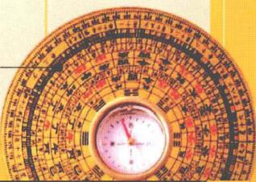  
罗盘经天纬地的罗盘是堪舆风水的必备工具

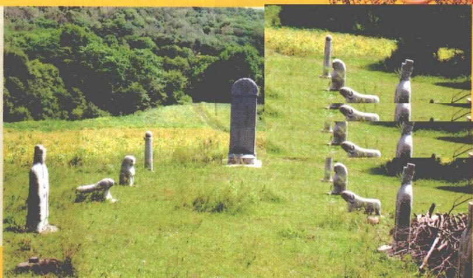  
完颜希尔家族墓穴场全景图

内蒙古出版集团内蒙古人民出版社

# 地理人子须知

一一叶知秋、一针见血、胸罗千载、面转乾坤（明）徐善继·述著杨金国点校刘保同主编

# 最简明易懂的风水常识，一看就懂，一学就会 文王之风·水布乾坤·好风好水好运来

## 萧何祖

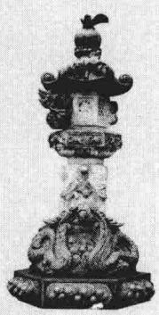  
经天纬地的罗盘是堪舆风水的必备工具

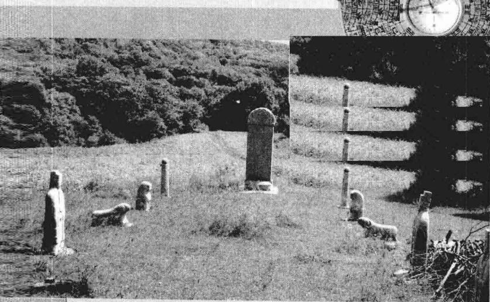  
完颜希尔家族墓穴场全景图

<t>内蒙古出版集团内蒙古人火版社

图书在版编目(CIP)数据

地理人子须知，上/(明)徐善继，(明)徐善述著

—呼和浩特：内蒙古人民出版社,2010.5

(传统数术名家精粹/刘保同主编)

ISBN 978 -7 -204 -10508 - 3

I. ①地…Ⅱ. ①徐…②徐…Ⅲ. ①风水- 中国-古代 IⅣ. ①B992.4

中国版本图书馆 CIP数据核字(2010)第090342号

传统数术名家精粹

## 地理人子须知，上

(明)徐善继(明)徐善述 著

责任编辑 王继雄

封面设计 宋双成

出版发行 内蒙古人民出版社

地址呼和浩特市新华东街

印 刷三河市南阳印刷有限公司

开 本 710 ×1000 1/16

印 张 16

字数 220 千字

版次 2010 年12 月第1 版

印 次 2010 年 12 月第1 次印刷

书 号 ISBN 978-7-204-10508-3

定价 29.80 元

如出现印装质量问题，请与我社联系。

联系电话：p0471-4971562 4971659

# 地理人子须知（上）

## 凡 例

一、凡本书为人子须知术，非为术数家所设，故凡不传之秘，一一敷陈口诀而作诗歌，以为不记诵便。

二、凡本书惟务通俗，易懂，初无意于文辞，以绚观美。是以直叙其旨而不嫌于鄙，详述其奥而不虑乎繁。即于前后之重复，辨证之琐屑，与夫照应不齐，言论肤浅，俱弗暇恤耳。

三、凡本书所收诸名地图，不过为释疑。故于紧要相关处，引古证今，用图详说。其间或因论龙穴而略于砂水，或因论砂水而略于龙穴，惟所重处特加详言，其他莫能悉及。盖寸笺半简间，摹数百十里山川，怎可兼备哉！善观者当自得其妙，又怎可按图索骥？

四、凡诸名地图，皆予兄弟足目所经涉者，或名师扦点，或课验不爽，或发越确应，必有明征可为法则者才收之。否则，无征不信，何可泛收？

五、凡诸地图，必着其土名山向，某师所卜，及详所出人物官爵，不以琐屑自嫌者，固所以征其实迹，亦欲人子因此可以索微探颐，得意于笔舌之外，毋以是而反启疑议焉。

六、凡引用诸名师语，或称姓氏，或称书名，或称号，或称字，或止称某氏某公，从便也。其不著者，阙疑耳。多吾乡者，考据切实云。

七、凡折衷诸说是非，亦惟据于已验仙迹，及名师议论之长者取证也。

八、凡收诸名地图，既有叙说矣，又间有补义释义，及有传疑者，或以取证，或以申明，非琐也。

九、凡设龙穴砂水诸图式，立法有不得不然者，但不可执泥。生山不与画山同，固有山水奇妙处，虽良工不能施其巧，在智者触类旁推也。

十、凡名地，有远至数百年后而方有福应者，有近只数年而即有福应者，世俗多泥葬地后所生人方能受荫，即此太远太近，岂不荒唐哉？兹于编中所收诸地，惟取其真是应荫者，不以年代远近拘，特注明以告观者无疑焉。

十一、凡地学须致力三多。何谓三多？多参明师则传授真而所闻博，多观古格则所见广而是非明，多经窀穸则历练精而真见定。本书多载名图，精加细绎，虚心详究，三多在其中。久之，自有心领神会，豁然贯通，而俗师浅巫莫能逛之，不于慎终之者有补矣夫！

十二、地理家诸书繁浩，条绪多端，真赝并列，兹于编中撮其精当者，取以质证。或摘一二句，或采一二节，或间摭庶人之言，或备录一家之说，或断章而取义，或隐括以为辞，意在发明，非敢务博也。

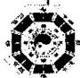

十三、本书由专业人员点校，对峦头精华全部保留，对理气无考证部分多删除。用辩证的思维，去伪存真，去芜留精，继承与发展体现它适应时代、和谐社会、福惠万民的人文特色。

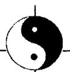

## 十四、凡人子必知地理十不可。

一不可不知地理

二不可停柩不葬

三不可侵葬祖冢

四不可图葬旧穴

五不可拘泥公位

六不可轻易改葬

七不可专意图大

八不可不观古格

九不可不择良师

十不可不修阴德

十五、凡书中曰右、曰按、曰已上、曰补议，皆理有未尽， 而复申明之，特变其发语之辞耳。

地理人子须知（上）

# 白 序

择地一事，人子慎终切务也。孔子有“卜宅兆”之训，孟子谓“比化者，无使土亲肤”，程子有“避五患”之戒，朱子谓“必慎必诚，不使稍有他日之悔”。圣贤垂教，其慎如此。钦惟我皇朝以孝治天下，迄今二百余年，圣圣相承，仁恩磅礴，大臣命妇，咸有恤典，亲亲之教，视古尤加。诚以生事死葬，礼之大焉。且事死如事生，而葬必虑夫亲魂之安危。又天性有不可解者，岂惟拘于彼术家所谓祸福之说哉！但亡者既宁，则生者自昌。先正谓由根达枝，斯定理也。

予不幸早孤，思得善土以奉先灵，不敢付诸术。读易究其理，求其据且确者，尽安厝之诚，以塞人子当知之分，与夫分内之可为事耳。然天地大父母，则有生天地间者，皆吾同胞类也。吾不欲苟于窀穸以毕子职，而天下独非尽人之子与？矧推亲亲之爱，大无我之公，尤吾儒所谓理一焉者，其宁忍然于斯耶？于是忘其僭陋，与弟善述日加钻研，会诸说而折其中，去繁芜而归其要，合形势方位于一家，以龙穴砂水为四例，辑成一书，简易明切，颇有便于慎终者之探索。曰《人子须知》，盖欲天下之为子者各亲其亲，而吾之所知不独为一人之知云。苟人心之有知与不可不知者，须以求之，则于卜宅兆，避五患，以毕夫安厝之大事者，斯有以得其要领，而不为邪说所惑，庶上可以敷圣君贤相，泽及枯骨之仁，下可以尽肖子贤孙，厚本慎终之孝，亦国家孝治天下之

一端，吾儒穷理尽性分内事也。若概视为术家之说，非予兄弟搜辑之本意矣。

嘉靖甲子孟春德兴山人徐善继书于双芝堂

予尝观宋儒牧堂蔡先生家训云：“为人子者，不可不知医药、地理。”怦然心动。不幸先君早逝，生无以为养，所可图者，惟宅兆一事耳。于是与季兄弃举子学业，治堪舆家言。所过名山大川，古今陵墓，必周览久之而后去。更事师亦不啻数十人。如此者垂三十年，而后稍有端绪。夫术家妙契阴阳，明通观察，虽代不乏人，然各私相授受，其流之弊，遂致矛盾冰炭，言天星者黜峦头，言形势者辟方位，穿凿附会之说，与诋毁聚讼之谈，纷然莫可究诘。人子欲葬其亲，茫无所据，有遗憾者多矣。予窃取而权衡之，形势审于未穴之先，先天之本体也；方位察于倒杖之后，后天之妙用也。先天之体出乎自然，天也；后天之用尽乎当然，人也。体用不可偏废，天与人相峙并行，乌得执彼废此耶？乃以平昔所讲求经涉而有得者，定为成书。先列峦头之要，次附天星之法，形势方位，各有攸当，天人体用，不相背违。俾孝子慈孙欲安其先灵者，不为偏见所误，命之曰《人子须知》。夫举千古不决之疑，而擱然兼总其全，僭越之罪，何辞可解？乃私心要在于资孝云尔，世当有谅我者矣。

嘉靖甲子孟春德兴山人徐善述书于怡怡轩

## 目 录

地理人子须知卷一/1 地理人子须知卷三/28  
论昆仑为诸山之祖/1 枝干总论/28  
总论中国之山/2 论干龙/29  
论九州岛山镇川泽/7 论枝龙/36  
论三大干龙/8 依近郡甫随龙穴诸名地图具下39  
论南条干龙脉络/8  
地理人子须知卷四/43  
论中条干龙脉络/9  
总论支垄/43  
论北条干龙脉络/10  
论垄龙/44  
地理人子须知卷二/13 论支龙/45  
论帝都/13  
地理人子须知卷五/53  
历代帝都考/14  
论太祖山/53  
论帝都必合星垣/15  
论少祖山/54  
论北龙所结帝都垣局/23  
论无少祖山/58  
论中龙所结帝都垣局/25  
论龙父母胎息孕育/58  
论南龙所结帝都垣局/26

论龙入首/60

地理人子须知卷六/64论龙出身/64论龙开障/66论龙剥换/67论龙过峡/68护峡山格/73附蔡西山先生峡格/75论龙枝脚桡棹/82论龙护送/90

地理人子须知卷七/93  
论龙旁正/93  
论龙老嫩/95  
论龙长短/96  
论龙真假/97  
论龙贵贱/100  
地理人子须知卷八/103  
论龙驻跸/103  
论龙行止/104  
论龙分劈/105  
论龙背面/106  
论龙宾主/111  
论龙奴从/114  
论龙余气/115

地理人子须知卷九/123

论龙分三势123  
论龙三落/125  
论龙形势十二格/127  
论龙出脉三格/132  
论龙受穴三等/134  
论龙入首五格/135  
论龙入穴十二脉/139  
论龙结穴五局/141  
论龙结局分三聚/142

地理人子须知卷十/145

五星总论/145  
论五星之形/146  
论五星之名/147  
论五星分高山平岗平地三

格/151  
论五星体性/152  
论五星所忌/153  
论五星所喜/153  
论五星聚讲/154  
论五星连珠/154  
论五星归垣/156

地理人子须知卷十一/158穴法总论/158此一册专论穴形/161

论窝形之穴/162   
论钳形之穴/172   
论乳形之穴/180

地理人子须知卷十二/188

论突形之穴/188   
突形四格/189   
论边窝之格/194   
论并窝之格/197   
论分钳之格/198   
论合钳之格/200   
论闪乳之格/201   
论侧乳之格/202   
论鹘突之格/203   
论并突之格/205

地理人子须知卷十三/210

穴星三大格/210

穴星三格辨/211  
穴星诸形/212  
火星不结穴辨/213

地理人子须知卷十四/227

论朝山证穴/227   
论明堂证穴/232   
论水势证穴/233   
论乐山证穴/233   
鬼星证穴/235   
论龙虎证穴/236   
论缠护证穴/236   
论唇毡证穴/237   
论天心十道证穴/239   
论分合证穴/240

##

# 地理人子须知卷一

徐善继江右德行山人徐善述 同著

此一册专论天下大干龙。龙居地理四科之首，堪舆家最重要是论龙。论龙而不知天下的大干龙，则所见者近而不远，所究者浅而不深，所窥者狭而不广，乌乎可哉？故首论天下大干龙，庶几识其大者。

论昆仑为诸山之祖

《地理大全》临川吴氏曰：“天下之山脉起于昆仑。”蔡牧堂《发微论》曰：“凡山皆祖昆仑。”陶公《捉脉赋》云：“大智察脉，起自昆仑。”《明山宝鉴》云：“山脉之起，本于昆仑。”郭璞《锦囊经》云：“葬者原其始，乘其止。”诚以地理之法，龙则原其始，穴则乘其止，故不可不审山之起祖处也。然观山之所始，必究其水之所起；观龙之所终，必察其水之所界。今以舆图考之，天下之水皆原于西北。是可见山起于西北矣。蔡文正公曰：“山水皆原于西北，故禹叙山叙水，皆自西北而东南”是也。或云昆仑在西海戌地，北海亥地，东南接积石圃，西北接北户之室，东北临太活之井，西南至城南之谷，亦荒远莫稽。而杨筠松又云须弥山生四龙，昆仑山特其南肢。

葛溪氏述其说曰：“须弥山是天地骨，中镇天心为巨物。四肢分作四世界，惟有南龙入中国。南龙入自昆仑山，龙子龙孙皆可别。”虽据佛经，人所罕见，阙之可也。今但以中国山川之可考者论之，则昆仑诚诸山之祖，在中国之西北。九峰蔡氏云：“中国山势冈脊，大抵皆自西北而来。”盖可见矣。

## 总论中国之山

朱子曰：“河图言昆仑为地之中，中国至于阗（音田）二万里。于阗贡使自言西去四千三百余里即昆仑。今中国在昆仑东南，而天下之山祖于昆仑，惟派三干以入中国。其入夷国之山无可考，亦不足论。今以中国言之，其河北诸山，则自北寰武、岚宪诸州，乘高而来，山脊以西之水，流入龙门西河，脊东之水，流于幽冀，入于东海。其西一支为湖口泰岳。次一支包汾晋之原而南出，以为析城、王屋，而又西折为雷首。又一支为恒山，又一支为太行山。太行山一千里，其山高甚。上党在山脊，河东河北诸州在山支。其最长一支为燕山，尽于平梁。大河以南诸山，则关中之山，皆自蜀汉而来。一支至长安而尽。关中一支生下函谷。以至嵩、少，东尽泰山。一支自嶓冢、汉水之北生下，尽扬州江南诸山，皆祖于岷江，出岷山。岷山夹江两岸而行，那边一支，去为江北许多去处。这边一支，分散为湖南、闽、广，尽于两浙、建康。其一支为衡山，而尽于洞庭、九江之西。其一支度桂岭，则包湘源，而北经袁筠之地，以尽于庐阜。其一支自南而东，则包彭蠡之原，度歙黄山，以尽于建康。又自天目山分一支，尽于浙江西之山，皆自五岭赣上来，自南而北。闽广之山，自北而南。一支则又包浙江之原，北首以尽会稽，南尾以尽闽粤。此中国诸山祖宗支派之大纲也。

上特举天下山而言，未及水也。复辑山水总说于后云。按仁山金氏曰：天地常形，固相为勾连贯通，然亦各有脉络。自昆仑而东北言之，则自积石而北，为涅水、星海、青海，以至浩亹，皆河源也。入匈奴以东，为阴山。又东南，自代北、云朔，分而南趋，为北岳，以至太行，是为河北之脊。壶口、雷首、太岳、析城、王屋，皆其群峰。汾晋、涿易、淀漳、洹卫，则皆其诸水也。分而东趋者，行幽燕之北，为五关之险。以至营平而为碣石，此北络也。

自昆仑以东言之，则自西倾而洮水出自北，入河。恒水出其南，入江。又东，为朱圉、鸟鼠诸陇，则为渭之源。以北即夹河源而北。以东，若岍岐，若荆山诸峰，泾水、漆、沮诸源也。自渭以南，即西倾而下诸峰亘为络，南屹为太华，东北为殽陕，东南为熊耳、方外、嵩高、伊、洛之源。又南，为桐柏、淮源，以达于淮西诸山。此中络也。又自西倾朱圉而南分，是为嶓冢汉源，夹汉而趋者，北即终南、华、熊诸陇。南则蜀东诸峰。说者谓蜀东诸山皆嶓冢，正谓其冈岫绵亘耳。又东南言之，是为岷山江源，夹江而东者。北支即西倾以南，嶓冢以西之脉，为洹水，西汉水，如江陵诸源。其南支即南趋为蒙蔡诸山，青衣、大流、马湖、江诸源。又东包涪、黔，一盘而北，为三峡。其出者包络九江之源。中盘中为衡山。其再盘而北，为庐阜。其岭之东出者，又为袁、吉、章、贡、旺信诸江之源。至分水鱼梁岭，三盘而北趋，过新安，峙天目，尽升润。再盘之间，其水聚洞庭。三盘之间，其水聚彭蠡。三盘以东，则南为闽浙，北为震泽。此南络也。惟泰山则特起东方，横亘左右，以障中原。此所以为异与。又曰泰山特起东方，为中国水口表镇。禹贡道水略云：“导河至同，为逆河，入于海。导漾至东，为北江，入于海。导江至东，为中江，入于海。导沇水至东北，会于汶，又东入于海。导淮至东，会于泗、沂，东入于海。导渭至东，过漆、沮入于河。导洛至东，会于伊，又东北入于河。此中国山水大势也。

# 地理人子须知卷一

# 中国三大干龙总览之图

朱子曰：河图言：“昆仑者，地之中也。”《素问》曰：“天不足西北，地不满东南。”《水经》云：“昆仑取嵩山五万里。”看来不会如此远。盖中国至于阗二万里。于闻至昆仑无缘更有三万里。《文昌杂录》记于闻遣使来贡献。使者自言其地四千三百余里即昆仑山。今中国在昆仑之东南，而天竺诸国在其正南。大抵地形如馒头然，其尖则昆仑也。

九峰蔡氏曰：河北诸山，根本脊脉皆自代北寰武、岚宪诸州乘高而来。其脊以西之水，则西流以入龙门。西河之上流，其脊以东之水则东流而为桑干、幽冀，以入于海。其西一支，为壶口、泰岳。次一支，包汾晋之原而南出，以为析城、王屋。而又西折，以为雷首。又次一支，乃为太行，又次一支，乃为恒山。此大河北境之山也。其江汉南境之山，则岷山之脉，其北一支为衡山，而尽于洞庭之西。其南一支度桂岭，北经袁筠之地，至德安之敷浅源。二支之间，湘水间断，衡山在湘水西南，敷浅源在湘水东北。

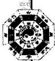

朱子曰：天下之山，西北最高。自关中一支生下函谷，以至嵩少，东尽泰山。此是一支。又自嶓冢汉水之北，生下一支，至扬州而尽。江南诸山，则又自岷山分一支，以尽于两浙、闽广。

又曰：大凡两水夹行，中间必有山；两山夹行，中间必有水。江出岷山，岷山夹江两岸而行，那边一支去为江北许多去处，这边一支为湖湘南。又一支为建康，又一支为福建二广。

又曰：岷山之脉，其一支为衡山者，已尽于九江之西。其一支又南而东度桂岭者，则包湘源，而北经袁筠之境，以尽于庐阜。其一支又南而东度庾岭者，则包彭蠡之源，以北尽于建康。其一支则又东包浙江之原，而北其首以尽会稽，南其尾以尽于闽粤。

《朱子语录》云：佛经云：昆仑山顶有阿耨大池，水流四面出，东南流入中国者，为黄河。其三方流者，为弱水、黑水之类。

《东坡指掌图》云：西域在匈奴之西，乌孙之南。南北有大山，中央有河，东则接汉。所以玉门、阳关西，则限以葱岭。其南山东出金城，与汉南山属焉。其河有两源，一出葱岭，一出于阗。于阗在南山下，其河北流，与葱岭河合，东注浦昌海。其水停居，冬夏不增减。世皆以为潜行于地下，南出于积石山，为中国河云。

临川吴氏曰：水发自昆仑者，其源为最远。惟中国之河为然。汉之发源于蟠冢，江之发源于岷山以西，视他水亦可谓远，而非极于山脉初起之处，则不得与河源并也。故天下有源之水，河为第一。古人祭川，先河后海，重其源也。

朱子曰：女真起处有鸭緑江。传云：“天下有三处大水，曰黄河，曰长江，曰鸭綠江是也。

蔡牧堂曰：凡山皆祖昆仑，分支分脉，愈繁愈细，此一本而万殊也。凡水皆宗大海，异派同流，愈含愈广，此万殊而一本也。临川吴氏曰：天下之山脉起于昆仑。山脉之所起，即水源之所发也。

《水经》云：江水出岷山，在蜀氐道县，大江所出，东南过其县北。岷山，即渎山也，水曰渎水。又谓之文阜山，在徼外，江水所导也。《益州记》曰：大江泉源，即今所闻始发羊膊岭下。綠崖散漫，小大百数，殆未滥觞矣。东南下百余里，至白马岭而历天彭阙，亦谓之天谷。秦昭王以李冰为蜀守。冰见氐道县有天彭山，两山相对，其形如阙，谓之天彭阙，亦曰天彭门。江水自此以上，至微弱，所谓发源滥觞者。

淮水淮水出南阳平氐县胎簪山东北，过桐栢山。《山海经》曰：淮出余山，在朝阳东久乡西。《尚书》“导淮自桐柏。”《地理志》曰：“南阳平氐县，王莽之平善也。”《风俗通》曰：“南阳平氐县，桐栢大复山在东南，淮水所出也。”淮，均也。《春秋说题辞》曰：“淮者，均其势也。”《释名》曰：“淮，韦也，韦统扬州北界，东至于海也”。

河水《春秋说题辞》曰：“河之为言，荷也。”《释名》曰：“河，下也。随地下处而通流也。”《考异邮》曰：“河者，水之气，四渎之精也。”《孝经援神契》曰：“河者，水之伯，上应天汉。”《新论》曰：“四渎之源，河最高而长。从高注下，水流激浚，故其流忽。”徐干《齐都赋》曰：“川渎则洪河洋洋，发源昆仑；九流分游，北朝沧渊。惊波沛厉，望海扬奔。”《物理论》曰：“河色黄者，众川之流，盖浊之也。百里一小曲，千里一曲一直矣。”汉大司马张仲议曰：“河水浊，清澄一石水，六斗泥。而民竞引河溉田。今河不通利，至三月桃花水至，则河决，以其噎不泄也。禁民勿复引河。”是黄河兼浊河之名矣。

《述征记》曰：“盟津、河津恒浊，方河为狭，此淮济为阔。寒则水厚数丈。氷始合，车马不敢过，须要狐行。云狐善听，氷下无声，乃过。人见狐行，方渡。”又《河水说》、《山海经》曰：“河水出渤海。”又海水西北入。禹所导积石山，山在陇西郡河间县西南羌中。余考群书，咸言河出昆仑源，潜发沦于蒲昌，出于海水。故《洛书》曰：“河自昆仑出于重野。”谓此矣。经积石而为中国河，故成公子安《大河赋》曰：“览百川之弘北，莫尚美于黄河。潜昆仑之峻极，出积石之嵯峨。”释氏《西域传》曰：“河自蒲昌潜行地下，南出积石。”而经文在此似乎不同。积石宜在蒲昌海下矣。

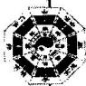

汉水漾水，即汉水发源也。漾水出陇西氐道县嶓冢山东，至武都沮县为汉水。又东南，至广魏白水县西。又东南，至葭萌县东北，与漾水合，沔水即汉水。沔出武都沮县东狼谷中，沔水一名沮水。阚骃曰：“以其初出沮洳然，故曰沮水。此县之受名焉。导源南流，泉街水注之。出河池县东南，流入沮县，会于沔。沔水又东南，径沮水成而东南流，注汉。而沮口所谓沔汉者也。《尚书》曰：“嶓冢导漾东流为汉。”《山海经》所谓汉出鲋赂山也。东北流，得献水口。庚仲雍云：是水南至关城，合西汉水。汉水又东；北合沮口，同为汉水之源也。故如湻曰：“此方为汉水，为沔水。”故孔安国曰“漾水东流为沔”，盖与沔合也。至汉中为汉水，是互相通称矣。

济水济出王屋山，今孟州。始禹导水流而为济，截河南渡，东流与汶水会。又北，东入于海。兖州在济河之间，济发源为名。今济州乃发源也。济水自王莽时入河，同流入海，济河之地无济水矣。

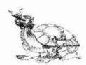

## 论九州岛山镇川泽

按《周礼·职方氏》曰：东南曰扬州，其山镇曰会稽，其泽薮曰具区，其川三江，其浸五湖。正南曰荆州，其山镇曰衡山，其泽薮曰云梦，其川江汉，其浸颖湛。河南曰豫州，其山镇曰华山，其泽薮曰莆田，其川荧雒，其浸波差。正东曰青州，其山镇曰沂山，其泽薮曰望诸，其川淮泗，其浸沂沐。河东曰兖州，其山镇曰岱山，其泽薮曰大野，其川河沸，其浸卢维。正西曰雍州，其山镇曰岳山，其泽薮曰弦蒲，其川泾、汭，其浸渭、洛。东北曰幽州，其山镇曰医无间，其泽薮曰养，其川河、沸，其浸菑、时。河内曰冀州，其山镇曰霍山，其泽薮曰阳纤。其川漳拙长，其浸汾、潞。正北曰并州，其山镇曰常山，其泽薮曰昭余祁，其川呼池、呕夷，其浸涞、易。注曰：此九州岛岛岛川界。扬、荆、豫、兖、雍、冀，与禹贡略同。青州则徐州之地，幽并则冀州之地，独无梁云。

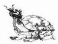

# 论三大干龙

朱子曰：天下有三处大水，曰黄河，曰长江，曰鸭緑江。今以舆图考之，长江与南海夹南条，尽于东南海。黄河与长江夹中条，尽于东海。黄河与鸭绿江夹北条，尽于辽海。此则自其水原极远者言之耳。若其分干之条犹多，难以尽举。如以江淮河汉四水论，则中干又自分三条。大抵河源极长，江次之，淮汉又次之。故有三条四列之说，不过概论其大而已。

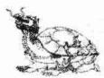

## 论南条干龙脉络

按廖金精《金璧玄文》云：“大江以南之龙，其脉起自岷山山县。绕行向西，自西而南，至云南之境，又东趋夜郎，踰桂岭， 在茂州至零陵，为九疑山，入桂连。”《撼龙经》云“五岭分星入桂连”是也。过大庚岭，出南雄山汀，从邵武抵信走徽，东行为天目山。一枝为钱塘。《经》云“一枝分送入海门”松三龙经。后仿此，又云 凡称经者，即杨筠“海门旺气连闽粤，南陇支龙交相缠。此是海门南脉络，货财文武交相错”是也。一枝为建康，尽江阴。《经》云“干龙尽在江阴滨”是也。一枝逆长江尽鄱湖。其水源，自蜀岷山至于九江，会彭蠡，下而过秣陵，出京口，以人于海。

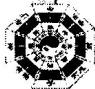

# 论中条干龙脉络

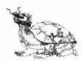

大河以南，大江以北，乃中条干龙。其脉起自西倾在洮州临草县，行陇右，《经》云“山来龙右尖如削，尽是贪狼更高卓”是也。过凤翔，《经》云“行行退却大散关在凤翔府宝鸡县，百二山河在此间。大缠大护到函谷在宏农县，水绕黄河如玦环”是也。为长安。一枝出熊耳在高州，《经》云“低平渐渐出熊耳，万里平洋渐如砥”是也。为嵩岳，为汴，《经》云“大梁形势亦无山，到此寻龙何处是？若无河流与淮水，渺渺茫茫不见山”是也。此处脉乱于河，《经》云“黄河在北大江南，两水夹行势不绝。行到鲁齐忽起峰，兖州东岳插天雄。分枝擘脉钟灵气，圣贤多在鲁邦中”是也。一枝尽于沧棣，一枝尽于登莱。其水源则济水出絳州垣曲县，至孟州温县人河。复出河之南，溢而为荥。又东北，至于青州入海。自宋元以来，河水穿淮，黄河故道淤，而东岳泰山今在河北矣。

又一枝自嶓冢西行湄州、汉水之间，出武关，由裕过唐，抵信阳，行淮水之南，趋庐，行淮水之东，为扬，尽于通。

其水源，汉水出嶓冢，至汉阳县入江。淮水出桐柏山在唐州桐柏县，至淮安入海。此中干分而为二，故曰三条四列。

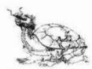

# 论北条干龙脉络

大河以北之龙，其脉起自昆仑。《经》云“昆仑山脚出阗颜阗音田，西戎国名，只只都是破军山。连绵走入瀚海北北海名，风俗强悍人粗顽。生儿五岁学骑射，骨鲠方刚是此间”是也。至白登山名，在大同府白登县，西一枝为壶口在隰州吉乡县、太岳在晋州霍邑。次一枝南出为析城在泽州阳城县、而又西折为雷首在河中府河中县。又次一枝为太行在怀梦河内，北至幽州，九岭绵亘一十二州之界，有八陉。又次一枝为恒山在定州曲阳县。又次一枝为燕山，尽于平滦碣石山在平州庐县。《经》云“若以干龙论大尽，太行碣石至海边。”是也。其水源则汾水，出管州管涔山，至絳州入于海。

以上中国诸山，皆始昆仑，分脉四列，以遍九州岛。北条出河北，入云中，过雁门、代郡，复回南而太原帝邱，循太行、恒山，派九河。东北渡辽海以入于海，为冀燕之分。中条出河南，自秦、陇、三辅入丰、沛、汾、晋，派伊、洛，东而淮泗，以入于海，为雍、豫、青、徐之分。南条出江南，自陕右分出西鄙，回巴蜀，踰荆衡，入黔中。东而匡阜，南极岭。复东北，渡闽粤，跨三吴，自浙右以入于海。为梁、荆、扬之分。此三干之布于九州岛岛岛也。三干之龙，中干为最尊。次北干，又次南干。历代以来，如汉高祖之泗上，汉光武之白水村，宋太祖之夹马营，我太祖之钟离乡，我世宗肃皇帝之龙飞承天，皆在中干。而唐虞之君，俱为北产。南干至宋高宗南渡来，运气方兴，萃产朱子，为万世儒宗。而迩来人物，东南颇多，其最长者为金陵，我国朝根本重地，太祖高皇帝龙兴之几也。中干之最长者尽东泰，翻身顾祖，东海外荡，河江前回。萃产孔圣，及贤贵凝聚。宋末河徙，

截其来脉者三，会通河复加截之，其力遂微。而中干之旺气乃萃于四州凤阳。

我皇朝熙祖仁祖二陵在焉。按王文禄《龙兴慈记》云：“泗州有杨家墩，墩有窝。熙祖尝卧其中，有二道士过，指卧处曰：‘若葬此，出天子。’其徒曰：‘何也？’曰：‘此地气暖。试以枯枝栽之，十日必生叶。’告熙祖起曰：汝闻吾言乎？’熙祖佯睡。乃以枯枝插之去。熙祖候之十日，果生叶。熙祖拔去，另以枯枝插之。二道士复来。其徒曰：“叶何不生？”是时熙祖在傍，睨之。道士指曰：必此人拔去矣。’熙祖知不能隐。道士谓之曰：汝有福，殁后当葬此，出天子。’熙祖语仁祖。后果得葬，葬后土自壅为坟。半载，陈太后孕太祖，皆言此墩有天子气。

仁祖徙凤阳，生太祖于盱眙县钟离灵乡，方圆丈许，至今不生草木。仁祖崩，太祖奉神柩至中途九龙岗，风雨大作，索断，土自壅成坟。人言葬九龙头上。”按松江徐长谷大地图云：“熙祖陵龙脉发自中条，王气攸萃。前潴水成湖作内明堂。淮河、黄河合襟作外明堂。淮上九峰插天，为远案。黄河西绕。元末，东开会通河复绕之，而圣祖生矣。”

仁祖陵即吴景鸾献宋室者。宋不能用，盖天留以待我皇朝之厚福无疆也，岂偶然哉？北干最长，为燕京，今京师也。朱子曰：“冀都是正天地中间，好个大风水。山脉从云中发来。云中正高脊处，自脊以西之水，则西流入于龙门、西河；自脊以东之水，则东流入于海。前面黄河环绕。右畔是华山耸立，为虎。自华来至中为嵩山，是为前案。遂过去为泰山，耸于左，是为龙。淮南诸山是第二重案，江南诸山及五岭南安大庾岭、桂阳骑田岭、九真都庞岭、临贺萌治岭、治安越城岭是也。又为第三四重案。”正谓此也。

吴兴唐子镇以燕京为枝结，谓朱子所论冀都指作尧都，非也。彼盖未考舜分冀东为幽州，而幽燕古通称冀耳。徜如所指，则朱.子又何复曰“尧都中原，风水极佳，左河东太行诸山相绕，海岛诸山亦皆相向”云云？此不待辨说而明矣。故邱文庄公《循义补》直以朱子所称为今京师，诚确见也。其以燕京为枝结者，不为妄谈乎？夫南干正结为南京，及我太祖高皇帝孝陵在焉。中干正结为我熙祖泗州、仁祖凤阳二陵。中结为我承天献宗皇帝显陵。北干正结为今日京师暨天寿山昌平州列圣陵寝。三干之尽，惟我朝独会其全。回视唐虞以来，或得正干之一，或得分干之一者，亦能衍数百年之基，则我皇朝三大干之全福力量，真亿万斯年可预卜于兹也。草茅之士，躬逢其盛，宁不为圣朝之深庆哉。

# 地理人子须知卷二

此一册专论天下古今帝都及星垣所合形势。非人子求风水者之事。但欲论地，必先识大干龙。而大干龙之所钟，必天下大都会大垣局，亦君子所当知者，爰辑其大概于左。

## 论帝都

夫地理之大，莫先于建都立国。稽古之先哲王，将营都邑，罔不度其可居之地以审其吉凶。如公刘将居幽也，其《诗》曰：“于胥斯原”。太王将居岐也，其《诗》曰：“聿来胥宇。”武王将居镐京，其《诗》曰：“宅是镐京。”成王将营洛邑，《书》曰：“召公既相宅。”卫文公将营楚丘，其诗曰：“升虚望楚。”见于经者如此，则宅都诚不可不重也。虽然，张子微有云：“帝王之兴也，以德而不以力；其守也，以道而不以地。”尧舜圣人，其所建立，未必虑及于风水之说。

但圣人之兴，自合造化，圣人所作，动为法则，风水固不拘，而密协于龟卜，即天造地设之自然者也。故《易》曰：“王公设

## 地理人子须知卷二

险以守其国”，此理固先天地而有，即风水之攸始矣。予尝稽诸历代建都之地，得正龙之所钟而合天星之垣局者，则传代多，历年久；非其正龙而不合星垣者，则皆随建随灭，岂非地理之明征乎。谨将历代建都之所详录以备参考云尔。

## 历代帝都考

## 历代帝都之图

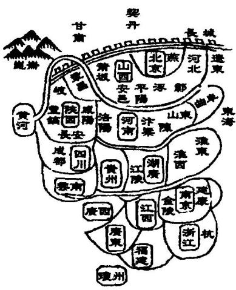

伏羲都陈封河南开州，在位一百一十五年。

神农都陈，徙曲阜，在位一百四十年。

黄帝都涿鹿，传四世，共三百九十年。

尧都山西平阳，在位七十二年。

舜都蒲坂山西，在位六十一年。

禹都安邑安山，传十七世，

共四百五十八年。

汤都亳曰河德府，传二十八世，共六百四十四年。

周都镐关羊，东迁洛阳，传三十七世，共八百七十三年。

秦都咸阳西安西府，传三世，共称帝一十五年。

西汉都关中西安西四，传十二世，共二百一十四年。

东汉都洛阳今南河府，传十二世，共一百九十六年。

三国汉都成都川，二主，四十三年；魏都邺，五主，四十六年；吴都建康，四主，五十二年。

西晋都洛阳今南河府，传四世，共三十七年。

东晋都建康府，传十一世，共一百四年。

南朝宋、齐、梁、陈皆都建康，宋八帝，五十九年；齐五主，二十三年；梁四主，五十六年；陈五主，三十三年。

隋都长安今，传三世，共三十八年。

唐都长安，传一十八世，共二百六十九年；昭宗徙洛阳，传二世，共十八年。

宋都汴共一百五十三年。

元都燕顺师府，传九世，共八十八年。

明太祖高皇帝都金陵今南京，成祖文皇帝徙燕京故即。

论帝都必合星垣

夫帝都者，天子之京几，万方之枢会。于以出政行令，莅中国，抚四夷，宰百官，统万民，天下至尊之地也。地理之大，莫先于此。必上合天星垣局，下钟正龙王气，然后可建立焉。盖在天为帝座星宫，在地为帝居都会，亦天象地形自然理耳。杨筠松云：“大抵山形虽在山，地有精光属星次。体魄在地光在天，识得星光真精艺。”故为地学，奚直俯察地理已哉！又须仰观天文，始尽其奥。按《天文志·浑象》：中外官星凡二百四十六名，千二百八十一星。微星万一千五百二十，分布中外为垣者，曰紫微、太微、天市。垣之中皆有帝座，凡建都处，山川形势，须与此合。杨筠松云：“要识垣中有帝星，皇都坐定甚分明。”廖金精云“帝都必要合星垣，紫微在中天。其次太微与天市，皆有帝座位”是也。今以三垣天星地形述后。外少微垣为士大夫权天帝文章之府。天苑、天园为天子养兽植菓之所。虽亦有垣，而无帝座正位，地形纵合，亦非统一寰宇，享有久远之都在。

按《天文志》，中天北极紫微星垣，天皇之宸极，太乙之常居也。北极五星正临亥地，为天帝之最尊，所以南面而治者也。三光迭运，极星不移。孔子所谓“北辰居其所而众星拱之”是也。后有四辅四星居壬，勾陈六星居干，天纲八星居戌，华盖九星居北，阁道五星居癸，咸池五星居丑，八毂八星居艮，天将军四星居寅，内陛六星居甲，司命六贵人在震，三师三星在乙。又有天理四星居辰，五诸侯五星居巽，内厨二星居巳，四贵人四星临丙，帝座二星居午，大理二星居丁，天枪三星居未。天床三星居坤。天梧五星居申，阳德、阴德二星居庚。内屏二星居兑。天乙、柱史、女史三星居辛。而有左卫七相、右卫七将以藩屏帝室。泰阶、六符辅治北斗七政以翼垣。此紫微垣星局之悬象于天者也。

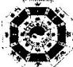

《步天歌》：中元北极紫微宫，北极五星在其中。大帝之座第二珠，第三之星庶子居。第一号曰为太子，四为后宫五天枢。左右四星是四辅，天以太乙当门路。左枢右枢夹南门，两面营卫一十五。上宰少尉两相对，少宰上辅次少辅。上卫少卫次上丞，后门东边大赞府。门西唤作一少丞，以次却向前门数。阴德门里两黄聚，尚书以次其位五。女史柱史各一户，御女四星五天柱。大理两星阴德边，勾陈尾指北极颠，勾陈六星六甲前。天皇独在勾陈里，五帝内座后门是。华盖并杠十六星，杠作柄象盖伞形。盖上连连九个星，名曰传舍如连丁。垣外左右各六珠，右是内阶左

天厨。阶前八星名八毂，厨下五个天棓宿。天床六星左枢右，内厨二星右枢对。文昌斗上半月形，稀疏分明六个星。文昌之下曰三公，太尊只向三公明。天牢六星太尊边，太阳之守四势前。一个宰相太阳侧，更有三公相西偏。即是天戈一星圆，天理四星斗里暗。辅星近着闿阳淡，北斗之宿七星明。第一主宰名枢精，第二第三璇玑星，四曰权星第五衡，闿阳摇光六七星，摇光左三天枪明。

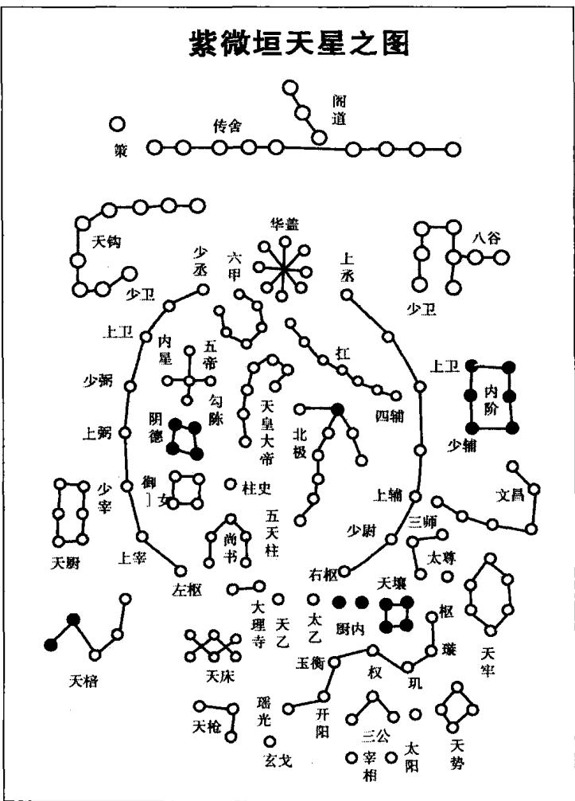

上紫微垣列形于地之局势大略也。杨筠松云：“紫微垣外前后门，华盖三台前后卫。中有过水名御沟，抱城屈曲中间流。”又云“直朝射入紫垣气”。廖金精云“紫垣西藩星有七，东藩八星出。华盖杠星在后门，天床前面陈。中央一水直朝入，抱城九回屈。万山簇拥昼朝迎，拱极不虚称”是也。

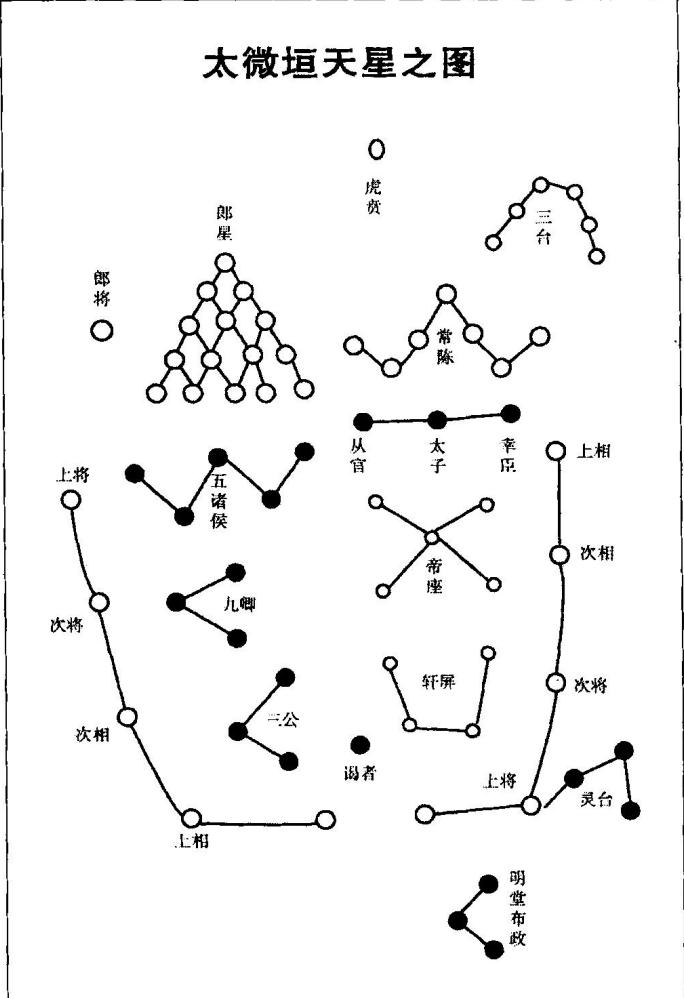

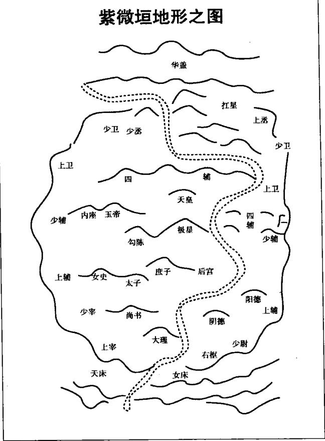

上南宫太微星垣，三光之庭，天帝受厘告功之室也。中有五帝座，正居北地。太乙、五尚书正居巽地。内有郎官、即位、三公、谒者、九卿、五侯以辅导帝极。前有明堂三星居巳，灵台三星居午，常陈为耳目之官，西将、东相各四星为藩垣。东华、西华为门掖。掖左右二星为执法。后有太阳守、太阴守各二星，为卫。前有张、翼、轸三宿为侍，此太微垣星局之悬象于天者也。

《步天歌》：上元天庭太微宫，昭昭列象在苍穹。端门只是门之中，左右执法门西东。门左皂衣一谒者，以次则是乌三公。三黑九卿公背旁，五黑诸侯卿后行。四个门星主后屏，五帝内座于中正。幸臣太子并从官，乌列帝后从东定。郎将虎贲居左右，常陈郎位屈其后。常陈七星勿相误，郎位陈东一十五。两面宫垣十星布，左右执法是其数。宫外明堂布政宫，三个灵台候云雨。

下太微垣列形于地之局势大略也。杨筠松云“方正之垣号太微”。又云“横城水绕太微势”。又云“东华西华门水横，水外四围列峰位。此是垣前执法星，却分左右为兵卫。”廖金精《泄天机》云“太微垣局最方正，左右执法并。西藩上将次将先，次相上相连。东藩上相及次相，次将与上将。两藩九门分十星，一水绕城横”是也。

下东府天市星垣，天帝泉货之府也。中有帝座，正临艮地。有秤、斗、车、舟、府库、市楼、市肆以贯其中，贯索、宗人、左右侍卫。匡卫《列国分野二十二星》曰：宋、南海、燕、东海、徐、吴越、齐、中山、九河、河间、晋、郑、周、秦、巴、蜀、梁、楚、韩、西河等藩以列四方。贵人一星旁照庚地，为捍卫库之宫。司命一星正临丁位，为五福寿命之司。此天市垣星局之悬象于天者也。

# 地理人子须知卷二

《步天歌》：下元一宫名天市，两扇垣墙二十二。当门六个黑市楼，门左两星是车肆。两个宗正四宗人，宗星一双亦依次。帛度两星屠肆前，侯星还在帝座边。帝座一星常光明，四个微茫宦者星。以次两星名列肆，斗斛帝前依其次。斗是五星斛是四，垣北九个贯索星。索口横者七公成，天纪恰似七公形。数着分明多两星，纪北三星名女床。此座还依织女旁，三元之象无相侵。二十八宿随其阴，火水木土并与金，以次别有五行吟。

下天市垣列形于地之局势大略也。杨筠松云“垣有四门号天市。”又云“百源来聚天市垣。”廖公云“天市垣星二十二，名参国与地。国地中间有四门，东西南北分。众水分流来此聚，大河在东注。帝座居北市楼南，垣局总为祥”是也。

已上三垣天星之图则本于《天文志》，地形之图则本于廖金精《金璧玄文》，兹特合而一之，庶易于考索。然亦不必深泥图局形象，胶柱鼓瑟。但依经文，以山形水势取之。如曰“紫微垣外前后门”，“华盖三台前后卫”，“方正之垣号太微”，“垣有四门号天市”。又曰“直城射入紫微气”，“横城水绕太微势”，“百源来聚天市垣”之类，则以山水形势之大象言之，杨筠松固已说得明白。其他星宿形象，又不必尽泥也。

## 论北龙所结帝都垣局

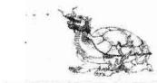

北龙有燕山，即今京师也。以燕然山脉尽于此，故曰燕山。昔昭王筑黄金台以招贤者，因又称金台。古冀州地。舜分冀东北为幽州，故又谓之幽都。《朱子语录》：冀都，天地间好个大风水！脉从云中发来，前面黄河环绕，泰山耸左为龙，华山耸右为虎，嵩山为前案，淮南诸山为第二重案，江南五岭诸山为第三重案。故古今建都之地，皆莫过于冀都。就朱子所谓风水之说观之，谓无风以散之，有水以界之也。冀州之中，三面距河处，是为平阳、蒲坂，乃尧舜建都之地。其所分东北之境，是为幽州。太行自西而来，演迤而北，绵亘魏、晋、燕、赵之境，东而极于医无闾。重开叠阜，鸾凤峙而蛟龙走，所以拥护而围绕之者，不知几千万里也。形势全，风气密，堪舆家所谓藏风聚气者，此地有之。其东一带，则汪洋大海。稍北，乃古碣石沦入海处。稍南则九河既通，所归宿之地，浴日月而浸乾坤，所以界之者，又如此其直截而广大焉。堪舆家所谓“得水为上”者是也。

平阳图  
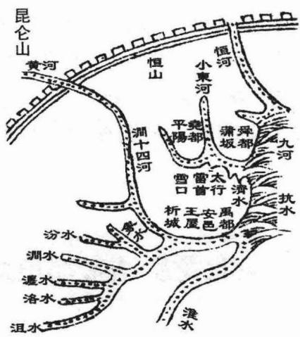

燕山图  
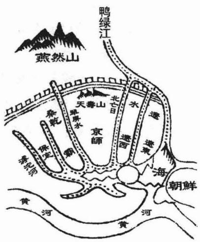

按：此皆以风水之美言之也。若以形胜论，则幽、燕自昔称雄，左环沧海，右拥太行，南襟河济，北枕居庸，苏秦所谓天府百二之国，杜牧所谓王不得不可为王之地。故我成祖文皇帝，睿意建都于此，良谟远猷，岂凡愚之所能及哉！然当时未必虑及风水之说，而默契若此，是盖圣王之兴，动与法合，天地造化，有自然相符之理。昔尧舜禹三圣之都皆北龙。今我朝几甸亦北龙，而形胜与风水法度又皆迈之，宜其驾唐虞，迫二代，全盛如此，是固我列圣之茂德神功鸿休骏烈之不可及。然地理之应亦或然也。愚何幸，躬逢其盛。

北龙之次，有平阳、蒲坂、安邑，亦冀境，乃尧舜所都之地。按：朱子曰：“河中地形极好，乃尧舜禹故都。虽然，尧舜禹圣人，道化天下，未必系于风水。然天造地设，亦自然默契之理，有不可诬者。但今风水变迁，王气销竭，无复可都矣。

# 论中龙所结帝都垣局

中龙有关中曰丰、曰镐、曰咸阳、长安，皆今陕西地，通曰关陕，古雍州也。杨筠松云“关中原是太微垣”，又曰“长安落在垣宿中。”盖中干之尊也。其龙发于昆仑。《经》曰：“黑水绵络西河，横山始起祖宗，转荥、貊、泽，自西而东，尽于雍州。”张张子微曰：“长安之龙起于横山，其山皆黄石，绵亘八百余里，不生草木。及至雍州之地，泾水出安定，在雍州之西，自西而南入渭水。而北是为渭、汭。渭水出鸟鼠同穴，西为雍州之西山。汉以娄敬、张良之议，遂因其故都而都之，传十二帝，历二百一十四年。其后，唐又都之，传十八帝，历二百六十九年。中龙之次有洛阳，即周营洛邑之地也。前值伊阙，后据邙山，左瀍右涧，洛水贯其中，以象河汉。此紫微垣局也。张子微曰：“洛邑是飞龙格势，脚手本自分明，迎送却从外假合。凡大地，迎送皆取诸外而不取诸本身。所谓本身手脚，一曲屈萦回辄五六十里，或七八十里，故人不见其为手足。况远外迎送，其得见乎？此其平夷之地，一望无际，惟审其水源而后识之也。

中龙之又其次者，有汴梁。其龙自熊耳至此，平坦万里。大河在其北，淮河在其南，亦天苑垣也。五代梁、汉、晋、周皆都于此，年代不永。宋都之，传九帝，历一百六十七年而南迁临安。是时汴梁在河之南，犹差可取。

## 论南龙所结帝都垣局

金陵图  

南龙有金陵，即今之南京，我太祖高皇帝建都之地也。战国楚威王时，以其地有王气，埋金以镇之，故称金陵。吴曰建业。晋曰建康。其形势，前辈谓与洛阳同。廖金精云：“建康形势洛阳同，王气古云钟。”盖紫微垣局，南干之尽也。诸葛孔明谓钟山龙蟠，石城虎踞，真帝王都。昔始皇见金陵有王气，东游以压之。其后三国吴都之，传四世。东晋又都之，传十一世，历百余年。南朝宋、齐、梁、陈、南唐

皆都之，而年代不永，盖以其虽合垣局，而垣气多泄，故尔。杨筠松云“长江环外有三结，垣前中水列。垣中已是帝王都，只是垣城气多泄”是也。若以形胜论之，则江限南北，古今恃为天险。朱子曰：“东南论都，必要都建康者，以建康正诸方水道所凑，一望则诸要会地都在面前，有相应处。”刘诚意谓“襟带长江，势甚险固。”

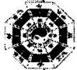

南龙之次有临安城。其龙脉自天目山入钱塘，而海门有龙赭二山在其中。郭景纯纪云：“天目山前两乳长，龙飞凤舞到钱塘。海门更点巽风起，五百年间出帝王。”《经》云：“海门环合似天市，天目天池生侍卫。万里飞来垣外挹，海外诸峰补垣气。”廖金精云：“大江以南天目峙，海门似天市。”故临安亦天市垣耳。若以形胜论之，则僻处一隅，朱子谓“如入屋角房中，坐视外面，殊不相应。”宋高宗南迁建都于此，其卜相京几国师，吾邑传公少华伯通也。有临安行在表，谓其地只可驻跸，不宜建都，不过偏安之地。且主奸相弄权，武臣多咎。后宋竟未能恢复，而奸相如秦桧、贾似道诸人迭出，皆操弄国柄，武臣多不善终，果符傅公之言。

已上建都之地，其大概如此。唐虞之都，以河溢为患。周洛邑以备守之难。大梁平夷无险。临安僻处一隅。金陵形胜虽优，而垣气多泄。两淮龙气大尽，而地势卑下。东鲁中干虽尊，而已钟孔圣。且今河水穿龙，皆非建都之宜。他如许昌、成都、南粤等处不足论矣。惟我京师为上，而关中次之，东汉所都之洛又次之。虽然，圣帝明王，要必有所重也。昔魏武侯浮西河而下，中流顾谓吴起曰：“美哉！山河之固，魏国之宝也。”起对曰：“在德不在险。昔三苗氏左洞庭，右彭蠡，禹灭之。桀之居，左河济，右太华，伊关在其南，羊肠在其北，汤放之。纣之国，左孟门，右太行，恒山在其北，太河经其南，武王杀之。若不修德，舟中之人皆敌国也。”武侯善之。愚谓君子不以人废言。起虽不足道，若斯者诚确论哉！

不然，秦、隋尝都关中矣，金、元尝都燕京矣，风水之美，形胜之固，何独于彼不验哉！是故风水之说在于地，固有国者所当择。而祸福得丧之机存乎人，尤有国者所当慎也。

# 地理人子须知卷三

此篇专论干龙枝龙。夫龙之枝干，形势不一，苟无真见，则登山汗漫，贸贸莫分。且辨龙枝干，乃地理第一关键。此而不知，则大本已失。如宫墙外望，不得其门，何由升堂以入其室乎？故首论枝干，盖亦开关启键意也。

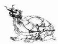

## 枝干总论

夫干龙枝龙者，乃龙之有大有小，犹木之有干有枝也。盖干为木之身，而枝柯所附以立。枝为木之衍，而条叶所自以蕃。论龙大小，取象莫辨于此。但枝干之中，又各有大小之别。故有大干龙、小干龙，大枝龙、小枝龙。

所谓干中有干，干中有枝；枝中有干，枝中有枝是也。吴国师有云：“枝干明而嫡庶分，嫡庶分而力量见。”故论龙不可不辨枝干，论枝干又不可不辨大小，以审其力量之轻重也。然审辨之法，以水源为定。故大干龙则以大江大河夹送，小干龙则以大溪大涧夹送，枝龙则以小溪小涧夹送，小枝龙则惟田源沟洫夹送而已。杨筠松云“水源亦自有长短，长作军州短作县”是也。故观水源长短而枝干之大小见矣。然此亦惟举其大纲言之。至于节目之详，即其行度形势，亦自有别。具见下文。

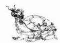

## 论干龙

夫干龙有二，前所云大干小干是也。所谓大干龙者，即干中之干者也。其祖皆出名山，跨州连郡，延几千百里，乃正气所聚，钟灵孕秀，颖异殊常，复然高广，而每有云雾发现。《经》云“先寻雾气识正龙”，又云“寻龙望气先寻脉，云雾多生在龙脊。春夏之交与二分，夜望云霓生处觅”是也。

盖于龙之祖极高大，故每有云雾生其巅。此察识干龙祖宗之大法也。知其祖，又当于离祖分行，审其出身。耸拔雄伟，气势宏大，规模尊重，如王者驾出而百职皆随，如大将赴敌而三军听命，巍峨卓异，岂若枝龙之出身，惟以细嫩活动，逶迤磊落为美哉！及其出身以来，则多牵连而行，不起星峰，惟两旁枝脚、护卫、关峡等山，则星峰耸拔。俗眼不识干龙形体，惟以星峰秀丽为爱，纵有所得，不过枝叶小穴而已。岂知正干龙禀气浑厚，不起正体星辰。

《疑龙经》云：“寻龙何处使人疑，寻得星辰却是枝。枝叶乱来无正穴，真龙到处又疑非。只缘不识两边护，却爱飞峰到脚随。飞峰斜落是龙脚，脚上生峰一边卓。真龙平处无星峰，两边生峰至难捉。”又云：“疑龙何处最难疑，寻得星峰却是枝。关峡从行并护托，矗矗旗枪左右随。干上星峰全不作，星峰龙法尽虚辞。”又云：“凡有好山随干去，枝龙尽处有旗枪。旗枪也是星峰作，圆凈尖方高更卓。就中寻穴穴即无，干去未休枝早落。”又云：

“问君州县大干龙，似浪横江那有峰？起峰皆是两边脚，去为小穴为村落。”又云：“两边起峰为护从，正龙低平最贵重。”又云“干龙身上不生峰，有峰皆是枝叶送”是也。故凡干龙，不可以星体拘之。惟是崇山大垄，如白浪涌波，层峦叠嶂，牵连而行，或百余里，或七八十里，或二三十里只一断。

而断处必是驿路通衢，人迹络绎不绝之处。古人以人迹往来多寡验峡之大小，以峡之大小定龙之大小，诚为有理。盖干龙脊脉，多为疆域界限，故其过峡断处，必是省郡通衢。然其断亦有一伏或十余里，或数十里平坦，了不知其去，而踪迹诡异。或穿田渡坂，而有藕断丝连；或石梁渡水，而为崩洪过脉；或抛踪闪迹，而有马迹蛛丝；或撒落平田，而藏形隐迹。前去忽起高山，又复牵连而行。行而又断，断而复起，延蔓广袤，横亘连绵，极其长远，或千余里，或数百里。《经》云：“寻龙千里非迢递，其次五百三百里。”

张子微云：“大龙千里费推寻，一二百里作郡邑。”廖金精云“干龙住处分远近，千里为大郡。二三百里可为州，过此即封侯。百里只堪为县治，下此为镇市”是也”。故干龙之行度，极其长远，愈长远则力量愈大。其分去之龙，亦随其正干之大小而有差别。如正干龙去作京师，则其龙身分去小干为省城，而省城龙身分去为郡邑，郡邑龙身分去为乡村市井之类。

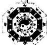

《龙髓经》云“大龙行度自非常，离祖生来手脚长。横亘铺舒千百里，至微三百里中藏。一弯一觜皆开广，终日循行尚未央。细叶犹为府州县，巨枝几甸植君王”是也。且其从山及枝脚桡棹，皆有融结。爰是干龙，气势雄大，布置精巧，故随从之龙，与本身透漏，皆能有穴。张子微云“手脚桡棹皆有穴，此是大龙多余气”是也。然此等大龙，亦有行至将结穴处无手足桡棹，撒落平阳，单行独出。而一屈一曲，动数十里，隔州隔水之山，远来迎接，在数十里外，自相照应。

《龙髓经》云：“不知大龙百十里，临到作穴如蛇爬。单单湾环数十程，无手无脚如流水。若论缠护隔溪港，一望遮来数十里。若拘缠托与桡棹，不知此龙何者是。”故干龙入首，必是外山隔水为迎为送，为缠为托。张子微云：“小地结果论迎送，大地迎送隔江水。”杨筠松云：“大凡干龙行尽处，外山隔水来相顾。”《发挥》云“譬之大贵人将至，不是自己带来护卫，乃是千百里外系指挥。部属之人，翕然聚集，刻日限时，罔敢不至”是也。

《雪心赋》云：“求吾所大欲，无非逆水之龙。”此特枝龙而已。干龙两水夹送，安有逆水？惟是将及入首，翻身逆水，数十里或数里数节结穴为妙。所谓“顺势翻成逆势”是也。其结穴际，必然山水大会，或山大曲，水大转，而水口交固，明堂平广，左右周回，内局团聚，外阳宽畅，水朝山拱。有此形势，即可寻穴。

《经》云：“凡山大曲，水大转，必有王侯居此间。”又云“到此先看水口山，水口交牙内局宽。便就宽容平处觅，左右周回无空闲。断然有穴在此处，更看朝水与朝山”是也。然干龙正脉，将及结穴，必然连断几断，脱卸杀气，方有融结。不然，则撒落平洋结聚为佳。皆须依近大河耳。虽是依近大河，却不暴头露面，必居拥从之中。

《龙髓经》所谓“万卒影从成禁卫，千官环列是朝廷。”谚语云“好地如闺中美女”是也。亦有翻身朝祖而结穴者，《经》云“请君看水交缠处，水外有山来会聚。翻身顾母顾祖宗，此是回龙转身处。宛转回龙似挂钩，未作穴时先作朝。朝山皆是宗与祖，不拘千里远迢迢”是也。亦有不回转而直受结穴者。

《经》云“也有干龙来两水，更不回身直为地。只是两护必不同，定有缠关交结秘”是也。亦有横落入首，借鬼安穴者。《经》云“干龙若是有鬼山，横转一边宽处安”是也。虽是数等结穴不同，要之，皆必以两河交剑处为尽。而其正受之穴，又不可以大穷尽处求索。《经》云：“君如寻得干龙穷，二水相交穴受风。

# 地理人子须知卷三

风吹水划却非穴，君如到处是疑龙。”又云：“大地皆从腰里落，回转余枝作城廓。”范越凤云“大贵大富之地，必不在大穷尽处。大穷尽处多是风吹水刦”是也。故干龙气势雄盛，结穴之外，必有余气之山，或去数十里，或去数里，皆暗拱，为正穴用神，或作下手，或作托乐，或反绕于身为关峡，或奔走于水口为门户之类。其间又各有小穴，随其力量，皆有发越，然莫得与正结比耳。但此等干龙正结之穴，天珍地秘，多是丑拙隐怪，或在高山而结仰高天巧，或落平地而结藏龟没泥，或为骑龙，或为石巧，奇踪异迹，隐晦殊常。或有沙水飞走，或有杀气错杂，或有曜星奔窜，或有毡褥铺展，或有元辰直长，故多有不利初代，及公位不均，离乡远去等事。

惟龙真而不可舍，穴的而不可移，乃是造化无全功，亦须扦葬，不必以小嫌而去大地。但此又当详审精察，切勿被图大所惑。盖庸师多以龙真穴拙之说籍口，乱下有龙无穴凶恶假地，俣人最甚。大抵干龙真穴，虽是隐怪，却是颖异，如玉蕴山辉，珠藏渊媚，自然秀气迸露，门户迥别。或龟蛇交结，或狮象盘旋，或日月捍门，或剑戟罗列，或罗星重叠，或旗鼓把截。或华表耸于云霄，北辰镇居地户；或楼台鼓角列于罗城，金箱玉印塞于水口；或石笋游鱼之忽见，平湖秀水之汪洋；或禽星兽星蹲居于水口，天关地轴布置于局内。自有许多贵秀证佐，异于寻常。

识者见之，则知其中融结不凡。但此等正干大龙，其所结作，力量极大，或为几甸，或结禁穴，或结省城藩镇，或为名贤墓宅。虽有遗穴，天珍地秘，鬼神呵护，以俟有德，不可强求，不可妄指，况非时师所能寻晓。杨筠松云：“图大不得且思次。”是故又当加意于小干龙焉。

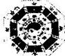

夫小干龙者，即干中之枝也。亦自大干龙分来。分龙之际，必有大星辰、崇山高垄为祖宗。张张子微云“分龙定起大星辰”是也。自此离祖而行，辞楼下殿，迢递奔走，亦与夫大干龙气势

相类，特长短不同。大干龙极长，动踰千里，或数百里。小干龙只二三百里，或百余里。又其次者，或七八十里。而其龙身行度，大略皆与大干龙无异。所分枝脚，亦多结乡村市井。其水源有长短不同，大聚小聚亦别。

《经》云“水源亦自有长短，长作军州短作县。枝枝节节是乡村，干上时时断复断。分枝擘脉散乱去，干中有枝枝有干”是也。其龙禀气亦自浑厚，亦不可以星体拘之。必多延蔓广袤，横亘牵连，行五六十里，或二三十里，其次者或十余里始一断。而断处亦是大关峡、大道路。而枝叶之山甚蕃衍，拥从护应峡场。此处龙气甚旺，枝叶间必有融结小穴。

《口诀》云“峡前峡后去寻地”是也。其龙行尽处，必以水大会为止，两河交剑处为尽。

《经》云“百里各有小干龙，两水生来寻曲岸。曲岸随水抱龙头，抱处好寻气无散”是也。亦是两水夹送，不可必其逆水。惟是结作之际，翻身曲转，逆势作穴，故有曲岸之水抱其龙头耳。其穴亦不在大穷尽处，亦多隐怪。将及结作之间，亦必连有脱卸，闪跌度峡，或连起峰峦，开帐穿心，而其手脚桡棹亦皆融有小穴。迎送护托之山亦是隔水相卫，远来聚会。水口之山亦有数十里之远。而门户亦须颖异，有华表、北辰、游鱼、石曜、龟蛇、狮象等沙。入局之际，亦必山水大会，朝案特达，左右周回明堂舒畅，内局紧固，外阳宽阔，罗城秀列，禽曜出现，多结郡邑市镇、冲要繁剧衙门，及王侯极贵基址。若结为阴地，则主分茅胙土、出将入相、皇亲国戚、文武全材、忠臣烈士、清修贤儒、神童状元，及巨万之富。子孙蕃衍，世代荣显，满门朱紫，与国同休，身后英灵，血食百世。

又有一等干龙，禀气凶恶而不清，本身带杀而可畏。虽经脱卸，不改粗顽；虽见变剥，愈见雄悍。却亦开帐穿心，分牙布爪，诸般贵格备具，亦有融结，但大福大祸，每每相半，或贵如淮阴

# 地理人子须知卷三

而卒夷其族，或富如季伦而不善其后。其最凶者，或如王莽之纂位，或如赵高之擅权，或为割据偏方之伪主，或为草寇大盗之头目。虽皆有富贵权爵、显赫威名，一时荣耀而不得其正，不令其终，反得罪于天地间，遗臭无穷，君子不取也。此干龙之不美者，寻干龙者又须识此。

上干龙虽有大干龙小干龙之不同，然其体势亦多相似，但以水源夹送之长短而验其大小。故除中国三大正干外，其干龙之大者犹至千余里，次者数百里，又其次者或百余里，或七八十里，皆以山之发祖，水之大会，原其起止也。然大龙则论大祖宗，小龙则论小祖宗。

《玉髄经》云“祖宗势大子亦大”是也。大龙论大缠护，小龙论小缠护。故曰“大龙迎送隔江水”，曰“外州外县山为伴”。又曰“护缠亦自有大小，大小随龙长短来。龙长缠护亦长远，龙短缠山亦近挨”是也。大龙论大水源，小龙论小水源。故曰“水源亦自有长短，长作军州短作县”。如中国三大干龙，则论长江、黄河、鸭绿江之水以为夹送也。大龙论大关拦，小龙论小关拦。故曰“大龙关拦数十里”。又曰“大地必有大关拦”。其规模愈大，则堂局愈阔。堂局愈阔，则关拦愈远。如冀州关拦，乃在碣石；长安关拦，乃在荆山；洛邑关拦，乃在泰华之类是也。举此为论，其他大小，皆可以类而推矣。故凡干龙入局之际，山水大聚，或结为垣，或结为局，大者为京几，为禁穴，为圣贤之地；次者为省城、藩镇，为郡邑市井，为王侯极贵之穴。所谓阳基则立郡建都，阴地则分茅胙土，惟干龙为然，枝龙之地，断然无此力量也。

然其行度之间，穿落传变，出帐入账，亦不计其重。辞楼下 殿、聚讲叠云、屯蜂聚蚁、尊极帝座、生龙紫微、天弧、天角、龙 车、凤辇、鼓角、楼台、负扆、御屏、霞帔、云锦、鹤驾、銮舆、 华盖、宝盖、冠盖、芙蓉、金花、飞蛾、三台、九脑、玉尺、千丝 坠、万石仓、金桥、仙桥、展诰、展帐、玉枕、玉屏、玉几、顿

# 5地理人子须知（上）

笏、连璧、御阶、幞头、席帽、金钟、玉磬、宝幢、降节、龙楼、 宝殿、帝释、堆甲、叠帐、穿珠、走马、飞丝、卷帘、玉陛、飞 帛、舒练、抛梭、佩珂、芦花、芦鞭、楼船出峡、红船出海、阁 门传宣、推车进宝、天驷出厩、仙鹤垂喙、玉蝉脱壳、群仙出洞、 群羊出栈、群雁穿云，诸般贵格，靡所不有。剥变骨节，过峡脱 卸，穿田度坂，横亘摆折，楼阁逶迤，珠丝马迹，藕断丝连，偷 藏脉络，奇踪异迹，崩洪怪石，天汉天潢、左侍右卫、养荫灵泉， 诸般巧妙，无所不备。

而其桡棹枝脚，虎踞龙翔，鸾飞凤舞，顿旗列鼓、垂帘挂蟆、 文官武库、天以太乙、列屏列蟆、带印带剑、垂珠垂缨、排仓排 库、侍人从马、金童玉女、旌节旗旄，诸般拥从，无所不具。分 牙布爪，脱骨换胎，自尊而卑，自粗变细，千形万状，难于毕举。 盖其行度之远，故能备具诸格之奇；气势之宏，故能发现英华之 妙；垣局之广，故可受乎众山众水献奇列秀之繁华；缠送护从之 多，故能尽乎重冈叠帐、挿戟列屏、交结门户、开锁罗城之完美。

《葬书》所谓“贵若千乘，富如万金”，又云“若怀万宝而宴息，若具万膳而洁齐”。卜氏所谓“三千粉黛，八百烟花”；张子微所谓“万卒影从成卫禁，千官拥护是朝廷”；范越凤所谓“若相公之升堂，若大将之登营”，此皆干龙结作之规模耳。故其力量宏大，发福悠久，不可限量。

【评注】

“凡言大地多大话，下士闻之心已怕，中士闻之心信疑，上士闻之心欲为。何不观之富贵家，子孙累世享荣华。盖缘祖龙势力大，食禄袭爵名世家。小地虽然亦小发，未及三世即歇灭。到此方知小易衰，大地富贵世不绝。”此以上为干龙之所贵也。

# 论枝龙

杨筠松《水龙经》千言万语，皆归重于干龙，盖举其力量之大而言之耳。然山脉分枝分派，干龙最少，枝龙极多。故论地只可以真伪辨，不可以大小拘。《经》云“大地难得小易求”，乌可谓枝龙地小而忽之？况干龙大地，有鬼神所司，苟无阴德，未可脾睨。而枝龙之地，在在有之，易于求索。故枝龙尤当究竟。然枝龙亦有大枝小枝，不可不辩。夫所谓大枝龙者，即枝中之干也。观之，亦先其祖山。

但干龙则论大祖大宗，枝龙则论小祖小宗。故虽大枝龙，祖山亦不是远高山峦，只小干龙驻跸处即龙祖矣。于此审其离祖分派，以原其始。要此处起有星辰，合五星正体中一星，或水或木，或涨天水、焰天火，或御屏土之类。盖其发脉，中落为上。自离祖以后，又连起有星辰，谓之应龙，亦曰应星。有此应星合格，落脉更是中出，即谓之出身好，前去必结美地。自出身后，迢递行度，看其穿落传变等格何如，若真是结地之龙，自然合格。

或起或伏，有剥有变，或大顿小跌，或左栖右闪，或横开阔帐而穿心中出，或之玄屈曲而摆折流行，或如生蛇之出洞，或如琢木之飞空，断而复续，伏而再起，两边枝脚随身拥护，不令风吹，或反借干龙作遮护幛托。及其过峡之际，或穿田度脉，抛踪闪迹，藕断丝连。脱卸之后，复起星辰，磊磊落落，或飞蛾降势，或华盖中抽，其本身枝脚摆列均匀，或带仓库，或带旗鼓，或带印笏，或带剑戟，或成天乙、太乙，或成文官武将，左侍右卫，前呼后拥。及将结作之际，又起高大星辰，以为少祖。自此山下，或二三节，或四五节即作穴场，而穴后一节之山，或束气结咽，或细嫩委曲，或闪断为峡，顿起穴星，融结天然之穴，乃为最贵。其两边缠送护托之山，欲其重叠拥从，或住于穴后，或侍立左右。而朝迎之山，则应耸穴前。下手之山，则逆水数重，抱转有力，乃为真结。

《经》云“枝龙身上亦可截，半是虚花半是开。若是虚花无朝应，若是结实护缠回。护缠尚要观叠数，一叠回来龙身顾，莫便将为真实观，恐是护龙叶交互。三重五重抱回来，此就枝龙身上做”是也。枝龙结穴多在尽处，则要天然明白为上，多是得水处结穴，故曰“未看山，先看水，有山无水休寻地”。多是下手之山有力，故曰“看地有何难？先观下手山”。又曰“有地无地，先看下臂”是也。龙之贵者，则有贵应。或印浮水面，或龟蛇交结，或车马联骈，或楼台镇塞，或罗星关锁，或旗鼓罗列，或日月对峙，或华表高耸。若此虽云枝龙，结作不及干龙悠久，然有此规模，亦非中下地也。若安插得法，主翰苑尚书侍从，方面文武之职，及富冠乡邑，一时荣盛，朱紫满门。

其次又有小枝龙，即枝中之枝者也。其大龙行去尚远，而于行龙身上，或大龙峡边，分落一枝，自起星辰，峰峦磊落，远者三五里，近者十数节。张子微云：“却有枝龙但数节，不作穿心人易识。譬如丞参簿尉衙，岂似正衙门户密。三节四节交节分，分得英华为子孙。”须要成星体，合龙格，有起伏，有夹送，而龙虎、应案、堂气、水城、下关、门户皆合法度，穴情十分明白，始为真结，亦主富贵。若此者虽是枝中之枝，来龙甚短，富贵不大，然发越极快，所谓寅葬卯发者，惟此为然矣。盖此等龙气结作力量轻，故多在龙大尽处成穴，必得水，必近堂，或临田蘸水之穴，故财禄易发。惟是龙短而无大力量，虽富贵亦不久远矣。

又其次，有小枝中之尤小者，谓之旁枝。或五六节，或三四节，结为小小形穴。若星辰秀美，穴情明白，明堂平正，下手有力，四山团聚，水口关拦，亦能发福，但不长久，亦无大富贵耳。

《发挥》云：“小小形穴，或得三四节，或得五六节，不拘穿心，不限脚手，出节便做形穴，仍有朝对关缠。若此者亦可安葬，贵可一二人，富可数十年，随其力量，皆能有验。但不广大久远。”盖出于大龙分漏秀气，可以刦效取应，而不可凭恃，以为子孙绵远计。然随材取用，亦不可以其龙短力轻而弃之也。

上枝龙虽有大枝、小枝、旁枝之不同，然要之，均禀于造化而有融结者，则亦不可弃也。惟要星峰秀丽，穴情明白。其穴多在龙气尽处。其大枝亦有龙气旺盛者，不在尽处。而结穴之外，有余气之山，转为用神，此其力量差胜。大抵枝龙之地，必要星辰耸拔，起伏分明，屈曲盘桓，逶迤走弄，枝脚桡棹均匀，护从缠托齐整，穴场藏聚，证佐分明，前有朝迎，后有盖送，左右周密，明堂平正，水城弯抱，四兽有情，下砂有力，水口交锁，罗城稠叠，乃为吉也。如或龙无起伏，星峰不秀，穴道模糊，下手无力，堂气不聚，朝案无情，水口宽旷，则无融结，不必顾矣。

已上所论干龙枝龙详矣。却又有等美地，只数节即结形穴，既非干龙，又非枝比，谓之随龙穴。依近省郡城市，即大干结作，山

## 建安杨文敏公祖地

水大聚处结穴，龙气大旺，寸寸是玉，只要穴真，又不必拘。虽来龙或只数节，亦结大地，以其与大干龙共祖同宗，朝应固已贵秀，局面亦自繁华。犹之近帝贵人，故曰随龙穴，不可以长短论也。但要结穴处自立门户为真矣。如福建杨太师祖地，近城里许，乃随龙穴格也，(图左)。

# J地理人子须知（上）

建安杨文敏公祖地：此地在建宁府城东里许白鹤山，系县府龙分脉，数节结随龙穴。入首顿起御屏土星。中垂正脉，铺展而下。左有白鹤寺，右有东岳庙，穴结山麓，临田蘸水，前吐毡唇。帖身白虎横抱过穴，成玉带文星，逆收溪水，以关内气有力。内堂紧小，外洋宽畅，前朝拱揖，得水藏风，真催官之地。葬时文敏公年十三岁，不数年即发中进士，登宰辅。子曰恭。孙士倧、士伟，俱进士。曾孙进士任吏部尚书、易副宪、亘南京户部郎中，曰昉、曰昂，俱知县。玄孙曰迈、宗、崇、疑、成、名、棐进士诸公，皆登科甲，登仕版者又数十人，福祉未艾。

杨氏又有白狸窝祖地，尤美。但此地葬后数年，文敏即发解，连第登宰辅，发越似乎太速。彼地三百年后始有应验，又似太迟。此造化之妙，不可谓无此理也。白狸窝祖地见水法卷。

## 依近郡甫随龙穴诸名地图具下

兰溪状元赵探花祖地：左地在兰溪县东二里，地名瑞垄。其龙自金华峰作祖而来，五星聚讲，复辞楼下殿，开帐磊落。正龙过峡去结县治。其左枝分落后，复开金水帐。中抽出一脉，逶迤成垂头紫气贵格。

兰溪状元赵探花祖地

《经》曰“垂头紫气号文

星，天下尽驰名。”面前大小双峰，成天马之格。断曰：“大马赶小马，富贵传天下。”葬后出唐渔石公唐龙，登进士，官至吏部尚书。其子小渔公汝楫，登嘉靖庚戌状元。至今富贵未艾。

其尽结者，为赵探花公志皋祖地，与状元地共帐。入首大飞蛾顿起太阳金星，开钳口结穴。两股直硬，元辰流长，虎沙顺水尖窜，不利初代。将及百年，乃出贵先。是探花之祖，精堪舆学，自择此地。至今人才富贵鼎盛。二妻各卜一地，一富一贵。

传奇：探花公之祖官县佐，精堪舆学，爱兰溪山水秀丽，自衢迁兰。二妻各卜一地，一贵一富。贵者乃飞凤冲霄形，课云：“一木冲天势挺然，文章四海有名传。虽然衣紫腰金贵，毕竟家无二顷田。”其富者乃仰天湖形，课云：“分明一穴仰天湖，仓库重重又秀孤。粟陈贯朽房房有，若要求官半个无。”今二房子孙贵者少富，富者少贵，果皆如其言。

杭州尚书祖地：右地在杭九曜逆生一脉，穿田过峡，顿作金土结穴。穴星两臂横展，漫。且右臂牵拽远去十余里，以作江头街阳基。此则横龙落脉，一节而已。俗眼观之，莫识其妙。爰是龙气大旺，寸寸是玉处。葬后生江公玭，登进士，官大参。子文昭公澜，官南京礼部尚书。孙晓会魁，官工部侍郎，赠尚书；晖，会魁，翰林修撰。曾孙曰圻，登乡魁进士，官提学副宪。玄孙曰铎，登进士，现任北部正郎，福祉方隆。

杭州尚书祖地  
  
艮山发祖， 寅甲卯过脉，转亥结顶， 换辛脉入首。作甲卯向。

# 地理人子须知一上

# 休宁陈尚书祖地

曾氏祖地在承天府东北。其龙发于大洪山，旺气融结为府龙大干。又分注到此，人首横列大帐，帐中抽出嫩条。廖金精谓之垂头紫气，清秀颖异。大凡木星，不下当头。此地左右两穴，虚中，正合倚杖葬法。张子微谓之天鼻穴。左右龙虎回抱，内外明堂环聚。近有玉带砂关收内气，远有三台峰献秀，外洋北湖宽畅，汉水盘旋，四势和平，三阳具足，龙旺穴奇，藏风得水，真美地也。曾氏曾祖指挥公始葬其地，继葬其祖知县东庄公。今阳白公父子进士，通显嗣续之蕃，详见彭泽祖地第二十册内。

休宁陈尚书祖地：右地在休宁县北一里，地名尼姑庵。其龙与县龙共祖，不悉述。分龙后开帐出脉，细嫩奇巧，为芦鞭，连起两节太阴文星，清秀均匀，展翅垂脚，俗呼雄牛赶雌牛形。正脉栖闪转身，逆水结穴。穴下铺坦余毡，蘸水临田，穴后抱托有力，前朝大小双峰秀异。但明堂水过穴返去无情，水口不交为疵耳。葬后出襄毅公信，登进士，官至兵部尚书。子篁墩公敏政，

登榜眼，官至礼部右侍郎、翰林学士，赠礼部尚书。

按：是地乘县龙旺气，格甚精俊。但系戍乾转坤申作穴，于天星非久永之兆。篁墩不察，襄毅之葬又卜南山乙辰，竟以受害。公言谈地理四书，极诋天星，既以自误，又以误人，惜哉！

杭州高相公祖地：下地在钱塘万松岭圣国寺后。其龙与杭州府龙共祖。此即数里之外，分出一脉，出身御屏高耸。屏下连珠数

# 地理人子须知卷三

节，走马到头，起仰高太阳开口做穴。吐唇平坦，二十余丈，地复峻陡。陡下却是寺宇。登穴从左手一傍入，到穴中不见寺宇并陡峻处，但见四面远峰矗立，钱塘江水洋洋。对岸金马门，门中贵人秀立。海门三山渺如拳。四神八将、三阳六秀皆相拱照。葬后出南宇公仪，登进士，入翰林，官至内阁大学士。今富贵未艾。

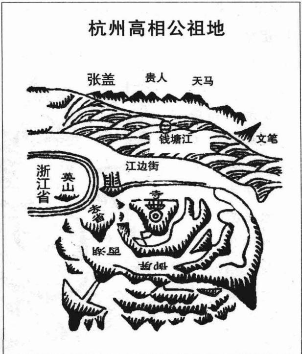

# 地理人子须知卷四

此一卷专论龙脉分支、垄两种。盖高山平地，形势不同，故支、垄之说不可不辩。故《葬经》云：“支、垄之辩，眩目惑心，毫厘之差，祸福千里。”是故尤当致辩于支、垄也。

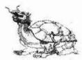

## 总论支垄

夫支者，平地之龙也；垄者，高山之龙也。其融结为地，力量轻重，大小贵贱，不以支垄而分优劣，但其形体有山峰平地之不同，故察识其情性之术亦各有异。盖垄龙有星峰形势，脉络分明，易于寻索。支龙千里平夷，一望无际，难于追求。

然垄龙则以磊落起伏、逶迤奔走为美，软弱、瘦削、丑恶、峻嶒为凶。支龙则以相牵相连、隐隐隆隆、界水明白、脊脉分晓为妙；高低不明，来势断截，分水模糊为假。

大凡垄欲峙于地上，支欲伏于地中；垄最忌于风吹，支尤嫌于水劫；垄结穴于山麓，支结穴于巅顶。《葬经》云：“卜支如首，卜垄如足。”又云“支葬其巅，垄葬其麓。”此支、垄龙穴不

# 地理人子须知卷四

同之大法也。其间变态不一，咫尺顿殊。真支真垄固所易辩，奈何有似支之垄，似垄之支，或支来而垄止，垄来而支止；或垄变为支而复为垄，支变为垄而复为支。亦有以支为坛垛而行垄于上，以垄为坛垛而行支于上者。又有垄内而支外，支内而龙外者。复有强支弱垄、急支缓垄、高支平垄、隆支隐垄、石支土垄、老枝嫩垄、偏支偏垄、半支半垄，及夫非支非垄，不可辩者。

故郭璞云“支、垄之辩，眩目惑心”，自非明师耳提面命，莫能别也。学者先须察此，此而有得，寻龙之能事思过半矣。

## 论垄龙

夫垄者，山也。山垄之龙，祖宗欲其高大，来势欲其雄伟， 星峰欲其秀丽，剥换欲其相生，过峡欲其周密，枝脚欲其蕃衍， 盖送欲其重叠，行度欲其活变，护从欲其稠密，穴场欲其藏聚， 四势欲其和平。此皆山垄寻地之要诀耳。然垄龙势险而有也，故 于险中求平，所谓高山之窝是也。葬当避杀乘生，

《经》曰“垄葬其麓”，为正法也。却又有等以垄为体，而得支之情性者，则大山垂脉，落下平地，变为支体。此阴中含阳之义也，时师往往粘葬山麓，而以前拖平地为褥。

殊不知龙势未住，微有龟脊，隐隐隆隆，穴落平地，法当枕球而葬。然阴者为强，固宜避球凑檐。奈何性慢？以此要插上，急其缓性。刘氏所谓“垄缓则人檐而凑球”是也。苟以垄法扦之，则败绝立应。此高垄之至难体认者，不可不察也。

44

# 论支龙

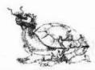

夫支龙者，平地之龙也。平地之龙，其祖宗父母、剥变过峡，与夫枝脚桡棹、缠托护从，大段与垄龙无异。

吴景鸾《口诀》有云“卧倒星辰竖起看”，故亦有开帐穿心，亦有华盖、三台、御屏、玉枕等格，但龙行地中，皆平面，倒地多阔大，难于检点，惟以相牵相连步其龙脉。高一寸为山，低一寸为水，察其隐隐隆隆之脊，或直或曲，动辄数十里，或数里，始有水分八字之峡，或有石骨微露踪迹，或有银锭束气之脉。

若前面遇水界截，则审随龙之水，及诸水聚处为明堂，以求穴向。其结穴处自然气聚，或平中有突，或开钳口，或吐唇毡，或微有窝，如鸡窠，如旋螺之状，必有龟脊牛背、草蛇灰线之脉，人首束聚结穴。

而此处须要高低分明，有水缠绕，或水溶注，或水朝人，方为的实。又须审其来历，有珠丝马迹、贴地梅花、落地金钱等格，决是美地。扦得穴真，葬得如法，富贵悠久。

若来历不明，切勿妄下，平地无气，易于绝灭。所谓来历不明者，乃来脉龙势一坦平阳，无脊可据，高低不分，全无界水，无过峡，无石骨证脉，无银锭束气，无龟背分水，无草蛇灰线、藕断丝连之脉人穴；或已经断而不相牵连，散漫无气，必无融结。其父母兄弟之脉各自分飞，平地之上，虽或忽起墩埠，孤单无应，必作他龙之用神；或是龙脚所带之秀气，为印，为笏，为金箱、环佩之类，或是水口罗星、游鱼等砂。

故廖金精云：“走珠墩阜在平地，三个五个是。”若孤单一突，又无分水度脉来历，未可便作平中之突而有融结。卜氏云：

“星散孤村，秀气全无半点”；又云：“滚浪浮花，随风落叶，皆是无蒂无根，未必有形有气。”此皆平支龙寻地之要诀耳。然支龙平坦夷旷，故于散中求聚，所谓平地之突是也。盖当揭高就脉。

《经》曰“支葬其巅”，为正法也。却又有等以支为体，而得垄之情性者，则直如掷枪，急如绷线，术中谓之倒火硬木，此阳中含阴之义，法当避杀粘檐，架折而葬。刘氏所谓“直急则避球而凑檐”是也。但阳者为弱，本合凑入，奈何性急？以此要缩下，缓其急性。苟以支法扦之，则凶祸立应。此平支之至难体认者，不可不知也。

已上所论支、垄，大法如此。但垄之星峰易辩，支之脉络难明，前辈谓支龙难于垄龙，尤当细察。兹故特集诸家平支之说附下，庶互有发明云。

《葬书》云：山贵平夷，土贵有支。支之所起，气随而止；支之所终，气随而钟。观支之法，隐隐隆隆，微妙玄通，吉在其中。

又云：地有吉气，土随而起。支有止气，水随而比。势顺形动，回复终始。法葬其中，永吉无凶。

杨筠松《龙经》云：坪中还有水流坡，高水一寸即是阿。只为时师眼力浅，到彼茫然无奈何。便云无处寻踪迹，直到有山方始识。如此之人岂可言，有穴在坪先自失。只来山下觅龙虎，又要乳头始云吉。不知山穷落平处，穴在坪中贵无敌。痴师误了几多人，又道藏埋畏卑湿。不知穴在水中者，如此难凭怕泉沥。盖缘水涨在中间，水退即同干地力。且如两淮平似掌，也有军州落窠沥，也有英雄在彼中。岂无坟墓与宫室，只将水注与水流，两水夹来是龙脊。

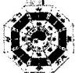

又云：莫道山高方有龙，却来平地失其踪。平洋龙从高处发，高起星峰低落穴。高山既认星峰起，平地两傍观水势。两水夹来是真龙，枝叶周围抱处是。莫令山返枝叶散，山若返兮水散漫。

.外山百里作罗城，此是平洋龙局段。星峰顿伏落平去，外山隔水来相护。平洋仰面似鸡窠，隐隐微微立高埠。便从立埠觅回窠，或有勾钳或如螺。勾钳是案螺是穴，水揖明堂气聚多。四傍水势如城裹，水绕山回聚一窝。霜降水涸寻不见，春夏水高龙皆现。此是平洋捉龙法，过处如丝或如线。高水一寸即为山，低土一寸水回还。水缠便是山缠样，缠得真龙如仰掌。窝心掌里如乳头，端然有穴明天象。水绕山缠在平坡，远有山冈近有河。只爱水环抱身体，不爱水返去寻地。水抱方有山来抱，水不抱兮山不到。莫道高山龙易识，行到平洋失踪迹。藕断丝连正好寻，退卸愈多愈有力。

又云：大梁形势亦无山，到此寻龙何处是？识得星峰是等闲，平地寻龙最是难。若无河流与淮水，渺渺茫茫不见山。河流冲决山断绝，又无石骨又无脉。君若到彼说星峰，一句不容三寸舌。又云：十里半程无冈岭，平洋沙渍烟尘迷。到此君须看水势，水势莫问江与溪。只要两源相夹出，交锁外结重重围。又云：凡到平洋莫认踪，只看水绕是真龙。又云：高山大垄峰多秀，不似平原一锥卓。又云：也曾见穴在平洋，四畔周围无高冈。

又云：上智寻龙观气脉，指望高山散踪迹。相连相接下乡村，失迹遗踪细寻觅。气逢水界有住期，如缉悠悠细消息。平洋大地无影形，如灰抛线要君识。相粘相牵寻断绝，尽是平洋真口诀。过时如雁列深云，藏时犹似泥中鳖。平洋相并盏中酥，落在坪中谁辩别？

杨筠松《画荚图》云：平地之脉，如草中之蛇，灰中之线。只看水分水聚之中，便是真气融结去处。又曰：临田观穴，不问大小八字，只看上面形势，分晓下面证佐。或唇或口，便为真气正穴。又曰：平坡之脉如掌窝，水聚交而不流，锁断真气，便是关门立穴之处。仰看上面脉，必有翅翼，如灯影穿壁，轻薄而不动，自有高卑。

# 地理人子须知卷四

又曰：高山落落平田，若有火嘴，要看尖尽处；若开钳口，谓暗火开红。此是火放灰中，似见火红。如尖嘴不开钳口，谓之死火带杀，不可葬。

又曰：龙到平洋临田结穴者，上有来，下无出脚，但见田塍面前兜转，似带，似娥眉拱护，此上是穴。

又曰：龙落平坡，日久年深，人开成田地，要看两边形势，田墈一层低一层，如急浪下滩。细寻前面水势回环，两田如月角兜转，始是真龙作结之处，谓之浪花里滚月。又曰：高山行龙，势落平地，无踪无迹无龙虎，形如铺毡展席，散如碧玉之纹、浪花滚月、雪里飘梅，如灰中之拽线，如草里之寻蛇，详加目力，细辩阴阳。切要诸水聚堂，朝对尊严，球檐下合分明，气脉自然融结，沙水来去得位，门户重重关闭，坐下宾主有情；又要明堂如锅底，四围不倾泻，水口不通舟，可谓吉地矣。

陶公《捉脉赋》云：支阜平夷，如灰拽线，悠悠而缩瓜藏形， 隐隐而无头无面。岂知遇水为真，乘风则散。又曰：大地平洋回 环，四顾得水藏风；时人罕遇。又曰：鸡鸣犬吠，闹市烟村，隆 隆隐隐，孰探其原？若乃断而复续，去而复留，奇形异相，千金 难求。折藕贯珠，真机茫漠。临穴坦然，诚难拦摸。障空补缺， 天造地设，留与至人，先贤难说。

张子微云：中原平地及湖乡，行龙人地至难详。寻得龙来无穴下，茫茫阔远何相当？此名天平只看水，水绕回环是穴中。若还舍水去寻穴，望望皆平无定踪。龙如逢水穴方止，无水拦断去不穷。诸公记此水龙诀，不与冈山一例同。

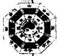

刘氏云：中原，百里千里皆为平地，虽有高形可寻龙脉，无穴可下。盖龙之隆隆隐伏，间有得见处。然到作穴，又无定踪，只看水之曲折如何。水若环绕，拦截穴头，固为易见。不然，水亦在前或在后，弯曲之处相当，即可定穴法。如无水处，虽有穴，亦必非龙脉尽处，不为端的。若以山乡之法取之，则失之矣。

廖金精《泄天机》云：更有平洋局又别，倾廪为君说。星辰原出在高岗，撒脉下平洋。高冈聚讲与过峡，行龙皆一法。撒落平洋始不同，切莫失真踪。地有高低即山水，节目同一体。远山近水两旁缠，脉似藕丝连。倒身龙格隐复现，脉上行时见。隐隐隆隆正好寻，寻得值千金。又曰：平地龙神观水势，认取原无异。

范越凤《洞林秘诀》云：平原旷野，茫然数百里之远，视水所归，则知来山。左右两阜拱接分明，可以藏车隐马。有盘曲之水，朝向之流，乃第一地也。高山平原本无二说，要以形势为本。观其来历绵远，气象环合，高山无悬崖崩破之害，平原无断垄横堑之绝，乃叶吉卜。故阴阳家贵于心得意解，不可执一。又曰：相平地之法，四顾审其土脉，观其流泉，得水为上也。

吴景鸾《指南》云：古人谓大地落平洋，盖以其祖宗发脉而来，中间剥变过度处多，气脉既全，便无力亦水深土厚，此平洋所以为大地。然而平洋龙法，非俗眼所能寻识，多是高山大垄，忽然撒下平坦，人但见山势已尽，而不知水分八字，界过护从，送出正龙，一脉如丝如线，在此处藏踪闪迹，直抛过前面去，却微微突起三五七个平低山阜出来，或土洲之类，牵连而行。又复跌断，却去前面，或作突中窝，或作窟中突，宛然成一天然之穴。其做穴处，四神八将，自然应副，堂局水城，自然回抱。乍看似无好处，细玩却有妙理。故平洋地所以难寻而又难识也。

《明山宝鉴》云：平洋大地，认水为龙。水势若回，龙亦随 住。一丈之山，胜彼千丈；一尺之山，胜彼千尺。

《寻龙歌》云：平洋大地无龙虎，杳杳渺渺寻何处？东西只把水为龙，下后出三公。

《入式歌》云：茫茫四畔无龙虎，君欲寻龙向何处？地师只把水为龙，交流便是龙归路。

# 地理人子须知卷四

卜则巍云：穷源千仞，不如平地一堆。又曰：水星多出平地，妙处难言。又曰：或隐显于茫茫迥野。又曰：平中得一突为奇。又曰：仿佛高低，依稀绕抱。又曰：地卑处切忌泉流。又曰：平地起培壤，一东一西。又曰：平洋地当斟酌，不宜掘地及泉。又曰：平沙落雁偏宜水，泊岸浮簰不畏风。又曰：势如波涌，何须卓立之峰？脉若带连，何必高昂之阜。

《二十六脉歌》云：仙掌脉，少人知，平洋不怕八风吹。但寻真脉堪埋玉，休管傍人说是非。水若抱龙龙抱水，背剑斩砍自由伊。

《三十六穴歌》云：平洋寻取地中凸，覆鼎真奇绝。顶上安坟最可求，迎取水来朝。

曾葛溪云：大山撒下一龙，穿田过峡，失脉失踪，不见融结。旷野茫茫，无可捉摸。此乃愈剥愈精，愈换愈嫩，不肯暴头露面，一向藏踪隐迹。或奔溪涧江河，或入人村闹市，或趋湖泊田塘，或出旷野田州。隐藏出没，如江中拖练；藕断丝连，如蜘蛛坠楼，流星渡汉。抛球走珠，铺毡展席，金盆荷叶，如此等象，只看安穴处有无皮肉头面。如明堂藏聚，水路迁回，近应有情，缠护相照，此等之地，最为绵远。

吴景鸾《口诀》云：平洋之地，坦荡迥野，踪迹隐伏，散涣依稀。虽无峰峦之可证，亦有脉络之可求，须要辩其来历祖宗，以看出身。降势撒落平洋，分毫之高者即为山，分毫之低者即为水。或隆隆似有，或隐隐如无。及至落穴之际，亦必微有形势之可指。山水趋迎，气脉藏聚，如露珠注在荷叶之中，乃为真结作也。

张紫琼《俯察》云：平地龙虽说愈剥愈嫩，愈换愈精，也要穿田过峡处不被风吹，不遭水劫。出身太长，须要旁有金箱玉印、偃月七星、太阳太阴夹照为吉。左右随龙水交会入首，或作铺毡土、棋秤土、倒地木、浮簰水、水泡金、波浪金、波浪水及落地梅花、落地金钱、蜘蛛结网、没泥龟、没泥蛇之类，方是融结。若平田渺渺，更无高下，虽有堂气，

亦不结地。

赵缘督《穴法》曰：平地有突，气涌而生，绝胜万仞。仙眼难明，只观水势，便见真情。水如不绕，穴法无凭。

谢子期云：迥野之脉，体段不一，有平坡渺渺茫茫，如铺毡展席而来者；有田层层级级，若水之波而来者；有起峰墩，如星珠龟鱼而来者；有微露毛脊，如浮沤凫鸟而来者。是皆地之吉气涌起，故土亦随之而起凸也。其来也，两边有水以送之；其止也，左右有砂以卫之。且明堂宽正，又得横水拦之。外阳、远案在于缥渺之间，而四围阴沙仅高数寸而已。此皆平洋龙之贵也。

张落魄云：平湖之脉，坦夷旷荡，却是支龙行度。其体段若盏中之酥、云中之雁、灰中之线、草里之蛇。或沈潜，或无影无形，或藏幸而失迹遗踪。生气行乎其间，微妙隐伏而难见，全在心之智，目之明。以高一寸为山，低一寸为水，察其支之所起，辩其支之所终。起则气随之而始，终则气随之而钟。若脉尽而水止，界合分明者，此平洋之大地也。

观物祝公泌云：郭景纯曰“支葬其巅”，盖以平支龙必须起微突处，谓阳来阴受，方是结穴。若无突，要开钳口方有穴。故曰“平地不开口，神仙难下手。”

永和周氏云：平洋则山不拘于高，水不拘于深。但遇有尺寸高低，即可以辨。又云：在山者颇易看，在平洋者最难识。陶公所谓“顿起则时人晓会，牵连非达士难言”是也。盖如灰中拽线，草里寻蛇，沙里拣金，泥中藏鳖，云中腾雁，盏里浮酥，隐而不露，断而复续，并以两边导送之水为验也。

廖金精穴法中有没牛吹气穴诗云：没牛吹气失来踪，隐隐伏真龙。昂头些子如吹气，没牛泅水势。左回右抱脉微高，大则公侯小富豪。又云：龟鱼螺蚌形，宛如水中生。水中自有真龙聚，此地传千古。

# 地理人子须知卷四

梁箬溪云：龙势洋洋落大坪，连天接野不分明。隆隆隐隐寻踪迹，曲曲弯弯断复生。忽然有突联三五，认取开钳是穴情。定要水来环抱穴，砂如牛角两边迎。

以上诸家之说，各有攸当。大概平洋龙法，以高一寸为山，低一寸为水，隐隐隆隆，看两边分水，以认来龙之过度，突起支阜，以认穴道之融结。又须有四畔罗城秀峰，前应后照，如列屏铺障，相与拥护，乃为尽善。大抵以得水为上。卜氏云“如在平洋，先须得水”，兼阴阳二宅言之矣。平支龙穴最难辩认，故引证诸家之说以明之，当详察焉。

# 地理人子须知卷五

此册专论龙身行度知识。盖龙之行度上有太祖、少祖，以及父母、胎息、孕育、入首诸格，此皆观龙之大旨。审龙者诚于此而有得，庶几知其要归云。

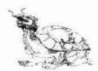

论太祖山

夫寻龙之法，当源其所始，故先察祖宗山。《经》云：“寻龙须寻祖与宗，不辩祖宗何足语。”《赋》云：“问祖寻宗，岂可半途而止！”盖山之有祖，亦犹木之有根，水之有源。根大则枝远，源深则流长，自然理也。是故寻龙之法，必先究祖宗。知其祖宗，则龙之远近长短，气之轻重厚薄，力量大小，福泽久暂，皆可于此而察识之矣。

《龙髓经》云：“只用源流来处好，起家须是好公婆。”公婆即祖山也。卜则巍曰：“祖宗耸拔者，子孙必贵。”子孙指穴而言。皆谓有特异祖龙，必结富贵美地。故寻龙必先观祖宗山。即其远者而名之，有所谓太祖山焉，也曰始祖，以其去受穴处甚远，如人之有始祖远宗也。然此太祖山，必须高大迥异，或跨州连郡，

# 地理人子须知卷五

延绵数百里，大者如名山五岳，小者也必高大雄冠于一州一郡，又小者，亦须冠于一邑一方，乃可谓之太祖山。其形则巍然高大，耸入云霄。或如龙楼宝殿、千丝坠、万石仓等格。其发出枝派蕃衍，不可悉数。如人之太祖，子孙众多，未易历举者也。祖山既高大异常，其天时将阴晦，则有云雾生其巅。廖金精云“祖宗高顶名楼殿，常有云气现。”杨筠松云：“先寻雾气识正龙。”

又云：“寻龙望气先寻脉，云雾多生在龙脊。春夏之交与二分，夜望云霓生处觅。云霓先生绝高顶，此是龙楼宝殿定。”故观云雾之所生，以察山龙之太始，亦一诀耳。既能认太祖山，以次审其出身行度，及父母胎息，以至受穴之山，皆于此原其始矣。

# 论少祖山

寻龙之法，须究祖宗。然太祖远宗犹恐未真，又当于少祖察其来历，审其美恶，庶为亲切，故不可不论少祖山也。夫少祖山者，即近祖次宗，廖金精又谓之主山。龙行既长，离祖已远，各分枝派。将结穴处，忽起高大山峦，不过数节，即结穴场。其高大山峦，谓之少祖山也。若其山分枝尚多，结穴尚远，犹未可为少祖，乃是驻跸山。住脚星辰犹是远祖。若是少祖山，则自此山下，去穴不过数节。如节数太多，便谓离主星远，力轻气弱，又须再起主星方好。

廖金精云：“若是山家结穴龙，定起主星峰。”言结地龙必有少祖山作主星也。又云：“二三节内穴星成，福力实非轻。节数远时福力少，再起主方妙。”言穴不宜去主山太远也。又云：“主星大小合龙格，造化便可测。”言少祖山须合得龙家诸格，方有融结造化。故凡美地，必起近穴少祖山。而少祖之山，必然奇异特达，秀丽光彩，或开大帐，或起华盖宝盖，或作三台、玉枕、御屏诸般贵格，或成冲天木、献天金、涨天水、焰天火、凑天土等星辰。

既有此少祖山合星体，成龙格，必不虚生，定有融结。若此少祖山倚斜不正，孤露崚嶒、瘦削破碎、臃肿粗恶、巉岩带杀、丑陋委靡、软弱困顿，种种凶恶之形，不成星体，不合龙格，则无融结。纵有穴场、堂局诸般可爱，亦为不吉，的主凶祸。或误下之，行至此节，各以类应，祸不爽矣。

太祖少祖山图式

右二：此则离太祖山以下迢迢而去，更无高大星辰作少祖山，委靡入穴，力轻气弱，乃凶地也。

右一：此则起少祖山以下节数已多，离少祖远，却又再起高大山，又为少祖，一节即入穴。此地力大福厚，极吉。

左图：此则将结穴，先起高大星辰作少祖山。自少祖山下，数节即结穴，极有力，为吉地也。

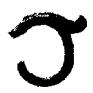

无少祖山重起少祖图

# 穴近少祖图 少祖不吉图

左一：龙自少祖山下，如生蛇摆动，入首结穴，亦为吉地也。不必拘其大起伏，只要曲动，龙格中谓之水木芦鞭，极贵。吴景鸾《口诀》云：“入首节内有芦鞭，当代儿孙中状元。”

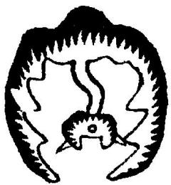

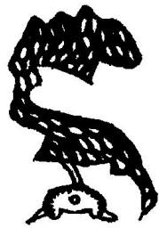

右二：龙虽有少祖山，但丑恶不成星体，不合龙格。出脉又是偏落受风，纵有形穴，亦不可下，主败绝。

不论后龙长短，只入局忽起少祖，高大尊严，挺秀冠乎群山，以作主星。自此山下，只一节或二三节即结穴，而穴场正座此星，贴近枕靠有力者，其地力量大，发福速，如建宁陈副宪祖地其格也。

建宁陈副宪祖：右地在建宁府西北河西。其龙来远不详述。入首顿起主星，高大尊严，挺秀迥异，护从周密。正脉从中落下平地，穿峡起平坡即结穴。

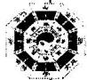

穴场正座主星有力，开钳吐唇明白。前案低伏，近身如眠弓，抱穴有情，以关内气，逆收大溪之水。内堂水口石墩如印。左右映带，前朝秀丽，内堂紧巧，外洋宽畅。葬后即出羽泉公纪壬午年葬，甲申年羽泉生，登嘉靖丙辰进士，官副宪，封君纵建宁陈副宪祖地

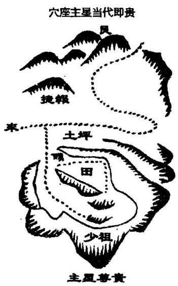

遐寿康宁，累膺诰封。诸孙济济，福祉未艾。

又德安杨方伯母地、承天张进士祖地，皆是少祖山近穴，当代出贵。二图具下：

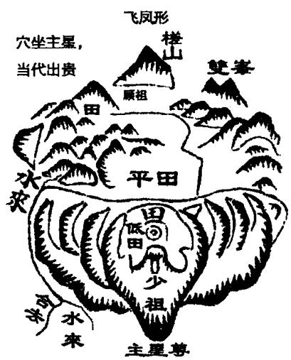

德安杨方伯母地：左地在德安府东北六十里。其龙自槎山作祖，磊落奔腾二十余里，乃大断过峡，翻身逆盘，为回龙顾祖之势。忽起主星，高大尊严，挺秀迥异，冠于群山。

正脉从中逶迤落下，平坡结穴。穴前吐出毡唇，左右掬抱有情。前对祖山如唐帽，近有文星正应，下关紧固，水城绕带，明堂宽平，后座主星尊重，得水藏风。离龙，扦丁山癸向。葬时次泉公芷方三岁次

承天张进士祖地

泉丙戌生，戊子年葬母，后登嘉靖癸丑进士，官至江西右布政，福祉未艾。

承天张进士祖地：右地在承天府北五十里，土名蒿河安平冲。其龙来远不详述。入局磊落，踊跃十余里。将到头，大断过峡，翻身顿起主星，挺然端秀，冠于群峰，为华盖贵格。中抽正脉，逶迤而下，一节即过，复起大突结穴。穴后正座主星，势甚尊严。左右两掬包顾有情。下关重叠。前朝群峰列秀，三尖卓笔正朝。近案拜伏，罗城水口周固。系酉兑庚辛龙，扦卯乙向，当代即出明宇公时照、载寰公坤，连登科甲。嘉靖乙巳年葬地，戊申年张明宇生，庚申年载寰公生，癸未进士。

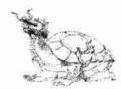

## 论无少祖山

凡平冈之龙，多只逶迤而来。若行度摆折屈曲，亦不必拘其必有少祖山方为大地。只要将入穴际，二三节内跌断束气，结咽过脉，此即同有少祖山也。盖山之一起气固旺，而山之一伏气尤旺，故不必拘于顿起高山为少祖耳。但其断处的以近穴为贵，一节即人穴尤妙。切忌受风，必须从山相夹护也。

平地之龙亦然，必于穴后有束气脉为妙。而其束处要微高，有分水明白，则束气入穴有力，方为真切。盖平阳气多散漫，贵于收敛。既无墩阜可为少祖，必当以断处束气为准。或成银锭之脉，或有珠丝马迹、草蛇灰线、藕断丝连、龟脊牛背等形，则气束得聚也。穴场乘得气之聚处，乃是真融结。否则，散漫无证，纵有坪中突窟，亦认脉不真，不可下矣。

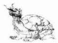

## 论龙父母胎息孕育

《经》曰“万里之山，各起祖宗，而见父母胎息孕育，然后成形。”是以认形取穴，明其父之所生，母之所养。卜氏云：“问祖寻宗，岂可半途而止？”又云：“胎息孕育，神变化于无穷。”是皆言龙之有祖宗父母胎息孕育，然后始成穴也。或曰：“先起高峰谓之祖，次起一峰谓之宗，再起左右双峰谓之父母。”诚如其说，则是父母置之无为之地，而其所生，皆祖宗耳。

# 地理人子须知一上

张子微已曾辩其非。而洪悟斋又拘于节数，谓自玄武顶一节为父母，二节为少祖，三节为曾祖，四节为高祖，亦太泥耳。若用其说，则自四节已上之龙又将何名？大抵龙之起身发脉处，必有高山大峦，谓之太诅。自此而下，辞楼下殿，迢递而行，又起高峰，即谓之宗。复行逶迤，奔腾磊落，其间小可星峰则不必论。直至将及结作，必要再起高峰，迥然耸拔，超异众山，谓之少

# 祖宗父母胎息孕育图

祖。自此少祖山下，或起或伏，或大或小，或直或曲，但以玄武顶后一节之星名父母。父母之下落脉处为胎，如禀受父母之血脉为胎也。其下束气处为息。如母之怀胎养息也。再起星面玄武顶为孕，如胎之男女有头面形体也。融结穴处为育，如子之成，出胎而育也。自少祖山至此，最关紧要，须是合诸吉格，束气清切，护卫周密，乃以为吉。诸家喋喋之论，总不必拘，无非欲其尊卑有序，大小有伦，自高落下，自粗变细，自老抽嫩，星辰之生克不逆，桡棹之长短合法，则得祖宗父母胎息孕育之妙。乃有生气融结而钟灵孕秀，造化存焉。依法葬之，福应如响。其或祖宗当高而反低，当大而反小，胎息当细而反粗，当嫩而反老，此则尊卑失序，大小无伦，凶气所集，不可下也。

# 论龙人首

“未论千里来龙，且看到头融结。”故凡观龙之美恶，及诸般龙格，只于入首穴后二三节、四五节内以至少祖山为紧切。审其龙势，若有起有伏，逶迤走弄，活动栖闪，而头面端正，星峰秀丽，枝脚随身，及有落、穿、传、变、台、屏、帐、盖、走马、珠串、芦鞭、王字、个字、之字、抛梭、展翅、飞蛾种种贵格，而随从之山及本身枝脚又起峰峦，如仓库，如旗，如鼓，如天马、贵人、笏印、金箱、宝剑、文官、武库、天乙、太乙等形以夹送之，此为真来。

此处融结，是我所用，亲切无疑，以其在近穴数节间也。似此之地，结作真，力量大，发福速。若少祖至近穴节内并无吉星，不合诸格，或懒缓怯弱，死硬臃肿，粗恶直长无枝脚，或枝脚拖泄，散乱尖利而成鬼劫，任是龙虎、明堂、朝案件件皆美，奈何坐下无龙，真气不钟，诸般美利，种种成空。切不可认少祖以上之龙特达可爱，而信庸师之言，谓“远龙奇好，必后代有贵，但初代不吉”，恕近慕远，希图后代之富贵而误下伪地，反消已福。

不知千里来龙看到头。若到头近穴处龙既不好，其远处虽有好龙，不能受用，或别有结作。其好龙固非虚生，但不来此处融结。此山既非真龙，必是真龙正穴之奴从，或为缠托，或为夹送，或作下手关拦，或作捍门水口之砂，或是正龙枝脚桡棹仓库等件。尤须检点，再去审其少祖分行之处，某枝委是真龙受穴之山。

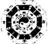

若是真龙，自然尊贵特异，宜于此山追寻正穴，必有真结。故审龙之要，必于入首近穴数节内为紧。譬如人之远祖，虽为王侯显贵，已在数十代之前。至于其祖父，贫困无聊，遂为贱役。

及其身，益伶丁不振，则其远祖之王侯显贵，安能庇及数十代后之子孙哉！远祖虽或贫困，至于祖父而崛起，为王侯显宦，则其一二代之子孙或受荫为官，或资产巨富，必能藉其余泽以享富贵，远祖虽贫何害焉？

此好龙所以欲其近穴，而远龙虽美，不可恃也。故凡观龙美恶及诸贵格，的于少祖山以下审之，合吉则吉，类凶则凶，祸福亲切，不差毫末也。

入首吉龙之图

  
图一

入首凶龙之图

  
图二

图一：此远龙不好，将入首近穴，剥变好龙，是吉地。但年代行到跌断后龙气不好处，即败，宜别求吉地接福。

图二：此则远龙好，将及入首近穴，变得不好，乃为不吉，主凶不可下也。

上审龙入首美恶，定地吉凶，乃紧关口诀，甚为简要。大凡美地，皆以入首龙吉而致福应。如浮梁戴尚书祖地，后龙甚弱，而人首为美，亦出尚书。铅山费状元祖地，来龙甚远，而近以入首三者为课，可见寻龙固当究远，而尤必以入首为准也。二图具下：

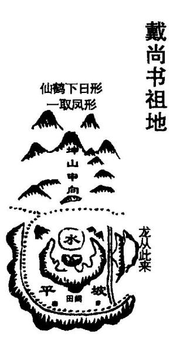  
图一

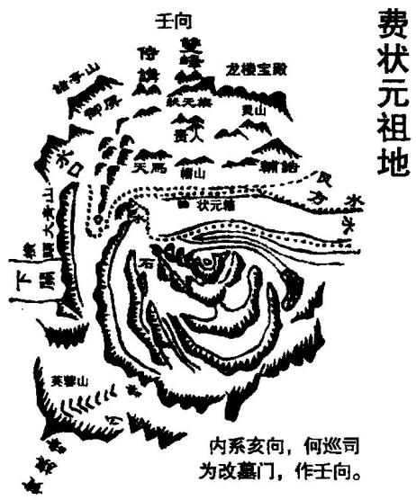  
图二

图一：浮梁戴尚书祖地，在浮梁东乡，后龙甚弱。惟到头起三台，一节结穴。左右抱卫，明堂平坦，内外应证。葬后初代出恭简公珊，官至尚书。又进士数人，科第不替。出一神仙，名曰铁仙。

图二：铅山费状元祖地，铅山县二十八都，地名乌石山。其龙起自黄旗峰，迢递百余里，历上七峰至徐源岭，过峡顿起合珠山，重重开帐，不及详述。将入首，穿田起玉枕落脉。左右小山夹照，状如日月。

正脉中起穿心，成三台。两畔均匀可爱。中落一节结穴，龙格甚贵。只是穴星独高，似露。上聚似峻。护山低伏，穴上左右，一望青天，似寒。穴前右砂俯水，似撺。阔坂明堂，似旷。横峰前朝，群山似乱。下关大琛山甚远，似宽。对面观之，本身下手无情，诸山顺奔，势随流水，似不团聚，不入俗眼。殊不知穴山独高众山低者，高为尊也。

穴前虽峻，“上聚星辰若开口，穴下不畏陡。放棺定有坦平

坡，微乳或微窝。”正合此也。左右虽低，微窝紧夹，藏车隐马，不畏寒也。虎沙顺水，乃是明曜，而非撺也。外堂虽阔，内堂已聚，不为旷也。前朝虽乱，然皆堆堆累累，如状元旗，如笔，如笏，如贵人诰轴、天马、席帽，皆合贵格。《葬书》所谓“若具万膳而洁齐”也。下关虽远，“干龙缠护隔江河也”。况信河之水朝入明堂，而河中大脚石截有力，又有绻绩石塞镇，叫岩山与大琛山交固关锁，真至吉之地。葬后四纪，长房三中科第，连丧其二，议欲改葬。丰城何巡司见而奇之曰：“玉枕龙，日月峡，隐隐三峰向前插，状元宰辅此中生，兄弟叔侄同科甲。状元出世矣，何可改也！”是时，文宪公宏已十岁余，不数年果大魁天下，官至太保。子茂贤登进士，官郎中；茂良官太守。玄曾诸孙皆贵。

文宪公弟清湖公与侄探花茂中同科，九子皆贵。望湖公茂文与兄茂尹同科，参政公瑄与兄珣同科。礼部尚书钟石公寀与侄茂和同科。尚书公子茂学官太守。侄茂乐官郎中。今唐衢公尧年登进士，跻显宦，延之太仆寺丞。华，礼部主政。茂谦、茂稷诸公俱任京职。父子兄弟叔侄同朝，果符何氏之言云。

按：此处是龙真穴的。来龙虽远，至入首，穿田而起玉枕，又大断而起三台。中落一节结穴，为至贵之格，状元由此而钟，宰辅由此而孕。故观龙的以入首三节为准也。前砂子峰独秀，应文宪公戊子生。三台系丁未龙，故公以成化年间丁未状元也。

# 地理人子须知卷六

此一卷专论龙之出身，及剥换、过峡、桡棹、护送之详。夫观龙之法，既明其太祖、少宗、父母之节目，又当审其出身、剥换、度峡、桡棹、护送之玄微。盖自祖而宗，自高而下，迢递奔走，虽奴从之龙，凶恶之山，其势相类。苟无术以鉴之，则吉凶莫辨。故必于其出身处以原其所始，于剥换处以察其所变，于过峡处以审其所度，于桡棹、护送处以观其贵贱美恶，则龙之真伪吉凶情状自判然矣。

## 论龙出身

龙之出身，乃祖山发脉离祖分行处也。盖一祖之下，必分数龙，其间美恶吉凶，端倪已兆。若此出身之际特异不凡，前去必有穿落传变，融结富贵之穴。如或此处出身不美，纵去结有形穴，亦非吉地，不必追寻。其出身吉者，或宏开阔帐而穿心出脉，或连起数峰而耸拔不凡，或辞楼下殿而磊落，或叠云集蚁而缤纷，或五星聚讲，或七政连班，正穿正出，中起中落，夹护拱照，气象轩昂，枝叶蕃衍，步骤活动。《玉髓经》云：“祖宗生龙百龙共，生出来时有轻重。

大龙重处在中央，其次龙行枝叶长。”吴白云云：“寻地须先认祖宗，更于离祖察行踪。辞楼下殿峰峦秀，预识前途异气钟。”董德彰云：“大凡龙脉初发处，若屈曲如生蛇之下岭，而两边有蝉翼护带者，前去必结大地。其出身之不吉者，则瘦弱萎靡，不起不伏，不活动折摆。”张子微云：“龙无星曜低低去，此是贱龙出身处。”大抵龙之出身，如人之出处，出身不正，必非贤良，纵有显位，奸邪误国，天下受其祸。出处之光明正大者，必完名全节，天下受其福。龙脉出身何以异此！然又不可拘，固有前出不美，而后复变吉者；亦有前出大吉，而后却变凶者。如人之先虽凶恶，而后能改过迁善，不害其为君子；先虽正大，而后乃变节为恶，终不免为小人。

凡此之类，尤当详辨，不可忽略。此而有误，则认凶为吉，指吉为凶，是非颠倒，祸福谬戾矣。”

下列龙脉出身图，姑以为式，理难定拘，智者触类旁通之可也。

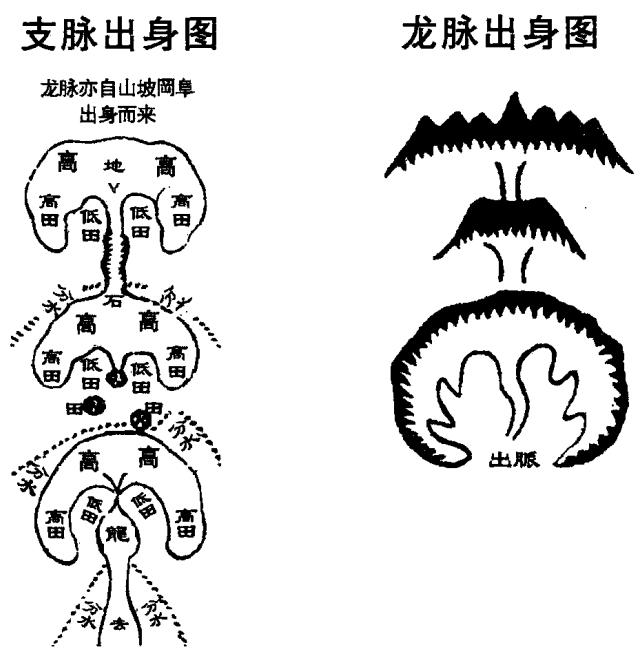

# 论龙开障

《发挥》云：“大凡开幛穿心，须是旁起而肩末如弓稍，肩如人有肩，稍如弓有稍，横铺阔远，始为正穿心。”故此开幛穿心极贵，阔者或十数里，或五六里，狭者一二里，或三四里之远。大龙布置，百里、二三百里者，不在此例也。

凡此方为正穿心。三五丈间不足谓之正穿心，不过为中心正出之龙耳。但此开幛穿心亦不多见，间见三五节，或止一二节，但要其地传变不杂，气脉不散漫，帐中而行，或之玄飞走，或抛梭袅鞭，或蜂腰鹤膝，或鸾凤飞翔，或蛇回蝉蜕，或登梯降级，不一而足。只须龙真脉的，不必全泥穿心，此皆吉地。

又有一种穿心，稍头又起圆峰，高峻丰厚者，自带仓库随行也，主大富盛。又有一种，开幛之后，丝线穿出，特立秀峰者，幛内贵人也，主大尊贵。又有一种，开幛之后，两腋特起秀峰，不与本身联属，两旁高耸端正，此暗库星也，主其家富盛，爱妾

宠妃，自收典质之状。然此等龙极为希罕，蜈蚣节已为难遇，况开幛穿心乎？

至于贵人、仓库，尤为少见矣。然此开幛穿心，故为贵格，亦未可便定前是何地，又须看前后穿变应带。

有一种祖宗不好，胎息偏伤，中间或有开障穿心，或一二节气旺者。及至穿出处，或分枝

开帐穿心图式

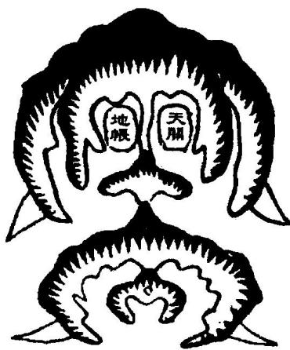

分柯散乱，或为断绝空亡，终不融结。此为假龙作假穿心也。然何以辨龙作假穿心也？

盖从祖宗以来，已觉偏斜丑陋，此可见一也：穿出之后，又复缓漫散乱，此可见二也；入穴之际，无神无气，臃肿昂雄，轻重不等，收拾不匀，堂局破碎，朝应无情，此可见三也。三者无取，虽有穿心，盖游龙远出，中间偶有一二节妙合贵格，然前后无足观，纵有开幛穿心，起肩结稍，亦何用也？

廖金精曰：“龙开幛而出者，最为有力。金水脑为上，水星次之。要形如幛模而角分明，有带下垂方是。中出者为上，两角出者次之。巨石在右为天关，在左为地障。形类龟蛇、串珠、印剑等格尤妙。得此护脉方可。如无，得障角遮护过亦可”。

开帐原是龙格部，但此既论出身，则开帐亦是相连的，姑言其概。诸帐格详见龙格部下。

## 论龙剥换

剥换者，变化也。龙之形体，自老变嫩，自粗变细，自凶变吉，皆造化之妙。杨筠松云：“一剥一换大生细，从大剥小真奇异。剥换如换好衣裳，如蚕蜕壳蛾脱筐。”廖金精云：“脱卸剥换粗变细，凶星变吉气。”卜氏云“星以剥换为贵”。是皆谓龙贵于有剥换也。且如金星发祖，剥出水星，水星又剥木星，木生火，火生土，土生金之类，迢迢生峰，节节合格，是为富贵之地。

若遇相克，贵有救星。如金星行龙，木星作穴，金克木，本凶，左右得火星以制之，或得水星以助之，亦为吉也。以类而推，万不失一。《九星变》篇云：“凡观一星便观变，识得变星知近远。远从贪狼至破军，换尽龙楼生宝殿。一剥一变形不同，岂可尽言顾祖宗。君如识得变星法，千里百里寻来龙。”然九星之变，只取贪、巨、武、辅、弼五者为吉，谓其体势端正，头面光彩，尖则清秀，圆则肥满，方则平正，故吉。

而文、廉、禄、破四者为凶。以其体势欹斜，头面臃肿，崚嶒窜险，恶石巉岩，故尔。此五星九星变剥吉凶之大概也。凡远祖高峰是凶星发龙，却跌断过脉，退皮换骨，变出吉星作少祖山而结穴者，亦为美地。若后龙节节是吉星，中间一二节吉凶不明者，只小凶而已。若远祖是吉星，而剥出凶星作少祖山结穴者，乃为凶地，不可下也。后龙节节是凶星，只退换入首一二节是吉星结穴而葬者，亦得一代二代发福。驳到凶星，即主祸败。

后龙节节是吉星，只入首结穴一节是凶星，若穴情好，初代虽见退败，至二三代剥到吉处，却又发福久远矣。此以剥换星体吉凶，观前后节数，占年代、验祸福之大概也。

若其起祖迢迢，行至入穴，全无跌断过峡，则是无变化，必不融结。《发挥》云：“龙无传变穿落，则无造化；不经退卸，则无秀气。”虽有奔走之势，摆折之形，亦为伪龙，多是奴从之山，不必寻穴。

纵有形穴、龙虎、案对、明堂诸般合法，奈何龙无脱卸，无变剥，气不全，脉不真，徒有杀气凶恶，乃花假之地。故凡寻龙，见无过峡剥变，决无融结造化，不必追寻矣。

## 论龙过峡

相地之法，固妙于观龙。观龙之术，尤切于审峡。峡者，龙之真情发现处也。未有龙真而无美峡，未有峡美而不结吉地。审峡之美恶，则龙脉之吉凶、融结真伪，皆可预知也，真地理家不刊之秘诀也。盖龙行延长，必须多有跌断过峡，则气脉方真，脱卸方净，力量方全。

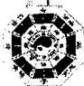

《经》云：“一断二断断了断，鹤膝蜂腰真吉地。”又云：“十条九条乱了乱，若是真龙断了断。”卜氏云：“一起一伏断了断，到头定有奇踪。”皆谓真龙之过峡多也。然峡亦有吉有凶，尤当细察。过峡之脉，欲其逶迤嫩巧、活动悠扬，如梭带丝，如针引线，如蜘蛛过水，如跃鱼上滩，如马迹渡河，如藕断丝连，如草蛇灰线之类为美。然须有送有迎，有打有夹，护卫周密，分水明白，不被风吹水劫为吉。

杨氏云：“一剥一换寻断处，断处两边生拥护。”廖金精云：“蜂腰鹤膝最为奇，大忌被风吹。”范越凤云：“度峡断跌，切忌水劫。”祝观物公《八段锦》云：“龙过脉，认踪由，高低脊脉莫模糊。最要两边生护转，却愁一水过横流。”

《龙经》云“莫令四缺被风吹，切忌溜牙遭水刦”是也。盖龙之过峡处，其气束聚，最怕风吹水刦，故必有护峡之山，八字之水，乃以为真护峡山。又喜合形像。廖金精云“两边遮护喜成形”是也。或如日月、旗鼓、天马、贵人、金箱、玉印、垂缨、串珠、龟蛇、狮象、剑笏、戈矛等形者，贵格也，前去必结贵地。或如仓库、厨柜、谷堆、烂钱、辨钱、摊衣、质库、银瓶、盏筋、倒击金蹲等形者，富格也，前去必结富地。然亦不必过泥形状，但以遮护周密、夹从有情为吉。若是真龙过峡度脉，自有两边护照之山远来相应。

《经》云“天弧天角龙欲度”者是也。其有峡不全美，而左边不足，则穴之左亦有亏：峡之右有空缺，则穴之右亦不周。及有峡中定穴高下、左右，并向首之说，皆天造地设，自然之应也。峡正出则穴亦正，左出则穴居左，右出则穴居右。又有正出而斜过者，则穴亦正出而斜倒；有侧出而正过者，则穴亦侧出而正倒；透顶出脉者，则穴居脚下；脚下出脉者，则穴居顶上。峡中左沙短，则穴前左沙必先到；峡中右沙短，则穴前右沙必先到。池湖过峡，前逢池住；干坪过峡，逢干坪住；石脉过峡，逢石曜住。旗鼓峡逢旗鼓住，龟蛇峡见龟蛇住。子午卯酉出脉，必作子午卯酉向，乾坤艮巽出脉，必作乾坤艮巽向，不离四字之中，余皆以例推。且其为格，有阳过，有阴过，有平地过，有穿田过，有池湖过，有草坪过，有半岭过，有高山过，有正过、斜过、明过、偷过、长过、短过、硬过、直过、大过、小过、远过、阔过。又有双脉过、渡水石梁过，及张子微《峡诀》有所谓妆台峡、台星峡、幢节峡、华盖峡、天池峡、平田穿珠峡、金箱玉印峡、双溪峡、宝剑峡、双龙峡、禁卫峡、圭璧峡、牛眠峡、石洞峡、惊蛇峡、乱茅峡、玄鱼峡、贯鱼峡、柳叶峡、重尸峡，凡二十格。

蔡西山《峡诀》有所谓双鱼峡、垂珠峡、莲花心峡、迎送峡、井栏峡、方胜峡、飞丝峡、三台飞电峡、金鱼佩峡、流星峡、钗股峡、玉带峡、方城峡、玉池峡。除删正外，凡五十九格。又有阳星九峡、阴星八峡，及三十六峡、七十二峡、阴阳台伏之说，高齐云、低印水等像，不可尽举。大抵龙之过峡，惟欲其脉之中出，势之飞扬，形之活动，星之秀异，护从周密，分水伶俐，迎送均匀，扛夹照应，高过而不悍硬，低过而无伤残，长过而不受风吹，短过而脉不粗肿，阔过而不懒散，直过而不死硬，远过而有包藏，穿田而无水刦，渡水而有石梁，斯为美矣。若或奇巧异常，有池湖、灵泉、怪石之类，尤贵。

其或龙虽可观，而过峡不美，或空缺凹风，懒散死直，偏旁过脉，水刦伤残，太长而无鹤膝蜂腰，太阔而无草蛇灰线，渡水而无石梁，穿田而无正脉，过阪而无珠丝马迹，及其两旁无迎送，无扛夹，或虽有护而低不及脉，有夹而低不及峡，前去必无融结，多有伪穴，切不可下。

又有一等凶龙，迢迢而来，更不跌断，全无过峡，直至穴场，虽极屈曲奔走之势，然无峡则无脱卸，杀气未除，不知者贪其气势之雄，星峰之美，而误下之，必主凶祸恶逆。若抽脉落下平地，脱尽杀气，变换而作穴者，不以此论。然平地亦有平地峡，与山峡无异，只看水分为准。

若平洋无峡，亦非真龙也。故审峡之诀，为地学关键，寻龙快捷方式。知此则龙亦易辨，穴亦易求，美恶吉凶，胚胎在此。此而得诀，则相地之能事毕矣。予尝谓：寻龙妙诀不难知，但向峡中究隐微。师若肯传峡里诀，倾囊倒篋泄天机。

诸峡图式具下：

<table><tr><td rowspan=1 colspan=1>阳峡</td><td rowspan=1 colspan=1>阴峡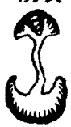</td><td rowspan=1 colspan=1></td><td rowspan=1 colspan=1></td><td rowspan=1 colspan=1></td></tr><tr><td rowspan=1 colspan=1>此为阳峡，凹中出脉，或凹脑坦中出而脉。</td><td rowspan=1 colspan=1>此为阴峡，其脉自顶有脊出，或起突。</td><td rowspan=1 colspan=1>此为曲峡，其脉屈曲活动，如生蛇直渡水，至贵。小者尤佳。</td><td rowspan=1 colspan=1>过峡之脉要曲，不宜直。为死脉，不吉。中间有泡者，虽直亦吉。</td><td rowspan=1 colspan=1>此为长峡，太长则易受风，宜遮护周密。又忌直长。若长而直，则为死脉，不吉。</td></tr><tr><td rowspan=1 colspan=1>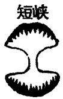</td><td rowspan=1 colspan=1>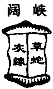</td><td rowspan=1 colspan=1>高峡</td><td rowspan=1 colspan=1></td><td rowspan=1 colspan=1></td></tr><tr><td rowspan=1 colspan=1>此为短峡，峡短虽不不受风，亦要断有跌明白，若模微糊则非峡矣。</td><td rowspan=1 colspan=1>阔峡气散聚，要中间山草蛇灰线、至高之脊则美。两边名毡褥，亦谓之霞帔峡，主大富贵。</td><td rowspan=1 colspan=1>高峡者，大而断处未有平地也，多者，是人行之岭。亦凡高过之峡，边要护山周密。</td><td rowspan=1 colspan=1>大龙峡亦数十里坦过或数里塌过，中曰远峡。要两迎送护应。此龙去甚远，小龙无此峡。</td><td rowspan=1 colspan=1>穿田峡，要两边皆低，央过脉之田独高，则分水明白。廖金精谓之青苗中过骨，此峡最吉。</td></tr><tr><td rowspan=1 colspan=1>渡水峡</td><td rowspan=1 colspan=4>渡水峡，要水中有石梁，谓之崩洪脉。《葬书》云“脉界水即止”。此谓渡水何也？盖水不界石脉，而界土脉。邵子曰：“水即人身之血，石即人身之骨，土即人身之肉。”故血行于肉，不行于骨。血以资肉，肉以养骨以成身。惟气则无往而不通者也。</td></tr></table>

上峡图九格，皆以脉言之也。而其脉又须有蜂腰鹤膝之形为美。末一格石脉，则有术家所谓崩洪十格，俱具图于后。

蜂腰鹤膝图

<table><tr><td></td><td></td><td>凡龙脉束聚而成蜂腰鹤膝之形，其处气 旺，结穴必近，杨筠松云“蜂腰鹤膝龙欲成” 是也。故凡见此形，则知龙将结作，可以求 索穴场矣。</td></tr></table>

## 十大崩洪脉图

<table><tr><td rowspan=1 colspan=1></td><td rowspan=1 colspan=1>节目崩洪</td><td rowspan=1 colspan=1>马跡崩洪8B00</td><td rowspan=1 colspan=1>螺蚌崩洪</td><td rowspan=1 colspan=1>交角崩洪K</td></tr><tr><td rowspan=1 colspan=1>石梁散乱，如手摸捉，在于水面者是也。</td><td rowspan=1 colspan=1>石梁相牵相连，如瓜瓠在于水中是也。</td><td rowspan=1 colspan=1>石梁如马足迹在于水中是也。</td><td rowspan=1 colspan=1>石梁如螺蚌之形在水是也。</td><td rowspan=1 colspan=1>石梁生来如交角之形是也。</td></tr><tr><td rowspan=1 colspan=1>之字崩洪B0</td><td rowspan=1 colspan=1>也字崩洪</td><td rowspan=1 colspan=1>川字崩洪</td><td rowspan=1 colspan=1>十字崩洪f</td><td rowspan=1 colspan=1>断续崩洪：</td></tr><tr><td rowspan=1 colspan=1>石梁屈曲，如之玄字在水是也。</td><td rowspan=1 colspan=1>石梁回抱如也字形是也。</td><td rowspan=1 colspan=1>石梁三条如川字形是也。</td><td rowspan=1 colspan=1>石梁纵横如十字是也。</td><td rowspan=1 colspan=1>石梁断而复续是也。</td></tr></table>

上十大崩洪，乃石梁渡脉过水，其形有此十格。然亦难以此尽其形，举此为式，触类而长可也。盖崩洪者，朋山共水之义也。廖金精云“朋山共水难寻脉，石上留真迹。唤作崩洪有十名，官贵此中生”是也。其说出于杨筠松。《三十六脉歌》云：“崩洪之脉几多般，朋山共水实堪安。气逢水界谁能别，真龙偏向此中蟠。有人会得崩洪脉，腰悬金印人朝端。”其本旨则谓石脉之过水耳，后来因“真龙偏向此中蟠”之句，遂误认谓脉中有穴，殊为可笑。

矧此崩洪名目，以吾儒循名求义论之，亦当在排斥之例，何也？山倾曰崩，水溃曰洪，乃恶名也。而术家乃为龙脉之美称，何其背戾之甚。

故张子微谓此乃术家以此暗藏机幸，辟之而不道。予于此收之，亦姑从俗借名，以证龙脉之渡水云耳。

按：十大崩洪，李淳风《小卷》无十字、断续二名，而有筋血、交剑，与杨筠松小异。

以上所论过峡之脉，复有护峡之山图具于后。

## 护峡山格

<table><tr><td rowspan=1 colspan=1></td><td rowspan=1 colspan=1></td><td rowspan=1 colspan=1></td></tr><tr><td rowspan=1 colspan=1>此单迎单送也。</td><td rowspan=1 colspan=1>迎送多者曰双。此双迎双送，愈多愈好。大龙过峡，迎送有至数十重者，故以多为贵也。</td><td rowspan=1 colspan=1>此有送无迎也。</td></tr><tr><td rowspan=1 colspan=1></td><td rowspan=1 colspan=1></td><td rowspan=1 colspan=1></td></tr><tr><td rowspan=1 colspan=1>此有迎无送也。凡有迎无送，有送无迎，若周密护得峡过，不受风吹，亦贵。</td><td rowspan=1 colspan=1>此交互迎送也，也有吉有凶。</td><td rowspan=1 colspan=1>此亦交互迎送也，力量差胜。</td></tr></table>

迎送凡脉离山而出，两臂有护从之山，谓之送脉出身，亦曰送峡。脉起顶而上，两臂有回转之山，谓之迎脉过峡，亦曰迎峡。

上迎送峡，其迎龙之枝虽是逆转迎峡，然不可认为逆龙。盖逆龙枝脚一一望后，而正身前去，挺然独出，故曰逆龙。此则惟是枝脚逆转一二山顾峡，其正龙则自向前顺去，随身枝脚尤多且长也。胡直云“一种逆龙是迎接，反手双双开两胁。接取龙来好处传，此是龙生好枝叶。逆龙虽逆亦无害，一种交加是护峡。此等皆为富贵龙，左右均平龙在中”是也。

## 扛夹

凡脉从中过，两旁客山或本山特起，高卓相应者谓之扛。外山隔水远来护峡而相夹映者，谓之夹。凡扛、夹之山，最喜成形，如前所谓太阴、太阳、金箱、玉印、龟蛇、旗鼓之类，左右俱有极吉。若左右两峰高耸峙立，又名曰天弧、天角，《经》云“天弧天角龙欲渡。”

<table><tr><td rowspan=1 colspan=1></td><td rowspan=1 colspan=1></td><td rowspan=1 colspan=1></td><td rowspan=1 colspan=1></td></tr><tr><td rowspan=1 colspan=1>此本山扛峡，吉格。</td><td rowspan=1 colspan=1>此外山扛峡，吉格。</td><td rowspan=1 colspan=1>此外山隔水远来扛峡，最吉格。</td><td rowspan=1 colspan=1>此不成格，非峡。</td></tr></table>

## 附蔡西山先生峡格

## 双鱼峡

<table><tr><td></td><td></td><td></td><td></td></tr><tr><td>如此乃为正出 之峡，吉格。</td><td>如此乃偏出脉， 非峡。</td><td>此偏出脉，非峡，亦 谓之来去鱼，主凶。</td><td>来去鱼， 非峡。</td></tr></table>

## 垂珠峡

<table><tr><td rowspan=1 colspan=1></td><td rowspan=1 colspan=1></td><td rowspan=1 colspan=1></td><td rowspan=1 colspan=1></td><td rowspan=1 colspan=1></td></tr><tr><td rowspan=1 colspan=1>如此乃为正出之峡，吉。</td><td rowspan=1 colspan=1>如此亦为正出之峡，吉。</td><td rowspan=1 colspan=1>如此乃为偏出，不得为峡，主凶。</td><td rowspan=1 colspan=1>如此则为偏寒，不吉，不可言峡。斜左右同。</td><td rowspan=1 colspan=1>如此虽是峡，亦系偏，主奸险。</td></tr></table>

大凡峡，欲其脉从中出，而两畔护送停均。如脉虽中出，而两畔护山不匀，或边有边无，边长边短，边多边少，皆同偏论，有吉有凶。

## 莲化心峡

<table><tr><td rowspan=1 colspan=1></td><td rowspan=1 colspan=1></td><td rowspan=1 colspan=1></td><td rowspan=1 colspan=1></td></tr><tr><td rowspan=1 colspan=1>如此真莲花心峡，最为至贵。</td><td rowspan=1 colspan=1>如此即小偏，力量轻减。</td><td rowspan=1 colspan=1>如此全是偏斜，不可言峡。左右同。</td><td rowspan=1 colspan=1>如此乃真峡，极贵格</td></tr><tr><td rowspan=1 colspan=1></td><td rowspan=1 colspan=1></td><td rowspan=1 colspan=1></td><td rowspan=1 colspan=1></td></tr><tr><td rowspan=1 colspan=1>如此亦可言峡。</td><td rowspan=1 colspan=1>如此亦可言峡。</td><td rowspan=1 colspan=1>如此偏出，不可言峡矣。</td><td rowspan=1 colspan=1>如此亦不可言峡，无用之龙耳。</td></tr><tr><td rowspan=1 colspan=4>迎送峡</td></tr><tr><td rowspan=1 colspan=1></td><td rowspan=1 colspan=1></td><td rowspan=1 colspan=1></td><td rowspan=1 colspan=1></td></tr><tr><td rowspan=1 colspan=1>如此则真为有迎有送，至贵之峡。</td><td rowspan=1 colspan=1>如此迎送尤佳，乃真峡也，至贵。</td><td rowspan=1 colspan=1>如此亦是真峡，结贵地。</td><td rowspan=1 colspan=1>如此即为偏出，非峡也。</td></tr><tr><td rowspan=1 colspan=1></td><td rowspan=1 colspan=1></td><td rowspan=1 colspan=1></td><td rowspan=1 colspan=1></td></tr><tr><td rowspan=1 colspan=1>如此乃为交互迎送，半吉。</td><td rowspan=1 colspan=1>如此全是偏出，大凶。</td><td rowspan=1 colspan=1>如此极为偏枯，大凶。</td><td rowspan=1 colspan=1></td></tr></table>

## 玉井栏峡

<table><tr><td rowspan=1 colspan=2></td><td rowspan=1 colspan=2></td><td rowspan=1 colspan=2></td><td rowspan=1 colspan=1></td></tr><tr><td rowspan=1 colspan=2>如此真玉井栏峡格，吉。</td><td rowspan=1 colspan=2>如此名交互玉井栏，亦吉。</td><td rowspan=1 colspan=2>如此亦是井栏迎送正格，吉。</td><td rowspan=1 colspan=1>如此名右旋井栏，亦为正格吉。左旋同。</td></tr><tr><td rowspan=1 colspan=2></td><td rowspan=1 colspan=2></td><td rowspan=1 colspan=2></td><td rowspan=1 colspan=1></td></tr><tr><td rowspan=1 colspan=2>如此系偏斜下品。</td><td rowspan=1 colspan=2>如此名方旋井栏，亦为正格，吉。</td><td rowspan=1 colspan=2>如此系偏出凶脉。</td><td rowspan=1 colspan=1>如此乃迎接井栏，亦为正格，吉。</td></tr><tr><td rowspan=1 colspan=7>方脉峡</td></tr><tr><td rowspan=1 colspan=2></td><td rowspan=1 colspan=2></td><td rowspan=1 colspan=2></td><td rowspan=1 colspan=1></td></tr><tr><td rowspan=1 colspan=2>如此乃脉从中出，谓之正峡，吉。</td><td rowspan=1 colspan=2>如此乃偏出，不可言峡，左右同。</td><td rowspan=1 colspan=2>如此乃中出正峡，吉。</td><td rowspan=1 colspan=1>如此为偏出，不得言峡，凶。</td></tr><tr><td rowspan=3 colspan=7>飞丝峡</td></tr><tr><td rowspan=1 colspan=2></td><td rowspan=1 colspan=2></td><td rowspan=1 colspan=2></td></tr><tr><td rowspan=1 colspan=2>亦是，飞。，</td><td rowspan=1 colspan=2>不可出之脉，</td><td rowspan=1 colspan=2>匀，亦不是从中出，两旁不</td></tr></table>

##

## 三台飞电峡

<table><tr><td></td><td>此三台飞电 之峡，第一上格。</td><td></td><td>此偏出之脉， 非峡也。</td></tr></table>

## 金鱼佩峡

<table><tr><td></td><td></td><td></td></tr><tr><td>此为正峡，主一 品侯王，极贵。</td><td>此为偏出之脉， 不可言峡，大凶。</td><td>此亦是脉从中出之峡， 大凶。</td></tr></table>

## 流星峡

<table><tr><td rowspan=1 colspan=1></td><td rowspan=1 colspan=1></td><td rowspan=1 colspan=1></td><td rowspan=1 colspan=1></td></tr><tr><td rowspan=1 colspan=1>此真流星峡也，至贵，主出神童。</td><td rowspan=1 colspan=1>此偏出之脉，不可言峡，大凶。</td><td rowspan=1 colspan=1>此亦不谓之峡。</td><td rowspan=1 colspan=1>此为偏出之脉，不谓之峡。</td></tr></table>

## 钗股峡

<table><tr><td></td><td>此乃正钗股 峡格也，吉。</td><td></td><td>此为偏出， 不可言峡。</td></tr></table>

## 玉带峡

<table><tr><td rowspan=1 colspan=1></td><td rowspan=1 colspan=1></td><td rowspan=1 colspan=1></td></tr><tr><td rowspan=1 colspan=1>此为玉带峡正格，主贵。</td><td rowspan=1 colspan=1>此偏尤甚，何可言峡？</td><td rowspan=1 colspan=1>此偏脉，极凶。</td></tr></table>

## 方城峡

<table><tr><td rowspan=1 colspan=1></td><td rowspan=1 colspan=1></td><td rowspan=1 colspan=1></td></tr><tr><td rowspan=1 colspan=1>此为正峡，最贵。</td><td rowspan=1 colspan=1>此亦正峡，最贵。</td><td rowspan=1 colspan=1>此偏出之龙，不问左右，皆凶。</td></tr></table>

## 玉池峡

<table><tr><td rowspan=1 colspan=1></td><td rowspan=1 colspan=1></td><td rowspan=1 colspan=1></td></tr><tr><td rowspan=1 colspan=1>此池当脉，至贵。</td><td rowspan=1 colspan=1>此脉从池中过，两畔皆水，大贵。</td><td rowspan=1 colspan=1>此脉偏出，不可谓峡，凶。</td></tr></table>

# 地理人子须知卷六

按：蔡西山曰：“峡之为格，其名不一，兹但举其形体与正格相类，而脉从旁落者辨明之。大抵回环如峡，而脉从中出，则乃所谓峡也。若回环如峡，而脉从峡两旁出，则是偏行之龙，不可谓之峡。今世俗之见，不问脉在中及在左右，但形体如峡，即以峡名，何其谬耶！夫所谓峡者，谓关峡之类。峡以蔽龙，关以收局。今脉在旁而犹谓之峡，则是两旁惟一旁有蔽，一畔孤露风寒，何以谓之峡与？故录诸格以见其旨焉。”

张子微《峡诀》

张子微《峡诀》共二十格图

<table><tr><td rowspan=1 colspan=1>粧台峡</td><td rowspan=1 colspan=1>台星峡</td><td rowspan=1 colspan=1>憧节峡</td><td rowspan=1 colspan=1>华盖峡</td><td rowspan=1 colspan=1>天池峡</td></tr><tr><td rowspan=1 colspan=1>幕内美女照妆台，出皇后、贵妃及一品夫人。</td><td rowspan=1 colspan=1>出台鼎大贵。</td><td rowspan=1 colspan=1>此出神仙、清高贵人，吉。</td><td rowspan=1 colspan=1>出大贵</td><td rowspan=1 colspan=1>此至贵</td></tr><tr><td rowspan=1 colspan=1>串珠峡</td><td rowspan=1 colspan=1>金箱玉印峡</td><td rowspan=1 colspan=1>双溪峡</td><td rowspan=1 colspan=1>宝剑峡</td><td rowspan=1 colspan=1>双龙峡</td></tr><tr><td rowspan=1 colspan=1>主大富贵，王侯地位。</td><td rowspan=1 colspan=1>出内相翰苑才名。</td><td rowspan=1 colspan=1>出豪贵。</td><td rowspan=1 colspan=1>出将入相，先斩后奏。</td><td rowspan=1 colspan=1>至贵</td></tr><tr><td rowspan=1 colspan=1>禁卫峡</td><td rowspan=1 colspan=1>圭璧峡</td><td rowspan=1 colspan=1>牛眠峡</td><td rowspan=1 colspan=1>石洞峡</td><td rowspan=1 colspan=1>惊蛇峡</td></tr><tr><td rowspan=1 colspan=1>出禁穴</td><td rowspan=1 colspan=1>出王侯</td><td rowspan=1 colspan=1>浊富</td><td rowspan=1 colspan=1>大贵大凶</td><td rowspan=1 colspan=1>出妖术贼将等，大凶。</td></tr><tr><td rowspan=1 colspan=1>乱茅峡</td><td rowspan=1 colspan=1>玄鱼峡</td><td rowspan=1 colspan=1>贵鱼峡</td><td rowspan=1 colspan=1>柳叶峡</td><td rowspan=1 colspan=1>重屍峡</td></tr><tr><td rowspan=1 colspan=1>出草寇大盗，极凶。</td><td rowspan=1 colspan=1>主贵</td><td rowspan=1 colspan=1>半吉</td><td rowspan=1 colspan=1>半吉</td><td rowspan=1 colspan=1>大凶</td></tr></table>

上张子微《峡诀》二十格，皆以左右护峡之形状吉凶，定峡之美恶者也。

以上峡图，载为式耳。山形变化，岂止于斯？智者察其情性之真，触类而长之可也。夫蔡氏之论龙脉者，固有偏中之正，正中之偏，有似偏而实正，似正而实偏。有正出而偏落，有偏出而正落，有前偏而后变于正者，前正而后变于偏者。有脉虽偏于一边，而外山照应亲切，不至风吹者。

有星顶正于左边，而脉则出于右畔者。有星体偏于右边，而左边枝脚反多者。有双脉相合者，有三脉五脉隐怪难明者，有石脉奇异及闪迹偷踪偏正难辨者，有微而至于无形者，岂图之所能尽哉！

其张子微之论护山者，则有不切之弊。如所谓玄鱼、圭璧之吉应于两旁，而或龙脉偏枯死弱，岂可以圭璧而谓之吉哉！盖必以蔡氏为主，而张子微之说兼之可也。大抵山形之微妙无穷，龙脉之变化不一，可以理推，难以形定。固有似吉而凶，似凶而吉者，有半吉半凶及可吉可凶者，有先吉后凶，有先凶后吉者。

毫厘之间，祸福所系，岂按图索骥者可窥测哉！神而明之， 存乎其人。

## 论龙枝脚桡棹

龙有贵贱美恶之不同，观其枝脚桡棹而可见。盖枝脚桡棹，龙之分气也，其形体各以类从。故龙之长远者，其枝脚桡棹亦长远；龙之短小者，其枝脚桡棹亦短小。龙之吉者，其发为枝脚亦起星辰，带贵气；龙之凶者，其见于枝脚亦必恶陋，类凶形。是盖龙气吉凶不同，故进露发泄于枝脚桡棹间，美恶情状亦自不可

掩耳。姑就易见者论之，如枝脚之山广袤起伏，蕃衍拥从，或如仓如库，如剑如印，如旗如鼓，或成天乙、太乙而侍立两边，或成御屏、展帐而盖乐于后，或带金箱玉印，或带简笏牙刀，或结天关地轴，或如武将文官，或类天马贵人，或类龟蛇狮象，或如玉带金章，或如玎珰珂佩，或拔若文笔，或连如串珠，或圆如覆釜倾钟，或方若列屏贮柜，或森若排衙唱喏，或拥如队仗仪从，或济济如子孙丁壮之繁，或簇簇如奴仆畜养之众，云从雾集，侍卫森严，护定我身，不敢他往，此皆吉气之发见者也。

《明山宝鉴》云：“天乙太乙者，富贵之本原；天禄天马者，富贵之任用；文官武库者，富贵之应验；左辅右弼者，富贵之维持；男仓女库者，富贵之设施。”廖金精云：“惟有本身枝脚重，队仗真得用。”大凡好砂，列于前者是客山，众人所共。其在本身枝脚者，乃自家之物，一已之受用亲切者也。故傅伯通云：“不贵其见而贵其不见”。

廖金精云：“谁知不见乃为奇，福应没差移。”其或龙无枝脚桡棹者，谓之奴；虽有枝脚，不踊跃拔卓者，谓之弱；散漫委靡而无收拾者，谓之虚；反背无情而不顾本身者，谓之逆；凶恶尖利而反射本身者，谓之杀；拖拽太重而奔走东西者，谓之刦；及有枝脚不均，或边有边无，边长边短，边顺边逆，边美边恶者，谓之病。又或两旁垂落，如抛枪挿竹、卧尸提箩，如绳如刀，如斩指断头，如茅叶之乱，死蛇之靡，灰囊投算、鹅头鸭颈，种种不吉之形，皆凶气之发见者也。

似此龙神，纵有形穴，皆为不吉。若误下之，主长病痨瘵而枉死少丁，或瘟癀灾火而莫可援救，或官讼连年而田产退尽，或淫乱风声而败坏人伦，亦各以其类而应也。故桡棹枝脚为龙身发泄吉凶之验，讵不信夫！具图于后。

# 龙身带诸贵格作朝对图

龙身带诸贵格作朝对图：此龙身枝脚间所带诸贵格之略也。傅国师云：“凡后龙节节枝脚垂落处，要起星辰，成形像，如天马、仓库、交床、旌鼓、剑印、展帐、列屏、天乙、太乙、文官、武将等件，而顺护龙身，前去必结大地。”《一粒粟》云“不贵其见而贵其不见”者，乃此谓矣。天乙、太乙主位居台阁，日月、辅弼主位至公孤，玉佩、文武主王侯极品，男仓、女库主人财富盛，展旗、顿戟主威武，左右侍从主尊荣，旗旄、诰轴、御屏、锦帐、马旗、相台主出将入相，印笏主神童状元。

下图一：龙身枝脚所带诸凶之大略也。《快捷方式》云：“凡后龙枝脚节节垂落处，或尖利带杀，或瘦弱峻嶒，或臃肿丑恶，反背走撺，或拖拽太重，或大小无伦，或长硬如枪，或细绕如索，或如重尸，或如断头，或如烟包，或如投算，种种丑形，则为凶恶，纵有形穴，亦不可下。

图二：回龙顾祖之地，本身秀气呈露于前，作我朝对之山。《经》云“未作穴时先作朝”是也。前谓“不贵其见而贵其不见”，若此者，见又何害？大抵贵通活变，莫泥陈言可也。

以上所论龙身枝脚吉凶大概，皆以垂落之形言之，未及自身发出均匀、长短、有无之亲切也。并述于后。

龙身枝脚带诸凶图

  
图一

枝脚对节均匀之图

  
图三

龙身带诸贵格作朝图

  
图二

枝脚长短不对而脉穿心

  
图四

图三：龙身枝脚对节均匀之格，至贵。盖龙身枝脚，贵其对节生出，两边均匀，有无、长短、大小相同，正脉中出，乃为上格。术家名曰梧桐枝。张子微曰“停均惟有梧桐枝，双送双迎两

# 地理人子须知卷六

平势。对节分生作穿心，祖宗儿子都相类”是也。蔡西山云：“龙之所以贵其枝脚对生，如梧桐枝为龙中第一贵者，其理易见。今不问名花卉木，对生为贵。凡野生草木花卉，若对节间生枝发叶者，皆可为医药，用以拯疾。此可见天地间凡对生者，皆受天地之灵气。人之手足筋骨，鸟兽之足翼，皆对生者也。其有药中木瓜、荳蔻、缩砂、大黄、黄连、黄芩等，皆不对生，然却有奇处，终与凡草有异。龙之奇者亦然。故之玄屈曲，与特地耸拔，又皆不可以穿心论。此惟圆机通变，知识过人者可与语此。”

图四：龙身枝脚桡棹虽长短不对，而交互停均，脉却穿心，术家名曰芍药枝格也。张子微云“一等名为芍药枝，左右相生亦相似。分处光圆有枝叶，交互亦有停均理”是矣。愚谓此龙格枝脚虽长短不同，然左股或先一节长，必后一节短；右股虽先一节短，必后一节长。两相抵对，却有停均之理。况节节正脉穿心，虽左右长短不齐，不害其为贵龙也。

枝脚有无交互停均之图：左图龙身枝脚虽不对节，而左右交

枝脚有无交互停均之图互停均，术家名曰蒹葭叶。张子微云：“左有右无过一节，右有左无本非异。此名原是蒹葭样，但要星辰得地位。”愚按：此与梧桐枝对节力量殊异，而与芍药枝颇同，其枝叶亦是来去开枝，但枝末多生丫丫，带力差重者也。此蒹葭叶枝末无丫，故力轻耳。然力量虽有不同，融结本无二理，乌可以其力轻而弃之？

  
蒹葭枝龙格

枝脚偏枯之图：右龙一边有枝脚而长，一边微有枝脚之状，术家名曰杨柳枝。张子微：“又有偏生

杨柳枝，边有边无极乖异。”又谓：“若有形穴，缠送山周密，亦可下。”愚谓此等龙，公位不均，一位富足多子，一位贫寒废疾绝嗣，偏枯太甚，纵有形穴，亦不可下。公位虽不必泥，然若此者，计子孙利害之重，亦当审择可也。

枝脚全偏之图：右龙一边有枝脚，一边全无枝脚，乃是奴龙，不结地也。其有脚边乃为山面，以顾乎主，无脚边乃为山背耳。张子微谓此格合柳星亦能出贵，但公位偏枯。愚谓此等龙是奴仆之山，决无融结道理。虽合柳星，有形穴，亦当弃置，不可下也。张子微虽或有见，予不敢附和耳。大抵龙之枝脚，贵于均匀为美。如人手足，如鸟兽之翼脚，缺一边则不能飞走，其不至于废弃也寡矣。此理势之必然，不待智者而后知也。地理之与物理，相为流通者也，奚可以差殊观哉！

枝脚长短不均之图：右龙枝脚一边长一边短，本自不均。却是节节中出，其枝短一旁又有一大枝缠送到头，亦为贵格。术家谓之卷帘殿试格。张子微云“却有偏生极贵龙，名为卷帘登殿试，不问偏斜，黄甲及第”是也。

## 枝脚偏枯之图

## 枝脚长短不均之图边长边短，短边另有直缠

下图一：龙虽一边枝脚长，一边枝脚短，本自不均。然短边却傍祖山，贴身障护，又不可以长短不均论也。谚云“一祖当千山”，如人之奴仆、护从虽多，不若祖宗之庇荫福泽所及为大也。

下图二：龙枝脚一畔美一畔恶也。大凡龙神枝脚，欲其两边均匀为美。若一边好，一边不好，或边有边无，边长边短，边顺边逆，边多边少，皆为不吉，纵有形穴，亦不可下。

枝脚长短不均之图

  
图一

枝脚美恶不均图

  
图二

下图一：龙之枝脚桡棹，亦如人之手足，固宜其长而忌其短。然亦有短而吉者，须是节节均匀，从中出脉，两边护山贴身缠从方可。即术家所谓蜈蚣节龙格也（如右图)。张子微云：“两旁有护，极清极贵。”《发挥》云：“此格脚短，必假外山缠护周密，而后可以极其清贵。”愚谓此等龙须要到头穴星开窝开钳，有龙有虎，不假外山护卫而穴场自暖方可。否则不吉，不可下也。

下图二：左龙全身活动摆折，如生蛇出洞、仙带飘空，即芦鞭袅、之玄龙、九天飞帛等格也。此等龙不论枝脚，但要缠从周密，又必起顶结穴，有本身龙虎，不藉外山而穴自暖，乃为真结。此格最贵。若出自台屏帐盖之下者，主神童状元，才名冠世。

枝脚短图

  
要护山近

无枝肢图

图一  
  
要本身有龙虎

图二  

以上所论龙身枝脚桡棹之美恶，及均匀、长短、有无等说，姑就浅近者言耳。至于大龙，又难如此拘执。蔡文节公曰：“迎送、交互、手脚、桡棹，此看龙之常法也。然大龙渐近融结处，多是单行，无手脚桡棹可见。其逶迤转折，平行低度，状如流水。或忽然断绝，无踪可寻；或小如引线，不认悠往。其低平之处，或为平田旷野，横阔多至数十里。或为沟池田畴，或为人烟园堑，或为小关墟市。或迥无人居，弥望无际；或渺茫沙阜，不堪步履；或隐隐隆隆，忽似鼋龟；或堆堆累累，忽如古墓。前去则逢弥漫巨浸，江湖交会，然无山可依，无形可辨。

此大龙之大尽处也。巨眼见此，知为大地，或可为京都，或可为藩镇。从头检点，来龙分明，缠护无缺，之玄曲屈，手足摆布，

无不。

愚按：此论大龙，不可以枝脚桡棹常法拘之，最为切当。张子微亦云：“且如龙行看送迎，手脚交接如蟹动。”不知大龙百十里，或数十里，俗眼以常法拘之，岂能识此？

是故龙身桡棹枝脚之说，又须辨认龙之枝干大小，而后始尽其微妙。若徒以常法拘之，则未免坎蛙之见矣。

## 论龙护送

《黑囊经》云：“龙要有盖送，盖送龙神重。”《发挥》云：“贵龙全在护从多。”卜氏云：“德不孤，必有邻，看他护从。”《龙经》云：“真龙身上多护卫，山水有情来拱揖。”又云：“只有真龙坐局内，乱山却在外为缠。”

又云：“缠多不许外山走，那堪长远作水口？送从托山若两全，富贵双全真罕有。”是皆言真龙融结，必有护从迎送诸山以卫区之。如大贵人出入，必前呼后拥，行者辟易，观者环堵。居则侍妾数百人，或兵卒数千辈，披坚执锐，以护卫之。

张子微云：“王侯簇卫须随从，出人坐起多迎送。”又云：“万卒影从成禁卫，千官环列是朝廷。”莫非取谕真龙有众山之拥从耳。其单独孤寒之龙，如贫贱之人，家徒四壁，室如悬磬，妻子且无，况奴仆使令者乎？及其出外，遍国中无与立谈者，况随从呵殿者乎？故单寒之龙，最为无用，前去多作神坛社庙而已。

杨筠松云：“若是孤行无护卫，定作神祠佛道宫。”张子微云：“孤生独活无人伴，只好焚香作庙居。”然龙固贵于有护从，尤贵于护从多。盖护从多则地愈大。

《经》云：“护从多爱到穴前，三重五重福绵延。一重护卫一

代贵，护卫十重宰相地。两重亦主典专城，一重只出丞簿尉。”又云：“寻龙千万看缠山，一重缠是一重关。关门若有十重锁，定有王侯居此间。”范越凤云：“大富大贵之地，如大官行衙，前呼后拥之多。小地如小官出入，从者不过数人而已。”又有长短大小之分。龙大则缠护山亦大，龙长则缠护山亦长。短小之龙，缠护之山亦只短小而已。《经》云“护缠亦自有大小，大小随龙长短来。龙长缠护亦长远，龙短缠护亦近挨”是也。枝龙必须缠护周密，朝迎秀异，送从齐整，下手重叠，方有结作。不可以一山有情而取之。

《经》云：“枝龙身上亦可裁，半是虚花半是开。若是虚花无朝应，若是结实护缠回。护缠定要观叠数，一叠回来龙身顾，莫便将为真实看，恐是护龙叶交互。三重五重抱回来，此就枝龙身上做。”干龙则取远迎远送、大缠大护，在眼界宽阔中认之。张张子微云：“大地迎送隔江水。”又云：“大龙行到水尽头，或作州县回迤逞。必有高山作外缠，不在身旁数十里。”

《龙经》云：“不知干长缠亦长，外州外县山为伴。”又云：“大凡干龙行尽处，外山隔水来相顾。”

《玉髓经》云：“大龙迎送、仓库，皆非本身自带。如大官出入，自有部封属境，节次措办供帐、次舍、仓库、委积，以候其求，而贵人不过随带驺从而往耳。”每经过处，无不聚起观瞻，翕集迎送。大龙之行，无以异此。小龙如小官出入，凡需用之物，莫不自带。又如富人出入，器皿帷蟆，莫不毕备。然皆自己之物，不容取于他人。但车马齐整，人从伟烨，经过未尝不起观瞻，或有庄佃参觌也。

大小龙之别如此，故大龙迎送、缠护诸山，各有龙脉奔来，与正龙隔水相会以为用。然不可一概取远者为护，而于空旷受风处，亦指远山为侍从。窃恐无识者睥睨大地，被野师所逛，而以单独凶龙为结大地，强指远山作缠护，执《玉髓》之说以藉其口。

# 地理人子须知卷六

是又为图大所惑也，切要入穴不受风为真。故凡护山，必有近者为侍为从，而又有远者为缠为迎方可。且其紧要过峡关节去处，必以近者为准。

譬如奴仆，近在身侧，则驱使得力。若去身已远，则呼唤未及，使令不便，安能得其力哉！又须稍高大，不可太低小，如幼童侍卫我旁。彼幼无知，不能胜我驱使之任矣；然亦不可太高大，有奴来欺主之状。只宜相称于大小高低远近之间，斯尽其妙。

智士胸中自当有活泼之机也，岂笔端所能悉哉！

# J地理人子须知（上

# 地理人子须知卷七

此一卷专论龙脉有旁正、老嫩、长短、真伪、贵贱诸体之殊。盖行龙之形势不同，至其结作之吉凶亦异。于此诸体辨别之真，则经纬以明，而取舍始有定也。否则，差之毫厘，谬以千里，而吉凶混淆矣，可不知所察乎？

## 论龙旁正

夫龙一也，而有旁正之分。盖正龙者，禀受得正气而行，而其旁受诸山皆来拱卫者也。故一祖之下必有数龙，观龙者须审其孰为正龙受穴之山，孰为旁龙从卫之山，于此分别明白，则取舍有正见也。夫所为旁正之分者，有数说焉。

《葬经》曰：“重冈叠阜，群垄众支，当择其特大则特小，特小则特大。”此则以大小特异者为正龙也。一行禅师云：“数龙并出孰为先？长短高低是妙玄。众短要从长处觅，众长须向短中扦。高下亦当依此诀，石山元在土星边。君今但指朝山看，朝应无情定是偏。”此则以长短、高低、土石及朝应之特异者为正龙也。吴景鸾云：“数龙随出孰为奇？贵贱尊卑总要知。三五七龙同发迹，正龙必定是中枝。更看星体还特异，又审穿峡有护持。若是从龙俱不应，便于此处别玄微。”此则以龙之居中而星辰特异、过峡周密者为正龙也。要之，诸说各有攸当，而吴为密。盖中即正也，旁即偏也。特小特大、特长特短、特高特低，亦须居中为正。不但三枝五枝并出而居中，但自离祖出身，行度过峡，其脉常不离中，乃为至美。或三台九脑而中抽，或华盖个字而中出，或玉枕御屏而中落，皆谓之中。其偏龙禀气之偏，故凡出脉行度，自是偏斜，多为正龙从卫。

《地理集解》云：“凡自祖山上发出五七枝龙者，须仔细辨认某枝是正龙受穴之山。”若是正龙，自出身离祖以来，自然尊重。及到过峡处，两旁必有峰峦遮护，不令风吹水射。其行动曲折处，皆活动逶迤；其起伏头面，皆端严秀丽；其手脚桡棹，皆光彩圆净，自与众山不同。

或众山高大此独低小，或众山低小此独高大。又且两旁山之形势，皆顾定我身，不敢有离动别去之状。至入穴处，其旁龙山若不是住在正龙穴后作送托、夹照之山，必是绕出穴前，堰取左右数源之水，聚在面前，为正龙穴前聚作明堂，及作护关、案山，或作捍门、水口。故正龙自是尊重，而旁龙必为正龙之用神也。大抵正龙之于旁龙，犹麒麟之于走兽，凤凰之于飞鸟，自然出类拔萃，系山川正气所钟，故融结孕育，多为贤人君子、忠臣烈士、崇儒硕辅。

而先天地间一切正人，皆正龙中出之地所能钟孕。是亦气相感召，自然之理也。其有虽居贵显，而心术不正，或为奸臣，为妬后，为邪佞之流者，则是其地虽美，而非正气所钟，或星辰欹侧之不尊，或五行克战之不美，或沙水奔流之不纯，故尔。

及有父子兄弟祖孙而贤愚不一，邪正不齐者，则又当于龙之节数、年代及砂水之方位中求之。或美中有疵，醇中有离，未能纯粹，故值其吉者为吉人，值其凶者为凶人。此亦天地无全功，造化无全能耳。至于旁龙，亦虽有穴如大贵人，所至之地，必有从行随带部属，及卑职小官，然力量为轻，却多与正龙共祖宗，共门户，共堂局、罗城、案对者，尤宜详辨，不可以旁为正，以正为旁。

然一登正穴，观正龙之规模、态度，自然气象不侔。盖旁龙自有俯伏揖让退逊之状，及奴颜婢膝顾主之形不可掩者，虽二龙并出，亦有尊卑之殊，不难见也。其旁龙之有融结者，必须本身亦有起伏顿跌，亦有桡棹枝脚，亦有传变穿落，特正龙尊贵证得，旁龙不尊耳。固虽优劣不同，未可谓其全无融结造化也。若是旁龙别无护从，而全身是为正龙所用，则无融结，纵有形穴不足取也。

## 论龙老嫩

夫龙一也，而有老嫩之殊。廖金精云：“老是大山毛骨粗，嫩是换皮肤。”其说虽发于《穴星篇》内，然论龙老嫩，亦不外是。盖粗大者为老，巧小者为嫩；绵亘者为老，退卸者为嫩。老龙山峦蛮蠢，星体浑浊，枝脚缩短，无有脱卸剥换，径直而不活变，粗饱而不发扬，崚嶒丑陋而无妩媚之态。如老妇形容枯槁，颜色憔悴，无有生育之理者，故不可以求穴也。

嫩龙则有起有伏，有大有小，一高一下，一顿一跌，左栖右闪，之东走西，活变百端，奇巧万状，断而复起，起而又断。自粗变细，自凶换吉，脱卸清巧，如树木新发枝柯，自然条畅，开花结实，生意不息。故此龙可以索穴也。然嫩龙亦自老龙变出，故曰：“老龙抽出嫩枝柯，跌断不嫌多。”大抵老龙如巨家老宿，

# 地理人子须知卷七

气象厚重，容貌质朴，不事修饰。然含蓄储峙，养育子孙，皆此人也。嫩龙如千金之子，娇脆细腻，承师就保，衣服鲜明，容貌美好，享有厚福。娶名家女，生贵显孙，乃此人也。

故老龙多是未经脱卸，可以为祖。而嫩龙则有穿落传变之巧，而为受穴之山也。若老龙一向不变细嫩，则为老亢，无生成之理，不必寻地。俗亦谓之老椿，以其如老枯之木，而无有枝叶之发畅也。又有一等真龙，结穴已完，犹有余气山延绵而去者，亦名曰老，是又以脉尽气绝为老。

李淳风谓“龙有归于老者”是也。此处亦不结穴，不须着眼。

# 论龙长短

夫龙一也，而有长短之异。杨筠松云：“寻龙千里非迢递，其次五百三百里。”

张子微云：“大龙千里费推寻，一二百里作郡邑。”颜氏云：“干龙住处分远近，千里为大郡。二三百里可为州，过此则封侯。百里只堪为县治，下此为镇市。”是皆言龙之长者结作大，短者结作小，理固然矣。但此等长龙，大者即大干龙，小者即小干龙。或结禁穴，或为郡邑市镇，虽有遗穴，天珍地秘，鬼神呵护，以俟有德，不可妄意睥睨。今寻龙只须得百里，或五七十里，或三四十里，其次或一二十里，又其次或二三十节，亦可谓之长矣。

《玉髓经》云：“小龙不下五十里，二十三十皆好地。”又云：“龙行五里亦有地，何必千里百里踪？”凡求地，当辨其结穴真伪，不必拘其龙之长短远近也。且真龙融结，分牙布爪，其长者多为缠护，为下手，为水口关拦。正穴藏缩居内，又不可一概取长者为贵。

《经》云“龙无贵贱只论长，缠龙缠过前更强。君若论长不论贵，缠龙有穴反为良”者是也。况龙变化不一，固有望之似长而步之又短者。

《发挥》云：“龙望之若近，寻之却远，此是龙势之玄屈折，逶迤摆布，所以若近而实远。此为上等之龙。若龙虽远而行易至，此是龙径直而无活动摆布，非美龙也。”是故论龙远近、长短，又当如此审究，大抵不可执一。譬如人之受气于父母，有颀而长者，有缩而短者。然贤不肖非在长短。汤九尺，而曹交九尺四寸。以长固无补于智愚，何长短之拘哉！但龙节长者受气多，福力必深远；短者受气浅，福力易止歇。此则有之，其于融结则无异也。

《灵台明堂经》及《宝鉴》诸书乃谓贵龙有七十二骨节，释之者又谓应七十二候，节数不足者非真龙。其谬益甚。盖龙自有骨节，如左仙《七星经》所谓“行度须观骨节奇，入穴须教骨节称”者是也。然亦特论其美恶耳，非谓拘其节数也。若必拘其七十二节，及三百六十节之说，以定龙之长短，决优劣，是执一而不通矣。

张子微云：“若是执一去寻龙，行遍江湖无一地。”此类是也。

## 论龙真假

夫龙一也，而有真伪之辨。盖地理之说无他，大要只在辨得真伪明白。人子求地，上以安父母，下以保子孙，顾乃往往窀岁蚁泉砂砾中，岂其愿哉！良由不能辨真伪以致此耳。是故辨龙真假，乃地理第一义。

凡龙之真者，祖宗迥异，出身活动。其行度间，或开帐穿心，或星峰秀丽，有桡棹枝脚，有起伏顿跌，有剥换转变，有过峡束脉，有摆布攸扬，有屈曲奔走可爱之势。及其入首，穴情明白，下手有力，明堂平正，前案特达，四兽有情，水城水口，俱合法度。皆天造地设，生成自然之妙，初无一毫勉强。才有勉强，便非真结作。惟辨得龙真，扦得穴的，则诸般自然皆应副矣。奈何天地间凡物有真便有伪，有正即有邪。而假伪之龙乱真眩正者，亦有祖宗，亦有开帐，亦有秀丽星峰，亦有手脚桡棹，亦有起伏顿跌，亦有剥换转变，亦有过峡束脉，亦有摆布攸扬，亦有屈曲奔走可爱之势。

入首之际，亦有下手，亦有明堂，亦有龙虎，亦有朝对，奇峰罗列，逞异献秀，登局快目。昧者不察而葬之，往往求福得祸。起而视之，非蝼蚁齿其棺，则黄泉浸其骨，其故何哉？盖不识龙有真伪，不能辨认，为庸师所误耳。

《玉髓经》云“亦有龙势，侵天如登，落地如坠，起星甚秀，行地如宛，而不结地”是也。噫！天下事正而胜者常少，不正而胜者常多。故紫常以夺乎朱，郑声常乱乎雅乐，机棘有类乎美槚，而稀稗有似乎良苗。苟非胸中有一定之见以勘破之，鲜不以是为非，以非为是，以真为伪，以伪为真者矣。然真真与真伪皆易识，惟似是而非，似真而伪者，眩人心目，最难察识。凡物皆然，不特地也。但此等假伪之龙，纵然可观，终觉勉强。姑揭其概而论之：假龙虽有祖宗，而出脉不美，或强硬突露无逶迤，或崚嶒带杀无秀媚，虽有开帐而脉不穿心，或有穿心而无迎送。虽有秀丽星峰而孤削无枝叶，或偏斜带石无盖从。虽有枝脚桡棹而两臂不均，或反逆带杀而尖利，或臃肿粗恶而丑陋，或拖拽太重而不顾本身。虽有起伏而过脉无线，或懒缓不明。虽有过峡而无遮护，水劫风吹，或长腰硬直，或斜出偏落。虽有剥变而愈剥愈粗，或先吉而剥后反凶，或先强而剥后反弱。

虽有摆布攸扬，而软弱委靡，虽有屈曲奔走可爱之势而护从不周。及其入首之际，多是穴情模糊，或无穴可下，或有乳而直硬臃肿，或有钳而开阔直长，或有窟而深旷空亡，或有突而孤露懒散。虽有星体而饱硬峻急，粗大雄顽，或欹头破面。虽有下手而直懒无情，或凶恶高压，或低远无力。虽有明堂，或倾侧破泻，或直牵卷帘。

虽有水城，或牵鼻割脚，或反跳翻弓，或冲射穿箭。虽然有龙虎，或反走无情，或曲腰折臂。虽有朝山，头或尖圆而可爱，脚则走撺而可嫌。盖大本已失，龙既不真，则融结花假，自然件件不美。所谓一事假，其余皆假，纵使龙虎、对案、堂局、砂水一一合法，文笔插天，秀水特朝，亦无甚益，况背戾者哉！然此假伪之龙，多是为大龙作应护于数十里之外，或为正龙作关峡于数里之间，或孕育蛟龙而有潭窟灵湫，或结为岩冈而有奇怪仙宫，或发泄精气而有朱砂矿石，或迸露英华而为汤泉醴井，此其形体甚美，而星峰甚秀者耳。其次者，但为结穴真龙作侍卫、朝案、罗城、水口、关拦、缠托、照乐及诸般用神而已。

以真龙力量大，故其从卫之龙亦长远，逆水奔走赴局以供服役。而其行度假冒，似亦可观。只是入首结穴，必无足取。故今辨龙真伪要诀，只入首近穴数节内察之。远龙虽寻常，入穴数节合格者，决为真；远龙虽美，入穴数节内不吉者，决为假。又须以穴辨之。假龙必无穴，真龙必有穴。此又至紧要的切法也。

蔡西山云：“假龙误人甚多，其摆布精神，起人眼目，与真龙无异，只是到头结果无取。故世俗之人止谓其气秀特，而时师又以真龙丑穴之说文之，鲜有不为所惑者。”诚确论也。

# 论龙贵贱

夫龙一也，而有贵贱之别。是故观龙贵贱之法，当先察其祖宗父母。如人之祖考系贵人贤士，其子孙亦多肖其先世。《龙经》云：“生子生孙巧相似。”又云“盖由种类生出来。”卜则巍云：“祖宗耸拔者，子孙必贵。”

《玉髓经》云：“贵龙胎息已非常，生出儿孙踵祖光。巧妙多传愈精细，愈远愈清贵巨量。”亦此意也。故凡贵龙，其祖山必秀丽巍峨，轩昂俊伟。或宝殿龙楼，或御屏负扆，或金銮绮阁，必侵云之高，延绵之广。及其离祖出身，辞楼下殿，精神卓绝，气象尊严。行度之间，重重开帐。

《经》云：“贵龙多是穿心出。”又云：“帐中过脉中央行，不出中央不入相。”又云：“穿心中出是真龙，龙不穿心力量细。”杨筠松云：“龙不穿心，官不人相。”大抵贵龙虽千变万化，若不可以一律拘之，然未尝离乎中也。如行度之间，自出身至入首结穴处，或起或落，凡有走弄屈曲，过峡度脉，顿跌飞舞，之东走西，栖闪万态，而皆不离于中。张子微云：“三台出龙三公位，华盖出龙并高贵。”亦必以中出为美。故龙格中凡玉枕、御屏、飞蛾、个字、帐幕，种种贵格，必是脉从中出，方是贵龙。若或偏落旁出，纵有贵格，亦不足取。又须星辰秀媚，护从迎托重叠。一行禅师云：“青山一样并头行，贵贱须分两等名。贵者星辰多秀丽，更看缠护别真情。”又云“贱龙亦自有中穿，脚似蜈蚣不尽偏。惟乏迎送不开帐，纵饶有穴不端然”是也。至于龙有天池者，有侍卫、养荫者，尤贵。

《经》云：“高山顶上有池水，此是真龙楼上气。”又云：

“池平两水夹又清，此处名为天汉星。天汉天潢入阁道，此星入相居中庭。”且贵龙自然迥异，如鹤立鸡群，如沙中金砾。

《经》云：“十山九水虽同聚，贵龙居中必异常。”及至入穴之际，前迎后拥，左侍右卫。或秀水潮入明堂，奇峰列于天表；或龟蛇禽曜之发露，印剑旗鼓之罗列。所谓“三千粉黛、八百烟花”，莫不有之。

《葬书》云：“若怀万宝而宴息，若具万膳而洁齐。”其气象规模闹热如此，此贵龙出身行度结穴之大规模矣。至于贱龙，自出身以来，星峰不见，起伏不明，头面破碎而丑恶，过脉偏斜而受风，峦头带石而巉岩，枝脚尖利而反逆。或左空右旷，或边生边死。其起者，或臃肿粗顽，或崚嶒瘦削。其伏者，或散漫无收，或长腰直硬。其过峡之际，出脉偏斜，无迎无送。或长阔散撒而不明，或风吹水劫而多害。其行度之间，无穿落传变之诸体，无台屏盖帐之诸格。护从不随其身，托送不卫其主。或如死鳅死鳝之直长，或如饿马瘦牛之委靡，或粗雄而无脱卸，或分擘而成鬼劫。及至入首，或懒坦无收，或散乱无序，四势不交，八风相射。或如灰囊，或如投算，此皆不入相之龙，不受穴之山也。登局之间，砂飞水走，明堂倾泻，下手无力，水口空旷，决无融结，不足观也。

然此等之龙，本体既贱，或为贵龙作传送，或为贵龙作朝迎，或作护卫关峡，或作门户水口。如奴仆隶卒，奔走供役于贵人而无所取裁矣。

张子微云：“贵龙自祖宗父母而次，胎息浑厚。及子孙脱胎出世，便如贵家子弟，未尝单独出入。其出入，必有仪从车骑呵殿，先驱行者辟易，观者环堵。或有时微行，则其侍卫必在前后观瞻伺候，不敢相远。一闻号召，趋奔翕合。有时过关度险，如孟尝脱厄于秦关，狗盗鸡鸣，争先效力；高祖解围于白登，献奇书策，兢为释忧。一旦出关，千驷马骑，兵卫愈壮。又如见羽鸿

# 地理人子须知卷七

门，剑盾交进，而沛公已在九霄之外。渡兵滹沱，千骑俱脱，萧然仅有一骑之遗。一旦脱离患难，奄六合，统八荒，万国贡珍，八蛮款塞，此贵龙之气象如此。

其贱龙，祖宗父母，如寒户老翁，终日兀坐，无人侍奉。指望儿孙逐日经纪求趁供菽米。子孙初生，胎养之时，母心忧愁，营卫乖戾。及胎成形，状貌瘦瘠，骨相迷邅，皮肤焦粗，气宇愁戚，日出趁食，乱走散行，初无委曲详缓之势；问米求财，定非宽和静定之容。如包胥乞师，倚墙孤泣，范睢脱难，出厕尸行。又如仆隶随人，看他饮食，亦似吏卒从官，供应唯喏。此贱龙之态度如此矣。”

愚按：张子微此论贵贱龙神之祖宗、父母、行度、关节，形容殆尽，无复余蕴。精详玩索而体认之，斯得其妙矣。

# 地理人子须知卷八

此一卷专论龙有驻跸、行止及分劈、余气、背面之所当辨，乃堪舆中奥旨，故着其要以决疑云。

## 论龙驻跸

驻跸山者，乃行龙暂止，如王者之驻跸也。亦谓之住脚星辰。盖此处分龙虽多，而正龙特起高大之山，暂尔停息，犹去未住。其分龙则以此山为太祖耳，故有大驻跸、小驻跸。大者延袤数百里，跨州连郡。其数百源小水于此分派，数百枝分龙于此发轫。小者亦冠一州一郡一府，或数十里。

又小者冠一邑一乡，不过数里，亦必有数十源水、数十枝龙从此去也。然皆巍峨高大，群峰攒聚，万岭纵珑。又为分龙之太祖。其大小虽有不同，不可认为少祖山也。以其大龙尚去未住，故曰驻跸。以其自此分出众龙，故曰太祖。

如王者尊居帝位，而百僚咸集，万姓观瞻。其分出力量轻重，犹之朝廷，尊卑并列，可得其概。所贵于观龙者，见其驻

# 地理人子须知卷八

跸之山，看其某枝是正龙分派，某枝是从龙分派，前去结作大小、美恶，察其贵贱吉凶，一见了然。杨筠松《画荚图》所谓源派者是也。但人多畏其登高陟远，纵有眼力，每惮陟履之劳，只在眼前山麓间寻地，已失要领。纵得龙之枝脚，或亦有穴情，不过些须小地而已。岂知专龙正气，钟孕融会，宏远广邈，动收数百里山川，井蛙之见，何足语此？

杨筠松云：“谁人识得大龙脊，山正好观无脚力。裹费不惜力不穷，其家世代腰金公。”诚确论耳。

紫琼真人云：“山去水去随送去，此是龙行犹未住。山走斜飞水不停，不是真龙作穴处。”诚以龙行未止，不可寻穴，谓之行龙，又谓之过龙。《葬书》云：“气以势止，而过山不可葬也。”盖龙原其所起，穴乘其所止，必须辨认龙止处，方可求穴。

《青囊奥语》云：“第一议，要识龙身行与止。”故凡山势奔走不停，水势峻急不环，门户不关，罗城不卫，水山不团聚，皆是龙行之处，未为止息。虽有奇形巧穴，而山水无情，亦不足论。若乃龙之真止者，则玄武顶自然尊重不动。

《葬书》云“其止如尸”。下手诸山则自逆水回拦，左右随从之山则自枝枝齐止，不敢他往。朝对迢迢远来，亦并止于穴前，如拜如伏。诀云：“止之中有大止者，谓诸山诸水皆无不止也。”其水必数源齐会，或汇为深潭，或折如阿房，或弯如绕带，或聚如锅底、掌心，溶注不散，无泻漏倾倒、牵拽直去之患。

《葬书》云“洋洋悠悠，顾我欲留”是也。见众山咸止，诸水

咸聚，是山水大会处，必有真龙融结，宜于此处寻觅真龙受穴之山。若大地止聚之处，犹必有北辰、华表、捍门、游鱼、禽曜、罗星等象列于水口。必内宽外窄，堂局广而水口狭，重重关锁，方是大地规模。若山水虽有团聚之状，而门户不关，或有关而低小，或一重远一重，一山低一山，大象似关，而实则旷阔无交锁，则亦无大融结。

纵有小可结作，亦易衰败，不足取也。故审山水之止聚，于水口即可见之。盖水口关锁则内气融聚。故论龙之行止者，于水口亦得其大情焉。

## 论龙分劈

龙以正来气聚为吉。其枝脚虽贵蕃衍，而自有旁正尊卑之不同。而好龙正气自专。若分枝劈脉拽拖太重，则分散精灵，力轻气弱，不能融结。谢子期云：“龙脉摆劫散乱，或去或来，分夺不定，则生气为其所耗，而吉穴不能成也。”分劈短而少者为鬼，长而多者为劫。

《龙经》又谓之漏胎泄气。故凡鬼劫之龙，气弱力衰，不结吉穴，但能为寺、观、庵、庙而已。《坤鉴歌》云：“劈脉分枝是鬼龙，直如鹅颈曲如弓。小名为鬼大为劫，只为神庙有灵通。”若分去之龙又回转护我，作我用神，则又不畏其分劈去也。杨筠松以龙之分劈，名曰天劫。故云“天劫便是龙分去，劫去不回无美利。天劫虽去若回来，回朝面前拦穴水。”又云：“天劫又去作他穴，已去又复分脚转，拦在面前看优劣。”又云：“水若迂回山若转，定知天劫不为灾。”故分去之山，若回转亦不妨。如不回则凶也。

# 地理人子须知卷八

《经》云：“分枝劈脉不回头，夺我正身少全气。”吴景鸾《快捷方式》云：“若后龙分劈已去之山，又复回转，或来前面作朝应，或随龙之左右作缠护，或去水口作捍门、关锁，或住穴后作乐托、遮帐，则虽分去，复来为我用神，不可作分劈论。”大抵枝龙最怕分劈，盖枝龙气薄，再有分劈，则气愈耗散，是为鬼劫之龙，安能融结吉穴？若干龙则气旺盛，其发一枝一叶，尚去数十里，安能拘其无分劈？而其分去枝叶，皆有结作，但力量轻重不及正穴耳。是故干龙必有分枝劈脉，故其融结真穴，必不在大穷尽处。

杨筠松云：“大地多从腰里落，余枝前去作城郭。”又云：“有劫方为福，无鬼不成官。”其即此之谓欤？

## 论龙背面

夫背面者，山龙有情无情之分也。盖开面处自然光彩齐整，秀媚好看，如人面向有情，此处始可寻地。背立处自然巉岩破碎，粗丑不美，如人背向无情，此处不必著目。故辨背面乃堪舆家一件紧关，于此一失，万无一用。

《玉髓经》云：“人有背面地亦然，要须细认乃可扦。”吴景鸾《指南》云：“凡大小山岭，与山枝脚，皆有背面。肥饱、拱突、峻急、粗恶、丑陋、无枝脚而曲瘦凌夷者为背，秀丽者为面。安坟立宅在面一壁，主人财兴旺，绵绵不绝。”是言背面之当审也。但祖有祖之背面，护有护之背面，穴有穴之背面，山龙平地，莫不皆然。以祖山言之，大山行龙，出身顿起星辰，必有背面。

《指南》云龙楼宝殿，亦有背面之状，不可不审。其面一壁迥

然秀丽，离祖出身，迢迢行去，起祖发身，堆堆跌跌，隐隐隆隆，或三五里，或十数里，必去融结美地。其背一壁，则漫漫壁立，拱突粗恶，不生乳脉，亦无枝脚垂落。藉也有之，亦只悬针尖利，不离大山，不起主山，不结星辰，亦不出身行去。纵出身行去，亦不过半里、二三里而止，不能融结美地，但为神坛佛宫而已。即有形穴，必有坑陷不足处。所以寻地须审背面。若是山背，决然无地，不必登山索穴矣。此论主山背面也。至于从山护卫，真龙势趋一边，亦有背面。故其向主一壁，有拥护主龙之情者为面；其突兀崚嶒，或枝脚尖利，或枝脚全无，而本身壁立者，即背也。凡此护龙背向者，必无结作；护龙面向者，始可寻地也。大龙行度之间，分牙布爪，踊跃驰骤，两边均匀，无分背面。惟将及作穴之际，则有背面之分。开面处本身宽平，枝脚交护，内堂平聚，外阳开畅，洋朝迂回，水城环抱。

《经》云“若是面时宽且平，若是背时多陡岸。面时平坦中立穴，若是面时朝水缓。萦纡环抱入怀来，不似背边风荡散”是也。其背边山水无情，或空缺，或逼窄，或陡峻，或丑陋，或巉岩，多受风吹水劫。《经》云：“山回水绕虽似面，浪打风吹崖壁寒。”张子微云：“山水无情未是面。”故凡正龙，将及结作，必逆向一边而入局，开面结穴，前有毡褥，后有盖托，左右有两山来卫，下手一臂有力，有堂气局面可证，山水翕集有情，自不同也。

《龙髓经》云：“龙面有山兼有水。”又云：“山环水聚为龙面。”其背边自然无许多形状。此论山龙背面也。至于平地之龙，亦有背面。

《玉髓经》云：“若遇穴在平田，四面皆山水朝应，不知何如分背面？曰：逼窄水割处是背，砂宽水缓处是面。有一种区穴，一畔砂绕水缠而太迫，俗师泥山水所在，遂以背为面。不知平田旷野，未尝无内明堂。须面前有天然内堂，然后可扦。如四面皆无明堂，即是绝气之地，虽有朝应，不可下矣。切勿谓穴在平阳，只取外阳朝应为证，而失背面趋向之正也。”盖平洋穴，必须开口方有凭据。

师云：“平洋不开口，神仙难下手。”既有钳口，自有内堂。堂既正，自有案山。无案山亦须有朝水。口诀所谓“穴证朝堂堂证穴”，“无山要水朝”是也。故平洋地，以开堂辨背面，极亲切妙诀焉。以上论背面详矣，然又不可泥执。有一等龙气极旺处，一起一伏，一屈一曲，皆合龙格，成星体，而过峡脱卸犹多。两边俱有形穴，虽其结作有正受旁受不同，力量大小不一，然此处之背面，则难以一律拘矣。

吴公《秘诀》云：“也有真龙似瓜藤，一回起伏一弯转。弯转之中皆有穴，此处未容分背面。两边皆有穴星明，穴穴皆有真应现。岂无假穴使君疑，到此尤宜详细辨。”

《龙经》云：“纵饶已能分背面，面得宽平背崖岸。假如两水夹龙来，屈曲翻身时大转。一回顿伏一番身，一回转换一回断。两边皆有山水朝，两边皆有水打岸，两边皆有形穴真，两边皆有山水案。两边朝迎皆可观，两边明堂皆入选。两边缠护一般来，两边下手皆回转。此山背面未易分，心下狐疑又难判。不应两边皆立穴，大小岂容无贵贱？”是言真龙气旺处，两边俱有形穴。但正受旁受，大小贵贱，力量不同，而结作则不异也，未可以背面拘之。然亦未尝无背面之分。但认背面，不以龙而以穴，故曰“真龙无分背面，惟结穴处乃有背面。其外应亦各立门户，而有堂局案对以证之也。”

如吾邑南门外诸名墓，只在三四里间山水，而结数十穴吉地。虽大小不同，富贵有异，而其融结为穴，则皆冢冢有格，且多吴、赖、傅、董诸仙师所下，有课验证应，是其式也。图下：

# 邑南长塘诸姓名

邑南长塘诸姓名：邑治南五里，土名长塘。其龙与县龙同祖少华，迢递三百余里，不详述。将入局，至长塘铺复开大帐，一脉穿田，顿起重帐，始与县龙分脉。分后自蛟池山连起群峰，为五星聚讲，顿伏卓拔，秀异复别。复横列阔帐，群龙枝枝出自帐中，栖闪走弄，磊落缤纷，变态万状，节节合格。如撒珠，如抛梭，如坠丝，如瓜藤，枝枝叶叶，俱有结作。每一转换，一顿跌间，则有穴情，而南北东西坐向各异。爰是龙气旺甚，故无背面之分。所谓枝枝结果，节节生芽者也。

其正结者为孙尚书祖地。入首走马文星数节，复起侧脑太阳金星。扦挨金剪火之穴。右臂拖出曜星石印，圆平奇特，以镇下关，此贵证也。系本邑郎庆和下。葬后岁寒公原贞登进士，官至兵部尚书。其孙清简公需，官吏部尚书。至今富贵未艾，催官地也。

# 地理人子须知卷八

余氏眠犬形，富地，税粮千石，出一侍御。后一穴亦余氏，风吹罗带形，国师傅伯通下。课云：“秀水东流三百步，子孙五世拜皇恩。”果五世出贵。

朱氏地，出观吾公尚宾，登高科，跻膴仕未艾。对面地余氏，草蛇吐舌形，赖布衣下，出进士数人。

余氏地顶背，方氏挂壁灯形，出东冈公定，官佥宪。方地左一穴，蒋氏莲花形，郎庆和下，亦有富有贵。又左一穴，祝都谏祖地，舒马山大同下，详穴忌卷。上一穴亦蒋氏，仰天螺蛳形，郎庆和下。祝地前一穴，余氏蛇形地，赵缘督翁下，有富有贵。蛇形对岸一枝，亦余氏，工字龙地，有富有贵。庙左一穴天门徐真州公墓，出二理学，三忠四孝，典州郡邑佐数十人，芳谷公三省提学。

其左一穴，朱氏富地。又左一穴，余氏富地。内一穴孙氏地，出荐山公汝達，官文林郎，未艾。余氏风吹罗带形左一穴，钟氏地，有富有贵未艾。田中一穴，吴氏铜罗形，董德彰下，出吴景鸾以清，子护，孙浚，玄孙宠，今福祉未替。山麓一穴，朱氏，蜂桶形，张落魄公下，富旺未替。其右一穴亦朱氏，寒牛出栏形，郎庆和下，巨富旺人。其下郎庆和自卜阳基寿藏，出入康宁寿考，和议清高。其右一穴董氏，宝剑出匣形，董德彰为族人下，今世袭千兵。课云：出匣宝剑使人惊，世代为将统千兵。其内一穴，张尚书公宪祖母徐氏夫人地，俗呼猛虎跳墙形，催贵地也。

左一穴，余氏，黄龙出洞形，出背山公钩，官太守。沿河逆上，一坪坡中为烟村，尽为孙氏伯清公地，倒地贪狼格也。其前为余氏、钟氏、张氏诸地，不能悉。黄龙出洞右一穴，土星挂角，蒋氏地。蒋地右一穴，蛇形，为彭氏地。彭地又右一穴，仙人大座形，余氏地。又其右，为仰天湖，赖布衣下。余氏名地又其右，为蒋氏上下二穴，郎庆和下。又其右，为程氏二穴，上穴眠犬形，董仙下；下穴猛虎吐涎形，张落魄翁下。

以上诸地，皆名师课验名墓。尚有数穴，莫能悉图。又有遗珍，以俟有德。由其龙气盛旺，故融结之多如此矣。

# 论龙宾主

宾主者，乃受穴之山与朝迎之山相对之谓也。受穴山为主，朝迎山为宾。最要主宾形势相称，情意相孚。切忌宾山陵主，情性背驰。张子微云：“主要欺客客迎主。”蔡牧堂云：“地理与人事不远。人之情性不一，而向背之道可见。其向我者，必有周旋相与之意；其背我者，必有厌弃不顾之状。虽有暂焉矫饰，而真态自不可掩。凡相对如君臣，相恋如夫妇，相亲相爱如兄弟骨肉，此皆向我之情也。凡相视如仇敌，相抛如路人，相忌相嫉如仇雠逆寇，此皆背我之情也。观形貌者得其伪，观情性者得其真。向背之理明而祸福之几见，此深得宾主相称相孚之意也。”若宾主无分，亦不可下。

《葬书》云：“参形杂势，主客同情不葬。”盖地虽贵宾主有情，尤贵宾主分明。若宾主不明，阴阳无别，是之谓争龙争主，不可用也。范越凤云：“千山万水难形状，中有来龙为主将。前峰磊落尽拱揖，端然一穴龙头上。忽然破碎无定形，争龙争主休寻访。”夫众山相聚，其受穴山必独尊贵，异于他山。而左右护送诸山，皆缠从拱揖，虽有起伏、顿跌、逶迤、星峰、枝脚，而奴颜婢膝，顾主之态自不可掩，其贵贱固易辨。惟朝山龙亦自远来，

《经》云：“朝山与龙一般远，共祖同宗来作伴。客山千里来作朝，朝在面前为近案。”以其远来朝拜，故亦有星体，亦有起伏顿跌，亦有枝脚护卫。及其止处，亦自尊重可爱。苟不细察，亦与受穴之龙无异。此最能惑人。《经》云：“凡有星峰去作朝，此龙骨里福全消。譬如隶兵与奴仆，终朝跪起庭前伏，那有精神自立身？时师只说同关局。”以其既为朝拜之山，则非真龙，本身已为他人作用神，岂有真气融结？时师不识此理，或谓其同关局，或谓其好龙身，妄于作用。不知大地融会处，众山众水有情。正穴既立，朝应及左右之龙皆踊跃奔腾，如赴君召，安得不有可观处？

《玉髓经》云：“月自西升东岸白，云从上起下方阴。”陆象山释之曰：“月生于西，而白乃从东，以白处为月则非矣；云起于上，而阴乃在下，以阴处为云则非矣。”犹言穴在于西，而有情之应在东，不知者求穴于有情之应则非矣。杨筠松云：“窗外月明窗内白，水边花发水中红。”与此义同。吴景鸾《地理快捷方式》云：“凡南北两山相对，皆可作穴者，须当辨认主客。作穴为主，作对为客。是主山必起伏而屈曲，是客山则堆叠而直朝。盖主山之龙自然特异，客山虽有似主之状，细察其行度，自有不足处，必无穿变缠落诸格，必无过峡、度脉、脱卸。纵有之，亦受风吹，无扛夹护送。不是星峰孤露，则是星面峻急顽硬；不是全无枝脚，则是枝脚短少不扬，来势似活而实直，护从似随而实散。及至入首，手足敛伏，星辰开面，虽有假形，类于穴情，必然陡峻顽硬，突露臃肿，而无安和攸扬舒泰之情。其明堂、水城自然反背，或割脚，或冲心，或射胁，或当面流去朝主。

吴景鸾《快捷方式》云：“只把两边水消详，若南山是主，水城必抱归南边，北山是主，水城必抱归北边。”《龙经》云“问君主客皆端正，两岸尖圆巧相应。主是三山品字安，客亦三山形一般。客山上见主山好，主山上见客山端。此处如何辨宾主？只凭水抱便为真。水城反处便为客，多少时师误杀人”是也。如或水只平过，则又审其护从之山何边有情。客山必无从龙拥护。

《经》云：“凡看疑穴看堂局，堂局真处抱身曲。忽然平过却如何？即以从缠分部属。从缠护托辨真假，朝山无从托其身。朝山直来身不曲，真龙屈曲不朝人。”或两边皆有结作者，必不与穴相登对。吴景鸾云：“或有南北两岸，二龙皆有形穴可葬者，亦必水城抱归南边，又复抱归北边方可。”

《明堂经》云：“水曲朝南，水北穴明；水曲归北，水南穴情。水湾所掬，此穴堪营。”大抵寻地大法，凡到一村一乡，一源一局之间，先看水势归于何处。其水城弓抱，与水势明堂相聚之处，则可寻地；水城反背，与水势明堂倾跌之边，不须著眼。前辈谓“未看山，先看水”；又云“知水之所在，则知穴之所在”，诚捷法口诀也。

两岸皆有龙穴，则水城先抱一家，又转一局复抱一家，方扦两岸之穴，是其式也。

# 地理人子须知卷八

# 侍卫缠送护托朝应迎拜图

## 论龙奴从

奴从者，即真龙之缠送护托、侍卫朝迎等山也。既有真龙融结，自有诸山拥从，如云从龙，风从虎，众星拱极，自然之应也。但所处之地不同，其名亦因之不一。

在后曰送，曰托，曰乐。在前曰朝，曰案，曰应，曰对。远抱过前曰缠，奔走相揖曰迎，列于左右曰侍卫、夹辅。廖金精云：“迎龙先在穴前揖，送龙穴后立。

缠龙缠过龙虎前，托龙居后边。”杨筠松云：“送龙之山短在后，托山不抱左右手。缠龙缠过龙虎前，三重五重福延绵。”《泄天机》云：“当面推来名曰朝，不怕远迢迢。送是随龙来百里，见穴却停止。迎是随龙先出来，见穴却回头。或随朝迎来聚集，远望低头揖。卫是护龙左右随，不令曲风吹。侍在穴前分两边，端拱默无言。”又曰：“远迎近侍不可缺，只喜皆罗列。”又曰：“夹卫辅从两边生，后送更前迎。”是皆状诸从山之形容。而真龙正穴吉地，必有此等从龙以辅相拥从，亦造化自然融会，非勉强所能致也。

郭景纯曰：“气以龙会，独山不葬。”《宝鉴》云“真龙之

行，群山朝揖，有随有从，有迎有送，有关有护”是也。然从龙之山不曰从砂，而曰从龙，必其亦有星峰磊落，奔走栖闪，逶迤活弄，顿跌起伏，桡棹摆布，亦能眩惑人目。昧者多误以从龙认作正龙。不知从龙既为正龙所用，则其本体不尊，纵别立门户，为随带旁受之穴，其力量终不及正龙专受之大且尊也。

《经》云：“朝迎护从亦有穴，形穴虽成有优劣。”又云：“朝迎护从岂无穴，轻重多与贵龙别。”又有一等奴砂，乃从山之至贱者，旁落偏出，粗顽无星体，委靡不顿跌，丑陋斜侧，臃肿孤露，水割风吹；或嵯峨巉岩，高昂雄恶；或破碎懒散，全无枝脚。种种凶形，如奴隶武夫，供给贱役，无所取裁，决不可寻穴也。

## 论龙余气

凡干龙大地，龙长气盛，结穴已完，山势难止，必有余气之山，或去数里，或去数十里。其去又多融结小穴，随其力量，皆有发越。切不可认大尽处为正结，以正结穴为腰落。误认则正受旁受无分，力量大小不辨，反以大地为小穴不取，而以小穴为大地矣。

世人不识大地，多被余气山所混。彼无真见，必于尽处结穴，方为龙尽气钟。不知大地结作，不在大穷尽处，多在四山拥从之中，结了必有余气之山。

《经》云：“君如寻得干龙穷，二水相交穴受风。风吹水劫却非穴，君寻到处是疑龙。”张张子微云：“龙将尽时难更去，分付从兹是余气。或为枝叶或余波，要识此般总无气。”故凡寻龙，须识大小受穴不同。小龙须尽处求穴，大龙则不然。盖缘龙长力大，到结穴处气甚旺盛，一齐收敛不尽，故此去犹长尔。然扦得真穴，其去山虽远，而气脉皆收转穴内受用，谓之牵前扯后，故力量大。却又不可误认停驿龙歇穴作干龙正结。停驿龙歇之穴，乃是斩关腰结之地，大龙前去，自有正穴。

《经》所谓“譬如人行适千里，岂无解鞍并顿宿？顿宿之所虽未住，亦有从行并部曲。”然此亦是大龙旺盛处透漏余气，小有结作而已。干龙正受之穴，乃是融结已毕，而有余剩之气，延袤而去，自不与停驿龙歇同也。杨筠松所谓“真龙势踊难顿住，结穴定了气远去”是也。然其去也，或回为下手，或转为托乐，或反绕身为缠护，或奔走水口为门户，或耸于前为案，或发于左右为曜，或拖于后为鬼，或铺于前为毡。要皆为我用神，虽去不足畏，非分散龙气，为鬼划之比。杨筠松云：“大地皆从腰里落，回转余枝作城郭。”吴景鸾云：“余气不去数十里，决然不是王候地。”故大龙气盛者，方结此穴，小龙无之。又须详审精察，不可以过龙虚伪之处而误下也。

张紫琼云：不必山穷水尽方可作穴，大尽处多应休囚死绝，或风吹水割，反不受穴。真龙正穴盘泊之处，分牙布爪，结穴外有三五里或十数里山势未尽，皆是余气。真穴必居囊肚之间，气脉平正，明堂隐约，如封君甲第、大官行衙，必有堂阶门郎，必有引从护卫。

赵绿督云：寻龙须大尽为好。太穷尽则风吹水割，又反无力。须结穴了有余气方为大地。切莫错认大穷尽处穴。一则脉穷气散，二则护渐包穴不过，三则风吹水割，四则局面明堂宽广不聚，五则受气不盛，后托无力，决非大地。从有地亦不过一点露华垂于草尾而已。

范越凤云：大富大贵之地，必不在大穷尽处。大穷尽处多是风吹水刦。真龙盘泊，必分牙布爪，结穴之外，有三五里或十数里余气，并皆暗助。如人之巨室，其寝息之处，必在堂奥之中矣。

婺源朱子四世祖妣地：右余气之说，本是怪穴。此等名墓，处处有之。如婺源朱夫子祖地、莆田林婆墓、乐平洪忠宣公、马碧梧丞相、吾邑张忠定公诸祖地，皆其格也，图附下。

朱熹祖地：上图在婺源县二十七都，地名官坑岭，乃朱夫子四世祖妣墓也。予兄弟观朱氏文公家谱，四世祖名惟甫，配程氏，行恭二，名荳蔻，葬二十七都丹阳乡环石里，地名官坑半岭，金斗形梁上穴。庚申山，正坎作丙向，嘉佑四年己亥八月吴景鸾下。

课云：“金斗穴居梁，朝案信鸦岗。溪山环九曲，道学世流芳。”未下之前有记云：“官坑龙势异，穴高众山聚。坎离交媾精，笔峰天外起。富不及陶朱，贵不过五府。当出一贤人，聪明如孔子。”

按：此地正干，迢迢甚远，不能悉述。比入首，横列云锦帐。帐之巅微起双峰。峰下各出微脉，隐隐隆隆，数节走马娥眉大星，贴在帐身。微茫合气，细察则有，粗看则无，非俗眼所能检点。入首束气结咽，复顿起土星开窝之格，形体甚秀。窝间又有微乳，穴粘乳头。坐下平坦，藏风聚气，穴情完固可爱。两旁拱卫罗列，莫知为万仞山巅。元辰水虽当前倾跌三十余步，得本身一掬近案横拦，紧巧有力，不见水去，且迂回曲折，亦不为害。但主离乡

# 地理人子须知卷八

而已。故文公迁居建阳，乃其验也。近有鹅子峰作案，已自秀异。而外阳又有特异奇峰，远在天表，耸入云汉。登穴视之，势如焰动，清奇可爱。且水星帐北，火星朝南，东木西金夹照，土星结穴居中，谓之五星守垣，真至贵之地也。然以俗眼观之，龙身奔去三十余里始尽，而此间以横落微茫数节之脉结穴，高在山巅，无明堂，而水又流去甚远，孰识为此等大地？虽然，我文公朱夫子乃间气所钟，固非一穴之地所能孕育。然以课记考之，其符应若是，孰谓于地理尽无与哉！

<传疑>：乐平洪士良同师吴景鸾至官坑岭下。士良偶渴，探泉饮之。走谓师曰：“此泉甚异，当有至贵之地。”国师亦往，索泉尝之曰：“是泉有翰墨香，岂但贵也，当产大贤！”因至山巅观之，果见其穴。惊曰：“秀钟于此，以报朱氏。”然其地自山下至穴所约七里许，而送龙两水，右出石检土名，前水直流五店土名，穴高水远，不利初代。窀罗毕，用巨石压而封之。后果以不利欲迁焉，竟得石压而止。又云：初，献地者谓有天子气象，未决。往邀其师，系一僧来观，

曰：“当出夫子”。吴景鸾晚年落髪学禅，故传为僧耳。按《吴景鸾传》有“凭髪自纵”是也。

福建莆田林婆名墓：此地在福建兴化府城内，土名乌石山。其龙与府龙共祖，来历甚远。至紫帽山，连生紫微、紫霄，名曰三紫。磅礴绵亘数百里，盘旋融会，气势雄伟，千形万状。将入局，开帐重重，巍峨蓊雌。复大断过峡，分为两枝。其右出者结府治及莆田县都阃、卫所、儒学各衙门；其

## 福建莆田林婆名墓

左出者，自分脉后复穿田，连过数峡，顿伏栖闪，逶迤活弄，莫可测度。入首，起走马三台仙带贵格，卓起巨石，如奇葩，如灵芝。穴结石下，仅寻丈之土，为骑龙穴。穴前不数丈，复起巨石，昂然朝拱，取作观音坐莲形，以其群石绕穴也。穴下龙脉撒落平阳，去结方、林、黄、陈诸族阳基。正近穴前，为演武场。右水绕左，以接海潮。壶公山端严朝拱，以为正案。但左边一旷百里，直抵大海，莫有下关，龙势不止。右砂撺过明堂，兼以巨石磷磷，无龙无虎，孰信以为大地？唐时，林母卖糍粿。有蓝缕生日逐食粿。母与之不吝。岁久，生谓母曰：“吾受母惠，无以报。吾将去矣。乌石山有大地，母可图为寿藏，异曰富贵无穷。”林母从其言，果葬之，今称为糍婆墓，福建各林之祖。世谓“无林不开榜”，此地之钟秀也。自唐宋迨今，科甲之多，海内莫与伦焉。

洪忠宣公祖地：右穴在乐习妣地也，乃公曾祖士良所下。士良拜师吴景鸾，深得其旨。扦此地，具图作课，用朱笔于出使马处拖之记云：“后世吾子孙有出使外国，久不远乡者，可以拖处凿断即返。”后果忠宣公使金，久未归家。检此图，如其语断之，公遂得返。迄今凿处迹存。忠宣公三子：文惠公适官枢密使，文安公尊官同知枢密，文敏公迈官端明学士，世称三洪云。

按：是地来龙极旺，入局为三台飞蛾，中抽一脉，穿田

洪忠宣公祖地  

过峡即结穴。穴甚清巧可爱。穴下铺平坦，前为干坪，复自左起微埠，顿二小峰为案，拖脚顺水，为马头带剑，主使外国耳。但穴前逼迫，既无龙虎，又无明堂。其穴后之山又连起四峰，成星体，而去甚远。虽重重卫穴，然以俗观，则鬼刦太重，乌知此余气适足以证力量之大耶！且拖去之曜，当时已知为离乡砂矣，乃不凿天于葬之日，而顾俟其出使久不回也，使凿之。凿之而果回也，是何料事于豫如目前也哉！地理自有符验处，要之，哲师之有真传，有定衡，有灼见，俱不可少也。藉令凿于未有忠宣以前，则曜气被伤，安知果能得忠宣者起而应之？又不然而即凿于出使之初，吾恐出使者又祸且不测矣。噫！各各不爽，此所以称哲师哉！

丞相马廷鸾祖地：在乐平县，地名雀儿龙。廖金精课云：“先师黄老善寻龙，五福源头两发踪。东山来祖四十里，丙午丁未山为龙。迢迢宛转干亥骨，干亥五里穴其中。丑癸二山为出面，出面是穴为仙宫。坐癸向丁来正案，案前耸出贵人峰。贵人卓入青云里，日月捍门山更隆。秀山在案头边出，排衙列阵山重重。男女子孙分位次，一十二座贪狼峰。庚寅生人遇年月，甲科当出

马丞相祖地图  

状元公。午未生年为最妙，高荐及第荣祖宗。惜乎水短居绝位， 富夭贫强贵不终。

张忠定公祖地

按：是地以廉贞作祖，迢递数十里，入局开帐顿跌，大小一十二峰，龙势旺处，转身结顾祖之穴，极其藏聚。穴垂乳头，前吐毡褥，下臂抱裹，四势拥从有情，近案圆平，远朝秀异，虽穴在穷源，局甚逼窄，而山皆光彩不丽。且水出口处，两岸卓立石墩，水从中流，谓之日月捍门，至贵之证也。余气山去数里，又结方御史祖地，可见气盛不已也。但坐后仰瓦，又无乐山，横龙结穴，形势不止，又扦粘穴，非明师其孰能下之？相传黄师所下，惜失其真名。廖金精撰课称曰“先师”，盖亦深服之矣。

张忠定公祖地：右倒骑龙穴，地在吾邑新营水南五里，土名乌石源，游蜂戏蝶形。宋参知政事忠定公焘祖地，系国师吴景鸾下。课曰：“前有三峰，后有七星，水分八字，官显无涯。后出一宰执、二候、进士五十余人，登仕藉者百余人。子孙甚蕃，称十院张氏。今富贵未艾。

按：是地龙自高岭天池峰卸下霞帔，垂丝落脉，为冈埠，在平坡间磊磊落落，如蜂屯蚁聚者，相望数里。过峡重重，而枝叶

甚蕃衍，护从极周密。比入局，却又如抛梭，如撒珠，之玄走弄，栖闪万状，不可捉摸。殆未易以形容其美也。有龙如此，安得不结极美之穴？故其穴结后，又有许多余气去为阳基，为阴地，适见正穴之力量极大耳。但余气山虽去，为横帐列于穴后，枝枝叶叶，包裹穴之左右，并为水口两边龟蛇等砂。却登穴不见有山，立于坟头，回视背后及左右，一望皆为

青天，似于空旷。而结穴处最低平，又非高垄俯视群卑之比。远着脚力，仔细检点，始知群山皆有情穴场，未敢离也。且近案既不端尊，远朝又不秀异，又无龙虎，又无明堂，又不见水。面前簇簇多山，似于逼窄。而穴后反空，无一可入俗眼，谁信为此等大地？予兄弟初尝裹粮担签往观数次，莫测其奥，驳难推求，竟亦无凭。后获穴法真传，始知其妙，妙在穴也。故此等怪穴，苟非有天然之美，即过龙矣。《葬书》五凶，此其一也。赵缘督翁云“十个骑龙九个假”，正恐人不识有穴无穴而误下过龙耳。故哲师全在识穴。

以上诸图，皆是结穴之后，有余气之山奔去数十里。其去者因皆为我用神，而却又有结作，但力量为轻耳。如文公祖地结穴后，去数十里结方宪副祖地仙人抱龙形，及黄氏祖地董氏虎形。林婆墓结后，又去作诸贵族阳基。张忠定公祖地结后，又去作桃枝源金鹅抱卵形，出尚书张公宪。马丞相祖地结后，又去作月形方氏祖地，出御史公干。凡此之类，务须详辨，不可以正结之穴误认为停驿，为斩关腰结小康之地，而以大尽处余气所结小穴，反认为正结大地也。

# 地理人子须知卷九

此卷专论龙有山垄、平冈、平地之不同，初落、中落、末落之不一；又有生死、强弱、顺逆、进退、福病、刦杀之殊，出脉受穴，入首结局之异，皆龙家之肯綮也。

## 论龙分三势

《经》曰：“五气行乎地中，发而生乎万物。其行也，因地之势：其聚也，因势之止。是故气囿于形。”而形分三势焉，曰山垄之势，曰平冈之势，曰平地之势也。何谓山垄之势？其龙踊跃奔腾，起伏顿跌，磊落低昂，《葬书》所谓“若伏若连，其原自天。若水之波，若马之驰。”又曰：“势如万马，自天而下。”吴景鸾譬之“群羊之出栈”者是也。李淳风名为起伏脉。何谓平冈之势？其龙逶迤奔走，屈曲摆折，之东走西，活动宛转，《葬书》所谓“宛委自复，回环重复。”又曰“逶走东西，或为南北。”吴景鸾譬之“生蛇之出洞”者是也。李淳风名为“仙带脉”。何谓平支之势？其龙坦夷旷阔，相牵相连，珠丝马迹，藕断丝牵。平中一突，铺毡展席，《葬书》所谓“隐隐隆隆，微妙玄通，吉在其中。”又曰：“地有吉气，土随而起；支有止气，水随而比。”吴景鸾譬之“草蛇灰线”者是也。李淳风名为“平受脉龙”。虽变态不一，若难以定法拘。然大都不外此三势耳。三势不同，其融结力量轻重大小，本无二致。然所谓山谷多起伏格，平冈多仙带格，平阳多平受格，亦只举大概言之。

要之，三格之龙皆起于高山大垄，而分落平冈平地，故虽山谷亦有落平冈平地而结穴者。平地中亦有墩埠忽然连起而结穴者，此则又为奇特。盖山谷以起伏为常，而落平田则脱卸得清；平田以平受为常，而起墩埠则气聚得旺。

《经》曰：“高山大岭多尖峰，不似平原一锥卓。”《赋》曰：“穷源千仞，不如平地一堆。”是言平地以墩埠为贵也。《经》曰：“山来垄右尖如削，尽起贪狼更高卓。此地如何不出文，只为峰多反成浊。”又曰；“或从高山落平地，或从大山落低小。不知山穷落坪处，穴在坪中贵无敌。”是言山谷以落坪为贵也。然起伏格虽星峰磊落，而平冈平地亦有星辰。惟是倒地平面，未易检点。吴景鸾《口诀》云：“眠倒星辰竖起看，却与高峰同一样。高峰万仞受风吹，不是平波龙气旺。”是故三势之龙，各自有妙，未可以星峰高下论优劣也。如以天下大形势论之，陇、蜀、两广多山，冀、周、齐、鲁多平洋，吴越多冈埠，而人才在在有之。可见高山平地之融结，其禀有造化则一也。

<table><tr><td rowspan=1 colspan=1>起伏图</td><td rowspan=1 colspan=1>左起伏格：一起一伏，大顿小跌，断而复起，起而又断。或高或下，有低有昂。卜氏云：“一起一伏断了断，到头定有奇踪。”宜星峰磊落，山势奔腾，千峰耸秀，万岭巍峨，为得其本体。</td><td rowspan=1 colspan=1>仙带图要活动摆播，屈曲悠扬。</td><td rowspan=1 colspan=1>左仙带格：屈曲摆折，逶迤活动，如生蛇，如飘练，如之玄，如飘带。卜氏云“脉若带连，何必高昂之阜”是也。宜活动摆折，屈曲悠扬，为得其本体。</td></tr><tr><td rowspan=1 colspan=1>平受图</td><td rowspan=1 colspan=1>平受图离一寸为山，低一寸为水。</td><td rowspan=1 colspan=2>左平受格：脉落平洋，一望无际，相牵相连，微有体势，高一寸为山，低一寸为水。卜氏云“势如浪涌，何须卓立之峰”是也。要平中有突，为得其体。</td></tr></table>

## 论龙三落

龙之落局，融结不一。而其大要有三：有初落，有中落，有末落。李淳风云：“龙有旺于初者，有盛于中者，有归于尽者。”《明山宝鉴》云：“有少龙之穴，有中龙之穴，有尽龙之穴。”二说皆言初落、中落、末落之理，无异意也。然此三落之势，特言融结力量之大者耳。其间分擘小康之穴尤多，固不可以小康为正三落之正，亦不可拘三落之正而弃小康之地，贵在人之通变矣。

# 地理人子须知卷九

## 初落龙

初落龙者，自祖山发下，离祖不远即结顶，降势过脉，起星结穴开局。朝山耸前，托山列后，或祖山作乐作障，而龙虎护卫，明堂融聚，下手重重，水口周密，四山团拥，骨肉一家，亦为真结。但以其离祖未远，故名初落。顾氏云：“初落由来近祖山，局势必须完。”李氏云“龙有旺于初者”是也。

## 中落龙

中落者，自祖山发下，去祖已远，迢迢而来，大顿小伏，中间忽起高山以为少祖。自少祖下，或六七节，或十数节，再起星辰结顶，降势过脉，落局束咽融结。其大龙犹自作势远去，而分行却在少祖之前。此处特一关局，未为大尽，故名中落。朝迎山则拜于前，护从山则障于后。其分去之山，回作我用，或为下手，为水口，为关拦，为托乐，为城郭，为关锁。杨筠松云：“大地皆从腰里落，回转余枝作城郭。”廖金精云：“中落余枝作城郭，吉气于斯泊。”李氏云“有盛于中”是也。

## 末落龙

末落者，自祖山发下，迢迢行度，一起一伏，奔东走西，离祖极远。山势将尽，前去或临大江大河，或临大溪大湖，或临田坂小涧，山脉已尽，再无去处。而于将尽未尽之际，顿起高山以为少祖。自少祖而下，或数节即结顶，降势束气，结咽成穴。或据江湖，或据溪涧，或下山一臂横拦，或翻身逆张大局，而有隔水外洋朝拱。或脱落平洋，藏迹隐踪，如蜘蛛坠楼，流星度汉，抛球闪迹，铺毡仰掌，金盘金盆而作平地之穴矣。隔江隔河，远山朝应。凡此皆规模宏大，局势广阔，三阳六建，莫不具备。廖金精云：“末落名为大尽龙，气势最豪雄。”李氏云“龙有归于尽者”是也。然亦不必拘于据江临河极穷尽处寻穴，必结穴之外有余气，方是大龙末落之穴也。

按：诸书有言初落、中落、末落者，有言少龙、中龙、尽龙者，其义皆同。惟《泄天机》复有“分落后龙擘脉去”之说，而淳风《小卷》有“龙有归于老者”之说。二说另为一例。要之，至理则老龙当与尽龙同科，分落宜与中落互论。但老者，大尽穷绝不可取；分落数节，短小不尽同，皆非龙家之美，在人以意会之。

## 论龙形势十二格

《泄天机》龙格曰生，曰死，曰强，曰弱，曰顺，曰逆，曰进，曰退，凡八格。以生、强、顺、进为四吉，死、弱、逆、退为四凶，固为攸当。而《明山宝鉴》又有生、死、枉、福、鬼、刦、应、游、死、楫、病、绝，凡十二格。除生死二名相同，其应、揖、游、绝、鬼、刦之龙，各亦形同名异。如应、揖即顺、进之属，游、枉、绝即死、弱、退、逆之类。而福、病、刦、杀四格，犹出廖金精八格之外，亦不可遗。今合取之，共为十二格。《大全》中复有毒龙、枉龙、伤龙、蛀龙等名，无非病龙、杀龙、逆龙之类，兹不重收。下此又有所谓斗龙、衡龙、枢龙、机龙、胎息龙种种异名，则无理致，不敢取也。今将诸龙名义异同开列于下：

枉龙：祖山而下，局促不舒，全无收拾，即弱龙。

鬼龙：分枝擘脉，即刦龙。

游龙：悠然而去，即弱龙。

绝龙：孤单无力，水刦风吹，即死龙。

毒龙：枝脚反序，尖利带杀，即逆龙。

枉龙：尊卑失序，大小无论，即退龙。

伤龙：伤损崩破，凿断来脉，即病龙。

蛀龙：穿凿泄气，空洞岩穴，即弱龙。

败龙：气脉枯竭，不生草木，即弱龙。

斗龙：枝脚反序，尖利带杀，即逆龙。

衡龙：枝脚铺扬，气势雄伟，即强龙。

枢龙：穴后一节高一节，即进龙。

机龙：枝脚顺序，即顺龙。

胎息龙：有起有伏，即生龙。

踏确龙：穴后一节低一节，即退龙。

孤龙：全无护从，即弱龙。

奴龙：枝脚偏枯，即从龙。

<table><tr><td rowspan=1 colspan=1>强龙图低昂多节目</td><td rowspan=1 colspan=1>死龙图死是无起伏</td><td rowspan=1 colspan=1>生龙图</td></tr><tr><td rowspan=1 colspan=1>生龙者，星峰磊落，枝脚活弄，行度摆拽之谓也。《入式歌》曰“生是低昂多节目”，盖其龙自出身以来，一起一伏，有低有昂，分牙布爪，左趋右闪，活动透迤，如鸾翔凤翥，如鱼跃鸢飞，而皆有生意也。《宝鉴》云：“自祖山发足而来，大顿小伏，如生蛇之渡水，如啄木之飞空。至降势出身，左右有脚。人穴端正，应案分明，谓之生龙。此龙最吉，必结富贵大地，主人丁生旺，弈世富贵。</td><td rowspan=1 colspan=1>死龙者，峰峦模糊，脚手仿佛，本体直硬之谓也。《入式歌》曰“死是无起伏”，盖其龙自离祖以来，粗顽臃肿，无起伏，无摆折。其势如鱼失水，如木无枝，如顺水随流，如死鳅死鳝，而皆无生意也。此格最凶，不能融结。纵有形穴，必为虚伪。若误下之，主穷苦下贱，遂以死绝。虽作神坛社庙，亦不显灵。</td><td rowspan=1 colspan=1>强龙者，星峰迥异，枝脚撑拏，体格雄健之谓也。《人式歌》云“强是奔走势力弘”。盖其龙自离祖以来，形势轩昂，力量盛大，摆折横阔，行度自由，如猛虎出林，渴龙奔海，指爪撄拏，鳞甲坚立而强盛也。此格最吉。如融结成穴，主骤富骤贵，威名掀揭，一时功业强盛。</td></tr></table>

<table><tr><td>弱龙图 </td><td>顺龙图 </td><td>逆龙图  逆龙枝脚往后去</td></tr><tr><td>弱龙者，星峰骨瘦， 枝脚短缩，本体攸缓之 谓也。《人式歌》曰 “弱是瘦峻嶒”。盖其龙 自离祖以来，飘飘散散， 全无收拾。险峻嵯峨， 浮筋露骨。尖小懒缓， 随斜无依。陷削而不充 实，虚浮而不光彩。形 如鹅头鸭颈，败柳残花。 势如饿马伏枥，孤雁失 群，而怯弱欹撺也。此 龙多遭风吹水刦，不能 融结。纵有形穴，亦为 虚伪。若下之，主孤贫 伶仃，疾苦困弱。</td><td>顺龙者，星峰顺出， 枝脚顺布，行度团聚之 谓也。《人式歌》云 “顺是开挣向前往”。盖 其龙自离祖以来，尊卑 有次，送从趋前，上下 照应，左右环抱，有瞻 恋之情，有照顾之意。 如星拱北，如水朝东， 而眷恋不忘也。此龙最 贵，如融结成穴，主富 贵绵远，百子千孙，孝 顺和睦，多福多寿。</td><td>逆龙者，星峰侧立， 枝脚逆趋，行度乖戾之谓 也。《人式歌》曰“逆自 望后去”，盖其龙自离祖 以来，高下不伦，忘前忽 后，行度处桡棹不随，入 穴处龙虎不卫，如水之逆 行，如鹢之退飞，而肆散 背戾也。此穴最凶，纵有 形穴，亦为不吉，主凶暴 忤逆，盗寇军配。亦有边 顺边逆者，张子微云“二 种半逆半顺行，多为反戟 祸不轻。长幼吉凶分左 右，悖逆爷娘身受刑”是 也。故逆龙切不可下。</td></tr></table>

<table><tr><td rowspan=1 colspan=1>进龙图進是龙身节节高</td><td rowspan=1 colspan=1>退龙图退是渐消條</td><td rowspan=1 colspan=1>福龙图</td><td rowspan=1 colspan=1>病龙图</td></tr><tr><td rowspan=1 colspan=1>进龙者，星辰迭次，枝脚均匀，行度有序之伦谓也。《入式歌》云“进是龙身节节高”。盖其龙自离祖以来，辞楼下殿，精神俊异，起伏低昂，伦序不紊。自粗剥细，由老出嫩，如凤览德辉而下，如鸿戏水而飞，而进趋有渐也。此形格最吉，如融结成穴，主文华弈世，富贵双全，蛰蛰螽斯，满门朱紫，发福悠长，进益不替。</td><td rowspan=1 colspan=1>退龙者，星辰失次，枝脚不，而行度退后其之谓也。《人式护歌》曰“退时渐相消条”。盖其龙自离祖以来，本无库正气，勉强行度，始小终大，龙低但穴高，如人之踏如碓，如船之上滩，而高下失等也。此格最凶，纵有坐穴，亦为不吉，主一发即退，无康多力量。</td><td rowspan=1 colspan=1>福龙者，祖宗贵而从卫多也。龙自离祖以来，从稠密，前后应。枝脚虽不大扬，而有仓有；星峰虽不卓拔，而不恶不粗。无大摆布尔。有福之人，上得前人之荫，下得奴仆之供，而享安乐也。主发福悠远，富贵宁和义。</td><td rowspan=1 colspan=1>病龙者，本体虽美，而有瑕疵者也。其龙自离祖以来，禀气偏驳，美中不纯。出身行度，起伏顿跌，变动活走，虽皆可观，而枝脚边有边无，边生边死，边美边恶。或一畔周密，一畔陷缺；或一节活动，一节死硬；或一边圆凈，一边破碎；或星峰美恶不一；或四山送从不周。凡此之类，皆谓病也。虽有结作，而祸福相半，好中不足，美事不周。</td></tr></table>

# 地理人子须知一上

<table><tr><td>同病龙图 </td><td>刦龙图 </td><td>杀龙图 </td></tr><tr><td>又有一等病龙，离 祖以来，星峰秀丽，过 峡周密，枝脚桡棹，盖 送缠护，件件合法。只 是龙身当紧要处，或经 凿断，或以崩颓，或蛟 龙冲坏，或取土取石， 或开窟井，或当穴踏路 成坑，破损穴相。或穴 顶开造寨庙，伤损星头。 或前葬已多，而凿损真 穴。或误开阳基而掘垦 破坏。凡此之类，皆伤 气脉，故曰病龙，亦曰 伤龙、蛀龙、残龙。如 人断腰折颈，破面损头， 无能再续之理。纵有诸 般美处，皆为无益。若 误下之，主凶败废疾，</td><td>刦龙者，龙身分擘 多也。自离祖以来，无 有正条，东牵西拽，左 分右擘，嫡庶不明，旁 正莫辨，真气分散，龙 脉不聚，全无收拾。 《明山论》云：“分枝擘 脉，或反或走，或离或 析，或欹或侧，或尖或 石，或高而枯槁，低而 薄弱，皆名鬼刦。”凡龙 以分擘多者为刦，少者 为鬼，在前者主官事， 在后者主疾患是也。此 格最凶，纵有形穴，必 不可下。主盗贼侵刦， 疾病官灾。若刦去而复 回，作我用者，不以此 格拘。</td><td>杀龙者，龙身带 杀而未经脱卸者也。 自离祖以来，巉岩险 壁，丑恶粗雄，露骨 带石，枝脚尖利，破 碎欹斜，臃肿硬直。 或全无跌断过峡，或 虽经脱卸，而恶形不 改，观之而毛骨悚， 步之而心神惊。凡此 之类，皆谓杀气凶 露，名曰杀龙，最为 凶恶。若误下之，主 凶狠强梁，为嗜杀诛 夷惨灭之应。</td></tr></table>

131

## 论龙出脉三格

凡龙之穿落缠变，皆有出脉，其格有三：曰中出、左出、右出。其融结力量大小轻重，皆于此决之。廖金精云：“穴后落脉要中出，中出方为吉。左出为轻右更轻，轻重此中生。”是真伪美恶，祸福吉凶，皆胚胎于此，实地学之关键，不可不察也。

<table><tr><td rowspan=1 colspan=1>中出脉图</td><td rowspan=1 colspan=1>以此为例，凡两畔山形均匀者皆是，不论起顶降势，或高或下。中出脉者，受穴之龙自离祖、出身、落脉及过峡、落穴等处，脉从中出，左右均匀，蝉翼仙带，夹护齐整。或开帐贯中出脉，谓之穿心；或列屏台盖星，而脉从中落；或左右摆布均匀，而脉从中发，皆谓之中出脉。若护山周密，不被风吹，则其融结必真，力量必大，主巨富显贵。凡贤人君子，一切光明正大之士，皆中出脉所孕毓也。</td></tr><tr><td rowspan=1 colspan=1>左出脉图</td><td rowspan=1 colspan=1>左出脉者，龙之出身、发脉，及行度、过峡、入穴等处，脉从左畔而出。山之形势，左少右多，两畔不均。只是蝉翼、仙带及外从皆照应周密，故前去亦有结作。若偏旁出脉，而从山不周，则无融结，不必追寻矣。</td></tr><tr><td rowspan=1 colspan=1>右出脉图</td><td rowspan=1 colspan=1>右出脉者，龙之出身、发脉，及行度、过峡、入穴等处，脉从右落。山之形势，右少左多，两畔不均。只是蝉翼、仙带及外从皆照应周密，故前去亦有结作。若偏旁出脉，而从山不周，则无融结，不必追寻矣。</td></tr><tr><td rowspan=1 colspan=1>护脉砂图</td><td rowspan=1 colspan=1>凡脉之左右微有形迹，护脉出身者，名蝉翼，亦曰蝉翅。而旁送脉之砂高大而长，名曰仙带，欲其均匀。</td></tr></table>

以上出脉三格，中出为上，左出次之，右出又次之，左右全偏则无足取。但山龙变态不常，固有前中出而后偏者，亦有前偏出而后中者，又有交互中偏者，又有似偏而实中者，必须详辨，庶得其情性之真。图具下。

<table><tr><td rowspan=1 colspan=1></td><td rowspan=1 colspan=1></td><td rowspan=1 colspan=1></td></tr><tr><td rowspan=1 colspan=1>此全是中出，至贵，主文章勲业荣显，王侯极品。</td><td rowspan=1 colspan=1>此先中出而后偏者，不吉。纵有形穴，小康而已。</td><td rowspan=1 colspan=1>此先偏出而后中者，亦作次格，主小贵巨富。</td></tr><tr><td rowspan=1 colspan=1></td><td rowspan=1 colspan=1></td><td rowspan=1 colspan=1></td></tr><tr><td rowspan=1 colspan=1>此交互中出，亦主富贵，而心术不甚正矣。</td><td rowspan=1 colspan=1>此交互偏出，一左一右，却相承应，亦作吉格。</td><td rowspan=1 colspan=1>此似偏出而实中者，不可误作偏斜，主文章荣显。</td></tr><tr><td rowspan=1 colspan=1></td><td rowspan=1 colspan=1></td><td rowspan=1 colspan=1></td></tr><tr><td rowspan=1 colspan=1>此格似中出而实偏，然节节相称，而脊脉屈曲均匀，亦作次吉。</td><td rowspan=1 colspan=1>此亦中出之格，最为闪巧，然而亦作吉，地主贵而不至极品。</td><td rowspan=1 colspan=1>此则全偏，不能结，只作奴仆砂。</td></tr></table>

# 论龙受穴三等

凡龙之受穴，初落、中落、末落之外，又分三等。其力量轻重，亦有不同。所谓三等者，曰正受，曰分受，曰旁受也。正受之穴，力量极大，发福悠久；分受次之，旁受为下耳。此以力量大小品其优劣。但结作真实，三者皆吉，不可以旁受力量之小而专一图其正受之地。明师下地，如大匠用木，大者为椽，细者为桷，转栌根闡居楔，各当其宜，岂可以其为小材而弃之？卜氏云“大富大贵而大者受用，小福小吉而小者宜当”是也。大以成大，小以成小，良师岂可无善裁之术乎？

## 正受穴

正受者，龙势迢迢，虽分牙布爪，万岭千山，皆为我用，千里百里，尽钟于此。而特结正受之穴，其力量最大，其发富最久。《至宝经》云：“正龙专受，富贵长久。”

## 分受穴

分受穴者，正龙身上分出一枝，起星辰，有枝脚，过峡传变，皆有护卫。自立门户，自开堂局，以结形穴，不为他人作用神也。但非正枝，乃分落之龙融结者，故曰分受穴。力量随龙长短，亦能发福，但不如正受之长远耳。《至宝经》云：“挂龙分受，富贵难久。”

## 旁受穴

旁受者，多是正龙旺盛，或于过峡处，或于枝脚桡棹间，或于缠送护托从龙之上，或龙虎余气、官鬼之所，带有小穴。傍城

借势，或别立门户，随其大小，结为形穴。穴情明白，四面登对，亦能发越，但易成易败，力量全轻。张子微《玉髓》云：“也有一龙生数穴，或轻或重故有诀。”杨筠松云：“千里来龙只一穴，正者为优旁者劣。”蔡西山云：“大凡一龙，不专一穴，本身随带，必有小穴。如大官宦必有从官，大衙府必有曹属。第轻重大小不同耳。”此旁受穴之谓也。然此等小穴，发福极速。但正穴下后，夺其龙气，必败。诀云：“正龙未下旁龙发，下了正龙旁龙歇。”《捉脉赋》云：“真穴未葬，虽边傍而可发；正穴既下，尽气脉以兼收。”此之谓也。

## 论龙入首五格

龙之入首，其格有五：曰横，曰直，曰回，曰飞，曰潜是也。廖金精云：“直龙原是撞背来，中出贵徘徊；横龙原是从侧落，逆转须磅礴；回龙原是曲翻身，顾祖要逡巡。飞龙原是结上聚，昂首真奇异；潜龙原是落平洋，蔽脉自悠扬。”然此五格，特举其入首一节言之。故直龙不必拘其后之屈曲，横龙不必拘其后之不横，学者毋以辞害意可也。

<table><tr><td rowspan=1 colspan=2>直龙入首</td><td rowspan=1 colspan=2>横龙入首</td><td rowspan=1 colspan=2>飞龙入首此格乃上聚，穴前平坦，贵登穴不知高。</td></tr><tr><td rowspan=1 colspan=2>直龙者，乃撞背入首，顶对来脉而结穴者也。此等撞背龙结穴，发福极快，或稍逐元辰亦不为害。以其撞背直来，气势雄大，必有余气为毡为褥耳。</td><td rowspan=1 colspan=2>横龙者，乃横脉人首而结穴者也。或从右来，或从左来，须要穴后有乐有鬼。廖金精云“横龙穴后必要鬼，乐星宜后峙”是也。此穴不宜元辰直长。</td><td rowspan=1 colspan=2>飞龙者，乃上聚仰高而结穴者也。以其势高而昂，故曰飞龙。须四应皆高，立耸上聚，仰势受穴，方为真结。此穴力量最大，贵重富轻，以其水多不聚故也。必交牙关锁为吉。</td></tr><tr><td rowspan=1 colspan=6></td></tr><tr><td rowspan=1 colspan=1>潛龙入首</td><td rowspan=1 colspan=2>潜龙者，龙气撒落平地而结穴者也。即所谓平受之脉，高一寸为山，低一寸为水。须要平地有凹，或开钳口，水势环绕，方为真结也。</td><td rowspan=1 colspan=2>回龙入首</td><td rowspan=1 colspan=1>回龙者，乃翻身顾祖而结穴者也。《经》云“宛转回龙似挂钩，未作穴时先作朝。朝山皆是宗与祖，不拘十里远迢迢”是也。然亦有大回龙、小回龙及盘龙穴等格，皆是也。</td></tr></table>

以上入首五格，出《泄天机》，固为精当。但龙有藏踪隐迹，入首闪侧而出于五格之外者，今增闪龙入首一格，庶极其微妙云。

## 闪龙入首

闪龙入首者，龙脉栖侧躲闪结穴也。山势直去，而脉侧偷闪于侧以结穴。若泥于直步龙神，撞脉取穴，则误矣。吴景鸾云“只泥穿心直串去，不识真龙转身处。真龙闪巧转身多，岂惟直串为可据。俗师不识玄微诀，只向直穿寻正穴。寻到山穷脉尽时，不论有穴并无穴。惟以撞脉顶来龙，下了误人贫与绝”是也。盖顶龙求穴，固是正理。但真龙奇巧处，有闪脉而融结者，如蔡西山祖地其格也。

建阳蔡氏九贤祖地：右地在建阳麻沙，土名母鸡岭。过峡，其龙顿跌三十一峰，入首起木星展翅，中出芦鞭正贯。尽处虽有明堂、龙虎、秀峰可观，而真气不到，不结穴。其脉闪过右边，成文星，落平田结穴。右山横一字文星为案，外耸秀峰为应。左山列屏赦文，横截水口。但堂气倾斜，大星奔撺，不入俗眼。其先课云：“螺蛳吐肉穴居肉，九世九贤出。”果九代出牧堂先生发、西山文节公元定、九峰先生沈及

建阳蔡氏九贤祖地  

节斋渊、复齐沉、丞相文肃公杭，与觉轩模、素轩格、静轩权，世称九贤，果应其课云。

祝解元祖地：下地在吾邑，地名暖川香潭岭，去县东南八十里，俗呼群雁度关形。其龙来势甚远，南溪、暖溪两水夹送约百余里。将至入局，翻身大转，逆奔而上，顿起贪狼峰一十余座，凌云高秀，迫然奇异。至将尽未尽之际，闪落一脉结穴，不见大局。左右曜气飞扬。对面观之，俨若龙虎不包。顾及登穴，则拱卫有情。少祖山下，发出一山，拜伏于前，以为近案。内局团聚，外阳暗拱，水绕青龙而缠玄武，门户交固。后乐龙楼宝殿，势贴青霄，真美地也。左臂龙势尽处，后串来龙。前局宽广，秀峰重叠。人皆贪其砂秀、堂宽、龙尽，葬者皆不吉。殊不知真龙多闪抛，而不在于直串之山势；好局多紧夹，而不在于宽大之明堂；好砂只拜伏，而不在于奇峰之重叠。此造化隐妙之秘也。祝氏葬后三纪，南山公眉寿发解嘉靖甲子，彭岛维敬、虚堂世禄诸君，兄弟叔侄联登科第，人才叠出，福祉方隆。

祝解元祖地

按：此闪龙入首之说，前辈已尝论之兹故特收名地三格为式，庶可因类以推，曲尽微妙。但此等之穴，实多隐怪。识者取决于龙穴，昧者徒惑于砂水。故贪大堂局，爱秀峰，为地理之所当顺；而直串来龙取穴，亦或有误，不可执一也。

## 论龙入穴十二脉

龙之结穴，必于入首之际，过脉结咽，束气入穴。其脉则有十二格，皆于穴后审之。所谓十二格者，曰正、曰偏、曰大、曰小、曰短、曰长、曰高、曰低、曰曲、曰直、曰断、曰续。廖金精云“欲作穴时看出脉，原有十二格。正偏大小与短长，高低要审详。更有曲直并断续，吉凶皆在目”是也。

上脉形十二格，本于廖金精《泄天机》。其正偏二格，实统诸格而皆有之。即前中出、左出、右出三格也。但彼以后龙行度出落而言，此专以受穴一节而言，尤为紧要，故复详之。

<table><tr><td rowspan=1 colspan=1>正脉</td><td rowspan=1 colspan=1>偏脉</td><td rowspan=1 colspan=1>大脉</td><td rowspan=1 colspan=1>小脉</td></tr><tr><td rowspan=1 colspan=1>正即中也。要星辰端正，脉从中出，而两畔山之形势均匀，故曰正脉。此格极吉，即中出脉。</td><td rowspan=1 colspan=1>或从左，或从右，偏于一畔，而山之形势不均，故曰偏。此格力减。</td><td rowspan=1 colspan=1>龙大脉宜大。大曰蛮脉，即润脉也。宜有草蛇灰线之脉居其中。</td><td rowspan=1 colspan=1>龙大脉小者曰巧脉。此格最贵。</td></tr><tr><td rowspan=1 colspan=1>短脉</td><td rowspan=1 colspan=1></td><td rowspan=1 colspan=1></td><td rowspan=1 colspan=1>低脉</td></tr><tr><td rowspan=1 colspan=1>短则气脉易行，要束脉嫩细者，短而大则不吉。</td><td rowspan=1 colspan=1>长则气脉难过，必中间有泡引气则吉。又宜活动。若硬直则为死，不吉。大抵长脉易受风吹，且力弱气缓，不能融结。</td><td rowspan=1 colspan=1>高脉易成贯顶，且星辰头面浅薄，惟串珠一格有之，亦当于三四节外，看有过峡出气者方可取。</td><td rowspan=1 colspan=1>低从脚下过脉，要分水明白，则非断截。如水不分八字，即是断截，不吉。</td></tr><tr><td rowspan=1 colspan=1>曲脉</td><td rowspan=1 colspan=1>直脉</td><td rowspan=1 colspan=1>断脉</td><td rowspan=1 colspan=1>续脉</td></tr><tr><td rowspan=1 colspan=1>屈曲活动，最为贵脉。然大而曲者，亦寻常矣。</td><td rowspan=1 colspan=1>直脉不吉。若短而直，亦不为害。长者忌直，谓之死脉。</td><td rowspan=1 colspan=1>高山跌断谓之断。虽断，不宜如刀斩之齐，恐是当断则凶。要如偶断丝连，脉自相牵为吉。</td><td rowspan=1 colspan=1>续脉者，既断而复续。须要气脉连接，极吉。</td></tr></table>

140

# 论龙结穴五局

龙之结穴成局，有五格，皆以水为准。一曰朝水局，乃水自当面洋朝也；二曰横水局，乃水城横绕，不拘左右来去也。三曰据水局，乃穴前诸水融聚为湖也；四曰去水局，乃水自穴前流去也；五曰无水局亦曰干龙也，乃穴前全不见水也。虽有五局结穴不同，龙真穴的，皆主富贵。惟去水局不利初年也。

## 朝水局又名逆水局

朝水之局，多是翻身逆势结穴，以受当面洋朝之水。要穴星高大，有余气，或有低砂横拦，不使水冲割为吉。又须水流之玄屈曲，或平田洋朝为善。若急流冲射，又反为凶。惟天穴及仰高穴，则不怕远水特朝。若穴场卑弱，星辰低小，山不称水则凶，不可一概为逆局而吉也。此穴又多结于水口之间，或下关山短缩，亦不为害。但要穴场藏聚，水来缠绕，穴不受风为真。廖金精云：“翻身逆势去当朝，不怕八风摇。”乃言其龙势，非言其穴也。卜氏云“莫把水为定格，但求穴里藏风”则善矣。大抵地理之法，得水为上。翻身逆当朝水之局，阴阳交会而有融结，故为贵也。

## 横水局

横水局者，龙之结穴，或水自左来流右去，或水自右来流左去。要水势弯环，抱穴如绕带为美。又要下关山逆土拦水有力，及水缠玄武，水口紧密为吉。此局极平稳。

## 据水局

据水局者，龙之结穴，前临大湖，或深潭，或大池塘。此局

极吉。盖地以得水为上，而水以凝静为佳。今穴居深水，则无冲割穿射之患，而有得水之宜也，何吉如之？龙穴真，此局主大贵大富，绵远荣盛。

## 顺水局亦名去水局

去水局者，必要来龙长远，力量宏大，四势周密，水口交固。吴景鸾云：“水虽去而山交回则善。”杨筠松云：“也有干龙来两水，更不回身直为地。只是两护必不同，定有缠关交结秘。”若水去而山不交回，穴场见水荡然而去，此等局势，决无融结，不必着眼矣。大抵顺局地，纵有融结，亦不发财，主初年退败。纵龙穴吉，有贵，亦须卖尽田庐始出官，或离乡始贵。如或龙穴稍有不吉，则立主退败灭绝无救，此局多凶，不可轻取。

## 无水局亦名旱龙局

无水局者，穴结干坡，山势盘聚而不见明堂之水也。凡干龙穴，多是左右山横拦，遮却明堂，穴不见水，或穴高在半山，无水可见。俗人不识，必谓有山无水。不知山谷以藏风为贵。只要穴场藏聚，乘得生气，发达极快，何必拘其有水无水？但此等地，多先贵后富，或多清贵不富。若谓有砂无水不登科则非也。然亦有穴不见水而巨富者，要龙神带有仓库耳。董德彰云：“有人无财，须寻仓库之龙；有财无人，莫下孤寒之穴。”确论也。

## 论龙结局分三聚

龙之结局有三聚：曰大聚、中聚、小聚。廖金精云：“帝都山水必大聚，中聚为城市。坟宅宜居小聚中，消息夺神功。”诚以百里来龙，则有百里规模：千里来龙，则千里气象。故帝都、省郡，其龙长，其局广，宜矣。坟宅之龙，即长者亦安可比省郡城市？故多是小聚处。山水翕集，四势团近有情。而真穴必居包裹拥从之中，所谓藏风聚气者也。不佞兄弟多见名地，内局聚固，外洋宽畅：或穴中举无所见，远秀罗列，皆外面暗拱。如王者深居九重，而声教施及蛮貊。故曰“不贵其见而贵其不见。”

昧者不知，徒贪广阔堂局，罗列远秀。犹之吾辈论学，眩于纷华外诱，而不知格、致、诚、正之用力于内也。盖紧夹则风藏气聚，宽旷则风荡气微。不察龙力大小、三聚之别，徒欲收数百里山川归诸眼界，必为花假所误矣。其有依近省郡山水大聚处结穴者，谓之借局。如近臣侍从至尊，虽沽荣宠，而九重之森严，千官之拥护，与夫百辟来朝，万邦纳贡，于已何有？

然接天颜之咫尺，依日月之光辉，宗庙之美得而瞻，百官之富得而与，比之三家村中守财主人，迥然不侔矣。此借局之地，虽小亦大，犹有取焉耳。又必结穴处自有门户乃可，不然，亦虚花而已矣。

## 大聚局

大聚为都会，数千万里山水大会。次者为省城，亦不下二三千里大会。其局以宽广愈大愈美。

## 中聚局

中聚为大郡，千里山水大会。其次为州邑，五七百里，或二三百里大会。又其次者，或百里，或七八十里大会。其局以宽广适中为美。

## 小聚局

小聚为乡村阳宅，及富贵阴地。大者百里，或六七十里山水会集。次者三四十里，或一二十里。又次者十数里，或五七里山水团聚。其局以紧固为佳。阴地愈固愈好。

上三聚之局，虽各有大小不同，而都会则愈大愈好，省郡须宽广适中，阴阳二宅以固密为上也。其大中二聚，结穴处以收敛为真。或平中有突，或高处开窝，必有小界水、小明堂，或贴近之砂左右交固，或低伏之案以关内气，然后外面却有宽阔之罗城，广大之局势，斯为美矣。

# 地理人子须知卷十

此册专论五星。按：五星云者，金曰太白，木曰岁星，水曰辰星，火曰荧惑，土曰镇星。兹五者，即五行也。在天成象，在地成形，精系于天，形着于地。盈天地间万物万事，莫不本此，地理之妙岂外此乎？《经》曰：“天分星宿，地列山川。”良有以也。

## 五星总论

夫五星即五行也。按邵子曰：“太极分而为阴阳，阴阳播而为五行。五行散殊而万物。”故五行精系于天，为五星；形效于地，为五材；气统于岁，为五辰。在人则为五臓，在物则为五色、五音、五味，施于行则为五常。是以人君乘五运，置五宫，分五礼，设五形，万方以治，民用咸若。

然后以五事察其得失，以观雨、旸、燠、寒、风，与动植、灾祸、祥青之变。虽万物纷纭，乾坤广大，各从其类，则莫不由乎五行也。是以五行之变，而吉凶不可胜占；五材之变，而形气不可胜用；五辰之变，而逆顺不可胜计。人受天地之中，得其秀气以生，视听食息，未有离于五行者也。地法因之，而以山形分别五星，以验吉凶，最为攸当。故《贯珠图》有“五星为阴阳骨髄”之说，卜氏有“详审五星变化”之言，皆确论也。鄱阳余氏佑注《发征论》，乃谓五星似是而非，彼盖未之审矣。

## 论五星之形

夫五星形体，古人以木之条达而取象于直，火之炎熖而取象于銳，土之厚重而取象于方，金之周坚而取象于圆，水之流动而取象于曲。故凡山形之曲动者为水星，光圆者为金星，方正者为土星，尖銳者为火星，直耸者为木星。此亦自然之理，而非牵强也。但五星形又有不纯者，谓之变格。故后人又立九星之名焉。其实九星不能外是五星耳。或曰：五星为正，九星为变，今只取五星，不取九星，是用其正不用其变。曰：非也。五星之变，不可胜形，九星乌足以尽其变？惟守约该博，则五星实有以统之矣，奚取夫九星之异名哉！

<table><tr><td rowspan=1 colspan=1>金星图</td><td rowspan=1 colspan=1>木星图</td><td rowspan=1 colspan=1>水星图</td><td rowspan=1 colspan=1>火星图</td><td rowspan=1 colspan=1>土星图</td></tr><tr><td rowspan=1 colspan=1></td><td rowspan=1 colspan=1></td><td rowspan=1 colspan=1></td><td rowspan=1 colspan=1></td><td rowspan=1 colspan=1></td></tr><tr><td rowspan=1 colspan=1></td><td rowspan=1 colspan=1></td><td rowspan=1 colspan=1></td><td rowspan=1 colspan=1></td><td rowspan=1 colspan=1></td></tr><tr><td rowspan=1 colspan=1>金星圆。上为金星立眠二格</td><td rowspan=1 colspan=1>木星直。上为木星立眠二格</td><td rowspan=1 colspan=1>水星曲。上为水星立眠二格</td><td rowspan=1 colspan=1>火星锐。上为火星立眠二格</td><td rowspan=1 colspan=1>土星方。上为土星立眠二格</td></tr></table>

上五星之形，姑图立眠二格正体为式。其各星又有兼形未纯者，皆为变体，不悉图。

## 论五星之名

金曰太白，木曰岁星，水曰辰星，火曰荧惑，土曰镇星，此固五星之名也。而地理家以山形论星名，必寓以吉凶之辨，前辈于此颇相抵捂。如廖金精以金星为文星、木为将星，张张子微以金为武星、木为文星，杨筠松以土为尊星，而张子微、金精又以土为财星，若此之类，是皆以一星而拘之矣。愚窃谓五星之变化无穷，即一星之用亦可为武、为文、为富、为贵、为吉凶，第观其发现何如耳。苟以一星拘之，理难包括，莫尽其蕴。今以清、浊、凶分为三格以例其名，庶几各极其妙，而诸家之说相为贯通，不致矛盾云。

五星分清、浊、凶三格：凡星辰秀丽光彩者为清，凡星辰肥厚端重者为浊，凡星辰丑恶带杀者为凶。

释义或问：卜氏有金清土浊火燥水柔之说。今谓五星各有清、浊、凶三格，而又不详燥柔之论，何也？答曰：彼以情性论，而不及夫形象；此以形象论，而兼推其情性。若专论情性，则其说固当。然必使形象而察其情性，则其言未为尽善。盖地理家因形察气，不可舍形象而专情性。若以形言，则金之肥大粗饱者不可谓清，土之骨立方正者不可谓浊，火之秀丽者不可纯谓之燥，水之特达者不可纯谓之柔，故必兼形象情性而始尽其妙，此五星所以必各分清、浊、凶三格也。

## 金星

清者曰官星，主文章显达，忠正贞烈。

浊者曰武星，主威名烜赫，秉杀气之权。

凶者属厉星，主杀戮、军贼、残伤、夭札、绝灭。

释义金，西方之星也，于时为秋。然金明而贵，铿钩有声，且为世珍重，百炼不变，辉煌贯日，锋利坚刚。犹世之贵人，刚直忠正，不屈不挠。故其星之清者为官星，官贵之象也。其主为文章清秀，功名显达，刚正忠贞节烈之应。若其浊而不秀，如天文金星有变异，则主兵革。金倍明，芒角赤，主用兵。故其星之浊者为武星，威武之象也。其所主为元戎杀伐，威名烜赫之应。然金气肃而凋万类，故秋杀敛藏。如古者，兵刑之用必以秋，以金主杀伐。故其星之凶者为厉星，惨暴之象也。其所主为军贼、大盗、诛夷、惨酷、绝灭之应。

## 木星

清者曰文星，主文章科名，声誉贵显。

浊者曰才星，主勋业、才能、技艺。

凶者曰刑星，主刑伤克害，及遭刑犯法，夭札残病。

释义木，东方之星也，于时为春。春主发生。方春之时，万卉秀发，奇葩艳萼，献异争奇，此木之文也。故其星之清者为文星，文华之象也。其主为文章清秀，科名显达之应。然木之体，长茂条畅，鸣风撼雨，淅沥有声，伐之则丁丁，仆之轰轰，故又主声誉远着，名姓播扬。至于为器用车座，文理可观，凭借适意。

以为大厦，则栋梁椽角，莫不具备，故其星之浊者为才星，才用之象也。其主为荣贵勋业，多才多艺之应。然其凶者，或为枯槁摧折，或秀而不实，朽坏倒扑，又能坏物。以为枷纽桎梏之属，乃为刑具。故其星之凶者为刑星，刑伤之象也。其所主为刑伤克害、夭折残疾、官讼牢狱、孤寡困顿之应。

## 水星

清者曰秀星，主聪明、文章、智巧、明洁、度量及女贵。

浊者曰柔星，主昏顽、委靡、懦弱不振、疾苦不寿及谄谀 阿邪。

凶者曰荡星，主淫欲、邪荡、奸诈、贫穷、长病、天折、客亡、流移、水溺。

释义水乃北方之星也，于时为冬。其精光之悬象于天者，常随乎太阳而行。故其应于人事之吉，亦为近帝之贵。以其行于地者言之，则风行而纹生，且清澈可鉴，变动不拘，可方可圆。推而行之，可以运舟，可以灌溉，光莹照耀，精粗不遗。故其星之清者为秀星，性行明洁，度量汪洋之应。然水本内明而外暗，体柔性顺，故其星之浊者为柔星，卑弱之象也。其所主为昏愚、卑陋、柔弱、委靡、谄谀、阿邪之应。然水暴涨而滔天漫野，荡析民居，无有救遏。而沟渠之间，秽污混浊，此皆不美。故其星之凶者曰荡星，流荡之象也。其所主为凶狠残暴、流荡忘返、酒色倾家、淫滥不洁、离乡客死之应。

## 火星

清者为显星，主文章发达，大贵、烜赫、势熖。

浊者曰燥星，主刚烈燥暴、作威福、奸险、夭折，祸福相半，有吉有凶，易兴易败之应。然火之为物，其起甚微，其发甚盛，其灭甚速。与物无情，金入则熔，木入则焚，土入则焦，水入则涸。故其星之凶者为杀星，绝物之象也。其所主为杀伐、惨酷、大盗、诛夷绝灭之应。大抵火星欲其脱卸多，或撒落平洋，或穿田渡水，重叠过峡，然后结穴则吉。吴景鸾云：“若见火星焰动时，到处须寻一百里。”言其远则脱卸净耳。

《断法》云：“五七火星连节起，列土王候地。脱落平洋近大江，结穴始相当。”亦此意也。若火星未经脱卸，纵龙穴入格，必主大福大祸，未有尽善。如袁州严阁老祖地，在洪山，五七火星连节而起，尖炎焰动。其阳基乃穿水而起，脱卸后结。其阴地则未经穿水而结穴，虽龙格甚秀，结作极美，只是火性易发易散，故介溪公连登科第，位极人臣，富甲天下，而一败涂地。亦如火之烬则灰飞烟灭耳。洪山之下有空洞，按《袁州郡志》，为葛洪炼丹之所，旧有记云：“洪山肚里空，五世出三公。虽然居一品，家业尽成空。”亦奇矣哉！

释义杨筠松云：“大地若非廉作祖，为官终不至三公。”乃以廉贞属火，而火星宜作祖龙矣。盖五行之中，金分则轻，木分则小，水分则浅，土分则微，惟火星愈分越盛，如一星之火，分而为万里之炎，此所以宜作祖龙耳。大抵天下名山大岳，未有不是火星者，此亦可见造化之妙也。

## 土星

清者曰尊星，主极品王候，分茅胙土，勋业崇高，庆泽绵衍，五福全运祚永。

浊者曰富星，主多财产丰富，寿算绵延，人丁蕃衍。

凶者曰滞星，主昏愚懦弱，疾病缠绵，黄肿牢狱不振。

释义土为镇星，含弘镇静，德居中央，功为地载，位为帝星。故其星之清者为尊星，其所主为王侯极品之贵，镇静以安社稷，普惠以泽民生之应。然五星之中，土为重浊，故镇星之行度最迟，大率二十年一周天。而土之性情最缓，发达钝慢，最能耐久。其生物甚繁，故其星之浊者为富星，其所主为多赀财，田产丰饶之应。然土无处无之，虽凶亦不为大祸，故重浊之土为滞星，壅塞之象也。其所主为滞钝、顽昏、疾病缠绵之应。

补义木有华丽，万紫千红，香气袭人。金有光彩，有声音。水有波纹，荡漾飞泻。火有光明焰动。故木为文星，金为官星，而火之显为文明之象，水之秀有智巧之能，而土不与焉。然不知土于五行为至尊，于五方居中，为万物之母，有配天之德，天下之贵孰加焉？惟其浑厚质朴，不露圭角，不逞华丽，故凡文章科第、威武昂轩、烜赫华耀、聪明才辨，则少让于水火金木。若夫爵禄之厚，品位之高，王侯公辅之尊，及延长之庆，嗣续之衍，万全之福，非土星不能也。是土星力量岂不冠绝于四星乎！卜氏谓“土旺牛田”，廖金精谓“土主家多豪富”，非知土星之大者也。

## 论五星分高山平岗平地三格

## 金星

高山之金，如钟如釜，头圆不欹，光彩肥润，金之吉者也。平冈之金，如笠如马，倒木圆挎，如珠走盘，金之吉者也。平地之金，圆如糖饼，肥满光洁，有弦有棱，金之吉者也。

## 木星

高山之木，高耸卓笔，挺然峙立，不欹不侧，木之吉者也。平冈之木，枝柯宛转，回抱袤延，势若之玄，木之吉者也。平地之木，软圆平直，枝柯曲延，苞节牵连，木之吉者也。

## 水星

高山之水，山泡曲滟，势如展帐，横阔摆列，水之吉者也。平冈之水，平脚平铺，势如行云，逶迤曲折，水之吉者也。平地之水，展席铺毯，波浪晕界，有低有昂，水之吉者也。

## 火星

高山之火，秀丽尖耸，焰焰烧空，为祖为宗，火之吉者也。平冈之火，手足袤延，纵横生焰，得水相连，火之吉者也。平地之火，斜飞闪闪，田中生曜，水里石梁，火之吉者也。

## 土星

高山之土，如仓如屏，重厚雄伟，端正方平，土之吉者也。平岗之土，如几如圭，重厚浊肥，不倾不欹，土之吉者也。平地之土，堑傍如削，方厚平齐，有高有低，土之吉者也。

## 论五星体性

金之体圆而不尖，金之性静而不动。

山势定静光圆则吉，流动不正则凶。山面圆肥平正则吉，欹斜雍肿则凶。山顶平圆肥满则吉，破碎巉岩则凶。山脚圆齐肥润则吉，尖斜走窜则凶。

木之体直而不方，木之性顺而条畅。

山势直硬清秀则吉，欹斜散漫则凶。山面光润清劲则吉，崩石破碎则凶。山顶直削圆静则吉，臃肿欹斜则凶。

水之体动而不静，水之性沈泥就下。

山势横波层叠则吉，牵拽荡散则凶。山面水泡磊磊则吉，

嫩坦散漫则凶。山顶圆曲欲动则吉，欹斜崚增则凶。山脚平铺流泻则吉，荡然不收则凶。

火之体锐焰动而不圆，火之性炎焰缥缈而不静。

山势硝峻焰动则吉，不经脱卸则凶。山面平静下阔则吉，亢头破顶则凶。山脚飞斜带曜则吉，返逆丑恶则凶。

土之体方凝而正，土之性镇静而迟。

山势浑厚高雄则吉，欹斜倾陷则凶。山面平正耸立则吉，臃肿破陷则凶。山顶方平阔厚则吉，圆角软怯则凶。山脚齐平端敛则吉，牵拖破浪则凶。

## 论五星所忌

五星不宜太肥太瘦。

金太肥则饱，饱则凶。金太瘦则缺，缺则凶。木太肥则肿，肿则凶。木太瘦则枯，枯则凶。水太肥则荡，荡则凶。水太瘦则涸，涸则凶。火太肥则灭，灭则凶。火太瘦则燥，燥则凶。土太肥则壅，壅则凶。土太瘦则陷，陷则凶。

## 论五星所喜

金喜圆静，正而不偏，偏则缺损，缺损非所喜矣。木喜耸秀，直而不欹，欹则枯槁，枯槁所非喜矣。水喜活泼，动而不倾，倾则漂荡，漂荡非所喜矣。火喜雄健，明而不燥，燥则燎烁，燎烁非所喜矣。土喜方正，厚而不薄，薄则怯弱，怯弱非所喜矣。

## 论五星聚讲

夫五星聚讲者，金木水火土之五星，团聚而起，森森罗立，如孔门诸贤相聚而讲谈道德也。其山皆须秀丽尊严，方合此格。多作龙祖，主至贵。

右五星聚讲，或在太祖山，或在少祖山。在少祖福力尤紧，此格至贵。五星相聚，不论生克。如汉受命，则五星聚于东井，秦之分野也，灭秦受命之应。宋朝受命，五星聚奎，文明盛治之应。故宋朝真儒辈出，先圣大统，始有所属。国朝嘉靖甲申正月，五星聚室，为宗室蕃昌之应。故世庙以宗室入继大统，治教休明，为本朝中兴之盛。凡五星之聚，

五星聚讲图

  
此五星相聚，不论生尅，至贵格。

为世大详。地理家五星聚讲之理，亦与天文五星相聚一同。故龙有此格者，前去多结大贵之地，及圣贤墓宅，位极人臣，王侯将相妃后之贵。

## 论五星连珠

夫五星连珠者，金木水火土之五星串连而不相间也。盖五星聚讲，不论在前后左右，四畔之山生来团聚，皆为聚讲。且欲其相聚而不拘其相间也。连珠则牵连而去，不必相聚，惟欲其相联属，相聚为连珠，聚讲尤贵，故与聚讲为异耳。是以聚讲不论生克，而连珠则论生克以定吉凶。

地理人子须知（上）

连珠第一格  
连珠第二格  

连珠第四格  
连珠第五格  
连珠第六格  

补义五星聚讲及连珠格，皆极贵。聚讲有大小不同，连珠则无分大小，惟论生克。盖大聚讲星辰阔大，如水星，或平阔至二三十里，火星延袤至五七十里、十数里。金、木、土亦如之。五星共广不下一二百里，此大聚讲也。此等龙多为京几及大藩镇，或帝王陵寝、圣贤墓宅。小聚讲则只五星各起数座，或各只一座而已。然数座不若各止一座，尤清。力量之轻重，虽不能如大聚，却亦非中下地所能有也。

## 论五星归垣

夫五星归垣者，一名五气朝元，亦曰五星升殿，至贵之格也。水星帐于北，火星耸于南，木星列于东，金星侍于西，土星结穴，正居平中。登局观之，四面相等，各得其位，乃天造地设，五气之精，万灵所萃，正气所钟，上应天星，下合方位，至尊至贵，万不逢一。但要星辰真正，不欹斜破碎，不带凶杀，远近相称，高

低大小各得其宜，方为合格。多结禁穴，主出圣贤。其次者亦出王侯宰辅，贵极人臣，流芳百世，皇亲国戚，文武全才，出将入相，状元神童。朱文公祖地合此格。文公祖地图见第八册《龙法·余气》篇下。

补义或问：水、火、木、金、土五星，于理正矣。而杨氏之贪、巨、禄、文、廉、武、破、辅，与廖金精之太阳、太阴、金水、天财、紫气、天罡、孤曜、燥火、扫荡，二家九星，皆可尽弃矣。何是编中不尽削其名，而往往亦称之，岂非自相矛盾乎？答曰：二家九星，亦

五星归垣图

水星帐北，火星帐南木星居东，金星居西土星居中

自五星中来，未可全谓无理，特不醇正耳。然亦各有所用。如观干龙及龙祖星辰，当用杨氏九星为善。盖干龙禀气厚，不可以一星拘之，故贞廉、贪狼等星辰形象，只取其山顶而已。乃其山之气有浑厚，不纯属火，不纯属木者。特起为头顶山峦，是真气发现，为木为火。

术家因其发现之形，而别以九星，曰贪狼、廉贞云耳。此处若直以木星、火星名之，非为不类其形，亦且不尽山之禀赋矣。此杨氏九星用之干龙可也。廖金精九星，亦以五星不纯合夫圆、直、曲、尖、方之五体。故其金不纯金，而带土者为太阴，带火者为天罡。土不纯土，而带金者为孤曜。水不纯水，而带金者为金水之类。

《入式歌》云“圆直曲尖方五体，本是五行气。直曲方尖各带圆，凑作九星全”是也。此廖金精九星，用之以察枝龙及穴法亦可也。或又问曰：既二家九星，一可以观干龙之用，一可以观枝龙及穴星之用，则不必议其非而从之可也。何又立五星之名耶？答曰：杨氏九星，恶其名义欠当。如贪且狼而为吉，廉且贞而为凶，及历代《天文志》中无此名目。廖金精九星，恶其拘于九变，多牵强，天文亦无此星。大抵二氏九星，皆无所根据，术家多迁就，凶吉不明，人子未必通晓，故直取五星定名，以清浊凶三格别之，欲人因名知义，乃为切实，凶吉不淆云耳。予岂敢立异哉！

故集中多称二氏九星之名者，亦以其可取处而取之。倘不疑义理，吾何为尽削之？可取而不取，则是术家各立门户之私意，而非公心也。矧星辰亦轻可事，予兄弟所见，往往怪穴大地，都是不合星辰。常人见不合星辰，遂不敢下手。哲师有真见，不拘星辰，故能下之。人见其不拘星辰，遂以为怪，而有怪穴之称耳。观吴仲祥、董德彰，皆能随山点穴，又何尝拘于星辰？但彼皆已到地理化处，能如是耳。在他人，欲不论星辰，是不知有下学工夫，而遂欲躐等上达，正所谓欲以效颦，适增其丑。曰：到化处，如何便不拘星辰？曰：“葬者乘生气也”，识得“乘生气”三字，则地理之能事毕矣，又何用五星九星之拘哉。

# 地理人子须知卷十一

# 穴法总论

夫地理龙穴之说，乃天造地设，生成自然之妙，初无一毫勉强。纔有勉强，便非真造化。卜氏云：“既有生成之龙，必有生成之穴。”故凡龙穴既皆生成，则砂水莫不应副，而龙虎、明堂、水城、对案、罗城、水口，自然件件合法。何则？盖龙譬之君也，穴譬之臣也，砂水譬之天下民庶也。君明臣良，则万邦莫不向化，四夷莫不宾服，如云之从龙，风之从虎，各以其类应耳。苟龙不真，则穴与砂水亦皆背戾。纵有假情，终是勉强，有真见者不为其所惑。是故相地之法，先须察龙。

《经》曰：“恐君疑穴难取裁，好向后龙身上别。龙上生峰是根核，前头形穴是花开。根核若真穴不假，盖从种类生出来。”又云：“龙若真兮穴便真，龙不真兮少真穴。”皆谓有真龙方有真穴。若龙不真，纵有天然可爱之穴，亦为花假虚伪，而生气不钟矣。然辨穴固在审龙，而有龙无穴，法亦不葬。故杨筠松三不葬，首言有龙无穴不葬。厉伯韶四不下，亦首言无穴不下。蔡牧堂先生亦谓一不可下者天也，有龙而无穴者也。

夫所谓有龙无穴者，乃假伪之龙，非真龙也。龙不真固无融结造化，不能作穴，而无穴可下。蔡西山云：“假龙误人甚多，其摆布精神，起人眼目，与真龙无异。只是到头结果无取，世俗之人止谓其气秀特，而时师又以真龙丑穴之说文之，鲜有不为所惑者。

张子微云“假龙亦有穿心开帐，有星辰秀丽，有桡棹手脚，亦有摆布，但无迎送。或蜿蜒四五里，或萦纡数十里，到大尽处，乃无穴可下”是也。故龙之与穴，不可缺一。或有龙无穴，或有穴无龙，皆非真地。今之言地理者，往往以有龙无穴指作龙真穴怪，勉强安扦，掘窝虽顶，自谓功力之巧。不知龙真穴怪，乃是有穴而特丑拙奇怪，非若假龙之无收拾结果，而为粗恶、臃肿、急峻、顽硬、散漫、懒坦、荡阔、软皮、巉岩、瘦削、突露、孤寒、陡泻、崩陷、饱肚、绷面、坠足、贯顶诸般凶恶之形，无穴可下也。世之侥富贵，图大地者，多被术家所误，以龙真穴怪为借口，乱下无穴之地，求福得祸，诚为可悯。彼盖不知地理之法，虽重于寻龙，犹切于扦穴。

杨筠松云：“寻龙容易点穴难。”古歌云：“望势寻龙易，须知点穴虽。若还差一指，如隔万重山。”诚以千里来龙，入首惟融八尺之穴。乘生气，注死骨，造化全在于此。苟穴无定准，可以从人作为，可以上下左右，则察识地中生气之法，皆渺茫无据，岂不大谬矣乎！故不识穴法之妙者，皆是不得传授，自作聪明，偏执臆见，其误可胜言哉！地理家穴法，自有一定不易绳墨，纔失毫厘，便有乖戾，变吉为凶。子朱子《山陵义状》所谓：“定穴之法，譬如针灸，自有一定之穴，而不可有毫厘之差。”诚确论也。予尝历览富贵祖坟，有前人已下数穴，而差失尺寸，皆不发福，后遇明师扦点真穴，而遂获富贵者。亦有先辈已下真穴，发越既过，后人妄觊其福，侵椁附葬，而福竟蔑闻者。何也？良由一穴之间，数尺之内，真气融聚，不可过高，不可过低，不可偏左，不可偏右，不可太深，不可太浅。如方诸取水，阳燧取火，不爽毫发，始得无中生有之妙。杨筠松云：“裁穴要知聚水火，远近高低皆不可。聚光若能得中正，火却炎炎水倾坠。鉴取于水月中精，鉴必凹深取月明。其光圆聚方诸上，一点精光似水晶。太近光时水不滴，太远光时亦不湿。只要当中取正光，顷刻之间水盈溢。阳燧取火亦复然，日光聚正却生烟。莫令太近莫太远，只要当中火即然。若曾亲自取水火，便识高低皆不可。日月在天几万里，阳燧方诸毫发细。聚光回射当凹中，水火即从生聚起。要识裁穴亦如斯，穴聚前朝由水气。来山既聚众气来，下了须臾百祥至。取水取火须自为，方识阴阳论气聚。”故点穴不可有差尺寸，高低、左右、深浅、向首俱要合法，一或少差，遂失生气，纵是真龙，亦为毋益。

《地理指南》云：“立穴高低裁不正，纵饶吉地也徒然。”《经》云：“穴若在低高下了，穴在承浆却下脑。穴若居高裁处低，当针百会却针脐。高低若是差裁却，恰是盲髡针腿脚。穴隔分寸尚无功，况是高低针不着？”是言不可有高低之失也。董德彰云：“下穴不容少偏颇，左右如差福成祸。”吴景鸾云：“龙从左来，气从右注；龙从右来，气从左注。就生弃死，葬乘生处。左右如差，福应难许。”是言不可有左右之失也。

《宝鉴》云：“天然正穴不须移，案正山齐乃合宜。午向忽然差作丙，即伤龙脉损根基。”又云：“就中安向如差俣，变福为灾起祸愆。”是言立向不可有失也。《葬经》云：“浅深得乘，风水自成。”蔡牧堂云：“下地必以深浅为准的。当浅而深，则气从上过；当深而浅，则气从下过。虽得其地而效不应。”是言浅深不可有失也。盖穴乃放棺的切处，是地理紧关玄窍，毫厘有差，祸福千里。高一尺则犯罡斗杀，伤龙；低一尺则犯荡脱脉，伤穴。偏左一尺，水蚁侵左；偏右一尺，水蚁侵右。深一尺则气从上过，水自底

生；浅一尺则气从下过，蚁自盖入。直来直下，气从脑散。饶减太过，接气不着。谚云“阴地一线”是也。苟有少差，纵见真龙、奇砂、秀水、百般美处，种种成空。是故必有天然之穴，依绳墨以定高低、左右、向首、浅深，则自无数者之失。苟无天然之穴，而妄以臆见察地中之生气，必渺茫毋据。生气既无可据，定为蚁穴，为泉窟。以亲体置之蚁穴泉窟之中，其祸必不旋踵而至矣。噫！穴之所系如此，其可忽乎？

术家虽各有穴法，诸说略无统纪。论百物形象者失之诞，论九星变态者失之支，论天星方位者失之凿，论精神动静者失之异。而相山骨髓，及四十字铜人、空山、赤图、寸金诸家之说，又皆失之漶漫隐僻，殊非至当归一之论，讹谬相传，人心愈惑，窃尝病之。今以诸家之法，参之吴、董心机，定为穴法标准。

一曰穴形，非百物形象之形，而取夫杨筠松四象，窝、钳、乳、突之形；二曰穴星，非九星之星，而取夫张张子微五星，金、木、水、火、土之星；三曰穴证，则兼取夫前后左右、龙虎明堂之诸应；四曰穴忌，则致辨夫粗恶、急峻、臃肿、虚耗之诸凶，列为四卷，曰形、星、证、忌。俾观其星，究其形，审其证，察其忌，则出龙之性情，融结真伪，自不能遁。而仁人孝子之欲卜宅兆以宁其亲者，不致眩惑讹谬云。应沙道人徐善述识。

## 此一册专论穴形

夫穴之形体，变态万状，不一而足。实则不过阴阳两字，曰阴来阳受，阳来阴受而已。其为形则凹凸是也。阴中有阳，阳中有阴，故有太阳、少阳，有太阴、少阴。其为形则窝、钳、乳、突是也。各得生气，其形始真。故一言以蔽之，曰“葬乘生气”。

盖生气者，太极也。凹凸者，两仪也。窝、钳、乳、突者，四象也。太极两仪，两仪四象，实古今之正传，穴法之定论也。夫何各立机轴，支离其说，而有三十六形、八十一变、三百六十五体、三百八十九像？种种多门，不胜蕃衍，使易简之理，反为分析隐晦。是皆欲以形尽山势，而不知山势变态不常，咫尺转移顿异，只可以理会，不可以形拘。

《玄机论》云：“论星则胸中有主，喝像使众人皆知。”是形像不过为众人设耳。若曰山必合某形，穴当安某处，以某物为应案，乃刻舟求剑，胶柱鼓瑟，非达理之论也。余氏云：“寻龙点穴，不过阴阳动静，足以尽其微妙。间有龙穴融结，偶合物形，因以名之可也。若野俗之书，专以人物取像地形而较美恶，则失之远矣。”诚为确论。且物类有古方今圆，古长今短，古贵今贱，古有今无之不同，岂可以拟一定之山形哉！范越凤及刘公谦皆尝鄙诮之，谓如虎形，既虎能伤人，又安可葬？肉堆案亦尝食之否乎？其论不为无理。况物类形像相似者，尤难辨别，又乌得无指鹿为马、认乌为鸾者乎？愚故曰：山川只可以理会，不可以形拘。

《葬书》谓“在天成象，在地成形”，亦只指五星之形言之，非言山形与百物类也。今故屏去百物形象之说，不使眩惑心目。惟以杨筠松穴形四格，窝、钳、乳、突以论形，则庶几守约尽博，而易简之理得矣。“葬乘生气”之真机，又岂有余蕴哉！

## 论窝形之穴

窝穴，即廖金精开口穴也，亦曰窟穴。《葬书》云“形如燕窠，法葬其窝，胙土分茅”是也。凡曰鸡窝、锅底、掌心、旋螺、金盆、铜锣等形，皆窝穴之异名耳。乃穴星开口生两掬者也。平地高山皆有之，而高山为多。除星体另论外，而窝之为形，凡四格：曰深窝，曰浅窝，曰狭窝，曰阔窝。皆以左右两掬均匀为正格，左右不同为变格。而各有二体：一是左右交会，名曰藏口窝；一是左右不交会，名曰张口窝。四格之形，又各有俯仰不同。身俯则须窝中微有乳，穴就乳脉安扦；面仰则须窝中微有突，穴就窝心突顶安扦，此为最吉。廖金精云“凡开口之穴，灵光合聚于中，余气分行于外，雌雄相顾，血脉交通，所以谓之吉穴”是也。惟要弦棱伶俐，两掬弯环，口中圆净，窝内冲融；切忌落槽，最嫌偏陷。《经》曰“窠形须是曲如窝，左右不容少偏颇。偏颇不可名窝穴，倒侧倾摧祸奈何”是也。又有懒坦、空亡、崩洪、破陷，谓之假窝、虚窝，务须详辨。如误下之，主淫乱少亡、贫穷绝嗣，不可不慎。若后龙真的，入首明白，星辰合格，证佐分晓，此穴至贵。

  
窝形四格：深窝、浅窝、阔窝、狭窝

## 深窝图

浅窝图  

阔窝图  
  
狭窝图

左为浅窝图。此浅窝者，开口中平浅也。不宜太浅，太浅则不明。须是浅得其宜，如金盘，如荷叶之类，而又窝中弦棱明白，两掬弓抱，方为合格。若窝中太浅，弦棱不明，懒坦无情，则非真窝，不可下也。

左为深窝图。此深窝者，开口中深藏也。然窝既深藏，不宜太深坑陷，须是深得其宜。惟窝中有微乳、微突者，谓之阳中有阴，虽深不忌。若无乳突，切忌深陷。又须窝中圆净，弦棱明白，两掬弓抱，方为合格。若窝太深陷，又无乳突，弦棱不圆，左右偏颇，即是虚窝，不可下也。

左为阔窝图。此窝形之阔者，开口中宽阔也。窝既宽阔，不宜太深，须左右交会。要窝中有微乳、微突，就乳头突顶安扦，方为合格。不然，多是空亡虚冷之窝，气不凝聚。又须窝中圆净，弦棱明白，两掬弯抱，乃为合法。若窝形太阔，又无乳突，弦棱不明，左右偏颇，或两掬不交，则不可下也。

左为狭窝图。此窝形之狭者，开口中狭小也。窝虽狭小，亦要相停，不可太狭。太狭则恐开口不真。须是狭小得中，如燕窝，如鸡窝之类，而又窝中圆净，弦棱明白，两掬弯抱，方为合格。若窝中太狭小，口内不圆，弦棱不明，左右不抱，则非真窝，不可下也。

以上窝形四格之图。其左右两掬均匀者，乃为正格，有五体。左右两掬不均匀者，为变格，有二十体。图具下：

正格凡五格

转金

转火

转土

上图为正格，凡五体，乃左右两掬均匀者也，下仿此。

变格凡二十

金木

金水

金火

木火

水木

水火

水土

火金

火水

火木

火土

土金

土木

土火

以上变格，乃左右两掬所转不同，凡二十体，穴星仿此。

地理人子须知（上）

## 带曜凡八格

  
摆燥

  
拖荡

  
左拖藩

  
右拖藩

边摆燥边拖荡

  
左荡右燥

银邑余氏祖地：右地在吾邑南门外，与县龙分脉后，起五星聚讲，开帐入局，又大断过脉，列芙蓉大帐。帐中穿心出脉，垂落清秀。入首结开口仰天窝穴。窝中圆净，两掬均匀，口中平坦，左右重重包裹，前朝秀丽，明堂融聚，水城绕抱，水口关锁，系艮龙，扦丙向，俗传仰天湖，赖布衣下。后

已上带曜诸格，后皆仿此，图繁，亦不重载。窝穴名地诸图附后。

仰 天湖 形赖 布衣 下

银邑余氏祖地

余低出朝议大夫，数代清贵，至今福祉未艾。

朱国本问曰：余氏此地，分干大龙开帐，穿心中落结美穴，明堂、龙虎、朝对、水城、水口，无一不贵。艮龙丙向，又合天星。赖公所下，葬法又善，宜其贵列三公。乃仅止此，何也？廛仙曰：善哉！问此地龙穴、砂水俱上格，葬又合法，而贵不穷显者，有二缺焉：少余气，无曜星矣。吴景鸾云：“余气不去数十里，决然不是王侯地。”杨筠松云：“龙真穴真只无曜，空有星峰重叠照。”故大贵须有余气、曜星。此地缺此，《葬书》谓“十一不具，是为其次。”此地是也。

杨婆墓

杨婆墓：右地在泰宁，土名洪港口。其龙乃南干正条，穿草坪峡后，少华大旺处，分正脉一派，巍峨广袤，绵亘纡盘数百里，皆极其高大，非足力所能及。一枝一叶，亦甚长远。入局起涨天水星，横列十数里。帐之中垂落一脉，欲断不断，复顿高金，贴在帐下，圆满光肥。两畔帐带，如垂丝串珠者数十条，护从繁华。于高金星面，微开小窝，于上聚处结穴，弦棱伶俐，两掬弯环，窝间平坦圆整，不深不阔，宛然

  
庚龙，酉山卯向。珍珠凉伞盖交椅形，幞头案。

如燕窠，仅可藏车隐马。龙势雄大，穴情巧小，真贵格也。

# 地理人子须知卷十一

不假外山包裹，穴自周密藏聚，天然可爱。穴前又平坦数尺，下注嘉泉，广不盈亩，四时不涸不溢。此池即内堂也。堂之前一山，近可攀摘，秀媚方平，不迫不欹，整然端拱。穴间惟见此山，其外洋及左右一切山水，俱所不见，恬然安静，如坐密室。而后坐大帐，高贴有力，不啻端居帏幄之中。俗传“珍珠凉伞盖交椅”形，幞头案，诚切当矣。从而检点，外面诸山，重重叠叠，拥护罗列，合沓暗拱，有万卒影从之势。混港，洪港两溪夹送龙身，交会于五里外。

水口诸山，皆大龙交缠。但穴结山腰，下铺田余，余气甚长，不免顿跌，势似顺局为异。然山势高大，穴虽高，犹是山麓间。而登穴夷坦藏聚，不知为高，亦不知有外面倾跌之患，此所以为美也。但离乡而贵，亦职此故尔。然龙势牵连，煞气未净，高金结穴，又是武星。金旺于西，以庚脉入首，作卯向，宜其贵皆以武功。且正干分受，钟山川正气，主忠贞而悠永不替焉。旧有记云：洪港东，洪港西，里有池塘外有溪。一如龙子去寻，又如龙母去盘儿。远看山断却不断，近看子母不相离。满床牙笏浑闲事，百万军声唱若齐。今乡传为杨筠松益避巢乱，过此爱之，求以葬母。后其孙有为麟州刺史者，值时乱，天下分南北，莫能归，遂居太原，世为边将云。即杨无敌等，亦莫考其实。

按：是地山势丽雄，不见脱卸，而煞气未除。兼以僻在万山中，局甚逼窄，无龙虎明堂，不见外洋，不入俗眼。只是穴情一小窝可受，所谓璞中之玉，非哲师莫辨。

传疑：杨无敌，宋初太原人。父信汉，麟州刺史。无敌名业，事刘崇，屡立战功，时号无敌。太宗征太原，业劝其主继礼降，以保生众。太宗召见，以业为代州兼三交驻泊兵马都部署，屡与契丹战，被擒，不食而死。业不知书，忠烈武勇，有智谋，与士卒同甘苦，故士卒乐为之用。子延昭，太宗时以崇仪使知保州，屡败契丹。

后为商阳关副都部署，智勇善战。契丹惮之，目为杨六郎。昭子文广，从狄青南征，为广西钤辖，知宜、邕二州，英宗称为名将。屡迁兴州防御使、秦凤副总管。后徙定州，迁部军都虞候。辽人争地界，文广献阵图，并取幽、燕策，未报而卒。其后世为边帅。

丰城陆侍御祖地：下图在丰城县，土名尧坊筲箕窝，乃陆氏

丰城陆侍御祖地

祖墓。

其龙起自真军脑，冲天火星作祖而来。迢递至尧坊，脱卸平岗，左栖右闪，逶迤活动。将入首，顿起走马金星。数节大断，起正体太阳金星，开口成大窝穴格。登穴视之，有似空旷粗大。殊不知逆水涨潮：妙在粗大。穴虽空旷，亦不足畏。下手庙山，收尽洋朝诸流之水，山川相等，四兽和平。陆氏葬后，人财聚发，时通公官侍御。梦麟侍御，梦豹主事；曰应川、曰策，登科甲，福祉未艾。

明溪许高阳侯祖婆地：在乐平县南七十里，土名军山。其龙来历长远，不详述。将入局，平田广野中崛起高山，势侵云汉，绵亘百余里，雄冠一方。峰峦层叠，正脉中出，枝脚蕃衍。入首开大帐，帐中落脉，屈曲而下，走弄如蛇。抽出平岗，贴在边帐之内。复起顶开窝结穴，窝中平浅如仰盘，弦棱圆整，天然可爱。两掬弯抱有情，左臂一山逆抱过穴，为近案，以收大溪之水。隔溪远山朝拱，四势尊严，内堂紧夹，外洋宽畅，诚吉地也。取作渔翁撒网形，卯龙，庚酉向。许氏乐邑右族，而此地又许氏诸地之首称。廖金精尝赞美之曰：“行尽乐平路，无如许婆墓。”诚非虚誉。葬后，自宋元以来，许氏出科第数十人，登仕籍者百余人，且多忠贞节义云。但穴后一水，春夏之交自帐上飞下，如瀑布百丈，乃白刃之象。此瀑布穴上不见，亦不闻声，但自穴后飞下。故国初，许瑗以忠奋死节于太平府。太祖平定寰宇后，论功追封高阳候，是其应也。今人丁蕃衍，富贵未艾。

按：瀑布泉乃如白刃之状，宅墓俱不宜见，即吉地亦有兵刃之应。此水宜居水口间，谓之挂剑水，于内必有大地。如匡庐瀑布泉，乃西江水口也。

德兴余氏祖地：下图在吾邑南门外五里，地名长塘。其龙与县龙分脉后，起五星聚讲，入局开五脑梅花账，磊落数节，大断穿田，起串珠金四座。又大断走弄，三星结金星开口，成深窝穴格。窝既深，却中垂微乳，穴安乳头，赖公所下，取曰草蛇吐舌形。艮龙，扦癸山丁向。葬后，余氏连登科甲，富贵双全，迄今未艾。

## 德兴余氏祖地

按：深窝格，窝既深，必有微乳，乃阳中又有阴，方有融结。否则，纯阳无化气，不能结穴，谓之空窝，葬之主绝人丁。但此等微乳，非哲师莫能辨。此地若以山势星辰取形，全不类蛇。赖公乃命形曰“草蛇吐舌”，盖全以穴情取之，其旨微矣妙矣。哲师之重穴如此，孰谓赖氏专于天星而不论形穴哉！

以上开窝穴格，即廖金精开口穴也。姑附此数图，以见其概。

夫窝穴为穴法第一格，惟要大小深浅适得其宜，不可太小，不可太大，不可太深，不可太浅。大窝、深窝又须窝内有微乳微突，方有化气。其小窝、浅窝，切有弦棱明白，两掬弯抱，窝中平坦天然，此为融结得真。如太小浅，恐开窝不明，又非真结。务宜细察，不可潦草，慎之！慎之！

## 论钳形之穴

凡钳中微有乳，宜就乳头扦穴，忌乳头峻急，脚下落槽。

凡钳中微有窝，宜就窝中扦穴。忌漏槽、贯顶、界水淋头。

钳穴即廖金精开脚穴也。凡曰钗，曰虎口，曰合谷，曰夹穴，曰僊宫，曰单提、双臂、单股、弓脚等形，皆钳穴之异名耳。乃穴星开两脚者也，平地高山皆有之。除星体另论外见穴星卷，而钳之为形，凡八格，曰直钳，曰曲钳，曰长钳，曰短钳，曰双钳。此五者为正格。又有边直边曲，曰仙官；边长边短，曰单提；边单边双，曰叠指。此三者为变格。八格各有二体，一是钳中微有乳，乃乳穴之变来者，宜就乳头插穴。要两边界水明白，顶头圆正。切忌乳头粗硬，脚下落槽，左右折陷，元辰直长。一是钳中微有窝，乃窝形之变来者，宜就窝间扦穴。要弦棱分明，顶头圆正。

切忌漏槽、贯顶、界水淋头，不可不审。八格之形，又各有俯仰不同。身俯则须微乳，面仰多是微窝，葬同前推。廖金精云“凡开脚之穴，灵光向内而潜藏，余气贴身而护卫，左右或有不齐，上下初无二用，所以谓之吉穴”是也。大要顶上端圆，钳中藏聚，弓脚必须逆水，单股切忌直长。最怕漏槽贯顶，界水淋头，元辰倾泻，堂水卷廉。

《经》曰：“钳穴如钗挂壁限，惟嫌顶上有水来。钗头不圆多破碎，水倾穴内必生灾。”吴景鸾《秘诀》云“钳穴元辰多不收，莫教直泻退田牛。明堂融聚财砂绕，定有荣名播九州岛岛岛”是也。又有桡棹之间、枝叶之内、界水之中，多有直钳，谓之假钳、虚钳，务须详辨。如误下之，主退败资财，多出疾病幼孤老寡，随以绝灭，不可不慎。若后龙真的，人首明白，星辰合格，证佐分晓，此穴最贵。

钳形八格：直钳、曲钳、短钳、长钳、双钳，以上五者正格也；边曲边直钳、边长边短钳、边单边双钳，以上三者，变格也。

<table><tr><td rowspan=1 colspan=1>直钳图</td><td rowspan=1 colspan=1>曲钳图</td><td rowspan=1 colspan=1>长钳图</td><td rowspan=1 colspan=1>短甜图</td></tr><tr><td rowspan=1 colspan=1></td><td rowspan=1 colspan=1></td><td rowspan=1 colspan=1></td><td rowspan=1 colspan=1></td></tr><tr><td rowspan=1 colspan=1>凡直钳者，左右两脚皆直也。两脚既直，切忌长硬，须是婉媚短小为佳。若近前有案横拦为美。大要顶上端圆，钳中藏聚，方为合格。若两脚直长，拖拽太重，而上不周正，下复陡泻，内气既倾，外无阑截，则非融结，不可下也。</td><td rowspan=1 colspan=1>凡曲钳者，左右两脚弯曲抱内也。两脚既曲，最要弯如牛角，硬弓抱穴场，左右交牙犹妙。大要顶上端圆，钳中藏聚，方为合格。若两脚虽曲，顶不端圆，界水淋头，则非真结不可下也。</td><td rowspan=1 colspan=1>凡长钳者，左右两脚皆长也。两脚既长，切忌直，亦不可太长，太长则元辰直泻，牵动土牛。须是长得其宜，而婉媚为佳。惟近有低案横抱，则不忌长。大要顶上周圆，钳中，藏聚，方为合格。若两脚长硬，元辰倾泻，内气不收，外复旷野，则无融结，不可下也。</td><td rowspan=1 colspan=1>凡短钳者，左右两脚皆短也。不宜太短，太短则护穴不过，开脚不真。须是短得其中，或外有抱卫，方为合格。若短不护穴，至于漏胎。若外无包裹，穴必孤寒。兼以星头峻急，或不周圆，皆非真结。况短钳之穴，最忌粗大。惟嫩巧婉媚，头面光彩，四应有情为美。若反此则无融结，不可下也。</td></tr></table>

凡直钳、长钳，皆紧夹贴身，入穴抱掬有情。不似龙虎推车， 长直无情之比，方为真格。

<table><tr><td rowspan=1 colspan=1>双钳图一</td><td rowspan=1 colspan=1>双钳图二</td><td rowspan=1 colspan=1>双钳图三</td></tr><tr><td rowspan=1 colspan=1></td><td rowspan=1 colspan=1></td><td rowspan=1 colspan=1></td></tr><tr><td rowspan=1 colspan=1>此两边齐对，一长一短，不相聞竞，一乃为吉。</td><td rowspan=1 colspan=1>此两宫弓抱，一前后，穿牙护穴，不相名尖射，乃为吉。</td><td rowspan=1 colspan=1>此内两臂甚短小，曰夹势，忌其尖射，名曰夹刃，凶也。</td></tr></table>

凡双钳者，两脚左右皆生双枝者也。或三或四以上皆同。但钳多必须交牙为美，否则元辰太长，真气不聚。凡双钳之格，有三体。有左右皆双到者，要弯曲有情，不成相聞。有左右一前一后到者，要交牙弓抱，不相尖射。有内两臂短小者，廖金精谓之夹势。不可尖射，尖射则为夹刃。夹势贵，夹刃凶。宜用工锄去尖利，作马蹄形则吉。大抵双钳，宜左右相护交牙，方为合格。若两宫对射，或闲旷不交，皆非吉穴，不可谓其合双钳而用之也。

## 钳形变格

凡钳穴，各有二体。一是钳中微有乳，一是钳中惟有窝。其钳之曲直长短等格，又各有左右转金、转火、转水、转木、转土，及一脚转金，一脚转木，一脚转水，一脚转火，一脚转土，凡二十五格，及带曜穴格，各与前窝穴相类。图繁不载，学者例推之可也。

<table><tr><td>边曲边直图</td><td colspan="2">边长边短图</td><td>边单边双图</td><td></td></tr><tr><td> 此右曲</td><td>此左曲</td><td> 此右长</td><td>此左长</td><td> 此右</td><td>此左</td></tr><tr><td>右仙官，亦 曰右官脚。</td><td>左直，名曰右直，名曰 左仙宫，亦 曰左官脚。 此钳之左右不均，</td><td>左短，名曰 左单提。</td><td>右短，名曰 左单提。 此钳之左右不均，</td><td>双左单钳 穴，名曰 右叠指。</td><td>双右单钳 穴，名曰 左叠指。 此钳之左右不均， 边单边双者。廖金精名</td></tr><tr><td colspan="2">边曲边直者。廖金精名 曰弓脚，乃左右之脚， 或左曲右直，或右曲左 直。亦名仙宫。必须曲 股逆水，乃为合格。若 曲股顺水，加以尖利走 窜，最为不吉。卜氏 云：“东宫窜过西官， 长房败绝；右臂尖射左 臂，幼子贫寒。”极验， 不可下也。</td><td colspan="2">边长边短者。廖金精名 曰单股，乃左右之脚， 或左长右短，或左短右 长。亦谓之单提。必须 长股逆水，方为合格。 若长股顺水，则非吉穴。</td><td colspan="2">曰叠指，乃左右之脚， 或左单右双，或右单左 双是也。虽其左右单双 不均，却要穴上见其均 匀为佳。又须双边逆 水，外股长曲弓抱，方 为合格。若长枝顺水， 有飞走之势，不可下 也。此穴形类叠指，主 人戏乐无度，爱赌博。 然龙真穴的，决不破 家。直至龙尽气止，福 力已竭，亦以赌钱而 败。主生六指之人。</td></tr></table>

176

## 钳穴名地诸图附后

图一：在京山县南二十里，土名欧家冲。其龙来远，不详述。入局起御屏土星，正脉中落，逶迤数节，到头复束气，起金星，开钳结穴。钳脚掬抱，弯曲有情。下吐余毡平坦，明堂田源之水特朝。前沙天马、贵人、旗鼓、排衙罗列，水口交固，而兑峰卓立特秀，乃催贵之地。王氏葬御史虹塘公，宗茂公女配太史李公维桢，以茂龄膺诰封，是其应也。今福祉方隆。

凡巽、离、兑三位之峰特秀者，主出女贵。此地兑峰独秀，甲于群山，故女贵应之。

图二：在承天府北四十里，地名老人仓。龙远不述。入局平岗开帐过峡，牵连如浪涌，摆折活动。入首成太阴金星，开两钳结穴。顶圆而钳脚直夹，细嫩妩媚。穴下平坦如掌心，四势和平。葬后第四代出端愍公，大节登进士，官至兵部左侍郎，赠尚书。今世宦未艾。

京山王御史地

  
图一

  
有龙，丙山  
图二

莆田林布政祖地

下履丙 穴 黄 名地， 仙 全 脱， 山

莆田林布政祖地：上图在莆田城北一里。其龙分府于旺气，奔腾磊落。入首起金星，开钳结穴。后坐九华，前对壶山，穴甚尊贵。但两钳既长，前铺余土，壅塞内堂。葬后三代，偶去穴前之土，二泉公澄源即登会魁，官至方伯。今人文济济，福祉未艾。

按：是地龙旺穴秀，撞脉安棺，极善。去其余土，亦天启其衷耳。造化福善，岂偶然哉！

莆田叶布政祖地：下图一在兴化府治南三里。其龙分府龙之旺，磅礴绵亘，气势雄伟。比入首，大断穿田，变为平冈。枝脚均匀合格，结倒地木星节包之穴。开钳明白，两掬微茫高尺许，弯抱有情。穴上吐出毡唇，证佐分晓。明堂融聚，水口一墩，关锁交固，诚美地也。葬后，出梅峰公珩，登进士，官方伯。子曰士宾，登会魁，官正郎。孙荆坡公九金，以少年登嘉靖戊辰进士，累任佥宪。人才迭出，富贵方隆。

  
台州王氏祖地

莆田叶布政祖地

  
图二  
图一

台州王氏祖地：上图二在临海县西南五里。其龙发自望海峰左枝，顿起大帐。中有冲天木星，番身转换，抽出水木，连行数节。两畔送从齐来。中脉跌断过峡，有扛夹。再起大帐，落脉做穴，开钳分明，坐辰向戌，乘干气入首。前案如屏如几，逆水有情。大江横绕，隔江帻山挺然，临江双塔秀异。明堂平坦，又有小水交锁。登穴观之，诸峰逞异，虽俗眼亦知其吉地。盖阳龙阳向，结成阳局，形势雄勇，力量必大，此其证也，孰谓辰戌可弃诸？

但要避其金气为妙耳。四金者，辰戍丑未是也。辰有亢金，戍有娄金，丑有牛金，未有鬼金。乘气分金，必避此亢、娄、牛、鬼之度。然天度五行，又有微妙。四金宿间，复有属土属水者，尤为吉度，不可一概谓金气也。

故丑未胜于辰戍。辰戍亦有大吉之度，必真传者能知之，能 用之耳。此台州王车溪公墓，出五代连登进士。石梁公官太守。 曰王宗，会魁、进士，官知府。曰文，进士，官参政。曰冕，乡 魁。曰愿，刑部员外。曰璘，进士。曰度，进士、知府。曰胤东、

龙泉张侍御祖地  

曰亮，进士。福祉未艾。

龙泉张侍御祖地：左地在龙泉县东北三里。其龙分县龙旺气，开帐过峡，连起三节金星，即结二穴，皆吉。而右为正穴，乃御史父地。左穴其祖也，曜气发扬，不利初年。葬后稍不吉，三十年后出贵，大旺，主显贵巨富，今福祉方亨。

按：是地也，龙分县脉旺气，开帐过峡，数节结穴，穴情明白，曜气发扬，诚吉地也。左穴力差轻。右为正穴，其葬未

久，福祉犹未发越。御史公名元启，号文峰。

## 论乳形之穴

<table><tr><td rowspan=1 colspan=1>不纽会图</td><td rowspan=1 colspan=1></td><td rowspan=1 colspan=1>左右两臂弓抱，不纽会。</td></tr><tr><td rowspan=1 colspan=1>纽会图</td><td rowspan=1 colspan=1></td><td rowspan=1 colspan=1>左右两臂弓抱而纽会。</td></tr></table>

乳穴即廖金精悬乳穴也。一名垂乳，一名乳头，乃穴星开两

之为形，凡六格：曰长乳，曰短乳，曰大乳，曰小乳。此四者为正格。曰双垂乳，曰三垂乳。此两者为变格。六格各有二体，一是左右两臂弓抱纽会，一是左右两臂弓抱不纽会。盖乳穴最忌缺露凹折，故必有两臂卫区，方为真结作耳。六格之形，又各有俯仰不同。身俯则须脱煞就粘，面仰又宜凑球接脉，不可不审。若后龙真的，入首明白，星辰合格，证作分晓，此穴极贵。廖金精云“凡悬乳之穴，生气凝聚而下垂，灵光发露而外见，两宫具到，一乳正中，所以谓之吉穴”是也。大要圈中舒畅，乳上光圆。最忌两臂无情，左空右缺，折陷凹亏，水穿风射。

《经》云“乳头之穴怕风缺，风缺入来人灭绝”是也。又有垂乳而斜曲者，谓之假乳。《经》云“凡是乳穴曲即非，曲是包裹非正穴”是也。盖正中是垂乳，斜曲是山脚，故尔。及有垂乳而粗顽、臃肿、峻急、峻嶒、突露、硬恶，皆谓凶乳。廖金精云：“饱肚粗如覆箕样，丑恶那堪相。”吴景鸾云“粗雄臃肿及峻急，斗煞冲刑大不宜”是也。凡此之类，务须详辨。如误下之，主军贼少亡，孤寒绝嗣，不可不慎。

乳形六格：长乳、短乳、大乳、小乳。此四者正格也。双垂乳、三垂乳。此二者变格也。

<table><tr><td>长乳图</td><td>短乳图</td><td>大乳图</td><td>小乳图</td></tr><tr><td> 此长乳者，两</td><td> 此短乳者，</td><td> 此大乳者，</td><td> 此小乳者， 两掬中间有微乳</td></tr><tr><td>掬中间垂乳长也。 不宜太长，太长则 脉不活。前辈多以 长乳分三停立穴， 谓之天、地、人三 才之穴，必须要有 宛然平坦处，审前 后左右四势情意扦 点。不可于峻急、 直硬强勉凿穴。大 要两弓将抱，一乳 正中，不欹不侧， 不峻不粗，方为合 格。若长而硬，粗 而峻，如饱肚肿 脚，如竹篙，如掷 枪之类，则非真 结，不可下也。</td><td>两掬中间垂乳短 也。不可太短， 太短则力微气弱。 须是短得其宜， 界水明白为佳。 大要左环右抱， 一乳正中，不粗 不峻，方为合格。 若太短而急硬粗 峻，界水不明， 或如覆箕，或如 顿钟之类，则非 真结，不可下也。</td><td>两掬中间垂乳大 也。大近于粗。 不可太大，太大 则必粗顽臃肿。 须是大得其中， 不粗不饱为佳。 大要左右弯环， 抱卫有情，一乳 正中，不欹不峻， 方为合格。若大 而粗，硬而急， 肚饱臃肿，阔大 懒坦，则无融结， 不可下也。</td><td>也。不可太小， 太小则力微气弱。 又恐左右两掬雄 压欺穴。须是小 得其中，乳头光 圆，左右相称为 美。大要两宫环 抱，一乳正中， 小而不弱，界水 分明，不欹不峻， 乃为合格。若太 小而甚微，瘦弱 尖细，左右欺穴， 旁山高压，则非 真穴，不可下也。</td></tr></table>

<table><tr><td rowspan=1 colspan=1>双垂乳图</td><td rowspan=1 colspan=1>三垂乳图</td></tr><tr><td rowspan=1 colspan=1>雙星</td><td rowspan=1 colspan=1></td></tr><tr><td rowspan=1 colspan=1>此乳形变格之双垂乳者，两掬中间垂下二乳也。要大小、长短均匀。可下双穴，福力相等。须星辰尊重，双乳齐垂，左右抱卫有情，方为合格。若一长一短，一大一小，一瘦一肥，一斜一正则非。宜审其特异者下之。若更不周正，势非自然，必无融结，不可下也。</td><td rowspan=1 colspan=1>此乳形变格之三垂者，两掬中间垂下三乳也。要大小、长短、肥瘦相等。可下三台穴。须是后龙旺盛，气势弘大，方结此穴。必要三乳同垂，左右回环，方为合格。若是三乳不均，偏正美恶有异，宜审中乳合格者下之。如中乳又不足观，则非融结，不可下也。</td></tr></table>

乳穴，其乳下又各有出金、出木、出水、出火、出土五格，具下：

<table><tr><td rowspan=1 colspan=1>垂金</td><td rowspan=1 colspan=1>生水</td><td rowspan=1 colspan=1>夹木</td><td rowspan=1 colspan=1>带火</td><td rowspan=1 colspan=1>穿土</td></tr><tr><td rowspan=1 colspan=1></td><td rowspan=1 colspan=1></td><td rowspan=1 colspan=1></td><td rowspan=1 colspan=1></td><td rowspan=1 colspan=1></td></tr><tr><td rowspan=1 colspan=1>圆者为垂金，当乘金向坠处立穴，方为合法。</td><td rowspan=1 colspan=1>曲者为生水，当乘水动下平处立穴，方为合法。</td><td rowspan=1 colspan=1>直者为夹木，当分三停立穴，方为合法。</td><td rowspan=1 colspan=1>尖者为带火，当压杀剪火立穴，方为合法。</td><td rowspan=1 colspan=1>方者为穿土，当乘圆就方，量中心立穴。垂乳之下平齐即穿土。</td></tr></table>

##

凡乳穴者，皆有此五等，及带曜八格。图繁，不及详具。后穴星皆仿此。乳穴名地诸图附下。

## 万山下余氏三郡侯祖地

  
垂乳穴，穴打乳头，乾 亥转辛戌入首。

也。皆守磁州，富盛未艾。

舒御史祖地：右地在吾邑水车宅背。坞龙入局，连立数峰，奔腾磊落。将入首，大断度脉，转身垂短乳结穴。前吐余毡，后拖鬼星。下臂逆掬有力，大溪环绕。前峰马上贵人朝拱。葬后出念庭公鳌，登进士，官御史，今福祉未艾。

临海何尚书祖地：下地在台州府治东南七十里，地名水家洋。其龙来自苍山，历黄岩，迢递数

万山下余氏三郡侯祖地：左地在银邑治南五里，土名桐木坞。其龙来远不述。比入局，开大帐，帐顶起三台，落脉磊落，如群羊出栈奔跃，数峰可爱。入首复大断过脉，转身顿起星辰结穴。中垂长乳，旁开两肩，穴安乳头，不急不饱。前吐余毡，右拖曜气。近案一山，紧关内气，逆收大河。前朝马上贵人，端拱有情。内堂紧夹，外洋开畅。赖布衣记曰：“桐木坞中扦甲向，三代郡侯家富旺。”余氏葬后，果出三郡守，曰述先者，其一

## 舒御史祖地

  
龙尽蠢处结张氏阳基，自宋迄今，科第纏联不替，可见力量大也。

百里。中间剥换，不及详述。至将结数里之外，如云从雾拥，顿起星峰，横开大帐，重重过峡，涌起御屏。屏中抽出一脉，石骨清奇，尖秀特异，如玉笋，呼为牛角尖。尖下串珠走马，又过峡，顿起大阳。中垂大乳，两肩开翅，亦如唐帽之势。取仙人坦腹形，仙童案。

临海何尚书祖地

其前朝之山，乃自数十里共祖分枝，绕转二十里，逆水上奔至穴当前，以为正应。又收明堂之水。其左山亦在十里前共祖分枝，星峰秀异，迭送至穴上手而止。顿起高岩白楼峰，是为北辰，镇塞内水，挺然可怪，穴中不见。其水即左右两源，皆自十里外夹送至穴前小明堂交纽。海潮一来，九曲而入。其大江水大交会，一边天台、仙居、临海三县水会，一边太平、黄岩二县水会。大海门二山，皆在千里之外，至此交会，以作门户。此门即台郡大水口，此地却近门户，所谓“大地多居水口间”者是也。葬后，出太守公庞，登癸丑进士。尚书公宽，登庚戍进士。儒官麟桥。坐庚向甲，贵应庚甲。尚书公甲戍生，太守公庚午生。但庚、酉、辛、甲、癸生人皆贵。且穴星端岩，昌、曲应位，宜有理学名臣、忠孝廉节之应。穴形乳头大，而复开口平坦，做穴奇怪。初葬下级，复迁上级而得真穴。

台州金侍郎祖地：右地在台州府治南三里，土名紫纱岙。其龙发自望海峰，辞楼下殿，大顿小伏，委蛇奔行，有剥有换。比至结穴，作巨门土星。中落一脉，成带福金星，微微开口，却吐出唇毡，平坦百丈。后枕巨门如屏。屏后望海峰插入云中。两畔耸起尖峰，天乙、太乙、四神、八将、三吉皆相拱照。青龙本身一臂包外，双塔挺然，应山远在云霄。下关逆水绕上，又有阴砂弯抱，小水

## 台州金侍郎祖地

缠于足下，交固周密，真吉地也。其左畔一穴尤妙，盖自带福金星前分落，又复曲行数节，转身做穴。界合明白，而内堂之水至此聚注。前有逆水下关之山以为正案，近身阴砂弯如金带。乃其始祖葬后，科甲蝉联，乃立爱、立微二公祖也。

南康陶尚书祖母地：下图在南康府治北，土名五里牌。其龙起庐山五老峰，廉贞火星作祖，开大帐，正脉中出，逶迤大断过峡，起少祖山，又开帐连节，星峰顿跌栖闪，穿田度峡，起金水星，展翅飞蛾入首结穴。开钳中垂小乳，伶俐圆净。穴前平坦，毡唇左右弯环掬抱有情。其府治龙，自少祖山分左脉，逆水奔上，缠过穴前，包裹有力。当穴前塌落平田，以献外秀。塌后复起高山，横绕右畔，关锁紧密，以收内气。前小明堂低田仅十数丈。外阳洋澜，左蠡大湖数十里暗朝。前面马上贵人，隔湖端拱。其下白沙山，如褰旗，如横枷，如叩首，如囚奴，伏列于下，真美地也。葬后，出剑峰公陶尚德，登嘉靖丙戍进士，官至刑部尚书。母百岁重封，人丁大旺。

# 地理人子须知卷十二

## 论突形之穴

## 突穴图

山谷之穴要藏风。故山谷之突穴，须左回右抱，切忌孤露受风。卜氏云“山谷且要藏风”是也。

平洋之穴要得水。故平洋之突，四畔坦夷，亦不为害。但要界水分明，水势注聚，或绕抱为佳。卜氏云“平洋先须得水”。

突穴即泡穴也。《葬书》云“形如覆金，其巅可富”是矣。凡曰鸡心、鱼泡、鹅卵、龙珠，及夫紫微旺龙等形，皆突穴之异名耳。乃穴星平中起突者也。廖金精云如旋螺，如覆杓；卜氏云“平中一突为奇”；郭参军曰“地有吉气，土随而起”者；皆突穴之谓也。平地高山皆有之，而平地为多。高山之突，必须左右环抱，两臂周遮，方为真。切忌孤露受风，生气飘散。平洋之地，忽然起突，惟要界水明白，来脉分晓，左右虽皆平坦，亦不为害。高山求窟，平洋求突，故平洋多。俗谓蜘蛛结网、没泥龟蛇等形。盖平地风从地面而过，故不畏风。杨筠松云“平洋不怕八风吹”是也。除星体另论外见穴星卷，而突穴之为形，凡四格：曰大突，曰小突，二者为正格；曰双突，曰三突，二者为变格。四格之形，又各有俯仰不同。身俯则穴宜凑檐避球，面仰则穴宜凑球避檐，不可不审。若后龙真的，人首明白，星辰合格，证佐分晓，此穴最贵。盖起突之穴，灵光凝聚于中，余气弥漫于外，所以谓之吉穴。大要突面光圆，形体颖异。高山切忌风吹，平洋必须得水，乃为至要。又有行龙引脉，水口罗星、关峡墩埠、山脚漏落、神龙仓库及印墩之类，皆有突象，谓之假突虚突，务须详辨。如误下之，主贫穷孤苦，飘荡伶仃，不可不慎。

## 突形四格

大突、小突，此二者为正格。双突、三突，此二者为变格。图具下：

<table><tr><td rowspan=1 colspan=1>大突图</td><td rowspan=1 colspan=1>小突图</td><td rowspan=1 colspan=2>双突图</td><td rowspan=1 colspan=1>三突图</td></tr><tr><td rowspan=1 colspan=1></td><td rowspan=1 colspan=1></td><td rowspan=1 colspan=1></td><td rowspan=1 colspan=1></td><td rowspan=1 colspan=1></td></tr><tr><td rowspan=1 colspan=1>此大突者，其突高大也。平地高山皆不宜太高大。若太高大则近粗顽，不成突格。须是大而相停，不至粗肿顽懒为佳。切要突面光圆，形体颖异，乃为合格。大突多为水口罗星，及龙身漏落仓库、金箱玉印之属，务宜详辨，不可误也。</td><td rowspan=1 colspan=1>此小突者，微起小突也。平地高山皆不宜太小。若太小，则起突不真。须是小而合格，不至微弱无依为佳。切要突面光肥，形体颖异，乃为合格。如或微小，高低不明，界水旷阔，或水割四畔，微弱无依，皆非真穴。凡小突多为引脉气泡，或关峡几珠，或印墩之属，务须详辨，不可误也。</td><td rowspan=1 colspan=2>此双突者，穴星并起双突也。昔人谓之双星，亦有两畔生聊牙歧者，昔人谓之麒麟，皆可下两穴。切要大小、高低、肥瘦均匀，突面周正，形体颖异，方为合格。若大小不等，肥瘦不匀，高下参差，务须详辨，择特异者下之。若彼此似可而不正，狐疑难辨，美恶不分，皆非真结，不可下也。</td><td rowspan=1 colspan=1>此三突者，穴星并起三突也。昔人谓之三台，可下三穴。切要大小相等，突面光肥，形体颖异，方为合格。若大小不均，又当审其特异者下之。如彼此疑惑，美恶不辨，则非真结，不可下也。</td></tr></table>

凡突形有突而圆者，突而方者，突而棱者△，突而直者，突而横者，突而曲者，固不能悉述。又有出金、出木、出水、出火、出土五格。

<table><tr><td>出金 </td><td>出木 </td><td>出水 </td><td>出火 </td><td>出土 </td></tr><tr><td>圆者为出 金，当乘金向 坠处立穴。</td><td>直者为出 木，当剪木安 穴。</td><td>曲者为出 水，当乘动处 安穴。</td><td>尖者为出 火，当剪火立 穴。</td><td>方者为出 土，当乘圆就 方立穴。</td></tr></table>

上突穴皆有此五者，及带曜八格，图繁，不及详载。后穴星各突穴皆仿此。突穴诸仙迹具下：1

石埭华尚书祖地：右地在石埭城县后，龙与县共，不述。入首，平地连起三珠，尽突结穴，突面圆平，破突扦穴。后顶来脉，前据唇毡，左右交会，大溪横绕，名堂、朝对、水口皆吉。葬后松坡公锵登会魁，累官户部尚书，今福祉未艾。

江山赵都宪祖地：下图在江山县南六十里，土名石门龟山。其龙发自江郎山，落脉下平田，过阔阪一里许，复束聚结咽，成芦鞭格，作银锭束脉，顿

石埭华尚书祖地

起大突，成太阴金星，连气结突穴。突上微开钳口，俗呼龟形，系巽、巳、丙龙入首，扦亥向兼壬。葬后出方泉公镗，登嘉靖丁未进士，入翰林，官至都御史。至今人才迭出，福祉未艾。

江山赵都宪祖地

丰城黄大参祖地

山城小突格  

丰城黄大参祖地：右地在丰城县东南八十里，土名龙门。其龙来自罗山。将入首，横列大帐，周围圈幢。正脉从中顿起飞蛾，一气九星。到头起土星御屏，屏下太阳金星，垂脉清奇，而结突穴，小巧圆净可爱。穴下虽峻，而贴身龙虎弯抱交固。左右御屏夹耳，外重龙虎叠交，水绕之玄，狮象龟蛇镇塞水口，取作将军大座形，阴囊穴。登山万仞之高，亦天巧穴也。近有贵人秀案，

# 地理人子须知卷十二

远有挂榜列朝。葬后出朏公，登进士，官大参。曰翰，登进士，官太守。又有一父九子，人文鼎盛，富贵双全，福祉未艾。

黄安吴氏祖地：下地在黄安县西南二十里。其龙来自七个山，分出右枝，磊落奔腾十余里。比入局，翻身逆转开帐，为折三台中抽下平冈，又顿跌数节，抽脉落山麓，临田蘸水，起一小突结穴。突面平圆，下开钳口。破穴对口扦穴，内堂融聚，下关有力。左有顺缠近绕，低伏过穴。复起墩埠，以关内气，以塞水口。而外堂田源之水十余里特朝，得水藏风，诚美地也。但其前朝席帽贵沙失于登对，乘气稍乖，葬法未善，未出显贵，惟巨富旺人，以岁荐及应例登仕版者十余人耳。然吾友少虞君心学，以理学鸣时，为邑儒宗，亦是地之钟秀也。

丰城沙湖丁氏祖地：下图一在丰城县东半里，土名白沙墩。其龙结县后，余气崩洪过脉，复起平田，铺毡展席，马迹蛛丝。忽起平中一突，平面太阴开口，成天然之窝。但后龙穿凿，失其本体，不易詧认。丁氏葬后，科甲迭登。曰维城，官御史。维南，官寺丞。维阳，官主政。曰俊、曰仕、曰玑、曰璨、曰侃，俱贵。曰璐，官大参。曰錬，官少卿，富贵未艾。

丰城袁氏祖地：下图二在袁坊，龙远不述。入局开平地帐， 坦夷无际。入首水中一埠，突出圆净。突下吐唇，四面巨浸，左 右湖岸绕抱有情。远峰一点来朝。离脉，扦癸向。葬后科甲连登。 曰润，进士。芳，进士，参议。光儒，知州。光翰、城、应、旗、 实、游、国、宁，俱进士。亮度、均、咸、伯嵩、伯睿、伯钥、 伯雅、奎，俱乡荐，世宦未艾。

  
图一  
图二

已上窝、钳、乳、突，穴形妙用，无踰于此。但造化之机，隐显不一。显则易明，隐则难辨。立诸形格，乃其显体，按图索理，人犹可知。至于正体之外，复有异形，曰边窝、并窝，曰分钳、合钳，曰闪乳、侧乳，曰鹘突、并突，及有窝钳而不葬窝钳，有突乳而不葬突乳数者，又其怪体，隐微难辨。苟非明师传示，历审古格，骤而见之，必骇而疑。正所谓“任君聪慧过颜闵，不遇真师莫强猜”者也。此等异穴，形体虽有不同，力量本无二致。但至贵之龙，方有此穴。必得真师传授，始识此格。如或未契肯綮，自任聪明，妄指平坡死块为边并之窝，欹斜山脚为闪侧之乳，界水漏槽为分合之钳，阔荡顽硬为鹘并之突，籍口怪异，胡作乱为，是犹学步邯郸，而为害愈甚矣。慎之慎之！谨将异体怪形诸格口诀述后。

窝之体二，曰边窝、并窝。钳之体二，曰分钳、合钳。乳之体二，曰闪乳、侧乳。突之体二，曰鹘突、并突。

## 论边窝之格

边窝者，窝之弦棱欠缺一边，故曰边窝，乃窝体之变格。盖星辰已止，而面峻阔露，不能融穴，却于其下吐出平坡，如铺毡吐唇，而一边微起弯抱，是为边窝。窝中最宜浅狭平坦，弦棱明白，藏聚有情，四方拱夹，方为合格。切忌窝中太阔，口内坑陷。太阔则生气不聚，坑陷则造化不融，皆不可下，尤宜慎之。此穴多在高山，作仰高之体，平地鲜有。惟吾邑宋国师伯通先生自葬父地合此格，却在山麓，切近平地。图具后。

## 边窝图

德兴傅学士祖地：右地在吾邑十四都，地名傅家村。其山自大龙分下，开帐出脉，磊磊落落。数节走马文星，开展翅。入首特起金星，正面峻急，铺下平坡。左畔微高五七寸，弯掬抱穴，合边窝格。外来石山高耸，其势如凌压。俗眼观之，但见穴离星体，接脉不着。且下抱短缩，右畔高昂，莫不弃之。殊不知木星峻急，气聚平坡。下沙虽缩，而贴穴一掬，彷佛高低，依稀绕抱。右山虽高，以本窝缺右，宜其补衬护穴。故取天马嘶风之格。

德兴傅学士祖地

兼以前朝秀丽，水口关栏，下后伯通奉高宗诏，拜异人，持节卜相临安。其孙文懿公，官至集贤大学士。学士子岩卿，官至集贤直学士，人丁大旺不替。

又引：廖金精为吾邑张氏下白牛坦地，乃合此格。其地大龙前去，中腰一枝开帐。帐中落脉数节，山半忽然平坦，左畔微茫掬转，成边窝之格。其左掬亦仅高数寸，坟头尚露，惟可护棺而已。此外则山势低下，一望青天，甚为空旷。面前一重案山，近而且高。穴在源头高旷之所，俗眼见之，莫不惊骇而訾其非也。殊不知回龙之穴，翻身顾祖，自然水源不远，案虽近高，乃系本祖，如子孙之见祖父，不为压穴。后龙虽去，而本枝转身结成大帐，帐中出脉结穴，其去山乃余气耳。虽高峻，本身一臂掬转，前面陡峻，皆蔽而不见。登穴平坦，不觉其为万仞山巅也。左边虽旷，而青龙兜转，依稀绕抱，穴不受风。此乃地理之至妙，而

金精巧于作用者也。其山结穴之下，山脚四五飘然去，故俗唤锦帐挂银钩之格。葬后张氏出一文一武一神仙，富贵绵远，至今不替。虽不尽系之此，而廖金精为张氏作地，惟此最先，则此又张氏富贵之萌也，其图于下。

按：金精为张氏所下地，诸课总为一帖，题曰《钟秀图》。考其年月，此最先也。

廖金精下吴园张氏白牛坦地图。(图右)

课曰：其山远，自乾亥高耸结顶，转艮如蛇行如播。入丁、酉、兑，又转艮，屈曲入亥，作丙向，发元辰丙水，五步归丁，转卯转巽长流，蟠龙玩月形。面前旗鼓文笔排列，天马门中贵人朝拱。择已酉七月十四日戊寅申时，开土深五尺。记曰：腾云紫气欲侵天，左左阴阳近穴前。山水并朝廉贞现，为官清正四方传。木金高耸两相看，一土阴阳并一段。杀气人云攒簇簇，凤书来聘去为官。仙桥帐下势盘桓，登穴分明在半天。南极耸奇辛巽应，有文有武有神仙。熙宁二年八月廖禹记。

按：是地登穴高三里，又平坦有亩余如掌心。穴下余气山去甚长，凿井截其气，且以大龙帐中落脉结穴，穴在万仞山巅。其妙惟在峻处有平，登穴不知其高，是为天巧之穴，非常见所识。世俗寻龙，但知大尽处求地。此等穴则在所弃。噫！非廖师之神目，主人之明见，孰能作之？其后果出忠定公焘，为参知政事；甲公，封忠烈侯；仙君范—紫琼真人，卒如金精之言云。

## 论并窝之格

## 并窝图

此二窝之并结者，要二穴俱下即发。

此三窝之并结者，宜并下三穴。

此并窝者，一星而有数窝也。有两窝可下两穴，有三窝可下三穴，皆有富贵。三窝中穴力量差胜，来龙甚贵者方结此等形穴。要窝中圆浄，弦棱明白，大小相等，方为合法。浙江余姚周氏祖

徐姚周都宪祖地  
  
衆星伴月形，亥龙入首，文氏扦丙向，周氏扦巽向。中穴数家皆败。

地合此格。

餘姚周都宪祖地：左地在浙江余姚县，地名闻家堰。其龙甚美，将入首，起华盖三台，撒落平地。穿湖，湖中顿起太阴金星，而结并窝之格。四面皆湖水，汪洋巨浸。穴左突出石印浮水，甚为奇特。诸峰罗列，拱揖齐整。宋时姓闻者葬右穴，出状元、进士十数人，发越已过。今周氏葬左窝，葬后五十年，出科第十余人，至今富贵未艾。其地系泛水文星。若葬法深浅、分金合矩，则周氏宜出一甲之贵。

众星伴月形，亥龙入首。闻氏扦丙向，周氏扦巽向。中穴数家皆败。

## 论分钳之格

分钳图

此分钳者，即钳体中直钳之变格也。乃星辰开口结穴，而两钳分向左右，故曰分钳。要钳中藏聚，弦棱明白，登穴不见两边分飞之势。下有毡唇平坦，外护包裹，真气融结，方为合格。最忌穴中见其左右分飞，下无毡唇，外护不抱，穴下落槽，界水淋头，即非真结，不可下也。此格大要前铺余毡为吉。如吾邑孙氏下洋地，其格也。

孙知州祖地：下图一在吾邑五都，土名下洋。其龙来远不详述。比入局，连耸数峰，磊磊落落。又顿四座贪狼，飞蛾降势，垂脉下平坡。复起金星开口，成分钳之格结穴。穴下平铺毡唇。钳中顶口分明，前有印星证应，流神环绕融注，明堂团聚，水口交固，龙旺穴暖，诚美地也。朝山双峰卓秀，以山脚飞扬之势，取作回子舞狮形。葬后出西溪公，官雅、郑、泰三州州守。春公富寿康宁，宗武、宗道俱岁荐，登郎官，至今人财两盛，福祉方隆。

汪婆墓：下图二在徽州府黟县，地名黄坂垣。兑山发龙，转亥，脱落平洋，成分钳之穴，粘突就窝放棺，外沙包襄，前朝秀丽。塟后出侍郎，又州县官不替。土人呼为汪婆墓。

# J地理人子须知（上）

图二  
  
图一

# 论合钳之格

合钳图：下左图为合钳者，即钳格之变体也。气从两钳而合，故曰合钳。乃龙脉已尽，星辰已止，而总会处峻硬无穴，钳中又无微乳微窝，气融在下，两钳收处，中间合聚成穴，微有突泡，如钳之钳物，俗亦呼作双筋夹馒头之形。要毡唇圆整，曜气证应，星辰仰面，方为合格。最忌槽中太深，钳口不收，唇毡不明，曜星不照，有一于此，则非真结，不可下也。吴国师为吴园张氏下一地合此格，俗呼玉筯夹馒头形。

张翰林祖地：下右图地在吾邑，地名金山，土窖穴上有槽，俗呼金枧银槽，亦曰玉筋夹馒头。癸山丁向，吴景鸾先生为其婿张须公葬祖。下后，须公官虔州倅。张根、张朴俱入翰林。

广永丰县亦有一穴，与此同。俗云亦玉筋夹馒头形。友人铅山任思梅为予言之。予未见，不具图。

# 论闪乳之格

左闪乳者，乳从偏落，闪在一旁，故为之闪。如小兒闪躲之义，即乳体之变格也。龙势到此起顶，偏下作穴，而中出之乳粗硬斜曲，无穴可下，正气闪在一边，乃以中乳为龙虎护卫之沙，此穴极为难认。龙从左来，闪乳在右；龙从右来，闪乳在左。亦有龙脉中起均匀，两穴皆可下

者。最宜乳头光彩，两掬有情，不粗不峻，方为合格。若粗饱峻急，瘦弱微小，则非真结，不可下也。董德彰为婺源倪氏下一地合此格。图具下。

婺源倪氏御史祖地：右图倪氏地正穴，以左山包裹，面前尽遮，外洋山水，一切不见。局又逼窄，明堂朝山俱无。只是藏风聚气，穴场甚暖。所以塟下当代即出御史，骤发富贵。与廖金精下明溪许学士祖地当代出贵相同，皆是穴间紧固，一切不见。噫！此等地，非哲师明主，则弃物耳。

在婺源县大白巡司东一里，其龙迢迢而来，磊落奇特。将入首，穿峡开帐，星辰尊重。结穴藏聚，两畔护从重重。下关一山逆河缠绕，关收内

婺源倪氏祖地

堂，蔽障外旷。而随龙田水平坦，四势团集，融结固佳。而穴甚奇怪，董德彰初下中乳天空，以贪外秀。不利，复扦低穴就堂，又不利。倪氏欲迁别所。董师乃自讼曰：真龙毋虚生之理。有龙如此，岂可舍乎？

必我误也。乃私往其山，周围详审，因知结穴闪乳，前所下者皆非。盖中乳上既直硬，而下复弯曲顾内，故正脉钟于闪乳，而中乳乃其护砂。但闪乳之穴甚丑怪，而一臂左砂又尽障外秀，不见明堂朝对，如坐井面墙，非俗眼所知，直指必不我信。欲立名以歆之，未得其当。随入村庄，偶见机织，豁然有悟。遂唤美女掷梭之形，穴扦动乳。复报倪氏，果信之，遂扦葬焉。系亥、艮行龙，转折酉、辛，戌、干入首，扦辛山乙向。顶急乳小，用离杖下之。下后倪氏出进贤，登进士，官御史。曰以孚，曰鼎，登乡试。一时骤发。但御史为人，亦不甚正，亦闪斜之召耳。

补义按：是地也，先葬中乳总会，又葬中乳尽头。要知皆缘贪砂水、明堂、龙虎为误。复扦闪乳之上，始得其真。吁！以董公之明，尚至三扦而得正穴，况其他乎？可见砂水之诱人，虽明师所不免。有志者尚当参酌其可否，毋徒见一不利而即有所弃也。

## 论侧乳之格

## 侧乳图

此侧乳者，乳从侧落，偏于一畔而不正之谓也。边有边无，多作金钗、蟠龙及挂树蛇等形。要外山凑集，方为合格。贵溪夏阁老父地合此式。

贵溪夏阁老父地：右为夏文愍公言父地。穴前一掬紧固，藏风聚气。但逼窄无明堂，不见外洋。当代出贵，与倪氏地同。

该地在贵溪县，土名流口，蟠龙形，乃侧乳穴也。其龙穴皆贵，但堂气逼窄。前山既近且高，不见外朝。桂翁晚年无子，自疑地理家有“一重案外见青天，后代少人烟”之说，乃徙迁之。开扩时，其下棺木如新，茜藤交结，气起如蒸。未几，公即遭祸。但此地葬时，公已贵矣。其祸福未必尽系于此。尝观其一祖坟，在上清宫，土名桂树洲者，甚美。拜相乃在于

## 贵溪夏阁老父地

彼。是时亦大兴造筑，伤笺龙脉，填塞界水。又新塟一地，在上饶郑坊，穴前正见石人山，俨然一断头之像，皆能召祸。虽然，公端人也，以身殉国，乃其素志。随谗被戳，未必尽系于地。但揆之术家，祸福之验，似亦不诬。并录于此，似为轻举者之戒云。

## 论鹘突之格

此鹘突者，模糊不明之谓也。穴星阔大，微有界水，粗看则无，细察则有，亦太极晕之类也，最为贵穴。吴景鸾下浮梁卢氏九瘿夫人祖地，及丰城杨尚书祖地合此。图具左。

浮梁盧氏九瘿夫人祖地：下图在浮梁县东乡，吴国师景鸾下也。国师与李德鸿友善。凡其乡之山水，亦多指示。独此地为卢氏下。既下，谓李曰：“昨为卢氏下一国后地。”李曰：“何不指我？”国师曰：“子美地已多，何其贪也？”李曰：“公侯将相，何能敌国后之尊乎？”

国师曰：“是不难，吾为子图之。”曰：“令起而葬之乎？”曰：“不然，令彼贵气归子家耳。但勿泄。”于是，国师诏卢曰：“前所下地将军仗剑形，剑上宜堆九星，则其应神速。”卢果堆之。国师嘱李曰：“子宜戒尔子孙，卢氏有女选妃，临行而发瘿，乃贵女也，宜娶之。他日产子，必贵。”李氏如其言以戒子孙，有“娶妇须娶卢氏女”之训。其后，卢氏果生一女，应朝选，至期忽发九瘿，不入选。李氏子孙如公所戒，果娶此女。其后生九子，皆贵显，俱腰金。至今浮梁相传为九瘿夫人云。

## 丰城杨尚书文恪公祖地

丰城杨尚书文恪公祖地：左地在丰城县东南二十里，土名石滩，俗呼笑天龙形。其龙起自耸峰山作祖，撒落平洋，顺流逶迤而来。二十余里，隐隐隆隆，铺毡展席。将及结穴，翻身逆水张朝，大展平面飞蛾。角上出脉，穴临水际。登穴视之，似于散乱无情。细察其穴，略起微泡，左右依稀绕抱。当面石滩高田横拦，以为近案。案外徐山华盖远朝。面前东乡之水朝穴。下手铜钉口外有游鱼镇塞水口。山水大会，真贵地也。杨氏塟后，出月湖公廉，官

至尚书，为国朝理学名臣，迄今子孙鼎盛未艾。

## 论并突之格

并突图

此并突者，两突相粘联起也，法当扦交 界之间。盖以两突合气，融聚在中，故曰并。 此穴极贵，惟大龙旺盛者方有此穴，至难体 认，务须细辨，不可忽略。吴国师仲祥下吾 邑董氏一地，两虎争肉形，合此式，图左。

董氏祖地：右地在吾邑八都，土名海口南五里。其龙甚旺，将入首，起太阴，落为平坡，复起太阴，两星相照，穴立平坡之中二突相并处。前朝贵人立马案。葬后出进士数十人，翰林、理学数人。盘涧先生铢、深山先生鼎，皆朱子门人，此地之钟也。

两面俱是太阴星夹穴，取两虎 争肉形，穴居肉。

南昌刘氏祖地：左地在南昌白湖岭南。其龙分省龙之旺气，透漏而结穴者也。自鹤仙冈开金

南昌刘氏祖地  

  
董氏祖地

## 有窩而不葬窩格

水帐，帐中抽出。至东城门渡峡，复到帐幕岭五星聚讲，横开仙桥大帐，中抽出。至西城门，又大断，起白湖冲天木星，清秀可爱。正脉渡江去结省城。此龙发自白湖侧面，成正体三台。中峰一线小脉抽下，复起太阳金星，老龙抽出嫩枝结穴。但正面夷坦，似窝非窝，乃是空窝，无气。穴闪一边，且落低平，结成下聚。昧者或病其龙短。不知此乃大干旺处，寸寸是玉。矧三台一节结穴，为至贵之

格。只是穴星有窝而不葬；极为难认。盖真气闪于左畔，略成微突，如老蚌吐珠，颖异非常。左右弯抱有情，面前河水缠绕，奇峰朝揖，真美地也。宣德九年刘氏葬后，人财大旺，科甲缠联。何野云钳记录于后。

按：宣德十年，岁在乙卯，予道经南昌之梓溪，因访刘氏季直，相见如故，朝夕不怠。与论阴阳地理之说曰：“卜其宅兆而安厝之’，此人子大事。矧自古以来，有国有家者，莫不择乎山川形势，以定阴阳二宅，为子孙久远之计。”季直唯唯。又旬余，告予曰：“某旧冬葬先室于白湖岭，愿师一鉴之。”予诺之。遂往观之。见其地诚为千载松楸之所也，因留钳为后验云。钳曰：湖峰美地穴难扦，左畔仙宫汝占先。二十四神皆揖拱，三十八将尽朝元。捣药杵声犹未息，此龙杖住老龙眠。丑山未向坤申水，子息金阶玉殿宣。先出文林并奉议，南乡北保置庄田。税钱三万七千贯，金玉盈箱不计年。三代神童如及第，生成铁树亦生烟。若问人丁多少数？芝麻一石数当添。兄弟四房俱发福，烧些钱昏玉炉边。

石首王翰林祖地图：下图一在华容县东八十里，土名七峰山。其龙来脉甚远，不详述。比入局，开大帐，顿跌数峰，磊磊落落，龙势雄昂，气甚旺盛。却入首一节，抽出平缓，为芦鞭贵格结穴。穴开钳口，钳中陡峻，不能融结。乃就脉弃钳而点盖穴，沙水亦皆应副。此缓来急受，故不葬钳而挈高取穴，亦以避其钳中之峻耳。与铅山费状元乌石山祖地颇相似，乃江右雷氏所卜。嘉靖已丑年葬，癸巳年生乔桂公，登戊辰进士，官翰林吉士，今福祉未艾。

余氏眠犬形：下图二在吾邑治南五里，土名长塘。其龙来远不述其龙法背面下。入首工字龙格，霞帔度脉。起土星挂角穴，乃脉从左来，穴以右受，有垂珠倒气，成太阳头脑，开口脑下，合土星角穴正格。故不取乳，以中乳直硬不受穴，挂角聚气藏风，后有鬼星，前有毡褥，左右夹照，弦棱明白，证得穴真。俗呼眠

石首王翰林祖地图  
  
图一

犬形，怀中气动穴。葬后出肯由公钩，登嘉靖丙戌进士，官衢州府太守，人丁大旺，巨富，税银千石，应例登仕籍衣冠数十人，福祉方隆。

永康徐侍郎祖地：右地在永康县西五里。其龙与邑龙数十里外分脉，逆溪水上奔。复盘转入局，逆田源朝北结穴。穴形奇怪有突。有突而不塟于突，不串龙势，不对明堂、龙虎，俗眼即为死气之处。左砂硬奔，拦在面前，明堂倾斜。殊不

余氏眠犬形  
  
图二

永康徐侍郎祖地  

知十里田源暗朝，绕过明堂而缠玄武，大溪水交会，真龙尽气钟之吉也。先一家塟，退败迁去。明师刘永太复为徐氏指塟旧所。徐氏曰：“彼既不吉，何为塟旧穴？”刘曰：“浅深不同，乘气有异。且此地本主先凶后吉。今彼既已退败一代，而君塟则凶气已去，吉气将来。”徐如其言，塟之，果出侍郎。又科第数人，富贵未艾。今太守公师夔、师皋诸贵，皆出此地。

刘永太课云：一代伶倌二代贫，三代颇有读书生，四代为官常近帝，五代六代榜联登。已山亥向。

# 地理人子须知卷十三

此一卷专论穴星。凡点穴，须审入首之山成某星体。星体明白，方是真气融结。若入首之山不成星体，即是真气不融。杨筠松云：“观星裁穴始为真，不论星辰是虚诳。”但诸家星体，立法殊途，故美恶吉凶，纷纭不一。议者或为五星为正，九星为变。殊不知五星即五行也。五行之变，不可胜形。朱子谓“五行之变，至于不可穷尽。”然则九星又安能尽其变哉！惟其融结成穴，虽有正变不同，而其形体未尝离于五星。是五星诚守约赅博，一定不易之理。又何泥夫诸家巧立异名之谬哉！谨以张子微五星，参酌廖金精模范，定为穴星三格。端正者曰正体，偏斜者曰侧脑，倒地者曰平面。而各贯以窝、钳、乳、突四象，庶几星形明白，免于眩惑，而易简之理得矣。

穴星三大格

一曰正体。夫所谓正体者，以其星辰头面端正，而规模尊重也。凡正体穴星，钟五行之正气，融星象之正形，故其结作，若星体清秀，龙合上格，主极品之贵。星体庞浊，龙非正格，亦主小贵巨富。

二曰侧脑。夫所谓侧脑者，以其星辰头脑偏斜，而形体欹侧也。凡侧脑穴星，头颅虽有不同，融结本无异别。但其闪巧奇藏，故必以乐托为准。若星体清秀，龙合上格，主贵，有威权。若星体庞浊，龙无正格，主悭吝、诡诈、殷富。

三曰平面。夫所谓平面者，以其星辰倒地，而形体平夷也。凡平面穴星，高低虽有不同，力量本无二致。若星体清秀，龙合上格，主富贵绵延。若星体庞浊，龙格不明，亦主富厚。

## 穴星三格辨

或问：诸家穴法，莫详于《泄天机》。其例以九星各九变，曰正体、开口、悬乳、弓脚、双臂、单股、侧脑、没骨、平面，皆可以下穴。今何止取正体、侧脑、平面三者，而称穴星三大格？又不即以为穴，且去其六格者，不与同列，何也？答曰：《泄天机》穴法固极精美。但拘于九变，而穴星与穴形二者混立穴星者，太阳、太阴、金水、天财、紫气、燥火、扫荡、孤曜、天罡九星也。穴形者，窝、钳、乳、突之形也。如曰正体，乃穴星之端正者也。曰侧脑，乃穴星之偏侧者也没骨即侧脑之变。曰平面，乃穴星之倒于平地者也。兹三者，乃穴之星辰有此三格，而未可便以为穴。必须于此穴星之间，又各有窝、钳、乳、突之形，方是有穴。若无此形，而遂于正体、侧脑、平面之上扦葬，则弥漫无下手处。惟金星一格，有顽金开窝之法，亦须微有窝坦则可。若浑顽饱面强凿之，凶祸立至，岂可直

以正体、侧脑、平面为穴哉！其曰开口，即窝形之穴；曰悬乳，即乳形之穴；曰弓脚、双臂、单股，即钳形之窝。兹五者乃穴形之格，而不可与穴星之格并列者也。若一例立之，则穴形之格混于穴星矣。今故特以正体、侧脑、平面三者，列为穴星三大格，而各贯以窝、钳、乳、突之形，则廖金精之九变，固以包括于其内，而有星无穴之弊，庶几可免也夫。

## 穴星诸形

金星形圆，有二体：上下俱圆者曰太阳金，上圆带方者曰太阴金，俱有正体、侧脑、平面三格。

正体金星，形圆而端正者也，穴结于中；

侧脑金星，形圆而身侧者也，穴结于旁；

平面金星，面仰而身圆者也，穴结于顶。

## 木星形直

正体木星，头圆身耸而端正者是也，穴结于中；  
侧脑木星，头圆身耸而欹侧者是也，穴结于旁；  
平面木星，面仰而身平长硬者是也，穴结节苞。

## 水星形曲

正体水星，头圆身曲而端正者是也，穴结于中；  
侧脑水星，头圆身曲而欹斜者是也，穴结于旁；  
平面水星，面仰身曲而倒地者是也，穴结于顶。  
火星形尖，故不结穴。

## 土星形方

正体土星，头方身平而端正者是也，穴结于中；

侧脑土星，头方身平而欹侧者是也，穴结于旁；

凹脑土星，头方而中凹身平者是也，穴结凹下；

平面土星，面仰而身方倒地者是也，穴结于顶。

## 火星不结穴辨

或问：五星皆有生物之理，而火星独不结穴，何也？曰：火性至燥，金人之而镕，木入之而焚，水人之而涸，土入之而焦。故火星不能结穴，惟作穴之曜气，及龙祖、前沙则美。郭璞《葬经》言：“乘金相水，穴土印木。”而不及火。吴草庐、蔡牧堂、洪天与诸公释之，皆谓火不结穴，故不言火也。然火既为穴曜、龙祖及前沙，固已见生物之妙，又何拘于结穴而始谓之生物哉！且予兄弟历观四方名墓，金、土二穴最多，木次之，水又次之，而火星之穴，未见其一。

惟浮梁县景德镇阳基是落地火星，入首、落脉，穿田发五枝，为五火落地，而四面皆水。水以济火，故亦有融结。然其为陶冶之场，数十里间，烟熠烛天，昼夜不息，此固火星之应矣。而人多刚燥，俗尚繁华，易于兴替，且不免回禄时发之灾。此又火星之病也。夫以火得水济，其结作且不能全美如此，况纯火之穴岂可用乎？

或曰：火星至燥而不结穴，已闻命矣。水星至柔，而能结穴，何也？曰：纯水亦不能融结，须兼于金，金水相溶，方有结作。故廖金精以金水名之。曰：廖金精既以金水名矣，而今止曰水星穴者，何也？曰：金星已有定穴，此特水星兼金，盖以水为主，故专名也。或又问曰：廖金精九星之中，有金水，今专以水星名穴，固所以破九星之谬矣。而金星穴中，复以太阳、太阴名之，何也？曰：金星有高低二体，而太阳、太阴各称其形。且五星七政，理之切实，非若巨、武、破、廉、天罡、孤曜诸说之不经，能眩惑于人者，从之可也。兹盖惟理是适，初非有意立异，而故訾九星云耳。

## 金星穴

金体必圆。其上下皆圆而身高者，曰太阳金。上圆带方而身低者，曰太阴金，各有正体、侧脑、平面三格。三格又各有窝、钳、乳、突之形，方为真结。

其有顽金打开水窝裁者，亦必开面，微有窝坦。若是顽硬粗饱，即是生气不融，不可勉强镌凿，以乱下凶恶之地。《泄天机》穴法，诸正体穴正坐此弊，不可悞用，学者审之。

## 正体金星穴格

<table><tr><td rowspan=1 colspan=1>类别</td><td rowspan=1 colspan=1>窝穴</td><td rowspan=1 colspan=1>鉗穴</td><td rowspan=1 colspan=1>乳穴</td><td rowspan=1 colspan=1>突穴</td></tr><tr><td rowspan=1 colspan=1>太阳金</td><td rowspan=1 colspan=1></td><td rowspan=1 colspan=1></td><td rowspan=1 colspan=1></td><td rowspan=1 colspan=1></td></tr><tr><td rowspan=1 colspan=1>太阴金</td><td rowspan=1 colspan=1></td><td rowspan=1 colspan=1></td><td rowspan=1 colspan=1></td><td rowspan=1 colspan=1></td></tr></table>

上正体金星穴，各有坐、眠、立三势，大小、高低、肥瘦六格，俯仰二体，及窝穴有深、浅、阔、狭，钳穴有长短、双单、曲直，乳穴有大小、长短，突穴有大小、双三等格。其乳、突二穴之下，又有出金、出木、出水、出火、出土各五格。而窝、钳二穴之左右两臂，又有转金、转木、转水、转火、转土，及一脚转金，一脚转水、木、火、土者；一脚转水，一脚转金、木、火、土者；一脚转木，一脚转金、水、火、土者；一脚转火，一脚转金、木、水、土者；一脚转土，一脚转金、木、水、火者。各二十体，为变格也。诸体又各有带曜者，图繁，俱不详载。以下侧脑、平面穴格皆仿此论，不复重述。

夫正体金星之穴，星辰尊重，造化完全，故为最贵。但窝穴要窝中圆凈，弦棱明白。钳穴要钳中藏聚，凹间弯环。乳穴要圈中舒畅，乳上光圆。突穴要突面光圆，形体颖异，此为穴形入相。又须证佐明白，流神合法，方为真结。必须仔细检点，不可忽也。

## 侧脑金星穴格

<table><tr><td rowspan=1 colspan=1>类别</td><td rowspan=1 colspan=1>窝穴</td><td rowspan=1 colspan=1>鉗穴</td><td rowspan=1 colspan=1>乳穴</td><td rowspan=1 colspan=1>突穴</td></tr><tr><td rowspan=1 colspan=1>太阳金</td><td rowspan=1 colspan=1></td><td rowspan=1 colspan=1></td><td rowspan=1 colspan=1></td><td rowspan=1 colspan=1></td></tr><tr><td rowspan=1 colspan=1>太阴金</td><td rowspan=1 colspan=1></td><td rowspan=1 colspan=1></td><td rowspan=1 colspan=1></td><td rowspan=1 colspan=1></td></tr></table>

上为侧脑金星穴诸格，左右图同，不必重载。又有双侧脑者，见下：

<table><tr><td rowspan=1 colspan=2>双侧脑担凹穴</td><td rowspan=1 colspan=2>双侧脑扳鞍穴</td></tr><tr><td rowspan=1 colspan=1></td><td rowspan=1 colspan=1>头高头低而中凹结穴者曰扳鞍穴。双脑同高而中凹结穴者，曰担凹穴。</td><td rowspan=1 colspan=1></td><td rowspan=1 colspan=1>凹间弯者曰双金扛水，平者曰双金扛土，各有窝、钳、乳、突四格，图繁不载。</td></tr></table>

夫侧脑金星之穴，星体偏斜，势趋一畔，穴不枕脑，借乐安扦乳、突二穴，无乐亦可。形体虽偏，力量无异。但窝穴要窝中圆浄，弦棱分明。钳穴要钳中藏聚，两掬弯环。乳穴要乳上光圆，圈中舒畅。突穴要突面光圆，形体颖异，此为穴形人相。又须证佐分明，流神合法，方为真结。必须仔细检点，不可忽也。

## 平面金星穴格

<table><tr><td rowspan=1 colspan=1>类别</td><td rowspan=1 colspan=1>窝穴</td><td rowspan=1 colspan=1>钳穴</td><td rowspan=1 colspan=1>乳穴</td><td rowspan=1 colspan=1>突穴</td></tr><tr><td rowspan=1 colspan=1>太阳金</td><td rowspan=1 colspan=1></td><td rowspan=1 colspan=1></td><td rowspan=1 colspan=1></td><td rowspan=1 colspan=1></td></tr><tr><td rowspan=1 colspan=1>太阴金</td><td rowspan=1 colspan=1></td><td rowspan=1 colspan=1></td><td rowspan=1 colspan=1></td><td rowspan=1 colspan=1></td></tr></table>

夫平面金星之穴，或出高山，或出平地，而平地为多，至难辨认。盖高山有似龙格，平地有似罗星。但龙格未住，罗星孤寒，此为异耳。平地高山，各有四格，窝、钳、乳、突是也。但窝穴要窝内圆浄，弦棱明白，穴宜揭高就脉。钳穴要钳中藏聚，两畔均匀，穴宜凑球避檐。乳穴要乳上光圆，左右曲抱，穴宜蘸球就脉。突穴要突面光圆，形体颖异，穴宜当突就脉。廖金精云：“凡平面星辰，灵光自出于顶中，生气聚浮于面上。”故此穴最吉，力量极大，必须龙脉真奇，证佐分晓，流神合法，方为真穴。务宜仔细检点，不可忽也。

已上金星诸穴，坐向得申、庚、酉、辛、干、坤、艮，皆为得地，气旺形应。安扦合法，主生人相貌洁白，心性明达。庚、申、辛、酉金水生人受荫，已、酉、丑年福应。若星辰清秀，龙合上格者，主翰苑清贵，位极人臣。合中格者，主职兼文武，出典大藩。合下格者，贵为牧守。全无贵格，亦主聪明才辩之士，名誉远扬。若星体庞浊，则主武贵，及巨富豪爽，武霸乡曲，刚直果断，人咸畏服。及清高之士，自重自尊，不于宠荣，高尚其志。初生肥白声朗之人，气至而盛。至生瘖哑之人，则气尽而衰矣。

## 木星穴

木体必直，其未必圆。凡穴星上尖而圆，身直而耸者是也。端正者曰正体，欹侧者曰侧脑，倒地者曰平面。各有窝、钳、乳、突之形，方为真结。

## 正体木星穴格

<table><tr><td rowspan=1 colspan=1>窝穴</td><td rowspan=1 colspan=1>鉗穴</td><td rowspan=1 colspan=1>乳穴</td><td rowspan=1 colspan=1>突穴</td></tr><tr><td rowspan=1 colspan=1></td><td rowspan=1 colspan=1></td><td rowspan=1 colspan=1></td><td rowspan=1 colspan=1></td></tr></table>

正体木星穴诸格，各有坐、眠、立三势，大小、高低、肥瘦六格，俯仰二体，及窝穴有深、浅、阔、狭，钳穴有长短、双单、曲直，乳穴有大小、长短，突穴有大小、双三等格。其乳、突二穴之下，又有出金、出木、出水、出火、出土各五格。而窝、钳二穴之左右两臂，又有转金、转木、转水、转火、转土，及一脚转金，一脚转水、木、火、土者；一脚转水，一脚转金、木、火、土者；一脚转木，一脚转金、水、火、土者；一脚转火，一脚转金、木、水、土者；一脚转土，一脚转金、木、水、火者。各二十体，为变格也。诸体又各有带曜者，图繁，俱不详载。以下侧脑、平面穴格皆仿此论，不复重述。

夫正体木星之穴，星辰尊重，造化完全，故为最贵。但窝穴

# 地理人子须知卷十三

要窝中圆凈，弦棱明白。钳穴要钳中藏聚，两掬弯环。乳穴要圈中舒畅，乳上光圆。突穴要突面光圆，形体颖异。此为穴形入相。又须证佐明白，流神合法，方为真结。必须仔细检点，不可忽也。

## 侧脑木星穴格

<table><tr><td>窝穴</td><td>钳穴</td><td>乳穴</td><td>突穴</td></tr><tr><td></td><td></td><td></td><td></td></tr></table>

夫侧脑木星之穴，星体偏斜，势趋一畔，穴不枕脑，借乐安扦乳、突二穴，毋乐亦可。形体虽偏，力量极大。但窝穴要窝中圆浄，弦棱分明。钳穴要钳中藏聚，两掬弯环。乳穴要乳上光圆，圈中舒畅。突穴要突面光圆，形体颖异。此为穴形入相。又须证佐分明，流神合法，方为真结。必须仔细检点，不可忽也。

## 平面木星穴格

此星身长而直，面平而低，故名曰平面木星。有三体。其木直来，有如卜字者，有如下字者，凡直体皆是也。不可当头下穴，为犯聞脉煞。吴景鸾《口诀》云：“木星忌下当头穴，斗煞人丁绝。或粘或倚穴为奇，闪脱要君知。”故凡直木，须寻粘穴以脱煞，或倚穴以闪煞。粘有唇毡，倚有节苞。此要诀也。其脉横来，有如工字者，土字、上字者，凡横体皆是也。不可当腰下穴，为犯斩脉煞。吴景鸾《口诀》云：“倒地木星长百丈，不论横直皆可塟。直寻粘倚莫当头，横要中间苞节旺。”盖横木犹难下穴，要突、窝、钳口为凭，此要诀也。直木、横木二者为正格。又有其脉曲来如曲尺者，如之玄字者，于曲动处寻穴，此乃变格也。曰直、曰横、曰曲三格，皆须要立穴处有窝、钳、乳、突，萌蘖节苞，方为真的。直脉宜审后龙来处，分左右寻萌蘖，立倚穴。粗大则可寻粘穴。横脉宜审龙来，左右中节，寻萌蘖，立撞穴。体亦难拘，但横直不乱者便是。皆要脊上平正，两弦起棱。亦须稍阔大，不可狭小如带，亦不可懒坦无休。懒坦则真气不聚，狭小亦真气已绝，皆不可不察。

<table><tr><td rowspan=1 colspan=1>类别</td><td rowspan=1 colspan=1>直木</td><td rowspan=1 colspan=1>横木</td><td rowspan=1 colspan=1>曲木</td></tr><tr><td rowspan=1 colspan=1>窝穴</td><td rowspan=1 colspan=1></td><td rowspan=1 colspan=1></td><td rowspan=1 colspan=1></td></tr><tr><td rowspan=1 colspan=1>鉗穴</td><td rowspan=1 colspan=1></td><td rowspan=1 colspan=1></td><td rowspan=1 colspan=1></td></tr><tr><td rowspan=1 colspan=1>乳穴</td><td rowspan=1 colspan=1></td><td rowspan=1 colspan=1></td><td rowspan=1 colspan=1></td></tr><tr><td rowspan=1 colspan=1>突穴</td><td rowspan=1 colspan=1></td><td rowspan=1 colspan=1></td><td rowspan=1 colspan=1></td></tr></table>

夫平面木星之穴，惟平处有之。真龙起伏多者，方结此穴，力量极大。廖金精云：“凡平面星辰，灵光凝聚于坦夷，生气流行于低下，精神收敛，造化完全，此所谓之吉穴是也。必须龙脉真奇，证佐分晓，流神合法，方为真结。务宜仔细检点，不可忽也。”

已上木星诸穴，坐向得寅、甲、卯、乙、巽，皆为气旺而形应。若安扦合法，主生人相貌清秀，心性坦夷，行事远大。甲、乙、寅、卯、丙、丁、巳、午木火生人受荫，亥卯未年发达。若穴星清秀，龙合上格，主状元及第，官至极品；合中格，应举登第，官至方面；合下格者，官至宰邑；全无贵格，亦主明经秀土，大有文名。若星辰庞浊，龙无正格，亦主富而好礼，身膺五福，子孙蕃衍。初生清秀身长之人，则气至而盛；至生黄瘦矮小之人，则气尽而衰矣。

## 水星穴

水性本动，其质柔弱，赖金以成。必兼金方能结穴。金圆水曲，凡穴星头圆而身曲者是也。有三大格：端正者曰正体，欹斜者曰侧脑，倒地者曰平面。各有窝、钳、乳、突之形，方为真结。

## 正体水星穴格

上正体水星诸穴格，各有坐、眠、立三势，大小、高低、肥瘦六格，俯仰二体，及窝穴有深、浅、阔、狭，钳穴有长短、双单、曲直，乳穴有大小、长短，突穴有大小、双三等格。其乳、突二穴之下，又有出金、出木、出水、出火、出土各五格。而窝、钳二穴之左右两臂，又有转金、转木、转水、转火、转土，及一脚转金，一脚转水、木、火、土者；一脚转木，一脚转金、水、火、土者；一脚转水，一脚转金、木、火、土者。一脚转火，一脚转金、木、水、土者；一脚转土，一脚转金、木、水、火者，各二十体，为变格也。诸体又各有带曜者，图繁，俱不详载。以

下诸穴格皆仿此论，不复重述。

夫正体水星之穴，星辰尊重，造化完全，故为最贵。但窝穴要窝中圆净，弦棱明白；钳穴要钳中藏聚，两掬弯环；乳穴要圈中舒畅，乳小光圆：突穴要突面光圆，形体颖异。此为穴形入相。又须证佐明白，流神合法，方为真结。必须仔细检点，不可忽也。

## 侧脑水星穴格

上侧脑水星穴诸格，左右同，图繁不载。

夫侧脑水星之穴，星体偏斜，势趋一畔，穴不枕脑，借乐安扦。形体虽偏，力量无异。但窝穴要窝中圆净，弦棱分明；钳穴要钳中藏聚，两掬弯环；乳穴要乳上光圆，圈中舒畅；突穴要突面光圆，形体颖异。此为穴形入相。又须证佐分明，流神合法，方为真结。必须仔细检点，不可忽也。

## 平面水星穴格

  
此星脑圆而曲，面平而低，故名曰平面水星，即廖金精平面

金水穴格也。其体不一，或如荷叶，如荷花，如葵花，如梅花者，为正格。如绦环，如梭子，如龟，如鱼者，变格也。但要圆曲分明，初无定体。高山少见，多在平洋，有似罗星，务宜细辨。罗星孤虚无龙，此体左右必有应、从、照、乐、缠护、拱揖，自是不同。或结穴于中，或结穴于侧，须寻开口，为窝，为钳，为乳、为突，四象立穴，不可有误。若毋四象，便是无穴假埠、水口。《罗星赋》云：“水星多在平地，妙处难言。”诚以水曰润下，故平地多有水星平面之穴，亦天造地设，自然之理也。

夫平面水星之穴，惟平处有之。真龙起伏多者，方结此穴，力量极大。廖金精云：“凡平面星辰，灵光出自顶中，生气聚浮面上，精神收敛，造化完全，所以谓之吉穴是也。”但要形势、来脉分明，水法、堂局周美，宾主有情，左右无缺，穴形入相，证佐分明，方是真结。切忌胎息孤寒，流神反背。孤寒则人丁衰替，反背则家业消亡。务须仔细检点，不可忽也。

已上水星诸穴，坐向得亥、壬、子、癸，皆谓得地，气旺形应。若安扦合法，主生人相貌清洁，心性疏通，行事活泼。亥、子、壬、癸金水命人受荫。申子辰年发达。若穴星清俊，龙合上格者，主状元、宰相、尚书、九卿；合中格者，方面重臣；合下格者，州郡之职；全无贵格，亦主因女得贵。若穴星庞浊，主中富多浮财。初生清俊之人，气至而旺。至出游蕩之人，则气尽而衰矣。

## 土星穴

土星厚重，其形端正。凡穴星头方正而身平者是也。有四大 格。其端正者曰正体，偏斜者曰侧脑，头方而中凹者曰凹脑，倒 地者曰平面。各有窝、钳、乳、突之形，方为真结，详具下文。

## 正体土星穴格

<table><tr><td rowspan=1 colspan=1>类别</td><td rowspan=1 colspan=1>窝穴</td><td rowspan=1 colspan=1>钳穴</td><td rowspan=1 colspan=1>乳穴</td><td rowspan=1 colspan=1>突穴</td></tr><tr><td rowspan=1 colspan=1>中穴</td><td rowspan=1 colspan=1></td><td rowspan=1 colspan=1></td><td rowspan=1 colspan=1></td><td rowspan=1 colspan=1></td></tr><tr><td rowspan=1 colspan=1>角穴</td><td rowspan=1 colspan=1></td><td rowspan=1 colspan=1></td><td rowspan=1 colspan=1></td><td rowspan=1 colspan=1></td></tr></table>

上正体土星穴诸格，各有坐、眠、立三势，大小、高低、肥瘦六格，俯、仰二体，及窝穴有深、浅、阔、狭，钳穴有长短、双单、曲直，乳穴有大小、长短，突穴有大小、双三等格。其乳、突二穴之下，又有出金、出木、出水、出火、出土各五格。而窝、钳二穴之左右两臂，又有转金、转木、转水、转火、转土，及一脚转金，一脚转水、木、火、土者；一脚转木，一脚转金、水、火、土者；一脚转水，一脚转金、木、火、土者；一脚转火，一脚转金、木、水、土者；一脚转土，一脚转金、木、水、火者，各二十体，为变格也。诸体又各有带曜者，图繁不载。以下诸格仿此。

夫正体土星之穴，星辰尊重，造化完全，故为最贵。但窝穴要窝中圆净，弦棱明白；钳穴要钳中藏聚，两掬弯环；乳穴要圈中舒畅，乳上光圆；突穴要突面光圆，形体颖异。此为穴形入相。又须证佐明白，流神合法，方为真结。必须仔细检点，不可忽也。

## 侧脑土星穴格

<table><tr><td rowspan=1 colspan=1>窝穴</td><td rowspan=1 colspan=1>钳穴</td><td rowspan=1 colspan=1>乳穴</td><td rowspan=1 colspan=1>突穴</td></tr><tr><td rowspan=1 colspan=1></td><td rowspan=1 colspan=1></td><td rowspan=1 colspan=1></td><td rowspan=1 colspan=1></td></tr></table>

上侧脑土星，左右皆同，图繁不载。

夫侧脑土星之穴，星体偏斜，势趋一畔，穴不枕脑，借乐安扦乳、突二穴无乐亦可。形体虽偏，力量无异。但窝穴要窝中圆净，弦棱分明；钳穴要钳中藏聚，两掬弯环；乳穴要乳上光圆，圈中舒畅；突穴要突面光圆，形体颖异。此为穴形入相。又须证佐分明，流神合法，方为真结。必须仔细检点，不可忽也。

## 凹脑土星穴格

此星脑凹，身方面平，故名曰凹脑土星。有乐为真，最忌腰长。腰长则为土星见水，主出黄肿。此穴多是横龙人首，故必要后乐。如无乐星，要有孝顺鬼及包裹重叠亦可。乳、突之穴，亦不拘乐。窝、钳二穴，穴多搭脊，亦谓之没骨，必要有乐为真。亦有撞背结穴者，无乐亦可。横脉结穴，气蹙于前，宜后宫仰瓦。若仰瓦内又出一乳，则非真结。或仰瓦而后宫无乐星，又无包裹，亦非真结，皆不可下。此穴结作若真，力量极大。

夫凹脑土星之穴，中低旁高，坐下凹软，故又谓之没骨星辰。有凹为准，形体怪奇，颇难察识。多有花假，不可不辨。若融结真实，最为极贵。廖金精谓之“天财凹脑，最旺蚕丝、禾谷、金银，大利商贾。”盖指谓富星矣。若星体浊者，其言固当。如或穴星清秀，龙格奇特，又主王侯极品之贵。予兄弟游览名墓，凡出爵位之高者，莫不皆是土星结穴。但窝穴要窝中圆净，弦棱明白；钳穴要钳中藏聚，两掬弯环；乳穴要圈中舒畅，乳上光圆；突穴要突面光圆，形体颖异。此为穴形入相。又须证佐明白，流神合法，方为真结。务须仔细检点，不可忽也。

## 平面土星穴格

<table><tr><td rowspan=1 colspan=1>类别</td><td rowspan=1 colspan=1>窝穴</td><td rowspan=1 colspan=1>钳穴</td><td rowspan=1 colspan=1>乳穴</td><td rowspan=1 colspan=1>突穴</td></tr><tr><td rowspan=1 colspan=1>方形</td><td rowspan=1 colspan=1></td><td rowspan=1 colspan=1></td><td rowspan=1 colspan=1></td><td rowspan=1 colspan=1></td></tr><tr><td rowspan=1 colspan=1>棱形</td><td rowspan=1 colspan=1></td><td rowspan=1 colspan=1></td><td rowspan=1 colspan=1></td><td rowspan=1 colspan=1></td></tr></table>

此星方平，出于平地，故名曰平面土星。廖金精谓之平面天财。凡曰棋盘、土方、胜土、柿蒂、土玉、茧土、铺祸土、玉琴土，皆其略名也。

夫平面土星之穴，惟平处有之。真龙起伏多者，方结此穴，力量极大。廖金精云“凡平面星辰，灵光凝聚于坦夷，生气流行于低下，精神收敛，造化完全，故此为吉”是也。但窝穴要窝中圆净，弦棱分明；钳穴要钳中藏聚，两掬弯环；乳穴要圈中舒畅，界水分明；突穴要突面光圆，形体颖异。此为穴形入相。又须龙脉真奇，证佐分晓，流神合法，方为真结。务须仔细检点，不可忽也。

已以土星诸穴，坐向得丑、艮、未、坤、巳、午，皆为气旺形应。若安扦合法，生人相貌肥厚，度量宽洪，行事朴实。戊、己、辰、戌、丑、未金土命人受荫，申子辰年发达。若穴星清秀，后龙合上格者，官至王侯、宰辅，裂土分茅；合中格者，官至司农，方面巨万之富；合下格者，官至盐运、工、户司财之职；全无贵格，亦主纳粟奏名，及仓库杂职之官。若穴星庞厚，主巨万之富，冠于州邑，厚福高寿。初生肥矮胖大之人，气至而盛；至生黄肿之人，则气尽而衰矣。

上金、木、水、土诸星结穴，必须皆有窝、钳、乳、突之形，方是有穴，真气融结。若徒有星像，而无窝、钳、乳、突之形，即是无穴，真气不结。盖穴法推其极致，星亦为轻。何也？山固有周正光彩，成好星辰而不结地者。予兄弟历览四方名墓，凡怪穴地，多是穴形合法，只丑不成星，而人遂以为怪。此可见星之轻耳。然舍星则又不可，故必以形与星合为准焉。且《葬书》凡形字，多是指穴。如曰“千尺为势”，言龙来之远也。“百尺为形”，言穴止之近也。又云“形与势顺，是谓全气”言龙、穴皆吉也。“形与势逆，是谓乖气”言龙、穴互有吉凶也。“势吉形吉，是谓重吉”龙、穴皆吉则全气也。“势凶形凶，是谓重凶”龙、穴皆凶，故曰重凶。“势凶形吉，百福希一”言龙凶穴吉，百福犹能希一。“势吉形凶，祸不旋日”言龙吉穴凶，凶祸立至。此形、势二字，即龙、穴二字也。审此数语，可知地理之法虽重于龙，尤重于穴。穴若有差，龙吉何益？故曰“望势寻龙易，登山点穴难。若还差一指，如隔万重山。”甚哉有味乎，其言之也！

# 地理人子须知卷十四

此一卷专论穴证。盖真龙结穴，必有证佐。证佐明白，穴才真矣。所谓证佐者，求之于前则朝案美，明堂正，水势聚；求之于后则乐山峙，鬼星撑；求之于左右，则龙虎有情，缠护俱夹；求之穴下，则唇毡正；求之四方，则十道全；求之界水，则分合明白。此数者，穴之证佐也。故点穴之法，必以此数者为标准。于此而精察之，宁有不得其要领者乎？

## 论朝山证穴

《撼龙经》云：“真龙藏幸穴难寻，惟有朝山识幸心。朝若高时高处下，朝若低时低处针。”《指南》云：“古人一语值千金，高欲齐眉低应心。”《圆机歌》云：“秀应在左穴居左，秀应在右用右奇。”是皆朝山定穴之法也。故朝山高，穴宜高；朝山低，穴宜低。朝山近，恐凌压，穴必上聚，宜寻天穴；朝山远，则气易散，穴必融结于低处，或就堂气，或就下砂，宜寻地穴。秀应之沙在左，则穴宜向左；秀应之山在右，则穴宜向右。此其梗概也。

然又有远近不同。其外洋远朝之山虽秀丽，只要面前有，不必拘于登对。登对合法，固是全美。或徒贪外洋远秀，而失坐下穴场气脉，则尤不可。故朝山证穴之法，必以近案有情为主，其外洋远应之峰，虽不甚登对，亦不为碍。大抵天造地设，必是近案有情。所谓有情者，求之水城必美，求之向家必利，求之后乐必对，求之四围必无缺陷。若徒贪外洋，则近身必有不合不利之处。蔡氏云：“秀峰当面，固是嘉美。必不得已，当以近案为据，不可取外洋而弃近案也。”卜氏云：“外洋千重，不若就身一案。”又云：“欲求真的，远朝不如近朝。”又云：“多是贪远尖而嫌近小，谁知就近是而贪远非。”

《龙髓经》云：“譬如尊贵之人，必据案区取事宜。设或有贵人朝谒，曹属禀承，必不敢当面相敌。”谓尊不敢对，此亦一说耳。然不必泥，必是远近相符为善。偶有不符者，又当活法裁处。大抵明堂案对，亦门户外事，当内以穴中塟法、乘气为主，外立门向，以纳堂案之秀。所谓“内藏黄金斗，外掩时师口。四势任君谈，五行当自守。”如浮梁李八公寿域，是其证也。

## 附元余宗益氏述李八公事实

浮梁界田李八公德鸿，与乐平洪士良、舒南二长老同受业于吾邑国师吴景鸾仲祥。八公择地塟亲，及营寿域，皆所自卜。予于癸未岁至其里，宿其裔平甫家，历观其寿藏，在东郷地名，真武仗剑形，剑坝穴。亥山一脉直垂而下。扦二穴，相隔五尺，同向丙。一穴偏左，而案与明堂皆不正；一穴居中，而朝案明堂皆端正。水居庚兑。田心二墩，一方一圆，为金箱玉印。询其所由，系觅里中人地。里人阻之。公曰：“山有两穴，吾出赀营造，任尔拣一穴，吾取一穴为寿域。”里人择明堂案山端正者。是不明受脉乘气为急务，而徒以堂局案对所眩耳。咫尺之间，侯虏有间。李氏享数百年富贵，里人泯没无闻。穴法乘气之妙，神乎！神乎！

至人夺神功，改天命，其机在此矣。至正壬辰，银邑余宗益谨述。

浮梁李八公自卜寿藏：下地在浮梁东乡，其龙来远不详述。入局开帐过峡，顿跌数节，起高金。复断，再起金水星，落平坡结穴。穴前吐出长舌，剪木锹皮取倚穴，呼作真武仗剑形，剑穴。明堂、前案、下关俱有情，水口金箱玉印交固。亥龙入首，扦丙向。塟后李氏出四神童、三学士、侯二、侍郎五、开国食邑者一，科第数十人，封荫应例登仕版者百余人。自宋迄今，世宦未艾。又廖金精为乐邑刘坊刘氏卜军山王字龙格，将军大坐形，刘氏贪朝山，失塟法，变吉为凶。

浮梁李八公自卜寿藏

真武伏剑形剑上七星穴

係亥龙右脉放首，扦丙向。辛亥正气在左，故穴宜挨左。其右穴则受乾气，故不吉。

刘汉四祖地：下地在乐平县，土名军山。其龙来脉甚远，入局自平田旷野中崛起，高山绵亘，雄冠一方。横展大帐数十里，正脉穿心，自帐中抽出。复顿跌踊跃数节，变为平冈。摆折又数里，成王字龙格。入首顿起高金结穴，穴星尊重。中垂一乳，旁开两肩，为将军大座形。龙虎有情，明堂融聚。前案端肃如幞头，外洋罗列，旗鼓、剑印咸备。庚脉入首，作卯向，本武贵吉地。初是廖金精所卜。既定穴，刘氏遂自塟之，不合深浅、饶减、乘气出煞、消纳控制之宜。金精叹曰：“合法出王侯，不合法出贼头。”因题于吴园曰：“军山帐中王字脉，武公大座势尊雄。我做定产王侯扶圣主，他做草寇强梁不善终。”后果出汉四兄弟八人，雄霸一方，事伪汉陈友谅，授伪万户侯职，而不克令终矣。今刘氏之盛者，非此派也。

刘汉四祖地  
  
宜卯向误扦艮寅向

按：是地也，龙真穴真，而塟乖于法，变吉为凶，侯虏有间如此，可不慎哉！《葬经》云：“穴吉葬凶，与弃尸同。”杨筠松谓“地吉葬凶祸先发，名曰弃尸福不来。”卜氏谓：“地虽吉而葬多凶，终无一发。”诸公之言，信不我欺矣！

乡传金精为刘氏卜将军大座形，幞头案。庚脉扦卯向，幞头山不正。刘氏爱其端正，遂扦辰向兼乙，不用金精言，并其浅深、分控、葬法胥失。金精叹曰：“我做出将军，他做出贼头。”后果如其言。

又有特拜之朝，开面秀媚，真作证应看。如乐平戴家秦广一公地，其格也。

戴广一公地：下地在乐平十六都，土名汪坑口。其龙来脉甚远。入局为平岗。忽磊落数节，龙势大旺。转身逆盘结穴。后托低远。只是当面两水夹送一山，顿起圆整，开面秀媚，拜伏尊重，有情可爱，证得穴真。穴下平坦，明堂融聚，水口交固，亦自相应。初，魏克政乐邑名师为广一公卜以塟子。既葬，课云：“三朝小凶，一七大凶。凶过而发福攸远，富至万石。”果三朝而虎伤一马，一七而公病。公遂命起其子而另葬，以此地为已茔。未几，公卒，遂葬之。葬后人丁大旺，巨富冠乡，积谷数万石。旧有偈云：“獭赶鲤鱼走，走到汪坑口。有人葬得着，量金须用斗。”

## 论明堂证穴

杨筠松云“立穴欲得明堂正”。又云“真气聚处看明堂”。又云“凡看疑穴观堂局，堂局真处抱身曲。”《琢玉集》云：“斜侧偏正脉真的，更向明堂觅。明堂不背水城弓，扦着产英雄。”《明堂经》云：“斜巧正拙，难可优劣。有情于我，是为真穴。”是皆明堂证穴之说也。盖寻龙之法，先求气脉。点穴之法，先定明堂。故曰“穴证明堂堂证案”。若明堂不正不聚，而倾泻倒侧，则是真气不融，纵有美穴，亦

须弃置。吴景鸾《口诀》云：“明堂倾倒，休夸穴好。”故真穴必有真堂。然亦有三说：曰小明堂，曰中明堂，曰大明堂。小、大明堂，又谓之内、外明堂。小明堂在圆晕下，最为立穴紧要。见此小明堂平正，可容人侧卧，则穴居此，不可左右上下。如悞扦，则为失穴。中明堂是龙虎里，立穴要使相交会，否则失消纳。大明堂在案山内，立穴要向融聚处为真，否则非惟失穴，恐结作皆伪。故明堂定穴之法，不可忽也。

# 论水势证穴

《葬经》云“得水为上”。杨筠松云“未看山，先看水。”又云“凡有真龙与真穴，必有潮源水合聚。”又云“山随水曲抱弯弯，有穴分明在此间。”廖金精云“真龙落处众水聚。”又云“穴若正时水便聚，不正迢迢去。”又云“穴居隐怪却难扦，细把水来辨。”皆谓真穴必然诸水会聚，或绕抱，或潮入。有此水势，穴必在焉。故曰“不知水，不足以言穴。知水之所趋，则知穴之所止。”是以登山点穴，须看水势。如水势聚于左堂，或水城弓抱左边，则知穴居左。若水势聚归右堂，或水城弓抱右边，则知穴居右。若正中水潮，或正中溶注，或正中水城圆抱有情，则知穴居中。若潮源远，则明堂宽，穴宜高；或元辰长，局势顺，则穴宜低。此皆水势定穴之大法也。

夫乐山者，穴后应乐之山也。不拘本身山、客山、护从翼蔽之山，或起峰峦，或不起峰峦，或尖或圆，或方或长，或高或大，

## 论乐山证穴

或暗或显，惟要有此。穴上见者为上，明堂中见者次之。凡横龙结穴者，必要枕乐。如没骨、凹脑、侧脑诸穴尤紧，无乐则穴不真。故枕乐证穴之法，乐山在左则穴居左，乐山在右则穴居右，乐山居中则穴居中。左右俱枕乐山，则必结双穴，或结一穴居中。乐山近则依近，短则取长，少则枕多。以乐而推，一定不易。乐在此，断穴在此住，过则风摇。若撞背特来为乐者，力尤大，横来贴穴成星体者亦美。

其或如屏如帐，如华盖、三台、玉枕、帘幕、覆钟、顿鼓等形者，又乐山之至贵者也。虽其乐穴，又不可太高雄耸峙，有凌轹欺压之势，嵯峨可畏之状。如有此，则不可以其为乐而依之，当回避立穴。如左山压穴，则穴居右；右山压穴，则穴居左；前山压穴，穴归后；后山压穴，穴居前。四围山皆均平，穴居中心，切不可取雄强可畏者为乐，犯此必凶败。然既谓之乐山，则自不欺压，欺压决非真穴。《俯察》诗云：“左高龙气须归右，右耸穴居左畔藏。莫把乐山同概论，压山凶祸实难当。”

<table><tr><td rowspan=1 colspan=1>乐穴图</td><td rowspan=1 colspan=1></td><td rowspan=1 colspan=1></td><td rowspan=1 colspan=1></td><td rowspan=1 colspan=1></td><td rowspan=1 colspan=1></td></tr><tr><td rowspan=1 colspan=1>说明</td><td rowspan=1 colspan=1>此乐在左穴居左</td><td rowspan=1 colspan=1>同左图</td><td rowspan=1 colspan=1>此乐在右穴居右</td><td rowspan=1 colspan=1>同左图</td><td rowspan=1 colspan=1>此乐在中穴居中</td></tr><tr><td rowspan=1 colspan=1>乐穴图</td><td rowspan=1 colspan=1></td><td rowspan=1 colspan=1></td><td rowspan=1 colspan=1></td><td rowspan=1 colspan=1></td><td rowspan=1 colspan=1></td></tr><tr><td rowspan=1 colspan=1>说明</td><td rowspan=1 colspan=1>同右上</td><td rowspan=1 colspan=1>此乐在两边穴居中</td><td rowspan=1 colspan=1>乐在四应穴居中</td><td rowspan=1 colspan=1>此以长者为乐</td><td rowspan=1 colspan=1>此以多者为乐</td></tr></table>

# 鬼星证穴

# 地理人子须知一上）

鬼星证穴者，惟横落偏斜之穴，穴后必要有鬼星。其直来撞背结穴者，则不必论鬼。吴香山云：“穴有偏斜处，却有借鬼为证者。”廖金精云：“横龙出穴必要鬼。”盖横落偏斜之穴，后宫无鬼则空缺而气不融聚。故以鬼证穴之法，鬼在此止，穴在此住，鬼在彼生，穴在彼处。鬼不抱身而散漫者，则不结穴。大要使穴场截得鬼住，以收回鬼气。若立穴稍偏，则鬼夺气去，穴不能收，则为失穴，祸败随至。

是故鬼高则穴高，鬼低则穴低。鬼出于左穴居左，鬼出于右穴居右。所谓对鬼坐穴者，即鬼星证穴之法也。然鬼亦不可太长，太长则夺我本身真气。又有横龙天财穴，气蹙于前，宜后宫仰瓦者，则取其两边生来之孝顺鬼矣。

<table><tr><td rowspan=1 colspan=1></td><td rowspan=1 colspan=1></td><td rowspan=1 colspan=1>2</td><td rowspan=1 colspan=1>火屠中</td><td rowspan=1 colspan=1></td><td rowspan=1 colspan=1></td></tr><tr><td rowspan=1 colspan=1>此鬼星撑于穴后正中，故穴安中。</td><td rowspan=1 colspan=1>此以鬼撑在左，穴居左。</td><td rowspan=1 colspan=1>此以鬼撑在右，穴居右也。</td><td rowspan=1 colspan=1>此两旁拱抱，名曰孝顺鬼，吉。</td><td rowspan=1 colspan=1>此一边逆抱托穴，吉。若顺托，贴身弯抱有情，亦吉。</td><td rowspan=1 colspan=1>此对穴护托鬼，吉。</td></tr></table>

# 论龙虎证穴

董德彰《秘诀》云：“观龙虎住处，定穴之虚实；观龙虎先后，定穴之左右。龙有力则倚左，虎有力则倚右。龙虎低则避风，就明堂扦地穴；龙虎高则避压，舍明堂寻天穴。”范越凤云：“龙强从龙，虎强从虎。”皆龙虎定穴之大法也。诚以龙虎为卫区亲切，穴场取以为证，亦至当不易之理。是故龙山逆水则穴依龙，虎山逆水则穴依虎。左单提则穴挨左，右单提则穴挨右。龙虎山高则穴亦高，龙虎山低则穴亦低。龙山有情穴在左，虎有情穴在右。龙虎山皆有情，不高不低，则穴居中。此皆龙虎证穴之要诀也。复有龙山欺穴，宜避其龙而依虎，虎山压塚，须避其虎而依龙。龙山先到则收龙，虎山先到则收虎，皆莫不以龙虎二山而取则焉。其有无龙虎者，则卜氏有云“无龙要水绕”。左宫无虎要水绕右畔，此不易之论也。穴依其有，不依其无。

## 论缠护证穴

缠护者，譬若贵人之有奴隶也。奴隶之侍卫，不敢远离于贵人之侧，亦不敢近逼于贵人之身。是故缠护证穴之法，护于此拱，穴于此立；缠于此绕，穴于此取。毋敢或离，毋敢或背，此缠护证穴之大法也。葛溪氏云“凡地有三塔两塔者，当以送山定之。送短穴在内，送长穴在尽，送偏穴亦偏，送尽穴即止”是也。

## 论唇毡证穴

唇毡者，穴下余气之发露也。大者曰毡，小者曰唇。毡如毡褥之毡，唇谓嘴唇之唇。凡真龙结穴，必有余气吐露而为唇毡。故毡在此铺，穴在此住；唇于此吐，穴于此扦。天造地设，自然之应。无此即非真结作耳。横龙之穴，尤须认此，不可忽也。杨筠松《龙经》云：“贵龙落处有毡唇，毡唇之穴富贵局。问君毡唇如何认？穴下有坪如鳖裙。譬如贵人有拜席，又如僧道毡具伸。真龙到穴有祸褥，便是枝龙也富足。”

此横结穴，直者仿此。

凡穴下铺毡， 宜平坦圆正。大者 曰毡褥，小者曰吐 唇。有此则穴真。

# 地理人子须知卷十四

刘都督祖地：右地在南昌，地名中洲高田。其龙自教本寺北渡溪，至后城观而起，挨痕溪而下。一起一伏，曲折宽衍。穿帐将入局，横开平面水星，自帐中抽一脉，隐隐隆隆，微起平坡，散中有聚。穴甚奇巧，吐出一小唇以为穴证。收敛似小检点。大势观之，前面痕溪弯抱有情，不见浩荡。溪中低田横列，状如玉带拜伏，以为正案，外阳远山暗朝。若以形势而论，全无旗鼓、屯兵、叠甲等沙，当不自武功中贵。

只是庚、辛、酉来龙受气，入首是平面太阳金星结穴。金为武星，旺于西兑。吴国师云：“庚兑千步威声顕，面取震东居将营。”其形状龟，亦甲胄之属，此所以有武贵也。大抵中洲之龙，仙桥作祖，多出异人。其下三段，过脉亦巧，故出万祺，以禄命术受知英庙，位至尚书。段真人朝佐，以方士受知世庙，荣宠殊渥。宜乎草堂公亦以编氓骤立奇勋，秉元戎，位都阃矣。

按：草堂名顕，先龚姓，南昌人。赘于四川刘挥使，冒刘姓，以武功官至都督云。

又尝见江山王上舍兼济祖地，临穴平坦，无一可据。只吐出毡褥颖异，证得穴真，是此格也。

江山王上舍祖地：左地在江山县城外西南半里，分县龙旺气融结。入首开帐落脉下平坡。脉甚模糊，杂以巨石磷磷。至结穴处，一坦平夷。左右皆低平宽阔，界水微茫，无一可入俗眼。只

江山王上舍祖地

# 5地理人子须知（上）

  
不但富而已矣。第不知合葬法矩度否？

是穴前吐出毡褥，十分颖异可爱，证得穴真。王氏初非择而取之。因疫卒，停柩其上，以砖封之。数年，家日昌盛。议欲另葬。其外父知地理，见而惊曰：“此美地也，何可另葬？加封土于上为善。”婿不之信，开砖视之，果见茜藤交结于棺，暖气蒸腾如雾。逐加封土成坟焉。今王氏富盛冠其邑，应例登仕版者十余人。按：地前有文星近拜，外有远秀特朝，龙开大帐，穴枕禄储，

## 论天心十道证穴

天心十道者，前后左右四应之山也。穴法得后有盖山，前有照山，左右两畔有夹耳之山，谓之四应登对，盖照拱夹。故以此证穴，不可有一位空缺。凡真穴必有之。点穴之际，须宜详审，勿使偏脱。纔有偏脱，即为失穴，吉地变为凶地。故左右夹耳之山，不可脱前，不可脱后。前后盖照之山，不可偏左，不可偏右，如十字登对为美。《琢玉集》云：“发露天机真脉处，十字峰为据。”

<table><tr><td></td><td>此天 心十道 全，只要 立穴立向 勿偏勿脱 则吉。</td><td>十道不吉图  此天心十道不应，不是真 地也，不可下。</td><td>此天 心十道不 应，不是 真地也， 不可下。</td></tr></table>

顺昌县廖副宪祖地

十道证穴格

顺昌县廖副宪祖地：左地在顺昌县，土名沙口下，金盘形，珠上穴，乃郭子云下也。其龙开帐，自帐中抽下，大顿小伏，左栖右闪。将及结穴，撒落平田。田中复起一突，前后左右四金相照，有合天心十道，穴甚清巧可爱，真美地也。葬后出廖元，官副宪；廖忠，为县令。科第数人，迄今荣盛不替。

## 论分合证穴

《家宝经》云：“大凡点穴，先看大八字下有小八字，两边有虾须水送气脉下来，交到三叉尽处，必开口。然如是，又要辩认上分下合分晓，方知真假。若上面有分，下面有合，阴阳交度，乃

为真穴。或上面有分，下而无合，则是阴阳不交度，乃为假穴。

分合有三：其一乃球檐水分来下合，为第一合；其二乃小八字水分来下合，为第二合；其三乃大八字水分来下合，为第三合。《神宝经》曰：“三合三分，见穴土乘金之理；两片两翼，察相水印木之情。”按：此皆穴中之至秘也。有合无分，则其来不真，内无生气可接。有分无合，则其止不明，外无界脉之可证，皆非真结作也。故分合证穴，最为的切，不可不察。但分合之说，须明师口传可也。不然，则多有悞。盖窝钳之穴，无传度口功，鲜能知之，故尔。

已上证穴诸论，姑就其常理而言之。又当活泼，不可拘执。盖地固有无朝应、明堂、鬼乐、龙虎、缠护、夹照而有结作者，岂可尽泥于此乎？噫！非圆机之土，其孰能之？

# 文王之风·水布乾坤·好风好水好运来

治学者从《风水》中窥见智慧的闪光执事者从《风水》中总结御政的权谋生意人从《风水》中获取滚滚的财源平民者从《风水》中祈求富贵的降临《风水》神秘光环下隐藏的古人智慧《风水》阴阳变化中阐释的天地法则《风水》影响和支配古代政治权谋的学问《风水》历史传统文化至俗至雅的大智慧

# 《地理人子须知上》

徐善继、徐善述两位兄弟所写的《地理人子须知》一书，就是一部具体阐述风水理论和风水应用的非常权威的名著自此书现世后，形峦家无不推荐，学习龙穴形峦者，没有不看此书的，此书全面详尽的将龙砂穴水悉数论述；不只是摘抄前人成果，更将自己的思考、心得、经验和盘托出，坦诚不藏私。另外考证风水名家的历代案例很多，是古代记载最多的，极利于学习者参考摸索，是众多堪舆风水著作中的名著，集地理风水之大成。前人谓此书“会诸书而折衷其足，以破群疑，当大事也”，显见此书之份量。学习风水的必看之书。

## 下册

传统数术名家精粹一叶知秋、一针见血胸罗千载、面转乾坤明）徐善继·述著杨金国点校刘保同主编

# 图注地理人子须知

# 文王之风·水布乾坤·好风好水好运来

最简明易懂的风水常识，一看就懂，一学就会

  
镇宅辟邪石敢当

  
罗盘经天纬地的罗盘是堪舆风水的必备工具

  
“龙分两片阴阳取，水对三叉细认踪“。从卫星照片上我们很容易看到龙形山势的走向，众水汇合一气相通的踪迹，是我们一下有了放大收小的大局观，在这也告诉我们一种全新的看风水方法，即利用高科技的卫星寻龙。

<下>

内蒙古出版集团内蒙古人民出版社

# 文王之风·水布乾坤·好风好水好运来

## 《地理人子须知 下》

徐善继、徐善述两位兄弟所写的《地理人子须知》一书，就是一部具体阐述风水理论和风水应用的非常权威的名著。自此书现世后，形峦家无不推荐，学习龙穴形峦者，没有不看此书的，此书全面详尽的将龙砂穴水悉数论述；不只是摘抄前人成果，更将自己的思考、心得、经验和盘托出，坦诚不藏私。另外考证风水名家的历代案例很多，是古代记载最多的，极利于学习者参考摸索，是众多堪舆风水著作中的名著，集地理风水之大成。前人谓此书“会诸书而折衷其足，以破群疑，当大事也”，显见此书之份量。学习风水的必看之书。

000000000 北水 洛书配八卷

治学者从《风水》中窥见智慧的闪光 执事者从《风水》中总结御政的权谋 生意人从《风水》中获取滚滚的财源 平民者从《风水》中祈求富贵的降临

传|统|数|术|名|家|精|粹

《风水》神秘光环下隐藏的古人智慧《风水》阴阳变化中阐释的天地法则《风水》影响和支配古代政治权谋的学问《风水》历史传统文化至俗至雅的大智慧

一一叶知秋、一针见血、胸罗千载、面转乾坤一（明）徐善继·述著杨金国点校刘保同主编

# 图注地理人子须知

# 文王之风·水布乾坤·好风好水好运来

最简明易懂的风水常识，一看就懂，

## 萧何祖

.<下>内蒙古出版集团内蒙古人民必版社

罗盘经天纬地的罗盘是堪舆风水的必备工具

汇集中国历代大师、风水典籍的实用风水精华

  
“龙分两片阴阳取，水对三叉细认踪“。从卫星照片上我们很容易看到龙形山势的走向，众水汇合一气这也告诉我们一种全新的看风水方法，即利用高科技的卫星寻龙。

图书在版编目(CIP)数据

地理人子须知，下/(明)徐善继，(明)徐善述著

—呼和浩特：内蒙古人民出版社，2010.5

(传统数术名家精粹/刘保同主编)

ISBN 978-7-204-10507-6

I. ①地…Ⅱ. ①徐…②徐…Ⅲ. ①风水- 中国 -古代 Ⅳ. ①B992.1

中国版本图书馆CIP数据核字(2010)第090569号

传统数术名家精粹

地理人子须知，下

(明)徐善继(明)徐善述著

责任编辑 王继雄

封面设计 宋双成

出版发行 内蒙古人民出版社

地址呼和浩特市新华东街

印 刷 三河市南阳印刷有限公司

开 本 710 ×1000 1/16

印 张16

字数 220 千字

版 次 2010 年 12 月第1 版

印次 2010 年 12 月第1 次印刷

书号 ISBN 978-7-204-10507-6

定价29.80元

如出现印装质量问题，请与我社联系。

联系电话：0471 -4971562 4971659

## 目 录

以四杀定穴/271  
地理人子须知卷十五/243  
以雌雄定穴/273  
粗恶/243 以饶减定穴/274  
峻急/244 以聚散定穴/275  
单寒/246 以向背定穴/276  
臃肿/246 以张山食水定穴/277  
虚耗/246 以枕龙耳角定穴/278  
凹缺/247 以趋吉避凶藏神伏煞定穴/279  
瘦削/251 以近取诸身定穴/281  
突露/251 以指掌定穴/284  
破面/253 以远取诸物定穴/287  
疙头/254 以流星定穴/288  
散漫/255 以八卦定穴/288  
幽冷/255 地理人子须知卷十七/290  
尖细/256  
荡软/256 青鸟仙十不相/293  
泓师三十六绝穴/296  
顽硬/257  
巉岩/257 入式十二例杂论/298  
刘白头十般无脉绝/300  
地理人子须知卷十六/262  
洪梧斋二十四杀穴/301  
以太极定穴/262 紫琼张真人穴法三十六怕/303  
以两仪定穴/264 紫清真人白玉蟾四喻/303  
以三势定穴/266 辨穴真假/304  
以三停定穴/268 伤龙伤穴说/305

## 地理人子须知卷十八/306

怪穴破惑歌/306

## 地理人子须知卷十九/340

砂法总论/341

论青龙白虎/342

总论朝案二山/348

论案山/349

论朝山/351

论平原无朝案/354

论不见外阳/355

论朝山暗拱/361

论朝山乱杂/362

论孤峰独秀/365

## 地理人子须知卷二十/366

论前应后照/366

论左辅右弼/370

论天门地户/370

论罗城垣局/371

## 地理人子须知卷二十一/372

论乐山/372

论下手砂/376

论水口砂/382

## 地理人子须知卷二十二/389

官鬼总论/389

论官星/390

论鬼星/392

论禽星/395

论曜星一/398

## 地理人子须知卷二十三/411

口议/411

## 地理人子须知卷二十四/432

水法总论/432  
论水发源/434  
论水到局/434  
论水出口/435  
论朝水/436  
论去水/439  
论聚水/444  
聚水格/445

地理人子须知卷二十五/448

论诸水/448   
论诸泉/462

地理人子须知卷二十六/465

论明堂465

地理人子须知卷二十七471

论水城/471

五星背城/474

水城详议/475

地理人子须知卷二十八/477

论水形势/477

地理人子须知卷二十九/487

论阳基/487

总论阳基/487

论阳基龙穴砂水大概/488

论平支阳基/489

论山谷阳基/491

# 地理人子须知卷十五

徐善继江右德行山人徐善述 同著

此册专论穴之所忌。夫穴之所忌，亦于形而察之耳。盖葬者乘生气也。而气囿于形，因形察气。故山粗恶者其气暴，山单寒者其气微，散漫则气亦散漫，虚耗则气亦虚耗。及夫巉岩、陡泻、臃肿、凹缺、幽冷、峻急、顽硬等类，皆莫不以形而见其气之吉凶。是穴之所当忌避而不可忽者，辑之。

粗恶者，山势粗雄丑恶，或带石蛮大，而不嫩媚细巧者也。凡结穴处，贵其穴星嫩媚、光彩、细巧，忌其粗蛮、丑恶。盖相山亦似相人。人之粗恶丑陋者，其心亦必凶狠不良，即所谓貌陋心险，如卢蓝面而奸险者是也。故山形清秀，则出人清秀；山形丑恶，则出人丑恶。不可不慎。不但立穴欲其清奇，忌其粗恶，凡至一县一乡，其山形丑恶、粗蛮，亦必其地多凶险之人，嗜杀好勇，民多争斗。此亦气相召感之理耳。

峻急者，山势峻急而不能立步也。凡立穴处，贵其平坦柔缓，忌其峻急直硬。盖峻急本无容受，不融结。若于峻急处勉强凿穴，谓之斗煞，法主伤人及官讼、军配，立见兵火，至凶，不可不慎。若峻急中忽有平坦，却是贵穴，不以此论。或上峻急而下平坦，则穴就平坦中扦，用抛、离等法下之，亦吉。惟是初葬亦不免有凶，凶应之后方发福也。如廖金精下乐平山下朱氏祖地，课云“半夜夫妻八百丁”。又董德彰为徽州歙县景春程氏下一虎形地，课与朱氏同。又休宁县山斗程氏一虎形地，亦合此格，相传亦是董德彰下。三地皆峻急，点粘穴，以离杖下之而吉，是其格也。图具下：

穴星上峻急，不立穴。下铺余毡平坦，扦粘穴，用离杖下之。坤龙，寅水朝。

乐平朱氏祖地：左地在乐平，土名十八都前山下，系廖金精下。课云“半夜夫妻八百丁”，俗唤猛虎出林形。穴星峻急，下铺平坡，系乾亥行龙，转子、酉、辛，又转坤脉入首，扦寅甲向，寅水朝入。葬后先凶，出寡母持家，大富。二代后人丁大旺，果符其课云。

传疑：朱氏葬后半纪，有仁九者，只一子，名拱。年二十而新娶。娶之夕，睡之半夜，邻家逐虎声喧。拱睡酣惊觉，以火虎音误，仓皇披衣出户，意谓救火。适遇其虎，被伤而卒。新婚仅半夜之合，妇即怀孕，后生男，名遗。遗生九子，一十六孙，人丁大旺。至今乡人皆称为虎咬山下朱。

又董德彰为徽州景春程氏下一祖地，山之形势与来龙方向，穴形水法，与此大同，课验亦符，今不录。

又董德彰为休宁山斗程氏下一虎形，在山斗官路侧，亦与此同，图具右：

穴星上峻急不立穴。下铺余毡平坦，扦粘穴，用离杖下之。山向水法同前。

该地在休宁县，地名山斗，程氏祖垄也。课云“半夜夫妻八百丁”，俗唤猛虎跳涧形，又曰猛虎下山形。葬后先凶，出寡母持家。后大富，人丁蕃衍，果符其课云。

传疑徽州程氏名干仁者，年五十，只一子，名奉。洪武七年，干妻汪氏卒。董公为扦其地，课

# 地理人子须知（下）

休宁斗程氏祖地  
董仙下课云半  
夜夫妻八百丁

云“半夜夫妻八百丁”。葬后半纪，干子新婚。初娶洞房夜，有虎入其外室，行步有声，如人履地。奉怀疑为贼，越地开门捕之，为虎所伤。新婚仅半夜之合，妇即有孕，后子孙蕃盛，果符课语。

按：已以三地，其课皆云“半夜夫妻八百丁”，似于怪诞，然皆符验。至今二乡土俗传说不诬，亦神矣哉！诚以三地形势、穴星、方位、水法皆同。穴上峻急带煞，故先见凶祸。坤龙入首，禀鬼金之气，故出寡母。箕度水入，故遭虎伤。穴下皆有余毡，所以旺人。夫董氏之术，传自廖金精，而善用之斯，亦可见其概也。地理家法眼之说，渠不信与！

单寒者，孤山独垄，四面无从，或临穴孤露而不藏聚者也。杨筠松云：“龙怕孤单穴怕寒。”故立穴处贵其周密暖固，而忌其单露孤寒也。凡孤寒之穴，主贫穷孤寡，渐以绝灭，不但门户衰薄而已。此最为凶，不可不慎。其有大龙独高，入首结穴，而穴间开窝钳，自能卫穴，不受风吹，所谓登穴围聚者，又不以此拘。

臃肿者，星辰粗臃肥肿，而不开钳窝头面也。凡穴，贵其星辰开面，如人眉目光彩。忌其臃肿粗饱，弥漫蛮丑。若误下之，主祸立至，不可不慎。

虚耗

虚耗者，龙气虚弱，而蛇、鼠因得之以伤耗者也。盖生气融聚之处，其地坚实，物固无能伤耗之矣。惟其虚浮，故蝼蚁蛇爬狐鼠之属，得以穿漏出入，发泄地脉，土虚气耗而不可用也。蔡文节公曰：“诸家葬书，莫不以蛇窝蚁穴为戒。而时俗转以掘地得生气之说饰其非，卒以取祸。”此确论也。亦有一等地脉温暖，而有生气物，如龟、如蛇、如禽、如兽者，自是不同，不穿窝窦而在数尺之下耳。亦只一二枚。如多则凶。其有穿为虚窟空窿者，则皆有凶无吉矣。

传疑：天台方孝儒先生未生时，其父将葬其祖，已预择某日矣。忽夜梦一朱衣人前跪曰：“闻执事要尊翁之藏于某山之原。然吾九族居此已数百年，子孙蕃衍，不知其数。望执事再缓二月，吾当徙而避之。愿以仁恕为心，俯从所请。”言讫辞去。明日起工，即得一穴，阔六丈许，中有赤蛇千余尾共一穴，其长数尺，盖所梦之赤衣也。先生之父素不信鬼神事，见蛇，不愿亦不忆梦中之言，积薪纵火焚之。有烟一道，直指先生之家。是时母方孕数月，先生生焉，其状甚异，舌前话入鼻中。幼颖悟，长师宋景濂，为文滂沛，官至学士，尽忠于君，遭赤九族，盖蛇气之报云。按《孤树衰谈》所记如此。虽其害物之报，实亦山川毒气所钟，故孕育多蛇。从而葬之，亦召奇毒之祸。录之，并以为鉴。

凡开穴见有龟、蛇、虫、鱼之物，切勿妄有所害。况丧生非仁者之德也，慎之。穴中证应之说，术家假此以自神，其于地之吉凶，本无所预。偶或有物，不足为奇。况涉怪诞，明者所鄙，安厝君子切不可泥。

凹缺者，凹陷低缺也。当立穴之处，贵其周密遮障，忌其左空右缺。若适当穴处凹缺折陷，贼风射穴，最为不吉，决主人丁绝灭，左长右幼，受祸亲切。《赋》云：“若居山谷，且要藏风。”盖平洋之地，四面无遮，则索性不畏风吹。山谷之中，忽有凹断，最为可畏。如人在广邈，处处受风，虽隆冬极寒，不能致病。若门隙窗罅，有贼风射入，或刺背吹头，则其冷如箭，必中其毒。此穴场所以忌凹缺也。亦有似凹缺而非凹缺者，本身龙虎或低或陷，而外山辏集补障，则无所忌。蔡西山所谓“久缺不齐，天地之奇。”以此藏匿大地，使人不识。如铅山余员外公祖地，及丰城湖茫李氏、吾邑祝黄门祖地是其格也。

仙人大座形：下地在铅山，地名新丰，俗呼仙人大坐形。其龙发自统王峰，迢迢奔腾，行数十里。入局顿起芙蓉大帐，落一脉，起云中金星，飞蛾降势，成华盖、三台，磊落入首，结太阳开钳上聚穴。穴前平坦数丈，但下臂低伏，龙山高起，右畔凹陷。且穴在山半，俗眼难认。及登穴，夷坦如在平地。而当穴处不受凹缺之风，穴场甚暖。前有帐下贵人、牙刀、金印、天马、报捷、仙诏、交床、旌节种种贵砂，重重排列。葬后二纪，先出一中宦，日近天颜。员外公宏，以乡魁任京职。其父屡膺封诰，寿考康宁。诸孙济济，富贵未艾。

祝都谏祖地：下地在县南二里，地名长塘。系县龙分结。分龙后，自蛟池山发脉，有五星聚讲。乃横开大帐成五脑，帐中脉磊落栖闪数节，大断过峡。两畔太阴、太阳夹照龙脉。复起，连耸四节串珠金星，均匀合格，成太阴文星结穴。只是左右两臂俱凹缺，似于受风。其实穴场有太极圆晕奇巧，穴下左右龟蛇捧足，余气铺毡。前有灵泉水，小如镜，而四季不溢不涸，俗呼骊龙戏珠形，系亥龙，辛、戌入首，扦卯向。

祝都谏祖地

外堂卯水特朝，前向秀峰罗列。系吾邑马山舒文同下。课云：“一代伶仃，二代平平，三代四代颇有读书生。五代六代科甲连登。七代八代田连阡陌，应例奏名。九代十代世沐荣恩。吾宗一女，亦配辰生，直言敢谏，朝野闻名。终当出一才子，俊伟聪明，能文能武，威镇边廷。”葬后果初代不利。五代生镇公，发高科。其孙约斋澜，丙辰生，登进士，官都给事，谏武庙被挞，直声振天下，果符直言敢谏之说。其夫人舒氏，马山先生从侄女，果符吾宗一女配辰生之应。而介轩、静庵、廉同及太宇诸公，联登科第，跻显宦，人丁税粮隆盛冠邑，果符科甲联登及田连阡陌之应。今富贵未艾。

此穴极怪。陈灵泉当日斜时往观，见日影映出穴畔太极圆晕。予与少峰兄叶理峰、祝际砂亦日斜往观，果见其妙，始知此穴之贵。

丰城湖茫李氏名墓图：下地在丰城县东四十里，土名湖茫栖龙山。其龙起自招云岭，焰天火星作祖而来。行三十余里，中间穿田渡峡，出帐入账，不能悉述。将及结局，顿起星峰，踊跃奔腾，甚是雄伟。到头直硬剑脊，穴上绷面，微开窝窝。横放其棺，名曰衔柴葬法。登穴促迫，不入俗眼。外面检点，山水聚会。又且结穴之后，白虎星辰顿跌奔去，而结杨都宪祖地。枝脚虽去，却有回顾。左畔近穴稍空，外边青龙亦远转作正案。当面三台，席帽重叠。又有鹤仙岗、白湖岭、帐幕山，如贵人、天马、锦帐以作远朝，局势完固，山水盘桓。李氏葬后，幼房连登科甲。次发中房。惟长房不发，因近穴青龙之旷也。后遇明师，教之加土筑小青龙，呼为折角蜈蚣形。谚曰：“折角蜈蚣添一角，此去湖茫大发作。”湖茫乃长房也。如此之后，父子兄弟连登科甲。礼部尚书公玑、兵部尚书公遂，皆其长房也。

传疑：异僧辜托者，南昌辜坊辜氏族人也。少出家，居丰城龙门寺。善堪舆，世家名墓多经品题。凡有遗穴，留有识语。时游湖茫龙安寺，为李氏卜栖笼山，龙势直急，中有剑脊。当葬期，约曰：“俟我返龙安寺，鸣钟方可下。”及行至半路，偶龙峭寺鸣钟。李氏不知，应钟而下。时偶有雷震巨声，而失僧所在。乡人谓僧被雷所毙，理或然也。廖金精云：“第一莫下剑脊龙，杀师在其中。”托固知之，而卒不能避矣。业是术者，当知所惧。

夫已上三地，俱后龙甚美，只入穴凹缺，祝氏地左右俱凹缺，李氏地左缺，余氏地右缺。且穴场隐怪，似乎模糊。而皆葬后荣盛，诚以真龙大地，乃灵气所钟，造化所秘，鬼神所司，非明师莫能扦，非厚德莫能得，非庆缘辐辏莫能信。嗟夫！蔡文节公云：“端正之穴，齐整之局，人所易识。惟奇怪之形，欠缺之局，为难扦而难信。”盖天地闭藏造化，不以正形发见，却示人以丑相，如顽石之中韫藏美玉，识者得之，则为连城之璧矣。

瘦削者，当穴处山形不肥彩而弱瘦薄削也。廖金精云“弱是瘦崚嶒”，诚以龙气微弱，如人气血衰败，而形貌萎瘦耳。此等山形，不须寻地。縱是入格之龙，亦只为神栖之地矣。

突露者，当穴处不藏聚而突露受风也。突露穴多是单寒龙。

盖龙孤则生气不来，穴露则生气不聚。庸师无传，但见一峰独秀，则以为美。殊不知星峰不出帐下，虽秀非奇，以其孤寒也。

《坤鉴歌》云：“龙脉低平只一峰，若无开账号孤龙。此龙只合为僧寺，学道参禅一老翁。”吴景鸾云：“龙无展帐只孤单，秀入云霄也是闲。若更去为孤露穴，参禅访道坐寒山。”杨筠松云：“贵龙重重出入账，贱龙无帐空雄强。”

故好星峰必欲其在帐中，贵人不可孤露，所谓“必在帘模内”也。谚云：“好地如闺中美女，不肯暴头露面。”天地造化，自然默合。孤寒之龙，前去不为神祠佛殿，必为孤露伪穴，必无下关。縱有下关，必低小不能护穴，谓之假关，最能误人。若为庸师所惑而下之，主孤寡少亡、僧道缁流而已，不可不慎。若龙成贵格，不幸而孤寒者，如有天然完美之穴，亦有大贵，但多僧道而已。廖金精云：“若还格好只孤寒，僧道做高官。”如黄岗陶真人父地是此格也。其地在团风上三十里，土名方一渡。龙自文台山来，甚远。左源麻城，右源黄安。两邑两河夹送，合于大江。二百余里，巍峨大垄。入局变为平冈，蔓衍数十里，落湖滨，又为平坡数里，如生蛇奔江之势。复大断踊起高坡，走马三台，左闪一脉，平中有突。突上开口结穴。右砂顺水缠过穴前，如眠弓弯抱，十分有情。贴身一水，随砂缠绕，是为玉带之砂、玉带之水。此外复有江水特朝。远峰罗列，诚亦美地。惜其龙格单独，结穴孤寒。又系牛金入首受气，而扦鬼金之向。葬后数年，真人却以方术受知于肃皇帝，膺殊宠异典，累官至少师，兼少傅、少保、礼部尚书。大真人恭诚伯，谥荣康。

传疑：黄冈陶仲文为府椽，丧父觅地时，适团风有河伯所官，精堪舆，与之善。谓之曰：“滨江湖岸有大地，可当代腰玉。但此为渔人合旁，宜往图之。陶如其言，买舍为易之。及葬，指穴开井曰：“我不识汝福何如，不敢择时。尔自求兆下葬。”陶睡穴中，挂麻衣于竹篱。陶梦大蟒蛇盘绕其衣，惊醒曰：“是时矣！”遂葬，果尔。当代蟒袍玉带之贵。

# 破面

破面者，乃当穴处穴星头面之间掘凿以取土石，使星辰头面破碎也。立穴处欲其完固无伤，忌其破碎。盖破碎气脉发泄，葬之则有祸无福。凡此者不问龙脉贵贱、真假，皆不取。纵使龙脉贵秀，朝应情来，明堂水城俱美，不幸而庸夫野人不知所以，徒以土石之便，日夕凿掘，或深入数尺，或长至丈余，而正当穴脉，发泄龙气，则不可用矣。

《明堂经》云：“凿石取土，撼山警神，断脉泄气，伤寒损真，法不可葬，损人致贫。”若小可掘伤，不当穴脉，未至已甚，亦可取用，又不如此论也。《发挥》谓“当依医地法救之。譬如人稍有伤害皮肤，不致腹心之忧，则犹可医疗而愈。若或伤凿已甚，则不复可为矣。”晋王佑祖墓，相者谓有天子气。佑凿之，相者复曰：“犹出折臂三公。”俄而佑坠马折臂，盖其凿处不当脉而在臂，故应折臂耳。

又有曾经国代凿毁龙脉，或掘损穴场，既深且阔，乃已伤败，不可复下。又有水源发洪，崩颓溜路，皆凶不可葬者。既多掘凿伤败，生气耗散者，亦不可葬。凡遇此等，必是龙形虎势，颇入俗眼，而非正龙真的之穴。

徒以前朝砂水秀丽而乱下之，故葬者子孙皆以衰替，坟墓无主，任人凿犯，必非佳境。亦有龙脉穴场皆吉，而乱下伤穴，凿掘已多，失却本来面目，不复可为。亦有一种好龙，其穴诡怪，人皆知为好地，而不能定穴。葬者者祸败，从而改徙，出以与人，甲者既非，乙者又未得穴。前辙既覆，后车不戒，递递相承，愈葬愈失，愈伤愈败。术者急于谋利，乃谓向来虽有

# 地理人子须知卷十五

理葬，正穴皆未下着。今若得之，深凿金井，则旺气皆倾以荫我。殊不知穴既伤败，地脉已散，譬如人之头面，穿凿刈脔，殆无全处。其人生乎？其人死乎？故张子微乃以掘凿乱理者，谓之死玄武，不可复用。诚以一乳头凿数十坟，或存或没，破碎如此，虽果是真龙正穴，奈何伤败之余，不可复用。切不可信时师深葬之说，以为可以聚众穴之气，倾众穴之脉，而误下深穴，以取败绝也。况穴法之深浅，自有一定不易之理。当浅而深，气从上过，岂有过于深龙夺众穴之气者乎？断断焉无此理也。慎之！

又有当穴处曾经凿基，欲作住场、神祠、书舍。凡此皆已伤败，发泄生气，不可迁葬。盖其凿必深，其坟必高。欲低下穴，则脉已断，欲高下穴，则脉已急。假饶不断不峻急，亦伤破星辰头面，锄坏唇口钳窝。廖金精云：“若还打破太极晕，水蚁便侵棺。”张落魄云：“若将唇口都锄破，任是神仙也有疑。”况伤败如此，纵是龙真穴美，识者见之，不过叹其可惜而已。若复乱下，必主家道亦如山之断绝损折，业退祀绝矣。

疙头者，乃黑白砂石相间错杂，不生木植。惟黄茅疏草而阔远芊刺，随生随死，如头病疙疮，短髪间出者也。在人则为气血蠹败，肤脉不活，故成此病。在地则为龙神枯悴，气脉虚弱，故成此形。张张子微云：“迁葬为坟气不注，子孙衰绝业难守。”

《玉峰宝传》云：“山有石骨，有砂骨。”石骨之山，气脉完固，不肯发泄，浑浑沌沌，不生草木者。非童也，根着不立故也。此龙若带星辰，出为土穴，必脆巧清秀，出入必浑厚沈密，坚固禁耐，富则必盛，贵则必显。子孙亦必绵远。砂骨之山，本是气脉枯竭，不能融结。坚不为石，疏不为土，故散为砂砾，或白或黑，如人无脉，如血无肉，所以草木不生，惟有黄茅，春生夏枯，秋黄冬死。间有麋砂碎石，鸟啄为子，暂生小木，不盈咫尺，终以干死。此龙定是不带星辰，出为嵯峨丽穴，砂砾满前，泉溜石湿，出人必庸丑愚顽难训。富则必险，贵则必微。妇人难产，财物耗散。若枯涸已甚，不能阴注枯稿，必至绝嗣也。

按：《宝传》此论砂骨之地，其结穴必是穴星疙头，主尸干骨枯而不可葬。张子微又有玄武憔悴，玄武涸燥之说。要之，皆砂石之地，草茅疏黄，无生意而涸枯耳。宋儒谓“择其地之美者则神灵安。”何为地之美？亦以土肉深厚、草木之茂盛为验而已矣。

散漫者，懒坦阔荡也。凡立穴，贵其收敛束聚，忌其散漫。若穴场懒坦阔荡，而无界水，又无突窝，则无融结。于此下之，主黄肿贫困，渐以绝人，不可不慎。

幽冷者，阴幽寒冷之地也。主养尸不坏，虽百年余，开棺如生，而不改色，皮肤莹嫩。露风之后，始变色也。大凡养尸之地，乃是龙无真脉，山无正穴，而葬处脱脉无气，只是四山高障，不受风吹，此乃阴寒凄冷，故能养尸。张子微云“四向山高形穴壮，古木万仞开高枝。龙虎交牙内深邃，山无正穴勉强为”是也。或难予曰：人子求地所以安亲。今乃有地养尸，百年不坏，容颜如生，何吉如之？顾乃弃此而欲易腐易朽之穴，俾亲体之速腐，冀富贵于生人，岂孝子之心哉！答曰：非此之谓也。万物同归于化，安有不化之理？彼养尸不化者，乃至阴极寒之地，如北人藏冰，乃苦寒之地，故水不化。南方无苦寒，则水易化而不能藏也。古人殡妃，以水银灌入尸中，亦久而不化。乃以水银至冷养尸，故不化耳。今养尸之地，冷气侵尸，尸虽不化，而魂骸不宁，岂人子安亲之心哉！且感召生人，不生子嗣，或生而不育，渐至绝嗣，又岂人子孝亲之心哉！《葬书》谓枯骸得气者，乃地脉冲和之生气，非至阴之冷气也。得生气则暖，暖则腐肉易化，而骨骸久存，遗体亦因之以荫，嗣续蕃昌，祭祀不替，大孝在是矣。

尖细者，当穴处尖锐微细也。董氏云：“枪头莫下，鼠尾休扦。“以其尖细微弱，生气不钟故耳。却有大山撒落坪坡，气聚尖头者，要尖处起突，复有钳口，有包裹方可。

荡软者，当穴处塌阔荡旷，软如牛皮懒坦者是也。立穴处宜束聚，束聚则有生气。忌其荡软，荡软则是死块，不可扦穴。平地最忌，若误下之，主水浸尸骨，家厄消耗，人丁乏绝，至为凶恶，不可不慎。若平中有突，或平中开钳口，又是散中有聚，不以此论。

顽硬者，山形死直，不活动而粗头急硬也。凡立穴处，贵其活动宛媚，忌其粗顽急硬。盖此等顽硬，非峻直即多倒地直急之山，本无融结，不可立穴。若不知避忌，而强于顽急处凿穴，凶祸立至。若果龙真，宜寻其开钳窝，有节泡处，或低平处，有毡有唇，则下倚粘之穴，以脱闪煞气方可。如无窝钳节泡等形，则非真结，不可顾也。

巉岩者，临穴处石出峥嵘，而巉岩可畏也。《葬书》云：“气以土聚，而石山不葬。”吴景鸾云：“石为山骨欲其藏，切忌粗雄与恶昂。”凡立穴处，宜皮面光彩，忌恶石巉岩。若不知避此而误下之，主凶恶杀戮，军配争斗之祸。亦有大龙气盛，结穴星辰有石磷磷，却穴间不见其巉岩可畏之形，而为石山土穴者，又是好地，不以此拘。如茅状元地在杭州西湖者，进贤樊氏、莆田萧氏诸地，是其格也。图具下。

进贤县樊氏祖地：地在进贤，地名渐岭。其龙自前岭作祖，辞楼下殿，踊跃奔腾十余里，顿起渐岭，成御屏耸立。抽出结有数穴，皆共一局，俱逆水面河而用顺缠关绕。其尽结者为樊氏祖地，俗呼狮形铃下穴，太阳金星开口。穴星巨石巉岩，可警可畏，正当穴上，不入俗眼。此乃干龙大尽，傍在大河，正要石曜发露，方为真结。故樊氏葬后，连发六科，富贵旺盛。其首结者，为齐氏祖地，托长老下，俗称百子千孙地，自御屏中落，垂乳结穴，龙虎弯抱有情，穴前余气长，故人丁旺。出一大参，富贵双全。其徐氏、王氏、李氏，皆为吉地，悉发科第。盖由于龙力大，而依傍大河，龙尽气钟故尔。

萧田萧员外祖地：下地在莆山县东南八十里。其龙来历甚远。至于海滨，盘旋踊跃，千形万态，活变叵测。巨石岩岩，可警可谔。将入首，绕折侧落，偷闪结穴。穴下开钳明白，左右掬抱有情。近面石峰卓立为朝，挺然端拱。四势周密，藏聚可爱。海滨之地，易于受风，最忌空旷。此穴如坐室中，斯所以为美也。萧氏葬后，出燕山公奇勋，登嘉靖癸丑进士，官南京户部员外，所至有声。其弟曰奇熊，见任州守。曰奇然，理学隽才。人文济济，富贵隆盛。一门百口，和义蔼然，六世同居，今上旌表之。

莆田萧员外祖地

石巧穴

山多石，以龙尽海濱，无畏也。

酉向

莆田陈翰林父子会魁祖地：下地在莆田城西三里。其龙分府干旺气，来历甚远。自三紫磅礴绵亘数百里，盘旋融会，气势雄伟，千形万状，不可殚述。将入局，开帐巍峨，蓊纵层叠。正脉自帐中栖闪逶迤，莫可捉摸。入首结垂头紫气穴。穴前平坦，左右拥从。而府龙逆抱，以作下关，收尽诸山诸水，十分有力。

前朝双峰秀入云霄，真美地也。但满山巨石林立，不入俗眼。却登穴不见，所以为美。系辛龙入首，扦酉山卯向。以丁酉、丁卯分金。葬后出石溪公言，丁卯生，登乡会二魁，官郎中。子肃庵公经邦，丁酉生，登乡会二魁，入翰林，见任太子宾客、礼部侍郎，福祉未艾。

莆田陈翰林父子会魁祖地

# 杭州张尚书祖地

杭州张尚书祖地：右地在杭州月波门外，西湖里面。(将军大座形)其龙即三天竺发出，顿起大帐，重重开肩展翅。中出骨脉清奇，星辰秀异，有剥有换。至入首作穴，成带福金星。前对南高峰，到此又是五凤楼台作正案。但就身右砂撺入明堂，而左砂系下手反轻，故其穴下数墓皆不吉，惟张氏祖穴揭土作天穴，即四兽和平。

石巧穴乃自飞来峰出脉，落平地一线，复起高墩做穴，

顶龙顺局。二水交于穴前，九曲出口，注于西湖。穴中不见湖水，但见南北二高峰列于左右。其后龙石骨巉岩数里，顿起一山，内皆空洞如石屋，四门明朗，入内可容百十人设坐。四边垂四柱，石纹与地不相联属，故号飞来峰。

旧有钳云：“天上飞来人不识，良珠万斛藏顽石。有人下得肉中穴，生者封侯死庙食。”张氏遇明师点土墩穴，取螺蛳吐肉形，以石洞山为螺壳，而土墩为螺肉，吐于外，故云“肉中穴”。葬后出元洲公澣，登进士，官至吏部尚书。濂，解元、进士，官至左佥都御史。曰应祺，进士。曰应佑，乡魁，封兵部主政。曰洽、曰洵、曰溥、曰洲、曰江、曰洙诸公，皆连登科第，人文济济，福祉方隆。

# 地理人子须知卷十六

此册专论定穴之要。夫定穴固在于主山：阳来阴受，阴来阳受；斜来正下，正来斜下；直者穴曲，曲者穴直；急穴其缓，缓穴其急；硬来软下，软来硬下；山高昂则扦低平，山低平则扦高昂。此一定不易之法。而太极、两仪、三势、四煞与夫饶减、向背、近取诸身、远取诸物等诀，亦皆定穴之要，辑之以见其概云。

## 以太极定穴

先儒曰：“太极者，阴阳之本体。”又曰“物物有一太极”。盖理气之原也。以太极定穴者，籍其隐微仿佛之状，以观穴之的焉耳。《万万山穴法口诀》云：“隐隐微微，仿仿佛佛，粗看有形，细看无物。”赵缘督《穴诀》曰：“远看似有，近看则无，侧看则露，正看模糊。”皆善状太极之微也。故以太极定穴法，于穴场中回顾，见有圆晕在微茫隐显之间，是谓太极晕。上要水分，晕下要水合。水是稍低处，高一寸即为山，低一寸即为水也。水之合处曰小明堂，不必拘其宽阔，但能容人侧卧便可。有圆晕则

# 太极分阴分阳之图

  
泡中有窩突中有應

  
高中有泡窟中有突

太极静 太极动而生阴，故 而生阳，故圆晕瘦陷者 圆晕肥起者为阴，谓有 为阳，谓有窟之形状， 突之形状，故为静中之 故为动中之动，即泡中 静，即窝中有窝、突中 有泡、窟中有窟之谓也。 有突之穴也。开茔宜深， 开茔宜浅，不宜浅。 不宜深。

生气内聚，故为真穴。无此则非矣。见晕分明，便于晕心倒杖。要坐正，或串来脉，或枕乐山，内乘生气，外接堂气。前要对案山，下要就明堂，左右要分龙虎，十道无偏方可。却于晕心立一标准，上下弦各立一标准。凡饶减进退，皆以此定分数。若于晕顶再见一二半晕，如蛾眉月样，名曰天轮。有三轮，乃大贵之地也。

上太极定穴，最为亲切，尤宜细认，不可潦草。廖公云：“若远锄破太极圈，水蚁便侵棺。”又云：“兰台只在圆晕中，锄出便伤龙。”《经》曰：“外气横形，内气止生。”外气者，拶道也；内气者，圆晕也。杨筠松以圆晕为金，圆金分转，左者为阳，右者为阴，故曰龙分而片为“阴阳取”。拶道为血脉，从左右分为小明堂，故曰“水合三叉细认踪”。所谓雌雄交度者也，或谓之球檐、合襟、罗纹、土宿、一点灵光、仰覆梅花等，皆异名耳。《葬书》云“乘金相水，穴土印木”，亦不过一太极之晕而已。乘金者，乘太极之圆晕突起处也：相水者，要两边夹辅圆晕之水分八字，来小明堂处合也；穴土者，居中不偏而浅深适宜也；印木者，要穴前有毡有唇，吐出尖圆之证也。不

# 地理人子须知卷十六

言火者，火则尖利带杀，且火无穴耳。大凡点穴，务须伐木斩草净尽，上下左右立标，谛观详审，察此太极圆晕。取穴不可过高过低，偏左偏右，则得穴法玄妙。切忌锄破圆晕，伤坏口鼻。吾乡唐宋名墓，原形具在，窝、钳、乳、突分明，界水伶俐无损者，固赖哲师吴、廖诸公口授，不许妄有培辟，亦以风俗严于侵葬之禁，是以经久犹有本来面目之妙。他乡罕及之。每见务为观美者，转加兴作。而不知美也，切忌妄有培辟以坏真形，或伤破星辰头面，或剪去余气唇毡，或壅塞界脉之水，或戕伤太极之圈。此为毁瓦画墁，变吉为凶。况又有广筑垣墙，深开月池，多起堂宇，高竖牌坊，及为崇台望石，俾吉方之砂水障碍不见，吉位之赘疣堆累近身，几何而不自取败祸哉！《葬书》谓“工力之具”，卜氏谓：“山有余，当辟则辟；土不足，当培则培。”盖指砂水而言，非谓龙穴可以作为也。智者审之。

两仪者，阴阳也。万物莫不有阴阳。天以日月为阴阳，人以男女为阴阳，物以牝牡为阴阳，地以山水为阴阳。而阴阳之中又各有阴阳。故地理家龙有龙之阴阳，穴有穴之阴阳。所谓穴之阴阳者，其晕间肥起者为阳，瘦陷者为阴，是为两仪。凡就龙身作穴者，乃为阴龙宜阳穴。若再起星者，为阳龙，宜阴穴。反此，纵龙穴真，初扦亦必有咎。《龙穴歌》云：“阳龙切莫下阳穴，路死生离别。若扦阴穴正相宜，子息居官位。阴龙若是下阴穴，女人公事发。若扦阳穴定为官，富贵足田庄。”或上截肥起，下截瘦陷；或下截肥起，上截瘦陷；或左边肥起，右边瘦陷；或右边肥起，左边瘦陷。皆为二气交感，不问阴阳龙皆可用。凡阴阳穴，皆当饶减。若不饶减，则气直来，正穴必偏枯。饶减法见后。惟此交感之穴，则取阴阳之中，不用饶减，最为贵格。但微茫高下，仿佛瘦肥，亦未易体认。必须芟除草木，使穴场光净，然后可辨，庶不致误。切勿草率苟且。

阴阳交感图

此图以黑白分阴阳，以喻穴之肥起瘦陷者也。不论直脉、横脉，穴星、后龙，只看立穴之处，或上截肥起，或下截肥起，或左肥，或右肥，以肥者为阳，其瘦者即阴。放棺当于半肥半瘦处，为二气交感也。

补义：《易》曰：“天地氤氲，万物化醇；男女媾精，万物化生。”男女即阴阳也。《太极图说》曰：“二气化生万物。”故圆晕中以肥起者为阳，瘦陷者为阴。或上截肥起，下截瘦陷；或下截肥起，上截瘦陷；或左边肥起，右边瘦陷；或右边肥起，左边瘦陷。皆为二气交感，阴阳配合，不拘阴来阳来之龙，皆吉。而立穴居于半阴半阳、半肥半瘦之间，乃阳气下降，阴气上升，地天交泰、水火既济、阴阳聚会之所，不须饶减。不论平地高山，要立穴处有形影口角、窝突弦棱、化生脑、球檐、虾须蟹眼、仰梅花、覆梅花，金鱼界合，上阴下阳、上阳下阴、左阴右阳、右阳左阴、边明边暗、边死边生、边硬边软、边肥边瘦，皆谓阴阳交媾之处，穴之吉也。

# 以三势定穴

三势者，乃立势、坐势、眠势也。即天、地、人三等穴法。廖公云：“一个星辰有三势，坐眠立各异。立是身耸气上浮，天穴此中求。坐是身屈气中藏，人穴最相当。眠是身仰气下坠，地穴斯为是。”此三势之定格也。

天穴：仰高穴、骑刑穴、凭高穴。地穴：乳头穴、脱杀穴、藏龟穴。人穴：只有一等，名藏杀穴。

天穴者，山势如立，星头如俯，出脉、结穴、生晕皆高，朝对、龙虎、四势相等，明堂、水城件件应副，穴前又有平地，此皆山水结聚于上，移下则散。其体有三：在山顶上者，名仰高穴，在星头下者，名凭高穴，皆用盖法；在山脊间者，名骑刑穴，天财搭脊者皆是也，用撞法。他如巅穴、雄穴、坐杀穴，凡上聚之穴皆是也。穴虽高，而登穴临局，如在平地，不觉其高方可。况天穴如乘风而下，脉来宜缓，若脉急则非也。

<table><tr><td rowspan=1 colspan=1>仰高穴</td><td rowspan=1 colspan=1>穴在巅岭仰面，故曰仰高。要立穴处有平坦为真。</td><td rowspan=2 colspan=1>骑刑穴</td><td rowspan=2 colspan=1>穴在龙脊上，故曰骑刑，要立穴处平坦为真。亦曰玄武吐舌。《吴景鸾穴法》云：“玄武嘴长高处点，高处寻平坦。”杨筠松谓之地划。《经》云：“地却穴下原有嘴，玄武扛尸正谓此。退田笔动土牛走，其实玄武长而已。虽长山水若横阑，地刦翻然增福祉。”与压杀穴同。</td></tr><tr><td rowspan=1 colspan=1>凭高穴</td><td rowspan=1 colspan=1>穴在星头之下，故曰凭高。要立穴处有平坦为真。</td></tr></table>

地穴者，山势如卧，星头如仰，出脉、结穴、生晕皆低，朝应、龙虎四势相等，明堂、水城件件应副。此是山水结聚于下，移上则散。其体有三：在山麓者即悬乳穴，在星体之下者即脱杀穴。其在正体之下，忌交剑水，如月形藏龟，所谓“水边花发水中红”者也，宜用粘法。在平地之上，田之中者，即藏龟穴，宜用撞法。地穴就水而下，脉来宜急也。此穴得水近堂，若明堂端正，水合法度，求富甚快。

悬乳图

悬乳穴在垂乳头，粘山麓处结穴，宜用粘法，以缀杖下之。

脱杀图

脱杀穴在星体之下，离山脉处结穴。宜用粘法，以离杖下之。

藏龟图

藏龟穴在平地，有微钳微突处结穴，宜用撞法下之。

人穴者，山势如坐，星头不俯不仰，出脉、结穴、生晕皆不高不低，朝应、龙虎、四势相等，明堂、水城件件应副。此是山水结聚于中，移上移下皆散，唯一体，在山之腰，名藏杀穴，用撞法。若脉来急，用倚法。人穴避风而下，来脉宜不缓不急。

藏杀图

人穴唯此一格，在山之腰。脉来缓者，穴居其中，即撞法。脉来急者，穴居一边，即倚法。穴不可太高，太高则为天罡穴，伤龙；不可太低，太低则为泥水穴，伤穴。

天穴主贵，地穴主富，人穴有富有贵，此大概之言，不可信也。但贵地多高明，富地多沈暗。高明多是天

穴，沈暗多是地穴。盖贵地其龙穴砂水自然清秀，天穴山水扩，

# 地理人子须知卷十六

富穴多临田醮水，山不明，水不秀，而近于浊，亦自然之应也。

凡高穴不可拘明堂，但要砂关拦，穴上不见水出，或全不见水亦不妨。杨筠松云“高山不论水”。张紫琼真人《穴法诗》云：“上停之穴家豪强，宾主达特龙虎昂。高山不必问流水，时师休要泥明堂。”廖金精云“若是穴高明堂远，只要有城转。莫因此样便疑心，龙住乃为真”是也。

按《地理集解》云：“凡三停点穴之法，即天、地、人三才穴法也。当点穴之际，须仔细取诸山相称，避凶杀，合法度，点裁不可潦草。若左右山低，应案又低，须就财禄而点地穴，不可贪远山而点天穴与人穴，误也。如点天穴、人穴，则左右山皆踏倒在脚下。

既踏落左右山、应案山在脚下，便是财山不上手，定主资财耗散。况四山既低而穴独高，必然孤露，便受风，主子息伶仃孤寡。若左右山高大，应、案山亦高大，遮蔽前山，虽寻高处，见前山分明，合点天穴，不可怕穴高水跌。又玄武觜长，反点人穴、地穴，俱为误也。如点人穴，则左右山，应、案山欺压过眼，主子孙顽钝，福禄不旺。若点地穴，则左右山，应、案山压倒穴场，主子孙衰绝，祸患频并，久则人丁绝，财产败尽。

若左右山，应、案山不高不低，则当就财禄而点人穴为当，不可怕玄武长水跌而点地穴。其地穴虽是财禄不退，亦不能大兴发，又且不耐久。况四山高压，必不旺人。亦不可贪远秀而误点天穴。盖天穴高而财禄低，主冷退财产，及离乡败绝。

补义：右三停点穴之法，乃《地理集解》所著如此。愚按：穴法如铜人针灸，按穴而治，毫发不差。有生成之龙，必有生成之穴，不可高一尺，不可低一尺，不可过于左，不可过于右。纔有过失，便乘气不着，水蚁侵棺，伤龙伤穴，祸不可言。

《集解》之说，似是而非。若无口诀，必致有误。三停取穴之法，专以左右山，朝、应山之高下而定之，不容不辨。

《经》曰：“太高则露，太低则沈。”又曰：“高用藏风，低莫失脉。”又曰：“高则伤龙，低则伤穴。”又曰：“高则犯罡，低则犯荡。犯罡则杀，犯荡则绝。”是皆以本山之有自然的定之所，穴当高则高，穴当低则低，穴当中则中，不可移易。而左右之山与应案之山，自然相符，为尽善也。故曰“高低不用度前峰。”然亦不可拘泥天星，故又曰“莫把罗经移上下，个中原自有高低。”岂可专泥左右与应对之山之高低定穴？

故三停取穴，虽古人立法之精微，然尤不可按图索骥，但见一山垂乳而下，更不论其急峻顽硬，惟左右朝应之山高，则于高处扦穴，谬谓天穴；而左右朝应之山中平，便于山腰凿穴，谬谓人穴；而四山低微，便于山脚凿穴，而谬谓地穴以误人也。不知古人所谓三停者，其受穴处自然宽平容纳，宛然窝、钳、乳、突，无峻急危险之势，特以四山而酌量其高下之准的尔，岂可于顽硬峻急之山以凿壁立之穴哉！

《地理集解》乃吴国师之裔吴皙所著，名曰《往目》，后人往往更改书名，一曰《直解》，一曰《指南》，一曰《快捷方式》，一曰《启蒙掌心诀》，一曰《家传口诀》。或作苏氏着，或作张落魄着，或作邓氏着，或作徐氏着，或作余氏着，或作游氏着，皆非也。是皆爱之而攘为已有者也。吾邑方伯舒直庵公清尝刻传之。近铅山余员外公宏又刻于蜀之长寿，传于四远。其书醇离相半，便于初学。今采其精者，收入诸论篇中。惟三停点穴之说甚误，

# 地理人子须知卷十六

兹特辨正云。

前篇三势定穴之法，乃以穴星为主，因穴星有坐、眠、立三势，则其气之所聚亦因其势而分天、地、人三等，此自然一定不易之理也。此篇三停取穴，乃以一山分三停，因四应之山高低，而随其应之高低，以定穴之上下，必有自然窝坦，在心目之巧而

<table><tr><td rowspan=1 colspan=2>三停图</td><td rowspan=1 colspan=2>侧面三才</td></tr><tr><td rowspan=1 colspan=1></td><td rowspan=1 colspan=1>三停穴，要宛然窝坦，可藏车隐马，乃是真穴。若平坦在上，是上停穴；在山腰，是中停穴；在低处，是下停穴。正面天人地三穴：天穴登风而下，要有窝藏聚；人穴避风而下，要上不急，下不陡；地穴就水而下，要四山低，来势猛。</td><td rowspan=1 colspan=1></td><td rowspan=1 colspan=1>侧面三才，乃穴星侧面处有窝坦。在高曰天穴，在中曰人穴，在低曰地穴。俱要立穴处不峻，有窝坦为真。侧坡天人地三穴：侧坡亦有三格，与正面穴法相同，皆要生成窝泡方是，若免强凿穴则非也。</td></tr></table>

审的之矣。

张子微《玉髓经》云：“劝君不必论三才，但要天然穴自在。”蔡西山《发挥》云：“三才论穴，此乃术人迁就以玩俗人，要求财物。其说以为得若干则与扦天穴，若干则与扦人穴，倘赏不到，则与扦地穴。世俗不惟昏愚者以为然，高明者亦或然之。不知穴法乃天造地设，不可迁易。虽或有回避恶杀，或有贪见前面山水为之高下者，亦是天然宜高宜下，非人力所能迁就也。

但有一星而止结一穴者，有结二穴三穴俱可下者，如婺源王知县祖地、麻城黄副宪祖地，可下三穴，然终归重于一穴为正耳。二图俱下。

新安王知县祖地

  
图一  
麻城黄副官祖地

  
图二

图一此地在新安，土名赤山，系蛇形。初葬下穴，出莆田主簿，败。又一家葬中穴，出莆田县丞，败。王氏得之，葬上穴，出贵亦莆田知县。天地人三穴皆官莆田，是分野之应也。三穴以王氏为正穴。

图二在县西四十里万人厓。入首木星，结天地人三穴，以中穴为正。九曲水朝，秀峰特立。出副宪公卷及公，官州守；解元公海宇。福祉方隆。以龙势、水法、朝对论之，真台座气象也。

## 以四杀定穴

四杀者，藏杀、压杀、闪杀、脱杀也。廖公云：“点穴必先分四杀，留心莫乱穹。”所谓杀者，即尖利与直硬之总名。故云“恶杀无过直与尖，真个得人嫌。”然亦有二说：一是来脉入首结穴处带杀，一是穴星及左右龙虎山带杀，皆当以此四杀法定穴。

凡来脉悠扬和缓，不直不急，不硬不峻，则下藏杀穴；来脉直下吐出尖利急硬之形，不可回避，又难剪除，则下压杀穴；来脉直出头尖，不可粘脱，四势中聚，则下闪杀穴；来脉急，山势峻，四应下聚，则下脱杀穴。此以来脉之四杀定穴也。其穴星左右两脚下，及近穴两边龙虎山皆圆净，并无尖直，谓之神杀藏伏，穴宜居中，则下藏杀穴。穴星左右或脚下尖直，及两边龙虎之山有尖直，谓之神杀出现，穴宜高处。董氏云：“高则群凶降伏，宜下压杀穴，谓之骑刑破杀。穴星及龙虎山，或左或右有尖直，谓之神杀偏露，穴直挨圆净一边，谓之趋吉避凶，当下闪杀穴，闪恶脉以就吉气，脱凶而葬。穴星形势峻急，左右低下，谓之神杀奔窜，穴穴居低，当下脱杀穴。有四体，皆以应乐为证佐也。转星脚为缀穴，下一位为粘穴，并以后山为穴星。粘穴下一位为接穴，又下一位为抛穴，并以后山为龙格，平坡为穴星。而接抛二体，须是有酥在盏之象者方可。不然，则易致脱脉，或泥水穴，及鳖裙绝等穴也。又皆忌交剑水，用土培接，使流两边方可略与粘法相似，但此以形言，彼以脉与星言也。此穴星与龙虎带杀，而以四杀法定穴也。图具下：

<table><tr><td>藏杀穴 </td><td>廖公云：“两边 圆净名全吉，藏杀穴 第一。无饶无减穴居 中，妙用夺神功。”穴 星左右两脚下皆圆净， 并无尖直，来脉和缓， 结穴自然，故曰藏杀。</td><td>厌杀穴 </td><td>廖公云：“穴下如 生直尖脚，压杀穴宜 作。骑刑高下自无凶， 挨金法一同。”穴星左 右或脚下尖直，来脉结 聚于上，以其穴在高 处，故曰压杀穴。</td></tr><tr><td colspan="4" rowspan="1">脱杀穴有四格</td></tr><tr><td colspan="1" rowspan="1">缀</td><td colspan="1" rowspan="1">粘</td><td colspan="1" rowspan="1">接</td><td colspan="1" rowspan="1">抛</td></tr><tr><td colspan="4" rowspan="1">廖公云：“气脉直来形势急，脱杀穴宜立。须知粘穴落平夷，休嫌穴水泥。”穴星形势峻急，左右低下，穴居低处，故曰脱杀穴。</td></tr><tr><td colspan="1" rowspan="1">闪杀穴图</td><td colspan="1" rowspan="1">挨左</td><td colspan="1" rowspan="1">挨右</td><td colspan="1" rowspan="1">廖公云：“一边尖直来相从，闪杀穴宜用。从来倚脉亦如然，莫道穴居偏。”穴星或左或右有尖直，穴挨圆净，躲在一边，故曰闪杀。</td></tr></table>

## J

## 以雌雄定穴

杨筠松云“雌雄十道与东西，料想时师总不知。下穴只图盘局好，不知座下有雌雄。高低不必度前峰，一气冲和聚散中。识得毫厘无差谬，须知坐下有雌雄。”皆明雌雄穴法，只在聚散中定耳，上气散则正气必下聚结雌穴，下气散则正气必上聚结雄穴。所谓雌雄犹高低也。

# 地理人子须知卷十六

## 上聚穴

  
高处气聚曰雄穴

凡雄穴上聚者，多结穴高凭。绕穴四山俱高，穴坦，星势立，上聚下散，即天穴也。

下聚穴

  
低处气聚曰雌穴

凡雌穴下聚者，多结粘穴、缀穴、脱杀穴。四山俱低，而穴多毡褥，上散下聚，穴星急，势卧，即地穴也。

## 以饶减定穴

饶减者，消长阴阳之义，收左右砂水顾穴也。大抵以先到者为主，而以逆水下关为是，多在龙虎二山消息之。故龙山先到则减龙而饶虎，其穴必居左；虎山先到则减虎而饶龙，其穴必居右。穴左则取左山为关，须右边水过宫锁断；穴右则取右山为关，须左边水过宫锁断。

自上而下谓之饶，自下而上谓之减。又云多者为减，少者为饶。而饶减亦谓之顺逆。古云“正受曰顺，斜下曰逆。”在急缓脉上分别。当逆而顺则生蚁，当顺而逆则湿坏。脱气则木根生入，伤龙则骨干坏而微赤。若直下不折，则骨干净而生白鲜。当上而下则上水淋头，下水刦穴。不知避者，则生黑泥水之患。”

又云：“饶减之法，逆受来脉。若龙脉顺，不曾饶减，谓之伤龙，主枉死、少丁、公事；若穴无脉，坐虚立向，而饶减太过，接脉不着，谓之伤穴，主退败绝人。一谓气来而止，一谓脉直而急，故左山逆水转则减龙，右山逆水转则减虎，皆在本身脉上论顺逆。此本诸《龙经》之说。然凡挨入，自二分至三分止。如过分数，则又非也。大抵倒仗既明，饶减在其中矣。

<table><tr><td>饶龙减虎 </td><td>右山先到虎 抱龙，穴向右枕 左，为饶龙减虎。 要水自左来，从</td><td>饶虎减龙 </td><td>左山先到龙 抱虎，穴向左枕 右，为饶虎减龙。 要水自右来，从 左去，左山逆水。</td></tr></table>

饶减之法，诸书多误。如《地理摘奇》、《地理会元》皆不曾认得明白。

以聚散定穴

气聚者吉，气散者凶。故立穴之法，当察其气之聚处扦之。然聚散有二：有大势之聚散，有穴场之聚散。必先审其大势之聚散，然后审穴场之聚散。所谓大势之聚散者，众山团聚，众水相汇，罗城周密，风气融结，补缺障空，不陷不跌。有此大聚之势，则当于此审受穴之山，观其来脉止于何所。

脉止之所，有宛然窝窟，或垂乳，或开口，或吐唇，或为钳，或为泡，四山拥从，下手有力，此气之聚处也。必有界水分明，上有分，下有合，前有应，后有乐，是为真气融结。其明堂之水，自然来会，或湖潭，或池沼，或溪涧，或田源。若非溶注，定得特朝，是水亦从而聚矣。

但真气聚处，明堂决不宽旷。明堂旷，局势大，又须穴前有内堂，或低田，或小水，或灵泉，或池湖注聚，方是真融聚。故曰：“明堂容万马，亦忌旷而野。”必须有阴洲横关住内气，而元辰之水聚于明堂，外水或远潮，或横带，如此则明堂虽旷无妨也。又有穴星之散聚，尤宜细审。气脉聚于上，则穴宜高；气脉聚于下，则穴

# 地理人子须知卷十六

宜低；气脉聚于中，则穴宜居中；气脉聚于左，则穴宜归左；气脉聚于右，则穴亦挨右。此皆聚散定穴之妙也。

蔡牧堂云：“向背者，山川之情性也。”夫地理之与人事不远。人之情性不一，而向背之道可见。其向我者，必有周旋相与之意；其背我者，必有弃厌不顾之状。故审穴之法，凡宾主相对有情，龙虎抱卫，无他顾外往之态，水城抱身无斜走，堂气归聚无倾泻，毡褥铺展无陡峻，此皆气之融结，而山水之情相向也。

吴景鸾《口诀》云：“但登正穴试一观，呼吸四维无不至。”其不曾下得真穴者，必细审无情。虽共山共水共明堂，共龙虎案对，只咫尺间，或高或下，或偏左，或偏右，便非正穴，自然山水不相照应。大势似有情，而细审是乖戾。故云“共山共水共来冈，磊磊排来似种姜。只有一坟能发福，来山去水尽合情”。又云：“若远差一指，如隔万重山。”

董公德彰云：“一个山头下十坟，一坟富贵九坟贫，共山共向共流水，只看穴情真不真。”盖正穴当高而扦低，则四山高压，安得有情？正穴当低而扦高，则拥护夹照不过，安得有情？正穴当居中而扦于左右，则案山堂气皆偏，而白虎青龙失位，或撺或急，或下明堂，或压塚，安得有情？故不可有咫尺之误，务使中正无偏，自然山水四向有情，而得其穴之的也。

# 以张山食水定穴

《指南》云：“凡立穴，若见前面山水从左畔来，即于左畔立穴场；若山水从右畔来，即于右畔立穴场；山水若从当面正中来，即就中心立穴场。此为张山食水寻穴。反此，则容纳山水不着，主凶。”

《琢玉集》云：“立穴要迎财接禄。”又云：“有财有禄须迎接，迎接来归穴。迎接不得不相干，空有万重山。或湾或曲窈荡过，迎取归向坐。”又云：“千山万水明堂秀，穴里教消受。”丘公《指迷诗》云：“莫令收拾不来时，万水千山皆不顾。”邹国师仲容口诀曰：“就水就山取自扦，安得百余年。”皆谓穴场要收拾得好山好水也。故点穴之法，但看眼前有好山好水，须用意消详，立穴去收拾消受之，使好山好水迎接得入穴场，不可错过，使有消受不得。若虽有奇山秀水，而穴场受用不着，便非真穴，必不发福。其能张山食水，迎接得山水者，必易发福。此为迎清挹秀之法，即迎官就禄之意以定穴也。然此特一说耳。

正穴真龙，自然默合，不待勉强。若本无穴，勉强贪着奇山秀水，以立空虚无气之穴，则虽有好山好水，亦不应福。所谓“坐下无龙，朝对成空”。又谓“贪朝失穴，逐使文笔变为画笔，牙刀化作杀刀”，亦何益哉！诀云：“坐下若无真气脉，面前空有万重山。”其审之哉！

谢双湖氏论得水之说最善，盖食水者，亦得水之义也。

# 以枕龙耳角定穴

枕龙耳角定穴之法，即坐后穿乐夹耳之意也。盖角在耳后，为应乐，不相登对，是穴无乐而有风摇，不吉。取穴量度，与耳平称，相登而已，不可妄移上下。耳与穴相停，角与穴相脱，故曰：“安龙头，枕龙耳，不三年，生贵子；安龙头，枕龙角，不三年，家消烁。”所谓牝牡相应，以蔽地中之风者也。按：《地理大全》谓此是浅深之法，切不可妄移上下，要以聚散定穴，然后就酌穴之浅深。诗云：“龙脉多从耳角逃，浅深穴里定分毫。四平妙应藏珍处，不怕四风生怒号。”

又云：“深浅时师那得知，龙头安枕贵精推。本根独怕风摇动，一插芙蓉莫乱为。”又“安龙头兮枕龙耳，隐而不露真可取。两边乐山在耳旁，下后自然多富贵。安龙头兮枕龙角，露而不隐穴应错。左右乐山不照穴，扦之定主家消索。”又皆以耳、角、枕、乐定穴之高下。要之，深浅高下，皆当以此枕、乐不脱为贵也。

<table><tr><td>龙耳 </td><td>安龙头，枕 龙耳，隐而不 露。两畔取耳乐 照穴，或两臂上</td><td>龙角 </td><td>安龙头，枕龙 角，露而不隐。两 畔脱角，乐不照 穴，非的穴也。盖 角耳之下，百尺之</td></tr></table>

# 以趋吉避凶藏神伏煞定穴

《玉髓经》云：“凡面前尖曜，世俗每见此，望而畏之。虽有周孔之地不用，虽有曾杨之术不信矣。殊不知五星之秀，合两仪之精，皆有曜气，此最为奇，全在收拾如何，尖射奚害？所恶者直射、当面、横射、过身，谓穴中所见者谓之刑杀，却不可用耳。然果龙真穴正，犹当以避就之法用之。避就不可，然后舍去。或堪施堆阜，植屏障，亦可用也。此如医师疗病，消瘿去瘤。夫岂无术，第须龙穴不可合者，用此等法。若详观审择，地无足取，弃之可也。卜氏云：“立向贵迎官就禄，作穴须趋吉避凶。”此藏神伏杀定穴诀也。

《指南》云：“大凡穴前明堂内有破碎之山，凶恶之水，皆是神杀。立穴之时，或高或下，或左或右，或出或入，可避则避之，使眼界中净洁为吉。盖好山好水在前，未必能为福；而凶山凶水当面，却恐立招祸。

《入式歌》云：“众山合形一山破，直射明堂如仰卧。旧说名为吊破军，福禄未来先受祸。”真龙融结，或有小节之疵，当于立穴定向处以回避之，谓之趋吉避凶。若可去者去之，可培者培之。如人有赘疣，当去则去，不害其为吉。如不能去，又不能避者，则是刦。诀云：“刦山刦水全无地，刦向穴前无躲避。时师切莫乱安坟，下后人家灾祸至。”然真龙融结，水秀砂明，诸山诸水，皆有顾主不敢他往之态。如臣面君，如奴卫主，端敬恭庄之不暇，安敢有走攘、飞动、斜倾、冲斗、尖射、丑恶之状哉！有此则非吉地，非真融结耳。但天地无全功，山川之所钟，不能件件合法。

纯粹之气不能无驳杂。既不能无驳杂，则妍媸丑好纷然前陈，亦其势也。是故山川之融结在天，而山水之裁成在人。其始也，不过目力之巧，工力之具。其后也，夺神功，改天命，而人与天无间。故虽有凶山恶水，在人趋避何如。且大贵之地，本身龙气重，未免毋杀气。而护从、朝应之山水，如武夫悍卒，披坚执锐于侧，未免无可畏之状。然不知皆侍卫我者，为我所用，非侮我者也。故曰“砂如美女，贵贱从夫；水似精兵，退进由将。”在龙穴之贵贱，不在砂水之美恶。苟龙穴不真，虽牙刀化作杀刀，文笔化为画笔，况凶恶可畏者乎？此所谓趋避者，乃龙真穴真，不过有凶杀照射耳。

张子微云：“如龙真穴真，而有凶杀照射，惟在收拾。能收拾，则纵有凶杀，既为我用，不相刑指。譬如达官大宦，黥卒贱徒皆为我用。何者？权在我故也。又如嗜杀之人，窃发草莽，贪利等辈，夺坏闾里。一旦收拾，随材任使，或可为大将，或可为谋主，小者亦可充将校头目，但不可使之无所归宿耳。此皆趋避裁成之意。郭景纯云“趋全避缺，逐鬼迎神。”亦无非躲闪凶神恶杀而已。故穴法趋避之诀，左山压塚穴归右，右山压塚穴归左。或左水冲射，或左砂凶恶，或左边明堂倾倒，或青龙无情，或青龙带杀，或左砂飞走，或左山丑恶，或左边水杂阴阳，或左有空缺，或左边朝山无情，或左山破碎之类。凡此则宜穴依于右，或向扦顾右，以避其凶而趋其有情吉美之山水。

若右宫砂水有如此者，则穴宜扦依左，或向扦顾左，以就左边山水有情美好者。此趋避之道耳。或高扦而群雄降伏，或低下而四兽和平，或退后数尺而不见砂飞，或进前数尺而不见水走，皆趋吉避凶之法也。蔡牧堂云：“山川之变态不一，咫尺之移转顿殊。或低视而丑，高视而好；或左视而妍，右视而媸；或秀气聚下而高则否；或情意集右而左则亏；如此者不可不知所决择。知所决择。庶得趋避之道。”亦确论也。

龙真穴的，而偶有一砂之嫌，人莫敢信者，则思喝形以制之。盖喝形亦可压制诸砂。卜氏云“尖枪本凶器，遇武士以为奇；浮尸固不祥，见群鸦而反吉”之类，亦有理致。故凡见砂有不净者，则思喝形以控制之，亦一法耳。如旗山本忌当面，或作将军大坐，或作真武作法等形，则在所用，不为忌也。此皆存乎人之活泼，触类而长矣。

如廖金精下明溪许氏祖地，在乐平县陈家源者，其穴前之砂有断头山、牢狱山。廖知不为害。既下，有蛮师者往观之。蛮师曰：“断头山现。”金精曰：“我斩他人头！”蛮师曰：“牢狱山现！”金精曰：“赦文水朝。”后许氏果出贵，掌藩臬，专杀伐，而有我斩他人之应。此喝形控制之善者矣。

近取诸身定穴者，即金精以人身骨节动处喻穴之法也。金精尝着《赤人图》，与人论穴云：“动处是穴。”论者颇悟。今以人身言之，有顶门百会穴、咽喉穴、肩井穴、心胸穴、乳穴、脐穴、丹田穴、膀胱穴、怀抱穴、曲池穴、搭膝穴、鼠肉穴、挽篮穴、掬搭穴、摆脚穴、垂头穴、腰穴、献花穴、脚跟穴、脚穴、指掌穴、叉手穴、左右仙官穴，格图如下：

# 地理人子须知卷十六

<table><tr><td rowspan=1 colspan=1>奶乳穴</td><td rowspan=1 colspan=1>脐轮穴</td><td rowspan=1 colspan=1>丹田穴</td><td rowspan=1 colspan=1>膀胱穴</td><td rowspan=1 colspan=1>懐抱穴</td><td rowspan=1 colspan=1>曲池穴</td></tr><tr><td rowspan=1 colspan=1></td><td rowspan=1 colspan=1></td><td rowspan=1 colspan=1></td><td rowspan=1 colspan=1></td><td rowspan=1 colspan=1></td><td rowspan=1 colspan=1></td></tr><tr><td rowspan=1 colspan=1>诗曰：大龙双乳降穴同垂，气两穴同扦两福力齐。却单下一穴直难见发，脐教君此理高有玄微。</td><td rowspan=1 colspan=1>诗曰：势端圆龙脉雄，开边龙虎丹平胸。要须透取高轮穴，低点低扦股总是空。</td><td rowspan=1 colspan=1>诗曰：虎盘旋降股肱，龙田之穴两分明。又犯天罡只犯绝，膀肱登对若穴相停。</td><td rowspan=1 colspan=1>诗曰：势雄高虎低，边垂下坑溪。宜葬取胱穴，高一穴便凶危</td><td rowspan=1 colspan=1>诗曰：怀抱穴居怀抱中，若扦顶上便遭凶。为缘顶穴元辰陡，懷抱之间水聚溶。露。</td><td rowspan=1 colspan=1>诗曰：水宿多应结曲池，两边作穴少人知。天星突起方为的，或如草尾珠垂。</td></tr><tr><td rowspan=1 colspan=1>膝头穴</td><td rowspan=1 colspan=1>鼠肉穴</td><td rowspan=1 colspan=1>节腰穴</td><td rowspan=1 colspan=1>阴囊穴</td><td rowspan=1 colspan=1>脚跟穴</td><td rowspan=1 colspan=1>脚穴</td></tr><tr><td rowspan=1 colspan=1></td><td rowspan=1 colspan=1></td><td rowspan=1 colspan=1></td><td rowspan=1 colspan=1></td><td rowspan=1 colspan=1></td><td rowspan=1 colspan=1></td></tr><tr><td rowspan=1 colspan=1>诗曰：三星盖穴鼠认明堂，手一山回抱一山长。势大坐仙人明翘足势，为膝头安穴切最为良。</td><td rowspan=1 colspan=1>诗曰：肉穴居得臂间，葬穴虽偏处弯环。是堂平正腰真的，皆忌元辰须倾泻长。及</td><td rowspan=1 colspan=1>诗曰：法安坟阴节腰，最蜂腰鹤膝龙苗。肢凹凸堪葬，要山环水朝。侍</td><td rowspan=1 colspan=1>诗曰：囊一穴蹊跷，穴在低兮不用疑。最要前朝为秀丽，定生中贵彤墀。众</td><td rowspan=1 colspan=1>诗曰：来势重重气脉舒，中间一穴头却成虚。真龙偏向脚跟穴，亦为明堂未趋。脉</td><td rowspan=1 colspan=1>诗曰：山水堂堂列面前，一穴自天然。虽然此地无龙虎，水绕山环气全。</td></tr></table>

<table><tr><td rowspan=1 colspan=2>挽篮穴</td><td rowspan=1 colspan=2>掬搭穴</td><td rowspan=1 colspan=1>摆脚穴</td><td rowspan=1 colspan=2>垂头穴</td><td rowspan=1 colspan=2>顶门百会穴</td><td rowspan=1 colspan=1>咽喉穴</td></tr><tr><td rowspan=1 colspan=2></td><td rowspan=1 colspan=2></td><td rowspan=1 colspan=1></td><td rowspan=1 colspan=2></td><td rowspan=1 colspan=2></td><td rowspan=1 colspan=1></td></tr><tr><td rowspan=1 colspan=2>诗曰：来龙起伏掬结扳鞍，枕此穴凭君气正处安。要有应挽篮为正穴，如若无应乐下坠掙扦。</td><td rowspan=1 colspan=2>诗曰：搭之穴摆乐安，动须斜插要前宽。有本身一臂牛角，龙后儿孙为代有官。</td><td rowspan=1 colspan=1>诗曰：脚之穴垂处扦，有寻宛宛此天然。不两旁有护身贵，宜官必定百到帘前。</td><td rowspan=1 colspan=2>诗曰：头玄武支真龙，穴穴天然平易逢。最急来缓受离杖，钳口儿孙穴禄万钟。</td><td rowspan=1 colspan=2>诗曰：葬其巅来顶门，穴中一凸四为真。插若还开口唇出，皆向钳唇好开口寻。</td><td rowspan=1 colspan=1>诗曰：势粗雄必高，边朝应云霄。随护送高仰，向咽喉用意消。</td></tr><tr><td rowspan=1 colspan=5></td><td rowspan=1 colspan=5></td></tr><tr><td rowspan=1 colspan=1>当心穴</td><td rowspan=1 colspan=2></td><td rowspan=1 colspan=2>诗曰：无饶无减穴当心，四势端然不用寻。朝案有情堂炁聚，寅时下了卯除贫。</td><td rowspan=1 colspan=1>肩井穴</td><td rowspan=1 colspan=2></td><td rowspan=1 colspan=2>诗曰：山如人坐作人形，龙虎腾腾作气迎。肩井窠中钟正气，高低取应要分明。</td></tr></table>

《指南》云“凡地起顶垂乳，又有两臂作龙虎者，便以人形取之，下咽喉、肩井等穴。若无两臂，但作小坡钳之类，即以手诀取之，下大指根，及点监指根，并虎口中等法，所谓“有臂盘环只象人，无臂手中分”者是也。今将指掌定穴之诀细陈于下：

##

陶公《捉脉赋》云：“岂知掌穴爰分于左右，两指则虎口为贵，中尊则倒处为奇。小指乃为富穴，无名枉费心机。”卜应天《雪心赋》云：“左掌右臂，缓急若氷炭之殊；食指无名，咫尺有云泥之异。”杨筠松云：“仰掌要在掌中里，左右挨排恐非是。”又云：“也曾见穴如侧掌，却与仰掌无两样。”又云：“有臂盘桓

只象人，无臂手中分。第一点监指根贵，大指根为最。”是皆以指掌定穴者也。洪悟斋复推演十二字杖诀，亦以指掌申明之，无非欲人易知其妙，如指诸掌耳。今以诸图开示于后。

凡不起两臂，只作小坡钳者，宜下虎口穴。顶得来脉者，不可太低，犯软肉穴者，主绝。看龙势从大指边来，则下大贵穴，从点监指边来，则下大富穴。皆须有应乐方真。

上图为仙宫，共七穴，四穴吉，三穴凶。《圆机歌》云“七个建星三个凶，左右仙宫一样同”是也。

球穴在大指、点监指中，似虎口穴也，吉。大富穴在大指第一节，吉穴也。红旗穴在第二指一节，吉穴也。曲池穴在第二指二节，吉穴也。绝穴在大指表头，主绝，凶。扫荡穴上无顶而下散，凶穴也。燥火穴上亦无顶而下尖，凶穴也。

<table><tr><td rowspan=1 colspan=1>大富穴</td><td rowspan=1 colspan=1>大富穴要起顶端正，否则近绝穴易差，宜详审焉。《诗》曰：“大富水迎先到山，东西宜有水回环。更须节气无欹侧，切忌长流户不关。”</td><td rowspan=1 colspan=1>曲池穴</td><td rowspan=1 colspan=1>曲池穴要起顶，有后乐，小明堂平正水聚。怕元辰直。若元辰不聚而无关拦者，不可下。《诗》曰“余气迢迢到曲池，偏宜后乐障风吹。更防箭射元辰水，左右交流不可亏。</td></tr><tr><td rowspan=1 colspan=1>毬穴图</td><td rowspan=1 colspan=1>球穴在大指、点食指之间，似虎口穴也，最吉。《诗》曰“球中平穴贵周圆，水要湾环到面前。若也交流前直去，也须凶恶退牛田。”</td><td rowspan=1 colspan=1>燥火穴</td><td rowspan=1 colspan=1>上无顶而下尖利者，谓之燥火穴，大凶，误下主瘟火。</td></tr><tr><td rowspan=1 colspan=1>掃蕩穴</td><td rowspan=1 colspan=1>上有顶而下凸散者，谓之扫荡穴，误下，主绝灭。</td><td rowspan=1 colspan=1>红旗穴</td><td rowspan=1 colspan=1>上有顶而下圆者，谓之红旗穴，大吉，主富贵。《诗》曰“红旗燥荡却相怜，下穴犹宜着眼真。更要天心明凸起，若还欹侧总非神。</td></tr></table>

燥火穴、扫荡穴、红旗穴，三者一体而分三格，吉凶天渊。燥、荡欹侧斜倒，而无端正体格，红旗起顶吐唇，端正尊重，迥不同耳。

## 掌心穴图

掌心之诀，乃是凹窠正中处立穴。亦有弦厚处，接得来脉者可点穴。则要两边应乐，及四山明堂合法。故云小指乃为富穴，大指根为贵穴。在山势龙脉如何耳。

卜公云：“尊指无名，咫尺有云泥之异。”正谓中指倒处，是掌心穴。其他指倒处，皆偏而不正，不可立穴。杨筠

松所谓“仰掌要在掌心里，左右挨排恐非是。”斯言恳到，殆无余蕴矣。凡仙人献掌形，必须如此究竟，则穴不误也。

<table><tr><td rowspan=1 colspan=1>左仙宫</td><td rowspan=1 colspan=1>右仙宫</td><td rowspan=2 colspan=1>财山左抱右宫扦，气脉行来在左边。正折明堂之字水，长房葬后富连天。财山右抱左宫扦，或在当头或在肩。明堂端正砂环绕，小房富贵百余年。</td></tr><tr><td rowspan=1 colspan=1></td><td rowspan=1 colspan=1></td></tr></table>

夫仙宫穴，乃扑手第一义，为诸穴之祖。彭子宜山人云：“千穴万穴，只有两穴。两穴之中，只有一穴。”盖分而言之则为左右仙宫，总而言之只一仙宫穴。而千万穴皆从此变出矣。

<table><tr><td rowspan=1 colspan=1>左咬虱</td><td rowspan=1 colspan=1>右咬虱</td><td rowspan=2 colspan=1>凡单提穴、纽会穴、仙人咬虱穴、弓脚穴，皆仙宫之变格。此一穴名仙人咬虱穴，亦谓之纽会穴。</td></tr><tr><td rowspan=1 colspan=1></td><td rowspan=1 colspan=1></td></tr></table>

<table><tr><td rowspan=1 colspan=1>左侧掌</td><td rowspan=1 colspan=1>右側掌</td><td rowspan=2 colspan=1>侧掌之穴，其中堂山水不聚，星体侧于一边，或借乐，或不必借乐，但看前朝与水城登对明白，下手有力为正。诗曰：一边山水聚相迎，仙人侧掌大分明。后来左右有长短，须要前朝案有情。</td></tr><tr><td rowspan=1 colspan=1></td><td rowspan=1 colspan=1></td></tr></table>

补义大凡穴前，未有元辰不去之理。只要有砂脚交结，左右拦截，使元辰水屈曲之玄则吉。立穴紧要，先须审此。若穴前有横砂兜拦元辰，则结穴真。缘督《琐诀》云：“十个单提九个真，十个仙宫九个贵”《赋》云：“外耸千重，不若眠弓一案。”皆谓穴前有横砂拦收元辰，使气脉融聚，或穴下有平田囊注之水，皆能关聚生气。卜氏云“穴前忌见深坑”，又曰“穴下切忌漏槽”。皆谓其不能收固元辰矣。今人动言“入山寻水口”，殊不知水口是城门，众家所共。先须要自家房屋紧固。如人住室，财宝俱在房奥之中，先须要中门紧密，再要一门、二门、大门，然后纔要城门。故单提、仙宫之穴，皆切近于穴有关拦，如房奥之有中门紧密，而能藏珍宝也。

## 以远取诸物定穴

自晋以前专论星，自唐以来专论形。然论星则胸中有主，论形使众人皆知。双湖谢氏云：“喝形本欲教初学，而初学懵于五星、顶脉、龙虎、分合之理，决不能因形知穴。明于风水者，则自能知穴，又不待求之物象之粗。”诚确论矣。但形象之法，亦有偶合者，不可尽废，惟不可尽拘耳。张张子微一代伟人，所著《玉髓经》何其该博。只因论地专泥于形以点穴，遂不得与曾、

# 地理人子须知卷十六

杨、吴、廖分庭抗礼也。盖形乃山之表，虽云形真则穴真，然虎与狮兒相似，雁与凤皇何殊？苟泥于形，岂无认蚓为蛇、指鹿为马者乎？是故山川则可以理会，不可以形拘，斯定论也。但可因穴喝形，不可因形泥穴。若逐形画象，是又胶柱鼓瑟也，故特摈斥，不赘及之矣。

## 以流星定穴

杨筠松云：“我观星辰在龙上，预定前头穴形象。为钳为乳或为坡，或险或夷或为掌。历观形穴无不然，大小随形无两样。此是流星定穴法，不肯向人谩空诳。”愚按：此是龙之与穴，有自然应合之理。故《经》又云：“今人裁穴只论向，更不观星后龙上。观星裁穴始为真，不论星辰是虚诳。”又云：“穴随星降作钳乳，形神大小随龙宗。”所谓望龙知穴，见穴识龙，本相符合，非有神异。亦犹审出脉、过峡而知前去结穴之法，其理一也。大旨要在观詧龙身星体，方知前面结穴之的。但真龙千变万化，态度不常，宁可步龙审穴，而不在望龙定穴之巧也。为地师者，不可逞异以行怪。而求地之家，尤不可轻信以自惑。兹特揭其名以辨之，而不复赘其详矣。

观物翁曰：“察来山之形势，水神之曲直。若龙虎有情，宾主相应，件件合法，然后察脉点穴。点穴既定，然后定向。方向既定，然后证之以天星法度即八卦方位之诀也。按《泄天机》云：”四象既定，当分八卦。先于穴星分水脊上下盘针，定脉从何方来。次于晕心标下下盘针，定脉从何方去。又于明堂中下盘针，定水从何方来，何方去。如阳脉得阳向，阳水来，阳水去；阴脉得阴向，阴水来，阴水去，谓之阴阳纯粹，大吉。若阳脉见阴水来去，或扦阴向；阴脉见阳水来去，或扦阳向，谓之阴阳驳杂，大凶。向吉水凶，先吉后凶；向凶水吉，先凶后吉。此八卦定穴纲领也。

按：向与水如不合，而形势、龙穴、砂水、堂气自吉，则穴内用控制之法，所谓“卦向穴中作”也。大抵向水驳杂者，虽是祸福相杂，然不害富贵。转凶为吉，全在葬法合矩耳。八卦统干支，所属方位、阴阳见坤册。

# 地理人子须知卷十七

此册续论穴忌。夫五患、五要、五不葬、六戒、十不相、三十六怕等诀，及三十六绝、十般无脉等凶，皆穴之所忌，不可不察者。采而辑之，俾知所慎云。

程子曰：“择地先须避五患。须使他日不为道路，不为城郭，不为沟池，也不为贵势所夺，不为耕犁所及。”

又曰：五患者，沟渠、道路、避村落、远井窑。

按程子《语录》云：“卜其宅兆者，卜其地之美恶也，非阴阳家所谓祸福者也。地之美者，则神灵出，子孙盛。若培壅其根而枝叶茂，理固然也。地之恶者则反是。”然则曷谓地之美者？土色之光润，草木之茂盛，乃其验也。父祖子孙同气，彼安则此安，彼危则此危，亦其理也。若不以奉先为计，而专以利后为虑，尤非孝子安厝之用心也。惟五患者，不得不谨。

朱子曰：“凡择地，必先论其主势之强弱，风气之聚散，水土之浅深，穴道之偏正，力量全否。”又曰：“其或择之不精，地之不吉，则必有水泉、蝼蚁、地风之属以贼其内，使其形神不安。而子孙亦有死亡绝灭之忧，甚可畏也。其或虽得吉地，而葬之不厚，藏之不深，则兵戈乱离之际，无不遭罹发掘暴露之变，此又其所虑大者也。”

290

又曰：“穿凿已多之处，地气已泄，虽有吉地，亦无全力。而祖莹之侧，数兴土工，以致惊动，亦能挺灾。”

丘文壮公曰：“风水之说，虽不可信，若夫乘生气以安祖考之遗体，盖有合于伊川本根枝叶之论，先儒往往取之。文公先生与蔡季通预卜藏穴，门人裹糗行绋，六日始至，盖亦慎择也。朱子论择地，谓必先论其主势之强弱，得风气之聚散，水土之浅深，穴道之偏正，力量之全否，然后可以较其地之美恶。后之择葬地者，诚本朱子是说，而以伊川光润、茂盛之验，及五患之防可也。”

郭景纯《葬书》云山之不可葬者五：“气以生和，而童山不可葬也。”洪氏理曰：“不生草木，谓之无衣，曰童。程子以土色光润，草木茂盛为地之美者。”

“气因形来，断山不可葬也。”洪氏曰：“若崩陷凿断，气脉不续者，不可葬也。”《秘要》曰：“一息不来身是壳。”正此谓也。却亦与自然脱断者不同。山行有断，脉不断则吉耳。

“气因土行，而石山不可葬也。”洪氏曰：“温润颜色鲜明者，吉也。”又有奇异地，隐于石间而有土穴者，又有凿开顽石，下有土穴者，又皆吉地，不以此拘。惟焦坛、麻黑、青板，锥凿不入，顽硬之石，不可葬也。

“气以势止，而过山不可葬也。”洪氏曰：“气因势而止，穴因形而结。若其势竟去不住，曰过龙。两边插桡棹，似龙虎，昧者误下。又有腰结及斩关穴不同者。”杨筠松云：“好地多从腰里落，回转余枝作城廓。”非过也。何以辨之？曰有穴。

“气以龙会，而独山不可葬也。”支龙行度，兄弟同宗，雌雄并出。及其止也，城郭完密，众山会集，方成形穴。今则单山孤露无情，故不可葬。却有等支龙，不生手足，一起一伏，金木行度，一路平阳，两边以水为卫送，为养荫。及其止也，雌雄交会，大江或朝或横，外阳远案，在乎缥缈之间。纵有阴砂，仅高数寸而已。此又不可以孤露而弃之。何也？盖得水为上，藏风次之，所以贵也。

又穴有五要，葬有六凶。

葬其所会，乘其所来，审其所废，择其所相，避其所害。阴阳交错为一凶，岁时之乖为二凶，力小图大为三凶，凭福恃势为四凶，替上逼下为五凶，变应怪见为六凶。

又穴有三吉：天光下临，地德上载，藏神合朔，神迎鬼避一吉也洪氏曰：“天有一星，地有一穴。天星地形，上下相应。”张燕公曰：神谓人之神魂。合朔谓岁月日时也。谓藏神合夫吉朔也。神迎鬼避，亦年月得吉之义。阴阳冲和，五士四备，二吉也孤阳不生，独阴不成。二五感合，乃能冲和。乃刚柔相济之处，是为吉穴。《中庸》曰：“致中和，天地位焉，万物育焉。”其斯之谓与？五土四备，黑不与。红黄为上也。目力之巧，工力之具，趋全避缺，增高益下，三吉也目力巧而能趋全避缺，工力具则能增高益下，是故裁成辅相在人。大凡作用之法，随宜料理，千变万化，本无定式，全在心目灵巧而相度之。蔡牧堂所谓“善者尽其当然，而不害其为自然；不善者泥乎自然，而卒不知其所当然。”道不虚行，存乎人耳。

杨筠松三不葬：一曰有龙无穴不葬，二曰有穴无人不葬无德之人，三曰有人无时不葬。

厉伯韶四不下：无穴不下，无德不下，无福不下，无期不下。

陈希夷先生四要：要龙真，要穴正，要葬善，要时宜。按：希夷先生为种仿扦一地葬母，在豹林谷。既定穴，时未利，约以期。至期，先生未至，种遂葬。窀岁毕，先生至，叹曰：“此地当出数代宰执，惜葬法未善，但出数将而已。”果复出种世衡、种谔等数人，为将有声。见朱子所著《宋代名臣言行录·种仿传》。此见葬法矩度，不可有失。而扦穴之妙，诚难矣哉！

廖金精六戒：第一莫下去水地，立见败家计；第二休寻剑脊龙，杀师在其中；第三最忌凹风穴，决定人丁绝；第四尤嫌无案山，衣食必艰难；第五生怕明堂跌，决是破家业；第六偏憎龙虎飞，人口主分离。

一不相粗顽丑石。顽石粗丑，形类凶恶者不可相也。亦有龙身及穴星，左右龙虎皆粗石，而穴间不见，且穴星纯土者，则吉。如沐国公地，来龙纯石，拔耸入云。近而视之，巉岩峻峭可惊。及临穴，左右皆石，只是当穴纯土，光彩明白，所以吉也。福建兴、泉诸名地，多有石。

二不相急水争流。急水交剑争流，穴前见之极凶，不可相也。

三不相穷源绝境。卜氏云：“穷源僻坞，岂有真龙？”诚以穷僻水尾，乃龙脉发身处，不可相也。有等大龙，翻身入源，奔至坞底而结穴者，不以此拘。

四不相单独龙头。单山独垄，孤寒无倚，不可相也。洪氏云：“独当作露，不露不忌。”亦有大龙独行，而至结穴处，开窝钳，有龙虎者不忌。

五不相神前佛后。卜氏云“神前佛后，忌闻钟鼓之声”是也。然予兄弟多见美地，不以此拘。如福建建宁杨文敏公祖地在白鹤山者，弋阳汪尚书祖地在叫岩寺者，皆切近禅室。又如廖金精扦张少保寿基，神庙先据，去其庙而立穴。若此之类，莫能殚举。然则神前佛后，似亦不足忌与？窃谓神庙寺观，多是孤阴寡阳、单独龙神，或水口之山，故在不相。偶亦有结地者，则龙有台屏帐盖，而非单独之比。有阴有阳，拥从侍卫，而非水口用神之属。特其龙甚旺，故山川灵气所钟，未下之前，而有神灵依栖者，或余气发泄而为神庙寺观者，若此之类，何神前佛后之足畏？谚云“天下名山僧占多”，其斯

# 地理人子须知卷十七

之谓与！虽然，犹不可概以坛庙处有穴，而专慕于此。此等去处，不结穴者极多，结穴者乃偶有一二而已。若于不结穴处勉强扦葬，尤非所宜，不可不慎。诚有吉穴，务须至诚，以善求之，不可则止，付之缘份。切不可恃势强求，以为理外之事。多见因此风水且未得，而反贾奇祸者，君子可不慎之哉！

传疑：建安杨文敏公祖达卿，好施与，以木万株施之白鹤山僧，因得其地。先是，有望气者言此山有异气，欲断之。且断而夜复满，遂止。杨氏葬后，文敏公荣登第，官太师。又科第数十人，至今富贵不替。

按：是亦催官地也。葬此地时，文敏公十余岁矣。公有《白鹤山房记》详载得地之由，见《建宁志》，图见龙法卷。

又廖金精为张潜公扦寿域于德兴铸印墩，其穴为吴王芮庙基，神甚显，不可犯。廖曰：“姑置，俟壬申岁，君家必产贵子，可令乳母襁褓中训食为拆。三四岁语言明白，可负此子入庙，据案上，令乳母以果品食之，彼必言拆。预名仆夫百余人至庙间，候童言拆，群声应曰“领钧旨”一时撤庙，然后扦穴可也。”果岁至壬申而诞张忠定公寿，如廖公语，撤庙扦穴。后忠定官至少保，赠潜亦少保，今称少保墓。

六不相墓宅休囚。墓宅休囚，气运衰败，纵有吉穴，亦不发福，不可相也。盖地之气运有盛有衰。当其盛时，则小结作亦能发福；当其衰败，则虽有上结亦不发越。故古今一洛邑也，古今一长安也，昔为富贵繁华之地，而今为草莽荆棘之场，非陵谷变迁，亦气运使之耳。地师先须识此。

七不相山冈潦乱。山势冈垄走乱，条条无情之处，龙穴不聚，不可相也。

八不相风水悲愁。风水悲愁者，山粗雄而不媚，水峻急而有声，风交吹，如号如泣。或湖泊之间，或渺茫之坂，或山乡之处，风水悲愁，多为战斗之场，每数十年，必有一次战争杀伐。或贼寇所过，或剿灭强梁之类，此必然之应也。

九不相坐下低软。凡主山，欲其盛旺高明。若坐下低软，则无气脉，多为软弱荡皮死气之类，不可相也。

十不相龙虎尖头。龙虎尖头相斗乃凶。若尖而不射不斗，多是曜星发露，为贵地之证，又未可尽以为凶。

杨筠松云：“或斗或射尖如针，两边相指穴前寻。非为子息多清贵，更须积玉与堆金。”盖此等龙虎，若龙穴真，乃为明曜，主贵尤显。

廖金精穴星八病：斩指折痕项下拖，破碎石嵯峨。断肩有水穿膊出，剖腹脑长窟。折臂原来左右低，破面浪痕垂。陷是脚头窜入水，吐舌生尖嘴。

又穴面四病：贯顶脉从脑上抽，星峰不见头。坠足脉从下去， 灵光内所聚。绷面横生脉数条，生气自潜消。饱肚粗如覆箕样， 丑恶那堪相。

李淳风论脉有八病：如葫芦则非乳，如鱼胞则非泡。贯顶如竹不起顶，非节。透顶出脉，非硬。圆有脊，非块。串不明，非珠。流动出脉，非转皮。

## 八病图

<table><tr><td rowspan=1 colspan=1></td><td rowspan=1 colspan=1></td><td rowspan=1 colspan=1></td><td rowspan=1 colspan=1></td></tr><tr><td rowspan=1 colspan=1></td><td rowspan=1 colspan=1></td><td rowspan=1 colspan=1></td><td rowspan=1 colspan=1></td></tr></table>

# 地理人子须知卷十七

又穴有七凶：贯顶串脉、露胎、绷面、死鳖背、断如斩、受 杀、吐杀。

泓师三十六绝穴

覆月：太阴星下角穴，何以谓之覆月绝哉？必孤露饱硬，无受穴之处，来龙不真。多作水口罗星之类，误下则绝。

牛鼻：独高而孤垂，无遮护，风交吹者是也。诀云：雨打蛤蟆背，风吹牛鼻头，有人扦此穴，田地不留坵。

穷源：源之穷尽处，乃龙未住，大山发足处耳，必山势雄逼。《雪心赋》曰：穷源僻坞，岂有真龙？亦有大龙翻身屈曲，结穴于源头者，亦有似源头实非源头者，又不以此拘。

牛角：尖露而出不多，是曜气，不结穴，误下必绝。

钗股：硬露脉尽气绝。

带刀：峻硬侧斜，无立穴处。

牵城：水斜牵无情，必不融结。

倒城：倾泻。

三箭：水直射峻急，而来去皆凶。

撞城：水直撞射穴。

断城：水冲破。

四吊：四水直去无溶注。

裹城：水裹头无余气。诀云：裹头城里莫扦坟，刦却东西便动瘟。

蛇头：气暴杀重，不开窝钳，不可扦穴。若有毡者，下粘穴，又不拘此。或下王字穴，或下耳穴，皆要有自然窝泡，否则主凶。

蛇尾：尖利而小且长，亦脉尽气绝之所矣。

浮牌：阔而气散，不结穴。或龙真者，可为阳基。

远冈：是缠护之沙，风吹水刦，无枝脚，或纵横路绕，皆凶。

犁壁：高峻而下尖，八风交吹，无藏蓄之态，主凶。

交剑：山之交剑者，尖利相指射。水之交剑者，两水相交会。山交剑主杀斗军配，水交剑是脉大尽处，主绝。

死蛇：死蛇不屈曲而软弱无气，主绝。

垂足：箕踞之状，凶。

天败：崩陷之所，气败处也。误认为窝而下之，主绝。

悬针：大龙行去而垂枝脚，上大而下尖利如悬针，不结穴，主绝。

鞋尖：微有起而孤露，无来脉，风吹水割。

狼牙：尖露。

离乡：左右山飞走顺水，无收拾。

弓鞠：两垂。

弓弦：直急。

鼠头：尖缩。

过宫：气去不融结。《葬书》云：“气以龙止，而过山不可

# 地理人子须知卷十七

葬也。”

不蓄：阴阳不交，界合不明，生气散漫而无收拾。谓之不蓄，言不聚蓄也。《葬书》云“不蓄之穴，腐骨之藏”是也。

腾漏：左空右缺，前旷后跌，地中生气悉为风所荡散，不能融聚。垄之沉气升腾于上，支之浮气漏泄于下，葬之无益于存亡，适足以腐败棺骨。《经》曰“腾漏之穴，败棺之藏”是也。

卧尸：壅肿直硬，如死尸卧地。龙之无逶迤不结穴者也。误下主绝。

钗头：前言钗股，乃硬而露。此言钗头，乃硬而尖，皆凶。

一曰破：崩破峰垄，断冈坏堑之地，或流水冲损，霹历所惊。

二曰歹：欹歹不正，在右边则女不正破产，在左则出奸滑人。

三曰流：流走不顾，随水而去。或左右山不收，或玄武、朱雀尖窜。

四曰射：山直来，尖射向塚宅。或如拖枪，或如悬刀，或如虬尾。

五曰回：峰峦环合，入来相揖，龙虎宛转回抱，归向不流者是也。

六曰伏：其山偃伏低下，不能高耸，或如覆尸，或如卧蚕是也。

七曰圆：山欲圆而不欲粗，欲小而不欲大。粗大则钝浊，圆小则清奇。

八曰巧：巧者，秀丽如描画，耸立如卓旗。或横如玉带，或突如跪炉，或转如勒马，或盘如戏龙，或叠如垂帘，或簇如悬幕，或列如排衙，或据如案床，或如驱羊，或如飞凤，千状万类，不可尽载，智者自能明之。

九曰暗：形状不明，在阴暗之处。或模糊不清，或众山共围一山。

十曰乱：杂乱繁多，并无条理，如乱花，如投算，四散不可纪是也。

十一曰水：有山无水谓之孤，有水无山谓之寡。水欲深而不急，欲平而无声。十里之外有秀水入明堂者，大贵之地也。

十二曰石：开圹见青石者凶，红粉者吉。独石如鼓，丑石如崩崖，尖利顽块，俱凶。石碎巉岩，与山无草木，及石间有湿润者，俱凶。若有五色石，细腻如粉，并五色土者，主大富贵之地。

##

# 地理人子须知卷十七

<table><tr><td>山凹绝</td><td>城门绝</td><td>覆钟绝</td><td>马眼绝</td><td>干流绝</td></tr><tr><td></td><td></td><td></td><td> 来龙急而</td><td> 横龙有空</td></tr><tr><td>如居山 谷，且要藏 风。此山凹而 龙虎腰缺陷， 风吹其穴，主 绝。廖金精 云：“第一莫 下凹风穴，决 定人丁绝。”</td><td>真龙正穴 结作于内，而 门户间虽似星 辰，乃不结 穴，谓之城门 绝。</td><td>形如覆 钟，高耸而直 硬峻急，可寻 下吐粘穴，要 龙虎护卫其覆 钟。俗取向上 穴者非是。若 果有穴，则开 窝钳。</td><td>玄武高昂，不 受穴，孤露受 风吹，水必不 聚堂，一无可 取，何必泥亥 龙艮龙哉！</td><td>亡窝，赶元辰 干流，而左右 山皆走窜，龙 去别处做穴， 乃过龙也。惧 下必绝人丁。</td></tr><tr><td>犁嘴绝</td><td>鹅头绝</td><td>干窠绝</td><td>初龙绝</td><td>大坂绝</td></tr><tr><td> 降势急而</td><td> 护送不包</td><td> 过龙假结</td><td> 真是初龙</td><td> 大坂之</td></tr><tr><td>尖如犁嘴，直 硬带杀，不可 扦穴，误下必 绝。</td><td>穴而皆尖利， 本身虽透迤， 不可谓龙活， 乃鹅头鸭颈， 单寒微弱，故 主绝。</td><td>干窠，横脉不 能斗虎，又无 唇毡证穴，必 是花假，主 绝。</td><td>结穴则吉。但 非初龙，而千 龙发处，扦无 脉无穴之地， 山粗水短，无 龙无穴，主 绝。</td><td>中，无龙脉， 无突，无来历， 一坦平洋，或 经断脉水刦， 不相联属，葬 之主绝。</td></tr></table>

300

# 洪梧斋二十四杀穴

若星头不明，不土不金，肢脚走闪，岩峻破碎，崩洪赤，倒旗恶石，肥壅肿粗，茅叶拖枪，歹欹软荡，架柴晒网，破伞嵯峨，柔弱屈曲，死蛇死鳝，散花乱衣，迎送不来，顺下斜飞，披头撒掌，均陷客风，当面卷帘，土牛牵动等穴，若不避忌，误人败绝，宜加精辨，庶真假得分也。

<table><tr><td rowspan=1 colspan=1>颈长</td><td rowspan=1 colspan=1>仰瓦</td><td rowspan=1 colspan=1>空窠</td><td rowspan=1 colspan=1>吐舌</td><td rowspan=1 colspan=1>壅弦</td><td rowspan=1 colspan=1>筲箕</td></tr><tr><td rowspan=1 colspan=1>玄武垂下，颈长如绳，而且纤细。头上成星，而入首不昂，两边杀水又刦，全无生气，不吉而凶。</td><td rowspan=1 colspan=1>《雪心赋》云：“穴后须防仰瓦。”盖后宫仰瓦，则气不融结，何得有地？惟天财穴又喜仰瓦。</td><td rowspan=1 colspan=1>不生胞乳，又无毡唇，龙必不真，不须着眼。</td><td rowspan=1 colspan=1>玄武吐舌，若龙真而左右有情，亦有截法，所谓“玄武嘴长高处截”是也。</td><td rowspan=1 colspan=1>壅肿弯来似壅弦，金鱼不到土牛牵。时师道是窠囊里，枉费心机空费钱。</td><td rowspan=1 colspan=1>如人扶起筲箕样，水直金鱼会不成。气脉不藏空立穴，子孙穷苦受伶仃。</td></tr><tr><td rowspan=1 colspan=1>牛厄</td><td rowspan=1 colspan=1>擁膝</td><td rowspan=1 colspan=1>绷面</td><td rowspan=1 colspan=1>坠足</td><td rowspan=1 colspan=1>童头</td><td rowspan=1 colspan=1>竹篙</td></tr></table>

# 地理人子须知卷十七

续表

<table><tr><td rowspan=1 colspan=1>牛轭形横无节枝，两边水散局顺飞。硬直挺然无护揖，误扦枉死少年儿。</td><td rowspan=1 colspan=1>如人拥膝坐寒炉，健硬生来气脉粗。左右不回山水散，田连阡陌也如无。</td><td rowspan=1 colspan=1>廖公云：绷面横生脉数条，生气自潜消。与此稍异，要之皆为凶穴，不可下也。</td><td rowspan=1 colspan=1>廖公云：坠足脉从脚下出，此谓头细头粗，皆一理耳，俱不可下。</td><td rowspan=1 colspan=1>《葬书》云：气以生和，而童山不可葬也。盖童秃之山，草木不能生育，安能有生气以荫人哉！</td><td rowspan=1 colspan=1>竹篙头硬而带杀，既无节又无痕，诚一死硬物耳，安可下穴？</td></tr><tr><td rowspan=1 colspan=1>摇拳O</td><td rowspan=1 colspan=1>反肘</td><td rowspan=1 colspan=1>弩觜</td><td rowspan=1 colspan=1>锹面</td><td rowspan=1 colspan=1>玄武壁立</td><td rowspan=1 colspan=1>虎入明堂</td></tr><tr><td rowspan=1 colspan=1>穴星不成，而硬直如摇拳，孤露受风，必来龙不真，故有此丑穴，不必顾矣。</td><td rowspan=1 colspan=1>反肘无情向穴，谓之龙虎反眦，主悖逆争斗，不孝不义，凶莫大焉。</td><td rowspan=1 colspan=1>硬面天罡带火如弩觜，不受穴，切勿轻下，主瘟火人命，枉死少丁。</td><td rowspan=1 colspan=1>禾锹面峻硬壁立，不受穴，是龙不真，故成此形状，不必追寻耳。</td><td rowspan=1 colspan=1>玄武不垂头者，谓之拒尸。故但凡穴前，必须要平坦，否则不纳穴，皆是拒尸。</td><td rowspan=1 colspan=1>白虎入明堂，儿孙主少亡。盖虎山高昂，谓之衔尸。又人明堂，谓之拭泪，俱大凶。若水到右，白虎宜强，不以此拘。</td></tr></table>

二十四位杀穴：颈长者，来弱也；翅短者，无包藏也；贯顶者，无主星也；绷面者，生气杀也；若如死鳖者，阴阳不分也；坠足者，后轻前重也；童头者，躁秃无生气也；竹篙、摇拳者，直杀也；水现、瓮弦、空窝者，无顶乳虚窝也；死块者，顽硬也；鳖裙者，气散也；突肚似冬瓜，与覆钟、筲箕，皆死硬粗峻也；箕口，散也；仰箕，虚窝也；拥膝，逼迫也；仰瓦，后空也；吐舌，露胎也；玄武壁立，不纳也；虎逼堂，捶胸拭泪也。大抵穴星粗顽，破碎、壁峻、丑恶、壅肿、尖利、瘦削、柔弱、脉露、硬直不悠扬，皆谓之杀穴，必来龙不真，故作穴不美，而水城、案对、龙虎纵合矩度，亦为虚花，不可贪砂水而失龙穴之根本也。

## 紫琼张真人穴法三十六怕

穴怕斗煞直扦。穴怕臃肿顽坚。穴怕孤露单寒。穴怕恶石巉岩。 穴怕坐下低软。穴怕卑湿沥泉。穴怕懒坦平洋。穴怕崩破凿伤。穴怕 前高后低。穴怕四山压欺。穴怕左空右缺。穴怕明堂倾跌。穴怕枪头 鼠尾。穴怕鹅头鸭嘴。穴怕高山峻岭。穴怕面墙坐井。穴怕水走沙 飞。穴怕烧窑筑陂。穴怕卷帘水现。穴怕刦砂当面。穴怕凹风吹射。 穴怕元辰直泻。穴怕堂气不收。穴怕箭水直流。穴怕界水淋头。穴怕 牵动土牛。穴怕明堂空旷。穴怕界水塞暗。穴怕八风交吹。穴怕剑水 冲摧。穴怕全无余气。穴怕路行穿臂。穴前怕见深坑。穴前怕见反 城。穴后怕是仰瓦。穴后怕是高挂。

紫清真人白玉蟾四喻

龙虽好而无穴，谓之有若无；穴虽好而无龙，谓之实若虚；地虽吉而葬不得法，谓之有官而无禄；地虽吉而年月失利，谓之

# 地理人子须知卷十七

有舟无楫。

传疑：玉蟾仙翁为临川吴氏扦新佘阳基，在县北百里，鳝鱼形。吴氏旧基乏人。翁曰：“扦此大旺人丁，但年月未利。”吴氏欲速，不暇筮期。仙翁曰：“亥卯水流干戌合，年月不利贵来迟。”吴氏果大旺人丁。自宋迄今，三百年后始出中江公璁，登嘉靖乙未进士，官签宪。曰方、曰慧、曰宗汉诸君，连登科第方亨。

附：凡定穴，有天然的定之所，一步不可移易者，方为真穴。如人灼艾用针，自有一定之穴，不可差毫厘。若移左一步放棺亦似是，移右一步放棺亦似，移上亦正，移下亦正，无的然之所者，则非真穴。术家谓之菩萨面，面面皆好，决非真穴。

<table><tr><td>菩萨面 </td><td>无踪迹个字， 无燕尾三叉，无 唇毡证佐。</td><td>夜叉头  上有分下有合 正佐明是真穴</td><td>有个字，有 唇毡，有三叉。 龙分两片穴三叉， 证佐分明始是真。 平正尖圆随步有， 也应此地小荣华。</td></tr></table>

## 伤龙伤穴说

伤龙伤穴有两说，一是点穴太高为伤龙，穴点太低为伤穴；一是顺来顺下，气冲于脑，谓伤龙；斜插太过，气不贯耳，谓伤穴。二说俱是。以气言，高则气太急，低则脱气，顺来顺下，斗气冲脑，饶减太过，脉注不着。故云“高低饶减咫尺间，得失吉凶从此定。”不可不慎。伤龙主祸速，伤穴主祸迟。古人谓“宁可伤穴，不可伤龙。”以取祸之迟速言耳。其实二者均不可伤。一说掘凿太广伤龙，开井太深伤穴，皆当慎之。

地理人子须知一下

# 地理人子须知卷十八

此册专论怪穴。夫怪穴者，异常之穴也。真龙藏幸，穴多异常，人难测识，故曰怪穴。实乃造化隐机，以俟有德。故凡大地，多是怪穴。但常穴易安稳，怪穴多侥险；常穴虽时师犹可知，怪穴非法眼不可辨。若识怪不真，为害不浅。本欲置之不谈，尚恐庸师嗜利者，籍口奇怪，黎首饮鸩。又自认聪明者，索隐好奇，置身险地。是以将言复辍，欲罢不能。谓如隐秘而不谈，孰若直陈而破惑？敢将师诀，参以己知，立歌补注，用述其概云。

怪穴破惑歌

真龙藏幸穴奇怪，俗眼何曾爱？天珍地秘鬼神司，指点待明师。

注：藏者，晦而隐也。幸者，谲而险也。盖真龙融结，福量非常，故其为穴，亦殊常格。潜踪闪迹，韬光敛华，而为诡异形穴，若有闭藏之状，不使时俗易识，故曰藏幸。厉伯韶云：“天机好处从来秘，不教俗眼识其奇。”然大地吉穴，人不易识。若天地之有呵护以待厚德，不轻与人者。苟非明师深契奥妙，何以发天地之隐，泄鬼神之机哉！陈氏云“地出生成捉穴易，不须师管郭。地逢怪异穴难扦，遂要遇神仙”是也。但怪穴虽待明师而后扦，名师亦必积德而可致。故积德为图地之本，良有以也。苟使穴皆不怪，人皆可扦，则为恶之家亦可以得吉地，岂造化福善祸淫之微意哉！

明师堪破玄机诀，秘密不敢说。恐君缘福或轻微，指出反惊疑。

注天造地设，或好地丑形，或好形丑病。如杜后无齿，侍周王则生：钩弋手拳，遇汉武则伸。俟其人耳。明师之识怪穴，怪穴之待明师，岂偶然哉！但此等大地，明师虽能识之，奈何形穴怪异，隐晦殊常，苟非阴功重厚，福人庆门，虽有曾杨之能，周孔之地，献之必不受，告之必不信，反致掩口胡卢，或惊骇疑怖，甚至讪谤诋毁而咎之。若吴国师景鸾献中干地，而反遭禁锢者，世岂少哉！何也，诚以此等大地，非浅福薄德所宜受用。苟不度德而妄献轻指，则天地鬼神加怒，而地师反遭祸害。故明师虽遇此真龙大地怪异之穴，必须珍重，毋得轻泄，以取祸愆。赖氏云：“世降风移人少淳，大地相逢勿轻许。”廖金精云：“世人将信又将疑，枉自泄天机。”

地有奇巧有丑拙，总名为怪穴。巧是穴形美且奇，地位使人疑。拙是穴形媸且丑，狐疑难下手。高人造化蕴胸中，巧拙尽玄通。

注真龙之融结，有处于非常之地者，谓之巧。有结为诡丑之形者，谓之拙。总名曰怪穴，惟高术之士能明之。

大凡怪穴有跷蹊，龙要十分奇。认得龙神的的真，怪穴始堪针。

注怪奇以龙为取舍，故必有十分美龙，方可下之。不然则多

# 地理人子须知卷十八

谬戾，祸不旋踵。《经》云：“龙若真兮穴便真，龙不真兮少真穴。”又云“恐君疑穴难取裁，好向后龙身上推。龙上生峰是根核，前头形穴是花开。根荄若真穴不假，盖从种类生出来”是也。

巧穴巧穴何巧穴，仔细与君说。或然高在万山巅，天巧穴堪扦。

注：地有结于万仞山巅而为天巧之穴者，张子微云：“第一天巧最高穴，常人惧怕轻弃撇。只言高处穴难安，不知巧穴有真诀。天巧山顶分龙虎，峻地平夷有门户。人到穴中有半天，四望百里堪摘取。此地神童及状元，子子孙孙皆过府。”释之者曰：“穴不在天而名曰天巧，以其高出云霄，如在天上，故曰天巧。每见龙穴湫窟、仙祠佛宇，多在崇冈叠岭之上。登山或数十里，或二三十里，多至五六十里，方见窟穴宫室。所在莫不别有天地境界。观其龙穴，其为龙宫，其为仙庙，其为佛刹，各随其宜，不可更革。盖天造地设，逞奇显异，山上出泉，冬夏不竭。峰巅有田，多至万倾。未经开荒，则长林茂木、恶蜂、毒蛇、鬼神占护。及其缘会遇合，则风霆开霹，鬼神剪除，长径屈蟠，广途平坦。此造化之玄也。天巧之穴，无以异此。”信哉，言也！

是故凡天巧之穴，虽在高山，及登其所，豁然开阔，局势宽平，如在平地，不知为万仞山巅。但见四面八方，献奇列秀，如三千粉黛、八百烟花，次第罗列。城郭周完，朝案重叠，明堂团紧，左右环抱，三阳具备，诸吉拱护，水不倾泻，穴不孤寒，乃为真结，力量极大。上格贵龙，乃为禁穴，或出圣贤；中格龙亦能出将入相、皇妃国戚、神童状元、满门朱紫；下格龙无此融结也。予兄弟所见者，如汉高祖祖地在宁都县灵华山牙鼓峒，朱夫子祖地在婺源县官坑岭，范文正公祖地，在苏州大湖，及吾邑廖公下张氏白牛坦祖地，泉州曾丞相公亮祖地，皆其格也。大抵此等地，要穴场极暖，虽在高山，

不知其高则善。否则，据高挹秀，未免风寒，又多结为神仙窟宅。如太和山之玄帝宫、九华山之地藏殿、匡庐天池寺、雁荡罗汉岩，与夫武夷天游、西华仙掌、太华三仙、黄梅四祖等处，皆天巧穴也。凡修佛，亦须择取名山，然后以成道。盖亦收山川之灵秀耳。人尝谓“修仙先要选名山如许真君炼丹洞，郭景纯选酉山金氏宅而后成道，切忌孤峰四望寒。请君古来成道处，洞天福地不寻常古云“天下名山僧占多”不其然乎。”

或然低在深山里，没泥穴可取。

注：地有结于平田污下之处者。廖金精曰“藏龟闪迹在田中”是也。张子微谓之天平穴。中原平洋之地，龙行地中而不可见，间露毛脊，为石骨，为墩阜。及结穴处，亦要高下分明，此亦名为没泥龙蛇，藏蛰于泥，时有毛脊露出泥外，取其不见龙身，间露一二，知其为蛇龙之蛰藏耳。此格全在观水势以寻穴。故杨筠松云“平地龙神因水势”，又云“凡到平洋莫问踪，只观水绕是真龙。”但龙平田散乱难见，而又杂以沟洫，诸水纵横，未易检点，必心目聪巧，而后可识。不然，亦水边日耳。

或然孤露八风吹，登穴自隈聚。

注：廖金精云：“坐空转面去当朝，不怕八风摇。”然亦不可穴上受风，登穴隈聚则善也。张子微天风穴云：“八风可至之地，望之若寒，即之则温；望之似露，登之则藏。”《发挥》云：“山峻穴高，盖于峻中求平；山露穴出，盖以两肩有蔽。”似于孤露受风，其实则藏风聚气，此所以吉。俗眼不识，嫌其露也。

或然直出两水射，临穴有凭借。

注：杨筠松云“亦曾见穴直如枪，两水射胁似难当”是也。然两水射胁之穴，必要当水射处，或有石曜冲出，或有山头夹照，穴间不见水来，故曰“临穴有凭借”。

或然结在水中央，四畔水汪洋。

注：杨筠松云：“也有穴在深潭里。”卜氏云：“水底穴，必须道眼。”谢子期释之曰：“水底之穴，甚难寻究，必是来脉精奇，踪迹怪异，自然超拔，与众不同。脉迹奇异而来，临于深渊大泽，忽然隐脉，必其穴生水底，惟道眼者知之。”张子微亦云：“要知水巧在何处，行水中间龙脉系。或见或隐或夹流，寻得龙来穴无地。居然却在水中央，百个山人无一喜。正缘见脉不分明，巧在水中难指耳。”诚如诸公所说，则安穴水里。以愚庸见，则为不然。尝究廖金精《怪穴破惑歌》云：“捉月虽云在水中，还要土来封。”正恐人以水中安穴，而不能用土封耳，故指出。穴在水中，四畔皆水，乃是水中突出山阜，于山阜上结穴，而四面回环周币，皆汪洋巨浸，即是穴在水中，为水巧之穴。不可悞作穴安水底，方为水中怪穴。且天地间安有水中作穴扦葬之理？苟或有之，亦行险侥幸，仁人孝子岂忍以亲体置之水中，而自取悖逆之罪，以希图富贵哉！蔡西山亦尝有云：“水巧之穴，尤其难见，亦且难信。宇宙之间，水中融结固不多见。扦于水中，尤属罕闻。或者舍山而就水，舍高而就低，理则有之，亦须龙穴真的无疑方可。不然，反成绝穴。况扦于水中乎？非审察地理精熟透彻，何敢以前人体魄尝试险穴？”诚确论也。

或然结在顽石里，凿逢土脉取。

注：张子微云：“也有石山石片漫，皆无寸土穴难安。不合龙真难舍去，寻趣十日无足观。此名天完混沌气，龙皮粗厚头面干。时人莫道无草木，不知童山是两般。童山土色细杂碎，可栽木植生长难。天完之地无缝路，荡荡光滑如削刓。却须回环四兽地，自有土润草木山。只有相当作穴处，头面漫漫皆石盘。石必有缝可镌凿，石板之下有土山。若得土时穴须浅，不必深凿入其间。”是谓穴结石里也。但顽石漫漫，不易测识。苟非高术法眼相度，安知顽石之下，可以凿缝土而安柩哉！故卜氏云“石间穴贵得明师。”

或然有穴瞰泉窍，葬后泉干燥。

注：真龙气旺，故结穴完而其气又有余盛，从而漏为灵泉。

张子微所谓“龙气之旺，进裂不禁者”是也。亦谓之“龙漏穴”，本是真龙漏天地之秘，示人以自然之穴。但造物玄机，以泉惑人，故未易测。然其泉亦必甘美异常，又非冷泉险溃之比。西山云：“泉有数种，惟冷浆泉不可灌溉，不堪盥俯，不入炊饮，滋滋浸渍，清不能澄，浊不能混。此无用之泉也。红泉之地，不可取用，恐有银脉。腥泉之地，不宜留意，恐有铁矿。温泉、醴泉则旺气已钟于泉，不复成地。若泉清，可掬，可澣，可灌，澄之愈清，混之难浊，春夏不盈，秋冬不涸，皆泉水之美者也。穴适值此，则为佳脉。瞰泉窍上弦以治穴纳棺，此泉必缩为生气，不复流注。若夫得雨则盈，雨霁则涸，望之似可扬尘，践之或可没胫，此不潴之地，地脉疏漏，最为无用。或春夏有泉，秋冬干涸；或雨则泉进，晴则泉干，皆不足用。故穴逢龙漏，又须论泉而后论地，泉吉而穴吉是也。然亦不必拘于葬后泉干，亦有不干而吉者，但要泉美为准耳。

或然有穴逼水边，葬后水城迁。

注：龙真穴正，不幸而逼近水涯，或水冲割，此亦造化留心待人主耳，故葬后水徙而吉。卜氏云“水有陵迁谷变”是也。《史记》：“晋郭璞葬母于暨阳，去水百步，人以为言。璞曰：当即为陆矣！’其后沙涨，皆为桑田。”

或然有穴居龙脊，骑龙贵无敌。

注：廖金精曰“骑龙须要居龙脊，龙住应无敌”是也。盖骑龙穴力量最大，乃龙气旺盛，故结穴后犹有余气之山。以其穴不居尽处，故曰骑龙。旧说前去山皆不结穴。予兄弟见仙迹骑龙穴结后，再去山多有结作，但力量有大小，受穴有正副不同耳。如吾邑吴国师为十院张氏下一骑龙穴，在新营河南五里，土名乌石源，出张忠定公焘，为宰执。甲公封忠利侯，进士五十余人。其龙结穴后，复起大山，去土名桃芝源，又结董德彰下金鹅抱卵形地，出尚书省斋公张宪。又如绩溪县汪五祖地，将军踏弩形；景

# 地理人子须知卷十八

德镇刘御史祖地，猛虎下山形；福建林见素尚书祖地，凤凰衔书形等穴，皆是骑龙，结穴后复去，俱结富贵地，实皆仙迹可证者。盖以龙气极旺，故余气透漏，犹有融结耳。古歌一篇，论骑龙穴意颇详尽，坩录于此。

歌云：三十六座骑龙穴，不是神仙难辨别。水分八字两边流，且到穴前倾又跌。无龙无虎无明堂，水去迢迢数里长。玄武虽端气还过，庸师安敢忘评章？真龙踊势难顿住，结穴定了气还去。就身作起案端严，四正八方皆会聚。外阳休问有和无，只看藩垣与夹扶。左右护龙并护水，回环交锁正龙居。或作龟背或牛肩，或作鹤嘴蜘蛛肚。凤凰衔印龙吐珠，天马昂头蛇过路。前案不拘尖与圆，或横或直正无偏。但寻真气居何地，认取天心十道全。或在平阳或溪湾，或在高峰半山上。或然山连千万重，或然水去千万丈。神仙方识此规模，自可一湖通百湖。巧目神机扦正穴，何须逐一看沙图？教君细认毋怪奇，左右缠护不曾离。水虽前去三五里，之玄屈曲合天机。更有异穴倒骑龙，前后妙在看形容。千变万化理归一，尽在高人心目中。要妙无过捉气脉，吉凶祸福分黑白。君如下得骑龙穴，百子千孙非浪说。骑龙之穴福非轻，世代富贵无休歇。状元及第总堪夸，将相公侯盈帝阙。

注：歌理攸当，但三十六穴之说则拘矣，学者不可泥之。

或然有穴截龙脉，斩关古有格。

注：斩关穴者，乃斩截行龙气脉而结穴也。盖龙之大势已去，旺气暂注，亦成星辰，有形穴可下，故斩气截脉下之，非勉强斩截龙脉而立穴也。此地发福极快，但不悠久。盖为龙尽处自有正穴，故尔。《经》云“假穴斩关莫道真，正穴真形都差了。京口丹徒之后山，常有云气聚其间。曲阿之中有一穴，却被刘翘斩一关。斩关之穴始于此，只得二代生龙颜”是也。曲阿在丹徒县，即刘裕父坟。

## 或然有穴在湖滨，秋冬始见真。

注：穴有结于湖滨者，春夏水涨之时，四望皆水。直至秋冬水退，而穴形始见。如认龙真，亦可用之，不畏其卑湿也。杨筠松云：“也曾见穴临水际，俗人见穴无包藏。”又云：“平中还有水流坡，高水一寸即是阿。只为时师眼力浅，到彼浩然无奈何。便言无处寻踪迹，直到有山方识得。如此之人岂可言，有穴在坪原自失。只来山上觅龙虎，又要乳头始云吉。不知山穷落坪去，穴在坪中贵无敌。痴师悞了几多人，又道葬埋畏卑湿。不知穴在水中者，如此难凭怕泉沥。盖缘水涨在中间，水退却同干地力。”此说曲尽湖滨穴法之妙。

## 或然有穴落田畴，春夏水交流。

注：平田之地，高一寸为山，低一寸为水。原自高山撒落平洋，牵连铺展，平坦而来，微有脊脉。当春夏灌溉之时，满目皆水，俗眼见此，不忽其为泥污，则弃其为水沥，安知其有美地存焉？但结穴之处，必须有银锭，束气融聚，分水伶俐，忽起微突，开口明白，界水交织，方为真穴。虽水田满目，不足畏也。

或然穴在土皮上，名曰培土葬。

注：培土葬者，其地气浮于上，故下棺之时，不深穿井，放棺土皮之上，外以客土培之，故曰培土葬也。朱子曰：“漳、泉间，棺只浮于土上，深者仅有一半入地，所以上面封土甚高。后来见福州人举移旧墓，稍深者无不有水，方知兴化、漳、泉浅葬者，防水耳。”按：浅葬之法，不特漳、泉为然。盖地土有厚薄之殊，龙脉有浮沉之异。地土厚，龙脉沉，有葬至数丈者，不谓之过深；地土薄，龙脉浮，有安柩土皮之上，用客土培成塚者，不谓之过浅。噫！非圆机之士，其孰能之？

或然穴在石罅中，有土气斯通。

注：此石山土穴也。《葬经》云：“气因土行，而石山不可葬。”盖顽石之不可掘凿者，则隔断生气，且多生水，所以不可下

# 地理人子须知卷十八

也。故石山必有土穴为真。廖金精云“漱石莫疑安石罅，土穴端无价”是也。杨筠松云“也有穴在大石间”，卜氏云“石间穴贵得明师”，皆言石间有穴，却不明言，立穴处必须有土为真。张子微云：“石巧之穴石盘生，如琢如镌如切成。上无缝脉穿凿计，且无寸土为遮蔽。”又云：“此穴依山不须凿，结切安柩平处是。自然融结得山脉，不必凿开泄石气。”则又直指顽石之上安柩。诚如所言，是又与《葬经》相背。且石山土穴，或石山凿见土脉为穴，予闻其语矣，亦见其地也。石穴不可掘凿，则是顽石，无生气。今言安柩其上，以土封之，吾闻其语矣，未见其地也。虽云有之，终于我心有所不安，不敢取以为法，宁从廖，不从张。

也曾见穴水直流，下后出公侯。

注：真龙大地，包里重叠，而正穴必居众山拥从之内，小水直流，势所必有。陶公云：“直流百步，弈世为官。”必须外面大河大溪，逆潮横绕，而山脚重重拦截。《赋》云“元辰水当心直出，未可言凶。外面山转首横拦，得之反吉”是也。然直流之穴，必须龙长气旺，力量极大，又得两畔山脚包收，水虽去而山则回，穴甚周密则可。若龙短力少，一步去水亦不可下。廖金精云：“第一莫下去水地，立见败家计。”至验至验，戒之戒之！

也曾见穴砂斜飞，下后着补衣。

注：真龙贵穴，面前或多顺水之砂，俗眼必望而畏之，或指为退田笔，或指为离乡砂，纵有美地，亦不敢信。岂知此乃曜气，为极贵之应哉！杨筠松云：“或如刀，或如剑，随水顺流俱冉冉。庸师只断定离乡，岂知内有真龙占。”盖真龙正穴既已融结，虽有微砂顺水，多是秀曜，不可一例断作退田笔、离乡砂。何也？盖砂如美女，贵贱从夫，故尔。如大贵人既在此建府创第，或开藩建节，则军将兵卫，或左或右，或出或入，皆是为贵人奔走服役，故顺去者亦无所畏，乃为秀曜贵气之验。然亦须要收拾之，不可使荡然而去。张子微云：“如龙穴真正，而有凶杀照射，或顺水走撺，惟在收拾。能收拾，则纵有凶杀，既为我用，不相刑射。譬如大官贵宦，黥卒贱徒，皆为我用。何者？权在我故也。故大贵之地，本身龙气重，未免无杀气，而护从朝应之山，如武夫悍卒，披坚执锐于我侧，未免无可畏状。然不知皆侍卫我者，非悔我者也。为我所用，何畏之有？适足为贵证矣。

也曾见穴无包藏，一突在平洋。

注：包藏者，穴之护卫，以蔽风寒，不可无也。诀云：“立穴处最怕风吹。”又云：“穴要有包裹。包裹穴无破。”甚言穴之贵于包藏也。但法贵通变。如乎洋一突，又不必若是之泥矣。蔡文节公云：“平洋之地不畏风。”杨筠松云：“平洋不怕八风吹。”此皆直指平洋不须畏风，不必论其左右之有无也。盖以平洋之地，一望无际，风行地面，不入地中，故虽无包藏，亦不为害。譬如人在平原旷野，皆无障蔽，终日受风，不至为病害。若居密室坐卧之所，有窗棂罅隙，贼漏射入之风，则能为患。故山谷最怕凹风，而平洋之地，既无凹风，又何必拘于周密乎？

也曾见穴多余气，山去数十里。

注：大龙气盛，一时收敛不尽，故结穴后有余气之山，或去数十里。此地力量极大，俗眼观之，龙气未尽，必怀疑惑，不敢下之。殊不知大福力地，其结穴必不在大穷尽处。《经》云：“大地皆从腰里落，余枝前去作城郭。”吴景鸾云“余气不去数十里，决然不是王候地”是也。范越凤云：“真龙蟠泊，必分牙布爪，结穴之外，有三五里余气，并皆暗拱。如人之巨室，寝息之处，必在堂奥之中。”喻亦亲切。但所去之山，必须回环护穴，或去为下手，或去为后杠，或去为障峡，或去为水口捍门，虽去犹为我所用则可矣。

也曾见穴坐后空，得水不嫌风。

注：廖金精云“坐空转面去当朝，不怕八风摇”是也。盖来龙跃踊雄猛，及入首结穴之际，忽然翻身转面，逆水当其洋潮，虽或坐空，必有水绕，不足畏也。《葬经》云：“得水为上，藏风次之。”此类是矣。然亦须穴场藏聚，如前所谓登穴煨聚则善。

也曾见穴面前欺，顾祖不嫌低。

注：此回龙顾祖之穴也。张子微云：“高山落平冈之穴，而为回龙顾祖之地，则前朝之山皆我祖宗父母，虽高无害，亦不恶其逼迫。”卜氏云：“回龙顾祖，祖不厌高。”盖以子孙见祖宗，则尊卑之礼出乎自然，虽高逼不以为欺，非客山来朝之比。若是客山高迫，则有陵压之患，谓之客山欺主，不可下也。然顾祖穴虽不畏前朝高逼，亦须其山开面平正秀丽，而无粗恶欹斜、臃肿丑陋形状，及尖射飞走、破碎巉岩等像则可。

也有巧穴名合气，来脉双龙至。

注：合气之穴，力量极大，或二龙、三龙，以至九龙，合者愈多愈胜。《经》云“更有二龙合一气，两水三山共一场”是也。

也有巧穴名龙脱，来脉水中过。

注：龙脱者，山脉断绝，穿落过水，如人脱离而去，无所拂着之意。卜氏云：“弃甲曳兵，过水重兴营寨。”陶公云：“马迹过水，揽衣渡河。”皆谓龙脉从水中渡过，然后复起星辰结穴也。然气乘风则散，脉界水则止。今言过水，何也？盖必有石梁之脉穿水过，如俗所谓“十大崩洪”石梁渡脉过水之说方是。如海中诸岛，亦是水底石脉联属耳。盖水不界石脉，而界土脉。邵子曰：“水则人身之血，石则人身之骨，土则人身之肉。故血行于肉，不行于骨。血以资肉，肉以养骨以资身。惟气无往而不通也。”诀曰：“漏脉过时看不得，留心仔细看龙格。穿河渡水过其踪，认他石骨为真脉。”此察龙脉渡水之要诀也。

此皆奇巧令人疑，造化隐真机。

注：已上皆巧穴而怪者，共二十二体，乃造化隐机，必俟有德之人而后得之耳。

更有丑穴尤难识，福应无差忒。丑拙丑拙何丑拙，真有玄微诀。君子盛德貌如愚，良贾藏若虚。

注：真龙藏幸而为丑拙之穴，极其难识。即其形状，若为可弃。然验之仙踪，福应无爽毫末。若此者，岂非其有玄微妙诀乎？故得其诀，虽丑拙亦为可取。犹之大智若愚，大巧若拙。老子曰“良贾深藏若虚，君子盛德，容貌若愚”是也。以穴之丑拙而弃美地，犹以貌取人，而失之子羽矣。

又如女子德淑贤，貌丑不须嫌。

注：悦色而不好德，世俗之蔽。如女子貌陋而有淑德，世多以丑弃之。貌美如有秽行，世反以美取之，识者必为长太息也。西施绝色，适以倾人之国：而无盐丑女，乃以兴邦。信不在色，而在德耳。故凡论穴，当以龙为主。龙既真，则穴必的。外虽丑拙，而内含真气融结，法有可取。犹女子之有淑德，而特外貌不扬。君子取以自配，必成内助之功。若必欲拘于穴之明显，而不审乎龙之是非，是为悦色而不好德也，宁不置美地于无用哉！

为君泄破天机秘，丑拙莫轻弃。也曾见穴乳直长，左右莫拦当。

注：长乳者，一乳中出独长，两边龙虎抱卫不过。人之见此，莫不以脉露而弃之。殊不知正脉中出，气力旺盛，势难顿止，故独出而且长也。至结穴处，开窝开钳，自有本身龙虎卫穴，外山护脉，虽后来左右为托送之山短缩，缠不过穴，亦不为害。杨筠松云“贪变廉贞梳齿样，长枝有穴无人葬。人言龙虎不归随，谁知葬后生公相”是也。若乳头不开窝钳，或转向左右，则是抱卫他山之砂而孤露矣，不可下也。

也曾见穴脑偏侧，时俗难辨识。

注：真龙闪迹，变态不一。世俗只识端正之穴，岂知藏幸之龙穴，多在偏侧处融聚。厉伯韶云“谈水谈山世俗多，用拙不能将奈何？误葬每因求正面，不扦浑是弃偏颇。岂识真玄奇妙处，仙人多是下偏坡”是也。但偏侧之穴，后有鬼乐方为真的。如无鬼乐，不可妄下。

也有穴下生尖嘴，枫叶三丫体。

注：枫叶三丫，星长穴下出嘴，骑刑坐煞扦之，主贵有威权，文官兼武。

也有穴前嘴直长，凿作臂回远。

注：结穴已完，而余气犹去不住，当凿其去处为内堂，作一臂逆掬为妙。如婺源县九都程氏一地在长庆者，开帐而下，结穴甚美。只是前去直长，俗皆于尽处取穴，不利。程氏于顶来脉成星体处扦穴，而截去直长之赘疣，凿作逆掬一臂为内堂，当代出贵，联登科第。

也有穴后是空槽，玉筋夹馒头。

注：阳中阴之变也，即合钳穴。

也有穴前是深沟，金视与银槽。

注：阴中阳之变也，即正钳同。

也有丑穴如鹤爪，突露无人晓。

注：杨筠松云“禄存带禄为异穴，异穴生成鹤爪形。鹤爪之形两边短，一距天然撑正身。此是禄存带禄去，长股之穴为正形。起顶或成衣冠吏，短短低生左右臂。左臂短如插笏形，右臂短如佩鱼势。时师到此多狐疑，却嫌龙虎不缠卫”是也。

也有丑穴似牛皮，懒坦使人疑。

注：平坡之穴，微有窟突，俗眼视之，如牛皮懒坦，无处可下。不知散中求聚，力量极大。杨筠松云“撒网之形似牛皮，不着绯衣多食禄”是也。

也有丑穴少一臂，时师容易弃。

注：世俗论地，只爱左右均匀。纔有欠缺，则所不取，此其常耳。却不知有等真龙大地，结作诡异之穴，多不齐整。或有龙无虎，或有虎无龙。明师见之，自有定诀。古歌云：“有龙无虎亦为吉，有虎无龙未是凶。只要外山连接应，分明有穴福常丰。”卜氏云：“或有龙无虎，或有虎无龙，无龙要水绕左边，无虎要水缠右畔。”范越凤云：“水来自左，无左亦可；水自右来，无右亦裁。”张子微云：“又有如钗长短股，无乳无穴何处取？此名龙缩缩处寻，短股头间气脉聚。或左或右穴皆然，定有外山作龙虎。”杨筠松云：“也有左长右枝短，也有左短右枝长，世俗庸师多不取，岂知异穴生贤良。”皆确论也。蔡氏云：“欠缺不齐，天地之奇。”此类是矣。

也有丑穴体粗顽，细认太极安。

注：粗顽之处，人多厌弃。不知其有微茫大极窟突之形，虾须、蟹眼界水分合明白，乃为贵穴。然此穴多能误人，若体察不真，不可草草，必须细察龙脉真的，方可扦之。

也有怪穴是担凹，乐起贴身高。

注：张子微所云“又有凹穴两肩起，正对主峰凹入底。乳头又更对凹生，作穴如何安顿是？此名天潜不可轻，凹处深藏有妙理”者是也。凡担凹之穴，必要有后乐贴身盖照。若垂乳结穴而乳头长者，则是气钟于乳，虽无乐亦不妨，却要后宫包裹，不可空旷，或有孝顺鬼尤妙。

也有怪穴是仰瓦，气蹙前头下。

注：凹脑之穴，气蹙于前，必要后宫仰瓦。若仰瓦内又出一 乳，则非真结。此穴须有后乐为准。若垂乳者，穴立乳头。后有 孝顺鬼，无乐亦好。此与担凹穴同一格耳。

也有怪穴似拖枪，只要护缠长。

注：杨筠松云：“尖枪之山要外裹，外裹不牢反生祸。外山包裹穴如枪，左右包来尖不妨。山来雄勇势难竭，是致尖形也作穴。只要前山曲抱转，针着正形官不绝。”又云“有如破军变贪狼，贪狼入穴如拖枪。拖枪之穴人嫌丑，只缘缠护两山长”者是也。

# 地理人子须知卷十八

也有怪穴如闘斧，须要鬼乐守。

注：斧之穴，如穿针对线，横来直受，直来横受。杨筠松云“亦有异穴如闘斧，不拘左右生龙虎。横龙却向直中扦，直山却向横中处”是也。却要有鬼有乐以为证应，方可安穴。廖金精云：“横龙结穴必要鬼，乐山宜后峙。”蔡氏云：“此等之穴，先看有鬼无鬼，次看前山朝水。二者相应，再看托乐，便可下手扦之。若无鬼乐，从有前面山水，不可下也。”

## 也有怪穴无龙虎，何人将眼睹？

注：世俗看地，惟求龙虎二山弓抱而已，此外无复知识。杨筠松云“只来山上觅龙虎，又要圆头始云吉”是也。殊不知龙穴真结，不必有龙有虎。若龙穴不真，纵是有龙有虎，反为花假之地。《经》云“君如识穴不识怪，只爱左右包者是。此与俗人无以异，多是葬在虚花里。虚花左右似有情，仔细辨来非正形。虚化作穴更是巧，仔细看来无甚好”是也。

也有怪穴无案山，诸水聚其间。

注：天造地设真龙正穴，有主山必有宾山。廖金精云：“第一尤嫌无案山，衣食必艰难。”今乃有真穴而无案对，俗眼见之，必以有主无宾弃之。岂知水潮即是山朝，杨筠松云“也有真形无朝山，只看诸水聚其间。汪汪万顷明堂外，内局周回如抱环”是也。

## 也有怪穴如反掌，窝窝形微坦。

注：杨筠松云：“也曾见穴如反掌，却与仰掌毋两样。”盖反掌之地，形体偏反，但亦有窝窝之穴，却与仰掌之掌心穴法不异矣。

也有怪穴要锹皮，苞节认玄微。

注：木星之穴，以其来势直急，恐有杀气，故锹皮下之。必要立穴处有苞节芽蘖，方为真穴。不可于硬峻急直之所强勉凿穴。故曰“苞节认玄微”。

有如壁上扑飞蛾，细看突无多。

注贴壁飞蛾，微有突穴，安突中，粗中细也。

有如壁上挂灯盏，但见窝微仰。

注：杨筠松云“落在高山挂灯样”，急中缓也。

急山忽然一坦平，穴向此间停。

注：急中有缓，多结仰高之穴。廖金精为吾邑张氏下一贵地，土名白牛坦，乃万仞山半，忽然一块平坦，穴安坦中，是急中缓也。

缓龙到头突忽起，穴向此中取。

注：平洋之地，龙势似缓。入首忽然突起，谓之平中之突。《葬书》所谓“地有吉气，土随而起”者是也。此穴至贵，但宜葬于巅，缓中急也。

精神显露反非祥，隐拙乃为良。

注：卜氏云：“何精神显露者反不祥？何形势隐拙者反为吉？隐拙者定有奇迹异踪，显露者多是花穴假形。”良有以也。

真龙藏幸韬神机，奇怪使人疑。

注：真龙藏幸，至结穴处，韬光敛华，晦其神机，而为奇怪形穴，使人见之，群疑满腹。非有灼见，不敢下也。

奇怪奇怪何奇怪，千形并万态。能乘生气任君针，奇怪莫 心疑。

注：山龙之变态无穷，奇形怪穴，安可悉举？一言以蔽之，曰“葬乘生气”而已。苟能于地理中识透“葬乘生气”妙诀，任君所扦，皆能获福，何奇怪之足畏哉！廖金精云：“变化无穷聊举例，作用皆如是。乘得生气任君裁，奇怪不须猜。”杨筠松云“怪形异穴人厌看，如何子孙世为官？只恐怪穴君未识，识得裁穴却无难”是也。

大抵奇形并怪穴，只怕龙神别。认得龙真穴便真，此诀值千金。

# 地理人子须知卷十八

注：有真龙则有真穴。龙既真的，穴虽奇怪，亦不足畏。杨筠松云：“大凡诸山来此聚，诸水流来聚此处，定有真龙此间作，只恐不知龙住处。住处多为丑恶形，世俗庸师心里惧。”故扦怪穴之法，惟在审龙。诚于龙认得真，何奇怪之足畏哉！善夫西山之言曰“《葬书》千经万绪，地理千形万状，言不能尽，状不能编。约而蔽之，不过龙真朝的，水土交会，穴必在焉。虽神秘怪异，亦可测识。若外此以求善法，非吾之所知也。

假龙无穴不堪安，莫作怪穴看。若将借口乱安坟，误尽世间人。用怪不能当守拙，缄口休谈说。要知官穴有真玄，须遇至人传。

注：大凡无穴，必是龙假。蔡西山云：“假龙误人甚多，其摆布精神，起人眼目，与真龙无异。只是到头结果无取，故世俗之人，正谓其有秀特。而时师又以真龙丑穴之说文之，鲜有不为所惑者。”张子微云“假龙亦有穿心开帐，有星辰秀丽，有桡棹手脚，亦有摆布，但无迎送，或蜒蜿四五里，或萦迂数十里，至大尽处，乃无穴可下”是也。故真龙怪穴，乃是有穴而特丑拙，或有穴而特奇巧，非若假龙之无收拾结果。至尽处，或有窠而虚阔空亡，有乳而直峻粗大，有钳而漏槽破顶，有突而破碎懒坦，不可扦葬者。若不能辨龙真假，而以假龙无穴之处指为龙真穴怪，强勉凿穴，以此借口而误世人，其害不浅，不若置怪穴于不谈，尤为愈也。噫！业地学者，当虚心访求明师，极辨而研穷之，不可草率卤莽，强不知以为知，苟一朝之财贿。前辈谓医药有误，祸止一人；地理有误，祸及一家。捧诵斯言，尤当悚惕，可不戒哉！可不慎哉！

补义：上巧穴二十有二，以其穴形完美，而所处之地异于常，故曰巧。拙穴二十有二，以其穴形隐拙，而丑异之态出于常，故曰拙。兼巧与拙，总名曰怪，凡四十有四。然怪穴亦不止此，在智者触类而长之耳。夫所谓怪穴者，乃权变怪异之说也。如三出

其妻者，似闺化之不行；两弃其子者，似家教之不立。君臣有义也，而有放伐之举；兄弟贵友也，而有破斧之诣。此皆圣贤制礼之极，而乃出于常理之外。地理怪穴之说，无以异此。故《葬书》云“过山不葬”，乃正论也，而怪穴有骑龙斩关之法；“石山不葬”，乃正论也，而怪穴有扦于石间之法；“独山不葬”，乃正论也，而怪穴有扦于无包藏之法。

《雪心赋》云“脉界水则止”，乃正论也，而怪穴有扦于龙脱之法；“穴后须防仰瓦”，乃正论也，而怪穴有扦于仰瓦之法；“可恶者泥水地旁寻穴”，乃正论也，而怪穴有扦于没泥之法；

《洞林诀》云“穴欲住而不欲吐”，乃正论也，而怪穴有扦于长枝中腰之法；

《黑囊经》云“穴要有包裹，包里穴无破”，乃正论也，而怪穴有扦于无龙虎之法；廖金精云“第一莫下去水地”，乃正论也，而怪穴有扦于直流之法：董德彰云“枪头休下，鼠尾莫扦”，乃正论也，而怪穴有扦于拖枪之法。凡此之类，本皆出常入怪，舍经从权。

卜氏所谓“更有异穴怪形，我之所取，人之所弃”是也。然古今怪穴名墓，处处有之，固非凿空妄诞之说。但俗鲜其传，而知之者寡。一得于骤见之间，固宜其心骇而疑也。惟高术之士，得其真传，会山川之性情，识生气之聚散，苟穴与目遇，即目与心通，虽拙而亦以为美，虽丑而亦以为妍，是常亦常，怪亦常，不知怪之为怪矣。

张子微云：“平夷之地，俊秀之峰，端正之穴，人所易见。惟谚语云‘若要发，险中做’者，须明眼高师能之。”杨筠松云：“怪形异穴人厌看，如何子孙世为官？只恐怪形君未识，识得裁穴却无难。”识怪不易，信怪尤难。师识而主不之信，傍又从而破之，奈之何哉！此皆天造地设，以俟有福缘者耳。故此等风水，易得难扦，易扦难信。

# 地理人子须知卷十八

有造物主之，常人以丑怪而不顾，故得之易。庸师以隐拙而难知，故扦之难。师能识之，不遇有缘，告之不信。一或因缘凑合，每有无意求地之人，暗与穴遇，岂非造物使之？噫！人子求地，上以宁父母，下以保子孙，其为关系非小。而明师难遇，美地难逢，若之何哉？亦曰积德以俟之而已矣。

巧拙万金歌论怪穴亦颇明确，增注释，并怪穴名地图具后，以广未备。

龙有好恶首须知，穴有巧拙难整齐。好母偏生奇怪女，名郎不择俊娇妻。高人论德不论色，阀阅止问是谁儿。天机好处从来秘，莫教粗眼识真机。踏来真龙难寻穴，把作茅丛容易撇。欹斜缺折不须论，但于局面低中寻。自是蒹葭成野穗，本来芍药结苞深。梧桐叶上偏生子，杨柳枝头出正心。

注：总论美地不限常，惟当看所出之祖何如耳。

杞子叉芽难见实，要从变处识精全。

注：杞梓枝龙格如初生枝，余斗角屈折，势如人字依折，又有敛骨排行，本是偏气。然得五七节首尾如此，即是龙气不杂乱，亦为合格。必须审其变处，可结均匀之穴，故曰“要从变处识精全”。若一向偏而不变均匀，则不足取。但人字亦皆于一字中心出斜脉，虽节节斜行，亦不妨为中出之龙，故此龙多生奇穴，亦颇难测识。

芦花袅水东西点，未必条条着地寻。

注：芦花袅龙格，多在平地水际。花点东西不定，不可执一而以正条寻穴。怪穴多在边旁，或曰芦花袅龙格虽居平地，或又变起星辰，在山上结穴，故曰“未必条条着地寻”也，亦通。

一点露花垂草尾，十分香味在花心。

注：此论大穷尽处，纵有结作，不过露华垂于草尾而已，力量几何？真龙大地，分牙布爪，吐雾兴云，结穴外必有余气之山回环拱卫，穴在中腰，故曰“十分香味在花心”。

岸上楼台沉水影，山中木植堕田阴。龙头必向云中出，蛇影难从山上擒。

注：四者皆譬形穴在此，取应在彼，若于应处求穴则误矣。

此义仙人不传授，高明通晓在胸襟。

注：仙翁非吝于传授，盖非口舌所能言，笔画所能写，妙在心悟耳。

固知龙祖传来好，更有前砂识幸深。

注：来龙好必结好地，固其理也。前砂尤能证穴之所在。杨筠松云：“真龙藏幸穴难寻，惟有朝山识幸心。”

西岸月升东岸白，上方云起下方阴。

注：此承上文“前砂识幸”之意，盖取应之砂妙耳。如东边有秀异之朝砂，西边必有真龙之结作。

若还只问好头面，假穴常常真乳见。

注：若不审龙，徒泥穴之头面，则假穴多有好乳。

开枝依旧有遮拦，过形只是无针线。

注：此乘上假穴多有乳中垂，左右亦有龙虎遮拦，只是后龙不真，全无度峡，来脉不明。盖相山之法在审龙，而审龙之术在观峡。未有真龙而不度美峡，未有峡美而不结吉地。峡之美者，如梭带丝，如针引线，如藕断丝连，两旁遮护稠密，不令风吹水刦。峡之凶者，则毋此格，徒有遮拦，非真脉矣。

谈水谈山世俗多，用拙不能争奈何？

注：谈地理者不可胜计，能用拙穴者几人？盖识之者少也。

误葬每因求正面，不扦浑是弃偏颇。

注：假穴端正，起顶垂乳，易以惑人。真龙栖闪，千变万化，诡异偏斜，难以测识。故世之大地，往往有在路旁而人不着目者，多以偏斜弃之耳。

岂识真玄奇妙处，仙人多是下偏坡。

注：仙人坟墓，诡异丑拙难识者，每多偏侧。非故好此怪异，

廖金精云“隐显虽有不同，力量本无二致”是也。

好妇不须全俊美，福人何用太喽啰。

注：丑妇生贵子，福人无机关，喻大地多丑拙之穴。

大凡好地作丑穴，不与世人容易说。若教大地穴分明，是使天机容易泄。

注：龙真穴丑，造化之微机也。

试说杨州有一地，地名霜山金沙尾。十里来龙的的真，到处作穴笑杀人。三家葬后尽改去，一家买得复不取。一家转买仍不用，再卖与人身姓董。买成几年不敢葬，无人定穴不知向。一朝遇着柏叶仙，大喜此地意洒然。董家葬后出俊子，连登上第跻膴仕。税钱也及千贯锭，库业十州难计量。又有徐州一穴地，朝秀堂宽龙虎卫，人争扦葬有五坟，发迹政功总不闻。但言扦后多败绝，内有一家先发瘟。又有蔡州卢家塘，穿心龙出面向阳。虎长龙短乳穴侧，卖过七主无喜色。黄家老翁有阴德，遇着曾仙为指画。葬后一子入台谏，一人执政荫生枝。至今仕宦尚不绝，代代税赋无休息。一族百家共此祖，个个富足少贫穷。若还不是遇神仙，分付时师定不然。要求大地先种德，自有高人为尔扦。

注：三段证以龙真穴丑，不害其为贵地。假穴明堂宽大，朝  
对秀丽，龙虎抱卫，而坐下无龙，葬者败南安抵地末言积  
德自遇明师，又崇本之至论也。△冉戏花形

附诸怪穴图：

金盘戏花形

## 南安傅氏祖地一金盘献花形

来龙甚远，地结平冈，周环皆石，盘也。盘中小石旋转，穴安中央，以小石为坐为朝为龙虎，乃石巧穴。南安傅氏名墓，在泉州府西北七里，仙师黄妙应下，人丁科第，自宋至今，四五百年旺盛。傅公夏器登嘉靖庚戌进士，富贵未艾。按傅氏美地尤多，此仙迹也。

## 永康王都谏祖地图——泥水怪穴

永康王都谏祖地：下地在永康县东北五十里。其来龙甚远，不及详述。将入首，大帐，帐下叠出木星三四座耸立，仍走弄数里，一齐落下平坡，势如层波叠浪，级级涌来。诸脉合气，数大枝合为一脉。二水交会处，忽起小小石山远抱，以作龙虎及近案为证。而穴结泥水田中，培土成坟。登穴观之，四面远山簇簇，星峰拱照。二水交于穴前，回环屈曲。且石曜自泥田中露出，尤奇。乃范氏所扦。课云：“六十年来出双贵，谁知妙穴在泥田。”果出兄弟双科。范氏乃丰城范麻子。永康谚云：“若要死，去请范麻子；若要败，去请刘永太。”盖此二师同时，皆惯点奇穴之人也。亦有不利初年者，故时谤如此。按王氏祖坟，景泰癸酉年葬，

# 5地理人子须知（下）

# 地理人子须知卷十八

至正德癸酉而两房各生子，一名楷，一名桂。嘉靖乙卯科乡举。  
楷号竹峰，丙辰进士，官都谏。果六十年出双贵，今人财大旺。

永康施氏祖地：下地在永康，其龙甚远，枝节繁衍，过峡重叠。将作穴，叠三峰，抽一偏枝，闪出数节，结穴低平，而开钳于前。又吐出一脉，穿田前去三十里，作有阳宅数处。此即骑龙穴也。且其正出之山，即逆绕于旁，以为缠护，前去不远而止，亦无大结。按：此乃明师刘永太所下。施氏子名孟达，与刘仙交厚，一日拜刘仙求吉地安父母。刘问曰：“汝要人丁千口乎？汝要官贵极品乎？”施曰：“只愿人丁大旺足矣。”刘乃指此骑龙之

穴。葬后果生十子，子又各生十余，诸孙共百单三人。乡间皆称十子百孙。至今人丁千口之繁，为永康臣室。

泉州黄榜祖地：下地在泉州府晋江县西南二十里，土名乌石山。其龙发自紫帽峰，辞楼下殿，奔腾踊跃，顿伏三十余里。将

至作穴，大断过脉，忽起大帐撑天，横阔十余里。自帐内顿起冲天木星，一连三座，大小相等，疏密停匀，结天然之穴。其大帐两角掬抱过穴。穴前两山交互，圈内自成一家。高数丈余，人行大路在下，莫知上有此奇。及登山入内，则迥然开畅，一龙中出，木星耸秀，诚如闺中之女。本身二水合襟绕抱，内堂交会，外洋宽平，前峰端耸如顿笏，当面海水九曲来朝，左右诸峰罗列，四

神八将应位，三奇六秀咸集，真美地也。葬后六十年，出榜眼仪庭公凤翔。

传奇：榜眼公曾祖太学上舍，晚年得子。子方半岁，上舍夫妇继亡。归窒皆宗族与诸戚营之。及子长而诸前辈亦谢世矣。求其父母坟墓，毋有识者。至晚年将没，嘱其子竹亭公曰：“吾生未得履父母墓，今死不瞑目。汝勿葬我，须徧觅汝祖墓。倘天怜我，得附葬于侧，泉下瞑目矣！”竹亭公乃百计访求，因究心地理四十余年。嘉靖庚申，忽有李、方二姓，皆以寻风水至乌石山中，见其奇秀，知为美地，构讼于官。时郡守拘山邻审之，即云此山非李亦非方，山乃黄氏祖坟，今五六十年，不见有人祭墓，经管者但相沿谓黄氏业，亦不识为何黄氏也。郡守思欲息三氏之讼，乃密令人觅有秀才姓黄者。适仪廷公从庠中来，役者请之，入见郡守，郡守即批付前山。竹亭公遂往山视之，喜曰：“此非天与我乎！”见故墓崩颓，心动。方卜日修墓，开土尺许，即见碑石宛然，历叙世代，乃其祖上舍公墓也。逐以父附葬。次年辛酉，仪翁发魁，戊辰及第，见任翰林侍讲。人皆以世德孝感所致云。

莆田郭侍郎催官地：下地葬待郎之父，葬时侍郎在襁褓中。

及长，登嘉靖庚戌进士，累官都宪、兵部侍郎，巡抚广东。公号华溪，名应聘，福祉方亨。

陈霜先祖地：下地在绩溪西八都。其龙发自黄山南龙正脉，分枝叠嶂，千峰磊落，万岭巍峨，屯军驱马，旗鼓旌节重叠，高在云端。将近穴，大帐撑天，势如云拥。帐中星峰雄昂，自天而下，连叠串珠数节，结骑龙穴。穴前起一圆峰，峰外直拽，如鹤嘴插入水

中。左右两山，自少祖发出，拱抱向前，亦垂鹤嘴入水。水中一长石如舟，呼为三鹤争鳅形。外山罗列两旁。左山丽恶峻憎，右山木火秀丽。旧谓左武右文。登穴观之，面前渺渺无际。但龙神杀气未

陈霜先祖地

除，星辰反悖，文武乱班，流神驳杂，此所以非享大位，而为偏方伪主耳。故霸先也不过如此而已。

华容刘尚书祖地：下地在华容，土名东山。其龙远势雄，星峰耸秀。到头大飞蛾开肩展翅。中抽一脉，水木垂头，摆转作穴。穴扦曲动处，坐倚一边，似偏实正，乃曲乳穴也。登穴观之，内水交结，而左右二砂纽会，内外明堂融聚，真气冲和，《经》云：“凡是乳穴曲即非，曲是包裹非正穴。”若执以定穴，即弃此大地。殊不知正脉中出，而水木曲动，正是生气所钟。且两肩包裹皆长，而此中乳独短，两臂粗而中乳细嫩为奇，又不可执经文而定穴也。

华容刘尚书祖地

# 地理人子须知卷十八

乃司马头陀所下，出兵部尚书东山先生刘忠宣公大夏，为国朝名臣，至今衣冠不替。

台州侯氏祖地：右地在台州府治南七里，土名旗山。其脉发自望海峰，顿跌雄猛，起伏精俊，势如天马奔腾，又如群羊出栈。将至结穴，过峡翻身，出脉隐隐，乃急中之缓。穴前似峻而不峻，左右二水交结，诸峰拱照。乃西兑行龙，朝北作向巳山亥向。对面观之，俨如展旗。穴后一山乐托，前应双塔，

台州侯氏祖地  

帻山挺然奇秀，乃侯氏始祖。自宋至今，人丁蕃盛，科第不替。 出侯丕，翰林检讨；曰臣，登进士，左布政；曰润，进士，通政 司参议；曰济、曰汾、曰冲、曰简、曰聘、曰向，皆乡荐；曰缄， 进士，左布政；曰溪，进士，知府。

临海戴御史祖地：下地在临海县东北二十五里，土名柘坑。其龙乃府龙，分出左枝，在三十里落脉。迢递奔走，起大峰峦。复过峡，再起大帐叠叠。至结穴，横脉斜穿，而左臂凹缺。缺而复起，转作下臂，包成左单提穴。而前面诸峰，如卓笔侵云。下有方平如一字，以为证应。水口一山突起，成捍门之格。登穴观之，左边虽凹，又得外山高障，明堂四水来会，而中有一阜如印，

临海戴御史祖地

出父子进士，兄弟御史，一佥宪，一州守名汝愚，人丁科甲冠邑。

台州秦状元祖地：下地在临海治东三十里，地名北山下。其龙来脉甚远，逆水奔行四十里。比入局，大断过峡。峡之左右有墩阜夹护，术家谓之金弹子，贵证也。过峡后顿起高峰，耸秀冲霄。石骨奇异，正脉从石顶中垂落鹅颈百余丈，复起星峰，顿跌数节，直串向西，闪落亥脉，从凹顶脱煞结穴。龙气大旺，入首隐伏，横铺平坦，而无落头之乳。两畔弯抱重重，而皆长出不止，穴情隐拙，又是顺水作向，不入俗眼。亥龙插壬山丙向，俗呼蝙蝠形。后山帐乐，前朝特异，罗城秀列，局势盘旋，龙真穴隐，如顽石中之美玉，未易察识。但葬时状元已数岁，此催官地耳。秦公鸣雷戊寅生，嘉靖甲辰状元及第，官至礼部尚书。二子懋约、

懋勲皆发科富贵未艾

台州秦状元祖地

  
地名北山下，蝙蝠形，亥龙丙向亥水。来由庚辛從丁转巽。

华容黎状元祖地：下地在华容县东，土名石笋玉。其龙甚远，穿田渡水，忽起星峦。自小儿山涌大帐，奔行数里，换骨顿异。石岭巍峨，挺然天表，势压群峰。峰生石笋，卓立十余丈，逈然清俊。百里望之，莫不骇目。但穴结太迫，以木火之星，而作金水之穴，前吐余曜虽音，主星两臂，分劫尚多。俗眼必为发祖之处，反以两臂余支求正穴也。《葬书》云：“群垄众支，当择其特。众山低，此独高：众山小，此独大；众山土，此独石。”且前应文笔插天，星峰矗矗，融结不凡。出状元黎公淳，官至礼部尚书。子官方伯。但刦重，火性燥而易灭，故贵止二代，人少产不丰耳。

华容黎状元祖地

泉州黄尚书祖地：右地在泉州府西北四十里，土名八尺岭。其龙自葵山发脉，迢递奔行七八十里。比入局，跌断过峡，顿起冲天火星，侵云削峻。两肩大展，复绕抱向前。中垂隐隐之脉。忽于山半开平，连叠数级平面土星，乃于土气之下融结微窝之穴，界合分晓，左右弯回，内堂平聚。虽是顺水作局，而收拾齐整。大溪至此横绕过右前。御屏耸立尊严，端然朝拱。但主星卓峻冲霄，

虽明堂中仰望后顶，高入天际，不见垂落之脉，似乎玄武拒尸。且火星刚燥，亦不融结。不知连叠平坡，则是生土。火以生土，急中有缓，矧两肩垂落，重重绕抱有情，风气藏聚，龙旺穴尊，朝端从美，真吉地也。葬后出经历公晟、教谕公绶俱赠刑部尚书。其孙光升登进土，官至大司寇；曾孙乔栋，官太守，富贵未艾。

泉州曾丞相祖地：下地在泉州府西北八十里。其龙发自安溪，迢迢奔行八十里，顿起极高大之山，盘旋数百里，结天巧之局。众山从拥，高起撑天大帐。帐中一脉，委蛇顿跌，生曜生官。两边帐角众山，一齐左回右抱。至入首，结仰天金水星。中生一窝，四围石骨，而左右远抱之山交互过前，成一字文星，以收尽内气。此外俯视下界，万山矗矗，穴中皆不见。但数十里外海水汪洋，远接天际，缥缈极目，取日出扶桑一点红，特奇之应，俗呼番天马蹄形，以穴状名也。出太保宣靖鲁国公亮、端明殿学士孝宽、户部尚书孝广，及状元从龙诸贵。

绩溪张氏祖：下地在绩溪县东十里桥。其龙来历甚远，不详述。将至作穴，起水星大帐。帐中落脉，顿起冲天木星数座，仍跌断过脉，逶迤精巧，连珠数节。复顿起天然木星，四面皆圆，而全身石骨。穴结山巅。其后大帐两角皆环抱过前，以为龙虎交结。而随身二水界送至穴前交合，泄下大溪，约高数丈。其大溪自右而来，横过于前。隔溪秀应重重，下手石桥锁断地户，形势精俊，风气藏聚。俗呼照天蜡烛形，光明穴。葬后未久，张氏之福祉方亨。

绩溪张氏

传奇：张九朝奉一日往乡庄，至城外二里许，于路边登厕，见厕屋内青布包装束甚密，自度必商人遗物。开看，内有衣一件，簿一扇，银二十锭，又碎银一包。遂不往庄，候至日宴，毋有寻者。乃书字于厕曰：张九今日辰刻在此获青包。失主见此可往东庄来认。次日，其人寻至，见字，至庄所拜告，愿分一半。张实对，悉还之，分毫不取。其人拜天祝君长寿富贵。张旬日忽梦其祖与之曰：“汝有阴功，天与吉地，可往十里桥边，必有所遇。”

觉而天晓。即日至十里桥坐候。至日西，有二人押一人至，其人到桥边，抵死不去。指曰：“此内我有山一片，愿典还谷债。”其二人不受山，定要谷。张即扣之曰：“谷价几何？”曰：“二十石。”张与银而受其山。归，语于妻曰：“我夜梦获吉地，果应。”次日观山，全身皆石，毋下穴处。乃寻明师点穴，十余年，经师百数，莫有能下穴者。又自讼曰：“昔梦以为阴德之赐，今无穴可扦，是吾德薄。”仍舍棺木，修造桥路。又三年，其妻梦神人语曰：“照天蜡烛穴居巅。”后句似言富贵，不能记。张喜曰：“山顶必有土。”即往察之，果然。乃葬父于高顶。今五十余年，有三贡举，乡称阴德地也。

按：此龙穴，后必有显者。其穴居山巅，元辰泄下数丈，本不利初年。五十年尚未行至木星耸秀之处，盖发愈迟而福愈大，天理地理昭昭然，惟待其时耳。

上诸怪穴，乃怪之最怪者，皆古仙迹，明验足征，非诬也。但君子语常而不取怪。况此怪之最怪，何可为训？然此实乃天地藏机以福善人，非寻常之可测耳。矧穴怪而龙必不怪，造化既明泄于龙矣，岂复又示以穴乎？知者审龙自可得穴。但极大之地，其怪尤甚。谚有云：“地有十分大，穴有万分怪。”是以古仙哲师点怪穴者，未尝不细用心机，参详思索。或一月而得之，或一年而得之，或数年而后明，或十年而后定，不敢轻易以为是，必深知其情性，洞究其玄微，划然神悟，透彻真机，果有定见，造化在乎手矣，岂不难哉！

注：古语云：“一年学得寻龙，十年学不得点穴。”又云：“望势寻龙易，登山点穴难。若还差一指，如隔万重山。”大抵乘生气全在点穴，而点穴须在正心诚意，从容精详，反复玩索。此系险事，岂可同明显之穴而易视之？切不可妄逞聪明，鲁莽苟且。仙辈如廖公看大汾潭地沐国公祖地也，盘桓月余。赖公扦黄氏蛇形，三移其圹。董德彰扦倪御史祖地，三迁其穴。刘诚意点金华郑氏鞭山地，往来二十年始得其妙。因自叹曰：“我爱鞭山二十年，鞭山对我默无言。今朝始悟鞭山趣，贵穴从来不易扦。”此见哲人慎重不苟如此。世有自作聪明，强不知以为知，或以自误，或以误人，吾不知其设心何如也。吾又怪夫世有不思安亲，人子一生极重大事，而辄信匪人，以断法小术，妄书祸福。一或偶中，遂以为神，而不察其诚伪，一切委之，不免致后悔者多矣。

# 地理人子须知卷十九

此以下五卷专论砂法。夫砂者，合前朝、后乐、左右龙虎、罗城、侍卫、水口诸山，与夫官、鬼、禽、曜，皆谓之砂也。古人以砂拨山形而相授受，故谓之砂。廖金精云：“先贤教人元有法，只从砂上拨。因此号作拨砂图，次第以砂悟。”谢双湖氏乃谓“高大者为山，低小者为砂”，则失其旨矣。大凡真龙融结处，自然诸山拱卫，献奇列秀。《葬书》所谓“若怀万宝而宴息，若具万瞻而洁齐”；张子微所谓“万卒影从成禁卫，千官拥护是朝廷”。而前后左右远近之砂，自然拥从照应。杨筠松所谓“但登正穴试一观，呼吸四维无不至”。此皆善形容砂之情状者也。但诸家砂法，略无统纪。君子观之，厌其鄙俚。且因山美恶定地吉凶，又当以龙穴为准，砂则不过取其朝应护从之用耳。卜氏云：“德不孤，必有邻，看他侍卫，以证龙穴之真伪。”是又不可尽弃者，辑诸砂法。

# 砂法总论

夫砂者，穴之前后左右山也。吴景鸾云：“龙穴既真，前后左右之山自然相应；若龙穴不真，虽有妙砂，亦为无益。”故穴、砂如美女，贵贱从夫。廖公云：“龙贱若还砂遇贵，反变为凶具；砂贱若还遇贵龙，砂亦不为凶。”卜氏有“文笔变画笔，牙刀化杀刀”之论，意先龙穴而后砂也。然曾公云：“先看劫砂何方起，劫砂照处全无地。”

《玉函》云：“四山反乱走东西，纵有好穴亦弃置。”是又先于砂矣。盖砂固随乎龙穴，而关祸福亦紧。故何野云云：“但把前砂覆旧坟，祸福应如神。”范氏云：“先观龙穴知真假，细审龙砂断吉凶。”金精云：“龙如上格砂如下，虽贵无声价。后龙如弱好前砂，只荫外甥家。”砂之所系如此，岂可忽诸！

但砂法极繁，难于悉举，而其大要不外乎方圆尖正者为吉，破碎斜侧者为凶，开面有情、秀丽光彩者为吉，巉岩走窜、丑恶无情者为凶。然亦只近穴者为准，远则勿泥。若以形像论之，则如御屏、锦帐、御伞、金炉、贵人、天马、文笔、诰轴、金箱、玉印、殿阁、楼台、展旗、顿鼓、玉带、金鱼、晒袍、卓笏之类，砂之吉者也。如投算、掷枪、烟包、破衣、抱肩、献花、探头、侧面、提箩、覆杓、断头、流尸之类，砂之凶者也。廖金精以富、贵、贱三科定之，谓肥圆方正者为富，清奇秀丽者为贵，欹斜破碎者为贱，亦最有理。诚于此而察之，砂法之妙，思过半矣。

# 论青龙白虎

《葬书》曰：“葬以左为青龙，右为白虎。”《心经》云：“地理家以左为青龙，右为白虎。”夫所谓青龙、白虎者，穴左右二臂之异名也。《曲礼注》云：“朱雀、玄武、青龙、白虎，四方宿名也。”

然则地理以前山为朱雀，后山为玄武，左山为青龙，右山为白虎，亦假借四方之宿以别四方之山，非谓山之形皆欲如其物也。俗乃谓左山欲象龙，右山欲象虎，谬矣！夫龙虎以卫穴得名，固不可无，然亦不可深泥。盖地亦有无龙虎而吉者，亦有龙虎俱全而凶者。要之，龙真穴的，初不拘此。苟龙不真，穴不的，纵有极美之龙虎，终属虚花。然又有说焉。

《经》曰：“噫气为能散生气，龙虎所以卫区穴。”盖以葬者乘生气也，而气乘风则散，必有龙虎二山以卫之，则穴场周密，生气融聚。但其山有自本身左右发出两臂为龙虎者；有本身独出，而两傍之山生来抱我为龙虎者；又有一畔就本身发出，一畔是外山生来凑成龙虎者。以本身发出者为上，而他山假合者次之。皆须裹抱穴场，勿令孤露受风为美。其形则初无定规，但要护穴有情。

《囊金》云：“最宜回抱，与穴有情。”《葬书》云“青龙欲其蜿蜒，白虎欲其驯俯”是也。·又须左右揖让，高低相称方吉。切忌两相斗竞、及尖射、破碎、反逆、走窜、斜飞、直长、高压、低陷、瘦弱、露筋、断腰、折臂、昂头、摆面、粗恶、短缩、迫狭、强硬、插落、顺水、飞走、如刀、如枪、如退田笔，或生巉岩之石而成凶恶之状，或东西窜射，或虎衔尸而嫉主，或龙虎齐到而雄昂相斗，或左右凹空而风射穴场，皆为不吉，不可不察。又看水从左

外山龙虎图

来，虎山宜长；水从右来，龙山宜长。又要下手一臂逆关兜贮上手，方为有力。廖金精云：“龙虎古称卫区穴，祸福最亲切。”

卜氏云“龙虎尤要详明”，岂可忽乎？故须有真龙正穴，而左右龙虎二山或有不足，亦未可为全吉。又须检点，恐结作未真，或点穴不当。如其结作真，点穴当，而龙虎不足者，乃天地无全功，造化有亏缺不齐处，也须扦葬，但公位不均，付之福缘，君子勿泥也。

## 湊合龙虎图

本身龙虎图

  
本身有虎无龙，外山凄合，要水倒右。  
本身有龙无虎，外山凄合，要水倒左。

此龙虎一畔本身发出一畔外山湊合要凑合山贴身近穴为好指南云有龙无虎多为吉有虎无龙亦不凶若得外山连接应分明有穴福常丰又须本身发出之臂作下手为有力卜氏云：无龙要水绕左边无虎要水缠右畔刘氏云：水来自左无左亦可水来自右无右亦裁谢氏谓无青龙要水从左边来绕右抱穴而去无白虎要水从右边来绕左抱穴而去皆确论也

此龙虎自外山生来者谓之假合龙虎范越夙谓不自本身发者則不可以龙虎论亦有理但验古墓作龙虎决祸福亦应若穴间不见則不可作龙虎论也

此龙虎自本身左右两臂发出者谓之眞龙虎极有力范越凤云龙虎山自本身生来者为胜是也

龙虎所主公位及年代

青龙管长房，四七十房同占；白虎管幼房，三六九房同占。此泛语耳。若断祸福，须分管各房，年代吉凶亦然。举二图式，可以类推。中房论明堂案对，亦有远近，分管二五八房之异。大抵君子择地，求安吾亲，公位置之勿问可也。分管者，如长房以第一重青龙论之，四房以第二重青龙论之。若第一重好而第二重不好，则第一房吉，第四房不吉。他仿此推。其说亦多不验，君子勿泥。

## 龙虎吉类（凡十格）

龙虎降伏

龙虎比和

龙虎逊让

以上三格皆主一门和义，富贵平康，兄友弟恭，妻贤子孝。

龙虎排衙龙虎带印 龙虎带牙刀 龙虎带笏印 龙虎带剑

以上五格皆主贵，有威权，能文能武。

龙虎交会

  
此一格主易发财禄，富贵悠久，至吉。

龙虎开铮

  
主贵而有威权，傲物轩昂，眼空海宇。

上龙虎吉格，不能尽述，姑举十者以为式。彼龙虎之降伏者，低降俯伏，弯抱有情也。比和者，左右均匀，不强不弱也。逊让者，或前或后，而不相斗竞也。吴景鸾云：“龙降虎伏，义门和睦，子孝妻贤，身膺五福。”范越凤云：“龙虎两纯和，才子定登科。”卜氏云：“虎让龙，龙逊虎，只要比和。”

杨筠松云：“饶龙让虎君臣足，下了令人增福禄。堂上资财似涌泉，积谷堆金无数目。”故此三格皆主一门和义，富贵平康，兄爱弟恭，妻贤子孝也。第四格龙虎排牙者，两畔重叠，如官贵升堂，而役卒执杖排衙也。范氏云：“龙虎两排衙，富贵播京华。”亦须交互而不使元辰水直去为吉。第五格龙虎带印者，左右皆有墩埠也。吴国师云：“左右双垂金弹子，七岁神童通经史。不但文章四海传，更有威权振人主。”第六格龙虎带牙刀者，两畔拖尖利也。范氏云：“龙畔牙刀出，身着绯袍笏；虎带牙刀形，为将统千兵。”第七格龙虎带印笏者，一畔圆墩，一畔直埠也。董氏云：“印笏如生龙虎身，才子英雄压万人。”第八格龙虎仗剑者，直而尖也。

吴国师云：“龙虎仗剑剑头尖，自由斩砍掌兵权。”徐国公祖地合此格，详见砂法卷图。自排衙至此五格，皆主贵有威权，能文能武也。此五格有似带曜，但曜则联属不断，此则断而复续为异耳。第九格龙虎交会者，左右绕抱过宫也。吴景鸾云：“龙虎相交抱过宫，赀财易发永丰隆。”故此格主易发财禄，而富贵悠久也。第十格龙虎开者，两畔开展落肩，然后抱掬弯曲也。即肱也。

《礼》曰：“并坐不横肱，恐防左右。”相地亦似相人，今开，亦如人之横肱，只见其轩昂骄傲耳，故此格主贵而立威，傲物轻人，有昂昂之态也。

龙格凶类凡十格

龙虎相斗

龙虎相争

龙虎相射

龙虎飞走

龙虎推车

两边高昂相对，主兄弟不和。

主兄弟争财失义及目疾。

主兄弟相杀为军配。

主父南子北，兄东弟西，夫妇生离。

主退尽田产。

龙虎折臂

主残疾绝嗣。

龙虎反背

  
主妻逆子拗，兄弟不和。

龙虎短缩

主孤寡伶仃，贫寒无倚。

龙虎顺水

  
主卖尽田庐，离乡绝嗣。

龙虎交路

主自缢牢狱，风跛疾厄。

右龙虎凶格，亦不止此，姑举十者以为式。第一格龙虎相斗，《驻马扬鞭》云：“两宫齐到，人皆道好，必主杀伤，却生烦恼。”盖齐到无相让之情，有抗敌之势，故主兄弟不和。若元辰水直流，外面无关，又主因不和而退败。

卜氏云：“两宫齐到，忌当面之倾流。”第二格龙虎相争，乃当龙虎之中适有墩埠，而龙虎二山齐止于墩埠左右，有相争之状，故主兄弟争财失义。此格吉地亦多有之，宜于葬法内避之，则无此患。否则，不但不义，亦主男女目疾，及抱养堕胎等患。第三格龙虎相射，乃左右尖利相对也，主遭徒刑。谢氏云：“龙虎两尖射，世代主徒刑。”第四格龙虎分飞，乃左右两山不相弯抱，而各分走向外也。范氏云：“龙虎两分飞，父子各东西。”第五格龙虎推车，乃左右两臂直长，如人以手推车也。何氏云：“龙虎手推车，田地不留些。”第六格龙虎折臂，乃左右断凹，如人两臂折断也。范氏云：“龙虎两腰低，风吹受孤栖。”第七格龙虎反背，乃左右两臂逆向后去，无情抱穴也。董氏云：“龙虎追奔向背弯，忤逆儿孙要打娘。”第八格龙虎短缩，乃护胎不过也。卜氏云：“龙虎护胎不过穴，谓之漏胎，主孤寡贫寒。”第九格龙虎顺水，乃左右二山随水顺飞也，主退尽田产。范氏云：“龙山随水出，便是卖田笔：虎山随水长，便是杀人枪。”第十格龙虎交路，主有自缢枷锁之患。卜氏云“臂上怕行交路”是也。已上龙虎吉凶诸格，皆左右之山相同者也。复有龙凶虎吉、虎凶龙吉，左右不同诸格，详图于下，宜细察之。

青龙凶格凡二十有四

白虎反此同推，不复具图。

夫曰朝曰案，皆穴前之山，本自有辨，不可紊而为一也。盖其近而小者称案，远而高者称朝。谓之案者，如贵人据案处分政令之义：谓之朝者，即宾主相对抗礼之义。故案山近小，而朝山高远也。凡地贵于近案远朝两备。有近案则穴前收拾周密，无元辰直长、明堂旷阔、气不融聚之患，于以知其结作之真；有远朝则有配对，有证应，开豁光明，势局宏大，无逼窄促窒之虞，于以知其气象之广。故远朝、近案俱全，则内外堂局具备，三阳六建皆明，而为地之至美者也。又有一等吉地，不见朝山，却不可图贪远秀而失穴。

吴景鸾云：“坐下若无真气脉，面前空有万重山。”又云：“坐下无龙，朝对成空。”只要龙穴真，虽无朝山，亦为大地，不必尽拘。或云：“一重案外见青天，后代少绵延。”予见多有美地一重案者，福祉悠久，不足深泥。却未见有无案山而结地者。即无近案，亦要左右龙虎砂相交固，关聚内气，此则如同有案。若无低小近案，砂又不交，面前空旷，堂气不聚，必无融结。时师贪其宽堂远秀，指为大地，最能惑人。此近秀远朝有无真伪之当辨者也。大抵案山宜近，朝山宜远。

《龙子经》云：“伸手摸着案，税钱千万贯。”言案之近也。张张子微云：“或从百里数百里，忽起朝迎间邑城。”言朝之远也。近案宜低，远朝宜高。范氏云：“远朝不怕冲天，近案尤嫌过脑。”且近案贵于有情。卜氏云：“外耸千重，不若眠弓一案。”又曰：“多是爱远大而嫌近小，谁知就近是而贪远非。”远朝贵于秀丽。赖氏云：“远峰列笋天涯青，文与韩柳争高名。”蔡文节公云“天涯目断凝苍色，不以形亲见丑容。”此朝案远近高低等诀之所当辨者，宜审之哉。

凡穴前低小之山，名曰案山。如贵人据案之义。其山宜低小，或如玉几、如横琴、如弓眠、如带横、如倒笏、如按剑、如席帽、如蛾眉、如三台、如官担、如天马、如龟蛇、如旌节、如书台、

## 地理人子须知卷十九

如金箱、如玉印、如笔架、如书筒等物，而横遮外阳朝对山之脚者是也。也不必拘其合于形像，但以端正、圆巧、秀媚、光彩、平正、齐整、回抱有情为吉；顺水、飞走、或向穴尖射、及臃肿、粗大、破碎、巉岩、丑恶、走窜、反背无情为凶。或是外来之山，或是本身之山，皆宜逆水，谓之诉水案。《经》云：“吉地应有诉流案，有案且须生本干。弯环曲抱向穴前，诸山藉此为护捍。”然虽贵其有近案，却不可太近，而有逼窒之势，主出人顽冥昏浊，不可训诱。杨筠松云：“案山逼迫人凶顽。”又不可使之突兀当前，如窒胸塞心之状、流尸停棺之形，及丑石巉岩可畏之象。且

远近之说，亦不必太拘。惟是穴前第一重低小之山，或平冈、田畲、高洲、小埠，皆是砂案，只要有情耳。

## 本身案山

此本身山生来，横在穴前，收关元辰之水而为案者，极吉。吴景鸾《快捷方式》云：“本身连臂一山，横在面前有情，不远不高不低，不斜走丽恶反背，却于此外又见外阳秀峰，或尖圆方正，而此山遮却外山筋脚，极为吉地。”又须逆水为美。杨筠松云：“吉地应有诉流案。”其或顺水而绕抱过宫者亦吉。或顺水而外面却又有逆砂以拦截之，则尤吉。大抵无问逆顺，只要弯抱有情，开面向穴者为吉。若直奔、走窜、反面无情及形破碎、尖射、欹斜、臃肿、断头、丑恶、崩洪、带石、巉岩、欺压、雄逼等形则凶矣。

外来案山

又式

外案重秀图

此外山为案，低小当前，亦能关收内堂元辰之气，不使荡然无关，故亦谓之吉案。其形象不必拘，只要有情，不飞走、丑恶、尖射为美。逆水生来为上，顺水远抱过穴，不斜走亦吉。此山之外又见外阳秀丽之山，献奇列秀，一重高一重，乃为美也。

夫朝山者，朝对之山也。欲其有情于我，如宾之见主，臣之见君，子之奉父，妻之从夫。登穴而望，端然特立，异于众山，天然朝拱，不待推择，乃真朝也。《经》云：“惟有朝山真有情，

# 地理人子须知卷十九

将相公侯立可断。”又云：“真龙藏幸穴难寻，惟有朝山识幸心。”是盖既有生成之龙穴，必有自然之朝应，所谓“门内有君子，门外君子至”。

刘氏云：“若有龙穴，而无特秀之朝案，乃是鬼龙虚结，决非真穴。纵有十分融结，亦福力小。”《赋》云：“毋友不如己者，当求特异之朝山。”然朝对之山，亦有数格，不可不察。有特朝山，有横朝山，有伪朝山。以迢递远来，两水夹送，拜伏而至者，谓之特朝，此格为上。有此朝山，融结必真。廖金精云：“当面推来名曰朝，不怕远迢迢。”

杨筠松云：“当面推来始是真。”又云：“朝山与龙一般远，共祖同宗来作伴。”又云“客山千里来作朝，朝到面前为近案”是也。横朝者，横开帐蟆，有情面穴。或两边如排衙唱喏之状。杨筠松云：“亦有横列为朝者，若是横朝似衙喏。前山横过脚分枝，枝上作朝首先下。首下作绛或尖圆，双双来朝列我前。大作排班小衙列，如鱼骈头蚕比肩。”

吴景鸾云：“朝山本自爱特来，横案为朝亦可裁。首起应峰身拜伏，消详对面有龙回。”伪朝者，纵有尖峰秀丽，却大势直去无情，而下无拜伏之山，上非正应之意。杨筠松云：“朝山亦自有真假，若是真时直来也；若是假时山不来，徒爱尖圆巧如画：若有真朝水人怀，不必尖圆如龙马。但要低昂起伏来，不爱尖倾直去者。直去名曰坠朝山，虽有尖圆也是闲。譬如贵人侧面立，与我情意不相关。”又云：“案山如玉插青天，当面推来始是真。侧面成峰身直去，与我无情似有情。时师见此多求穴，下了哪知误杀人。”是故须察朝山之真情，不可遂以尖圆秀丽之峰峦，便为朝山之吉。然亦有无朝山而向水者。

《八段锦》云：“有案不须朝水，水朝无案贵多。”朱桃仙云：“有案须端正，无山要水朝。”吴景鸾云：“有山向山，无山向水。水有真情，自当大贵。”杨筠松云：“也有真龙无朝山，只看诸水聚其间。”至于朝山形象，亦不必拘。大抵欲其端正秀丽，或尖、或圆、或方、或平，皆须光彩妩媚，忌其破碎、巉岩、崚嶒、丑恶、欹斜、走窜、反背、凸窟、尖射、臃肿、丽雄、崩赤、枯瘦、无情。

刘氏谓：“朝案之吉者，秀特在前，屏幛在后，或平帐在前，秀特远拱。尖似卓笔，圆似顿笏，方如几案，横似诰辅。或五星俱会，三台列拱，悬钟顿鼓，列阵排班。对面朝拱者为吉，而山冈撩乱，恶石巉岩，山脚尖射，形体破碎，势如飞奔，顺流而去，势如尸卧，对穴如欹者为凶。

世俗乃有拘执形象，先以龙穴定作某形，必欲朝案合得其形为应。如金钗形用妆台、粉盒为案，虎形肉堆为案之类，先辈已皆力议其非，不必深泥。予尝谓山川自开辟以来，形定不能变易，物类大小、长短、方圆、贵贱，随时不同。故席帽贱于唐而贵于宋，金鱼、玉鱼佩于前代，而我皇朝不用。其他百物，不可殚举。要之，皆非定法，何可拘执？智者勿泥。其于朝山所主富贵，则《囊金》谓尖圆秀丽者主文章荣达，方正肥满者主子孙巨富。吴国师谓方而秀者主王侯宰辅，位极人臣，尖而秀者主文章荣显，圆而肥满者主巨富小贵。固皆有理。

但砂如美女，贵贱从夫，非朝应之山所可必，又当先察龙穴为准也。

特 朝

伪朝

论平原无朝案

或问曰：廖金精云：“第一尤嫌无案山，衣食必艰难。”地固以有案山朝对为吉，但平原旷野，弥望无山者，是无朝案，此地恐不可用矣。答曰：平原之穴，只取平原为案，高一寸为山。或田中草坪，或水界田岸，但微高者皆是朝案。详而观之，皆有吉凶，又何必泥于山峰之朝案哉！且山谷中亦有一等贵地无朝山者，却必有近案低小之山，以关内气。

廖金精之言，特为无案而发者，故地不可无案。观物祝公曰：“数十里外远朝山，渺渺茫茫旷野间，近案又无堂气散，千重青秀也空闲。”梁箬溪曰：“左右周回似有情，来龙落穴亦分明。水长无案明堂旷，下后儿孙家计倾。”其朝山之有无，不甚为轻重也！

# 论不见外阳

或问：地有全不见外阳朝秀者，此地亦有大贵力量否？答曰：亦先审龙。若龙短者，多是山脚漏落，局又窒塞，决无大贵力量。如是大龙结穴，却多有从山重叠包裹，故不见外阳。只要龙真穴美，外阳何足论哉！世人误认大地，正坐此弊。盖地之大小，由龙之力量。

若不原龙穴，一概只贪砂水，必为假地所误。诚以大堂局，山势罗列，诸峰献秀，如三千粉黛、八百烟花，起人眼目，昧者眩焉。不知此等山水，多结省郡州县阳基。廖金精所谓“帝都山水必大聚，中聚为城市，阴穴宜居小聚中。”故阴穴多是收敛完固，四势周密，而不在于大堂局、远秀峰之为美也。

乌可以局大便为地大，其不见外洋朝秀者，遂谓其无大贵力量乎？予所见名墓，如朱文公母地，在建阳寒泉岭，穴前一山逼近，不见外洋。文公子在、孙鉴，皆官侍郎，曾孙浚，尚理宗公主。至今徽州、建宁两地，世袭博士。近其子孙于左扦一穴，出一进士，名凌，号龙冈，官湖广佥宪；右扦一穴，出二乡科。又蔡西山先生自卜寿藏，乃大龙结穴山谷中。左山当前，尽幛外洋，一切不见。其孙文肃公杭拜相，后嗣蕃衍。及廖公下乐平许学士地，董公下婺源倪御史祖地，又京山李方伯祖地，台州陈会元、王侍郎，杭州胡尚书诸祖地，其格也，图下。文公母地、许学士祖地，俱见水法卷。倪氏地见穴法卷。

蔡西山先生自卜寿藏：下地在建阳，地名翠岚山。其龙起自西山，开幢出身，奔行雄伟，重重渡峡，至翁田复大断，自青苗中过脉而起，又开幛成卷帘殿试之格，复列三台，正脉中落，逶迤细

# 地理人子须知卷十九

嫩，势若生蛇。两畔重叠抱卫，入首太阴金星结穴，穴挂左角。右畔拖曜。只是穴低，而逆关一臂太近且高，当前为案，无开畅明堂，不见外阳。外重下山又短缩，内水斜流，似倾泻。以俗眼论，龙虎、明堂、朝对，若无一可取，反似穷源僻坞。不知大龙奔行数十里，于此融结。而溪水环绕，拦截包转，龙将焉往？穴结拥从之中，极其周密，所谓藏风聚气者也。虽不见外洋，不害其贵也。噫！非西山先生之明见，孰能识此？

蔡西山先生自卜寿藏

京山李方伯祖地：下地在京山早市，地名班提马口。其龙来历甚远，不详述。姑自少祖大月山言之，连起星峰落平冈，重重开帐度峡，逶迤奔行数十里。比入局，开大帐，帐中抽出嫩条。又连穿田束气，入首，结平中之突，突面安穴。前吐毡唇，左右重重包裹。下关一山，逆水拦过穴前，开正面向穴，成一字文星贵格。内局紧固，外洋宽畅，大溪环绕，湖水暗朝，得水藏风，真吉地也。系九渊公自卜。葬后，其孙五华公淑登进士，官至方伯，封君南台。公寿考八十五。孙翼轩公维桢、会轩维极、介轩维朴、德轩维标、用轩维楫诸公，父子兄弟连登科甲，入翰苑，司文衡，富贵方全。

台州陈会元祖地：右地在台州府城北，土名后岭。其龙与府龙共祖，自括苍、天姥，历仙居、天台三四百里，不及详述。将近城十里之间，分脉右落，实乃府龙之送从龙也。起高大山峰，叠叠如帐。帐中抽出一脉，逶迤奇巧，走马串珠咸备。又自本龙右帐随生一枝，一般高大。而此龙借左边府龙之山为用，却又是包在中间，顿跌牵连，伏落低平，直

台州陈会元祖地  

# 地理人子须知卷十九

出数百丈。而结穴横于腰，乃以府龙过峡之星为文星正案，清奇特异。本身右手不转，而府龙开帐之背，却自缠过右手之后有情，逆大江而作门户。府前望海诸峰，叠在水口，皆为得力。但穴前无余气，又在低平之中，四山高耸，面前迫窄，亦无文笔，不见外洋。本身下手直去，不入俗眼，呼作飞剑出匣形。葬铺静陈公，人丁大旺，出进士、会元、会魁、乡荐，衣冠数十人，理学一人，即恭愍公。迨今富贵未艾，乡传系遇蓬头仙下。

杭州胡尚书祖地：下地在杭州府治东北二十五里，土名星亭山。其龙自平田顿起高大峰峦开帐，帐中开脉分枝，迢递数里，自相从聚环抱。双龙双虎，中垂一乳，水木之星落穴，倚过右边。干龙入首，作戌山辰向，形如风吹罗带。内气藏聚，明堂内外交锁，不见外洋。葬后出端愍公世宁，登进士，官至太子太保、兵部尚书，赠少保。子曰纯，官太守。

台州王氏父子四魁祖地：下地在台州东二十里，地名上田。其龙来脉甚远，自高山撒落平田，五六里不见踪迹。将结穴，忽于田中突起墩埠，相牵相连，三四转叠，乃成金星融会，前后左右登对，大小远近均停。四面太阴文星相聚，术家谓之四金相照，贵格。敬所王公父子四文魁，乃其应也。原取螃蟹吐沫形。夫形固不可执，亦有偶合奇验者。是地穴前有流泉，敬翁孝诚铺石甃砌之。工未完而泉已浊涸，遂伤少丁及阴人数口。或谓蟹不得吐沫之故。仍去诸石，不两月，泉复流，清如旧。此见形之肖者，亦有若是之不爽云。

台州王氏父子四魁祖地

莆田方简肃公地：下地在莆田县西南二十里官路上。其龙与府龙分结，自三紫山分脉，磅礴绵亘，顿伏雄俊。比入首，开大帐，帐中抽出正脉，垂头结穴。左右弯抱，重重包裹。当面右臂横拦，以作近案，关聚内气。外洋暗拱，溪水环绕，系尚书简肃公良永勅葬之地。以俗观之，右山顺水，内堂逼狭，不见外洋。下手宽远，造亭以补之，亦作法之善也。不知龙气旺处，局多紧固。外洋不见何害焉？方氏葬后，科甲联登，人才叠出，富贵寿考。赡厓公攸绩官山东左方伯，福祉绵延未艾。

莆田方简肃公地

临海邓少卿祖地：下地在临海县东北十里，土名双桥。其龙自府龙分出，顿起冲天木星，一连四座，奇秀非常。两边护从，重重叠叠，逞奇列秀，数十里外大缠大绕。本身一脉清俊，入首星辰尊贵，成太阳金星，开窝正净，融结精巧。当穴前吐一唇，铺下平田数十丈，仍突起圆山如蛾眉，以作正应。穴前八字水交于左边，绕从右去。而右砂隐隐，逆抱过前。倒流百步，转卯。出口处有龟蛇捍门，屈曲流入丁方。丁上文笔插天，穴中不见。出邓公，登庚戌进士，官都諫，升光禄卿，人丁大旺，田连阡陌，一门鼎盛。

临海邓少卿祖地

论朝山暗拱

或问地理书谓“明朝不如暗拱”，此说何如？答曰：真龙结作，其力量大者，虽数百里之外，犹为用神。如朱子论冀都地，谓江南五岭诸山乃是第四五重案。其间相去数千里，安得而见？只是论地先要识大势，然后可以语此。若小龙小穴，亦欲指远外山水以为朝拱，则非也。盖必有百里来龙，方有百里局势；千里来龙，方有千里照应。

各随龙穴力量何如。尝见今人论地，不察龙穴力量，一概贪远秀，慕大局，凡案外水口各处，有奇峰秀水，则指为暗拱。及见有凶山恶水，则又谓穴间不见无害。噫！何其谬耶！既吉者为暗拱，其凶者岂非暗杀乎？此不识根本，徒论枝叶者耳。苟龙穴真贵，则其凶恶形状虽列于前而见之且不足畏；龙穴不真，虽奇峰插天，秀水特朝，亦为无益。况其不见者？杨筠松云：“砂如美女，贵贱从夫；水似精兵，进退由将。”卜氏云：“本主微贱，文笔变为画笔；龙穴特秀，杀刀化作牙刀。”此不易之论也。然又贵于活变，圆机心悟，不可执一。固有穴间不见，奇妙暗拱于外，而其应亦在于外者。或女贵，或离乡而贵，或贵在外家，皆是也。且如建阳书林阳基，四面奇峰周回罗列，秀人云表。及至人穴，则丽山迫塞拱夹而已，面前之奇砂皆列于外，斜走不止。此乃秀气发扬于外，而内则窒暗卑污，故其间亦蔑有显者，虽多丰富，而俗不尚礼。然文藉乃由此出，远播天下，是亦外秀之应也。

《葬书》云：“若怀万宝而宴息，若具万赡而洁齐。”又云：“若宝而有也。”《黑囊经》云：“前砂欲其堆了堆。”《雪心赋》有“三千粉黛”、“八百胭花”之说，是皆言前砂以重叠为贵。诚如所论，不几于太乱杂乎？夫前朝之砂固贵其重重叠叠，献奇列秀。然峰峦太多，乱杂混浊，可以向此，可以向彼，则情意不专，乌得为吉？

《赋》云：“尖峰秀出，只消一峰两峰。”则确论也。吴景鸾《口诀》云：“三峰对中，两峰对空。”其慎重如此。如乐平县徐附马祖地，前峙双峰。先是，一明师同其徒见之曰：“此地当出国婚之贵。”其徒遂为徐氏私下之，不识向空，而偏向一峰。师复过之，讶曰：“误矣！”乃索其课，题曰：“好对空兮却对峰，他年莫地道无功。为官必定因妻贵，意正浓时却中风。”后徐氏果两

尚公主，骄横不检，廷臣劾之取首级。可见两峰尚有对空之不可误，况峰峦之乱杂者乎？故龙虎山张真人阳基，前对琵琶山，旧名枪刀山，虽耸拔森立，如锯齿排列，然以太多而不得为文笔，乃符笔矣。其富贵自两汉相传至今，悠久不替，乃其龙穴之美，非前砂之所能主也。虽然，却又不可拘执。若前峰环列，献奇逞秀，又多为大贵龙穴之应。只要中间有一二峰特异，取为正对，如金鸡县状元吴伯宗公阳基在新田者，前朝七十二峰，果出七十二人科第。然七十二峰岂非多乎？只是中有双峰特异，以为正对。又兰溪县范氏祖地，前对九峰，有九子登科之贵，是其应也。

故凡峰峦混杂者，必须中有一二峰挺然独异，天然朝拱，不待推择。而余山排列，皆面面有情，拥从左右，乃至贵之格也，又不可以乱杂论。惟欲其去穴稍远为吉。盖众峰罗列，若太近穴，终觉乱浊。稍远则自然清奇秀丽。何也？秀峰虽秀，近而视之亦丑；丑峰虽丑，远而视之亦秀，故尔。大抵朝山虽欲其列秀献奇，又不可徒贪其秀，致有失穴之患。故曰：“坐下若无真气脉，面前空有万重山。”又曰：“坐下无龙，朝对成空。”尤当致察于龙穴，而不可徒以朝秀为爱耳。予尝谓世人都只爱尖峰，不知地理重真龙。龙若不真穴不的，朝堪图画总成空。盖亦崇本抑末之意。

徐驸马祖地：下地在乐平县金山乡。其龙穴俱美，惜乎立向少差，减福如此。盖立向既差，则内之乘气分金，外之砂水向背皆相戾矣。所谓差之毫厘，谬以千里，岂不信夫。

兰溪范氏祖地：右地在兰溪县东一里许，乃县龙之分结者。分后顿起展诰土星，为贴身帐。自帐中正脉抽出，侧落一边，开口成窝穴之格。内堂团聚，外洋开畅，金华府河水横抱，绕带左右。龙虎均匀奇巧，近案逆水弯抱有情。外面九峰，插天特秀。范氏葬后，一父生十子，九登科。其一未第者，是为香溪先生浚，笃志道学，世称大儒，故今俗传十子九登科云。

兰溪范氏祖地  

## 论孤峰独秀

或问：朝案乱杂之说，固已闻命。然一山朝拱者，又有谓孤峰独秀而不吉，何也？答曰：此说是论龙身，非论朝砂也。盖龙法忌孤峰独秀，恐其单寒。所谓龙怕孤单，而贵有盖送护从者是也。朝砂则欲其耸秀。苟有一峰挺然独异，秀入云表，乃极贵之格，砂法中谓之文笔插天。若坐下龙穴真的，主理学大儒、神童状元之贵，又何忌夫一峰之独秀乎？尝见朱文公、王荆公之祖地，罗一峰公阳宅也，皆是一峰特秀，岂可谓孤峰独秀而不吉？或曰：诚如所论，则《雪心赋》内“文笔孤单”之说非与？曰：《雪心赋》后人更换本文处极多。尝考董德彰所注本作“文笔欹斜”，颇为有理。

盖《赋》既有文笔孤单之忌，又何复云“尖峰秀出，只消一峰两峰”？岂应自相矛盾如此？其不足信明矣。且龙穴真贵，虽朝峰欹斜，亦不为大害，但稍减力而已。尝观宁都县尚书董文僖公祖坟顿钟形在县之地名璜坊者，前峰欹侧，其课云：“可惜状元峰不正，他年亦作探花郎。”果出文僖公越，登成化已丑科探花，官至礼部尚书。可见地之美恶在龙穴，而不在于前朝之峰。故虽欹斜亦且出贵，而何孤峰独秀之足忌哉！

# 地理人子须知卷二十

论前应后照

穴前案外之山，谓之前应；穴后玄武顶背之山，谓之后照。亦曰前照后盖，即前朝后坐之山也。谢氏谓之前亲后倚；陈氏谓之在后者为宝殿，在前者为龙楼；卜氏谓前帐后屏；刘氏谓特秀在前，屏幛在后；郑氏谓“群峰独秀矗矗于其前，叠帐献奇层层于其后。”皆指此也。

周东楼谓前应即第二重案山，及三重五重皆是。要尖如笔，卓如笏，方如诰轴，重高一重，如衬锦然，皆端正美好者是也。后照即福储峰，乃祖山在结顶之后，或两臂之外，尊贵高大，矗矗然托护于玄武，如宝座，如御屏，如帏帐、帘幙者是也。若回龙、脱龙、横龙之穴，不得祖宗为照山，亦须外山之尊贵高大者在后托护之，使玄武枕以为照，而不陷于空亡可也。有等怪穴，翻身逆势，坐空以当朝水者，又有坐后有深潭融注，或水缠绕合襟者，皆不以此拘也。其前应之山，若得有近案山可关内堂，则外虽无应山，不害其为吉地。卜氏云“外耸千重，不若眠弓一案”是也。杨筠松以向前空阔无朝应为人刦。若当面有水阳朝，或有低近之砂横抱，则不忌。故曰：“人刦当从向上求，面前空阔要远朝如无远朝，是犯人刦。有水特来砂横抱，信知人刦小为妖。”大抵前应后照山俱全而重叠者，尤为上吉。二者较之，后照尤紧。万物负阴而抱阳，故穴后不可以无屏障以蔽背风。其坐后高山，亦谓之天柱峰。

卜氏云：“天柱高而寿彭祖。”亦谓之福储峰。赵缘督云：“后座重重高照，百福攸集。”故有此山，则主福寿双全，康宁百顺，人丁蕃衍，富贵攸久。如承天曾司空始祖地在彭泽者，其前应后照重叠齐整，故司空乔梓，高寿厚福，夫妇齐眉。诸孙蕃衍，四世同堂，满门朱紫，百福咸集，是其格也。又徐国公始祖地在丰城者，亦以后枕帝座，盖照有力，前应齐全而吉。

曾尚书彭泽始祖地：下地在彭泽九都，土名桥亭。其龙来自鸣水山，远不详述。至计家岭，顿起御屏为少祖。栖闪数节，横列大帐，中峰独耸福储。又数节入首，列三台。中台推出正体太阳金星，开口结穴。穴间平坦，左右包裹重叠，取作莲花形花心穴。穴下余气铺毡，明堂融聚，近案顺水拜伏，为谢恩领诰。

外洋诸峰，如挂榜，如天马、文笔、席帽，种种罗列，前应后照齐全。水口狮象捍门，流神绕青龙，缠玄武，诸吉咸备，真美地也。元至正间，曾氏葬宝二公。公四子，伯永一，居桥亭；仲曰永二，居柳树下；叔曰永三，居小岭。今皆富盛。季曰永四公，以武功从太祖高皇帝肃清江汉，定藉安陆今承天卫官藉。再传百户公，三传万户公，延及于今，世袭千户。知县公逊，岁荐。今金堂赠太保、尚书。赠员外公辉，以孙贵，赠太保、尚书。七代阳白公璠，登进士，官陕西少。致仕，进阶中宪大夫，累封太保、工部尚书。罗泉公秉，岁荐，授光禄署丞。八代确庵公省吾，登进士，累官太保、大司空，衣蟒束玉，世代皆一品恩荣。廪生速庵省吾、可庵宗吾，及九代诸孙，人文济济，福祉未艾云。

按：是地也，龙势雄猛，武星结穴，力量全，故主世袭簪缨。天柱高，福储厚，故主享遐龄，备百福。前沙顺水拜伏，故离乡显贵。余气多，故人丁衍，运祚永。

徐中山王祖地：下地在丰城，土名桐槽。其龙自罗山入临川境，转至桐槽，系省龙分结，迢递而来。将入局，横列大帐，左右天乙、太乙中耸，帝座秀异清奇。正脉从帝座中逶迤而下，复开九脑芙蓉帐。帐中顿起大贵人，耸立特异，节节上格贵龙。复大断，霞帔过脉，隐隐三台挂角而下，撒落平坡，开口结穴。到头丑怪，穴似散漫，龙虎带剑，似平分飞不顾，俗见无不惊骇。殊不知大龙干地，曜气发露，贵秀全在于此，但不利初年耳。徐氏宋建炎四年葬后，果不利，从戌迁濠州，生王，为我皇朝开国元勲，朝班庙享，皆居第一，封魏国公，进中山王，三代追封王爵。女为文孝皇后。次子永昌，复以成祖推功，封定国公，南北两京，世袭公爵，俱掌兵政。诸勲贵莫与比论。旧有记云：“桐槽大地，猎猎塌塌。火脚金头，却似牛轭。帝座后殿，贵人前席。日月捍门，龙虎持戟。有人葬着，王侯两国。百年已后，富贵方得。若问发迹，先须江北。

按：是地也，龙分省城正干，穴枕帝座，故力量大。日月捍门，故王侯之尊。穴怪《怪穴诀》云：“金头火脚，葬火消烁；火脚金头，葬下封侯。”此火脚金头也，堂气顺，故发越迟。龙虎俱带贵曜，兄弟皆掌兵权。曜飞杨，局逐水，故离乡而贵。虽然，徐氏之贵地尤多，未必全在此穴。但其钳记若是，其验亦神矣哉！

传疑：晋郭景纯至丰城，改扦邑治。见此水口有日月捍门二阜，讶曰：“此内有至尊地乎？”随察之，曰：“日月反位，非至尊，不过王侯地。”遂作记而去。观其神验如此，信非景纯不能。

# 论左辅右弼

左辅右弼者，龙穴贵证也。在穴之左右特起两山，夹耳对峙者，尤为紧切。要夹照登对，不相参差为美。又要高低、大小、远近相等，方为合格。或圆耸如太阴太阳，谓之日月夹照；或卓立如顿笔展旗，谓之文武侍卫；或方平延褒，谓之列幛列屏；或围绕盘旋而包裹，或高峙秀拔而拱夹，或重重叠叠，如禁卫两班；或济济森森，如影从万卒。此皆左辅右弼，侍卫之砂之至贵者也。其在后龙之左右者，谓之天以太乙；其在过峡之左右者，谓之天角天弧；其在前朝之左右者，谓之金吾执法；其在明堂之左右者，谓之天关地轴；其在水口之左右者，谓之华表捍门。一皆辅弼推类之易名也。其或边有边无，边多边少，边高边低，边大边小，则不合此格，贵又差轻矣。

天门地户，亦名三门五户。在法天门欲其开阔，地户欲其闭密。卜氏云：“垣局虽贵，三门逼窄不须观。形穴虽奇，五户不关何足取。”又云：“所贵者五户闭藏，所忌者三门紧窄。”盖穴之左右，不问青龙白虎，但水来一边谓之天门，水去一边谓之地户。赵缘督云：“水从左来流右去，左边为天门，右边为地户；水从右来流左去，右边为天门，左边为地户。不拘青龙白虎，但水来一边要开阔宽畅，山明水秀，水去一边，要高帐紧密，闭塞

重叠，不见水去为吉。合此则结作真，力量大，发福速，运祚远。若天门当开而反闭塞，地户当闭而反宽旷，乃是山水不相交会，此处决无真龙结作，不必寻索穴场也。”世俗有误执白虎不宜高昂，而不察水之来去者，是未获真诀，而以白虎为真虎耳。殊不知青龙白虎，乃术家假借此名，以称左右之砂而已。只要收水一边山势强盛有力，收得水住，使气便融聚。董氏德彰谓“下砂收尽源头水，儿孙买尽世间田”是也。既曰下手砂，又何可拘青龙白虎？且极大之地，秉生杀权，为都邑省郡者，右砂强胜。如京师之西山，南几之鸡笼、石头城，福建之虎头，江西之西山，浙江之西湖诸山，莫不皆然。此又以右胜为威武之权耳。第寻常小可之地，又不可以此为法也。

罗城垣局，即前朝后托相连于周围者也。要重重叠叠，高耸周回，层层级级，盘旋围绕，补缺帐空，如城之有女墙垛者，故曰罗城。又如天文三垣星象，各有围垣之星以卫帝座，故又谓之垣局。垣局者，即罗城也。卜氏云：“纷纷拱卫紫微垣，尊居帝座；重重包裹红连瓣，穴在花心。”又曰：“山外山稠叠，补缺幛空。”又曰：“华表捍门居水口，楼台鼓角列罗城。”赖氏曰“四神八将应位起”，杨氏曰“外山百里作罗城”，皆善言垣局之情状者也。大抵欲其宽大周圆，不知水从何出。朱子曰：“拱揖环抱无空缺处，宛然自一乾坤。”乃罗城之上吉也。

# 地理人子须知卷二十一

乐山者，穴后乐托之山，正应穴场而盖托者是也。撞背来龙结穴，及穴星起顶者，皆不论乐。惟是横龙穴，及凹脑、侧脑、没骨等穴，必要乐山贴身盖应，方为真穴。廖金精云：“横龙结穴必要鬼，乐山宜后峙。”吴景鸾云：“担凹攀鞍要乐山，切须贴背应穴场。”故乐山为枕穴之砂，不可不审。然乐有三格，曰特乐、曰借乐、曰虚乐。特乐者，远远特来，挺然贴穴；借乐者，虽非特来，而横帐贴穴，不令空旷；虚乐者，既非特来，又不横绕，而低陷躲闪，散乱远旷，枕穴不著者也。特乐为上，借乐为次，虚乐不可用矣。其于形象，皆不必拘。惟以端然卓立，高阔帐护，不令空缺为吉。且乐星亦不拘定是本身山，只客山亦可。若得乐下之水流到穴前，最为至贵。又穴上回头便见乐山，或明堂中见者最吉。皆须贴背，不宜远旷。

<table><tr><td rowspan=1 colspan=1>特乐图</td><td rowspan=1 colspan=1>借乐图</td><td rowspan=1 colspan=1>虚乐图</td></tr><tr><td rowspan=1 colspan=1></td><td rowspan=1 colspan=1></td><td rowspan=1 colspan=1></td></tr><tr><td rowspan=1 colspan=1>此远山特来，挺然贴穴应乐者，至吉，主骤发富贵，大旺人丁，康宁长寿。</td><td rowspan=1 colspan=1>此横幛贴穴，不空缺，正乐应，亦有乐力，是吉地真穴，福闪祉于特乐。</td><td rowspan=1 colspan=1>此穴后空虚，无正，虽有小山，偏旁低，不枕穴场，是凶地假地。</td></tr></table>

浮梁金探花祖地

浮梁金探花祖地：右地在浮梁县北乡，金探花公达葬父地也。其龙甚远。将作穴，开帐中落出脉，连起数节文星，落下平坡，成卢鞭袅、落地梅花之格。两畔小埠夹从，正脉中行，垒垒复起文星，跌断结咽，入首结天才凹脑之穴。后乐贴背，撑顿有力。前面堆堆叠叠，奇峰朝拱。明堂湖田融注，下关抱卫有情，曜

气坛褥，证应明白。系艮龙入首，扦巳丙相，卯水朝入。以攀鞍穴后乐撑贴，取作跃马赴敌形，屯军案，真特乐有力，催官之格也。嘉靖辛丑年卜葬，后六年丙午，公乃发魁。又十年丙辰，会元及第。今富贵方隆。

# 地理人子须知卷二十一

广昌何氏父子尚书名地：下地在广昌县西一里，土名桃竹坑。系县龙分结。分后五峰中出，逶迤顿伏。将入穴，乃束气起天财土星，横脉结穴。穴完又起星峰，踊跃以去。立穴处似过脉状。只是后有御屏特乐，撑贴有力，证得情真。穴前一字文星及蛾眉为案。案外奇峰献秀，下关逆抱包裹。前铺官星，大河绕带，局势完密，真贵地也。吏部公父以疫卒，抬柩至此遇雨，遂葬，今乡称天葬地。公时方半岁，乙丑生，后登永乐戊寅进士，累官至吏部尚书。子乔新，官至刑部尚书，谥敏肃。玄孙曰源，进士；曰涛，元解；曰沆，解元。子曰孔阳，诸公连登科甲，富贵方隆。

广昌何氏父子尚书名地

曾祖绍六公地徐氏：下地在邑北一里，土名郑冲元，乃县龙分结。自分脉后，过分水岭峡，顿起丫山，开大帐，仙桥出脉，走弄数十节。入局顿起飞蛾鹤腾翼格，中垂嫩脉，落平坡，为太阴转面开窝。窝间微乳，两畔微钳，穴情甚巧。前吐坦毡，左右

盘缠，龟蛇捧抱，横脉落穴。后乐一峰，挺然特耸，取作仙人跨鹤形。明堂、朝对、下关、水口皆美，董德彰先生下，课云：“鹤腾亥脉出仙桥，卯向分明艮水朝。一峰西兑撑天柱，两峰辰巽贴云霄。左右龟蛇盘足下，面前丹诏列功曹。人间富贵浑闲事，定有天书诏誉髦。”

丰成县解元祖地：下地在丰城长安之蠏坑。其龙起孤山作祖，行数十里来，踊跃奔腾，磊磊落落。将入局，顿起九脑芙蓉大帐。帐中落脉，大断过峡，重叠迎送。复起飞蛾，中出一脉，走弄成卢鞭三袅贵格。结咽入首，为平面太阴文星开窝之穴。横脉结作，借乐立穴。喜有后山高帐，乐托有力，正应其穴，所以为吉。且左右龙虎均匀，当面天马双峰正案，田源潮水聚堂，下关水口交固，真可称贵地。葬后孙氏溥发解嘉靖壬子，兄弟联登科甲。惜乎来龙山上挖取煤炭，伤泄龙气，故未可云尽美也。

上乐砂姑出此三格，辨其真伪，以定取舍耳。其有左乐、右乐、中乐、长乐、高乐、低乐等格，则详于乐山证穴之下，兹不重及也。

## 论下手砂

不问西南东北，但去水一边谓之下手，又曰下臂，又曰下关。诀云：“有地无地，先看下臂。”又云：“看地有何难，先观下手山。”又云：“未看后龙来不来，且看下关紧不紧；未看结穴稳不稳，且看下关回不回。”此等语虽浅近俗俚，然至理本不外是。盖下手砂最关紧切。有下关则结作，无下关则无结作。下关重叠，结作愈大；下关空旷，则不须寻地。吴景鸾《地理件目》云：“凡青龙白虎既浑全，美好布法，不问左右，定要下手一山兜乘得上手山过，方是吉地。假如穴前水流倒左，则左为下手，要左臂一山逆水，长于右山，兜住右边山水。若穴前水流归右，则右为下手，要右臂一山逆水，长过左山，兜住左边山水；如此谓之逆关，乃为吉地，主发财禄。

若下手短缩，兜上手山水不过，其他好处皆不得力，乃是假穴，不可下也。”按：《件目》此论，诚为有理。且逆水下关，谓之财砂，最能发财。杨筠松云：“惟有下手救得人，世代不教贫。”廖金精云：“问君如何富，下山来相辏。问君如何贫，下山顺水奔。”董德彰云：“下砂收尽源头水，儿孙买尽世间田。”万万山《何知歌》云“何知人家富了富，下臂重重来抱顾；何知人家贫了贫，下关空旷不朝坟”是也。大抵逆水砂不虚生。凡见一山迢迢弯曲，逆兜上手水者，便宜寻索龙穴，决有结作。愚尝谓“有山逆水不虚生，定为真龙作股肱。盘桓收截源头势，宜于此处觅佳城。”亦指下关言耳，学者审之。

<table><tr><td rowspan=1 colspan=1>青龙逆关</td><td rowspan=1 colspan=1>白虎逆关</td><td rowspan=1 colspan=1>白虎顺关</td><td rowspan=1 colspan=1>青龙顺关</td></tr><tr><td rowspan=1 colspan=1></td><td rowspan=1 colspan=1></td><td rowspan=1 colspan=1></td><td rowspan=1 colspan=1></td></tr><tr><td rowspan=1 colspan=1>此青龙长，兜乘得上手山水过，乃是吉地。</td><td rowspan=1 colspan=1>此白虎长，兜乘得上手水过，乃是吉地。</td><td rowspan=1 colspan=1>此青龙短，兜乘上手山水不过，乃是凶地。</td><td rowspan=1 colspan=1>此白虎短，兜乘上手山水不过，乃是凶地。</td></tr></table>

若有大河，不可只论小水，又须以大河水论顺逆。大抵有一重水，必要一重砂收之。如小水倒左，大河水倒右，却要近穴左

# 地理人子须知卷二十一

山先长，以收小水，然后外重又得右山长，兜收大河之水，方为合法。蔡牧堂云：“顺逆二途，如盲如瞽，似非灼然有见，鲜不以逆为顺，以顺为逆。”是故要知山川之大势，黙定于数里之外，而后能知顺逆于咫尺微芒之间。否则黑白混淆，以逆为顺，以顺为逆者多矣。

此小水倒归右，大河水倒归左。近穴虎山先长，以收小水。外重龙山又长，以收大河之水，为合格，是美地。

此小水倒归左，大河水倒归右。近穴龙山先长，以收小水，外重虎山又长，以收大河之水，为合格，是美地。

凡下关砂，又须审其有力无力。若徒有下关而不近穴，或低小，或短缩，或顺水不回，谓之无力，虽多无益。若其山高障，回护顾穴有力，虽只一重，或只十数步，亦能结作。逆砂一尺可致富。又云“不要千山并万陇，一山有情亦足用”是也。然此特甚言下砂逆水之不虚生者，其实一山有情，与夫数步逆砂，纵有融结，不过裁剪小穴，张山食水而已。若论大地，须合诸山众水观之，非一山之所能结也。

已上所论下手砂法，以逆关为吉，顺关为凶，此乃地之常格。却又有等大富贵地，多是顺关顺缠而吉者，惟要大势是逆局则美。盖逆局要顺缠，顺局要逆缠，此亦阴阳交会自然之理。予兄弟所见甚多，如信州于知府祖地，上手高曲，下手短缩。泉州庄氏地，上砂顺窜，下臂空旷，皆吉，乃其格也。

广信丁知府祖地：下地在广信，土名新潭。亥龙巽向，俗呼寒牛出栏形。其龙逆水奔上，将入首，起飞蛾落脉，逶迤如生蛇。顿起金水天财穴，后有孝顺鬼。龙虎护穴，如牛角弯抱。肘外则

直长无情，元辰长。而外山上首高出，下手空旷为异耳。盖元辰虽长，前有湖水聚注；龙虎山内弯外直，却穴间不见飞走。且肘外直长，乃曜气也。上山高大，乃青龙起库。下虽空旷，乃系逆局，大河水绕。卜氏云“水缠便是山缠”也。所贵者穴后乐山特特，衬贴有力，证得穴场明白。葬后即出阆山公，名洪，登正德辛巳进士，官太守，巨富，福祉未艾。

晋江荘氏祖地：下地在晋江县南二十里。其龙甚远不尽述。姑自少祖言之。罗裳山涨天水星，千丝坠格。帐中抽出一脉，逶迤清巧，金水叠叠，起伏精俊，骨脉秀异。连断过峡，有小墩埠金弹子夹脉。两边缠护，重重包送。至八石山，结庄氏阳基。众山从簇，乃复起水星帐。帐中出脉，金水磊落，十数级间，精神顿异。仍起叠帐，偏落右边，入首结穴。而左山高耸，外重紫帽诸山插天。右即大海汪洋，一望无际，惟姑山如天马浮于海波之心。登穴见前面府城，东西二塔如卓笔左右，而清凉三台正照。大洋、小洋、凤山诸秀又皆逞奇列异，莫不快目。但结穴偏侧，左山太重，右边风扫，青龙顺窜，不入俗眼。不知水缠便是山缠。

且水之深处，即山之高处。郭璞曰“得水为上”，故为吉地。葬 后，出琦公，乡荐，晋阳知县；壬春，进士，节推；一俊，进士， 少；用宾，进士，佥宪；国桢，进士，现任布政；壬凡、思宽、 履丰俱进士，现在；望栋、履朋俱乡荐。人文济济，福祉未艾。 长房、中房皆离乡出贵，今漳福兴庄氏是也。惟少房守祖，人丁 富盛。若时俗之见，必以右臂风扫，小房不利为嫌，孰知水胜于 山之妙哉！

又二地，其一乃下手短缩，上手高出。其一乃上砂顺窜，下臂空旷，皆吉。又有一等翻身逆势，全无下关而吉者。廖金精云“坐空转面去当潮，不怕八风摇”是也。又有顺水砂，顺关门，又有上砂高逼，下砂空旷而吉者。

笪氏祖地：下地在吾邑，土名港口。龙旺穴尊，龙虎降伏，明堂平坦，而左畔一山顺水拖下，乃是顺关门。李养素下，课云：“子午之秋步蟾宫而折丹桂，丑未之春登虎榜而宴琼林。”葬后，果出二贵，嘉靖壬子、戊午秋榜，乙丑进士，福祉未艾。

常山樊尚书祖地：下地在浙江常山县，地名三冈。龙势甚雄，入局复起廉贞少祖，中落一脉，脱下平冈，为眠体华盖，一节结咽成金星突穴。四围圆晕太极甚巧。但左山低小，右畔高雄，水自右流左，下关反弱为异。然龙穴既贵，右山虽高，主威武之权。左山虽低，本身一臂贴近有力。兼以穴暖，且大河绕抱，水口拦截，虽低不忌。葬后出清简公莹，登进士，官至刑部尚书。

常山樊尚书祖地

# 地理人子须知卷二十一

已上所论顺关，及无下手砂等地，皆须逆局有水特朝方可，切要龙真穴的。若察龙穴不真，不若守其常格，以下山有力为主，犹为节制之兵，虽不大胜，亦不大败。若妄意图大，不拘下砂，为害不浅，戒之慎之。

水口砂者，水流去处两岸之山也。切不可空缺，令水直出，必欲其山周密稠叠，交节关锁，狭而塞，高而拱，或两边相结，如犬牙交错，如群鹅相钻。或峙立高峰，岩崖峭立；或水中异石，挺然中立，如印如笏，如兽如禽，如龟如蛇，如鱼如笋；或左右高山对峙，如狮象、旗鼓；或排列如布阵屯兵；或横幛如列仓贮囷；或填塞如宝殿龙楼；或把截如武夫之干城；或簇集如将兵之拱卫，或磊磊如车马阗骈，或森森如剑戟竖立，重重叠叠，不计其数，迢递迂回，至于数十里者，则为水口砂之至美也。若更有捍门、华表、罗星、北辰、游鱼等砂，尤为至贵。

吴景鸾《快捷方式》云：“凡一乡一村，必有一源水。水去处谓之水口，若有高峰大山交牙关锁，重叠周密，不见水去，即其中便可寻地。若更有异石，带头带尾，逆水朝入，其中必有大贵之地。”《撼龙经》云：“到处先看水口山，水口交牙内局宽。便向宽容平处觅，左右周旋无空间。”《砂经》云：“第一看山相地法，先看水口狭。”陶公云：“水口无关，漫说当年富贵；天外有鑰，乃知积代公候。”《人式歌》云：“水口一山如虎卧，回头不许众山过。高昂截断水难流，此物名为神仙座。”卜氏云：“水口则爱其紧如葫卢喉。”范越凤云：“水口之山，欲高而大，拱而塞。”又云：“若有石山朝入于内，如铜鱼金龟、悬钟顿鼓，

随水生上，关锁重叠，不知去处尤佳。”杨筠松云：“捍门水口尖峰起，圆峰北辰位。坐镇城门不见流，富贵保千秋。”《坤鉴歌》云：“水口不嫌关锁密，千重万叠奇关。罗城铁阵并华表，宝殿龙楼是强。”皆论水口砂之形势妙旨也。又须察其情形何如。若其大情顺水下奔，而无回头顾内之意，亦不足取。欲其情意顾内，步步回头，横截逆转，而山脚只只向内逆插，则其情意皆真。刘氏云：“若向面朝入，如相君堂署，大将屯兵，节节把守，无阶可进。小官卑将，拱手而立。若是有此情意形势，关锁水口，斯为至贵，其内必有大富大贵阴地阳基。诚以水口为一方门户，若关锁周密，则此方旺气不泄，龙神融聚，故愈多愈好。

《龙经》云：“关门若有十重锁，定有王侯居比间。”若其山不周密，或山势走窜，或一节低一节，一重远一重，一山小一山，即是水口旷阔无关，此方旺气便随流水飘散，而龙神与之俱往，岂复能结富贵之地？纵有龙穴，亦发福不久。非惟阴地不美，而此方居民亦必贫困消条，多庄佃佣奴，而无名门右族、富贵之家、豪杰之士矣。故曰“水口之砂最关利害”。其水口间有大桥、林木、佛祠、神庙，亦关祸福。或水冲损桥梁，或伐木毁庙，则凶祸之来不可救助，尤宜慎之。若或水口罗星诸砂被水冲破，或忽崩裂，则此方凶败立应。如叠有奇石高洲忽然露出，则此方富贵骤至，皆应如桴鼓。智者见之，可以预验休咎。廖金精云：“若还水打破罗星，官败举无名。忽然水口洲滩出，士荐官迁秩。”水口之所系如此也。

## 华表山

华表者(如右图)，水口间有奇峰挺然卓立，或两山对峙，水从中出，或横拦高填，窒塞水中者，皆是也。要高耸天表，方称华表之名。水口有此，于内必有大地。《赋》云：“华表捍门居水口，楼台鼓角列罗城。若非立郡迁都，定主为官近帝。

捍门

捍门山者，水口之间两山对峙，如门户之护捍也。有三格。其一穴前见之，端居左右，如门户放入，前砂、外洋、远秀朝揖。其二江水阳朝，先开捍门，水由门户中出，洋洋坦夷，来不见源，去不见流。其三则水口关拦，开设门户，水由此逝。此皆大贵格也。然捍门之砂，最喜成形。如日月、旗鼓、龟蛇、狮象等状，有九重、十二重捍门者，必结禁穴。一重二重亦主王侯、后妃、宰相、状元之贵。若捍门外又有罗星，尤为奇特。《经》曰：“捍门之外有罗星，便作公侯山水断。”

捍门第一格

捍门二格

捍门第三格

## 北辰

北辰者，水口间巉岩石山，耸身数仞，形状怪异，当于中流，挺然朝入者是也。亦谓之尊星。此格极贵，千不逢一，非王侯大地，未易有此。杨筠松云：“一个北辰管万兵，驸马公侯招讨名。高大峥嵘耸云汉，必是争天夺国人。”又曰：“北辰之星天中尊，上将下相列分明。此星乾坤镇国宝，隐藏闭口莫胡陈。”许仙曰：“却有一样北辰星，形若真兮贵莫论。北辰高大出万乘，若然低小也朝臣。”曾公云：“山家最贵北辰星，水口高岩大石蹲。见此便知极贵地，必出争雄逞猛人。”吴景鸾云：“水口交罗生怪石，大小高低论重轻。高大名为北辰位，必产英雄不敢闻。百丈石山高耸起，此名大兽北辰星。水口若见北辰镇，巨石涌起胆寒惊。此星若还关水口，必主皇王镇国人。”又云：“水中石山侵上天，拥起嵯峨压众山。代代武文人过府，英雄猛烈万人看。水中圆墩有石印，若还低陷也昌荣。大山粗昂是北辰，定产男儿统万兵。”

《禁星论》曰：“筠松禁星禁何星？余星不禁禁北辰。至尊之星所当禁，恐君泄漏害君身。”又曰：“大地龙神朝暮守，不许凡人乱开口。劝君遇着北辰星，禁口禁眼宜谨守。”盖水口北辰极贵，上者多为禁穴之应，不可轻谈；中者王侯宰辅、皇亲国戚，斩杀自由，非寻常小贵之地而能有此。

《太华经》亦谓北辰星居溪中、水口，或旁应左右，皆为大贵，若非州郡邑镇，即出英雄豪杰之士，惊天动地之人。故凡水口罗城之间，如见有此，其中必有大贵之地，宜于其内寻索龙穴。或难予曰：北辰者，即北极天之枢星。孔子所谓“居其所而众星拱之”者也。此星至尊至贵，而乃为门户间把守关隘之职，何也？答曰：此固术家取义欠当，然亦不过假借美名以称特异之砂耳。如天乙、太乙、太阳、太阴之名，亦皆尊贵星辰，而术家乃以太乙、天乙侍立左右，太阳、太阴夹照峡场。日月捍门，考其所取，莫不皆为贵地证验。若以循名求义较之，则此等贵星，安可使为侍卫，为夹从，为把守关隘之职？故此不过假借美名耳。其实无有所谓日月、北辰、天乙、太乙以临之也。义固弗当，但袭之既久，不可改称，今姑从之。

吴景鸾《口诀》云：“北辰是石山嵯峨，雄昂高插，峭壁岩崖突兀奇怪，生耳，生角，生嘴，如将军，如判官，如小鬼，如卧龙，如麒麟，如狮象，如海螺，如飞凤，如仙鹤，如猛虎，如展旗，如堆甲，如凉伞，如走旗，如锯齿，如枪刀，如幡带，如排符，如笔架，挺然拔耸万仞，巍峨屹立，堆叠于水口之间。望之而神惊，就之而心怖，崚嶒峻险、怪异巉岩者是也。若非有诸般古怪形状，则不可谓之北辰。”此星极贵，上格贵龙方有此应，亦不拘多寡，但得一二亦为大贵。须居水口为真，若穴上见之反为不吉。

## 罗星

夫罗星者，水口关拦之中，有堆埠特起，或石或土，于平中突然当于门户之间，四面水绕者是也。石者为上，土者次之，要居罗城之外为贵。《经》云：“罗星要在罗城外，若是罗星不在内。居内名为抱养病，又为患眼堕胎山。罗星若在罗城口，城口皆为玉笋班。”然此虽居关口城外，又须有山抱拦，乃为有力。《经》云：“水中重重生异石，定有罗星当水立。罗星外面有山关，上生下生细寻觅。”然亦有真伪，尤宜详审。《经》云：“盖缘罗星有真假，真假天然非人力。真是罗星有首尾，首逆上流尾拖水。”又云：“欲识罗星真妙诀，一边枕水一边田。田中有骨脉相连，或为顽石焦土坚。此是罗星有余气，卓立为星在水边。”盖罗星在天为火之余曜，故又称曰火罗，所以有顽石焦土。然其龙神亦必多有火星。《经》云：“火星龙始

有罗星”。其形则以尖圆方正端扁为美。《经》云：“贪巨罗星方与尖，辅弼武曲圆扁眠。禄存廉贞多碎破，破军尖破最堪嫌。只有尖圆方扁星，此是罗星得正形。忽然四面皆是水，两山环合郁然青。”看罗星之法，有此数诀，不可不识。大抵见有罗星，又合法度，其内必有大富贵地。盖缘罗星乃是证佐，决不虚生矣！若其数多尤妙。然非极贵龙穴不能多也。诀云“一个罗星抵万山”，况其多乎？

已上所论华表、捍门、北辰、罗星，皆水口至贵之砂，得一亦为富贵龙穴之应。但水口之砂，亦不止此。如所谓金马门、游鱼洲、赦文星、牛羊坠、百万仓、万石囷、合旗、顿鼓、车马等砂，皆为吉地之应，兹不备及。盖贵人门下多车马，富人门下多质库。故水中之砂，亦各以类相从也。大抵水中之砂，雄强高峻、嵯峨峻嶒、不生手脚枝叶、怪石巉岩、望之可畏者方为真水口砂。如大贵人，必是大将帅，或雄悍武夫，披坚执锐，把守关隘，出入之人，必须盘诘，方得往来，岂容寻常直进直出？故水口砂必是丑陋凶恶星辰把截。

《经》云：“莫道廉禄无好处，大为将相公侯门。”是言有公侯将相之地，必用他作门户也。又云：“禄存无禄只为关，破军不破只为拦。关拦之山作水口，必有罗星在水间。”是言既有关拦二山异于寻常，则必有罗星在水中，或落河火星为禽为曜，以为应证。此皆天造地设，自然符契之理。且水口关拦，不特阴地阳宅而已，凡天下大垣局、京机、省城以及州郡，莫不皆有大关拦、大罗星，特形势宽大，规模宏远，未易察识。

《经》云：“大河之山有砥柱，四川之口生滟滪。大孤小孤彭蠡前，采石金山作门户。”又云：“大河碣石至海穷，海外诸峰补垣局。更有焦山罗刹石，虽是罗星门不固。此是大寻罗星法，识者便知愚未悟。”又云：“请君看此州县关，何处不生水口山？水口关拦皆破禄，无脚交牙如叠环。或为横山如卧虎，或作重重如瓜瓠。禹凿龙门透大河，便是当时关水处。太行走出河中府，河北河南关两所。大河北来曲射东，西山在水如眠龙。马耳山枕大江口，绝无脚手为神庙。灵壁山来截淮河，更无一脚如横过。海门之山锁两浙，两山相合如环玦。文廉生脚锁绝流，横在水中为两截。大关大锁数十重，定有罗星横截气。截住江河不许流，关内不知多少地。小罗小锁及小关，一州一县须有拦。十拦十锁百十里，定有王侯居此间。乡落罗星小关锁，枕水如戈石横卧。但看无脚是关拦，重数多少分将佐。君如能识水口山，便识天戈并禄破。”观此则知水口关拦、罗星等砂，虽有大小不同，其实皆一理耳。

# 地理人子须知卷二十二

## 官鬼禽曜图

此卷专论官鬼、禽曜。夫所谓官鬼、禽曜者，乃真穴前后左右发出余气之山。在前者曰官星，在后者曰鬼星，在龙虎外左右者曰曜星，在明堂左右及水口间曰禽星，亦曰明曜，皆为富贵龙穴之证也。傅文懿公立《四灵歌》云：“禽曜星与官鬼，都是好龙生秀气。穴前穴后龙虎旁，有此定

为公相地。”卜氏云：“要识前官后鬼，方知结实虚花。”又云：“禽星兽星居水口，身处翰林。”又云：“生曜主官，王谢之名可望。”此官鬼禽曜之所以不可无也。着其要于下。

问君何者谓之官，朝山背后逆拖山。

问君何者谓之鬼，穴山背后撑者是。

问君何者谓之禽，龟鱼生在水中心。

问君何者谓之曜，龙虎肘后石尖生。

# 地理人子须知卷二十二

# 论官星

官星者，龙虎横抱，穴外背后有山拖向前去者也。张子微云：“试问如何是官星？本命山前更有山。”此乃龙旺，秀气融结包会不尽，故又发为官星也。龙之贵气重大者，官星亦必重大；龙之贵气轻小者，官星亦必轻小。所谓大小，非论形体，乃气脉之力量也。名为官星，有吉无凶。但恐龙穴不真，纵有官星亦为无益。张子微云：“大凡官星无凶恶，只恐似官非是官。”官星在横山龙虎外，故多不见。亦有见者，谓之现世官、现面官。《经》云：“官星在前多不见，见者名为现世官。”若龙穴真，主当代贵。大抵官星虽有吉无凶，亦必龙穴真则吉。否则皆凶。且不必拘其形象，而为繁锁之论云。如京山王氏伯珍公地，官星格也。

王都宪祖地：下地在京山，土名接官厅新堰弯。其龙系县龙分干，来历甚远，不及详述。将入局，开帐重重，大断起尖山，为廉贞火星。生出土星，土又生出金星，是为大月山。又自月山下连穿三峡过田，如抛球，如走马，如梭带线，如珠牵丝，龙气旺盛，枝脚蕃衍，护从周密。正脉中出，为太阴星，串脉吐出微乳结穴。穴情甚秀，两掬弯抱，宽畅有情。内堂融聚，外洋平衍。而右臂复大转包裹，为玉带砂，横绕穴前。其余气复当面抽出，发为官曜，去三十余里。两畔枝脚回抱重叠，关顾有力，真贵地也。只是官星去远，此穴结于龙腰之间，山势未止，孰识为此等大地？葬后出希且公，登进士，官佥宪。曰桥，进士，官方伯；曰格，进士，官少卿。方伯之子宗茂，进士，官侍御。今又池公宗载登进士，累官都宪；曰宗彦、宗蓁、宗楚、大本、大有，曰阶诸公，连登科甲，人才迭出，富贵未艾。

王都宪祖地

按：是地余气去长，此图不收余气篇内，直以官星取者，以去山在虎砂外，对穴穿田而去，是官星格耳。但穴左山势太短，似与右气不均。然既铺毡作王氏阳基，又溢为灵泉于基前，则其气以泉发，与右等也。此造化隐微，须详审精察，未易入俗眼耳。

传奇王氏基前有灵泉，每虹气现，则王氏有发科甲者，屡验。王氏诸公号虹塘、虹泉、瑞地，咸取此耳。隆庆戊辰，虹现，王氏无会试者，人以为不验。既而，是科翼轩李公维祯登第入翰林应之。盖李公乃侍御虹塘公宗茂婿也。

南昌梓溪刘氏始祖地：下地在南昌，土名马鞍溪。其龙起自帐幕岭，正脉穿田至朱坊，横开平岗大帐。帐中出脉，迢递二十余里。将入首，又大断过峡，起三台，垂乳开窝结穴。前吐余毡，后拖鬼撑。第青龙直硬窜堂，下关低陷，不入俗眼。不知回龙顾祖，骨肉一家，青龙虽窜，是为明曜。又拖官星，适足为贵证。葬后，诸公季清进士，子肃进士，伯跃侍郎，伯秀副宪，廷重进士，廷梅副宪，廷悰、廷膏、廷宝、廷楫俱乡科。仕贤进士，仕阶进士，仕慎、仕松、仕泰俱乡科。曰睿，进士，御史；曰材，布政；曰桂，进士；曰禕、曰淑、曰场、一龙、一鹏、一炉俱乡科，封荫应例，衣冠百余人，人丁大旺，富贵鼎盛未艾。

南昌梓溪刘氏始祖地

论鬼星

鬼星者，穴后拖撑之山，枕乐穴场者也。杨筠松云：“问君如何谓之鬼，鬼在后头撑者是。”盖撞背来龙结穴则无鬼。惟是横龙结穴，必须有鬼星撑在穴后，方证得穴之真实。廖金精谓“横龙结穴必须鬼”者是也。以其在穴后分泄本身之气，故取义于窃，而名之曰鬼。吴香山云：“鬼于地理中不在屈指，亦不在星辰之例。凡论地理，只看来龙入穴，左右龙虎，朱雀前砂，及山水大

情交会与不交会，四维八峙缺折与不缺折，鬼置之不论可也。但穴有偏斜处，却有借鬼为证者。”此说最善。盖鬼不必于有为吉，亦不必于无为凶，特以偏斜之穴，须用鬼证耳。如此则鬼何关于地之大小轻重耶？前辈亦有言：“鬼者，诡也。奇异变幻，不可尽信，岂有专取的于鬼？亦有有鬼不可当穴者，又宜于穴法通变，不可尽泥于鬼。”又云：“鬼者，诡也。诡异奇怪之穴，须用鬼证之。观鬼之脉，知穴之情。”又曰：“鬼是漏窃真龙之气，大地必无鬼。”又曰：“大地真龙，气盛而旺，故有鬼山或去数里。”又曰：“鬼夺我气，不宜高大。”又曰“屏帐鬼星高大，使相纷纭”之说不一，要之，至理必以龙穴为主。龙穴贵秀，则鬼为吉；龙穴假伪，则鬼为凶。譬犹世有鬼祟，若人气盛旺，家道兴隆，则鬼献祯祥，反为兆福：若人气萎菲，家道复替，则鬼出妖怪，能为我祸。取义一同，全以龙气为主，而后论鬼。龙穴不真，生气散漫，则鬼为祸贼矣。若徒以鬼星形状决贵贱祸福，而不论龙穴之根本，则失之矣。且鬼星亦惟可以理尽，不可以形拘。只欲其光彩浑厚、秀丽尊重、中方中圆、或直或横、或双或三，重重弯抱，贴卫本身，不散漫奔窜，不丑恶可嫌，则得其妙，奚必琐琐论其形状，至百二十之多哉！今以横、直、双、边、高、长、短数格具图为式，触类而长之。

婺源县汪氏祖地：下地在婺源县，土名大田寺，乃诸汪始祖愿公墓也。其龙势甚长，不及详述。入首平冈，结穴精巧。龙虎弯抱，余气悠衍。明堂平广，内气融聚，外洋宽畅。但结穴处龙脉未尽，横受之穴。正当穴后，一脉穿田，顿起鬼星，横枕抱卫有力，证得穴星尊贵，此所以为美地也。葬后鼎盛，出科甲数十人，尚书亦数人。若中丞、侍御、方面郡邑守佐，难以悉举。至今子孙蕃衍，富贵齐美。虽汪氏诸派佳地尤多，此其发源，钟秀为最云。

吉水刘状元祖地：右地在吉水县文昌乡，土名夏郎，状元刘文介公俨祖地也。其龙来脉甚远，不详述。入局开大帐，连穿数峡，走闪翻身，转盘屈曲，为芦鞭格。入首顿起金星开钳，中垂小乳，乳下平坦，穴结乳头。两掬弯抱有情，内堂紧聚，外洋开畅，前朝秀丽，后障高耸。坐枕鬼星，直撑有力。大溪后缠，四从稠叠，水口交锁。塟后出鼎实公，登进士，官副宪。曰庸

吉水刘状元祖地  
  
在文昌乡地名夏朗

性，发高科。文介公俨，正统壬戌状元，官至少卿，赠礼部左侍郎。又尝观其凤形，亦美地也。今福祉未艾。

浮梁方宪副祖地：下地在浮梁县南五里，土名毛岭。远龙不详述。入首大断开帐，落脉结咽，起金星，转面结横腰穴。龙气奔走六七里不住。只是穴后短鬼，撑贴甚奇，证得穴真。其去势乃余气长，力量大。自方氏葬后，奕世科甲。

短鬼证穴格

浮梁方宪副祖地

禽星者，水口中之石也，亦谓之落河火星。杨筠松云：“问君如何谓之禽，龟鱼生在水中心。”或如笋、如笏、如游鱼、龟蛇、飞凫、金箱、玉印、莲花、笔架，森森叠叠，磊磊落落，或

# 地理人子须知卷二十二

高或下，或长或尖，或圆或方，或散或聚，如此禽曜，极为贵秀。若见高昂二丈三丈，主为官入朝，极品之贵。州省城垣水口中多有之。若小小石头，依山傍水，浮石无根者，谓之称官不见禄，终是假官人。必有根盘结水中，耸起高昂为美。凡入乡村，水口间、溪河中见有此奇异之石，必有大贵之地，宜寻取龙穴，不可忽也。如福建瓯宁李天官及泰和蜀口欧阳氏祖地，皆河中石曜挺然奇异而应贵穴，此禽星之验也。吾邑瑶溪张氏海虾戏珠形，一印石当前，亦其格也，见下。

建宁李天官祖地：下地在建宁府南七里，土名里街。其龙开帐撒落平阳，顺水而下。入首翻身逆水，突起高墩，成太阳金星结穴。右畔石曜浮于水中，贴身照穴有力，且以关内堂，塞填外堂，迥然独异，是为贵应。后乐撑天高帐二重，而本身一字文星横拦穴前，以收内气。而外洋宽畅，大溪之水特朝数里，真贵地也。乃翠屏名柟号翠屏，自择以葬其父岩叟。葬后数年而尚书公生名默，号古冲，登正德辛巳进士，官至吏部尚书。至今富贵未艾。俗呼为上水鱼形。以愚观之，当作蟠龙戏珠形。

欧阳尚书文荘公祖地：下地在泰和县西南十里，地名蜀口。其龙与县龙同祖，至武山，又迢递三十余里，与县龙分脉，不详述。入局开帐过峡，顿起御屏。中垂一脉结穴，穴情甚巧。两畔重重包裹，前铺毡褥，下关有力。穴当逆朝大局，罗城垣聚，远秀拱揖，赣河特朝，与小源合会，绕青龙，缠玄武。而河中巨石、禽曜关锁水口，以为贵证。左手一穴，俗呼水推罗磨形，亦美地。其阳基正坐御屏，亦具此局此曜，故欧阳氏人丁大旺，巨富、显贵、高寿，诸福咸集，皆此阴阳二地所钟也。系孚先、觉先二公自卜。今两房富贵皆均，兹特详于下。

欧阳尚书文莊公祖地

瑶坂张翰林祖地：下地在吾邑二十九都水南。其龙来脉发自港头松山，分干甚远，不详述。奔腾百余里，起归仙火星作少祖。又磊磊落落数十里，开帐过峡重叠。比入局，展帐转身，飞蛾降势，结回龙顾祖之穴。龙势跃踊，穴情清巧。左右回环，堂局团

# 地理人子须知卷二十二

聚，四势和平，前朝秀异，一峰侵云，尖丽可爱。穴下石印，圆平当前，以为贵证。艮龙入首，扦癸山丁向兼丑未，系廖金精下。取作海虾戏珠形，以禽星石印为征也。葬后，出兄弟四神童、一驸马，入翰林者四：淋公、显忠公、仲公、式公，理学二、进士数十人，封荫奏名登仕版者又百余人，世宦蝉联。以石印当前，亦怀内圆墩，主贵人出继，故秋谷公嘉善以侄继姑，为徐知州从龙公子。怀内圆墩自本身生者，主出继外姓；自外山生者，主外姓入继。此盖本身生者耳。至今三族繁盛不替。

论曜星

曜星者，亦是龙之贵气旺盛发泄而出者也。凡龙虎肘外、龙身枝脚、穴前左右之砂、明堂下开水口，及龙身随带之间，但有

尖利巨石，皆为曜星。凡地贵必有曜。杨筠松云：“龙真穴真只无曜，空有星峰重叠照。纵饶积玉与堆金，儿孙终主登科少。”是言有曜方有贵气。又宜长大。杨筠松云：“曜星短小只些儿，簿尉丞品位卑。科第纵饶侥幸得，终归夭折少年时。”故曜若长大，则贵亦远大，曜短小则贵亦短小。又宜近穴。故云：“曜星若现石尖生，贴身横过面前平。伸手若还拈得着，少年一纪状元名。”盖远则见效迟，近则可以催官速发矣。此皆确论。但其所谓“或如刀，或如剑，随水顺飞俱冉冉。庸师只断定离乡，不知内有真龙占。”此则必以龙穴决其吉凶。盖来龙是祖宗、父母，穴是主人，曜星乃是客，必先以本身龙穴为祖，而后可以定其吉凶。果龙穴真贵，则如大贵人，必有军将兵卫，或左或右，或出或入，或来或去，皆是奔走服役，故顺去者亦无所畏。若龙穴假贱，则为离乡退田刑杀之砂矣。张子微谓：“顺水去曜，必要外面有遮拦裹截则吉。若一向荡然无收，乃是离乡之砂，而不可为曜。”固为有理，终不若以龙穴为主，而兼之张子微遮拦裹截之说，则尽善矣。

杨筠松云：“龙山双管进田笔，进契年年吉。右边尖射便为凶，千万莫相逢。”或疑其说，以为虎山带曜者不可用。殊不知前辈教人，各随意所寓。虎尖诚有不可用者。若龙穴贵，则彼为真曜，又与刑杀不同。进田、退田二笔，不可全以在龙虎者为是，只以上水、下水取之为当。若在龙而顺水带杀，亦为退笔；在虎而逆水有情，亦为进笔。此亦姑就进退二笔言之。若推其至，必以龙穴为主。苟龙穴既真，所谓“随水顺飞俱冉冉”者，皆贵曜矣，何分青龙白虎？何分顺水逆水哉！但刑杀有似于曜，各要分别。杨筠松云：“或如钻，或如针，两边相指穴前寻。非惟子息多清贵，更须积玉与堆金。”又云：“圆峰连堆堆又跌，射到穴前尖又劣。兄弟父子庆同年，紫绶黄麻朝玉阙。”又云：“或斗射，或交锋，尖尖有石在其中。贤良科甲浑闲事，三台八座及神童。”此皆有口诀传授。不然，尖尖相射相指相斗之砂，皆为刑杀，主兄弟相笺，及遭军配、杀戮、凶祸，乌可为贵？

张子微以两尖相射者，必要以逊让回避为吉。射到穴前者，以横直别之。横者为吉，直射向穴为凶。诚确论也。盖此等贵曜，亦与凶杀颇为同形，毫厘之间，便分吉凶。苟无真见，未有不畏惧者。故杨筠松云：“禽曜星，贵无价，生在穴前形丑怪。尖尖顺水或斜飞，世俗庸师见即怕。”诚以曜星尖利，亦有顺水，亦有斜飞者。自常格论之，为退田笔、离乡砂，实有可畏。高人见得龙穴真贵，故不以为嫌。苟龙穴不真，则为刑杀而凶矣。

《玉峰宝传》云：“不遇刑杀，大官不发。大煞大刑，高科魁名。”或疑其说，以为如此则亦无所畏刑煞耶。是不然。世人以曜星为刑煞，故其辞曰：“若要大官高科，除非世俗所谓刑煞也。”又云：“刑不刑，煞不煞，秀在尖拔。”其意谓世人所谓刑，实非刑，所谓煞，实非煞也，其秀意全在于尖拔处。除非遇此，然后谓之遇刑煞，非世人之所谓刑煞也。如浮梁李侍郎、丰城黄尚书、乐邑沐国公，及吾邑张尚书诸祖地，皆见有尖利顺窜之砂。以常见论之，则为不吉。只是龙真穴的，乃为明曜，适是贵地之证，是其格也。诸图具列于下：

浮梁李侍郎祖地：下地在浮梁东乡义仓坞，乃大龙翻身朝祖，穴在穷源。且右砂窜下明堂，尖利顺水，前砂尖利向穴，局又迫狭，无一可入俗眼。国师吴景鸾为李氏下后，出侯二、侍郎五、神童四、开国食邑者一、学士三。盖其龙以火星三台中落，飞扬顿伏，翻身起顶，降势垂脉，成金星开窝之穴，皆是贵格。下关一臂有力。前面砂虽可畏，乃是明曜，如大贵人必有披坚执锐侍从之人为我所用，何畏之有？其水尾源头局面虽窄，然顾祖之穴，骨肉一家。况是大龙翻身入坞，非比小龙山脚小穴。卜氏谓：“穷源僻坞，岂有真龙？”盖恐人以山脚无龙处扦地耳。

## 丰城黄氏祖地

丰城黄氏祖地：右地在 丰城，土名浣江犬眠冈。其 龙自两髻山作祖，行度甚远， 不及详述。比入局，横列九 脑芙蓉阔帐，正脉中落，重 穿九脑，复作工字，复大断 过峡，顿起直三台入首，为 天财土星，担凹中结垂珠穴。 穴情甚巧，气蹙于前，后宫 仰瓦，而明堂紧巧。下手有 力，后有帐幕撑乐，前有群 峰呈秀，近有狮象镇塞，远 有日月捍门，真吉地也。葬

后出徽猷、焕章二学士，掌铨曹，历秋官，及曰明、曰颖、曰彦辅、曰元之、曰子文，并列朝议，一时九贵，乃龙格九脑穿心，及砂法九曜之应。以有壻登台座，故今传为十尚书云。系王点脚所下。其龙尽处，又结小地。以俗眼观之，小地齐整可取，此穴龙穴不聚，前砂顺水，决在所弃矣。王君果然明师也。

乐平黄尚书祖地：右地在乐平治南九十里，土名高桥。其龙 乐平黄尚书祖地：右地

来远，不详述。入局落平冈，开帐穿峡，起华盖，中出结穴。两掬有情，穴前毡褥平坦，明堂融注，前朝奇峰罗列，取作胡僧礼佛形，以群秀当前也。只白虎巨石长出，如笏顺水。系缘督赵仙翁为程氏下。曰：“曜星现，笏砂斜，出贵当出外甥家。”主人叹曰：“奈何？”翁曰：“休嗟！休嗟！还是自家！”后果生女适蓝杭黄氏。女回省母而丧子，因抱弟子归黄为已子，即尚书公也。果符仙翁之言。

沐国公祖地：下地在乐平县，地名大汾潭又名鹅塘。其龙来历甚远。吴景鸾《钳记》只以王大山为祖，盖指切近者言之。自王大山分两龙，一枝逆水而上，去结明溪许氏阳基；一枝顺水而下。比入局，翻身逆当大河洋朝以结此穴。将入首，大断出帐度峡，连起贪狼，卓拔飞扬，形势雄伟。复顿玉枕土星，结咽束气，起凹脑土星，垂短乳，乳复开窝。窝之左右两石钳甚巧。窝中平坦天然，仅可容棺。穴下余气则陡峻顽硬，而龙虎两山，头虽高昂，脚却俯伏插落，拱抱有情。大河水自辰巽转午，当面阳朝，绕流脚下。河中巨石磷磷，如兽如禽。朝山数十里外耸入云霄，如褰旗、展帐、带甲马、招军旗、兜鍪、剑戟、金甲、金鼓、御伞、将台、屯兵、列阵，贵应重叠。右畔隔河一山，千里大会，至此卓立，端拱如侍臣焉，真公侯之地也。惟是武曜发露，巨石巉岩，青龙顺飞，白虎昂雄。穴前陡峻，元辰水倾，怪异惊人，莫能测识吴廖识赞。李氏葬后，迁定远，生黔宁王英。值元末天下大乱，我太祖起义师，英累建大功，封西平侯，卒赠黔宁王，配享太庙，赠三代皆王爵。四子：长春袭侯，次晟以功封定远王，次昂任都督兵，次昕尚公主，授驸马都尉。至今子孙袭黔国公爵，世镇云南。

按：此地后龙虽美，至结穴处，山峻星粗，全身恶石。白虎

# 地理人子须知卷二十二

雄昂，青龙顺窜，砂飞穴陡。横龙入首，落脉模糊。其直串龙势而去之山，似乎不住。况穴星而无顶，坐当凹处，后无乐山，元辰又倾，水口低远，无一可入俗眼者，初见莫不惊骇。不知大干龙地，禀气厚，力量大，山峻星粗，与之称也；全身恶石，威武应也；白虎昂雄，杀伐权也；青龙顺窜，离乡贵也；星无正顶，凹脑格也；龙势不住，余气旺也；穴陡水倾，先凶兆也；后乐无山，水口低远，干龙护从，隔州隔县，不取近也。诸般丑拙，总为吉用。但未葬时，梁公有曰“福在三十年后，祸在初葬之时。”苟非李公有高出寻常万倍之见，岂能葬之哉？盖积善之报，冥冥中必有主之者耳。笃生黔宁，辅我皇明，为开国元勋，世享爵禄，岂偶然哉！

传疑：宋末，丞相马碧梧廷鸾慕其地，不能识穴，请张真人降，神笔神批云：“吾是鹅塘之土地，丞相问吾求大地。相地之师未降生，得地之人未了未。”丞相喜曰：“吾夫人未生，未了未，其吾夫人寿藏乎？”神复批云：“丞相好不安分！此李国公葬祖母地也。”丞相乃止。大汾有李公者，家世积德，生五子，好施与，作小舟渡人。吾邑地师梁饶与之善，因远回求渡。时岁暮矣，且雪。李公曰：“天寒如此，何不止宿吾家，待霁而行？”梁遂宿焉。

明日，天又雪。又明日，雪甚，路无行人。公待之愈厚。至元旦，始霁。梁求行，公又固留，因款待舟中，且以同日之欲渡者饮。至酣，梁乃乘醉大呼曰：“世上何人能识我，今日时师后代仙。吾所下地非贵即富。”李公因曰：“愿公赐我吉地！”梁叹曰：“此间诚有大地，但恐公无此福耳！”李公曰：“据吾先世积德，吾生平好善，除却天子之外，任是将相王侯地，吾可当之。”梁壮其言，令画字拆。公乃用舟篙于土上书一“一”字，曰：“当报我第一等地。”

梁曰：“土上加一乃王字也！”知其福厚，遂报之，指陈先代明师钳赞。公大喜。梁复谓曰：“此地曜气发露，令人可畏，初葬未免无凶，人丁家产皆须有损。祸后而福始应，其贵又当从武功中来。”公曰：“果有后福，先凶勿恤也。但非已业，乃吾宗富侄之山，恐未易图。”后数年，乐平明师彭大雅已报其侄。侄不之信。公因以基地易之，以葬其妻。初果勿利，公寻卒以时疫。五子亡其四，其一子又因争水利伤人，戌定远。后于定远生黔宁王英。元末，天下大乱，我太祖起兵黎阳。于田野中，前军报称虎睡当道上。命勿放箭，但鸣鼓以进。及进则非虎，乃一童睡耳，童即英也。上喜曰：“此虎将也！”乃育之军中，赐以国姓。洪武初，复姓。上令姓木，刘伯温曰：“英镇云南，火战之地，以木生火，当济以水。”又赐点水，故令姓沐。神所以“未了未”者，其“木李”二字乎？

宋国师吴景鸾钳记云：“王大山前两条龙，百里隐其踪。直奔万岁过金充，方始认雌雄。神后行来龙百里，三度失其踪。恰如龙虎乱纵横，真个得人惊。要知此龙为官位，一一为君指。胜光神后列其方，世代贵朝郎。贪狼文曲现童子，出双选功曹。传送水来雄，清秀出神童。寅申相对便封侯，官职在梁州（今云南)。三座禄存高照，才子文章好。不以文章达御科，久远管山河。山连天乙并太乙，本出侍朝职。为逢驿马太雄高，所以管山河。雌雄欲遇要妍对，所以不行文。寅申已亥有来踪，所以出神童。此地为官世代深，莫惜与千金。”自吴景鸾记后，乡人皆知为大地，而不能识穴。廖金精至此，亦无从下手，盘住月余，昼夜思索，乃得之。喜甚，作赞刻石以埋于其穴中。

廖禹赞曰；“二龙争顾势如何？恰似江豚拜浪波。四水俱朝龙足下，官居上将管山河。”

临海王侍郎祖地图：下地在台州府治南五里，地名紫纱岙。其龙发自望海峰，辞楼下殿，精神雄猛，骨脉清奇。比入局，复大断束脉，顿起高峦，成大阳金星结穴。穴甚精巧，但左臂直硬，

# 临海王侍郎祖地图

仙人舞袖形

窜入明堂。内局偏斜，既逼气甚旺，穴星甚尊，藏风聚气，乃为真美。外阳一字文星暗拱，水口交固。葬后出七进士、二太守、一侍郎、四文魁，人丁大旺。一房离乡，今居江西，亦出两进士。但不利长房耳。

按：是地乃侍郎敬所王公宗沐祖地也，发福悠久，英才叠出，富贵鼎盛，不偶然也。

德兴张尚书祖地：右地在治南二十里，土名桃枝且窄。登穴观之，不见外洋。只是龙

## 德兴张尚书祖地

源。其龙即吴国师仲祥所下十院张氏倒骑龙穴之余气山发来者。 只此盘旋又五里，开帐中落。入首复大断，起飞蛾束气，结穴尊 重。但上手砂直硬顺水，下臂短缩，收乘不过为异耳。此贵地之 曜也。葬后出省斋公宪，官礼部尚书。外一穴俗呼蛇形，富地耳。

传疑：董公见此有内外二穴，内穴最贵，却怪异殊常。龙山直硬顺水，下关短缩，局逼窄，不见明堂，又是穷源僻坞。外穴龙虎齐整，明堂宽平，易入俗眼。公自度，若先点外穴，则内穴必弃。乃先点内穴。葬毕，又指外穴。人果皆以外穴为美，而嫌内穴。何巡宰见而奇之，曰：“内穴虽丑，可出尚书。”后果验。

曜气亦有出于水口者，如临海谢皇后祖地，其格也。

临海谢皇后祖地：左地在台州府治北八十里，地名黄砂。其龙发自天姥，历仙居，奔行百余里。中间换剥、过脉、开帐，盖莫能尽悉。将作穴，星峰精秀，五星、九星皆全。而起者冲天，伏者入地：大者横开阔帐，动十余里；小者如丝如线，如拳如杯，至于无形。曲者如生蛇，方者如屏台，尤皆奇巧。入首帐中落脉，垂头作穴，而本身帐角两肩包来，右边微薄，而左砂太长，冲过穴前，顺水无情为异耳。然大势团聚，众山环绕，水口重重，华表、捍门、禽星、兽星迥然奇异，故其课云：“水口豹尾一山，封王驻节。”葬后，出一后，封侯王。

蔡尚书祖地：下地在台州府治东南四十里，地名水家洋钱岙。其龙自星海峰发祖，五十余里，至黄土岭过脉，叠起大帐，连过数峡。乃顿御屏，屏中落脉，翻身面南，顿伏逶迤，成走马串珠入穴。穴甚奇秀，亥龙入首，作丙相。龙身分出一枝，送至近穴，

成太阴文星，以为正案。登穴观之，似乎太逼，不见外洋。其实翻身大转，穴前之水逆绕于右，与大江大会，合襟在御屏后，数十里山水皆暗相拥抱。葬后，先出小贵，曾孙潮登进士，官至方伯。方伯公之子曰云程，登进士，官至刑部尚书。孙椿龄、松龄俱贵，迎恩官知府。惜被庸术凿去曜气，福力遂减。

《紫堂秘诀》云：“斩尖截曜，是犹剪爪截发，以为赘疣，而不知体肤之伤戕。”此世俗之人，见尖曜则畏之，听时师之言，斩凿除去。如人身体，头有发，手有爪牙，始成人形。以为无用而去之，不成人体矣！月禅师云：“虎有爪，威始壮，龙无角焰物非神。焰角牙爪形体见，秀灵孕育不凡人。”爪牙焰角即尖曜也。白云先生《颖秀》篇云：“不尖不贵，不圆不富。”释者曰；“尖谓秀曜也，圆谓仓库也。”又云：“山之秀，水之秀，山水秀行俱出曜。山之曜，水之曜，不怕尖来及飞走。湖池生角岸如枪，沙嘴石牙水之宝。欲去还留往复回，全家食禄堆官诰。”此言水亦有曜也。又云：“曜在山，不如水，山发迟迟水快利。水中更有石尖生，官不出门取高第。”此言水曜之应快于山曜也。

《玉髓经》中如水火既济之地，池案缺焰，池心拔笋，皆曜也。大抵水速于山，以其混混长留，不舍昼夜。而其来也无穷，而不可遏，所以易发。故杨筠松“不怕山尖与水飞”，水亦言曜也。水飞是水左右屈折，尖岸交牙，如鸟翼飞扇，非言其飞去也。

白云先生云：“学术十年，不识龙脉。行地十年，不识曜诀。迁坟十年，不定穴法。积三十年之智而后得师，更十年从学，而后尽术。”夫以张公之明览，犹至三十年后自知术未精，不敢谓尽。及得师而敬学焉，又十年而第尽术。以四十年之久，而仅明地理，不亦难乎？今人剽窃遗文，涉猎古断，粗能谙晓，便谓尽术，欺世乎？欺天乎？不然，白云岂复为谦辞哉！

一行曰：“上在东宫日，与白云先生张约猎于温泉之野。御驾疾驰，约二十里许，上偶过一山，见新坟。白云与上观谛久之，曰：‘葬失其穴！’上曰：‘何也？’对曰：‘下龙头，枕头角，不三年，自消砾。’适遇樵人，问曰：‘何人葬？’樵人曰：山之南崔巽死而葬焉。’上欲救之，令樵人引导至巽门。其子斩衰迎，盖不知东宫也。上曰：山前新坟误葬矣！’曰：‘父遗言葬此。’上曰：‘何言？’对曰：‘安龙头，枕龙耳，不三年，万乘至。’上惊！约曰：‘臣学未精。’刘氏谈白云先生张约断崔氏坟，有龙头龙耳之差。猎归，东宫问曰：‘龙耳、龙角，孰是孰非？’约曰：‘臣之说非。’东宫曰：以义言之，谓之消砾，何也？’约曰：臣不惟失穴法，于曜法亦有未精。其前山曜，臣以为车轮带鬼扫，故谓消砾当在三年之前。今其父“万乘”之占既验，殿下果幸其家，则前山之曜乃车轮带虎尾，非是扫也。九原可作，所愿学焉。”观此，则白云之说信征云。吁，难矣！杨筠松云“其官也，其曜也，其生也，其死也，其去也，其来也。官曜生死去来诀，六字不离乎口说，有人明得六字诀，须是神仙亲口说。”既分定官曜，只谓生死去来。杨筠松言之而不尽之，此又在乎口诀机缄也。

# 地理人子须知卷二十三

此卷专论砂图。夫砂法甚繁，难以悉陈。其大要，必从龙穴以别贵贱，故曰砂如美女，贵贱从夫。然亦有吉凶一定不可移易者，如探头、刺面、掀裙等形，终不可使之为吉；而玉带、御屏、帝座等砂，终不可使之为凶之类是也。今于诸家砂法中，撮其近理者，编为一卷，分上、中、下三格，富、贵、贱三科，而各取的于龙之贵贱，以断其吉凶之准，庶几展卷则得其要归耳。

一、凡砂之形象，不必尽拘。廖金精云：“喝砂相似便为是，奉劝莫执泥。”又云：“砂形变像原不一，触类宜详推；在人心巧与目明，自可立名称。”

二、凡砂之拟于物类，不可胶执。盖山形万古不易，而物类则因时更变。固有古方而今圆，古贱而今贵，亦有古有而今无者。如席帽贱于唐而贵于宋，玉鱼、金鱼佩于宋而国朝不用之类，乌可尽

以执泥？在人活泼而决之耳。

三、凡砂格中，多有御用之物，如帝座、御屏之属，非谓有禁穴，乃朝臣之应也。廖金精云：“格中多有帝主制，非谓其有位。宰相侍从近清光，朝夕得翱翔。”

四、砂格有专论其山峦之头者，有专论其山峦之脚者，有兼头脚而论者，又有两山、三山相合而成一格者，不可拘于一律。如华盖、文笔等，则专取其山头；进田笔、倒笏等，则专取其山脚：谢恩、绛节等，则兼取其山之头脚；马上贵人、点兵报捷之类，则取数山相映，凑合而成者也，在人聪巧可取。亦须多见古格，而心有所主也。

五、砂格中又有所谓阴砂者，则专看平田、小洲，及小可墩埠、山麓、石脊之类，及穴中不见者。此等砂形，或在明堂，或在左右，或在水口，亦关利害，不可不察。

六、砂中又有刑杀，不可不知。廖金精云：“砂中有杀人不知，贵贱最难医。仔细消砂杀有八，射探冲破压。更兼反断走皆凶，解说要人通。射是以尖来向穴，徒配何须说？探是斜山少露头，作贼不知休。破是浪痕直透顶，淫乱恣游骋。冲是横来插穴前，非祸自连绵。压是穴前砂崛起，奴仆常反主。反是曲身去向朝，离反永飘飘。断是脑下自横浪，斩首无人葬。走是斜身顺水飞，游荡不思归。若是真龙去杀合，祸福终须杂。避凶趋吉最为奇，穴上讨便宜。”又吴国师云：“砂中有杀要消详，立穴先须作主张。巉岩高压及尖射，避却方能免祸殃。”盖近穴有丑形之砂，亦须回避为美。远则勿泥。

七、龙真穴的，而偶有一砂之嫌，众人莫敢信者，则思喝形以制之。盖喝形亦可压制诸砂。卜氏云“尖枪本凶器，遇武士以为奇。浮尸固不祥，遇群鸦而反吉”之类，亦有理。如旗枪当面，或作将军大座；枷锁横尸，则取贵人监斩之类。大抵要取重于龙穴也。

八、砂形肖物类而多应，不特阴地，阳宅，即如郡邑，亦所关系。若黄坡严家坡有杯笼石，其乡篓卜有灵。弋阳圭峰如拍板，其邑多出戏子。常邑塔山如葫芦而多名医，莆田壶公山如卓笏而多朝贵朱子之同安，过莆田，望见壶公山曰“莆田多人才，此公作怪。承天马良丫髻双峰居水口，而郡多双荐。是皆砂之应验耳。

九、凡观砂法，须审向背、情性。司马头陀曰“以端方而知其忠，以倾侧而知其佞，柔乱以知淫，卑劣以知贼，粗猛以知恶，瘦薄以知贫。粹美知慈，威武知断。”《宝鉴》云：“山厚人肥，山瘦人饥，山清人贵，山破人悲，山归人聚，山走人离，山长人勇，山缩人低，山明人达，山暗人迷，山顺人孝，山逆人欺。”此皆其正耳。蔡牧堂曰：“观形貌得其伪，观性情得其真。”斯确论也。

<table><tr><td rowspan=1 colspan=1></td><td rowspan=1 colspan=1>大小贵人</td></tr><tr><td rowspan=1 colspan=1>上格贵砂·大贵人者，木星高耸而尊严秀丽也。凡贵人砂，皆是木星。凡文笔砂，皆是小火星。贵人不宜破碎、敲斜、丑恶。上格龙主文章贵显，典大郡。中格龙主有文名，不显贵。贱龙主僧道孤独无子。</td><td rowspan=1 colspan=1>中格贵砂·大小贵人者，一峰高大，一峰低也。上一格主父子同贵，下一格主兄弟同贵。皆要砂形秀丽。上格龙主父子兄弟叔侄同科同朝。中格龙主父子兄弟有文名，无显贵。贱龙主僧道师徒有名。</td></tr><tr><td rowspan=1 colspan=1>龙楼凤阁贵人</td><td rowspan=1 colspan=1></td></tr><tr><td rowspan=1 colspan=1>上格贵砂·龙楼凤阁贵人，乃木星居水星之上，火星之下耳。盖自下生上，以水木，御座木生火，故为最贵。要星辰特异，各各合形，尊严光彩，方合格局。上格龙主高科显贵，功在社稷，泽及生民，恩深奕世。中格龙主翰苑声价，日近天颜。贱龙主富有声。</td><td rowspan=1 colspan=1>上格贵砂·玉堂金马贵人者，乃贵人之后有，前有马山也。要清秀端正，忌破碎走窜。宜左右均匀。上格龙主文章冠世，高科及第，玉堂贵显。中格龙主典大藩。贱龙主富贵多仆马。</td></tr><tr><td rowspan=1 colspan=1>帐下贵人</td><td rowspan=1 colspan=1>盖下贵人</td></tr><tr><td rowspan=1 colspan=1>上格贵砂·帐下贵人者，水星之下有木星也。要清秀端正，忌破碎粗丑、欹斜飞走、迫近高雄、巉岩带右。上格龙主尚书侍从，锦衣玉带。中格龙主典州郡之官。贱龙主出僧道得官。</td><td rowspan=1 colspan=1>上格贵砂·盖下贵人者，华盖之下有木星也。要清秀端正，忌欹侧粗恶。须三盖不同，其所应则无异也。三盖者，华盖、宝盖、冠盖。上格龙主尚书侍从台谏。中格龙主出镇大藩。贱龙主出僧道。</td></tr></table>

上格贵砂·殿上贵人者，聚气火星之下有木 星，木星之下又有水星。要三星皆清秀端正，忌 破碎飞走。

上格龙主宰相，秉国政，系安危。

中格龙主有文章名誉，出典大藩。

贱龙主僧道蒙恩。

## 颧榜贵人

上格贵砂·观榜贵人者，水星之傍有木星也。要端正秀丽，忌欹斜不正。榜高贵人低者是正格，或榜低贵人高，亦吉。但低者不宜太低。

上格龙主科第高登，翰林荣贵。

中格龙主郡邑之官，富冠乡邑。

贱龙主僧道奴卒之属。

  
宣作正案

上格贵砂·帘蟆贵人者，木星在数重水星帐下，或在数重之中，皆是也。要清丽端正为合格，忌粗丑、破碎、欹斜不正。

上格龙主执政公孤，极品之贵，及女贵。

中格龙主典大藩，方面重臣。

贱龙主为优人、乐户、妓者。

## 臺阁贵人

上格贵砂·台阁贵人者，聚气火星之下有土星，土星之下又有木星也。要三星秀丽端正，忌破碎欹斜。

上格龙主拜相，宠遇独隆。

中格龙主尚书侍从，一人兼数职之禄。

贱龙主僧道人朝面圣。

## 玉堂贵人

上格贵砂·玉堂贵人者，聚气火星之下有木 星也。火星明，木星秀，贵人玉堂。忌破碎、欹 斜、飞走、浪痕、崩赤。

上格龙主翰林院知制诰，经筵讲官。

中格龙主文章名誉，升朝之职。

贱龙主僧道得贵人扶持。

上格贵砂·临轩贵人者，木星在罘罳侍从之 前也。要清秀端正为合格，忌破碎丑陋、欹斜不 尊、带石点剥。

上格龙主白衣上殿，状元宰辅，承恩荫宠。

中格龙重重封诰，望重位尊。

贱龙主僧道面君，徒从众多。

仙桥贵人  
仙桥上贵人  
御座贵人  

上格贵砂·披发贵人者，木星旁拖，似于斜侧也。此乃木星带火，不可以斜侧为嫌。但要清秀，切忌丑恶。

上格龙主文武全才，威震中外，斩伐自由。  
中格龙主布政提刑之贵。  
贱龙主法师有灵显。

上格贵砂·踏节贵人，要看节山高低相称，大小疏密均匀，而贵人之山居于其下，端正尊严，方为合格。

上格龙主文章清贵，文武全才，出使外国。  
中格龙主职掌大藩，威权炬赫。  
贱龙主艺术巫祝。

上格贵砂·仙桥本水星而两角又撑火木也。下有木星，亦帐下贵人耳。要仙桥开展，左右均匀，而贵人正当其下，不敬不斜，方为合格。

上格龙年少高科，翰苑清贵，神仙清高。

中格龙清高贤士，文章藻华，禄位高升。

贱龙主狷介之士，及高僧。

玉階贵人  

上格贵砂·玉阶贵人者，木星在叠级数重之 外也。要端正秀丽，而阶级重重平正为合格也。 上格龙主出朝贵，秉政专权。 中格龙主将校有威勇。 贱龙主杂职。

上格贵砂·御座贵人，要星辰尊重，左右相称，方为合格。玉楼、宝殿、宫妃、贵人、侍臣、四将军俱备，贵不可言之格也。

上格龙主运筹帷幄，为帝王师，及明贤理学，配享追谥。

中格龙升朝侍从，及骑马、妃后仪宾、长吏。  
贱龙神庙血食。

上格贵砂·仙桥之上有贵人，与蟆外贵人相似，但此格差贵。要清秀端正方为合格。多出人好神仙，及出清高大儒。

上格龙主位极人臣，志慕神仙。

中格龙主完名全节高寿。

贱龙主无子孙独享高寿。

<table><tr><td>侍讲贵人  宣作正案 不宜旁出</td><td>幕外贵人 </td></tr><tr><td>上格贵砂·侍讲贵人者，木星山畔有土星 如台，若贵人侍于案之侧也。要端正清秀，忌外，如人在帘幕外立也。要端正清秀，忌欹斜粗 斜走粗丑。</td><td>上格贵砂·模外贵人者，木星在水星数重山</td></tr><tr><td>上格龙侍读侍讲，经筵台阁之贵，为王 者师。</td><td>丑，不合格。 上格龙主升朝之贵。 中格龙主孤独，子孙先死，自享福贵。</td></tr><tr><td>中格龙主儒官训导之职，及吏员蒙师。 贱龙主侍卒奴隶。 马上贵人</td><td>贱龙主高僧奴隶。 执圭贵人</td></tr><tr><td> 上格贵砂·马上贵人，要人高马低，星辰清</td><td> 上格贵砂·执圭贵人，要星体清秀，人高圭</td></tr><tr><td>加。主文武全才，功勲掀揭。 上格龙尚书侍御，威振边方，汗马功勲。 中格龙主典大藩，及富豪多才产仆马。</td><td>秀，方为合格。若得旌节、仪从相称，福力尤正，不欹斜破碎，方为合格。若御座、台盖、旗 鼓相应，尤为贵格。 上格龙主尚书九卿，立朝正大。 中格龙主科甲，出京堂显贵。</td></tr><tr><td></td><td></td></tr><tr><td>贱龙主牧马及木匠。 龙门贵人 </td><td>贱龙主僧道，拜礼神佛。 执笏贵人 </td></tr></table>

## J

# 地理人子须知卷二十三

<table><tr><td rowspan=1 colspan=1>按剑贵人</td><td rowspan=1 colspan=2></td><td rowspan=1 colspan=1></td></tr><tr><td rowspan=6 colspan=1></td><td rowspan=1 colspan=2>上格贵砂·按剑贵人者，贵人山下有尖利之砂倒地也。要逆水为吉，顺水为凶。其剑亦忌射穴。此砂多主武。上格龙主将军元帅，威振四夷。中格龙主监斩提刑之贵。贱龙主出刽子手。</td><td rowspan=1 colspan=1>上格贵砂·五马贵人者，贵人山居五马山之中也。要诸峰秀丽，忌破碎、粗丑、飞脚乱窜。此砂主武。上格龙主尚书侍从，有功边疆。中格龙主五马专城，及典马之官，巨富多马。贱龙主牧马贩马。</td></tr><tr><td rowspan=1 colspan=1>金马门中贵人</td><td rowspan=1 colspan=2>双薦贵人</td><td></td></tr><tr><td rowspan=1 colspan=1>上格贵砂·金马门中，贵人一峰居中。天马左右要均匀端秀，贵人低亦不妨。廖金精下白牛坦地、杭州高阁老江头祖地，皆此朝山，俱拜相。上格龙主拜相，兄弟叔侄同科。中格龙主文名翰苑。贱龙主牧马蕃息。</td><td rowspan=1 colspan=2>上格贵砂·双荐贵人者，双峰仝峙也。要清气光彩，双峰相等。忌斜侧巉岩，飞走破碎，或一高一低，亦不合格。上格龙主兄弟联登科甲，并驾齐驱。中格龙主富，双妻双子。贱龙兄弟全入公门。</td><td></td></tr><tr><td rowspan=1 colspan=1>双薦贵人</td><td></td><td rowspan=1 colspan=2>双童讲书</td></tr><tr><td rowspan=2 colspan=1>上格贵砂·此亦双荐贵人，与前格同。但前乃仝峙，此则联峙矣。要双峰相平，清秀妩媚。忌侧窜飞走。上格龙主兄弟联科仝登翰廷。中格龙主双妻双子。贱龙主兄弟出家。</td><td></td><td rowspan=2 colspan=2>上格贵砂·双童讲书者，两木星中夹一土星也。要土方正，木直耸秀丽。忌土破碎，木斜侧。多主双贵。上格龙主兄弟仝人翰林，经筵进讲。中格龙主兄弟仝科仝朝，巨富。贱龙主兄弟经商。</td></tr><tr><td></td><td rowspan=1 colspan=2></td></tr></table>

<table><tr><td></td><td>文星贵人 </td></tr><tr><td>中格贵砂·左右贵人者，秀峰不当正面，或左或 右也。正面砂反丑恶，而左右有秀峰。主偏房庶出眉之山也。要两山俱秀丽，忌破碎、斜侧、走足 之贵。断曰：“秀峰耳边插，偏房生子登科甲。” 上格龙主贵为近侍。 中格龙主藩臬重臣。 贱龙主奴仆聪明。</td><td>上格贵砂·文星贵人者，木星之下有太阴蛾 带火。 上格龙主文章显达，职兼文武。 中格龙主文名远播，品位不隆，多女贵。 贱龙主男女淫泆，内丑。</td></tr><tr><td>屏下贵人  主作正案</td><td></td></tr><tr><td>上格贵砂·屏下贵人者，土星下有木星也。 要土方正，木端耸。忌土斜倾而不正，木破碎而要台星均匀，木星端耸。忌台星不均，木星斜 飞走，有此则不吉。 上格龙主师保秉政，侍从之臣。 中格龙主方面重臣。</td><td>上格贵砂·台下贵人者，三台之下有木星也。 侧，不合格。 上格龙主神童面圣，三公极品。 中格龙主升朝之贵。</td></tr><tr><td>贱龙主杂职及名僧。 </td><td>贱龙主出名僧，门徒甚众。 展浩贵人 </td></tr><tr><td>上格贵砂·捧诰贵人者，要贵人端耸，诰轴 方平，及高低相称，不倚不斜，方为合格。廖金要清秀、尊严、适当，不偏不倚，方为合格。 精谓荣达之象，最吉。 上格龙主天恩宠渥，重拜褒封。 中格龙主为侍御、钦差、传宣之职。 贱龙主走卒师巫。</td><td>上格贵砂·展诰贵人，乃木星耸于诰轴砂上。 上格龙主受君眷宠，征聘人朝，师保尊隆， 及出仙子神道。 中格龙主玺书褒谕，封赠父母。 贱龙主神庙威仪。</td></tr></table>

##

# 地理人子须知卷二十三

<table><tr><td rowspan=1 colspan=1>蛾眉文星室作正案</td><td rowspan=1 colspan=1>福寿文星室作正案</td></tr><tr><td rowspan=1 colspan=1>上格贵砂·蛾眉文星者，状如半月，光媚纤巧也。要两角均匀，端正清秀。忌臃肿破碎，边高故尤边低，欹斜不正等类。上格龙主文章名誉，状元神童，女贵为妃。中格龙主出人清秀，官位不显，虚名则胜。多主女贵。贱龙主妇女貌美，而質有风声。</td><td rowspan=1 colspan=1>上格贵砂·福寿文星者，中稍起顶，颇类三台，为吉。要两畔均匀，端正秀丽。忌臃肿破碎。上格龙主富贵双全，居官极品，居位长久，福寿绵远。中格龙主高寿厚福，但无显贵。贱龙主僧道寿高，颇有名誉。</td></tr><tr><td rowspan=1 colspan=1>清贵文星宣作正案</td><td rowspan=1 colspan=1>驳雜文星宣作正案</td></tr><tr><td rowspan=1 colspan=1>上格贵砂·清贵文星者，清瘦之山，嫩巧而细也。要两畔均匀，忌带石粗丑，边高边下，斜侧。比蛾眉，此格稍高大为异耳。上格龙主翰苑清贵，名望远播。中格龙主虚名不贵，廉介恬退，家无储积。贱龙主僧道聪明，妇人不洁。</td><td rowspan=1 colspan=1>上格贵砂·驳杂文星者，两旁断而复有低坪，不高，不为品字、三台，中顶不起，不为宝盖，此所以为文星而驳杂也。亦曰飞蛾文星。上格龙主出人博学，名满天下，无意功名。中格龙主能文博记、随波混流，和气同俗。贱龙主能文多艺，飘荡无成。</td></tr><tr><td rowspan=1 colspan=1>带福文星室作王案 定居水口</td><td rowspan=1 colspan=1>带曜文星宣作正案</td></tr><tr><td rowspan=1 colspan=1>上格贵砂·带福文星者，即一字文星而高大带土，体平正妖媚也。要庞厚而不臃肿，不粗亦颇丑，忌带石、崚嶒、破碎。上格龙主文武全才，极品禄位。中格龙主科第荣名，巨富寿考。贱龙出人伶俐，为隶卒，长寿。</td><td rowspan=1 colspan=1>上格贵砂·带曜文星者，乃木星两旁生火曜也。似蛾眉文星，但圆平不同耳。蛾眉圆，此格平正，复于侧畔出曜，故曰带曜文星。忌粗恶。上格龙主文章显达，名垂当世，后学宗师。中格龙主有文名，不能显达。贱龙主秀才善养外妇，不顾正妻。</td></tr></table>

<table><tr><td rowspan=1 colspan=1></td><td rowspan=1 colspan=1>柱笏文星</td></tr><tr><td rowspan=1 colspan=1>上格贵砂。一字文星者，乃倒地木星也。要清秀、平正、端尊。忌粗丑、斜走、破碎、不平正、斜带石、尖窜、顺水。上格龙主神童、状元、宰相、侯伯，一品之贵。中格龙主魁解清贵，名誉着扬。贱龙主虚誉从隆，实德则病，空有文章。</td><td rowspan=1 colspan=1>上格贵砂·柱笏文星者，木星卓立，不欹不，而清秀端正也。亦名象简文星。要光彩妩媚，忌臃肿、粗丑、斜侧、走窜。上格龙主状元、尚书、侍从、台阁之官。中格龙主翰苑清高，贵及谏垣之职。贱龙主僧道清修，笃信神佛。</td></tr><tr><td rowspan=1 colspan=1>玉圭文星</td><td rowspan=1 colspan=1>金箱文星宣作正套</td></tr><tr><td rowspan=1 colspan=1>上格贵砂·玉圭文星，土之耸高体，要顶平，身直，不欹不斜，挺然清秀，方为合格。平莆田壶公山合此格。朱子之同安，见此山曰：玉“莆田多人才，此公作怪。”上格龙主出垂绅正笏，立朝燮理阴阳，及崇儒祯傅，满朝朱紫。中格龙主贵，有忠贞，文名远播。贱龙寿富之人及高僧。</td><td rowspan=1 colspan=1>上格贵砂·金箱文星，土之低平者。要方正圆，不欹不斜，方为合格。此砂要再见贵人、印、文笔相助，方为大贵。上格龙主科名高显。中格龙主腰金五马。贱龙主小富义民。</td></tr><tr><td rowspan=1 colspan=1>玉印文星</td><td rowspan=1 colspan=1>方印文星在正面是文里</td></tr><tr><td rowspan=1 colspan=1>上格贵砂·玉印文星者，圆小山埠或石墩也。要圆平，忌破碎。出正面或龙虎左右是文星，若在水口，便为罗星矣。上格龙主状元宰辅，冠世文明，才兼文武。中格龙主巨富百万，纳奏官职。贱龙主出僧道，有权，及堕胎患眼。</td><td rowspan=1 colspan=1>上格贵砂·方印文星者，亦小山埠或石墩也。此格若见龙楼、天马等砂相称，尤贵。不宜破碎，若破碎则为伪印。上格龙主才兼文武，出将人相。中格龙主文名远播，方面重臣。贱龙主草寇伪职，僧道之流，螟蛉异儿。</td></tr></table>

## J

<table><tr><td rowspan=1 colspan=1>折脚文星</td><td rowspan=1 colspan=1></td></tr><tr><td rowspan=1 colspan=1>中格贵砂·折脚文星，乃一脚抛火也。此星若面平嫩媚，亦作吉星，主文官兼武。若粗丑则不吉，要火脚逆水方合。上格龙主文官兼武。中格龙主小贵惧内。贱龙主跛跏残疾。</td><td rowspan=1 colspan=1>上格贵砂·圆璧文星，形薄而上平，有微起之坛，其圆如规乃是。若方匾、偏斜、肥缺，皆非也。上格龙主王侯极品。中格龙主科第文名。贱龙主出僧道。</td></tr><tr><td rowspan=1 colspan=1></td><td rowspan=1 colspan=1>辅弼文星二格宣作正案</td></tr><tr><td rowspan=1 colspan=1>上格贵砂·辅弼文星者，文星中起，左右皆有小埠夹从，如左辅右弼也。要左右之墩埠均匀，大小相等，远近相平为合格。上格龙主状元宰相，文武全才。中格龙主父子同朝。贱龙主双妻双子。</td><td rowspan=1 colspan=1>上格贵砂·辅弼二格。此与前格同，但此中星稍低，左右相夹，亦类三台。若外有他秀，此格尤贵。要圆正而左右均匀，方为合格。上格龙主男为附马，女作宫妃。中格龙主文章高世，父子兄弟齐名。贱龙主淫贱风声。</td></tr><tr><td rowspan=1 colspan=1>天葩文星</td><td rowspan=1 colspan=1></td></tr><tr><td rowspan=1 colspan=1>上格贵砂·天葩文星者，木之秀发而为葩，如花瓣然。要清嫩匀均。此格极贵，作龙身尤佳。在沙洛要中有贝星，正向朝穴，无此则是终节凶格耳。上格龙主状元宰相，文章冠世，后学宗师。中格龙主有文名而不显达。贱龙主博学能文，而盛实则无。</td><td rowspan=1 colspan=1>中格贵砂·赦文星者，颇带土体。若方角骨立，则为御屏。此特角垂圆而肥饱耳。宜居水口，主一方永无凶祸。上格龙主出使外国。中格龙主典郡牧邑。贱龙主僧道而富。</td></tr></table>

<table><tr><td rowspan=1 colspan=1>大武星</td><td rowspan=1 colspan=1>特立武星</td></tr><tr><td rowspan=1 colspan=1>中格贵砂·大武星者，其形雄伟，体势尊严，谓之武星。但不宜欹斜、破碎，即云中金、献天金是也。上格龙主大将征伐，威镇华夷。中格龙主田连阡陌，郡邑守卫之职。贱龙主出燥烈无涵养之人。</td><td rowspan=1 colspan=1>上格贵砂·特立武星者，众山低小，此星辰独高，光彩异常，故曰特立武星。亦犹顿钟金星，而此主贵尤重耳。上格龙主出使大藩，声价英烈。中格龙主出英雄武略之人。贱龙主出军贼、横逆之人。</td></tr><tr><td rowspan=1 colspan=2>金鐘玉釜</td></tr><tr><td rowspan=1 colspan=2>上格贵砂·金钟、玉釜皆金星。其高大者曰金钟，低小曰玉釜。二者在物而言之，本为贵重之器。故阳宅阴地，凡见此二山，皆作贵砂而断。欲其圆净光彩，不走窜，不偏侧，不带火者为吉。若欹斜、破碎、走足、尖利、带火，有痕浪、折皱、崩赤者为凶也。若有从砂夹护，又当兼从砂断其吉凶，不可执一也。此砂亦宜居夹耳左右。上格龙主文章科第，敌国之富。中格龙主小富小贵。贱龙主僧道及神灵。</td></tr><tr><td rowspan=1 colspan=1>龙车</td><td rowspan=1 colspan=1>凤輦</td></tr><tr><td rowspan=1 colspan=1>上格贵砂·龙车者，以龙引车之状也。以形言之，则龙头居前向穴则吉，故必有拜下之山，不斯为可贵也已。上格龙主文章振扬，拜节封侯，秉麾军民。中格龙主州县小官，富多车马。贱龙主吏典仆之人。</td><td rowspan=1 colspan=1>上格贵砂·凤辇虽有尖翌而不射穴，及穴中见，惟有尖秀之峰突兀在前，方为合格。上格龙主文章名誉，致身通显，及女贵。中格龙主科第，州县之官。贱龙主累举不第，贵在外家。</td></tr></table>

##

<table><tr><td rowspan=1 colspan=1>金爐</td><td rowspan=1 colspan=1></td><td rowspan=1 colspan=1></td></tr><tr><td rowspan=1 colspan=1>中格贵砂·金炉者，多是石山，有似于金炉之状。若更有仙桥相应，主丹药升仙，及出御要医，膺聘荣显。上格龙主富贵升朝，清要之官。中格龙主豪富好仙。贱龙主出师巫，及神坛寺庙。</td><td rowspan=1 colspan=1>上格贵砂·御屏风者，乃土星之特峙者也。方正骨立、耸峙不欹斜、不走足，方为合格。上格龙主文臣宰辅，功着鼎彝，泽及子孙。中格龙主出镇大藩，巨富全福。贱龙主孤贫僧道。</td><td rowspan=2 colspan=1></td></tr><tr><td rowspan=1 colspan=1>御书臺</td><td rowspan=1 colspan=1></td></tr><tr><td rowspan=3 colspan=1></td><td rowspan=1 colspan=1>上格贵砂·御书台者，土星之低小者也。要顶方而平，面阔而正，忌斜破、走足、崩面、痕浪者等弊。上格龙主经筵进讲，东宫师保之贵，宸翰玺书之赐。中格龙主典郡。贱龙主僧道。</td><td rowspan=1 colspan=1>上格贵砂·皇帝座者，一峰耸立，两肩均平也。要中峰秀侵云汉，两旁平正，方为合格。忌斜欹、碎痕、破折，要四山拥从。上格龙主封王侯，子孙袭爵位，女后妃，朱紫满门。亦出神仙。中格龙主文章名誉，尚书侍从。贱龙主州县卑职，沾恩光。</td></tr><tr><td rowspan=1 colspan=1></td><td rowspan=1 colspan=1></td><td></td></tr><tr><td rowspan=1 colspan=1>上格贵砂·御炉之砂，金土相生，故贵。要圆方伶俐，尊贵有情，无欹斜破碎之形，方为聚合格。上格龙主日近天颜，身惹御香。中格龙主富贵而好事鬼神。贱龙主神庙威灵及僧道巫祝。</td><td rowspan=1 colspan=1>上格贵砂·满床牙笏者，或尖峰，或石笋丛，有似于牙笏满床。不论大小高低，但以清秀为吉。上格龙主三世同朝，满门朱紫，累世富贵。中格龙主父子兄弟同科，文章名誉。贱龙主画工、法师、僧道。</td><td></td></tr></table>

# 地理人子须知卷二十三

上格贵砂·诰轴、展轴、诰轴开花。诰轴砂者，乃土星而两角高起者也。此格长阔者为展诰，狭小者为诰轴，皆以平正清秀、无破碎者为吉。又有轴上生花之格，若得贵人、盖帐诸贵砂相应，力量愈胜。然展轴亦不专取土星，若水星两角微起者，亦是展轴。但水星角起，又似仙桥。惟仙桥则角起颇高，而成两火济水之格，展诰则只微高而不成火星为异耳。

上格龙主膺帝命，褒封恩宠，驸马皇亲。

中格龙主贵近天颜。

贱龙主小贵而富。

## 跪爐

中格贵砂·跪炉砂者，山峦一头高耸，一头低平，如人跪之状也。此砂宜高大，不宜破碎及走脚、飞动、顺水。宜居水口。

上格龙主尚书、宰执、侍从之臣。

中格龙主富而好事神佛。

贱龙主僧道能礼拜神佛。

## 文筆

中格贵砂·文笔者，文星尖秀卓立耸拔者也。要端正清奇，忌斜破走足。大凡笔砂，宜远在天表。断法云：“状元笔，千里云霄出。”

上格龙主文章、科第、显贵，名誉远播。

中格龙主有文名，典州郡。

贱龙主蒙师，画工精巧。

## 彩凤筆

上格贵砂·彩凤笔者，火星插天而下有从山飞扬之势，如彩凤腾霄者也。要端正秀丽，远在天表，方为合格。

上格龙主理学崇儒，文章冠世，后学宗师，神童状元，翰苑师保。

中格龙主魁解、高第、奕世荣显。

贱龙主画工精巧，名播天下。

## 宰相筆

上格贵砂·宰相笔者，火星卓立于土星之上而不居中。诀云；“宰相笔，案头出。”要案正笔秀为合格耳。

上格龙主出太平宰相，进秉钧权。

中格龙主京堂侍从，及镇掌大藩。

贱龙主蒙师，生徒众多。

# 地理人子须知卷二十三

上格贵砂·三公笔者，三峰卓立于土星之上也。要秀丽清奇，中尊旁卑，不失其序，疏密相等，不赦不斜，方为合格。

上格龙主公孤极品，掌握朝纲，身系天下安危。

中格龙主父子兄弟联科，玉堂显荣。

贱龙主明经授徒，文名远播而无显位。

## 状元筆

上格贵砂·状元笔者，火星耸于土星之上，要正当其笔，又须土方正，火清秀，高而且远，方为合格。

上格龙主一举登科，神童及第，公孤仙客。

中格龙主科第文名，职掌文衡。

贱龙主文章之士，儒官训教。

下格贱砂·斗讼笔者，穴前两尖相对如斗射也。凡穴前遇此，多主争讼之应，兄弟不和，专好唆告词讼。

上格龙主为官不避权奸，直言为奏，好辩招非，嗜杀无情。

中格龙主富，兄弟不和，及好争斗。

贱龙主教唆词讼，倾家荡产。

## 骂天筆

下格贱砂·骂天笔者，尖峰开两岐也。纵秀丽亦不吉。刘白头云：“文笔开丫又带歪，十遭赴举九空回。”即此之谓与？

上格龙主刀笔进身，居官不正。

中格龙主秀才不第，及画工、讼师。

贱龙主是非争讼，出人缺唇。

## 筆阵

中格贵砂·笔阵者，数峰特立，有似于笔阵，虽高卑不同，也宜中峰高，左右峰卑方好。若颠倒错乱，则吉中有咎耳。

上格龙主父子兄弟叔侄同登科第，俱有文名。  
中格龙主一家大小俱有文名，累举不第。  
贱龙主画师、法师。

中格贵砂·法师笔者，尖峰之上连开数歧，亦如骂天笔，而丫岐尤多者是也。若出自台盖之下，主因法而得官。

上格龙主法师显应，驱神役鬼，因以承恩。  
中格龙主法师用法而富。

贱龙主法师流离困苦。

<table><tr><td></td><td>醮池筆 </td></tr><tr><td>下格贱砂·和尚笔者，尖峰之旁有陀背之形 高僧无疑。 上格龙主高僧聪慧，有文名而沾恩宠。 中格龙主僧人有法灵验。 贱龙主出贫僧。</td><td>中格贵砂·醮池笔者，文笔倒地醮入水中也。 也。金火相战，所以贱也。更有仙桥相助，的主若顺水，多离乡出贵；若逆水，主巨富，时进田 产及横财。 上格龙主文章科第。 中格龙主秀才有文名，巨富。 贱龙主蒙师、僧道、水溺。</td></tr><tr><td></td><td></td></tr><tr><td>上格富砂·进田笔者，凡龙虎之山，带低小之砂，逆水而上者是。吴景鸾云：“进田之砂无左右， 只要坟前有。逆来蘸水不教干，买尽外州田。”然亦欲其弯抱如牛角，有情面穴方为上吉。亦有不在 本身龙虎山，而在外来逆水，穴上见之有情，不尖射者皆是。进田笔主发外来横财、田产。龙穴贵， 则催贵。大抵此砂极易发，若近穴蘸水，寅葬则卯发。予尝谓逆砂一尺可致富，亦指近穴者言耳。 上格龙主一举登科，为官富厚。 中格龙主田连阡陌，时进横财。 贱龙小康。</td><td></td></tr><tr><td> 下格贱砂·退田笔者，不论左右，但有山头尖而顺水去者，名退田笔。若两水夹送流下去者，退败尤</td><td></td></tr><tr><td>甚，不问过穴与不曾过穴，但穴前尖者，便是退笔。凡有一田邱，一地角，随水下去者，便主退卖田产。 退笔多者，主倒尽田产，贫苦伶仃，离乡背井，极为凶恶。立向先须避此。亦主少亡，生子不育，久而 绝灭。尖射穴场者，主杀伤人命，斗殴争讼，破家亡身。旧说青龙为进田笔，白虎为退田笔者非是。 上格龙主清贵威武，家无储积。 中格龙主贫穷，退尽家产。 贱龙主乞丐。</td><td></td></tr></table>

## J

<table><tr><td rowspan=1 colspan=2></td></tr><tr><td rowspan=1 colspan=2>下格贱砂·离乡砂者，顺水飞走，无复关阑也。凡上下臂交过者，须要外一重有下手回转拦住方好。若外重无承托，只是过身，乃离乡之应也。不过身而飞扬趋出者亦是。又有一等龙穴，朝应皆贵，而有离乡之证者，此不足畏。盖仕宦本离乡而贵显者，又多寄居他所。杨筠松云“官不离乡任何所？”是也。亦须认龙穴端的，而后可用。上格龙主离乡贵显，立功异域。中格龙主离乡发达。贱龙主遭配流移。</td></tr><tr><td rowspan=1 colspan=1>筆架山</td><td rowspan=1 colspan=1></td></tr><tr><td rowspan=1 colspan=1>上格贵砂·笔架者，或三峰，或五峰，有似于笔架之状，虽高低不同，亦宜中高旁低。若当高反低，当低反高，则吉中有咎也。上格龙主父子兄弟叔侄同科同朝。中格龙主三世五世俱有文名之士。贱龙主僧道法师有声名。</td><td rowspan=1 colspan=1>中格贵砂·琉璃帘者，平冈下高田层叠磊落，水光横列，如琉璃之状。要如叠浪层均正，无尖破之形，方为合格。上格龙主出皇后、贵妃、国戚。中格龙主侍从之臣巨富。贱龙主神庙。</td></tr><tr><td rowspan=1 colspan=1></td><td rowspan=1 colspan=1>状元旗</td></tr><tr><td rowspan=1 colspan=1>中格贵砂·珍珠帘者，大山开帐，中间瀑泉为石所拦，滴滴如珠而下，故曰珍珠帘。龙贱为孝帘。上格龙主出妃嫔公主。中格龙主神佛香火显灵。贱龙主多丧亡，长有孝服。</td><td rowspan=1 colspan=1>上格贵砂·状元旗者，木星排列而身似水体，至山足，又开面出蛾眉文星，所以为贵也。要头顶秀丽，有文笔、台盖相应者，方为合格。上格龙主大魁天下。中格龙主魁解出身，官居外阃，及女柄男权。贱龙主文名远播而无实。</td></tr></table>

<table><tr><td rowspan=1 colspan=1>招军旗</td><td rowspan=1 colspan=1></td></tr><tr><td rowspan=1 colspan=1>中格贵砂·招军旗者，旗形高大，而众脚飞扬，而有一带缠绕，势如招动者为合格。要甲马顿起，有鼓相应者为真。上格龙主义兵为开国之勋，世享爵禄。中格龙主义勇保障。贱龙主草寇、神庙、军卒。</td><td rowspan=1 colspan=1>中格贵砂·得胜旗者，旗形攸扬卓立，大势向内逆水，身头似文旗，而山脚舒展，星峰光彩，所以为吉。上格龙主辅国元勋，铭功鼎彝，世袭承宠。中格龙主职掌元戎，武功受宠。贱龙主军伍得功。</td></tr><tr><td rowspan=1 colspan=1></td><td rowspan=1 colspan=1></td></tr><tr><td rowspan=1 colspan=1>中格贵砂·战旗者，卓立峻直，而有威武之象。此格如三品字者，若有鼓角相应，尤为是显贵。上格龙主出将入相，节制诸军。中格龙主小官统领兵卒。贱龙主为卒上阵争战。</td><td rowspan=1 colspan=1>上格贵砂·令旗乃两旗相向，而中开旁高者也。要两旗高低、大小相称，足虽两门飞扬，而身则耸立尊严，方为合格。此砂有两等，一等正当穴前，一等两峙水口，为门旗。此主大贵。上格龙主五府，出镇抚诸将，节制数省。中格龙主兄弟统领兵卒。贱龙主横逆大盗。</td></tr><tr><td rowspan=1 colspan=1></td><td rowspan=1 colspan=1></td></tr><tr><td rowspan=1 colspan=1>下格贱砂·贼旗者，尖射破碎，欹斜丑恶，又有黑石巉岩，皆非吉格，故主凶。若出于水口，而穴间不见者，亦作吉断。上格龙主大将专征伐，不忠赤族。中格龙主常遭贼凶劫杀。贱龙主凶贼劫掠之人。</td><td rowspan=1 colspan=1>下格贱砂·降旗者，榻地破碎而飞走，焰动顺水也。头身大势向内，而旗脚向外者，为败旗。头身向外者，为降旗。上格龙主出入领兵，战败而降于敌人。中格龙主为大盗，终以降灭。贱龙主为盗寇，绝嗣灭族。</td></tr></table>

<table><tr><td colspan="2"> 中格富砂·柜库三格，其一为柜，其二为库，皆土星，主大富。若有贵峰而龙又贵者，主富贵</td></tr><tr><td colspan="2">两全。龙穴小贵，亦主少财进身，买官纳粟之职。第三格则以主星火土为禄，土为财，主大贵大 富，不假别星为助。更有贵格龙穴，当主贵极人臣。但柜库要首尾高下匀停，而逆水肥满，乃吉。 若顺水破碎，头高尾低，则为破库虚柜，及棺椁之象，则为凶砂矣。 上格龙主户部及司财税之官。 中格龙主巨富多蓄积。 贱龙主衣食温饱，定是居库之人。</td></tr><tr><td colspan="2"> 中格贵砂：仓困之形，多出于土星。亦有类金星者。故凡金星带土体，及土星不方正者，皆谓之仓，</td></tr><tr><td colspan="2">小者谓之库。凡仓库所应，皆主富。龙穴贵者，则主公辅食邑之贵。连厥仓、陈积仓、百万仓，皆能应 藩镇屯驻去处。阴阳二宅见之，亦主大富大贵。其他止是富砂。寄仓以其在外洋，故属外郡。百万仓有似 御屏而不方正，差小者亦名万石仓。此系大星辰，主大富，亦有贵，却须形穴雄伟之地，而后可以当此。 上格龙主食邑进爵，世享天福，敌国巨富。 中格龙主田连阡陌，纳粟进职，粮冠郡邑。 贱龙主浊富淫欲。</td></tr><tr><td>流尸一格 流尸二格  下格贱砂·流尸砂如葫芦形，主溺死。盖葫</td><td></td></tr><tr><td>芦有嘴，如头颈之形。如有颈，下加腹故也。顺曰献花。专主女人淫濫。纵是龙穴贵，亦不免于 水尤凶。 上格龙主为官客死。 中格龙主医者传名，多外死。 贱龙主溺死。</td><td>下格贱砂·献花砂两脚飞开，中间开花，故 风声。 上格龙主富贵而妇人淫滥，丑声远扬。 中格龙主妇人淫滥。 贱龙主娼妓。</td></tr></table>

下格贱砂·此山欹斜尖利，内抱一小山，乃主抱养他人之子，或以无子而淫乱也。穴内不见则不忌。

上格龙主抱养他人之子。

中格龙主内乱不洁。

贱龙主男女淫奔，及痨瘵之疾。

下格贱砂·堕胎砂者，墩阜适于两开山脚之下也。主堕胎不育，及眼疾、过房、螟蛉之子。上格龙主富贵而堕胎不育，无嗣。中格龙主螟蛉、目疾、堕胎。贱龙主产难。

##

## 丹诏

上格贵砂·丹诏一名诏仙，卓立土星旁有小峰者是。又一格，以一字文星前生长峡，亦是。皆极贵。《经》云“绕自回家复诏入，御书盈阁极荣显。”

上格龙主拜相，名垂清史，神仙。

中格龙主文章科第，寿考延长。

贱龙清高康宁。

上诸砂图，不过载之为式而已。若夫形之妍媸，品物之繁庶，岂笔端所能全述！惟守约以该博，由浅以究深，引而伸之，触类而长之，则存乎其人耳。

# 地理人子须知卷二十四

此以下五册，专论水法。夫天一生水，水实万物之祖。水在天地间为最多，四海五湖，特其概耳。浴日月，浸乾坤，皆水之效灵者也。故水于阴阳家，曰山水，曰风水，水居其半，可谓重矣。而地书乃以水居四科之末，似以水为轻于龙穴也。殊不知龙非水送，则无以明其来；穴非水界，则无以明其止。盖“外气横形，内气止生”，是龙穴又赖水为证应。然则，居四科之末者，特以次序言，非以轻重言也。故郭璞曰“得水为上”，杨氏曰“未看山，先看水，有山无水休寻地”，廖金精曰“寻龙点穴须仔细，先须看水势”，皆言水之当重，与龙穴均也。辑水法。

夫水者，龙之血脉也。《葬书》以水为外气，良有旨哉！西山蔡文节公云：“両水之中必有山。”故水会即龙尽，水交则龙止，水飞走即生气散，水融注则内气聚。此自然之理也。尝观轻

水所多秃与瘿人，重水所多与躄人，甘水所多好与美人，辛水所多疽与痤人，苦水所多8与伛人。是水能移人形体性情如此。且水深处民多富，水浅处民多贫，水聚处民多稠，水散处民多离。是水之关祸福又如此，孰谓地理之可忽夫水哉！《水经》谓“五行始焉，万物所由生，元气之腠液。”《管子》曰：“水者，地之血气，筋脉之流通者。”故曰水其具财也。而地理家谓山管人丁水管财，诚然不爽。然水有大小，有远近，有深浅。观其形势，察其性情，而吉凶取舍有定见矣。然其大旨不过来者欲其屈曲，横者欲其绕抱，去者欲其盘桓，而汇聚者欲其悠扬，囊江融潴澄凝。登穴见之，不直冲，不斜撇，不峻急，不湍激，不反跳翻弓，不倾泻陡跌，不射不牵，不割不穿，而有情顾穴，环绕缠抱，恋恋不舍。

《葬书》所谓“洋洋悠悠，顾我欲留。其来无源，其去无流。”吴景鸾所谓“来去之玄横绕带”，卜氏所谓“交锁织结之宜求，穿割箭射之宜避”。又谓“水本动，妙在静中。”谢双湖氏所谓“水之吉者，聚而不散，见其来而不见其去”，传伯通所谓“囊聚之水，深如锅底，圆如镜面，方如棋盘”，及“诸源会合，九曲来朝”，则尽其肯綮矣。其间又有方位吉凶之辨，固不必尽拘，亦乌可尽弃？宜于穴法中，依绳墨以消纳之，控制之，斯为尽善。目古人扦建州邑，有取于水者，如吉水县两水交流，状吉文字；秀水县，八十余里巽水特朝。一以形吉，一以方秀，皆以水得名。而两邑人才萃产皆多，亦见古人命名之不苟也，学者当审思之。大抵风水之法，得水为上。故京师万水朝宗，金陵长江特朝，而为帝都之大。三吴富甲天下，而有太湖、震泽巨浸。东鲁大海外洋，与夫三楚江汉夹会，洞庭融注，西江彭蠡漾汇，而越之绍、宁、杭、台、嘉、湖，闽之福、兴、泉、漳，广之广、惠、潮、海等处，皆以得水而人才渊薮矣。

# 地理人子须知卷二十四

## 论水发源

夫发源水者，明堂中溯观来源之水也。水之发源，欲其深长。深长则龙气旺，发福必悠久。若水源短，则龙必短，发福不远大。吴景鸾云“来短去长，无大力量”是也。

## 论水到局

水到局者，来水入堂之谓也。水之到局，欲其人堂，欲其到口为吉。若水远来人局，将及到明堂，却便反挑撇去，谓之不到堂。水或到堂，而无下关收水，或不肯流至下砂拦截之处，谓之不人口，总为无益。故水以到堂入口为贵。其水之大小，则不必拘也。若水在逆砂之外，前虽不见，亦作到堂论。盖大地面前多有横砂，而外明堂水多不能见，此即明朝不如暗拱之说。如朱子论冀都之地，前面黄河环绕。自黄河至冀都数百里，岂穴前所能见哉！但此等语，非井蛙之见所可识也。世俗又多执送龙两水俱要上堂，此误也。惟顺局去水地，可以两水到堂，当面合襟。若非去水地，则只一边到堂。盖两水合襟，乃穴前界脉鰕须水耳，自龙虎外则不拘之。今以论送龙水，岂不大谬矣乎！然所谓到堂入口，惟富地为然，贵地亦多有不如此者，又不必拘也。此水最速富。吾邑陈九万祖地，葬下即发财巨富，此格也。

董德彰下寅葬卯发：下地在吾邑五都，土名张村铺官路侧。其龙乃顺势翻成逆势，气甚旺盛。入首大断，起连气金星，微开钳口。

结穴临田蘸水。穴前田源囊聚。近身一掬横砂为案，低伏如眠弓，绕抱有情，以关堂气，使一源之水既到堂又入口。吴景鸾口诀所谓“水要嗑得着，砂要摸得着。”卜氏云“紧夹者福不旋踵”，惟此地为然。董公德彰为陈氏扦之，许以速发。果窀岁甫完，天尚未明，孝子秉烛以归，路逢群盗分赃，忽见火光人众，惊疑捕盗者至，弃财走散。陈氏因以得之，遂致骤富。今乡人传谓“寅葬卯发”云。又吴书源宽为池州府张氏下一地，亦是寅葬卯发，大畧与此相同，兹不赘述。

## 董德彰下寅葬卯发

论水出口

出口者，水既到堂，必有去处，谓之出口。水之出口，欲其弯环屈曲，迂回深聚。《葬书》云“其去无流”，又云“顾我欲留”为妙。若直而急，浅而峻则凶矣。大抵宜罗星、游鱼、北辰、华表、捍门关阑重叠之砂，则其出自美也。若水直去荡然者，决无真气内聚也。

# 论朝水

朝水者，穴前特来之水也。此水至吉。盖风水之法，得水为上。穴既当朝，则得水矣。卜氏云：“求吾所大欲，无非逆水之龙。”予谓逆水龙固美，不若当朝之穴为尤美也。爰逆水多是枝龙，岂如干龙，两水夹送，至将结作处，却翻身数节，逆当朝水结穴，力量极大。此所以不贵逆水之龙，而贵逆水之穴矣。但水固以特来当面朝穴为吉，若或直急冲射，湍怒有声，则反为凶。故来朝之水，又须屈折弯曲、悠扬深缓，方为合法。不可概以特朝为吉也。《葬书》既以得水为上，而陶公又谓“当面朝入，子息贫寒”，何也？正谓其冲射湍激，反带凶煞，故尔。《雪心赋》云：“交锁织结，四吉当求。”又云：“九曲入明堂，当朝宰相。”此则以其屈曲有情，水法之至吉者也。大抵朝水一勺能救贫，洋洋当面朝，当代出官僚。若欲催官催富，必得朝水之地，可取验也。催贵如呌岩寺三地，催富如乐平江氏地，其格也。

广信叫蕨寺名地：下地在铅山，地名呌岩。其龙发自灵山，六十余里，至赭亭山，起御屏土星，方正骨立，清秀特异。正脉中出，度峡，连起星峰，顿伏磊落。入首分结三穴，皆共一局，俱当信河特朝。其正结者为贵溪邱参政父地，入首开帐，为巨石山，抽下一线土脉，过峡甚巧，起连气金星。又于金星之下，结喉束气小巧，成走马文星入穴。两畔从山粗大，而本身独小。穴前平坦，四势团聚，真催贵之地。参政公名旭鉴，初为信椽时，信守金公者，明堪舆术。舟行呌岩山下，因游寺。登眺之间，见而叹曰：“金带数条，置之闲处，良可惜哉！”邱在侧，知其为美地，乃图以葬父。葬后，邱即以吏材任通政知事，廷臣荐擢黄严令，有异政，事闻，玺书褒美，擢台州府判。七年，民诣阙保升知府。又六年，升浙江参政。从子祺，官至处州太守。孙鼎，登进士，官至都宪。祺之孙九仞，进士。曾孙民范，进士，大参。曰钥，知县；曰镐，同知；曰钿，知州。民望，节推；民仰，乡科；汝良，进士。诸公俱世显荣，至今富贵未艾。

其右结者，为弋阳汪尚书祖地。入首华盖中抽结咽，起金星，成仰高之穴。穴上平坦，四旁皆石曜。穴下石岩，人呼如应，故名呌岩。岩之中有禅室，即岩寺也。登穴平坦如常，不知穴下之险。前面山水拱照。右畔河中一石，名曰卷绩，高广数十仞，挺然中流砥柱，锁尽信河之水。隔岸大青山高障有力，真催官之地。葬后，汪氏父子联登高第，兄弟同入翰苑。文荘公父凤登进士，官至参政。四子：长僎，登进士，官太参；次即文荘公俊，登乡会二元，官礼部尚书；次伟，登进士，官吏部侍郎；幼佃，登进士，官侍读、太常少卿。又尝观汪氏阳基，甚美，五石祖地

尤贵，此特其催官耳。

其尽处为费氏地，清湖公完夫人墓也。龙脉到头逆转，顿起 穴星，成正体太阳，开钳结穴。后复自本身抽出，起太阴文星之 案。登穴周密，内气融聚，外阳暗拱。葬后不数年，唐衢公尧年 即连登科甲，几半纪而腰金，真催官之地也。

上三地虽得催官之水，然究其实，自少祖赭亭山以下，石山雄伟，星峰秀丽，节节龙入贵格。穴星又皆清秀，下关卷绩一石，卓立河中，逈然特异，尤为贵证。兼以秀水特朝，故能催贵。若徒以其水而已矣，则凡特朝之水，皆可谓之催贵乎？故龙穴砂水，不可缺一也。

乐平汪氏祖地：下地在乐平十三都，土名洋源。坤申龙，寅甲向，而有寅甲水特朝，乃催富之地也。董德彰所下，课云：“半夜敲门送契来。”葬后周年，汪氏果得绝户田产，因以骤富云。

传疑：汪氏有表叔者，富而无子。彼侄不孝叔。冬月夜，谓其侄曰：“吾老矣，无子。田产家业皆汝所有，门户应汝值之。”其侄忤之，因相诟。侄自谓己业倍叔，叔业任与人无悔。于是投汪氏。时已夜半，汪睡醒，敲其门。汪起纳之。其人尽以田产家业契付汪氏，因而骤富，果符董师“半夜敲门送契来”之课云。

论去水

去水者，穴前见水之去也。此水极凶。廖金精云“第一莫下去水地，立见退家计”是也。然古名术亦有下去水之穴，未可概以为凶。如徽州府基，开化、崇安二县基，皆顺水，见其直去二十余里。但山势关截高固，其民皆富盛。举此为谕，他可类求。要之，皆以龙真穴的，砂又关阑锁抱，又或小势虽去，大势则逆，非一向直去方可。若小水既去，大势又顺，决无融结，的主败绝，不可观索矣。大抵去水地发富必迟，如蔡西山先生祖地，在建阳麻沙，九世方出贤贵。又杨文敏公祖地，在欧宁丰乐者，三百年后方出宰相，是其征也。然又不可一概谓去水地无速发者。若穴前紧夹，不见去水，亦能速发，如乐平明溪许学士祖地。却亦能催贵焉。

建安杨文敏公祖地：下地在欧宁县之丰乐里，地名白狐窝。其龙甚远，逆奔而上，穿峡顿起洪山高广。辞楼下殿，逶迤顿跌数十节，复开帐起三台，正脉中落，磊落数节，结太阳金星开钳之穴。穴后正乐洪山，及三台贴帐。而本身白虎一砂遮却明堂，但午上秀山朝应而已。其龙虽雄伟，而结穴奇怪，局势大顺，虎砂逼硬下堂，穴星粗大，信非仙指，人莫识之。盖其入局之际，右边送龙之水至此百余里，前会浦城之溪，亦百余里。可见山水大会。而本身之龙，却逆奔至此，翻顺作穴。大势虽顺，而白虎一臂逆收过前，遮却顺去之水。四面八方，奇峰罗列，锦帐、御屏、文笔及天马贵人等砂咸备，真大贵之地也。但此地形宽穴丑，局顺势缓，发作最迟耳。葬后三百年，始出文敏公荣，拜相。曾孙旦，吏部尚书，科甲蝉联，登仕籍者数十人，至今荣盛未艾。

按：《建宁郡志》及《武夷志》云：“杨万大，崇安人，结茅武夷山。下有津渡，一夕，有道士服貌甚伟，不得济渡，扣门投宿。自后数往来，万大礼之益勤。一日，谓曰：‘吾非世人，今当归洞天，特来告别。观汝所为甚善，天必有以报之。汝老矣，其在后人乎？’命舟欲与俱去。万大曰：‘吾二亲久未窀岁，岂可去？’道士曰：‘待汝襄大事后去，未晚也。’因同至欧宁丰乐，指示山下曰：汝于某年月日，奉枢葬于此，候有白狸眠处，即葬穴也，狸起时即葬时也。’万大如言，谋而葬之，果有白狸。葬后一日，昼寝，梦前道士来曰：‘汝今家事毕，盍去？’既觉，沐浴更衣，端坐而逝，时年九十七矣。厥后果生太师文敏公，为时

宗臣，迄今子孙贵显。”

汪东麓公佃佥宪闽时，修《武夷山志》，题《万大传》末云：“据其墓上石刻‘宋大中祥符元年葬’，去文敏生，三百余年，地脉不应若是之远始验，堪舆家无此论。”按：东麓公此论，盖未审也。地理有远至数百年方应者，有近止数年即应者，皆不可谓无此理。如廖公下安仁吴氏地，课云“七八世内钱粮满区，九世十世朱紫盈门。”果四百余年，出若峰公，登进士，官廉宪，人才叠出。又舒马山课吾邑祝氏地云：“七代八代科甲联登。”果其代内连出都谏。又广信娄氏祖地在茶山寺者，课云：“七代八代富贵声名，出一妃嫔，祸及家庭。”后果其代出娄妃，配盛王遭祸。又廖公下吾邑张氏仙人翘足形，也课云：“五百年后双产贵苗。”果五百年，张氏二房同出科甲。此可见数百年后应验不诬也。其发之速者或周年，或半纪，或一纪，不可尽举。尝观东麓公祖地在呌岩寺者，葬不数年，而公之父子兄弟联登高第，跻显宦，一时骤发，福应甚速，宜乎公以三百年为远也。

乐平许学士祖地

乐平许学士祖地：右地穴前白虎一砂横拦，尽障外洋，一无所见，亦无明堂，亦无朝山，只是藏风，穴极暖，故发福速也。左地在乐平十六都江家桥，其龙穴结作详见廖金精地课具下。课曰：“奉命为寻阴地一穴，在乐邑明溪之南，江家桥畔。其龙自茅山作祖起峰，拥下百里，复下平田，崛起山峰作穴。或磊磊落落，或隐隐隆隆，千峰丛集，万象昭著。欲到未到之间，如惊蛇出草，如走鹿出林。行而欲止，遗而欲收。集顿骇走，自辰巽山垄盘桓，一起一伏，入震入申，栖闪万状，落下平洋，遗踪失迹。自戌入未，复起山峰数节，作正艮入首，为将军大坐之势。扦乙山辛向，辛上展帐遮拦，若堆甲之状。放元辰辛水，九步归干，归癸，归庚，归坤，入甲，又归庚，合大溪巽水，又归庚兑长流。顿旗山在未，展旗山在庚，屯军山在午，豹尾山在干。前朝后护，左回右抱，天乙大乙，直符真武，三阳六建，四神八将，计一十六龙朝拜，主二百年大旺，登科及第，文经武纬，世代义门，朱紫不绝。谨凭先贤秘文详推，希留后验。熙盛三年庚戌正月吉日，金精山人廖瑀谨记。”复系以赞曰：万斛千仓山势雄，前朝后护从真龙。下后庄田招百顷，何劳谷将起高峰？正龙华盖起重重，杀曜文星两势雄。武略文经从此出，紫袍牙笏掌边戌。大塘冈上乱纷纷，狗赶羊来失却踪。小陂头水流来急，儿孙兴旺定光宗。军山面前来朝拜，虔州钟鼓响冬冬。他日贤郎来任彼，方知妙术有神功。

是时许实文方数岁，廖曰：“此子他日必为吾虔州太守。”实文父谢曰：“诚如是，岂敢忘所自！”后实文果为虔州太守，有祭廖文附录于此。古虔州即今赣州也。

祭文：维大宋建炎三年，岁次己酉十月丙子朔越二十日乙未，朝请大夫直徽猷阁知桂州兼管内劝农公事充广南西路兵马都钤辖兼本路安抚使主管经略司公事赐紫金鱼袋许中，谨托武功郎谢永锡，以清酌庶馐之奠，致祭于故金精山人伯禹廖公之墓而言曰：惟翁深穷青囊之说，淹该阴阳地理之书。曩我外氏，为倅虔州，丧亲罢官，因召与俱。故番易之山川坟墓，过目则索隐而尽得；世俗之吉凶祸福，发占指期而不诬。时我大人，衔哀倚庐，匍匐有请。肯顾蓬居，卜大父之宅兆，期来裔之丰腴。谓言无爽，举酒酹予。殆将五纪，应验咸如。先训在耳，其能舍诸？剖符来虔，及其里闾，相望邱陇，金精故庐。易守八桂，召命登途。今欲瞻拜，简书有拘。外孙谢侯，世资范模，官位通显，幅金纡紫。翁死布衣亦命矣夫！托陈薄奠，旨酒嘉蔬，侑以鄙文，往吊荒隅。

## 尚享！

又丰城李天官祖地，亦是顺局，葬后即出贵，并具下。

丰城李天官祖地：下地在丰城东乡，土名文江桥。其龙起自尧山，廉贞作祖，顿伏行二十余里。将入局，撒落平阳，渡水而来，逶迤活动，势若生蛇。卯脉，扦乙山辛向，左右二水合流，屈曲而去。面前砂水依稀，重重交会。但局势顺水，不入俗眼。初非择而取之，因势所阻，停柩于此而遇之也。旧有记云：“文江桥，武江口，小小蛇儿顺水走。有人葬得着，金印大如斗。”李氏葬后，出裕公，登进士，官至吏部尚书。子官太守，孙贵发解，登癸丑进士，官翰林编修。吏部公从侄曰谈，乡荐，封中宪大夫。其子曰廷观，登进士，官副使：曰廷谟，登庚辰进士。父子兄弟继登科甲，福祉未艾。

丹徒费侍郎祖地：下地在镇江府城南十里，地名华盖山窦氏湖。龙势甚远，入首平冈飞蛾，个字中出，数节精俊，为水木到头，起顶开钳，于田中吐出唇毡圆正。左右掬抱有情，但元辰水当面平田去里许，外山却横拦回顾。系壬亥龙，扦戌山辰向兼干巽。葬后出侍郎公，登成化已丑会元，官至少宗伯，一代清贵即不振。

壬亥龙入首扦戌山辰向兼乾巽

丹徒费侍郎祖地

  
名 宝当得 谢 期 < 雪 心田 外证 面

按：是地也，元辰水当面直去，登穴见之。前山虽拦却远，何得有力？所喜穴低藏，水田平坦耳。然龙穴虽美，只一代清贵即败，亦以水凶也。予两至其地，询土人，谓低田原是湖也，土名犹称窦氏湖。后改湖为田，费氏遂败。

大凡去水地，必须穴低伏。穴低伏则水虽去而平坦，不知其去。又须临穴不见水为善。若临穴见水去者，不吉。如许学士及李尚书祖地，皆临穴不见水，两畔砂又交结，且龙旺穴暖，此所以葬后即出显贵也。

论聚水

聚水最吉。师云“水朝不若水聚”。吴景鸾云：“一潭深水注穴前，不见来源与去源。巨万资财无足羡，贵入朝堂代有传。”故凡穴前水，最宜深聚。盖水本动，妙在静中。聚则静矣，此其所以为贵。据深凝之水，四季融注，此郭璞所谓“得水为上”者也。不佞尝谓湖有千年不涸之水，家有千年不散之财，此聚水之所以为至贵也。如丹阳贺廉宪、南昌张司业祖地，其格也。

丹阳贺廉宪祖地：下地在丹阳县南八十里，土名马墓。其龙发自三茅，来历甚远，不及详述。撒落平洋，铺毡展席，隐隐隆隆，分牙布爪。比入局，开平田大帐，束气结咽，成银锭脉，为平中一突泛水文星。左右面前三湖汪洋巨浸。近有玉带砂低伏弯抱，以关内气。远有文笔峰秀贴天表，以为贵证。明堂宽广，四势和平。登穴视之，山明水秀，气象宏大，真美地也。系亥龙转艮，作丑山未向兼丁癸。葬后出默斋公，富冠于郡。官兵马，膺封诰。子澹公邦泰，登进士，司文衡，官江西廉宪。诸孙连登科第，人才迭出，富贵方隆。

# 地理人子须知卷二十四

南昌张司业祖地：下地在江西省城永和门外。其龙分省干旺气，分脉后脱落平洋，起冈阜，来历甚远，不详述。比入局，连开帐穿峡，束为平面走马文星，数节结穴。穴乃平中之突，突间开钳，两畔掬抱，界水明白。余毡铺坦，前峰拱揖。但明堂太宽，天设城墙，关束藏聚。而穴前融潴之水，四季不涸，此得水为上者也。葬后出张公元春，登进士，官太守。子曰召，官经历；曰贺，官光禄署丞，屡历封诰。孙曰仲、曰作，皆以乡魁进士，官至腰金。洪阳公位登乡会二魁，入翰林，官南京国子司业，福祉未艾。

聚水亦有以人为而吉者，如常山詹氏祖地，土名大塘者，其塘水之聚，乃筑填为之。《葬书》所谓“工力之具”是也。

常山詹氏祖地：下地在常山西南二十里。其龙来历甚远，不详述。将入局，开大帐。帐中落脉，连起贪狼数峰。磊落穿田过峡即结穴。结穴后，余气山又穿田去七八里，而皆回转为下关水口诸砂。后乐高障，前朝清秀，罗城重叠，水口交固，罗星镇塞，诚美地也。但明堂倾出，水不融聚，筑坝为大塘，以聚水于穴前，此作法之善也。葬后出范川公莱，进士，廉宪；寒泉，知县；鹭山，经历；道南，兵马。今靖吾公献策、浚源、思虞、洞源、思谦，佥宪子在泮，俱联登科甲，与古愚伯仲，人文济济，福祉未艾。

常山詹氏祖地

# 地理人子须知卷二十五

## 海潮水

海之为水，四渎之所聚也。水势既聚，则龙势大止。故凡大干龙，多止于海滨。而其融结，或产王侯，或生富贵。至于潮水之来，亦可验其吉凶。潮头高而色白者为吉。古歌云：“海水逆潮人爱惜，两浙英雄由此出，十五不潮人叹息。”又云：“江左秀气在潮水，潮白时人多富贵。”如昆山县，近数十年前海潮抵其邑者三，状元亦三应之。又泉州沙塞潮河，近年开通，潮水抵城，而人才盛冠八闽。仙游古潮抵县，故多显贵。宋初，莆田因筑木兰陂，潮止陂下，而贵萃莆阳。故潮关地气盛替。且阴地得潮最吉。如余姚孙忠烈公地，穴前潮水交会，而孙氏满门朱紫。又王阳明先生祖地，在县西十里，穴结平洋。穴前水屈曲而去，海潮一起，涌入朝穴。旧有记云：“封山一地最难求，穴落平洋水绕流。奇峰隐隐云霄见，文魁天下武封侯。”葬后，阳明先生父海日公华登成化辛丑状元，官至南京吏部尚书。阳明登会魁，正德末官南赣都御史，以平宸濠功，封新建伯，南京兵部尚书。隆庆初，追封新建侯，谥文成，果符“文魁天下武封侯”之验。

## 黄河水

天下之水，发源之远者，惟黄河为最。故其滨河两涯，多为都会，如洛邑、安邑、平阳、蒲坂是也。但水势急峻，变态不一矣。盖黄河上通天运，关系甚大，故其水四时皆浊。若一澄清，则为明王之应。谚云：“黄河清，圣人生。”古歌云“黄河在北四时浊，急风翻浪泥沙恶。五百年来一遍清，此乃南朝圣帝生”是也。皇朝，黄河关系陵寝，冲决不常，未为无虑。司国计者，宜有以备之云。

## 江水

夫江为四渎之长，亦诸水之所注也。然其势既浩荡，必以弯 抱屈曲为吉。故金陵襟带长江，而为天下都会，良有以也。

## 湖水

夫湖水乃诸水之聚注处，汪汪洋洋，万顷一平，水之最吉者也。不拘大湖小湖，阴阳二宅，见之俱吉。吴越武肃钱王时，有异人教王坝筑西湖以建府治，其垂祚可悠久不替。否则，王气不满百年。王不听，果九十年而止。

## 溪涧水

大凡大干龙之地，多居江湖河海之旁，已前论之详矣。然行龙之小干小枝，尤多结作于溪涧之间，是溪涧之水不可不察也。其水必以屈曲环绕、聚注深缓为佳。若直而太急，溜而有声，峻而跌漈，则皆不吉。故《赋》云：“曲水来朝，不问大涧小涧。”言屈曲之吉也。郭书云：“以水为朱雀者，忌夫湍激，谓之悲泣。”言有声凶也。

# 地理人子须知卷二十五

## 平田水

平田水者，水散田中，平夷悠缓，不冲不射，不割不穿，不带凶杀。凡穴得之最吉。亦以有情朝穴，到堂融聚为佳。若其无情而不到堂，纵有诸吉，亦无补于用也。

## 沟洫水

沟洫水者，沟渠田洫之水也。结穴之处，亦欲其屈曲悠汇，而忌直急、摆撇、冲射、穿割、无情，皆不吉也。

## 池塘水

池塘之水，乃地势污下，会集诸水者也。若是生成原有者，亦储禄之类，穴前得之最吉，不可填塞。如误填塞，祸灾立应。若凿池开塘，亦须详审，不可妄开，伤残龙脉，发泄地气，立招凶祸。且池塘凶者，谓之照盆杀，主少亡。断法云：“上塘连下塘，寡母守空房。”不可不慎。

浮梁朱尚书祖地：右地在浮梁县东五里，土名高园。其龙发自东乡，两溪夹送百余里交会，欲尽未尽之际，翻身起水星大帐。帐中出脉，大断过峡，顿起御屏土星，方正清奇。中出微乳，左右贴身龙虎掬抱有情，以结天然之穴。外龙虎自水星帐两臂环抱交纽，如铺毡搢笏，平伏盘固。前峰高插云汉特朝。从沙如贵人、天马、诰辅、旗鼓、种种罗列。穴下灵泉融注，内堂夹

# 浮梁朱尚书祖地

聚，外洋宽畅。课云：“青龙搢笏，白虎铺毡，二纪年后，当为帝王之师。”果二纪年间，尚书貌孙为理宗师保。朱氏同时朱紫满门，有九子十神童之称。时外甥亦登神童科，故云。其后子孙不知此地贵在灵泉，乃平为田，遂溃其秀，朱氏顿败。

传疑：朱氏其时荣显甚隆，理宗尝命d孙图祖冢来看，乃献此图。上以朱笔点前峰曰：“卿为朕师，乃此峰之钟秀也，当封为王师峰。”是时此山即崩块，俨如点朱，迄今乡人犹以王师峰呼之。

南昌陈会元祖地：下地在南昌，土名池港。其龙起自渐岭，撒落平洋二十余里。到头横开平面金水帐，帐中抽出小小芦鞭，复起平中一突结穴。四面皆水，当前大河横绕，取作飞雁投湖形。艮龙转卯，扦庚向兼酉。旧有偈云：“上坊下池港，上有个字葫芦样。秀水流来甲向庚，葬着状元生。”葬后果出吉所公栋，登嘉

# 地理人子须知卷二十五

靖乙丑会元探花。后以筑坝塞其流神，福力遂歇。

杜侍郎祖地：下地在丰城港西，杜侍郎拯祖地也。其龙来自起升山，发出嫩枝，磊落数节，翻身逆势结穴。星辰雄猛，下铺余毡，

俗呼睡虎形。杜氏于穴前大开一池，旬月间侍郎公即遭寇刺之祸。

按：已上三地，皆于穴前妄有改作而致祸败。杜氏之开凿尤大，故其祸尤惨。廖公云：“开池穿井多有忌，消详莫轻易。”朱子云：“祖茔之侧，数兴土功，以致惊动，亦能招灾。”渠不信夫！为人子孙，可不慎重。胡乃辄尔兴作，自取凶咎。予所目击，不能悉举，姑出此三格，以告明者，当知所慎云。

或谓杜氏地虎形，不可轻犯。今乃兴工开池以惊动之，故取祸之速，在旬月间，其以此耳。夫形固不必泥，然亦往往有应验者，此类是也。曩予兄弟游闽，观蔡牧堂先生自卜寿藏，在崇安县，土名箬山。乡人云是虎形地。当时牧堂嘱曰：“古人有庙祭，无墓祭。”乃别立享堂，即祠堂也。去墓甚远。迄今子孙守之，不敢设祭于墓。窃谓牧堂父子，尝与道学之辙，其于论地，见之《发微》诸书，所谓醇正无疵者也，亦乃拘于形象若是乎？可见地有偶合其形者，亦当随俗避忌。所谓事之无害于理者，从俗可也，又何必深辟哉！

## 天池水

天池水者，乃高山顶上有池水也。以其高在山巅云汉间，故曰天池。《龙经》云：“高山顶上有池水，两水夹得真龙行。问君高顶何生水，此是真龙楼上气。楼殿之上水泉生，水还落处两边迎，真龙却在泉中过。”又有平洋龙身有湖，亦是天池。龙行过峡断处有池，亦谓之天池。是不可必拘于高山顶上之池方号天池，盖在龙身上者，皆谓之天池。如不在龙身，则为池塘水矣，岂可天池名乎？峡上左右两池，脉从中出，谓之左侍右卫，亦名养荫水。廖金精云“龙上如生两池水，养荫斯为美”是也。亦有一畔有池，一畔无池者，《经》云“也有单池在旁抱，单池终不及两池”是也。天池一名天汉，一名天潢。《经》云“池平两水夹又清，此处名为天汉星。天汉天潢入阁道，此星入相居天庭。”蔡文节公云：“龙带天池，则有贵气而绵远。”故凡龙身有此池者，其所结作，力量甚大。但须四时水注为美。若或忽然干枯，败祸立至。诗云：“山顶天池人少知，周回深阔最为奇。能盛天池荫龙脉，盈竭犹能验盛衰。”又云：“平坂天池大且深，真龙脉盛故凝成。四时融注极荣贵，一旦干枯即败倾。”故天池或平浅，乍有乍无，亦不为吉。

诗云：“天池之水浅而平，乍无乍有或欹倾，此湖不敢言奇异，富贵难凭只守成。”是以凡天池山顶池湖

  
养荫

  
左右两湖极贵

之水，宜深注而四时不涸为佳耳。大抵真是天池，则其水自然深聚澄凝，四时如一，罕有涸竭倾枯之患，知者宜详审之。

## 注脉水

注脉水者，湖水注于穴前也，亦名仰天湖。大龙形势甚强，及到尽处，无穴可下，必于未尽之间结为天湖之穴。虽在龙行之时，而必有注脉之水，四时不竭。此即真气融结，宜于此寻穴。其水注以后去者，或复起为案，或为官曜，皆贵也。朱文公葬母地合此。

朱文公母地：下地在建阳崇泰里寒泉岭天湖阳，文公母祝氏夫人墓也。龙自高山脱脉穿田，起为平冈。又逶迤数节，为湖田。双脉合而为穴，穴居湖水，而本身前起成高阜，为太阴文星之案。外洋暗拱，左右映带，大溪横绕，真得水藏风之美地也。文公子在、孙鉴皆官侍郎，曾孙浚尚理宗公主，至今徽州、建宁两地，世习博士，考亭富盛，科第不替。虽然，文公之德，宜其子孙万世而愈盛，固未必专系于地。然似此山川，钟灵孕秀，亦宜其传世之克显也。古云：“惟岳降神，生甫及申。”夫岂虚语哉！文公三子：垫、埜、在。垫居徽之婺源，今袭博士；埜居考亭，今富盛有科甲；在居建宁府城，今世袭博士。皆人丁大旺。

## 源头水

源头者，龙之发源处也。此处水源来短去长，真龙不住。《赋》云：“穷源僻坞，岂有真龙？”吴景鸾云：“源头地，水尾山，时师到此不须谈。”尝见亦有大龙结穴在山谷中，而内堂水源甚短，有似于源头水尾者，尤须详审，不可一概论也。如浮梁李侍郎祖地、建阳蔡文肃公祖地是耳。

## 沮洳水

沮洳水者，非冷泉窟穴，而遍山遍地常湿，视之不见有水，践之鞋底皆湿。或是石山里，如死牛皮，不问四时，常有湿汗。或掘凿坑坎，水即盈满。或春夏泉流，秋冬枯涸，却常是污湿浸淫，此皆沮洳水也。张张子微云：“沮洳水乃是山龙气衰脉散，如人受病，气不通而血妄行。妇人则为崩漏，男子则为痔痿，皆原于气衰血滞，积年累岁不愈，而天年不永，因此害生。纵饶苟延侥幸，必容貌憔悴，肌体痿菲，不问男女，皆不生子。惟觉淹淹，不知死之将至云尔。此最无取。”又云：“若有石曜，湿如牛鼻，慎勿用之。”皆确论也。

## 臭秽水

臭秽水者，或牛泓猪涔，或腐臭成浆，或浊浓稠滞，搅动腥秽，气不可闻也。阴阳二宅皆忌。有此，主女人崩漏，男子痔痿、痘癀、天折、盲目、淫恶。仍主门户衰落，产业退失。《明堂内经》云“流脓出泉，腐臭成浆，牛泓猪涔，污秽浊黄，主瘟招疫，家道不昌，痈疽痔漏，子孙少亡”是也。

## 泥浆水

泥浆水者，乃干湿池也。得雨则盈，雨霁则涸。望之似可揚

尘，践之或至没胫，滋滋浸渍，常有泥浆。此乃不吉之地，地脉疎漏，最为不吉，主客死抛尸，人衰财散，多招痼疾。

## 送龙水

送龙水者，龙之发足处，两水界送，直至龙尽而合者也。干龙则论河水溪水，枝龙则或山溪田源夹送龙神。然此送龙之水，不可拘其两水会堂，只一边到堂，一边不上堂，亦不为害。若两水俱到面前会合，则是去水之穴为然，其他或合于左，或合于右，或合于后。此水源长则龙长，水源浅则龙短，力量大小，察此可知也。

## 干流水

干流水者，高处是山，低处是水，故虽无流泉滴沥，亦谓之水，曰干流耳。雨下则亦有水淋流，雨止则无此水界脉束气。穴之左右贴近，必须有之方妙。若穴下干流，切忌直长倾倒，亦宜平缓悠回，最关初年祸福，故尔。

## 合襟水

合襟水者，穴前界脉上分下合之水，如胸前衣襟之交合，故名合襟水也。盖脉来则有分水以导之，脉止则有合水以界之，故有小分合、大分合。其融结有三分三合。穴前后一分合，起主至龙虎所交二分合，少祖至山水大会三分合也。小合为小明堂，大合为大明堂。合龙虎内为内明堂，合龙虎外为外明堂。以内界水分合审气脉，定穴之聚散：外界水分合审明堂，定局势之聚散。内界水隐微难见，外界水显明易见。内界水收得紧，合流不散，曰天聚，是自然雌雄会也。内界水出，与外界水关得住，合于明堂，曰人聚，是隐然雌雄会也。明堂外龙虎包，不见水出，曰地聚，是显然雌雄会也。此谓三合三分，合襟水之合夫矩度者也。有此则近而鰕须蟹眼具备，远而蝉翼、龙虎、缠护明白，前亲后

倚分晓，乃融结真切矣。

鄱阳余氏佑曰：合襟水者，即股明股暗雌雄水也。鰕须蟹眼二水，自穴后两旁环绕至穴前，如鰕须样。二水上有分，下有合，则阴阳交济，而雌雄相配。或二水上有分，下无合，则阴阳离拆，而雌雄不配，谓之失经。经，常也。雌雄不配，则失其常矣。论穴之界水，不过如此。而术家之言，曰个字、三叉、鸡迹、蟹眼、蝉翼、鱼腮、十字、球檐、化生脑、泥丸宫，又有所谓水里眼、剪刀交、水里坐、水里卧、蜗窟、蛤尖、交金、界玉、鸡胸、鸠尾、寿带、孩衿、罗文土宿、生龟死鳖、眠干就湿、割脚临头、大口出小口、水过山不过等说，又有所谓两片牛角砂、一滴蟹眼水、舌尖堪下莫伤唇、齿罅可扦休近骨、虚檐雨过声犹滴、古鼎烟销气尚浮、雪水融时湖水涨、水边花发水中红等说，种种多端。其间所指多一事。一意而二三其说，固不足取。胡乃又有庸师野俗之辞云“空手把锄头，步行骑水牛。人从桥上过，桥流水不流。兔在茅冈走，鹰

来水面飞。老鼠梁上过，猫儿总不知”等语，假杨筠松之名，以取信于人。杨筠松岂有此诡异之说哉！是皆术者不明正理，立此奇名怪语，欺世骇俗，自神其术而已。明理君子，置之勿谈可也。

按：余氏此论确当，故录之以为明辨云。

合襟水图：右为合襟水图。上如球之圆，下如檐之滴断，故曰球檐。后倚三龙山，上分送龙水，又名随龙水。前

合襟水图  

# 地理人子须知卷二十五

亲三龙水，下合送龙水，不拘合于穴前，多有合于左右及穴后者。合于后者名曰后合襟水。

## 极晕水

极晕水者，真穴必有太极之晕。诀云：“隐隐微微，彷彷佛佛，粗看有形，细看无物。”又曰：“远看似有，近看则无。侧看突起，正看模糊。”皆善状太极晕之妙诀也。故凡入穴，回头见圆晕在微薄隐显之间，是谓有太极圆晕也。水非真有水，乃低处为水耳。诀云：“高一寸为山，低一寸为水。”郭景纯《葬书》“乘金相水，穴土印木。”廖金精“紫微太乙，旺龙木星”与此义

同。故此太极晕，不特论水，尤切于穴。廖金精云：“若还锄破太极晕，水蚁便侵棺。”正此晕矣。附极晕图。

## 元辰水

元辰水者，龙虎之内，穴前合襟处水也，乃我本身亲贴者。不拘干流湿流，均谓之元辰水。此水切忌倾走。譬之龙身元气，一滴不可泄也。必须左右有砂拦截，使之曲折为美。卜氏云：“元辰水当心直出，未可言凶。”乃权辞，戒人勿执一耳。其实元辰之水当心直出而长，为地大忌。故下文复救之曰：“外面山转首横拦，得之反吉。”盖地固有龙真穴的，不幸而元辰长者，又须局势紧巧乃可。若一向直去，局又旷阔，则真气不骤，必无融结。亦有大龙气盛，结穴已完，而余气吐为毡褥，为曜气，一齐收敛不尽，而有元辰水出者，但初代不利。必须行到砂拦水截之处，方

<table><tr><td rowspan=1 colspan=1></td><td rowspan=1 colspan=1></td><td rowspan=1 colspan=1></td><td rowspan=1 colspan=1></td></tr><tr><td rowspan=1 colspan=1>此元辰水直出，有外水横截，吉，但主不利初代。</td><td rowspan=1 colspan=1>此元辰水直出，有外山横塞，吉，但主不利初发代。</td><td rowspan=1 colspan=1>此元辰水屈曲而出，初年亦，至吉。</td><td rowspan=1 colspan=1>此元辰直长，无砂水拦截，不结地，极凶。</td></tr></table>

发财禄。然此等地必多清贵，虽位列显耀，而家储终不富盈耳。  
其亦有多富积者，必在数代之后也。附元辰水吉凶图。

## 天心水

天心者，当穴前明堂中正处谓之天心也。若有水融聚，谓之水聚天心，主巨富显贵。卜氏云：“水聚天心，孰不知其富贵？”若此处水穿堂直过，谓之水破天心，主财不聚而人丁稀少。且水既直穿，气必不聚，不可求穴，或有穴亦花假不真。误下之，主财散人微。《赋》云：“为人无子，只因水破天心。”故天心之水宜聚而不宜散，宜弯环而不宜直牵。又一说，界水淋墓头亦谓之

此水聚天心也，主富贵。

此水破天心也，主贫绝。

水破天心，主无子。二者皆凶，切须细察。要之，水淋墓头，为祸尤甚。

## J

# 地理人子须知卷二十五

## 真应水

真应水者，泉注穴前，以应真龙之结作者也。盖好龙旺盛，既结穴后，秀气不尽，溢发为泉，应我真穴。不拘大小，但要澄清甘美，春夏不溢，秋冬不竭，潴而不流，静而无声者为是。亦名灵泉。若有此水，必有大贵之地，宜于此处求索，不可忽也。如湖广夏靖公祖地，及广西吕文简公祖地，皆有真应水，是其格也。

夏忠靖公祖地：下地在德兴治南四十里，土名毛桥。其龙自茅山廉贞作祖，宝殿龙楼，发下凑天土星——御屏，方正骨立，秀贴天表。中出一脉，顿跌走弄，穿田处四金相照。复数节，开帐，闪落右出，下平地结穴，开两掬甚巧。钳中真应水不涸不溢。前朝帐下贵人，大河绕带，跪炉高镇水口。只是入首右畔受风，故葬后一人仕元死难。左畔曜星顺水不回，故时敏公遂居湘阴。国初，忠靖公原吉位至户部尚书，进公孤，赠三代，及吾邑忠靖

夏忠靖公祖地

公子瑄，官太常少卿。孙崇文，登进士，官南京通政参议。

广西吕相公祖地：下地在县西六十里，土名茅潭。其龙来脉甚远，不详述。入局开大帐。帐中山脉，连起数峰，状如大小走马。又顿跌逶迤数里，穿峡作芦鞭袅。入首起太阴高金，穴结上聚。下铺余毡悠扬，当前真应水不涸不溢为证。下关一山，如牛角弯抱有情。明堂湖水融注。前朝龙楼宝殿。但近案带石如兜鍪，故葬后当代即补戍广西。三代璋公发科，官县令，以子贵赠少保。县令公子即文简公调阳，登庚戌榜眼，累官至少保、吏部尚书、武英殿大学士。子兴周，庚辰进士，与诸公连登科甲，至今富贵方隆。

## 禄储水

禄储水者，水之融注，如禄之储积也。或穴前，或穴后，或穴之左右，或水口间，有深潴融聚之潭、湖、池、沼、塘、窟皆是也，或储水聚会亦是。要深大不涸竭为美。主厚禄，主储积巨富，悠久不替。

# 论诸泉凡一十四条

## 嘉泉

嘉泉者，其味甘，其色莹，其气香也。亦曰甘泉。澄之愈清，混之难浊，春夏不盈，秋冬不涸，暑凉寒暖，四时莹澈。此泉至美，阴穴近之，乃龙气之旺迸裂不禁者，大富贵地方有此应，亦名真应水。阳宅有此嘉泉，居民饮之，富贵长寿，一方多庆。

## 冷浆泉

冷浆泉者，其味淡，其色浑，其气腥也。亦曰泥水泉。不可灌溉，不堪盥俯，不宜炊饮。或滋滋浸渍，清不能澄，浊不能混。或得雨则盈，雨霁则涸。或春夏溢流，秋冬枯竭，皆为不吉。是乃龙气萎弱，地脉疏漏。阴穴近此最凶，不可误为真应水而扦葬也。阳宅饮之，非但此方无有富贵，仍主瘟疫长病，黄肿憔悴，久而绝灭。

## 汤泉

汤泉者，即温泉也，俗又谓之暖水，世言阳泉。是硫黄在下，故其水上出沸热。或曰矾石在下。此固莫得而辨。大抵龙之旺气，融而为泉。泉而沸热，其气发散，不能结穴，亦不必泥为硫黄矾石也。杨筠松云：“凡是温泉莫寻地，真阳温厚化为水。滔滔汩汩日夜流，且是水口无关阑。”又有一等水源，冬温夏凉，俗名暖水者，又多出富贵，与汤泉不同，不可一概论也。

## 矿泉

矿泉者，其下有矿，而上有泉迸者也。其色红，亦谓之红泉。龙

脉气锺于矿，其山泉流，红色粘滞。他时矿利发泄，必致掘凿伤毁，纵有美穴，孝子亦当慎重。况气锺于矿而为世宝，岂复能结阴地？不特智者而后知其不可也。

## 铜泉

铜泉者，其水可浸铁为铜者也。以其色类胆汁，又名胆泉。是龙脉旺气皆锺于泉，不能结地，不必求穴也。

## 涌泉

涌泉者，泉自地中涌出，起泡喷沸：或石岩涌出，乍起乍没，如潮水起白泡者皆是也。有此涌泉，则地气发泄于泉，或为胜境仙宫，灵神所栖之地，不可求穴也。

## 溅泉

溅泉者，出窍如射，冷冽殊常，及阴极肃杀之气所发，最为凶恶，不可求穴也。

## 没泉

没泉者，水从下漏者也。下有虚窍，潜通他所，水溜其下，如没池中，不见其去。此乃虚陷之地，气不融结，不必求穴也。

## 黄泉

黄泉者，非论其色，乃水入于地，谓之水落黄泉也。春雨乍起，则其水骤涨而起；雨纔止，而水即浸入地中。四时干竭，乃浮沙之地，龙气虚耗。其乡非惟不结阴地，而所居之民亦贫困无聊。或为灵神所栖，或为鬼魅所都而已。坑深水浅，水落深坑，亦谓之水落黄泉，不必寻地。此与方位家黄泉之说不同。

## 漏泉

漏泉者，点滴渗漏，乃龙气之弱者，不可求穴也。

# 地理人子须知卷二十五

## 冷泉

冷泉者，清流冷冽，乃受极阴之气，决不能融结造化也。《玉峰宝传》云：“漏泉、冷泉、溅泉、红泉，乳中及明堂皆不宜有。若或有之，痔漏病丑，发泄地气，家储无有。”

## 龙湫泉

龙湫泉，孕育蛟龙之窟也。或旱岁祈祷辄应者亦是。如雁荡山大龙湫、小龙湫之类。此泉多出大山亢阴之所，为鬼魅之都，而不可求穴也。

## 瀑布泉

瀑布泉者，山岩流泉，飞奔石壁之下，如掷布帛之状者也。穴前见之，或如孝帘，或如垂泪，或如白刃等状，固为不吉。又或有声，如轰雷，如槌鼓，如哭泣，如悲诉，尤为不祥。不待智者而后知其不宜矣。其有幽奇岩洞，飞瀑如珍珠帘者，亦只主仙释清高，而不可以求穴也。予兄弟尝游龙虎山、武夷山，及天台、雁荡诸名山，莫不皆有水帘洞。其泉自万刃飞泻，悬崖撒落，而于半泻，如垂帘当门，微风动摇，俨若水晶珍珠帘蟆垂下摇摆之状，故名水帘洞。虽幽奇殊甚，然不过缁流栖遁而已，终觉阴气袭人，亦无久居之者。

已上诸泉，惟嘉泉为吉，余皆非宜。醴泉、汤泉、铜泉、龙 湫泉则气钟于泉，红泉气钟于矿，冷浆泉气之萎弱，没泉、黄泉、 漏泉气之虚陷，涌泉、溅泉气之发泄，冷泉气之阴杀，瀑布气之 阳惨，皆无融结，不必追寻。汤泉、铜泉、龙湫惟不结地，而祸 应不系于泉。其冷浆泉，主召瘟疫；红泉，主咯血、痨瘵、杀戮； 涌泉、溅泉、漏泉、冷泉主崩漏、痔瘘、翻胃、风狂、颠痫、浮 肿诸凶，驯以绝灭，又岂但痼疾贫困而已哉！

# 地理人子须知卷二十六

论明堂

地理人子须知（下一

夫明堂者，天子之堂，向明而治，百官考绩之所聚，天下朝献之所归也。地理家以穴前之地借名于此，亦以山聚水归，其象殆相仿佛焉，此明堂之所由名也。然所谓明堂有二：曰内明堂，曰外明堂，亦曰大小明堂。二者不可一概而论。刘氏云：“凡山势来缓，平平结穴，龙虎环抱，近案当前，则当论内明堂。内明堂不可太阔，太阔近乎旷荡，旷荡则不藏风；又不可太狭，太狭则气局促，局促则穴不贵显。须要宽狭适中，方圆合格，不卑湿，不欹侧，无流泉滴沥，无圆峰内抱，不生恶石，斯为内明堂之善也。凡山势来急，垂下结穴，龙虎与穴相登，前案远，则当论外明堂。外明堂必须两边宽展，不可窄狭，四山围绕，略无空缺。又见外水曲折，远远朝来，斯为外明堂之善也。愚谓大富贵地，必结内外明堂。内明堂欲其团聚，不欲其旷阔：外明堂欲其开畅，不欲其逼窄。盖内堂宽则气不融聚，外堂狭则局不开明，故尔。

《龙子经》曰：“伸手摸着案，税钱千万贯。”此论明堂之宜紧也。《明堂经》云：“明堂方广，可容万马，王侯陵寝，雄霸天下。千骑簇立，回还翕集。将相公辅，封侯传袭。其平如砥，或如锅底，容数百人，公相墓址。”此论外明堂之宜宽也。不然，外明堂奚取于伸手探案？而内明堂安用万马之容哉！故《吴景鸾秘诀》云：“内外明堂分两般，内宜团聚外宜宽。二堂具备三阳足，此地当知代有官。”诚确论矣。世人不遇明师口诀，不识内外明堂之辨，多是贪大堂局，惑于万马之说，一概以宽阔为贵，徒贪大势，而不知内堂空旷，真气不融，安有结作？故凡美穴，必须龙虎内有内堂团聚收拾元辰。或有低小近案，或横拦之砂，以关束内气，然后外面却有宽畅明堂，罗列远秀，乃为全美。此内外明堂不可不辨别者。其于局势大小，又当以龙论之。如百里来龙，结作自有百里规模；千里来龙，结作自有千里气象。小小之龙，结局必小，不可贪大局势。廖金精曰：“帝都山水必大聚，中聚为城市。坟宅宜居小聚中，消息夺神功。”大抵宽阔处要明堂逼狭，逼狭处要明堂宽阔。古人立言，各有所指。

如杨筠松既云：“出入短小气量狭，只为明堂有案山。”吴景鸾亦谓“明堂狭窄人愚顽。”而观物祝公又云：“数十里外远朝山，渺渺茫茫旷野间，近案又无堂气散，千重清秀也空闲。”梁箬溪又云：“左右周回似有情，来龙落穴亦分明。水长无案明堂旷，下后儿孙家计倾。”诸公岂自相矛盾哉？殊不知各有所指，不可执一，要在变通辨察耳。至若穴低堂近而又囊聚者，葬后主初代便发。其或穴高堂远，纵是龙真穴的，亦难发越。惟是真结，亦不拘忌。廖公云：“若是穴高明堂远，只要有城转。莫因此样便疑心，龙住乃为真。”大抵明堂欲其平正、开畅、团聚。朝抱者为吉，陡泻、倾侧、破碎、窒塞、反背者为凶。诸家形像，初不必拘，惟以有情于我者，乃为贵耳。

《明堂经》云：“斜巧正拙，难可优劣。有情于我，是为真穴。”不易之论也。诸书所载不一，如《搜水经》明堂一百八十样，《泄天机》堂气八十一变格，皆琐碎支离，徒为繁文。今参互考订，取其切实足为定式者，得吉凶各九格。苟能于此触类而长之，则亦思过半矣。

## 明堂吉格凡九式

<table><tr><td rowspan=1 colspan=1>交锁明堂</td><td rowspan=1 colspan=1>周密明堂</td><td rowspan=1 colspan=1>绕抱明堂</td></tr><tr><td rowspan=1 colspan=1></td><td rowspan=1 colspan=1></td><td rowspan=1 colspan=1></td></tr><tr><td rowspan=1 colspan=1>交锁者，明堂中两边砂交锁也。《经》云：“明堂要如衣领，左纽右纽方为贵。或是山脚与田陇，如此关阑真可喜。”又云：“众水聚处是明堂，左右交牙锁真气。如此明堂方是真，锁结交牙诚可贵。”此堂极吉，主巨富显贵。</td><td rowspan=1 colspan=1>周密者，乃四围拱固而无泄也。盖堂气周密，则生气自聚。杨筠松云：“明堂惜水如惜血，堂里避风如避贼。莫令空缺被风吹，莫使溜牙遭水刦。”故明堂以周密为贵。若有凹缺，则非周密矣。罗城周密亦吉。</td><td rowspan=1 colspan=1>绕抱者，乃堂气绕抱，使水城全身弯曲，诚有可取。故曰：“内堂绕，发越极速；外堂绕，富贵悠长。”杨筠松云：“明堂绕曲如绳样，绕向穴前弯内向。内向之水绕身曲，对面抱来弓带象。”</td></tr><tr><td rowspan=1 colspan=1>融聚明堂</td><td rowspan=1 colspan=1>平坦明堂</td><td rowspan=1 colspan=1>朝进明堂</td></tr><tr><td rowspan=1 colspan=1></td><td rowspan=1 colspan=1></td><td rowspan=1 colspan=1></td></tr><tr><td rowspan=1 colspan=1>融聚者，明堂之水融潴囊聚也，至贵。卜氏云：“水聚天心，孰不知其富贵？”杨筠松云：“明堂如掌心，家富斗量金。”又云：“明堂如锅底，富贵人难比。”大抵皆融聚之水也。</td><td rowspan=1 colspan=1>平坦者，乃明堂中开畅平正，而无杂乱高下之碍也。此堂极吉。杨筠松云：“真气聚处看明堂，明堂里面要平畅。”《明堂经》云：“其平如砥，公相基址。”</td><td rowspan=1 colspan=1>朝进者，乃特朝之水，汪汪万顷朝入穴也。此堂至吉，主巨富冠郡，田连阡陌，位极人臣，满门鼎盛。且主易发财禄，朝贫暮富。田源水自高而下，层层级级朝入穴者尤吉。</td></tr></table>

<table><tr><td rowspan=2 colspan=2>广聚明堂</td><td rowspan=2 colspan=2>宽畅明堂</td><td rowspan=2 colspan=1>大会明堂</td><td></td></tr><tr><td rowspan=3 colspan=1></td></tr><tr><td rowspan=1 colspan=2></td><td rowspan=1 colspan=2></td><td rowspan=1 colspan=1></td></tr><tr><td rowspan=1 colspan=2>广聚者，众山众水围聚也。《葬书》云：“若怀万宝而宴息，若具万膳而洁齐。”又云：“若览而有。”皆明堂内百物具备之意，此明堂之至贵也。要山明水秀，如朝海拱辰为合格。</td><td rowspan=1 colspan=2>宽畅者，明堂中开旷明畅，不窄狭，不逼塞也。此堂至贵，切不可以旷野空阔不周固者为宽畅。要有低砂交结，或低平近案关聚内气，或水融聚为真。</td><td rowspan=1 colspan=1>大会者，诸龙大尽，众水归堂，如万邦之纳贡，如百辟之来朝，故曰大会也。主贵至王侯，富至敌国。杨筠松云：“四龙大会，有地必大。”亦须诸山自百余里来，至此皆大尽方是。此与广聚不同，广聚者，惟山水团聚重叠而已，非有众龙大尽也。</td></tr><tr><td rowspan=2 colspan=6>上明堂吉格，岂止于斯？姑辑数者以为式耳。大抵明堂之吉，举目之间，形势自然可爱，气象自然可观。《葬书》所谓“天光发新，朝海拱辰”，斯为妙矣。明堂凶格凡九式</td></tr><tr><td rowspan=1 colspan=2></td><td rowspan=1 colspan=3></td></tr></table>

<table><tr><td rowspan=1 colspan=1>反背明堂</td><td rowspan=1 colspan=1>反背明堂，悖逆之象也。当穴宜弓抱拱身，而反突抝反背，何凶如之？主逆妻子，悖戾之奴，百无一成，岂但门衰户薄已哉！</td></tr><tr><td rowspan=1 colspan=1>窒塞明堂</td><td rowspan=1 colspan=1>窒塞者，堂中有阜窒塞而不舒畅也。主出人顽钝。杨筠松云：“出人矮小气量狭，只为明堂有案山。”吴景鸾云：“明堂塞，人凶顽。”盖穴前宜开明。若有墩阜当前逼塞，不但顽浊，又主产难、目疾、抱养、填房。若两宫齐到，一墩居中，主兄弟不义。亦有贵地，有墩阜前塞者，终觉开明舒畅。</td></tr><tr><td rowspan=1 colspan=1>倾倒明堂</td><td rowspan=1 colspan=1>倾倒者，明堂水倾，龙虎顺随而去也。此堂最有亏损。断诀云：“明堂倾倒，休夸穴好。”廖金精云：“若是堂倾无落聚，有穴终须弃。”故倾倒明堂，纵有龙穴，亦须弃置。董氏云：“明堂第一嫌倾倒，倾倒有砂随水走。买尽田园走外乡，更主儿孙多寿天。”</td></tr><tr><td rowspan=1 colspan=1>逼窄明堂</td><td rowspan=1 colspan=1>逼窄者，乃案逼穴前，堂局促狭也。若龙穴真，仅可小康。亦主出人顽浊凶狠，无足取也。杨筠松云：“明堂逼窄人凶顽。”廖金精云：“逼窄生人必蠢顽，猥锁更贪悭。</td></tr><tr><td rowspan=1 colspan=1>偏侧明堂</td><td rowspan=1 colspan=1>偏侧者，乃堂势倾侧，偏于一畔，边高边下而不平正也。廖金精云：“侧势斜来向一边，妻子不团圆。斜是欹从穴边过，岁岁长生祸。”</td></tr></table>

<table><tr><td>破碎明堂 </td><td>破碎者，明堂中或突或窟，或 尖或石而不净者是也。主百事无成， 祸盗叠出，家道不宁，少亡孤寡之 患，及招图赖人命之非，飞来灾祸， 退败产业。此等明堂，最为不吉。</td></tr><tr><td>陡泻明堂 </td><td>陡泻者，穴前峻急而水倾泻也。 此堂极凶，主损人恶死及飞祸，不但 退败产业而已。纵是真龙好穴，亦退 败后始发。邹国师仲容云：“倾泻明 堂不可安，穴前陡峻不弯环。纵有真 龙能发福，卖尽田庐始出官。”</td></tr></table>

旷野者，穴前一望无涯，荡然宽广，无复关阑之谓也。此堂极凶，却能眩人，以其宽阔，多见远秀罗列清奇，而古人又有“明堂容万马”之说，是以昧者惑焉。不知明堂旷野，则风飘气散，安有融结？吴景鸾口诀云：“明堂容万马，亦忌旷而野。”观物祝公泌曰：“数十里外远朝山，渺渺茫茫旷野间，近案又无堂气散，千重清秀也空闲。”梁箬溪饶曰：“左右周回似有情，来龙落穴亦分明。水长无案明堂旷，下后儿孙家计倾。”穴当大逆朝水之局，明堂虽旷不畏也。

上明堂凶格，亦不止此，举此为式，可以类推。大要多见古格，自能心悟，吉凶祸福，举目洞知，又不在于笔舌所悉。但明堂管初年祸福，关系最紧，务要审择，不可忽也。

# 地理人子须知卷二十七

夫水城者，以水为范我之城，所以界限龙气，不使荡然散逸者也。洪悟斋云“水城为龙穴之门户”是矣。其形不一，难以概陈。古人以五星配之，最为精当。所谓五星者，曰金星城、木星城、水星城、火星城、土星城是也。凡水城，不问江河溪涧、沟渠坑洫皆是。大抵以抱身弯曲有情为吉，斜侧反跳无情为凶。具图于下：

金城金星水城，弯曲抱身，极吉。有三格：曰正金、曰左金、曰右金。图具下：

<table><tr><td></td><td></td><td></td></tr><tr><td>弯曲抱身，如弓圆 弩满，左右来去皆可。</td><td>水自右来而左去， 左畔弯环曰左金，要龙 山兜白虎。</td><td>水自左来而右去， 右畔弯环曰右金，要虎 山兜青龙。</td></tr></table>

诗曰：抱身弯曲号金城，圆转浑如绕带形。

不但显荣及富盛，满门和义世康宁。

木城木星水城，直峻无情，大凶。有三格：曰直木、曰横木、日斜木。

<table><tr><td rowspan=1 colspan=1></td><td rowspan=1 colspan=1></td><td rowspan=1 colspan=1></td></tr><tr><td rowspan=1 colspan=1>直峻冲心射面，不可以其为特朝也，主凶。</td><td rowspan=1 colspan=1>横木城一水穿堂而过，既直且急，全无顾穴之情，主凶。</td><td rowspan=1 colspan=1>斜木水城，来去皆无情也，主凶。</td></tr></table>

诗曰：峻急直流号木城，势如冲射最无情。

军贼流离及少死，贫苦困顿受伶仃。

水城水星水城，之玄屈曲，最吉。有三格：曰正水、左水、右水也。《赋》云：“九曲入明堂，当朝宰相。”乃此水耳。

<table><tr><td rowspan=1 colspan=1>正水</td><td rowspan=1 colspan=1>左水</td><td rowspan=1 colspan=1>右水</td></tr><tr><td rowspan=1 colspan=1>1</td><td rowspan=1 colspan=1>2</td><td rowspan=1 colspan=1>S，</td></tr></table>

  
诗曰：屈曲之玄号水城，盘桓顾穴似多情。贵入朝堂官极品，更讲奕世有声名。

火城火星水城，尖斜碎破，极凶。有两格：曰双火、单火。两边俱有者为双火，边有边无者为单火，皆凶。

诗曰：破碎尖斜号火城，或如交剑急流争。更兼湍激声澎湃，不须此处觅佳城。

土城土星水城，横平而方，半吉，只一格。  
诗曰：方正横平号土城，有凶有吉要详明。悠洋深潴知为美，争流响峻祸非轻。

# 五星背城

五星背城者，水皆背我而去也。地理以向背定吉凶。水既背去，其凶可知。求其庶几者，惟水星半吉。亦须龙真穴正方可。其他皆大凶无救。龙穴纵美，亦须弃之。卜氏云：“撞城者破家荡产，背城者拗性强心。”

<table><tr><td rowspan=1 colspan=1>金星背城</td><td rowspan=1 colspan=1>木星背城</td><td rowspan=1 colspan=1>水星斜背</td><td rowspan=1 colspan=1>水星背城</td></tr><tr><td rowspan=1 colspan=1></td><td rowspan=1 colspan=1></td><td rowspan=1 colspan=1></td><td rowspan=1 colspan=1></td></tr><tr><td rowspan=1 colspan=2>火星背城</td><td rowspan=1 colspan=2>土星背城</td></tr><tr><td rowspan=1 colspan=1></td><td rowspan=1 colspan=1></td><td rowspan=1 colspan=1></td><td rowspan=1 colspan=1></td></tr></table>

诗曰：五星城水背皆凶，乃与反掏卷帘同。纵饶龙穴砂皆美，终主儿孙彻骨穷。

## 水城详议

地理人子须知（下

夫水城之法，固以金城、水城屈曲弯抱者为吉，木城、土城、火城直冲、斜折、横平、尖撇者为凶。然其间吉凶，又须有辨。如金城弯曲抱身，或绕过穴即撇摆反去；水城屈曲朝入，或将到堂又峻急有声。此皆不得谓之全吉。其直冲朝入，与斜折、横平、尖撇者，或穴前有低小案山，遮搪不见，而去势又复盘旋环绕有情，则亦未可遂为全凶。故论水者，又当细审而详辨之，不可忽也。若夫里头、割脚、反跳、翻弓、箭城门、断城门等格，则皆凶不可救，断然不可用矣。诸格详议如下。

<table><tr><td rowspan=1 colspan=1></td><td rowspan=1 colspan=1></td><td rowspan=1 colspan=1></td><td rowspan=1 colspan=1></td></tr><tr><td rowspan=1 colspan=1>此水绕弯抱过穴，即反撇而去，不顾穴，半吉。卜氏云：“水若人懷而反抱，一发便衰。”</td><td rowspan=1 colspan=1>此水屈曲远朝，及近穴，却撇去无情，或急峻有声者，皆不吉。</td><td rowspan=1 colspan=1>此水城横平不弯抱，绕过穴朝即反撇而去，大绕凶。卜氏云：不“水绕过穴而反挑，一文不值。”</td><td rowspan=1 colspan=1>此水斜来不穴，过穴后却身有情，初代利，后却吉。</td></tr><tr><td rowspan=1 colspan=1></td><td rowspan=1 colspan=1></td><td rowspan=1 colspan=1></td><td rowspan=1 colspan=1></td></tr><tr><td rowspan=1 colspan=1>此水直冲，却有横掬一臂遮拦，不见直来，而复环绕有情，吉。</td><td rowspan=1 colspan=1>此水直冲，至近穴有小墩阜搪抵，不见其来。而后去又绕身有亦情，亦作吉。</td><td rowspan=1 colspan=1>此水远虽直来，及到近穴，情却潴聚成深蓄，间吉。</td><td rowspan=1 colspan=1>此水城尖而无，有案搪抵，穴不见尖砍，惟见外洋朝秀，穴后水却绕身，吉。</td></tr><tr><td rowspan=1 colspan=1></td><td rowspan=1 colspan=1></td><td rowspan=1 colspan=1></td><td rowspan=1 colspan=1></td></tr><tr><td rowspan=1 colspan=1>此水反弓逆跳，至凶无救。</td><td rowspan=1 colspan=1>此穴无龙虎，而水城扣脚洗割，虽绕身亦不吉，名曰里头城，主瘟疫贫绝，至凶。</td><td rowspan=1 colspan=1>此穴全无余气，而水城割脚，主贫绝大凶。若上聚穴不以此拘。</td><td rowspan=1 colspan=1>此水出局，被外水打断，水急，主刑煞官讼：左长，右幼，中中祸应，盖是门户不关故也。</td></tr></table>

# 地理人子须知卷二十八

夫穴前之水，形势不同，致其所应吉凶亦异。故观水之法，莫先于此。其吉者，有朝怀、聚面、荡胸、拱背、入口，及九曲、腰带、仓板、融潴、回流、暗拱、鸣珂。其凶者，有瀑面、冲心、射胁、里头、牵鼻、穿臂、反身、割脚、漏腮、淋头，及交剑、卷帘、流泥、斜撇、反挑、分流、漏槽、刑杀等形，不可不辨。谨以诸格详陈于后。

<table><tr><td>朝怀水 き </td><td>朝怀者，当面对 朝也。此水易发，主 朝贫暮富。予尝谓 “逆砂一尺可致富，朝 水一杓能救贫。”然朝 水不但发财而已，且 能致贵。杨筠松云： “大水洋洋对面朝，列 土更分茅。”青乌云： “大水洋朝，无上之 贵。</td><td>卫身水   巴舜法洋 为  TI</td><td>卫身水者，龙身奇 异，忽于湖水中突起墩 阜，结为形穴。穴之前 后左右皆汪洋巨浸，如 孤月沈江，江豚拜浪， 莲花出水等类，皆以水 为护卫。水既澄清，不 溢不涸，以为养荫。比 之绕流之水，恐有冲刑 之势，悲切之声，无如 此静卫之最贵。</td></tr></table>

临海泰状元祖地：下地在台州南七里，地名古塘门。其龙发自望海峰，三台山势如万马，自天而下，星峰奇秀，有帐有峡，不及详述。至将结未结之际，藏踪隐迹，不见形影。平田中过骨，忽然顿起石山，雄伟高耸，展开两翅，如冲天之凤。转身中抽水木芦鞭，袅如丝。复飞起腾空紫炁，番身做穴。而四面皆流水绕过，初看者竟莫知其为何山来脉也。但海潮一起，各处皆涨，独过脉数丈之间，潮不能及，此其龙过之所也。地书云：“水缠便是山缠”。此地既四山周环，而复得水绕，尤为奇特。前耸文峰秀丽。葬后出秦公文，解元、进士、大参；曰武，进士、御史；曰礼，进士、佥宪；曰鸣春，员外郎；曰鸣夏，翰林。人丁大旺，福祉未艾。

晋江蔡虚斋先生祖地：下地在晋江县东二十里，地名桃花山。其龙乃郡龙之大尽，自凤凰山过小岭峡，相牵相连，顿跌西兑行龙，直奔二十余里。至结穴，连过数峡，龙脉精巧，顿起水星大帐。帐中横出一脉，丙午落头结穴。帐身垂下缠护，入穴重重龙虎，作子癸向。面前海水，汪洋满目。远峰渺渺，艮上一峰独秀，如卓笔。水面一洲，宽十数里，穴中见之如拳，即印浮水面。出虚斋先生清，登科甲，官至大司成，着书立言，为理学名臣。三子皆登仕版。今其孙如川公登科第，富贵未艾。

<table><tr><td>聚面水 </td><td>荡胸水 </td><td>拱背水 </td></tr><tr><td>聚面者，乃诸水融 聚于穴前也。《赋》云： “水聚天心，孰不知其富 贵？”盖水本动，妙在静 中。聚则静矣，静则悠 深融潴，无来无去，为 水法中之上格也。</td><td>荡胸者，乃水势囊 聚于穴前也。其势颇有 近于聚面，但彼以诸水 团聚而言，此以一水聚 来，自小而大，如囊之 聚物也。主极富。荡左 则长房富，荡右则幼房 富，至验。</td><td>拱背者，乃水缠穴 后，即水绕玄武。 《赋》云“发福悠长， 定是水缠玄武”是也。 主富贵绵远。盖水能聚 龙之气，水缠尤胜山 缠，故尔。</td></tr></table>

<table><tr><td rowspan=1 colspan=2>入口水</td><td rowspan=1 colspan=2>九曲水</td><td rowspan=1 colspan=2>仓板水</td><td rowspan=1 colspan=1>腰带水</td><td rowspan=1 colspan=1></td></tr><tr><td rowspan=1 colspan=2>入水口者，乃水上堂而有逆砂拦收也。盖水势纵美而不到堂，或到堂而无拦收，皆未尽善。故必以入口为贵。若遇此水，主发福最快。但下山既长出收水，而水势至此必小反而去，不可作反背反挑论。</td><td rowspan=1 colspan=2>九曲者，屈曲之玄也，亦名御街水。《经》水云“直号天心曲分御街。”此水极有吉，主大富贵。此卜氏云：“九曲曰入明堂，当朝宰相。”“一岁九朝迁，定是水流九美曲。”</td><td rowspan=1 colspan=2>仓板者，田源之水特朝也，亦同御街，以其田邱坪坦，级如御街耳。主贵资财，富冠乡邦。水最吉。董德彰：“不冲不割无穿射，惟有田朝胜海。”其言田朝之至也。吾里戴都宪祖地合此水。</td><td rowspan=1 colspan=1>腰带者，绕抱如束带也。即金城水，最吉。卜氏云：“水不乱变则气全。”主显贵鼎盛。但不可误以里头水为缠腰水也里头水见后。</td><td rowspan=2 colspan=1></td></tr><tr><td></td><td rowspan=1 colspan=7></td></tr><tr><td rowspan=2 colspan=1></td><td rowspan=1 colspan=2>德兴载都宪祖地</td><td rowspan=1 colspan=2>迴流水</td><td rowspan=1 colspan=2>都昌吴孝子祖地</td><td></td></tr><tr><td rowspan=1 colspan=2>上地在二都，地名东泉寺。来龙甚旺，结穴甚清，前朝天马甚秀，田源水朝。只是元辰稍长，不利初代。葬后二代，出鸿源公儒，登嘉靖丙戌进士，官都宪。至今富贵未艾。</td><td rowspan=1 colspan=2>回流者，旋转逆回也。《葬经》云：“扬扬悠悠，顾我欲留。”又曰“潴而后泄”，皆回流水也。盖必有深潭，而又有石山拦截，势必逆回，如欲去而复回之意，极吉。如都昌吴孝子祖地合此格。</td><td rowspan=1 colspan=3>上地在湖滨。来龙入首，开帐结垂乳穴。两畔包裹，前对三山甚秀，一湖之水倒入穴前。下手一石挡水，为回流。葬后巨富，出孝子可畏，及诸秀士，福祉方隆。</td></tr></table>

融潴者，深水注聚不流，而莫知其来去也。此水主巨富显贵且悠久。若龙真穴的，有此吉水，前砂或不静亦无害。《赋》云“前案若乱杂，但求积水为奇。”

暗拱者，穴前不见，而水在砂外，或朝、或抱、或聚，皆谓之暗拱也。《经》云：“有真龙，无朝水，只看朝山为近侍。朝水案外暗循环，此穴亦非中下地。”谚云“明朝不如暗拱”，盖明朝恐或带杀，而暗拱有情，不害其为吉耳。

# 石首王都谏祖地

地名王始溪

石首王都谏祖地：右地在则州石首，土名王始溪。其龙发自黄山，撒落平洋，迢递七八十里，势如浪涌，相牵相连，有摆有折，带仓带库。将入首，结咽过脉，结穴巧异，成平面金水开钳之格。四水归堂，大缠大护。登穴观之，风气藏聚，形势丰厚，诚所谓隐隐隆隆，吉在其中。系子癸脉入首，作丁向兼午，为王氏始祖地。其左穴即催官之地，葬后即登科甲，入翰林。江野公官都谏，建议尤多忠鲠。凛然六子，

三登科第，时称一麟三凤。乔衡，州守；乔吴，通守；乔桂，翰林。富贵未艾。

潛江郭给事祖地：下地在潜江，土名白石港。其龙来远不详述。将结局，横开大帐，均分三枝，一枝作青龙，一枝作后托，中枝左栖右闪，逶迤活动，护卫重叠，圈帐抽出人字龙格。入首大旺，逆起穴星。下关包护有力，前据湖水融注。辛脉扦卯向，催官之地。郭璞葬后，子嵩少冈公登进士，官给事中；岱，官知州；崑，官节推。孙之翰、之垣，俱官县尹之干。及玄孙铣，连登科第，迄今富贵未艾。

潛江郭给事祖地  

安溪詹氏父子御史祖地：下地在晋江县南四十余里，土名画马。旧有钳云：“画马东，青蛇出水拜蜈蚣。”其龙甚远。将入首，星峰卓秀，横开大帐。帐中抽脉，石骨磷磷，大缠大送，重重包裹于数十里外，众山团聚。但主山将做穴处，出脉偏斜，成倒地木星。金水行龙，到头奇巧，无本身龙虎，元辰直流数里。两边缠护随水走出数里方回头。故初年不利。出詹公源，登成化乙丑进士，云南道御史。子咫亭公仰庇，嘉靖乙丑进士，云南道御史。今启东公甲戌进士，一门鼎盛。

# 安溪詹氏父子御史祖地

承天蒋氏祖地：右地在承天府北六十里，地名千工垱。其龙起自焦山，来历甚远。迢递行度，又数十里，分派一脉，出帐而落，变为平冈，为平阳，穿湖渡水，作平地水木星入首，结蒋氏阳基。复自基左抽出嫩脉，逶迤活弄，成倒地贪狼结穴。穴甚奇怪，似乎旷荡，俗眼难明。仔细检点，前案后乐，证佐分晓。水虽去而弯曲无嫌。系明师黎玄印所下，课以先富后贵。蒋氏仲泰葬后，果子季通、孙琦俱骤发财产，富冠其里。曾孙大方累仕经历，封赠父母。今人财两盛，果符明师之言，福祉方隆云。

承天蒋氏祖地

癸丁兼子午

<table><tr><td rowspan=1 colspan=1></td><td rowspan=1 colspan=1>瀑面水</td><td rowspan=1 colspan=1>冲心水</td></tr><tr><td rowspan=1 colspan=1>鸣珂者，水入田窟，或入石窍，滴沥有声，如鸣珂也。或如铜壶滴漏，或如磜鼓之声，皆吉。卜氏云：“冬冬洞洞响而亮者为吉。”张子微云“别有一般名磜鼓，冬冬關関如擂鼓”是也。此水主贵，但不可有悲切凄楚之声，则又凶矣。</td><td rowspan=1 colspan=1>瀑面者，穴星低小，而水势雄欺也。廖金精云：“欺是洋朝势大雄，穴小最为凶。”主不旺人丁，落水而亡。若后有高山托乐则不忌。</td><td rowspan=1 colspan=1>冲心水者，急流直撞入怀也。亦谓之水破天心。虽曰特朝，实则直射。陶公云：“当面朝入，子息贫寒。”正此水耳。盖水虽欲朝，亦必弯曲悠缓，不可急峻直射也。</td></tr><tr><td rowspan=1 colspan=1>射脇水直射左右</td><td rowspan=1 colspan=1>裹头水Awn扣脚绕割</td><td rowspan=1 colspan=1></td></tr><tr><td rowspan=1 colspan=1>射胁者，乃水射左右两胁也。直曰射，横曰穿，皆凶，主横死、杀伤、阵亡、刑辟。左应长房，右应幼房。吴景鸾云：“但凡水贵弯环，最怕冲心射胁。”</td><td rowspan=1 colspan=1>裹头水者，即裹头城水也。乃龙弱孤寒，穴无余气，故水贴脚洗割周回而裹头也。主招瘟、招疫、贫寒、孤弱不振。</td><td rowspan=1 colspan=1>牵鼻者，元辰之水斜牵而出，一向无拦也，谓之牵动土牛。葬之，主退田败产，冷破资财，及主少亾，孤寡不振。又有龙穴贵，水虽去而前交会者，只初年不利，后有富贵者，不在此论。</td></tr></table>

484

<table><tr><td colspan="2">穿臂水  穿臂者，穴之左右穿</td><td colspan="2"></td><td colspan="2"></td></tr><tr><td colspan="2">长病、淫乱、孤寡、自绝。 缢、无赖。</td><td colspan="2">反身者，水到穴 洗也。坎坑路陷，皆主不前反去也。有似于背 吉。穿左谓之穿龙臂，祸城水，其凶尤甚。主 应长房；穿右谓之穿虎倾败产业如洗、流 眼，祸应幼房。主痼疾、离、乞丐，以致灭</td><td colspan="2">割脚者，穴无余气， 而水扣脚也。真穴有毡有 唇，安有水来割脚？若水 扣脚洗割，便非真穴，主 贫寒孤苦，久而绝灭。仰 高上聚之穴，不以此论。</td></tr><tr><td colspan="2">漏腮水  泉水进裂谓之漏腮水</td><td colspan="2">淋头水 mmmm </td><td colspan="2">交剑水  两水交流</td></tr><tr><td colspan="2">漏腮者，穴之两旁 开发泉窦，而清泠长流脉，而水淋墓头也。 是。此乃漏气之龙，全今淋头而下，则无气 无融结。葬之，主家业脉，徒为界水绝穴， 退落，刦掠杀戮，男女 痔漏。此与真应水不以不旺，驯致灭绝。 同。盖真龙水融注，澄窝钳之穴切须辨此。 洁不流，甘美而不冷冽 为异耳。</td><td colspan="2">淋头者，穴上无 也。或只一旁泉窍，亦夫水所以界龙之脉， 葬之不久，而人丁渐</td><td colspan="2">交剑者，穴前二水相 交也。凡龙大尽，必有交 剑之水以界绝之。此处脉 穷气绝，不可求地。 《经》云“二水相交穴受 风”是也。对面二水来交 亦凶。</td></tr><tr><td colspan="2" rowspan="1"></td><td colspan="2" rowspan="1">漏槽水穴下深槽</td><td colspan="2" rowspan="1"></td></tr><tr><td colspan="2" rowspan="1">分流者，穴前水分八字而流也。水既分流，龙则不住，其无结作可知。卜氏云“儿孙忤逆，面前八字水流”是也。惟骑龙虽不拘此，水却重重拦截关锁，不见水势分去，又且四山周密夹从，而穴的龙真，故不忌耳。</td><td colspan="2" rowspan="1">漏槽水者，穴下深漏直倾如槽也。不拘有水无水，皆谓之漏槽。主倾家退产，少达败祸。亦有真龙，结为钗钳穴，与漏槽相似，不可误认，宜细审之。若果真是融结钗钳之穴，虽有漏槽，其下有唇毡可证。</td><td colspan="2" rowspan="1">卷帘者，穴前之水倾跌而去也。卜氏云：“卷帘水现，入舍填房。”此水极凶，主倒尽家业，少达孤寡，并主寡母坐堂，招人人舍，渐至绝人。</td></tr><tr><td colspan="1" rowspan="1">流泥水倾流太甚</td><td colspan="2" rowspan="1">斜撇水水不入堂</td><td colspan="2" rowspan="1"></td><td colspan="1" rowspan="1">形杀水</td></tr><tr><td colspan="1" rowspan="1">流泥水，穴前之水倾流而去，沙又随水而飞也。杨筠松云“一水去，二水去，众水奔出一齐去，山山随水不回头，失井离乡无救助。”</td><td colspan="2" rowspan="1">斜撇者，水不到堂，斜撇而去也。或逆来斜去，或顺来斜去，皆是与穴无情，故凶。卜氏云“登穴见一水之斜流，退官失职”是也。</td><td colspan="2" rowspan="1">反挑者，即反身背城也。此水极凶，为军为盗，离乡打刦，生离悖逆。卜氏云“水绕过穴而反挑，一文不值”是也。</td><td colspan="1" rowspan="1">刑杀者，乱水交流也。有一水必有一砂。水送砂尖，或当面直射，或顺水斜飞，皆谓之刑杀。轻则败产离乡，重则杀戮军配、阵亡恶死。</td></tr></table>

# 地理人子须知卷二十九

夫阳基与阴地力量不同，而所系尤重。故古人迁岐、迁镐、迁楚邱，皆见于《经》，诚以邦国庐井，人民居室所资之用，虽大小不同，而吉凶之符所应无异，亦地理中之至要不可缺者。着其概云。

## 总论阳基

夫阳基之与阴地，大段无异。其有不同者，则龙必欲其长，而穴必欲其阔，水必欲其大合聚，大弯曲，砂必欲其大交结，远朝拱。盖宅基力量大于阴地，故必山水大聚会处，然后可结。聚会愈多，则局势愈阔；局势愈阔，则结作愈大。上者为几甸、省城，次者为郡，又其次者为州邑，又其次者为市井乡村基址，莫不各以聚之大小以别优劣。廖金精云：“建都山水必大聚，中聚

# 地理人子须知卷二十九

为城市。坟宅宜居小聚中，消息夺神功。”几甸垣局、省镇、郡邑俱不暇论，兹特以水聚之基，切于民居者论之。却有平支、山谷之不同。其大要，平支则以得水为美，山谷则以藏风为佳。卜氏云：“大山支下水交流，孔林最茂。”此平支之得水者也。“龙虎山中风不动，仙圃长春。”此山谷之藏风者也。平夷、山谷，力量不殊，特所结有异。此观阳基之大法矣。

论阳基龙穴砂水大概

夫阳基之龙，其起祖、出身、行度、过峡、枝脚桡棹，与夫穿落传变、台屏帐盖诸格，以及入首等法，与阴地龙格无异。其所不同者，特长短远近耳。盖阴地虽数节龙亦有结作，阳基非大龙旺盛长远者不能。廖金精云：“干龙住处分远近，千里为大郡。二三百里可为州，过此则封侯。百里只堪为县治，下此为市镇。”谢双湖云“凡结宅地，其龙比阴地必长数倍。故有三四百里龙，尽头决然结宅地，为郡、邑、市镇。稍短者或为大村”是也。至于穴法，则迥与阴地不同。阴穴虽千里来龙，入首结作，不过寻丈之地。阳穴大者为省城，必周数十里：次者为郡县，亦二三十里：又次者亦十数里；再小者为乡村市井，亦不下数里。故其铺展愈阔，则力量愈大。然铺展之阔，非干龙长盛者，乌能若是？此阳基所以必龙力大者方能结耳。若夫砂法，其朝应、护从、水口等山，亦须放眼界宽大察之，不与阴地取近穴砂为用者同也。谢双湖云：“宅地到头，朝应、护从往往减省，不如葬地周密富丽。盖宅地之用恒，故成其体而可以享用长久；葬地之用暂，故盛其用而可以取效一时。”此可以见体用之轻重，乘除之理，消息之机。但砂亦未尝不周密富丽，特周回宽远，非一举所能尽收。

其实则重叠拱朝，关锁交结，其周密富丽，尤有大可观者。大抵罗城宽大，又要朝对端尊，下关环抱有力为上。

《经》云：“要知居址何为贵，水抱山回必有气。忽然陡泻朝对头，破碎斜飞非吉地。下手回环朝揖正，卫主端严无反柄。纵然不大也安和，住得百年家业盛。”其水则以数源数溪相合会，而朝曲绕抱、大湾转、大汇聚为美。故凡郡邑，未有不是大河大溪绕抱：虽小邑市井，亦必可通舟楫，可见水之会处，方可结阳基。亦有两水夹送，入首翻身逆朝一水而结穴者；有两水来送交会，就顺水而作穴者；有一边大河绕抱，一边小水相合而结穴者；有坐水后合襟而结穴者；有据水深聚而结穴者：有四面皆水者。虽数等不同，然皆以得水为贵，此阳基结作与阴地龙穴砂水不同之大概如此。然又分平支、山谷，作两等格局而论，方可定其融结规模，尽其山川情性也。

## 论平支阳基

平支之地，一望无际，亦必以龙之来历，穴之结作处高于众地，而后为真。如平地中一垣无高下之分，或穴势又复低沉，则非矣。然所谓高者，亦只尺许，或数寸，皆谓之高。但中原平阳如砥，其祖宗起处，在数百里外，撒于平坡，而变作平地旷野，或止高一寸，亦是龙身，水流不过，便为骨脉。俗眼望洋花眩，迷失东西南北，岂复知龙来历？况沟洫纵横，不可考究。或数十里，中间忽起突阜，右一一石骨，又复隐藏。此正所谓“龙行地中，毛脊微露。”前去或逢巨浸之湖，或临大江、大河、大溪，必有隔河之龙交会，此处必结大墓址，而其水必异。常月禅师云：“藏踪隐迹，绝类离伦，穿田渡水，平地突起，既无龙虎，又无护卫，捉摸不真，其情在水。”杨氏云：“凡到平洋莫问踪，只看水绕是真龙。”盖大龙之尽处，必是被大河大江拦截无去处，方得他住。及到此田地，必皆是平原旷野，非常人所能收拾。望之无限，不见所际；据之无凭，不见所倚。然其百十里间，皆是环卫，无一山不顾盼，无一水不萦回。虽别处数百里外山水，莫不来此交会。气象堂局，最广阔舒畅者为藩镇省城，次者为大郡大州，又次者为小郡，又次者为大邑、小县、镇、场、堡、寨，愈降愈杀也。此等平夷处，只看水交会，及水绕曲环抱处为有结作，而最高处为穴场。虽千言万语，不能外是诀矣。

《太阴经》云：“州县京几地必平，水龙水卫水为城。堂基却在高高处，莫道窝藏是正形。”《玉髓经》云：“承府、县、镇无山可依者，地愈大，穴愈平，堂局愈阔。其穴或方圆四五十里，小者亦二三十里，又小者亦不下十数里，最小者亦必数里。而立营殿驻节麾处，不过堂奥一室之正地，是为的穴。”何以堂见其端的，实在何处？张子微答曰：“一言以蔽之，曰最高处是也。”故虽广邈，断有一片高处，即是正穴。如今之州县，其有在水乡中建立者，然何尝见官治为水淹没？纵水到衙门，亦不及堂奥，此可见当时是独高处之验矣。至于阴地亦然。若在平野，断要高于众地，而后可迁。不然，绝死瘟癀，皆犯禁忌。又如街坊市井，虽是依附官治，试到堂中仔细检点，若人家住在两高合槽中间低泥处，其家必贫困，不旺人丁。若第宅据在高处，必是富贵之家。予兄弟所历京都郡邑，见稍高处未有不是诸衙门公廨者。此可见平支之龙，其穴的以最高处为贵也。

《经》曰：“地有吉气，土随而起。”诚确论矣！又有一等平支中之高阜，却是护卫照应，不是正气所钟，虽高亦不吉，多是梵宫神宇之地，以为神庙则多感应，以为宅第则不可居，又不可不审乎此也。

# 1 地理人子须知（下

凡山谷阳居，欲其脱落平地，宽广平夷，四面拱卫，无空缺凹陷，下手有力，水口交固，明堂开畅。据溪据河者为上，其穴亦欲其开展宽阔平坦，虽在山谷亦如平洋为善。若窄狭则不吉。

《经》曰：“大凡阳宅怕穴小，穴小只宜安坟妙。小穴若为输奂居，气脉伤残俱凿了。况是子孙必众多，渐次分别少比和。一穴裂而为四五，正偏前后岂无讹？”又曰：“大凡阳宅安穴大，宽阔连绵又平快。前朝横正面前宽，可为百井于内外。如此方为阳宅居，窄小难容君莫爱。”又要高明，切忌四水高压，阴幽迫逼室塞，三阳不照。廖金精云：“四山高压宅居凶，人口少兴隆。阴幽窒塞号天牢，住宅决萧条。三阳不照名阴极，妖怪多藏匿。”又忌卑下污湿，及水冲宅背，回风射胁，水声潺湲。廖金精云：“卑下污湿不相宜，人口必多疾。流水若还冲屋背，人散家财退。凹风射胁最为凶，孤寡与贫穷。宅边常有水潺湲，丧祸日连绵。”且山谷阳基，最要藏风，乘得龙气为吉。切不可妄用穿凿。廖金精云：“若还穴小凿教宽，气脉便伤残。横龙最忌凿穿脉，家财是消歇。”或谓“阳基乘势不论气，惟借坐山势”。此说最悞人。凡阳基入首处，须要垂脉平铺，撒落平洋，来历明白。大势则有大水合聚，细微则有小水界合。若居在界水内，无不败绝，岂可乘借坐之虚势，而不论脉平？此阳基之至要者，不可忽也。其他朝对、托乐、水口，皆阴地相同，自可互论，兹不赘及也。

龙虎山张真人阳基：下地在贵溪县西南八十里龙虎山。其龙分南干正脉中腰旺气。将入局，转换顿跌，重重大帐侵云，枝叶蕃衍。盘石巉岩。入首列撑天高帐，复去数十里为水口，与朝山尽处交结，如龙昂虎踞，狮象龟蛇诸怪状。前朝踞齿侵云。卜氏云；“龙虎山中风不动，仙圃长春。”道家谓之福地，诚然也。张氏自道陵炼丹龙虎崖，后飞升。其后四代孙曰盛，复辟兹址居之。迄今五十代，世沐国宠，皆此山之应也。真人阳基，蔑有出其右者矣。

## 龙虎山张真人阳基

