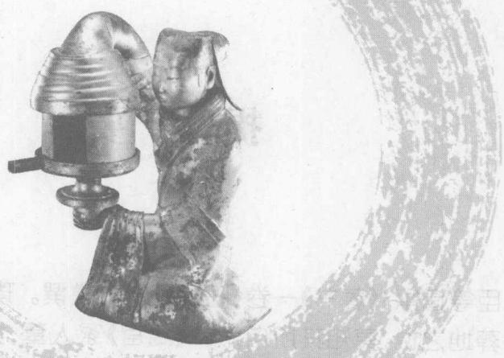

# 葬书（全文注音版·2008）

> 来源：《宅经》《灵城精义》《葬书》2008.pdf，PDF 第 114–166 页

# 中国古代文化全阅读

# ZhongGuoGuDaiWenHua2uanYueDu

全文注音版

第一辑 第25册

葬书

ZangShu

[晋]郭璞

Guo Pu

## 提 要

臣等谨案：《葬书》一卷，旧本题晋郭璞撰。璞有《尔雅注》，已著录。葬地之说，莫知其所自来。《周官》冢人墓：大夫之职称皆以族葬。是三代以上，葬不择地之明证。《汉书·艺文志》形法家以宫宅地形与相人相物之书并列，则其数自汉始明，然尚未专言葬法也。《后汉书·袁安传》载：安父没，访求葬地，道逢三书生，指一处，当世为上公，安从之，故累世贵盛。是其术盛传于东汉以后，其特以是擅名者，则璞为最著。考璞本传，载璞从河东郭公受青囊中书九卷，遂洞天文五行卜筮之术。璞门人赵载尝窃青囊书，为火所焚，不言其尝著《葬书》。唐末有《葬书地脉经》一卷、《葬书五阴》一卷，又不言为璞所作。惟《宋志》载有璞《葬书》一卷，是其书自宋始出。其后方技之家竞相粉饰，遂有二十篇之多。蔡元定病其芜杂，为删去十二篇，存其八篇。吴澄又病蔡氏未尽蕴奥，择至纯者为内篇，精粗纯驳相半者为外篇，粗驳当去而姑存者为杂篇，新喻刘则章亲受之，吴氏为之注释。今此本所分内篇、外篇、杂篇，盖犹吴氏之旧本，至注之出于刘氏与否，则不可考矣。《宋志》本名《葬书》，后来术家尊其说者，改名《葬经》，毛晋汲古阁刻本亦承其讹，殊为失考。今仍题旧名，以从其朔焉。乾隆四十六年十月恭校上。

总纂官臣纪昀臣陆锡熊 臣孙士毅总校官臣陆费墀

# nèi piān

# 内 篇

zàng zhě chéng shēng qì yě

葬者乘生气也。

shēnq. qì jí yī yuán yùn xíng zhī qì zài tiān zé zhōu liú liù xū zài dì 生气即一元运行之气，在天则周流六虚，在地 zé fā shēng wàn wù tiān wú cǐ zé qì wú yǐ zī dì wú cǐ zé xíng wú 则发生万物。天无此则气无以资，地无此则形无 yǐ zài qù páng bó hū dà huà guàn tōng hū pǐn hui wú chù wú zhī ér 以载。故磅礴平大化，贯通平品汇，无处无之，而 wú shí bú yùn yě táo kǎn yuē xiāntiān dì ér cháng cún hòutiān dì ér gù 无时不运也。陶侃曰：先天地而长存，后天地而固 yǒu qài yì zhī cǐ yún ěr qiě fú shēng qì cáng yú dì zhōng rén bù kē 有。盖亦指此云耳。且夫生气藏于地中，人不可 jiàn wéi xún dì zhī lǐ yǐ qiú zhī rán hòu néng zhī qí suǒ zài zàng zhě néng 见，惟循地之理以求之，然后能知其所在。葬者能 zhī qí suǒ zài shǐ kū gǔ dé yǐ chéng zhī zé dì lǐ zhī néng shì bì yǐ 知其所在，使枯骨得以乘之，则地理之能事毕矣。

wǔ qì xíng hū dì zhōng fā ér shēng hū wàn wù

五气行乎地中，发而生乎万物。

wǔ qì jí wǔ xíng zhī qì nāi shēng qì zhī bié míng yě fú yí qì fēn

五气即五行之气，乃生气之别名也。夫一气分 ér wéi yīn yáng xī ér wéi wū xíng suī yùn yú tiān shí chū yú dì xíng 而为阴阳，析而为五行，虽运于天，实出于地。行 zé wàn wù fā shēnq jù zé shān chuān róng jié róng jié zhě ji èr wǔ zhī 则万物发生，聚则山川融结，融结者，即二五之 jīng miào hé ér níng yē 精、妙合而凝也。

rén shòu tǐ yú fù mǔ běn hái dé qì yí tǐ shòu yìn

人受体于父母，本骸得气，遗体受荫。

fù mǔ hái gū wéi zī sūn zhī běn zǐ sūn xíng tǐ nǎi fù mǔ zhī zhī 父母骸骨，为子孙之本，子孙形体，乃父母之枝， yí qì xiāng yìn yóu bēn ér dá zhī yě gù chéng zǐ yuē bǔ qí zhái zhào 一气相荫，由本而达枝也。故程子曰：卜其宅兆， bǔ qí dì zhī měi è yē dì mēi zé shén líng ān zǐ sūn shèng ruò péi yōng 卜其地之美恶也。地美则神灵安，子孙盛，若培壅 qí gēn ér zhī yè mào lǐ gù rán yě è zé fǎn shì cài jì tōng yuē 其根而枝叶茂，理固然也。恶则反是。蔡季通曰： shēng sǐ shū tú qíng qì xiāng gǎn zì rán mò yǔ zhī tōng jīn xún pù gú 生死殊途，情气相感，自然默与之通。今寻暴骨， yǐ shēng rén cì xuè dī zhī ér shèn rù zé wéi qīn gū ròu bú shèn zé fēi 以生人刺血滴之而渗入，则为亲骨肉，不渗则非。 qì lèi xiāng gǎn yǒu rú cǐ zhě zé zhī kū gǔ dé yìn shēng rén shòu fú qí 气类相感有如此者，则知枯骨得荫，生人受福，其 lǐ xiǎn rán bú dài zhì zhě ér hòu zhī yě huò wèi bào yāng jì chéng yuán 理显然，不待智者而后知也。或谓抱养既成，元 fēi yí tī sēng dào sì xù yì yì suǒ shēng qí hé néng yìn zhī yǒu ér 非遗体，僧道嗣续，亦异所生，其何能荫之有？而 bù zhī rén zhī xīn tōng hū qì xīn wéi qì zhī zhū qíng tōng zé qì yì tōng 不知人之心通平气，心为气之主，情通则气亦通， yì jué zé yìn yì jué gù hòu mǔ néng yìn qián mǔ zǐ qián mǔ yì fā hòu mǔ 义绝则荫亦绝。故后母能荫前母子，前母亦发后母 ér qí zài wù zé lóu sǒu míng líng zhī lèi shì yě shàng hé yí yān 儿。其在物则萎薮螟蛉之类是也，尚何疑焉？

jīng yuē qì gǎn ér yìng guǐ fú jí rén

经曰：气感而应，鬼福及人。

fù mǔ zǐ sūņ běn tóng yí qì hù xiāng gǎn zhào rú shòu guǐ fú gù 父母子孙，本同一气，互相感召，如受鬼福，故   
tiān xià míng mù zài zài yǒu zhī gài zhēn lóng fā jì tiáo tiáo bǎi lǐ huò   
天下名墓，在在有之。盖真龙发迹，迢迢百里，或   
shù shí lǐ jié wéi yí xué jí zhì xué qián zé fēng luán chù yōng zhòng shuī   
数十里，结为一穴。及至穴前，则峰峦矗拥，众水   
huán rào dié zhàng céng céng xiàn qí yú hòu lóng mài bào wèi shā shuǐ xī   
环绕，叠嶂层层，献奇于后，龙脉抱卫，砂水翕 jù xíng xué jì jiù zé shān chuān zhī líng xiù zào huà zhī jīng yīng níng jié 聚。形穴既就，则山川之灵秀，造化之精英，凝结 róng huì yú qí zhōng yǐ gōu dào qí jīng yīng qiè qí líng xiù yǐ fù mǔ yí 融会于其中矣。苟盗其精英，窃其灵秀，以父母遗 gǔ cáng yú róng huì zhī dì yóu shì zǐ sūn zhī xīn jì tuō yú cǐ yīn qí xīn 骨藏于融会之地，由是子孙之心寄托于此，因其心 zhī suǒ jì suì néng yǔ zhī gǎn tōng yǐ zhì fú yú jiāng lái yē shì zhī rén 之所寄，遂能与之感通，以致福于将来也。是知人 xīn tōng hū qì ér qì tōng -hū tiān yǐ rén xīn zhī líng hé shān chuān zhī 心通乎气，而气通乎天。以人心之灵，合山川之 líng gù jiàng shényùn xiù yǐ zhōng yú shēng xī zhī yuán ér qí fù guì pin 灵，故降神孕秀，以钟于生息之源，而其富贵贫 jiàn shòu yāo xián yú mǐ bù yōu xì zhì yú xíng mào zhī yán chǒu bing jiē 贱，寿天贤愚，靡不攸系。至于形貌之妍丑，并皆 xiào xiàng shān chuān zhī měi è gù sōng yuè shēng shēn ni qiū yùn kǒng qī 肖象山川之美恶，故嵩岳生申，尼丘孕孔，岂 ǒu rán zāi wū hū fēi zàng gǔ yě nǎi zàng rén zhī xīn yě fēi shān chuǎn 偶然哉！呜呼，非葬骨也，乃葬人之心也；非山川 zhī líng yì rén xīn zì líng ēr shì yǒu wǎng wāng yī yí gū qì zhū shuǐ huǒ 之灵，亦人心自灵耳。世有往往以遗骨弃诸水火 ér wú huò fú zhě gài xīn yǔ zhī lí gù yě   
而无祸福者，盖心与之离故也。

shì yǐ tóng shān xī bēng líng zhōng dōng ying

是以铜山西崩，灵钟东应。

hàn wèi yāng gōng yi rì wú gù zhōng zì míng dōng fāng shuò yuē bì zhū 汉未央宫一日无故钟自鸣，东方朔曰：必主   
tóng shān bēng yìng wèi jǐ xī sh guō zòu tóng shān bēng yǐ rì kuí zhī   
铜山崩应。未几，西蜀果奏铜山崩，以日揆之，   
zhèng wèi yāng zhōng míng zhī rì yě dì wèn shuò hé yǐ. zhī zhī duì yuē 正未央钟鸣之日也。帝问朔何以知之，对曰：   
tóng chū yú shān qì xiāng gān ying yóu rén shòu tǐ yú fù mū yě dì tàn   
铜出于山，气相感应，犹人受体于父母也。帝叹   
yuē wù shàng ěr kuàng yú rén hū xī zēng zǐ yǎng mǔ zhì xiào zǐ chū   
曰：物尚尔，况于人乎！昔曾子养母至孝，子出， mǔ yù qí guī zé niè zhǐ ér zēng zī xīn tòng rén fán fù mǔ bù ān ér 母欲其归，则啮指，而曾子心痛。人凡父母不安而 shēn lí shì cè zé yì xīn tòng tè cháng rén xiàoxīn bó ér bù zì jué ěr 身离侍侧，则亦心痛，特常人孝心薄而不自觉耳。 gù zhī shān bēng zhōng yìng yì qí lǐ yě   
故知山崩钟应，亦其理也。

mù huá yú chūn lì yá yú shì

## 木华于春，栗芽于室。

cǐ yì yán yí qì zhī gǎn zhào yě yě rén cáng lì chūn zhì lì mù 此亦言一气之感召也。野人藏栗，春至，栗木 huá ér jiā cáng zhī lì yì yá shí zhī qù bēn yǐ jiū bǐ hu cǐ yá gài 华，而家藏之栗亦芽。实之去本已久，彼华此芽，盖 yǐ bēn xìng yuán zài dé qì zé xiāng gān ér yìng yì yóu fù mǔ zhī gǔ zàng 以本性原在，得气则相感而应，亦犹父母之骨葬， chéngshēng qì ér zǐ sūn fú wàng yě fú yí qì páng bó yú tiān dì jiān 乘生气而子孙福旺也。夫一气磅礴于天地间， wú duān ní wú zhōng qióng wàn wù suí shí yùn huà běn bú zì zhī ér shòu 无端倪，无终穷，万物随时运化，本不自知，而受 zào wù zhě yì bú zì zhī yě 造物者亦不自知也。

gài shēng zhě qì zhī jù níng jié zhě chéng gǔ  sǐ ér dú liú gù zàng 盖生者气之聚，凝结者成骨，死而独留，故葬 zhě fān qì rù gǔ yǐ yìn suǒ shēng zhī fǎ yě 者反气入骨，以荫所生之法也。

qián fù zhī jīng kūn mǔ zhī xuè ěr qì gān hé zé jīng huà wéi gǔ xuè 乾父之精，坤母之血，二气感合，则精化为骨，血   
huà wéi ròu fù jiè shén qì zī hū qí jiān suì shēng ér wéi rén jí qí sǐ   
化为肉，复藉神气资乎其间，遂生而为人。及其死   
yē shén qì fēi yáng xuè ròu xiāo kuì wéi gǔ dú cún ér shàng zhì zhī shi   
也，神气飞扬，血肉消溃，惟骨独存。而上智之士，   
tú zàng yú jí dì zhī zhōng yī ròù chéng shēng qì wài jiǎ zǐ sūn sī mù   
图葬于吉地之中，以肉乘生气，外假子孙思慕，   
yí niàn yǔ zhī wēn hé zé kě yǐ fù qí jì wǎng zhī shén cuì qí yǐ sàn zhī   
一念与之吻合，则可以复其既往之神，萃其已散之

qì gài shén qū zé qì yìng dì líng ér rén jié yǐ wú wéi yǒu jiè wěi xiǎn 气。盖神趋则气应，地灵而人杰，以无为有，借伪显 zhēn shì tōng yīn yáng gōng duó zào huà shì wéi fǎn qi rù gǔ yǐ yìn suō 真，事通阴阳，功夺造化，是为反气入骨，以荫所 shēng zhī fǎ yě

生之法也。

qiū lǒng zhī gǔ gāng fù zhī zhī qì zhī suǒ suí

丘珑之骨，冈阜之支，气之所随。

qiū lǒng wéi yīn gāng fù wéi yáng qiū yán qí gāo gǔ nāi shān zhī dài 丘珑为阴，冈阜为阳。丘言其高，骨乃山之带 shí zhě lōng gāo bù néng zì lì bì jiè shí dài. tǔ ér hòu néng sǒng yě 石者。珑高不能自立，必藉石带土而后能耸也。 gāng zhē jì yē tǔ shān wéi fù yán zhī zhī yǒu máo jǐ zhě lōng zhī yōu 冈者迹也，土山为阜，言支之有毛脊者。珑之有 gǔ qì suí ér xing zé yì jiàn zhī wú shí gù bì guān qí máo jǐ ér hòu 骨，气随而行则易见，支无石，故必观其毛脊而后 néng biàn yě rán yǒulōng ér tǔ zhī ér shí lǒng ér yǐn zhī ér lóng zhě 能辨也。然有珑而土、支而石、珑而隐、支而隆者， yòu quán jiè hū xīn mù zhī qiāo yǐ qū bié yě 又全藉乎心目之巧以区别也。

jīng yuē qì chéng fēng zé sàn jiè shuǐ zé zhǐ

经曰：气乘风则散，界水则止。

wèishēng qì suí zhī lōng tǐ zhì liú xíng tāo yān ér. qù fēi shuǐ jiè zé 谓生气随支城体质流行，滔泊而去，非水界则 mò zhī néng zhǐ jí qí. zhī yě bì dé chéng guō wán mì qián hòu zuǒ yòu 莫之能止。及其止也，必得城郭完密，前后左右 huán wéi rán hòu néng cáng fēng ér bú zhì yǒu dàng sàn zhī huàn jīng yún 环围，然后能藏风，而不致有荡散之患。经云： míngtáng xī shuǐ rú xī xuè táng lǐ bì fēng rú bì zéi kě bú shèn zāi 明堂惜水如惜血，堂里避风如避贼。可不慎哉！

gǔ rén jù zhī shǐ bú, sàn xíng zhī shǐ yōu zhǐ ,gù wèi zhī fēng shuǐ 古人聚之使不散，行之使有止，故谓之风水。

gāolǒng zhī dì tiān yīn zì shàng ér jiàng shēng qì fú lù zuì pà fēng 高珑之地，天阴自上而降，生气浮露，最怕风

hán yì wèi dàng sàn rú rén shēn jū mì shì shāo yōu xià xì tōng fēng shì 寒，易为荡散。如人深居密室，稍有罅隙通风，适 dāng jiān bēi biàn néng chéng jí gù dāng qiú qí chéng guō mì gù shǐ qì 当肩背，便能成疾。故当求其城郭密固，使气 zhī yǒu jù yě ping zhī zhī xué dì yáng zì xià ér shēng shēng qì chén 之有聚也。平支之穴，地阳自下而升，生气沉 qián bú wèi fēng chuī quē chū zài kuàng yě suī bā miàn wú bì yǐ zì 潜，不畏风吹。〔缺出在旷野，虽八面无蔽，已自 bù jué huò yù xué qing rì lǎng qí wēn hé zhī qì zì ruò gù bù yǐ kuān 不觉。或遇穴晴日朗，其温和之气自若，故不以宽 kuàng wéi xián dàn qǔ héng shuǐ zhī yǒu zhī shǐ qì zhī bù xíng yě cǐ yán 旷为嫌，但取横水之有止，使气之不行也。此言 zhī lǒng zhī qǔ yòng bù tóng yǒu rú cǐ   
支珑之取用不同有如此。

fēngshuǐ zhī fā dé shuǐ wéishàng cángfēng cì zhī

风水之法，得水为上，藏风次之。

zhī lǒng èr zhě jù yù dé shuǐ gāolōng zhī dì huò cóng yāo luò suī wú 支珑二者俱欲得水，高珑之地，或从腰落，虽无 dà jiāng lán jié yì bì chí táng yǐ zhǐ nèi qì bù zé qù shuǐ shāo yuǎn ér 大江拦截，亦必池塘以止内气，不则去水稍远，而 suí shēn jīn yú bù kě wú yě tǎng jīn yú bú jiè zé wèi zhī cí xióng shī 随身金鱼不可无也。傥金鱼不界，则谓之雌雄失 jīng suī cáng fēng yì bù kě yòng píng zhī zhī dì suī ruò wú bì dàn dé 经，虽藏风亦不可用。平支之地，虽若无蔽，但得 héng shuǐ lán jié hé xián kuān kuàng gù èr zhě jiē yǐ dé shuǐ wéi 横水拦截，何嫌宽旷。故二者皆以得水为 shàng yě

上也。

jīng yuē wài qì héng xíng nèi qì zhǐ shēng gài yán cǐ yě 经曰：外气横形，内气止生。盖言此也。

shuǐ'liú tǔ wài wèi zhī wài qi qi cáng tǔ zhōng wèi zhī nėi qì gù 水流土外，谓之外气；气藏土中，谓之内气。故   
bì dé wài qì xing héng zé nèi zhī shēng qì zì rán zhǐ yě cǐ yǐn jīng yī   
必得外气形横，则内之生气自然止也。此引经以

jié shàng wén dé shuǐwéishàng zhī yì

结上文得水为上之意。

. hé yǐ yán zhī qì zhī shèng suī liú xíng ér qí yú zhē yóu yǒu zhǐ

何以言之？气之盛虽流行，而其余者犹有止；

suī líng sàn ér qí shēn zhě yóu yǒu jù

虽零散，而其深者，犹有聚。

qāolǒnq zhī dì luò shì xióng cí huò qù huò zhǐ gè yǒu quē zuò zì 高珑之地，落势雄雌，或去或止，各有〔缺作自 quē yí dì kě jìn qí lì liàng yě ér hǎolóng duōcóng yāoluò fēn bù zhī 「缺]一地可尽其力量也。而好龙多从腰落，分布枝 màn yú shù shí lǐ zhī jiān huò wéi chéng guō cháo yuè, guān yào qín guī hàn mén 蔓干数士里之间，或为城郭朝乐官曜禽鬼捍门 huá biāo luó xīng zhī lèi jiē běn shēn zì dài bù kě wéi bǐ jì liú xíng ér 华表罗星之类，皆本身自带不可为。彼既流行，而 yú zhē fēi zhī yě dàn dāng qiú qí jù chù ér șhǐ zhī bú sàn ěr píng zhī 余者非止也，但当求其聚处，而使之不散耳。平支 zhī lónq dà shān diē luò píng yáng sì pàn kuàng kuò qí wéi chéng guō yì 之龙，大山跌落平洋，四畔旷阔，其为城郭，亦 bú quò qāo yú shù chǐ ér yǐ qiě qù xué liáo yuān cháo shān yì diǎn zài hū 不过高谕数尺而已，且去穴辽远，朝山一点，在乎 yún ǎi zhī biǎo rén mò bù yǐ bā fēng wú bì wéi xián yòu qǐ zhī zhī lōng qì 云霭之表，人莫不以八风无蔽为嫌，又岂知支珑气 yǐn ruòlíng sàn ér qí shēn zhě yóu yōu jù yě dàn dé héng shuǐ lán jié shǐ 隐，若零散而其深者犹有聚也，但得横水拦截，使 zhī yǒu zhǐ ěr cǐ yán zhī lǒng zhī qì shèng zhē rú cǐ 之有止耳。此言支珑之气盛者如此。

gù cáng yú hé zào zhě yí shēn cáng yú tǎn yí zhě yí qiǎn

故藏于涸燥者宜深，藏于坦夷者宜浅。

shàng jù yán lǒng xià jù yán zhī gāo lōng zhī dì yī zhī xiàng yě.

上句言珑，下句言支。高珑之地，阴之象也， qì zài nèi qiáng gāng ér chénxià gù yán hé zào dāng shēn zàng píng zhī zhī 气在内，强刚而沉下，故言涸燥当深葬。平支之 dì yáng zhī xiàng yě qì zài wài ruò róu ér fú shàng gù yán tǎn yí dāng 地，阳之象也，气在外，弱柔而浮上，故言坦夷当

qiǎn zàng

浅葬。

jīng yuē qiānshēn dé chéng fēng shuǐ zì chéng

经曰：浅深得乘，风水自成。

gāolóng zhī zàng qián ér fú zhāng gù shēn qǔ qí chén qì yě ping 高珑之葬，潜而弗彰，故深，取其沉气也；平 zhī zhī zàng lù ér fú yǐn gù qiǎn qǔ qí fú qì yě dé chéng zhě yán 支之葬，露而弗隐，故浅，取其浮气也。得乘者，言 suō zàng zhī guān dé yǐ chéng qí shēng qì yě qiǎn shēn shì sú duō yòng jiǔ 所葬之棺，得以乘其生气也。浅深世俗多用九 xīnq bái fǎ yǐ dìng chǐ cùn miù yě bú ruò zhī yī jīn yín lú dǐ qiú zhī 星白法以定尺寸，谬也。不若只依金银炉底求之 wéi dé 为得。

fú yīn yáng zhī qì ài ér wéifēng shēng ér wéi yún jiàng ér wéi yǔ 夫阴阳之气，噫而为风，升而为云，降而为雨， xing hū dì zhōng ér wéishēng qì 行乎地中而为生气。

yīn yáng zhī qì jí dì zhōng zhīshēng qì gù ài wéi fēng shēng wéi 阴阳之气，即地中之生气，故噫为风，升为 yún jiànq wéi yǔ fán suǒ yǐ wèitiān dì yù wàn wù zhē hé mò fēi cǐ qì 云，降为雨。凡所以位天地、育万物者，何莫非此气 yé sī gài yīn yuē zàng chéng shēng qì gù chóng jū yǐ shēn míng qí yì 邪！斯盖因曰葬乘生气，故重举以申明其义。 yú cháng wèi néng shēng néng'shā jiē cǐ qì yě zàng dé qí fā zé wéi 愚尝谓能生能杀，皆此气也。葬得其法，则为 shēnq qì shī qí dào zé wéi shā qì rú suǒ wèi jiā jiǎn ráo jiè tūn tǔ fú 生气：失其道，则为杀气。如所谓加减饶借吞吐浮 chén zhī lèi bìng dāng yī fǎ ér jiān cái zhī bú zhì yǒu zhuàng shā chōng xíng 沉之类，并当依法而剪裁之，不致有撞杀冲刑 pò sāi fān dǒu zhī huàn yě 破腮翻斗之患也。

fú tǔ zhē qì zhī tǐ yǒu tǔ sī yǒu qì qì zhēshuǐ zhī mū yǒu qì sī 夫土者气之体，有土斯有气，气者水之母，有气斯

yǒu shuǐ

有水。

qì bēn.wú tǐ jiǎ tǔ wéi tǐ yīn tǔ ér zhī yǒu cǐ qi yē shuǐ bēn 气本无体，假土为体，因土而知有此气也。水本 wú mǔ jiǎ qì wéi mǔ yīn qì ér zhī yǒu cī shuǐ yē wǔ xíng yǐ tiān yī 无母，假气为母，因气而知有此水也。五行以天一 shēng shuǐ qiě shuǐ hé cóng shēng zāi shēng shuǐ zhě jīn yě shēng jīn zhě tǔ 生水，且水何从生哉？生水者金也，生金者土 yě tǔ fù cáng jīn wú zhì ér yǒu qí qì qián cáng kūn nèi yǐn ér wèi 也。土腹藏金，无质而有其气。乾藏坤内，隐而未 xiàn jí hū shēng shuǐ qí zhào shǐ méng yán qì wéi shuǐ mǔ zhě jí qián 见，及乎生水，其兆始萌。言气为水母者，即乾 jīn zhī qì yě shì rén bù jiū bēn yuán dàn yǐ suǒ jiàn zhě shuǐ ěr gù suì 金之气也。世人不究本源，但以所见者水尔，故遂 yǐ shuǐ wéitiān dì zhī shǐ gài tōng ér wèijīng zhě yě 以水为天地之始，盖通而未精者也。

jīng yuē tǔ xíng qì xíng wù yīn yǐ shēng

经曰：土形气形，物因以生。

shēng qì fù xíng ér yǒu yī tǔ ér. xíng wàn wù yì mò fēi quē 生气附形而有，依土而行，万物亦莫非〔缺 yě cǐ yīn jīng jié shàng wén yōu tǔ sī yǒu qì zhī yì 也。此引经结上文有土斯有气之意。

fú qì xíng hū dì zhōng qi xíng yě yīn dì zhī shì qí jù yě yīn shì 夫气行乎地中，其行也因地之势，其聚也因势 zhī zhǐ

之止。

qì xíng dì zhōng rén bù kē jiàn qí shī yě zé yīn dì zhī shì ér zhī 气行地中，人不可见，其始也则因地之势而知 qí xíng qí cì yě yòu yīn shì zhī zhǐ ér zhī qí jù yē 其行，其次也又因势之止而知其聚也。

zàng zhě yuán qí qǐ chéng qí zhī

葬者原其起，乘其止。

shàn zàng zhě bì yuán qí qǐ yǐ guān shì chéng qí zhǐ yǐ qiān xué 善葬者，必原其起以观势，乘其止以扦穴。

fán yán zhǐ zhě nǎi shān chuān róng jié qí xiù zhī suǒ yǒu fēi míng yǎn mò néng 凡言止者，乃山川融结奇秀之所有，非明眼莫能 shí yě piàn yù suǐ yún cǎo shàng lù huá piān zài wěi huā zhōng xiāng 识也。《片玉髓》云：草上露华偏在尾，花中香 wèizǒng jū xīn qí zhǐ zhī wèi yú huò wèi nián xué chéng qi mài zhī jìn chù 味总居心。其止之谓与！或谓黏穴乘其脉之尽处 wéi zhǐ rán zé gài yǐ. zhuàng ān kě yǐ zhǐ yűn bù zhī gǔ rén zhèng kǒng 为止，然则盖倚撞安可以止云。不知古人正恐 höu shì bù shí zhī chù gù lì wéi sì fǎ yǐ chéng zhī fú gài zhě zhǐ yú 后世不识止处，故立为四法以乘之。夫盖者止于 gài yǐ zhě zhī yú yǐ yě zhuàng nián mò bù jiē rán wéi guān yì zhī suō 盖，倚者止于倚也，撞黏莫不皆然，唯观义之所 zài gāo dī zhèng cè hé wǎng ér fēi zhǐ hū   
在，高低正侧，何往而非止乎！

dì shì yuán mài shān shì yuán gǔ wēi yí dōng xī huò wéi nán běi

地势原脉，山势原骨，委蛇东西，或为南北。

píng yí duō tǔ dǒu xiè duō shí zhī zhī xíng bì rèn tǔ jǐ yǐ wéi mài

平夷多土，陡泻多石，支之行必认土脊以为脉， lōng zhī xíng zé qiú shí jǐ yǐ wéi gǔ qí xíng dù zhī shì wēi yí qū zhé 珑之行则求石脊以为骨。其行度之势，委蛇曲折， qiān biàn wàn huà bēn wú ding shì dà lüè yǔ qiū lōng zhī gū gāng fù zhī zhī 千变万化，本无定式，大略与丘珑之骨、冈阜之支 lüè tóng

qiān chǐ wéi shì bǎi chǐ wéi xíng

千尺为势，百尺为形。

qiān chǐ yán qí yuǎn zhǐ yì zhī shān zhī lái shì yě bāi chǐ yán qí 千尺言其远，指一枝山之来势也。百尺言其 jìn zhī yì xué dì zhī chéng xíng yě 近，指一穴地之成形也。

shì lái xíng zhī shì wèi quán qì quán qì zhī dì dāng zàng qí zhī 势来形止，是谓全气，全气之地，当葬其止。

yuán qí yuǎn shì zhī lái chá qí jìn xíng zhī zhī xíng shì jì shùn zé 原其远势之来，察其近形之止，形势既顺，则

C116

shān shuǐ xī hé shì wéi quán qì zhī dì yòu dāng qiú qí zhǐ chù ér zàng 山水翕合，是为全气之地。又当求其止处而葬

zhī sī jìn shàn yǐ zhǐ zhī yí zì zuì wèi chī jǐn shì zhī zàng zhě bù 之，斯尽善矣。止之一字，最谓吃紧。世之葬者，不

fá quán qì zhī dì dàn yú zhǐ chù zé yǒu mèi yān ēr fú qiān lǐ lái lóng 乏全气之地，但于止处则有昧焉耳。夫于里来龙，

wǔ chǐ rù shǒu cái chā yì zhī jìn fèi qián gōng zòng qí fēng sǒng bá xiù 五尺入手，才差一指，尽废前功，纵奇峰耸拔，秀

shuǐ zhī xuán jiē bú wèi wǒ yòng yǐ ruò dé qí chuán zhī qí zhǐ zé rú 水之玄，皆不为我用矣。若得其传，知其止，则如

shù èr sān biàn hēi bái rén huò jiàn qí mǎng rán kě zuǒ kě yòu kě yí kē 数二三，辨黑白，人或见其莽然可左可右，可移可

yì ér bù zhī zhōngjiān zì yǒu yī dìng bú yì zhī fǎ chǐ cùn bù kě qiān gǎi 易，而不知中间自有一定不易之法、尺寸不可迁改

zhě zhǐ nán yún lì xué ruò hái cái bú zhèng zòng ráo jí dì yě tú 者。《指南》云：立穴若还裁不正，纵饶吉地也徒

rán gāo dī shēn qiǎn rú zàng wù fú biàn wéi zāi qǐ huòqiān 然。高低深浅如葬误，福变为灾起祸愆。

wǎn wěi zì fù hui huán chóng fù

## 宛委自复，回环重复。

wǎn wěi zì fù zhǐ qí shì ér yán huò shùn huò nì jí wēi yí dōng

宛委自复，指其势而言。或顺或逆，即委蛇东

xī huò wéi nán bēi zhī yì yě huí huán chóng fù yǐ qí xíng ér lùn 西，或为南北之意也。回环重复，以其形而论。

céng gǒng dié rào jí cháo hǎi gǒng chén zhī yì yě quán qì zhī dì qí róng 层拱叠绕，即·朝海拱辰之义也。全气之地，其融 jié zhī qíng rú cǐ

ruò jù ér hòu yě

若踞而候也。

rú rén zhī jù rán bú dòng ér yōu suǒ dài. rán

如人之踞然不动，而有所待然。

ruò lǎn ér yōu yě

若揽而有也。

rú guì rén duān zuò qì jù bì chén lān zhī ér yǒu yú 如贵人端坐，器具毕陈，揽之而有余。

yù jìn ér què yù zhǐ ér shēn

欲进而却，欲止而深。

shàng jù yán yōng wèi zhī shān xū dé qū yī cháo gǒng bú yù qí jiàn bī 上句言拥卫之山须得趋揖朝拱，不欲其僭逼 chōng tū ér bú xùn yě xià jù yánzhū xù zhī shuǐ bì dé zhī jù yuānchéng 冲突而不逊也。下句言潴蓄之水必得止聚渊澄， bú yù qí dōu xiè fǎn bèi ér wú qíng yě 不欲其陡泻反背而无情也。

lái jī zhǐ jù chōng yáng hé yīn

来积止聚，冲阳和阴。

lái shān níng jié qí qì jī ér bú sàn zhǐ shuǐróng huì qí qíng jù ér 来山凝结，其气积而不散；止水融会，其情聚而 bù liú sī nǎi yīn yángjiāo jì shān shuǐchōng hé yě 不流。斯乃阴阳交济，山水冲和也。

tǔ gāoshuīshēn· yù cǎo mào lín

土高水深，郁草茂林。

shuīshēn chén zé tū rǎng gāo hòu qì chōng hé zé cǎo mù mào chāng 水深沉则土壤高厚，气冲和则草木茂昌。 chéng zǐ yuē hé wèi dì zhī měi tǔ sè guāng rùn cǎo mù mào shèng nǎi 程子曰：曷谓地之美？土色光润，草木茂盛，乃 qí yàn yē 其验也。

guì ruò qiān shèng fù rú wàn jīn

贵若千乘，富如万金。

qì xiàng zūn yán ruò qiān shèng zhī guì yōng cù fán huǒ yóu wàn jīn 气像尊严，若千乘之贵；拥簇繁夥，犹万金 zhī fù 之富。

jīng yuē xing zhǐ qì xù huàshēng wàn wù wéishàng dì yě 经曰：形止气蓄，化生万物，为上地也。

táng jú wán mì xing xué zhǐ jù zé shēng qì cáng xù yú zhōng yǐ 堂局完密，形穴止聚，则生气藏蓄于中矣。

shànzàng zhě yīn qí jù ér chéng zhī zé kě yī fú xiàn zài chāng hòu yì 善葬者因其聚而乘之，则可以福见，在昌后裔。 rú wàn wù yóu cǐ qì ér chéng huà yù zhī gōng gù wéishàng dì 如万物由此气而成，化育之功，故为上地。

dì guì píng yí tǔ guì yǒu zhī

地贵平夷，土贵有支。

zhī lóng guì píng tān yí kuàng wéi dé zhī zhī zhèng tǐ ér tū zhōng fù 支龙贵平坦夷旷，为得支之正体。而土中复 yǒu zhī zhī wén lǐ ping huǎntián ruǎn bù jí bú zào zé biǎo lǐ xiāng ying 有支之纹理，平缓恬软，不急不燥，则表里相应。 rán què yǒu zhī tǐ ér dé lǒng zhī qíng xìng zhě zhí rú zhì qiāng jí rú bēng 然却有支体而得珑之情性者，直如掷抢，急如绷 xiàn wèi zhī dāohuǒ yìng mù cǐ yáng zhōng hán yīn yě fǎ dāng bi shā nián 线，谓之倒火硬木，此阳中含阴也，法当避杀，黏 chún jià zhé ér zàng liú shì suǒwèi zhí jí zé bì qiú ér còu yán shì yě 唇架折而葬。刘氏所谓直急则避球而凑檐是也。 yángzhě wéiruò běn yí còu rù nài hé xing jí yào suō xià yī èr chǐ huǎn 阳者为弱，本宜凑入，奈何性急，要缩下一二尺，缓 qí jí xìng gǒu zhí zhī fǎ qiān zhī zé xiōng cǐ zhī lóng zhī zhì nán tǐ rèn 其急性，苟执支法，扦之则凶。此支龙之至难体认 zhē gù jǐng chún wèi zhī lóng zhī biàn gài yán cī yě 者，故景纯谓支龙之辨，盖言此也。

zhī zhī suǒ qǐ qì suí ér shǐ zhī zhī suǒ zhōng qì suí yǐ zhōng 支之所起，气随而始；支之所终，气随以钟。

cǐ yán píng zhī xíng dù tǐ duàn yuán qí shǐ zé. qì shì sui zhī ér xíng 此言平支行度体段，原其始则气势随之而行， chéng qí zhǐ zé qì mài yīn zhī ér zhōng guān shì chá mài zé kē yǐ zhī qí 乘其止则气脉因之而钟，观势察脉，则可以知其 qì zhī róng jié yī 气之融结矣。

guān zhī zhī fǎ yǐn yǐn lóng lóng wēi miào xuántōng jí zài qí zhōng 观支之法，隐隐隆隆，微妙玄通，吉在其中。

yǐn yǐn yǒu zhōng zhī wú yě lóng lóng wú zhōng zhī yǒu yě qí tǐ 隐隐，有中之无也；隆隆，无中之有也。其体

duàn ruò zhǎn zhōng zhī sū yún zhōng zhī yàn huī zhōng xiàn lù cǎo lī shé 段若盏中之酥，云中之雁，灰中线路，草里蛇 zōng shēng qì xíng hū qí jiān wēi miào yǐn fú ér nán jiàn rán qí jí zé wú 踪，生气行乎其间，微妙隐伏而难见，然其吉则无 yǐ jiā yǐ   
以加矣。

jīng yuē dì yǒu jí qì tǔ suí ér qǐ zhī yōu zhǐ qi shuǐ suí ér 经曰：地有吉气，土随而起；支有止气，水随而 bǐ shì shùn xíng dòng huí fù shǐ zhōng fǎ zàng qí zhōng yǒng jí 比。势顺形动，回复始终，法葬其中，永吉 wú xiōng 无凶。

yǐn jīng yǐ míng shàng wén zhī lóng xíng dù yán ping yí zhī dì wēi lù 引经以明上文支龙行度，言平夷之地，微露 máo jī yuán zhě rú fú ōu rú xīng rú zhū fāng zhě rú xiāng rú yìn 毛脊，圆者如浮沤，如星，如珠，方者如箱，如印； cháng zhě rú yù chǐ rú lú biān qū zhě rú jī rú dài fāng yuán dà xiǎo bù 长者如玉尺，如芦鞭；曲者如几如带，方圆大小不 dēng zhě rú guī yú wā há shì jiē dì zhī jí qì yǒng qǐ gù tǔ yì suí zhī 等者如龟鱼蛙蛤，是皆地之吉气涌起，故土亦随之 ér tū qǐ jí qí zhī yē zé rú jī kē xuán luó zhī zhuàng yán xíng zhǐ 而凸起。及其止也，则如鸡窠旋螺之状，言形止 mài jin ér yì shuǐ jiāo dù yē gāoshuǐ yí cùn biàn kě yán shān dī tǔ yí 脉尽而一水交度也。高水一寸，便可言山；低土一 cùn biàn kě yánshuǐ cǐ zhī qì zhī zhǐ yǔ shuǐpéng bǐ ér xiāng wéi tǐ yòng 寸，便可言水，此支气之止，与水朋比而相为体用 zhě yě. shì shùn xíng dòng zhě lóng shì shùn fú ér bù fǎn nì jú xíng huó 者也。势顺形动者，龙势顺伏而不反逆，局形活 dòng ér duō pán xuán shā shuǐ gōu jiā huí huán chóng fù shǒu wěi wú bì shǐ 动而多盘旋，砂水钩夹，回环重复，首尾无蔽，始 zhōng yǒu qíng yī fǎ zì kě qiān xué.

终有情，依法自可扦穴。

shān zhě shì xiǎn ér yǒu yě fǎ zàng qí suǒ huì

山者势险而有也，法葬其所会。

shān yánlǒng yē shì suī xiǎn jùn ér qí zhōng fù yǒu bù xiān zhī xué 山言珑也，势虽险峻，而其中复有不险之穴， dàn dāng qiú qí zhǐ jù róng hui chù ér zàng zhī zé shàn yǐ gài gāo lǒng zhī 但当求其止聚融会处而葬之，则善矣。盖高珑之 dì lái shì gāo dà luò shì xióng zhuàng jié shì yì. qiě quē jí cǐ quē 地来势高大，落势雄壮，结势亦且〔缺急此〔缺 zhī quē yě. què yǒu yī děng yǐ lǒng wéi tī ér dé zhī zhī qíng xìng zhě dà 之〔缺也，却有一等以陇为体而得支之情性者，大 shān xiáng wǔ chuí xià jí zhì píng dì. biàn wéi zhī tǐ wèi zhī xià shān shuǐ 山翔舞垂下，及至平地，变为支体，谓之下山水， cǐ yīn zhōng hán yáng yē ruò bù shi nián zàng shān lù mò bù yǐ qián tuō 此阴中含阳也。若不识黏葬山麓，莫不以前拖 píng dì wéi yīn rù qǐ zhī qí shì wèi zhù liāng biān jiè shuǐ suí mài ér xíng 平地为祸褥，岂知其势未住，两边界水随脉而行， píng píng yǐn fú zhí zhì táng xīn qí mài shǐ jìn tiān bǎojīng yuē fán rèn 平平隐伏，直至堂心，其脉始尽。《天宝经》曰：凡认 mài qíng kàn zhù jué shuǐ ruò xíng shí mài bù xiē xiē shí xū yǒu xiāo míng 脉情看住绝，水若行时脉不歇。歇时须有小明 táng qì zhī shuǐjiāofāng shì xué hòu miàn yào jīn qì kě chéng qián tóu yào 堂，气止水交方是穴。后面要金气可乘，前头要 hé shuǐ kē xiè ruò hái záo nǎo ér záo xiōng còu. jí shāng lóng fēi róng jié 合水可泄。若还凿脑而凿胸，凑急伤龙匪融结。 cǐ dinq xué zhī mì yǔ yē gù dāng qiú qí shā shuǐ huì chù zhēn qiú ér zàng 此定穴之密语也，故当求其砂水会处，枕球而葬。 yīn zhě wéi qiáng gù dāng suō xià nài hé xing huān yào chā shàng qī bā cùn 阴者为强，固当缩下，奈何性缓，要插上七八寸， jí qí huān xing míng wéi còu jiāo dòu shà liú shì suǒ wèi bǎi huān zé rù yán 急其缓性，名为凑交斗煞，刘氏所谓摆缓则入檐 ér còu qiú shì yě gōu zhí lōng fǎ qiān zhī zé zhū bài jué cǐ yòu gāo lōng 而凑球是也。苟执珑法扦之，则主败绝，此又高陇 zhī zhì nán tǐ rèn zhě 之至难体认者。

chéng qí suǒ lái

乘其所来。

yánshēng qì zhī suǒ cóng lái yīn qí lái ér zhī qí zhǐ gù zàng zhě dé 言生气之所从来，因其来而知其止，故葬者得   
yǐ chéng zhī bù shǐ yǒu fēn cùn zhī wéi yě mài bù lí guān guān bù lí   
以乘之，不使有分寸之违也。脉不离棺，棺不离   
mài  guān mài xiāng jiù bō huā jiē mù fǎ dāng jiù huà shēng nǎo shàng xún   
脉，棺，脉相就，剥花接木，法当就化生脑上，循   
mài kàn xià xiáng rèn jī jì xiè yǎn sān wén míng zì jiāo yá. dī duàn huò fēn   
脉看下，详认鸡迹蟹眼三文名字、交牙滴断，或分   
shi zì huò bù fēn shi zì kàn tā. yīn yáng pèi yǔ bú pèi ji fú qiáng ruò   
十字，或不分十字，看他阴阳配与不配，及夫强弱   
shùn nì jí huǎn shēng sǐ fú chén xū shí yǐ dìng jiā jiǎn ráo jiè nèi jiē   
顺逆急缓生死浮沉虚实，以定加减饶借。内接   
shēng qì wài yáng huì qì nèi wài fú hé. qián hòu wú bì shǐ wéizhēn xué 生气，外扬秽气，内外符合，前后无蔽，始为真穴，   
yī yǒu bú shùn jí huā jiǎ yī cǐ chéng shēng qì zhī yào jué yě xià yán   
一有不顺，即花假矣，此乘生气之要诀也。下言   
chéng jīn xué- tǔ yì tóng 乘金穴土义同。

shěn qí suǒ fèi

审其所废。

wèi rù shǒu fèi. huài zhēn wěi mò biàn gù bù. dé bù xiáng jiā shěn chá 谓入首废坏，真伪莫辨，故不得不详加审察 yě fú tiānzhēn mò sàng zé dìng xué yì wéi lì dàn chéng qi lái ji zhī 也。夫天真末丧，则定穴易为力，但乘其来，即知 qí zhǐ què yǒu yī dēng bú xing wèi niú -yáng jiàn tā shàng pò xià bēng suì 其止。却有一等不幸为牛羊践踏，上破下崩，岁 jiū nián shēn huò zhòng zuò kāi kěn huò qián rén miù qiān qí páng wéi qiáng bài 久年深，或种作开垦，或前人谬扦其旁，围墙拜 tán bù wú huì shí huò céng wéi jū jī yì dī sǔn gāo huòtián jiā qǔ tǔ 坛，不无晦蚀：或曾为居基，益低损高，或田家取土， chú jué qiāng zéi ér dà bā zì yǔ jīn yú bù kě dé ér yi yì dàn yàolóng 锄掘戕贼，而大八字与金鱼不可得而移易，但要龙 zhēn jú zhèng shuǐ jing shā míng dāng qǔ qián hòu zuǒ yòu sì yìng zhèng zhī 真局正，水净砂明，当取前后左右四应，证之 xīn mù xiāng duó.zhuó liàng kāi.jing wú bù dé yǐ gài fú yí qì huà shēng 心目，相度酌量开井，无不得矣。盖夫一气化生 zhī lōng suí qì ér chéng xíng‘zhì jīn jì fèi. huài mò biàn gù bì yú fèi 支珑，随气而成形质，今既废坏莫辨，故必于废 zhōnq shēn zhī zé fán suǒ wèi yīn yáng gāngróu jí huǎn shēng sǐ fú chén xū 中审之，则凡所谓阴阳刚柔急缓生死浮沉虚 shí zhī lī wú bù liǎo rán jì dé qí lǐ. zé dào zhàng zhī fā yì yīn zhī 实之理，无不了然。既得其理，则倒杖之法亦因之 ér dìng yān   
而定焉。

## zé qí suǒ xiàng

## 择其所相。

wèishēn zé qí suǒ xiàng fǔ yú wǒ zhě fǎ dāng. yú xiǎo bā zì xià kàn 谓审择其所相辅于我者。法当于小八字下看 liǎng jiān àn 'yì jiān gāo jiān dī yǐ fēn yīn yáng zuò yòng cì shì sān fēn sān 两肩暗翊，肩高肩低，以分阴阳作用，次视三分三 hé qí jí pínq huǎn yǐ bié shùn nì ráo jiǎn jìn guān chán yì zhī shā xiā 合，崎急平缓，以别顺逆饶减。尽观蝉翊之砂，虾 xū zhī shuǐ yǐ dìng zàng kǒu jiè xiàn shì jiē zuǒ yòu zhī suǒ xiàng gǒu shī 须之水，以定葬口界限，是皆左右之所相。苟失 qí dào zé yǒu pò sāi fān dōu shāng lóng shāng xué shāng qiān shāng shēn zhī 其道，则有破腮翻斗、伤龙伤穴、伤浅伤深之 huàn gù bù dé bù xiáng jiā shěn zé yě xià piān yán xiàng shuǐ yìn mù. 患，故不得不详加审择也。下篇言相水印木 yì tóng 义同。

## bì qí suǒ hài

## 避其所害。

wèi bì qù sǐ qì yǐ qiú shēng qì yē gài xué zhōng zhī qì yōu xíng 谓避去死气，以求生气也。盖穴中之气，有刑   
yǒu dé cái jiān dé fǎ zé wéishēng qì yī shī qí dào zé wéi sǐ qì gù   
有德，裁剪得法，则为生气，一失其道，则为死气，故   
bù dé. bù shěn ér bì zhī hé yǐ yán zhī bì sǐ āi shēng shì yě rú   
不得不审而避之。何以言之？避死挨生是也。如

yáng mài luò xué yǐ yīn wéi shēng ýáng wéi sǐ yīn mài luò xué yǐ yáng 阳脉落穴，以阴为生，阳为死。阴脉落穴，以阳 wėishēng yīn wéi. sǐ mài :lái biā hòu biān bó: yǐ bó wéi shēng hòu wéi 为生，阴为死。脉来边厚边薄，以薄为生，厚为 sǐ shuāng mài yì cháng yì duǎn yǐ duǎn wéi shēng čháng wéi sī yí 死。双脉一长一短，以短为生，长为死。一 dà yì xiǎo yǐ xiǎo wéi shēng dà. wéi sǐ yǐ xiù nèn guāng jing yuán hòu 大一小，以小为生，大为死。以秀嫩光净圆厚 yǒng dòng wéishēng kū lāo yōng zhōng pò sui zhí ying wéi sī yòu huò shā shuǐ 涌动为生，枯老臃肿破碎直硬为死。又或砂水 zhī jiān fǎn kēng xié fēi zhí zhuàng ci shè jiē wéi xíng shà héng guò zhī 之间，反坑斜飞，直撞刺射，皆为形煞。横过之 shān rú qiāng rú dāo jiān li shùn shuř kě shōu shí wéi yòng zhě yòng zhī 山如枪，如刀尖利，顺水可收拾，为用者用之， kē bi qù zhē bi zhī cǐ zé yī yǎn qián zhī suǒ jiàn zhě ér lùn zhī yě yòu 可避去者避之，此则以眼前之所见者而论之也。又 chéng zǐ wèi wǔ huàn liú shì wèi sì è jiē zài suǒ dāng bì yē 程子谓五患，刘氏谓四恶，皆在所当避也。

shì yǐ jūn zǐ duó shén gōng gǎi tiān ming

是以君子夺神功，改天命。

shàng wén suō wèi chéng shěn zé bì quán píng yān lì zhī qiǎo gōng lì 上文所谓乘审择避，全凭眼力之巧、工力 zhī jù qū quán bì quē zēng gāo yì xià wēi miào zài zhì chù lèi. ér zhǎng 之具，趋全避缺，增高益下，微妙在智，触类而长， xuántōng yīn yáng gōng duó zào huà jí fú xué chǎng yī yìng zuò yòng cái jiān 玄通阴阳，功夺造化，及夫穴场一应作用裁剪 fàng sòng zhī fā jiē shì yě · chén xī yí xiān shēng yuē shèng rén zhí qi shū 放送之法，皆是也。陈希夷先生曰：圣人执其枢 jī mì qí miào yòng yùn yú jǐ xīn xíng zhī yú shì tiān ming kě yí shén 机，秘其妙用，运于己心，行之于世，天命可移，神 gōng kě duó lì shù kě biàn yē dào bù xūxing cún hū rén ěr 功可夺，历数可变也。道不虚行，存乎人耳。

huò fú bù xuán rì jīng yuē zàng shān zhī fā ruò hū xī zhōng yán 祸福不旋日。经曰：葬山之法若呼吸，中言

yīng sù yě

应速也。

huò fú zhī gǎn zhào jié yú yǐng xiǎng néng chéng néng shēn néng zé 祸福之感召；捷于影响，能乘能审、，能择 néng bì suí qí suǒ gǎn fǒu zé wéi xiōng yìng yǐ dà yào zài fēn bié yīn 能避，随其所感，否则为凶应矣。大要在分别阴 yáng yǐ wéi xiān wù yōu chún yīn chún yáng biān yīn biān yáng shàng yáng 阳以为先务。有纯阴纯阳，边阴边阳，上阳 xià yīn shàng yīn. xià yáng yīn jiāo yáng bàn yáng jiāo yīn bàn qiáng yáng ruò 下阴，上阴下阳，阴交阳半，阳交阴半，强阳弱 yīn lǎo yáng nèn yīn gè yōu zuò fǎ yīn.lái zé yáng shòu yáng lái zé yīn 阴，老阳嫩阴，各有作法。阴来则阳受，阳来则阴 zuò huò rù yán ér dòu qiú huò bì qiú ér còu yán yòu yǒu yáng shī yīn xī 作，或入檐而斗球，或避球而凑檐。又有阳嘘阴吸 zhī bù tóng shùn zhōng qǔ nì nì zhōng qǔ shùn qing yǒu gài nián zé zhèng 之不同，顺中取逆，逆中取顺，情有盖黏则正 qiú shùn zuò qíng zài yǐ zhuàng zé jià zhé nì shòu jiā ruò yīn mài luò xué 球顺作，情在倚撞则架折逆受。假若阴脉落穴， fàng guān ráo guò yáng biān jiè yáng qì yì xū qí qì fāng shēng yáng mài 放棺饶过阳边，借阳气一嘘，其气方生。阳脉 luò xué fàng guān ráo guò yīn biān jiè yīn qì yì xī qí qì fāng chéng suō 落穴，放棺饶过阴边，借阴气一吸，其气方成。所 wèi yáng yì xū ér wàn wù shēng yīn yì xī ér wàn wù chéng shi yě gōu 谓阳一嘘而万物生，阴一吸而万物成是也。苟 bù shí cái jiān fàng sòng zhī fǎ dāng xū ér xī dāng xī ér xū yí shùn ér 不识裁剪放送之法，当嘘而吸，当吸而嘘，宜顺而 nì yí nì ér shùn jí fú zuǒ yòu tūn tǔ shēn qiǎn bù zhī qí jué bù néng 逆，宜逆而顺，及夫左右吞吐深浅不知其诀，不能 bì shā āi shēng zé shēng biàn wéi shā qì zòng shī gāo xià wú chā zuǒ yòu 避杀挨生，则生变为杀气。纵使高下无差，左右 shì yí qiān shēn hé dù yóu qiě bù miān yú huò kuàng wèi dāng yú lǐ zhě 适宜，浅深合度，犹且不免于祸，况未当于理者 hū gǔ gē yuē ruò hái chā yì zhǐ rú gé wàn chóng shān liáng yǒu 乎！古歌曰：若还差一指，如隔万重山。良有

yǐ yě

以也。

shān zhī bù kě zàng zhě wū qì yǐ shēng hé ér tóng shān bù kě 山之不可葬者五：气以生和，而童山不可 zàng yē 葬也。

tū sè guāng rùn cǎo mù mào shèng wéi di zhī měi  jīn tóng shān cū 土色光润，草木茂盛，为地之美。今童山粗 wán tǔ mài kū gǎo wú fā shēng chōng hé zhī qì gù bù kē zàng què yòu 顽，土脉枯槁，无发生冲和之气，故不可葬。却又 yǒu yì děng shí shān wén lǐ wēn rùn guāng rú luǎn qiào. cǎo mù. bù kě lì 有一等石山，文理温润，光如卵壳，草木不可立 gēn zì rán bù chǎn kāi jīng ér dé wǔ sè tǔ :xué zhě shì yòu bù kě yǐ tóng 根，自然不产，开井而得五色土穴者，是又不可以童 ér qì zhī yě 而弃之也。

qì yīn xíng lái ér duàn shān bù kě. zàng yē

气因形来，而断山不可葬也。

fú tǔ zhē qì zhī tǐ yōu tǔ sī yǒu qì shān jì záo duàn zé shēng 夫土者气之体，有土斯有气。山既凿断，则生 qì gé jué bù xiāng jiē xù gù bù kě zàng qīng huá mì suǐ yún yī 气隔绝，不相接续，故不可葬。《青华秘髓》云：一 xī bù lái shēn shì qiào yì shì cǐ yì rán yǔ zì rán. diē duàn zhě zé yòu 息不来身是壳。亦是此意。然与自然跌断者则又 bù xiāng móu yǐ 不相侔矣。

qì yīn ǔ xing ér shí shān bù kě zàng yě

气因土行，而石山不可葬也。

gāolǒng zhī dì hé mò fēi shí suǒ wèi shān shì yuán gǔ gǔ jí shí 高珑之地，何莫非石，所谓山势原骨，骨即石   
yě. 'shí shān xíng dù yōu hé bù kě wéi róng jié zhī chù bù yí yǒu shí ēr   
也，石山行度，有何不可？惟融结之处不宜有石耳。   
fú shí zhī dāng jì zhē jiāo ér wán má zào ér sū huò bú shòu chú jué   
夫石之当忌者，焦口而顽，麻燥而苏，或不受锄掘，

huǒ yàn fēi yáng sù shà zhī qì hán yān dài hēi wéi xiōng yě qí yú zòng 火焰飞扬，肃煞之气，含烟带黑，为凶也。其余纵 shǐ yǒu shí dàn shǐ tǐ zhì cuì nèn wén lī wēn rùn yán sè xiān míng zé wú 使有石，但使体质脆嫩，文理温润，颜色鲜明，则无 bù jí yǐ yòu yǒu qí xíng guài xué yǐn yú shi jiàn zhě  sì pàn jiē shí yú 不吉矣。又有奇形怪穴隐于石间者，四畔皆石，于 qí zhōng yǒu tū xué qǔ qù tǔ jìn shǐ kě róng guān yòu yōu wán shí záo 其中有土穴，取去土尽，始可容棺。又有顽石凿 kāi ér xià yǒu tǔ xué jiē kě rù xuān shì wèi kě yǐ shí wéi xián yě 开而下有土穴，皆可入选，是未可以石为嫌也。

qì yǐ shì zhǐ ér guòshān bù kě zàng yě

气以势止，而过山不可葬也。

cǐ yán héng lóng tāo tāo jìng qù wǎn zhī bú zhù liǎng biān lüè yǒu chuí 此言横龙滔滔竟去，挽之不住，两边略有垂 xià bú guò ráo zhào ér yǐ qì yīn shì ér zhǐ xué yīn xíng ér jié guò shān 下，不过桡棹而已。气因势而止，穴因形而结，过山 wú qing qí shì wèi zhī qí xíng wèi zhù gù bù kě zàng què yòu yǒu yì 无情，其势未止，其形未住，故不可葬。却又有一 dēng héng lóng dī luò ‘zhèng lóng yāo luò jí fú zhān guān wéi xué zhē bù 等横龙滴落，正龙腰落，及夫斩关为穴者，不 tóng yě 日山

qì yǐ lóng huì ér dú shān bù kě zàng yē

气以龙会，而独山不可葬也。

zhī lóng xíng dù xiōng di tóng wán cí xióng bing chū jí qí zhǐ yě 支龙行度，兄弟同完，雌雄并出。及其止也，   
chéng guō wán mì zhòng shān xī jí fāng chéng jí xué bǐ dān shān dú   
城郭完密，众山翕集，方成吉穴。彼单山独   
lóng gū lù wú qíng gù bù kě zàng quèyòu yǒu yī dēng zhī lóng bù shēng   
龙，孤露无情，故不可葬。却又有一等支龙，不生   
shōu zú yì qǐ yì fú jīn shuǐ xíng dù diē lù píng yáng liǎng biān jiè wài   
手足，一起一伏，金水行度，跌露平洋，两边借外   
wèisòng wéi yǎng yìn jí qí .zhǐ yě cí xióng jiāo dù dà jiāng gǒng cháo huò   
卫送为养荫。及其止也，雌雄交度，大江拱朝或 héng lán wài yáng yuǎn jiē zài hū píāo miǎo zhī jiān zòng yǒu yīn shā jǐn gāo 横拦，外阳远接，在乎缥缈之间，纵有阴砂，仅高 yí bù cǐ yòu bù kě yǐ gū lù ér qì zhī yē hé yǐ yán zhī gài dé 一步，此又不可以孤露而弃之也。何以言之？盖得 shuǐ wéishàng cáng fēng cì zhī suō yǐ wéi gui yě   
水为上，藏风次之，所以为贵也。

jīng yuē tóng duàn shí guò dú shēng xīn xiōng ér xiāo yǐ fú

经曰：童断石过独，生新凶而消已福。

ci fu zheng wù xiōng zhī bù kē yóng yē fán cī shi wú suō quē shi 此复证五凶之不可用也，凡此是无所〔缺适 zú yǐ fǔ gū làn guān ér yǐ zhǔ tuì bài shāo wáng láo jí jiū zé guī yú 足以腐骨烂棺而已，主退败，少亡痨疾，久则归于 xiē miè kě bú shèn zāi 歇灭，可不慎哉！

shàng dì zhī shān ruò fú ruòlián qí yuán zì tiān

上地之山，若伏若连，其原自天。

cǐ yánshàng dì lóng zhī xíng dù tǐ duàn yě dà dùn xiǎo fú jí duàn 此言上地龙之行度体段也，大顿小伏，藉断 sī lián wèi zhī tuō xiè fú dà dì qiān bǎi lī xíng lóng qi hé kē qióng 丝连，谓之脱卸。夫大地干百里，行龙其何可穷 hū gù yuān ruò zì tiān ér lái yě 乎？故远若自天而来也。

ruò shuǐ zhī bō

## 若水之波。

cī yán yǐn fú yú píng yáng dà bǎn zhī jiān yi wàng miǎo wú yá jì 此言隐伏于平洋大坂之间，一望渺无涯际， céng céng jí jí ruò jiāng miàn zhī shuǐ wēi fēng dàng yàng zé yǒu qīng bō xi 层层级级，若江面之水，微风荡漾，则有轻波细 wén wèi zhī xíng dì shuǐ wēi miào xuántōng jí zài qí zhōng yǐ 纹，谓之行地水。微妙玄通，吉在其中矣。

ruò mǎ zhī chí

若马之驰。

yuán qí qǐ ruò mǎ zhī bēnténg jiāng yù zhī rú mǎ zhī jí jiù 原其起，若马之奔腾，将欲止，如马之及厩。

qí lái ruò bēn

其来若奔。

qí lái yě bēn chí xùn sù rú shǐ zhě zhī gào jié 其来也，奔驰迅速，如使者之告捷。

qí zhǐ ruò shī

其止若尸。

qí zhǐ yě ruò shī jū bú dòng wú fù yōu qù yì 其止也，若尸居不动，无复有去意。

ruò huái wàn bǎo ér yàn xī.

若怀万宝而燕息。

zhònq shān cháo yī wàn shuǐ xī jù rú guì rén yàn ān xiū xī zhēn 众山朝揖，万水翕聚，如贵人燕安休息珍 quē fù rú wàn jīn ruò lǎn ér yǒu yě. 〔缺〕，富如万金，若揽而有也。

ruò jù wànshàn ér jié qi

若具万善而洁齐。

mínqtánq kuān chuò chí hú liáo rào zuǒ yòu qián hòu yǎn jiè bù kōng ruò 明堂宽绰，池湖缭绕，左右前后眼界不空，若 guì rén zuò ding. zhēn zhuàn bì chén shí qián fāng zhàng yě 贵人坐定，珍馔毕陈食前方丈也。

ruò zhī gǔ

若之鼓。

tuó nǎi wú dǐ náng jīn duàn zhě yīn fēng zhī jù jí qí lèi yě cái jīng 橐乃无底囊，今煅者引风之具，即其类也，才经 gǔ dòng qí qì jí shèng yán nà qì zhī mǎn yē 鼓动，其气即盛，言纳气之满也。

ruò qì zhī zhù

若器之贮。

ruò lóng ruò luán huò téng huò pán

若龙若鸾，或腾或盘。

ruòlóng zhī pán xuán luán zhī fēi téng yán qí huó.dòng yǒu wān yán xiáng 若龙之盘旋，鸾之飞腾，言其活动有蜿蜒翔 wǔ zhī tǐ duàn wú pò suì sǐ chǔn zhī xíng zhuàng

舞之体段，无破碎死蠢之形状。

qín fú shòu dūn ruò wàn shèng zhī zūn yě

禽伏兽蹲，若万乘之尊也。

lái shì rú hū chū shēn lín zì yōu ér jiàn xiǎn qì xiàng ,dūn jù ér xióng 来势如虎出深林，自幽而渐显气象，蹲踞而雄 zhuàng zhǐ shì rú yàn luò píng shā zì gāo ér jiàn dī qíng yì fǔ fú ér xùn 壮；止势如雁落平砂，自高而渐低，情意俯伏而驯 shùn qì xiàng zūn yán yōng hù mián mì ruò wàn shèng zhī zūn yě 顺，气象尊严，拥护绵密，若万乘之尊也。

tiān guāng fā xīn

天光发新。

yǎn jiè xuān huò qì xiàng shuǎng lì shén yí xìng yuè yí bù jīng shén 眼界轩豁，气象爽丽，神怡性悦，一部精神   
xī jiē shōu shè ér nà zhū kuàng zhōng rán ér zhì lǐ wēi miào wèi yì kuī   
悉皆收摄而纳诸圹中，然而至理微妙，未易窥   
cè yàolìng mù jī dàocún xīn lǐng yì huì fēi wén zì zhī kě chuán kǒu shé   
测，要令目击道存，心领意会，非文字之可传，口舌   
zhī kě yǔ yě zhōng yōng yuē rén mò bù yǐn shí xiǎn néng zhī wèi yě   
之可语也。《中庸》曰：人莫不饮食，鲜能知味也。

cháo hǎi gōng chén

## 朝海拱辰。

rú wàn shuǐ zhī cháozōng zhòng xīng zhī gōng jí zhī yè zhī hù huā duǒ 如万水之朝宗，众星之拱极，枝叶之护花朵， láng wǔ zhī fù tīng táng fēi yōu shǐ zhī rán zhě nǎi yí qì gǎn zhào yǒu rú 廊庑之副厅堂。非有使之然者，乃一气感召，有如 shì zhī xī hé yě yì yún shuǐ liú shī huǒ jiù zào yún cóng lóng fēng 是之翕合也。《易》云：水流湿，火就燥，云从龙，风 cóng hū shèng rén zuò ér wàn wù dū qí sī zhī wèi yú 从虎，圣人作而万物睹。其斯之谓欤！

lóng hǔ bào wèi zhǔ kè xiāng ying

龙虎抱卫，主客相迎。

fán zhēn lóng luò chù zuō huí yòu bào. qián cháo hòu yōng suǒ yǐ chéng qí 凡真龙落处，左回右抱，前朝后拥，所以成其

xíng jú yě wèi yǒu jí xué ér wú jí àn ruò lóng hǔ bào wèi ér zhū kè 形局也。未有吉穴而无吉。案：若龙虎抱卫而主客 bù xiāng yìng zé wéi huā jiǎ wú yí   
不相应，则为花假无疑。

sì shì cháo míng wǔ hài bù qīn

## 四势朝明，五害不亲。

sì shì jí lónq hū zhǔ kè yě guì hū qū yī cháogǒng duān yán ér 四势即龙、虎、主、客也，贵乎趋揖朝拱，端严而 bù jī cè míng jìng ér bù mó hú qing shì rú cǐ wū yǒu bù jí gèng 不敲侧，明净而不模糊。情势如此，乌有不吉？更 yù bù qīn wū hài wǔ hài zhě tóng duàn shí dú guò yě 欲不亲五害。五害者，童、断、石、独、过也。

shí yī. bú jù shì wèi qí cì

十一不具，是谓其次。

cǐ tè zhǐ shàng dì ér yán shí zhōng yǒu yī quē ní yǐ wéi shuō 此特指上地而言。十中有一〔缺泥以为说， zé shi jiān wú quán dì yǐ fēi gài lùn yě 则世间无全地矣，非概论也。

hāi yān yuē piān zhōng xíng shì èr zì yì yǐ liǎo rán kě jiàn shì zài 海眼曰：篇中形势二字，义已了然，可见势在 lóng ér xíng zài jú fēi sú rén zhī suǒ wèi hè xíng yě nài hé bēi bǐ zhī 龙，而形在局，非俗人之所谓喝形也。奈何卑鄙之 shuō yì huò rén xīn xū zhì gù bì yǐ é chuán é yǐ máng yòu máng 说，易惑人心，须至锢蔽，以讹传讹，以盲诱盲， wú yì fān hài mò cǐ wéishèn zǒng zhī dào lǐ yuánshǔ guǎng dà jīng wēi 无益反害，莫此为甚。总之，道理原属广大精微， gǔ shèng xiān xián yuán wéi gé wù zhì zhī qióng lǐ jìn xìng dà xué wèn jīn rén 古圣先贤原为格物致知穷理尽性大学问，今人 zhī zuòlǒng lì xiǎng gù bù dé bù yǐ shù xing ēr fēi zhi jīn rén zhī shù bù 只作笼利想，故不得不以术行耳。匪直今人之术不 jí gǔ rén jīn rén zhī yòng xīn xiān bù jí gǔ rén zhī cún xīn yǐ nài hé 及古人，今人之用心先不及古人之存心矣，奈何！

# wài piān

## 外 篇

fú chóng gāng dié fù qún lǒng zhòng zhī dāng zé. qí tè

夫重冈叠阜，群城众支，当择其特。

shèng rén zhī yú mín lèi qí lín zhī yú zǒu shòu fèng huáng zhī yú fēi 圣人之于民类，麒麟之于走兽，凤凰之于飞

niǎo yì lèi yě chóng gāng bìng chū qún fù cuán tóu xū zé qí máo gǔ 鸟，亦类也。重冈并出，群阜攒头，须择其毛骨 qí xiù shén qì jùn yǎ zhī yì yú zhòng zhě wéizhèng yě

奇秀、神气俊雅之异于众者为正也。

dà zé tè xiǎo xiǎo zé tè dà

大则特小，小则特大。

zhòng shān jù xiǎo qǔ qí dà zhòng shān jù dà qǔ qí xiǎo

众山俱小，取其大；众山俱大，取其小。

cān xíng zá shì zhū kè tóng qíng suǒ bú zàng yě

参形杂势，主客同情，所不葬也。

cān xing zá shì yánzhēn wěi zhī bù fēn zhǔ kè tóng qíng yán rǔ wǒ zhī 参形杂势，言真伪之不分；主客同情，言汝我之 mò biàn 莫辨。

fú zhī yù fú yú dì zhōng lǒng yù zhì yú dì shàng

夫支欲伏于地中，欲峙于地上。

fú zhě yǐn fú zhì zhě lóng zhì cǐ yán zhī lǒng xíng dù tǐ duàn zhī 伏者隐伏，峙者隆峙。此言支珑行度体段之 bù tóng 不同。

zhī lǒng zhī zhǐ píng yí rú zhāng

支城之止，平夷如掌。

zhī lǒng zàng fǎ suī yǒu bù tóng rán qí zhǐ chù xī jiē rú zhǎng zhī píng 支珑葬法虽有不同，然其止处悉皆如掌之平。

C132

dàozhàng kǒu jué yuē duàn xù xù duàn qì shòu yú tǎn qǐ fú fú qǐ qì 倒杖口诀曰：断续续断，气受干坦：起伏伏起，气 shòu yú píng lǐ chúnfēng yuē lái bù lái tān zhōng cái zhù bú zhù píng 受于平。李淳风曰：来不来，坦中裁。住不住，平 zhōng qū yì yuē lái lái lái duī duī duī màn zhōng qǔ tǎn zhōng cái 中取。亦曰：来来来，堆堆堆，慢中取，坦中裁。 jiē rú zhǎng zhī yì yě   
皆如掌之义也。

gù zhī zàng qí diān lǒng zàng qí lù

故支葬其巅，城葬其麓。

zhī zàng qí diān huǎn ér jí zhī yě lōng zàng qí lù jí ér huǎn zhī 支葬其巅，缓而急之也；珑葬其麓，急而缓之   
yě jīn niú yún huǎn chù hé fáng ān jué dīng jí shí bú pà zàng shēn ní   
也。金牛云：缓处何妨安绝顶，急时不怕葬深泥。

bǔ zhī rú shǒu bǔ lǒng rú zú

卜支如首，卜如足。

suǒ wèi rú shōu rú zú yì jí diān lù zhī yì wèi yù qiú qí rú shōu rú 所谓如首如足，亦即巅麓之义，谓欲求其如首如 zú yě 足也。

xng qì bù jīng qì tuō rú zhú

形气不经，气脱如逐。

zhī lǒng zhī zàng suí qí xíng shì mò bú gè yǒu cháng dù bù jīng zé 支珑之葬，随其形势，莫不各有常度，不经则 bù hé cháng dù huò zàng lǒng yú diān shōu zàng zhī yú lù zú zé shēng 不合常度。或葬珑于巅首，葬支于麓足，则生 qì tuō sàn rú chí zhú yě 气脱散，如驰逐也。

fú rén zhī zàng gài yì nán yǐ zhī lǒng zhī biàn xuàn mù huò xīn huò 夫人之葬，盖亦难矣。支珑之辨，眩目惑心，祸 fú zhī chā hóu lǔ yōu jiàn 福之差，侯虏有间。

zhī lǒng gù yì yì biàn nài yǒu sì zhī zhī lǒng sì lǒng zhī zhī zhī lái 支珑固亦易辨，奈有似支之珑，似珑之支。支来

ér lǒng zhǐ lǒng lái ér zhī zhǐ huò lǒng biàn wéi zhī ér fù wéi lōng zhī biàn 而珑止，珑来而支止，或珑变为支而复为珑，支变 wéilǒng ér fù wéi zhī huò yǐ zhī wéi tán duò ér xing lōng yú shàng yǐ lǒng 为珑而复为支。或以支为坛垛而行珑于上；以珑 wéitán duò ér xíng zhī yú shàng fù yǒu lǒng nèi ér zhī wài zhī nèi ér lǒng 为坛垛而行支于上。复有珑内而支外，支内而珑 wài zhě yòu yǒu qiáng zhī ruò lǒng jí zhī huǎn lǒng qī zhī píng lǒng lóng zhī 外者；又有强支弱珑，急支缓珑，支平珑，隆支 yǐn lōng shí zhī tū lǒng lǎo zhī nèn lōng piān zhī zhèng lǒng quán zhī bàn 隐珑，石支土珑，老支嫩城，偏支正珑，全支半 lǒng yǐ jí fú fēi zhī fēi lǒng zhī bù kě biàn zhě rán qí zhōng yǒu jī yǒu 珑，以及夫非支非珑之不可辨者。然其中有奇有 zhèng yǒu jīng yǒu quán zì fēi míng shī ěr tí miàn ming zé xuàn mù huò 正，有经有权，自非明师耳提面命，则眩目惑 xīn mò néng bié yě tǎng zhī lǒng hù yòng shǒu zú dào shī qí huò lì zhì 心，莫能别也。倘支珑互用，首足倒施，其祸立至。 jīn zhī zàng zhē zhī lǒng bù néng bié kē wú wù hū   
今之葬者，支珑不能别，可无误乎！

chéng jīn xiàng shuī xué tǔ yìn mù

乘金相水，穴土印木。

cǐ yán xué zhōng zhèng yìng zhī xuán wēi yě jīn yì shēng qì zhī yì 此言穴中证应之玄微也。金亦生气之异 míng yán jí qí jiān yuán zhī suǒ zhǐ yě xiàng shuǐ zhē yán jīn yú jiè hé 名，言即其尖圆之所止也。相水者，言金鱼界合 xiàng fǔ yú zuǒ yòu yē xué tǔ zhě tǔ .jí zhōng yāng zhī yì wèi xué yú 相辅于左右也。穴土者，土即中央之义，谓穴于 zhì zhōng qǔ chōng hé zhī qì jí zàng kǒu shì yě yìn mù jí liǎng biān 至中，取冲和之气，即葬口是也。印木即两边 chán yì zhī shā jiā zhǔ xiā xū zhī shuǐ yǐ jiè xué yě shén bāojīng yuē 蝉翊之砂，夹主虾须之水，以界穴也。《神宝经》曰： sān hé sān fēn jiàn xué tū chéng jīn zhī yì liǎng piàn liāng yì chá xiàng shuǐ 三合三分见穴土，乘金之义两片两。翊察相水 yin mù zhī qíng gài yì shén míng qí yì ěr yòu yǒu suǒ wèi shuī dī yǎn 印木之情，盖亦神明其义耳。又有所谓水底眼。 jiǎndāojiāo shuǐ lǐ zuò shuǐ lǐ wò míng à gǔ míng àn qiú cháng duǎn 剪刀交，水里坐，水里卧，明暗股，明暗球，长短 yì chángduǎn shuǐ wō kū há jiān jiāo jīn jiè yù jī xiōng jiū wěi shòu 翊，长短水，蜗窟蛤尖，交金界玉，鸡胸鸠尾，寿 dài hái jīn gàng kǒu niǎo jì shēng guī sǐ biē mián gān jiù shī gē jiǎo lín 带孩衿，筻口鸟迹，生龟死鳖，眠干就湿。割脚淋 tóu míng yáng àn yīn yáng luò yīn chū luó wén tǔ sù shí zì tiān xīn pū 头，明阳暗阴，阳落阴出，罗纹土宿，十字天心，扑 miàn shuǐ dī fú dà kǒu chū xiǎo kǒu shuǐ guò shān bú guò qiáo liú shuǐ bù 面水底，浮大口出小口，水过山不过桥，流水不 liú liǎng piàn niú jiǎo shā yì dī xiè yǎn shǐ shé jiān kān xià mò shāng chún 流，两片牛角砂，一滴蟹眼水，舌尖堪下莫伤唇， chǐ xià kě qiān xiū jìn gǔ xū yán yū guò shēng yóu dī gǔ dīng yān xiāo qì 齿罅可扦休近骨，虚檐雨过声犹滴，古鼎烟消气 shàng fú qí míng lèi bù yī mò kě dān jū qí yán yǐn kuò zì fēi míng 尚浮，其名类不一，莫可殚举。其言括，自非明 shī ěr tí miàn ming zhú yī zhǐ shì zú nántōng xiǎo   
师耳提面命，逐一指示，卒难通晓。

wàicáng bā fēng nèi mì wǔ xíng

外藏八风，内秘五行。

sì wéi sì zhèng wán mì ér wú kōng quē jì wú fēng lù zé wǔ xíng 四维四正，完密而无空缺，既无风路，则五行 zhī shēng qì zì rán mì yú qí nèi ér níng jié yǐ 之生气，自然秘于其内而凝结矣。

tiān guāng xià lín dì dé shàng zài

天光下临，地德上载。

tiān yǒu yì xīng dì yǒu yì xué zài tiān chéng xiàng zài dì chéng xíng 天有一星，地有一穴，在天成象，在地成形。 zàng dé qí suǒ zé tiān xīng chuí guāng ér xià zhào dì dé róushùn ér shàng 葬得其所，则天星垂光而下照，地德柔顺而上 zài yě 载也。

yīn yáng chōng hé wǔ shàng sì bèi

阴阳冲和，五上四备。

wù wú yīn yáng wéi tiān bèi yuán gū yáng bù shēng dú yīn bù 物无阴阳，违天背原。孤阳不生，独阴不 chéng èr wǔ gǎn huà nǎi néng chōng hé chōng hé zhī chù zé bì yǒu wǔ 成，二五感化，乃能冲和。冲和之处，则必有五 sè yì tǔ yǐ yìng zhī yán sì bèi zhē bù qǔ yú hēi yòu yuēchōng hé zhī 色异土以应之。言四备者，不取于黑。又曰冲和之 chù yīn qì hán zhì cǐ ér wēn yáng qì rè zhì cǐ ér liárig wēn liáng zhī 处阴气寒，至此而温，阳气热，至此而凉，温凉之 qì shì wéi chōng hé 气，是为冲和。

mù lì zhī qiǎo gōng lì zhī jù qū quán bì quē 'zēng gāo yì xià wēi 目力之巧，工力之具，趋全避阙，增高益下，微 miào zài zhì chù lèi ér zhāng xuántōnġ yīn yáng gōng duó zào huà 妙在智，触类而长，玄通阴阳，功夺造化。

mù lì zhī qiǎo zé néng qū quán bì quē gōng lì zhī jù zé nénġ zēng 目力之巧，则能趋全避阙；工力之具，则能增 gāo yì xià dà fán zuò yòng zhī fǎ suí yí liào lǐ qiān biàn wàn huà běn 高益下。大凡作用之法，随宜料理，于变万化，本 wú dìng fāng quán zài rén zhī xīn mù líng qiāo yǐ lèi dù lèi chù ér zhǎng 无定方，全在人之心目灵巧，以类度类，触而、长 zhī zé xuán gōng kě yǐ dàotiān dì zhī jī tōng yīn yáng zhī lǐ duó zào huà 之，则玄功可以盗天地之机，通阴阳之理，夺造化 zhī quán 之权。

shì rú wàn mǎ zì tiān ér xià

势如万马，自天而下。

xīng lán chā hàn dié tiān ér xià ruò wàn mǎ bēn chí ér lái yē 星岚插汉，天而下，若万马奔驰而来也。

xíng rú fù yǐ yōulǒng zhōng zhì fǎ zàng qí zhǐ

形如负扆，有珑中峙，法葬其止。

wàn wù fù yīn ér bào yáng gù fán bèi hòu bù kě wú píng zhàng yǐ bì 万物负阴而抱阳，故凡背后不可无屏障以蔽

zhī rú rén zhī jiān bèi zuì wèi zéi fēng zé yì yú chéng jí zuò xué yì rán 之，如人之肩背最畏贼风，则易于成疾，坐穴亦然。

zhēnlóng chuān zhàng shòu mù jié chéng xíng jú xuán wǔ zhōng zhì yī yī 真龙穿障受幕，结成形局，玄武中峙，依倚 píng zhàng yǐ gù bèi qì cǐ lì xué zhī dà gài yē rán yòu dāng qiú qí zhǐ 屏障，以固背气，此立穴之大概也。然又当求其止 jù chù ér zàng zhī zé wú bù jí yǐ   
聚处而葬之，则无不吉矣。

jīng yuē shì zhǐ xing áng qián jiàn hòu gāng lóng shǒu zhī zàng

经曰：势止形昂，前涧后冈，龙首之藏。

shì yù zhǐ jù xíng yù xuān áng qián yǒu lán jié zhī shuǐ hòu yǒu luò tuò 势欲止聚，形欲轩昂，前有拦截之水，后有乐托 zhī shān xíng jú jì jiù zé zhēn lóng zàng xù yú cǐ yǐ 之山，形局既就，则真龙藏蓄于此矣。

bí sǎnq jí chāng jiǎo mù miè wáng ěr zhì hóu wáng chún sī 鼻颡吉昌，角目灭亡，耳致侯王，唇死 bīng shāng

兵伤。

cǐ yǐ lóng shōu wéi yù ér qǔ xué fēi wèi zhēn yǒu bí sāng jiǎo mù yē

此以龙首为喻而取穴，非谓真有鼻颡角目也。 dàn bí sǎnq yǐ yù zhōng zhèng gù jí jiǎo mù piān xié ér yòu cū yìng gū 但鼻颡以喻中正，故吉：角目偏斜而又粗硬孤 lù bú shòu xué gù xiōng ěr yán shēn qū chún yán qiān bó suǒ yǐ yǒu 露，不受穴，故凶。耳言深曲，唇言浅薄，所以有 hóu wáng bīng shāng zhī bié 侯王丘伤之别

wǎn ér zhōng xù wèi zhī lóng fù qí qí shēn qū bì hòu shì fú 宛而中蓄，谓之龙腹，其脐深曲，必后世福， shāng qí xiōng xié, zhāo xué mù kū 伤其胸胁，朝穴暮哭。

wān wān zhī zhōng ruò yǒu suǒ xù zhē lóng zhī fù yē kuàng yòu shēn 宛宛之中若有所蓄者，龙之腹也，况又深   
qū rú qí qǐ yǒu bù jí ruò zàng fēi qí dào shāng qí xiōng zhě bì yù   
曲如脐，岂有不吉？若葬非其道，伤其胸者，必遇   
shí ér dài hēi yùn shāng xié. zé. gān zào rú jù. sù huò shàng jǐn xià xū chú   
石而带黑晕，伤胁则干燥如聚粟，或上紧下虚，锄   
zhī rú kuī ròu zhāo xué mù kū zhě yán qí yìng zhī sù yě kě bú shèn zāi   
之如刲肉。朝穴暮哭者，言其应之速也，可不慎哉！ fú wài qì suǒ yǐ jù nèi qì guòshuǐsuǒ yǐ zhǐ lái lóng 夫外气所以聚内气，过水所以止来龙。

wài qì zhě héng guò zhī shuǐ nèi qì zhē lái lóng zhī qì cǐ jí wài 外气者，横过之水；内气者，来龙之气。此即外 qì héng xíng nèi qì zhǐ shēng zhī wèi yē 气横形、内气止生之谓也。

qiān chǐ zhī shì wān wěi dùn xī wài wú yǐ jù nèi qì sàn yú dì 千尺之势，宛委顿息，外无以聚内，气散于地 zhōng jīng yuē bú xù zhī xué fǔ gǔ zhī zàng yě 中。经曰：不蓄之穴，腐骨之藏也。

qiān chǐ yán lái shǐ zhī yuǎn yě wǎn wěi zhē wǎn zhuān wēi qū ér xùn 千尺言来势之远也，宛委者，宛转委曲而驯 shùn dùn xī zhě dùn cuò zhī xī ér róng jié yě ruò yīn yáng bù jiāo jiè 顺，顿息者，顿挫止息而融结也。若阴阳不交，界 hé bù míng hòu wú héng shuǐ yǐ lán jié zé tǔ zhōng zhī shēng qì sàn màn ér 合不明，后无横水以拦截，则土中之生气散漫而 wú shōu shí yǐzàng zhī shì zú yǐ fū gǔ 无收拾矣，葬之适足以腐骨。

fú ài qì néng sàn shēng qì lóng hū suǒ yǐ wèi qū xué dié dié zhōng 夫噫气能散生气，龙虎所以卫区穴，叠叠中 fù zuǒ kōng yòu quē qián kuàng hòu zhé shēng qì sàn yú piāo fēng jīng 阜，左空右缺，前旷后折，生气散于飘风。经 yuē téng lòu zhī xué bài guǒ zhī zàng yě 曰：腾陋之穴，败椁之藏也。

tiān dì zhī qì ài zé wéi fēng zuì néng piāo sàn shēng qì gù bì jiè 天地之气，噫则为风，最能飘散生气，故必藉   
qián hòu zuō yòu wèi hù qū xué ér hòu néng róng jié yě ruò táng jú suī yǒu   
前后左右卫护区穴，而后能融结也。若堂局虽有   
rù shǒu dié dié zhī fù què yuán zuǒ kōng yòu quē qián kuàng hòu āo dì zhī   
入首叠叠之阜，却缘左空右缺，前旷后凹，地之   
róng jié xī wèi fēng suǒ dàng sàn zé shēng qì bù néng xù jù lōng zhī fú   
融结，悉为风所荡散，则生气不能蓄聚，珑之浮 qì shēngténg yú shàng zhī zhī chén, qì lòu xiè yú xià yǐ zàng zhī wú yì. yú 气升腾于上，支之沉气陋泄于下矣，葬之无益于 cún wáng shì zú yī fǔ bài guān guō ér yī   
存亡，适足以腐败棺椁而已。

fú tǔ yù xì ér jiān rùn. ér bù zé cái fáng qiē yù bèi jù wǔ sè 夫土欲细而坚，润而不泽，裁肪切玉，备具五色。

shí shān tū xué yù dé sì shí fēi shí zhī tū xì nì fēng yú jiān shí 石山土穴，欲得似石非石之土，细腻丰腴，坚实 rùn zī wén lǐ rú cái fáng yē tǔ shān shí xué bì dé sì tǔ fēi tǔ zhī 润滋，文理如裁肪也。土山石穴，必得似土非土之 shí cuì nèn xiān míng guāng zé jīng yíng tǐ zhì rú qiē yù yě wǔ qì xng 石，脆嫩鲜明，光泽晶莹，体质如切玉也。五气行 hū dì zhōng jīn qì níng zé bái mù qì níng zé qīng huǒ chì tǔ huáng jiē 乎地中，金气凝则白，木气凝则青，火赤土黄，皆 jí wéishuī hēi zé xiōng wǔ xíng yǐ huáng wéi tǔ sè gù yì yǐ chún sè 吉。唯水黑则凶。五行以黄为土色，故亦以纯色 wéi jí yòu hóng huáng xiāng jiān xiān míng zhē yóu měi jiàn bái yì jiā qīng 为吉。又红黄相兼，鲜明者尤美，间白亦佳，青 zé bù yí duō jiàn yǐ jìn yú hēi sè yě zhī lǒng qiān biàn wàn huà gāo dī 则不宜多见，以近于黑色也。枝珑干变万化，高低 shēn qiǎn jié zuò gè yì wéi xuézhōngshēng qì jù jié yùn yù qí xiù ér wéi 深浅，结作各异，唯穴中生气聚结，孕育奇秀而为 wǔ sè zhě zé wú yōu bù jí yē yán wǔ sè zhě tè jǔ qí dà gāng ěr 五色者，则无有不吉也。言五色者，特举其大纲耳。 tū shān shi xué yì yǒu rú jīn rú yù zhě huò rú xiàng yá lóng nǎo shān 土山石穴，亦有如金如玉者，或如象牙、龙脑、珊 hú hū pò mā nāo chē qú zhū shā zǐ fěn huā xì shí gāo shuǐ jīng 瑚、琥珀、玛瑙、车渠、朱砂、紫粉花、细石膏、水晶、 yún mǔ yǔ yú liáng shí zhōng huáng zǐ shí yīng zhī lèi jí shí zhōng yǒu 云母、禹余、粮石、中黄、紫石英之类，及石中有 suǒ zǐ wén bīn láng wén huò diān diǎn zá chū ér jù wǔ sè zhě jiē cuì nèn 锁子文、槟榔文，或点点杂出而具五色者，皆脆嫩 wēn rùn sì shí ér fēi shí yě shí shān tǔ xué yì yǒu suǒ wèi lóng gān 温润，似石而非石也。石山土穴，亦有所谓龙肝、 fènq suǐ xīng xuè xiè gāo sàn yù dī jīn sī rèn lǚ cuì liǔ jīn huáng 凤髓、猩血、蟹膏、散玉、滴金、丝纫、缕翠、柳金黄、 qiū chá hè zhī lèi jí yǒu yì wén céng dá rú huāyàng zhě huò yì sè xiān 秋茶褐之类，及有异文层沓如花样者，或异色鲜 míng rú jǐn xiù zhě jiē jiān shí guāng rùn sì tǔ ér fēi tǔ yě jí wéi dé 明如锦绣者，皆坚实光润，似土而非土也，即为得 shēnq qì yǐ fǒu zé fēi zhēn xué yě zhì ruò huó wù shén yì gù cháng wén 生气矣。否则非真穴也。至若活物神异，固尝闻 zhī rán yǒu yì néng lòu xiè lóng qì dà fēi jí dì zhī yí yǒu gāo míng zhě 之，然有亦能漏泄龙气，大非吉地之宜有，高明者 yí yǐ jiàn zhī   
宜以鉴之。

fú gān rú jù sù

夫干如聚粟。

tǔ wú qì mài shàng jīn xià xū jiāo bái zhī tǔ má hēi zhī shā kuò 土无气脉，上紧下虚。焦白之土，麻黑之砂，括 zào sōng sàn chú zhī rú jù sù yē 燥松散，锄之如聚粟也。

shī rú kuī ròu

湿如刲肉。

yū shī ruān làn chú zhī rú kuī fǔ ròu bú rèn dāo yě 淤湿软烂，锄之如刲腐肉，不任刀也。

shuǐ quán shā lì

水泉砂砾。

dì qì xū fú còu lǐ bú mì rú lù miè rú huī náng nèi cáng qì shī 地气虚浮，腠理不密如滤篾，如灰囊，内藏气湿 zhī shuǐ wàishèntiān yǔ zhī shuǐ yě 之水，外渗天雨之水也。

jiē wéi xiōng zhái

皆为凶宅。

yǐ shàng jiē xiōng zàng zhī zé cún wáng wú yì shì zú yǐ fǔ gǔ bài 已上皆凶，葬之则存亡无益，适足以腐骨败 guǒ quē ér yī 椁〔缺〕而已。

140

fú zàng yǐ zuǒ wéi qīng lóng yòu wéi bái hǔ qián wéi zhū què hòu wéi

夫葬以左为青龙，右为白虎，前为朱雀，后为 xuán wǔ

玄武。

cǐ yán qián hòu zuǒ yòu zhī sì shòu jiē zì lì xué chù yán zhī

此言前后左右之四兽，皆自立穴处言之。

xuán wǔ chuí tóu

玄武垂头。

chuítóu yán zì zhǔ fēnq jiàn jiàn ér xià rú yù shòu rén zhī zàng yě 垂头言自主峰渐渐而下，如欲受人之葬也。   
shòu xué zhī chù jiāoshuǐ bù liú zhì zuò kě ān shǐ hé chuí tóu gé yě ruò   
受穴之处，浇水不流，置坐可安，始合垂头格也。若   
zhù shuī jí qīng lì zú bú zhù jí wéi dǒu xiè zhī dì jīng huá suī yún   
注水即倾，立足不住，即为陡泻之地。《精华髓》云：   
rén mián shān shàng lóng fāng zhù shuǐzhù táng xīn xué zì ān yì qí yì yě   
人眠山上龙方住，水注堂心穴自安。亦其义也。

zhū què xiáng wǔ

朱雀翔舞。

qián shān sǒng bá duān tè huó dòng xiù lì cháo yī ér yǒu qíng yě

前山耸拔端特，活动秀丽，朝揖而有情也。

qīng lóng wān yán

青龙蜿蜒。

zuǒshān huó ruǎn kuān jìng zhǎn zhǎng ér qíng yì wǎn shùn yē ruò fān 左山活软宽净，展掌而情意婉顺也。若反 kàng jué qiáng tū wū jiāng yìng zé fēi suǒ wèi wān yán yǐ

抗崛强；突兀僵硬，则非所谓蜿蜒矣。

bái hǔ xùn fǔ

白虎驯頫。

xùn shàn yě rú rén jiā xù quǎn xùn rǎo ér bú zhì yǒu shì zhū zhī 驯，善也，如人家蓄犬，驯扰而不致有噬主之   
huàn yě fǔ zhě dī tóu fǔ fú zhī yì yán róu shùn ér wú dūn jù zhī xiōng   
患也。頫者低头俯伏之义，言柔顺而无蹲踞之凶   
yě míngtáng jīng yún lóng pán wò ér bù jīng shì wéi jí xíng hǔ nù   
也。《明堂经》云：龙蟠卧而不惊，是为吉形。虎怒 dūn shì áng tóu bù píng ,huò jī zhōng cáng yòu.yuē bái hǔ wān wān 蹲视，昂头不平，祸机中藏。又曰：白虎弯弯， guāng jìng tǔ shān rú wò jiǎo yuán rú hé huán hǔ jù cǐ xíng nǎi dé 光净土山，□如卧角，圆如合环，虎具此形，乃得 qí zhēn bàn dī bàn áng tóu gāo wěi cáng yǒu quē yǒu xiàn zhé yāo duàn 其真。半低半昂，头高尾藏，有缺有陷，折腰断 liáng hǔ yǒu cǐ xíng xiōng huò zāi yāng   
梁，虎有此形，凶祸灾殃。

xíng shì fǎn cǐ fā dāng pò sǐ

形势反此，法当破死。

sì shòu .gè yǒu běn rán zhī tǐ duàn fǎn cǐ zé bù jí yǐ

四兽各有本然之体段，反此则不吉矣。

gù hǔ dūn wèi zhī xián,shī

故虎蹲谓之衔尸。

yòu shān shì dūn áng tóu shì xué rú yù xián shì zhǒng zhōng zhī shī yě 右山势蹲，昂头视穴，如欲衔噬冢中之尸也。

lóng jù wèi zhī jí shēng

龙踞谓之嫉生。

zuǒshān xíng jù bù kěn jiàng fú huí tóu xié shì rú yǒu jí dù zhī 左山形踞，不肯降伏，回头斜视，如有嫉妒之 qíng shì sú duō yán lóng áng hǔ fú gài yì chuán xí zhī wù áng dāng zuò 情。世俗多言龙昂虎伏，盖亦传习之误。昂当作 jiàng dà gài lóng hǔ jù yǐ xùn fǔ fǔ fú wéi jí 降，大概龙虎俱以驯頫俯伏为吉。

xuán wǔ bù chuí zhě jù shī

玄武不垂者拒尸。

zhǔ shān gāo áng tóu bù chuí fú rú bù kěn shòu rén zhī zàng ér jù 主山高昂，头不垂伏，如不肯受人之葬而拒 zhī yě 之也。

zhū què bù wǔ zhěténg qù

朱雀不舞者腾去。

qiánshān fǎn bèi wú qíng shàng zhèng xià xié shùn shuǐ bāi cuàn bù kěn 前山反背无情，上正下斜，顺水摆窜，不肯 pán xuáncháo xué ruò yù fēi téng ér qù yě

盘旋朝穴，若欲飞腾而去也。

fú yǐ zhī wéilóng hū zhě lái zhǐ jì hū gāng fù yào rú zhǒu bì wèi

夫以支为龙虎者，来止迹乎冈阜，要如肘臂，谓 zhī huán bào

## 之环抱。

cǐ yán píng yáng dà dì zuǒ yòu wú shān yǐ wéi lóng hǔ zhǐ yǒu gāotián 此言平洋大地，左右无山以为龙虎，止有高田 gōu jiā gù dāng qiú gāng fù zhī lái zōng tǔ jì yú yǐn yīn lóng lóng zhī 勾夹，故当求冈阜之来，踪土迹于隐隐隆隆之 zhōng zuì yào kuān zhǎn rú rén zhī zhǒu bì wàn ròu yǒu qíng míng táng 中，最要宽展，如人之肘臂，腕肉有情，明堂 quē yí zì wéi jú yuán yì lóng yì hǔ rú guī zhī yuán yán qí xíng rú 〔缺〕夷自为局垣，一龙一虎，如规之圆。言其形如 bù wǔ xuán zhuān zì rán tuán cù huánbào ér tián ruǎn yě 步武，旋转自然，团簇环抱而恬软也。

yǐ shuǐ wéizhū què zhě shuāi wàng xì hū xíng yìng jì hū tuān jī wèi 以水为朱雀者，衰旺系乎形应，忌乎湍激，谓 zhī bēi qì 之悲泣。

shuǐ zài míng táng yǐ qí wèi hū qián gù yì míng zhū què ruò chí hú 水在明堂，以其位乎前，故亦名朱雀，若池湖 yuāntán zé yǐ chéng qīng yíng jìng wéi kē xī jiāng hé xī jiàn zé yǐ qū 渊潭，则以澄清莹净为可喜，江河溪涧，则以屈 qū zhī xuán wéi yǒu qíng tǎng lián jié jiàn gē tuān jī bēi qì zé wéi xiōng 曲之玄为有情。倘廉劫箭割，湍激悲泣，则为凶 yǐ yóu shì guān zhī suī shuǐ zhī qǔ yòng bù tóng guān xì hū xíng shì zhī 矣。由是观之，虽水之取用不同，关系乎形势之 měi è zé. yī yě gài yǒu shì xíng zé yǒu shì yìng gù zǐ sūn zhī shuāi 美恶则一也。盖有是形则有是应，故子孙之衰 wàng yì suí zhī xiāng gān zhī lǐ yě bié yǒu yì bān dōng dōng hōng hōng rú 旺，亦随之相感之理也。别有一般冬冬哄哄如 léi gǔ shēng zhě dé zhī fǎn jí yòu fēi tuān jī bēi qì zhī bǐ 擂鼓声者，得之反吉，又非湍激悲泣之比。

zhū què yuán yú shēng qì

朱雀源于生气。

qì wéishuǐ mǔ yǒu qì sī yōushuǐ yuán qí suǒ shǐ shuǐ zhī liú xíng 气为水母，有气斯有水。原其所始，水之流行， shí shēng qì zhī suǒ wéi yě shēng qì shēng ér wéi yún jiàng ér wéi yǔ 实生气之所为也。生气升而为云，降而为雨， shān chuān miào yòng liú xíng biàn huà shì ruò xún huán wú yǒu qióng yǐ 山川妙用，流行变化，势若循环，无有穷已。 shì qù shān zhī yǔ shuǐ dāng xiāng tǐ yòng bù kě xū yú lí yě 是故山之与水，当相体用，不可须臾离也。

pài yú wèishèng cháo.yú dà wàng

派于未盛，朝于大旺。

pài zhě shuǐ zhī fēn yē cháo zhě shuǐ zhī hé yě fú shuǐ zhī xíng 派者，水之分也，朝者，水之合也。夫水之行， chū fēn xuán liù shǐ yú yí xiàn zhī wēi cǐ shuǐ zhī wèi shèng yě xiǎo liú 初分悬溜，始于一线之微，此水之未盛也。小流 hé dà liú nǎi jiàn yuǎn ér jiàn duō ér zhì yú huì liú zǒng zhū zhě cǐ shuǐ 合大流，乃渐远而渐多，而至于会流总潴者，此水 zhī dà wànq yě gài shuǐ zhī huì yóu shān zhī zhǐ shān zhī shǐ nǎi shuǐ zhī qǐ 之大旺也。盖水之会由山之止，山之始乃水之起。 nénq zhī shuǐ zhī dà huì zé zhī shān zhī dà jìn tuī qí suǒ shǐ jiū qí suō 能知水之大会，则知山之大尽。推其所始，究其所 zhōnq lí qí suǒ fēn hé qí suǒ jù zhì zhī xīn mù zhī jiān xiōng yì zhī 终，离其所分，合其所聚，置之心目之间、胸臆之 nèi zōng ér sī zhī zé dà xiǎo wú cóng ér táo dì lǐ kě guàn ér jìn yǐ 内，总而思之，则大小无从而逃，地理可贯而尽矣。 ruò fú yǔ gòng zhī zǎi jiǔ zhōu qí dà yào zé xì yú suí shān jùn.chuān zhī 若夫《禹贡》之载九州，其太要则系于随山浚川之 sì zì rú dǎo.yǎn shuǐ dāo hé dāo yàng zhī lèi jiē shuǐ zhī wèi shèng yě 四字，如导沇水、导河、导漾之类，皆水之未盛也； rú rù yú jiāng rù yú hé rù yú hǎi zhě jiē shuǐ zhī dà wàng yě yī 如入干江、入干河、入干海者，皆水之大旺也。以 qí dà shì yán zhī zé shān chuān zhī qǐ yú xī běi zì yī ér shēng wàn yě 其大势言之，则山川之起于西北，自一而生万也； shuǐ zhī jù yú dōng nán hé wàn ér guī yī yě yǔ gòng jǔ tiān xià zhī 水之聚于东南，合万而归一也。《禹贡》举天下之 dà zhě ér yán zhī zé shǐ yú jìn ér zhōng yú yuǎn zì yì lǐ ér zhì shí 大者而言之，则始于近而终于远，自一里而至十 lǐ yóu shí lǐ ér zhì yú zú jì zhī suǒ néng jí tuī qí shān zhī qǐ zhǐ jiū 里，由十里而至于足迹之所能及，推其山之起止，究 qí shuǐ zhī fēn hé shì chéng xiǎo yǔ gòng yě   
其水之分合，是成小《禹贡》也。

zé qí xiāng shuāi liú yú qiú xiè

泽其相衰，流于囚谢。

zé wèi bēi zé shī bǐ zé zhī bēi zhù yún shuǐ suǒ zhōng jù yě 泽谓陂泽。《诗·彼泽之陂》注云：水所钟聚也。   
shuǐ jì zhū xù yuān tíng zé zhǐ shuǐ shì yǐ shà gù yuē shuāi liú yú qiú xiè   
水既潴蓄渊停则止，水势已煞，故曰衰流于囚谢   
zhē shuǐ yíng kē ér jìn zé qí tíng zhě yǐ jiǔ yì wéi yú bō gù yuē xiè   
者，水盈科而进，则其停者已久，溢为余波，故曰谢。

yǐ fǎn bù jué

## 以返不绝。

shān zhī qì yùn suí shuǐ ér xíng fán yù jí xiōng xíng shì ruò yuān ruò 山之气运，随水而行，凡遇吉凶形势，若远若 jìn wú bù suí gān ér yìng rán shuǐ zhī xíng yě bú yù xié fēi zhí cuān 近，无不随感而应。然水之行也，不欲斜飞直撺， fǎn bèi wú qíng yào dé zhòng shā jié jié lán jié zhī xuán qū qū yōù qíng ér 反背无情，要得众砂节节拦截之玄，屈曲有情，而 chéng bù jué zhī yùn huà yě

成不绝之运化也。

fǎ měi yì zhé zhū ér hòu xiè

法每一折潴而后泄。

cǐ yánshuǐ zhī qù shì měi yú qū zhé chù yào yǒu zhū xù rán yì bú bì 此言水之去势，每于屈折处要有潴蓄，然亦不必   
jìn nì xué qián dàn dé yì shuǐ zé yì kě wèi zhī zhū yǐ shàn yú zuò yòng   
尽泥穴前，但得一水，则亦可谓之潴矣。善于作用   
zhě xué qián yuán chén zhí cháng fǎ yǐ xué zhōng gōu tóu shuǐ lùn zhū xiè měi   
者，穴前元辰真长，法以穴中沟头水论潴泄，每 zhézhōng zuò dǒu jì zhū ér hòu xiè qù kě jiù chū nián wú huàn cǐ yì shì 折中作斗，既潴而后泄去，可救初年无患，此亦是 duó shén gōng zhī miào yě   
夺神功之妙也。

yáng yáng yōu yōu gù wō yù liú

洋洋悠悠，顾我欲留。

cǐ yánshuī zhī qù shì yōu yángjuàn liàn yǒu bù rēn jù qù zhī qíng gù 此言水之去势，悠洋眷恋，有不忍遽去之情，顾 wō ér yù liú yě 我而欲留也。

qí lái wú yuán qí qù wú liú

其来无源，其去无流。

yuánshēn liú cháng bù zhī qí lái shā lán jú mì bú jiàn qí qù 源深流长，不知其来；砂拦局密，不见其去。

jīng yuē shān lái shuǐ huí guì shòu ér cái

经曰：山来水回，贵寿而财。

shān lái zhě zhòng shān cuán jí shuǐ huí zhě qún liú huán huì cǐ fù 山来者，众山攒集；水回者，群流环会。此富 guì shòu kăo zhī xué yē 贵寿考之穴也。

shān qiú shuǐ liú lǔ wáng miè hóu

山囚水流，虏王灭侯。

shān qiú míngtáng bī sè bù kuānshū yě shuǐ liú yuán chén zhí liǔ bù 山囚，明堂逼塞不宽舒也；水流，元辰直溜不 yíng yū yē shēng wàng xì hū xíng yìng dì lǐ zhī fǎ bú guò shān shuǐ 萦纡也。生旺系乎形应，地理之法，不过山水 xiàng bèi wéi jǐn xiàng zé wéi jí bèi zé wéi xiōng gù xiàng zuò yōu fǎ 向背为紧，向则为吉，背则为凶。故向坐有法， dāng qū zhī yú yìng zhào shuǐ lù yǒu fǎ dāng qiú zhī yú qū zhé tā wú 当取之于应照；水路有法，当求之于曲折，他无 yǔ yān 与焉。

## zá piān

# 杂 篇

zhān shān zhī fǎ yǐ shì wéinán ér xíng cì zhǐ fāng yòu cì. zhī 占山之法，以势为难，而形次之，方又次之。

qiān chǐ wéi shi bǎi chǐ wéi xíng shì yán kuò yuān xíng yán qiān jìn 千尺为势，百尺为形，势言阔远，形言浅近。 rán yǒu dà shān dà shì dà dì dà xíng zé dāng dà zuò guī mó gāo tái wàng 然有大山大势，大地大形，则当大作规模，高抬望 yǎn ér hòu kě yǐ qiú zhī yě shì yǒu yǐn xiǎn huò qù shān shì cóng dōng 眼，而后可以求之也。势有隐显，或去山势，从东 qū xíng cóng xī jié shì yóu zuǒ lái xué zì yòu chū shì yòu yǒu yáng zhà 趋形，从西结势，由左来穴，自右出势。又有佯诈 xué yì yōuhuā jiā cǐ suō yǐ wéi zuì nán yě qí cì mò rú xíng yǒu yī 穴，亦有花假，此所以为最难也。其次莫如形。有一 èr lǐ wéi yì xíng cī xíng zhī dà zhě yě yǒu zhī jiù jú nèi jié wéi fēng dié 二里为一形，此形之大者；也有只就局内结为蜂蝶 wā há zhī lèi cǐ xíng zhī xiāo zhě yě é fèng xiāng xiào shī hǔ xiāng lèi 蛙蛤之类，此形之小者也。鹅凤相肖，狮虎相类， xing ruò bù zhēn xué hé yóu nī gù xíng yì wéi nán yě yòu qí cì mò rú 形若不真，穴何由拟？故形亦为难也。又其次莫如 fāng fāng zhě fāng wèi zhī shuō wèi mǒu shān lái hé zuò zuò mǒu fāng xiàng zhī 方。方者方位之说，谓某山来合坐作某方向之 lèi shì yē 类是也。

shì rú wàn mǎ zì tiān ér xià qí zàng wáng zhē

势如万马自天而下，其葬王者。

此下言真龙降势之大略，可总括天下山岚之 xíng dù ruò yù zhú yī fēn lèi zé fǎn bāo kuò bú jìn yǐ qí zàng wáng 行度，若欲逐一分类，则反包括不尽矣。其葬王

zhě yán qí guì yě bù dé jū zhī

者，言其贵也，不得拘之。

shì rú jù làng chóng lǐng dié zhàng qiān shèng zhī zàng

势如巨浪，重岭叠嶂，千乘之葬。

fēngluán céng tā rú hóng bō jù làng bēn yǒng ér lái dāng chū qiān 峰峦层踏，如洪波巨浪，奔涌而来，当出千 shèng zhī guì

乘之贵。

shì rú jiàng lóng shùǐ rào yún cóng jué lù sān gōng

势如降龙，水绕云从，爵禄三公。

xīng lán chēng hàn tā xián ér xià rú lóng zhī jiàng yě jí zhì xiē 星岚撑汉，踏衔而下，如龙之降也。及至歇 chù shān rú yún yōng shuǐ sì dài pán wū dé bú guì 处，山如云拥，水似带蟠，乌得不贵！

shì rú chóng wū mào cǎo qiáo mù kāi fǔ jiàn guó

势如重屋，茂草乔木，开府建国。

zhēnlóng jiàng shì céng céng tā tā rú rén jiā zhī chóng wū dié jià suǒ 真龙降势，层层踏踏，如人家之重屋叠架，所 yǐ wéi guì yě 以为贵也。

shì rú jīng shé qū qū xú xié miè wáng jiā guó

势如惊蛇，屈曲徐斜，灭亡家国。

héng cuàn zhí bō xíng dù wèi suō ér bù tiáo chàng sǐ yìng ér bù wēi 横窜直播，行度畏缩而不条畅，死硬而不委 yí gù zàng zhě jiā wáng guó miè 蛇，故葬者家亡国灭。

shì rú máo gē bīng sǐ xíng qiú

势如矛戈，兵死形囚。

jiān lì rú máo yè zhí yìng rú qiāng gǎn gù zǐ sūn duō sǐ yú xiōng 尖利如矛叶，直硬如枪杆，故子孙多死于凶 hèng fēi ming

横非命。

shì rú liú shuǐ shēng rén jiē guǐ

势如流水，生人皆鬼。

shùn xiè zhí liú qù wú jìn zhǐ zhī qíng cǐ yóu màn zhī lóng yě zàng 顺泻直流，去无禁止之情，此游漫之龙也，葬 zhī zhē zhū shàò wáng kè sǐ 之者主少亡客死。

xíng rú fù yǐ yǒulǒng zhōng zhì fǎ zàng qí zhī wáng hóu jué qī 形如负扆，有珑中峙，法葬其止，王侯崛起。

fán jié xué zhī chù fù yīn bào yáng qián qīn hòu yǐ cǐ zǒng xiāng lì 凡结穴之处，负阴抱阳，前亲后倚，此总相立 xué zhī dà qíng yē fù yǐ xíng rú yù píng bì lì qí jí bù kě qiān xué 穴之大情也。负扆形如御屏，壁立崎急，不可扦穴， fǎ dāng lì yú píng dì xü lóng guì cháo zhēn ér hòu kě bú wèi fù yǐ biàn 法当立于平地，须龙贵朝真，而后可不谓负扆，便 néng rú shì zhī guì yě

能如是之贵也。

xíng rú yàn kē fǎ zàng qí qū zuò tǔ fēn máo

形如燕窠，法葬其曲，胙土分茅。

yàn kē duō yú shān yāo lóng hǔ bāo guǒ zì chéng xíng jú rù xué bú 燕窠多于山腰，龙虎包裹，自成形局，入穴不 jiàn gū lù suǒ yǐ wéi guì 见孤露，所以为贵。，

xuéxíng yǎn zhà rú lēi zhī cè xuán wǔ lái shàng qián cháo hòu yìng 穴形偃诈，如垒之侧，玄武来上，前朝后应， wěi qū zhōu huí fā dāng jiù lēi kǒu qiān zhī zhǔ sān gōng jiū qīng zhī guì 委曲周回，法当就垒口扦之，主三公九卿之贵。

xíng rú fù fǔ qí lǐng kě fù

形如覆釜，其岭可富。

fù fǔ rú wǔ xīng zhōng suǒ wèi fù fū jīn yě wéi āi jīn xià shuǐ xué

覆釜如五星中所谓覆釜金也，唯挨金下水穴。 jīn yán xíng rú fù fū zé hé zàng lù yīn lóng ér yáng xué yě ruò zàng 今言形如覆釜，则合葬麓，阴龙而阳穴也。若葬 yú diān nǎi shì yǐ yīn āi yīn bù jǐ yú dú yīn bù chéng zhī yì hū jìn 于巅，乃是以阴挨阴，不几于独阴不成之义乎！近 lái shì sú zhèng zuò ǐ bìng wú bú zàng lǒng yú diān yě gù yōu zhàotiān là 来世俗正坐此病，无不葬珑于巅也，固有照天蜡 zhú jí guàn dīng fǎ duōzàng shān lǐng yì xū yǒutiān rán chéng xuéfāng kě xià 烛及贯顶法多葬山岭，亦须有天然成穴方可下。

xíng rú zhí guān yǒng chāng qiě huān

形如植冠，永昌且欢。

zhí guān yán qí xíng xué zhī zūn yán yě hòu yǎng qián yǐ bì lì qí 植冠言其形穴之尊严也。后仰前倚，壁立崎

jí yí qiān huǎn zhōng 急，宜阡缓中。

xíng rú tóu suàn bǎi shì hūn luàn

形如投筭，百事昏乱。

shān xíng rú suàn héng zhí luàn tóu gù xiōng

山形如筭，横直乱投，故凶。

xíng rú luàn yī dù nǚ yín qī

形如乱衣，妒女淫妻。

shān xíng bō luò pò suì rú luàn. yī zhī bù zhěng gù yín luàn 山形剥落破碎，如乱衣之不整，故淫乱。

xíng rú huī náng zāi shè fén cāng

形如灰囊，灾舍焚仓。

dà dī jí nèi piān shuǐ quán shā lì zhī yì yán shēng qì bú xù zhī xué 大抵即内篇水泉砂砾之意，言生气不蓄之穴， dé yǔ zàn shī yǔ zhǐ jí gān rú tāng zhī lín huī gù xiōng 得雨暂湿，雨止即干，如汤之淋灰，故凶。

xíng rú fù zhōu nǚ bìng nán qiú

形如覆舟，女病男囚。

héng gāng wú mài. zhōng yāng sì āo wú xué kě qiān zàng zhī zé nán 横冈无脉，中央四凹，无穴可扦，葬之则男 nü bú lì 女不利。

xíng rú héng jī zǐ jué sūn sǐ

形如横几，子绝孙死。

xuán wǔ suō tóu rù shǒu wú mài xué hé kē qiān rán yōu dé jī zhī 玄武缩头，入首无脉，穴何可扦。然有得几之

C150

zhèng xíng zhē nǎi shuǐ zhī suǒ biàn gù chū wén zhāng kē dì shì yǒu lú 正形者，乃水之所变，故出文章科第。世有卢 xiàng gōng zǔ yángshéntóng zǔ fāng tài jiān zǔ jiē zàng jī xíng gài wèi kě 相公祖、杨神童祖、方太监祖皆葬几形，盖未可 yǐ qí xiōng ér qì zhī yě

以其凶而弃之也。

xíng rú wò jiàn zhū yí bī jiàn

形如卧剑，诛夷逼僭。

xíng xiá ér cháng shǒu tuō ér jǐ chún shí bō luò zhàng lǐ kū zào 形狭而长，首脱而瘠，纯石剥落，丈理枯燥， gù xiōng rán yǒu jiàn xíng ér chū guì zhě rú shí shǐ xiàng zǔ zēng wén chuán 故凶。然有剑形而出贵者，如石使相祖曾文遄 xià tuō shōu xué shì yě 下托手穴是也。

xíng rú yǎng dāo xiōng huò fú táo

形如仰刀，凶祸伏逃。

xíng rú yú zhī liè wú féi hòu qì xiàng gù xiōng

形如鱼之鬣，无肥厚气象，故凶。

niú wò mǎ chí lüán wǔ fèng fēi

牛卧马驰，鸾舞凤飞。

cǐ yán gè dé qí běn xìng ér yīng xíng zhēn

此言各得其本性而应形真。

téng shé wēi yí

螣蛇委蛇。

wēi yí zé wéi huó shé gù jí zhí yìng wéi sǐ zé xiōng

委蛇则为活蛇，故吉；直硬为死，则凶。

yuán tuó yú biē yǐ shuǐ bié zhī

電鼍鱼鳖，以水别之。

sì zhě jiē shuǐ zú gù yǐ jìn shuī ér yīng xíng zhēn

四者皆水族，故以近水而应形真。

niú fù fèng guì

牛富凤贵。

niú chū yú tū xīng gù fù fèng chū yú mù xīng gù guì 牛出于土星，故富；凤出于木星，故贵。

téng shé xiōng wēi

螣蛇凶危。

shé xīn xiǎn yǒu dú gù duō xiōng yù wā há zé tān lán ér wéi xiǎo 蛇心险有毒，故多凶。遇蛙蛤则贪婪而为小 rén gài shé zhī suǒ xiàn yē féng wú gōng jīn guī jiū niǎo zé wèi jīn ér 人，盖蛇之所陷也。逢蜈蚣、金龟、鸠鸟则畏谨而 wéi jūn zǐ nǎi yù xiàn yú shé yě gǔ jīn qiān shé xíng dì zhě hé xiàn qǐ 为君子，乃欲陷于蛇也。古今阡蛇形地者何限，岂 kē lì yǐ xiōng wēi ér bú yòng hū 可例以凶危而不用乎！

xíng lèi bǎi dòng zàng zhě fēi yí sì yìng qián ān fǎ tóng jì zhī 形类百动，葬者非宜，四应前桉，法同忌之。

xíng shì zhǐ fú rú shī jū zhī bú dòng fāng kě qiān xué ruò yǒu bú 形势止伏如尸居之不动，方可扦穴；若有不 dìng qǐ kē yòng hū fēi wéi zhǔ shān dàn mù qián suǒ jiàn fēi dìng bǎi 定，岂可用乎！非惟主山，但目前所见，飞定摆 cuàn yú wǒ wú qíng zhě xī dāng jì zhī 窜、于我无情者，悉当忌之。

fú shì yǔ xíng shùn zhě jí shì yǔ xíng nì zhē xiōng shì jí xíng xiōng 夫势与形顺者吉，势与形逆者凶，势吉形凶， bǎi quē yī shì xiōng xíng jí huò bù xuán rì 百〔缺〕一，势凶形吉，祸不旋日。

xing shì èr zhě jiē yǐ zhǐ fú wéi shùn fēi zǒu bǎi cuàn wéi nì shùn 形势二者，皆以止伏为顺，飞走摆窜为逆。顺 zé jí nì zé xiōng shì jí xíng xiōng yóu kě xī yì rì zhī fú ruò shì 则吉，逆则凶。势吉形凶，尤可希一日之福；若势 xiōng xíng jí zé huò bú dài zhōng rì jí yán yìng zhī sù yě √士生☐

凶形吉，则祸不待终日。极言应之速也。

jīng yuē dì yǒu sì shì qì cóng bā fāng yín shēn sì hài sì shì 经曰：地有四势，气从八方。寅申巳亥，四势 yě zhèn lí kǎn dui qián kūn gèn xùn bā fāng yě

也；震离坎兑乾坤艮巽，八方也。

ruò dàn yán dì yǒu sì shì zhī yōu zhū què xuán wǔ qīng lóng bái hǔ 若但言地有四势，只有朱雀、玄武、青龙、白虎

ér yǐ qì cóng bā fāng zhī yǒu sì zhèng sì yú ér yǐ liǎng jù xià 而已：气从八方，只有四正、四隅而已。两句下 zhèng'zhī yǐ yín shēn sì hài zhèn lí kǎn duì qián kūn gèn xùn zhī shuō zé dāng 证之以寅申已亥震离坎兑乾坤艮巽之说，则当 yǐ fāng wèi jiē zhī sì shì wéi sì cháng shēng rú huǒ shēng yín shuǐ shēng 以方位解之。四势为四长生，如火生寅、水生 shēn jīn mù shēng yú sì hài shì yě bā fāng wéi bā guà dōng fāng zhèn gèn 申、金木生于巳亥是也，八方为八卦，东方震艮、 nán xùn lí xī fāng kūn duì bēi qián kǎn shì yě yòu yǒu suǒ wèi liù xiù liù 南巽离、西方坤兑，北乾坎是也。又有所谓六秀六 guì fēn jīn sān shí jí lóng bìng shí liù guì lóng děng shuō jiē yuán yú cī shì 贵，分金三十吉龙并十六贵龙等说，皆原于此，是 xīng guà zhī suǒ yóu xīng yě   
星卦之所由兴也。

shì gù sì shì zhī shān shēng bā fāng zhī lóng sì shì xing lóng bā fāng 是故四势之山，生八方之龙，四势行龙，八方 shī shēng yī dé qí zhái jí qìng róng guì 施生，一得其宅，吉庆荣贵。

sì shì zhě chén shí bì suǒ wèi wǔ xíng shēng qì zhī dì bā fāng bā 四势者，陈石璧所谓五行生气之地；八方，八   
guà fāng yě bā lóng bù néng zì shēng yào dé yín shēn sì hài wǔ xíng zhī   
卦方也。八龙不能自生，要得寅申巳亥五行之   
shēng qì ér hòu néng shī shēng yě qí dà yì yán bā fāng zhī lóng yào cóng 生气而后能施生也。其大意言八方之龙要从   
chángshēng wèi shàng dé lái zé jí jiā rú zhèn lóng shū mù cháng shēng yú 长生位上得来则吉，假如震龙属木长生于   
hài yào bì zì hài wèi fā shǐ jí wéi shēng qì zhī dì huò cóng hài shàng   
亥，要必自亥位发始，即为生气之地。或从亥上   
jīng guò yì shì yú kě lèi tuī dàn cǐ zhī shēng qì yū nèi vài piān zhī yán   
经过，亦是余可类推。但此之生气与内外篇之言   
shēng qì bù tóng 生仁て曰

tǔ guī cè qí fāng wèi yù chǐ duó qí yuǎn ěr

土圭测其方位，玉尺度其远迩。

tǔ guī suǒ yǐ biàn fāng zhèng wèi qí zhì jiàn yú zhōu lǐ yù chǐ suǒ 土圭所以辨方正位，其制见于《周礼》；玉尺所 yǐ duóliáng yuān ēr qí shù shēng yú huáng zhōng jīn tái sī duó rì yǐng 以度量远迩，其数生于黄钟。今台司度日影 yǐ dìng hòu duōyòng cǐ zhì yě 以定候，多用此制也。

fú zàng qián zhě shì yù qǐ fú ér cháng xíng yù kuò hòu ér fāng zàng 夫葬乾者，势欲起伏而长，形欲阔厚而方；葬 kūn zhě shì yù lián chén ér bù qīng xing yù guǎng hòu ér cháng píng zàng 坤者，势欲连辰而不倾，形欲广厚而长平；葬 gèn zhě shì yù wēi yí ér shùn xing yù gāo zhì ér jùn zàng xùn zhě shì yù 艮者，势欲委蛇而顺，形欲高峙而峻；葬巽者，势欲 jùn ér xiù xíng yù ruì ér xióng zàng zhèn zhě shì yù huān ér qǐ xing yù 峻而秀，形欲锐而雄；葬震者，势欲缓而起，形欲 sǒng ér é zàng lí zhě shì yù chí ér qióng xing yù qǐ ér chóng zàng duì 耸而峨；葬离者，势欲驰而穷，形欲起而崇；葬兑 zhē shì yù tiān lái ér pō chuí xíng yù fāng guǎng ér píng yí zàng kān zhē 者，势欲天来而坡垂，形欲方广而平夷；葬坎者， shi yù qū zhé ér cháng xing yù xiù zhí ér ng cǐ yán bā guà zhī shān bì 势欲曲折而长，形欲秀直而昂。此言八卦之山，必 yù hé rú shì zhī xíng shi rán hòu wéi jí fú tiān xià shān chuān xíng dù 欲合如是之形势，然后为吉。夫天下山川行度， qiān biàn wàn huà qǐ yǒu yí ding zhī lī zāi hé zhē bú yù qǐ fú ér 千变万化，岂有一定之理哉？何者不欲起伏而 cháng kuò hòu ér fāng ìng dú qián zhī yì shān rú shi zāi cǐ zhǐ yán qí 长，阔厚而方，宁独乾之一山如是哉？此只言其 dà gài ěr shì yǐ xing shì wéishàng ér fāng wèi cì zhī bì yù rú cǐ 大概耳。是以形势为上，而方位次之。必欲如此， yòu hé yì yú kè zhōu qiú jiàn zhě hū quē cún zhī yǐ sì cān kǎo 又何异于刻舟求剑者乎（缺)！存之以俟参考。

gài xué yǒu sān jí zàng zhí liù xiōng tiān guāng xià lín dì dé 盖穴有三吉，葬直六凶，天光下临，地德 shàng zài 上载。

tiān guāng dì dé qián jiàn

天光地德前见。

cáng shén hé shuò shén yíng guī bì yī jí. yě

藏神合朔，神迎鬼避，一吉也。

shén jí shén guǐ xiōng shà shuò wèi suì yuè rì shí yán cáng shén 神，吉神；鬼，凶煞；朔，谓岁月日时言，藏神 hé hū jí shuò yě shén yíng guǐ bì dé jí nián yuè yě 合乎吉朔也。神迎鬼避，得吉年月也。

yīn yáng chōng hé wǔ tū sì bèi èr jí yě mù lì zhī qiǎo gōng 阴阳冲合，五土四备，二吉也。目力之巧，工 lì .zhī jù qū quán bì quē zēng gāo yì xià sān jí yě 力之具，趋全避缺，增高益下，三吉也。

jiē jiàn qián

解见前。

yīn yáng chā cuò wéi yī xiōng suì shí zhī guāi wéi èr xiōng

阴阳差错为一凶，岁时之乖为二凶。

cǐ yán zàng rì bù dé fāng xiàng nián yuè zhī tōng lì

此言葬日不得方向年月之通利。

lì xiǎo tú dà wéi sān xiōng

力小图大为三凶。

shēng rén fú lì qiǎn bó ér yù tú wáng hóu zhī dì shì bú liàng lì duó 生人福力浅薄，而欲图王侯之地，是不量力度 dé yě rán cǐ yì bù kē nì 德也。然此亦不可泥。

ping fú shì shì wéi sì xiōng

凭福恃势为四凶。

píng xiàn zài zhī fú shì dāng jīn zhī shǐ fǔ guì zhī jiā zì wèi cháng 凭见在之福，恃当今之势，富贵之家，自谓常   
rú jīn rì ér bù shēn lù yǒu fù mǔ zhī sàng zhě bù sī jìn lì yǐ qiú yí   
如今日，而不深虑有父母之丧者，不思尽力以求宜   
yīn zhī dì dàn gōu yān zhūn biàn ér yǐ zhèng chéng zǐ zhī suǒ wèi wéi yù yǎn   
隐之地，但苟焉窀变而已，正程子之所谓唯欲掩   
qí mù zhī bú jiàn fǎn yǐ yīn yáng zhī lǐ wéi wú zú quē kē shēng dào   
其目之不见，反以阴阳之理为无足（缺），可胜道 zāi wèi zhì guǎn lù yù zhēng dōng jiāng jūn mǔ qiū jiǎn zhī mù tàn yuē 哉？《魏志》管辂遇征东将军母丘俭之墓，叹曰： sōng bǎi suī mào wú xíng kē wén bēi shì suī ,mēi wú hòu kě shǒu xuán wǔ 松柏虽茂，无形可文；碑谥虽美，无后可守；玄武 chuítóu qīng lóng wú zú bái hǔ xián shī zhū què bēi qì sì wēi yǐ bèi 垂头，青龙无足；白虎衔尸，朱雀悲泣；四危已备， qù dāng miè zú hòu guǒ rú qí yán yòu zuō șhì chūn qiū zhuàn huì wén 去当灭族。后果如其言。又《左氏春秋传》会文 gōng shí sān nián zhū wén gōng bū qiān yú yì shǐ yuē lì yú mín. bú lì 公十三年，邾文公卜迁于绎，史曰：利于民，不利 yú jūn gōng yuē gǒu lì yú mín gū zhī lì yě zuǒ yòu yuē mìng kě 于君。公曰：苟利于民，孤之利也左右曰：命可 cháng yě jūn hé fú wéi gōng yuē mìng zài yǎng mín mín gǒu lì yǐ qiān 长也，君何弗为？公曰：命在养民，民苟利矣，迁 yě jí mò rú zhī suì qiān, wǔ yuè gōng guō zú rán gù yǒu shù yān 也吉莫如之。遂迁。五月，公果卒。然固有数焉， ér yīn yáng zhī lǐ yì yǒu suǒ dìng yǐ   
而阴阳之理，亦有所定矣。

jiàn shàng bī xià wéi wǔ xiōng

僭上逼下为五凶。

jiànshàng yáņ shù rén fén mù bù dé rú dà guān zhì dù pín jiā xíng sāng 僭上言庶人坟墓不得如大官制度，贫家行丧 bù dé xiào fù shì xuàn yào jí bù dé zuò wú yì huá mǐ wáng zhě wú yì 不得效富室眩耀，及不得作无益华靡，亡者无益， cún zhězhāo huò bī xià wéi jiǎn bú zhòng lǐ qiān lìn bǐ sè fù mǔ fén 存者招祸。逼下为俭不中礼。悭吝鄙涩，父母坟 mù bù kěn jí shí jìn zuò yòng zhī fǎ yīn xún gǒu qiě zhì shēng xiōng biàn 墓不肯即时尽作用之法，因循苟且，致生凶变。 zuò yòng zhē wèi rú zuò míng táng tōng shuǐ dào jí fú jié páng qù zhì zēng 作用者，谓如作明堂，通水道，及夫截庞去滞，增 gāo yì xià zhènshuǐ bì fēng zhī lèi jiē shì yě 高益下，阵水蔽风之类，皆是也。

biàn yìng guài jiàn wéi liù xiōng

变应怪见为六凶。

shànq yán tiān shí rén shì bù néng quán mēi huò yǒu jí dì jí xué zhǔ 上言天时人事不能全美。或有吉地吉穴，主 rén rú zhì bú zàng huò shì fēi zhēng jìng ér hài chéng huò pín bìng jiān yōu ér 人濡滞不葬，或是非争竞而害成，或贫病兼忧而 bù néng jǔ huò míng shī lǎo sǐ bú fù zài lái huòtíng sāng jiū yuǎn ér bīng 不能举，或明师老死不复再来，或停丧久远而兵 huǒ bú cè huò zǐ sūn cēn cī ér rén shì bù qí huò guān shì láo yù ér bú 火不测，或子孙参差而人事不齐，或官事牢狱而不 fù kě wéi huò rì dài rì wàng jìng chéng qì zhì huò quán jiā jué miètóng guī 复可为，或日怠日忘竟成弃置，或全家绝灭同归 pù lù shì jiē yīn zànq bù jí jǔ ér biàn jiàn duō duān yē wū hū wéi rén 暴露，是皆因葬不即举而变见多端也。鸣呼！为人 zhě kě bù lǐn līn rán ér zhī jiè jǐn hū zāi 者可不凛凛然而知戒谨乎哉！

jīng yuē xué jí zàng xiōng yǔ qì shī tóng

经曰：穴吉葬凶，与弃尸同。

yán xíng shì suī jí ér zàng bù dé xué huò zàng yǐ dé xué ér bù zhī 言形势虽吉，而葬不得穴，或葬已得穴，而不知 shēn qiǎn zhī dù jiē yǔ wěi ér qì zhī zhě hé yǐ yì zāi jīn náng yì 深浅之度，皆与委而弃之者何以异哉！《锦囊》一 shū qí dà gài zhuān yǐ shēng qì wéi zhǔ . jí tài jí wéi zhī tǐ yē qí cì 书，其大概专以生气为主，即太极为之体也。其次 fēn wéi zhī lǒng jí yīn yáng wéi zhī yòng yē· yòu qí cì yuē fēng shuǐ yuē zhī 分为枝珑，即阴阳为之用也。又其次曰风水，曰止 jù yuē xíng shì yuē gǔ mài yòu qí cì zé yàn wén lǐ zhī xiù yì míng 聚，曰形势，曰骨脉。又其次则验文理之秀异，明 zuò yòng zhī lì yí xué zhě dāng shú dú wán wèi zé zhī jǐng chún zhī xīn 作用之利宜。学者当熟读玩味，则知景纯之心 fǎ yǐ 法矣。
