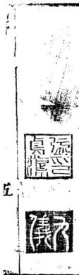
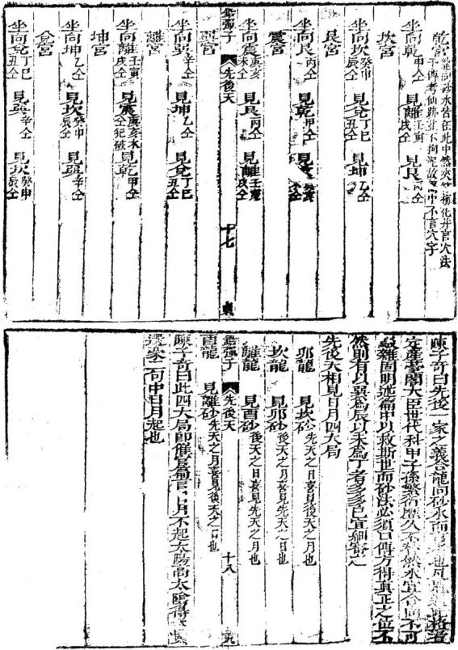
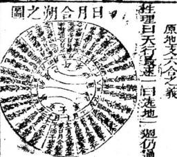

# 地理四弹子

> 来源：409.水龙经+地理四弹子+雪心赋直解+廖公扒砂经.pdf，PDF 第 157–242 页

富春張九儀輯

# 地理四彈子 线

聚錦堂梓 地理四彈子峻 余賦性偏州喜誠實不喜虛浮以故交遊往來每落 落難合然涉世既少周旋而于人情驗阻處尤多代 爲自反而汗顏焉以爲吾祖父忠厚之訓所凜焉 不敢近者惟此類耳甲寅季夏先君辭世終天之恨 痛不勝言而所卜竈穸向蒙馬閑翁指示朱及營 陳跋

季秋其令甥張九儀先主來遊武林覽勝西麓余得因朱秭老而晉接焉相與商訂堪與述理氣則本經傳辯巒頭則詳性情與閑翁所示不與毫釐方愧向日所聞詣術士者殊皆庸劣鄙談與造化樞機茫無關切今何幸得遇儀翁俾我先靈妥佑後徹蒙麻想先君一生積善之所由致歟抑亦予以不敗待人而得遇此不欺人之術歟然余究無自私之心也因念庸術快人往聖宗旨自青田以來幾湮沒不彰爰詩先以地學正義附于三禪子之後公世以救人且不以輕洩爲嫌惟願凡我同志皆得以安先人昌後嗣焉則覩此書者藏以三彈子所辯之巒頭折衷于鉛彈子所述之理氣救巳救人庶兩得之巳蓝 二

康熙十四年乙卯季騫海昌陳彝則子苛甫謹政 地理四彈子敘 自太極分而地形現已自地形現而八卦畫巳 亦自八卦晝而地理明已當太極之時一渾淪 境界爾迨天地定位而日月運行然後高卑上 下舉目可見此地形所由現也時人皆朴陋未 識文字雅伏羲氏聰明天亶仰觀俯察見其輕 自序

清爲陽則畫乾見其重濁爲陰則畫坤見夫日升而月恒也則畫離與坎見夫富動而風鼓也則書震與巽見夫山高而水深也則畫艮與兌因其有如是形遂畫如是卦固日用之實事非紙上之虛言也八卦既晝則凡有一形者卽有一理如山從南至遂知其爲離山自東來遂知其爲震山川之變態不一總括于八卦之中而地理之吉遂彰明于天下然上古之時貫而神聖賤而顯蒙咸以此爲行習之常自秦煙肆烈聖敎難明地理一事乃立專門而管郭遂大圍宗風巳嗣後聖聖相傳賢賢遞述有一時而數聖並集者有數百年而一聖間生者大抵見知二

聞知亦與精一之統相似故丘楊二會以及陳吳廖賴朱蔡二劉無非聖宗河洛法用挨星雖地有大小之不同而吉凶禍福皆灼知而預見當今之世羣言治亂正義無聞余之究心者數年遍閣坊刻自以爲道在是巳幸于乙巳秋淳邑又承方先師來郡歲試一日于更閘時指月

而談納甲之義以爲非言可說實形可觀予從旁竊聽聞所未聞方悟從前皆虛浮學問乃執弟子禮而叩宗旨焉問難之下幸先生不吝至教且拍掌大喜曰吾今而有傳人已于是將河洛之淵源挨星之真訣一詳詔余知余遂錢以成書名爲正義外又作砂水要訣二篇而以息 三

3 親閔仙跡控制山川之妙諦逐節而註証之此爲聞知耶其爲見知耶俱不敢任客歲擬應部檄効忠

王家殊邑尊因軍務冗繁未暇詳送爰稅駕武林遊# 覽勝地海昌陳老與舅氏馬閑翁知交因館余于黃錡堂中兩人相契堪云傾如故因談

及范文正公良相良醫之語乃概然曰良相長醫救人者也而此道之救人更能救乎救人之人爰以劉靑田所傳三彈子世有傳本而未廣者刊以公世其中主彈子未註余不揣疎鄙而補之且悲庸術誤人先以正義一書妄附于未以爲四彈子卽諸友中有虛言輕洩重忌者子自序 西

奇應曰

上帝好生如此救人之術正與好生之心相合今身公之于世而使誤人者皆知所以救人將見忠良輩出戶口殷繁家給人足煙火萬里之盛後見于今則此一書可當艮相體國經野之謨又何得以一巳之私意而以輕洩爲言哉余二人之心如此敢以質諸同志者

康熙十四年歲次乙卯季春望後五日富春張鳳藻九儀甫題于武林之黃編堂中

今彈子序地理木不難而人自難之理氣本不易而人自易之難莫難于得真傳置吉凶晦咨于掌屋之中易莫易于竊精粕弄高貴貧賤于誰侮之下予亦恐焉予得大書三朋于耶律楚材從學陰陽五行于倫倫逸變潛心遯志帝究造化之機關問明辨精研理氣之樞新翼翼小心兀兀窮平不求聲聞之不著乃憚學識之不充若云元珠經今彈子元珠經玉彈子元殊經鐵彈子者難傳自貴右老翁實本目天書之下卷掾天機之餘緒敘理氣之精筆編成三帳不越數首嗣不繁而全二序 天

一意義盡句不雜而條理明真古今之心法誠後學之準絕歷 世凡從事于是者莫不由之以為傳受之心法每切知以 珍地理之機微原黃石入名爲地理元珠楊子號爲陰陽朔 略曾子稱爲理氣心經邪予名金麗子頓子名櫃江綱鬼谷 子稱爲指掌明珠廖子稱爲金精心法凡八斯門業斯學者 莫不敦演其詞義而明註之唐一行集而成帙名之曰堪輿 秘旨天機金彈子以詔後之學者戒令自秘勿授非人以道 自尊慎卯輕用予得三冊之全峽澄心玩味果爾括艱殆畫 而地理之學無餘蘊矣但全帙汗漫詞義雖佳莫若簡約之 爲尙故于歲冬感慨之服亦則註之使後觀者神不背而塵 致詳盡訣法正而趨向不差使世之敬誠而求造絕者則亦 有所依歸而成召之不忒其因名之曰金彊于直指註成序 其所事以冠之小其首云

明太師文成誠意伯靑田到伯溫基撰南唐國師何令通著

明新安游嵩註

治名海昌陳彝則子高甫訂

字宙有大關會氣運為王山川有眞性情氣勢爲先此條乃論氣之大竅也昔云有地非人不下有人非時不下盖以氣運言也又云察以眼界會以性情若能子此天下橫行此鐵耀子形氣 元以氣勢言也如前哲一觀形勝便知禍福大小世数先後全在氣逐上下之夫世運之有轉移猶曆数之有節候如天汾臨黔固公地吳公能爲馬氏指不能必爲馬氏藥荊塗兩鳳交通地當爲王者兆吳公能爲朱朝獻不能必爲宋朝用此非節侯未到而然乎是故國運興得賢相國運衰賢人隱其貴與不賢難由地定而其人其時湊合實以國運也至如厚德之家厥后必昌便可襄事所謂將昌之家有德之家塟必興旺以其家運言也如湯公爲顏氏作催官食祿之樓而舉果上第啊公得異人指照牛之地而位果三公此自其一身之運論也乃知無運所開有以世運者有以國運者有以一家一身之逆者此正字宙大謂係處若不察此而設爲之天不相術亦不緊矣夫山川有眞性情何以辯也昔人云山乘秀氣水乘積氣石乘穀氣平乘善氣又云山谷異氣乎原一氣此山川之大勢所在卽山川之與性情也山何以取秀氣山之勢類多剛猛而頑硬惟患不秀麗若見秀灑所置便是英氣所聚上聚之地誰取天清之氣多所謂权山不奴水者此也故以峰巒之秀麗爲生氣水何以取積氣水之勢多流走而散體惟患不登疑若見諸水所精便是其氣所鍾下聚之地惟取凝蓄之意多所謂収水不収山者此也故以水神之積聚爲生氣石獨取乎煞氣者何以山有山之喜氣亦有山之怒氣怒則山之威靈多露于石若石之明猛壓通不成体勢不作威儀則有煞無生矣誤下禍不旋踵如其有休有勢有形則有生氣亦可取用履宣經忍乎獨取乎咨氣者何如平洋一泒紀陽無陰生氣不欲苟有骨脊之起使爲飲而有生氣背人有没牛吹氣如酥在湯之嗚意正如是山谷何以稱異氣平山咨中各有起勢各有開局各有門戶有俸有勢其氣各異故江有一帶與江北不同只見一山特起一調局面時關有盖有遂有朝有迎或爲齊城或爲停縣便有結作便當着眼閩廣吳越之邦各村各社各有名宅名塚凡語音習尚又各各不同唯異氣然也平原何以稱一氣乎如今江北四望廣漠無大分別只見一方固脊起處便作城廓市鎮其次爲廬舍墳宅盡聚于此卽語音習尚雖數百里多爲通同謂非一氣然乎古云風氣異宜者此也倘若異氣之處而漫以漢然四望之勢彌子形氣 二

求之則以眼界大寬而失矣倘若一氣之處必以山水分結之勢求之則又以眼界太狹而失矣此認氣以認氣勢爲難也凡柔堪與不可不知氣運不可不察氣勢也

地運有推移而天氣從之天氣有轉徙而地運應之天氣動于上而人爲應之人爲動于下而天氣從之

此條言氣運天地人相與有成一有琳徒舉動氣卽以異政識 時觀變者之大權紐也何爲地運有推移而天氣從之如董河 是天地間第一大血呱據唐虞時河由龍門而轉呂梁由呂巢 而轉大行由大行而轉碼石乃入海是河從西轉南從南體東 南中國形勝寔爲中盡時至周未孔聖起而畢賢並生千古莫 盛焉此開開以來未有轉移遷徙之山水也自漢黃河漸徙而 南道走淮四太山反居北而黃河乃居南矣冀州之水勢傾節 魯之地脈所而明朝祖陵鍾于中都大業起于徐楊正在惟酒 之間豈非黃河南從氣蓮制然乎入言江南之盛以宋南護面 然不知黃河述而之南則天運亦徙而之南也河爲天氣有總 徙河也兩庶之如系太史占金襲有天子氣乃疏秦推以洩之 不知案誰通禮里動自後小曲六朝之建極大而明世之 定鼎果龍于此又洛陽一聞社賜啼而知天氣行乎南南人 果自是作山山軍大則而天氣先則則地又從天轉也何為 天氣動于上八爲傳之知陳希彞一夕見小星居帝星之左 及旦而所任乃見宗祖與趙普同坐酒肆間而普居左 陳乃曰小星何帝星左哉確而易之此宋祖徹時事今人 多以星氣爲渺通不知天之動應不爽如此何爲人爲動子 下而天氣從之如洛陽花石何大蘭係而元史占之以爲花石 不去則未之庇氣不絕及一旦移去花石而航海之舟遂見 人一舉一動天卽應之氣何爲不通也望氣而 可預占察時而可觀之非道服島足以語此 風而子形氣

大星有聚峭行峭坐嚙則氣聚于龍有煙星尊星雄星則氣聚于勢有盖胎夾胎乘胎則氣聚于穴有収襟浪堂収關則氣聚子局此四改乃詔氣之大閒鍵也夫龍忌孤乎人所共知亦知看到頭數節耳不知能有起有止有行度趨處必要聚觴如層雲疊霧合氣連形大以數百里小以數十里端亘綿延或以五星或以九星聚而不分謂之聚峭層如都會之地百言所聚萬民所止乃樞要之地聚之後則分枝劈派而去條分縷析正靜衍中餘則分左右四行或以走閃或以續峽而邊夾護各起峰經帶而制帶旗帶鼓帶余帶庫各各不一總之繼聚雲護而不露語之行端易言坐端龍之行度既歷變換必有歸宿寶如行者之歸家一室骨內必爲團聚如貫人之登堂所屬僚佐必爲拱揖決無孤立獨坐之理謂之坐麟有此三疇其龍乃專不則孤单二字不苦在入穴之所矣何爲權風吳公鉗龍絕中所种郡權星也蓋曰箕勢盛大福宗二字不足以盡之高大如雪山之齊天不見其貞綿瓦如雲中之萬里不見其來豐衆如崐崘八方盤踞不見其分而天下萬派之山皆祖于此何可以祖言故以紹權之是名也大抵權星炙土金之体虛土金能綿亘也法水七大多作祖星以其活動卓立則爲分形穴經云星雉六不宜秀祖中縮來夢起峰一都有一都之講星一色有一邑之張凡論出歸侯公相之大結構馮本于此至于尊歷則或祖或六為時一方爲莊山之首出者得此而知龍之正疏正結皆原十此久如雄是則于賊窮交謂之處有卓立星辰可以庶尊學而常門戶者則以雄禍焉如所云北辰羅曠之類交身織結不如禽獣成彰物形守贈又不如人守陽之爲大然而難亦分三最高者爲天雄其次爲人雖武小者為地道多生水口邊不論高山與石均稱焉觀雜星之高下可卜結地之大小有此權星雄星方爲勢大之地胎息是結穴之所何為胎則蓝座是也無胎胎必不結華爲上微盛寶盡次之其彌子形氣 四

胎則小明堂是也益上盜則氣藏于下下乘則氣輕于上兩勢有來則氣蓄于中方爲有氣之穴何爲寂襟以穴中微荒界水所魯如人之襟頒所交名曰合藥河爲根堂以龍虎界合之水所會如居室之明堂爲四水所聚名曰堂合何爲衆關龍上分來以作成郭之處小如房屋之門戶大如城郭之関鎮名白廟舍正謂小舍収堂以堂舍言也大合投局以關合言也穴精低小者収明堂之水穴情尊大者収闋內之水至如小明堂合禮之亦不論穴精高低總宜合也凡論局者必

陰勝逢陽則止陽勝逢陰則住雄龍須要雌龍御雌龍須要雜龍

此段言龍勢必得陰陽雌雄端合之處而始成胎認氣者所書審也如山谷陰氣常勝故卸下不洋脫胎換骨開陽舒暢便是有結所謂陰勝逢陽則止也如平洋陽氣常勝故忽然起一圓卑頓一山脊謂之古氣所起要四而陰沙纏護便是成局故原之處只要分局得明骨脈顯露爲証所謂陽勝逢則位也又如龍勢之來正幹誅強謂之雄龍自天而降御風而行而楚纔近之山須要案順統轉盜經遠護不與爭蟲正幹乃結經云推龍生大將墟兵誰若砂秀亦出文士或以文臣而是兵樓又龍勢吾蛇一派軟微名曰雖龍得雄勞夾從為住而前砂水如筆如刀卯鼓如旗必宇戚殿登止文秀哉

大地無形看氣槩小地無勢看精神水成形山上止山成形水中正

此言立文當先認其形神止聚之處而穴之不可一槩論也今人以入首處作穴便看窩斜乳突四字有此便稱好穴不知形乃穴之証位至其真結之處全在大勢上理會如大地之穴常隱常拙何有少之巧始動人只于大象上察其氣勢認其徃情卿于氣 五 元

苟有生機便成穴法不拘拘在窩鄉乳災之常也若小地既無氣槩必須形局合度聚氣藏風出局親之似無氣槩入穴看之却有精神前以精神之張處立穴便是管氏立穴以認形勢爲先最爲要語凡論形之止宿處又須辨其亥龍之高下識其性情如乎亥龍全以水爲界合而成陽氣常勝其勢桑緩穴富從其起處而乘之所云山上止卽支葬其鎮也卯山隴龍又以昔爲星峰而名陰氣常勝其勢雄急穴當從其乘惡而乘之經云來不來坦中裁住不住平中取所謂水中止卽隴塟其滯也認氣于大父母看尊星認氣于真子息看王星認氣于方交媾看胎伏星認氣于成胎奇看胎息星認氣于化殺爲權看解星認氣于絕施逢生看思星認龍之氣以勢認穴之氣以情此段乃龍中經氣第一門路也凡看龍須認尊星爲主到一方看是何山最尊最大專擅一方便名火父母要不尊星是何室辰如土星起頂垂肩大開帳則爲上龍勢其所生青之子孫土是木氣金是生氣木則爲殺火則爲其所世水則為其所祔故凡自上而下遇生旺爲子息還刑尅爲殺害其法以何圖顧生爲序蓋父母不可鬼子孫也經云息尼尅母子來呂時星尅子死絕亡卷下可尅上上不可尅下論龍一到八首之處看是何星如金八首祖宗原是士勢出脈則爲巽子息也若于人靑識烹之星或帶木不免相尅然子息之破月胎而出願有此理阻得金太相援之處激有水意使不隔統矣所云占厚尅母子榮昌其理出丁洛書以逆尅爲序卽異公餘義云木星人土星一甲精衡延亦以從下乾上之義也衙家所言房下貴人師太星在上屏之下非木八士之義夢則父丹布勢降脈而來其問必遷睚猶支媾此去方有生育陽公云胎伏是也若無胎伏前去必不變化便為純陽純陰無生廢矣此乃龍要留氣之第一機竅也又龍既跌斷過峽則再起星降或開覆必服育惡之下一總起脈爲胎所謂蜂腰鶴勝龍已成正指此體夫一絲運落必要水休乃成肺所謂萬物背生于水是也東子 形氣 本 元氣之處胎之下再起便是息星或于一節便結或數節乃結在所不抑然亦不可節數大多以氣離胎不可緩不可脫也息星便是八首八首之下再看人手成何穴法或卽貼于息星之木休或脫落而爲易本乃穴傷也此認眞氣與父母相合正在此凡龍行度豈龍盡無駿雜如上行度遇木則段然以木星爲貴人之峰而在土屏之下難爲殺而有權若能于貴人峰下轉水賴起全星則金可額木之殺而木爲貴人勢矣是化後為權謂之解星從此行去必爲生旺偵結穴矣簡龍行度而不變換則生旺夫過及致剛熊如上龍降謗金坐爲主若一孤金星三五節不聞不生枝臨禪是堅剛則純陽不化反爲陽龍之絕必卸下或轉天虹之十而懸問屏以分剛堅之氣是以母救子亦為思也得此方去結穴若不得此使是神壇香火之社或爲政龍之窟矣又凡起一尊畢必有一結或于盡處正受便是正格或盡受刑殺則于鮮毫恩星之有生機處或作寫龍或作斬隱須要詳認覆盜峽前候後之處每有結作正從跡脫處面得解星思星之有氣也認龍氣以勢記穴氣以情經云望龍存乎勢窮人存乎情所以看龍以勢爲主其局有五曰直橫同飛入此歌云直龍原是虛背來中出竟徘徊宮直龍之來勢多立硤綠在讎忽乃有氣也橫龍原是從側落逆轉須謗薄言頓來之龍其勢不正氣須逆轉而勒定乃奴住也龍原是出朝身道禮要遂廼言回龍之勢多奏促其氣必舒必得寬暢邊巡制氣乃知也飛龍原是結上聚路首貢異言飛龍既屬上災勢須軒昂坂得衆山衆水制得衆山衆水氣象始奇也潛龍原兒落平準撒脈自悠揚言平洋之勢多散漫則病正服不到故治微服悠揚有分有合有龍有折則氣乃真此從能論氣之說也至子穴法大要天地人二停不論高下只要收得山水便是武情向也如飛龍作天穴情在上聚法當以龍之氣勢興上聚絳鄉記合爲是書人斷穴之吉凶專以龍以上聚學主龍勢也若下面砂水不爲我鬼不必論矣凡山納水只以眼中得川事者為淮如雖雄相牛之龍可打以穴情在手廉則以中聚拱揖之砂為應取入首之脈輿之此合以後龍之勢尙緩而歸堂之木內低惟中聚之砂取而納之其氣聚其應速也至而柔嚴之龍所謂智龍多作地穴賤以入口之為主矣卷手洋之地水之界合爲龍必衆水歸堂乃為有情故次下之氣者妙兩水經云斷中聚之地者以沙

龍備五行之全故山之形體象龍龍之變化極神故山之變換象龍龍之體純平陽故山逢陽而化過陽而生龍之情喜乎水故山夾水為界得水而住龍之行銜乎風故山乘風而騰藏風乃歇龍必得乃棲故山以有局有關而聚以無局無闕而散龍凡遇物則配故山以有配有合而止以無配無合而行

此論龍者必深得龍之性情乃能符其情神之所我認龍氣之第一奧紫處也字申間離物各有五行要以一體而具五行者惱龍龍之鐘為金角典瓜為大身為木器折為水腹之黃為止今人改天罡星亦傳五行又以辰爲天罡星兀爲金龍所謂龍動不動者此也夫不曰山而曰龍正謂五行全滿也龍能能兒能大能小龍升能降山之行貴有起伏有變慎正象乎龍政以龍名夫辰肖龍以足若也出而龍之氣疏平陽辰則肖之教山行度遇居諸聞陽則書陽弓變換之處山之結定為坦平圓蒲朔為陽乃能堤止之處以其禮體本屬陽也日以時論逢三陽則爲嫌蟄而龍動到四陽明飛龍在天非以陽爲得今之侯乎至建至以後漸及五陰龍則龍之重縣之下矣龍性薄水故山有大界水則爲大界合有小界水與為小界合又山金願如峻鬚加廣服皆以水名正象龍之得永可得水卽住也龍之趨必風雲從之龍之飛必雲散風靜是故山之止庸亦必藏風乃止也龍有龍之築穴必深流筮密乃爲龍居在山谷以有同岩之深邃在平處有江翻洲清爲衆水所象淵深莫刻之處豈是修露豈是追隨今人人此取堂局之浣密四職彊子 形氣

世人論入只以安宿入尺之所曰久不如合龍穴砂光局為主得共所以配合之意如朝如案如說虎開而轉那揖象抱便與我配合若有山走去永傾隗不我回顧便是不舍便非真龍之住不可言穴巳

龍生死須分三陰三陽穴生死須識陽多陰少

此二句以脈落之並陽為認氣之法見公問星之說以金木火爲陽水土爲陰間之二陰三防行龍必陰陽互換乃為變化乃龍生物故以此爲閒星音脫治提化之謂也龍不變化不成故必金木火得水土水土得金木火面兩交搆以成胎育方能穴不則純陛不生純陽不成不爲香大宮則為神賤窟矣是故吉第步入首精穴處如金開口木生芽士吐用則爲陰來陽受或八首之脈歛而急至穴乃平而舒有臨有窩有小明堂亦爲樓來麟受皆為塟口如陽來陰受亦然三寶經云陰少陽多得塟法陽少陰多其令絕穴情以陽爲主縱是陽來陰受亦要中有陽乃可塟也如平地之突是陽來陰受必突之頂平乃有陽氣而無後如突之頂尖則是純陰有殺便不可塟只宜尋突旁坦處爲陰陽交搆之所乃可愛穴前段論龍上陰陽後段滿穴中陰陽也

龍有變體或爲顛住勸柱穴有變格則爲墜宮纂宮

此二段乃以大勢之寢無浮沉為論氣者之變律也凡龍行度如強弱相間而來便可多結有如枝條太長節數太多名爲長行金水行到十數節多是困憊無力若一向行來手兄亦不偏祐出西亦不凌會似乎無力又不為無力及到立穴處忽然頓起高山巍然成一主星其手足盡龍番轉扛起左右山水癸集朝案所去未盡之龍又爲轉關作水口便成大地所謂內旺之地也忽然頓起者謂之頓住正以緩顧頓起爲氣之聚此與纔中取急之義同又如龍之行來一向狂猛其勢飛勝収住不得彈子 形氣 九 元忽然跌斷再起星辰婉婉有住足之意二三節手足盡為同轉勒任恰如焉之狀謂之劫住此與急中取緩之義同此皆龍之發態不可不細察也凡立穴必取陰陽冲和神氣融會為主若真穴處界合深而燔鬚不明朝對遠而拱揖不審然真穴所在不得改移縱穴塲甚高赤須深取至一丈許或二夾五六尺詩唯取前朝遠照雌雄交度爲淺深此之謂乘除陂借全以外照爲主也以其墜下而遠砂遠水遠故法謂之墜宮經云低高照納前朝淺深得乘真氣聚者是又如諸山韜湊于平洋多大池湖隱注之處名宋仙大會格以諸龍舍于中也然深廣離下須要定氣勞會定精而神的確何處可収諸龍之會可納四方之氣于此立穴地土墳以取朝對立向故法謂之集宮為云得飽而陰罔疾遇針而陽任者是此皆大作用處亦穴中之讚也

星體有正有附兼襯貼之宜辯穴情有顯有壙形氣影之宜詳此言人路星辰形體不一氣各有聚不可不細認也今人于入旨星辰只看五星九星令可星體便爲指扦不知星辰爹無本體正形如金星到頭只是一個太陰太陽有何難辯不知一個星辰有三體曰兼曰禊曰貼兼者如金星而轉水轉土則爲兼水兼士金星而施水拖木則爲兼火兼木相生則吉相尅則凶此在正體上或左或右或前或後明帶而易見者如貼體則于穴情處僅備徽貼一此墓體須細認乃見如氣塊如湯酥如雲中之雁一體而不分者也正謂星辰之靈光發露處最宜體認其美惡俱與木星論生尅若襯與貼不同貼不分二件微猶分二件也如觀衣之類寬是二件而又相依不大分離依靠襯托最爲親切其吉凶介以生尅論凡認氣者須于襯之得力貼之有牘兼之有生處游而認之乃爲真氣也又如穴塲所在其証佐無窩斜乳突之可証只微微有突有埋又徹微有稜有弦謂之氣塊以其有氣而無形也古人便用氣塟之又有本體星辰全無形亦無氣顏飽而不開商然體龍既到必存真氣乃脫整平洋或在田或在坪或在湖诸隱隱隆隆靈光若露所謂孤月彈子形氣 X 元

沉江其光在影之類此卽外月明砲內白水邊花發水中紅 全于影上看精神也故古人有影上之塟夫氣穴雖無形尙不離平木體影穴則脫本體而在影響之間此等微茫極精極妙非道眼莫識今人只知塟形拘于蝦鬚旗眼之說豈知造化之凌劉固無窮哉

益帳不開龍不巢輪暈不覆八不住東咽不細氣不聚泥九不滿 氣不充

此言龍穴各有眞氣凝結之處必不可少者今人但知山勢行夾便是爲龍不知龍有帳方爲有巢以其一種狂猛之氣得此而開爲展翅暢問舒徐殺氣脫蓋生氣自融乃可結穴若非帳必爲純陰必然孤露定是不結縱結亦不大輪暈之說上有橫紋數條圓而若方若車之輪然則陰氣不冲陽氣自暢昔人所謂月有三輪其貴無倫是也軍卽月之暈有影無形區而不跌滿而不傾今人所稱太極圗是也以此認氣必不犯乎陰而穴乃眞夫結喉之說卽入首束氣之處如人之喉昔人所云結花先結帶又云譬之吹營者衆孔齊開必不成響唯閉衆孔而開一孔則可按律而音鄉乃成此善喻也是故龍之東氣處不可不細盡氣不翕聚不能發散必須東之細小而氣乃聚及至結穴處則又要充滿光潤如孫兒頭必其泥九精髓衛足而顏面之間氣乃充溢其色乃華若有一微隔削薄則氣必枯槁不成穴矣此于氣脉八首結穴處最為緊要不可不察也五星不離水土體九星常要輔弼隨土星不作五星皆有撞火不不可水上豈能粘

此二段乃詔星辰之總體分體爲塟以乘氣之一法宇宙問無水不生無土不成龍非此不成龍穴非此不成穴故凡龍脉八首五星雖有體要知水土必不可無古云或結乳或結鱗俱要後頭有蓋圓凡圓平處便是土體所謂化生腦也又云不管後庫子形氣 元

來不來只要金魚水蔭腦凡界合處便是水體所謂蝦鬚蟹照是也如輔弼二星亦是水土之義輔星屬金弼星屑木在九屋中隱而不見常隨七星之左右故凡立穴不拘貪巨武到頭須輔爲之弼爲之承所謂承金相水卽是此意又如塟法中用益粘倚操今人只相剛柔緩急之勢而施之便爲的當不知古人作用仍要于星體上體認如士塟其飽豈可脫而粘水其南豈可發而粘土星倚塟則崩水星頂塟則破火榴當鋒則烈一或犯此不爲聞殺則爲脫氣此論星辰之分體處善有立機也

坐宕坐殺坐旺是爲坐法全胎保胎破胎是爲作法塟法中何爲坐宕如強急之龍其氣甚怒怒則不可犯宜于坦宕之處看其四應可以穴則穴昔所謂脫殺坐宕是也何爲坐殺如金以剛飽爲殺而剛飽之上下又無穴情則從剛飽處開孤取水而坐之又如金以火爲殺而穴情又在金火相交之處只得樸金剪劈火嘴坐而倚之所謂騎刑之法是也何爲坐旺如平鋪禎緩之龍其氣甚弱當于起脊旺處乘之如今蘇朔一帶凡見崗眷堆卓之處卽爲村市爲墳羣亦是坐旺之法也何爲全胎凡龍郭落平洋剛氣盡脫至人首處如卯華金盤之穴又屬純陽惟用客上堆培成墳便是此處兩若掘土非見石骨卽見蔭氣之水也巳何爲保胎如今珠墩花壤之類半吞半吐而乘之珠從旁入花從正八十分之氣只取其四是爲保胎何爲破胎如須金脈罡之鄉陰氣居多不柏大開梁取而成陽穴以乘其氣是謂破胎全胎如梧桐子結于葉上輕浮而胎全露也保胎如逆子燕于蓮蓬欲露而大半含胎中也破胎如粟子之包于刺叔核桃肉之藏于堅穀必破其胎而出乃得精髓也

挨生傍氣或爲脫殼借胎或是子投毋腹脫殺逢生或爲借毋養 子或是以子救母

此爲乘氣中挨生化殺之妙用也何爲脫殼借胎部以九星論如天罡脈曜何以成胎必開孤取水則剛氣乃脫得水成胎故爲脫殼術胎何爲子投母如木星而帶傷水星而帶金有胎孕而子可投故木不塟木而塟木之雜蕩有水處水不塟水而蔡水之堅寔如金處故為子投母腹何謂借母養子以五星論如水體帶余必破金取水以醛木是金不能養未而特借取水穴以養之所謂借母養子也何爲以子救母如金體將火必于金火相間處大開水穴以制之昔人有取水火之法政如此則然不我害而反化爲樵在前可作官星在左右卽爲體氣謂以子救母夫造化無全功聖人無全能安得星辰盡純粹只要晚得起生涉死之法乃裁成造化之神功也真醫家用針或補或或器病或調神造化全在一手耳

脫蛇就局納前朝只爲牛僞半真兼山劈硬處平基祗爲直來直 受

此以前朝後倚屬乘氣中進退消納之一法也凡塟貴乎棺不離脉而此言脫龍就局者乃入白之脉雜而不純宜至二三節上乃爲真脉而合前朝是朝真而入首之脈非與也如直頂其脉則初年不利當于穴中放棺出二三尺大作金堆以納前朝旦又水法之吉奈達甚速凡塟貴氣不離脉而此云祿山勞硬吳山平廿以爲穴者乃入首之脉陰氣宜便則後重如子龍作午向紀林通殺漢之必南故須原山劈硬以作平息將常退出平基立六則經閣發中居之說或穴後向邊微斜又或上砌虛時下在止有度可時殺乃爲而來直受之作法也古人有形塟法塟夫順其平穴之生滅而塟者爲形雖或勞例或堆培而塟者爲法養此皆作法之妙處不可不理會也

平洋之氣賞常散須要湯中淨酥山壠之氣常急當歛當看水而蟠蛇

此以氣之聚龍緩急而認穴之微茫所二塟乘生氣正任此夫干洋之地陽勝乎陰故以歛爲聚而有隱隱隆隆穴在其中之說須要認所謂隆隆者政在隱隱之中有此貴露之象如麻在馬良有見也不則亦鋪毡展席散漫無收而已何可穴乎至在山陛之勢乃陰勝乎陽不嫌脉之不到而謙氣之不和所以多煞故結穴之所圓融平垣不險不迫有如水面盤蛇之狀活而不動靜而不死盤旋而不直極渾然一個太極圖則形舒氣和而微盡古人所謂山隴之龍塟氣不塟脉是也

没水之生氣仰而吹宜乘其急出洞之龍氣直而吐宜乘其餘種華外露之氣如花宜裁其皮精華內蘊之氣如果宜塟其骨此國段以氣之緩急淺深爲塟之緩急淺深乃作法也如平坦之龍脉潛于地而微露毛脊至結穴處忽起一爰乃吉對所起也其氣沉綴而僅浮不妨安穴絕頓譬如牛之役水身藏水中僅語毛脊時仰而吹氣在鼻中若稍脫之便夫氣矣此緩來急乘之法也又如高隴之龍脉行于山勢奔氣湧至結穴處須要脫卸落下平羊氣始冲和所謂來不來坦中裁住不住平中取所謂急來不怕塟沉泥者是也譬如龍之出詞氣媚方盛何可祀之推其氣之吐而有餘箴處精華可雨故宜晚述而塟管緩以承之又如氣浮于上而臺先已露若深塟之則氣從上過故宜淺乘如木之有華水之有珠其英華盡露于外深之則傷本資矣又如氣市于卜而皮胃粗剛美含于内不深以取之則氣從下過故宜塟深如頃金之開脈取水厚土之破用見金皆以深而之也

龍穴有陰陽砂水有陰陽龍穴有生死砂水亦有生死此以砂水之陰陽生死而論氣者也龍穴之有陰陽前巳論之詳矣砂何以分陰陽乎亦以開面舒坦者以反背層者爲陰有面則為向我而有情無面則爲肯我而無清非惟龍穴貴開陽而砂亦貴開陽也水何以分陰陽乎而城彈子形氣 十四 元水之來之古屈曲改後楊揚則舒餘濫屍而爲暢其綱如絕其直如矢其斜如反弓則神激斜反而爲陰譬之人然血脉流動條暢則呼吸自然和平吐納自然調適不疾不徐無反無逆乃爲無病若驟然而入顧倒而出不見安舒澄靜便是病到非惟砂書開陽而水亦貴開陽也砂之生死何分也砂無論龍虎案對只是情向朝我有面曰有手廊拱揖環抱若僕從主行婦從夫倡隨呼隨應情意顧憑則活動而生不則直硬頑悍呼不來驅不動則無氣而死若水之生死則以直急反斜爲死以朝顧疑聚爲生究而言之砂水生死亦卽在陰陽上見也

氣有虛實法當以實投虛以虛乘實氣有先後法當先到先杖後此二段以立穴之進退饒減為乘氣之一法言結穴之所有陽盛陰少者則氣勝而形木寔故虛而屬陽陽則不宜緩乘宜中正以之如平面太陽作金盤堆果如百般花味總居心之類是也有陰盛陽小者則形勝而氣過欲故運而陰不宣急嘆言聲脉以乘之如味穴其旁乳不當頭是也此以進退謹是之間謫也又結穴之所如左補先到則氣歸于右直按右以取左砂如右掃光到則氣滿于宜戾左以抄右砂若兩宮齊動中以渠之雖耐久而發常運故不知先到先杖通明孰祿而得遠惑此以陸減收

傍城借王須計審于樂北就向拘龍當消息乎明堂此二四肯借外氣以乘內氣乃唯向中之作法也凡龍之來不皆正受有側落有黼身不無脫去本來之勢或傍羅滅或傍水城或傍徐儲峰此皆借樂北以爲生外氣以爲然也故曰傍賊錯至又有龍勢直來似宜正受乃入首之處無面向方之處無情不成局于是晉其明堂何處開局便當拘龍而就之所謂以龍定穴以水定向者正謂外水聚處有明堂而成局便當風彈子一形氣 五

華此以定向方不必拘拘于正受也撫砂經云無局不言龍可言龍可見局之所在卽龍之所在故有就局拘龍之法照穴須求三靜一動認氣須要百死一生

此以動靜生死而記氣脉之眞假最爲閉要何謂三靜某對要靜開南朝拱而無壓過走龍虎要靜內向拱抱而無他顧騰水城要靜遶疑環聚而無反昔非激中間惟見穴塲之所一脉活動而有精神此三靜一動其穴乃其也認氣則千穴傷看其精神何者是精神之發越處如兒頭一戰頭上之角皆堅而傾門圓桑一呼一吸可浮可沉此生氣處古人言化主臘不取象干頭而取象于孩兒頭者林有味也他如厚中取薄聲中琅厚靜中取動動中取靜必見餘氣皆死而惟此一點獨有生淺乃爲眞氣不然則爲菩產而死贊背也宜細宗之

有稜有茲則形真若湧若凸則氣到認氣難于認脉塟脉豈如塟此平大首最微茫處認出一點盡九之氣至要至訣凡入穴場當先認形隨卽認氣如穴塲必有弦稜則鬚蠻眼之水見始成昭蟹眼是突穴其中周滿如起如讚眼然外有蟬砂爲之隱護而水微見謂之盤眼水一有草沙則弦發成矣般將是寫穴其中禽聚如最鬚之掬抱六外有牛角砂爲之明義而水明見謂之般鬚水一有牛角砂則弦傍或矣弦發既成則氣聚而不故天心自然湧凸乃成胎息舊天心沉離仍是花霞不成穴矣氣脉何以分别凡脉之行必須或而有皆如草蛇灰線雖不甚露而未雲無形故屬乎陰惟陰盡處坦平固講有一種光融聚之敢是眞氣也而屈乎陽如人之身然脉猶拔之有跡氣則周遍充滿無所滯礙故脉易見而氣難認耳然謂翠脉不如塟氣者正以脉犯陰猶廬有煞氣爲陽生機氤為故以準氣爲上也如前所稱太極疊天輪之說正是氣體耳時師多能塟脉不能塟氣故常禍多而福少也凡人求地形眞穴正而又于形氣 元

造論萬不失一矣

法恭之塟法在形裏會意之塟意在形表

此言穴情變熊不一有穴藏十拙以人力剪義之有穴隱于敬以心意融會之此之謂仙蹤凡論穴先論形為有形不足以六者如頭金不開窩剛龍豈可言穴則當語其中之微有四處便為生氣須以開孤法大用八工取出水高以塟之又如水爲大深乃陽中之陽不可言穴然真氣到必然有結宜于為中或真以上或奠以石龍強則莫之以水須用塡實其高成倚陽中之陰取棺駕千其上而塟之皆所謂法塟也他如騎刑剪火破孤截湯各各有法當培則培當削則削宜實而實宜虛而虛此湯公有法塟之條也又有眞龍正脉盡鍾于此情勢局面亦盡會于此乃法之穴情則無真正入穴之証古人惟會其精所聚之意而作之如官坑梁上掛金斗乃在窮源僻塢高巔絕頭之上兩邊山勢俱是不止行去有十數餘里此刑穴所不相者但視其氣勢則石抱左回前西勒對自近案識捐之外一望可百里遠遠見幾子尖爲正朝鴉降峙左大茅峙右三陽金聳萬峰俱朝去水難有一二十里然一折一同之玄九曲不見其去穴下保氣亦自成個小明堂如在平地不見其傾立在穴內惟見上聚一派天清之氣高明也宋森爲儼然一聖賢清高之氣象故當時用頂門百會之穴塟之龍曰滿來入首處有上企貼體攻象金斗則亦以意會耳又如坑門縣權形龍自高山跡下平洋濶有十餘畝下脉靈辨亦有東氣然到前面郡是一片鋪陽于窩鉗乳凸四字全無離佐又無龍虎溪風歸來不可爲穴然真龍既到都是大結修當時賴仙只會其眞氣止聚之處大開深槽潤一一丈長三五尺深五六尺許象政油擅喝作麻深形穴頂槽頭一取槽溝以聚氣一取糟溝當作龍虎以風若論形穴豈有此等盡亦會意作耳此法又有形之外矣惟嘗眼可乍之

龍之貴賤以格辯龍之正餘以祖辯龍之大小以幹辯是故同龍張彈子氣 十七

論格同格論祖同祖論幹龍之去住以局辨龍之偏正以堂辯龍之真僞以座辯是故同龍論局論堂同堂論座

前段論龍之來後段論龍之止認氣者不可不辨夫龍何以貴照如龍之體勢或五腦或三台或華聲或屏或帝體則論龍之三節五節或長或短有此狀樣便以貴論然龍有負格而官不尊福不永者多以承祖分家之處不得其正耳故須春分祖之處爲正爲餘而後官之尊卑福之久法可辨也分禮之處必須起頂垂祠成何星辰方爲正降又有祖龍得正辰而貴不列上鄭富不侔敵国則以其支中之幹而非幹中之幹故力景終不足以攬全勝當大任耳蓋有百里齡始収百里之形勝有干萬里之幹始收千萬里之形勝又不可以服前之氣俗分大小也凡論龍之來處一當以此爲準龍何以定去住也夫龍無巢不在故凡到一方所看其城垣関鎖局而寡圓成閭巢穴則知龍之歸宿在此然有于此則爲正于彼則爲偏者以常在此不在彼也昔人所謂山歸成謂冰矯成穴正以堂之聚處爲水所歸耳又有壹正而穴不眞塟不條者則又以之首之座在彼不在此也凡益座如華盡冠寶登之類點而易見惟是化生之腦天輪之太極之暈任其左四存按饒有隱隱覆之意此八首眞座也必有臨座而穴乃抗辟而都色間龍之垣局鄭城廓也龍之穴傷師堂廳也體之座向卽堂座也凡論第之止遷一當以此爲華

凶星不無爽碟只要何胎有化吉曜總然如咎亦要有精有神此言認氣氣丁星反之微茫也所當致也船五星符其正體無論已然有如道硬之木而微帶泡有水之意掃蕩之水而微露堅躁有金之意是逢臨則就其母而子有靠不爲敗也又如火金相戰爲天罡但看其中有水窩則當從其微窩大開深取以成水體是以制化其囟也若金剛飽用水以洩之則又以帳化其自也此以人力而爲化者又如粗厚之土微露金意則鐵彈子形氣 十八 元

乎金而金乃粹則以制而成其美爲化此又生成自然有化氣者如出身既不逢胎又不逢此則難下手矣又如冲天之木本美然望之而險峻不雅不秀是水無華又如獻天之金至聲而頭無體無儀是金無色又如歐天之火水至作傳然望之岐增非氣非劍無影無燄是大無為又如平地之土稱天之水皆至尊美然望之而非屏非開無波是土壅而水天也何是貴哉是故貴人唑衙形便要有個堂堂氣象將解按劍形便夢有圓滋武現模仙人跨鶴形便要有個清高風味不然則文而不粗武而不以清而不高便無精神何以發福此忍星辰者如當認其精神人抵出有體魄有諸神認體魄易認精神難此非別有天資長喜此

陵谷變遷山川改色造物 動龍神教成須法

今人但見先賢作用有甚奇甚隱而不可測者使以爲幻妄肆 說託不分造化尚無定體無余功不無與時惟後豈以人而 不隨時嘴俗爲之義成乎昔人謂人不天不因大不人不或者 非馬語也大如黃河南從氣蓮亦南黃河清聖人山小如臨云 山以時異色而兩郡人才典隨之此非造物周有時乎又如 教都之以設秀使射五射下勝之鼎開出增以應麻仲易公所 謂如瞻如蒙或發以鐘廖公所謂岐人波出則鑿日而予人所 應如獨此等作用亦自有法地然非神心識乳能當此乎

## 理氣章

地無精氣以星光爲精氣地無吉凶以星氣為吉凶今職夷家類以形體爲實夫星爲虛兒黽星學于不講不知叩地而不及天星則體魄祗死魂耳益下之河高卽上之星辰原非二加天東有蒼龍謂為天下前爲東詔點有該武謂依天下卽爲北岳南有來李爲灸四大南高四有自虎謂昊天下部爲西岳中有北極爲鈎下卽爲中岳又如上有天河天分土以以九州上有十二次合下卽有十一支辰分限凡一物若有地所有一皆天之所有豈非天光地流兩兩相應哉以敝形仙之地多發天門以乾爲天而氣焉純陽也帝王之地多起金龍以角亢首二十八宿而且大角帝座所在乾陽到此正在力五之宮也后妃之地多從地戶以龍飛鳳舞乃在乾巽之子无氣 二十

台麟執類多惟王以三台在離遂延太敏四輔花壬最數在帝座之左右也忠良仙重之風惟艮宮最多以也名一義明赤姿常故異氣多產于此而將帥臣武并釋卒多產疑處以凡爲金煞且鬼罡所臨也神壇古剩蘇宿長多自井度以井鬼為暗金甘太所要也又如太陽在今而諸內不數臨有召之象故郡設都皆向難而若適如誦星各各有主此乎故尋乘生氣但認有形之生無而不好無形之生正在天光下臨地德上載楊公看行龍多用牛樞九星體食巳為之等星斗杓居中而運四方旅龍取象焉廖氏看入用疏行七政如大陽太於等厚以七政運行有常變而吉凶切故人首至詳焉其法昔華之天星非股見也

用先天以統龍常詳究平四龍天星用後天以布局宜細察乎三 盤卦例 21 此二段以先天後天爲定龍定局之綱領乃乘氣第一務大數 先天卦位乾南坤北離東坎西震巽艮兌居四隅月陰陽對待 之體然乾坤雖爲天地定位寔爲陰陽之老坎離雖爲水火不 相射亦爲陰陽之極以四卦上下四爻皆純陰純陽無化氣也 惟艮兌震巽四卦上下一爻皆陰陽相配乃合中和之義有生 化之機且以勸卦配含天星則艮爲貪復兌爲武曲巽爲巨門 震爲旗貞經以貧巨武為三吉又云大地若非廉作祖爲官也 不至三公正謂此也是故艮兌巽一爲天而垣一爲大微垣一 爲少微垣上應垣烏固爲貴也亥則爲紫歲垣居北極之奪尤 垣局中之最貴者而庚辛丙丁之貴則以長納兩爲貪狼巽納 辛爲巨門兌納丁爲武曲震納山而爲張貞也至于離壬之貴 則以離居正陽諸星拱伏寔濟其尊至庚亥同宮至近紫薇故 亦為貴而已則又與紫微對宮稱帝座之明堂今人以兩丁辛 合艮兌巽而稱六秀又以亥巳合六秀而稱八貴又以離壬為 吉皆從天星也若夫後天之卦分陰分陽之義從乾至坎至艮 主震皆陽列于東北從巽至離至坤至兌皆陰列于西南其意 以彈子理氣 主1

以乾坤爲老陰老陽退處西兆以六子施生布氣進居東南乃 致用之學也辨方定位古人用後天意取詣此然古人三盤卦 例云何正以方位吉自貴賤不可無辨故素書以渾天六十體 裝卦取本來山水中四吉三奇貴人祿馬昔人用內卦審山水 以定坐穴之純駁者卽此卦也寶以七十三龍裝卦取坐向 山永中四吉三奇貴人祿馬以審本來山水中之吉囟昔人用 木卦審入穴以推山水之吉囟者卽此卦也又如龍脉不合渾 天中四吉三奇則求之地盤坐向又如坐向不合吉三奇 則又于座向內所串之天盤看是何屬又于此卦取四吉三奇 所謂外卦是也要之吉凶貴賤一當以龍爲主至于乘氣紫要 處全在平分六十龍上振討當以蔡西山所定詳節天表六十 龍之分度為準蓋天盛盈續則六甲有多寧之差穿山七十二 則六甲有斷縮之經以之乘氣豈爲當乎故三聲卦例古人用 之以取四市三可祿馬貴人乃為得之者以此法用之乘氣非 其自也合而言之分度用氏之平分分金用氏之挨加 分金刻度納秀迎官則用素書渾天之卦例堪與思過半矣 以龍定穴須審入路陰陽以水定向須看歸路陰陽 此二段以龍水之人路歸路爲分陰分陽之法如一亥也從 酉辛而來是左旋爲陽則亥爲陽木從癸子壬而來是石木爲 陰則亥爲陰木陽太則生亥旺卯墓未陰木則生午旺寅暮戌 以此而分楊公以龍之來路分陰陽者此也又如亥木逢而 水出戌則爲乙丙交而起戌卽立陽向以納之陽亥木逢癸水 出未則爲金羊叔癸甲之靈卽立陰向以納之此眞陰陽交媾 法劉公以水之歸 路分陽者此也

入首八手則龍與脉之所由辨分金分經則來與坐之所由分 此二度一爲初定穴時工夫乃開山立向之緊要一爲成穴 後工夫乃串脉坐度之第要何云八首今云到頭是也凡到頭 看是何龍如八首陰後龍炙則陰爲煎落如後龍多陽則陰 爲僞落已八首陽後龍多陽則陽爲真洛如後龍多陰則陽為 獄彈子人理氣

僞落已然古人法從大勢以後龍爲主故多舍去僞落維不利初年所不論也如初一節星體甚秀又與向合又與水合則每可以催官先咨間取鬻福而用之此一山一水則然也若大地不以當福爲福此入首爲開山立向之緊要旬云入手如人之取物八手乃受用處益取穴中之氣脉言也古人所灰蛇之脉正以又手舊地有草蛇灰線則縣落分明真氣始列然氣與脉又有分者以歛鬚而活動處為脉既有飲聚不免字十陰陰不可乘故必到穴有團暈變鳴處方可塟穴此八手之精微處尤爲緊要初定穴時全在此處加功何謂分金如亥行五亥取辛亥丁亥爲旺相而乙巳癸爲孤虛孤虛不可八旺相所當乘從甲子乙丑之金分來其吉囟善惡不可不審擇也此乘氣中起吉過凶之第夢處何謂分經二十八宿乃天之經星顧天五行千二十八宿中又各分相焉其與分金納音五行相爲生尅制化者也穴中有來脈有度來脉重分金坐度重分經然坐度為寄寓來脉爲本主而寄寫莊所以佐本主也此六句乃列仙造福秘訣不輕示人者此來氣中趨生避脉看右落則脉可辯眞僞氣帶左右加則氣可別純滴此落採用土主細城乘氣中紫安吳公地理筌結云機皇舊不堪用若還白可哉量臺原空落書顯右落壬傍原言亥之中行則純粹不謙爲古若乾與亥雙行須看所落如人濟則乾多不堪作石落則多多猶可裁若王亥雙行亦夫左山亥爲右者以面對來脉而百則乾左而亥存也旦望落脉與如此辨而與白見賴公位宮篇云天皇氣射天武星領異洪設加王行天寶六空吉左耳愛氣官資榮言亥縱非變行其立穴處須要挨加復法乃不爲禮氣所侵如下皇而穴就向巽要微于右遼卯王則亥氣受而不沾乾天康之穴始室如此氣方有純而無漓也故凡定山以龍之八首定穴情以脉之八手欲乘生氣此最紫要吳頼所最究心處也

## 鐵彈子理氣

龍脉有順逆乘氣自當有辨五行有顛倒作用各自有法此言來路生旺之氣不同而乘之者亦不同也如同一亥也官云迢迢西兌八天皇貴朝死詩文宣恭亥博木屬金兩八天皇是金龍生水則亥氣爲旺用正五行論生旺也書囊坎廟人亥乾丙向夾蛇牙卦癸丑屬金壬子萬水乾亥丙屈火今由癸丑金生壬子水水生乾亥禾水生丙向之火 以帶山五行論生旺也賴公用正五行楊公用發山五行有法而所以乘氣則一也

氣有未本脉而不容他祥者氣有借差脉而可隔山取者氣有合初分脈而不為造遠者氣有串渡峽脈而不爲邀截者此以骨脉之黃正爲乘氣一法傷公云亥無鱗甲用心安又云隔山取氣若須學如亥龍兩旁乾王不宜曲折只愛學行氣之乘本脉而不容他禪者如亥龍之獅是也又如巽巳丙龍家慎屬爭陰則丙可借巳巳可借巽氣之借考麻而可滿山取者巽己丙龍之藥是也玉尺云來龍不脫來龍氣如亥脉起龍至八穴處仍復亥詠與神相合此氣之合初分跡也又云三峽三關元復元如亥脉過陝渡萬至八首處仍承亥脉乃爲真氣巷過誠處非不氣受脉之所此氣之串渡峽脉也夫氣脉之與訓孫公子相又吉如此者

立穴無尺寸之移受者耳腰之異分金有轉移之巧氣總無毫

二段以换生棄死存眞去僞疑承貫棺陰骨一線之氣爲法前毀言穴之疑結或以正穴而爲窩鄉乳裘或以怪形而爲騎形萌人開孤故蕩或以正落而爲本山本氣或以僞落而輔開借海要自有一定不可務易之處則穴豈可尺寸移哉受氣則不戴師子理氣 书四 元

哉以行龍出脉有顛有逆有橫有直有隔一宮有隔歎宮其愛氣或耳或腰內接生氣外受堂氣甚不可拘犯以人力而天功全在乎此分金之巧何以用之如艮龍入首戊實爲正病日戊寅屬土亦爲本氣此坐下自旺無待補動者皆或有角兩育病火反生艮土爲淺則失之弱盲用分金生養穴如甲年向宜用庚寅分金以庚寅之木可生丙寅之火爲生旺也虛十四山爲父母六十龍爲胎息胎息生父母爲度後有兩之氣在艮中爲弱禮子坐穴處用庚寅分金以木浦火豈非轉移之巧若急終下可差者穴中乘氣先掛氣線氣線既定乃曲坐聖既定久排孫余綠如艮入首有三分寅氣便當掛寅氣一韓氣線空線交界之所看氣何如自寅氣冲八便高甚遊來急富退下一分以燕寅氣脉路來緩富進一分以覽寅氣艮之真氣乃貫棺而無夾後矣至精年微不可毫桑差者也

中氣辟乘氣故取三七放棺旺氣宜乘分金六取三七加向此氣線生線俱富殺迎生乃乘氣中之第一紫妻處予宙中逐中氣卽爲衰新故邏經中以戊子巳申盤爲大穴巳註以度數界在五分中氣之間爲無生機也如催官篇亥龍坐乾向巽畧加壬位受癸亥之七亥三壬正合此意又分金加左加右多用三分正以三分則在丙庚丁年之生不紀戊巳之中終夕兩邊交界之中繞也分金甲丙庚丁辛原陽正源所載雍曳身氣之在艮兌震巽者爲陰陽相文故取旺朔雲而論之分非丙真丁辛則乘氣自不犯冲中之煞而一切穴生圍可無患口

脉不立而氣直何畏直來受氣不純而棺斜乃爲正買正承此催官承氣之訣催官來乾讀向天門北虛來道向神工裂異丙受向最爲良富貴柔樂入英傑夫直來直受爲氣中腦散或左而加巽右而加兩微微斜愛便非中腦何其直所謂脉不孺彈子邪氣 旨而氣貞不爲害也若果入乎遺硬則繫山劈便綺架漸粘之 2元

法豈可少哉又云背之百九乘天頓氣從右耳爲合矩宜義 左加天皇貴榮華盡鄉士此言王龍坐子向午得丙子正壬 之氣以貫吉耳爲合法宜撰左以里甲子名壬三亥之氣放棺 合而子正氣爲之輔大不似正子而以七壬之氣正爲埃過也 千正壬之氣斜斜賈耳正氣爲之無匿此棺斜受而氣正 之益買耳是一定之氣放棺左右故知是乘氣之括法催宜 e tt

龍以脉爲主穴以向爲尊水以向而定向以局而分

此言水與穴皆以甸爲重故之氣者不可不而向也凡纏法內 之垂氣一以脉爲主亦以正五行爲主別道門定穴立向則 雖內以乘龍而寔外以消水其法多端不可不詳審也如亥入 首水自寅艮來中戌紘出若以雙山五行起木則仲陂肺養以 正五行屬木則冲要冠帶俱不合度當立丙丁則而水可消 以元空五循論丙丁屬火其墓在戌乃可寂寅尺之水而發驅 以元五行向土之永也是故耶龍巽庚水朝金局也 出艮方則金氣已成當立庚向以納之從殺正爲迎神差 之法又如卯龍見寅艮巳丙水的是成火局當任辛向以納之 盛不龍見人局不免爲浅氣辛向則對着去水從沐因出亦乘 生他發之法也昔人云無絕水有絕川盛山水已詩未有不 可看或求有不合嘗以可上薄發而消之自占宜向消水有 許多法度非以滋後人之藝只是令人有他法寶以合山川之 佐皆而無改地耳然法旁不必災合只合得一捶便可作福若 今斷家而日衰靈水法吾曰爲用確不可務太山 川性情變惡不一面執一法以合之豈不謬哉

來路看四生坐下看四絕局內看三合向上看雙金 此以各家五行論奴山出煞之法也來路何以看四生地有四 勢見也如水土龍從坤甲來至壬亥結穴是從生發尼旺方動 頭爲生旺之龍發福必武而奏若從東方來則爲尅洩之地 發便衰凡看龍用正五行法當鄭嬰坐不何以四絕如艮龍 鄉蓮子理氣 せ六 元

入首作王山丙向水從乾亥出爲絕胎之也絕胎是存所望四個隸存流盡必富貴者此也蒞壬山屬火艮寅乃火生之也而以壬爲坐下則火居火地爲得位又或水從寅甲來則生發爲狼長房必發或水從丙午方來則官旺爲武曲中房必發又或貌丁未方來則異方爲巨門小房必發合此從乾亥但則總胎爲祿存三房必發而且並發必爲畜貴忠云地若或少也乾亥方出而兼作癸山丁向洪絕癸土坐山爲土則乾為臨后之地中破臨官仲子必敗矣此坐下所係其不小也人但知立向而不知坐下當庚所以十有九則坐下用洪籠三當如是丑山未向爲土上生申旺亥衰子故先誓舊丑山京未坤水福浦壬亥拱揖穴牢丙巳出口產賢囊之義亦有用之看來脉如萬氏明旨明之凡看來脈當用正五行至以洪籠五行參而合之尤爲的富可內何以看三合如亥龍入尊水從卯甲方來至塘未方出口是亥卯未三合此載木局也又如亥龍至庚結穴作卯向從未串方出口卿龍水坐向皆從本局合為一家矣君局所雙山五行法當如是何上何以看樂金以厚戊丑永乃四金之地和丑宮牛全事轉庸金使哉作坤廟墮元空五行坤屬金且龍向是丑一金非又一金合之為金龍句青人墓主損丁卽也甚吉亦維發貴要之入丁終傷傷丑有艮右有殘皆屬丑分或艮翼也分而五三分則可不修日論吉且艮平分或丑癸乎分便有時金侵之俱不可作昧向乾中昭下皆金伊京正辰德立此四向書紀建金兄遲大藝又属破東金乎元冬九謝用之以又山出諸法當如是昔陰作陰司陽作陽可酒乎氣禍加且作坤可莊陽以中陰禍更速矣外女人卦行徒納甲中來含得羽之或書义軍天卦爻五行

制殺莫如乘旺脫殺正以扶生從殺乃化爲繼留殺正爾迎官此四段以生勉朝如爲消納之法乃氣中爾河之元義也始龍龍人首沛亥水來朝正爲縱曜法當坐丁前癸寂甲水以合乾子理氣 2远

本物甲了之木局時木氣合而離火旺乾亥不為殺唇動反爲生母此乘旺制煞之法也又如卯龍入首丙火與艮水從辛而一派火局洩木之氣師爲緩矣當作辛向合然水直去而不蓋于局中則火氣洩而本氣不傷此脫經扶生之法也又如亥龍八首後龍帶子癸而來以雙山論爲木殊水從庚辛方入對派金氣則煞水滿局矣法當立異向詩張與癸原為一家今以巽與庚辛合而又與子癸合巽向一立我凡與句相為嘗與化復爲權不爲我仇此從殺爲攝法也夕巽龍人直辛水嘗向朝來所謂辛水向東流也以正五行論巽屬木辛機金則為之常謂以歸氣論則巽辛相納爲配合以天星則大之太乙爲星正部之內貴人若山水可作辛句則辛不爲後而為官星矣此逆官就祿之法也山有山之傑水有水之黃消的工夫全在生制化三轉積之耳

客水客砂尙可招邀取氣真夫直婦猶嫌半路相逢此二設外人可借內合不可假以砂水爲乘氣之法也皆糾公爲渚家作潮地一忘力砂不開頭面東西濶二三百步無界水坤兜馬十東南角上有水從巽土曲折而來鋼内合流與水倒至而去訓公卽從東南角土點一火作巽巳向入皆無渺茫氣以治氣致不聚塟後不下故年遊巽勢菊何也此乃異水遠亥兌之氣人穴丑艮出水作巽按堂氣耳此以外之名氣而取內之真氣爲一法又如砂頭自西南遙東北本自坤申來龍然東南巽內上水來左古兩砂父牙巽而之朝屈曲到韋有情雖本身洲無界然朝上砂水有情兌氣目果各砂薪動龍氣八局也經云氣一片羅製拾都犯朝山識辛心以見雲龍乘氣自有巧處內氣難芻當以外氣語之此爲立法又如乙兩相日爲異夫孀若丙途丁癸辛水四乙逢出庚壬水來則配非其儒垂朝句有情終繼發福又有乙配丙子中途如丙大生于次不自寅來都是已午方來朝出戌此舞正配終非自少至老夫始亦爲路遇當正衰年羿第發遍終遲也此以真氣而非正交情氣爲龍縫功政命者當用補弱矣衰之法此皆子 中

死氣之不可不奈也亦為生旺

此二四以朝迎根納為氣之義也如亥道從兌來為甲木魁生亥邪未宿用陰而墓天者配之惟癸水爲陰生邪旺亥乃爲正醜所謂金子艮癸甲之靈是也宿爲陽用瞻應若中子小氣免右勢是爲陰灸之水宜用甲木夾兒卽為陰川陽公知亥餘舊以集為乙木則生午旺寅墓成當用陽而墓氣當配之推丙火爲陽生座午墓成乃爲正配新謂乙丙交而戌是退周為啖用鴻朝若寅午戌火局龍洗左處是為陽丙之火宮川人永水配卽爲陽用陰應毒陽用陰應陽靜而守陰運而動也陰用陽朝陰靜而守陽運而動也候陽巨裁具宅動豐五爲其根氣從左行從生趨旺氣從右轉自肚迎生生旺可支寸綴竭遜而化成矣此乘氣之入象也然穴前龍以乘內氣向衣木以乘外氣氣以山經収山向以水運収水如乙水生午午上有高時旺人乙大旺寅寅上有高案發財祿所開山管山也丙其生寅寅上有水來旺人丁丙火旺午午上有水來發財所謂水停水也若陰豐陰爲總陰不長陽羯陽為鷄霧不生避法明水秀終唯大地惟與外堂水法立向消其來去以避凶煞而己安能造大禍哉如白龍潭記坎亥六乾陰龍右旋之法寅而水來長生水也辛戌水去元竅合也用丙午向以帝平覆寅戌也故夢下五予俱謂後水中丁午而出則冲官蘇奏逝五子俱蒙也

主有主氣內宜私乎五行堂有堂氣外宣親乎四勢龍爲地氣當從骨脉實處其內而注之水爲天氣當從向方虛處竅其外而

此乃老制山川教成造化之發也凡藝出金井與門戶一向乃正法也有如外就堂氣則先到之砂水不可不杖聖會之明堂不可不納此衆口以為必然者刼與鑿臣之坐向不合則又塵以天星之卦氣為主作內外二向殺如亥龍宜巽向外面也水又育口而與內用發狗以未生氣非用已與身族堂氣可始于作二同所謂四勢任君談五行當自守也是故先皆詳龍定穴失發山川之性情次窗氣脈之強弱十是或補或洩或扶山或所發當代或鷹後人見所以留中後龍化駁爲純扶衰為冬齐有法盡竅內所以漢內氣也至于潔好之法如人吳息陟一所得論氣即言得陽無則內之所繫不小故張外之法聚云方以扶山功命為主化然爲轉廢爲吉大狂向法砂水精詳之君砂木吉凶純以與龍身骨脉配合何卽合則順其自然而以正合不合則用前敕制化之法而以麥合益集外氣所以扶內氣也若外氣乖房則內氣以愛傷可不慎哉旺天成象在地成龙同一氣故天象大陽為尊而地法服貞爲旭同以火星爲萬龜之宗象垂吉凶形分禍福同一域故星光歲星一為德而地法食狼爲貴同以木泉爲萬象之華

此舉火木二端以見天乘地形之配合不相岐也滑如三厘九與用于朝通之書非分穀燈留頭連同于龍脉之向舊行止吉玄中解同子周之安危漏龍禾有分毫之事是黃五行土龍生弗而生平世火然與大出子眞蕩則火陽是巳十六爲曰下秋爲離于方爲丁星爲震貞于五散爲黃龍五行各有所屬惟火無不寄激不激金則火出是土金有火也水能生火泉有糧泉海島時身火光是不獨水中有火卽水中亦有火也卽人結胎非得一點陽清虞火不能化氣為神此地必火星爲祖方得化生遠太理固然耳至子木星先賢多稱歲星所在之國央不可伐其爲四祥如此又身杓七星而貪狠爲百天有四時而木古平春又紫炁一星為仙風道骨之宿故正而中天權而嗣鬼皆能人為貧以其為萬象之雜也由此而推則以火星爲

一不談者悲已先天一陰一陽對待為主故四龍天尾惟取相配陰與陽合陽鬼陰合後天分陰分陽致用為主故八方坐向可借為配坐陽収陰巫陰枝陽

此先後天卦氣有為隱而不可易有為用而可後易龍同之辨也先天乾坤坎釋艮兌震巽八卦皆配何照于阿龍以乾坤純陰結陽為老坎離上下皆陰皆陽為極珠之生義推震兌上陰下偏三巽上陝下陰乃陰陽之交生儀出四龍天星以此面取私旺以此而推非先天統請法平後天自乾至震為陽自異王兌爲陰分陰分陽以乾坤爲老起居兩北而置六子于東南生之方所以致用也且以洛書而聞先天陰陽以奇佛而定以洛書而布後天陰陽可以噬方而移或卦氣天千

不無交觀如其龍作兌何爲正配巳若作丁向亦從竟所納體龍次向為正配巳若作癸向亦盜次所納況坐癸向丁坐丁向一明老湯句陰一身坐陰向陽更得陰陽見先人經亥後天之用可遷如此先後二天先而後為用貴痛其經修陽一氣陰非貴而陽非

時術多貴晚翁不知古人觀原碑謂陰陽各隨所宜豈有貴碑 佛陽之意洛人亥九三七於四立適合先天說坤坎離之 位二四六八居四周適合先天異先修艮位奇數陽而以乾 婦次離配之亦從子勝偶數隆而以巽竟爲是離之亦後乎陰 此先天本來之陰陽也吉入都邑盡向南方以乾南坤北正天 地之位離東坎西隱日月之門于天道爲正子地勢爲宜未嘗 以陽而賤之也至于安增眉骨多敢良覓為異四卦者亦以風 兩相爲動盜山澤西爲通氣用以捶枯胃易以發小豈以其臨 第子産氣 三 元 而貴之兒神伯之地爾師天門帝王之意若干金龍後天震 卽先天坎離後天乾坤卽先天艮巽陰陽均桓易也大要地以 絕爲三其大小書廣只在龍勢上定之若洞有人海見陰則 取見陽則乘卽或不棄必矯勢乎四勢之而指之日是爲 陰說此膠在護妻刻舟永鄉

地以八方定位正坤道之權輿故正子正午爲地盤居內以應地之實天以十二分野正臨度之次舍故壬子丙午為大盤居外以今人前針正逆之別有彼是此非彼非此是者亦未知二財谷有取義相用面不相停也地益何取正子午原也氣無分属以八卦為分局故河團篆列八方俗書有四正四開體云氣歷入方混元于謂八方定位差轄經內立八方以乾八極之經既以八方分位是壬子癸共一坎丙午丁共一維之卦三山則止子正午差爲地之中右人用以扦龍謂從地下來故以用地盛也天地氣何以分貴襄彼天星也天之國度有十一穴舍凡次舍分得三十農今攷元考次舍自女人度至危十五度方成三十夏夫女四星十一度半插癸元朽起于女入度是僅霞癸之三度而巳虛二尋九度字馬坎危三星十八度角 今元楞止于君十五度亦能剌危之三度而巳則易次合豈非于子之間子以壬于之間爲天雄之子卯壬子內午正天之巾古會向從天立正以應天之虛所以川天多也地氣前辰身而尾咸以地盤之靜定為王天氣動故收木立向以天遊之旋解為主且貴敗在天星若不從天盤而定則天星無非將问以發用乎依取生所之氣于坐下而又迎官曜之氣于方向則天地通而動靜合以以召如可以迎所已但龍有一定向无一定縱龍脈有挨加亦因內而有挾加大易立向难正以動之難捉模耳所而神而明之有乎其人者其在入照歌

金彊子地理元珠經

元太師遼陽耶律楚材傳

明大師靑田劉基伯溫先生註

富春張鳳燕九儀甫註清後學 1 海昌陳峽則字奇甫訂

巒頭心法

尋龍宗祖問峰巒

言地聖者咸曰看地以龍爲主穴次之而砂水又穴之畢竟不知龍爲何物咸曰山是龍土卽是穴古人云以山爲龍以土為穴者非也益龍難不一羅乎山殊山無変化則謂之荒山不可以龍言穴難不外乎土然土無穴情則謂之死土不可以穴言故言龍者必當尋其有愛有化有勢有形有峰有密之山斯可以言龍否則曰山也几言穴者必當求其有脉有情有聚有會有氣有受之處斯可以言穴否則曰土也宗者小分受也祖者人分受也然必先有禮而後有宗此言先宗而後思者何也祖者旅衆之太父母也遠而疎宗者一家之巳父母也起而親也古人曰于里來龍但看到頭一節又曰來而無受不成地有受無來定有來此言宗所富緊而禍所當緩言有宗必有祖若有禮無宗亡成虛為秀龍者爲縣厚重音爲齊舜主貴顯語主富盛龍而曰吉脩峦而曰商整峰杏亦行龍立穴巾之一端祖書祖宗分愛之處則論絳習若夫流行度越則不必論若步步論之則大穴有星休爲麥有龍神爲化其來如奔者爲勢脫粗而人縱者駕形故曰勢來形止是謂全氣古人以五氣徵吉者甚有理致降勢有正氣行度有通氣嚴次有東氣人首有化氣作穴有生氣此或地理家之繩尺也若夫禮宗者以土交所云有祖無宗有宗無祖之地學者當藥而不視若夫大盡則非所論到此則當審其形勢或有勢無形或有形無勢皆不足觀慎扦多主亡若有正星正休而有立穴之處亦不可葉亦有富貴夫有勢無形者靈源經日尋得幹龍行大盡形執不經無化生老椿之下若妄穴死絕逃亡事不明有形無勢者疑龍經目君如尋得幹龍窮雨水相交穴受風風吹水則都非六君如到此是疑龍呂穴神宗分受之雲謂星体者名爲虛座然座有真假端正尊庭則爲貞款得編閉則爲假偏高編低破碎前雌降多述出不合崩夢者昆名穴中樓閣行度雖佳亦不作地木星爲命姓上片爲宗金星為實蓋亂火爲堂花座水星爲潤天水龍無真落斷多鬼翔行度無正依飛態名爲煞羅人首無化生蝉翼遼房勝蛇皆主斷非覆屍立見水媒學者當精察焉幹陰陽聚散問

龍之正出中行者爲幹幹上分出爲枝亦有枝中之幹亦有幹 中之枝夫若餘之中亦自有陰陽此候陽二字非一陰一陽之 輩子密頭 11 亨

謂適之陰陽也亦非起而活動昔為陰伏而平川者爲陽也喻言龍行之偏正形勢之分合也陽爲君子當中行而正坐爲小人宜側侍以進從聚散者衆山衆水會聚得之育生氣四水凹山分散謂之無生氣學者不可泥於枝幹而有厚薄之分也或枝龍作地幹作護或幹龍作地枝作護非枝之法疑龍經曰枝龍身上亦有半是虛花半是開皆是虛花無朝坐若是結寔纏護廻扦朝之法尋龍經曰有勢照形空有星有形無勢亦虛名勢來形正爲全氣富貴來華此內生郭子金櫃經曰急來綬處『緩來急處作時師不明縣立見家消索又曰坐下若無真骨氣面前空有萬重山又曰氣正水交方是穴若形勢不住則氣不止局不真正則水不交整氣縱橫終為毀絕之穴

關峽從行分主僕

幹龍有峽有開枝龍有峽無開枝幹関峽中諸尋龍法度語難曾子問曰何爲開何僞峽楊子答曰入懷出帳者爲明趺斷復起言禹滅時師知山帳之閱而不知人帳出帳爲其大爾也知峽斷者爲峽而不卿有與峽假峽之下一也天闕名有五峽名亦有五自出祀山座之下名曰透天閱自出宗山飛鷙之下名曰秀閑若八首而得掘第三又之中拈名曰化生閭店中途藩山正出左右有衛曰中而來名曰假借閱若龍行至中道後有人長前有出帳名曰富貴閣古人曰穿義度行縉祿位至三公凡此者皆言中出若夫旁坤則不八帳閉之法度矣大帳者亦閣座之別名也漲天水星名曰夢天據宗金之名曰金蘭帳積天土星名曰御屏帳衛天木星名門華覽歲尖利火星名曰芳律帳亦有金不金而上不土者名曰橫八岐宗有木不木而火不火者名曰清吏帳凡有出帳尝名爲吉利者以其中坤也若夫壞者有過水之岐名曰穿類魄經一穿津一峽小人知屯與集寇天罪兩韋市六如十無有峰起有是眞議郭子玉樞經白真龍涉水質虹覓脉絡連行無所紀者夫八水無形出水無勢者非也有穿田之峽名曰潛次法當恪曰脉伏如無生成臺過萬失其形原情勿錯若夫過水人首待此名爲臨用金輩子書頭 111 享

失多名曰扛絲峽劉模卷曰扛經上脉若行盡處見真形過 頭界合要分明関鎖大地成亦有來有星峰而起有星絳者亦 有來有星峰而起無星峰者總名之曰懸絲峽曾子八元經曰 絲廣峽有偏正當取正者爲直龍或有半正牛下正當於爲 氣配來蹤有偷脈下拆名曰閃迹峽曾子曰閃述來時自乍 縱橫護徧空搏亂到頭在結肖亂宗世人莫謂非眞龍真龍為 落亦有之枝耒自不相若又曰敵若長時真氣散長而無勢 名散漫亦名備緩非正形不思引可方前判若於超度之處降 無脉而起無外山不相水護名曰山所一名所重龍將師誤 四毛人絕後亦五不塟之一端也位者近焉侍從也行者隨 行漢徧也閣忙之際名曰夾從龍行之間名曰讓從郭子曰真 龍光須隔護從無從名鬼刼龍又曰龍行長遠去迢泥外山 簡南意相招何酒永飛約隨送同行同伴各戍龍彼亦自去能 作地富貴大小本來蹤主者木龍也侯者來從也亦有主賢侯 侍主僕良主事侯一者雨相依附不可況時師之俗見而以主 僕大槩論之也故曰通故法莫流陳言此之謂出夫認龍 之法廣則有道焉有生龍者龍脉有勢而員淨顧注有情無也 往也有福龍者來勢豐原形如覆鐘左右壞抱無相缺通有揖 龍者賓工趨迎如人相揖內外朝拱遠近有情有應龍者四頭 昭應周密藏風維無龍虎內外相邊有刼龍者分劈過多足跡 尖利左右不頭分赦無依有光龍者無頭經面不成學依分明 雖少邊死邊生有任龍者大山猖任變祝蠶不分陰陽亦無 曠倒有然龍者輩所破南砂石隣哺各曰分戒形勢走賢有遊 龍者左頭皆左右顧皆右起伏無常行無正我有病龍者無起 無伏細依無附欲行不行欲止不止有傷龍者或被動靈或因 水破形勢發辭失其或路有紀龍者無等無師孤单獨行砂石 疏積不受經縣惟認謂十二武之大客也若大地 佐情張休明有耳提兩命非經書之可傳也

頓子曰看地難言是與是胎息孕奇是天廢四字不明空賈力臨湖作用定孤疑天宗出身爲胎形勢傳換爲息到頭化氣金輩子杏頭 四 亨

爲孕立穴處爲奇張者無侍從也寒者不藏風也凡言胎者乃祖宗出融之處爲受胎之所卽所謂胎元者是也然尉元必以廟洪爲証佐楊子極龍經曰貴誰多是穿心出富龍只是傍上生又曰高山如帳後面避帳涅敬敬以帶評帶斜下來如尾此是含晨上嶺純帶舞卜來鶴伸頭此是身銀下猶蛇上嶺鄉來宋紫客下嶺須為朽腐家又云大山特起小爲貴少山忽起六爲勢高低大小閒類行此是貧狼眞骨氣此言降勢宜中出者貴侯出者當上嶺者賓下滿書洪降勢言體驗胎面辭父母之述也馬跡者微有泡也螺蚌者渡越水而見也模石者尖蹤跡也節自者出連也交角者分仰去也也字者顧謂宗也之字者清曲行也十字者縱橫去也或直落而備去或橫著而直夫川字者三山出也所續者隱類行也屬伯誦曰胎伏自三十六傳高齊雲而低延水言胎星愈高則吉伏星德低則佳胎者又母也伏者子孫也又曰刼煞分十二路居後坐面庶前官鬼曜宜居龍後煞雅可廉龍前息者言龍之行度高而見其星休低而見其性情或行蹤或度峽皆要配合法度孕者真脉人首必要化氣陰發陽陽幾陰郭子曰元武不垂頭謂之拒屍到首穴後第一節之折山也化氣者八首化成生氣也口訣曰脉當頭韻脉須腰插斜脉穴當閃蕩走黃金發火須得水金永天財是謂君細認尋五行皆此理註曰統貞山頭捲蝦鼎水面分一寸金曰落不落蝦壓眼無差錯來不來但有金魚水陰腮上有分而下有合也住不住穴前一商經眼水六星圓而水誇抱也有没有醫鬚夾住金斗口微茫水而 脉穴也牛角之引凶自外咏卿翼之砂木自巳出燕巢者卽如 抱天海螺也鳳巢者卽金星開口也夫俗之所言緊治者山成而有界有合蟹眼者半地昇合分明金魚者無勢無局水自內出而合在前也臨頭者上分也合問者下合也林身者上不分也刻腳者下不合也合金者砂水六前秀到也合學者砂水上右掩狀也眠乾者上乘圓最也就湯者下親界水也乘全者得龍得脉不緩不急也相水者上分不合不偏不同也穴十者不中取均中裁也印木者左右交固前後周遮也前火者乘生閃煞趙吉避南也生蛇濃水者遇脈之形影也味水騰空者起伏之離子秀頭 五

飛蟲也蜂勝者斷中不斷也鶴滕者不起中起也蝉退改者高山下平洋也退雀者平澤忽有山激也隱隱者有中無也隆一隆者無中有也磊磊者石骨入相也落落者土脉連行也轉者斷而後續也换者正星化曜也龍者能奕龍化也脈者隱而見見而隱也只言到頭一節餘則不以脉不穴者毫髮不差也胎者分受處也息者傳換處也年者入首處也靑者融沾處也生氣者有氣脉而又限藏也死氣者無形無脉而又孤露也冷氣者無脉無穴空築不圓淨也正穴者正來正受也穿封者正來受也闕斧者直來橫受也開孤者開金兒水也截蕩者乘生斬煞也非水星也停者勢行氣止也駒龍者形止勢行也截氣者將止腰作也漸関者形勢侯行纏護朝應有穴可扦也輯竿者元武嘴長高處也扳載者天財懸乳也紅旗者藏全閃煞一名仙人咬風一名則腦受穴也者氣脈俱往穴取其回一名倒騎牛氣之所鍾者高山上聚環旋繞有山無水也氣之所聚者平洋立穴砂止水支前朝端拱也氣之所會者牛山牛水衆所集聚也而所謂分合者要枕尖圓陰媾陽則失在正

在下陽亥陰則圓在上而尖在下有失無圓謂之敬脉有尖謂之氣散內有氣而水神交兩足轉而真氣衆名曰金山界今而隨見明暗口圓事而内外亞回名曰銀槽皆王富皆龍上無星峰萬隔是真名曰竹視兩手不同折元辰水血行名曰於柏皆于敗絕凡扦六詔脉謂由之祖俱不外此

母蹈空亡乘煞氣

母者禁止之同贈者野於其地也亡者龍穴皆有空亡夫龍之全亡者神宗無降勢圖名空行度下時重亦名空亡衆大不特小衆小不射大亦名空亡邊生遷死是道柔亦名空亡遠行不跌閒不轉渙亦名今上歐斷大過多時骨久縱跡亦名空亡護節不到頭遊行無星休亦名空亡本身無枝肺行止無鄉度亦名空亡凡龍空亡四十八舫此特舉其吞畧但言皆不成龍故不受地時師悞認下穴多主敗絕然穴亦有空亡正受若無真官曜纖有垣局損年少無樂無士號空亡退落少年亡六

穴無正星原不明立見家給什穴無化氣經苞孔家業化成水立穴若無化生腦退絕必分曉或有止穴星而戊正受則亦非此例也穴坐坑體并仰瓦官灾庫喪事敗至又有三十六穴絕法又曰穴後仰瓦又無落名爲空四絕祿息長而勿忽起名爲攜漁絕身郡非還隨水去名爲嗚頭絕作別人之開縯外從不頭名爲城門絕雖星上穴名秀水口絕左右無界合堂水不停留名為乾窠絕後山若壁立前又無應峰名爲彌連絕形說納而平無脉又無豈穴隱名爲犁尖絕流砂然盡去穴受人風吹名爲押尾絕張燭而無形與同名為初龍絕平中無聚又無舊名爲草坂絕穴傍谷雨得穿名曰馬眼絕脉以行而形勢不行名舊過堂絕自中成無乳泡又無微是界又無壁可倚名為間口飛穴時落深坑名爲落僧絕穴前水落槽名爲茶情絕穴前水斜落名爲竹視絕若將龍無謂游遠唐不分明名爲金剛且絕穴兩時受四風名爲絕若振峰獨飛而無護衛名為孤神絕楊樂腳不凹名爲三又絕有七無化氣名為孤絕田勝作龍虎田傍無氣脉名爲流砂絕龍橫過挨傍扦名爲山坡絶火如仙常一平無除名為無氣色元武出門頂頭下穴名儒漏胎絕水裝頭而無砂包畏名為裹頭絕龍脉正行徵平詩斬名爲斬龍絕不明去就之勢妄自開孤載蕩名爲失度絕牢山透地相尅制亡命分金相形害名爲庫天絕本主微弱而四山高星名爲壁穴絕本主甲賤而堂局過人名爲忌形絕本三卯污而朝應尊大名爲習越逐形勢局而維佳龍而造作或不如法名為失矩絕降勢不真正尾肺隨攝動名為碎形絕順流閔不經本溺前山凹名爲敗形絕已上三十六絕穴學者先須悟此否則遺禍不經矣

舌六凶嗟氣難

天光下臨地德上載藏神合朔神迎鬼遊是三吉陰陽小和五 上四箇是二吉曰力之巧功力之貝趙全避缺增高益下是三 吉陰陽差錯是一內歲時乖房一凶力小圖是三凶憑福恃 勢是四凶僭上偏下是五凶変應怪見是六凶若龍雖好不結 子 頭 七

穴謂之有若無八雖好無求龍謂之序若虛砂雖橫隨水去謂 之水竄竊水雖好爲砂開謂之金靜認候氣法來勢緩而上 聚則用盡穴而沉作以抑其陽氣因煞從不出來勢急而下紫 則用粘穴而淨作以殺其薩氣因煞從上出來勢橫而無脉則 用撞穴而吞作以受其過氣因煞從傍出來勢逆而育傷則用 倚穴而作以微貴偏氣因煞從中出石中見土是名真穴情 上山兒石斯名真骨氣故形不可妄稱局不可亥就范越鳳曰 勿爲相傳妄稱形形勢合星宿又曰天中星宿照地與証穴去 無餘此之謂也若夫十二倒影則又有道焉山之俯者頂足不 同則上乘而下散多在山之頂作天穴山之仰者項低而定濶 下聚而上散作山之饒作地穴山之正者上下皆散而中聚 多在山之腰中停作人穴山之左生而右死必右正而左行多 在脇之左作仙宮穴山之正行勿然反側必後山摧而前山背 如蓮花之仰覆必頭大而頸小作紐絲穴山反悖而穴正結如 旗之尾如造之上弦必作單提穴山之正平而穴穴突起如 鬚合之利如蟻蚣之之出土如覺蛇之易頭作水穴山俯而仰 者必生塊如連珠如舊之三梟如蘆鞭之生節作三停穴由 中此生兩旁如左右手衣襟之合尖手睜之垂下作二停穴山 高八平洋或浮或設如臨斷鄉聯必作金登荷藥穴山之正 行而曲倒則中衆如轉毬如草尾啓珠作通容復珠穴山來臨 穴擺慄右開口而肇請穴木分東西兩背相隱各自紐會作 傳皮六其問若脉辨穿注針穴若脉橫退而穴提春作聞各 穴巳此程式務要計審而作法必要

續氣藏氣飄治氣

此承上而言扦穴之法切不可泥於枝幹徧正之分轄經曰三分三合建中州枝幹相隨自相護真氣有來見主星一家骨肉謂依附廻環旋繞會三陽外山齊來作門戶左右紐僧作仙宮將相公侯真宰輔吳景為曰三山金出繒者爲尊此謂縮氣非上交曜中縮氣之謂也所謂衆長之中獨取短小爲尊貴也藏氣者脉中元氣藏于其中也然元氣有名而不可見所可見八

者特彷彿耳夫真元之氣戴于山川之中帥洞林秘訣曰說求 千年靈骨之朽須審一點與陽之任茲也如留中之安安中之 窟須要圓净而俗利寔中虛虛中寔必須光潤而清明琴上馬 直取其橫馬上琴橫取其直雲雁有影無形旺中雲有形無影 風巾冢亂中取聚絮中風聚中取亂飛中領隱中取現讀中農 現中取隱鏡中燈昭中取明燈中鏡明中取暗雪裏梅虛中取 弃梅襄雪亮中取虛舟中浪沉中取浮溟中舟浮中取沉石中 玉粗中取細玉中不細中取粗核中仁死中取生仁中核生中 取死響中黃怪中取常蛙中珠大中取小魚中小中取大盞 中酥露中取城大中統經中取獨草中蛇靜中取動此言認氣 干藏氣之訣也朝者言脉以散亂而寔不散亂言形雖欲落不 落是有真落也怕者言氣離欲行不行寔真不行也錦幾經曰 氣之盛者維流行而其餘者猶有止雖零散而其深者猶有聚 故藏於翻燥宜淺藏於坦夷者宜深又曰淺深得乘風水白 成可見認 氣之妙也

相傳者自高而下自下而高自大而小自小而大自恐而費而隱夫高爲靠之剛下爲籠之柔大爲脉之粗小爲脈之綱隱爲朱之微無為用之廣然此六者自期傳変連而復有新而復連脈以頭名以其有坐休也骼以懸名以其成交化者言其必夢成星本也如金星必頭聞或竭鐘或本星頂直而高幾或貞正如上或橫卧如創土星頭方而如耀庫或如方稍火星頭尖而秀理或頭頓旗或如龍殿永星活動無足或屈曲如蛇或灣辰如帶皆其正沐出恐五星不盡星休之妙用故羅之九暉其変化而統其班寄也同一金星高者爲太陽低者爲太陰太陽龍而為天罡太陰觀面爲孤曜言其正体則可以星名而範而則不成星休也木星夷名紫氣以其有化氣也水星更名掃蕩以其暢茂而條逵也火星更名燥火以其秀麗而清俊也土星更名天財以張子盜頭

淨而家金故即名之若夫發角尖利大 不見此皆風 象之義卽氣運之規矩以應其生尅制化以敬其吉育 哲八俗例

穴後第二節而爲折出致頭第一節而為入首范越學曰義禮句謂有嘉落但看折山爲的確欲知生氣有真來但皎入首耗廣此言他理之最繁要處也廖子曰穴後一星爲龍洛仍要穴中明三即此可以見無之真償穴之偏正氣之生死矣唐一行曰折出不明枉用心絕然有穴不堪針厲治韶曰若還問好頭假火時有真乳九外山仍舊有遯欄過情自是無勢線司白頭曰無折是名無王星人亡射嚴隨給竹又曰折山不明主潛昏砂財橫爾到家門考折山星峰祿正秀麗必主富貴之合例者星曜正在拿臺編嚴面無歌斜偏側之象惟其不偏不倚故立六自然合式而有穴情又有穴名推其如是則所産之子孫自然爲正人仁子又曰若得是穴則人之邪若皆化爲正不福者皆可此福故曰山隋人貴山端人正也

吉則爲神凶則爲氣剛是龍之生柔則是龍之清北言龍宗得麾峰行度得活動倒而合法度砂水盡朝宗此之謂帝皆禮宗不分明行度多鬼刼入首不成星砂水不相額是之謂落矣山之晴水走者性也面面相朝拱者痛也此言神當親煞陰避也黑喪等曰龍好傳换制曲穴好凶砂義縮他好制無官條水好登旋合局此之謂有神也又曰龍怡出身不明穴前左右渾水砂伯反面無情水怕直荒竟行此之謂帶謀也山性本剛而其乘穴情木來而又長其劑利中取柔者言有化氣也氣中求剛者言人洪变也的端者中初之氣此言龍穴砂水皆要中正而和美不可徧勝而斜側又曰角備脊頂非並受也詞有中和卯子曰形勢難不正真穴一扦自恭如

金彈子 頭 曰龍合法度而特來名曰眞龍人處星本而特見名曰 穴此四高特朝供名曰真砂水到穴前寂不動名曰與水夫 直胎急序奇俱今唐溪峽勢具壽書是也眞穴者折山形 局之分明比氣乘氣合法夢者是也眞砂者明朝體異之遲 官鬼萬唯之盡固者星也真大者淨存終悠氣我歡留其 來無源其云無流者是也此四氣字臨穴必不可少者也 初中老盡亦堪安

范越鳳曰初能說下亦可安大小停朝掏曲夢重重包壽無 臾融結之中亦出官此初發作地之徵也又曰大地多從殘觀 然餘核廻轉作城訊此中龍作地之畝也又曰龍勢忍迢將勢 窮二陽外拱內藏風餘枝雖夫亦作地直傳真穴産三人公此老 龍作地之微也又日龍蓋伏朝水局聖有穴端然成高貴此書 龍作也之微也世家者能泥脉定穴不必泥於書龍但有 穴情純第之惡皆可安汗世之時師每白龍蓋氣經福裔無解 又曰初中作穴總被縮然發隔不多時此皆備見也孰子曰 龍蓋下平洋砂水晝飛楊坪中空着穴身弑國從亡又曰盡 山勢兩無形號老椿又曰前砂水又可愛丙裏山水皆反薄 老蕃無化人乾條立見敗亡成凶悔又曰砂不亂海清興氣靈 水不亂廻退則氣止疑龍經曰君如尋得幹能窮雨水相交穴 受風風吹水刼却非穴君如到此是統龍又曰盡龍初龍穴一 樣藏風聚氣乃堪眉若還有一不週全矩度不成空自誰孰若 中受與全局富貴荣華無勉強學者當

自砂環水聚之閭求之奚必龍之盡也

倒杖作法乘生氣

大非穴之法度一星峰二三頂三結作四脫落五穴情六交合七穴法八雞雄九聚會盡此九法則穴無餘藝矣一星峰者金圓木水曲火尖土平也二三順者正來斜下防竄得來正下防偏而來橫卜防過橫來直下防急三結作者尖形銳性火屈火閣形端性剛屬金直形長注堅屬木橫形方性和屬土動形細哲柔屬水五者作法動處可下四脫落者貫頂則星休不明十

多水火木緩可剪而急可葉側落氣偏或聚左或聚右有明堂朝應可下尖脉陵而急堂服其經圓縣柔而雌緩當取其急屬中突是珠為中簡是虛实中富是聚突中巽是頭字露而節泡理乳是也沉隱而露開口規譜是也五穴情者天心主也防陰露飽中取飢防坑陷飢中取飽防兜突羅穴中有識申影舊斷氣沉在下編氣浮在上走閃走者或出後似有似無閃者正來斜出無節生有可鈇水隨脉落旨順爲重王凶脉隨水蔡者逆爲慎主吉中肝實頂門耳求法也側口氣從耳入架折法也生氣恬動爲生則氣聚死脉粗爲死則氣散急來勢在破而靜者爲宜粘霧來勢歌邊面勅者爲陽宜撞強脉尖剖爲陰兩脉柔耿爲陽順脈陸勢下爲願造脉觸勢反爲池六交合者陰多小宜奏進陽多陰少宜傍籠牛陽半陰平分養陽處下陽衰陰盛則疏陰陰衰陽盛則就陽漏陽不生仙送水不打孤陰不成無界合不塟陰陽相半則就中厚生薄死宜熟厚厚死薄生宣就薄土陽下陰明就陰上陰下陽則就陽七穴洪者來龍起祖降勢星峰相生者吉相尅者凶入路來龍迢絕無水衝風射者吉反此者凶剛柔者陰脉急硬爲剛陽軟擬爲非証佐者有龍有穴爲証有砂有水爲俗必要龍穴砂水俱金謂之有証佐小聚者護送通宜龍處地衛禮王慧也是爲小聚人乘者漢備重重龍書氣鋒過砂邊水卯朝暗洪堂局周正官鬼同清是爲大聚應樂者以化生腦薦手後有拒樂東控有名前有朝迎特向有情左右掩耳帶官帶曜所爲吉也爲王者朝案爲賔龍脉爲主朝案必須特龍脉要分陰陽閱鎖者大者爲閒如華表捍門是也小者爲鎮如羅星禽曜星也護逸者附近爲護穴隨從爲遠龍入雌催者得度三父合水大度無合無分左右水交局會三陽合法度者名雌雜支度不合法度者名曰舛錯流漓吉凶之辨筆於此矣凡乘會者太八字分襟也小八字合角也仰体屑陽要覆作隱休屬陰宜仰作二陰者乃掩可之山也何子曰左右不受吹貴穴中第一二者上中下停穴也四平者前後左右也十字者天心十道也偶法者陽交山関陰交水合凶偉者龍穴砂水之俱全也陀漏者左右空缺而不越風脈息不明而無生氣鼎破者四面不包八風吹子頭 +11

穴也認脉有八病如魚題非過如萌蘆并孔透頂山脉非橫如竹不起煩非節串不明非法員而有脊非瑰脉粗大非氣流動出肺非搏皮記脉有七凶貫者透頂出脉星峰無頭兩畔漏稱串者魯直來氣脉不動露者脉出于口或主或言抽枝不均足下偏重綱者平面無脉如肌肉之橫生若張屏之壁飽而擁腫驚皆判官肚之類因無体勢又無界合故有此議以其無生氣之可乘也斷者落無迹而起無勢起落皆無星峰峽直長又無宋氣故崩斷者爲斬不分者八首無大小八字名曰受煞直長者爲便死爲吐煞巳上言穴中之忌一或不慎必招咎矣大凡焉地峽中可以驗地之大小祖宗可以証地之貴賤入首可以設補福之乾重凡立穴之貴賤有以龍取者有以穴取者有以砂水政者有以年命日時取者四神高則用天穴四禱儀則用也穴四神平則用人穴所見之山皆拱指所見之木皆養垂若氣脉穴內有木根木囊多主脫絕風入翻棺水衛覆夫倒杖者必先立一杖然後可倒池越鳳曰杖不難於倒而難於成局不嫌於下正而嫌其不生旺水不嫌其不顏來而嫌其不靜定詳見鴻濛真經杖法真訣曰正來正受當用順杖而無氣中肅散之弊勢非耳受當用逆械而有捩生傍死之辨緩水受當用縮杖而有壓煞就生之義勢急就氣當用緩漢而有脫龍就局之名勢硬橫受當用隨杖而有聞之扦勢旁斜受當用穿杖而有穿對之穴平中講突當用離杖問旅安穴當用段杖歸龍閉以截杖爲最無穴打開以對杖爲鳧截蕩立穴犯杖名爲頓關挨煞貫頂頻杖號到騎龍此十二制杖之法度也若去作用詳見鐵碑子若夫乘生氣著於華胥心紀而流珠泌吉言之更盡華

者尚當採擇焉高山平地總一般

此言造塟之法不越上文之言夫平地高山事雖異而理則同楊子曰高山以藏風爲貴平地以得水爲半山半平處則二者皆要盡書盡美斯名陰陽交界處當貴兩無窮夫儀陽二字無處無之論龍穴砂水則以龍穴爲陰以砂水爲陽若據龍言金彈子畜頭 十二

則覆氣爲陰仰寧為陽選者起伏有星峰也仰者寬平而埋夷也以入首而言則落有眷隔落有窩也以穴法而言化生腑爲陰而窩有氣爲陽夫化生者乃化氣也言龍無化氣不成穴古今之通論也若夫正体舉辰受穴四面朝拱閑艦周備或有桂簷或有氣坪皆可安扦主大富貴非等閑之可擬也扦穴真樓曰龍要正形穴要有正星砂要有正名水要有正情又曰龍要來了來穴要隈了價砂要堆了堆未要則了經又地理曰病曰龍怕孤单穴怕寒砂怕斜飛水怕反四者若滋忽得與何須四處探枝幹夫來了來者言其起伏星峰不一而足也隈了限者言其包異開藏藏風聚氣也堆了堆者言其星條秀塵面面朝拱也列了邇者言其灣環旋迎眷蒸不捨也孤雖者無護從也無者不藏風也斜飛者情不顧也反者牽扯背去也學者則能習之熟而認之真合上文之四吉遠此言之四內則富蟲贊踐歸苔掌中矣故曰奪神功攻天命也此言平地高山總一般召高山未必不得水平地未必不藏風時師曰高山不論水本地不怕風謬言以惑世也失高山之地北平地猶難雖是有形有勢亦粗中檄之象凹面關澗猶為緊憂苦有毫鬚空網棺覆尸豆調如神局有内陽中陽外陽此妥命聖古則立見敗亡故曰高山未害不論水平地未嘗不論風若夫扦平地之法先以降勢爲根本地理明義曰高山落平看落頭形勢分明氣必聚前形盡處砂水飛氣藏風真富貴又曰無求功吳認將口界今不明真氣走水蟻之患此中生外從下同成虛謬又曰脫龍離脉湊堂氣半真半假看形勢形勢不明枉費心必須砂水真情意又曰砂不時水不轉此名散亂無生氣此折平洋に法度也

心法流傳無巧妙九十八字大機關

此言巳上皆傳受之心法語曰若得明師傳亮訣亦可稱爲陸 地仙真訣不外此九十八字故曰大機閱也夫天下之山猶人 之面未必皆同當卽地以融會其成法以勉然而會諸自以 金彌于密頭 十四

爲師以膚見爲巧妙以強合成法爲真訣是與不讀書而千科第者無以異矣

## 法

河浴相加偶净

黃石公曰一陰一陽之謂道一動一淨之謂氣一往一來之謂運河者河圗也洛者洛書也河洛相加得數之者爲爭陽芻數之偶者爲淨陰夫天于加臨則又必因納甲方數以正其爭陰淨陽也如河圗之乾南坤北離東坎西兌居東南巽居西南震居東北艮居西兆世人不明至理而以先天名之如洛書之離南坎北震東兌西巽居東南地居西南艮居東北乾居西北世人不知其義而以後天名之抑知洛書以正與圗河圗以開天地先天之乾後天之離其得七數也見乾爲净陽乾宮納甲故甲因而属陽先天之兌後天之巽其得人數隅也是兌爲淨陰兌宮納丁故丁因而屬陰已丑合兌亦因而爲陰先天之離後大之震其得九數詩也是離爲淨陽離宮納王故壬亦因而屬陽寅戊合離亦因而爲陽先天之震後天之艮其得十數蕭子天坐 十五

而爲先天之巽後天之坤其得十數偶也是巽爲事陰異 納辛故辛亦因而屬陰先大之坎後天之兌其得九敗也是 坎爲凈陽坎宮納巽而癸亦因而屬陽巾辰合坎亦因而爲陽 先天之艮後天之乾其得八教偶也是艮爲爭陰艮宮納丙而 丙亦因而屬陰先天之坤後天之坎其得十一数奇也是中為 淨陽坤宮納乙而乙亦因而屬陽夫淨陽淨陰遵川先天而遺 後天者何也先天爲父後天爲丹子當從父姓而不從母也以 其先天後天加臨奇偶之教故 名淨陰平陽非他陰陽之比也

金輪五兆兩循環

楊子曰先看金輪動不動次看血脉認來龍又曰陽從左邊轉陰從右路通曾子註曰金輪名祖宗之降勢也者夫有祖有宗而降勢又合法度見謂金輪動處見天機考夫祖宗又無降勢又下合法度是謂金輪不動成虛傳次看血脉者言體之行度自祖宗以至八首自然暢茂條達斷而復連伏而又起大則特小小則特大凡有踪跡必合法度來龍者言到頭也凡若此者雜出八卦相維持必有五卷爲運用五非者五行之妙用也循環者如乾一麥而爲巽再焚而爲艮三変而爲巾坤一変而為雲再疫而為兌三変而爲乾者夫坎離中男申女問乎三者之中而成入卦重之而成六十四卦每卦之中必有五行故曰八卦者休也五行者用也如金生水水生水木生火火生土土生金又如金尅未木尅土士尅水水剋火火尅金之類是循環而無而周流而無窮也管子曰金輪者無極而太極也五兆榮行者是穴內分給之妙用也夫卦與五行而相曾合集攀於一穴之中斯成大地玉武經曰用主山坐下而首及山水來去方位取可以知地運之消長用九宮入卦旺相胎沐休因死氣取可以知天運之消長用存亡人生命年月日時及扦穴安塟年月自時取可以知人事之消長此古今之通義造化之樞組也輸者旋轉之謂以金名之者金爲至室百煉不易其色以喻是法度雖歷千萬載而不易吾言也五者中央土之定各言是法彊子天星 十六 室

度至中至正無少偏倚也兆者動止發見之端也言先天先地後天後地連氣之源流人物之消長莫不由此造端兆者機古之所山也兩循裘者言吉凶之應惟此先知而悔吝之微関乎吉凶也

## 四龍剝换名尊

四龍者乾坤艮巽之四龍所以統括平二十四位之山向也師執泥催官妄註以巽艮兌亥爲四龍者是不明作者心生而貴陰以賤陽也盡陽爲君子當親陰爲小人當遠得乎陰亭陽之私者者陽居四正而陰居四維如非同小人而俱見君于故有此弊催官篇曰絕病衰鄉爲福豐死墓混雜家流離之曰臨官生旺胎養位不須更論陰陽比此言龍臨良病絕方而來者故凶若從死草方來者則尤凶也若從長生臨官沐浴帝旺冠帶胎養方來者則吉此言陰陽者卽淨陰淨陽也比者地合也言龍不拘於淨陰淨陽亦不必要淨除龍淨陰穴并砂水也學者於此必求生旺無歸休囚之謂也若夫陽執淨陰淨陽者則無生旺興衰休囚之定体矣故曰龍穴砂水俱生莊富貴無朴尙若遇休四定主凶退取更貧紡大言龍穴砂水不川五行將何以起道而微其生旺休囚乎又曰四龍剝換爲生地卦三兩皆爲稀又曰一卦閒行爲專一其理亦將安從出其道亦將安從起乎下輅經曰每龍成六合專一無生尅変卦皆相生得法應科名如乾甲丁三合亥卯木亦三合也皆屬木則生在亥乾亥甲卯丁未同一卦也故名雙山惟其乾管五筆是五龍皆宗乎乾故以乾名而坤壬乙三合申子辰三合皆屬水而生在中坤中壬子乙辰同一卦也故名雙山惟其管五龍是五龍皆宗平坤故以坤名而艮丙辛爲三合寅午成亦三合皆屑火而生在寅艮寅丙午辛成同一卦也故名雙山惟其艮營五龍見五龍皆宗平艮故以艮名如巽申癸二合已酉丑亦三合皆屬金而生在已巽已庚酉癸此同一卦也故名愛山惟其巽管五龍是五龍皆宗乎聖故以巽名門龍而不言士土富乎四名之中而無方無土也宜其相生而忌相尅廖子曰一節相生一節貴旺相官祿位又曰一飾剋書一代窮退敗絕無蹤剝撫彊子天星 十七

搖若入乎他卦相生者吉相尅者凶一節管一代若一節相生則知一代富當者一節尅害則知一代貧窮甚至敗絕經曰山推退運由是也

四局紫廻問靜湍

李子曰四局者言前也丙丁乙酉原屬火乾坤卯午金同坐亥癸艮甲是木神成庚丑未土爲真子寅辰聖辛兼巳申與壬方是水神來宜生旺去要休囚一或反此災害臨門此元空五行之法度也四局者水土長生在串金生在已火生在寅水生在亥其發源處宜自生旺之方其流去處必於休凶之方斯名爲吉丙則成內然其來土之方皆雲屈曲北夫明堂必要靜定其情如湍初有脊惡不忍過去之者若大明堂不靜雖

山上龍神不下水水裏龍神不上山此承上文而言雙山當用之於山而不可用之於水元穴當用之於水而不可用之於山人曰何爲雙山元空一以折山爲主一以向首爲主其故何哉答曰龍之行度难以一線故以處行周流不息無方不至故當三合是裘者龍之度者龍之周此精到頭向首最關刊言行度節教尤除興哀不可不慎若夫元先者元以水名生以流名言得龍與則之廸吉則龍六已乳于中堂而不復出矣故因向以証水之去來獲山以龍與利言元空以向與水言也問曰龍以神以其存変化也而水亦以神吉何也答自活動有情者神也在硬無情者鬼也水若直硬則衍膺射腸所謂神者以其屈曲灣環也人曰往而不洩諸而後折蓋欲來方生旺爲有神來方休囚爲無神神者亦因其有愛化而立名也故曰由龍不生旺則人丁不則隆水神不生旺則錢裳不也盈也感召之机捷干影鄉學者當加賓電馬

乘加挨世差指

天星 十八 亨楊子曰若還差一指如隔當重山其基言其不可差也故曰臨穴若遠差毛之貧昌與衰指華間乘氣者乘生氣也隔宮爲加憐它爲挨夫乘者因也因其有是龍因其有是脉故因之而受是穴因其有生飛因而乘受之納之于枯骨然生氣非有所作爲于其間是天地自然之運用吾人因而扦之則以氣感氣以形習形而教鬼福之及人鬼者陰也人者生人也由川之真氣舊于一柏而生人致福也加換之法度不可差一指者發生致死之氣只爭毫髮之間若一姓錯則禍禍未可料矣或有不知法度而亦致福或有人渴其力而反致福此積善得吉扦積惡逢凶塟也如積藝之家雖有帥亦偶令其法度積惡之家天必使之慢明師而不爲之用心以致分金作用之差訛吉地塟凶與乘尸同端由是也

合明合德建祿官

列子曰明者日月也德者天地也合明者應納甲也合德者士 圭地羅也兜咎子三陽之道與日月合其明與天地合其德 與四時合其序與鬼神合其吉凶今地理之道誠本此夫合 明以納甲言曰則一日一周天常不損其明月則一月一周天 每有盈辨之象故納甲因之初三哉生明昏見庚方下生一易 其象傳故震宮納庚初入昏見丁方下生二陽其象分故兌宮 納丁十五昏見甲方三陽盈歲其象乾故乾宮納甲十八哉生 魄歲見辛方下生一陰其象巽故巽宮納辛二十三晨見丙左 下生二陰其象艮故艮宮納丙二十九歲見一方三陰屬滿陰 魄韜光其象坤故坤宮納乙消戲之朕兆皆山此耳故庚以 坤乙爲游滅乾甲以兌丁爲消滅巽辛以乾甲爲消滅艮丙以 巽辛爲消藏坤乙以艮丙爲皆減者夫六離曰相消疏皆陽 象消長之理也故曰盈虛之執度胎納之機謝咸于此而藝 斬焉故壬子属復癸丑屬臨艮寅屬太甲卯大壯乙辰厲史雲 巳屬乾丙午屬姤丁未居逐坤中屬否庚酉屬觀辛戌居義乾 亥綿湘若夫正月日在室中星香參中日尾中日月會于以 之次津差大簇二月自任奎中星昏張中日心中日月會于塵 婁次佳建火三月日在婁中星魯星甲日奉牛中日月會 帝子天星 十九 亨

下大梁之次律連洗四月日任暑中星爭翼中日中日月會于寔流之次祿建仲召五月日在參中星九中見九中日月會子親自之次律建燕資六月日午東井中星昏火中皇中日月會于將火之次律達沐朔七月日在張申星連申旦畢中日月會于萬尾之次諫生夷則八月日在鬻中星昏牛申日曆中日月會于壽星之次律建南呂九月日江角申星皆義中旦鄰中日月會于大火之次律建無射十月日在房中星昏危中日星中日月命于折木之次律建應鍾十一月日在箕中星昏中旦軫中日月舍于星紀之次律建黃鍾十二月日在斗中星昏婁向中日氏中日月會于元楊之次律建大呂南北一政自茲分矣合卽内盤之土圭與外盤之地羅相生相合也內盤三位其一宮只有八分氣從八方此之謂也如壬子癸其一坎也丑艮寅其艮也甲卯乙其一震也庚巽巳其一巽也內午丁其一離也未坤申其一坤也庚酉辛其一兌也處乾亥其一乾也分刻八目混元子日八卦定位以正坤道之輿圗是名土圭夫土圭者非時人所謂合戌巳二土以成圭之人謂也八方皆有十故辰戌丑未驚上四雄之下惟乾坤艮巽可受其寄餘則莫之能也夫乾巽萬戌艮坤屬已加戊巳干乾坤艮劈之上則十千全矣隸附八支八千千八卦之餘則與關定吳時人又以戊次巳寄離是亦納甲之言非此言圭一定而不可移易之調也若夫地羅者兩位其一宮如壬子共一子也癸丑共一丑也艮寅共寅也甲卯共一卯也乙辰共 六履也巽巳共 一巳也丙午共一午也丁未共一未也申其一申也與酉共一酉也辛戌共一戌也乾亥共一亥也士圭別以前地地羅所以副天士圭封分子午爲地之中也羅針分子午爲天之中上圭居內刺羅居外因以證天包地之外地在天之中內外皆正而何有正針縫針之異名哉十上之下七十一侯以定人事地難之下二十八宿分金刻度以應天運內鬼步悲故曰龍從地下來外盤立向故白向從大上立者爲表而不相離愚夫不得古人之心法妄稱之曰喻陽無致羅針儒而φ知大以動言地以誤論測天測地古有成法尋體立向各彈子 天星 十

行連無周匝臺流曰內立八極以定八方之龍是卷寒也如刻十二以選周天之次應天虛也星躔列舍各列五行寧與度和母合度鬼度者制能名為傷胎主絕命受產然名爲制穴主差之全單失十里可餘哉主稟經曰河圍課龍之行為生則進不生則退落書証穴之居且合則吉不合則決變山論入肖以數穴生則祿而洩則初元空明局之來去旺則佳而休則南地理秋訣借哉子茲然亦有中之吉吉中之凶其法皆本平生尅制化以為機問焉

天中針內乘生氣三七二八相簇攢既得來龍之直正然後自龍脈出一正線又自坐同出一中又白加針出一開線白三線夜會之中而立一針名曰大中對也立大中針耳或踰或腰乘正針之生氣或上爲正同下爲加針或下爲正同上爲加針三七二八自茲分矣大衍之教以五以十爲正數令以十分之巾或上七則下必三或上三則下必七此耳受之例也若上二而下八上八而下二比臉敗之例也穩者含萬殊而同歸一本也微者聚衆位而共八一帝也必以其外藏八風內秘五行生氣中極人家鬼禮斷不可有毫髮之差巳

寶照中涵真造化證盟透地與穿山管峰曰宝照者鑑也東力卿有渾天室照經季淳風有天元室照冊厲伯詔有金函室照賊益宝照之立名者發名理氣之與一名透天光一名埋氣元亀一名陰陽至蹄一名神瑞鬼攝大部金兩室照者言山川之性情也天元宇照者言運用之法度也渾天室昭者言伯之弔替也造化者言天地之無陶而化生萬物皆由此耳透地者外盤六十龍也穿山者內盤七十二龍也七十二龍穿山而名虎者以其風從乎虎風附乎上者親上雖山目天而處是地下之一物耳以虎名者以其合列宿而壁發生盡由人生于寅也六十以龍名者以其変化不測也二皆相合則是風雲際會之一義耳如甲子金能坐火度賜尅為張子天星 2

傷胎坐未度則爬結而成坐上度則富貴坐水度則 洩氣而福氣漸消坐金度則沖和而平梧其餘倣此 四神生旺方言福

四神者非四獸乃乾坤艮巽之四龍也此言龍之來從生旺之方助可以言福如到地是乾亥甲卯丁未之木山自亥方來者爲夫生自丑艮方來者爲冠帶疏官白卯來者爲旺方故亥離惟黃藻貞作祖宗也自巳午未方來者為休因自坤申方來者爲墓絕卽此可以明龍之美惡而知福福之應矣學者富幫心窮死切為園葬以致人敗絕也

流澤休四衣食雄

流澤百水之來去也綿義統曰朱雀源于生氣淚干未盛朝于大莊澤于將衰流于因謝以返不絕法前一折疏而後洩其斯之謂歟故曰東宜生見去要休四者吉若來法四而去生射者內六華名甚言其窮之

東能洞遠真元妙天地移來掌上看言後之學者若得明師之真傳孜孜翼與慎思明辨使天地之運陰陽之理祠然于心曰之間了晤手作用之際則禍福不必要之干天而咸任吾羣握之中矣邵子曰人能勝天端以此也

釋法

尅擇箕疇明運氣

唐一行曰有是地則用是年月日時以佐之世人不知此義而妄以通行之年月日時以出其選殊不知山家年月別有姓不與時師說真定又曰運氣相將不等閒一毫之失應于山卜子曰年月有一端之失反爲吉地之深殃又曰地吉塟凶與棄尸同又曰山吉水吉而穴吉何以多灾豈知年月凶而曰凶犯之固覺夫日時之不言選擇而言尅擇者何也藍海月日時如五彌子天星

人之生命也八字吉則人富貴八字凶則人貧賤此造命之法度所由始也人命以日于爲王地理之選擇以脉穴爲主務豐中和不宜偏勝故山命墓命亡命生命與曰時務要相生其間有相生者則致福相尅者則禍臨古人謂其有相尅故立此選擇之門此尅擇之名所由立也箕疇者洪範也然五行有五出自河圗者名正五行以定五力之定位末宣于東西受剋而北受生木宜于北離受尅而西受生火宜于南北受尅而東受生金宜于西南愛尅而雜受生十宜于四維東受地而南受生此以龍星用之而餘則不用若洛書者老五行以箕疇九墩之象而合八天之救弔人九宮定其所屬是名宗廟五行蓋用箕疇而區壹之九道推遷九野疊迎而成迭見之度上合天逆中合氣進下合地運明合時運聞合墓運用之而爲通用之木依非夫神煞爲選澤之妙用若大折山入首則當論以集山去漫山者乃二十四山三而言之也周望塞口位位要相台山山對不同尅宮多雲音生旺位三公者此也逆氣者天時也其通直五其氣有六五六會以和質號斯可謂善選澤矣夫五運者甲巳化上乙庚化金丙辛化水丁壬化水戊癸化火之法度也六氣者子午少陰君火司天陽明燥金在泉丑未太陰濕上司天太陽水在泉賓申少陽相火司天厥陰風水在泉卯酉陽明燥金司天小陰君火在泉辰戌太陽寒水司天太陰濕上在泉巳亥厥陰風木司天少陰相火在泉此之謂客氣加臨若大主氣則春風水而夏相大秋燥金而冬寒水一定而不可移易者也推此運氣互相加臨調和則吉尅害則

生尅制化要精專

生者相生也尅者相尅也制者因其有尅不能全避須用制法如木受金尅用火以制之是之謂母受其善于當救之也化者受字之深力不能勝當從其化同歸一途則是固害以化害而反致吉矣要精專者言選擇之法度不外此生尅制化之四字四者之外無他道焉然生之太過則從化而成齊尅之太甚則從化而反吉務我中和斯名運擇若不問其所從來而徒以山天星 1

之無運及亡者之空亡面強含通行大塟之日期是之謂遺木述未名雖選猶無選也夫選擇者先以山命爲主次合亡命經曰山命合亡命富貴天然定又曰時日尅山百事凋殘又曰時日尅亡女死勇傷此山命亡命爲選擇冢之最緊要者也若棄山命亡命而論墓運空亡是緩者急之急者緩之不知選擇之木旨矣精者謂用之純熟而括盡其精微專者謂從事專一而不雜乎異端凡用神然宜于造者而或忌于塟宜于塟者而或忌于造若用不如法事不尋結則反吉而成凶此理之必然也神煞不由弔與替未來凶吉立相先

吉名爲神凶名爲煞神煞之名各有爲而立神煞之用因弔哲而成吉神失地不能助福而反生灾凶煞得時其禍最大其勢尤雄經曰吉神得地能致福內煞失時不成灾又日吉神受制不出市舊成注未來者將來之補福也日先者言應速也神樞經曰爾而之來難天命之使然寔時日之感召也

龍運經運不征伐天命神功妙用全 配運運不知代天命神功如斤全絲運者非四十五龍之生運乃變山輪年之墓運疫運者五行年年之遁逆也二運若相尅則大面無有吉日終群免禍二運若相生雖不求吉而自無不吉六命者木然生成之氣脉也神功者制伏之妙用也此言山水不能十全或加培關之力或子穴中詭作用之妙或用時日費助之功夫培開之法度詳見地理元機鉄彈子而穴中作川之巧妙并皆目贊以成功詳見地却元樞主彈子果龍極其功效則必建吉矣征伐首相尅害也丘延翰曰龍運相傳世代昌運氣尅害子孫傷又曰二蓮相生當富貴二氣相傷改絕亡

帝星太陽壓百煞門不到亦徒然

帝星者非各位之帝學乃金符之帝座也太陽者非諸位之太陽也乃曆救之太陽也此言帝星與大陽同到雖諸煞不敢逞金彈子惡擇 二四 亨其凶惡人皆知之而猶不能致禍反成害者何也晉殺太陽忌見木土之宿并六甲納青之木土帝星忌見太歲黃金虎子之凶神惟奇門同到其方乃助之吉鑄有所畏亦不之忌故曰奇門到位富貴興財祿應無窮又口助太陽門助帝飛法支相濟飛法者返首以穴等吉也

吉神受制不成福凶煞乘時禍亦炎此承上文言吉神受制不福惡煞乘時大凶如真辛金神而乘秋令削謂之乘時如亥爲天月德而遇辰戌五未之年月日時又納音之土則謂之受制餘倣此炎者盛貌此亦制化之一端也

五箇太陽若通會煞諦共助禍綿綿于今歌曰七個大陽三內正有者故第一親此言五菌太陽可也靈輔經曰太陽為餘義之中命為衆煞之魁子曰能致太陽則諸煞成退矣能金兩前諸煞拱手矣彼言七太陽而此言五者益天此陰陽之教五爲五行之正而爲君子七爲七煞之偏而爲小人故神用五而煞用七也夫太陽之所後來膺數太陽爲水之祐見木則為洩氣見上則爲鬼誠吉逆太賜爲火之情逢實則連接法以受生也迂癸則幽兩長畏文尅也龍德太陽爲木之清以除平危又為古餘皆有南旧哉以起遁也鳥兎太陽爲金之精因節候以起遁也四利三元爲上之精所以和諸神道世之愚師不知直訣聞大陽之名四知太陽之用戚曰曆紋太陽爲陽光之請能學諸凶百義覺知人問上木爲掩閉之兒權制帝澤黃總故曰太陽難所諸鹵百煞尅泄史殃立發又曰貴神若失地炎立時至此理勢之必然也設或五箇太陽俱合相生是爲通會是糟備朝皆正人雖在小人亦化而爲善此用太陽之法度也丘延翰曰水喜其淵流指日立封侯火喜其發揚世代立朝堂木喜其條達人財寸見發金萬其重厚造塟陰大祐土年其沿

山命亡命與墓命三命元神要合兼

山命者山家之通氣也亡命者亡人之運氣也墓命者墓中之 運氣也非時師選擇輪年起遁之墓通也其言有道焉又曰亡 人執印入墓折得乘生氣掛朱亥夫山命耆如說山属木不墓在 未甲子年遁得辛未士名爲金士相生吉經曰年運相生吉定 主進宮秋乙丑年遁得癸未水名爲金木相尅商經曰年運相 尅火損人更退則丙寅年遁得乙未金名爲東煞大凶經曰渾 天鬼煞名軍劫官符退收人丁絕丁卯年遁得丁未水名爲刼 煞凶經曰進氣傳犯主軍徒形戮邊配徹聲聞戊辰年道得巳 未火名曰木火通明吉經曰木火通名富貴局文章顯達膺天 祿仁命者如甲于亡人甲子年乙丑金重名曰比和吉紀曰命 通比和當昌貴世位公卿位君甲子十人乙丑年丁丑水建名 曰相生吉經曰命運相生大吉昌富鎮鄉邦者甲子亡八丙 第年巳丑火運亦名此和吉丁卯年辛丑士通亦名相生吉餘 位此其運者卽洪範五行四年起進之慕遂也大三縣府此 合而叶吉尤必得三命之元神斯可以言大吉元神者合山則 之運氣如金精弩極五天之運氣巾夢生旺鄉休囚三旺一條 休雜勝旺三休一旺旺雄勝休二旺三休吉內術卜背夫亡命 執印入墓折者九選擇中之樞要也事見選擇元龍時師不得 真傳徒泥于諸家膺法以年方通利課山向之吉內掇時日之 宜忌則是舍罟鄉而入海取魚金斧斤而入山傳本矣夫合氣 之妙自有三易九侯之法度金斗經曰七十二龍若生旺世代 卿相如印子金龍墓在丑長生在巳旺在酉則以卯辰戌爲吉 而巳午未申酉年月日時爲大吉也又曰煞曜羊亦真黃泉犯 者哭皇天殺曜者坎龍坤兎震猿猴促鵝乾馬貨蛇頭長虎經 者爲惡曜承宅遇之一齊休不但砂木忌之而亡命亦當忌之 也犯之插小年黃氣者辰戌丑未也塞非乾申良巽向疏之則 忌羊忍者卽將專前也年月犯之主損小口奴婢六畜大殺曜 者八卦之官兔也吉則爲官凶則爲鬼不可槩論羊及者祿申 之敗曜也依向則爲射人依山則爲射出煞旺而身弱則爲一 詩一人死而前二人亡身壯而殺微則爲一煞一威補二煞尉 子選擇 二六 亨

敝伏世人不知內有吉有可若譬論之者非也猶如章喪重服之體吉則重吉凶則重凶外此義也黃泉者乃萬里老人選擇之法度也了庚坤上是黃泉乙內須防巽水先甲癸向中憂見艮辛壬水路怕富乾是亦備乾坤艮巽以正名其實是辰戌正未也若身衰而砂水門略乘時則來爲泉去爲人煞若身旺而砂水門路休廢則來爲彿街去爲則虛經曰休因旺相本也山相見相乘向一般時人能得二中妙便是管揚再世開若未來龍之肯者必要官星秉權印綬育氣催官星明正馬見祿正印不閉縣金臨御街依下門騰雲得經曜得人識官文星時逢中節紫微北顧少故南膽此資烈三公之地也龍之當者取論自論則借借馬則祿有勢加臨坐向是爲富基若中下之局口取人丁得勢九命合封县爲上吉若訟選擇大吉養須年逢太乙月值九官日得人門時逢寺白乃爲全吉欲求左向之大古者必須三白臨方九紫遠應赤黃遙迎黑碧不逆順爲通吉然命卦之法难合而全夫而全者子之屯艮之貴卯之損乙之中字之泰丙之夫乃名左之六卦也一之恒未之井中之渙戌之謙亥之豫壬之復乃居右之六卦也時師但知以坐向而合卦殊不知其妙用卽卦中之爻以應其山脉也如子之屯用庚寅而爲人元用戊戌而爲官星用戊子而爲奴馬用戊申而爲田宅之類是也其餘倣此世人但知執一地羅泥以淨陰淨陽遂曰天星之道盡于淨淨陽之中豈知古人之貴陰而賤陽者亦有道焉古人步脈而立向者各有理焉豈徒曰陰山陰何水流陰爲吉陽山陽向水流陽爲吉足以盡天是之用哉是猶醫者知參芪之能生人而不知登芪之能害人也知砒蟲之能殺人而不知砒臨之能聲大也有是府而服是藥則生無是病而服是藻則死猶之地理家之矩度有生成之雁自有生成之穴亦必有生成之局故曰何處山頭無子午登山不用使繩經又曰龍八皆由天造強合卦例何爲故古設以尋龍擬縣之真機量山步水之法度意味圈改旨趣深遠夫羅之義本先天之理氣用後天之方位當以先天統龍中天布局後天立向更以河圗論卦天星論位以形局性情規龍之行止此無麻昭著定六之盜以卦法論陰陽以星俸明貴賤此萬世不易之法度也夫先天統龍者已至之氣也七十二侯正位于天之中是日龍後地下來中天布局者黃泉之氣也六十缺以應剗度之修短氣有二五錯綜五兆不齊後天立向者未至之氣也一百二十分金緯地經天古人以之而測天以齊其七致見是先天而爲地紀所以測地中天而爲人紀所以範人後天而為天紀所以測天是天地人之三合而用之則造化之功成矣造化之事畢則富之基業應矣善是業者尋二十四方之龍提七十二侯之脉坐六十位之神合三百六十五之度定一百二十之分金三天之氣叶九地之精收四吉之山發三奇之水明生尅制化之道分孤虛旺相之建祿馬貴人之局忌空亡関煞之方遊陰陽差錯之位去星辰昭伏之鄉取八于清奇之局契內外隱顯之宜交八卦五行之理退連流情如合符節不差不威斯爲全吉然皆神仙之秘傳豈未學之可知哉故之可知哉故法度難可言傳妙用由人心悟也井人慎勿相傳度

龍此言千金一幾者無非欲字崇每遺而巳惟補不善家指不書己力而求之或得吉地而困隔不塟若得凶地而心塟之是之謂感召之執関尤天人所其稟也指楊子有貧之名頼子有回天之力郭子能奪神功而政天命會子一毫能殺入一能救人此皆由其用秘訣之真與不真主人之心誠與不誠耳于金一若者非真欲得千金而後員一幾也古人目富家得地貧時塟貴家得地窮時扦當是時也鳥得有千金之幾歡乎亦由于情意之合與不合鴻親之再與不尊耳故曰求地之家積德爲木求師爲要禮貌為先靈源紅曰龍穴有偏正風水有美惡氣運有盛裏感召相肖故曰未塟山頭地先生屋下入屋下人無彌山頭地不靈有等福淺之徒履動者與之福輕慢者與之禍銘試吾補之驗否實皆天地好生之心而蕭學者勿自發忍富以初心待之廖子曰世人知我與不知囂自得心無樞掌握窮通一紙問日時聯息傳與信彈子三書世罕間得人傳投慎無吝非人乱語罪非輕廣授亂傳者時運學者勿顧等間吾今採顛成註來漢天亂之一 輪也慎之佛之毋孔也玉彈子地理元樞富脊張鳳深九儀前註海昌陳變則子甫訂龍

一二與四山之體三與一龍之勢三者變之機一四者成之質某成也曰丈隴曰平岡其變也曰升降閤關曰曲直坦脊坦曲升關五張子審龍陽之所生脊直降閤陰之所位陽無陰不生陰無陽不成一陽一陰故謂之龍獨陽獨陰故謂之山

擇地之方服龍房主而觀龍之法詳勢房先然勢有陰有陽山之休一岡一阜屬乎陰故曰二與四山之体二四者偶數也籠之勢一起一伏屬乎陽故曰三與一龍之勢三一者可數也陽能化生故三一爲変之机陰能誕靑故二四爲成之質觀質之所山成或成彞隴或成平周各自自然之蹈局考規之所山麥上升必変下降収閤必変開聞數曲來必変一直大坦中必変小脊亦俱為自然之推遷然質之成由子爽之机故陽之生卽有陰之位陽主生物非陰無以成形不成則不爲生故湯無明不生阴主成物非陽無以資生不生則不能成故阴無陽不成惟有一陽卽成一阴有一阴卽变一陽則明陽中和変化不翻豈非日龍若有一陽而無阴以成之有一阴而無陽以変之則陰陽不交是謂解寡止名曰山如此詳之山爲讓砂龍以作穴

太祖曰祖少祖曰宗聳拔者貴帶誥帶軸酒屋者富有倉有廬派制者貧遇鬼過刦斜死者賤被傷被泄

欲硯龍勢光观龍祖祖之最高最遠處是太祖也則謂之祖太祖之下分枝立派處是少祖也則謂之宗宗祖星辰或張天水或献天金或出陣貪狼或萬笏兼貞或嚴頓如帳或展語如屏望之者雜立振拔帶語帶岫者多生貴望之若所融豐厚何倉有庫者多生富望之若孤單壁削東遇鬼酉過刻其應貧寒望之若至斜死頴前被泄後被傷其應卑賤也古人言有好祖宗方生得奸兒孫故現

龍勢當規能之祖宗玉彈子審龍

## 三分積

從太祖分者爲大分大分有大積自少祖分者爲小分小分有小積分散也宣歛宜活歛則氣聚活則氣盛積聚也宜肥宜顧肥則氣厚顧則意專分而無積猶水之無辭而易涸積而無分猶入之無枝而必槁結之大小胥此預卜龍之貴賤胥此預分

既視龍之太祖或分三條或分四條某條結郡縣某條結鄉材 是爲大分大分之下卽看本條所分星辰謂之小禮少祖既立 其下又分枝分幹有分幹而結大地者有分該面結小地者 是小分然大小一分處兩旁各有護從各皆拱峙故大分有大 之讓位拱峙是爲大積小分有小之讓從拱時是爲小積然為 其分處各立門戶各開生而若紛而不斂頌而不活欲其氣聚 與盛也備已故分處安斂要活至其種歲或青體左侍誠飾處 右好非復削而不肥滿欲劍而不注欲欲真氣厚意專也难巳 故積處欲肥欲傾然分必有積則垣城審積必有分則竄服濟 若分而無積猶水止見分派流去豈不乾滷積而無分猶木止 存枯幹獨立豈不死槁誠悉北義則地之大 小龍之黃賤可立于數里之外而預知之巳

## 四變

斷續形勢爲峽慱抱氣度爲變惡偏喜正好護憎孤振偏氣渙則力輕護正氣萃則力重或偷踪閃跡或渡水穿田穿田觀微顯之支形渡水覓生成之石跡偷蹤察勢閃跡詳形形勢非真蹤跡則假踪跡不明穿渡則晦

龍從通宗分故學派形辨須有斷讀而一斷一寶之間則為時氣度須有博拯而轉傳折撰之處則為変峽也変也俱惡偏傳歌曉而云中正端莊奸夾密獲周而帽单銀孤露若此者何也以所精開得換處皆孤露中寒偏側歌傾則氣橫羽而力輕發福小若夾齊護周中正端莊則氣鍾孝而力重發福大然文有一稱談喪之內者得每晦問時而爲渡水分四故穿田之龍當頂若之亥形慶水之龍窩勞生成之石跡似龍之偷蹤勢必精蜜非水可斷察之卽位石跡之生成處龍之閃跡形如繩疑歷現田中詳之卽在支形之微頭處故形勢真儀則蹤跡目然不假踪跡著明則穿渡方爲不晦匪然則难信邑五法

咽猶鼓真一呼一吸預定之規二十有一正則穴中斜則穴倚曲必逆居閃則傍取頂爲緩長返因短聚低綿升高峻急墜底石還釋土土止陰極陽合陽極陰挈雄飽關宜殺強刦喜四顧裁故灣曲擬小陽大陰生結死乘刦弱絕形細縕書矣有峽有変卽有東啊一呼一吸猶鼓橐然而點穴諸法于此預是如東咽正則入首處穴亦中正東咽斜則入首處穴亦斜倚東咽灣曲則入首回顧而穴逆朝束咽角閃則八首角清面穴傍取東咽緩長則入首必緩長而穴居于東嘲短聚則入首必短聚而穴居于返東咽低平衍縮則八首平和穴宜升高東咽峻急注下則入首卓立穴宜墜底若夫東咽石則入首結穴在土束咽陰盛大則入首處麥陽結穴束咽陽盛大則入首處変陰結穴東咽過于雄飽則求蕩關以清其氣來咽見其殺強則喜多刦以分其氣束咽處四山顧恋穴可斬關而裁之來咽處脈絡牧深穴于曲泡而擬之束咽狹小而氣斂八首必穴陽處束咽濶大而氣散入首必穴陰處總而言之生氣則結死氣則堯逢結而弱則八首必形衰氣絕不足观巳此卜地觀入首玉彈子審龍 四 利

苦何結穴卽知峽獲若何東咽現峽变束咽之法卽知八首結穴之法也

龍勢雄猛不刦不歇不歇不結刦則刦其殺也山體粗頑不闢不泄不泄不清闢則開其怒也不強不弱刦關而後穴至旺至剛刼闢而後結犯刦勿闢犯關勿刦刼關兩犯游龍不結

東咄處を枝右派是謂之封開帳展通是謂之闢大抵龍勢碑猛後氣湧膽必左枝右派以封之方可住歇而結穴山体祖云怒氣強盛必開帳展翅以開之方能鴻泄而氣清若不強不弱則剛葉相資巳經刻聞者也至旺至剛則陰陽未和將來封關者也然割聞不可並侶若刦翩並犯非行龍發跡方始之地離水口檻屈捍門之砂皆爲游龍何以結地

七穿落

穿非穿帳落非中角形勢中盡妙難言度面陰落湖落穿陰面湯春陰陰落穿陽一陰一陽五為其根男女拊精萬物化生納細之義天地自然

一翅一闢穿落乃見穿峻穿心中啟角落形勢之妙一言崔總而言之如來龍是辰圓飽而陰欲渡之時必開展亥恐為落陽已佛陽落則龍氣舒暢勢欲前行必仍以飲起書見兩乎正所以穿陰也如來龍星辰平均面陽款疫之特必起書之雲為落陰然陰落則龍氣翕聚勢欲前行又恐發異也是誤落正所以字陽也發根于屬陽故子陰抑男女攜之乃天地

八傳變

傳非五曜變非九星授受之別老少之分方脈所祭形勢所明來 陽受陰陽老而變來陰受陽陰老而終以無人有向實尋政功為 元妙幸審詳之

一落一穿傳変萌形然五廬相傳而不必捐于五福九毫宗變而不必拘于九星何也後龍來以微我我將受之而去其同不外陰陽老少一字而巳使察其方脉明其形勢如來為從六以陽我去必受之以陰受之以者非有爲要與以謂之師陰人有見高山必露平加的而世虛元妙之言其在子

九形勢形勢四局順逆斜橫橫宜下臂糾且掬案逆宜面朝順宜交顧此其大樂若求精微以神觀形形有狀據神無方名取迹於外以觀平內生蛇渡水啄木騰空何謂生蛇平中委曲何謂咏木高山起伏脫一不然不龍不育

傳奕既涕形勢可得審詳其局則有四焉如氣來有受名之日順願必左右砂頭葉炤支顧平卿續方之曰廣帝必卜秀開按不見飛走來龍直來而脈從謂養名之曰得錄門身案山最喜沙環抱南來龍直來面人首回轉名之曰逆邊明以無源一大最選悠湯面明此乃六樂進求結數從形視神乃爲至訣山成形以藏乎氣神因氣而男于形因形以秦麟察神以末氣飛土布子審龍

平中委向如生蛇之渡木現內山危伏似味木之空經雲用示超伏益見神光溜日猜氣始全方言龍方考身有不為何以發

## 十頭

圓淨爲巒偏側爲壁立巉剛爲岩賤山岡貴巒頭棄岩鰱夫巒 之體也有立坐臥側巒之面也有陰有陽陽舍陰生之兆舍陽 化之妙巒之形也有五行荷則貴濁則富瘦弱則貧偏枯則歸 之勢也有帛頭有滿射有斜體有而身有墜形形陸穴粘勢 逆體徑六倚報躬穴抗易穴

務頭者細形分中之書頭也之 22下此分途然有四体卓立如中天木則為立門會大山山明也構卧如天財土則為滿側落如土角流金金郎將水則爲門惟此四体之而各有陰陽其中陰以含陽陽以合陰始能化牛惟此四休之形不外五行其中清縣明高貴爽結則員賤不可不別惟此四体之勢有四廳高峻居頭以就上聚者六則宜有四廉平和精舫以就中殿者穴則宜歸有門總公伏幣陸以就下聚者穴則宜和有四應在內脊身以病祖宗者穴則宜逆有四休偏坐則而從左四應偏右則斜而從右者穴則宜倫細心理會會楊見巳

水由陰盛火由陽極盛極殺也木稟陽冲金稟陰和中和生焉故穴金木不穴水火及其所自一以貫四四象不備築能化有金木交水火濟而後或穴金金鉗卽水即木木身木節即金即火惟土無位變金木穴陽面扦突或乳角焉陰面扦高或口山焉金木山星各備陰陽陽瑜乾乾生二女散取乎聚陰喻坤坤生三男剛取乎桑立臥坐側每分三停四體名六二十有四

子審穴 利凡龍人首求夫穴而人等星辰有水火木金與土德水流龍其性陰盛火就燥以所臨詩過感龜極殺氣萬焉本向春紫其性陽中金發光獨孔經說和生氣草巳見無當避故水火之穴小遇生則雲視金未之穴多義天地間一大局止有木大斉金木交敝結穴離有多纂之分而金木未火四件不相離卽如金星人首非窩不可八非讎不成高窩師為木而舞卽爲木也如木舉入有非背不可穴非節不生勢無芽卽為火而節卽爲金也至子土宿四方雖無正位而凡陽面扦契其乳角非陽土平陰面丹窩其口理非陽土平合而現之山你錐分五星不外陰陽二氣故凡陽以乍陰者散取乎聚也陰以生陽者剛取乎柔也乾坤二卦無井屬來聚哉之旨耳人惟理會此吉以取立周坐側之人二十四交但可意會而得之巳

## 二穴總

鷄心心結魚胞胞安蜂腰背上作而中逢串珠枕來蹈去遇頭或東與西割腳應居頂垂乳耍安頭解行眼中有力大服脇內無凶蝦慕背上半挨腦牛子鼻中斜掃管經火尾而斬蠕州露而垂珠魚腰傍骨牛舌親尖瞻宮留牛腦月聲湊一陰天龍窟兮癸一陰而留一陽天龍突兮湊一陽而留一陰龍塟其唇鶴安乎頂鴉鉗分處下鵲口合中錐擲竹節胞葵葉凹心荷盤珠上柳葉心中泉湧大者爲貴花落小者爲尊孩兒腦頂象鼻牙根銀槽金規須豐腦席暢第笠要坦陽壽帶動中最吉合襟靜處爲垂珠頭上覆杓腦是一滴雖眼須察兩股蝦鬚要明

布氣者龍也永氣者穴也穴法難有種補名目總倩外形以取 內氣而已却心魚脆氣在心與胞故曰心結胞安蜂腰鶴脈 氣在胥與節故曰背上作節中逢串珠氣在相串處故宜號 來歸去遇淋頭氣傍兩腳遷故曰或東與西水割腳則氣上疑 故曰應居頂脉垂乳則氣下注故寢宏頭屬行氣在取故曰 農中有力犬眠氣在脇故曰脇內無凶燈之背生氣在腦故 曰半按腊牛子鼻中生氣在管故曰婦插管燈火之氣在火熖 相接處故曰新燭艸頭之氣在露殊凝結中故曰垂珠魚腮氣 骨牛舌氣在尖故宜傍宜親蟾宮氣任然月暈氣在陰故寬晉 宜奏窟穴陽氣勝故湊陰而晋陽突穴陰氣勝故廢陽而晉去 龍氣在唇鷄氣化頂故一塟唇一安頭鴉與氣在分處鵲口氣 在令中故一分處下一合中集竹氣任節葵氣在凹故言擲竹 節胞葵葉門心荷盤氣在珠柳葉氣在心故言荷盤珠上欄盡 心中萬船泉珠氣湧于大故曰泉湧人者爲貴彥地梅花氣琴 于小故曰落花小者爲尊孩兒氣在膽頂象鼻氣在牙根銀槽 柳虛豐則氣展故曰須豐腦廣帽箸笠陽垣則氣展故曰娶 坦陽喬滯氣在動中故最旨合標氣在靜虛故爲垂珠氣在 頭上覆拘氣在臚澄總而言之凡作穴處蝦橫肅眼自有其天 然者 在也

三穴綱來勢不緩形止必昂則穴來勢剛急形止必墜則穴粘不急不緩止必不歸不墜則穴撞角來斜止則穴倚曲來倒止則穴逆迎逆來四顧止則穴臨左來左止則穴左右來右止則穴右直來中正則穴正陽散來陰聚止則穴乘陰聚來陽故止則穴散秉此訣竅辨別陰陽陽必陰受陰必陽受陽少陰少調之生陽老陰老謂五單子審穴 X

之殺菜老用少是乘生氣

定名鑑多訣在乘氣乘氣之法妙在詳形如來龍柔緩形止必 歸則氣上乘故穴蓋來龍剛急形止必墜則氣下丞故穴粘來 龍不急不緩形止亦不易不墜則氣和平故穴撞脉從角來形 乃斛止則氣亦斜故穴倚脉從曲來形乃倒止則氣回轉故 逆後迎前逆而來四願山頭皆止則氣停龍峽故穴騎龍從左 水形止于左則氣在左故穴左龍從右來形止于右則氣在右 故穴右龍以疏來形乃中止則氣礙于中故穴正來龍純陽入 首麥陰而止則氣聚故穴聚來龍純陰入首変陽而止則氣故 故穴散究其總訣不外陰陽変化之法所以陽変陰是陰後焉 來爲少陰陰変陽是陽從陰出爲少陽生机無翁若一路以舊 並無一節起伏是純陰也則為老陰一片蜜成並無一點泡突 是純陽也則爲老陽總是殺氣東老用少方僞善乘生氣也 四星

公通金穴而居窩底逢掬手乃穴慶中抽脉斬頸吐珠破贈納 百神頭立穴低小近腦安杼高彌帶火開頂俯仰侵陰闢腹減 腳木三方三木燒官一陰一陽眉戶柳狗掛角金梭柳葉穿心似 錢頭可登百會如側子可臥一四推事機平俯半卯帶火體一動 一靜火腳沼龜形穴天罡頂腦上孤曜門巾

木逢倒木而扦柳節帶稱金而斬曲杖血立停可穴斜而府堪裁金斷于靜胞之中水泛于珠頭之上帶火鄉而開當龜上體以關浪紋平囊常自闢殺硬直倒耳傍抽交校稱上折股王原子寄

水可喜者流珠串廣最元者武池傍骨金體一陰方作土頭冊挨扦波紋求靜木腳穿陽中珠居半腦火腳穴窩墩掃蕩裁其靜處平波的在陰中左右仙官扦食指陰陽合谷插天心下心蛇形王年游縣鱉狀按同

火側火粘穴府教 天百命來峰見金形一動一泡生十廢三進三堆出木腳相抽向下帶火龍制化堆中太旺三窩最喜至弱六泡相宜平彞芳針穴上四制脫殺棺陽旗形令字風乘乂心地

遲嘯掃劍峰機燥中心坡頓煉丹當頂必住二橫形腹內下歌勢角中安俯者一陽爲穴仰者一陰伏橫正窩形低心四扦上平下呌訣居角遣帶水連火妙存心中方體彌珠爲美水腳金泡乃榮倒上宜舛口藏金愛水珠似棋盤中宮位上如缺角邊服尖頭尾角流金生水滿弼出水挨金

扦穴之法須看星休然穴有且高而古人反子然者穴有宜正而古人反扦備青其興羣休不相待合何邕爲詩質曰二十四山晉有繁不出時决不發二十四山有用神是若真府穴也蓋以每一星体入首必有四山蘸從而護從之中有然有坤龍用楊敕貧天玉經內所言挨星法神則迎之紀通縫之自台繩若拘守果法雄免駁雜之病則攝點相牛巳火學者作伯等帝于卷穴

四勢理會性情則天然之穴法自而神光不必拘拘然于底現可也

五論穴結法

大祖聚峭氣旺神疑穴任天然斯爲正結形卦停歸乃爲少禮公 止龍腰者中也穴居水尾者蓋也一線橫落爲閃星之角出乃斜 老龍妓乳其名陸咽低平而其名仰

凡龍之結穴有初洁者有公結者有中結者有蓋離者如衆星 集靖之下諸峰朝坡廓以寄其氣盜旺其神疑聚則穴法天 然而爲止結若龍神稱將形官淨如行路停鼎者然乃為少 結至于六止龍腰者中結也六右水口者西結也然正結少 距黠盡四者之中有議身正而公胎總仙治書爲因星 疑正向面氣從角上龍非者為脈老多偶飛技公之性用 法避坦而平爲之仰結法難千姿 萬化海不外此閃科轡仰四者耳 六騎龍法

騎龍扦勢勢正形止傍斜耳受爲倚貼脊腰受爲橫直來曰順例 轉曰逆峽氣稍止爲斬閣形穴未盡爲斬官勢宜環顧反背最嫌 六法各六是曰六六

凡鼎穴騎龍之法在消詳乎勢勢若正時文形自正如勢宜傳斜以耳受氣則用倚以職之勢宜貼脊以腰受氣則用橫以藏之正向直來則用順以曠之番身例轉則用逆以騎之峽閒神氣稍止打夾紫始則用斬關以疇之入首形穴未畫餘氣前趨則用頓宮以騎之靖龍之法有大總宜西勢環顧開面有清若隋有反背他顧之象卽為虛儀所撮薄者每法大皆王此法第子春 租七論扦法

氣隱扦塟氣浮扦厝浮大扦基純陽純陰壇廟寺觀益 一呼也氣在外外以乘之陽極而陰一畝也氣在內內以之不 呼不吸孤陰孤陽何乘受之有

凡扦穴之法如入凶和突純除遇氣臨于內宜開土深 如入首窩垣儒平思氣淨外止宜開土尺許多用客十 堆以厝之屑內浮草也非惜長生也至若陰龍糧落平洋則 現血大官扦陽某此皆陰陽反損有也若純陰不化純陽不灰 則爲壇廟寺見之地何步所初而化陽內氣盛而呼出在外則 外以乘之此扦用打非也四極而所外氣盛面毀入任內也 氣在內則內以來之此扦塟也純吹則吸而不 解純陽則所而不吸皆死氣也何以乘受之截

金乘其底穴其中水相乎靜木印乎動氣從下浮者陰泡金也其氣浮陽土也其氣沉氣從後主者脈血木也其氣吐脈山水也其氣

凡立穴乘度法不外浮虎在吐四字前浮沉吞吐四字卽在金 土木水中水之如金乘卯其光也上穴其中取其藏也水 性動有金泡處則靜以性插有水所處則勢氣從下浮見者 如陰泡之金其氣淨陽之上其氣為從免而來者如親有 之木其氣吐曲折之水其氣卷氣分吾此沉而

玉子審穴 十四 底盛賢分分明堅膩潤而不陷乃爲與土十者氣之體有土斯 有氣氣無形土有跡驗跡于土師知乎氣惟頑石穴開鑿無土旺 方取土法爲併塟假彼真土續此寒又有浮穴觀形祭色不泥 土跡培上封葬又有水久不論土石惟在勢止此必仙塟愚敢輕

凡穴中土錢上有蓋下有底兩字界張生就明自面又擊硬細賦光濶而無水澤此龍氣笑今方得此土盡氣在土內氣撫形土有跡驗土勝之美則知氣之耶初此當法也然又有穴多頑石鑿開無土則取堅脈各士填八石穴以續眞氣爲併塟法者又有穴在窩坦土色多惡不必拘沉統用客土以封採堆者又有穴在水窩經無厚士又有不底壤土去水樂以成坐者常法之外又有此三解人所棄盜而古人用之皆護大福底益分明之地今人得用之反凶者何也龍之結戚總不外乎軫止二字水朝砂堆地局周密勢止干石不得不緊勢止于水不得不俗人視之未免大該而以別聖之規矩作絕合山川融結之勢亦祇得其常而巳若形勢朱止昌味穴之卽得真土堅光賦下之立見敗絕庸術不知勢止一字徒以土色語人正多多也

## 十穴内作法

詳形勢配五行勿不及勿大適不及則培太過則削駁雜當注過尅當制封摹兜矜須合五星正體高低濶狹須祖河圗洛書天地無全功藉人力以補之

子審人 十 科 形勢既詳配以五行故穴外左右不及處應培則培大過處應 削則門以人力補大工也若穴外注水如乾亥獲行龍用乾氣 則注陽水用亥氣則注陰水此駁雜當注也如內午過旺龍用 丙氣則言亥水用午氣則注壬癸此通也當制也如封墓兜衿 土星入首則作金堆兜衿仍用方之類合五星正休也至于高 低謂狹雖祖河浴之數然亦不可過拘惟頑形勢之宜太宜小 耳

水者氣之子有氣斯有水水聚氣聚水散氣散界其勢者一龍水也有長短其形者一龍水也有淺深界其氣者三龍水也有明暗明暗交而無鍾淺深會而形止長短合而勢極形勢不經其氣

龍神者內氣也砂水者外氣也穴地雖以內氣爲主然外氣善則內氣因而爲善外氣惡則內氣变而亦為惡砂氣以靜施水氣以動感其吉凶禍福之俱有年月日時之可指惜砂法不傳于世惟楊廖賴吳刘諸仙以及各授受派下名賢用之水五子審水 十六 利

法明傳千世惜止傳以水口看龍左旋右轉一法而古仙河洛先後二天之吉亦竟不傳卽偶有傳其書者究無至要至簡之法此誤人自誤之多也今卽以水之形勢言之諸水宜聚皆不官散有自少祖下界选龍勢者大抵左水短則右水長以合之右水短則左水長以合之其界送龍勢故曰一龍水也有自入首星下界分龍虎者大抵左水淺則右手深以界之右水淺則左弔深以界之以其界分山形故曰一龍水也至于穴塲有蝦韻水有蟹眼水左明則右晴右明則左脂以其界穴氣故曰三龍水也莽穴有明暗股水則氣不渙而聚山有淺深界水則形不行而止局有長短合水則勢蓋而不散要而言之形勢得經真氣自然鍾率于內若形勢不經天門閉地戶開入風吹卽穴塲有振鬆有鄉服土有五色究亦何聋之有

陽虛則明圓淨則堂故路翼初交氣虛一明堂也龍虎二爻 形止于虛二明掌也外陽三爻勢止于虛三明堂也順則保地 則左右橫則左右而而缺一僞假完具福微

何以謂之明以陽氣過得虛廢則現而明也何以謂堂以其四 滿淨絜也古人言明臺如片無明堂如屬庶乃爲得之然有三 明堂卽所謂三陽者是氣鍾于虛而蟻翼交卽以之作兜淨者 爲一形止于虛而龍虎亥卽中明堂古人言明堂如卧側者為 二勢止于虛而外鷗交師大明堂古人言明堂容萬馬者為三 然此二兩有順局而層次見于前者有逆局而大堂或方或右 者有橫局而大堂或左或右或結 案外之前者三陽脩福斯全巳

一開截氣一關截形三開者勢昂垂斜伏細察金龍順逆向背結王帝子蕃水 十七 程

可豫卜形勢身者結蓋形勢垂者結撞伏者結粘斜者結倚仍于兩交中處土圭測其四墓辰則龍穴金水戌則龍穴木火丑金火未必水木能悟斯者神其術乎

有三明堂卽有三水口有一水口卽有一開截皆所以遺煞眞氣蒿聚于內而不洩者也然関截處當祭形勢當格水庫蓋穴所之順逆向背于此預卜如形勢易則知結穴形勢垂則知結撞穴形勢伏則知結結穴形勢符判知結倚穴此察勢而可預知者也格小庫之在水路正中處格之如格得水從辰口出門知其中左延小局龍右疑金局龍發福反塾則不吉取卒壬會而聚辰也格得水從以山則知其中左旋火局龍右木發反是則不吉取乙交而戊也格得水口從五出則知其中左旋金局龍右雄火司讀動反是則不吉取丑午納庚丁之氣也格得水口從未出視知其也左流水局龍右旋木局能發曜反是則不吉取金羊次癸甲之靈也龍神所屬測亥卯未百不同而乾甲丁從之已酉五會金局而頭庚癸從之寅午戌會火局而艮丙辛從之申子辰會水局而坤王乙從之皆用雙山水性所屈亦然此玉尺經之凶也然却有辰口出水而結火局或水局右旋金局左旒者且發大福有所未解如是有用平分以溪之者如木口酉龍則用癸酉入首之法又有用穿山以湊之者如辰口丙龍則用壬午穿山之法又行用分金以湊之者如戊口王龍則用丙子分金之法俱近于理十有三但考諸仙跡及誠意伯扦武林諸地俱無所用之

## 四水局

隨龍曰元辰之水外來爲過客之水納元辰則以正五行而契三 今清客水則以正五行而併元空二者爲最卦納次之來宜生且 王彈子審水 十八 去必休囚陽從左轉陰從右通生人尅入爲進神生出尅出爲退 神生旺進則吉休囚進則凶大小中神遇吉則吉遇凶則凶于宜 詳察幸勿草

元辰水從龍神脇下來乃真氣所會外客水從龍虎案外朝乃 客氣所邀収元辰水以正五行立向而取三合如亥卯未之煩 权客水亦以正五行立向而取元空如乾坤卯午金同坐之類 一者爲最卦位納音次之故用三台法生旺宜來如陽火生寅 旺午休囚宜去如陰火死寅墓丑左旋為陽右轉爲陰此三合 法也用元空沮生入尅入之位為進神誓來如金向見土水爲 生八火水爲尅人生出尅出之位爲退神宮去如水向見火水 爲尅出見木水爲生出此元些注也生旺宜來休四宜去其中 分六中小三神以配血仲季三房乾坤艮巽寅中巳亥大神配 甲庚丙壬子午卯酉中神配仲乙二丁辛癸辰戌丑未小神配季

一龍

真氣之鍾抱護蟬頸一龍虎也正形之止拱揖股肱一龍虎也大 勢之中外陽環抱三龍虎也宜向不宜背宜正不宜斜

凡左右護砂以面南而言左係靑龍右係曰虎因謂之龍虎非 龍吉虎凶之義俗見不知遂有仍可青龍高萬丈不可自處高 一尺之談堪郝之極然韋有三陽水有三口則龍虎亦有三層 盡有龍虛砂方成水口方成明堂也其要總宜背外向內而有 情不宜向外普內而無意總宜正面開 陽而朝顧不宜側面陰斜而他視耳

一樂

朝宜翔舞陽吉陰凶樂實端厚陷賊耑親磊落面向者陽也故吉死斜背者陰也故凶特來形抱致福之由低缺風吹招禍之門

房我朝案我爲工朝爲賓喜拜舞端拱之象爲我樂託喪薩豐 彼後坐喜豐原擁護之情故鄭歡情向開面爲則吉若 斜硬背面爲陰則凶特來事抱而形 親則致福低缺陋賊而風吹則招禍

三應 遠對穴者爲炤近拱穴者爲應炤應的則穴向真紹應不的則穴 向假然亦不在大小高低長短方圓惟在情向意諸而

則金帛盈官山秀則文名顧知沙賊其見兆傷重更無生剋天機

時術止知納水難不得河洛正理然尚知諱求千遺猶有一得殊砂之方位茫然不曉生人殺人全無超避即八卦中晉子父財官之法從談之議論而不能運之出甚可良也市人父例予明述于納甲篇中茲不贊澤然徽邑明詩白張龍門出師者親受仙傳奇門攬天下於社蘇溪等處打祭貴欽大地後行至交雖而四其看于父財官之法專則重五行淵芳本于曾作怪其法根于河圗以上爲主如上元用子起子一白則曰土藤之運以上生金以生水也中元甲子起子四絲則曰上廉之逆以木能生火以生土也下元甲子起于七赤則曰土子之運以金内十所生也以此卜氣運之盛衆定龍辨之体旺聞候彈子字山有大魯氣運爲先之言此乃大率問非上仙不卿者也其書侯後結刻詳錄之以公子世茲且以子父財官一為列之子子蕃砂 利

曾子曰尅我者官也我尅者財也生我者父也魏生者子也出和者兄弟也自立穴處視之官鬼方土高過穴則當寶低下則貧賤妻財方土高過穴則妻美奄贈多財帛裕低下則不能父母方土高過穴則爻子和薩低下則不和兄弟方土高過穴卿見弟友子否則相仇五者之外又有長生方土高過穴則無疾多壽低下則進蕩色然而多歡方又承曰六親人丁看子孫之秀麗四宅壽天看父母之原重奴僕看兄第之拱護宮廳之大小看官貴之高低

## 原書缺第21面。

上正之地坤也土寄之地艮也典坤同斷寅卯官貴方佛則寓貴便者貧以

巳午父母方則卷孝 原河圗之義 易曰河出圖洛出書聖人則之又曰天一地二天三地四天五地 六天七地八天九地十 天數五地數五五位俎 圖 得而各有合天數一十 方 P 有五地數三十凡天地 王 之數五十有五此所以 成變化而行鬼神也 紹通子河國

張九儀曰天道上升故一陽生于北卽地雷復也地道下臨故一陰生于南卽天風姤也是河圖卽太極也東北陽位則陽爲主隆爲故一三居內六八居外而乾率三男以居東北可知已西角陰位則陰爲主陽爲賓故二四居內七九居外而坤率三女以星西南可知已然陽生則陰成陰生則陽成五生數居內五成號居外依故非列亦自有不得不然之勢而一得五爲六二得五爲七三得五爲八四得五爲九是土居中而爲水火木金之母五得五而爲十戊土爲巳土之母則土爲五行所必論而傳則二十

消日癸爲先生累癸為成之後又從各龍分別之其宛也巒頭精美垣局雄從俱大惟巒頭不及故有此辨爾知地君子誠通于河圖之迎而復神明之其廉幾哉

子木局水法

坐向甲見乙水 坐向乙見甲水其二定火局水法

坐間丁 見丙水壓向內 見丁水止二基金局水法

坐 水局米法 見庚水 坐向庚見辛水 雷鳳相海格 上二法又食坐向王口災水陳子寸曰河圓四局饑合天生地成塊生天成大紋而之靈先天割待夫歸相合凡地遇此純粹悠久吉不勝言者

民曰天與禹神龜負文而出刻于皆有數至九禹遂因而第之以成九類世傳戴九展一左三右七二四爲肩六八為足卽洛貴之

皆彈十河國 貞 乾坤坎離居之陰居四隅先天過靈艮兌居之此洛書之定數而 地理家淨陰淨陽之說實本乎是但河圗九在西茲易之南河圗 七在南茲易之西金火五位何也圗主順生自北而東水生木木 生火火生土土生生水苦王逆尅自北而四永尅火火尅金 金尅木木尅土土復尅水此七易西九易南之故也而以合十之 理考之又皆自然之數一在北則九應在南三在東則七應在 西當太極生兩儀時乾盡午中坤盡子中離盡卯中坎畫酉中此 數巳定是故天一生坎水地六乾成之乾向坎水朝坎懈起形 公爲一來會六坎向長乾水朝峰起爲六來會一是卽河 天一生壬水地六癸成之之義也天三生震木地八坎成之震 向秋足火朔良峰起納爲八乘會三是向炳震水朝震晰起身 為三乘會八是卽河圗天三生印木地八乙成之之義也細此 二局水會水垣木會木垣又皆淨陰淨陽不至駁雜地一正坤火 天七兌成之坤向則吉火生土也兌向則凶金畏火也與地二生 十天七丙成之子位在南于氣淨陰者異矣地四生巽金天九 離成之離向則吉火尅金爲財也巽向則凶金剋木爲煞也與地 彈十河圍 七 四生辛金天九庚成之于位在西千氣淨陰者異矣維此二局龍 肝局周穴確朝真善于消州發福亦大且久以得生武之大數也 總而言之未會局之先乾自金也艮自土也與自木離自火也坤 自土兌自金也會局之後坎固水而乾亦水矣震固木而艮亦 水矣坤土爲火而兌金亦爲火離火爲金而巽木亦爲金矣何也 至稱之年生 正尺經曰生乘今 聰明之子方生旺去朝生 家爲千生訣 數之銅融至又曰食前素生萬貶圖嗣法則情旺迎生此理 先聖詳論之特未明指之兩但有陰陽駁雜者須以向消納之審 鳳凰山祖地坤山艮河震方一池是艮制寰水朝爲三來會入圗 生來會旺禮明之子方生也惜震池兼乙三分坤紳乙爲民向後 明于洛書之義其學進矣

洛書四大局水局水法

坐向坎及 見乾 甲 坐同乾甲見坎水申火局水法

坐向坤乙全見兌火丁巳坐回兌五巳見坤水乙公金局水法

坐向巽全見離水生坐同離見巽水辛至木局水法

陳丫奇日何圓以順生水木火念各居本名書以逆尅火層位金人火鄉故洛省水木二局與河岡同佛神圃金巽火之下變雜儒通同亦秀美砂拱水剛發福更覺弘太也糟過緯掌勿有三紀中點請亦有六純云

原先天卦位之義易曰天地定位山泥通氣雷風相薄水火不相射八卦相錯數住伏 者順知來者逝是故逆整卦八 三班 張九儀曰天職覆輕清之氣上浮地職載重濁之實方 震三 下凝乾兩坤北故曰定位位 西北多山崐輪為山之禮真南東多水大海爲水之篇然水俱從山出而山見木卽止故曰通氣雷從地起故一陽生子坤之初風從天下故一陰生于夢之始風以助當威雷以鼓風方故曰相薄曰為火精出于東方月屬水母生于西方相代爲明故曰不相射然自乾一至坤八生出之序皆迎君子觀于先天而地理之體立矣地理之實乎逆更可知矣然八卦以先天爲體後天之位雖易而性仍率乎先天故乾陽也先天位載九之數固爲防坤陰也先天位履一之數則陰亦爲陽坎陽也先天位右七之園為陽離陰也先天位左三之致則陰亦爲易與陰也先天之位在一黑震陽也先天之位召八自陰固陰而陽亦唯矣兌陰也光云之位在四緣艮陽也先天之位在六白陰問陰而陽亦給及曰後天之用不越先天之備也知地君子誠以後天之方位用先天之無氣思過半矣

易曰雷以動之風以散之兩以禮之日以之良以止之兌以說 之君之坤以之

張九宗曰此卽太種生兩儀兩儀生四象四象生八卦也君子觀于一動一散而知雷風捐薦之局矣觀于一潤一監而知水火相濟之美矣觀于一止一說而知山際遍氣之佳矣伏 陽 觀十君藏之而知也足位之義三少儀 元 更大矣然所以知之故在動散八四 君藏序內一陰一陽山中塵澄以極于外故上圓嗣乾坤當中直次 定位此之方圗震異居內先說雷汰序八 也 風所謂天地網糧萬物化醇易文搆精萬物化生也而佛謂動先于故瀾先于職止先于說君先于

陽必先陰夫始婦陽之音由此觀之乾爲純陽統八卦之而爲君坤爲純陰攝八卦之成而爲藏與圓圗乾居上坤居下子橫列其中義相貫合概可見矣故地理蒙得相薄通氣定位不朽射四大局之貴也

坐向乾甲全見坤水乙坐向坤乙至見乾木甲山

蒼子先天 雷風相薄

水火不相射

坐向離鎮見坎水原 全 陳子奇曰洪兌巳極漸從極中涕摩出來得此四局方能感天地 方能生萬物固造化之原風機之本也故地得此格爲上局云

盛張凡儀曰後天易序易繫詳已而所以相多之故誠以淺之東方木位丁時爲春于人爲仁震巽橋木故易而居東南方

繪子後天 貞火位于時爲夏于人爲禮離卦屬火故易而居朝西方金位于時爲秋于人爲義乾兌施金故易而居西北方水位于時爲冬千人爲智坎卦橋水故易而居北至于坤易居西南者以大能生上以生金也艮易居東北者萬物皆歸于土萬物皆生于土之春水非土不能止水非土不能裁水始仁義禮智之德非信不成故聖人易其十東北者即信以成之之口也後天易卦之原既辨則縱橫十五之數可推如正西之兌東流之具而相頓應爲山澤通氣是先天對待之夫婦若兌也而露應之此也而坤應之則爲後天合十之夫婦一則三碧來合七赤一則一黑來合入自地如西此之乾西南之坤兩相削應為天地定位是先天對待之夫德乾也而與應之坤也而艮應之則爲後天合十之夫婦一則四緣來食百一則八白來食二黑也如正東之震黃南之巽兩相朝應爲當風相薄是先天對待之夫婦若震也而兌應之與也而乾應之則爲後天合十之夫婦一則七赤來合三碧一則六自來合四綠也至于南離北坎先天對待爲水火不相射後天合十爲九合一白惟此二卦先後全揆非諸卦可及所謂縱橫十五者如此第聲子從天其法俱依納甲砂木龍度悉如此推 言乾明甲在中言震則庚未在中 凡地朔之定主痛經傷易之後天合十四大局三

坤乙全見丙水今

始三未七兼合洛書天三生營水也

三七合十 原先天後天相見之義坐向兌 年見庚亥未火至 -01 張九儀曰先天卦位地理之體也後天卦位地理之用也然有體坐向 見丁巳丑水兌全 三 不可無用而有用方能明三七之例 純芽無疵 後 坤三 體目古聖聖相傳龍神之四十 相天 三三次 啊換向首之轉後水法之坐向乾甲全見辛水要全 去來砂位之朝拱撫不外乾河辛木須帶戌兼人先衝无水甲 向頭水須帶辰兼合輔星卦貪水 見 汽汇 體用互見之旨是故一乾圖坐向巽見甲水全 也先天居正南離位後天雪子 鉛彈子先後天 十五石帶亥秉合居風相 頭向甲大須帝卯辛向乾 居西北艮位則離卽先天之乾艮卽後天之乾是不獨乾甲爲乾九盒十 也卽離壬寅戌與艮丙皆爲乾巳一坤也先天居正北坎位後天坐向坎 見壬寅戌水 居西南巽位則坎卽先天之坤與卽後天之坤是不獨坤乙坤也坐向維 進王寅 見癸甲辰水全 卽坎癸申辰與巽辛皆爲坤巳一坎也先天居正西之兄後天居均自十欲其均發奠砂于一九合十之局聲一與九合然此 陳子奇曰凡遇續絃及偏房急于數嗣者用合十法或變正堡 正北之坤則兌卽先天之坎坤卽後天之坎是不獨坎癸申辰爲無且先天一東一西水隅角爵大一南一北仍居四王此火 局在後天亦此局于癸二十仍全河離水局而坎離二兼致勝有 坎也而兌丁巳丑與坤乙皆爲坎巳一離也先天居正東之無後離二卦龍穴砂水大地居多也庸術不知此理多以陽龍義之 可清也巳 天居正南之乾則震印先天之離乾即後天之離是不獨戌爲離也卽震康亥未與乾甲皆爲離巳至于震也先天兆

原納甲五行之義井大極生佛向儀生四象何象生卦與二十四山之清滅八卦之煞輕俱詳篇中参 張九儀曰鄉甲之旨原于太风 也而太陰盈虧之序原于八勢公卦陰陽之次原于四滚轉象大少之分原于兩儀每謂無南之判原于大極太未兆之先原于無極夫無柳可名言其可形狀惟卽無極聖發漢區一氣渾命之氣有若圖之大國然是謂大極由太邊中一氣動聲氣之輕清則為陽行若圗之白者然氣之亂則爲有若圖之里著然是謂兩儀由陽儀中動靈得純陽之氣卯圓中裏南乾兌角上是謂大陽得陽三陰之氣如圖中東北震離角光是謂少陰由陰儀中動盈得純唯之氣如圗中西北坤艮角止巽謂太陰得陽七陰三之氣如圖中西南坎角上是謂少陽短謂之四象然陰陽之理兩用交媾純陽之中有除純陰之內有陽中天暢內動濫而得通體皆陽者則為乾得一陽一陰者則爲兌中少陽內動豐一而得內陰陽者則名離得一陽陰者則為震山少陰內動盪而得一陰防者則爲與得內陽外陰者則爲坎田大陰內動監而得一蔭一者則爲艮侍通禮皆陰者則爲坤分謂之八卦人皆以太極外生兩儀兩儀小生四象四象外生八卦而不知而儀卽在大盈中四象卽在雨中八卦卽在四象中也而納甲之義可考已離爲目體坎爲月當其餘六卦循次而見人卦皆父乾而母坤震為則繼乾父之體因坤丹而兆故大陰自每月廿八至次月初二祭帝子納甲 1十聊槐而爲坤卦初三月光罰三分○是一陽初生消地之新六未城初九用子 山 乙庚子交故坤乙山忌八時月在庚方故震納庚而亥未與三亦納焉其卦大爻初九庚子股一庚寅貌六三庚辰接九四庚午宿六五庚申始上六庚戌秋卦中食爻以爲煞曜畝憂忌縱是申 而以之看子多三澤節宮病水則初九庚 六三庚辰九四丁亥般九五第上六丁未

有年向爲外卦喜水則亥賈未方水喜流動龍管砂向水也此就震言震依類推之可盡知巳初八上弦月光明六分聖陽生消震之六二更爲九一之象也月初八時月在丁方故兌納丁而巳丑巽兌三合亦納為其卦六爻初九丁巳戶九二所卯時六三丁收九四丁亥子九五丁酉州上六丁夫般卦中官文以爲然體故兌忌蛇惡巳以後子父財官供公則推至十五對望月光間滿純陽矣消兌之三爲九三 甲辰兌收兌丁巳丑 山忌甲日开甲辰日 乾三之象也日初八時舜子納甲起甲方乾納甲壬為天子之九八卦八千餘九與十分配乾那收先納甲又納千坤納之文納癸羅經無成巳故離之納已三若乾上乃分乾之壬納示識坎之納戎考後天居坤此刃坤之癸納于坎乾卦六爻初九甲子存九二甲寅其九三甲辰故光四壬午官九午壬中兔上九壬戌四卦中官乏以爲煞腦故載至是馬品年午日前三卦俱在戌時觀永陰後月起逢則從卯時觀 秀忌午來太陰以日出爲準十八日盈而虧一下缺三分○是一陰初生減一月平日井辛五日 也謂初出時則在方數利其卦大爻初六半可中之辛亥殺九三辛酉離六四辛未股九五辛巳子好上九辛卯祝郭中官反以爲腫微故與合忌編百以二十三日下此月光納六分○是二所公減之九二年以之謂作反故兩年則是三之也日初出時月在丙方故長納丙其卦六爻初六丙辰第六丙午發九三丙申子六四丙戌以六五丙子時上九丙寅官卦史官爻以爲體收忌虎朔以一十八日引光盡晦○滅艮11日初曲時明在乙方故坤乙興癸其卦六爻初六乙未親六乙巳歌六三乙卯贈六四癸丑親六五癸亥上六癸宵行卦官爻以爲殺曜故坤乙忌鬼是狐水 以上六卦各有消滅惟坎繼 畏卯水得日月正腦無消無滅其在先天也一東一西在後天也一南一北將洛書中央之戌經緯乎中故坎三中爻陽納戊土離三中多所納已土又王卦用之而地理以戌舒艮已寄坤于是離分之壬與寅度二合而工寅成高坎分坤之癸與申辰三合而癸申辰孺離卦六爻初九巳卯六二巳丑好九巳亥九四巳酉賤六五巳未子上九巳巳祝卦中官多蘇祿故離廷坎卦六爻初六戊寅子十九戊辰入三戊午樓六四戊申安九五戊戌貼上六戊子朝卦中宴又爲煞曜故次以忌龍忌戌民戊辰則甲源委彰明轂書矣

今將各龍振卦以看子才官爲伯卦筆然則喜砂起爲外卦管水則喜水朝許列于公

乾龍甲全

向乾全 乾爲天依乾宮第一卦君金納甲

內卦初九甲子子九二甲寅才九三甲辰母外卦九四壬官庚九五壬申見第上九壬戌星兌向 年 澤天夫卦係坤宮第六卦屬土

丙卦初九甲子九一甲寅男九三甲辰兄弟外卦九四丁亥九五下酉子孫上六丁未兄第龍向火天大有係乾宮第八卦禱金

丙卦初九甲子子每九二甲寅妻才九三甲辰父 外卦九四巳雪九第六五巳未爻帶九巳巳官名

雷天人壯係坤第五卦屬土內卦初九甲子美才九二甲寅鬼九三甲處見屯外卦九四庚午爻母六二庚申子孫上六庚戌第巽向辛金風天小畜係巽第卦屬木

內卦初九甲子爻母九二甲寅元第九三甲辰才外卦六四辛表妻子九五辛巳子每上九辛卯光第

內卦初九甲斤才九二甲寅官九九三甲辰為黃曜于納甲外卦六四戊甲子九五戊戌名第上夫戊子良向內全 山天大畜 係艮宮第三卦土

內卦初九甲子妻才九二甲寅官鬼九三甲九第外卦六四丙戌兄六五丙子妻才上九官官坤向乙地天泰 係坤宮第四卦屬士

內卦 初九甲子表未九一甲寅巨鬼九三甲辰元外卦六四癸丑只第六五癸亥才一天癸酉子歲坎龍辰

水 係坎宮第一卦橋水內卦初六戊寅子孫九二戊辰旨六三戊午婁才外卦六四戊申父母九五戊戌官上六戌子兄第乾同甲全天水公 係離呂第七卦屬火

內卦初六戊寅災母九戊子六三戊午兄第外卦 九四壬年凡第九五十申要上九壬戌子

內卦 初六歲寅事九一歲戌每六三戊年自鬼第甲子納甲 1三五

外卦九四一亥子九五丁百見第上六丁未

內卦初六戊寅寸九二戊辰子星六三戊午鬼外卦九回巳西妻才六立巳未子孫上九巳巳光象震生 雷水 雲第三卦屬木

丙卦初六戊寅兌九三戊辰才六三度年子外卦九四庚午子孫六五庚申旨鬼上六庚戌妻巽全風水渙 係雕宮第六卦屬人

内卦初六戊第九三戊辰子五六三戊午兄第外卦六四辛未子九五辛巳兄弟上九辛卯矣母長向丙全山水蒙 係龍宮第五卦屬火

內卦初六戊寅之母九三戊辰子孫六三戊凡外卦初四丙戌子六五丙子官上九丙寅坤向乙金地水師保坎宮第八卦屬水

內卦制六戊寅九二茂辰九六二戊午 外卦六四癸五龍大五兄第上六癸四

山餘良宮第一卦屬士

內卦初六丙辰第六丙年母九三丙申子五 外卦六四戊見第六五丙子才上九丙寅官鬼

內卦初六丙公六二丙午鬼九三丙申見第外卦九四壬年官九五 兄第上九壬戌父母內卦 初六丙辰甲六二丙午 九三申說餘外卦九四丁亥子九五丁酉見帝出六丁未父無孫離宮第二卦楊金

内卦初六丙辰五六二丙午兄第九三丙申外卦九四巳耳才大五巳未子無上九巳巳虎弟震向夫 庚 雷山小過係兌宮第七卦萬金

内卦初大丙辰爻母六二丙午官鬼九三丙山兄弟外卦九四庚年書鬼六五庚申兄弟上大庚戌父母子里 龙

丙卦初六丙辰品第六一丙午爻母九三內申于水山塞 係兌宮第五卦衝金

内卦初六丙辰母六二丙年官鬼九三丙南第外卦六四戊申兄第九五戊戌夕母上六戊子子孫坤向己全地山謙保兌官第六卦鶴金

內卦 初六丙辰 六二丙午九三丙申見萬外卦六四癸丑改六五癸亥子孫止六癸百兄卯亥未全

而其兮震爲面循震名第一卦橫木 24內卦初九庚子爻六二一見第六三庚辰外卦九四庚午子六五庚甲上六庚戌範向甲全 天雷無妄係巽宮第五卦屬木

內卦初九庚子受 六乙庚寅兄弟六三庚辰委才 A外卦九四壬午子張九五壬申鬼上九壬戌亥才厚子納甲 1月5

兌向全澤雷隨係雲呂第八卦摇木

內卦初九庚子父月六三庚寅凡第六三庚辰妻 外卦十九四丁亥母九五丁酉官兒上六丁未妻 雕向火雷噬盡係巽宮第六卦稱木

內卦初九庚子夕 六二庚見第六三庚辰外卦九四巳酉官鬼六五巳未妻上九巳巳子向風益 係吳宮第四卦爲木

內卦初九庚子父母六一庚寅兒弟六三外卦 六四半未九五辛巳子上九辛卯武欠司癸申官

內卦初九庚子九第六二庚寅子孫六三庚辰官鬼外卦六四戊申爻年九五戊戌上六戌子良向丙仝山雷頤係巽宮第七井萬本 是丙全山頭

內卦初九庚一艮年六二庚寅見第六三庚辰妻子 外卦六四丙戌牙六五丙乎爻上九丙寅兄

丙卦初九庚子六庚官六三庚辰兄 外卦六四癸五第大五癸亥上六癸酉姦 1

吳向辛金里爲風侯巽官第一卦屬太內卦初六辛丑九一五亥 九三至官外卦六四辛未妻九五辛巳子張九上辛卯兄弟乾同知全天風姤 係乾卦居金

內卦初六辛五爻日九二一亥子五九三辛百外卦九四壬年九五壬申弟上九壬戌多母

分同丁紀巳澤風大過係震第七卦橋木

内卦初六辛丑妻九二辛亥父四九三辛酉見外卦九四丁亥爻母九五丁四言兒上大丁未妻才火風鼎係離宮第一卦屬火內卦初六辛丑十九二年玄官鬼九三年酉

外卦九四巳酉六五巳未于上九巳巳鬼涕

係震宮第四卦居木

內卦初六率五九二事亥九三華酉

外卦九四庚午經六五庚申說壬六庚戌事

內卦初六辛丑九二年亥交每九三辛酉官

外卦六四戊申官鬼九五戊戌上六戊子父

內卦初六辛凡十九二辛亥爻甲九三辛酉官鬼外卦六四丙戌去六五丙子爻冊上九丙寅兄第坤向乙全地風升保雲宮第五卦屬木内卦 初六辛五九季玄文 九三率酉刻外卦六四癸五大五蔡等文帝上廢四官鬼

維爲火係離宮第一卦屬火

内卦 初九巳卯爻每 六二巳丑子孫九三巳亥官鬼外卦 九四巳酉六五巳未子森上九巳巳兄弟乾向甲全天火回太後礎宮第人卦屬火

內卦初九巳二巨丑子九三巳亥外卦九四壬午鬼五壬甫寸上九壬戌于縣

內卦初九巳卯王一巳丑 鬼九三巳亥兄外卦九四丁亥兄第九五丁酉爻母上六丁未官鬼展未 雷火豐 保坎宮第六卦橋木

內卦 初九巳卯壬六一三丑百見九三巳亥兄朔外卦 九四庚年華六五庚申爻上六成興向神全 風火家人係宮第三卦屬木內卦初九巳卯兄弟六二巳丑九三巳亥爻母外卦六四辛未妻才九五辛巳子辰上九辛卯兄第水火濟係坎官常四卦屬水

內卦初九巳卯子六二巳丑官鬼九三巳亥兄卯外卦六四戊申安母九五戊戌官鬼上六戊子兄弟艮同丙全山水貴 保艮宮第二卦属土

路孺子弟甲 內事初巳二巨九巳亥

外卦六四丙戌第六五丙子才上九丙寅官坤向乙至地火明係坎官第七卦屬水

丙卦初九巳卯壬區六二巳丑宮見九三巳亥 外卦六四癸六五癸幸見第上六癸賣之 坤龍乙

帝向乙 坤爲地係坤宮第一卦橋土内卦初六乙未兄第六乙巳 六三乙卯官鬼外卦六四癸丑兄六五癸玄十上六癸道十乾向甲至 天地石 係乾宮第四卦居金內卦初六乙未六二乙巳六三乙卯事外卦九四壬午官九五壬甲甲上九壬戌爻母已 澤地萃 係兌宮第三卦金內卦初六乙未支 六二乙巳鬼六三乙卯夢年外卦九四丁亥子五九五丁酉兄第上六丁未爻母火地晋 係乾宮第七卦為金

內卦 初六乙未爻月六二乙巳官六三乙卯妻才帝子新甲外卦九四巳酉見第六五巳未文母上九巳巳官見雷地豫 係震宮第二卦薦木內卦 初六乙未妻六二乙巳子孫六三乙卯兄弟外卦九四庚于五六五庚甲官鬼上六庚戌才興向辛全地風觀 係乾宮第五卦爲金

7 内卦初六乙未父母六二乙巳官鬼六三乙卯妻外卦六四辛未爻母九五辛巳官兒上九辛卯妻才水地此 係坤宮第八卦屬上

内卦初六乙未見弟六二乙巳爻甲六三乙卯外卦六四戊甲子孫九五戊戌兄第上六戊子事全山 係乾宮第六卦麓金

內卦初六乙未六乙巳六三乙卯妻 外卦六四丙戌世六五丙十子上九丙寅 龕巳丑

兌向五紀北為澤係兌宮第一卦屬金

始彈子納甲 内卦 初九丁巳九卯六三 五 111四

外卦九四丁亥子九五丁酉第上六元爻母乾向甲壬天澤屬 係艮宮第六卦屬土

內卦初九丁巳亥月九二丁卯官六三丁丑第外卦九四壬年爻母九五壬申子孫上九壬戌兄弟火澤 係良宮第五卦属土

內卦初九丁巳九二丁卯六三丁丑九第八外卦九四巳酉子六五巳未兄第上九巳巳父母雷澤歸殊係兌宮第八卦屬金

內卦初九丁巳二丁卯六三丁丑設 外卦九四庚午五庚甲兄第上六庚戌爻母 向辛全風夢中字依艮宮第七卦屬土

內卦初九丁巳爻每九一卯官鬼六三丁丑見第

外卦六四辛未兄第九五辛巳爻丹上九辛卯官鬼

係坎宮第五輔水

內卦初九丁巳九二十卯子六三十五百鬼

外卦六四戊申沒母九五戌戌亨鬼上六戊子兄弟分單子納甲 三

艮向全山深損僅舊第四卦土

內卦初九丁巳爻九二卯官六凡名帛外卦六四丙戌九第六五字才上九丙寅鬼乙地臨 係坤宮第三卦屬土

内卦 初九巳爻每九二鬼六三丁丑九多外卦 六四乙丑九第六五乙孝學才上六乙酉子孫以上六十四卦每卦所欲公難細巳又最簡捷最明白又便記歸登區之府一仙不用蒙索者有如

風地觀部前山地利龍 大地晉大天大有

水山塞大地山謙順中雷山小過而雷學歸妹白乾充一宮皆插金則寅卯妻才巳午官鬼甲酉兄弟

玄子子孫辰戌丑未爻母

離爲火離離大山旅以龍大風鼎火水宋齊以

離宮屬火則寅卯交伊巳午兄第甲酉妻才亥子官 辰戌丑未子孫

雷風恒英

地風升解向水風井系離淨風大過通經硬澤雪隨從

良向 山風

震學百皆扁木則寅卯兄第巳午子孫申酉官鬼孝子爻母辰戌丑未才

陳子奇曰巳上八歸元水卽催官水也楊會口訣首重之內除坎龍癸水不能逆杖外餘卦若見歸元水卽迎水立向不獨發高血官

納甲滑滅 忌十一局 者有也從包處生來也 忌者消也他從我處生去也

美中不足 ,f 忌坤七合

二坐同乾甲忌離壬 戊全 大康子奇曰八煞水不獨丹正煞卽煞之當與亦畏者也獨乾不畏離坎不畏辰戌惟陰向方為盡山不可不知也

王之易也以反對爲次推氣候之消長因時而見冬至為歲朔天開于子以復二陽潛于下故十一月建子其律黃鍾其卦爲復復者陽之根乾之始一陽也一陽生二之遯十二月

劉單子隔八相生 1 建丑其律大呂其卦爲臨二陽也二陽生三陰之否正月建寅其 律大第其卦爲黍三陽也三陽生四之觀二月建卯其律夾鐘 其卦爲大壯四陽也四陽生五陰之剝三月建辰其律姑洗其卦 爲夬五陽也五陽生六陰之坤四月建巳其律仲呂其卦爲乾六 陽也六陽生一陰之律五月建午其律賔其卦爲婦姤者之 坤之始一陰也一陰生一陽之臨六月建未其律林鍾其卦爲 遯二也二陰五陽之泰七月建其律則其卦爲否三陰也 三陰生四陽之壯八月筵卽其律古召其卦爲觀四陰也四陰生 五陽之夬九月建戌其律爲無射其卦爲剝五陰也五陰生六陽 之乾十月建亥其律應鍾其卦爲坤六也六陰生一陽之姤此 陰陽消長一歲之綱也其損益相生之次自黃鍾之管陽皆下生 陰皆上牛自牲賓之經陰反下生陽反上生以象天地之氣也此 天之時地之氣當其生則氣應其位而吉當其煞則氣應其位而 凶聖人因天時以明地利制律呂以候天時測土圭以辨方位裁 戊相之道也

張九儀曰子微謂此圗後天之學然依節氣推之先天未坤盡子 彈子隔八相生 四二 中陰陽生故六陰之下而生一陽則爲地雷復此黃鍾爲律曆 之首也由至進大塞則一陽生故地澤臨居之由大塞進雨水 則三陽生故地天泰居之山兩水進春分則四陽生故雷天大壯 居之由春分進穀雨則五陽生故澤天夬居之由穀兩進小滿則 六陽俱足而爲純乾矣故曰乾盡午中然陽極則陰生由小滿退 美至則一陰生故天風如居之由夏至退大暑則二陰生故天山 遯居之由大暑退處暑則三陰生故天地否居之由處著退秋分 則四陰生故風地觀居之由秋分退霜降則五陰生故山地剝居 之由霜降退小雪則六陰俱足而爲純坤矣合而觀之此黃是先 天之學也其相生之一一陽生一陰二陰生三陽三陽生四陰四 陰生五陽五陽生六陰六陰復生一陰故黃鍾生林鍾林鍾生太 簇太簇生南呂南呂生姑洗姑洗生應鍾此黃鍾之管所自生也 六生一陰則一陰生一二陽二陽生三三陰生四陽四陽生五 陰五陰生六陽而六陽復生一陽故蕤賔生大呂大呂生彞則彝 則生夾鍾夾純生無射無射生仲呂仲呂復生黃鍾此賔之管 所自生也隔八相生之義如此知地君子用之視水法之來去欲 鉛彈子隔入相生 四三 其朝我者我生之而不竭辭我者生乎我而不去用之定卜塟之 氣候欲其注我而受節氣之滋潤不欲其泄我而受節氣之催枯 盡在是矣如坐壬也其律黃種其卦地雷復則欲丁水來所謂黃 鍾生林鍾復卦一陽生遯卦二陰非朝我者我生之而不竭乎欲 巽水去所謂仲呂生黃鍾乾卦六陽復生後卦一陽非辭我者生 平我而不去乎舉一局而他局依類推之水法詳矣若夫氣候之 說如壬山也也其律寅鍾其卦復其卽氣十一月冬至建子則 用仲呂之月君其年仲呂生黃經而四口變巳小滿節氣其卦統 乾六陽巳極共體全盛故當冬至一陽生生生糧荄寔基寧此 惟用此月則黃鍾之一陽得六陽以生之豈不注我而滋潤乎苟 林鍾之月卜塟是焉則二陽生一陰復去生遯地中之氣虛餒無 力不幾泄我而推枯歟子微言因天時以明地利者言水法也 何言制律呂以候天時者言塟斯也人苟知此義測土圭以辨方 位自得其彰明較著者已

八千四維十二局

結彈子隔八相生

坐壬丁來巽 坐坤丙去 貴庚丁去 坐辛來坤去 坐乙乾來 坐巽乘辛去 幽癸來乾去 坐艮來壬 坐庚乙乘艮去 坐乾丙來乙去 地支十二局 等未來巳去 坐五田來午去

歲申坐辰玄來百去坐千來戌素半來亥去 前求子去筆聚丑 坐辰來寅去一坐戊巳來卯 坐亥午來辰去陳子奇曰凡二十四局除坐壬坐丙二局純美無疵發肩銘久餘俱有疵然來去合矩更無別水以破此格遇之郊發正甚大比尋常惟奕世後有不純耳總訣一來一去必合此格方有下歸子陽八相生若宜來而去宜去而來在用九局雖不及合格上局然亦能聲惟此格遇之卽爲廢地不吉若來處來而或從他方去去處去又從他方來卽從別家水法提向以消之不在此格之內然有種地如未來竟從寅去寅來竟從酉去酉來竟從辰去之類此生出迦不見生入氣位巳極脈下之立見清亡慎之慎之

原十一律同類要妻隔八生子圗當洪志性理要則曰律書有同類耳吾隔入生子之說謂如黃鍾阿 子夢同類之大呂丑爲妻入 隔八生彝則申爲子葵則生 申要同類之南呂西爲妻子 4 中 賜八生姑洗辰爲子姑洗反司類之仲巳為儒八生黃鍾子爲子蕭棗子陽入生子 四六張九儀曰按此圗爲同類要老之生也然師傳曰此一隔入相生也前之隔八相生便從本宮起此則從第一宮起故其以用九訣以坐下生來水來水生去水去木生坐十其法惟取循環相生不巳基庫有如圖註國下路山馬七始祖後當地寅龍甲向戌大抱穴從午而出塟下發皆畫萬乃嘆師學之傳若依時術斷以戌爲寅之黃泉何以馬宅人財俱旺但三合六局色曜語門之宅夫免回祿之災耳由一局觀之雙三局可以類推矣其穩旨總以者我生之不使鼎鳩去者反生哦不使洩氣而已

隔八相生同宮娶妻局八千四維十二局坐艮辛來丙去 坐甲免丁去坐黍 坐眞癸來庚去坐丙艮來辛去 坐丁甲來乾去乘垂 坐庚與來癸去坐丙來長 坐乾丁乘甲去坐壬坤來乙去 葬庚巽去鉛麗子隔八生子 四七地支十二局

等申來展去 坐丑來巳去畿盛壬去 第卯來未去坐辰千來申去集聚幾乘寨 坐未聖陳子奇曰凡二十四局其法原于乾一兌二離三震四巽五坎大良七坤八先天卦位乾坤對而待一人艮兌對而得七離坎對而得三天震對而得四五皆合九數也而得九相生之數如已主丑丑生酉酉生已巳又生丑九九循環不出別路此三合聯珠貴無價古人所最重者其訣總以坐生來來生去夫生坐為王如坐亥則喜未來從卯去坐戌地午來從去之類不以墓來旺去旺來生爲嫌但天千合三九之較則宜坐天子地之合三九之數則宜坐地支力爲合格獲禍時有一術士見申子辰局而坐壬乾甲局而坐者非口雙山無妨不知三九環生之机不相蜀通子隔八生子符合其誤人之數巳見而人尙不覺也可嘆巳

原天千化之義今越山子至辰得人與若起甲辰後化木張九儀曰人亦知十干化合之原乎昔黃帝祀天子圜丘大降十子爱命太撓作十一支以配之後十下曰天子而其所山合卽天一地二天三地四天五地六天七地八天九地十之義故依數推之則甲一乙二丙三丁四戊五巳六庚七十人壬九公十也如書以五居中一得五為六故甲與巳合二得五爲七故乙與庚合彈子天子化合 四九三得五爲八故內與辛合四得五爲九故丁與主含五得五為十故戊與癸合合則化化亦必得五土而後成故甲巳起甲子至五位逢戊辰丙化土乙庚起內子至五位逢庚辰而化金丙辛起戊子至五位逢士辰而化水丁壬起庚至五位逢甲辰而化木戊癸起壬子至五位逢丙辰而化火此和合用化之原也元世希夷之學得傳者少故止子不川之選日用之地理家未用之密類尝究心焉而未得其指不者幸又承師口授曰十子化合造化之妙用也十千惟金在坎已寄在離餘八千各有正位者也其法以水合龍如庚龍入首乙水朝乙龍人首庚水是化金扇金峰起內龍入首辛水朝辛龍入首丙水朝是化水局高水峰札言用斯神喜見斯神者是也後閱敵邑胥口内大坎王宅祖地王龍八有立仁向溪水從申山辰而朝山山旁水從未字上下流至丁丁水朝入千常師曰此向三房六房不利以午兼丙得半外又以子向丁水為絲任木水爲文曲宜大發贊財以繼子遊蕩而收水制下發財祿外王絕嗣了水合壬龍得化氣既絕則施在繩子帶文曲故游湯而敗其驗如此設當時卽立丁向則三房石登苑子天干化令 五十獨發財而且產人物已然丁向立則申辰之水艮二受虧又爲不可此見造化無全功也故地得化合之水者宜善鬚向以納之天干化合五局

化十俱要坤砂為得天財土更述甲龍見坤丑未水坤丑衣龍見甲水化金俱要庚酉砂高得太陽金更妙

乙龍翼水 羅兄乙水化火俱要士子砂高得交訓未亦好

丙龍見辛水辛龍見丙水

化木俱要甲卯少高得貪復木更妙

丁龍見壬水 壬龍見丁水

化火俱安丙午砂高得廉貞大更妙

艮辰戊龍見癸水 癸龍見艮辰戌水

陳子奇曰凡千支化合如化土則喜士位見士砂化火則喜火方見火峰所謂用斯神喜見斯神也羅經秘竅言火局喜水從午來水局喜水從子來則水路中自生破害駁雜之病作崇匪輕巳然鉛彈子天干化合 五一

有水會化合而所化之方無高砂者則爲小乘非發大富大嘗者也

度曰每日不及大一度 月每日不及天十二度 故月三十日而與會 日三百六十日而與天 仓

張九儀曰此日月合朔也芳聞之又承先師曰

名彈子地支合 五二 貞此卽六合之言也時術不知天地氣和之樞故十地無確見而徒窈取成言以滋議論及叩以當然之理茫昧不知誠可歎也卽滋六合五行人知以之邊曰以之關子平而不知齊頭之合乎六合者為得天地節序之氣而賴公日月不起太陽高太陰得水富還豪進之詩久巳示人矣是故寅龍入首正月也時太陽在子歷三十日與月合朔于干亥太陽在子則見子擎爲太陽高合于亥則見亥木爲太陰得木巳亥龍人首十月也時太陽在卯歷三十日與月合朔于寅大陽在卯則見卯峰爲太陽高合于寅則見寅水為太陰得水巳寅與亥合之局如此至于一月建卯時人陽在三十日與月含于戌太陽在亥則見亥峰爲太腸高月合在戌一則見戌水爲太陰得水巳九月建戌時太陽在辰歷三十日與月合于卯太陽在辰則見辰峰爲太陽高月合在卯則見卯水爲太公得水巳此亦與戌合也三月建辰時太陽在戌歷三十日與月合于酉太陽在戌則見戊峰爲太陽高月合在酉則見酉水爲太陰得水巳八月建酉時太陽在巳歷三十日與月合于辰太陽在已則日巳峰爲太陽高月合在辰則見辰水爲太陰得水巳此辰鉛羅子地支人合 五三與西合也四月建巳時太陽在酉歷三十日與月合于申太陽在酉則見酉峰爲大陽高月合在申則見申水爲太陰得水巳七月建申時太陽在午歷三十日與月合于巳太陽在午則見午峰為太陽高月合在巳則見巳木爲太陰得水巳此巳與申合也五月建午太陽在申歷三十日庚月合于未太陽在申則見申峰為太陽高月合在未則見未水爲太陰得水巳六月建未太陽卽在未歷三十白與月合于午太陽在未則見本山高爲太陽高月食從午則崑午水爲太陰得水巳此午與未合也十一月巡子時九國在寅歷二三十日與月合于丑大陽任寅則見寅峰爲太陽高月合在丑則見丑水爲太陰得水巳十一月建丑時太陽卽在丑歷三七日與月合于子太陽在丑則見本山高爲太陽高月合在子則見子水爲太得水已此子與丑合也子丑在下故子為土丑爲計午未在上故午爲日未爲月而傍以春夏秋冬依庠上進故東連寅為木州爲火辰爲金巳爲水西邊亥爲炁戌爲羅曹爲金申爲字從星猶而定者也此應合應化之原也夫地支六合之妙本子地氣從下左旋太陽太陰從上右轉一旋一轉而相合成焉其鉛運地支六合 五四義深不待言巳然六合中獨辰成之太陽太陰互相對炤丑未之太陽俱在本山太陰卽在對望覺又較他龍爲更美也故地過此裕名斷不可妄扦有洩天移云

地支化合六局

子龍 見丑水  之  東 以清之若得內向更龍景子水 丑龍見子水卽山陽向以當之若得坤向尤妙沓

寅龍 見水龍之亥水外 寅龍見亥水郎之陰內得辰向佳但見東方水砂火局

龍晟水 酉龍見戌木卽陽向 以消之者乾若坤史舊成龍

酉龍見辰水 賈龍見辰水卽立陽同以謂之若乙若坎更佳一局龍 見門水质龍見西水卽立西以角之 亥量俱喜見西方金砂始州子地支六合 五五

申流見巳水卽立陰向以清之荅丙巳龍 見申水第一市公立 方之 為第一戌外然俱喜見北方水砂哈陽合壁局

未龍 見午水火色見午大旺立房以以之 只乾甲人海七卯方見太陽砂午龍 見未水  之 方 六  以 消之喜西方見太陽沙陳之可曰局中龍水相合除不能逆収外若齊頭形勢可以通朝則如卯龍戌水來郎坐辰朝戌而見丁方火宿戌龍卯水來卽坐賈胡卯而見丙午方火宿辰龍百水來卽坐卯朝四而見庚門十酉龍辰水來卽坐戌朝辰而見辛方中龍巳水來卽上明巳而見丑亥方水宿巳龍甲水來卽坐朝中而見丑亥方水宿亥龍頭水來卽坐申朝更而見辰方木宿龍玄水來卽坐巳朝亥而見重以方木宿六神篇六獨虎天門成木閣風治卽此局也由此推之火局木來卽起火須水來卽起伯亦然之不能巧合但有美妙亦不然無砂行水惟病而巳至于每龍人首有太陽之砂爲他屬而每月太陰大陽对望之水單于地支六合 五與合壁水同美如寅龍大陽在子太陽列望在午依次推之可見辰龍太陽在戌大陰对望卽在本山戌龍太陽在辰太陰寸望卽在本山丑龍大陽在本山六陽对望在未未龍太陽在本山太陰对望在丑惟此四山兩相互操美中之美故詳流之于左太陽太砂水十二天局寅前大陽位午生卯子砂午水 不山無水但得

者龍向俱無惟水局如上法推之午向而酉來卯去亥向而寅來

坐向寅見巳水坐同巳見申水寅水

坐向未見戌水坐向成見丑水未水 鉛彈子刑中破書 五九

坐向子見卯水坐向卯見子水 一

陳于奇曰三刑水法向水相刑固爲禍烈卽水與向無涉而水路中有曰相刑者亦不吉如子水悠揚朝拜或立癸向壬向三房聚發固吉已忽卯上有小澗水或田畔水或山腳小隴水從腰中插入或有水路從此流出則長房必消耗而絕不可不察惟立時挨左挨右將卯水挨到甲上或到乙上則長房與三房齊發巳餘

坐回戌見酉水 即向酉合鋪生卦轉弼水若向庚 向亥皆爲合十若向辛部紀藝已

1 坐向卯見辰水 卽向辰合輔星卦輔弼水若向乙先後 相見水若向甲合輔星卦貪狼水

氣水若向已合納甲本卦冰然向已人

一坐 子 見未水 君  合 納 若向亥合納

陳子曰巳上六害水若水神明夫或山原倉板或溪澗塘池皆可改向反凶爲吉者也所慮者如申水朝拜悠揚而來卽迎水立

三房發福已而小小溝瀆田角從亥上流動則長房必至惜消丁此處不得不用工力培以適之若立穴時挨亥在乾或在王則今之餘皆依此推之至干亥水從申去子水從未去午水從丑去巳水從寅去辰與卯金來成與酉齊至皆不可下穴四玄水四局

坐向酉見子水午水坐向子見卯水酉水坐河卯見午水子水坐向午見酉水卯水

陳子曰子午卯酉喜砂相應不喜水相破夫向水相破固可改大向以化之禍爲福巒凶作吉然又見一種地有午水來寬從酉上去有卯水來竟從午上去有酉水來竟從子上去子水來竟從卯上去若下如此之地財治人亡一敗而不可救慎之慎之

原中星之義張九儀曰考中星之說昉千典以四七宿測天體之施博所以治曆明時爲萬世不易之法察堯典考春之中星則曰平私火作日中星鳥春分日星宿實居正南是春季中星井兒柳星張翌軫也而今正月初句惟胃在南則春季棺胃婦畢觜參井兒爲中星矣考昊之中星則曰平秩南訛日不星火夏至日心宿實居正南是夏季中星角亢氏房心尾箕也而今四月初旬惟柳在南則夏季屬柳星張軫角亢爲中星亥其曰平秩西成宵中星虛始華子中星 六二是斗牛女虛危呈壁爲秋季中星而今七月初旬氏在南方則秋之中星乃氏房心尾箕永牛矣其曰平在朔方日短星易是奎胃畢觜參爲冬奉中星而今十月初句女在南方則冬之中星乃女虛危室壁奎婁矣其不同何也天體舒而疾漸差而酉日月五星而遲漸差而東出歲差之法考之數千年後宜乎不相及去將冬至日躔虛今時冬至曰躔箕此乃易見者也師曰每羣之值端門者爲禍福北重思星在帝座有薦拔之美難星在帝座有祖阨之險其法先辨月令將二十四龍挨定某龍某月某旬司令方以乘月某旬彭某星流端門而某星在二十四字內居何字則欽此子山高水朝如艮龍入首左旋十二月望後司令婁金狗備端門戌字宜山高水朝右從正月上旬司合胃土雉端門辛字宜山高水朝但胃土艮斗得之爲財巳婁金艮斗得之爲殺主貴宦而不令終若必欲化殺生權得其全美富以坐向消之如良龍戌峰起立寅申向用爲食神則純美矣秘之穆之

中星之圖蒙師口授遂依節氣編定隨閱人子須知巳著集中毫無錯然此書出在明季慮目今中星又當斷差隨杉游子六通六三 貞

書四孟月俱從土宿起與須知集相合而舊地中合此格獲角第者分毫不差則此隱尙有數百年可用此係昏中也夜主

厚中可挨度轉盛開之如昏中周則衣半是柳見中見丘類俗細關中星之由寔從太陽曠度而轉何以見之如太寒十日後立春五曰前艮土司合太陽日在女而中星昏中者在胃夜半者在柳旦中者在氏則曰午之中豈非女乎又如建巳之月立夏數日後太陽入昴而昏中在星半在秀旦中在虛而日午之中挨來又適在歸是知中星由太陽轉也月太陽之貢福不為見哉敵郡 崇山王名碧溪為藝宅湖汝屍巽入首穴乘巽氣北高峰一峰卓立鬼金慶土故日文先生諱東身者巳未堯甲巡撫作陽來未里尅巽終生書星被奸究中害後懷宗閱所上力則龍賑一本連召先年山聖之中星峰定定兒大貴中星爲推畢堯讀厄

原火星之義張九儀自于向問師催官言火坐宜起應大宿何以見之 4思師曰晝言仲春之月火星在卯子循次詳之餘俱可予屯卽依堯典平秩東作日中筆推之仲春之月大火心星果居卯位子益信頼公之學誠精博而深遠也由是觀之火星之位依中坐而推則如寅龍入首正月中旬司合旬內昏時昴宿在端門則大火心星挨在危甲龍人首正月下旬司令旬內昏時畢宿任端門則大火心星挨在虛是故寅龍見酉砂高爲帝座有星見王砂高諸彈子火星 六五爲火星應天宿甲龍見庚砂高爲帝座有星見子砂高爲火星應天宿從官篇言火星不起官不顯不握重雄或閒散言人星不起日月明亦主其家生子貴文言火星宜起應天宿仍觀造化陰陽宣其于火星一砂屢言之誠以造化氣機由火而生也凡地得火星起者誠非小可巳中星火星二砂定例

正月上旬○艮龍司合昏中胃辛火坐壬中旬○寅龍司合昏中尿酉火星危壬

下旬印龍司合昏中畢庚火星虛子二月朔後卯龍司令昏中觜庚火星女癸望後乙龍合昏甲參申火星牛丑三月朔後○辰龍司令昏中井坤火星斗艮望後○巽龍司合昏中鬼未火星箕四月上旬○巽龍司合昏中柳丁火星尾甲中旬○巳龍司令昏中星午火星心甲下旬○丙龍司令昏中張丙火星房郊強子一火星五月朔後○午龍司令昏中翌丙火星氏乙望後○丁龍司合昏中軫巳火星九辰六月朔後○未龍司合昏中角巽火星角巽望後坤龍司合昏中亢辰火星軫巳七月上旬坤龍司合皆申氏乙火星翌丙中旬○申龍司令昏中房卯火星張丙下旬○庚合 昏中心甲火星星于八月朔後酉饒 昏中尾甲火星柳丁

望後○辛龍司令昏巾箕寅火星未九月朔後戌龍司合昏中斗艮火星井坤望後乾龍司合昏中牛丑火星參申十月上旬乾龍可合昏中女癸火星觜庚山旬○玄龍司合昏中虛子火星畢庚下旬壬龍司合香中危壬火星鼎百十月朔後子龍司合昏中室壬火星冒華望後癸龍同令昏中壁亥火星華戌始強子火星十月朔後丑龍司食昏中奎乾火星奎乾望後艮龍同命昏中婁戌火星壁亥

原輔弼卦水法之華陳子可曰以太陽躔度合昏夜旦之中星則夜半日中一星似亦下可略何以先聖獨重昏中而旅勲諱諄于義和氏也張九儀曰子亦知昏中星所由貴乎天地之氣化由斗柄轉移故斗柄指天下皆春柄指已天下皆夏斗柄指申天下皆秋斗刷指亥天下皆冬四時十一產全憑斗炳故果老五星亦以人命得斗杓而貴也至于覘斗柄所指之辰總在昏中時見之此昏中星之所以而楊公竟以斗柄閱密頭也斗中七星貧狼居一巨門居一嘉彈子星水法 六八存居三支文曲居國廉貞居五武曲居六破軍居七其武曲之傍又有左輔右弼一星其成九星昔賢閱頭以此定水法亦以此然頭九星有九九八十一変水法則以補弼爲一星合貪巨祿文兼武破而爲八以配八卦之水共有八八六十四麥故天地父母一卦外又有壺中福德五鬼寺卦每一卦皆有八亥也而諸卦內合先天卦位與河闘相符合者莫如輔星一卦其中有四吉四齒南武貪巨四吉也破產祿交四玄也得吉水則発福得凶水製爲害以賴公傳焦仍山之水法斷之其應如響云得四吉卽辰成正朱四庫水爲福愈大得四凶卽雲亥卯辛六秀水爲禍非氣

武破疏貪巨祿支乾同甲全乾 離尺巽次坤震兌乾與艮坤次盧艮向同 巽乾

翼向辛全巽艮雕乾一光處坤一坎 坎向吳坎坤震先乾雕艮巽 坤向乙坤坎先震離乾巽艮 震向生震光坎坤足吳乾離 丑紀充震坤坎異艮離乾 輔弼卦吉凶

張九儀曰九星定序食巳祿文兼武破輔弼定位從艮起故良註貪狼巽註巨門乾註祿存離註文曲震註廉貞兌註武曲次彈子甫星水法 七十註破軍坤註輔弼以之審龍格之傳換辨砂体之方位確不可易此木法從甫起其序則甫武破廉貪巨祿文而位則二十四向各從向起甫依序定位故每一水路皆有甫武破廉貪巨祿又名目值吉則吉直凶則凶轉移之巧不巳

甫星在八卦爲本官在五行多一本在天机為大陽生人靜之 友世代祿榮爲官貴男爲謝馬玄作宮妃命婦 弼星為天地父母之卦在五行 机為太陰生人明經孝 第

武曲星在諸卦爲福位在五行為一金在天机傷金水在八卷清貴壽及第豈科主富貴無全破甲星在諸卦爲絕命在五行為二金在天机為天罡在人爲暴投軍刦掠好訟啞筆弼休主小亡絕

聽貞星在諸卦為五界在五行為獨火在天机為燥火在人爲狂吳執拘欺詳無禮義悖 封掠虎陵作甫傷所失火位離山瘟五未散主吐血五鬼猴財若脈貞巨門並流而入主本房蔡帶巨主宣帶武主昔若畢廉則本房絕得巨門武曲者應舊鼎子甫星未法

怯五鬼送財而發若廉文並入則野派損人猿生在諸卦爲生氣在五行為一木在天机爲紫氣生人聰明孝友因公進田財帛旺盛主發丁口巨門星在諸卦為天醫在五行爲一土在天机爲天財生人忠厚長壽出神童君子進官小人進財衣食豐足倉庫滿盈主發財富私存星在諸卦爲絕体在五行為二土在天机爲孤暱在人為僧道爲心性頑純行事在安離祖過房嗣退致男鰥女穴淫亂産死染亡主形休夢之人

文曲星在諸卦爲近魂在五行為一水在天机為掃蕩生人淫亂虛詐多技好唱溥貪酒色爲夢察顛患眼跌足瘰瀝瘡玠中風水厄失火離鄉退財久積生遊傷好淫無仍出水法坤官

坤水合局主富或身世起家乙癸乾雜龍見此水朝有山如應祿主男爲將軍女爲將若得一峰端正如圭主三甲之中及第加不端出避檢小官若亂峰低小主出都衝從官之職破局出寡鉛彈子甫生木洪 七若水持朝流人婦女相繼孤婦卯範現之難為事其方有掀裙抱花山寡母淫乱有鉢孟山出尼姑乙水合局名利顯達但多生女坤龍見此水河催宮平龍亦貴殊局主手足疾多女少男雖歸招贊

井水合局出人文雅多秀丁龍見此山朝永迎出又貴艮龍亦然若此方朝拱兼巽峰聳秀主近君王之貴破局淫亂巽龍見此水朝或大路犯罪遭刑子午辰戌龍見此水來去室女偷情卯灰見此方山阳爲官陣亡丁水合屬爲南極星勇女多壽家無凶禍酉龍見此方砂水迎射秉金門此同巽丙為一陽大抵陰龍遇此皆能發貴秀良龍見此方峰垂高聳水持朝入王侯廟食亦可許破局腹痛敗巳水合局大旺人財卯龍見此水來尤巨富亥龍見此方有部而水環遶主腰惡金印破局吐紅癆病損少年酉龍見此水朝風射殺身喪家犯刑獄或屹傷丑龍遇此亦有殺戮之患已與亥亦長生之地陰龍遇此方有砂閉塞主女人不生育鉛強子甫星木法龍遇此方有員墩必主墮胎丑水局旺産業多庄田又生牛羊財帛但出人或有信崇佛道苦破局鰥寡僧道夭折辰戌龍見此主翻棺履槨多煩疾橫蓮爲死及殺戮公事此方有漁袋砂路死扛尸乾坤龍見此方有砂出暑伽子6坎癸水合局主雙生發富午龍遇此方砂秀冰迎龍發顯官坤午頭酉龍遇此水定然雙生坤龍多 2 後家卽富巽曰龍多變筆女後家卽退敬局爲桃花多經乱其方有員墩主墮胎水密三落水縊亡黃腫震艮亥龍見丑癸混流入塚或澄凝湍聚主兄弟屠戮小亡毒藥女禍或隨母嫁忘宗祀且多肚脹病

申水合局大旺人丁財祿少年發達破局犯基癆病損少年卯龍見之犯人命遭刑憲或逃寬滅絕

辰水合局大旺財産乾龍見此水來去是冲開墓庫尤多糧破局落水瘋頭坎龍見此不出過年半載卽有水亡之人後主絕滅酉龍見此主瘖短或缺唇露苗人丑未龍見此痛疾橫逆伶行哲單子甫星水法死其方有魚袋砂路死扛尸

震水合局富文兼武貴出人有接持胆略人人畏服庚龍見此本主驟倘有峰出英雄將相斬欲自由破局爲沐浴主淫乱多通盜坤龍見此水來去菑梁上殺戮屠刑破家蕩産或爲盜牽書其水合局來去俱品多武貴出人有胸襟服略卯龍遇此爲催富若庚砂高如兜鑿旗旄之狀掌握兵權再兼四神八將拱時主大將名鎮華發艮亥龍見此方尖降峰起爲判筆主爲官后言新盡巽龍見此山獨高文官清正破局出盜賊者壬龍作子山午向見此方失峰起主出強盜頭庚中混流冲射被人殺戮若丙丁破水高炤則又害衆成家

亥水合局其水來去大旺人丁財祿人家俱久稍善卯與龍見之巨富破局損少年重癆吐血之症午龍見之上絕滅人亡家破財散橫宮無妨

水水合局皿財興旺庫守田庄但出人謹守信邪卯龍見此水來主當擊而富水去則雷擊而敗破局出看若念佛僧道尼姑辰戌始淨子甫星水 七龍見此水來去尤多經寡天折悖逆不忠之人有尸山主路死民宮

艮水合局有庫櫃山或水胡凝衆主富堪敵國秀才必然補應爲 官大得宦資若丙龍見此方山朝山秀主發黃甲或小峰山水亦 積金帛粟陳貫朽若有三百并特朝水主與國爲親食天祿破局 冷退絕此方隔缺無峰吾雖有文章不顯達 丙水合局富壽爲赦文主豕無凶禍犯罪者遇此方砂水救應遇 赦得艮龍得此爲催官其方有印笏砂或特朝水主公卿之身 有櫃庫砂水朝來富堪敵國主亥酉龍驗之砂局數主火灾但應 而不起同牛觀流則寅午成年火災常見 一巽

巽水合局辛亥龍見此水朝絳起主少年科甲文章馳名若變峰 兄弟聯芳入翰林小者專催首選庚卯龍遇之出經略之上吳爲 長女此方水朝或因女致富因妻得貴有蛾眉山更多女貴或女 爲宮妃男爲謝馬或多美貌貞潔女此水同丙丁方來朝由庚卯 二方出口主義門壽考獨艮龍遇此雖貴無壽破局冷退乞此 鉛子八甫星衣法 方有抱花山或山碎破必主室女懷胎玷污門風 辛水合局主文章多秀貴與龍見此水朝山秀少年登科官居縣 林更有如花美人多艮卯亥龍見此方砂水秀迎主亞榜稱 明經破局冷退出焉無救亦絕

乾水合局富而且貴坤申龍見此方峰侵雲漢水朝世登要路由宰輔午龍得此爲馬上金堦亦出宰輔辰龍得此水特朝爲龍邊天門巨富發顕宦破局跛聾或頭痛跎矮寡招著尅妻絕嗣厚丙巽龍見此水來跛而不能履禍速見去止于跋猶能履內丁卯巽龍見乾亥雙行水朝多咳嗽吐紅之症主察天甲水合局富亦出貴乾龍見此水朝山秀少年文壓天下蜚設魁第破局跛足瘋顛其方有降是木笏画工道士離宮

離水合局豪富顯貴壬子癸龍見此水朝砂秀再得乾壬方泄制 龍虎抱衛主出魁元公卿之貴此水來去俱主驟發俱多離鄉宮 貴破局火灾淫乱出賊其方有墩火灾可免多主目盲卯艮龍見 鉛彈子甫星水法 七七 貞 此外明內暗此水流于酉上出口不但婦人淫乱室女亦然乾龍 見此水犯人命刑獄破家

雞

壬水合局主驟發極能拔貧又主血財與旺午龍得此水朝砂秀 文武全才卿相頭貴單水主富亦多絕粟貴行生貢坤龍遇之亦 能催官大抵此水來居家富貴此水去離鄉富貴破局驟敗出人 遊湯水盛黃腫落水去主逃竄

寅水合局爲長生水大旺人丁財祿倘乙龍見此來則離鄉去則離州大發財此同甲方有墩主師巫持名若員長主慄奕持名破局扁艮八聚主瘋育虎傷戌水合局富多庄田粮辰龍遇此巨富驪發破局祿瞎聾尅卯龍見此水朝喑啞 君 大 同力金 若卽立戌同力金 艮龍見此水有而聲見成水如荒壁卽立坤向則戌力貪狼水石惟元肓聾 之忠而先祖且干內午発魁可見立向要得訣耳 丑未龍見此水流注出少亡悖逆不忠之以有尸山路死庚酉龍見此方有刀
