# 地理琢玉斧峦头歌括（故宫珍本丛刊本）

> 来源：412.地理参赞玄机仙婆集+地理琢玉斧峦头歌括.pdf，PDF 第 298–457 页

地理琢玉斧巒頭歌括宏德堂藏板叙余素不請地理事終憶在京師時每見親友家府候數年而奧參者里倏數彥而哀落者人不曰某家某地得也某家其地失也啄五条序

而余來知也及事佐理越郡山川秀虎燦爛目中里菴大小户莫不講陰陽授吉地余海是名動会焉近揖登陽事渚生中得一表至書者素行孝友人也為嚴尊卜葬域延堪與家以求鵠奉而人多異词澤多清雜吉凶矣一定之見从甚擬似之甲年去嚴陵張九儀以探親晨止滿強玉書豪漬其四彈子砂琢五斧序二

水要诀兩書每圗會無由一旦賣臨個見不雪飢湄之得遇顾疾食也遂盡虽子禮纏而問誰焉追隨间覆視古仙賓無中素滅者所人遂以為神詭經不可以尋常測戲血不知其寔平易淺近溢中所手繇者不過地理救人頭歌括而已支傳故人初學一门之書而九儀地理較人序三

增釋之神之以已浩舊地 而幾明之是知瀆書者不 在多而在精固非獨制峯 家為升也強何路之理挨 星之法口授心傳者固有 秘旨而取贯理而命施之 冥路取切法而運用岡 实不外此歌括中所論 之忌於即余之素不請地 理者捧诵之批閱之亦不 墻為之動念已

##

地理敕人序四

同知紹興府事陽祖光珮題於所龍官舍者篆句不賢而反唐穴謂向庚種種應驗俱不說明據此一圗其他可知此地巡嚴得以考正若僧出皆得登臨其舛訛悉明巳想是抄爲坊刻不止一乘玉斧僞然此作法卷之亦不必錄也若夫巒頭卷則精美無比尋龍歌自行止以至棄取點穴脉自四落以至乘氣撥砂歌自情形以至鬼樂鑑水歌自分合以至水泉龍穴砂水凡傷頸中之大處小處顯處隱處一一詳細言之學者誠熟記而精斫焉則胸中之規矩準繩確有定見雖旁涉

<table><tr><td rowspan=1 colspan=1>嚴陵張九儀增釋地理牧人巒頭歌括受業諸監陳綵持三库左趙誠方目姓朱越功成男張延偵貞木張廷檉聖木壻蔣徵祥發其同課愛業暨庠袁土麟玉書參訂徐先生福建潭邑岸塟也故著地理書融徹通貫</td><td rowspan=1 colspan=1>多論向止知龍上取義而所見舊地皆從消納法中取向不拘泥净陰净陽論水法專重生旺碧左右旋唯取正五行而所見舊地併不獨生旺水不入墓庫且多墓庫水從生旺方流去者以及論砂止勸襲五尺等書冠冕套話並不知實講某龍某向某方砂高該侯貴某方砂高該窗某方砂高該出強盜或絕丁或貧窮是四者皆不足取爲峰則此理氣卷之不錄也至于作法正考證十地之功効以備遍鑑者也而各舊地圖止以書得玉變</td></tr><tr><td rowspan=1 colspan=1>琢玉斧      卷一   陰傷欲一</td><td rowspan=1 colspan=1>塚玉斧     卷一  陰勝黎二</td></tr><tr><td rowspan=1 colspan=1>諱之鎮字試可其地理救人眞訣得頓一卷誠堪與家程式殊原板字樣細密難于北鳳今雜展兒錄之其中採集古仙成語發揮歌括非徐氏私言先生特集其大成焉爾未聞道之士初學入門之大綱在此卽聞至道造化在掌中之儒如賴廖朱蔡諸先哲變化通神處亦在此輕狂術士與丹以其近淺而忽之或曰巒頭歌括取而錄之則理氣作法似亦宜取余曰吾據其理氣卷中論龍多取六秀净陰而所見舊地坤中寅甲坎離福者居</td><td rowspan=1 colspan=1>爲美觀並不實指此地何龍何砂該何應驗卽如所載蘭溪飛勵形止浮讚龍局美好並不說明此加龍錄何立申向四旁砂獨立馬緣何在戌方交馳馬緣何在西方左手未砂逆水作案唐漁石公諱龍者緣何辛酉舉人戊辰進士總三邊其子小漁公諱汝楫者緣何巳酉舉人庚戌狀元官至春坊供不明白講出月戌方高大之馬亦不烙砂畵出入首至星龜頭紫氣唐穴至點在木頭左角向一小池爲明堂其正乳盡頭朝大明堂立庚向</td></tr></table>

陰陽歌三

他書亦無非發明此旨而已此巒頭卷歲爲後學程式也此予之所以錄也

皇清康熙乙未歲仲秋上浣嚴陵建庠張鳳藻九鑊 述于無錫九龍山之麓鳳

扁

竊怪今之術家或曰予猜理氣也或曰予熟鄉頭也而予則曰不知懈頭焉知理氣不知理氣焉知後明今之堪輿喧談理氣而不知配以衡頭是猶然耳無目之人貴其聰且明巳吾故謂不知巒頭者焉知理氣也近君子遠小人則受其益近小人遠君子則受其損巒頭中爲生爲旺君子也爲煞爲洩小人也君子小人心異而形則同今之堪典止論形之卓拔清秀森柰羅外不問其中生旺煞池邀福固難融禍實易巳吾故謂不知理氣者焉知巒頭也余師向劾四彈子砂水要訣理氣書也而巒頭寓焉今增釋本故人巒頭歌括鄉頭書也而理氣寓焉是巒頭理氣分析不開遣化在

陰陽歌四

掌握中而地理之能事畢矣朱蔡廖頓之緒藉以不墜此余訂歌括不敢自秘爰授諸梓以爲仁人孝子留心斯道之一助云門人袁士麟述于東川之介福堂

元

巒頭歌括

明南閩潭库徐之鎮試可著

堪輿家行世之書論巒頭者五星爲正及場廖 變言九曜張李廣言龍格兼之十曾蔡訓諸仙 師俱鑿鑿著言發盡天地之秘矣然苦其繁多 後學不得入門之要法也予因重編天機會元 書之餘合古今行世籍會博歸約纂成數章歌 訣安敢以作者自命亦聊抉前人已發之秘使 學者使干記誦得其要法而入門之有途也因 名辯頭歌括云

陰陽歌

古傳地理千百卷義括陰陽兩字閒識透陰陽奇妙處無愧人聞行地仙

琢玉斧 點陽浙五

此言地理諸書不同總不外陰陽兩字括其大旨古人曰識得陰陽顛倒頭便是人間行地仙是也水本陽兮山本陰動流靜峙兩般尋陽辟如夫陰如婦夫主施兮婦主承婦不承夫終不育山無水界氣不往夫婦交兮孕始生山水交時眞氣聚蓋絲動靜互爲根陰中有陽陽有陰若然山飛再水走二氣不交地不成

山體峙而帶陰也婦也水性流而動陽也夫也夫婦交而孕成山水交而地結郭氏曰來積土下冲陽仰吟此言動辭之大繡也蔡氏曰天下道理欲求靜中求動動中求靜凡成龍之山必踴躍翔舞靜中取動也結地之水必彎環悠場勇中取靜也古人謂山本靜妙在動處水本動妙在靜中是也旺動等互為根也若山順走而飛水不合而走足爲陰陽不交何以結地此言動中取靜靜中求動之妙用也總論山水

陽體高兮陰體平高山爲陽平地陰乳突陽也窩鉗陰也同此義廖公論體此其因此以形體論龍

陰陽歌六

陰性翁聚陽舒散壠龍凝聚支散漫楊公論用義攸 深高鉗陽也乳突陰也同茲州此以氣脉論籠

雖然楊廖似殊青理似廖家爲準的高岡爲陽平地 陰蔡氏言義堪覓

東湖主云第二節論山水之陰陽第三節第四節論龍身之陰陽廖公以形體論龍楊公以氣脉論龍當吟皆以氣脉論地似從楊說爲便

今將飛鳳形地琢玉斧刻本舊圗及予親臨眞圖開後肴以存辨別

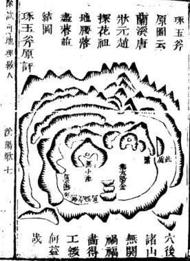

右地在蘭溪縣東三里地名瑞龍其龍自金華畧作翩而來五星聚嶠復辭樓下殿開嶂磊落閒金水帳中抽出一脉逶迤成垂頭紫氣貴格經曰乘頭紫氣號文星天下盡馳名而大小雙峯成天馬之格斷曰大馬趕小馬富貴傳天下塟後出漁右公龍登進士官至吏部尙書其子小漁公汝揖登庚戊狀元富貴鼎盛其盡結者爲趙探花公志臯祖地與唐狀元共帳入首大飛鵝頓起太陽金星開鉗結六兩股直硬元辰流長虎砂順水尖竄不利初代將及百年乃出貴先是探花始祖精堪輿學自擇此地其後人財富貴鼎盛二妻各十一地一富一貴倮花公官至幸相

採花公之祖官縣佐精堪輿學愛蘭邑山川秀麗 自衢遷之二妻各十一地一貴一富貴者乃一木 冲霄形課云一木冲嘗勢挺然文章四海有名傳 雖然衣紫腰金貴畢竟家無半項甲其富地乃仰 天朔形課云分明一穴仰天湖倉庫重重文秀事 試可地理收人 陰陽歌八

粟東貫朽房房有若要求宜半個無今二房子孫 貴者少富富者少貴果如其言

東朔主云一木冲霄地在洪坑金華老山中是不發者趙祖好地而未得道若果得道一二代卽發詎有自朱至明四五百年而發的理東湖主親到蘭溪臨穴眞圖及說開後

凡砂被高山住頭便減福力此地特立馬稍出頭插天但惜起在戌之末闋故官不大顯。

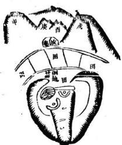

徐試可地理核人陰揚歌九

紫氣垂頭且有酒褥爲証却不大發唐穴向 一小他雖得案收水而穴前却峻制乃發頴 貴看來消砂之功神矣哉

亥馳大小馬 雖在大山 下都喜層次 清楚旺相且 爲金馬故掌 兵權卯龍枯 澁酉馬光采 故二貴皆酉 上發

予閱蘭溪飛風形龍身強旺印局緊未砂員净貼近身側砂雖遠有四箭而天馬高拱明堂甚小應三代發福乃傳數代後得田龍桎催官地方發者以龍身峰是乖頭紫氣而枯槁乾游多頑石也正頭聖卯氣扦庚向得納甲學陰佚明堂又工大寬平而發止丁財者以火宿森森而申煞遠昭戊未二砂雖開而向來邳制爲奴上于砂太重下手砂稍輕且堂形雖以可觀而水情終不凝靜也唐穴則于左耳側木頭閃角處乘寅甲氣扦申向相遠不過二三丈而成未更加親切面前小池幽閒靜貞乍手田水遶來左手青龍一臂遁水捕上以收之最爲緊遂發大福世人習地可不換與甲龍出狀元鼎甲予尸強州付塢文震孟地山周弘祖地井比地三見之巳世入爲何以寅甲而棄之所以然者二十四龍與砂內乾甲神巽多減可地理教人 陰陽歌十

出鼎甲子龍多出解元以乾爲八卦之首甲爲大于之首又爲乾朝巽爲角木峽所居爲二十八宿之首坤稱至哉坤元與不哉乾元首稱而子且爲地支之首也外此丙下丁以在天子端門辛可文章而納于巽故亦出元

趙氏金釵形坐卯向西西上朝山員净如策所以 配金欽也逆水而橫過下首左臂從朝山後大山 走過來緊護金釵之山在穴視之相去不過數丈 貼切親近不使水走風吹爲力最重是探花筵祖

原與別家共塟彼則竟絕但形局甚好而左右兩股亦少潤澤多石石又皆偏向右邊不相拱合似亦美中不足處以

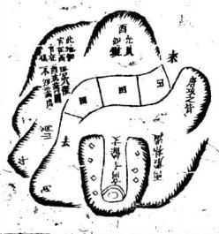

餘試可地星數人陰陽歌十一

予親臨飛鳳金欽二圍與說與琢玉斧所載圖說 兩相較視思過半矣 探花近祖地在縣東二三十里是金華大山之下 艮龍落脉到田平坡一線過峽拖長坐里穴卽點 在東咽過峽之處頂住龍氣番身朝山將山上下 來之水層層到堂收住穴前但自穴至田約十五 六丈田水不能入口乃將平坡鑿開使面前之上 竟與田相平等後背出去之龍竟作餘氣拖鬼據 此地山川之結作固如而人工之合尤佳龍自 東氣過後形如水面俾排竟向西南直走東北向 山腳處特其餘土故人皆往西南盡頭處點穴却

蘭婆 船相

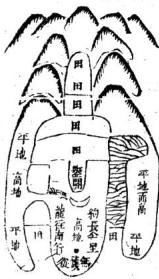

左右陟砂不起回前田取大數百畝曠蕩無收拾陳試可地理救人 陰陽歌十二

生氣散于飄風白然消索不振向後高山之下田源層層拜來明堂阿正緊簇方是真明堂明室末自有典假世人不知無奈臨田處是龍餘土眞氣不到穴點共間必不能廢此點穴欲朝山向好明堂不得不用腰腧受氣法點在承接過來脉氣之處而自穴塲以至田際却遠有十五六丈田水不能到口則生氣不囊動乃用人力中閒鑿去一條開成鉗口以爲甬道使與田平收進田水如此作法似水並收方能礪福地好以人力成之關此大

人長學問故附于此

福建汀州長汀鄒氏始祖神地圖丙申秋余徃興化府九里湖盤夢路遊汀境四保經過見其鄒公神廟此處山川秀麗住宿一天偶遇道兄鄒扶山問曰駕臨敝地何處貿易卽應之九里湖盤夢吾祖受堪輿一道父九儀公是也扶山道兄爵住三夕邀玩勅封公神地四峯蒼選山拱水聚大有奇觀余父現今增釋徐公地理救人一書逐將山色繪其形圖附入如何彌廷相徐試可地理救人 閩汀鄰地十三

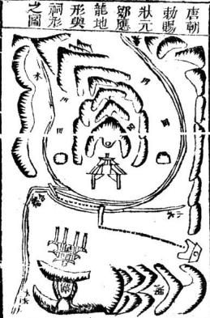

此也在閩汀四保來龍百外餘里層層起嶂飛總降勢人字分開頻起火木踴躍中抽出落坪洋塋結烏鴉伏田之形癸山丁向四山高從左右鐘鼓頸出河水發繡歸堂果見神地

夫鄒公祠鎮水門之處雙脉貫頂金魚戲水之形 合襟有清有合祠內裳整金身神靈赫濯儼然如 生四方崇祀而無窮

公生三十各居一鄉孫披繁祈數千餘鄰富貴鼎盛相傳至今可謂罕觀矣非吉地之所薩烏能致徐話可地望款人 閏门鄰地十四

通家教弟張延楨年撰

閩汀鄒公諱應龍字仲恭號景初吾始祖也生於 唐元和壬長二十四歲狀元及第累官至資政殿 學士致仕榮歸上親書南谷二字場之壽七十五 卒其廟貌建於問汀四保卒時勅塟龍子圍父老 云塟曰烈風猛雨雲露相蓮人聽之皷樂嗚天人 見之旗傘飛天未幾雨收曰出水湧成遂相傳 爲神助云宋紹興歷紹定百年逆虜侵彊而荊襄 虹縣两淮南京靈壁江州皆以鄒公神兵縣取之 捷聞紹定間褒錄勅贈昭仁顯烈成濟廣佑聖王 萬曆三十九年郡守陳以德奏曰唐名臣正鼓國 庇民今四方崇祀背嘉而響應敬錄始未以細 神塟之奇且廟址與墓相連深望明入於此

耳孫鄒扶山請附

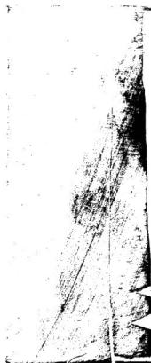

龍游岑山卜余氏父子進土地尋龍歌十四瓦休寧瑾德彰留記珠塘地十六頁休寧頓布衣留記伯山地十七百

無錫大地口徐氏架上金盆地十九頁

諸千地三十九頁

杭州西湖南屏山下地四十三頁 無錫青山彎都御史高忠還公祖地五中三頁 武進白家橋世科甲二白尚菁祖地五十三頁 無錫龍山尼泰氏世科甲地五十四頁 蘇州支礪山張氏巨富發貴地五十玉頁 閩汀龍子關鄒氏神地三頁 目錄終 嚴陵張九儀增釋地理拔人毒龍巒頭歌括 西等龍歌

尋龍先識行與止此大綱也一望便知去來分合勿 昏送且亦大相但求其合處餘背可知巳遊鱗風翼 非眞落此處宜着眼獲別眞典假勒馬橫弓識止機 孰非砂勸馬之砂有力孰非水橫弓之水多情看地 到此便有把柄便有入手處

龍之行動未住曰行砂定木流停止不去曰止簡併而不去砂回水遶也何以知其行水之所分你試可地理救人卷一尋壠山之所發此龍之行處也人房易知何以知其止水之所交山之所會此龍之止處也人所易知故觀今之南龍長江與南海相來其脉起岷山趨夜郎踰五嶺由汀歷邵抵信走掖盡于建業之江陰此南龍起止之大略也南龍盡于江陰以建業言也若以夭目言則又盡于海寧海鹽故劄伯溫嘗有大記今之中龍畫河與長江相夾其脉起西嶺行隴右過漢中出熊耳落河南盡于山東之登茨此中龍起止之大畧也人言中龍實止淮揚山東之太山則北龍從遼東下海起登萊結太山以作山西外水口之大捍門今看太山山向皆向酉趨兗州而物海石羔險惡元時海運受累是太山從遼渡海而來不爲無據今之北龍鴉綠與黃河相夾其脉自崑崙出關顏去瀚海轉白登循常山盡于燕京之平巒此北龍起止之大畧也比從爾北蘄向南行左股遼東遠在邊殷燕地佛處直省之東北角均無中天下而立定四海之民之勢雖右股山酉等虛北來雲中諸大山擁鎮壬後試可地理救人卷一尋龍二

而黃河界其上太行十餘聖長山抱攔闕鎖其下也所以上古聖人歷來諸大名賢多出其間所云居中建極以御四方者似惟山酉省爲然乎余遊尔師但見上手西山雄時一方層鬱登峙同南直奔蓝不國頭彎抱下手通永皆未原噴野無紫山峻嶺插出水口以作下開如比形勢上重下輕所以遼金與元曆數短促明季稍長究亦背一敗不能復典非若漢唐宋中間衰落又龍再損此事増望忠君爱回之大臣欲定龍不眷者思所以獻其

可也余患中昌形勢斯像人之右手覆峯唐孔滬自北岳恒山向南直走正似右手大海指然中龍陕西在食指根土骨節用力處河南以下在食指之二三節所以彎抱乎揖指者再龍如中指最長期又彎抱乎食指雲貴廣西等處如無名指小指縮退西南隅以配東北遼東諸地方今觀閩浙進京路非正北背由東南至酉北共五六千星帝半折來從北京正視南方則岡浙之插下濬中似有二三千里則京城正在拂指外山兩等處貴雀誠可地理蔽人卷一尋龍三虎口中如此看來則形勝之在何處不言而明巳極其中或高龐或平亥亥中幹幹中友郡邑市鎮它墓基地不可勝紀總之水輿山交而氣力聚交則聚龍因水昇而氣旋止也界則止故楊氏曰分牙布水龍欲行分布便行藏牙縮瓜龍欲住藏縮便止掠閃後龍欲去撐上前去手足向前龍欲止向前踞臣非欲止千古人又曰有訣法識龍行山山脫卸向前嚙又一法知龍止山山合抱如朝揖此卽山之去來分合而可識龍之起止也此其一蔡氏曰其出也必有自然之來則有分水以導之其没也必有自然之止則有合水以界之有合無分則其來不明有分無合則其止不眞此卽水之分合動靜而可識龍之起止也此其一土豕下合此爲正理有分無合因是廬花若有合無分穴多結作古人云不問後頭來不來只要金竄水蔭牕若有蔭膠金魚水後頭不來也日來每見發福書亂多如此不然心目昏迷起止莫辨徒將龍身撓掉溜下指爲乳頭最易誤人混認左右枝腳不試可地裡救人武一尋麗畧約錯作龍虎最易騙入糊塗混過亦似門面堪觀精細審來無真龍倒落此皆心目醫逃明難夏如何故曾遂人能自醒乎故劉氏曰雖或開門立有總歸風翼遊麟正此調也是以善尋龍者務窮龍身之發尾了善審局者務求砂水之交橫此在登穴處求之俗人錯解認青龍便定到青龍身土去謀辨界水便走到界水界處去辨可笑可故劉氏曰砂如浪湧水如鱗交誰識方來之跡水似橫弓砂猶勒馬孰知正札之味正調此也風傳者風林宿鳥鳥有率翼遊魚者意水建魚豈官

朱子曰冀都是正天地中間好個大風水山脉從雲中發來大同等處雲中正高眷處言巽中臨形在正高脊處也自眷以西之水西流入龍門西河自春以東之水東流入海前面一條黃河環遶右畔是華山聳立爲虎自華山來至中爲高山是爲前案遂過去爲太山聳于左是爲龍淮南諸山是第二重案江南諸山及五領又爲第一四重案玉斧

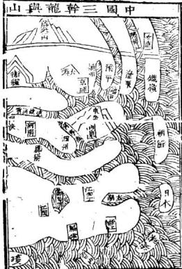

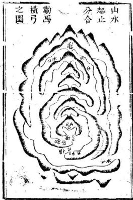

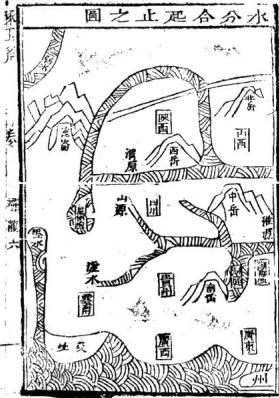

吳興唐子鎭曰北龍燕京爲枝結堯都爲正結仁山金氏曰天地常形固相爲勺聯貫道條理各有脉絡北絡中給南絡外唯太山則特起東方橫直左右以障中原爲中國表鎮

安徽按察司王公諱興禹嘗謂予曰先生亦知本山所自來乎人皆言從中龍河南下來殊不知中間平原曠野全無墩皁脉脊可証今以其形勢之可攄者觀之實從遼東渡海至登萊上岸以結太山予聞之欣然大慰曰予向觀輿地圖見登萊海試可地理發人卷一傳龍七

中石焦嵯峨水波噴激不解其因今曰方知其爲太山崩洪也元朝海運屢屢壞船唯此之故後遊京畿經蒙山太山左右見其大勢皆從東而西則金仁山特起東方四字非虛語巳且朱子所言冀都正天地中間好个大風水是指堯都平陽言觀下文山脉從雲中來一句可見而地理人子須知徐氏兄弟違情背理阿諛明朝以幽州原在冀州分出說朱子奸個大風水指順天說則順天後龍是雲中來乎何其謬也

第二尋龍尋祖山辭樓下發細推須有樓有殿祖好丁却亦處處皆然宗祖骨奇孫子秀到頭氣化此中傳所謂三復三閃元復元是也

人無祖惡出山無祖惡來是以龍有祖辟之樹有根根固枝茂根撥枝枯祖龍貴而子孫亦貴龍祖賤而子孫亦賤總之祖喜高昂端聳高聳不足事臺在端與昂形忌低弱欹斜形低不足忌忌者隸斜無易耳廖氏曰祖龍高起名樓殿常有雲氣現

眾遶名爲聚嶙山根本在其問珠山集曰尋龍法徐試可抱理救人卷一

看龍宗祖宗高大子孫雄大而斷皆老山中里惡相若是龍祝微弱了到頭氣化也相同到頭為尋地大忌合之可知龍祖所係之重巳

## 圖衙池殿樓旭龍

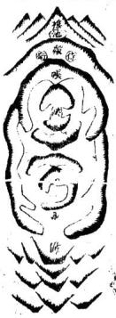

龍行山身頓起高大星峯謂之龍祖以山中言 龍祖高失曰木火也貝平曰殿土金也樓殿之 卞有單池名曰天池龍永有雙池者左曰侍右 曰衞乃大合水發源之處也皆自老山言如嶺之 黃山號之天日興之桐棺爲衆龍發跡之始 第三尋龍分正從雨傍爲從多自起峯以護中龍我 中生趙坐默無言誰知三脈難拘論會見兄弟兩核 奔雨相朝應甫益皆帶穴也曾主賔雙路至一枝結 穴一依作案則此枝幹向誰分請君如法工着眼須 徐欲可地麗收人卷一尋龍九

將主從別甲尊三尊從甲然尊者却端靜低小面卑者却男躍起伏作威俸福

龍之初起莫不同宗共祖是出脉之際自各殊支異脉是或從旁出或從中出也拘不定中山之聲爲主龍兩旁分支者爲夾從此從出脉偏正以定支幹主從古人所謂穿心中出是眞龍龍不穿心力量細是也穿心龍不貴在于過岐行龍處而貴在于入手之穴脉處至訣至訣然龍未必盡皆三支則局自不勝有變異或兩文並出兄弟

共結我爲爾朝爾爲我應謂之兄弟格古人所云人穴原來同局勢出祖離脉兩支分是也或兩支同來賓主相配左穴右朝右穴左朝謂之夫婦格峰龍結穴雄龍爲讚者居多古人所云誰若爲龍雄作應雄若爲龍雌聽命是也須着眼以別之東湖主云尋龍看祖山自是常理然却不可拘有好祖山而結小地者亦有祖山低微而頓起星峯結大地者不然何以堯舜聖也而生朱均瞍頑也而生舜禹乎總是人不知看地失竅著書立徐試可地星核人卷一尋龍十

說只好把這些上起些話頭曉得大竅正龍中忽指爲從從龍中經指爲正俗人驚駭怪異而不知其有撼也確處全在柳頭上嘗頭上有一卷而不可易之理氣不知此理氣者央不知警興元卷雙出生肝墓皆無用

龍出三枝分

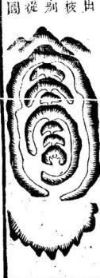

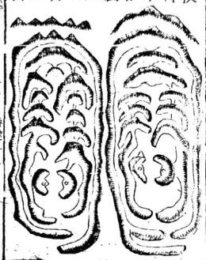

尋龍十一

第四尋龍尋帳峽無峽有峯空雄甲就中尋穴穴豈無雜比大地眞融結離結二宇正如爐中錯銀精跛罷化之妙言人立穴夢有一種處聚景光方爲真地

帳者龍之鋪張宏厚而挺身展翅乃龍之旺氣發舒爲穴之根本果然平團龍尤言峽者龍之跌斷細嫩而脫胎換骨乃龍之眞精收歛爲穴之咽喉非貴龍不有此也山龍周喜東明平男龍老喜若夫夾從纏護之龍氣不透旺從何發舒氣不癡聚從何收歛此從龍之所以少帳峽也無帳峽畫氣則改龍身頓起高峯祇爲他人旗鼓讀衞之其楊公云正龍身上不生峯有峯皆是枝葉送是也此二句韋誠不錯知此則知偷結地非大巳

唯有眞龍帳幔多貴人出入星高車入帳貴人此帳 貴人皆以木星爲艷身也峽中脫换更重重穴結情 形堪預度真中請智明自

從龍既以無帳無峽而其力小則眞龍必然帳多 峽多而其力重所以龍行開帳龍方貴脉出穿心 脉治尊穴後穿心脈開帳者多無帳者少一重數 聚玉斧 卷一 龍十二

重爲上格偏脉偏出爲下局周探花蒸山脈是偏落的故廖氏曰若還開帳要中出角落未爲吉不盡然兩重三重開府衙也有止發賓者一重只富家也有開府衙者若有貴人居帳下此格真無價是也是可知龍最以帳幙爲貴矣

東湖主云會見賴太素爲秦棺王夫人塟祖地在 嚴陵分水縣西名五馬奔槽形過峽禎起一大帳 是三台形穴結左台腳下又見杭州西湖裡老龍 升生于少保忠肅愍公地庚龍折順三台穴亦結 左脚又見龍游余恂元翰林祖坎與休寧珠 上地皆三台格而脉背非中落皆在中台之東左 台之西界水中山腳吐出一線脉來則角落木爲 言似非得道之言分水王氏杭州于氏二地皆是 左台腳落桐說未停山珠塘二地雖非巾落而 實爲穿心之脉廖公言脉出穿心脈始尊此句大 爲有圖說附左

龍游縣岑山下余宅地凡砂中用神衆小特大衆遠特近固巳不知特大乘玉 卷 尋十三

特近之中又有衆老特嫩訣衆瘦特肥議衆頑秀訣衆濁特清之妙詠龍游岑山下余成吾先生自卜地左手玉屏兩塊右手來龍華三台落脉一如文筆三枝案似御衙天馬高金作朝似衆子皆利而獨第三子諱日新者辛酉科甲戌會榜其子諱恂者辛卯解元壬辰翰林富甲一邑嗜何故則以靑龍手玉屏砂雖貴邦老瘦帶石枯槁無顏色宜著眼又較右手山遠穴數百丈宜着藏此長翁之根也而左手以來龍作白虎既巳有力宜穴塲也此三鎭之根也當目成吾先生塟元配時自知三子必發故目見目新先生成進士乙丑帥雲先生誕降知爲大器以此地應在第三乃強以長孫作第二而以第三呼毗翁後果辛卯壬辰聯旋鬚戊之應在酉京塢金鐘形地且此地穴法尤爲奇異龍身直向東方故人皆在盡處龍頭上押塟殊知下手短縮水走風吹央不結地而後山三台落脉龍實秀旺豈有不結地之理成吾先生乃詳朝局而形勢際在南方則向東之地非廟勢也乃在金星頭之右今上它閣向南橫塟此地允法與南嶽之茂鳳形淳哀之結整蹈屬皆是怪穴不遵穴洪者學者宜靠加朱謠 三台既侍立有手過炤穴塲而下手短縮之砂適在穴塲之背以作樂託山宜看眼明堂橫州水不傾斜確難移易此乃得看地之眞寰者邑八皆以穴情勉弼壽離必然有水殊知數十年後成翁合塟熱氣滿槨乾燥不濕此麻從心中穿出成御街龍而發富貴者也設州木未哲也已的山地記附内

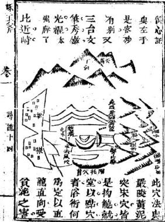

嶽州休寧珠塘 地記自山財記明內琢五斧 卷一 尋龍十五

予閱古仙飛布暢塘尹坑尖珠塘伯山諸大記每慨想其地形不知作例情狀果爲確然不可移易者乎抑亦如各處士毗指東話西看乎丙寅冬承休邑東林竹汪宅相招看地得看呦鹿啣花仰天海螺螳捕蟬風飄羅帶靈貓捕鼠請族福古地而珠塘伯山得自焉但見珠塘果是五腦芙蓉帳果是亥脉王字果是獅象曰月爲捍門所云翼慘星峯熾果然星峯高起所云天機落在吳山上果然仙帶脈渡過吳山上頓起高峯五股飄下中抽落 屯溪在此田再起金 丙有口月 勇整手星醇踞局 外看象中亥脉入穴目月獅 案有势象居穴右邊以塞水 口翼軫星 不穴峯峙穴左 率口在此

尋義十六

手以作能官案近堂緊被屯漢中術程氏所塟致遭俗士不知此中理氣以木來生火之地反入土被木剋局受害不淺字啓去之而伯山穴塲尚安然無恙未遭拗掘但見猴騎石馬出離字虎趕山羊來天市二語疑共近于怪誕誰知到地一看馬果是石果是猴騎宋是山羊被虎起來天市始謂就球固不然棄球非不是亦同各處上記打諏謊語誰知穴塲果不在珠果不離球而且坐普啓明西長庚果然穴塲任啓明面長庚之所移動不得如此方信古人明自示人在人未得此道眞竅遂茫然亂精耳今將珠塘伯山地圓頓董黔記公諸同志共鑒貴之若止知雙山元空諸五行者不知中間造化之所以然處區無用貴心此道非挨星正法不能知也

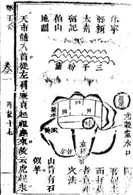

頼太素伯山地記

大地大地眞大地東貞起祖眞奇異猴騎石馬出離宮該云坤宮虎趣山羊來天市天市本龍從有石如幸之寅方來元機拋綉球誰識來中億意字舊官卽用球也沈球固不然藥味京不是自政家中饑方識咏中趣穴在以莊難上難書良少方好若侵入申便要生謂所以難也神仙點彼易中易坐着句啓明面長庚夢水東流貴無比三千粉黛列千前草立端方屏後倚漫擬鐘嗚鼎食家子姓皇皇千萬億嗟或嗟哉公山之北伯山南晴破芒鞋幾住還可惜眞会無賣處一聲長嘆過三安開得筍尖地更美為汪姓所得行將埋毀巳董德彰珠塘地記

卷一尋麓十八

人言大地在珠塘誰識眞龍在內藏天機妙處從 來秘留與善人作福堂洋甸這福堂世無雙後龍 貴格非尋常也是淨爾五桂齊芳王字峽東西日 月夾兩傍是眞的入首博換朝天馬天機落在吳 山上是南細黎詳天乙太乙焰山向時人不許妄 評章虛謂重峯疊嶂團國遶萬派千流聚一堂不 在酉前日月捍門居水口獅象外鎖勢軒昴著實 語古人留記出卿相我今還許狀元郎積善之家 扦此地管纓世代福無此記褒術家口氣伯

山記方是吾儒身分

又云脉出穿心又成峰腰鶴鹽龍予曾于無錫太 池口為徽郡徐必先塟朱令總圖記附後

此地入首龍爲人字金星脈從陰囊出卽生一太陽金又一線過脉細而且短細則氣不後漫短則力勁而下懈頓成金水開口體乃品字三台格且合鶴膝峰腰穴巳成之句但堂中凶煞雜亂惡不可當理宜築起窩口深藏以蔽之所云架上金公是也十崎未見頓布衣作法及董德彰伯山之地

蔡七斧卷十尋龍十九

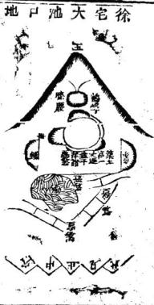

而以形似浴鍋爲笑談鄙也甚巳法用維杖吞穴辛上作催官卽在右台局緊氣暖速發地也甲戌余欲自得因常郡高勸侶先生招刻列水要訣於必先護之已卯脊邀予塟始令孫徐峻戌寅生謹平卯乙未發遲則辛丑決不爽也鄭君熙成訂議酬機之法偕載開盟若果如約則更有以贈之號薄從事唯靜聽焉無用曉曉

至于脫卸過峽名曰結咽咽係人身性命峽閱龍身死生所以疾峽處薩顏不悔風吹不得來則子此脫胎換骨去則于此養成體局關係甚大論脉有長過知過正過例過之不同峽申之脉也語質

華龍二十

則有山峽田峽石峽水峽之不一峽雖不一而脈之過氣則一也或來大去小或來小去大大小之或有迎而無送或有送而無迎迎建之利或胎與伏之遞傳傳在隱頓之間或雌與雄之互配麗有精巧之妙或欲度而起天狐天用無親或將成而結鶴膝峰腰情美不拘陰豚陽脉雙脉與單脉牧喜重重包幾雙豚者或乾亥健行或丙午雙行之須單脉則罩乾單丙之類非言形也或無圖可書頭喜包爨不使風吹無論遠峽近峽一峽井數恢若得多多益陰峽不宜多悉則力波峽最喜近近則氣緊是以善尋龍者峽中之與妙丁不窮所以都要知道善審峽者穴內之情形自可頭果然不差 正過者入穴亦正好點文了側過首入之亦側才要點得丐了山護者穴結山鞍守看的水慶者穴近水邊好看陷石脊與五池殊峽故敝石之與捉月質分煉濕外看角山峽與田峽異覆故山谷之與田緊局別高低好看的去山小而無迎者氣將歛伏而知其靖作之在近看地好武去宋間可地崛敖人卷一尋龍二十一山大而有迎者氣正發洩而知其涉歷之必造看地好兼故一氏曰轉開出曠處最伯風吹風吹則龍驚樂久首結胎時危嫌水胡水刧則氣怯溝廖氏曰龍行過峽脉有四正出左右次合之可得觀峽十穴之法龍行開帳有十字帳者有丁字帳者帳下傾起星峯鬲出山頭者爲山帳貴人低在山下者爲入帳貴人才星貴人繒名金星大星便不可名貴人俗爾下知分排闭言亂說可笑

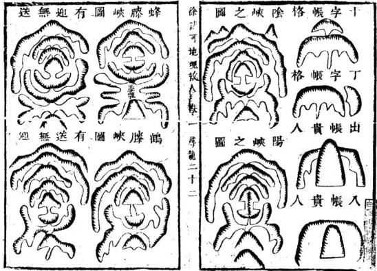

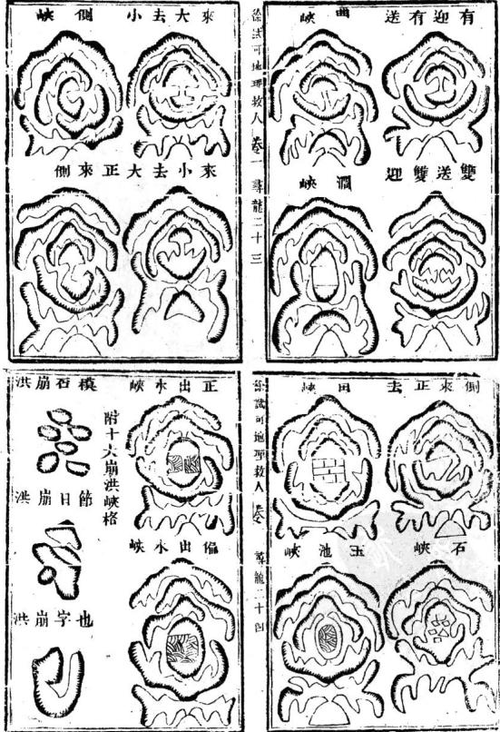

洪崩角交洪字川 洪崩字之洪崩跡馬 洪崩字士洪崩蚌螺

徐論可地理救人卷一葬龍二十五

洪崩續斷 石梁度脉過水形有十格廖氏白00 用山共水知尋脈石上留眞跡喚作崩洪有十名官貴此中生

東湖主云尋龍看帳峽理之正也不拘帳快而知地之眞假行止大小造化之妙也不知理之正則無矩之可守不知造化之妙處不能精義而入神善哉董德彰之業師李德眞秘旨四十叚其由之一云

看地有一人竅識得破時頭頭是道否則說立說妙都是無處有榛則關眼便知無據則心目昏迷自數欺世所賢晉書立言巳自說破私吉何嘗不在寶上世上僧懂漢草草看過致使一粒金丹竟爲于古不傳之可笑可恨背端與者將是以得自矜不肯虛懷善下亂拜真南逮懊一生今試執人而問之曰好地何處好一難曰砂之秀麗也水之有情也而重能者則曰龍之從振也龍之活動也龍美砂木有疵不妨結地果爲此語未嘗不印訛可地理杖八卷一尋龍二十六

如桐廬上杭埠出姚尙書地砂水有反皆的龍差雖有好砂水無益也果然此新末嘗不此重本之論也吾不謂其不然也龍豈有不重之可火中煖氣全葬龍脈行來然龍之美惡何以辨龍之眞假何以辨龍之行止何以辨出二難世人重龍則龍身作何辨法詎可不知此卽其重龍而離之也則人人皆能言之而人人不能知之也不知而言則言書妄言又諸執人而間之曰龍何者爲美三難曰峰巒之磊落也星辰之端正也有人平飛鳩也有幃也此貴龍也然也然吾嘗見有美屋峯而結地不佳者人安知此有星峯不佳而反結美地者人不知有帳飛鵝而出貴者人人皆知有無帳飛鵝而亦出貴者人便不知了且有个字而未必貴售多無个半而未必賤者佳多則又何說也刃龍此處大有把柄不得巖者何以知之而談也之貴者則又曰穿心夫穿之龍百不得一而極貴之地未必穿心則又何說也五難今又執人而問之曰龍何者爲眞曰有頓跌也歲可地掖人來 南龍二十七

有曲折也一脈之清一星之正也盡然也然吾 嘗見有頓跌曲折脈清星正而不結者則又何說 也六難難盡世人俗見面世人每于此處尋地塟 下大敗受禍今又人而問之曰龍何以止曰有 蜂腰鶴膝也山來水聚也細嫩之極也山水之盡 也然也然吾嘗見龍無蜂腰鶴膝而亦止者甚多 有砂飛水走而亦止者更巧此在穴外視之財然 若在穴巾決不飛走有極細極嫩而龍不止者人 人解不來有不細不嫌而能反止者人人解不來

有不止下山水盡處而腰結閃結者甚多則又何說也七難離到此難得盡情透辙總人不得竅便叫怪呌奇得了竅甚是平常總之有一大竅在行止干此辨眞假千此辨美惡于此辨富之大小貴之輕重于此辨肖有生死魂鴈年月見分皆于此人人識得人人不識得可惜可限世人要識得請千書中察之無訣空空看的千山上看之無訣空空走的仍不若于人中察之無師傳授枉夢此開一破則地之有無大小瞭然有目矣服晴聞徐計可地禮故人卷一尋龍二十

窮細皆見吾姑徵言之以醒世之夢中說夢者東湖主云李仙夢中說夢之言深中堪輿家病痛非但時流俗術夢中說夢卽古人著書並訓者亦然理氣家如雙山立空左右旋四十八局玉尺經四大水口天玉經內外傳以及祿馬貴人等說皆是夢中說夢巒頭家唯塟乘生氣脈認來龍及龍要來了來穴要隈了隈砂要堆了唯水要回了回數語外其餘疑龍撼龍玉髓等經披肝露膽赤霆陰符以及十二倒杖等法階足夢中說夢然此尚曰理未眞旨未確也其有真而確者如雪心賦句句真言催宮篇學問懶如河洛納用犬這屯麤八卦大道理若不將此竅配合其閒則吉凶禍福不能確應未免左支右吾友吾便不意了亦是夢中說夢然猶曰此尙未明說大竅也其有知得大竅明白說破而不遇眞師地上指點口傳心慢人雖似懼而膝朧無確據不知今曉是乾說非乾非巽指爲巽究竟亦見夢中說夢甚矣至道之難遇也時流奈何以門外漢輕言門內事乎

大地多結峽中諸暨縣西土名平濶縣龍過峽處 祖母其發福祖地在牙頭山寅中巳亥四山皆起 故方且以戊申生命庚午鄉榜甲成會榜今此之 地寅申封峙巳亥夾耳力比手頭由更重數十倍 此地論龍則諸鑑縣龍也從浦江來有百里出 縣去有二十里則龍氣之長可知論穴卽結在縣 龍身上橫籠緊貼脊爲扳鞍穴則穴情之確可知 論水卽在龍神峽中窩聚內堂則水不走漏可 論砂坐山坤申卽後龍祖山也朝山寅艮卽前去 縣龍也右手巽金卽入穴之來龍也左手乾金卽 保試可地理荻人卷一獸龍三十

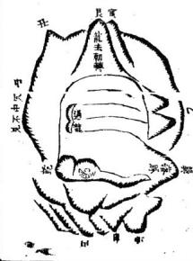

穴傍之護龍也四砂俱之本龍身上力重已而 又形勢雄壯垣局圖聚其福澤詎淺小哉蔣侯方 伯不能專美于前已

第五尋龍須識勢詳將勢字剖君知生強順進旺爲 吉反比凶惡不堪支詳綱分別在弟十一辨疑節 龍勢行度其名不一月生龍曰強龍曰順龍曰進 龍曰旺龍曰平伏此勢之吉者也曰死龍曰弱龍 曰逆龍曰退龍曰衰能凶懶坦此勢之凶者也 郭氏曰三岡氣全八方會勢前擁後護諸祥畢至 莊能之彎也反是則弱矣

氏曰眞龍發足之初猶萬馬奔馳之象此之 張龍也反是則弱矣

十氏曰所者活龍活玷所忌者死獻死饌此可以得生死之辨矣

廖氏曰順是開脛向前往逆是反肯去進是龍身節節向退是漸消條此可得顧逆進退之辨矣楊氏曰莫道高山方有龍却來平地失眞蹤平地龍從高嶺發高起星峯低落脉高山既認好星峯卷十詩龍三十一

平地兩旁尋水勢雨旁界水是眞龍水纏便是山 纏理霜峰水涸龍不見春夏水高龍背見此是平 洋看龍法過處如絲或如線亦須形其明礪若渺 莊無憑終不可信高水一寸卽是山低水一寸水 廻發寸許閒亦不可只爲時師服力淺便云此 處少峰綠句諦精潔誰知山高落坪裡退郵愈多 愈有力祖宗父母數程遙灰線草蛇尋脉眷青路 亦須拔尺萬失音爲思呼中一失更爲哉一路而 來到結穴時自然吳起活動尤須求東氣湧進 突來曠開大勢復次東點將旆胎巳忽然人局 年明氣得乃頓成穴星基下小或開口人或四 鉢胎孕乃方雨水夾絕是龍息龍息之所風脉氣 聚而裝巳反是則懷坦非地巳

東初主云東氣處現活動相曾于武進三官堂尙晉胡淡祖坟白家橋二倘書祖故見之平陽地有東氣則地力大東氣處現活動相地力尤大予會于武進橫山橋爲楊宅扦蒼龍捲尾形龍橫山腰中一線落脉平田中開帳行三里許結橫山橋玉斧 零龍三十二

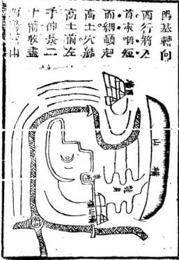

哪下諸水立乙山辛向面前田水層層遙拜富而且貴之地場偕行楊嘉會兄弟友于愛衆親仁以承祖父忠厚之德應得此地

第六龍格分偏正龍身尙格者最少格取梧桐爲最勝更少萬中不得一次之乃藥楊柳龍北格十分中解二三个字一訣傳心印字字乘嘆

梧桐枝兩畔平抽正今字之格也絕好雙送雙迎 難遇楊柳枝邊有邊無偏个字之格也外頭 不停了備處自有合來不處稱之中氣變背藥左 保試可地理教人差一 尋龍三十三 右互傳車个字之格也 卯甚活動杞梓藜芽半有 半無仄个字之格也辨州蒼老相實看个字幽分 正偏草仄四樣精絕玉髓經曰停匀惟有梧桐枝 雙送雙迎兩手勢對節分生作穿心此龍百中無 一二此正今字也左有右無過一節右有左無亦 非異此名原是雜葭樣但要星辰得位地星辰得 地是眞龍遞會生核不偏廢多因木火作星辰蘆 葉尖尖左右至一等名爲芍藥龍左右相生本不 同分處光員有枝葉此是木星帶水逢北岸个今 也又有繁芽祀悴校半有半無似人字此龍全是 水星傳只喜星辰無雜忌比瓜卜也更有偏生 楊柳枝偏有偏無極乖異此名原是受偏處半枯 牛榮無意味忽然入首變梧桐楊柳枝頭正心是 此偏令字也八首忽変梧相則後龍灘半榮半枯 無害巳人曰此龍多偏發發長則三絕發三則長 絕殊不知穴塲左慶則三絕右護則長絕得護者 發失襲者絕龍龍皆怨不燭楊柳枝也會見有左 右皆藏之地平百中無一二也或者亦有左右蠶

試可地理救人卷一專龍三十四抱如燕窩形者然一千稱高數尺一手稱低數尺便止得循高教尺者蚤甚有左右高低相等者而一手近丈數丈一手遠文數面遠丈數者便周落匕此造化原有不齊之處非梧桐枝房房均孫楊柳枝便有發有也或日據子言則人家有缺而余嘗見二三房人戶戶同發者則又何故余日此故易知故由祖坟所蔭祖以蔭長房則長房之孫子个个興隆祖按蔭仲房則仲房之保子人人才幹若祖坟所蔭此房之父母死後塟地便分

宇个革菜芬

而無能久長同發

朔主云看龍格之法此叚最精

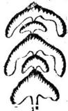

琢玉斧 卷一壽七三十五

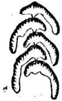

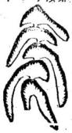  
字个仄芽蓁

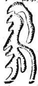

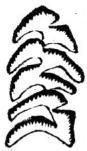

橫林黃文元點穴全身打動周姓穴點局外不與 打動周姓穴點局外不與龍貫串藉口來龍梧桐枝何益之有 枝何益之有

格雖不同訣在得穴武進豐北陳圻地梧禍枝余為

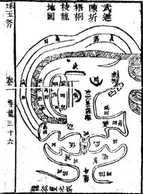

右地周穴似有眄堂而窺蕩斜側下手無關怎能發福坎方高阜周是土手上重下輕巳黃是下手蔡護穴塲穴不怕寒豈不成地且明堂在西周穴爲何向北去巒頭獨不知乎吾點責穴百前逆水案緊開內堂之水甚爲得局龍氣克乘堂局又正再加以分金之巧法子孫繁衍世世科第巳第七尋龍要審局水流上下知順逆隨水而下順中評最不利逆水而土君須識第一妙局

行龍大勢曰勢入穴結局曰局觀圖可會悟也

圖局順勢逆

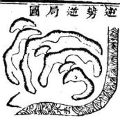

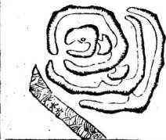

玉斧 卷一革龍三十七

圖局順勢順

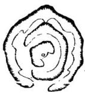  
圖局逆勢順

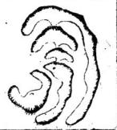

第八尋龍要識星不議龍星總是閒敎君四凶并五 吉體別方員直曲尖此請到龍之入首虛也 金水木火上此五星之正名也尖員曲直方此五 貪須巨門祿存文曲廉貞武曲破軍左甫右弼此 楊公之九曜也紫氣天財孤曜掃蕩燥火金水天 罡太陽太險此廖公之九曜也楊廖所命之名雖 殊撰吉凶所取之義則一古傳曰太陽一星卽左 甫高員覆鐘釜覆鐘金大武金特立金獻天金雲 中金高面員覆釜金高員者少低而小員者多民 小重是太陰太陰本是右弼傳形迹方更員義眉 等砂金水元來名武曲三腦如金宿飛鳳形象盛

卷一尋龍三十人

水星紫氣號貪狼一尖直更長貴人傳立天財龍識巨門體三般頭腦異年膽是臨屏四腊是玉凡是天馬天罡正與破軍同腳下出尖峰金頭火腳孤曜祿存同一字撚拳正相似金頭木脉都亦難訊又說祿存如把齒燥火廉貞實一名尖斜芒帚形聚大格名巖最好掃蕩屬水配文曲斜拖帛一幅長如生雌礦似景帳又名批榜此楊廖之正九曜也

第九識星要變求九九喝形莫差謬此言廖公九曜之変體歌云一星每麥爲九樣一名本相聯氣居一分氣三第四開腳五爲弓郕六雙灰七変番身巧八是側體九倒身八十形眞形有高低典肥瘦喝名莫差謬此廖公九変中每変之九體也

東湖主云第八第九兩節皆言入首結穴之星體非言行龍也

瀟変由來未爲精剝換生剋推休咎博換之法有二

琢斧卷一尋龍三十九

以五行言金木火陽也欲博水與土而陽資陰吉水與土陰也欲博金木火而陰藉陽生是以木火行龍是非不貴而尙恐孤陽之寡偶此說甚具金小轉麥龍若欠秀而似得一氣之相資所以富金水行葉居多十氏曰詳觀八國之周流細察五行之亥化此三有是言四夢非說龍身可知五行之貴有博換也

以山體言脉出條餘細小或氣盛而湧成高岡有力了龍行巍巍高大或氣歛而延作微數脫卸之或側峯而香成正隴乃面正子或老幹而生枝秀媚了或逞奇而嚴石岐層固是說行龍光有人肖如杭州飛來峯之張宅地者或示弱而阜拓落雖云拓落其中却有精神方吉或山遇水界石骨渡江而重興營寨多或山亂形雜穿珠吊脫而別作門墻儀多或高山脫落坪麓而隴蓋支體嫩秀下或平地脉來直硬而友帶隴情茲了談不盡與龍変態無非高下相生是小大相禮是此瘠相間是俯仰相承是雌雄相配是祖孫相玉 卷一尋龍同十

省是廖氏曰退邱博換粗者細凶星変吉氣最妙老龍生出嫩放柯跌斷不嫌多也不可太多楊氏曰剝换如人換好裳如蟬退売蚕脫雁或從粗大啓低小或從高峯下坪祥合之可知山體之貴有換也

東湖主云剝換之義皆巒頭中有自然而然之形與勢不假人力爲之者也下生剋制化二義論理最爲精妙易悅人心目書獸子及無識假術遂精之津津不置口孰知從舊地上看來全無閣係舞

而有生尅也東淅主云洛書逆尅地晉千西湖南屏山見之辛亥偕馬姓友行至士屏山下忽見倒地木長十餘丈予曰子破母腹而出當有大地遂走向木身盡處乃見一員净金星轉身視主山但見山石森森火星獻秀辭樓下微處曲屈如蛇予曰龍格最大速發地也友曰此地塟四五年初一綱級舖今化兩倜發誠速已但金木相剋余忌而棄之先生深讚出自何書予曰仍可我金剋彼木不可我木彼五务 卷一 尋日十三

金剋且子業何經友曰周易予曰此旨出此經也 曰周易予曰此旨出此經也向來地理書止虛言河洛之理不知指出實用來唯鐵彈子游氏註中透露眞訣却未見諸巒頭不意此處得見此地後數年覆視之九曜在坤方塚立巳亥局吉地凶塟止出女貴或曰納田法向來刻本亦說不明白鉛彈子

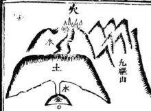

書出巳後坊刻皆知發明則此河恪大數將來衆著可知巳予曰亦吾願也但俗術不知此理固不足責而儒家好此道者亦同俗士無知爲足異爾第十制化歸高識死中逢救生中剋要如生死之所以然處便把持得定或向本位揄榮枯或兼四畔詳推剛此二句正是消納之法世人那得知

制化之法有二理甚精妙無益于形 以木位論金座兌垣堅質不憂機于令炎好木 生震地巨材何愁折于鈞金好話火臨金鄉為寡 耿王 卷 尋龍四十 援遇北辰而炎成好話木居西地爲失勢悠兌有 以殘根好諾當思設使自前龍有此地則幾當用 停法而集之而化之士木共居離仇貪生而我何 憂剋話更好水上同居震敵受制而我又何處歸 更妙此推之方位而取制化也玩味此句是齊頭 中自有其制化非人力能制之化之也星經曰身 旺不憂剋制身衰晨怕刑傷或資生我者而旺是 或借我生者而相是或賴貪生而忘剋是成反借 煞以爲權亦是理正于此可類推矣此皆就頭 中死宋的頭論之未講及人之制位化他也進 人能物他化他則我有權

56 火杯滴豈勝輿薪可危金畏火烟藉土多而可救 造化木憂金琢賴火或而免傷造化此惟之四旁 而取制化也前賢曰弱不敵強也是寡不敵衆也 是理正于此可類推矣

十一疑似須致意休教心目自昏欺疑似之法有二此節宜靠貴翱看方得眞地

尋龍四十五

相似辨得好生活與驚懼相似辨得好平伏與頻祖相似辨得好順勢與走竄相似辨得舞進勢與頑蠢相似辨得斷一有吵嗟禍福自無可準

旺者千枝百葉而彼護此纏形如蜂屯蟻聚散者千條百緒而彼背此反勢如微水傾珠總義背反四字是辨龍散龍之眼強如良馬之騰朔

而星峯氣勢自端嚴怒若疾虎之帙奔而體勢巒 頭多欹側端嚴本僧四字是耕弘龍恕龍之眼生 活者起伏盤旋而山朝水抱驚懼者走閃地露而 永返山池別抱遠返四字急辨生源巖風之罪氣 勢平伏者勢如靜水之風生微浪而吉在隱隆之 中形勢煩追者脉若片壇之鋪張平地而勢無高 下之別隱皆無別四字是秀平伏慎理之眼順勢 却水之朝宗星之拱北而行度手足自安帖竄勢 如羊遭虎逐花被風飄而體勢手腳自飛斜安藍 粲斜四字是順勢寬勢之畢進勢者龍雖崔纏 而峯巒多有面頑蠢者勢雖雄偉而星體不閒顏

尋龍四十六

有面開顏四字是辨舊勢頑察志魄十氏曰審禍福于毫釐之閒度順逆于性情之寧千有處求無莫向無中尋有此可知形勢之疑似不可不剖也以星體論木不木而火不火土不土而金不金星曜雜亂休着眼大夢異尖不尖而員不員方不方而曲不曲形體歪得枉勢心大要辨楊氏曰大率行龍少全局雜出星峯多變易鋪星似弼巨似文長短高低細推辨佩當辨其是何显唇解黑穴中禍福劉氏曰壘壘江山如疊翠喝名不上亦徒多雜亂參羞便無地巳時師請認雜中雜莫去訛談地理歌十氏曰土之小巧者類金參形雜勢木之尖亂者如火眩目或心合之可識星體之疑似不可不剖也

十二當知棄取訣萬里河山一覽知純吉者人所決取亦人所易取純凶者人所决去亦人所易去唯有行龍時吉星疊疊或局變凶曜而結奇胎此龍吉而穴怪者也亦有離祖初凶曜種種至中博尊星而活死骨此龍怪而穴吉者也

琢玉斧 i 尋龍門十七

是將何以定去取乎龍卽穴吉人易取贈龍吉允四最難取

珠山集曰問君術看龍訣貪巨武甫最難得行龍入局純此星世代富貴無休歇有訣法辨凶龍破祿文廉最是凶出軍出賊遭瘟火止作神壇社廟崇此可以定紬凶紬吉者之去取也

廖氏曰九個天罡人道惡六個吉神落若穿金水 士星辰最勿救人貧天罡亦有好穴九個孤曜名 不好四個藏金寶元來生水與開金穴向此中尋 孤亦有如六九個燥火有吉四七個是仙踪能 於前人剪火法立定登科甲燥火亦有好穴九個 插蕩未爲奇七個蘊天樓法宜裁蕩奪神功夾世 產英雄揚舊亦有好穴據此則知龍眞穴怪者或 亦堪取也

楊氏曰莫道凶龍不可哉也有凶龍起家國緣未識間星龍貪中有康文有弼或有破軍閒斷大弱成雄為此是龍家間星法大頓小伏爲眞蹤

琢玉 卷一尋龍四十八

好一山便斷爲一代看在何代生問龍是的便向 此中定言貴困弱生旺隨是峯此句好極須玩之 大有看法在內困弱之龍無氣力死烟包入砂 磧果然十里百里無從山獨自單行少收拾無從 山便不好了君如識得閒星龍到處鄉材可尋覓 唯知造化之妙者方可到處尋蒼非止謙一開星 雙下龍非久遠得全氣氣如金金氣在久卷處來 此角大有力易盛易衰非人力全在久遠之龍非 人力可迨作者處此則知龍怪穴吉者或不盡棄 東朔云云開星龍旨于慈州獅子山見之正結 將軍踏壑形穴離正而貨堅廢結一橫担拔較玄 龍氣甚可人卦木知倫閃虛結一油棟形穴大怪 清時人俱無識者一係火士局一係水火局皆 賈雙全一係純火局人丁太魯太謙局赤歲得地 又云據廖氏叚龍吉穴怪者既可取攄楊氏一 叚龍怪穴吉者亦可取合看來則無地不可取無 之而非地已要知無之非地將操何術以定之乎

寺龍四十九

世人何不子此究心也

又云楊公言龍非久遠得金氣易盛易衰非人力言人家福久長必得龍家全氣欲得龍家全氣由于龍神久遠也此誡子古不易之論而得道之士非但求龍身久遠取其全氣尤當于撰砂法內分其雜局醇者悠久局雜者暫發更得十地之要領內撰

愍久漸發地誰

東朔主云凡地有初薩發數十年而止者也是的癸了再區地不妨辟如寬不夢之地記不差翠有塟數十年後而初然興發者初年不利最難忍耐有初塟卽發發至數百年不替者此地第一等者有塟遲至數十年而所發亦止得五六十年者大不好地寧可初塟卽碾數十年而止地或曰龍爲之也龍神有大小之不同也龍非久遠得全氣易盛易衰非人力之說或曰水爲之也水法有久暫之各別也堯軍葛木莊之家余曰皆非也爲此說者係從來動襲之僞書及當令瞎盲假術不

琢五斧卷 尊龍五十

知造化之所以然處而設此說以欺人者也大凡山川融結處一地必有一局局中只有生神旺神環拱疑峙並無煞洩夾雜是謂純粹以精者塟下卽發發至數百年而不替如局中有生氣卽藏一煞氣有旺神印隱雜一退神生氣發貴輪至煞氣絕丁旺神發富挽到退神貧乏所以發福數十年而敗此竅不由龍不由水而總由乎砂山麓平洋悉皆如是古仙云收得二宮砂水正目然榮貴不須疑右兩亥憂慾參虛又云尖山秀出只消一峯雨峯誠慮砂多則雜不能悠久也巳上乃正理易于辨別者然而進此一籌有更空辨別者如一發便止無錫青山彎高宅地乾山巽向龍虎二砂丑未峯起應發兩甲一自未至丙中間丁煞一自丑至卯巾間艮洩皆微示動機最甘者忌藏千隱隱所以一發便止如發而屢發武進白家橋地癸山丁向壬子砂起貼腦照穴此外並無一夾雜砂即尖山秀出只流一峯雨峯之說所以科第十八九人丙丙子王子中者官至尙書此二者易爲玉斧 卷一第龍五十一

辨别者也至有生旺二砂卓立立武左若兩傍皆 帶退神而福祉悠久如九龍山尾秦宅地者坤龍 艮向坤申二砂插天穴左臂庚酉右肩丙午退 神盛疊應如高氏地發一二便止表氏犀數坤 聖一六扦乍山子向者巳光發福爽一六坤山艮 自未免愛累乃科第一二十人傳败十世而勿替 者何也艮以左退神內止有洩而無煞一訣長 劣二房獨而不絕一熟則丙午庚酉有人當其 咎一訣凡煞洩所值房分尙有人存則不移累他 页 得以專享生旺二砂故發祠最久專專專 臺要設使洩中有殺長三丁總則左右洩氣併 歸仲房遂難云久要至誅抑或當年止生二孝 子一人前無大三兩子則二孝子吉凶並收一發 而弛必已要訣惜箸塢地火土相生局而俗以亥 龍向丙撥亥爲煞大淨地木火通明局而貪湖中 秀墩立坤向南方一片洩氣故此發福中子孫多 有受其害者可集俗術囚二孝子泒下發福久太 井將此一地而榆揚之不知發福家之年與命 玉斧 尽 尋龍五十

止與龍尾山坤中二砂相應並無與此雨地合者詎爾虛譽之可移哉所謂進此一籌更宜辨別者此也據此則易盛易衰非人力句不獨在龍氣上辨矣

青山彎高宅地圗丑未齊起應名廢一甲而皆畢 科者以龍山形勢強旺于粲山也至滿至袤生帶 殺故忠憲公諱攀龍者有止水之變生鼎洩故忠 憲公爲理學名儒繼振東林道學姪彙旃公諱世 泰官提學善字地理不爽如此

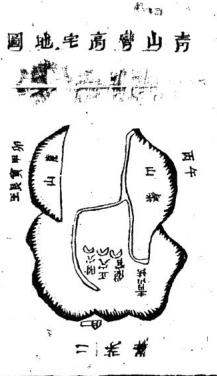

家王斧 尋龍五十三此巒頭乎據此巒頭于午利廢起官星甚旺卯酉中者官爵低微人言此地發尙書二人八世一品余曰做尙書者斷在子舛中的子有五子甲子戊子庚子亦中唯壬子丙子中者做尙書隨查白昴白貽清果然一是丙子一是壬子中者卯酉中人果不高顯巒頭之確如此

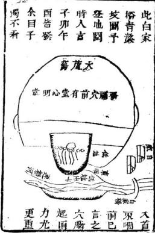

九龍尾山秦宅世墓圖此地巒頭在局外視之亦覺渙散及到穴塲遂整肅情秀在外視申砂亦賢委隨穴中乃同坤砂峭起如雙薦然主穴居中二五斧 尋龍五十四

孝子附左三孝子附右青龍也犯有情時術皆欣 J 'S A

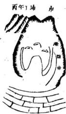

羙其美空嘆長 房該發不發而 不知退氣爲祟 理當衰落此地 申子辰亥卯未 及巳丑年命發 或曰如此看 deid .inf

龍池看地因登張宅墳視之在墓道前但見四山散漫局不繁湊將到山卿後山稍有情緒尙未見其爲可取也及至登穴乃見來龍至星品光煥移員净可愛俯祀

金氣句詎非廬語乎余應之曰究竟龍爲本凡地先求砂局純粹再看生旺之砂或在客山或在至星若入首主星爲生爲旺則科第聯延傳十數代而不替卽此三圖自秦二地催官皆在穴後龍身上其外如後圻裡黃石墻王宅墳子午一墩卽在本地上燕郡觀音山發張繼堂地催官亦在穴後各處地皆然總要在穴塲主星爲準却又不在後龍身上若混認後龍身上則東山王文韜公乙卯砂何爲止一代也余戊寅春同程措公昆五往

華龍五十五

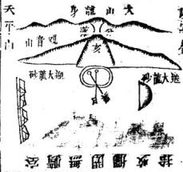

穴中外局雖曠而穴塲則窮藏幽靜主穴亥山已向余曰亥山一丈可致富于此臨之已再閱右穴乃乾山巽向余欣喜曰此穴發貴巳主穴撥亥為財帛附穴關亥爲催宫以四冲論則發期在亥巳以三合論則期在卯未雪心賦切殺出于何左則求三合四中之年應仲合之法吉內同推厝公日聞張宅鄉榜果發在丁巳年次日唰太湖潭西見其新造大墳外貌似可觀實按之無滋味往術者不遺邦發福祖墳而讚新地則學業進巳小玉斧 卷一 尋籠五十六 1

此地遠視大龍從天平山來竟走謝宴嶺者張老 穴後主星乃大龍虎棹山也龍身分出頓起一太 陽金左右山排開以作大龍迎送砂而發福弘大 乃如此

姑蘇獅山地黔附錄

獅子山中一石球將軍踏弩在前頭啓明坐賂長庚宸天市宮催福方優弩肥勸君高把起弩弦踏處夢低約點穴之妙在此龍問星穴正抽富堪敵國貴封侯

鄉子項間有一索索中金鎖堪斟酌天邊玉角隆端門雉尾扇開招黃貉君不見獅頭石巉藏獅球員又員翰休學士是群元

獅子剛下山番身便回轉一轉轉向天平去黃金 自璧滿車輦

潭東地黔

潭山初結潛龍地傳瑟劉國師記語壬子峯高茲 脉低天市貴人端拱立元龜朝斗合天機金門射 筮君王寵瓜綿綿麟趾宜古記傳來非誑語福 琢玉斧 卷一 等龍五十七

堂原是善人基

袁玉書云世之堪輿家開口便說幹龍便說盡龍予聞之亦喜其言而登臨間每見發福古塚多不在老龍與水盡處及岡師訓曰看龍之竅老龍跌出嫩枝柯大地多腰裡落二語乃尋龍正訣因恍然有悟云龍之育幹有枝辟如開花生果之樹然龍之起祖龍樓鳳閣侵漢沖霄猶樹之有根本也中抽考幹向前直奔猶樹之有中齡也左右分枝纏繞護從猶樹之有極枝也水亨山盡風鼓分飛滔樹之有梢砂也貸見有根幹消沙而花結果之峭乎非值中幹砂無花無果師開分據處亦必離幹幾許方有花果是地之嫩枝腰結正猶樹之極枝纏護處花醴果碩也雖起祖老山山水盡處未始無地然廢亦不大大亦不久詎若花醴果碩處之爲益大哉吾師以爲然否師曰子之喻言進乎拔巳因再拜進曰論龍巒頭固如此巳至于理氣不拘笑星貴賤二十四龍龍龍結地此中大竅敬聞命矣但八龍煞曜催當最忌師云注斧 卷一 尋龍五十八

方太先生言龍得入曜水來乃成大地此何說夫子曰庠安方臘祖坟巽龍入首酉水特朝正是假殺爲權地之極十者殊誤用玉尺經巽見辛辛見肆兩承妙用之論竟坐乙向辛夫巽龍乙山發龍爲殺穴既受剋而前辛向西水流動向又受傷唯龍眞穴的氣旺清所以勃焉興起占據數州而穴被龍剋違本山結穴之意西冰殺辛又少化終爲謹之方所也不數年而撲成說使當可遇著與師哲立卯山酉向則穴與向皆得也生氣去逆效而爲吳越錢王注越國公似 1、此言其大者也唯民開大小攻勞犯八燕病至細至客處有水剋向者有向剋水者有水剋水者向剋向者共有四弊予便讀祿巳水破句節巳言共刻推之二十四向莫不皆然予聞言因嘆曰殺躍一歌人人知誦若非吾師指點許多関係犯之竟不及覺世人方看幾句地理書卽以知地自時何哉

玉斧

尋龍卷盜

水歌市引證地圗月緣共二十四

壽昌北門外洪氏久富也入頁蘭溪下余白樹墳此巨高地九頁

蘇州東洞庭山後文恪公王發相公祖地無錫北鳩朱氏地十六貞

蘇州天平山范文正公高祖也十入頁

天平山後狀元宰相吳寬祖地二十頁杭州老龍井王氏巨富武貴祖也三十二頁一無錫讀塘裏吳氏世杵甲地二十六負

琢五斧 卷二 水目簇一

無錫南門外華會元禮地二十六頁

丁峰後王氏暗省地二山七 無錫東門外黃婆橋朱氏墻三十貞 青山灣口莫巷後朱氏地三十三頁 無易錢炳僑許氏地二十入頁 無錫上舍繆氏地三十九頁 武進北邨奚氏地四十百

武進寶應寺西吳氏地四十一頁

無錫西門外吊橋陽氏巨富世四十二頁 無錫白兎橋消肢地四三萬 諸暨江東五里亭袁氏巨富地四十五頁 諸鹽東山東大塘袁氏壽地又四十家夏 無錫寺頭碭氏巨富也四十七頁 無錫後所裏三角井地四十九頁 蘭溪南門外吳景鸞圩半月形墻五十入真 武進後功頭黃氏鄧庄地六十四夏

玉斧 卷二 獅水目餘二月度張九儀增釋地理收人密明歌括

逋砥方且芳姓朱

趙溥功成

男張廷楨貞木

張廷鑑聖木

婿蔣後祥發其同課 愛蒙暨庠哀士勢王書參訂

玉斧拳二水

龍爲根本水爲用兩者山來無輕重尋龍立穴水爲 先詳將要法與君傳

人皆以龍穴砂水為地理之四用而四者之中獨以龍爲之首者何以龍者根本也故常觀龍苟有眞來穴必有眞結穴結之處同必抱砂抱之處水必聚是龍眞穴的而砂水隨之矣看地之要營此數句巳說書故廖氏曰地理由來分四用皆以龍爲重吉凶禍福此中生須要察情眞爲此舊得地氣或於或後吉凶禍福不能自玉以其靜故也砂水得天之氣人善承之則吉賜廟人不善承之則内則以其易故也故周易言吉凶海吝生乎動或日亦垣動二十四龍不恂其何雁入首時而轉紇又忽臂坤時而入艮又入棘巽詎日不動砂水亦靜如巽砂侍謝終古是異不見其爲丙酉水朝來則終古是酉不見其為辰似砂水亦靜余應之日二十四龍聽龍逶施至于人首在亥則止于為入首在卯則止于卯詎非靜手若夫砂水則變動無方用一卯龍有砂水見于乾多者

聚玉斧卷二

木二

有砂水見于兩午者門一丙龍有砂水聚干漸由者有砂水聚于丑艮者豐非動而難拘者乎唯其動而難拘則有喜忌分予其間巳喜者為吉爲福忌者爲四爲爾理固然也地氣靜龍主之天氣砂水主之天施功飛夫倡婦隨不易之理也此可知四者之中龍爲本也然曰龍爲根本而獨以水括于龍穴與砂之後者又何以水者尋龍之要法也故古人云氣爲水之母水爲氣之子來水所以導龍行界水所以止龍住水源有短長而之近遠可十水勢有大小而龍之支幹可分察水勢之返轡而朝與穴之主賔判于此觀水流之來去而龍與砂之順逆別于斯至訣至訣改吉人曰未看山先看水眞龍落處水聚眞穴落處水纏與緊師若有曲流之水定有曲轉之砂此可知尋地之法水爲要也其所以鑑水之法靜見下文東湖主云有曲流水定有曲轉砂可見水之行止由于砂也而眞龍藩處水聚眞穴落處水纏二包實得看水要法

卡三

一鑑水論分合有分有合穴無錯合前合後及兩傍氣止水交方可作

水之分合有三其一自立穴床頂水從上分而合于穴最下龍虎內者此一合也名曰小分合此關保甚大地之有無于此定次自主山起頂水從上分而合于龍虎外案山內者此二合也名曰分合不必背才自然有的三自起明分支木從兩分而會于案山外合從大水口出者此大合水也名曰大分合此老禮公產業衆家子孫皆有矣的不此小分合自巳同然合水又有前後左右之不同以下逐層講進講到妙處順結者合于前廻結者合干後橫結者或合于左或合于右左右旁合勝于前合然旁合又不如後合前合順局水皆順去不能收住凝蓄旁合者水橫過穴前未必皆汪洋入日至于後合則番身逆劬隨龍之水無不八口矣故古人謂前合襟易得後合襟難求以某得水之蓄也總之有分有合則穴之結作始眞否則水去而不合龍去而不住其穴結必不眞也此家王斧 王斧 卷二 卷二 鑑水

察水分合爲鑑水之第一云順結一堂前合襟之圗

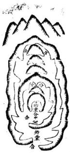

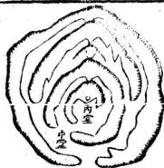

卷二鑑水五

橫結一堂古合藥之圖橫結二堂左合襟之圗

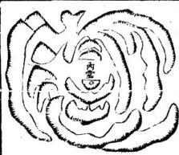  
廻結二堂後合襟之圖

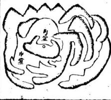

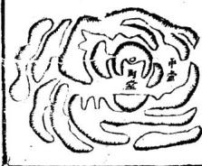

第一乃順勢三分三合之圖其餘逆勢側勢可依此類推但堂有三堂水有三合者唯上乘之地方有此局不可固勢若中乘者或二堂或一堂但得眞水交會亦自結穴故古人云莫道孤陰爲大錯一水到堂俱可作據此則知定穴者當變而通之勿以三堂爲定局故又將一堂二當左右前後合襟者偁覽焉

二鑑水論結局逆潮橫抱堆金玉次取據水及順流高山無水共五局今君認局分明大聚小聚皆堪玉斧 卷二

绿朝水局 卽逆水局也

朝水之局乃翻身逆勢結穴以受當面洋潮之水要穴星高大有餘氣或有低砂橫攔不使水冲割爲吉又順水流之立曲折或平田洋溺爲善平月洋朝有大田坂舅來須穴蕩緊小以取之固爲第一局次之者或十多坵朝來再次之者或三五近朝來再次之者或一二坵朝來俱好甚至止有百前一坵餘即高場高過眉上四畔之穴在低皆中之突土更爲得力彌大綿遠若急流疽沖又反爲凶在山中有漢澗處多犯此病所以不發田亟中則無慮此唯天穴及仰高穴則不怕遠水特朝却夏到口穴前有小明堂承接之方發不然向犯穴高水低不入帳之病若穴塲早弱星辰低小山不稱水則凶亦有大振田洋朝盛大而小小穴燒又甲又逆朝以收之者却穴塲兩邊士峰圓抱斷大水止百前見其朝來漿入堂中如此者力更大不可一槩謂逆局爲吉也此穴又多結于

水口之間或下關山短縮亦不爲害是角但要穴塲藏聚穴不受風爲眞至言廖氏云翻身逆勢去張朝不怕八風搖乃言其龍勢非言穴場不怕風搖也時術嘗于風吹水动處點穴備口不怕八風攜予嗜疑之以爲風亥次忌的平田之中四圍無山及入穴塲不覺篙聚藏風方龍發福豈可以翻逆卽任風吹不意此書以辨明誠可謂先得我者十氏云英把水爲定局但求穴裡藏風則善矣總以得水避屬爲主方可言風水二字大抵天理宜傾地理宜巡故朝水爲至吉如今天理亦臺逆逆者享福顯者被以翻身當湖卽陰陽交會而有醯結故也此逆太兮所以得禍之源也于此述明于古雙取

東湖主云逆水局如壽昌縣北門外洪宅祖塋人首辰氣扦戎向兼乾三分右手寅水入塘坟據塘水塘外山塢內田源水層層朝穴穴卽向之四如遠遠朝來並非箭射拜至堂下雖水口寬濶立穴中不見其去德以穴中見不見爲主初扦第三曆 C

卷

鑑水八

驟發富甲一邑後出黃 至六世仍富以戌乾本 之佳故也僅以其 長而潮拜非專論 理氣人皆怕戌乾 水見之卽要換向以避 之何改艮上止旺砂故 但世世剋妻未免爲鼓金敘故也 但世世弛妻未免爲鼓

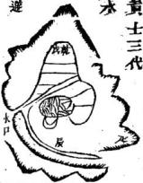

之何改艮上止旺砂故出貢長二無砂遂蕭條已

橫水局

橫水局龍之結穴木自左來右去或右來左去要下關有山逆收攔在水口案客爲吉此局極平穩東湖主云却要在穴前窩聚爲的若徑直過堂則不吉如蘭溪下余余宅地三房人卯龍扦午向該向兼丙第了丙水又來更鋪了故第三房絕而長二之三房皆絕大可畏也二房丁財平平長房巨富今巳七世矣應寅生人而戊寅丙寅尤美予言三房既絕而長房發福必有五鬼運財來之應果然以廉貞水來也北爲省巧此地乙辰喜見

故二房發丁財而不及長房者以其來處屑次橫朝而不著也娶微論水本動妙在靜巾可恬書字之夢中堂員净而正坤申水去緊簇聚入之

滋未九

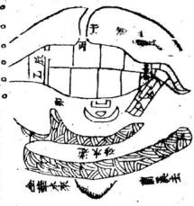

水去緊簇聚入之勢有趨歸疑一如據餉投麻者然此水中看齊頭之法也人何止言理氣而不知水之形勢爲要所以長房巨富且久由此觀之長二公位水來不如水去去處水口又要緊簇不見其去者爲妙三房之水則欲層層朝拜長而切注爲主水聚坤中出不見去應戊寅者坤屬土也應丙寅者艮納內也坤申而戌寅丙寅人廢此至理也

慷水局卽聚水局也

據水局龍之結穴前臨大湖及深潭沉淫穴前也 奉

得貼身下手一砂開閉甚緊有雄據一方之勢地以得永爲上水以靜爲佳此高主六宮綿遠東朔主云據水局如太湖中東洞庭山之皆王文恪公祖坎是也王文恪公諱鑿一代名儒唐伯虎題其墓云海內文章第一山巾宰無雙其文章富貴一時莫並于是覓地者盛傅東山王氏美地且述記云鳳風展翅勢翔翔生人獨立掌朝綱可倩狀元旗不正他年定作探花郎予聽人言及記意此地云鳳風展超則穴後來誰定是大嶂大飛鵝大人字金水太陽體且云狀元旗不正意旗頭雖得諒必巽乾峯起不則坤午方高四砂中定有一砂如旌如旗卓立飄動迨戊寅仲夏渡砌往西山閩地湖中位見東山面同向東其在西面盡是山背舟人同道人遙指曰王祖地卽在此山予之曰衆山之背人人知思今產一代偉人之地乃結此乎數日後偕衆登穴止見穴結大陽金星並無鳳風形並無展翅勢前無細齋後無鬼樂左手青龍高止齊穴妙在齊穴二字山服魄收侯內堂小水山鄭不高成開天門又收盛四南來大水兩外二水穴中書敗在故富且久龍盡處名乘山觜者又向穴肯彎人太湖爲陽基收水是此地論東山大勢既在衆山之背論來龍形勢又在龍身之皆佇望白虎手來高山品光逼始此龜得力之重全在高山品光四字何也以來龍欽翟官力重巳面又高大又逼始力詎不更重扉而虎砂之背聯過木間諸山又皆是背卽木間峯固亦向東訾穴中觀緊環回頭焰顧妙處山山漢玉斧 二 鑑水十二

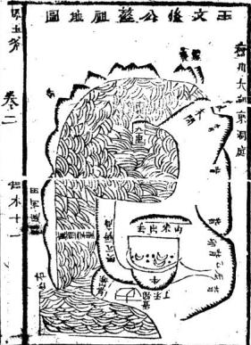

背山山難是白虎乖山山在大朔下手山山數住太朔水不從主漏來龍高山落下是乙辰人首太陽金又是正午穴塲無窩一似頭金無銖口似少包畏形如星腹覓在牛腰橫排而葬二十餘塚文恪公祖父三不頂正脉稍偏右邊大儒右夫則三星入坤天不合了將午龍撥入丁未方巧法扦丁癸山向養未丑三分予决之口此局扦正丁癸者平平唯此二穴扦未丑去穴後午上煞氣乃由扶起虎由乙砂以作催官巧法方得此山沾作之全力乙砂乃此方補制夏風生懺食神始無真全亦此如古仙所云收山曲是也肝用乙爲食神財主星正午反為殺氣夫正平大陽金係此地尊星豈可任他爲煞只得穴後右籩松他在丁未方上在為生為旺見煞氣刀出此古仙所云出煞法我等餘文不用講但查文恪公之貪元中在乙未或在乙丑則此地之證驗明巳隨卽下山同看坊額果中在乙未科世人不知看巒頭眞竅便不知地之融結恰好處在何處卽此地論依左里玉斧 卷二 水十三

不是過于挨右亦不是則此二穴非正在俗經處紛紛亂精俗傳之記乃廢福後假記無鳳皇形而言展翅無狀元旗而言旗不正非但不知理氣巾離取乙以蔭乙未會元之訣并無此屬與旗巒頭而擅造厚與旗是並巒頭中九星之砂形亦不知巳或曰凡地取其意不必泥其形予曰堪與家原爲修家見此形乃唱此名故伏羲氏見八方之形乃蓋入方之卦爲地理祀凡池有龍鳳龜蛇牛馬魚雁曰月守形卽有等形之穴法以扦之合則獲福遠則敗四况旗分文武又有方位丙午工旗在端門巽辛旗在文章之府寅甲旗在學堂支雒乾旗爲天門俱三文官坤爲元戈庚兌在白虎卯爲雷門俱主武官至于旗形有狀元旗將軍旗出呻旗得勝旗以及賊旗降旗俱要明白顯見人人日非鏡花水月可以虛空立說者也此地實頼乙砂高明旺相得坤元之意乙納于坤也所中元中飛甲世人不知此處眞竅而假記雜出也卽予此叚議論未得道者亦不知不過借此圖以五斧 叁二 經水十四

爲聚水局之一証耳

順水局卽去水局也

去水局要來龍長遠力量弘大四勢周寄水口交 固吳公云水罩去而山高回則善若山不交回穴 塲見水蕩然直去决無融結不必着眼矣總有融 結决不侯財初年不利退盡四廬始出官或離鄉 發貴龍穴稍有不吉主立退敗絕誠無救然有等 海濱之地不以順局爲嫌以海別湧入又是來 水也

東湖至云水局順流雖由地結而順而不使之則在人爲古來潁董諸地仙不到江宋所以數郡土術不知點穴法不知地上作法予曾于軍嶂山之北塢爲新安朱氏扦一順水局其地當傾流葬下不利予乃在穴前高集一案遮盡去水丁丑夏爲之改葬時卽與東議定葬後長房甲卯年四房巳丙年誕生科甲人并作記以誌之三年上巳卯八月十六巳時長房蒼霞果誕一孫插其五星果命度主化天官應居極品衆親友云當今堪玉斧 卷二 鑑水十五

輿皆事後湊來語先生獨預期十定期至應驗誠年見也時答靈喜極爰命名曰尙貞貞者正也取其正而固也予曰官名令祖取乳名先生取爰命之曰喜官以詰今日應期誕育之喜他年富貴變全之喜乃翁文十目予自改葬後舉心動念天理爲主陰地吉正宜積德以培之聽斯言也朱氏之光大門問也宜哉

今將北塢朱蒼霞朱景御葬父弱侯洪元配地圖并記附後

此地江右雷劍城乙丑年开但知外貌之轡頭而不知巒頭中有理氣故葬後家業大城人皆危懼朱景御同長兄蒼靈邀予言此地未葬人人道好笑後近來人人說無予曰此皆信耳不信眼者及予登山視之曰如此形勢如何說無如此作法如何說有前朝後樂左龍右虎而且水出龍手卽虎短以讓龍龍長以抱虎而且四房人靑龍難得兩箇今內外二青龍皆大陽金星齊起焰穴如此變頭夫詎易得此地之不可說無也無奈地師不知

卷二鑑木十六

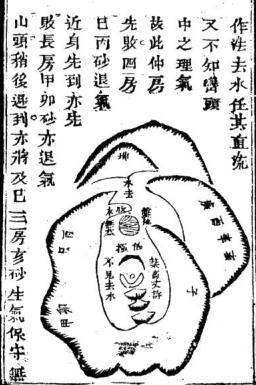

可見矣時開書議發科甲時儀千金而巳卯應期生人二十年後可踐約巳有有秋主伐延福難又主言退盡田廬始出官或離鄉富貴此地會州天平山後出苑文正公祖坎俗呼范坟萬笏朝天者見之其地兩邊夾龍水順號直去穴前龍氣直出落麻又是壬龍應離別鄉土右手乾砂緊焰應桑知政事甲砂巽砂左焰應能文章坤砂庚砂右炤應常兵權右肩兼玄應父蚤亡及有貶竄之事四翮皆石山黑鉄色天平山在庚方有數

虞既不知作法遮欄去水又不知理氣洩退疊收吉地凶葬地遂不可言有已蒼霞曰先生言之鑒鑿地理人事毫不差夾則此地不可棄乎予曰欲去此地則從何處再直如此之地蒼霞景御竭盡志誠普謀改穴乃爲之桑起案砂使穴中不見水去內改癸山以消砂外仍坤向以納水在仲房改與不改同歸一在三房可丁財十倍于前且有秀氣而長房之甲卯四房亡丙皆取退氣砂爲催官砂是兩房之榮華富貴科芳指日玉斧 卷二 盈木十七

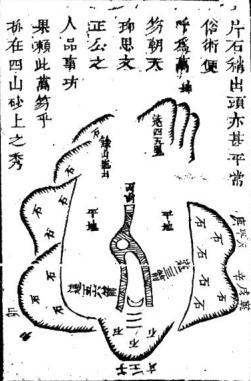

孫玉斧卷二水十八

氣所鍾毓者乎術士不知看地眞竅不曉此地妙處件件卽合乃証語曰此葬文正公衣冠處也又曰充地之美者尙在平陽處若文正公在平地蔭出若此地止葬衣冠何以文正公之富貴文章行事出處適與此地相符合也予閣此地之後遇范氏裔孫字文侯者詢之云此葬文正公高祖地予聞之然大快舊地理青皆泛吉祖地予登臨時私念此地不能速發而外人傳言卽係祖地心甚疑之反聞高祖二字乃知地理之不誣如此此山後發狀元吳寬地與此穴塲龍豚皆是陰華出則福澤宣同乃范坟父子貴顯富貴久遠者何也范坟出脈虛上有烏石三片以作來勢脉出其下有湧猛努力之狀且穴前拖出龍去甚長且壯長則氣長而不短壯則力正面不弱是八穴處氣勢轅吳穴爲盛旺巳而且人立吳穴上四旁之山固骨立整肅儼然一相府規模人立范穴土四山拱峙情意事注中饒有一分陽和氣象此處俗備亦里及之乎陽氣發越所以更加弘大悠遠也玉斧卷二 銘水十九

吳地雖不及范而體格之正大嚴肅亦非平常庸凡之地可及

又云范坟陽多陰少吳坟多陽少而福澤遂大有分別是看地非但看形體尤當看神氣學者宜知吳坟地圗肘後以備考學者當卽圖思倩而優劣見焉巳天平山背出吳寬狀元宰相穴塲龍脉與范穴同皆是穿心脉凡結穴之脉有從心出者有從房腹出者有從陰囊出者皆貴地也古云脉不穿心穴不貴是也其從山頭落者名貫頂脉乃爲至賤而俗人則 月4喜以爲明白者也此 1地是湊天土屏左 基角乾右角坤左 低砂高一丈Pr 地王 大手一太陽金在 餘丈 三于右手一太陽金 地低天少在巽巽後亦象太陽思朝案亦金星形甲卯上 金在丙午求象二字宜 石 所高公 遠近不可

卷二鑑木二十

形宇亦宜見豐員有情弓登山見穴後坤申龍從陰囊出脉扦庚山用向坐山端嚴衆砂拂立知爲大貴地乃將羅經格其砂位見乾異坤方皆起值辰戌未科皆可中元心內狐妄不決及徐視之乾居末開坤居初開二砂尙未得權惟右手巽砂肥員端正此四等有力居中開盛旺之地遂直斷云狀元碓在辰年士屏兩角峭起貴應宰相次日到城查前狀元果是壬尺科而官至相位云看此地得看地之竅二其一在理氣乾坤及巽皆飛甲砂地有一砂中鼎甲人今三砂齊起號中較量初未二開遂不及中關旺地此理氣中之至也其一在巒頭助午砂起似皆可發而決在子辰者巽坎二砂高員俊美力最較勝此轡頭中之至竅也然此竅也卽李德眞所云看地有一大竅得其竅頭頭是道之竅也是故人得眞傳方知此竅方知網看壽頭辨別地之眞否若不得傳則心不知此竅走到地上芒芒然不知從何處看起卽卷內所附諸圖說橫議監論亦唯知竅者方曉其中變化貳玉斧 卷二鑑水二十一

轉之妙苟大竅不知則心中之趨向不所祀各礙頭如口巾嚼蠟全無滋味

無才石才名馬角無水局穴結乾坡山勢盤聚明堂不見流水也穴在高山先貴後富或清貴不富然亦有巨富者龍神帶有倉庫耳清貴多周山形瘦脩或穴前無韋心明堂余庫之在龍神不準童德彰云有火無財須尋衾庫之龍當云須尋逆水之通有財無人其下孤寒之穴誠確論也合仰高山頂現星辰平

阿最爲眞之句逵三局曾在西 浙江水湖老龍井可丙見王亶幸里十祖坟壬 去六龍丙向在半

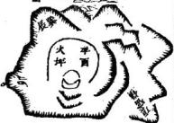

山中間穴前一大坪水聚坪中左手一獻天金圓向拱照居七辰三巽之方奴多生少在青龍頭上蘇玉斧 春二鑑木二十二

應發長房殊左手夾耳一小太陽金深深彎入為 內面前朝錢塘江只見一泓之水又低又遠向一 全空無砂遂吊八二房巳予初登山云此大畜地 也西辛命人主文貴庚卯命人主武貴辰戌命人 主巨富而亶十令弟果巳卯命官至副將亶十在 布政司庫中掌案大小錢糧皆其經手資產大豐

東朔主云古語高山莫論水平地莫論風一句大謬俗逆借言平田不怕風吹殊不知凡風吹無關

日虎肓五里走三里平陽青龍遠一里

關之田葬下定主敗絕其發福發貴者必前從右田塍高起隱隱隆隆環護穴不受風甚有左手山塍高則發長右手田塍高則發幼之別則平地最怕風可知矣至言高山不論水任從元辰直出卽便扦葬人家一敗塗地殊不知高山穴面前必有小明堂小明堂四圍必然環遶將本山水聚入堂中不使走漏方能發福凡言地理得水爲上之水不單講汪洋流動之水最要緊者穴塲兩臘元辰水元辰水合在面前蔭注穴塲猶人身精夜不玉斧 鑑水二十三

洩氣血不走漏自然康有壽此高山專要水也結局不拘大聚小聚

龍之結局有三曰大聚中粟小聚廖氏云帝都山水必大聚中聚為城市坎宅宜居小聚中消息奪神功誠以百里來龍則有百里規模千里來龍則百于里規模故帝都省城其龍長其局廣宜矣墳宅之龍卽長者亦安可北省郡城市故多是小聚處山水翕集四勢團近有情眞穴卽居包裹擁從之中所謂藏風聚氣是也不位多見各處名地內同緊固外洋寬暢竟或穴中舉無所見遠秀韜皆外面暗拱恭緊夾則風藏氣聚寬曠則風蕩氣散也

東湖主云琢玉斧龍穴砂水四歌其中反覆議論橫講監談都是枝葉上話唯說到多見各處名地內局緊固八字以至竟或穴中舉無所見八字緊夾則風藏氣聚寬曠則風蕩氣微十五字三十一字乃是一部地理書歸束處內局緊固舉無所見者護砂緊夾住也夾住之砂卽生福之砂外玉斧 鑑水二十四

面遠秀皆無所用之拱與不撰均不必計設使外秀有用何以拋頭露之穴外秀皆在前而竟不一發也

昧者不察龍力大小三聚之別徒欲收數百里山 川歸諸眼界必爲花假所誤矣時人通病其有依 近省郡山水大聚處結穴者謂之借局邦裡備得 來畢竟自巳雞一小局的辟如宰執近臣侍從至 尊雖百辟之來朝萬邦之貢納與巳無與然親接 大顏于咫尺宗廟之美得瞻百官之富得與比之 田舍守財主入迫然不侔巳此借局之地雖小方 大然必結穴處自有門戶乃可先資自巳修人家 何常備他大局不然亦虛花而巳

三鑑水看局面大小高低須綱辨山小水大不須觀 山大水小冰脊戀穴高水低不入喉水高穴低名仰 面論水不向局中評走通山川空自肱

局者何言水勢之大小高低貴與穴相稱也山小水大曰曠山大水小曰宰均非吉局故雪心賦云山小水大者要祖宗之高厚禮山遠不能載水卷二水二十五

山大水小者宜堂局之寬平正此謂也穴低冰高衝氏曰仰面水自潑可水楊公謂暴頭水主落水死亡一發而人丁敗絕穴高水低流從腳下去並不入口古人謂之暗耗水撥砂云水從腳下低低溜無錢空自逞風流是也無修諸城東見一清導未便謂水神不射墉岸老高水身低昌穴攜之止見空濤一俸如線如纔工犯暗耗之病切記補酉江東諸郡浜水居多處俱以水神灑漱放光逼始穴塲方能發輻苦岸高水低犯時耗窮者洗不

發今將所見發福地圖吳氏世出顯宦皆午未俚龍身甚闊喜雨岸皆高龍乃層層低下左腰空進一低用此龍身動處初葬前二穴後葬後四穴中左穴正當背後低田田膽得龍氣斜甲財者以背後田空得其

以背後皆綱田癡項不動要有束氣束氣要現活動前酉土蓄水滟欲坎光白案遮不見因未坤稍動所又南門外會元華琪芳祖坟亥龍一線過脈四圍背溝洪水至西土成一池立穴土品光焰面壬山丙向予曰貴人水現光發貴者之以例其餘無芻西河賤年中其老祖垓土名新塘

去在過变叉水

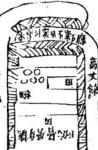

世代不絕東左穴亦發丁動氣故也右二穴竟敗絕水二十六

則不清也楊救貧言龍 相視于此地可倍巳而 虎案收任外山折去水 以或逵彼處又發

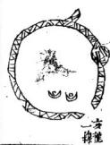

斷在酉丑果其芳酉年舉人丑年會元惜丙向 人丑年會元惜丙向 午一分遂使酉水稍有破焗之嫌新塘裡亦然似 烏之嫌新塘裡亦然似

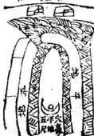

少微水六秀之次者凡平田龍左右浜水喜現光浜外田要高起護穴若浜水低浜外曰與穴同平冷退消耗如丁

後王姓坟左右浜水界如龍舌至今俗流猶大欣羨殊左右砂一樣平則無護搖生氣不聚遂旦琢玉斧 卷二結水二十七

日消之浜水低又其次巳

第四鑑鑑情意彎曲沉凝方得利不拘江閒及池塘水在有情爲眞地

情意者以明堂水勢與我相向相戀而不反背也是故橫如服弓腰帶去要之玄五門來取屈曲朝懷出喜岡流及頤或流注于穴前或拱抱于背後或點滴而流來入口或周圍而護衛本身不拘江湖田渭總取有情爲吉反是則凶言水之形勢盡于此已

土尖石  
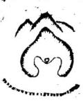

圖水带腰  
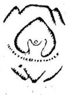

腰帶者以其遶抱于左右腰問也眠弓者以水過 穴前而彎抱面前也二者俱龜有情故云

卷二鑑十十八

之玄水者以水之流而畧屈曲者爲玄流而大折大轉者爲之水流之玄則砂必互抱古云若有曲流之水定有曲轉之砂故吉辨之字水玄字水二形明白

斷在酉丑來琪芳酉年舉人丑年會元惜丙向位 人丑年會元惜丙向徵 一分遂使酉水稍有破局之嫌新塘徑亦然似 局之嫌新塘祖亦然

少微水六秀之次者凡平田龍左右兵水喜魂光疾外田夏高起護穴若浜水低隔浜外司與六同平令退消耗如了

峰後王姓攻左右浜水界如龍舌至今俗流猶大欣義殊左右砂一樣平則無護挂生氣不聚遂日玉斧 卷二經水二十九 卷二鑑水二十九

日消之以水低又其次巳

第四鑑清意彎曲廷方得利不均江師及地塘水庄有清爲眞地

情意者以明堂水勢與我相向相戀而不反背也是故橫如眠弓腰帶立要之立五門來取屈西朝懷出喜回流反顧或流注于穴前或拱抱于背後或點商而流來入口或周圍而護衞太身不有江湖田澗總取有情爲吉反是則凶言水之形勢盡于此巳

穴卽收本龍身上倉板水且丁財大旺而日此地不獨富旺而且貴顯不識東家欲兼之欲軍取之而

丁財該囑只得如其意而暫抒之俟後文棺用事琢玉斧 卷一

時再爲之南酌可也丙子大將軍在西時俗藉以爲言予曰此輩不知化案用煞之竅者也予正欲倩他以爲來年丑歲發惡微而次年丁丑且果生一子買易中不意夢蜜五百金人乃信服魁流者旋轉逆流也塟經云揚揚悠悠顧我欲留又曰瀦而後洩皆迴流水也必有深禪又有石山欄截方能逆轉如欲去而復廻之意不拘穴前及下手地戶皆爲言証

玉斧卷二鑑水三十

融注者深水沉聚不流而莫知其來去也不拘穴 之左右前後及水口有此水主巨富顯貴且悠久 切記穴中不見者無用若龍眞穴的有此吉水前 砂或不靜亦無害雪心賦云前案若亂雜但求積 水爲卉

束湖主云賦言大非有積水之池不妨于無案若 有案必須方正亂雜便有振疵

天心水二圖開後

  
0

天心者穴前明堂正中處也若有水融聚主巨富顯貴卜氏云水聚天心孰不知其富貴是也若水當堂直出謂之水破天心主財不聚而人丁稀水直出氣必不聚卜氏云爲人無子只因水破天心是又一說界水淋墓頭亦爲水破天心無玉斧 卷二鑑水三十二

子只一名注脉水又名仰天湖大龍形勢甚強及到盡暝無穴可下必于未盡之間結爲天湖爲注脉水其水注以後去者或復起爲案或爲官曜又名眞應水言應眞龍之結作也龍之秀氣盛旺之極溢而爲泉不拘大小但要澄清甘美春夏不益秋冬不竭豬而不流靜而無聲者為是亦至靈泉圖俱依天心水類推之東湖主云水聚天心之地最好亦與前據水局相似予曾干無錫靑山彎口夷卷後爲朱景鄉塟二

位室人其能甚之致庚山甲向子水進塘辰水出塘水口一遊魚塞之平地龍視塘甚低予爲池能有氣動此地雖無大責頭而丁財有數百年悠久以其局純也

之關開唇口以就水所謂水要嘴得着是也盪胸者水勢囊聚穴前也其勢賴有似于聚面俱彼以諸水圃聚而言此以一水榮來自小而大如記可地理救人卷二搖水三十三

囊之聚物然主巨富勢稍侵左則長窩稍覩右則 幼富

拱背者水纏穴後卽雪心賦云福悠長定是水 纏元武是也主富貴長遠水能梁龍之氣水鑑尤

勝山纏故也

入口云者乃水上堂而有逆砂收攔也或水縱美而不到堂或到堂而無攔收皆未盡善故必以入除識可地理救人卷二鑑水三十四

口爲貴若遇此水主發稱最快但下山既長出收水則水勢至此必小反而去初學時術萬不可借此破之

身水者龍脉奇異忽于湖水中突起敦卑結成形穴前後左右皆汪洋巨浸如亦月沉狂如江脈

拜恨出水運花之類皆以水爲護衛水盜清而不流以爲養蔭比之遠動之水有刑冲之勢悲切琴玉斧 卷二鑑水三十五

之聲莫若此靜衛之爲美也江河朔海溪洞田恤附義于下

此地固喜水之衛身然要人立穴塲力足以勝水藏風聚氣無飄蕩之嫌則有地

## 海朝水

海之爲水四瀆之所聚也水勢聚則龍勢尤止故凡大幹龍多止海濱而其融結生產王侯富貴至于朔水之來可驗盛衰朔頭高而色白悠場最吉古歌云海水逆湖人愛惜雨淅英雄從此出上五不朝人嘆息又云江右秀氣在潮水朔白時人多富貴如崑山縣近數十年前海潮抵其邑者三狀元亦三應之又泉州沙塞潮河近年開通潮水插城而人才盛冠八周仙遊古潮抵縣故多顯貴宋初田因築水欄陂朔止陂下而貴聚莆陽故潮關地氣隆替陰地得之最吉如餘姚孫忠烈公地穴前朔水來會而孫氏滿門朱紫又王陽明先生祖地在縣西十里穴結平陽穴前水屈曲而去海朔一起湧入穴前舊有記云封山一地最難求承玉斧 卷二 鑑水三十六

穴落平洋水逃流青峯隱隱雲霄外文魁天下武封侯塟後先生父海日公華中成化辛丑狀元官至南京吏郎尙書陽明登會魁正德未官南贛巡撫以平宸濠功封新建伯隆慶初追贈侯謚文成果符舊記海潮之應如此決然庚龍入首酉卯兼年乙的地

## 黃河水

天下之水發源遠者黃河爲最故濱河雨渥多爲都會如洛邑平陽安邑蒲坂是也黃河上通天通關係甚大故其水四時皆濁若一澄清則爲異王之應諺云黃河清聖人生古云黃河在北四時濁急風翻浪泥沙惡五百年來一遍清此乃南朝聖弟生是也

## 江水

江爲四寶之長亦諸水之所注也其勢浩蕩必以嘟抱屈曲澄凝爲吉故金陵襟帶長江爲天下耀會良有以也

湖水

鑑水三十七

湖水乃諸水注聚之處汪洋萬頃吳越王錢武肅時有異人云獨築西湖以建府治垂祚可悠久不替否則王氣不滿百年王勿聽果九十八年而止溪澗水

大幹龍多居江湖河悔之旁前已論之矣然行龍之小幹小枝每結溪澗之間是溪澗水不可不察也其水必以屈曲環逮住聚深緩爲佳若直而大急溜而有聲峻而跌則皆不吉雪心賦曲水來朝不拘大澗小澗言屈曲之吉也葬書以水爲朱雀者忌溢謂之悲泣言有聲凶也

平田水

平田水者非水散田中之謂也言田塍遶向平夷悠緩不冲不射不穿不割不帶凶煞凡地得之最吉名爲倉板水言其層次朝拜一似倉駁門極然當面朝來主驟富若左右皆遶向穴傷尤主富盛戌寅冬在無錫新安塟許伯誠于宅右當固田水層次朝來左右亦然而左手稍高抱來更有情右手浜水穴中不見主大富

琢玉 卷二鑑水三十八

一溝洫水

溝渠田洫浜頭水也欲其滙聚員净光炤穴若益急割穿撇射無情岸高水低無水可見者凶

池塘水

池塘之水或方或員或長總以中正彎抱爲吉若歪斜偏反位在凶方謂之照盆煞主少亡古歌云上塘聯下塘寡母守空房是也原有者不宜塡塞未有者不宜妄鑿前未景御莫卷後地國亦卽體塘水

豐鑑鑑堂勢方員平正净爲宜偏斜卷返并陵案幼殺破漏總非奇講盡明堂利弊

堂勢不拘方與員總取其平如片正而不偏姚 徐誠可地理檄人卷二 鑑水三十九 爲可貴否則左窄右寬偏在右則勝在小房右窄 左寬偏在左則勝在長房此謂之偏也

掌衡列上舍闕葬祖之地但見其渙故無收拾予曰此消敗地也因偕予往左手閱一地只見龍神亦潤散不槩而堂局則窩下職聚方員平正净五字皆備而又加以緊曰如此地自然發福擇地必貪曠蕩而嫌狹小也掌衡曰此隸姓地也塟有八九年初塟時人不以爲意目下 九年初塟時人不以爲意目下見歲歲增產子餘金不知其他堂局之偏者曾于 餘金不知其他堂局之偏者曾于武進北鄉見一奚姓地龍氣亦不甚緊接但穴塲田較明堂田高一二尺明堂低而平正有舍蓄意左手天門開暢田水層層朝八堂來前案高田隱隱豐隆高于明堂之田三四尺稍稍彎抱有倩拖過到水口與穴塲下手之田交合收侯卷二鑑水四十

然試可地理故入卷二鑑水四十

左手來水仲房遂發富以青龍手水仲子營也斜者不方不貝而欹斜如帶燐帶蕩之類是也捲者揣簾水也左高右低曰左捲簾主長敗右高左低曰右捲簾主小豉穴前一級低一級當面碩瀉不見案砂攔四曰中捲簾三子同敗而中子爲尤甚

凡遇地犯左右捲簾無藥可救唯中捲簾有案砂收住主中房發福曾于武進寶應寺西手一吳姓地見之余初到地見此堂勢云此地最利者第二

青植稀斜長房遂第

房東家云二房絕了第三 房田產資財皆塟後發者 余因地出準繩之外則不 穩確遂默然不語同伴適 問其令兄何年死東翁言 其年正月兄死八月父死 冬底塟此地者同件乃爽 然大笑曰二房絕在先則塟此地時應以三房作 則塟此地時應以三房作 二房巳地理何嘗錯蔭

徐語可地理致人卷二鑑水四十一

返者悖逆之象當穴宜彎拱抱身而反失拘返貲主拖妻拘子陣叛之奴或離鄉死亡何凶如之陡者穴前峻急也主損人丁招惡死飛禍縱是眞龍好穴亦退敗後始發詩曰傾幅明堂不可安穴前陡進不彎環縱是眞龍能發福賣盡田廬始出官正謂此也

返與陡穴前見之主大不利殊無楊郊吊橋湯宅之坟乃犯此二病穴在土峰之頂頂上開一平面金星此結地之根也然穴點在背上背後又是坐空全無兒藥而面前速峻自上走下行路有五六 面前速帳自上走下行路有五六尺高自行路走下水際有三四丈高前陡峻隔水土峰之案其高止與行路相等外砂又不開破河水以弓背向穴兩頭彎山如此形勢乃塟下初年卽饌丁財池一邑隨癸二鄉科者何也揆厥由來

穴躍央頂竟術龍氣水來自艮丑出處是丙巳得貪武二水又立酉山卯向兼辛三徐試可地理救人卷二 鑑水四十二分此其所以爲美也

窒者窒塞之謂堂中有阜突塞而不寄暢也傷公 云出人短小氣量狹只爲明堂有秦山此句不 達意明堂有案山則氣緊穴疑爲何不利不利者 以其開塞不開也吳公云明堂塞人凶頭是也產 難目疾抱養塡房亦有貴地墩阜前寒者終覺開 明舒暢

刼殺者明堂中砂尖觜順水或射入穴中也明堂諸水聚處欲其平正若有尖砂順水則主退財離鄉軍死尖而射穴則至刑煞陣亡惡死吳公云殺照破全無地順水斜飛無槃

避若然尖射入穴

來忤逝刑戮須

切忌是也

切殺之砂其頻甚多今

以所見者言之如無煬北門外姓胡者十地在自兎橋亦知逆水局爲福殊穴塲非結穴之形基地已是虛弱而來水河中生尖嘴竄砂分明是刼餘說可地理散人卷二鑑水四十三

退田筆也余麗之云造朝水領可發無奈退神重 大不利此初學堪輿者之所爲據穴塲視之亦無 地者也詢之果六七年家業退盡

破者破碎之謂或突或窟或尖或石而不净不平是也主百事無成禍盜疊出少亡孤寡之患及招圗頼人命之非事業退敗此堂最凶

漏者漏槽穴下傾漏直深如槽也不拘有水無水 皆謂之漏僧主傾家蕩產少亡禍敗亦有眞龍結 爲鉗釵穴與漏槽相似宜細爵之若果眞見融結 一其下定有唐瑁可證 第六鑑案與瓦內堂要緊外宜寬內緊發速誇情目 外寬忌曠也須開

此論明堂有內外寬之別也穴暈下龍虎內爲 小堂龍虎外秦山內爲內堂案山外羅城內爲外 堂廖公曰凡是穴前夷坦廬便是明堂位此自宜 者實記凡看斷會一地俱要苗忌舊地必有此方 侯痛新地必有此必有此方爲眞地大抵明堂原 有三取用必相小明堂在員暈下立穴辨與假 諸可地理裏人卷二鑑水四十四

至訣至訣龍虎外是中明堂交會須消詳大明堂 在案山外必須四水會李淳風稱三堂爲三陽者 以共所潴者水而水性動故也故曰明堂古人曰 內堂容臥側外堂容萬馬故內堂不可太澗太濶 則曠蕩界穴之水渙而穴氣必不聚矣外堂不可 太狹大狹則局促隨龍之水短而龍氣必不長矣 故前賢曰明堂如銅饌又曰明堂如鍋底此指內 堂言也曰明堂如片紙曰明堂通走馬此指外嘗 言也知此則知明堂寬緊之宜矣

東湖至云註中明堂如綱鑼家宮積錢禾吾于請暨五里亭見之此地寧波章碩甫看出新城童俊升點穴龍與穴確然無疑甲戌年塟用乙山半向戌乾壬子坤申水朝乙山消砂則得巳辛向納水局法不合庚辰三月余爲改正戌向化諸水爲合巨輔武吉何如之而戌乾水當丙洋朝拜來剝長半里許語云辰龍戌水廣田庄富堪敝國多稅糧則異日第三子數十萬之富可預十者袁子玉書資性過人精舉業因于乙卯方堆砂以扶之

<table><tr><td rowspan=1 colspan=1>又明堂是大塘立穴水涯爲據               厦水局余辛巳春                     正倩陳持三偶步諸東山得施果石一四金相照地士鍋爲袁玉書丹書时合堂作壽或國鼎¥社               π</td><td rowspan=1 colspan=1>黃然應解師博山篇云堂之廣狄隨龍長短龍遠堂寬所爲正法畢竟大了龍近堂小形勢乃宜速發而悠久山谷寬好是角平陽狹好是當當狹而寬便爲曠野風飄氣散當寬而狹是爲窒塞亦不失爲田舍翁寬狹失中眞氣不發無氣何以爲地寬不至曠不至逼這後明堂是爲全吉果然中又曰小明堂穴前是中明堂龍虎裡大明堂遠朝內此三堂四水聚水上堂穴卽是低平方向處此六宇至正不易之則要藏風要得水二有全</td></tr><tr><td rowspan=1 colspan=1>珠玉斧  卷二     水  四十六</td><td rowspan=1 colspan=1>徐識可地理殺人奏二鑑水四十七</td></tr><tr><td rowspan=1 colspan=1>此地犀牛望月形立塘埂視之甚爲確省以龍從東來特起黑石頂舉身旋轉向北勢如牛形在丁未方俯視穴塲朝山太陽金形如覆鍋光員在政癸方與十五六月無異右手能身分來待作虎砂在乙卯方左手從龍背分來緊彎抱穴在辛歲方正與東洞庭王文恪公祖塋同一作法然玉攻正一乙外砂而甚題貴此四砂每塊生旺並起卽不敢上撥文恪而庸力亦未可淺測也玉書在門牆余以此地界之補太極園之所不足者</td><td rowspan=1 colspan=1>氣便聚氣聚穴良可喜氣不聚宏坵夷此六定嚴郡之大病又曰其中最重唯申明堂鎖結要備無會柳全山腳田岑關插重重氣不志洩福自豐隆四語得竅又曰其勢四平高下分明中低勞起屈曲廻環橫的也好直的也好員的也好方的也好匾的也好長的也好總要端平皆吉堂也又曰忌有凶山忌有惡石忌有土堆陰胎瞻跟忌長荊棘忌作亭臺忌多種植忌路冲射才忌角忌水湍激大忌能此皆論堂之要肯也廖金精明堂入武</td></tr></table>

歌官附此東湖主云凡發膈祖坟同一龍同一向同一水法塟二三十聚乃發福者止一二塚餘俱衰敗貧絕何也辨之之法以砂之得躔失躔砂之緊鬆炤辨之因不待言而于中尤有極簡捷極巧妙處在看明堂其法一眼觀去看他堂中多流動之情者若其中有一穴凝靜端方便發福巳又一眼觀去看他堂中竟端正方平其中若有一穴流動合書者使發福巳更有奇者如無錫寺頭楊姓發富解誠可地理救人卷二水四十八

地同一明堂六七畝餘者低一二尺穴不知其何穴發富余靜現寺頭場視之狃宅屋右見其向 祖坟發大堂者富地圗指爲有丁無財向低下小田者向三十畝大而右手葬法忽有田一近穴止六七丈而古塚二二十

分着則研福三分向六分者則 發福六分循過右肩則向七分者乙卯中一 傍明堂開係大矣哉 不。 貴 也卽。若。高高大 而 其而而止。前 个大·高遠·一後 若逼。則。二。左 也·發丈·右 福離。之 堂遲穴。秒不。 办實。 遠。 十。半能止貴 故畝救一近 丈·贵 篇其贵砂。 大。不住·高高形贵 败。·而中。 者畝。不遠·等 嫌近大穴 急·二 與不。 然 止 0 者 大。 至 五 百 永未 有 奈人 以為艮而反以爲喜

禮永四十九

至七八畝亦不妨此艮藏斷字宇處世金朱又云平陽四巾明堂未有不八九十畝百餘畝大者而發福之家穴前必有一小明堂所謂穴暈之下小明堂是也余甲戌春爲無錫江陰巷周畹九塟母在巷之東頭土名後圻裡三角并一片荒地原是牛磨作坊堆積牛糞之塲且旁樂客厠余曰此地四水朔拜層居有情日地場之下有一丘小田又低五六寸隱隱靠着地呦此發財最逮地也初塟人人皆以牛糞客廁爲言至曬底畹九毬虛致謝言昨晚舉子先生造坟之佳兆也余曰出

卽便起程冬開寄回銀二百餘兩

縣玉斧地虛故八拳二貓水五十

自後尊翁在家買田屋歲歲加增五六年來冢頂上登臨者並無虛日非但羨其金多且以爲可貴顯而牛糞客廁竟不言及可見小明堂之造禍爲更速也其實在關口之法上

第七鑑鑑水城金水土城是吉星若逄火又井木直水城逢此不堪親

水以城言謂水外之砂抱之而羅列如城也其不卽曰羅城者重在水也亦分五星金水土星吉水火星凶

金城水三格

去皆可

金腰要虎

味五斧地理救人卷二鑑水五十一

是也抱身彎曲號金城圓轉渾如遶帶形不但梁顯及富盛水自右來左去曰左金版要龍抱虎

滿門和義世康事

水城水三格雪心賦九曲入明堂當朝宰相

]屈曲之玄號水城盤桓顧F 穴似多情貴入朝堂宜櫃品更誇奕世有聲名

木城水三格

直峻冲 心射 難 言特

斜木水城詩 峻急直流號木城 勢如沖射最無情 來去皆無 情也 日 軍賊流離及少死 dan  t

啄玉斧地理收人卷二鑑水五十二

火城水有單火雙火兩格

詩曰破碎尖斜號火城 或如交劍及流爭更兼湍激聲泝湃不須此處覓佳城上城水橫平而方半吉

詩曰方正橫平號土城 有凶有吉要詳明 悠楊深渚知爲美爭流響峻禍非輕

## 背城

五星皆有背城地理以向皆定吉凶水皆去其凶可知求其庶幾者唯水星得半吉亦須龍眞穴不玉斧地理救人卷二 鑑水五十三

正方可雪心賦云橫城者破家蕩產背城者拘性強心是水城不可反背明巳然亦有不拘正理者如無錫兩門外吊橋湯姓祖坟如金反城而發者想以艮來丙去合貪狼吉水則亦吉也

啄玉斧地拔人卷二艦水五十同

城背星上

  
城皆星土

詩曰 五星水城背皆凶乃與反拘捲儀同縱饑龍穴砂齊美終主見孫徹骨窮水城詳義

凡水城固以金城水城屈曲彎抱者爲吉木城火 城士城直冲斜折橫平央撤者爲四然其閒吉內 亦須有辨如金城魯曲掘身或纔過穴卽掘 去水城屈曲朝八或將到堂又岐急有聲此皆不 得謂之全吉六仲朝入與斜冰橫平尖振者或 穴前有低小素山逃蔽不見而去勢又復盤旋環 遶則亦未可處為全凶故論水者又當詳辨之不 可忽也若夫暴頭割腳反桃麗刼背來皆洗泥 分流等格皆凶不可數斷然不可用者諸格詳列 于左

琢玉斧應理拔人卷二鑑水五十五 鑑水五十五

此水直冲至近穴有小數

早塘抵穴中不見其來去後遠身有情吉

此水遠菇直來及到近穴鄉常聚深蓄亦吉

此水城尖而無情有案塘拙六閒不見尖砍唯見外淨朝秀穴後迷身吉

反弓为不

鳴則者水入田宿或八 石竅滴通有聲如鳴門 也雪心獸云繫藥洞洞 響而亮考爲吉張子微 云別有空空瑗跋鼓葬 葉闕如壎皷是也此至 貴完竟右聲不若無聲 之爲妙

餘賦可地理數人卷二六五十六一

只無龍虎而水城挨腳洗割名曼頭水主靈疫貧絕

穴前無餘氣六坑割腳橫過主貧絕若上聚穴則文喜之氣罐千土也此水出局被外水打斷水急主州彼官訟左長右小前仲不言門戶不關故也

徐諸可地理蔡人卷二鑑木五十七 纔連抱過穴卽及撇去雪心 賦云水若人廢而反抱一發 便衰是巳

屈曲遠朝將近穴前却撤去無情或峻急有聲不吉

情平不彎也纔過穴卽反嫩去雪心賦云水纔過穴而反疏一文不值是也

此水料來無情朝穴後却邊抱初代不利

漏肥水六之兩旁門發泉龍 清冷長疏也只一芳亦是主 家業敗退刼掠殺戮男女持 備之應

刼背者穴後無樂水冲刼皆後而來也橫結穴切忌然蘭谿牛刀形小坑水流六皆吉穿臂者坑坎路屑皆主不吉穿左爲穿龍臂長禍穿右爲幸虎眼幼禍主淫亂縊死孤寡。

流泥者穴前水傾流砂又隨 水飛去也山水奔流失井離

縣王斧地理後人卷二水五上八

雪心賦見孫作逾向前八字水流言分開流向前也皆向後抱穴則吉騎龍平地皆如此看

蘭漢南門外趙宅始祖母愛氏墓俗呼半月形正穴離月前四五文半月在子癸上月後良峯冲寶插立左手有一上山鳳形人士正穴視之婉似美女流榷之臺臺後一山朝怏婉似美女並肩向穴斌媚立丁向而臺尖在巳末巽初界縫之問臺後彧略正乙稍後一員峰乃正卯時始祖主傳公知 漢略正乙稍後一

長子該抱乃論臺長子于凌墓之傍二房殺人問軍是微所至丙我發人之築青薑異前則後是穀内生外人煞我坎知長房要

晚今富貴者俱軍籍

女懿相公仲房人也長絕神承之法如此而食煞 之內外先後大小遠近之法卽此圖可悟然穴後 半月生旺砂又近且係龍身本至不比砂一房 蚤巳發也至扞穴之妙人皆慕月塟入魄內明堂 平正俱絕唯東手月角一穴子孫當貴而母正 穴傳開吳景鸞仙師呼乃干右手月角施下夏善 限低平要着昭動折處更要著眼頂脉扦之更雲 著服明堂狹小田水稍徧而肯後澗水沖突不以 爲忌過西三丈逆收脇水朝臺尖者不發夏看何 故再出向南者止發丁財要看何或方長學關而 總不及正穴者何立下正穴處半月緊緊貼始 妙貼烙巳妙再加擘焉何妙如之書龍砂顧開情 切開字切字夏緊畧一移步大勢無多差處宜 細心而四旁情意不甚眷戀專注巳不甚二字辨 得細徹而一與一廢遂判于此危矣哉昆喫繁要 訣也

第八鑑鑑明暗明沉暗注兩般不拘前後及左有總爲六用莫胡談

明沉者凡水之來于當百及明堂之結于穴前者皆是也暗淫者凡水之隱隱暗朝及明堂之結于左右穴後而不見者皆是也予誦凡地明風有周暗注無功內堂中堂可見者多外堂可見者少以三堂俱結于穴前而可見者乃順勢順局方有之其力量反不重以其順則水不收也卽前一鑑水二分三合國其餘積結斜結廻結等穴大堂多有暗淫于左右穴後者穴中但見中堂小堂大堂玉左則展在長注右則發在小穴注後則三房同

煲卽三分三合明移之四圖可縣 0第九鑑論閒開來處宜開去宜閉此樞淺近易知之事畢極卽係緊夢之事水口不怕鑕千重龍在城中聚眞氣水口緊則能氣自然聚低愛禽羅砥水間高喜北辰聳天際或得獅象臥水邊或得捍門兩邊片地戶有此實爲奇其中應主王侯地

明堂囚爲來水所衰水口尤爲去水所隔是以古 0云登穴看明堂他平正圃果人山尋水口脈他緊如萌薩帳誠重之也常觀大地之結或印浮水保識可地理數人卷二鑑水六十一

好附或禽居水口所曲或天開地軸之橫欄好 角或華表捍門之雄時好的或日月鎖龍深好曲 或北辰鎮地尸好敝無非取其砥柱任瀾交矛截 水而已故揚公曰朝餘直出作水口與我後纏兩 相湊左右合第來交牙截斷水不流不放一山一 水走此四旬最明自此可知水口之以緊密爲要 也峽之三門蜀之瀕瀧吳之金焦浙之赭山門皆 大水口 第十鑑辨水質悠揚瑩净這四宇可愛方是吉若還 濁及塵行龍虛穴僞非眞的

水鍾氣而流于地氣吉水吉氣凶水凶故辨水之質而可知穴之僞也

## 悠場水

水之源流長遠瑞聚穴前其來有地其止有合非若雨集溝洫乍盈乍潤之水

東湖至云水其妙于元辰雨腸水緊在口中若食 洋洋大水口弊不着反屬虛假

清潔瑩徹水

徐諸可地理政人譽二鑑水六十二

清潔者清淨不滔濁也瑩徹者澄清而明燭鬚 眉也此有氣有本之冰凡得地首須如此

## 沮湖水

地間嘗濕視之不見有水踐之桂履皆濕或是石砂裡如死牛皮不問四時常有濕汙或掘鑿坑坎春夏泉流秋冬枯洞常是汙濕浸淫張子微云沮御水乃是山龍氣衰豚散四字大可畏也如人愛病氣不通而血妄行婦人則爲崩漏男子則爲痰皆原于氣衰血滯說得極是

臭穢水

腥穢之氣不可聞明堂內經云血濃出泉腐臭成漿牛泓猪涔汗污濁黃主瘟主疫家道不昌痔漏疽痿子孫少亡陰陽二宅皆忌之希龍

泥漿冰

乾濕地也得雨則盈雨霽則洞望之似可揚塵踐之或至沒脛滋滋浸漬嘗有泥朶此地脉陳漏主客死捐尸人衰財散多招痼疾此等地方甚多丁一鑑鑑流泉須識醴泉過最惟唯有香嘉堪誣穴

外此諸泉總是圓

## 泉

醴泉者泉味甘如酒醴也禮緯云玉者刑殺當罪賞錫當功得禮之宜則禮泉出鴞冠子曰聖人之德上及太清下及太寧巾及萬靈則醴泉出瑞應周曰王者醇和飲食不貢獻則阻泉出飲之令人壽此聖王德感神物之乘井偶爾也

## 嘉泉

嘉泉者其味廿其色瑩也亦曰甘泉淫之愈清漲之難過春豆不盈秋冬不病暑猿寒媛四時瑩徹大富貴地方有此庶亦名眞應水陽此有此居民飲之窩貴長壽一方多塵

香泉

香泉其色焉其味甘而且後香嘉泉更美者異景鸞飲婺源朱六子官坑嶺下泉知有翰墨香理學名臣享祀千秋

冷槳泉

其味淡其色混其氣腥春夏溢秋冬枯乃龍氣華咽試可地理救人卷二 鑑水六十四弱地脉漏所致陰陽二宅遇之非但此方無有富貴仍主瘟墓長病焦中絕

黃泉

水人地中謂之水落黃泉浮砂之地龍氣虛耗唯不結陰地居民亦貧困無聊神靈鬼味所都又有一種地坑深水低止見坑形不見水色亦名水落泉又有一種漏泉點滴渗漏又有理氣家四大黃泉以寅申巳亥爲四生子午卯酉為四旺辰戌丑未爲四墓墓犀木爲黃泉黃泉水到豈主少亡孤寡橫禍絕嗣然此家聖氣世人無不 墓主少七孤用之五尺 用之玉尺

經云庚丁坤上是士黃泉言甲山癸山忌未水來乙丙穴中止見未水巽水餘俱不見土名邳庄在後折頭東南上三星

須防巽水先言壬山辛山忌辰水來甲癸向中憂給識司地理救人奉二蠶水六十公

見艮言夷山丁凶忌風水來辛壬路上怕宮乾 兩山乙山忌戌水來德是亥卯未局則以未爲黃 泉巳酉丑局則以丑爲黃泉寅午戌局則以戌爲 黃泉申子辰局則以辰爲泉也而予會見武進 橫林內後圻頭黃姓祖坟亥龍壬山丙向右手 田漪中有一路末水到堂予言此末水最利世人 其玄龍見未水爲黃泉煞而自予視則未爲貪 狼水艱干得子者逢亥卯未年生其弟曰果然吾 兄生八女唯巳未生一姪男予曰非獨此也更要 握瀛得擴財其家人佑皆曰果得三汝藏銀初 次在夾衙中得一棺木二次花樹下得一位三次 樓梯下得一但銀雖得却不敢用初發一千買 布花卽現二大人身作祟時祝云花一回家卽行 補還遂賑一千以償之黃泉水得利如此世人何 爲畏之也德足不得用之徒畏何益

## 湯泉

卽溫泉也世言疏黃在下故其水沸熱或回礬石 在下大抵龍之旺氣融而爲泉泉而沸逃則其氣 識可地理救人卷二鑑水六十六

發散已楊公云凡是濕泉其尋池興陽濕厚化爲水滔清汨汨日夜流且是水口無開閉然有一種冬溫夏涼名煖水者又多出富貴

## 礦泉

龍胍氣鍾于漬泉流紅色枯滯是謂紅泉氣鍾千礦而爲世寶豈復能結陰地他時礦利發淺必形掘鑿傷毀

銅泉

形類胆外又名胆泉其水可浸爲銅龍脉盛旺

氣鍾于泉巳

## 剪泉

泉月地中湧出起泡瀆涕或爲勝境仙宮神鬼所棲之地如抗州西湖兩玉泉池虎鬼泉山東跑矣黑是也

璣泉

發出如射冷例異常此至陰殺之氣所梁没泉

水從下漏虛竅中潛通他所陷弱之地與水落難挈玉斧地理聚人養二鑑水六十石

## 冷泉

清流冷列乃受極陰之氣詎能融結造化五峯寅傳云漏泉冷泉濫泉紅泉雨乳及明堂皆不宜有痔瘡病醜家儲竟有

## 龍湫泉

孕育蛟龍之窟早歲祈禱螈應如雁瘍山大龍湫 小龍湫之類箭鹽五澆亦是

添布泉

水從萬仍飛為微落懸崖微風搖動如水品珍珠簾幕又如掛釧如擲布帛武曳天台雁蕩匡廬請名山皆有陰穴大者亦主出將相然亦必遠在水口

廖金精嘗水法

君如看水流洋洋水如不定口難嘗山閒須議城門水清澈奸色蘇香水碧香辭定出貴便有大地居此內初口甜時吸口淡貴氣巳通福祉暫大地恐被人塟了陰陽山水無再犯初飲香時再飲識可地理焚卷二鑑水六十八

甜當有富貴應他年初喫甜時問口吞舍唇似辨爲君分先出武臣後出富武藝人精多倉庫入口旋含閉口苦豈有賢豪居此土舍吞香甜吐酸一去一程神廟側下手掬水清且香嚴冬疾之如溫湯滴在水面滄响此去數里龍潛藏水若冷時濯在手鉄礦編山燃不朽六月淡時猴氣蝕其鄉富貴那能久山高水碧神仙地平陽碧水公禹墟白水流時近寺制清白交流文武居井水紫白文儒生水浮紫氣公侯位自氣起時應孝子忠臣烈士同一顏水浮黃氣風吹寒紫氣橫波埵滿及有貴氣橫其土當貴金銀堆如山良辰莫認溪頭氣嘗恐隰霧淨其間教君時把茶瓢識浮派裡阿不須看君如抱病莫嘗水口苦舌酸不可飡哀玉書云看地之去龍穴砂水四端而水為輕故居第四觀西北帝王將相聖賢仙佛大地皆無水可見也明巳卽淮揚吳越水勝之鄉俗士競言水法不知究竟結穴之塲唯砂是憑今之言永法者多家唯賴太素窺見造化之源知萬物之生不生四計可地理救人卷二猶水六十九

于一生物必雨乃以河浴爲洋而用淨陰淨陽法恭河洛之數天地自然之數也諸家紛分立說各出巳見禍福之應牛是半非者以其人也而非天也天道自然化生萬物妾可以人見參之如大小玄空四大水口及洪範等說昔以人見窺測造化非以天道自然者任運造化也近日地理源眞一背始言生旺必入墓庫及地有不入墓庫而發者則轉言文庫及地有不合文庫而發者則又轉言僧庫轉帳遷就二三其說惑世誣民莫此爲甚而反多悅誦其書者何哉盡造化中有奇必有偶無偶不成朱于言生物必兩者以兩偶數也法取二奇爲偶故唯配奇偶配偶乃得雨數若奇配偶偶配奇便止奇數不能成兩何以化生萬物會見人物之生有有父而無母者乎太素能窺造化之源而作催官篇吾師又賓催官之源而述便讀歌源清則流清所以山川在望頭頭是道卽砂法亦從造化之源處探討出來布于寄頭並非以人見之太素濬其賣于前善師詳其法于後則頓玉容 經木七十

公大有禪丁民生而喜師爲顛氏之功臣從可知巳况水法中更有巒頭宜細觀看歌括言之甚詳習堪奭者能洗刷胸中諸僞書以此等巒頭揆以賴法則造福斯世也大矣

假砂歌括引證地圗說目錄異十五龍游際上徐氏地十一頁嚴陵沈塢蔣御史 十五頁浦江張氏鶴爪形二 八頁休寧螳螂捕蟬宋丞相程均祖地十九頁烏墩頭明初樓璉自衣翰林祖地二十頁無錫山號溝塢留記地二十一頁蘇州竹邊狀元文震孟祖地二十四頁蘇州官山嶺內丁未繆狀元祖地二十七頁玉斧 表三 撥砂目錄一龍游犀牛望片宋侍郎呂防祖地二十九頁諸暨北門外石氏荷花形地三十夏諸岩前茶亭山袁氏地三十三頁浦江白馬橋弘賴布衣扦義門鄭氏地亡什嚴陵黃泥突宋延撫父母地三十八頁無錫章山下朱氏下火龜地四十三頁蘭溪仰天朔趙氏始祖主簿公葬孺人地四十四頁

目錄砂歌

斌方旦楊始肯

趙溥功成

男張延楨貞木

張延禮聖木

婿蔣祥發其同課

受裘岸袁士驎玉書黎前

徐效可地理數人卷三猴形一

龍來原有泉山幡在命明之之小離夢龍砂也穴結自有砂來會砂不略俞則穴不皆水會亦也要砂關砂不開鎖則水走了何以罷聚穴前所以撥砂難云變卜之振卯區兵謂將由我差遷方可覽得個撥字今各地理書雖日說深面不知撥之之崖侯他不易只好當得一首陟時看字

東湖主云只此四句可見能穴與水皆少砂不得俗衝不知砂去而謖以他仙自居爲人看地予不知其作何心腸也

昔人云砂爲龍穴之用神貴賤不能自主予獨以爲不然龍無沙隨則其勢孤亢能有悔穴無砂會則其局露拋頭躁面水無砂關則其局散砂則水走丁此三句得首地的晉龍語至于水神流散而八風乘之矣八風乘而生氣飄散矣甚矣砂之爲用最緊所以術穴而關水藏風而聚氣其所繫非渺小也故廩氏曰眞龍落處四山只此一句便得大概亦自有名義昔賢何以喚為砂于理不呼差揚會教人原有格格字甚好如見為可地理拔人卷三佩少二

士星則喚繩屏如見木星則喚貴人之類乃爲格也只從地土擺砂在龍土杲着坐立時非人可此走過東走過酉我要鏤也降服所漢所以搖得能動也因茲名作撥砂經次序以砂悟只好含看砂極大凡尋龍與點穴綱把前砂別前宇大前砂止說得未雀朝絮多共青龍自虎元武亦皆有砂春龍曲穴若正時砂效用不正自飛動以化尋六法眞龍藏倖穴難尋砂端倖心用砂定穴不拘四正四問但見一砂靜炤穴場淫視不移便是仙師李德眞所云看地之大竅正在此處用也撥砂之法所以不可發而忽之也東湖主云所撥之砂見生立砂非俗云岷地砂也但各砂之形宜知如金鐘於誥仙橘等形而所撥之砂宜講如同一文舉猴在生旺則王狀元窩貴接在烝為則主書主貧絕之類昔人云砂爲龍穴之用神貴賤不能自主爲此言者是大不曉看地的語正以其不知撥砂法所以不知砂力之大砂試可地星救人卷三闕砂三

力之可故言貴賤非砂自主若知撥砂法非但說砂爲龍穴之用神貴賤唯砂自主且要說砂爲龍穴之用神貴賤唯人是孫何以言之譬如同一亥龍丙向地此地巽砂高起兄弟翰林彼地巽砂低平催僅丁財曰此龍向有巽砂則發無巽砂則否詎非龍與穴之貴賤龍與穴不能自主而唯砂是主乎非但此也又譬如同一亥龍巽砂地人撰王丙局則兄弟朝林人撥亥巳局則寒儒蕩子人授英丁局則盜賤人命絕井不拘何龍總此巽砂撥吉則吉撥凶則凶且分三等豈非龍與穴之嘗賤非他龍與穴不能自王并砂亦不能自主而惟揆沙之人至之乎撥貴撥賤由我提謂世人何為輕視吾道也

問君撥砂如何發形體墻意兩般慶形分方員直曲 尖意取遺倦向坟前此母句但識得看字夫議着物 它然發字先要從看起

廖氏曰喝砂須用九星推形體自能知太陽一似 覆鐘樣員而高太陰眠弓像員而低金水原來似 餘訣可地理枝人卷三獨砂四

鳳形三台樣緊炁號哉人身直頭員天財四腦玉 7衆禮中兩頭高雙脫大馬起一頭高一夏低平腦分明是御屏正土豐也天罡御傘形身多綴習孤曜寶庫形最美君庫榻權四件其中庫砂鞍金則低而狹小較權則言而員飽燥火龍樓配聚格在老山中皎祖山掃蕩原如屏帳開漲天水是波浪層湧九變此中來第一長身是高聳最嫌身臃腫高砂過高而近則壓壓則發渥通高兩述則砂運遲遲亦不能速發第二矮體本來低亦須穴與齊低砂而卯迎穴濡發易廢高先不進二夾近穴不出三丈最吉者也若五六丈外或十餘夾外則無力巳在于陽田中與穴齊之砂亦有功第三肥面容豐滿惟此等砂有補氣有受用初不拘長短大小高低皆要豐第四瘦貌鼓清奇陵角不須疑砂形清瘦雖大貴協畢堯少財第五聚氣是聯出磊落突兀崛遠山多雜了第六合形湊集成或者是聯名亦多要巧合第七破相反是相半面生痕浪須知移步以换形到穴中便不見其破相孫羲可地理戲人卷三撥砂五第八頭項莫嫌斜砂那要渠遮諸凡嵐亂流走之砂穴中有砂來遮使立看不見方吉第九變來成仰面邽從平地現九星中平百者多好八十一變有成規須要觸類推是的砂形傳變原不一皆由九變出在人心巧與冐明任意立稱名也夏果然像形又曰天機喝砂分造化格列上中下又分富貴賤三科取用莫差訛肥員端正名富局堆錢如堆穀果然肥員瑞正不止于當而實貴蟲清奇古怪是貴砂隊仗自紫彬貴而不當敬斜臃腫皆爲賤碎頭并破而卽布生臣方亦不發者又目砂中有殺人不知貴賊最難醫要知不必醫的若因醫不得而來之硬失了大地仔細消砂殺有入射探冲破壓更兼反斷走皆凶解說與人通射是一尖直向穴當面冲萊的徒配何須說一煞操是斜山畧露頭做賊不知休二煞中是橫來插穴前傍邊射來的非禍日隔綿二煞破是浪痕宜透頂淫亂恣遊騁四煞壓是穴前砂崛起奴僕常數主五煞反是曲身去向朝離鄉且飄搖六煞斷是腦識可地理牧人卷三撥砂六

下生橫浪斬首無人塟七走是斜身順水飛典反相同遊蕩不思歸八繁若是眞龍與煞合禍福終須雜以取穴中眞氣爲主卽有煞砂不能避也避凶趨吉最爲奇穴土詩便宜此雪心賦說則取前逆後退之步量之法也前進後逞挨本推石總是要討便豈而爲之合之可知砂形有正變吉凶之異矣 i東湖主云討便宜之法甚巧但恐趨避太過穴中脫了眞氣有地反做無地此又是知按見法者之大病黃氣所脫砂雖癡侍而壇中氷冷不能發禍所以有賢地靈微地不靈之消反不如俗衡不知生然專取脈氣到穴煞砂雖然煞而生砂却六生發也

蔡氏曰凡向者不難識相親相愛如夫婦此可知其向之情也背者亦不難鑄相惡相拒如俛敵此可知其背之情也寥氏曰大抵鈔形不須泥有時便爲貴真縱饒秀禮更尖員無言亦徒然穴中無氣徒然消納可以此二句增之無意二字收為五斧卷三撥砂七

無氣二字合之可知砂情有向背吉凶之異矣更向此中分名字名別朔迎與衞侍衞是護龍左右生龍虎案樂四爲與角言之日衛詩是穴前并兩邊遮斷客山不見面侍在離房之切近穴者侍立左右親信之臣衛更延一盡迎是隨龍先出來形勢如揖向坟拼朝是迢追對貢拱當回特來休租蠢上之所言形體情意時爲撥砂之大畧只好請砂之大畧據岸不可書言然位之列干前後左右各句爾名不同所以當從巾詢名考實分別吉凶作何分嚴法則撥砂于是乎始有準矣故廖氏曰砂有朝迎與侍衛四者君須記當面特來名四朝不怕遠追迢穴若眞時方出現假時難見面此言朝砂也朝吉朝凶木之言也迎是隨龍向前行見穴同頭迎此言從迎砂或隨朝山來聚集遠望形如揖此言閒上砂逸吉迎目未之言也侍在穴前井雨邊端拱獸無言看為日語 遮斷客山不許人森森如竹立此言侍砂也舊吉侍凶亦未之衛是護龍左右隨生怕四風吹本身板腳爲龍五斧 卷三

虎皆在衞中數此言衛砂也衞古衞四亦末之言只將敝者撥前砂括盡更無加此可知四者之名所山稱矣

四般取用朝爲首也有朝木的也有朝空前要知禍福分厘不可謬有漏有禍則要撥了高低穴法取朝鍼高應齊眉低應心此句俱請案砂砂諺如此取法朝山則高如庶賔之來輪其次衛砂龍處重左右拱抱眞得用遠迎近侍不可缺皆在四畔齊羅列就中四訣是眞詮細將取忌與君傳

朝迎侍衞四者之中取用以朝爲首龍虎次之侍衞又次之用法詳見下文在所取則用之在所忌則乘之凡砂面前看見用之則可棄之却不能

玉斧卷三

摛砂九

東湖主云當面玉王來者爲迎是朝山雨邊向穴砂及外龍虎長出去回頭轉來向穴者皆爲迎作是穴塲近身侍立者是衞力侍山外護衞局內諸山之山遠迎近侍侍在內衞在外侍是直立驩起砂備是團園包爨砂四者之中侍最重朝次之侍卽貼身龍虎也

論龍虎取逆關左右去水得關關第二取取相讓彼此和諧爲吉相

水自右來倒歸于左宜龍砂長而包虎謂之左逆開調之虎兼龍水自左來倒歸于右宜虎砂長而包龍謂之右逆開調之龍讓虎下手逆上上手讓進則吉否則凶

龍護虎閼左

  
虎襄龍開右

東朔至云左手水來要的虎關收右手水來要青琢玉斧 卷三縣佛

龍關收乃看地的正規矩萬不可假借稍一假借則敗絕隨之不可不慎其效亦最易見予會于庚申年在龍游爲徐閣伯徐嚴仲尊人地在南山祭上未是左手來又當向州曲朝入從右手出去是右關收水局也其龍從朝山寒天旗來行至此幾四十里翻身顧祖收盡源頭水近身右臂緊抱穴塲形如象鼻彎轉插下深澗開收全局之水朝山兩扇天旗排開中問一枝文筆透起於下現一三台案山案下又生一金印左右二水交令印下曲曲入堂右邊卽生一山如滿床牙笏形夾從來水而玉釜金鐘侍立左手予外立庚山甲向穴內分金卯向而實向乙撥寅上金鐘爲財祿撥子上壬上玉釜爲官貴塟卑巖仲曰吾 3弟兩房若何予 曰當代開府者出 筆 单由在長房汝仲房先發財第三代後出

卷三撥砂十

一文武兼才之人發仲大喜得財在先不意甲子果得意外大財丙寅拔貢候選知將在卽巳長房丙賓生子係壬子目元與存留地記果相符合云第三取取馴服高低相稱形和眭第四取取彎抱鸞鸞抱穴福堅牢第五取取豐員豐員倉庫爛禾第六取取端秀平步青雲應可就

高不壓穴低不露風曰馳絕好巒頭形止不動情止不去曰服絕好樂頭所掘之砂但求如此而巳形如牛角曰彎絕精其穴護胎曰抱絕補配厚面不瘦削曰豐員絕考砂頭膚純而不膽腫曰端秀絕好砂頭

東湖主云熟記此叚細註看砂之法盡之巳第七取取開脛胖開局內寬閒勞第入取取曜生曜生貴氣出現真

凡入首頓起云皇兩肩垂下兩枝跌下再起分爲 龍虎左右抱穴謂之開脉晦開則兩臂庶不逼壓 丙局方不促俠故古入曰龍虎不宜過促龍虎須 要開脛是也凡左右龍虎爾砂肘外生出枝腳或

東玉斧卷三蕃砂十

山或石不拘尖員飛舞形狀謂之生曜曜不虛生乃龍家貴氣之餘發洩于左右者也故古人曰虎有爪牙成始壯龍無潑角物非神燄角脈牙形體現秀靈鍾孕不凡人此可知龍虎以生曜爲貴也

服秀

  
圖曜生膀開

東湖主云生曜二字據本註龍虎肘外生出枝腳及所圖曜砂肯倒地砂也倒地之砂不能發秀唯龍虎身上生峯如燄角如脈牙秀乃可發故雪心賦云最喜者龍虎峯上生峯又云城上星峯早卓眞如插戟護垣此爲發角爪牙二義世人不信但看人家舊地靑龍平平彎抱白虎稍覺尖起卽貴在小房自虎平平彎抱青龍稱覺尖起卽貴在長房璧起之砂不必參天之高但于平伏申稍起數尺便是況燄角爪牙之品彩奪日者乎

玉斧卷三縣砂十三

第九取取過案案就身生福倍算

凡山有案便吉若得本身龍虎過案其福力更重下氏云外領千重不如近身一案是也

東朔主云外顧之砂離穴終巡近身之案最親切最緊要客砂爲案氣暖福快若是水身生出回抱其力不侵他人故加倍重

第十取取兼全左右不全借水總

宿法雖以龍虎兼全爲吉變之則有龍無虎有虎 無龍借水爲砂亦吉寫萬備不來伯十氏曰或有

## 同家通砂就圖案過砂能

解虎或有氏而無龍無龍要水纏左邊無虎要水纒右畔水來自左無龍亦可水來自右無虎堪裁此可知得水勝于得砂此句大非大談人不必以龍虎兩今爲拘也

鳳玉斧

阿董手左圆虎鸦水有  

卷三椒砂十四

東湖主云水軀勝于山龜此話大謬常見水在左則長絕水在右則小絕水之不及砂也遠甚今以嚴陵沈塢蔣宅地言亥龍丙向來龍艮峯高聳係生氣故壬戊年塟乙丑卽生貴人辛卯振貢仕至山西道御史辛卯生子現爲太守者卯上金星雖止旺神却亥爲震納亥爲子震爲母本卦砂起得力最重非若外卦之旺神可及也向上丙午未朝來犯火疣吐血兩弊覩此圖則水來右邊無虎亦可水經右于則富在小房之說可証共非巳 一

史租岩水右絕圖

桐溪深潭長十里人言在左則長富在右則 小富此潭在右深且長何爲長富

玉斧 卷三撰砂十五

然則救之之法何如大凡靑龍兮抱穴塲又且緊 然則救之之

簇白虎亡有水遶過水去方有山卽有亦低亦遠如上沈塢蔣地右手雖有深潭沉蓄小房

甚近小房乃吉卽不然過水不能有山或在本身起一小墩遮住水不見小房亦吉

左實右虛圖式

右邊水大有小墩遮三房可收舉右知左聚玉斧 卷三 機砂十六

再評忌忌水順大勢關闌局可定水順者水倒左而龍短虎長水倒右而虎短龍長俱謂之順關是也但左右巳順去在外砂又無門闌則水去風來斷主不吉若內局龍虎一砂雖順得大勢有山以開收之則雖順而不以爲害亦堪取穴不可以其順而乘之

東湖主云此等地究竟發得遲且一發便衰不能悠久無奈世人多以其冠冕而喜之

有有

無同 龍順 開 虎順  

第二忌忌砂短砂短吐舌氣便散第三忌忌直長直長應知次好堂

龍虎護穴止取得宜毋太短縮毋太直長短縮則 護穴不過名爲立武吐舌又名漏胎卜氏曰龍虎 護穴不過穴則爲漏胎是也直長則元辰流出當 玉 卷三撥砂十七

圖舌吐

面潮水不入口斷然明堂不好風水口義云龍虎兩宮不用長長來定沒好明堂是也

  
圖長直

東湖主云龍虎護穴不過穴則爲漏胎此話深爲有理然予會在浦江縣見張宅鶴爪形祖地則又不以漏爲嫌入酋星辰冲天木星天盤格之正

是辰龍立甲山庚 向應二房發甲左 砂坤上起尖甚遠 右砂乾方稍清差 近據此巒頭看來 坤砂遼遠生氣不 接固宜貪絕而三 房亦不及仲房止 得丁財者何也以

聚玉斧 卷三撰砂十八

乾坤相較季固愈于孟而以辰乾相較則拳房之遠又不若伸房之辰整肅秀美緊穴塲之親而切也况乾砂形體不甚光澤近來又多栽木植以蔽之宜漸衰弱巳坤在青龍頭勢吊入二房故發甲皆在未年左脇巳丙水右脇壬子水朝山左來庚申水右去戌乾水以甫星水法斷之長房亦應敗絕二房富貴鶴爪之形中長左右短視之肖四忌忌齊到骨肉相殘福漸耗第五忌忌反肘家敗傾囊無一有

圆到齊

左右龍虎得其一長一短一先一後筮相推讓爲吉若齊來齊關主兄弟骨肉相傷傾家喪業反肚者左右兩砂不相環抱砂腰番內砂嘴向外主家囊敗盡分文不留之應

  
囧肘友

東湖主云休寧縣八龍塢宋丞相程珣祖攻螳鄭琢玉斧 卷三 掘砂十九

捕蟬形內堂元辰傾黑色石如干近左腳視石蟬戌山辰向左用辛丁乙作催官彩頂前生一坪寬三 彩頂前生一坪寬三丈餘橫長二十丈假穴皆塟坪中左右臺無護砂風吹顯靈眞穴左肩下則肩上高

捕蟬形內堂元辰傾出外堂右水倒左田中生一黑色石如禪近左腳辛龍起頂扦左肩肩井穴正視石蟬戌山辰向左右俱反肘穴不見確似琥瑯用辛丁乙作催官後龍芍藥枝辛頂精潔有光起風不吹着而坐穴中算左曲以視蟬最親切取巧肖如螳鄉一眼觀定之象陰龍陽向奇哉

穴高而砂太低曰低有砂而或凹缺曰缺砂低則

  
圆凹右龙

# 国興復折天凹左

八風交吹四缺則賊風來射主少年天折之應撥琢玉斧 卷三 發砂二十

砂云龍虎若然陷與低半紀喪却少年見噫亦可異矣這話甚準

東湖主云義鳥縣墩頭出樓連祖地靑龍缺四風來吹胸故在下本地敗穴皆正受風吹者也璉祖穴緊頂龍氣讓風向聘前吹過畢竟其父方姓早亡隨母嫁樓卽

姓樓也而幾絕復發謝林者以山斷了再起太陽金精彩放光在七巳三丙閘也隨卽貧困者丙砂爲崇也而璉因草永樂篡位詔畢而自縊者以前山未煞動故也又云缺凹之病人所易知犯者猶少遠低病俗術無知人家暗受其害而不覺插毒最桑空者全無護砂也遺者雖有護砂而離穴遠也低階者護砂雖云近穴却低三四尺也低至丈餘者爲害更祿凡見舊地無不消敗述不勝述今以存記爲將來證驕者言之無錫龍山擔玉芥 卷三操多三十一

溝塢富宅新地余 曾諺云左空令長 二五難興雖云俗 談其驗如神此地 左水流空全無關 鎭犯左空病一右 手雖有小山遠而 無力犯右空病二 凡地最喜案却要 爲之記云月山地最忌宰遠低 先範右空兮季零丁朝坐空曠 高意齊眉低應心此案低穴丈餘洞見外洋犯朝 空病三若用此地八九年間長房消敗十五六年 敗及三房并及仲房唯男棺之五房女棺之二房 稍存窮丁若將近二十年叨天之福保世滋大願 將此圗此記刻捐通衢以鳴訛言之罪可也困嘆 曰哀可憐哀可憐世閒瞽術眞茫然吉凶禍福無 分曉害得東冢顛倒顛

第七忌忌高壓人丁敗絕解寡煞第八忌忌尖利出鎗利刃凶禍器

玉斧 卷三 砂二十二龍昂謂之嫉主虎高名曰啣尸是二者總爲僕來欺主三丁口敗絕之應龍虎尖利謂之帶煞虎帶尖利謂之張牙主凶禍不息骨內相殘之應

圖壓高

  
圆利尖

東湖主云龍昂則長子發福虎高則初子與陸處 C 0 0 o處皆然唯高昂內帶有煞氣便發福中多凶禍嘲戶之說不應予晉于藥州竹塢內見白虎砂焉昂之地出支震孟狀元發在小房時戌寅之春可颯橋戈昭度宿東龍池看地燈下昭度論曰寅甲龍何如予口寅甲龍該中鼎甲昭度曰此過山去竹塲出文相公地果是寅甲龍予曰文震孟壬戊狀元應該右手白虎乾砂高草發在小房昭度曰未到其地卽知其砂地固如是一定無游移者乎予曰若非一定何由禍福可以預知次日過山果見其坟入首龍寅甲雙到坐艮坤主山寅艮玉斧 春三極砂二十三

挿天左手青龍巳丙砂稍遠其兄亦發一右手 曰虎果一高大太陽金第焰穴塲居七亥三乾之 位衆乃心服予據此砂論七亥三乾正合俗用雙 山五行爲木局長生之地則狀元應在未科今戌 年巾者分明乾亥同宮之理不聽而戌乾同宮之 理驗矣予看此巒頭喫緊得力處全在龍身頂上 之寅砂拱起所以壬戌中元菩單靠七分之亥止 吊得未未年雖中不能農甲鼎甲之中力資在乾 况撥砂法中衆遠特近亦特主虎砂唯是戌乾同 宮寅甲同宮之理有準所以太歲臨戊也三方 吊起寅也卽高然亦必流年逢壬戌其次甲 戊方能中元若丙戊庚三戊便非乾卦所納入相 則有之未必元也王爲在後三爻王皮是本爻甲 在尊三爻故次之觀常州白家橋壬子砂起必王 子丙子中者做尙書餘三子申者便不能可知巳 然則今曰時師與各地理書用天盤之乾亥艮寅 巽巳坤申同宮之雙山五行何不用人盤之戌乾 丑艮辰巽未坤同宮之雙山五行爲有準也昔徐 卷三長砂二十

試可先生羅經 轮三上 中 之方改中針人盤爲 在乾 甲縫針外盤未解其故今從巒頭 開闻無地平 子中屢試屢而後知之

示知同人以便舉一知百姑蘇觀山嶺內銅井繆彤祖坎坤峯起丁未狀元無錫太湖邊姚彎秦鉞祀坎坤峯起乙未會元探花坤沙在右手應三房發殊石手近穴無砂不能遙接坤砂遠也而中宮壬砂始穴乃被二戾吊來

姑蓀天平山背吳寬祖坟巽峯起王辰狀元姑燕東龍池陳仁楊父坟巽峯起壬戊保花借發福真穴初塟不知決水法發福後附塟開卷三弩砂二十五

壙見水乃掘起遷上左臂改癸丑回與巽爲仇 今子孫又刪遷一穴在眞穴之貢立向雖合而 巽砂又少情辭頭不到可借凡痛或合功氣 又要形親勢就摧移不開方可說得個到字苦 稍有不到便要減福

姑蘊蒸山無錫周弘祖坟乾峯起市辰探花令弟 王戌進土此催官地甲戊乃此通所生者忍孫

姑竹塢文震孟祖坟乾峯起壬戊狀元此六地丙陳周二坟對宮冲發餘俱發在木宮皆戊乾坤未辰巽同宮者也凡地皆然六地特人所易知易見者耳至若艮峯則出仙喻佛子更高一等然諸峯亦非漫然而發者唯我撥砂睽在生氣則山仙佛飛甲苦撥在洩便出乞可帝發遊蕩上地龍脉盛旺眞氣貫穴則出大資二學名儒中地則詩文字書名垂千古下地則爲善知識而不成眞佛或微秀才考試屢居首名只一中式三者皆旁有生氣人丁可延否則漸絕所以仙佛中有出千富貴者有出于貧賤者亦在此中分別仙佛卷三撥砂二十六

能奪造化之權而不知其究竟出子造化也靜矣哉洩氣之砂如此若撥在殺氣便出強盜殺戮絕嗣唯密穴在何局而清息之方龍發福非概見一乾峯卽許戌年中元概見一坤峯卽許未年中元也唯睿六在何局而消息之此句是訣丙子冬偶閱繆坟丙龍高聳富庳了千午山予向合左肩坤砂營抱來巾開豐員隆起惜拖下處有委靡不振之象對面艮砂插天惜帶癸一分形勢不甚親近子决之曰狀元在丑科則家清而

爵高若在未利則家豐原而官不願愛丑則以帶奏抄而艮高也未財以百近故而兼委廉也山中人不知次日返無錫人言

繆公丁未及第產業饒腴今其休致亦已久也此聚玉斧 卷三獻砂二十七

在砂法理氣中兼看砂之形勢及砂之隣近法也然坤砂緊彎抱來艮砂情勢不甚親近卽此便見狀元談在未不在丑也穴法王坟在龍之正頭止丁財繆坟倚靠其左肘而中狀元者與坤切近也第九忌忌飛斜花酒離鄉棄父爹第十忌忌走竄兄亡弟絕非胡亂

左右砂生手卿隨水順流如舞袖狀名曰飛寅主 離鄉貪戀花酒忘家不顧之應左飛則應在長石 飛則應在小左右雨砂嘴尖腰直順水流去而又

## 圆飛左

過宮名曰走竄左寬則長絕右竄則小絕千氏曰東官竄過西宮長房駁施而辨右臂尖射左臂少子貧寒是也的啼但敗絕者尖直順水而又過宮方有此應若雖尖直順水而不過宮或順水過宮而不失直走竄不可以敗絕同斷辨得明自切記

謝玉斧卷三撥砂二十八

右論龍虎宜忌止此以下論案山論案山取逆水入懷逆抱爲最美

雪心賦云求吾所大欲無非逆水之龍使我快子心必得入懷之案此可知案固有益于龍穴而其妙全在逆抱也使內堂得二逆抱橫案則穴內生氣關固不洩爲力最重爲福最速古諺云若要發得快仲手摸着案正此調也其形不拘尖員方平總取逆水而彎抱爲吉不拘龍虎過案及後龍分枝來總爲穴內隔蓄生氣之用逆則氣因而固順則四氣以洩東湖主云此叚案砂之妙講得透徹大抵順龍則喜案遮橫龍亦喜逆案逆勢龍張山食水者則不喜案以阻來水今有逆勢龍以迎大河之水又有秦以收內堂之水者予于龍游出呂防呂好問屋牛望月形見之方夫子嘗詔予云最喜恩見于昭昭尤嫌忌藏于隱隱此地後龍開橫子癸入首前立丁向虎龍左右各兩魂排列東西皆坐生旺余登穴云不止一侍郎也陪行者皆不知隨查縣志

果數子皆貴顯又白虎外臂五里許突起一太陽金高小而員唯在正兌穴中視之親切如在

咫尺余云三代後當更出一大貴果又生呂好問 此所云思見于昭昭也穴背高起一層形如眠穹 彎抱穴曠自亥至寅最得其丑殊艮上累起一尺 是謂煞動中宮賊在家內遂皆貴不善終此所云 忌藏于隱隱也此地並無離鄉砂而龍虎砂四塊 排班拱峙丁上案砂員净如月多光彩如此形神 俱旺自然後代有遠發者余因云當有離鄉發貴 者果明朝吕本發于紹興

又逆水順案而合高低穴法取朝鍼高應齊胃低 應心句者于諸置北門外得之

此地余到暨陽二三日內卽見之見其德從老山胸前出脉吾愛其龍之嫩巳內堂大止三分而四

卷三撰砂三十

水聚蓄其中吾愛其堂之小已穴在不高不低之間左右移動不得吾愛其穴之確巳兩邊護砂累夾而催官星卽在本龍起頂處理氣其砂之近巳龍堂小穴確砂近擇地之法餘事巳卽起賴太素于今曰亦大相欣賞石氏梁世續德而長五維兩三見玉孝友以承禮志吾以此地界之庶不寧負此地已

順龍逆案于諸經范巖前茶亭山袁美公祖母地見之

孫五斧卷三照抄三十一此地新殘童俊昇打也龍眞穴確水雲供余初謝之不覺心曠神怡後再覆視更見地上精神百倍此龍從范巖來穿田三次入首突起太陽金後坐一尖左右兩尖輔夾星體又加健旺到穴一線貫進脉清氣秀短而目案穴前吐出元唇圓澗頴異辰下明堂形如半月田中有三小也配甚均勻卽高起案山如眠弓清秀而多鄉臺中水自右倒左從外收進內來一案抱盡無點滴滲漏曠內扦申山寅向兼甲三分撥艮呻乾砂以作備官但坟小玉斧 卷三撰砂三十二

面立艮向則諸水砂局余爲立正寅向緊對中池池水寅八分艮二分主發財自有五鬼運來之妙看來此地非俊昇得蕭容看地三味法何能知之非美公性生忠厚篤行淳良何能得之

第二取取秀尖形如執笏去朝天第三取列三台印誥當前品字排第四取一字案富貴聲名從此判

案眉娠

第五取如展誥休教對角正當腰第六取中高戎眉秀麗形最吉弟七取中凹格作向當凹英偏鶴

  
柔薦曉

第八取腰帶強金五橫腰福祿長第九取取生官官星富貴非誣亂第十取官現子息科名當代見右論案山之吉而可取者以下論其凶而可忌者聚玉斧 卷三撥砂三十三

案带腰

  
官生晴

  
言世现

再評論忌順水順水之案無足取彎抱也主離鄉貴直竄逃亡命不歸第二忌高與低頭高頭低贊入地逆水也應生凶禍順去生別及死離此二作舞得好頭高頭低不平不正逆水主官事纏綿順水至客死外鄉之應

  
主觉得而业实氣遂聚修案 大告主形然锡以砂索阅道 走管势去顺而 竄鄉抱雖之逆面生水 制取有顺分と生水氧得

第三忌忌促逼槌胸拭最堪悲直去夕作凶砂斷

卷三捌砂三十叫

彎逆難將一例推

大近穴而不舒曰促大高而壓穴曰逼促過而局齊眉者爲拭淚促逼而中應心者爲挹胸無凶而言處全在順水直竄苦逆水彎抱則爲拜誥謝職之類此促逼吉凶之異全以順水直寬施水鄉第四忌忌崩破筋破應主生新禍縱然逆抱不宜崩莫妄安扦空自錯

  
浜抗竄順

  
心應低抱逆

秦山與穴最近吉四應隱最速備如破頭折腰主逋發凶禍縱然逆嘗抱穴其肜崩破是謂吉中帶煞亦至福少凶多若不逆彎抱穴而又崩破主塚玉斧 卷三揆砂三十五

大四案何從名以其平伏抱身高不逆眉低不過心如案席羅列于前故曰素也穴以有妄爲妙案又以生官爲貴隱拖案外而不見者名暗拱宮聳生面前而可見者名現世官暗與現俱不拘而總以逆抱有情爲古 #

論案山取忌止此以下論朝山 論朝山如何取朝與坐穴分賔至不拘山水並堪朝 總取特來爲最美特來則情眞

朝何從名以對面之山向穴有情如朝拜狀故曰朝也朝與穴有賔主之分貴情意相孚是以三山期對中爲是難拘雨峯取對空爲良也難拘或有山而求與山拱或無山而權取水朝古云朝山亦白有眞假著是眞時特來也如或假時山不來徒愛尖員巧如畫十氏曰毋友不如巳者當求特異之朝山同氣然後求之何必十分之厚壠尖山秀出只消一峯兩峯用說董德彰未遇師時多辰峯鄉麓秀地得道後方炸止一峯兩峯之妙曲水來琢五斧 卷三捌砂三十六一

朝不拘大癇小淵合之而可識山與水俱可爲朝但取其特來有情爲美

東湖主云古語朝山亦自有眞假若是眞時特來也予會于浦江白馬橋內宋時頼太素爲九世同居鄭氏扦一地見之此地後龍火星作祖一方之望行二三里入首得高金下手兩股青龍收水直龍直受固爲正穴殊主星頂左肩拖下二枝為外靑龍者共腋腕內藏一小乳靑龍彎抱收水四不待言而白虎爲正穴之內靑龍者情勢雖向內而

在此穴殊亦環頤穴後謂星豐滿業穴塲唯來龍主山側而不顧雨時頓公舍正幹而扦旁支者何也誠以朝山太陽金正

切逼近而正無一毫游移處所謂唯有朝山議佳 心是也至若運用理氣之妙在正穴視案形勢低 寬而遠位居正丁止發丁財入左脇視案更親更 近青起偏恊氣旺力厚宜居丁未之界六未四丁 賴公用丁扶未則食神親而旺旺神員而筵自然 發貴且速

又云古語毋友不如巳者當求特異之朝山又言收得一官砂水正自然榮貴不須疑又言砂水並朝更爲冠又言构龍就局納前朝又書坐室轉面

去張潮台此數語之地曾于嚴郡黄泥突末宅城見之此地巽龍落脉直向北行故

王垓保龍塟不發者是止知龍而不知局也龍往玉 卷三獵步三十八

北行而明堂結在西方則穴詎可向北郡唯閣轉向西酉水層層朝拜酉上朝山壇鐘高金當面向來頭身與腳全砂獻秀故雄下一紀乙卯發科王我進上建撫山西今其曾孫未湊已卯又以春秋發也

第二取敢尖秀平步青臺斷可就第三取取端方應主兒孫登虎榜第四取取豐員豐員冢富爛禾錢尖秀如文筆貴人之類皆木火星辰所結其星秀故有干步靑雲之應端方如掛榜誥軸之頃皆七星所結亦秀故主名登虎榜若如廚如櫃則止宮而不貴豐員如覆釜覆鐘之頭皆金水士所雜結者主富若員而且秀亦主貴此論朝凶之其實左古坐山皆如此看法

第一忌忌破頭官非喋喋最堪愁第二忌忌適壓穴被逼壓人丁絕第三忌腳竄走田國萼盡難口節四忌忌嵯峨殘崛粗濁凶禍多第五忌忌教側探頭側面生賊第六忌忌腳開獻花淫慾此中來第七忌忌突沖拋頭露面最爲凶第八忌忌尖射橫禍飛琢玉斧 卷三機砂三十九

災多磨折

此一叚詳言朝山之凶而可忌朝與穴賔主互相配對而最爲親切故美與惡吉凶相爲感名最宜詳審是以狀似撚拳而直冲休懿爲拜朝之象利似尖刀而射穴勿誤作進筆之形頂雖正而足斜飛上破裂而下崩階逢此者須知有損峯秀而身帶淚痕傘形山高而穴遭通壓低而逼者更好壓而有情者大肅對此者終爲無益極之掀裙埋花腫腳趙懷墮胎提籬種種惡相宜茫所囊故廖氏曰砂不拘尖員方正法只取情意綱僇此可得撥砂之大畧巳

論樂山取端聳任從遶近皆堪重後如無樂認鬼拄 鬼須回就爲身用橫龍出穴此爲先撞背來龍却不 全撥砂大畧須熟此勝似楊曾親口傳

樂者喜好之謂言穴後喜好有高山障其後故 曰樂也形體最取端聳不拘遠近古人曰問君何 者爲樂山或如員椅或如屏不拘遠幃并近峙只 要圃圓衞我身此可知樂貴端聳而不拘遠近 承玉斧 卷三撥砂四十

并無樂者將棄之頭鬼者拖于穴後雖曰主山氣盛而發洩之爲鬼又恐大長而刼奪我生氣楊公曰問君如何謂之鬼主山背後據者是雪心賦曰穴後須防仰瓦以其穴後之無鬼有鬼則穴自不仰死也若是孝順鬼兩于分開抱來豈非伯飛旦 橫籠結穴在前背後必須仰不則肝氣湧失在穴 o c ζ中所以九名地多留瓦穴後有迅尖員豐厚以撐其本身卽樂山有無不必論巳橫落結穴方用鬼樂若撞背來龍則後龍卽其鬼樂古人曰橫落分

圆乘鬼作龍东结面

圖之全丽集鬼结播

明爲緊要直來不必實心機是也武進為士名 步生曉尙書地非伍無鬼無樂而山背山鄰且藝 水流去然又有一等龍番身結穴止要有鬼而不 須樂縱坐空亦結穴者古人曰兩水夾出賁當中 當中水去十分凶番身轉向朝來脉發福綿綿爲

  
圆之鬼無禁有结積

卷三

拾诊四十一

周之乘延息有法回  

壁空此又得者身穴進空不忌金鈞形惟欲生室其力更重龍虎案朝回爲砂水之要爾虎家朝磯凶而言列本之裏以木卽在龍虎來朝中行也官鬼命曜尤爲龍穴之靈氣不可見了官鬼魚鬼則之書相地者不重彼而重此兩者皆重何分彼此以其爲旺氣之餘洩爲大地徵也古人曰禽星曜星與官鬼郡是大龍生秀氣六前穴後龍虎旁有此定爲公相地果然又曰問君何者謂之官秦山背後逆拖山隱生案舟爲暗典清生的好類見名爲現世官現見角更吳問君何者謂之鬼云山背後肆者是橫落分明爲緊要直來不必費心機了五藏唐在無錫章山爲來眉生扦下水龜形翼上穴書身琢玉斧 卷三張砂周十二

蓮勢時族人皆以無鬼無樂爲塟下丁丑眉生生嘉二年戊寅三月方產忽最二弟中瘋予日產一年餘將要晉事文不死苗果然節拿歸奔乏更如于前巳卯周月忽然得資木一千三百塟時久東金二十雨予日君意論巳極吾寬之但三年上今將章山下朱眉生塟父地圓說附鋒于後此無鍔第一着地也玉屏爲朝屏下有金鐘玉几爲索几頭有金印加以左旗在乾右旗在艮即以

發福之期垣局而龍神之貴尤不勝言

玉屏卽是祖山落下金鐘渡過展誥頓起乾方纛旗旗脚透出員墩斷了再起一員墩又斷一線渡過行路特起主星太陽金如元龜伸頸之狀穴卽點脫緩出頸處逆回朝向祖山收盡源頭水聚于堂內如此龍神共貴重也何如朱眉生求地心切前遇時術已經數扦至此乃得第一等美地亦彼誠心所感也此地予畀無錫人數家皆執巳見妄加憎嫌及微郡眉生取之又皆追悔總因穴在未點時地形不現予據此巒頭玉儿玉屏主文貴左右二旗主武貴催官篇云食祿開府稱三公固待言而更有仗鉞臨戎專制閫外之事關書內後裔開府日酬我子孫萬金可謂知德報德矣船後脩改記付廷樞藏觀北塢章山數地朱氏之得過予天賜之福他

又云鬼樂可有可無固巳而鬼長奪氣據正理未 嘗不是然予觀蘭溪仰天湖地見共鬼刼正從結 穴之太陽金山後背心抽出一線漸成大山長約 半里餘到頭亦結一太陽金開口亦如金欽兩殿 咏玉斧 卷三操砂四十國

穴頂釵頭作天穴面前案山高過眉上龔姓在明季扦之出一布政則鬼長不奪仰天湖

之氣抽去又結美地奇矣哉趙穴後樂山却又精光怡穴而穴又在金星水窩之中古人看地全以格君知官星在前鬼在後官要回頭鬼要就官不回頭鬼不就恐是虛花無落首此四勾種最是的間君如何謂之禽似龜似魚浮水面地戶有此障征瀾是爲貴氣來出現地戶不宜夢關為亦有女常家源之水口張大者入皆謂共無聞鎖不知西方安水從上流下而本源之水逆上以迎之所以曲三元問君何者是曜星虎肘後出尖形虎有爪牙威始壯龍生談角物方神聯角爪牙形體現秀豕五斧 卷三 撥砂冊十五

靈鍾孕不凡人肘後尖移是施地除燄氣爪采鬼監起的下而四句方是說疆星又曰曜星如鎗或如劍順水斜流飛冉冉時師到此斷濰鄉不知內有眞龍古穴中邯不見飛冉冉之非此可知四物爲龍穴之靈易駭庸俗之觀然學者毋專惡此而故棄亦毋專泥此而必求可矣

東朔主云官鬼禽曜四者不可不知然地有全備者亦有全無者亦有得一二者却不可拘世人有見此懷疑而棄美地者亦有偏執乎此以求地者

皆非也

圖之氣奪長鬼  

漢書謂二十八宿各諸侯分野以治地方辟如尖峯出千巳酉丑方主巳酉丑生人貴治荆趙吳越之地餘倣此

\# 諸砂美惡形圖附具于左 此宋國師張子微所譔詳載玉髓眞經各圖中貴 砂經俱註要豐滿員淨光彩耀目形親勢就朝拱

<table><tr><td colspan="1" rowspan="1">閣鳳樓龍人貴小大y谷     賤格龍主富榮奕世中格龍翰林聲價曰近天高扦貴顯功在社稷澤及民生恩生木木生火故爲最重上格龍主上大星之下自下生上金生水水龍樓鳳閣貴人乃木星居水星之名名不貴顯賤格龍主僧道師徒有同朝中格龍主父子兄弟皆有文</td><td colspan="1" rowspan="1">塚玉斧卷三撰砂酉十七</td><td colspan="1" rowspan="1">人貴大此各圓下不復贅巳穴塲忌欹斜嘧腫巉雌粗濁破碎澁滯今總註于也上格龍至父子叔姪兄弟同稱大小貴人者一峯低小一峯高大捨龍主僧道編流狐獨無子大郡中格龍至有文名不貴顯賤皆是火星上格龍主文章貴顯典也凡貴八砂皆是木星凡文筆砂大貴人者木星高聳而尊嚴秀麗</td></tr><tr><td colspan="1" rowspan="1"></td><td colspan="1" rowspan="1"></td><td colspan="1" rowspan="1"></td></tr><tr><td colspan="1" rowspan="1">人貴上殿人貴下苏夸巾格龍文章名譽出典大藩賤主宰相秉國政有大功動名聞四星木星之下又有水星也上格龍廢上貴人者聚氣火星之下有木道官中格龍主出鎮大藩賤格龍出僧則無異也上格龍主侍從臺諫官雄實冠三不同共所應下貴人者華之下有木星也</td><td colspan="1" rowspan="1">啄玉斧卷三撰砂四十八</td><td colspan="1" rowspan="1">人貴下帳 馬金堂玉道之官格龍主典州郡之官賤格龍出僧上龍格主尚書侍從錦衣玉帶中帳下貴人者水星之下有木星也 格龍主富壽多僕從第玉堂貴顯中格龍主典大藩賤馬山也上格龍文章裂世高科及玉堂金馬貴人者後有御屏前有</td></tr><tr><td>图交 格龍僧造蒙巴 UW 臺閣貴人者衆炁火氣之下有上 皇土里之下又有木也上格龍主 拜相寵遇獨隆中格龍尚書侍從 賤格管僧道入朔面聖 觀傍貴人者士星之傍有木星也 要榜高人低者是上格龍科第高 登翰林榮貴中格龍郡邑之官富</td><td>V</td><td>格龍主典大藩方面重臣賤格龍 樂成名妓 臨軒貴人者木星在墨幕侍從之 前也上格龍白衣上殿宰輔狀元 承思愛寵得君獨隆封蔭重重中 格龍重重封誥位重鑒隆賤龍格 魯道而君 披髮貴人脊木屋傍拖似于斜側</td></tr><tr><td>寇郡邑賤格龍僧道鑑流奴卒之 玉斧 卷三 掘砂四十九</td><td>琢玉斧 爲嫌上格龍文武全才威震夸夏</td><td>也此乃木星帶火不可以其斜側 卷三 優少五十</td></tr><tr><td>凹 寅 定型 玉堂實人者聚氣火星下有木星 也火明木秀貴人玉堂上格龍入 翰林知制誥經筵進講中格龍文 章名譽陞朝之職賤格龍僧道得 貴扶持 簾幙黃人者木星在數龜水風帔</td><td>王 人桥荣 下或在數重之中皆是也上格龍 主號政公孤極品之貴及女貴中</td><td>專掌節鉞斬砍自由中格龍主布 政刑之貴賤格龍主法師有靈 願 .5957 玉皆貴人者木居在疊級數重之 外也要增級重重平正爲合格上 格龍主中朝貴秉政專權中格龍 主將校有威勇賤格龍主雜職 捧結貴人要貴人端聳誥軸方平</td></tr></table>

<table><tr><td>及高低相稱不歟不料方爲合榕 處公謂榮達之氣最吉上格龍主 人 天恩龍渥重拜封巾格龍主爲 侍從欽差傳宜之職賤格龍走卒 師巫 展誥貴人乃木星聳于誥軸砂上 適當中正方爲含格上龍修主受</td><td>出身京堂貴顯賤格龍主僧道金 龍 梁 PW 龍門貴人者木風兩傍俱有華 砂也上格龍至一舉登斜少年及 第直言敢諫朝野聞名中格龍皇 親國戚文武金才賤格龍屢舉不 第拜謁侯門 詵笏貴人夢人高笏正若御座臺 旗鼓相應尤貴上格龍主尙晝</td></tr><tr><td>君眷寵微騁入朝及出仙子神童 人 中格龍主璽書處諭封贈父母賤</td><td colspan="3">九卿立朝正大中格龍主科甲出 玉斧 卷三關砂五十二</td></tr><tr><td>货货 V 格龍毛神廟靈威</td><td rowspan="3">卷三糧砂五十一 馬上貴人者要人高馬低若得旗 書九卿立朔正大巾格龍主科甲</td><td rowspan="3"></td><td>身京堂貫顯賤格龍主僧道禮拜 神佛與上執圭今 is 按劍貴人者貴人山下有尖利之</td></tr><tr><td>節儀從相稱主文武兼全功勛掀 攝上略龍主尙書侍御事兵權城 鎮邊方名播荒齋中格龍主寫豪 多貴顕財產賤龍牧馬及木匠 藝圭貴人夢人高圭正若得御室 臺旗皷相應尤貴上俗龍主尙</td><td>山倒地也要池水爲吉順水則四 4 其劍亦忌射穴上格龍主將承威 0 振曰夸中格龍主監斬提刑之官</td></tr><tr><td>人交</td><td>下格龍主出創子壬 五馬貴人若貴人山居五馬之中 也上格龍主尙書侍從中格龍主</td></tr></table>

<table><tr><td colspan="1" rowspan="1">左馬專城及典馬之官或巨富多W w 馬賤格龍主養照雙萬貴人一體雙峯同峙一體繼翠聯峙上格龍主兄弟同登科用中格龍主富雙妻雙子賤格龍主兄弟同入公門或同出家雙童講書者兩木星中央一士星也要土星方正木星直聳土格龍主兄弟同入翰林經筵進請位居</td><td colspan="1" rowspan="1"></td><td colspan="1" rowspan="1">吴          至文章名譽狀元神載女貴爲妃中於龍至人清秀官位不願賤格龍女貌美而貧有風聲福壽文星者中稍起頗類三尖而雨畔均勻清秀上格龍主富貴兼全官居極品在位長遠中格龍至高壽庫福無貴顯賤格龍主僧道5壽高頗有名譽清貴文星者清秀之山嫩巧而綱</td></tr><tr><td colspan="1" rowspan="1">琢玉斧      卷三 砂五十三</td><td colspan="1" rowspan="1"></td><td colspan="1" rowspan="1">琢王斧      卷三 撥砂五十四</td></tr><tr><td colspan="1" rowspan="1">宮深中格龍主兄弟同朝巨富賤强          格龍主兄弟同賈文星貴人者木星山下有太陰蛾眉砂也上格龍主文章顯達職兼文武中格龍主文名遠插品位不高賤格龍主男女淫佚內醜昌       眉文星者狀如半月光媚鐵巧也喜兩角均勻端正清秀忌腑腫星  8       碎邊高邊低欹不正上格龍</td><td colspan="1" rowspan="1"></td><td colspan="1" rowspan="1">也取清秀均勻退高邊下則非士最          格龍主翰苑清貴名望遠播中路图       龍主虛名不貴廉介恬退家無厚攀          菩或女貴賤格龍主僧道聰明婦人不潔文          駁雜文星者兩傍斷而復有低平不高似爲品字三台中頂不起不爲賓蓋此所爲雜也亦曰飛娥文星上格龍主博學名滿天下中</td></tr><tr><td colspan="1" rowspan="1">格龍主能文博記隨淚混流和氣第           阿俗賤格龍能文多藝飄蕩帶福星者卽一字文星高大而帶士體平正無偏也層厚不臃腫粗醜上格龍文武全才極品祿位中格龍科第榮名巨富壽考賤格龍至人伶俐爲隸卒及長壽帶曜文星乃土星雨傍生大曜也頗似娥肩金星但員平不同耳此</td><td></td><td colspan="1" rowspan="1">柱笏文星木星卓立清秀端正而卧           光彩亦名象簡文星上格龍主狀U U 元尙書侍從臺閣之官中格龍主翰苑清貴及諫桓之職賤名龍主僧這仙佛玉圭文星士之高聳體頂娶平正身要挺然精秀上恪龍出垂紳正笏之人立朝爕理崇儒碩傳中格星龍主貴有忠貞文名遠播賤格龍</td></tr><tr><td colspan="1" rowspan="1">玉斧      卷三砂五十五</td><td></td><td colspan="1" rowspan="1">宋玉斧      卷三擒砂五十六</td></tr><tr><td colspan="1" rowspan="1">格平正復于側畔出曜故曰帶曜上格龍主文章頭逹名垂當世後學宗師中格龍有文名不顯達賤子           格龍秀才善養外婦不顧妻二字文星乃例木星也清秀端正上格龍主神童狀元幸相侯伯一品之貴才名冠世中格龍魁解漏貴賤格龍主虛譽徒隆實德則病有文章不能顯</td><td></td><td colspan="1" rowspan="1">主富壽及高僧道西           金籍文星者方正低平之卜土再王           見貴砂相功爲妙上格龍主科名高顯爵祿萬鍾中格龍主腰金五馬賤格龍主小富義民王印文星者員小出阜或石墩也           要員平忌破碎出正西或龍虎左右爲文星在水口爲羅星上格龍主光元宰輔文名剋世中格龍巨</td></tr></table>

<table><tr><td colspan="1" rowspan="1">大方           富兩天賤格龍僧道隨胎患眼穴前總不喜見有損無益方印文星亦小山阜或石墩也若見龍樓天馬等砂光貴破碎則爲屬印上格龍才兼文武出將八相中格龍文名遠插方箇重臣墳格龍主倡道美婦折脚文星乃一脚拖火也固平嫩易靖作吉星主文武全才紐聰則不</td><td colspan="1" rowspan="1">龍狀元宰相男爲駙馬女作皇天           玘中格龍文章高世父子兄弟同2 朝齊名賤格能雙妻雙子淫賤風巨         树天葩文星者木星之發秀而葩如花辦然作龍身尤住在砂格要中有員星正百朝穴無此則爲絳節星           凶格巳上格龍主决元宰輔中格龍有文名而不顯達賤格龍主傳</td></tr><tr><td colspan="1" rowspan="1">玉斧        卷三聯砂五十七</td><td colspan="1" rowspan="1">塚玉斧      卷三侯第五十八</td></tr><tr><td colspan="1" rowspan="1">吉火腳雲逆水爲上順水次之上π格龍文官兼武職中格龍小貴凶妻賤格龍跋跏殘疾K          員璧文星形簿而上平有微起之睡           其員如鏡上格龍主王侯極品中格龍至科第文名賤格龍主出8班僧道文輔弼文星背文星中起左古小阜星來從如左帽右弼也亦類三台上</td><td colspan="1" rowspan="1">學能文关           敖文星金帶士體若方角骨立則爲御屏此則角垂員而肥飽耳立居水口宜正案無禍凶上格龍云出使外國中格龍主典郡牧邑賤y大           格龍爲僧道4 大武金者其是雄偉體勢尊嚴故梁謂之武卽雲中金獻天金是也上略龍主大將征伐威鎮華喬中於</td></tr><tr><td>定 龍主田聯阡陌出郡邑守衞之盛 賤格龍三出燥暴無涵養之人 特立者衆山低小此星獨高光彩 頴異也比覆鐘金尤貴重上格龍 出使大藩翠價英烈中格龍出武 C 畧之人反武職賤格龍出軍賊橫 逆人 龍輦者金水合形而結也宜龍頭</td><td>大貴左右君王日月朝不假他星 爲助自經致貴上格龍封公封侯 仕宦極朱紫滿門中格龍主男 碾 (100 尙公主女作皇妃賤格龍主掌大 藤 簾幕乃高山重疊如鋪簾如設慕 英 不缺不折不斷不四斯謂之簾慕 上格龍主富貞雙全中格龍主宮</td></tr><tr><td>居前朝穴有拜下之山爲貴上格 原王算 卷三松沙五十九</td><td>盛賓客門賤絲龍主名妓多交 孙王諸 卷三 列大 貸人 御 鄉年者星辰身帶水浪痕折有似</td></tr><tr><td>V 龍主文草蓋世持節卦侯號取軍 感 民中格龍非橫得財富多牛馬賤 聲 招龍三得橫財 鳳輦尖秀之峯突元在前並不射 穴上格龍玉文武名譽致身顯達 及生女貢中格龍主科第州縣之 官下格龍主累舉不第貴在外家 龍樓風閣木王者所居大貴之地 方可當此王髓經云前砂見此主</td><td>W口 于全喜尚聳特異不喜破碎歌斜 中 上格龍主登節貴顯出身印爲朝 官中格龍驛丞巡司賤格龍主皂 金 隸奴僕 金爐者石山有似于火星也若有 夏 仙橋相應主丹藥升仙御醫應映 榮顯上裕龍至富貴陞朝立清</td></tr><tr><td colspan="1" rowspan="1">之班中格龍云豪富高仙賊格龍御          出師巫爲神壇寺廟御屏者土畢之特時者也方正骨屏          立爲貴上格龍主文臣幸輔功著鼎笋進爵侯伯澤及玄曾中格龍御          出鎮大藩巨富金福賤格龍主孤書          僧道臺           御書登者土星之低小者也頂方而平面潤而正爲貴上格龍經筵</td><td colspan="1" rowspan="1">槨廬砂金土相生要方員口俐夢a           貴有情上格龍日近天顏意鄉爐香中格龍富貴而好事鬼神賤离格龍神廟威靈及僧道n.    滿床牙笏者或尖峯或石華叢聚          者似于滿床才勢不拘大小高低總以清秀爲貴上格龍主三世同朝滿門朱紫累代富貴中格龍主笏父子兄弟同科文章名譽賤格龍</td></tr><tr><td colspan="1" rowspan="1">承玉第        卷三撥砂六十一</td><td colspan="1" rowspan="1">琢玉業        卷三機砂六十二</td></tr><tr><td colspan="1" rowspan="1">進講東宮師保之貴有宸翰碑書皇          之賜中格龍主典郡邑賤格龍主僧道 皇帝座者一星聳立兩肩均勻者帝也要中峯秀侵雲漢兩肩平正旁多從山方為合格上格龍王侯世襲男尙公主女作皇妃宮不替亦出神仙中龍文章著譽書侍從賤格龍州縣卑職</td><td colspan="1" rowspan="1">至法師僧道畫工跪          照爐砂者山彎一頂高聳一頭低如入狀宜居水口宜高大不宜破碎順水飛土格龍主尙書宰執侍從之臣中捨龍主富而事神佛賤格龍主僧道供佛事神文筆者火星尖秀卓立聳按也宜遣在天表課云狀元第千里雲霄出是也上格龍主文章科弟名譽</td></tr></table>

<table><tr><td>彩 逾 第 率率 筆</td><td>遠播中格龍至有文名典州郡窮 馬 格龍主蒙師畵工 天 彩鳳筆者火星插天下有從山飛 揚如彩鳳之騰霽也要端正秀龍 筆 還在天表上格龍主理學宗主文 耳冠世後學宗師神童將相鄉苑 狀 師保中格龍魁解顯榮賤格龍主 元 畫工名播天下 筆 宰初筆者火星卓立土星之上而</td><td>而無位 ∇ 罵天筆者尖峰開兩岐也縱秀虛 亦不吉劉白頭云文筆開了又帶 十遭起舉九公回土格龍主刀 肇進身居官不正中格龍主秀才 不第及畫工訟師賤格龍主是非 爭訟及出缺唇之人 狀元筆者火見生于土星上正當</td></tr><tr><td>琢玉斧 卷三撥砂六十三 不居中訣云宰相筆家頭出喜家</td><td rowspan="3">琢玉斧 正筆秀上格龍太平宰相進秉功 軸甲格龍京堂侍從鎮牽大嵇賤 第 龍主蒙師生徒多衆 三公筆者三峯卓立千土星之上</td><td rowspan="2">其中要土方正而火清秀上格龍 卷三擺砂六十四 主一舉登科神童及第文名冠世 城 六孤仙客中格龍主科第文名職 掌文衡賤格龍主文章之土儒官 縣 AS 筆陣者數峯尖秀有似于筆陣宜</td></tr><tr><td>三 建 % 公 要中尊傍卜疎密相等上格龍公 孤極品瓏列三台身係天下亥危 筆 亦至仙子中格龍主父子兄弟聯 斜玉堂貴顯賤恪龍主文名遠播</td><td>中峯高左右峯低若顛倒錯亂則 吉中有咎土格龍主父子兄弟叔 姪同科及第有文名中格龍主一 家大小有文名累舉不第賤格一</td></tr></table>

<table><tr><td>至盡工法師 V 闕訟筆者穴前兩尖相封如鬬射 然多兄弟不和專好喚告詞訟象 關之應土格龍主爲官不避權勢 置言劾奏奸辯招非嗜殺無情中 9 余 格龍凡弟不和宮而好訟賤格龍 師 教唆訓訟傾家 筆 法師筆者亦如罵天筆尖峯聯開</td><td>L 状 元</td><td>下者爲退田筆田產賣盡無存 求而上者爲進田筆年年買增田 產不拘龍虎砂卜生來或外砂湊 來總逆水爲貴若近穴醮水主寅 葬卯發上中下龍皆吉 狀元旗者木星排列身是水體山 腳又朗固現蛾眉文星者是喜文</td></tr><tr><td>數了若出自臺下主因法得官上 琢玉斧 卷三攝砂六十五</td><td>旗 塚玉斧 卷三</td><td>筆台砂助上格龍大魁天下中 格龍主魁解出身官居閫外女柄 猴砂六十六</td></tr><tr><td>格龍至法師靈應驅神役鬼因以 同 承恩中格龍主法師用法而富賤 務龍主法師流離困苦 肇 和尙筆者尖峯旁有略駝形也金 火相戰故賤有仙橋砂助主高僧 進 通慧有文名而沽恩寵此上龍也 田 中格龍主僧人有法靈顯賤格龍 筆 主貧佛 來 進田筆凡穴前例地尖砂順水而</td><td>招 得 勝 旗</td><td>男權賤格龍文名遠播而無實然 予觀蘊州各狀元地不拘此形 招軍旗者旗形高大衆腳飛場有 一帶纏遶如招動者爲合格甲馬 頓挾相應上龍主義兵爲閑國 勛臣世享爵祿中格龍至義勇保 障賤梧龍主草冠神廟軍卒 得勝旗者旗形悠揚卓立大勢逆 水向內身頭似文旗而山腳舒展</td></tr><tr><td>光彩喜頓皷牙鎗相應上格龍主 # 龍主爲軍得功 旗</td><td>輔國元助名勒鼎彝世承恩寵中 降 格龍主職掌元戎武功受寵賤格 旗 戰旗者卓立竣直而有威武之象 此品字格也有皷鎗相應尤貴上 敗 格龍主出將入相節制諸軍中格 龍主軍官統領兵卒賤格龍主軍 旗</td><td>降旗者塌地被碎順水熖動而飛 走也頭身大勢向內而旗腳向外 者爲敗旗頭身大勢向外而尸山 在下者爲降旗上格龍主爲將領 兵戰敗而降賊人中格龍主大盜 終于降滅賤格龍主爲寇盜滅絕 敗旗亦弱地破碎差勝于降者以</td></tr><tr><td>罕上哺争戰 琢玉斧 卷三解砂六十七</td><td>承玉斧 卷三</td><td>其逆水也應驗與上消金 猴砂六十八</td></tr><tr><td>合 旗 雅 旗</td><td>合旗乃兩腳相向而中開要高祗 大小相稱聳立尊嚴或正當穴前 頓 誠兩峙水口爲門戶皆貴上格龍 至位居五府出鎮諸將節制數省 棋 帝格龍主爲武職賤移龍出賊盜 賊旗者尖射破碎欹斜醜惡又兼 頓 黑石巉巖也若在水口穴問不見 亦吉上格龍主才將專征伐不忠誠 赤族中啓龍主常豐盜賊劫殺賤</td><td>頓旗乃火星高聳而飛揚山形鍾 口 偉氣勢軒曷脚雖飛揚而不反亂 上格龍主大將專征伐殺蠶之權 中格龍主憑制三邊功勛摺賤 格龍至爲軍卒兵快 頓皷者金星聳立高大雄猛若頓 鼓狀上格龍至出將軍及藩臣節 使中格龍主富而音樂賤格龍 至神廟靈跡鼓樂之人 </td></tr></table>

<table><tr><td># 甲 鉢 孟</td><td>堆甲砂小山平岡層疊重出如堆 甲之狀若在御屏砂下作排衙論 與堆肉砂同上格龍主武貴兵權 屯 汗馬功勞中格龍主巨富田聯所 隋廣積金玉賤龍主小富莊人丁 鉢孟者貞山而帶腳有似于鉢孟 也若數小峯在臺蓋山下又作盤 軍 豐之類三參龍主山名僧寺觀巨</td><td>致榮顯此上帶龍也中脩龍主 食苦 △△ お A A 8</td><td>而抱養入之子賤格龍主患眼疾 屯軍砂小虐或土或石雜列于外 平平正正大小相間維錯若屯軍 之狀上格龍至文糧武權統兵百 萬生殺自由中格龍主武職之官 及子孫千百戶賤格龍主出昏燭</td></tr><tr><td>玉斧</td><td>富中格龍主僕人小富賤格龍主 卷三 厭砂六十九</td><td>琢玉斧 卷三</td><td>散蕩之人 砂七十</td></tr><tr><td>報 E 提</td><td>遊僧沿門化食 報捷者數峯疊起奔來如出征秦 捷露布馳報之狀要光彩勢來向 穴上格龍主登科及第中格龍主 巡司驛丞承差之人曉格龍主為 入報琅及舖兵</td><td>降 節 五 C1 點兵者亂石在平原曠野大小不</td><td>降節者本佛家神仙之具其形有 似于探切忌作正衆陽宅陰地有 此多不吉上格龍異姓同居淫亂 不潔中格龍主僧道有聲名賤格 龍主爲神廟香火 五雷者五小金星叢立五方也或 一列辨前亦是上格龍主五府之</td></tr><tr><td>致富 祥 雪</td><td>祥雲者山形類土五色絢彩爲天 之吉氣爲秀爲交也此爲貴物不 可常有至貴之應上格龍白衣登 殿出人超羣中格龍一舉登科爲 官近帝賤格龍至出仙佛 羣仙簇隊者諸峯森森簇簇重卷</td><td>陳 猜 倉 寄</td><td>大富犬貴其他止是富砂奇倉 其在外陽故屬外郡百萬倉似郤 屏而不方不正差小者亦名萬石 倉此係大星辰主大富亦主貴鄉 要形穴雄偉之地方可當之上格 龍主食邑進爵世享天祿富巨敵 國中格龍主田聯阡陌納粟進職</td></tr><tr><td>吴 乘玉斧</td><td>如蜂屯蟻聚皆秀麗清奇亦謂三 千粉黛入百烟花富貴之象上格 卷三 撰砂七十一</td><td>玉斧</td><td>糧冠郡邑賤格龍主濁富淫欲 踏節者尖秀木星五峯以土乃爲 卷三 撰砂七十二</td></tr><tr><td>国</td><td>龍主公侯國戚附馬女妃及神仙 中龍主鎭大藩巨富多僕從賤 格龍主出人風流蕭酒 倉国之形多出土星亦有類金者節 故凡全星帶土體及二星不方正 者大者謂之倉小者謂之庫皆應</td><td>旌 M</td><td>踏節要均勻大小疎審相等上格 龍主監司藩鎮欽授節鉞兄弟同 利中格龍主出使外國兄弟同貴 賤格龍主承差雜職 旌節與踏節不同星峰橫列缺少 一邊謂之旌節上格龍主出鎮大 藩子孫同朝中格龍主兄弟有亥</td></tr></table>

<table><tr><td rowspan=1 colspan=1>是也其形如杖從卒以手持之僞獨           環使有聲以驚行者上語龍主立大藩禮制一路中格龍三將兵異節           域賤格龍主爲軍卒流笏者一字文星順水而流或泛永中但順水者多離鄉富貴上格融云離鄉發貴及出使外國中格龍離鄉而富賤格龍主流落他鄉或水溺死</td><td rowspan=1 colspan=1>身之飾而又耀之以目光故主友定章又爲西君之物故主貴上格龍至世代有貴而不大顯中格龍至袍爲官多是非黜罷不能超達賤格龍至殺傷血光叛敗按降外國以正其象降旗也 馔           濮頭者低小土星中高而兩旁肩低有似于幞頭也尊加人首固爲頭貴已而非面君不敢戴尤爲貴重</td></tr><tr><td rowspan=1 colspan=1>玉斧       卷三撥砂七十三</td><td rowspan=1 colspan=1>乘玉斧       卷三揆砂七十四</td></tr><tr><td rowspan=1 colspan=1>禍褥二者皆是不面土星禍平而和           方褥平而艮穴前有此則穴眞巳上招龍貴近天顏中格主富而多褥            子賤格龍三併道多徒亦或多案晒袍堆袍二者不同山勢展揚稍晒           有飛動皺摺者爲晒袍重重疊疊屑不一者爲唯袍有情向穴則a袍 牌        吾反朝向外而尖利則凶以袍領向穴體勢皆順主貴施章服也爲</td><td rowspan=1 colspan=1>穴見此砂欲其方正端嚴不欹系杀           翁不破碎又有一等土星開一邊PD肩者亦謂峽頭廖氏以爲僕頭匣常見有此形者多是大貴之上地上格龍主王侯列土公孤極品世享爵祿中格龍方面重臣富貴聲名賤格龍主富盛又合形幞頭係橫低士星列干前便高小土星聳于後兩山相合對面</td></tr></table>

<table><tr><td>看來亦似幞頭形此前福力稽 提 G 提蘿者如乞丐旋蘿之狀穴中見 籬 之不吉上格龍蟲出富貴不免有 風顛之人中格龍主僧道沿街化 旛 綠賤格龍主乞丐 旛者山卿飛揚奔走長遠里餘如 形 人立旛之狀順水者凶逆水者吉</td><td>市 僧</td><td>者主貴畢者云清高孤獨難為藝 子上格龍主文臣侍從碩儒執禮 張履端嚴中格龍富而好禮賤格 龍主長命虫蛉之子 僧鞋是同一平阜中有分開之級 以祇曩鞋之象順水者凶逆水主 富僧上格龍主出僧道遍遊天下 聞名海內中指龍主僧人有知慧</td></tr><tr><td>玉斧 卷三頻砂七十五 而離鄉淫奔天折賤格龍主僧道</td><td>上格龍主武職威權中枱龍主當 琢玉斧</td><td>賤格龍主貧僧長疾 卷三發砂七十六 玉帶者橫木彎抱又有金魚以應</td></tr><tr><td>破 每 朝 DU 靴 二</td><td>神靈長病癆察 玉 破金一似棕欄葉一峯端正分鄉 停句以前見之不吉而况破傘乎 帶 上棺龍主好殺很惡威武名揚四 齋奔服中格龍主富而不潔賤格 金 龍主爭競貧窮圖頼之事 靴履似幞頭而非幞頭上下停勻 带 載履下級低長與上級不相稱惟</td><td>之故云玉帶金魚者或帶傍或帶 首有石有墩阜如金魚狀是也上 格龍主公孤之貴封侯封伯彝衣 玉帶重重褒賜中格龍主高村典 大藩賤格龍主出女貴 金帶銀帶平酉水星彎抱者是或 平坡或田圳彎抱過穴如腰帶所 以不拘順水逆水上格龍主出典</td></tr></table>

<table><tr><td rowspan=1 colspan=1>州郡及國婦而貴中格龍至縣记          之官亦有女貴賤格龍主出經商之人兜鍪者顛起而有側頌之勢曳結护2  如鱉亦徹帶殿蓋橫視之所爲殺爾喜旗鼓今見上格龍主威武好勇勁柴世爵中格龍至武職小官賤格龍生軍卒賤役主儿反覆旨可用身國好若有</td><td rowspan=1 colspan=1>斜或走足皆是也上格主爲官第正無治才兵斷下二格差勝上唐          格龍至佐貳之唐不至正堂中格《1 龍主雜職小宮賤格龍主道士無腳者爲席帽有腳者爲唐帽亦自唐樸亦名垂帶訣云唐帽若垂          帶才子文章快上格龍主世代有官不贊中梧龍主清高徵召不應賤格龍主道士軍配</td></tr><tr><td rowspan=1 colspan=1>玉      卷三欄班七十七</td><td rowspan=1 colspan=1>玉斧      卷三額砂七十入</td></tr><tr><td rowspan=1 colspan=1>貴人作朝舉巒員正而玉凡抱之席亦吉上格龍主大貴位至三公中格龍主方面重臣賤格龍出僧道帽唐帽者亦台星之蠻招雲均勻清秀上棺有貴人者勝二格低小雜職三格大貴上格龍主升朝侍從之臣中格龍至郡牧邑宰賤格龍至出僧道棋柳帝明者或員頂不起支尖前</td><td rowspan=1 colspan=1>唐輻席解皆清秀鉄帽則帶石腫铁( 臃爲異耳其貴賤皆係乎龍穴上格龍主官有功世襲武宦中格龍主軍戶巨富賤格龍主軍配流離貧賤寶          三峯畧起頭員似金者爲實要Q  均句端正有二山三山湊合者同叁斷上搖龍三升朝貴顯中格龍至科第典州郡賤格龍主僧道</td></tr></table>

<table><tr><td>三峯畧起帶尖火者爲華上 网 格龍主文章清史功著鼎彞中格 e 龍三科第典州郡賤格龍主僧道 冠者獨出一峯左右短小者是 得儀仗旌節上貴上格龍主科第 料 顯貴車馬盈門中格龍主富貴而 僕馬豐足賤格龍主神廟卒徒 恭 三舉尖微茫出者爲馬得儀仗 旌節尤貴上格龍主大將軍威振</td><td>带 甲 馬 天 馬</td><td>相應上格龍主出大將專征伐並 功邊寒中格龍主偏將有功賤格 龍主神壇廟宇威靈 天馬雙峯峙立一高一低而以天 名者高聳清秀遠貼天表也在午 位尤嘉上格龍主出典大藩方商 之職中格龍主五馬專城賤格龍 主走卒收馬</td></tr><tr><td>项玉斧 卷三擺砂七十九 華葬中格龍主文兼武職名重壽</td><td>玉斧</td><td>勒馬回頭者天馬山有轉腳也若 卷三撰列八十 旗誠砂應主武職威名汗馬功業</td></tr><tr><td>馬 高賤格龍三敗走無成 交馳馬者雙峯兩兩如馬相馳走 益 也一馬左高右低一馬右高左低 爲合格上格龍主兄弟叔姪聯登 大 Q 科勞中格龍三富冠鄉邑多駿馬 賤格龍主由入走馬奴隸 上 帶甲馬者馬山身帶摺痕黑石如 馬</td><td>w 预期 景 帐 職馬之披申也要旗鼓貴人諸砂</td><td>上格龍主出使邊方威武烜朔中 格龍王巨富多僕馬賤格龍三欽 馬販馬 景帳者水星橫門摺疊如帳然富 龍爲帳貴龍則爲揖榜山苕山頭 丕側粗醜燒帳腳又飛斜則爲鷄 衣百禍巳如此砂喜遠不喜近遠 則秀近則醜也上格龍主貴中格</td></tr><tr><td>周牌 龍主畠冠鄉邑賤格龍主多娼妙 鶉衣百結卽景帳之醜者則其砂 體可知 # 出使馬者馬山之下拖出尖利砂 故有遠使之象上恪龍主出使外 國有功榮顯中格籠主富多僕馬</td><td>玄徒刑仗罪 客 馆 横 琴 管富貴雙全中格龍主清秀富足</td><td>客棺至長禍順水而斜主客死在 外上水者靈襯家來頭高頭低者 是若方正則爲金箱已上格龍主 爲官舛死中格龍主爲商溺死賤 格龍至全家瘟疫 卒岡眠體未星兩頭微低有似于 琴亦曰文星上格龍主文章譽</td></tr><tr><td>且 卷三 撥砂八十一 帶旗馬者馬山之下拖熖動之砂 帶</td><td colspan="2">玉斧 卷三 砂八十二 而尊嚴賤格龍主好琴而清貧 方而逾長者爲金筒方而橫長者</td></tr><tr><td>2 如旗飛動也馬旗在一山者合格 上格龍王元戎總兵專節鉞立功 勖中格龍主將校多武功賤格龍 至章大盜或神廟 發輻者破碎折痕粗石雜出玉家 業破蕩若泉漏不乾又主疽瘡臘 # 爛等疾上格龍主武職中格龍主 永業或興或聚及生飛疾賤惰龍</td><td>吕 棋 臺</td><td>爲玉上格龍主文章科第祿及 千孫中格龍主州縣左右之官賤 格龍主僧道符法之人 粧臺者星峯疊擁有似粧臺之象 龍貴亦出大貴不然只二女子富 貴上格龍主女爲妃嬪家因榮顯 中格龍主女貴賤格龍主女子嫡</td></tr></table>

<table><tr><td>妖涇曦 氟 臺山之外員峯高出如鎮狀故曰 鏡臺要星峯員正適相登對為妙 臺 上杏龍主女爲宮妃榮膺一品中 格臨主女受封誥賤格龍主出娟 杯 900 发 D000 杯盤者小山重疊有似平杯盤之 盛 0D0 類也貪富貴賤家皆有上格龍三</td><td>酒僧道 是 六 斗形多是土星端正而軍或石或 上上格龍主廩膳納粟之官中格 形 龍主小富格龍主爲米牙 木杓者乞丐及化緣道人所帶微 LA 木 1 柄爲穿孔係帶上格能云富貴多 墮胎淫慾中格龍主淫慾乞丐瘟 村 瘋賤格龍至出妓婦 柳形一山雨腳重疊京似千柳主</td></tr><tr><td>位至王郎為國頓幹中格龍主養 聚玉斧 卷三福砂八十三</td><td>塚玉斧 卷三獨少人十四</td></tr><tr><td>鑰飲食之入賤格龍主僧道 尊 0 莫盤之形橫列者是或有盛或無 a 盤或開或合皆是上格龍主當實 盤 兼全中格龍至小富抱養他人之 子賤格龍三墮胎志眼 銀 品 銀施蓋舊皆悞借仿佛以名之不 過爲貴秀之尖小峯壽而巳上趨 瓶 格龍宅貴而上殿捽觴獻壽中格 龍云窟盛寶客蕭則嘆洛龍主寺</td><td>死罪囚係官火上格龍主風憲衙 柳 nn 門號令軍民中格龍主犯罪枷號 賤格龍主四獄死罪 形 抱肩砂大山歌側外有小山居傍 2 如人相抱狀或有後山轉腳抱前 抱 山其醜尤甚上格龍主富貴淫決 內亂中格龍主男濫女淫醜名遠 房 播賤格龍主爲媚妓 亂石參差附干山面望之如用針</td></tr><tr><td colspan="1" rowspan="1">刺而以藥貼面之狀若尖員相射刺          又至殺戮上格龍圭軍配得官加漢點布中格龍主軍配而宮賤格阿          龍主軍配殺戮墮亡擴裙者一山歇腳飛開如人掀裾狱&lt;狀上一格至女濫下一格男女皆涇上格龍主富而湮中格龍至淫裙亂蜀富賤格龍主婦人好淫爲云男子漂蕩</td><td colspan="1" rowspan="1">妙土啟龍至壽考榮貴中格龍主仰          富壽哀善賊格龍主殘疾墮胎患眼船           仰船多是土星橫疊之狀橫宜皆可紹頭上者吉上格龍主出征外胶发          國兼併土他建立大功中格龍主r江湖幹運興販致富賤格龍三行商淫賤sü景被錢不與諸山聯接或員扁</td></tr><tr><td colspan="1" rowspan="1">琢玉斧      卷三張少八十五</td><td colspan="1" rowspan="1">聚玉       卷三稱初入十六</td></tr><tr><td colspan="1" rowspan="1">且兄砂二山相合如人合掌然凶后          貴之地遇之主爲事不合天里人咀況庵堂寺觀則吉上修龍掌          勢談作咸福人多怨里中格龍兇狼富而遭凶下格龍主僧道看球4       經念佛球杖有從高山生下出腳爲杖者有從山脉落下斷在平地者但須#有珠木山高聳端嚴可爲將軍則</td><td colspan="1" rowspan="1">或方長四瓌有裙腳狀上格龍主推4        富貴兼全中格龍主富冠鄉邑賤格龍主墮胎惡疾錢          雄錢山不必泥雨頭有辯索之狀倣象便是上格龍主富貴雙全中庫          格龍主富冠鄉邑賤格龍主走卒軍籍樓           櫃形較金箱砂畧大稍肥便是小而清面方正卽是金箱巳庫形與</td></tr></table>

<table><tr><td>倉形稍異倉形肥澤而高庫則稍 班 狹稍低皆士星所結也樓則偏火 在土庫之上火能生土火爲祿 土為財主貴爲大臣家極積摩凡 庫櫃宜逆水飽精否則爲客信空 倉巳上格龍至戶部司財稅之官 中格龍主巨富多蓄積錢賤移龍 頭 至衣食沼飽守倉庫之人</td><td>攢 康 一 上 天</td><td>艦中格龍主涇婦賤格主絹娛 此砂歌斜尖利抱一小凹主抱卷 入子或以無子孫淫上格龍主抱 養他人子中格龍至內亂不潔賤 格龍至男女淫奔艾勞療時 上天梯者木星聯起層盞有似梯 形高低有序而見山橋主白日昇 天上格龍主大富貴嘗墮胎不育</td></tr><tr><td>珝玉斧 卷三振砂八十七</td><td>梯 操頭砂者小山在大山外或透出 玉斧 頭或在傍邊如人斜側窺何上格</td><td>無子中格龍螟蛉義子目疾墮胎 卷三 綱八十人</td></tr><tr><td>SG 流 賊入屋賤格龍主出老賊</td><td>龍主家常有盜失財中格龍主招 金 4 44 流尸砂如葫蘆形主溺死上俗龍 圭爲官客死中松龍主名醫發財 及外死賤格龍主溺死順水尤凶 獻花砂兩即分開中間水坑專主 歸人淫濫縱大貴地如武則天六 免風聲上格龍主富貞婦人淫</td><td>賤格龍主離產 □ 金星高大看曰金鐘低小者曰玉 釜貴重之器陰陽二宅皆吉上格 龍主文章積業融國之富中格龍 主人多肥大巨富賤格龍至師巫 而靈 三台本六星名六符在太破軒轅</td></tr></table>

<table><tr><td rowspan=1 colspan=1>星上泰階平則治道昌此正三台也告三峯乃三公星也俗以爲三台不復格耳然取應亦與三臺不甚相遠但不如六符力最尤重玉隨經云力量又在三臺上六世兒華孫受封餘六代富貴誠大巳大抵台此星主重拜封世膺壞爵子孫華蕃術未紫滿門上格龍主名位極貴功天下褒膺後昆</td><td rowspan=1 colspan=1>展          東湖主云巳主各砂原本錄在朝山後樂山前似專在朝上言却不誥          知各砂前後左右皆可有得的不可拘定作朝廖金精云大凡尋龍          與點穴細把前砂別前字是兼左右與後而言者卽龍神亦在砂中看學者貌人家發福舊地可見而知也故予錄在撥砂之末云</td></tr><tr><td rowspan=1 colspan=1>琢王斧        卷三縣砂入十九</td><td rowspan=1 colspan=1>承玉斧        卷三砂九十</td></tr><tr><td rowspan=1 colspan=1>中格龍主位至三品之貴下           下格龍主兄弟聯貴但官不顯B号華 誥軸砂乃土星兩角高起者長澗者爲展誥狹小者爲誥軸兩角高恭起中聞長濶有水星者爲仙橋軸证上生花者尤難上格龍主上膺帝指          命褒封思寵駙馬皇親中格龍貴2          近天顏下龍主小貴而富聘一                              心y.</td><td rowspan=1 colspan=1>袁玉書云砂法不傳千世久巳催官篇歷歷言之甚員轉甚活動人讀而不悟者以其拘于一偏也言吉砂逆指定爲吉而不知其有凶處言凶砂遂指定爲凶而不知其有吉處中問旋轉幾通之妙遂膠柱鼓惡巳予師得傳于淳安又承方太先生主接廖頓朱蔡之豬畏曰夕遺忘而作砂水要訣藏笥數十年四方奸學之土不知從何竊去惜竄以但語殊非雅觀然而秘旨迅用之法不得口授心傳究不能措施之子轡頭恐或以生人者反爲</td></tr></table>

殺人也予也何幸親炙夫子史聞斯道嘗讀龍 原有衆山隨穴結自有砂來衞水會亦也要砂閣 所以撥砂難云緩四句歌括涵詠閒便不覽四顧 觸目處皆運用砂法處已砂中之性人不易知砂 之形自可共睹如貴人天馬旗鼓印笏等砂皆 有圖可考但圓註中龍格分上中下術土多以六 秀爲上淨陰淨陽爲中辰戌丑未爲下殊不知此 之龍格以巒頭論不以理氣論砂形應驗之重輕 以砂法之生旺然洩論兼以砂形之或美或惡論 玉斧 卷三撰休九十

三者相合則龍與砂配而造化在我掌握中矣術家不知砂法瘦爲人扦地其心抑何忍哉不知砂法則不知點穴不知砂法則不知龍之行止龍之眞儒龍之美惡述不知貴之輕重富之大小以及壽天貧賤吉凶禍麗之由李德眞言看地有一大竅正謂砂法也而時術止言水法遂可看地職心昧巳不禎人身來性命故君子益謂之不仁

撥砂慾

點穴歌括引語地圗說目錄夫橫山橋包氏山北巨富地七頁淳安白茅灣橫布衣扦貼壁蝙幅七進士地1頁

蘇州陽包山張氏世甲科地三十四頁蘇州虎丘南十一庄白玉蟾值師扞仰天螺螄形劉氏解元進上地五十一頁常州南門外石荅裏呂宮狀元事相地五十五頁

陳玉斧卷叫六目錄

蘇州山下蟾仙師扦橫山尾開府地六十七頁几龍局中砂水有高者低者大者小者遠者近者向曰者頑者秀者斜者正者以及來去充開閉聚散皆禍福所開猶如向來古文每篇內有起落開閏抑揚頓挫諸法時刻地圖皆欄塗屈畫不如方位形勢猶如選家止刻白文一篇予人不知句圗點現出眉眼之法今各卷地圓悉照地上情形一一寫出指示吉凶開明後學開保正田瀛恨坊家動輒番恢爰約此書止叩六千部卽致去傳板將曰後續看仙蹟墓畫圗引證參八各卷改刻公世使坊間所糞板片章成书本庶射利之徒知所儆也笥內士仙相傳祕本向來未刻行世者容漸次刊出

嚴陵張九儀增釋地望救人巒頭歌括愛業諸暨陳綵持三庠姓巖趙斌方且榜姓朱T 趙溥功成

張廷種聖木

婚蔣微祥發其同課愛業庠袁士麟玉書家訂臨穴歌

琢玉斧 卷四點穴一

立穴先須知四落初未腰分皆可作廖氏云入穴先須明四落有落皆堪作有 字初落由來近祖山局勢必須完完半聖豈寬字爲妙腰落餘枝作城廓吉氣于斯泊是的末落名爲大盡龍氣勢最豪雄大盡非風吹水刼門饑彌單傳故喜素雄分落後龍擘脉去貫串還可取豈有不貫由的此可識四落之大槩矣

四落原本有四圖似不見妥要在一局中而尋四落則有落皆堪作有字之義方明

第二結局更精玄欲求穴的分明合

琢玉斧 卷四縣穴二

何謂結局直來而捷背者名順結順來而斜出者名閃結正來而側落者名橫結或翻身而顧祖或轉面以當朝極之或如倒騎龍之類俱逆結此可知四落中有四結矣

  
圖結閃受斜

順結不如橫結債結不知逆結之得水例騎龍不圖形同穴星篇

徐試可端救人卷田歸穴三

第三教君詳四勢勢中首取羅城密

四勢前後左右周國局面是也詳前觀後防室曠而吹胸切背大忘覘左盻右忌四缺而割耳射肩大忌郭氏曰障空補缺天造地設可知四勢貴周资。

東湖三云羅城有內外之分穴塲名內羅城宣監小宜周容不可放懸看共城廓外羅城不必苛求大小聚散任君裁高低偏正勢中悉

山以氣止而不徒聚故諸峯故亂休留意好新夏以氣全而不亂故羣流返去莫勞觀無水尾無大地每凶多而吉少好諦來短去長少結當禍重而福輕好話神前佛後多係鬼刼之地亦不盡然石狃水讐鮮有眞氣之鍾此易眞的一山顧一水歸無因小聚而昧大散之勢大勢散小勢聚安有大地四水遶四山聚當知大勢而棄小節之疵若穴兩看見師亦不指改十氏曰一山一水有情小人所止大形九勢九局君子攸居此四句框是但世人不偏遂以繫夾出公鄉之地指爲試可地理故人卷四鼎穴四

小人所止以寬萬瘞公贍之地相爲大人依居甚多誤事取小醇而忘大疣是用管中而窺豹通病就衆凶而尋一吉殆循緣木以求魚通病劉氏曰無情無意慢輕遊萬嶂干山不轉頭此是北京之西山也縱有前山生秀麗須交穴穴是虛丘好角蔡氏曰大勢若聚則奇形怪穴而愈眞正是大勢若散則巧穴天然而反虛假是合之可識四勢之貴國聚巳昂局窄高處點是旬四畔平和低處晉是角砂局勿中正乍插是邊寬邊緊穴當偏更是水斜山亂戰中隱此句大妙樂空下短定番身是的有來有肩尋盡結亦好山窮木盡同腰尋正法

四圍高逼穴易壓嶺上尋踪亦須要高四畔低曠穴恐露麓下留情窩藏了左高而壓穴尋右右高而壓穴尋左任我推移推後爾宇大得變通之出但左高則辰左合高興佞左發福地皆如此前通而穴宜扦後後逼而穴宜趨前隨吾進退雪心此云三吉起于何方則取前進後退之步量卽此推孫試可通理救人卷四鄰六五

放道退之意或近壓而遠秀或內瀉而外收穴須高取而論周圍卽扇上尋蹤之意或遠狃而近媚或外窄而內寬法須低藏而求高聚卽麓下開情之意低高則富義衆門貴四伴團灣宜識穿弓而架箭穿弓簫之妙非作戒局均有中正作者穴然卽邊寬邊第穴當偏者少然凡穴在外雕有偏正之在內則正而不傷方能蚤福看古仙跡便泉山祖雜須知移步以換形燈中求秀離中求清山水雨佳周罕有官祿兩號去須知恐穴夢得此家尙山不如水之有情祿當就則誠之脩可洗下目乾如尸孰食必須到山如水不皆山之秀供官當迎則迎之焉仰而迎高日通如主迎賔形熟志切來脈若天然休貪朝秀而誤標所以有貪朝失穴之窮過水如弓返喜得砂蔽以深藏一案能漉百煞衆大一細取其細女坐聞中而不露兄穴魯然衆細一持取其時涕立鴉羣而白奇精句坐忌空下忌氣特論當理豈所執于翻身迴結之局所以無樂無帛的地皆發山直東穴橫之調可也里枝べ長田點六六

多犯泉忌彼惡知乎說龍就局之權局固當歲散 萬不可脫此言脫龍者脫其宜硬急廹之龍而腹 氣則侯一象買入穴中也勢道砂順誰識離鄉 地取貴果然水朝砂抱須知此地好救貧如此地 OD 自然朝貧暮宮三山齊來望縮藏者而詩穴至言 諸脈亂出有趺斷者則爲眞要訣蔡氏曰山川之 變態不一咫尺之轉移頓殊或低視而醜或高視 而好或左視而妍或右視而或秀氣在下而高 制否或情意偏右而左則虧此可知四勢之貴裁 取矣 吴後山儿在志官天 東湖主云註 中山不如水 之有情祿賞 就則就之曾 智 于武進橫山 目低 橋山北一地見 其四水窩聚層層 同逵蓄注堂中余為

徐談可地理核人卷四點穴七

包御賔上書域誠一大富局也其姓包元初私敝予因得此地龍身皆係方士斷續相聯金頭處常州徐宅地塟下發甲爲顯官子又發甲孫又發科殊砂飛水走全不是地又扦坤艮局滿啟退氣而發大福者以其祖墓正興發故也曰久此地管事則不美巳

第四穴要識體正變怪形難比例取用是從頂足分盡在高人心目

穴體以五星之正體爲上大抑發福地正禮屑多九四之變體大之古人辨穴歌曰金宿開窩持取水無窩掛角水資取若然窩角不分明硬面禍來侵星扣穴有二梁木星有節節中取無節鍬皮軟處扦直水開口知爲育陰穴定無疑陰穴者折在木星開椏處也如陰戶然木星扦六有三法火星結穴須取土大穴原來要木乳無士難扦尖盡處剪法方爲是火星扦穴有三法水宿不宜下水穴下了人丁漸消城好從金頂問根原應產子孫賢木星打穴止一仲哉可地理救人 卷四織穴入

法陰士不宜重見陰作穴須尋腹禋金忽如閃歸角裡落流金方可作土星扦穴有二法觀此訣而可知五星正體之穴矣

又曰本體自身無龍虎護備隔水平面倒地成星 象體準高山上起頂下垂脈龍虎均勺者名曰 乳上有頂下無就左右分抱者名目開口懸乳 口分州明自遶有邊無爲單提須防立寬一長一 短號弓腳切忌斜飛單提仙弓分別明自無百扦 四尋役骨貴有近樂棄正就斜安側腦舊得特鈕

度膏以近樂乃先側齋以特屬爲主從舊頭上圍 會之自可也重龍重虎雙臂要密龍長虎長直 出當防此可得九曜變體之穴矣 又怪穴歌日穴有怪穴入不識遣化原可測體格 何曾亂九星乍見得人齋騎龍須要騎龍脊龍住 應無故兆一穴藏龜明跡在田中水進是眞龍凡 一穴故石不直安石鱗上穴端無價一穴提月 雖云在水中還要土來卦此一六所開巳見前今 下暫發久嫌假此一穴聊爾蟲蹤蔽稱修而實各 佛哉可地理救人卷四顯穴九

别看後圖便明自也坐塞轉面去張朝不怕八風將言龍身不自風搖非育穴身也仰高山頂魂星辰平而最爲眞非但平百遷夏四國龍沿育起中聞低而窳下方是變惡無窮晚舉例作用皆如是又楊氏曰龍巳識眞無可屍尙有屣穴費心思六抵眞龍臨落穴先爲虛穴貼身隨光屬幾好看只是精神然不敗欽用神染不背爲我用穴有乳頭有鉗口有更有平城無左右有亦有高峯「帶垂有更有弟頭居隴首有也僧見穴在平四時周固無高同有決有青國發人不誠臺隆陰人發爾秀也曾見穴臨水際咎人見此無包藏有矣有包義若無包病夾不系窮也曾見穴如仄掌却與仰掌無兩樣有他寧有完入掌亦有充覆寧便無穴雖虎日或有之也會出穴直如餘兩水射脇自難當有更有兩合一氣兩水三山共一塲君如識穴不識怪只愛左右抱者彊世人同有此毛病然發廟地亦多左右秀豈祖有有抱而發者亦有舊拘而敗者此處當思何以別之此與識可地理蔽人卷四點穴十

俗人無以異多是塟在虛花裡虛花左右似有情細看來非正防辨之夏弗氣虛屯虛花儼穴更是巧仔流看來無甚好甚宇妙俊好非娟罹穴異 0形人厭看如何子姓世襲官只緣怪形君未識識得裁穴邦無雜獸大全在能裁歲答由乎歲得靠得眞認得明方能裁得來請問井何訣産而識之合此可得怪穴之體矣 5

東湖主云巳上言盡怪穴情狀巳變幼然尙有穴去可以摹擬殊寬有硬劈穴塲匪夷所思者曾見宋時額太素在厚安縣酉寺白茅腎爲徐氏扦一貼璧歸蝠形出進士三四人其穴甚怪穴後璧立全無脉氣淮穴而穴下按削高數十丈毫無神褥塘辰生鑿一窩將吞入山內所可信者後龍是芍藥枝短一線脉恰好鑽入坐山背心顛公所點穴為國在後脉鑽入透出之處爾而尤妙者此地乃太陽無未乳頴公不扦乳而扦右脇下者中般木乳左股肩上細瘦缺四有風吹來龍被風掃面前朝山特起辛峯入立中乳視之峯面微至試可地理報人 卷四點六十一

立右脇視則開面正朝右手砂鄉在右脇視抱過水法合辛入乾宮百萬庄局

過水神直流故扦中乳者皆絕唯頓云中在所無接稽脉左邊四風又不見吹面前字砂進有情不五右邊白庶眠在腳下收水不理是非但善承龍氣抑且局印收砂收水之法更爲周到此地與眞龍藏倖穴難尋唯有朝山識倖心龍行謝帳龍方貴脈出穿心脉始一等名爲背藥龍左右相生木不回分處光員有枝葉此是木見帶水逢數句皆相合

附廖公正變穴格井詩歌古來論穴最多如三十六穴三百六十山形及四十字一拉粟徐誠可地理救人卷血縣穴十二

之類其中理有出入未可盡從唯廖公九變穴格從星體所論晨爲精當無疵故述戰如

大陽九變第大陽名正體好把覆鍾比此星最喜近清光大小立朝綱

格正 出 出 出 火由金 水 土

木 出 燥擺雙 燥擺左 燥石擺左 擺右開口太陽 第二太陽號開口 生氣口中有時人喝作燕 形 下後出公卿

卷叫點穴十三

格正 金博 水轉 土轉 火轉 格次格變 火 木 火 永木 金 企 水 憾 土 木 水 木 火 土 火

<table><tr><td rowspan=2 colspan=1>正變  格正勝金水                  單股会水黽左到第七金水名側旺                形如象鼻吾彎彎第六金水曰單股提單金看來終是好龍蟠左水韩左合湊不爲單此地出官府能姓右水轉格JF            變平百金水菜菏 古吐右第九金水之平面羅基要分辨身員曲要分助花遗 舌哇左空花价取類宜合名胆張北蒸</td><td rowspan=2 colspan=1>五斧卷四穴卷四</td><td rowspan=1 colspan=1>格             格正雙胎金水 Fo必似翔彎舞鳳形第五金水名雙臂弓他右左官職此中生脾下多餘氣</td></tr><tr><td rowspan=1 colspan=1>没骨金水笨摇左弓仙 K分明飛鳳下田形第八金水名淡骨        焉房飲泉形最寺乍仙弓窄2后格凝指各左穴向動中生須弔楊公術        穴法最玄微指叠右会m</td></tr></table>

正 其爲人坦率眞誠不事澆薄乃撥千子丙午四砂紐 以作催官撥朝出卯砂大武金星以作下財俾伊格曾 世發科第且巨富或武貴或白云八爲官東湖主云扳被穴法余曾千姑蘇陽抱山爲張有葬尊人見之此地左手青龍大陽金在壬子方 發骨雙腦天財 第八元財名沒骨 怪人皆忽近穴且緊有色澤而高不過二丈餘山腳無轉收 腦似寒牛初出欄 穴向靜中安在堂水不使走漏右手白虎卽龍身也丙午方高 左 右起百餘丈層層仰下有若後子金操疊來到穴與 叠 叠左手太陽金繄交穴塲橫濶不過二三大振此變 本 孝 指 指考四 縣穴三十四 卷四頭非但爲曰後 左 右張世科甲地而且 吐 pt格葬下卽發發之 古 舌加厚初年葬在 平百雙腦天財 第九天財之平面 員曲其堪龍頭盡處拋頭 繭形柿蒂任安扦 福祿最綿延露面不免廁吹正 D 玉 柿明堂穴下傾斜 漸慚寬放夫更 格 带 AR遭水刼徵有與胡來章索爲卻亥得以遇余余處 正體平冊天財第一天則名正體一眞珍壬此

<table><tr><td rowspan=1 colspan=1>格正    沒骨平腦天財 格正叁据左鞍扳左L出林猛虎使人驚第八天財名没骨发拾右鞍报右指叠左食紐左2 穴向動中生此法休尋突叠右  进台</td><td rowspan=1 colspan=1>張王斧卷四職穴三十</td><td rowspan=1 colspan=1>腦平腦天財 格變   格正提單左金乘左CC蟲駝飲水是與形第七天財名側腦                形如睡象最奇哉行着足田提第右金乖右触曙空水轉乳在側邊生左醜中還有好CC能蟠水轉</td></tr><tr><td rowspan=1 colspan=1>止舉其一爲例其垂轉等體依前類推之可也轉句變體不同一一許載于前以下四凶穴每體右五吉穴體其唇句卿句        盤方尺曲左格横00垂句吐句及左右擺句字尺曲右jv 4ao0斗金宇上</td><td rowspan=1 colspan=1>翠玉斧卷回點穴三十九</td><td rowspan=1 colspan=1>裕直    平平腦天財  格變发AGSU0宇E舌吐右1若還四直號方盤第九天財是平面00字下 舌吐左W0C左:尺曲土氣須細辨中心最好安  胆張充尺曲右</td></tr></table>

<table><tr><td rowspan=1 colspan=1>東湖至去圖甚好但四腦與雙腦渾同無辨別耳天罡九變九個天罡人道惡六個吉神落若穿全水土星辰最好救人貧第一天罡爲正體車形可凝正體天罡此星凶毒最難當囚死陣中亡第二天罡號關口轉水休嫌醜開口天罡將軍大坐最威雄邊閩立奇功</td><td rowspan=1 colspan=1>第六天罡號單股惡毒如狼虎單股天罡碧還誤諮亂安扦凶禍不堪言9C 第七天罡名側腦凶中還有好側腦天罡從來形狀號紅旗富貴不須疑第八天罡名没骨不必問窩窟没骨天星原來動處好安坟象似牛眠形</td></tr><tr><td rowspan=1 colspan=1>咏玉斧       卷四點六四十</td><td rowspan=1 colspan=1>乘玉斧      卷回點穴四十一</td></tr><tr><td rowspan=1 colspan=1>第三天罡是懸乳凶中有吉取懸孔天罡 2從來此體象人形扦着定光繁C第四天罡號弓腳不須嫌醜惡弓脚天罡將軍蹄足形最眞邊塞立功勛                 第五天罡曰變凶神有吉氣雙臂天罡</td><td rowspan=1 colspan=1>第九天罡名平乍見令人眩平百天罡在地形如鉄蒺藜埋子更傷妻孤曜九變九個孤星名不奸四個藏金寶原來開口與生金兄向此中尋E第一孤曜名正體覆磬若可擬正體孤曜少年相繼入泉臺無板上山</td></tr></table>

第二孤曜號開口誰滿無中有 第八孤懼名投骨誤扦多泣哭開口孤曜 没骨孤曜形似金釵最好看下後出高官 號爲雷脚形至凶禍害見重重孔孤 第三孤曜名懸乳最喜開金水 平面孤曜 第九孤曜爲平面空說灰中線唱作胡僧禮拜形一發得人驚 形如覆磬得人憎扦後絕人丁弓孤曜 第四孤曜先弓不可槩言凶 燥火九變九個燥火有吉凶 七個是仙踪老猿抱子眞形狀此穴仍爲上 能效前人剪火法 立定登科甲琢玉斧 卷國 獨穴四十二 第玉斧 卷四點穴四十三雙臂孤曜 第五孤曜名雙臂此星不可棄 蓮花五葉喝形眞最好救人貧 正體燥火 第一燥火之正體尖刀形不美 名爲刼殺最難當路死没人扛第六孤曜名單股此穴不足數 第二開口之燥火好處君知否單股孤曜 腰昵足跛更孤單癆病與瘋療 開口燥火 令旗形勢最分明一發看飛騰倒腦孤曜 第七孤曜名側腦此穴不爲 茶蒨竹規水斜流生離去外州 懸乳燥火 第三火是懸乳此穴穿金水 走旗象莫言凶下後便興隆

側腦燥火

弓廊燥火 第四燥火名弓腳此星吉神 共形個個是旗形走馬去朝京

第五燥火曰雙臂此穴名濟形如猛虎出林來請君依法裁

第六燥火名單股惡毒如很虎若還誤認妄安扦災禍日綿紐

第七廩火號側腦曲穴水中討莫嫌糾反穴難安旗尾動中看

第八燥火名慢骨動中方有穴勢若寒牛出欄形剪火法中尋

懸乳掃蕩

第九燥火爲平面地上象牙現此星莫作等閒看下後出高正體掃蕩

帚蕩九變九個掃蕩未爲奇匕個蘊天機法宜截蕩奪神功奕世產英雄

第一掃蕩名正體形勢如流水誤扦後代主離鄉更出少年亡1

第二掃蕩名開口形如獅子乖此星不與俗人看平步上金蠱卷四恐穴國十五

第三掃蕩名懸乳此穴原可取形如伏虎最爲雄扦後曰興隆

第四掃夢名弓腳此穴原不弱喝爲獅子抱球形富貴有聲名

第五掃蕩名雙臂好似鰲魚翅雙臂掃蕩莫言此是四凶星名譽滿皇遠

没骨掃蕩

第六掃蕩爲單股立穴原無所若還誤用禍難當淫亂敗家囊

第七掃蕩名副腦粗中有微好形如天財水上珠月出盡消除

第八掃蕩名假骨此穴不可忽形勢渾如獸出林富貴稱人心

卷四點穴四十六

平百掃蕩 D第九掃蕩爲平回屈曲平中見此星元只作蛇形富貴有聲名

右九曜正變形格以圗類推其義易知唯怪穴中有騎龍斬開二格最是元妙騎龍者因前面並無融結中間有小巧星辰局面完聚騎之成穴去山祗屬餘氣故廖氏謂去非眞去者是也斬關者中氣雅停前山迢迢又結盡穴廖氏謁止非止者此也圗只右

# 穴開新順穴開斬橋

卷四點穴四十七

穴石做

第五化氣名交慶陰陽交度方無恨若然失度穴難安斷取生凶消福祚

化氣者陰陽交雌雄交度之謂是故乳穴有四 琢玉斧 卷四 卿穴四十八

交慶安穴有曆支慶窩穴有突交艮紺穴有泡度高山尋窟交度平地事堆交度堆也非突也堆與笑有微辨支葬其巔交良隴葬其麓交度是謂陰陽有化氣則眞矣氣眞則穴也攷羅文土宿歌曰入穴星似覆覆鍋開口便生窩莫非陽極陰生處所以紋如指百羅結穴星峯有口開口開唇裏要生堆莫非陰極陽生處土宿中間似覆杯陰陽相生千変萬化之穴不出此八勻廖氏曰湯來莫下殺硬陰來莫下虛此是常聖人人當捉脈賦口陰中有陽陽中有陰看穴內生成而奚若突中有窟宿中有突瘠水底服坐之何如合之ほ非言穴有化氣方爲眞結也倘如孤陽孤陰而剛柔不分頭獲了抑或非陰非陽而形勢雜亂虛假了葬如一有少差福不旋踵而至可長故廖氏曰穴星由來有八病有病何勞定斬首折痕項下拖一平獅石嵯峨二病斷肩有水穿膊出三病制復陷長宿四病折臂原來左右低五病面痕痕坤六病墜足腳頃竄入水七病吐舌生尖嘴卷四 點穴四十九

入漏此是尾山大有虧誤用禍相隨穴面又有四 船病有病皆惡病貫西脉從庸土拙星峯不現頭 一病足脉從郡下去靈光何所聚二肩蠶光石 樂四不犯窮亦無地鄒回橫生脉數條生氣自 消三宗體肚但如覆箕機麗惡那堪相四病此則 廖公畧剖其病而猶未惡也廣之有如頸長翅短 童頭甕弦竹篙水袍絲裙牛軛雁滕柘拳反肘靈 層弩端錄面仰尾空案元武壁立自虎入堂之類 總言穴無化氣祗屬僞結也山中有地穴居詩症 正而員净水雖直出却靜而不瀉月得輔邪吉星 正而員净水雖直出 納水之坊若出天然至消砂之法尤顯仙人手叚 納水之坊若的天然 看螺螄開口之狀穴後及六左畔一如人之左手 看螺螄開口之狀穴

<table><tr><td rowspan=1 colspan=1>弩軛车篙竹箕管AEMO面锹膝臃視水長頸OMRM.仰牟摇祥整短逊RTMR窠空时反弦磨頭重nonal</td><td rowspan=1 colspan=1>点</td><td rowspan=1 colspan=1>頂貫臂折首斯AAA僞結圗形詳其千左不可不知向辦面破脑碎MRA足墜足墜肩斷mAA股尧舌吐腹訓onA</td></tr><tr><td rowspan=1 colspan=1>堂人立堂下只見歪斜傾側土立穴中必覺其平口嫩中尋老口中要生肉六法之美無踰此巳明微突起之肉穴卽點在昀上老中敢鍼潔夏開之耳弓初登山但見躔口開一窩窩中現一微穴納水消砂之妙人自不肯平心靜氣青眼以察堂至斜水口當面直出無一可取殊不知此中點俗眼觀之背後空曠面前蔽塞左右無輔從砂明中出一解元科第數人內有不善終者但此地據螺邾形開口窩中微現蝠囚突起之形穴卽扦突</td><td rowspan=1 colspan=1>塚玉祭卷日謂六五十一</td><td rowspan=1 colspan=1>堂竄虎有師扦燕郡虎丘之南十房庄劉氏地其地喝仰天非陰極陽生處土宿中閒似覆杯此四句合白仙中又曰入首星峯有口開曰開唇裡要生堆其此四句合白仙師扦橫山尾之地圗載四眞三法開口便生窩莫非陽極陰生處所以文如指面羅東仞主云羅文土宿歌曰入首星峯似覆鍋覆鎬   立璧武元A</td></tr></table>

覆掌之虎口然高止四五尺六背坎方隱炤有員净金形所中斜元虎口曲處艮方卽龍氣入穴處也高丈許藥護穴塲所

徐試可地理救人卷四事穴五十二

以發斗第致人但惜其而消仰耳所以爵位不甚青頌聯過甲處寅上稍動幸非特起之砂却實青不善終生凶頑人到甲則擁護情眞巳所以大丁財情眞處宜蘆訣而前右墩在午稍高丁營祿可幸邾依六文餘可情力輕了左墩在巽視之若有情所以先計解元頭狀元星惜其低平而無力此张元不應之故想後人開掘了消沙之妙如此可見凡砂消撥之法高者大者扇福相開固當詳審而在穴塲至近之處卽欵尺之高文許之大其禍福攸開實與高大之砂等人尤不可雲忽視之

天下之地無論大小定有侗憑據方能候福憑據之所在亦不拘高低長短几在穴傍眼見的便是高山平洋一般有的今平陽書不知此變所以猜來筩去清不青憑據在左則長發在右則小發毫不假借若說沒有憑據能發科第丁財從未之見前如人左手虎日一叚皆迷伷人之點穴定有憑慷處

徐試可地理拔人卷四點六五十三第六教君乘氣法首從龍勢分強弱次別由體坐立眠又次脈上觀榮削榮前二字甚好榮者麻氣融和等徐不穴之自然發福削者枯槁和卜瘦直強庚六之則敗巳

凡地雖分龍砂穴水四端而法不外葬乘生氣之一語地理書較千卷獲說墜瓮只消這雨句包括盡了是故龍以行此生氣者也氣之所自來穴以聚此生氣者也氣之所自止砂以衛此生氣者也氣之所由和水以養此生氣者也氣之所由蓄而其妙要在于能乘能乘之能字看貴有王夫或乘以泥九或乘以兩耳或乘以喻或乘以勇泉乘雖不問然不外龍勢山體氣脉三者而推之也東湖主云泥丸腰耳諸事皆乘氣中間之事而其妙要左于能乘之能字工夫全在點穴時取龍勢山體氣脉三者一總串貫合起推之則懼之之中又不可因消納中趨避太過而脫却龍氣不可以無意而省幹旋之法又不可以有意而失自然之誠可地理拔人卷四點六五十四

用盡此四不可之工則吾所點穴法堪與廖賴並駕巳

龍勢推左則左爲生右爲死龍勢推右則右爲生左爲死此從左右求生氣順來逆受逆來順扦此從煩逆求生氣斜勢正安正勢斜埂此從得正處求生氣直龍却向橫中墳字好橫龍却向直中接接今更好此從擴直處求生氣此自龍勢惟之而可得乘氣之法也 2

徐賦可地碑被人卷四點穴五十五

山體辰聳者氣在高結峯巒正者氣在中凝勢 如偃仰氣在低下形顧左右氣閃兩邊肥體取瘦 饑體取飽句句名言字字珠玉故廖氏曰一個星 辰有三體立眠坐各異立是身聳氣上浮天穴此 中求嫗是身仰氣下墜地穴如斯類坐是身屈氣 中藏人穴最相當此自山體推之而可得乘氣之 法矣

東湖至云非但穴有坐立腸一體砂亦有之砂中之坐立二體人所易知惟民之一體人有陰受其川從來倚穴亦如然莫道穴居偏其四此自氣唇詳之而可得乘氣之法矣

<table><tr><td rowspan=1 colspan=1>不知者在山隴中不過丁財在平陽則寬發貴顯巳何也平陽無坐立體也若得遇坐砂立砂亦不必如老山之高聳卽三四丈福便大巳所謂窮源千仞不如平地一堆是也予會于武進南門外土名石答出呂宮狀元宰相者見之穴塲大不過一畝面前小浜水如腰帶彎抱有情隔浜田源水層層朝來亦不過八九畝大入首金星大有七八分高約二丈右砂辛酉方亦畧相等去穴十丈許北古癸丑砂亦同去穴三十丈坐未向丑襄則</td><td rowspan=1 colspan=1>子云葬脉不如葬氣葬氣不如葬影影光照注而砂又搖在生氣方故蠶大貴深口期         Ad证2梁 C凡脉氣以活動者爲生硬应者爲死細嫩者爲生</td></tr><tr><td rowspan=1 colspan=1>徐武可地理教人卷四穴五十六</td><td rowspan=1 colspan=1>徐就可地理救人な點穴五十七</td></tr><tr><td rowspan=1 colspan=1>扦丁山癸向故癸酉舉人丁亥狀元不差毫忽图   c如此祖穴緊頂龍氣丁山癸向不發附昭穴发爱·该隆隱尺五月离场平雛墩一丈七八尺兼NISA朱丑乃發者祖穴止得龍氣不見主星之©光昭穴上前舉頭0望至星只見丁上突位不久精彩惟其脫氣或而澤遂止遲至三代始發鉄彈</td><td rowspan=1 colspan=1>粗蠢者爲死員争者爲生尖利者爲死散脉取聚處爲生顯麻取隱處爲活動尖利等形好看散脉取聚亦好看惟顯脉聚隱非法眼不知故廖氏曰點穴先須分四煞留心莫亂空惡煞無過直與尖真個得人嫌兩邊員凈得全吉藏煞爲第一無饒無減穴居中撞法奪神工其一穴下如生尖直腳穴宜坐壓煞騎龍高下自無凶换金法一同其二氣脉立來形勢急脫煞穴宜立須知粘穴落平夷休嫌穴永泥其三一邊尖直來相從閃煞穴宜</td></tr></table>

古人乘氣得元徵首取杖法爲精義廖公星暈語更奇牧堂穴賦深于理四眞三穴盡詳明到此神化天地

楊筠松作十二倒杖法廖金精著四象星暈蔡成餘武可地理救人卷四馬穴五十八

禹作穴情賦皆得乘氣妙用詳具午左

四眞三法俱列于後

微微一原曲如蛇此穴宜從順杖加半紀之年先發福見孫興旺富豪家山雄勢急莫當中餓減能會氣自通逆受放棺斜倒杖剛柔相濟福豐隆

杖缀

直中雄悍不堪言堂聚分明在一邊隨麻宜離三兩尺是名倚杖不嫌偏

上雄直瀉下凭陵勢落中間有氣停宜截山腰騎脊下此爲截杖有其因

勢短徐來上聚高氣鍾頂腦產英豪 放棺直審正中脉縮杖扦之妙埋饒

徐試可地理救人卷四點穴五十九

硬直平來仔細論到頭緩急勢難分放棺斬硬詳裁截綴杖眞機世罕間

乳大山肥何處詳草蛇灰線眷微茫穴從正孔中間結沒杖宜開大塚堂

離 勢維氣猛若無停下有鋪苗展庸坪杖 放棺就中離杖倒員金端正壘坎笙牙 上剛下急勢難明好撞中停枕樂星杖 十宇放棺橫受脉神仙穿杖有難精對 山頭脉直仍平下上聳中低穴穩安杖 緩急未分尋對杖有成有敗此中看頓 穴脉崎嶇勢昂崇頓杖扦之不讓鋒杖 葬此但令尸不壞人丁少旺只平庸徐試可地理救人 國點穴六十

1 山高元武嘴尖峯扦穴其中太直冲葬此必令棺倒側是名犯杖豈堪容東湖主云楊公十二倒杖據其名有易扞者有難杆者苟執名思義變怪不測茫然無所適從誠得了大竅則易扞者固明白好看卽難扦者亦有自然而然之穴法在焉不必泥定其爲何杖而自爾默合不然徒讀十二倒杖詩而疑彼疑此終是夢中說夢也應吉應凶曰無定見俟談何荅

度氏四象星暈歌云星中太極最元微于焉生兩 儀陰陽須把肥瘦別龍穴要相洽儀中饒減始堪 裁先到必須挨形勢一到卽緊緊挨去不捐左右 若稍放鬆便要脫氣便不發形若是動時分四象 動則分不動則不分脉息突窩狀脉是有眷暈中 生應爲少陰後暗其實楊公所云少陽者是息是 再成形塵爲心陽微起其育楊公所云少陰者是 富是何窩在乎而慶爲老蜀陷其實楊公所云 老陽者是突是泡形現塵爲老陽顯起其寶揚公 說可旅理救人參四歸穴六十一

所云老陰者是陽龍息突忌相逢 同阜之龍再見息突剛而又剛也故忌陰龍脉窟凶平坦之龍再見窟柔而又柔也故忌老山高岡爲老隘突是也老山生出嫩枝柯爲少陽脉是也平洋用地爲老陽農是也乎中起墩身爲少陰息是也脉象問井分四樣粘并倚脉緩用急用粘庇倚橫撞尖脉柔緩則用法從頂上扦之脉剛急則用粘法在脈將畫未盡處扦之郊不可脫脈勢直便則用倚法倚左倚右不可開煞歷若橫過則用

頌半種柔和全據衣書夢貞春足也 息象開井分四類斬截與吊墜息短用斬長截當 高吊低墜藏息形若短則用斬法在將盡未盡處 朝之有似乎粘但粘穴稍按而斷穴則老鑿也息 形若長則用截法玄武吐舌穴情在舌根如龍游 西京母金鐘形拖長六七備則截去前貫爲餘氣 若天平山范坟亦丸此息形若高四時過窄則扦 一其頂若吊起然所謂亦有昂頭居龍首是也息形 若低則中平和則扦其足若墜下然所謂露珠 星四臨穴六十二

滴乖草尼是也

宿象開井有四訣正求輿架折窟狹用正濶用求 架淺折收賔形狹小縣夾虛雨棺則正打葬 之無屍若窟形寬酒中須有突或正或偏步求其 融結之突扦之如白仙師扦劉瓦仰天螺螂口中 葬肉偏在右穴是也形狹小而崔深則底下有 永須用石或松或磚架起放棺其上瘡若平淺又 不狹卜緊夾而真氣邽書聚中簡則壙房用傅布 水陽局陽扦陰局陰扦曲折冰出去使墳中乾

式陽净

每折一水將羅經放右塘中焰字格之萬無一差

  
陽少為場圆脉隔频食少  
式陰净

此折水法及壙中架起故棺法江東人皆不識突象開并有四法侯併與斜插突單用挨雙併中正斜偏捕同突形員淨單一金地視其生氣因左卷四鼎穴六十三

則挨左即右則挨右若炎形似隻如萌肜如玉枕 形如雨大交春形雨頭員净則合而併折之突魚 若正如單矣則斜而挨之突形若偏趨左趨右則 號趨勢庫之

少為得圖窟治题哈

  
陰老為場國尖起題盼仑

顯陷之窟與顯起之突明白易見惟少陽少陰之脉息相似難分而圗註脉曰微陷註息曰微起以微起註息則息與脉方有辨也蔡牧堂穴賦

玉斧 卷四帶穴六十四

魚尾擺開看後倚前視之勢虹腰雙下忽橫扦直就之情莫道無頭無面橫看其踪休言是木是金動中取穴順受逆受何拘對定于天心旁求正求尤住消詳于龍虎這四旬名言橫擔橫落無龍却葬有龍直向直扦有氣須安無氣橫山湊脊處曰關斧卽上橫擔橫落二直山扦柔處曰人簷面上直向直扦二語拋鞭須認節避刺要離根反手枯高骨冲天打頭門反裁如把傘平視合提盆擺出情離緩橫飛勢合翻匾大臨弦出雄粗帶似尋打尖休助骨點鼻與傷唇五直宣橫下三停妙尋腕盜扦鼠肉側耳定龍心牛凶防牽水魚腰裏合襟

四眞者眞龍眞穴眞砂眞水是也看地只戛求此四眞四者真本立巳三法者高不關煞低不犯冷內不離脉是也畢穴之法只爰求此三法三法肅明則氣眞穴瓚而發福巳何謂眞龍穴頂一綠之脉知繇如帶若隱若顯滴落穴內此眞龍也玉 卷四點穴六十五

此龍方是眞的世人不明乎此徒講後龍若何蓋梅若何飛勸而穴後不能如上所言徒虛語耳何謂眞穴葬口上下之間有稼有簷如覆如仰生氣融結此眞穴也如積如仰生氣融入字妙極立穴塲止可獸喻不能言何謂眞砂蟬翼牛角是也難得的乳穴無蟬翼以蔽于後則其氣寒口穴無牛角以泡于下則其氣散此二者之所以爲眞砂也何謂眞水蝦鬚懈眼金魚是也穴上無蝦鬚之分水則憂琳頭下無金魚懈眼之合水則盧割此王者之所以爲與水也胎腹經曰眞能也降眞水夾絕天心湧凸必有眞穴又曰立穴之法必有眞砂英砂應穴正無差砂開兩路水對三乂合之可知四眞之有關千生氣矣

破球謂之關煞脉強而不知饒滅或脉緩而過 于吞之故也土星無心鬬煞下是有心圗煞

破簷名爲犯冷脉柔而不知吞縮或脉急而過于吐之弊也上之犯冷是不用心下之祀冷是過用心凡點穴時不用心不可邊用心亦不可切記就可地理救人卷四點穴六十六

楊氏曰寧傷其穴莫傷其龍傷穴冷退傷龍致凶此可知吞吐之不可不慎巳

欲無離脉之弊則上有金分金不可不乘下有 合金不可不根傍有夾金不可不印正中作穴而 弊可免矣卽葬書所云乘金相水穴上印水八個 字欲得挨閃之法則來有股明雲暗不可不審到 有先到後到不可不辨氣之先到不可不俟挨閃 得宜而氣可乘央楊氏曰收砂收水葬法之主或 左或右隨砂水住此四句得扦地大篋胡仙曰 兩片三又穴目然杖隨斜側桃失員接一法迎一 一法送一法分彌弱个字之中元又元廖氏 曰不拘明界與暗界先到必須俟能會明暗换閃 法左右在君裁合之可得偏正挨枕之法矣

陳持三云氣脉之說明時寧波地仙蕭客言之最爲親切其書曰龍無脉不成脉現則成龍穴無氣不成氣現則成穴二現字最好細軟活動者爲廉脉愛其清龍脉宜清露肉露唇者爲氣氣愛其肥穴氣宜肥肥字最巧認脉可以觀龍識氣可以點試弓地種救人卷四點穴六十七

穴又曰山似體脉似笏在皮膚之內或隆隆有脊或隱隱露形此爲靜中之動要得流動爲眞流藝則不虛軟濤爲佳秋薄則不便哉肥爲旺肥而盤蠢便不吉配而員周使人看去津津有味日辞舞字千古雙眼巳上言脉氣之現亦不一有穴後見者有穴中見者有穴下見者有左右見者穴後見者陂球氣淫上也穴中見者湊球氣注中也穴下見者就氣氣注下也左右見者挨生氣閃左左生閃右右生也已上言氣上觀其脉之與以脫言下欲其氣之受 以乘胎言旁觀其界之員以夾胎言陽來取球陰來取窩葬頂休傷腦取味不可間繁葬窩莫破犀取窩不可破簷犯冷此船吉隸廉素氣法此篇深得氣脉情狀因附于此

東朔主云點穴歌自四落講起一路請來歸東到四眞三法任看地果得四眞果盡三法則地不求發而自發矣若果得四眞果盡三法不獨四落以下皆爲贅語卽杖星暈穴賦等話亦是繁言又云乘金相水穴土印木曾于州橫山尾見宋家玉斧 卷四讎穴六十八

時源南白仙師在明季爲盛姓者葬一地穴法 甚是老實 明白 此地穴法 土乘金下 案無朝 壬子野 田 田 相水中穴 甲 土右左印 四 长天然生 誠與郭累 衆小而低

純葬經相合最碓最肖與劉氏仰天螺懈形頃須井窩窩須葬肉穴同美發丁財再顯宦却有不善終者 7此穴透地分金與東洞庭山王整文恪公祖穴同一火能生土以生金上下究原因之局圖餘營水歌第二鑑據水穴乃王則拜相文名振世富貴榮華一時赫奕子孫世守不失先人遺業盛則貴止巡撫遭凶子孫零落者何也盛地之力太處全頓丁朴百風氣氣中宮故福澤弘大無奈庚賊在井玉 鄂穴六十九

窺伺所以未盡善也王坟則在丙也中宮有了未二神論秀而在分也右肩虎手之乙卯砂同丁來煞穴在乙得卯又爲化難生恩化穴之難左失之思所以富貴凝盛于孫悠久仙師所謂上下原田亡法正謂乙在上得權而吸取卯之精卯在下受制而樂助乙之神也此吐上皆在齊頭中盡 2理氣這艮繼入纔卻假若盛地左手是幸仙尖起庚酉在下從之亦如王砂卯之從乙加以云星高大健旺則勝于王穴福澤正當倍之巳或曰庚既作祟何不扦眞丁癸撥丁爲旺神憬庚爲食神予曰若如此點穴則此地止發丁財合大從小非但不能科第而且坤峯高聳爲禍更烈并丁與財亦不能久巳總之此地咈緊處在切近之所丁未同一砂巾另起一砂兩個山頭三砂齊起九仙奇坐午則下洩重坐丁則坤殺近無如之何只得兼嵩可地理救人卷四點矣七

未仲起丁卯剋制坤奴雖透庚賊喜他在外在遠亦不暇顧所謂天地無全功者此也此處竅妙豳士何如適子之間止知用丁飛庚而竟忘坤之反財爲煞是猶去疥廡而得腹心之疾巳故知此地非仙人手艮不能扦非與仙人同道亦不能知也撥砂之法有五局五局中唯金局煞印同一塊砂亦憂節高低爲煞生印印生身餘四局生砂體殺便貴不善終觀王氏之乙卯獲可爲鑑證抑明初地仙方亦明龍游縣平陽中扦二地一曰果

舊坎四穹雖無土亦無火故止發丁財一繞 形陸坟四旁山遠十數里火土二砂森羅雜起大 富也利第有福無禍者想以砂遠故叩觀此局又 禮一作沾巳大抵砂遠則火土互相氣氣及至將 一艮金在造出中之氣樓上誦非凡夫俗于可 一吻者非然則當日仙師外向雖侵金局而壙內 透地專用眞土亦未可知總之凡遇地當作金局 武可地里故人卷點穴七十一

者在平陽以白果樹曹坟爲準在山龍以東山王坟爲準則萬無一失也

彝者原其起乘其止論大槩則來龍爲起入首爲 止論一穴則頂爲起唇爲出故先賢命名起頂處 曰球水滴處曰澹語蝦鬚則自微茫不論高山平 地皆有之語金魚則曰兩股仙婆集謂唯高山有 徽試可地理救人卷四鼎穴七十二

之者是鈎元論指乳穴而言者非乳穴師高山意 語懈眼則曰一漓仙婆集謂唯平地有之者是鈎 元論指開口穴言者非周口則地平巳近時諸說 或語金魚懈眼而遺蝦鬚是失原起之義已或語 金魚而遺蠏眼是失平地之止巳或語鄉眼而遺 金魚則又失高山之止矣爰是雨圖大陽區別之 以國其餘云

袁玉書云穴之關係大矣後之龍氣唯穴是承前之砂水唯穴是收穴苟不眞則龍氣脫而壙冷矣穴苟不正則砂水雜而禍生矣是龍穴砂水中大誠爲扼要也而點穴有三等中等弃脉上等葬氣再上葬影鉄彈子取葬氣爲高手而葬影更高予歷觀古蹟畢竟葬脉者發福最快最穩塟彬雖高發甚遲遲而葬氣得氣旺者亦遠所云牛角砂蟬翼砂蝦鬚水金魚水懈脈水種種名件皆所以求取穴之法而總不外葬乘生氣馬認來龍八個字事心賦言三吉起于何方則取前進後退之步量廖金精言避凶趨吉最爲奇穴上討使宜此皆仙試可地理救人卷四點穴七十三師用挨星法上前退後推左挨右六塲一定便移動半步不得此誠改天命奪神工手叚吾師云此點穴法用之平地田龍則可葉升九所刻書內亦窺見一班但人不得竅便不能用若山隴能恐犯脫氣病其點穴法則以鉄彈子立穴無尺寸之移受氣有耳腰之異分金有轉移之巧氣線無臺髮之差以此四句爲準則方能無誤穴中乘氣穴頂消砂其法盡包括四句之中至看胎夾胎乘胎法山隴平陽皆要用之 六終
