# 平砂玉尺经

> 来源：410.入地眼全书+玉尺经+葬经+鲁班经+选择纪全+秘诀仙机.pdf，PDF 第 167–252 页

劉文成公彙解

## 平砂玉尺經

附郭璞塟經

擇日全紀秘訣僊機

魯班造福經

彙賢齋藏 平沙玉尺經序 國師文成公知旺氣在金 陵而首率群儒以輔之而 滁陽開基應天定鼎紫荊

奏爲帝王萬代陵寢斯不 精於地理哉然又懼一人 之目力不能遍天下廼於 告老暇日創爲平沙玉尺 頒行海內并附晉國師郭 璞塟經此非輕洩天機 欲使後之人得是尺而量 之獲福應無崖岸矣是爲

萬曆丙午歲仲夏上浣之吉題

新刻石函平砂玉尺經全書眞機上卷元太師文正趙國公那州劉秉忠述明太師文成誠意伯青田劉基解

敬簡賴從謙發揮

審勢篇第一

天分星宿地列山川仰觀牛斗之墟乃見衆星之拱運俯察圗阜之來方識平原之起跡

五行之氣在天成象而日月星辰見焉紫微太極起於亥子之中天市東垣起於寅卯之區少徵西單尺經 卷一

液在坤兌之間太後南極在巽巳丙之首中有一星尊居於内而二十八宿環遶於外故牛斗之墟左爲帝星所居之處其列宿則隨斗柄所指而拱向之附天而行是謂天經五行之氣在地成形峙而爲山岡壠阜散而爲平原都隰流而爲江淮河漢故山川之流峙莫非是氣之疑布然平原曠野皆根於圗壠分布四維而成形故察岡阜之所來則知平原之發跡矣馬山一貫起自崑崙

山龍之散見於地雖有千萬之多而其龍脉之來皆出於崑崙按搜異錄及地志啚吉崑崙山高萬八千九百四十七里中峯齊天在中國計之崑崙則在西北乾兌之間實天下山川之祖而五之入中國又衆山之大宗也

聶出孤宗分行八極

崑崙之山上方而下員周圍一萬二千七百里九十三步鱗分孤宗東北出角居艮東南出角居巽西南出角居坤西北出角居乾乃爲四勢下山之玉尺經 卷一 二

頂六千七百九里十三步旁乃條分四正東條居震南條居離西條居兌北條居坎上按八卦下按八方乾坤艮巽開五龍生氣之門坎離震兌發五氣官旺之脉是謂八極八極者又萬山之大宗也乾坤坎離及兌歸絕域而西通漸海艮震與巽三條入中國而五岳分居

乾坤坎離兌五條分歸西北及正南入羌夷蠻種之地龍脉出拆俱不可考惟艮震巽三條獨入中國分居五方爲五岳之山又中國山川之大宗而

分勢施生東南巳巽行龍出身行十一萬九千六百五十里人海結帝之都三起龍之地一百四十七水穴三十六其間産忠貞育英才出聖君賢相者七百二十穴聚精拔秀爲卿士大夫之地不計其數寅艮行龍出身八萬四千一百里入海結帝王之都一起蛟龍之地七十二頂穴一十有八其產大聖人之地五出賢人良相五百有七穴爲卿大夫之地不計其數甲卯行龍行八萬一千五百六十里止於伊洛廛澗之交結帝王之都三起尺經 卷一上 11]

蛟龍之穴二十有四產聖君賢相侯伯五百五室其間鍾氣發秀爲卿士大夫寶士之類北艮巽之穴龙多

如中回之東 是故黃河界而西北丑艮行龍

黃河之水派自崑崙艮寅之左甲卯之右界良丑于東北之首限甲卯于正東向東曲折而流入中國至河套之北出峽之左而山西等路右臂至汴之東南左紆徐州之東北入海故河之西地乃丑艮行龍實爲坤申之氣入首故燕冀至靑兗之地義一坤甲結穴自右轉為坎局左顧爲兌局趨巽爲亥龍無離巽艮震穴蓋水趨東北故也敬仙云崑崙丑艮落脈爲坤申之氣入首者水多東流燕冀雲朔之地爲坤氣腰落青徐之地爲坤氣之盡龍黃其界也直沾其孤也開州以南其左臂也遼東其右臂之盡氣也其脉直遂無曲折河北氣散不收故其民多直魯性剛風氣強勁少許詐民不戀業家不久富官無三代然而清泉穴漢氣從下升産聖賢爲文章之祖育英才爲一時之尺經 卷一上

盛女子美貌而無耻皆其氣之惠也長江限而東南巽辰起祖

崑崙東南孤角分條自康姑九萬八千七百五十里出西羌天竺西番南界曰六國山之北一萬二千里通巴西之嚴鵬山分枝三派左股出陝之南爲雍之右衛中股歷憑旗發派爲荊襄之南衞渡祁山起南岳衡山爲離宮之火星憑旗右股作成都之左衞而止嚴南股歷雍思入東蜀之南爲成都之右衛過東北起平華頂分二右股爲雲南

之右衛左股過四川之東北作雲南之左衛過電 磨山起二枝一枝出辰州以南爲貴州之西北護 一枝出貴州之東北分岐南一枝廣東趨南海 枝入廣西與辰州之北界合行過東梅峯爲廣東 之北護卽福之南條山也梅峯西角分枝入豫章 西南盡于九江渡江過黃川作湖廣之下流爲河 南之東北障梅峯之北角入建者過潛陽山起祖 爲建之西南障歷鉛山左臂爲建之北障卽浙之 南衛自建寧出漳江之南而入海右臂分結諸洞 玉尺經 卷一上 五

一鉛山左臂二條一條入福建一條入浙東歷處州分二條一條自溫入海一條自台至四明入海具鉛山之左股一條踰玉山蓼花峯起頂出三條條出饒信一條出南康渚澤鄱陽一條自祈門入至浙江臨安之西起天目甲卯行龍爲兌氣入首至古杭左回右抱合氣結穴爲錢塘其左股歷臯亭至海鹽入海而止其丑艮一條至寧國西界分派一枝出太平濩洋子江過舍山經六合從太典入海一枝出建平西界分派入建康之東界歷句容而爲長山一枝自東而西逆回爲建康之北衛一枝自西過東至潤州出靖江入江經歷十一萬- 九千六百五十里入海其中分枝異派不止數百逆行順行各有所趨故是岷山以東幡山以西地多離龍雲南之水自北而南地多坎艮乾龍貴州北界地多震巽廣東之界地多坤艮兌乾自廣以西巽震艮坎受氣豫章以東巽震之交北界則坎艮是貴閩福之南坤申得氣而北條則兌亥坎成胎臨安爲坤兌之交建康得南離之氣以長江卷一上 六

敬仙曰崑崙之東南出脉者爲乾亥行龍几巽宮之氣煖而風和亥木得之則生意條暢枝葉茂盛故自南條向南者氣愈和而散漫鳥獸稀章民乃析故南方之人散而不聚不服教化然多洞穴水從穴行

號曰潛木人反奸淫同域異音話言不辯南條而北者氣和平而敎化行風俗美車同軌書同文行同倫而國大治惟廣西雲南闕福三省之氣背東逆行獨向東南與大江流神別派其地多膠股合脉穴地出木民風碩不知禮無父子君臣之義淫貪無耻龍蛇出没嵐氣時行民多病疫語不通音其風土氣習類如此

惟寅甲卯乙之落脉爲河江中柱之根基

河源之左自寅甲卯乙當震之首落脉起帳出一萬四千里爲蘭花嶂至三萬三千七自一十六里爲喬黎山至一萬九千里入榆萊山過西域羌胡一南幕西首山行一萬二千二百五十里入中國至主尺經 卷一占 2

幽谷連奇爲秦漢又一條分至南楚之北界一條分至同原之北界入河中條之洛長江東限黃河西流餘氣及淮楊通秦入海是知震脉之落爲江湖之中柱其龍獨尊其氣獨正出震入離犬都二區卜年悠久民安物阜文士萃出風氣正直民無詐奸上下從化皆其應也

散仙日其地多坤申龍兌局離垣出荊湖者多亥局民俗朴素少文

岡壠平源之分别猶體骨肌肉之相附肮肉麗于骨

錄穴是內卿不能也所

外血脉行于肉中知血脉流動之情見肌肉榮枯之理

凡山脉起自崑崙爲山之首而氣脉之行因山而 見猶人有體骨之格氣絡流行分布而散漫爲土 皮猶人之肌肉士不離山猶肉不離骨也乃知乎 土之氣皆根于山山自東來則土脈之氣隨山血

故曰肌肉麗于骨外山行則水隨水猶人之血脉王無水則不養故龍脉必得水而涵行于地中爲玉尺經 卷一

氣行而外見爲水水者氣之述也界乎外將以固乎内而氣脉得以行于地中矣故水神流動之處可以驗氣之出入流於東則山氣之東行可見矣無水東流而氣反西布之理所謂龍行則水隨氣行則自隨也血脉流動經絡秩然餘理貫串故曰地理天經地理合而爲一觀乎天文而地理之妙用顯然是故衆水趨歸東北而坤中之氣施生

大凡坤申行龍水巡趨流東北其氣脉之使然也震龍入首向西則西爲震氣之至而東爲氣出之

故水神倒東北而行者其地多坤申之氣結局三 門故向砂之酉首立穴是氣止水交之處乃爲關換氣則有乾兌之交而坎離艮震之氣不入求 穴若自東首立標則收辛酉兌氣入穴原水交于西坎離艮震之龍於東北交媾者非眞龍也龍之不 豈有兌氣返東之理所謂不食酉辛之氣言兌氣眞照穴不正未有不絕減而貧折者 1 不入于東而震龍不食兌氣也時師不知龍脉之仙曰水歸東北則龍首在西南而尾在東北地盡 起止不審水神之來去不明地氣之所從只者坐對指東畫西謬立標穴其擠人于害不可勝言矣群流來向震辰而乾亥之龍秀育 午丁生息豈乗坎癸之靈假如衆水流向震辰之方交會合流而去則土辰 午丁行龍者水神必自南而向北合流而去凡見之來必自乾亥行龍故求龍干東南之交者始真 此水步龍立穴須向水流交合之處求之則午下玉尺縱 卷一 尤 尺經 卷 十轉關則壬子龍亦結地坤申之氣左關者亦可取 生息之氣始聚而成地若不于水城出合之所而惟離巽靈艮氣之不入故尋龍者不當於乾亥之 反向南之上水處立穴是乘坎癸之靈非穴也下砂頭立穴也 之必絕仙日東南水聚之處界水倒右有震穴界水倒左 觀衆水之交衿而雄雌乃見向北流有兌穴離艮巽三龍决不宜下龍從西北 山爲雌而水爲雄猶人之有男女也龍盡水合雖方來水自東南合者氣脉水交媾情意巳在震巽 雄交會猶男女合而媾精也此玄妙之處萬物化無逆至之理 生之大關也然男女之玄門任督二脉之盡故男甲卯成胎不食酉辛之氣 女媾則兩尾相對猶山盡水會之處正牝牡交媾之

仙曰龍至水交之處方止脉盡氣聚乃爲眞穴水7---F不合衿則龍脉未止龍脉不止則氣行未住故尋龍定穴必于水交之處求之方是察萬里之乎壠而首尾當知

平原曠野維萬里之遠而求其脉之所自必有山龍以爲之根猶四肢分職而元首在上起處爲首止處爲尾其理一致故尋李洋之地必求首尾之所自然後察其水神之去來以觀其交會止聚之情則眞穴自見矣

長經 卷 上敬仙曰崑崙山天地之首也五岳四瀆者心腹也支流分脉散于八極者四肢也以中國而言五岳者萬山之首也如山之首可以循脉之知脉之分可以見龍之止矣

縱是回頭顧之龍豈脫父毋本生之氣雖云甲卯行龍不食酉辛之氣然亦有國賈願爾者如甲卯行龍而氣脈返向甲鼻結穴者名顧袖之地雖逆回成穴而砂頭起腳須從震宮發來關轉逆水向震乃眞轉關處若被水流斷則父毋本生之氣巳爲水神隔絕矣非眞地也右關水左倒兌氣入首從兌局作用左吉水倒乾氣入首從乾局作用又不當以震氣立法取之舉一龍而七龍之法同例仙曰兩砂並出股長股短邊粗邊細其短而細者必縮粗而長者必伸粗大雄急勢必曲摺向砂之短處挨歸故多結回龍之地及盤龍之地或爲下砂所壓而曲摺轉關者亦有回龍盤龍之穴然必得父毋本生之氣不脫始行之砂隨水轉關而成方爲大地

故順水直衝而逆回結穴方知體叚之眞若還逆水直猶而合衿在後斷是虛花之地

回龍之地其砂頭不從本生之方而來但只逆水直衡而上其水流向背後交合者皆非眞地時師指曰上氷魚飛天龍者甚謬雖其體勢宛轉坐應整齊亦是虛花合流在後則其砂之行氣終趨向于交襟之處也

乾源壙野舖氊細認交襟

有數百里平洋之地前後左右又無溝壑溪澗如

鋪氊展席一韋無際此等形体既無水神可壽其出入又無岡阜可辨其來去何以察其龍脉之行止穴情之定否如見此等平地必有微茫之水可滿整之水必有所歸而微茫之水去留亦足以察其龍脉之行止凡水必歸趨于卑下而低寫之處爲衆水之所歸雖徵浩之水亦可以見其會合交會于東則尋兌氣之入首交會于西則尋震氣之入首細心詳察必得眞情

古云高一尺爲山低一尺爲水正爲平洋乾源曠玉尺經 卷一 上 十三野之地立法

仙曰龍脉有起伏隱見故砂术有微混之跡龍脉有住結故雖溝潦亦有交合龍微茫之分合考沖潦之去處而眞龍自明然

一水日微茫則至細難認非智者目力心思之巧不能也

極壠平披月角詳看住結

山龍窮盡截頭掛角鋪出平坡左右無水夾隨行送前無溝壑溪澗界合如此落頭雖無水法可辨然其龍脉之出若有眞龍結穴則其氣止融聚之處必有正脉垂落或微茫以界于左右旁分砂翼上首如月角之出兩肩兠轉護衞周匝或一重二重或四五重隻隻向前兠堂收氣或左右肩肘抱出砂頭宛轉曲折到堂橫過做微茫案應者其地方眞或從别支分脉曲折到堂直拜堂局旁分兩翼覆冒於本砂之左右者亦佳故看平地落頭無處尋其住結只于月角兠收興不兠收砂頭轉匝以不轉圃而龍之住與不住穴之結與不結方見玉尺經 卷上 十四

又有四五山頭出廊平坡尤煩辨其何山落頭長何山落頭短旁角從何方地轉則知其五山和氣交合成穴其法尤微得此穴者富貴雙全萬子畫孫一二百紀福力

勢說繇巒聲

寥天乙日塟經日勢爲上形次之方位次之勢也者理之立也顯立之神之容也玄牝之門也乾坤復姤之間也造化鼓萬物出入之機也希夷之數也不可得而聞不可得而見不可得而審也

新刻石函平砂玉尺經全書後集卷之 時之半而右行陰陽相禪左右相盪北之謂化機 元太師文正趙國公洲州劉秉忠者 知化機之理則知山川列形要非塊然示人以象 明太師文成誠意伯青田劉基 解 矣故法象莫大乎天地 敬仙頓從謙發揮 左陽右陰龍行兩路而陽順陰逆氣本一原 造微膩 形之列于地者非塊然之物要亦陰陽二氣爲之也故 太極分而兩儀奠二氣布而順逆行 土因氣形陽氣左嚴則脉從而左轉陰氣右旋則 混沌之初太極之氣末分及輕清之氣開于子正 脉從而右轉故其地勢自右轉左入局者爲陽龍 上浮者爲天重濁之氣關于丑而下凝者爲地其 從左轉右入局者爲陰龍分陰陽而兩路而順行 日月星辰懸象于天者卽其清氣精而明者也 逆行其地氣自然之運也 上人經下 卷之一 王大經下 卷之 二 川江河列形于地者卽其濁氣凝而通者也天氣 陰用陽朝陽用陰應相見協室家之義陽以蓄陰陰 屬陽地象屬陰陰陽分五行兆布陽氣左旋秦 以含陽雖雄慶交媾之情 行于東夏行于南秋行于西冬行于北五氣順流 氣者水之母氣行則水隨水止則氣止子母同情 四持序而萬化生者皆是氣也陰氣右旋夏行于南 水氣交逐猶影之隨形也益氣一也溢于地外而 春行于東冬行于北秋行于酉五氣逆流時序正 有逆爲水行於地中而無形者爲氣水其表也氣 而品彙亨有皆是物也然陽氣長故進而左陰氣 其裏也表裏同運內外同流此造化必然之妙運 消故退而右陽長則陰滿陰長則陽消進退消長 故欲知地中之氣趨東趨西卽水之來夫亦可以 化育之機也而一順一逆亦自然之運焉耳故陽 槩守之矣 生寸冬至甲子時之半而左行陰生于夏至甲子 訣是性命非神氣水鄉筆只一味

故曰善觀氣機之運者觀諸水川上之嘆亦可觀宜尾見道之深焉然龍行必有水輔止氣必在水界輔龍行者周在于水故察其水之所來足以知龍氣發源之始止龍氣者亦本于水故察其水之所交足以知龍氣贏聚之處

經日界水則止又日外氣橫行內氣止生識哉言歟然天地之氣陰與陽而巳易曰一陰一陽之謂道又日陰陽互藏其宅動靜互爲其根陰陽相禪萬物化醇郭子有云獨陽不生獨陰不長由是1卷之之則知冲陰和陽而後可以成化機也故陰龍逆得陽水來會陽龍必得陰水來交外氣與內氣相會氣盪而成物猶夫婦媾而生育也陽爲雄陰爲雌陽龍左行而陰水右來到堂合襟爲陰以含陽陰龍右行而陽水左來到堂合襟為陽以蓄陰卽雌雄相會牝牡交媾之情也陰陽相見福祿丞禎冲陽和陰萬物化生此天地自然之化機合而言之卽統體一太極之妙用分而言之隨物付物又各具一太極之玄與也知太極之理可與語化機之妙知化機之妙可與語肜法之學矣故陰交于陽陽下濟而施生陽交十陰陰仰承而翁交

日龍脉之來土隨氣形氣雖流行而不可禦然其土脉之來止一定而難移故龍形則靜而守位若夫水則動而無常或東或西無一定之性雖氣行水來固有自然之勢然氣不能自止必得水交而後止故陽龍入首而陰水來會陰龍入旨而陽水來會是之謂陰陽史嫌言陰交于陽陽交于陰者尺經下 卷之一 19

皆以木言也經有云形止氣畜氣之流行無往不到何以能畜益以局前之水能止龍氣如界水三乂是也故楊公所以日水對三乂細認宗也經又云外氣橫行內氣止生內水隨土十因氣形而脉止氣聚者以橫行于前足以止內氣也至于山龍得龍虎應按備行于前亦爲形止氣畜而內氣所由以止生者此也由是范之則陽公所謂陰交陽交以從水神立意何也氣隨十形形則靜而有常水則動而能運靜刑守位動則流通故水東于龍而龍不盤進交于水勢也故龍不可裁而水可裁

陰交于陽陽下濟而施生者陽在下而陰在上湯氣下濟而乘陰以施生也陽交于陰陰仰承而翕受者陽在上而陰在下陽氣下降而乘陰以翕受也陽施陰受胎息始化育之妙氣機必然之理也

天根呈衆妙之門月窟啓玄機之戶

天根者陽氣所從出之門卽施生之竇猶男子之卷之一

牡月窟者陰氣所發育之施卽翁愛之戶猶女子之牝牝牡相對玄竅相通男女交媾而生息自盛矣如下文所云

乙丙交而趨戌辛壬會而聚辰斗牛納丁庚之氣金羊收癸甲之靈

乙用丙交者丙火生于寅沐浴卯寇帶辰臨官巳 帝莊午衰於未病于申死于酉基于戌是成者再 之墓卽陽艮龍之天根陰亥水之月也丙州乙 交者乙木生于午沐洛巳冠帶辰帝旺卯臨官寅

衰於丑病于子死於亥墓干成是戍者乙之陰亥龍之月窟也陽艮水之天根也丙乙相見玄竅相通爲雖雄交媾者此也震離二龍同局至于辛配壬者異兌之陰局也壬配辛者申子之陽局也四龍水法皆在辰上出路故耳庚配丁巽兌之陽局也丁配庚者寅午之陰局也以四龍水法皆在於丑上出路故耳癸配甲申子之陰局也甲配癸亥卯之陽局也以四龍水法皆在于未上出路故耳行龍布氣並放甲乙交配法例其黃式並見後玉尺經下 卷之一 大故有乙辛丁癸之婦室配甲庚丙壬之夫夫夫婦婦雌雄牝牡

乙辛丁癸陰也甲庚丙壬陽也陽用陰應陰用陽朝故乙得丙丁得庚辛得壬癸得甲爲陰用陽趙丙得乙庚得丁壬得辛甲得癸爲陽用陰應陰陽相見猶夫婦之獲雌雄牝牡義見上文

若陰遇陽而非其類號曰陽差陽見陰而失其偶名爲陰錯

如乙亥龍用丙氣相合乃爲陰陽正配而戍上出

1

水得相見之義若辰與丑上出水是見庚壬水口而非其偶謂之陽差陽差則傷男丙寅龍用乙氣來合乃爲陰陽正配而戍上出水爲陰陽相見之義若辰與丑上出水是見丁壬水口而失其類爲之陰錯陰錯則傷掃

妻猶路遇終強合而不諧眷屬一家縱輕微而有用如丙乙相見爲夫妻同情眷屬一家雖去來輕發猶爲有用富貴福澤亦能及其所生若丙不逢乙而遇丁癸辛未木日出路者是夫遇妻于路乙不玉及經下 卷之一

逢內而逢甲庚壬水口出路者是妻遇夫于路雖 砂明水秀終為強合無情其發福亦不甚厚以 玄戶不通也銅山西崩靈鍾東應又云崔鳴在陰 其子和之以其同聲相應同氣相求耳先賢曰氣 和則形和形和則氣和形氣俱和物乃化生故陰 陽和則萬物生夫婦和則勇女育又若丙配乙于 中途乙配內於半道如丙生于寅而水却不自寅 來却于辰巳方來至於水口却在戌上出木是去 竇相通而來水在中途中見也此本爲正配 發福遲緩更王老年科第凡百俱遲主老夫 生子之應不旺人丁長房不利特發中小房財 又有水從他處橫伏過堂而出亦爲路遇此尤不 合局不發福祉雖發亦輕可認水立向有千向上 消息則客水登堂亦能致吉

女同居純陰不長兩男並處獨陽不生

如乙亥龍得卯木水來及子午水來到堂右轉倒左是亦陰遇陰爲二女全居純陰不長水輿龍一路來故也若將左水右倒會陰水而行不妨五玉人經下 卷之

寅龍得壬庚甲水左行倒右而去是以陽遇陽爲 兩男並虞獨陽不生若得右水倒左會陰水而出 -- 不妨

陰與陽而遇交亢則爲害陽過陰而不及廢則無功 如乙亥龍與丙火交當自寅巳上水來右倒至成 字上出水却不于戍上出直流至乾亥字上出此 名爲過交而亢反能虧損人丁冲散生氣故也更 主非橫官灾孤絕出入剛惡立巳過高滅視人物 違理敗家乂如丙寅龍與乙木交本在艮丙上來 左倒向戌上出方合却未到戍上便從乾亥 不及而廢出人王懦怯無謀貧弱無力多學 有始無終克妻喪子晚年喪敗雖砂水秀享祿不 久爲官則謫降不一天機決二水交不及顏圓三 十二云殂亦出玉壽也

化育本于龍家盛衰係于形應

夫天地一男女也勇女一天地也觀男女可以知天地矣乾陽宰生物之機而坤陰成生物之能猶男女合而二氣感而育故上龍雖龍生物富貴入經下 卷之一

利達于茲焉出然不得形應以觸則化機亦幾乎息矣故陽用陰應陰用陽朝形以氣融則因以生氣感而應鬼福以及由是論之則生富貴盱人丁皆在于水神交會合法而後應也主貧賤受孤窮亦惟水神來去失度使然也故氣化之聚不聚或盛或衰係于水而巳龍陽而水陰或龍陰而水陽陰陽交構則氣感而應鬼福始生舊本劉伯溫先生許云化育雖本于陰陽龍氣而所以發富貴貧錢則又係于形應形應感觸物隨而始言龍氣

11

融結而不得穴則形與氣不應而衰穴乘生氣則 形與氣應而盛此以乘氣穴立法也陰陽交媾而 不得向則向與氣不應而衰向乘堂氣則向與氣 應而盛此又以乘氣立向而言也

是故左行從亥子而進右行從子亥而旋

此言布氣以察盛衰立向以求生旺之法向指一明則水神之生旺死絕燎然在目故陽從左旋自亥子丑而行陰從右旋自子亥戍而進各因陰陽朝應以爲願逆之法正所謂二十四山分願逆詔天經下 春之 十

取陰陽祖與宗陽從左邊團團轉陰從右路轉相通

生旺互用玄竅相通

如乙丙相見乙水生千旺丙寅火生寅旺午乙本所生之地卽丙火帝莊之方乙木帝旺之方卽西火所生之地乙與內交故曰生肝互用丙墓在戌乙墓同之故爲玄竅相通以丙乙皆以戌上爲水口也楊公塟白龍潭乙亥龍主穴乙生氣在子乙丙向生氣在寅戌上出水此正生壯

竅相通故發大富貴作丙向收寅甲水歸戍也 惟偶成于契合勿樂交于兄妹

乙丙丁庚癸甲辛壬皆契合而偶成者若乙亥見甲水辛酉見庚水癸龍見壬水丁龍見兩木則乙甲辛庚千癸下內皆爲兄妹同氣豈其所交乎雖乙見甲爲遇陽而總爲不樂

是故周公制禮明家室所以別男女娶異姓所以辨夫婦

此言周公制禮男女相配俾有家室異姓相合德卷之一 十1

明嫌疑禮不聚同姓者所以辨族也聖八心通乎天道德明乎地紀法天之經則地之絕以立人極要亦理氣自然之運也

此蓋天經地懿之常要亦理氣自然之運

此言聖人別男女定夫婦者法天經地懿之常道以立人紀合理氣自然之運要非強人情違天地之道而爲之制也卽聖人制禮以合男女定陰陽不外乎天經地懿之常則知地理取陰陽相見北牡交媾各有正配而不可亂者乃天地自然之化育萬物之眞機也乃若天開開財祿之源地軸濬化生之寶未神發源之處名天関水神流出之處爲地軸天関主財祿地軸官人丁來水深長則財德悠遠出水合法則人丁繫息以玄竇爲化生之牝戶故也法顯玄空神功莫測

以水龍相交得陰陽相見之義而生肝到堂則生水發人旺木發祿亦所必然者或有陰陽背馳而向指難收財祿人丁若有所則又立玄空五行千經下 卷之一 十十

之法取八水四金四火四木四土布列二十四山之中用以消息乎水路取生我尅我爲吉生出尅出爲凶來水合法必發助蘇去水合度必旺人工吉以吉應凶以凶應神功莫測者也

五行實無係于龍家禍福須取明于水路

玄空五行輿龍家本音之義實無于係日本山五行以甲乙異寅卯屬本兩丁巳乍屬火庚辛乾車屬金壬癸亥子屬水艮辰戍丑未橋七之類面玄空之氣則又以乙木酉金爲火異木申金為日丙丁乙酉原屬火乾坤卯午金同坐亥癸里艮是木神戍庚丑未還屬土子寅辰巽水爲名多巳壬申同水府取用坐穴坐向與水口來去之地一是何字得何五行以求生尅也

尅我爲官生我爲父凡五行之氣取相生忌相尅此反取尅入者以水神之來彼來交我情自趨之故生我尅我者情自彼入也水神出去情不盛絕故生我尅我亦情自彼入也若土龍體靜而專人 卷之 州

雅靜故專故常守位生出尅出則動矣水龍動而直惟動而直故常運化尅入生入而化工自成矣穴依龍君道也無爲恭巳南面而出令者也向依水臣道也行君之令而施化者也君則逸而有成臣則勞而成功此亦天地自然之運耳如此則生入尅入之義所矣

之奪之彼無心而曷濟生入尅入情既去而復永神流出勢不可用我雖生之不以爲德我雖尅之不以為怨所謂彼無心而局濟然水神流出變不可面而其情則不可失我固不能爲彼若何而彼之情則不忘乎我勢欲去而生我尅我亦能爲我作福矣來施恩去猶貢福豈不爲吉

張古松論玄空之法有曰情自我出泄龍氣也情自彼來益龍氣也此四句正指生人尅入而言難日尅出亦情自巳出耳雖日尅入亦情自外入也天地贊化育無非此道造化改天命術何妙焉形法之術冲陽和陰覩形審氣辨方察音故裁天經以立人紀明尊卑定上下隨天時順人事建邦玉人經下 卷之一 十四

國治百姓輔相天地之空參贊化育之不及使天地位于上下而萬物育于兩間者亦不過此道焉巳矣況于塟者乘氣立穴收生氣蔭死骨召鬼福以及其所生使鬼神不得以司吉凶之柄造化不得以宰物之權回天命而改造化其術亦妙矣哉○至道精微惟聖人然後能及此非睿知孰能之地理之學本于太極之理河啚以呈其源洛書以發其微乘陰陽五行之氣而順天地自然之運反氣以入骨其道至精至妙惟聖人輿天地合其總與鬼神合其吉凶夫然後能與人穴之以乘氣回天命改造化若非春知聽明之聖人其孰能知此道之妙哉道且不能知況又能穴之以乘氣召鬼福以及其所生乎

吉地每雷于積德善地罔授于邪淫昇之匪人天神其怒

塟法有回天改命之功能召鬼福以及人如此故吉地常留于積德之家而善地不可授于爲惡之徒福善禍淫是乃天道順天之道以造福則天經 卷之 十五

必應之若授之于邪淫之輩則天固禍之而人國 福之是達天道而倖福矣天地鬼神其肯容耶天 不罪爲惡之人而罪法象家矣

某雖不敏幸淑師傳戒言在通焉敢忽諸

論天眞戒嚴總爲天吏立玄科耳彼購大利操大 鉞者何居焉嗟乎購大利者天假籍沒也操大鉞 者天委征勦也故寧爲惡家賃天慍毋爲伐惡天 將作先鋒寧為善惡兩家皇功過糾籍毋寧為混 善惡于千雷可海而顧爲一潤打盡之枕花也

悲夫背上元賜福之是一若夷後人題于聖統槐臨

石函平砂玉尺經全書後集卷新刻石甬乎砂玉尺經全書眞機上卷元太師文正趙國公邢州劉秉忠述明太師文成誠意伯青田劉基解

敬仙賴從謙發揮 審氣篇第二之日 玄都日理寓於氣者故談勢而坎 龍分三八氣屬五行定陰陽消長之理明孤虛旺相 之因

地支一十二位以四維入午配隸于交中併而爲二十四位以甲庚壬丙隸於四正之宮乙辛下癸卷十一上隸于四庫之地乾坤艮巽隸于四維之方三合以亥卯未屬木而乾甲丁從之巳酉丑屬金而巽庚癸從之寅午戍屬火而艮丙辛從之申子辰屬水而坤壬乙從之

經云從氣者是也乾納甲而爲金巽納辛而爲本 艮納丙而爲火兌納丁而爲金坤納乙而爲水離 納壬而爲土坎納癸而爲木震納庚而爲木經二 納氣者是也以正五行論之則寅甲卯乙巽五山 屬木巳丙午丁屬火庚申辛酉乾屬金亥壬子癸 屬水辰戌丑未坤艮屬土分布四方萬方不易之 定氣也若三合羅紋之法則以土寄旺於四方而 生氣配於水神長生于坤旺于子而無正位用水 火木金爲四經五行如筮家之妙用亦古人之深 一意也推生旺休廢以明陰陽消長之理而孤虛旺 相亦於此而可知矣

是故壬癸來自兌庚乃作體全之象坎水迎歸寅卯名爲領氣之神

壬癸爲北方之水水龍自庚兌而來出自印綬之 玉尺經 卷二上

鄉從生趨旺秀氣乃全甲卯爲東方之水水龍領 氣入東方生甲耶木是坎龍行體木龍入局水木 相生秀氣乃出此言旺龍乗生氣而結局體製也 仙云坎龍自西兌出身震龍自北方出身皆不犯 氣尅泄而鍾靈草秀周審完固若入首一節更不 混關殺如坎龍單行卯龍单行不與寅甲壬亥相 間則木木之氣清純而富貴雙全矣

三陽交泰而震星呈祥四伏生輿而天罡蝕氣丙午丁爲陽之地氣屬南離從震坎二方起祖則一貞貪狼之氣趨至南離而火神愈明且秀此是長生發足旺方八首之意也然火炎而性烈又自一東方行龍則猛威之性恐爲回祿之災須得坎方有山水相制方妙或坐水穴亦可辰戍北未爲四伏四金之地五龍所畏天罡所臨之地爲貴人不立之鄉故曰天罡蝕氣凡龍入首若犯辰戍丑一未日四伏生嗔立見災害楊公云先看金龍動動卽此意也

敬仙曰若午龍從雙山三合作戍向或艮向者多不玉尺經 卷二一

發福乃助火黨反禍之故也更坐火穴則殺到局必主回祿從納甲作壬向者極妙若巽辛二龍入首切忌辰戍決難立穴卽出少亡孤寡子孫絕嗣間有丑未二龍從丁癸行者畧通亦宜避其正聲也

企臨火地自焚厥屍木入金卽衣稀絕命兌金行龍趨向午丙立宅是金臨火地向上火來尅金爲自焚厥屍矣若轉至丁龍入首則爲陰麗相趨至巳宮入首爲旺龍趨生雖巳屬火亦不忌也甲卯木行龍至坎宮雜日得生若轉至兌宫畫酉方上到頭則木入金鄉而受制絕命如見此地賊當從金氣取用而不宜以木論也若 木龍長而 氣短宜 以氣短其入首逢金尅而絕命不成穴矣火龍畏見兌庚遇北辰而自廢東震愁逢火刼見西兌而傷魂丙午行龍向西兌則火爲金氣泄氣而展至亥寅之地則火氣廢絕無餘矣甲卯行龍向丙午則木生火而氣脫復入金鄉於王尺經 卷二上申酉入首則木絕于寅而魂氣俱傷矣仙曰此言火龍不當從兌坎結局木龍不當從維兌結局如震木在八將之列丙丁在六秀之官行龍出身本秀麗然入首受制亦不是局坎兌人首本是清貴不宜木火行龍也楊公日行得好不如立得好此言有理是故陽龍左旋從生趨旺陰龍右歸自旺朝生然皆要得生旺之木氣莫犯鬼刼尅泄其本生之龍爲美若剋刼則不成體製矣

仙口陽龍左旋從本生上起長生順行如水上居申沐浴酉冠帶戍臨官亥之穎陰龍右歸從凡位上起長生逆行如水上生於卯沐浴寅冠帶丑臨官子帝旺亥之類其排山起運陽龍從左陰龍從右如坎爲水坎戍寅戌辰戊午順布六爻以定才官父子兄弟之屬巽爲木巽木辛丑辛亥辛酉逆布六爻以定才官父子兄弟之屬各從所在位砂木吉凶而斷之萬無一失

此結上言龍脉自生方入旺方或旺方入生方皆爲進氣若生旺二方反行至死絕之地入首結屬者陷入休囚矣龍體雖禾亦無用也

到頭囚謝旺水聚而財祿尤宜入首衰微生神會而 人丁可救

來龍入首之氣休囚而或符官旺水聚明堂則龍 穴雖凶而外氣清吉亦能財或得長生之水氣 流至局前則內氣雖廢而外氣不絕亦能興旺人 丁終不致於絕嗣

所貴雙興並至那堪兩敗重逢得生旺之龍而又見生旺水神到局此謂雙興並至則富貴綿遠發福悠長人丁財祿兩無所若不能用向收製龍穴休囚而水神朝局又見囚謝是胃阿文直色心文收色無疑

是謂兩敗重逢必致敗絕無處楊公爲人救貧只用向上五行論水法出入之吉凶衰方水來向胎養則衰水巳在生旺方矣以向就水因水立向此收山出煞玄機救貧續嗣之也用也象日和風三徑雪微兩一龍萍

仙日楊公立双山五行之法以來龍入首用三 取生旺之位者立法之經制也砂水不合而以 合從向上取生旺之位者用法之權也水不合 而以向上避之是取外氣之吉以爲人造福耳以內 雖吉而外氣或凶從內氣立向而不顧砂水之 惡則外氣亦能損內氣故有吉地而多凶者此也 楊公深得於此法誠救貧之奇術也

生氣短而死氣艮凶多吉少死氣短而生氣長福重凡來龍身生旺之氣長而入首死絕之氣矩則君遷之時必致生禍及至龍步行運到生此之處食一能發福故吉多而凶少凢龍身死絕之氣長而入一首生旺之氣短則初塟雖吉而龍運步至之時必生大禍故凶多而吉少

仙曰入首休囚者有砂水可收則收歸向上便初 塟之後亦能發福不致受休囚之禍無砂之可收 則以入首從生氣立向亦可百三條千里處 陌三條 顧祖廻頭逆勢重於舉鼎遭傷歷刼進氣輕似鴻手 王尺經 卷二 一 七

廻頭祖盤顧雖曲可愛勢力若有舉鼎之重而來 歷之地若遭鬼氣分刼至於入首之處英靈耗散 似鴻毛之輕矣

言盤龍之地福力返輕示人不可以顧而遂指爲大地也顧祖廻龍地最要水纏玄武則氣力乃鍾不然後氣脫去反不爲美

仙日水龍轉離泄於火歸於兌復戰於金經歷多少尅耗故

曰來龍之勢重而入首之氣輕縱發富貴其能 是故千剝癸癸剝壬水龍互用而自純 坎龍入首而木初之氣得壬癸互換不失本方體 制則始不犯鬼煞孤空之耗

故云水清寶瓶互用而自純言龍不雜也然得 癸方入首

換丙丙換丁火氣相須而不疚

丙丁皆係火神丁龍橫丙內龍換丁雖是陰陽相雜而不純然爲一家之氣故丁龍不以丙陽爲病尺經 卷一上

丙龍不以丁陰爲害所謂相須而成質者此也西 爲陽火但理氣净陰净陽又係陰也故丙丁皆吉 仙曰壬癸雖屬陽龍而亦自有秀氣非若實甲之 北也故壬癸互用而亦純丙丁相須而不疚若寅 甲與卯同行申與酉同行辛巳與丙丁同行則氣 雜而有病矣

亥龍忌雜乾千許通一路異地怕兼辰巳只愛單 行直受無庇曲來有玷

乾與亥同宮乾陽而亥陰壬輿亥交界亥陰而王陽二氣本不相通故亥氣犯乾壬者必絕止宜直愛不宜曲折故許通一路如帶乾壬而來立穴犯之不可須避其所犯挨歸亥上其異龍與辰已同行亦然犯巳氣未必盡絕侵辰氣則人無子遺矣甲艮何堪並至酉庚辛乃可雙行

艮龍爲六秀之尊得之富貴極速然與寅甲同界出其身入首若有毫厘之差則福咎須異若犯丑龍同行雖爲不吉然不失陰陽一體尚可裁穴則寅甲之不可毫厘犯也酉與庚辛總爲一家庚雖玉尺經 卷二上 九

穴清亦爲陰氣故三龍雙行換互入局亦成大地不北寅艮之多庇也

乾坤二位到頭雖發福而終歸敗絕

乾沖老亢退居西北西南以其生氣竭也故龍自乾坤入首者砂明水秀外氣清靈亦能發者然老陰老陽終無生息故必歸於絕敗亦其理之必然故後天之卦以乾坤處而一北西南此謂也

辰戍兩龍入首縱利達而世受孤寒

辰戍丑未爲四金之地然鬼牛二氣雖烈而亢 之惡尤甚故甲戊得丑未一取貴辰戌則天乙不 臨亢婁爲害能使人絕嗣此辰戍二龍雖發者一 時得砂水之福而子孫世見孤寒與乾坤兩龍之 害無異乾之凶尤甚而極能發財但出人天壽 寡毋坐房辰成亦甚凶惡而丑未又次之 仙日筮易家以乾坎艮雲屬陽巽離坤兌屬陰占 之堪輿法取乾坤坎離爲陽者何曰易老爲陽而 少爲陰乾爲老陽坤爲老陰老亢而退居乾坤亦 以陰而從乾次離本中男中女而居子午之正交 玉尺鑾 卷上 十

極而不變故從陽至于震爲長子代乾施生異爲長女代坤施生兌艮始交氣方生息並列爲陰此八卦配龍之本吉凶之應正也

疋故辯方定位究二十四宇之興衰五行之氣土從水寄爲四雜東木西金南火北水各有方位而其生其旺並從一十二支辰之中配以四八千如木土生於申旺如子之類于二十四位上究之知其與衰休廢以爲立穴審龍之法而爲納水得氣之要也

守穴朝迎察七十二龍之關殺十二支辰各配以渾天甲子甲丙戊庚壬乙丁巳辛癸所屬之納音如甲子乙丑金丙寅丁卯火之類及甲乙異丙丁坤庚辛乾壬癸艮四維八干之圭甲空亡共七十二龍以審來龍立穴之關殺選其所侵趨其所喜更以六十龍均分於格盤以耕坐穴之關殺如癸龍當壬子巳丑之間空亡宜遲乙丑龍而坐於丁卯是以金龍而坐火穴矣火穴而受水向爲向尅穴鬼氣侵穴法卽當避他如二五尺卷 卷二 上 +1百六十五度穿山甲子透地輝之殺學者亦宜謹一求鬱染日青州萄舊子內類彌

龍落空亡須明避忌向如尅制亦達推移

龍落空亡卽七十二龍之說忌圭甲空亡之法也 至如向制向生之訣

楊公用玄空五行以消息之取二十四山八水四金五行之生尅以定避忌之方此一法也又有用縫針取渾天六十龍五行以消息之此亦一法也又有穿山邊地用三百六十五度五行以消息之此亦一法也立法多端理非歸一兼行並用多墓取決只從玄空五行如楊公之法亦無不聽仙日穿山渾天甲子圓布三百六十五度按二十八宿分金過度配五行所屬是名星度五行用之如立穴配向如穴坐火喜對面木火星度木見火則相生火見火爲此和故曰若火見水爲尅木見金爲剋出所謂相戰則凶也又如亥山入首生乾向異要得透地龍水度爲生氣主富貴雙全坐火度則犯關殺必傷人丁而敗財祿矣誠非細故再玉尺經 卷二」 十二

庸師可苟且悞人哉

審陰陽相見之宜察曜氣侵之否

艮見丙巽見辛父見丁震見庚坤見乙乾見甲離 見壬坎見癸爲陰陽相見如艮龍到頭別無山水 可收可避而兩上有山水相應則向首宜指兩方 爲陰陽相見艮自與丙配意氣相悅猶夫婦之 翕合也自然發福若指他向則與艮龍氣不相于 矣他放此至如曜氣之侵凌

歌曰坎龍坤兎震山侯巽鷄乾馬兌蛇頭艮虎離飛為殺曜犯之墓宅一齊休假如巽龍到頭酉爲殺罪其方有砂來應或水歸堂各爲惡殺向首亦宜忌之若用雙山五行三合論之則以生龍朝旺反受其禍又向巽龍見酉水仙日坎龍忌辰水坤龍忌卯水震龍忌申水巽龍忌酉水乾龍忌午水兌龍忌巳水艮龍忌寅水離龍忌亥水向亦相同互相避忌者何也殊不知坎水受辰土尅坤土受卯木尅震木受申金尅異木尺經 卷二上 十川

受酉金尅乾金受午火尅兌金受起尅艮土受寅 木尅離火受亥水此名八曜殺縱真龍古地犯之 召禍不輕故八卦之刑害有如此

艮龍寅木廻首呈祥離龍亥水此踰彖日 得力兌龍巳水天貴進吉狄沾下文惟明覺不昧領會通神

二十四山之興衰七十二龍之關殺圭甲之空亡曜氣之侵惟明覺者爲能審之而箇昧或避或忌領會於心通其神妙然後能盡羙盡善奪造化改天命救濟人貧 上卷二終

刻石函平砂玉尺經後集卷之二

元太師文正趙國公刑州劉秉忠著明太師文成誠意伯青田劉基解

敬仙賴從謙發揮

天機賦

嘗考尋龍之法首看龍之盛衰次觀向水之吉凶審召瑞邀祥之妙察陰陽朝應之情

龍運以五行揆配于二十四山之上如亥卯方到頭是木龍之氣用木生于亥起例然有陰陽之分天經下 卷之二

陽木起亥陰木起午順布逆布各從陰陽行運以審生旺休廢生旺爲吉休廢爲凶而吉凶禍福可得而察矣其召瑞邀祥之法並以向上消之如生方水來吉則以向趨之旺方水來吉則以向邀之楊公云向依水立正邀祥之法也

生旺墓吊合于三方而孟仲季之公位飲分十二宮配屬于五行而貪武破之天星始定

寅申巳亥四孟也而乾坤艮巽隸焉子午卯酉四仲也甲庚丙壬隸焉辰戍丑未四季也而乙辛丁癸隸焉如長生在四孟則吉凶應于長子帝旺進四仲則吉凶應于仲子墓庫在四季則吉凶應于幼子長生則爲貪狼官旺爲武曲墓庫爲破軍並以孟仲季分配以隸公位

入丁實係于長生財祿必根于官旺是以生水朝堂斯干古旺神聚局食祿萬鍾

長生帶人丁帝旺主官祿故長生木到堂則子孫繁盛帝旺水朝堂則財帛豐盈

貪富貴則棄生朝庇啚嗣續則背旺迎生主尺經下 卷之

立向之法先以水口爲主然後細察來木方位屬 何生旺如生水到堂而向乘生氣則先發人丁耻 水到堂而向乘旺氣則先發財祿此傷公救貧之 衞不必得吉地以爲之處卽于水神之來去而向 乘之便能發福如此然則得吉地而向不合水則 亦不發福況于無吉氣可乘者乎

破軍侵帝旺之鄉身無一命之寄天罡犯貪狼之位 難招半子之榮

墓方水逆流到堂冲破官旺則貧賤必矣身嘉命吉不貴也不言貧者互見也墓水冲破長生則損人丁主少亡孤寡女且不可招況于子乎甚言絕嗣之禍如此

來會旺聽明之子方生而旺去冲生縱富貴徒然肚去．生富貴之期驟至而生如破旺雖有子何爲長生水先到堂局會旺水合流在庫王塟後先發人丁生貴子登科第帝旺水先到堂局會長生水合流聚庫主塟後先發官貴而後發人丁若旺水逆流冲破長生雖發官祿却損人丁生水逆流紳五人經下卷之二

破帝旺雖發人丁却傷財祿二者不足取也如見 此等水法須以向上消息之將去水松在衰絕之 方則來水必在生旺方矣

未離胎而天折多因冲破胎神總出世而亡身爲擊傷生氣

胎水流出明堂主有墮胎之應及而崩淋瀝之灾 胎爲生氣發萌之初流出主女人不受胎流入 則墮胎長生氣方克達而水來擊散其氣則主在 周朞亡身之禍生氣爲孩兒煞俗爲百日闕老

非也江亂可看

帶矣歸酖之男官喪成財之子 氣至寇帶則克矣擊散其克長之氣則上損解 亂及將出幼之人氣至臨官則長而盛矣摯喪其 克盛之氣則主損弱及三十上下之人氣血方 剛則中生而損其氣則天亦必然之應也且人至 二三十之時則成財矣氣以形應乃造化之木然 故也聖人順時爲政保養天和使無乖戾故雞豚 狗彘之畜無失其時斧斤以時入山林樽節愛卷 人經下 卷之二 19

者夫固不欲損折其方長之氣而使之克長條達也故日輔相之空地理家忌傷生旺之氣而保金之以爲人造福正所以運氣而發造化耳

狼直步天罡百年願壽破煞倒冲生氣丁眷奚堪 長生水向堂曲流苴至本音庫墓方聚畜悠洋而 去别無他方分流破碎則王子孫多壽有此等水 法則堂局周密內氣完固故有此應天罡水從坐 後反冲生氣亦主人丁天亡

四敗傷生雖有子而母明父暗旺神受沐恐居官而

浪流出 1

子午卯酉爲咸池水又名挑花水若水從子午酉上朝來流至生方而去不惟無子且主雖得亦是姦生而母明父暗也若帝旺水朝入向了午卯酉方是旺神投于沐浴之鄴雖發富貴亦是聞門淫亂而風聲可醜也

遇陽差而尅夫見陰錯以傷妻

陽差如巳氣見壬庚甲子順去者是也主婦人尅夫孤寡若陰錯則丙氣入辛丁亥水迎去者是集下 卷之二

雌雄路遇而覽歲榮華眷屬同情而家門孝義 法見圖註詳觀圖式而可知矣

情過而亢呂望八旬方際會交而不及顏回三十便身亡

交極則凡故主暮年發達如太公之遇文王也不 及則廢故主少年天折如顏回也並見圓註 秀水來而特朝破旺隱居官而卒任屍還

旺方王官祿秀水王榮貴若三吉六秀特朝到堂 却從向前官旺方流出主子孫科甲而不善終死 手官而扛屍家也

至究房分之榮枯品三方之等第福有重輕須明羲急灾祥驗應必有先後

房分公位及至生旺墓三方配孟仲季以斷吉凶 法註見前如孟爲長子長生當長房王人丁若生 水先到堂主先發長房仲爲巾中子帝旺管中房 財祿若旺木先到堂主先發中房生水先到先 人丁旺水先到先發官祿此緩隱先後之應也餘 土入經下 卷之 六

可類推

是故孟兄寄位十貪狼胎沐養生同斷仲于取權子 武曲寇臨衰旺無殊三位第當叔李分属破軍休廢 此十二位分三札貪狼管長房而胎沐養三方係 烏武曲官中房而寇帶臨官衰係焉天罡營三房 而病欽慕絕去則吉應小房但水神來去審三吉 六秀以所之

是以迢迢生水貫天罡不特長兄毓秀屈曲旺神歸秦庫也慶仲叔均榮

長生主長房若生水抱堂直貫墓方流水則長子 與中小三房皆吉故曰不特長兄毓秀中關或有 雜水流破何宮則斷某岩應凶官旺水屈曲流來 朝堂向墓方出去則主二房與三房應吉其長房 則不干預矣若旺水與衰病水流來到堂却從養 生方去則中房吉而小房凶

生與旺而同歸人共財而咸吉更從六秀方來定擬瀟門朱紫若

生旺方水全到堂朝合流慕出則人丁助帛皆吉工人樂 卷之二

若生旺二水皆像是三吉六秀方發源面到則秀 氣更佳不特人財咸利且主科第魁元富貴雙全 如見曜方冲至應知閻室遭刑

生旺二水雖見朝堂若非吉秀等方來至而復從 八曜關煞等方及子午卯酉咸池軍賊路上流來 則雖係向上生旺必主有刑戮之慘若主休四南 龍身者猶驗益龍體賤而煞旺則化官爲鬼故也 乃若龍觀入首水看源頭天千位上室來須防流破 地支位上空去切忌朝歸

凡龍只看入首一節屬何三吉六秀以斷貴賤水 則觀發源之處及經流到頭一節屬何吉秀以斷 言凶水屬陽從天故來朝則室自天干乾坤艮巽 甲庚丙壬乙辛丁癸方上則吉若其去則要自地 支位」去而不喜其來也

是故小赦文進則貢福于小男大赦文退則禍臨于仲子

乙辛于癸爲小赦文水其方水 朝則小房獲福里庚壬丙大赦之文也其方水朝則中子應吉其子王人經 卷之二

午卯酉四仲地支皆隸二房來則凶禍辰成丑未四墓地支皆係三房來則凶禍此又不在生旺諭也

四柱有情長房應福

乾坤艮巽爲維爲天地之四柱也是水來朝福在 長房而寅申巳亥水來則孟子遭凶矣 是以庚甲朝堂腰懸金印而寅兩到局身掛朱衣 此言甲庚寅丙四水之吉甲水主風疾而此則者 者得庚金以泄制之故吉甲水獨流入堂則凶矣

書聲魁第必是水來壬甲官榮卽侍之尊多因 朝自申庚

寅甲水天市垣星照臨三吉六秀龍得寅甲朝堂主少年登高科以木主文章也申庚水少徵垣羅一三吉六秀龍見之主官居極品爲郎侍等職以金主利而文籍在辛兌也震龍得之則主武職以秋金肅殺之氣

亥壬爲外任之司巳丙爲內應之職

亥壬永本紫微垣所臨且在天門理當爲京職者 卷之二

以亥雜壬則當在外若異龍獨見亥水必主有翰林之美巳丙爲太徽垣所照地戶爲后妃之居乃天子之掖庭也故巳丙水朝主有掖庭近侍之榮三吉六秀龍見之更美

酉異發聽明之女震庚產威武之兒

異爲長女兌爲少女二水來朝王出聰明女人卷酉爲沐浴恐犯淫行若得水清徹則無患矣若巽水來則生女極美而貴非若酉水之不潔也震庚爲威武之地三吉六秀龍得此殊朝主出將相之易若離龍坤龍見之則爲將軍矣艮巽丙辛交應世世魁元之貴亥聯寅甲巽庚代璧蔣相之權

艮丙異辛六秀之水也良異主文章故四水聚堂 主出神童狀元爲品之貴亥與寅甲巽庚吉秀 水也然庚主武甲卯爲雷霆異亥至文五水到堂 主出將入相文武全材

元辰永到功名白首垣星入局立霸封侯輔龍發源血脉大爲元辰曲屈隨龍到堂交合會王尺經 卷之二

內外朝流而去是元辰入局此水最難遇如得此水到堂合襟則富貴悠久壽考無疆爲白頭功言其久也垣星四垣水也如寅巳丙申庚亥壬水此水入局朝堂此水亦不易得有此水法主立疆封侯之應大勇之象也

震庚朝而富堪敵國巳內至而武將英雄

震庚威斷故其發則有斬斫自由之勢所以大富巳丙水來出武將木盛火烈其性威烈故巳兩四午三火水皆有是應三吉六秀方好若龍體藤題

两 爲軍賊之資

乾成爲鼓盆之殺坤流爲寡宿之星乾老陽也戌天罡殺也乾戌水來必主尅妻莊子妻死惠子吊之莊子鼓金而歌坤爲寡母是水流入主尅夫天上有寡宿只此星獨明旁無別宿故以寡宿明之言孤而無夫也

卯酉爲咸池水來則主淫若來水悠洋清徹不濁 則生女子反賢淑貞絜

支無下 卷之 十 午必招軍賊源流浩大而偏室武職 子午水來本出軍賊大盜若源頭蕩漾湖渚不至 直流冲財則主子孫有威嚴出武將若直射綱小 惟武職人家塟之反吉如士庶之家見此必出軍 賊或大盜相于

乙辰至而投河自縊丙丁來而壽考無疆辰爲天罡而乙爲盛索辰與乙並至主出投河自縊死之人否則少亡扛處之福丙丁二方南極長真星所臨二水朝來主有壽考

赦文若帶桃花難乘清白之風 甲庚丙壬乙辛丁癸爲赦文水單來則吉水如混 雜子午卯酉上並至或問他方同朝皆帶桃花非 淫亂則主軍賊而清自之風少矣

曜殺之氣最凶六秀龍若犯麗星非遭刑戮必蟲 強暴之人橫死扛屍之應

少亡橫死爲犯黃泉

辰成丑未爲黃泉四庫水穴前若見此水必主火 王天經下 卷之二 十十十

亡橫死之應辰戌二方主生背逆丑未二方毛出孤寡念經師尼

流通囚庫婦女據家

辰戌丑未爲四庫若水流來男女少亡女人寡居 獨撐家業若水流來而堂外聚蓄不至冲射其 稍輕反主婦人起家

寅申巳亥水朝非瘟火則產難虛癆戍乾辰兌來臨 非瘋疾則自肓喑啞

n 寅申巳亥四路水主有瘟疫火灾及產虛夢之彝

\- 蓋五氣初生而四水破地支有是也戍乾之氣 凶烈辰兌之氣孤惡或有水來而應者未知何義 寅甲水來那堪風疾纏身

寅甲屬木而寅爲火生之地而其宮分有箕星臨 之箕星好風況木盛則生凰而東方又木旺之鄰 也故寅甲水來主出來主出瘋疾

妻亢雙歸應見持刀刎頭

辰戌二宮水至爲天罡對射主自之 寅亥午戍水歸垣會乙辰而史立至

玉尺經下卷之二

十三

午天火也戌地火也寅人火也乙辰木中火也宜 龍見午戌水入堂而又遇乙辰則主有祿之變 申地子壬辰會局逢亥水而飄蕩無遺 申天河水也子大海水也辰池塘水也亥黃河水 也申龍見子壬辰水入堂而更遇亥水則主有水 飄之患否則生蕩敗之子祖拳廢而遜流也 是故方位之純雜有此吉凶之異應

凡是皆因二十四方位之氣有清濁純雜不同故其吉凶之應干人有如此之異也兆結上文有上新刻石函平砂玉尺經卷之三

計觀先聖之遺言方識尋龍之要訣 古先賢哲如楊筠松作尋龍賦有平地青雲之要 訣魯楊問答有浪花浓月蘆花三梟等語劉江東 有鋪氊展席田角兜筌之說考其理因得夫平地 玉尺經 卷三上

尋龍之訣殆與山龍同術而水神出入尤緊于山也故下文先以砂行水輔發之

經云乘風則散界水無外氣所以止內氣氣爲水之母水爲氣之于冰行則氣行水止則氣止水界平外則氣止于內故凡龍行則永自隨如夫婦相隨情請意恊亦理之然也

回則水自然還遶局外交流到堂悠悠洋洋止而不動聚而不渙如拜如舞類臣之見君肅然欽伏也

仙曰砂回頭伏盤舒如舞拜之象而水之來去屈 曲之玄亦若舞聚蓄不流亦如拜又曰其靜如拜 其動如舞准取

是故眞龍發足之初猶萬馬奔馳之勢

大抵真龍之行砂隨水輔如萬馬奔馳之勢不可過也

主人經卷三上

砂如狼湧水如鱗交簇擁向外誰試方來之跡一眞龍出身其送從之砂夾輔推擁如浪之湧重重疊疊順水流踰絕無回頭反背之勢水從砂去如魚之鱗或分或合或合復分如鱗之交隨砂而行滔滔向外不蓄不聚此眞龍出身之勢如此形體豈易得哉今之術師一見砂頭方正便指點曰某龍某穴豈知龍有眞體出身發足有住不住有正龍傍龍有眞氣僞氣望砂點穴亦悟人矣水似橫弓砂猶動馬軍屯戟列孰知止札之縣

眞龍到頭則送從傍砂隻隻回頭相須猶如勒馬 四水交流過堂橫聚環抱如弓案應龍虎側列如 戟屯伏如軍有此形勢方見真龍止札不去乃結 地也今之術者一見砂頭水面方正不問水之合 流交會而竟從點穴亦悞人矣

大凡眞龍結穴不在長流之傍亦不出大水之門多結於兩水夾流之中傍有護送砂魂送從而來宜主入首之處羣砂願局或展開作案或纏或遶外遮後擁必不出身露體獻頭露面以泄眞氣經 卷三上 n

古人云好龍却是闥中女帳幕藏身不露體正此謂也

龍未住時其來如逐龍住時其止如伏左砂右 歸右砂左蹈衆水朝堂羣龍躡足

眞龍未住其勢逐逐而行不容止也及其住也其 勢卽伏靜而不動左砂到堂向右或右砂過堂向 左四畔環抱明堂其送從之砂躡足而朝拱護齋 如此方是眞龍住歇之勢

注氣疑神璧招之而不來前關後鑽將拒之而不去 砂願水朝則氣淫而不行神凝而不散靜而不動 其止如伏言右關攔前後擁護周密招之不來拒 之不去眞龍人首之勢如此

故知水交砂會之方乃見眞龍入首之地

水交于局前砂會於左右此見龍勢歇泊之處而尋龍必須先看其局前後左右之勢何如然後詳其體制之美惡方可以得其情狀吉凶休咎之述也

勢或消消情猶赴海鴉飛鴈影極目天涯

玉天大卷王上四

消消赴海言水去而不聚鴉飛雁影言沙去而不 頭此四句將以發龍行未住之勢如下文所云 疏神渙散則不歸龍尚去而不住

龍之畱去觀水之行止水行則龍行水聚則龍住故水神渙散不收則知龍尚行去而未見其止泊也

微垣星散而不願氣尚行而未收

龍氣凝住在傍砂揖伏展關而後可見若微垣像 列羣砂向外而不顧堂局則知氣尚行而未見其 或開門立面須知風翼游鱗 龍行而不住氣去而未收中有砂頭分布門面似 有穴塲可指點者此不過行龍上分枝結耳非氣 鍾大地如風林宿鳥焉有寧翼急水游魚豈有雜 解雖有發福非久長也

總然蓄水爲關亦是斬慶截氣

眞龍出身中間或得木聚之處分頭立面或被水插肩破腹立頭面此等塲穴亦是斬截龍腰俶氣王人無 卷三上 五

立穴之法耳終非正龍自止氣蓄之地也如此形勢必得目力之巧心思之深者善能作用不失其法而獲福也

長砂展布取一節于枝流

長砂直出隨水而出去如席之展無有地界收不可立穴中間有枝水插破其腹勾取其氣入局者亦斬腰截脉之法也大塊鋪氊求至配合

大鬼砂頭淨藏而來如鋪氊之狀必使到頭釋交砂會陰陽配合後融結真穴否則一片巒止何所驗氣

透玄機實可造化古先秘訣豈容輕度非人此亦斬氣立穴之法機巧玄徹能挽回天地自盎之氣凶者可轉爲吉非深於術者不能透其粵也得其與者足以贊造化以與生人立命而使朝貧暮富也東海聞歸崔南陽見臥龍古人恐泄天機秘而不言也

新刻不函平砂玉尺經後集卷之三

元太帥文正趙國公刑州劉秉彥明太師文成誠意伯青出劉基聲

敬仙賴從謙發揮

逐吉賦

嘗聞英雄豪傑實鍾岳瀆之靈富貴榮華乃係山川 之秀是故龍來入局固有清濁之株途而羣砂翕聚 置無吉凶之異應

郭于日岳瀆鍾靈產豪育英山川毓秀聚富及王下 卷之三

青囊經日氣感而應則生神靈蓁忠良乃知富貴豪傑之家必得山川之秀氣而致也然山川不能美有聚吉而吉聚凶而凶故龍體清貴而羣麗聚堂則亦有凶咎之應是以尋龍立塟又當視砂水

之善惡何如也龍貴而砂賤者不塟良以此也成居于四維之地或見于六秀之方若見尖齊高聳君子可以官求低小方員士庶也應致富左右前後四應送從朝護等山不拘四維六秀位俱要尖齊聳拔不室欹斜破碎故尖秀者破碎者多凶或見于三吉六秀之方而尖聳侵則主科第之吉若低小方貝則但王富而巳馬陷祿空虛名虛利

氣屬而上爲星辰氣凝而下爲山川故山川在下上應天星辰丙屬天市之垣貨財所聚之處而地下應之爲天祿之司也若乾之與離天廐星臨照爲天帝行御之兵故艮兩缺則祿山盾乾午缺則爲天焉倒此二方缺陷破碎雖乘龍穴之吉亦名虛利而巳武有職而無祿主出義官反壽官卷之主 11

科甲而不及食祿或食祿而不得善終也天太兩峯不起須知無貴扶持

巽宮上應天乙貴人星照辛宮上應天乙星所此二星主天下民物之福扶貧拔賤以翼上帝專以薦賢為職者故也應之也若此二方缺陷不起則主不得貴人之力尖峯秀拔而更見龍穴眞正則必有大貴人攜挈正出責緣于權勢之家而取貴也

薦元官肯投空總是才高不第

1 乾坤艮巽四垣星辰之地高山特起能發二十四 龍之秀氣名催官生氣之曜凡龍結穴必得乾坤 艮異四山聳拔不致缺陷則發貴極速以至異龍 見辛艮龍見兩兌龍見丁震龍見庚亦名薦元峯 如異龍得辛峯高應則異得辛而癸秀登科及第 皆可必也若辛峯缺陷薦元巳空矣雖異龍明净 砂圓水遶亦未興發科甲餘皆然官謂甲見辛之 類貴者言尊重端嚴也如甲龍見辛峯丙龍見癸 峯皆名官曜或云案應秀山爲官曜亦是凡此等 卷之三 丰

方缺稻空碎則雖才學過人終難及第宣尼之老途劉責之下第蓋以此也

是故乾馬亘天坤平望月艮狗依市巽雞鳴開天柱生四稱之氣而功名唾手

聖人作易隷卦以乾爲馬坤爲牛艮爲狗異爲雞物以象卦而各屬其類是故曰乾馬旦天以乾爲天門也坤牛望月以坤爲太陰也艮狗依市以艮爲天市也異雞鳴関以巽爲地閱也乾坤艮巽爲天地之四柱處四勢以銜之十四龍之年所調四勢行氣八龍施生齊北也故能發羣龍秀爲行之第一吉也凡龍入三吉六秀之局齊得此四方高聳則科甲立成而功名如唾手之易矣太徵臨御南極呈輝金堦步武玉殿傳書薦元催秀之官而月墀獨對

太微垣在兩南極星在丁庚為金堦辛爲玉殿如艮龍爲天市之垣見太微峯起爲太微臨御兌龍遇丁峯高聳爲南極呈輝震龍見庚山齊雲爲金增步武謂之步武者庚震主武庫之司故也巽人經下 卷之 四

龍見辛峯挿天爲玉殿傳書辛爲天帝文章之府故也丙丁庚辛各以氣應故辛山發巽龍之秀丙丁發庚龍之秀庚丁之于震兌皆然得此四山催動六秀之氣則科甲立至而丹墀屬對也必象若異無辛應辛無異應則秀氣不能奮發雖穴可乘而官貴不顯矣

異見辛爲文章之士更得乾沖霄富貴依誰可並 巽辛二方爲天帝司文章典籍之地故巽辛二 得氣皆出文章冠古之士若乾艮二峯不起則或

文齊而貴不大貴重富而不厚雖中高科止爲流要翰林之職未必止于極品也如欲位三公登台閻富貴雙全必復得乾艮兩峯高聳始應內遇艮食萬鍾之祿再逢乾異全朝聲名王謝爲艮丙爲天市垣財貨所居之處地應是氣必主食祿萬鍾饒財富足百貨具備再見乾巽同朝聳拔則魁元及第富貴雙全而有王謝之聲名王謝得是地氣應之故也

雷動天橫握重權于巽亥

雷震也天橫庚也庚震二方本爲威武爲天子堂兵器及庫之司以爲除殘戡亂之職也若得異辛二龍主穴外有庚震二方起應之則異亥二龍之穴三出文章之貴庚震秀峯邦應于武是以文臣由科樂之士而掌握重兵也若龍體局秀則貴至及品有出入將相之尊若壬子癸坤申寅甲等賤龍得此二山聳秀而龍身氣聚則不由科甲而取武職矣或由他途而倖致武貴者有之更見羅則武不保身

震庚奮武正南西于坎離 震庚二峯起秀若得坎龍結局穴乘其氣而又得 南離高聲一峯乾坤艮異各起旗山鼓閣軍屯韓 列重重密布者主出天下英豪橫行四方也凡見 此地勿得亂傳點作反主奇禍

丙午丁秀拔擬獨占魁元

丙午丁三陽之地秀峯特起至有魁元之貴若艮玄之氣受之其福力尤大壬龍得之亦奇餘山見此雖能發科第未必得中魁元也當再得木山卷之

官等沙助之方應母峯高起幸題名于榜尾

坤爲老母又名太陰星坤龍本為元極而其方高 起作他山之應亦僅發秀氣而獲吉故坤峯高聳 秀拔主科第低在勢之末耳

是故木主興隆煞曜變爲文煞龍身微賤牙刀化作屠刀

煞曜者黃泉八曜之煞也煞羅犯之主出刑禍然坐下龍穴或得巽方艮丙丁兌庚辛等氣而幾護應等砂聚秀可觀則黃泉八煞等方高峯反龍助我福力化煞生權而刼曜可以作腹心矣有此砂應反主威權而斬斫自由使龍賤砂散則黃泉八煞爲禍重則刑戮輕則天亡抄拈也必然應之牙刀佩刀也屠刀殺創刀也龍身貴則刀爲珮刀龍身賤則牙刀化作屠刀友致傷人刀無屠牙之别而龍有貴賤故吉以吉應凶以凶應矣櫃落于艮丙富堪敵國

艮丙二方財貨之司故庫山櫃山方平肥滿形似玉尺經 卷之三

庫櫃者見于其方則上應天星之氣地氣得之必主大發財祿百貨具積而富主敵國言無比也娥眉見于巽宮女色傾城

異爲長女太微所臨之地清而不雜其娥居山形如半月低小長灣異山見之主女人美貌有傾之姿若得坐下山龍秀麗清貴則女爲后妃之尊或男婚鼎馬也離與兌爲坤之少女中女雖娥眉砂應然離百爲沐浴之地女色美而多淫故只取其砂而巳其異砂興似娥眉卯酉子午上砂來脛

破則美貌亦所不免

發文筆於異辛在坤辛乃爲詞訟之凶

文筆峯高拔如筍挿于巽辛二方王文翰軌譽者在坤申之地見之則雖挿天如笋反主詞訟為筆之凶也得坐下乘亥艮異丙等龍受之亦主出科第有刀筆之才按斷之美也

顗旌旗于庚震在子午則爲刼賊之資

旌旗刀戟本爲凶器如見于庚震之方坐下得吉六秀龍氣受之則出文武全才掘兵權于關处玉人經 卷之三 人

八若在子午二方見之則子午爲劫煞之鄉主出軍賊而更有旗劍應之則執凶器以殺物而不可勝一言矣大則背父背君小則刼鄉攜村

劍戰牙刀六秀因之而取貴四金八曜之方反作殺身之害

刀劍銳戟兵器也六秀龍見之必主武威兵形之職若在辰戍丑未四金之位及八曜之方反主殺身亡家八曜卽坎龍坤兌震居猴異雞乾馬兌殘頭艮虎離術曜之 尅制之煞也

龜鶴冬劍三吉得之而 未坤申之地多爲仙聖之風

龜鶴琴書玩戲之器而龍鶴女永年靈瑞之物也 三吉龍見之主出文臣清雅之職爲翰林馳譽羞 在丑未坤申四方則丑未主出神仙而坤申又生 孤耿地氣應之其產仙聖也必矣

秋君舞袖不堪于沐浴之鄉

欹裙砂一股長直一股反長東西不相向者是也舞袖砂來長曲折東凶繞繞如風之飄舞者是也土入經下 卷之 九

此等砂法若見于子午卯酉方位必主婦人淫麗 無耻若有他方其禍略輕

偃月臥屍最忌于黃泉之地

依月砂狀蛾眉而斜是低長臥屍砂低小長直頭 高頭低者是也此二砂不拘何方見之皆不美若 在辰成丑未及八煞遇之立主害人不容死扛屍 則主刑戮

八曜重遇力砂難逃憲法之誅

八曜八煞方也如坎龍而辰上有刃砂見則辰本 坎之曜煞方也而又見尖砂如刀其刑戮之禍豈 能免耶曜煞方若有高山尖秀且不可向尖砂如 刀而不至殺身者哉坐下龍體清秀羣砂皆吉而 曜地逢刀武則陣下又則罪戮

乙展交加木路未免懸河之厄

乙辰宮軫水角木二星所占且展爲水龍之庫若 乙辰位上有水流入或有路道踏破崩橫碎陷不 拘何龍並出投河自縊之灾若坎龍見之立應 不飄孟鉢藩坤申爲僧尼乞丐

木飄砂一山有柄長員欹側者是也孟鉢低員如覆盆盤而小者是也他方見之主出僧尾乞馬之徒若在坤中二方應之坤申之氣主出看經念費之人又爲孤神煞必有是驗也

鬼牛寅甲遇葫蘆而瘋殘痢疾

葫蘆山頭局低中凹而員者是也丑未寅申乙辰方主應瘋疾更葫蒼砂見千其方則藥不離口矣高峰獨出南離恐驁蘇之稱

雜南方火位也火性炎烈易發威氣若南方獨峰 過秀而亥乾之砂不聳必有火燒之變若離山過 寅龍戍水來其禍立至巳辰砂會寅午戌局全者 亦然否則目盲之禍

星印如當日馬必遭瞽目之殃

印者砂平方員如印也星者散亂細小如星也二 砂見于正午應主眼目之殃離者日月當之 麗明之地故萬物至離為明暈如人之兩目明燭 事物也若有尾印遘掩則兩日無光萬緣雜葛矣 故有是應

人經卷之十一

从故辛峰凌雲雖十餘里何嫌于遠六秀挿漢縱數日步亦不爲遼

異辛位府秀峰挿天高卓不嫌于十里二十里六 遠只尖員端樂鱗前見之便呈秀氣六秀方有峰 凌漢數千百步亦不凝其逃退遠也只要不至于 壓眉遮掩堂局寬平穴前朝便生秀氣 二 六喜愛季于昭昭太忌藏奸于隱隱 凡三吉六秀等方如有秀砂皆要送情拜舞拱向 局前或在局後根身俯伏謂之愛幸於昭昭若巖

身露爪探頭隱體謂之出奸了隱隱皆不吉也 露忠獻赤賓主識心面而遂情方可如貴

秀砂挺出拜舞局前者名露忠獻赤其心事彼謠此見無有隱匿也

若或抱頭側面非忠厚之風閃跡拋踪必是險邪之輩

君于之風立必正坐必容抱頭側面容貌無在 可象之儀者皆食邪小人之態也喻砂抱頭斜而 欹側而不正也閃跡拋蹤半藏牛露也如小人之 玉人經下 卷之 十11

險邪既無可象之威儀則不可法之德行矣輕微項碎似山非山或羅列于四旁或星散于左右瞻之在前視之而不見顧焉在後遷之而不覘輕微渺小似山非山或舉或砂堆不長不方無形無像欹斜尖曲或羅列下四方或如星之散見于左右望之似有而閃跡在旁不向堂局頭之在後近身涉足雖撥之而不十云如此砂法皆為不吉如上險邪不足取也

隨形步影非穿窬則鬼祟爲妖摸背推肩非私淫則奴謀主

如上文土推星散近身步影視之而不見撥之而 不夫此等砂法爲穿奮鬼祟之應閃跡在旁背 推肩無形無像此等砂法爲私淫陰謀之應凡正 人君子堂堂可見彼此識心若此藏頭閃跡等輩 心地暗昧陰邪害物故砂頭像之必王出穿窬之 盜否則遭穿窬盜賊或鬼祟如妖及妻謀夫奴謀 主以至婦人淫亂素中之期上宮之要無所不至 也

王人龜下卷之王

十

是故砂如圓淨定素忠貞勢或歌斜必生淫僂地輿入符氣通物應

由是觀之則砂如則淨高大峻潔者必出人方正秀雅欹細碎者必出陰人佞醜惡此裕地氣自然之符而一定不易之理也

見地可以知人而察來驗于巳往

觀地之形象以及其龍氣之秀否便可以知其家之子孫如砂員端正則子孫必主大端厚欹斜側向則子孫陰醜惡不必見其孫而後知之也

知將來之事卽于其祖基之龍砂驗其巳往之事 一則將來者亦如見來

石函平砂玉尺經後集卷之三王尺經 卷之三 十四新刻石甬平砂玉尺經卷之四

元太師文正趙國公刑州劉秉忠著

明太師文成誠意伯青田劉基解

敬仙賴從謙發揮

審穴篇第四

龍從地起有吉有凶水自天來惟清惟濁凡龍出身須在十二支辰之方龍萬陰氣十一支辰象地從陰故也然地支上行龍出身入首亦有吉凶之異如辰成丑未藏四暗金殺此龍入首玉尺經 卷内上

董不結穴凡水神來去宜在八幹四維之上水屬陽氣天干象天從陽故也然天干水亦有清濁之銖乾坤坎癸木神來去總非吉驪之類

楊氏語萬木盡從天上去羣龍須向地中行以砂水分之而不言吉凶秘之也

仙曰氣行地中取地氣也水流地外取天氣也故龍從陰而水從陽

楊氏爲人轉禍爲福立法示人

日萬木盡從王人上去羣龍須向地中行者就局取 裁因外氣以立向撥龍入入干移龍入地支以分 天清地濁之象召攝外氣納就局中移禍爲福之 權法也

故尋龍賦終篇秘旨無一言及來龍貴賤吉凶之別且日二節三節不須拘又曰前後八尺須無雜又曰不問坐向及來山死氣却虛閑觀於此則知楊公取用于外氣之去來立向收山以生旺休囚之氣何如耳此避禍轉福之權而其尋龍貴賤之法默受于文仙江東諸人而立言著書班班王人撫 卷四上 二

可考也稽諸古聖龍穴砂水止避孤虛趨生旺面未嘗曰龍宜地支水取天干也左衿仙人獨見楊公之意秘於書而廢之曰龍從地起有吉有凶水自天來惟清惟濁獨以見龍從地支而未畫吉水自天干而未盡清顯然示人以尋龍之法不當專取卜地支而水亦不宜盡從乎天千也

艮兩異辛兌丁爲六秀之位以天市垣在艮太微 垣天貴星在丙主天下之祿天乙在辛太乙在巽

主天下之福少徽在兌壽星在丁主天下之壽福祿壽三者洪範爲五福之最洪範之數上應人星故其方之氣清貴純美而龍體秀麗若震則爲雷門主天下之威柄庚如威斗主四方之權衡以肅令萬物故其方名爲將星亦貴龍也但巽辛艮爲丈章之府兌丙丁爲司籍之地故六秀龍多出文章之士而艮丙則富貴雙全也又不如異辛爲清貴樞要卯庚則出人有謀畧威權耳至于亥爲紫微之垣天皇之帝座其貴尤尊故自粹誕于天門五尺經 卷四上 三

若巳龍亦有發貴特不顯大不如六秀八將亥龍之美丑未二龍鬼牛之氣雖有微秀終亦敗絕十二陰龍棄丑未巳而不取蕃以此耳至於陽龍爲穴如寅甲亦發福辰戍且能發財而左矜仙人不取之者非直以孤虛棄之也寅甲爲風磨之殺鳳能柝物況氣得風而散雖發福其如孤寡瘋疾何辰戍發財滅門絕嗣亦使不忍也若坎離二山雖爲陽龍乃陰陽之正位乾於西北而坎繼之坤退於西南而離繼之雖曰交極氣不盡廢故二龍亟能發貴但驟發驟廢如可畏耳至如坤亦有下後大發者久亦大廢故地理家貴陰而賤陽且陽龍性氣緩弱力微而輕陰龍雄急力厚而清此陽之別禍福應驗乃如此也

仙曰陽山行龍若體勢秀異特達入首潤厚方正 左右周密三吉六秀方有砂水朝應尊嚴亦可指 點一則收外氣之利一則收本山之吉亦能發富 貴而旺人丁三四十年後必須別求吉地以代之 否則力退福衰人丁必絕至如辰成二龍決不宜 玉尺經 卷四上 四

宸庚會而耀武亦有輕重

震庚二龍主武說見前篇然震爲雷門天定卦以 爲廉貞星在焉故有威主出大將有鎮邊壓境之 權若庚方亦不失禪將之職此重輕之別若庚龍 坐乾朝異則主出武文雙全震龍坐乙朝辛或庚 辛二方山水相應亦主出少年科甲掌兵權之職 坎離交而巳極焉無厚薄

坎離雖交極而氣不盡廢故亦有發富貴者然子 午壬癸皆陽龍若入首清奇則官顯壬癸畧似簷 久而坎則易退離爲火性急驟發富實而其退亦 速必然之應也他如坤龍則發達尤速於坎離 但坎離二龍亦有人才而坤爲老陰必出孤寡故 陽龍如坤申左衿仙人使不用也

癸龍乘坎氣而有用坤母妙西掖而未純癸本陽山得坎子之正氣故有用更生坎穴向離亦利坤亦陽山而爲太微垣所屬故不以陽而以陰坤龍亢陰在申未之間少有曲折則不純矣故玉尺經 卷四上 五

日未純

以陰陽老亢四墓藏金寅甲富風廣之列巳申當二四之偏

如乾爲亢陽坤爲亢陰老陰老陽不能生物故選處而不用辰戍丑未有亢婁牛鬼四金暗殺藏焉寅甲雷神風本震威散氣況火生在寅風生于本五行惟火性酷烈木性易焚風能散氣折物也巳申當二四之偏不識其意皆明陽龍之穴固不如籠而以上十山充不如離壬坎癸陽中四山也來生止積雖有成胎之象而窮陽剝體終蹈孤虛之

上言四墓乾坤寅申巳甲諸山雖來乘生氣之方而入首之處又得四獸攢聚砂水會堂止而有情者亦能典發富貴然終是陽龍氣散犯孤虛之咎不惟易興易衰其不利于人丁刑禍災疾必所不免其巳龍本屬陰而比干陽山之内者以巳龍之災禍與陽山同也

又曰六秀之內惟巳亥爲最則巳亦吉龍也左矜 玉經 卷肉上

仙人更不取巳者以其興廢之不一耳非素其才 與德也與丑未二山同故下文云云

故地理家貴陰龍而取旺相雖丑未巳尤爲所棄賤 陽龍而避孤虛縱寅甲申亦見難容

結上文地理之家貴龍者取旺相之氣也然氣 雖旺相而德有不足亦不爲美故丑未巳雖山 而尤爲所棄雖貴龍而不盡取于陰賤陽龍者以 孤虛之氣也龍氣雖犯孤虛而德有可用未嘗不 取如坎離二龍之發貴是也若既以陽龍而秀氣

又不能純厚易典易象且臺禍絕人則寅甲三龍下之發財極遠宜若可取而刑禍絕丁故不敢E

用坎離而求一節之長避丑未而廢四金之氣 坎離二陽龍也而取用之者以坎離爲太陽太陰 之地火南水北有濟之美下之發富貴顯達人 財兩旺故亦可取若丑未雖陰山終爲暗金所修 而不用

雖云龍無吉凶之異亦惟氣方清濁之蘇清主貴而 王人徑 卷四

觸主賤理之常也陰必吉而陽必凶氣使然歟二十四龍吉凶之異無處考驗惟氣有陰陽清獨之別故貴賤吉凶應之矣

是故三吉六秀主富貴之樞機而陽品配爲作用之玄奧

三吉古云以貪巨武爲是然九星貪巨武有天定卦取用者有長生帝旺取配者有三匝取用者有坐方取用者取用無一定之見故此言三吉者非九星貪巨武之謂也

玉尺經中無一言及九星而此三吉者斷然不在 九星上取也此蓋言亥與震艮三龍爲三吉矣三 吉六秀等龍實鍾秀氣爲富貴之樞機而作用向 指要得陰陽相配乃爲可貴如艮見丙兌見丁巽 見辛之類如陰陽相見

經云陰陽相見福祿永禎陰陽相幸禍咎踵門以此也

仙曰艮丙兌丁巽辛此卦氣五行用之以收來山之吉淨陰淨陽以收納氣之秀如異龍而華上有主人經 卷四上 八

砂水秀麗則以辛收之之謂也然龍形有斜側之異水神有來去之差則納甲亦有不可盡合者要不宜拘執於此也又有三合五行如寅午戌艮兩辛之類取一氣相見之義以明砂水生旺休廢之情收歸本龍之內然水神與砂又不盡合乎龍家之氣生旺宜來而反去休囚宜脂而反高則又用三令五行以向上收之謂之向上五行山音五行三合之常

楊公取用以定龍穴之貴賤向上五行楊公取用一以避砂水之吉凶三合之法在人宜活動用而不當偏執死法今之術家用卦氣取川者執納甲而不知變雖凶殺而有所不顧用三合取向者孰三合而不變雖水神反逆而不知避其有隨山行地勢立向則日有真龍必有真案真水之處但取案三應門面方正面不究砂水龍向合法與否此庸師一議見噫何愚哉

離趨壬癸癸向南離

離納壬用壬向而坐丙穴此卦氣也然坐丁向癸 玉尺經 卷四上 九

亦不失爲坎離相見而離山本音之氣亦癸向收之矣癸山用午向癸配于坎坎癸同方而上納于離亦不失爲坎離木火相射之意以離向收癸氣而取貴也

坎得丁坤而發貴丙逢辛艮以鍾靈

坎本納癸癸坎同方故取癸坐以收丁氣入坎亦正配也坐坎而借配于坤以坎水長生于坤巾力耳丙艮本同一氣生旺相關正配也辛在戍宮三合類配亦足以鍾靈

庚宜艮震坤遇癸交 庚喜震而穴坐酉一氣也而配於艮則富貴並至 坤本納乙而不作乙向者以近卯也借配於癸而 坐丁亦發大貴

艮辛亥乃丁龍之樂許丙異癸爲亥氣之必從 丁山行龍正配在酉然酉與丁相隔四宮雖卦氣 得合而勢不可指故棄兌而趨艮者以艮亦兌之 喜也辛與亥二方以丁在未而亥爲本音兌爲異 之所惡而借巽之辛爲配棄其所惡而從其所好 玉尺經 卷四上 十

情無不合亥龍本輿未配而辰成丑未四金之殺皆非可交故棄未而取丙爲正巽癸爲借此三合皆能以貴致用癸非可向坐癸向丁亦是兌丁本爲正亂見亥艮而富貴尤奇

兌丁相見兌宜向丁然酉與丁相間六宮體勢欹 斜而氣貫不顧亦不吉借配千亥艮則富貴殊異 從三合癸亦可但異非兌之所喜故左矜仙人不 取巽巳於兌龍犯曜氣侵害之故也 震庚猶如夫婦見辛亥而文武雙全

震與庚卦氣相見而配合向指所趨必發大貴若 辛亥則文武相承而並顯震庚主武辛亥主文章 之應亥則先文而後武辛則文武全才也 巽見辛辛見巽兩承妙用

異辛相見互用作向主大貴少年科第文翰清奇何其妙也然辛龍尤配于卯主亦先文而後武備配於亥亦主文翰官爵若異龍見辛則大貴而借配於艮亥二方則福力便輕雖貴不顯氏生壬壬生丙誠爲上吉

玉人經卷四上

然用辛庚而尤貴取丁兌而亦宜艮山納卦於勇作壬山丙向者大吉之壤極富極貴之向也然用辛向則名馳毫管用庚向則才畧過人用丁向則祿與壽齊用兌向則文與福齊是皆亦爲全美而艮山又不當執丙向爲定也

天市見庚才堪文武少男遇巽福壽全難

天市艮山作庚向艮本生氣貪狼之地主生而不主殺以庚向則庚爲威胆主有武畧故出文武之才而富貴也艮爲少男而巽爲艮之所忌者卷艮土陷於東南也若川巽向羅主發富而出人無壽獨發中房夫人賢美以少女在巽矣

此實卦氣之攸宜爲陽之相人

巳上取穴立向並從卦氣作用然有不合於法面 不容執一取裁故于各山之下復取借配之意亦 皆與龍家本音相合情性一氣而用之也

如砂水吉凶異宜則棄正配而用借配方向上消息之務使龍向與砂水品定得旺相休囚之宜而不失于偏廢榮枯乃爲妙用卦氣不全則用雙山玉尺舞 卷四

三合五行收本山之音本山之音不合則用雙山收向上之音三合之法互相斟酌庶不悞人若日某山必得某卦氣納甲作向者固不是理某山龍必得某三合作向者亦不通變必須旁觀龍氣及堂氣砂水相應而後議立向指以收某山之吉出某木之凶方善其法並見前卷

龍或神殺之交橫不一砂水之隱見不齊例難執乎 納甲法莫妙于變通

黃泉曜氣皆爲神殺交橫子前後左右甚至不砂水之夫來于前後左在隱見難齊被尋龍容易立向極難向指一差如隔萬山所貴智者在於活法如執巳私拘於卦氣而不知神然之在側執于雙山而不知砂木之去來犯煞如此議向鮮不悞人古云寧與人家尋千龍不與人間立一向以向之禍人甚大世術用雙山卦氣之法少有不合則便人移山塞水以強就之不知以立向就砂水而欲改砂水就立向至愚亦甚矣

先聖曰愚而好自用灾必建夫身

仙曰有吉龍必有吉水相輔然而世遠年湮或爲人開鑒填塞有不合法者若龍體眞正則又不得不開鑿剪裁以就向也亦不過是大純而小疵者方可如此若大執不合亦當棄之矣若其龍來真正而入首體制或欠齊整或欠收拾則又不可不裁剪經曰龍不足當培則培虛有餘宜裁則裁是亦裁成輔相之宜也易曰裁成天地之道輔相天地之宜此之謂也

又曰龍家入首有一定之方而穴因龍形少有城

勢或前或後或左或右不過因緩急曲直之間及雙來單來之異以爲之移就耳若立向生穴全在避堂氣之神煞與水神之去來及八方之秀氣以爲趨避耳無殺可避就卦氣而無害用三合而不7 傷則以三合卦氣卦氣衍字收八方之秀若有所碍則寧背秀氣而灌神煞也禍去則福自生如犯神煞而貪秀氣則求福未得而反致大禍況禍應速而福應遲未獲將來之福而先失巳成之福礴財絕人眼前之福且不可耐安用將來之福哉世玉尺經卷四 四

天心律日地申龍之術者戒之戒之 失之雲外鬼擁車

乃若祿馬貴人速於應催官生氣薦福如雷艮丙二山爲天祿山凡六秀三合當作吉穴用蜜藏氣護衛秀麗發富毓貴雖是本音之所必至然艮丙二山缺陷或水神流出返逆無情主初年未便應食天祿必先出無祿貴人而後登科第或發科弟而不得食祿食祿而不顯乾離爲天馬山六秀三合爲作吉穴而離乾二山高聳主發科第極速內爲金馬玉堂之貴外爲節使屏翰之任若二山缺滔水返發貴邊而爵祿不重且爲官多謫降阻滯之失巽爲太乙貴人辛爲天乙貴人巽辛二山高起齊雲挺立朝拜者發科第主貴人薦拔名薦元山又名貢福貴人星爲官多得權主貴人引薦若二山缺陷發貴亦主後榜科甲不高辛丙庚丁四山爲陽催官巽兌良震四山爲陰催官如異見辛爲陽辛見巽爲凡異龍結穴必得辛方山水秀麗而高聳特出則發科第樞速主少年登科魁元壓衆更得艮山應之兄弟聯芳洩天機云玉尺經 卷四上

催官星起須知貴自天來若辛山缺富而不貴 雖貴亦小者耳又如辛龍入首異方山秀發貴極 顯巽山缺陷而更見祿馬崩損雖有文章五選失 第

泄天機曰催官與祿焉知齡縱文齊而福不齊凡 諸六秀三吉得催官星高而見生氣方高來相應 尤妙生氣指艮也生氣貪狼方位主爾祿之樞機 故欲其相廉

洩天機之秘牧由玉屋之幽造化開通卿文自見責人祿馬催官用之以收三吉六秀之靈粹天機之與爲天下開造化樞機裁成輔相之大玄術也古人懼洩天機之秘而藏之石屋之中蓋不肯輕以指示人耳此書名神文通機集華山所撰而左矜先師得之以自秘其書收拾于虔州之石屋基自取陝州旋師而獲見是書觀之真地理家奇術也因體左衿先師之意而不欲洩其機復藏之於私且戒其後曰莫洩天機

華東經 卷四廿壽刻年沙王尺經酉卷終新刻石函平砂玉尺經後集卷之四

元太師文正趙國公刑州劉秉忠者明太師文成誠意伯青用對基解

敬仙賴從謙發揮

枝水貫腹腰分作護圖各分砂還氣龍肋下及腰下分砂各向左右出去向前曲遶而行到頭歸向堂局或拜或舞或俯或伏重重上前關鎖堂氣不容走泄局中氣貫直來入首其枝木盡虞隻隻朝內爲龍脉之関挾如此形體又得坐下王經下 卷之四

正平大案應齊整或成坎局壬子行龍坤申水到 乙辰巽巳出水其地雄北福力遠大富貴雙全百 于千孫若得後脉三四里起身出體者主發旺五 六十紀久

坎局直貫入首龍脉形勢空作午丙丁向則堂局整 齊可觀辰巽出水坤巾牛旺水來則周丙午向者 冲破官祿矣用丁未向則休囚永出至堂矣用坤 申向則堂局不正貪堂局而川午向不出五七年 必敗用丁未向則灾禍少亡不敗則絕用坤申何 雖堂局不正終能發旺人丁然不如從非氣矣體 癸作子癸向其福始大作湧泉受氣爲倒騎龍爵 二圓斗原瓚野認徵茫水法

一望數百里平原之地又無長江大河界脉載氣渙散而去亦必有氣交脉會結穴之處當其微蒞小水殫斃細砂交合趨流之所尋認穴情凡小水交合之地亦必有淺澗出水通流至大江大河者此便是氣脉住處小水交合此便是氣聚處又用平洋之地一二百里忽然突出一片高地四畔拙出主尺經 卷之四

月角向前梵收散氣者亦是又有一坎高一坎堡三高四低向前鋪出下地理分餘氣兜收入堂何局者亦是此等龍脉主富旺人丁發財出官蘆花三梟水星行龍體

九龍之來最嫌奮直相拙使死醜陋惟水星行龍三灣四曲節節開氣地激到頭開門立面端齊方正左退右護肋下出砂向堂作龍虎者其地脉活動不帶蠶硬形似蘆花摺三晨龍體其美發福悠久當貫雙企而子孫孝義溫雅聰明過人少年登科第之應也此龍形體亥氣出身亥氣到頭得一二里長者龍九美看氣至水旺之虞立穴仍審流神山入吉凶以爲向生甲卯者本向也丁未次之如合流在中上山作乙辰坤申亥龍無戍水有丑水丑上出作乙酉丑受氣

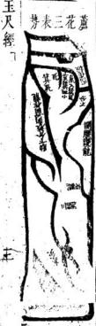

戴丸履一區

凡一陽數居上下以爲輔中尊方體屬土水神在煎橫直如織盤遶四闢似去不去欲來不來左右砂東拜西舞擁伏朝向得天地之中正五行之處靈萃聚成質第一之龍體爲拜爲舞則朝會夷皇立宅安墳則萃忠良產聖賢出侯王百子千孫飄一祐攸久也

其正氣居中面離立穴者出聖賢受禁婦左受氣中文士神童狀元爲天下宗歸右受氣出將相英名通四夷界水有破中局不過中品之地山州牧之職至人忠義正直方大沉思有謀此龍不論水法出入四水俱可來朝八面俱可出入只空千向福力深大若認水立向則福氣減矣三十六龍惟此最貴如見此地不可輕易指黜禁之禁之

才汤四網巴工夏君 只申巳亥四維水交流衆堂而四正俱係實地則子 午卯酉四面之龍脉俱至此住絕搆聚交會矣然 四勢無並結胎理或離龍結穴面坎爲朝砂坎結 穴而離爲朝砂或在兌或在震皆從水神來去上 辨別水從乾坤二方來則知正龍居兌而左右作 護震爲朝砂水從坤巽乾三方來則知離兌爲正 龍而震坎爲朝護但只從正龍上尋大小合矜及 兠澈小水詳其左來或右來正來偏來以求龍脉 之到頭定穴或倚左倚右方正欹斜以求服氣人 穴之法然亦各有方成小可穴者卽于本龍小 9 分合右轉左轉正來直來之因以及小合水出入 之方辨位取穴乃爲得之然終是小發隔力糧輕

羣鴈落湖形

此地中砂或成金形木形或隨水形或如舟形旁有小長砂砂隻隻與龍體不連各有成形灣灣向堂朝拱或橫長直長在前橫灣長砂在後水神東穿酉遶周廻來去三重及四重綜橫如織砂體各谷交牙水路曲折密不通風亦大地也主生子孫繁盛孝義忠信富貴並顯但後世子孫同居其戶者不能皆發只要分門剖云另居立業方主名位俱發福氣官祿財帛人丁牲畜無不興隆者矣此地局內水法四通八達難拘出入當看城外大合來去之方以定坐向否則只從局內砂頭轉處耳觀朝水聚處作案亦可畧從大勢水法于向中饒減之可合卦例只以卦例取用爲妙者也

綜羣橫屬如落織朔之形

尺經 卷之四 六 2

氣無形而有神土無神而有形氣隨土形神從形發 故凡土脉之來皆本山龍而平原之氣盡從土脉 而至土脉起處爲首龍氣發行之始也土脉盡處 爲尾龍氣聚會之處也龍氣聚位方始融結神龍 眞經云要知止處須尋來處來處爲頭止處爲尾 血脉在外精神在裡雖雄媾合玄從尾底言山水 交合之處卽精神聚會之處龍底穴左肩脉之盡 男女玄牝之門是陰陽妙合之眞境也卽此可見 氣之會在水交龍盡之處而取氣之穴當從砂 之尾底求之若水自東來流從西去則東爲首酉 爲尾育水魯之處指穴反于水頭上尋穴是棄 其所止取其所脉經日甲卯作龍不食酉辛之氣 此言絕要矣

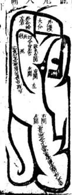

玉尺經卷之

鬼劫龍

鬼切行龍出身東西南北各出土脉飛竄順去直來或直去順來尖斜橫曲亂流支水交衝腹心穿叢龍脈入首輕斜不分門面者謂鬼殺分散英靈無所收拾斷不結地肋下分砂向前逊出不頸堂局自開不端不正者謂之鬼砂順刼分散聚氣也腰下分砂向後逃出不來護局東牽西潔長斜分腳者謂之鬼砂逆刼分散來氣也時師誤認黃龍安墳立宅不出二年必遭橫禍瘟疫死亡子孫逃寬軍徒刑橫無所不至出入訐詐無信不仁男盜女淫十年之外便主絕嗣

長砂關氣直受 長砂關氣直受

凡龍體出身砂頭直長或一里二里行來全無委曲若中間腰去處不分枝水西邊插入肋下作關則主尺經 卷之四 入氣散不聚到頭又無枝水兩旁插入肩窩則氣滇不收皆不結穴惟于來龍行脉中間兩得三重水挿進關激龍氣居中過峽到頭又得枝水插窩左關右激收氣脉在中則方成龍勢體叚便可指點更得開水東挨西推過一邊收氣歸角成四維受氣又妙眞龍眞水其氣冲隱最難立向看水神來去東北出水作兌向腰受西北出水作午向通泉受東南出水作坎向正受西南出水作震向疆受凡正受須帶丁丙光分子午三分要避雙金真氣然恐傷人丁腰受只正下無妨若斜歸二分則氣不貫慶矣

受直氣阴沙長 形風蜈天上

三関三峽本氣入首式

能體出身沙頭長直或二三里遠中間有水挿入內王尺經 卷之四

地作開峽換氣入首則龍氣方清凡閣峽過氣所在須一関過東一開過西使龍腰曲折活動而來到首更有肩水挿進兜激收氣入局方成貴龍體叚此龍坎上爲坐閃過壬上度氣換來癸癸換上仍歸正坎入首雖係坎龍行屬中間換過壬癸而來脫煞到頭不犯直冲方可正下仍看水神出入或耳受農受皆可

九開峽形勢有謝関有斜閱直來直受多幣直來斜受者多斜閃看開口受氣屈何方則知氣至何

方如口張向巽乾水自乾來氣必超巽坤申之角爲死脉矣

斜來正下水朝業外

龍體出身不分枝腳對角發脉腰有二回閱氣入首卷之四

開作正面堂前大小朝人分開兩股挿肩兜收龍氣入穴前有橫案左衛右護亦大地也生龍旺穴王百子千孫富貴綿遠更得襲閑雙徽福力尤建旁無劫泄又無興廢奕世富貴朱紫不絕坤申兌乾俱可出水放煞

長宮行龍向從卦例艮納丙坐穴對丙空甲午木或丙午火方美若艮土來水向巽巳午出當改癸角耳受終不如丙午向富貴攸長若作申向則艮爲病龍申爲病向雖不死絕而龍氣休囚豈爲盡善

有壬子癸水來亦好 水朝案外勢

中局氣勢

龍脉體勢砂頭方正傍出枝水關氣到中局都從中王尺 卷之四 十

腰門面入一交水到中局分出兩股橫開向傍攝 入收來脉在中又得局中肩上挿入重覺入氣 斜開關口收受其力大鼎寺龍穴安墳立宅子 孫攸久富貴洪遠房分均年朱業滿朝由人忠厚 聽明形體豐美

申來龍卦氣納乙乙水去向作壬若癸木來向作 坎朝止于辰水去三合同子向七壬向三分巷 作甲佛向煞人退敗丙午向主退出年丙水趙艮 作巽已向亦可

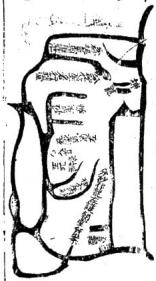

中受平收氣脉勢

龍脉出身細小梟集面來將近扁後百步二百步或三百步分外開大慶直至一百步外兩木合轉人經下 卷之四 十

一處出來却從去水合處復分爾杖小水從局肩挿破局內逆砂而逛從中關進龍氣當中聚水如湖兩傍插砂作本身龍虎俯伏湖外其中氣不偏不斜名中局平收氣脉言穴傍無界兠激只取本身龍虎爲主氣取穴也

如亥氣出身帶亥壬子氣入穴巽巳午上出身只作丁未向收亥氣長生本入局又收坎上臨官木穴既取人丁又發財祿但氣寬大欠清細出官貴三逢俱有發財則商藝俱典水木氣混行者也

羣鴈賓鴻勢

體隨木出身先出一大橫砂流水界斷後生少砂五七塊東西散立向前復結大砂居中或員咸方或出角左右旁小砂一二十塊或尖長或舒翼或香之神出角隻雙向內朝堂向前又結小砂或長或方三五塊週廻又結曲折長砂抱護向內者名羣屬賓鴻形中間結穴砂頭得十畝二十者准小砂或三畝五龍方是外讒大砂不拘只要長灣內向其一小砂隻隻交股片片遮欄不見木來水去其地極妙百子千孫富貴不勝難計立向從外水立向其中穴傍水來去縱橫極有情況難以認取故也不必俱此圖此益以異亥立式也認水定龍詳看首尾中砂若大亦要堯收取氣

衆砂小次砂大小羣鴈從大賓鴻形

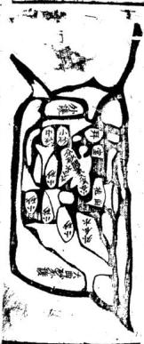

刼龍分氣

龍脉到頭開頭有面類若聚氣穴塲端正凡見此龍玉尺經 卷之四 十四

便易指點若腰肋之間有砂劈出兩旁向後定寶一與龍穴無情謂之刼砂龍分散英靈之氣故也雖是穴塲可觀頭面端正塟之無福而反致大禍絕人退敗理之必然尤防隔絕使龍氣入路不清越隔與劫砂二者俱是凶惡決不可下古人所謂菩薩由者正此龍也言龍氣不至虛立門面徒好看耳龍隨土行土到氣至何以有氣不至之事所日譬猶吹管者然閑氣音開一音氣至而多出音齊開則氣泄而多音便不出矣此理必然至

玄至妙學者祭之

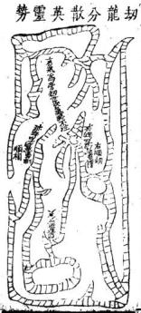

出頭尖細鬼砂食氣

龍來有氣三開三摺甚是活動及至到頭出額反尖王尺經 卷之四 十五

細度長斜欹逼則雖龍來亦必減没如海中之潮浪湧而來及至逼窄之處勢無容則冲擊而終是滅沒必然之驗古人云來得好不如收得好長戴尾龜鬼頭踏着便生愁正謂此也

龍行入首面額須然端正而坐下鬼砂支水倒挿入展三重四重穿破龍形如破金楊公所謂棕欄業散夜文頭正此龍也時師見此頭額便從此處尋一穴絕人宗嗣受禍無窮不可薦言矣棕葉鬼形似棕欄葉有向前不顧堂局而散亂不收者有破拿

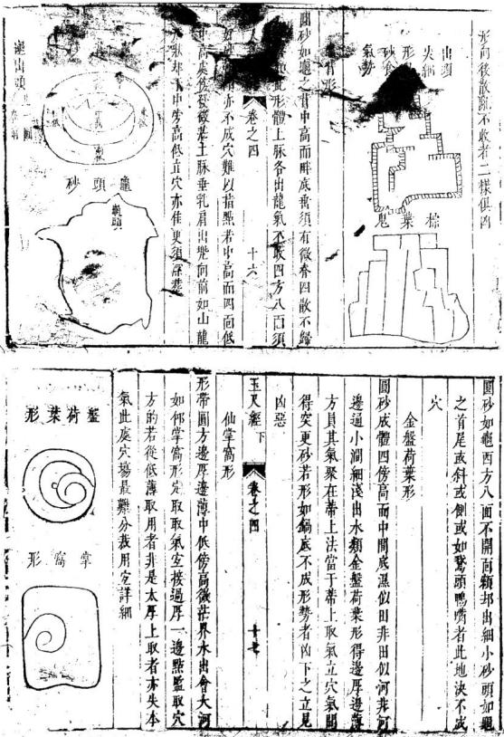

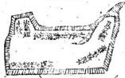

回龍顧祖 大水來處起祖行龍隨水而出到頭或為他砂挨重 使本龍從左轉右或從右轉左道流而上却乃回 龍顧祖之地經曰龍廻則水廻又目龍從水轉若 水面流出而不見有轉歸逆流處決無廻龍顧祖 地雖有砂頭轉回不過是支木界龍脉矣雖穴 塲好其力亦輕謂非眞龍到頭之故也若日是眞 龍到頭其水必從龍逆回此地最難立向以四邊 皆實地一路出水耳後立圖自坤申右遷轉至坎 五尺經下 卷之四 十八

入首是陰龍行體水土喜東南出水而東南反災 出煞然矣故凡回龍之地發福不久陰木自卯上 起長生返從陽木長生之方出去只發七八十年 便衰後之闢自辰上出木畧悠久終無福氣

截氣立穴法截兌氣入左截震氣入右砂到頭龍體有勢但到首餘氣分散難以下穴須在砂之偃間看有枝水入腹濤割如鈎傍待短浜隔斷氣不使入首之處當慶收氣入局內亦能發福終不達矣

斬氣立穴

砂如舡形或如梭形兩頭俱尖難以下手必須看得枝水在脇間斜入向去之處逆展作鈎下水背面又得永逆入腹申兠氣入局當鈎取穴名斬穴玉尺經下 卷之國 十九

其氣使不入頭乘而立穴之謂亦能發福紀看龍出身遠大則福亦厚

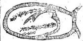

凡山龍到頭分開兩翼中不垂乳山逼勢急宜鋪曲去平坡三里四里之外方有大溪或長江界絕或有山腳下一二百步便結穴有平坡腹中結穴前無水止四畔界溪又遠取穴認氣之法看眞龍落頭到結穴處四畔必出月角甕轉向堂或左右抱出輕砂向前作欄頭砂或三重四重抱護者必是眞穴所在其後而脉須三伏四伏節節隱露不一及至結穴之處自然明自可辨兩邊微落水夾流合矜而去其地福力亦大百子千孫發財發福與玉天經下 卷之四 114-11山龍脉穴更佳水法不堪裁剪不比平源大河之處一不合法東手無計

出木龍寅甲水延上遠來層曲朝堂返作陰水右旋出戌巽水遠至兩上朝來生旺二水俱是有清但不慮左倒從坐下行出戍是陰過陰矣局內腮水甲卯水自左夾出坤未水自右夾出左倒會甲寅長生大水逆行則內俱逆矣向丙午則發財源官維下 卷之四

貴而背生水其人丁亦無病但主人當家婦尅夫 少亡寡居矣發中房財祿則長房人丁久旺發長 房人丁則中房官貴不興東典西退消長不一若 作甲寅向則人丁雖旺又出氣疾若帶艮上發源 可免商賈起家主骨肉不和出人用佞丙向亦能 發邪第但陰邪誤國食祿不終

本正

子午卯而四正不空來去名滾浪桃花水又爲軍睡 水又爲天獄水又如天禁水主出女人淫襲男子 流蕩破家主出軍賊離見坎卯西兌見午那見子 主出女人殺夫陰邪如過此水得申庚壬丙赦文 水救之方可否則男主盜女主姦敗絕孤寡若直 冲破局必有抄拈之禍產難少亡一路二路來長 其禍立見來短則禍輕若龍氣清麗六秀水朝亦 玉尺釋下 卷之四 二十四

主爲官取罪而刑

假如亥龍從坎入亥者爲陰亥龍以乙木生于午從午上起長生逆布至成爲墓乙席丙龍從寅上起長生順數至戌爲墓所謂乙丙龍變而趙成爲雖一雄交媾也冲陽和陰始發聚然後以向制之使氣感而應鬼福以及矣然穴依龍乘生氣也甸依水接堂氣也故氣行地中用土龍本音以布運水溢地外用水龍本音以布運審生旺體聚之氣土龍以山運收山水龍以水運收水如午上有高峰則旺人丁寅上有高山則旺財祿此正謂水管水也並用以寅午向制之則于水與龍之氣始合而不散矣此控制龍家之氣在于向而巳矣一差禍福千里

陽龍布氣岡

土尺經下卷之四

二十五

從辛戍入亥爲陽龍亥龍木音以甲木生于亥順行至未爲墓甲用癸配癸水生于卯逆行至未爲墓所謂金羊收癸甲之蠹是也認龍布運之訣憑隨氣化流行之樓從子丑寅卯員布子外陽左陰左以爲之式然其水神之來去不可執子丑寅卯順逆周施轉來爲合法也只要水從生旺來问局前朝堂爲來言趙至局前朝會衆水然後向墓方出去吉癸龍卯爲三方亥爲旺方空從局後至寅丑子亥右轉入未流去則亥卯水玄武而不入堂矣雖來自生方出自死方亦不可言吉餘做此推之

云木龍借配壬雖交媾不眞而夾流出異亦有秀氣 砂法合局大能發富貴若得內堂腮水從甲卯乙 遇丙午右到轉戌反向午丙趙巽合流出異是外 木雖不合法而內水得局作異向則兼外水順向 外卯則人丁貴亦美丁未向猶吉丙午向則人 官祿更盛地發長子向發中子丁向發小房又六 七十年麗力貴不過四品富不過艮萬水步行至 外堂敗矣

多壬爲北極業薇之司尊帝之居申庚而少綴亙數 之地巳丙爲南極之司寅申爲天市天帝司貨之 處地得此水到堂朝會其福無比或三路四路水 來亦美寅中水先到會巴丙倒右出成主出神童 狀元官居清要極品之貴南會庚酉木而左倒則 卷之四 114

臨力畧官至四品酉水先動會寅甲水出成先發 外始後發本宗先發小貴後發魁元亥木先到金 寅甲出未少年科第文章奕世辛兌龍見之文壓 天下但清貴矣庚中水遇震龍得乾異峯高出主 英豪經云開享門關地戶震龍動而龍見時

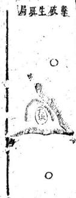

陰亥龍戍上本爲亥竅水空山不互入若水變戍上 龍自外由離者只取艮水出夫作庚下氣其內水逆人分流從局前破午丙方去枝分流變墊 趙向異震作巳丙可教此收山山氣之做妙移禍到寅上流出則生年二方俱要 井擊須內堂水法 為雇之眞機也如作丙午寅艮向則立見害人也作砂亦不可下下之不出十年外定主敗家絕人官訟殘疾抄枯寅水大先絕財祿戍水先到堂中生房先敗絕繼及長小二房破家損人只看內堂水 水 園出入向若寅甲上有內水丙午則人丁可教內水法不出午而出申酉二方則財祿可至一二紀方進作異向始可少緩其禍若作午丁向巢左系 寅申巳亥四龍長生之地交流入局朝堂者垂發人玉尺經下 卷之四 二十八 玉尺經 卷之四 芒九冲破 丁然水陽也外氣從天地交陰也龍氣從地故生旺 喜地支行度水喜天于行度故日水從天上去龍借配 來地下眠又曰萬水盡從天上夫羣龍須向地中來行門生雖無四正之禍然終爲地支不發福氣法 且爲長房之煞若犯四生水法惟長房受灾見爲成土水來或分或合俱右轉左向堂一路出丙午 各有分位兼得乾坤艮異四宇上來其灾稍路出寅艮生旺二方俱受冲散而亥氣不聚矣遷 4之立見敗絕若戍水併流到堂分坤離艮者其禍 水基15猶烈如戍水來處便分流一枝過堂出艮一枝分

法殿成丑未爲四墓是水宣緊不室來室去不空入若墓水朝堂主瘟疫病疾孤敗絕後若聚而不來則又能發富貴直衝破局小房受禍冲破北氣中子主灾傷財生氣則長子當禍看龍氣左忌以斷吉凶如四墓俱聚不來冲擊堂氣主大富甚比石崇若西某側到決不可下下之立見災穢池河方壤通衆水來去者不是刀

主天經下卷之四

亥龍起頂落孔正亥入局左右龍虎蹲踞而中脉抱出詹口若從亥脉盡處立穴則忍露脉風吹退纏則玄武舌長然氣乘風則散而進則五氣和融故只可退止一步

乘得亥氣着不當以此書為忌楊公三十六穴法去玄武內長高處點此亦開勞火之法也是以山脉餘氣不盡者可兼則裁之如不可裁把穴立得高使坐下不碑謹舌亦妙

龍起祖换出坎局脉乳入首橫鋪平濶開面又似坎體是眞龍僞行也然有艮龍起禍則必有艮脉入穴須朝應情向若何正行斜受子不雛祖其人穴之處必有艮氣到頭者勢決超在右角畔矣以中局取穴則用僞氣矣其禍立至

故眞龍僞行者不當在正落處求之行前山以求 李心察左右以求開氣二者一得其法則眞僞自 一見矣

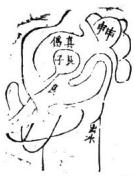

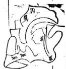

劉秉忠砂周昌奇廂作艮龍轉亥作丙向二十三年昌奇十狀元爲元太學士改監茶馬司後卒其子一塟昌奇于艮龍之頂取艮脉盡處世代顯官接踵相繼此龍體製本自艮方起祖再損艮龍不雜第二節損出亥局再博得幕亥麻大宗小宗俱各三吉六秀故艮亥一二穴皆發官貴

工尺無卷之四 三十三共峯起祖至第三節變出土星橫濶厲平粗區不開窩乳東西二角又無脉落可考似難立穴然有大穴雖無明淨乳脉必有微茫灰線亦蔭腮暗異佐證方可立穴若并其翼砂不明則又當驗朝應山水何方有情經云唯氣朝山識幸心後看來脉前看朝山以爲準的刖萬無一矢矣又有乳脉亂雜難雜眞僞者皆于朝應左右薩砂察之則其眞穴可見占先聖賢立法金取窩土取角恐非的論若朝對迹接在中安得舍中局而取金角乎

良龍起祖二三節皆艮峯起頂至落脉入首邦流趨癸丑方盡是僞立穴之法當循艮脉盡處乃爲氣却于艮脉盡處立穴雖拖出癸丑方去亦空裁人經下 卷之四 王十四剪以截僞氣如不可載亦就艮氣上遷之故古人云眞氣得乘僞氣自滅不當以癸丑絕出砂頭為嫌疑也作丙向以陽艮收丙氣大發官貴後富貴雙全若犯丑癸之氣其禍不可勝言矣

催官吉秀羅列

1亥龍起酈三節四節不脫本體人首結穴之處龍虎降伏乾坤艮異四山高疊震庚丁兌列秀于前後左右得此形勢而龍眞穴的則主出將人相封象賜爵子孫奕世濟美更得旗鼓劍戟森嚴則淹英芍橫行天下百戰無敵者來龍迢迢數百里入首而八而降伏並係禁忌如過此地禁口勿言福纏之人遷之必至獻虎雷擊水飄而後亡

玉尺經下卷之凶 三十

乾龍起祖換亥二節四節亥龍行入首端正而乾 坤艮異四山高應丙丁兌災邊到秀峯衆水倒左 出寅艮長流而去作巽向以收水神則砂水盡美 主出魁元宰相無震庚砂主文章冠世名播夷 百子千孫世代顯赫朱紫滿朝儿催官薦元砂水 得一則貴况羣秀呈祥者乎

亥龍起頂單行落脉到頭一路俱係亥脉臨穴處都王人經 卷之四 三十六

雜壬氣出右邊似壬亥雙到左東右伸時師不知却見左右護砂緊促應案整齊便從落脉畫處點之是棄其亥氣而取僞脉自壬氣上作用則失之矣法當從亥脉盡處族左立穴任其壬脉鋪出

妨趙眞避僞審飛龍勢法空高則高下腳下有餘氣雖不裁亦可也法空就來則東遷右有餘氣雖不裁亦可也全憑月力之巧者上術也

參形雜勢斷

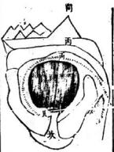

如艮龍從坎換入艮方起頂卑落至入首之處却鋪出一片平濶一二十丈拔用同情似無收拾勢雜形亂坎癸艮寅皆刊全無屈曲情況然龍眞正左右護砂明自不可棄如此形勢最難指點全憑且王尺經下 卷之四 三十七

力之巧詳察朝應情勢屬何體製書云形雜發如何認惟有朝山見幸心故有眞龍必有眞穴有眞穴必有眞朝從穴內詳觀前峯有情者若在丙上則下丙上對穴取艮作用便爲眞穴其餘癸坎寅氣皆爲僞落矣

石雨年王尺經全書後集卷之四新刻石函平砂玉尺經卷之五

元太師文正趙國公邢州對秉忠述明太師文成誠意伯青田劉基解

審砂篇第五

砂明生死脉辯陰陽 敬仙賴從謙發揮

平原之地砂頭進脉有左生右死右生左死有來生而止死有來死而止生凡龍脉之來活動曲拆爲生硬直粗逼爲死定脉取穴須棄死挨生金函卷五

經云生脉活動而棄死挨生是也地理之說高爲陰而低爲陽覆爲陰而仰爲陽直逼爲陰而平坦爲陽惟平原之地獨陽無陰而砂水合處始見陰陽之會脉辯陰陽者以五氣定陰陽之升降左陽而右陰也陽從左而陰從右也乾坎艮震屬陽而卦列左布如子寅辰午申戌之類巽離坤兌屬陰而卦列右布如未巳卯丑亥酉之類此天地身然之氣運五行之定機天氣陽而左旋地氣陰面右旋故陽龍從天氣順行爲吉陰龍從地氣逆行爲吉楊公所謂龍飛兩片陰陽取者是也賴氏曰龍自方生而紆從死地入首者名生龍死穴下之必絕如亥方發足本木也而紆從午申酉地入首結局本死于午繩于申墓于未名生龍入死非吉地也又爲亥龍氣脉趨東南巽巳入首而取穴西南東北角者亦是生龍發足而下死穴莽亥歸東南西南東北亥氣不貫爲死絕之地此法精妙時師不知多有向死絕點指者其貧絕之禍立至龍脉之來有陰有陽陽從左轉陰從右轉避尺經 卷五

其死絕趨其旺生則龍氣清和結穴秀麗故右而左轉入首者爲陽龍自左而右轉入首者爲陰龍陰陽二氣俱得生旺不犯死絕吉如甲卯入首者木氣也自午巽而至爲陰木自乾亥壬子癸丑而至爲陽木陰木生于午陽木生于亥俱得生氣出身若犯兌坤二方出身則龍脉發源巳先絕矣縱雖到頭得局護托完固終不發福水發城門流詳出入

龍行水隨故水發源之地卽龍神出身之地或趨東或趨西必須詳觀其所出之方若流神從實艮而出則知龍脉自坤兌而來則知水神必從寅艮而出以艮寅爲水日者必先龍成胎于正西巽龍生息于東南故郭氏云入山觀水口登穴看明堂卽此意也

龍行審來歷之因

凡龍體到頭歸收水口之處必考其本龍之來要知從何發足經歷何方如東北到頭向艮寅之方其龍必自兌宮出身乃爲眞龍自坤申而兌者亦尺經 卷五 三

吉若從壬子癸丑而來必得坎上有左水佐輔夾流會合于坤申水左倒更得乙辰水佐輔夾流會合于坤申水向寅艮而去方的若是離宮落頭則水必不自坤上來矣故龍行來歷之因須自流坤上消息之始可以得其情也

賴氏日平坡之地千里無畫龍無一定之穴而人 無一定之見假如一片方砂四方八面無有收拾 似難取穴若能審龍形來歷之因眞知灼見的係 坤申行龍出體則知穴清龍脉趨東菜坤兌之

迎神定分合之自

氣而融結矣吳巳行龍發源則知穴情龍脉歸西北矣

迎神者朝會于堂局之水也水來到塘必有發源 之處從何方分流而來又從何方會流而去知流 神分合之清而龍脉結穴之真僞自見若水來到 堂左畔分流交行前後而右畔不見其合兩派 流或橫去或直來前有無收後無廻統者其龍自 未住扎雖砂頭有情方正端通未繼穴也直至水 上尺經 卷五 四

交砂會之處龍脉始聚而融結眞穴是故五行品配于八方萬象畫歸于四蟄

乾坤坎離艮震巽兌八方各分隸于五行金木水1 火土正五行則乾金坎水離火兌金巽震木坤艮土萬世不易之定氣也然以生旺死絕之氣定之則木生在亥而配乾金生在巳而配巽水生在申而配坤火生在寅而配艮甲庚丙壬麗子午卯酉爲五行帝旺之鄉是五行品配于八方者天地然之氣運行而不息以化生萬物非人爲可得而品兜牽合之者也若寅申巳亥乃五氣發生之始爲龍家之四始萬物之根基五行乘旺之氣必一自寅申巳亥發生充盛而至于旺猶先金之氣甚始生在巳也青囊經云地有四勢氣從八方四勢行龍八方施生正謂此也

變形察體觀象審龍

隨地之形以察其龍之體觀砂之象而審其龍之 氣象以氣形以理變者也如木之形必直而聳火 之形必尖而側金之形必頭員鄺關土之形必方 玉尺經 卷五 五

正而尊水之形必曲折而動故觀其直而聳者知 其如木尖而側者知其如火頭員而腳關者知其 爲金也水土亦然爲金之形圓而闊者又當審甚 龍之自何方來如兌方發足則金形乘于旺氣而 出眞金龍也若自離方來其出身巳被火制矣縱 雖結穴亦不久遠餘龍倣此

賴氏曰夫龍有形者氣之所鍾聚而成者也有象者形之所成類而象者也如土形方而玉凡御屏金櫃天馬之類金形員而覆鐘覆釜半月娥類木形直而玉尺橫琴展軸之類水形曲而生蛇非五氣之流行而各有當然之則如取火形于熖動取木形于包節取金形于開巨取水形于曲拆習土形于觚角如此審詳以取中則有以得其穴情之眞也

氣藏于左右忌分泄于鬼刼之交橫

龍體成形水神交合其地須巳結穴然氣之充固與福力之輕重則又在于左右之護砂或環抱有玉人經 卷五

情水城緊固更不東西直竄四重五重節節包集者方佳或自本身分枝向前環抱顧堂尤妙若左右砂頭東西飛竄或有本體柚出從肋下從腰內肩肘之間左牽右摯東西亂竄者乃名鬼刼能分泄龍氣之英靈如有此等則須水交砂會亦不成穴矣

脉承于前後怕透漏于坐應之下渙

龍行入首結穴必前有案砂後有坐托則氣脉鎭重方有收坐托無砂或有砂而噴屑前有應而歆斜反跳不拜堂不平正或水來斜射者其氣透漏而不聚也

蕩如鱉背出似龜頭慮散漫而難收圓若金盤平如 一仰掌認高低而定取

平坡之龍砂頭寬大中高而四圍必低如斃之背砂圓而四圍亂出尖角如龜之頭者氣散而不聚也此不可遷遷之禍絕圓若金盤邊幅高而中低平如仰掌中前低而後高成此形象若龍氣分明的知來歷方可下手

玉尺經 卷五 七

賴氏日鱉背者砂不出角氣散難收龜頭者砂頭 微細而氣不藏蓄二者皆不結穴金盤荷葉傍高 中卑水在中亦必有出處點穴當如仰月形看角 兠收而中取之仰掌平坡必有掌窩語取窩穴而 定之楊公曰荷葉須尋蒂平坡認掌窩正此法也 囚四正四維之去來究枝分枝合之聚向

水交流于子午卯酉四正之方則寅申巳亥爲實地乂觀其水之出入以審何龍之結穴凡四至之地實者多自生龍發足乗旺穴水交流于寅申巳亥四維之方其子午卯酉爲實地凡四正之地實者自旺能行成生穴又須以水神辨之看其水 送分水合枝水之出入方見若水不分枝作小分小合則氣寬而不清亦不結地

秋橫似織方知眷戀之情滙澤如湖仍辯朝宗之勢 入首結穴之處前後左右若見水三橫四直屈曲 交流猶如織帛然此砂戀水水戀砂猶夫妻相見 而不忍違也衆水到堂或左或右聚滙如湖則知 水交砂會矣然又要辯水神之出向何方而朝 主人經 春五 人

或出于大江或出于大朔辯方定位以明龍穴之美惡也

賴氏曰水來到堂有聚必有泄觀水之聚處可以見龍脉之行止水出之去處可以見結穴之倚着几龍結穴必倚何水神流去一邊水神合流而去之地離雄交媾之處也故穴必倚焉九曲入明堂石崇富貴一亂如箭射伯道孤寒水曲則財祿聚屈摺朝入明堂者富貴雙全水直如箭射至明堂不惟貧賤而且孤絕天亡 7

是故流神合法者龍體方眞此總結上文言水之去來合法則龍脉沾穴方見眞正而無虛假若砂頭端正應托尊嚴左右護從周匝雖云龍脉可觀而水神去來一或不合共法則此等總爲虛假所謂菩薩面者此也

戴九履一而天地之中數居尊鳳舞龍飛而乾巽之陰陽交泰

一者陽之始九者陽之極五者陽之中五屬土面于體方正居中坐下長砂爲托面通橫水四道直尺經 卷五 九

水四道列砂九方得天地之正氣陽剛中正爲壹王建極之地產明王育賢相非尋常可北之地此坎離交媾震兌合氣而成者也若亥上行龍自天門而出踴躍如飛巽上行龍自地戶而迎揚砂如舞亥巳交合朝對有情左右送從合法則乾陽而巽陰二氣交太翕受敷施爲明王聖帝臨民之地聚賢才會文武此地原不易得或九履一謂子午也 2

雖有三關三峽之落尤防左牽右摯之非龍脉出身前無關鎮則行面不住氣隨七行峽不轉峽則氣散而不收真龍眞地入路到頭故左右必有護送砂頭向前拱夾其中龍穿田渡水之處不使出體露風其到頭之左右東環西抱如拜如舞則氣藏完固無有漏泄誠大地也中龍入首或爲長砂曲折三里四里而來固自有關夾而氣發阻碍曲角復恐分畜於摺處而入首之氣反輕則結穴亦薄故曲摺之間有枝水界逼使氣從脉行兜收到頭方真又有直砂行龍三四里五六里隨上人經 卷五 十

水而出者有方砂居中三五百七八百成地有龍脉之來歷固在水神之出入可考而英氣之聚處何從而辯别必得辰股而下有微水穿破關氣節脉使渡峽在左在右曲折活動而未入首之處武左右肩膊水插界明白其氣方聚否則龍脉須來氣渙而不收難以指點三里四里來龍或成曲折長砂或爲直木長砂到頭其中腰與肩肘之下若有餘砂分臂而出須要向前作本身之護從拜舞朝堂方可若東牽西摯各自分逃于本砂畧各無情意者却來分泄我氣所謂飛散英靈者此也生龍發足莫犯天罡旺處出身休逢死絕

寅申巳亥如長生辰戌丑未如天罡莽天罡所臨之地祿馬貴人不到故生龍出身帶辰戍丑未天罡而來者皆不結地如寅艮龍出脉轉過丑上而行是犯天罡矣子午卯酉爲帝旺寅申巳亥爲死絕旺龍出身轉寅申巳亥者亦不結地如卯木龍轉至午未申方入首是木死在午絕在申而卯龍受死絕矣此天地陰陽之妙理五行之眞機地理尺經 卷五 十

家不明此道則龍穴之生旺休囚且不知何以驗吉凶休咎之應

大從小而祥雲捧月以小輔大而羣鴈賔鴻群砂俱大小者爲尊龍來到頭結成三四地面負成方而旁有大砂重重交遶節節包承如祥雲捧月之狀群砂俱小特取其大龍來入首結成二三百地面或方或圓而旁例小砂如星如月瞬肩開翹如飛如舞雙雙砂頭向內朝堂顧局如群鴈賔鴻之勢也

賴氏曰結穴之龍特大而衆砂特小者必得小砂 之外又有大砂或長或方關攔于左右前後之外 包承群砂在內則局内之水方有歸東不致散亂 分流漏泄否則砂雖整齊而水神渙散能泄堂局 之氣縱結穴亦不美也若中砂細小而護砂大者 其水自有兠收雖出身輕微而其力反重

粗出細而細出粗形奇鶴滕橫取曲而曲取橫裊若蘆花

粗中出細細中出粗形如鶴膝三關四鎖入路而玉尺經 卷五

來者其氣清奇橫來曲展曲來橫展三折四裊形 似蘆花入路而到者其脉活動龍體眞而穴情善 福力大而富貴遠矣

賴氏曰三關四鎖似斷不斷如鶴膝也三折四身似來不來如蘆花也此言來情之善龍脉之活氣行之清皆于此可見左衿先師獨得之妙發楊曾之所未到處

木衝天而包節生處方成

如倒地木星形長直而瘦若無包節乃爲死木金用處也必得水合襟之左右有界水插入肩膊之内界出門面方成體制

火炎上而焰起動處乃見精微

如火星成形頭尖腳關若火熖不動名照天火無 用處也必得尖斜所向之處界水挿過一邊使尖 頭歸堂方可立穴

面方正大掛角留情

土星方正其情在角界水收氣故曰留情掛角吐出金唇則生氣更完廖公言土角流金正此謂卷五 十三

也

賴氏曰土爲五氣之尊中立不倚其正性也傍分 界水立穴在中通受子午卯酉四止之氣爲震雜 坎兌之局尤妙但不宜當局正心取穴俗云中宮 地也謬甚矣惟帝皇之都多有如此取用者取宅 中以御天下坐坎面離之義開日月卯酉之門而 四海文明矣

那關頭圓開金取穴

金星形體腳關頭圓須得開口取穴然異坐實差坐下不實名爲懸鍾金其氣在邊如鐘之聲應在邊也

雖四通八達之區必有伏元歸氣之所

此總言上文砂水須四通八達分枝散布面去然其到頭必有收拾之處爲伏元歸氣之根也

賴氏曰龍體到頭東西前後旁分枝砂四通八達 而去似難收拾至于入首之處其衆砂分出者登 要隻隻回頭願祖或爲龍虎抱歸左右或爲案狹 俯伏在前或爲攔砂回塞水口其始雖四通八達 卷五 十四

若與本方無情及至到頭結穴之處隻隻不虛收 作用神乃爲伏降之氣而歸東堂局矣衆水會淹 到堂在前在後或左或右東穿西渡南去北來一 似四通八達無所收拾然其總括去處衆水群聚 合流于城門之口重砂關寨于下者見其合不見 其去此亦伏元歸氣之根地有神氣而融結穴情 始大

來氣短須防腰截進氣長尤怕直衝

砂頭短折者坐後不得有橫水截住來脉使氣 折脉短而曲折則氣反急疾不和故砂短折者 怕腰截曲折也砂頭來若有三四里或五大里長 者中間須得曲折轉關博換過峽或三重四重如 亥氣入艮艮氣還亥亥龍入震震氣還亥則非直 冲矣然亥龍趨艮艮上又得支水兜激回亥則艮 宮不到散流各立門面以分泄其英靈使復還亥 而去乃玅若艮宮無水兜激任其自去各立堂局 是亥入艮就火局結穴矣亥入卯卯宮無水兜激 任其自去卯上立成堂局是亥龍入卯就旺方木 玉尺經 卷五 十五

局結穴矣若得艮入亥亥入艮艮又入亥三關三出仍作本龍出身結地是以亥龍入亥穴則發福綿遠富貴雙全百子千孫無有極也經云龍來不脫來龍氣三峽三關元復元正此理也

是故博換轉關實龍行體勢之眞而左關右界爲入首成胎之要

賴氏曰上二句結上文行龍體勢須要博換之意 下二句發明入首結穴之體段大凡砂頭入首將 結穴之處若頭平額關或左薄而右厚或左厚而 右薄者脉氣衝至到頭在東在西或左或右而倚 于一邊何以兠收其氣而取穴故龍脉入首必得 支水關界使氣聚而不散方或穴體關者關其氣 使不走也界者界其氣使就局也關水長而曲界 水短而直

片蠻皮將奚取證雲翔霧走何處兠收

此言到頭立穴之處左石無關界水入是一片蠻皮無以證其氣之聚不聚氣須止而又無以辨其歸向之定局也

玉尺經 卷五十六

賴氏曰平洋之地與山龍之局取氣驗穴最難蓋 山龍落頭有大小分水可辨其入首之眞僞有大 小合水可考其氣止之精玄箇字定出脉之由毬 簷詳住結之根蟬翼界于其旁腮水蔭于其側龍 蹲虎踞案應向堂有此取證昭然可指若其平砂 一片不仰不俯若無關界何以取證至如龍行體 勢雲飛霧走須有關峽而前無砂頭回抱又不得 水來交合于左右則龍脉未見收拾之處脉不 收則氣必不聚矣

薪刻石函平砂玉尺經卷之六元太師文正趙國公邢州劉秉忠述明太師文成誠意伯青田劉基解敬山賴從謙發揮審向篇 納水消水

山爲體水爲用一氣而成用屬陽體屬陰動靜乃見五行之氣行于地中有土則有氣而山者土之脉絡也積而成山是五氣升而成體故曰山者氣之體也氣行則水隨故水必隨土而出脉從水止水玉尺經 卷六上

從脉行故水者氣之用也土靜而不動屬陰水動而流通屬陽動爲用而靜爲體此陰陽之別體用之分于此可見

賴氏曰山爲體故地理家必先取龍體之來以觀其氣之所鍾及其到頭之處乃察其水神之出入以審其龍之所止龍脉至而水不來則有體而無用非眞龍也地理家以高爲陰以低爲陽逼爲陰一平坦爲陽覆爲陰仰爲陽有尖爲陰有窩為陽此一以靜爲陰動爲陽者以水之體質性情而言也定故陽品配得生旺而富貴雙全山爲陰水爲陽以山水而定五行之氣接入方十二宮之生旺休因則山水有生旺之方亦各有疾死絕之處合生旺者吉合死絕者凶如亥方爲本長生之地震宮行甲卯乙龍生于亥旺于卯死于午絕于申如實方爲火長生之地離宮丙午丁行龍生于寅旺于午死于酉絕于亥如巳方爲金長生之地羌宮庚酉辛行龍生于巳旺于酉死于子絕于寅如申方爲水土長生之地坎官壬子癸行王庚繼 卷大

龍生于申旺于子死于卯絕于巳各得生旺之氣者富貴雙全必然應之乗死絕之氣者敗絕又何楚焉

賴氏曰山水本生旺休囚因觀龍體出身之所及 而入首之方而以五氣各從長生位上數之始見 有某方生某方死以到頭或生來入旺旺位趨生 者吉無不利然又當觀其坐穴立向之法何如本 是生旺山龍水神而取歸死絕之方雖爲旺方生 方出身到頭亦不爲吉此理玄而又玄惟曾陽氣 一之深而左衿先師發之眞爲後世開蒙也其功 大矣哉

體用一原逢三合而英靈純粹

山水本同一原俱要得生旺之氣而欲收其氣卷坐向之下則以三合之法詳之其木龍則以乾里丁亥卯未火龍以艮丙辛寅午戌水土龍以坤壬乙申子辰金龍以巽庚癸巳酉丑如山水出身聳亥上來坐癸丑向丁未則是收木氣於亥甲卯出身坐癸丑何丁未則是收木氣于卯從寅上來坐玉尺綜 卷六

乙辰向辛戌則是敗火氣于寅丙午出身坐乙辰向辛戌則是收火氣于午從巳上來坐丁未向癸丑則是收金氣於巳庚酉出身坐丁未向癸丑則是收金氣于酉從申上來坐辛戌向乙辰則是收水氣于申壬子出身坐辛戌向乙辰則是收水氣于子各得生旺之位而不入死絕之方其英靈秀氣豈不純粹楊公云三合聯珠貴無價者此法也賴氏曰乾甲丁巽庚癸艮丙辛坤千乙收陽山行龍從天氣也天屬陽寅午戌巳酉丑亥卯未申子辰收陰山行龍從地氣也地屬陰龍脉清奇三方砂水貴馬收龍脉于地支水神出入合格而龍脈不清與三方砂無貴則收水神于天于收龍合局者主旺人丁收水合局者主旺財祿龍與水皆局而收歸坐向之下則用天干兼地支雙坐雙血水神清而龍氣雜山用天干多地支少水欠清面龍氣真則用地支多而天于少此古人用向坐取之玄奧而非時師之所可傳者每用此法無不應驗也

然龍穴之美惡從木猶女人之貴賤從夫 龍穴本無善惡而以水爲吉凶水之去來合法 則砂之吉凶方見若水神出入不合法其砂雖也 龍鳳等形花朶之巧亦不足取正猶女人本無 賤而其貴其賤惟視夫之貴賤以為貴賤未有夫 貴而妻不貴者故擇地以認水爲要用也砂有 吉凶者非以氣言以形言也如圓正端方豐居益 動爲吉失斜破碎歆側走竄爲凶曲摺之玄經 回環爲吉箭割穿助斜飛傾跌爲凶皆指山水 形狀以爲吉凶者若以氣而論之有何美惡哉性 得其生明則吉休四則凶矣左矜先師常言砂無 吉凶視水爲吉凶以于論之水亦無吉凶以向爲 吉凶砂之吉凶從水而水之吉凶從向則向實 五行生旺死絕之主也若一不合則砂頭木神皆 人休囚死絕而無用矣

故砂雖吉而水凶從生百惡穴雖凶而水吉尚集諸 祥

木神出入一不合法則砂雖純粹溫良亦不能生玉尺經 卷六

吉而反招百禍是凶咎之應惟于水神上致之形砂之美無驗也故穴雖不得善而水或得生旺之氣則立宅安墳尚能召吉生祥旺人丁發財祿楊公能救人貧賤者豈常與人别尋善地以救人之貧哉經云有絕木無絕地無絕穴有絕向正以此也

顛公曰楊筠松之衛隨地立不分砂水之善惡 堂局之偏正而惟取足于八方生旺休囚之氣有 砂可收則收之有水可取則取之使得乗千生旺

之鄉而巳如白龍潭引記未嘗易地而取水法一 移而福禍頓異其玄妙有如此者 欲觀坐穴之吉凶須看水神之出入 穴無吉凶以木神之出入爲吉凶如亥卯行龍木 氣入穴水自西北東北從亥乾艮寅甲卯而來徃 巽離坤申而去則氣隨水行而木龍之氣方清故 亥卯入局之穴必發富貴旺人丁若亥卯行龍木 氣入局各各如法而水神之出入反從東北而去 則官旺之氣不聚從亥乾而去則長生之氣分泄 五尺經 卷六 六七八

矣如艮丙行龍火氣入穴水自東北東南從實畢 巽巳丙午而來徃坤兌乾亥而出則氣隨火行面 火龍之氣方清故艮丙入局之穴必發富貴旺太 丁若艮丙行龍火氣入局各各如法而水神之出 反從東南而去則官旺之氣不聚從艮寅而去則 長生之氣流泄矣如巳酉行龍金氣入穴水自東 南西南從巽巳坤申庚酉而來徃坎癸艮寅而此 則是氣隨金行而金龍之氣方清故巳酉入局之 穴必發富貴旺人丁若巳酉行龍金氣入局各各

氣也立巽巳庚酉立向則其禍斷不旋邇考從上立向則寅卯之山反爲火之長生而巳午之水乃火之臨官帝莊之水矣豈不爲福迎福背煞化煞生權

如甲卯亥乾木氣行龍丁未方水來入明堂或坤 申庚酉丙午合流入局從左何流出寅卯生旺方 去是木龍之水來去背凶出久失度左右前後滿 局帶煞從亥局立向若對甲卯丁未人財敗絕立 向若對壬子乙辰大損財祿立向若對艮寅丙午 主尺經 卷六 九

辛戌則傷人丁若從巽巳庚酉或癸丑金氣作奧 則坤申庚酉朝水反爲官旺進神而亥卯木氣之 煞反爲迎神旺方去水反爲進神而亥氣木龍之 煞出進神至矣煞化生權人丁財帛兩不損傷但 從金氣立向則亥卯龍氣雖受病亦無大害猶能 小發而人丁尚得生息也如巽巳庚酉金氣行龍 而巽巳坤申庚酉水朝作坤申丁未立向乃退神 入局主絕嗣也若遷巽巳庚酉或癸丑向反得生 旺到堂流歸艮寅癸丑方去大發人丁官爵決矣

賴公曰水之來去無有定方而水之吉凶亦無定 位非謂必係某方來去乃爲吉某方來去乃爲凶 只以行龍入首得何五行而生旺死絕屬于何方 乃以水神出入落何方位因而吉凶悔吝所由動 也然其趨吉避凶之法不須易地改穴而卽于本 龍穴上立向收來水于生旺之方廢去水于休囚 之位便爲迎神背煞其法其理至精至妙能朝食 暮富之術此乃楊筠松之所以深秘而不傳者也 卿存鬼没而富貴速如轉圜

砂水者有跡而易見其生旺死絕各有方位立向 出煞人所易知至于五行之氣流于地中順而出 也有神在焉逆而入也有鬼在焉黙寓于八方變 化不測微妙難見作用者不惟因砂向之吉凶而 立向以爲趨避之法至于五氣生旺之神尅泄之 思隱于二十四由分金之內及六十龍分金之中 其生旺尅泄尤所當察神欲其存鬼欲其保和本 氣不伐天精則福鬼自至而富貴及于人矣 賴氏曰假如木龍入首坐癸甲艮收木氣入穴是

以木龍用木穴向未爲財帛申巳巽爲印綬皆 留神去鬼若坐向卯坤午方則金氣尅木爲鬼兩 丁乙酉火泄木氣或尅或泄皆爲鬼殺鬼旺神休 有禍無福神旺鬼没富貴立至以六十龍坐下納 音神煞亦宜忌之此玄空五行坐向之用也 暗煞逼身而貧賤易如反掌

水自來去不合生旺休囚之位者明煞也至莊方水來雖爲吉神亦有暗煞存乎其中卽經云旺方帶煞流來者此也如木氣入震方者帶煞至也林玉尺經 卷六 +1

囚位方去水雖云出煞然亦有腊煞隱于水口所謂休因出煞不盡者此也如木氣氷出于坤是水出煞在也至于六十分金納音暗煞亦然尤宜忌之分金之法祕分金叢珠内彖曰鴛鴦繡出從君看不把金針度與人

賴公日此玄空五行之法卽楊公十四退神之歡六十分金卽景純暗金神煞之術此煞最關利害所貴地師既明龍穴之美惡尤當求作用之玄機龍體成形難有美惡而無吉凶至于吉凶之應精神氣會成之也正猶人之形貌有美惡而無貴賤至貴賤之應骨格神氣爲之也神氣清而骨格潼奇則雖形貌未必盡美而富貴利達功名事業亦有見于當時傳于後世者矣若夫龍穴之精神不特在乎砂之護衛流神之出入來脉之清奇而巳裁收生莊之氣召攝天地之靈收四吉之山議三之水發生成之玄微審五雷之妙應接天星招掛氣使其精神會合于穴內而英靈聚結和蔭枯骨則鬼福自然以應所生之子孫矣一失其法百主尺經 卷六 十二

凶並至雖得龍穴之美亦不爲福故曰作用之不善反爲眞龍之咎又云年月之不善反爲吉地之殃此立向出煞收山召氣玄機妙用尤所當來審藏神合煞之徹察休囚旺相之氣

收五形積靈之氣歸藏于穴中不犯尅泄以傷其和召金水日月之英華使照臨于穴上天將護其外三奇孕其胎則神藏而不散矣布于二十四山者爲明煞隱于六十分金三百六十五度之中者爲暗煞見于砂水之來去爲形煞昭于年月日時者爲星煞然二十四山及六十分金三百六十五度內以至于砂水之中者以向上消息之使合法度而不致傷制本氣之神若年月日時之中有星煞無星煞則以年月日時尅釋之間求合法度而巳生旺之氣行于一十二方卽長生帝旺之位運于年月日時者卽五運六氣之順布以向上審五氣之生旺以年月審氣運之流行俾收生氣于穴中而忌犯于休囚尅泄斯爲作用之善此郭氏所謂塟乗生氣之法也

賴公曰神宜藏而煞不宜合左衿先師曰合煞者以三合制之也如木氣見煞以丁制之金龍見煞以癸合之水土氣見煞以乙制之火氣見煞以辛制之故曰合煞于在燕都得砂本玉尺經題曰石函玉尺經篇曰藏神闢煞無伯溫先生解註全姚曰合煞意者古先人相傳之訛因關不可曉而說改爲合字或者意會其爲圍闢之閭聲同而誤寫之也故伯溫因而從其書以訛傳訛耳秀水特朝取貴常勢而趨也

艮丙兌丁巽辛爲六秀水若從曲摺特達朝會盛 内于本龍雖不合生旺而他方無好水可收只將 六秀之水收歸局內或合長生或臨官或帝旺別 帶養方皆可若生旺方原有水來雖不在六秀位 只收本方之水爲上吉不必勉強牽合六秀歸堂 合得六秀則反失却本方生胚之水撥歸死絕之 處不惟不得六秀之吉而反受生旺死絕之禍矣 廖金精曰拏得瓜見失却李蓋得一失一之喻也 故左衿先師日當趨而趨言當審其輕重得失而 玉尺經 卷大 十四

爲之斟酌耳不特水爲然至于砂亦宜命法 休囚反逆生灾宜避面避焉

如坤壬乙申子辰水土龍入首水宜向東南就鉢囚方去或反流逆衝到堂擊散生旺則水土龍不能融合作穴而塟之立至生禍立向取裁當避其反逆之惡司作艮寅丙午辛戌向則用火局受之乂可生亥甲卯丁未向則用木局納之亦可巽智癸丑向則用金局就之蓋火局收東南少經方亦能與財祿官爵水局收東南之水于衰弱方亦龍輕發財祿而不至于退敗局收東南之水于長生方亦能發旺人丁而不至于少亡孤寡絕滅宗喬

賴公曰休囚與帝旺二方山水俱來到堂法難取裁理宜以生方作衰方生方與衰方山水俱來到堂法難消息權宜以旺方作衰方以旺方作衰友則衰方以爲旺方矣以生方作衰方則衰方以爲生方矣且如火局戌亥休囚與午丁旺方俱難穴難歲處立向須坤壬乙申子辰水局則戌乾乃為尺經 卷六 十五

官祿水也午丁乃爲胎養水也是以生方作衰左之法且如金局巽巳生方與辛戍衰方俱來點穴尤難法宜縮退數步收庚酉旺氣於辛戌之位則辛戌衰方巳爲旺方矣然裁收生旺之氣亦在上前落後挨左挨右之妙此轉移禍福之玄機乃筠松救人之微術也時師不知妄論砂水豈不悞哉射破生方向少差而就絕衝傷旺位針一轉以從衰此四句卽上文趨避之法轉移禍福之一玄機左衿先師發楊筠之旨意以爲後世學術之鑑也彖日蝸角千鍾少鴻毛大帛輕可合雙山作用法聯珠之妙雙山者一十二宮每宮二位共二十四位八千四維十二支各以類合如母子公孫骨肉一家之以甲配卯從木氣也以艮配寅從火氣也以亥卯未類者合氣也亥卯未聯以乾甲丁如珠之聯而三合收之情交意合而生旺休固之方位與氣化無干矣此九天玄女立法之本意景純詳註于前筠松發明于後地理家切要之玄機萬物之根本玉尺經 玉尺經 卷六 卷六 十六 十六

也楊筠松作聯珠經開明雙山五行之妙以爲收山出殺之樞機其至神至妙者歟宜從卦例椎求尊納甲之宗

九天玄女以卦氣從八卦納八于十于之內以乾 納甲坤納乙離納壬坎納癸艮納丙巽納辛震納 庚兌納丁是猶夫妻相見情交意契不相違背者 也塟法用之以立向若乾龍到頭作甲向艮龍到 頭作丙向者一氣相合吉慶乃生用之以收山艮 宮水吉以丙收之乾宮水吉以甲收之則乾艮之 水乃爲我用神而吉慶自生否則艮乾之水雖吉 而牧掣不歸則猶如路人與我無相親愛欲其從 上我爲福豈不難哉至如乾甲丁巽庚癸坤壬乙艮 丙辛卦例三合法用納甲而推立向納水甚得其 法又如乙辛丁癸卽辰戌丑未因墓天于也國墓 方水宜去龍穴局面人見向對去水有所嫌忌殊 不知乙辛丁癸四向要對去水左右自然有生旺 水來受氣此乃曲煞乘生之玄妙凡俗可知 人殺黃泉雖云惡曜若在生方例難同斷

黃泉八煞水如庚丁忌坤乙丙防巽甲癸怕艮辛壬忌乾又丁向坤庚巽嫌乙丙又云乙丙黃泉巽莫遊之類此等水若得有生旺方來絕胎方去雖是入煞亦不爲害不可泥于黃泉而反失于生旺休囚五行之正氣也正穴水城倒左向雖死而無妨

乾亥坤申艮寅異巳龍穴乃五行四良生之位水宜對面趨朝倒右而去今反倒左是死絕水來入何出旺方矣欲出左例水煞宜坐生朝死卽前趨避之說如水土龍立穴向金龍立木向木龍立金向火龍立水向此爲變局納水之良法也乃天地之眞機弗容易言

旺龍左水右歸向就養方向害

壬子丙午甲卯庚酉來龍爲五行四帝莊之地水宜倒左今反倒右是死絕水來人局出生方矣欲出倒右水煞向宜坐衰朝養如水龍立木向木龍立火向火龍立金向金龍立水向水實鬼神之精蘊豈可浪泄卽前趨內之法其例左倒右卽登穴三尺經 卷六 十人

見水如入左右手臂後流去也

是故認水立朝有夜吉此凶之應而收山出煞有朝貧暮富之殊

察認水神之出入以立向有得其法則反凶為吉 失其局則化吉爲凶是知水神之出入本無吉 凶一定之應而頑福之相驗係于朝向得失有如 此然則作用之間其可苟耶

賴氏曰吉凶之應係于立问之得失者以砂本 無吉凶以向爲吉凶向無吉凶以生旺死絕爲吉 凶氣至而伸爲神氣反而歸爲鬼生旺之氣神氣 也死絕之氣鬼氣也神屬陽鬼屬陰陽氣進而生 長陰氣反而收藏故發育萬物者神氣也肅殺萬 物者鬼氣也鬼神之氣行于土脉之内充周于天 地之間運行不窮爲春爲夏爲秋爲冬化育萬物 者是氣也則夫生旺死絕之氣是卽陰陽鬼神之 運而為吉凶之主者也故神氣爲吉而以長養鬼 氣爲凶而以收藏此天地自然之運爲陰陽一定 之玄機也是故氣至而伸爲生爲旺而其方位之 經 卷六 十九

上宜高而來氣反而歸爲休爲四而其方位之上宜低而去高而來者爲神從氣至而伸也低而去者爲鬼從氣反而歸也以神感神則吉吉以神生以鬼攝鬼則凶凶以鬼致收鬼氣入神方收神氣入鬼方神鬼異情陰陽反常以收藏爲長生以春夏爲秋冬天地變而萬物滅矣其爲凶也亦天地陰陽自然之應而豈強于人爲者哉故楊氏曰生旺宜來而死絕宜去入云生方高聳耶人丁旺起峰宮祿至其深知鬼神之情狀陰陽之妙用也四生三合是天機甲寅巳丙庚申亥壬此四方乃五行長生之位天市紫微少微太微四垣之貴若得此四様水或一時朝雖非生莊亦能致科名官祿又不在死絕休囚之論三合作法到首定龍立穴定向得向專觀木口龍向要三合生旺而至金木水火各成一氣水口要三合庫墓絕胎而去此乃得天機奎造化之眞訣而不可輕露也

雙山五行全秘訣

玉尺經 卷六

二十

假如寅艮行龍作丙辛二向艮寅長生之水巽巳 丙午臨官帝旺之水會朝到堂流歸戌乾亥于而 去此得火局之全美也又如乾亥行龍作丁卯二 向有乾亥長生之水艮寅甲卯之水併入于堂流 歸西南丁未坤申而去此得木局之全美也如巽 巳行龍作庚酉癸向有巽巳庚酉水來流入艮青 而去得金局之全美也如坤申行龍作壬子乙向 1 有坤巾壬子水來流入巽巳而去此得水局之全 美也福祿均齊而公位不至偏枯全氣之地也久 震庚裏儀三吉之位也若此三方曰有山水特朝 並與六秀相同有吉無凶亦非五行休四所限也 面卧夫若日右經六諦乃希夷老祖之砂演而左 矜仙師之所鄲鄂也若後集四詮則左衿著之犁 眉公什之又天顧秘之穗書也成能者欽至教 而方程之依別傳而勾

法而混沌之則丑未辰成地眞而有子午卯酉六靈戒儀寅申巳亥騰紫度炎光矣寧徒以惠鹽哉寧徒以惠薰鳴哉

玉尺經卷六

