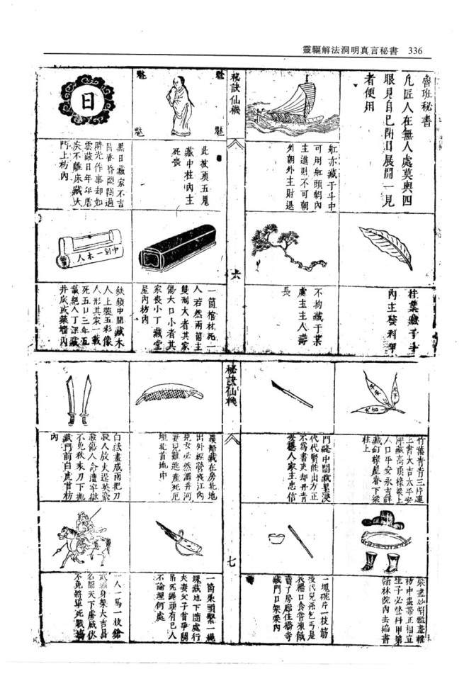
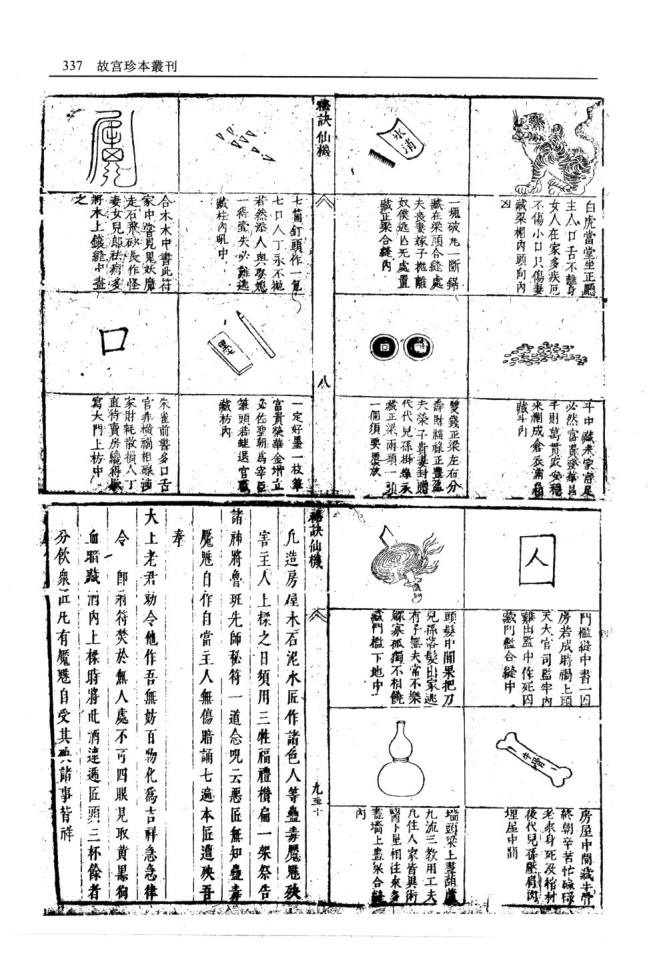
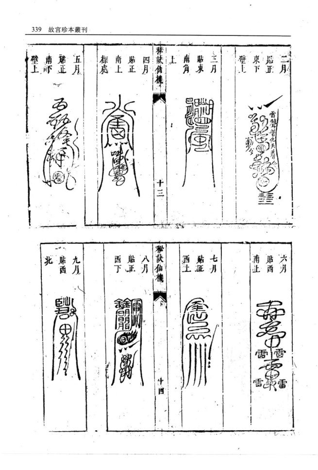
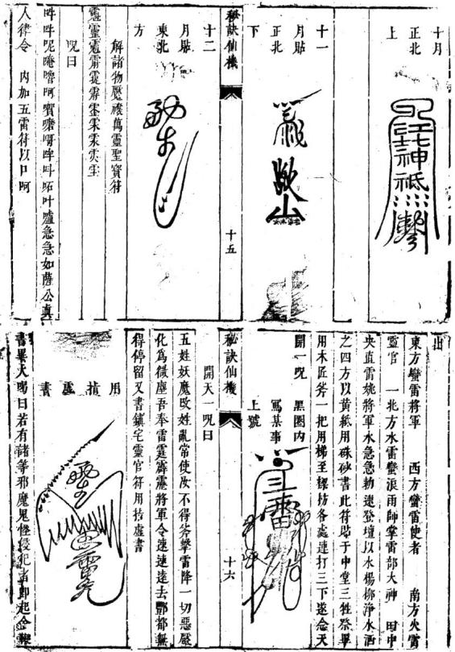

# 秘诀仙机

> 来源：410.入地眼全书+玉尺经+葬经+鲁班经+选择纪全+秘诀仙机.pdf，PDF 第 337–345 页

靈驅解法洞明真言秘書 唐李淳風代人擇日其家造屋淳風與之畢日乃十惡魔者必須有解前魘禳之書皆土木工師邪術蓋 大敗日言稱今日乃上吉日也遂與其書此對貼于柱邪者何能勝正是書所載諸法皆何句真言靈符 其日袁天罡同唐太宗來訪淳風偶見其立柱上梁天妙訣學者觀者勿得汚手開展各宜敬之凡有一 罡笑曰天下術士亂爲也太宗曰何也天罡曰今日乃切動作起造完日解禳之後則土木之覺無益矣 卜惡日也大宗曰可是誰擇之日遂問之其家對日如居舊室或買者賃者家宅累見凶事或病或口 淳風也天罡曰今在何處其家遂荅曰在右左寺山門舌或爭訟家中不和瞻夢魘呌見神遇鬼傷害人 口卜數天罡欲行其家留之侍以盛酒不數盃遂亂而日主意淡薄時常火發頻賊偷盜飛來等福敗家 行天罡與太宗曰臣聞淳風高士今虛傳也太宗曰可喪命之類並皆可禳能轉禍爲福百難無侵則永 去問其數看其知我爾乎太宗未至寺天罡先行見連秘訣仙機 訣傳機達安泰矣 風曰知我乎曰知也今日左輔臨寺是君也紫薇至寺因累試累驗特此挾升 差一時然卦屬乾二爻見龍在田乃君至也天罡曰今工完禳解呪 知吾來是真乃袁天罡前村上梁擇日是爾否曰然天呪日 罡曰今日乃十惡大敗日何不識也曰今日紫養臨吉五行五土相尅相生木能尅土土速遁形木出山卷 地諸凶神皆避也天罡曰紫薇在于何所曰將及至癸金尅神木精急退免得天嗔工師假術卽化微塵 也方說完太宗駕至入寺淳風拜伏于地大宗艮夫一切魔鬼快出戶庭掃盡妖氲五雷發聲柳枝一酒天罡對以立柱喜逢黃道日上來正題案養星之記一火盜清寧一切魔物不得番身工師哩語貶入入冥 一講明太宗遂扶起而還遂擢爲軍師今人家貼此是善奉天令永保家庭急急如老君律令 疵故事也

<!-- doc002 PDF 第 340–341 页：HTML 表格 OCR 供搜索；符图、器物图以原页图为准。 -->

<table><tr><td></td><td></td><td></td><td></td><td></td><td colspan="8" rowspan="1"></td><td colspan="2" rowspan="1">魯班秘書凡匠人在無人處莫與四眼見自巳閉日展開一見者便用</td><td colspan="1" rowspan="1"></td><td colspan="1" rowspan="1">柱葉藏手手內主發利甲</td><td colspan="1" rowspan="1"></td></tr><tr><td colspan="1" rowspan="1"></td><td colspan="1" rowspan="1">舡亦藏于斗中可用舡頭朝內主進則不可朝外朝外主財退</td><td></td><td colspan="1" rowspan="1">不拘藏于某虞主主人壽長</td><td></td><td colspan="6" rowspan="1">門縫中間藏墨浸代代賢能出方正不爲書吏却丹青安穩人家主忠信</td><td colspan="1" rowspan="1">0</td><td colspan="1" rowspan="1">一塊桃片一枝筋後代兒孫乞丐是衣禮口食嘗凍紙賣了房廊住橋寺藏門口架梁內</td></tr><tr><td colspan="1" rowspan="1">秘訣仙機</td><td colspan="1" rowspan="1"></td><td colspan="1" rowspan="1">长</td><td colspan="1" rowspan="1"></td><td></td><td colspan="6" rowspan="1"></td><td colspan="1" rowspan="1">七</td><td colspan="1" rowspan="1"></td></tr><tr><td colspan="1" rowspan="1">t      魅卷      卷</td><td colspan="1" rowspan="1">此被頭五鬼藏中柱內主死喪</td><td colspan="1" rowspan="1"></td><td colspan="1" rowspan="1">一箇棺材死一人若然兩簡主雙刑大者其家傷大口小者其家喪小丁藏堂屋內枋內</td><td></td><td colspan="6" rowspan="1">覆船藏在房北地出外經營喪江内見女必然漏井河妻見難逃產死厄理北首地中</td><td colspan="1" rowspan="1"></td><td colspan="1" rowspan="1">一箇朱頭繫一繩塊嶽地下隨處行夫妻父子嘗爭閱吊死繩頭有巳人不論埋何處</td></tr><tr><td colspan="1" rowspan="1">0</td><td colspan="1" rowspan="1">黑日嶽家不吉昌香昏悶問過時光作事却如雲蔽日年年虐疾不離床臧大門上枋內</td><td colspan="1" rowspan="1">4は一半γ</td><td colspan="1" rowspan="1">鉄鎖中聞藏木人上裝五彩像人形其家一載死五口三年五載絕人丁深藏井底或藥墻內</td><td></td><td colspan="6" rowspan="1">白法盡成雨把刀殺人放火逞英豪殺傷人令遭宇獄不免秋來刀下地藏門前自首枋内</td><td colspan="1" rowspan="1"></td><td colspan="1" rowspan="1">人一馬一枝鎗武身榮大吉昌名昭天下虜咸伏不免將軍死戰攝</td></tr><tr><td colspan="1" rowspan="1"></td><td colspan="1" rowspan="1">白虎當堂坐正聽主人口舌不離身女人在家多疾厄不傷小口只傷妻藏梁相內頭向內区</td><td colspan="1" rowspan="1"></td><td colspan="2" rowspan="1">斗中藏未家者尾必然富黃發華易子則萬貫災安穩米刪成倉衣浦箱跋斗引</td><td colspan="1" rowspan="1"></td><td colspan="6" rowspan="1">門檻從中書一囚房若成時觸上頭天大官司監牢內難出孟中作死囚蒙門盤合縫中</td><td colspan="1" rowspan="1"></td><td colspan="1" rowspan="1">房屋中間藏牛疊終朝辛苦忙礙碌老來身死没棺材後代兒孫壓肩芮埋屋中間F</td></tr><tr><td colspan="1" rowspan="1">浦</td><td colspan="1" rowspan="1">一塊破九一斷鋸藏在梁頭合縫處夫喪妻嫁子離奴僕逸亾无處置藏正聚合縫內</td><td colspan="1" rowspan="1"></td><td colspan="2" rowspan="1">雙錢正梁左右分壽財福祿正豐盈夫榮子貴妻封贈代代兒孫永蒙正梁兩頭一墓一個須要覆放</td><td colspan="1" rowspan="1"></td><td colspan="6" rowspan="1">頭髮中閒果把刀見孫落髮出家逃有子無夫常不樂蘇寡孤獨不相饒藏門檻下地中</td><td colspan="1" rowspan="1"></td><td colspan="1" rowspan="1">墙頭梁上聲葫九流三教用工夫几住人家皆異術腎卜星相注來灸蓋墻上盡合两</td></tr><tr><td colspan="1" rowspan="1">嘉訣仙機</td><td colspan="1" rowspan="1"></td><td colspan="1" rowspan="1">八</td><td colspan="2" rowspan="1"></td><td colspan="1" rowspan="1"></td><td colspan="6" rowspan="1">訣仙機</td><td colspan="1" rowspan="1"></td><td colspan="1" rowspan="1">九垂</td></tr><tr><td colspan="1" rowspan="4">V</td><td colspan="1" rowspan="4">七箇釘頭作一七口人丁永不拋若然添人與娶幾一得武失必難逃藏柱內吼中</td><td colspan="1" rowspan="4">筆  壁</td><td colspan="2" rowspan="4">一定好墨一枝筆富貴榮華金增立必佐聖朝爲宰臣筆頭若蛙退官職藏枋內</td><td colspan="13" rowspan="1">凢造房屋木石泥水匠作諸色人等蠱毒麗魅殃</td></tr><tr><td colspan="13" rowspan="1">害主人上糅之日須用三牲福禮橫扁一架祭告</td></tr><tr><td colspan="13" rowspan="1">諸神將魯班先師秘符一道念呪云惡匠無知疊壽魘魅自作自當主人無傷暗誦七遙本匠遭殃吾</td></tr><tr><td colspan="13" rowspan="1">奉</td></tr><tr><td colspan="1" rowspan="3">~</td><td colspan="1" rowspan="3">合木木中書此符家中嘗見鬼妖魔走石飛砂長作怪妻女兒原社藉多將木上鐵鏡中畫</td><td colspan="1" rowspan="3"></td><td colspan="2" rowspan="3">朱雀前書多口舌官非橫禍相釀涉家財耗散損人丁直待賣房繞得處寫大門上枋中</td><td colspan="13" rowspan="1">大上老君勅令他作吾無妨百物化爲吉祥急急律</td></tr><tr><td colspan="13" rowspan="1">令卽箱符焚於無人處不可四眼見取黃黑狗血脂藏酒內上標時將此酒達遞匠頭三杯餘者</td></tr><tr><td colspan="13" rowspan="1">分飲衆正凡有魘自受其諸事背祥</td></tr></table>

此符用殊砂書符貼正標上

黑圈內寫本家名字在內篤完以墨塗之貼符用左于持之點時莫詩外人說閒語貼畢下梯方以青龍和合淨茶米食化紙卽安家堂聖泉敖土地灶神居位遂念安家堂真言曰

秘訣仙機

+1

天陽地陰 二氟化神 三光普照 吉曜臨門華香散彩 天樂流音 迎請家堂 司命六神萬年香火 永鎮家庭 諸邪莫入 水火難浸門神戶尉 殺鬼誅精 神威廣大正大光明太乙勅命久保ム門 安神巳畢 永達大古家宅多崇禳解

多有人家內或達方帶來邪神野鬼家中魔袂之物邪鬼脫其形兒作怪移物過東過西負病人言語要酒要飯之類可用此符毗壹十二張按星盤方數妙法貼之邪崇永無速去麗禳之物無用矣

星盤方向定漏

前星盤定局皆貼符方法假如立春前作十二月簿氣一立春後卽正月節第十道卽從正東貼起未立春卽從東北貼起正東正西正南正北皆貼兩張東秘訣袖機 十二

南東北西南西北皆貼一張不可錯亂如錯亂貼無基益

五雷地支靈符

正月從正東貼起操上

<!-- doc002 PDF 第 343 页：HTML 表格 OCR 供搜索；符图以原页图为准。 -->

<table><tr><td>二月 疑 雷聲增化天尊 WR 東下 W 第 壁一</td><td>六月 特 雪 雷 貼西 O 南止 雪</td></tr><tr><td>三月 貼束 p</td><td>七月 最</td></tr><tr><td>南角 秘訣備機 十三</td><td>西上 十四</td></tr><tr><td>四月 貼正</td><td>秘訣仙機 八月 貼正</td></tr><tr><td>南上 標處</td><td>： 門 西下</td></tr><tr><td>五月</td><td>九月</td></tr><tr><td>第正 4 南 壁上</td><td>盐西 北</td></tr></table>

打 卯碎門神尸尉各宜本位本字 保太子 念畢誦雷經一卷

退青龍白虎朱雀玄武勾陳騰蛇太歲五方諸天星 衆化紙醋潭奉送出門畢

又安家堂土地灶神化紙于室內不可送出門外如此解禳永無災障以函化吉家道虞吉祥如意者
