# 地理指迷篇臆解

> 来源：413.地理正宗臆解+黑囊经+青囊心印+地学.pdf，PDF 第 113–178 页

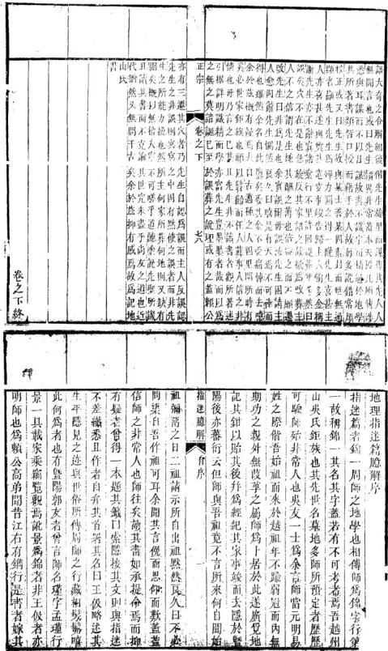

<table><tr><td rowspan=5 colspan=1>拔公石鏤山郡云事不目見耳聞而遺其有無可自見赏付人多連下</td><td rowspan=1 colspan=1>名又繆更其題爲索隱悖已吁所聞異辭所傳聞</td><td rowspan=1 colspan=1></td><td rowspan=1 colspan=2></td><td rowspan=1 colspan=1>地理臆解引言</td></tr><tr><td rowspan=1 colspan=1>異辭事不目見子所以致侮於石鐘也然吾之始</td><td rowspan=1 colspan=1></td><td rowspan=1 colspan=2></td><td></td></tr><tr><td rowspan=3 colspan=1>得是書也曰指迷則知爲指迷焉耳云周師作則知</td><td></td><td></td><td></td><td></td></tr><tr><td></td><td rowspan=2 colspan=2></td><td rowspan=2 colspan=1>譚地理者不一其家故難畫信面又不得不信似無可疑而又不得不疑不得不信者信於理之不誣吉</td></tr><tr><td rowspan=1 colspan=1></td></tr><tr><td rowspan=3 colspan=1>茸蜀作一氣顧何不思之甚也附贸</td><td rowspan=1 colspan=1>爲周師作焉耳索隱云乎哉王欽云乎哉顧其書頗</td><td rowspan=1 colspan=1></td><td rowspan=1 colspan=2></td><td rowspan=1 colspan=1>人獲吉兆凶人遇凶阡福善禍淫地順承天也不得</td></tr><tr><td rowspan=1 colspan=1>得蓋以師賦桌高妙博極羣書別具鑑錘獨琳神</td><td rowspan=1 colspan=1></td><td></td><td rowspan=1 colspan=1></td><td rowspan=1 colspan=1>不疑者疑於書之雜出前哲之書有洞達山川之原</td></tr><tr><td rowspan=1 colspan=1>悟故其所言竟大異乎所習見習聞者而又未經</td><td rowspan=1 colspan=1></td><td rowspan=1 colspan=2></td><td rowspan=1 colspan=1></td><td rowspan=1 colspan=1>本而吐辭爲經則平正通達而無病有偏見曲說面</td></tr><tr><td rowspan=3 colspan=1>閱同礙</td><td rowspan=1 colspan=1>刊鈔磨錯落遂致讀者圖於心而頸於不得其解</td><td rowspan=1 colspan=1></td><td rowspan=1 colspan=2></td><td rowspan=1 colspan=1></td></tr><tr><td rowspan=1 colspan=1>則竟祝爲河蘧或望若荊榛閱不數絲而厭倦違生</td><td rowspan=1 colspan=1></td><td></td><td rowspan=1 colspan=1></td><td rowspan=1 colspan=1>無識以權衡其閒而駕南轅而求北職則一誤再翼</td></tr><tr><td rowspan=1 colspan=1>東置高閣故其書不盛行於世而柜知其驗花威</td><td rowspan=1 colspan=1></td><td rowspan=1 colspan=2></td><td rowspan=1 colspan=1>勢將墮入於牛鬼蛇神之惡道而終其身不得出數</td></tr><tr><td rowspan=1 colspan=1></td><td rowspan=1 colspan=1>指迷薄解 自序         11</td><td rowspan=1 colspan=1></td><td rowspan=1 colspan=2></td><td rowspan=1 colspan=1>地理感解 引</td></tr><tr><td rowspan=5 colspan=1></td><td rowspan=1 colspan=1>集腋爲裘拓萬古之心胸抉雨閒之秘真愚者脉</td><td rowspan=1 colspan=1></td><td rowspan=1 colspan=2></td><td rowspan=1 colspan=1>知讀古人書者大耀聽之濫而所貴擇之精也余</td></tr><tr><td rowspan=1 colspan=1>知者珍於圓訓矣余初得是編悉心體究訂其訛姓</td><td rowspan=1 colspan=1></td><td></td><td rowspan=1 colspan=1></td><td rowspan=1 colspan=1>伯墜山氏久於其道樽觀而約守之閣斯世之日沮</td></tr><tr><td rowspan=3 colspan=1>什得七八又博徵同志所藏互相考賈定爲今本服</td><td rowspan=3 colspan=1></td><td></td><td></td><td></td></tr><tr><td rowspan=2 colspan=2></td><td></td></tr><tr><td rowspan=1 colspan=1>於邪也取地理正宗指迷二書由繹而詳明之以定</td></tr><tr><td rowspan=3 colspan=1></td><td rowspan=1 colspan=1>習之久第覺字縫行閒無非精蠱雖不敢謂盡合古</td><td></td><td rowspan=1 colspan=2></td><td rowspan=1 colspan=1></td><td rowspan=1 colspan=1>取舍而決從畫不矜奇而自奇不粥異而自異振聾</td></tr><tr><td rowspan=1 colspan=1>八而竊幸其有得也開爲疏所難明關所未發俾麟</td><td rowspan=1 colspan=1></td><td></td><td rowspan=1 colspan=1></td><td rowspan=1 colspan=1>啓順誠斯道之鐘鏞族於也示余一編余受而卒薩</td></tr><tr><td rowspan=1 colspan=1>者一目瞭然漢若氷釋祛其厭倦之心而鼓其信從</td><td rowspan=1 colspan=1></td><td rowspan=1 colspan=2></td><td rowspan=1 colspan=1>焉渙然冰釋怡然理願雖余於是道素未入門而今</td></tr><tr><td rowspan=5 colspan=1></td><td rowspan=1 colspan=1>之志庶後之學者咸知馳眾康莊而不遂於其所</td><td rowspan=1 colspan=1></td><td rowspan=1 colspan=2></td><td rowspan=1 colspan=1>忽授之鑰廷得登其堂而闕其奧始知俯察之學實</td></tr><tr><td rowspan=1 colspan=1>則蠶叢獨關師殆具五丁之力者哉是爲序乾隆用</td><td></td><td></td><td rowspan=1 colspan=1></td><td rowspan=1 colspan=1>有從入之塗而紛紛簧鼓蚓竅蠅聲徒滋嘈雜耳篋</td></tr><tr><td rowspan=3 colspan=1>午年仲春上澣山陰金六吉地山甫自言</td><td></td><td></td><td></td><td></td></tr><tr><td></td><td rowspan=2 colspan=2></td><td></td></tr><tr><td></td><td rowspan=1 colspan=1>而藏之其光熊熊知不可闕而有也亟謀付梓以公</td></tr></table>

<!-- doc003 PDF 第 113 页：高风险/复杂版面 OCR 供检索；内容与排版以原页图为准。 -->
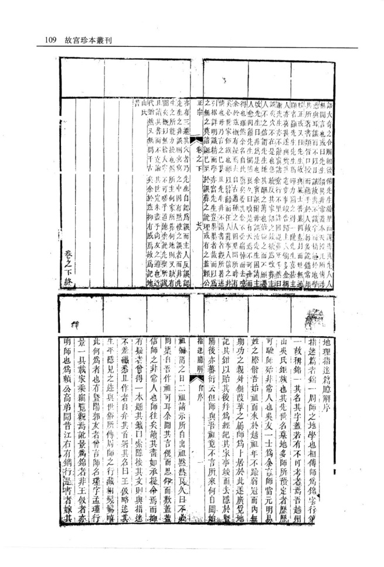

<!-- doc003 PDF 第 114 页：高风险/复杂版面 OCR 供检索；内容与排版以原页图为准。 -->
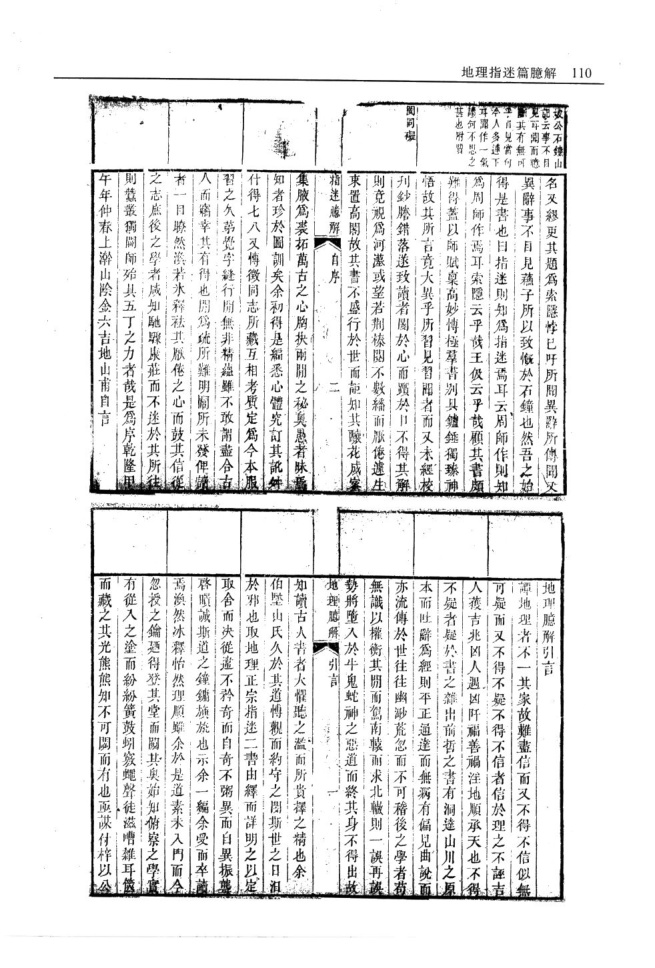

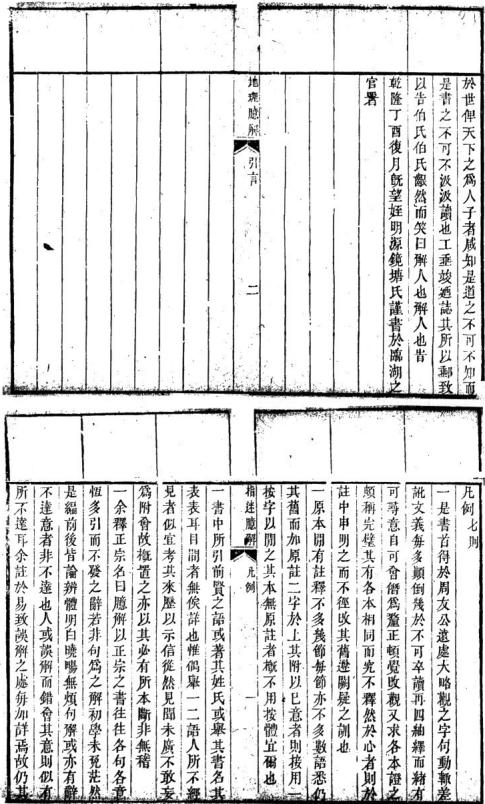

<!-- doc003 PDF 第 115 页：高风险/复杂版面 OCR 供检索；内容与排版以原页图为准。 -->
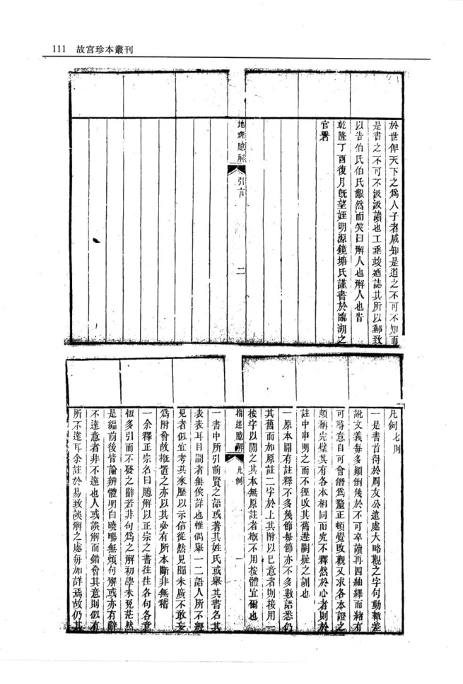

<!-- doc003 PDF 第 116 页：高风险/复杂版面 OCR 供检索；内容与排版以原页图为准。 -->
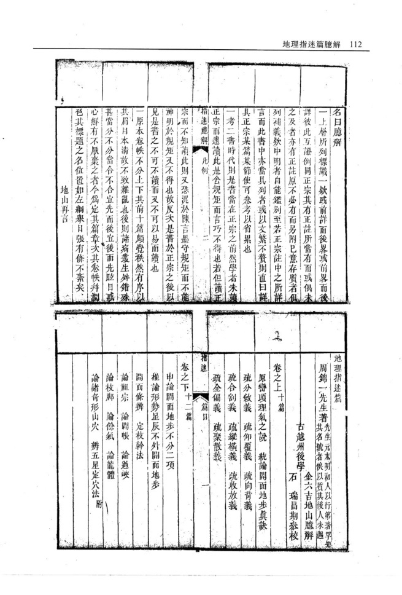

地理指遺篇卷之上 地山臚碑原巒頭理氣之說巒頭者不但星體凡龍穴砂水有形有勢可指可見星體與龍穴砂木皆屬屬 月 知故 言地 理者先察髻 頭 然所慨虞有如下文所云也星靈者山二形體也五星九星兒 賢以星言山如五星九屋之親特信星以定山 欲其欲之眞的以便於 取裁賢皆在形勢上分 地别之 蔗圳理推形聚散篇洋具 其變化謂其吉凶面不以方位言龍穴砂水四用孤來爲龍氣日爲穴砂則前後左布之山太隨龍出來會於穴前之水凡此者響頭內事所當推青囊經曰用寓於氣氣囿於形理者陰陽五 者也行之理氣者陰陽五行之氣形則山時水流之形也魏之上山之所以峙水之所以流何莫非陰陽五行之氣使之然與面其中有理存焉朱子所謂氣以成形而理福義青囊奧 語世傳咎 書 水理面原面面松著其發會 用寓於氣氣面於形二語實深得樂頭之縱竅蓋義岸皆以方爲陰陽陰陽狼而爲五行陰陽五行皆屬於氣 父趙及有素 本於朱予者也印者一元之理太極是也太極 而分位而言理氣寓於其中故曰陰陽五行之理之氣也山得以時之者也 得以流面道時之形卽書朔之所自昉是理有吉有內不以理推之不可得而知故理人設卦以明理用卦以推氣是之謂理氣則凡先天後天淨陰淨陽穿山透地坐度分金旺相休囚運氣歲時等就

崇首 補義易傅所 推入對方位 圖就原儀理 氣之祖而非 為求地者 乃地理家遂 以此爲卦 之先聲於是 盡屬升例由 其并總與封 例等說詳正 崇而旺相伏

指舉津水通於則面殊端方機後封面之 皆理氣內 世而之嫌旺之又得都謬值鍼天以逐人 之於得爱相宿有去殊已家推卦明末不 波糖失化休度六不其淨吉雨值理也知 靡頭董推因分十脊共阶必债也者故塘 寒而之無邀通金龍字神净先之主先周頭也 之不真干要氣则七山種陽假功流天師之言上 上可假涉赤成以十透不託此用行卦欲理理言 挽則乃尅時一二地合於以面就位力氣氣理 者有今探等百能要處病宜非装也儲面乃氣 固所之家說二之亦正甲就爲詳主其但羅是 已不論所所十用不宗而而尋易對非言經密 久問地當以之其外註揆因能傳待而羅方頭 二矣蓋者有附甲坐於中之以求是就先經位形 然惟事明子欠纭指病啓穴皆用舉之上势 則 此而氣何则頭聚甲身者以封其理之中 頭理 諸於穢多以面詳之設窥以概氣理之 就龍之事三理明本卦也造推如是氧型 爲六循也百氣可然侧後化氣此忘今 氣建破聚要六家考則之世之者設本骑此 递

孰重與曰巒頭眞者理氣確則獲福巒頭假者總合理氣反受殃咎巒頭眞者不因理氣不合而不發當貴巒頭假者不因理氣合而發富貴故理氣爲末事人故出長叶非淺爲浮蔡深爲卓然有見於胸中方流吞吐浮流此團大葬法也精進理氣之說以乘氣作向控制消納亦可效用於什一設巒頭未精便言理氣專要貴陰賤陽求合坐理氣家以十二陰龍爲貴十二陽隴爲寢此生夫墓 剝甲催官之說坐生夫袋則三合五行生旺知巳失其本 2然而奠之辨 矣其亦奈之 次之 此非引躬之本旨蓋又曰有體方自則專 木俱無人有哉 所重 在 此 句也故爲補 人第二篇 麓具正宗 則失體可不知所先務哉以 境岛仍生頭川决云项 爲體理袋為 之說 以以 理须 其则家而其覆明不傳氣理 氣不宜 甲屬 讹 面 猾反不方 以周妄显吉者書以致卿位势 堅口面盤凶矣中二肅其於舉 持便人以其即止者其非是自 洪籍不為真生能分所也有世以个 年 n 著面 得人 者 面 6 但義 似 無奈 站 俗 通能弹訣系端 無 7 及 [制理 陈位氧水景 所 專 所则就借其重堂不難其之不私 底具外得 盖於真 向 熟面 消精 项 理 文 惟面言方人 而指 参不 以 而貧有不堪自信者 此變

卷之上

統論開而地步眞訣

<!-- doc003 PDF 第 117 页：高风险/复杂版面 OCR 供检索；内容与排版以原页图为准。 -->
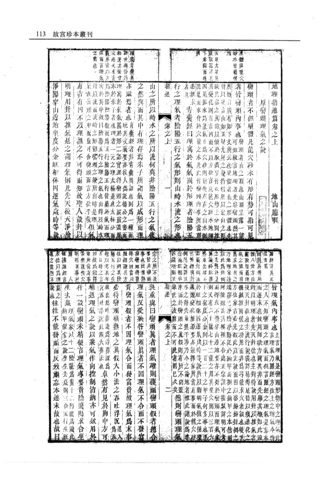

地之眞假大小何以辨之先觀開面之有無而便 知眞假之權再觀開面之多寡大小及地步之廣狹則之大說他書多有順惟此書詳悉言之且無 處不開而多自大地步自廣少面小地非自狹及字勿混何謂開面止以分斂仰覆前背令御八字察之分而不斂仰而不覆向而不有合而不當者爲開面反卽不開面何謂地步只以縱橫收放全偏聚散八字

者意因券地 也取人之音 而人明末 萌所淨有 之如

分敏篇第

云 庭分金濃

察之縱長橫廣收小放大局全而聚大者地步廣縱 雖長橫不廣收雖小放不大局偏而聚小者地步狹 常舉百勿 水 面 地步 而地步 y 不 宁 面则 於著書蕭高于古才高千古矣

## 疏分斂義

何謂分斂分者分開八字也無个字不成龍無分金不出 账 有 分金之照 批 个 分 行恭默處要成星 八字是分字之 金可大 面蒸翻分金又是分四 字之註闕意只一申指分 项 分 金 者分卷之上

之所自昉 之明二之之方之 则乃上有内象字 清百 一 以分分有十 分 金 之 则个 字 中 出諸 書 謂但字皆 金在下明之大之然 有故分公金有旁議 字小砂他 之其而 之内单惟 此 则势 言 之 金之文足中蓋 个之 直 字个正 脉 之 出形顯 有 人分 字 下不 所以李形甚徽 郎无分開處皆 二 畫象護帶 旁二 小 鄂 贴 蝉名金面亦不 康 山志 也 具 在 M 川 有 之 面 以其可過泥 概有 之命面其行度處 不拘此 穗之字非人 非 1 不 可宜 撤捺 作 人字八二月 人字八字處仍 讀本字 人字八 学而起如爲腳览 牽緣說詳仰覆篇貫側 下

<!-- doc003 PDF 第 118 页：高风险/复杂版面 OCR 供检索；内容与排版以原页图为准。 -->
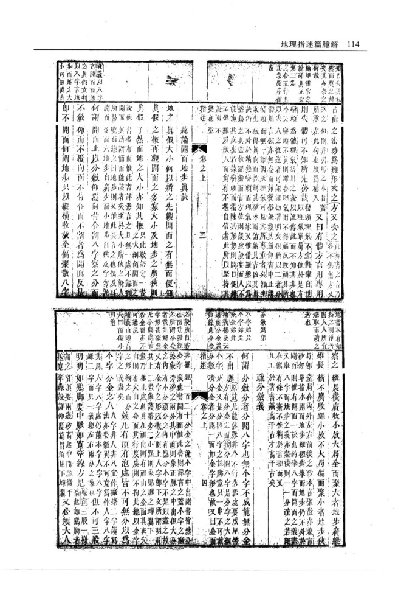

之內有小人願 之內有隱人 此四人字亦作搬 故 榛字用以後倣此 主星始此 有大分小分顯 隱分之不一大分者自主星頂上 大八字謂之 明石明易 分開大八字謂人明肩則肩之內又分半大半小八 字不論條數多寡均間之護帶護帶之內貼脈分小 小八字刻之 蟬翼 八字謂之蟬翼 初祀若無細看則有邊者便非 名卽明局護帶隱分者卽蟬翼隱而更隱者謂之肌 之肌脛艸甯 又頂下胸 慶問所起與泡或分小八字或分隱八字謂之金魚 金魚砂事謂 烁莊此突地上所起之巳上乃來龍降 蜻翼 砂亦謂暗翼 砂此蟬翼砂又畧短 指送 卷之上 五

穴星亦日主星今上言主星而此又兼言禮山穴山則自起祖以至入首凡起頂鳳面出厭者皆可謂之分鄉翼砂爲 星而兩南邊隨從又有臨穴之際或分蟬翼砂而屬 之山爲輔星也孔突穴分牛 所砂爲窩銷 乳突之穴或分牛砂而成窩鉗之穴蟬翼牛爾之穴穴星則單指穴山言乳突陰穴 宮鍾陽穴詳具下卷關面條辨 分方不飽硬推此序 亦有乳突無蟬翼可穴熙名爲色鹿 明次死牡砂 穴之蟬真牛角肌理刷開總謂之牝牡砂砂金面二字始 步之陰砂還此 穴上要分穴下裂合分至此而盡故山分盡按迤節皆言砂之分不及木之分也然砂分則本亦分水 入於穴三堂三合互 上合於穴下一合雋小堂再合爲中堂三合為大堂詳合判篇註 但見其合而不見其分故此分爲分之盡亦謂分金之面句只指穴酉不是荒結上文巳上櫛總舉分字之名下則逐項分疏其義興屑卽大八 字名義 何謂明石如人之雨有如飛烏之兩翼又如金字之都皆非援穴山上兩月張開歌而易見放曰明月至穴旁兩翼緊貼 不十分明颐枝日暗翼常解戲也今此以明肩屬大八字時翼為金魚砂又是一期 原橫面無肖落脈其穴必假越先賢以星名山故凡大小山頭皆日星辰要卽山 頭之別名也勿泥橫龍降脈廣指迷 卷之上

大八字則龍氣旺盛結穴必大却無大八字而落脈謂火亦小離以爲假或未夢然蓋其橫處亦自其以起大八字耳 問之涉但不特 如無大八字者或大八字少一邊者被角見下牛 角砂弦變註 或十八字無稜背面者或大八字差不齊者或大八字一邊背我者或大八字之人上自分个字以成龍不爲我用勳者或大八字之內無隱八字者皆帳模迎送繆 不成地有至大之八字帳幙迎送繼護是也三台處下諸 卽帳又面像辨褒帶名義 何南襲帶以其形如帯乖爲正脈兩邊之護從也也

<table><tr><td colspan="2" rowspan="2">周腳大星</td><td colspan="1" rowspan="2">乖一脈旁分數條顯然可見者爲罰大星橫山公調故必須護壽扶此併開廓大星百如無護帶謂之出脈無地步護帶不豁關爲三項</td><td colspan="1" rowspan="2"></td><td colspan="2" rowspan="2">化生舞解見</td><td colspan="1" rowspan="1">翼尾緊貼者三股隱然難明山頂之蟬翼舒者多面貼者少穴旁之蟬翼貼者多而舒者少開腳星辰頂</td></tr><tr><td colspan="2" rowspan="1">华题度</td><td colspan="1" rowspan="1">上化生屬無蟬翼者界水必貼脈透頭爲貫頂脈斷</td></tr><tr><td colspan="2" rowspan="3"></td><td colspan="1" rowspan="2">反抑入者謂之斂背所裏者皆是原註或直生或四惟外背內面先</td><td colspan="1" rowspan="2"></td><td></td><td colspan="1" rowspan="4">卯颜向空各詩後筒買頂臘</td><td></td></tr><tr><td></td><td colspan="1" rowspan="1">明明如鷄脾餘范界</td></tr><tr><td colspan="2" rowspan="1"></td><td colspan="1" rowspan="2">分關而尾師入者不忌護帶無背面者爲閒砂一邊先分間而屋攝入卽所謂條條直生則此處並無正脈有何護帶一邊背我者背向裏也背向裏則面必向外正賑自在所向一邊而我本身亦爲從中小星反不拘護帶有無用有帶故皆不成地也尖員方之正體星辰常無護帶原注面體辰必有鹿理刷問故不須嫌</td><td colspan="1" rowspan="2"></td><td></td><td colspan="1" rowspan="2">若得厭如魏毛之仰砂如手臂之同者亦能結地按貫頂賑是不分三股只有一條從頂上直硬面下其分三股而明則如鷄腳者齊爲貫陷但與不分三殿者略有分别故又以仰覆向背之法參觀之蓋仰而之向自可覓地其不分三股者無論也</td></tr><tr><td colspan="2" rowspan="1">正體星辰</td><td></td></tr><tr><td colspan="2" rowspan="1"></td><td colspan="1" rowspan="1">指述   卷之上        名</td><td colspan="1" rowspan="1"></td><td colspan="2" rowspan="1"></td><td colspan="1" rowspan="1">指迷   卷之上       八</td></tr><tr><td colspan="2" rowspan="3"></td><td colspan="1" rowspan="7">系護帶有生於明肩之外者總要外背內面方眞明局外有砂包纂重重均爲送帶按正體星辰本身不生龍虎卽大星而不開腳者然自有大龍大虎竈遠作護卽無護帶斷非才然孤立後恐在明眉內者穴山所見在外者則穴山所不見要亦爲穴山面歲故亦爲護帶何謂蟬翼以其所分至隱如蟬翼之至輕至小而貼一說蟬翼謂大砂之內有小砂如婦硬翼之下</td><td colspan="1" rowspan="3"></td><td colspan="2" rowspan="3"></td><td colspan="1" rowspan="1">蟬翼蓋</td></tr><tr><td colspan="1" rowspan="1">蟬翼非頭所生非頂上就分三殷乃離身一叚而生</td></tr><tr><td colspan="1" rowspan="1">者也如一邊先去一邊後分爲蟬翼參差一邊有糶</td></tr><tr><td colspan="2" rowspan="3">蟬翼名義</td><td colspan="1" rowspan="1"></td><td colspan="2" rowspan="1"></td><td colspan="1" rowspan="1">翼一邊無蟬翼者爲邊有邊無皆不成地若一邊雖</td></tr><tr><td colspan="1" rowspan="2"></td><td colspan="2" rowspan="2"></td><td colspan="1" rowspan="1">無蟬翼而得肌理之分者亦能成地但肌理之分甚</td></tr><tr><td colspan="1" rowspan="1">微與邊無不甚相遠亦須以脈之仰覆砂之向背證</td></tr><tr><td colspan="2" rowspan="2"></td><td colspan="1" rowspan="3"></td><td colspan="4" rowspan="2">此之輕小壁身爲正解二體舒者上半貼於身至翼尼則分開兩片於旁點</td></tr><tr><td colspan="1" rowspan="1"></td><td colspan="2" rowspan="1"></td><td colspan="1" rowspan="1">滿而肌理之分者不拘蟬翼之有無皆可論地雖肌理</td></tr><tr><td></td><td></td><td colspan="1" rowspan="1">者連翼尾緊貼於身上翼尾分開者三股井然可</td><td colspan="1" rowspan="1"></td><td colspan="2" rowspan="1">毬簫名義始</td><td colspan="1" rowspan="1">分則氣自清故可無鄉翼拉結穴之處上面微與爲毬毬下凹入雨何徽抱爲信館下是穴後言毬簷不</td></tr><tr><td colspan="1" rowspan="2">乳與穴法註下關面條科le肌理刷開名義</td><td colspan="4" rowspan="3">其後孔法中何謂夙理刷開以其所分至隱如風膚之欽理又如歷上以廟帝作分開之勢原符此等皆形仔通象能身之砂有2中名社特然分謂之疾影無顯然分周之枝條拔肌理蓝n認龍認穴斷非一雖盤所能了事又按刷理之形言其左右前分如嗣作分開之勢非</td><td colspan="1" rowspan="1"></td><td colspan="1" rowspan="3"></td><td colspan="1" rowspan="3">始平二字始金魚砂名差時降足辰</td></tr><tr><td colspan="1" rowspan="1"></td><td></td></tr><tr><td colspan="1" rowspan="1"></td><td colspan="3" rowspan="1"></td><td></td></tr><tr><td colspan="1" rowspan="1"></td><td colspan="3" rowspan="2"></td><td colspan="1" rowspan="1">凡有項辰與節</td><td colspan="3" rowspan="1">有泡出脈結穴處皆不可少在低小正體星泡毬簷之無護帶蟬翼者固全賴此隱然之</td></tr><tr><td></td><td colspan="2" rowspan="1">分分</td><td colspan="2" rowspan="1">星面卽</td><td></td><td></td><td></td></tr><tr><td colspan="1" rowspan="1"></td><td colspan="2" rowspan="1">指迷</td><td colspan="2" rowspan="1">卷之上       九</td><td colspan="1" rowspan="1"></td><td colspan="1" rowspan="1"></td><td colspan="1" rowspan="1">指    卷之上     +</td></tr><tr><td colspan="1" rowspan="3"></td><td colspan="2" rowspan="2">來龍身酉制單護帶師</td><td colspan="2" rowspan="2">上言穴卽高大關腳星辰與節泡毬簷之有言穴山異者亦莫不藉此鹿理隱然之分若未分蠅</td><td colspan="1" rowspan="2"></td><td colspan="1" rowspan="2">风砂名義</td><td colspan="1" rowspan="1">明眉之邊短股明局之邊短股暗者同則無妨暗前未道及</td></tr><tr><td colspan="1" rowspan="1">牛爾砂名義</td><td colspan="1" rowspan="5">何謂牛砂以其環抱如牛角也窩鉗之眞假全在有一緣高起彎袍向裏也按弦稜一書作員輪以其一線高起其員如輪也實同面名異者意以音之相似而致訛耳員輪之論爲是說詳正宗高起母輪之必須外背內面面背南垂有爲河故又日稜勇交界之際對望之若有稜起者爲有弦稜若無背無</td></tr><tr><td colspan="2" rowspan="1">翼之上</td><td colspan="2" rowspan="1">無此則必裹殺而剛飽已分蟬翼之內無此</td><td colspan="1" rowspan="1"></td><td colspan="1" rowspan="1">强稜始此</td></tr><tr><td></td><td></td><td></td><td></td><td></td><td colspan="1" rowspan="3"></td><td></td></tr><tr><td></td><td></td><td></td><td></td><td></td><td colspan="1" rowspan="2">正宗十六篇金星</td></tr><tr><td colspan="1" rowspan="1"></td><td colspan="4" rowspan="1">則必不然而硬直何能使脈路穴情有分金之平面夫山之貴有疏音竅一頭昂起也分者以其能盪開粗硬之氣於爾旁使中間之賑路</td></tr><tr><td colspan="1" rowspan="2"></td><td colspan="4" rowspan="1">有脫卸而欹泛也明局稷帶輝翼之分但能盪開灶</td><td colspan="1" rowspan="2"></td><td colspan="1" rowspan="2"></td><td colspan="1" rowspan="2">起之勢無改積者卽是塌更不起有弦陵則水自爾分氣豈枝則冰必之格定是殷明股暗若一邊今無則無邊之界水</td></tr><tr><td colspan="4" rowspan="1">重至粗之氣惟肌理刷開之分則內外粗硬之氣俱惟靈關而後有分故戰其分面期其能脫卸淨盡便之盪間也所以當分之故滿得卯</td></tr></table>

<!-- doc003 PDF 第 119 页：高风险/复杂版面 OCR 供检索；内容与排版以原页图为准。 -->
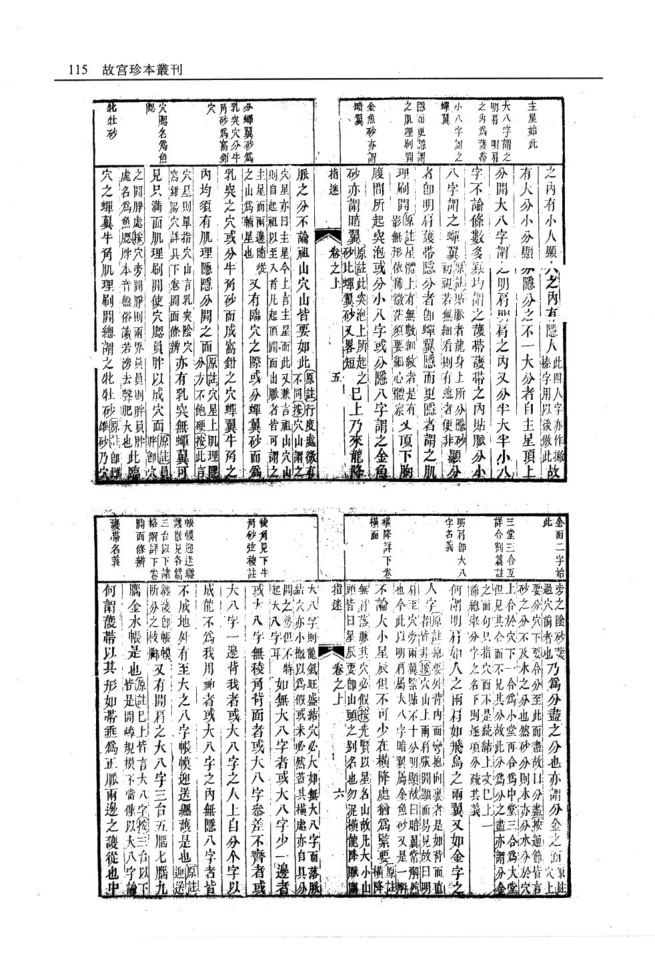

<!-- doc003 PDF 第 120 页：高风险/复杂版面 OCR 供检索；内容与排版以原页图为准。 -->
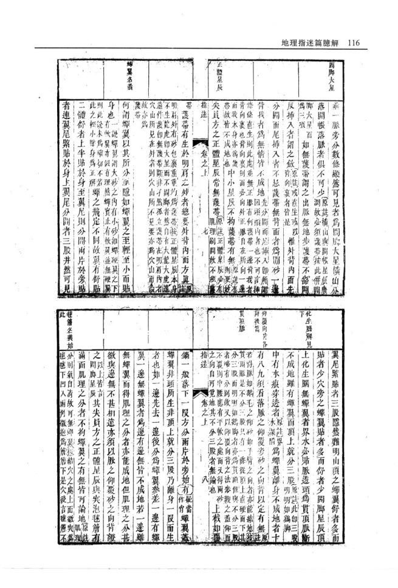

<!-- doc003 PDF 第 121 页：高风险/复杂版面 OCR 供检索；内容与排版以原页图为准。 -->
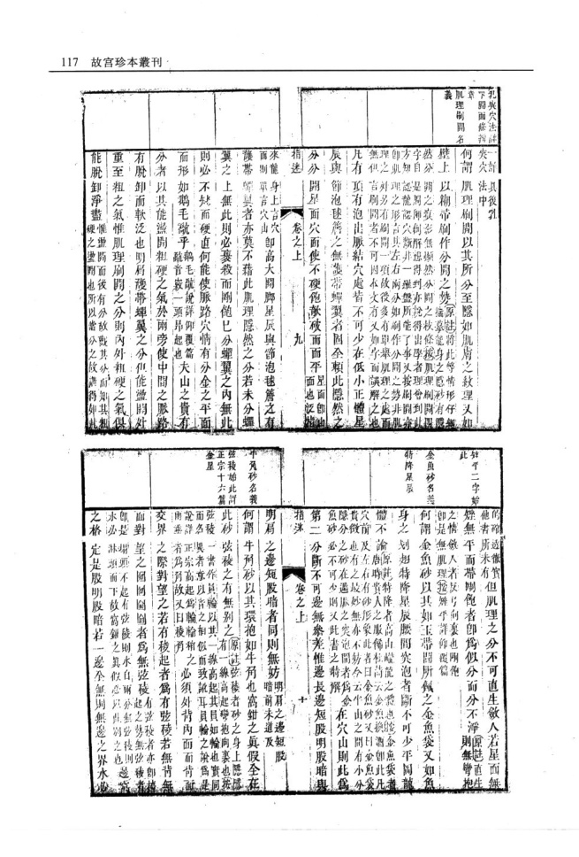

有必要周審缺一不可下卷開面條 說詳後窩鉗穴法中何謂牝牡砂以其瓏總臨穴後隱躍蔽穴旁如牝壯側之合 一以檢龍身 上之大 界水使不削按牝牝砂卽穴旁之蟬翼牛角肌理也蟬翼非服印象其形牝莊取其義意以牝指砂言牡指穴吉砂包穴外穴在砂巾如乾牡之父孕也有以左右分牝牡者非足無蟬翼之牝牡雅可無肌理刷開之牝牡斷不成地蓋有無蟬翼但得肌理刷開之而而成穴者未有無肌理刷開之面但得蟬翼而能結穴之理蓋肌理刷開者土內之敘理指迷 卷之上編曦但云肉 理便是似可 如牛肉理之斜生雨滲入土從斜生處分去壙中無水而有氣肌理不刷開者土內之紋理如牛肉理之直生雨滲入土從直生處渗人壙中有水而無氣中之水戊斜去或直來未知果如此否然說來實是在理信而從之自當無鄉然橫中之水有爲純陰之氣土理之分開不分開別之則有氣無氣亦以土理之分開不分聞別之矣凡天下之有生氣者人物草木生氣者陰陽薈合冲和之氣也人物草木此氣則生不得此氣則死維地亦然得此氣則凝精而爲穴 不得此水蝶生總弗者人草木之生氣也前後言有氣無氣皆卽此氣

有生氣者手足眉目羽毛鱗甲枝葉蒂瓣顯然之形體固無不分至於寸膚寸肉葉一擴合列合內隱然之紋理亦無不分苟只有顯分而無感分是猶塑盡者然雖有手足屑目全無生氣何能知覺而運動乎星辰雖有明肩護帶而無鹿理刷則之分則爲塊二字 然齋然之體何龍有星面穴而之動氣乎氣生 氣氣生測動死則不動故又目動氣蓋觀其動而可知其生也 然則穴中有石無石又將何以别之曰亦在蟬翼肌理之分可別有此分者則硬之殺盪間於兩邊中間有姓有平硬間包軟必然指迷 卷之上 三石八字 無石縱有石亦必如八字分開其石必軟不謂之殺無此分者剛硬之殺裹定於當中必無雉無平而他便卽無石而純土故也振有分則燃平有作則軟而無不無分則而辭達只子分石皆於此乎舞石之山或從直生下或從旁插人其殺極重惟有石八字分間而有眞姓眞平者穴中雖有浮石不碣蓋石 浮石其下必有眞土此石應名橫蓋不俗人訛呼黃甲石面檄詔不吉湯也姑備此 就以質則者

<table><tr><td rowspan=1 colspan=2>分豐之義</td><td rowspan=3 colspan=1>何謂分盡之分以分則金而之中仍有分水之春顯分曰蟬翼銀鬚砂之憑分曰九理刷開中間不復此分盡之處也故曰分盡之處乃結穴之處翼言砂之蝦類是言水之分此衡在毬倉之上見制開之則又在毬善面上維顧之分至於此則不復見脈迹之起乃爲穴之處也何謂分金之面以穴後毬簷顯然者猶如覆鍋隱然</td><td rowspan=2 colspan=1></td><td rowspan=1 colspan=1>字名義</td><td rowspan=1 colspan=1>其明肩護帶蟬翼肌理一不自內分開反自外插入者批英爲或有大人而無隱人有暗翼而無明肩或邊有</td></tr><tr><td rowspan=3 colspan=2>夢嶺水詳下老發脈節金面名裘</td><td rowspan=1 colspan=1></td><td rowspan=1 colspan=1>以冰雖鐵親康律縮極繡錢站如領準认橋雖頭氣則生氣不行與分相反分者是陽氣發得生長之象</td></tr><tr><td rowspan=3 colspan=1></td><td rowspan=3 colspan=1></td><td rowspan=3 colspan=1>斂者是陰氣收藏省殺之象故自穴山以至太祖皆市环林以時體架姆面胎面鐵球制域研俄环區也指述卷之上茵</td></tr><tr><td rowspan=1 colspan=1>者如泥中鼈穴前對望猶如金字面俗之金星楊</td></tr><tr><td rowspan=1 colspan=2></td><td rowspan=1 colspan=1>指遙  一卷之上       州通</td></tr><tr><td rowspan=1 colspan=2>俗云金星卽稱公所謂乘金之金</td><td rowspan=2 colspan=1>原志卽穴之公謂之乘金其劈中處是分金之中也中心按此解其名耳乘金亦卽生九金星面立穴也之中是照穴之中未分盡而急捲之曰鬬原註是純陰處捲穴上云急則下後樞後字只作談字旁捲之曰偏史明望闕則湊殺脫則無氣偏過一</td><td rowspan=2 colspan=1></td><td rowspan=1 colspan=1></td><td rowspan=1 colspan=1>之全然無分者亦少似分而非眞分者最多顯然分關敘入者易見隱然分開斂入者難明或大分小分似乎俱備而地反假或顯分隱分似乎有缺而地反</td></tr><tr><td rowspan=1 colspan=2></td><td rowspan=1 colspan=1></td><td rowspan=1 colspan=1>眞諸般疑似之間惟視其脈路穴情如仰鵝毛之如寬牽縣之軟兩差輔砂如側手臂之向者必眞脈路穴情如覆鵝毛之飽如急牽線之硬兩邊播砂如</td></tr><tr><td rowspan=1 colspan=2></td><td rowspan=2 colspan=1></td><td rowspan=1 colspan=3>也如花心之接於花帶又曰點穴之法在貫於一糧之來而處於至中之地非分盡之處係分金之中是</td></tr><tr><td></td><td></td><td rowspan=1 colspan=1>穴之意乎</td><td rowspan=1 colspan=1></td><td></td><td></td></tr></table>

<!-- doc003 PDF 第 123 页：高风险/复杂版面 OCR 供检索；内容与排版以原页图为准。 -->
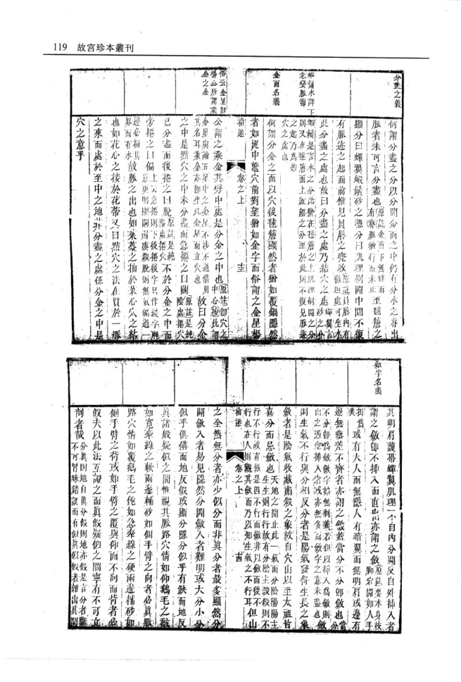

自背之法恭觀之合平北 財又易於錯韶言分之法 不幾窮矣乎而又以仰覆 則似假而實非假不合乎 曰內層之護帶蟬翼當小外層之護帶則眉當大今此則似眞而究非眞分之 假信而有徵立法之審誠無過此書者卯禹毛等名 與假可以意會而地之算 相同如稷欄葉四曰後龍山頂蟬翼胤理之分邊有仰覆篇手臂 義俱洋 願進一邊有則生氣從五見向背篇 後篇 邊無半邊界水夾脈透頭 有一邊落下故無妨凡分敘之病共十有八其至凶而不能變吉者有十 曰無金魚砂或邊有邊無此五者得前後龍節節開分敏十八翁 邊面脈路段叚笙平旁砂面面相向唇口分明局勢環秋三日大八字少 邊四曰大八字園圗無稜角 四尚卽無背而無五日大八字之內無蟬翼又無肌 背面師無發所 聚難有一節之疵不減眞龍之力下之使節其 之中不無小疵同未可經祝之也 百前後節節集硬覆又無蟬翼 七日 盡笥節分枝枝枝成地之處其分龍處之大八字讓帶外面內背或無背而或自外插入八曰蟬翼差 帶一邊背我者亦不可棄 原註就化多者砂木不龍 處處拱顧果龍眞穴的卷之上 卷之上 共金魚不齊九曰到穴無分金之而或牝牡缺一十口 或有背無跡歲將盡自是大龍盡處將起則非言起 訊之處或中腰待起或遷映再起皆是若老禪起處三一日大八字一邊反背二曰大八字自分个字以 出數節開面吐唇本身枝腳不顧人者亦成中下之成龍三日大八字反小而不單其小八字此三者得 地又儀北節所畜十八下面博出星泡有分金之面脈路仰而不覆穴情而 理會得者雖無圖而亦可而不飽左右向面不背砂水聚集者仍有小結不可 而其細曲折處同 出拘泥之人崔多鵲突且去之載之好處故 爲小結之地 雖有病面不傷大體者五一日大八字 或曰從來只有分合二字今分字下添入斂字合字一邊倒稜二曰木身能出被從龍之砂自外插入 下添入割字何也曰如向背仰覆聚散六字一好一

反俱以相反者爲對獨分合二字俱是好的故以斂字易合字爲分字之反謂穴上上只宜分開不宜歙入穴下分開人必下取故合不必尋相反之字爲對惟割腳與合腳相似合腳吉割腳凶故以相似而非之割字與合爲對也

或曰斂字與合字義似相同而云忌斂者何口合字 穴前始用之 此一語須突緊理會合明傳穴不合則 非穴一龍之來未見眞合面遺下其穴 皆為赤急自穴後毬簷以至後龍太祖一見斂入生 而傷館 且合者先自內分 歛入非因入而不來也 卷之上

開外背內面而環抱其內也歛者竟自外挿入或外面內背或無背無面而掃入故爲有別

或曰但聞穴旁有蟬翼未聞山頂祠山有蟬翼曰董小龍能出 學德彰云出身處有蟬翼護帶前去必結大地出身者 分龍出身詳太祖分龍處也則蟬翼豈止穴旁有哉

或曰肌理刷開未嘗聞之曰橫看壁面直指斜膚髣髴有無此古人之語非肌理刷開之謂乎二句解幣 二句頗覺其微分之迹竟如壁面之直削直指者 朝之也對觀之則畧見有狼影之分如肌膚之斜理以爲有則如駕以爲無剛實有故目場韓有無也然云斜虜則地有寫重之勢若一平如畫而不見其婢者則又非作分問之義矣或曰顯八字之內不可無隱八字固已但隱八字如蟬翼者或可見如胍理刷開者恐草水慕蕪或種抽開損雖法眼亦難明且見山之个字三殷者多豈畫爲鷄腳假个字乎曰但觀山頂上截有一叚平面如覆錄 之形 無陰春透頂有姓有平落一叚方出服如實有有年三旬牵線者定是有隱八字的這便是脈 卽申說上二句不作若陰春透頂不先作一姓之勢而出脈如急十六

牽線如覆鵝毛者定是無屬八字卽有亦是砂眞人 字必平而無春其上截必有肌理隱分所辨離兩 不進然分作三股故有平面假个字必渾而有春 其成其上截無肌理隱分卽核然分作三股故年 有春定 或曰同在此山中何謂自外抑入卽挿入便何妨曰 如人之眉目自印堂分開法今從鼻旁分出爲自內 分開方像箇人設眉日自太陽生來法令自兩頤生 進爲自外插入便不像人又如七果之細杖有數片

<!-- doc003 PDF 第 125 页：高风险/复杂版面 OCR 供检索；内容与排版以原页图为准。 -->
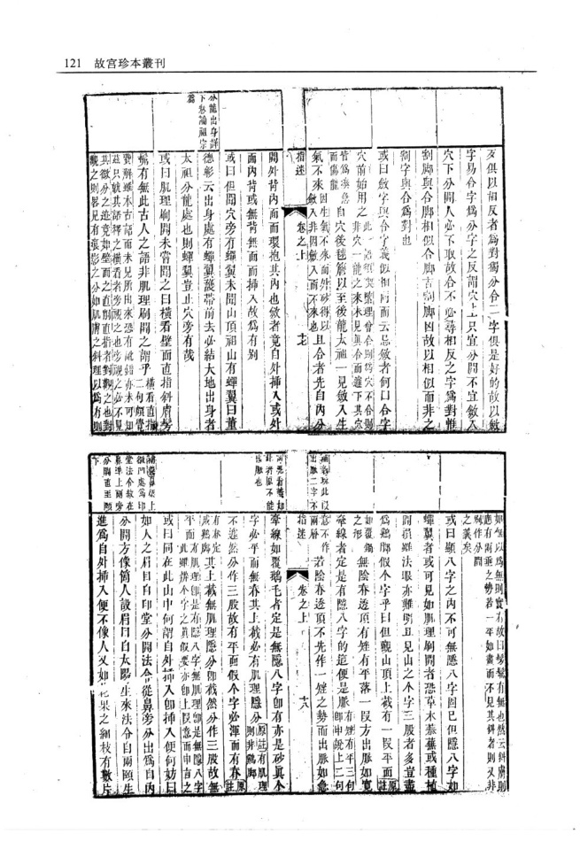

嫩葉一朶花辦從木枝蒂分出為自內分開方成花果或木枝無蒂無辨或雖有不全被旁枝之葉挨入我枝爲自外插入便不成花果故大小八字要在本身之頂或在本身之肩先作分開之勢然後環向其身者爲自內分開故能成地若貼脈不光作八字分開隔了一股之砂竟從旁插將進來爲自外挿入斷不成地自內分開而環向其身者定是外背內面自外挿入而唐突乎我者定是內背外面或無背無面若其本身已有大小八字自內分關隔山之砂自射指迷 卷之上挿入則不忌但要面向我爲眞本身有大小外八龍掃入此謹尊言其弊耳勿況且面果向我賜自不算抑入也或曰龍格中惟有梧桐枝雨邊均勻蒹葭杞梓楊柳蒹茂枝杞梓 枝也愚無者 等枝非參差不齊則邊有邊無其福力雖不及梧相也 枝未嘗爲假今以邊無差爲假得毋悖乎曰彼所指扶和不可 論者行度處之枝腳橈棹也余所論者開而處之大分作雨项註 中卷論枝馬 小八字也邊無參差之不妨者以前而分龍人首開分龍入黃詳 公 而成尼自有明有暗翼齊分者在所所則入 等 前而則相桐枝等格還在後面火龍身上去我

梧桐枝亦假島龍成地武旨首分 龍入首言或曰分斂之法以定地之眞假亦可辨地之大小否日但觀其始分再抽之際分以再 起八星處言八字大護帶多者前去必成大地大八字小護帶少者前夫必成小地

或曰十六字中首刻分字者何曰分字卽開面之圍字未有不分而能開面者也況地理之理令在因分面得者也地理之理卽文理之理猶言脈絡條理也文理文字傍須加系則爲條理之理若但云文理 恐混到義理之理去爲後世理氣家之所藉口 使卷之上

不有分何能有厭絡條理乎聖人之俯察亦因服絡條理而得祭之故分字爲首重云

兩分開金 或曰子言無分金不出厭豈木火土水無脈乎曰五細金字原像人小八字之 星之形體不同分金之而則一長些便是木之分金非五星中之 災些便是火之分金方些便是土之分金曲些便是金字也水之 水之分金皆有分金之面卽是五星之脈 原莊星體分余火之分 難不同金等語似不客脈必成金周做日分金

或曰子言分金之中是點穴之中若金星弔角穴閃薄邊者豈亦在分金之中乎曰弔乃者因當中不出

<!-- doc003 PDF 第 126 页：高风险/复杂版面 OCR 供检索；内容与排版以原页图为准。 -->
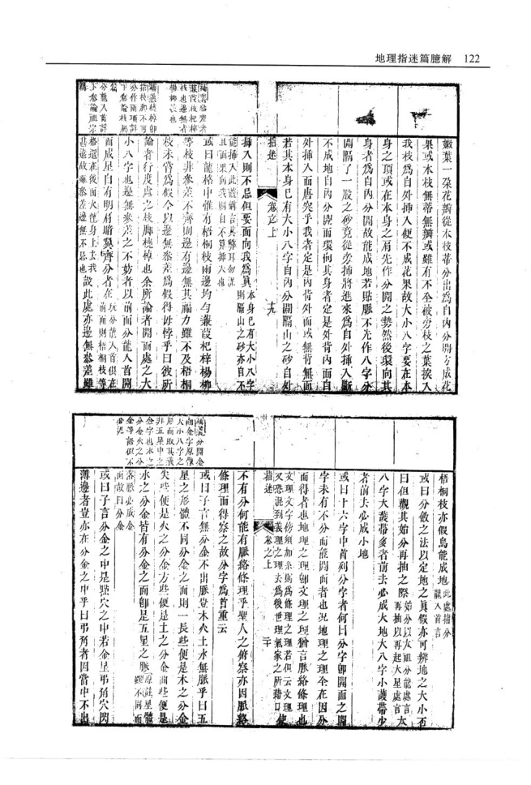

脈閃歸个字之人邊出脈而隱然分金之面在上也原進金尾市爾大金之旁另有卜令星也穴閃在雜其火掘於小金星之中壹非分金之中乎邊者因分金之而閃歸薄邊故當中厚而死如人偏面一般雖非折量之中然其中又自有中者在而據穴安棺未嘗不在分金之中也 此一條最有力中字 源活所語鹽時以處中也若泥定處爲中反失却中便是執一化生屬名義 或日何謂化生屬曰山頂如人之頂化生屬如人之額卽山頂前有徽突連於山頂者以山之起頂乃是陰硬之體欲落脈必先作隱隱分開之勢將硬氣遺指迷 卷之上開於兩邊則隱分之父下必有一呼之微有如小見浦義師門人所作之谷宇若論正表則用曆字為是歷音業類輔人昔不當小也人人輔之同往律有若徽窩形者故取其義日滿故徽有長南門在百會穴前三寸之卜大則門充 足小腦故謂之化生腦有自發退是有是 原註度上落嚴後有是陰化實畜不見具有矣故當着 眼小兒雨字 陰陽相生面 謹方治 陰陽變化呼殿浮沉之機早已朕兆於所厥浮沉愈詳下仰履篇之者 非是 故其腦上必有分開之金而分下必有一呼之微有有下必有一之微起固出發上人面 原此鐵起知是小面

補義百會 创

小作而非可而此下之節泡毬簷亦莫不從化陽之 而申之不可前生起故其脈動而氣龍生設不從化陽之前生起則生氣已槁矣焉望其陰陽變化呼吸浮沉之動氣流行於下也 詩方前生失則氣生 不從力前生突則氣死 故頂前無此勝推出而穴中直見其頂者固不成地右此腦而不從貫順有關而屬卜無有則陰殺水化或曰篇中引人物草木於地理何關乎曰以其分舍向持之性情與地理合也地之生氣不可見故以分卷之上合向背言之地之分合向背亦如人物草本之分向背然非登覽涉歷細心體會難按面知今試以人面論之百會山頂也額化生腦也耳與觀骨大八也眉目小八字也而上肌膚細敘肌理刷開也法合紋蝦鬚水也印堂平脈不貫頂也山根軟玄武垂頭也準前截斷毬前一健而脈止也人中葬口也下領」辱而以口爲穴下之小堂此說段是是不當以下頷名其旨唇也下云法令類骨之兜收爲下合則正當下頷之非之再以花木論之放甲祖山之分也未抽條先布葉有个字方出脈也欲作幹先分枝有橈棹方成龍也大葉之內旋生小葉大人內有小人隱人也花華東氣也花瓣關窩結穴也結果聚氣突穴也葉瓣之向其心下合也眉目法令甲葉蒂瓣俱自內分開非自外插入俱外背內面非外面內背俱雙雙對分非邊無參差地之明眉暗翼俱當如是反此則假凡卷有脈則成龍有氣則爲穴小者無論貴龍狂穴地之册之情形則同府如此面後得者夢者細玩夾此而然究其翊變化於心則入山當無遺地若板執其機指述 卷之上

<!-- doc003 PDF 第 127 页：高风险/复杂版面 OCR 供检索；内容与排版以原页图为准。 -->
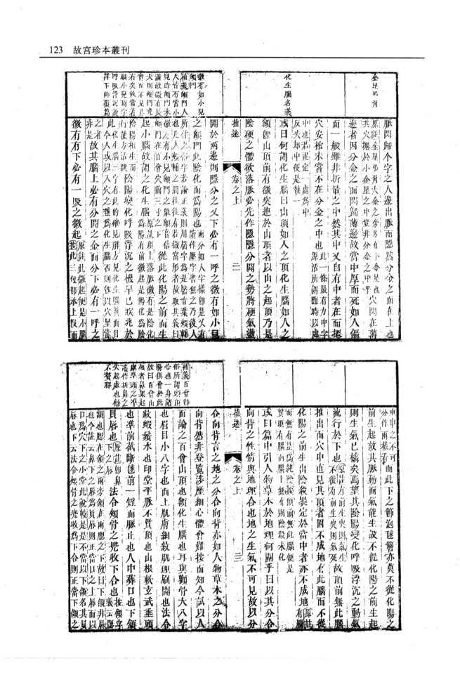

而節節求之則又無可葬之地矣故知古人之書 人物草木之與地理同稟而異形萬殊而一致散之 雖分彼此要之可以相通故民蟲等類皆得以取形 定穴亦以形雖千變而分合向苟之性情則一也 疏仰翼義

何前仰覆曰如仰鵝毛寬牽緣爲仰如覆鵝毛急棄 寬軟其貧賤親 尋地之金針發仰覆寬急之義皆昔人之所公言而 屬公語見下寬華緣之說則本於楊公之書寬之反則爲急不待 言矣惟鵝毛之嶠總書罕見疑周師之制解然亦公 有所本特所見未廣耳以此情 仰鵝毛俗呼鵝毛 與平處如鵝毛之仰臥而平指徵起爲餉 寬牽線 鵝毛軟脈之形也出嚴如之自然有拜前之勢有顧 下之情卽是乖頭急牵緣覆鵝毛硬厭之形也出脈 如之自然有退後之勢無顧下之情卽是不垂頭 二字假費解一云對下退後言則拜字疑當作進林 通但各本俱作拜前今只就拜前釋之意以人拜 期 身屈而頭俯故有進前之勢而爲顧下之情否則 直而頭 以仰故有期後之勢而爲不顧下之情顧下 指述 卷之上

兩義穴後之頭乖不臨下是頭不乘則非則限出頭不重則以山皆爲玄武出也非書云玄武垂頭又云玄貳不垂頭者捕屍此則單就公頭不垂頭得此穴也下而惟山體則頓默起伏高下相因之義盡此矣故魏起爲平二 方雉有平則仰無幾無平則字前篇巳見此詳言之 顯成个字之形盪開外層之硬勢隱成分金之面盪開內層之硬氣硬氣盪開於兩邊脈必脫卸而軟動故隱八字之父下小雉一鄉而有數尺之峻峻前小龍一說而有數尺之平平盡處近下看之必是些些專故也 分能之山便是太雜一二停於極經極平之中亦是顯明之穴若三停落脈純全如此須觀頂上之化生膈遞脈之突泡穴後之毬簷不塌頭而有金泡之起不暴殺而有金面之開勝必從隱八字之父口而出而隱八字之乂且盖到 现 無金治之無金面之開則眞勝不出 何以為穴 後龍大略 平者論巳若轉節而來具有令 治之起具 有 金眞嚴從此而出眞穴由此 瞻 平面亦官爲眞龍之體況其爲大 然大 平秘 姓極平者乎論地之大 指迷 小 則須從後龍上推求面 卷之上 元 不可徒以到廣也隱八字人對一人貫串而下非必皆直串下其出脈或左旋或右傳曲 指經橫不可捉捐金顯龍話漬之機而脈頭野斜 不亂便泡不起聚殺而金面不開嚴不從隱八字之又口而出而隱八字之又口个不對个左右散亂而下者爲微離拔集無其力量隨後龍不以到頭之略 緒不得謂之脈也 不開 必 無隱八字卽無乂口嚴何從出但見小雉小平者形如短寬囊線又如小兒順門之上截煙平之勢短而隱遠看疊以其勢短而隱故喻以願門之上其賞但不見 云願門便是不分拘 於上截也義詳下飾註

<table><tr><td rowspan=4 colspan=1>補義穴下合水秀日ゾ父水上分之火制爾爾承下下合之べ則雨瓦兜上增亂二字始批</td><td rowspan=4 colspan=1>突泡其泡脫卸面款小兒願門分之處名之下及日遇而下之勢之上截三中過下則縣陽陰處見也平作一大雉師是一下以小平卽小是二須要理會</td><td rowspan=4 colspan=1>又有隱八字之分有小健小平邇下是飢愈涉凡有微泡皆有八乎之分有小禮小平面舞於隱八字之久日必有蠶有如上載脈從此徵有巾遷遷而下城見E日久口以人字入字有似以形也故分照父下此節類詳無平之義不必登山面通自可想像誦得眞導於說法者玩莊中字似可省詳下觀正面節及云服從徽有知今人以一直督下爲壓者眞未夢見識大平之勢下而又有總還龕之大平市其不書欲夾則有撥起之勢故云還航還龍大平一平故謂之魏還織亂與平是大平盡處下面望之必是一大泡其泡</td><td rowspan=4 colspan=1></td><td rowspan=2 colspan=1></td><td rowspan=1 colspan=1>雉長而平不甚峻而</td><td rowspan=1 colspan=1>短者有極雉極平者有略雉略平者有平極平者有雉極峻而平不甚平者有</td></tr><tr><td rowspan=1 colspan=1>極長而平在</td><td rowspan=1 colspan=1>依稀之間遠望如寬牽線有願下之情</td></tr><tr><td rowspan=1 colspan=1></td><td rowspan=1 colspan=1>者有婬極短下之情者有如此變化不</td><td rowspan=1 colspan=1>而平在依稀之間遣望如急牵緣無釀大小長短疎審不等雜然而迭出者難定聯取其中四者論之曰大煙大平小</td></tr><tr><td rowspan=1 colspan=1>火產大平来来平</td><td rowspan=1 colspan=1>雉小不極煙應決順以深大平者形如</td><td rowspan=1 colspan=1>極不略雜略平而已北一詳論體至之勢可南備極變胚粉新新加林初雄破揚烟翻補大建長寬牽緣極雜極平者形如極寬牽總</td></tr><tr><td rowspan=1 colspan=1></td><td rowspan=1 colspan=1>指速</td><td rowspan=1 colspan=1>卷之上       州</td><td rowspan=1 colspan=1></td><td rowspan=1 colspan=1></td><td rowspan=1 colspan=1>指迷</td><td rowspan=1 colspan=1>卷之上      六</td></tr><tr><td rowspan=3 colspan=1></td><td rowspan=5 colspan=1>復有分有行來則亦不笑便以爲治雉小平或間原走北大經還截之平還統之火不體不常有三</td><td rowspan=5 colspan=1>下面望之乃是一泡有平邊過而下泡上卽是分水處自覺今人見一舉不甚軟者或有數次小不知北爲硬塊中中平至毬巖下方有總還亂之太不在毬簾下射起敘水按上云總還此云毬創則簷下是穴矣而此總然山卽穴下之唇燕故註云特起收水停俱大婬大平而內復有小雉小平者</td><td rowspan=5 colspan=1></td><td rowspan=3 colspan=1>1</td><td rowspan=1 colspan=1>其垂頭之情</td><td rowspan=1 colspan=1>不拘遠看近看明眼庸眼皆可得見後</td></tr><tr><td rowspan=1 colspan=1>龍數十節如</td><td rowspan=1 colspan=1>此者必是特達之龍穴上三停如此者</td></tr><tr><td rowspan=1 colspan=1>必是壞明之</td><td rowspan=1 colspan=1>穴不可多得也後龍十節之內有四五</td></tr><tr><td rowspan=2 colspan=1></td><td rowspan=2 colspan=1>略樂路平</td><td rowspan=1 colspan=1>節如此者亦</td><td rowspan=1 colspan=1>是特達之龍穴上三停之內有一二停</td></tr><tr><td rowspan=1 colspan=1>如此者亦是其乖頭之情</td><td rowspan=1 colspan=1>顯明之穴略煙略不者形如略寬牽譽近看方見而遠看未必見對看方見而</td></tr><tr><td rowspan=3 colspan=1></td><td rowspan=2 colspan=1>有三停俱只藏有大大平</td><td rowspan=3 colspan=1>小小平者有頂上俱只小雉小平下或中雉中平者有中截只小雉小平大平或中雉中平者有雉短而平長有</td><td rowspan=3 colspan=1></td><td rowspan=3 colspan=1></td><td rowspan=1 colspan=1>橫看未必見</td><td rowspan=1 colspan=1>明眼方見而庸眼未必見後龍雜三五</td></tr><tr><td rowspan=1 colspan=1>節於極煙極</td><td rowspan=1 colspan=1>平之中亦是特達之龍若分龍太祖少</td></tr><tr><td rowspan=1 colspan=1>上下有大經</td><td rowspan=1 colspan=1>祖父母落脈</td><td rowspan=1 colspan=1>純全如此龍雖不假決不發揚降勢不</td></tr></table>

<!-- doc003 PDF 第 128 页：高风险/复杂版面 OCR 供检索；内容与排版以原页图为准。 -->
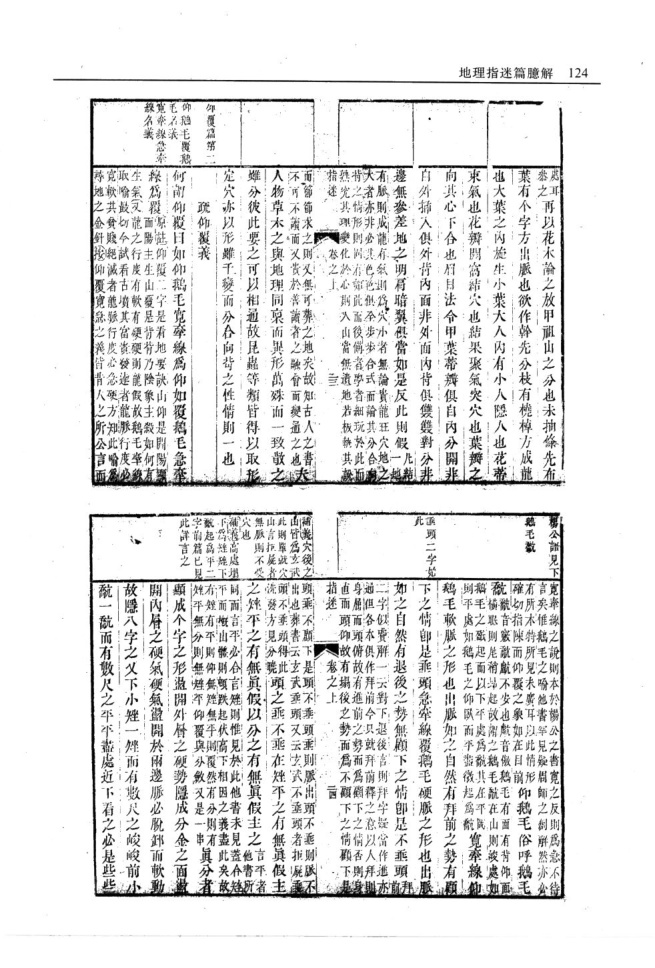

<!-- doc003 PDF 第 129 页：高风险/复杂版面 OCR 供检索；内容与排版以原页图为准。 -->
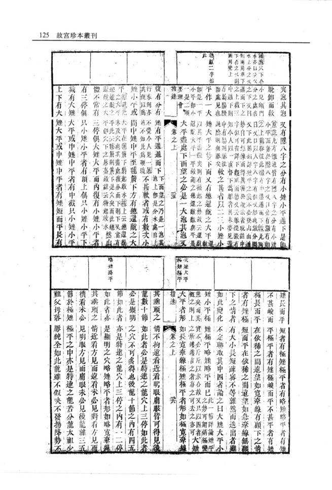

大平之中亦 必須小雜小 邊八字不姓而遮其中之旌處橫看亦不見遂君不年相聞而後 成龍面後成 見其小小平之勢則必類不雉不平之體橫看不穴則小魁小 本君尤重故 見門之有則必類急緣之形惟雜幾簡於大健大平之長寬牽絲極極平之極寬牽線者卽遠看亦有垂頭之勢可見若其小婬小平連有數次或十餘次而十餘丈之間無稍大之健平者其乘頭之情必非遠觀能見也夫地理曰察苟非近觀何由察其精微蓋有楚有平之寬牽緣與大雉大平之長寬辜線遠觀而見者固是垂頭卽小雉小平近觀而得見指迷 卷之上者亦是垂頭惟不雉不平不寬線者方是不垂頭然垂頭不出於人字分金之而雖大雉大不如長寬牽線者亦是假垂頭出於个字分金之面雖小雉小平亦是眞乖頭不可因遠觀不見而棄此小雉小平者亦不修己言此又兼市後龍也 補潼此數高但上一節足單孰穴山 概而論之凡觀龍須先認其而妄爲增入 此三句是愚意所安 增者舊本府下節突面上下不和蒙甚覺不委浴果否無弊讀若是故以此語聯貫之 此式背頭之突或雖有突而金面不開或雖有虹而隱八字無有而又不對久終如急牽線或如覆鵝毛身無拜不握頭爲根木之先彤前去必不成龍不必着眼在行度星辰爲後並昴殺後代行至其節必有囚敗之應也前後皆間而不傷大體在少祖父母爲胎息不成在穴山頂爲塌頭在半山爲突胸飽肚在毬簷穴前爲揚頭制腳犯一於此卽不成地無無穴也 經龍別此一條爲砂無穴則後龍雖好指迷 卷之上

<table><tr><td rowspan=7 colspan=1>者亦可以已意自爲斟透頭割助也下合翻寫光系1設图上文尽龍體如业雞此至此E集醒片运司此面似為所次四古也其黃寶山開面</td><td rowspan=2 colspan=2>爲面一邊爲背之就只是對面觀之凡駝而突者卷爲背寬而平者方爲酉也下云端開正面卽此寬平之酉龍體有拜前之勢左右有顧內之情頂上明眉耳</td><td rowspan=3 colspan=1></td><td rowspan=3 colspan=1></td><td rowspan=1 colspan=1>處辨生辨死全在此二三小小平別之此下上假言穴</td></tr><tr><td rowspan=2 colspan=1>言雜數箇於大健大平之內與上下者龍方必旺惟祖宗頂上落脈處不宜單見小雉小平之多而遠塞</td></tr><tr><td rowspan=4 colspan=2>三停暗翼節節分開不邊無黍差不自外插入性情不側面顧人界水不透頭割助原註如鷄腳者爲透照半紫無金魚砂屬2                    此正面方是穴y有稜有爾不破不欹而端開正画山上首就龍體上表龍此下正而之頂有隱隱入卽正面觀之也 汝專言穴字如總帶之刷開隱八字中又有小小無平如小見順門之上截肄平之間有短寬牽線之勢難平之盡</td><td rowspan=5 colspan=1></td></tr><tr><td rowspan=2 colspan=1></td><td rowspan=1 colspan=1>有數節如急秦線者力量必輕行度處單見不妨在</td></tr><tr><td rowspan=3 colspan=1>穴山有上教單見此而下截有顯明之筵平者有中截單見此而上下有顯明之筵平者有臨穴單見此而上截有顯明之經平者俱以上法辨之其力量只龍非大雉大平龍勢不旺故不喜小小平之單行</td></tr><tr><td rowspan=2 colspan=1></td></tr><tr><td rowspan=1 colspan=2>有微突起之形而微突又開金面分隱八字有輕</td></tr><tr><td rowspan=1 colspan=1></td><td rowspan=1 colspan=2>指卷    卷之上      元</td><td rowspan=1 colspan=1></td><td rowspan=1 colspan=1></td><td rowspan=1 colspan=1>指逃    卷之上      1十</td></tr><tr><td rowspan=3 colspan=1>之處其姓平起有之情節雖者要如此財卽以此為葉言龍亦無不可</td><td rowspan=1 colspan=2>有平如小見願門微有如短寬牽線通下隱八字之</td><td rowspan=4 colspan=1></td><td rowspan=4 colspan=1>滿遠一火一未一金飛類亦具木體正駱帶水鎌釜亦是金以上諸然有從此發縣者亦有印 八者亦本無穴而在所再棄者總視此小輕小平之不無以別之</td><td rowspan=1 colspan=1>穴山得小煙小平生氣亦動故不須大雉大平之純</td></tr><tr><td rowspan=1 colspan=2>口个頂一个贊串而下不左右散亂脈貫隱八字</td><td rowspan=1 colspan=1>備不然惟坐體星辰寬坦之山始得見收而峻急之</td></tr><tr><td rowspan=2 colspan=2>之乂口臣其微起微絆之勢而下便是生氣之動反D14頭不暴装段之意而詳吉以暢發之非別舉一也故须y文合爲一叚自不必另起一頭也但上云如小門之上截下如小兒願門微有將上截與微O作浦載看似与不必蓋以順門喻稽其有也有分截之可見亦以リ在也若見無有明赤何所擁百之爲上載載以見頂也之下皆要如如門微有之而不必以上私與有數分爾頂緣爲爰當始爱就以質高明久論微有亦不定是神窩形但只就處觀之不多只自內傷九出脈處辨龍辨砂到四下之勢世有有論</td><td rowspan=2 colspan=1>山如尖火壁立直木插下突金拱起飛蛾貼壁挂鎮覆釜等形皆在所棄矣朝爲而可皆 下之形穴最難下蓋其結穴之山不開顯而不生手舜但微有小雉小平之動或見理關開者是也此以上皆承上眞分者一句來文A此始畫下一段吉無分而以分者通與上異分者作分而至若無分面假分者或明有不全或暗翼有損或有外砂斂入或八字背身硬殺暴定於當中經平不見於頂下或有一之峻而假無顧下之情或有一段之平而平盡無</td></tr><tr><td rowspan=1 colspan=1></td></tr></table>

<!-- doc003 PDF 第 130 页：高风险/复杂版面 OCR 供检索；内容与排版以原页图为准。 -->
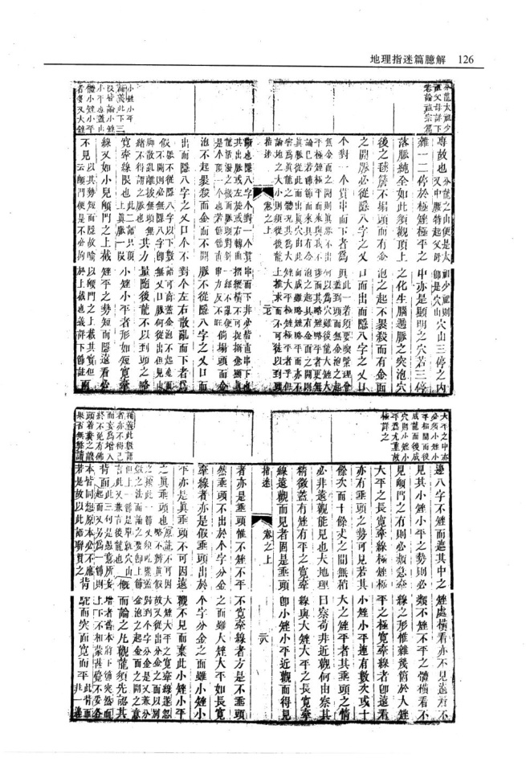

<!-- doc003 PDF 第 131 页：高风险/复杂版面 OCR 供检索；内容与排版以原页图为准。 -->
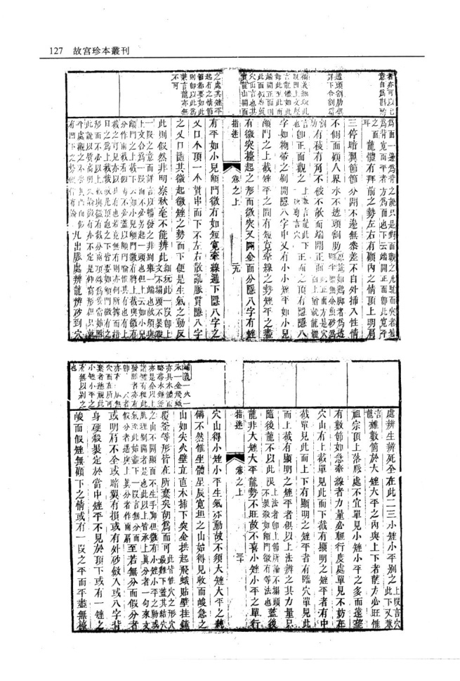

或曰山之不可不垂頭者何也曰分入字是開陽顯而施巾直 當是東陰吐氣隱八字之父下一姓而成願門徵有是陰中化陽氣之呼而浮也有前徵起1於 下不巳陽日上地日際而下者虛也陽日下地日匯通正是此意

推頭因動氣 卜氏云山本靜勢求動處蔡氏云休言是木是金動貞得也故分之二名面 合之只一串 中取穴楊公云先看金龍動不動故頭不可不垂引 公今能之說自非則則知金龍者卽穴上所分之今余龍一作金面故燒諸有作人輪動不動者甚是有理理氣家以驗旋貞地理 未大五四或日葬經但言玄武垂頭今方購三 金龍者實屬無謂亂宗皆欲乖頭母乃過乎曰穴左數重山皆爲青龍穴右數重山皆爲白虎穴後來龍諸山獨不皆爲武乎或曰胸腹之突泡穴後之毬簷非頭也何以亦欲其乖哉曰山有也曰泡頭穴有突曰頭毬簷亦突泡也突泡毬簷不垂頭到頭焉得有生氣

或日脈忌突胸飽肚則胸腹之間似不可以有突泡矣遲脈下來又不可以無突泡奈何曰項下不魅而起突突下不雉而落脈上塌而下削故爲突胸飽肚若突泡毬簷俱有姓有平突泡愈多愈有軟泛活動之勢何得爲突胸飽財哉

或曰穴忌削腳則山成立體穴下峻者皆非地與曰 所謂垂頭者不必定思如仰鵝毛之斜眠職也如仰 故削廊不削腳不在山之峻與平只在形之仰與覆

<table><tr><td rowspan=3 colspan=1></td><td rowspan=1 colspan=1>至岐之下略還鬣便是垂</td><td rowspan=1 colspan=1>頭至平之後無一縫亦爲</td><td rowspan=7 colspan=1></td><td rowspan=8 colspan=1>柳康穴</td><td rowspan=8 colspan=3>人不人之性情須登高選望四而人人方可瞭然於胸中若只就穴山一看未必不被其滕聽者截體不結側面煩人者或日每見穴上有十條丈急牽殺之脈而又結地者金制蓋篇內據懷字只怕透頭如急牽線故透疆本俱龍作硬字不通    原說使脈有結若山頂透項必無結出脈者謂之貫頂不謂之梗分開金面有一雉之峻一黏之平平盡有擡頭之</td></tr><tr><td rowspan=1 colspan=1>削腳故所謂還統者不必</td><td rowspan=1 colspan=1>定爲高起一叚亦不必定</td></tr><tr><td rowspan=1 colspan=1>用魁平如地</td><td rowspan=1 colspan=1></td></tr><tr><td rowspan=6 colspan=1>扯壁燈穴法</td><td rowspan=1 colspan=1>如仰鵝毛之直鐵比上山</td><td rowspan=1 colspan=1>壁峻處較平些而有撞起</td></tr><tr><td rowspan=1 colspan=1>之勢便是還疏注毛</td><td rowspan=1 colspan=1>之直其若塌頭雖有平亦</td></tr><tr><td rowspan=1 colspan=1>非還說但眞地之員唇平</td><td rowspan=1 colspan=1>仰如臺盤者十七八半蝗</td></tr><tr><td rowspan=3 colspan=1>半平如斜鵝毛者十一中一三杯定軟上杖婚生體見經伏法者大類主明下而無還翫之勢者斷然</td><td rowspan=1 colspan=1>三峻仰如直譏鵝毛者百</td></tr><tr><td rowspan=1 colspan=1></td><td rowspan=1 colspan=1></td></tr><tr><td rowspan=1 colspan=1>無地</td><td rowspan=1 colspan=1></td><td rowspan=1 colspan=1></td><td rowspan=1 colspan=3>又分兩片蟬翼於旁一直督下數丈遠望似硬然止</td></tr><tr><td rowspan=1 colspan=1></td><td rowspan=1 colspan=1>指迷    卷之上</td><td rowspan=1 colspan=1>喻</td><td rowspan=1 colspan=1></td><td rowspan=1 colspan=1></td><td rowspan=1 colspan=3>指述    卷之上       </td></tr><tr><td rowspan=5 colspan=1>補義若雙簡富督然便成</td><td rowspan=1 colspan=1>或曰寬牽線之脈不出於</td><td rowspan=1 colspan=1>个字分金之中者巳知其</td><td rowspan=9 colspan=1></td><td rowspan=9 colspan=1>舊義不成地者有龍爾無穴也恐有閃賢之穴所當函画t</td><td rowspan=7 colspan=3>字郭志梗脈之上非第到頭還須起微突之毬簷開言梗後之來路也分金之穴面毬前後俱要有姓有平不然謂之到頭頂有分中又有分只方爲便脈然臨穴毬蓋脈前無平何以見其毬之起簷之分尤爲緊張脈前卽毬後也條出脈而言則爲前我前無煙何以自起毬爾言卽爲後總只此一段也見其簷之謫簷前無平何以見其氣之吐毬簷無分</td></tr><tr><td rowspan=1 colspan=1>爲砂體宜不結地亦有出</td><td rowspan=1 colspan=1>於个字分金之中而不結</td></tr><tr><td rowspan=1 colspan=1>地者何日此大龍方行處</td><td rowspan=1 colspan=1>之枝廓樵神也大龍之枝</td></tr><tr><td rowspan=1 colspan=1>廊必長無个字分金之面</td><td rowspan=1 colspan=1>無寬牽線之勢不能遺行</td></tr><tr><td rowspan=1 colspan=1>以作正龍之護然間或有</td><td rowspan=1 colspan=1>之不能節節然也及觀其</td></tr><tr><td rowspan=4 colspan=1>配溢所謂進盛之砂自外今字以成龍也  光砂頭文</td><td rowspan=1 colspan=1>大勢必側而而顧人枝葉</td><td rowspan=1 colspan=1>散亂操縱由人到頭則覆</td></tr><tr><td rowspan=1 colspan=1>體而粗硬故雖有分金之</td><td rowspan=1 colspan=1>面與寬牽線之勢亦不能</td></tr><tr><td rowspan=2 colspan=1>法該障重效順明磁亦可夫覆體之不變易知側</td><td rowspan=2 colspan=1>磁研阿班行物的電務分面而顧人難察欲知其顧</td><td rowspan=2 colspan=2>金之面何以見其葬之毬下分令身使當如是臨是非莫又駒</td><td rowspan=1 colspan=1></td><td rowspan=1 colspan=1>開不但梗脈當如是穴穴</td></tr><tr><td rowspan=1 colspan=1>是簷簷下尋葬口也</td></tr></table>

<!-- doc003 PDF 第 133 页：高风险/复杂版面 OCR 供检索；内容与排版以原页图为准。 -->
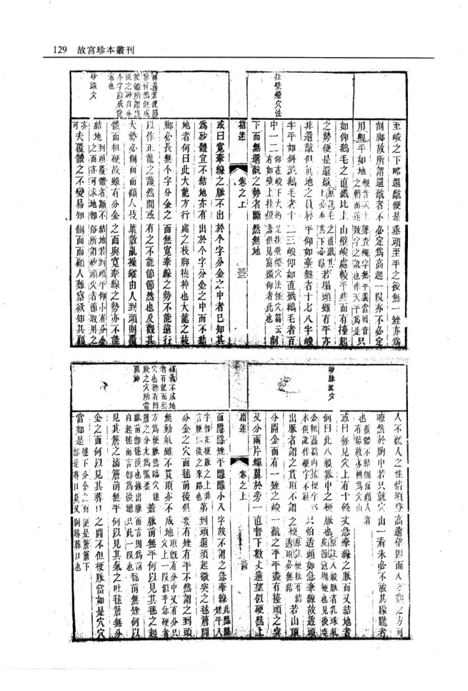

或曰山高而必有一沒之峻山高而經長者其遽必長勢必如急牽線奈何曰此須合峻下還翫之平觀之 之武上所論直峻下無還亂之平方爲急牵總 戲鵝毛之意有還毓之平則此長經之峻正爲還翫之張本何得以急牽線目之亦必要箇隱八字之又口隱隱之雉平在此長雉之內非與如急牽線者方佳 此卽 理刷之意須要細心體察方得或曰橫岡脈肩臂落獻者何以見乖頭曰橫岡臂雖不起 貼岡之前有化生腦蟬翼肌理之分有指送 之雉有平如寬牽線者便爲垂頭不必定要有頂者用 屑臂無分關之勢無淫滿議高一大 無平者忍不出脈 原止平岡龍是平地坦內外者便作故平岡龍爲 平地坦龍論 曰高山以起伏爲主勢而佐之以收放曲折故垂頭支第 處多平岡以收放曲折爲主勢而佐之以起伏故垂頭處少然不垂頭雖有收放曲折無益果有火放角 折行龍亦自必有垂頭處也此句活看莫要繩煞起頂分个之處得一作之峻作垂頭之勢如人仰臥而攘頭顧昀方能成龍不一姓而挺然平者必是砂

故疑其無垂頭之勢也然必質分人而下用其異若不分字則不見有眞而但見其挺然直去敢坐靜臥龍 是坐龍體經常長而平常短胸腹又常有節泡之邊生故垂頭之情對面遠觀卽見平同是臥龍體雉當短而平常長胸腹又無有突泡之疊生故垂頭之情必近看方知至於結穴之處於頂上開面垂頭之下池卽穴上之毬簷眇此一節處處喫鑒乃是眞正之精後面來路爲公家所 共而非我所獨得若入穴指迷 卷之上一此一節則穴不在此虎而我誤認此處爲穴也得此訣以入山乃能眞僞立辨細大不道或日假如一山分作數條齊下俱各關面如寬牽線之勢者如何分主從曰但觀頂下與毬後之一婬比他條之雉更甚雉前之一平比他條之平更長雉前有八字水痕平前有搖湧突突間有分金之面身不顧人展員堂聚者是武平 前爾 與 卽是毬 若兩枝 英腐金面卽是溪脈相等者是並結且正龍必是直出旁砂必側面順人夫山之喜其雉者欲其作乖頭之勢而爲下面還藐之張本也欲其還翫 欲其起控頭之突而爲下文數叚 之意非又别有 献也或曰欲乖頭者取其勢之撲來情之顧下則爾眉兩臂不可不撲來不可不顧下曰子善弓類而長之者眉臂之內須有撲裹之勢顯出願內之眞情有侍之外須有駝出之勢顯出撲道

<table><tr><td>藉卷八字招 敢束其氣 耶所謂束氣</td><td>面重頭之張本也頭與其從北過而下以 上乘頭 則下必還願上起矣 三 魏八宁之父口个 頂一个而來者也 前有八字水痕者乃上下 字相接之處必有八字摺痕收來其氣使嚴路有</td><td>之下俱要有小平頂泡下無平者所降無眞脈 統言來脈 而言人 穴穴中雖似有平而穴後無平則場頭 而毬簡不 不起亦不可以穴非謂有毬篇而其後無</td></tr><tr><td>也北平洋之 東氣爲見山 疏之束氣雜 朝故服終翼 水之銀便是 求氣之所 e</td><td>有放而不直硬其頭也平前有擾頭湧突者因上而 有有平有分水下面與在旁觀之自成湧突不必 北平處更高大一叚方爲湧災以之八水水 此八字水痕是微紀 T 細認有此儼茫之分水必有徹茫之湧災故在</td><td>以節西害道 但不先雉一差雖有平無益故經 平上又要先此更要前有捷前 一字不可相離 又統脈與穴面言 之勢平處有還龍之情上不塌而下不制在於不字</td></tr><tr><td></td><td>不覺其突而在下觀之一自成涕突如此分疏甚 州 細上云不屯硬其頭頭字正指此訪火面富玩 段 之故乃統言脈路而不事指入穴何也以其言上</td><td>勢也俯則不場 仰則不制 此三句卽上文之意而重 言之不重所重奎在下一句寫出一眞毬結穴之聽 毬後要有雖短無妨毬前之平雖長不雉而鋪還 职</td></tr><tr><td></td><td>指述 卷之上 七</td><td>指逃 卷之上</td></tr><tr><td></td><td></td><td></td></tr><tr><td></td><td></td><td>是及理平級財相候經雄冠評種建似類也勉周前</td></tr><tr><td></td><td></td><td></td></tr><tr><td></td><td></td><td></td></tr><tr><td></td><td>不峻者頂下與毬後必大婬一大不一平似可立</td><td>曾故以而無其與葬毬後不者其平長大或 簷不諸而彌則不成爲</td></tr><tr><td></td><td></td><td></td></tr><tr><td></td><td></td><td>無禍短小者補述至破毬者氣必散漢非種後卽是</td></tr><tr><td></td><td>穴但微分八字水痕知其脈尚行而未住 原誌凡</td><td></td></tr><tr><td></td><td>火</td><td></td></tr><tr><td></td><td></td><td>水天星名毬前經處卸下而未停簷前平處仰承而 來煞破毬則打</td></tr><tr><td></td><td>联价 則其下必又有徵與是其孤尚行也若無此</td><td>天星殿</td></tr><tr><td></td><td>金</td><td>原註穴星而上有欲欲坦處是爲簷前平處蓋</td></tr><tr><td></td><td></td><td>補道平憲是</td></tr><tr><td></td><td></td><td>浦口又</td></tr><tr><td></td><td>雉略不一平竣處不可攀援平處可以颺坐故不但</td><td></td></tr><tr><td></td><td></td><td>堂在穴下移號二語合君乃件真正穴青件處平處</td></tr><tr><td></td><td></td><td></td></tr><tr><td></td><td>穴中之平卽下所云篇</td><td>15 前處實只</td></tr><tr><td></td><td></td><td></td></tr><tr><td></td><td>次</td><td></td></tr><tr><td></td><td></td><td>切堂所謂小</td></tr><tr><td></td><td>前之平是穴下平臺特起收水者也卽穴前員唇 记</td><td></td></tr><tr><td></td><td>牌</td><td>兩堂者卽此 E</td></tr><tr><td></td><td>後之平脈前毬後之平也正是入穴處訣云前要</td><td></td></tr><tr><td></td><td></td><td></td></tr><tr><td></td><td>來後要平卽是此意玩北 一叚皆就毬後之平</td><td>1 直指點穴</td></tr><tr><td></td><td></td><td></td></tr><tr><td></td><td></td><td></td></tr><tr><td></td><td></td><td>之處而申言以結之要亦不外上</td></tr><tr><td></td><td></td><td></td></tr><tr><td></td><td></td><td></td></tr><tr><td></td><td></td><td></td></tr><tr><td></td><td></td><td></td></tr><tr><td></td><td></td><td></td></tr><tr><td></td><td></td><td></td></tr><tr><td></td><td></td><td></td></tr><tr><td></td><td></td><td></td></tr><tr><td></td><td></td><td></td></tr><tr><td></td><td></td><td></td></tr><tr><td></td><td></td><td></td></tr><tr><td></td><td></td><td></td></tr><tr><td></td><td></td><td></td></tr><tr><td></td><td></td><td></td></tr><tr><td></td><td></td><td></td></tr><tr><td></td><td></td><td></td></tr><tr><td></td><td></td><td></td></tr><tr><td></td><td></td><td></td></tr><tr><td></td><td></td><td></td></tr><tr><td></td><td></td><td></td></tr><tr><td></td><td></td><td></td></tr><tr><td></td><td></td><td></td></tr><tr><td></td><td></td><td></td></tr><tr><td></td><td></td><td></td></tr><tr><td></td><td></td><td></td></tr></table>

<!-- doc003 PDF 第 135 页：高风险/复杂版面 OCR 供检索；内容与排版以原页图为准。 -->
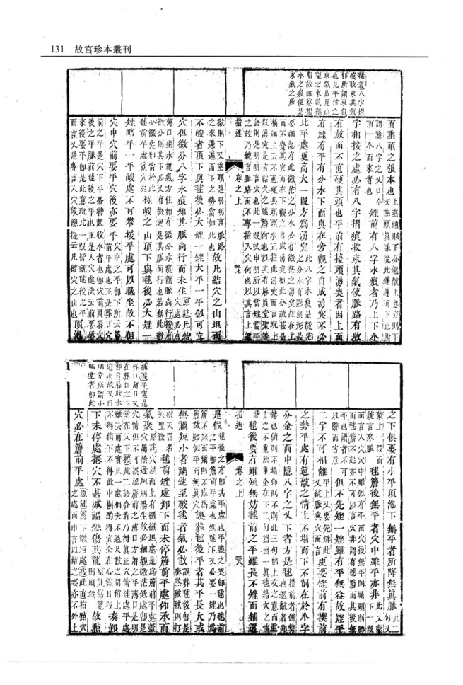

或曰每見中脈只小雉小平龍虎反大雉大平豈正穴在龍虎乎曰此當觀其个字分金之出脈顧人不卷之上

顧人之性情出於人字分金之中直自主而不顧人 人來朝我者雖小小平亦是正脈出於个字分金 之人側身願人八不朝我者雖大雉大平亦是旁砂 然則龍虎何須大雉大平乎曰楊公云若是背時多 陡岸若是面時寬且平寬者卽寬牽線也平者卽有 姚有平也陡岸者卽無雉無平而如覆鵝毛也故而 邊不但中脈有雉有平卽龍虎亦有雉有平而背不 然是龍虎之有差有平正以顯其寬平之正面耳然 使龍虎有个字分金之而自主而不顧人仍有姓有 兼羽翼護衛 平者亦能地備而者然共力是 南言闕西也 足中脈之情 相借而互為龍虎者然其力量終 專而氣旺也 或曰仰者爲陽覆者爲陰有陽不可無陰則有仰不 可無履今喜仰而惡覆何也曰天下之山皆上小下 大中高方低其體原覆脈路又覆則孤陰無陽陰羅 之山得陽仰之脈生氣方動善仰者正於覆中取仇 忌覆者不忌山體之覆忌落脈之覆也 山不忌 覆故於覆中 魚爲氐純又當於易仰之中取陰覆處爲龍為穴而又於陰 佛不取故又之中取其微陽微仰之意不可概取其純陽純仰者 指送 卷之上 四十

佛 中矣然則古人何不及之曰廖公云飽是渾如覆箕權 凶雕此意自莊言非無 籍之說也讀 醜惡那堪相是喜仰之意在言外楊公云仰掌葬在著須如 掌心裏又云也曾見穴如側掌却與仰掌無二樣並在穴星篇楊 不言及覆掌是忌覆之意在言外曰金剛肚曰鴨公公唐皆詳 頭曰蝦蟆背非忌覆之謂乎曰好格面平方合樣目寬華雜見此喜仰之謂乎然則形如覆釜其巔可當之聞何曰此就星體言覆舟就氣脈言星體不忌覆氣脈忌覆

一美一惡如此然覆釜之山後無寬牵線之脈巔 西山先生宋爲大上關 平仰之盤何能結地覆唐之山分開金面有經有平 所著書心 不顯背面稜者分開之大八字有弦稜也者明 出唇吐氣何至爲凶 得此一解開拓後人多少 心廟善悟者受益不淺 詳首篇牛词 跋破名義互 也按稍卽稜之雨乖盡處故日 或口覆仰二字於地理果何關切曰葬覆鵝毛之山 補義背面之 如手臂鵝毛之側起外背內面面相向爲有複角 必至敗絕有不敗絕者必別有吉地然凶敗斷所不 得音輩向背 內背外面而相背爲無稜或如手臂之覆之仰不 之背音佩字 免葬仰鵝毛之山必至興旺有不興旺者或祖山 書原有南書 岑人有讀背 向不背亦為無稜外背內而而稜角抱來固爲向 荀之背亦作 偏音者非惟 豁開亦爲向如遺花半開時固向其心至謝而花瓣 至穴唇無一節一段不成仰鵝毛則其爲眞地何疑 躍通說韓信 云相君之背 乖下亦未嘗不向其心內背外面與無背面稜角者 豈有不發福之理 背字則當僧 豁開爲背抱來亦爲背如隣菜之葉與我菜心相 指迷 卷之上 作德音 指迷 之上 或曰前言辨眞假以分斂仰覆向背合割八字別之 國是背我卽蓋過我菜心之上亦是背我蔡氏云 今止仰覆二字斷地眞假則彼六字可不問乎日無 形貌者得其僞觀性情者得其眞原其向背之故只 雉無平如急牽線如覆鵝毛者非無个字卽假个字 在分處之眞假辨之觀花瓣菜葉無一片不向其心 創服削肉義 詳從合割篇 非一邊相反背必無面無背非無暗翼而割脈必少 員唇而割廊若節節叚叚有有平如仰鵝毛者必 心者以其從蒂分出而職專護衞故也備使不然則 有个字分金之面外背內面之砂出唇吐氣合而不 必有麥雜之勢各立之形何能片片外背內面而相 割故因北二字可彼六字非謂可遺彼六字也 向也哉故知眞分者原以護衞自已故向而不背假 向背篇第三 疏向背義 分者將以羽翼他人故背而不向雖不羽翼他人亦 勵義蔡收堂 何謂向背蔡氏云向背者言乎其性情也 以姓怡直 向肯 不護衞自已而爲謂散之砂故無向無背 砂之眞公 神與又翻 假分要皆

夫花與菜之生氣不可見觀花瓣菜葉之相向而知其生氣在於心地之生氣不可見觀大小八字之相向而知其生氣在常少則知今之錯上砂向易下砂向難得下砂向 下砂者十格七八則上砂不患不向有地必矣此一語豈非尋龍捷訣今人不識轉字卽向字背來駝我者誤認爲轉無背無面而生轉抱來者亦認爲轉觀形貌面不察性情烏能得之至如大龍方行而卷之上

未止之處只一重下砂眞面向裏亦未足恃楊公云經龍須要觀疊數一重恐是葉交互三重五重抱回來此是眞龍腰上做大龍度制身直氣注 師爲正龍之美若只一種自四 其去者皆 餘氣也故層層回向納之地馬或此一兩而止面父不必於二重五 矣外如朝托拱侍水口之砂星辰之向背則與此 之稍異亦以分大小八字腰軟而而不飽外背內而者爲向無大小八字面飽而慶不軟內背外面者爲背分八字則間勿故而不飽而腰自帳不分入字則不開面而面飽故緩亦不軟 開面爲而故曰向則不關者 為背卽非背來駝我無正面之眞情亦爲背 故曰背也此皆不開地之眞假但滅地之福力 地真固自無礙地假則不必論及故上云與此稽異也此宇指下砂 後龍星辰之大小八字不相配或一邊向人者爲假龍穴山之大小八字不相配或一邊向人者爲假穴本身之大小八字相向而爾邊之送從纏護有一邊不向者雖是龍必非正龍雨邊之送從纏護相向而本身之大小八字有一邊不相向者雖有穴必在他處大小八字送從繼護皆相向面朝山不開面相向必是枝龍而非正幹水口山不轉指迷 卷之上

亦祖山分龍兩邊向多者力大橫龍降服背後孝順鬼逆向穴眞入穴似向面遠觀背者非龍遠觀似向而入穴背者非穴外不像背而內有稜角相向者版外雖或似背而內無稜相向者宜棄不向左不向右而節節鵝毛碗再得左右相向雖旁龍亦可取裁或向左或向右而形如側手臂再左右有一邊背不可輕親砂體亦黏小地但得穴上 分穴下合備生借朝亦為則丁之地秀貲則非所望也

身龍虎向而外層皆向者爲大地外層不向而本身六有官鬼禽 逐龍旺 龍虎向者爲小地有等龍虎之氣旺盛曜氣飛揚官在穴前鬼不等眞龍旺氣之所迸也在穴後曜在 龍虎別外舟 卽飛揚而去總水口面面相向而抱住其飛揚之左水口之間 散見各為詳 砂者反爲大地此當求之尋常識見之外然亦當觀具家 分龍出帳道 其龍身之何如若節節開面而分龍出帳過峽之時峽等就供詳 兩邊迎送纏護重重相向方可如此又有一等龍身於始分再抽之際兩邊護從岡阜向者甚多至結穴處但得水纏並無護從只一股陰砂僅僅蔽穴反爲指述 卷之上

高起星辰低 此所朝高起星辰低落穴者脫卸淨盡其氣極落穴水羅卽是山樣皆 也故向背之本在分龍作祖之處穿帳過峽之時而柳公排龍經節節開花一局之中結數地其砂必各自顧穴何能魚尾砂砂作爾邊之護者 只要本身之枝葉不願人而向自巳有星面穴面便是好地其外層者皆自去顧穴何能向我但借用得着湊泊得來像個局面不斜竄壓射便佳亦仍以眞向多者爲結麟吐氣 勝又有一等惟穴後龍之關面垂頭前而之結讚吐氣甚眞 凡山形如肚而正商生爲雜穴日膽穴此富約臍則非北也此勝在穴下與唇對舉所謂明爾火向外去爲居貝而地入內來爲口不不 止氣卽唇之黨蓋氣吐則現也人下源 氣親謝而不過者為膺放下論留謂穴有賢結之而龍虎之狀觀反背而去生  用以常見論之何能結穴及細察之其反去之處有細細摺紋抱進層層石骨裴轉者反成大地反肘粘高骨斷爲兩翼形雁鵝反翹形是也然非真蓋堂砂 句 蓋堂之微驗局之會聚者不可龍反後去 穴形必突出外來前無巡編水必損城而激散內氣故類一股蓋堂砂以猶佐外堂之水又要四應周審會成垣局則穴指迷 卷之上滿義坤道珠 瑛書名甚美不然涉假 坤道珠璣云衆山拱向似乎有地處也龍奎書帶未 之見卽作者 要辨是眞是假曰拱向復有眞假於何辨之在乎姓氏亦無從 考世遣者言 識背面也楊公云若是面時寬且平若是背時多陡漢固不僅此 一種 岸凡山之拱向者果皆有寬平之面在前更有陡峻補義細玩此 靡腫之形在後乃見面向我而背在外自是眞向也流則其地絕 少世人獻言 若不然而貌雖向我其實無面便非眞向不可言有大施者直未 夢見急宜以 地矣故看地當看內看外看內者立於作穴之所看此咳離之應 或同頭 四方之山及本身左右皆有情向我否若衆山無靖向我便結穴不眞看外者四面之山儘有穴上見其

<!-- doc003 PDF 第 139 页：高风险/复杂版面 OCR 供检索；内容与排版以原页图为准。 -->
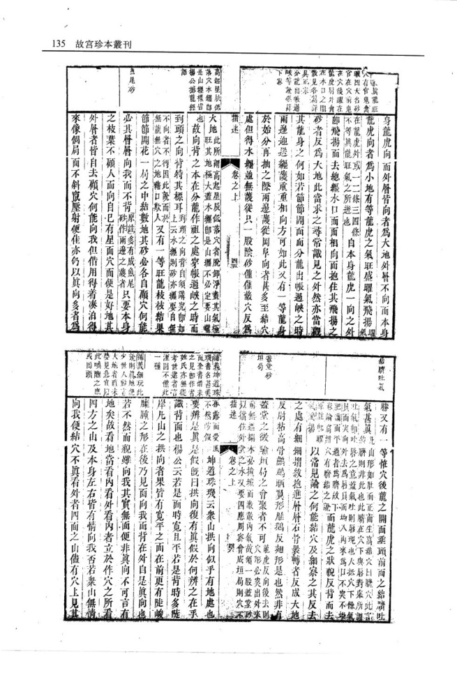

向我穴外觀之乃反背無情走竄也向便穴中所見向我者非眞面矣向我者假便非眞地故看內不可改作內看外看意更明順形貌背而性情回者外貌雖反內觀則有情龍穴砂水件件的眞又不可執外觀之法而概棄之耳穴中反去爲形貌背石紋裴轉爲性情向如上所稱鶴藉取翼形是也故石紋之向背更當新察也聖之朝 也石運之鳳乃爲性情之眞向皆形理舟我而石數反向处去則形之向我者反爲背而外反爲面穴不在此矣合寶篇第四 疏合崗義指迷 卷之上何謂令割曰有分者必有合無分而斂者必割合數 合開之分則水痕必在蟬翼肌理之外分開八字謂立出脈水是一 界出脈之水武是若無此分則界痕必夾脈而分無分則銜 一水脈 此卽是貫頂嚴界痕二字疑當敗於何有 半山泡起有金魚砂之分則水痕必在 云水面已行脈水是二 金魚砂外分開八字謂之界行脈之水是 是若分無分則割 二分木剪 無此分水痕必夾脈面扣肋謂之割肋 此痕字屬毬簿有蟬翼肌理之分則水痕必在肸腮外分開如入脈水是三 原是分無分則判翼卯是舊之而乃勝膠無毬傳爾分阎自上二項只所陽就詳前 有分而不言合此言其分爾卽薦言合則厭於此止分敏篇 尺來若無此分則穴腮必不胖界水必夾脈而合於此成倣此推不再舉他篇亦有及者皆以此義通看可也合於縣下句須善體會蓋言感有員唇水合之處而不生唇則但見水亂流漫而真巳並非或穴旁少一邊蟬翼而隱隱界水從唇口 眞合也本身鋪出或一邊反高而鋪來或雨邊齊齊鋪來而隱隱界水在餘氣內合 餘氣卽穴下唇氣餘氣不鐘 出則無唇一邊鋪來則指遷 卷之上下兩邊鋪來中必成溝故皆無唇而但見水聚舊在餘氣內合句亦要善會言應有餘氣之處而無縣氣則而 水或窩鉗有半邊牛角砂不從本身分出 聚此而已補義他書言 創只講得劄流非眞 界水穿斜過穴畔牛爾不能水木面外 牛乃不能橋水故木穿開面射 三平告四論或大小八無分必割而 推出許多病 字一臂被旁頂之砂自外掃入其縫必有水痕穿入而向字之養 謂之割臂水 ---始蒸理明 達得未曾有 左右俱割爾邊齊犯或左割或右割皆不成地共割 一一-肋水閒有不忌者必山頂與父旁之蟬翼俱全脈路如寬牽線之軟旁砂如花瓣之向故不忌 一

<!-- doc003 PDF 第 140 页：高风险/复杂版面 OCR 供检索；内容与排版以原页图为准。 -->
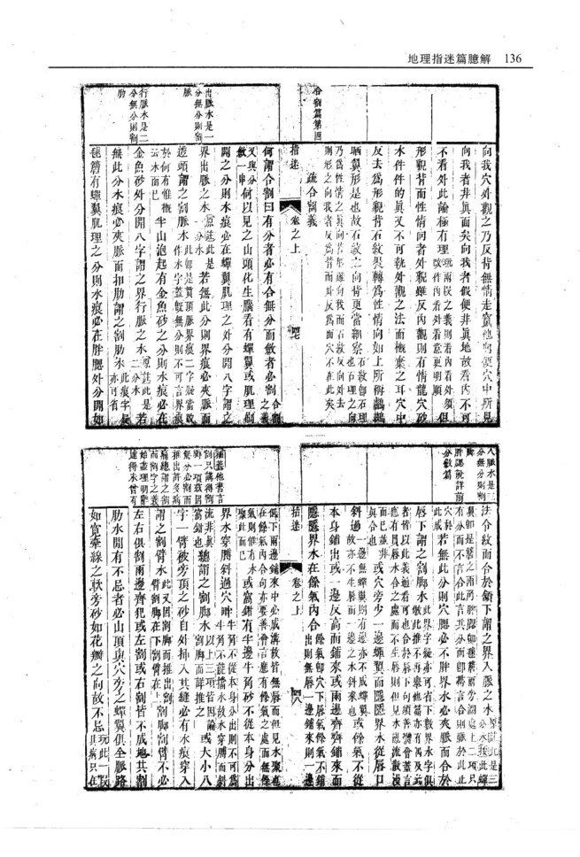

之水只犯半邊亦有不忌者必山頂之大八字半山之金魚到頭之穴面穴唇俱全脈路如寬牽線之獸水卽遠圓而師脈亦以仰嚴向背參觀之其云只記分十八 千邊蓋卽分斂篇之所者邊有邊無半邊界水夾服過名者何割助不忌者不拘後龍穴山數百中嘗見 透頭者一二邊頂翻厭之水只犯半邊不忌者後龍數百中當見一二在穴山則少犯此高 可 原識割陽穴山可犯人少一眉一目如花少一葉一瓣必非固然定有傷指迷 卷之上損須仔細檢點不可以爲當然而漫取之割字之盡矣請言合字之義人皆以兩水之合處爲合但眞地有雨水合假地亦有雨水合水固不可不合亦不可全憑水之合也必須爾砂兜收爲合但眞地固有砂兠收假地亦有砂兜收合固不可無砂亦不可全愚砂之合也惟是員唇之兜收乃可稱合之眞知 要員唇起強發振水合砂合亦可削合之至矣南必以員水交穴受風者亦是也故云不可经憑木之，沙之舍也蓋分合者氣之行止也非中員背上雨旁拖下之

分厭胡爲而行非中員背下兩角收上之合脈胡爲中貝卽穴之屏鳳 分如上弦之月魄合如下弦之月魄分如鼻旁之法令合如口下之下領分如聽上之胸腹令如臍下之小腹而月之心腹之臍面之人中是分合之中心生氣之聚處故山見雨局拖下而未收上是氣行而未止兩角收上而不拖下是氣止而不行但員唇之中要平如掌心而可坐水員唇之邊之前要有後平仰而不削水 觀此則員唇坐水 卽小明堂小明堂不在員屬之下員縣下水合處 乃謂之內明堂又爲 中明堂也 設如龜背牛鼻而水指送 卷之土 平原註如龜背牛鼻則分水割雖兩收上亦非眞合 無掌心坐水無掌始兜抱其唇亦不可少不然大界水扣割而來謂之有创襟以員唇之合爲主次論及於砂之合水之合可也水三合三補義以員唇 收水爲小明 之內隱隱如有水痕合於小明堂之內者謂之一合常此論維見於此時人俱 動令於原下者是今云穴峰之內是鄉員唇之以貝唇下水收也員唇有強及則小南水 而

<!-- doc003 PDF 第 141 页：高风险/复杂版面 OCR 供检索；内容与排版以原页图为准。 -->
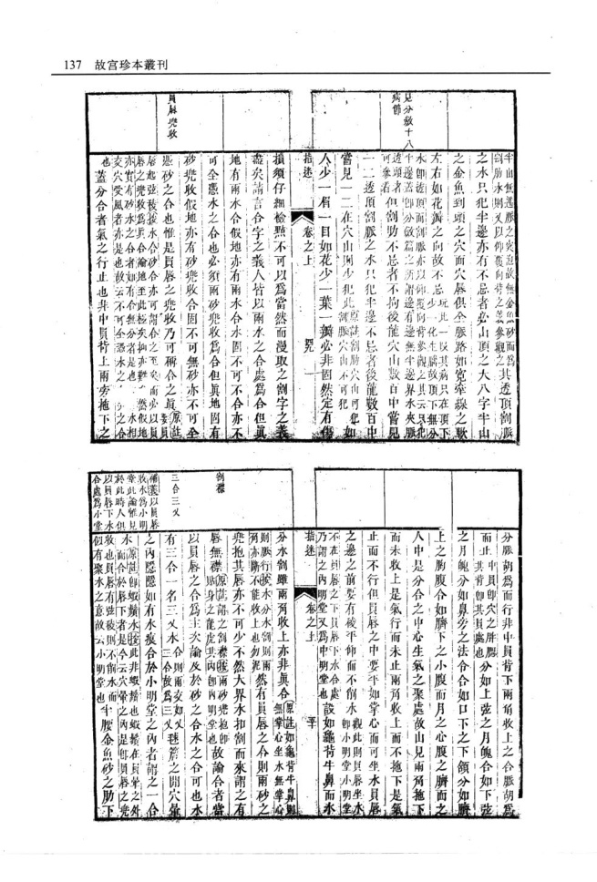

分小八字水遶穴鹿旁而合於唇下謂之二合水地唇下之內明堂也此則當名蝦鬚水 頂上蟬翼助下分大八字水遶金魚砂外合小八字水遶穴腮外而共合於內明堂者謂之三合水成真之前之有台生下分 此蟬翼助下之水當從化生腦下分來今只泛頂上貴少化生腊三字黃者當以意會不可謁突混通又水雖有二 一合三合之分而其實共注小明堂卽以唇下之合當之合於中明堂謂在龍克之內放又謂之內明堂三合於大堂謂在龍之外故又謂之外明堂然龍虎內之水實卽是居下之合水同比一席之木又何所據面分爲中小二圍箱迷 卷之上 1

大水之所總麗要在龍上餘其分合而於穴上之分合無與也有交禁之合其合僅有隱隱滿迹龍虎兜收者必有交襟之合其合易見龍虎綽開者與無龍虎者來到山腳一片平坦及合處振意會其合之極精極確無相令之形迹有阴之性情以意會之而鑿鑿可慷明者能之味者散漫無收之地面藉口於是說以惑人也之起滿處卽是三分水流注者有三分水卽有三合水不心用有明水交處方爲合有明水交者除本龍虎外 毗虎故有明水俄若穴結高處 此界浸如惟隨龍大界水合於人興堂者爲必然此水橫局合於左右逆局合於背後順局合於面前本身有餘枝數里者其水必合於數里之外慎勿以二水窮處爲龍盡 二水窮處乃老盡處也 老盡處誤葬主人貧貌疏縱橫義

何謂縱橫曰縱者龍身起伏曲折向前而行也橫者列開屏帳而旁布也二者雖均不可少而佔地步當偏重於橫蓋惟有帳能佔地步帳大而多地步廣帳少而小地步狹大帳前垂兩角包重重小帳於中爲指迷 卷之上

最廣止包重重間面星辰於中爲次廣豁開而不包山之橫列者爲嶂故其字從者亦不下八七入里是爲間峰帳則 帐 嘆之義故 圣亦土异却字小面 垂 下爲帳勢小而近或數里或里許或 旁緊護脈以作本身之龍虎是爲關 帳嶂 舆哦 有嶂之爾 两下之勢包層層小峰於 中但 關廣 而

名也有開峰而復周帳者喉爲近身之用 其非也而有開帳 不必而 非爲 1我 而設是或言 特混 债前稱 为 沿巳久而 不知 其失 其義 矣 下 有 学 則帐 一篇亦未洗發此義云玉髓經並不言及 知玉體亦卽以 楼

<table><tr><td rowspan=2 colspan=1></td><td rowspan=1 colspan=2>特縱橫者爲十字帳借縱爲橫者爲字橫爲縱者爲偏出帳一邊橫多一邊橫少者爲不</td><td rowspan=2 colspan=1></td><td rowspan=2 colspan=1></td><td rowspan=2 colspan=1>方紅猾花果必放開枝葉分蒂花果成W又收也一會一張一之之以成性者也</td><td rowspan=2 colspan=1>分瓣而花果方成圍一副是動靜互</td></tr><tr><td rowspan=5 colspan=2>均帳特之與借中之與偏均之與不均其爲地步之廣狹又可不言而喻矣此順名预十国号盆群可混实电料料票者是委龍行度節節中空故业是大分枝從一棚宾号借i逸准者k强顧2诊出則一邊5多i递2元疏收放義</td></tr><tr><td rowspan=2 colspan=1></td><td rowspan=3 colspan=1></td><td rowspan=3 colspan=1>峽旁扛夾迎</td><td rowspan=1 colspan=1>觀地步之廣狹不幾悖與不知善</td><td rowspan=1 colspan=1>觀地步者正於狹</td></tr><tr><td rowspan=2 colspan=1>如飛題脆龍小起稱戲配は語語を名而峻本雨</td><td rowspan=2 colspan=1>謂無凡通姚的龍頭攝行調を語にさ</td></tr><tr><td rowspan=2 colspan=1>張放篇第六</td></tr><tr><td rowspan=1 colspan=1></td><td rowspan=1 colspan=1>旁水口</td><td rowspan=1 colspan=1>自一</td><td rowspan=1 colspan=1>謂峽旁無水口又無</td></tr><tr><td rowspan=1 colspan=1></td><td rowspan=1 colspan=1>指    卷之上</td><td rowspan=1 colspan=1></td><td rowspan=1 colspan=1></td><td rowspan=1 colspan=1></td><td rowspan=1 colspan=1>卷之上</td><td rowspan=1 colspan=1></td></tr><tr><td rowspan=1 colspan=1>姚枝脚下有全篇</td><td rowspan=3 colspan=2>何謂收放曰收者跌細過峽也放者放開枝腳也MS大極敗小小篇收大經護送迎隊仗開帳皆放之事陰陽變化傳撫之班壠龍之蜂腰鶴滕支龍之銀錠東氣皆收之别名蜂隊仗嚴旁之蟬翼銀錠旁之陰砂乃放中之至小者著期数誉脈之最多者兩所頭n4酉中朔众险W所三起節如键之滕也é然之法馬編而廟煩徽有通逸之勢也/入雖必東朝而使成監故調之東集質长亦0求氣之咸象者故特集而吉之餘明做云東氣而已嫌職而有蟬翼銀是小小一放故又特表出之不放則氣孤而不生長火筒風箱必小其竅而火</td><td rowspan=3 colspan=1></td><td rowspan=1 colspan=1>談冰中明堂</td><td rowspan=1 colspan=1>迎送交鎖之砂關其峽水不得足就知羅籍體龍姻間脉後機水口治落然無圖則水必以云神仙地理無多說未用尋龍先</td><td rowspan=1 colspan=1>爲峽有則水從路而出故亦前題類鼓計夫兩法水法何潛齋尋峽峽中須要有</td></tr><tr><td rowspan=2 colspan=1>领父京条</td><td rowspan=2 colspan=1></td><td rowspan=2 colspan=1>明堂內峽外關堂氣結結得深柴垣氣洩謂木身有迎送之關鎖而之明堂方爲好峽結之深與淺少寧與疎教局茲而言輿垣局不涉垣氣眞則維構吧紅數圖網於的快原氣滅則堂氣亦淺故之淺倒講</td><td rowspan=1 colspan=1>垣氣眞結得淺時峽之兩旁有聚氣</td></tr><tr><td rowspan=1 colspan=1>匍迎送刪峽之多與之明常穴之四圖秦堂氣亦眞故結之此二句語意如北離的朝標編戲微</td></tr></table>

<table><tr><td rowspan=11 colspan=1>聚講義貼下家构金爾篇第七</td><td rowspan=4 colspan=6>然者則扛夾之義亦在其中矣可悟矣鬼峽旁之山關此總承上三訟向育 父大者為關小者爲之象趙異存參故枝葉之盛衰護衞之多寡帳幙之廣狹聚請之有</td><td rowspan=3 colspan=2></td><td rowspan=3 colspan=1>聚散篇第八</td><td rowspan=2 colspan=2>下偏局多而全局最少</td></tr><tr><td rowspan=1 colspan=2></td></tr><tr><td rowspan=1 colspan=1>何謂聚散日不但砂向</td><td rowspan=1 colspan=1>散</td></tr><tr><td rowspan=1 colspan=3>伏聚請之方</td><td rowspan=1 colspan=2>之有</td><td rowspan=1 colspan=2></td><td rowspan=2 colspan=1></td><td rowspan=2 colspan=1>就穴萬南龍身垣局水口明堂講論龍來處如層雲臺霧</td><td rowspan=2 colspan=1>俱有聚散龍身之聚散以合氣運形大以千里百里</td></tr><tr><td rowspan=3 colspan=6>無會水遂近峽中迎送關鎖之深淺皆是佔地步此又於關峽之疏全偏義</td><td rowspan=1 colspan=4>深淺皆是佔地</td><td rowspan=1 colspan=1></td></tr><tr><td rowspan=1 colspan=2></td><td rowspan=1 colspan=1>五星九星五見下卷開面</td><td rowspan=1 colspan=1>小以數十里橫豆綿延或</td><td rowspan=1 colspan=1>以五星或以九星聚而不</td></tr><tr><td rowspan=1 colspan=5></td><td rowspan=1 colspan=2></td><td></td><td></td><td></td></tr><tr><td></td><td></td><td></td><td></td><td></td><td></td><td rowspan=4 colspan=2></td><td></td><td></td><td></td></tr><tr><td></td><td></td><td></td><td></td><td></td><td></td><td rowspan=3 colspan=1>條辨詳具正索屋辰篇可君</td><td rowspan=3 colspan=2>上也九星者貪巨祿文產武破輔弼也請本作麟卽時蠻也層層疊疊聚而生生飲未作俗聚之後枝分脈劈幹從聚而不分哲云聚後乃訛作講字今云如講書者讀者不以辭害章可也</td></tr><tr><td rowspan=1 colspan=1>何謂全偏曰兩邊皆大江</td><td rowspan=1 colspan=5>大河夾送而垣局水口</td></tr><tr><td rowspan=1 colspan=1>護蓋托皆本身自帶者爲</td><td rowspan=1 colspan=5>全局地步大一邊大水</td></tr><tr><td rowspan=1 colspan=1></td><td rowspan=1 colspan=1>指迷    卷之上</td><td rowspan=1 colspan=5></td><td rowspan=1 colspan=2></td><td rowspan=1 colspan=1></td><td rowspan=1 colspan=1>指    卷之上</td><td rowspan=1 colspan=1>承</td></tr><tr><td rowspan=7 colspan=1></td><td rowspan=1 colspan=1>邊小水夾送或雨邊皆小</td><td rowspan=1 colspan=5>水夾送而垣局水口纏護</td><td rowspan=1 colspan=2></td><td rowspan=3 colspan=1></td><td rowspan=3 colspan=1>解謂之三魄集事行之 事</td><td rowspan=4 colspan=1>中出枝向旁行過腴穿帳角或旂鼓倉庫殼聚拱秀貴之峰通或作天承孰是此三項皆是分峙</td></tr><tr><td rowspan=1 colspan=1>蓋托牛借外來湊泊而</td><td rowspan=1 colspan=5>蓋托牛借外來湊泊而成者爲偏局地步狹全局偏</td><td rowspan=1 colspan=1>年</td><td></td><td></td><td rowspan=3 colspan=1>天狐天月雨尊顧謂之行講星名故取以名天爾來知來歷遠必有住爾旁者</td></tr><tr><td rowspan=6 colspan=6>局之中又自有大小數等可推而知是大兩邊皆大水夾幹龍身一邊大水一邊小水夾送者卽幹龍極好1層雨邊皆小水夾送是幹龍起局中之分派俱係枝龍結作其大者爲枝中餘小者爲枝中枝凡一遷大木者大水在外而其內有小水界取川當以小水爲主大水不過借用爾小水次只就小水面夫水於我不涉色渝氣敗一逆人水者似a二者皆各有大小之别師至局亦有小大異者護蓋托不假外來者數十之中僅有一二至於垣局水口欲其不似外來湊泊者非大幹龍不能故天</td><td></td><td></td></tr><tr><td rowspan=5 colspan=2></td><td></td><td></td></tr><tr><td rowspan=2 colspan=1></td><td rowspan=1 colspan=1>如貴人登堂僚佐屬</td><td rowspan=1 colspan=1>官排列拱揖如行者赴家</td></tr><tr><td rowspan=1 colspan=1>獨立之理謂之坐謂有此</td></tr><tr><td rowspan=1 colspan=1></td><td rowspan=2 colspan=2>三等兵龍乃旺不然孤單無從非散而何難曰三等其賞三處皆耳其峰醫叢集龍不孤單總以一衆講旗之可也又觀行講坐講之說則可知講之當作勝而講書之喻非正坐講之處卽垣局之所四而八方之龍皆於解矣此住四面八方之水皆於此薈者爲大聚一二面之</td><td rowspan=1 colspan=1>單無從非散而何集日三書</td></tr><tr><td rowspan=1 colspan=1></td><td rowspan=1 colspan=1></td><td rowspan=1 colspan=1></td></tr></table>

<!-- doc003 PDF 第 142 页：高风险/复杂版面 OCR 供检索；内容与排版以原页图为准。 -->
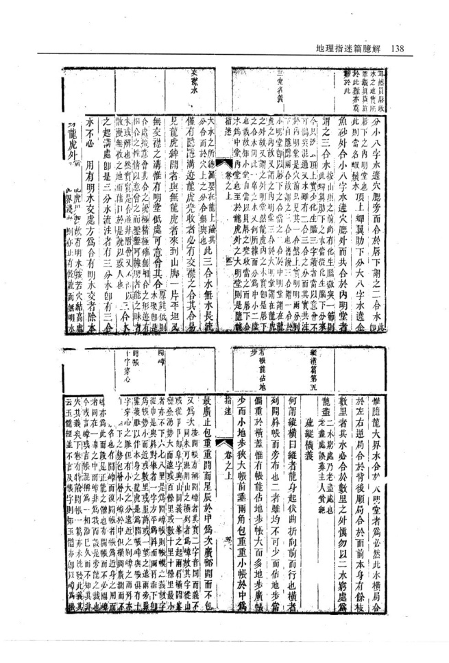

<!-- doc003 PDF 第 143 页：高风险/复杂版面 OCR 供检索；内容与排版以原页图为准。 -->
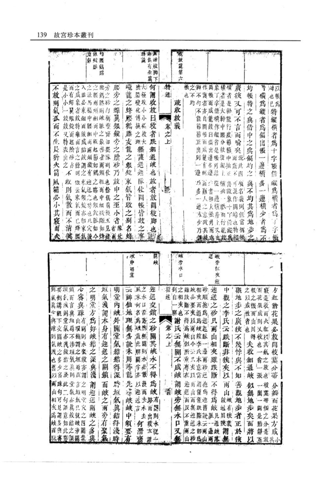

<!-- doc003 PDF 第 144 页：高风险/复杂版面 OCR 供检索；内容与排版以原页图为准。 -->
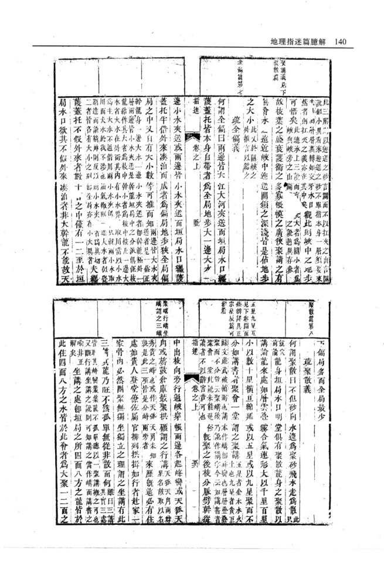

局之所則指結穴言局之大者所聚必大而明堂水 補義大勢自 聚百穴中巖 大 者與真穴久 勢不見其葉 者非直籠此 或大聚之中有數十龍並在小聚之中有數龍並在 亦二者訊惡 之道 均有門戶明堂亦皆成星開面而或曠傳反隱拙支 庶反魁梧如欲辨其孰輕孰重必須往觀其始分再 者分龍之後再起高大星辰也

龍於此住一二面之水於此會者爲小聚數千百里之龍於此住數千百里之水於此會者爲大聚數里數十里之龍於此住數里數十里之水於此會者爲小聚不論大聚小聚終是大家所共還須各立門戶自成明堂爲貼身眞聚方可地業小樂之爲 地非止一處故爲大家分單管一穴乃貼身之莫用神也案水口下開也要外背內面相向有情沙下牛 下側卽下手內明堂龍虎外之大明堂也要不傾不側窩平容聚指造卷之上

<table><tr><td rowspan="2"></td><td>面出於聚講行講之中幹者方盡所聚之福不然雖</td></tr><tr><td>之嫡爲大餘小聚之嬀爲小幹始太聚小聚之中面 在雕動機增圈指網相鐵練射體衣軌鬼者於於 不出於中幹者皆為應爲枝至於三之設當爲大</td></tr><tr><td rowspan="2"></td><td>龍水合者爲大聚僅得一邊隨龍 水者爲小聚枝觀小聚幹觀大</td></tr><tr><td></td></tr><tr><td rowspan="2"></td><td>卷之上終</td></tr><tr><td>卷之上 天</td></tr></table>

<table><tr><td rowspan=6 colspan=1>陶面卽佔地步</td><td rowspan=1 colspan=1>地理指迷篇卷之下</td><td rowspan=1 colspan=1>地山腔所</td><td rowspan=2 colspan=1></td><td rowspan=2 colspan=2></td><td rowspan=1 colspan=3>論勢其次論星論形子獨論開而地步册乃悖於古</td></tr><tr><td rowspan=2 colspan=2>開而地步難分雨項然開大而卽是佔地步無地步</td><td rowspan=1 colspan=5>申論罰面地步不分雨項</td><td rowspan=1 colspan=1></td><td rowspan=1 colspan=1>乎曰山川雖古今不改吾人之所見不同總皆發明</td></tr><tr><td rowspan=1 colspan=1></td><td rowspan=1 colspan=2></td><td rowspan=1 colspan=3>山川之秘如狐首青烏葬經之類以形勢察性情以</td></tr><tr><td rowspan=2 colspan=2>卽是不問面何也大八字一綱翠盡護帶數重爾邊送從繼護面面相向非開大面乎非卽佔地步乎貫</td><td rowspan=2 colspan=1></td><td rowspan=1 colspan=2></td><td rowspan=1 colspan=3>性情察生氣據龍疑龍玉龍經洩天機之類以地下</td></tr><tr><td rowspan=1 colspan=2></td><td rowspan=1 colspan=3>山形合天上星象以人間庶物狀山川變形逐類推</td></tr><tr><td rowspan=1 colspan=2>頂出脈護帶全無兄弟山挨近木身者非無地步乎</td><td rowspan=1 colspan=1></td><td rowspan=1 colspan=2></td><td rowspan=1 colspan=3>求隨樣模做此格物以明理非初學者所能驟至</td></tr><tr><td rowspan=1 colspan=1></td><td rowspan=1 colspan=2>非卽不開面乎故大開而地步自廣小開面地步自狹不開面地步自無蓋而之大小不專指本身而言亦兼羽翼緩術言也羽翼護衛多地步廣雖本身星</td><td rowspan=1 colspan=1></td><td rowspan=1 colspan=2></td><td rowspan=1 colspan=3>經青烏繩皆秦漢時書葬經卽葬書言郭師著狐首原經未有見者青烏經相傳素樗里子者然玩其文義除葬經所引用外辭覽義淺皆似後人附會之謝稱機類電稱的機稱構有動個種政屬令語用而毫無秦漢氣味當是因葬經所有數語而增備之</td></tr><tr><td rowspan=1 colspan=1></td><td rowspan=1 colspan=1>迷    卷之下</td><td rowspan=1 colspan=1></td><td rowspan=1 colspan=1></td><td rowspan=1 colspan=2></td><td rowspan=1 colspan=3>指迷    卷之下       11</td></tr><tr><td rowspan=3 colspan=1></td><td rowspan=1 colspan=1>面不大亦爲大開面無羽翼護衛地步</td><td rowspan=1 colspan=1>狹者雖本身</td><td rowspan=1 colspan=1></td><td rowspan=2 colspan=2></td><td rowspan=2 colspan=3>面地步之說參透萬山性情總歸一貫機竅出言纏露吐意明凈卽下愚皆堪通曉況形勢星辰皆包括</td></tr><tr><td rowspan=2 colspan=1>之星面大而不小亦爲小開面故開事今人不議同而眞訣往往亂指便塊穴卽自略滿開自之說者亦只戟本</td><td rowspan=2 colspan=1>面地步總是飽突處以儒身面言今兼</td><td rowspan=2 colspan=1></td><td rowspan=2 colspan=2></td><td rowspan=1 colspan=1>露吐意明凈卽下愚皆堪</td></tr><tr><td rowspan=1 colspan=3>於其內無開面地步卽不成形勢星辰矣何也未心</td></tr><tr><td rowspan=3 colspan=1></td><td rowspan=3 colspan=1>羽翼雙衛山言悶而則地之異假大小瞭如指掌矣但自身之眉之分言之則爲間而自外之羽翼護衛地步論眞假非肩臂眉之分不可論</td><td rowspan=3 colspan=1>目肩臂肌理言之則爲值大小非羽翼</td><td rowspan=1 colspan=1></td><td rowspan=3 colspan=2></td><td rowspan=1 colspan=3>不開面而能秀援成形者也未有不開面面能尊嚴</td></tr><tr><td rowspan=2 colspan=1></td><td></td><td></td><td></td></tr><tr><td rowspan=1 colspan=3>變下尊字則咸形上舊本皆降勢者也                  未有不賢綦兩字補以秀拔未知當否疊展轉開面而能成飛舞踴躍之勢者也未有開面</td></tr><tr><td rowspan=3 colspan=1></td><td rowspan=1 colspan=1>護衛之分不可固一事而雨名也</td><td rowspan=1 colspan=1></td><td rowspan=1 colspan=1></td><td rowspan=1 colspan=2></td><td rowspan=1 colspan=2>之羽翼不面而相向而能成團聚之</td><td rowspan=1 colspan=1>勢者也未有不</td></tr><tr><td rowspan=1 colspan=1>推論形勢星辰不外開面地步</td><td rowspan=1 colspan=1></td><td rowspan=1 colspan=1></td><td></td><td rowspan=1 colspan=1></td><td rowspan=1 colspan=2>佔地步之廣而能有勢如重屋豐草</td><td rowspan=1 colspan=1>成木勢如降龍</td></tr><tr><td rowspan=1 colspan=1>泰漢之時論形勢唐宋之時論星辰今</td><td rowspan=1 colspan=1>之時師止知</td><td rowspan=1 colspan=1></td><td rowspan=1 colspan=2></td><td rowspan=1 colspan=2>水遠雲從者也未有不估地步</td><td rowspan=1 colspan=1>之廣能有勢</td></tr></table>

<!-- doc003 PDF 第 145 页：高风险/复杂版面 OCR 供检索；内容与排版以原页图为准。 -->
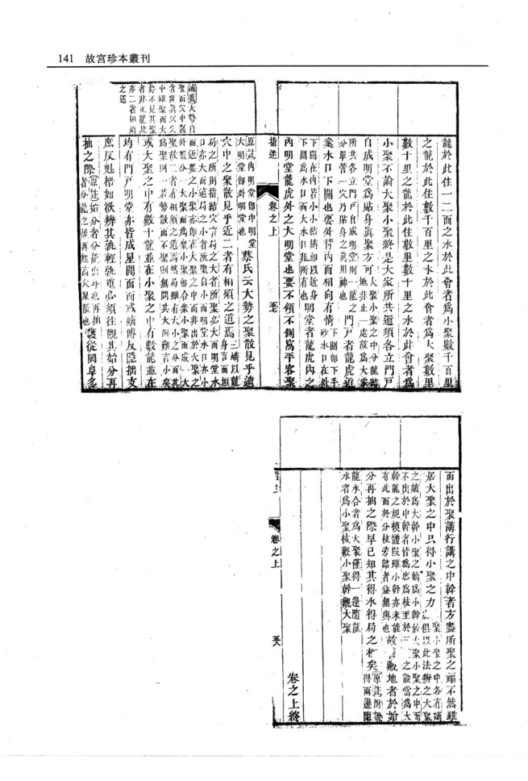

<!-- doc003 PDF 第 146 页：高风险/复杂版面 OCR 供检索；内容与排版以原页图为准。 -->
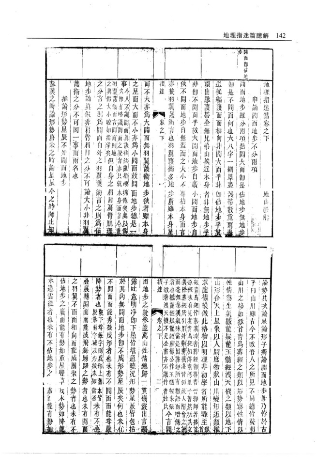

面則凶破祿文廉天罡噪火孤曜埽蕩等星凶也而皆见 廖氏云貫是脈從頂上抽星峰不見頭飽是渾 一口金星破軍金星祿存土星文曲水星隔義破碎指 本身不抱指 如覆箕樣醜惡那堪相楊公云大抵星辰嫌破碎不 攀山九星穴 山九星詳具詳脈龍經太陽金星太陰金星紫炁木星灭財土星 庚貞火尾合古弼水星而爲九楊公論龍之九星也龍虎言 抱本身常作怪草頭作亂此中生殺戮平民終大壤 截可参考 婦燕水星廖公論穴之九星也詳九星篇等語皆星不開面之說也景純云形如亂衣妬女淫 不决於星名而決於開面則開面一決而五星九星妻形如仰刀凶禍難逃形如臥劍凌夷過僭形如覆舟女病男囚等語皆形不開面之說也又云形如戈 各持一詭以致於相爭而迄無定論矛兵刑死囚形如流水生人皆鬼勢如生蛇屈曲徐 變不可勝窮按圖闕之孰爲某星孰爲某星可得而斜滅國亡家皆無地步之說也其 見葬經 入式歌云好 知也登山而觀之除正體星辰外雖老於地理者閒指 卷之下 指违 卷之下 四格面平方合樣面飽何勞相不開面而其面能平而 其孰爲某星孰爲某星則漫焉妄對夫五星九星之不他乎撼龍經云過處分金渡如線曰分金者非卽 變且不能知又何能知其眞假吉凶哉惟開面一法開而之謂乎又云高山頂上平如掌中分細脈如蛇 菊穿落傳安 義玉覽 不論何星何變關而自合穿落傳變之吉格不開面樣平如掌卽開陽獻面如蛇樣卽東陰吐氣中分是 自成粗頑破碎之凶體有商發在質而活 有落而後有寧有變而發有博言約星落聽來出何屋變作何星傳去到穴事落纏分隱分也又非開面之謂乎然則古之論形勢星 恐未之有 火皆冬一星體傳與變則同一星體也單論五星與辰者未嘗不寓開面地步之意也 然鄰此著作 實爲地書之 東多但山之面有隱顯橫偏閃側淺深大小多寡特 九星開面條辨 大觀學者不 降牽連開肩窩鉗乳突等項須分别之可不知面小五星九星雖千變萬化而眞假決於開面則一如貪 不必太能 隱面者卽是正體星辰以其分隱而脈亦隱故爲隱巨武輔太陽太陰紫炁天財金水等星吉也而不開 正體星辰 隱面第 面以其得五星九星正形故爲正體如覆釜覆鍾如

頓笏頓筆如列屏列之類是也 雨金星兩木星兩腳星辰 属面第二 者故爲正體日 之類者詞也 顯面考卽是開腳星辰以其分顯而 土星皆不生手臨 補義分心者 人字雨分之脈亦顯故曰顯面以其大小八字幷落服井然有條 中心也脈從此中心而出 而來者方眞苟不不平明明一條者便假此事要 服數欲故日閒腳如人開手如禽展翅如菜葉之護蓋二者 若結穴則此 字隱面亦有頂有挫有平有突但俱微現無兩然之卽爲天心也雖隱顯不同俱要有花生節泡隱分顯分背面稜通爲又口自平處而言卽見爲分心若不姓不平而皆要有分分則有背面有稜角八字總舉大人 八字不可邊有邊無星辰不可邊凹邊凸 化生出卷 肯朔不可以語面矣正體星辰除大八字之顯分 無隱脈之可據便是夢字中厲小八宇而言星辰兼能穴言邊有邊無則 分八字邊四邊門則不成星體皆所不取上小 干徽突經面願面河此又言俱要隱分斷分蓋隱中亦略有 翼卽有亦在依稀之閒開腳星辰必有護帶蟬翼顯顯處顯中亦略有隱處但隱户之 然可見卽無護荳小當作有蟬翼此爲異耳 必7 指送 卷之下 指迷 卷之下覆向背合割之宜忌則一而無二但正體星辰最忌 楊而第三撞背直來情之常也然龍之轉身最多有方直行而脈春到頭爲貫頭界水透頭爲破面實真來面高 因自脈春而言 脈忽橫降者有方橫行而脈忽直降者總爲橫面直爲貫頂自界水而言爲發 橫落橫行直落對面觀之皆爲慶落故總屬橫面也 其大八字卽以來去之橫者有貼身蟬翼界水從蟬翼外流下而不扣肋透頭 岡爲之不似撞背直龍之自分大入字然亦要近身之脈如寬牽線者不忌無貼身蟬翼界水扣肋透頭 有大八字之稍垂下對看不知其橫而像八字方眞秋又如寬來線故顯而之脈得如寬牽線一作條軟之 前之可見則其上本無分也故防假不忌否則不宜 義如北沒 下長者有力大八字之外有護帶豁開而相向者爲根便是隱落池隱而之脈要如泥中陰僅灰中牽線頂前微體姓 正穴卽或前 外無也蓋此卽情龍身上之枝 脚義再結亦是若不結穴則枝腳盡向

<table><tr><td rowspan=1 colspan=1></td><td rowspan=3 colspan=2>邊之護帶不患不相向而患不豁開一順斂入便非眞去水邊之護帶不忠不豁開而患不相向一順背我必假蟬翼肌理之分亦然橫降處無大小護帶乃在大龍方行之際而非大盡之處斷不成地大盡之</td><td></td><td rowspan=3 colspan=1>李順鬼蒼兒禽昭因大名砂互詳卷向背篇</td><td rowspan=3 colspan=6>出反增入如瓦之仰面也其分兩股彎施者名孝斷鬼下手一股逆抱上手一成斯抱此言通轉之砂如孝願鬼則只有下手一據所謂逆號            原註前後左右之砂蓋橫龍要四伏不牵翻身者也回頭相孤而不他走也背後之砂不轉則尾搖而不定龍已住者則不拘</td></tr><tr><td rowspan=3 colspan=1></td><td rowspan=3 colspan=2>龍將盡而枝枝結果之處得貼身有小八字之分分</td><td></td></tr><tr><td></td><td rowspan=1 colspan=2>砂</td><td rowspan=1 colspan=1>砂不轉則</td></tr><tr><td rowspan=1 colspan=1>分分</td><td></td><td rowspan=1 colspan=1>補義能巳住都郎上所氧</td><td rowspan=1 colspan=2>此卽</td><td rowspan=1 colspan=2>此卽龍勢</td><td rowspan=1 colspan=2>尚行</td><td rowspan=1 colspan=1>尚行而</td><td rowspan=1 colspan=1>此卽龍勢尚行而開而眞者亦不拘此但不如轉者</td></tr><tr><td rowspan=1 colspan=1></td><td rowspan=2 colspan=2>金之面有有平而降前去能博出大八字之星辰者亦成地但力不大能再博出火八橫面亦有隱顯字亦非小地二端俱照隱顯篇內看上言降厥凡橫龍結穴者不下言結穴指迷   卷之下      七</td><td></td><td rowspan=1 colspan=1>大龜之處開面眞者卽所</td><td rowspan=2 colspan=3>指送</td><td rowspan=3 colspan=3>尾卽指砂言不樽故不定或能已住或關出卷之下       5不過取其逆轉亦可備用收水若順水則爲機棹顧邊者一邊指本身一邊指染托也本身者尚是橈棹況出自樂托者卽是樂托之糖禪耳凡穴山之後易起一山正即穴魯者日樂又日托撓棹卽枝牌也</td></tr><tr><td rowspan=1 colspan=1></td><td></td><td rowspan=1 colspan=1></td></tr><tr><td rowspan=2 colspan=1></td><td rowspan=7 colspan=2>論有頂無頂凹腦但有脈降下並不忌後宮仰瓦氣貼春橫担作穴者忌之其凹腦全無落脈背後不仰有降派故也有隊則穴隘派作不當作歸春横担之穴矣故不忌仰死無降孤則當貼春或橫担而後宮又仰瓦則恐見無然之地非眞是貼春橫也之穴也故忌之春橫扣是南儒穴法莫混作一項看忌者謂仰尤無妨不是定要仰无故下又云號背仰瓦赤可催凹職全無落脈而反以仰瓦爲眞不4瓦爲假此却難際意以既無厲又無脈無非橫扭又類貼春而7於前而脈面現則反以後合仰麗設之非漫足據徒以仰尾爲眞也火否如此終覺未安姑</td><td></td><td rowspan=4 colspan=1>補義樂音效書好也穴上見者爲明樂其不見者爲时樂</td><td rowspan=1 colspan=3></td><td rowspan=1 colspan=2></td></tr><tr><td></td><td rowspan=1 colspan=3>今人見雪心</td><td rowspan=1 colspan=3>賦忌背後仰瓦往往將眞地誤棄而背</td></tr><tr><td rowspan=5 colspan=1>論義點春是一字平頂穴機高下精拉則雨頭欲起穴居中下故分州桥</td><td></td><td rowspan=2 colspan=3>後之橈棹亦脈並不拘後橫把則</td><td rowspan=1 colspan=3>將作鬼論故表出之總結上橫龍有降兩段</td></tr><tr><td></td><td rowspan=1 colspan=3>樂有無惟無降脈而橫担作穴者必須穴高後防空矣故必要樂托歸春同推</td></tr><tr><td></td><td rowspan=3 colspan=1></td><td rowspan=1 colspan=3>有等橫龍降</td><td rowspan=1 colspan=3>脈之處不惟無頂反生凹潭如小窩脈</td></tr><tr><td></td><td rowspan=1 colspan=3>從此凹潭中</td><td rowspan=1 colspan=3>出落下一叚方起小突爲化生腦下山</td></tr><tr><td></td><td rowspan=1 colspan=3>對看只見其</td><td rowspan=1 colspan=3>腦不見其凹此化陽之極而生起此腦</td></tr></table>

<table><tr><td rowspan=6 colspan=1>補義橫担是凹腦格屬鼓則是平塵勢揭字須作挈字意解或係借用或保後人娛寫俱未可知偏面第四</td><td rowspan=7 colspan=1>上而有潭如仰天為又如小兒願門之象故人在下不見蓋仍是一呼一吸一布一起之機故亦爲化生關面結蔡氏謂橫担橫截無龍要葬有龍蓋爲無降作貞也脈貼春者言若有數丈降脈當與直撞直奔者一體須半記其橫担結穴者亦要有化生腦分開金面有無定橫担雖亦要有腦下安育辱則亦徼有降欺雖不明現而與貼奈之令無降脈者略異故爲爾體對頂中出人所愛也然龍之偏峰最名偏至屑臂指迷    卷之下       九</td><td rowspan=6 colspan=1></td><td rowspan=2 colspan=1>申頂似卽舉公之側服體</td><td rowspan=1 colspan=1>理刷開分開金面於大八字之人半邊而近身之砂</td></tr><tr><td rowspan=1 colspan=1></td><td rowspan=1 colspan=1></td></tr><tr><td rowspan=4 colspan=1>中出偏出詳徒論太總節閃面第五閃龍閃穴</td></tr><tr><td rowspan=1 colspan=1>後有定論不贊</td></tr><tr><td rowspan=1 colspan=1>子徽云眞龍巧閃轉身多豈以直串爲可據言龍之閃也楊公云誤葬每因求正面不捲渾是棄偏坡言</td></tr><tr><td rowspan=1 colspan=1>穴之閃也蓋龍之閃如瓜果之不結於正藤正幹之</td></tr><tr><td rowspan=1 colspan=1></td><td rowspan=1 colspan=1></td><td rowspan=1 colspan=1></td><td rowspan=1 colspan=1>指迷    卷之下       十</td></tr><tr><td rowspan=2 colspan=1>洪</td><td rowspan=4 colspan=1>而出者有偏至掌後腕骨而出者橫龍脈來有先起中頂後偏至一邊而出者有未起中頂之肩鬱出脈上二句是正來而偏出下二句則言欄者皆爲偏面龍皆要據中頂而言有臂出者離中頂不遂掌後脫骨出者是偏至龍虎出臘其去中頂甚遠有臂是兩項掌後厥骨亦是兩項或掌後或腕疊也至鬱前之偏出止有有臂之嚴爾不必言及掌覽修觀龍魄體取的雕體臨風銀鐵臨法難狀構其推矣然玩掌後脫當之出似尚在龍虎外如下節所認不分人中頂偏過左右出脈者中頂不分个字下來字身邊一股而倚於人一邊分个字只要貼身蟬翼或肌</td><td rowspan=1 colspan=1></td><td rowspan=1 colspan=1></td><td rowspan=4 colspan=1>身而結於子藤嫩枝之上穴之閃如瓜果之不結於嘗不結而結於子蘇數枝之上者居多故云然若必謂正藤正幹斷然不赫則龍亦只有閃出而無正出穴亦只有閃矣有是理乎北卽橫印此穴居龍虎者而日腕射內者形之僞也之側熙微也以上各項行龍結故閃而示奇亦勢之不得不閃也穴同推不單言龍</td></tr><tr><td rowspan=3 colspan=1></td><td rowspan=2 colspan=1></td></tr><tr><td rowspan=2 colspan=1>4篇義撫蔡一國出辰或結穴總皆不坐</td></tr><tr><td rowspan=1 colspan=1></td></tr></table>

<table><tr><td>補義紫處飛 走義字疑說 蓋爵下平地</td><td rowspan="8">第 蓋有春處硬不得不借麻爲出殺之物而走艮 於軟處對頂處死不得不以頂爲分開之勢旁閃 入疑當於腕外之聚處正身不 此一以臨上殿 之意而原其所</td><td></td><td>僞閃可以徼側先師又何立一側面 例平無巳羔以 正宗所論側面者補之庶使學者略知其其言曰 行龍到頭須看背面面有三有正面有仰面有鄭</td></tr><tr><td>於生處生氣喜包藏而盡處拋露不得不棲閃於中 腰生氣喜止聚而盡處飛走不得不拋閃於平地腕 而言不得又</td><td></td><td>正則或心或口之裁仰則或窩或蓋之取側面多髮 形非止有如瓜藤轉面節節可裁有逆勢翻身作</td></tr><tr><td>內堂氣傾不得不閃入 作出 開面不得不偏閃於分枝之開面處 以 大抵閃脈之出無正頂之起無脈脊之露惟有隱 然 隱分金之而微絆微平一呼一吸氣可細察而</td><td>宗第十 1 君可參考</td><td>穴有斜閃半月橫結者皆爲側面穴須唇氣之現爲 久詳具眞此三者皆一邊爲背一邊為而故稱側西瓜藤龍 眞體水星曲指勢也一曲一為寫故可次翻專作穴 者邇龍顧神格也轉五張潮具地不小斜閃橫結者 正體粗頑不華勢抽細難之脈面結問穴形如半月 也然皆須唇氣之現者何蓋窩此無唇則中無國地 眞氣不駐逆轉無唇則水衝城腳內氣不圓半月無</td></tr><tr><td>一二鐵篇獨 得然論閃龍前遂無開好而之星辰出者不眞論 講得明白楊 指送 卷之下 +1</td><td></td><td>唇則有月形而無月魄氣必不奉陽有蟻患俱非眞 穴也觀此則偏閃之外自有側而一項但不知周師</td></tr><tr><td>吉其當然 受推其所以 舊示以形又 喻以意集其</td><td></td><td>指迷 卷之下 书</td></tr><tr><td>閃穴無唇臍堂砂之穴證可憑者必僞星辰唇腑堂</td><td></td><td>所論果如此否終</td></tr><tr><td>砂若無動氣不靈星辰嚴臍堂砂繪易曉動氣二字</td><td></td><td>以得見完本爲幸 深而臍腹出脈淺面喉胸出脈出脈低者星辰莊重</td></tr><tr><td></td><td>樣面第七 百第入</td><td>雖孤峯單聳亦不畏風出脈高者得本身肩翼重舊</td></tr><tr><td>眞又妍其僞 夢方聽列反</td><td></td><td></td><td></td></tr><tr><td>覆開隙而閃 龍閃穴之愛 量不必坐山</td><td>堂砂之外離此而求之不得執此而求之亦 致者有之自之耳試將分斂仰覆乘金相水葬乘生 不得是在心靈月</td><td></td><td>方爲有勢肩翼單薄必主力輕若無貼身蟬翼脈邊</td></tr><tr><td>贈歷而已</td><td></td><td></td><td></td></tr><tr><td></td><td>氣諸篇細細揣摩徧覆古墳以驗之之旦豁然貫通</td><td></td><td>頂者爲貫頂有等喉頸之下雖起小泡不甚露形隱</td></tr><tr><td>如指諸字</td><td></td><td></td><td></td></tr><tr><td>地書至此與 乃枕中之秘</td><td></td><td></td><td>隱而下至臍腹陰囊方出顛然之厥者又不妨其高</td></tr><tr><td></td><td>微茫界合爲水土則穴中生氣之上水賺左 右之隱砂也和蒲視之也印者以此盜之也</td><td></td><td>出有等啖頸之下連起突泡或五六或七八大小相</td></tr><tr><td>例旨第六</td><td>閃面之下應有側面一條原本無之擬其見</td><td></td><td></td></tr><tr><td></td><td>徧求諸木覆之赤復爾窮之同人我卽偏爲 例 者然倒有似於偏而偏固未嘗善領也又有以國</td><td></td><td>等个今有分金之面者系串而下如串珠天梯極道</td></tr><tr><td></td><td></td><td></td><td></td></tr><tr><td></td><td>爲側者然四或亦合假其實側不書生漢因也且使</td><td></td><td></td></tr><tr><td></td><td></td><td></td><td>之格雨邊肩翅疊護者力反大又不可以淺概論也</td></tr><tr><td></td><td></td><td></td><td></td></tr></table>

<!-- doc003 PDF 第 148 页：高风险/复杂版面 OCR 供检索；内容与排版以原页图为准。 -->
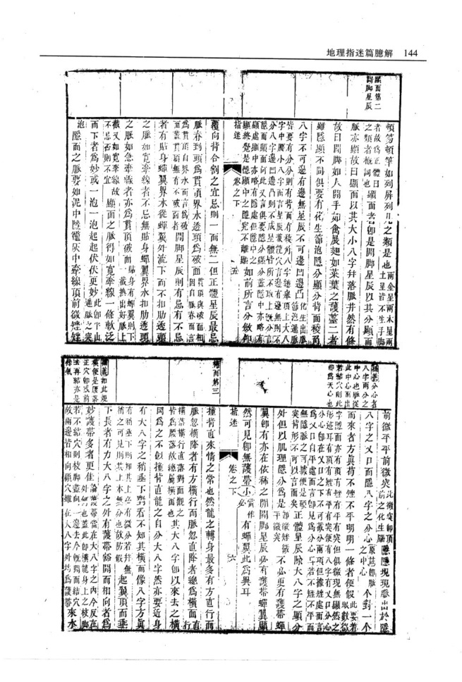

<!-- doc003 PDF 第 149 页：高风险/复杂版面 OCR 供检索；内容与排版以原页图为准。 -->
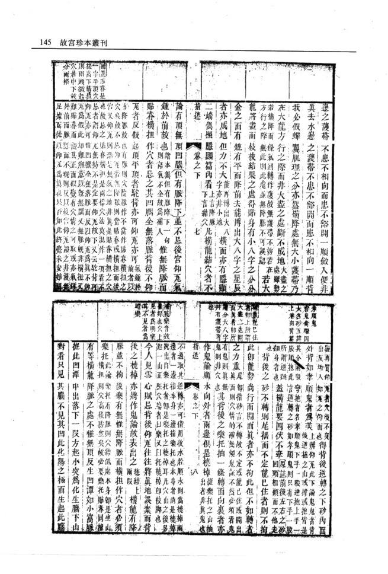

<!-- doc003 PDF 第 150 页：高风险/复杂版面 OCR 供检索；内容与排版以原页图为准。 -->
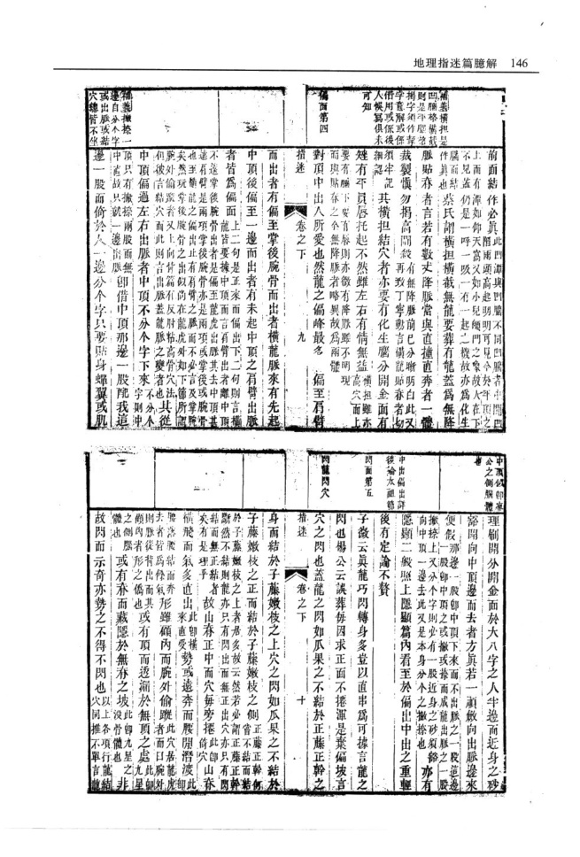

<!-- doc003 PDF 第 151 页：高风险/复杂版面 OCR 供检索；内容与排版以原页图为准。 -->
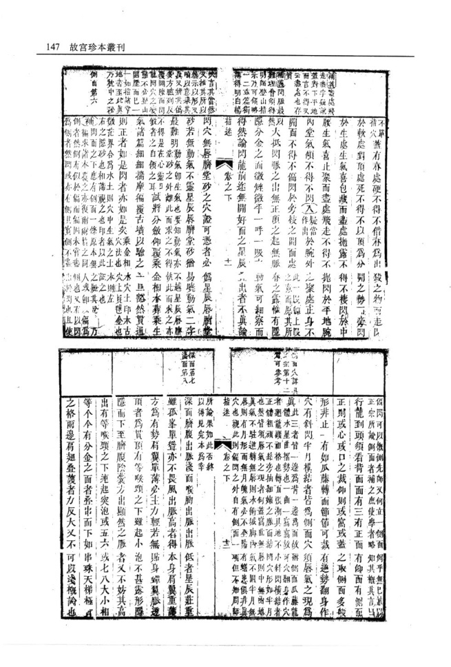

申珠箇館金星相連擺走不宜直串天梯館篤木屋自高而下不宜備大箇小此行龍之體然亦有卽 此 星辰只論開面不拘面之大小若在谷中分挂之龍結穴者皆貴之徽也 仍以面之大者為勝大身之非 大面則氣勢必弱小面第十 第九 關面多寡 義此简角 龍雖長不開面者多發亦有限行至不開面處卽休所謂兼羽翼護之多葉如于葉逆之多辨面面相向石翼齊開者爲 法則言開臨也 大八字豁開極遠護帶數重如大葉 開西之多寡 長短蓋硤上 亥之十項闕 国及性身之 短只以分龍處爲始 說雖短節節開面發必久行畫其龍而發不巳其長 始以少龍處爲太禮巳前龍身輿 我不涉此常法也下三頂又於極大面前去必結大富貴地其次大八字不甚豁關 上所論之居點大所然有一等大龍行度帳峽巳多開面極美 麗而吉而非常格之外僅有一二重護帶如小菜之不能多葉單瓣花之不 有其義也故 名有其名各 脫卸極嫩忽起高大星辰雄據一方猶行而未止開龍多辦開面端莊而出者前去必結中富貴地其次 當與下特降八字短小而不開張護帶全無只得蟬翼肌理刷攝 2 幷末二鬱另為一倒卷之下 迷 之下之面而出者前去必結小地但在分龍起祖處論之 上燕引可 不瑛董列亦 辰旺氣一聚大星後帳峽博換雖屬幹龍之身亦坐汝不大小面者有 巳經脫卸之近禮 放開 又當恕論近穴之面必收 行度牵連之小面有巳經脫卸大 開近穴之祖必要收數 龍是幹分落爲枝 龍身分舉而雜大 又有一等大龍行度於半路之間山變小山之小面行度牵連之小面不但低小山頭 龍身極嫩雖不起高大星辰得本龍之盤旋枝節之有之高山之上只 微起微伏不甚頓跌處亦有之此 輻湊結成垣局大勢團聚於過龍身上分開橫面捷等星辰輕重不龍自主惟視其前去開出之大星辰 落一枝雨邊數重山外背內面如千葉蓮之相向數護帶之有無多寡爲轉移巳經脫卸之小面當觀其 丈之脈亦成大地 此大龍身挂脈而結並非分枝盤旋輪奏結成垣局仍是大龍行度後龍合上格到頭經護多者爲上地後龍合下格到 原非為桂勝而段而掛脈適當此處借用 又幹龍將越局似專爲我而設者亦非中下之地也頭纏護少者爲小 地故面之大小只以祖宗論到頭 結省郡數里內分落者雖數節亦結大地然在垣局

<table><tr><td rowspan=1 colspan=1></td><td rowspan=2 colspan=3>中分落者爲貴註與者郡同垣不在垣局分落者心須自制局矣無垣局者豈得爲大地然在數里內分落應無不同垣局者或離省郡尚遣半路分藩則亦有不在垣局中省矣勿泥此斜龍到頭分落面集以上三非分枝亦非甚縣溢是一龍面陰陽兩結者老乂不可以龍短概論也</td><td rowspan=1 colspan=1></td><td rowspan=1 colspan=3></td><td rowspan=1 colspan=1>實一義有多則帳大至金水機則大之極矣橫飛者卽飛鵝穿帳勢也三峰並時而離立爲三合連氣者爲筆架中峯高而丙有低千者爲鳥朝其五七九屬道列者爲美葬帳六印爲龍樓中起大金頂面雨有水銀層疊名金水帳中顧火解員人其眉自我之大八字一統單下豁閒每眉</td></tr><tr><td rowspan=1 colspan=1></td><td rowspan=1 colspan=1></td><td rowspan=1 colspan=1></td><td rowspan=1 colspan=3></td><td rowspan=1 colspan=2></td><td rowspan=1 colspan=1></td></tr><tr><td rowspan=4 colspan=1>尊峰用或連同页</td><td rowspan=3 colspan=3>特降者自高山跌落低嶺胸腹甚至跌落平地陰囊</td><td></td><td></td><td></td><td></td><td></td></tr><tr><td></td><td></td><td></td><td></td><td rowspan=3 colspan=1>每有各分八字枝腳散亂而不向我爲假各分八字則各自成龍其每習起員爲各枝面段捷我之</td></tr><tr><td rowspan=1 colspan=1></td><td rowspan=1 colspan=3></td><td rowspan=1 colspan=1></td></tr><tr><td rowspan=1 colspan=3>胸廈在半山非卽低嶺陰囊在</td><td rowspan=1 colspan=1></td><td rowspan=5 colspan=3></td></tr><tr><td rowspan=4 colspan=1>唯</td><td rowspan=3 colspan=1>伏而來</td><td rowspan=3 colspan=2>牵連者小起小伏無邇脈節泡雖有亦不多</td><td></td><td></td></tr><tr><td></td><td rowspan=3 colspan=1>腦七腦九屬六甲龍樓其力量更重矣俱肩要頂頭</td></tr><tr><td rowspan=1 colspan=1></td></tr><tr><td rowspan=1 colspan=1>其形如</td><td rowspan=1 colspan=2>齒而來特降者不開面便假牽連者不關</td><td rowspan=1 colspan=1></td></tr><tr><td rowspan=1 colspan=1></td><td rowspan=1 colspan=1>述</td><td rowspan=1 colspan=2>卷之下       盖A</td><td rowspan=1 colspan=4></td><td rowspan=1 colspan=1>指述   卷之下       关</td></tr><tr><td rowspan=3 colspan=1></td><td rowspan=1 colspan=1>面</td><td rowspan=1 colspan=2>出身處最忌牽連必須</td><td rowspan=2 colspan=4></td><td rowspan=2 colspan=1>兩眉均修偏一二頂來開渚一邊肩多一邊有少只要自內分開面面相向</td></tr><tr><td rowspan=1 colspan=1>特降</td><td rowspan=1 colspan=2>出身進財勢行度處不能純是特降亦不可不雄力不好</td><td rowspan=1 colspan=4></td><td rowspan=1 colspan=1>拘其頂背橫來惟三台之格頂背來開者有之</td></tr><tr><td rowspan=1 colspan=1>純是牽</td><td rowspan=1 colspan=2>遠相間而來爲有龍勢牽述多而特降少者</td><td rowspan=1 colspan=4></td><td rowspan=1 colspan=1></td><td></td></tr><tr><td rowspan=4 colspan=1></td><td></td><td></td><td></td><td></td><td></td><td></td><td></td><td></td></tr><tr><td></td><td></td><td></td><td></td><td></td><td></td><td></td><td rowspan=2 colspan=1>原詩六甲龍樓者是六中資人也邊下三台五縣七屬九臨俱自內分間西</td></tr><tr><td rowspan=1 colspan=1>次之純</td><td rowspan=1 colspan=2>是牽連蟬非砂體亦無力平岡龍以收放盤</td><td rowspan=1 colspan=3>F</td><td rowspan=2 colspan=2></td><td rowspan=2 colspan=1>+1</td></tr><tr><td rowspan=1 colspan=1>旋曲折</td><td rowspan=1 colspan=2>爲勢不在此限</td><td></td><td></td></tr><tr><td rowspan=1 colspan=1>開有之病精義開有卽</td><td rowspan=1 colspan=3>星辰有一二閱石者有三四開爲者有一邊有石一</td><td></td><td></td><td></td><td></td><td rowspan=1 colspan=1>窩鉗之穴頂上分開爾片維雄砂裹定唇口於當也</td></tr><tr><td rowspan=1 colspan=1>開帳極大包爲嶂矣蓋合</td><td rowspan=1 colspan=3>邊無肩者有一邊肩多一邊石少者或成橫麗三台</td><td></td><td></td><td></td><td rowspan=1 colspan=1>冀之穴情父</td><td rowspan=1 colspan=1>儼如界水之槽雌簿砂卽牝牡砂在絲錯譜之生角砂爲銷必有唇口無唇口則不其</td></tr><tr><td rowspan=1 colspan=1>衆山之面面成一大面所</td><td rowspan=1 colspan=3>或成席朝筆架或成五腦七腦九鴈六甲金水之帳</td><td rowspan=2 colspan=4>注佛人斜察實脈如何行就如何止！舊屯穴之進</td><td rowspan=2 colspan=1>氣雲無脈脊毬簷可見無分合界水可憑與孔突迴者眼但親心人未易埋會則若見爲無耳</td></tr><tr><td rowspan=1 colspan=1>謂兼羽翼護百言西也</td><td rowspan=1 colspan=3>肩愈多愈佳愈高惫貴均停爲上不均停次之顯</td></tr></table>

<!-- doc003 PDF 第 153 页：高风险/复杂版面 OCR 供检索；内容与排版以原页图为准。 -->
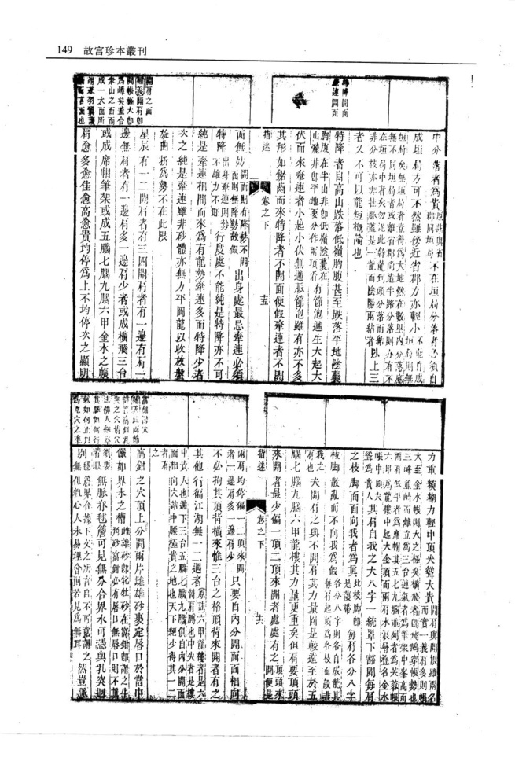

無毬簷而可穴乎曰脈有陰陽不同陰脈皆凸上行如人手臂之脈陽脈皆凹中行如人手心之脈雖有有春無脊之殊其呼吸浮沉之動氣則一而無異也乳爽無呼吸浮沉之動則亦無脈窩鉗有呼吸浮通之動則亦有脈蓋脈之有無在動與不動不在春之有無也然則何以見其動乎曰亦在微肄微分微平之閒見之微微分之下若有微微有氣之呼而浮也微有微平之盡若有微微起氣之吸而沉也則織雉微平微有微起皆時吸浮沉之氣使之然也而可指述 花

有爲陽起屬陰賞與乳突無異而曰原註中但窩鉗中之微起非果有一塊高過兩邊 欲起脈妻微低旁又徽 高與中脈董 因兩邊有分去之紋理俱無婬無平板核而不見其有亦不見其起中閒一路獨有隱隱之微將前有然下則但非如乳突之起有分水之春也平盡自然是起一卽是上叚之怠而申言之非乂深進一也行脉有餘有平有有有起而當穴之處亦目自有簫則知寫鋪之體甚大而非但以井口一帛之地爲窩鉗蓋陽脈在凹中行難非如乳突之有春可見面

其姓平起有之微動處周不異於 陰雌雄外結故界水分開於兩邊窩鉗是陰閒裹陽 雌雄內交故界水不分關於兩邊 原注乳突爲陰訓 包砂是陽故謂之 陽開裏陰寫新爲陽則包 砂是陰故語之陰閒裏融 界水不分中有水矣奈何 障會陰沉 曰水有陽會陰流之不同窩鉗中肌理分開舒坦有 肉者水必坦坦鋪開而無溝謂之陽會水肌理斂入 過陷無肉者水必成溝而下謂之陰流水升二海及 辨窩鉗 僞之疑訣景坦有處則雉平起有之微動卽在內上 見得故水 分而不成溝逼陷無肉則爲虛高假錯而 水自我溝或源者再邊之水聚於中 閒一路行 指述 卷之下 +

義太 太陽金水穴又無珠乳難辨别水來破面聚唇中 水 勝錯為少配 樊是太陰孔 若行時脈不歇淋頭割腳要消詳惟枕毬簷尋活服 是少险 珠乳系見下 是指陽會水也大小也名水 發服節 破而其實無面 有 面有唇面水自 知其脈之不歇直至希穴之處則復有毬簷之起而 脈始歇也迷簡起則上分卜合而成穴毬簷不起則 壁隈惟嫌頂上有水來釵頭不員多破碎水傾穴內 必生災是指陰流水也故窩鉗不忌陽會水只忌陰

<table><tr><td rowspan=3 colspan=1></td><td rowspan=3 colspan=1>流水原詩是有卷而無嚴無氣之爲陽會水鉗會陰流而以</td><td rowspan=3 colspan=2>陽分水有分有厭陰流水無分無脈極論吉窩穴楊詩是言銷穴蓋湘寫中有脈有穴無騷則被水侵而無穴欽頭不員亦故故破碎而水來固未嘗以窩中之水中之水爲陰流水也今以二詩板分陽爲有忌有不忌之証似覺扮泥讀者臨</td><td></td><td rowspan=3 colspan=1></td><td rowspan=1 colspan=2>必有一平之盡如毬之起則窩鉗之毬簷亦是動氣</td></tr><tr><td></td><td rowspan=2 colspan=1>之煙平盡虑毬簷尋活脈</td><td rowspan=1 colspan=1>也故既日又無珠乳難辨别又曰惟枕</td></tr><tr><td></td><td rowspan=1 colspan=1>正欲於低有之中察出其呼吸浮沉之</td></tr><tr><td rowspan=3 colspan=1></td><td rowspan=1 colspan=1>之然水雖腸</td><td rowspan=1 colspan=2>會終無分水之春何能使穴中無水日</td><td></td><td rowspan=2 colspan=1></td><td rowspan=2 colspan=1>動氣耳形仰</td><td rowspan=2 colspan=1>者離頂不遠必就有平臍立穴猶易形俯者去頂數丈方有平臍立穴甚難須違水若行時</td></tr><tr><td rowspan=1 colspan=1>有隱隱之</td><td rowspan=1 colspan=2>分勢水從隱隱之分勢而去有隱隱之趨</td><td></td><td rowspan=1 colspan=1></td><td rowspan=1 colspan=1>俯者去顶</td></tr><tr><td rowspan=1 colspan=1>平水從健平</td><td rowspan=1 colspan=2>之兩邊散散而分不從雉平之當中</td><td></td><td rowspan=3 colspan=1>陽穴亦防海急乳突陰穴蠶宜小心</td><td rowspan=3 colspan=2>以淺深而定鞋之滋者形故穴去頂近結之深者形治故穴去頂遠兩指員抱如筲箕金盤</td></tr><tr><td rowspan=2 colspan=1></td><td rowspan=1 colspan=1>要活故不成溝而</td><td rowspan=1 colspan=2>句只是一意而鄉平當中一直九下旬額看蓋使一直潼下則其中原無差平也名陽會水雨滲入土亦從分開之殺理</td><td></td></tr><tr><td rowspan=1 colspan=1></td><td rowspan=1 colspan=2>渗去故壙中自無水淋上文之只是申</td><td></td></tr><tr><td rowspan=1 colspan=1></td><td rowspan=1 colspan=1>指迷</td><td rowspan=1 colspan=2>卷之下       九</td><td></td><td rowspan=1 colspan=1></td><td rowspan=1 colspan=1>指迷</td><td rowspan=1 colspan=1>卷之下       二十2</td></tr><tr><td rowspan=3 colspan=1></td><td rowspan=1 colspan=1>中之毬麓</td><td rowspan=1 colspan=2>下壙中又卽是穴中也</td><td></td><td rowspan=3 colspan=1></td><td rowspan=3 colspan=1>情形作法之不一窩鉗而當者順龍</td><td rowspan=1 colspan=1>之窩有大小淺深之不同鉗有長短曲直</td></tr><tr><td rowspan=1 colspan=1>形俯而穴低</td><td rowspan=1 colspan=2>若以俗眼觀之似無界水而實無水淋</td><td></td><td rowspan=2 colspan=1>有頂頭來開者有橫過而開者有鈎聾音體距春種麟香魄殖味備離水頭體</td></tr><tr><td rowspan=1 colspan=1>也然無乖頭</td><td rowspan=1 colspan=2>之勢唇氣之吐弦稜之俗制者中聞必</td><td></td></tr><tr><td rowspan=3 colspan=1></td><td rowspan=1 colspan=1>無動氣而有</td><td rowspan=1 colspan=2>水淋故此三者又爲看窩鉗之先務有</td><td></td><td rowspan=2 colspan=1></td><td rowspan=2 colspan=1>俱要有外背</td><td rowspan=2 colspan=1>內面之眞情抱向方有弦稜生氣窩無</td></tr><tr><td rowspan=2 colspan=1>此三者然此一段又見嵩鉗之下弦</td><td rowspan=2 colspan=2>後可以察動脈有動脈然後可以看毬推進一層意乖頭就起雲處言屬氣在發在窩鉗之上無此三者則雖有窩鉗</td><td rowspan=2 colspan=2></td></tr><tr><td rowspan=1 colspan=1>貝唇不成</td><td rowspan=1 colspan=1></td></tr><tr><td rowspan=3 colspan=1>廣姑解詳上卷向背篇</td><td rowspan=1 colspan=1>之</td><td rowspan=3 colspan=2>平臍結招之原謀高之也水在穴下府在穴前鼎水之午膺之結</td><td rowspan=3 colspan=2></td><td rowspan=1 colspan=1>成溝破頂窩</td><td rowspan=1 colspan=1>鉗俱忌界水唇中成溝窩忌而鉗不忌</td></tr><tr><td rowspan=1 colspan=1>可觀其水</td><td rowspan=1 colspan=1></td><td rowspan=1 colspan=1>員辰故微微窩鉗承胎而葬金盤之</td></tr><tr><td rowspan=1 colspan=1></td><td rowspan=1 colspan=1>之上</td><td rowspan=1 colspan=1></td><td rowspan=1 colspan=1>穴必居中側</td><td rowspan=1 colspan=1>鉗挨食指閒之轉皮合鉗捲兩鉗盡之</td></tr></table>

<table><tr><td rowspan=3 colspan=1>浦漢穴法云後傳三聲山前觀三龍水三龍者節三分三命也詳其正宗首篇輔穴節</td><td rowspan=3 colspan=2>胖肉邊窩認股明股暗之情開鉗看後倚前親之勢北皆易曉原小高鉗宜非頂金盤四面皆弦稷正中必有微突是穴側鉗穴居錯內合鉗仰玉夾瘦鄉邊窩頸穴少居界水明邊開錯看國塵定穴寶鉗如食指大指之間發長股起故挨近指取穴指中開交縣處爲轉皮正生氣動處合錯清雨胶2而合爲一也合處必有胖肉忍窩以界水明胶暗敝有似於宇邊其實合兩殿滿之則仍是尊周刻寬散放取認於国息自級徽寫射面下皆是坐於其中細詩健平起有之厭路毬葉者也</td><td></td><td rowspan=2 colspan=2></td><td rowspan=1 colspan=1>後分開之蟬翼無一雉之峻作伏落之勢卽無還魏</td></tr><tr><td></td><td rowspan=1 colspan=1>之平作泛起之機是以兩邊拉下面低垂綱翼硬落中腰突泡分關雨爾垂者</td></tr><tr><td></td><td rowspan=1 colspan=2></td><td rowspan=1 colspan=1>作伏落之勢於平後故有還藐之平作泛起之機於雉前是以中心起而有突原註當中穴雪軟落有幾赦能突起擾此突起處卽是若使無蟬翼低護於兩旁煙平疊出於毬後者</td></tr><tr><td rowspan=2 colspan=1></td><td rowspan=2 colspan=1>深窩長鉗故最難認上所詳辨</td><td rowspan=2 colspan=1>直鉗之形俯者其低有中之陽脈呼吸浮低之形若有若無雲此卽之者也</td><td></td><td rowspan=2 colspan=2></td><td rowspan=1 colspan=1>雖有突袍之起亦非眞毬蓋旁有蟬翼之分中有經平之脈方能有狼影之蝦鬚水在蟬翼縫中分出而</td></tr><tr><td></td><td rowspan=1 colspan=1>合其員唇脈始清而活動而止也此蝦鬚水在穴應員胖之外故兩給</td></tr><tr><td rowspan=1 colspan=1></td><td rowspan=1 colspan=1>指迷</td><td rowspan=1 colspan=1>卷之下       11]</td><td></td><td rowspan=1 colspan=2></td><td rowspan=1 colspan=1>指送    卷之下       训</td></tr><tr><td rowspan=3 colspan=1>突陰穴</td><td rowspan=1 colspan=1>長者爲乳</td><td rowspan=1 colspan=1>員者爲突出於分隱脈隱之而中如龜鼈</td><td></td><td rowspan=1 colspan=2></td><td rowspan=1 colspan=1>於員属之下 夫謂之毬簷者一字有一義而兩義合一</td></tr><tr><td rowspan=1 colspan=1>戴泥之狀</td><td rowspan=1 colspan=1>爲隱乳隱突出於分顯脈顯之面中如垂</td><td></td><td rowspan=1 colspan=1>魏簷名義</td><td rowspan=1 colspan=1></td><td rowspan=1 colspan=1>也蓋自其連前平處言之有突起之頂謂之毬此前平</td></tr><tr><td rowspan=1 colspan=1>鼻覆拳之</td><td rowspan=1 colspan=1>形者爲顯乳顯突隱者氣嫩只要在个字</td><td rowspan=1 colspan=2></td><td rowspan=1 colspan=2></td><td rowspan=1 colspan=1></td></tr><tr><td rowspan=5 colspan=1></td><td rowspan=3 colspan=1>分金之面</td><td rowspan=3 colspan=1>中有雉有平而出雖不再有脫卸卽以</td><td rowspan=3 colspan=2>F</td><td rowspan=3 colspan=1></td><td></td></tr><tr><td rowspan=1 colspan=1></td><td></td></tr><tr><td rowspan=1 colspan=1>言之謂之簿此頂卽是毬电下是屬無毬則生氣不聚無簷則</td></tr><tr><td rowspan=1 colspan=1>此徽乳徽</td><td rowspan=1 colspan=1>突爲入穴之毬簷顯者氣老雖在个字分</td><td rowspan=1 colspan=3></td><td rowspan=2 colspan=1></td><td rowspan=2 colspan=1>原其生下徽葬日不M四部臨葬口其毬之突起處脈路有未盡火起尚爲張路者陰殺衡未化也故陰殺未化 直待毬前有分開</td></tr><tr><td rowspan=1 colspan=1>金之而中</td><td rowspan=1 colspan=1>有煙有平而脫出若不再有脫卸復起貼</td><td></td><td></td></tr><tr><td rowspan=3 colspan=1></td><td rowspan=3 colspan=2>體微泡爲毬簷不可再有脫部則老中翁嫩方可立穴若卽在上一頷作穴便是藥殺如只有一節而不再有脫只要涉抱水交眞氣已駐與便以此一節之氣興突爲毯管亦不得以不再脫新夫毬簷非有一塊比來脈高一叚也以毬而少之它</td><td rowspan=3 colspan=3></td><td rowspan=1 colspan=1></td></tr><tr><td rowspan=1 colspan=1>吐陰化而爲陽二者有相須之道焉故分稱</td></tr><tr><td rowspan=1 colspan=1>有二名而合言實一物也古人謂無分不成穴卽指</td></tr></table>

<!-- doc003 PDF 第 154 页：高风险/复杂版面 OCR 供检索；内容与排版以原页图为准。 -->
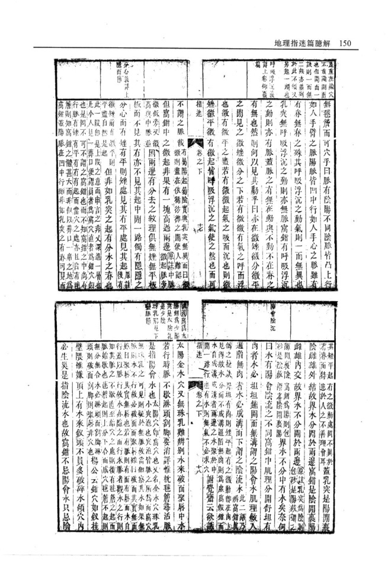

<!-- doc003 PDF 第 155 页：高风险/复杂版面 OCR 供检索；内容与排版以原页图为准。 -->
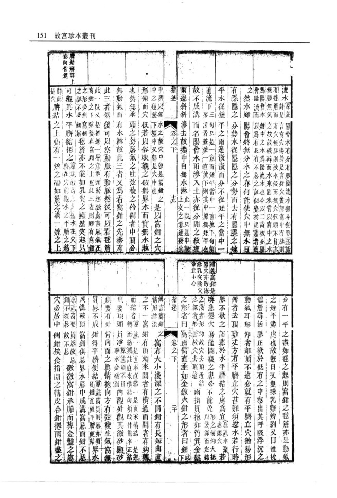

<!-- doc003 PDF 第 156 页：高风险/复杂版面 OCR 供检索；内容与排版以原页图为准。 -->
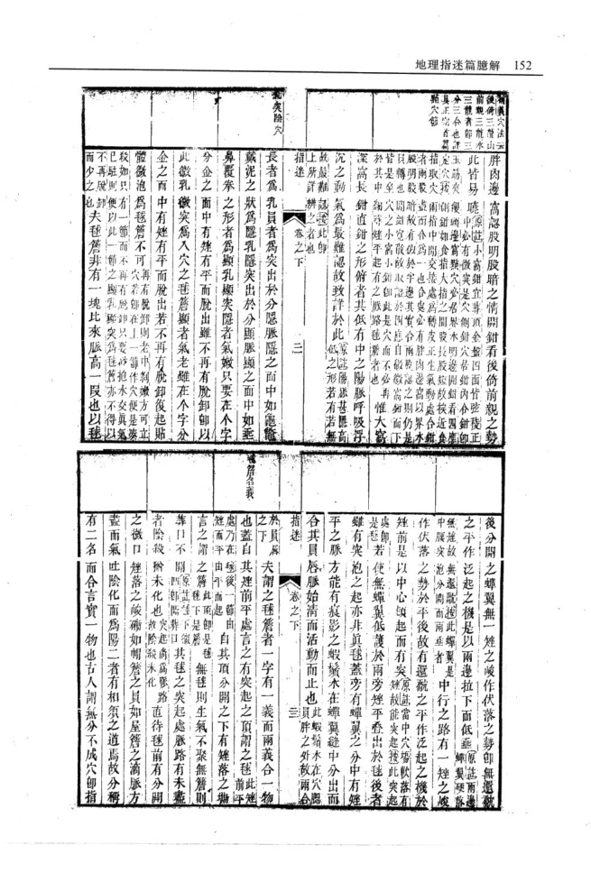

義取譬明 無小不成穴切穴情如在知者乃慣在 曹剪宜乎人 人俱而不 卽指遠吉周口卽者靜言此又謂之孩兒頭者以班 未制市也宜認蝦鬚氣與珠若是節泡幷塊梗時師休 非敬口硬塊上點穴 三語是卽上文而中富之 要用心圖若是梳形鉗面出隨他脈路取工夫此是是誠河心 不可絕硬欲其微分之隱人微姓之隱有如孩兒頭 天然眞正脈果能明得卽無虛又云蠻脈穴法最爲觀此則德兒與部 門之別名今人又或分 難認取蝦鬚蠏眼安單股水隨經繞下三又五度要乃在當穴之處面非上所要之玄巨簷盡處必議平是微四在徽平之上微平任徹四之下而殺凹微平之閒乃爲葬日所前孩兒頭者指此所謂頗門者指此此閒爲地無多內多不秋出潭公總 過二三尺真妮看前後二 字而祀若相去之懸絕也 譚公云毬管之下略生窩指迷 卷之下 指迷 卷之下葬山原來就是他此是天然眞正穴就中倒杖豈差 解曰蝦有六鬚四短二長離木俱監起在水時二長正宗 塊硬詳下 飼杖法詳具 葬地但用羅經而不識杖 法安有真穴誤人不淺 乃立穴作向之眞訣今人 又云到穴星辰塊梗全毬 水名義 續帑轉问後如人字樣其尾略轉抱身試放活蝦於 此是蝦續正解地懷皆入穴之今人或以舊在穴前或好破毬而 簷相似穴天然肥貝開口宜融結葬口原來是目前 卽毬簷上一鐵 鉗爲隕觀此亦應自笑其無謂 截蝦身比穴脈蝦鬚比暗翼肋下分出之痕影水除一說穴上高起貞者爲毬穴下合毬簷之分不論外上面分一重暗翼當有一重蝦鬚突金粗蠡之 面 地之眞假不在文秀粗蠢只在開面與否開面者粗 山與毬義此於高 譬之水俱入穴之內明空惟頂上分木聚於外明堂錯乳爽之外 相經不開面四不出趣 毬簷之小時翼之分分字皆指砂之外而非言水弱有一種穴故賄文 其出人之文秀粗蠢在後龍之星辰論不在 之分也下文蝦解乃始言水之外耳時翼之分有二情穴法他書秀不取 頂前化生曠一重半山微突一重故幷毬簷而三

<table><tr><td colspan="2" rowspan="3"></td><td colspan="4" rowspan="3">入次之水爾重則化生屬下一重在半山微與上半山發夾下一重在甚簷上而頂上之分水不與焉頭上分水鑑在化生腐上下文第一重第二重巳經分廟明白第一重蝦鬚當在化生腦之暗翼胁下分出要半山微突之暗翼過開使</td><td colspan="1" rowspan="3"></td><td colspan="1" rowspan="3"></td><td colspan="1" rowspan="1">頓之分去若脈路無婬無平與兩旁之暗翼一齊拉</td></tr><tr><td colspan="1" rowspan="1">下肋下必無摺痕界水必四散流去何從見其痕影</td></tr><tr><td colspan="1" rowspan="1">之蝦鬚哉故蝦鬚之有無又在姓平之有無主之其</td></tr><tr><td colspan="2" rowspan="3"></td><td colspan="4" rowspan="1">其如人字樣第二重蝦鬚當在半山暗翼肋下分出</td><td colspan="1" rowspan="1"></td><td colspan="1" rowspan="2"></td><td colspan="1" rowspan="2">平盡之還龍處在山上步來未嘗另有高處在下再與雨旁看之必高起一塊總名之曰突泡分而名之</td></tr><tr><td colspan="4" rowspan="1">要毬簷之胖腮過開使其如人字樣不然而項上坐</td><td colspan="1" rowspan="1"></td><td colspan="1" rowspan="2">穴服八般名</td></tr><tr><td colspan="4" rowspan="4">山並無蟬翼界水必夾脈透頭扣助何能如蝦鬚之分開而合於內明堂上無化生屬之晴翼則水透頭牛山無微实之動翼則水如肺然頂上之水當合於外明堂面不合於內明堂若使幷合於內明堂則有三重入穴而不止於爾重象演者親心體認乃得切勿草草</td><td colspan="1" rowspan="4"></td><td colspan="1" rowspan="1">微微吐出如鋪菌展褥之形者曰氣如牛羊乳之乘</td></tr><tr><td colspan="2" rowspan="3">補義若使本多頂上下添字午山下添</td><td colspan="1" rowspan="2"></td><td colspan="1" rowspan="1">者曰乳小巧貝淨如珠之流利者日珠原真與</td></tr><tr><td colspan="1" rowspan="1">些些突泡生於曲動之處如食指根曲轉之皮者</td></tr><tr><td colspan="1" rowspan="1">為胞讀作馳傷胞也</td><td colspan="1" rowspan="1">曰轉皮橫湧粗濶一節一節而來者曰節如胞如肚</td></tr><tr><td colspan="2" rowspan="1"></td><td colspan="4" rowspan="1">指建    卷之下</td><td colspan="1" rowspan="1"></td><td colspan="1" rowspan="1"></td><td colspan="1" rowspan="1">指述    卷之下       H</td></tr><tr><td colspan="2" rowspan="7">人微火二字關曉然明白不致膝張矣唐惡水卽飯水</td><td colspan="4" rowspan="10">必夾脈割腳直下又何能如蝦鬚之分開而合於小明堂歐東陳秋漢神後以明林下開發郡山於機福處此言小明堂似在員唇之下說微不同然如此說則小明堂卽內明堂矣參之故之有無在暗翼穴腮之有無主之又名魚腮水蓋暗翼之貼身如魚閱之貼身暗翼助下之分水如魚腮之出木陽殿洋相嶺峽泥鎮體林補狀護出陳牛山時翼分開之水下來合毬舊分屬之水一同下來遙魚外而其合於內明堂也然一雉之下無還翫之平則水不分蓋兩旁之暗翼拉下面</td><td colspan="1" rowspan="2"></td><td colspan="1" rowspan="2">慶作堵绪肚也</td><td colspan="1" rowspan="1">者曰泡如木一條長垂者曰梗一連兩塲相斷者曰</td></tr><tr><td colspan="1" rowspan="1">鬼原註有雨塊相斷之形中無東氣之脈按細玩相携字跡廣字疑是繡字或精字之訛言兩塊接謹而來也若作斷字則相字善無者此穴脈八般名字乳落今原註作相斷解姑仍之</td></tr><tr><td colspan="1" rowspan="1"></td><td colspan="1" rowspan="1"></td><td colspan="1" rowspan="1"></td><td colspan="1" rowspan="1">珠氣皮隱欲之脈也節泡塊梗顯露之脈也非突金</td></tr><tr><td colspan="2" rowspan="4"></td><td></td><td></td><td></td></tr><tr><td colspan="2" rowspan="3"></td><td></td><td></td><td></td></tr><tr><td colspan="1" rowspan="2"></td><td colspan="1" rowspan="1"></td><td colspan="1" rowspan="1">粗蠢之山八般皆爲好厭若是災金粗蠢之山出乳</td></tr><tr><td colspan="1" rowspan="1">珠氣皮隱微之脈是粗中刹結作必眞故須細察出</td></tr><tr><td colspan="2" rowspan="4"></td><td colspan="1" rowspan="2"></td><td></td><td></td><td></td></tr><tr><td colspan="2" rowspan="1"></td><td></td><td></td><td></td></tr><tr><td colspan="2" rowspan="1">下</td><td colspan="1" rowspan="1"></td><td colspan="1" rowspan="1"></td><td colspan="1" rowspan="1">節泡塊梗顯露之脈是粗中粗必無結作故不用圍原註監祖穴露便是純陰不化然果三分三姓三平而來內復有微</td></tr><tr><td colspan="4" rowspan="1">低垂當中之脈路一平而頓起肋下方有摺痕如報</td><td colspan="1" rowspan="1"></td><td colspan="1" rowspan="1"></td><td colspan="1" rowspan="1">分微姓微平之呼吸浮沉者則突金粗蠢之山出節</td></tr><tr><td colspan="1" rowspan="2"></td><td colspan="1" rowspan="1">泡塊梗之脈何妨此又當其意於言外化分父故無妨拔此一路面來尚在穴脉之上如此則不可竟謂之粗何</td><td colspan="1" rowspan="1">高安3之有</td><td colspan="1" rowspan="1">F</td><td colspan="1" rowspan="2"></td><td colspan="8" rowspan="2">之                        类关1河级之然週翼疑是制見實有意i亦無有義則疑此字恐是誤用2小制水義又不知何以用此一之名須侯再米霸疑焉可也坐去怒又按2</td></tr><tr><td colspan="1" rowspan="1">等作在於半山上下卽是遞脈之突泡在</td><td colspan="1" rowspan="1">於臨穴之</td><td colspan="7"></td></tr><tr><td colspan="1" rowspan="3">编瓜名</td><td colspan="1" rowspan="2">医深則是穴後之毬簷卽始眼也所虫世貼水講者不下又蓋端眼者能以海之流而憑城並非海儿</td><td colspan="1" rowspan="1">暇又一正以辦眼單</td><td colspan="2" rowspan="3">2e</td><td colspan="8" rowspan="3">足穴則解1正是葬口薄口又在葬口之下7员上1處也今三微有可以坐水列似下60P5非二义2何處當銅簷下自有處作下Y平如有至水之意乃爲海口資者不可以今人強爲之名以乳突長脈狹兩邊痕影水恭字也</td></tr><tr><td colspan="7" rowspan="1">毬簷之別</td></tr><tr><td colspan="1" rowspan="1">名不可欹斜破碎欲其員淨如辨服不可</td><td colspan="7" rowspan="1">溺頭起</td></tr><tr><td colspan="1" rowspan="3"></td><td colspan="1" rowspan="1">欲其嶽突加辦眼不可粗須不變欲其嫩</td><td colspan="1" rowspan="1">厭女</td><td colspan="1" rowspan="1"></td><td colspan="1" rowspan="1"></td><td colspan="1" rowspan="1">長者爲蚊鬚水乳突短脈潤兩邊痕影水短</td><td colspan="7" rowspan="1">者爲纏</td></tr><tr><td colspan="1" rowspan="1">不可陰春仍吐欲其截斷如斷眼分分布</td><td colspan="1" rowspan="1">世者毬慈似分之脈</td><td colspan="1" rowspan="1"></td><td colspan="1" rowspan="1"></td><td colspan="1" rowspan="1">眼水舊說謂辦左行則左眼明右行則右眼</td><td colspan="7" rowspan="1">明水有</td></tr><tr><td colspan="1" rowspan="1">要人顧名思幾故以喻體明行證</td><td colspan="1" rowspan="1">之楊公</td><td colspan="2" rowspan="1">御義上文許多議論末了</td><td colspan="1" rowspan="1">股明股暗之分故名解眼總是隱痕水而已</td><td colspan="7" rowspan="1">不必多</td></tr><tr><td colspan="1" rowspan="1"></td><td colspan="1" rowspan="1">选   7卷之下       礼1</td><td colspan="1" rowspan="1">通</td><td colspan="2" rowspan="1"></td><td colspan="1" rowspan="1">指送    卷之下        1R</td><td colspan="7" rowspan="1"></td></tr><tr><td colspan="1" rowspan="3"></td><td colspan="2" rowspan="1">云中有蠏眼的不可轉吳犀精云落時窩角轉</td><td colspan="2" rowspan="1">又以總是水面と一</td><td colspan="1" rowspan="1">爲之說單股水隨纏繞下者粗蠢之山痕影</td><td colspan="7" rowspan="1">之水必</td></tr><tr><td colspan="2" rowspan="1">       穴心</td><td colspan="1" rowspan="1">語括之言約百盡</td><td colspan="1" rowspan="1"></td><td colspan="1" rowspan="1">服明股暗故日單股三又五度要則运者</td><td colspan="7" rowspan="1">三之水</td></tr><tr><td colspan="2" rowspan="1">光如鄉眼須要分金之而詳乳突毬簷分金篇內又</td><td colspan="1" rowspan="1"></td><td colspan="1" rowspan="1"></td><td colspan="1" rowspan="1">步交牙縣水要屈曲而去不可合掌直牽</td><td colspan="7" rowspan="1">屈曲雨</td></tr><tr><td colspan="1" rowspan="3">樂服水名義</td><td colspan="2" rowspan="1">謂一滴辦服水者以毬前一鄉作垂頭之勢必有高</td><td colspan="1" rowspan="1"></td><td colspan="1" rowspan="1"></td><td colspan="1" rowspan="1"></td><td colspan="7" rowspan="1">司無蝦鬚之水則太粗太蠶故爲假有股明股暗之</td></tr><tr><td colspan="2" rowspan="2">低之如滴下卽所駕簷也又分金之兩角不健向中心衒好則簷下必於隱隱微腌可坐哂水卽5</td><td colspan="1" rowspan="1"></td><td colspan="1" rowspan="1"></td><td colspan="8" rowspan="1">水又不嫌其粗蠢故曰别一般解甚服明服暗亦足報統點穴必</td></tr><tr><td colspan="2" rowspan="1">I</td><td colspan="8" rowspan="1">須界水明邊生氣在於薄處故曰左右枕歸流水取</td></tr><tr><td colspan="1" rowspan="2"></td><td colspan="2" rowspan="2">謂薄口也因毬簷名淑故毬簷下咂水卽名蠏服原詩一說毬德在八字之久口一篇出水                        服名後此又解撫眼水卽為仁之狼彬水路</td><td colspan="2" rowspan="2"></td><td colspan="8" rowspan="1"></td></tr><tr><td colspan="8" rowspan="1">言粗蠢之山不出乳珠氣皮之脈卽齊分數股如梳</td></tr><tr><td colspan="1" rowspan="3"></td><td colspan="1" rowspan="1">齒之形者結釗而穴橫齒之形縫最多似鉗之處不</td><td colspan="3" rowspan="3"></td><td colspan="8" rowspan="3">验中州三有 幹中枝不可非枝巾幹明無弊次至名者也是福耳可無論也小食非回大中之語亦册爲小幹其實圖另有小幹蓋赏顺分小E不大大亦不餘电古人定枝幹法有四有</td></tr><tr><td colspan="7" rowspan="1">少當詔中有陽脈者是穴故曰隨他賑路取工夫鉗</td></tr><tr><td colspan="1" rowspan="1">中陽脈詳窩鉗當內</td><td colspan="6" rowspan="1"></td></tr><tr><td colspan="1" rowspan="3">補義北二苑當六上面多然三综另第一例</td><td colspan="1" rowspan="1">必分龍入首人穴俱要開面穴方眞龍開面而行度</td><td colspan="3" rowspan="1"></td><td colspan="1" rowspan="1"></td><td colspan="7" rowspan="1">以水</td></tr><tr><td colspan="1" rowspan="1">山顶人八穴處半山毬簷俱不開面者並爲假惟</td><td colspan="2" rowspan="1"></td><td colspan="1" rowspan="1"></td><td colspan="1" rowspan="1">龍小</td><td colspan="7" rowspan="1">溪 淵夾送或邊大水一邊小水夾送大水</td></tr><tr><td colspan="1" rowspan="1">山4质出脈之化生腦 三到頭穴裕入首處前遙賑之突池</td><td colspan="2" rowspan="1"></td><td colspan="2" rowspan="1"></td><td colspan="1" rowspan="1"></td><td colspan="6" rowspan="1">非其</td></tr><tr><td colspan="1" rowspan="3"></td><td colspan="1" rowspan="1">在半臨穴之毬簷俱要開分金之面有達平乎吸澤山</td><td colspan="2" rowspan="1"></td><td colspan="2" rowspan="1"></td><td colspan="7" rowspan="1"></td></tr><tr><td colspan="1" rowspan="1">要開面</td><td colspan="2" rowspan="1"></td><td colspan="1" rowspan="1"></td><td colspan="1" rowspan="1">謂幹</td><td colspan="7" rowspan="1">龍渾厚傳大不生星峰枝龍秀麗頓跌多生遲</td></tr><tr><td colspan="1" rowspan="1">雨穴山翁爲緊要蓋龍山大家公共而穴山例本身所獨得故所歸更切也</td><td colspan="3" rowspan="1"></td><td colspan="1" rowspan="1">峰有</td><td colspan="7" rowspan="1">以峽中人跡多少定者謂幹龍數百十里一斷</td></tr><tr><td colspan="1" rowspan="1"></td><td colspan="1" rowspan="1">述    卷之       元</td><td colspan="3" rowspan="1"></td><td colspan="1" rowspan="1">指送</td><td colspan="7" rowspan="1">卷之下        152     4</td></tr><tr><td colspan="1" rowspan="3">顶</td><td colspan="1" rowspan="1">有不開面者混於中奈何不開而者名曰泛頂惟分</td><td colspan="3" rowspan="1"></td><td colspan="1" rowspan="1">斷處必</td><td colspan="7" rowspan="1">春省郡通衛人跡繁多枝龍數里一斷斷處</td></tr><tr><td colspan="1" rowspan="1">龍入首入穴處不宜見之行度處見此當視共多寡</td><td colspan="2" rowspan="1"></td><td colspan="1" rowspan="1"></td><td colspan="1" rowspan="1">爲鄉曲</td><td colspan="7" rowspan="1">小逕人跡稀少愚以二法定龍之枝幹以龍</td></tr><tr><td colspan="1" rowspan="1">何如泛頂少而開而多者定是眞龍泛頂多而開面</td><td colspan="3" rowspan="1"></td><td colspan="1" rowspan="1"></td><td colspan="1" rowspan="1"></td><td colspan="6" rowspan="1">嚴岐中到兩邊大界水定之峽中之水直至到頭結穴面後合是御兩</td></tr><tr><td colspan="1" rowspan="3"></td><td colspan="1" rowspan="1">小者得分龍入首入穴處俱開面猶不失爲小地苟</td><td colspan="2" rowspan="1"></td><td colspan="2" rowspan="1"></td><td colspan="7" rowspan="1"></td></tr><tr><td colspan="1" rowspan="1">分能入首入穴處俱不同面則純是砂體斷不成地</td><td colspan="2" rowspan="1">7</td><td colspan="1" rowspan="1"></td><td colspan="8" rowspan="1">百里小幹數十里大枝則數里小枝則里許父有</td></tr><tr><td colspan="1" rowspan="1">定枝外</td><td colspan="3" rowspan="1"></td><td colspan="1" rowspan="1"></td><td colspan="1" rowspan="1"></td><td colspan="6" rowspan="1">法須於大分龍處細審落脈正幹必縱橫自如</td></tr><tr><td colspan="1" rowspan="3">都分枝幹</td><td colspan="1" rowspan="1">龍名枝幹者以木喻也水之自根達於巔者幹也其</td><td colspan="2" rowspan="1">F</td><td colspan="2" rowspan="1">F</td><td colspan="7" rowspan="1"></td></tr><tr><td colspan="1" rowspan="1">旁分者曰枝枝上復生枝爲小枝大枝卽是枳中</td><td colspan="2" rowspan="1"></td><td colspan="1" rowspan="1"></td><td colspan="8" rowspan="1">以上六法須遠者腳頭高禮</td></tr><tr><td colspan="1" rowspan="1">小枝卽是枝中枝故有大幹小幹大枝小枝之名朝</td><td colspan="3" rowspan="1"></td><td colspan="8" rowspan="1">枝輸之分乃爲眞的2則惡空意多有備誤私幹之分不可以長短論</td></tr><tr><td rowspan="16"></td><td></td><td>有枝龍長而幹龍反短蓋幹多從慶落而旁龍常</td><td rowspan="5">解義必如此 面後出王侯</td><td rowspan="5">此而推一省有一 露相今人周省郡之權星然後龍有如此之遠若如下所謂尊是 中便是封自者卽爲郡邑之擁鼎矣此宜通發觀之勿太拘混</td><td colspan="8" rowspan="5">省之權星一郡有一郡之權星蝕</td></tr><tr><td></td><td colspan="8">去數十里以作護衛若不以地步廣狹開而多寡</td></tr><tr><td></td><td colspan="8"></td></tr><tr><td>廣後龍專爲我設故關面多而且大枝龍學長潮</td><td colspan="8">皆其用沙故地 米 s</td></tr><tr><td>分枝處而止時分以前之通步屬西均於彼無與也</td><td colspan="8">談何容易 小幹龍之太祖違至數百里必突起名山爲一方之</td></tr><tr><td rowspan="5"></td><td></td><td>而結其正傳嫡支又嘗混於衆支中似難分别</td><td rowspan="3">1</td><td colspan="8">寶暇者木火所爲樂明開者土金合體</td></tr><tr><td></td><td>以節節開好面護從之向者多縱橫收放自如而</td><td colspan="8">之地心本於此枝龍之六祖亦有遠五數百里或數</td></tr><tr><td>顧人者爲煽其他分龍中之分枝挂枝又各有大</td><td></td><td colspan="8">十里卽大龍分受之頂落下貴者合屏帳蓋次則開</td></tr><tr><td></td><td>不同亦以護從多地步廣者爲優如一龍之身分 主星</td><td colspan="9"></td></tr><tr><td>指逵</td><td>E</td><td>大曲星 指述</td><td colspan="8"></td></tr><tr><td rowspan="7">祖第：</td><td></td><td>並落欲議其經重皆以此定之皆在一龍之身分海 論幕者或兩枝三枝</td><td rowspan="3">格</td><td colspan="8">幹小幹言分憂之頂乃分龍之後再起之頂非言權 星奪星也自此落脈則爲枝龍之太祖台屏帳蓋等</td></tr><tr><td>而其中自有輕重 不 等亦以凡法變之</td><td></td><td colspan="8" rowspan="2">卯從分落之處而再起故爲本枝之主星若分憂 之其正面匠脈已結正幹去矣北處須細心體 太祖雖遠近不同不可不開而則一不開面者爲砂</td></tr><tr><td>論龍宗以 出身</td><td colspan="8">入首</td></tr><tr><td></td><td>經云只要源頭來處好又云起家須是好公婆故論</td><td rowspan="3"></td><td colspan="8">大八字大護帶多辭祖作降勢而跌斷兩邊護從闢</td></tr><tr><td></td><td>祖宗必以出身之太祖始大幹龍之太祖在數壬</td><td colspan="8">阜多者爲正龍貴格大八字小護帶少辭祖不作降</td></tr><tr><td></td><td>里之遠必特起名山跨州連郡高大插天綿耳千里</td><td colspan="8">此 前行补氏</td></tr><tr><td></td><td>萬派之山皆此所謂權星是也大抵多是土金</td><td rowspan="4"></td><td colspan="9" rowspan="2">以穴緣仲醇云山分八面出各有枝勢之所向 其結必多又云人皆趨踰我獨張揚皆辨貴賤旁正</td></tr><tr><td></td><td colspan="9">之體蓋惟土金能編瓦也水不火近祖星以其</td></tr><tr><td>活動而卓立則爲分形矣水者從土</td><td>水壁添 火山正分從 公也</td><td colspan="11" rowspan="2">之旋訣骨入出略也勝之所向者言衆拔備出其中 分入面者種星等之山體各有枝者面面</td></tr><tr><td></td><td colspan="11"></td></tr></table>

<!-- doc003 PDF 第 157 页：高风险/复杂版面 OCR 供检索；内容与排版以原页图为准。 -->
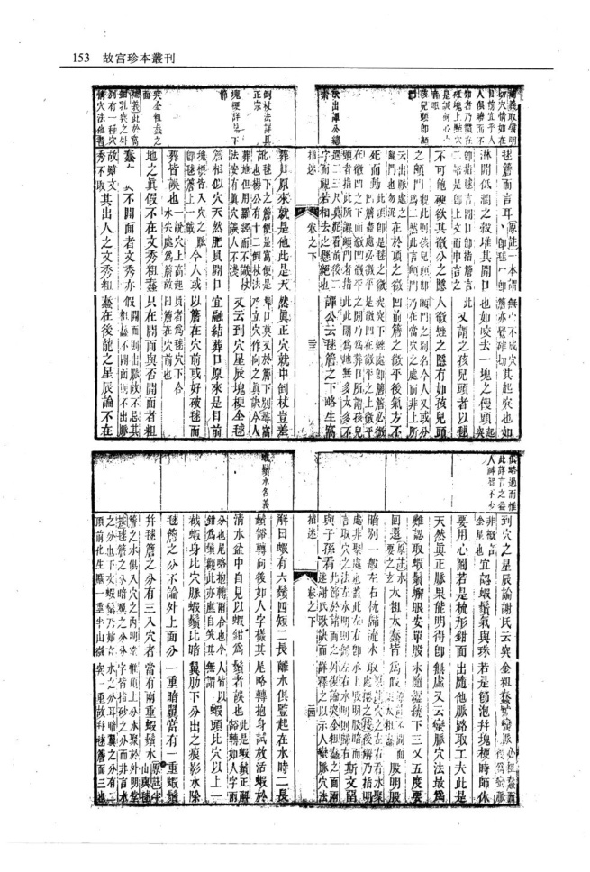

<!-- doc003 PDF 第 158 页：高风险/复杂版面 OCR 供检索；内容与排版以原页图为准。 -->
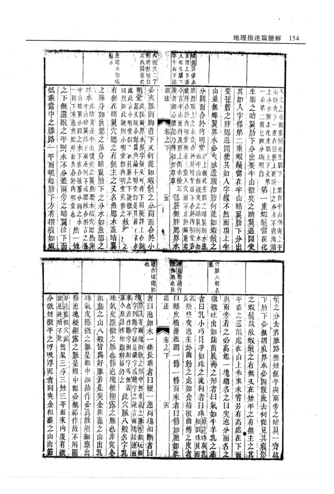

<!-- doc003 PDF 第 159 页：高风险/复杂版面 OCR 供检索；内容与排版以原页图为准。 -->
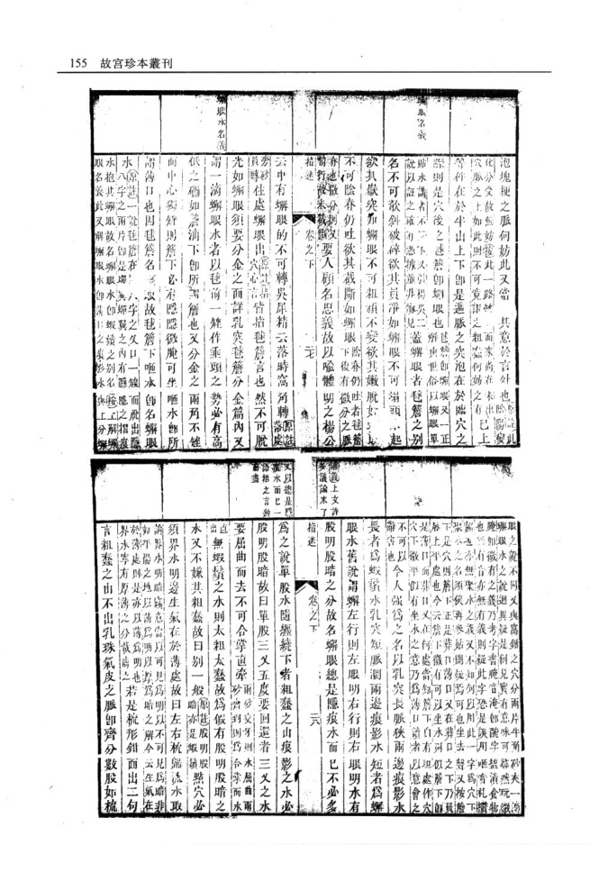

<!-- doc003 PDF 第 160 页：高风险/复杂版面 OCR 供检索；内容与排版以原页图为准。 -->
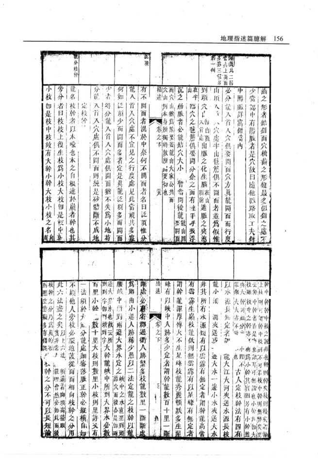

<!-- doc003 PDF 第 161 页：高风险/复杂版面 OCR 供检索；内容与排版以原页图为准。 -->
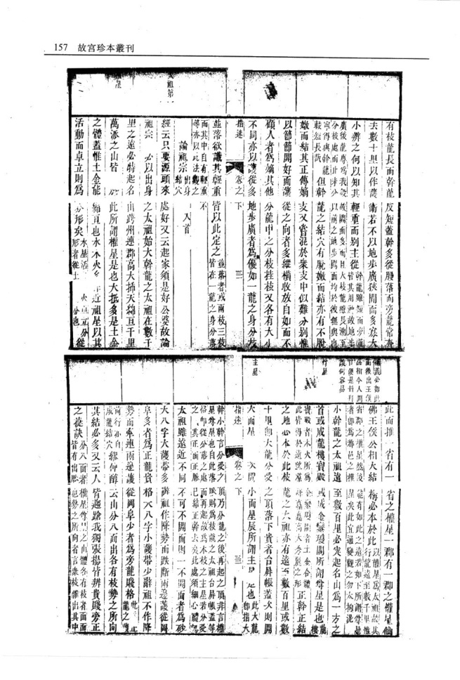

斯管氏謂遠奪天地蹤跡巳形於此出脈正謂此也 也楊公謂之源派開係匪小 定祖宗窮水源察長短辨眞假審力量莫不於分龍 所謂被龍者是也其人者爲 宁幹分龍者 味歷甚遠矣起高人星長其始至尊其功極 山身上齊濟分出數修皆 分之時則固原於 を之

與段分龍母 枝失其義矣 分未分龍之前雖有高大山轡乃衆人之祖我之太祖必以分龍處爲是故以定祖宗未分龍之前千流萬派乃衆人之水我之水源必以出身處雨水分流兩邊夾送漸以成大會於穴前局內者局收大水以致穴情遷就立向差里之龍乃人所共無與我之長短必以分龍爲始若千里便鄉于里之龍故以之察長短 此在巳分後既 行之遠近對之之千里地

共無關我之眞假必以分龍處開而出嚴者爲眞否雖有至美之龍於我何幸譬如祖父宮貴能福庇於我然必於分龍處開面肖其祖父方能承受所靜共龍者也若開面不美祖宗雖好意必他屬縱 祖以上之祖父有所結不過小地而巳未分龍之前雖有至粗之龍於我不幸猶祖宗分至賤能貽累於我然惟於分難處開面星辰仍類祖父之粗者方足限之若變粗出嫩則我之所結已勝其共龍故以之審力量 未分龍前與遠迷 卷之下 园

特爲 我得 起星辰不生氣 此大歲便是太祖有此大星 翼護帶董德彰云出身處有蟬翼護帶前去必結大 中 太祖圓面分出之脈必起項而後發脈乃爲員脈 楊氏云正龍屈曲不朝人挺然直出勢最眞 此直貞

<table><tr><td rowspan="2"></td><td colspan="3">由自在不 言屈曲則 此非徑直之角也 要列屏列帳卜氏云</td><td>比比然也易不用周面有無優劣之法一衡之而輕</td></tr><tr><td colspan="3">出身處要列屏列帳此屏帳乃木身上所 有非言雨邊非列者要巒頭成</td><td>重眞假可立剖於其閒而不爲中偏之所惑哉</td></tr><tr><td rowspan="4"></td><td colspan="2">星子微云龍無星曜低低去此是賤龍出身處是 後數節再 要環旋曲折子微云龍身直出不廻翔此</td><td>至第二 補義應星有 樂所關歷康 太通繪是其 少祖繒在 請西承先啓</td><td>太祖之前再起星辰名爲應星所以證應其所愛之</td></tr><tr><td colspan="3">逮之星也</td><td>分出數節之後漢起守最爲大星辰爲卜歧之嫡禮</td></tr><tr><td colspan="3">龍之貴賤只在 來略無旋折之勢者 出身處辨之出身美而到頭不美者必别有閃結到</td><td>鄭今太亂之後蓍以太宗與太和同一規焚非卽 少祖也少祖翁在前面若龍短而絲穴不遠則當朝</td></tr><tr><td colspan="3">頭乃是僞氣出身不美而到頭美者必是小地且不</td><td>以此爲少祖矣然曰悲屋者言其特述超羣堪與太 祖相應也 乃是卷和之應太祖倡之於前應星和之</td></tr><tr><td rowspan="4">中出偏出</td><td colspan="3"></td><td>中普來電語電透劇基機和簡稱年表年 淤後其形 細有其氣相通其力量足以相敵有父維</td></tr><tr><td colspan="3">悠久</td><td></td></tr><tr><td colspan="3">嚴之中出偏出雖高大成星之山皆當並論惟太祖 </td><td>應星大祖雖美其注意恐不在此總有應星不開而</td></tr><tr><td colspan="3">指迷 卷之下</td><td>指迷 卷之下 3</td><td>吴</td></tr><tr><td rowspan="3">中編仍以太 置言戒次於 a</td><td></td><td>出身處最爲關係此而中出者前途穿出必然皆史</td><td rowspan="8"></td><td>者必假祖而不文者不貴高大與太祖董者奪與失</td></tr><tr><td>卽其行度</td><td>偶有偏閃其大勢自然不離乎正力量</td><td></td></tr><tr><td colspan="3">重此而偏出者前途所出必然皆偏卽其行度之關</td><td>序須略小乃頴異合尖員方三吉之體開面端莊者 方足證其所愛之眞而不假 尖爲火星圓爲金星方</td></tr><tr><td rowspan="2"></td><td>或有正出其大勢自然不離乎偏力量自輕其所以</td><td rowspan="2">福義河為城 云辭樓下殿</td><td>吉古云看 日</td><td>爲土星高大尊嚴鬼爲 他辭樓幷下殿出帳聳起成何形應星生</td></tr><tr><td>中出偏出亦由其氣稟厚薄之故也稟氣厚者自然</td><td>處别成名</td><td>此是分枝劈脈證 樓殿指大應離而下之</td></tr><tr><td rowspan="3"></td><td>正而不偏或有正出而後偏出其輕重不言可知</td><td>闡來終泰本 今特借州其</td><td>另興出一</td><td>者應星也別成名者言 吳氏云尋龍先須記祖宗更於離禮察行</td></tr><tr><td></td><td>氣薄者自然偏而不正卽有正出或偏重而正輕或</td><td>是不好語意星體也 言以爲山勢 蹤辭樓下</td><td>殿峰巒秀預議前途異氣鐘皆指應星與</td></tr><tr><td colspan="3">偏眞而正僞其閒不容不辨</td><td>穴而言也</td></tr><tr><td rowspan="2"></td><td rowspan="2">輕重以勢 眞為以遂 言 言</td><td>從偏人正未必盡僞面 亦未必皆眞故當辨 今人薄偏而喜正不顧其輕重眞假者</td><td rowspan="2"></td><td>辭樓者如臣辭君客辭主也下殿者自山</td><td rowspan="2"></td></tr><tr><td></td><td>頂下至山麓也必先下而後辭否則勢仍牽連何得</td></tr></table>

<table><tr><td rowspan=3 colspan=1></td><td rowspan=3 colspan=2>有離樓南後大5有力帆2照</td><td rowspan=3 colspan=2>辭下云者卽特起特降之謂論先下而後稱則當洗言特隆特起今云特起特降者口願耳特起特降與人跳頓跌所以作勢頓跌處多且大則勢璽然處少且不特地而降緩緩牽連而降者不歡無力</td><td></td><td rowspan=3 colspan=2></td><td rowspan=1 colspan=2>短而輕</td><td rowspan=1 colspan=1>幹龍長而禮宗多枝龍題而祖宗少分挂之</td></tr><tr><td></td><td rowspan=2 colspan=2>龍少開地</td><td rowspan=1 colspan=1>且不可得兒遠祖遠宗乎有遠祖遠宗者其</td></tr><tr><td></td><td rowspan=1 colspan=1>步一如前太巡法但太雲係開創之人關屬</td></tr><tr><td rowspan=3 colspan=1></td><td rowspan=1 colspan=2>得謂下</td><td rowspan=1 colspan=2>殿下殿者自殿頂而下至二簷三簷一直下</td><td></td><td rowspan=1 colspan=2></td><td rowspan=1 colspan=2>最緊開</td><td rowspan=1 colspan=1>面不美地步不廣則龍不貴不開面無地步</td></tr><tr><td rowspan=1 colspan=2>至於階</td><td rowspan=1 colspan=2>陛是也不特地而起緩緩牽連而起者不得</td><td></td><td></td><td rowspan=1 colspan=1></td><td rowspan=1 colspan=2>便非龍</td><td rowspan=1 colspan=1>遠祖遠宗係守成之人關係略緩面小星粗</td></tr><tr><td rowspan=1 colspan=2>謂辭樓</td><td rowspan=1 colspan=2>辭樓者離祖數里頓起大山雖不可與祖宗</td><td></td><td rowspan=1 colspan=2></td><td rowspan=1 colspan=1></td><td rowspan=1 colspan=2>亦無傷</td><td rowspan=1 colspan=1>大體惟恐星辰醜惡關面全無出脈如急藝</td></tr><tr><td rowspan=3 colspan=1></td><td rowspan=1 colspan=2>並亦必</td><td rowspan=1 colspan=2>能成座尊嚴佈置地步堪爲次祖也如此者</td><td></td><td rowspan=1 colspan=2></td><td rowspan=1 colspan=1></td><td rowspan=1 colspan=2>線覆鵝</td><td rowspan=1 colspan=1>毛雖有美祖宗子孫亦不足以蓋之行至此</td></tr><tr><td rowspan=1 colspan=2>龍方有</td><td rowspan=1 colspan=2>勢前去必成大地行度之閒亦必須特降特</td><td></td><td></td><td rowspan=1 colspan=1></td><td rowspan=1 colspan=2>節必有</td><td rowspan=1 colspan=1>凶禍若其開面至美過於太祖太宗星格勝</td></tr><tr><td rowspan=1 colspan=2>起有一</td><td rowspan=1 colspan=2>座二座可指者方是貴地樓殿惟幹龍有之</td><td></td><td rowspan=1 colspan=2></td><td rowspan=1 colspan=2>於後龍</td><td rowspan=1 colspan=1>前龍行至此節必大富貴誰謂遠祖遠宗而</td></tr><tr><td rowspan=1 colspan=1></td><td rowspan=1 colspan=2>捐迷</td><td rowspan=1 colspan=2>卷之下       2</td><td></td><td rowspan=1 colspan=2></td><td rowspan=1 colspan=2>指迷</td><td rowspan=1 colspan=1>卷之下       员</td></tr><tr><td rowspan=6 colspan=1>還藏遠宗第</td><td rowspan=1 colspan=2>枝龍則</td><td rowspan=1 colspan=2>無然其陟降之勢亦宜如之若牽牵連連斷</td><td></td><td rowspan=1 colspan=2></td><td rowspan=1 colspan=2>可忽乎</td><td rowspan=1 colspan=1></td></tr><tr><td rowspan=1 colspan=2>不成斷</td><td rowspan=1 colspan=2>起不成起斷不卽起起不卽斷所結必小</td><td></td><td></td><td rowspan=1 colspan=1>四</td><td rowspan=1 colspan=2>將入局</td><td rowspan=1 colspan=1>數節閒起大星辰爲少祖廖氏謂之主星比</td></tr><tr><td rowspan=1 colspan=2>經云祖</td><td rowspan=1 colspan=2>宗積累有根基子孫終須與人別日積累者</td><td></td><td rowspan=1 colspan=2></td><td rowspan=1 colspan=1></td><td rowspan=4 colspan=2>太祖遠X不遠而星將第一艘1饰2異故為穴</td><td rowspan=4 colspan=1>宗關係尤緊生不可集潮少龍蓋塵星離道少疆稱爲主星則可知前之應使起故又稱爲道應少禮則離禮巳遠例起近結穴又論穴星亦稱主星是將人穴之靡頂不拘大小關面出勝閒之穴脈帥是入肖今稱少祖亦曰主星自是兩項稱名河而遠星則不可讀者須知分別</td></tr><tr><td rowspan=1 colspan=2>非徒一太</td><td rowspan=1 colspan=2>祖一少祔之事也少祖以上其聞低小星</td><td></td><td></td><td></td></tr><tr><td rowspan=2 colspan=1></td><td rowspan=1 colspan=1>辰</td><td rowspan=1 colspan=1>置之</td><td rowspan=2 colspan=2>辰置之不論凡有高大出衆星辰不論或多或寡均</td><td></td><td></td><td></td></tr><tr><td rowspan=1 colspan=2></td><td rowspan=2 colspan=4>謂之遠祖遙宗龍遠宗是應星卽在遠祖遠宗之中更覺巍然特出而不得卽稱少祖也若應星之下不再起高大星辰而卽人穴則總星卽爲少祖矣是當</td><td rowspan=1 colspan=2></td><td rowspan=1 colspan=2></td></tr><tr><td rowspan=1 colspan=1></td><td rowspan=2 colspan=2></td><td rowspan=1 colspan=1></td><td rowspan=1 colspan=3></td><td rowspan=2 colspan=2>山家結反非所論星合龍格者上格以上富貴應中格以中富貴應下</td></tr><tr><td></td><td rowspan=1 colspan=4>必長遠祖宗節數多者篇力長而久節數少者禍力</td><td></td><td></td></tr></table>

<!-- doc003 PDF 第 163 页：高风险/复杂版面 OCR 供检索；内容与排版以原页图为准。 -->
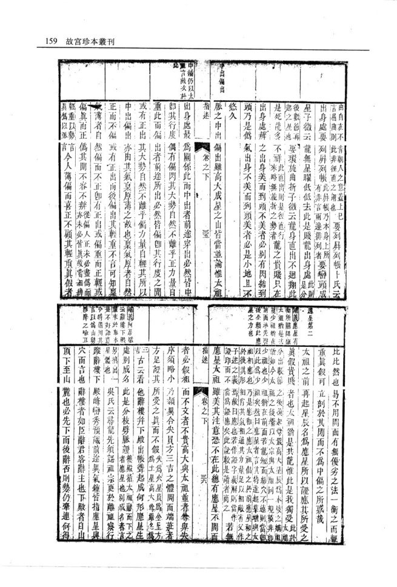

<!-- doc003 PDF 第 164 页：高风险/复杂版面 OCR 供检索；内容与排版以原页图为准。 -->
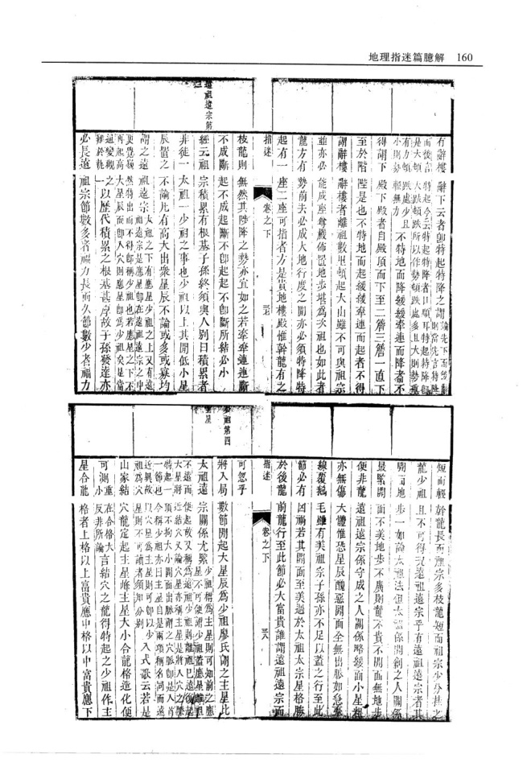

格以小富貴應凶格以凶禍應台昇帳蓋星成大座 尋地捷訣必以入首數飾爲主開而者眞不四而者經護疊疊上格也開面每嚴星成大座纒護不缺中格也開面端莊星成小座龍不孤單又次格也牽臺 尊地捷徑=連速前後相若無特起特降之星辰賤格也雖有特 前有局然後追尋後龍或一節二節皆爲小康之地起特降之星辰組蠢醜惡凶格也雖高聳秀麗不關 若後龍多一 節便高一級或竟追至少祖之處便是正龍正穴但不可錯認脈路硬且他人爲親骨肉也台屏帳蓋成座星辰護衛砂木重重眞向者富貴之格者只議其不開面不可以爲 主然祧凶惡者當有閒矣 賤格凶格無論已成 地牽連小面單砂單水拱向者小康之地此爲世開格之少祖只在穴後一二節閒方有福力離祖太遣 近代計未嘗不可却欲建陵寢都邑及爲子孫長遽氣輕力弱雖有結作亦只平常須在二節閒再起 計必須遠若腳頭窮究根源審度力量當自太祖始指迷 卷之下 指迷 卷之下 国十不得爲主星身少洞面前起之大入式歌云三節後合星辰通 星仍以遠祖論矣 故須再起主星則卽此再起諸 結穴處要看胎息孕育賦云入首成胎時猶防死絕 不然總屬管窺力最非輕節數遠時福力少再起主星妙語云穴坐 詔云于里來龍只看到頭一節故胎息孕育比太祖主星當代出貴此之謂也 尤爲切要此處不成穴必他閃人首第五卽 岁山 入首者到頭數節也 傳變與廖公李公之論龍格皆以此數節論吉凶貴 卽是穴山起 頂落厭處 子徽論龍格穿落 息孕育名 希到项而來就竟可不問也立武後一節之页爲父 意檢熊恐有他閃非謂只 母父母開面出脈爲愛胎蓋開面者陽氣發舒之象於入首數節也惟由變而傳則將近入穴耳參之 出厭者陰氣束聚之象開面處有垂頭之意是俯而蓋太祖太宗猾是邊龍惟此最爲切近若入首不美 授之之象出脈處有還毓之意是仰而承之之象陰陽相配俯仰交泰是受胎也脈前跌細如蜂腰處謂

之息如父母受胎而養息也之也也武動 穴之聖山爲之武此 以此爲父厚其關而而出脈則爲受胎而養息也盡 下周面則不出服便不成騙息矣下言立武頂前觀 市此頂玄武頂前有隱分隱姓之微有是氣之呼面 浮微有前貼體徵突爲化生腦是氣之吸而沉化生 麗前亦復有微分微雉之呼而浮有微平微起之吸 而沉謂之孕如母之懷孕而孕之呼吸浮沉與母息 而相通也孕下起孩兒頭開端然之面又有隱分隱 姓徹有微起之氣謂之育如子離母腹而自具呼 上是親言出厥受臨之義 指送 之

徹徹平微有徹起之動氣卽比一脈非又另起脈也自此而爲化生鹿爲孩兒頭而嚴止政見頭師人穴之員書故胎息孕育全在開面方成貼甚細極爲有理但四字必分周截滿恐未能穴穴情然說亦舞通他挽也此皆借喻穴之生氣也此就直捷明種可從世人見玄武一節之頂而以父母名之二節之頂而以少祖名之後而許多節數俱以遠祖遠宗名之並不論分龍之長短星辰之吉凶漫謂之有祖宗無怪乎大小不明禍福莫辨也必須先察分龍之長短然後再定祖宗之多寡觀星辰之吉凶乃可按後代之應驗如龍甚短者分大龍一二節卽入穴分龍處便可作太祖論入首處便爲玄武而少祖遠宗則無未分龍之前雖有許多節數乃大龍所有衆人所共我只可分其旺氣不得認爲已祖故曰挂龍分受發祀又如龍長者難有許多節數其閒若不特起高大星辰只管低小牽連之下 !

兄弟姊妹相若而來兩邊護從少者不得誇龍長面禮多也雖有開面不過四五等而巳又如雖有突起高大星辰若不跌斷成勢對看似成星體橫看牽長一線亦不得誇祖宗高大如此者面必不大從必不多亦不出四五等而巳又如雖有連頓連跌之星辰若無特起開面成座枝腳橫舖廣濶超出其閒而但伯仲相若形如鋸齒之齊枝腳短縮而不揚者亦不得誇星峰之秀雖節節開而亦不過三四等而巳以數條一節高於一節雖只列三四五等之閒然固各玉湖峽者當脈橫生池湖脈在水中渡過天池峽者峽旁各生一湖脈在當中過玉池峽者當脈中心生上二項總是一標中過一是低過而池分爲二也下項是一脈分爲二而復合為一故池當其中心生也其貫總謂之天池可耳玉池玉不必盡拘造化生成深大力大淺小力小四時不涸清而不濁者爲貴忽然乾潤渾濁腥臭衰歇之兆須郡兩 項合併乃貴樓臺殿閣之祖台屏帳蓋之龍節節關面地步廣濶指迷 卷之下

<table><tr><td colspan="1" rowspan="5"></td><td colspan="1" rowspan="1">é</td><td colspan="3" rowspan="1">有成座特達坐辰開大面而出低脈前後陽</td><td colspan="1" rowspan="1"></td><td colspan="3" rowspan="2"></td><td colspan="1" rowspan="2">百尺政地一丙財大字</td><td colspan="1" rowspan="2">面不嫌小以上諸格龍雖不長而或不大而總爲大地不知者又幾與劉搭之而觀巳</td></tr><tr><td colspan="1" rowspan="1">者</td><td colspan="3" rowspan="1">於其閒大者大小者小收處收放處放如祖孫</td><td colspan="1" rowspan="1"></td></tr><tr><td colspan="1" rowspan="3">父子</td><td colspan="3" rowspan="3">閒而來送從之山亦起星峰擁護者方爲</td><td></td><td></td><td></td><td></td><td></td><td></td></tr><tr><td></td><td colspan="3" rowspan="1"></td><td></td><td></td></tr><tr><td colspan="1" rowspan="1"></td><td></td><td colspan="2" rowspan="1"></td><td colspan="1" rowspan="1"></td><td colspan="1" rowspan="1">論開帳</td></tr><tr><td colspan="1" rowspan="5"></td><td colspan="1" rowspan="1">等格</td><td colspan="3" rowspan="1">而發科發甲爲中富貴地若有開展翅列屏</td><td colspan="1" rowspan="1"></td><td colspan="3" rowspan="1">制帳只是佔</td><td></td><td></td></tr><tr><td></td><td></td><td></td><td></td><td></td><td colspan="3" rowspan="3"></td><td></td><td></td></tr><tr><td></td><td></td><td></td><td></td><td></td><td colspan="3" rowspan="3">a步名異義</td><td colspan="1" rowspan="3">問闢改作出入前帳</td><td colspan="1" rowspan="1">帳字何義日古人以行軍之帳喻之謂出了</td></tr><tr><td colspan="1" rowspan="1">列</td><td colspan="3" rowspan="1">成座尊嚴地步廣潤之格主於其閒大者極大</td><td></td><td colspan="1" rowspan="1">出前帳又開</td></tr><tr><td colspan="1" rowspan="1">小老</td><td colspan="3" rowspan="1">極小收處極收放處極故如龍孫父子相間而</td><td></td><td colspan="1" rowspan="1">了後帳又玉髓云幢者障也並不言帳字謂意更明顯</td></tr><tr><td colspan="1" rowspan="1"></td><td colspan="1" rowspan="1">來送</td><td colspan="3" rowspan="1">從之山亦起星峰擁護有聚請行講坐講之格</td><td></td><td colspan="3" rowspan="4"></td><td colspan="1" rowspan="4">橫罰廣</td><td colspan="1" rowspan="5">鬻能韓其風不使吹脈韓住外山外水不使原甚帳有義橫開廣分大八字而包張到頭有謂之歌為開帳卽仙地步明極確然關帳有竹開轉者前卷雜橫篇莊卷之下       图</td></tr><tr><td colspan="1" rowspan="1">補義仙佛聖贊之地其結</td><td colspan="1" rowspan="1">者</td><td colspan="3" rowspan="1">爲一二等地而王侯相仙佛后妃大富大貴</td><td></td></tr><tr><td colspan="1" rowspan="2">作建自別有主竅疑不貧</td><td colspan="1" rowspan="2">聖</td><td colspan="3" rowspan="2">鼎甲可出其間分出一等二等只在星辰之極</td><td></td><td colspan="2" rowspan="2"></td></tr><tr><td></td><td colspan="1" rowspan="2">此為極指</td></tr><tr><td colspan="1" rowspan="1"></td><td colspan="1" rowspan="1"></td><td colspan="3" rowspan="1">之下       </td><td></td><td colspan="2" rowspan="1"></td><td colspan="2" rowspan="1"></td></tr><tr><td colspan="1" rowspan="5">僅與富貴等益列虛龍穴</td><td colspan="1" rowspan="1">尊不</td><td colspan="2" rowspan="1">尊不極尊地步之極廣不極廣石臂之停勻不停自</td><td colspan="2" rowspan="1">不停自</td><td colspan="3" rowspan="2"></td><td colspan="1" rowspan="2">巳經言也取一</td><td colspan="1" rowspan="2">之固亦本於前人之所巳言而非出於私見玉體云韓者障也帥字從巾亦似與帳字同一乃查字書前無轉字當是韓字之說然今人之字者圗多不卿果何所本也又按註云帳有二謂之轉一謂之較羅不十分男已知剛嶂奧周娠之大略矣</td></tr><tr><td colspan="4" rowspan="1">諭地至此乃爲極剛今人酬術鄉記恐未夢見之此規模抑何言大地者之多也昔賢有言論徐道者得一生氣便尼救人專論幹者恐未眞的誠西爲論外有依近省郡之隨</td><td></td></tr><tr><td colspan="4" rowspan="1">龍穴與出洋之大旺龍枝枝結果節節開花多是</td><td></td><td colspan="3" rowspan="1"></td><td colspan="1" rowspan="1">帳吉眞</td><td colspan="1" rowspan="1">假如止就帳中論問面出脈者眞否則假就</td></tr><tr><td colspan="4" rowspan="1">二得一節二節或只貼身一桂獲從多而開面大者</td><td></td><td></td><td colspan="2" rowspan="1"></td><td colspan="2" rowspan="1">統體論後頭祖宗前面子孫俱開好面佔地步多</td></tr><tr><td colspan="4" rowspan="1">富貴護從少而開面小者小富貴倘其山腰得小巧</td><td></td><td colspan="3" rowspan="1"></td><td colspan="1" rowspan="1"></td><td colspan="2" rowspan="1">注前息中間雖有一</td></tr><tr><td colspan="1" rowspan="3"></td><td colspan="4" rowspan="1">細嫩何能復有大而得砂水眞向者多卽與大面等</td><td></td><td colspan="3" rowspan="1"></td><td colspan="1" rowspan="1"></td><td colspan="2" rowspan="1">二分心出帳亦作假論如玉髓尹瓊姬祖地是也</td></tr><tr><td colspan="4" rowspan="1">蓋其原是一二寸之來龍有數百十里之遠帳峽巳</td><td colspan="2" rowspan="1"></td><td colspan="3" rowspan="2"></td><td colspan="2" rowspan="2">子孫指結穴言入穴不美難穿帳中出亦不足恃見穴后之重而尹雍之地之所以不足取也然如世者恐或到頭認錯亦未可知若穿帳果眞穴别有在又親心尋覓亦不可以勲宗不美而遠乘之也</td></tr><tr><td colspan="4" rowspan="1">多脫卸巳淨一節勝彼百節故龍不必長一尺勝彼</td><td></td></tr><tr><td colspan="1" rowspan="3"></td><td colspan="3" rowspan="1">又橫龍分降借勢爲帳要前途自閒有帳借勢者亦</td><td></td><td colspan="3" rowspan="1"></td><td colspan="6" rowspan="1">言好格之多非謂一只要龍身眞正不必全混穿心龍之來兼有滿格也</td></tr><tr><td colspan="1" rowspan="1">有力不然不</td><td colspan="2" rowspan="1">如標降卽結穴足恃也者又當別論</td><td colspan="4" rowspan="2">是晉字傳寫之漢當改維方字爲是亦</td><td colspan="1" rowspan="1">僧薦一云皆</td><td colspan="5" rowspan="2"></td></tr><tr><td colspan="1" rowspan="1">廖氏云大凡開</td><td colspan="6" rowspan="1">帳要巾出角落未爲吉左出爲輕右</td></tr><tr><td colspan="1" rowspan="5">上卷縱橫篇十字丁字上金水帳見上蔡解廟有節</td><td colspan="3" rowspan="5">1丁字帳次之金水帳爲上水星帳次之心中出十丁字直來轉橫亦中心出門習明顯者爲金水模變者爲水星按十字丁字詳前不資金水符起中頭故之頭故爾羽侯如弓之有稍濶者數十里或六七里狹者一二里或</td><td></td><td colspan="3" rowspan="1"></td><td colspan="6" rowspan="1">在庫隨行者主大富身又有一等開帳之後經倉庫卽此是正勝緣串且卓峻秀者帳下貴人主大尊貴不可與爾</td></tr><tr><td></td><td colspan="1" rowspan="1"></td><td colspan="2" rowspan="1"></td><td colspan="6" rowspan="1">例看</td></tr><tr><td></td><td colspan="1" rowspan="2"></td><td colspan="2" rowspan="2"></td><td colspan="6" rowspan="1">聯屬侍居雨旁高聳端員者暗庫也主其家富盛愛</td></tr><tr><td></td><td colspan="2" rowspan="1"></td><td colspan="4" rowspan="1">妾姬自收典質之利然此等極少小穿心蜈蚣節</td></tr><tr><td></td><td></td><td colspan="2" rowspan="1"></td><td colspan="6" rowspan="1">巳爲難遇況開帳穿心乎至於貴人倉庫尤爲少見</td></tr><tr><td colspan="1" rowspan="1"></td><td colspan="3" rowspan="1">指述  7卷之下       巨</td><td></td><td></td><td colspan="2" rowspan="1"></td><td colspan="6" rowspan="1">指迷    卷之下       熙K</td></tr><tr><td colspan="1" rowspan="9">正穿心小穿心巽蚣節萬一星卷由爲傅博然也星為變</td><td colspan="3" rowspan="2">一望之遠大龍佈置一二百里者不在此限不此爲風1在此閥數十凡此方爲正穿心三五十丈者不足里者亦是陷課</td><td></td><td></td><td colspan="2" rowspan="2">安月站地</td><td colspan="6" rowspan="1">問帳負結地分滅正龍之力否日只怕穿心帳之</td></tr><tr><td></td><td></td><td colspan="2" rowspan="1"></td><td colspan="4" rowspan="1">脈開小面護帶少不跌卸而去枝葉反躁帳角反關</td></tr><tr><td colspan="3" rowspan="1">爲正穿心不過爲中心正出之龍亦餘止娛小家心</td><td></td><td></td><td colspan="2" rowspan="1"></td><td colspan="6" rowspan="1">大而護帶多卽跌卸而去枝葉反盛此豈惟減正龍</td></tr><tr><td colspan="3" rowspan="2">蚣節而巳所謂正穿心亦不可多觀數十節聞或見</td><td></td><td></td><td colspan="2" rowspan="2"></td><td colspan="1" rowspan="1"></td><td colspan="5" rowspan="1">之福正者反爲從旁者反爲正矣反此則帳角結地</td></tr><tr><td colspan="2" rowspan="1">四五節或止一二節但要其他穿出皆正傳變</td><td></td><td></td><td colspan="2" rowspan="2"></td><td colspan="2" rowspan="1">帳角自有帳峽尤足見其地步之</td></tr><tr><td colspan="3" rowspan="4">氣脈不散而穿心之間或之玄飛走或拋梭蘆鞭惑彎翔以鄉或蛇回蟬蛻或登階降陛不一而足者木之星飛桑勢也金袍如梭形左右擺走爲拋按眠木身起水抱如節爲蘆鞭或金或木頭聳乃開如禽形爲彎鳳蛇回者水星廻曲也蟬蛻者平地木星或金星節再起也階陛者或金或土敘關展也不一者</td><td></td><td></td><td colspan="3" rowspan="1">但其輕重隨正龍之大小以其與正</td></tr><tr><td></td><td></td><td colspan="2" rowspan="3"></td><td colspan="6" rowspan="1">龍共祖同身也當貴總不及正龍之小自位學帳胥之結自有觀</td></tr><tr><td></td><td></td><td colspan="6" rowspan="1">不及正龍</td></tr><tr><td></td><td></td><td colspan="6" rowspan="1">帳角分結者力漸大將近龍盡財後龍喻卸凈畫故其帳角亦氣清而力旺不比</td></tr></table>

<table><tr><td rowspan="2">通峽名義</td><td>分之帳尚 帶粗氣 分枝挂 結者亦然小龍小帳烏能有此 論過峽</td><td rowspan="2">蕭山峽</td><td rowspan="5">跌斷其實高山之</td><td rowspan="2">高山之上並無跌斷無峽可知亦結大地者何也日 自有平地登無跌斷過峽之處但在下面看之似無 上有平地卽有跌斷苟無帳無峽</td></tr><tr><td>古人論峽大約以 出脈之偏正論吉凶謂正者有兩 邊送護而吉旁者一邊無護而凶子微論峽大抵以</td></tr><tr><td rowspan="2">脉也幷無中出</td><td>叢從之形相論吉凶謂帶吉形貴相來讓者吉帶惡 形賤相來護者凶二者合而爲一可也身之邊送選古 上一說以本</td><td>崩洪峽</td><td>不另闢世界有何大地 崩洪峽者穿江過河之石骨脈也石脈從水過是山</td></tr><tr><td>夾之山言 不歸面則不 失爲眞龍不開而出脈雖中出亦何 出脈是原無</td><td></td><td>與水爲朋水與山爲共故謂之崩洪 一說崩洪脈是 兩山合氣所爲 至此結成石骨人水而過也焉山相合故詩之關共 渡一水故謂之共關山爲窮共水爲洪也此設更覺</td></tr><tr><td></td><td>指 卷之下 四 形凶亦不過吉中之疵若背來駝我者凶形凶固 形吉亦何益有等過峽之後起脈之山亦如降脈開 好面者北龍脫卸將淨盡龍雖未盡必有分桂之地</td><td></td><td>明確 從 指迷 卷之下</td><td>惟不洋江河中有之山谷水跌瀉處溪澗石骨 是兩邊山脚相連石雖連片蓋非過河蓋後岸之田 水不隨龍上前去反流入石骨之河中者雖平洋亦</td></tr><tr><td>陰陽峽卽雄 峡</td><td>峽也如匠人之雌雄栒一衆尚音荀此信用柏簾之 木人也然樺字人不 走珠而起厭爲雄或雄落而雖受其雌遲雖似爲穴</td><td>栒若論正字當作榫劇</td><td>相連非龍淡河可知</td><td>者方是過河之脈其力量自是洪大石骨之形不必 流一定之勢節不龍必其左防兩分水佐布爾 凡龍嚴過大江大河者江河之水必有上流下 分者乃是山鄉水勢恐非所語於過河之脈也若雨</td></tr><tr><td></td><td>然葬者未曾得福 按不開面則不可 爲案故穴情不獻</td><td>原註走珠起脈處不聞西則此邊 鄉有窩勢終屬花寂畝葬不得福</td><td>是不必求 其形似也</td><td>邊俱是江河大水而中廢一水橫載脈從橫水中邇 者則亦左右兩分耳然亦不覺讀者勿混又向有十 大崩淡之說皆取石骨之形象以立名其實石骨便</td></tr></table>

<!-- doc003 PDF 第 167 页：高风险/复杂版面 OCR 供检索；内容与排版以原页图为准。 -->
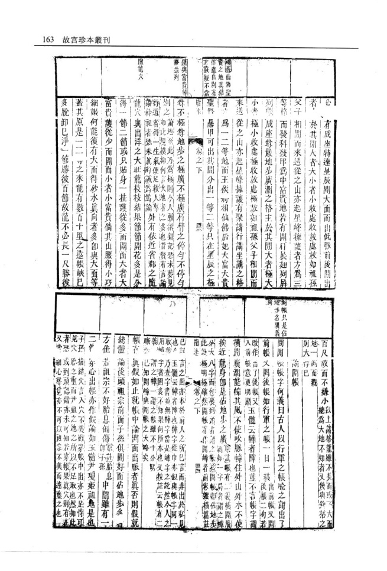

<!-- doc003 PDF 第 168 页：高风险/复杂版面 OCR 供检索；内容与排版以原页图为准。 -->
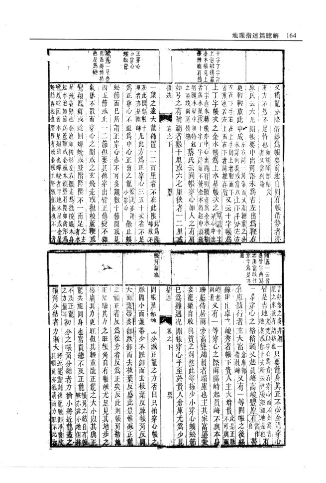

<!-- doc003 PDF 第 169 页：高风险/复杂版面 OCR 供检索；内容与排版以原页图为准。 -->
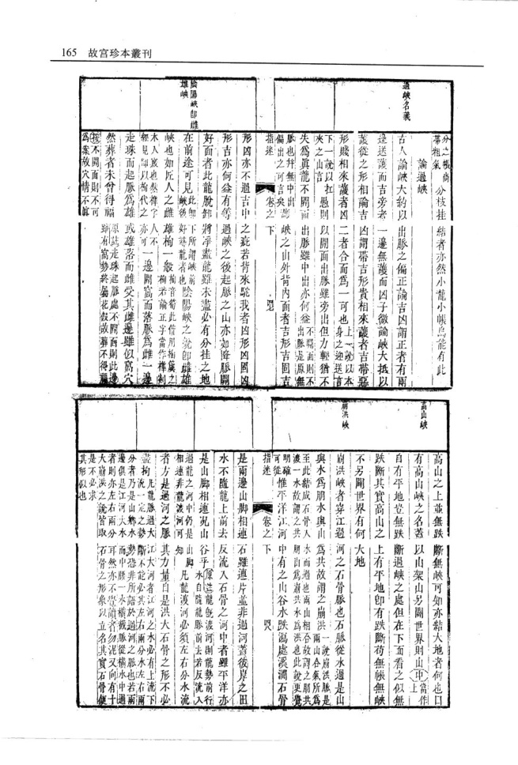

方是大貴龍中等龍見之亦在平常下等龍見之無 益故止觀其地步之廣狹開面之多寡龍格之優劣 爲上

古謂峽前峽後好尋龍者以龍身逶迤路遙將過峽久勃之勢昂然一起旺氣一聚過峽後方興之勢躍然而起耶氣亦一聚必有旺氣透出於雨邊或一邊謂面降脈卽借峽中之迎送爲門戶而穴易成或自比騎龍之髮無犯掘北是峨中分脈結穴而非節騎龍穴也凡橫騎作穴者亦以迎送爲龍虎但其穴必貼春而不必有降脈也若特關面而降脈則是峽有結老峽則否節節開面枝葉旺盛龍勢盤旋有蜂腰鶴膝爲嫩峽雍連少面枝葉稀龍勢徑直硬腰過者爲老峽 一統鐵峽將近結穴之峽也老作穴者順騎固要順開正面穴前融聚收拾儼若前面不去倒騎亦要甸開正面左右隻隻回顧儼如背後生來穴情生成而不弛強環抱有情而非假借方有此結 市 少有空終不如易開一面分出一脈者 扯博者便井爲可據故峽前峽後尋地十得八九騎龍作穴者十指迷 卷之下 平

廿1二1今人見山跌斷卽以峽名之並不問逸送有無無迎送者亦能結地否曰迎送之峽惟大富貴龍則有之小龍只有跌斷何能有迦送之峽但跌斷得關面出脈前去亦結小富貴之地不開面而但跌斷方在所有關面出張者在亦不因此一節而棄之也小之龍卽跌斷亦無何能有峽惟視開面之有無多寡而已有一等大龍後來歷歷過峽俱有迎送至入首數節之內只有跌斷而無迎送亦是大地不可以泡周花也搗骨龍未詳形似俟再若欲近祖之蕭考此亦兼龍星穴星而言勿泥護長乘又要逐節之枝葉繁衍勢必不能兼有惟遠祖蓋護長乘又逐節枝葉繁衍則有之然非大都大郡之幹龍數百里之地步不能有此故不在此限如蓋護既無枝腳又少一邊者房分有虧兩邊俱無神廟而巳有等出洋之龍臨大田大坂傍大海大湖既無蓋送又無枝腳或以高田作護衛或以水纏當山纏而開而出脈屈曲活動有燃有平有呼吸浮沉之動氣者便是大富貴地如之玄單獨龍是也 雖似單 獨而之送 卷之下

<table><tr><td rowspan=6 colspan=1>1.040搜腳名義4</td><td rowspan=2 colspan=1>出洋之能恐其哉漫無收故水口下砂最爲要緊</td><td rowspan=1 colspan=1>須在大帳之內水斷不可少經此是</td><td></td><td rowspan=1 colspan=2></td><td rowspan=1 colspan=1>我否若有眞面向我雖非本身所</td><td rowspan=1 colspan=1>分亦妙背來駝</td></tr><tr><td rowspan=1 colspan=1></td><td></td><td></td><td rowspan=1 colspan=1></td><td rowspan=1 colspan=1>或無背面雖本身所分何益</td><td rowspan=1 colspan=1></td></tr><tr><td rowspan=1 colspan=1>論枝脚</td><td rowspan=1 colspan=1></td><td></td><td rowspan=1 colspan=2></td><td rowspan=1 colspan=1>有逐節枝葉均停或交互均停面長</td><td rowspan=1 colspan=1>遠者不必論祖</td></tr><tr><td rowspan=2 colspan=1>卜此同帳當作枝腳分之則有數名自逐節分出者</td><td rowspan=2 colspan=1>闢峰以下爲橈棹使及人者機棹者</td><td></td><td rowspan=3 colspan=2></td><td rowspan=3 colspan=1>山之蓋送如梧桐枝芍藥枝蒹葭遷均停蒹葭芍必逐節枝腳長衍雖無枝腳亦貴如</td><td rowspan=1 colspan=1>梧枫枝之類是也枝</td></tr><tr><td></td><td rowspan=1 colspan=1>蓋護過數節者不</td></tr><tr><td rowspan=1 colspan=1>楫也分布爾旁山之市多隨龍同來不到穴先</td><td rowspan=1 colspan=1>停止者爲送隨</td><td></td><td rowspan=1 colspan=1>上天梯穿珠龍</td></tr><tr><td rowspan=3 colspan=1></td><td rowspan=1 colspan=1>龍先出去見穴却回頭者爲迎批不</td><td rowspan=1 colspan=1>迎送貞過峽迎送同巡峽出脈邊</td><td></td><td rowspan=1 colspan=2></td><td rowspan=1 colspan=1></td><td rowspan=1 colspan=1>蘆鞭金鐘玉釜九天飛帛仙帶飄空</td><td rowspan=1 colspan=1>臥蠶吐絲金蟬</td></tr><tr><td rowspan=1 colspan=1>兩手分開爲送起賦一邊關手分開爲迎橫障於背後</td><td rowspan=1 colspan=1>不抱左右者爲托</td><td></td><td rowspan=2 colspan=2></td><td rowspan=2 colspan=1>脫穀玉儿臨軒之類是也相連止起師鐘釜皆金星頂員爲鐘微坦為水星曲下垂帛謂大滯狄長吐</td><td rowspan=2 colspan=1>滋類縣休身上釜飛帛綱帶皆綠者魁木出線</td></tr><tr><td rowspan=1 colspan=1>原註又名</td><td rowspan=1 colspan=1>長乖兩角蓋數饰</td><td></td></tr><tr><td rowspan=1 colspan=1></td><td rowspan=1 colspan=1>指送    卷之下</td><td rowspan=1 colspan=1>用    +</td><td></td><td rowspan=1 colspan=2></td><td rowspan=1 colspan=1>相迷   卷之下</td><td rowspan=1 colspan=1>前</td></tr><tr><td rowspan=3 colspan=1></td><td rowspan=1 colspan=1>數十節者爲蓋護又名學此卽問帳故蓋過</td><td rowspan=1 colspan=1>龍虎前者爲護</td><td></td><td rowspan=2 colspan=2></td><td rowspan=2 colspan=1>脈婦脫殼者眠木博粗換親玉几重此皆龍身出服然亦有穴星邊分蓋護一邊無者無邊不可不</td><td rowspan=1 colspan=1>土平端如者有近施</td></tr><tr><td rowspan=1 colspan=1>兮抱爲朝也此卽然復而兩纏龍身上起秀麗</td><td rowspan=1 colspan=1>之峰端拱於穴</td><td></td><td rowspan=1 colspan=2></td><td rowspan=1 colspan=1>生枝腳有皇不</td></tr><tr><td rowspan=1 colspan=1>旁左右者爲夾輔卽夾耳峰端拱於穴前</td><td rowspan=1 colspan=1>左右者爲侍衛</td><td></td><td rowspan=1 colspan=2></td><td rowspan=1 colspan=1>生枝如楊柳枝捲簾殿試之類是</td><td rowspan=1 colspan=1>也皆生下</td></tr><tr><td rowspan=3 colspan=1>2</td><td rowspan=1 colspan=1>端拱於穴後左右者爲天乙太乙端</td><td rowspan=1 colspan=1>拱於峽之左右</td><td></td><td rowspan=3 colspan=2></td><td rowspan=3 colspan=1>邊直長作韓一邊就本身上橫列四如枕齒樸枝枝相似無股大股小股一作式極是蓋式字卽格字之意試</td><td rowspan=2 colspan=1>五條或六化條長股短之分試字無所取義或</td></tr><tr><td rowspan=1 colspan=1>天乙太乙</td><td rowspan=1 colspan=1>天孤天角皆貴</td><td></td></tr><tr><td rowspan=1 colspan=1>房政月亦端拱於帳下左右者爲暗倉暗庫金分時爾步者</td><td rowspan=1 colspan=1>者爲暗倉暗庫金</td><td></td><td rowspan=1 colspan=1>磊落落作護者不</td></tr><tr><td rowspan=3 colspan=1></td><td rowspan=1 colspan=1>童玉女政其</td><td rowspan=1 colspan=1>總是龍身分出</td><td></td><td rowspan=1 colspan=2></td><td rowspan=1 colspan=1></td><td rowspan=1 colspan=1>必長乖蓋護顯出枝條亦爲貴格</td><td rowspan=1 colspan=1>如蘆花裊換骨龍</td></tr><tr><td rowspan=1 colspan=1>而還以羽翼護衛其龍穴者也若非</td><td rowspan=1 colspan=1>本身所分或借</td><td></td><td></td><td rowspan=1 colspan=1></td><td rowspan=1 colspan=1>於行木之體</td><td rowspan=1 colspan=1>道花長者木面醴</td></tr><tr><td rowspan=1 colspan=1>兄弟之龍或備外龍用以羽翼護</td><td rowspan=1 colspan=1>衛者看其有情</td><td></td><td rowspan=1 colspan=2></td><td rowspan=1 colspan=1>水故有裊動之勢兩夢墩泡爲點大龍跌落平地小泡纍纍不計其</td><td rowspan=1 colspan=1>點蘆花也柳花則數能身為幹面送</td></tr></table>

<!-- doc003 PDF 第 171 页：高风险/复杂版面 OCR 供检索；内容与排版以原页图为准。 -->
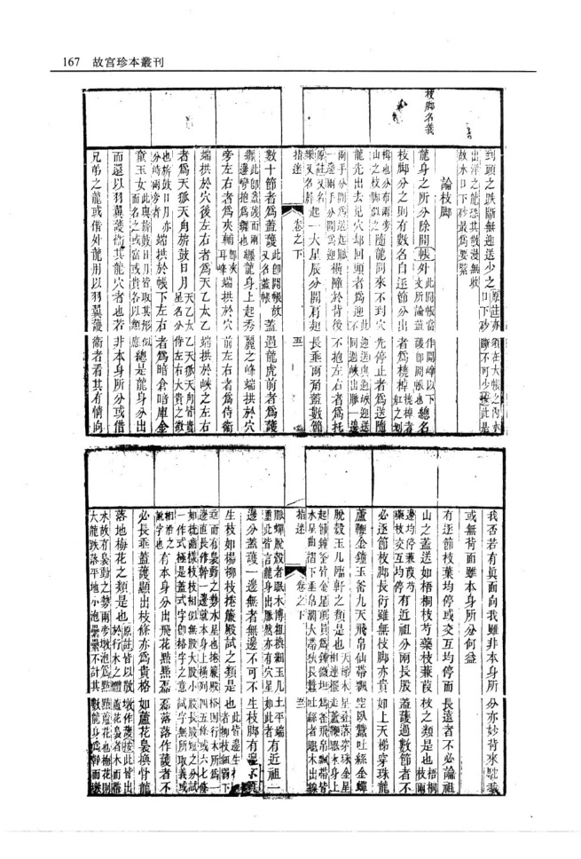

玄飛走如活 虛活蛇之狀 然究其遠祖必有台屏帳蓋之格送從茂經遠馬流長故自其出洋之後觀之似乎單獨而不知其來歷既遠氣旺力歸而不可以單獨鳳之也地局拱衛故爲至大之地不然洋中戰露值多何亦有至賤不堪者纏龍在山谷愈多愈貴托山非橫山無降賑者不必夾輔有龍虎者不必待衛天狐天再文武倉庫旂鼓于中偶有之物有者大貴無者不妨龍長遠枝腳亦宜長遠龍短小枝廊亦宜短小龍高大枝腳亦宜高大能長邃枝腳短小者爲枯龍龍短

餘氣名義

小而枝腳長遠者爲刼龍龍高大而枝腳低縮者獨龍枝腳宜停勻而偏枯者爲病宜順護而反背者爲逆宜員淨而失利者爲殺宜秀麗而醜陋者爲賤宜有行伍而散亂爲蕩宜合貴形吉形而類賤相凶相爲凶蓋龍身貴賤不同故迹露於枝腳間者善惡有異觀枝腳之盛衰而本身之榮枯可見觀枝腳之善惡而龍之貴賤可知 此紹論枝腳之宜忌其關係 於龍穴者亦非偶然學者固當熟玩而講求之者也

論餘氣

卷之同

餘氣者大龍正結後其山未止猶去數里數十里者是也蓋龍如瓜藤其結瓜也多在半腰之際及將盡未盡之閒近根處正藤之杪多不結或有所結必至小而不堪爲種故龍之結穴必結中腰及將盡未水口或作陽基或結陰地只要外背內面之眞情拱向去砂雖遠皆是餘氣去而不結地者力猶小去面之中一限之意寸寸是玉卽上大龍將盡 飛言枝龍出洋雜穴常易而穴每不多亦下極 得與大龍盡 2 还嫩出洋不開面或偶有與而而無跌斷者亦日老故山谷有大貴之地出洋儘多下賤之龍有等大龍行度倏而變爲低小文秀个个開面多起伏逶迤而嫌修而變爲粗蠢高大不開好而無起伏透迤而老老了數十里變而爲嫩嫩了數十里又變而爲老 禁此則之體兩邊枝卑燒偉老處分結必少嫩處分維必俱能結地特不大耳多老處分結非數十節不能成地嫩處分結數節卽指送 卷之下 毛

<table><tr><td rowspan=9 colspan=1>陰陽雨第補義本文爵曰狩畫其實結穴在結者郡之上故爲大地考先誌省郡面传染穴則直是省郡之餘氣疾不得爲大地地鬼越義詳正宗鬼時館</td><td rowspan=4 colspan=1>結穴者力必大母方餘氣方大力小皆言故大幹龍至將盡處拜之地新四蔡一枝結穴而以省鄴爲用神者封師者亦是正就正穴而其義間落脉結有人地卽以者郡爲用神蓋是一允而陰陽雨希不可竟認名郡爲餘氧蓋德信將兵漢高將將小地以砂水爲用神大地也</td><td rowspan=2 colspan=3></td><td rowspan=2 colspan=3>湖之際萬水於此會歸正龍於此大畫幹龍行至1嫩處結地亦大如木之正幹正技開花結果極盛蓋</td></tr><tr><td rowspan=2 colspan=3></td></tr><tr><td rowspan=1 colspan=3>老祖之山罰而方起未經脫邹水初發源故少結地</td></tr><tr><td></td><td rowspan=3 colspan=2></td><td rowspan=1 colspan=1></td><td rowspan=3 colspan=3>卽結亦小及行至半腰上下開面漸多脫卸漸凈小必救水乃可穴水水可收故漸結地          至大龍將盡歷若行時脈不歇也數十百之帳峽經幾于百之開面脫卸極淨諸水皆</td></tr><tr><td rowspan=2 colspan=1>以龍爲用神經云餘氣不去數十里斷然不是王侯地惟分落之小枝如結瓜之子藤然又不榆餘氣之</td><td></td></tr><tr><td></td><td rowspan=1 colspan=1></td></tr><tr><td rowspan=2 colspan=1>有無無財不有則更妙但餘氣內觀外觀俱要正面向我而後去去而復回願者方眞若內觀似向外觀似背遷</td><td rowspan=1 colspan=3></td><td rowspan=1 colspan=1></td><td rowspan=1 colspan=3>聚各刷好面結地所闹枝枝結果節節開花故畫結</td></tr><tr><td rowspan=1 colspan=3></td><td rowspan=2 colspan=2></td><td rowspan=3 colspan=3>小而各開好面便各自結地營之京師至尊所在六部九耶多少大老皆出其中面其下小貞後先奔走指注    卷之下       五</td></tr><tr><td rowspan=1 colspan=1>砂似向而近身反背者鬼刼而巳</td><td></td></tr><tr><td rowspan=1 colspan=1></td><td rowspan=1 colspan=1>指送    卷之下       </td><td rowspan=1 colspan=3></td></tr><tr><td></td><td></td><td></td><td rowspan=4 colspan=2></td><td></td><td></td><td></td></tr><tr><td></td><td></td><td></td><td rowspan=3 colspan=3>又不知其凡幾也乃今之言地者有謂一穴之山谷之中欲結一大地必有數十里龍身數十節開</td></tr><tr><td rowspan=3 colspan=1>截謂水</td><td rowspan=1 colspan=1>論龍體老內外</td><td></td><td rowspan=1 colspan=2>之是</td></tr><tr><td rowspan=1 colspan=1>流體之老嫩以木喻最竹高山窮谷之中萬山於此</td><td></td><td rowspan=2 colspan=2></td></tr><tr><td rowspan=1 colspan=1>通衆水於此發源龍極老而不結穴如木之根椿</td><td></td><td rowspan=1 colspan=1></td><td rowspan=1 colspan=3>而台解帳蓋纏護衆多地步廣濶者方是至大之地</td></tr><tr><td rowspan=3 colspan=1></td><td rowspan=1 colspan=1>不結果迨其行行漸遠至半洋半谷之閒一邊大</td><td></td><td rowspan=1 colspan=2>4</td><td rowspan=1 colspan=1></td><td rowspan=1 colspan=3>至大龍將盡之處則不然只里許龍身數節開面惑</td></tr><tr><td rowspan=2 colspan=1></td><td rowspan=2 colspan=1>刀尚行一邊小水已合龍漸行漸嫩而地亦漸結如</td><td></td><td></td><td rowspan=1 colspan=1>a</td><td rowspan=1 colspan=3>一二節間面台屏帳蓋有一二座者便是大地故一</td></tr><tr><td></td><td rowspan=1 colspan=2></td><td rowspan=1 colspan=1></td><td rowspan=1 colspan=2>節勝彼百節小而勝彼大面一殷祿山勝</td><td rowspan=1 colspan=1>彼數重關</td></tr><tr><td rowspan=3 colspan=1></td><td rowspan=3 colspan=1>一邊大水行面未止一邊小水合面兜佳也枝又各有老讖不同輕重不等只以謂而之大小地步之廣狹衛之造其愈行愈遠至大江大河大海大</td><td></td><td rowspan=1 colspan=2></td><td rowspan=1 colspan=1></td><td rowspan=1 colspan=2>鎮一小山砥桂中流勝被數重大山塞居</td><td rowspan=1 colspan=1>水口至於</td></tr><tr><td></td><td rowspan=2 colspan=2></td><td rowspan=2 colspan=2>枝龍盡於出洋與正龍結穴後之餘氣同閒之飼嘗别亦不得與寸寸是玉者相</td><td rowspan=1 colspan=1>雖與山谷</td></tr><tr><td></td><td rowspan=1 colspan=1>山谷之例方部上山谷</td></tr></table>

<!-- doc003 PDF 第 173 页：高风险/复杂版面 OCR 供检索；内容与排版以原页图为准。 -->
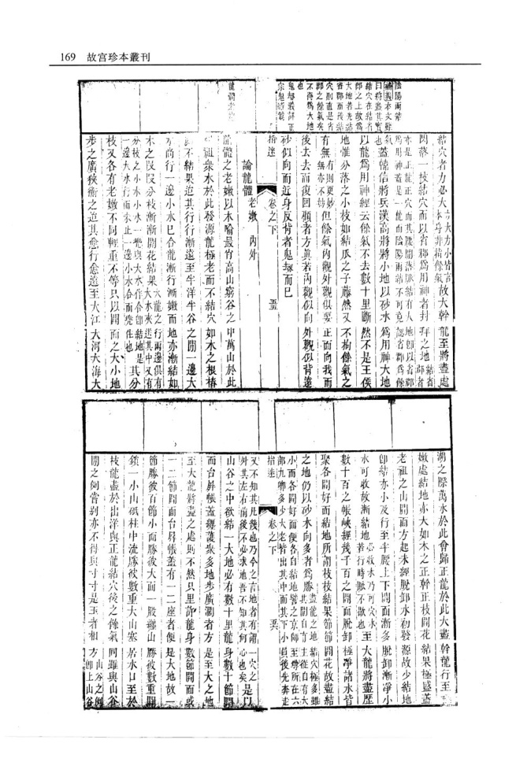

正龍正穴固自有在但如此大地豈可傳餘小而忽之也有盤旋之勢卽有內外之分既有內外之分便有輕重之別如大龍左旋則左爲外而右爲內兩邊分結之地必左少而右多左輕而右重大龍右旋則右爲外而左爲內雨邊分結之地必右少而左多右輕而左重蓋外邊如背必逼近大河大江水源倍大屬氣蕩散山亦多粗內邊如面必包含小原小坂水源倍小風氣隈藏山亦多蠟故內邊略挂一枝勝外邊時發一枝外邊數十節之龍不比內邊數節之力邊邊卽傍門借戶略有包裹便住外邊非自立門戶重重包裹不可云内 之分仍是自之是山音 嘗不結地但不如開面處之易為力大百一小有落脈師非正穴亦可取裁所謂修門備戶者也山 背亦或有落脈斷雖立穴必須再有起伏韶自立門戶者也大小一同指點明切見大水只見一緣無妙枝龍不納幹水故也內邊權之大水亦非專爲我設然羨門備戶則水可收而有用不比外運之大水全無殺拾與我毫不相于者也如杭城之南山右旋者也江千爲外西湖爲內孤山指送 卷之下

書大地收云 未者至此 在旋者也古蕩爲外西湖爲內傍西湖結地者不止 反以不見 水爲能 數百家傍江千古蕩結地者不過幾處內邊富貴大 地不可枚舉皆是傍借門戶見西湖者儘多外邊惟 江文昭祖地在牛山下者果爲大地乃自立門戶 不見江水其龍亦自有帳峽特出數節方成西湖大 地一節而結穴者居多此內外輕重之徵也 前諸奇形山穴石山 石山 峻山 高山

石山結穴 土乃山之肉石乃山之骨觀人骨中有氣則石中有氣可知故石山謂面石八字層層分閒有幾有平穴

石山結入與士山無異其眞訣仍在將通情眞的 雉平動氣爲主今一見石山便畏有殺囊邊遺珠所當喬心詳察息嫩石於中而可掘或生成石穴培土而可葬或面層是石石下有嫩土其福力惟視開而多寡地步廣狹爲轉移初不因石而有殺或反得石而清貴或得石曜而兼兵權者有之惟恐石無八字而石紋直生斂入無姓無平而板板不動或飽硬或巉嶂者不但穴中有直生尖射之石方爲殺而不可葬卽石中有土亦不可葬 府有土山石穴石山土穴之薨今人他 知石中得土便爲眞穴而不知其竟指述 卷之下

不可素者土山石穴則不經見卽上所云息石 中面可擁者也近得一穴開土二尺之下一片純石嶺可掘應鋤而開中包石千纍鼎如卵如果大不等辭之財微有調氣或自晶塋如庫顧瑪瑪之哉坐體立體眠體三者總之星不開面而無動氣者皆內能開面面有動氣者皆吉非坦緩便吉陡峻便凶也頼太素挂鐘形鑾壁而葬楊筠松挂壁燈貼壁而捲此先哲之垂範今峻穴發福者處處有之只要星辰開而大八字有稜有乃脈路分明有犍有平或數次或十餘次或有稍顯之分與雉平在其中者更妙

所云則石自山龜在人豈之列而兹有取為者引以間百有氣爲憑而て可一数の之種舉以示人只此一二吉西金對盡康員乃救世響心其功不左尚禹下

者皆指隱者而言惟隱故峻 處是東陰吐脈雉下有微徹之有是氣之呼而浮平 盡有微微之起是氣之吸而沉有此陰陽變化呼吸 浮沉之動氣者任是干般奇怪之穴皆可捲葬孔端 莫與他處之渝呼阪浮流者一劉 項頭以但峻山之穴無微寫則氣不皆無近案則氣 而觀以 不收得此二者方可 高者尤宜細說 此須着服所謂微 爲山谷中之單山獨壟曠野中之閒數孤山不關面 指迷 卷之下 卒十

而無動氣者言也若乃眞龍行於平地忽然突出山關好面而有動氣非有陰砂纏護必有裙祠兜收郡龍卽本身之或以水鄉當山纏或以遠山當城邦餘氣蒲展者以衛區穴故日好面而隨察其動氣井親其砂水則得穴不難有此眞訣則入山自有把鼻何苦就着羅經東那西趨庫滿某龍宜某向某自宜某水繞以紛紛理氣之就惑人也哉

<!-- doc003 PDF 第 175 页：高风险/复杂版面 OCR 供检索；内容与排版以原页图为准。 -->
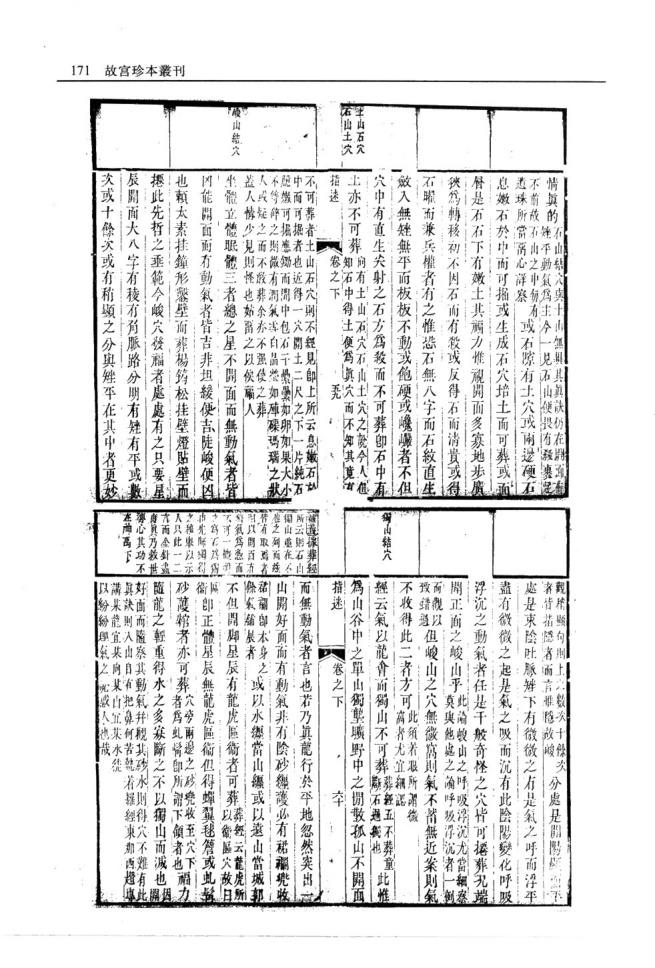

高山精穴 人 亦在龍格之重輕地步之廣狹推之但高山收山不掃例形靶上穴照天蠟燭形獻上穴仙人大釐形顧 收水得天清之氣居多峰巒不秀不成故貴多而富5雜頭穴則取穴於下因融門而連類 明堂之水者必須本龍自帶遠會穴前葛穴解也 方眞不然信觀而已非我所能冀有也水口亦是穴下小堂 辨五星定穴法閒存出水處其爲本身無疑若纏裴之山去穴較越要亦 金曰從革要清秀員凈水脈水窩方得從而又革之自其後龍分出兩高漢穴所謂道砂者是也至若逝索或自結六後餘氣殿出山爲官星或自兩邊護砂遇頭抱穴尖起作案故亦爲其本身自其非可外體開口卽是水窩軍俱金體之變者也故皆非本體要湊舊撫之太高則犯天罡殺太低則爲金寒水冷指迷 卷之下 六1 指述 卷之下在穴下平仰有兠起之勢謂之 若拜壇兜金須築砌 此天罡非言九星中之天罡也蓋穴上金頂亦謂之覺金卽此可爲拜壇非有二也 打破天罡 天罡穴太高則破頂爲打破天聖故有殺穴太低則塡補而無生成之平龍虎翻護水口近案非本身所 火而 日中有貝石如垂乳謂之水珠頂珠而葬甚生或雖本身所生而無眞而向我或雖正面顧我面 妙擊之則見水潤葬之驟發惟金星收水故梅花金本身不開而無動氣者俱爲假地上去眞正秘訣正 地上去眞正秘訣處 金全處揭以示人面何 人之奎不則會也 木身雖有動氣而後龍不脫卸無 馬者會星分為關行也若穿珠不相直串者爲串珠 後無數金墩爲花也走珠金繼護者僧道之樓雖有脫卸總護無台屏帳蓋肴出於其閒者人財之地雖有台屏帳蓋而一龍虎之外補義仙佛之 只有本身獨高而餘山皆低者仙佛之地合屏帳蓋 取寫寫有水意無窩則金不生水故爲孤金若徽有 金而則就此周之謂之關孤又謂之聞金取水若不俱備送從經護齊高乃爲眞富貴地其富貴之大小 金則無所事明也

<!-- doc003 PDF 第 176 页：高风险/复杂版面 OCR 供检索；内容与排版以原页图为准。 -->

北甲火故金法血水金頭木腳者同推水小內爲以合居凡金星脫落平洋見大水謂之金白水清 水寫以木 欽友葬 可鍬皮葬之 鋤反者不深入以傷其骨肉也卽從分 眉目處獄之若不分眉目則無可知木星結穴 是也木水多惟尖員平直小五者爲吉欹斜側石 木曰曲直要嫩秀滋潤有直有橫有曲爲體不一 體直 一歲又取石爲花此在順上時爲 遷然而波前湖身是石煞極重也 帶波紋主世出魁元林朴水生之義 水爲木母太爲水子 若遇大水益秀身地木卽罷 倒破空匕者爲凶 是眼木所爲 五吉上凶見楊公凡倒地直水而 脈謹經貪銀篇 工歷結穴 土爰稼穡要厚重方正土乃五星之奪故出身與諸枝柯若舞袖者如木幹本直面枝葉翻挂此又直面 星不同少腳無關峽之砂只是貼身護衞過過峽處於鶴地者此有枝集則 爲生木面彼爲枯木也 亦有平來無枝柯如鎗形倒 也指迷 卷之下 指述 卷之下五星離垣 闊用相傳朱文笏者曰蘆鞭只要微微開口如風來水面之勢至貴蘆鞭是旺木起節而此云如鎗形倒笏者 是又一沈但能開口則生氣動焉故可取 大抵木要 女豈有不生有者乎出王侯多是坤龍以其合地卦禁死木 枝葉根荄無二者便死脈氣嫩者謂之紫炁紫炁者公九星之一具貪復之體面小身秀巖故為木星之可考 變而能結穴又有一說謂案炁穴者真龍旺氣所成 勇起如金似滿飢員或履或印則又似爲平而金星 之體而不可剛之木星也大陰金之葉炁穴當是指 世上見行龍面水星照火是上星經來雙方木龍木 母尅子也不宜金本穴則吉正星圖行背相生不取相尅養來則其穴星受尅甚非所宜蓋本是兩體而此合爲一說殊 故又取其相尅而聞成也作純土經來而無閒星南之無化氣不者須知裏本是眼木而有爲動之勢隔沙小小水遠爲點點 宜紫穴苟太長則尅土若腰長則帶水不吉此 炁指蘆花也以其曲故一起通而爲交曲冰蓋起頭期

<!-- doc003 PDF 第 177 页：高风险/复杂版面 OCR 供检索；内容与排版以原页图为准。 -->

星結水穴是息星九星之一 平腦一 若大長測 故 不取 四爾一雙廟有一樣天財如玉枕平頂有 木莊上衰故又忌 人財有二體 湘也帶水則 爲屬公九星 在穿中故 火廟也木星穴 師諭 地惟以開面一法爲主龍以此求穴以 豹多藏 棄木 於 茅宜棄木擢燥者卽金星出 不梦此高有低結穴於高低之閒凡玉枕玉尺必前後有高 周面又云開玉枕玉尺 峰爲照應 水窩側邊要弦隱動乃要方正明自有偏嘴立穴有 下號聖而中徽凹玉 只較長而平如一字 正而要開金口不宜 答星雜撮 詞而不知 皆前人之巳言無悖於 篤識也何以 有不類周師 者竟誤謁爲是書之原文轉 茲篇又有五屋取穴之法體 大手筆者疑 而玩其文義 後 人附錄之抄靡相沿 巳久姑仍存之以資博覽云爾且金則受生水則受尅也卽金日之步角則土角 指木體言 旁當作傍蓋偏卽旁義傍與粘則是爾機 稱余趨之作法偏卽 挨親之意 粘 則就低 終書無所 寰字 升高望氣偶示災祥無 不 讀博通藝所而凡工於地理挾卷之下 望 卷之下 突木星結穴 水曰澗下無蓋有粘要金泡水乳方結穴爲水 金爲水 壑旬月不 退人莫知其所之爲人卜葬奇驗山陰吳氏 溪 生所點定至今繁行官 祿勿替其 团然基越通史家存及之日壮臣尤者也 疑郡 爭辟先生皆 不就 鈺者秀暨人金水星 使 督學江 右 間歸前先生談竟日 退而數仍是遇金而結也 此管為 之 流 而 世廼以術士 之謬巳又欲薦火星結回龍 火曰炎上多作祖山必帳幙穿心者是正脈多有養 生又周 離乃 止年 八十五 率 所着有風乃壬遁歷律諸書 悉毀 於火惟地理指迷傳鈔 於蔭之池火性炎熱上蒸成水也故出天池多南方火 陵生於庚申 故臭多得 者又世 稱先 地 非也考年譜先生實生於洪 生嘗黍陳友謙車事餘敗羅星 隨花甲雨更卒於成化 辛卯逐鹿時 石麟未藤也而又相 麗辛井則九嶺大地羅星者 十二癸西云 玉樓也此火之餘氣也 十五卒冰 可據大豈 誣哉然 必質諸其裔乃爲杞 宋之大抵金土二星有定質嚴多不閃水無定性望下卽 不兗鴻聞之 終屬耳食疏故義盡信 者兩存以 之 不愧夢以不能造訪也地由氏誌趨心性最速見物便着木生萌芽隨處便發生枝柳 卷之下終

<!-- doc003 PDF 第 178 页：高风险/复杂版面 OCR 供检索；内容与排版以原页图为准。 -->

