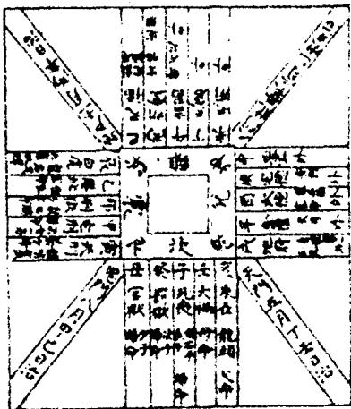
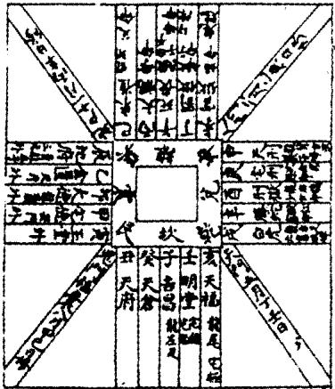

# 宅经（全文注音版·2008）

> 来源：《宅经》《灵城精义》《葬书》2008.pdf，PDF 第 1–29 页

## 中国古代文化全阅读

## ZhongGuoGuDaiWenHua2uanYueDu

全文注音版第一辑第25册

宅经

[旧题]黄帝 Huang Di

灵城精义

南唐]何溥He Pu

葬书

晋郭璞 Guo Pu

時代文藝出版社

#

## 中国古代文化全阅读

## ZhongGuoGuDaiWenHua2uanYueDu

全文注音版

第一辑 第25册

宅经

ZhaiJing

[旧题]黄帝 Huang Di

突&旧廣育很对朗

時代文藝出版社

## 图书在版编目(CIP)数据

宅经/黄帝撰.一长春：时代文艺出版社，2008.4

本书与“灵城精义/(南唐)何溥撰·葬书/(晋)郭璞撰”合订

《中国古代文化全阅读》第一辑

ISBN 978-7-5387-2390-8

I. 宅...Ⅱ． 黄... Ⅲ.①住宅—风水—中国—古代 ②迷信术数—中国—古代 ③葬俗—风俗习惯史—中国—古代 IV. B992 K892.22

中国版本图书馆 CIP数据核字(2008)第 033852号

宅经 灵城精义 葬书

作者①黄帝撰 ②(南唐)何溥撰 ③(晋)郭璞撰

出品人张四季

责任编辑陈 琛

出版时代文艺出版社

地址长春市人民大街4646号邮编：130021

电话总编办：0431-85638648 发行科：0431-85677782

网址www.shidaichina.com

印 刷北京龙兴印刷厂

发行时代文艺出版社

开本 700×1000 毫米 1/16

字数  100 千字

印张10.5

版次 2008年7月第1版

印次2008年7月第1次印刷

定价17.00元

版权所有翻印必究

## 《中国古代文化全阅读》出版说明：

作为一项文化工程，这套名为《中国古代文化全阅读》的丛书，历经我们多年的精心筹划和全面细致的准备工作，时至今日，终于和读者见面了。我将这套丛书说成是一项文化工程，自有充分的理由。

中国古代文化博大精深、源远流长，是世界文化最重要的组成部分之一。而我们出版这样一套丛书，确实如同建造“广厦千万间”那样不容易。我们都知道，所谓的文化，是由两个部分组成的。一个是物质文化，一个是精神文化。如果仅就中国古代的精神文化来说，那也是永远无法说尽的。因此，我们在编选这套丛书的过程中，只能以精益求精的态度、披沙拣金的方式，对中国古代文化进行一次整体梳理，这就是将这套丛书称之为文化工程的根本原因。

谈及中国古代文化，只能用“深、厚、广、大”这四个字来概括。中国古代文化的内容非常丰富。从精神角度来说，包括道德修养、实事求是的品格、以和为贵的和谐意识、爱国心理和进取精神等；从人文角度来说，包括经学、教育、哲学、文学、法律、戏曲、绘画、音乐、舞蹈、书法、篆刻、文字、训诂、音韵、绘画、科举、礼俗、服饰、交通、工商、货币、田制、盐制、天文历法、经济、军事、科学技术等；从时代的角度来说，包括远古文化、夏商西周文化、春秋战国文化、秦汉文化、魏晋南北朝文化、隋唐文化、五代两宋文化、辽西夏金元文化、明清文化；从地理角度来说，包括中原文化、齐鲁文化、荆楚文化、关中文化、东北文化、晋文化、燕赵文化、吴越文化、巴蜀文化、岭南文化；从民族角度来说，包括汉族文化、满族文化、蒙古族文化、回族文化、藏族文化、维吾尔族文化、壮族文化、苗族文化等。面对如此庞杂多元的中国古代文化，任何人都会感到眼花缭乱、无从下手。多年来，我们组织了诸多人次的相关调研，从中了解到，广大读者一直都在以极大的热情期待着能够看到一套全面系统地展示中国古代文化全景的丛书。在全国诸多有识之士的共同努力下，现在，我们终于隆重推出了这套《中国古代文化全阅读》丛书。

目前，中国已经进入了全面建设小康社会、加快推进现代化进程的新的发展阶段。全面建设小康社会的奋斗目标是：“我们要在本世纪头二十年，集中力量，全面建设惠及十几亿人口的更高水平的小康社会，使经济更加发展、民主更加健全、科教更加进步、文化更加繁荣、社会更加和谐、人民生活更加殷实。”从中我们可以看出，“文化更加繁荣”已经成为整个中华民族的奋斗目标之一。

这就是说，在新世纪新时代的大背景下，学习中国古代文化是非常必要的。

中国古代文化是全人类的共同财富，我们只有全面地了解和学习中国古代文化知识，才能更准确、更深刻、更清醒地认识到中华民族的自身特点和无可取代的优势。我们推出这套丛书，也正是为了让世界了解中国文化的丰富性和奇特性，了解中国古代文化与中国现代文化之间的继承和发展的关系，及其对中国人的衣食住行、喜怒哀乐、政治、经济、法律、婚姻、家庭、文学、艺术等方方面面的影响，并能够从中了解到中国文化和东西方其它文化的差异性。

当你翻开这套从书中的任何一本书的时刻，就意味着你已走近了中国古代的文化长城；也就是说，你已走近了人类历史上最为辉煌的精神景观。从时间到空间，从文字到心灵，中华民族的一砖一瓦、中华大地的庙堂江湖，都在彰显着文明的魅力，都在演绎着不朽的古代文化。英国小说家和戏剧家毛姆曾说过：“文化的价值在于它对人类品性的影响。文化能使品性变得高尚，有力。文化的作用在于裨益人生，它的目标不是美，而是善。”可以说，毛姆的视野还是不够宽阔一中国古代文化的价值已远远超过了毛姆所拟定的范畴。

中国古代文化典籍，充满了奋发有为的进取意识、切实可行的道德理论、虚实结合的哲学思想、丰富多彩的衣食住行、精妙绝伦的文学艺术、各有千秋的宗教观念、举世皆知的四大发明等等。这些中华民族智慧的结晶，不仅反映了一个民族真正的文化素质，同时也反映了一个民族的整体素质。

我们只有通过学习中国古代文化，才能继承传统文化的精髓，开创美好的未来。

我们早已认识到，人类历史的演进过程，总是与人类文化的创造过程同步而行的。这就是说，文化与人类的历史进程是不可分离的。我们的祖先创造了丰厚的古代文化，而未来的文化需要我们和我们的后代共同来创造。所以说，我们不应该否定过去，更不应该推卸我们对未来所应负的责任。因此，若想让未来的中国文化更加光辉灿烂，我们必须要认真地学习中国古代文化，批判地继承祖先传承下来的优秀的文化遗产。而且要在社会实践中不断地分析古代文化、变革古代文化。根据新世纪的新的要求，找到新的研究方向，大胆地开拓创新，惟有如此，我们才配称得上是一个具备一定文明程度的中国人。

在现实社会中，随着竞争意识的不断增强，年轻人都程度不同地希望自己能够尽快成才，希望自己是某一领域或某一行当的不可替代的人物。然而，成才的先决条件只能是在继承传统文化的基础上进行艰苦的自我提升，这样才能事半功倍。否则的话，一切都是空想。因此，专家们普遍认为，年轻人若想找到成才的捷径，学习中国古代文化应该是最佳的选择之一。

再者说，中国古代文化涉及面非常广泛。就拿衣食住行这种文化现象来说，由于时代、地域、民族、风俗的不同，便呈现出了它的丰富性和奇特性。这就给我们对中国古代文化的探索和研究提供了

极大的选择空间，而年轻人的兴趣干差万别，各有所好，让他们学习中国古代文化，有利于开掘他们的潜能、发现他们的兴趣爱好、个性特长，从而引导他们养成勤奋好学、独立思考和探索研究的习惯，并在某一方面打下坚实的基础，为日后成为对国家有用的专业人才做好充分的准备。

我们正是基于上述的种种因素，经过全方位的慎重考虑，终于下定决心出版这套《中国古代文化全阅读》。

这套丛书具有以下几方面的特点：

一是全面系统地对中国古代文化进行了前所未有的整合，力求做到脉络清晰、层次分明、由远及近、包罗万象。二是此套丛书的所有文字都注以汉语拼音。在内容如此浩大的丛书工程中，这种做法可以说是史无前例的。其益处在于，能够使普通的读者扫清阅读障碍，提高阅读速度。

三是此套丛书的经典性。所有中国古代最具有代表性的经典文化都会在这里相继亮相。

四是全部采用中文简体横排，尽最大限度地将中国各个不同历史时期的经典文献以一种极其便利的形式展现在读者面前。我们相信，上述这些特点将会不同程地提高中国古代文化在社会中的普及率。

现将参加此套丛书编纂的人员列表如下：

张四季 郭力家 张新奇野夫 何学森 祁晓萍 陈琛 马辉

刘国范 冷丽梅 于潇 董瑞光 朱玉婷 苗欣宇 宋海军

## 5 提 要

臣等谨案：《宅经》二卷，旧本题曰黄帝撰。案：《汉志》形法家有《宫宅地形》二十卷，则相宅之书，较相墓为古。然《隋志》有《宅吉凶论》三卷、《相宅图》八卷，《旧唐志》有《五姓宅经》二卷，皆不云出黄帝，是书盖依托也。考书中称《黄帝二宅经》及《淮南子》、李淳风、吕才等《宅经》二十有九种，则作书之时，本不伪称黄帝，特方技之流欲神其说，诡题黄帝作耳。其法分二十四路考寻休咎，以八卦之位向乾、坎、良、震及辰为阳，巽、离、坤、兑及戌为阴，阳以亥为首，巳为尾，阴以巳为首，亥为尾，而主于阴阳相得，颇有义理，文辞亦皆雅驯。《宋史·艺文志》五行类有《相宅经》一卷，疑即此书，在术数之中犹最为近古者矣。乾隆四十六年十月恭校上。

总纂官臣纪昀臣陆锡熊臣孙士毅总校官臣陆费墀

目录

宅 经

灵城精义

卷上形气章正诀/23

卷下理气章正诀/68

葬 书

内篇／107

外篇／132

杂篇／147

## juàn shàng

## 卷 上

fú zháizhě nǎi shì yīn yáng zhī shū niǔ rén lún zhī guī mó fēi fú bó 夫宅者，乃是阴阳之枢纽，人伦之轨模，非夫博 wù míng xián ér néng wù sī dào yě jiù cǐ wǔ zhǒng qí zuì yào zhě wéi 物明贤而能悟斯道也。就此五种，其最要者，唯 yǒuzhái fǎ ér zhēn mì shù fán rén suǒ jū wú bú zài zhái suī zhī dà xiǎo bù 有宅法而真秘术，凡人所居，无不在宅，虽只大小不 děng yīn yáng yǒushū zòng rán kè jū yí shì zhī zhōng yì yǒushàn è dà 等，阴阳有殊，纵然客居一室之中，亦有善恶。大 zhě dà shuō xiǎo zhě xiǎo lùn fàn zhě yǒu zāi zhèn ér huò zhǐ yóu yào bing zhī 者大说，小者小论，犯者有灾，镇而祸止，犹药病之 xiào yě gù zhái zhě rén zhī bēn rén yǐ zhái wéi jiā jū ruò ān jí jiā dài 效也。故宅者人之本。人以宅为家居，若安即家代 chāng jí ruò bù ān jí mén zú shuāi wēi fén mù chuān gāng bìng tóng zī 昌吉；若不安即门族衰微。坟墓川冈，并同兹 shuō shàng zhī jūn guó cì jí zhōu jùn xiàn yì xià zhī cūn fāng shǔ zhà nǎi 说。上之军国。次及州郡县邑，下之村坊署栅乃 zhì shān jū dàn rén suǒ chù jiē qí lì yān 至山居，但人所处，皆其例焉。

mù jiàn ěr wén gǔ zhì fēi yī huáng dì èr zhái jīng dì diǎn 自见耳闻，古制非一。《黄帝二宅经》《地典   
zháijīngsān yuán zháijīngwén wáng zhái jīngkǒng zǐ zhái jīngzhái   
宅经》《三元宅经》《文王宅经》《孔子宅经》《宅   
jǐn zhái náo zhái tǒng zhái jìng tiān lǎo zhái jīng liú gēn zhái   
锦》《宅挠》《宅统》《宅镜》《天老宅经》《刘根宅   
jīng xuán nǚ zhái jīngsī mǎ tiān shī zhái jīng huái nán zǐ zhái jīng   
经》《玄女宅经》《司马天师宅经》《淮南子宅经》 wáng wēizháijīng sī zuì zháijīng liú jìn píng zhái jīng zhāng zǐ bó   
《王微宅经》《司最宅经》《刘晋平宅经》《张子亳 zháijīngbā guàzhái jīngwǔ zhàozháijīngxuán wù zháijīngliù shí 宅经》《八卦宅经》《五兆宅经》《玄悟宅经》《六十 sì guà zhái jīng yòu pán lóng zhái jīng lǐ chún fēng zhái jīng wǔ xìng 四卦宅经》《右盘龙宅经》《李淳风宅经》《五姓 zhái jīng lǚ cái zhái jīng fēi yīn luàn fú zhái jīng zǐ xià jīn mén zhái 宅经》《吕才宅经》《飞阴乱伏宅经》《子夏金门宅 jīngdiāo tán zhái jīng   
经》《刁昙宅经》。

yǐ shàng zhū jīng qí jiē dà tóng xiǎo yì yì jiē zì yán mì miào hù 已上诸经，其皆大同小异，亦皆自言秘妙，互 tuī duǎn cháng ruò bú biàn qiú ji yòng zhī bù zú 推短长，若不遍求，即用之不足。

jìn lái xué zhě duō gōng wǔ xing bā zhái .huáng dào bái fāng lì jiē wéi 近来学者，多攻五姓八宅，黄道白方，例皆违 fàn dà jīng wèi miǎn zāi jiù suǒ yǐ rén fàn xiū dòng zhì lìng zào zhě bù jū 犯大经，未免灾咎。所以人犯修动，致令造者不居， què huǐ yīn yáng ér wú jù xiào qǐ bú tòng zāi kuàng xiān xián chuí jí jiè 却毁阴阳而无据效，岂不痛哉！况先贤垂籍，诫 xù zhāozhāng rén zì míng méng rì yòng ér bù shí qí xiàng zhē rì yuè 勖昭彰，人自冥蒙，日用而不识其象者。日月 qián kūn hán shū cí xióng zhòu yè yīn yáng děng suǒ yǐ bāo luó wàn xiàng 乾坤，寒暑雌雄，昼夜阴阳等，所以包罗万象， jū yī qiān cóng yùn biàn wú xíng ér néng huà wù dà yǐ zāi yīn yáng zhī 举一千从，运变无形而能化物。大矣哉！阴阳之 lǐ yě jīng zhī yīn zhě shēng huà wù qíng zhī mǔ yě yáng zhē shēng huà wù 理也。经之阴者，生化物情之母也；阳者，生化物 qíng zhī fù yě zuò tiān dì zhī zǔ wéi yùn yù zhī zūn shùn zhī zé hēng 情之父也。作天地之祖，为孕育之尊，顺之则亨， nì zhī zé pǐ hé yì. gōng zhōng shòu jué wéi mìng biàn yāng zhě hū jīn cǎi 逆之则否，何异公忠受爵，违命变殃者乎！今采 zhū mì yàn fēn wéi èr shí sì lù bā guà jiū gōng pèi nǚ nán zhī wèi zhái 诸秘验，分为二十四路，八卦九宫，配女男之位，宅 yīn yáng zhī jiè kǎo xún xiū jiù bìng wú chū qián èr zhái cǐ shí yǎng shēng 阴阳之界，考寻休咎，并无出前二宅，此实养生 líng zhī shèng fǎ yě èr shí sì lù zhě suí zhái dà xiǎo zhōng yuàn fēn sì 灵之圣法也。二十四路者，随宅大小，中院分四 miàn zuò èr shí sì lù shi gān shí èr zhī qián gèn kūn xùn gòng wéi èr 面作二十四路，十干十二支，乾、艮、坤、巽，共为二 shí sì lù shì yě qián jiāng sān nán zhèn kān gèn xī shū yú yáng wèi 十四路是也。乾将三男震、坎、艮，悉属于阳位， jí cóng xī bēi qián wèi zhī zhèn wéi yáng míng yǐ kūn jiāng sān nǚ xùn lí 〔即从西北乾位之震为阳明矣〕坤将三女巽、离、 duì. xī shǔ yīn zhī wèi jí cóng dōng nán xùn jiǎo shùn zhī xū wéi yīn míng 兑，悉属阴之位。〔即从东南巽角顺之戌为阴明 yǐ shì yǐ yáng bù dú wàng yǐ yīn wéi dé yáng zhái wéi yí xiū yīn fāng 矣〕是以阳不独王，以阴为得，〔阳宅为宜修阴方〕 yīn bù dú wàng yǐ yáng wéi dé rú shàng shuō yì rú dōng yǐ wēn nuān 阴不独王，以阳为得。〔如上说〕亦如冬以温暖 wéi dé xià yǐ liáng lēng wéi dé nán yǐ nǚ wéi dé nǚ yǐ nán wéi dé zhī 为德，夏以凉冷为德，男以女为德，女以男为德之 yì yì jué yún yīn dé yáng rú shū dé liáng wǔ xing xián hé bāi shì 义。《易诀》云：阴得阳，如暑得凉，五姓咸和，百事 jù chāng suǒ yǐ dé wèi gāo zhuàng ǎi mì jí jí chóng yīn chóng yáng zé 俱昌。所以德位高壮蔼密即吉，重阴重阳则 xiōng yáng zhái gēng zhāo dōng fāng ·bēi fāng yīn zhái gēng zhāo xī fāng nán fāng 凶。阳宅更招东方北方，阴宅更招西方南方 wéi chóng yě shì dōng miàn wéi chén nán xī miàn wéi xū bēi zhī wèi xié 为重也。〔是东面为辰南、西面为戌北之位，斜 fēn yì tiáo wéi yīn yáng zhī jiè   
分一条为阴阳之界 fán zhī yáng zhái jí yōu yáng qì bào yīn yīn zhái jí yǒu yīn qì bào 凡之，阳宅即有阳气抱阴，阴宅即有阴气抱   
yáng yīn yáng zhī zhái zhě jí lóng yē yáng zhái lóng tóu zài hài wēi zài   
阳。阴阳之宅者，即龙也。阳宅龙头在亥，尾在   
sì yīn zháilóng tóu zài sì wēi zài hài qí zhuàng zài lóng zhě yīn lóng   
巳，阴宅龙头在巳，尾在亥。〔其状在龙者，阴龙   
qīng yáng lóng chì gè yōu ming zuò qiē jì fàn yě fán cóng xùn xiàng qián   
青，阳龙赤，各有命坐，切忌犯也凡从巽向乾， cóng wǔ xiàng zǐ cóng kūn xiàng gèn cóng yōu xiàng mǎo cóng xū xiàng chén 从午向子，从坤向艮，从酉向卯，从戌向辰 yí yǐ shàng yí zhuǎn jí shàng guān suǒ zhù bú jì yuǎn jìn xī rù yáng 移〔已上移转及上官所住，不计远近，悉入阳 yě cóng qián xiàng xùn cóng zǐ xiàng wǔ cóng gèn xiàng kūn cóng mǎo xiàng 也门从乾向巽，从子向午，从艮向坤，从卯向 yōu cóng chén xiàng xū yí yǐ shàng yí zhuǎn jí shàng guān xī míng rù 酉，从辰向戌移，〔已上移转及上官悉名入 yīn gù fú dé zhī fāng qín yī tiān dàotiān dé yuè dé shēng qì dào qí wèi 阴故福德之方，勤依天道天德月德，生气到其位 jí xiū lìng qīng jié kuò hòu jí yì jiā huò ān róng huá fù guì tiān zhī 即修，令清洁阔厚，即一家获安，荣华富贵。〔天之 fú dé zhě zhái zhī' cái ming yě cái mìng jì zhuàng hé chóu bù róng gù 福德者，宅之财命也，财命既壮，何愁不荣，故 xū qín xiū zài rù yīn rù yáng shì míng wú qì sān dù chóng rù yīn yáng 须勤修再入阴入阳，是名无气，三度重入阴阳， wèi zhī wú hún sì rù wèi zhī wú pò hún pò jì wú jí jiā pò táo sàn 谓之无魂，四入谓之无魄。魂魄既无，即家破逃散， zǐ sūn. jué hòu yě jīng yún lián fàn bù zhī miè mén jué sì cǐ zhī wèi 子孙绝后也。〔经云：连犯不止，灭门绝嗣。此之谓 yě ruò yì yīn yáng wāng lái jí hé tiān dào zì rán jí chāng zhī xiàng yē 也若一阴阳往来，即合天道，自然吉昌之象也。 shè yàochóng wāng jí xū zhúdàozhù sì shí wǔ rì qī shí wǔ rì wǎng zhī 设要重往，即须逐道住四十五日、七十五日，往之 wú jiù réng yí shēng qì fú dé zhī fāng shǐ jí gèng fàn wǔ guǐ jué mìng 无咎，仍宜生气福德之方始吉。更犯五鬼、绝命 xíng huò zhě yóu bú lì jué yún xíng bù dé dù bù rú fù gù sī zhī 刑祸者，尤不利。诀云：行不得度，不如复故。斯之 wèi yě   
谓也。 yòu yún qí zhái nǎi qióng jí fān gù gōng yí chāi xíng huò fāng shě 又云：其宅乃穷，急翻故宫。宜拆刑祸方，舍   
què yì fú dé fāng yē yòu yún fān zhái píng qiáng kě wéi xiāo yāng   
却益福德方也。又云：翻宅平墙，可为销殃。

zhái zhī xíng nián bú lì huò kǒu shé jí bing děng jí yí fān xíng huò tiān yì 〔宅之行年不利或口舌疾病等，即宜翻刑祸，添益

fú dé gǎi yí qiáng bì jí xiāo zāi zhì qí dà jí chāng yě fú biàn zhái 福德，改移墙壁，即消灾，致其大吉昌也〕夫辨宅

zhě jiē qǔ yí lái fāng wèi bù yǐ jiē běi jiē dōng wéi yáng bù fáng shì 者，皆取移来方位，不以街北街东为阳，〔不妨是

yáng zhī wèi zuò yīn zhái jū zhī jí jí jiē 'nán jiē xī wéi yīn bù fáng zuò 阳之位作阴宅，居之即吉〕街南街西为阴。〔不防作

yángzhái jū zhī jí fán yí lái bú lè yuǎn jìn yī lǐ bǎi lǐ qiān lī shí 阳宅居之吉凡移来不勒远近，一里百里千里，十

bù yū bǎi bù tóng yòu cī èr zhái xiū zào wéi kàntiān dàotiān dé yuè dé 步与百步同。又此二宅修造，唯看天道天德月德，

shēng qì dào jí xiū zhī bú bì jiāng jūn tài suì bào wěi huáng fān hēi 生气到，即修之不避，将军、太岁、豹尾、黄幡、黑

fāng jí yīn xìng yí jì shùn yīn yáng èr qì 'wéi zhèng . cǐ zhū shén shā jí wǔ 方及音姓宜忌，顺阴阳二气为正，此诸神杀及五

xìng liù shí jiǎ zǐ jiē cóng èr qì ér shēng liè zài fāng yú zhí yì nián gōng 姓六十甲子皆从二气而生，列在方隅，直一年公

shì gù bù wéi zāi  fán zhū xíng shā zài xíng huò fāng zhě shè tiān dé yuè dé 事，故不为灾。〔凡诸刑杀在刑祸方者，设天德月德

dào yì xū bì zhī ruò shén shā zài zhái fú dé fāng jí dài tiān dé yuè dé 到，亦须避之。若神杀在宅福德方，即待天德月德

shēng qì dào qí wèi biàn xū xiū zhī yòng gōng duō jí shàn gù bú bì yě 生气到其位，便须修之，用功多即善，故不避也。

ruò bù míng yīn yáng zhī qì dào qí wèi biàn xū xiū zhī yòng gōng duō jí 若不明阴阳之气，到其位便须修之，用功多即

shàn gù bú bì yē ruò bù tmíng qì. zhōng xiǎo shù gù bù néng zhì qí 善，故不避也。若不明气中小数，故不能制其 dà gāng

## 大纲。

yòu yún xing huò zhī fāng quē fù huāng fú dé zhī fāng lián jiē cháng

又云：刑祸之方缺复荒，福德之方连接长，

jí yě yòu yún xíng huò fāng qiáng shè wèi yí xiá bó jiè zhī gāo zhuàng 吉也。〔又云：刑祸方墙舍位宜狭薄，诫之高壮 yě fú dé fāng jí qiáng shè rén jiā yí lián jiē zhuàng shí yě yòu yún xíng 也；福德方及墙舍人家宜连接壮实也又云：刑 huò zhī fāng suō fù suō yóu kǒng zāi yāng wǎngxiāng zhú fú dé zhī fāng tuò 祸之方缩复缩，犹恐灾殃枉相逐；福德之方拓 fù tuò zǐ zǐ sūn sūn shòu róng lè xíng huò zhī fāng jiè qīn tuò yě bù 复拓，子子孙孙受荣乐。〔刑祸之方戒侵拓也，不 dé tài suō suō jí qì bù zú bù zú zé sǔn cái lù fú dé zhī fāng yí jiè 得太缩，缩即气不足，不足则损财禄；福德之方宜戒 qīn tuò yě yì bù dé tài guò tài guò jí jiǎn fú huì zhì wēi bù xiāo hòu fú 侵拓也，亦不得太过，太过即减福会，至微不消，厚福 suǒ lín yě fán shì zú tài guò suǒ qīn tuò zhī shù guò yú běn zhái míng yuē 所临也。凡事足太过，所侵拓之数过于本宅，名曰 tài guò

## 太过

yòu yún zhái yǒu wǔ xū ling rén pín hào wǔ shí ling rén fù guì zhái 又云：宅有五虚，令人贫耗；五实，令人富贵。宅 dà rén shǎo yī xū zhái mén dà nèi xiāo èr xū qiáng yuàn bù wán sān 大人少，一虚；宅门大内小，二虚；墙院不完，三 xū jǐng zào bù chǔ sì xū zhái dì duō wū shāotíng yuàn guǎng wǔ xū 虚；井灶不处，四虚；宅地多屋少庭院广，五虚。 zhái xiǎo rén duō .yī shí zhái dà mén xiǎo èr shí qiáng yuàn wán quán sān 宅小人多，一实；宅大门小，二实；墙院完全，三 shí zhái xiǎo liù chù duō sì shí zhái shuǐ gōu dōng nán liú wǔ shí yòu 实；宅小六畜多，四实；宅水沟东南流，五实。又 yún zhái nāi jiàn chāng wù qì gōng táng bù shuāi mò yí gù wéi shòu 云：宅乃渐昌，勿弃宫堂。不衰莫移，故为受 yāng shè jū jiù guǎng wèi bì yǒuhuān jì kǒu bàn zào bì dé shòu kǎo 殃。舍居就广，未必有欢，计口半造，必得寿考。 zhái bù yí guǎng yòu yún qí tián suī liáng hāo chú nǎi jué qí zhái suī 〔宅不宜广〕又云：其田虽良，薅锄乃芳；其宅虽 shàn xiū yí nāichāng 善，修移乃昌。

zháitǒng zhī zhái mù yǐ xiàng róng huá zhī yuán .dé lì zhě suǒ zuò 《宅统》之宅墓，以象荣华之源，得利者所作

suì xīn shī lì zhě wàng shēng fǎn xīn mù xiōng zhái jí zǐ sūn guān lù 遂心，失利者妄生反心。墓凶宅吉，子孙官禄； mù jí zhái xiōng zǐ sūn yī shí bù zú mù zhái jù jí zǐ sūn róng huá mù 墓吉宅凶，子孙衣食不足：墓宅俱吉，子孙荣华；墓 zhái jù xiōng zǐ sūn yí xiāng jué zhōng xiān líng qiǎn zé dì huò cháng 宅俱凶，子孙移乡绝种。先灵谴责，地祸常 bìng qǐ shì wáng hún bēi yōushòu kǔ zǐ sūn bú lì líng luò tā xiāng liú 并，七世亡魂，悲忧受苦，子孙不立，零落他乡，流 zhuǎn rú péng kè sǐ hé àn qīng wū zǐ yún qí zhái dé mù èr shén jiàn 转如蓬，客死河岸。青乌子云：其宅得墓二神，渐 hù zǐ sūn lù wèi nǎi gù dé dì dé mù lóng xiāng hǔ bù wù yè zī 护子孙，禄位乃固。得地得墓，龙骧虎步。物业滋 chuān cái jí cāng kù zǐ sūn zhōng xiào tiān shén yòu zhù zǐ xià yún 川，财集仓库。子孙忠孝，天神佑助。子夏云： mù yǒu sì qí shāng jué èr xìng bǐng rén yǐ xīn gōng yǔ zhǐ sān xìng jiǎ 墓有四奇，商角二姓，丙壬乙辛，宫羽徵三姓，甲 gēngdīng guǐ dé dì dé gōng cì shǐ wáng gōng zhū yī zǐ shòu shì guì 庚丁癸。得地得宫，刺史王公，朱衣紫绶，世贵 míng xióng dé dì shī gōng yǒu shǐ wú zhōng xiān rén shòu kǔ zǐ sūn 名雄。得地失宫，有始无终。先人受苦，子孙 dāng xiōng shī dì dé gōng zǐ sūn bù qióng suī wú jī yè yī shí guò 当凶。失地得宫，子孙不穷。虽无基业，衣食过 chōng shī dì shī gōng jué sì wú zōng xíng qiú yī shí kè sǐ hāo péng 充。失地失宫，绝嗣无踪。行求衣食，客死蒿蓬。 zǐ xià yún rén yīn zhái ér lì zhái yīn rén dé cún rén zhái xiāng fú gǎn 子夏云：人因宅而立，宅因人得存，人宅相扶，感 tōngtiān dì gù bù kē dú xìn mìng yě   
通天地，故不可独信命也。

fán xiū zhái cì dì fǎ

## 凡修宅次第法

xiān xiū xíng huò hòu xiū fú dé jí jí xiān xiū fú dé hòu xiū xíng 先修刑祸，后修福德，即吉；先修福德，后修刑   
huò jí xiōng yīn zhái cóng sì qǐ gōng shùn zhuǎn yáng zhái cóng hài qī   
祸，即凶。阴宅从巳起功顺转，阳宅从亥起

gōngshùn zhuǎn xíng huò fāng yòng yì bāi gōng fú dé fāng yòng èr bǎi 功顺转。刑祸方用一百工，福德方用二百 gōng yā zhī jí jí yáng zhái duō xiū yú wài yīn zhái duō xiū yú nèi huò 工，压之即吉。阳宅多修于外，阴宅多修于内。或 zhě qǔ zǐ wǔ fēn yīn yáng zhī jiè wù jiāng shèn yě cǐ shì èr qì qiántōng 者取子午分阴阳之界，误将甚也。此是二气潜通， yùn huí zhī shù bù tóng bā guà jiǔ gōng fēn xíng liè xiàng pèi nán nǚ zhī wèi 运回之数不同，八卦九宫分形列象，配男女之位 yě dōng zhì sì xià zhì hài shì yīn yáng qǐ shèng zhī jí chù bù tóng shèng 也。〔冬至巳夏至亥是阴阳起盛之极处，不同圣 rén yú dì miàn shàng huà bā guà liè nǚ nán zhī gōng gōng zhě zhái yě 人于地面上画八卦，列女男之宫。宫者，宅也， xùn wéizhāng nǚ shǔ yīn qián wéi tiān tiān wéi yáng míng yǐ qí yōu cháng 巽为长女，属阴；乾为天，天为阳明矣其有长 cái shēn zhì mǐn wù ài shēng jing xiāo sī mén qí lì mò cè qiě dà fàn 才深智，物爱生，敬晓斯门，其利莫测。且大犯 jí jiā pò táo sàn xiǎo fàn zé shī jué wáng guān qí yú zá fàn huǒ guāng 即家破逃散，小犯则失爵亡官，其余杂犯，火光 kǒu shé bǒ jiǎn piān kū shuāi yāng jí bing děng wàn bān jiē yǒu qǐ dé qīng 口舌，跛蹇偏枯，衰殃疾病等，万般皆有，岂得轻 zhī zāi fàn chǔ yuǎn ér màn jí bàn nián yī nián èr nián sān nián shǐ 之哉！犯处远而慢，即半年、一年、二年、三年始 fā fàn chǔ jìn ér jīn jí qī shí wǔ rì sì shí wǔ rì huò bù chū yuè jí 发，犯处近而紧，即七十五日、四十五日或不出月即 fā ruò jiàn cǐ tú zhě zì rán wù huì bú wèn yú zhì fú dé zì xiū 发。若见此图者，自然悟会，不问愚智，福德自修。 zāi yāng bú fàn guān róng jìn dá cái shi fēng yíng liù chù huò ān yòu guī 灾殃不犯，官荣进达，财食丰盈，六畜获安，又归 tiānshòu jīn yù zhī xiàn wèi zú wéi zhēn lì jì zhī tú mò dà yú cǐ 天寿。金玉之献，未足为珍；利济之徒，莫大于此， kě yǐ jiā cáng yì běn yòng.jiè zǐ sūn mì ér bǎo zhī kě míng zháijìng 可以家藏一本，用诫子孙，秘而宝之，可名《宅镜》。

yòu zháishū yún chāi gù yíng xīn yáo bū xiāng fú yí nán xǐ bēi 又《宅书》云：拆故营新，爻卜相伏，移南徙北，

yīn yáng jiāo fēn shì hé yīn yáng zhě qì yě zhú rén dé biàn jí xiōng zhě 阴阳交分。是和阴阳者，气也；逐人得变吉凶者， huà yě suí shì néng xīng gù tiān dì yùnzhuǎn wú qióng rén chù guǐ shén 化也。随事能兴，故天地运转无穷。人畜鬼神， biàn huà hé zhūn   
变化何准。

sōushén jì yún jīng líng guǐ mèi jiē huà wéi rén huò yǒu rén zì 《搜神记》云：精灵鬼魅，皆化为人。或有人自 xiāng gǎn biàn wéi yāo guài yì rú yì xìng zhī mù jiē xù ér shēng gēn miáo 相感变为妖怪，亦如异性之木，接续而生，根苗 suī shū yì wèi xiāng zá xíng ài zhī wù shàng suí biàntōng yīn yáng xū 虽殊，异味相杂，形碍之物，尚随变通，阴阳虚 wú qǐ wéi cháng dìng shì zhī zhái fēi zhái qì yóu yí lái yǐ biàn zhī 无，岂为常定？是知宅非宅气，由移来以变之。

yòu yún zhái yǐ xíng shì wéi shēn tǐ yǐ quán shuǐ wéi xuè mài yǐ tǔ 又云：宅以形势为身体，以泉水为血脉，以土 dì wéi pí ròu yǐ cāo mù wéi máo fà yǐ shè wū wéi. yī fú yǐ mén hù wéi 地为皮肉，以草木为毛发，以舍屋为衣服，以门户为 guān dài ruò dé rú sī shì shì yǎn yā nǎi wéishàng jí 冠带，若得如斯，是事俨雅，乃为上吉。

sān yuán jīng yún dì shàn jí miáo mào zhái jí jí rén róng yòu 《三元经》云：地善即苗茂，宅吉即人荣。又 yún rén zhī fú zhě yù rú měi mào zhī rén zhái :zhī jí zhě rú chǒu lòu zhī 云：人之福者，喻如美貌之人；宅之吉者，如丑陋之 zǐ dé hǎo yī cháng shén cǎi yóu tiān yí bàn ruò ming bó zhái è jí rú 子得好衣裳，神彩尤添一半；若命薄宅恶，即如 chōu rén gèng yòu yī bì rú hé kān yě gù rén zhī jū zhái dà xū 丑人更又衣弊，如何堪也！故人之居宅，大须 shèn zé 慎择。

yòu yún xiū lái lù jí wú bù jí fàn dǐ lù wèicháng ān jiā rú jìn 又云：修来路即无不吉，犯抵路未尝安。假如近   
cóng dōng lái rù cǐ zháizhù hòu gèng xiū tuò xī fāng míng dǐ lù què xiū tuò   
从东来，入此宅住后更修拓西方，名抵路；却修拓 dōng fāng míng lái lù yú fāng yí zhuǎn jí shàng guān wǎng lái. bú jì 东方，名来路。余方移转及上官往来，不计 yuǎn jìn zhǔn cǐ wéi lì fán rén hūn jià mǎi zhuāng tián liù chù zhì yíng 远近，准此为例。凡人婚嫁，买庄田六畜，致营 yù shàng guān qiú lì dēng xī yí xiàng zhái fú dé fāng wǎng lái jiǔ jiǔ jí 域上官求利等，悉宜向宅福德方往来，久久吉 qìng ruò wéi xíng huò fāng wǎng lái jiǔ jiǔ bú lì yòu jì guī tóu tīng zài 庆；若为刑祸方往来，久久不利。又忌龟头厅在 wǔ dì xiàng běi chōngtáng míng yuēxiōngtíng yōushāo gāoshù wū yì bú lì 午地向北冲堂，名曰凶亭，有稍高竖屋亦不利。 jué yún guītóu wū bì yì zhǔ yì yún fáng zhǔ zhū yuàn yǒu zhī yì bù 诀云：龟头午，必易主。亦云妨主。诸院有之亦不 jí fán zhái wǔ sì dōng xùn sì lái yǒu gāo lóu dà xiè jiē bú lì yí qù 吉。凡宅午已东巽已来有高楼大榭，皆不利，宜去 zhī jí   
之吉。

yòu yún fán yù xiū zào dòng zhì xū bì sì wáng shén yì míng dì chē 又云：凡欲修造动治，须避四王神，亦名帝车 dì lù dì shè jiǎ rú chūn sān yuè dōng fāng wéi qīng dì mù wáng yín wéi 帝辂帝舍。假如春三月，东方为青帝，木王，寅为 chē mǎo wéi lù chén wéi shè jí shì zhēng yuè èr yuè sān yuè bù dé dōng 车，卯为辂，辰为舍，即是正月二月三月不得东。 hù jīng yuē fàn dì chē shā fù fàn dì lù shā mǔ fàn dì shè shā zǐ sūn 《户经》曰：犯帝车杀父，犯帝辂杀母，犯帝舍杀子孙。 xià jí qiū dōng sān gè yuèfǎng cǐ wéi jì 夏及秋冬三个月仿此为忌。

yòu yún mēi nián yǒu shí èr yuè měi yuè yǒushēng qì sǐ qì zhī wèi dàn 又云：每年有十二月，每月有生气死气之位，但 xiū yuèshēng qì zhī wèi zhě fú lái jí yuèshēng qì yǔ tiān dàoyuè dé hé qí 修月生气之位者福来集，月生气与天道月德合，其 jí lù fàn yuè sǐ qì zhī wèi wéi yǒu xiōng zāi 吉，路犯月死气之位，为有凶灾。

zhēng yuèshēng qì zài zǐ. guǐ sǐ qì zài wǔ dīng èr yuè shēng qì zài 正月生气在子癸，死气在午丁；二月生气在 chǒu qèn sǐ qì zài wèi kūn sān yuè shēng qì zài yín jiǎ sǐ qì zài shēn 丑艮，死气在未坤；三月生气在寅甲，死气在申 qēnq sì yuè shēng qì zài mǎo yǐ sǐ qì zài yǒu xīn wǔ yuè shēng qì zài 庚：四月生气在卯乙，死气在酉辛；五月生气在 chén xùn sǐ qì zài xū qián liù yuè shēng qì zài sì bǐng sǐ qì zài hài 辰巽，死气在戌乾：六月生气在巳丙，死气在亥 rén qī yuèshēng qì zài wǔ dīng sǐ qì zài zǐ guǐ bā yuèshēng qì zài wèi 壬：七月生气在午丁，死气在子癸；八月生气在未 kūn sǐ qì zài chōu gèn jiǔ yuè shēng qì zài shēn gēņg șǐ qì zài yín jiǎ 坤，死气在丑艮：九月生气在申庚，死气在寅甲； shí yuèshēng qì zài yōu xīn sǐ qì zài mǎo yǐ shí yī yuè shēng qǐ zài xū 十月生气在酉辛，死气在卯乙；十一月生气在戌 qián sǐ qì zài chén xùn shí èr yuèshēng qì zài hài rén sǐ qì zài sì bǐng 乾，死气在辰巽；十二月生气在亥壬，死气在巳丙。

## juàn xià

## 卷 下

fán xiū zhù yuán qiáng jiàn zào zhái yǔ tǔ qì suǒ chōng zhī fāng rén jiā 凡修筑垣墙，建造宅宇，土气所冲之方，人家 jí yǒu zāi yāng yí yī fā ráng zhī 即有灾殃，宜依法禳之。

zhēng yuè tǔ qì chōng dīng wèi fāng èr yuè kūn sān yuè rén hài sì yuè 正月土气冲丁未方，二月坤，三月壬亥，四月 xīn xū wǔ yuè qián liù yuè yín jiǎ qī yuè guǐ chǒu bā yuè gèn jiū yuè 辛戌，五月乾，六月寅甲，七月癸丑，八月艮，九月 bǐng sì shí yuèchén yǐ shí yī yuè xùn shí èr yuèshēn gēng 丙巳，十月辰乙，十一月巽，十二月申庚。

yǐ xià tú wú bù jīng xiáng dàn xì kàn zhī bì yǒu zāi jiù tiān mén 已下图无不精详，但细看之，必有灾咎。天门   
yáng shǒu yí píng wēn shí bù yí jué gāo zhuàng fàn zhī sǔn jiā zhāng dà   
阳首，宜·平稳实，不宜绝高壮，犯之损家长，大   
bing tóu xiàng děng zāi wū yuè dīng rén rì xiū jí běi fāng bú yòng rén zǐ dīng   
病头项等灾〔五月丁壬日修吉，北方不用壬子丁

sì rì hài wéi zhū què lóng tóu fù ming 已日门亥为朱雀、龙头，父命 zuò fàn zhě hài ming zuò rén sān yuè 座，犯者害命坐人。〔三月 dīng rén rì xiū rén wéi dà huò mǔ mìng 丁壬日修壬为大祸，母命， fàn zhī hài mìng zuò rén yōu fēi zāi kǒu 犯之害命坐人，有飞灾口 shé xiū jǐ hài tóng zǐ wéi sǐ sàng 舌。〔修己亥同〕子为死丧 lóng yòu shōu zhǎng zǐ fù ming zuò fàn 龙右手，长子妇命座，犯 zhī hài mìng zuò rén shī hún shāng mù shuǐ zāi kǒu shé xiū jǐ rén tóng 之害命坐人，失魂伤目，水灾口舌。〔修己壬同 guǐ wéi fá yù gōu chén cì zǐ fù mìng zuò fàn zhī hài mìng zuò rén kǒu shé 癸为罚狱、勾陈，次子妇命座，犯之害命坐人，口舌 dòu sòng děng zāi qī yuè dīng rén rì xiū sān yuè yì tōng gōng yǔ xing bù 斗讼等灾。〔七月丁壬日修，三月亦通，宫羽姓不 yí sān yuè qī yuè jí jí rì chǒu wéi guān yù shào zǐ fù mìng zuò fàn 宜三月，七月即吉日丑为官狱，少子妇命座，犯 zhī guǐ mèi dào zéi huǒ guāng guài yì děng zāi xiū jǐ guǐ tóng guǐ mén zhái 之鬼魅盗贼火光怪异等灾。〔修己癸同鬼门宅 yōng qì quē bó kōng huāng jí fàn zhī piān kū lín zhǒng dēng zāi bā yuè 壅气缺薄空荒吉，犯之偏枯淋肿等灾。〔八月 jiǎ sì rì xiū jí dōng fāng bú yòng jiǎ zǐ jǐ sì rì yín wéitiān xíng lóng 甲巳日修吉，东方不用甲子己巳日寅为天刑、龙 bèi xuán wǔ shù yǎng zǐ fù zhāng nǚ ming zuò fàn zhī shāng tāi xì ‘yù 背、玄武，庶养子妇长女命座，犯之伤胎系狱、 bèi dào wáng bài děng zāi liù yuè jiǎ sì rì xiū jué xìng liù yuè xiōng shí 被盗亡败等灾。〔六月甲巳日修，角姓六月凶，十 yí yuè jí jiǎ wéizhái xíng cì nǚ sūn nán děng mìng zuò fàn zhī hài mìng zuò 一月吉甲为宅刑，次女孙男等命座，犯之害命坐 rén jiā zhǎng bing tóu xiàng zhū shāng zhé děng zāi xiū yǔ yín tóng mǎo lóng 人，家长病头项诸伤折等灾。〔修与寅同〕卯龙 yòu xié xíng yù shào nǚ sūn mìng zuò fàn zhī hài ming zuò rén huō guāng qì 右胁，刑狱，少女孙命座，犯之害命坐人，火光气 mǎn xíng shāng shī hún xiū yǔ yín tóng yǐ téng shé sòng yù kè mìng 满，刑伤失魂。〔修与寅同乙螣蛇讼狱，客命 zuò fàn zhī hài mìng zuò rén yāo guài sǐ sàng kǒu shé shí yuè sì rì xiū 座，犯之害命坐人，妖怪、死丧、口舌。〔十月巳日修 jí wéi yí wū dī xiǎo réng bù dé chóng chén wéi bái hǔ lóng yòu zú zhǔ 吉，惟宜屋低小，仍不得重辰为白虎龙右足，主 sòng yù nú bì liù chù mìng zuò fàn zhī jīng shāng bǒ jiǎn jīn jí dēng zāi 讼狱，奴婢六畜命座，犯之惊伤跛蹇、筋急等灾， yì zhǔ jīng kǒng xiū yǔ yǐ tóng fēng mén yí píng quē míng fú shǒu bèi 亦主惊恐。〔修与乙同〕风门宜平缺，名福首，背 kū xiàng róng èr zhái wū xìng bā zhái bìng bù yí gāo zhuàng yōng sè yì 枯向荣二宅，五姓八宅，并不宜高壮壅塞，亦 yáng jí yīn shǒu shí yī yuè bīng xīn rì xiū jí nán fāng bú yòng bīng zǐ 阳极阴首。〔十一月丙辛日修吉，南方不用丙子 zhì xīn sì rì sì tiān fú zhái wū yì míng zhái jí jīng yuē yù dé zhí 至辛已日〕巳天福、宅屋，亦名宅极。经曰：欲得职， zhì zhái jí yí zhuànq shí xiū qǎi jí jiǔ yuè bǐng xīn xiū wéi yòng gōng 治宅极，宜壮实，修改吉。〔九月丙辛修，唯用功 duō liáng bǐng míng táng zhái fú ān mén niú cāng dēng shě jīng yún zhì 多良丙明堂、宅福，安门牛仓等舍。经云：治 míngtáng jiā guān yì lù dà jí xiáng hé jiā kuài huó bù kě dāng xiū 明堂，加官益禄大吉祥，合家快活不可当。〔修 jǐ sì tóng wǔ jí chāng zhī dì lóng zuǒ zú jīng yún zhì jí chāng nú 己已同午，吉昌之地，龙左足。经云：治吉昌，奴 bì chéng háng liù chù liánq yí píng shí jì gāo jí :guī tóu tīng xiū yǔ jǐ 婢成行六畜良。宜平实，忌高及龟头厅〔修与己 tóng dīng tiān cāng jīng yún cái hào wáng zhì tiān cāng yi cāng kù liù 同丁天仓。经云：财耗亡，治天仓，宜仓库、六 chù zhuàng hċu gāo tuò jí zhēng yuè bīng xīn rì xiū yòng gōng duō dà 畜，壮厚高拓吉。〔正月丙辛日修，用功多大 jí wèitiān fǔ gāo lóu dà shè niú yáng nú bì jū zhī dà zī xī cāng cè 吉未天府，高楼大舍，牛羊奴婢居之，大孳息，仓厕 li xiū vǔ dīngtóng rén ménlónq cháng yí zhì niú mā jiù qí wèi yù kāi. 利。〔修与丁同人门龙肠，宜置牛马厩，其位欲开 tuò vōng hòu yì míng fú náng zhòng ér jiān shí dà jí èr yuè yī gēng 拓壅厚，亦名福囊，重而兼实，大吉。〔二月乙庚 rì xiū shēn yù táng zhì niú mǎ wū zhǔ bǎo bèi jīn yù zhī shì zhuàng shí 日修电玉堂，置牛马屋，主宝贝金玉之事，壮实 kāi tuò jí jīng yuē zhì yù táng cái qián hèng lái liù chù féi qiáng 开拓，吉。经曰：治玉堂，财钱，横来，六畜肥强。 gēngzhái dé ān mén yí zhì·chē wū jī qī duì wèi jí shèn yí kāi tuò lián 庚宅德、安门，宜置车屋鸡栖碓硙，吉。甚宜开拓连 jiē zhuàng kuòjing jié jí xiū yǔ shēntóng yǒu dà dé lóng zuō xié kè 接，壮阔净洁吉。〔修与申同酉大德，龙左胁，客 shè jí jīng yuē zhi dà dé fù guì zī cái chéng wàn yi yi míng zhái 舍，吉。经曰：治大德，富贵资财成万亿，亦名宅 dé yí zháizhǔ xiū yǔ shēn tóng xīn jīn guì tiān jǐng yí zhì mén jí gāo 德，宜宅主。〔修与申同〕辛金匮天井，宜置门及高 lóu dà wū jīng yuē zhì jīn guì dà fù guì yí cái bǎi shì jí sì yuè 楼大屋。经曰：治金匮，大富贵，宜财，百事吉。〔四月 yǐ gēng rì xiū dà jí dì fǔ qīng lóng zuǒ shǒu zhū sān yuán yí zǐ sūn 乙庚日修大吉地府青龙左手，主三元，宜子孙， héng lìng qīng jìng jí jīng yuē qīng lóng zhuàng gāo fù guì xióng háo wài 恒令清净，吉。经曰：青龙壮高，富贵雄豪。外 xùn zhī wèi yí zuò yuán chí zhú diàn shè yǒu shè wū yí píng ér bó wài 巽之位，宜作园池竹簟，设有舍屋，宜平而薄。外 tiān dé jí yù táng zhī wèi yí kāi tuò qīn xiū lìng zhuàng shí dà jí jīng 天德及玉堂之位，宜开拓侵修，令壮实，大吉，经 yuē fú dé zhī fāng tuò fù tuò zǐ zǐ sūn sūn shòu róng lè wéi bù dé gāo 曰：福德之方拓复拓，子子孙孙受荣乐。唯不得高 lóu chóng shè wàitiān cāng yǔ tiān fǔ zhī wèi bú yàn gāozhuàng lóu shè ān 楼重舍。外天仓与天府之位，不厌高壮楼舍，安 méncāng kù niú shè jí nú bì chē wū bìng dà jí nán fāng yí qīn tuò 门仓库牛舍及奴婢车屋，并大吉。〔南方宜侵拓 jí wàilóng fù zhī wèi yǔ nèi yuàn bingtóng ān niú mā láo chǎng yì míng 吉外龙腹之位，与内院并同，安牛马牢厂，亦名 fú náng yí guǎng hòu shi jí wài kūn yí zhì mā jiù jí ān zhòng zhì 福囊，宜广厚实，吉。外坤宜置马厩，吉。安重滞 zhī wù jí gāo lóu děng bing dà jí wài yù táng zhī yuàn yí zuò chóng táng 之物及高楼等，并大吉，外玉堂之院，宜作崇堂 jí láng jūn sūn yòu děng yuàn jí kè tīng jí yǒu gōng kè lái ruò gāo 及郎君孙幼等院，吉。客厅即有公客来，若高 zhuàng qīn tuò jí yǒu dà shù chóng wū děng zhāo jīn yù bǎo bó zhǔ yìn shòu 壮侵拓及有大树重屋等，招金玉宝帛，主印绶， xǐ wài dà dé zhái wèi yí kāi tuò qín xiū ní lìng xīn jìng jí jí zuò 喜。外大德宅位，宜开拓勤修泥，令新净，吉。及作 yīn yuè yǐn huì zhī shì jí yí zǐ sūn fù nǚ děng yuàn chū guì rén zēng cái 音乐饮会之事，吉。宜子孙妇女等，院出贵人，增财 fù guì dé wàng xiá zhèn wài jīn guì qīng lóng liǎng wèi yí zuò kù cáng 富，贵德望遐，振。外金匮、青龙两位，宜作库藏 cāng jiào jí gāo lóu dà shè yí cái bó yòu yí zǐ sūn chū háo guì hūn 仓窖，吉。高楼大舍，宜财帛，又宜子孙出豪贵，婚 lin dì qī cháng ling qīng jing lián jiē cóng lín huā mù ǎi mi 连帝戚，常令清净，连接丛林，花木蔼密。

qiántiān mén yīn jí yáng shǒu yì míng bèi kū xiàng róng qí wèi shè 乾天门，阴极阳首，亦名背枯向荣。其位舍 wū lián jiē cháng yuǎn gāozhuàng kuò shí jí wǔ yuè dīng rén rì xiū jí 屋连接长远，高壮阔实，吉。〔五月丁壬日修吉， běi fāng bú yòng rén zǐ dīng sì rì hài wéi tiān fú lóng wēi yí zhì zhū lán 北方不用壬子丁已日亥为天福龙尾，宜置猪栏， yì míng zhái jí jīng yún yù dé zhí zhì zhái jí yí kāi tuò jí hài 亦名宅极。经云：欲得职，治宅极。宜开拓，极〔亥 dōng sān yuèdīng rén rì xiū jí gōng yǔ xìng jí qī yuè jí rén zhái fú ming 东三月丁壬日修吉，宫羽姓即七月吉壬宅福，明 táng yí zhì gāo lóu dà shè cháng ling qīng jìng ji jí xuéjīng shī yì ming yìn 堂，宜置高楼大舍，常令清净及集学经史，亦名印 shòu gōng yí cái lù dà jí xiū yǔ hài tóng zǐ jí chāng lóng zuǒ 绶宫，宜财禄。〔大吉，修与亥同〕子吉昌，龙左 zú yí zhì niú wū jīng yún nú bì chéng háng liù chù liáng píng shí 足，宜置牛屋。经云：奴婢成行六畜良。平实， jí xiū yǔ hàitóng guǐ tiān cāng lì mén hù kè shè diàn cè jí jīng 吉。〔修与亥同〕癸天仓，立门户客舍簟厕，吉。经

yún cái hào wáng zhì tiān cāng ān liù 云：财耗亡，治天仓。安六 chù kāi tuò gāo hòu qī yuè dīng rén rì 畜。开拓高厚。〔七月丁壬日 xiū jí chōu tiān fǔ gāo lóu dà shè niú 修吉丑天府，高楼大舍，牛 yáng nú bì jū zhī dà zī xī cāng cè 羊奴婢居之，大孳息，仓厕 bìng jí xiū yǔ guǐ tóng gèn guǐ mén lóng 并吉。〔修与癸同〕艮鬼门龙 fù fú náng yǐ hòu shí zhòng jí quē bó jí pín qióng bā yuè jiǎ sì 腹、福囊，宜厚实重，吉，缺薄即贫穷。〔八月甲巳 rì xiū jí dōng fāng bú yòng jiǎ zǐ rì yín yù táng yí zhì chē niú shè zhǔ 日修吉，东方不用甲子日寅玉堂，宜置车牛舍，主 bāo bèi jīn yù zhī shì yí kāi tuò jīng yuē zhì yù táng qián cái héng zhì 宝贝金玉之事，宜开拓。经曰：治玉堂，钱财横至， liù chù féi qiáng dà jí liù yuè jiā sì rì xiū jí jiā zhái dé ān 六畜肥强。大吉。〔六月甲巳日修吉〕甲宅得、安 mén yí zhì duì kāi tuò lián jiē zhuàng guān jí qīng jìng zāi yāng zì 门，宜置碓□，开拓连接壮观，吉。清净，灾殃自 xiāo xiū jǐ yín tóng māo dà dé lóng xié kè shè  jīng yuē zhì .dà 消。〔修己寅同〕卯大德，龙胁、客舍。经曰：治大 dé fù guì zī cái chéng wàn yì yì ming zháizhǔ żhū yǒu dé wàng xiū 德，富贵资财成万亿。亦名宅主，主有德望。〔修 yǔ yíntóng yǐ jīn guì tiān jǐng yí zhì gāo lóu dà shè. cháng ling qīng jìng 与寅同乙金匮、天井，宜置高楼大舍，常令清净， qín xiū ní yóu zēng xǐ qìng mǎo sì nán shí yuè xiū chén dì fǔ qīng 勤修泥，尤增喜庆。〔卯巳南十月修辰地府，青 lóng zuǒ shǒu sān yuán yí zǐ sūn dāng yí qīng jìng. jīng yuē qīng lóng 龙左手、三元，宜子孙，当宜清净。经曰：青龙 zhuàng gāo fù .guì xióng háo xiū jǐ yǐ tóng xùn fēng. yí píng wěn bù yí 壮高，富贵雄豪〔修己乙同巽风宜平稳，不宜 yōng sè yì míng yáng jí yīn qián bèi róng xiàng kū yí. kōng quētōng shū 壅塞，亦名阳极阴前，背荣向枯，宜空缺通疏， dà jí shí yī yuè bǐng xīn rì xiū jí nán fāng bú yòng bǐng zǐ jí sì 大吉。〔十一月丙辛日修吉，南方不用丙子吉〕巳 zhū què lóng tóu, fù mìng zuò bù yi zhì jǐng fàn hài ming zuò rén kǒu shé 朱雀、龙头，父命座，不宜置井，犯害命坐人、口舌 fēi huò tǔ xuè diān kuáng shé chù zuò guài jǐ yǒu jiǔ yuè bīng xīn rì xiū 飞祸、吐血颠狂、蛇畜作怪。〔己酉九月丙辛日修 jí zhì wǔ dì zhǐ yīn bìng jì zhēng sān sì. yuè jí bǐng dàthuò mǔ ming 吉，至午地徵音并忌，正三四月吉丙大祸，母命， bù yí zhì mén fàn zhī hài ming zuò rén tfēi huò kǒu shé xiū yǔ sì tóng 不宜置门，犯之害命坐人、飞祸口舌。〔修与巳同〕 wǔ wéi sǐ sàng zhāng zǐ fù mìng zuò fàn zhī hài mìng zuò rén shī hún shāng 午为死丧，长子妇命座，犯之害命坐人、失魂伤 mù xīntòng huō quāng kǒu shé lóng yòu shǒu jīn jí xiū yǔ sì tóng 目、心痛、火光、口舌、龙右手，筋急。〔修与巳同〕 dīng fá yù gōuchén cì zǐ fù mìng fàn zhī zuò rén kōu shé dòu sòng chuāng 丁罚狱、勾陈，次子妇命，犯之坐人、口舌斗讼疮 bing děng zāi wǔ rì xī yòng zhēng yuè bǐng xīn rì xiū jí wèi dì wǔ xìng 病等灾。〔午日西用正月丙辛日修吉，未地五姓 bìng jí wèi wéi quān yù shào zǐ fù mìng zuò fàn zhī hài mìng zuò rén guǐ 并吉未为官狱，少子妇命座，犯之害命坐人、鬼 mèi huǒ chuāng pī lì dào zéi dāo bīng liú xuè liù chù shāng sǐ jiā 魅、火疮、霹雳、盗贼、刀兵、流血、六畜伤死、家 pò táo sàn xiū yǔ dīng tóng kūn rén mén nǚ ming zuò bù yí zhi mǎ 破逃散。〔修与丁同坤人门，女命座，不宜置马 jiù fàn zhī piān kū lin zhǒng děng cǐ dì yí huāng quē dī bó jí èr 厩，犯之偏枯淋肿等。此地宜荒缺低薄，吉。〔二 yuè yǐ qēng rì xiū shēntiān xíng lóng bèi shù zǐ fù zhǎng nǔ mìng zuò fàn 月乙庚日修申天刑、龙背，庶子妇长女命座，犯 zhī shī hún bing xié xíng shāng láo yù qì mān huō guài shēn běi shí èr 之失魂病胁，刑伤、牢狱、气满、火怪。〔申北十二 yuè yǐ gēng xiū zhi yǒu jí shāng xìng shí èr yuè xiōng sì yuè jí gēng zhái 月乙庚修至酉吉，商姓十二月凶，四月吉庚宅 xing cì nǚ zhǎng sūn mìng zuò bù yí zhì mén fàn zhī hài ming zuò rén bing 刑，次女长孙命座，不宜置门，犯之害命坐人、病 yòu xié kǒu shé shāng cán sǔn zhuì xiū yǔ jiǎ tóng yōu xing yù lóng yòu 右胁、口舌、伤残损坠。〔修与甲同酉刑狱、龙右 xié shào nǚ sūn ming zuò fàn zhě hài ming zuò rén shī hún xing yù qì mǎn 胁，少女孙命座，犯者害命坐人、失魂刑狱、气满 huǒ guài xiū yǔ shēn tóng xīn wéi téng shé sòng yù kè ming fàn zhī hài 火怪。〔修与申同〕辛为螣蛇讼狱，客命，犯之害 ming zuò rén kǒu shé yāo guài sǐ sàng zāi qǐ yǒu bēi zhì xū sì yuè yǐ 命坐人、口舌妖怪、死丧灾起。〔酉北至戌四月乙 gēng rì xiū xū bái hǔ yù sòng lóng yòu zú nú bì liù chù mìng zuò fàn 庚日修戌白虎、狱讼、龙右足，奴婢六畜命座，犯 zhī zú jì bǒ jiǎn piān kū jīn jí xiū yǔ xīn tóng cóng qián shùn xíng zhì 之足跽跛蹇、偏枯筋急。〔修与辛同，从乾顺行至 xū yì zhōu èr shí sì lù wài qián yuàn yǔ tóng yuàn xiū zào kāi tuò ling 戌，一周二十四路外乾院，与同院修造开拓，令 zhuàng shi gāo gāng líng dà shù bìng jí yí jiā zhǎng yán shòu zǐ sūņ róng 壮实，高冈陵大树，并吉。宜家长延寿，子孙荣 lù bù jué guāng yìng mén zú qián dì guǎng kuò wài hàitiān fú yǔ zhái jí 禄不绝，光映门族。乾地广阔，外亥天福与宅极 zhī xiāng yí zhì dà shè wèi cì chóng dié shēn yuǎn nóng hòu jí yǔ zhái 之乡，宜置大舍，位次重叠，深远浓厚，吉。与宅 fú míngtáng xiānglián jiē zhuàng shí zǐ sūn cōng ming chāng shèng kē míng 福、明堂相连接壮实，子孙聪明昌盛，科名 yìn shòu dà fù guì wàitiān cāng yí gāo lóu chóng shè cāng līn kù cáng nú 印绶大富贵。外天仓，宜高楼重舍，仓廪库藏，奴 bì liù chù děng shè dà zī xī yí cái bó wǔ gū qí wèi gāo jié kāi tuò 婢六畜等舍，大孳息，宜财帛五谷。其位高洁开拓， jí wàitiān fǔ yí kuòzhuàng zǐ sūn fù nǔ jū zhī dà jí yì ming fù 吉。外天府宜阔壮，子孙妇女居之，大吉。亦名富 guì bāo yì zhī dì qiān zhí xǐ wàn bān xī yǒu yǐ jué shàng wài lóng fù 贵饱溢之地，迁职喜，万般悉有矣。绝上外龙腹、 fú náng zhī wèi yí yōng shi rú shān jí yuǎn jin lián jiē dà shù cháng 福囊之位，宜壅实如山，吉。远近连接，大树长 gāng bú yàn kāi tuò jí ruò dī quē wú wū shè jí pín bó bù ān wài 冈，不厌开拓，吉。若低缺无屋舍，即贫薄不安。外 yù táng yí zǐ fù jí fù guì róng huá zǐ sūn xīng dá qi wèi xióng 玉堂宜子妇，即富贵荣华，子孙兴达。其位雄 zhuàng jí guān zhi shēngténg wèi zhì tái shěng bāo bó jīn yù bù shāo ruò 壮，即官职升腾，位至台省，宝帛金玉不少。若 xiàn quē huāng cán jí shòu pin bó liú yí tā dì wài zhái dé yí zuò xué 陷缺荒残，即受贫薄，流移他地。外宅德，宜作学 xí dào yì gōng qiǎo lì chéng yì dé míng wén qiān lǐ sì fāng lái mù yì 习道艺，功巧立成，亦得名闻千里，四方来慕，亦 wéi shī tǒng zǐ sūn jū zhī yǒu xìn huái cái bào yì zhuàng yǒng wú shuāng 为师统，子孙居之有信，怀才抱义，壮勇无双。

wàitiān dé jīn guì qīng lóng cǐ sān shén bìng yí nóng hòu shí dà shè gāo 外天德、金匮、青龙，此三神并宜浓厚实，大舍高 lóu huò yǒu kè tīng qīng xiàng yóu yàn guò wǎng yi jiā fù guì háo shèng 楼，或有客厅，卿相游宴，过往一家，富贵豪盛， xū lài sān shén yóu yí kāi tuò . ruò lěng bó huāng quē bài xiàn jí pín qióng 须赖三神，尤宜开拓。若冷薄荒缺败陷，即贫穷 yě wài qīng lóng bú yàn qīng jié fén xiāng shè zuò yán yà bīn péng gāo 也。外青龙，不厌清洁，焚香设座，延迓宾朋，高 dào qi rén zì rán ér zhì ān jǐng jí shuǐ dú shèn jí   
道奇人，自然而至，安井及水渎，甚吉。
