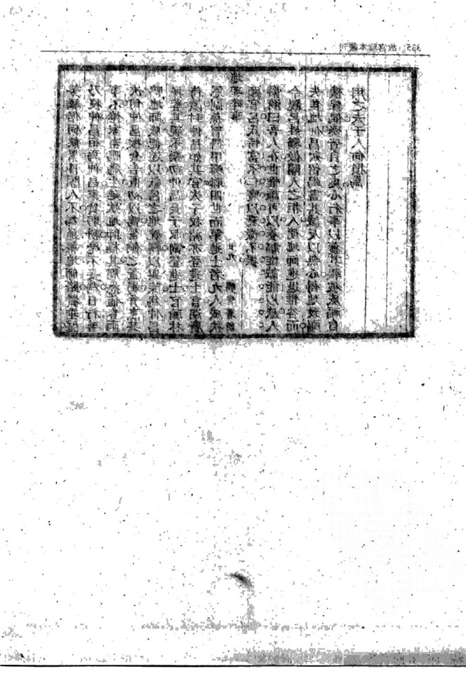

# 地理碎事

> 来源：409.水龙经+地理四弹子+雪心赋直解+廖公扒砂经.pdf，PDF 第 323–340 页

汪儋漪氏識 武直四卷 三十五 叫

地理碎事序古先聖王前民爲用凡卜筮靈藥方術諸書皆有發明與典墳相表裏獨形家之說無稽焉至漢世始有堪與家班固藝文志又載宮宅地形一卷此則葬師所祠然事理荒忽不本於經其辨詳于唐呂才所列是矣顧近今習俗相沿鮮能遠覽往往惑於拘忌互相凌兢至欲以先人體魄為利而濡遲暴露識者痛之我友右子汪氏獨能不爲形家所蔽而深惟入土查序一 廷園爲安之誼勉襄大事又復廣錫類之仁爲破俗之論兼輯古今證類數十則名地理碎事附雪心賦後用資勸戒明乎德門吉壤不謀而獲囟族佳城有物噉之故爲人後者篤于送終第當以卜葬爲急在因地隨時稱家有無而不必希求不可知之福澤徒勞此紛紜耳嗟乎詎非達人之見足以風爲孝子慈孫者哉世有覽者雖謂汪氏持論過于呂太常可也辛丑立夏日迂園查望于周氏偶書于蜩寄

碎事紀言予聞葬者藏也古人卜地爲藏其親若曰無風無水此可以藏矣嗣後相沿卽以謂之風水云古人之言風水也爲其親而今人之言風水也爲其子若孫每卜一地必曰若何貴若何富非富貴也遂不卜焉則是以廼祖乃父之骨爲子若孫市富貴之具也不可解也此念一滋至因循數十年不葬者有之不則時易事變漸至力不能葬者有之又碎事紀言一 耿著2

不然歲日久棺日朽甚至暴露中野終不得葬者有之嗚呼禍亦烈矣予友汪右子達者也其卜地不惑形家言始謀廼心繼廣之同人以爲無風無水可以葬也遂馬鬣焉得地矣葬之日予與執彿天朗氣清風雨不作得天也林疎野靜牧馬無聲得人也一行而三善脩右子善巳竣右子懼世之惑于形家之說遂失葬也爲採取地理巳事刻以警世右子益善巳予卜地如杯子大擬奉親歸骨於此與右子家丘壠相望化者有知親戚猶蒐嵬相依也大都經營其志與右子同而力媿不及故稍待甚矣予之無勇也況又安能摭拾古人之嘉言懿行著書立說以懲勸人世乎然此猶有可委者譬之車然右子椎之予挽之善右子之善亦予之善巳或可借齒牙與右子爭功也若窀容有期予行將勉力負土成墳而陰晴在天不可必也樵牧在人不可禦也予不知天與人之于我其事紀吉二 耿著與右子相去爲何如也因右子刻成遂綴筆及之

順治辛丑暮春棘人學弟葉生稽首拜言

蜩寄輯錄地理碎事

客越憺漪汪洪右子氏輯定

古人所謂卜其宅兆者乃孝子慈孫之心重親遺體使他日不爲城郭道路溝渠耳世人惑地師之說有求吉地至數十年不葬親者有葬不吉一掘未巳至三四次者有因爭地致訟未入土而家巳蕭條者有兄弟惑于各房風水之說至骨肉化爲仇讎者語地理碎事 寄著輯不聞乎龍穴非遙只是貯藏方寸地牛眠在邇空勞踏破隴頭雲從來智營力競誰其以尺土讓人而陵谷忽遷豐碑頻琢造物若留以有待也人其清夜一捫心乎予輯定雪心賦直解成廣錄心地碎事以附其後俾同志者共爲欣賞云

禺曆朝浙寧波有馮姓士人處館于新安歲暮得束修八兩而歸至江口見貧民夫婦赴水士人止之民言歲暮債廹欲鬻婦婦不忍離故相率併命土惻然盡捐金與之民泣謝代負擔送士歸家妻問所得士言遇貧民赴水事妻曰胡不周之士曰巳與之矣妻欣然除夜與妻治蝦酒和以糟戲口占云紅蝦糟汁煮清酒水來溜夜夢至瓊樓玉宇有一聯二門關金鎖三簾捲玉鈎二士覺而記千柱宗黨哂曰薄命漢得銀輕以與人復爲夢語誑人乎明春赴館主人延地師葬母士以二親未葬常嗟嘆焉主人囑師爲卜穴至一處見鹿卧其地人至地理碎事 11 端寄著輯奔去師曰此金鎖玉鈎形吉地也士憶與夢合但未知爲誰地適前與金之民至見士曰先生得非馮某乎自得金完債夫婦稍溫飽未能報德今爲何來此士言求葬地民曰此山一帶皆我有如可用當奉獻士指鹿眠處民曰正吾業也卽邀至家厚欵書契以獻士葬二親之後登第官至都憲夫妻偕老馮氏子孫至今繁衍不絕憺漪曰子觀爲馮公之樂助不難而難在其婦胡不周之一語令人敬服視今之鄙妒之婦何啻霄壤予輯碎事而首錄內助亦由詩以關雎爲第一云

范文正公得一宅基堪興家相之曰此當世出卿相 公曰誠有之乎不敢以私一家卽捐其基建之學 宮今蘇州府學是也風水家言尚有繫公念者乎 憺漪曰予見湖上兩山求地者紛紜無虛日而地 師各有所献亦巳無餘矣因有某寺年久傾頽基 地理碎事 三 蜩寄著輯 址廢圯爲獻而富宅大家遂有謀爲塋葬之舉偶 有天台一僧知而口占一絕云一帶空山巳有年 不須惆悵起頽磚道旁多少麒麟塚轉眼無人送 紙錢嗟乎此僧之詩眞可爲微婉而有諷刺之意 耶思謀寺基者得毋有媿文正公乎

明季皇陵初建時量度界限將築周垣所司奏民家墳墓在傍者當外從高皇云此墓皆吾家舊鄰舊里不必外徙後凡墳在陵域者春秋奠祭聽民出

入無禁

憺漪曰可見帝王氣象包舍徧覆自異尋常所以 明陵迄今仍叨庇廕豈非當日洪量之所延及耶 士庶之家奈何必欲獨擅其而不容一柩之爲 儉快哉

曹操設疑塚七十二在漳河之上宋僉應符題詩云生前欺天絕漢統久後欺人設疑塚人生用智久卽休何有餘機到丘壠人言疑塚我不疑我有一地理碎事 四4 寄著輯

法君未知直須發盡疑塚七十二必有一塚藏君屍京鏜亦有詩云疑塚多七十餘謀身自謂永無虞不知五馬同槽夢曾爲兒孫遠慮無

憺漪曰老瞞事奸雄無不自逞卽死後尚有疑 塚之設自謂可瞞後人之法使讀二詩老瞞寧不 爲魄散乎

馮商延一堪輿先生往祖塋相脉將至復拉之而返 其人問故商曰適望見祖塋賊人盤踞樹巔盜斫 大樹倘吾輩徑前恐彼驚跌損命不若暫避堪輿 敬嘆曰君心如此牛眠鹿卧何足道哉後子舉大 魁累世簪纓相繼

憺漪曰馮公總以仁慈不忍傷損人命猶還帶之 心也昔楊少師榮世以濟渡爲生久雨溪漲衝毀 民居溺灰者順流而下他舟皆撈貨物少師之祖 惟求人爲念他物槩無取鄉人皆喔其愚逮少師 父生家漸裕有神化爲道者與語曰汝祀父積陰 地理碎事 幽寄著輯

德子孫當貴顯宜葬某地遂依所指而墓之卽今白兎墳也後生少師弱冠登第位列三可見居位者勿得視人命如見戲也觀馮楊二公每一事一言惟恐悞傷人命者可不法歟

直城沈少卜葬地啟土乃一古家有誌乃先朝名 公之墓沈急命掩之恩復有發掘者立碑識之少 夜夢一官峩冠博帶來謝曰君掩吾塚蒙德巳 厚况兼製碑何以報德當送一大魁續公嗣巳而 少林生幼頴憎過目成誦弱冠及第 憺漪曰予觀沈少之求地一以平心絕無利巳 損人之念古人嘗言求地爲致福之基積德爲求 地之本未得地當積德以求之得地當積德以 培之是以後代鼎盛縣遠李近吾咏心地有云俯 仰乾坤何處佳人二有地盡英華性由天命眞龍 祖道衞吾身輔峽砂脈到靈臺方是正穴尋華 不曾差須認四端爲四應莫將虛受作虛花若還 地理碎事 六 鄭寄著輯 損壞全無用保得完時福愈加自古尺爲君子宅 至今不作小人家雖然說破無難認一爭毫髮隔 天涯沈少之所行眞所謂深合李公之啄安往 而不得眞地耶

郭璞生平不取信于其子凡郭公向西子必向東故郭公脈金山龍脈謂其子曰我卒當葬于金山腳下意葬于腳彼必葬于顛也郭公卒後其子悔向所行之非必遵父囑爲是竟葬于金山之下遂犯憺漪曰故當時有父作子笑子作父笑若要不笑須是龍呌之嘲以郭璞之術尙不能自爲身謀而况他乎以郭璞之時又以郭璞之賢而尚不能見信於子況今之時而子或有彊宗勝父宜其自是 0. C.

劉海之祖世業屬忽有徒犯病卧門首饑瘠顛連劉 C母詢之知其誣整奩餘代辨明贖罪時母方姙將地理碎事 七

產夜夢神云愛地之人明早生看地先生明晚至次日果生洵晚有地師至引觀此地卽前徒之業

因買葬焉洵後舉會魁仍出甲第六人

憺曰大凡一念之善必能感動鬼神所以近日人士遵奉太上感應篇家傳戶誦但不能如劉母之力行耳今將感應篇中十種功德再爲宣布一收街市遺孩倩人看養願識認者歸父母團園二每冬收老稚乞丐貧人入本家養濟院日給錢米滿一年今自便求越三普施應驗湯藥救人疾苦四施棺木周無力之家五女使長大不計身錢給衣貲聽其適人六專一戒殺遇飛走物命買贖放生七每遇銳蝕貴糴賤糶八修寺觀損壤者裝聖 C像剝落者治橋渠道路溝渠寨阻者九客旅落魄者量其遠近貲助還鄉十居推司凡遇流徒冤枉細與辨明此劉母行第十件之一耳便能感動神人夢指葬地而獲子孫貴顯奈何人欲廣求佳地地理碎事 八 寄著輯

而不力奉行感應篇者何哉然常量力之可行一件者則勉行之或力不逮不妨勸人行之自獲好報此老廢人挑燈又服補藥一丸也

后智興微時爲徐州門子有道士居門側智興每日 掃道必兼掃道士之門智興母火道士善審地理 引智興立一竹以表其處曰若定此地兩世方伯 智興他日再往視竹策叢生遂葬母焉果爲兩世 方伯

膽嗚曰有受用者作事自然勤慎有福澤者斷不利巳遺人觀智興不過一時之便爲道士掃門但能有恒不倦爲難耳卒獲佳地子每戒後生輩不可一刻閒游安可無掃地門子之心耶

六合尹林克正延地師仰思忠營地其姻方氏父爲知縣未葬因薦思忠卜其窀麥連日尋求果得佳地方欲點穴驟雨乃止約天晴再往是夜思忠夢一老人曰此地切勿與之此人爲考官賣三舉子地理碎事

當有陰禍若葬此地法當榮其子孫非天意矣寤 而訊克正曰曩時大尹居官何如正曰先爲教論 遷此官不久遽卒聞爲考官時關節得貽鄉評頗 少之思忠惕然因托故歸家越二三年遇其鄉人 門方大尹葬否人曰因與勢豪爭墳致众人命官 司纏綿至今未葬家業亦漸凋落云

憺漪曰若果有德人斷不葬凶地猶之方大尹愛 賄蔽賢卒不能得住穴也然地真可遇而不可求 若富貴是一家私物則前富貴人據之不及我矣 若富貴非一家私物則後富貴人雖堅留之旋且 及彼矣未富貴之家原從巳富貴家分過來巳富 貴家仍聽未富貴家分將去全憑積德方能轉移 具豈地師之所能主持耶觀方大尹而可不惕然 耶今之功令嚴切惟科塲之弊更爲防禁則老 人之夢眞幽明之戒有相符焉

順治庚子新安地師何伯達復游武林覓地與予講 地理碎事 十 寄著輯

曩時祁門倪宦之父昆季三人延師爲父母尋地安葬惟二房主人賢名最著更能隆禮堪興後特請一名師于家幾二三年師之饌飲衾服等類無不曲盡其歡心而師竟無所報偶于一夕師閑步沿溪翫月不覺嘆曰如此山秀水長之地可惜不能有人安葬也二房主人亦隨步月忽聞斯言大爲駭然撫師背曰何不獻我恥師因而直告此乃鯉魚掉尾形大利于長三之房不甚利于二房我因君之单請豈可反爲他房哉故所以深嗟耳二房主人曰此地果佳吾之親安況利於我兄我弟何必我慮明晨急謀于兄弟兼同別堪輿家復觀仍如此語遂買其地卜日安葬十餘年而長房子登弟得美官歷臺省京卿三房巨富至十萬惟二房淹似昔悉如地師之語然二房並無怨忌心守巳安生又六七年山忽起蜃雨雹大作衝山倒谷而前鯉魚尾形掉轉而腹牧水口之美于是理碎事 十 螭寄著輯

房偶往淮販卽稍振不臉年遂以機會長貲數十餘萬子係昌茂至今不衰可見天意人心之良不以私巳遂能轉祥也

惟漪曰此吾鄉之實事也今之世人有疑公位之 說兄弟多議至有終身不殯其親者噫爲父母者 皆以子多爲幸今若此則是增一子祗增一暴露 之日反不如子少者得早歸泉壤矣夫子孫各有 福緣且各有行誼冥之中所以償之者毫釐不 爽豈可挾私見而暴露其親况葬後砂水變形陵 谷易位造物于人豈一端盡哉則倪宦二房主人 不以兄弟公位自拘後反獲福無涯人可不因之 以鑒戒哉

字八公葬其子于鷄籠尖初葬畢謂其孫曰葬後期年恐有不利于汝孫對曰親安九泉所願足矣雖有損子何惜也葬後孫亦不傷後來延緜盛發出甲第四十餘人至今蕃衍不絕地理碎事 十二精寄普韓

憺漪曰凡墳未葬時當爲詳審葬萬不可聰人 言而輕爲遷易卽葬後稍有未順或年命所招大 數原定各當安分積德廣行善事挽回天心但親 曆以入土爲安豈耑爲子孫求福乎于此可絕遷 移之念觀李公之孫可稱達孝人矣○近世士大 夫酷信風水朝遷暮改予偶訪友人堪輿盈座予 佯戲曰近來天帝甚友人遽問何謂也予曰人 間窮達壽天僕然逐地師將人家墳墓遷徙以

祈福壽上帝那得不忙

蕭鏗鎮姑熟有發塚多得金寶者鬱林以贈鏗鏗曰 今取往物後取今物如此循環可不熟念令修復 之

憺綺曰世閒之物日用幾何終日忙奔兢枉作兒孫馬牛今觀蕭公眞達觀長者吾儕正當取法子居常評論人之錢財有三五百金覓利可以資生亦自足矣較數萬之家日逐食用之物與三五地理碎事 寄著輯

百金者何異不過多費經營籌畫耳臨命終時將得何物去世人何苦不三思

宗元定通術數游朱晦翁門胡閎疏彈晦翁并及謂之妖人坐謫道州夾蔡善於地理每與鄉人卜葬改造終日遷移其間吉凶不能皆驗及貶有人贈其詩者曰掘盡人家好丘壟冤魂欲訴更無由先生若有堯夫術何不先言去道州

憺漪曰凡人得吉地而後反凶者其病有二二一因

固執巳見移穴易向地師惟務承順不復據經一爲獲吉地子孫輕信人言無故遷改他姓得之因而獲慶究其原皆冥中有使然者耳德不積欲求地譬猶未種望收存耕錄云踏破鐵無覓處得來全不費工夫牛眠鶴舉獲奇遇只存方寸地中求宋謙父云世人盡知穴在山豈知穴在方寸聞好山好水世不欠苟非其人尋不見我見富貴人家墳往葬時皆貧賤迨其富貴力可求人事地理碎事 十运 蜩寄著輯

極時天理變吁仁人孝子可以知所自處矣○昔袁了凡先生好談地理曾訪至光福問一村農聞此山有惟地否對曰小人生長于斯三十年矣但見帶紗帽者來尋地不見帶紗帽者來上墳袁公恍然而去嗟觀此則知地原有定數又豈帶紗帽者可求哉

廬州刺史蔡儔發楊行密祖父之墓行密遣李神福領兵討儔自將詣廬州克之馘斬蔡儔左右請發儔父母塚行密曰儔以毀墓伏誅吾豈效此不道之人

憺猗曰吾觀楊公能斬祭而不發蔡塚可謂仁智 咸備之人處之甚當

明季閩中有甲科嚴姓者出仕時吸盡民膏勢熖虐人爲江右廉憲聞顧陵崗深識地理近代名師厚幣聘之爲母覓地顧入閩閣夢二鬼將物單目而去及抵閩與扦葬畢復將度關仍夢二鬼揭去罩地理碎事 劣蝸寺著解物顧師方悟而所扦者爲凶慶返而勸改之嚴凝謂禮薄故誑也重謝辭之顧亦付無可奈何之天後果家道零落

憺河曰風水關人最大中實有默宰之者厚德格 天天將啟以昌運故陰假權于明師而默使賓主 和同苟刻剝謂詐上千天艱其遭過視名師若 風馬牛見盲師同傾心腹吉地逢而弗看凶壤重 價圖之多謀以竄之甚致殺人興訟破家傾橐以 求之者噫使中無主宰是者而一憑則勢爲有無 古之李林甫蔡京秦檜之徒厥後維昌不墜耶今 觀嚴姓之地師眼而吉穴非脩德之人烏能覓 得者哉

大 入興劉公機父卒于任公時爲弟子員徒步往誕喪魅遂卜葬恢人泥陰陽家言各以生年與葬期相值久不克葬公獨曰願以某生年所値月葬父于是力葬之後公官至大司馬贈宮保則葬日吉凶地理碎事 嶼寄著輯

眞無謂也

儋漪曰子見孤寒之家有棄祖宗骸骨于曠野而或生賢子孫崛起窮巷高其門第此寧得地理之助耶公卿大夫殫心力以求善地選擇宸良而或反生不肖子孫驕奢淫佚墜其家聲地露又安在哉○又嘗聋吾鄉吳某至孝家貧母死營人所不封土擇葬其中喪事趨辦不及問時日巫者皆言當族滅吳某後成進士子孫獲慶不衰則陰陽時

日之說不可不慎亦何必太泥著也明季唐恒幼喪父衰毀骨立奉母周氏至孝適遭大雨裂龍山麓水衝父塚恒負土與壅不克又負苦不能遷無何母又喪母屬纊謂曰塚陸沈奈何恒痛母言卽以鐵鎖繫項仰天誓曰恒不徙墓不去此鎖懷憤六年病革親反爭爲脫之恒捫鎖泣下曰吾解此無以見吾母於地下竟抱鎖死是後山水頓殺趨流別道墓得不傾巡按御史東郊祭其地理碎事 蜩寄著輯

墓以旌孝子云

寤倚曰凡人父母有關心弗意之事竟有難以對子言者亦以平常言之無盆也惟臨命終時每有遺屬者以過此則不能言乃不得不言而言之耳今周母屬纊一語目擊傷心恒能如此至夾不變而天黙祐以全其孝眞爲難事予紀此時適讀警心錄內有杭州張姓名競光其父爲徹州司理歷南儀部郎有同母弟一異母弟三父於宦邸分授巳定晚年復舉一子合家歡如也辛卯冬廿七日漏下二鼓儀郞忽喚競光等語曰人有生卽有死我身後有五事汝曹識之禁報訃酌殮服禁佛事勿求墓誌首七卽舉殯安塟語畢忽發長嘆競光曰父非念幼弟耶曰然我老年多此一事競光曰此易事兄弟五人照所分授每人讓田十讓租若干幼弟丹子便可過活矣父曰若然誠慰我心越十日善終張爲武林望族迄今一門孝友

地理碎事 十六 螭吉著輯

原王洙言昔有查姓一人病其家數世未葬亟出錢買地一方稍近爽豈者自祖考至功總之服悉照昭穆次序葬之都無歲月目時陰陽忌諱與塋穴之法人訶其易恐福禍未可知也歲中遷官秩家道益昌

憺漪曰今觀查士發憤而葬數世之柩以不能重費不信陰陽諸事而力行之以善念感格終爲獲吉視今人稽畱不葬徼求不可信之福于祖考遺

骸眞視查士爲罪八矣唐僧泓師自東洽回語張說曰欽門道左有地甚善公試請假兩三日百僚至者貧僧于廉間昧相貴方付此地說如言果集朝士及御史源乾曜至泓謂說曰此人界與公等可以此授說名乾懼與語源曰乾曜大塋在勢門先人尚未啟祔今請假歸洛故來拜辭說具述泓言欲同行源辭以家貧不辦此後泓復經缺門見其地巳爲源氏墓矣謂說地理碎事 鶚寄著輯

曰天贊源氏者合窪處本高今則矣合高處本今則高矣其安頃及山門角殃之所皆合作者問其價乃賒買耳問其卜葬者村夫耳問其術乃馬下甲斗皆耳其制度一一自然如此源氏大貴玄乾曜自京尹拜相為侍中近二十年

謂漪曰此八十二翁警心錄內事也余輯此以見 凡人當處心好任其自然則生端正有相之子而 獲一定佳城不必強求雖然亦必如源公請假魅

洛啟祔賒商其村夫斗書方可膺天和若淹 蠅逐終日醉夢之間置親屍于度外何啻霄壤 福建林達性樞貪婪欺壓良善家有五子並有父風 親族懦弱者皆被侵奪里中一人父卒有墳地絕 勝逢僞作邦券稱其父生時貨責與已遂遷父骨 塟焉里子爭之不勝終曰訴天稱屈一夕遙夢父 告曰吾今絕嗣祀矣爾侮宗族不足又欺人孤子 而佔其地地雖佳今山靈震怒發水衝斷龍脈冥 地理碎事 千 端寄著輯

司不久追爾父子矣逵大思而醒是年與五子俱 奴家業索然

憺漪曰地之能以禍福轉移不可恃也凡地師不可不誠心厚欵葬後倘獲福更不可忽待子正持此說適姪氏孺誠述余鄉程篁墩公之父墓原係江右名師點穴安葬乃黃牛起懣勢主貴顯縣長自葬後程公果發大魁後地師復來謁程公慢忽之地師悒惋佯言某處地自石子二枚若能掘去卽當封拜程公不知地師之詒已信爲實然辰取所點之穴掘下果獲二石子去之嗣後程公官雖顯而終乏嗣可見巳定之墓萬勿輕易改動總之信任地師以父母相托便當恭敬存心也唐卿爲龍圖閣學士委楊筠松尋一吉穴乃數代宰執地也其夜忽夢一金甲使者按喝曰地仙休錯龍圖學士不十日當外于非命爲驗言訖驚寤嗟訝其事果十日有飛符取其首

地理碎事 廿明寄著輯憺綺曰吉地斷不付兇頑之人天心卽地理也予蒐輯地理碎事偶因積雨悶人閑步姪氏孺誠劇譚言及曩日有自不量之事亦頗甚奇轉移與其稍同遂爲附存明季有詹姓一士在園中散步見樹根一坎下有石甃啟之皆白金也士以爲非巳物亟掩之弗取人並不知數年後歲大饑軍民呼庚癸士方啟其穴出金貴糴賤糶聽貧民持銀要糴若干銀亦不秤任買者自量而去絕不較論如

是全活多人市人羣稱之曰自不量覓轉展糶耀折盡其金毫不私其錙銖也後有一地師爲鄙惡富豪扦穴安葬夢神諭云地誠佳美乃自不量父母之穴安逆天而爲鄙惡人葬耶地師驚醒會天大雨遂不果葬于是地師留心自不量何人而不可得一日至市上訪友聞羣人云還去問自不量家夫買因而詢之遂往謁焉道其所以詹士唯三求其地葬親數百年家道隆茂子孫衆多顕達可地理碎事 二 寄著輯見地之一事必須行善積德何用縱心強求也張顧存曰前人巳葬之地不論賢否萬分不可毀掘掘見屍骸必有險禍子孫更受禍無涯

憺廣曰張先達此語眞千古具大見識發大慈悲者也今欲擇地人家知此奉行未有不遇吉穴而亨有成昔有開穴而見冢内具宰相冠服碑記具存其家卽掩好舊棺而葬之于旁葬後生子亦官居宰輔在朝年日亦如舊塚之宰相相符然則何必掘夫人棺求巳獨穴爲貴哉此順治十七年聞何師伯達云

寧海方正學先生父將葬祖巳擇日矣忽夢朱衣人前跽告曰公于某山之陽作尊翁大人壽藏但吾九族居此數百年乞緩三日春回天上吾當遠徙言訖辭去明日啟土穴中有赤蛇千餘尾其一長數丈所夢朱衣也先生之父素不信鬼神事見蠅不顧亦忘夢中語積薪焚之有煙一道直至先地理碎事 淵著輯

生家時母方娠數月先生誕焉厥狀甚異舌能舔入鼻中幼頴異長師宋景濂先生官學士盡忠建文君遭赤九族或以爲蠅之報云

憺猗曰陰陽之說不可不信亦不可全信事皆有定數觀方父正直不信陰陽燒蛇致禍生正學先生之盡忠亦獲正人之報然鬼神不必深信而赤虵之焚是亦可巳之事何遂適與靖難九族之誅相符要皆一定刼運所遭不能這耳若謂正直忠臣不宜慘誅則孔顏應爲宰輔古今宰輔不宜復有操莽之人矣嗟乎人當耑以脩省積德可以挽回生前刼數萬不可以傷生爲善小而忽之也東坡蘇公云爲鼠長畱飯憐蛾不點燈此語堪推而行之

太平廣記云吳黃龍午中海鹽有陸東美妻朱氏能孝公姑兼有客止夫妻相重寸步不離時人號爲比肩人後妻卒東美不食而死囑家人延明師卜地理碎事 蛸寄著輯

和好合塟地而扦之穴墳成塚上生一烽榭同根二身相抱而合成一樹每有雙鴻常宿于上孫權聞之嗟嘆其佳封其里曰比肩墓又曰雙梓後子弘爲上庠名士與妻張氏亦相愛吳人呼爲小比局

憺漪曰夫五倫之內非有情斷不能孝友節義今 觀陸生不食而死岂非情至之士方能爲義夫耶 雖地師之明實上天亦感其忱墳木遂生連理而 子媳亦續成和美乎腐儒但知理爲情範孰知情 爲理之維乎但願世人凢事須留人情也 工樊葬後有盜開其塚見樊與人樗蒲以酒賜盜盜 者惶怖飲之見有人牽銅馬出塚者是夜有神人 乘騎至城門命守城卒云我乃王樊之使今有發 塚者以酒墨其唇訖見至可驗而擒之盜甫入城 守城者縛詰之如神所言遂送法司按罪

憺漪曰發塚之盜再無不敗而不受傷者古有盜 地理碎事 壙寄著輯 發塚內中伏弩齊射多傷人者有湧沙以陷人者 有颶風劍戟如麻者有銅鵞飛出啄人者並載太 平廣記茲不能全附但不知王樊何獨以酒墨黑 盜之唇爲驗豈今之墨吏如盜墳賊之所爲而命 名耶安得守城卒之縛盡哉

明初南直休寧有邵姓諱瑩品行清卓深敦友誼承父惟業經營起家毫不自私囊案凡有美產腴田悉分與弟得巳甘受其淡薄篤念群弟之幼而懦弱也卽鄉黨友朋卑寒者亦無不周恤獨厚一謝姓友稱管鮑之好謝感其情之久願以墟墓隙地償還積負而邵公從厚與其值而收之後第五子諱祖壽者歿遂以謂地而卜啡焉公惟行仁積德 2爲心亦不深求地之若何富貴也葬後因洪水暴汎衝倒山谷而壙樞漂沒莫之所救訪古禮有治棺衾招魂復葬後三四世遂生邵齡邵燕邵庶邵兼俱登兩榜今衣冠蝉聯子孫繁衍稱爲西門邵地理碎事 共六 剃寄著輯

云皆邵公敦篤手足之義所獲報也憺漪曰吾人自父母外惟手足爲重本一體于吾親也世人選選爭貨財聽妻子而參商焉視邵公篤火于而反膺天脊則兄弟較利涉訟者寧無媿心乎○其進士邵齡卽予曾祖壻也今同籍邵公遠氏又屬予妹倩因子輯碎事成述彼祖先之德而傳之愚謂城墓之發原係子係忱悃以通陰靈精氣感觸而興一念之誠通于神明九泉之氣感其關切也眇招魂所以能承前人之德以啟後人之福耳兒地理書云嫡母偏發庶生兒人奈何以彼此微嫌而遂生怠緩哉

辛丑暮春子集碎事成携示又生值查子于周在座 新利初放蕙香滿室同作竟日快談查子述山陰 一事遂爲增入有王張二姓積德行善之家皆 安葬父母而張姓素樂善好施鄉黨 江右明師擇地師代爲遍覓 佳穴偕張 地理碎事 廿七騎寄著輯

姓卜買正點穴欲成而張姓忽有微嫌未決是夕師夢一土地神云此地乃王姓某素行陰德乃貴人大地若張姓行善之地定在對山主久富綿長者也地師愕然晨起不明其故乃與張姓云聞對山有一地曷往觀之而張姓一見欣然遂備價售而安葬焉其地師終未得王姓何人也一日驟雨入一初喪人家避雨見正脩佛事而地師偶脊宣疏適有工姓之名與夢中相符地師深訝焉因詢里鄰知王姓之父平日廣行陰德有年遲明特造謁具以地獻而王姓明曉人頗亦粗知堪輿理同往觀前地大愜其心遂買卜扦葬後二三十年世科甲至今不衰而張姓亦累世富饒書鄉繼嫩乃見彼此之地天先有一定之數矣

憺漪曰凡地理之事陰德爲主有定數在焉何謂 3陰德凡人爲善而人知之則爲陽善爲善人不知之方爲陰德陰德人雖不知天必知之所以天付地理碎事 廿八鼎寄著斬

之大地其間輕重大小毫不可強求今觀王張二轉移矣諺云念暗裏便人塵微處解釋斯言 姓得地大小豈人力之所能必也土地之神默爲 C 2當為三復予非敢道聽塗說以衰廢之人借此立言以消長晝耳

陳適字仲昌閩縣人古靈陳先生之裔生洪武中有隱德家居義溪其鄉有呂姓者暴發登科偶有他方堪輿師獲一吉地欲献于呂與其厚酬呂方怙顯官呂氏恃富不仁寢以衰微不振今觀呂姓驕倣關人之拒人使地師進退惟谷而失隹地仲昌欵留竭盡其誠反以無心得地致福機緣偶湊皆自之處心行事以獲其報彼威福自用之夫于人何損焉

勢驕倨同候累日闇人不爲通報地師路費乖聲乃投仲昌宿焉仲昌家貧躬耕毫不妄爲日行善事不倦家畜鴨爲生延欵地師極其周悉值春雨浹旬仲昌糧食告匱初以鴨蛋餉之蛋竭弁烹其鴨地師感德遂以獻呂之地婉轉以與陳爲仲昌扦葬其親永樂初仲昌長子叔登進士官翰林侍讀封仲昌如其官次子叔紹亦登進士官湖廣憲副孫曾科甲蟬聯四世而第進士者九人咸秩地理碎事 廿九 寄著輯今公畫災扒沙經序河修見而將偶數成陰陽理著迭化之機洩術家種而窺天測地推吉卜函大都堪與扶要公然伎者無筭而結名家廖公為最廖公豫章人其鄉習彭大雄者從公之十餘年日耳其口訣编而成書向為其家所祕間出抄錄中老世轍珍而什蠶之故淑內嚮慕弗見全書為恨地學之末鐸也項居艱省年家姻雅仲之江生與余同里開聲氣不隔指廖公全書謁余請敘余彀曰日司或時昆李以次受業甚器之廼旁趨是江生以下地對不惜重貲買其家梓行天下同置齋頻暇親之言立皆法疑經遂不釋手旬餘日深知是書批御導竅徇法家領袖大要創前人所未發質前人所淺言同中之異異中之同參圗別類窮似辦真務文先天秘藏昭於招掌而滋茫恍惚洩於毫緯灑手有之不能摹象象不能摹神惧毫釐之羌成千里之謬

<table><tr><td></td></tr><tr><td></td></tr><tr><td>25 智誉烟</td></tr><tr><td></td></tr><tr><td></td></tr><tr><td></td></tr><tr><td>十</td></tr><tr><td></td></tr><tr><td></td></tr><tr><td></td></tr></table>

<!-- 原书末页：doc013 PDF 第 340 页；MinerU 表格图未进入 Markdown；高清原页图 -->

