# 地理辨正图解掌诀（戴礼台）

> 来源：地理辨正 图解掌诀(戴礼台著).pdf

新 增 地理辨正圖解掌訣

書有可解者有不可解者日用倫常經書欲盡人知之故明白顯易人皆得而解之也天地秘藏機不容洩故深文奧義不可得而解之也

新增地理辨正圖解掌訣序

地理者古人察天地之微識陰陽之奧竊其生機自為造化可以改天命奪神功此造物所珍秘非通徹三教九流者不能洞察其微也故青囊天玉諸經自古迄今知者絕少而坊間刊本雜出不一盡皆妄誕未免悖謬始害此辨正之書所由作也自辨正作而青囊天玉始得有真解矣無如世人不訪真師不請秘旨而並不解其解及至心思窮盡搜索無由反為蔣公恨甚至詆毀蔣公而塗抹辨正者噫若而人者真可哀矣

予歷盡艱辛訪師多年始得其缺於丁五少自道間遊寓星子連州二三知巳以辨正索解予眷明掌訣並已盡其概乃慮其難得而易失也小上將生首乍圖圖其難知者以為隨地披麗焉曰年正下朱巳盡于斯而訣亦寓其中圗僅二十有八師來丁年有青皮閱斯今而後可無遺忘之患矣儲猶有才而華前作無不可圗而重繹之則雖深文奧義不可得而解元二之不

得而解之矣又何患乎青虞諸經有不了然于心目者手願共珍之情之勿輕洩焉可也

合功山人桃谷戴禮臺序李榮仰重抄於名北市

一地理之書所牛光棟其言峦頭者總通套當同其言經氣者諸書皆僞惟青囊天玉經乃真正秋傳古今地師皆進哀不洩今將辨正詳註而辨明之其詞似秘實則透闢註書盡但少掌訣少起例耳

一玄空大五行胡以言乎大以其按盡議家五行而一以貫之者也却又並無五行非若俗傳大玄空以某干支屬木某干支屬金某干支属火土水者

一玄空大五行實是玄空却不是俗傳之大小玄空實是四經灰

不是俗傳之四經實是三合却不是俗傳之三合實是八卦九星却不是俗傳之八卦九星實是斗首却不是俗傳之非首祇此一個五行徹上徹下舉凡譜家各種五行之名皆是玄空大五行故一見而知其為真傳也

一玄室以廿四山分八卦八卦分三大卦名玄空大五行是矣乃經又云天卦地卦東卦西卦南卦北卦文母卦例何多也昧都每指某為東卦某為西卦某為南北卦文母卦天地卦何夢夢若是更分子午卯酉為一大卦辰戍丑未為一大卦寅申已亥為一大卦愈係作夢也玄空乃丹家內煉之秘實生生不已之區萬物交結之所老子謂象妙之門者也山川融結實有其處隨在可指其理即與易卦無不符合葬乘生氣奪造化之權正在於此知比則格龍格水下卦起星可坐而定矣

一五星所屬天玉未嘗言及祇云五星配出九星名一句而已謹辨正者布一恨事不知天玉固已言之諄諄矣讀者過自不覺耳細閱圗訣當必有悟

一九星除從前錯誤者不論近日多宗古鏡歌以廿四山隔四位族排而廉貞歸中誥為蔣公秘授又有以輔弼作一星三匝七四位

荀又有九星為不足憑信都皆不得真傳故也不知九星之飛布九宮乃天地自然之位數不假人力安排省中陽云九星乃斷向水應驗吉凶微渺之事學者既知八卦興衰則九星亦可畧其不肯輕洩也如此乎

一用時日最為緊要有葬吉地而不發者日時不合敬也擇日自太乙禽奇六壬當霆諸大家而外惟楊公造命傳橘極廣近日專用烏兔太陽吊照以為得蔣公秘授豈知天玉經合祿合馬合官星之句其訣至被其用至神至奇至驗至盛為世間有一無二之日課用以造葬無不速發用以催福無奇驗惟得心傳口授者方知其妙今撮其要共著數圗於後知者用之擇日之能事畢矣

一左今地仙立一穴葬一地必留鈴記預定何時興發何時出 何等人物何等事情此雖在龍穴砂水上斷驗實則莫近乎 數也此數依八卦九星宗奇門與太乙皇極不異生而廣之 辰流轉要相逢之句巳發其端在學者精而求之猶而意之 耳 戊辛木亭

## 圖訣三序

戴梓林序李崇仰抄

原著及增補增著共五十圗首五圗為綱領第六至第九關為總將第十至十三及增著三元歌分金掌訣為入用第十四至第十九圗並增著坎離掌訣乃明大卦天然交媾之理為四十八局之準繩第二十至第三十二圗乃挨星作用應驗第三十三四四十四五圗乃明生成度北之理第三十五至四十三圗乃擇日用素玩此以讀辨正則辨正之秘旨見矣閱者幸無視為河漢也可

陳 鳳梧 典臣 韓補

李崇仰編抄辦正圗訣增解序

地學之道峦頭為體理氣為用地理之書百家雜出言出頭則大同而小異無甚差謬說理氣則别户分門皆屬偽妄惟辨正一書所言岔頭理氣兩而化者一而神獨得真傳焉所以有志地學昔人多誦讀却人多不曉以未得真師傳授故也江右戴公於衣之哲嗣號韞玉者暮年遊歷龍州余因得其口訣而於辨正之妙事乎旨頗有所見因而遍闕山川覆驗名山古墓益信口訣不說戊子崖於穗垣與陳君典臣聚首談及地理終日忘倦詢其所學蓋龍王師也乃知學習同出一門遂出戴公辨正圗詩相旗見生為月未脩次序不分遂相共轉補更為之增著增解戰前刻尤為明

顯雖秘傳未敢盡洩而圗訣註解己把金針暗度矣世之讀 辦正者將各圗典註解細心考究往復搜尋其於辨正之微 言奧首豈無豁然貫通之候乎

上汽 鳳祛 典涇 相洪序於羊城讀易草堂

李崇仰句讀編抄於象翔大

## 讀辨正訣

凡讀辨正者多不知解若求其文句如晴啞謎即讀熟辨正終屬渺茫因不得真傳而不得訣故也不知辨正一書其文辭至淺者道理愈深其用尤重惟青囊與語十義足見詩凡作用盡在奧語十義之中起止分合生母夏化道所方方具備凡讀者宜以十義遂句索解更以逐句字字追求方為得法如第一何以曰義第二何以曰言第三何以曰法第曰何以曰奇第五何以曰妙第六何以曰秘第七何以曰奠第八何以曰裁第九何以曰神第十何以曰真再以圗詩細心號之無不了然此便是讀辨正之秋訣也所以有辨正理案

不可無辨正圗解是有辨正圗訣方可識辨正理氣寶照經云潘龍若依圗訣葬官職榮華立可觀圖訣是理氣對證

天地生成河圗圖訣

河圗妙義理通天本末根苗一氣連四象中央分内外五行個裡合方圓

河圗妙義地理通天根苗本末一氣相連

未有河圗洛書之數象先有天地乾坤之理氣是有天地乾 坤之理氣故有河圗洛書之數象理與氣數與象則河洛之 義與乾坤天地合一而乙矣所以天地生成河圗為地理之 體自有乾坤度化洛書為天文之用地理之體生成五行四 象而成干道天文之用度化八卦九星以應天心此便是天 地生成河圗之本末自有天地度化洛書之根苗

圗爰化洛書圖訣洛書本末四為根八卦中央五至尊九個星辰行日月三回天地定乾坤

九星八卦五四為尊三回天地逆滿乾坤

洛書郭是河圗河圗便是洛書洛書化為河圗河圗慶為洛書洛書合為河圗河圗分為洛書洛書是說在天成象河圗是說在地成形是有形故有顯象是有顯象必有成形足有天地生成河圗為地理之體固有乾坤度化洛書為天文之用是有五行四象而成十道故有八卦九星以應天心比便是無窮度化之本末自有萬物生成之根苗

八天八卦本象圗訣先天八卦說君知甲木逢春發葉時四象中央為正幹五行以外是旁枝是有正幹は有旁枝真龍出入左右秋持

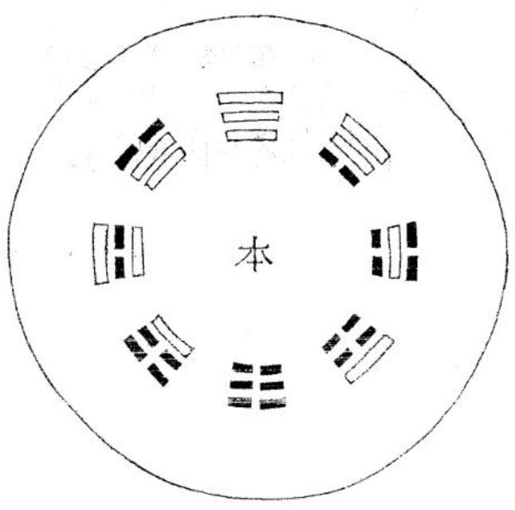

先天八卦是說生數生數者即太極生兩儀兩儀生三才三才生四象四象生五行五行生八卦郭如甲木關萊漸成枝幹幹者一直生上乾之性也被者橫劇八方坤之性也所以乾卦成而坤卦隨郎成矣乾坤兩卦成而八卦隨卽成矣八卦成而九星隨即成矣八卦九星成而天地萬物隨即成矣此便是先天八卦生數之本末自有後天八卦成數之根苗

後天八卦末象圖訣後天八卦卽先天本末中央一氣連太極生成三極體五星配出九星垣在天成泉在地成形分明八卦爰化九星

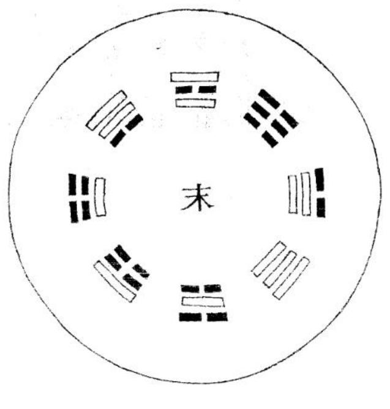

後天八卦是說成數成數者六七八九十是也六七八九十節是一二三四五實為兩個一二三四五也一個先之一二三四五為本一個後之一二三四五為末止此兩個一二三四五度化無數個一二三四五無數個一二三四五終歸公為一個一二三四五此天機也此便是後天八卦成數之本末自有先後八卦合數之根苗

九後八卦並體圖訣後天極數合先天八卦九星一氣連四象中央歸本位五行內外各還原先本後末同共一天王行四象內外相連

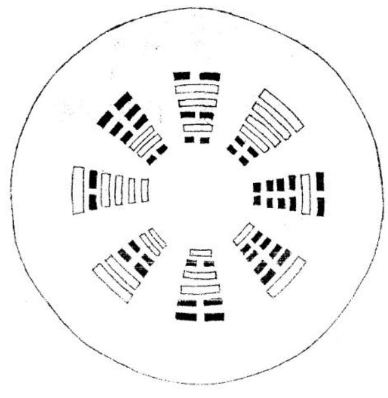

前圗先後八卦是說分數此圖先後八卦是說会數是有分數故有合數是有合數必有分數分數者一十分為二五合數者二五合為一十所以前之先後八卦分而為二此之先復八卦合而為一分而為二卷九四九五合而為一都九九八一九四九五是說行龍之實義九九八一是說結地之真情此便是先後八卦合數之本末自有先後八卦分數之根苗

卦分為三卦圖訣 乾坤爰化易門開 天地人通任往來 九直九橫分九曜 三經三緯合三才 乾坤爰化三緯三經 橫推直有三卦分勾

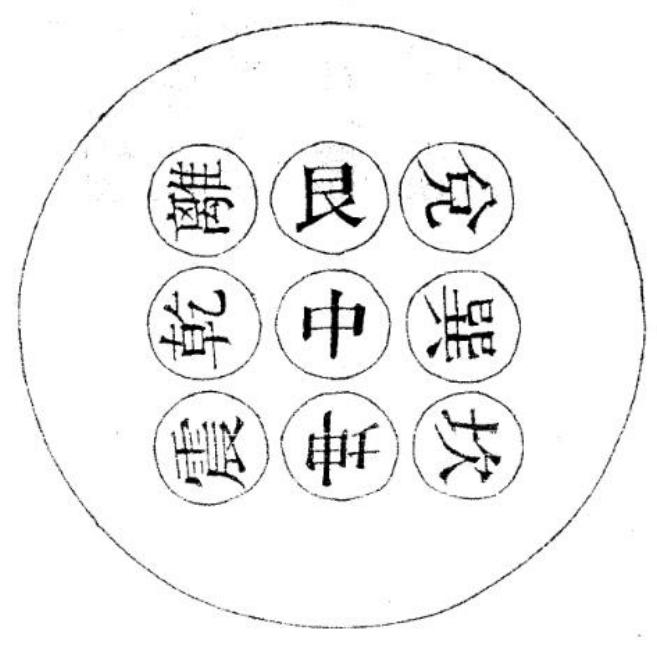

江東一卦從來吉八神四個一

江東一卦起於西乃天然位數無有不吉八神四個一者是以八卦緩四位以求同氣實為三個一也三個一者坎巽兌之一也坤中艮之一也震乾離之一也是有三個一卽有三個二是有三個二卽有三個三也此一氣相連實為三個一二三也所謂一生二今二生三三生萬物之玄關是也

八卦分為二卦圖訣不同三極也相通兩卦終歸靠祖宗但遇此情皆吉地每逢是義郎真龍不同骨肉却共祖宗族着父母便是真龍

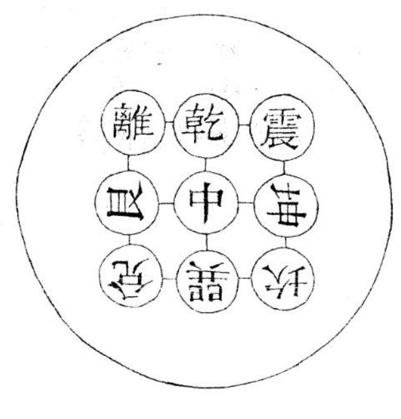

江西一卦排龍位八神四個二

江西一卦乃江東一卦之對面所謂江西龍去望江東是也 八神四個二者是以八卦經四位而起文母實為三個二也 三個二者坎坤震之二也巽中乾之二也兌艮離之二也是 有三個一故有三個二是有三個二必有三個三實為三個 一二三也所以三卦由此而分八卦九星由此而成也

卦統共一卦圗訣生成度化顯方圓九個星辰任倒頭天地五行同一體乾坤大斷合三連洛書顯象八卦成形三同天地化出孔星

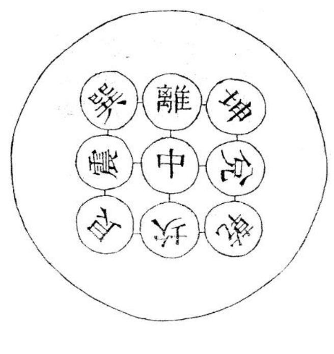

南北八神共一卦端的用兼差

始云東一卦次云西一卦此云南北八神共一卦堂非三大卦乎登非云江南龍來江北望江西龍去望江東之妙義乎又曰天機妙訣本不同八卦止有一卦通黨非云此一卦乎所以惟此一卦魚所不通無所不達凡天地萬物生俄衷化道理盡在此一卦中是以為入用之極廣

廿四龍管三卦圗訣解 增 三般卦數理通天六合週流在自然分配九宮知妙義相生同氣亦相連

鼓駢聞 二十四龍管三卦莫與時師語忽然得知便通仙代代

次至巽是四位巽至兌亦是四位八卦皆經四位三才六秀為一例久母子息為一例兄弟子孫為一例一四七二五八三六九人皆知之矣而作用配合雖老於此眷尚在昧昧病在耶度命於先師也

此圗與上三般卦大同小異而此較為明顯分別零神正神圗訣

陰陽二字兩星辰龍水相交理氣真坎位生來為正向離宮尅入是零神龍水配合夫婦情真零堂合氣正向通神

陰陽二字看零正坐向須知病若遇正神正位裝撥水入零堂零堂正向須知好認取來山腦水上排龍點位裝積粟萬餘倉

分零正兩字之義有二有局內之分零正者有局外之分零正者局外之 分零正者正許零神入內局內之分舉正者不許零神出外如是則為雌 雄交媾天然結地無疑矣反此則為陰陽差錯並非結地之理氣矣

分別珠贊火坑圗訣

顛顛倒倒地翻天 氣運循環六十年 珠寶火坑分對面 火坑珠寶近身邊

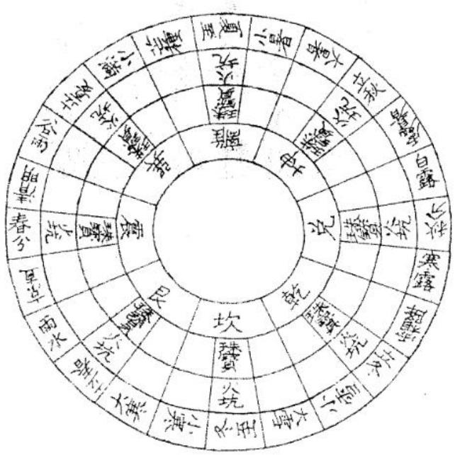

頭顛倒二十四山有珠寶順逆行二十四山有火坑顛顛倒是說爰化之次坑珠寶順逆行是說生成之大坑殊賢生成之火坑珠實近在左右度化之火坑珠實近在前後云右之火坑珠寶生成已定前後之火坑珠賢度化隨時所以為人作事總要行得正做得中便是珠寶倘有偏心不正見利忘義則陷入與火坑矣明比則火玩爰為珠寶之用矣

審龍定向分金圖訣

審龍出脉細心詳天地人兼左右看九個分金挨內外三回定向傍中央龍有工出脉有三來專向三取執定三才

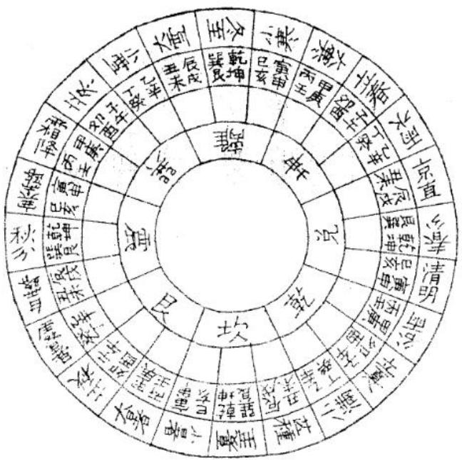

前兼龍神前兼向聯殊莫相被後兼龍神後兼何排定陰陽算

前兼龍神陽龍也後兼龍神陰龍也陰龍相兼有三出陽龍相兼有三來三來者左中右三出者右中左以左中右評十道以右中左定天心以定乘氣之中正以足福之準繩此葬法之精微乃地理家之秋要即以不葬吉地而不發者亦有發而不均者甚至乎不發而解房者皆乘氣不中正故也

依龍立向分金圗訣 增 解 向首分金要合龍 陰陽二氣貴相通 先察三才觀透地 還從天際認虛空

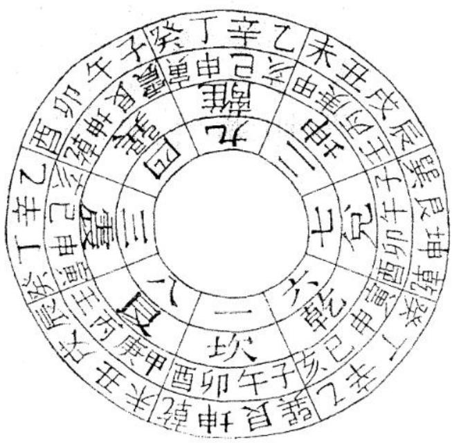

此格龍主向消納配合之被法若龍犯剝雜則以水救之另自有訣以三大卦為主以夫婦圗分金執此亦入用矣至入神入化則非研究諸圗不可

此三元配合文母與前兼後兼盡在於此矣雖然亦豈易言哉今人讀得寶照經數語則特蔣盤而稱三元地師可矣可恥之甚也此圗同前較為明白

玖離水火交媾圖訣 先天爰化後天開 南北東西一路來 坎離中宮通九竅 乾坤逐位合三才 水火既濟北去南來 坎離合氣妙應三才

坎離水火中天過龍池移帝座

兩句上下同義其妙用在中天中天者中五也若非中五不能上行下濟若非中五不得媾合坎離所以天地萬物逢五則通逢五則達逢五則爰逢五則化逢五則生逢五則成逢五則動逢五則靜逢五則富逢五則窮此足見坎離水之中天過一句皆得中五而行爰化得中五而成雌雄者也

倒排父母子息圗訣

倒排父母是真龍

子息達天聰

倒排者卽顛倒顛也大五行 作用全在顛倒此圗粗視之 合十而己精求之八卦對待 卽坎離交媾

此訣在夫婦着眼

挨排九星元運圖訣 坤壬乙巨門從頭出 艮丙辛位位是破軍 辰巽亥盡是武曲位 甲癸申貪狼一路行

此扭轉圗乃挨星大作用。用斷禍福無不奇驗蔣公已明明說出但非如俗傳隔四位扶排者

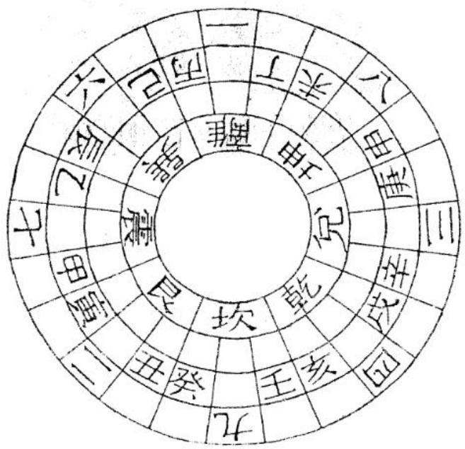

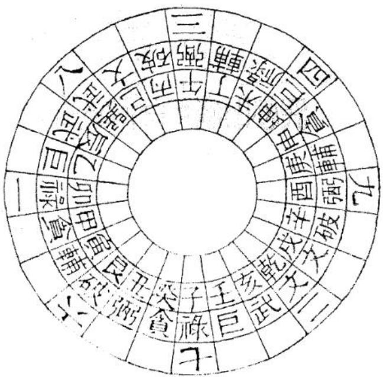

分布四十八局圖訣

二十四山分順逆共成四十有八局五行卽在此中分祖宗却從陰陽出陽從左邊團團轉陰從右路轉相通

內癸亥四柱甲戌四柱挨考政。從源頭起便知屬何五行。

五星配出九星圗訣此圗同前人謂一個排來千百個不是說五行四柱乎敢問星辰流轉要相逢又着實是那一個相逢善讀辨正者固如是耶

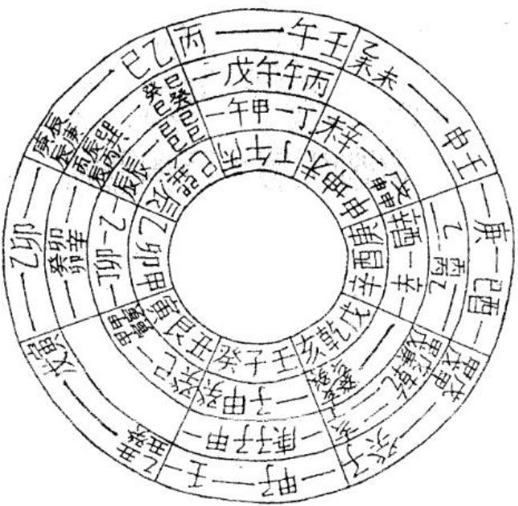

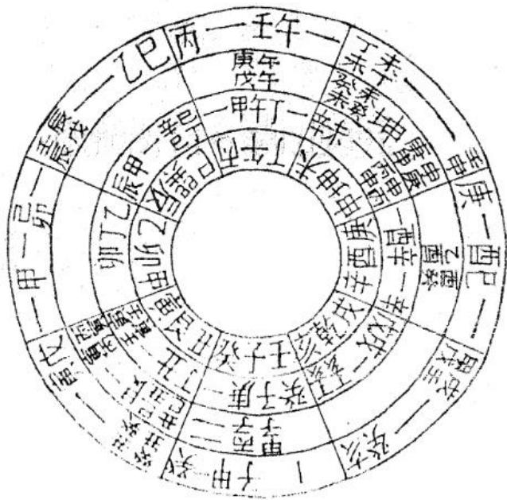

一個排來千百個莫把星辰錯五星配出九星名天下任横行九星雙起雌雄異玄關真妙處本向本水四神奇代代着緋衣

曾解一個即是星晨星辰部是一個指帝星而言也帝星限時亥有四柱皆以帝星歸垣為主帝星度化無窮故五行四桂有臣求立故云一個排來千百個也五行金木水次土實然貫九星內兩三三星配出九星也

雌雄交合玄空圗效 雌與雄交會合玄空雄與雌 玄空卦內推山與水須要明 此理水興山禍福盡湘關明 玄空只在五行中知此法不 須尋納甲

一遁入玄空之圗一宮是一卦交媾一圗已該八卦下卦交則卦卦交奇絕 多多多

青囊開闢首云獨公養老看雌雄奈世人不察竟不獲尋也

冬至順行甲子圖訣 順行甲子順天然 天地生生一氣連 反復循環排六甲 流行終始運三元 順行甲子生出天然 貧而至弼一氣相連

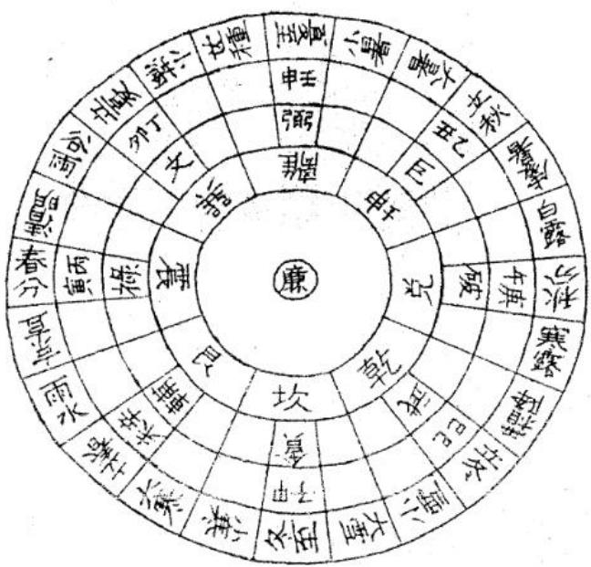

青囊補註云排六甲以六甲之紀年審運也冬至順行甲子是說生數生數者一二三也四五六也七九也三個一二三也所謂一生二今二生三三生藥物之玄服是也冬至甲子是為生數之始所以不得不順數也如不順義其生矣不生則不成矣不生不成則鱼以見八卦九星矣此便是順行甲子之本末自有逆行甲子之根苗

夏至逆行甲子圗訣逆行甲子逆行天反復循還數倒顛八卦九星皆換象一成十道各歸垣

玄空妙用全在倒顛 生成十道各目安然

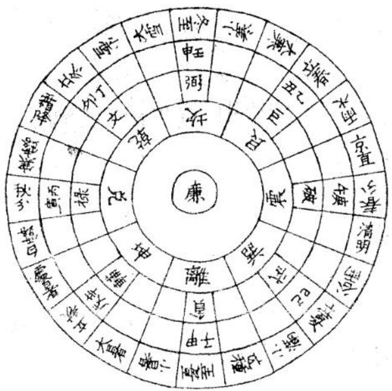

夏至逆行甲子是說合數合數者二五合一十也二合八也三合七也四合六也五合十也夏至甲子是為合數之始是以不得不逆數也如不逆數則無以見起止分合如無起止分合則無以見变化生成所以生數卽是分數成數卽是合數故凡天地萬物不分不爰不合不化不分不生不合不成乃一定之理也

## 順排六十花甲圗訣

以六十花甲换二十四山猶乎用六十四卦配二十四山氣運也一年之氣運在此千年之氣運亦在此部天地始終之氣運亦無不在此精於卦者知之精於大五行者不用二三推測亦能前定此行運相逢圗也兩掌明白並無隱諱可一望而知者同宮分起兩路行至止處如水之交會亦天然也

逆排六十花甲圗訣 青囊補註云排六甲以只甲换紀 年審運也用三週花甲分為大運 花甲一週分三小運極為準驗此 圗干支到處星亦在焉以星看吉 凶禍福以干支論年月日時更加 靈驗

數有乘除星隨移動妙合妙合增鮮陽生於子生則從順陰消於午消則從逆運氣循還天地自然之理

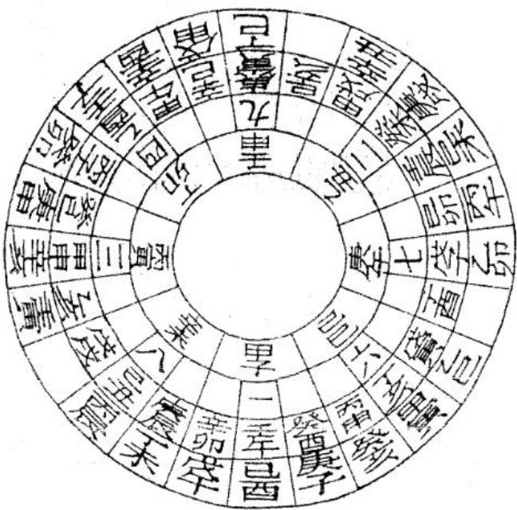

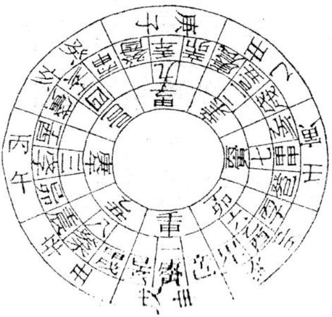

七星打刼少人知妙義終歸兩遇時禍福均分憑善惡吉凶判斷有公私七星打刼却有疎親吉凶判斷善惡分明

北斗七星去打刼

七星打敏之義卽如比肩兄弟相過之義也其兄弟也有假財之神故曰打刼豈非凶義乎然而員氣也竹以七星打兄弟也真兌弟者同骨肉假又弟節養非出禍福天玉經云但之義全在分别兄弟真假以取篋馬吉曰社初天一看太歲是何神立地見分明

離宮相合應驗圗訣

離宮相合說名知 兩個金星並體時 細辨陰陽分順逆 詳推天地合干支 雜宮相合應驗隨時 循環二至天地干支

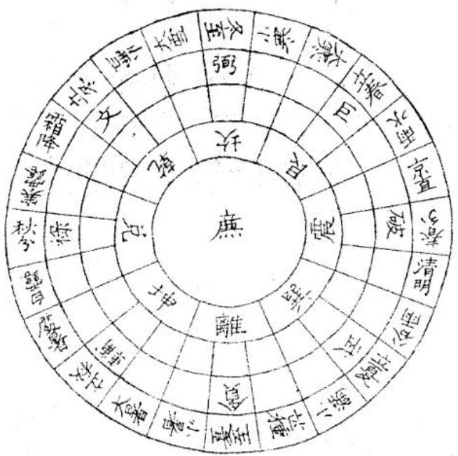

離宮要相合

離宮相合之義郎男女夫婦相逢之義也卽彼此和好 之義也豈非吉乎然而夫婦之義有真夫婦也有假夫 婦也真夫婦在十道之內假夫婦在十道之外如果真 夫婦則全吉矣若假夫婦則藏凶矣所以離宮相合之 義全在分別夫婦真假以取斷驗吉凶禍福

陽局順相逢數圖訣

干支重化是相逢天地循環九氣通坎位神交三極裡離宮數合一般同

千支重化故曰相逢循環天地九氣皆通

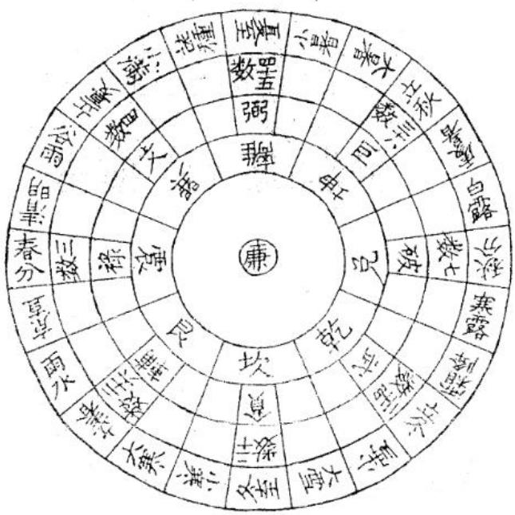

寶照經云星辰流轉要相逢

陽順相逢數者郎北斗七星去打刼之數也 九星生成之數也三卦挨星之數也是由一 起而至九止貧巨祿文廉武破輔弼逐一族 去為順為陽相逢數也如上允甲子起坎以 六十花甲順排每逢是年與天地干支同宮 位者卽相逢數也其年可决斷吉凶禍福靈 應如神

陰局逆相逢數圖訣 雙星聚會得相逢 三卦神通自有功 禍福不靈虛假地 吉凶應驗果真龍 逆數相合順數相通 雙星聚會主客重逢

有囊序云有人識得陰陽者何愁大地不相逢 陰逆相逢數者卽離宮要相合之相逢數也卽九星 度化之相逢數也是由九起而至一止解輔破武康 文祿巨貪逐一挨為逆為陰相逢數也如下元甲子 起離亦以六十花甲順排亦每逢是年與天地干支 同宮位者卽相逢數也其年可决斷吉凶禍福靈驗 如響

此八卦相逢之數數至所指處是幾數便知幾年幾月出何等人物事情應驗預先年月增解一乾至震五十二數至離二十二數坎至巽四數兌七數艮至坤十三數震至乾廿二數至離五十二數巽至兌四數坡卅四數離至震六十七數乾七五數坤至艮六十一數兌至坎六十七數兌至巽七十數

文破陰局圗訣 增解乾至離六十一數至 震四數坎至兌六十七數至 巽五十二數艮至坤六十一 數震至離六十七數至乾七 十數巽至坎二十二數至兌 五十二數離至乾四數至震 七數坤至艮十三數兌至巽 二十二數至坎四十三數 北斗七星左旋 坎艮震巽離坤免乾 艮震巽離坤兌乾坎 震巽離坤免乾坎艮 巽離坤免乾坎艮震 離坤免乾坎艮震巽 坤免乾坎艮震巽離 兌乾坎艮震巽離坤 乾坎艮震巽離坤免 增解冬至后陽 局坎宮起甲子 左旋已丑排至 艮丙寅排至震 丁卯至巽戊申 至離辛丑至坤 庚午至兑餘卦 倣此此在癸艮 寅甲卯乙辰巽 已丙天龍向砂 上峯岳上著眼

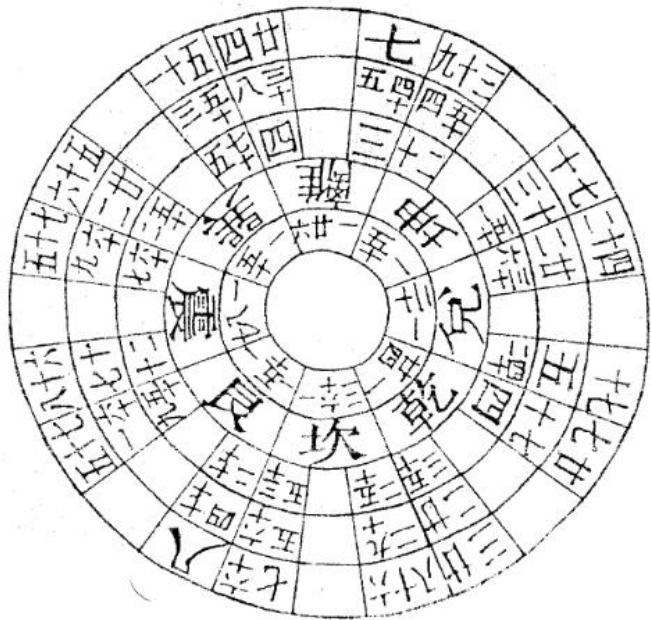

北斗七星右旋圖訣

離巽震艮坎乾兌坤 巽震艮坎乾兌坤離 震艮坎乾兌坤離巽 艮坎乾免坤離巽震 坎乾兑坤離巽震艮 乾兌坤離巽震艮坎 兌坤離巽震艮坎乾 呻雖巽震艮坎乾兌 增辭夏至后陰 局離宮起甲子 右旋丁亥排至 巽庚年到震辛 丑到艮戊申到 坎丁卯到乾丙 寅到兌己丑到 坤餘卦做此 此在丁未坤申 庚酉辛戌乾亥 壬子龍向砂水 峯上看眼

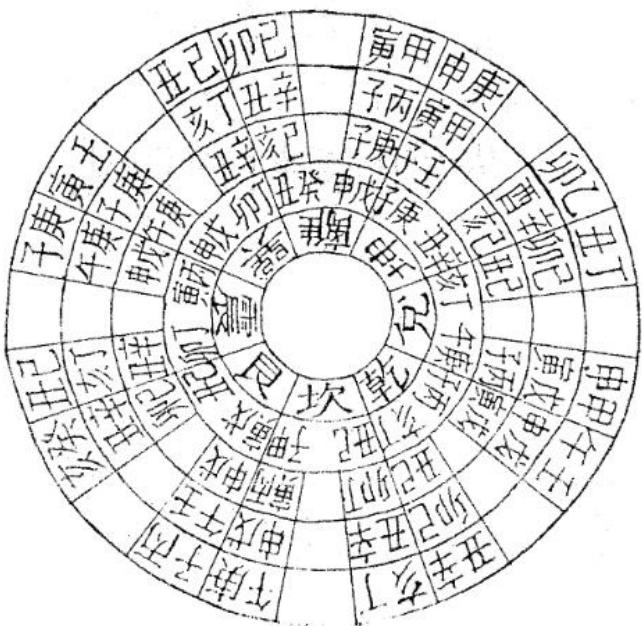

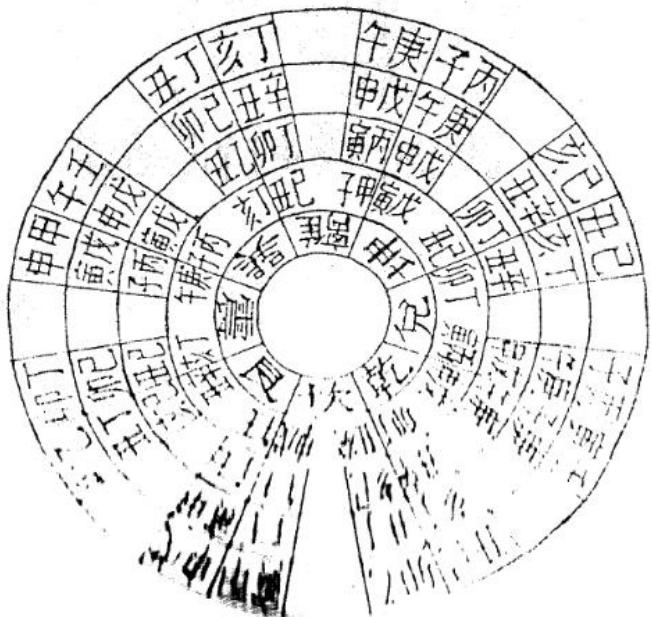

乾坤爰化萬千端 天地氤氲氣一團 八卦九星皆動靜 五行四象共盤桓

乾坤爱化妙氣一團五行四象合共盤桓

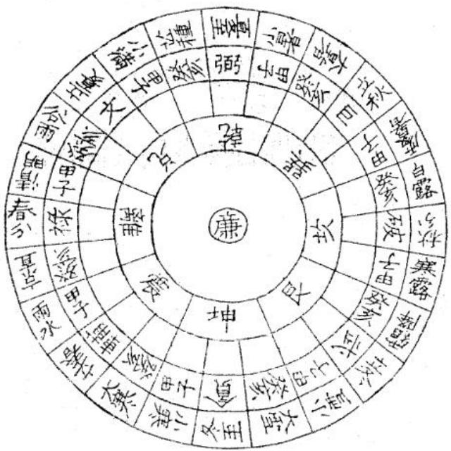

惟有挨星為最貴洩漏天機秘

最貴者帝星也族星者即帝星之行運也滿數者乃席星之極數卽天地之合數也極數者九六五百四合婁者九九八十一也前者聖賢有言此一時也彼一時也五百年必有王者興豈非洩漏天機乎所以五百四年天地有此一爰而萬物亦有此一爰故凡天地萬物生成变化總不出挨星範圍

天地生成規矩圖訣生成地理合天文氣感神通兩儀分夫婦相交應閉戶雄雌未度不開門雄雌合氣夫婦交光。乾坤下種天地色含

天地規矩內柔外剛自動自靜自行自藏參奇合偶並體陰陽無分清濁混沌玄黃外成手足內合心腸分明四象配合五行一橫一直自作紀綱生成十道爰化五皇東南西北統理中央自中自正自圓自方至窮至富至善至良五十五數兩画推雄雌合氣天婦交光乾坤下經天地色含三春建業十月名揚時通運至子母分張起止分合動靜循理一團妙氣天地文章

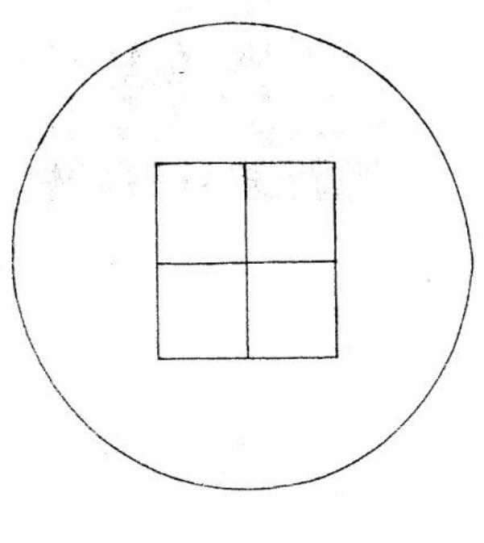

曰月麥化方圓圗訣 乾坤爰化地開天 子丑寅通一氣連 順逆陽陰分畫夜 往來日月合方圓 支神厲地干神属天 生成規矩爰化方圓

日月方圓即是天地規矩天地規矩便是日月方圓靜為天地規矩動為日月方圓化為天地規矩度為日月方圓天地規矩為日月方圓之體日月方圓為天地規矩之用體在東南西北之內以成十道用在春罡秋冬之中以定天心所以吾書專謂天心十道作用盡在十道天心是以兩圗一氣相連體用相並不可以相離者也

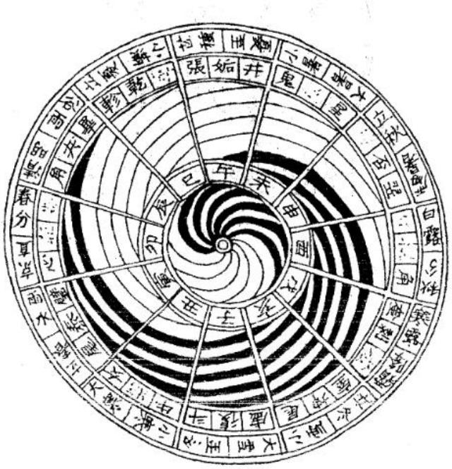

朱雀發源挨星圗訣扶星起例乙度伸北極通天化九辰逆步離里知妙義順行坎位見精神

順往逆來五星化始生入尅出九星化成

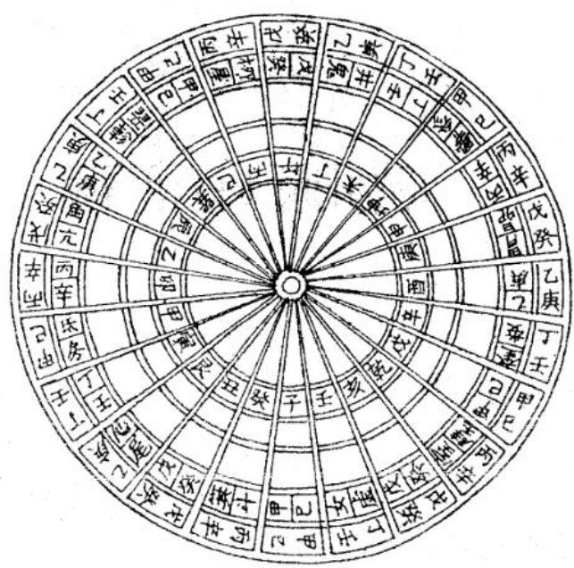

朱雀發源即是帝星起例帝星起例便是朱雀 發源帝星為朱雀之體朱雀為帝星之用體在 紫微垣之内用在太微垣之中所以朱雀在南 其本體實在北是以紫微宮發源為揆星起例 挨星者乃帝星之行運起例者即朱雀之發源 也一生入一尅出生入者離宮逆步尅出者坎 坎位順行順行火金木土水步火土金水木 此卽帝星行運之義五星配九星之義也

合祿馬合官星圗訣

合祿合馬合官星本卦生旺尋合凶合吉合祥稀何法能趨避當看太歲是何神立地見分明

生旺乃全書之作用切勿忽過此訣最秋催福極神速極奧妙亦極容易拳凡一百二十家無過於此

祿馬官星生旺圗訣

用法最重生旺在生旺之位得生旺之氣則妙極而福應立至矣另有二十四山圗此期事事可用

增解當令者為旺將來者為生方去者為衰去己久者為死挨星妙合天心圗訣用法同上前刻總指一圗今分而為三原無二義但覺醒目三圗規矩全憑修者在人諸訣皆然

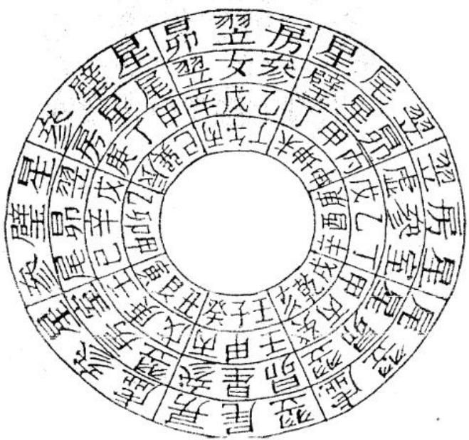

天帝太陽合貴圗訣此圖用處極廣日家尤要其陰陽平排交互配合妙出天然至矣盡矣蔑以加矣得者寶之天官賜福貴人圖訣天官起例諸君知十個干加十二支數至陽陰交合處還歸曰月顯明時天官上殿日月合明陽陰合氣賓主有情

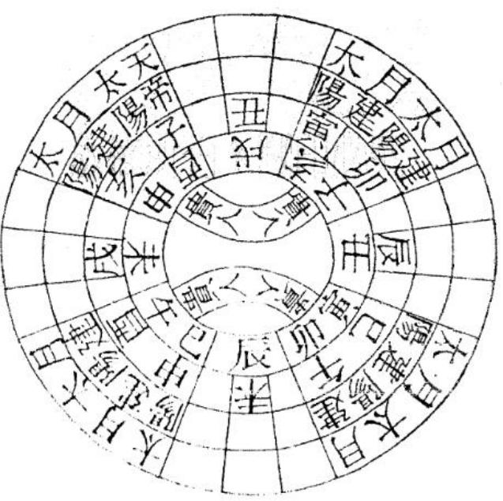

天官起例卽丙子乙丑甲寅癸卯壬辰辛巳庚午己未戊申丁酉丙戌乙亥如貪狼巨門用事以甲寅己未為進福破軍左輔用事以庚午乙丑為進福祿存武曲用事以丙子辛巳為進福文曲用事以壬辰丁酉為進福右弼用事以戊申癸卯為進梅內有五福堆貴最為吉格更有五福堆祿亦上吉拾也此說四垣中之天官星賜福之真貴人也

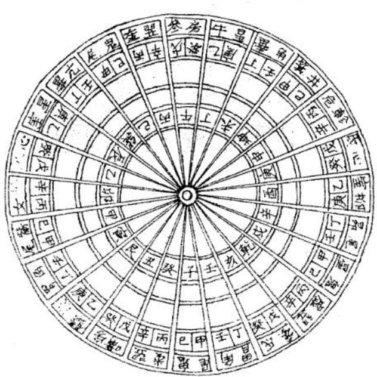

官進祿八位圗訣祿星八位十分清天地神通自顯明日月交中知妙義陽春到處見真情

祿星八位十字分清干支配合自有真情

祿星名義公同玄空用法却異最貴者以官合祿至富者以祿合馬皆要合在本卦謂之合祿合馬合官星本卦生旺尋是也如貧狼巨門用事以甲寅甲午為進祿祿存武曲用事以辛酉辛巳為進祿破軍左輔用事以庚申乙卯為進祿文曲用事以壬午丁亥為進祿在溺用事以癸巳戊子為進祿此卽四垣中之倉庫星應天心十道之真祿星也

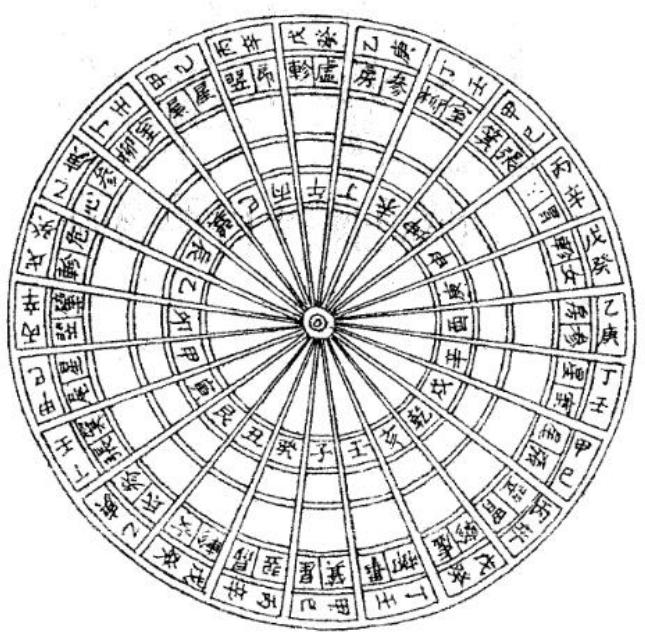

上金往四相僵註馬化龍駒天地春三關四路顯星辰寅申會合知虛實巳亥同參見假真馬又屬龍動性皆同金街御殿主僕相逢

馬郎寅申巳亥無主乃是野馬帝星升殿歸垣有主方為真馬所以四垣帝宿正是四馬主人如天市垣以辛已為進馬少微垣以乙亥為進馬太微垣以戊申為進馬紫微垣以甲寅為進馬至於四垣分宮各自有馬各有挨星類推乍明細玩本圗更為易見總以主人得位為身上說四局中之複祥五妙中之瑞氣應天心十道之真馬也

天乙貴人上殿圗訣貴應玄空畫夜清千支配合顯聲名陰陽兩路終非據夫婦雙關最可憑官星貴宿畫夜皆清離通坎氣自有真情

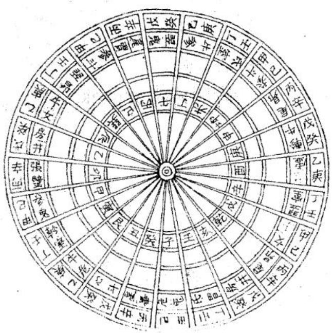

合天心自然進貴通月氣自顯星辰却有真偽之別並無畫夜之分如貧狼巨門星體用事甲子已丑甲申已未為進貴祿有武曲星體用事丙寅丙午辛酉辛亥為進貴破軍左輔星體用事乙丑乙未庚子庚申為進貴文曲星體用事丁巳丁酉丁卯丁亥為進貴右弼星體用事癸巳癸卯癸丑癸未為進貴此說四垣中之正官星應天心之真貴人也

七坤生成洛書圗訣洛書滿數顯乾坤八卦圗中化九天北極生成南極體紫微爰化太微垣洛書兩個同共九天先本後末一氣相連

洛書道理止一吾書分而為二不知一卽是二二卽一也凡讀者知所先後則道理明矣如先之洛書乃天地亥化後之洛書是乾坤生成先之浴書是天地分用後之洛書是乾坤合體光之洛書為乾坤創業後之洛書是天地成功先之浴書是由本而至末後之洛書是由末而復本皆出乎天理之自然未有一毫私議者也

治書爰化河圗圖訣 河圖兩個細推詳 本末根苗一樣裝 四象中央同臟腑 五行內外共心腸 河圗兩個道理一條 五行四象本末根苗

河圗道理公同吾書解法畧異使後學者心目了然以見吾書解法簡切所說道理真實不虛以見道理之極深以見道理之至淺也淺者一也源者亦一也兩一之中無窮爰化道理無不具備前者聖賢概己發明無如世人多不領會程子所謂始言一理中散為萬事末復合為一理豈非云河圖之妙義乎所以吾書圖訣以河圗衰洛書為始以洛書化河圗為終以河圖爰洛書為本以洛書化河圖為末其餘各圗作用盡在本末始終之中大學所謂物有本末事有終始知所先後則近道矣所以謂之大學大學者大人之學也豈可與庸人而語哉

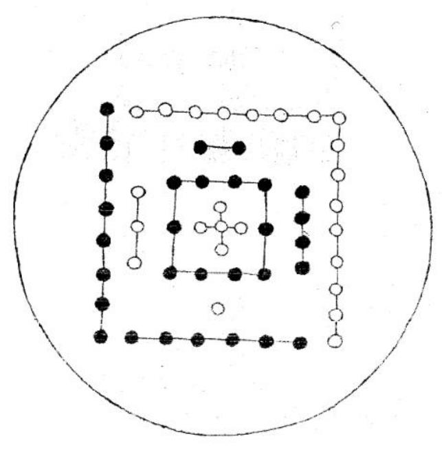

增著天元龍歌圖訣 增解一天元歌云取得輔星成五 吉山中有此是真龍此從龍上取 輔星以補龍也天元兼收輔弼是 一元而兼兩元龍力更厚發福愈 長取輔星如子來脉兼癸卽從癸 倒排父母癸與巳交為夫婦又為 父母卽在已起貪狼順揆至子宮 卽輔星也如午丁卯乙酉辛做此 增著地元龍歌圗訣 增解地元歌云甲庚丙壬為 正向脉取貪狼護正龍此從 向上取貪狼以補龍也聚貧 狼法如辰龍坐丙向壬卽從 壬向倒排父母壬與辰交為 夫婦又為父母即從辰起貪 狼則貧狼卽在辰龍也若甲 未庚丑丙戌倣此

增著人元龍歌圖訣增解人元歌云乙辛丁癸水來催此從水上取貪狼以補龍也取貪狼法如寅龍辛水卽從辛倒排父母寅與辛交為夫婦又為父母卽在寅起貪則貪狼卽在寅龍也若乙申癸巳丁亥做此此天地人龍向水分三圗實是活法各立一圗舉一可以反三

增 坎離交媾掌訣 坎離水火中天過 龍墀移帝座又曰 泥鰍落汾躍龍門 渤海便翻身

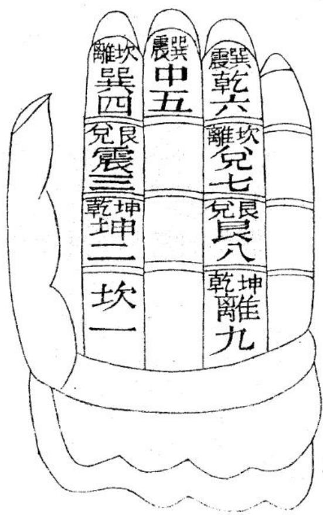

增解坎是坤離是乾水是坎火是離離東坎西日月 出入坎離故有取乎坎離先天之乾坤郎後天之坎 離其先後陰陽配對奇極妙極粗視之是一四七二 五八三六九精求之則天地氤蓋其氣化神妙實葉 言立成掌訣以便易曉其法從坤起乾順輪九宮坎 離一起一落點至震中艮所謂坭落汾也至巽坤 離所謂躍龍門也挨盡復在離宮逆輪轉前謂涕海 翻身也此舉坎卦以為例餘可類推

增 春 立向分金掌訣陰陽配合要分明審定玄空認九星辨別三才知入氣交光夫婦見真情

增解寶照經云龍真穴正誤立向陰差陽錯悔各生幾為奔走赴朝廷纔到朝廷帝怒形時師不曉龍何向墳頭下了剝官星此以知主向分金認龍點穴而後最為緊要地理固首重峦頭卽得吉地而向首分金或陰陽差錯未有能發福者或有發而不均發而吉凶參半甚且發而敗絕皆由立向之誤也地理家立向多從五行起長生為消納或從坐向起長生或從來水水口作某局起長生或有以辰戌丑未為四大水口如乙丙交而趨戌辛壬會而聚辰之類或有謬難以盡述皆未曉龍何向之龍字耳所謂龍耆非以山為龍也若以山為龍則無山非龍矣夫龍也者天之陽氣也看金龍卽看此陽氣看雌雄亦看比天氣與地氣也今將看雌雄以立向分金略指而言之壬子癸甲卯乙辰巽巳未坤申是生向丙午丁庚酉辛戌乾亥丑艮寅是成向蔣公玉尺辨偽云山隴平壤皆有一定之穴生成之向卽言此河圗之生數成數也青囊補註云地有至陰之氣以招攝天之陽精是說雌雄交會之處入氣是雌金龍是雄先看出水以定入氣所謂水對三必細認蹤也次看卦掌中起中止弦起弦止輔弼仝宮以貪巨祿文藤武破輔為消納者更有與翻卦掌取方位全此吉凶爰其名目以生五延六禍天絕伏為消納者有以庚丁坤上為黃泉坎龍坤兔為八煞者又有以癸兼丑寅兼甲等類為出卦者近復有以張心言六十四卦盤定向為得真傳者不知張氏將希夷先生性理大全卦圗加於蔣盤之內已見節外生枝而其盤內麦出大爻與周易六爻爰化懸殊尤為畫蛇漆足用以覆驗名山古墓珠無確據諸書說理種種錯金音屬某方其向首分金坐某宿度年沒身方六曰蒸然可坐而定知此則天心在此十道在此而結穴亦無不在此矣今之立向牽線者果能見及此否且未用羅盤之先其分金之深淺果有定見否或問之師曰立向者皆言分金請問分金二字是何說法師曰分金二字不下片言孺婦可曉何業此道者尚昧昧也或不喻又問曰且分金在羅盤耶抑在山頭耶師曰先在山頭後用羅經蓋頭理氣合而為一者也或曰唯唯乃默喻於無言而不復問新增地理辨正圖解掌訣終 陳鳳招撰

<!-- 原书漏识别页：doc015 PDF 第 53 页；早期空白判定已纠正；高清原页图 -->

