# 地理人子需知（精校版）

> 来源：地理人子需知-精校版.pdf

## 精校地理人子須知

重刊人子須知資孝地理心學統宗凡例

一是編為人子術非為術家設故凡不傳之秘一敷陳口訣而作詩歌以為不記誦便一是編惟務通俗俾易知識初無意於組織文辭以絢觀美是以直叙其旨而不嫌于鄙詳述其奧而不慮乎繁即於前後之重複辨證之瑣屑與夫照應不齊言論膚淺俱弗暇恤耳一是編所收諸名地圗不過為釋疑設耳故于緊要相關處援古證今具圗詳說以發明之其間或因論龍論龍穴而畧于砂水或因論砂水而畧于龍穴惟所重處特加詳焉其他莫能悉及益寸箋半簡間墓數百十里山川烏可兼備哉闇者或病其不類緣識見不同耳祝觀物先生云圗圗圗模糊模糊復模糊一人摹一樣十人畫九圗信哉善觀者當自得其妙又安可按圗而索驥一凡諸名地圗皆予兄弟足目所經涉者或名師扦點或課驗不爽或發越確應必有明徵可為法則者斯

一凡諸地圗必著其土名山向某師所卜及詳所出人物官爵不以瑣屑自嫌者固所以徵其寔跡亦欲人子因此可以索微探頤得意于筆舌之外毋以是而反啟疑議焉一凡引用諸名師語或稱姓氏或稱書名或稱號或稱字或止稱某氏某公從便也其不著者闕疑耳多吾鄉者考據切寔云

一凡折衷諸說是非亦非據于巳驗仙跡及名師議論理之長者取證也一凡收諸名地圗既有敘說矣又間有補義釋義及有售傳疑者或以取證或以申明非瑣也一凡設龍穴砂水諸圗式立法有不得不然者但不可執泥耳生山不與畫山同固有山水妙處雖良工不能施其巧在智者觸類而推可也

一名地有遠至數百年後而方有福應者有近只數年而即有福應者世俗多泥塟地後所生人方能受廕即此太逑太近豈不荒唐哉予兄弟初嘗深疑久而徧徵灼然不爽蓋驟發遲發亦猶悟學有項門漸門里人子頁如凡例

之義漸發乃常理共知不必辨其驟發者如陶氏之牛眠穴王氏之折臂三公地固已彰彰明稔于世不可謂無此理也茲于編中所收諸地惟取其真是應廢者不以年代遠近拘特書諸此以告觀者毋疑焉不佞嘗謂地學須致力三多而究心地書不與焉何謂三夕多參明師則傳授真而所聞博多觀古格則所見廣而是非明多經窀穸則歷練精而真見定地書固巳多覽然紙上陳言又在三多夕之外矣且人子安能盡此三多故于是編多載名圗俾人子精加紬繹虛心詳究三多在其中久之自有心領神會豁然貫通而俗師淺巫莫能誑之不于慎終之者有補矣夫

一地理家諸書繁浩條緒多端真膺並列未易悉辯緣督仙翁所謂得訣歸來好看書確論矣茲於編中撮其精當者取以質證或摘一二句或米一二節或兼摭庶人之言或備錄一家之說或斷章而取義或括以為辭意在發明非敢務博也編中曰右曰按曰巳上曰補議皆理有未盡而復申明之特變其發語之辭耳 編中曰右曰安曰一上曰浦義皆里月未盡而复日月之煞七吾之年

德興徐維志維事兄弟蓋學云少為邑諸生遭家難弃去治形家言德興故多堪興家見以為未慊於志更走四方求勝己者而師事之所歷燕齊吳楚閩粵名城大都偉麗之觀絕嶂幽壑猿鳥之徑遺墟荒隴狐兎宮皆窮躋翔覽然後巳凡三十年而業成著書曰人子須知學士大夫雅好之造請無虛日庭中羔雁無群矣先通奉公居王人喪取其書置几上手校讐書弊墨渝弗釋也無何先通奉不祿諸孤藐焉懼不足以襄大事則迎致維事來與計之君故儒者恂恂若不能言比登覽即千里在指顧中聚訟可不衆莫能決君徐出片語而定人人遜弗如也間嘗請曰述兄弟三十年功緒盡在斯編矣今又十年而聞見日益太史公幸為我忠臣不佞謝不敏會君有郢曾司空聘而維志適從荊南來遞出所新得相資損益殆半司空遂以付剞劂焉而謂不佞與聞首事屬序以遠其傳不佞竊嘆夫術業之難工而盛名不易居也君恒言家世受尚書學古有獲多聞事建始吾求堪輿于書而不合也自用則小好問則裕中吾求之人而不合也晚而求之古今墓宅成敗已驗之格而合者十六七矣夫兩戒山河首西北而竟東南其形勢利便豈一端而巳自吾涉淮北渡漢南以窺中原秦蜀而驗吾格以前代名家擘畫無不合者矣胼手胝足勞心焦思其成之難如此君兄弟名藉甚而忌者之口亦無所不至初以不佞招入郢人或詬曰是商顏郜首而儒衣冠者英雄欺人耳市虎杯蛇轉相扇惑君幾無以自解斯名為謗四矣嗟夫無論君所執無論今之人漢子雲氏作大玄羽翼聖經而舉世莫能知獨桓譚其辭謂五百歲而後興老氏不云乎知我希者貴彼其之子雖戶說以眇論終不能化復何有於不佞之言君第藏之名山可矣

賜進士出身亞中大夫河南布政使司右政前陝西按察司副使奉 勅提督學校翰林院 國史修撰雲杜李維楨叙

重刊人子須知序嘉靖辛酉春余從京邸會星橋金太史談堪輿家書不下數十百種類皆繁雜互相牴牾仁人孝子一旦當大事悲傷慘怛之餘取其書而覽之無所適從往往以弗克盡心為憾惟德興徐氏兄弟所著人子須知一書會諸書而折衷之足以破羣疑當大事也然余聞其言未見其書比自商於致政歸訪其書於坊間兩見刻本深嘉二子用心之當而服金太史之言非誣惜字多訛舛欲為厭觀也辛巳冬雲杜李太史為尊人方伯公卜地乃移書中丞王公為訪二子來雲杜時伯子巳入閩越迎其李子來既襄大事余後自太史廬迎季子及高第弟子涂子于郢中亦為卜地計見季子儒雅士籍逈異俗師相與遊處幾一載暇日出手錄善本示余未幾伯子亦自閩越至更相是正者久之余因念茲會不偶所著述已精從而校定人梓使海内之仁人孝子覽之而從事庶無弗克盡心之憾矣乎

萬曆十有一年癸未孟夏月望日郢中陽白居士曾璠子玉甫譔

舊序江右徐維志維事氏伯仲著資孝堪輿書曰人子須知因通家仰湖費大人馳請余言適客有在座者遽瞿然曰人子之所當知者豈惟是哉且孝亦未易以言也若大舜終身之慕武周之繼述曾參之養志斯孝矣顧屑屑於一藝一能謂之曰孝吾惑焉余解之曰人子之於親也固當無所不用其極況地理切於送終以當大事者乎傳曰事死如事生苟於其親之没也置蟻泉沙礫中無異委壑孝安在哉是故風水之說固不足信而厝親之舉則所當重也生人之禍福不足計而化之者之安危則所當慮也曾謂舜之大孝武周之達孝曾孫之純孝厥念乃不逮此與誦夫子宅兆之訓程子五患之戒則地理固人子當知之切務而非彼一藝一能者比也謂之曰資孝亦宜矣且觀其書分條析類明切該博闢諸家之陋習啟天下以孝誠信有浦於世故者不可以其行而忽之也吝惟唯而艮因書以歸之

舊序世所論堪輿家率以相地之術易視之夫堪輿非術也昔神禹敷土隨山刊木因九河之勢奠厥民居公劉之遷都相陰陽觀流泉周公卜洛營周居於洛邑自古重之久矣自左僊著龍經郭景純著塟書俚談曲說之士遂各以所見售世流為藝術則世之易視之也固宜夫字宙亦大矣術家者既不能長騖萬里窮章亥之所步復泥俚談曲說不取正於大方家如執蹄涔議絳虬安可得乎論法象者莫辨于易其曰天地定位山澤通氣夫位有定而氣寔通焉絪縕磅礴游魂靈怪氣也蒸為風雨應為列星流形於山川草木亦氣也氣也者載天地而浮之也是故山氣多勇澤氣多瘖谷氣多痺險阻氣多壽郭景純曰啟陳發新湖海拱辰左僊以北戒山起于關五支極之于南珠山自右支極五嶺其言曰山行有斷脈不中絕山澤通氣之說也世之業堪輿者能知之乎夫建都立邑載諸經者吾無論已郭景純論塟法曰塟者藏也乘生氣也世遂以氣休咎論禍福不揆塟義所自起孟軻氏不二乎且比化者無使土親膚於人心獨無校乎吾以是知塟之

起也益仁人孝子之心也不乘生氣避五患萬一奪烏鳶而飼螻蟻其與委溝壑者何殊哉夫善愛親者疾 必擇名醫塟不敢以付庸術蓋慎之也是故乘生氣避五患以寧吾親以畢吾終天之願此仁人孝子所為 心也非徒以禍福論休咎也彼堪興者倘能以其所嘗試者藏遺器于造化而畢吾仁人孝于之心其道亦 大矣哉世烏得而易視之吾饒有儒生徐維志維事伯仲嘗輯堪輿書曰人子須知就于余閉其議論該連 發理精詳會百用于一原析貳疑于百氏真足以挽俚談曲說而歸之正者因書此以序之云 賜進士及第南京國子監司業前翰林院 國史編修浮梁星橋金達撰

予謝仕二十餘年于六經外百家之書靡不探究惟庖犧氏之卜筮岐黃氏之醫約郭景純之塟法誠可以利天下者皆得謂之仁術宜乎其河江屢變浮雲猬狗而三術之術千萬世者不廢也益制作之美則愛愛則傳人情理勢其四然與吾邑徐君少峰仰峰二難握其所譔資孝堪輿書出以示余皆精神獨得之妙也余閱而繹之見其廣搜乎天下山川脈絡之源旁及乎遠近名家仙跡之式參之以古先鴻儒大方家之緒論摹寫乎伍星變換不一之形體逐節斷以亡意一理貫通而宜叶乎人情誠有深得夫晉室明賢乘生氣之肯綮者要皆明切簡易暢于辭華譬之翰墨家人稱為布帛菽粟飲之而不厭者覽之易入習之易趨允矣通世之實訓可愛而傳也且其教人安居以當大事舉所珍重而得隆其孝示所勿犯而得全其仁端持身之德本衍國家之風化者由此而出矣矧二君以頴敏之資有聲藝行可大鋪張而乃幡然浮雲軒冕放情山水發其所蘊以資孝道于天下後世是二君雖遯世而尤闡達者及物之事功謝上蔡所謂幾枉一生之根二君可免也猗與休哉一時賢士大夫各出金石固巳有公論矣又奚余之喋喋乎雖然智者作法愚者咻焉賢者更制不肖者拘焉安得天下孝子慈孫誦君之書超然陳迹之外通其巧於心目之間不遇以書而遇以目不遇以目而遇以神洞其真而契其妙以廣二君仁孝教天下之本心此二君未露之美意也余固因其請而并以及之二君生同一乳宋太師忠愍公裔理學秋谷先生八世孫銀邑世家二隆慶己巳八十四歲叟眷張琨書于銀麓精舍

古昔聖人握造化之樞探陰陽之竅仰觀俯察以闢天文地理之蘊故璣衡察而象緯之數莫爽夫惟坤厚載物山澤通氣冲和鬱靈微妙鮮測粵自遷岐相洛時其陰陽而風水之說實肇其端三代以上遐哉邈矣漢晉而下哲人繼踵其著名于世有若郭卜曾楊吳廖賴傳者稽其授受有巒頭天星之傳觀其著述有青囊塟經等作歷世漸遠敷詞益繫然皆逞其臆說狃于偏習而未能會其全也饒君徐君伯仲少負馳頴舉芹洋因襄大事雅志山水而于堪輿諸書研究底蘊巳自諗曰是局間見未悉大觀乃遍歷寰宇日與薦紳諸大夫遊凡名山形勝世族宅兆登覽摹圗相為印證充然有得由是厭諸說之汗漫乃旁稽博米撮要删繁闡幽彰微而凡形勢天星不傳之黏悉皆列欵圗形分條折類辭義備具殆邃乎聖人俯察之理而發前賢未發之祕者矣編成示予爰定其名曰心學統會益取夫發揮純粹而獨得乎心悟芟祛偏臆而統集乎大成者耳授吾鉛王上舍梓傳善乎二君之志也其錫類于天下之仁人孝子者厥功深矣哉厥惠溥矣哉隆慶戊辰仲冬之長至日

三才一理而天其宗乎地匪天塊然已何以效厥能人匪天蠢然巳何以效厥靈故地必曰理有以哉夫天言乎其氣地言乎其形而地之所以為地則生生之氣氣之所以為氣則生生之理傳曰天包地外吾則曰天入地中不特虛靈屬天而盡九垓之下皆天也亦微矣世之求地者苟不從事乎天則本先撥矣又安足語此稽諸古聖未有以地言者堯都平陽舜都蒲坂禹都安邑湯都毫天下之大地理歸焉迨周公洛邑之營夫子宅兆之訓二聖人豈徒然哉營洛為民民安而國安宅兆為親親安而子孫安是皆本天星察地理所謂仁人孝子之用心也故人子卜宅兆要當以安親為念豈惟求諸地哉必求諸吾靈臺方寸之大可也眷家徐維志維事伯仲少為邑弟子未幾以家難棄去因塟親不忍委庸術遂雅志山水徧遊四方歷涉歲久聞見日博乃出心得著堪輿書命曰人子須知鉛邑王上舍壽梓廣其傳徵言于予首誦十戒良契吾天特表之以為外天言地者勸若其論斷圗形觀者當自得之二君與予除沙兄友善嘗從海內諸大君子究性命學此特其緒餘云隆慶己巳端陽後三日同邑暖川南山祝眉壽譔

<table><tr><td colspan="4">重刊人子須知資孝地理心學統宗目錄 乾集凡四十條</td></tr><tr><td colspan="4">第一冊 凡例凡十三條 引用諸堪輿書目 第二冊龍法</td></tr><tr><td>論崑崙為諸山之祖總論中國之山 論山河兩戒 論三大餘龍脈絡</td><td>瑣言凡十六條 三大幹龍總覽園</td><td>附正止堂集一款雜說三段 論九州山鎮川澤</td><td></td></tr><tr><td>第三 論帝都 論中龍所結帝都垣局論南龍所結帝都垣局</td><td>歷代帝都圗并攷</td><td>論帝都必合星垣</td><td>論北龍所結帝都垣局</td></tr><tr><td>第四册 總論枝餘 論榦龍 附隨龍穴格諸圖</td><td>論枝龍 建安楊太師祖地</td><td>杭州江尚書祖地</td><td>蘭谿唐狀元祖地</td></tr><tr><td colspan="4">蘭谿唐探花祖地 承天曾尚書祖地 第五册</td></tr><tr><td>總論支龍 第六冊 論太祖山</td><td>論瓏龍</td><td>論枝龍</td><td>杭州高相公祖地</td></tr><tr><td>承天張進士祖地 附浮梁戴尚書祖地</td><td>論少祖山 論無少祖山 鉛山費狀元祖地</td><td>附建寧陳憲副祖地 論龍父母胎息孕育</td><td>德安楊方伯祖地 龍論八首</td></tr><tr><td colspan="4">我集四十六條龍法</td></tr><tr><td colspan="4"></td></tr><tr><td colspan="4">第七册</td></tr><tr><td colspan="4">論龍出身 論龍開幛 論龍剝換 論龍枝腳 論龍護送 第八册 論龍長短</td></tr><tr><td colspan="4">論龍旁正 論龍老嫩 論龍貴賤 第九冊 論龍駐蹕 論龍行止 附德興長塘諸仙跡名墓圖</td></tr><tr><td colspan="4">論龍分擘 論龍賓主 論龍餘氣 附新安朱入公祖地 莆田林婆墓 樂平馬丞相祖地 德興張忠定公祖地 第十册</td></tr><tr><td colspan="4">論龍分三勢 論龍分三落 論龍十二格 論受穴三等 論入穴十二脈 第十一册</td></tr><tr><td colspan="4">論入首五格 附建陽蔡九賢祖地 論結穴五局 論結穴三聚 總論五星 論五星之名 論五星所忌</td></tr><tr><td colspan="4">論五星之形 論五星山岡地三格 論五星體性 論五星聚講 論五星連珠 論五星歸垣 艮集凡九九條穴法 第十二冊</td></tr></table>

<table><tr><td>江山王氏祖地 第十五冊 論穴忌 休寧山斗陳氏地 德興祝都諫祖地</td><td>論天心十道證穴 粗惡 單寒臃腫 豐城李氏祖地</td><td>附順昌廖憲副祖地 峻急 虛耗凹缺</td><td>論分合證穴 附樂平朱氏祖地 陞鉛山余員外祖地</td></tr><tr><td>散漫幽冷 進賢樊氏祖地 震集見五六條穴法 第十六冊 論定穴之要</td><td>尖細蕩軟 莆城蕭員外祖地 太極定穴</td><td>瘦削突露 頑硬巉巗 莆城陳翰林祖地 兩儀定穴</td><td>破面疙頭 附杭州茅狀元祖地 杭州張尚書祖地 三勢定穴</td></tr><tr><td>二停定穴 雌雄定穴 張山食水定穴 近取諸身定穴 八卦定穴</td><td>附新安王氏地 饒減定穴 枕龍耳角定穴 指掌定穴</td><td>麻城黃解元祖地 聚散定穴 藏神伏煞定穴 遠取諸物定穴</td><td>四殺定穴 问背定穴 附盟溪許侍郎祖地 流星定穴</td></tr><tr><td>第十七冊 續穴忌 楊公三不塟 青鳥十不相</td><td>程子論五思 厲伯韶四不下 廖公穴星八病又穴面四病</td><td>朱子論五要 陳搏四要</td><td>郭氏五不塟又三吉六凶 廖公六戒</td></tr><tr><td>泓師三十六絕 張案瓊三十六怕 也里人子須知</td><td>八式十二例 白玉蟾四喻 目錄</td><td>劉白頭十無脈 附辨穴真假傷龍傷穴說</td><td>淳風八病脈又穴七凶 洪氏二十四殺 五</td></tr></table>

<table><tr><td>北到人二介矢 穴法總論</td><td>論窩形穴</td><td>附銀邑余氏祖地</td><td>2 泰寧楊婆墓</td></tr><tr><td>豐地陸侍御祖地 附金山王御史地 台州王氏祖地 舒御史祖地 臨海孫太守祖地 豐城黃大參祖地 吳園張氏地 附銀邑孫知州祖地 論閃乳穴格 論鶻突穴格</td><td>樂平許婆墓 承天商尚書祖地 龍泉張御史祖地 臨海何尚畫祖地 論突形穴 豐城袁氏祖地 論並窩穴格 徽州汪婆墓 附委源倪御史祖地 附浮梁盧氏九癭夫人祖地</td><td>德興余進士祖地 莆田林布政祖地 論乳形穴 台州金侍郎祖地 附石埭畢尚書祖地 論邊窩穴格 附餘姚周都憲祖地 論合鉗穴格 論側乳穴格</td><td>論鉗形穴 莆田葉布政祖地 附余氏三郡侯祖地 南康陶尚書母地 江右趙都憲祖地 附德興傅學士祖地 論分鉗穴格 附吳園張翰林祖地 附貴溪夏國老父地 豐城楊尚書祖地</td></tr><tr><td>論并突穴格 論有鉗不塟鉗 論有突不塟突 第十三冊 論穴星三大格</td><td>附德興董翰林祖地 附石首王翰林祖地 附永康徐侍郎祖地 穴星三格辨</td><td>論有窩不塟窩 論有乳不塟乳</td><td>附南昌梓溪劉氏祖地 附德興余氏眠犬形祖地</td></tr><tr><td>五星穴格 第十四册 論朝山證穴 論明堂證穴</td><td>附浮江李八公地 論水勢證穴</td><td>穴星諸形 劉漢四祖地</td><td>火星不結穴辨 樂平戴廣一公地</td></tr></table>

<table><tr><td>王ノ今 第十八冊 論怪穴 永康王氏泥水穴</td><td>怪穴破惑歌補註 附巧拙萬金歌</td><td></td><td></td></tr><tr><td>陳霸先祖地騎龍穴 台州秦氏脫煞穴 績溪張氏山顛穴 巽集六一條砂法 第十九冊</td><td>永康施氏騎龍穴 華容劉氏曲乳穴 華容黎氏特異穴</td><td>泉州黃氏天藏穴 台州侯氏緩受穴 泉州黃氏平天穴</td><td>南安傳氏石巧穴 莆田郭氏天巧穴 臨海戴氏凹風穴 泉州曾氏天巧穴</td></tr><tr><td>砂法總論 論不見外陽 杭州胡尚書祖地 論朝山睹拱 論孤峯獨秀 第二十冊</td><td>論青龍曰處 圃蔡西山地 台州王氏祖地 論朝山亂雜</td><td>論朝案二山 京山李方伯祖地 莆田方簡肅公地 附樂邑徐駙馬祖地</td><td>論平原無朝案 台州陳會元祖地 臨海鄧少卿祖地 蘭谿范氏祖地</td></tr><tr><td>論前應後照 論左輔右弼 第二十一冊</td><td>附承天曾尚書彭澤始祖地 論天門地戶</td><td>論羅城垣局</td><td>徐國公始祖地</td></tr><tr><td>論樂山 孫解元祖地 銀邑質一氏祖地 第二十二冊</td><td>附浮梁金操花祖地 論下手砂 尚山樊尚書祖地</td><td>廣昌何尚書父地 附廣信丁太守祖地 論水口砂</td><td>紹六徐公地 泉州莊氏祖地 華表捍門北辰羅星</td></tr><tr><td>？</td><td></td><td></td><td></td></tr><tr><td></td><td></td><td></td><td></td></tr><tr><td>九拓 論官星 附婺源汪氏愿公地</td><td>附京山王都憲祖地 吉水劉狀元祖地</td><td>梓溪劉氏始祖地 豐城雷尚書祖地</td><td>論鬼星 葉氏始祖地 泰和歐陽氏祖地</td></tr><tr><td>浮梁方氏地 德與瑤溪張翰林祖地 樂平黃尚書祖地 台州謝皇后祖地 第二十三冊 口議凡九條 離集百十八條水法</td><td>論禽星 論曜星 沐國公祖地 台州蔡尚書祖地 砂圗八百八</td><td>附建寧李夫官祖地 附浮染李侍郎祖地 臨海王侍郎祖地</td><td>豐城黃尚書祖地 德興張尚書祖地</td></tr><tr><td>第二十四冊 水法總論 論水出口 論去水</td><td>八 論水發源 論朝水</td><td>附張天師祖地 論水到局 附呌巖寺名地</td><td>附陳九萬父地 樂平汪氏地</td></tr><tr><td>丹徒費侍郎祖地 常山詹進士祖地 第二十五冊 附昌江朱尚書祖地</td><td>附建安楊文敏公祖地 論聚水 論諸水九七二十海湖水黃河水江湖水</td><td>樂平許學士祖地 附丹陽賀廉憲祖地</td><td>豐城李夫官祖地 南昌張翰林祖地</td></tr><tr><td>朱文公母地 合襟水極暈水 吕相公大治祖地 也里一貞</td><td>南昌陳會元祖地 源頭水沮洳水 元辰水天心水 論諸泉毗十</td><td>溪澗水平田水 豐城杜侍郎祖地 臭穢水泥漿水 祿除水真應水</td><td>溝洫水池塘水 天池水注脈水 送龍水乾流水</td></tr></table>

<table><tr><td colspan="3">九丑人于亥矢 濺泉没泉黃泉 漏泉冷泉</td><td colspan="2">11</td></tr><tr><td colspan="2">第二十六冊 論明堂 明堂吉格凡九 第二十七册 論水城 第二十八冊 論水形勢凡三十</td><td>龍湫泉瀑布泉 明堂凶格九</td><td></td><td></td></tr><tr><td colspan="2">聚面水溫胸水 附德興戴都憲祖地 附石首王都諫祖地 衝心水射脇水 穿臂水反身水 捲簾水流泥水 斜撒水反挑水 第二十九冊</td><td>五星水城九二 朝懷水衛身水 拱背水入口水 廻流水 潛江郭給事祖地 裹頭水牽鼻水 割脚水漏腮水 頭水交劍水</td><td>水城詳議二十 陞晉江蔡虛齋祖地 九曲水腰帶水 附都昌吳孝于祖地 杭州李狀元祖地 附安溪詹氏祖地</td><td>鹽海秦狀元祖地 倉板水 暗拱水融瀦水 鳴珂水瀑面水 承天蔣氏祖地</td></tr><tr><td colspan="2">總論陽基 陽基諸圗 第三十冊 泄天機諸入式歌</td><td>陽基龍穴砂水大槩</td><td>刑殺水 論平支陽基</td><td>論山谷陽基</td></tr><tr><td colspan="2">第三十一冊補遺 論風水要逆 論風水無全美 論土色不忍拘</td><td>陰契陽符 論顛倒即逆</td><td>論乘生氣</td><td>論淺深</td></tr><tr><td colspan="3"></td><td>論塟必擇良</td><td>論風水不可妄加氣鑿</td></tr><tr><td colspan="3">論風水有夙緣 坤集凡三十條天星</td><td></td><td></td></tr><tr><td colspan="3">第三十二冊 證辨諸家星卦之非 論九星之謬 論四龍分卦之謬 論星卦諸偽書之謬 論斷驗小數之謬 論克應讖兆之謬 堪輿三昧論有引</td><td>論卦例之謬 論宗廟水法之謬</td><td>論互合龍之謬 論國音拘问之謬</td></tr><tr><td colspan="3">第三十三冊 陰陽旨原 太極圖并說 原八卦 原支干 原陰陽 原五行</td><td>論通書諸神煞之謬 堪輿宗旨 河圖并說 原配納 原金卦</td><td>洛書并說 原土圭二十四定位 原天星</td></tr><tr><td colspan="3">原三易 原孤虛旺相 樹果圖 朱子山陵議狀 兌集凡十八條天星 第三十四冊</td><td>原叔度</td><td>附南針說</td></tr><tr><td colspan="3">陰陽妙用 二十四龍吉凶 蔡西山詳節天表六十龍吉凶坐向綱目 第三十五冊</td><td>雙服吉凶</td><td></td></tr><tr><td colspan="3">二十四龍諸吉穴 第三十六冊 吉砂類凡三十四條 凶砂類凡二十五條</td><td></td><td></td></tr></table>

17

<!-- doc017 PDF 第 5 页：高风险/复杂版面 OCR 供检索；内容与排版以原页图为准。 -->
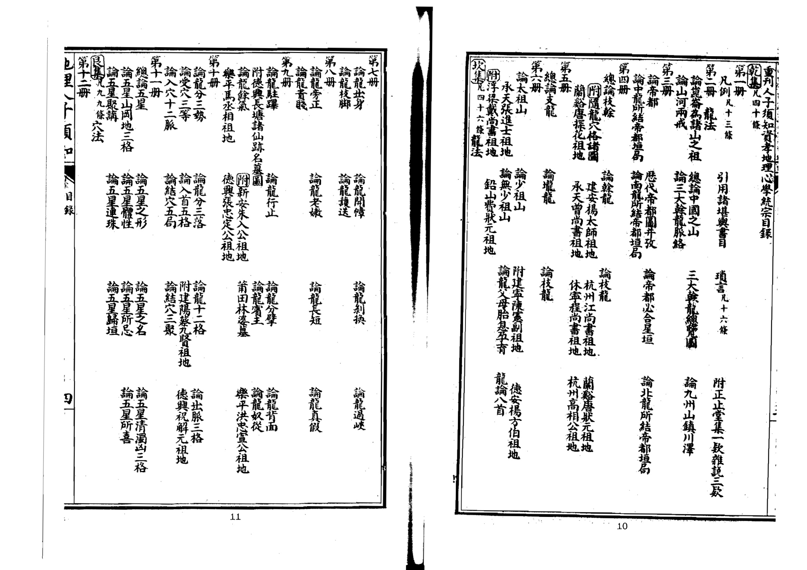

<!-- doc017 PDF 第 6 页：高风险/复杂版面 OCR 供检索；内容与排版以原页图为准。 -->
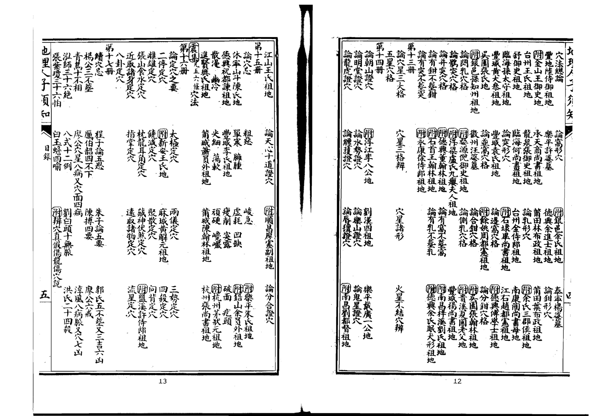

<!-- doc017 PDF 第 7 页：高风险/复杂版面 OCR 供检索；内容与排版以原页图为准。 -->
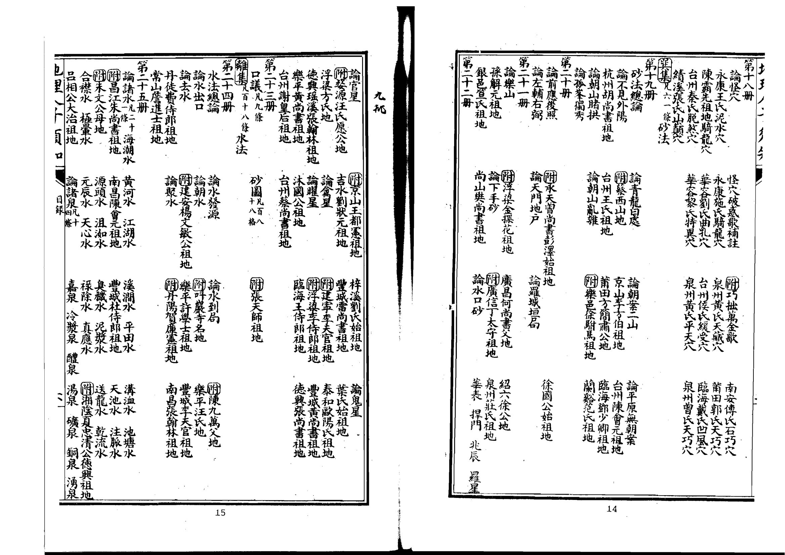

<!-- doc017 PDF 第 8 页：高风险/复杂版面 OCR 供检索；内容与排版以原页图为准。 -->

二十四位水法吉凶地理人子多矢

陰陽二局水法吉凶

總陽局水吉凶方位水法詳定凡一十一條進退二神山水定局諸吉水類凡二十八條

决水法凡八條 諸凶水類凡三十四條

總陰局水吉凶方位

萬年圗山向通利使覽定局

巳上乾坎艮震巽離坤兑八卦分統三十九卷覽者詳之

自序擇地一事人子慎終切務也孔子有卜宅兆之訓孟子謂比化者無使土親膚程子有避五患之戒朱子謂心慎必誠不使稍有他日之悔聖賢垂教其慎如此欽惟我

朝以孝治天下迄今二百餘年聖聖相承仁恩磅礴大臣命婦咸有卹典親親之教視古尤加誠以生事死塟禮之大焉且事死如事生而塟必慮夫親魄之安危又天性有不可解者豈惟拘拘于彼術家所謂禍福之說哉但化者既寧則生者自昌先正謂由根達枝斯定理也予不幸早孤思得善士以奉先靈不敢付諸術讀易之暇因究其理求其據且確者盡安厝之誠以塞人子當知之分與夫分內之可為事耳然天地大父母則有生天地間者皆吾同胞類也吾不欲苟於窀穸以畢子職而天下獨非盡人之子與矧推親親之愛大無我之公尤吾儒所謂理一焉者其寧怒然於斯耶于是忘其僭陋與弟善述日加鑽研會諸說而折其衷芟繁蕪而歸其要合形勢方位于一家以龍穴砂水為四例輯成一書簡易明切頗有便于慎終者之探索目曰人子須知蓋欲天下之為子者各親其親而吾之所知不獨為一人之知云昔人謂芻蕘之言聖人擇焉苟自其人心之有知與不可不知者須以求之則于卜宅兆避五患以畢夫安厝之大事者斯有以得其要領而不為邪說所惑庶上可以敷聖君賢相澤及枯骨之仁下可以盡肖子賢孫厚本慎終之孝亦國家孝治天下之一端吾儒窮理盡性分內事也若概視為術家之說非予兄弟蒐輯之本意矣L十

予嘗觀宋儒牧堂蔡先生家訓云為人予者不可不知醫藥地理惕然心動不幸先君早逝生無以為養所可圗者惟宅兆一事耳于是與季兄棄舉子業治堪輿家言所過名山大川古今陵墓必周覽久之而後去更事師亦不啻數十人如此者垂三十年而後稍有端緒夫術家妙契陰陽明通觀祭雖代不之人然各私相授受其流之弊遂致矛盾冰灰言天星者黜巒頭言形勢者闢方位穿鑿附會之說與詆毀聚訟之談紛然莫可究詰人子欲葬其親茫無所據有之不孝多矣予竊取而權衡之形勢審于未穴之先先天之本體也方位察于倒杖之後後天之妙用也先天之體出乎自然天也後天之用盡乎當然人也體與用不可偏度公廬 賦行唐删吴甲 撥障内定文配經 沙師供正卦書秦 圖奉圖按之 一捉房漢世隱 服著京言君 理賦堪子 氣遇普狐輿體 龍具大首家易 經印人尉經為而 倒丘唐指長者按青作 杖延亞牛沙名曾囊陳 法翰父眠公氏萬衍布 救俱著聞穴郡郭豁益夷 貧務 喜位陽璞謂祖註 仙州至陶垄得此釋 南楊雪五侃書之耳稱 唐筠心公著所沈天 時松賦令侃引氏 人著章唐催羿之葛青 曾筠貢昭官整經卷偏 文松卜文說母即樓經 迪名則館始失一中于秦 師益巍學此牛也無著青 作烏 小 心疑卷錦搜 鏡龍陰囊山 尋經陽霾記 正宋即仙漢 要西莖著朱 經淳唐山書桃 風司获晋 菱蒂天文杂赤 李節軍霆 公河經 山都大大定東于漢 穴打郭房 法曆元璞著侯 一立分草著張也號著士 撼 龍 書 圖治腹 經 守龍記陰陽 間 答 文雩 公曾

廢天與人相峙並行烏得執彼廢此耶乃以平昔所講求經涉而有得者定為成書先列蠻頭之要次附天 星之法形勢方位各有攸當天人體用不相背違俾孝子慈孫欲安其先靈者不為偏見所誤命之曰人子 須知夫舉千古不決之疑而擱然兼總其生僭越之罪何辭可解乃私心要在於資孝云爾世當有諒我者矣 嘉靖甲子孟春德興山人徐善述書于怡怡軒 又

不佞曩以先人襄事與季兄究心堪輿家間有一得筆之為書名曰人子須知鉛山見溪王君書林余氏雖嘗兩刻病其未備每欲再訂弗暇也辛巳夏中丞王公太史李公召入郢明年春又知遇司空曾公容郢兩寅頗多隙日乃取前書緒正之會季兄亦自荊南來更相與討論潤色刪繁補遺較昔所著合者十又四五錄成司空不鄙校梓廣傳第蠡測管窺極知不可以為訓念吾兄弟自少遨遊四方今顛毛種種矣三十年間心力盡在此編敝帚千金不忍遽棄耳或誚余嘗從薦紳談性命之學何屑屑于此迷而不返余謂西山先生父子及草廬吳公皆儒者宗嘗著發徼論發揮玉髓刪定塟書君子不以此少之即朱子所上山陵議狀有味哉其言之也且送終人子大事而付之庸師之手天親之謂何余為此舉凡以共子職而已天下豈有無親之人哉敬與為人子者共之高明之士竄定紕繆出特見以相長尤所願也萬曆癸未春月吉旦山人徐善述書于郢中之陽春書屋

也里一夏口書目

不可不知地理孔子曰卜其宅兆而安厝之程子曰卜其宅兆者卜其地之美惡也地之美者則神靈安子孫盛若培植其根而枝葉茂又曰祖父子孫同氣彼安則此安彼危則此危朱子曰塟之為言藏也所以藏其祖考之遺體也以子孫而藏其祖考之遺體則必致其謹重誠敬之心以為安固久遠之計使其形體全而神靈得安則其子孫盛而祭祀不絕又曰其或擇之不精地之不吉則必有水泉蟻螻地風之屬以賊其内使其形神不安而子孫亦有死亡絕滅之憂甚可畏也陸象山曰通天地人曰儒地理之學雖一藝然上以盡送終之孝下以為啟後之謀其為事亦重矣親之生身體髮膚皆當保愛况親之歿也奉親之體厝諸地固乃付之庸師俗巫使父母體魄不得其安則孝安在哉夫觀聖賢所論如此則擇地殯親之道誠仁人孝子之不可忽者若平居視地理為末務而不之問一旦有大故則不免倉卒苟且為之倖得吉地固所願矣不幸而置親體于蟻泉沙礫中無異委之于壑坵不孝孰其故人子須于平時講明其說庶幾他日臨事不悞而親魄得安于地下矣雖然三折臂然後稱明醫地之理又非膚淺及鮮傳者所能究竟也苟曰予既巳知之矣而自用自專悞吉為凶牢不可破則其害奚異于庸師俗巫哉噫萬鑑之玉必付之玉人而後可也不可停柩不塟

司馬溫公曰今人有喪親者往往久而不塟問之曰歲月未利也又曰未有吉地也遊宦遠方未得歸也貧未能辦塟真也至有終身累世而不塟具有棄失屍柩不知其處者嗚呼可不令人深歎愍哉人所貴於身後有子孫者為能藏其形骸也其所為乃如是曷若無子孫死於道路猶有仁者見而殣之耶且先王制禮塟期遠不過七月自王公以下皆三月而塟又禮未塟不變服食粥居倚廬哀親之未有所歸也既葬然後漸有變除今之人背禮違法未塟而除喪從宦四方食稻衣錦飲酒作樂于心安乎吳草廬曰喪不即舉年代巳遠或子孫參差而人事不齊或罹兵亂而水火不測或貧病兼併而不能舉或是非爭兢而害成或官事牢獄而不可為或日怠日忘而竟成棄置皆停喪久遠而變見多端也愚按二公所言極其痛切蓋今時

之俗平居多不講論夫地理及有變故則懵無所措停柩以待釋地初心雖切久以因循遂至配曾過日不知為天地間極大罪人有子不能塟其父有孫不能塟其祖至于年代深遠誠有如二公之所慮者叩四為人子者可不懷懷然而知所戒懼乎

夫地理之法雖繁而塟乘生氣一言足以盡其肯綮故千里來龍入首惟副八尺之穴說云陰地一經是也祖塚既巳乘乎一線之生氣則其左右上下皆為死氣塟之徒為蟻穴泉窟而巳不惟新塟之相將為福患且又泄祖宗之生氣驚祖宗之體魄其為害不小也或曰中州之地始塟者南面後寬左右昭穆而殯謂之族塟有一穴安數十塚者有一塚安十數柩者似于侵塟未聞其禍何也予曰中州之地千里平洋水深土厚若得一穴可安十數柩者有之可安十數塚者有之張子徵所謂也有一龍十數穴也有一六十數望者是耳東南山叢才駛土薄易泉而多石螻蟻生之安可與中州比也或又曰附塟祖側及父母必合茲皆古禮有不可議者答曰禮貴通變附塟既有侵祖之嫌而合塟或不得巳亦不必拘予兄弟嘗游聞至考拜文公朱夫子遺像及偏觀其先世近龍文公之祖退翁名有在政和縣  里 韋齊先生墓在崇安縣紅斷 母祝氏夫人墓在建陽崇奉里建 備師文公墓在建陽嘉禾里 羣 下退翁以前墓皆在徽之婺源去考亭固巳甚遠而退公韋齋文公之墓又各在一縣去考草皆百餘里何嘗招于所 近祖塚之說又攷文公塟父亦嘗三遷而最後遷處與塟母同年 年平收 班 脆  亦未嘗拘于父母合塟噫此見我文公先生燭理之明不狃於俗足可為法矣 全 27建三之道初按多 寧遵五六府文 郡塟夫年君公止 志也然遷將年月 見公于殆譜 所自欲云了 藏水塟紹 地之崇興 势熹安十 单峰之四 濕山五年3 懼下夫華二 非又卒韋 久考之齋 計文明于 乃公年西 奉慶遂塔 而元定山 退五于其 武年靈後 夷撰梵改 鄉韋院塟 上齋側于 梅行時寂 里狀熹歷 寂云幼山 歷公未中 山卒更峯 中之事之 峯明卜原 神年地及 舍熹不考 之奉詳章 非其懼公 即枢體遷 此葬魄韋 而于之齋 觀崇不墓 乃安安記 是縣乾曰

一不可圗塟舊穴曾葛谿曰圗塟舊穴惑之甚也嘗見一舊穴雖前已發大貴子孫不肖鬻之凡三易主葬二百餘年卒無顯者人但指而言曰此某氏祖塚徙瑯賣與某氏不利又轉賣某氏某氏皆不利即此可知舊之無重達之驗又有塟後風遷水易者難以殫舉竟未聞塟舊穴而復福者況憑福寺勢發也人之文朱上無重發之天所祐地何能福之哉且地服初與如火之始然及其既敗如灰盡已令欲于令灭中求之手內央不此古人謂圗塟舊穴如求嗣續于鶴髮婦人耳按葛谿所論誠皆切當蓋人子求也塟見當以無是理已發之穴徙人之親而塟其親伐人之塚而為己塚忍心害德莫此為甚縱得也里天里可在予其塟難保百年坟徙廓重扦太忍心莫道天公無報應後來還有伐攻人求也者直且知所戒不可拘泥公位

世俗拘泥公位之說兄弟衆多者各懷私意爭論不決遂有終其身不殯其親者噫為父母者每以子多為幸今若此則是不若子少者無房分之爭得歸金於土而免久暴之患矣是文求也惟當辨忍以下為泥公位地誠真美而于公位或有不齊此亦付之子孫福緣不可俠弘而久暴其見亦百身言自不可拘有作為而反壞其地且欲房分之均不可拘于一穴宜別求一穴以補親之則得自矣易公丁一文公位必取衆坟來互議是也大抵公位之說只可置之勿論蔡文節公云今人公位之見以文分親何所見之謬耶造化者自區處豈伊人力所能巧計地不可不澤當吏亡鬼安處至于以至乃不也理之外非可以徇私為心纔有私心其計必左世人以此誤自己誤于孫者甚多及不如長從而足在地愈錯非地誤人用心之誤也程子曰不以奉親為計而專以利後為謀非孝子安昔之用成為至倫文子但以安親為念可也若曰期生人之受蒼冀富于將來但末務耳兄有塟後少水變易而公立之說人多不驗為人子者須知大義豈可專泥于茲乎不可輕易改塟

孔子曰古者不修墓非不修墓也蓋必誠必信已當塟時而豫為一成不動之計其慎重尚如此兄舉既遠之親而欲改遷之何可以慎重不如是乎今之人有輕信人言或為富貴而動其令或爲問女而易建塟往易于改塟彼其事得已而抑不得巳耶如其不得已而有水蟻及也患也改之無不可也然亦月其而

所惑誤改吉地者令親體不免暴露吾恐仁人孝子當不止其顙之有泚矣青烏經云凡地有五不祥者可生氣物一見援或有氣如霧穴中乾燥無水蟻並吉 甚哉有味乎其言之也予茲推廣其意特立五戒曰人丁蕃衍者不平康者不遷誠欲其人之慎之也雖然禮有改苑之服聰曆頒啟攜之日古人亦未嘗不遷如不得已須得明師再三商確大抵地無全美只當察其輕重緩急如有財無人須求溫煖之穴有人無財宜尋得水之地審有其地果勝舊坟然後議遷如舊攻無大禍患可以平穩則當別求吉地接福于後未為不可奚必于改塟哉是故慎之一字改塟者所當繹思也

求地且須辨真偽不必拘大小若龍穴真的縱力量輕猶能發越徒慕大地而不能辨真偽塟于假穴之中是置親體于水泉蟻穴求福得禍顧何益哉蓋大地難識且有鬼神司之不可強求往往圗大地者雖小地亦不得而竟被假地所誤彼蓋不知安穩小地在在有之易于求索況小地既真數穴併力亦能致大楊筠松云大地難得小易求積累不已成山邱衆坟合力却成大人說小地生公侯又云是真不必問大小積小成大最為好又云圗大不得且思次此事當與智者議旨哉言乎人子求地且知辨真偽慎母為圗大所惑不可不觀古格

夫地理之學有道眼有法眼道眼生知不可尚矣所謂法眼者必從師授徧觀名墓何為而吉何為而凶龍穴何為而入格砂水何為而合局一一檢點以之為法故曰法眼卜氏云追尋仙跡看格光勝看書楊氏云勸君且去覆舊攻勝讀千卷撼龍文又曰見格多時心易曉見多勝耳千回聞又二云若不看格信人說俗師不曉能惑人是也故將欲營宅兆必須先去多觀仙跡名墓以彼為法則庻幾心目有主而不被假地所惑誠一緊要事也為人子者當念厝親是平生第一大事上為親體安寧之謀下保于孫久遠之謀而不可憚其登沙之勞也

五人二分矢

曾葛谿曰求地必先擇良師師非其人為害不淺誠哉言也蓋得地非難得師為難得其師不患不得其地苟師非其人毀瓦畫墁雖有美地而或扦失其穴雖得美穴而或塟乖其法況欲其尋地乎故擇師又為求地之先務也然地學之師亦難矣哉非通儒術不能窮理格物以致其知非真授受不識榘鑊微妙以盡其奧通儒術得傳授苟蔑其德吾恐指鹿為馬誑鳥為鸞而為害尤甚是故備斯三者然後始為良師雖然師固不可不擇擇而得其人又須竭誠以感之故曰取人以身不可不脩陰德

蔡文節公曰積德為求地之本也凡人欲為子孫永遠計者當以公心處世方便行事一念合理百神歸回擇地論穴又其次也不然吾德之不脩而徒責効於祖宗父母之遺骨朝移夕改愈更愈謬其悖逆不孝之罪適足以取誅譴于造物顧何益哉吳文正公曰嘗見人家求得吉地而後人不蒙其福反見凶禍者何哉若非立穴之誤便是立向之差又有掘鑿大過傷龍傷穴變吉成凶又有已得吉地又得明師而乃固執己見移穴易向相地者惟務承順不復執術遂至防誤又或術者險心詭行不肯盡術又有既得吉地塟之不差而子孫輕信人言輒遷改他姓得之因以獲福凡此未必盡皆術者之過往往冥冥中有使之然者由不積德之故也不積德而求地譬之不耕而求穫寧有是理哉按二公所論切當蓋欲陰地好先要心地好先大父存耕公嘗勸人不可以勢力營風水因作詩云踏破鐵鞋無覓處得來全不費賞工夫牛眠鶴舉獲遇只存方寸地中求 水見存鄉達松軒葉先生以之為名言又宋謙父詩曰世人盡知穴在山豈知穴在方寸 耕稿間好山好水世不欠苟非其人尋不見我見富貴人家坟往往塟時皆貧賤迨其貴力可求人事極時天理變故得吉地必有德可以膺福然後神以吉地畀之神之俾以吉地即天之報善故也欲求吉地為祖父宅兆俾先人之體魄安而後世之榮盛不替者當先積德以端其本焉或曰求地必本于德則亦修德而巳擇地之術又焉用哉予曰擇地以藏親為計人子之於親也固當無所不用其極苟慮夫親魄之安危則豈容不慎重而廣擇之哉脩德以竢天擇地以盡人並行而不悖仁人孝子之為心也

## 二批

附少保都督南塘戚公止止集一吳 嘗觀琥珀繫草磁石引針之事而怪之夫琥珀磁石無知之物也草既林死正至兌人平則生古骨無口而 被引繫則舉躍動溫如生而針則鋒鋒相連可引數筐墜而復躍即此則風水之言仁長火矢而 未敢以為盡然然琥珀磁石其山川乎針草其遺骸子謂風水不可信者蓋以世人不修風從惟大是為責 至有傾人身家忍心害理專謀風水以昌于孫者却不知地理爾天理相為流正玄一之又在貴王凡音 他而非地理之不驗也曾聞一人謀人塟地百計見人訟害其家說福並致思氏以至之者後又俞所 向伊妄言曰某塟地不佳也能遷之則安矣既而伊家如其說遷之彼即謀其故地以其父里夫路生 得禍更甚復疑而遷之發土至棺有白蟻蛀木成文曰此地若靈是無天理此地不靈是無地理夫天產佳 地必待有德者得之世人遺天理而求地理惑哉 以在才有十二十

按戚少保所引琥珀吸草磁石引針之說與塟書木華于春栗芽干室銀山西前棗錢東應之意相符皆所謂氣之相感者也祖父子孫同氣更復何疑來引地理本于天理之誰尤所痛快予兄弟又生體皮人言朱子之同安憇于途見一攻地山水甚美因問其樵者曰是攻子孫何如答曰先是富室今在正公嘆曰山有理水有理此地不發是無地理樵者告公曰此山原是某家業臺某食其地占羣之某貧弱不能爭辨公又嘆曰山有理水有理此地若發是無天理一夕為雷所震令閩鄉猶有前道其言未ん斤口文寺曷者貞印二孝子四察二云

## 附雜說二段

## 論風水名義 論風水名義

地理家以風水二字喝其名者即郭氏所謂塟者乘生氣也而生氣何以察之曰氣之來有水以專之氣之止有水以界之氣之聚無風以散之故曰要得水要藏風又曰氣乃水之母有氣其有水又曰味惟有者生氣又曰外氣橫形內氣止生又曰得水為上藏風次之皆言風與水所以察生氣之來與止縣云純紀而言之無風則氣聚得水則氣融此所以有風水之名循名思義風水之法無餘絹矣或曰天地初分混沌之如一口雜說

只有風與水兩相推盪故曰風水又曰風所以揚萬物水所以滋萬物故曰風水此則皆不切于葬理而又有水去則風來水來則風去之說益又舛矣侖を良こ少長

地理家以山名龍何也山之變態千形萬狀或大或小或起或伏或逆或順或隱或顯支壠之體段不常咫尺之轉移頻異驗之于物惟龍為然故以名之取其潛見飛躍變化莫測云爾曰脈者何也人身脈絡氣血所由運行而一身之稟賦係焉凡人之服清者貴濁者賤吉者安凶者危地脈亦然善醫者察人之脈而知其安危毒天善地理者審山之脈而識其吉凶美惡此不易之論也然龍與脈二者相因有龍則有脈無脈則無龍但龍兼指乎形之顯著而脈又專主乎氣之微故曰山尤難于認脈穴者蓋猶人身之穴取義至精楊公云譬如銅人針灸穴穴穴宛然方始當朱子云定穴之法譬如針災自有一定之穴而不可有毫厘之差此皆善狀穴之名義也沙者古人授受以沙堆撥山形因名沙耳

重刊人子須知資孝地理心學統宗卷一之上

江右德興山人

同邑庠生葉君遷校閱 同著窗友 門人南昌徐元良參錄

此一冊專論天下大榦龍龍居地理四科之首堪輿家莫要於論龍論龍而不知天下大榦則所見者近而不遠所究者淺而不深所窺者狹而不廣烏乎可哉故首論天下大榦龍庭幾識其大者

性理大全臨川吳氏曰天下之山脈起於崑崙蔡牧堂發微論曰凡山皆祖崑崙陶公捉脈賦云大智察脈起自崑崙明山寶鑑云山脈之起本於崑崙郭氏錦囊經云塟者原其始乘其止誠以地理之法龍則原其始穴則乘其止故不可不審山之起祖處也然觀山之所始必究其水之所起觀龍之所終必察其水之所界今以輿圗攷之天下之水皆原於西北是可見山起於西北矣蔡文正公曰山水皆原於西北故禹敘山敘水皆自西北而東南是也或云崑崙在西海咸池北海亥池東南接積石圃西北接北戶之室東北臨太活之井西南至城南之谷亦荒遠莫稽而楊公又云須彌山生四龍崑崙特其南肢葛谿氏述其說曰須彌山是天地骨中鎮天心為巨物四肢分作四世界惟有南龍入中國南龍入自崑崙山龍子龍孫皆可別雖據佛經人所罕見闕之可也今但以中國山川之可攷者論之則崑崙誠諸山之祖在中國之西北九峯蔡氏云中國山勢岡脊大抵皆自西北而來蓋可見矣

崑崙說曰崑崙之山三汲下曰樊桐一名板松二曰玄圃一名閬風上曰層城一名天庭是謂大帝之居去嵩高五萬里地之中也○禹本紀與此同高誘稱河出崑崙伏流地中萬三千里禹道而通之出積石山按山海經自崑崙至積石一千七百四十里自積石出隴西郡至洛準地志可五千餘里又按穆天子傳天子自崑崙入於宗周萬里西土之數自宗周瀍水以西北至於河宗之邦陽紆之山三千有四百里自陽紆西至河首四千里合七千四百里外國圖又云從大晉國正西七萬里得崑崙之墟諸仙居之數說不同○其高萬一千里山海經稱方八百里高萬仞郭景純以為自上二千五百餘里淮南子稱高萬一千一百里一

總論中國之山十四步二尺六寸

朱子曰河圗言崑崙為地之中中國至於閒暗二萬里于闐貢使自言西去四千三百餘里即崑崙今中國在崑崙東南而天下之山祖于崑崙惟派三榦以入中國其入夷國之山無可攷亦不足論今以中國言之其河北諸山則自北寰武嵐憲諸州乘高而來山脊以西之水流入龍門西河脊東之水流于幽冀入于東海其西一支為湖口泰嶽次一支包汾晉之原而南出以為柳城王屋而又西折為雷首又一支為恒山又一支為太行山太行山一千里其山高甚上黨在山脊河東河北諸州在山支其最長一支為燕山盡於平梁大河以南諸山則闕中之山皆自蜀漢而來一支至長安而盡關中一支生下山谷以至嵩少東盡泰山一支自嶓冢漢水之北生下盡揚州江南諸山皆祖于岷江出岷山岷山夾江兩岸而行那邊一支去為江北許多去處遠邊一支分散為湖南閩廣盡于兩浙建康其一支為衡山而盡于洞庭九江之西其一支度桂嶺則包湘源而北經袁筠之地以盡于廬阜其一支自南而東則包彭蠡之原度歙黃山以盡于建康又自天目山分一支盡于浙江西之山皆自五嶺顛上來自南而北閩廣之山自北而南一支則又包浙江之原北首以畫會稽南尾以盡閩粵此中國諸山祖宗支派之大綱也

右特舉天下山而言未及水也復輯山水總說于後二云按仁山金氏曰尺地常形固相為勾連貫通然亦各有服絡自崑崙而東北言之則自積石而北為涅水星海青海以至浩疊皆河源也入匈奴以東為陰山又東南自代北雲朔分而南趨為北嶽以至太行是為河北之脊壺口雷首太嶽析城王屋皆其羣峰分晉豕易滋漳洹衛則皆其諸水也分而東趨者行幽燕之北為五關之險以至營乎而為碣石此北絡也自崑以東言之則自西傾而洮水出自北入河恒水出其南入江又東為朱圉烏幾諸隴則為渭之源以北即夾河源而北以東若岍岐若荊山諸峰涇水漆沮諸源也自渭以南即西傾而下諸峰亘為絡南屹為太華東北為殽陝東南為熊耳外方嵩高伊涪之源又南為桐柏淮源以達於淮西諸山此中絡也又自西傾朱園而南分是為嶓冢漢源夾漢而趨者北即終南華熊諸隴南則蜀東諸峰說者謂蜀東諸山皆幡冢正謂其

岡岫綿亘耳又東南言之是為岷山江源夾江而東者北支即西傾以南嶓冢以西之脈為洹水西漢水如江陵諸源其南支即南趨為蒙蔡諸山青衣大渡馬湖江諸源又東包涪黔一盤而北為三峽其出者包絡九江之源中盤中為衡山其再盤而北為廬羣其嶺之東出者又為袁吉章貢旺信諸江之源至分水魚梁嶺三盤而北趨過新安峙天日盡昇潤再盤之間其水聚洞庭三盤之間其水聚彭蠡三盤以東則南為閩浙北為震澤此南絡也惟泰山則特起東方橫亘左右以障中原此所以為異與又曰泰山特起東方為中國水口表鎮禹貢導水略二導河至同為逆河入于海導漾至東為北江入于海導江至東為中江入於海導況水至東北會于汶又東入于海導淮至東會於泗沂東入于海導渭至東過漆沮入于河導浴至東會

曰蜀海愈一源山地嶺中者几支夾朱支為口以而自朱 大氏翼繁古花為下一央朱别江去行子度恒泰西天言子 江道派愈人也中南出有子包之為中曰桂山嶽之竺其曰 泉縣同細祭故國出于河語彭西江間漢天嶺此次來諸地如河 源大流此川天河于間東錄蠡其北必水下北大一剛國四此圖 即江愈一先下云積于則云之一許有之之經河支西在千遠言 今所含本河有石閒接入佛源支多山北山袁北包流其三益崑 所出愈而後源在漢中經以又去兩生西筠境汾以正百中崙 聞東廣萬海之臨南所國云北南處山下北之之晋入南餘國者 始南此殊重水川山以者崑盡而這夾一最地山之龍大里至地 發過萬也其河吴下王為崙于東邊行支高至也原門抵即于之 羊具殊凡源為氏其門黄山建度一中至自德其而西地崑間中 膊縣而水也第曰河陽河頂康桂支間揚關安江南河形崙二也 嶺北一皆源水非關其有其嶺為必州中之漢出之如山萬素； 下岷本宗木于發流西三阿一者湖有而一敷南以上义今里問 綠山也大子岷自與則方輯支則湘水盡支淺境為入頭中于日 崖即曰山崑息限流大則包南江江生源之析其然國閣天 散瀆臨處女以崙嶺以者池又湘又出南下二山城春其在至不 漫山川大真西者河葱為水東源一岷諸函支則王以尖崑崑足 小也吳水起视其合弱流已而支山山谷之岷屋東則崙崙西 大水氏曰處他源東其水四浙北為岷則以間山而之崑之無北 百曰曰黄有水為注南黑面江經建山又至湘之又水崙東緣地 敷清之天河鴨亦最浦山水出之袁康夾自嵩水脈西則也南更不 殆水所下曰線可遠昌東之東原筠又江岷少問其折東有滿 未又起之長江謂惟海出類南而之一雨山東斷北以流九三東 濫謂即山江傳遠中其金流北境支岸分盡衡一為而峯萬南 觴之水脉曰云而國水城其以為而一泰山支需為姦里水 矣文源起鴨天非之停與東首盡福行支山在為首桑氏文經 東阜之于綠下極河居漢坡以于建那以此湘衡又乾曰昌云 南山所崑是有于為冬南指盡岩二邊盡是水山次幽寰河雜崑 下在發崙也三山然夏山掌會阜廣一于一西而一冀武北錄崙 百徼也山脈漢不属圖稽其兩支南盡支以嵐諸記取 餘外脈蔡初之增馬云南一又浙又敷于乃入憲山于嵩 里江牧起發減其孫西其支曰閩自淺洞為于諸根閩山 至水水堂之源世河之域尾又為岷廣源庭太海州本遣五 白所經曰處于皆有南在以南衡山冢在之行其乘存使萬 馬導云崙凡則以兩南匈盡而山之湘西又西高脈来里 嶺也江分山不冢為源北奴于東者脈又水其次一而皆贡看 而益水支皆得江潛一有之閩度已具曰東南一支來自獻来 思州山出分祖與之行出大西粤庾盡一兩大北一支為其代使不 天記在岷脈崑河發于葱山烏嶺于支水凡乃壶脊北者會時發濟流也南經而流水狼至東同積出大崑言所渡不恒民今張之北急論氣海至題平栢山至道 入源水為故至所沮入此谷葭至指石指河崙河道 敢濁勿河仲流朝徐曰四也于辭氏地山微縣 河為東濟沔如關謂口沮縣中崩武石而石賦出出積又過方復不議蓋滄幹四膏曰縣理海弱有 同名流出盖8城漢所縣之沔縣都宜經之曰于鼻石河須河引通曰濁渊齊冲之河淮桐志經所天 流今與王與曰合出謂舍受水東沮在文峻覽重崙山水要為河利河之驚都之精水者栢曰曰謂彭 入濟汶屋污此西射污于名一北縣蒲在義百野源山說狐狹是至水也波赋源也也春均大南淮终山 海州水山合方漢嶋漢沔馬名與為昌此譯川謂潛在山行此黄三濁百沛曰河孝隨秋其復陽出源兩 濟乃會今也為水山音沔導沮漾漢海似氏之此發隴海云淮河月清里厲川最經地說勢山平餘滥山 河發又孟至漢漢也也水源水水水下平西红矣淪西經孤濟荣桃澄一望漕高接下题也在氏山觴相 之源北川漢水水東尚又南闕合又矣不域北經于郡曰美為濁花一小海則而神處辭釋東縣在者對 地也東始中為又北書東流駰沔東傅莫積蒲河河聽潤河水石曲揚洪長契而曰名南王朝其 無濟入禹為沔東流曰南泉曰水南漢曰尚石昌間水永寒之至水干奔河從曰通河曰淮莽陽 濟水于導漢水北得嶓逕街以即至水河美而出縣出下則名則六里物洋高河流之淮水之東淮 水自海水水故合獻家沮水其漫席出漾自于為于西渤無水矣河斗一理洋注者也為韋所平久水 矣王兖流是孔沮水導水注初水魏隴水蒲黄中海南海馨厚述决泥曲論發下水考言也出善鄉胎淮 举州而互安口口漾戍之出沔白西即昌河國水羌又乃數征以而一曰源末之異荷韋也也西鲜水 在為相國同庚東而山沮出水氏漢潛潜河故中海過丈記其民直河崑流伯邨也統淮風尚山出 濟濟通曰為仲流東河洳武縣道水行崑故洛余水人永曰壹矣色崙激上曰揚均俗書東南 河截稱漾漢雍為南池然都西躲發地崙成書考西見始盟不引漢黄九渡應河名州也通導北陽 之河矣水水云浅流縣故沮又嶓源下之公曰羣北狐合津浅河大者流故天者曰非春曰淮遇平 湖南東之是山注東曰縣東冢也南峻子河書入行車河也溉司衆分其漢水河界秋南自桐氏 濟渡源水海漢南沮東南山漾出極安自咸禹方馬津禁田馬川遊流新之下東說陽桐栢縣

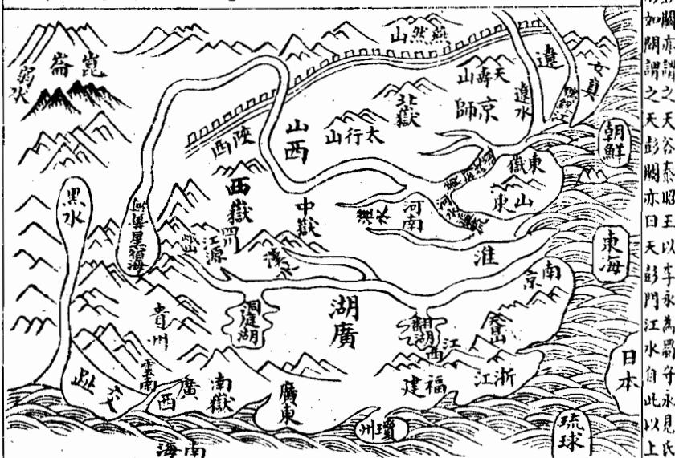

詔九州山鎮川澤按周禮職方氏東南曰揚州其山鎮曰會稽其澤數曰具區五 湖也兩 在吳南 其川三江其浸五湖正南曰荊州其山鎮河東曰兗州數曰養本長其川河沛其浸菑融來時融報河內曰冀州其山鎮曰霍山在其澤數曰陽紆新其川漳拙 長其浸汾 出 廣 以分路融聞正北曰并州其山鎮曰常山獻其澤殺曰昭餘祁其川呼池融自嘔夷融平其是陽出故注曰此九州川界揚荊豫兗雍冀與禹貢略同青州則徐州之地幽并則冀州之地獨無梁云 安

按唐一行以天下山河之象存乎兩戒北戒自三危積石負終南地絡之陰東及太華逾河並雷首底柱王屋 太行北抵常山之右乃東循塞垣至滅貊朝鮮是謂北紀所以限戒狄也南戒自岷山嶓冢負地絡之陽東及 太華連商山熊耳外方桐柏自上洛南逾江漢攜武當荊山至于衡陽及東循嶺徼達東甌閩中是謂南紀所 以限蠻夷也故星經謂北戒為胡門南戒為越門河源自此紀之首循雍州北徼達華陰而地絡相會並行而 東至太行之曲分而東流與涇渭濟瀆相為表裏謂之北河江源自南紀之首循梁州南徼達華陽而與地絡 相會並行而東及荊山之陽分而東流與漢水淮瀆相為表裏謂之南河故于天象則洪農分陝為西河之會 五服諸侯在焉自陝而西為溱涼北紀山河之曲為晉代南紀山河之曲為巴蜀皆負險用武之國也自陝而 東三川中岳乃為成周西距外方大伾北至于濟南至于淮東達鉅野為宋陳鄭蔡河內及濟水之陽為都衛 漢東濱淮水之陰為東隨皆四戰用文之國也北紀之東至北河之北為邢趙南紀之東至河南紀之東至河 南之南為荆楚自北河下流南距岱山為三齊夾石碣石為北燕自南河下流北距岱山為鄒魯南涉江淮為 吳越皆貞海之國貨殖之所阜也自河源循塞垣此東及海為戎狄自江源循嶺徼南東及海為蠻越觀兩河

之象與雲漢之所終始而分野可知矣

朱子曰天下有三處大水曰黃河曰長江曰鴨綠江今以輿圖考之長江與南海夾南條盡于東南海黃河與 公 此則自其水源極遠者言之耳若其分幹之條猶多難以盡舉如以江淮河漢四瀆論則中榦又自分三條大 抵河源極長江次之淮漢又次之故有三條四列之說不過概論其大而巳

按廖氏金璧玄文云大江以南之龍其脈起自岷山恠遶行向西自西而南至雲南之境又東趨夜郎踰桂嶺至零陵為九疑山人桂連撼龍經云五嶺分星入桂連是也過大庾嶺出南雄山汀從邵武抵信走徽東是海門南脈絡貨財文武交相錯是也一枝為建康方盡江陰經云榦龍盡在江陰是也一枝逆長江盡都湖○其水源自蜀岷山至于九江會彭蠡下而過秣陵出京口以入於海

大河以南大江以北乃中條榦龍其服起自西傾水草 也過鳳翔經云行行退卻大散關在 府百二山向在此間大纏大護到山谷在 水遠黃河如玦環是也 臨草縣 行隴右經云山來隴右尖如削盡是貪狼更高阜是 在為長安一枝出能耳在高經云低乎漸漸出熊耳萬里平洋漸加砥是也為嵩嶽為沐經云大梁形勢亦無山到此尋龍何處是若無河流與淮水渺渺茫茫不見山是也此處脈亂于河經云河流衝决山斷絕又無石骨又無脈君若到彼說星峰一句不容三寸舌是也出充為泰嶽經云黃河在北大江南兩水夾行勢不絕行到青齊忽起峯充州東嶽插天推分枝擘脈鍾靈氣聖賢多在魯邦中是也一枝盡于滄棣一枝盡于登萊○其水源則濟水出絳州垣曲縣至孟州溫縣入河復出河之南溢而為榮又東北至于青州入海自宋元以來河水穿淮黃河故道淤而東嶽泰山今在河北矣

又一枝自嶓冢西行湄州漢水之間出武關由裕過唐抵信陽行淮水之南趨廬行淮水之東為揚盡于通 其水源漢水出堦冢至漢陽縣入江○淮水出桐柏山小至淮安入海此中幹分而為二故曰三條四列 論止條除龍脈路

大河以北之龍其脈起自崑侖經云崑崙山腳出閣顏  西隻隻都是破軍山連綿走入幹海北海風又次一枝為恒山峪又次一枝為燕山盡于平灤碣石山左平川 河中縣 山左平縣州經云若以榦龍論大盡太行碣石至海瑛是也○其水源則汾水由管州管涔山至絳州入於海

上中國諸山皆始崑崙分脈四列以遍九州北條出河北入雲中過雁門代郡復回南而太原帝邱循太行恒山派九河東北渡遼海以入于海為冀燕之分○中條出河南自秦隴三輔入豐沛汾晉派伊洛東而淮泗以入于海為雍豫青徐之分○南條出江南自陝右分出西鄙廻巴蜀踰荊衡入黔中東而匡阜南極嶺復東北渡閩粵跨三吳自浙右以入于海為梁荊揚之分此三榦之布于九州也三榦之龍中榦為最尊次北榦又次南幹歷代以來如漢高祖之泗上漢光武之白水村宋太祖之夾馬營我太祖之鍾離鄉我世宗肅皇帝之龍飛承天皆在中榦而唐虞之君俱為北產南榦至宋高宗南渡以來運氣方興萃產朱子為萬世儒宗而邇來人物東南頗多其最長者為金陵我國朝根本重地太祖高皇帝龍興之畿也中榦之最長者盡東泰翻身顧祖東海外盪河江前回萃產孔聖及賢貴凝聚宋末河徙截其來服者三會通河復加截之其力遂微而中餘之旺氣乃萃於四州鳳陽我皇朝熙祖仁祖二陵在焉按王文祿龍興慈記云泗州有楊家墩墩有窩熙祖嘗臥其中有二道士過指卧處曰若塟此出天子其徒曰何也曰此地氣暖試以枯枝栽之十日必生葉告熙祖起曰汝聞吾言乎熙祖佯睡乃以枯枝插之去熙祖候之十日果生葉熙祖拔去另以枯枝插之二道士復來其徒曰葉何不生是時熙祖在傍睨之道士指曰此必人拔去矣熙祖不能隱道士謂之曰汝有福歿後當塟此出天子熙祖語仁祖後果得塟塟後土自壅為坟半載陳太后孕太祖皆言此墩有天子氣仁祖徙鳳陽雍成攻人言塟九龍頭上按松江徐長谷大地圖云熙祖陵龍脈發自中條王氣攸萃前瀦水成湖作內明堂淮河黃河合襟作外明堂淮上九峯插天為遠案黃河西遶元末東開會通河復遶之而聖祖生矣仁祖陵即吳景鸞獻宋室者宋不能用蓋天留以待我皇朝之厚福無疆也豈偶然哉北榦最長為燕京令京師也朱子曰冀都是正天地中間好箇大風水山脈從雲中發來雲中正高脊處自脊以西之水則西流入于龍門西河自脊以東之水則東流入于海前面黃河環遶右畔是華山聳立為虎自華來至中為嵩山是為前案遂過去為泰山聳于左是為龍淮南諸山是第二重案江南諸山及五嶺論冀都指作堯都非也彼蓋未考舜分翼東為幽州而幽燕古通稱冀耳倘如所指則朱子又何復曰堯都中原風水極佳左河東太行諸山相繞海島諸山亦皆相向云云此不待辨說而明矣故邱文莊公循義補苴以朱子所稱為今京師誠確見也其以燕京為枝結者不為妄談乎夫南榦正結為南畿及我太祖高皇帝孝陵在焉中榦正結為我熙祖泗州仁祖鳳陽陵中結為我承天獻宗皇帝顯陵北榦正結為今曰京師暨天壽山昌平州 列聖陵寢三幹之盡惟我朝獨會其全回視唐虛以來或得正榦之一或得分榦之一者亦能銜數百年之基則我皇朝三大榦之全福力量真億萬斯

江右使興山人 徐善送述 同著此一册專論天下古今帝都及星垣所合形勢欲論地必識大榦龍而大餘龍之所鍾必天下大都會大垣局爰輯其大槩於左論帝都

夫地理之大莫先於建都立國稽古之先哲王將營都邑固不度其可居之地以審其吉凶如公劉將居豳也其詩曰于胥斯原太王將居岐也其詩曰聿來胥字武王將居鎬京其詩曰宅是鎬京成王將營洛邑書曰名公既相宅衛文公將營楚丘其詩曰升虛望楚見于經者如此則宅都誠不可不重也雖然張子微有云帝王之興也以德而不以力其守也以道而不以地堯舜聖人其所建立未必慮及於風水之說但聖人之興自合造化聖人所作動為法則風水固不拘而密協于龜卜即天造地設之自然者也故易曰王公設險以守其國此理固先天地而有即風水之攸始矣予嘗稽諸歷代建都之地得正龍之所鍾而合天星之垣局者則傳代多歷年久非其正龍而不合星垣者則皆隨建隨滅豈非地理之明徵乎謹將歷代建都之所詳錄以備考云爾

<table><tr><td>器 遼東東海 细有 長城 河北 深 典 E 班张 園 共 丹 米 河南 開 好 浦 洛陽 反 咸陽 昌 之 甘肅 陕西 安 圖 崑崙廣河</td><td>歷代帝都攷 杭 月 淮東 建康 陳 南京 東 淮西 神農都陳 徙曲阜 金陵 盟 南 湖廣 黃帝都涿鹿 鞋 州 傳四世 四 種 海 江陵 堯都平陽 令 廣東 全 X 貴州 舜都蒲坂 冷 蒲 國 星图 禹都安邑 会 傳十七世共四百五十八年 成都 安 湯都毫 L 府 傳二十八世共六百四十四年 歸</td></tr><tr><td>秦都咸陽 合 陕 傳三世 共稱帝一十五年 西 安 東漢都洛陽 市 傳十二世 共一百九十六年 西晉都洛陽 傳四世 共三十七年 南朝 五十 九年 皆都建康 宋 帝 五主二十三年 齋 梁 7 四生 陳 五主三十三年</td><td>周都鎬東遷洛河南傳三十七世共八百七十三年 西漢都關中 廂傳十二世共二百一十四年 三國漢都成都四二主四十三年 魏都鄴五主四十六年 吳都建康四主五十二年 傳十一世 共一百四年 隋都長安 陝 傳三世 共三十八年</td></tr></table>

唐都長安昭宗徙洛陽使 元都燕京 順 天 府師 傳九 傳傳 世 1 十 世 八 共八十八年 世共二 共 + 八 明太祖高皇帝都金陵 汴今河 高 宗從 杭南 傳傳 應九九 天南世世 府 成祖文皇帝徙燕 共共 1 百六十 百五十 X 三 京 年 都師年 即故

夫帝都者天子之京幾萬方之樞會于以出政行令蒞中國撫四夷宰百官統萬民天下至尊之地也也理之大莫先於此必上合天星垣局下鍾正龍王氣然後可建立焉蓋在天為帝座星宮在地為帝居都會亦天象地形自然理耳楊公云大抵山形雖在山地有精光屬土次體魄在地光在天識得星光直精故為地學奚直俯察地理巳哉又須仰觀天文始盡其奧按天文志渾象中外官星凡二百四十六名千二百八十一星微星萬一千五百二十分布中外為垣者曰紫薇太薇天市垣之中皆有帝座凡建都處山川形勢須與此合楊公云要識垣中有帝星皇都坐定甚分明廖氏云帝都必要合星垣紫薇在中天其次太微與天市皆有帝座位是也今以三垣天星地形述後外少微垣為士大夫權天帝文章之府天苑天園為天于養獸植菓之所雖亦有垣而無帝座正位地形縱合亦非統一衆宇享有久遠之都在

<table><tr><td>紫 内 品 薇 恒 拉 6 丞 C 華 天 天美帝 盖 傅 告 星 一舍 五 内座 源 o 少 O 之 y 时 康 Q 钩 圖 天厨</td><td>按天文志中天北極紫薇星垣天皇之宸極太乙之常 天勢 居也北極五星正臨亥地為天帝之最尊所以南面 ○太陽 而治者也三光送運極星不移孔于所謂北辰居其 会公 宰相 太尊 所而眾星拱之是也後有四輔四星居王勾陳六星 閻陽 摇光 居乾天綱八星居戌華蓋九星居北閣道五星居癸 ● 天戈 咸池五星居丑入轂八星居艮天將軍四星居寅丙 6天槍 陛六星居甲司命六貴人在震三師三星在乙又有 天理四星居辰五諸侯五星居巽內厨二星居巳四 貴人四星臨丙帝座二星居午大理二星居丁天槍 三星居未文床三星居坤天梧五星居申陽德陰德</td></tr></table>

二星居庚內屏二星居兌天乙柱史女史三星居辛而有左衛七相右衛七將以藩屏帝室泰階六符輔治北 斗 以 主公昌報華尾陰相宫元翼 宰相之厨益指德對五北垣 名西下下形北門少天極此 樞偏曰五蓝極裏宰樞紫紫 精即三箇上顛兩上左做微 第是公天連勾黄輔烏宮垣 星局 句之懸象于天 權星牢右如獨女上乙帝也步 一三丈入象陳數兩后中 二天太梧連陳聚次四北 第戈尊宿九六尚少星極 三一只天个星書輔是五 城星向床星六以上四星 璣圓三六名甲次衛輔在 是天公星曰前其少天其 四理明左傳天位衛乙中 星斗六内連在史丞當之 第裏星厨丁勾桂後門座 五暗太二垣陳史門路第 衡輔尊星外裏各東左二 間星邊右左五一邊樞座 陽近大樞右帝户大右第 摇着陽對各内御赞樞三 光間之文六座女府夾之 六陽中昌珠後四門南星 七炎四斗右門星西門鹿 星北势上是是五唤雨子 摆斗前年内華天作面居 光之一月階篮柱一管第 左宿箇形左井天少衛一 三七宰稀天杠理丞一號 天星相疎厨十之以十曰 搶明太分階大星次五為 明第湯明前星陰却上大 側六八杠德向宰子 更蘭星作邊前少四 有星名柄勾門尉為

<table><tr><td rowspan=1 colspan=1>                 衡奇对四輔陽德賤扛里陰德醒四天皇僅展子天理爲陳太李掌诚五帝吏逆为内座：侨</td><td rowspan=1 colspan=1>右紫微垣列形于地之局勢大略也楊公云紫微垣外前後門華益三台前後衛中存過水名御溝抱城屈曲中間流又云直朝射入紫垣氣廖氏云紫垣西藩星有七東藩八星出華益杜星在後門天床前面陳中央一水直朝入抱城九回屈萬山簇擁畫朝迎拱極不虛稱是也</td></tr><tr><td rowspan=1 colspan=1>大         00三台口       幸臣    9  左執法李禽座虹虎贡從官C0謂右執法者之      郎星                         O上相.圖            0即將   上蔣次將次相</td><td rowspan=1 colspan=1>右南宮太微星垣三光之庭天帝受釐告功之室也中有五帝座正居北地太乙五尚書正居巽地內有郎官即位三公謁者九卿五侯以輔導帝極前有明堂三星居巳靈台三星居午常陳為耳目之官西將東相各四星為藩垣東華西華為門掖掖左右二星為執法後有太陽守太陰守各二星為衛前有張翼軫三宿為侍此太微垣星局之懸象于天者也</td></tr><tr><td rowspan=1 colspan=2>去</td></tr></table>

地理人子須矢卷一

<table><tr><td rowspan=1 colspan=1>次相     次將     上將                   中華西門 西太陽門  左掖門西太陰閔上相太于屏聖太微端門é東太陽門右掖門中次將       次將     上相</td><td rowspan=2 colspan=1>步天之民方庭太做宮市方关联券用x執万项正众一车明一一心XR左右左烏三公三99星主後进官烏列帝後從本定4貢3屈其常陳七星b位官e+星布左右執是新宫外堂布宫f箇靈台候雲丙右太微垣列形于地之局勢大略也楊公云方正之垣號太微又云橫城水繞太微勢又云東華西華門水橫水外四圍列峰位此是垣前執法星却分左右為兵衛廖金精洩天機云太微垣局最方正左右執法並西藩上將次將先次相上相連東藩上相及次相次將與上將兩藩九門分十星一水遶城橫是也</td></tr><tr><td rowspan=2 colspan=1>关关布                                5 买0楚Q韓女床COO車肆宋新帝座侯吊度塗南海T福C综人#.诚東海</td></tr><tr><td rowspan=1 colspan=1>右東府天市星垣天帝泉貨之府也中有帝座正臨艮地有呼斗車舟府庫市樓市肆以貫其中貫索宗人左右侍衛匡衛列國分野二十二星曰宋南海燕東海徐吳越齊中山九河河間晉鄭周秦巴蜀梁楚韓西河等藩以列四方貴人一星旁照庚地為捍衛庫之宮司命一星正臨丁位為五福壽命之司此天市垣星局之懸象于天者也</td></tr></table>

步 有與着名天 五金分列歌 行以明四一下 吟次多斗雙元 别兩解亦一 星帝依宫 紀前次名 北依帛天 三其度市 星次雨雨 名斗星扇 女是屠垣 床五肆墙 此星前二 座解侯十 還是星二 依四還當 織垣在門 女北帝六 旁九王箇 三是邊黑 元贯帝市 之案座樓 象星一門 無索星左 相口常 侵横見星 二者明是 十七四車 八公箇肆 宿成微两 隨天茫 其纪宦宗 陰怡者正 火似星四 水以宗 木公次人 土形雨宗 并數星星

右天市垣列形干地之局勢大略也揚公云垣有四門號天市又云百源來聚天市垣廖公云天市垣星二十二名來國與地國地中間有四門東西南北分衆水分流來此聚大河在東注帝座居北市樓南垣局總為祥是也

巳上三垣天星之圗則本于天丈志地形之圗則本於廖氏金璧玄文兹特合而一之庶易於故索然亦不必深泥圗局形象膠柱鼓瑟但依經文以山形水勢取之如曰紫微垣外前後門華蓋三台

前後衛方正之垣號太微垣有四門號天市又曰直城射入紫徵氣橫城水遶太徵勢百源來聚天市垣之類則以山水形勢之大象言之楊筠松固已說得明白其他星宿形象又不必盡泥也

北龍有燕山即今京師也以燕然山脈盡于此故曰燕山昔昭王築黃金臺以招賢者因又稱金臺古冀州地舜分冀東北為幽州故又謂之幽都按邱文莊公大學衍義補云虞夏之時天下分為九州冀州在中國之北其北最度舜分冀為幽并榮故幽與并榮皆冀境也楊公云燕山最高象天市蓋北翰之正結其龍發崑篇入中國為燕雲外為山曰 山曰復東行數百里起天壽山乃落平洋方廣千餘里遼東遼西兩枝開截黃河前繞鴨綠後纏而陰恒太行諸山與海中諸島相應近則灤河潮河桑河易河并諸無名小水夾身數源界限分明以地理之法論之其龍勢之長垣局之美榦龍大盡山水大會帶黃河扆天壽鴨綵纏其後碣石鑰其門最是合風水法度又按衍義補云朱子語錄冀都天地間好個大風水服從雲中發來前面黃河環繞泰山聳左為龍華山聳右為虎嵩山為前案淮南諸山為第二重案江南五嶺諸山為第三重案故古今建都之地皆三哉去北得之平云得形浸聚無坂算 列聖然遠大國都關燕不勝乾氣間乃過 聖之常而近之自口冀可論坤者重堯于 之都時委胡正昔不内為則所此關舜冀 茂皆未守距同之下跨王幽以地叠建都 德北必將塞乎都百中之燕界有阜都就 神龍慮臣不堯燕十原地自之之變之朱 功今及則二舜者而外楊昔者其愿地子 鴻我風非百拓始居控文稱又東峙其所 休朝水居里地于庸朔敏雄如一而所謂 駿畿之重無之召紫漠謂左此帶蛟分風 烈甸說馭蕩廣公荆真西環其則籠東水 之亦而輕籁遇而山天接滄直汪走北之 不北默之之于極海下太海截洋所之說 可龍契道固漢于喜都行右而大以境觀 及而若矣而唐金峯會東擁廣海擁是之 然形此故天功元古桂臨太大稍護為謂 地勝是我子德然北文碣行馬北而幽無 理與益 自隆名黄襄石南堪乃圍州風 之風聖成為盛公花公鉅襟輿古繞大以 應水王祖宇上諸鎮謂野河家唱之行散 亦法之丈不常侯險形亘濟所石者自之 或度興皇知天也隘勝其北謂淪不西有 然又動帝今心金尤甲南枕得入幾而水 也皆與之下元著天居居水海知来以 愚邁法唇四乘乃會下庸庸為處千演界 何之合意夷地夷通展控蘇上稍萬迤之 幸宜天建北氣狄薄山其秦者南里而也 躬其地都虜真雜運帶北所是則也北冀 逢駕造于為萬氣便海勢謂也九形綿州 唐化此急世皆利有拔天按河亘之 通風晋三 二然遠來之以又之峥二風所氣燕面 代相猷去洪當通固嵘之水歸密趙距 全符豈邊基其海蓋氣國之宿堪之河 盛之凡備也大運真摩杜美之與境處 如理愚須而惟誠定空牧言地家東是 此昔之嚴議我萬以而所之浴所而為 是堯所若者世北崱謂也日謂極平 固舜能畿乃皇帝至芳王若月藏于陽 我禹及甸謂朝王永又不以而風醫蒲

子微曰河中之地右則西河左則東河前則南河逾河而為壺口近河而為覃懷入河而為衡漳三面距河一面背山所背恒山挾去甚遠逶迤而下其平如砥方廣千里夾水之外四面皆有名山巨鎮迎送護衛但堂局寬潤非凡俗所能檢點若兩腋無水夾截即是水不交會大龍如何得住故夾身之左有小東河右有西恒河南有小南河關截于內而大河經之龍將焉往其他橈棹手脚得無名之水界夾分明者又不可數

計但眼目難于檢點舉其堂局形勢可以周知此則以此親近者而言之也雖然堯舜禹聖人道化天下未必係于風水然天造地設亦自然默契之理有不可誣者但今風水變遷王氣之竭無復可都矣

言音戶矣弓老主 中龍有闕中曰豐曰鎬曰咸陽長安皆今陝西地邇曰闕陝 古雍州也楊公云闕中原是太垣微又曰長安落在垣宿中 益中榦之尊也其龍發于崑崙經山黑水綿絡西河構山始 起祖宗轉榮貊澤自西而東盡于雍州張子檄曰長安之龍 起于橫山其山皆黃石綿亘八百餘里不生草木及至雍州 之地涇水出安定在雍州之西自西而南入渭水而北是為 渭汭渭水出鳥鼠同穴西為雍州之西山至涇水所屬之地 則為北惟此依山挾水號為天府之國又曰秦都咸陽非長

安以宮屬渭跨渭為飛橋複道以象天闕道而屬阿房如驪山溫泉又長安之枝龍也長安之下則有此孫荆諸山為護澧涇漆沮河水界限為衛蔡文節公曰咸陽之地龍合之玄格前後左右諸山包護此皆詩其風水之美也若以形勝言之則婁敬所謂被山帶河四塞為固張良所謂左殽至右隴蜀沃野千里南有巴蜀之饒北有胡宛之利阻三面而守獨以一面東制諸侯乃金城千里天府之國者是也故史稱閣中陛山帶河四塞之險東有函關西有散關南有武闕非有蕭闕呂成公亦謂闕中是形勢之地欲據形勢須者闕中桂文襄公謂其山河四塞形勢甲夫下易曰天險不可升地險山川邱澤王公設險以守其國作此為耳故闕陝之地形勝全龍局美王氣攸萃而文武周公列聖篤生自文王都岐徙豐武王運鑑京成王者于鎬以據天下形勢當西周全盛時特往來朝諸侯于洛邑至平王避犬戎始遷都于洛隋號曰東周則周曰微弱而雍州王氣為秦得之蓋秦先世有非于者善育馬為周孝王主馬用大謹急分土為附肩邑居春歷三世至秦仲始大歷莊襄犬戎弑周王襄公救周有功封為諸侯賜以國周畿內八百里之地秦即其地

也里人子須知卷一下龍法

日以強盛兼并天下統一區字然無功德肆暴虐不足以當其地王地之入漢興以婁敬張良之議道因其故都而都之傳十二帝歷二百一十四年其後唐又都之傳一十八帝歷二百六十九年宋人亦嘗議欲都此而以橫山未入版圗故都大梁以經營橫山蓋橫山當宋時諸戎所依為戎夏必爭之地不得之則不可都故爾邱文莊公曰秦地被山帶河四塞以為固所謂金城千里天府之國得天下之百二者也周人初起於邠繼都豐鎬天下形勢之地蓋莫有過焉者也至平王東遷而棄其地與秦秦地始大戰國之世山東之國六而秦居其一六者為縱而秦獨為衡焉卒能以少制衆并而有之非獨人力亦地勢然也自高帝用婁敬言西都闕中後世言形勝者必歸焉唐起晉陽亦都于斯自宋人都汴之後王氣消歇者五六百年于今矣詳究文莊茲論確有所見而議者乃謂漕運不便不知周與漢唐各數百年而其儲積豈無其道且禹貢若雍州厥田惟上上史稱沃壤千里可以儲貯而秦號富強顧所處之如何耳大抵雍州非直形勢險固風水融聚為美已也且其水深土厚民性質樸易於從化尤為可嘉朱子曰岐豐之地文王用之以興二南之化如彼其忠且厚也秦人用之未幾而一變其俗尚氣槩先勇力忘生輕死悍然有招八州朝同列之氣其故何哉誠以雍州土厚水深其民重厚質直無鄭衛驕惰浮靡之習以善導之則易興起而篤于仁義以猛驅之則其強毅果敢之資亦足以強兵力農而成富强之業非山東諸國所及也後世欲為定都立國之計誠不可不監乎此而于導民之路尤不可不慎其所之言哉言乎

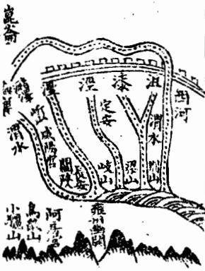

龍之次有洛陽即周營洛邑之地也前值伊闕後據邙山左瀍右澗洛水貫其中以象河漢此紫徵垣局也張子微曰洛邑是飛龍格勢脚手本自分明迎送却從外假合凡大池迎送皆取諸外而不取諸身所謂身本手腳一曲屈縈迥輒五六十里或七八十里故人不見其為手足況遠外迎送其得見乎此其中夷之地一望無際惟審其水源而後識之也然洛邑告天下之中為大龍之腹四望平夷近則熊且居其右

西京在其左取諸遠則上洛在其西太華在其東終南惇物在其北內方則在河南周公所以取制天下之中猶腹為人身都會之所也以水而言則洛水自西而經其前瀍澗界其東汾潔遶其後伊水陳其面最合風水法度但以形勝論之則平夷無險四面受敵故周營洛邑特以宅中圗治道里適均之故乃于此以朝諸侯非建都也按大學衍義陳大猷曰成王實都鎬京特往來朝諸侯祀清廟于洛故鎬京謂之宗周以其為天下所宗也洛邑謂之成周以周道成於此也洛邑天下之至中豐鎬天下之至險成王于洛邑定鼎以朝諸侯所以成天地中和之氣宅中以蒞四海其示天下也公于鎬京定都以壯基本所以據天下形勝據上游以制六合其慮天下也遠誠哉言也後平王避犬戎徒都于洛則周室日衰馴至不可為矣漢初高祖亦欲都洛以婁敬張良之言都于關中光武中興始于洛建都謂之東都洛陽却在周都河南又隔伊水有諸水在後而地方之備差完頗為可取然皆平夷曠洋無蔽有德易以王無德易以亡不可用也故東周都洛而能延數百年之久者誠以文武之德民不忍忘故爾溫公歷年圗曰周自平王東遷日以衰徵至于戰國又分而為二其土地人民不足以比強國之大夫然天下猶尊而事之以為共主綿綿然久而不絕其故何哉文武之德植本固而發源深也不然以區區數邑處七暴國之間一日不可存况數百年乎此確論也龍之又其次者有汴梁其龍自熊耳至此乎坦萬里大河在其北淮河在其南亦天苑垣也五代梁漢晉周皆都於此而年代不永宋都之傳九帝歷一百六十七年而南遷臨安是時汴梁在河之南猶差可取今河水衝決而在于河之北無復當時風水形勝矣舊黃河在開封城北四十里宋元以來河徙穿淮馴及我朝洪武二十四年河決原武東經開封城北五里又南行至項城經頴川以入淮而舊河故道遊淤正統十三年又决榮陽過開封城之西南而城北之新河又淤自是汴城在河之北龍脈經河穿壞形勝亦無河遶可恃不可用也蓋河源于崑崙星宿海又入地伏流數百里不見其派禹之所導始于積石初未曾窮河源也河至于此其勢橫于衝溢外則涇渭漆沮之會于渭汭又有伊洛瀍澗汾潔之會于底柱所泄惟汝泗二流内則淡濟內河滹沱恒泽從而益之至于九河逆河勢雖遠而愈勝故有河患非人所能制者自三代巳然由漢唐宋元迄今頻年衝决而沿河之民悉魚鱉矣况可都乎

地理人子須矢卷一下

圖陵金

論南龍所結帝都垣局 青戶系巧

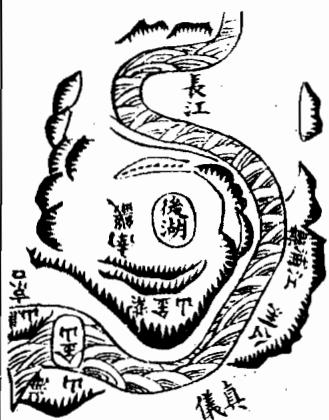

峙其東大江迴抱秦淮玄武湖左右映帶兩淮諸山合沓內向若委玉帛而朝焉諸葛孔明謂鍾山龍蟠石 諸山合沓內向若委玉帛而朝焉諸葛孔明謂鍾山龍蟠石城虎踞真帝王都昔始皇見金陵有王氣東游以壓之其後三國吳都之傳四世東晉又都之傳十一世歷 以壓之其後三國吳都之傳四世東晉又都之傳十一世歷百餘年南朝宋齊梁陳南唐皆都之而年代不永蓋以其雖合垣局而垣氣多泄故爾楊筠松云長江環外 永蓋以其雖合垣局而垣氣多泄故爾楊筠松云長江環外有三結垣前中水列垣中巳是帝王都只是垣城氣多泄是也若以形勝論之則江限南北古今恃為天險 城氣多泄是也若以形勝論之則江限南北古今恃為天險朱子曰東南論都必要都建康者以建康正諸方水道所湊一望則諸要會地都在面前有相應處劉誠意 方水道所湊一望則諸要會地都在面前有相應處劉誠意南龍有金陵即今之南畿我太祖高皇帝建都之地也戰國楚威王時以其地有王氣理金以鎮之故稱金陵漢改曰秣稜吳曰建業晉曰建康其形勢前輩謂與洛陽同廖氏云建康形勢洛陽同王氣古云鍾蓋紫微垣局南榦之盡也蘇伯衡謂劉迪簡云金陵地脈自東南遡長江而西數百里而止其止也蜒蜿磅礴既翕復張中脊而下降為平衍所謂土中於是乎在西為雞籠覆舟諸山又西為石頭城而鍾山謂襟帶長江勢甚險固桂文襄謂金陵江北則有徐頴二州地跨中原瓜連數省並稱雄鎮為藩離有控扼之勢江南則有安慶當長江委流西控全楚為江表門戶按諸君子所論形勢是誡英雄用武之地可以駕馭四方號令天下而興王業者我太祖高皇帝以之定鼎良有以也但以地理家言之雖合紫微垣局奈垣氣多泄故成祖文皇帝再建燕京為萬世不拔之基豈偶然哉蓋天眷皇朝故二祖動即合公而初非有意于地理之說也猗與盛哉

十六村

南龍之次有臨安今州其龍脈自天目山分入錢塘而海門有龍赭二山在其中郭景純紀云天目山前兩乳長龍飛鳳舞到錢塘海門更點巽風起五百年間出帝王經云海門環合似天市天目天池生侍衛萬里飛來垣外挹海外諸峰補垣氣廖氏二大江以南天目峙海門似天市故臨安亦天市垣耳若以形勝論之則僻處一隅子朱子謂如入屋角房中坐視外面殊不相應宋高宗南遷建都于此其卜相京畿國師吾邑傅公少伯通也有臨安行在表謂其地只可駐蹕不宜建都不過偏安之地且主奸相弄權武臣多咎後宋竟未能恢復而奸相如秦檜賈似道諸人迭出皆操弄國柄武臣多不善終果符傳公之言

其表畧曰顧此三吳之會實為百粵之衝錢氏以之開數世之基郭璞占之有興王之運天目雙峰屹立平斗南之上海門一點橫當乎軫翼之間臨安集秀氣于軒轅吳會孕祥光于樞府會稽北固堂堂平天外之山京口姑蘇眇眇兮域中之澤四神具足八景寬容山勢北來有朝海拱辰之象水流東去無鬼刼凌奪之憂鳳閣龍樓正當辛地得門華表哈值星河上合東宮天市之垣下接揚州禹貢之域然而金匱凌雲雖少府有積年之聚廉貞姬主必大臣多持柄之虞昴曰星虧武臣多咎鬼金位起閹寺施權文曲多山俗尚虛浮而詐少微積水人多文飾而貪雖云自昔稱雄實乃形局兩弱只宜為一方之巨鎮不宜作百祀之京畿駐驛暫足偏安建都難奄九有按傳公表上乃陞杭州為臨安府而稱行在遂寢建都之議又數年秦檜專權建和議而無恢復之志當時諸臣亦有議都建康者竟如檜議定都臨安而有宋卒不能克復舊物令人有餘憾雖然天下事莫不有數宋史記徽宗夢吳越武肅錢王鏐入宮而誕生高宗則臨安之都豈非數有預定者吳錢王鏐唐末封吳越王梁篡唐鏐遂據杭州

巳上建都之地其槩如此唐虞之都以河溢為患周洛邑以備守之難大梁平夷無險臨安僻處一隅金 陵形勝雖優而垣氣多泄兩淮龍氣大盡而地勢卑下東魯中榦雖尊而巳踵孔聖且令河水穿龍皆非 建都之宜他如許昌成都南粵等處不足論矣惟我京師為上而闕中次之東漢所都之洛又次之雖然 聖帝明王要必有所重也昔魏武侯浮西河而下中流顧謂吳起曰美哉山河之固魏國之寶也起對曰 在德不在險昔三苗氏左洞庭右彭蠡禹滅之桀之居左河濟右太華伊闕在其南羊腸在其北湯放之

地理人子須矢卷一下

紂之國左孟門右太行恒山在其北太河經其南武王殺之若不修德舟中之人皆敵國也武侯善之愚謂君子不以人廢言起雖不足道若斯者誠確論哉不然秦隋嘗都關中矣金元嘗都燕京矣風水之美形勝之固何獨于彼不哉是故風水之說在于地固有國者所當擇而禍福得喪之機存乎人尤有國者所當慎也一下之二

此篇專論榦龍枝龍夫龍之枝榦形勢不一苟無真見則登山汗漫貿貿莫分且辨龍枝榦乃地理第一闕鍵此而不知則大本已巳失如宮墻外望不得其門何由升堂以入其室乎故首論枝榦蓋亦開關啟鍵意也枝榦總論

夫榦龍枝龍者乃龍之有大有小猶木之有幹有枝也蓋榦為木之身而枝柯所附以立枝為木之衍而條葉所自以蕃論龍大小莫辨取象于此但枝幹之中又各有大小之別故有大幹龍小榦龍大枝龍小枝龍所謂榦中有榦榦中有枝枝中有幹枝中有枝是也吳國師有云枝榦明而嫡庶分嫡庶分而力量見故論龍不可不辨枝榦論枝榦又不可不辨大小以審其力量之輕重也然審辨之法以水源為定故大幹龍則以大江大河夾送小榦龍則以大溪大澗史送大枝龍則以小溪小澗夾送小枝龍則惟田源溝洫夾送而巳楊公云水源亦自有長短長作軍州短作縣是也故觀水源長短而枝榦之大小見矣然此亦惟舉其大綱言之至于節目之詳即其行度形勢亦自有別具見下文

夫榦龍有二前所云大榦小榦是也所謂大榦龍者即榦中之榦者也其祖皆出名山跨州連郡延柔幾千百里乃正氣所聚鍾靈孕秀頴異殊常夏然高廣而每有雲霧發現經云先尋霧氣識正龍又云尋龍望氣先尋脈雲霧多生在龍脊春夏之交與二分夜望雲電生處覓是也蓋榦龍之祖極其高大故每有雲霧生其顛此察識榦龍祖宗之大法也既知其祖又當于離祖分行審其出身聳拔雄偉氣勢宏大規模尊重如王者駕出而百職咸隨如大將赴敵而三軍聽命巍義卓異豈若枝龍之出身惟以細嫩活動逶迤磊落為美哉及其出

身以來則多牽連而行不起星峰惟兩旁枝脚護術關峽等山則星峰聳坂俗眼不識翰龍形體惟以星峯病麗為愛縱有所得不過枝葉小穴而已豈知正榦龍稟氣渾厚不起正體星辰經云尋龍何處使人疑尋得星辰却是枝枝葉亂來無正穴真龍到處又疑非只緣不識兩邊護却愛飛峰至脚隨丹此余落是龍肚賦上生峯一邊卓真龍平處無星峰兩邊生峰至難捉又云疑龍何處最難疑尋得星峰却是枝闕峽從行并護托虛直旗槍左右隨餘上星峰全不作星峰龍法盡虛辭又云凡有好山隨翰去枝龍盡處有旅棺旗相也是星此作圓凈尖方高更草就中尋穴穴即無榦去未休枝早落又二問君州縣大翰龍似浪橫江那有此走峰皆是兩邊腳去為小穴為村落又云兩邊起峰為護從正龍低平最貴重又云翰龍身上不生峰有峰皆是枝葉送是也故凡榦龍不可以星體拘之惟是崇山大壠如白浪湧波層巒疊嶂牽連而行或百餘里或入八十里或二三十里只一斷而斷處必是驛路通衢人跡絡繹不絕之處古人以人迹往來多真政之大小以此之大小定龍之大小誠為有理蓋榦龍脊脈多為疆域界限故其過峽斷處必是省郡通衢然其斷亦有一伏或十餘里或數十里平坦了不知其去而蹤跡詭異或穿田渡坂而有藕斷絲連或石梁渡水而為崩洪過脈或批蹤閃跡而有馬跡蛛絲或撤落平田而藏形隱跡前云忽起高山又復牽連而行行而又斷斷而復起延蔓唐表橫亘連綿極其長遠或千餘里或數百里經二尋龍千里非迢遞其次五百三百里子微云大龍千里貴淮尋一二百里作郡邑廖氏云榦龍住處分遠近千里為大郡二三里可為州過此即封侯百里尸堪為縣治若卜此為鎮市是也故榦龍之行度極其長遠愈長遠則力量愈大其分去之龍亦各隨其正朝之大小而有差別如正餘龍去作京師則其龍身分去小榦為省城而省城龍身分去為郡邑郡邑龍身分去為鄉木市并之類龍髓經云大龍行度自非常離祖生來手脚長橫亘鋪舒千百里至微三百里中藏一彎一龍皆開廣終日循行尚未央細葉猶為府州縣巨枝畿甸梅君王是也且其從山及枝脚橈棹皆有融紹愛是朝龍氣勢雄大布置精巧故隨從之龍與本身透漏皆能有穴子徵云手腳橈棹皆有穴此是大龍多餘氣是也然此等大龍亦有行至將結穴處無手足橈棹撤落平陽單行獨出而一屈一曲動數十里隔州隔水之山遠來近接在數十里外自相照應龍髓經云不知大龍百十里臨到作穴如蛇虺單單瀍環數十程無手無脚如流水若論纏護隔溪港一望遮來數十里若拘纏托與橈棹不知此龍何者是故榦龍入首必是外山隔水為迎為送為纏為托于衛云小地結果論迎送大地迎送隔江水楊公云大凡餘龍行盡處外山隔水來相顧發揮二之大貴人將至不是自己帶來護衛乃是千百里外係指揮部屬之人翕然聚集刻日限時罔敢不至是也雪心賦云求吾所大欲無非逆水之龍此特枝龍而巳餘龍兩水夾送安有逆水惟是將及入首翻身逆水數十里或數里數節結穴為妙所謂順勢翻成逆勢是也其結穴際必然山水大會或山大曲水大轉而水日交固明堂平廣左右周回内局團聚外陽寬暢水朝山拱有此形勢即可尋穴經云凡山大曲水大轉必有王侯居此間又云到此先看水曰山水曰交牙内局寬便就寬容平處見左右周回無空閒斷然有穴在此處更看朝水與朝山是也然幹龍正服將及結穴必然連斷數斷脫卸殺氣力有融結不然則撒落平洋結聚為佳皆須依近大河耳雖是依近大河却不暴頭露面必居擁從之中龍髓經所謂萬卒影從成禁衛千官環列是朝廷諺語云好地如閨中美女是也亦有翻身朝祖而結穴者經云請君看水交纏處水外有山來會聚翻身顧母顧祖宗此是回龍轉身處宛轉回龍似挂鈎未作穴時先作朝朝山皆是宗與祖不拘千里遠迢迢是也亦有不回轉而直受結穴者經云也有榦龍來兩水更不回身直為地只是兩護必不同定有纏關交結秘是也亦有橫落入首借鬼安穴者經云榦龍若是有鬼山橫轉一邊安處寬是也雖是數等結穴不同要之皆必以兩河交劍處為盡而其正受之穴又不可以大窮盡處求索經云君如尋得榦龍窮二水相交穴受風風吹水刦却非穴君如到處是疑龍又云大地皆從腰裏落回轉餘枝作城廓范越鳳云大貴大富之地必不在大窮盡處大窮盡處多是風吹水刦是也故榦龍氣勢雄盛結穴之外必有餘氣之山或去數十里或去數里皆暗拱為正穴用神或作下手或作托樂或反遶于身為闕峽或奔走于水口為門戶之類其間又各有小穴隨其力量皆有發越然莫得與正結比耳但此等榦龍正結之穴天珍地秘多是醜抽隱怪或在高山而結仰高天巧或落平地而結藏龜没泥或為騎龍或為石巧蹤異跡隱晦殊常或有沙水飛走或有殺氣錯雜或有曜星奔竄或有氊褥鋪展或有元辰直長故多有不利初代及公位不均離鄉遠去等事惟龍真而不可舍穴的而不可移乃是造化無全功亦須扦塟不必以小嫌而去大地但此又當詳審精察切勿被圗大所惑蓋庸師多以龍

真穴拙之說藉口亂下有龍無穴凶惡假地悞人最甚大推朝旱月武是我羅則或羅星重登或旗鼓把載淵媚自然秀氣透露門戶迥別或邇蛇交結或獅象輕成或日甲辰石五旌魚之忽見平胡秀水或華表聳於雲霄北辰鎮居地戶或樓臺鼓角列於羅城金王自實考正左異于尋常識者見之則知其中之汪洋或禽星獸星蹲居於水口天闕地鋪布置于居內自有言之吉首成番真或為名賢宅雖有貴融結不凡但此等正餘大龍其所結作力量極大或為畿北寺結有穴或維書公云大不得且思於是故又穴天珍地秘鬼神呵護以俟有德不可強求不可妄指況非時師所能尋賦相公云國大不行上月次大故又口小余馬

當加意于小朝青目夫小幹龍者即幹中之枝也亦自大榦龍分來分龍之際必有大星辰崇山言非為祖大龍極長力踰千大星辰是也自此離祖而行離樓下殿退遞奔走亦與大翰龍氣勢相夷半其大皆與大餘龍無異所分或數百里小榦龍只二三百里或百餘里又其次者或七八十里下前有長豆長乍軍州短作縣枝拔節枝脚亦多結鄉村市井其水源有長短不同大財小聚亦別然云水泥十方自有民矢自軍旱亦不可以星體向節是鄉村幹生時時斷復斷分枝擘脈散亂去朝中有枝杖有韓是且台一斷而斷之亦是大闕峽大道路之必多延蔓廣柔橫直牽連行五六十里或十里且月老十里女失云吏前决後夫年也是也其而枝葉之出其蕃行擁從護應歧場此處龍氣甚旺枝葉間以有烏小火口來尋曲羊曲岸隨水抱龍頭抱龍行畫處必以水大會為止兩河交劍處為盡經云百里各有小幹龍兩水來勢女有曲岸之水自其處好尋氣無散是也兩水亦是夾送方可必其逆水惟是結作之隅番乃由逆夾火起降熟用帳穿而龍頭耳其穴亦不在大窮盡處亦多隱怪將及結作之間亦以建有月艮之山亦有設十里之遠而門戶亦其手腳棹亦皆融有小穴迎送護托之山亦是隔水相偉遠來東大水明案寺達左右周廻明堂舒暢內局須穎異有華表非辰遊魚石曜龜蛇獅象等沙入之際亦以山水大王美處基上若結為陰地則主分緊固外陽寬潤羅城宿列禽曜出現多結郡邑市鎮種要學麻倍門及王後之子民若行世代榮顏滿門朱胙土出將入相皇親國戚文武全材忠臣烈士清修賢儒神童狀元及鍾萬之富子孫善衍世作勞顯酒用分紫與國同休身後英靈血皿食百世又有一等幹龍稟氣凶惡而不清本身帶殺而可畏雖經脫卸不改粗頑雖見變剝愈見雄悍却亦開帳穿心分牙布爪諸般貴格備具亦有融結但大福大禍每每相半或貴如淮陰而卒夷其族或富如季倫而不善其後其最凶者或如王莽之篡位或如趙高之擅權或為割據偏方之偽主或為草冠大盜之頭目雖皆有富貴權爵恒赫威名一時榮耀而不得其正不令其終反得罪于天地間遺臭無窮君子不取也此榦龍之不美者尋榦龍者又須識此

右榦龍雖有大榦龍小餘龍之不同然其體勢亦多相似但以水源夾送之長短而驗其大小故除中國三大正榦外其榦龍之大者猶至千餘里次者數百里又其次者或百餘里或七八十里皆以山之發祖水之大會原其起止也然大龍則論大祖宗小龍則論小祖宗玉髓經云祖宗勢大子亦大是也大龍論大纏護小龍論小纏護故曰大龍迎送隔江水曰外州外縣山為伴又曰護纏亦自有大小大小隨龍長短來龍長纏護亦長遠龍短纏山亦近挨是也大龍論大水源小龍論小水源故曰水源亦自有長短長作軍州短作縣如中國三大榦龍則論長江黃河鴨綠江之水以為夾送也大龍論大關攔小龍論小闕攔故曰大龍關攔數十里又曰大地必有大闕攔其規模愈大則堂局愈潤堂局愈潤則闕攔愈遠如冀州闕攔乃在碣石長安關攔乃在荊山洛邑關攔乃在泰華之類是也舉此為論其他大小皆可以類而推矣故凡榦龍入局之際山水大聚或結為垣或結為局大者為京畿為禁穴為聖賢之地次者為省城藩鎮為郡邑市井為王侯極貴之穴所謂陽甚則立郡建都陰地則分茅胙土惟榦龍為然枝龍之地斷然無此力量也然其行度之間穿落傳變出帳入帳亦不計其重辭樓下殿聚講疊雲屯蜂聚蟻尊極帝座生龍紫徵天孤天角龍車鳳輦鼓角樓臺負扆御屏霞帔雲錦鶴駕鑾輿華蓋寶蓋冠蓋芙蓉里惠金花飛蛾三台九腦冕旒玉尺千絲隊萬石倉金橋仙橋展誥展帳玉枕玉屏玉儿頻笏連壁御階幞頭席帽金鐘玉磬寶幢降節龍樓寳殿帝釋堆甲疊帳穿珠走馬飛絲捲簾玉陸飛帛舒練拋梭佩珂蘆花蘆鞭樓船出峽紅船出海閣門傳宣推車進寶天駟出廄仙鶴垂喙玉蟬脫壳群仙出洞羣羊出棧羣雁穿雲諸般貴格靡所不有剝變骨節過峽

## 論枝龍

晚卸穿田度坂橫亘擺摺樓閣逶迤珠絲馬跡藕斷絲連偷藏脈絡蹤異跡崩洪怪石天漢天滿左侍右衛養蔭靈泉諸般巧妙無所不備而其橈棹枝脚虎踞龍翔鸞飛鳳舞趙旗列鼓垂簾掛幙文官武庫天乙太乙列屏列幙帶印帶劍垂珠垂纓排倉排庫侍人從馬金童玉女旌節旗旄諸般擁從無所不具分牙布爪脫骨換胎自尊而卑自粗變細千形萬狀難于畢舉蓋其行度之遠故能備具諸格之氣勢之宏故能發現英華之妙垣局之廣故可受乎衆山衆水獻列秀之繁華纏送護從之多故能盡乎重岡疊帳插戟列屏交結門戶開鎖羅城之完美塟書所謂貴若千乘富如萬金又云若懷萬寶而宴息若具萬膳而潔齊卜氏所謂三千粉黛八百烟花子微所謂萬卒影從成衛禁千官擁護是朝廷若鳳越所謂若相公之升堂若大將之登營此皆餘榦龍結作之規模耳故其力量宏大發福悠久不可限量經云凡言大地多大話下士聞之心已怕中士聞之心信疑上士聞之心欲為何不觀之富貴家子孫累世享榮華蓋緣祖龍勢力大食祿襲爵名世家小地雖然亦小發未及二世即歇滅到此方知小易衰大地富貴世不絕此幹龍之所以為貴也

楊筠松龍經千言萬語皆歸重于餘龍蓋舉其力量之大而言之耳然山脈分枝分派榦龍最少枝龍極多故論地只可以真偽辨不可以大小拘經云大地難得小易求烏可謂枝龍地小而忽之況榦龍大地有鬼神所司苟無陰德未可睨睥而枝龍之地在在有之易于求索故枝龍尤當究竟然枝龍亦有大枝小枝不可不辨夫所謂大枝龍者即枝中之榦也觀之亦先其祖山但幹龍則論大祖大宗枝龍則論小祖小宗故雖大枝龍祖山亦不是遠高山巒只小榦龍駐驛虎即龍祖矣于此審其離祖分派以原其始要此處起有星辰合五星正體中一星或水或木或漲天水焰天火或御屏土之類益其發脈中落為上自離祖以後又連起有星辰謂之應龍亦曰應星有此應星合格落脈更是中出即謂之出身好前去必結美地自出身後迢遞行度看其落傳變等格何如若真是結地之龍自然合格或起或伏有剝有變或大頓小跌或左棲右閃或橫開潤帳而穿心中出或之玄屈曲而擺摺流行或如生蛇之出洞或如琢木之飛空斷而復續伏而再起兩邊枝脚隨其擁護不令風吹或反借幹龍作遮護幛托及其過峽之際或穿田度脈拋蹤閃跡藕斷絲連脫卸之後復起星辰磊磊落落或飛蛾降勢或華蓋中抽其本身枝腳擺列均匀或帶倉庫或帶旗鼓或帶印笏或帶劍戟或成天乙太乙或成文官武將左侍右衛前呼後擁及將結作之際又起高大星辰以為少祖自此山下或二三節或四五節即作穴場而穴後二節之山或束氣結咽或細嫩委曲或閃斷為峽頡起穴星融結天然之穴乃為最貴其兩邊纏送護托之山欲其重疊推從或住于穴後或侍立左右而朝迎之山則應聳穴前下手之山則逆水數重抱轉有力乃為真結經云枝龍身上亦可栽半是虛花半是開若是虛花無朝應若是結實護纏回護纏而要觀疊數一疊回來龍身固莫便將為真寔觀恐是護龍葉交互三重五重抱回來此就枝龍身上做是也枝龍結穴多在盡處則要天然明白為上多是得水處結穴故曰未看山先看水有山無水休尋地多是下手之山有力故曰看地有何難先觀下手山又曰有地無地先觀下臂是也龍之貴者則有貴應或印浮水面或龜蛇交結或車馬聞駢或樓臺鎮塞或羅星關鎖或旗鼓羅列或日月對疇或華表高聳若此者雖云枝龍結作不及榦龍悠久然有此規模亦非中一地也若安扦得法主翰院尚書侍從方面文武之職及富冠鄉邑一時榮盛朱紫滿門

其次又有小枝龍即枝中之枝者也其大龍行去尚遠而于行龍身上或大龍峽邊分落一枝自起星辰峰戀磊落遠者三五里近者十數節子徵二云却有枝龍但數節不作穿心人易識譬如丞參薄尉衙豈似正衙門户密三節四節文即分分得英葬為子孫須要成星體合龍格有起伏有夾送而龍虎應案堂氣水成下闕門戶皆合法度穴情十分明白始為真結亦主富貴若此者雖是枝中之枝來龍甚短富貴不大然發越極快所謂寅塟卯發者惟此為然矣蓋此等龍氣結作力量輕故多在龍大盡處成穴必得水必近堂或臨田離水之穴故財祿易發惟是龍短而無大力量雖富貴不久遠矣

又其次有小枝中之尤小者謂之旁枝或五六節或為四節結為小小形穴若星辰秀美穴情明白明堂平正下手有力四山團聚水口關攔亦能發福但不久長亦無大富貴耳發揮云小小形穴或得三四節或得五六節不拘穿心不限脚手出節便做形穴仍有朝對關纏若此者亦可安塟貴可一二人富可數十年隨其力量

皆能有驗但不廣大久遠蓋出于大龍分屬秀氣可以刦效取應而不可馮恃以為子孫絲遠計然隨材為用亦不可以其龍短力輕而棄之也

右枝龍雖有大枝小枝旁枝之不同然要之均稟于造化而有融結者則亦不可棄也惟要星峯秀麗六情明白其穴多在龍氣盡處其大枝亦有龍氣旺盛者不在盡處而結穴之盛有餘氣之山為用神此其水量差勝大抵枝龍之地必要星辰聳拔起伏分明屈曲盤桓逶迤走弄枝橫棹封義從繼托龍穴室藏聚証佐分明前有朝迎後有蓋送左有周密明堂平正水城彎曲四獸有情下砂有力水口交鎮羅城於疊乃為吉也如或龍無起伏星峰不秀穴道模糊沙水散漫下手無力朝案無情水口實明則與不已上所論餘龍枝龍詳矣却又有等美地只數節即形穴既非翰龍又非枝比謂之隨龍穴作近省君城市良大榦龍結作山水大聚處結穴龍氣大旺寸寸是王只要真穴又不必拈于專龍或尸與負亦絕大央以其與大榦共龍祖同宗來應固巳貴秀局面亦自繁華猶之近帝貴人故曰隨龍又不可以長短論也總要結穴處自立門户為真矣如福建楊太師祖地近城里許乃隨龍穴各也圗下

楊氏又有白狸窩祖地尤美但此地塟後數年文敏即發解連第登宰輔發越似乎太速彼地三百年後始有應驗又似太遲此造化之妙不可謂無此理也白狸窩地見水

右地在建寧府城東里許白鶴山係府龍脈穴之正結隨龍穴入首頓起御屏土星中垂正脈鋪展而下左有白鶴寺右有東岳廟穴結山麓臨田蘸水前吐氊唇貼身白虎橫抱過穴成玉帶文星逆收溪水以關内氣有力內堂緊小外洋寬暢前朝拱揖得水藏風真催官之地塟時文敏公年十三歲不數年即發解進登宰輔三十三歲子曰恭步方孫土倧土偉俱進士曾孫旦地吏部尚書易 副憲亘贓中曰昉曰昂俱知縣玄孫曰邁宗崇疑成名渠進諸公皆登

依近郡甫隨龍穴諸名地圗具下土王ノ多身え二

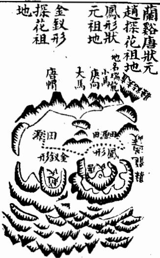

其盡結者為趙探花公志皇祖地與狀元地共帳入首大飛蛾頻起太陽金星開鎖結穴兩股直硬元辰流長虎沙順水尖竄不利初代將及百年乃出貴先是探花之祖精堪興之學擇此地至今人才富貴鼎盛二妻各卜一地一富一貴

集 要形霄探 求課形花 官云課公 半分云之 箇明一祖 無一木官 今穴冲县 二仰天佐 房天势精 子湖挺堪 孫倉然輿 责在文學 者重章愛 少重四蘭 富又海邑 富秀有山 者孤名水 少粟傳秀 贵陳雖麗 果贯然自 皆朽衣衢 如房紫還 其房腰 言有金 若貴妻 畢各 意卜 家一 無地 三一 項貴 田一 者者 乃乃 天凤 湖冲

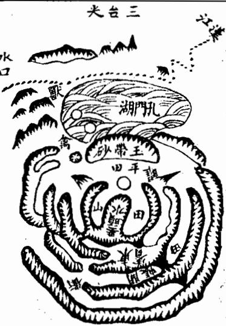

右地在蘭谿縣東二里地名瑞龍其龍自金華峰作祖而來五星聚講復辭樓下殿開帳磊落正龍過峽去結縣治其左枝分落後復開金水帳中抽出一脈逶迤成垂頭紫氣貴格經曰垂頭紫氣號文星天下盡馳名面前大小雙峰成天馬之格斷曰大馬趕小馬富貴傳天下塟後出唐漁石公唐龍登進士官至吏部尚書其子小漁公汝楫登嘉靖庚戌狀元至今富貴未艾

艮山發祖寅甲卯過脈轉亥結頂換辛服入首作甲卯向

右地在杭州府土名江頭九曜但其龍乃自九曜逆生一脉穿田過峽頰起玉屏屏中一脈逶迤清巧復作金正結穴穴星兩臂橫展中開一坪坪中立穴太潤似乎散漫且右臂牽拽遠去十餘里以作江頭街陽基此則橫龍落服一節而巳俗眼觀之莫識此砂爰是龍氣太旺寸寸是玉處塟後生江公玭登進士官大參子文昭公瀾官南京禮部尚書孫曉會魁官工部侍郎贈尚書暉會魁翰林修撰曾孫曰圻登鄉

右地在承天府東北其龍發于大洪山旺氣融結為府龍大榦又分注到此入首橫列大帳帳中抽出嫩條廖氏謂垂頭紫氣清秀頴異大凡木星不下當頭此地左右兩穴虛中正合倚仗塟法張子微謂之天鼻穴左右龍虎廻抱内外明堂環聚近有玉帶砂闕收内氣遠有三台峯獻外洋北湖寬暢漢水盤旋四勢和平三陽具足龍旺穴藏風得水真美地也曾氏曾祖指揮公始塟其地繼塟其祖知縣東莊公今楊白公父子進士通顯嗣續之蕃詳見彭澤祖地第二十册内

右地在休寧治北一里地名尼姑庵其龍與縣龍共祖不悉迷分龍後開帳出脈細嫩巧為蘆鞭連起兩節太陰文星清秀均勻展翅垂脚俗呼雄牛趕雌牛形正脈栖閃轉身逆水結穴穴下鋪坦餘氊蘸水臨田穴後抱托有力前朝大小雙峰秀異但明堂水過穴返去無情水口不交為疵耳塟後出襄毅公信登進士官至兵部尚書子篁墩公敏政登榜眼官至禮部右侍郎翰沐學士贈禮部尚書

自山穴按 誤乙于是 又辰天地 以竟星乘 誤以非縣 人受久龍 惜害永旺； 哉公之氣 言兆格 談篁县 地墩精 理不度 四察但 書襄 桂毅成 詆之乾 天塟轉 星义坤 既卜申 以南作右龍在錢塘萬松嶺聖國寺後其龍與杭州府龍共祖此即數里之外分出一脈出身御屏高聳屏下連珠數節走馬到頭起仰高太陽開口做穴吐畧平坦二十餘丈却復峻陡陡下却是寺宇登穴從左手一傍入到穴中不見寺宇併陡峻處但見四面遠峰矗矗錢塘江水洋洋對岸金馬門門中貴人秀立海門三山渺如拳四神八將三陽六秀皆相拱照後出南字公儀登進士入翰林官至內閣大學士至今富貴未父

卷一下之三專論龍分支壠蓋高山平地形勢不同故支壠之說不可不辯故塟經云支壠之辨眩目惑心毫厘之差禍福千里是故尤當致辯于支壠焉

夫支者平地之龍也壠者高山之龍也其融結為地力量重輕大小貴賤不以支壠而分優劣但其形體有山峰平地之不同故察識其情性之術亦各有異耳蓋壠龍有星峰形勢脈絡分明易于尋索支龍千里平夷一望無際難干追求然壠龍則以磊落起伏逶迤奔走為美軟弱瘦削醜惡峻增為凶支龍則以相牽相連隱隱隆隆界水明白脊脈分曉為妙高底不明來勢斷截分水模糊為假大凡壠欲峙于地上支欲伏於地中龍最忌于風吹支猶嫌于水刼壠結穴于山麓支結穴于巔頂塟經云卜支如首卜壠如足又云支塟其巔壠塟其麓此支龍龍穴不同之大法也其間變態不一咫尺頓殊真支真壠固所易辯奈何有似支之龍似壠之支或支來而壠止壠來而支止或壠變為支而復為壠支變為壠而復為支亦有以支為壇垛而行龍于上以壠為壇垛而行支于上者又有壠內而支外支內而壠外者復有強支弱壠急支緩壠高支平壠隱壠隆支石支土壠老枝嫩壠偏支偏龍半支半壠及夫非支非壠不可辯者故郭氏云支龍之辯眩目惑心自非明師耳提面

今莫能別也學者先須察此此而有得尋龍之能事思過半矣

天電者山也山壤之龍祖案欲其高大來勢欲其雄偉星峰欲其秀麗剝換欲其相生過峽欲其周密枝腳欲其蕃衍益遠欲其重多行度欲其活變護從欲其稠密穴場欲其藏聚四勢欲其和平此皆山壠尋地之要訣耳然壠龍勢險而有也故於險中求平所謂高山之窩是也塟當避殺乘生經云壠塟其麓為大法也却又有等以壠為體而得支之情性者則大山垂脈落下平地變為支體此陰中含陽之義也時師往往粘塟山麓而以前拖平地為禍褥殊不知龍勢未什微有龜脊隱隱隆隆穴落平地法當枕球而塟然陰者為強固宜避球靂奈何性慢以其要插上急其緩性劉氏所謂壠緩則入簷而湊球是也苟以壠法扦之則敗絕立應此高非之至離體認者不可不察也

## 論支龍

夫支龍者平地之龍也平地之龍其祖宗父母剝變過峽與夫枝腳橈棹纏托護從大段與壠無異吳公口訣有云卧倒星辰監起看故亦有閑帳穿心亦有華蓋三台御屏玉枕等格但龍行地中皆平面倒地多潤大難于檢點惟以相牽相連步其龍脈高一寸為山低一寸為水察其隱隱隆隆之脊或直或曲動輒轉十里或數里始有水分八字之陝或有石骨微露踪跡或有銀錠束氣之脈若前面遇水界截則審隨龍之水及諸水聚處為明堂以求穴向其結穴處自然氣聚或平中有突或開鉗口或吐唇氊或微有壓如難窠如旋螺之狀心有龜脊牛背草蛇灰線之脈入首束聚結穴而此處須要高低分明有水纏遶或水溶江或出朝入方為的實又須審其來歷有蛛絲馬跡貼地梅花落地金錢等格决是美地扞得穴真塟得如法富貴悠久若來歷不明切勿妄下平地無氣易于絕滅所謂來歷不明者乃來脈龍勢一坦平陽無脊可據高低不分全無界水無過峽無石骨証脈無銀錠束氣無龜脊分水無草蛇灰線藕斷絲連之脈八穴或巳經斷而不相牽連散漫無氣只無融結其父母兄弟之脈各自分飛平地之上雖或忽起墩埠孤單無應必作他龍之用神或是龍腳所帶之秀氣為印為笏為金箱環佩之類或是水口羅星游魚等砂故廖氏云走珠墩埤在平地三個五個是若孤單一突又無分水度脈來歷未可便作平中之突而有融結卜氏云星散孤村秀氣全無半點又云滚浪浮花隨風落葉皆是無蒂無根未必有形有氣此皆平支龍尋地之要訣耳然支龍平坦夷曠故于散中求聚所謂平地之突是也益當揭高就脈經曰支塟其巔為得法也却又有等以支為體而得壠之情性者則直如擲槍急如繃線術中謂之倒火硬木此陽中含陰之義法當避殺粘簷架折而塟劉氏所謂直急則避球而湊簷是也然陽者為弱本合湊入奈何性急以此要縮下緩其急性苟以支法扦之則凶禍立應此平支之至難體認者不可不知也

<!-- doc017 PDF 第 29 页：高风险/复杂版面 OCR 供检索；内容与排版以原页图为准。 -->
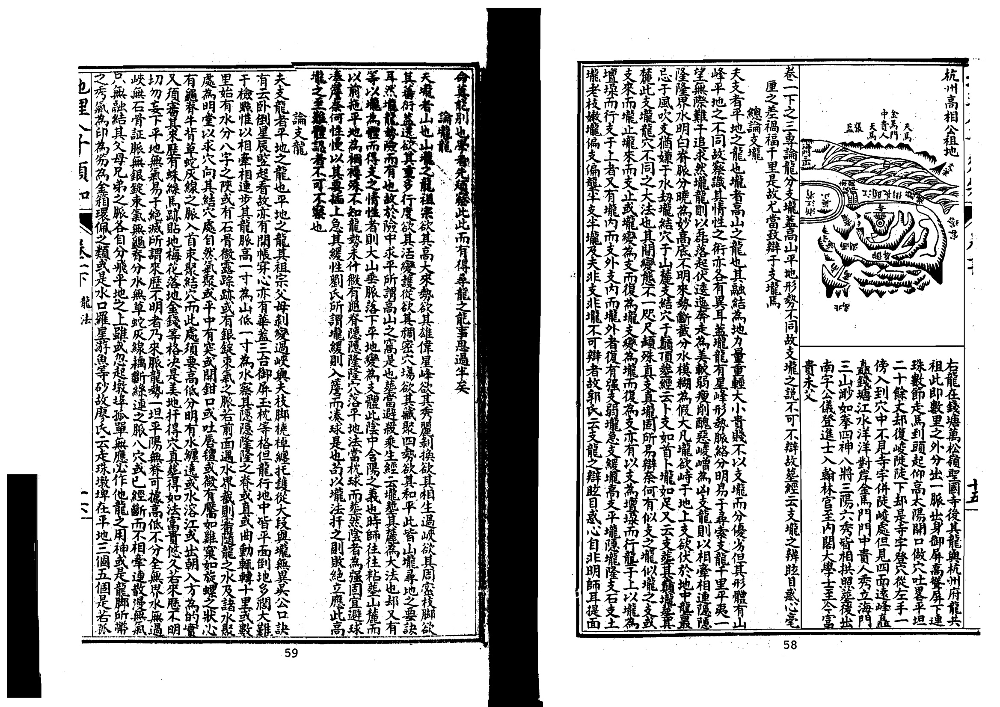

巳上所論支龍大法如此但壠之星峰易辨支之脈絡難明前輩謂支龍難于壠龍尤當細察茲故特集

筠松龍經云坪中還有水流波高水一寸即是阿只為時師眼力淺到彼茫然無奈何便云無處尋蹤跡直到有山方始識如此之人豈可言有穴在坪先自失只救山下覓龍虎又要乳頭始云吉不知山窮落平處穴在坪中貴無敵痴師誤了幾多人又道藏埋畏卑濕不知穴在水中者如此難憑怕泉瀝益緣水漲在中間水退即同乾地力如此兩淮平似掌也有軍州落窠瀝也有英雄在彼中豈無坟墓與宮只將水注與水流兩水夾來是龍脊

體不愛水返去尋他水抱方有山來抱水不抱兮山不到莫道高山龍易識行到平陽失蹤跡藕斷絳連正好尋退卸愈多愈有力

又云大梁形勢亦無山到此尋龍何處是識得星峰是等間平地尋龍最是難若無河流與淮水渺渺茫茫不見山河流衝決山斷絕又無石骨又無脈君若到彼說星峯一句不容三寸舌又云十里半程無岡嶺平陽沙漬煙塵述到此君須看水勢莫問江與溪只要兩源相夾出變銷外結重重圍又云凡到平陽莫認踪尸看水遶是真龍又二云高山大壠峰多秀不似平原一錐卓又云也曾見穴在平陽四畔周圍無高岡又云上智尋龍觀氣服指望高山散蹤跡相連相接下鄉村失跡遺蹤細尋覓氣逢水界有住期如緝悠悠細消息平陽大地無影形如灰拋線要君識相粘相牽尋斷絕盡是平陽真口訣過時如雁列深雲藏時猶似泥中鱉平陽相並中酥落在坪中誰辨別

栃公畫莢圗云平地之脈如草中之蛇灰中之線只看水分水聚之中便是真氣融結去處又曰臨田觀穴不問大小八字只看上面形勢分曉下面証佐或唇或口便為真氣正穴又曰平坡之脈如掌窩水聚交而不流鎖斷真氣便是關門立穴之處仰着上面脈必有列翼如燈影穿壁輕薄而不動自有高卑又曰高山落落平田若有火觜要看火盡處若開鉗口謂暗火開紅此是火放灰中似見火紅如尖嘴不開鉗口謂之死火帶殺不可塟又曰龍到平陽臨田結穴者上有來下無出脚但見田面前兜轉似帶似蛾眉拱護此上是穴又曰龍落平坡日久年深人開成田地要看兩邊形勢田墩一層低一層如急浪下灘細尋前面水勢迴環兩田如月角兜轉始是真龍作結之處謂之浪花裏滚月又曰高山行龍勢落平地無蹤無跡無龍虎形如鋪氊展席散如碧玉之紋浪花滚月雪裏飄梅如灰中之搜線如草裏之尋蛇詳加目力詳辨陰陽切要諸水聚堂朝對尊嚴簷秣下合分明氣脈自然融結沙水來去得位門戶重重闕閉坐下賓主有情又要月堂口渦底四圍不頃爲水口不通舟可謂吉地矣

陶公捉服賦云支阜平夷如灰拽線悠悠而縮瓜藏形隱隱而無頭無面豈知遇水為真乘風則散又曰大地平陽迴環四顧得水藏風時人罕遇又曰雞鳴犬吠鬧市烟村隆隆隱隱孰探其源若乃斷而復續去而復留形異相千金難求折藕貫珠真機茫漠臨穴坦然誠難攔摸障空補缺天造地設留與聖人先賢難說張子徵云中原平地及湖鄉行龍入地至難詳尋得龍來無穴下茫茫潤遠何相當此名天平只看水水繞廻環是穴中若還舍水去尋穴望望皆平無定踪龍如逢水穴方止無水攔斷去不窮諸公記此水龍訣不與岡山一例

劉氏云中原百里千里皆為平地雖有高形可尋龍脈無穴可下洋龍之隆隆隱伏間有得見處然到作穴又 無定蹤只看水之曲折如何水若環遶攔截穴頭固為易見不然水亦在前或在後灣曲之處相當即可定 穴法如無水處雖有穴亦必非龍脈盡處不為端的若以山鄉之法取之則失之矣

廖氏泄天機云更有平陽局又別傾稟為君說星辰原出在高岡撤脈下平陽高岡聚講與過峽行龍皆一法撒落平陽始不同切莫失真蹤地有高低即山水節目同一體遠山近水兩旁纏脈似藕絲連倒身龍格隱復現脈土行時見隱隱隆隆正好尋尋得值千金又曰平地龍神觀水勢認取原無異

范越鳳洞林秋訣云平原曠野茫然數百里之遠視水所歸則知來山左右兩阜拱接分明可以藏車隱馬有盤曲之水朝向之流乃第一地也高山平原本無二說要以形勢為本觀其來歷綿遠氣象環合高山無懸崖崩破之害平原無斷壠橫塹之絕乃叶吉卜故陰陽家貴于心得意解不可執一又曰相平地之法四顧審其土脈觀其流泉得水為上也

吳云指南云古人謂大地落平陽蓋以其祖宗發脈而來中間剝變過度處多氣脈既全便無力亦水深土厚此平陽所以謂大地然而平陽龍法非俗眼所能尋識多是高山大壠忽然撒下平坦人但見山勢巳盡而不知水分八字界過護從送出正龍一脈如絲如線在此處藏蹤閃跡直拋過前面去却微微突起三五七個平低山阜出來或土洲之類牽連而行又復跌斷却去前面或作突中窩或作窟中突宛然成一天然之穴其做穴處四神八將自然應付堂局水城自然迴抱乍看似無好處細玩却有妙理故平陽地所以難尋而又難識也

明山寶鑒云平陽大地認水為龍龍勢若迴龍亦隨注一丈之山勝彼千丈一尺之山勝彼千尺

尋龍歌云平陽大地無龍虎渺渺尋何處東西只把水為龍下後出三公 入式歌云茫茫四畔無龍虎君若尋龍向何處地師只把水為龍交流便是龍歸路 卜則魏云窮源千仞不如平地一堆又曰水星多出平地妙處難言又曰或隱顯于茫茫逈野又曰平中得一 突為奇又曰彷彿高低依稀遶抱又曰地卑處切忌泉流又曰平地起培樓一東一西又曰平陽地當斟酉 不宜掘地及泉又曰平沙落雁偏宜水泊岸浮解不畏風又曰勢如波湧何須卓立之峰服若帶連何必高 昂之阜 二之之山衣八口巨仁白風之旦弟真依甚里玉木官旁人說是非水若抱龍龍抱水背劍 一十六脈歌云仙掌脈少人知平陽不怕八風吹但尋真脈堪埋玉休管傍人說是非水若抱龍龍抱水背劍 斬砍自由伊

三十六穴歌云平陽尋取地中凸覆頂真絕頂上安攻最可求迎取水來朝曾葛溪云大山散下一龍穿田過峽失脈失踪不見融結曠野茫茫無可捉摸此乃愈剝愈指愈換愈嫩不首暴頭露面一向藏蹤隱跡或奔溪澗江河或入人村鬧市或趨湖泊田塘或出廣段田州隱藏出没如江中拖練藕斷絲連如蜘蛛墜樓流星渡漢拋球走珠鋪玷展席金盆何葉如此等象看安穴處有無皮肉頭口月義艮K各王旦丘進月青德度相照比等之地最為綿遠

吳公口訣云平陽之地坦蕩迫野蹤跡隱伏散渙依稀雖無峰寢之可訕亦有服終之可求須要邦其來鬼祀宗以看出身降勢撒落平陽分毫之高者即為山分毫之低者即為水或隆隆似有或隱隱如無及至落穴之祭亦必敬有形勢之可指山水趨迎氣脈藏聚如露珠注在荷葉之中乃為真作結也

張紫瓊俯察云平地龍雖曰愈剝愈嫩愈換愈精也要穿田過峽處不被風吹不遭水刦出身大長須要旁有金箱玉印偃月七星小陰大陽夾照為吉左隨隨龍水交會入首或作鋪氊土棋盆上倒地水浮牌水水泡金波浪金波浪水及落地梅花落地金錢蜘蛛結網没泥龜没泥蛇之類方是融結若平田渺洱更無高下

雖有堂氣亦不結也 趙緣督穴法曰平地有突氣湧如生絕勝萬仞仙根難明尸觀水勢便見世情水如不遶穴法無憑 謝子期云迥野之脈體段不一有平波渺渺茫茫如鋪氊展度而來者有田層層級級若水之波而來者有 起峰墩如星珠龜魚而來有微露毛脊如浮漚見鳥而來者是皆地之吉氣湧起故土亦隨之而起凸也其 其來也兩邊有水以送之其止也左右有沙以衛之且明堂寬正又得橫水攔之外陽遠案在于縹渺之間 而四圍陰砂僅高數寸而巳此皆平陽龍之貴也

張落魄云平湖之脈坦夷曠蕩却是支龍行度其體段若盞中之酥雲中之雁灰中之線草裡之蛇或沉潛或無影無形或藏倖而失跡遺蹤生氣行乎其間微妙隱伏而難見全在心之智目之明以高一寸為山低一寸為水察其支之所起辨其支之所終起則氣隨之而始終則氣隨之而鍾若脈畫而水止界合分明者此平陽之大地也

觀物祝公泌云郭景純曰支塟其顛蓋以平支龍必須起微突處謂陽來陰受方是結穴若無突要開鉗口方一有穴故曰平地不開口神仙難下手

永和周氏云平陽則山不拘于高水不拘于深但遇有尺寸高低即可以辨又云在山者頗易看在平陽者最難識陶公所謂頡起則時人曉會牽連非達士難言是也蓋如灰中拽線草裡尋蛇沙裡揀金泥中藏歡雲中騰雁盜裏浮酥隱而不露斷而復續並以兩邊道送之水為驗也

廖氏云法中有没牛吹氣穴詩云沒牛吹氣失來蹤隱隱伏真龍昂頭些子如吹氣沒牛泗暗水勢左回右抱脈微高大則公侯小富豪又云龜魚螺蚌形宛如水中生水中自有真龍聚此地傳千古梁窮溪云龍勢洋洋落大坪連天接野不分明隆隆隱隱尋蹤跡曲曲灣灣斷復生忽然有突聯三五認取聞鉗是穴情定要水來環包穴沙如牛角兩邊迎

右諸家之說各有攸當大槩平陽龍法以高一寸為山低一寸為水隱隱隆隆看兩邊分水以認來龍之 過度哭起支阜以認穴道之融結又須有四畔羅城秀峰前應後照如列屏鋪障相與擁護乃為盡善大 抵以得水為上卜氏云如在平陽先須得水兼陰陽二宅言之矣平支龍穴最難辨認故引證諸家之說 以明之當詳察焉 終

## 圖 繪地理人子須知

重刊人子須知資孝地理心學統宗卷二之上

論少祖江右山人

此冊專論龍身行庶節目益龍之節目有太祖少祖以及父母胎息孕育入首諸格皆觀龍之大旨審龍者誠於此而有得庶幾知其要歸云論人具山

同著

夫尋龍之法當原其所始故先察祖宗山經云尋龍須尋祖與宗不辨祖宗何足話賦云問祖尋宗豈可半途而止蓋山之有祖亦山木之有根水之有源根大則枝遠源深則流長自然理也是故尋龍之法必先究祖宗知其祖宗則龍之遠近長短氣之輕重厚薄力量大小福澤久暫皆可於此而察識之矣龍髓經云口用源流來處好起家須是好公婆公婆即祖山也小則巍曰祖宗聳拔者子孫必貴子孫指穴而言皆謂有特里祖龍必結富貴美地故尋龍必先觀祖宗山即其遠者而名之有所謂太祖山焉亦曰如祖以其去受穴者甚遠如人之有始祖遠宗也然此太祖山必須高大迥異或跨州連郡袤延數百里大者如名山五嶽小者亦必高大冠於一州一郡又小者亦須冠於一邑一方乃可謂之太祖山其形則巍然高大聳入雲霄或如龍樓寶殿千絲墜萬石倉等格其發出支派蕃衍不可悉數如人之太祖子孫眾多未易舉者也祖山既高大異常其天時將陰晦則有雪霧生其間廖氏云祖宗高頂名樓殿常有雲氣現楊筠松云先尋霧氣哉正龍又云尋龍旺氣先尋脈雲霧多生在龍脊春夏之交與二分夜望雲電生處覓雲電先生絕高頂此是龍樓寶殿定故觀雲霧之所生以察山龍之太始亦一訣耳既能認太祖山以次審其出身行度及父母胎息以至受穴之山皆於此原其始矣

尋龍之法須穴祖宗然太祖遠宗猶恐未真又富於少祖察其來歷審其美惡庶為親切故不可不論少祖山 也夫少祖山者即近祖次宗廖氏又謂之主山龍行既長離祖已遠各八派將結穴處忽起高大山巒不過 2一11口 能去

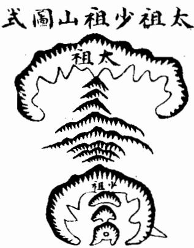

數節即結穴場其高大山巒謂之少祖山也若其山分枝尚多結穴尚遠猶未可謂少祖乃是駐蹕山住腳星長猶是遠祖若是少祖山則自此山下去穴不過數節如節數太多便謂離主星遠力輕氣弱又須再起主星方好廖氏云若是山家結穴龍定起主星峰言結地龍必有少祖山作主星也又云二三節內穴星成福力寔非輕節數遠時福力少再起主方妙言穴不宜去主山太遠也又云主星大小合龍格造化便可測言少祖山須合得龍家諸格方有融結造化故凡美地必起近穴少祖山而少祖之山必然奇異特達秀麗光彩或開大帳或起華蓋寶羊或作三台王枕御屏諸般貴格或成沖天木獻天金漲天水焰天火湊天土等星辰既有此少祖山合星體成龍格必不虛生定有融結若此少祖山欹斜不正孤露峻嶒瘦削破碎臃腫惡岩帶殺醜陋委靡軟弱頓困種種凶惡之形不成星體不合龍格則無融結縱有穴場堂局諸般可愛亦為不吉的主凶禍或誤下之行至此節各以類應禍不爽矣

此則將結 穴先起高 祖少起重山祖少無大星辰作少祖山自少祖山下數節即結穴極有力為吉地也圖

##

此則自少祖山丁如生蛇擺動入有結火少 亦為吉也不必拘其大起伏只要曲動龍 吉不祖 S格中謂之水水蘆鞭極貴吳公曰訣云入者節內有蘆鞭當代兒孫中狀元 圖

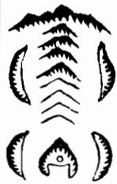

不論後龍長短只入局忽起少祖高大尊嚴挺秀冠乎羣山以作主星自此山下只一節或二三節即結穴而次場正座此星貼近枕靠有力者其地力量大發福速如建寧陳副憲祖地其格也

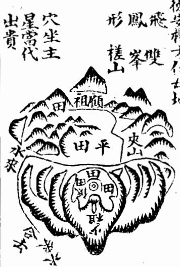

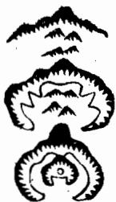

##

此則離太祖山以下迢迢而去更無高大星辰作少祖山委靡八穴力輕氣弱乃凶地也

此則起少祖山以下節數已多離少祖遠却又再起高大由又為少祖一節即入穴此地力大福厚極吉

此則雖有少祖出穴醜惡不成水水不合龍格出脈又是偏落受風縱有形穴深不可下的主敗也

上地在建寧府西北河西其龍來遠不詳迷入首頓起主星高大尊嚴挺秀迥異護從周密正服從中落下平地穿峽起乎坡即結穴穴場正座主星有力開鉗吐唇明曰前案低伏近身如眠弓抱穴有情以關內氣逆收大溪之水內堂水口石墩如印左右映帶前朝秀麗內堂湊巧外洋寬暢葬後即出羽泉公紀旺午葬甲登嘉靖丙辰進士官副憲封君縱遐壽康寧累膺

誥封諸孫濟濟福祉未艾

上地在德安府東北六十里其龍目槎山作祖磊落奔 騰二十餘里乃大斷過峽翻身逆盤為回龍顧祖之勢 忽起土星高大尊嚴挺秀過異冠於羣山正脈從中逶 迤落下平坡結穴穴前吐出鹽唇左右掬抱有情前對 祖山如唐帽近有文星正應下關緊固水城遶帶明堂 寬乎後座主星尊重得水藏風離龍扦丁山癸向葬時 次泉公芷方三歲欲移而氣生後登嘉靖癸耳進士官 至江西右布政福祉未艾

<!-- doc017 PDF 第 34 页：高风险/复杂版面 OCR 供检索；内容与排版以原页图为准。 -->

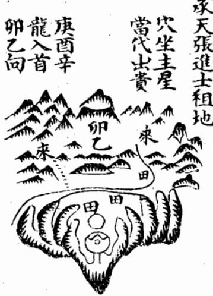

王ノ二多夕え一一

##

上地在承天府北五十里土名蒿河安乎沖其龍來遠不詳迷入局磊落踴躍十餘里將到頭大斷過峽翻身頓起主星挺然端秀冠於羣峰為華蓋貴格中抽正脈逶迤而下一節即過復起大突結穴穴後正座主星勢甚尊嚴左右兩掬包顧有情下闕重夢前朝羣峰列秀三尖卓筆正朝近案拜伏羅城水口周固係西兌庚辛龍扦卯乙向當代即山明字公時照載衆公坤連登科甲 嘉靖乙己年葬地戊申年張明字生

庚申年載寰公生癸未進士

凡平岡之龍多只透迤而來若行度擺摺屈曲亦不必拘其必有少祖山方為大地尸要將入穴際二三節內跌斷東氣結咽過服北即同有少祖山也蓋山之一起氣固旺而山之一伏氣尤旺故不必拘於頓起高山為少祖耳但其斷處的以近穴為貴一節即入穴尤妙切忌受風必須從山相夾護也平地之龍亦然必於穴後有束氣脈為妙而其束處要微高有分水明自則束氣入穴有力方為真切蓋乎陽氣多散漫貴於收斂既無墩阜可為少祖必當以斷處束氣為準或成銀錠之脈或有珠絲馬跡草蛇灰線藕斷絲連龜脊牛背等形則氣末得聚也穴場乘得氣之聚處乃是真融結否則散漫無証縱有坪中突窟亦認脈不真不可下矣

論龍父母胎怎孕育 經曰萬里之山各起祖宗而見父母胎息孕育然後成形是以認形取火明其父之所生母之所養卜氏云問 祖尋宗豈可半途而止又云胎息孕育神變化於無窮是皆言龍之有祖宗父母胎息孕育然後始成穴也或 曰先起高峰謂之祖次起一峰謂之宗再起左右雙峰謂之父母誠如其說則是父母置之無為之地而其所

## 十三扣

生皆祖宗耳張子微已嘗極辨其非而洪悟齋又拘於節數謂自玄武頂一節為父母二節為少祖三節為曾祖四節為高祖亦太泥耳若用其說則自四節已上之龍又將何名大抵龍之起身發脈處必有高山大巒語之太祖自此而下辭樓下殿迢遞而行又起高峰即謂之宗復行遠迤奔騰磊落其間小可星峰則不必論直至將及結作必要再起高峰逈然聳拔超異衆山謂之少祖自此少祖山下或起或伏或大或小或直或曲但以玄武頂後一節之星名曰父母父母之下落服處為胎如稟受父母之血脈為胎也其下束氣處為息如母之懷胎養息也再起星面玄武頂為孕如胎之男女有頭形體也融結穴處為育如子之成山胎而育也自少祖山至此最關繁要須是合諸吉格束氣清切護衛周密乃以為吉諸家喋喋之論總不必拘無非啟其尊卑有序大小有倫自高落下自變細自老抽嫩星辰之生尅不逆橈棹之長短合法則得祖宗父母胎怎孕育之妙乃有生氣融結而鍾靈乃秀造化存焉依法葬之福應如嚮其或祖宗當高而反低當大而反小胎當細而反當嫩而反老此則尊卑失序大小無倫凶氣所集不可下也

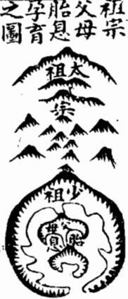

言青未論千里來龍且看到頭融結故凡觀龍之美惡及諸般龍格尸於入首父母 EE 穴後二三節四五節內以至少祖山為緊切審其龍勢若有起有伏透迤字育 走弄活動棲閃而頭面端正星峰秀麗枝腳隨身及有落穿傳變台屏帳之圖 蓋走馬珠串蘆鞭王字个字之字拋梭展翅飛蛾種種貴格而隨從之山及本身枝腳又起峰巒如倉如庫如旗如鼓如天馬貴人笏印金箱寶劍文官武庫天乙太乙等形夾送之此為真來此處融結是我所用親切無疑以其在近穴數節間也似此之地結作真力量大發福速若少祖至近穴節內並無吉星不合諸格或懶緩怯弱死硬腋腫粗惡直長無枝脚或枝脚拖洩散亂失利而成鬼却任是龍虎明堂朝案仲仲皆美奈何坐下無龍真氣不鍾諸般美利種種成空切不可認少祖以上之龍特達可愛而信庸師之言謂遠龍奇好必後代有貴但初代不吉恕近慕遠希圖後代之富貴而誤下偽地反消己福不知千里來龍看到頭若到頭近穴處龍既不好其遠處雖有好龍不能受用或別有結作其好龍固非虛生

## 圖之吉龍首入

<!-- doc017 PDF 第 35 页：高风险/复杂版面 OCR 供检索；内容与排版以原页图为准。 -->
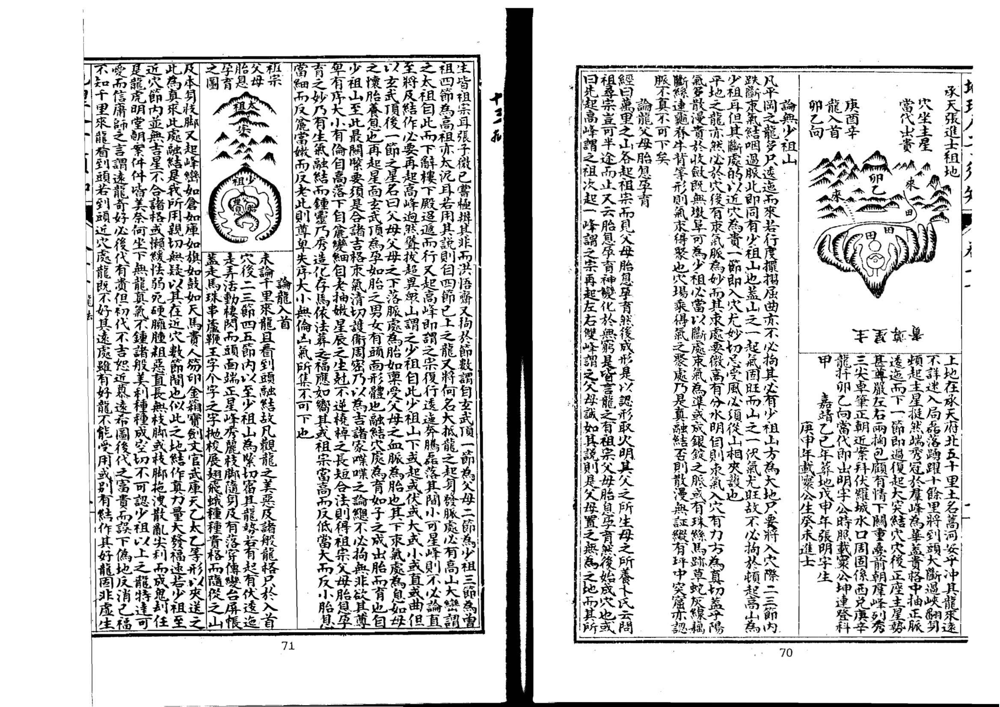

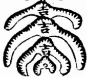

但不來此處融結此山既非真龍必是真龍正穴之奴從或為纏托或為夾送或作下手關攔或作捍門水口之妙或是正龍枝腳橈棹倉庫等件尤須檢點再去審其少祖分行之處某枝委是真龍受穴之山若是真龍自然尊貴特異宜於此山追尋正穴必有真結故審龍之要必於入首近穴數節內為緊譬如人之遠祖雖為王侯顯貴己在數十代之前至於其祖父貧困無聊遂為賤役及其身亦伶行不振則其遠祖之王侯顯貴安能庇及數十代後之子孫哉遠祖雖或貧困至於祖父而崛起為王侯顯宦則其一二代之子孫或受蔭為官或貲產巨富必能藉其餘澤以享富貴遠祖雖貧何害焉此好龍所以欲其近穴而遠龍雖美不可恃也故凡觀龍美惡及諸貴格的於少祖山以下審之合吉則吉類凶則凶禍福親切不差毫末也

此遠龍不好將入首 近穴剝變好龍是吉 圖之凶龍首入地但年代行到跌斷後龍氣不好處即敗宜別求吉地接福

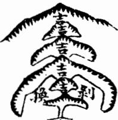

此則遠龍好將及入首近穴變得不好乃為不吉主凶不可下也

上審龍入首美惡定地吉凶乃緊關口訣甚為簡要大凡美地皆以入首龍吉而致福應如浮梁載尚書祖地後龍甚弱而入首為美亦出尚書鉛山費狀元祖地來龍甚遠而近以入首三者為課可見尋龍固當穴遠而尤必以入首為準也二圗具下

此地在浮梁東鄉後龍甚弱惟到顧起三台一節結 穴左右抱衛明堂平坦內外應證葬後初代出恭簡 公珊官至尚書又進士數人科第不替由一神仙名 曰鐵仙

上地在鉛山縣二十八都地名烏石山其龍起自黃旌峰迢遞百餘里歷上女峰至徐源嶺過峽頓起合珠山重重開帳不及詳述將入首穿田起玉枕落服左右小山夾照狀如日月正脈中起穿心成三台兩舜均均可愛中落一節結穴龍格甚貴只是穴星獨高似露土聚似峻護山低伏穴上左右一望青天似寒穴前右沙頫水似獵潤坂明堂似壙橫峰前朝羣山似亂下閼大琛山甚遠似寬對面觀之本身下手無情諸山順奔勢隨流水似不圍聚不入俗眼殊不知穴星獨高眾山低者高為尊也穴前雖峻上聚星辰若開口穴不下畏陡枚棺定有坦平坡

故乳或徵窩正合此也左右雖低微窩緊夾藏車隱馬不畏寒也處沙順水乃是明曜而非攘也外堂雖潤內堂已聚不為壙也前朝雖亂然皆堆堆壘壘如狀元旗如筆如笏如貴人誥輔天馬席帽皆合貴格葬書所謂若具萬膳而潔齊也下關雖遠榦龍纏護即江河也況信河之水朝入明堂而河中大腳石截有力又有綣績石窟鎮叫巖山與大琛山交固關鎖真至吉之地葬後四紀長房三中科第連喪其二議欲改莽豐何巡司見而奇之曰王枕龍曰月峽隱隱三峰向前插狀元宰輔此中生兄弟叔姪同科甲狀元出世矣何可改也是時文憲公宏已十歲餘不數年果大魁天下官至太保子懋賢登進士官郎中懋良官太守女曾諸孫皆貴文憲公弟清湖公與姪探花懋中同科九子皆貴望湖公懋文與兄懋戶同科參政公瑄與兄珣同科禮部尚書鍾石公宋與姪懋和同科尚書公子懋學官太守姪懋樂官郎中今唐衢公堯年登進士躋顯宦廷之太僕寺丞華禮部主政懋謙懋稷諸公俱任京職父子兄弟叔姪同朝果符何氏之言云按是地也夾龍雖遠至入首穿田而起玉枕又大斷而起三台中落一節結穴為至貴之格狀元由此而鍾宰輔由此而孕故觀龍的以入首三節為準也前砂子峰獨秀應文憲公戊子生三台係丁未龍故公以成化丁未狀元也

<!-- doc017 PDF 第 36 页：高风险/复杂版面 OCR 供检索；内容与排版以原页图为准。 -->
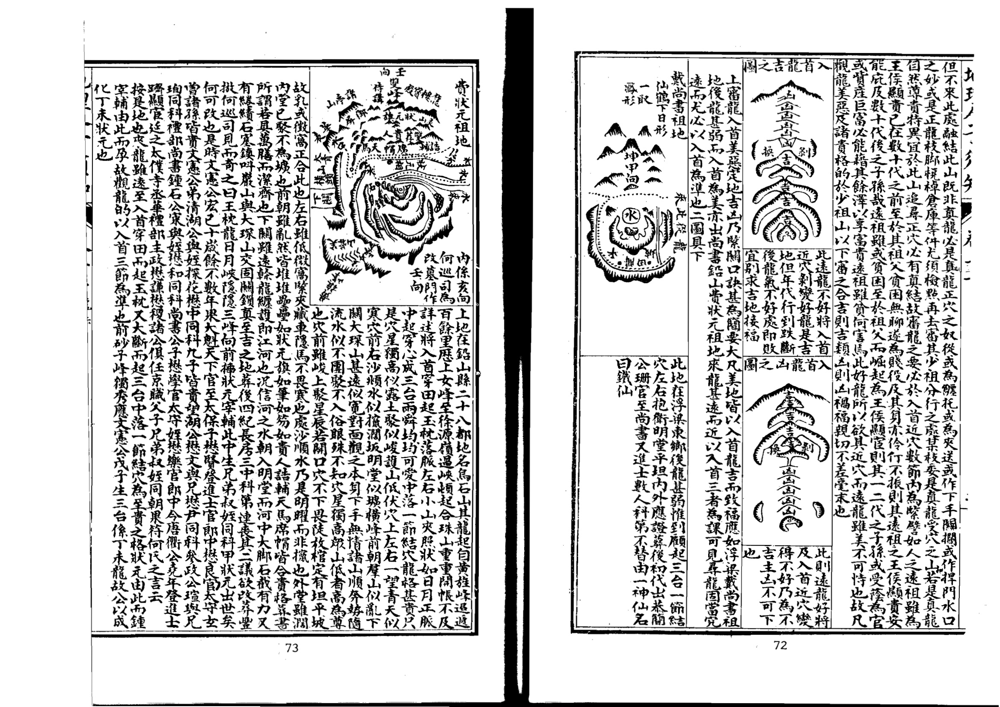

## 論龍出身

卷二上之二專論龍之出身及剝換過峽橈棹護送之詳夫觀龍之法既明其太祖少宗父母之節目又當審其出身剝換度峽橈棹護送之玄微蓋自祖而宗自高而下迢遞奔走雖奴從之龍凶惡之山其勢相類苟無術以鑒之則吉凶莫辨故必於其出身處以原其所始於剝換處以察其所變於過峽處以審其所度於橈棹護送處以觀其貴賤美惡則龍之真偽吉凶情狀自判然矣

龍之出身乃祖山發服離祖分行處也蓋一祖之下必分數龍其間美惡吉凶端倪已兆若此出身之際特異不允前去必有穿落傳變融結富貴之穴如或此處出身不美縱去有形穴穴亦非吉地不必追尋其出身吉者或宏開潤帳而穿心出脈或連起數峰而聳拔不凡或辭樓下殿而磊落或夢雲集蟻而繽紛或五星聚講或七政連班正穿正出中起中落夾護拱照氣象軒昂枝葉蕃衍步驟活動玉髓經云祖宗生龍百龍共生出來時有輕重大龍重處在中央其次龍行枝葉長吳白雲云尋地須先認祖宗更於離祖察行蹤辭樓下殿峰巒秀預識前途異氣鍾董德彰云大凡龍脈初發處若屈曲如生蛇之下嶺而兩邊有蟬翼護帶者前去必結大地其出身之不吉者則瘦弱委靡不起不伏不活動摺擺子微云龍無星曜低低去此是賤龍出負處大抵龍之出身如人之出處出身不正必非賢良縱有顯位奸邪誤國天下受其禍出處之光明正大者必完名全節天下受其福龍服出身何以異此然又不可拘固有前出不美而後復變吉者亦有前出大吉而後却變凶者如人之先雖凶惡而後能改過遷善不害其為君子先雖正大而後乃變節為惡終不免為小人凡此之類尤當詳辨不可忽畧此而有悞則認凶為吉指吉為凶是非顛倒禍福謬戾矣

廖氏曰龍開幛而出者最為有力 金水腦為上水星次之要形如幛 幙而角分明有帶下垂方是中出 者為上兩角出者次之巨石在右 為大關在左為地障形類龜蛇串 珠印劍等格尤妙得此護脈方可 知無得遮角遮護過亦可

發揮曰大凡開幃穿心須是旁起而肩末如弓稍肩如人有肩稍如弓有稍橫鋪潤遠始為正穿心故此開幛穿極貴濶者或十數里或五六里狹者一二里或三里之遠大龍布置百里二三百里者不在此例也凡此方為正穿心三五丈間不足謂之正穿心不過為中心正出之龍耳但此開幃穿心亦不多見間見三五節或止一二節但要其地傳變不雜氣服不散漫幛中而行或之玄飛走或拋梭裊鞭或蜂腰鶴膝或鸞鳳飛翔或蛇回蟬蛇或登梯降階不一而足只須龍真脈的不必全泥穿心此皆吉地又有一種穿心稍頭又起員峰高峻豐厚者自帶倉庫隨行也主大富盛又有一種開蟑之後絲線穿出特立秀峰者幢幛内貴人也主大尊貴又有一種開障之後兩服特起秀峰不與本身聯屬兩旁高聳端正此暗庫星也主其家富盛愛妾寵妃自收典質之狀然此等龍極為希罕蜈蚣節已為難遇况開幛穿心乎至於貴人倉庫尤為少見矣然此開幛穿心故為貴格亦未可使定前是何地又須看前後穿變應帶有一種祖宗不好胎息偏傷中間或有開障穿心或一二節氣旺者及至穿出處或分枝柯散亂或為斷絕空亡終不融結此為假龍作假穿心也然何以辨龍作假穿心也蓋從祖宗以來己覺偏斜醜陋此可見一也穿出之後又復緩漫散亂此可見二也入穴之際無神無氣湧腫昂雄輕重不等收拾不勻堂局破碎朝應無情此可見三也三者無取雖有穿心蓋遊龍遠出中間偶有一二節妙合貴格然前後無足觀縱有開障穿心起有結稍亦何用也

上列龍服出身圖姑以為式理難定拘智者觸類而長之可也

開帳原是龍格部位比既論出身則開帳亦是相連的姑言其概諸帳格詳見龍格部

<!-- doc017 PDF 第 37 页：高风险/复杂版面 OCR 供检索；内容与排版以原页图为准。 -->

右龍在錢塘萬松嶺聖國寺後其龍與杭州府龍共祖此即數里之外分出一脈出身御屏高聳屏下連珠數節走馬到頭起仰高太陽開口做穴吐畧平坦二十餘丈却復峻陡陡下却是寺宇登穴從左手一傍入到穴中不見寺宇併陡峻處但見四面遠峰矗矗錢塘江水洋洋對岸金馬門門中貴人秀立海門三山渺如拳四神八將三陽六秀皆相拱照後出南字公儀登進士入翰林官至內閣大學士至今富貴未父

## 總論支壠

卷一下之三專論龍分支壠蓋高山平地形勢不同故支壠之說不可不辯故塟經云支壠之辨眩目惑心毫厘之差禍福干里是故尤當致辯于支壠焉

夫支者平地之龍也壠者高山之龍也其融結為地力量重輕大小貴賤不以支壠而分優劣但其形體有山峰平地之不同故察識其情性之術亦各有異耳蓋壠龍有星峰形勢脈絡分明易于尋索支龍千里平夷一望無際難干追求然壠龍則以磊落起伏逵迤奔走為美軟弱瘦削醜惡峻嘈為凶支龍則以相牽相連隱隱隆隆界水明白脊脈分曉為妙高底不明來勢斷截分水模糊為假大凡壠欲峙于地上支欲伏於地中龍忌于風吹支猶嫌于水刼壠結穴于山麓支結穴于巔頂塟經云卜支如首卜壠如足又云支塟其顛壠塟其麓此支壠龍穴不同之大法也其間變態不一咫尺頓殊真支真壠固所易辯奈何有似支之龍似瓏之支或支來而壠止壠來而支止或壠變為支而復為壠支變為壠而復為支亦有以支為壇垛而行龍于上以龍為壇垛而行支于上者又有壠內而支外支內而壠外者復有強支弱壠急支緩壠高支平壠隱壠隆支石支土壠老枝嫩壠偏支偏龍半支半瓏及夫非支非壠不可辯者故郭氏云支龍之辯眩目惑心自非明師耳提面

## 論壠龍

命莫能別也學者先須察此此而有得尋龍之能事思過半矣

天壠者山也山壠之龍祖案欲其高大來勢欲其雄偉星峰欲其秀麗剝換欲其相生過峽欲其周密枝腳欲其藩衍遠欲其重多行度欲其活變護從欲其稠密穴塲欲其藏聚四勢欲其和平此皆山壠尋地之要訣耳然壠龍勢險而有也故於險中求平所謂高山之窩是也塟當避殺乘生經云壠塟其麓為大法也却又有等以壠為體而得支之情性者則大山垂脈落下平地變為支體此陰中含陽之義也時師往往粘塟山麓而以前拖平地為禍褥殊不知龍勢未什微有龜脊隱隱隆隆穴落平地法當枕球而塟然陰者為強固宜避球靂奈何性慢以其要插上急其緩性劉氏所謂壠緩則入簷而湊球是也苟以壠法扦之則敗絕立應此高龍之至難體認者不可不察也

## 論支龍

夫支龍者平地之龍也平地之龍其祖宗父母剝變過峽與夫枝腳橈棹纏托護從大段與壠無異吳公口訣有云卧倒星辰監起看故亦有開帳穿心亦有華蓋三台御屏玉枕等格但龍行地中皆平面倒地多濶大難于檢點惟以相牽相連步其龍脈高一寸為山低一寸為水察其隱隱隆隆之脊或直或曲動輒轉十里或數里始有水分八字之陝或有石骨微露踪跡或有銀錠束氣之脈若前面遇水界截則審隨龍之水及諸水髮處為明堂以求穴向其結穴處自然氣聚或平中有突或開鉗口或吐唇氊或微有壓如難窠如旋螺之狀心有龜脊牛背草蛇反線之脈入首束聚結穴而此處須要高低分明有水纏遶或水溶江或出朝入方為的實又須審其來歷有蛛絲馬跡貼地梅花落地金錢等格決是美地扞得穴真塟得如法富貴悠久若來歷不明切勿妄下平地無氣易于絕減所謂來歷不明者乃來服龍勢一坦平陽無脊可據高低不分全無界水無過峽無石骨証脈無銀錠束氣無龜脊分水無草蛇灰線藕斷絲連之服八穴或巳經斷而不相牽連散漫無氣只無融結其父母兄弟之脈各自分飛平地之上雖或忽起墩埠孤單無應必作他龍之用神或是龍腳所帶之秀氣為印為笏為金箱環佩之類或是水口羅星游魚等砂故廖氏云走珠墩埤在平地三個五個是若孤

<!-- doc017 PDF 第 38 页：高风险/复杂版面 OCR 供检索；内容与排版以原页图为准。 -->
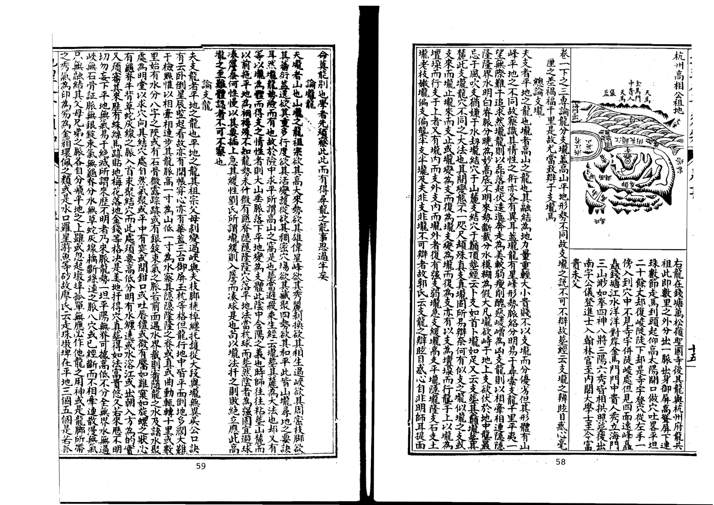

論龍剝報剝換者變化也龍之形體自老變嫩自粗變細自凶變吉皆造化之妙楊公云一剝一換大生細從大剝小真奇里剝撰如換好衣裳如蠶蜺壳蛾脫筐廖氏云脫卸剝換粗變細凶星變吉氣卜氏云星以剝換為貴是皆謂龍貴於有剝換也且如金星發祖剝出水星水星又剝木星木生火火生土土生金之類迢迢生峰節節合格是為富貴之地若遇相尅貴有救星如金星行龍木星作穴金尅木本凶左右得火星以制之或得水星以助之亦為吉也以類而推萬不失一九星變篇云凡觀一星便觀變識得變星知近遠遠從貪復至破軍換盡龍樓生寶殿一剝一變形不同豈可盡言顧祖宗君如識得變星法于里百里尋來龍然九星之變口取貧巨武輔弼五者為吉謂其體勢端正頭向光彩尖則清秀員則肥滿方則平正故吉而丈廉祿破四者為凶以其體勢欹斜頭面臃腫峻嶒竄險惡石巉岩故爾此五星九星變剝吉凶之大概也凡遠祖高峰是凶星發龍却跌斷過脈退皮換骨變出吉星作少祖山而結穴者亦為美地若後龍節節是吉星中間一二節吉凶不明者只小凶而已若遠祖是吉星而剝出凶星作少祖山結穴者乃為凶地不可下也後龍節節是凶星則退換入首一二節是吉星結穴而葬者亦得一代二代發福駁到凶星即主禍敗後龍節節是吉星只入首結穴一節是凶星若穴情好初代雖見退敗至二三代剝到吉處却又發福久遠矣此以剝換星體吉凶觀前後節數占年代驗福福之大概也若其起祖迢迢行至入穴全無跌斷過峽則是無變化必不融結發揮云龍無傳變穿落則無造化不經退卸則無秀氣雖有奔走之勢擺摺之形亦為偽龍多是奴從之山不必尋穴縱有形穴龍虎紫對明堂諸般合法奈何龍無脫卻無變剝氣不全服不真徒有殺氣凶惡乃花假之地故凡尋龍見無過峽剝變決無融結造化不必追尋矣

詔青通山相地之法固妙於觀龍觀龍之術尤切於審峽峽者龍之真情發現處也未有龍真而無美峽未有峽美而不結吉地審峽之美惡則龍脈之吉凶融結真偽皆可預知真地理家不刊之秘訣也蓋龍行延長必須多有跌斷過峽則氣脈方真脫卻方淨力量方全經云一斷二斷斷了斷鶴膝蜂腰真吉地又云十條九條亂了亂若

6批

是真龍斷了斷十氏云一起一伏斷了斷到頭定有奇踪皆謂真龍之過峽多也然峽亦有吉有凶尤當細察過峽之脈欲其透迤嫩巧活動悠揚如梭帶絲如針引線如蜘蛛過水如躍魚上灘如馬跡渡河如藉圗絲連如草蛇灰線之類為美然須有送有迎有扛有夾護衛周密分水明白不被風吹水去為吉棋氏云一爭一揖尋斷處斷處兩邊生擁護廖氏云蜂腰鶴膝最為奇大忌被風吹范越鳳云以峽斷跌切忌水去視懶物公八段錦云龍過服認踪由高低脊服莫模糊最要兩邊生護轉去愁一水過橫流龍經云莫令曰缺被風吹切忌溜牙遭水刦是也蓋龍之過峽處其氣束聚最怕風吹水刦故必有護峽之山八字之水乃以為真護峽山又喜合形像廖氏云兩邊遮護喜成形是也或如日月旂鼓天馬貴人金箱王印垂纓串珠進蛟御象象分戈矛等形者貴格也前去必結貴地或如倉庫団櫃谷堆爛錢辨錢攤衣質庫銀瓶盞筋倒靈金罇等形者富栢也前去必結富地然亦不必過泥形狀但以遮護周密夾從有情為吉若是真龍過峽度服自有兩邊護照之山遠來相應經云天孤天角龍欲度者是也其有峽不全美而左邊不足則穴之左亦有虧峽之右有空缺則穴之右亦不周及有峽中定穴高下左右并向首之說皆天造地設自然之應也峽正出則穴亦正左出則穴居左右出則穴居右又有正出而斜過者則穴亦正出而斜倒有側出而正過者則穴亦側出而正倒透頂出服者則穴居腳下腳下出脈者則穴居頂上峽中左沙短則穴前左沙必先到峽中右沙短則穴前右沙必先到池湖過峽前逢池住乾墠過峽逢乾琿住右服過峽逢右曜住旂皷峽逢旗皷住龜蛇峽見龜蛇住子午卯酉出服必作子午卯酉向乾坤艮巽出脈必作乾坤艮巽向不離四字之中餘皆以例推且其為格有陽過有陰過有平地過有穿田過有池湖過有草坪過有半嶺過有高山過有正過斜過明過偷過長過短過硬過直過大過小過遠過濶過又有雙脈過渡水石梁過及張子微峽訣有所謂粧臺峽合屋峽幢節峽華蓋峽天池峽平田穿珠峽金箱玉印峽雙溪峽寶劍峽雙龍峽禁衛峽主壁峽牛眠峽石洞峽驚蛇峽亂茅峽立魚峽貫魚峽柳葉峽重尸峽凡二十格蔡西山峽訣有所謂雙魚峽垂珠峽蓮花心峽迎送峽井欄峽方勝峽飛絲峽三台飛電峽金魚佩峽流星峽敘服峽玉帶峽方城峽玉池峽除刪正外凡五十九格又有陽星九峽陰星八峽及三十六峽又十二峽陰陽台伏之說高齊雲低印水等像不可盡舉大抵龍之過峽惟欲其脈之中山勢之飛揚形之活動星之秀異護從周密分水伶俐迎送均勻扛夾照應高過而不悍硬低過而無傷殘長過而不受風吹短過而脈不粗腫潤過而不懶散直過而不死硬遠過而有包藏穿田而無水刦渡水而有之梁斯為美矣若或奇巧異常有池湖靈泉怪石之類尤貴其或龍雖可觀而過峽不美或空缺四風嬾散死直偏旁過脈水刦傷殘大長而無鶴膝蜂腰太潤而無草蛇灰線渡水而無石梁穿田而無正脈過坂而無珠絲馬跡及其兩旁無迎送無扛夾或雖有護而低不及脈有夾而低不及峽前去必無融結多有偽穴切不可下又有一等凶龍迢迢而來更不跌斷全無過峽直至穴場雖極屈曲奔走之勢然無峽則無脫卸殺氣未除不知者貪其氣勢之雄星峰之美而誤下之必主凶禍惡逆若抽脈落下平地脫盡殺氣變換而作穴者不以此論然平地亦有平地峽與山峽無異只看水分為準若平洋無峽亦非真龍也故審峽之訣為地學關鍵尋龍捷徑知此則龍亦易辨穴亦易求美惡吉凶胚胎在此此而得訣則相地之能事畢矣予嘗謂尋龍妙訣不難知但向峽中究隱微師若肯傳峽裏訣傾囊倒篋洩天機諸峽圗式具下

<table><tr><td rowspan=1 colspan=9>十大崩洪服圖</td></tr><tr><td rowspan=1 colspan=1>无万0  ②è日9</td><td rowspan=1 colspan=1>石梁散亂如手摸捉在於水面者臭也</td><td rowspan=1 colspan=1>自</td><td rowspan=1 colspan=1>於水中是也</td><td rowspan=1 colspan=1>新0B000000</td><td rowspan=1 colspan=1>石梁如馬足跡在於水中是也</td><td rowspan=1 colspan=2> 田会8a目</td><td rowspan=1 colspan=1>石梁如螺蚌之形在水是也</td></tr><tr><td rowspan=1 colspan=1> 福</td><td rowspan=1 colspan=1>石梁主來如交角之形是也</td><td rowspan=1 colspan=1></td><td rowspan=1 colspan=1>石梁屈曲如之玄字在水是也</td><td rowspan=1 colspan=1> </td><td rowspan=1 colspan=1>是也</td><td rowspan=1 colspan=2> 二4</td><td rowspan=1 colspan=1>石梁三條如川字形是也</td></tr><tr><td rowspan=1 colspan=1> p</td><td rowspan=1 colspan=1>石梁縱横如十字是也</td><td rowspan=1 colspan=1>华价关天关之008</td><td rowspan=1 colspan=1>区整区是也</td><td rowspan=1 colspan=5>上十大崩洪乃石梁渡脈過水其形有此十格然亦難以此盡其形舉此為式觸類而長可也蓋崩洪者朋山共水之義也康氏云朋山共水難尋脈石上留</td></tr><tr><td rowspan=1 colspan=2>0星入十頁口</td><td rowspan=1 colspan=1>卷二七</td><td rowspan=1 colspan=4>龍法                                      V</td><td rowspan=1 colspan=2></td></tr></table>

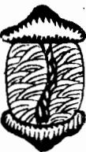

<table><tr><td rowspan=1 colspan=1>     </td><td rowspan=1 colspan=1>此為陽峽四中出脈或凹腦坦中出服</td><td rowspan=1 colspan=1>型 E</td><td rowspan=1 colspan=1>此為陰峽其脈自頂有脊而出或起突</td></tr><tr><td rowspan=1 colspan=1>   H</td><td rowspan=1 colspan=1>此為曲峽其脈屈曲活動如生蛇渡水至貴小者尤佳</td><td rowspan=1 colspan=1>H</td><td rowspan=1 colspan=1>過峽之服要曲不宜直吉為死脈不吉中間有泡者雖直亦吉</td></tr><tr><td rowspan=1 colspan=1>     </td><td rowspan=1 colspan=1>此為長峽太長則易受風宜遮護周密又忌直長若長而直則為死服不吉</td><td rowspan=1 colspan=1></td><td rowspan=1 colspan=1>此為短峽峽短雖不受風亦要斷跌明白若模糊則非峽矣</td></tr><tr><td rowspan=1 colspan=1>   </td><td rowspan=1 colspan=1>濶峽氣散不聚要中間有草蛇灰線微高之脊則美兩邊名毡褥亦謂之霞陂峽主大富貴</td><td rowspan=1 colspan=1></td><td rowspan=1 colspan=1>高峽者山大而斷處未至平地也多是人行之嶺凡高過之峽要護山周密</td></tr></table>

<table><tr><td rowspan=1 colspan=1></td><td rowspan=1 colspan=2>本</td><td rowspan=1 colspan=2></td><td rowspan=1 colspan=1>路少</td><td rowspan=1 colspan=2></td><td rowspan=1 colspan=1>此外山隔水遠來扛峽最吉格</td><td rowspan=1 colspan=2></td><td rowspan=1 colspan=1>此不成格非峽</td></tr><tr><td rowspan=1 colspan=12>蔡西山光生峽格雙魚峽</td></tr><tr><td rowspan=1 colspan=1>E</td><td rowspan=1 colspan=2>器分城2位</td><td rowspan=1 colspan=2>C</td><td rowspan=1 colspan=1>如此乃偏出脈非峡</td><td rowspan=1 colspan=2>C</td><td rowspan=1 colspan=1>此偏出脈非峡杰之來去魚主凶</td><td rowspan=1 colspan=3></td></tr><tr><td rowspan=1 colspan=12>垂珠峽</td></tr><tr><td rowspan=1 colspan=2>1080800088</td><td rowspan=1 colspan=2>如此乃為正出之峽吉</td><td rowspan=1 colspan=3>1000具000</td><td rowspan=1 colspan=1>如此乃偏出腋非峽可</td><td rowspan=1 colspan=3>80800日</td><td rowspan=1 colspan=1>如此乃為偏出不得為峽主凶</td></tr><tr><td rowspan=1 colspan=2>ww0000.00008</td><td rowspan=1 colspan=2>如此則為偏寒不吉不可言峽左右同</td><td rowspan=1 colspan=3>000000</td><td rowspan=1 colspan=1>如此雖是峽亦係偏斜主奸險</td><td rowspan=1 colspan=4>大凡峽欲其脈從中出而兩畔護送停内如服雖中由而兩畔護山不勻式連有連邊天是過出邊多邊少皆</td></tr><tr><td rowspan=1 colspan=12>蓮花心峽</td></tr><tr><td rowspan=1 colspan=1>HC</td><td rowspan=1 colspan=2>如此真蓮花心峽最為至貴</td><td rowspan=1 colspan=2>2</td><td rowspan=1 colspan=1>2单</td><td rowspan=1 colspan=2>0</td><td rowspan=1 colspan=1>如如此全是偏斜不可言峽左右同</td><td rowspan=1 colspan=2>月</td><td rowspan=1 colspan=1>5</td></tr><tr><td rowspan=1 colspan=3>也里一頁</td><td rowspan=1 colspan=7>二上龍法</td><td rowspan=1 colspan=2></td></tr></table>

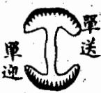

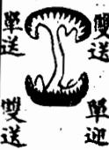

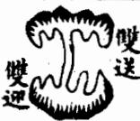

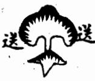

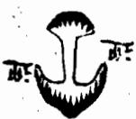

此有迎無送也凡有 迎無送有送無迎若 周密護得峽過不受 風吹之貴

真跡喚作崩洪有十名官貴此中生是也其說山於楊筠松三十六脈歌云崩共之派谷多役月山之堪安氣逢水界誰能別真龍偏向此中蟠有人曾得崩決脈腰縣鄉歌賊其之脈多股明山其水寔後來因真龍偏向此中蟠之句遂誤謂脈中有穴殊為可笑明此崩共朝其本旨則謂石脈之過水耳擯斥之例何也山傾曰崩水潰曰洪乃惡名也而待家乃為龍氏之主再可以吾儒循名求義論之亦當在術家以此暗藏機倖闢之而不道予於此收之亦姑從俗昔名火登龍辰后其水六之安十月共三享見旦十二

<table><tr><td rowspan=1 colspan=12>飛絲峽</td></tr><tr><td rowspan=1 colspan=2>€T貞司  0</td><td rowspan=1 colspan=2>此但為飛絲服亦是偏出不吉</td><td rowspan=1 colspan=3></td><td rowspan=1 colspan=1>此偏出之脈不可言峽</td><td rowspan=1 colspan=3>5E</td><td rowspan=1 colspan=1>飛餘雖從中出兩旁不幻亦不是峽</td></tr><tr><td rowspan=1 colspan=11>三台飛電峽</td><td rowspan=1 colspan=1></td></tr><tr><td rowspan=1 colspan=2></td><td rowspan=1 colspan=2>此三台飛電之峽第一上格</td><td rowspan=1 colspan=3></td><td rowspan=1 colspan=1>第学14号服非</td><td rowspan=1 colspan=3></td><td rowspan=1 colspan=1></td></tr><tr><td rowspan=1 colspan=4>金魚佩峽</td><td rowspan=1 colspan=7></td><td rowspan=1 colspan=1></td></tr><tr><td rowspan=1 colspan=2>目</td><td rowspan=1 colspan=2>此為正峽主一品侯王極貴</td><td rowspan=1 colspan=3>l日日</td><td rowspan=1 colspan=1>此為偏出之脈不可言峽大凶</td><td rowspan=1 colspan=3></td><td rowspan=1 colspan=1>此亦是脈從中出之峽大凶</td></tr><tr><td rowspan=1 colspan=11>充星峽</td><td rowspan=1 colspan=1></td></tr><tr><td rowspan=1 colspan=1>00000</td><td rowspan=1 colspan=2>此真流星峽也至貴主出神堂</td><td rowspan=1 colspan=2>兒eG</td><td rowspan=1 colspan=1>此偏出之服不可言峽大吉</td><td rowspan=1 colspan=2>€       W</td><td rowspan=1 colspan=1>此亦不謂之峽</td><td rowspan=1 colspan=2>月    兒美月9自</td><td rowspan=1 colspan=1>此為偏之服不謂之峽</td></tr><tr><td rowspan=1 colspan=3>釵股峽</td><td rowspan=1 colspan=9></td></tr><tr><td rowspan=1 colspan=1>í</td><td rowspan=1 colspan=4></td><td rowspan=1 colspan=3>乃正L峽格也</td><td rowspan=1 colspan=3>w</td><td rowspan=1 colspan=1>此為偏出不可言峽左右同</td></tr><tr><td rowspan=1 colspan=1></td><td rowspan=1 colspan=11>玉帶峽</td></tr><tr><td rowspan=1 colspan=10>包里一貞二上龍法                                     九</td><td rowspan=1 colspan=2></td></tr></table>

<table><tr><td rowspan=8 colspan=1></td><td rowspan=1 colspan=1></td><td rowspan=1 colspan=1>力脈峽</td><td rowspan=1 colspan=1></td><td rowspan=1 colspan=1></td><td rowspan=1 colspan=1>玉井欄峽</td><td rowspan=1 colspan=1>0</td><td rowspan=1 colspan=1>房</td><td rowspan=1 colspan=1>迎送峽</td><td rowspan=1 colspan=1></td><td rowspan=8 colspan=1>六王多矢</td></tr><tr><td rowspan=1 colspan=1>之正峽吉從中出謂如此乃脈</td><td rowspan=1 colspan=1></td><td rowspan=1 colspan=1>品偏斜下如此係</td><td rowspan=1 colspan=1>峽格吉玉井欄如此真</td><td rowspan=1 colspan=1></td><td rowspan=1 colspan=1>半吉交互迎送如此乃為</td><td rowspan=1 colspan=1>至貴之峽為有迎有逆如此則真</td><td rowspan=1 colspan=1></td><td rowspan=1 colspan=1>可言峽如此亦</td></tr><tr><td rowspan=1 colspan=1>Q</td><td rowspan=1 colspan=1></td><td rowspan=1 colspan=1></td><td rowspan=1 colspan=1></td><td rowspan=1 colspan=1></td><td rowspan=1 colspan=1>S</td><td rowspan=1 colspan=1></td><td rowspan=1 colspan=1></td><td rowspan=1 colspan=1></td></tr><tr><td rowspan=1 colspan=1>峽左右同出不可言如此乃偏</td><td rowspan=1 colspan=1></td><td rowspan=1 colspan=1>為正格吉旋井欄亦如此名方</td><td rowspan=1 colspan=1>亦吉互玉井欄如此名夾</td><td rowspan=1 colspan=1></td><td rowspan=1 colspan=1>大山是偏出如此全</td><td rowspan=1 colspan=1>峽也至貴尤佳乃真如此迎送</td><td rowspan=1 colspan=1></td><td rowspan=1 colspan=1>可言峽如此亦</td></tr><tr><td rowspan=1 colspan=1></td><td rowspan=1 colspan=1></td><td rowspan=1 colspan=1></td><td rowspan=1 colspan=1>S</td><td rowspan=1 colspan=1></td><td rowspan=1 colspan=1></td><td rowspan=1 colspan=1></td><td rowspan=1 colspan=1></td><td rowspan=1 colspan=1></td></tr><tr><td rowspan=1 colspan=1>峽吉中山正如此乃</td><td rowspan=1 colspan=1></td><td rowspan=1 colspan=1>脈偏出凶如此係</td><td rowspan=1 colspan=1>正格吉井欄迎送如此亦是</td><td rowspan=1 colspan=1></td><td rowspan=1 colspan=1>大凶烏偏枯如此極</td><td rowspan=1 colspan=1>結貴地是真峽如此亦</td><td rowspan=1 colspan=1></td><td rowspan=1 colspan=1>言峽矣出不可如此偏</td></tr><tr><td rowspan=1 colspan=1></td><td rowspan=1 colspan=1></td><td rowspan=1 colspan=1>Ww</td><td rowspan=1 colspan=1></td><td rowspan=1 colspan=1></td><td rowspan=1 colspan=1></td><td rowspan=1 colspan=1>2</td><td rowspan=1 colspan=1></td><td rowspan=1 colspan=1>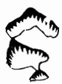</td></tr><tr><td rowspan=1 colspan=1>大出不得言如此為偏</td><td rowspan=1 colspan=1></td><td rowspan=1 colspan=1>為正格吉接井欄亦如此乃迎為</td><td rowspan=1 colspan=1>正格吉旋亦欄亦如此名有</td><td rowspan=1 colspan=1></td><td rowspan=1 colspan=1></td><td rowspan=1 colspan=1>非峽也為偏出如此即</td><td rowspan=1 colspan=1></td><td rowspan=1 colspan=1>用之龍耳不言峽無如此亦可</td></tr></table>

<!-- doc017 PDF 第 41 页：高风险/复杂版面 OCR 供检索；内容与排版以原页图为准。 -->
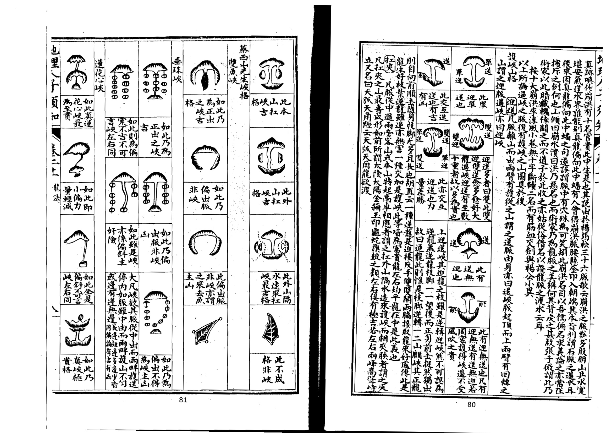

<!-- doc017 PDF 第 42 页：高风险/复杂版面 OCR 供检索；内容与排版以原页图为准。 -->

右張子徵峽訣二十格皆以左右護峽之形狀吉凶定峽之美惡者也以上峽圗載為式耳山形變化豈止於斯智者察其情性之真觸類而長之可也夫蔡氏之論龍腑者固有偏中之正正中之偏有似偏而實正似正而實偏有正出而偏落有偏出而正落有前偏而後變於正者前正而後變於偏者有脈雖偏於一邊而外山照應規切不至風吹者有星頂正於左邊而脈則出於右畔者有星體偏於右邊而左邊枝腳反多者有雙腋相合者有三脈五脈隱怪難明者有右脈奇異及閃跡偷踪偏工難辨者有微而至於無形者豈圗之所能盡哉其張子微之論護山者則有不切之弊如所謂玄魚主壁之吉應於兩旁而或龍服捐枯妃弱豈可以生壁而謂之吉哉蓋必以蔡氏為主而子徵之說兼之可也大抵山形之微妙無窮龍脈之變化不一可以理推難以形定固有似吉而凶似凶而吉者有半吉半凶及可吉可凶者有先吉後凶有先凶後吉者毫厘之間禍福所係豈按圗索驥者可窺則哉神而明之存乎其人論龍支堯卓

<table><tr><td rowspan=1 colspan=1>峽魚在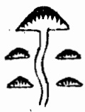</td><td rowspan=1 colspan=1>峽眠牛峽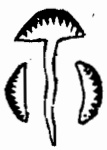</td><td rowspan=1 colspan=1>劍寶峽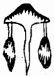</td><td rowspan=1 colspan=1>池天</td><td rowspan=6 colspan=1></td></tr><tr><td rowspan=1 colspan=1>主貴</td><td rowspan=1 colspan=1>濁富</td><td rowspan=1 colspan=1>後奏相先斬出將入</td><td rowspan=1 colspan=1></td></tr><tr><td rowspan=1 colspan=1>峽漁贵</td><td rowspan=1 colspan=1>峽洞石</td><td rowspan=1 colspan=1>峽龍雙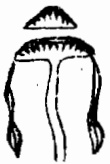</td><td rowspan=1 colspan=1>峽珠串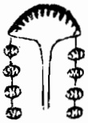</td></tr><tr><td rowspan=1 colspan=1>半吉</td><td rowspan=1 colspan=1>大山太青</td><td rowspan=1 colspan=1>至貴</td><td rowspan=1 colspan=1>地貴玉侯主大富</td></tr><tr><td rowspan=1 colspan=1>峽葉柳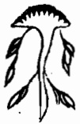</td><td rowspan=1 colspan=1>峽蛇驚</td><td rowspan=1 colspan=1>峽衛禁</td><td rowspan=1 colspan=1>峡印王箱金</td></tr><tr><td rowspan=3 colspan=1></td><td rowspan=1 colspan=1>半吉</td><td rowspan=1 colspan=1>大山賊將等出妖術</td><td rowspan=1 colspan=1>出禁穴</td><td rowspan=1 colspan=1>名翰施才出内相</td></tr><tr><td rowspan=1 colspan=1>峽屍重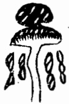</td><td rowspan=1 colspan=1>峡茅渴</td><td rowspan=1 colspan=1>峡壁主主</td><td rowspan=1 colspan=1>峽溪雙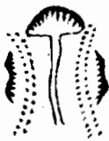</td><td></td></tr><tr><td rowspan=1 colspan=1>大凶</td><td rowspan=1 colspan=1>山大盜極出草寇</td><td rowspan=1 colspan=1>出王侯</td><td rowspan=1 colspan=1>出豪貴</td><td></td></tr></table>

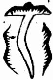

<table><tr><td rowspan=1 colspan=1>H</td><td rowspan=1 colspan=1>玉黄工</td><td rowspan=1 colspan=1>CI0</td><td rowspan=1 colspan=1>偏尤何可言峡</td><td rowspan=1 colspan=1></td><td rowspan=1 colspan=1>地道</td></tr><tr><td rowspan=1 colspan=6>方城峽</td></tr><tr><td rowspan=1 colspan=1>6</td><td rowspan=1 colspan=1>此為正峽最貴</td><td rowspan=1 colspan=1>T</td><td rowspan=1 colspan=1>此亦正峽最貴</td><td rowspan=1 colspan=1></td><td rowspan=1 colspan=1>此偏出之龍不問左右皆山</td></tr><tr><td rowspan=1 colspan=6>玉池峡</td></tr><tr><td rowspan=1 colspan=1></td><td rowspan=1 colspan=1>此池當服至貴</td><td rowspan=1 colspan=1></td><td rowspan=1 colspan=1>此服從也中過兩畔皆水大貴</td><td rowspan=1 colspan=1></td><td rowspan=1 colspan=1>整服偏</td></tr></table>

龍有貴賤美惡之不同觀其枝腳橈棹而可見蓋枝腳橈棹龍之分氣也其形體各以類從故龍之長遠者其枝腳橈棹亦長遠龍之短小者其枝腳橈棹亦短小龍之小者其發為枝腳亦起星辰帶貴氣龍之凶者其且於枝腳亦必惡陋類凶形是蓋龍氣吉凶不同故逆露發泄於枝腳橈棹閣美惡清狀亦自不可掩耳古易見者論之如枝腳之山廣袤起伏蕃行擁從或如倉如庫或如劍如印或如旗如故武成天乙下耳時上易邊或成御屏屏帳或蓋樂於後或帶金箱玉印或帶簡笏牙刀或結天關地軸或如武將文官或須天馬貴或類龜蛇獅象或如玉帶金章或如璫珂珮或拔若文筆或連如串珠或國如夏金頃童氏方小年或森若排衙唱喏或擁如隊仗濟濟如子孫儀從或丁壯之繁或獲如奴僕畜養之衆雲從若時有則順故兕我身不敢他往此皆吉氣之發見者也明山寶鑑云天乙太乙者富貴之本原天祿天馬者富貴之在用文官武庫者富貴之應驗左輔右弼者富貴之維持男倉女庫者富貴之設施廖氏云惟有本身支却重依大真得用大凡好砂列於前者是客山眾人所共其在本身技脚者乃自家之物亡之受用見刃旨也故事白近云不貴其見而貴其不見廖氏云誰知不見乃為奇福應吏差段其或龍無支即堯卓有離之者進古使作通踴躍拔卓者謂之弱散漫委靡而無收捨者謂之虛反背無情而不顧本身者謂之逆凶臣之少雖有枝不者謂之殺拖抱太重而奔走東西者謂之卦及有枝脚不均或邊有邊無星長五星頂出于而反月本月之病又或兩旁垂落如拋鎗插竹臥口提維如繩如刀如斬指斷頭如弟葉之亂死之之來反及耳者言頸種種不吉之形皆凶氣之發見者也似此龍神微有形穴皆為不吉若誤下之主長病廟察而王已頭鴨癰寶災火而莫可援救或官訟連年而田産過盡或淫亂風聲而敗壞人倫木各以其頃而應也文克卓支為龍身發泄吉凶之驗詎不信夫

此龍身枝腳間所帶諸貴格之大畧也傳國師云凡後龍節節枝腳垂落處要起星辰成形像如天馬倉庫交床旌皷劍印屏帳列屏天乙太乙丈官武將等仲而順護龍身前去必結大地一粒粟云不貴其見而貴其不見者乃此謂矣天乙太乙主位居台閣日月輔弼主位至公孤王佩文武主王侯極品男倉女庫主人財富盛展旗頓戟主威武左右侍從主尊榮旗旄畫軸御屏錦帳馬旗相台主出將入相印笏主神童狀元

右龍身枝腳所帶諸凶之大畧也捷經云凡後龍枝腳節節垂落處或尖利帶殺或瘦弱峻增或臃腫醜惡反背走損或拖拽太重或大小無倫或長硬如鎗或細繞如索或如重尸或如斷頭或如烟包或如投算種種魄形則為凶惡縱有形穴亦不可下

右回龍顧祖之地本勻秀氣呈露於前作我朝對經云未作穴時光作朝是也前謂不貴其見而貴其不見若此者見又何害大抵貴通活變莫泥陳言可也

以上所論龍身枝腳吉凶大概皆以垂落之形言之未及自身發出均勻長短有無之親切也併述於後

試殿廉捲

枝腳 约封 名梧

<!-- doc017 PDF 第 44 页：高风险/复杂版面 OCR 供检索；内容与排版以原页图为准。 -->
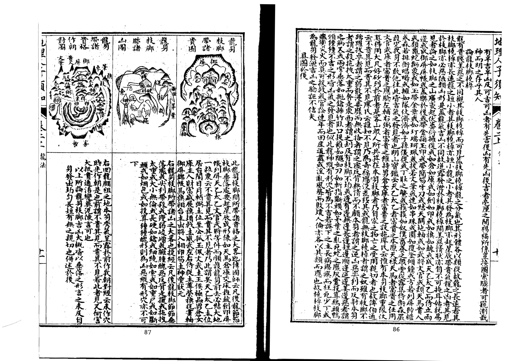

北理人子矢卷二」

易見今不問名花卉木對生為貴凡野生草木花卉若對節間生枝發葉者皆可為醫藥用以丞疾此可見天地聞凡對生者皆受天地之靈氣人之手足筋骨鳥獸之足翼者對生者也其有藥中木瓜豈豈縮沙大黃黃連黃芥等皆不對生然却有奇處終與凡草有里龍之奇者亦然故之玄屈曲與持地聳反又皆不可以穿心論此惟圓機通變知識過人者可與語此

余按西山此論精當明切論龍枝腳之妙思過半矣

  
龍枝藥芍

  
龍枝葭慧

枝脚之

此龍身枝脚對節均勻之格至貴蓋龍身枝腳貴其對節生出兩邊均勻有無長短大小相同正服中出乃為上格術家名曰梧祠枝張子孔曰停均惟有梧桐枝雙送雙迎兩平勢對節分生作穿心祖宗兒子都相類是也蔡西山云龍之所以貴其枝腳對生如梧桐枝為龍中第一賁者其理

#

不均

長枝 圖均短腳 借傍短邊邊 障祖邊短長之否

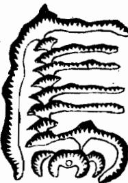

山龍此

分等龍公位不均一位富足多子一位貧寒廢疾絕嗣偏枯太甚縱有形穴亦不可下公位雖不必宛然若此者計子孫利害之重亦當審擇可也

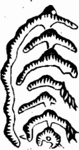

右龍身枝腳橈棹雖長短不對而交互停均脈却穿心術家名曰芍藥枝格也張子微云一等名為芍藥枝左右相生亦相似分處光員有枝葉交互亦有停均理是矣愚謂此龍格枝腳雖長短不同然左服或先一節長必後一節短右服雖先一節短必後一節長兩相抵對却有停均之理火節節正服穿心雖左右長短不齊不害其為貴龍也

乙一口人龍法右龍身枝腳雖不對節而左右交互停均術家名曰兼葭葉子微云左有右無過一節右有左無本非異此名原是兼葭樣但要星辰得地位愚接此與梧桐枝對節力量殊異而與芍藥枝頭同其枝葉亦是來去開枝旦枝末多生了了帶力差重者也此兼葭葉枝末無了故力輕耳然力量雖有不同融結本無二理烏可以其力輕而棄之

謂此等龍是奴僕之山決無融結道理雖合柳星有形穴亦當棄置不可下也子微雖或有見子不敢附和且大抵龍之枝腳貴於均勻為美如人之手足如鳥獸之翼腳缺一邊則不能飛走其不至於廢棄也寡矣此理勢之必然不待智者而後知也地理之與物理相為流通者也奚可以差殊觀哉

右龍一邊有枝腳而長一邊微有枝腳之狀術家名曰楊柳枝子徵又有偏主楊柳枝邊有邊無極垂異又謂若有形穴澤送山周密亦可下愚謂

右龍枝腳一邊長一邊短本自不均却是節節中出 其枝短一旁又有一大枝纏送到頭亦為貴格術家 謂之捲簾殿試格張子微云却有偏生極貴龍名為 捲簾登殿試不問偏斜黃甲及第是也

右龍雖一邊枝腳長一邊枝腳短本自不均然短邊却傍祖山貼身障護又不可以長短不均論也諺云一祖當千山如人之奴僕護從雖多不若祖宗之庇蔭福澤所及為大也

此龍枝腳一畔美一畔惡也大凡龍神枝腳欲其兩邊均勻為美若一邊好一邊不好或邊有邊無邊長邊短邊順邊逆邊多邊少皆為不吉縱有形穴亦不可下

<!-- doc017 PDF 第 45 页：高风险/复杂版面 OCR 供检索；内容与排版以原页图为准。 -->

  
近山護要

右龍之枝腳橈棹亦如人之手足固宜其長而忌其短然亦有短而吉者須是節節均勻從中出脈兩邊護山貼身纏從方可即街家所謂蜈蚣節龍格也張子微云兩旁有護極清極貴發揮云此格脚短必假外山纏護周密而後可以極其清貴愚謂此等龍須要到頭穴星開窩開鉗有龍有虎不假外山護衛而穴場自暖方可否則不吉不可下也

地理人子須矢卷二

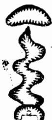

右龍全身活動擺摺如生蛇出洞仙帶飄空即蘆鞭裊之玄龍九天飛帛等格也此等龍不論枝腳但要纏從周密又必起頂結穴有本身龍虎不藉外山而穴自暖乃為真結此格最貴若出自台屏帳蓋之下者主神童狀元才名冠世

以上所論龍身枝腳橈棹之美惡及均勻長短有無等說姑就淺近者言耳至於大龍又難如此拘執蔡文節公曰迎送交互手脚橈棹此看龍之常法也然大龍漸近融結處多是單行無手腳橈棹可見其逶迤轉摺平行低度狀如流水或忽然斷絕無踪可尋或小如引線不認攸往其低平之處或為平田曠野橫潤多至數十里或為溝池田疇或為人烟園斬或為小關墟市或迫無人居彌望無際或渺茫沙阜不堪步履或隱隱隆隆忽似黿鼉或堆堆累累忽如古墓前去則逢溺漫巨浸江湖交會然無山可依無形可辨此大龍之大盡處也巨眼見此知為大地或可為京畿或可為藩鎮從頭檢點來龍分明纏護無缺之玄屈曲手足擺佈無不具備特人不識造化之廣狹耳愚按此論大龍不可以枝腳橈棹常法拘之最為切當子微亦云且如龍行看送迎手腳交接如解動不知大龍百十里到臨穴處如蛇虺單單轡環數十里若拘纏托與橈棹不知此龍向者是故大龍手腳橈棹動輒百餘里或數十里俗眼以常法拘之豈能識此是故龍身橈棹枝腳之說又須辨認龍之枝幹大小而後始盡其微妙若徒以常法拘之則未免坎蛙之見矣

黑囊經云龍要有益送蓋送龍神童發揮云貴龍全在護從多十氏云德不孤必有隣看他護從龍經云真龍

身上多護衛山水有情來拱揖又云只有真龍坐局內亂山却在外為纏又云纏多不許外山走那堪長遠作水口送在托山若兩全當責雙全真罕有是皆言真龍融結必有護從迎送諸山以衛區之如大貴人出入必前呼後擁行者辟易觀者環堵居則侍妾數百人或兵卒數千輩披堅執銳以護衛之張子微云王侯籍衛須隨從出入坐起多迎送又云萬卒影從成禁衛千官瑞列是朝建莫非取諭真龍有山之擁從耳其單獨孤寒之龍如貧賤之人家徒四壁室如懸磬妻子且無況奴僕使令者乎及其出外偏國中無與立談者況隨從阿殿者乎故單寒之龍最為無用前去多作神壇社廟而已楊公云若是孤行無護衛定作神祠佛道宮張子微云孤生獨活無人伴尸好焚香作廟居然龍固貴於有護從尤貴於護從多蓋護從多則地愈大經云護從多愛到穴前三重五重福綿廷一重護衛一代貴護衛十重宰相地兩重亦主典專城一重戶出丞簿尉又云尋龍千萬看纏山一重纏是一重關闕門若有十重鑽定有王侯居此間范越鳳云大富大貴之地如大官行衙前呼後擁之多小地如小官出入從者不過數人而已又有長短大小之分龍大則纏護山亦大龍長則纏護山亦長短小之龍纏護之山亦口短小而已經云護纏亦目有大小大小隨龍長短來龍長纏護亦長遠龍短纏護亦近挨是也枝龍必須纏護周密朝迎秀異送從齊整下手重多方有結作不可以一山有情而取之經云枝龍身上亦可裁半是虛花半是開若是虛花無朝應若是結實護纏回護飯定要觀數一邊回來龍身顧莫候將為真實看恐是護龍葉交互三重五重抱回來此就枝龍身上做幹龍則取遠迎遠送大纏大護在服界寬濶中認之張子微云大地迎送隔江水又云大龍行到水盡頭或作州縣回迤理必有高山作外纏不在身旁數十里龍經云不知幹長纏亦長外州外縣山為伴又云大凡翰龍行盡處外山隔水來相顧王龍經云大龍迎送倉庫皆非本身自帶如大官出入自有部封屬境節次措辦供帳次舍倉庫委積以候其來而貴人不過隨帶關從而往耳每經過處無不聚起觀瞻翁集迎送大龍之行無以異此小龍如小官出入凡需用之物莫不自帶又如富人出入器皿帷慎莫不畢備然皆自己之物不容取於他人但車馬齊整人從偉擇經過未嘗不起觀瞻或有庄佃覿也大小龍之別如此故大龍迎送纏護諸山名有龍脈奔來與正龍問水相會以為用然不可一概取遠者為護而與空曠受風處亦指遠山為侍從竊恐無識考脾腴大地被野師所誑而以單獨凶龍為結大地強指遠山作微護執玉髓之說以藉其口是又為圖大所惑也切要入穴不受風為真故凡護山必有近者為待為從而又有遠者為纏為迎方可且其繁要過夾則上是公人丘旨為垂如奴僕近在身側則驅使得力若去身己遠則呼喚未及使今不便安能得其分哉之負肖高大近老為進如幼童侍衛我旁彼幼無知不能勝我驅使之任矣然亦不可大高大有奴來敗主之伏尸直相再於大小低遠近之間斯盡其妙智士胸中自當有活潑之機也豈筆端所能悉哉卷二上之二專論龍有旁正老嫩長短真為貴長者禮之味監于龍之形寺下司三主吉乍下之 卷二上之二專論龍有旁正老嫩長短真僞貴賤諸體之殊蓋行龍之形勢不同至其結作之吉凶亦異於此諸體辨別之真則涇渭以明而取舍始有定也否則差之毫厘謬以千里而吉凶混者矣可不如所察乎論龍旁正

夫龍一也而有旁正之分蓋正龍者稟受得正氣而行而其旁受諸山皆來拱衛者也故一祖之下必有改龍觀龍者須審其執為正龍受穴之山孰為旁龍從衛之山於此分引明曰月又舍有正見也天斤為作之者有數說焉葬經曰重岡羣阜群壠眾支當擇其特大則特小持小侍大此月大時為之行禪師云數龍並出孰為先長短高低是妙玄取短要從長處見衆長須可五中千高下小太正龍也在土星邊君今但指朝山看朝應無情定是徧此則以長短高低土石及朝應之時里者前龍此非公上元龍隨出敦為奇貴賤尊卑總要知三五七龍同發跡正龍必定是中枝更看星禮晟持異又字夾有寺是從龍俱不應便於此處別玄微此則以龍之居中而星辰持里過峽周玄者為正龍也要之者凡有大若而吳為密蓋中即正也旁即偏也特小特大特長特短特高持低亦夏居中為正不旦岐五支立出有位中但自離祖出身行度過峽其脈常不離中乃為至美或三台九出而中由或華監箇字而中出成立出而居中落皆謂之中其偏龍稟氣之偏故凡出脈行度自是偏斜多為正龍從衛也理集解云凡自且山秋後屏而乂枝龍者須仔細辨認某枝是正龍受穴之山若是正龍自出身離祖以來自然尊重之川過決處曰學出五峰巒遞護不令風吹水射其行動曲折處皆活變逶迤其起伏頭向皆端嚴秀麗其手御卓皆處房有與眾山不同或眾山高大此獨低小或眾山低小此獨高大又且兩旁山之形勢皆頭定武不文惟力

去之狀至入穴處其旁龍山若不是住在正龍穴後作送托夾照之山必是遶出穴前堰取左右數源之水聚在前為正龍穴前聚作明堂及作護關案山或作捍門水口故正龍自是尊重而旁龍必為正龍之用神也大抵正龍之於旁龍猶麒麟之於走獸鳳凰之於飛鳥自然出類拔萃係山川正氣所鍾故融結孕育多為賢人君子忠臣烈士崇儒碩輔而先天地間一切正人皆正龍中出之地所能鍾孕是亦氣相感召自然之理也其有雖居貴顯而心術不正或為奸臣為妃后為邪佞之流者則是其地雖美而非正氣所鍾或星辰欹側之不尊或五行尅戰之不美或沙水奔流之不純故爾及有父子兄弟祖孫而賢愚不一邪正不齊者則又當於龍之節數年代及砂水之方位中求之或美中有疵醇中有醨未能純粹故值其吉者為吉人值其凶者為凶人此亦天地無全功造化無全能耳至於旁龍亦雖有穴如大貴人所至之地必有從行隨帶部屬及卑職小官然力量為輕却多與正龍共祖宗共門戶共堂局羅城案對者尤宜詳辨不可以旁為正以正為旁然一發正穴觀正龍之規模態度自然氣象不侔蓋旁龍自有俯伏揖讓退遜之狀及奴顏婢膝顧主之形不可掩者雖二龍並出亦有尊卑之殊不難見也其旁龍之有融結者必須本身亦有起伏頓跌亦有橈棹枝腳亦有傳變穿落特正龍尊貴證得旁龍不尊耳固雖優劣不同未可謂其全無融結造化也若是旁龍別無護從而全身是為正龍所用則無融結縱有形穴不足取也

## 論龍老嫩

夫龍一也而有老嫩之殊廖氏云老是大山毛骨粗嫩是撰皮膚其說雖發於穴星篇內然論龍老嫩亦不外是蓋粗大者為老巧小者為嫩綿亘者為老退卸者為嫩老龍山巒蠻蠢星體渾濁枝腳縮短無有脫卸剝換徑直而不活變粗飽而不發揚崚嶒醜陋而無婢媚之態如老婦形容枯槁顏色憔悴無有生育之理者故不可以求穴也嫩龍則有起有伏有大有小一高一下一頓一跌左棲右閃之東走西活變百端奇巧萬狀斷而復起起而又斷自粗變細自凶換吉脫卸情巧如樹木新發枝柯自然條暢開花結實生意不息故此龍可以索穴也然嫩龍亦自老龍變士故曰老龍抽出嫩枝柯跌斷不嫌多大抵老龍如巨家老宿氣象厚重容貌質樸不事修飾然含蓄儲時養育子孫皆此人也嫩龍如千金之子嬌脆細膩承師就保衣服鮮明容貌美好享一一口一龍法

<!-- doc017 PDF 第 47 页：高风险/复杂版面 OCR 供检索；内容与排版以原页图为准。 -->

有厚福娶名家女生貴顯孫乃此人也故老龍多是未經脫卸可以為祖而嫩龍則有字落傳不之巧而為受穴之山也若老龍一向不變細嫩則為老亢無生成之理不必尋地俗亦謂之老椿以其如老枯之木而無有枝葉之發暢之又有一等真龍結穴已完猶有餘氣山延袤而去者亦名曰老是又以脈盡氣絕為老李淳風謂龍有歸於老者是也此處亦不結穴不須着眼論龍長短

夫龍一也而有長短之異楊公云尋龍千里非迢遞其次五百三百里張子微云大龍千里費推尋一二百里作郡邑廖氏云幹龍住處分遠近千里為大郡二三百里可為州過此則封侯百里尸堪為縣治下此為鎮市是皆言龍之長者結作大短者結作小理固然矣但此等長龍大者即大餘龍小者即小餘龍或結禁穴或為郡邑市鎮雖有遺穴天珍地秘鬼神阿護以俟有德不可妄意睥晚今尋龍只須得百里或五七十里或三四十里其次或一二十里又其次或二三十節亦可謂之長矣玉髓經云小龍不下五十里二十三十皆好也又云龍行五里亦有地何必千里百里踪凡求地當辨其結穴真僞不必拘其龍之長短遠近也且真龍融結分牙布爪其長者多為纏護為下手為水口關攔正穴藏縮居內又不可一概取長者為貴經云龍無貴賤只論長纏龍纏過前更強君若論長不論貴纏龍有穴反為良者是矣况龍變化不一固有望之似長而步之又短者發揮云龍望之若近尋之却遠此是龍勢之玄屈揭逶迤擺布所以若近而寔遠此為上等之龍若龍雖遠而行易至此是龍徑直而無活動擺布非美龍也是故論龍遠近長短又當如此審究大抵不可執一譬如人之受氣於父母有頑而長者有縮而短者然賢不肖并在長短湯九尺而曹交九尺四寸以長固無補於智愚何長短之拘哉但龍節長者受氣多福力必深遠短者受氣淺福力易止歇此則有之其於融結則無里也臺明堂經及寶鑑諸書乃謂貴龍有七十二骨節釋之者又謂應乂十二候節數不足者非真龍其謬益其蓋龍自有骨節如左仙乂星經所謂行度須觀骨節奇入穴須教骨節稱者是也然亦特論其美惡耳非謂拘其節數也若必拘其七十二節及三百六十節之說以定龍之長短決優劣是執一而不通矣子微云若還執去尋龍行偏江湖無一地此類是也

夫龍一也而有真僞之辨蓋地理之說無他大要口在辨得真偽明曰人子求地上以安父母下以保子孫顧乃往住宅實蟻泉砂礫中豈其願哉良由不能辨真偽以致此耳是故辨龍真假乃地理第一義凡龍之真者祖宗迥異出身活動其行度之間或開帳穿心或星峰秀麗有橈棹枝腳有起伏頓跌有剝換轉變有過峽束腋有擺布攸揚有屈曲奔走可愛之勢及其入首穴情明自下手有力明堂平正前案特達四獸有情水城水口但合法度皆天造地設生成自然之妙初無一毫勉強纔有勉強便非真結作惟辨得龍真扦得穴的則諸般自然皆應副矣奈何天地間凡物有真便有偽有正即有邪而假偽之龍亂真眩正者亦有祖宗亦有開帳亦有秀麗星峰亦有起腳橈棹亦有起伏頓跌亦有剝換轉變亦有過峽束脈亦有擺布攸揚亦有屈曲奔走可愛之勢入首之際亦有下手亦有明堂亦有龍虎亦有朝對奇峰羅列逞異獻秀登局快目昧者不察而葬之往往求福得禍起而視之非螻蟻囓其棺則黃泉浸其骨其故何哉蓋不識龍有真偽不能辨認為庸師所誤耳玉髓經云亦有龍勢侵天如登落地如墜起星甚秀行地如宛而不結地是也噫天下事正而勝者常少不正而勝者常多故紫常以奪乎朱鄭聲常亂乎雁樂栻棘有類乎美檟而秭稗有似乎良苗苟非胸中有一定之見以勘破之鮮不以是為非以非為是以真為偽以偽為真者矣然真真與真偽皆易識惟似是而非似真而偽者眩人心目最難察識凡物皆然不特地也但此等假偽之龍縱然可觀終覺勉強姑揭其概而論之假龍雖有祖宗而出服不美或強硬突露無逶迤或岐嶒帶殺無秀媚雖有開帳而服不穿心或有穿心而無迎送雖有秀麗星峰而孤削無枝葉或偏斜帶石無蓋從雖有枝腳橈棹而面臂不均或反逆帶殺而尖利或臃腫惡而醜陋或拖拽太重而不顧本身雖有起伏而過脈無線或嬾緩不明雖有過峽而無適護水刦風吹或長腰硬直或斜出偏落雖有剝變而愈剝愈粗或先吉而剝後反凶或先強而剝後弱雖有擺布攸揚而軟弱委靡雖有屈曲奔走可愛之勢而護從不周及其入首之際多是穴情模糊或無穴可下或有乳而直硬臃腫或有鉗而開濶直長或有窟而深曠空亡或有突而孤露懶散雖有星體而飽硬峻急粗大雄頑或欹頭破面雖有下手而直懶無情或凶惡高壓或低遠無力雖有明堂或傾側破瀉或直牽捲簾雖有水城或牽龍去

鼻割脚或反跳翻弓或沖射穿箭雖有龍虎或反走無情或曲腰折臂雖有朝山頭或尖圓而可愛腳則走大而可嫌蓋大本已失龍既不具則融結花假自然仲件不美所謂一事假其餘皆假縱使龍虎對案堂局砂水不一合法丈筆插天秀水特朝亦無甚益况背戾者哉然此假偽之龍多是為大龍作應護於數十里之外或為正龍作關峽於數里之間或孕育蛟龍而有潭窟靈湫或結為岩岡而有奇怪仙宮或發洩精氣而有硃砂曠石或逆露英華而為湯泉醴井此其形體甚美而星峰甚秀者耳其次者但為結穴真龍作侍衛朝案羅城水口關攔纏托照樂及諸股用神而已以真龍力量大故其從衛之龍亦長遠道水奔走赴局以供服役而其行度假冒似亦可觀尸是入首結穴必無足取故今辨龍真偽要訣只入首近穴數節內察之遠龍雖尋常入穴數節合格者決為真遠龍雖美入穴數節內不吉者決為假又須以穴辨之假龍必無穴真龍必有穴此又至緊要的切法也蔡西山云假龍誤人甚多其擺布精神起人眼目與真龍無異尸是到頭結果無取故世俗之人止謂其氣秀特而時師又以真龍醜穴之說文之鮮有不為所惑者誠確論也JJ

夫龍一也而有貴賤之別是故觀龍貴賤之法當先察其祖宗父母如人之祖考係貴人賢士其子孫亦多肖其先世龍經云生子生孫巧相似又云蓋由種類生出來下則巍云祖宗聳拔者子孫必貴玉髓經云貴龍胎見已非常生出兒孫踵祖光巧妙多傳愈精細愈遠愈清貴巨量亦此意也故凡貴龍其祖山必秀麗巍峩軒昂俊偉或寶殿龍樓或御屏負扆或金鑾綺閣必侵實之高延袤之廣及其離祖出身辭樓下殿精神卓絕氣象尊嚴行度之間重重開帳經云貴龍重重出入帳賤龍無帳空雄強且其出入帳幙又皆穿心正出不偏不斜雖逶迤活動而穿帳貫串玉髓經云貴龍多是穿心出又云帳中過服中央行不出中央不入相又云穿心中出是真龍龍不穿心力量細楊公云龍不穿心官不入相大抵貴龍雖千變萬化若不可以一律拘之然未嘗離乎中也如行度之間自出身至入首結穴處或起或落凡有走弄屈曲過峽度服頓跌飛舞之東走西棲閃萬態而皆不離於中子微云三台出龍三公位華益出龍並高貴亦必以中出為美故龍格中凡玉枕御屏飛蛾今字帳幙種種貴格必是脈從中出方是貴龍若或偏落旁出縱有貴格亦不足取又須星辰秀媚護從

迎托重疊一行禪師云青山一樣並頭行貴賤須分兩等名貴者星辰多秀麗更看纏護別真情又云賤龍亦自有中穿腳似蜈蚣不盡偏惟乏迎送不開張縱饒有穴不端然是也至於龍有天池者有侍衛養蔭者尤貴經云高山頂上有池水此是真龍樓上氣又云池平兩水夾又清此處名為天漢星天漢天潢入閣道此星入相居中庭且貴龍自然逈異如鶴立雞羣如沙中金礫經云十山九水雖同聚貴龍居中必異常及至入穴之際前迎後擁左侍右衛或秀水潮入明堂奇峰列於天表或龜蛇禽曜之發露印劍旂皷之羅列所謂三千粉黛八百烟花莫不有之葬書云若懷萬寶而宴息若具萬膳而潔齊其氣象規模閑熱如此此貴龍出身行度結穴之大規模矣至於賤龍自出身以來星峰不見起伏不明頭破碎而醜惡過脈偏斜而受風巒頭帶石而巉巖枝腳尖利而反逆或左空右曠或邊生邊死其起者或臃腫粗頑或岐嶒瘦削其伏者或散漫無收或長腰直硬其過峽之際出服偏斜無迎無送或長濶散撮而不明或風吹水刦而多害其行度之間無穿落傳變之諸體無台屏蓋帳之諸格護從不隨其身托送不衛其主或如死死鱔之直長或如餓馬瘦牛之委靡或粗雄而無脫卸或分擘而成鬼刦及至入首或懶坦無收或散亂無序四勢不交八風相射或如灰囊或如投算此皆不入相之龍不受穴之山也登局之間砂飛水走明堂傾瀉下手無力水口空曠決無融結不足觀也然此等之龍本體既賤或為貴龍作傳送或為貴龍作朝迎或作護衛關峽或作門戶水口如奴僕隸卒奔走供役於貴人而無所取裁矣子微云貴龍曰祖宗父母而次胎自渾厚及子孫脫胎出世便如貴家子弟未嘗單獨出入其出入必有儀從車騎呵殿先驅行者辟易觀者環堵或有時微行則其侍衛必在前後觀瞻伺候不敢相遠一聞號召趨奔翕合有時過關度險如孟嘗脫厄於秦關狗盜難鳴爭先効力高祖解圍於曰登獻奇畫策競為釋憂一旦出關干駟馬騎兵衛愈壯又如見羽鴻門劍盾交進而沛公已在九霄之外渡兵滹沱干騎俱脫蕭王僅有一騎之遺一旦脫離患難奄六合統八荒萬國貢珍八蠻欵塞此貴龍之氣象如此其賤龍祖宗父母如寒戶老翁終日兀坐無人侍奉指望孫遂曰經紀求趨供菽米子孫初生胎養之時母心憂愁營衛乖戾及胎成形狀貌瘦瘠骨相迷邅皮膚焦粗氣字愁戚曰出超食亂走散行初無委曲詳緩之勢問米求財定非寬和靜定之容如包胥乞師倚牆孤泣范睢脫難出廁屍行又如僕隸隨人看他飲食亦似吏也星一貞口 人二1龍法 111

卒從官供應唯喏此賤體之熊度如此矣愚按子微此論貴賤龍神之祖宗父母行度關節形容始盡無復餘 蘊精詳玩索而體認之斯得其妙矣 地理人子須知心學統宗卷二之下

此一卷專論龍有駐蹕行止及分劈餘氣背面之人所當辨乃堪輿中奧旨故著其要以決疑云駐蹕山者乃行龍暫止如王者之駐蹕也亦謂之住腳星辰蓋此處分龍雖多而正龍特起高大之山暫爾停息猶去未住其分龍則以此山為太祖耳故有大駐蹕小駐蹕大者延袤數百里跨州連郡其數百源小水於此分派數百枝分龍於此發朝小者亦冠一州一郡一府或數十里丈小者冠一邑一鄉不過數里亦必有數十源水數十枝龍從此去也然皆巍峩高大羣峰攢聚萬嶺從寵又為分龍之太祖其大小雖有不同不可認為少祖山也以其大龍尚去未住故曰駐蹕以其自此分出眾龍故曰太祖如王者尊居帝位而百僚咸集萬姓觀瞻其分出力量輕重猶之朝廷尊卑並列可得其概所貴於觀龍者見其駐蹕之山看其某枝是正龍分派某枝是從龍分派前去結作大小美惡察其貴賤吉凶一見了然楊公畫莢圖所謂源派者是也但人多畏其登高陟遠縱有眼力每憚陟履之勞口在眼前山麓間尋地已失要領縱得龍之枝脚或亦有穴情不過些須小地而已豈知專龍正氣鍾孕融會宏遠廣邂動放數百里山川醯雞井蛙之見何足語此楊公云誰人識得大龍脊山正好觀無力腳裏費不惜力不窮其家世代腰金公誠確論耳淪龍行上

於穴前如拜如伏訣云止之中有大止者謂諸山諸水皆無不止也其水必數源齊會或滙為深潭或折如阿 房或彎如遠帶或聚如鍋成掌心溶注不散無瀉漏傾倒牽拽直去之患葬書云洋洋悠悠顧我欲留是也見 眾山咸止諸水咸聚是山水大會處必有真龍融結宜於此處尋覓真龍受穴之山若大地止聚之處猶必有 北辰華表捍門遊魚禽曜羅星等象列於水口必內寬外窄堂局廣而水口狹重重關鎖方是大地規模若山 水雖有圍聚之狀而門戶不關或有關而低小或一重遠一重一山低一山大象似關而實則曠濶無交鎖則 亦無大融結縱有小可結作亦易衰敗不足取也故審山水之止聚於水口即可見之蓋水口關鎖則内氣融 聚故論龍之行止者於水口亦得其大情焉

龍以正來氣聚為吉其枝腳雖貴蕃衍而自有旁正尊卑之不同而好龍正氣自專若分枝劈脈拽拖太重則分故精靈力輕氣弱不能融結謝子期云龍脈擺刦散亂或去或來分奪不定則生氣為其所耗而吉穴不能成也分臂短而少者為鬼長而多者為刦龍經又謂之漏胎泄氣故凡鬼刦之龍氣弱力裒不結吉穴但能為寺觀庵廟而已坤鑑歌云劈脈分枝是鬼龍直如鵝頸曲如弓小名為鬼大為刦只為神廟有靈通若分去之龍又回轉護我作我用神則又不畏其分臂去也楊公以龍之分劈名曰天刦故云天刦便是龍分去刦去不回無美利天刦雖去若回來回朝面前攔穴水又云天刦又去作他穴已去又復分腳轉攔在面前看優劣又云水若迂回山若轉定知天刦不為災故分去之山若回轉亦不妨如不凶轉則凶也經云分枝不臂劈回頭奪我正身少全氣吳公捷徑云若後龍分臂已去之山又復回轉或來前向作朝應或隨龍之左右作纏護或去水口作捍門關鎖或住穴後作樂托遮帳則雖分去復來為我用神不可作分劈論大抵枝龍最怕分劈蓋枝龍氣薄再有分劈則氣愈耗散是為鬼刦之龍安能融結吉穴若幹龍則氣旺盛其發一枝一葉尚去數十里安能拘其無分臂而其分去枝葉皆有結作但力量輕重不及正穴耳是故榦龍必有分枝臂服故其融結真穴必不在大窮盡處楊公云大地多從腰裏落餘枝前去作城郭又云有刦方為福無鬼不成官其即此之謂

夫背面者山龍有情無情之分也蓋開向處自然光彩齊整秀媚好看如人面向有情此處始可尋地背立處自然巉岩破碎粗醜不美如人背向無情此處不必着目故辨背面乃堪輿家一件緊關於此一失萬無一用玉髓經云人有背面地亦然要須細認乃可扦吳公指南云凡大小山嶺與山枝腳皆有背向肥飽拱突峻急粗惡醜陋無枝腳而曲瘦凌夷者為背秀麗者為向安墳立宅在一壁主人財興旺綿綿不絕是言背向之當審也但祖有祖之背護有護之背穴有穴之背面山龍平地莫不皆然以祖山言之大山行龍出身頓起星辰必有背面指南云龍樓寶殿亦有背面之狀不可不審其向一壁逈然秀麗離祖出身迢迢行去起祖發身堆堆跌跌隱隱隆隆或三五里或十數里必去融結美地其背一壁則漫漫壁立拱突粗惡不生乳脈亦無枝腳垂落藉也有之亦尸懸針尖利不離大山不起主山不結星辰亦不出身行去縱出身行去亦不過半里二三里而止不能融結美地但為神壇佛宮而已即有形穴必有坑陷不足處所以尋地須審背面若是山背決然無地不必登山索穴矣此論主山背面也至於從山護衛真龍勢趨一邊亦有背故其向主一壁有擁護主龍之情者為向其突兀岐蹭或枝腳尖利或枝脚全無而本身壁立者即背也凡此護龍背向者必無結作護龍面向者始可尋地也大龍行度之間分牙布爪踴躍馳驟兩邊均勻無分背惟將及作穴之際則有背之分開處本身寬平枝腳交護內堂平聚外陽開暢洋朝迂迴水城環抱經云若是面時寬且平若是背時多陡岸百時平坦中立穴若是時朝水緩縈紆環抱入懷來不似背邊風蕩散是也其背邊山水無情或空缺或逼窄或陡峻或醜陋或巉岩多受風吹水刦經云山迴水繞雖似面浪打風吹崖譬寒子微云山水無情未是面故凡正龍將及結作必逆向一邊而入局開面結穴前有擅褥後有蓋托左右有兩山來衛下手一臂有力有堂氣局面可證山水翕集有情自不同也龍髓經云龍面有山兼有水又云山環水聚為龍面其背邊自然無許多形狀此論山龍背面也至於平地之龍亦有背面玉髓經云若遇穴在平田四向皆山水朝應不知何如分背面曰逼窄水割處是背砂寬水緩處是向有一種區穴一畔砂遠水纏而太迫俗師泥山水所在遂以背為不知平田曠野未嘗無內明堂須面前有天然內堂然後可扦如四向皆無明堂即是絕

氣之地雖有朝應不可下矣切勿謂穴在平陽只取外陽朝應為證而失背向趨向之正也蓋平洋穴必須開口方有憑據師云平洋不開口神仙難下手既有鉗口自有内堂堂既正自有案山無案山亦須有朝水口訣所謂穴證明堂堂證案無山要水朝是也故平洋地以開堂辨背極親切妙訣焉以上為論背詳矣然又不可泥執有一等龍氣極旺處一起一伏一屈一曲皆合龍格成星體而過峽脫却猶多兩邊俱有形穴雖其結作有正受旁受不同力量大小不一然此處之背向則難以一律拘矣吳公秘訣云也有真龍似瓜藤一回起伏一彎轉變轉之中皆有穴此處未容分背面兩邊皆有穴星明穴穴皆有真應現豈無假穴使君疑到此尤宜詳細辨龍經云縱饒巳能分背得寬平皆崖假如兩水夾龍來屈曲翻身時大轉一回頓伏一番身一回轉換一回斷兩邊皆有山水朝兩邊皆有水行岸兩邊皆有穴形真兩邊皆有山水案兩邊朝迎皆可觀兩邊明堂皆入選兩邊纏護一般來兩邊下手皆回轉此山背向未易分心下孤疑又難判不應兩邊皆立大小豈容無貴賤是言真龍氣旺處兩邊俱有形穴但正受旁受大小貴賤力量不同而結作則不異也未可以背面拘之然亦未嘗無背面之分但認背面不以龍而以穴故曰真龍無分背向惟結穴處乃有背面其外應亦各立門戶而有堂局案對以證之也如吾邑南門外諸名墓尸在三四里間山水而結數十穴吉地雖大小不同富貴有異而其融結為穴則皆嫁塚有格且多吳賴傳董諸仙師所下有課驗程應是其式也圖具下上地在吾邑治南五里土名長塘其龍與縣龍同祖少華 上地在吾邑治南五里土名長塘其龍與縣龍同祖少華迢遞三百餘里不詳述將入局至長塘鋪復開大帳一脈穿田項起重帳始與縣龍分脈分後自蛟池山連起羣峰為五星聚講頓伏拔秀異賞別復橫列濶帳羣龍枝枝出自帳中棲閃走弄磊落繽紛變熊萬狀節節合格如撒珠如拋梭如墜絲如瓜藤枝枝業葉俱有結作每一轉換一頓跌間則有穴情而南北東西坐向各里爰是龍氣旺甚故無背面之分所謂枝枝結果節節生芽者也

地理人子須矢卷二三

其正結者為孫尚書祖地入首走馬文星數節復起側腦太陽金星扦挨金前火之穴右臂拖出曜星石印員乎奇特以鎮下關此貴證也係本邑即慶和下葬後歲寒公原貞登進士官至兵部尚書其孫清簡左一穴余氏眠犬形富地稅粮千石出一侍御後一穴亦余氏風吹羅帶形國師傳伯通下課云秀水東流三五步子孫五世拜皇恩果五世出貴右一穴朱氏地出觀吾公尚賓登高科躋腆仕妹對一穴余氏草蛇吐穴形賴布衣下出進士余氏地頂背方氏桂壁燈形出東岡公定官僉憲方地左一 1穴蔣氏蓮花形郎慶和下亦有富有貴又左一穴祝都諫祖地舒馬山文下詳忌穴卷上一穴亦蔣氏仰天螺螄形郎慶和下祝地前一穴余氏蛇形地趙緣督翁下有富有貴蛇形對岸一枝亦余氏穴余氏富地內一穴孫氏地出薦山公汝達官文林郎未艾余氏風吹羅帶形左一穴鐘氏也有富有貴未艾田中一穴吳氏銅羅形董德彰下出吳公以清勵子護 繢孫浚 仕玄孫寵超士今福祉未替山麓一穴朱氏蜂楠形張落魄公下富旺未替其右一穴亦朱氏寒牛出欄形即慶和下臨名其下郎慶和自十陽基壽藏出入康寧壽考翻議其右一穴董氏寶劍出匣形董德彰為族人下今世襲千兵課云出匣寶劍使人驚世代為將統千兵其內一穴張尚書公憲祖母徐氏夫人也谷呼猛虎跳牆形催貴地也左一穴余氏黃龍出洞形出背山公鈞官太守沿河逆上一坪坡中為煙寸盡為黃龍出洞石一穴土星挂角蔣氏地蔣地右一穴蛇形為彭氏地彭地又右一穴仙人大座形余氏地又其右為仰天湖賴布衣下余氏名地又其右為蔣氏上下二穴慶又其右為程氏二穴上穴眠犬形董仙下下穴猛虎吐涎形張落魄翁下以上諸地皆名師課驗名墓尚有數穴莫能悉圗又有遺珍以俟有德由其龍氣盛旺故融結之多如此矣論龍賓主

十二代

賓主者乃受穴之山與朝迎之山相對之謂也受穴山為主朝迎山為賓最要主省形勢相稱情意相孚切忌賓山陵主情性背馳子微云主要欺客客迎主蔡牧堂云地理與人事不遠人之情性不一而向背之道可見其向我者必有周旋相與之意其背我者必有厭棄不顧之狀雖有暫馬矯飾而真態已不可掩凡相對如君臣相戀如夫婦相親相愛如兄弟骨肉此皆向我之情也凡相視如仇敵相抱如路人相忌相嫉如仇雖言逆賤此皆背我之情也觀形貌者得其僞觀情性者得其真向背之理明而禍福之幾見此深得賓主相稱相乎之意也若賓主無分亦不可下葬書云參形雜勢圭客同情不葵蓋地雖貴賓主有情尤貴賓主分明若宥主不明陰陽無別是之謂爭龍爭主不可用也范越鳳云千山萬水難形狀中有來龍為主將前峰磊落盡拱揖端然一穴龍頭上忽然破碎無定形爭龍爭主休尋訪夫眾山相聚其受穴山必獨尊貴異於也山而左右護送諸山皆纏從拱揖雖有起伏頓跌逶迤星峰枝腳而奴顏婢膝顧主之態口不可掩其貴賤固易辨惟朝山龍亦自遠來經云朝山與龍一般遠共祖同宗來作傳客山千里來作朝朝在面前為近案以其遠來朝拜故亦有星體亦有起伏頓跌亦有枝腳護衛及其止處亦自尊重可愛苟不細察亦與受火之龍無異此最能惑人經云凡有星峰去作朝此龍骨裡福全消譬如隸兵與奴僕終朝跪起庭前伏那有精神自立身時師只說同關局以其既為朝拜之山則非真龍本身已為他人作用神豈有真氣融結時師不識此理或謂其同關局或謂其好龍身妄於作用不知大地融會處眾山眾水有情正穴既立朝應及左右之龍皆踴躍奔騰如赴君召安得不有可觀處王髓經云月自西升東岸白雲從上起下方陰陸象山釋之曰月生於西而白乃從東以曰處為月則非矣雲起於上而陰乃在下以陰處為雲則非矣猶言穴在於西而有情之應在東不知者求之於有情之應則非矣楊公云窗外月明窗内白水邊花發水中紅與此義同吳公地理捷徑云凡南北兩山相對皆可作穴者須當辨認主客作穴為主作對為客是主山必起伏而屈曲是客山則堆壘而直朝益主山之龍自然特異客山雖有似主之狀細察其行度自有不足處必無穿變纏落諸格必無過峽度脈脫縱有之亦受風吹無扛夾護送不是星峰孤露口是星向峻急頑硬不是全無枝腳則是枝短少不揚來以舌而實直護從似隨而實散及至入首手足斂伏星辰開雖有假形類於穴情必然岐峻頑硬突露臃腫而無安和也里人子頁知卷三下龍法

攸揚舒泰之情其明堂水城自然反背或割腳或沖心或射脇或當面流去朝主吳公建座云巳兩邊水肖詳若南山是主水城必抱歸南邊北山是主水城必抱歸北邊龍經云開君主客皆瑞正兩岸尖員巧目應生是三山品字安客亦三山形一般客山上見主山好主山上見客山端此處如何辨寶主區水包更為真水城反處便為客多少時師悞殺人是也如或水口平過則又審其護從之山何邊有情客山必無從龍雍復經云凡看疑穴看堂局堂局真處抱身曲忽然平過却如何兩以從纏分部屬從纏復乞辨真侵月山無從氏其身朝山直來身不曲真龍屈曲不朝人或兩邊皆有結作者必不與穴相登對吳公云或有南北兩岸二龍皆有形穴可葬者亦必水城抱歸南邊又復抱歸北邊方可明堂經云水曲朝南水北穴月水曲歸北水南穴青水灣所楠此穴堪營大抵尋地大法凡到一村一鄉一源一局之間先看水勢歸於可處其水城弓地血水勢明堂相聚之處則可尋地水城反背與水勢明堂傾跌之邊不須着眼前輩謂未看上先看水又云如水水所在則知穴之所在誠捷法口訣也

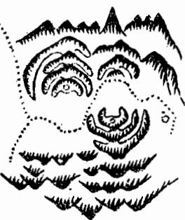

論龍奴從

會非勉強所能致也郭景純曰氣以龍會獨山不葬寶鑑云真龍之行羣山朝揖有隨有從有迎有送有闕有護是也然從龍之山不曰從砂而曰從龍必其亦有星峰磊落奔走樓閃透迤活弄頓跌起伏橈棹擺布亦能眩惑人目昧者多悞以從龍認作正龍不知從龍既為正龍所用則其本體不尊縱別立門戶為隨帶旁受之穴其力量終不及正龍專受之大且尊也經云朝迎護從亦有穴形穴雖成有優劣又云朝迎護從豈無穴輕重多與貴龍別又有一等奴砂乃從山之至賤者旁落偏出粗頑無星體委靡不頓跌醜陋斜側臃腫孤露水割風吹或嵯峩巉岩高昂雄惡或破碎嬾散全無枝腳種種凶形如奴隸武夫供給賤役無所取栽決不可尋穴也圖見後

論龍餘氣 書音食

凡榦龍大地龍氣長盛結穴已完山勢難止必有餘氣之山或去數里或去數十里其去又多融結小穴隨其力量皆有發越切不可認大盡處為正結以正結穴為腰落認差則正受旁受無分力量大小不辨反以大地為小穴不取而以小穴為大地矣世人不識大地多被餘氣山所混彼無真見必於盡處結穴方為龍盡氣鍾不知大地結作不在大窮盡處多在四山擁從之中結了必有餘氣之山經云君如尋得榦龍窮二水相交穴受風風吹水刦却非穴君尋到處是疑龍張子微云龍將盡時難更去分付從茲是餘氣或為枝業或餘波要識此般總無氣故凡尋龍雖識大小受穴不同小龍須盡處求穴大龍則不然蓋緣龍長力大到結穴處氣甚旺盛一齊收斂不盡故此去猶長函然扦得真穴其去山雖遠而氣脈亦皆收 不盡故此去猶長爾然扞得真穴其去山雖遠而氣脈亦皆收轉穴內受用謂之牽前扯後故力量大却又不可誤認停驛龍歇穴作榦龍正結停釋龍驛之穴乃是斬關腰 可誤認停驛龍歇穴作榦龍正結停釋龍驛之穴乃是斬關腰結之地大龍前去自有正穴經所謂譬如人行適千里豈無解鞍並頓宿頊宿之所雖未住亦有從行并部曲 適千里豈無解鞍並頓宿頊宿之所雖未住亦有從行并部曲

也里人子頁和卷二下龍法

然此亦是大龍旺處透漏餘氣小有結作而己幹龍正受之穴乃是融結已畢而有餘剩之氣延袤而去自不 與停驛龍歇同也楊公所謂真龍勢踴難頓住結穴定了氣遂去是矣然其去也或回為下手或轉為托樂或 反遠身為纏護或奔走水口為門戶或聳於前為案或發於左右為曜或拖於後為鬼或鋪於前為禮要皆為 我用神雖去不足畏非分散龍氣無鬼刦之比楊公云大地皆從腰裡落回轉餘枝作城郭吳公云餘氣不去 數十里決然不是王侯也故大龍氣盛者方結此穴小龍無之又須詳審精察不可以過龍虛偽之處而誤下也 云牙布爪結穴

趙 下盛缘有 後督堂如 托云階 点無處尋門君 客力穴龍即甲 决一須必集 非則大有大 终大脈盡引宫 草地窮為徙行 尾縱氣好護 而有最太衛 已地二窮 亦則盡 護則 穴水 不割 過又 三反 則無 風力 吹須 水结 割穴 四 則有 局餘 面瓶 明方 堂為 霓大 处地 彻 聚真 五错 則認 受大不 退 外富 貴 三 或必 十不而 數在已 里大 處大窮盡處多是 人之 風吹水 地莆田林婆墓 必泊 基樂平洪忠宣公馬碧梧丞 在必 公沙財市帆穴 分目之一長巳定者且也主各已同付一下

十地在婺源縣二十七都地名官炕嶺乃朱夫子四世祖安墓也予兄弟曩在朱氏觀大公家譜云四世祖名惟甫配程氏行恭二名豈蔻葬二十七都丹陽鄉環石里地名官坑半嶺金斗形梁上穴庚申山正坎作丙向嘉祐四年己亥八月吳景鸞下

課云金斗穴居梁朝案信鴉間溪山環九曲道學世流荒未下之前有記云官坑龍勢異穴高眾山聚坎離交媾情筆峰天外起富不及陶朱貴不過五府當出一賢人聰明如孔子

此地正幹迢迢甚遠不能悉述比人首橫列雲錦帳帳之巔微起雙峰峰下各出微服隱隱隆隆數節走 馬娥眉文星貼在帳身微茫合氣細察則有粗看則無非俗眼所能檢未入首求氣結咽復頓起土星開 窩之格形體甚秀窩間又有微乳穴粘乳頭坐下平坦藏風聚氣穴情完固可愛兩旁拱衛羅列莫知為 萬仞山巔元辰水雖當前傾跌三千餘步得本身一掬近案橫攔緊巧有力不見水去且迂迴曲析亦不 為害但主離鄉而已故文公遷居建陽乃其驗也近有鵝子峰作案已自秀異而外陽又有特異奇峰遠 在天表聳入雲漢登穴視之勢如焰動清奇可愛且水星帳北火星朝南東木西金夾照土星結穴居中 謂之五星守垣真至貴之地也然以俗眼觀之龍身奔去三十餘里始盡而此間以橫落微茫數節之服 結穴高在山巔無明堂而水又流去甚遠執識為此等大地雖然我文公朱夫子乃間氣所鍾固非一穴 之也所能孕有然以課記考之其符應若是執謂於地理盡無與哉

傳疑樂平洪士良同師吳景鸞至官坑嶺下士良偶渴探泉飲之走謂師曰此泉甚異當有至貴之地國師亦往索衆嘗之曰是泉有翰墨香宣但貴也當產大賢因至山巔觀之果見其穴呀曰秀鍾於此以報朱氏然其地自山下至穴所約七里許而送龍兩水右出石檢在前水直流五店石穴高水遠不利初代宅

穸畢用巨石壓而封之後果以不利欲遷焉竟得石壓而止又云初獻地者謂有天子氣象未決往邀其師係一僧來觀曰當出夫子吳公晚年落髮學禪故傳為僧耳按吳公傳有髡髮自縱是也

一地在福建興化府城內土名烏石山其龍與府龍共祖來歷甚遠至紫帽山連生紫微紫霄名曰三紫磅礴綿亘數百里盤旋融會氣勢雄偉千雄萬狀不可殫巡將入局開帳重重巍峩翁捉復大斷過峽分為兩枝其右出者結府治及莆田縣都閫衛所儒學各衙門其左出者自分脈後

也里人子須知卷二下龍法

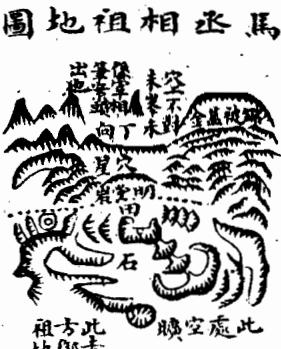

## 星上腔四穴龍騎倒

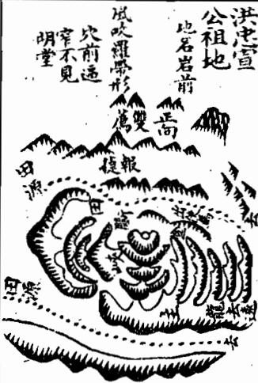

復穿田連過數峽頓伏棲閃透迤活弄莫可測度入首起走馬三台仙帶貴格卓起巨石如奇葩如謹芝 穴結石下僅尋大之土為騎龍穴穴前不數大復起巨石昂然朝拱取作觀音坐運形以其羣石遶穴也 穴下龍服撒落平陽去結方林黃陳諸巨族陽基正近穴前為演武場右水遶左以接海潮壺公山端嚴 朝拱以為正案但左邊一曠百里直抵大海莫有下關龍勢不止右砂獵過明堂兼以巨石鱗磷無龍無 虎孰信以為大地唐時林母賣糍棵有藍縷生曰遼食粿母與之不吝歲久生謂母曰吾受母惠無以報 吾將去矣烏石山有大地母可圗為壽藏異曰富貴無窮林母從其言果葵之今稱為糍婆墓福建名林 之祖世謂無林不開榜此地之鍾秀也自唐宋迨今科甲之多海內莫與倫焉

愛穴下鋪平坦前為乾墠復曰左起微埠頓二小峰為案拖腳順水為馬頭帶劍主使外國耳但穴前逼 一小峰為案拖腳順水為馬頭帶劍主使外國耳但穴前逼迫既無龍虎又無明堂其穴後之山又連起四峰成星體而去甚遠雖重重衛穴然以俗觀則鬼刦太重 一峰成星體而去甚遠雖重重衛穴然以俗觀則鬼刦太重烏知此餘氣適足以證力量之大耶且拖去之曜當時已知為離鄉砂矣乃不鑿於葵之曰而顧俟其出 曜當時已知為離鄉砂矣乃不鑿於葬之曰而顧俟其出使久不回也使鑿之鑿之而果回也是何料事於豫如目前也哉地理固自有符驗處要之哲師之有真 於豫如目前也哉地理固自有符驗處要之哲師之有真傳有定衡有灼見俱不可少也藉今鑿於未有忠宣以前則躍氣被傷安知果能得忠宣者起而應之又 中宣以前則曜氣被傷安知果能得忠宣者起而應之又不然而即鑿於出使之初吾恐出使者又禍且不測矣噫各各不爽此所以稱哲師哉 不測矣噫各各不爽此所以稱哲師哉

大在樂平地名巖前宋忠宣公洪皓曽祖安地也乃公曽 祖士良所下士良嘗師吳景鸞深得其旨扦此地具圗作 課用朱筆於出使馬處拖之記云後世吾子孫有出使外 國久不遠鄉者可以拖處鑿斷即返後果忠宣公使金久 未歸家檢此圗如其語斷之公遂得返迄今鑿處迹存忠 宣公三子文惠公适官樞密使文安公遵官同知樞密文 敏公邁官端明學士世稱三洪云按是地來龍極旺入 局為三台飛蛾中抽一脈穿田過峽即結穴穴甚清巧可

言為金才著梧馬其格遠係 作精皆大 丞仰氣穴凹 課見有獻神相瓦感後腦 後而丈通童廷於仰天 卒奇名考馬藏此前瓦財 如之馬瑞號地不蓝穴 其乃廖子臨碧出嫌此樂

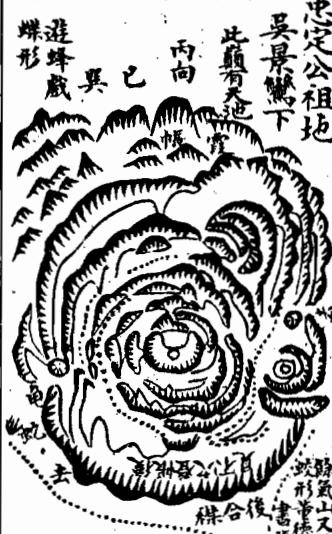

情乎水短居絕位富天貧強貴不終按是地以廉貞作祖迢遞數十里入局開帳頓跌大小一 峰庚寅生人遇年月甲科當出狀元公午未生年為最妙高薦及第榮祖午庚龍國氏 壬午至丁未及第登台鼎位十二峰龍勢旺處轉身結顧祖之穴極其藏聚穴垂乳頭前吐氊褥下臂抱裹四勢擁從有情近案員平遠朝秀異雖穴在窮源局甚逼窄而山皆光彩不簷且水出口處兩岸卓立石墩水從中流謂之日月捍門至貴之證也餘氣山去數里又結方御史祖地正見氣盛不已也但坐後仰瓦又無樂山橫龍結穴形勢不止又扦粘穴非明師其孰能之相傳黃師所下惜失其名廖金精撰課稱曰先師蓋亦深服之矣

石丞相馬廷鸞祖地在樂平縣地名雀兒龍廖金精課云先師黃老善尋龍五福源頭兩發蹤山東秋來祖四十里丙午丁未山為龍迢迢宛轉乾亥骨乾亥五里穴其中丑癸二山為出出是穴為仙官坐癸向丁來正案案前聳出貴人峰貴人卓入青雲裏日月捍門山更隆秀山在案頭邊出排衙列陣山重重男女子孫分位次一十二座貪狼

倒騎龍穴地在吾邑新營水南五里土名烏石源 遊蜂戲蝶形宋參知政事忠定公壽祖地係國師 吳景鸞下課曰前有三峰後有七星水分八字官 頭無涯後出一宰執二侯進士五十餘人登仕籍 者百餘人子孫甚蕃稱十院張氏今貴未艾

按是地龍自高嶺天峰池卸下霞帔垂絲落脈為岡埠在平坡間磊磊落落如蜂屯蟻聚者相望數里過峽重重而枝葉甚蕃衍護從極周密比入局却又如拋梭如撒珠之玄走弄棲閃萬狀不可捉摸殆未易以形容其美也有龍如比安得不結極其之穴故其穴結後又有許多餘氣去為陽基為陰地適見正穴之力量極大耳但餘氣山雖去為橫帳列於穴後枝枝葉葉包裏穴之左右并為水曰兩邊龜蛇等砂却登穴不見有山立於坟頭回視背後及左右一望皆為青天似於空曠而結穴處最低平又非高壠俯視羣卑之比遠着脚力仔細檢點始知羣山皆顧定穴場未敢離也且近案既不端尊遠朝又不秀異又無龍虎又無明堂又不見水向前簇簇多山似於逼窄而穴後反空無一可入俗眼誰信為此等大地予兄弟初嘗裏粮擔登往觀數沒莫測其奧駁難推求竟亦無憑後獲穴法真傳始知其妙妙在穴也故此等怪穴苟非有天然之美即過龍矣葬書五凶此其一也趙緣督翁云十箇騎龍九箇假正恐人不識有穴無穴而誤下過龍耳故哲師全在織穴

<!-- doc017 PDF 第 55 页：高风险/复杂版面 OCR 供检索；内容与排版以原页图为准。 -->

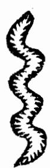

以上諸圖皆是結穴之後有餘氣之山奔去數十里其去者固皆為我用神而却又有結作但力量為輕耳如文公祖地結穴後去數十里結方憲副祖 飢秋也及黃氏祖地論如林延墓結後又去作諸貴族陽基張忠定公祖地結後又去作桃枝源金鵝抱卵形出尚書張公憲馬丞相祖地結後又去作月形方氏祖地出御史公乾凡此之類務須詳辨不可以正結之穴誤認為停驛為斬關腰結小康之地而以大盡處餘氣所結小穴反認為正結大地也

卷二下之二專論龍有山壠平岡平地之不同初落中落末落之不一又有生死強弱順逆進退福病刦殺之殊出脈受穴入首結局之異皆龍家之肯綮也人上

經曰五氣行乎地中發而生乎萬物其行也因地之勢其聚也因勢之止是故氣囿於形而形分三勢焉曰山壠之勢曰平岡之勢曰平地之勢也何謂山壠之勢其龍踴躍奔騰起伏頓跌磊落低昂葵書所謂若伏若連其原自天若水之波若馬之馳又曰勢如萬馬自天而下吳公譬之羣羊之出棧者是也李淳風名為起伏脈何謂平岡之勢其龍逶迤奔走屈曲擺相之東走西活動死轉葬書所謂宛委自復迴璟重複又曰逵走東西或為南北吳公譬之生蛇之出洞者是也李淳風名為仙帶脈何謂平支之勢其龍坦夷曠潤相牽相連珠絲

## 論龍分三勢

馬跡藕斷絲牽平中一突鋪擅展席葬書所謂隱隱隆隆微妙玄通吉在其中又曰地有吉氣隨土而起支有江赦隨水而出吳公譬之草蛇灰線者是也李淳風石為平受脈龍雖變態不一若難以定法拾然大都不外此三勢耳三勢不同其融結力量輕重大小本無二致然所謂山谷多起伏格平岡多仙帶枝平陽多七又林亦尸舉大概言之要之三格之龍皆起於高山大壠而分落平岡平地故雖山谷亦有落平四平地而結穴者平地中亦有墩阜忽然連起而結穴者此則又為奇特蓋山谷以起伏為常而落平田則服每得清平五以平受為常而起墩阜則氣聚得旺經曰高山大嶺多尖峰不似平原一錦卓賦曰窮源干仞不如平故一地是言平地以墩阜為貴也經曰山來壠石尖如削盡起貪狼更高卓此地如何不出文口為峰多反成濁又已或從高山落平地或從大山落低小不知山窮落坪處穴在坪中貴無敵是言山谷以落平為貴也然起伏格縣峰磊落而平岡平地亦有星辰惟是倒地平西未易檢點吳公口訣云眠倒星辰堅起看却與高峰同一祥高峰萬伊受風吹不是平波龍氣旺是故三勢之龍各自有妙未可以星峰高下論優劣也如以天下大形勢論之隴蜀兩廣多山冀周齊魯多平洋吳越多岡埠而人才在在有之可見高山平地之融結其稟有造化則也起 起 起伏格一起一伏大頓小跌斷而復起起而又斷或高或下有低有昂十氏云一起一伏斷了斷到頭定有奇踪宜星峰名落山勢奔騰于

山帶格屈曲擺摺逶迤活動如生蛇如飄練如之玄如飄帶卜氏云脈若帶連何必高昂之阜是也宜活動擺摺屈曲悠揚為得其本體

平受格服落平洋二望無際相牽相連微有體勢高一寸為山低一寸為水卜氏云勢如浪湧何須車立之峰是也要平中有突賂黜

## 初落龍 刀客遣

<!-- doc017 PDF 第 56 页：高风险/复杂版面 OCR 供检索；内容与排版以原页图为准。 -->
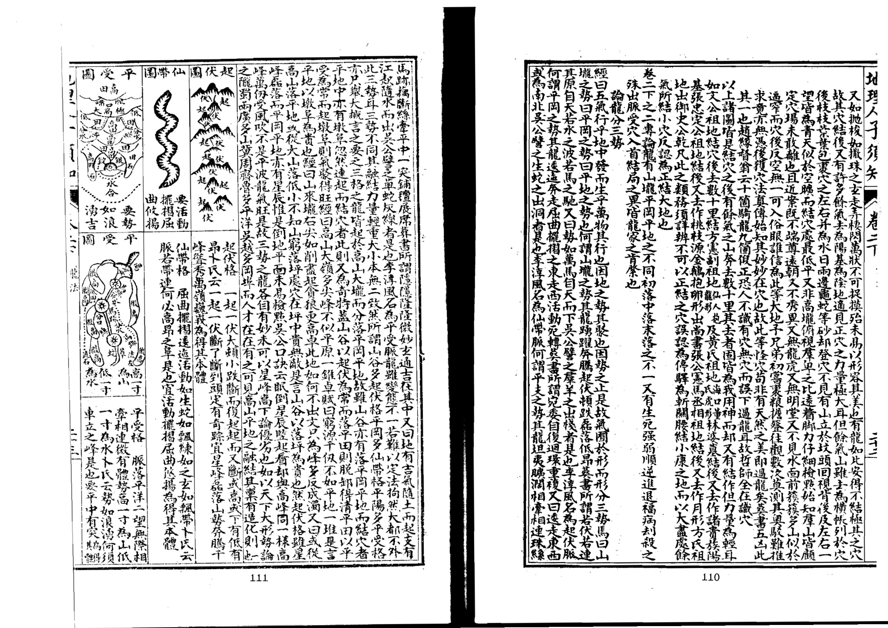

龍之落局融結不一而其大要有三有初落有中落有末落李淳風云龍有旺於初者有盛於中者有歸於當者明山寶鑑云有少龍之穴有中龍之穴有盡龍之穴二說皆言初落中落末落之理無異意也然此三落之勢特言融結力量之大者耳其間分劈小康之穴尤多固不可以小康為正三落之正亦不可拘三落之正而棄小康之地貴在人之通變矣

初落者自祖山發下離祖不遠即結頂降勢過服起星結穴開局朝山聳前托山列後或祖山作樂作障而龍虎護衛明堂融聚下手重重水口周密四山圍擁骨肉一家亦為真結但以其離祖未遠故名初落頭氏云初落由來近祖山局勢必須完李氏云龍有旺於初者是也中各

## 末落龍

中落者自祖山發下去祖已遠迢迢而來大頓小伏中間忽起高山以為少祖目少祖下或六七節或十數節再起星辰結頂降勢過脈落局求咽融結其大龍猶自作勢遠去而分行却在少祖之前此處特一闕局未為大盡故名中落朝迎山則拜於前護從山則障於後其分去之山回作我用或為下手為水口為關欄為托樂為城郭為關鎖楊公云大地皆從腰裏落回轉餘枝作城郭廖氏云中落餘枝作城郭吉氣於斯泊李氏云有盛於中是也

末落者自祖山發下迢迢行度一起一伏奔東走西離祖極遠山勢將盡前去或臨大江大河或臨大溪大湖或臨田坂小澗山脈已盡再無去處而於將盡未盡之際頓起高山以為少祖自少祖而下或數節即結頂降勢東氣結咽成穴或據江湖或據溪湖或下山一臂橫攔或翻身逆張大局而有隔水外洋朝拱或脫落平洋藏跡隱蹤如蜘蛛隊樓流星度漢拋毬閃跡鋪檀仰掌金盤金盆而作平地之穴矣隔江隔河遠山朝應凡此皆規模宏大局勢廣潤三陽六建莫不具備廖氏云末落名為大盡龍氣勢最豪雄李氏云龍有

歸於盡者是也然亦不必拘於據江臨河極窮盡處尋穴必結穴之外有餘氣方是大龍末落之戊也按諸書有言初落中落末落者有言少龍中龍盡龍者其義皆同惟泄天機復有分落後音兮朋去之說而淳風小卷有龍有歸於老者之說二說定為一例要之至理則老龍當與盡龍同科分落宜與中法互論但老者大盡窮絕不可取分落數節短小不盡同皆非龍家之美在人以意舊之

詔青开幸一二本泄天機龍格曰生曰死曰强曰弱曰順曰逆曰進曰退凡八格以生強順進為四吉死弱逆退為四凶固為攸當而明山寶鑑又有生死枉福鬼刦應遠死揖病絕凡十二格除生死二名相同其應揖遊絕鬼却之龍名亦形同名異如應揖即順進之屬遊枉絕即死弱退逆之類而福病去殺四格猶出康氏八格之外亦不可道今合取之共為十二格大全中復有毒龍枉龍傷龍蛀龍等名無非病龍殺龍逆龍之類茲不重收下此又有所謂鬪龍衡龍樞龍機龍胎息龍種種異名則無理致不敢取也今將諸龍名義異同開列於下

生龍者星峰磊落枝脚活弄行度擺拽之謂也入式歌曰生是低昂多節目蓋其龍自出身以來一起一伏有低有昂分牙布爪左趨右閃活動透迤如鸞翔鳳翥如魚躍為飛而皆有生意也實鑑云自祖山發足而來大與小狀如

去後望腳枝龍逆

九丑人二今矢二

<!-- doc017 PDF 第 57 页：高风险/复杂版面 OCR 供检索；内容与排版以原页图为准。 -->

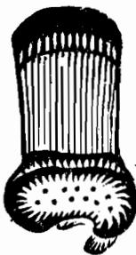  
伏起無是死

圖龍强

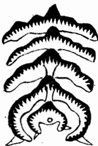

圖龍弱

圖龍順

前向腳枝  

圖龍進

圖龍退

圖龍福

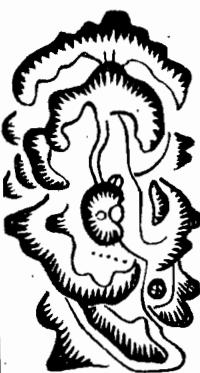

死龍者峰巒模糊脚手彷佛本體直硬之謂也入式歌曰死是無起伏蓋其龍自離祖以來粗頑臃腫無起伏無擺捐其勢如魚失水如木無枝如順水隨流如死鰍死鱔而皆無生意也此格最凶不能融結縱有形穴必為虛偽若誤下之主窮苦下賤遂以死絕雖作神壇社廟亦不顯靈

強龍者星峰迫異枝脚撐拏體格雄健之謂也入式歌云強是奔走勢力弘蓋其龍仨離祖以來形勢軒昂力量盛大擺摺橫潤行度自由如猛虎出林渴龍奔海指爪攖桴鱗甲堅立而強盛也此格最吉如融結成穴主驟富驟貴威名掀揭一時功業强盛

弱龍者星峰骨瘦枝腳短縮本體攸緩之謂也入式歌曰弱是瘦峻嶒蓋其龍自離祖以來飄飄散散全無收拾險峻嵯峨浮筋露骨尖小嬾緩隨斜無依陷削而不克實虛浮而不光彩形如鵝頭鴨頸敗柳殘花道如餓馬伏櫪孤雁失羣而怯弱欹摘也此龍多遭風吹水刦不能融結縱有形穴亦為虛偽若下之主孤貧伶行疾苦困弱

順龍者星峰順出枝腳順布行度團聚之謂也入式歌云順是開 掙何前往蓋其龍自離祖以來尊卑有次送從趨前上下照應左 右環抱有瞻戀之情有照顧之意如星拱北如水朝東而春戀不 志也此龍最貴如融結成穴主富貴綿遠百子千孫孝順和睦多 福多壽

逆龍者星峰側立枝脚逆趨行度乖戾之謂也入式歌曰逆自望後去蓋其龍自離祖以來高下不倫忘前忽後行度處棋枝不隨入穴處龍虎不衛如水之逆行如鷁之退飛而肆散背戾也此穴最凶縱有形穴亦為不吉主凶暴忤逆盜寇軍配亦有邊內道者子微云一種半逆半順行多為反戟禍不輕長幼吉凶分左右良之川是度逆龍刀不可下

進龍者星辰迭次枝腳均幻行度有序之謂也入式歌云進長音身節節高蓋其龍自離祖以來辭樓下殿精神俊異走伏仰年倫序不紊自粗剝細由老出嫩如鳳覽德輝而下如鴻戲水而飛而進趨有漸也此格最吉如融結成穴主丈華弈世富貴雙全墊辨新滿門朱紫發福悠長進益不替

退龍者星辰失次枝腳不倫而行度退後之謂也入式歌曰退時漸消條蓋芳龍自離祖以來本無正氣勉強行度始小終大前後穴高如人之踏確如船之上灘而高下失等也此格最凶緣有形穴亦為不吉主一發即退無多力量

福龍者祖宗貴而從衛多也其龍但離祖以來護從稱密前後木應枝腳雖不大揚而有倉有庫星峰雖不卓拔而不惡不叔位無大擺布耳如有福之人上得前人之蔭下得奴僕之供而坐享安樂也主發福悠遠富貴康寧和義

.11.1

<!-- doc017 PDF 第 58 页：高风险/复杂版面 OCR 供检索；内容与排版以原页图为准。 -->

九丑人子分矢卷二

  
害傷被脈過龍病同

病龍者本體雖美而有瑕疵者也其龍自離祖以來稟氣偏駁美中不純出身行度起伏頓跌變動活走雖皆可觀而枝腳邊有邊無邊生邊死邊美邊惡或一畔周密一畔缺陷或一節活動一節死硬或一邊圓淨一邊破碎或星峰美惡不一或四山送從不周凡此之類皆謂病也雖有結作而禍福相半好中不足美事不周

又有一等病龍離祖以來星峰麗秀過峽周密枝腳橈棹蓋送纏護仲件合法只是龍身當緊要處或經鑿斷或以崩頹或蛟龍衝壞或取土取石或開窟開井或當穴踏路成坑破損穴相或穴頂開造寨廟傷損星頭或前葵已多而鑿損真穴或誤開陽基而掘眼破壞凡此之類皆傷氣脈故曰病龍亦曰傷龍蛀龍殘龍如人斷腰折頸破面損頭無能再續之理縱有諸般美處皆為無益若誤下之主凶敗廢疾少亡孤寡

刦龍者龍身分劈多也曰離祖以來無有正條東牽西拽左分右 劈嫡度不明旁正莫辨真氣分散龍脈不聚全無收拾明山論云 分枝臂脈或反或走或離或析或散或側或尖或右或高而枯槁 低而薄弱皆名鬼刦凡龍以分劈多者為刦少者為鬼在前者主 官事在後者主疾患是也此格最凶縱有形穴必不可下主盜賊 侵刦疾病官災若刦去而復回作我用者不以此格拘

殺龍者龍身帶殺而未經脫卸者也曰離祖以來峻 險壁醜惡粗雄露骨帶石枝腳尖利破碎欹斜腑腫硬 直或全無跌斷過峽或雖經脫却而惡形不改顧之而 毛骨悚步之而心神驚凡此之類皆謂殺氣凶露名曰 殺龍最為凶惡若誤下之主凶狠強梁為嗜殺誅夷慘 滅之應

論龍出脈三格凡龍之穿落纏變皆有出服其格有三曰中出曰左山曰右山其離然大高小凶皆正始於此 也學之關後落服要中出中出方為吉左出為輕右更輕輕重此中生是真偽美惡福福吉凶皆服服於此冥如學之為睫不可不察也 不可不察也

以此為例凡中出服者受穴之龍自離祖出复落服及過峽非穴等皮取作中台 兩畔山形均右均勻蟬翼仙帶夾護齊整或開帳貫中出成書曰胃之中山反告復山 出 勻者皆是不星而脈從中落或左右攝布均生而所從中發皆自之中出用是書 論起頂降勢周密不被風吹則其融結必真力量必大主巨富顯貴凡賢人君子一 反為或下切光明正大之士皆中出脈所孕毓也

左出脈者龍之出身發脈及行度過峽入穴等處脈從左畔而出山之 形勢左少右多兩畔不勻只是蟬翼仙帶及外從皆照應周密故前去 亦有結作若偏旁出脈而從山不周則無融結不必追尋矣 右出脈者龍之出身發服及行度過峽入穴等處服從右落山之形執 右少左多兩畔不均只是蟬翼仙帶及外從皆照應周密故前去亦有 結作若偏旁出脈而從山不周則無融結不必追尋矣

<table><tr><td rowspan=1 colspan=2>北王人矢</td><td rowspan=1 colspan=6></td></tr><tr><td rowspan=1 colspan=2>份楼    C</td><td rowspan=1 colspan=2>凡脈之左右微有形迹護服出身者名曰蟬翼亦曰蟬翅而旁送服之砂高大而長石曰仙帶欲其均勻</td><td rowspan=1 colspan=4>以上出脈三格中出為上左出次之右出又次之左右全偏則無足取但山龍變態不常固有前中出而後偏者亦有前偏出而後中者又有交互中偏者又有似偏而寬中者必須詳辨庶得其情性之真圗具下</td></tr><tr><td rowspan=1 colspan=1>CC</td><td rowspan=1 colspan=2>此全是中出至貴主文章勳業榮顯王侯極品</td><td rowspan=1 colspan=2>C</td><td rowspan=1 colspan=1>此先中出而後偏者不吉縱有形穴小康而已</td><td rowspan=1 colspan=1>CCC</td><td rowspan=1 colspan=1>此先偏出而後中者亦作次格主小貴巨富</td></tr><tr><td rowspan=1 colspan=1>CCO</td><td rowspan=1 colspan=2>此交互中出者亦主富貴而心術不正甚矣</td><td rowspan=1 colspan=2>CCC</td><td rowspan=1 colspan=1>此交互偏出一左一右却相承應亦作吉格</td><td rowspan=1 colspan=1>2</td><td rowspan=1 colspan=1>此似偏出而實中者不可誤作偏斜主大章榮顯</td></tr><tr><td rowspan=1 colspan=1>G偏</td><td rowspan=1 colspan=2>此格似中出而實偏然節節相稱而脊脈屈曲均勻亦作次吉</td><td rowspan=1 colspan=2>CCC中度亦曰穿</td><td rowspan=1 colspan=1>此亦中出之格最為閃巧然而亦作吉主貴而不至極耳</td><td rowspan=1 colspan=1>偏偏偏</td><td rowspan=1 colspan=1>此則全偏不能結地只作奴僕砂</td></tr><tr><td rowspan=1 colspan=8>論龍受穴三等凡龍之受穴初落中落末落之外又分三等其力量輕重亦有不同所謂三等者曰正受曰分受曰旁受也正受之穴力量極大發福悠久分受次之旁受為下耳此以力量大小品其優劣但結作真實三者皆吉不可以旁受力量之小而專一圖其正受之地明師下地如大匠用木大者為椽細者為桶棲櫨根闐居楔各當其宜豈可以其為小材而棄之十氏云大富大貴而大者受用小福小吉而小者宜當是也歟小拟誠之制預</td></tr></table>

## 愛穴

<!-- doc017 PDF 第 59 页：高风险/复杂版面 OCR 供检索；内容与排版以原页图为准。 -->

正受穴正受者龍勢迢迢雖分牙布爪萬嶺干山皆為我用千里百里盡鍾於此而特結正受之穴其力量最大其發福最久至寶經云正龍專受富貴長久

## nd

分受者正龍身上分出一枝起星辰有枝腳過峽纏變皆有護衛自立門云戶自開堂局以結形穴不為他人作用神也但非正枝乃分落之龍而融結者故曰分受穴力量隨龍長短亦能發福但不如正受穴之長遠耳至寶經云挂龍分受富貴難久

## 論龍入首五格

旁受者多是正龍旺盛或於過峽處或於枝腳橈棹間或於纏送護托從龍之上或龍虎餘氣官鬼之所帶有小穴或傍城借勢或別立門戶隨其大小結為形穴穴情明白四面登對亦能發越但易成易敗力量全輕子微玉髓云也有一龍生數穴或輕或重故有訣楊公云千里來龍只一穴正者為優旁者劣蔡西山云大凡一龍不專一穴本身隨帶必有小穴如大官宦必有從官大衙府必有曹屬第輕重大小不同耳此旁受穴之謂也然此等小穴發福極速但正穴下後奪其龍氣必敗訣云正龍未下旁龍發下了正龍旁龍歇捉服賦云真穴未葬雖邊傍而可發正穴既下盡氣服以兼收此之謂也

此格最吉

巳里一頁四卷二下龍法

<table><tr><td rowspan=1 colspan=1></td><td rowspan=1 colspan=1>橫龍者乃橫服入首而結穴者也或從右來或從左來須要穴後有樂有鬼廖氏云橫龍穴後有樂有鬼廖氏云橫龍穴後必要思樂星宜後峙是也此穴不宜元辰宜長</td></tr><tr><td rowspan=1 colspan=1>此格乃上聚穴前平坦貴登穴不知高</td><td rowspan=1 colspan=1>飛龍者乃上聚仰高而結穴者也以其勢高而昂故曰飛龍須四應皆高立聳上聚仰勢受穴方為真結此穴力量最大貴重富輕以其水多不聚故也必有交牙關鎖為吉</td></tr><tr><td rowspan=1 colspan=1>入                   日y     低                 六白思y白</td><td rowspan=1 colspan=1>潛龍者龍氣撒落平地而結穴者也即所謂平受之脈高一寸為山低一寸為水須要平地有凹或開鉗口水勢環遶方為真結也</td></tr><tr><td rowspan=1 colspan=1></td><td rowspan=1 colspan=1>回龍者乃翻身顧祖而結穴者也經云宛轉回龍似掛鈎未作穴時先作朝朝山皆是宗與祖不拘十里遠迢迢是也然亦有大回龍小回龍及盤龍穴等格皆是也</td></tr><tr><td rowspan=1 colspan=2>以上入首五格出泄天機固為精當但龍有藏跡隱跡入首閃側而出於五格之外者今增閃龍入首一格度極其微妙云閃龍入首</td></tr></table>

<!-- doc017 PDF 第 60 页：高风险/复杂版面 OCR 供检索；内容与排版以原页图为准。 -->

閃龍者龍服棲側縣閃結穴也山勢直去而服則角而轉月以豈惟直中為可據俗師不識玄微訣只向吳公云只泥穿心直串去不識真龍轉身度真龍臣人輕長負來惟下了吳人貪與絕是也益頂龍求穴直穿尋正穴尋到山窮服盡時不論有穴并無穴惟以推則丁來龍下下詩人質與終是也蓋龍求以固是正理但真龍奇巧處有閃脈而融結者如蔡西山不此其林地

上地在建陽麻法土名母雞嶺過峽其龍頻蹤三十一峰入首起 上圭貞色上屋貞交三十一年自起木星展翅中出蘆鞭正貫盡處雖有明堂龍虎秀峰可觀而真氣不到不結穴其脈閃過右邊成文星落平田結穴右上橫一字文星為案外聳秀峰為應左山列屏赦大橫截水口但堂氣傾斜微大星奔位 西山道不入俗眼其先課云螺姊吐內穴居肉九世九賢果出几代出收堂先生發 贈卿西山文節公元定居簡九峰先生沈姒也中國及節齋淵復齋況丞相文肅公抗與覺軒模素軒格靜軒權世稱九賢果應其課云

右地作吾邑地名煖川香潭嶺去縣東南八十里俗四庫所度形其龍來勢甚近南溪煖溪兩水夾送約百餘里將至入居鄰兵大轉逆奔而上頓起貪很峰一十餘座凌雲高秀迫射奇吳至米盡未盡之際閃落一服結穴不見大局左右晴氣飛揚對面藺之儼若龍虎不包顧及登穴則拱衛有情少祖山下發出一山拜伏於前以為近案內局團聚外陽暗拱水遶青龍而欲玄武門戶交固後樂龍樓寶殿勢貼青霄真美地也左臂龍勢盡虔後串來音前局寬廣秀峰重憂人皆貪其砂秀堂賢龍盡韓者皆不主於寬知真龍多閃拋而不在於直串之山勢好局多緊夾而不在才

## 論龍入穴十二脈

<!-- doc017 PDF 第 61 页：高风险/复杂版面 OCR 供检索；内容与排版以原页图为准。 -->

按此閃龍入首之說前輩已嘗論之茲故特收名地三格為式庚可因類以推曲盡微妙但此等之穴實多隱怪識者取決於龍穴昧者徒惑於砂水故貪大堂局愛秀峰為地理之所堂順而直串來龍取穴亦或有誤不可執一也

龍之結穴必於入首之際過服結咽束氣入穴其脈則有十二格皆於穴後審之所謂十二格者曰正曰偏曰 大曰小曰短曰長曰高曰低曰曲曰直曰斷曰續廖氏云欲作穴時看出服原有十格正偏大小與短長二高 低要審詳更有曲直并斷續吉凶皆在目是也

<table><tr><td rowspan=1 colspan=1> EH</td><td rowspan=1 colspan=1>正即中也要星辰端正脈從中出而兩畔山之形勢均勻故曰正服此格極吉即中出脈</td><td rowspan=1 colspan=1>局        左右同偏</td><td rowspan=1 colspan=1>或從左或從右偏於一畔而山之形勢不均故曰偏此格力藏</td></tr><tr><td rowspan=1 colspan=1>大        澳</td><td rowspan=1 colspan=1>龍大服宜大大曰蠻脈即潤服也宜有草蛇灰線之脈居其中</td><td rowspan=1 colspan=1>预       微细</td><td rowspan=1 colspan=1>龍大脈小者曰巧脈此格最貴</td></tr><tr><td rowspan=1 colspan=1>短服</td><td rowspan=1 colspan=1>短則氣服易行要求脈嫩細者短而大則不吉</td><td rowspan=1 colspan=1>限   宜曲</td><td rowspan=1 colspan=1>長則氣脈難過必中間有泡引氣則吉又宜活動若硬直則為死不吉大抵長服易受飄正融氣</td></tr><tr><td rowspan=1 colspan=1>高朕            高</td><td rowspan=1 colspan=1>高脈易成貫頂且星辰頭面淺薄惟串珠一格有之亦當於三四節外看有過峽出氣者可取</td><td rowspan=1 colspan=1>贺贺   KC</td><td rowspan=1 colspan=1>低從脚下過脈要分水明曰則非斷截如水不分八字即是斷截不吉</td></tr></table>

右脈形十二格本於廖氏泄天機其正偏二格實繞諸格而皆有之即前中出左出右出三格也但彼以後龍行度出落而言此專以受穴一節而言尤為緊要故復詳之論龍結穴五局

龍之結穴成局有五格皆以水為準一曰朝水局乃水自當洋朝也曰橫水曰無水修曰不左前來 師曰乾乃穴前全去也三曰據水局乃穴前諸水融聚為湖也四曰去水局乃水自穴前流去也五曰無水居 龍也不見水也雖有五局結穴不同龍真穴的皆主富貴惟去水局不利初年也 K

朝水之局多是翻身逆勢結穴以受當面洋朝之水要穴星高大有餘氣或有低砂祿擔不使水佳害為吉又須水流之玄屈曲或平田洋朝為善若急流佳射又反為凶惟天穴反何言穴則不惟遠水求朝老穴均卑弱星辰低小山不稱水則凶不可一概為逆局而吉也此穴又多結不水口之間式下爾山知為亦不為雪但要穴場藏聚水來纏繞穴不受風為真康氏云翻身逆勢去當朝不止風相門月其龍每易交也卜氏云莫把水為定格但求穴裏藏風則善矣大抵地理之法得水為上翻身逆當朝水之居陰陽交售而有融結故為貴也

橫水居 橫水局者龍之結穴或水自左來流右去或水自右來流左去要水勢彎珠抱穴如終帶為美又要一縣

地理人子須知卷二下

<!-- doc017 PDF 第 62 页：高风险/复杂版面 OCR 供检索；内容与排版以原页图为准。 -->

逆土攔水有力及水纏玄武水口紫密為吉此局極平隱

據水局者龍之結穴前臨大湖或深潭或大池塘此局極吉蓋地以得水為上而水以疑靜為圭今穴古深 水則無衝割穿射之患而有得水之宜也何吉如之龍穴真此局主大貴大富帛 順水局亦名去水局

去水局者必要來龍長遠力量宏大四勢周密水口交固吳公云水維去而山交迴則善陽公云也余來兩水更不回身直為地只是兩護必不同定有纏關交吉必合水雖而山交迴則善楊公云也有幹龍等局勢決無融結不必着眼矣大抵順局也縱有融結亦不發財生初年是文交穴場見水蕩然而去此廬始出官或離鄉始貴如或龍穴稍有不吉則立主退敗威絕無效多見前無水局亦名旱龍局

無水局者穴結乾坡山勢盤聚而不見明堂之水也凡乾龍穴多是左右山黃關遮明堂穴不見之之高在半山無水可見俗人不識必謂有山無水不如山車穴民是左右山橫機通却明堂穴不見水或穴何必拘其有水無水但此等也多先貴後富或多清貴不有少火以相鼎小乘得生氣發達極快水而鉅富者要龍神帶有倉庫耳董德彰云有人無財須尋倉庫之無才不人水州也然亦有穴不論龍結局分三聚

里山州歸諸眼界必為花假所誤矣其有依近省郡山水大聚處結穴者謂之借局如近臣侍從至尊雖沽榮 不而九重之森嚴子官之擁護與夫百辟來朝萬邦納貢於己何有然接天顏之咫尺依曰月之光輝宗廟之 美得而瞻百官之富得而與比之三家村中守財主人逈然不侔矣此借局之地雖小亦大猶有取焉耳又必 結穴處自有門戶乃可不然亦虛花而已矣

大男后 大聚為都會數千萬里山水大會次者為省城亦不下二三千里大會其局以寬廣愈大愈美

中聚為大郡千里山水大會其次為州邑五七十里或二三百里大會又其次者或百里或乂八十里大會其局以寬廣適中為美卜聚局

小聚為鄉村陽宅及富貴陰地人者百里或六七十里山水會集次者三四十里或一二十里又其次者十數里或五七里山水團聚其局以緊固為佳陰地愈固愈好

右三聚之局雖各有大小不同而都會則愈大愈好省郡須寬廣適中陰陽二宅以固密為上也其大中二聚結穴處亦以收斂為真或平中有突或高處開窩必有小界水小明堂或貼近之砂左右交固或低伏之案以關內氣然後外面却有寬潤之羅城廣大之局勢斯為美矣

也里人子頁知卷二下龍法目地理人子須知重刊人子須知資孝地理心學統宗卷三之上

## 五星總論

## 論五星之形

<!-- doc017 PDF 第 64 页：高风险/复杂版面 OCR 供检索；内容与排版以原页图为准。 -->

此冊專論五星按五星云者金曰太白木曰歲星水曰辰星火曰熒或土曰鎮星茲五者即五行也在天成象在地在成形精係于天形著于地盈天地閒萬物也事莫不本此地理之妙豈外此乎經曰天分星宿地列山川艮有以也

德興山人徐善全著

## 金星形圓 金星形圓

夫五星即五行也按邵子曰太極分而為陰陽陰陽播而為五行五行散殊而萬物故五行精係于天為五星 形效于地為五材氣統于歲為五辰在人則為五臟在物則為五色五音五味施于行則為五常是以人若乘 五運置五宮分五禮設五形萬方以治民用咸若然後以五事詧其得失以觀雨暘燠寒風雨動植灾禍祥青 之變雖萬物紛紜乾坤廣大各從其類則莫不由乎五行也是以五行之變而吉云不可勝占五材之變而以 氣不可勝用五辰之變而逆順不可勝計人受天地之中得其秀氣以主視聽食息未有離于五行者也地法 固之而以山形分別五星以驗吉凶最為攸當故貫珠圗有五星為陰陽骨髓之說卜氏有詳審五星變化之 言皆確論也鄰陽余氏祐註發微論乃謂五星以是而非彼蓋未之審矣

夫五星形體古人以木之滌達而取象于直火之炎燭而取象于銳土之厚重而取象于方金之周堅而取象 于員水之流動而取象于曲故凡山形之曲動者為水星光圓者為金星方正者為土星光銳者為火星直聳 者為木星此亦自然之理而非牽強也但五星形又有不純者謂之變格故後人又立九星之名焉其寔九星 不能外是五星耳或曰五星為正九星為變今只取五星不取九星是用其正不用其變曰非也五星之變不 可勝形九星烏足以盡其變惟守約該博則五星寔有以統之矣奚取夫九星之異名哉

<table><tr><td rowspan=1 colspan=2>去王人二分矢差三                                               1</td></tr><tr><td rowspan=1 colspan=1>金                N星圖</td><td rowspan=1 colspan=1>此金星</td></tr><tr><td rowspan=1 colspan=1>水星形直</td><td rowspan=1 colspan=1></td></tr><tr><td rowspan=1 colspan=1></td><td rowspan=1 colspan=1>SWHNINS                  此木星立眼二格</td></tr><tr><td rowspan=1 colspan=2>水星形曲</td></tr><tr><td rowspan=1 colspan=1>水</td><td rowspan=1 colspan=1>此水星立眠二格</td></tr><tr><td rowspan=1 colspan=2>火星形銳</td></tr><tr><td rowspan=1 colspan=1>火            星圗</td><td rowspan=1 colspan=1>2大星</td></tr><tr><td rowspan=1 colspan=2>土星形方</td></tr><tr><td rowspan=1 colspan=1>王             </td><td rowspan=1 colspan=1>此土星立眠二格</td></tr><tr><td rowspan=1 colspan=2>右五星之形姑圃立眠二格正體為式其各星又有兼形未純者皆為變體不悉圗論五星之名</td></tr></table>

金曰太白木曰歲星水曰辰星火曰熒或土曰鎮星此固五星之名也而地理家以山形論星名必屬以吉凶之辨前輩於此頗相牴牾如廖金精以金為文星木為將星張子微以金為武星木為文星楊筠松以土為尊星而子微全精乂皆以土為財星若此之類是皆以一星而拘之矣愚竊謂五星之變化無窮即一星之用亦可為武為文為富為貴為吉函第觀其發現何如耳苟以一星拘之理難包括莫畫具蘊今以清濁函分為三格以例其名庶幾谷極其妙而于諸家之說相為貫通不致矛盾云

五星分清濁凶三格凡星辰秀麗光彩者為清凡星辰肥厚端重者為濁凡星辰醜惡帶殺者為凶補義或問卜氏有金清玉濁火燥水柔之說今謂五星名有清濁凶三格而又不詳燥柔之論何也荅曰彼以情生論而不及夫形象此以形象論而兼推其情性若專論情性則其說固當然必使形象而簷其情性則其言未為盡善善地理家因形譽氣不可舍形象而專清性若以形言則金之肥大粗飽者不可謂清土之骨立方正者不可謂濁火之秀麗者不可純謂之燥水之特達者不可純謂之柔故必無形象清性而始盡其妙此五星所以必各分清濁云三格也金星

釋義全西方之星也于時為杖然金明而貴鏗鈞有教且為世珍重白煉不變輝煌貴曰鋒利堅剛猶世 之貴人剛直忠正不屈不撓故其星之清者為官星官貴之象也其主為文章清秀功名顯達剛正忠 貞節烈之應若其濁而不秀如天文金星有變異則主兵革金倍明芒角赤主用兵故其星之濁者為 武星威武之象也其所主為元戎殺伐威名恒赫之應然金氣肅而凋萬類故秋殺歛藏如古者兵刑 之用必以秋以金主殺伐故其星之凶者為厲星暴之象也其所主為軍賊大盜誅夷添酷絕滅之 應

釋義木東方之星也于時為春春主發生方春之時萬卉秀發奇葩豔萼獻異爭如此木之文也故其星 之清者為文星文華之象也其王為文章清秀科名顯達之應然木之體長茂條暢鳴風撼雨淅瀝有 殺伐之則丁丁仆之則轟轟故又主投譽遠著名姓播楊至于為器用車座文理可觀憑藉適意以為 大廈則棟樑椽角莫不備具故其星之濁者為才星才用之象也其主為榮貴勛業多才多藝之應然 其凶者或枯槁摧折或秀而不冥朽壞倒扑又能壞物以為枷杻桎括之屬乃為刑具故其星之云者 為刑星刑傷之象也其所主為刑傷尅害天折殘疾官訟牢獄孤寡困頓之應

擇義水乃北方之星也于時為冬其精光之懸象于天者常隨乎太陽而行故其應于人事之吉亦為近 帝之貴以其質行于地者言之則風行而紋生且清徹可鑑變動不拘可方可圓推而行之可以運 舟可以灌溉光瑩照耀精不遺故其星之清者為秀星性行明潔度量汪洋之應然水本內明 而外暗體柔性順故其星之濁者為柔星卑弱之象也其所主為昏愚卑陋柔弱委靡論諛 阿邪之應然水基漲則淄天漫野蕩析民居無有救遇而溝渠之間穢污混濁此皆不美故其 星之凶者曰蕩星流蕩之象也其所主為山狠殘暴流蕩忘返酒色傾家淫濫不潔離鄉客死 之應

者曰燥星主剛烈燥暴作威福奸險夭折禍福相半有吉有凶易興易敗之應然火之為物其起甚微其發甚盛其滅甚連與物無情金入則溶木入則焚土入則焦水入則涸故其星之云者為殺星絕物之象也其所主為殺伐添酷大盜誅夷絕滅之應大抵大星欲其脫卸多或撒落平洋或穿田渡水重登過峽然後結穴則吉吳公云若見大星趨動時到處須尋一百里言其遠則脫卸净耳斷法云五七火星連節起列土王侯地脫落平洋近大江結穴始相當亦此意也若火星未經脫卸縱龍穴入格必主大福大禍未有畫善如袁州嚴閣老祖地在洪山五七火星連節而起光炎動其陽基乃穿水而起脫卸後結其陰地則未經穿水而結穴雖龍虎格甚秀結作極美只是火性易發易散故介溪公連登科第位極人臣富甲天下而一敗則塗地亦如大之燼則灰飛姻滅耳洪山之下有空洞按袁州郡志為葛洪煉丹之所舊有記云洪山肚裡空五世出三公雖然居一品家業畫成空亦奇矣哉補義稱公云大地若非廉作祖為官終不至三公乃以廉貞屬火而火星宜作祖龍矣蓋五行之中金分 補義殤公云大地若非廉作祖為官終不至三公乃以廉貞屬火而火星宜作祖龍矣蓋五行之中金分則輕木分則小水分則淺土分則微惟大愈分愈盛如一星之火分而為萬里之夫此所以宜作祖龍 淫木分川小水分川淺土分川微惟大愈分愈或如一星之大分而為萬里之夫比斤以宜乍且退耳大抵天下名山大岳未有不是火星者此亦可見造化之妙也

清者曰尊星主極品王侯分茅胙土勛業崇高慶澤綿行五福金運祚永 濁者曰富星主多財產豐富壽算綿延人丁蕃衍

釋義王為鎮星含弘鎮靜德居中央功為地載位為帝星故其星之清者為尊星其所主為王侯極貴之品鎮靜以安社稷普惠以澤民生之應然五星之中王為重濁故鎮星之行度最遲大率二十年一週天而土之性情最緩發達鈍慢最能耐久其生物甚繁故其星之濁者為富星其所主為多貲財田産也里人子頁知卷三上龍法

豐饒之應然土無處無之雖凶亦不為大禍故重濁之土為滯星壅塞之象也其所主為滯鈍頑昏疾 病廛帛之應

以角系二日補義木有華麗萬紫千紅香氣襲人金有光彩有教音水有紋波蕩漾飛瀉火有光明燭動故木為文星金為官星而火之顕為文明之象水之秀有智巧之能而土不與焉然不知土于五行為至尊於五方居中為萬物之母有配天之德天下之貴孰加焉推其渾厚質朴不露圭角不逞華麗故凡文章科第威武昂軒烜赫華耀聰明才辨則少讓于水火全木若夫爵祿之厚品位之高王侯公輔之尊及延長之慶嗣續之衍萬全之福非土星不能也是土星力量豈不冠絕于四星乎卜氏謂土旺牛田廖氏謂土主家多豪富非知土星之大者也

高山之金如鍾如金頭圓不歌光彩肥潤金之吉者也平岡之金如笠如馬倒木圓挎如珠走盤金之吉者也平地之金圓如糖餅肥滿光潔有弦有校金之吉者也木星

高山之木高聳卓筆挺然峙立不歌不側木之吉者也平岡之木枝柯宛轉回抱袤延勢若之玄木之吉者也平地之木軟圓平直枝柯曲延苞節牽連木之吉者也水星

高山之水山沱曲濫勢如展帳橫濶擺列水之吉者也平岡之水平脚平鋪勢如行雲逶迤曲折水之吉者也平地之水展席鋪壇波浪暈界有低有昂水之吉者也火星

高山之火秀麗犬聳燔燔燒空為祖為宗火之吉者也平岡之火斗足袤延縱橫生焰得水相連大之吉者也平地之火斜飛閃閃田中生曜水裡石梁大之吉者也

<table><tr><td colspan="4">土星 高山之土如倉如屏重厚雄偉端正方平土之吉者也平岡之土如几如圭重厚獨肥不傾不歌土之吉 者也平地之土塹傍如削方厚平齊有高有低土之吉者也 論五星體性</td></tr><tr><td colspan="4">金之體圓而不尖全之性靜而不動</td></tr><tr><td>山勢定靜光圓則吉流動不正則凶 山頂平圓肥滿則吉破碎巉岩則凶</td><td></td><td>山面圓肥乎正則吉 山脚圓齊肥潤則吉</td><td>欹斜壅腫則凶 犬斜走竄則函</td></tr><tr><td>木之體直而不方木之性順而修暢</td><td></td><td>山面光潤清勁則吉</td><td>崩石破碎則云</td></tr><tr><td colspan="4">山勢直硬清秀則吉欹斜散漫則凶</td></tr><tr><td>山頂直削圓靜則吉臃腫斜歆則凶 水之體動而不靜水之性沈泥就下</td><td></td><td></td><td></td></tr><tr><td colspan="4">山勢橫波層疊則吉牽拽蕩散則凶 山面水泡磊磊則吉</td></tr><tr><td></td><td></td><td>山頭圓曲欲動則吉欹斜峻增則云山腳平鋪流瀉則吉</td><td>嬾坦散漫則云 蕩然不收則云</td></tr><tr><td colspan="4">火之體銳蹤動而不圓火之性炎縹緲而不靜</td></tr><tr><td>山勢硝峻焰動則吉不經脫卸則凶 山脚飛斜帶曜則吉返逆悪陋則云</td><td></td><td>山面平靜下濶則吉</td><td>元頭破頂則凶</td></tr><tr><td colspan="4">土之體方疑而正土之性鎮靜而遲</td></tr><tr><td>山勢渾厚高雄則吉</td><td>欹斜傾隅則凶</td><td>山面平正聳立則吉</td><td>臃腫破陷則凶</td></tr><tr><td>山頂方平潤厚則吉</td><td>圓角軟法則凶</td><td>山脚齊平端歛則吉</td><td>牽拖破浪則凶</td></tr><tr><td colspan="4"></td></tr><tr><td>論五星所忌 五星不宜太肥太瘦</td><td></td><td></td><td></td></tr></table>

九五人于引矢卷三一一

金太肥則飽飽則凶金太瘦則缺缺則凶 水太肥則腔脛則凶木太瘦則枯枯則凶 水太肥則蕩蕩則云水太瘦則涸涸則函 火大肥則滅滅則凶大太瘦則燥燥則立 土太肥則壅壅刑凶土太瘦則隅陷則函

金喜圓靜正而不偏偏則缺損缺損非所喜矣 水喜活潑動而不傾傾則漂蕩漂蕩非所喜矣 土喜方正厚而不薄薄則怯弱怯弱非所喜矣 木喜聳秀直而不欹歌則枯槁枯槁非所喜矣 大喜雄健明而不燥燥則燎爍燎爍非所喜矣

與限講為異耳是以聚講不論生尅而連珠則論生尅以定吉凶補義五星聚講及連珠格皆極貴聚講有大小不同連珠則無分大小惟論生剋蓋大聚謫星辰濶入如水星或平濶至二三十里火星延袤至五七十里十數里金木土亦如之五星共廣不下一二百里此大聚講也此等龍多為京畿及大藩鎮或帝王陵寢聖賢墓宅小聚講則只五星各起數座或各只一座而已然數座不若各止一座尤清力量之輕重雖不能如大聚却亦非中下地所能有也

<table><tr><td rowspan=1 colspan=1>貴過父祖重登封贈蜥袍玉帶右五星連生格也最吉三于孫           </td><td rowspan=1 colspan=1>尊至貴力量極大            </td></tr><tr><td rowspan=1 colspan=1>格五第珠連智慧香為神廟戰塲之應右五星順尅之格多</td><td rowspan=1 colspan=1>格二第珠連普寺蛋的套新         尊至</td></tr><tr><td rowspan=1 colspan=1>下犯上殺身夷族右五星逆戰之格主殺君父          </td><td rowspan=1 colspan=1>格三第珠連格土王侯將相生金全生水接連生去至貴之右五星順生格也如大生土土           </td></tr></table>

右五星聚講或在太祖山或在少祖山在少祖福力尤緊此格至貴五星相聚不論生尅如漢受命則五星聚于東井秦之分野也滅秦受命之應宋朝受命五星聚奎文明盛治之應故宋朝真儒輩出先聖大統始有所屬國朝嘉靖甲申正月五星聚室為宗室蕃昌之應故世廟以宗室人繼大統治教休明為本我朝中興之盛凡五星之聚為世大詳地理家五星聚講之理亦與天文五星相聚一同故龍有此格者前去多結大貴之地及聖賢墓宅位極人臣王侯將相妃后之貴

論五星歸垣

夫五星歸垣者一名五氣朝元亦曰五星升殿至貴之格也水星帳于北火星聳于南木星列于東金星侍于 西土星結穴正居平中登局觀之四面相等各得其位乃天造地設五氣之精萬靈所萃正氣所鍾上應天星 下合方位至尊至貴萬不逢一但要星辰真正不欹斜破碎不帶凶殺遠近相稱高低大小各得其宜方為合 格多結禁穴主出聖賢其次者亦出王侯宰輔貴極人臣流芳百世皇親國戚文武全才出將入相狀元神重 朱文公祖地合此格戒    圗佛八 篇下

水星帳北火星聳南木星居東金星居西土星居中

中來未可全謂無理特不醇正耳然亦各有所用如觀幹龍及龍祖星辰當用楊氏九星為善蓋幹龍稟氣厚不可以一星拘之故貞廉貪浪等星辰形象只取其山頂頭而已乃其山之氣有渾厚不純屬火不純屬木者特起為頭頂山巒是真氣發現為木為火術家因其發現之形而別以九星曰貪狼廉貞云耳此處若直以木星火星名之非為不類其形亦且不畫山之稟賦矣此楊氏九星用之于幹龍可也廖氏九星亦以五星不純合夫圓直曲尖方之五體故其金不純金而帶土者為太陰帶火者為天罡王不純土而帶金者為孤曜水不純水而帶金者為全水之類入式歌云囿直曲失方五體本是五行氣直曲方尖各帶圓湊作九星全是也此廖氏九星用之以察枝龍及穴法亦可也或又間曰既二家九星一可以觀榦龍之用一可以觀枝龍及穴星之用則不必議其非而從之可也何又丘五星之名耶答曰楊氏九星惡其名義欠當如貪且狼而為吉廉且貞而為凶及歷代天文志中無此名目廖氏九星惡其拘于九變多牽強天文亦無此星大抵二氏九星皆無所根據術家多遷就凶吉不

明人子未必通曉故直取五星定名以清濁凶三格別之欲人因名知義乃為切寔凶吉不清云耳予豈敢立里哉故集中多稱二氏九星之名者亦以其可取而取之倘不疑義理吾何為盡削之可取而不取則是術家各立門戶之私意而非公心也矧星辰亦輕可事予兄弟所見往往怪穴大地都是不合星辰常人見不合星辰遂不敢下手哲師有真見不拘星辰故能下之人見其不拘星農遂以為怪而有怪穴之稱耳觀吳仲祥董德彰皆能隨山點穴又何嘗拘于星辰但彼皆已到地理化處能如是耳在他人欲不論星辰是不知有下學工夫而遽欲躐等上達正所謂欲以效顰適增其醜曰到化處如何便不拘星辰曰塟者乘生氣也識得乘生氣三字則地理之能事畢矣又何用五星九星之拘哉

夫地理龍穴之說乃天造地設生成自然之妙初無一憂勉獨經有勉強便非真造化卜氏云既有生成之龍必有生成之穴故皆龍穴既皆生成則沙水莫不應副而龍虎明堂水城對案羅城水口自然件件合法何則蓋龍譬之君也穴譬之臣也沙水譬之天下民庶也君明臣良則萬邦莫不向化四夷莫不賓服如雲之從龍風之從虎各以其類應耳苟龍不真則穴與沙水亦皆背戾縱有假清終是勉強有真見者不為其所惑是故相地之法先須譽龍經曰恐君疑穴難取裁好向後龍身上別龍上生峰是根核前頭形穴是花開根核若真穴不假蓋從種類生出來又云龍若真兮穴便真龍不真兮少真穴皆謂有真龍方有真穴若龍不真纖有天然可愛之穴亦為花假虛偽而生氣不鍾矣然辨穴固在審龍而有龍無穴法亦不塟故楊公三不塟首言有龍無穴不塟厲伯韶四不下亦首言無穴不下蔡牧堂先生亦謂一不可下者天也有龍而無穴者也夫所謂有龍無穴者乃假僞之龍非真龍也龍不真固無融結造化不能作穴而無穴可下蔡西山云假龍誤人甚多其擺佈精神起人眼目與真龍無異口是到頭結果無取世俗之人止謂其氣秀特而時師又以真龍醜穴之說文之鮮有不為所惑者子微云假龍亦有穿心開帳有星辰秀麗有橈棹手脚亦有擺佈但無迎送或婉蜒四五里或縈紆數十里至大盡處乃無穴可下是也故龍之與穴不可缺一或有龍無穴或有穴無龍皆非真去

地今之言地理者往往以有龍無穴指作龍真穴怪勉強安扦掘窩雖頂自謂功力之巧不知龍真穴隆乃是有穴而特醜拙奇怪非若假龍之無收拾結果而為粗惡臃腫急峻頑硬散漫嬾坦蕩濶軟皮巉岩瘦削突露孤寒陡瀉崩飽肚衚而陸足貫頂諸般函惡之形無穴可下也世之僥富貴圗大地者多被術家所悞以龍真穴怪為藉口亂下無穴之地求福求禍誠為可憫彼蓋不知地理之法雖重于尋龍猶切於扦穴揚公云尋龍容易點穴難古歌云望勢尋龍易須知點穴雖若還差一指如隅萬重山誠以千里來龍入首惟融八尺之穴乘生氣注死骨造化全在于此苟穴無定準可以從人作為可以上下左右則詧識地中生氣之法皆渺茫無據豈不大謬矣乎故不識穴法之妙者皆是不得傳授自作聰明偏執臆見其誤可勝言哉地理家穴法自有一定不易繩墨纔失毫釐便有乖戾變吉為函子朱子山陵議狀所謂定穴之法譬如針矣自有一定之穴而不可有毫厘之差誠確論也予嘗歷覽富貴祖坟有前人已下數穴而差失尺寸皆不發福後遇明師扦點真穴而遂獲富貴者亦有先輩巳下真穴發越既過後人妄覬其福侵椁附塟而福竟蔑聞者何也良由一穴之閒數尺之內真氣融聚不可過高不可過低不可偏左不可偏右不可太深不可太淺如方諸取水陽燧取火不爽産髮始得無中生有之妙楊公云裁穴要知聚水火遠近高低皆不可聚光若能得中正火却炎夫水傾墜鑑取于水月中精鑑必凹深取月明其光圓聚方諸上一點精光似水晶太近光時不滴太遠光時亦不濕只要當中取正光頃刻之間水盈溢陽燧取火亦復然日光聚正却生烟莫令太近莫太遠只要當中火即然若曽親自取水火便識高低皆不可日月在天幾萬里陽燧方諸毫髮細聚光回射當凹中水火即從生聚起要識裁穴亦如斯穴聚前朝由水氣來山聚既衆氣來下了須臾百祥至取水取火須自為方識陰陽論氣聚故點穴不可有差尺寸高低左右深淺向首俱要合法一或少差遂失生氣縱是真龍亦為毋益地理指南云立穴高低裁不正縱饒吉地也徒然經云穴若在低高下了穴在承漿却下腦穴若居高裁處低當鍼百會却鉞臍高低若是差裁卻拾是盲髮鍼腿脚穴隔分寸尚無功况是高低鍼不着是言不可有高低之失也董德彰云下穴不容少偏頗左右如差福成禍吳景鸞云龍從左來氣從右注龍從右來氣從左注就生華死莖來生處左右如差福應雖許是言不可有左右之失也寶鑑云天然正穴不須移案正山齊乃合宜午向忽然

差作丙即傷龍脈損真基又云就中安向如差惧變福為灾起禍愆是言立向不可有失也塟經云淺深得乘風水自成蔡牧堂云下地必有深淺為準的當淺而深則氣從上過當深而淺則氣從下過雖得其地而效不應是言淺深不可有失也蓋穴乃放棺的切處是地理緊關玄竅毫厘有差禍福千里高一尺月犯罡即殺楊龍低一尺則犯蕩脈脫傷穴偏左一尺水蟻侵左偏右一尺水蟻侵右深一尺則氣從上過冰自底生淺一尺則氣從下過蟻自蓋入直來直下氣衝腦散饒減太過接氣不着調云陰地一線是也苟有少差縱見真龍吾砂秀水百般美處種種成空是故必有天然之穴依繩里以定高依左右向首注深則自無數者之失故無天然之穴而妄以臆見察地中之生氣必渺茫毋據生氣既無可據定為蟻穴為泉窟以親體匱之穴泉窟之中其禍必不旋踵而至矣噫穴之所係如此其可忽乎術家雖各有穴法諸說畧無絞紀論百物所象者失之誕論九星變態者失之支論天星方位者失之鑿論精神動靜者失之異而相山骨髓及四十字銀人空山赤圗寸金諸家之諸又皆失之漶漫隐僻殊非至當歸一之論訛謬相傳人心愈惑竊嘗病之今以諸家之法泰之吳董心機定為穴法標準一曰穴形非百物形象之形而取夫楊筮松四象腐金乳矣之丹二曰穴星非九星之星而取夫張子微五星金木水火土之星三曰穴証則兼取夫前後左右龍虎明堂之諸應四曰穴忌則致辨夫粗惡急峻臃腫虛耗之諸凶列為四卷曰形星証忌俾觀其星究其形審耳証察其艮則出龍之性情強結真為自不能遁而二人孝子之欲卜宅兆以盛其親者不致眩惑訛謬云應沙道人徐善述識

此一冊專論穴形夫穴之形體變態萬狀不一而足寔則不過陰陽兩字曰陰來陽受陽未陰受而巳其為形則凹凸是也陰中有陽陽中有陰故有太陽少陽有太陰少陰其為形所窩鉗乳突是也各是生氣其形始真故一言以蔽之曰塟來生氣盖生氣者太極也凹凸者兩儀也窩鉗乳突者四象也太極西儀兩儀四象寔古今之正傳穴法之定論也夫何各立機軸支離其說而有三十六形八十一變三百六十五體三百八十九像種種多門不勝蕃行使易簡之理反為分析隐晦是皆欲以井盡山勢而不知山勢緩能不常凡尺轉移頓異只可以理會不可以形拘玄機論云論星則腳中有主喝像使衆人皆知具形係不退為鬼人設耳若曰山必合某形穴當安某處以某物為應案乃刻舟求劍勝柱鼓瑟非達理之論也今氏云尋龍黑

<table><tr><td rowspan=1 colspan=2>窩形四格    深窩  淺窩    濶窩狹窩</td></tr><tr><td rowspan=1 colspan=1>国车     C</td><td rowspan=1 colspan=1>此深窩者關口中深藏也然窩既深藏不宜太深坑陷須是深得其宜惟窩中有微乳微突者謂之陽中有陰雖深不忌若無乳突切忌深陷又須窩中圓净弦稜明白兩掬弓抱方為合格若窩太深陷又無乳突弦稜不圓左右偏頗即是虛窩不可下也</td></tr><tr><td rowspan=1 colspan=1>国        CC</td><td rowspan=1 colspan=1>此淺窩者開口中平淺也不宜太淺太淺則不明須是淺得其宜如金盤如荷葉之類而又窩中弦稜明白兩掬弓抱方為合格若窩中太淺弦稜不明嬾坦無情則非真窩不可下也</td></tr><tr><td rowspan=1 colspan=1>湘        fC窩固</td><td rowspan=1 colspan=1>此窩形之濶者開口中寬濶也寬既寬濶不宜太潤空左右交會要窩中有微乳微突就乳頭突頂安扦方為合格不然多是空亡虛冷之窩氣不凝聚又須窩中圓净弦稜明白丙掬彎抱乃為合法若窩形太濶又無乳突弦稜不明左右偏頗或兩掬不交則不可下也</td></tr><tr><td rowspan=1 colspan=1>      CC</td><td rowspan=1 colspan=1>此窩形之狹者開口中狹小也窩雖狹小亦要相停不可太狹太狹則恐開口不真須是狹小得中如燕寫如雞窩之類而又窩中圓淨弦稜明白兩掬彎抱方為合格若窩中太狭小口內不圓弦稜不明左右不抱則非真窩不可下也</td></tr><tr><td rowspan=1 colspan=2>巳上窩形四格之圗其左右兩掬均勻者乃為正格有五體左右兩掬不均勻者為變格有二十體圗具下</td></tr></table>

王人二多矢門差三」

穴不過陰陽動靜足以盡其微妙間有龍穴融結偶合物形因以名之可也若野俗之書專以人物取像地形而較美惡則失之遠矣誠為確論且物類有古方今圓古長今短古貴今賤古有今無之不同豈可以擬一定之山形哉范越鳳及劉公謙皆嘗鄙誚之謂如虎形既虎能傷人又安可塟向堆案亦嘗食之否乎其論不為無理況物類形像相似者尤難辨別又烏得無指鹿為馬認鳥為鸞者乎愚故曰山川只可以理會不可以形拘塟書謂在天成象在地成形亦只指五星之形言之非言山形與百物類也今故屏去百物形象之說不使眩惑心目惟以楊筠松穴形四格窩鉗乳突以論形則庶幾守約盡博而易簡之理得矣塟乘生氣之真機又豈有餘蘊哉穴形諸圗解見下

式圖穴窩 穴窩口藏 論窩形之穴

凡左右兩掬交會 者名曰藏口窩穴 下做此

穴窩口張

窩穴即廖氏開口穴也亦曰窟穴塟書云形如燕窩法塟其窩胙土分茅是也凡曰雞窩鍋底掌心旋螺金盆左右不同為變格而各有二體一是左右交會名曰藏口窩一是左右不交會名曰張口窩四格之形又各有俯仰不同身俯則須窩中微有乳穴就乳脈安托面仰則須窩中微有突穴就窩心突頂安扦此為最吉廖氏云凡開口之穴靈光合聚于中餘氣分行于外雌雄相顧血脈交通所以謂之吉穴是也惟要在稜伶制兩掬彎環口中圓净窩內衝融切忌落槽最嫌偏陷經曰窠形須是曲如窩左右不容少偏頗偏頗不可名窩穴倒側傾推禍奈何是也又有嬾坦空亡崩洪被謂之假窩虛窩務須詳辨如誤下之主淫亂少亡貧窮絕嗣不可不慎若後龍真的入首明白星辰合格証佐分曉此穴至貴

凡左右兩掬不交 會者名曰張口窩 穴下做此

已上窩形四格之圗其左右兩掬均勻者乃為正格有五體左右兩掬不均勻者為變格有二十體圗具下正格凡五格

也里人子頁和卷三上穴法

此正格凡五體 乃左右兩掬均 句者也下做此

## 僕椅 盖交 凉 珍 卯 酉 庚案頭形 珠 山龍

藏聚天然可愛穴前又平坦數尺下注嘉泉廣不盈畝四時不涸不溢此池即內堂也堂之前一山近可攀摘秀媚方平不迫不欹整然端拱穴間惟見此山其外洋及左右一切山水俱所不見括然安靜如坐密室而後坐大帳高貼有力不啻端居幃幄之中俗傳珍珠涼犀蓋交椅形幞頭案誠切當矣從而檢點外面諸山重重登疊擁護羅列合岱暗拱有萬卒影從之勢混港洪港兩溪夾送龍身交會于五里外水口諸山皆大龍交纏但穴結山腰下鋪田舍餘氣甚長不免傾跌勢似順局為異然山勢高大穴雖高猶是山麓間而登穴夷坦藏聚不知為高亦不知有外面傾跌之患此所以為美也但離鄉而貴亦職此故爾然龍勢牽連然氣未净高金結穴又是武星金旺于西以庚脈入首作卯向宜其實皆以武功且正翰分受鍾山川正氣尋母概微枝又如龍母去盤見大山煖遠有山斷却不斷近看子母不相離灰纏帳滿床牙笏渾閔事百萬軍指唱若齊情之岐今卻傳為楊筠松益避巢亂過此愛之求以塟母後其孫有而麟州刺史者值時亂天下分南北莫能歸遂居大原世為邊將云即楊無敵等亦莫考其按是地山勢麗雄不見脫卸而煞氣未除兼以僻在萬山中局甚逼窄無龍虎明堂不見外洋不入俗眼只是青一小窩可愛所謂業中之玉非哲師莫辨

<table><tr><td rowspan=7 colspan=1>窩穴天然之    銀邑余氏祖地巳上帶躍賴布衣下仰天湖窩極美湖洲高</td><td rowspan=7 colspan=1>諸格後皆做此圗繁亦不重載窩穴名地諸圗附後</td><td rowspan=3 colspan=1>此左拖蕩</td><td rowspan=3 colspan=1>燥擺燥擺燥</td><td rowspan=4 colspan=1>帶曜凡八格</td><td rowspan=1 colspan=1></td><td rowspan=1 colspan=1></td><td rowspan=13 colspan=1></td><td rowspan=13 colspan=1>土王一三年</td></tr><tr><td rowspan=1 colspan=1></td><td rowspan=1 colspan=1></td></tr><tr><td rowspan=2 colspan=1></td><td rowspan=2 colspan=1></td></tr><tr><td rowspan=4 colspan=1>此右拖蕩</td><td rowspan=4 colspan=1>此左擺燥</td><td rowspan=4 colspan=1></td></tr><tr><td rowspan=1 colspan=1></td><td rowspan=1 colspan=1></td></tr><tr><td rowspan=1 colspan=1></td><td rowspan=1 colspan=1></td></tr><tr><td rowspan=7 colspan=1></td><td rowspan=2 colspan=1></td><td rowspan=2 colspan=1></td></tr><tr><td rowspan=6 colspan=1>下後余氏出朝議大夫數代清貴至今福祉未艾遶抱水口闕鎖係良龍扦丙向俗傳仰天湖賴布衣口中平坦左右重重包裹前朝秀麗明堂融聚水城落清秀入首結開口仰天窩穴窩中圓净兩掬均勻帳入局又大斷過脈列芙蓉大帳帳中穿心出脈垂上地在吾邑南門外與縣龍分脈後起五星聚講開</td><td rowspan=6 colspan=1></td><td rowspan=3 colspan=1>邊拖蕩邊擺燥右燥左燥</td><td rowspan=3 colspan=1>此右擺燥</td></tr><tr><td rowspan=1 colspan=1></td><td rowspan=1 colspan=1></td></tr><tr><td rowspan=2 colspan=1>拉</td><td rowspan=2 colspan=1></td></tr><tr><td rowspan=3 colspan=1>右蕩左蕩</td><td rowspan=3 colspan=1>蕩拖雙拖蕩</td></tr><tr><td rowspan=1 colspan=1></td><td rowspan=1 colspan=1></td></tr><tr><td rowspan=1 colspan=1></td><td rowspan=1 colspan=1></td></tr></table>

<!-- doc017 PDF 第 73 页：高风险/复杂版面 OCR 供检索；内容与排版以原页图为准。 -->

傅 幽英為知疑 燕宗商書維陽 策稱陽忠禮典一 木為開烈降敵 报名副武以宋 而将都勇保初 卒屡部有生太 其遷署智衆原 後與智谋太人 世州勇與宗父王 為防善士名信 是集戰卒見漢= 即使契同以牌 秦丹甘冀州 鳳潭苦為利= 副之故代史 総目士州無 管為卒兼蔽 后楊樂三名 徙大為交業 定郎之駐事 州昭用泊刻 遷于于兵崇 部文延馬屢 軍廣昭都立 都徙大部战 虞狄宗署功 侯青时屡时 遼南以與號 人征崇契無 争為儀月敵 地廣使戰太 界西知波宗 文鈴保擒征 廣轄州不太 献知屡食原 陣宜肢而業 酱邕契死勒 升二丹業具 取州後不主

上地在豐城縣土名堯坊筲箕窩乃陸氏祖甚其龍起自真軍腦冲天大星作祖而來迢遞至堯坊脫卸平岡左栖右閃逶迤活動將入首頓起走馬金星數節大斷復起正體太陽金星開口成大窩穴格登穴視之有似空曠粗大殊不知逆水漲潮妙在粗大穴雖空曠亦不足畏下手廟山收畫洋朝諸流之水山川相等四獸和平陸氏塟後人財驟發時通公官侍御夢麟夢豹駐曰應川曰策登科甲福祉未艾

  
頭山軍名地

上地在樂平縣南七十里土名軍山其龍來歷長遠不詳述將入局平田廣野中崛起高山勢侵雲漢綿旦百餘里雄冠一方峰巒層登正脈中出枝脚蕃行入首開大帳帳中落脈屈曲而下走弄如蛇抽出平岡貼在邊帳之內復起頂開窩結穴窩中平淺如仰盤拉稜圓聲天然可愛兩掬彎抱有情左臂一山逆抱過穴為近案以收大溪之水隔溪遠山朝拱四勢尊嚴內堂緊夾外洋寬暢誠吉地也取作漁翁撒綱形卯龍庚酉向許氏

為樂邑右族而此地又許氏諸地之首稱廖金精嘗贊美之曰行畫樂平路無如詳婆墓誠非虛厚遂下自 宋元以來許氏出科第數十人登仕籍者百餘人且多忠貞節義云但穴後一水春夏之交自帳上飛下女 飛布百丈乃白刃之象故毗躡師的灶師親休下 國初許瑗以忠奮死節于太平府太祖平定寰宇後 論功追封高陽侯是其應也今人丁蕃衍富貴未艾

按瀑布泉乃如白刃之狀宅墓俱不宜見即吉地亦有兵功之應此水宜居水口開謂之挂斂水于內必 有大地如匡廬瀑布泉乃西江水口也

上地在吾邑南門外五里地名長塘其龍與縣龍分脈後超五星脈講入局開五梅花帳磊落數節大斷穿田起申珠金四座文大斷走弄三星結金星開口成深窩穴格窩既深去中垂敬乳穴安乳頭賴公所下取曰草蛇吐舌形艮龍扦癸山丁向塟後余氏連登科甲富貴變全迄今未艾

按深窩格窩既深必有微乳乃陽中又有陰方有離結否則 純陽無化氣不能結穴謂之空窩塟之主絕人丁但此等微 乳非哲師莫能辨此吾若以山勢星辰取形全不類或賴公 乃命形曰草蛇吐古蓋全以穴情取之其旨微矣妙矣哲師 之重穴如此孰謂賴氏專于天星而不論形穴哉

以上開窩穴格即廖金精開口穴也姑附此數圗以見其機夫窩穴為穴法巢方林惟氣不是空高其小宜不可太小不可太大不可大深不可太淺大窩深官又須窩內有微乳微寒方有月氣不其吉分宜細察淺窩切有弦稜明白兩曲彎抱窩中平坦天然此為融結得真如大小泫恐開窩不明又北真然秀生為矣不可潦草慎之慎之

也里人子頁知卷三上穴法

## 圖穴鉗

<!-- doc017 PDF 第 74 页：高风险/复杂版面 OCR 供检索；内容与排版以原页图为准。 -->

凡鉗中宜有乳宜就乳 頭扦穴忌乳頭峻急脚 下落槽

鉗穴即廖氏開脚穴也凡曰釵鉗曰虎口曰合谷曰夾穴曰僊宮曰單提臂單服弓脚等形皆鉗穴之異名耳乃穴星開兩脚者也平地高山皆有之除星體另論外里而鉗之為形凡八格曰直鉗曰曲鉗曰長鉗曰短鉗此五者為正格又有邊直邊曲曰仙官邊長邊短曰單提邊單邊進曰疊指此三者為變格八格各有二體一是鉗中微有乳乃乳穴之變來者宜就乳頭扦穴要兩邊界水明白頂頭圗正切忌乳頭粗硬腳下落擅左右折陷元辰直辰一是鉗中微有窩乃窩形之變來者宜就窩間扦穴要控稜分明頂頭囿正切忌漏漕貫頂界水淋頭不可不審八格之形又各有俯仰不同身俯則須微乳面仰多是微乳塟同前推廖氏云凡開脚之穴靈光向內而潛藏餘氣貼身而護衛左右或有不齊上下初無二用所以謂之吉穴是也大要頂上端圓鉗中藏聚弓脚必須逆水單服切忌直長最怕漏槽貫頂界水沐頭元辰傾瀉堂水捲簾經曰鉗穴如釵桂壁隈惟嫌頂上有水來欽頭不圓多破碎水傾穴內必生灾吳公秘訣云鉗穴元長多不收莫教直瀉退田牛明堂融聚財砂遶定有榮名播尤州是也又有橈棹之間枝葉之內界水之中多有直鉗謂之假鉗虛鉗務須詳辯如誤下之主退敗資財多出疾病幼孤老寡隨以絕滅不可不慎若後龍真的入首明白星長合格証佐分曉此穴最貴

凡鉗中微石窩宜就窩中扦穴忌漏槽貫頂界水淋頭

鉗形八拾直鉗曲鉗短鉗長鉗雙鉗三設各也 已上三者變格也

凡直鉗長鉗皆緊夾貼身入穴抱掬有情不似龍虎推車長直無情之比方為真格

圖鉗曲

圖鉗長

一圖鉗雙

圖鉗短.

几直鉗者左右兩脚皆直也兩脚既直切忌長硬須是婉娟短小為佳若近前有案橫攔為美大要頂上端圓鉗中藏聚方為合格若两腳直長拖拽太重而上不周正下復陡瀉內氣既傾外無關截則非融結不可下也

巳上五者正格也

凡曲鉗者左右兩腳鸞曲抱內也兩腳既曲最要彎如牛角弓抱穴場左右交牙猶妙大要頂上端圓鉗中藏聚方為合格若兩脚雖曲頂不端圓界水淋頭則非真結不可下也

<table><tr><td>競乃為吉</td><td></td></tr><tr><td>短不相聞</td><td>對一長一 此兩邊齊</td></tr><tr><td></td><td></td></tr><tr><td></td><td></td></tr></table>

凡長鉗者左右兩脚皆長也兩脚既長切忌直硬亦不可太長太長則元辰直瀉牽動土牛須是長得其宜而婉婚為佳惟近有低案橫抱則不忌長大要頂上周圓鉗中藏聚方為合格若兩脚長硬元辰傾瀉內氣不收外復曠野則無融結不可下也

## 二鉗雙

凡短鉗者左右兩脚皆短也不宜太短太短則護穴不過開脚不真須是短得其中或外有抱衛方為合格若短不護穴至于漏胎若外無包暴穴必孤寒兼以星頭峻急或不周圓皆非直結况短鉗之穴最忌粗大惟嫩巧婉媚頭面光彩四應有情為美若反此則無融結不可下也

此兩臂甚短小名曰夾勢忌其尖射名曰夾刃凶也

凡斐鉗者兩脚左右皆生隻枝者也或三或四以上皆同但鉗多必須交牙為美否則元辰太長真氣不聚凡隻鉗之格有三體有左右皆進到者要彎曲有情不成相開有左右一前一後到者要交牙弓抱不相尖射有內兩臂斷小者廖氏謂之夾勢不可尖射尖射則為夾刃夾勢貴夾刃凶宜用工鋤去夫利作馬蹄形則吉大抵進鉗宜左右相護交牙方為合格若兩宮對射或閑曠不交皆非吉穴不可謂其合雙鉗而用之也

也理人子須知卷三上穴法

<table><tr><td colspan="2">鉗形變格</td></tr><tr><td>分 此左曲右 此右曲左 直名四左 直名曰右 仙官亦曰 仙官亦曰 左官脚 右官脚</td><td>此鉗之左右不均邊曲邊直者廖氏名曰弓脚乃左 右之脚或左曲右直或右曲左直亦名仙宮必須 曲服逆水乃為合格若曲股順水加以犬利走竄 最為不吉卜氏云東官竄過西官長房敗絕右臂 尖时左臂幼子貧寒極驗不可下也</td></tr><tr><td>国 C 此左長右短名 曰左單提 C 此右長左短名 曰右單提 一</td><td>此鉗之左右不均邊長邊短者廖氏名曰單服乃左 右之腳或左長右短或左短右長亦謂之單提必 須長服逆水方為合格若長發順水則非吉穴</td></tr><tr><td>C 国 此左雙右單鉗穴 名曰左疊指 此右進左單鉗穴 名曰右疊指 睹博然龍真穴的決不破家直至龍畫氣止福力巳竭亦以賭錢而敗亦主生六指之人</td><td>此鉗之左右不均邊單邊變者廖氏名曰登指乃左 右之脚或左單右凌或右單左變是也雖其左右 單變不均却要穴上見其均勻為佳又須變邊逆 水外股長曲弓抱方為合格若長枝順水有飛走 之勢不可下也此穴形類疊指主人戲樂無度愛</td></tr><tr><td colspan="2">凡鉗穴各有二體一是鉗中微有乳一是鉗中惟有窩其鉗之曲直長短等格又各有左右轉全轉 火轉水轉木轉土及一脚轉金一脚轉木一脚轉水一脚轉大一脚轉土凡二十五格及帶曜穴格 各與前窩穴相類圗繁不載學者例推之可也 鉗穴名地諸圗後</td></tr></table>

<table><tr><td>京山王御史地 排衙</td><td>上地在京山縣南二十里土名歐冢冲其龍未遠不 詳述入局起御屏土星正脈中落逢退數節到頭復 東氣起金星開鉗穴結鉗腳掬抱彎曲有情下吐餘 瓊平坦明堂田源之水特朝前沙天馬貴人旗鼓排 衙羅列水口交固而兌峰卓立特秀乃催貴之地王 氏塟御史虹塘公宗茂公女配太史李公維楨以茂 齡膺誥封是其應也今福祉方隆 凡巽離兌三位之峰特秀者主出女貴此地兌峰 獨秀甲於群山故女貴應之</td></tr><tr><td>承天商尚 入首亥 書祖地 龍士山 e 丙向有 直義公墓 鉗 案無朝 穴 内緊外 登 格 不見 寬 下一穴黃 莆田林布</td><td>上地在承天府北四十里地名老人倉龍遠不述入 局平岡開帳過峽壺連如浪湧擺指活動入首成太 陰金星開兩鉗結穴頂圓而鉗脚直夾細嫩嫵媚穴 下平坦如掌心四勢和平塟後第四代出端愍公大 節登進士官至兵部左侍即贈尚書今世官未艾 上地在莆田城北一里其龍分府幹旺氣奔騰磊落</td></tr><tr><td>政祖地 長鉗 穴格 向 密</td><td>氏名地仙 入首起金星開鉗結穴後坐九華前對壺山穴甚尊 人脫履形 貴但兩鉗既長前鋪餘土壅塞內堂塟後三代偶去 亥龍入首 穴前之土二泉公廢即登會魁官至方伯今人文濟 扦壬山丙 濟福祉未艾按是地龍旺穴秀撞脈安棺極善去 其餘土亦天啟其衷耳造化福善豈偶然哉</td></tr></table>

<!-- doc017 PDF 第 75 页：高风险/复杂版面 OCR 供检索；内容与排版以原页图为准。 -->

<!-- doc017 PDF 第 76 页：高风险/复杂版面 OCR 供检索；内容与排版以原页图为准。 -->

格穴鉗短

地理人子亥矢差三一

穴鉗短

此台州王車溪公墓出五代連登進士石梁公官太守曰王宗會魁進士官知府曰文進士官參政曰冕鄉魁曰愿刑部員外曰璘進士曰度進士知府曰胤東曰亮進士福祉未艾

左右兩臂弓抱不組會

上地在興化府治南三里其龍分府龍之旺磅礴綿直氣勢雄偉比入首大斷穿田變為平岡枝脚均勻合格結倒地木星節色之穴開鉗明白兩掬微范高尺許彎抱有情穴上吐出氊唇証佐分曉明堂融聚水口一墩關鎖交固誠美地也塟後出梅峰公珩登進士官方伯子曰士賓登會魁官正郎孫荊坡公九金以少年登嘉靖戊辰進士累任僉憲人才迭出富貴方隆

上地在臨海縣西南五里其龍登自望海峰左枝頓起大帳中有衝天木星番身轉換抽出水木連行數節兩畔送從齊未中脈跌斷過峽有扛夾再起大帳落脈做穴開鉗分明坐辰向戌乘乾氣入首前案如屏如凡逆水有清大江橫遶隔江幘山挺然臨江進塔秀異明堂平坦又有小水交鎖登穴觀之諸峰逞異雖俗眼亦知其吉地蓋陽龍陽向結成陽局形勢雄勇力量必大此其証也孰謂辰戍而可棄諸但要

右地在龍泉縣東北三里其龍分縣龍旺氣閣帳過 峽連起三節金星即結二穴皆吉而右為正穴乃御 史父地左穴其祖也曜氣發揚不利初年塟後稍不 吉三十年後出貴大旺主顕貴巨富今福祉方亨 按是地也龍分縣脈旺氣開帳過峽數節結穴穴情 明白曜氣發揚誠吉地也左穴力差輕右為正穴其 塟未久福祉猶未發越御史公名元啟號文峰

左右兩臂弓抱而紐會

乳穴即廖氏懸乳穴也一名乘乳一名乳頭乃穴星開兩臂中間生乳者是也平地高山皆有之除星體另論外星歡而乳之為形凡六格曰長乳曰短乳曰大乳曰小乳此四者為正格曰復垂乳曰三垂乳此二者為變格六格各有二體一是左右兩臂弓抱紐會一是左右兩臂弓抱不紐會蓋乳穴最忌缺露回折故必有兩臂衛區方為真結作耳六格之形又各有俯仰不同身俯則須脫煞就粘面仰又宜湊球接脈不可不審若後龍真的入首明白星辰合格証作分曉此穴極貴廖氏云凡懸乳之穴生氣疑聚而下垂靈光發露而外見兩宮俱到一乳正中所以謂之吉穴是也大要圈中舒暢乳上光圓最忌兩臂無情左空右缺折陷凹虧水穿風射經云乳頭之穴怕風缺風缺入未人滅絕是也又有垂乳而斜曲者謂之假乳經云凡是乳穴曲即非曲是色裏非正穴是也蓋正中是垂乳斜曲是山腳故爾及有垂乳而粗頑腫峻急稜增突露硬惠皆謂凶乳鳴氏乳形六格長乳短乳大乳小乳此四者正格也雙垂乳三垂乳此二者變格也

<table><tr><td rowspan=1 colspan=6>右乳穴其乳下又各有出金出木出水出火出土五格具下</td></tr><tr><td rowspan=1 colspan=1>圓者為垂垂       金當乘金金       向墜處立穴方為</td><td rowspan=1 colspan=1>曲者為生生        水當乘水動下平處水       立穴訪為</td><td rowspan=1 colspan=2>直者為夾夾木當分三吧停立穴方木為合法</td><td rowspan=1 colspan=1>尖者為帶带火當歷殺剪大立穴火為合法</td><td rowspan=1 colspan=1>方者為穿土穿當乘固就方量中心立穴土            下垂</td></tr><tr><td rowspan=1 colspan=5>凡乳穴者皆有此五等及帶曜八格圗繁不及詳具穴星後皆倣此乳穴名地諸</td><td rowspan=1 colspan=1>圗附下</td></tr><tr><td rowspan=1 colspan=3>萬萬山下余氏三郡侯祖地長孔穴                  A护用用通间产中人关dG法</td><td rowspan=1 colspan=3>上地在銀邑治南五里土名桐木塢其龍米遠不述比入局開大帳帳頂起三台落脈磊落如群羊出格奔躍數峰可愛入首復大斷過脈轉身葫起星辰結穴中垂長乳旁開兩肩穴安乳頭不急不飽前吐餘壇右拖曜氣近案一山緊關內氣逆收大河前朝馬上貴人端拱有情內堂緊夾外洋開暢賴布衣記曰桐木塢中扦甲向三代郡侯家富旺余氏塟後果出三郡守曰述先者其一也皆守磁州富盛未艾</td></tr><tr><td rowspan=1 colspan=3>舒御史祖地                           龍畫處結張氏短乳穴              張宅          陽基自宋迄今乳脈短                              科第纏聯不替取橫腰                              可見方量大也E脊氣扦六</td><td rowspan=1 colspan=3>上地在吾邑水車宅背塢龍入局連立數峰奔騰磊落將入首大斷度脈轉身垂短乳結穴前吐餘壇後拖鬼尾星下臂逆掬有力大溪環達前峰馬上貴人朝拱塟後出念庭公鰲登進士官御史今福祉未艾</td></tr><tr><td rowspan=1 colspan=5>己日         夏口        人三十一穴法                                   十四</td><td rowspan=1 colspan=1></td></tr></table>

  
麒麟

此長乳者兩掬中間垂乳長也不宜太長太長則脈不活前輩多以長乳分三停立穴謂之天地人三才之穴必須要有宛然平坦處審前後左右四勢情意扦點不可于峻急直硬強勉鑿穴大要兩弓將抱一乳正中不歌不側不峻不粗方為合格若長而硬粗而峻如飽肚腫脚如竹篙如擲鎗之類則非真結不可下也

<!-- doc017 PDF 第 78 页：高风险/复杂版面 OCR 供检索；内容与排版以原页图为准。 -->

水挺然可怪穴中不見其水即左右兩源江水大交會一邊天台仙居臨海三縣水會以作門戶毗明卿始柳 外所謂大地庚戌進士儒官麟橋坐庚向甲貴應庚甲宜有理學名臣忠孝廉節之應穴形乳頭上地在台州府治東南七十里地名水家洋其龍來自蒼山歷黃岩迨遽數百里中閒剝換不及詳述至將結數里之外如雲從霧擁頓起星峰橫開大帳重重過峽湧起御屏屏中抽出一脈石骨清奇犬秀特異如玉筍呼為牛角尖尖下串珠走馬又過峽頡起大陽中垂大乳兩肩開翅亦如唐帽之勢取仙人坦腹形仙重案其前朝之山乃自數十里共祖分枝遶轉二十里逆水上奔至穴當前以為正應又收明堂之水其左山亦在十里前共祖分枝星峰秀異迭送至穴上手而止須起高若白樓峰是為北辰鎮塞內皆自十里外夾送至穴前小明堂交扭海潮一來九曲而入其大會一邊太平黃岩二縣水會大海門二山皆在千里之外至此交多居水口間者是也塟後出太守公寵登癸丑進士尚書公實登尚書 公  生 但庚酉辛甲癸生人皆貴且穴星端肅昌曲應位 太守公庚午生大而復開口平坦做穴怪初塟下級復遷上級而得真穴

上地在台州府治南三里土名紫紗嶴其龍發自望海峰辭樓下殿大頓小伏委蛇奔行有剝有換比至結穴作巨門土星中落一脈成帶福金星微微開口却吐出唇璮平坦百文後枕巨門如屏屏後望海峰播入雲中兩畔聳起尖峰天乙太乙四神八將三吉皆相拱照青龍本身一臂包外隻塔挺然應山遠在雲霄下關逆水遶上又有陰砂彎抱小小纏于足下交固週密真吉地也其左畔一穴尤妙蓋自帶福金星前分落又復曲行數節轉身做穴界合明白而內堂之水至此聚注前有逆水下關之山以為正案近山谷之穴要藏風故山谷之矣必須左迴右抱切忌孤露受風卜氏云山谷且要藏風是也

<table><tr><td rowspan=2 colspan=1>八一5三六十五</td><td rowspan=1 colspan=1>法                    綿延福應于前水交且貴富而牛眠形如土穴石山</td><td rowspan=1 colspan=1>身陰王光教</td><td rowspan=1 colspan=1>砂彎如金帶乃其始祖空後科甲纏聯乃立愛立徵二公祖也</td></tr><tr><td rowspan=1 colspan=2>官至刑部尚書母百歲重封人丁大旺也塟後出劍峰公陶尚德登嘉靖丙戊進士旗如積枷如叩首如囚奴伏列于下真美地前面馬上貴人隔湖端拱其下白沙山如寒僅十數文外陽洋瀾左蠡大湖數十里暗朝遶右畔關鎖緊客以收內氣前小明堂低田穴前塌落平田以獻外秀塌後復起高山橫山分左脈逆水奔上纏過穴前包裏有力當壇唇左右彎環掬抱有情其府治龍自少祖首結穴開鉗中垂小乳伶制圓净穴前平坦頓跌栖閃穿田渡峽起金水星展翅飛蛾入遠迤大斷過峽起少祖山又開帳連節星峰山五老峰廉貞火星作祖開大脹正脈中出上地在南康府治北土名五里牌其</td><td rowspan=1 colspan=1>龍起盧</td></tr></table>

論突形之穴

平洋之穴要得水故平洋之突四衅坦夷亦不為害但要界水分明水勢注聚或遶抱為佳卜氏云平洋先須得水

盖平地風從地而而過故不畏風易公云平洋不怕八風坎是也陰星體另論外 星而突之為形凡四格曰大突曰小突二者為正格曰進突曰三突二者為變格四格之形又各有俯仰不同身俯則穴宜湊簷避毬而仰則穴宜湊毬避簷不可不審若後龍真的入首明白星辰合格証佐分曉此穴最貴蓋起突之穴靈光凝聚于中餘氣瀰漫于外所以謂之吉穴大最突面光圓形體頴異高山切忌風吹平洋必須得水乃為至要又有行龍引脈水口羅星關峽墩埠山脚漏落神龍倉庫及印墩之類皆有突象謂之假突虛突務須詳辨如悞下之主貧窮排苦漂蕩伶行不可不慎

<table><tr><td rowspan=1 colspan=7>突穴變格</td></tr><tr><td rowspan=1 colspan=2>固                      麒麟星</td><td rowspan=1 colspan=5>此變突者穴星並起沒突也昔人謂之渡星亦有兩畔生聊牙岐者昔人謂之麒麟皆可下兩穴切要大小高低肥瘦均勻突面周正形體頴異方為合格若大小不等肥瘦不勻高下参差務須詳辨擇特異者下之若彼此似可而不正狐疑數辨美惡不分皆非真結不可下也</td></tr><tr><td rowspan=1 colspan=2>        l0oo</td><td rowspan=1 colspan=5>此三突者穴星並起三突也昔人謂之三台可下三穴切要大小相等实面光肥形體頴異方為合格若大小不均又當審其特異者下之如彼此疑惑美惡不辨則非真結不可下也</td></tr><tr><td rowspan=1 colspan=7>凡突形有突而圓者突而方者突而稜者以突而直者回突而橫者回突而曲者固不能悉述又有出金出木出水出火出土五格</td></tr><tr><td rowspan=1 colspan=1>圓者為        出全當乘金向墜處立</td><td rowspan=1 colspan=2>E直者為出出木當剪本安六</td><td rowspan=1 colspan=2>曲者為        出水當來動處安穴</td><td rowspan=1 colspan=1>夫者為        出火當剪大立穴</td><td rowspan=1 colspan=1>E 方者為出出土當土來囿就方立穴</td></tr><tr><td rowspan=1 colspan=7>上突穴皆有此五者及帶曜八格圗繁不及詳載后穴星各突穴皆倣此突穴諸仙蹟具下</td></tr><tr><td rowspan=1 colspan=4>石埭畢尚書祖地             天关           田                   第      E       廟鬼五究中日爸E去</td><td rowspan=1 colspan=3>上地在石埭城縣後龍興縣共不述入首平地連起三珠畫穴結穴突面圓平破突扦穴後頃來脈前據唇壇左右交會大溪橫遶明堂朝對水口皆吉塟後松坡公術登會魁累官户部尚書今福祉未艾</td></tr><tr><td rowspan=1 colspan=6>也里十夏口天三穴法                                    11</td><td rowspan=1 colspan=1></td></tr></table>

  
三

上地在江山縣南六十里土名石門龜山其龍發自江郎山落脈下平田過濶坂一里許復束聚結咽成蘆鞭格作銀錠束脈頓起大突成太陰金星連氣結突穴突上微開鉗口俗呼龜形係巽巳丙龍入首扦亥向兼壬塟後出方泉鏜登嘉靖丁未進士入翰林官至都御史至今人才迭出福祉未艾

上地在豐城縣東南八十里土名龍門其龍來自羅山將入首橫列大帳周圍圈幢正脈從中頓起飛蛾一氣九星到頭起土星御屏屏下太陽金星垂脈清奇而結突穴小巧圓淨可愛穴下雖峻而貼身龍虎彎抱交固左右御屏夾耳外重龍虎疊交水達之玄獅象龜蛇鎮塞水口取作將軍大座形陰囊穴登山萬仞之高亦天巧穴也近有貴人秀案遠有挂榜列朝塟後出朏公登進士官大泰曰翰登進士官太守又有一父九子人文鼎盛富貴隻全福祉未艾

上地在黃安縣西南二十里其來龍自七個山分出右枝磊落奔騰十餘里比入局翻身逆轉開帳為折三台中抽下平岡又頓跌數節抽脈落山麓臨田蘸水起一小突結穴突面平圓下開鉗口破穴對口打穴內堂融聚下關有力左有順纏近繞低伏過穴復起墩埠以關內氣以塞水口而外堂田源之水十餘里特朝得水藏風誠美地也但其前朝席帽貴沙失于登對乘氣稍華塟法未善未出顕貴惟鉅富旺人以歲薦及應例登仕版者十餘人耳然吾友少虞君心學以理學鳴時為邑儒宗亦是地之鍾秀也

上地在豐城縣東半里土名白沙琊其龍結縣後餘氣崩洪過脈復起平田鋪壇展席馬蹄蛛絲忽起平中一突平面太陰開口成天然之窩但后龍穿鑿失其本體不易詹認丁氏塟後科甲迭登曰維城官御史維南官寺丞雒陽官主政曰俊曰仕曰璣曰璨曰侃俱貴曰璐官大忝曰鍊官少卿富貴未艾

窩邊左此

  
形

## 圖窩邊

上地在亥坊龍遠不述入局開平地帳坦夷無際入首水 中一埠突出圓淨突下吐唇四面巨浸左右湖岸遶抱有 情遠峰一點來朝離脈扦癸向塟後科甲連登曰潤堪芳 繼融光儒物光翰城應旂寔遊國塡進光度均咸伯嵩 伯睿伯鑰伯雅奎俱鄉世宦未艾

巳上窩鉗乳突穴形妙用無踰于此但造化之機隱顯不一顯則易明隐則難辨立諸形格乃其顯體按圗索理人猶可知至于正體之外復有異形曰邊窩並窩曰分鉗合鉗曰閃乳側乳曰鶻突併突及有窩鉗而不塟窩鉗有突乳而不塟突乳數者又其怪體隱微難辨苟非明師傳示歷審古格驟而見之必駭而疑正所謂任君聰慧過顏閔不過真師莫強猜者也此等異穴形體雖有不同力量本無二致但至貴之龍方有此穴必得真師傳授始識此格如或未契肯綮自任聪明妄指平坡死塊為邊並之窩歌斜山脚為閃側之乳界水漏槽為分合之鉗濶蕩頑硬為鶻併之突藉口怪異胡作亂為是猶學步邯鄲而為害愈甚矣慎之填之謹將異體怪形諸格口訣述後窩之體二曰邊窩並窩鉗之體二曰分鉗合鉗乳之體二曰閃乳側乳突之體二曰鶻突併突

  
高邊右此

邊窩者窩之弦稜欠缺一邊故曰邊窩乃窩體之變格蓋星辰巳止而面峻濶露不能融穴却于其下吐出平坡如鉤壇吐唇而一邊微起彎抱是為邊窩窩中最宜淺狹平垣弦校明白藏聚有情四方拱夾方為合格切忌窩中太濶口內坑陷太湖則生氣不聚坑陷則造化不融皆不可下尤宜慎之此穴多在高山作仰高之體平地鮮有惟吾邑宋國師傅伯通先生自塟父地合此格却在山麓切近平地圗具後

上地在吾邑十四都地名傅家村其山自大龍分下聞帳出脈磊磊落落數節走馬文星開睜展翅入首特起金星正面峻急鋪下平坡左畔微高五七寸巒掬抱穴合邊窩格外未石山高聳其勢如稜壓俗眼觀之但見穴離星體接脈不着且下抱短縮右畔高昂莫不棄之殊不知木星峻急氣聚平坡下沙雖縮而貼穴一掬彷彿高低依稀遶抱右山雖高以本窩缺右宜其補襯護穴故取天馬嘶風之格兼以前朝秀麗水口闕欄下後伯通奉髙宗詔拜異人持節卜相臨安 具孫文懿公 官至集賢大學士

學士子岩卿官至集賢直學士人丁大旺不替又廖金精為吾邑張氏下白牛坦地乃合此格具地大龍前去中腰一枝開帳帳中落脈數節山半忽然平坦左畔微茫掬轉成邊窩之格其左掬亦僅高數寸坟頭尚露惟可護棺而已此外則山勢低下一望青天甚為空曠面前一重案山近而且高穴在源頭高曠之所俗眼見之莫不驚駭而訾其非也殊不知回龍之穴翻身顧祖自然水源不遠案雖近高乃係本祖如子孫之見祖父不為壓穴後龍雖去而本技轉身結成大帳帳中出脈結穴其去山乃餘氣耳雖高峻本身一臂掬轉前面陡峻皆蔽而不見登穴平坦不覺其為萬仞山巔也左邊雖曠而青龍兜轉依稀達抱穴不受風此乃地理之至妙而金精之巧于作用者也其山結穴之下山腳四五飄然而去故俗喚銘帳挂銀鉤之格塟後張氏出一文一武一神仙富貴綿遠至今不替雖不盡係至此而廖金精為張氏作地惟此最先則此又張氏富貴之藪也其圗于下

<!-- doc017 PDF 第 82 页：高风险/复杂版面 OCR 供检索；内容与排版以原页图为准。 -->

地理人子須知卷三下

## 論並窩之格

此二窩之並 結者要二穴 俱下即發

按是地登穴高三里扳援上穴又平坦畝餘如掌心穴下餘氣山去甚長鑿井截其氣且以大龍帳中落脈結穴穴在萬仞山巔其妙惟在峻處有平登穴不知其高是為天巧之穴非常見所識世俗尋龍但知大盡處求地此等穴則在所棄噫非廖師之神目主人之明見孰能作之其後果出忠定公壽為糸知政事甲公封忠利侯仙君範紫瓊真人卒如金精之言云 紫瓊真人詳 見列仙傳

此三窩之並 結者宜並下 三穴

衆星伴月形 亥龍入首文 氏扦丙向周 氏扦巽向中 穴數家皆敗

孫知州祖地

四子舞獅形繡毬案

出科第十餘人至今富貴未父其地係泛水文星若塟法深淺分金合矩則周氏宜出一甲之貴論分鉗之格 此分鉗者即鉗體中直鉗之變格也乃星辰開口結穴而兩鉗分向左右故曰分鉗分 高 高 高 氣融結方為合格最忌穴中見其左右分飛下無壇唇外護不抱穴下落稽界水 鉗要鉗中藏聚弦稜明白登穴不見兩邊分飛之勢下有壇唇平坦外護包衆真圖 淋頭即非真結不可下也此格大要前鋪餘毡為吉如吾邑孫氏下洋地其格也

  
洋下名地

分鉗格

地理人子須知一卷三下穴法課曰其山遠自乾亥高聲結頂轉艮如蛇行如旛入丁酉兌又轉艮屈曲入亥作丙向發元辰丙水五步歸丁轉卯轉巽長流蟠龍玩月形面前旗鼓文籬排列天馬門中貴人朝拱擇巳酉七月十四日戊寅申時開土深金高橋帳下勢盤桓登穴分明在半天南極聳 哥去

熙孟二年八月廖禹記

此並窩者一星而有數窩也有兩窩可下兩穴有三窩可下三穴皆有富貴三窩中穴力量差勝來龍甚貴者方結此等形穴黻地時

上地在浙江餘姚縣地名聞家地其龍甚美將入首起華蓋三台撒落平地穿湖湖中頻起大陰金星而結並窩之格四面皆湖水汪洋巨浸穴右突出石印浮水甚為奇特諸峰羅列拱揖齊整宋時姓聞者塟右穴出狀元進士十數人發越巳過今周氏塟左窩塟後五十年

上地在嶽州府夥縣地名黃坂垣兌山發龍轉亥脫落平洋成分鉗之穴粘突窩放棺外沙包果前朝秀麗塟後出侍郎又州縣官不替土人呼為汪婆墓

<table><tr><td colspan="2">論合鉗之格 土合鉗者即鉗格之變體也氣從兩鉗而合故曰合</td></tr><tr><td>鉗收 合 檀 钳 0 钳收 圖</td><td>鉗乃龍脈已盡星辰巳止而總會處峻硬無穴鉗中 又無微乳微窩氣融在下兩鉗收處中間合聚成穴 微有突泡如鉗之鉗物俗亦呼作隻筋夾饅頭之形 要毡唇圓整曜氣証應星辰仰面方為合格最忌槽 中太深鉗口不收唇毡不明曜星不照有一于此則 非真結不可下也吳國師為吳困張氏下一地合此</td></tr><tr><td>格俗呼玉節夾饅頭形圗具于下 癸宁向</td><td>廣永豐縣亦有一穴與此同俗云亦玉節夾 饅頭形友人鉛山任思梅為予言之予未見</td></tr><tr><td>膜 吳景鸞下</td><td>不具圗 上地在吾邑地名金山土窖穴上有槽俗呼金銀 櫝亦曰玉筋夾饅頭癸山丁向吳景鸞先生為其婿 張須公塟祖下後須公官皮州倅張根張樸俱入翰 林</td></tr><tr><td>論閃乳之格</td><td>此閃乳者乳從偏洛閃在一旁故為之閃如小兒閃槃</td></tr><tr><td>閃乳圗</td><td>之義即乳體之變格也龍勢到此起頂偏下作穴而中 出之乳粗硬斜曲無穴可下正氣閃在一邊乃以中乳 為龍虎護衛之沙此穴極為難認龍從左來閃乳在右</td></tr></table>

<!-- doc017 PDF 第 83 页：高风险/复杂版面 OCR 供检索；内容与排版以原页图为准。 -->

龍從右米閃乳在左亦有龍脈中起均勻兩穴皆可下者最宜乳頭光彩兩掬有情不粗不峻方為合格若粗飽峻急瘦弱微小則非真結不可下也董德彰為婺源倪氏下一地合此格圗具下婺源倪氏御史祖地倪氏地正穴以窄山包扆面前盡遮外洋山水一切不見局又逼窄明堂朝山俱無只是藏風聚氣穴塲甚暖所以塟下當代即出御史驟發富貴與廖金精下明溪許學士祖地當代出貴相同皆是穴間緊固一切不見噫此等地非哲師明主則棄物耳

上地在婺源縣大白巡司東一里其龍迢迄而來磊落奇特將入首穿峽開帳星辰尊重結穴藏聚兩畔護從重重下關一山逆河纏遶關收內堂蔽障外曠而隨龍田水平坦四勢團集融結固住而穴甚怪董德彰初下中乳天穴以貪外秀不利復扦抵穴就堂又不利倪氏欲遷別所董師乃自訟曰真龍毋虛

生之理有龍如此豈可舍乎必我悞也乃私往其山周而詳密因知結穴閃乳前所下者皆非蓋中乳上既 直硬而下復彎曲顧內故正脈鍾于肉乳而中乳乃其護砂但閃乳之穴甚醜怪而一臂左砂又盡障外秀 不見明堂朝對如坐井面墻非俗眼所知直指必不我信欲立名以鉗之未得其當隨入村在偶見機織豁 然有悟遂喚美女擲拔之形穴扦動乳復報倪氏果信之遂扦塟焉係亥艮行龍轉折酉辛戌乾入首扦辛 山乙向頂急乳小用離杖下之下後倪氏出進賢登進士官御史曰以孚曰鼎登鄉試一時驟發但御史為 人亦不甚正亦則斜之名耳

也星一夏口三下穴法

補義按是地也先塟中乳總會又塟中乳盡頭要知皆緣貪砂水明堂龍虎為悞復扦閃乳之上始得其真吁以董公之明尚至三扦而得正穴况其他乎可見砂水之誘人雖明師所不免有志者尚當忝酌其可否毋徒見一不利而即有所棄也

北到人亥矢差三

貴溪夏閣老父地

此夏文愍公言父地穴前一掬緊固藏風聚氣但逼窄無明堂不見外洋當代出貴與倪氏 同地

## 論鶻突之格

盡係于此嘗觀其一祖坟在上清宮土名桂樹洲者甚美拜相乃在于彼是時亦大興造乘傷成龍脈填塞界水又新塟一地在上饒鄭坊穴前正見石入山儼然一斷頭之像皆能召禍雖然公端人也以身殉國乃其素志隨讒被戳未必盡係於地但揆之術家禍福之似亦不誣併錄于此以為輕舉者之戒云

所下地將軍伏劍形劍上宜堆九星則其應神速盧果堆之國師囑李曰于宜戒爾子孫盧氏有女選妃臨行而發癭乃貴女也宜娶之他日産子必貴李氏如其言以戒子孫有娶婦須娶盧氏女之訓其後盧氏果生一女應朝選至期忽發九癭不入選李氏子孫如公所戒果娶此女其後生九于皆貴顕俱腰金至今浮梁相傳為九癭夫人云

圖突井

此側乳者乳從側落偏于一畔而不正之謂也邊有邊無多作金釵蟠龍及挂樹蛇等形要外山湊集方為合格貴溪真閣老父地合此式

兩面俱是太陰星夾穴取兩虎争肉形穴居肉

上地在貴溪縣土名流口蟠龍形乃側乳穴也其龍穴皆貴但堂氣逼窄前山既近且高不見外朝桂翁晚年無子自疑地理家有一重案外見青天後代少人烟之說乃徙遷之開壙時其下棺木如新茜藤交結氣起如蒸未幾公即遭禍但此地塟時公已貴矣其禍福未必

此鶻突者摸糊不明之謂也穴星潤大微有界水粗看則無細察則有亦大極暈之類也最為貴穴吳公下浮梁盧氏九癭夫人祖地及豐城楊尚書祖地合此圗具下

上地在浮梁縣東鄉吳國師景鸞下也初國師與李德鴻善凡其鄉之山水亦多指示獨此地為盧氏下既下謂李曰昨為盧氏下一國后地李曰何不指我國師曰子美地巳多何其貪耶李曰公侯將相何能敵國后之尊乎國師曰是不難吾為子圗之曰今起而衛之乎曰不然令彼貴氣歸子冢耳但勿泄于是國師詔盧曰前

上地在豐城縣東南二十里土名石灘俗呼笑天龍形其龍起自聳峰山作祖撒落平洋順流逶迤而未二十餘里隱隐隆隆鋪毡展席將及結穴翻身逆水張朝大展平面飛蛾角上出脈穴臨水際登穴視之似于散亂無情細察其穴略起微泡左右依稀遠抱當面石灘高田橫欄以為近案案外徐山華蓋遠朝面前東鄉之水朝穴下手銅釘口外有游魚鎮塞水口山水大會真貴地也楊氏塟後出月湖公廉宮至尚書為國朝理學名臣迄今子孫鼎盛未艾

此并突者两突相粘聯起也法當扦交界之間蓋以而突令氣融聚在中故曰井此穴極貴惟大龍旺盛者方有此穴至難體認務須細辨不可忽略吳國師仲祥下吾邑董氏一地兩虎争向形合此式圗具下

上地在吾邑八都土名海口南五里其龍甚旺將入首起太陰落為平坡復起太陰兩星相照穴立平坡之中二突相併處前朝貴人立馬案塟後出進士數十人翰林理學數人盤澗先生銖深山先生鼎皆來子門人此地之鍾也

<!-- doc017 PDF 第 85 页：高风险/复杂版面 OCR 供检索；内容与排版以原页图为准。 -->

地祖氏劉昌南 TAR A 丁费未正亥 塞而山龍有窩而不塟窩格

地理人子須知卷三下 穴注

新阮朝松計宅宣 数置无拟李兆德 免當庄得之直而十 添田的所唯安年于 兄榜打也唯厝歲 爷弟錢截因又之在。 王四三猶留旬此乙 房萬未甜餘人卯 景但七息為告子于 千此後子大道 貫龍念曰事經 金枕云某圳南 玉住鉗舊自昌 盈老曰冬古之 箱龍湖蔡以梓 不眼举光来溪 計丑美室有因： 年山地于國坊 三未穴白有 代御推湖家氏 神坤扦嶺者季 童申左愿莫直 如水畔师不相 及子仙一挥见 第息宫鉴乎如 生金汝之山故 成階古予川朝 胰玉先諾形夕 掛殿二之势不 也宣十遂以怠 生先四往定典 烟出神觀陰論 人文皆之陽陰 丁非稱具二陽 多并拱其宅地 少奉三地為之 教詔十誠子說 芝南八為孫曰 麻密将于久卜 一兆盡載遠其

地林王石 圗祖翰首

有乳而不塟乳格

有突不塟突格

上地在南昌白湖嶺南其龍分省龍之旺氣透漏而結穴者也自鶴山岡開金水帳帳中抽出至東城門渡峽復至帳幕嶺五星聚講橫開仙橋大帳中抽出至西城門又大斷起白湖衝天木星清秀可愛正脈渡江去結省城此龍發自白湖側面成正體三台中峰一線小脈抽下復起太陽金星老龍抽出嫩枝結穴但正面夷坦似窩非窩乃是空窩無氣穴閃一邊且落低平結成下聚昧者或病其龍短不知此乃大幹旺處寸寸是玉矧三台一節結穴為至貴之格只是穴左畔略成微突如老蚌吐珠頴異非常左右彎抱有情面前河水纏

劉永太課云

一代伶官二代貧三代頗有讀書生四代為官常近帝五代六代榜聯登

也里子頁知卷三下穴法

已山亥向

上地在吾邑治南五里土名長塘其龍來遠不述 融入首工字龍格霞陂度脈起土星離挂角穴乃 脈從左來穴以右受有垂珠倒氣成太陽頭腦開口 腦下合土星角穴正格故不取乳以中乳直硬而不 受穴挂角聚氣藏風後有鬼星前有毡褥左右夾照 拉稜明白証得穴真俗呼眠大形懷中氣動穴塟後 出肯由公鈞登嘉靖丙戌進士官衢州府太守人丁 大旺巨富稅銀千石應例登仕籍衣冠數十人福社 方隆

上地在華容縣東八十里土名七峯山具龍來脈甚遠不詳述比入局開大帳頓跌數峰磊磊落落龍勢雄昂氣甚旺盛却入首一節抽出平緩為蘆鞭貴格結穴穴開鉗口鉗中陡峻不能融結乃就脈棄鉗而點蓋穴沙水亦皆應副此緩來急受故不塟鉗而挈高取穴亦以避其鉗中之峻耳與鉛山費狀元烏石山祖地頗相似乃江右雷氏所卜嘉靖巳丑年塟癸巳年生喬柱公發戊辰退士官翰林吉士今福祉未艾

上地在水康縣西五里其龍與邑龍數十里外分脈逆溪水上奔復盤轉入局逆田源朝北結穴穴形奇怪有突有突而不塟于突不串龍勢不對明堂龍虎俗眼即為死氣之處左砂硬奔攔在面前明堂傾斜殊不知十里田源暗朝遶過明堂而纏玄武大溪水交會真龍畫氣鍾之吉也 是 一家塟退敝遷註明師氣有異且此 注洗君塟則云氣 已郎又科第皆出此地

卷三下之二專論穴星凡點穴須審入首之山成某星體星體明白方是真氣融結若入首之山不成星體即是真氣不融楊公云觀星裁穴始為真不論星辰是虛誑但諸家星體立法殊途故美惡吉凶紛紜不一議者或為五星為正九星為變殊不知五星即五行也五行之變不可勝形朱子所謂五行之變至于不可窮盡然則九星又安能畫其變哉惟其融結成穴雖有正變不同而其形體未嘗離于五星是五星誠守約博一定不易之理又何泥夫諸家巧立異名之謬哉謹以子微五星恭酌廖氏模範定為穴星三格端正者曰正體偏斜者曰側腦倒地者曰平面而答貫以窩鉗乳突四象庶幾星形明白免于眩惑而易簡之理得矣六星三大各 穴星三大格

##

<!-- doc017 PDF 第 86 页：高风险/复杂版面 OCR 供检索；内容与排版以原页图为准。 -->

一曰正體夫所謂正體者以其星辰頭面端正而規模尊重也凡正體穴星鍾五行之正氣融星象之正形故其結作若星體清秀龍合上格主極品之貴星體雁濁龍非正格亦主小貴巨富二曰側腦夫所謂側腦者以其星辰頭腦偏斜而形體欹側也凡側腦穴星頭顱雖有不同融結本無異別但其閃巧奇藏故必以樂托為準若星體清秀龍合上格主貴有威權若星體龐濁龍無正格主慳吝詭非殷富三曰平面夫所謂平面者以其星辰倒地而形體平夷也凡平面穴星高低雖有不同力量本無二致若星體清秀龍合上格主富貴綿延若星體麗濁龍格不明亦主富厚六里三洛辨

或問諸家穴法莫詳于泄天機其例以九星各九變曰正體開口懸乳弓脚隻臂單服側面沒骨平面皆可以下穴今何止取正體側腦平面三者而稱穴星三大格又不即以為穴且去其六者不與同列何也答曰泄天. Y1 2 2 57 12星辰有此三格而未可便以為穴必須于此穴星之間又各有窩鉗乳突之形方是有穴若無此形而處于正體側腦平面之上扦塟則溺漫無下手處惟金星一格有頑金開窩之法亦須微有窩坦則可若渾頑飽而强鑿之凶禍立至豈可直以正體側腦平面為穴哉其曰開口即窩形之穴曰懸乳即乳形之穴曰弓脚復臂單股即鉗形之窩茲五者乃穴星之格而不可與穴星之格並列者也若一例立之則穴形之格混于穴星矣今故特以正體側腦平面三者列為穴星三大格而各貫以窩鉗乳突之形則廖氏之九變固以色括于其內

而有星無穴之弊庶幾可免也夫

有二體上下但圓者曰太陽金上圓帶方者曰太陰金俱有正體側腦平面三格金星形圓 天星形光

正體金星形圓而端正者也 穴結于中側腦金星形圓而身側者也 穴結于旁平面金星面仰而身圓者也 穴結于頂木星形直

正體木星頭圓身聳而端正者是也側腦木星 頭圓身聳而歌側者是也平面木星 面仰而身平長硬者是也水星形曲

正體水星頭圓身曲而端正者是也側腦水星頭圓身曲而欹斜者是也平面水星面仰身曲而倒地者是也

故不結穴

穴結于中穴結于旁穴結節苞王星形方

正體土星側腦土星凹腦土星平面土星

頭方身平而端正者是也頭方身平而歌側者是也頭方而中凹身平者是也面仰而身方倒地者是也

穴結于中 穴結于旁 穴結于頂 穴結于中 穴結于旁 穴結凹下 六結于頂

或問五星皆有生物之理而火星獨不結穴何也曰火性至燥金入之而鎔木入之而焚水入之而涸土入之而焦故火星不能結穴惟作穴之曜氣及龍祖前沙則美郭氏塟經言乘金相水穴上印木而不及火吳草廬蔡牧堂洪天與諸公釋之皆謂大不結穴故不言火也然火既為穴曜龍祖及前沙固巳見生物之妙又何拘于結穴而始謂之生物哉且子兄弟歷觀四方名慕金土二穴最多木次之水又次之而火星之穴未見其一涯浮梁縣景德鎮陽基是落地火星入首落脈穿田發五枝為五火落地而四面皆水水以濟大故亦有融結也星一頁口三穴法

## 金陽太

然其為陶冶之塲數十里問烟瑙燭天晝夜不息此固火星之應矣而人多剛操俗尚繁華易于興替且不免回祿時發之災此又火星之病也夫以火得水濟其結作且不能全美如此況純火之穴豈可用乎或曰大星至燥而不結穴已聞命矣水星至柔而能結穴何也曰純水亦不能融結須兼于金金水相鎔方有結作故廖氏以金水名之曰廖氏既以金水名矣而今止曰水星穴者何也曰金星已有定穴此特水星兼金蓋以水為主故專名也或又問曰廖氏九星之中有金水今專以水星名穴固所以破九星之謬矣而金星穴中復以太陽太陰名之何也曰金星有高低二體而太陽太陰名稱其形且五星七政理之切冥非若巨武破廉天罡孤曜說諸之不經而能眩惑于人者從之可也兹蓋惟理是適初非有意立異而故訾九星云耳

金體必圓其上下皆圓而身高者曰太陽金上圓帶方而身低者曰太陰金各有正體側腦平面三格三格又各有窩鉗乳突之形方為真結

右正體金星穴各有坐眠立三勢大小高低肥瘦六格俯仰二體及窩穴有深淺濶狹鉗穴有長短隻单曲直乳穴有大小長短突穴有大小隻三等格其乳突二穴之下又有出金出木出水出火出土各五格而窩鉗二穴之左右两臂又有轉金轉木轉水轉火轉土及一脚轉金一脚轉水木火土者一脚轉水一脚轉金木火土者一脚轉木一脚轉金水火土者一脚轉火一脚轉金木水土者一脚轉土一脚轉金木水入者各二十體為變格也諸體又各有帶曜者圗繁俱不詳載以下側腦平面穴格皆倣此論不復重述

## 側腦金星穴格

夫正體金星之穴星辰尊重造化完全故為最貴但窩穴要窩中圓淨弦拔明白鉗穴要鉗中藏堅四間彎環乳穴要圈中舒暢乳土光圓突穴要突面光圓形體頴異此為穴形入相又須証佐明白流神合法方為真結必須仔細檢點不可忽也

頭高頭低而中凹結六者 曰扳鞍穴獲腦同高而中 凹結穴者曰擔凹穴

扳鞍穴

夫側腦金星之穴星體偏斜勢趨一畔穴不枕腦借樂安圩鰥亦所形體雖偏力量無異但窩穴要窩中圓滿地稜分明鉗穴要鉗中藏聚兩掬彎環乳穴要乳上光明圈中舒暢突穴要突面光圓形體頴異此為穴形入相又須証佐分明流神合法方為真結必須仔細檢點不可忽也

凹間彎者曰進金扛水平者曰雙金扛土各有窩鉗乳突四格圗不繁載

大平面金星之穴或出高申或出平地而平地為多至難辨認蓋高山有似龍格平地有似羅星但龍格未作羅星孤寒此為異耳平地高山各有四格窩乳突鉗是也但窩穴要窩內圃淨控拔明白穴宜揭高就脈鉗穴要鉗中藏聚兩畔均勻穴宜湊肆避簷乳穴要乳上光圓左右曲抱穴宜蘸球就脈突穴要突面光圓形體頴異穴宜當突就脈廖氏云凡平面星辰靈光自出于頂中生氣聚浮于面上故此穴最吉力量極大必須龍脈真奇証佐分曉流神合法方為真穴務宜仔細檢點不可忽也

<!-- doc017 PDF 第 88 页：高风险/复杂版面 OCR 供检索；内容与排版以原页图为准。 -->

已上金星諸穴坐向得申庚酉辛乾坤艮皆為得地氣旺形應安扦合法主生人相貌潔白心性明達庚申 辛酉全水生人受蔭巳酉丑年福應若星辰清秀龍合上格者主翰苑清貴位極人臣合中格者主職 文武出典大藩合下格者貴為牧守全無貴格亦主聰明才辨之士名譽遠揚若星體龐濁則主武貴及 巨富豪爽武霸鄉曲到直果斷入咸畏服及清高之士自重自尊不于寵榮高尚其志初生肥白聲明之 人氣至而盛至生厝啞之人則氣盡而衰矣

窩穴

木星穴木體必直其未必圓几穴星上夫而圓身直而聳者是也瑞正者曰正體欹側者曰側腦倒地者曰平面各有窩鉗乳突之形方為真結

鉗穴 乳穴

右正體木星穴諸格各有坐眠立三勢大小高低肥瘦六格俯仰二體及窩穴有深淺濶狹鉗穴有長短獲單曲直乳穴有大小長短突穴有大小雙三等格其乳突二穴之下又有出金出木出水出火出土各五格而窩鉗二穴之左右兩臂又有轉金轉木轉水轉火轉土及一脚轉金一脚轉水木大土者一脚轉水一脚轉金水火土者一脚轉木一脚轉金水火土者一脚轉火一腳轉金木水土者一脚轉土一脚轉金木水火者各二十體為變格也諸體又各有帶曜者圗繁俱不詳載以下側腦平面穴格皆做此論不復重述夫正體木星之穴星辰尊重造化完全故為最貴但窩穴要窩中圓淨弦拔明白鉗穴要鉗中藏聚兩掬彎環乳穴要圈中舒暢乳上光圓突穴要突面光圓形體頴異此為穴形人相又須証佐明白流神合法方為真結必須仔細檢點不可忽也

側腦木星穴格

夫側腦木星之穴星體偏斜勢趨一畔穴不枕腦借樂安扦亦形體雖偏力量極大但窩穴要窩中圓淨拉稜分明鉗穴要鉗中藏聚兩掬彎環乳穴要乳上光圓圈中舒暢突穴要突面光囿形體頴異此為穴形入相又須証佐分明流神合法方為真結必須仔細檢點不可忽也

<table><tr><td rowspan=1 colspan=1>穴乳</td><td rowspan=1 colspan=1>穴窩</td></tr><tr><td rowspan=1 colspan=1></td><td rowspan=1 colspan=1></td></tr><tr><td rowspan=1 colspan=1>E木横</td><td rowspan=1 colspan=1></td></tr><tr><td rowspan=1 colspan=1></td><td rowspan=1 colspan=1>木曲</td></tr><tr><td rowspan=1 colspan=1>穴突</td><td rowspan=1 colspan=1>穴鉗</td></tr><tr><td rowspan=1 colspan=1></td><td rowspan=1 colspan=1>木直</td></tr><tr><td rowspan=1 colspan=1></td><td rowspan=1 colspan=1>木横</td></tr><tr><td rowspan=1 colspan=1>木曲</td><td rowspan=1 colspan=1>A木曲</td></tr></table>

此星身長而直面平而低故名曰平面木星有二體其木直未有如卜字者有如下字者凡直體皆是也不可當項下穴為犯聞脈煞果入口訣云木星忌下當頭穴聞煞人丁絕或粘或倚穴為奇閃脫要君知故凡直木須尋粘穴以脫煞或倚穴以閃然粘有唇毡倚有節苞此要訣也其脈橫來有如工字者土字上字者凡橫體皆是也不可當腰下穴為犯斬脈煞吳公口訣云倒地木星長百丈不論橫直皆可塟直尋粘倚莫當頭橫要中間色節旺蓋橫木猶雖下穴要突窩鉗口為憑此要訣也直木橫木二者為正格又有其脈曲來如曲尺者如之左字者于曲動處尋穴此乃變格也曰直曰橫曰曲三格皆須要立穴處有窩鉗乳突萌葉節苞方為真的直脈宜審后龍來處分左右尋萌櫱立倚穴粗大則可尋粘穴能歡馥橫脈宜審龍来左

右中節尋萌蘖立撞穴體亦難拘但橫直不亂者便是皆要脊上平正两拉起稜枝是亦須稍濶大不可狹小如帶亦不可嬾坦無休嬾坦則真氣不聚狹小亦真氣巳絕皆不可不察夫平面木星之穴惟平處有之真龍起伏多者方結此穴力量極大廖氏云凡平面星辰靈光疑聚于坦夷生氣流行于低下精神收歛造化完全此所謂之吉穴是也必須龍脈真証佐分晚流神合法方為真結務宜仔細檢點不可忽也

巳上木星諸穴坐向得寅甲卯乙巽皆為氣旺而形應若安扦合法主生人相貌清秀心性坦夷行事遠大甲乙寅卯丙丁巳午木火生人受蔭亥卯未年發達若穴星清秀龍合上格主狀元及第官至極品合中格應舉登第官至方面合下格者官至宰邑全無貴格亦主明經秀士大有文名若星辰龐濁龍無正格亦主富而好禮身膺五福子孫蕃衍初生清秀身長之人則氣至而盛至生黃瘦矮小之人則氣畫而哀矣

水星穴水性本動其質柔弱賴金以成必兼金方能結穴金圓水曲凡穴星頭圓而身曲者是也有三大格端正者曰正體欹斜者曰側腦倒地者曰平面各有窩鉗乳突之形方為真結正體水星穴各

右正體水星諸穴格各有坐眠立三勢大小高低肥瘦六格俯仰二體及窩穴有深淺濶狹鉗穴有長短婆單曲直乳穴有大小長短突穴有大小雙三等格其乳突二穴之下又有出金出木出水出火出土各五格而窩鉗二穴之左右兩臂又有轉金轉木轉水轉火轉土及一脚轉金一脚轉水木火土者一脚轉木一脚轉金水火土者一脚轉水一脚轉金木火土者一脚轉大一脚轉金木水土者一脚轉土一脚轉金木水火者各二十體為變格也諸體又各有帶曜者圗繁俱不詳載以下諸穴格皆倣此論不復重述

側腦水星穴格

天正體水星之穴星辰尊重造化完全故為最貴但窩穴要窩中圓净弦稜明白鉗穴要鉗中藏聚兩挫鸞環乳穴要圈中舒暢乳小光圓突穴要突面光囿圓形體穎異此為穴形入相又須証佐明白流神合法方為真終必須仔細檢點不可忽也

## 穴窩

右側腦水星穴諸格二右同圗繁不載夫側腦水星之穴星體偏斜勢超一畔穴不枕腦借樂安扦樂亦所形體雖偏力量無異但窩穴要窩中圓淨弦校分明鉗穴要鉗中藏聚两掬鸞環乳穴要乳上光圓圈中舒暢突穴要突面光圓形體頴異此為穴形入相又須証佐分明流神合法方為真結必須仔細檢點不可忽也平面水星穴俗

窩穴 鉗穴

此星腦圓而曲面平而低故名曰平面水星即廖氏平面金水穴格也其體不一或如荷葉如荷花如葵花 如梅花者為正格如環如梭子如龜如角者變格也但要圓曲分明初無定體甚山少見多在平洋有似 羅星務宜細辨羅星孤虛無龍此體左右必有應從照樂纏護拱揖自是不同或結穴于中可終穴于低須 尋開口為窩為鉗為乳為突四象立穴不可有悞若毋四象便是無穴假埠水口羅星賦云水星多在平地 妙處難言誠以水曰潤下故平地多有水星平面之穴亦天造地設自然之理也 夫平面水星之穴惟平處有之真龍起伏多者方結地穴力量極大廖氏云凡平面星辰靈光出自頂中生氣 人三穴法 1

突穴

## <!-- doc017 PDF 第 90 页：高风险/复杂版面 OCR 供检索；内容与排版以原页图为准。 -->

正體土星穴格 正禮土星穴各

聚浮面上精神收歛造化完全所以謂之吉穴是也但要形勢米脈分明水法堂局周美賓主有情左右無缺穴形入相証佐分明方是真結切忌胎息孤寒流神反背孤寒則人丁哀替反背則家業消亡務須仔細檢點不可忽也

## 穴鉗

已上水星諸穴坐向得亥壬子癸皆謂得地氣旺形應若安扦合法主生人相貌清潔心性疏通行事活潑亥子壬癸金水命人受蔭甲子辰年發達若穴星清俊龍合上格者主狀元宰相尚書九卿合中格者方面重臣合下格者州郡之職全無貴格亦主因女得貴若穴星龐濁主中富多浮財初生清俊之人氣至而旺至出游蕩之人則氣盡而哀矣

土星穴土星厚重其形端正凡穴星頭方正而身平者是也有四大格其端正者曰正體偏斜者曰側腦頭方而中凹者曰凹腦倒地者曰平面各有窩鉗乳突之形方為真結詳具下文

右正體土星穴諸格各有坐眠立三勢大小高低肥瘦六格俯仰二體及窩穴有深淺濶狹鉗穴有長短變單曲直乳穴有大小長短突穴有大小雙三等格其乳突二穴之下又有出金出木出水出火出土各五格而窩鉗二穴之左右兩臂又有轉金轉木轉水轉火轉土及一脚轉金一脚轉水木火土者一脚轉水一脚轉金水火土者一脚轉木一脚轉金木火土者一腳轉火一脚轉金木水土者一脚轉土一脚轉金木水大者各二十體為變裕也諸體又各有帶曜者圗繁不載以下諸格倣此

夫正體土星之穴星辰尊重造化完全故為最貴但窩穴要窩中圓净弦稜明白鉗穴要鉗中藏聚兩掬彎塚乳穴要圈中舒暢乳上光圓突穴要突面光圓形體穎異此為穴形入相又須証佐明白流神合法方為真結務須仔細檢點不可忽也

側腦土星穴格

## 凹腦土星穴格

右側腦土星左右皆同圗繁不載天則腦土里之穴星體偏針勢是一畔穴不枕借樂安扦二形體雖偏力量無異但窩穴要窩中圓 净拉後分明鉗穴要鉗中藏聚兩掬彎環乳穴要乳上光圓圈中舒暢突穴要突面光圓形體頴異此為穴形入相又須証佐分明流神合法方為真結必須仔細檢點不可忽也

## 穴窩

此星腦凹身方面平故名曰凹腦土星有樂為真最忌腰長腰長則為土星見水主出黃腫此穴多是橫龍入首故必要後樂如無樂星要有孝順鬼及包裹重疊亦可乳突之穴亦不拘樂窩鉗二大穴多搭脊亦謂之沒骨必要有樂為真亦有撞背結穴者無樂亦可橫脈結穴氣蹙于前宜後官仰瓦若仰瓦內又出一乳則非真結或仰瓦而後宮無樂星又無色裹亦非真結皆不可下此穴結作若真力量極大夫四腦土星之穴中低旁高坐下凹軟故又謂之沒骨星辰有凹為準形體怪奇頗難察識多有花假不可不辨若融結真冥最為極貴廖氏謂之天財凹腦最旺絲禾穀金銀大利商賈蓋指謂窩星矣若星體濁者其言固當如或穴星清秀龍格奇特又主王侯極品之貴于兄弟游覽名墓凡出爵位之高者莫不皆是土星結穴但高穴要窩中圓淨弦稜明白鉗穴要鉗中藏聚两掬彎環乳穴要圈中舒暢乳上光圓突穴要突面光圓形體穎異此為穴形入相又須証佐明白流神合法方為真結務須仔細檢點不可忽也也里子頁四卷三下穴法

平面土星穴格

<!-- doc017 PDF 第 91 页：高风险/复杂版面 OCR 供检索；内容与排版以原页图为准。 -->

九王八二多矢三

此星方平出于平地故名曰平面土星廖氏謂之平面天財凡曰棋盤上方勝土柿蒂土玉繭土鋪徊土玉琴土皆其略名也

夫平面土星之穴惟平處有之真龍起伏多者方結此穴力量極大廖氏云凡平面星辰靈光疑聚于坦夷生氣流行于低下精神收歛造化完全故此為吉是也但窩穴要窩中圓净弦稜分明鉗穴要鉗中藏聚兩掬彎環乳穴要圈中舒暢界水分明突穴要突面光圓形體頴異此為穴形入相又須龍脈真証佐分曉流神合法方為真結務須仔細檢點不可下也

巳上土星諸穴坐向得丑艮未坤巳午皆為氣旺形應若安扦合法生人相貌肥厚度量寬洪行事樸冥戊已 辰戌丑未金土命人受蔭甲子辰年發達若穴星清秀後龍合上格者官至王侯宰輔裂土分茅合中格者 官至司農方面巨萬之富合下格者官至盐運工戶司財之職全無貴格亦主納栗奏名及倉庫雜藏之官 若穴星龍厚主巨萬之富冠于州邑厚福高壽初生肥矮胖大之人氣至而盛至生黃腫風癲之人則氣畫 而裒矣

右金木水土諸星結穴必須皆有窩鉗乳突之形方是有穴真氣融結若徒有星像而無窩鉗乳突之形即是無穴真氣不結蓋穴法推其殛致星亦為輕何也山固有周正光粉成好星辰而不結地者予凡弟思覽四方名墓凡怪穴地多是穴形合法只醜不成星而人遂以為怪此可見星之輕耳然舍星則又不可故必以形與星合為準焉且塟書九形字多是指穴如曰千尺為勢言龍參之遠也日尺為形言穴止之近也又云形與勢順是謂全氣信哉形與勢逆是謂華氣 識颇勢吉形吉是謂重吉驪沙謂志 言龍穴勢宮形山是謂重凶蠅 山教凶形吉百福布一 一言離訪吉百勢吉形函禍不旋日 福猶能命一 言罷部穴 山尚立至 澄議也 此

## 論朝山証穴

卷三下之三專論穴証蓋真龍結穴必有証佐証佐明白穴斯的矣所謂證佐者求之于前則朝案美明堂 正水勢聚求之于後則樂山峙鬼星撐求之于左右則龍虎有清纏護俱夾求之穴下則唇也正求之四方 則十道全求之界水則分合明白此數者穴之証佐也故點穴之法必以此數者為標準于此而精答之 有不得其要領者乎

撼龍經云真龍藏倖穴難尋惟有朝山識倖心朝若高時高處下朝若低時低處針指南云古人一詔值千金髙欲齊看低應心囿機歌云秀應在左穴居左秀應在右用右音是皆朝山定穴之法也故朝山高穴宜高朝山低穴宜低朝山近恐凌厭穴必上聚宜尋天穴朝山遠則氣易散穴必融結于低處或就堂氣或就下沙宜尋地穴秀應之沙在左則穴宜向左秀應之山在右則穴宜向右此其梗搬也然又有遠近不同其引洋遠朝之山雖秀麗只要面前有不必拘于登對登對合法固是全美或徒貪外洋遠秀而失坐下穴現氣脈即尤不可故朝山証穴之法必以近案有情為主其外洋遠應之峰雖不甚登對亦不為磚大天造地設必是近案有清所謂有情者求之水城必美求之向家必利求之後樂必對求之四圍必無缺陷若徒貪外洋則近身以有不合不利之處蔡氏云秀峰當面固是嘉美必不得已巳當以近案為據不可取外洋而棄近案也卜氏云外洋千重不若就身一案又云欲求真的遠朝不如近朝又云多是貪遠尖而嫌近小誰知就近是而貪遠非龍大經云譬如尊貴之人必據案區取事宜設或有貴人朝謁曹屬稟承必不敢當面相敵謂尊不敢對此亦一說耳然不必泥必是遠近相符為善偶有不符者又當活法裁處大抵明堂案對亦門戶外事當內以穴中塟法來氣為主外立門向以納堂案之秀所謂內藏黃金斗外掩時師口四勢任君談五行當自守如浮梁李八公壽域是其証也

浮梁李八公 自卜壽藏

真武仗劍形劍上上星穴

旗天蓋

劉漢四祖地

將軍大座形

<!-- doc017 PDF 第 92 页：高风险/复杂版面 OCR 供检索；内容与排版以原页图为准。 -->

眠象形

堆谷案

浮梁界田李八公德鴻與樂平洪士良舒南二長老同受業于吾邑國師吳公仲祥八公擇地塟親及營壽域皆所自卜手于癸未歲至其里宿其裔平甫家歷觀其壽藏在東鄉真武仗劍形劍壩穴亥山一脇直垂而下遷二穴和隔五尺同向丙一穴偏左而安與明堂皆不正一穴居中而朝案明堂皆端正水居庚兌田心二墩一方一圓為金箱玉印詢其所由係貞里中人地里入阻之公口山有两穴吾出貲營造任爾揀一穴吾取一穴為壽域里人擇明堂案山端正者是不明受脈乘氣為急務而徒以堂局案對所旺耳尺尺之間侯虜有間李氏享數百年富貴里人泯沒無聞穴法乘氣之妙神乎神乎至人奪神功改天命其機在此矣至正壬辰銀邑余宗益謹述

宜挨左其右穴則受乾氣故不吉

寅向 良 向

上地在浮梁東鄉其龍來遠不詳述入局開帳過峽 頓跌數節起高金復斷再起金水星落平坡結穴穴 前吐出長古剪木鉗皮取倚穴呼作真武仗劍形劍 繡穴明堂前案下關俱有清水口金箱王印交固亥 龍入首扦丙向塟後李氏出四神童三學士侯二侍 即五開國食邑者一科第數十人封廕應例登仕版 者百餘人自宋迄今世宦未父又廖金精為樂邑 劉坊劉氏卜軍山王字龍格將軍大坐形劉氏貪朝 山失塟法變吉為凶圗具

上地在樂平縣土名軍山其龍來脈甚遠入局自平田曠野中崛起高山綿亘雄冠一方橫展大帳數十里正脈穿心自帳出抽出復頻跌踴躍數節變為平岡擺摺又數里成王子龍格入首頓起高金結穴穴星尊重中垂一乳旁開兩曜為將最大座形龍虎有

情明堂融聚前案端肅如幞頭外洋羅列旗鼓劍印咸備庚脈入嘗作卯向出貴吉地初是廖金精所戶既定穴劉氏遂自塟之不合深淺饒減乘氣出煞消納控制之宜金精嘆曰合法出王侯不合法出賊頭因題于吳園曰軍山帳中正字脈武公大座勢尊雄我做定產王侯扶聖主他做草冠強梁不善終後果出漢四兄弟八人雄霸一方事偽漢陳友諒授偽萬戶侯職而不克令終矣今劉氏之盛者非此派也

按是地也龍真穴真而塟乖于法變吉為凶侯虜有間如此可不慎哉塟經云穴吉塟凶與棄尸同楊公謂地吉塟凶禍先發名曰棄尸福不來卜氏謂地雖吉而塟多凶終無一發諸公之言信不我欺矣又有持拜之朝開面秀媚真作証應看如樂平戴家秦廣一公地其略也

亥龍轉 庚酉辛 八丁作 亥向

地名進坑又名汪坑

上地在樂平十六都土名汪坑口其龍來脈甚遠入局為平岡忽磊落數節龍勢大旺轉身逆盤結穴後托低遠只是當面兩水夾送一山頻起圓整開面秀媚拜伏尊重有情可愛証得穴真穴下平坦明堂融聚水口交固亦自相應初魏克政 為廣一公十以塟子既塟課云三朝小云一七大凶凶過而發福攸遠富至萬石果三朝而虎傷一馬一七而公病公遂命起其于另塟以此地為巳塋未幾公卒遂塟之鯉魚走走到汪坑口有人葬得着量金須用斗

葬後人丁大旺巨富冠鄉積谷數萬石舊有渴云獺趕鯉魚走走到汪坑口有人葬得着量金須用斗 論明堂証穴

E 楊公云立穴欲得明堂正又云真氣聚處看明堂又云凡看疑穴觀堂局堂局真處抱身曲琢玉集云斜側偏 正脈真的更向明堂直明堂不背水城弓扦看産英雄明堂經云斜巧正拙難可優劣有情于我是為真穴是 皆明堂証穴之說也蓋尋龍之法先求氣脈點穴之法先定明堂故曰穴証明堂堂証案若明堂不正不聚而 也里卜夏四卷三下穴法 无一

<!-- doc017 PDF 第 93 页：高风险/复杂版面 OCR 供检索；内容与排版以原页图为准。 -->

<table><tr><td rowspan=5 colspan=1>二A</td><td rowspan=1 colspan=1>上全</td><td rowspan=1 colspan=1>左穴店在</td></tr><tr><td rowspan=1 colspan=1>居中处在兩此樂</td><td rowspan=1 colspan=1>上仝</td></tr><tr><td rowspan=1 colspan=1>中窟四應樂在</td><td rowspan=1 colspan=1>右穴在右此樂</td></tr><tr><td rowspan=1 colspan=1></td><td rowspan=1 colspan=1>上全</td></tr><tr><td rowspan=1 colspan=1>為樂多者或</td><td rowspan=1 colspan=1>中穴在中此樂</td></tr></table>

北理人二分多え

傾瀉倒側則是真氣不融縱有美穴亦須棄置吳公口訣云明堂傾倒休誇穴好故真穴必有真堂然亦有三說曰小明堂曰中明堂曰大明堂小大明堂又謂之內外明堂小明堂在圓臺下最為立穴緊要見此小明堂平正可容人側卧則真穴居此不可左右上下如悞扞則為失穴中明堂是龍虎裡立穴要使相交會否則失消納大明堂在案山內立穴要向融聚處為真否則非失穴恐結作皆偽故明堂定穴之法不可忽也

論水勢証穴

葬經云得水為土楊公云未看山先看水又云凡有真龍與正穴必有潮源水合聚又云山隨水曲抱彎彎有穴分明在此間廖氏云真龍落處衆水聚又云水住穴堪扦又云穴若正時水便聚不正逸遙去又云穴居隱怪却難扦細把水来皆謂真穴必然諸水會聚或遶抱或潮入有此水勢穴必在焉故曰不知水不足以言穴知水之所趨則知穴之所止是以登山點穴須看水勢如水勢聚于左堂或水城弓抱左邊則知穴居左若水勢聚歸右堂或水城弓抱右邊則知穴居右若正中水潮或正中溶注或正中水城圓抱有清則知穴居中若湖源遠則明堂寬穴宜高或元辰長局勢順則穴宜低此皆水勢定穴之大法也

此水勢近宜穴低

言乡上言り夫樂山者穴後應樂之山也不拘本身山客山護從發敵之山或起峯巒或不起峯巒或尖或圓或方或長或高或大或暗或顯惟要有此穴上見者為上明堂中見者次之凡橫龍結穴者必要枕樂如沒骨凹腦倒惱諸

穴九緊無樂則穴不真故枕樂証穴之法樂山在左則穴居左樂山在右則穴居右樂山居中則穴居中左右俱枕樂山則必結隻穴或結一穴居中樂山近則依近短則取長少則枕多以樂而推一定不易樂在此斷穴在此住過則風搖若撞背特未為樂者力尤大橫來貼穴成星體者亦美其或如屏如帳如華蓋三台玉枕簾幕覆鐘頓鼓等形者又樂山之至貴者也雖其樂穴又不可太高雄聳峙有凌轉欺壓之勢嵯峨可畏之狀如有此則不可以其為樂而依之當迴避立穴如左山壓穴則穴居右右山壓穴則穴居左前山壓穴穴歸後後山壓穴穴居前四圍山皆均平穴居中心切不可取雄強可畏者為樂犯此必云敗然既謂之樂山則自不欺歷欺壓決非真穴俯察詩云左高龍氣須歸右右聳穴居左畔藏莫把樂山同概論壓山凶禍寔難當

星證穴者惟橫落偏斜之穴穴後必要有鬼星其直來撞背結穴者則不必論鬼吳香山云穴有偏斜處却有借鬼為証者廖氏云橫龍出穴必要鬼盖橫落偏斜之穴後宮無鬼則空缺而氣不融聚故以鬼証穴之法鬼在此止穴在此住鬼在彼生穴在彼處穴不抱身而散漫者則不結穴大要使穴塲截得鬼住以收回鬼氣若立穴稍偏則鬼奪氣去穴不能收則為失穴禍敗隨至是故鬼高則穴高鬼低則穴低鬼出于左穴居左鬼出于右穴居右所謂對鬼坐穴者即鬼星証穴之法也然鬼亦不可太長太長則奪我本身真氣又有橫龍天也里子頁口卷三下穴法

<table><tr><td rowspan=1 colspan=3>財穴氣蹙于前宜後宮仰瓦者則取其兩邊生來之孝順鬼矣</td></tr><tr><td rowspan=1 colspan=1>此鬼星撐于穴後正中故穴安中</td><td rowspan=1 colspan=1>此以鬼撑在左穴居左</td><td rowspan=1 colspan=1>此以鬼撐在右穴居右也</td></tr><tr><td rowspan=1 colspan=1>中此兩旁拱抱名曰孝順鬼吉</td><td rowspan=1 colspan=1>中此一邊逆抱托穴吉若順托貼身鸞抱有情亦吉</td><td rowspan=1 colspan=1>C中  此對穴護托鬼吉</td></tr><tr><td rowspan=1 colspan=3>分しE</td></tr></table>

董德彰祕訣云觀龍虎住處定穴之虛寔觀龍虎先後定穴之左右龍有力則倚左虎有力則倚右龍虎低則 避風就明堂扦地穴龍虎高則避壓捨明堂尋天穴范越鳳云龍強從龍虎强從虎皆龍虞定穴之大法也誠 以龍虎為衛區親功穴塲取以為証亦至當不易之理是故龍逆水則穴依龍虎山逆水則穴依虎左單提 則穴挨左右單提則穴挨右龍虎山高則穴亦高龍虎山低則穴亦低龍山有清穴在左虎有清穴在右龍虎 山皆有情不高不低則穴居中此皆龍虎証穴之要訣也復有龍山欺穴宜避其龍而依虎虎山壓塚須避 其皮而依龍龍山先到則收龍虎山先到則收虎皆真不以龍虎二山而取則焉其有無龍虎者則卜氏有云 無龍要水繞左宮無虎要水遶右畔此不易之論也穴依其有不依其無 侖裏正之

纏馥者譬若貴人之有奴隸也奴隸之侍衛不敢遠離於貴人之側亦不敢近逼于貴人之身是故纏護証穴 之法護於此拱穴于此立纏予此遶穴于此取悔敢或離毋敢或背此纏護証穴之大法也葛漢氏云凡地有 三塔兩塔者當以送山定之送短穴在內送長穴在畫送禍穴亦偏逆盡穴即止是也

<table><tr><td rowspan=3 colspan=1>也里夏口三下穴法鼓屯1</td><td></td><td></td><td></td><td></td></tr><tr><td rowspan=1 colspan=1>劉</td><td rowspan=1 colspan=1>直者做此此橫結穴</td><td rowspan=2 colspan=1>如貴人有拜席又如僧道壇具伸真龍到穴有裀褥便是枝龍也富尤須認此不可忽也楊公龍經云貴龍落處有壇辰壇唇之穴富貴局問君羶唇如何認穴下有坪如鱉裙譬而為脣氊故壇在此鋪穴在此住唇于此吐穴于此扦天造地設自然之應無此即非真結作耳橫龍之穴唇擅者穴下餘氣之發露也大者曰壇小者曰唇毡如毡褥之毡唇謂嘴唇之唇凡真龍結穴必有餘氣吐露論唇理証穴</td><td rowspan=1 colspan=1>CC6護      邊</td></tr><tr><td rowspan=1 colspan=1>上地在南昌地名中洲高田其龍自教本寺此渡溪兵登甲等沙當不自武功中貴只是庚辛酉以為正案外陽遠山暗朝若以形勢而論全無旗抱有情不見浩蕩溪中低田橫列狀如玉帶拜伏以為穴証收歛似小檢點大勢觀之前面痕溪鸞隆隆微起平坡散中有聚穴甚巧吐出一小唇穿帳將入局橫開平面水星自帳中抽一脈隱隱至後城觀而起挨痕溪而下一起一伏曲折寬衍</td><td rowspan=1 colspan=1>此則穴真褥小者曰吐唇有坦圓正大者曰壇凡穴下鋪壇宜平</td><td rowspan=1 colspan=1>C2設真纏</td></tr></table>

北五人二分矢差三

来龍受氣入首是平面太陽金星結穴金為武星旺于西兌吳國師云庚兌于步威殽顯面取震東居將營 其形状龜亦甲胃之屬此所以有武貴也大抵中洲之龍仙橋作祖多出異人其下三段過脈亦巧故出萬 祺以祿命術受知英廟位至尚書段真人朝佐以方士受知世廟榮寵殊渥宜乎草堂公亦以編氓驟 立奇勳元戎位都困矣

  
形網撒翁漁

上地在江山縣城外西南半里分縣龍旺氣融結入首開帳落脈下平坡脈甚模糊以巨石磷磷至結穴處一坦平夷左右皆低平寬濶界水微茫無一可入俗眼只是穴前吐出毡褥十分頴異可愛証得穴真王氏初非擇而取之因疫卒停柩其土以磚封之數年家日昌盛議欲另葬其外父知地理見而驚曰此美地也何可另塟加封土于上

<table><tr><td>順昌縣廖副字 格穴 証 道 十 </td><td>吉 道 十 圖  穴立向 只要立 脱則吉 勿偏切 十道全 此天心</td></tr><tr><td>替 出廖元官副憲廖忠為縣令科第數人迄今榮盛不 相照有合心天十道穴甚清巧可愛真美地也塟後 將及結穴撒落平田田中復起一突前後左右四金 雲下也其龍開帳自帳中抽下大頻小伏左栖右閃 上地在順昌縣土名沙口下金盤形珠上穴乃郭子</td><td>圖 吉 不 道 十 穴 不照 此前  驚應不是 上 à 不可下 真地也 十道不 此天心</td></tr></table>

言分今言 家寶經云大凡點穴先看大八字下有小八字兩邊有蝦鬚水送氣脈下來交到三又盡處必開口然如是又 要辯認上分下合分曉方知真假若上面有分下面有合陰陽交度乃為真穴或上面有分下而無合則是陰 陽不交度乃為假穴分合有二其一乃毬簷水分來下合為弟一合其二乃小八字水分來下合為弟二合其 三乃大八字水分來下合為弟三合神寶經曰三合三分見穴上乘金之理兩片兩翼察相水印木之清按此 去

外会

皆穴中之至祕也有合無分則其來不真內無生氣之可接有分毋合則其止不明外無界脈之可証皆非真結作也故分合証穴最為的切不可不察但分合之說須明師口傳可也不然則多有悞蓋窩鉗之穴無傳度口功鮮能知之故爾

巳上証穴諸論姑就其常理而言之又當活湊不可拘執蓋地固有無朝應明堂鬼樂龍虎纏護夾照而有結作者豈可盡泥于此乎噫非圓機之士其孰能之

## 地理人子須知

<!-- doc017 PDF 第 97 页：高风险/复杂版面 OCR 供检索；内容与排版以原页图为准。 -->

重刊人子須知資孝地理心學統宗卷四之上

江右山人徐善道全著

此冊專論穴之所忌夫穴之所忌亦于形而察之耳蓋莖者乘生氣也而氣囿于形因形察氣故乘粗惡者 其氣暴山單寒者其氣微散漫則氣亦散漫虛耗則氣亦虛耗及夫巉若陡瀉臃腫凹缺幽冷峻急須硬等 類皆莫不以形而見其氣之吉凶是之所當忌避而不可忽者輯之 粗惡

粗惡者山勢粗雄醜惡或帶石蠻大而大嫩媚細巧者也凢結穴處貴其穴星姥嫩光彩細巧忌其粗蠻醜惡蓋相山亦似相人人之粗惡醜陋者其心亦必充狠不良即所謂貌陋心險如盧祀藍面而奸險者是也故山形清秀則出人清秀山形醜惡則出人醜惡不可不慎不但立穴欲其情忌其粗惡凡至一縣一鄉其山形醜惡粗蠻亦必其地多云險之人嗜殺好勇民多爭鬪此亦氣相召感之理耳峻急

峻急者山勢峻急而不能立步也凡立穴處貴其平坦柔緩忌其峻急直硬蓋峻急本無容受不融結若於峻急處勉強鑿穴謂之闢煞法主傷人及官訟軍配立見兵大至玄不可不慎若峻急中忽有平坦却又是貴穴不以此論或上峻急而下平坦則穴就平坦中扦用拋離等法下之亦吉惟是初莖亦不免有凶云應之後方發福也如廖金精下樂乎山下朱氏祖地課云半夜夫妻八百丁又董德彰為徽州歙縣景春程氏下一虎形地課與朱氏同又休孟縣山斗程氏一虎形地亦合此格相傳亦是董德彰下三地皆峻急點粘穴以離杖下之而吉是其格也圗具下

樂乎朱氏祖 穴星上峻急不立穴下上地在樂乎土名十八都前山下係廖金精下課云半夜鋪餘壇平坦扦粘穴用夫妻八百丁俗喚猛虎出林形穴星峻急下鋪平坡係離杖下之坤龍宙水朝乾亥行龍轉于酉辛又轉坤脈人有牝寅甲向寅水朝人塟

董仙下課云

半夜夫妻

八百丁

後先云出寡母持家大富二代後人丁大 人旺果符其課云 生以米 九大氏 後 报丰 有 山人波仁 衣九 只 子名 大拱 適年 遇二 娶 而娶 新夕 婚峡 之 半夜 唬聲喧 今遭 虎 音 一 交皇 T 意 至 謂 其 僅半夜 之 即 快 孕 男 名 人或 海 F

又董德彰為徽州景春程氏下一祖地山之形勢與來龍方向穴形水法與此大同課驗亦符今不錄又董德彰為休山斗程氏下一虎形在山斗官路側亦與此同圗其下

穴星上峻急上地在休孟縣地名山斗程氏祖壠也課云半夜夫妻 不立穴下鋪八百丁俗喚猛虎跳澗形又曰猛虎下山形塟後先凶 餘氊平坦扞出寡母持家後大富人丁蕃衍果符其課云

按巳上三地其課皆云半夜大妻八百丁似于怪誕然皆符驗至今二鄉土俗傳說不同亦禪矣哉誠以三大形勢穴星方位水法皆同穴上峻急帶煞故先見凶禍坤龍入首稟鬼金之氣故出寡母箕度水入故遭虎傷穴下皆有餘璮所以旺人夫董氏之術傳自廖氏而善用之斯亦可見其概也地理家法眼之說渠不信與

單寒者孤山獨龐四面無從或臨穴孤露而不藏聚者也楊公云龍怕孤單穴怕寒故立穴處貴其周密煖固而忌其單露孤寒也几孤寒之穴主貧窮孤寡漸以絕滅不但門戶哀游而已此最為凶不可不慎其有大龍獨高人首結穴而穴間開窩鉗自能衛穴不受風吹所謂登穴煨聚者又不以此拘臃腫 腫

腋腫者星辰粗臃肥腫而不開鉗窩頭面也九穴貴其星辰開面如人眉目光彩忌其臃腫粗飽瀰漫蠻醜

若悞下之主禍立至不可不慎

虛耗者龍氣虛弱而蛇鼠因得之以傷耗者也蓋生氣融聚之處其地堅冥物固無能傷耗之矣惟其虛浮故螻蟻蛇虺狐鼠之屬得以穿漏出入發泄地脈土虛氣耗而不可用也蔡文節公曰諸冢塟書莫不以蛇窩蟻穴為成而時俗以掘地得生氣之說飾其非卒以取禍此確論也亦有一等地脈溫煖而有生氣物如龜如蛇如禽如獸者自是不同不穿窩竇而在數尺之下耳亦只一二枚如多則云其有穿為虛窟空龍者則皆有云無吉矣

傅 昌而于之夢仁疑 逢塟君家之恕藏天 之之漕是赤為卜台 并亦赤时衣心某方 以名九母也俯山孝。 為哥族方先從之孺 毒盖孕生所原光 之蛇数之請然生 報生素訖九生 云生不族時 按馬信去居其 孤厥鬼明此父 耐扶神日巴将 良甚事起數塟 談異見工百其 所古蚊即年祖 記前不得子已 如話願一条預 此人亦穴番羅 雖鼻不凋行某 其中境大不日 害幼夢丈知矣 物穎中許其忠 之悟之中數夜 報長言有望夢 寔師值赤執一 亦宋薪蛇事朱 山景縱千再衣 川濂大餘緩人 毒希楚尾二前 氣文之共月跪 所滂有一吾曰 鍾沛烟穴富聞 故官一其徙執 孕至道長而事 育學直數避要 多士排尺之尊 蛇盡先盖原翁 從忠生所以之

凡開穴見有龜蛟蟲魚之物切勿妄有所害况喪生非仁者之德也慎之穴中証應之說術家假此以自神其于地之吉凶本無所預偶或有物不足為奇況涉怪誕明者所鄙安厝君子切不可泥

凹缺者凹陷低缺也當立穴之處貴其周密遮障忌其左空右缺若適當穴處凹缺折陷賊風射穴最為不吉决主人丁絕滅左長右幼受禍親切賦云若居山谷且要藏風蓋平洋之地四面無遮則索性不畏風吹山谷之中忽有凹斷最為可畏如人在廣邈處處受風雖隆冬極寒不能致病若門隙窗罅有賊風射入或刺背吹頭則其冷如箭必中其毒此穴塲所以忌凹缺也亦有似凹缺而非凹缺者本身龍虎或低或陷而外山輳集祥障則無所忌蔡西山所謂久缺不齊天坤之以此藏匿大地使人不識如鉛山余員外公祖地及豐城湖茫李氏吾邑祝黃門祖地是其格也圗具下

也里人子頁口卷曰上穴法

祝都諫祖地

上地在鉛山地名新豐俗呼仙人大坐一形其龍發自統王峰 迢迢奔騰行數十里人局頓起笑蓉大帳落一脈起雲中金 星飛蛾降勢成華蓋三台磊落八首結太陽開鉗上聚穴穴 前平坦數文但下臂低伏龍山高起右畔門陷且穴在山半 俗眼難認及登穴夷坦如在平地而當穴處不受凹缺之風 穴塲甚煖前有帳下貴人牙刀金印天馬報捷仙詔交床旌 節種種貴沙重重排列塟後二紀先出一中官日近天顏員 外公鉉以鄉魁任京職其父屢膺封誥壽考康寧諸孫濟濟 富貴未艾

此穴極恪陳靈泉當日斜時往觀見日影映出穴畔太極圓暈子與少峰兄葉理峰視際沙亦日斜往觀果見其妙始知此穴之貴

水特朝前向秀峰羅列係吾邑馬山舒文同下課云一代伶二代平平三代四代頗有讀書生五代大代 二代平平三代四代頗有讀書生五代六代 科甲連登七代八代田連阡陌應例奏名九代十代世沐榮恩吾宗一女亦配辰生直言敢諫朝野間符終 吾宗一女亦配辰生直言敢諫朝野間符終 當出一才子俊偉聪明能文能武威鎮邊廷塟後人初代不利上代生鎮公發高科其孫齋瀾丙辰生登進 上代生鎮公發高科其孫齋瀾丙辰生登進

上地在縣南二里地名長塘係縣龍分結分龍後自蛟池山發脈有五星聚講乃橫開大帳成五腦帳中脈磊落棲閃數節大斷過峽兩畔太陰太陽夾照龍脈復起連聳四節串珠金星均勻合格成太陰文星結穴只是左右兩臂俱門缺似于受風其冥穴塲有太極負暈奇巧穴下左右龜蛇捧足餘氣鋪壇前有靈泉水小如鏡而四李不溢不涸俗呼驪龍戲珠形係亥龍辛戍入首扦卯向外堂卯

士官都給事諫武廟被撻直教振天下果符直言敢諫之說其夫人舒氏馬山先生從姪女吾符吾完一 女配辰生之應而介軒靜庵廉同及才字諸公聯登科第躋顕宮人稅隆盛冠邑果符科甲聯登及田連 阡陌之應今富貴未艾

上地在豐城縣東四十里土名湖茫栖籠山其龍起自招雲嶺瑞天大星作祖而來行三十餘里中開穿田渡峽出帳入帳不能悉述將及結局頓起星蜂踴躍奔騰甚是雄偉到頭直硬劍脊穴上細面微開窩屬橫放其棺名曰街柴塟登穴促迫不入俗根外面檢點山水聚會又且結穴之後白虎星辰頃跌奔去而結揚都憲祖地枝腳雖去却有回顧左畔近穴稍空外邊青龍亦遠轉作正案當面三台席帽重疊又有鶴仙崗白湖嶺帳幕山如貴人天馬錦帳以作遠中房惟長房不發因近穴青龍之曠也後遇明師教一角此去湖茫大發作湖茫乃長房也如此之後父長房也

朝局勢完固山水盤桓李氏塟後幼房連登科甲次發中房惟長房不發因近穴青龍之曠也後遇明師教之加土築小青龍呼為折角蜈蚣形諺曰折角蜈蚣添一角此去湖茫大發作湖茫乃長房也如此之後父子兄弟連登科甲禮部尚書公璣兵部尚書公遂皆其長房也尊走翼僧常托者南昌辜坊辜氏族人也少出家居豐城龍門寺善堪輿世家名墓多經品題凡有遺穴留 族 纸人 卜也 家居豐城 龍 門 輿

有真 建識僧 時托 行游者 半湖南 栖少 不能出 师知山 勢直 急 富塟 世 約名 我 麗題 安几 鐘穴 方留 所可 下 理 然 至 云 偶 鱗寺鳴 莫 下 鍾 脊 在 下 之 有 而 卒 不 能 業 僧 知謂 所 真被 雷 夫巳上三地俱後龍甚美只入穴四 缺 倪 左 右 凹 李 且穴塲隱怪似乎模糊而皆黃後榮盛誠以 真龍大地乃靈氣所鍾造化 化所秘鬼神所司非明師草能扦非厚德莫能得非慶緣輻輳莫能信嗟夫蔡文 氏 地 左 缺 余 地 鋪公云端正之穴濟整之局人所易識惟奇怪之形欠缺之局為難扦而難信蓋天地閉藏造化不以正形 發見却示人 人 醜 相 如 如頑石之中韞藏美玉識者得之則為連城之璧矣

地理人子須矢老四一

瘦削者當穴處山形不肥彩而弱瘦薄削也廖氏云弱是瘦峻增誠以龍氣微弱如人氣血哀敗而形貌萎 瘦耳此等山形不須尋地縱是入格之龍亦只為神棲之地矣 突露

突露者當穴處不藏聚而突露受風也突露穴多是車寒龍蓋龍孤則生氣不來穴露則生氣不聚庸師無傳但見一峰獨秀則以為美殊不知星峰不出帳下雖秀非以其孤寒也坤鑑歌云隴脈低平只一峰若無開帳號孤龍此龍只合為僧寺學道恭禪一老翁吳公云龍無展帳只孤單秀入雲霄也是門若更去為孤露穴恭禪訪道坐寒山楊公云貴龍重重出人帳賤龍無帳空雄強故好星峰必欲其在帳中貴人不可孤露所謂必在簾幙內也諺云好地如閨中美女不肯暴頭露面天地造化自然默合孤寒之龍前去不為神祠佛殿必為孤露偽穴必無下關縱有下關必低小不能護穴謂之假關最能悞人若為庸師所惑而下之主孤寡少亡僧道緇流而已不可不慎若龍成貴格不幸而孤寒者如有天然完美之穴亦有大貴但多僧道而已廖氏云若還格好只孤寒僧道做高官如黃崗陶真人父地是此格也其地在團風上三十里土名方一渡龍自文台山來甚遠左源麻城右源黃安兩邑兩河夾送合于大江二百餘里巍峨大壠入局變為平岡蔓衍數十里落湖濱又為平坡數里如生蛇奔江之勢復大斷踴起高坡走馬三台左閃一脈平中有突突上開口結穴右砂順水纏過穴前如眠弓彎抱十分有情貼身一水隨沙纏繞是為玉帶之沙玉帶之水此外復有江水特朝遠峰羅列誠亦美地惜其龍格單獨結穴孤寒又係牛金入首受氣而扦鬼金之向塟後數年真人即以方術受知于肅皇帝膺殊寵異典累宮至少師兼少傅少保禮部尚書大真人恭誠伯謚榮康

是 吉 具腐腰岡 衣自下向 求但仲 醒兆此文 曰下為為 是建源府 時陶人缘 矣睡合丧 遂穴旁父 爾麻困時 富衣之画 代于陶阁 蟒竹如風 離其有 王陶言河 帶之 蟒為宮 貴中 蛟見精 之堪 穴善 開謂 并之 日日 我濱 不江 城湖 汝岸 福有 何大 如地 不可 敢當

破面者乃當穴處穴星頭面之間掘鑿以取土石使星辰頭面破碎也立穴處欲其完固無傷忌其破碎蓋破碎氣脈發泄塟之則有禍無福凡此者不問龍脈貴賤真敘皆不取縱使龍脈貴秀朝應清來明堂水城俱美不幸而庸夫野人不知所以徒以土石之便日夕鑿掘或深入數尺或長至丈餘而正當穴脈發泄龍氣則不可用矣明堂經云鑿石取土撼山驚神斷脈泄氣傷寒損真法不可塟損人致貧若小可掘傷不當穴脈未至巳甚可以修補者亦可取用又不如此論也發揮謂當依醫地法救之譬如人稍有傷害皮虛不致腹心之憂則猶可醫療而愈若或傷鑿巳甚則不復可為矣晉王佑祖基相者謂有天子氣石鑿之相者復曰猶出折臂三公俄而佑隊馬折臂蓋其鑿處不當脈而在臂故應折臂耳

又有曾經國代鑿毀龍脈或掘損穴塲既深且濶乃已傷敗不可復下又有水源發洪崩類溜路皆玄不可塟者既多掘鑿傷敗生氣耗散者亦不可塟凡遇此等必是龍形虎勢頗入俗眼而非正龍真的之穴徒以前朝砂水秀麗而亂下之故塟者子孫皆以裒替坟基無主任人鑿犯必非佳境亦有龍脈穴塲皆吉而亂下傷穴鑿掘已多失却本來面目不復可為亦有一種好龍其穴詭怪人皆知為好地而不能定穴塟者禍敗從而改徙出以與人甲者既非乙者又未得穴前轍既覆後車不戒遞遞相承愈塟愈失愈傷愈敗術者急于謀利乃謂當來雖有理莖正穴皆未下看今若得之深鑿金井則旺氣皆傾以蔭我殊不知穴既傷敗地脈已散譬如八之頭面穿鑿刈嚮殆無全處其人生乎其人死乎故子微乃以掘亂理理者謂之死玄武不可復用誠以一乳頭鑿數十墳或存或沒破碎如此雖果是真龍正穴奈何傷敗之餘不可復用切不可信時師深塟之說以為可以聚衆穴之氣傾衆穴之脈而悞下深穴以取改絕也况穴法深淺自有一定不易之理當淺而深氣從上過豈有過于深能奪衆穴之氣者乎斷斷焉無此理也慎之

又有當穴處曾經鑿基欲作住塲神祠書舍凡此皆已傷敗發泄生氣不可遷薩蓋其鑿必深其坎必高欲 低下穴則脈巳斷欲高下穴則脈巳急假饒不斷不咳急亦傷破星辰頭面鋤壞唇口鉗萬廖金精云若邊 打破太極暈水蟻便浸棺張落魄云若將唇口都鋤破汪是神仙也有疑况傷敗如此縱是龍真穴美識者 見之不過嘆其可惜而已若復亂下必主家道亦如山之斷絕損折業退絕嗣矣

疣頭者乃黑白沙石相間錯襟不生木植惟黃茅疏草而濶遠芋刺隨生隨死如頭病疙瘡短髮間出者也在人則為氣血蟲敗膚脈不活故成此病在地則為龍神枯悴氣脈虛弱故成此形張子微云遷塟為墳氣不注子孫良絕業難守

玉峰寶傳云山有石骨有沙骨石骨之山氣脈完固不肯發泄渾渾沈沌不生草木者非重也根著不立故也此龍若帶星辰出為土穴必脆巧清秀出入必渾厚沈家堅固禁耐富則必威貴則必顕子孫亦必綿遠沙骨之山本是氣脈枯竭不能融結堅不為石疏不為土故散為沙礫或白或黑如人無脈如血無肉所以草木不生惟有黃茅春生夏枯秋黃冬死間有糜沙碎石鳥啄為子暫生小木不盈咫尺終以乾死此龍定是不帶星辰出為嵯峨簾穴沙礫滿前泉溜石濕出人必庸醜愚頑難訓富則必險貴則必微婦人難産財物耗散若枯涸已甚不能陰注枯稿必至絕嗣也按寶傳此論沙骨之地其結穴必是穴星疙頭主屍乾骨枯而不可塟子微又有玄武憔悴玄武涸燥之說要之皆沙石之地草茅疏黃無生意而涸枯耳宋儒謂擇其地之美者則神靈安何為地之美亦以土肉之深厚草木之茂盛為驗而巳矣J

散漫者嬾坦潤濶蕩也凡立穴貴其收歛束聚忌其散漫若穴塲嬾坦潤蕩而無思水又無突窩則無融結于此下之主黃腫貧困漸以絕人不可不慎幽冷

幽冷者陰幽寒冷之地也主養屍不壞雖百年餘聞棺如生面不改色戍膚瑩嫩露風之後始變色也大凡 養屍之地乃是龍無真脈山無正穴而塟處脫脈無氣脈只是四山高障不受風吹此乃陰寒淒冷故能養 屍子微云四向山高形穴壯古木萬初開高枝龍虎交牙內深邃山無正穴勉强為是也或難子曰人子求 地所以安親今乃有地養屍百年不壞容顏如生何吉如之顧乃棄此而欲易腐易朽之穴俾親體之速厲 冀富貴于生人豈孝子之心哉答曰非也之謂也萬物同歸于化安有不化之理彼養屍不化者乃至陰極

寒之地如北人藏水乃苦寒之地故水不化南方無苦寒則水易化而不能藏也古人殯妃以水銀灌入尸中亦久而不化乃以水銀至冷養戶故不化耳今養尸之地冷氣侵尸尸雖不化而魂懷不豈人子安親之心哉且感名生人不生子嗣或生而不育漸至絕嗣又豈人子孝親之心哉塟書謂枯觀得氣者乃地脈冲和之生氣非至陰之冷氣也得生氣則煖煖則腐肉易化而骨久存遺體亦因之以蔭嗣續蕃昌祭祀不替大孝在是矣六細

尖細者富穴處夫銳微細也董氏云鎗頭莫下鼠尾休扦以其尖細微弱生氣不鍾故耳却有大山撒落坪 坡氣聚尖頭者要共處起突復有鉗口有色東方可 蕩軟

蕩軟者常穴處塌濶蕩壙軟如牛皮嬾坦者是也立穴處宜束聚來聚則有生氣忌其蕩軟蕩軟則是死瑰不可扦穴平地最忌若漢下之主水浸尸骨家厄消耗人丁之絕至為四惡不可不慎若平中有突或平中開鉗口又是散中有聚不以此論頑硬

頑硬者山形死直不活動而粗頭急硬也凡立穴處貴其活動宛媚忌其粗頑急硬蓋此等頑硬非峻直即多倒地直急之山本無融結不可立穴若不知避思而強于頑急處鑿穴凶禍立至若果龍真窟尋其開鉗窩有節泡處或低平處有壇有唇則下倚粘之穴以脫閃煞氣方可如無窩鉗節泡等形則非真結不可顧也巉巖者臨穴處石出崢嶸而巉巖可畏也塟書云氣以土聚而石山不莖吳公云石為山骨欲其藏切忌粗雄與惡昂八正穴處宜皮面光彩忌惡石峻若若不知避此而悞下之主云惡殺戮軍配爭聞之禍亦有大龍氣盛結穴星長有石磷磷却穴間不見其巉若可畏之形而為石山王穴者又是好地不以此拘如茅狀元地在杭州西湖者進賢樊氏黃田蕭氏諸地是其格也圗具下

也里一夏知卷四上穴法

竺天三  

格穴巧石  

進賢縣樊氏祖地

上不入俗眼此乃幹龍大盡傍在大河正要石曜發露方為真結故樊氏塟後連發六科富貴旺盛其首結 發六科富貴旺盛其首結者為齊氏祖地託長老下俗柯百子千孫地自御屏中落垂乳結穴龍虎彎抱有情穴前餘氣長故人丁旺 情穴前餘氣長故人丁旺出一大泰富貴全其徐氏王氏李氏皆為吉地悉發科第蓋山幹龍力大而依傍大河龍盡氣鍾故爾 天河龍盡氣鍾故爾

酉向

杭州張尚書祖地 石巧穴螺螄吐肉形甲向 右地在進賢地名斬嶺其 龍自前嶺作祖辭樓下殿 踴躍奔騰十餘里頊起漸 嶺成御屏聳立抽出結有 數穴皆共一局俱逆水面河 而用順纏關遶其盡結者 為樊氏祖地俗呼獅形鈴 下穴太陽金星開口穴星巨 石巉岩可驚可畏正當穴

也里人子頁知卷四上穴法右地在莆山縣東南八十里其龍來歷甚遠至于海濱盤旋踴躍千形萬態活變巨測巨石若岩可驚可諤將入首達折側落偷閃結穴穴下開鉗明白左右掬抱有情近面石峰卓立為朝挺然端供四勢周密藏旅可愛海濱之地易于受風最忌空曠此穴如坐室中斯所以為美也蕭氏塟後出燕山公奇勛登嘉靖癸丑進士官南京户部員外所至有聲其弟曰奇熊見任州安曰奇焦理學雋才人文濟濟富貴隆盛一門曰父義謁然六世同居今上旌表之

上地在莆田城西三里其龍分府幹旺氣未歷甚遠自二紫磅礴綿亘數百里盤旋融會氣勢雄偉千形萬狀不可殫述將入局開帳巍峩翁從層疊正脈自帳中栖閃逶迤莫可捉摸入手結垂頭紫氣穴穴前平坦左右擁從而府龍逆抱以作下關收盡諸山諸水十分甘力前翊沒隆秀入雲霄真美地也但滿山巨石林立不入俗眼却登穴不見所以為美係辛龍入首扦酉山卯向以丁酉丁卯分金塟後出石溪公言 卯登鄉會二魁棺即子肅庵公經邦 酉登鄉會二魁入翰林見任太子賓客禮部侍即福祉未父上地在杭州月波門外西湖裡面其龍即三天竺發出頓起大帳重重開肩展中出骨脈清星辰秀異有剝有換至入首作穴成帶福金星前對南高峰到此又是五鳳樓台作正案但就身右沙攘入明堂而左沙係下手反輕故其穴下數墓皆不吉惟張氏祖穴揭土作天穴即四獸和平石巧穴乃自飛來峰出脈落平地一綫復起高墩做穴頂龍順局二水交于穴前九曲出口注於西湖穴中不見湖水但見南北二高峰列于左右其後龍石骨巉岩數里頓起一山内皆空洞如石屋四門明朗入內可容百十人設坐四邊垂四柱石紋與地不相聯屬故號飛米峰舊有鉗云天上飛來人不識良萬斛藏頑石有人下得內中穴生者封侯死廟食張氏遇明師點土墩穴取螺螄吐肉形以石洞山為螺売而上墩為螺肉吐于外故云肉中穴莖後出元 乃以石洞山為螺売而上墩為螺肉吐于外故云肉中穴葬後出元也士官至左僉都御史曰應祺進士曰應祐鄉魁封兵部主政曰治洲公浙登進士官至吏部尚書源解元進士官至左僉都御史曰應祺進士曰應祐鄉魁封兵部主政曰治曰洵曰溥曰洲曰江曰洙諸公皆連登科第人文濟濟福祉方隆

此冊專論定穴之要夫定穴固在千主山陽來陰受陰來陽受斜來正下正來斜下直者穴曲曲者穴直急穴其緩緩穴其急硬來軟下軟來硬下山高昂則扦低平山低平則扦高旺此一定不易之法而太極兩儀三四煞與夫饒減向背近取諸身遠取諸物等訣亦皆定穴之要輯之以見其槩云

先儒曰太極者陰陽之本體又曰物物有一太極蓋理氣之原也以太極定穴者藉其隱微仿彿之狀以觀穴之的焉耳萬萬山穴法口訣云隐隐微微彷彷佛彿粗看有形細者無形趙緣督穴訣曰遠者似有近者則無側者則露正者模糊皆善狀太極之微也故以太極定穴法于穴塲中回顧見有圓暈在微茫隱顕之間是謂太極暈上要水分暈下要水合木是稍低處高一寸即為山低一寸即為水也水之合處名曰小明堂不必拘具寬濶但能容人側卧便可有圓暈則生氣內聚故為真穴無此則非矣見暈分明便于暈心倒扶要坐正或串來脈或枕樂山內乘生氣外接堂氣前要對案山下要就明堂左右要分龍虎十道無偏方可却于暈心立一標準上下弦各立一標準凡饒減進退皆以此定分數若于翬頂再見一二半暈如蛾看月樣名曰天輪有三輪乃大貴之地也

一太極定式最為親切尤宜細認不可潦草廖公云若還鋤破太極圈水蟻便浸棺又云蘭台只在員暈中鋤出便傷龍經曰外氣橫形內氣止生外氣者按道也內氣者員暈也楊公以員暈為金貴金分轉左者為陽右者為陰故曰龍分而片為陰陽取投道為血脈從左右分為小明堂故曰水合三又細認蹤所謂雌雄交度者也或謂之毬簷合襟羅紋土宿一點靈光仰覆梅花等皆異名耳塟書云乘金相水穴上印木亦不過一太極之暈而已乘金者乘其太極之員暈突起處也相水者要两邊夾輔員暈之水分八字来小明堂處合也穴土者居中不偏而淺深適宜也印木者要穴前有壇有唇吐出尖員之証也不言火者大則尖利帶殺且大無穴耳大凡點穴務須伐木斬草净畫上下左右立標諦觀詳審察此太極員暈取穴不可過高過低偏左偏右則得穴法玄妙切忌鋤破員暈傷壞口鼻吾鄉唐宋名墓原形其在窩鉗乳突分明界水伶俐無損者固賴哲師吳廖諸公口授不許妄有培闢亦以風俗嚴於侵莖之禁是以經久猶有本來面目之妙他鄉罕及之每見務為觀美者加興作而不知美也切忌妄有培闢以壞真形或傷破星辰頭面或剪去餘氣唇壇或壅塞界脈之水或戕傷太極之圈此為毀瓦畫墁變吉為函況又有廣築垣墻深開月池多起堂宇高豎牌坊及為崇台望石俾吉方之沙水障礙不見而吉位之贅疣堆纍近身幾何而不自取敗禍哉塟書謂工力之具卜氏謂山有餘當闢則關土不足當培則培蓋指沙水而言非謂龍穴可以作為也智之

## 以兩儀定穴

兩儀者陰陽也萬物莫不有陰陽天以日月為陰陽人以男女為陰陽物以牝牡為陰陽地以山水為陰陽而 陰陽之中又各有陰陽故地理家龍有龍之陰陽穴有穴之陰陽所謂穴之陰陽者其暈間肥起者為陽瘦隘 者為陰是為兩儀凡就龍身作穴者乃為陰龍宜陽穴若再起星者為陽龍宜陰穴反此縱龍穴真初扦亦必 有咎龍穴歌云陽龍切莫下陽穴路反生離別若扦陰穴正相宜子息居官位陰龍若是下陰穴女人公事發 若扦陽穴定為官富貴足田庄或上截肥起下截瘦陷或下截肥起上截瘦或左邊肥起右邊瘦陷或右邊 肥起左邊瘦留皆為二氣交感不問陰陽龍皆可用凡陰陽穴皆當減若不饒減則氣直米正穴必偏枯疏 見惟此交感之穴則取陰陽之中不用饒減最為貴格微     易 體 之  草 木使穴陽光净然後可庶不致悞切勿草率苟且

<!-- doc017 PDF 第 104 页：高风险/复杂版面 OCR 供检索；内容与排版以原页图为准。 -->

  
下瘦 陽 上肥

左瘦

陰

地理人子須矢卷四上

圖殺藏

此圗以黑白分陰陽以喻穴形之肥起瘦陷者也不論直脈橫脈穴星後龍只看立穴之處或上截肥起 或下截肥起或左肥或右肥以肥者為陽其瘦者即陰放棺當于半肥半瘦處為二氣交感也 補義易曰天地氤氲萬物化醇男女構精萬物化生男女即陰陽也太極圗說曰二氣化生萬物故員暈中 以肥起者為陽瘦陷者為陰或上截肥起下截瘦陷或下截肥起上截瘦陷或左邊肥起右邊瘦陷或右邊 肥起左邊瘦陷皆為二氣交感陰陽配合不拘陰來陽來之龍皆吉而立穴居于半陰半陽半肥半瘦之間 乃陽氣下降陰氣上升地天交泰水火既濟陰陽聚會之所不須饒減不論平地高山要立穴處有形影口 角窩突弦稜化生腦毬簷蝦鬚蟹眼仰梅花覆梅花金魚界合上陰下陽上陽下陰左陰右陽左陽右陰邊 明邊暗邊死邊生邊硬邊軟邊肥邊瘦皆謂陰陽交媾之處穴之吉也

三勢者乃立勢坐勢眠勢也即天地人三等穴法廖公云一個星辰有三勢坐眠立各異立是身聳氣上浮天穴此中求坐是身屈氣中藏人穴最相當眠是身仰氣下墜地穴斯為是此三勢之定格也天穴仰高穴騎刑穴凭高穴地穴乳頭穴脫殺穴藏龜穴 人穴欲黼殺等天穴者山勢如立星頭如俯出脈結穴生暈皆髙朝對龍虎四勢相等明堂水城件件應副穴前又有平地此皆山水結聚干上移下則散其體有三在山項上者名仰高穴在星頭下者名凭高穴皆用蓋法在山脊間者名騎刑穴天財搭脊者皆是也用撞法他如巔穴雄穴坐殺穴凡上聚之穴皆是也穴雖高而登穴臨局如在平地不覺其高方可況天穴如乘風而下脈來宜緩若脈急則非也

圖乳懸

下 肥

地亥正云高英處穴 到武謂地處公有在 翻長此刦尋穴平龍 然而退穴平法坦春 增已町下坦云為上 福雖筆原楊立直故 社長動有公武亦曰 與山土嘴謂嘴日騎 水牛玄之長玄刑 投告走武地高武要 穴模其扛封處吐立 同關寔屍紹點舌穴穴在星頭之下故曰凭高 刑騎要立穴處有 圖平坦為真

地穴者山勢如卧星頭如仰出脈結穴生暈皆低朝應龍虎四勢相等明堂水城件件應副此是山水結聚干下移上則散其體有三在山鹿者即懸乳穴在星體之下者即脫殺穴其在正體之下思交劍水如月形藏龜所謂水邊花發水中紅者也宜用粘法在平地之上田之中者即藏龜穴宜用撞法地穴就水而下脈來宜急也此穴得水近堂若明堂端正水合法度求富甚快

懸乳穴在垂乳 頭粘山麓處結 段脱穴宜用粘法以綴杖下之 圖藏龜穴在平地有微鉗微突處結穴宜用撞法下之

人穴者山勢如坐星頭不俯不仰出脈結穴生暈皆不高不低朝應龍虎四勢相等明堂水城件件應副此是山水結聚于中移上移下皆散惟一體在山之腰名藏殺穴用撞法若脈来急用倚法人穴避風而下來脈宜不緩不急

凡高穴不可拘明堂但要沙關攔穴上不見水出或全不見水亦不妨楊公云高山不論水張紫遺真人穴 ml

<!-- doc017 PDF 第 105 页：高风险/复杂版面 OCR 供检索；内容与排版以原页图为准。 -->

法詩云上停之穴家豪強賓主達特龍虎昂高山不必問流水時師休要泥明堂廖氏云若是穴高明堂遠只要有城轉莫因此樣便疑心龍住乃為真是也

## 以三停定穴

址理人子須矢卷四上

按地理集解云凡三停點穴之法即天地人三才穴法也當點穴之際須仔細取諸山相稱避凶菽合法度點裁不可潦草若左右山低應案又低須就財祿而點地穴不可含遠山而點天穴與人穴侯也如點天穴人穴則左右山皆蹄倒在脚下既踏落左右山應案山在脚下便是則山不上手定主資財耗散況四山既低而穴獨高必然孤露便受風王子息伶俐孤賔○若左右山高大應案山亦高大遮蔽前山雖尋高處見前山分明合點天穴不可怕穴高水跌又玄武觜長反點人穴地穴俱為侯也如點人穴則左右山應案山欺壓過眼主子孫頑鈍福祿不旺若點地穴則左右山應案山壓倒穴塲主子孫哀絕禍患頻併久則人丁絕財產敗盡○若左右山應案山不高不低則當就財祿而點人穴為當不可怕玄武長水跌而點地穴其地穴雖是財祿不退亦不能大興發又且不耐久况四山高壓必不旺人亦不可貪遠秀而悞點天穴蓋天穴高而財祿低主冷退財產及離鄉敗絕

補義右三停點穴之法乃地理集解所著如此愚按穴法如銅人鍼灸按穴而治毫髮不差有生成之龍必有生成之穴不可高一尺不可低一尺不可過于左不可過于右纔有過失便乘氣不着水蟻侵棺傷龍傷穴禍不可言集解之說似是而非若無口訣必致有悞三停取穴之法專以左右山朝應山之高下而定之不容不辨經曰太高則露太低則沈又曰高用藏風低莫失脈又曰高則傷龍低則傷穴又曰高則犯罡低則犯蕩范罡則殺范蕩則絕是皆以本山之有自然的定之所穴當高則高穴當低則低穴當中則中不可移易而左右之山與應案之山自然相符為畫善也故曰高低不用度前峰然亦不可拘泥天星故又曰莫把羅經移上下个中原自有高低豈可專泥左右與應對之山之高低以定穴故三停取穴雖古人立法之精微然尤不可按圗索驥但見一山垂乳而下更不論其急峻頑硬惟左右朝應之山高則千高處扦穴謬謂天穴而左右朝應之山中平便于山腰鑿穴謬謂人穴而四山低微便于山脚鑿穴而謬謂地穴以悞人也

错敏下不 非蒙之知 于也心准古 是訣的人 一爾所 其爱曰豈 音之家可 豫而傳于 攘口禎 為訣硬 便有作急 初也氏山自 学吾著以人 米方作壁 其伯張立 精舒落之納 者直魄穴穴 庵著哉然 公或往地高 清作往理鉗 嘗御更集乳 刻氏解解穿 傳著書乃無 之或名吴峻 近作一闻急 钻6徐曰師危 山直之险 余著解裔之 或一吴势 外作曰暂特 公余指所以 魏氏南著四 又著一名山 刻或日日而 于作捷往酌 蜀游往目量 之氏一後其 長著曰人高

自然一定不易之理也此篇三停取穴乃以一山分三停因四應之山高低而隨其應之高低以定穴之上下必有自然窩坦在心日之巧而審的之矣

三停穴要宛然窩坦可藏車隐馬乃是真穴若平坦在上是上停穴在山腰是中停穴在低處是下停穴正面天人地三穴天穴登風而下要有窩藏聚人穴避風而下要上不急下不陡地穴就水而下要四山低來勢猛

側面三才乃穴星側面處有窩坦在高有天穴在中有人穴有低曰地穴俱要立穴處不峻有窩坦為真側坡天人地三穴側坡亦有三格與正面穴法相同皆要生成窩泡方是若勉强鑿穴則非也

張子微玉髓經云勸君不必論三才但要天然穴自在蔡西山發揮云三才論穴此乃術人遷就以玩俗人要求財物其說以為得若干則與計天穴若干則與扦人穴倘償不到則止與扦地穴世俗不惟昏愚者以為然高明者亦或然之不知穴法乃天造地設不可遷易雖或有迴避惡殺或有貪見前面山水為之高下者亦是天然宜高宜下非人力所能遷就也

但有一星而止結一穴者有結二穴三穴俱可下者如婺源王知縣祖地麻城黃副憲祖地可下三穴然終歸重于一穴為正耳二圃具下也艮一夏口人曰二穴法

<table><tr><td rowspan=1 colspan=2> C此穴不饒减</td><td rowspan=1 colspan=3>廖公云两邊圓净名全吉藏殺穴第一無饒無減穴咸穴居中妙用奪神功六星左右西脚下皆圓净並無尖直來脈和緩結穴自然故曰藏殺</td><td rowspan=1 colspan=1>壓C高則群由穴降伏</td><td rowspan=1 colspan=1>廖公云穴下如生直尖腳壓殺穴宜作騎刑高下自無云挨全法一同穴星左右或脚下米直來脈結聚于上以其穴在高處故曰壓殺穴</td></tr><tr><td rowspan=1 colspan=1>脱殺穴有微四格圖</td><td rowspan=1 colspan=2>粘</td><td rowspan=1 colspan=3>揉                 机          0</td><td rowspan=1 colspan=1>廖公云氣脈直來形勢急脫投穴宜立須知粘穴落平夷休嫌穴水况穴星形勢峻急左右低下穴居低處故曰脫殺穴</td></tr><tr><td rowspan=1 colspan=3>图       C</td><td rowspan=1 colspan=3>C挨右</td><td rowspan=1 colspan=1>廖公云一邊失直來相從閃殺穴宜用從來倚脈亦如然莫道穴居偏穴星或左或右有天直穴挨員净槃在一邊故曰閃殺</td></tr><tr><td rowspan=1 colspan=7>以睢雄定穴楊公云雌雄十道與東西料想時師總不知下穴只圗盤局好不知座下有髙低不必度前峰一氣冲和聚散中識得毫厘無差謬須知坐下有雌雄皆明雌雄穴法只在聚散中定耳上氣散則正氣必下聚結雌穴下氣散則正氣必上聚結雄穴所謂雌雄猶高低也</td></tr><tr><td rowspan=1 colspan=2>高處凡               氣聚高曰雄坦穴</td><td rowspan=1 colspan=2>誰穴上聚者多結穴兌統穴四出俱高穴星勢立上聚下散即天穴也</td><td rowspan=1 colspan=2>土                平光 低處氣聚壇日雌低          穴</td><td rowspan=1 colspan=1>凡雌雄下聚者多結粘穴綴穴脫殺穴四山俱低而穴多禮褥上聚下散穴星急勢卧即地穴也</td></tr><tr><td rowspan=1 colspan=7>去</td></tr></table>

<!-- doc017 PDF 第 106 页：高风险/复杂版面 OCR 供检索；内容与排版以原页图为准。 -->

地理人于須矢卷四

此地在新安土名赤山係 蛇形初塟下穴出莆田主 簿敗又一家塟中穴出莆 田縣丞敗王氏得之塟土 穴出貴亦莆田知縣天地 人三穴皆官莆田是分野 之應也三穴以王氏為 正

四殺者藏殺壓殺閃殺脫殺也廖公云點穴必先分四殺留心莫亂它所謂殺者即尖利與直硬之總名故云惡殺無過直與尖真今得人嫌然亦有二說一是來脈入首結穴處帶殺一是穴星及左右龍虎山帶殺皆當以此四殺法定穴○凡來脈悠揚和緩不直不急不硬不峻則下藏殺穴卿也未脈下吐出尖利急硬之形不可迴避又難剪除則下壓殺穴鄉蓋來脈直出頭尖不可粘脫四勢中聚則下閃殺穴却也來脈急山勢岐四應下聚則下脫殺穴卻此此以來脈之四殺定穴也其穴星左右兩脚下及近穴兩邊龍虎山皆員淨益無及龍虎山或左或右有尖直謂之神殺偏露穴直挨員净一邊謂之趨吉避凶富下閃投穴閃惡脈以就吉氣應樂為証佐也輳星脚為綴穴下一位為粘穴以後山為穴星粘穴下一位為接穴又下一位為拋穴並以後山為龍格平坡為穴星而接拋二體須是有酥在莖之象者方可不然則易致脫脈或泥水穴及驚裙絕等穴也又皆息交斛水用土培接使流兩邊方可略調牖  朝塾詛以此穴星與龍虎帶殺而以四殺法定穴也圗具下 以

此地在縣西四十里萬人厓入首本星結天地人三穴以中穴為正九曲水朝秀峰特立出副憲公卷及嶸公官州守解元公海宇福祉方隆以龍勢水法朝對論之真台座氣象也

口法

以饒減定穴

地理人子須矢卷四上

虎減龍饒

饒減者消長陰陽之義收左右沙水顧穴也大抵以先到者為主而以逆水下關為是多在龍虎二山消息之 故龍山先到則減龍而饒虎其穴必居左虎山先到則減虎而饒龍其穴必居右穴左則取左山為關須右邊 水過宮鎖斷穴右則取右山為關須左邊水過宮鎖斷自上而下謂之饒自下而上謂之減又云多者為減少 者為饒而饒減亦謂之順逆古云正受曰順斜下曰逆在急緩脈上分別當逆而順則生蟻當順而逆則濕壞 脫氣則木根生人傷龍則骨乾壞而微赤若直下不折則骨乾净而生白辭當上而下則上水淋頭下水刦穴 不知避者則生黑泥水之患又云饒減之法逆受來脈若龍脈順不曾饒減謂之傷龍主枉死少丁公事若穴 無脈坐虛立向而饒減太過接脈不着謂之傷穴王退敗絕人一謂氣來而止一謂脈直而急故左山逆水轉 明饒減在其中矣饒減之法諸書多誤如地理摘奇地理會元皆不曾認得明白

  
右滅

右山先到虎抱龍穴向右枕左為饒龍減虎要水自左來從右去右山逆水

以聚散定穴左山先到龍抱虎穴向左枕右為饒虎減龍要水自右來從左去左山逆水

  
左減

氣聚者吉氣散者凶故立穴之法當察其氣之聚處扦之然聚散有二有大勢之聚散有穴塲之聚散必先審其大勢之聚散然後審穴場之聚散所謂大勢之聚散者衆山團聚衆水相匯羅城周風氣融結補缺障空不隅不跌有此大聚之勢則常于此審受穴之山觀其來脈止于何所脈止之所有宛然窩窟或垂乳或開月或吐唇或為鉗或為范四山擁從下手有力此氣之聚處也必有思水分明上有分下有合前有應後有樂是為真氣融結其明堂之水自然來會或湖潭或池治或溪澗或田源若非溶注定得特朝是水亦從而聚矣但真氣聚處明堂決不寬曠明堂曠局勢大又須穴前有內堂或低田或小水或靈前或池湖注聚方是真融聚故曰明堂容萬馬亦忌曠而野必須有陰洲橫關住內氣而元辰之水聚于明堂外水或遠潮或橫帶如此則

明堂雖曠無妨也又有穴星之散聚尤宜細審氣脈聚于上則穴宜高氣脈聚于下則穴宜低氣脈聚于中則 六宜居中氣脈聚于左則穴宜歸左氣脈聚于右則穴亦挨右此皆聚散定穴之妙也

蔡牧堂云向背者山川之情性也夫地理之與人事不遠人之情性不一而向背之道可見其向我者必有周旋相與之意其背我者必有棄厭不顧之狀故審穴之法凡賓主相對有情龍虎抱衛無他顧外往之態水城抱身無斜走堂氣歸聚無傾鴻壇褥鋪展無陡峻此皆氣之融結而山水之情相向也吳公口訣云但登正穴試一觀呼吸四維無不至其不曾下得真穴者必細審無情雖共山共水共明堂共龍虎案對只咫尺間或高或下或偏左或偏右便非正穴自然山水不相照應大勢似有清而細審寔乖戾故云共山共水共來岡磊磊排來似種薑只有一坟能發福米山去水盡合情又云若還差一指如隔萬重山董公德彰云一个山頭下十玟一坟富貴九坎貧共山共向共流水只看穴清真不真蓋正穴當高而扦低則四山高壓安得有情正穴當低而扦高則擁護夾照不過安得有情正穴當居中而扦于左右則案山堂氣皆偏而白虎青龍失位或攝或急或下明堂或壓塚安得有清故不可有咫尺之悞務使中正無偏自然山水四向有情而得其穴之的也

指南云凡立穴若見前面山水從左畔來即于左畔立穴塲若山水從右畔來即于右畔立穴塲山水若從當面正中來即就中心立穴塲此為張山食水尋穴反此則容納山水不着主凶琢玉集云立穴要迎財接祿又云有財有祿須迎接迎接未歸穴迎接不得不相于空有萬重山或灣或曲窈蕩過迎取歸向坐又云千山萬水明堂秀穴裡教消受丘公指迷詩云莫令收拾不來時萬水千山皆不顧鄒國師仲容口訣曰就水就山取自扦安得百餘年皆謂穴塲要收拾得好山好水也故點穴之法但看眼前自好山好水須用意清詳立穴法收拾消受之使好山好水迎接得入穴塲不可錯過使消受不得若雖有山秀水而穴塲受用不着便非真穴必不發福其能張山食水迎接得山水者必易發福此為迎清挹秀之法即迎官就祿之意以定穴也然此特一說耳正穴真龍自然默合不待勉強若本無穴而勉强貪着奇山秀水以立空虛無氣之穴則雖有好山也里十頁知矣四上穴法 11

抵

以枕龍耳角定穴

好水亦不應福所謂坐下無龍朝對成空又謂之貪朝失穴遂使文筆變為畫筆牙刀化作殺刀亦何益哉訣云坐下若無真氣脈面前空有萬重山其審之哉謝雙湖氏論得水之說最善蓋食水者亦得水之義也

枕龍耳角定穴之法即坐後穿樂夾耳之意也蓋角在耳後為應樂不相登對是穴無樂而有風搖不吉取穴量度與耳平稱相登而巳不可妄移上下耳與穴相停角與穴相脫故曰安龍頭枕龍耳不三年生貴于安龍頭枕龍角不三年家消爍所謂牝牡相應以蔽地中之風者也按地理大全謂此是淺深之法切不可妄移上下要以聚散定穴然後就酌穴之淺深詩云龍脈多從耳角逃淺深穴裡定分毫四平妙應藏珍處不怕四風生怒號又云深淺時師那得知龍頭安枕貴精推本根獨泊風搖動一插芙蓉莫亂為又云安龍頭兮枕龍耳隱而不露真可取兩邊樂山在耳旁下後自然多富貴安龍頭兮枕龍角露而不隱穴應錯左右樂山不照穴扦之定主家消索又皆以耳角枕樂定穴之高下要之深淺高下皆當以此枕樂不脫為貴也

安龍頭枕龍耳隱而不露兩畔取耳樂照穴或兩臂上不拘山峰翼厚處亦是

安龍頭枕龍角露而不隱兩畔脫角樂不照穴非的穴也蓋角耳之下百尺之山十尺相稱隨山大小而分

以趨吉避凶藏神伏煞定穴 X

玉髓經云凡面前尖曜世俗每見此望而畏之雖有周孔之地不用雖有曾楊之術不信矣殊不知五星之秀合兩儀之精皆有曜氣此最為全在收拾如何尖射奚害所惡者直射當面橫射過身謂穴中所見者謂之刑殺却不可用耳然果龍真穴正猶當以避就之法用之避就不可然後舍去或堪施堆卓植屏障亦可用也此如吉師療 去瘤夫豈無術第須龍穴不可合者用此等法若審擇地無足取棄之可也卜氏云立向貴迎官就祿穴須趨吉避主此藏神伏殺定穴訣也指南云大凡穴前明堂內有破碎之山云惡之水

皆是神殺立穴之時或鳥或下或左或右或出或入可避則避之使眼界中淨潔為吉蓋好山好水在前未必能為福而凶山云水當面却思立招禍入式歌云衆山合形一山破直射明堂如仰卧舊說名為吊破軍福祿未來先受禍若真龍融結或有小節之疵當于立穴定向處以迴避之謂之趨吉避凶若可去者去之可培者培之如人有贅疣當去則去不害其為吉如不能去又不能趣者則是刦訣云刦山却水全無地刦向穴前無躲避時師切莫亂安坟下後人家灾禍至然真龍融結水秀沙明諸山諸水皆有顧主不敢他往之龍如臣面君如奴衛主瑞敬恭莊之不暇安敢有走招飛動斜傾衝聞尖射醜惡之狀哉有此則非吉地非真融結耳但天地無全功山川之所鍾不能件件合法純粹之氣不前無駁誰既不能無駁祥則妍姓醜好紛然前陳亦其勢也是故山川之融結在天而山水之裁成在人其始也云過目力之功工力之具其終也奪神功敗天命而人與天無間故雖有山惡水在人趨避何如且大貴之地本身龍氣重未免毋殺氣而護從朝應之山水如武夫悍卒披堅執銳于我側未免無可畏之狀然不知皆侍衛我者為我所用非侮我者也故曰沙如美女貴賤從夫水似精兵退進由將在龍穴之貴賤不在沙水之美惡苟龍穴不真雖牙刀化作殺刀文筆化為畫筆况凶惡可畏者乎此所謂趨避者乃龍穴穴真不過有凶殺照射耳張子傲云龍真穴真而有山殺照身惟在收拾能收拾則縱有凶殺既為我用不相刑指譬如達官大宦黥卒賤徒皆為我用何者權在我故也又女嗜殺之人竊發草莽貪利等輩奪壞閭里一旦收拾隨材任使或可為大将或可為謀主小者亦可克將枝頭目但不可使之無所歸宿耳此皆趨避裁成之意耶景純云趨全遲缺逐鬼迎神亦無非躲閃立神吳形而巳故穴法趨避之缺左山壓塚穴歸右右山壓塚穴歸左或左水衝射或左沙云惡或左邊明堂傾倒或青龍無情或青龍帝殺或左沙飛走或左山醜惡或左邊水襟陰陽或左有空缺或左邊朝山無情或左山破碎之類凡此則宜穴依于右或向扦顧右以避其四而趨其有清吉美之山水若右宮沙水有如此者則穴宜扦依左或向扦顧左以就左邊山水之有清美好者此趨避之道耳或高扦而羣雄降伏或低下而四獸和平或退後數尺而不見沙飛或進前數尺而不見水走皆趨吉避凶之法也蔡牧堂云山川之變態不一咫尺之移輕頻殊或低視而醜高視而好或左視而妍右視而嗤或秀氣聚下而高則否或情意集右而左則虧如此者不可

地理人子須知卷四上 6

不知所决擇知所决擇庶得趨避之道亦確論也龍真穴的而偶有一沙之嫌人莫敢信者則思喝形以製之蓋喝形亦可壓制諸沙卜氏云尖鎗本凶器遇武士以為奇浮尸固不詳見羣鴉而反吉之類亦有理致故凡見砂有不净者則思喝形以控制之亦一法耳如旗山木忌當面或作將軍大坐或作真武作法等形則在所用不為忌也此皆存乎人之活潑觸類而長矣如廖金精下明溪許氏祖地在樂平縣陳家源者其穴前之沙有斷頭山牢獄山廖知不為害既下有蠻師者往觀之蠻師曰斷頭山現金精曰我斬他人頭蠻師曰牢獄山現金精曰赦文水朝後許氏果出貴掌藩某專殺伐而有我斬他人之應此喝形控制之善者矣圗具下

十里追迄遠龍米亥上盤秀峰辰丁立吉水澗中盤若問前程事為官鎮大潘後米無識者休說事多瑞熙三年八月記

詩曰大龍獲乳穴同垂两穴同扦福力齊單下一穴難見發教君此理有玄微詩曰龍虎盤旋開服肱丹田之穴要分明高犯天罡低犯絕股腔登對穴相停近取諸身定穴者即廖金精以身骨節動處喻穴之法也金精嘗著赤人圗與入論穴云動處是穴論者頗梧今以人身言之有頂門百會穴咽喉穴肩井穴心胸穴乳穴臍穴丹田六膀胱穴懷抱穴曲池穴搭膝穴鼠向穴挽藍穴掬搭穴擺脚穴垂頭穴腰穴獻花穴脚跟穴脚腳穴指掌穴又手穴左右仙官穴格圗具下

以近取諸身定穴

詩曰降勢端員氣脈雄丙邊龍虎却平胸直須透取臍輪穴高點扦頭總是空詩曰降勢雄高龍虎低兩邊垂下又坑溪只宜塟取膀胱穴若高一穴便凶危九五人二分矢卷四上

<table><tr><td rowspan=1 colspan=2></td><td rowspan=1 colspan=1>詩曰懷抱穴居懷抱中若扦頂上使遭凶為椽頂穴元辰陡懷抱之閒水聚溶</td><td rowspan=1 colspan=1>C</td><td rowspan=1 colspan=1>詩曰水宿多應結曲池兩邊作穴少人知天星穴起方為的或如草尾露珠垂</td></tr><tr><td rowspan=1 colspan=2>E1</td><td rowspan=1 colspan=1>詩曰三星蓋穴認明堂一山回抱一山長大坐仙人翹足勢膝頭安穴最為良</td><td rowspan=1 colspan=1>C</td><td rowspan=1 colspan=1>詩曰鼠肉穴居手臂間穴雖偏處勢彎環明堂平正為直的切忌元辰傾長</td></tr><tr><td rowspan=1 colspan=2></td><td rowspan=1 colspan=1>詩曰得法安坟塟節腰蜂腰鶴膝是龍苗腰肢凹凸皆堪塟須要山環及水朝</td><td rowspan=1 colspan=1></td><td rowspan=1 colspan=1>詩曰陰一穴最疏蹊穴在低兮不用疑最要前朝為秀麗定生中貴侍彤墀</td></tr><tr><td rowspan=1 colspan=2>C</td><td rowspan=1 colspan=1>詩曰來勢重重氣脈舒中間一穴却成虛真龍偏向脚跟穴亦為明堂限未趨</td><td rowspan=1 colspan=1>G</td><td rowspan=1 colspan=1>詩曰山水堂堂列面前睜頭一穴自天然雖然此地無龍虎水遶山環氣脈全</td></tr><tr><td rowspan=1 colspan=2>E</td><td rowspan=1 colspan=1>詩曰未龍起伏結扳鞍此穴憑君正處安有應挽監為正穴若無應樂墜扦</td><td rowspan=1 colspan=1></td><td rowspan=1 colspan=1>詩曰掬搭之穴枕樂安氣須斜插要前寬本身一臂如牛角下後兒孫代有官</td></tr><tr><td rowspan=1 colspan=2>C</td><td rowspan=1 colspan=1>詩曰擺腳之穴動處扦要尋宛宛有天然两旁有護龍身貴為官必定到簾前</td><td rowspan=1 colspan=1></td><td rowspan=1 colspan=1>詩曰垂頭玄武有真龍此穴天然不易逢急來緩受宜離杖百口兒孫祿萬鍾</td></tr><tr><td rowspan=1 colspan=2>頂門百高田會穴</td><td rowspan=1 colspan=1>詩曰支塟其顛穴頂門平中一凸最為真若還開口鉗唇出穴向鉗唇開口尋</td><td rowspan=1 colspan=1></td><td rowspan=1 colspan=1>詩曰來勢粗雄穴必高四邊朝應插雲霄泰隨護送皆高仰好向咽喉用意消</td></tr><tr><td rowspan=1 colspan=1>也里八十夏口</td><td rowspan=1 colspan=4>日一穴法</td></tr></table>

詩曰山如人坐作人形龍 虎騰騰作氣迎肩并窠中 鍾正氣高低取應要分明

指南云凡地起頂垂乳又有两臂作龍虎者便以人形取之下咽喉肩井等穴若無两臂但作小坡鉗之類即以手訣取之下大指根及點塩指根并虎口中等法所謂有臂盤環只象人無臂手中分者是也今將指掌定穴之訣細陳于左

陶公捉脈賦云豈知掌穴爰分于左右兩指則虎口為貴中尊則倒處為小指乃為富穴無名本心機卜 應天雪心賦云左掌右臂緩急若冰炭之殊食指無名咫尺有雲泥之異楊公云仰掌要在掌中裡左右挨排 恐非是又云也曾見穴如側掌却與仰掌無两樣又云有臂盤桓只象人無臂手中分第一點盐指根貴大指 根為最是皆以指掌定穴者也洪悟齋復推演十二字杖訣亦以指掌申明之無非欲人易知其妙如指諸掌 耳今以諸圗開示于後

凡不起兩臂只作小坡鉗者宜下 虎口穴頂得來脈者更可大抵犯 軟肉穴者主絕看龍勢從大指邊 來則下主大貴穴從點塩指邊來 者定主大富穴皆須有應樂方直

共七穴四穴吉三穴凶圓機歌云七个建星三个云左右仙宮一樣同是也毬穴在大指點盐指中似虎口穴也吉大富穴在大指第一節吉穴也紅旗穴在第二指一節吉穴也曲池穴在第二指二節吉穴也絕穴在大指表頭主絕凶掃蕩穴上無頂而下散凶穴也燥火穴上亦無頂而下尖凶穴也

大富穴要起頂端正否則近絕穴易差宜詳審焉詩曰大富水迎先到山東西宜有水迴環更須節氏無歌則切忌長系户不關

詩曰無饒無減穴當心四勢端然不用尋朝案有情堂炁聚寅時下了卯除貧

毬穴在大指點鹽指之間似虎口穴也最吉詩曰毬中平穴貴周圓水要灣環到面前若也交流前直去也須立思退牛田

上有頂而下員者謂之紅旗穴大吉主富貴詩曰紅旗燥蕩却相憐下穴猶宜看眼真更要天心明凸起若還歌側絕非神

財山左抱右宮扦氣脈行未在左邊正坼明堂之字水長房塟後富連天

兩池穴要起頂有後樂小明堂平正水聚怕元辰直若元辰不聚而無闕攔者不可下詩曰餘氣追制賊心辰水左右郊不可虧上無頂而下尖利者謂之燥火穴

上有頂而下凸散者謂之埽蕩穴悞下主絕滅

掌心之訣乃是凹窠正中處立穴亦有卜公云尊指無名咫尺有雲泥之異正謂中指倒處是弦厚處接得未脈者可點穴則要兩邊掌心穴其他指倒處皆偏而不正不可立穴楊公所謂應樂及四出明堂合法故云小指乃為仰掌要在掌心裡左右挨排恐非是斯言懇到殆無餘富穴大指根為貴穴在山勢龍脈婀耳蘊矣凡仙人獻掌形必須如此究竟則穴不悞也

操火穴掃蕩穴紅旗穴三者一體而分三格吉凶大淵燥蕩歌側斜倒而無端正體格紅旗起頂吐唇端正尊重迥不同耳

財山右抱左宮扦或在當頭或在肩明堂端正砂環遶小房富貴百餘年

夫仙官穴乃撲手第一義為諸穴之祖彭子宜山人云千穴萬穴只有兩穴兩穴之中只有一穴蓋分而言之則為左右仙宮總而言之只一仙宮穴而千萬穴皆從此變出矣

<!-- doc017 PDF 第 111 页：高风险/复杂版面 OCR 供检索；内容与排版以原页图为准。 -->

凡單提穴紐會穴仙人咬虱穴 弓脚穴皆仙宮之變格

側掌之穴其中堂山水不聚星體側 右於一邊或借樂或不必借樂但看前 侧朝與水城登付明白下手有力為正掌此一穴名仙人咬虱穴亦謂之組會穴

補義天凡穴前未有元辰不去之理只要有沙脚交結左右欄截使元辰水屈曲之玄則吉立穴緊要先須審此若穴前有橫沙咒攔元辰則結穴真緣督墳訣云十个單提九个真十个仙宮九介貴賦云外聳千重不若眠弓一案皆謂穴前有橫沙攔收元辰使氣便融聚或穴下有平田囊注之水皆能關聚生氣卜氏云穴前忌見深坑又曰穴下切忌漏槽皆謂其不能收固元辰矣今人動言入山尋水口殊不知水口是城門衆家所共先須要自家房屋緊固如人住室財寶俱在房奧之中先須要中門緊密再要一門二門大門然後纔要城門故單提仙宮之穴皆切近于穴有關攔如房與之有中門緊密而能藏珍寶也

自晉以前專論星自唐以未專論形然論星則胸中有主論形使衆人皆知隻湖謝氏云喝形本欲教初學而初學懵於五星頂脈龍虎分合之理決不能因形知穴明于風水者則自能知穴又不待求之物象之粗誠確論矣但形象之法亦有隅合者不可盡廢惟不可盡拘執耳張子微一代偉人所著玉龍經何其該博只因論地專泥于形以點穴遂不得與曾楊吳廖分庭抗禮也盖形乃山之表雖云形真則穴真然虎與獅兒相似雁與鳳皇何殊苟泥于形豈無認蚓為蛇指鹿為馬者乎是故山川則可以理會不可以形拘斯定論也但可因穴喝形不可因形泥穴若迹形畫象是又膠柱鼓瑟也故特擯斥不贅及之矣

以消星定楊公云我觀星辰在龍上預定前頭穴形象為鉗為乳或為坡或險或庚或為掌歷觀形穴無不然大小隨形

無兩樣此是流星定穴法不肯向人謾空誑愚按此是龍之與穴有自然應合之理故經又云今人裁穴只論向更不觀星從龍上觀星裁穴始為真不論星辰是虛誑又云穴隨星降作鉗乳形神大小隨能宗所謂望龍知六見穴識龍本相符合非有神異亦猶審出脈過峽而知前去結穴之法其理一也大旨要石觀簷龍身星體方知前面結穴之的但真龍千變萬化態度不常虛可步龍審穴而不在望龍定穴之巧也為地師者不可逞異以行怪而求地之家尤不可輕信以自惑玄特揭其名辨之而不復贅其詳矣

觀物察曰察來山之形勢水神之曲直若龍虎有情看主相應件件合法然後察脈點穴點穴既定然後定向方向既定然後証之以天皇法度卿入功按泄天機云四象既定當分八卦先于穴星分水脊上下盤針定脈從何方來次於暈心標下下盤針定脈從何方去又于明堂中下盤針定水從何方來何方去如陽服得兩向陽水來陽水去陰脈得陰向陰水來陰水去謂之陰陽純粹大吉若陽脈見陰水來去或扦陰向陰腳見陽水來或 陽向謂之陽 大向吉水 古 向云 水   先 云 後 吉八卦定穴  也八卦變千支所屬方位陰陽見坤冊

重刻人子須知資孝地理心學絃宗卷四之下此冊續論穴忌夫五患五要五不塟六戒十不相三土六伯等訣及三十六絕十般無腳等云皆穴之所艮不可不詧者采而輯之俾知所慎云于曰擇地先須避五患須使他日不為道路不為城郭不為溝池不為貴勢所奪不為耕犁所及

其按又 專孫很程曰 五 以同而子 患 枝語 者溝 云 渠道 1 n 然宅 路 孝彼也北遐 危地者 村落 之危者地井 用亦则之 反美 此理厌惠 谁也然也 五若则非 蜀陰 不奉地家 之所 美 者 土福 色者 之也 乃子 其 也若 父培利氧 為 安茂 慮则理 尤此固 安 非 其 心 不 王之淺深穴道之偏正力量之全否又曰其或擇之 先 計擇地 必先 强弱 風氣之 聚散 水不精地之不吉則必有水泉螻蟻地 地風之屬以賊其內使 形神不安而于孫亦有死亡絕滅之憂其可純後强之文曰 云氣先曰 可本水季說地 塟朱土通雖氣 者子之不已 五具淺可洩 說深藏信雖 伊偏裏生亦 川正粮氣無 加行以全 潤量纬安力 武之六祖而 盛全日考祖 及後盖體侧 五可亦盖數 患以慎有 之較擇合土 防其也枚工 可地朱伊 也之于川致 美論本驚 拜根重 地枝亦 謂能 必之提 先論 論光 其儒 王征 势往

氣以生和而重山不可塟也洪氏理曰不生草木謂之無衣曰童程子以土色光潤草木茂盛為地之美者氣因形來斷山不可塟也洪氏曰若崩陷鑿斷氣脈不續者不可塟也秘要曰一息不來身是教正此謂也却與自然脫斷者不同山行有斷脈不斷則吉耳

氣因土行而石山不可塟也洪氏曰溫潤顏色鮮明者吉也又有奇異地隱于石閣而有土穴者又有鑿開頑石下有土穴者又皆吉地不以此拘惟焦壇麻黑青板銀鑿不入頑硬之石不可塟也氣以勢止而過山不可塟也洪氏曰氣因勢而止穴因形而結若其勢竟去不住曰過龍兩邊插橈棹似龍虎昧者悞下又有腰結及斬關穴不同者楊公云好地多從腰裡落回轉餘枝作城郭非過也何以辨之曰有穴

氣以龍會而獨山不可塟也支龍行度凡弟同宗雌雄並出及其止也城郭完密衆山會集方成形穴今則單山孤露無情故不可塟却有等支龍不生手足一起一伏金木行度一路平陽西邊以水為衛送為養蔭及其止也雌雄交會犬江或朝或橫外陽遠案在乎縹緲之間縱有陰砂僅高數寸而巳此又不可以孤露而葉之何也蓋得水為上藏風次之所以貴也

火穴有五要塟有六武塟其所會乘其所來審其所廢釋其所相避其所害陰陽交錯為一函歲時之乖為二凶

陳布夷先生四要要龍真要穴正要莖善要時宜 穴時未利 得 為有聲 此廖金精六戒第一莫下去水地立見敗家計第二休尋斛脊龍殺師在其中第三最忌凹風穴決定人丁絕第四九嫌無案山衣食必艱難第五生怕明堂跌决是破家業第六偏僧龍虎飛人口主分離青烏仙十不相

一不相粗頑醜石頑石粗醜形類凶惡者不可相也亦有龍身及穴星左右龍虎皆粗石而穴間不見且穴星純土者則吉如沐國公地來龍純石拔聳入雲近而視之巉若峻峭可驚及臨穴左右皆石只是當穴純土光彩明白所以吉也福建興泉諸名地多有石

入源奔至揣底而結穴者不以此拘 四不相單獨龍頭單山獨壟孤寒無倚不可相也洪氏云獨當作露不露不忌亦有大龍獨行而至結穴 處開窩鉗有龍虎者不忌

五不相神前佛後卜氏云神前佛後忌聞鐘鼓之殽是也然予兄弟多見美地不以此拘如福建建寧楊也里人子頁知卷曰下穴忌 111

文敏公祖地在白鶴山者弋陽汪尚書祖地在呌若寺者皆切近禪室又如廖金精扦張少保壽基神廟先據去其廟而立穴若此之類莫能殫舉然則神前佛後似亦不足忌與竊謂神廟寺觀多是孤陰寡陽單獨龍神或水口之山故在不相偶亦有結吉地者則龍有台屏帳蓋而非单獨之比有陰有陽有擁從侍衛而非水口用神之屬特其龍甚旺故山川雷氣所鍾未下之前而有神靈依棲者或餘氣發泄而為神廟寺觀者若此之類何神前佛後之足畏哉訪云天下名山僧占多其斯之謂與雖然猶不可概以壇廟處有穴而專慕于此此等去處不結穴者極多結穴者乃偶有一二而巳若于不結穴處勉搔扦塟尤非所宜不可不慎誠有吉穴務須至誠以善求之不可則止付之緣分切不可恃勢强求以為理外之事多見因此風水且未得而反賈奇禍者君子可不慎之哉傳疑

又 廖金指為張 可谐 公浙 青域于德 餘保 其穴 三四 歲 茂為 誤王芮 語言 明 白 不可 廟 成品成食之陂 預名 僕 夫 間 潼言 羣聲應 日 領 钓 摄 果六不相墓宅休因墓宅休囚氣運哀敗縱有吉穴亦不發福不可相也盖地之氣運有盛有裒當其盛時則雖小結作亦能發福當其衰敗則雖有上結亦不發越故古今一洛邑也古今一長安也昔為富貴繁華之地而今為草莽荊棘之場非陵谷變遷亦氣運使之耳地師先須識此二目口司祭し

<table><tr><td rowspan=1 colspan=5>楊公云或開射光如針兩邊相指穴前尋非為子息多清貴更須積玉與堆金蓋此等龍虎若龍穴真乃為明曜王貴尤顯廖全精穴星八病斬指摺痕項下拖破碎石嵯峨斷屑有水穿出剖腹腦長窟折臂原參左右低破面浪痕垂隘是脚頭竄入水吐舌生尖嘴又穴面四病貫頂脈從腦上抽星峰不見頭墜足脈從下云靈光內所聚細面橫生脈數條生氣自潛消飽肚粗如覆箕樣醜惡耶堪相李淳風論脈有八病如葫蘆則非乳如魚脫則非泡貫頂如竹不起頂非節透頂出脈非硬圓有脊非塊串不明非珠流動出脈非轉皮</td></tr><tr><td rowspan=2 colspan=1>一1</td><td rowspan=1 colspan=1>粗大非氣如魚胞非范</td><td rowspan=1 colspan=1>似葫蘆非乳</td><td rowspan=1 colspan=1>透頂出脈贯 COOD項   O非硬</td><td rowspan=1 colspan=1>如竹不起頂非節</td></tr><tr><td rowspan=1 colspan=1>串不明非殊</td><td rowspan=1 colspan=1>寶有脊WMWYWAKMIA非</td><td rowspan=1 colspan=1>脈粗大非氣</td><td rowspan=1 colspan=1>流動出脉非將皮</td></tr><tr><td rowspan=1 colspan=5>又穴有七函貫項串脈露胎棚面死鱉背斷如斬受殺吐殺</td></tr><tr><td rowspan=1 colspan=2>貫項卒胶星峯無頭可</td><td rowspan=1 colspan=1>龍虎露胎  短縮</td><td rowspan=1 colspan=1>死陂背頑硬</td><td rowspan=1 colspan=1>棚面浪痕或橫或直破碎参差</td></tr><tr><td rowspan=1 colspan=2>7斬絕如斷</td><td rowspan=1 colspan=1>大小不分</td><td rowspan=1 colspan=1>直長曰死吐殺也</td><td rowspan=1 colspan=1></td></tr><tr><td rowspan=1 colspan=4>一一口六                                  LV</td><td rowspan=1 colspan=1></td></tr></table>

地理人子須矢差已丁

泓師三十六絕穴覆月太陰星下角穴何以謂之覆月絕哉必孤露飽硬無受穴之處來龍不真多作水口六星之類誤下

牛鼻獨高而孤垂無遮護風交吹者是也訣云市打蝦蟆背風吹牛鼻頭有人扦此穴田地不留坵 窮源源之窮盡處乃龍未住大山發足處耳必山勢雄逼雪心賦曰窮源僻瑪豈有真龍亦有大龍翻身 屈曲結穴于原頭者亦有似源頭寔非源頭者又不以此拘

牽城水斜牽無情必不融結 帶刀峻硬側斜無立穴處

三箭三水直射峻急而來去皆云

四吊四水直去無溶注

農城水裏頭無餘氣訣云眾頭城裡莫扦坟刦却東西便動瘟蛇頭氣暴殺重不開宮鉗不可扦穴若有壇者下粘穴又不拘此或下王字穴或下耳穴皆要有自然富范否則主凶

遠岡是纏護之沙風吹水刦無枝脚或縱橫路遶皆凶

犁壁高峻而下尖八風交吹無藏蓄之態主凶交劍山之交劍者尖利相指射水之交劍者兩水相交會山交劍主殺閉軍配水交劍是脈大盡處主絕死蛇 死蛇不屈曲而軟弱無氣主絕年居之天

垂足箕跡之非這天敗崩隅之所氣敗處也誤認為窩而下之主絕 天敗崩陷之所氣敗處也誤認為窩而下之主絕懸針大龍行去而垂枝脚上大而下尖利如懸針不結穴主絕鞋尖微有起而孤露無來脈風吹水割

離鄉左右山飛走順水無收拾

弓拉直急

過宮氣去不融結塟書云氣以龍止而過山不可塟也 過宮氣去不融結塟書云氣以龍止而過山不可塟也不蓄陰陽不交界合不明生氣散漫而無收拾謂之不蓄言不聚蓄也塟書云不蓄之穴腐骨之藏是也騰漏左空右缺前曠後跌地中生氣悉為風所蕩散不能融聚壠之沈氣升騰于上支之浮氣漏洩于下塟之無益于存亡適足以腐敗棺骨經曰騰漏之穴敗棺之藏是也

一曰破崩破峰壠斷岡壞塹之地或流水衝損露歷所驚二曰歹歌歹不正在右邊則女不正破產在左則出奸猾人地理人子須矢卷四丁

三曰流流走不顧隨水而去或左右山不收或玄武朱在犬竄四曰射 山直來尖射向塚宅或如拖搶或如懸刀或如虬尾五曰回 唾巒環合入來相揖龍虎宛轉回抱歸向不流者是也

七曰圓 山欲圓如不欲粗欲小而不欲大粗大則針澤圓小則清奇八曰巧巧者秀麗如描畫聳立如卓旗或橫如玉帶或突如跪爐或轉如勒馬或盤如戲龍或疊如垂簾或簇如懸幕或列如排衙或據如案床或如驅羊或如飛鳳千狀萬類不可畫載智者自能明之

十一曰水有山無水謂之孤有水而無山謂之寡水欲深而不急欲平而無殽十里之外有秀水入明堂者大貴之地也

十二曰石開壙見青石者凶紅粉者吉獨石如鼓醜石如崩崖尖利頑塊俱凶石碎巉岩與山無草木及 石間有濕潤者俱云若有五色石細膩如粉并五色土者主大富貴之地 劉曰頭十般無脈絕

如居山谷且要藏風此山凹而龍城虎腰缺陷風吹其穴主絕廖氏云 門第一莫下凹風穴决定人丁絕 絕形如覆鐘高聳而直硬岐急可尋 馬取向上穴者非是若果有穴則開 下吐粘穴要龍虎護衛其覆鐘俗 絕眼窩鉗

橫龍有空亡窩趨元辰乾流而左 右山皆走竄龍去別處做穴乃過 龍也悞下必絕人丁

護送不包穴而皆尖利本身雖遠迤不可謂龍活乃鵞頭鳴頸單寒微弱故主絕

真是初龍結穴則吉但非初龍而千龍發處扦無脈無穴之地山粗水短無龍無穴主絕

長頸 M

洪梧齋二十四投次若星頭不明不工不金肢脚走閃若峻破碎崩唯洪赤倒旗要石肥壅腫粗茅葉拖鎗歹歌軟蕩架柴晒網破傘嗟峨柔弱屈曲死蛇死鱔散花亂衣迎送不來順下斜飛披頭撒掌均陷客風當面捲簾土牛牽動等穴若不避忌誤入敗絕宜加精辨庶真假得分也

玄武垂下頊長如繩而且纖細頭 上成星而人首不昂兩邊殺水又

不生脆乳又無壇唇龍必不真不 須着眼

也里人子頁知卷四下穴忌 壅腫彎來似壅拉金魚不到土牛 宵 費錢 牽時師道是窠囊裡枉費心機空 箕 真龍正穴結作干內而門 戶間雖似星辰乃不結穴 謂之城門絕

來龍急而玄武高昂不受 穴孤露受風吹水必不聚 堂一無可取何必泥亥龍 艮龍茂

降勢急而夫如犁嘴直硬帶殺不可扦穴誤下必絕

過龍假結乾窠橫脈不能開虎又 無唇擅証穴必是花假主絕

大坂之中無龍脈無突無來歷一 坦平洋或經斷脈水刦不相聯屬 塟之主絕

雪心賦云穴後須防仰瓦蓋後宮仰瓦則氣不融結何得有地惟天財穴又喜仰瓦

玄武吐古若龍真而左右有情亦有截法所謂玄武嘴長高處截是也

如人扶起筲箕樣水直全魚會不受氣脈不藏空立穴子孫窮苦受

<table><tr><td rowspan=1 colspan=1>簿(</td><td rowspan=1 colspan=1>牛軌形橫無節枝兩邊水散局順飛硬直挺然無護揖誤扦枉死少年兒</td><td rowspan=1 colspan=2>    4</td><td rowspan=1 colspan=1>如人擁膝坐寒爐健硬生來氣脈粗左右不回山水散田連阡陌也如無</td></tr><tr><td rowspan=1 colspan=1>有期</td><td rowspan=1 colspan=1>廖公云綱面橫生脈數修生氣自潛清與此稍異要之皆為函穴不可下也</td><td rowspan=1 colspan=2></td><td rowspan=1 colspan=1>廖公云陵足脈從脚下出此謂頭細頭粗皆一理耳俱不可下</td></tr><tr><td rowspan=1 colspan=1>重</td><td rowspan=1 colspan=1>塟書云氣以生和而童山不可塟也盖童禿之山草木不能生育安能有生氣以廕人哉</td><td rowspan=1 colspan=2></td><td rowspan=1 colspan=1>竹篙頭硬而帶殺既無節又無痕誠一死硬物耳安可下穴</td></tr><tr><td rowspan=1 colspan=1>器2</td><td rowspan=1 colspan=1>穴星不成而硬直如搖拳孤露受風必來龍不真故有此酖穴不必顾矣</td><td rowspan=1 colspan=2>C</td><td rowspan=1 colspan=1>反肘無情向穴謂之龍虎反貲主悖逆爭閉不孝不義凶莫大焉</td></tr><tr><td rowspan=1 colspan=1>E</td><td rowspan=1 colspan=1>硬面天罡帶火如弩甯不受穴切勿輕下主瘟火人命枉死少丁</td><td rowspan=1 colspan=2> C</td><td rowspan=1 colspan=1>未楸面峻硬壁立不受穴是龍不真故成此形狀不必追尋耳</td></tr><tr><td rowspan=1 colspan=1>C玄武壁立</td><td rowspan=1 colspan=1>玄武不垂頭者謂之拒尸故但凡穴前必須要平坦否則不納穴皆是拒尸</td><td rowspan=1 colspan=1>虎入C明堂</td><td rowspan=1 colspan=2>白虎入明堂見孫主少亡盖虎山高昂謂之銜尸又入明堂謂之拭淚俱大函若水倒右白虎宜强不以此拘</td></tr></table>

<!-- doc017 PDF 第 116 页：高风险/复杂版面 OCR 供检索；内容与排版以原页图为准。 -->

穴伯聞然直扦穴怕臃腫頑堅六怕懶坦平洋穴怕崩破鑿傷穴怕鎗頭鼠尾穴怕鵝頭鴨嘴穴怕捲簾水現 穴怕刦砂當面穴怕界水淋頭 穴怕牽動土牛穴怕全無餘氣穴怕路行穿臂

右二十四位殺穴頸長小者來弱也翅短者無包藏也貫頂者無主星也棚面者生氣殺也若如死鱉者陰陽不分也陟足者後輕前重也童頭者蹤尤無生氣也竹篙搖拳者直殺也水現幾弦空窩者無頂乳虛窩也死塊者頑硬也鱉裙者氣散也突肚似冬瓜與積貧箕篤皆死硬後也箕口散也仰箕

虛窩也擁膝逼迫也仰瓦後空也吐舌露胎也玄武壁立不納也虎迫堂槌胸拭淚也大抵穴星租頑破碎壁岐醜惡壅腫尖利瘦削柔弱孤露硬直不悠揚皆謂之殺穴必來龍不真故作穴不美而水城案對龍虎縱合矩度亦為虛花不可貪砂水而失龍穴之根本也

穴怕孤露單寒穴怕前高後低穴怕高山峻嶺穴伯四風吹射穴怕明堂穴前怕見深坑穴拍惡石巉若六怕四山壓欺穴怕面墻坐井穴怕元辰直瀉穴怕界水塞暗穴前伯見反城

上有分下有合

正佐明是真穴穴怕坐下低軟穴怕左空右缺穴怕水走沙飛穴怕堂氣不收六怕八風交吹穴後怕是仰瓦

龍雖好而無穴謂之有若無穴雖好而無龍謂之寔若虛地雖吉而塟不得法謂之有官而無祿地雖吉而日 但 未 敵筮貴來遲吳氏累大旺人丁自宋迄今三百年復治出中江公登嘉靖乙未進士官僉憲曰辨穴真假附凡定穴有天然的定之所一步不可移易者方為真穴如人灼艾用針自有一定之穴不可差臺釐若移左一步放棺亦似是移右一步放棺亦似是移上亦正移下亦正無的然之所者則非真穴術家謂之菩薩面面面皆好决非真穴

穴怕卑濕港泉 穴怕明堂傾跌 穴怕燒窠築陂 穴怕箭水直流 穴怕劍水衝摧 六後怕是高挂

自个字有唇毡日三义

龍分两片穴三义正佐分明始是真平正失員隨步有也應此地小榮華

地理人子須知一卷四下 21

傷龍傷穴說傷龍傷穴有二說一是穴點太高為傷龍穴點太低為傷穴一是順來順下氣沖于腦謂傷龍 斜插太過氣不貫耳謂傷穴二說俱是以氣言高則氣太急低則脫氣順來順下閉氣冲腦饒減太過脈注 不着故云高低饒減咫尺問得失吉凶從此定不可不慎傷龍主禍速傷穴主禍遲古人謂寧可傷穴不可 傷龍以取禍之遲速言耳其寔二者均不可傷一說掘鑿太廣傷龍開井太深傷穴皆當慎之 卷四下之二

此冊專論怪穴夫怪穴者異常之穴也真龍藏倖穴多異常人難測識故曰怪穴寔乃造化隐機以俟有德故凡大地多是怪穴但常穴易安穩怪穴多僥險常穴雖時師猶可知怪穴非法眼不可辨若識怪不真為害不淺本欲置之不談尚恐庸師嗜利者藉口奇怪黎首飲鴆又思自任聰明者索隱好奇置身險地是以將言復輟欲罷不能謂如隱秘而不談孰若直陳而破惑敢將師訣恭以已知立歌補註用述其概云

## 怪穴破惑歌

吳龍藏倖穴怪俗眼何曾愛天珍地秘鬼神司指點待明師藏者晦而隱也倖者譎而險也蓋真龍融結福量非常故其為穴亦殊常格潛蹤閃跡韞光歛華而為詭異形穴若有閉藏之狀不使時俗易識故曰藏庠厲伯韶云天機好處從來秘不教俗眼識其然大地吉穴人不易識若天地之有呵護以待厚德不輕與人者苟非明師深契與妙何以發天地之隐洩鬼神之可哉陳氏云 縣房承她出生成易穴捉不須師管卯地逢怪異穴難扞還要遇神仙是也但怪六雖待明師而後扦明師亦必積德而可致故積德為圗地之本良有以也苟使穴皆不怪人皆可扦則為惡之家亦可以得吉地豈造化福善禍淫之微意哉

明師勘破玄機訣祕家不敢說恐君緣福或輕微指出反驚疑天造地設或好地醜形或好形醜病如杜后無齒待周王則生鈎弋手拳遇漢武則仲俟其人耳明師之識怪穴隆穴之待明師豈偶然哉但此等大地明師雖能識之奈何形穴怪異隱晦殊常苟非陰功重厚福入

慶門雖有胄楊之能周孔之地獻之必不受告之必不信反致掩口胡盧或驚駭疑沛甚至訕謗詆毀而咎之若吳國師景鸞獻中幹地而反遭禁鋼者世豈少哉何也誠以此等大地非淺福薄德所宜受用苟不度德而妄獻輕指則天地鬼神加恕而地師反遭禍害故明師雖遇此真龍大地怪異之穴必須珍重毋得輕洩以取過愆賴氏云世降風移人少淳大地相逢勿輕許廖氏云世人將信又將疑枉自泄天機地有奇巧有醜拙總名為怪穴巧是穴形美且奇地位使人疑拙是穴形媸且醜狐疑難下手高人造化蘊胸中巧拙盡玄通

真龍之融結有虎千非常之地者謂之巧有結為詭醜之形者謂之拙絕名曰怪穴惟高術之士能明之大凡怪穴有疏蹊龍要十分奇認得龍形的的真怪穴始堪鍼怪奇以龍為取舍故必有十分美龍方可下之不然則多謬房禍不旋踵經云龍若真兮穴便真龍不真兮少真穴又云恐君疑穴難取裁好向後龍身上別龍上生峰是根核前頭形穴是花開根核若真穴不假蓋伏種類生出來是也

少工何工六行細與君說或然甚在莊山熊天巧穴堪折地有結于萬仞山蕭而為天巧之穴者子徵云第一天巧最高穴常人填怕輕棄撇只言高處穴難安不知巧穴有真訣天巧山頂分龍虎峻地平夷有門户人到穴中有半天四望百里堪摘取此地神童及狀元子分孫孫皆過府釋之者曰穴不在天而名曰天巧以其高出雲霄如在天上故曰天巧每見龍穴湫窟仙祠佛字多在崇岡登嶺之上登山或數十里或二三十里多至五六十里方見窟穴宮室所在莫不別有天地境界觀其龍穴其為龍宮其為仙廟其為佛刻名隨其宜不可更革蓋天造地設逞顧異山上出泉冬夏不竭峰巔有田多至萬頃未經開荒則長林茂木惡蜂毒蛇鬼神占護及其緣會遇合削風霆開霹鬼神剪除長徑屈靖廣途平坦此造化之玄也天巧之穴無以異此信哉言也是故凡天巧之穴雖在高山及登其所豁然開濶局勢寬平如在平地不知為萬仞山巔但見四面八方獻列秀如三千粉黛八百烟花次第羅列城郭周完朝案重疊明堂團聚左右環抱三陽具備諸吉拱護水不傾瀉穴不孤寒乃為真結力量極大上格貴龍乃為禁穴或出聖賢中格龍亦能出將入相皇妃國戚神童狀元滿門朱紫下龍格無此融范地脚石峰泉州曾丞相公屯祖地晞版馬皆其格也大抵此等地要穴塲極煖雖在高山不知其高則善否則據高挹秀未免風寒又多結為神仙窟宅如太和山之玄帝宮九華山之地藏殿匡廬天池寺雁蕩羅漢若與夫武夷天遊西華仙掌太華三仙黃梅四祖等處皆天巧穴也凡修佛亦須擇然低在深山裡沒泥穴可取 峰四望寒請君古來成道處洞天福地不尋常古云天斯名山僧

地有結于平田汗下之處者廖氏曰藏龜閃跡在田中是也張子微謂之天平穴中原平洋之地龍行地中而不可見閒露毛脊為石骨為墩阜及結穴處亦要高下分明此亦名為没泥龍蛇藏蟄于泥時有毛脊露出泥外取其不見龍身問露一二知其為蚊龍之蟄藏耳此格全在觀水勢以尋穴故楊公云平地龍神因水勢又云凡到平洋莫問蹤只觀水遶是真龍但龍平田散亂難見而又以溝洫諸水縱橫未易檢點必心目聰巧而後可識不然亦水退日耳或然派落入虱火豈六自畏聚

廖氏云坐空轉面去當朝不怕八風搖然亦不可穴上受風登穴隈聚則善也張子微天風穴云八風可至之地望之若寒即之則溫望之似露登之則藏發揮云山峻穴高蓋于峻中求平山露穴出蓋以兩肩有蔽似于孤露受風其冥則藏風聚氣此所以吉俗眼不識嫌其露也或然直出兩水射臨穴有憑藉

楊公云也曾見穴直如鎗兩水射脇似難當是也然两水射脇之穴必要當水射處或有石曜衝出或有山 頭夾照穴聞不見水來故曰臨穴有憑藉

然結在水中央四畔水汪洋楊公云也有穴在深潭裡卜氏云水底穴必須道眼謝子期釋之曰水底之穴甚難尋究必是來脈精蹤跡怪異自然超拔與衆不同脈跡奇異而來臨于深淵大澤忽然隱脈必其穴生水底惟道眼者知之張子微亦云要知水巧在何處行水中間龍脈繫或見或隱或夾流尋得龍來穴無地居然却在水中央百个山人無一喜正緣見脈不分明巧在水中難耳誠如諸公所說則安穴水裡以禺膚見則為不然嘗究廖氏怪穴破惑歌云捉月雖云在水中還要土來封正恐人以水中安穴而不能用土封耳故此指出穴在水中四畔皆水乃是水中穴出山阜于山阜上結穴而四面迴環周而皆汪洋巨浸即是穴在水中為水巧之穴不可悞作穴安水底方為水中怪穴且天地間安有水中作穴扦塟之理苟或有之亦行險僥倖仁人孝子豈忍以親體置之水中而自取悖逆之罪以希圗富貴哉蔡西山亦嘗有云水巧之穴尤其難見亦且難信宇宙之間水中融結固不多見行于水中尤屬罕聞或者舍山而就水舍高而就低理則有之亦須龍穴真的無疑方可不然反成絕穴況扦于水中乎非審地理精熟透徹何敢以前人體魄嘗試險穴誠確論也然結在頑石裡鑿逢土脈取

子微云也有石山石片漫皆無寸土穴難安不合龍真難捨去尋起十日無足觀此名天完混沌氣龍皮粗厚頭面乾時人莫道無草木不知童山是兩般重山土色細碎可栽木植生長雖天完之地無縫路湯蕩光如削却須迴環四獸地自有土潤草木山只有相當作穴處頭面漫漫皆石盤石必有縱可鐫鑿石板之下有王山若得土時穴須淺不必深鑿入其間是謂穴結石裡也但頑石漫漫不易測識苟非高術法眼相度安知頑石之下可以鑿縫土而安柩哉故卜氏云石穴間貴得明師或然有穴瞰泉竅莖後泉乾燥

真龍氣旺故結穴完而其氣又有餘盛從而漏為靈泉子微所謂龍氣之旺逆裂不禁者是也亦謂之龍漏穴本是真龍漏天地之祕示人以自然之穴但造物玄機以泉惑人故未易測然其泉亦必甘美異常又非冷泉險清之比西山云泉有數種淮冷漿泉不可灌溉不堪盥順不入炊飲滋滋浸清清不能澄濁不能混怪穴

此無用之泉也紅泉之地不可取用恐有銀脈腥泉之地不宜留意恐有銕礦溫泉醴泉則旺氣已鍾于泉 不復成地若泉清可掬可澣可濯澄之愈清混之難濁春夏不盈秋冬不涸皆泉之美者也穴適值此則為 佳脈瞰泉竅上拉以治穴納棺此泉必縮為生氣不復流注若夫得雨則盈雨霽則涸望之似可揚塵踐之 或可汶脛此不潴之地地脈疏漏最為無用或春夏有泉秋冬乾涸或雨則泉迸晴則泉乾皆不足用故穴 逢龍漏又須論泉而後論地泉吉而穴吉是也然亦不必拘于塟後泉乾亦有不乾而吉者但要泉美為準 耳

龍真穴正不幸而逼近水涯或水衝水割此亦造化留心待人主耳故塟後水徙而吉卜氏云水有陵遷谷 變是也史記吾郭璞塟母于聲陽去水百步人以為言璞曰當即為陸矣其後沙漲皆為桑田 或然有穴居龍脊騎龍貴無敵

廖氏云騎龍須要居龍脊龍住應無敵是也蓋騎龍穴力量最大乃龍氣旺盛故結穴後猶有餘氣之山以其穴不居盡處故曰騎龍舊說前去山皆不結穴予兄弟見仙跡騎龍穴結後再去山多有結作但力量有大小受穴有正副不同耳如吾邑吳國師為十院張氏下一騎龍穴在新營河南五里土名烏石源出張忠定公專為宰執甲公封忠利侯進士五十餘人其龍結穴後復起大山去土名桃芝源又結董德彰下金鵝抱卵形地出尚書省齋公張憲又如績溪縣汪王祖地將軍踏弩形景德鎮劉御史祖地猛虎下山形福建林見素尚書祖地鳳皇銜書形等穴皆是騎龍結穴後復去俱結富貴地寔皆仙跡可証者蓋以龍氣極旺故餘氣透漏猶有融結耳古歌一篇論騎龍穴意頗詳盡坩錄于此

歌云三十六座騎龍穴不是神仙難辨別水分八字兩邊流且到穴前傾又跌無龍無虎無明堂水去迨追數里長玄武雖端氣還過庸師安敢妄評章真龍踴勢難頊住結穴定了氣還去就身作起案端嚴四正八方皆會聚外陽休問有和無只看藩垣與夾扶左右護龍井護水迴環交鎖正龍居或作龜背或牛肩或作鶴嘴蜘蛛肚鳳皇街印龍或珠天馬昂頭蛟過路前案不拘尖與圓或橫或直正無偏但尋真氣

拘何地認取天心十道全或在平陽或溪灣或在高峰半山上或然山遶千萬重或然水去千萬丈神仙方識此規模自可一湖通百湖巧日神機扦正穴何須迹一看沙圗教君細認毋怪奇左右纏護不曾離水前去三五里之玄屈曲合天機更有異穴倒騎龍前後妙在看形容千變萬化理歸一盡在高人心目中要妙無過捉氣脈吉云禍福分黑白君如下得騎龍穴百子千孫非浪說騎龍之穴福非輕世代富貴無休歇狀元及第總堪誇將相公侯盈帝闕按歌理攸當但三十六穴之說則拘矣學者不可泥之

二才書青月身月斬關穴者乃斬截行龍氣脈而結穴也蓋龍之大勢已去旺氣暫注亦成星辰有形穴可下故斬氣截脈下之非勉強斬截龍脈而立穴也此地發福極決但不悠久盖為龍盡處自有正穴故爾經云假穴斬闕莫道真正穴真形都差了京口丹徒之後山常有雲氣聚其閒曲河之中有一穴却被劉翹斬一關斬關之穴始于此只得二代生龍顏是也了丁在月走除卯

或然有穴在湖濱秋冬始則真穴有結于湖濱者春夏水漲之時四望皆水直至秋冬水退而穴形始見如認龍真亦可用之不畏其卑濕也楊公云也曾見穴臨水際俗人見穴無包藏又云平中還有水流坡高水一寸即是阿只為時師眼力淺到彼浩然無奈何便言無處尋踪跡直到有山方識得如此之人豈可言有穴在坪原自失只來山上覓龍虎又要乳頭始云吉不知山窮落坪去穴在坪中貴無敵痴師悞了幾多人又道塟埋畏卑濕不知穴在水中者如此難憑怡泉瀝盖緣水漲在中間水退却同乾地力此說曲盡湖濱穴法之妙或然有穴落田疇春夏水交流

平田之地高一寸為山低一寸為水原自高山撒落平洋牽連鋪展平坦而來微有脊脈當春夏灌溉之時滿目皆水俗眼見此不忽其為泥污則棄其為水瀝安知其有美地存焉但結穴之處必須有銀錠束氣融1411

聚分水伶倒忽起微突開口明白原水交識方為真穴雖水田滿目不足畏也

培土塟者其地氣浮于上故下棺之時不深穿井放棺土皮之上外以客土培之故曰培土塟也朱子曰漳泉間棺尸浮于土上深者僅有一半入地所以上面封土甚高後米見福州人舉移舊墓稍深者無不有水方知興化漳泉淺塟者皆防水耳按淺塟之法不特漳泉為然蓋地土有厚薄之殊龍脈有浮沈之異地土厚龍脈沉有塟至數文者不謂之過深地土薄龍脈浮有安柩土皮之上用客土封培成塚者不謂之過淺噫非員機之士其孰龍之又然之生石序中有土氣新通

此石山土穴也塟經云氣因上行而石山不可塟蓋頭石之不可掘鑿者則隔斷生氣且多生水所以不可下也故石山必有土穴為真廖氏云激石莫疑安石罅土穴端無價是也楊公云也有穴在大石間卜氏云石間穴貴得明師皆言石間有穴却不明言立穴處必須有土為真張子微云石巧之穴石盤生如琢如鐫如切成上無縫脈穿鑿計且無寸土為遮蔽又云此穴依山不須鑿結切安柩平處是自然融結得山脈不必鑿開泄石氣則又直指頑石之上安柩誠如所言是又與塟經相背且石山土穴或石山鑿見土脈為穴予聞其語矣亦見其地也石穴不可掘鑿則是頑石無生氣今言安柩其上以土封之吾聞其語矣未見其地也雖云有之終于我心有所不安不敢取以為法孟從廖不從張也曾見穴水直流下後出公侯

真龍大地色裏重聲而正穴必居衆出擁從之內小水直流勢所必有陶公云直流百步弈世為官必須外面大河大溪逆潮橫遶而山脚重重攔截賦云元辰水當心直出未可言凶外面山轉首橫攔得之反吉是也然直流之穴必須龍長氣旺刀量極大又得兩畔山脚色收水雖去而山則興穴甚周密則可若龍短力少一步去水亦不可下廖氏云第一莫下去水地立見敗家計至至驗戒之戒之也曾見穴砂斜飛下後着徘衣

真龍貴穴面前或多順水之砂俗眼必望而畏之或指為退田筆或指為離卿砂縱有美她亦不敢信豈知此乃曜氣為極貴之應哉楊公云或如刀或如劍隨水順流俱再冉庸師只斷定器鄉豈知內在出夫真龍正穴既已融結雖有微砂順水多是秀曜不可一例斷作退田筆離然列后也蓋而女人年走後故故爾如大貴人既在此建府創第或開藩建節則軍將兵衛或左或右或出或入智是為貴人奔走服後古順去者亦無所畏乃為秀曜貴氣之驗然亦須要收拾之不可使海然而去張子微云如能以良正而有云殺昭射或順水走撤惟在收拾能收拾則縱有函殺既為我用不相形身如大官書自黑卒則化孔于為我用何者權在我故也故大貴之地本身龍氣重未免無殺氣而護從朝應之山如武夫悼卒披堅執銳于我側未免無可畏狀然不知皆侍衛我者非侮我者也為我所用何畏之有適足為貴訓矣也曾見穴無包藏一突在平洋

X已藏者穴之護衛以蔽風寒不可無也訣云立穴處最怕風吹又云穴要有包果包畏穴無破甚言穴之貴于包藏也但法貴通變如平洋一突又不必若是之泥矣蔡文節公云平洋之地不畏風楊公云平洋不惟八風吹此皆直指平洋不須畏風不必論其左右之有無也蓋以平洋之地一望無隙風行地面不入地中故雖無包藏亦不為害譬如人在平原曠野皆無障蔽雖終日受風不至為病若居密室生即之所有窗橋罅隙賊漏射入之風則能為患故山谷最怕凹風而平洋之地既無凹風又何必拈于周密乎也曾見穴多餘氣山去數十里 也望具多銀氣山士婁一正

大龍氣盛一時收歛不畫故結穴後有餘氣之山下去數十里此地力量極大俗可觀之龍氣未事义懷疑惑不敢下之殊不知大福力地其結穴必不在大窮盡處經云大地皆從腰裡落餘枝前去作城身吳公云餘氣不去數十里决然不是王侯地是也范越鳳云真龍蟠泊必分牙布爪結穴之外有三五里飲氣道後暗拱如人之巨室寢息之處必在堂與之中喻亦親切但所去之山必須迴現謂穴或去為下手或去為後比或去為障峽或去為水口捍門雖去猶為我所用則可矣

地理人子須知卷四下惟穴

廖氏云坐空轉去當朝不泊八風搖是也蓋來龍躍踴雄猛及人首結穴之際忽然翻身轉面逆水當其洋潮雖或坐空必有水遶不足畏也莖經云得水為上藏風次之此類是矣然亦須穴塲藏聚如前所謂登穴煨聚則善

此龍頤祖之穴也張子微云高山落平岡之穴而為回龍顧祖之地則前朝之山皆我祖宗父母雖高無害亦不惡其逼建卜氏云回龍顧祖祖不厭高蓋以子孫見祖宗則尊卑之禮出乎自然雖高逼不以為欺非客山來朝之比若是客山高迫則有陵壓之患謂之客山欺主不可下也然顧祖穴雖不畏前朝高逼亦須其山開面平正秀麗而無粗惡欹斜臃腫醜陋形狀及尖射飛走破碎巉岩等像則可

合氣之穴力量極大或二龍三龍以至九龍合者愈多愈勝經云更有二龍合一氣兩水三山共一塲是也也有巧穴名龍脫來脈水中過

龍脫者山脈斷絕穿落過水如人脫離而去無所着之意卜氏云棄甲曳兵過水重與營寨陶公云馬跡 過水攬衣渡河皆謂龍脈從水中渡過然後復起星辰結穴也然氣乘風則散脈界水則止今言過水何也 蓋必有石梁之脈穿水過如俗所謂十大崩洪石梁渡脈過水之說方是如海中諸島亦是水底石脈聯馬 耳盖水不界石脈而界土脈邵子曰水則人身之血石則人身之骨土則人身之肉故血行于肉不行于骨 血以資肉肉以養骨以資身惟氣無往而不通也訣曰漏脈過時看不得留心仔細者龍格穿河渡水過其 蹤認他石骨為真脈此詧龍脈渡水之要訣也

微妙訣乎故得其訣雖醜拙亦為可取猶之大智若愚大巧若拙老子曰艮賈深藏若虛君子盛德容貌若愚是也以穴之醜拙而棄美地猶以貌取人而失之子羽矣又如女子德淑賢貌醜不須嫌

悅色而不好德世俗之蔽如女子貌陋而有淑德世多以醜棄之貌美如有穢行世反以美取之識者必為長太息也西施絕色適以傾城之國而無鹽醜女乃以興邦信不在色而在德耳故凡論穴當以龍為左龍既真則穴必的外雖醜拙而內含真氣融結法有可取猶女子之有淑德而特外貌不揚君子取以自配必成內助之功若必欲拘于穴之明顯而不審乎龍之是非是為悅色而不好德也孟不置美地于無用哉為君泄破天機秘醜拙莫輕棄也曽見穴乳直長左右莫攔當

長乳者一乳中出獨長兩邊龍成抱衛不過人之見此莫不以孤露而棄之殊不知正脈中出氣力旺盛勢難頓止故獨出而且長也至結穴處開寫開鉗自有本身龍虎衛穴外山護脈雖后來左右為托為送之山短縮纏不過穴亦不為害楊公云貪變廉貞梳齒樣長枝有穴無人塟人言龍虎不歸隨誰知莖後生公相是也若乳頭不開窩鉗或轉向左右則是抱衛他山之砂而孤露矣不可下也也曽見穴搖扁則持浴難辨識

真龍閃跡變態不一世俗只識端正之穴豈知藏倖之龍穴多在偏側處融聚厲伯韶云談水談山世俗多用拙不能將奈何悞塟每因求正面不扦渾是棄偏頗豈識真女妙處仙人多是下偏坡是也但偏側之穴後有鬼樂方為真的如無鬼樂不可妄下

楓葉三了星辰穴下出嘴騎形坐煞打之主貴有威權文官兼武

結穴巳完而餘氣猶去不住當鑿其去處為丙堂作一臂逆掬為妙如婺源縣九都程氏一地在長慶者開帳而下結穴甚美只是前去直長俗皆于盡處取穴不利程氏于頂來脈成星體處扞穴而截去直長之贅也里人子頃知卷四下怪穴 二十五

疣鑿作逆掬一臂為內堂富代出貴聯登科第也有穴後是空槽王筋夾饅頭

也有穴前是深溝金視與銀槽陰中陽之變也即正鉗同也有醜穴如鶴爪突露無人曉

楊公云祿存帶祿為異穴異穴生成鶴爪形鶴瓜之形兩邊短一距天然撐正身此身祿存帶祿去長服之穴為正形起頂或成衣冠吏短短低生左右臂左臂短如插笏形右臂短如佩魚勢時師到此多孤疑却嫌龍虎不纏衛是也也有醜穴似牛皮嬾坦使人疑

平坡之穴微有窟突俗眼視之如牛皮嬾坦無處可下不知散中求聚力量極大楊公二照網之形似牛及不着緋衣多食祿是也也有醜穴少一臂時師容易棄

世俗論地只愛左右均勻纔有欠缺則所不取此其常耳却不知有等真龍大地結作說異之穴多不齊 整或有龍無虎或有虎無龍明師見之自有定訣古歌云有龍無虎亦為吉有虎無龍未是云只要 外山連接應分明有穴福常豐卜氏云或有龍無虎或有虎無龍無龍要水遠左邊無虎要水纏右 畔范越鳳云水來自左無左亦可水自右來無右亦裁張子微云又有如釵長短服無乳無穴何處 取此名龍縮縮處尋短服頭閒氣脈聚或左或右穴皆然定有外山作龍虎楊公云也有左長右 枝短也有左短右枝長世俗庸師多不取豈知異穴生賢良皆確論也蔡氏云欠缺不齊天地之奇此 類是矣

粗頑之處人多厭棄不知其有微茫大極窟突之形蝦鬚蟹眼界水分合明白乃為貴穴然此穴多能侯人若體察不真不可草草必須細龍脈真的方可扦之也有怪穴是擔凹樂起貼身高

張子微所云又有凹穴兩肩起正對主峰四入底乳頭又更對凹生作穴如何安頓是此名天潛不可輕凹處深藏有妙理者是也凡擔凹之穴必要有後樂貼身蓋照若垂乳結穴而乳頭長者則是氣鍾于乳雖無樂亦不妨却要后宮句畏不可空曠或有孝順鬼尤妙也有怪穴是仰瓦氣蹙前頭下

凹腦之穴氣蹙于前必要後宮仰瓦若仰瓦內又出一乳則非真洁此穴須有後樂為準若垂乳者穴立乳頭後有孝順鬼無樂亦好此與擔凹穴同一格耳也有怪穴似拖槍只要護纏長

楊公云尖槍之山要外暴外裹不牢反生禍外山包畏穴如槍左右包來尖不妨山來雄勇勢難竭是致尖形也作穴只要前山曲抱轉針着正形官不絕又云有如破軍變貪狼貪狼入穴如拖槍拖槍之穴人嫌醜只緣纏護兩山長者是也也有怪穴如關斧須要鬼樂守

關斧之穴如穿針對綫橫來直受直來橫受楊公云亦有異穴如關斧不拘左右生龍虎橫龍却向直中扦 直山却向橫中處是也却要有鬼有樂以為証應方可安穴廢氏云橫龍結穴必要鬼樂山宜後峙蔡氏云 此等之穴先有有鬼無鬼次看前山朝水二者相應再看托樂便可下手扦之若無鬼樂徒有前面山水不 可下也 也有怪穴無龍虎何人將眼睹

世俗者地淮求龍虎二山弓抱而已此外無復知識楊公云只來山上覓龍虎又要圓頭始云吉是也殊不知龍穴真結不必有能有虎若龍穴不真縱是有龍有虎反為花假之地經云君如識穴不識怪只愛左右也里人子夏詔卷四下怪穴 1110

包者强此與俗人無以興多是塟在虛花裡虛花左右似有情仔細辨來非正形虛花作穴更是巧仔細首來無甚好是也也全之無山者水工

天造地設真龍正穴有主山必有賓山廖氏云第一尤嫌無案山衣食必艱難今乃有真穴而無案對俗眼見之必以有主無賓棄之豈知水潮即是山朝楊公云也有真形無朝山只看諸水聚其間汪汪萬項明堂外內局周回如抱環是也

楊公云也曾見穴如反掌却與仰掌毋两樣蓋反掌之地形體偏反但亦有窩屬之穴却與仰掌之掌心穴法不異矣也有怪穴要鍬皮苞節認玄微

木星之穴以其來勢巨急恐有殺氣故鍬皮下之必要立穴處有苞節芽葉方為真穴不可于硬啖急直 之所強勉鑿穴故曰芑節認玄微 有如壁上撲飛蛾細看突無多 有如壁上僕飛哦細看突無多

貼壁飛蛾微有突穴安突中粗中細也

有如壁上挂燈盞但見窩微仰 楊公云落在高山挂燈樣急中緩也

急山忽然一坦平穴向此間停 急中有緩多結仰高之穴廖金精為吾邑張氏下一貴地土名曰牛坦乃萬仞山半忽然一塊平坦穴安坦 中是急中緩也 緩龍到頭突忽起穴向此中取

平洋之地龍勢似緩入首忽然突起謂之平中之突塟書所謂地有吉氣隨土而起者是也此穴至貴但宜

精神顕露反非祥隱拙乃為良氏云何精神顯露者反不祥何形勢隱拙者反為吉隱拙者定有音跡異踪顯露者多是花穴假形良有以也

奇怪奇怪何奇怪千形并萬態能乘生氣任君鉗奇怪莫心疑山龍之變態無窮奇形怪穴安可悉舉一言以蔽之曰塟乘生氣而已苟能于地理中識透塟乘生氣妙訣任君所扦皆能獲福何奇怪之足畏哉廖氏云變化無窮聊舉例作用皆如是乘得生氣任君裁奇怪不須猜楊公云怪形異穴人厭看知何于孫世為官只恐怪穴君未識識得裁穴却無雖是也大氏奇防升全穴口白尾神列忍得尾真更真上決直千金

有真龍則有真穴龍既真內穴雖奇怪亦不足畏楊公云大凡諸山來此聚諸水流來聚此處定有真龍此間作只恐不知龍位處住處多為醜惡形世俗庸師心裡俱故扦怪穴之法惟在審龍誠于龍認得真何奇怪之足畏哉善夫西山之言曰塟書千經萬緒地理千形萬狀言不能畫狀不能徧約而蔽之不過龍真朝的水上交會穴必在焉雖神秋怪異亦可測識若外此以求善法非吾之所知也假龍無穴不堪安莫作怪穴看若將藉口亂安坟悞盡世間人用怪不能當守拙緘口休談說要知官穴有真玄須遇至人傳

大凡無穴必是龍假蔡西山云假龍誤人甚多丘獵布精神起人眼目與真龍無異只是到頭結果無取故世俗之人正謂其秀特而時師又以真龍體穴之說文之鮮有不為所惑者子微云假龍亦有穿心開帳有星辰秀麗有棹手脚亦有擺布但無迎送或蜒蜿四五里或紫之數十里至大盡處乃無穴可下是也故真龍怪穴乃是有穴而特醜拙或有穴而特奇巧非若殷龍之無收捨結果至畫處或有窮而虛濶空亡有孔而直峻粗大有鉗而漏棺破頂有突而破碎嬾坦不可扦塟者若不能辨龍真段而以攸龍無穴之處指為龍真穴怪強勉鑿穴以此藉口而悞世人其害不淺不若置怪穴于不談尤為愈也噫業地學者當虛心訪求明師極辨而研窮之不可草率鹵莽強不知以為知苟一朝之財賄前輩謂醫約有悞禍止一人地理有誤禍及一家捧誦斯言尤當悚惕可不戒哉可不慎哉

我右巧穴二十有二以其穴形完美而所處之地異于常故曰巧拙穴二十有二以其穴形隱拙而醜異之態出于常故曰拙兼巧與拙總名曰怪凡四十有四然怪穴亦不止此在智者觸類而長之耳夫所謂怪穴者乃權變怪異之說也如三出其妻者似關化之不行兩棄其子者似家教之不立君臣有義也而有放伐之舉兄弟貴友也而有破斧之詣此皆聖賢制禮之極而乃出于常理之外地理怪穴之說無以異此故塟書云過山不塟乃正論也而怪穴有騎龍斬關之法石山不莖乃正論也而怪穴有扦于石間之法獨山不莖乃正論也而怪穴有扦于無包藏之法雪心賦云脈界水則止乃正論也而怪穴有扦于龍脫之法穴後須防仰瓦乃正論也而怪穴有扦于仰瓦之法可惡者泥水地邊尋穴乃正論也而怪穴有扦於沒泥之法洞林訣云穴欲住而不欲吐乃正論也而怪穴有扦子長枝中腰之法里裏經云穴要有色暴巳裏穴無破乃正論也而怪穴有行于無龍虎之法廖金猜云第一莫下去水地乃正論也而怪穴有扦于直流之法董德彰云鎗頭休下氣尾莫扦乃正論也而怪穴有扦于拖槍之法凡此之類本皆出常入怪舍經從權卜氏所謂更有異穴怪形我之所取人之所棄是也然古今怪穴名墓處處有之固非鑿空妄誕之說但俗解其傳而知之者寡一得于驟具之間固宜其心駭而疑也惟高術之士得其真傅會山川之性情識生氣之聚散苟能與目遇即目與心通雖拙而亦以為美雖醜而亦以為妍是常亦常怪亦常不知怪之為怪矣張子微云乎夷之地俊秀之峰端正之穴人所易見惟誘語云若要發險中做者須明眼高師能之楊筠松云怪形異穴人厭看如何子孫世為官只恐怪形君未識識得裁穴却無雖識怪不易信怪尤難師識而主不之信傍又從而破之奈之何哉此皆天造地設以俟有福緣者耳故此等風水易得難扦易扦難信有造物主之常人以醜怪而不顧故得之易庸師以隱拙而難知故扦之難

師能識之不遇有緣告之不信一或因緣奏合每有無意求地之人暗與穴遇豈非造物使之噫人于求地上以寧父母下以保子孫其為關係非小而明師難遇美地難逢若之何哉亦曰積德以侯之而巳矣

龍有好惡首須知穴有巧拙雖整齊好母偏生奇怪女名即不擇俊嬌妻高人論德不論色關閒止問是誰見天機好處從來秋莫教粗眼識真機踏來真龍難尋穴把作茅設容易撇歌斜缺折不須論但于局面低中尋自是叢鼓成野德本來苟菊結苞深悟桐葉上偏生子楊御枝頭出正心論之 不  恥富杞于又穿雖見宜要從變處識精全 指節 不偏 際妨 為 中出之 龍 在定故足是 飛氣 不此取 人宇亦皆于 蘆花裊水東西點未必條條着地尋花 點東西不 可執 多也過旁或一點露花垂草尾十曰義花長龍格雖居平地或又變起星辰 山上結穴故曰未必條條看地尋也亦通穴在中腰 香水影山中木植隱田陰龍頭必向雲中出蛟影難從山上擒 者皆譬照此水上文前砂 倖之意盖 取 應之之一假穴多有面 多有明 審龍之術盖 誤塟每因求正面不扦渾秀麟雖有 人也造 試說揚州有一地地名霜山金沙尾十里來龍的的真到處作穴笑殺人三家塟后畫改去一家買得復不取一家轉買仍不用NA

舟賣與人身姓重買成幾年不敢塟無人定穴不知向一朝遇看相葉仙大喜此地意酒然董家扦後出俊子連登上第躋膴仕稅錢也及千貫錠庫業十州難計量又有徐州一穴地朝秀堂寬龍虎衛人争扦塟有五坟發蹟政功總不聞但言扦後多敗絕內有一家先發瘟又有蔡州盧家塘穿心龍出百向陽虎長龍短乳穴側實過七主無喜色黃家老翁有陰德遇着曽仙為指畫塟後一子入台諫一人執政廕生枝至今仕官尚不絕代代稅賦無休息一族百家共此祖今介富足少負窶若還不是遇神仙分付時師定不然要求大地先種德三段離以龍真隴穴不瞎其為貴地假六明堂隨大朔對秀見龍虎詭衛對者圣穴圗南安專氏阻也反尾甚遠也吉平司司最旨永 來龍甚遠地結平岡周環皆石 上也在永 上地在永

盤也盤中小石旋轉穴安中央以小石為坐為朝為龍虎巧石巧穴南安傅氏名墓在泉州府西北七里仙師黃妙應下人丁科第自宋至今四五百年旺咸傅公夏器登嘉靖庚戊進士富貴未父按傅氏美地尤多此仙跡也

  
孫百子十

仍走弄數里一齊落下平坡勢如層波疊浪汲汲湧來諸脈合氣數大枝合為一脈二水交會處忽起小小石山遶抱以作龍虎及近案為証而穴結泥水田中培土成坟登穴觀之四面遠山簇簇星峰拱照二水交於穴前迴環屈曲且石曜自泥田中露出尤奇乃范氏所扦課云六十年來出雙貴誰知妙穴在泥田果出兄弟變科范氏乃豐城范麻于永康諺云若要死去范麻子若要敗去請劉永太蓋此二師同時皆慣點音穴之人也亦有不利初年者故時謗如此按王氏祖坟景泰癸酉年塟至正德癸酉而兩房各生于一名楷一名桂嘉靖乙卯科鄉舉楷號竹峰丙辰進士官都諫聚六十年出進貴今人財大旺

  
穴怪水泥

也里人子須知卷四下怪穴

康縣東北五十里其來龍甚遠不及詳述將入首大帳帳下疊出木星三四座聳立

一地在永康其龍甚遠枝節繁行過峽重疊將作穴疊三峰拙一偏枝閃出數節結穴低平而開鉗于前又吐出一脈穿田前去三十里作有陽宅數處此即騎龍穴也且其正出之山即逆遶于旁以為纏護前去不遠而止亦無大結按此乃明師劉永太所下施氏子名孟達與劉仙交厚一日拜劉仙求吉地安父母劉問曰汝要人丁千口乎汝要官貴極品乎施曰只願人丁大旺足矣劉乃指此騎龍之穴塟後果生十子子又各生十餘諸孫共百單三入鄉閭皆稱十子百孫至今人丁千口之繁為水康巨室出

一地在泉州府晉江縣西南二十里土名烏石山其龍 發自紫帽峰辭樓下殿奔騰踴躍頃伏三十餘里將 至作穴大斷過脈忽起大帳撐天橫濶十餘里自帳 內項起衝天木星一連三座大小相等疏客停勻結 天然之穴其大帳兩角掬抱過穴穴前兩山交互圈 內自成一家高數丈餘人行大路在下莫知上有此 及登山入內則迥然開暢一龍中出木星秀聳誠 如閨中之女本身二水合襟遶抱內堂交會外洋實 平前峰端聳如須笏當面海水九曲來朝左右諸峰 羅列四神八將應位三六秀咸集真美地也塟後 六十年出榜眼儀庭公鳳翔

所德宛即贵即年日傳 致孝然批氏云嘉汝部 云感歷付也此清勿革榜 叙前郡山庚垒亦眼 世山守非申我翔公 代竹思李忽須世曾 乃亭欲亦有编矣祖 其公息非李觉求太 祖遂三方方汝其學 上往代山二祖父士 含山之乃姓墓母舍 公玩言黄皆倘坟晚 墓之乃氏以天墓年 也喜密祖尋憐毋得 遂曰令坟風我有于 以此人今水得識子 父非見五至时者方 附天有六烏塟至半 塟與秀七有于晚歲 次我才年山側年上 年乎姓不中泉将舍 辛見黄見典下没夫 西古者有具暝嘱婦 儀基適人奇日其繼 翁崩儀祭秀矣于上 轻频廷总知竹竹疑 魁心公經為凡亭室 戊動從官美公公皆 辰方庠者地乃日宗 及卜中但搆百吾族 第日来相訟計生與 見修役沿予訪未諸 任墓者謂官求得成 朝開請黄時因质营 林上之氏郡究父之 侍尺入業守心母从 講許見亦拘地墓長 人即即不山理今子 皆見守識隣四死而 以碑郡為審十不請 世石守何之诗顺前

此地塟侍即 之父塟時侍 郎在襁褓中 及長登嘉靖 庚戌進士累 官都憲兵部 侍即巡撫廣 東公號華 名應聘福祉 方亨

上地在績溪西八都其龍發自黃山南龍正脈分枝疊嶂于峰磊落萬嶺巍峨屯軍驅馬旌鼓旌節重疊高 在雲端將近穴大帳撐天勢如雲擁帳中星峰雄昂自天而下連疊串珠數節結騎龍穴穴前起一圓峰峰 外直拽如鶴嘴插入水中左右两山自少祖發出拱抱向前亦垂鶴嘴入水水中一長石如舟呼為三鶴爭 形外山羅列兩旁左山惡峻增右山木火秀麗舊謂左武右文登穴觀之面前渺渺無際旦泥殺氣 未除星辰反悖文武亂班流神駁襟此所以非享大位而為偏方為主耳故霸光亦不過如此而已

地祖氏侯州台

陳霸先祖地

也至一頁口人曰下怪穴

地名三天子岡

一地在華容土名東山其龍遠勢雄星峰聳秀頭大飛蛾開肩展翅中抽一脈水木垂頭擺轉作穴穴扦曲動處坐倚一邊似偏寔正乃曲乳穴也登穴觀之內水交結而左右二山相會內外明堂融聚真氣冲和經云凡是乳穴曲即非曲是色畏非正穴若執以定穴即棄此大地殊不知正脈中出而水木曲動正是生氣所鍾且兩肩色聚皆長而此中乳獨短兩臂粗而中乳細嫩為又不可執經文兩定穴也乃同

馬頭它所下出兵部尚書東山先生劉忠宣公大夏為國朝名臣至今衣冠不替

一地在台州府治南七里上名旗山其發自望海峰損跌雄猛起伏精俊勢如天馬奔騰又如群羊出棧將至結穴過峽番身出脈隱隱乃急中之緩穴前似峻而不峻左右二水交結諸峰拱照乃西兌行龍朝北作向紀山對面觀之儼如展旗穴後一山樂托前應進塔憤山挺然秀乃侯氏始祖自宋至今人丁蕃盛科第不替出侯丕翰林檢討曰臣登進士左布政曰潤進士通政司恭議曰濟曰汾曰沖曰簡曰聘曰向皆鄉薦曰緘進士左布政曰溪進士知府

  
以為 射穴所 凹風不 錐然左

九人二分矢國差正

地名北山下蝙蝠形亥龍丙向亥水由庚辛從丁轉巽

坐申向寅地名八尺嶺

尚書丙寅生登嘉靖巳丑科進士

壬戌年莖之後五年生尚書公

上地在臨海縣東北二十五里土名柘坑其龍乃龍分出左枝在三十里落服迢遞奔走起大峰巒復過峽再起大帳登疊至結穴橫脈斜穿而左臂凹缺缺而復起轉作下臂已成左單提穴而前面諸峰如卓筆侵雲下有方乎如一字以為証應水口一山突起成捍門之格登穴觀之左邊雖凹又得外山高障明堂四水來會而中有一阜如印出父子進士兄弟御史一僉憲一州守名汝愚人丁科甲冠邑

地在臨海治東三十里地名北山下其龍來脈甚遠逆水奔 行四十里北入大斷過峽峽之左右有墩阜夾護術家謂之 全彈子貴証也過峽後頓起高峰聳秀衝霄石骨奇正脈從 石頂中垂落鵝頸百餘丈復起星峰頓跌數節直串向西閃 落亥脈從凹頂脫煞結穴龍氣大旺入首隱伏橫鋪平坦而 無落頭之乳兩畔彎抱重重而皆長出不止穴情隱地又是 順水作向不入俗眼亥龍扦王山丙向俗呼蝙蝠形後山帳 樂前朝特異羅城秀列局勢盤旋龍真穴隐如頑石中之美 玉未易詧識但塟時狀元巳數歲此催官地耳秦公鳴雷戊 寅生嘉靖甲辰狀元及第官至禮部尚書二子懋約懋皆 發科富責未艾

地在華容縣東土名石簡王其龍甚遠穿田渡水忽起星巒自小見山湧大帳奔行數里换骨頓異石嶺巍峨挺然天表勢壓群峰峰生石簡草立十餘文迥然清俊百里望之莫不駭目但穴結太迫以木火之星而作金水之穴前吐餘曜雖奇主星西臂分刦尚多俗眼必為發祖之處反以兩臂餘支求正穴也塟書云羣龎衆支當擇其特衆山低此獨高衆山小此獨大衆山土此獨石且前應文筆摘天星峰直直蘋融結不凡出狀元黎公淳官至禮部尚書子官方伯但刦重火性燥而易滅故貴止二代人少產不豐耳

十地在泉州府西非四十里土名八尺嶺其龍自葵山 發脈追遞奔行七八十里比入局跌斷過峽頃起衝 天火星侵雲削峻兩肩大展復遶抱向前中垂隱隱 之脈忽于山半開平連疊數級平面土星乃于土氣 之下融結微窩之穴界合分曉左右彎迴內堂平聚 雖是順水作局而收拾濟整大溪至此橫遶過右前 御屏聳立尊嚴端然朝拱但主星卓峻衝霄雖明堂 中仰望後頂高入天際不見垂落之脈似乎玄武拒 屍且火星剛燥亦不融結不知連資平坡則是生土 大以生土急中有緩矧两肩垂落重重遶抱有情風 台晟教諭公綬謂制其孫光昇登進士官至大司冠

氣藏聚龍旺穴尊朝端從美真吉地也塟後出絕歷公晟教諭公綬離哉其孫光昇登進士官至大司冠曾孫喬棟官太守富貴未艾

地祖相丞曾州泉 格穴巧天

一地在泉州府西去八十里其龍發自安溪迢遙奔行八十里 頓起極高大之山盤旋數百里結天巧之局衆山從擁高起 撐天大帳帳中一脈委虵頓跌生曜生官兩邊帳角衆山一 齊左迴右抱至人首結仰天金水星中生一窩四圍石骨而 左右遶抱之山交互過前成一字文星以收盡內氣此外俯 視下界萬山矗矗穴中皆不見但數十里外海水汪洋遠接 天際縹緲極目取日出扶桑一點紅特奇之應俗呼番天馬 蹄形以穴狀名也出太保宣靖魯國公公亮端明殿學士孝 户部尚書孝廣及狀元從龍諸貴

上地在績溪縣東十里橋其龍未歷甚遠不詳述將至作穴起水星大帳帳中落脈頃起冲天木星數座仍跌斷過脈逶迤精巧連珠數節復頓起天然木星四面皆圍而全身石骨穴結山巔其後大帳兩角皆環抱過前以為龍虎交結而隨身二水界送至穴前交合泄下大溪約高數文其大溪自右而來橫遶于前隔溪秀應東重下手石橋鎖斷地戶形勢精俊風氣藏聚俗呼照天蠟燭形光明穴塟後未久張氏之福祉方亨

片所分日傳 原思毫表奇 與费不到看張 退而取在内几 谷天其此有朝 债曉人瘦衣奉 其即拜青一 二日天包件日 人李祝失算住 不十君主一鄉 受里長見扇荘 山橋壽字銀至 定坐富可二城 要候责往十外 谷至張東錠二 張日旬社文望 即西日米科許 扣有忽認銀于 之二度次一路 曰人夢日己旁 谷押其其遗备 價一祖人不厕 幾人與尋往見 何至之至在则 曰月曰見候屋 二人汝字至内 十到有至日青 石橋陰花星布 很是功所母已 與派天拜有 而不言愿者其 受去地分乃 其指可一書白 山日往半字度 易此十张于必 于内里复厕离 结我橋對曰人 要有邊志乐道 山必還大物 我一有之今阳

未按穴就夜 行此然居曰夢 至龍乃巔昔瘦 木穴塟後夢吉 星後父的以地 聳以于似為果 秀有高言陰應 大顯頂富德次 處者今貴之日 盖其五不賜期 簇六十能今山 愈居餘記無全 道山年張穴身 而巔有喜可皆 福元三日扦石 愈辰貢山是毋 辰 大泄舉頂吾下 天下鄉必徳穴 下 理数稱有薄處 地丈会土仍乃 理本德即舍偏 昭不地往棺請 昭利也蔡木明 然初之修師 造點 谁年 橋穴 待五 路十 基十 時年 又餘 三年 耳尚 年經 其師 妻百 夢数 神莫 人有 語能 日下 照穴 天者 螺又右諸怪穴乃怪之最怪者皆古仙跡明足徵非誣也但君子語常而不取怪况此怪之最怪何可為訓然此寔乃天地藏機以福善人非尋常之可測耳矧穴怪而龍必不怪造化既明泄于龍矣豈復又示以穴乎知者審龍自可得穴但極大之地其怪尤甚諺有云地有十分大穴有萬分怪是以古仙哲師點怪穴者未嘗不細用心機恭詳思索或一月而得之或一年而得之或數年而後明或十年而後定不敢輕易以為是必深知其情性洞究其玄微劃然神悟透徹真機果有定見造化在乎手矣豈不難哉古語云一年學得尋龍十年學不得點穴又云望勢築龍易登山點穴難若還差一指如隔萬重山大抵乘生氣全在點穴而點穴須在正心誠意從容精詳返復玩索此係事豈可同明顕之穴而易視之切不可妄逞聰明鹵莽苟且仙輩如鳳公看大分渾地盼烟盤桓月餘賴公扦黃氏蛇形三移其曠量德彰扦倪御史祖地三遷其穴劉誠意點金華鄭氏鞭山地往來二十年始得其妙因自嘆曰我愛鞭山二十年鞭山對我默無言今朝始悟鞭山趣貴穴從來不易扦此見哲人慎重不苟如此世有自作聰明強不知以為知或以自誤或以悞人吾不知其誤心何如也吾又怪夫世有不思安親人子一生極重大事而輒信匪人以斷法小術妄書禍福一或偶中遂以為神而不答其誠偽一切委之不免致後悔者多矣

也里人子頁知卷四下怪穴

三十二

蕭日地理人子須知 重刊人子須知資孝地理心學統宗卷之五上 德興山人徐善 述繼 同著門人 樂平戴道鳴 南昌徐元良 錄

<!-- doc017 PDF 第 130 页：高风险/复杂版面 OCR 供检索；内容与排版以原页图为准。 -->

此以下五卷專論砂法夫砂者合前朝後樂左右龍虎羅城侍衛水口諸山與夫官鬼禽曜皆謂之砂也古人以砂撥山形而相授受故謂之砂廖金精云先賢教人元有法只從砂上撥因此號作撥砂圗次第以砂悟謝雙湖氏乃謂高大者為山低小者為砂則失其本旨矣大凡真龍融結處自然諸山拱衛獻奇到秀葬書所謂若懷萬寶而宴息若具萬瞻而潔齊子微所謂萬卒影從成禁衛千宮擁護是朝廷而前後左右遠近之砂自然擁從照應楊公所謂但登正穴試一觀呼吸四維無不至此皆善形容砂之情狀者也但諸家砂法畧無統紀君子觀之厭其鄙俚且因山美惡定地吉凶又當以龍穴為準砂則不過取其朝應護從之用耳卜氏云德不孤必有鄰看他侍衛以證龍穴之真偽是又不可盡棄老輯諸砂法

## 砂法總論

夫砂者穴之前後左右山也吳公云龍穴既真前後左右之山自然相應若龍穴不真雖有妙砂亦為無益故穴砂如美女貴賤從夫廖公云龍賤若遠砂遇貴反變為凶具砂賤若還遇貴龍砂亦不為凶卜氏有文筆變畫筆牙刀化殺刀之論意先龍穴而後砂也然曾公云先看刦砂何方起刼砂照處金無地玉函云四山反亂走東西縱有好穴亦棄置是又先於砂矣蓋砂固隨乎龍穴而關禍福亦緊故何野雲云但把前砂覆舊坟禍福應如神范氏云先觀龍穴知真假細審龍砂斷吉凶金精云龍如上格砂如下雖貴無聲價後龍如弱好前砂只廕外甥家砂之所係如此豈可勿諸但砂法極繁難于悉舉而其大要不外乎方員尖正者為吉破碎斜側者為凶閑向有情秀麗光彩者為吉巉岩走竄醜惡無情者為凶然亦只近穴者為準遠則勿泥若以形像論之則如御殿錦帳御傘金爐貴人天馬文筆誥軸金箱玉印殿閣樓臺展旂頓鼓玉帶金魚臘袍皂笏之類砂之吉者也如投算擲鎗烟包破衣抱肩獻花探頭側提羅覆杓斷頭流屍之類砂之凶者也廖氏以富貴賤三科定之謂肥員方正者為富清奇秀麗者為貴欹斜破碎者為賤亦最有理誠于此而祭之砂法之妙一去

刀身帶虎龍

  
和比虎龍

九五人二分矢表三一

論青龍白虎

葬書曰葬以左為青龍右為白虎心經云地理家以左山為青龍右山為白虎夫所謂青龍白虎者穴左右二臂之異名也曲禮註云朱雀玄武青龍白虎四方宿名也然則地理以前山為朱雀後山為玄武左山為青龍右山為白虎亦假借四方之宿以別四方之山非謂山之形皆欲如其物也俗乃謂左山欲象龍右山欲象虎謬矣夫龍虎以衛穴得名固不可無然亦不可深泥蓋地亦有無龍虎而吉者亦有龍虎俱全而凶者要之龍真穴的初不拘此苟龍不真穴不的縱有極美之龍虎終屬虛花然又有說焉經曰噫氣為能散生氣龍虎所以衛區穴蓋以葬者乘生氣也而氣乘風則散必有龍虎二山以衛之則穴塲周密生氣融聚但其山有自本身左右發出兩臂為龍虎者有本身獨出而兩傍之山生來抱我為龍虎者又有一畔就本身發出一畔是外出生來湊成龍虎者以本身發出者為上而他山假合者次之皆須裹抱穴塲勿令孫露受風為美其形則分無定規但要護穴有情囊金云最宜迴抱與穴有情葬書云青龍欲其蛇蜒白虎欲其馴頫是也又須左右揖讓高低相稱方吉切忌兩相聞競及尖射破碎反逆走竄斜飛直長高壓低陷瘦弱露筋斷腰折臂昂頭擺向粗惡短縮迫狹強硬插落順水飛走如刀如鎗如退田筆或生巉岩之石而成凶惡之狀或東西竄射或虎啣屍而嫉主或龍虎齊到而雄昂相開或左右凹空而風射穴塲皆為不吉不可不察又看水從左來虎山宜長水從右來龍山宜長又要下手一臂逆關闕兜貶上手方為有力廖氏云龍虎古稱衛區穴禍福最親切卜氏云龍虎尤要詳明豈可勿乎故須有真龍正穴而左右龍虎二山或有不足亦未可為全吉又須檢點恐結作未真或點穴不當如其結作真點穴當而龍虎不足者乃天地無全功造化有虧缺不齊處亦須扦葬但公位不均付之福祿君子勿泥也

此外來此山穴間不見不可此龍虎自外山生來者謂之假合龍虎范越鳳謂不自本身發出 虎 CUCO 龍山作龍論 此外來此山穴間不見不可穴間不見則不可作龍虎論也 者則不可以龍虎論亦有理但驗古墓作龍虎決禍福亦應若圖 Tmmmmm 虎山作虎論

此龍虎自本身左右兩臂發出者謂之真龍虎極有力范越鳳云龍虎山自本身生來者為勝是也

龍虎占類凡十格

此龍虎一畔本身發出一畔外山湊合要湊合山貼身近穴為好指南云有龍無虎多為吉有虎無龍亦不凶若得外山連接應分明有穴福常豐又須本身發出之臂作下手為有力卜氏云無龍要水遶左邊無虎要水纏右畔劉氏云水來自左無左亦可水來自右無右亦戴謝氏謂無青龍要水從左邊來遶右抱穴而去無白虎要水從右邊來遮左抱穴而去皆確論也青龍管長房四七十房同占白虎管幼房三六九房同占此泛語耳若斷禍福須分管各房年代吉凶亦然舉二圗式可以類推中房論明堂案對亦有遠近分管二五八房之異大抵君子擇地求安吾親公位置之勿問可也分管者如長房以第一重青龍論之四房以第二重青龍論之若一重好而第二重不好則第一房吉第四房不吉他倣此推其說亦多不驗君子勿泥

  
讓遜虎龍

也里子頁口卷三上砂法

以上三格皆主一門和義當貴平康兄友弟恭妻賢子孝

<table><tr><td>一</td><td></td><td>陷低大麓 青木有</td></tr><tr><td>走反弱瘦四</td><td></td><td></td></tr><tr><td></td><td>飛斜縮短 </td><td></td></tr><tr><td>穴壓狹逼 沙法</td><td></td><td></td></tr><tr><td></td><td>頭昂直强 </td><td></td></tr><tr><td></td><td>简擺碎破 </td><td></td></tr><tr><td></td><td>腰斷射尖 </td><td></td></tr><tr><td></td><td>肋露落捕 </td><td></td></tr></table>

臂折虎龍

<!-- doc017 PDF 第 132 页：高风险/复杂版面 OCR 供检索；内容与排版以原页图为准。 -->

右龍虎凶格亦不止此姑舉十者以為式第一格龍虎相聞駐馬楊鞭云兩宮齊則人皆道好必主殺傷却生煩惱蓋齊到無相讓之情有抗敵之勢故王兄弟不和若元辰水直流外百無闕又主因不和而退敗卜氏云兩宮齊到忌當向之傾流第二格龍虎相爭乃當龍虎之中適有墩埠而龍虎二止齊正于墩埠左右有相争之狀故主兄弟爭財失義此格吉地亦多有之宜于葬法內避之則無此患否則不但不義亦主男女自疾及抱養墮胎等患第三格龍虎相射乃左右尖利相對也主遭徒刑謝氏云龍虎西尖射世代主徒刑第四格龍虎分飛乃左右兩山不相變抱而各分走向外也范氏云龍虎兩分飛父子名東西第五格龍虎推車乃左右两臂直長如人以手推車也何氏云龍虎手推車田地不留此第六格龍虎折臂乃左右斷四如人兩臂斷折也范氏云龍虎兩腰低風吹受孤恓第七格龍虎反背乃左右兩臂逆向後去無情抱穴也董氏云龍虎追奔向背彎忤逆兒孫要打娘第八格龍虎短縮乃護胎不過也卜氏云龍虎護胎不過穴謂之漏胎主孫寡貧寒第九格龍虎順水乃左右二山隨水順飛也主退盡田產范氏云龍山随水出便是賣田筆虎山隨水長便是殺人鎗第十格龍虎交路主有自縊枷鎖之患卜氏云臂上怕行交路是也巳上龍虎吉凶諸格皆左右之山相同者也復有龍凶虎吉虎凶龍吉左右不同諸格詳圗於下宜細察之百龍凶格汛二十

開相虎龍龍

印笏帶虎龍士

  
劍帶虎龍

上龍虎吉格不能盡述姑舉十者以為式彼龍虎之降伏者低降俯伏彎抱有情也比和者左右均勻不强不弱也遜讓者或前或後而不相聞競也吳公云龍降虎伏義門和睦子孝妻賢身膺五福范越鳳云龍虎兩純和才子定登科卜氏云虎讓龍龍遜虎只要比和楊公云饒龍讓虎君臣足丁了令人增福祿堂上資財似湧泉積谷堆金無數目故此三格皆主一門和義富貴平康兄愛弟恭妻賢子孝也第四格龍虎排牙者兩畔重疊如官貴升堂而役卒執杖排衙也范氏云龍虎兩非衙富貴播京華亦須交互而不使元辰水直去為吉第五格龍虎帶印者左右皆有墩埠也吳國師云左右雙垂金彈子七歲神童通經史不但文章四海傳更有威權振人主第六格龍虎帶牙刀者兩畔拖尖利也范氏云龍畔牙刀出身着緋袍笏虎帶牙刀形為將統千兵第七格龍虎帶印笏者一畔圓墩一畔直埠也董氏云印笏如生龍虎身才子英雄壓萬也吳公云龍虎相交抱過宮貲財易發永豐隆故此格主易發財祿而富貴悠久也第十格龍虎聞睜者兩畔開展落肩然後抱掬彎曲也脛即肱也禮曰並坐不橫肱恐防左右相地亦似相人今開睁亦如人之橫肱祇見其軒昂驕傲耳故此格主貴而立威傲物輕人有昂昂之態也包こし貞凡十各

此一格主易發財祿富貴悠久至吉

主貴而有威權傲物軒昂眼空海宇

睜開虎龍

<!-- doc017 PDF 第 133 页：高风险/复杂版面 OCR 供检索；内容与排版以原页图为准。 -->

白虎反此同推不復具圗

地理人子須矢 卷五上 川疊 拭 擎 嫉 下 鑽 走指 淚 拳 胸 主 堂 懷 竄

天曰朝曰案皆穴前之山本自有辨不可奈而為一也蓋其近而小者稱案遠而高者稱朝謂之案者如貴人據案處分政令之義謂之朝者即賓主相對抗禮之義故案山近小而朝山高遠也凡地貴于近案遠朝兩備有近案則穴前收拾周密無元辰直長明堂曠濶氣不融聚之患于以知其結作之真有遠朝則有配對有証應開豁光明勢局宏大無逼窄促室之虞于以知其氣象之廣故遠朝近案俱全則內外堂局具備三陽六建皆明而為地之至美者也又有一等吉地不見朝山却不可圗貪遠秀而失穴吳公云坐下若無真氣脈面前空有萬重山又云坐下無龍朝對成空要龍穴真雖無朝山亦為大地不必盡拘或云一重案外見青天後代少綿延予見多有美地一重案者福祉悠久不足深泥却未見有無案山而結地者即無近案亦要左右龍虎砂相交固關聚內氣此則如同有案若無低小近案砂又不交向前空曠堂氣不聚必無融結時師貪其寬堂遠秀指為大地最能惑人此近秀遠朝有無真偽之當辨者也大抵案山宜近朝山宜遠龍子經云伸手摸着案稅錢千萬貫言案之近也張子微云或從百里數百里忽起朝迎間邑城言朝之遠也近案宜低遠朝宜高記氏云遠朝不怕衝天近案尤嫌過腦且近案貴子有情卜氏云外聳千重不若眠弓一案又曰多是愛遠尖而嫌近小誰知就近是而貪遠非 遠朝貴于秀麗頼氏云遠峯列笛天涯青文與韓柳争高名蔡文節公天涯目斷凝蒼色不以形親見醜容此朝案遠近高低等訣之所當辨者宜審之哉

凡穴前低小之山名曰案山如貴人據案之義其山宜低小或如王几如橫琴如弓眠如帶橫如倒笏如按劍如席帽如蛾眉如三台如官擔如天馬如龜蛇如發節

如書如金箱如玉印如筆架如書筒等物而橫遮外陽朝對山之腳者是也亦不必拘其合於形像但以端正員巧秀媚光彩平正齊整迴抱有帽為吉順水飛走或向穴尖射及臃腫粗大破碎嶢岩醜惡走竄反背無情為凶或是外來之山或是本身之山皆宜逆水謂之沂水案經云吉地應有沂流案有案且須生本幹彎環住抱向穴前諸山藉此為護捍然雖貴其有近案却不可太近而有逼室之勢主出人頑冥昏濁不可訓誘楊公云案山逼迫人凶頑又不可使之突兀當前如窒胸塞心之狀流尸停棺之形及醜石巉岩可畏之象且遠近之說亦不必太拘惟是穴前第一重低小之山或平岡田畬高洲小埠皆是砂案只要有情耳

此外山為案低小當前亦能闕收內堂元辰之氣不使蕩然無關故亦謂之吉案其形像不必拘只要有情不飛走醜惡尖射為美逆水生來為上順水遶抱過穴不斜走亦吉此山之外又見外陽秀麗之山獻奇到秀一重高一重乃為美也

夫朝山者朝對之山也欲其有情于我如賓之見主臣之見君子之奉父妻之從夫登穴而望端然特立異于眾山天然朝拱不待推擇乃直朝也經云惟有朝士具有情將相公侯立可斷又云真龍藏倖穴難尋惟有朝地理人子須知卷五上

山識倖心是蓋既有生成之龍穴必有自然之朝應所謂門內有君子門外君子至劉氏云若有龍穴而無特秀之朝案乃是鬼龍虛結決非真穴縱有十分融結亦福力卜賦云毋有不如己者當求特異之朝山然朝對之山亦有數格不可不察有特朝山有橫朝山有偽朝山以迢遞遠來兩水夾送拜伏而至者謂之特朝此格為上有此朝山融結必真廖氏云當向推來名曰朝不怕遠迢迢楊公云當向推來始是真又云朝山與龍一般遠共祖同宗來作伴又云客山千里來作朝朝到向前為近案是也橫朝者橫聞帳幙有情向穴或两邊如排衙唱喏之狀楊公云亦有橫列為朝者若是橫朝似衙喏前山橫過腳分枝枝上作朝首先下首下作絳或尖員隻集來朝列我前大作排班小衙列如魚駢頭蠶比肩吳公云朝山本自愛特來橫案為朝亦可裁首起應峰身拜伏消詳對面有龍回偽朝者縱有尖峰秀麗却大勢直去無情而下無拜伏之山上非正應之意楊公云朝山亦自有真假若是真時直來也若是假時山不來徒愛尖員巧如畫若有真朝來入懷不必尖員如龍馬但要低昂起伏來不愛尖傾直去者直去名曰墜朝山雖有尖員也是閑譬如貴人側向立與我情意不相關又云案山如玉插青天當向推來始是真側向成峰身直去與我無情是有情時師見此多求穴下了那知誤殺人是故須察朝山之真情不可遽以尖員秀麗之峰巒便為朝山之吉然亦有無朝山而向水者八叚錦云有案不須朝水水朝無案貴多朱桃仙云有案須端正無山要水朝吳公云有山向山無山向水水有真情自當大貴楊公云也有真龍無朝山只看諸水聚其間至于朝山形象亦不必拘大抵欲其端正秀麗或去或員或方或平皆須光彩嫵媚忌其破碎巉岩崚峭醜惡敬斜走竄及背凸窟尖射臃腫麗雄崩赤枯瘦無情到氏謂朝案之吉者秀特在前屏幛在後或平帳在前秀特遠拱尖似卓筆員似頓笏方如几案橫似誥輔或五生俱會三台列拱懸鐘頓鼓列陣排班對面朝拱者為吉而山岡撩亂惡石巉岩山腳六射形體破碎勢如飛奔順流而去勢如屍對穴如欹者為凶世俗乃有拘執形象先以龍穴定作某形必欲朝案合得其形為應如金釵形用妝台粉盒為案虎形肉堆為案之類先輩巳皆力議其非不必深泥予嘗謂山川自開闢以來形定不能變易物類大小長短方員貴賤隨時不同故席帽賤于唐而貴于宋金魚王魚佩于前代而我皇朝不用其他百物不可殫舉要之皆非定法何可拘執智者勿泥其於朝山所主富貴則盡金謂矣員秀

者主文章榮違方正肥滿者主子孫巨富吳國師謂方而秀者主王侯宰輔位極人臣尖而秀者主文章榮顯貞而肥滿者主巨富小貴固皆有理但砂如美女貴賤從夫非朝應之山所可必又當先察龍穴為準也

朝特 遠來 斜來 穴朝面開 朝横 偽 去朝 拜 朝

## 論平原無朝案

或問曰廖氏云第一尤嫌無案山衣食必艱難地固以有案山朝對為吉但平原曠野彌望無山者是無朝案此地恐不可用否答曰平原之穴只取平原為案高一寸為山或田中草坪或水界田岸但微高者皆是朝案詳而觀之皆有吉凶又何必泥於山峯之朝案哉且山谷中亦有一等貴地無朝山者却必有近案低小之山以關內氣廖氏之言特為無案而發者故地不可無案觀物視公曰數十里外遠朝山渺渺茫茫曠野間近案又無堂氣散千重青秀也空閒梁弱溪曰左右週迴似有情來龍落穴亦分明水長無案明堂曠下後兒孫家計傾其朝山之有無不甚為輕重也

## 不見外陽

或問地有全不見外陽朝秀者此地亦有大貴力量否答曰亦須先審龍落龍短者多是山腳漏落局又室塞決無大貴力量如是大龍結穴却多有從山重疊包裏故不見外陽只要龍真穴美外陽何足論哉世人誤認大地正坐此弊蓋地之大小由龍之力量若不原龍穴一槩只貪砂水必為假地所誤誠以大堂局山勢羅列諸峯獻秀如三十粉黛八百烟花起人眼目昧者眩焉不知此等山水多結省郡州縣陽基廖金精所謂帝都山水必聚大中聚為城市陰穴宜居小聚中故陰穴多是收歛完固四勢周密而不在于大堂局遠秀峰之為美也烏可以局大便為地大其不見外洋朝秀者遂謂其無大貴力量乎予所見名墓如朱文公母地在建陽寒泉嶺穴前一山逼近不見外洋文公子在孫鑑皆官侍郎曾孫浚尚理宗公主至今徽州建寧兩地世襲博法

士近其子孫于左扦一穴出一進士 滅麟龍綱 右扦一穴出二鄉科又蔡西山先生自卜壽藏乃大龍結穴山谷中左山當前盡幛外洋一切不見其孫文肅公杭拜相後嗣蕃衍及廖公下樂平許學士地董公下婺源倪御史祖地又京山李方伯祖地台州陳會元王侍郎杭州胡尚書諸祖地其格也圗下文公母地許學士祖地俱見水法卷倪氏地見穴法卷

上地在建陽地名翠嵐山其龍起自西山開幛出身奔行雄偉重重渡峽至翁田復大斷自青苗中過脈而起又開幛成捲簾殿試之格復列三台正脈中列逶迤細嫩勢若生蛇兩畔重疊抱衛入首太陰金星結穴穴挂左角右畔拖曜只是穴低而逆關一臂太近且高當前為案無開暢明堂不見外陽外重下山又短縮內水斜流似傾瀉以俗眼論龍虎明堂朝對若無一可取反似窮源僻塢不知大龍奔行數十里于此融結而溪水環遶攔截包轉龍將烏往穴結擁從之中極其周密所謂藏風聚氣者也雖不見外洋不害其貴也噫非西山先生之明見孰能識此

上地在京山早市地向名班提馬口其龍來歷甚遠不詳述姑自少祖大月吉言六連起星峰落平岡重重開帳度峽逶迤奔行數十里比人局開大帳帳中抽出嫩條又連穿由束氣入首結平中之突面安穴前吐擅唇左右重重包裏下關一山逆水攔過穴前開正面向穴成一字文星貴格曰居緊固外洋實暢大溪環遠湖水暗朝得水藏風真吉地也係九淵公自卜葬後其孫五華淑登進士官至方伯封君南臺公毒考八十五孫翼軒公讎會軒離介軒機德軒離用軒離諸公父子兄弟連登科甲八翰苑司文衡富貴方全

也里卜頁口二法上地在台州城北土名後嶺其龍與府龍共祖自括蒼天姥歷仙居天台三四百里不及詳述將近城十里之間分脈右落寔乃府龍之送從龍也起高大山峯疊疊如帳帳中抽出一脈逶迤奇巧走馬事珠咸备又自本龍有帳随生一枝一般高大而此龍借左邊府龍之山為用却又是包在中間頓跌牽連伏落低平直出數百丈而結穴橫于腰乃以府龍過峽之星為文星正案清奇特異本身右手不轉而府龍開帳之輩却自纏過右手之後有情逆大江而作門戶府前望海諸峰疊在水口皆為得力但六前無餘氣又在低卒之中四山高聳面前迫窄亦無文筆不見外洋本身下手直去不入俗眼呼作飛劍出匣形葬鋪靜陳公人丁大旺出進士舍元會魁鄉薦衣冠數十人理學一人即恭愍公迨今富貴未艾鄉傳係遇髮頭仙下

上地在杭州府治東北二十五里土名皇亭出其龍自平田頓遮高大峯巒開帳帳中開脈分枝迢遞數里而自相從聚環抱雙龍雙虎中垂一乳水木之星落穴倚過右邊乾龍入首作戌山辰向形如風吹羅帶內氣藏聚明堂內外交銷不見外洋葬后出忠愍公世寧登進士官至太子太保兵部 尚書贈少保子 日純官太守上地在台州治東二十里地名土田其龍來脈甚遠自高山撒落平田五六里不見踪跡將結穴忽于田中突起墩埠相牽相連三四轉疊乃成金星融會前後左右登對大小左右均停四面太陰文星相聚術家謂之四金相照貴格敬所王公父子四文魁乃其應也原取螃蟹吐沫形夫形固不可執亦有偶合奇者是地穴前有流泉敬翁孝誠鋪石甃砌之工未完而泉巳濁涸遂傷少丁及陰人數口或謂蟹不得吐沫之故仍去諸石不兩月泉復流清如舊此見形之肖者亦有石是之不家云

上地在莆田縣西南二十里官路上其龍與府龍分結自三紫山分脈磅礴綿亘頃伏雄俊比入首開大帳帳中抽出正脈垂頭結穴左右彎抱重重包裹當面右臂橫攔以作近案關聚內氣外洋暗拱溪水環速係尚書簡肅公良永

勅葬之地以俗觀之右山順水內堂逼狹不見外洋下 手寬遠槌春以補之亦不知龍氣旺處局多緊固外 洋不見何害焉方氏葬後科甲聯登人才迭出富貴 壽考瞻厓公攸績官山東左方伯福祉綿延未艾

上地在臨海縣東北十里土名雙橋其龍自府龍生出頓起冲天未星一連四座奇秀非常兩邊護從重重疊疊逞奇列秀數十里外大纏大遠本身一脈清俊入首星辰尊貴成太陽金星開窩正淨融結精巧當穴前吐一唇鋪下平田數十丈仍突起員山如蛾眉以作正應穴前八字水交于在邊遠從右去而右砂隱隱逆抱過前倒流數百步轉卯出口處有龜蛇捍門屈曲流入丁方丁上文筆插天穴中不見出鄧公登庚戌進士官都諫陞光祿卿人丁大旺田連阡陌一門鼎盛

或問地理書謂明朝不如暗拱此說何如答曰真龍結作其力量大者雖數百里之外猶為用神如朱子論巢都地謂江南五嶺諸山乃是第四五重案其間相去數千里安得而見只是論地先要謂大勢納後可以語此若小龍小穴亦欲指遠外山水以為朝拱則非也蓋必有百里來龍方有百里局勢千里來龍方有千里照應各随龍穴力量何如嘗見今人論地不察龍穴力量一槩貪遠秀慕大局凡案外水口各處有奇峰秀水則指為暗拱及見有凶山惡水則又謂穴間不見無害噫何其謬耶既吉者為暗拱其凶者豈非暗殺乎此不識根本徒論枝葉者耳苟龍穴直貴則其凶惡形狀雖列于前而見之且不足畏龍穴不真雖奇峰插天秀水特朝亦為無益况其不見者楊公云砂如美女貴賤從夫水似精兵進退由將卜氏云本主微賤文筆變為畫筆龍穴特朝殺刀化作牙刀此不易之論也然又貴于活變員机心悟不可執一固有穴間不見奇如暗拱于外而其應亦在于外者又或女貴或離鄉而貴或貴在外家皆是也且如建陽書林陽基四奇峯周廻羅列秀入雲表及至入穴則麗山迫塞拱夾而已前之砂皆列于外斜走不止此乃秀氣發揚于外而內則室暗卑污故其間亦蔑有顯者雖多也富而俗不尚禮然文籍乃由此出遠播天下是亦外秀之應也

地理人子須矢卷王」

葬書云若懷萬寶而冥直若具萬瞻而潔齊又云若寶而有也黑囊經云前砂欲其堆了堆雪心賦有三千粉黛八百胭花之說是皆言前砂以重疊為貴誠如所論不幾于太亂雜乎夫前朝之砂固貴其重重疊登献奇列秀然峰巒太多亂雜混濁可以向此可以向彼則情意不專烏得為吉賦云尖峯秀出只消一峰兩峰則確論也吳公口訣云三峯對中兩峯對空其慎重如此如樂平縣徐駙馬祖地前峙雙峰先是一明師同其徒見之曰此地當出國婚之貴其徒遂為徐氏私下之不識向空而偏向一峯師復過之訝曰誤矣乃索其課題曰好對空兮却對峰他年莫道地無功為官必定因妻貴意正濃時却中風後徐氏果兩尚公主驕橫不檢廷臣劾之取首級可見兩峯尚有對空之不可誤况峯巒之亂雜者乎故龍虎山張真人陽基前對琵琶山舊名鎗刀山雖聳拔森立如鋸齒排列然以太多而不得為文筆乃符筆矣其富貴自兩漢相傳至今悠久不替乃其龍穴之美非前砂之所能主也雖然却又不可拘執若前峰環列獻奇逞秀又多為大黃龍穴之應只要中間有一二峯特異取為正對如金谿縣狀元吳伯宗公陽基在新田者前朝七十二峯果出七十二人科第然七是其應也故凡峯巒混雜者必須中有一二峯挺然獨異天然朝拱不待推擇而餘山排列皆有情擁從左右乃至貴之格也又不可以亂雜論惟欲其去穴梢遠為吉蓋眾峯羅列若大近穴終覺亂濁梢遠則自然清奇秀麗何也秀峯雖秀近而視之亦醜醜峯雖醜遠而視之亦秀故爾大抵朝山雖欲其列秀献又不可徒貪其秀致有失穴之患故曰坐下若無真氣脈面前空有萬重山又曰坐下無龍朝對成空尤當致察于龍穴而不可徒以朝秀為愛耳予嘗謂世人都只愛尖峯不知地理重真龍龍若不真穴不的朝堪圗畫德成空蓋亦崇本抑末之意

龍虎山圗見陽基卷新田吳氏陽基圗見陽基圗

上地在樂平縣金山鄉其龍穴俱美惜乎立向少差減福如此蓋立向既差則內之乘氣分金外之砂水向背皆相戾矣所謂差之毫厘謬以千里豈不信夫

帶左右龍虎均勻奇巧近案逆水彎抱有情外向九峯插天特秀范氏塟後一父生十子皆登科其一未第者是為杳溪先生後篤志道學世稱大儒故今俗傳十子九登科云

或問朝案亂雜之說固已間命然一山朝拱者又有謂孤峰獨秀而不吉何也答曰此說是論龍身非論朝砂也盡龍法忌孤峯獨秀恐其單寒所謂龍怕孤單而貴有蓋送設從者是也朝砂則欲其聳秀苟有一峯挺然獨異秀入雲表乃極貴之格砂法中謂之文筆插天若坐下龍穴真的主理學大儒神童狀元之貴又何忌夫一峯之獨秀乎當見朱文公王荊公之祖地羅一峯公也里一夏口人一砂法

蘭谿范氏祖地 上地在蘭溪縣東 一里許乃縣龍之 分結者分後頓起 展結土星為貼身 帳自帳中正脈抽 出側落一邊開口 成窩穴之格內堂 團聚外洋開暢金 華府河水橫抱遶

陽宅也皆是一峯特秀豈可謂孤峯獨秀而不吉或曰 誠如所論則雪心賦內文筆孤單之說非與曰雪心賦 後人更換本文處經多嘗攷董德彰所註本作文筆欹 斜頗為有理蓋賦既有文筆孤單之忌又何復云尖峰 秀出只消一峯兩峯豈應自相矛盾如此其不足信明 矣且龍穴真貴雖朝峯欹斜亦不為大害但稍減力而 巳嘗觀寧都縣尚書董丈僖公祖坟傾鐘形在縣之地 名璜坊者前峯款側其課云可惜狀元峯不正他年示 作探花郎果出文僖公越登成化已丑科探花官至禮 部尚書此可見地之美惡在龍穴而不在于前朝之峯 故雖敬斜亦且出貴而何孤峰獨秀之足巳哉

論前應後照

穴前案外之山謂之前應穴後玄武頂背之山謂之後照亦曰前照後蓋即前朝後坐之山也謝氏謂之前親後倚陳氏謂之在後者為寶殿在前者為龍樓卜氏謂前帳後屏劉氏謂特秀在前屏幃在後鄭氏謂羣峰獨秀直七于其前疊帳献奇層上于其後皆指此也周東樓謂前應即第二重案山及三重五重皆是要尖如筆卑如笏方如誥軸堂高一重如襯錦然皆端正美好者是也後照即福儲峯乃祖山在結頂之後或兩臂之外尊貴高大真直匕然托護于玄武如寶座如御屏如幃帳簾慎者是也若回龍脫龍橫龍之穴不得祖宗為照山若眠弓一案是也楊公以向前空濶無朝應為人刦若當向有水陽朝或有低近之沙橫抱則不已忌故曰人封當從向上求面前空潤要遠朝 如無遠有水時來砂橫抱信知人刦小為妖大抵前應後照山俱全而重疊 是犯人辨者尤為上吉二者較之後照尤緊萬物負陰而抱陽故穴後不可以無屏障以蔽背風其坐後高山亦謂之天曾尚書彭澤始祖地 柱峯卜氏云天柱高而壽彭祖亦謂之福儲峯趙緣督云後座重重高熖百福攸集故有此山則主福毒雙全康寧百順人丁蕃行富貴悠久如承天曾司彭解褚其前應 疊 堂滿門朱紫百福咸 集是其格也又徐圗 福夫 齊眉諸 孫義 四平 以後枕帝座盖灼有力前應齊全而吉二亂具下挂 田 上地在彭澤九都土名橋亭其龍來自鳴水山遠不詳述至三 計家領頓起御屏為少祖栖閃數節橫列大帳中峰獨聳福儲又數節入首列三台中台推出正體太陽金星開口結六六間平坦左右包裹重疊取作蓮花形花心穴穴下餘氣鋪壇明堂融聚近案順水拜伏為謝思領誥外洋諸峰如挂榜如天馬文筆

席帽種種羅列前應後炤齊全水口獅象捍門流神遶青龍繼玄武諸吉咸備真美地也元至正同曾氏義寶二公公四子伯曰永一居橋仲曰永二居柳樹叔曰永三裾小今賢富盛季曰永四公以武功從太祖贈員非公輝以 七代陽白公璠登進士官陝西少忝致仕進階中 累封太保工部尚書羅泉公東微號燬光八代確庵公省吾登進士官太保大司空衣蟒束玉世代皆一品恩榮廩生速庵韻可庵孫及 祿署兆九代諸孫人文濟濟福社未艾云

按是地也龍勢雄猛武星結穴力量全故主世襲簪纓天柱高福儲厚故主享遐齡倫百福前沙順水拜伏故離鄉顯貴餘氣多故人丁衍運祚永一

上地在豐城土名桐槽其龍自羅山入臨川境轉至桐槽係省龍分結迢遞而來將入局橫列大帳左右天乙太乙中聳帝座秀異清奇正脈從帝座中逶迤而下復開九腦笑蓉帳帳中頓起大貴人聳立特異節節上格貴龍復大斷霞帔過脈隱隱三台挂角而下撒落平坡開口結穴到頭醜怪穴似散漫龍虎帶劍似乎分飛不顧俗見無不驚駭殊不知大龍榦地曜氣發露貴秀全在于此但不利初代耳徐氏宋建炎四年葬後果不利從戌遷濠主生王為我皇朝開國元勲朝班廟享皆居第一封魏國公進中山王三代追封王爵女為文孝皇后次子永昌復以成祖推功封定國公南北兩京世襲公爵俱掌兵政諸勲貴莫與比論舊有記云桐槽大地蠟墻塌塌火腳金頭却似半軛帝座後殿貴人前席日月捍門龍虎 塌塌火腳金頭却似半軛帝座後殿貴人前席日月捍門龍虎持戟有人葬看王侯兩國百年巳後富貴方得若問發跡先須江北按是地也龍分省城正榦穴枕帝座故力量大日月捍門故王侯之尊穴怪 按是地也龍分省城正榦穴枕帝座故力量大日月捍門故王侯之尊穴怪 怪穴訣云金頭大腳塟下滿 怪穴訣云金頭大腳塟下消 爍火金頭塟下排侯此火 爍火金頭塟下封侯此火也里一頁口五上砂法 U

式五二多矢差三一

堂氣順故發越遲龍虎俱帶貴曜故兄弟皆掌兵權曜飛揚局逐水故離鄉而貴雖然徐氏之貴地尤多天必全在此穴但其鉗記若是其驗亦神矣哉晉郭景純至豐改邑治見此水口有日月捍門二阜此有至博子集

左輔右弼者龍穴貴證也在穴之左右特起兩山夾耳對峙者尤為緊切要夾焰登對不相參美為美又要高 低大小遠近相等方為合格或員聳如太陰太陽謂之日月夾炤或卓立如頓筆展旗謂之文武侍衛或方平 延褒謂之列幛列屏或圍遶盤旋而包裏或高峙秀拔而拱夾或重重疊聲如禁衛兩班或濟濟森森如景從 形卒此皆左輔右弼侍衛之砂之至貴者也其在後龍之左右者謂之天乙太乙其在過峽之左右者謂之天 角天弧其在前朝之左右者謂之金吾執法其在明堂之左右者謂之天關地乾其在水口之左右者謂之華 表捍門一皆輔弼推類之易名者也其或邊有邊無逆多邊少邊高邊低邊大邊小則不合此格貴又差輕矣

天門地戶亦名三門五戶在法天門欲其開濶地戶故其閉密卜氏云垣局雖貴三門通窄不須觀形穴雖奇五户不關何足取又云所貴者五戶閉藏所忌者三門緊窄蓋穴之左右不問青龍白虎但水來一邊謂之天門水去一邊謂之地戶趙緣督云水從左來流右去左邊為天門右邊為地戶水從右來流左去右邊為天門左邊為地戶不拘青龍白虎但水來一邊要開濶實暢山明水秀水去一邊要高帳緊密閉塞重疊不見水去為吉合此則結作真力量大發福速運祚遠若天門當開而反開塞地戶當閉而反寬曠乃是山水不相交會此處决無真龍結作不必尋索穴塲也世俗有悞執白虎不宜高昂而不察水之來去者是未護真訣而以白虎為真虎耳殊不知青龍白虎乃術家假借此名以稱左右之砂而巳只要收水一邊山勢強盛有力汉得水住使氣便融聚重氏聽謂下砂收盡源頭木兒孫買盡世間田是也桃中也所時似既曰下手砂又何可拘青 分龍白虎且極大之地秉生殺權為都邑省郡者右砂強勝如京師之西山南畿之難籠石頭城福建之虎頭江西之西山浙江之西湖諸山莫不皆然此又以右勝為威武之權耳第尋常小可之地又不可以此為法也

論羅城垣局

羅城垣局即前朝後托相連於周圍者也要重重疊疊高聳周迴層層級級盤旋圍遶補缺帳空如城之有女墻壤者故曰羅城又曰天垣三垣星象合有圍垣之星以衛帝座故又謂之垣局垣局者即羅城也卜氏云紛紛拱衛紫微垣尊居帝座重重包裹紅蓮辦穴在花心又曰山外山稠疊補缺幛空文曰華表捍門居水口樓臺鼓角羅列城賴氏曰四神八將應位起楊氏曰外山百里作羅城皆善言垣局之情狀者也大抵欲其寬大周員不知水從何出朱子曰拱揖環抱無空缺處宛然自一乾坤乃羅城之上吉也卷五上之三論樂山樂好地備龍之

樂山者穴後樂托之山正應穴塲而蓋托者是也撞背來龍結穴及穴星起頂者皆不論樂惟是橫龍穴及凹 腦側腦没骨等穴必要樂山貼身蓋應方為真穴廖氏云橫龍結穴必要鬼樂山宜後峙吳公云擔回攀鞍要 樂山切須貼背應穴塲故樂山為枕穴之砂不可不審然樂有三格曰特樂曰借樂曰虛樂特樂者遠遠特來 挺然貼穴借樂者雖非特來而橫帳貼穴不令空曠虛樂者既非特來又不橫遶而低陷躲閃散亂遠曠枕穴 不着者也特樂為上借樂次之虛樂不可用矣其于形像皆不必拘惟以端然卓立高濶帳護不令空缺為吉 且樂星亦不拘定是本身山只客山亦可若得樂下水水流到穴前最為至貴又穴上回頭便見樂山或明堂 中見者最吉皆須貼背不宜遠曠

此遠山特 來挺然貼 借 穴應樂者 至吉主驟樂 發富貴大 旺人丁康圗 寧長壽

也里子頁卷五上砂法此橫幢貼穴不空缺 虚正樂應亦有力是吉 樂地真穴福祖次于特 圖樂

此穴後空虛無正樂雖有小山偏旁低閃不枕穴塲是凶地假穴

上地在浮梁縣北鄉金探花公達葬父地也其龍甚遠將作穴開帳中落出脉連起數節文星落下平坡成盧鞭裊落地梅花之格两畔小埠夾從正脈中行壘壘復起文星跌落結咽入首結天才回腦之穴後樂貼背撐頓有力前堆堆疊疊奇峯朝拱明堂湖田融注下關抱衛有情曜氣壇褥証應明白係艮龍入首扦已丙相雄破私縣仁魯皆卯水朝入以衆鞍穴後樂撐貼取作躍馬赴敵形軍屯案真特樂有力催官之格也嘉靖辛丑年卜葬後六年丙午公乃發魁又十年丙辰會元及第今富貴方隆

上地在廣昌縣西一里土名桃竹坑縣龍分結分後五峯中出逵迤頓伏將入穴乃束氣起天財土星橫脈結穴穴完又起星峰踴躍以去立穴處似過脈狀只是後有御屏特樂撐貼有力証得情真穴前一字文星及蛾眉為案案外奇峯献秀下關逆抱包裹前鋪官星大河遶滯局勢完密真貴地也吏部公敝父以寢卒賦始柩至此通雨遂葬今公時方半部尚書離敏玄孫曰源地曰濤解曰沆禪子曰孔陽諸公連登科申富貴方隆

上地在邑北一里土名鄭冲元乃縣龍分結自分脈 後過分水嶺峽頓起了山開大帳仙橋出脈走弄數 十節入局頓起飛蛾鶴騰翼格中垂嫩脈落平坡為 太陰轉開窩窩間微乳两畔微鉗穴情甚巧前吐 坦氊左右盤纏龜蛇捧抱橫脈落穴後樂一峰挺然 特聳取作仙人跨鶴形明堂朝對下關水口皆美董 德彰先生下課云鶴騰亥脈出仙橋卯向分明良水 朝一峯西兌撐天柱兩峯辰巽貼雲霄左右龜蛇盤 足下面前丹詔列功曹人間富貴渾閒事定有天書 詔譽髦

上地在豐城長安之解坑其龍起孫山作祖行數十里來踴躍奔騰磊磊落落將入局頓起九腦芙蓉大帳帳中落脈大斷過峽重疊迎送後起飛蛾中間地出一脈走弄成蘆鞭三晨貫格結咽入首為平向太陰文星開窩之穴橫脈結作借樂立穴喜有後山高帳樂托有力正應其穴所以為吉且左右龍虎均勻當天馬雙峯正案田源潮水聚堂下闕水口交固真可稱貴地葬後孫氏溥發解孫兄弟瞰登科甲惜乎來龍上山它取煤炭傷泄龍氣故未可云盡美也

## 論下手砂

右樂砂姑出此三格辨其真偽以定取舍耳其有左樂右樂中樂長樂高樂低樂多樂等格則詳于樂山証之下兹不重及也

不問西南東北但去水一邊謂之下手又曰下臂又曰下關訣云有地無地先看下臂又云看地有可難先觀下手山又云未春後龍來不來且看下關緊不緊未看結稳不稳且看下回不回比等語雖義近合里至理本不外是蓋下手砂最闕緊切者有下闕則結作無下闕則無結作下闕重疊結乍企天下關空廣則不須尋地吳公地理件目云凡青龍白虎既渾全美好布去不問左右定要下手一山兜夾得上手山易星吉地假如穴水流前倒左則左為下手要左臂一山逆水長于右山兜住右邊山水若六前水流歸古則古為下手要右臂一曲逆水長過左山臾住左邊山水如此謂之逆開乃為吉也主發則祿若下手山短縮兜上手山水不過其他好處皆不得力乃是假穴不可下也接件目此論誠為有理且逆水下關謂之財沙最能發才湯公云惟有下手救得人世代不教貧廖氏云閣君如何富下山來相輳開君如何負下山須水奔董德彭云下砂收盡源頭水兒孫買盡世閣田萬萬山何知歌云何知人家富了富下臂重重來抱夏何知人家負了負下關空曠不朝坟是也大抵逆水砂不虛生凡見一山迢迢彎曲逆兜上手水者便宜尋索龍穴決有結乍愚壽謂有山逆水不虛生定為真龍作股肱盤桓收截源得勢宜于此處覓佳城亦指下關言之耳學者審之

若有大河不可只論小水又須以大河水論順逆大抵有一重水必要一重砂收之如小水到左大河水到却要近穴左山先長以收小水然後外重又得右山長兜收大河之水方為合法蔡收堂云頂逆二途如盲如聲似非灼然有見解不以逆為順以順為逆是故要知山川之大勢默定于數里之外而後能知順手

咫尺微芒之間否則黑白混清以逆為順以順為逆者多矣

此小水倒歸右大河水倒歸左近穴虎山先長以收小水外重龍山又長以收大河之水為合格是美地

凡下闕砂又須審其有力無力若徒有下關而不近穴或低小或短縮或順水不回謂之無力雖多無益若其山高帳回護顧穴有力雖只一重或只十數步亦能結作所謂逆砂一尺可致富又云不要千山并萬隴一山有情亦足用是也然此特甚言下砂逆水之不虛生者其寔一山有情與夫數步逆砂縱有融結不過裁剪小穴張山食水而巳若論大地須合詩山衆水觀之非一山之所能結也

此小水倒歸左大河水倒歸右近穴龍山先長以收小水外重虎山又長以收大河之水為合格是美地

巳上所論下手砂法以逆關為吉順關為凶此乃地之常格却又有等大富貴地多是順闕順纏而吉者惟要大勢是逆局則美蓋逆局要順纏順局要逆纏此亦陰陽交會自然之理予兄弟所見甚多如信州于知府祖地上手高曲下手短縮泉州莊氏地上砂順竄下臂空曠皆吉乃其格也

上地在廣信土名新潭亥龍巽向俗呼寒牛出欄形其龍逆水奔上將入首起飛蛾落脈遠迤如生蛇傾起金水天財穴後有孝順鬼龍虎護穴如生角綱抱肘外則直長無情元辰長而外山上首高出下手空曠為異耳蓋元辰雖長前有湖水聚注龍虎山內戀外直部穴間不見飛走且肘外直長乃曜氣也上山高大乃青龍起庫下雖空曠乃係逆局大河水遶卜氏云水纏便是山纏也所貴者穴後樂山特特襯貼有力証得穴塲明白墓後即出閭山公名 正 塘官太守巨富福祉未父

也里一頁口三上砂法

<!-- doc017 PDF 第 142 页：高风险/复杂版面 OCR 供检索；内容与排版以原页图为准。 -->

上地在晉江縣南二十里其龍甚遠不盡述姑自少祖言之羅 裳山漲天水星千絲墜格帳中抽出一脈委虵清巧金水疊疊 起伏精俊骨脈秀翼連斷過峽有小墩埠金彈子夾脈两邊纏 護重重包送至八石山結莊氏陽基眾山從簇乃復起水星帳 帳中出脈金永磊落十數複間精神頓異仍起晉帳偏落右邊入 首結穴而左山高聳外重紫帽諸山插天右即大海汪洋一望 無際惟姑山如天馬浮于海波之心登穴見前面府城東西二 塔如卓筆左右而清涼三台正焰大洋小洋鳳山諸秀又皆逞 奇列異莫不快目但結穴偏側左山太重右邊風掃青龍順藏 不入俗眼不知水纏便是山纏且水之深處即山之高處郭氏曰得水為上故為吉也至後奇公漸 即山之高處郭氏曰得水為上故為吉地塟後出琦公辦晉陽 長房中房皆離鄉出貴今漳福興莊氏是也惟少房守祖人丁四盛若時合之月必又社未 魂上元田寬履豐興位土望懷履朋順物人文濟齊福社未文 惟少房守祖人丁富盛若時俗之見必以右臂風掃小房利為 王春 嫌孰知水勝于山之妙哉

上砂乃竄下臂空曠皆吉又有一等翻身逆勢全無下關而吉也又有順水順關門又有上砂高道下少空曠而吉者是地在吾邑土名港口龍旺穴尊龍虎降伏明堂平坦而左畔一山順水拖下乃是順關門李養素下課云子午之秋步瞻宮而折丹桂于丑未之春登虎榜而宴瓊林葬後果出二貴嘉靖壬子戊午秋榜乙丑進士福趾未艾

上地在浙江常山縣地名三岡龍勢甚雄入局復起廉貞少祖中落一脈脫下平岡為眠體華蓋一節結咽成金生突穴四圍負暈太極甚巧但左山低小右畔高雄水自右流左下關反弱為異然龍穴既貴右山雖高主威武之權左山雖低本身一臂貼近有力兼以穴煖且大河遶抱水口攔截雖低不忌葬後出清簡公塋登進士官至刑部尚書

巳上所論順關及無下手砂等地皆須逆局有水特朝方可切要龍真穴的若察龍穴不真不若守其常格以下山有力為主猶為節制之兵雖不大勝亦不大敗若妄意圗大不拘下砂為害不淺戒之慎之

水口砂者水流去處兩岸之山也切不可空缺令水直出必欲其山周密稠疊交節關鎖狹而塞高而拱或兩邊相結如犬牙交錯如羣鵝相鑽或峙立高峯崖峭立或水中異石挺然中立如印如笏如獸如禽如龜如蛇如魚如筍或左右高山對峙如獅象旗鼓或排列如布陣屯兵或橫幛如列倉貽園或填塞如寶殿龍樓或把截如武夫之干城或簇集如將兵之拱衛或磊磊如車馬聞駢或森森如劍戟監立重重萱疊京計其數迢遞迂迴至于數十里者則為水口砂之至美也若更有捍門華表羅星北辰遊魚等砂尤為至貴吳公捷徑云凡一鄉一村必有一源水水去處謂之水口若有高峰大山交牙關鎖重疊周密不見水去即其中便可尋地若更有異石帶頭帶尾逆水朝入其中必有大貴之地撼龍經云到處先看水口山水口交牙內局實便向寬容平覓處左右周旋無空閒砂經云第一看山相地法先看水口狹陶公云水口無關漫說富年富貴天非有鑰乃知積代公侯八式歌云水口一山如虎臥回頭不許眾山過高昴截斷水難流此物名為神仙座卜氏云水口則災其緊如葫蘆喉范越鳳云水口之山欲高而大拱而塞又云若有石山胡入于內如銅魚金縣鐘

## 格一第門捍

頓鼓隨水生上關鎖重疊不知去處尤佳楊公云捍門水口尖峰起貢峰北辰位坐鎮城門不見流富貴保千秋坤鑑歌云水口不嫌關鎖密千重萬疊奇關羅城鉄陣并華表寶殿龍樓掠是強皆論水口砂之形勢沙旨也又須察其情形何如若其大情順水下奔而無回頭顧內之意亦不足取欲其情意顧內步步回頭橫截逆轉而山腳隻隻向內逆插則其情意皆真劉氏云若向面朝入如相君堂署大將屯兵節節把守無階可進小官卑將拱手而立若是有此情意形勢關鎖水口斯為至貴其內必有大富大貴陰地陽基誠以水口為方門尸若關鎖周密則此方旺氣不泄龍神融聚故愈多愈好龍經云關門若有十重鎖定有王侯居此間若其山不周密或山勢走竄或一節俱一節一重遠一重一山小一山即是水口曠閣無關此興旺氣便隨流水飄散而龍神與之俱往豈復能結富貴之地縱有龍穴亦發福不久非惟陰地不美而此方居民亦必負困消條多庄佃傭奴而無名門右族富貴之家豪傑之士矣故曰水口之砂最闕利害其水口間有大橋林木佛祠神廟亦關禍福或水冲損橋梁或伐木毀廟則凶禍之來不可救助尤宜慎之若或水口羅星諸砂被水冲破或忽崩裂則此方凶敗立應如有奇石高洲忽然露出則此方富貴驟至皆應如將鼓智者見之可以預驗休咎康氏云若還水打破羅星官敗舉無名忽然水口洲灘出士薦官遷秩水口之所係如此也

設門戶水山北逝此皆大貴格也然捍門之砂最喜成形如日月旗鼓龜蛇螄象等狀有九重十二重捍門 者必結禁穴一重二重亦主王侯后妃宰相狀元之貴若捍門外又有羅星尤為奇特經曰捍門之外有羅 星便作公侯山水斷

## 北辰

捍門山者水口之間两山對峙如門戶之護捍也有三 格其一穴前見之端居左右如門户放入前砂外洋 遠秀朝揖其二江水陽朝先開捍門水由門戶中出 洋洋坦夷來不見源去不見流其三則水口開蘭聞

要外洋有水特朝大河當向橫遠內堂 關龍虎交會方好否則元辰太長未為妻 如門對峙而水從中去者也此格亦貴

北辰者水口間巉岩石山聳身數仞形狀怪異當于中流挺然朝入者是也亦謂之尊星此格極貴千不逢一非王侯大地未易有此楊公云一个北辰管萬兵駙馬公侯招討名高大崢嶸聳雲漢必是爭天奪國人又曰北辰之星天中尊上將下相列分明此星乾坤鎮國寶隱藏閉口莫胡陳許仙曰却有一樣北辰星形若真兮貴莫倫北辰高大出萬乘若然低小也朝臣曾公云山家最貴北辰星水口高石大石蹲見此便知極貴地必出爭雄逞猛人吳公云水口交羅生怪石大小高低論重輕高大名為北辰位必產英雄不敢聞百丈石山高聳起此名大獸北辰星水口若見北辰鎮巨石湧起膽寒驚此星若遠關水口必主皇王鎮國人又云水中石山侵上天擁起嵯峨壓眾山代代武文人過府英雄猛烈萬人看水中員墩有石印若遠低陷也昌榮大山粗昂是北辰定産男兒統萬兵禁星論曰筠松禁星禁何星餘星不禁禁北辰至尊之星所當禁恐君洩漏害君身又曰大地龍神朝暮守不許凡人亂開口勸君遇着北辰星禁口禁眼宜謹守蓋水

地理人子須知卷五上

<!-- doc017 PDF 第 144 页：高风险/复杂版面 OCR 供检索；内容与排版以原页图为准。 -->

口北辰極貴上者多為禁穴之應不可輕談中者王侯宰輔皇親國戚斬殺自由非尋常小貴之地而能有此太華經亦謂北辰星居溪中水口或旁應左右皆為大貴非若州郡邑鎮即出英維豪桀之士驚天地之人故凡水口羅城之間如見有此其中必有大貴之地宜于其內尋索龍穴或難予曰北辰者即北極天之樞星孔子所謂居其所而眾星共之者也此星至尊至貴而乃為門戶間把守關監之職何也答曰此固術家取義欠當然亦不過假借美名以稱特異之砂耳如天乙太乙太陽太陰之名亦皆尊貴星辰而術家乃以太乙天乙侍立左右太陽太陰夾焰峽塲日月捍門放其所取莫不皆為貴也証驗若以循名求義較之則此等貴星安可使為侍衛為夾從為把守關隘之職故此不過假借美名耳其寔無有所謂日月北辰天乙太乙以臨之也義固弗當但襲之既久不可改稱今姑從之

吳公口訣云北辰是石山嵯峩雄昂高插峭壁岩崖兀奇怪生耳生角生嘴如將軍如判官如小鬼如臥龍如麒麟如獅象如海螺如飛鳳如仙鶴如猛虎如展旗如堆甲如涼傘如走旂如鋸齒如鎗刀如幡帶如排符如筆架挺然拔聳萬仞巍峩屹立堆疊于水口之間望之而神驚就之而心怖峻嶒峻險怪異嶢岩者是也若非有諸般古怪形狀則不可謂之北辰此星極貴上格貴龍方有此應亦不拘多寡但得一二亦為大貴須居水口為真若穴上見之反為不吉

夫羅星者水口關攔之中有堆埠特起或石或土于平中突然當于門戶之閣四面水遶者是也石者為上 土者次之要居羅城之外為貴經云羅星要在羅城外若是羅星不在內居內名為抱養懷又為患眼墮胎 山羅星若在羅城口城口皆為玉筍班然此雖居關口城外又須有山抱關乃為有力經云水中重重生 石定有羅星當水立羅星外向有山關上生下生細尋寬然亦有真有僞尤宜詳審經云蓋緣羅星有真假 真假天然非人力真是羅星有首尾首逆上流尾抱水又云欲識羅星真妙訣一邊枕水一邊田田中有骨 脉相連或為頑石焦土堅此是羅星有餘氣草立為星在水邊蓋羅星在天為火之餘曜故又稱曰大羅所 以有頑石焦土然其龍神亦必多有火星經云火星龍始有羅星其形則以尖員方正端扁為美經云貧巨

羅星方與尖輔弼武曲員扁眠祿存康貞多碎破破軍尖破最堪嫌只有尖員方扁星此是羅星得正形忽然四面皆是水兩山環合鬱然青看羅星之法有此數訣不可不識大抵見有羅星又合法度其內必有大富貴地盖緣羅星乃是証佐決不虛生矣若其數多尤妙然非極貴龍穴不能多也訣云一个龍星抵萬山况其多乎巳上所論華表捍門北辰羅星皆水口至貴之砂得一亦為富貴龍穴之應但水口之砂亦不止此如所謂金馬門遊魚洲赦文星牛羊墜百萬倉萬石困合旗頓鼓車馬戰髯等砂皆非吉地之應茲不備及蓋貴人門下多車馬富人門下多質庫故水中之砂亦各以類相從也大抵水中之砂雄強高峻嵯義峻峭不生手脚枝葉怪石嶢岩望之可畏者方為真水口砂如大貴人必是大將帥或雄悍武夫披堅執銳把守關隘出入之人必須盤詰方得往來豈容尋常直進直出故水口砂必是醜陋凶惡星辰把截經云莫道廉祿無好處大為將相公侯門是言有公侯將相之地必用他作門戶也又云祿存無祿只為關破軍不破只為攔關闌之山作水口必有羅星在水間是言既有闕闌二山異於尋常則必有羅星在水中或落河火星為禽為曜以為應証此皆天造地設自然符契之理且水口關闌不特陰地陽宅而巳凡天下大垣局京畿省城以及州郡莫不皆有大關闌大羅星特形勢寬大規模宏遠未易察識經云大河之山有砥柱四川之口生灑瀕大孤小孤彭蠡前采石金山作門戶又云大河竭石至海窮海外諸峰補垣局更有焦山羅刹石雖是羅星門不固此是大尋羅星法識者使知愚末悟又云請君看此州縣關何處不生水口山水口關闌皆破祿無脚交牙如壘環或為橫山如臥虎或作重重如瓜瓠禹鑿龍門透大河便是當時關水處太行走出河中府河北河南闕两所大河北來曲射東西山在水如眠龍馬耳山枕大江口絕無腳手為神廟靈壁山來截淮河更無一腳如橫過海門之山鎖兩浙兩山相合如環玦文廉生腳鎖緇流橫在水中為兩截大關大鎖數十重定有羅星橫截氣截住江河不許流關內不知多少地小羅小鎖及小關一州一縣須有關十關十鎖百十里定有王侯居此間鄉落羅星小關鎖枕水如戈石橫臥但看無胸是關關重數多少分將佐君如能識水口山便識天戈并祿破料衲柿口帽四水觀此則知水口關閑羅星等砂雖有大小不同其皆一理耳

重刊人子須知資孝地理心學統宗卷之五下

此卷專論官鬼禽曜夫所謂官鬼禽曜者乃真穴前後左右發出餘氣之山在前者曰官星在後者曰鬼星在龍虎外左右者曰曜星在明堂左右及水口間曰禽星亦曰明曜皆為富貴龍穴之証也傳文懿公立四靈歌云禽曜星與官鬼都是好龍生秀氣穴前穴後龍虎旁有此定為公相地卜氏云要識前官後鬼方知結寔虛花又云禽星獸星居水口身處翰林又云生曜主官王謝之名可望此官鬼禽曜之所以不可無也著其要於左

問君何者謂之官朝山背後逆拖山問君何者謂之鬼穴山背後撐者是問君何者謂之禽色魚生在水中心問君何者謂之曜龍虎肘後石失生

論官星 官星者龍虎橫抱穴外背後有山拖向前去者也子微云試問如何是官星本命山前更有山此乃龍旺秀氣 融結包會不盡故又發為官星也龍之貴氣重大者官星亦必重大龍之貴氣輕小者官星亦必輕小所謂大 小非論形體乃氣脈之力量也名為官星有吉無凶但恐龍穴不真簡有官星亦為無孟子微云大凡官星無 凶惡只恐似官非是官官星在橫山龍虎外故多不見亦有見者謂之現世官現同官經云官星在前多不見 見者名為現世官若龍穴真主當代貴大抵官星雖有吉無凶示必龍穴真則吉否則皆凶且不必拘其形象 而為繁鎖之論云如京山王氏伯珍公地官星格也圗下

  
里十三去此星官

上地在京山土石接官廳新堰彎其龍係縣龍分幹來應甚遠不及詳述將入局開帳重重大斷起尖山為廉貞火星生出土星土又生出金星是為大月山又自月山下連穿三峽過田如拋毬如走馬如梭帶線如珠牽絲龍氣旺盛枝腳蕃衍護從稠密正脈中出為太陰星串脈吐出微孔結穴穴情甚秀兩掬彎抱寬暢有情內堂融聚外洋平衍而右臂復大轉包裏為玉帶砂橫遶穴前其餘氣復當向抽出發為官曜去三十餘里兩畔枝腳回抱重疊關顧有力真貴地也只是官星去遠此結穴于龍腰之間

山勢未止孰識為此等大地葬後出希且公登進士官僉憲曰橋地官方伯曰格地官少卿方伯之子宗茂地官侍御今又池公宗載登進士裏官都憲曰宗彥宗秦宗楚大本大有曰階諸公連登科甲人才 迷出富 貴末艾按是地餘氣去長此圗不收餘氣篇內直以官星取者以去山在虎砂外對穴穿由而去是官星格耳但穴左山勢太短似與右氣不均然既鋪肩作王氏陽基又溢為雲泉于其前則其氣以泉發與右等也此虹塘虹泉瑞地咸取此耳隆慶戊辰虹現王氏材人之公

  
格穴証星官

上地在南昌土名馬鞍溪其龍起自帳幕頌正脈穿田至朱坊橫 開平岡大帳帳中出脈迢遞二十餘里將入首又大斷過峽起三 台垂乳開窩結穴前吐餘玷後拖鬼撐第青龍直硬竄堂下關低 陷不入俗眼不知回龍顧祖骨肉一家青龍雖竄是為明曜又拖 官星適足為貴証葬後諸公季清地子肅伯躍伯秀廷重 地廷梅廷悰廷膏廷賓廷楫俱鄉仕賢地仕階進仕慎仕松仕 泰佛佛曰睿史曰材跡曰桂地曰禕曰淑曰塲一龍一鵰一壙 棋鄉封廕應例衣冠百餘人人丁大旺貴鼎盛未艾 み去

## 格穴証鬼短

去王八二分矢差五下

鬼星者穴後拖撐之山枕樂穴場者也楊公云問右如何謂之鬼鬼在後頭撐者是蓋撞背來龍結穴則無鬼惟是橫龍結穴必須有鬼星撐在穴後方証得穴之真寔廖氏謂橫龍結穴必須鬼者是也以其在穴後分漏本身之氣故取義于竊而名之曰鬼吳香山云鬼于地理中不在屈指 信不下 亦不在星辰之例凡論地理只看來龍入穴左右龍虎朱雀前砂及山水大情交會與不交會四維八峙缺折與不缺折鬼置之不論可也但穴有偏斜處却有借鬼為証者此說最善盡鬼不必于有為吉亦不必于無為凶特以偏斜之穴須用鬼証耳如此則鬼何關于地之大小輕重耶前輩亦有言鬼者說也奇異變幻不可盡信豈有專取的于鬼亦有有鬼不可當穴者又宜于穴法通變不可盡泥于鬼又云鬼者詭也詭異奇怪之穴須用鬼証之觀鬼之脈知穴之情又曰鬼是漏竊真龍之氣大地必無鬼又曰大地真龍氣盛而旺故有鬼山或去數里又曰鬼奪我氣不宜高大又曰屏帳鬼星高大使相紛紜之說不一要之至理必以龍穴為主龍穴貴秀則鬼為吉龍穴假僞則鬼為凶譬猶世有鬼祟若人氣盛旺家道興隆則鬼献禎祥反為兆福若人氣姜繭家道復替則鬼出妖怪能為我禍取義一同全以龍氣為主而后論鬼龍穴不真生氣散漫則鬼為禍賊美若徒以鬼星形狀決貴賤禍福而不論龍穴之根本則失之矣且鬼星亦惟可以理盡不可以形拘只欲其光彩渾厚秀麗尊重或方或員或直或橫或雙或三重重鸞抱貼衛本身不散漫奔竄不醜惠可嫌則得其妙奚必墳瑣論其形狀至百二十之多哉今以橫直雙邊高長短數格具圖為式觸類而長之

上地在婺源縣土名大田寺乃諸汪始祖愿公墓也其龍勢甚 長不及詳述入首平岡結穴精巧龍虎彎抱餘氣悠衍明堂平 廣內氣融聚外洋寬暢但結穴處龍脈未盡橫受之穴正當穴 後一脈穿田頓起鬼星橫枕抱衛有力証得穴星尊貴此所以 為美地也葬後鼎盛出科甲數十人尚書亦數人若中丞侍御 方面郡邑守佐難以悉舉至今子孫蕃衍富貴齊美雖汪氏諸 派佳地尤多此其發源鐘秀為最云

## 全

上地在邑西三里地名湖墠其龍分天門山大龍之右脈抽出嫩條磊落逶迤數里下平岡入首為倒地曲折木星結曲睜穴穴星低平左右頓五高山後有魏坡丁峰高帳前有諸山朝揖大溪環遶小水纏身亦福龍格也近無龍虎下關似曠頗難察認尸是穴後拖有長鬼帶墩如拳艮龍百步入首扦丙相葉氏始祖迪功郎墓自朱迄今人丁大旺多出儒官間有科第人多文雅為禮讓之族嘉靖庚子坟忽陷有氣如霧出者竟曰亟修葺之而舉族遭同祿之灾足徵數百年猶關福蔭未替云河西一穴芳谷公名墓

上地在浮梁縣南五里土名毛嶺遠龍不詳述入首大斷開 帳落脈結咽起金星轉面結橫腰穴龍氣奔走六七里不住 只是穴後短鬼撐貼甚奇証得穴真其去勢乃餘氣長力量 大自方氏葬後奕世科甲

諸集星禽星者水口中之石也亦謂之落河火星楊公云問君如何謂之禽色魚生在水中心或如筍如笏如遊魚色蛇飛鳧金印玉印蓮花筆架森森疊疊磊磊落落或高或下或長或尖或員或方或散或聚如此爲曜極為貴秀若見高昂二丈三丈主為官入朝極品之貴州省城垣水曰中多有之若小小石頭依山傍水浮石無根者2口砂法

<!-- doc017 PDF 第 147 页：高风险/复杂版面 OCR 供检索；内容与排版以原页图为准。 -->

謂之稱官不見祿終是假官人必有根盤結水中聳起高昂為美凡入鄉村水口間溪河中見有此里之石 必有大貴之地宜尋取龍穴不可忽也如福建甌寧李天官乃泰和蜀口歐陽氏祖地皆河中石曜挺然異 而應貴穴此禽星之也吾邑瑤溪張氏海蝦戲珠形一印石富前亦其格也見下

上地在建寧府南七里土名七里街其龍開帳微落平陽順水而下入首翻身逆水突起高墩成太陽金星結穴右畔石曜浮于水中貼身焰穴有力且以關內堂塞填外堂過然獨異是為貴應後樂撐天高帳二重而本身一字文星橫攔穴前以收內氣而外洋寬暢大溪之水特朝數里真貴地也乃翠屏公祐惟號自擇以葬其父岩叟葬後敬年 2而尚書公生 胡 聲 至今富貴未爻俗呼為上水魚形以愚觀之當作蟠龍戲珠形

上地在泰和縣西南十里地名蜀口其龍與縣同祖至武 山又迢遞三十餘里與縣龍分脈不詳述入局開帳過峽 頓起御屏中垂一脈結穴穴情甚巧兩畔重重包裏前鋪 粘褥下關有力穴當逆朝大局羅城垣聚遠秀拱揖贛河 特朝與小源合會遶青龍纏玄武而河中巨石禽曜闕鎖 水口以為貴証左手一穴俗呼水推羅磨形亦美地其陽 基正坐御屏亦具此局此曜關从脉故歐陽氏人丁大 旺巨富蹟貴高壽詩福咸集皆此陰陽二地所鍾也係孚 先覺先二公自卜今兩房富貴皆均茲特詳于左

<table><tr><td>也理人子須知卷五下</td><td>善 子廉</td><td>队监 先覺 子宗</td><td>签 歲二有百一毒 子詹</td><td></td><td>為 疑 琳 有四歲 壽九十 為信後</td><td>管 定之子</td></tr><tr><td colspan="2"></td><td>正 庸</td><td>俊 士庶進 吉士</td><td>和 使司按進 副察</td><td>仁</td><td>賢清 主吏教監國舉謫訓從 事部贈助子人茂導聘</td><td></td></tr><tr><td rowspan="3">砂法</td><td>洛</td><td>洙湧</td><td>湯 涇</td><td>濬</td><td>澗</td><td>哲漴</td><td></td></tr><tr><td>大副准 恭使士</td><td></td><td>宣刑進 外部士</td><td>冠</td><td></td><td>使司按進 副察士</td><td>官 毒</td></tr><tr><td>堦 知</td><td>昇</td><td>憲教授</td><td></td><td>說鵬寧 同贈士庶進司部封紀王 知府：吉士主工善府</td><td>熙 副進 使士</td><td>勉 侍部赠 郎左吏</td></tr><tr><td rowspan="3">1ノ</td><td></td><td>古鶴鶚</td><td>廷</td><td>雍</td><td>誥</td><td>讓</td><td>庸</td></tr><tr><td></td><td>中部封生 郎工员</td><td></td><td>知府</td><td>知縣 郎右工南使按焦 侍部京封察土</td><td></td><td>郎左吏州封 侍部贈知</td></tr><tr><td>衢鐸 洗是美</td><td>席 布進</td><td>崑 嵩</td><td>雲</td><td>塾昱 史都赠侍部京士鬼</td><td>生</td><td>德 莊保大學兼部進 于</td></tr><tr><td rowspan="3">獻 典太南 簿常京</td><td rowspan="3"></td><td></td><td>進主</td><td>学生</td><td></td><td>施</td><td>南</td></tr><tr><td>政士</td><td>畢</td><td>乾</td><td>銑</td><td>紹</td><td></td><td></td></tr><tr><td>贄</td><td>乾莉 摯 生監生監生監薦鄉</td><td></td><td>却</td><td>慶 主工鄉 部</td><td>餘庭 府知生官</td><td></td></tr></table>

上地在吾邑二十九都水南其龍來脈發自港頭松山分榦甚遠不詳述奔騰百餘里起歸仙火星作少祖又磊磊落落數十里開帳過峽重疊比入局展帳轉身飛蛾降勢結回龍顧祖之穴龍勢躍踴穴情清巧左右迴環堂局團聚四勢和平前朝秀異一峰侵雲尖麗可愛穴下石印負平當前以為貴証艮龍入首扦癸山丁向兼丑未係廖金精下取作海蝦戲珠形以禽星石印為徵也蔡後出兄弟四神童霹公翻陳棘征松暫兩一冊馬牆餘理入翰林者四林公顯忠公仲猛公聯琳式公個商理學二餘路 生進子懷內負墩自本身生者主出繼外姓自外山生者

曜星者亦是龍之貴氣旺盛發泄而出者也凡龍虎肘外龍身枝腳穴前左右之砂明堂下開水口及龍身隨帶之開但有尖利巨石皆為曜星凡地貴必有曜楊筠松云龍真穴真只無曜穴有星峰重疊炤縱饒積玉與推金兒孫終主登科少是言有曜方有貴氣又宜長大楊公云曜星短小只些兒簿尉水泰品位卑科第縱饒僥倖得終歸夭折少年時故曜若長大則貴亦遠大曜短小則貴亦卑小又宜近穴故云曜星若現石尖生貼身橫過而前平伸手若還拈得着少年一紀狀元名蓋遠則見效遲近則可以催官速發矣此皆確論但其所謂或如刀或如劍随水順飛俱冉冉庸師只斷定離鄉不知內有真龍占此則必以龍穴决其吉凶蓋來龍是祖宗父母穴是主人曜星乃是客必先以本身龍穴為祖而後可以定其吉凶果龍穴真貴則如大貴人必有

軍將兵衛或左或右或出或入或來或去皆是奔走服役故順去者亦無所畏若龍穴假賤則為離鄉退因此殺之砂矣張子微謂順水去曜必要外向有遮攔裘截則吉若一向蕩然無收乃是離鄉之砂而不可為曜固為有理終不若以龍穴為主而兼之子微遮攔裏截之說則盡善矣楊公又云龍山雙管進田筆進契年年吉右邊尖射便為凶千萬莫相逢或疑其說以為虎山帶曜者不可用殊不知前輩教人各隨意所寓虎尖誠有不可用者若龍穴真貴則彼為真曜又與刑殺不同進田退田二筆不可全以在龍虎者為是只以上水下水取之為當若在龍而順水帶殺亦為退筆在虎而逆水有情亦為進筆此亦姑就進退二筆言之若推其至必以龍穴為主苟龍穴既真如前所謂隨水順飛俱再冉者皆貴曜矣何分青龍白虎何分順水逆水哉但刑殺有似于曜各要分別楊公云或如鑽或如針兩邊相指穴前尋非惟子自多清貴更須積玉與堆金又云員峯連堆堆又跌射到穴前尖又劣兄弟父子慶同年紫綬黃麻朝玉闕又云或門射或交鋒尖尖有石在其中賢良科甲渾閒事三台八座及神童此皆有口訣傳授不然尖尖相射相指相門之砂皆為刑殺主兄弟相戕及遭軍配殺戮凶禍烏可為貴張子微以兩尖相射者必要以遜讓回避為吉射到穴前者以橫直別之橫者為吉直射向穴為凶誠確論也蓋此等貴曜亦與凶殺頗為同刑毫厘之間便分吉凶苟無真見未有不畏懼者以曜星尖利亦有順水亦有斜飛者自常格論之為退田筆離鄉砂寔有可畏高人見得龍穴真貴故不以為嫌苟龍穴不真則為刑殺而凶矣王峯寶傳云不遇刑殺大官不發大煞大刑高科魁名或疑其說以為如此則亦無所畏刑煞耶是不然世人以曜星為刑煞故其辭曰若要大官高科除非世俗所謂刑煞也又云刑不刑煞不煞秀在尖拔其意謂世人所謂刑寔非刑所謂煞寔非煞也其秀意全在于尖拔處除非遇此然後謂之遇刑然非世人之所謂刑煞也如浮梁李侍郎豐城黃尚書樂邑沐國公及吾邑張尚書諸祖地皆見有尖利順竄之砂以常見論之則為不吉只是龍真穴的乃為明曜適是貴地之証是其格也諸圗具列於下

口砂法

## 精校地理人子須知

重刊人子須知資孝地理心學統宗凡例

一是編為人子術非為術家設故凡不傳之秘一敷陳口訣而作詩歌以為不記誦便一是編惟務通俗俾易知識初無意於組織文辭以絢觀美是以直叙其旨而不嫌于鄙詳述其奧而不慮乎繁即於前後之重複辨證之瑣屑與夫照應不齊言論膚淺俱弗暇恤耳一是編所收諸名地圗不過為釋疑設耳故于緊要相關處援古證今具圗詳說以發明之其間或因論龍論龍穴而畧于砂水或因論砂水而畧于龍穴惟所重處特加詳焉其他莫能悉及益寸箋半簡間墓數百十里山川烏可兼備哉闇者或病其不類緣識見不同耳祝觀物先生云圗圗圗模糊模糊復模糊一人摹一樣十人畫九圗信哉善觀者當自得其妙又安可按圗而索驥一凡諸名地圗皆予兄弟足目所經涉者或名師扦點或課驗不爽或發越確應必有明徵可為法則者斯

一凡諸地圗必著其土名山向某師所卜及詳所出人物官爵不以瑣屑自嫌者固所以徵其寔跡亦欲人子因此可以索微探頤得意于筆舌之外毋以是而反啟疑議焉一凡引用諸名師語或稱姓氏或稱書名或稱號或稱字或止稱某氏某公從便也其不著者闕疑耳多吾鄉者考據切寔云

一凡折衷諸說是非亦非據于巳驗仙跡及名師議論理之長者取證也一凡收諸名地圗既有敘說矣又間有補義釋義及有售傳疑者或以取證或以申明非瑣也一凡設龍穴砂水諸圗式立法有不得不然者但不可執泥耳生山不與畫山同固有山水奇妙處雖良工不能施其巧在智者觸類而推可也

一名地有遠至數百年後而方有福應者有近只數年而即有福應者世俗多泥塟地後所生人方能受廕即此太逑太近豈不荒唐哉予兄弟初嘗深疑久而徧徵灼然不爽蓋驟發遲發亦猶悟學有項門漸門里人子頁如凡例

地理人子須矢卷五上地在浮梁東鄉義倉塢乃大龍翻身朝祖穴在窮源且右砂竄下明堂尖利順水前砂尖利向穴局又迫狹無一可入俗眼國師吳景鸞為李氏下後出侯二侍郎五神童四開國食邑者一學士三蓋其龍以火星三台中落飛揚頓伏翻身起頂降勢垂脈成金星開窩之穴皆是貴格下關一臂有力前面砂雖可貴乃是明曜如大貴人必有披堅執銳侍從之人為我所用何畏之有其水尾源頭局面雖窄然顧祖之穴骨月一家況是大龍翻身入塢非比小龍山脚小穴卜氏謂窮源僻塢豈有真龍蓋恐人以山脚無龍處扦地耳

  
大河水

上地在豐城土名浣江大眠岡其龍自兩髻山作祖行度甚遠不及詳述比入局橫列九腦芙蓉濶帳正脈中落重穿九腦復作工字復大斷過峽頓起直三台入首為天財土星擔凹中結垂珠穴穴情甚巧氣蹙于前後宮仰瓦而明堂緊巧下手有力後有帳幙撐樂前有群峯呈秀近有獅象鎮塞遠有日月捍門真吉地也葬後出徽猷煥章二學士麟若掌銓曹歷秋官及曰明曰頴曰彥輔曰元之曰子文並列朝議一時九貴乃龍格九腦穿心及砂法九曜之應以有壻登台座故今傳為十尚書云係王點腳所下其龍盡處又結小地以俗眼觀之小地齊整可取此穴龍穴不聚前砂順水决在所棄矣王君果然明師也

一一口砂法 上地在樂平治南九十里二名高橋其龍來遠不詳述入局 落平岡閣帳字峽起華益中出結穴兩掬有情穴前站祿平 坦明堂融注前朝奇峰羅列取作胡僧禮佛形以群秀當前 也尸白虎巨石長出如笏順水係綠督趙仙翁為程氏下曰 曜星現笏砂斜出貴當出外甥家主人嘆曰奈何翁曰休嗟 休嗟還是自家後果生女通藍杭黃氏女回省母而喪子因 抱弟子歸黃為己子即尚書公也果符仙翁之言

上地在樂平縣地名大汾潭紅其龍來歷甚遠吳公鉗記只以王大山為主蓋指切近者言之自王大山分兩龍一枝逆水而上去結明漢許氏陽基一枝順水而下比入局翻身逆當大河祥朝以結此穴將入首大斷出帳度峽連起貪狼卓拔飛揚形勢雄偉復頓玉枕土星結咽束氣起凹腦土星垂短乳乳復閑窩窩之左右兩石鉗甚巧窩中平坦天然僅可容棺穴下餘氣則陡峻頑硬而龍虎兩山頭雖高昴腳却俯伏插落拱抱有情大河水自辰巽轉午當向陽朝繞流腳

下河中巨石磷磷如獸如禽朝山數十里外聳入雲霄如旗展帳帶甲馬招軍旗兜鍪劍戟金甲金鼓御傘將台屯兵列陣貴應重臺疊右畔隔河一山千里大會至此草立端拱如侍臣焉真公侯之地也惟是武曜發露巨石巉岩青龍順飛白虎昂雄穴前陡峻元辰水傾怪異驚人莫能測識吳廖讖贊李氏葬後遷定遠生黔寧王英值元末天下大亂我太祖起義師英累建大功封西平侯卒贈黔寧王配享太廟贈三代皆王爵四子長春襲侯次晟以功封定遠王次昂任都督振兵次昕尚公主授駙馬都尉至今子孫襲於國公爵世鎮雲南

地理人子多矢差五

按此地後龍雖美至結穴庭山峻星粗全身惡石白虎雄帛青龍順竄砂飛穴陡橫龍入首落脈模糊其直串龍勢而去之似平不住況穴星而無頂坐當凹處後無樂山元辰又傾水口低遠無一可入俗眼者初見莫不驚駭不知大幹龍地云氣厚力量大山峻星粗與之稱也全身惡石威武應也白虎昂雄殺伐權也青龍順竄離鄉貴也星無正頂四腦格也龍勢不住餘氣旺也穴陡水傾先凶兆也後樂無山水口低遠幹龍護從隔州隔縣不取近也諸般醜拙總為吉用但未葬時梁公有曰福在三十年後禍在初葬之時苟非李公有高出尋常萬倍之見豈能葬之哉蓋積善之報冥冥中必有主之者耳篤生黔寧輔我白明為開國元勲世享爵祿豈傳然哉

易伯及黔地勿人地之愿之明邑相疑 上温需易可梁外公欲日地好地宝 曰則王之也畏曰任賜渡天師不相末 文英非英以但初土是我者又迅安地函 镇虎元蔡非葬上将吉飲雪饒分之相 生雪乃末其已未加相地至又雨此師属 卜南一天妻紫免一王梁酬明之李未碧 由火童下初乃無乃俄嘆認日善國降梧 斤威睡大果吾凶三地曰乃雪因公生 以之耳亂勿宗人字吾此乘甚達葬得 未地童我利富也可開醉路回祖地感 了以即公姪家如當誠大無求母之其 未木英太尋之産其之有呼行渡地人地 者生也祖來山皆福梁大曰人時也未不 其火上起以恐绮厚壯地世公歲丞了能 木當喜兵時未有承其但上待暮相未識 李濟曰黎疫易損報言恐何之矣乃丞穴 二以此陽五周福之令公人愈且止相請 字水虎于子後福指画熟能厚雪大喜張 又將田止數而陳字此識至李汾曰真 野其年福先折福我元公有吾人 乃中四樂始代公耳今旦曰李夫降 育前其平应明乃李日始天公人神 之軍一明其師用公時害寒者未筆 軍報子師音甜舟曰師梁如家生神 中稻又彭又替笃據後此世末批 賜虎因大當公于吾代行何情子云 以睡争雅徙大土生仙公不热未吾 國常水P武喜上世吾又止生其是 姓道利報功识畫精所固宿五吾鹅 洪上傷其中復一德下留吾子夫培 武命人姪來謂一吾地因家好人之 初勿成姪公曰字生非欽待施壽上 復放定不日此日平貴待壽與藏地 姓箭遠之果地當好即舟而作乎丞 上但後信有報善富中行小神相 今鳴于公後氣我除李且染舟復問 姓鼓定因福發第都公以遂渡批吾 木以遠以先害一天因同宿人云未 望准生其凶令等子曰日焉吾丞大

宋國師吳景鸞鉗記云王大山前兩條龍百里隱其踪直奔萬歲地過金充馳方始認雌雄神后行來龍百里三度失其踪恰如龍虎亂縱橫直個得人驚要知此龍為官位一一為君指勝光神后列其方世代貴朝郎貪狼文曲現童子出雙選功曹傳送水來雄清秀出神董寅申相對便封侯官職在梁州黔猶野三座祿存高焰才子文章好不以文章達御科久遠管山河連天乙并太乙本出侍朝職為逢驛馬太雄高所以金自吳公記後鄉人皆知為大地而不能識穴廖金精至此亦無從下手盤桓月餘畫夜思索乃得之喜

上地在台州府治南五里地名紫紗舉其龍發自望海峰辭樓下殿精神雄猛骨脉清奇比入局復大斷束脈頓起高巒成大陽金星結穴穴甚精巧但左臂直硬竄入明堂掌內句偏斜既逼且窄登穴觀之不見外洋只是龍氣甚旺穴星甚尊藏風聚氣乃為真美外陽一字文星暗拱水口交固塟後出七進士二太守一侍郎四文魁人丁大旺一房離鄉今居江西亦出兩進士但不利長房耳按是地乃侍郎敬所王公宗沐祖地也發福悠久英才疊出富貴帛盛也上地在治南二十里土名桃枝源其龍即吳國師仲祥所下十院張氏倒騎龍穴之餘氣山發來者口此盤旋又五里開帳中落入首復大斷起飛蛾東氣結穴尊重但上手砂直硬順水下臂短縮收乘不過為異耳此貴地之曜也葬後出省齊公憲官禮部尚書外一穴俗呼蛇形富地耳厚重公見比月內外二穴为最貴都圣異朱第曜 亦巡又自窮龍重 有宰指度源山公 出见外若僻直见 於而穴先塢硬此 水奇人點外順有 口之果外穴水内 者曰皆穴龍下外 如内以則虎閣二 臨穴外内齊短穴 海雖穴穴整缩内 謝醜為必明局穴 皇可美棄堂逼最 后出而乃寬窄貴 祖尚嫌先平不却 地書内點易見怪 其後穴内入明異 格果豐穴俗堂珠 也驗诚墓眼又常上地在台州府治北八十里地名黃砂其龍發自天姥歷仙居奔行百餘里中間換剝過脈開帳蓋莫能盡悉將作穴星峯精秀五星九星皆全而起者衡天伏者入地大者橫開濶帳動十餘里小者如絲如線如拳如盃至于無形曲者如生蛇方者如屏臺尤皆巧入首帳中落脈垂頭作穴而本身帳角兩肩包來右邊微薄而左砂太長衝過穴前順水無情為異耳然大勢團聚眾山環遶水口重重華表捍門禽星獸星迥然奇異故其課云水口豹尾一山封王駐節葬後出一后里宗 封侯王之為敵上地自台州治東南四十里地名水家洋錢恩其龍自星海峯發祖五十餘里至黃土嶺過脈疊起大帳連過數峽乃頡御屏屏中落脈翻身向南頓伏逶迤成走馬串珠入穴穴甚秀亥龍入首作丙相龍身分出一枝送至近穴成太陰文星以為正素登穴觀之似乎太逼不見外洋其寔翻身大轉穴前之水逆遶于右與大江大會合襟在御屏後數十里山水皆暗相擁抱葬後先出小貴曾孫潮登進士官至方伯方伯公之子曰雲程登進士官至刑部尚書孫椿齡松齡栢齡俱貴迎恩官知府惜被庸術鑿去曜氣福力遂減

<!-- doc017 PDF 第 152 页：高风险/复杂版面 OCR 供检索；内容与排版以原页图为准。 -->

紫堂秘訣云斬六截曜是猶剪爪截髮以為贅疣而不知體膚之傷歲此世俗之人見尖曜則畏之聽時師之言斬鑿除去如人身體頭有髮手有爪始成人形以為無用而去之不成人體矣月禪師云虎有爪牙威始壯龍無角燄物非神角乎瓜形體見秀靈孕育不凡人乎爪骸角即尖曜也白雲先生穎秀篇云不尖不貴不員不富釋者曰尖謂秀曜也員謂倉庫也又云山之秀水之秀山水秀形俱出曜山之曜水之曜不怕大來及飛走湖池生角岸如鎗沙嘴石乎水之寶欲去還留徃復全家食祿堆官誥此言水亦有曜也又云曜在山不如水山發遲遲水快利水中更有石尖生宮不出門取高第此言水曜之應快于山曜也玉髓經如水火既濟之地池岸缺燄池心故笞皆曜也大抵水速于山以其混混長流不舍畫夜而其來也無窮而不可邊所以易發故楊公不怕山尖與水飛水亦言曜也水飛是水左右屈摺尖岸交牙如鳥翼飛氣非言其飛去也白雲先生云學術十年不識龍脉行地十年不識曜訣遷十年不定六法積三十年智而後得師更十年從學而後畫術夫以張公之明覽猶至三十年後自知術未精不取謂盡及得師而敬學為又十年而第盡術以四十年之久而僅明地理不亦難手令人剽竊遺文涉獵古斷粗能謂曉便謂盡術欺 1世乎欺天乎不然白雲豈復為謹辭哉一行曰上在東宮曰與白雲先生張約獵于溫泉之野御駕疾馳約二十里詩上偶過一山見新坟白雲與上觀諦久之曰葬失其穴上曰何也對曰下龍頭杭頭角不三年自消礫適遇樵人問曰何人葬樵人曰山之南崔巽死而葬爲上欲救之令樵人引導至巽門其子斬衰迎蓋不知東宮也上曰山前新坟誤葬矣曰父遺言葬此上曰何言對曰安龍頭枕龍耳不三年萬乘至上驚約曰臣學未精劉氏俎談白雲先生張約斷崔氏坟有龍頭龍耳之差獵歸東宮問曰龍耳龍角孰是孰非約曰臣之說非東宮曰以義言之謂之消礫何也約曰臣不推失穴法于曜法亦有未精其前山曜臣以為車輪帶鬼掃故謂消礫當在三年之前今其父萬乘之占既驗殿下果幸其家則前山之曜乃車輪帶虎尾非是掃也九原可作所願學焉觀此則曰雲之說信徵云吁難矣楊公云其宮也其曜也其生也其死也其去也其來也官曜生死去來訣六字不離乎口說有人明得六字訣須是神仙親口說既分定官曜只謂生死去來楊公言之而不盡之此又在乎口機也

一地理人子須知興卷五下石

此卷專論砂圗夫砂法其篆難以悉陳其大要必從龍穴以別貴賤故曰砂如美女貴賤從夫然亦有吉凶一定不可移易者如探頭刺面掀裙等形終不可使之為吉而玉帶御屏帶座等砂終不可使之為凶之類是也今于諸家砂法中撮其近理者編為一卷分上中下三格富貴賤三格而各取的于龍之貴賤以斷其吉凶之準庶幾展卷則得其要歸耳口議

一凡砂之形象不必盡拘廖氏云喝砂相似便為是奉勸莫執泥又云砂形戀原不一觸類宜詳推在人心巧與目明自可立名稱一凡砂之擬於物類不可膠執蓋山形萬古不易而物類則因時更變固有古方而今貴古賤而今貴亦有古有而今無者如席帽賤于唐而貴子宋玉魚金魚佩于宋而國朝不用之類烏可盡以執泥在人活潑而决之耳一凡砂格中多有御用之物如帝座御屏之屬非謂有禁穴乃朝臣之應也廖氏云格中多有帝主制非謂其 一巳少各中多有卸之物如帝座知异之氣非胃有乃兩至之應也夏云各中多有帝主制非謂其有位宰相侍從近清光朝得翱翔砂格有專論其山巒之頭者有專論其山巒之腳者有兼頭腳而論者又有兩山三山相合而成一格者不可拘于一律如華蓋文筆等則專取其山頭進田筆倒笏等則專取其山腳謝恩絳節等則兼取其山之頭腳馬上貴人點兵報捷之類則取數山相映湊合而成者也在人聰巧可取亦須多見古格而心有所主也砂格中又有所謂陰砂者則專看平由小洲及小可墩埠山麓石脊之類及穴中不見者此等砂形或在明堂或在左右或在水口亦關利害不可不察

下自橫浪斬首無人葬走是斜身順水飛遊蕩不思歸若是直龍去殺合禍福終須雜避凶趨吉最為奇 穴上討便宜又吳國師云砂中有殺要消詳立穴先須作主張巉岩高壓及尖射避却方能免禍殃蓋近穴 有魄形之砂亦須迴避為美遠則勿泥

龍真穴的而偶有一砂之嫌眾人莫敢信者則思唱形以制之蓋喝形亦可壓制諸砂卜氏云尖鎗本凶器遇武士以為浮屍固不祥遇群鴉而反吉之類亦有理如旗鎗當向或作將軍大座枷鎖橫屍則取貴人監斬之穎大低要取重於龍六也

砂形肖物類而多應不特陰地陽宅即如郡邑亦所關係若黃坡嚴家坡有笑策石其鄉策卜有靈弋陽圭峰如拍板其邑多出戲子常邑塔山如葫蘆而多名醫前田壺公山如卓笏而多朝貴 好之峒明多以才承天馬良了髻雙峰居水口而郡多雙薦是皆砂之應驗耳

凡觀砂法須審向背情性司馬頭陀曰以端方而知其忠以傾側而知其佞柔亂以知淫卑劣以知賊粗猛 以知惡瘦薄以知貪粹美知慈威武知斷寶鑑云山厚人肥山瘦人飢山清人貴山破人悲山歸山人山走 人離山長人勇山縮人低山以人遠山暗人迷山順人孝山逆人欺此皆其正耳蔡恢堂曰觀形貌得其僞 觀性情得其真斯確論也

大小貴人者一峯高大一峯低小也上一格主父子同貴下一格主兄弟同貴皆要砂形秀麗

上格龍主父子兄弟叔侄同科同朝中格龍主父子兄弟有文名無顯貴賤龍主僧道師徒有名

也里十頁口長三下砂法地理人子須知卷五下 石

<table><tr><td rowspan=1 colspan=1>上</td><td rowspan=1 colspan=1>      宜作正案</td><td rowspan=1 colspan=1>龍樓鳳閣貴人乃木星居于水星之上火星之下耳蓋自下生上以水生木木生火故為最貴要星辰特異各各給步羅方合格局上格龍主高   貴功在社 方 局民恩深奕世中格龍主論聲價日近天頗賤龍主富有聲</td><td rowspan=1 colspan=1></td><td rowspan=1 colspan=1>人全       宜作正案</td><td rowspan=1 colspan=1>玉堂金馬貴人者乃貴人之後有御座前有馬山也要清秀端正忌砂破碎走竄宜左右均匀上格龍主文章冠世高科及第玉堂明中格龍主典大藩賤龍主富貴多僕馬</td></tr><tr><td rowspan=1 colspan=1></td><td rowspan=1 colspan=1>      宜作正案</td><td rowspan=1 colspan=1>帳下貴人者水星之下有木星也要清秀端正忌破碎粗醜欹斜飛走連近高雄屹岩帶石上格龍主尚書侍從錦衣王帶中格龍主典州郡之官賤龍主出僧道得官</td><td rowspan=1 colspan=1>4.9</td><td rowspan=1 colspan=1>土      宜作貴人正案</td><td rowspan=1 colspan=1>蓋下貴人者華蓋之下有木星也要清秀端正忌款側粗惡須三蓋不同其所應則無異也三蓋者華蓋寶蓋冠蓋上格龍主尚書侍從臺諫中格龍主出鎮大藩賤龍主出僧直</td></tr><tr><td rowspan=1 colspan=1>上$貴位</td><td rowspan=1 colspan=1>宜作人      正案宜旁出</td><td rowspan=1 colspan=1>殿上貴人者聚氣火星之下有木星木星之下又有水星要三星皆清秀端正忌破碎飛走上格龍主宰相東國政係安危中格龍主有文章名舉出典大藩賤龍主僧道蒙恩</td><td rowspan=1 colspan=1>上8貴但</td><td rowspan=1 colspan=1>     宜旁出</td><td rowspan=1 colspan=1>臺閣貴人者聚氣火星之下有土星土星之下又有木星也要三星秀麗端正忌破碎欹斜上格龍主拜相寵男獨隆中格龍主尚書侍從一人兼數職之祿賤龍主僧道入朝面聖</td></tr><tr><td rowspan=1 colspan=1></td><td rowspan=1 colspan=1>       宜作正案宜旁出</td><td rowspan=1 colspan=1>觀榜貴人者水星之傍有木星也要端正秀麗忌欹斜不正榜高貴人低者是正格或榜低貴人高亦吉但低者不宜太低上格龍主科第高登翰林榮貴中格龍主郡邑之官富冠鄉邑賤龍主僧且奴卒之屬</td><td rowspan=1 colspan=1></td><td rowspan=1 colspan=1>宜作玉正案宜旁出</td><td rowspan=1 colspan=1>玉堂貴人者聚氣火星之下有木星也火星明木星秀貴入玉堂忌破碎欹斜飛走浪痕崩赤上格罷主翰林院知制誥經延詩官中格龍主文章名譽陞朝之職賤龍主僧道得貴人扶待</td></tr></table>

<table><tr><td rowspan=1 colspan=1>格貴1.2</td><td rowspan=1 colspan=1>第         宜作貴         正案</td><td rowspan=1 colspan=1>簾慎遺人者木星數重水星帳下或在數重之中皆是也要清麗端正為合格忌粗醜破碎欹斜不正上格龍主執政公及極品之貴及女貴中格龍主典大藩方向重臣賤龍主為優人樂尸妓者</td><td rowspan=1 colspan=1></td><td rowspan=1 colspan=1>          宜作正案</td><td rowspan=1 colspan=1>臨軒貴人者木星在愚侍從之前也要清秀端正為合格忌破碎醜陋欹斜不尊帶石點剝上格龍主白衣上殿狀元宰輔承惠中格龍重重封誥望重位尊賤龍主僧道而君徒從眾多</td></tr><tr><td rowspan=1 colspan=1></td><td rowspan=1 colspan=1>人       宜作正棄</td><td rowspan=1 colspan=1>披疑貴人者木星旁拖似于斜側也此乃木星帶火不可以斜側為嫌但要清秀切上格龍主文武全才威震中外斬伐自中格龍主布政提刑之貴賤龍主法師有室頭</td><td rowspan=1 colspan=1>貴砂</td><td rowspan=1 colspan=1>玉       宜作階貴人        正案</td><td rowspan=1 colspan=1>玉階貴人者木星在疊級數重之外也要端正秀麗而階絕重重平正為合格也上格龍主出朝貴秉政專權中格龍主將校有威勇賤龍主維職</td></tr><tr><td rowspan=1 colspan=1>上2</td><td rowspan=1 colspan=1>節        宜作土人        柔</td><td rowspan=1 colspan=1>踏節貴人要有節山高低相稱大小疎密均勻而貴人之山居于其下端正尊嚴方為合格上格龍主文章清文武全才出使外國中格龍主職掌大藩威權煩赫賤龍主藝術巫祝</td><td rowspan=1 colspan=1>8</td><td rowspan=1 colspan=1>       宜作售正案</td><td rowspan=1 colspan=1>御座貴人要生辰尊重左右相稱方為合格玉樓寶殿宮妃貴人侍臣四將軍俱貴不可言之格也上格龍主道壽惟帳為帝王師明賢理中格龍陞朝侍從及駙馬妃后儀矣長賤龍神廟血食</td></tr><tr><td rowspan=1 colspan=1></td><td rowspan=1 colspan=1>名       宜作正</td><td rowspan=1 colspan=1>仙橋本水星而兩角又撐火木也下有木里亦帳下貴人耳要仙橋開展左右均勻而貴人正當其下不欹不斜方為合格上格龍年少高科翰苑清貴神仙清高中格龍清高賢士文章藻華祿位高陞賤龍主狷介之士及高僧</td><td rowspan=1 colspan=1>煮砂</td><td rowspan=1 colspan=1>       宜作人       正案</td><td rowspan=1 colspan=1>仙橋之上有貴人與慎外貴人相似但此格差貴要清秀端正方為合格多出人好神仙及出清高大儒上格龍主位極人臣志慕神仙中格龍主完名全節高壽賤龍主無子孫獨享高壽</td></tr><tr><td rowspan=1 colspan=2></td><td rowspan=1 colspan=4>少去</td></tr></table>

<!-- doc017 PDF 第 155 页：高风险/复杂版面 OCR 供检索；内容与排版以原页图为准。 -->

侍講貴人者木星山畔有土星如臺若貴 人侍於臺案之側也要端正清秀忌斜走 粗醜

上 馬 宜正格 上砂貴 貴人 宜水口上格龍侍讀侍誨經筵台閣之貴為 王中格龍主儒官訓導之職及吏員蒙師賤龍主侍卒奴隸

砂貴格上 人貴門龍 宜素 馬上貴人要人高馬低星辰清秀方為合 格若得旌節儀從相稱福力尤加主文武 金才功勲掀揭

上格龍尚書侍御威振邊方汗馬功動中格龍主典大藩及當多才座僕馬尼主文馬及木匠

龍門貴人者木星兩旁俱有華蓋峰也要清正端秀方為合格息斜側不正帶石則减福力

上格龍少年及第直言敢諫朝野聞名中格龍主皇親國戚文武全

按劍貴人者貴人山下有尖利之砂倒地 也要逆水為吉順水為凶其劍亦足射穴 此砂多主武

<table><tr><td rowspan=1 colspan=1></td><td rowspan=1 colspan=1>用        宜</td><td rowspan=1 colspan=1>金馬門中貴人一峯居中三馬左右要均勻端秀貴人低亦不妨廖金精下白牛坦地杭州高閣老江頭祖地皆此朝山楓上格龍主拜相兄弟叔姪同科中格龍王文名翰苑賤龍主牧馬蕃息</td><td rowspan=1 colspan=1>R砂</td><td rowspan=1 colspan=1>雙  宜作正案宜旁出</td><td rowspan=1 colspan=1>雙薦貴人者雙峰全峙也要清氣光彩雙峰相等忌斜側嶢岩飛走破碎或一高下亦不合格上格龍主克弟聯登科甲並駕齊之中格龍主富雙金子賤龍兄弟全入公門</td></tr><tr><td rowspan=1 colspan=1>上</td><td rowspan=1 colspan=1>雙  宜作正案薦貴Y宜旁出</td><td rowspan=1 colspan=1>此亦雙薦責人與前格同但前乃全峙此則聯峙矣要雙峰相平清秀柵媚忌側竄飛走上格龍主兄弟聯科全登翰廷中格龍主雙妻子賤龍主兄弟出家</td><td rowspan=1 colspan=1>上真性</td><td rowspan=1 colspan=1>雙重宜作講正案書</td><td rowspan=1 colspan=1>雙童誦書者兩木星中夾一土星也要土方正木直聳秀麗忌土破碎木斜側多玉雙金貝上格龍主兄弟全入翰林經筵進講中格龍主兄弟全科全朝巨富賤龍主兄弟經商</td></tr><tr><td rowspan=1 colspan=1>中中</td><td rowspan=1 colspan=1>      在左曰左貴夾穴耳者是在右曰右貴</td><td rowspan=1 colspan=1>左右貴人者秀峯不當正面或左或右也正砂反醜惡而左右有秀峰主偏房庶出之貴斷曰秀峰耳邊插偏房生子登科甲正格龍主貴為近侍中格龍主藩果重臣賤龍主奴僕聰明</td><td rowspan=1 colspan=1></td><td rowspan=1 colspan=1>文  宜作重人正案</td><td rowspan=1 colspan=1>文星貴人者木星之下有太陰蛾眉之山也要兩山俱秀麗忌破碎斜側走足帶火上格龍主文章顯建職兼文武中格龍主文名達捕品位不隆女貴賤龍主男女淫決內醜</td></tr><tr><td rowspan=1 colspan=1>貴4.9</td><td rowspan=1 colspan=1>土        宜作正案2         宜居水口</td><td rowspan=1 colspan=1>屏下貴人者土星下有木星也要土方正木端聳忌土斜傾而不正木破碎而飛走有此則不吉上格龍主師保秉政侍從之臣中格龍主方面重臣賤龍主雜職及名僧</td><td rowspan=1 colspan=1>T8貴砂</td><td rowspan=1 colspan=1>宜作台正案下貴人         宜居水口</td><td rowspan=1 colspan=1>台下貴人者三台之下有木星也要星均勻木星端聳忌星不勻木星斜側不合格上格龍主神重向聖三公極品中格龍主陞朝之貴賤龍主出名僧門徒其衆</td></tr><tr><td rowspan=1 colspan=5>里         瓦口       三下砂法                                  alhd</td><td rowspan=1 colspan=1></td></tr></table>

卷五下砂法

正案

不宜旁出

幙外貴人者木星在水星數重山外如人 在簾幕外立也要端正清秀忌欹斜粗醜 不合格

上格龍主陞朝之貴中格龍主孤獨子孫先死自享富貴

宜正案

執圭貴人要星體清秀人高圭正不欽斜破碎方為合格若御座台蓋旗鼓相應尤為貴格

上格龍主尚書九卿立朝正大中格龍王科甲出京堂顯貴

執笏貴人要星體清秀人高笏正不欹斜 破碎方為合格若御座台蓋旗鼓相應尤 貴

上格龍主尚書九卿立朝正中格龍主科甲出身京堂顯貴

五馬貴人者貴人山居五馬山之中也要 諸峰秀麗忌破碎粗醜飛腳亂竄此砂主 武

上格龍主尚書侍從有邊鞍功中格龍主五馬專城及典馬之官又臣兩賤龍主牧馬販馬

<table><tr><td rowspan=1 colspan=1>上格格貴砂</td><td rowspan=1 colspan=1>反西  宜作雨井方字正者名  正案正一文曇貴星與此格  宜居星成  水口異</td><td rowspan=1 colspan=1>一字文星者乃倒地木星也要清秀平正端尊忌粗醜斜走破碎不平正帶石尖竄順水上格龍主神童狀元宰相侯伯一品之貴中格龍主魁解清貴名譽著揚殿龍主虛舉從龍寔得則病室有章</td><td rowspan=1 colspan=1>上格貴4</td><td rowspan=1 colspan=1>桂    宜作正案笏   宜居水口</td><td rowspan=1 colspan=1>柱笏文星者木星卓立不欹不辭而清秀端正也亦名象簡文星要光彩無媚忌框腫粗醜斜側走竄上格龍主狀元尚書侍從台閣之官中格龍主翰苑清高貴及諫垣之職賤龍主僧道清修篤信神佛</td></tr><tr><td rowspan=1 colspan=1>上群貴砂</td><td rowspan=1 colspan=1>玉       宜作圭文星       案</td><td rowspan=1 colspan=1>玉圭文星土之聳高體要頂平身直不欽不斜挺然清秀方為合格莆田壺公山合此格朱子之同安見此山曰莆田多人才此公作怪上格罷王出垂紳正笏立朝燮理陰陽中格龍主貴有忠貞文名遠播賤龍主壽富之人及高僧</td><td rowspan=1 colspan=1>上</td><td rowspan=1 colspan=1>金       宜作箱      正案</td><td rowspan=1 colspan=1>金箱文星土之低平者要方正平員不靜不斜方為合格此砂要再見貴人玉印文筆相助方為大貴上格龍主科名高顕中格龍主腰金五馬賤龍主小富義民</td></tr><tr><td rowspan=1 colspan=1></td><td rowspan=1 colspan=1>王出者星星求暑羅星</td><td rowspan=1 colspan=1>王帝文星者員小山埠或石墩也要年忌破碎出正向或龍虎左右是文星若在水口便為羅星矣上格龍主狀元宰輔冠世文明才兼政中格龍主巨富百萬納奏官職賤龍主出僧道有權及陸胎患眼</td><td rowspan=1 colspan=1>上4</td><td rowspan=1 colspan=1>务方在焉是文星在水是羅星</td><td rowspan=1 colspan=1>方印文星者亦小山埠或石墩也此格若見龍樓天馬等砂相稱尤貴不宜破碎若破碎則為偽印上格龍主才兼文武出將入相中格龍主文名遠播方面重臣賤龍主艸冠偽職僧道之流螟蛉泉</td></tr><tr><td rowspan=1 colspan=1>中貴.9</td><td rowspan=1 colspan=1>宜作正案文星宜旁出</td><td rowspan=1 colspan=1>折腳文星乃一脚拋火也此星若面平嫩媚亦作吉星主文官兼武若粗醜則不吉要火腳逆水方合上格龍主文官兼武中格龍主小貴惧內賤龍主跛跏殘疾</td><td rowspan=1 colspan=1>上器</td><td rowspan=1 colspan=1>夏宜作正業交器程宜旁出</td><td rowspan=1 colspan=1>負壁文星形薄而上平有微起之壇其員如規乃是若方匾偏斜肥缺皆非也上格龍主王侯極品中格龍主科第文名賤龍主出僧道</td></tr><tr><td rowspan=1 colspan=6>也里人子頁知卷五下砂穴                                  二十六</td></tr></table>

11

<table><tr><td colspan="1" rowspan="1">上格貴</td><td colspan="1" rowspan="1">捧        宜正捧案福貴   MY人用</td><td colspan="1" rowspan="1">誥人者要貴人端聳誥軸方平及高低相稱不倚不斜方為合格廖氏謂榮之家最吉上格龍主天龍渥重拜夜封中格龍王為侍御欽差傳宣之職賤龍主走年師巫</td><td colspan="1" rowspan="1">上格貴4.2</td><td colspan="1" rowspan="1">宜正展誥貴人案</td><td colspan="1" rowspan="1">展語貴人乃木星聳子語軸砂上要清秀尊嚴適當不偏不倚方為合格上格龍王受君春寵微聘入朝奉章中格龍主聖書尊榮封贈父母賤龍主神庙威儀</td></tr><tr><td colspan="1" rowspan="1">工米砂</td><td colspan="1" rowspan="1">蛾   ww眉室作業文星</td><td colspan="1" rowspan="1">蛾眉文星者狀如半月光媚纖巧也要兩角均勻端正清秀忌臃腫破碎邊高邊低欹斜不正等類上格龍主史章名舉狀元神童女 婦中格龍主出人清秀官位不顯主女貴賤龍主婦女貌美而貧有風聲</td><td colspan="1" rowspan="1"></td><td colspan="1" rowspan="1">福    宜正案星</td><td colspan="1" rowspan="1">福壽文星者中稍起頂頗類三台故尤吉要兩畔均勻端正秀麗忌臃腫破碎上格龍主富貴居官極品位長中格龍主高壽厚福但無顯貴賤龍主僧道壽高頗有名譽</td></tr><tr><td colspan="1" rowspan="1">上格貴</td><td colspan="1" rowspan="1">清     真茶星</td><td colspan="1" rowspan="1">清貴文生者清瘦之山嫩巧而細也要兩畔均勻旦帶石粗醜邊高邊下斜側比蛾眉此格稍高大為異耳上格龍主翰苑清貴名望遠播中格龍主屬名不貴廉介枯退家無儲積賤龍主僧道聰明婦人不潔</td><td colspan="1" rowspan="1">本8</td><td colspan="1" rowspan="1">   宜作案</td><td colspan="1" rowspan="1">故雜文星者兩旁斷而復有低坪不高不為品字三台中頂不起不為寶盡此所以為文星而駁雜也亦曰飛蛾文星中格龍主能文傳記隨波混流和氣賤龍三主能文多藝飄蕩無成</td></tr><tr><td colspan="1" rowspan="1"></td><td colspan="1" rowspan="1">宜作華       正素Cu宜居水口</td><td colspan="1" rowspan="1">帶福文星者即一字文星而高大帶土本平正嫌媚也要龍厚而不雅腫不粗醜忌帶石峻唱破碎上格龍主文武全手才極品祿位中格龍主科弟帶名巨富壽考起主出人伶制為隸卒長壽</td><td colspan="1" rowspan="1"></td><td colspan="1" rowspan="1">莱提      宜作正案</td><td colspan="1" rowspan="1">帶曜文星者乃木星兩旁生火曜也亦頗似蛾眉文星員平不同耳蛾眉員此格平正復于側畔出曜故曰帶曜文星忌租上格罷主文章顯達名垂富世後學中格龍主有文名不能顕達賤龍主秀才善養外婦不顧正妻</td></tr><tr><td colspan="1" rowspan="1"></td><td colspan="1" rowspan="1">宜作龍東正案</td><td colspan="1" rowspan="1">龍車者以龍引車之狀也以形言之則龍頭居前向穴則吉故必有拜下之山斯為可貴也已上格龍主文章振揚拜節封侯秉麾中格龍主州縣小官富多車馬賤龍主吏典僕之人</td><td colspan="1" rowspan="1">上器貴乐元</td><td colspan="1" rowspan="1">宜作鳳輦正案</td><td colspan="1" rowspan="1">鳳輦雖有尖翌而不射穴及穴中不見惟有尖秀之峯突元在前方為合格上格龍主文章名與致身通頭及女貴中格龍主科第州縣之官賤龍主累舉不第貴在外家</td></tr><tr><td colspan="1" rowspan="1">中</td><td colspan="1" rowspan="1">金爐</td><td colspan="1" rowspan="1">金廬者多是石山有似于金爐之狀若更有仙橋相應主丹葯升仙及出御醫膺聘榮顕上格龍主富責陞朝清要之官中格龍主豪富好仙賤龍主出師巫及神壇寺廟</td><td colspan="1" rowspan="1"></td><td colspan="1" rowspan="1">宜作正案宜居水口</td><td colspan="1" rowspan="1">御屏砂者乃土星之特峙者也要方正骨立聳峙不欹斜不走足方為合格上格龍主文臣宰輔功著鼎五澤及府中格龍主出鎮大藩屋全福賤龍主泛貧僧道</td></tr><tr><td colspan="1" rowspan="1"></td><td colspan="1" rowspan="1">宜作正案峨畢臺宜居水口</td><td colspan="1" rowspan="1">御書臺者土星之低小者也要頂方而平面濶而正忌斜破走足崩向浪浪等弊中格龍主典郡賤龍主僧道</td><td colspan="1" rowspan="1">上8貴42</td><td colspan="1" rowspan="1">帝座</td><td colspan="1" rowspan="1">皇帝座者一峰聳五兩肩均平者也要中峯秀侵雲漢兩旁平正方為合格忌斜歌碎痕破摺要四山擁從上格龍主封王侯女后妃朱紫出中格龍主文章普著尚書侍從賤龍主州縣卑職沾思光</td></tr><tr><td colspan="1" rowspan="1">49</td><td colspan="1" rowspan="1">宜作正案d爐宜居水口</td><td colspan="1" rowspan="1">御爐之砂金土相生故貴要夏方伶例尊貴有情無欹斜破碎之形方為合格上格龍主日近天顏身意御杳中格龍主貴而好事神仙賤龍主神庙威昊及僧道巫祝</td><td colspan="1" rowspan="1">8貴44</td><td colspan="1" rowspan="1"></td><td colspan="1" rowspan="1">滿床牙笏者或尖峰或石笋叢聚有似于牙笏滿床不論大小高低但以清秀為吉上格龍王三世同朝滿門朱紫累世中格龍主父子兄弟同科文章名譽賤龍主書工法師僧道</td></tr><tr><td colspan="6" rowspan="1">也里人子頁知卷五下砂法                                 11V</td></tr></table>

<table><tr><td colspan="1" rowspan="1">上格貴</td><td colspan="1" rowspan="1">輔 宜I弼大星業</td><td colspan="1" rowspan="1">輔弼文星者文星中起左右皆有小埠夾從如左輔右弼也要左右之墩埠均勻大小相等遠近相平為合格上格龍主狀元宰相文武全才中格龍主父子同朝賤龍主雙妻雙子</td><td colspan="1" rowspan="1">上格貴4.9</td><td colspan="1" rowspan="1">輔宜作弼案</td><td colspan="1" rowspan="1">此與前格同但此中星稍低左右相夾亦類三台若卦有他秀此格尤貴要員正而左右均勻方為合格上格龍主男為馬女作宮妃中格龍主文章高世父子兄弟齊名賤龍主淫賤風聲</td></tr><tr><td colspan="1" rowspan="1"></td><td colspan="1" rowspan="1"> 宜作正案</td><td colspan="1" rowspan="1">天絕文生者木之秀發而為葩如花辦然要清嫩勻均此格極貴作龍身尤佳在沙上格龍主狀元宰相文章宏世後學綜中格龍主有文名而不顯達賤龍主博學能文而盛寔則無</td><td colspan="1" rowspan="1">中</td><td colspan="1" rowspan="1">      宜居水口</td><td colspan="1" rowspan="1">赦文星者頗帶土體若方角立則為御屏此特角垂員而肥飽耳宜居水口主一方永無凶禍上格龍主出使外國中格龍主典郡牧邑賤龍主僧道而高</td></tr><tr><td colspan="1" rowspan="1">中中</td><td colspan="1" rowspan="1">大  宜作正案宜居水口</td><td colspan="1" rowspan="1">大武星者其形雄偉體勢尊嚴謂之武生但不宜欹斜破碎即雲中獻金天是也上格龍主大將征伐威鎮華夷中格龍主田連阡陌郡邑守衛之職賤龍主出燥烈無涵養之人</td><td colspan="1" rowspan="1">卫</td><td colspan="1" rowspan="1">特  宜作正案星 宜居水口</td><td colspan="1" rowspan="1">特立者眾山低小此星辰獨高光彩黑常故曰特立武星亦猶頓鐘金星而此主貴尤重耳上格龍主出使大藩聲價英烈中格龍主出英雄武略之人賤龍主出軍賊橫逆之人</td></tr><tr><td colspan="1" rowspan="1">中砂</td><td colspan="1" rowspan="1">宜作金鐘正案</td><td colspan="1" rowspan="1">金鐘玉金皆全星其高大者曰金鐘低小者曰玉釜二者在物而言之本為貴重之四故陽宅陰地凡見此二山皆作貴砂而斷欲其貢淨光彩不走竄不偏側不帶火者為吉若欹斜破碎走足尖利帶火有痕浪揭皺崩赤者為凶也若有從砂夾護又</td><td colspan="1" rowspan="1">本貴砂</td><td colspan="1" rowspan="1">宜作玉釜正案</td><td colspan="1" rowspan="1">當兼從砂斷其吉凶不可執一也此砂亦宜居夾耳左右上格龍主文章科第敵國之富中格龍主小富小貴賤龍主僧道及神靈</td></tr><tr><td colspan="1" rowspan="1"></td><td colspan="1" rowspan="1">宜作正案民 C不宜旁出</td><td colspan="1" rowspan="1">狀元筆者火星於于土星之上要正當其筆又須土方正火清秀高而且遠方為格上格龍王一舉登科神董及第公孫yy中格龍主科第文名職掌文衡賤龍主文章之士儒官訓教</td><td colspan="1" rowspan="1"></td><td colspan="1" rowspan="1">宜作筆       正案宜在陳旁出</td><td colspan="1" rowspan="1">筆陳者數峰特立有似于筆陣雖臺單不同亦宜中峯高左右峰果方好若顛倒錯亂則吉中有咎耳上格龍主父子兄弟叔侄全登解弟中格龍主一家大小俱有文名累舉縣賤龍主畫師法師</td></tr><tr><td colspan="1" rowspan="1"></td><td colspan="1" rowspan="1">開等vrCA筆</td><td colspan="1" rowspan="1">聞訟筆者穴前两尖相對如聞也凡穴前遇此多主爭訟之應兄弟不和專好啖告詞訟上格龍主為官不避權奸好辨招非中格龍主富兄弟不和及好爭閣賤龍主教唆詞訟傾家蕩産</td><td colspan="1" rowspan="1"></td><td colspan="1" rowspan="1"></td><td colspan="1" rowspan="1">法師筆者尖峯之上連開數歧亦如為天筆而了岐尤多者是也若出有台蓋之下主因法而得官上格龍主法師顯應驅神役鬼因以脉中格龍主法師用法而富賤龍主法師流離困苦</td></tr><tr><td colspan="1" rowspan="1"></td><td colspan="1" rowspan="1">和筆</td><td colspan="1" rowspan="1">和尚筆者尖峰之旁有疫背之形也金火相戰所以賤也更有仙橋相助的主高僧無疑上格龍主高僧慧有文名而沾恩龍中格龍主僧人有法靈驗賤龍主出貞僧</td><td colspan="1" rowspan="2">L格福砂</td><td colspan="1" rowspan="2">集田目     去此砂3專看山脚若田須第上是進田之筆不         但龍虎之山而已愈多愈妙</td><td colspan="1" rowspan="2">進田筆者凡龍虎之山帶低小之砂逆水而上者是吳公云進田之砂無左右只要坟前有逆來蘸水不教乾買盡外州田然亦欲其彎抱如牛角有情面穴方為上吉亦有不在本身龍虎山而在外來逆水穴上見之有情不去射者皆是進田筆主發外來橫財田產龍穴貴則催責大抵此砂極易發若近穴蘿水寅葬則卯發予嘗謂逆砂一尺可致富亦指近穴者書耳上格龍主一舉登科為官富厚中格龍主田連阡陌時進橫財龍</td></tr><tr><td colspan="1" rowspan="1"></td><td colspan="1" rowspan="1">        宜在筆  出</td><td colspan="1" rowspan="1">醮池筆者文筆倒地醮入水中也若順水多離鄉出貴若逆水主巨富時進田産及橫財上格龍主文章科第中格龍主彥才有文名巨富賤龍主家師僧道水溺</td></tr><tr><td colspan="6" rowspan="1">也理人子須知卷五下砂法                                 11</td></tr></table>

<table><tr><td rowspan=1 colspan=1>华但</td><td rowspan=1 colspan=1>特陣W宜作正案宜作正案</td><td></td><td></td><td></td><td></td><td rowspan=1 colspan=5></td><td rowspan=1 colspan=1>誥執砂者乃上星而兩角高起者也此格長濶者為展誥狹小者為誥軸皆以乎正清查無破碎者為吉又有軸上生花之格若得貴人蓋帳諸貴少相應力量愈勝然展軸亦不專取土星若水星兩角微起者亦是展軸但水星角起又似仙橋惟仙橋則角起頗高而</td><td rowspan=1 colspan=1>格砂</td><td rowspan=1 colspan=1>范华        寡業K</td><td rowspan=1 colspan=1>成两火濟水之格展語則只微高而不成火星為異耳上格龍主膺帝命褒封思寵駙馬皇親中格龍主貴近天顏賤龍主小貴而富</td></tr><tr><td rowspan=1 colspan=1></td><td rowspan=1 colspan=1>跪  宜爐</td><td rowspan=1 colspan=1>跪爐砂者山巒一頭高聳一頭低平如跪之狀也此砂宜高大不宜破碎及走肺飛動順水宜居水口上格龍主尚書宰執侍從之臣中格龍主富而好事神佛賤龍主僧道能禮拜神佛</td><td rowspan=1 colspan=1>t2</td><td rowspan=1 colspan=1>宜正案文宜旁出</td><td></td><td></td><td></td><td></td><td></td><td rowspan=1 colspan=1>文筆者文星尖秀卓立聲拔者也要端正清奇忌斜破走艮大凡筆砂宜遠在天表斷法云狀元筆千里雲青出上格龍主文章科第頭貴名譽遠描中格龍主有文名典州郡賤龍主蒙師畫精巧</td></tr><tr><td rowspan=1 colspan=1></td><td rowspan=1 colspan=1>建       宜作正案不宜旁出</td><td rowspan=1 colspan=1>彩風筆者火星插天而下有從山飛揚之勢如彩鳳騰霄者也要端正秀麗遠在天表方為合格上格龍主理學榮駕丈章世後學宗師神重狀元翰苑師保中格龍主魁解高第奕世榮頭賤龍書畫工精巧名播天下</td><td rowspan=1 colspan=1>卫</td><td rowspan=1 colspan=1>宜作正案目室不宜旁出</td><td rowspan=1 colspan=6>宰相筆者火星草立于土星之上而不居中訣云宰相筆案頭出要案正筆秀為合格耳上格龍主出太平宰相進東鈞權中格龍主京堂侍從及鎮掌大藩賤龍主蒙師生徒眾多</td></tr><tr><td rowspan=1 colspan=1>上</td><td rowspan=1 colspan=1>宜作正案三名（ E毛宜旁出</td><td rowspan=1 colspan=1>三公筆者三峰卓立于土星之上也要秀麗清奇中尊旁不失其序疎家相等不報斜方為合格上格龍主公孤極品掌握朝綱引雖天中格龍主父子兄弟聯科玉堂顯榮龍主明經受徒文名遠播而無頭位</td><td rowspan=1 colspan=1>器路</td><td rowspan=1 colspan=1>集</td><td rowspan=1 colspan=6>罵天筆者尖峰開兩岐也縱秀麗亦不吉劉白頭云文筆開丁又帶十連赴舉九空向即此之謂與上格龍主刀筆進身居官不正中格龍主秀才不第及通工訟師賤龍主是非爭訟出人缺唇</td></tr></table>

<!-- doc017 PDF 第 156 页：高风险/复杂版面 OCR 供检索；内容与排版以原页图为准。 -->

<!-- doc017 PDF 第 157 页：高风险/复杂版面 OCR 供检索；内容与排版以原页图为准。 -->

<!-- doc017 PDF 第 158 页：高风险/复杂版面 OCR 供检索；内容与排版以原页图为准。 -->

<!-- doc017 PDF 第 159 页：高风险/复杂版面 OCR 供检索；内容与排版以原页图为准。 -->

退田筆者不論左右但有山頭尖而順水 去者名退田筆若兩水夾送流下去者退 敗尤甚不問過穴與不曾過穴但穴前見 者便是退筆凡有一田邱一地角隨水下 去者便主退賣用產退筆多者主倒盡田 産貧芳伶行離鄉背措極為凶惡立向先 須避此亦主少亡生子不育久而絕滅尖 射穴塲者主殺傷人命聞毆爭訟破家亡 身符說青龍為進田筆白虎而退田暉者 上格龍主清貴威武家無儲積 中格龍圭貧窮退盡家產

筆架者或三峰或五峰有似于筆架之狀雖高低不同亦宜中高旁低若富高反低當低反高則言中有咎也

上格龍主父子兄弟叔徑同科同朝中格龍主三世五世俱有文名之士賤龍主僧道法師有聲名

上格龍主出妃嬪公至中格龍主神佛香火顯靈賤龍主多喪亡長有孝服離鄉砂者順水飛走無復關闌也凡上下臂交過者須要外一重有下手回轉攔住方好若外重無承任只是過身乃離鄉之應也不過身而飛揚趨出者亦是又有一等龍穴朝應皆貴而有離鄉之証者此不足畏蓋仕宦本離鄉而貴顕者又多寄居他所楊公云官不離鄉任何所是也亦須認龍穴端的而後可用

<table><tr><td rowspan=1 colspan=1></td><td rowspan=1 colspan=1>重</td><td rowspan=1 colspan=1>招軍旗者禮形高大而眾腳飛揚而有一帶纏統勢如招動者為合格要甲馬頓起有鼓相應者為真上格龍主義兵為開國之勲世享爵祿中格龍主義勇保郭賤龍主草冠神廟軍卒</td><td rowspan=1 colspan=1>中位</td><td rowspan=1 colspan=1>1</td><td rowspan=1 colspan=1>得勝旗者旗形攸楊卓立大勢向内逆水身頭似文旗而山腳舒展星峰光所以為吉上格龍主輔國元勲銘功鼎安世襲脉中格龍主職掌元戎武功受寵賤龍主軍伍得功</td></tr><tr><td rowspan=1 colspan=1></td><td rowspan=1 colspan=1>戰旗</td><td rowspan=1 colspan=1>戰旗者率立峻直而有威武之象此格如三品字者若有鼓角相應尤為頭貴上格龍主出將入相節制諸軍中格龍主小官統領兵卒賤龍主為卒上陣爭戰</td><td rowspan=1 colspan=1></td><td rowspan=1 colspan=1>1令旗</td><td rowspan=1 colspan=1>令旗乃兩旗相问而中開旁高者是也要兩旗高低大小相稱足雖兩門飛揚而身則聳立專嚴方為合格此砂有兩等一正當穴前一兩峙水口為門旗此主大實上格龍主五府出鎮撫諸將於刑數省中格龍主兄弟同領兵卒賤龍主橫逆大盜</td></tr><tr><td rowspan=1 colspan=1></td><td rowspan=1 colspan=1>S賊祺</td><td rowspan=1 colspan=1>賊旗者尖射破碎赦斜醜惡又有黑石巉岩皆非吉格故主凶若出于水口而穴間不見者亦作吉斷上格龍主大將專征不忠赤族中格龍主常遭賊凶刦殺賤龍主凶賊刦掠之人</td><td rowspan=1 colspan=1></td><td rowspan=1 colspan=1>降1旗</td><td rowspan=1 colspan=1>降旗者榻地破碎而飛走燭動順水也頭身大勢向內而旗脚向外者為敗旗頭身向卦者為降旗上格龍主出入領兵戰敗而降于敵人中格龍王為大盜終以降滅賤龍主為盜寇絕嗣滅族</td></tr><tr><td rowspan=1 colspan=1>区</td><td rowspan=1 colspan=1>敗旗</td><td rowspan=1 colspan=1>敗旗亦榻地破碎而不順水差勝於降旗蓋勝負兵家之常降則辱國辱身無復可為矣此敗旗所以逆水也上格龍大將征伐而敗中格龍主將校安靡不振賤龍主冠盜誅夷</td><td rowspan=1 colspan=1>中中</td><td rowspan=1 colspan=1>宜居水口頓旗</td><td rowspan=1 colspan=1>頓旗者乃火星高聳而飛揚故曰頓旗須要山峯雄偉氣勢軒昂腳雖飛揚而不反亂者方為合格上格龍主出大將軍及文臣專征伐中格龍拯制三邊軍功掀揭賤龍主死軍卒兵快</td></tr><tr><td rowspan=1 colspan=5>也里十頁口五下砂法                                 </td><td rowspan=1 colspan=1></td></tr></table>

上格龜主離鄉貴頭立功異域中格龍主離鄉發達賤龍主連配流移

琉璃簾者平岡下高田層疊磊落水光橫列如琉璃之狀要如疊浪層均正無尖破之形方為合格

狀元旗者木星秋列而身似水體至山足又開面出蛾眉文星所以為貴也要頭頂秀麗有文筆台蓋相應者之為合格上各に

<table><tr><td rowspan=1 colspan=1></td><td rowspan=1 colspan=1>宜旁見旌節</td><td rowspan=1 colspan=1>旌節者與踏節不同星峰橫利缺少謂之旌節要清秀光彩忌浪痕崩破上格龍主出鎮大藩祖孫同朝中格龍主兄弟俱有文名而無顯貴賤龍主出人有才能</td><td rowspan=1 colspan=1>本</td><td rowspan=1 colspan=1>獨節</td><td rowspan=1 colspan=1>獨節者平時會藩儀從有濁節格是也其形如杖上蹟鉄環從卒以手持之獨環使有跡饗之以警行者上格龍主立大藩權制一路中格龍主將兵里域賤龍主軍卒</td></tr><tr><td rowspan=1 colspan=1></td><td rowspan=1 colspan=1>禰</td><td rowspan=1 colspan=1>禍褥二格者同是平面土星其形乃平鋪于下如鋪擅展席但二者形體亦谷不同平而方褥平而長塚前多有之最難察識看山不如按圗而視之方貧長短燦然可見登山而所之則衣預滿目東西述向而胸中之方員規矩曲直準繩已冥然而</td><td rowspan=1 colspan=1>本#</td><td rowspan=1 colspan=1>褥</td><td rowspan=1 colspan=1>無據矣此非可以紙上語者也上格龍主貴近天顏中格龍主富而多子賤龍主僧道多徒亦主多疾</td></tr><tr><td rowspan=1 colspan=1>中</td><td rowspan=1 colspan=1>Gí祥</td><td rowspan=1 colspan=1>晒袍堆袍二者不同一山展揚稍有飛動披摺者為時袍重重貴疊皱摺不一者為堆絕皆欲其有情而向穴若反朝向外加以矣利則為不吉以袍領向穴體勢皆順故主貴袍章服也為身之飾而又耀之以日光故主文章又以為尚君之物故主貴</td><td rowspan=1 colspan=1></td><td rowspan=1 colspan=1>4堆袍</td><td rowspan=1 colspan=1>上格龍主世代有貴而不大頭中格龍主為官多是非黜罷不得趨達賤龍主殺傷破敗投降外國之應</td></tr><tr><td rowspan=1 colspan=1>上</td><td rowspan=1 colspan=1>噗頭</td><td rowspan=1 colspan=1>幞頭者開肩土星中高兩旁肩低有似于幞頭也其為物既加于人首固為貴矣矧非人臣面君不敢載尤為最貴重者也穴前見有此砂欲其方正端嚴不欹斜不破碎方為合格又有一等七星開一邊肩者亦為之幞頭廖氏又以之為幞頭匣要之</td><td rowspan=1 colspan=1>貴砂</td><td rowspan=1 colspan=1>幞頭</td><td rowspan=1 colspan=1>皆幞頭耳嘗見有此形者多是大貴之地然亦當以後罷定其肯之輕重焉上格龍主王侯烈壬公孫極品世享稱中格龍主方面大臣富貴有聲賤龍王富盛</td></tr><tr><td rowspan=1 colspan=5>2 抄                                   11</td><td rowspan=1 colspan=1></td><td rowspan=1 colspan=1></td></tr></table>

<table><tr><td colspan="2" rowspan="1">砂賤格下</td><td colspan="1" rowspan="1">砂貴格中</td><td colspan="1" rowspan="1">砂賤格下</td><td colspan="1" rowspan="1">砂貴格中</td><td colspan="1" rowspan="1"></td></tr><tr><td colspan="2" rowspan="1">節       降</td><td colspan="1" rowspan="1">兵      點</td><td colspan="1" rowspan="1">孟       鉢</td><td colspan="1" rowspan="1">鼓頓</td><td colspan="1" rowspan="5">九丑八二分矢差三中TIT</td></tr><tr><td colspan="2" rowspan="1">不吉切忌作正業凡陽宅與陰也有此者多為降節者本佛家神仙之具其形有似于梳上賤龍主神廟香大中格龍主僧道有聲名上格龍主異姓同居淫亂不潔</td><td colspan="1" rowspan="1">賤龍主惡疾患眼病苦中格龍主富而抱他人之子為己子上格龍主大將立功名當身榮顯大將建立功名之象黑石無害也一或如猪羊牛馬或如鴉鳥或如人立主點兵者皆亂石在平由或平野而大小不</td><td colspan="1" rowspan="1">賤龍主出游僧沿門化食  上格龍主名僧及寺觀巨富龍何如或只土山員而帶腳亦是鉢孟出台蓋之下又當呼作盆蓋之類亦看後中格龍主僧人小富林孟者員山多寡不一有似于鉢盂</td><td colspan="1" rowspan="1">賤龍主神廟靈跡樂鼓之人也若中格龍主富而好音樂     狀不宜破碎要員淨端方為合格上格龍主出將軍及藩臣使節頓鼓者聳體金重高大雄猛有若頓鼓之</td></tr><tr><td colspan="2" rowspan="1">砂     格</td><td colspan="1" rowspan="1">砂贵格中</td><td colspan="1" rowspan="1">砂貴格</td><td colspan="1" rowspan="1">砂貴格</td></tr><tr><td colspan="2" rowspan="1">貴節    踏宜旁出             宜作正案</td><td colspan="1" rowspan="1">軍      屯</td><td colspan="1" rowspan="1">捷      報</td><td colspan="1" rowspan="1">甲       堆</td></tr><tr><td colspan="2" rowspan="1">摺皱均勻大小疎相等為合格忌破碎浪痕賤龍主承差全難職上格龍主監司藩鎮受節鉞兄弟齊名踏節者尖秀木星五峯以上即為踏節要中格龍主出使外國及兄弟同貴</td><td colspan="2" rowspan="1">賤龍主好亂濁          諸大山相間錯雜有若屯軍之狀中格龍主武官上格龍主大將節制諸路生殺自由屯軍者小埠或土或石雜立于外平野與</td><td colspan="1" rowspan="1">穴馳報之狀故曰報捷要山形光彩來勢向報旋者秀峰疊起奔來如出征奏捷露布賤龍主出方人報捷及鋪兵中格龍主巡司丞承差之人上格龍主登科及第</td><td colspan="1" rowspan="1">賤龍主疾病爭兢惡死       屏三合之下當作牙笏狀要旗鼓二山相應方為合格若出自御中格龍主軍官威武家積金玉上格龍主兵權武貴汗馬功勞堆甲者小山及平崗層疊重出如堆甲之</td></tr><tr><td colspan="1" rowspan="1">中</td><td colspan="1" rowspan="1">金帶</td><td colspan="1" rowspan="1">金帶銀帶平向水星蠻抱者皆謂之金帶銀帶或平坡或田圳皆以員抱穴場者為是此砂不拘順水迎水蓋帶格是抱撾身上格龍主典州郡及因婦而貴中格龍主縣宰之官主有女貴賤龍主經商</td><td colspan="1" rowspan="1"></td><td colspan="1" rowspan="1">金        宜居       下期宜居水口</td><td colspan="2" rowspan="1">金安燦享之長曲者也此砂不宜作正案宣居下關宜居水口若水口間有洲塞鎮亦名遊魚洲主富貴悠久上格龍主鼎之臣滿門失紫中格龍主典州郡及巨富賤龍主出人飄蕩及出莊僧</td></tr><tr><td colspan="1" rowspan="1">中</td><td colspan="1" rowspan="1">C宜作玉九正案</td><td colspan="1" rowspan="1">王元反覆皆可蓋玉凡之後必有貴人員正或尖峯蠻玉凡反而抱之亦如貴人御玉几之狀故反覆皆貴上格龍主大貴位至三公中格龍主方面重臣賤龍主僧道</td><td colspan="1" rowspan="1">中</td><td colspan="1" rowspan="1">宜作正案席(</td><td colspan="2" rowspan="1">席惰砂者亦台星之變格要均勻清秀忌斜側走竄破碎上一格有貴人者為勝二格低小雜職三格大貴上格龍王陞朝侍從之臣中格龍主郡牧邑宰賤龍主出僧道</td></tr><tr><td colspan="1" rowspan="1"></td><td colspan="1" rowspan="1">图1格</td><td colspan="1" rowspan="1">糧糊席帽者或員頂不起或尖而斜或走一足皆是也上一格主為官不正無治才決斷下一格差勝上格龍主世代有官不替中格龍主郡牧邑宰賤龍主道士</td><td colspan="1" rowspan="1">本</td><td colspan="1" rowspan="1">宜作正案素K唐帽宜旁出</td><td colspan="2" rowspan="1">唐情與席帽相似但無腳者為席情有脚者為唐帽亦曰唐幞其寔皆一類也有腳亦名垂帶斷訣云唐隋若垂帶才子文憐上格龍主世代有官不替中格龍主清高微召不起賤龍主道士軍配</td></tr><tr><td colspan="1" rowspan="1"></td><td colspan="1" rowspan="1">铁帽</td><td colspan="1" rowspan="1">鉄帽與席帽相似但席脩唐帽皆清秀鉄帽則腫醜帶石為異耳其貴賤全係于龍穴上格龍主軍官有功世襲戎宦中格龍主武臣富賤龍主軍配畫凶貧賤</td><td colspan="1" rowspan="1"></td><td colspan="1" rowspan="1">宜作正業二寶11盖宜居水口格</td><td colspan="2" rowspan="1">三峯客起頭員者為寶盡要均勻端正清秀忌破碎飛走斜側帶石醜惡若遠而清者大貴亦有二山三山相應結成時亦常同斷上格龍主陞朝顯貴中格龍主科第典州郡賤龍主僧道</td></tr></table>

<table><tr><td colspan="6" rowspan="1">地理人子須知卷五丁                                         "IT</td></tr><tr><td colspan="1" rowspan="1"></td><td colspan="1" rowspan="1">流        順水去笏水順</td><td colspan="1" rowspan="1">流笏者一字文星順水而流或泛水皆謂之流笏但順水者多主離鄉而有富貴上格龍主大富離鄉發貴及出使外國中格龍主離鄉而富賤龍主流落他鄉及水溺</td><td colspan="1" rowspan="1">富</td><td colspan="1" rowspan="1">堆肉</td><td colspan="1" rowspan="1">山岡簇集如堆肉之狀重重疊疊石小不等若貞淨書亦如堆甲之狀又主武貴破碎則凶上格龍主大富亦主武貴以其有類唯中格龍主淫亂獨富賤龍主貧窮注濫</td></tr><tr><td colspan="1" rowspan="1"></td><td colspan="1" rowspan="1">提羅</td><td colspan="1" rowspan="1">提羅者如乞丐提羅之狀此山穴上不宜見之最為不吉砂格中之所深忌者也上格龍主雖有富貴不免有瘋顏之人中格龍主僧道賤龍主乞丐</td><td colspan="1" rowspan="1"></td><td colspan="1" rowspan="1">旛</td><td colspan="1" rowspan="1">旛者山腳飛揚奔走長遠或一里或數里如今人立旛之狀順水者凶逆水者吉上格罷主武職威權中格龍主富離鄉淫奔夭折賤龍主僧道神雷長病接察</td></tr><tr><td colspan="1" rowspan="1">上</td><td colspan="1" rowspan="1">破伞</td><td colspan="1" rowspan="1">破傘似校相葉一峯端正分腳停勻然前砂見之亦不吉何況破碎乎宜其凶也上格龍主好殺狠惡威武若揚中格龍主富而不潔賤龍主</td><td colspan="1" rowspan="1">中辜性</td><td colspan="1" rowspan="1">胶剂       FLINA</td><td colspan="1" rowspan="1">靴履似幞頭而非幞頭上下二級停勻靴履下級靴向低長與上級不稱是為靴便从隻土貴但復者主清高孤獨難為妻子上格龍王文臣侍從碩儒執禮中格龍主富而好禮賤龍主螟蛉長病</td></tr><tr><td colspan="1" rowspan="1">五卫王</td><td colspan="1" rowspan="1">僧T鞋</td><td colspan="1" rowspan="1">僧難是同一平阜中有分閣之紋以被是鞋之象也順水者凶逆水者主出富僧上格龍主出高僧趙適天下有名中格龍主僧人有智慧賤龍主貧僧長病</td><td colspan="1" rowspan="1">卫</td><td colspan="1" rowspan="1">玉帶</td><td colspan="1" rowspan="1">玉帶者橫木蠻抱有似于帶又有金以應之則為玉帶金魚者帶之旁或帶之首有墩阜或石如金魚之狀者是也上格龍主公孫之貴進封侯伯鱗衣帶中格龍主高科典大藩賤龍主貴</td></tr><tr><td colspan="1" rowspan="1">2</td><td colspan="1" rowspan="1">宜作正案華益宜居水口格</td><td colspan="2" rowspan="1">三基起帶尖者為華蓋要均勻齊正清李端嚴忌破碎斜側龍走石配大抵雖有醜形而遠者則不必混上格龍主文章清史功著鼎彞中格龍主科第典州郡賤龍主僧道</td><td colspan="1" rowspan="1">宜作正案二冠盖宜居水口格</td><td colspan="1" rowspan="1">獨出一奉似華蓋而短小者為冠蓋要清秀忌破碎醜粗飛走斜側不正得儀仗旌節尤貴上格龍主科第顯貴車馬填門中格龍主富僕馬豐盈賤龍主神廟卒從之徒</td></tr><tr><td colspan="1" rowspan="1"></td><td colspan="1" rowspan="1">宜作正案二馬11盖格宜居水口</td><td colspan="1" rowspan="1">三峯尖微茫出者為馬孟要清秀端正忌破碎粗醜飛走斜側得儀仗旌節尤貴上格龍主出大將軍威鎮華夷中格龍主文武兼全及高毒賤龍主敗之無成</td><td colspan="1" rowspan="1">中中</td><td colspan="1" rowspan="1"></td><td colspan="1" rowspan="1">出使馬者馬山之下施尖利之砂也馬本馳走之物復見飛走之砂出于其下本有遠使之象上格龍出使外國有功榮頭及威鎮華外中格龍主多僕馬豪富而奔走外鄉賤龍主出走馬及木匠</td></tr><tr><td colspan="1" rowspan="1">中</td><td colspan="1" rowspan="1">有</td><td colspan="1" rowspan="1">帶旗馬者馬山之下拖燭動之砂如旗之飛動者也旗馬共是一山者方為合格上格龍主出元戎摠兵專節鉞主功勛中格龍主將校有武功賤龍主出草寇大盜及神庙</td><td colspan="1" rowspan="1"></td><td colspan="1" rowspan="1">宜正案关宜旁出</td><td colspan="1" rowspan="1">交馳馬者兩兩雙峯如馬之相馳驟也要兩馬之山一馬左高右低一馬右高左低方為合格上格龍主兄弟叔姪連登科第朱紫滿門中格龍主富冠鄉邑多駿馬賤龍主出人走馬奴隸</td></tr><tr><td colspan="1" rowspan="1"></td><td colspan="1" rowspan="1">宜正案由宜旁出</td><td colspan="1" rowspan="1">帶甲馬者馬山身帶痕迹如戰馬之披甲也要旗鼓貴人諸砂相應其穴尤吉上格黽主出大將專征伐立功邊蹇中格龍主偏將有功賤龍主神壇廟宇靈顕</td><td colspan="1" rowspan="1"></td><td colspan="1" rowspan="1">宜正案天馬宜旁出</td><td colspan="1" rowspan="1">天馬者峙立雙峯一高一低有似于馬故曰天馬然以天名之亦欲其高聳清秀遠貼天表耳在午未者尤貴正格龍主出典大滿方面之職中格龍主五馬專城賤龍主走卒收馬之人</td></tr></table>

<!-- doc017 PDF 第 160 页：高风险/复杂版面 OCR 供检索；内容与排版以原页图为准。 -->

<!-- doc017 PDF 第 161 页：高风险/复杂版面 OCR 供检索；内容与排版以原页图为准。 -->

<!-- doc017 PDF 第 162 页：高风险/复杂版面 OCR 供检索；内容与排版以原页图为准。 -->

者為玉軸二形雖別但以彷佛似之不可拘泥也

上格龍主父章科第祿及子孫中格龍主州縣左右之官

一口砂法

## 三十一

宜正案

破網者披摺洪破雜出主家業破落果漏 不乾又主疽瘡及冷潰骨疽瞭爛之疾又 主徒杖刑罪

上格龍主武職 中格龍主家業或興或敗及惡疾之人 賤龍主徒杖刑罪貧窮

有不是近者凡秀砂未有不是遠者欲辨砂形之妍娛亦當審其遠近耳

橫梨者平岡眠体木星兩頭微低有似平 琴之狀亦曰文星要清秀平正方為合格 忌破碎尖竄

上格龍主文章舉望富貴雙全

粧台者星峰疊擁有若粧台之狀後龍若 貴亦出大貴不然只主女富貴而巳

上格龍主嬪妃而家亦因女有貴中格龍主女貴

賤龍主女子嬌妖淫賤

1..1

<table><tr><td rowspan=1 colspan=6>本我          分矢大力                                                n</td></tr><tr><td rowspan=1 colspan=1></td><td rowspan=1 colspan=1>鏡 宜正案臺宜旁見</td><td rowspan=1 colspan=1>鏡台以台山之外員峰出頭如鏡之狀故謂之鏡台要星峯員正適相登對方為合格上格龍主女貴為后妃及榮膺一品中格龍主女貴受誥封多生女賤龍主女淫賤</td><td rowspan=1 colspan=1>中</td><td rowspan=1 colspan=1>杯2盤</td><td rowspan=1 colspan=1>杯盤者小山重疊有似子杯之狀其為器富貴貧賤之家皆有之却非貴砂也上格龍主位至正卿為國之楨幹中格龍主饕餮飲食之人賤龍主僧道</td></tr><tr><td rowspan=1 colspan=1></td><td rowspan=1 colspan=1>五一格雷  </td><td rowspan=1 colspan=1>五雷者或高山或平岡有五峰叢有五山排丘皆謂之五雷之格上格龍主五馬專城腰金衣紫中格龍主兄弟同科而有威名賤應主雷欽惡死</td><td rowspan=1 colspan=1></td><td rowspan=1 colspan=1>宜作正案龍樓</td><td rowspan=1 colspan=1>龍樓鳳閣本王者之居最為貴重必大貴之地方可當此故玉髓經云前砂見此主大貴左右君王日月朝不循他星相助自能致貴上格黽主封公侯朱紫滿門富貴鼎盛中格肅王宰相男尚公主賤罷主掌大權</td></tr><tr><td rowspan=1 colspan=1></td><td rowspan=1 colspan=1>簾</td><td rowspan=1 colspan=1>簾幕乃高山連峯如鋪簾圍如設幙不缺不折不凹不斷斯謂簾悞貴砂上格龍主富貴雙全中格龍主富盛宾客滿門賤龍主名妓多交貴人</td><td rowspan=1 colspan=1>中</td><td rowspan=1 colspan=1>御傘</td><td rowspan=1 colspan=1>御傘者星辰帶水浪痕摺似有如傘但不宜破碎欹斜方為合格示雖高聳特異則貴上格龍主登第貴顯出身即為朝官中格龍主駒丞巡司賤龍主皂隸奴僕</td></tr><tr><td rowspan=1 colspan=1></td><td rowspan=1 colspan=1>御   WMA臺</td><td rowspan=1 colspan=1>御台者平正秀麗似金非金金則蛾眉矣似土非土土則相台矣似本非木木則字文星矣此砂千不逢一上格龍為禁穴出后中格龍出宰相賤龍出女貴</td><td rowspan=1 colspan=1></td><td rowspan=1 colspan=1>御臺</td><td rowspan=1 colspan=1>御台前有日月者尤為至貴之應或月山左右夾焰皆為至貴上格龍為禁穴出右妃中格龍出宰相神童狀元賤龍亦有小貴</td></tr></table>

<table><tr><td colspan="1" rowspan="1">中</td><td colspan="1" rowspan="1">製mmm電</td><td colspan="1" rowspan="1">制電者岡阜走動如生蛇也更有流水庫山走動謂之電水龍吉乃是明曜上格龍主神童狀元中格龍貴風流賤龍主揆之疾</td><td colspan="1" rowspan="2"></td><td colspan="1" rowspan="2">張天師祖地雲中my</td><td colspan="1" rowspan="2">經曰神仙之地勢如疊雲四山擁從如雲也張子房自卜壽滅在徐州子房山乃中條分幹結騎龍穴前有九重朝案次第層成上天杯路四面環遠如人坐雲端呂梁洪乃其水口山有子房廟亦中感按子房受黃石公秘書宜其知地之精加以辟穀自卜壽藏何其智耶子不疑襲留侯文帝時除壽世傳張道陵乃其八代孫两漢迄今號稱天師國朝封大真人掌天下道教事世雙二今五十代亦此地之鍾重與龍虎山陽基航秀也</td></tr><tr><td colspan="1" rowspan="1"></td><td colspan="1" rowspan="1">祥6雲</td><td colspan="1" rowspan="1">祥雲者雲也亦名度雲天之瑞物不可常有砂形合此乃至貴龍穴之應于兄弟所見惟二房自卜壽藏合此上格龍主神仙白日飛昇白衣發赧中格龍主為官近帝賤龍主清修高潔世有文名</td></tr><tr><td colspan="1" rowspan="2">貴4</td><td colspan="1" rowspan="2">一本三三品王三三W</td><td colspan="1" rowspan="2">夫三台六星太微軒轅之上泰階平則治道富此正三合也若三峰乃三公星世俗為三台不復革耳然取應亦頗與三台不甚相遠第不如六符力量尤重故玉髓經云力量又在三台上六世孫襲封廕六世者指六星所應也大抵此等星辰主重拜褒封簪纓世代恩榮稠疊子孫蕃衍朱紫盈門乃極貴極吉之砂也上格龍主公孫極品功蓋天下滿門珠中格龍王位到九卿父子同朝賤龍主小貴</td><td colspan="1" rowspan="1"></td><td colspan="1" rowspan="1">宜作正案仙橋宜居水口</td><td colspan="1" rowspan="2">仙橋本水星而兩角撐火者為上撐木者次之蓋水火有既濟之功故貴吾邑治正面此砂南唐國師吳法旺阡讖云仙橋砂現間出異人故此邦多有神仙如張紫瓊真人萬萬山趙緣督真人上陽子之師龍潭徐仙翁三清李仙姑及祝觀物吳曰雲傳少華傅初庵祝剛陽徐母台子雲外老人皆異人也俱產此邦但此砂宜遠而清秀若太近不清及低小不高亦挂榜砂耳上格龍主神仙大臣屢詔不起志恭神中格龍主完名全節高壽神仙賤龍主清高不仕及出高僧</td></tr><tr><td colspan="1" rowspan="1">砂</td><td colspan="1" rowspan="1">仙         宜作正案宜居橋        水口</td></tr><tr><td colspan="1" rowspan="1"></td><td colspan="5" rowspan="1">2日2  牌   去</td></tr><tr><td colspan="1" rowspan="1"></td><td colspan="1" rowspan="1">刺尚      刺面CE一    二格</td><td colspan="1" rowspan="1">刺向砂者近見有石附于其山望之如人刺尚以藥貼之狀亦如以針刺向皆主人點配尖員相值又主殺傷上格龍主軍配得官中格龍主軍配而富賤龍主金配殺我陣亡</td><td colspan="1" rowspan="1">L器</td><td colspan="1" rowspan="1">掀裙    掀裙格一格</td><td colspan="1" rowspan="1">殺裙砂者一山數腳飛開如人掀裙之狀及有浪痕擺摺皆主不吉上一格女濫下格主男女皆淫上格龍主富貴而淫中格龍主淫濫獨富賤龍王婦人淫慾為娼男人飄蕩</td></tr><tr><td colspan="1" rowspan="1"></td><td colspan="1" rowspan="1">金掌   合掌一格    格</td><td colspan="1" rowspan="1">咒詛山者二山相合如合掌然貴之地亦間有之主出人為事滅絕天理令人咒詛若為庵觀幸院則又曲上格龍主势焰作威福多人兒詛中格龍主凶狠而富凶賤龍主復婆夷優婆塞</td><td colspan="1" rowspan="1">貴砂</td><td colspan="1" rowspan="1">宜居破厨水口</td><td colspan="1" rowspan="1">破廚者祿存中之破碎而凶者穴上見之事事不言惟挺然居手水口犯截門戶則又為吉星上格龍主退官龍職中格龍主先富內后貞賤龍主乞丐</td></tr><tr><td colspan="1" rowspan="1"></td><td colspan="1" rowspan="1">兜格鎏畿格</td><td colspan="1" rowspan="1">兜齋者項起而有傾側之势拽裙如驚亦微帶風蓋橫視之則為殺耳旗鼓同見者合格上格龍主勛業世爵威武好勇中格龍主武職小官武斷鄉曲遽龍王軍卒賤役凶根賊徒</td><td colspan="1" rowspan="1">中</td><td colspan="1" rowspan="1">毬杖      春</td><td colspan="1" rowspan="1">毬杖之形不一有從高山生下出腳為杖者若出高峻而端嚴則可指為將軍打球有從山脈落下閃斷復于平處特為杖者履有秣幼禘相上格龍主壽考榮貴類不可拘泥中格龍主富壽里姓全居龍主貧賤殘疾應郡</td></tr><tr><td colspan="1" rowspan="1">中</td><td colspan="1" rowspan="1">仰船</td><td colspan="1" rowspan="1">仰船者多是上星橫堂有仰船之狀不破碎者橫直皆可船頭勾上者更吉上格龍主出征外國兼并土地建立城中格龍主出江湖榦運興家致富賤龍主行商之人及淫賤</td><td colspan="1" rowspan="1">三惠</td><td colspan="1" rowspan="1">賄錢          0</td><td colspan="1" rowspan="1">賭搏之砂若在旁出而龍神吉者亦主因賭得財但此等之砂終非全吉至龍氣盡時肢莫能救此所以為賤砂上格龍主經商坐實巧藝得錢作謀中格龍主因賄得錢出入好險賤龍主好睹破家浮華不是</td></tr><tr><td colspan="5" rowspan="1">也里人子夏和卷五下砂法                                WULE</td><td colspan="1" rowspan="1"></td></tr></table>

<!-- doc017 PDF 第 163 页：高风险/复杂版面 OCR 供检索；内容与排版以原页图为准。 -->

<!-- doc017 PDF 第 164 页：高风险/复杂版面 OCR 供检索；内容与排版以原页图为准。 -->

上 宜作正業格上 貴 梯 天

宜居水口

地理人子須矢卷五下

上天梯者逆起星一層高一層要山形清秀大小相等高低有序方為合格若見仙橋主白日升天

孟奠

上格龍主年少狀元官近君王敕子軌中格龍主兄弟同科父子同朝

奠杯之形橫到者是或有盤或無盤或開或合皆為奠孟品字本吉若到品字開關展布則吉

上砂龍主富貴雙全中格龍主小富抱養也人之子賤龍主墮胎患眼僧道

上格龍主廩膳納粟之官

賤龍主出米牙之人

枷者丁山兩腳重疊有似枷此形景為下抱肩 抱肩 不祥穴則見此皆主死罪囚繫官灾 各

上格龍主風憲衙門號令軍民中格龍主犯罪被枷號贈龍主獄周死罪

砂賤格 格 二格

地理人子須知卷五下所法

砂貴格上 陈族仙羣 案正作宜群仙簇隊者諸峰森林旌簇重疊上如峰屯蟻聚皆秀麗清奇者也亦為三千粉黛八百烟花富貴之象也

上格龍主公侯國戚駙馬女妃神仙中格龍主鎮大藩巨蜀多僅從武貴賤龍主出人風流飄湯

銀瓶盞筋或有盞而無瓶此則可假為瓶山亦自彷佛不指為瓶則不過為貴秀之峯也

上格龍主貴上殿捧獻觴中格龍主富歐賔客滿門

木杓者以其有似于木拘蓋今乞丐及化緣道人所帶不過微柄為穿孔擊之所而巳故柄短者主乞丐

上格龍主富貴多墮胎淫慾

賤龍主淫欲乞丐擅禮 抱有砂者大山欹斜外有小山居其旁如 人相抱之狀又有後山轉腳抱前山其醜 尤甚

上格龍主富里貴而淫洗內亂中裕龍主男淫女溫醜名遠播賤龍主揭妓

<table><tr><td></td><td></td><td>接錢之砂乃要下砂逆水方是樓錢主進</td><td></td><td></td><td>錦被進不與諸山連接或員扁或方長四</td></tr><tr><td></td><td>VL 接 錢</td><td>財若順水有砂辰為送錢出外主退敗 上格龍主司財之官 兩格龍主坐寶得財因親發達 賤龍主多接病是非括括 堆錢山不必泥兩頭有辨索之狀因形定</td><td>楚终</td><td>居</td><td>旁皆有棺腳如撒被之狀方應此形 上格龍主雙全 中格龍主冠鄉邑 賤龍主墮胎惡疾 臥牛者乃濁體土星其形有似于牛臥也</td></tr><tr><td>班</td><td>GLY 宜居</td><td>名者隨穴指唱倣衆而巳豈必如圗畫摸 寓過直郡 上格龍主全 中格龍主鄉邑 賤龍主出走至軍籍 獅主富亦主貴獅形而方頭大腰挾尾濶</td><td>臥 1 牛 上 宣居</td><td>口間 上格龍主為官富厚</td><td>若山無腳出即為倉庫之砂大宜出于水 中格龍主言而多牛馬之字 賤龍用窮多生好睡之人 伏虎者星峰雄偉有似于虎也此土星生之</td></tr><tr><td>书 風 </td><td>宜居</td><td>前重後輕土星之濁者也此等砂亦宜楨 遠或出水口為美 中格龍主巨富小貴 賤龍主出人粗率窮田 略駝者星峰秀麗有似馬形以駝有峰穎</td><td>中中 代 虎 探頭</td><td>K口 探頭</td><td>肥大者要星辰光彩頭腳貞正為吉 上格龍王田連阡陌亦有小貴武功 中格龍主婦人墮胎盜窃有財而濁 賤龍主被虎傷無嗣 探頭砂者小山在大山之外或居其上或</td></tr><tr><td>中 駱 院</td><td>WIN</td><td>里尤貴于馬此格可貴可當尤看旁星相 應如耳 上格龍王書雙全 中格龍主小富多生魁偉 賤龍主困而濁</td><td>一格</td><td>色家也 二格</td><td>在其旁如人措頭窺伺外側不正賊冠之 上格龍主家常有失賦 中格龍主招賊入屋 賤龍主出人為冠盜</td></tr></table>

<table><tr><td rowspan=1 colspan=1>中格富</td><td rowspan=1 colspan=1>庫樓櫃</td><td rowspan=1 colspan=1>櫃庫三格其一為櫃其二為庫皆去星主大富若有貴峰而龍又書者主富貴兩全龍穴小貴亦主少財進身實官納粟之職第三格則以主星火土為祿土為財主大貴大富不假別星為助更有貴格龍穴當主貴極人臣但價庫要首尾高下勻停而逆水肥滿乃吉若順水破碎頭高尾低則為破庫虛樞及棺椁之象則為凶砂矣上格寵主戶部及司財稅之官中格龍主巨多書積賤龍主良食溫飽定是居庫之人</td><td rowspan=1 colspan=1>中格贵砂</td><td rowspan=1 colspan=2>倉因之形多出于土星亦有類金者故凡金星帶土體及土星不方正者皆為之倉倉小者為之庫凡倉庫所應皆主富龍穴因      貴者則主公輔食巴重殷倉陳積倉百萬倉皆能應藩鎮屯駛去處陰陽二宅見之               亦主大富大貴其他止是富砂寄倉以其積在外洋故屬外郡百萬倉有似御屏而不倉方正差小者亦名萬石倉此係大星辰主寄               大富亦有貴却須形穴雄偉之而占可當此上格龍主食已進爵世享天福敵國詎FEO中格龍主田連阡陌納粟進職根郡賤龍主濁富注慾</td></tr><tr><td rowspan=1 colspan=1>卫上</td><td rowspan=1 colspan=1>流格</td><td rowspan=1 colspan=1>流尸砂如葫蘆形主溺死蓋葫盧有嘴如頭頸之形如有頸下加腹故也順水尤凶上格龍主為官客死中格龍主蔣者傳名多外死賤龍主溺死</td><td rowspan=1 colspan=1></td><td rowspan=1 colspan=1>献穴間不見不忌花</td><td rowspan=1 colspan=1>獻花砂兩腳飛開中間開坑故曰獻花專主女人淫濫縱是龍穴貴亦不免于風聲上格龍主富貴而婦人淫濫醜聲遠揚中格龍主婦人淫濫賤龍主竭妓</td></tr><tr><td rowspan=1 colspan=1></td><td rowspan=1 colspan=1>鑽懷  鑽懷一格二格</td><td rowspan=1 colspan=1>此山欹斜尖利內抱一小山仍主抱養他人之子或以無子而淫亂也穴內不見則不忌上格龍主抱養他人之子中格龍主內亂不潔賤龍主男女淫奔及癆察之疾</td><td rowspan=1 colspan=1>路</td><td rowspan=1 colspan=1>墮胎</td><td rowspan=1 colspan=1>墮胎砂者墩阜適于兩開山脚之下也主墮胎不育及眼疾過房螟蛉吟之子上格龍主貴而墮胎不育無嗣中格龍主螟吟目疾墮胎賤龍主產難</td></tr><tr><td rowspan=1 colspan=1></td><td rowspan=1 colspan=5>也理人子須知卷五下砂法                                 </td></tr></table>

<!-- doc017 PDF 第 165 页：高风险/复杂版面 OCR 供检索；内容与排版以原页图为准。 -->

<!-- doc017 PDF 第 166 页：高风险/复杂版面 OCR 供检索；内容与排版以原页图为准。 -->

丹詔一名詔仙卓立土星旁有小峯者 是又一格以一字文星前生長峽亦是 皆極貴經云纔有回家復脇 盈

上格龍主拜相名垂青史神仙中格龍主文章科第毒考延長

右諸砂圗不過載之為式而巳若夫山形之妍嬪品物之繁庶豈第筆端所能彷佛于萬一哉惟守約以該 博由淺以入深引而伸之觸類而長之則存乎其人耳

重刊人子須知資孝地理心學統宗卷之六上

江右山人徐善同著門人 元 楚興李國符

此以下五册專論水法夫天一生水水實萬物之祖水在天地間為最多四海五湖特其耳浴日月浸乾坤皆水之效靈者也故水於陰陽家曰山水曰風水水居其半可謂重矣雨地書乃以水居四科之末似以水為輕於龍穴也殊不知龍非水送則無以明其來穴非水界則無以明其止蓋外氣橫形內氣止生是龍穴又賴水為證應然則居四科之末者特以次序言非以輕重言也故郭氏曰得水為上楊氏曰未看山先看水有山無水休尋地廖氏曰尋龍點穴須仔細先須看水勢皆言水之當重與龍穴均也輯水法

## 水法總論

天水者龍之血脈也葬書以水為外氣良有首哉西曲蔡文節公云兩水之中必有山故水會即龍盡水交則龍止水飛走即生氣散水融注則內氣聚此自然之理也嘗觀輕水所多禿與癭人重水所多虺與躄人甘水所多好與美人辛水所多疽與座人苦水所多與傴人是水能移人形體性情如此且水深處民多富水淺處民多貧水聚處民多稠水散處民多離是水之關禍福又如此孰謂地理之可忽夫水哉水經謂五行始焉萬物所由生元氣之腠液管子曰水者地之血氣筋脈之流通者故曰水其臭財也而地理家謂山管人丁水管財誠然不爽然水有大小有遠近有深淺觀其形勢察其情性而吉凶取舍有定見矣然其大旨不過來者欲其屈曲橫者欲其遶抱去者欲其盤桓而滙聚者欲其悠楊囊江融瀦澄凝登穴見之不直衝不斜撇不峻急不湍激不反跳翻弓不傾漏陡跌不射不牽不割不穿而有情顧穴環繞纏抱戀戀不舍葬書所謂洋洋悠悠顧我欲留其來無源其去無流吳公所謂來去之玄橫遶帶人氏所謂交鎖織結之宜求穿割箭射之宜避又謂水本動妙在靜中謝雙湖氏所謂水之吉者聚而不散見其來而不見其去傅伯通所謂囊聚之水深如鍋底員如鏡面方如棋盤及諸源會合九曲來朝則溢其肯肇矣其聞又有方位吉凶之辨固不必盡拘亦烏可盡棄宜於穴法中依繩墨以消納之控制之斯為盡善且古人扦建州邑有取於水者如吉水縣兩水交流去五人二今矢差六一狀吉文字秀水縣八十餘里巽水特朝一以形吉一以方秀皆以水得名而兩邑人才萃産皆多亦見古人命名之不苟也學者當審思之大抵風水之法得水為上故京師萬水朝宗金陵長江特朝而為帝都之大三吳當甲天下而有太湖震澤巨浸東魯大海外洋與夫三楚江漢夾會洞庭融注西江彭蠡眾滙而越之紹靈杭台嘉湖閹之福興泉漳廣之廣惠潮海等處皆以得水而人才淵藪矣侖水發原

夫發源水者明常中溯觀來源之水也水之發源欲其深長深長則龍氣旺發福必悠久若水源短則龍必短發福不遠大吳公云來短去長無大力量是也論水刮局

水到局者來水入堂之謂也水之到局欲其入堂欲其到口為吉若水遠來入局將及到明堂却便反挑擬去謂之不到堂水或到堂而無下關收水或不肯流至下砂攔截之處謂之不入口總為無益故水以到堂入口為貴其水之大小則不必拘也若水在逆砂之外穴前雖不見亦作到堂論蓋大地面前多有橫砂而外明堂水多不能見此即明朝不如暗拱之說如朱子論冀都之地前面黃河環繞自黃河至冀都數百里豈穴前所能見哉但此等語非井蛙之見所可識也世俗又多執送龍兩水俱要上堂此誤也惟順局去水地可以兩水到堂當面合襟若非去水地則只一邊到堂蓋兩水合襟乃穴前界脈觸鬚水耳自龍虎外則不拘之今以論董德彰下 送龍水豈不大謬矣乎然所謂到堂人口惟富地為然貴地亦易有不如寅葬卯發 此者又不必拘也此水最速富吾邑陳九萬祖地葬下即發則巨富此格

上地在吾邑五都士名張村鋪官蹊側其龍乃順勢翻成逆勢氣甚旺盛入首大斷起連氣金星微開鉗口結穴臨田蘸水穴前田源囊聚近身一掬橫砂為案低伏如眠弓繞抱有情以關堂氣使一源之水既到堂又入口吳公口訣所謂水要嗑得着沙要摸得看人氏云緊夾者通

大州火惟 指公 公德 走扦 散之 陳許 氏以 因速 得之遂致 富 傳謂寅樂 以 吳書 源分 發大畧 相 同 不亦

## 論朝水

論水出口出口者水既到堂必有去處謂之出口水之出口欲其彎環屈曲迂迴深聚葬書云其去無流又云顧我欲留為妙若直而急淺而峻則凶矣大抵宜有羅星遊魚北辰華表捍門關關重覺之砂則其出自美也若水直去蕩然者決無真氣內聚也

朝水者穴前特來之水也此水至吉蓋風水之法得水為上穴既當朝則得水矣十氏云求吾所大所無非逆 水之龍予謂逆水龍關美不若當朝之穴為尤美也爰逆水多是枝龍豈如幹龍兩水夾送至將結作處却翻 身數節逆當朝水結穴力量極大此所以不貴逆水之龍而貴逆水之穴矣但水固以特來當面朝穴為吉若 或直急衝射湍怒有聲則友為凶故來朝之水又須屈摺彎曲悠揚深緩方為合法不可概以特朝為吉也塟 書既以得水為上而陶公又謂當面朝入子息貧寒何也正謂其衝射湍激反帶凶煞故爾雪心賦云交鎖織 結四吉當求又云九曲入明堂當朝宰相此則以其屈曲有情水法之至吉者也大抵朝水一勺能救貧洋洋 廣信叫巖寺名地 上地在鉛山地名呌巖其龍發自靈山六十餘里至赭亭 上地在鉛山地名四巖其龍發自靈山六十餘里至赭亭

#

山起御屏土星方正骨立清秀特異正脈中出度峽連起星峰頓伏磊落入首分結三穴皆共一局俱當信河特朝其正結者為貴溪邱忝政父地入首用帳為巨石山抽下一線土脈過峽甚巧起連氣金星又於金星之下結喉束氣小巧成走馬文星入穴兩畔從山粗大而本身獨小穴前平坦四勢國聚真催貴之地參政公名旭鑑初為信樣

## 見不上穴峯此

<!-- doc017 PDF 第 168 页：高风险/复杂版面 OCR 供检索；内容与排版以原页图为准。 -->

時信守金公者明堪與術舟行呌嚴山下因遊寺登眺之間見而嘆曰金帶數條置之閒處良可惜哉邱在側知其為美地乃圖以葬父葬後邱即以吏材任通政知事廷臣薦擢黃嚴令有異政事聞璽善褒美擢台州府判七年民詣關保陞知府文六年陞浙江參政從子祺官至處州太守孫解登進士官至都憲祺之孫九伋地曾孫氐紀雄杜曰鑰臨曰鎬禍曰細伽民望讎民仰柳汝良地諸公俱世彌榮至今富貴未艾其右結者為弋陽注尚書祖地入首華蓋中抽結咽起金星成仰高之穴穴上平垣四旁皆石曜穴下石岩人呼如應故名呌嚴巖之中有禪室即呌巖寺也登穴平坦如常不知穴下之險前面山水拱照右畔河中一石名曰捲結高廣數十仞挺然中流砥柱鎖盡信河之水隔岸大青山高障有力真催官之地葬後王氏父子聯登高第兄弟同入翰苑文莊公父鳳登進士官至參政四子長僎登進士官大參次即文莊公俊登鄉會二元官禮部尚書諡文莊次偉登進士官吏部侍郎幼佃登進士官侍讀太常少卿曰審曰宛皆登科甲又嘗觀汪氏陽基甚美玉石祖地尤責此特其催官耳

其盡處為貴氏地精 龍脈到頭逆轉頓起穴星成正體太陽關鉗結穴後復自本身抽出起太陰文星之案登穴周密內氣融聚外陽暗拱葬後不數年唐衢公堯年即連登科甲幾半紀而腰金真催官之也也上三地雖得催官之水然究其實自少祖赭亭山以下石山雄偉星峰秀麗節節龍入貴格穴星又皆平汪氏祖也 地名洋源 上地在樂平十三都土名洋源坤申龍寅甲向而有寅田 上地在樂平十三卯上名生原申申遠寅日司日日

坤申龍寅甲水朝穴進田雙筆居子子為半夜故主半夜進田

水特朝乃催富之地也董德彰所下課云半夜敲門送契 來葬後週年汪氏果得絕戶田產因以驟富云

之鬥田氏話產月汪 課送產時娃家值氏 云契家已自掌广有 來業夜謂皆役表 契手已汝自叔 付汪業所縣者 汪睡倍有歸富 中程叔門其而 因叔户夜無 而其業應謂子 即門任女其居 富汪师值姓相 果起人之日近 符纳照其吾彼 董之悔娃老姬 師其於午矣不 半人是之孝 夜毒投因子叔 敲以注相田冬

去水者穴前見水之去也此水極凶廖氏云第一莫下去水地立見退家計是也然古名術亦有下去水之穴未可概以為凶如徽州府基開化崇安二縣基皆順水見其直去二十餘里但山勢關截高固其民皆富威舉此為諭他可類求要之皆以龍真穴的砂又闕關鎖抱又或小勢雖去大勢則逆非一向直去方可若小水既去大勢又順決無融結的主敗絕不可觀索矣大抵去水地發福必遊如蔡西山先生祖地在建陽麻沙九世方出賢貴又楊文敏公祖地在歐盜豐樂者三百年後方出宰相是其徵也然又不可一概謂去水地無速發者若穴前緊夾不見去水亦能速發如樂平明溪許學士祖地却亦能催貴焉

上地在歐靈縣之豐樂里地名白狸島調是心翎母駱其龍甚遠逆奔而上穿峽頓起洪山高廣辭樓下殿逶迤頓跌數十節復開帳起三台正脈中落磊落數節結太陽金星開鉗之穴穴後正樂洪山及三台貼帳而本身白虎一砂遮却明堂但午上秀山朝應而已其龍雖雄偉而結穴奇怪局勢大順虎砂逼硬下堂穴星粗大信非仙指人莫識之蓋其入局之際右邊送龍之水至此百餘里前會浦城之溪亦百餘里可見山水大會而本身之龍却逆奔至此翻順作穴大勢雖順而白虎一臂逆收過前遮却順去之水四面八方奇峰羅列錦帳御屏文筆及天馬貴人等砂咸備真大貴之地也篤生文敏為時宗臣豈偶然哉但此地形寬穴醜局順勢緩發作最選耳葬後三百年始出文敏公榮拜相曾孫旦吏部尚書科甲蟬聯登仕籍者數十人至今榮盛未艾

覺時晚報投按 沐也也之宿建 答萬因汝自蜜 更大同老後郡 交如至矣數志 端言歐其往及 坐謀富在來武 而而豐後萬夷 逝葬樂人大志 時之指乎禮云 年果示命之程 九有山舟益萬 十百下欲勤大 七日與一 矣葬很日安 張後於去謂人 後一某萬曰结 果日年大吾弟 生書月日非武 太寝日吾世夷 师亭奉二人山 文前板親今下 敏道葬久當有 公士於未歸津 為来此尾洞渡 時日侯安天一 宗汝有豈特夕 臣令白可来有 远家狸去告道 事张道别士 子畢處士觀版 春即旧汝貌 昔去萍待所甚 随南文汝為偉 也衰其不 但大善得 起事无谱 時後必渡 甜去有扣 18 1

穴前 逼窄 如面 牆

樂平許學士祖地

<!-- doc017 PDF 第 169 页：高风险/复杂版面 OCR 供检索；内容与排版以原页图为准。 -->

果及代世若 憲關 南時修武夷山志題 遠 果登紫始 萬大傳 無 發样出餘此 7E 論 未云據 其墓上 可公 此 無論 以书後公祖士此蓋石 三公應下地官理未 刻 廉如 宋 子誣張山人公地 兄也氏寺才下理 祥符元年 安 贤人謀出仁遠 速足七仔氏數 葬去文 者形化属地百 或屯八山課年 周課代課云方 敏 生三百餘 七應 八者 武後出地鐵止年 一一云根數 地 紀產妃七溝年脉 不贵嬪代區即不 可苗得八九應應 庭甲世 百 官 高 截年後并末 第 路束張果 麓氏真 题 一租房出代果 特地周晏内四 在出妃連 百 福應 王 可遭 若 又 廣 宜不數 平数百又妻 公年年库 旨之 在 父不 茶 素 也弟其仙者 云 之 五邑 年 云五 或 百 半

上地穴前白虎一砂橫獨盡障外洋一無所見亦無明堂亦無朝山只是藏風穴極媛故發福速也右地在樂平十六都江家橋其龍穴結作詳見廖金情地課具下集曰奉命為尊陰地一穴在樂邑明溪之南江家橋畔其龍自茅山作祖起峰擁下百里復下乎田崛起山峯之或磊磊洛落或隱隱隆隆千峯叢集萬象招著欲到未之聞如蔽而蛇出草如走鹿出林行而欽上貴而次文美夏文走自辰巽山壠盤桓一起一伏入震入申栖閃萬狀落下平洋遺蹤失跡自戌入未也山至合出馬入首為將軍大坐之勢扦乙山辛向辛上辰帳逃繼若堆甲之狀於元脈自水九步復起山峰數節作正艮甲又歸庚合大溪巽水又歸庚兌長流頓旗山在未展旗山在庚屯軍山在午九山乾區癸歸庚歸坤入右抱天乙太乙直符真武三陽六建四神八將十一十六龍朝拜主二百年大任登山在乾前朝後護左迴義門朱紫不絕謹憑先賢秘文詳推者留後驗熙三年庚戌正月吉日金旺八山科及第文經武緯世代贊曰萬斛千倉山勢雄前朝後護從其龍下後庄田招百頃何勞合將起司降山人稱謹記復系以星兩勢雄武畧文經從此出此系袍年分掌邊戌大塘岡上分餘向建羊來大山正人華蓋起重重殺曜文興旺定光宗軍山面前來朝拜虔州鐘鼓晦棗氣他日賢郎來任使方知沙行有小陂靖水流來急免孫廖曰此子他日必為吾度州太守寶文父謝曰誠如是豈散忘所自後實文果為之州太子言文方數啟

於此钴酸州祭曰維大宋建炎三年歲次己酉十月丙子朔越二十日乙未朝請大夫直徽猷閣知桂州兼內勸農公事充廣南西路兵馬都鈐轄兼本路安撫使王營經畧司公事賜紫金魚袋許中謹託武功郎謝永錫以清酌庶鑑之奠致祭於故金精山人伯禹廖公之墓而言曰惟翁深窮青囊之說淹該陰陽地理之書曩我外氏為俘虔州喪親罷官因召與俱故番易之山川墳墓過目則索隱而盡得世俗之吉凶禍福發占指期而不誣時我大人銜哀倚廬匍匐有請肯顧蓬居人大父之宅兆期來裔之豐腴謂言無爽舉酒酹予殆將五紀應驗咸如先訓在耳其能舍諸剖符來虔及其里閣相望邱隴金精故廬易守八桂召命登途今欲瞻拜簡書有拘外孫謝俟世資範模官位通顯幅金紆紫翁死布衣亦命矣夫託陳薄莫有酒嘉疏侑以鄙文往弔荒隅尚享又豐城李天官祖地亦是順局葬後即出貴併具下

  
地吉得首面言出當元雪子氏蓋上為引之横山凶未心辰心期湖山名证此反搬棘外可直水賦註謝管華

上地在豐城東鄉土名文江橋其龍起自堯山廉貞作祖頓伏行二十餘里將入局撒落平陽渡水而來逶迤活動勢若生蛇卯脉扦乙山辛向左右二水合流屈曲而去面前砂水依稀重重交奮但局勢順水不入俗眼初非擇而取之因勢所阻停柩於此而遇之也舊有記云文江橋武江口小小蛇免順水走有人葬得着金印大如斗李氏葬後出裕公登進士官至吏部尚書子官太守孫貴發解登癸丑進士官翰林編脩使讚鄉薦封中憲大夫其子曰廷觀登進士官副使曰廷謨登庚辰進士父子兄弟繼登科甲福未有文

上地在鎮江府城南十里地名華蓋山寧氏湖龍勢甚遠入首平岡飛蛾个字中出數節精俊為水木到頭起頂開鉗於田中吐出唇壇員正左右掬抱有情但元辰水當面平田去里許外山却橫攔回顧係壬亥龍扦戌山辰向兼乾巽葬後出侍郎公閭登成化己丑會元官至少宗伯一代清貴即不振

<!-- doc017 PDF 第 170 页：高风险/复杂版面 OCR 供检索；内容与排版以原页图为准。 -->

按是地也元辰水當面直去登穴見之前山雖欄卻遠何得有力所喜穴低藏水田平坦耳然龍穴雖美只大凡去水地必須穴低伏穴低伏則水雖去而平坦不知其去又須臨穴不見水為善若臨穴見水去者不吉如許學士及李尚書祖地皆臨穴不見水兩畔砂又交結且龍旺穴暖此所以葬後即出顯貴也

## 聚水格

聚水最吉師云水朝不若水聚吳公云一潭深水注穴前不見來源與去源巨萬資財無足資貴入朝堂代有傳故凡穴前水最宜深聚蓋水本動妙在靜中聚則靜矣此其所以為貴據深凝之水四季融注此郭氏所謂得水為上者也不佞嘗謂湖有千年不涸之水家有千年不散之財此聚水之所以為至貴也如丹陽賀廉憲南昌張司業祖地其格也

上地在丹陽縣南八十里土名馬墓其龍發自三茅來歷甚遠不及詳述撒落平洋鋪玷展席隱隱隆隆分牙布瓜比入局開平田大帳束氣結咽成銀錠脈為平中一突泛水文星左右面前三湖汪洋巨浸近有玉帶砂低伏彎抱以關內氣遠有文筆峰秀貼天表以為貴証明堂寬廣四勢和平登穴視之山明水秀氣象宏大真美地也係亥龍轉良作丑山未向兼丁癸葬後出默齋公富冠於郡館鵲子澹菴公赫登進士司文衡官江西廉憲諸孫連登科第人才迭出富貴方隆

培水之聚乃築坦為之葬書所謂工力之具是也 上地在常山西南二十里其龍來歷甚遠不詳述將 入局開大帳帳中落脈連起貪狼數峯磊落穿田過 峽即結穴結穴後餘氣山又字田去七八里而皆 轉為下關水口諸砂後樂高障前朝清秀羅城事臺 水口交固羅星鎮塞誠美地也但明堂傾出水不融 聚築壩為大塘以聚水於穴前此作法之善也葬後 出範川公萊離寒泉鷺山道南驗今靖吾公 獻策浚源思虞洞源思謙僉憲子在泮俱聯登科甲 與古愚伯仲人文濟濟福祉未艾

<!-- doc017 PDF 第 171 页：高风险/复杂版面 OCR 供检索；内容与排版以原页图为准。 -->

海之為水四瀆之所聚也水勢既聚則龍勢大止故凡大幹龍多止於海濱而其融結或產王侯或生富貴至於潮水之來亦有驗其吉凶潮頭高而色白者為吉古歌云海水逆潮人愛惜兩浙英雄由此出十五不潮人歎息又云江左秀氣在潮水潮白時人多富貴如崑山縣近數十年前海潮抵其邑者三狀元亦三應之又泉州沙塞潮河近年開通潮水抵城而人才盛尅八閩仙游古潮抵縣故多顯貴宋初莆田因築木蘭陂潮止陂下而責萃莆陽故潮關地氣盛替且陰地得潮最吉如餘姚孫忠烈公地穴前潮水交會而孫氏滿門朱紫又王陽明先生祖地在縣西十里穴結平洋穴前水屈曲而去海潮一起湧入朝穴舊有記云封山一地最難求穴落平洋水繞流奇峰隱隱雲霄見文魁天下武封侯葬後陽明先生父海日公華登成化辛丑狀元館輕黼諒陽明登會魁正德木官南贛都御史以平宸深功封新建伯黼執隆慶初進封新建侯文果符文魁天下武封侯之驗

天下之水發源之遠者惟黃河為最故其濱河兩涯多為都會如洛邑安邑平陽蒲坡是也但水勢急峻變態不一矣蓋黃河上通天運關係甚大故其水四時皆濁若一澄清則為明王之應該云黃河清聖人生古歌云黃河在北四時濁急風翻浪泥沙惡五百年來一遍清此乃南朝聖帝生是也皇朝黃河關係陵寝衝決不常未為無慮司國計者宜有以備之云

夫江為四瀆之長亦諸水之所注也然其勢既浩蕩必以彎抱屈曲為吉故金陵襟帶長江而為天下都會良有以也湖水

錢王時有異人教王壩築西湖以建府治其乘祚可悠久不替否則王氣不滿百年王不聽碟大十年

漢湄水大凡大幹龍之地多居江湖河海之旁已前論之詳矣然行龍之小幹小枝尤多結作於溪澗之間是溪澗之水不可不察也其水必以屈曲環遶聚注深緩為佳若直而太急溜而有聲峻而跌涤則皆不吉故賦云曲水來朝不問大澗小澗言屈曲之吉也郭書云以水為朱雀者忌夫湍激謂之悲泣言有聲凶也平日K

于日力平田水者水散田中平夷悠緩不冲不射不割不穿不帶凶殺凡穴得之最吉亦以有情朝穴到堂融聚為佳若其無情而不到堂縱有諸吉亦無補於用也

2溝洫水者溝渠田洫之水也結穴之處亦欲其屈曲悠滙而忌甚直急擢椒沖射穿割無情皆不吉也池塘水

池塘之水乃地勢汙下會集諸水者也若是生成原有者亦儲祿之類穴前得之最吉不可填塞如誤填塞禍災立應若鑿池開塘亦須詳審不可妄開傷殘龍脈發洩地氣立招凶禍且池塘凶者謂之照盆殺主少亡斷法云上塘連下塘寡母守空房不可不慎

上地在浮梁縣東五里土名高園其龍發自東鄉兩溪夾送百餘里交會欲盡未盡之際翻身起水星大帳帳中出脈大斷過峽頓起御屏土星方正清奇中出微乳左右貼身龍虎掬抱有情以結天然之穴外龍虎自水星帳兩臂環抱交紐如鋪玷搢笏平伏盤固前峰高插雲漢特朝從沙如貴人天為誥輔旗鼓種種羅列穴下靈泉融注內堂夾聚外洋寬暢課云青龍搢笏白虎鋪玷二紀年後當為帝主之師果二紀年間尚書疵孫為理宗師保朱氏同時朱紫滿門有九子十神童之稱

飛雁投湖形穴前築 承河撫壩福力遂歇今其壩開科甲仍盛

此

杜侍郎祖地

睡虎形穴前關塘即遭良龍轉卯作庚向兼酉戲水金星

杜氏美地雖多此其近祖因左擘和凹乃開塘取土以培之適以取禍可為妄動之戒

或謂杜氏地虎形不可輕犯今乃興工開池以驚動之故取禍之速在旬月間其以此耳夫形固不必泥然亦往往有應驗者此類是也曩予兄弟遊閩觀蔡牧堂先生自卜壽藏在崇安縣土名箸山鄉人云是虎形也當時牧堂囑曰古人有廟祭無墓祭乃別立享堂即祠堂也去墓甚遠迄今子孫守之不敢設祭於墓竊謂牧堂父子嘗與道學之轍其於論地見之發微諸書所謂醇正無疵者也亦乃拘於形象若是乎可見地有偶合其形者亦當隨俗避忌所謂事之無害於理者從俗可也又何必深闢哉

天池水 池水

上地在豐城港西杜侍郎折祖地也其龍來自起升山發出嫩枝磊落數節翻身逆勢結穴星辰雄猛下鋪餘玷俗呼睡虎形杜氏於穴前大開一池旬月間侍郎公即遭冠刺之禍

天池水者乃高山頂上有池水也以其高在山巔雲漢間故曰天池龍經云宮山頂上有池水兩水夾得真龍行問君高頂何生水此是真龍樓上氣樓殿之上水泉生水還落處兩邊迎真龍卻在泉中過又有平洋龍身有湖亦是天池龍行過峽斷處有池亦謂之天池是不可必拾於高山頂上之池方號天池善君前長上者皆謂之天池如不在龍身則為池塘水矣豈可天池名乎峽上左右兩池服從中出謂之左侍右衛亦名養蔭水廖氏云龍上如生兩池水養蔭斯為美是也亦有一畔有池一略無池者經云也有單池在旁抱單池終不及兩池是也天池一名天漢一名天黃經云池平兩水夾又清此處名為天漢星天漢天諸入臨道此星入相居天庭蔡文節公云龍帶天池則有貴氣而綿遠故凡龍身有此池者其所結作力量其大但須四時水注為美若或忽然乾枯敗禍立至詩云山項天池人少知周迴洛源最為奇天池薩龍脉竭猶能驗威哀又云平城天池大且深直龍脈威故凝成四時融注極榮貴一旦乾枯即敗何故天池或平淺乍有乍無亦不為吉詩云天池之水淺而平乍無乍有或欹傾此湖不敢言奇異言貴難退只守成是以凡天池之水宜深注而四時不涸為佳耳大抵真是天池則其水自然深聚澄凝四時如一罕有涸竭傾枯

上地在南昌土名池港其龍起自漸嶺撒落平洋二十餘里到頭橫開平面金水帳帳中抽出小小蘆鞭復起平中一突結穴四面皆水當前大河橫遶取作飛雁投湖形艮龍轉卯扦庚向兼酉舊有偈云土坊下池港上有个字葫蘆樣秀水流來甲向庚葬者狀元生葬後果出吉所公棟登嘉靖乙丑會元探花後以築壩塞其流神福力遂敗

舉乃驚忌之按 姑颠動消開已 出雨亦詳上 此典能莫无三 三作招轉大地 格自定易故皆 以取渠朱其於 告凶不子禍穴 明咎信云尤前 者予夫祖妄 當所為笙察有 知月人之公改 所擊子侧云作 填不孫數關而 云能可池致 悉不工穿禍 慎所井敗 重以多杜 胡致有氏

左右兩湖極貴

注脈水前水是所有 注脈水者湖水注於穴前也亦名仰天湖大龍形勢甚强及到盡處無穴可下必於未盡之間結為天湖之 穴雖在龍行之時而必有注服之水四時不竭此即真氣融結宜於此尋穴其水注以後去者或復起為案 或為官曜皆貴也朱文公葬母地合此

上地在建陽崇奉里寒泉嶺天湖陽文公母祝氏夫人墓也龍自高山脫脈穿田起為平岡又逶迤數節為湖田雙脈合而為穴穴據湖水而本身前起成高阜為太陰文星之案外洋暗拱左右映帶大溪橫遶真得水藏風之美地也文公子在孫鑑皆官侍郎曾孫浚尚理宗公主至今徽州建寧兩地世習博士考亭富盛科第不替雖然文公之德宜其子孫萬世而愈盛固未必專係於地然似此山川鍾靈孚秀亦宜其傳申夫豈虛語哉紋訟存陞在翹麟 糧黼士居防婷

源頭者龍之發源處也此處水源來短去長真龍不住賦云窮源僻塢豈有真龍吳公云源頭地水尾山時師到此不須談嘗見亦有大龍結穴在山谷中而內堂水源甚短有似于源頭水尾者尤須詳審不可一概論也如浮梁李侍郎祖地圗卷建陽蔡文肅公祖地鄉墓是 耳山卷屬 見砂卷沮洳水

沮如水者非冷泉窟穴而遍山遍地常濕視之不見有水踐之鞋底皆濕或是石山裡如死牛皮不問四時 常有濕汗或掘鑿坑坎水即盈滿或春夏泉流秋冬枯涸却常是汗濕浸淫此皆沮如水也張子微云沮如 水乃是山龍氣哀脈散如人受病氣不通而血妄行婦人則為崩漏男子則為痔痿皆原於氣哀血滯積年 累歲不愈而天年不永因此害生縱饒苟延僥倖必客貌憔悴肌體痿爾不問男皆不生子惟覺淹淹不 知死之將至云爾此最無取又云若有石曜濕如牛鼻慎勿用之皆確論也 臭穢水

臭鐵水者或牛泓猪涔或腐大成漿或濁濃稠帶攪動腥穢氣不可聞也陰陽二宅皆忌有此主女人崩漏男子痔痿瘟瘧天折盲目淫惡仍主門戶哀落産業退失明堂內經云流膿出泉府臭成漿牛泓猪今汗穢

泥漿水者乃乾濕池也得兩則盈兩霽則涸望之似可揚塵踐之或至没脛滋滋浸清常有泥漿此乃不吉 之地地脈疎漏最為不吉主客死拋屍人哀財散多招痼疾 美火

送龍水者龍之發足處兩水界送直至龍盡而合者也幹龍則論河水溪水枝龍則或山溪田源夾送龍神然此送龍之水不可拘其兩水會堂只一邊到堂一邊不上堂亦不為害若兩水俱到面前會合則是去水之穴為然其他或合於左或合於右或合於後此水源長則龍長水源淺則龍短力量大小察此可知也乾流水

乾流水者高處是山低處是水故雖無流泉滴亦謂之水曰乾流耳則亦有水淋流兩止則無此水界脈束氣穴之左右貼近必須有之方妙若穴下乾流切忌直長傾倒亦宜平緩悠迴最關初年禍福故爾合襟水

合襟水者穴前界脈上分下合之水如胸前衣襟之交合故名合襟水也蓋脈來則有分水以導之脈止則有合水以界之故有小分合大分合其融結有三分三合穴前後一分合起主至龍虎所交二分合少祖至山水大會三分合也小合為小明堂大合為大明堂合龍虎內為內明堂合龍虎外為外明堂以內界水分合審氣脈定穴之聚散外界水分合審明當定局勢之聚散內界水隱微難見外界水顯明易見內界水收得緊含流不散曰天聚是自然雌雄會也內界水出與外界水闕得住合於明堂曰人聚是隱然雌雄會也明堂外龍虎包不見水出曰地聚是顯然帷雄會也此謂三合三分合襟水之合夫矩度者也有此則近而鰕鬚蟹眼俱備遠而蟬翼龍虎纏護明白前親後倚分曉乃融結真切矣

翻陽余氏祐曰合襟水者即服明服暗雌雄水也鰕鬚蟹眼二水自穴後兩旁環遶至穴前如鍛鬚樣二 水上有分下有合則陰陽交濟而雌雄相配或二水上有分下無合則陰陽離拆而雌雄不配謂之失經 17

## 圖水襟合

經常也雌雄不配則失其常矣論穴之界水不過如此而術家之言曰今字三又雖跡蟹眼彈異魚思十字球簷化生腦泥丸宮又有所謂水裡眼剪刀交水裡坐水裡卧蝸屈給尖交金界玉雞胸鳴尾壽帶孩衿羅文土宿生龜死鼇服乾就濕割腳臨頭大口出小口水過山不過等說又有所謂兩片牛角砂一商蟹眼水舌尖堪下莫傷唇齒罅可扦休近骨虛摩兩過聲猶滴古鼎烟銷氣尚浮雪水出時胡火張水邊花發水中紅等說種種多端其閒所指多一事一意而二三其說固不足取胡乃又有庸師野谷之辭云空手把鋤頭步行騎水牛人從橋上過橋流水不流兔在茅岡走來火面飛老鼠梁上過笛巳鬼不如等語假楊公之名以取信於人楊公有此詭異之說哉是皆術者不明正理立此奇名圣吾歎世亥谷自神其術而已明理君子置之勿談可也按余氏此論確當故錄之以為明辨云

上如球之員下如之滴斷故曰球簷後倚三龍山上分送龍水

前親三龍水下合送龍水不拘合於穴前多有合於左右及穴後者合於后者名曰后合襟水

極暈水者真穴必有太極之軍訣云隱隱微微彷彷佛彿粗看有形細看無物又曰遠看以有近看則無則看突起正看糊皆善狀太極暈之妙訣也故凡入穴回頭見員軍在微薄顯之間是謂有太極員無自水非真有水乃低處為水耳訣云高一寸為山低一寸為水郭景純葬書乘金相水穴土木寥大紫散太乙旺龍木星與此義同故此太極暈不特論水尤切於穴廖氏云若還動破太極暈水義更吏官正比章矣

## 圖暈極

元辰水者龍虎之內穴前合襟處水也乃我本身親貼者不拘乾流濕流均謂之元辰水此水切忌傾走譬之龍身元氣一箇不可泄也必須左右有砂攔截使之曲摺為美卜氏云元辰水當心直出未可言凶乃權辭戒人勿執一耳其實元辰之水當心直出而長為地大忌故下文復救之曰外面山轉首橫攔得之反吉蓋地國有龍真穴的不幸而元辰長者又須局勢緊巧乃可若一向真去局又曠濶則真氣不驟必無融結亦有大龍氣盛結穴己完而餘氣吐為毡褥為曜氣一齊收歛不盡而有元辰水出者但初代不利必須行到砂攔水截之處方發財祿然此事地必多貴雖位川顯耀而家儲終不富盈耳其亦有多富積者必在數代之後也

此元辰水直出有外山橫塞吉但利代

天心者當穴前明堂帝正處謂之天心也若有水融聚謂之水聚夫心主臣富顯貴人氏云水聚夫心孰不知其富貴若此處水穿堂直過謂之水破天心主財不聚而人丁稀少且水既直穿氣必不聚不可求穴或有穴亦花假不真誤下之主財散人微賦云為人無子只因水破天心故天心之水宜聚而不宜數宜彎環而宜直牽又一說界水臨墓頭亦謂之水破天心主無子二者皆凶切須細察要之水臨墓頭為褐尤甚

此元辰直長無砂水攔截不結地極凶此水聚天心也主富

<!-- doc017 PDF 第 175 页：高风险/复杂版面 OCR 供检索；内容与排版以原页图为准。 -->

地理人子須知卷六上

此水破天心也主貧絕

地地静大旺真 及宜而小盛應， 廣於無但既水 西此聲要结者 吕愿者澄穴泉 文求為清後注 簡索是甘秀穴 支不亦美氣前 祖可名春不以 地忍雷真盡應 皆也泉不溢真 有如若溢發龍 真湖有秋為之 應廣此冬泉結 水夏水不應作 是忠必竭我者 其清有游直也 格公大而穴蓋 也祖责不不好 之流拘龍上地在德興治南四十里土名毛橋其龍自茅山廉貞作祖寶殿龍樓發下湊天土星御屏方正骨立秀貼天表中出一脈頓趺走弄穿田處四金相昭復數節開帳關落右出下平地結穴開兩掬甚巧鉗中真應水不涸不溢前朝帳下貴人大河繞帶跪爐高鎮水口穴上回頭正坐御屏可愛只是入首右畔受風故垂後一人仕元死難左畔曜星順水不回故時敏公遂居湘陰外子國初忠靖公原吉位至户部尚書進公孤贈三代及吾邑  高道傅趣忠靖公子瑄官太常少卿孫崇文登進士官南京通政參議上地在湖廣大治縣西六十里土名第潭其龍來脈甚遠不詳述天又頓跌逶迤數里穿峽作盧鞭梟入首起夫陰高金穴結上聚下鋪餘玷悠揚當前直應水不涸不溢為証下關一山如牛角彎抱有情明堂湖水融注前朝龍樓寶殿貴人秀麗但近案帶石如鑿故葬後當代即補戍廣西三代璋公發科官縣令勵归暗縣令公子即文簡公調陽登庚戌榜眼累官至少保兼太子太傅吏部尚書武英殿大學士子興周跡長與諸公連登科甲至今富貴方隆

祿儲水 祿儲水者水之融注如祿之儲積也或穴前或穴後或穴之左石或水口隅有深深融聚之潭湖池酒塘窟 皆是也或諸水聚會亦是要深大不涸竭為美主厚祿主儲積巨富悠久不替 論諸泉凡一十四條

喜氣者其味甘其色榮其氣香也亦曰甘泉澄之愈清混之難濁春身不盈秋冬不涸暑涼寒暖四時豐資此泉至美陰穴近之乃龍氣之旺送裂不禁者大富貴地方有此應亦名真應水陽宅有此堯泉居民飲之富貴長壽一方多慶

冷漿泉者其味淡其色澤其氣腥也亦曰泥水泉不可灌漑不堪盤煩不宜炊飲或滋滋浸清清不能澄湯不能混或得兩則盈兩霽則涸或春夏溢流秋冬枯竭皆為不吉是乃龍氣義弱地脈疏涌陰六近此最凶不可誤為真應水而扦葬也陽宅飲之非但此方無有富貴仍主瘟疫長病黃腫憔悴久而絕滅醴泉 酉

醴泉者味甘如醴故名之也禮禕云王者刑殺當罪當錫當功得禮之宜則禮泉出臨孔子曰聖人之德上 及太清下及太中及萬靈則醴泉出瑞應圗曰王者純和飲食不貢獻則醴泉出飲之令人壽此蓋聖王 德感神物之來非偶爾也固雖地龍氣脈之所發泄然亦不可泥為氣旺而必於求地也

湯泉者即溫泉也俗又謂之煖水世言陽泉是硫黃在下故其水上出沸熱或曰礬石在下此固莫得而辨大抵龍之旺氣融而為泉泉而沸熱其氣發散不能結穴亦不必泥為疏黃礬石也楊公云凡是溫泉莫尋地真陽溫厚化為水滔溫溜溫日夜流且是水口無關闌又有一等水源冬溫夏涼俗名煖水者又多出當貴與蕩泉不同不可一概論也

也里人子頁知卷之上水法

J泉

礦泉者其下有礦而上有泉迸者也其色紅亦謂之紅泉龍脈氣鍾於晴其山泉流紅色下帶也時廣則發泄必致掘鑿傷毀縱有美穴孝子亦當真重兄氣鍾於曠而為世家有吉食也寺得滿他時碑亦發可也銅泉

銅泉者其求可浸鐵為綱者也以其色類勝汁又名睡泉是龍脈旺氣皆種於良不能結也下必求尺也湧泉者泉自地中湧出起泡嘴沸或石岩湯出乍起乍没如潮水起白泡者皆是也有比勇則也氣發世於泉或為勝境仙宮靈神所棲之地不可求穴也泉

測泉者出竅如射冷刑殊常及陰極前殺之氣所於最為凶惡不可求穴也

没泉者水從下漏者下有處致潛通他所水留其下如及也中不見其去凡乃足爲之也法吉求穴也泉

黃泉者非論其色乃水入於地謂之水落黃泉也春雨乍起則其水激張而起丙毫上而水是入也 時乾竭乃浮沙之地龍也處耗其鄉非惟不結陰地而所居之氏小貧田而卿或為上而水即浸入地中四 都而已坑深水淺水落深坑亦謂之水落黃泉小必尋地此與方立家走乘或靈 蒲泉

漏泉者點滿滲滿乃龍氣之弱者不可求穴也 krmx

冷泉者清流冷冽乃受極陰之氣決不能融結造化也玉峰寶傳云漏泉冷泉濺泉紅泉乳中及明堂皆不宜有若或有之痔漏病醜發泄地氣家儲無有龍秋泉

龍湫泉孕育蛟龍之窟也或旱歲祈禱輒應者亦是如鴈蕩山大龍湫小龍湫之類此泉多出大山亢陰之所為魅之都而不可求穴也瀑布泉

瀑布泉者山岩流泉飛奔石壁之下如擲布帛之狀者也穴前見之或如孝簾或如垂淚或如白又等狀固為不吉又或有聲如轟當如鼓如哭泣如悲訴尤為不詳不待智者而後知其不宜矣其有幽奇岩洞飛瀑如珍珠簾者亦只主仙釋清高而不可以求穴也予兄弟嘗遊龍虎山武夷山及天台雁蕩諸名山莫不皆有水簾洞其泉自萬仞飛瀉懸崖撒落而於半瀉如垂簾當門微風動搖儼若水晶珍珠簾幙垂下搖擺之狀故名水簾洞雖幽奇殊甚然不過緇流棲道而已終覺陰氣襲人亦無久居之者S. A1. ud. .JimtJ

已上諸泉惟嘉泉為吉餘皆非宜醴泉湯泉銅泉龍湫泉則氣鍾於泉紅泉氣鍾於礦冷漿泉氣之萎頭没泉黃泉漏泉氣之虛陷湧泉灘泉氣之發泄冷泉氣之陰殺瀑布氣之陽惓皆無融結不必追尋醴泉湯泉銅泉龍淑惟不結地而禍應不係於泉其冷漿泉主召瘟疫紅泉主略血勞瘵殺戮湧泉濺泉漏泉冷泉主崩漏痔痿翻胃風狂顛癇浮腫諸凶馴以絕滅又豈但痼疾貧困而已哉

卷六上之三論明堂夫明堂者天子之堂向明而治石宮考績之所聚天下朝獻之所歸也地理家以穴前之地借名於此亦以山聚水歸其象殆相彷佛焉此明堂之所由名也然所謂明堂有二曰內明堂曰外明堂亦曰大小明堂二者不可一概而論劉氏云凡山勢來緩平平結穴龍虎環抱近案當前則當論內明堂內明堂不可太濶太濶近乎曠蕩曠蕩則不藏風又不可太狹太狹則氣局促局促則穴不貴顯須要寬狹適中方員合格不卑濕不欹側無流泉滴港無員峯內抱不生惡石斯為內明堂之善也凡山勢來急乘下結穴龍虎與穴相証前案遠則當之去

地理人子須知卷六上

論外明堂外明堂必須兩邊見展不可窄狹四山圍繞畧無空缺又見外水曲摺遠遠朝來斯為外明堂之善也愚謂大富貴地必結內外明堂內明堂欲其團聚不欲其曠濶外明堂欲其開暢不欲其違窄蓋內堂寬則氣不融聚外堂狹則局不開明故爾龍子經曰伸手摸着案稅錢于萬貫此論明堂之宜緊也明堂經云明堂方廣可容萬馬王侯陵寢雄霸天下千騎奇立回還翕集將相公輔封侯傳襲其平如砥或如鍋底容數百人公相基址此論外堂之宜寬也不然外明掌矣取於伸手探索而內明堂安用萬馬之容哉故吳公秘訣云內外明堂分兩般內宜團聚外宜寬二堂具備三陽足此地當知代有官誠確論矣世人不遇明師口訣不識內外明堂之辨多是貪入堂局惑於萬馬之說一概以寬濶為貴徒貧大勢而不知內堂空曠真氣不融安有結作故凡美穴必須龍虎內有內堂國聚收拾元辰或有低水近案或橫攔之砂以闕束內氣然後外面却有寬揚明堂羅列遠秀乃為全美此內外明堂不可不辨別者其於局勢大小又當以龍論之如百里來龍結作自有百里規模千里來龍結作自有千里氣象小小之龍結局必小不可貪大局勢廖金精曰帝都山水必大聚中聚為城市墳宅宜居小聚中消息奪神功大抵寬潤處要明堂逼狹逼狹處要明堂寬間古人立言各有所指如楊公既云出入短小氣董狹只為明堂有案山吳公亦謂明堂狹窄人愚頑而觀物祝公又云數十里外遠朝山渺渺茫茫曠野間近案又無堂氣散千重清秀也空閣梁弱溪又云左石週迴似有情來龍落穴亦分明水長無案明堂曠下後兒孫家計傾諸公豈自相予盾哉殊不知各有所指不可執一要在變通辨察耳至若穴低堂近而又囊聚者葬後主初代便發其或穴高堂遠縱是龍真穴的亦難發越惟是真結亦不拘忌廖公云若是穴高明堂遠只要有城轉莫因此樣便疑心龍住乃為真大抵明堂欲其平正開暢團聚朝抱者為吉陡瀉傾側破碎室塞反背者為凶諸家形像初不必拘惟以有情於我者乃為貴耳明堂經云斜巧正拙難可優考有情於我是為真穴不易之論也諸書所載不一如搜水經明堂一百八十樣泄天機堂氣八十一變格皆瑣碎支離徒為繁文今參互考訂取其切實足為定式者得吉凶各九格苟能於此觸類而長之則亦思過半矣

明堂吉格凡九式朝進者乃特朝之水汪汪萬 廣頃朝入穴也此堂吉主巨富冠郡田達阡陌位極人臣 聚滿門鼎盛且主易發財祿朝 明貧暮富四源水自高而下層層級級朝入穴者尤吉 堂

<table><tr><td></td><td>UUD</td><td>交鎖者明堂中兩邊砂交鎖也經云明堂要如衣領 積左紐右紐方為貴或是山脚與田隴如此關關真 可喜又云衆水聚處是明堂左石交牙鎖真氣如此 明堂方是真鎖結交牙誠可貴此堂極吉主臣富顯 貴</td></tr><tr><td>用型关</td><td></td><td>周密者乃四圍羣固而無洩也氣周密則生氣 自聚楊公云明堂惜水如惜血堂裏避風如避賊莫 令空缺被風吹莫使溜牙遭水刦故明堂以周密為 貴若有四缺則非周密矣羅城周密亦吉</td></tr><tr><td></td><td></td><td>繞抱者乃堂氣繞抱使水城全身彎曲誠有可取故 曰内堂繞發達極速外堂繞富貴悠長楊公云明堂 繞曲如繩樣繞向穴前彎內向內向之水繞身曲對 面抱來弓帶象</td></tr><tr><td></td><td></td><td>融聚者明堂之水融豬囊聚也至貴卜氏云水聚天 心孰不知其富貴楊公云明堂如掌心家富斗量金 又云明堂如鍋底富貴人難比大抵皆融聚之水也</td></tr><tr><td></td><td></td><td>平坦者乃明堂中開暢平正而無雜亂言下之礙也 此堂極吉楊公云真氣聚處有明堂明堂裏面要平 暢明堂經云其平如砥公相基址</td></tr><tr><td colspan="3">地理人子須知卷六上水法 ii</td></tr></table>

寬暢者明堂中開曠明暢不 大窄狹不逼塞也此堂至貴切不可以曠野空濶不周固者 會為寬暢要有低砂交結或低明平近安關聚內氣或水融聚 為真 堂

廣聚不同廣聚者惟山水團聚重疊而已非有眾龍大盡也右明堂吉格豈止於斯姑輯數者以為式耳大抵明堂之吉舉月之間形勢自然可愛氣象自然可觀葬書所謂天光發新朝海拱辰斯為妙矣明堂凶格凡九式

刦殺者乃明堂中有砂尖嘴順水或射入穴中也凡有此置不可用蓋明堂乃諸水聚處欲其平正若有尖砂順水則主退財離鄉軍死尖而射穴則主刑殺陣亡惡死至凶吳公云刦殺照破全無地順水斜飛無縣遊若然失射入穴來忤逆刑戮須切忌

廣聚者眾山眾水團聚也葬書云若懷萬寶而宴息若具萬膳而潔濟又云若覽而有皆明堂內百物具備之意此明堂之至貴也要山明水秀如朝海拱辰為合格

大會者諸龍大盡眾水歸堂如萬邦之納貢如百辟之來朝故曰大會也主貴至王侯宮至敵國楊公云四龍大會有地必大亦須諸山自百餘里來至此皆大盡方是此與破碎者明堂中或突或窟或尖或石而不淨者是也主百事無成禍盜聲出家道不寧少亡孤寡之患及招圖賴人命之非飛來災禍退敗産業此等明堂最為不吉

<table><tr><td rowspan=1 colspan=4>销贸</td><td rowspan=1 colspan=1>反背明堂悖逆之象也當穴宜弓抱拱身而反突反背何凶如之主逆妻狗子悖戾之奴百無一成豈但門良戶簿已哉</td></tr><tr><td rowspan=1 colspan=4>室       (10</td><td rowspan=1 colspan=1>室塞者堂中有阜室塞而不舒暢也主出人頑鈍楊公云出人矮小氣重狹只為明堂有案山吳公云明堂寒人凶頑蓋穴前宜開明若有墩阜當前逼塞不但頑濁又主産難目疾抱養填房若兩宮齊到一墩居</td></tr><tr><td rowspan=1 colspan=5>中主兄弟不義亦有貴地有墩阜前塞者終覺開明舒暢</td></tr><tr><td rowspan=1 colspan=1>有</td><td rowspan=1 colspan=2></td><td rowspan=1 colspan=1>3</td><td rowspan=2 colspan=1>傾倒者明堂水傾龍虎順隨而去也此堂最有虧損斷訣云明堂傾倒休誇穴好廖氏云若是堂傾無落聚有穴終須棄故傾倒明堂縱有龍穴亦須棄置董氏云明堂第一嫌傾倒傾倒有砂隨水走賣盡田園走外鄉更主兒孫多壽天</td></tr><tr><td rowspan=2 colspan=4>局          (o)</td></tr><tr><td rowspan=1 colspan=1>逼窄者乃案逼穴前堂局促狹也若龍穴真僅可小康亦主出人頑濁凶狠無足取也楊公云明堂逼窄人凶頑廖氏云逼窄生人必秦頑狠猥更貪慳</td></tr><tr><td rowspan=1 colspan=2>码</td><td rowspan=1 colspan=2></td><td rowspan=1 colspan=1>偏側者乃堂藝傾側偏於一畔邊高邊下而不平正也廖氏云側勢斜來向一邊妻子不國圓斜是歆從穴邊過歲歲長生禍</td></tr></table>

陡瀉者穴前峻急而水傾濁也此堂極凶主損人惡死及飛禍不但退敗産業而已縱是真龍好穴亦退敗後始發鄒國師仲咨云傾瀉明堂不可安穴前陡峻不彎環縱有真龍能發福賣盡田廬始出官

暗野者穴前一望無涯蕩然寬廣無復闕闕之謂也 此堂極凶却能炫人以其寬潤多見遠秀羅列清奇 而古人又有明堂谷萬馬之說是以昧者惑焉不知 明堂瞻野則風親氣散安有融結吳公口訣云明堂

夫水城者以水為範我之城所以界限龍氣不使蕩然散逸者也洪悟齋云水城為龍穴之門戶是矣其形工 一難以概陳古人以五星配之最為精當所謂五星者曰金星城木星城水星城火星城土星城是也凡水城 不問江河溪澗清渠坑洫皆是大抵以抱身彎曲有情為吉斜側反跳無情為凶具圖於下 金城睡理外賊增鉗毗寺鎚結賄三格

<table><tr><td rowspan=1 colspan=6>詩曰抱身彎曲號金城員轉渾如澆帶形不但顯榮及富盛滿門和義世康富木城三星臥誠植離橫有</td></tr><tr><td rowspan=1 colspan=1>直     WINYIS木城</td><td rowspan=1 colspan=1>直峻冲心射面不可以其為特朝也主凶</td><td rowspan=1 colspan=1>橫</td><td rowspan=1 colspan=1>橫木城一水穿堂而過既直且急全無顧穴之情主凶</td><td rowspan=1 colspan=1>斜木城</td><td rowspan=1 colspan=1>斜木水城來去皆無情也主凶</td></tr><tr><td rowspan=1 colspan=6>詩曰峻急直流號木城勢如冲射最無情軍賊流離及少死貧苦困頃受伶行水城故惺也闕之位岫袖陽詰諸矩翱張桂琳</td></tr><tr><td rowspan=1 colspan=2>正        W去水求</td><td rowspan=1 colspan=2>                   去</td><td rowspan=1 colspan=2>右                   去S</td></tr><tr><td rowspan=1 colspan=6>詩曰屈曲之玄號水城盤桓顧穴似多情貴入朝堂官極品更講奕世有聲名火城秋星以朝族麟始山有為諸如雙大稱此</td></tr><tr><td rowspan=1 colspan=3>2單火城</td><td rowspan=1 colspan=3>雙火城</td></tr></table>

<table><tr><td rowspan=1 colspan=4></td></tr><tr><td rowspan=1 colspan=1></td><td rowspan=1 colspan=1>此水纔巒抱過穴即反撇而去不顧穴半吉人氏云水若入懷而反抱一發便哀</td><td rowspan=1 colspan=1></td><td rowspan=1 colspan=1>此水屈曲遠朝及近穴却椒去無情或急峻有聲者皆不吉</td></tr><tr><td rowspan=1 colspan=1>3</td><td rowspan=1 colspan=1>此水城橫平不彎抱纔過穴即反椒而去大凶卜氏云水纔過穴而反挑一文不值</td><td rowspan=1 colspan=1>业              去</td><td rowspan=1 colspan=1>此水斜來不朝穴過穴後却繞身有情初代不利後却吉</td></tr><tr><td rowspan=1 colspan=1>來</td><td rowspan=1 colspan=1>此水直冲却有橫相一臂遮欄不見直來而復環遶有情吉</td><td rowspan=1 colspan=1>去來</td><td rowspan=1 colspan=1>此水直冲至近穴有小墩阜攄抵不見其來而後去又繞身有情亦作吉</td></tr><tr><td rowspan=1 colspan=1>來</td><td rowspan=1 colspan=1>此水遠雖直來及到近穴却瀦聚成深蓄亦吉</td><td rowspan=1 colspan=1>13</td><td rowspan=1 colspan=1>此水城尖而無情有案搪抵穴聞不見尖砍惟見外洋朝秀穴後水却遶身吉</td></tr><tr><td rowspan=1 colspan=1>23</td><td rowspan=1 colspan=1>此水反弓逆跳至凶無救</td><td rowspan=1 colspan=1>6H</td><td rowspan=1 colspan=1>此穴無龍虎而水城扣脚洗割雖遶身亦不吉名曰裏頭城主瘟疫貧絕至凶</td></tr><tr><td rowspan=1 colspan=1>())</td><td rowspan=1 colspan=1>此穴下全無餘氣而水城割脚主貧絕大凶若上聚穴不以此拘</td><td rowspan=1 colspan=1></td><td rowspan=1 colspan=1>此水出局被外水打斷水急主刑煞官訟左長右幼中中禍應蓋是門户不闕故也</td></tr><tr><td rowspan=1 colspan=1>也里人子頁知</td><td rowspan=1 colspan=3>卷六上水法                                   td</td></tr></table>

<table><tr><td rowspan=4 colspan=1>直朝入與斜折橫平夫撇者或穴前有低小案山遮擔不見而去勢又復盤旋環遶有情則亦未可遠為全有辨如金城經曲抱身或纔過穴即撤擺反去水城屈曲朝入或將到堂又峻急有聲此皆不得謂之金吉其夫水城之法固以金城水城屈曲彎抱者為吉木城土城火城直冲斜折橫平尖撇者為凶然其間吉凶又須水城詳議詩曰五星城水背皆凶乃與反拗振簾同縱饒龍穴砂皆美終主屯孫徹音窮</td><td rowspan=1 colspan=1>城背星火</td><td rowspan=1 colspan=1>城背星金</td><td rowspan=2 colspan=1>五星背城詩日方正橫平號土城有凶有吉要詳明悠洋深瀦知為美事流嚮峻禍非輕</td><td rowspan=2 colspan=1>土城水</td><td rowspan=4 colspan=2>土城土星水坊楊平而方年吉只一格</td></tr><tr><td rowspan=1 colspan=1>城背星火</td><td rowspan=1 colspan=1>城背星木</td></tr><tr><td rowspan=1 colspan=1>城背星土</td><td rowspan=1 colspan=1>背斜星水</td><td rowspan=2 colspan=1></td><td rowspan=2 colspan=1></td></tr><tr><td rowspan=1 colspan=1></td><td rowspan=1 colspan=1>城背星水</td></tr></table>

不流 悠揚 深蓄 盪聚

<!-- doc017 PDF 第 181 页：高风险/复杂版面 OCR 供检索；内容与排版以原页图为准。 -->

重刊人子須知資孝地理心學統宗卷六之下

衛身水

夫穴前之水形勢不同致其所應吉凶亦異故觀水之法莫先於此其吉者有朝懷聚面盪胸拱背入口及九曲腰帶倉板融瀦迴流暗拱鳴珂其凶者有瀑面衝心射脇裏頭牽鼻穿譬反身割腳漏腮淋頭及交劍捲簾流泥斜椒反挑分流漏槽刑殺等形不可不辨謹以諸格詳陳於後

當面特朝 九曲入懷

臨海秦狀元祖地

<table><tr><td>貴為卿相</td><td>富冠州郡 得水為上 四畔汪</td></tr></table>

水胸盪

朝懷者當面對朝也此水易發主朝貧暮子嘗謂逆砂一尺可致富朝水一杓能救貧然朝水不但發財而已且能致貴楊公云大水洋洋對面朝列土更分茅青鳥云大水洋朝無上之衛身水者龍身奇異忽於湖水中突起墩阜結為形穴穴之前後左右皆汪洋巨浸如孤月沈江江豚拜浪蓮花出水等類皆以水為護衛水既澄清不溢不涸以為養蔭陰比之繞流之水恐有衝刑之勢悲切之聲無如此靜衛之最責也

狀元公上地在台州南七里地名古塘門其龍發自望海峯三台山勢如鳴雷官萬馬自天而下星峰奇秀有帳有峽不及詳述至將結未結之際禮部尚藏踪隱跡不見形影平田中過骨忽然頓起石山雄偉高聳展開書子檻兩翅如沖天之鳳轉身中抽水木蘆鞭裊如絲復飛起騰空紫先德懋繩番身做穴而四面皆流水繞過初看者竟莫知其為何山來脈也懋約皆但海潮一起各處皆漲獨過脈數丈之間潮不能及此其龍過之登科第所也地書云水纏便是山纏此地既四山週環而復得水繞尤為F2 奇持前聳文峰秀麗葬後出秦公文解元進士大參曰武進士御史曰禮進士僉憲曰鳴春員外郎曰鳴夏翰林人丁大旺福

上地在晉江縣東二十里地名桃花山其龍乃郡龍之大盡自鳳凰山過小嶺峽相牽相連頓跌西兌行龍直奔二十餘里至結穴連過數峽龍脈精巧頓起水星大帳帳中橫出一脈丙午落頭結穴帳身乘下纏護入穴重重龍虎作子癸向面前海水汪洋滿目遠峯渺渺艮上一峰獨秀如卓筆水面一洲寬十數里穴中見之如拳即印浮水面出虛齋先生清登科甲官至大司成著書立言為理學名臣三子皆登仕版今其孫如川公登科第富未艾

聚面者乃諸水融聚於穴前也賦云水聚天心孰不知其富貴蓋水本動妙在靜中聚則靜矣靜則悠深融瀦無來無去為水法中之上格也

盪胸者乃水勢囊聚於穴前也其勢頗有近於聚面但彼以諸水 團聚而言此以一水聚來自小而大如囊之聚物也主極富左 則長房富盪右則幼房富至驗

拱背者乃水纏穴後即水繞玄武賦云發福悠長定是水纏玄武是也主富貴綿遠蓋水能聚龍之氣水纏尤勝山纏故爾

<!-- doc017 PDF 第 182 页：高风险/复杂版面 OCR 供检索；内容与排版以原页图为准。 -->

<table><tr><td rowspan=1 colspan=3>地理人子須知卷六下                                           十六</td></tr><tr><td rowspan=1 colspan=1>火</td><td rowspan=1 colspan=2>入口者乃水上堂而有逆砂欄收也蓋水勢縱美而不到堂或到堂而無攔收皆未盡善故必以入口為貴若遇此水主發福最快但下山既長出收水而水勢至此必小反而去不可作反背反挑論</td></tr><tr><td rowspan=1 colspan=1>火</td><td rowspan=1 colspan=2>九曲者屈曲之玄也亦名御街水經云直號天心曲御街此水極吉主大言貴氏云九曲入明堂當朝宰相一歲九遷定是水流九曲</td></tr><tr><td rowspan=1 colspan=1></td><td rowspan=1 colspan=2>倉板者田源之水特朝也亦同御街水以其田邱坪坦分級如御街耳圭貴有貲財富冠鄉邦此水最吉董德彰曰不冲不割無字射惟有田朝勝海朝甚言田朝之至美也吾里戴都憲祖地合此水</td></tr><tr><td rowspan=1 colspan=1></td><td rowspan=1 colspan=2>腰帶者繞抱如束帶也即金城水最吉人氏云水不亂變則氣全主顯貴鼎盛但不可誤以裹頭水為纏腰水也裏頭水見後</td></tr><tr><td rowspan=1 colspan=1>德興戴都憲祖地                   去a亥龍入首</td><td rowspan=1 colspan=1>此地在二上都地名東泉寺來龍甚旺結穴甚清前朝天馬甚秀田源水朝</td><td rowspan=1 colspan=1>地只是元辰稍長不利初代葬後二代出鴻源公儒登書靖丙戌進士官都憲至今富貴未艾</td></tr></table>

上地在湖濱來龍入首開帳結乘乳穴兩畔包裏前對三山甚秀一湖之水倒入穴前下手一石撲水為迴流葬後三當出孝子可畏及諸秀士福祉方隆

暗拱者穴前不見而水在砂外或朝或抱或聚皆謂之暗拱也經云有真龍無朝水只看朝山為近侍朝水業外暗循環此穴亦非中下地諺云明朝不如暗拱蓋明朝恐或帶殺而暗拱有情不害其為吉耳

融豬者深水注聚不流而莫知其來去也此水主巨富顯貴且悠久若龍真穴的有此吉水前沙或不靜亦無害賦云前案若亂雜但求積水為奇

上地在則州石首土名王始溪其龍發自黃山撒落平洋迢遞七八十里勢如浪湧相牽相連有擺有摺帶舍帶庫將入首結咽過脈結穴巧異成平面金水開鉗之格四水歸堂大纏大護登穴觀之風氣藏聚形勢豐厚誠所謂隱隱隆隆吉在其中係子癸脈入首作丁向兼午為王氏始祖地其左穴即催官之地葬後即登科甲入翰林江野公官都諫建議尤多忠鯁凜然六子三登科第時稱一麟三鳳喬衡州守喬吳通守喬桂翰林官貴未艾

地理人子須知卷六下

  
江塘錢

杭州李狀无祖名旻

  
右左射直

水鼻牽

射脇者乃水射左右兩脇也直曰射 裏橫曰穿皆凶主橫死殺傷陣止刑辟 左應長房幼應幼房吳公云但凡水 頭貴蠻璞最怕冲心射脇 水

斜牽而出

承天蔣氏祖地

## 水珂鳴

上地在潛江土名白石港其龍來遠不詳述將結局橫開火帳均分三枝一枝作青龍一枝作後托中枝左栖右閃逶迤活動護銜重疊圈帳抽出人字龍格入首大旺逆起穴星下關包護有力前據湖水融注辛脈扦卯向催官之地郭氏葬後子嵩少岡公登進士官給事中岱官知州嘉官節推孫之翰之垣俱官縣尹之幹及玄孫銑連登科第迄今富貴未艾

鳴珂者水入田窟或入石竅滴瀝有聲如鳴珂也或如銅壺 滴漏或如鼓之聲皆吉人氏云褻磬洞洞鄉音而亮者為吉 子微云別有一般名磔鼓婺婺關關如擂鼓是也此水主貴 但不可有悲切悽楚之聲則又凶矣

衝心水者急流直撞入懷也亦謂之水破天心雖曰特朝實則直射陶公云當面朝入子息貧寒正此水耳蓋水雖欲朝亦必屈曲悠緩不可急峻直射也

  
割繞腳扣

裏頭水者即裹頭城水也乃 龍弱孤寒穴無餘氣故水貼 腳洗割周迴而裹頭也主招 瘟招疫貧寒孤弱不振

牽鼻者元辰之水斜牽而出一向無攔也謂之牽動土牛葬之主退田敗產冷破貲財及主少亡孤寡不振又有龍穴貴水雖去而前交會者只初年不利後有富貴者不在此論

上地在晉江縣南四十餘里土名盡馬舊有鉗云畫馬東青蛇出 水拜蜈蚣其龍甚遠將入首星峯早秀橫闢大帳帳中抽脈石骨 磷磷大經大送重重包裏於數十里外眾山團聚但主山將做穴 處出脈偏斜成倒地木星金水行龍到頭奇巧無本身龍虎元辰 直流數里兩邊經護隨水走出數里方四頭故初年不利出詹公 源登成化乙丑進士雲南道御史子咫亭公仰庇嘉靖乙丑進士 雲南道御史今改東公甲戌進士一門鼎盛

上地在承天府北六十里地名千工增其龍起自焦山來歷甚遠迢遞行度又數十里分派一脈出帳而落變為平岡為平陽算湖渡水作平地水木星入首結蔣氏陽基復自基左抽出嫩腋逵迤活弄成倒地貪狼結穴穴甚奇怪似乎曠蕩俗眼難明仔細檢點前案後繫証佐分曉水雖去而屈曲無嫌係明師黎玄印所下課以先富後貴將氏仲泰葬後果子季通孫琦俱驟發財産富冠其里曾孫大方累仕經歷封贈父母今人財兩盛果符明之臨

<!-- doc017 PDF 第 184 页：高风险/复杂版面 OCR 供检索；内容与排版以原页图为准。 -->

<table><tr><td rowspan=1 colspan=1>法   古</td><td rowspan=1 colspan=1></td><td rowspan=1 colspan=1>分流者穴前水分八字而流也水既分流龍則不佳其無結作可知卜氏云免孫忤逆面前八字水流是也惟騎龍雖不拘此水却重重獺截關鎖不見水勢分去又且四山周密夾從而穴的龍真故不忌耳</td></tr><tr><td rowspan=1 colspan=2>火                                       穴下深槽</td><td rowspan=1 colspan=1>漏槽水者穴下深漏直須如槽也不拘有水無水皆謂之漏槽主傾家退産少亡敗禍亦有真龍結為釵鉗穴與漏槽相似不可誤認宜細審之若果真是融結獄鉗之穴雖有漏槽其下有唇玷可誤</td></tr><tr><td rowspan=1 colspan=2>水     田低極田低文西低文  元同jo          明堂傾跌</td><td rowspan=1 colspan=1>按簾者穴前之水傾跌而去也人氏云據簾水現入舍填房此水極凶主倒盡家業少亡孤寡並主寡母坐堂招人入舍漸至絕人</td></tr><tr><td rowspan=1 colspan=2>                                     傾流太甚</td><td rowspan=1 colspan=1>流泥水穴前之水傾流而去沙又隨水而飛也楊公云一水去二水去眾奔水一齊去去山山隨水不回頭失井離鄉無救助</td></tr><tr><td rowspan=1 colspan=2>水入堂</td><td rowspan=1 colspan=1>斜撤者水不到堂斜椒而去也或逆來斜去或順來斜去皆是與穴無情故凶卜氏云登穴見一水之斜流退官失職是也</td></tr><tr><td rowspan=1 colspan=2>                                     水不安身</td><td rowspan=1 colspan=1>反挑者即反身背城也此水極凶為軍為盜離鄉打刦生離悖逆十氏云水纔過穴而反挑一文不值是也</td></tr><tr><td rowspan=1 colspan=3>也里人子頁六下水法                                   13</td></tr></table>

<table><tr><td rowspan=1 colspan=2>t五人二う手二</td></tr><tr><td rowspan=1 colspan=1>穿泰                                     水界雨臂</td><td rowspan=1 colspan=1>穿譬者穴之左右穿洗也坎坑路陽皆主不吉穿左謂之穿龍臂禍應長房穿右謂之穿虎眼禍應幼房主痼疾長病淫亂孤寡自縊無賴</td></tr><tr><td rowspan=1 colspan=1>13   反挑而去謂之反身</td><td rowspan=1 colspan=1>反身者水到穴前反去也有似於背城水其凶尤甚主傾敗産業如洗流離乞丐以致絕滅</td></tr><tr><td rowspan=1 colspan=1>0</td><td rowspan=1 colspan=1>割脚者穴無餘氣而水扣脚也真穴有有唇安有水來割腳若水扣腳洗割便非真穴主貧寒孤苦久而絕滅仰高上聚之穴不以此論</td></tr><tr><td rowspan=1 colspan=1>泉水迸裂十三        謂之漏腮</td><td rowspan=1 colspan=1>漏腮者穴之兩旁開發泉而清冷長流也或只一旁泉竅亦是此乃漏氣之龍全無融結葬之主家業退落刦掠殺戮男女痔漏此與真應水不同蓋真龍水融注澄潔不流甘美而不冷冽為異耳</td></tr><tr><td rowspan=1 colspan=1>                                     界水淋穴</td><td rowspan=1 colspan=1>淋頭者穴上無脉而水淋墓頭也夫水所以界龍之脈今淋頭而下則無氣脉徒為界水絕穴葬之不久而人丁漸以不旺馴致滅絕富鉗之穴切須辨此</td></tr><tr><td rowspan=2 colspan=1>火                                     兩水交流</td><td rowspan=1 colspan=1>交劍者穴前二水相交也凡龍大盡必有交劍之水以界絕之此處脉窮氣絕不可求地經云二水相交穴受風是也對面二水來交亦凶</td></tr><tr><td rowspan=1 colspan=1></td></tr></table>

<!-- doc017 PDF 第 185 页：高风险/复杂版面 OCR 供检索；内容与排版以原页图为准。 -->

水中砂射

刑殺者亂水交流也有一水必有一砂水送砂尖或當 面直射或順水斜飛皆謂之刑殺輕則敗産離鄉重則 殺戮軍配陣亡惡死

卷六下之二論陽基夫陽基與陰地力量不同而所係尤重故古人遷岐遷鎬遷楚所皆見於經誠以邦國廬井人民居室所資之用雖大小不同而吉凶之符所應無異亦地理中之至要不可缺者著其概云'k i

夫陽甚之與陰地大段無異其有不同者則龍必欲其長而穴必欲其濶水必欲其大合聚大彎曲砂必欲其 大交結遠朝拱蓋宅基力重大於陰地故必山水大聚會處然後可結聚會愈多則局勢愈潤局勢愈濶則結 作愈大上者為畿甸省城次者為郡又次者為州邑又其次者為市井鄉村基址莫不各以聚之大小以別優 劣廖氏云建都山水必大聚中聚為城市墳宅宜居小聚中消息奪神功畿甸垣局省鎮郡邑俱不暇論茲特 以水聚之基切於民居者論之却有平支山谷之不同其大要平支則以得水為美山谷則以藏風為佳卜氏 云大山支下水交流孔林最茂此平支之得水者也龍虎山中風不動仙圃長春此山谷之藏風者也平夷山 谷力量不殊特所結者有異此觀陽甚之大法矣

夫陽基之龍其起祖出身行度過峽枝腳橈棹與夫穿落傳變台屏帳蓋諸格以及入首等法與陰地龍格無異其所不同者特長短遠近耳蓋陰地雖數節龍亦有結作陽基非大龍旺盛長遠者不能廖氏云幹龍住處分遠近千里為大郡二三百里可為州過此則封侯百里尺堪為縣治下此為市鎮謝雙湖云凡結宅地其龍比陰地必長數倍故有三四百里龍盡頭決然結宅地為郡邑市鎮稍短者或為大村是也至於穴法則逈與陰地不同陰穴雖千里來龍入首結作不過尋丈之地陽穴大者為省城必周數十里次者為郡縣亦二三十里又次者亦十數里再小者為鄉村市井亦不下數里故其鋪展愈濶則力量愈大然鋪展之濶非幹龍長盛

者烏能若是此陽基所以必龍力大者方能結耳若夫砂法其朝應道從水口等山亦分方取早也 之不與陰地取近穴砂為用者同也謝雙湖云宅地到頭朝應護從往往減省不如葬地周官是字之月出故成其體而可以享用長久葬地之用暫故盛其用而可以取效一時此可以見體用之動重附之理沉之機但砂亦未嘗不周密富麗特周迴寬遠非一舉所能盡收其實則重登扶朝闕到交結其周富周力有大可觀者大抵羅城寬大又要朝對端尊下闕環抱有力為上經云要知尾北何為口水寸山正以足水陡馮朝對頭破碎斜飛非吉地下手迴環朝揮正衛主端嚴無反柄絲然不大也安未仁得百年其水則以數源數溪相合會而朝曲遶抱大灣轉大滙聚為美故凡郡邑未有不是大河大漢遠抱歇小邑市书亦必可通舟楫可見水之會處方結陽基亦有兩水夾送入首翻身逆朝一水而結穴者有兩水來送交就順水而作穴者有一邊大河遶抱一邊小水相合而結穴者有坐水後合襟而結穴者有據水深聚而結穴者有四面皆水者雖數等不同然皆以得水為貴此陽基結作與陰地龍穴砂水不同之大概如此然又分平支山谷作兩等格局而論方可定其融結規模盡其山川情性也

論平支陽基平支之地一望無際亦必以龍之來唐穴之結作處高於眾地而後為真如平地中一垣無高下之分或穴勢又復低沈則非矣然所謂高者亦只尺許或數寸皆謂之高但中原平陽如破其祖宗走處在邊百里外指於平坡而變作平地曠野或止高一寸亦是龍身水流不過便為骨脈俗眼望洋花眩述失東西南北豈後矢章來況溝血縱橫不可考究或數十里中間忽起突右一石骨又復隱藏此正所謂龍行地中毛脊微露前去或逢巨浸之湖或臨大江大河大溪必有隔河之龍交會此處必結大基址而其水必異常月程師云藏踪隱跡絕類離倫穿田渡水平地突起既無龍虎又無護衛捉撰不真具其情在水楊氏云凡至平洋漢周戶看水遶是真龍蓋大龍之盡處必是被大河大江搬截無去處方得他住及到此田地必皆是平原晴野非常人所能收拾望之無限不見所際據之無憑不見所倚然其百十里閒皆是環衛無一山不顧取無一水不淨迴雖別處數百里外山水莫不來此交會氣象堂局最廣滙舒暢者為藩鎮省城次者為大郡大州又次者為小郡又次者為大邑小縣鎮場堡寨愈降愈殺也此等平夷處只看水交會及水遶曲環抱處為有結作而最高處為穴場雖十言萬語不能外是訣矣太陰經云州縣京畿地必平水龍水衛水為城堂基却在高高處莫道窩藏是正形玉髓經云承府縣鎮無山可依者地愈大穴愈平堂局愈潤其穴或方員四五十里小者亦二三十里又小者亦不十十數里最小者亦必數里而立營殿駐節麾處不過堂真一室之正地是為的穴何以堂見其端的實在何處子微合曰一言以蔽之日最高處是也故雖廣邈斷有一片高處即是正穴如今之州縣其有在水鄉中建立者然何嘗見官治為水淹没縱水到衙門亦不及堂與此可見當時是獨高處之陰矣至於陰地亦然若在平野斷要高於眾地而後可遷不然絕死瘟瘧皆犯禁忌又如街坊市井雖是依附官治試到堂中仔細檢點若人家住在兩高合槽中間低泥處其家必貧困不旺人丁若第宅據在高處必是富貴之家予兄弟所歷京都郡邑見稍高處未有不是諸衙門公解者此可見平支之龍其穴的以最高處為貴也經曰地有吉地土隨而起誠確論矣又有一等平支中之高阜却是護衛昭應不是正氣所鍾雖高亦不吉多是宮神字之地以為神廟則多感應以為宅第則不可居又不可不審乎此也

凡山谷陽居欲其脫落平地寬廣平夷四面拱衛無空缺圓下手有力水口交周明堂開暢據溪據河者為上其穴亦欲其開展寬濶平坦雖在山谷亦如平洋為善若窄狹則不吉經曰大凡陽宅伯穴小穴小只宜安墳妙小穴若為輪奐居氣脉傷殘俱鑿了況是子孫必眾多漸次分別少比和一穴裂而為四五正偏前後豈無訛又曰大凡陽宅安穴太寬潤連綿又平快前朝橫正面前寬可為百井於內外如此方為陽宅居言小維容君莫愛又要高明切忌四水高壓陰幽迫逼室塞三陽不照廖氏云四出高厭雲居凶人口少興隆陰幽室塞號天牢住宅决蕭條三陽不照名陰極妖怪多藏匿又忌卑下污濕及水冲宅背回風射腸水聲潺後廖天云軍下污濕不相宜人口必多疾流水若還冲屋背人散家財退回風射脇最為凶孤寡也貧窮宅邊常有水海湲喪禍日連綿且山谷陽基最要臧風乘得龍氣為吉切不可妄用穿鑿廖氏云若遷穴小鑿教寬氣脈便傷殘橫龍最忌難穿脈家財是消歇或謂陽基乘勢不論氣惟借生山勢此說最悞人凡陽基入首處須要垂

脈平鋪撒落平洋來歷明白大勢則有大水合聚細微則有小水界合若居在界水內無不敗絕豈可乘借坐之虛勢而不論脈乎此陽基之至要者不可忍也其他朝對托樂水口皆陰地相同自可互論茲不贊及也 也其他朝對托樂水口皆陰地相同自可互論茲不贊及也右地在青奚縣西朝八龍虎山其龍分南幹正脈中腰旺氣前 5後托謙峨復去數十里為水口與朝山盡處交結 小五鳩如天其後四代孫曰盛復闢茲址居之迄今五十代世沐國龍皆此山之應也真人陽基蔑有出其右者矣

卷六下之三此一撮堪輿家緊要之言俾便覽閱究竟而無廖氏泄天機諸入式歌及陰契陽符者特輯錄之

稽古聖神察地理無非山與水山有脈絡水有源續所更牽連五行生氣潛於地聚散因形勢形勢盤桓氣自 凝散漫氣飄零氣聚人居身獲吉死則宜埋骨氣散人居身有凶葬則必貧躬古人俯察有四用建都是為重 遷州立宅與安墳大小聚中分建都山水必大聚中聚為城市墳宅宜居小聚中消息奪神功聚在平夷氣浮 上人居必興旺聚於高處氣沈底納骨最相宜山服皆從西北起祖宗崑崙是四大幹龍分枝去江河水源委 大河以北大江南湘漢與淮參大河以南大江北濟與汾陽隔安墳宜緊宅宜寬高着眼來看此是古人俯察 訣心會口難說我今述作泄天機傳指世人迷

也里十頁口天機

土王 氣有聚散須俯察不用漫山踏先賢立法有憑依具在公劉詩陟則在巘登山嶺後龍貴勇猛復降在原觀落 頭結穴要溫柔乃陟南岡對面望覲京更端相觀看泉流察水來朝挹喜榮迴逝彼百泉觀去水環抱斯為美 瞻彼薄原看明堂關鎖乃為良相其陰陽定向者景岡美則侯厥後衛文遷楚邱宮度實相侔升墟望楚即陟 巘尋龍分背面降觀於桑即降原望穴向平田揆之以日正南北景岡同一測乃知此法古今同千載所當宗 景純葬書最精要其次龍經妙推原議論本於斯句句是吾師世人貴耳一不信目喜新厭陳俗託言玄女與赤 松無稽偏信從邇來異說紛紜出各自誇秘術天機演派祖公劉截斷在眾川

## 九星正名

世傳地理有三科分派至為多形勢難分方位次此語當從事姓音已見召才非國典尚遵依景純著書兼取二至當無容謙專言形勢亦為偏方位出後天相其陰陽揆以日立法最詳悉形勢若吉方位凶初下必貧躬形勢若凶方位吉决定破家室方位形勢兩相符指日見興隆天機原祖公劉法二者俱要納惟有姓音不可憑謬客最分明聲同音異尤無理鐘宮與終徵陰屬宮音陽屬商覆姓更難詳亦有變姓與賜姓過房何所定三十八將最為先縱合亦徒然國師陵寢皆遵用頒書與眾共生今反古敢相違不說恐人迷北方取信由來久平洋可無各南方山水有高低誤用最非宜直言無隱遵程教可與知者道1

厥初太極分清濁清者浮廖郭濁者凝為山與水血脈總相關血脈中間行五氣氣行因體勢員直曲尖方五 形分配五星名員形却又有四樣湊成九形象九星員者號太陽太陰員帶方員而曲者名金水木星宜如矢 方是天財三腦分腦土金身雙腦合形本金水平腦土星是此名五吉最為高辨別在分毫頭員兩腳拖尖 尾便是天罡體頭員腳直孤腫當燥火尖似鎗掃蕩一身渾是曲四者為凶局教君盡識九星形砂上撥為清 凡認星辰須對面九星容易辨若還草水亂紛紛莫便唱星辰識得星辰不識用萬卷徒勞誦識星須是得直 傳方是地行仙

## 九星正變龍格歌 九星正愛貴格哥

太陽星頭而身高者是太陰星頭員而身帶方者金水星頑員而身曲者是紫炁星物大星身聳者是天天罡星頭員腳尖者是孤曜星頭員帶方腳直是燥火星體尖利者是掃蕩星凡曲者是以上名四凶星也

廖公自有星辰訣絕勝前賢說前賢專論北斗星取象欠分明禹今別定九星號取用真奇妙正形詳具穴星篇龍上却敷宣太陽一星即左輔高員覆鐘金太陰本是右弼傳形跡方更員金水原來名武曲三腦如金宿木星惟號曰貪狼一尖直更長天財誰識巨門體三般頭腦異天罡正與破軍同脚下出尖峯孤躍祿存同一類枯拳最相似燥火廉貞實一名尖斜芒掃形掃蕩屬水配文曲斜拖帛一幅此是巒頭正九星體詔要分明一星又變為九樣其一名本相連炁居二分炁三第四開脚參五為雙爪六獨爪七變翻身巧八是側體九倒身八十一形真形有高低與肥瘦喝名莫差謬上中下格龍形分富貴更詳論星辰看在何方上其年當氣旺更尋出脈該何方年命總相關

## 九星正變穴星歌

九個星辰有正形細說與君聽太陽端正覆鐘樣太陰半月相金水原來似鳳飛紫氣笏囊乘天財雙腦頭各異凹腦展誥是雙貴人立馬容平腦玉屏風天罡張蓋形相並孤曜如覆磬燥火尖刀最是凶掃蕩展旗同一個星辰又變九正體皆居首開口第二懸乳三太極暈中涵四是弓腳五雙臂單眼居六位七為側腦不須移疫骨八為奇平向原來居第九九變不離首八砂熟記在心胸開眼便相逢

地理由來分四用皆以龍為重吉凶禍福此中生須要察真情祖龍高頂名樓殿常有雲氣現聚繞名為聚講山根本在其間講罷龍行有美惡生死有強弱順逆進退切須知八法要詳推生是低昂多節目死是無起伏強是奔走勢力宏弱是瘦棱增順是開睜向前往逆是向後去進是龍身節節高退是漸蕭條生強順進皆為好富貴兼壽考死弱逆退最為凶夭折受貧窮龍行過峽腋有四正出左右次回頭顧祖出尤奇穴狀可前知-1 天幾

## 毒龍入式歌

九五人二分矢差六一 ITI向首峽中能預定一峽一穴正兩邊遮護喜成形最怕賊風生若還穿帳要中出角落未為吉兩重三重開府衙一重尸富家若有貴人居帳下此格真無價地軸天關左右遮或垂帳角退卸換剝虎者細凶星變吉氣老龍抽出嫩枝柯跌斷不嫌多明山共水難尋脈石上留蹤跡喚作崩洪有十名富貴此中生龍上如生兩池水養蔭斯為美異骨奇毛洲與塘須定出何方夾衛護從兩旁侍天乙太乙峙右邊武庫左文官隊仗貼身安迎龍先在穴前揖送龍穴後立纏龍纏過龍虎前托龍居背邊欲作穴時看出脈原有十二格正偏大小與短長高低要奮詳更有曲直并斷續吉凶皆在目蜂腰鶴膝最為奇大忌被風吹此是行龍諸法度餘詳龍格部凡年大地要搜求逐一究源流

## 步龍認格歌 日貴言木晉

爰從重濁凝於地便有高低勢勢來起伏是行蹤前賢呼作龍龍神高處成樓殿聚講星辰見講罷辭樓下殿行行度見精神迢迢過峽并穿帳剝换成幾樣夾衛輔從兩旁生後送更前迎枝腳隨身無反逆盤剝多奇特此是山家作穴龍定起主星峰主星大小合龍格造化便可測二三節內穴星成福力實非輕節數遠時福力小再起星方妙龍身顯著穴隱藏點穴貴精詳平地龍神因水勢認取原無二隱隱隆隆正好尋尋得值千金凡入鄉村先見穴須把後龍別若是眼高先見龍葬得莫匆每此是尋龍神妙訣是地便能决試進遍去覆山踪端的有神通

觀山定把龍為本吉凶方有準世人論砂不論龍正坐渺茫中大抵真龍必有格穴後好尋索便來穴後現真形應似谷中聲穴後星辰如不出脈上要尋覓只從脈上認巒頭莫向兩旁求兩旁見格縱好看終非吉凶斷有時穴後見星辰原不出龍身名曰照星一般取事業皆堪許更有兩山映結成亦可當其名成格龍神最難遇檢點須從恕按圗索驥要求純誤盡世間人高大星辰管一代餘福猶未艾若逢龍格小而低一代便哀微要識吉凶何代發逐節從頭踏凶龍在後一同推世代總能知凡是星辰要蓋送蓋送最相重蓋送須要大而龕失員却不拘送到左纏還右護時時更回顧若還格好却孤寒僧道做高官星後落脈要中出中出方為吉

## 落局入式歌 客司人式收

左出為輕右更輕輕重此中生好格面平方合樣面飽何勞相欹斜破碎浪痕高凶禍定難逃此訣廖公親口授句句無差謬若將漏洩亂相傳雷電取回天

入穴當先明四落有落皆堪作初落原來近主山局勢必須完中落餘枝作城郭吉氣千斯薄下落名為大盡龍氣勢最英雄分落後龍擘脈去貫串還可取四落中閣分五龍最要書者行踪龍若落時生降勢界截須伶俐直龍原來撞背來中出貴徘橫龍原是從側落逆轉須磅礴回龍原是曲翻身顧祖要邊巡飛龍原是結上聚帛首真奇異潛龍原是落平洋撒脈自悠揚吉凶皆用九星相必須神煞旺昔賢降勢立國多未免有差說穴星九變宜詳辨源流容易見前正應要分明真假細推評龍虎古稱衛區穴禍福最親切龍要蜿蜒虎要馴反此見灾速若如瓜瓠來迴抱福廕分長少粗大瘦弱短縮形破碎迫狹并強直尖射與插落關競低陷落反走斜飛壓穴凶昂頭擺面同斷腰露助疊指類惡石兼樹死敗墻古路及深坑凶禍逐形生橫龍出穴必要鬼樂山宜後峙官星本是出前山曜氣龍虎閣星辰蓋照前後取祇把穴為主三陽不促六建全十道要無偏砂法水城與堂氣專部極詳細捍門水口及羅城關鎖要貞成禽星獸星須頴異羅星分種類如斯全局最難逢取用貴疏通更有平洋局又別傾廟為君說星辰原出在高岡撒脈下平洋高岡聚講與過峽行龍皆一法撒落平洋始不同切莫失真蹤地有高低即山水節自同一體遠山近水兩旁纏服似藕絲連倒身龍格隱復現脈上行時見隱隱隆隆正好尋尋得值千金龍若前逢水界截穴向此中結穴星平面細推求切忌牽土牛砂形亦有仰面格一一要推測其餘卦法更精玄備述在終篇

問君何以名為穴地理同人脈問君何以名為星天象即地形龍神落處穴融結須把星辰別星辰不是妄稱呼形象實相符員直曲尖方五體本是五形氣直曲方尖各帶員湊作九星全入式總歌已詳備如斯畧解義認得星辰形體時禍福自能知第一要分真與假多有昏迷者若是真者山水潮假則去迢迢第二要分生與死時師多昧此藏風得水是為生死則氣飄零第三宜逆不宜順莫起尋常論逆是下山腳先回順是遂水來也里一頁口人一天機

第四要嫩不要老細看休草草老是大山毛骨粗嫩是喚皮膚穴星更有八般病有病何勞定斬指摺痕項下拖碎是石嵯峨斷肩有水穿膊出剖腹腦長窟折臂元來左石低破浪痕垂陷足腳頭鼠入水吐舌生尖嘴此是成星終有虧誤用禍相隨穴面又有八般病有病皆要整貫頂脈從腦上抽星峰不見頭墜足脈從腳下去靈光內所聚繃面橫生脈數條生氣自潛消飽肚粗如覆箕樣醜惡那堪相莫言立穴太精詳凶吉此中藏點穴認勢歌

認得星辰既真正點穴宜相稱星辰真正穴爭差咫尺隔天涯一個星辰有三勢立眠生各異立是身聳氣上 浮天穴此中求眠是身仰氣下墜地穴如斯是坐是身屈氣中藏人穴最相當一個星辰有六格見穴須求索 大小高低與瘦肥穴貴得其堂大要寬開小要狹作用當依法低怕受濕高怕風消息莫匆匆肥宜浮上瘦沈 下反此皆凶也三勢六格筆難圗休道盡形無點穴必先分四煞留心莫亂挖惡煞無過直與尖真個得人嫌 兩邊員淨名全吉藏煞穴為一無饒無減穴居中妙用奪神功穴下如生尖直腳壓煞穴宜作騎形高下自無 凶挨金法亦同氣脈直來形勢急脫煞穴宜立須知粘穴落平夷休嫌穴水泥一邊尖直來相從閃煞穴宜用 從來倚脈亦如然莫道穴居偏此是穴星篇內訣明端當解說其餘作法有專門倣此不虛論

## 怪穴辨惑歌

穴有奇怪人不識造化無可測體格何曾亂九星不見得人驚騎龍須要居龍脊龍住應無敵藏龜閃跡在田 間水遠是真龍澈石莫疑安石罅土穴端無價捉月須云在水中還要土來封斬關已見前人下細看終無假 坐穴轉面去張潮不怕八風搖走珠墩阜出平地三个五个是仰高山頂見星辰平面最為真變態無窮聊舉 例作用皆如是乘生得氣任君裁奇怪不須猜

## 消砂八式歌

真龍落處四山聚亦自有名義昔賢何以喚為砂于理自呼差楊曾教人原有格只從砂上撥因此名作撥砂圗次序以砂悟大凡尋龍與點穴細把前龍別龍若住時砂有情不住亂縱橫穴若正時砂效用小正自飛動真龍藏倖穴難尋惟砂識俸心砂有朝迎與侍衛四者君須記當面推來名曰朝不怕遠迢迢若是真時方出

現假時難見面迎是隨龍先出來見穴却回頭或隨迎潮來聚集遠望低如揖侍在穴前分兩邊端拱默無言遮頭客山不許入森森如竹立衛是護龍左右隨生怕四風吹本身枝腳為龍虎皆在衛中數只將四者撥前砂括盡更無加中間最是朝山緊禍福尤有準高低穴法取朝高則齊眉低應心其次本身枝腳重隊仗真得用誰知不見乃為奇福應波差移遠迎近侍不可缺只喜皆羅列就中龍虎事如何所貴在諧和大抵砂形不須泥有情便為貴縱饒秀麗更尖圓無意亦徒然此是撥砂真妙訣莫與時師說時師將信又將疑枉自泄天機

## 喝砂分格歌

天機喝砂分造化格列上中下又分富貴賤三科取用不差訛肥員端正名富局堆錢如堆穀清奇古怪是貴砂隊仗自榮華敬斜臃腫皆為賤碎頭并破面富砂只在三格間賤是下格山惟有貴砂為上格圗記自明白請君着眼細推詳莫把作尋常格中多有帝王制非謂真有位宰臣侍從近清光朝夕得翱翔冠服元來有冕裳必要隨時相假如唐帽賤於唐至宋入明堂幞頭始自後周出晋漢為何物莫因古制便非今說破免疑心鳴砂須要龍為主高下龍中取貴龍若又遇貴砂錦上更添花龍賤若還砂遇貴砂變為凶具砂賤若還遇貴龍砂亦不為凶龍賤砂賤不足取諸凶相繼起砂中有殺人不知貴賤最難醫仔細消砂殺有八射探冲破壓更兼反斷走皆凶解說要人通射是一尖來向穴徒配何須說探是斜山少露頭作賊不知休破是浪痕直透頂淫亂恣遊騁冲是橫來插穴前非禍自連綿壓是穴前砂崛起奴僕常反主反是曲身去四朝離反永飄搖斷是腦下自橫浪斬首無人葬走是斜身順水飛遊蕩不思歸若是真龍去殺合禍福終須雜避凶趨吉最為奇穴上討便宜

## 九星正變砂格歌 九上鵝石木哥

喝砂須用九星推形體自能知太陽有如覆鐘樣太陰眼弓像金水原來似鳳真木星號貴人天財凹腦玉案體雙腦天馬是平腦分明是玉屏天罡御傘形孤曜寶庫為最美燥火龍樓起掃蕩原如屏帳開九變此中來第一長身是高聳不須嫌臃腫第二矮體本來低亦須穴與齊第三肥容要豐滿初不拘長短第四瘦絕清艮一貞天機

奇稜角不用疑第五聚氣相連出落爭突兀第六合形湊集成或者是連名第七破相反是相半面主微良第八頂頂莫嫌斜砂腳要渠遮第九變來成仰面却從平地現八十一變有成規須要觸類惟砂形專變一昏由九變出在人心巧與目明任意立名稱假如員墩墨斗樣便斷為木丘又如平地見有更乍大乎若有鎚鉗砧木列免孫必打鐵若逢山腳似排符世代必為巫此皆出在砂圖外請君以音會消少舌去只如斯此話是明師砂形看在何方位命合人富貴假如子午卯酉方此命最相當太裁司年為昌應達端太女更將龍格共推詳靈驗果非常龍格砂形本無二大同并小異辨龍必要細推求貴後在巒通馬少自定是舉觀無執泥按圖索驥最堪嘻愈察愈生疑前賢消砂至千百造化難推則我今專乍曷少也子人夏為消水入式歌

真龍落處眾水聚水聚方為是昔賢何以水為先水住穴堪扦入鄉先須看水口留心莫亂走兩山對定以有喉真龍在裏頭尋龍點穴須仔細先要看水勢若是龍住水聚堂不聚九凡茫從之客上寺水更山坐定以穴居隱怪却難扦細把水來辨水本原是龍血脈二者須要得若見當面去匆每便是鬼到龍或龍天里見穴便停止後來此處分雌雄得水喜相同若是陰陽分路明下後家興東牽西走實回功隨道來偏正穴法任君下兩角中心也三又中取更無疑失一便為非辨水分各歌

天機水分富貴賤上中下格辨富的在三格中賤是下格逢灣環曲折皆為貴賤是直流去羊朔審齊傷肉 臨富盛斗量金汪汪萬頃無涯際財帛來無數蕩流直去無關爾之吉也走四前是直流去洋滿流酒漢時 莫因此樣有疑心龍居始為真若是堂傾無聚處有穴終須棄龍真之正出天然刃巳子千遠口有城朝 水定主填房子直去百步不回頭此是退田牛辨水須把龍為主貴錢龍中又水后女其于前下若道指簾 龍賤水貴反不吉决定破家室水賤龍貴不為全禍福兩用兼水淺龍義不足又色記是生丑公 醫在人細詳推仔細消詳煞八樣刑尅沖破狀更兼穿割實為凶節射總皆司形是土之其推水中有殺最難 冲是洋潮勢太雄穴小最為凶尅是陽脈得陰水初下退田地破是水水字雕城妻石女色坐水孤獨鬼

過連綿非橫禍割是穴前扣腳流欠債不知休箭是面前來向穴口舌頻頻見射是一尖向穴冲凶禍歲歲逢真龍若與砂水對禍福緣相配天造地設一定規凶吉難再移九星正變水形歌

水形須用五星狀一體分九樣蝸螺本是太陽星分形有十名太陰原來五帶勢金水仰面是天財凹腦是橫財雙腦榮華來重重玉帶御街是天罡文武體孤曜星辰最為高燥火插尖刀銀帶真形掃蕩樣九變宜推想第一元分聚面名濶大最多情第二本是蕩胸水切要莫欺主第三拱抱迭兩重前後一般同第四反身向外去還要頭顧第五抱臂左右回須是曲折來第六射腦有長短平正方為上第七原名是裹頭汪汪向面朝第八牽鼻向前去尤要橫欄住第九割脚不須疑四畔無牽枝形有濶狹有短長請君仔細詳八十一變立成形要人心自明更看水出在何位此命人富貴龍格砂形共詳論應驗不差分若遇知音傳與彼對天各立誓相傳莫與負心人傳之禍及身

尋得真龍與正穴須把明堂別明堂氣聚始為奇不聚即非宜凡是穴前坦夷處便是明堂位大抵明堂原有三取用必相小明堂在員暈下立穴辨真假龍虎裡是中明堂交會要消詳大明堂在案山內必須四水會小明堂具作法篇入式不重宣中堂不必論形體妙在雌雄喜大堂水口要關闌真氣聚其間關關若譬為鈕到鈎鐮亦其類或是山腳與田壠鎖結喜重重更有橫龍來作穴背後要臺靈亦要把作三堂看禍福一般般明堂本是王者制朝會皆於是明堂光明照萬方寬濶始為良好砂好水常聚種種皆可見若還逼窄豈能容坐井面牆同寬濶生人亦軒豁聰明更特達通窄生人必蠢頑猥猿更貪慳古云堂寶容萬馬亦忌曠而野外關若在渺洪間雖濶也如閒萬山取寬為正法平洋還要狹萬山若狹平洋寬此格不須看前賢於此分公位左長中居二右邊原是第三房此理最優長水居左位長位起聚中諸于富若居右位小公興經前要分明龍真穴正堂氣聚富貢原非細龍穴明堂俱各凶永世不興隆龍穴若凶堂氣好二紀還溫飽龍穴若好明堂凶初下便貧躬一紀之餘堂氣邁發福依還大仙踪如此至為多貧士却登科我今著此名入式句句無差忒1

明堂本與水城異浪說原非是水城須在明堂中形狀不相同溪港坑溝正名水唱形須用此平洋須看落龍 田無則不須言無城却用明堂斷吉凶皆哥判堂中有殺切須知山水一同推堂殺原來凡十二有一非吉地 射沖崩陷與分傾瀉勢相同情更有側斜與逼狹皆為不合法射是山腳入堂來遠配不聞回冲是黃山過堂 内官司常見害崩是山摧與岸頽入眼作凶灾缺是四圍有不足賊風消已福臨是堂中多屈先羅負比中生 分是水趨左右去貨財原不聚傾是水返當面流下後退田牛瀉是一級低一級衣食常不給則是拜來句一 邊妻子不團圓斜是欹從穴前過嚴咸長生禍逼是前砂來塞堂代代春免郎狹是左右相俟移貧移難過舌 明堂犯煞禍尤紫真同谷聲應四平堂若如蛛網最是人丁旺高下層層號御街惟喜入胸懷中低旁起如鷄 底家中足錢米屈曲田塍似馬蹄富貴復何疑畧舉堂形宜觸類意霄無執泥心機巧處合天機此吾妙玄微 堂局若吉要潔淨有物皆為病時人多自妄安排於內起亭台栽花砌路供遊賞禍生如反掌時師放水更求 研穿鑿損天然廖公養老明堂訣精詳無欠缺相傳須是得端人護待有鬼神

盡去方街鬼徒星居在包 世安立開福絕占首西義 間墙字門德體方第乾仰 人誤安放向居位二居觀 向水中四斯巨西并 與吉推為名北俯 占青其游為三維察 水囊餘魂卦关西八 收斗坐五例存辅卦 山杓穴鬼吉文為因 皆重宜是凶曲功 卦開天福禍四東盖 取皇文德福為北古 名形地六此尊良傳 是吉母中中第東地 是用前起生五南音 法無肾七廉元合 廖效用名秘白居天 公宗过絕多六巽星 傅原驗命立武此来 鲁五其八名曲法用 得行中本天七由其 是可有官地是來分 神参惟卦卦破出明 仙作有例為軍後地 形專輔奪諸宿天形 势用星神卦第對須 為還最功祖八待把 先成立生八輔本方 次错玄變星天位 方原用天從號状别 位骨此屬兹洞天南 偏定卦鼻數明星離 廢峡為放一以另北 皆可先水為物識坎 非消膀依生作惟列 是詳金法氣權北震 不察卦斯二柄斗在 明脉本為天光贪束 卦出天美醫聖狼方 例何機五三以宵兑

右洞明卦例條緒甚紫不必盡泥惟天輔卦與天星淨陰陽相符用以審脈乘氣立向放水不可廢者餘皆衍文矣下此又有排山星卦雁交截卦天龍卦鉗龍卦祿為卦埃星卦等皆無理致不足言也建都入式歌

四用建都為第一天機原有術帝都必要合星垣紫微在中天其次太微與天市皆有帝座位好向星垣認正形子細討分明紫微西藩星有七東藩八星出華蓋扛星在後門天床前面陳中央一水直朝入抱城九迴屈萬山簇擁盡朝迎拱極不虛稱太微垣局最方正右左執法並西藩上將次將先次相上相連東藩上相及次相上將與次將西藩九門分十星一水遶城橫天市垣星二十二各參國與地國地中聞有四門東西南北分眾水分流來此聚大河在中注帝座居北市樓南垣局總為三外有天苑星十六天圍十三宿天苑大水還三邊曲抱是天國天市太微少全局惟有紫微足天下山川合者稀過眼復昏送垣中多是太陽落五吉相參錯四凶布列在兩旁濟濟儼朝王畧舉中華舊都邑與君為法式要識星垣試往觀便見有多般大江以南天目峙海門似天市建康形勢洛陽同王氣古云鍾大江以北為川蜀無垣休着目更有江陵楚兩都從來只霸圗大河以南最奇特自古多王國闕中原是天苑星洛邑紫官形大河以北堯都冀宛然是紫氣河中河曲與燕山皆在天市間盛裒長短周大數星垣必有故當面知無朝揖山混一最為難從來建都置宮殿處處皆南面背陰向陽理合然要尋地勢扦來龍最忌妄穿鑿旺氣必消鑠垣中最忘妄增高災禍必難逃關門輦道莫輕易依卦分方位都城形必合天星碣象要分明城門十字木星定數目與形稱唯有砂形最喜全羅列與人看龍樓寶殿聳後起鳳關常前峙御屏貞戾貴重重華盍正當中實座魏我橫玉几御案陳玉璽金爐御傘次第排中心現玉街鳳輦龍車橫左右旌旗擁前後粉魚三千出六宮烟花八百同若有見時莫輕說留與鎮皇家此歌不與亂流傳深藏向洞天

地理莫先建都國已見前篇說其次遷州立縣衙有術用無美川流山峙成界限請君高着眼不此年常宅與墳一覽見星辰幹龍住處分遠近千里為大郡二三百里可為州過此即封侯百里只堪為縣治下此為鎮市龍住之時要坦夷首癸向南離朝對有情左右抱流水更隨繞宮長無虞民庶安增內免飢寒要識此方多出貴後龍蓮秀氣要識此方多出文筆親眼中陳要識此方多出武屯軍堆甲露要識此方多出商車舟現外洋要識此方多出富水口山來就問君何以多出貧龍上瘦嶙峋間君何以多出賊龍上頭欹側問君何以多出也里人子須知卷六下天機

T僧孤躍在前橫問君何以招瘟火燥火向離坐問君何以見乃兵天罡石岐增五吉辰來出面富貴依經斷四凶若見實難遷遷後禍綿綿曜中不怕山來射射着天恩下面前不怕水來沖沖着財貨豐忽然水口洲難出士蘆官遷秩若還水打破羅星官敗舉無名要知遷後有更草龍來無遠跡要知見禍是何年少上完精玄築城亦要合星象開門遵卦向十字木皇用最靈餘卦盡難憑開池穿井多有忌消詳莫契易建臺立塔本相宜天柱鎖坤維後龍過脈忌穿鑿居民必蕭索前砂當面忌朋傾官長有分爭其餘節目全局備一理元無二龍穴砂水與明堂專部在青囊世傳郭璞軍州記此本原來為更有楊公府尹鈴多被後人添曾陽一記共郡專遵六秀論土壤原來有實虛稱量見古星書累朝郡邑多廢直此訣君須記有時要用更推行千載可傳名立宅入式歌

居民立宅最為先宅吉福綿延古稱墳宅理無異還須分氣勢安墳死骨理土中乘氣子孫隆立宅生人居地上乘氣財丁旺所以橫岡亦可居只要勢來趨市井鄉都原有二龍位方城市市居必要傍街衢向首理雖出鄉居必要龍神落向首隨龍作市居地氣有推遷世代豈能延鄉居龍脈若來遠世氏常平卷大凡鄉落龍平原總隆隆若是高山尋頓伏升高皆在目撒落平洋濶最奇四顧忌傾危左右高低勢環供前迎并後雍朝山有意宅前橫一水抱身行出面星辰逢五吉此宅為第一四凶入首實堪僧遷後絕人丁解若斜飛堂廷濡立見家哀謝若還穴小鑿教寬氣脈便傷殘橫龍最忌鑿穿服家業易消歇面前水去最難當定主外州亡過穴水返亦同忌絕發即陵替後龍倉庫兩邊排家積錢財忽然文筆左右現讀書膺舉薦獻花露謂亂衣形家內有風聲因甚頻頻遭賊盜天罡腦傾倒因甚頰頻見火災燥火勢崔嵬因甚頻頻見瘟疫孤曜帶黃因甚頻頻入訟庭掃蕩眼中橫龍如上格砂如下雖貴無聲價後龍如弱好前砂只套外甥家火凶之吉金格雖壞可從草水吉穴凶如玉盤一破永無完神前佛後最為忌廢址猶當避更嫌古獄古戰陽必定有余映啟墳平塚最不可居人多坎坷道路冲門亦不宜常有是和非流水若還冲屋背人散家財退宅還常有水浚喪禍自連綿三陽不照名陰極妖怪多藏匿蛟潭龍窟莫相隣陰盛必孤貧其餘全局歌中備比偏言大意龍穴砂水與明堂專部好消詳天機妙訣廣羣蒙石駕天龍

安靖入式哥安墳地內尋生氣此法非容易景純有見列為書惟恐葬乘虛氣在地中何以辨只相星辰面必須得水與藏風穴內氣冲融第一莫下去水地立見退家計第二休尋劍脊龍殺師在其中第三最忌凹風穴鐵定人丁絕第四尤嫌無案山衣食必艱難第五生怕明堂跌決是破家業第八偏憎龍虎飛人口主分離更有童斷右過獨生凶消止福縱有繞穴山天然奉勸莫安扦廖公尋穴有真訣擔夫皆識得箇中書語本無多只消入式歌凡入鄉都看倒落後龍貴踴躍一山出面合星辰有應便為真明堂氣聚左右抱送從一齊到便須著眼用精神點穴救人貧平地星辰同一體高低即山水若能認脈葬其顛最是福綿延穴星變化宜推測前賢立定格中太極最玄微於焉生兩儀陰陽須把肥瘦別龍穴要相得樣中饒減始堪裁先到必當挨若是動時分四象脈息窟突狀脈是有脊暈中生息是再成形窩是有窩在平面突是泡形見陽龍息突忌相逢陰龍脉窟凶脈象開井分四樣蓋粘并倚撞脈緩用蓋急用粘直尚樓撞尖息象開井有四類斬絕并吊墜息短用斬長截當高吊低墜藏窟象開井有四訣正求與架折窟狹用正濶用球深架淺折收突象開井有四法換併與斜插突單用挨雙併中正斜偏插同又分八卦定來脈向首宜審擇蘭臺只在員暈中鋤出便傷龍尺寸請依天卦取五吉斯為美併中須與暈相當深淺玉尺量更求五吉分尺寸公位此中論作堆形狀分五星法度自分明穴前放水用直訣取路須曲折是名作法有專門於此畧敷陳法當精詳見全局請若先着目龍格砂形與水城分部極分明時師不識星辰面只把羅經轉羅經只定向何方須用卦消詳古人得地由陰德自然非勢力孫鍾孝感因該瓜源墓變凸窪滕公石刻佳城句陶侃牛眠處吉地從來待吉人護持有鬼神若是惡人與善地禍福皆反戾圖埋舊穴最為凶造物豈相容

龍穴砂水與堂氣生成自天地於中作用本由人有術驗如神第一傳與點穴法仔細去看路前後左右要端詳切記莫慌忙第二傳與開塋訣濶狹依師說若還鋤開太極圖水蟻便侵棺第三穿墳要詳悉淺深須用術玄微精化極精微莫許眾人知第四作堆各有例不可左右易五行相尅便為凶災禍更重重第五放水宜步

地理人子須知卷六下八

位起卦用天輔先量坐下後朱雀陰陽有凶吉第六取路貴迂曲要合水星局莫挨白虎避黃泉犯着禍連連第七喝形須相像當把九星相只論形穴誤人多星體没偏頗第八畫圖要法度筆筆休教誤看圗富貴便能知紙上露玄機第九課臨宜真實仙蹤從此出莫談怪異使人疑禍福去詳推第十傳授休輕洩德人方可說仙翁說戒鬼神知後學請遵依惟此十傳名秘音盡是廖公語雖然語句不成詩字字泄天機

陳圗南曰易之為書廣大悉備體用具周龜書張其目馬圗握其綱而地理之學推明理氣此其標準也蓋理寓於氣氣囿於形形以目觀氣須理察葬者返氣納骨以蔭所生之法也是故龍穴體耳用又主之體用相須方能乘氣原夫天星卦氣之法明體致用以先天卦配合陰陽後天卦推排爻象內四卦為天地日月以六十卦為陰陽節侯於各卦之下配分花甲例納五行取其旺相以合卦氣則八九之候四六之節起復終坤卦用一周而歲功成矣是知天地之大星辰之遠事物之微不能外乎易道也凡龍神行度幾千萬尋勢浮沈而形汗漫行詭怪而氣飄忽以到頭百尺之山用裁八尺之穴乘生氣注死骨豈易言哉故裁穴必須先究來山起祖某骨某峽某宿出脉某宿行度某星作宗某星降勢某龍入穴由穴至祖節數若干節候若干有無純駁山推退運水察流行退於後者計以候流於前者度以步山運十里水步千尺少有瑕疵悉宜控制逾於十里千尺者求其折候湊合然後能得其機合吉則吉合凶則凶一吉一凶美惡相半蓋龍盡則氣鍾氣鍾則受穴穴者用四龍之真用裁五兆之妙審性情之趨向視緩急之形容形急者穴以纔形緩者穴以急明支壠相朝應分別逆順察三方看十道避五害藏八風龍正者穴以斜龍斜者穴以正泉之原委朝之拱衛龍其形體穴其旅寓裁成輔相山人故朝流之情依龍而不依穴賔主登對奇耦同情則向首之干支宜審格以土圭精加訂正相其陰陽陽生陰成成須生應音坐卦向歲月日時五行殊異皆相協合斯為美利又况穴向分金有一百二十空於旬者二十四空於龜甲者二十四為鬼煞者三十六其可用者僅得三十六又須金卦全故日得金不得卦謾自虛閒話得卦不得金枉費用苦心金卦兩全僅十二穴耳然龜甲之穴又當有說若龍合上格勢勇形強煞氣太露宜用龜甲更捐四殺之日此轉殺為權之義也然龍有勢弱而氣強者穴宜從強有勢強而

氣弱者穴宜從弱龍值哀弱者宜用分金生旺穴龍值生旺者宜用分金比和穴龍值休囚者宜用分金旺相穴遂穴定其分金得合某卦值某分野得其禽肖係某度數取某星值垣某星蓋穴某星值向天分其禽某宿地分某都某州某年月日時去孤虛即生旺在歸藏易某年某月某氣某候某音某山坐為某氣古連山貝得天元某白某門在周易得某宮方某卦某爻為官星某爻為人丁某文為田宅某爻為僕馬某文為世某爻為應却以葬曰支于憑六神係某獸類臨於某爻某爻旺相某爻空亡某爻休四某爻比和稱有虧欠逐爻飛伏如年遇太乙月值九宮日逢八門時遇奇白昇玄却備契合山運斯為兩全失之天時則兩失之矣其折行取氣依左依右分受入穴十字定為潢池是為堂氣內氣止生土龍而注外氣行形主向而折並從中出右為正龍氣聚於左穴以右受氣從左發左為正龍氣凝於右穴以左乘氣從右發此乘氣之樞要也立穴無尺寸之移受氣有耳腰之異至於行注細微一寸起音向為例用天星如臨流行五位水火木金土逆順生尅金并布氣淺注深行以乘生氣泄殺氣毫釐勿差更推本命祿馬循環相生逐卦推排隨音消息對天星用地卦推長幼命度避已主撞溝計分寸吉方詳將生貴命運折行注之內又推其生旺絕墓控御山川消禍生福屏明暗殺神遠反吟白虎避左右關煞察曜星黃蒙審伏吟八殺夫龍之貴者取官官秉權印綬有氣作官明星正馬建祿正印不閑懸金魚臨御堦依玉門膳雲得經寶曜得今歲文星時值中節紫楊北顧少微南明山貴列三公之位龍之當者取偏官偏財拱祿拱馬財當有勢如臨向坐是為富甚若夫中下之局只取人丁得勢人命合卦是為上吉倘有分等便從分數擬議龍穴旁受亦須金卦兩全也其間主常權變惟理是適如陽宅行注折布計度尺寸同乎一理無二義也地畫九宮計量間架所立之地建標為準如法類池一曲一折行注受氣周流九官迎吉曜避凶神柱棟簷楹趨避是謹本音旺位注而少行本宮生位行而勿滯煞位則啟囚位則開啟開行注流通水中不宜外洩屋漏之地多注少行中雷之地宜行宜啟五行順序陰陽生成不許聚雜隨其行度為氣從穴止師云好龍要帶貴好砂要得位好水要來去好穴要行注天機秘訣云用卦不用卦卦向穴中作時師若兩卦用卦還是錯正言此也夫葬之用卦者所以明辨吉凶預陳休咎定其山川合閣之樓察其陰陽生剋之妙內祕五行外周八廟審理地曜推測天星收禽步獸逐鬼迎神俾天光下臨地德上載氣感也望人子須知卷六下天機 1

1而應福及人使神不待專其宰天不能易其命君子奪神功改天命豈虛語哉經曰穴吉葬凶與屍周且夫形勢麗跡陵遷谷變增高益下安知其為本來面目哉察氣之理乘生出煞消納控制精義入神末學無師何可妄諫故曰形以目觀氣須理察揆之以日相其陰陽而土圭有神氣之稱不可忽也若徒視為繁文漫不加意國莽妄作誤已誤人豈不為禍罪之魁乎

右廖氏泄天機諸入式歌并陰契陽符一篇堪興諸書無能出其右者故特輯錄俾人子精詳玩索形勢方位各極其趣而地理之能事事矣若夫二家蘊奧有全盡在博雅君子自可考也卷六下之四曰雜著所以補遺也

吳草廬先生謂社待制曰世間二事同歸殊途修養家之丹法地理家之葬法可以一言蔽之曰要逆范氏幹曰生氣周遍天地浸灌一身善攝生者識生氣之根凝之於一身善葬者識生氣之止聚之於一穴其稱取生化之機一也予謂天下之事俱要順惟修養家之丹法與地理家之葬法要逆蓋以二者殊事同理一則煉身中之元氣歸根復命以延其生一則乘地中之生氣遠納於骨以廕所生故善養生者逆凝夫元氣於一竅之中猶善葬者逆乘夫生氣於一穴之內耳但風水家順逆要眼界寬方能檢點蔡牧堂曰論順逆者要知山川文勢點定於數里之外而後能辨順逆於咫尺微茫之間不則黑白混清以逆為順以順為逆者多矣故曰順逆二途如盲如瞽自非灼然有見解不悞也

丹經子書云五行顛倒大地七寶五行順行法界火坑故神仙家有所謂顛倒之說乃出世間法耳即所謂逆 也地理之所謂逆者蓋無往而不然不但逆水之龍局己也如眾大取其小眾小取其大眾高取其低眾低取 其高及眾長取短眾短取長硬來下軟載來下硬直則扦曲曲則扦直寬處要官窄處要寬橫來直受直者橫 受石山土穴土山石穴雄取其雌雌取其雄飢取其飽飽取其飢斜則扦正正則扦斜坦中取突突則取窩員 取其失尖取其負緩取急處急取緩處強來取弱弱來取強老處求嫩嫩處求老山多處要水水多處要山舒

## 論乘生氣 dewtud

曠處要緊夾緊夾處要舒曠陰來陽受陽來陰受有氣要扦無氣無龍須下有龍剛取其柔柔取其剛浮取其 沈沈取其浮來者不宜太逼去者須要回頭山本靜勢求動處水本動妙在靜中龍從左來穴居其右龍從右 來穴居其左凡此皆所謂逆也即所謂顛倒之說也智者察之思過半矣

地理家一言以蔽之則郭氏之乘生氣三字足以盡其旨祭矣而所以察識乘之之妙又在明地之理以得之故原龍之起察生氣之來也審穴之止知生氣之聚也生氣之來有水以導之生氣之止有水以界之生氣之聚有砂以衛之無風以散之此察識生氣之來止聚散無餘蘊矣上古至人發明龍穴砂水四字無非教人察生氣而乘之及氣納骨以廕所生此造化生生無窮之妙皆一生氣之所流行而不息也陶公云乘生氣則生生不絕服謝氏所謂生氣之生非對死字而言乃生生之生是也夫生生之氣如穀之種粟之芽在天為好生在人為心在性為仁在地中為生氣經曰君子奪神功改天命禍福不旋日雙湖謂此為全乘生氣之理故能變哀為威易禍為福功在神者奪之自我命在天者改之自我禍福自應不待終日也趙污盱啼憮仙深罪此言以為欺天罔神謗造化誣生民其言固正第不知風水之理乃造化生人物之妙用必假靈於山川而後成山川而奉天也况人乎至人得之正贊化育之事本是天地之公趙氏認作人心之私泥而反昧矣

按謝氏謂生氣乃生生之生非對死字而言此至當之論也後人不知此理誤認景純生氣之旨遂以生字對死字看凡地之凶者輒曰此乘死氣夫死安得有氣所謂一息不來身是殼也既有氣又安得謂死蓋地中原有此生氣葬者得乘此氣則生生不絕其不得乘此氣者是謂無氣死土為水泉為蟻穴故無生生之理而敗絕也但此生氣妙在乘之一字乘而得其法則吉失其法則轉生為殺反吉為凶矣葬經云地吉葬凶與棄屍同楊公云地士吉葬凶禍先發名曰棄屍福不來蓋得法則為沖和發育乖法則或太剛而暴太柔而弱或偏駁不正則其氣之所生遂為凶為惡為小人為邪淫凡一切剛惡柔弱凶事卒其所名也經曰五氣行乎地中發而生乎萬物既能生萬物亦能殺萬物非生氣殺之也不善乘氣者自殺也猶水能載舟不

## 淺深論

善水者亦能覆舟耳故無氣之死土其為禍輕而葬乖於法者禍尤甚焉不覩夫亂臣賊子渠魁大盜乎其權 勢言才智勇力或傾人主或霸一方此其祖地豈無氣水泉蟻穴哉卒至身遭刑戮或滅族無噍類者昏不 善乘生氣之所致耳但生氣之乘有二法焉有形勢之法有理氣之法形勢易知理氣難明學者必求明師登 山口訣可耳

經曰淺深得乘風水自成蔡氏云宜淺而深則氣從上過宜深而淺則氣從下過雖得吉地而效不應蓋當深而淺當淺而深差之咫尺之聞則接脈不著反言為凶矣故牧堂曰淺深者言乎其準的也誠以淺深為風水第一義諸家所論不一有以界水定者有以合襟定者有以小明堂定者有以九星分寸尺定者有以八卦分陰陽定者有以四應定者有以朝之遠近度以玉尺而乘除定者有以繩記標準於暈心暈弦定者皆非至當周氏曰淺深本于支龍支龍本於郭氏之葬經經曰藏於涸燥者宜淺藏於垣夷者宜深二謝鄭洪妖及顧衝諸人俱錯解郭氏經旨謂涸燥為壟脈浮宜淺坦夷為支脈沈宜深殊不知經日支葬其顛龍羣其楚又曰卜支如首卜壟如足郭氏之意誠以平支卑濕而巔獨乾故云涸燥涸燥豈指高壠乎所謂宜淺者正以平支不可深葬也高龍靖嶇而麓始平故云坦夷坦夷豈指平支乎所謂宜深正謂高龍不可淺葬也支以突為正龍以富為正陰來必陽受陽來必陰受也司馬頭陀曰近以花果譬之抽條發葉者氣之行也開花垂實者氣之止也萼之開花者豈非氣發於外乎窩鉗陽可知矣果之乘寧者豈非氣藏於內乎乳突陰可知矣是知陽發乎外淺以乘之陰藏於內深以取之達僧亦曰何謂開窩鉗是也何謂合乳突是也形開則陽發於外其氣浮故屬陽形合則陰蓄於內其氣沈故屬陰陽則淺以乘之合以聚之陰則深以取之闢以通之此支龜分陰陽定淺深一定之理也但支龍體段不一窩鉗乳突大小濶狹各殊况南方土薄而多石氣浮宜淺北方土厚而無水氣沈宜深宜深者即司馬陀頭所謂乳脈粗大陽藏於深必須深取擴以通之宜淺者即朱子所謂興化漳泉閣棺只浮於土土深者僅以一年入地所以上封土甚厚後來見福州人舉移舊基稍深者無不有水方知興化漳泉葬淺者乃防水耳是蓋地土有厚薄之殊氣脈有浮沈之異地土厚氣脈沈有葬之數大

者不謂之過深地土薄氣脈浮有安柩土皮之上用客土封培成塚者不謂之過淺況六尺之軀裹而葬之卧 於地下高不盈尺而於數寸之間察其生氣以乘之使枯骸得氣遺體昌榮非至人哲師奚可輕議哉

好地無全美蔡氏云欠缺不齊天地之奇圗謂以此實福善禍淫之機不使世人易識大抵亦造化無全功聖人無全能故天傾西北地不滿東南佛家所謂缺陷世界如孔孟之不得其位顏回不壽由賜少貧世無全福之人又安得有全美之地或龍真而穴拙或龍穴美而砂水有虧或公位之不均或光凶而後吉徧觀名墓箋有十全此所謂物之不齊物之情也若欲全美則世無可葬之地矣善天廖公之言曰成格龍神最難遇檢點須從恕按圖索驥要求純悞盡世間人

## 論土色不必拘

廖氏泄天機有辨土色之說曰錦囊經謂土欲細而堅潤而不澤不澤截肪切玉備見五色又曰乾如穴粟濕如封肉水泉沙礫皆為凶宅又曰陰陽沖和五土四備黔作鯨姞註云得勢與形而土色不佳亦不貴也今按九州土壤不同而燥濕亦異難以概拘多見形勢不吉而土色俱備用之者禍不旋日形勢若吉而土色不備用之者常臻富貴此土色之不必拘也水泉沙礫龍真穴正自然無之有則非吉地矣按金精是論確為至當九州土壞不同如孔林天下至美之地無以加矣乃是黑土稱曰黑墳此其証也毗齡及但人子厝親必求土色之美此心乃安耳

葬書云歲時之乖為二凶卜氏云山川有小節之疵不滅真龍之厚福年月有一端之失反為吉地之深殃又 云龍吉穴吉砂水吉何以多災年凶月凶日時凶犯之罔覺又云作當依法須求年月日之良楊公云好地如 巨舟良年如利楫陳圖圗南曰龍真穴正又須葬善時宜諸公所論如此可見吉地又須良期而葬之斯盡善矣 誠以葬必擇期如耕者之必當陽春發生之際而始播百穀焉則獲穰穰盈倉之效矣苟於收藏肅殺之時而 施裁施植吾知其凋謝可立待也辛力徒勞竟何益哉是以人子既卜吉地又十良期以宅宮之不使少有後 地理人子須矢卷六下 三十 日之悔可也雖然龍穴其本年月為末耳使地非吉兆無生氣之可乘年月盡天下之選無益也仙翁曰鼎內 若無真種子猶將水火煮空鐺此徒狗年月之謂矣

卜氏云土有餘當闢則闢山不足當培則培郭氏云目力之巧工力之具趨全避缺增高益下蔡牧堂曰出川之融結在天而出水之裁成在人固皆指地之有不足者培之闢之損高益卑使適於中盡其當然不害其為自然者也但萬金之璧必玉人而可琢千金之裘豈拙匠所能裁多見毀瓦畫墁非徒無益而又壞之此不可不慎也况又有務為觀美者或廣築墻垣深聞月池高起牌坊及為崇台望柱砌路建亭等事莫知禁忌往往有以此盡其孝敬之心而反自取禍敗者是又深可憫也誠以陰陽二宅居葬已久切忌妄有築鑿朱子曰祖墓之側數興土功亦能挺穴一或誤傷龍脈發洩地氣立招凶禍廖氏云來龍最忌妄鑿旺氣必消鑠又云後龍過脈忌穿鑿居民必蕭索又云開池穿井多有忌消詳莫輕易又云塋前切忌妄增高災禍必難逃又云明堂裏面要潔淨有物皆為病時人不識妄安排於内起亭台裁花砌路供遊賞禍生如反掌凡此皆所以丁寧告戒欲人知所慎也茲故特述以告明者當自謹耳

得地自有緣法定數不可強求觀衛靈公沙邱之銘滕公古壙之記韋齋寂歷之詩李通鄉謔之讖可見自有 天緣也但人子送終不敢不自盡其心抑安有坐待之理哉求而得之即所謂緣也惟不可強耳

宋石漢之聲 韋室夏得靈 醫铭读石公 毛曰嬰林薨 生佳以铭卜 寺城功曰葬 有封不 不膝馮墓 酉三公其不 周千及子吉 年死靈十 良见特公 匡白葬奪习 中日未而动 吁及埋而 习嗟墓之吉 及腾引 文公車 居馬 此跪 室地 不 以前 焉之 得

且选安以王蔡公 多出伯奉侯西改 怪海孩李地山 是内交通何嘗真 父莫肅訓不同 缺之公曰歸友月 不與杭君家人适 曹倫拜山葬對不 以孰相誠祖文吉 贪謂果有宗商景 高好符美季二徒 圖地王地通人得 大不侯劉散關祟 之之果然步安 心見職以曰四之 求乎鄱山山顧 全彼陽與中脉甩 責不余之具人山 備得方葬有善 安者伯後王語 可貪祐李侯者 得大曰通地嘲 乎求地以争之 明全理孫奈日 地不之贵不察 學知贈在季 者大無太我通 當地如傅山蔡 知有蔡子中季 深神氏文文通 省所者正簡出 云司牧公帽門 堂沈之指 父以日西 子子使又 毒貴我指 地贈山東 得太有山 地師地中 賢進即既 終崇可有

## 圖 繪地理人子須知

重刊人子復知資孝地理心學統宗卷七之上饒德興徐善區全著門人徐元良參錄

此一冊辨証諸家星卦之非理者以祛世俗之惑夫自公劉興豳既景迺岡衞文遷楚景山與京周公營洛 揆之以日而陰陽之旨寶肇厥端惟數聖引而不發叔世之下莫窺涯涘哲人若楊胄吳廖賴重輩又不出 世管天蠡海之徒遂家置爐鎚人按機軸僞詞誕說縱橫競起而星卦名出多門不勝謬房無怪乎吾儒擯 為外道而不屑究之耳茲輯陰陽旨原首以星卦國音宗闕等說之亂直眩正者逐欵摭諸名家理論而辨 明之并以斷驗邪術諸弊及通書神煞詳述其謬復著三昧論俾人子開卷即知陰陽正源而不為旁溪 曲徑所眩誤云

## 一論太星之謬

九星云者貪狼巨門祿存文曲廉貞武曲護軍左輔右弼是也立名之謬則牧堂祭氏曰名出於北斗經咒文按星經北斗之名一曰天樞二曰璇三曰機四曰權五曰衡六曰闓陽七曰瑤光八曰輔九曰弼無合狼巨門之說也其法以貪為上吉武巨次之輔弼又次之祿文廉頗皆凶立法之謬祭氏按漢書曰貪狼以貪如狼虛為凶廉貞以廉而貞潔為吉無貪狼為吉廉貞為凶之說也其為五行以貪為一木巨為一土祿為二土文為一水廉為獨火武為一金破為二金輔為二木弼為九土五行之謬蔡氏按星經曰一星主天二星主地三星主火四星主水五星主土六星主木七星主金無貪狼為木巨門為土之說也至於以貪狼為生氣巨門為天醫祿存為絕體文曲為游魂廉貞為五鬼武曲為福德破軍為絕命輔弼為本宮蔡氏曰謂生氣天醫福德為三吉絕體游魂五鬼絕命本宮為五凶皆非郭氏本說也他如以貪為太常六合巨為朱雀祿為貴人文為小吉廉為勾陳騰蛇武為太陰青龍破為白虎又有一家以貪為木星巨為天財祿為孤曜文為掃蕩廉為燥火武為金水破為天罡輔為太陽弼為太陰又有一家以貪為生龍巨為福龍祿為病龍又為狂龍廉為死龍武為旺龍破為敗龍輔弼為絕龍又有一家以貪為小吉傳送巨為大吉祿為太乙勝光又為從魁河魁廉為助2一一口

曾太中武為登明神后破為天罡又有一家以貪為樂褥巨為綠褥祿為白霧文為黃霧廉為黃旗武為候禱文破為黑池輔弼為河番又有一家以貪為生龍巨為太陽祿為大禍文為時雎廉為騰蛇武為太常破為朱崔輔弼為伏兵凡此皆執偏見而各立門戶互相爭競有不勝其舛錯也其在天星以貪為天蓬巨為天芮祿為天衡文為天輔廉為天禽武為天心破為天柱輔為人任弼為天英其在卦例以貪為一玖巨為二坤祿為三震文為四巽廉為五中武為六乾破為七兌輔為八艮弼為九離其在五色以貪為一白巨為二黑祿為三碧文為四緣廉為五黃武為六白破為七赤輔為八白卿為九紫所謂三白者初無他憑據無乃以乾坎艮坐後天之壯方云耳白為吉紫次之餘色皆凶夫以體趙凶者謂其屬廉祿文破也紫白取貪武輔彌以為吉君綠黃赤因祿文廉破以為凶猶其術也何二黑既屬巨門已為吉星二黑乃為凶色星吉色凶自相水火又况九星既以文曲為凶奇門又以天輔為吉九星既以貪狼為吉遁甲又以天蓬為凶是何吉凶之傾倒難馮若是乎又按翻卦配星以貪配生氣廉配五鬼庶幾同矣乃又有有移之於山水以本山起破軍順行三匝周二十四位又有移之於主山起戚軍逆行九匝而周七二骨節之說則今之貪非復向之生氣安得猶謂之吉今之廉非復向之五鬼安得猶謂之凶其消水法為例亦多大率申子辰寅午戌壬癸艮甲乙巽丁坤庚辛等一十六向皆要水倒左邊殊不知在左邊如三匝九匝之說則必吉凶相參來嘗不置貪巨於祿文之先己酉五亥卯未丙乾八方又要水倒右邊殊不知其右邊如山水骨節之例則亦吉凶遷居未必不排輔弼於武破之後何得便以切近之一字遽分左右之善惡乎無怪乎蔡氏之黜之曰九星之五行所屬不足據而吉凶無準斯言也誠萬世不易之定論也

諸家妝卦之例其說甚繁姑舉近世最宗尚者如所謂玉鑰題云其法取山坐某方得某卦以後天論穴坐某方得本卦之某爻可變某卦穴與某水之云合其律去水與某水之來應本卦與變卦之子母以為循環變化之妙又法以山峙之方為貞卦水去之方為卦合成法畫之卦以水之納付取于支為卦之某爻某辭即斷其吉凶至於念四位陽穴放陰水陰穴放陽水在十二支者取左旋隔八之律呂在八干者取五位相得而各

自合之說使之以陰攝陽以陽攝陰也卦之子母母喜其來兒不喜其去如乾喜甲來坤之乙去震庚巽卒艮丙兌丁坎癸離壬皆倣此卦之三合愛其入而不愛其出如震愛亥未坎不出申辰兌於己丑離於寅戌亦依此卦之子母不可相破如取天地定位則乾甲不可放水出坤乙取雷風相薄則震庚不可放水出乾甲而他之一而合坤之八使成九數是也又於後天圓圖之對待以洛書坎一坤二之數而合以為十如乾與巽相對則以乾之六而合巽之四使成十數是也於是坐向放水如乾放巽艮放坤以為用中五之數共成十有五數殊不知大易之作所以定天地之吉凶者必待操蓍而後得其在風水日期之閒朱子所謂古人葬地葬日皆决於卜筮是也豈可穿鑿以為說哉又况穴來生氣水自反閉生氣不完城必順開古人之成法也烏能如彼之牽合哉廖氏曰卦為宗者誤人多無龍無穴事如何任爾裝成天上卦等閑家計落傾波劉氏曰下地不裝諸卦例登山不用使羅經正謂此也其他卦例名目尤多如所謂天卦地卦五鬼壺中橫天紫微冠星斗杓王函挨星紅鸞及單于梅花三卷火星飛宮弔替之類大抵與宗廟九星相伯仲彼吉此凶不相繁穢於理無憑禍福不流毒天下惑世誣民初學之士因知真偽一入其門牢不可破惟執其例曰某來山合某卦某星下某向宜某水來某水去某星某卦淺若干深若干此其迷謬非謂誤人且以自誤可慨哉楊氏曰定卦番來是夢中只觀來歷有無蹤仍將兩手鉗龍脈莫把三星亂指空又云天寬地寬眼亦寬真龍泊處是根源不論五音諸卦例但求主好對賓賢又曰隔山裝卦泥星辰下了誤人貧曾氏云但登財祿君須下莫用山頭卦又曰四平八國與天心世代時師何處尋不識天心并十道慢將卦例吐懷襟廖氏曰巧目神機參造化透徹玄微貴無價古傳龍法及砂圖誰見神仙專論卦假如龍法不自奇豈得偏將卦例推但要真龍并正穴陰陽二路自相居卜氏曰水若屈曲有情不合星辰亦吉山如破碎欹斜縱合卦例何為又云既明倒枝之法方知卦例之非斯皆鄙且詭異者之良劑也

俗師有傳三合龍法之術以五行三合取法必先於水口之外尋其餘於江者果何絕地絕地云者寅申巳亥也然後沂流而上以入其鄉却求風水為長生帝旺基庫之向或山山云貴而不富向云富貴兩全然又並須逆兼於維謂之陰陽得配否則女旺於兄弟盛於兄如落江之水遇艮寅字則為金絕而陰陽二宅作巽乙庚酉癸丑之向為吉山次之已丙酉辛丑艮者又次之所以然者金絕於寅故宜流去金生於已旺於酉庫於丑所謂巳酉丑會成金局故宜向也木絕申而亥卯未局水絕巳而申子辰局火絕亥而寅午戌局皆然又自謂推演郭氏所謂源於生氣朝於大旺流於四卸之法殊不知水必順流而下於江初非寅申巳亥可向向亦自有天然朝案之情非生旺墓庫之方可泥豈郭氏之本旨哉胡乃又有神其術以誑人者謂長生墓旺之定局可預推地之某位山高某位低陷某位有路某位有墉神廟居某位流水出某方其例云長生帝旺俱高聳沐浴之方定有塘若逢冠帶多為路臨官壇廟屬其方病胎衰養皆低臨宛墓絕鄉水去長試入鄉村墓宅按驗之亦間有中然於龍穴真僞何補適足愚弄俗輩耳明理君子豈取重哉

四龍分卦之術出於天玉經大要不過分四方四龍正神零神前兼後兼而已其四方江東八卦曰寅甲卯乙辰巽巳丙江西八卦曰申庚酉辛成乾亥壬南曰午丁未坤北曰子癸丑艮是也四龍者寅辰丙乙一龍加子乾二龍申午坤三龍加卯艮四龍加西巽又為三才六建馬正神者十二支零神者八十四維也前兼山者如子丑癸艮是也後兼山者如壬子癸丑是也夫四方之分不過曰山向水流一路行富貴有聲名龍行卦外無官職不用勞心力益欲子癸丑艮之山仍以子癸丑艮之水午丁未坤之水必於午丁未坤之山謂之南卦開地北闕天江東江西各不出其八卦之外也四龍之分當以一龍為長男二龍為次男三龍為三男四龍為四男一龍金二龍木三龍水四龍火其三才六建者不過曰三陽六秀二神當主人入廟堂子寅辰逢乾丙乙一龍真奇特益欲子山寅山辰山各見乾丙乙之水也他三龍而九才十八建者並敝此正零二神不過欲正神為山零神為水山過峽合正神為吉取以定向向則以零故曰無龍不作向水不問來去合零神則吉其曰山上龍神不下水水裡龍神不上山若遇正山正向裝發水入零堂其大意也前後二兼不過欲雙山雙水單山

單水其曰前兼止下前兼水後兼仍取後兼裝其止銖也今按四龍不過以乾坤良巽丙壬庚甲乙辛丁癸子午卯酉寅申巳亥辰戌丑未各四祈之因其次序類屬而成四龍其取義粗淺甚矣且四方不知東西何以皆多南北何以皆少巳丙何以屬東而不為南亥壬何以屬西而不為北况欲山水各不出卦乃通篇之要說則如子午寅申四山則右邊無幾不知右邊復有何字可以放水又如巳亥丑未四山左邊亦惟一字而已不幸水從左來尚可以放水使入於懷乎何其不思之甚哉由此言之則其所謂亥山若見水流東代代出三公者真誣矣其於五行一龍何以愛金金何以不於申酉庚辛愛乎二龍何以愛木木何以不於甲乙寅卯愛乎三龍四龍之於水火與其所謂本身屬土者皆無義可推且其文神與水火土亦不相關而相反也其曰金位一龍家富貴百子千孫位二龍行來到本鄉外保置田庄等說可謂誕矣其三才六建之說不知午與申成何以不納東來之水酉與亥未何以不納南來之朝乎此三陽六秀所以為於一龍言之而二三之四龍九才十八建者卒亦才必究竟也其曰六建分明號六龍名姓達天聰者可謂妄矣既以丑卯山放子辰水為兄尅弟子辰山放丑卯水為弟尅兄午山放子水為父尅子子山放午水為子尅父則四龍之分申戊不宜在前丑卯不宜在後地支既隔一位於維不宜速近之不齊也知廖公艮山丁向水流癸丁上兴峰對之記則正神零神之說自廢知卜公既有生成之龍必有生成之穴不拘作單向雙朝之賦則兼後兼前之說亦盜此則其尤下者也益與宗廟等術相頡頏明理君子必不若是其拘且惑也

易曰仰以觀於天文俯以察於地理蓋天文易知故曰觀地理難明故曰察且不徒曰地而必曰理明其理者以伷栢此豈庸俗之所易知易能者乎故地理理學也古之明於此者自周名而下若漢之留侯唐之亞父丘公大理卿曽公吾參軍郭公宋處士陳圗南及牧堂父子國朝之劉誠意諸公皆崇儒碩輔及懷才抱德之隱君子本自正學中來故能窮天人之理探造化之源近世儒者視為末務而不暇究傳其術者類多庸俗邪正是非惜莫之辨惟拘所授而已得楊氏之書者為楊得曾氏之書者為曾至於其書之真偽純駁悉無所知訛謬相傳而淫巫瞽史徧天下紫以奪朱牢不可破魏仙翁所謂先人之言為主正道無由閭耳夫天下事2一一洋正

有真則有偽有正斯有邪使星卦果於陰陽理無所效靈則升墟望楚者不必樹臬以揆日而卜洛造周者又何必藉土圭測景以相其陰陽乎雪心賦既云卦例之非矣父何謂布八方之八卦審四勢之四維又曰山分八卦又曰八卦五行必須參究凡此非故自相矛盾要必有說耳楊筠松之徒曾文迪堪輿家宗匠也文迪以青囊經授之陳搏博復釋註詳明稱天機書以授吳克誠傳之景鸞以及廖瑀傳伯通諸人恪明者 時則有名家今考其術悉皆天星方位之說也而顧以星卦為謬何哉益陰陽家正學真旨術者靳祕不傳好事者遂杜撰僞書以至諸家星卦之文紛然競出而雜乎其閣亂真眩正不勝繁穢宜乎君子之厭其鄙陋而一切擯斥之耳夫眾惡必察理貴窮源學者須以伏羲之河圖堯之歷象大禹之洛書箕子之洪範文王之後天周公之土圭名公之相宅孔子之天地數以至周子之太極圖卻子之皇極經世朱子之風水議狀蔡氏父子之發微旨要歷法律呂諸書玩索其間而各究其所以為陰陽之說俾胸中有見不為後世邪術所惑然後取陰陽家之鳴世有如陳搏所註之青囊經張子房之赤霆經郭景純之葬經陶士衡之捉脈賦卜氏之雪心賦廖金精之泄天機賴布衣之催官篇等書一一有以辨其真僞分其純駁而復徵之以仙跡名墓則陰陽真旨自灼然不待辨而明矣鄭氏鑑曰地理之學莫不為僞書所誤作僞者多假先賢名字托真以信偽此風水選擇混然凡下列於術數殊不知精妙一出河洛太極圖諸書之推驗果可以術數目之也耶曾葛溪曰紫陽朱子崇正學黜異端而獨於葬宅一事以為古人不傳宜從俗擇然則地理者豈非吾儒分內事乎第其書之亂真眩正非得真旨者未易辨之我緣督翁曰得訣來好看書有味哉其言之也

卜氏云宗廟之水法誤人五行之山運有準此確論也何則益宗廟即洪範五行以甲寅辰巽戌坎辛申為水艮震巳為木離壬丙乙為火兌丁乾亥為金丑癸坤庚未為土乃顛倒五行之法按吳國師仲祥進呈表謂用之以審山音推變運而已故曰五行之山運有準也術家誤用以論水法則謬矣且其謬立九星相配之法以五行之墓庫起一位為破軍次四位為祿存次四為貪狼次四為文曲次四為武曲次一為左輔次一為巨門

次一為右弼而最後之四為廉真並順左而旋凡水之來遇狼巨武輔卿之五者則為吉而收水亦以之則看 文廉破之四者則為凶而放水亦以之如甲山屬水水墓在辰辰即為破軍巽巳丙午即祿有丁未坤申即食 狼庚酉辛戌即文曲乾亥壬子即武曲癸即左輔丑即巨門艮即右弼寅甲卯乙即庸真而其安九星亦且 變亂蓋其序本貪狼祿文廉武破輔弼今乃亂之而乃破祿貪文武左巨右屏其間多膚乃復不倫抑又何據 耶祭西山曰野俗之書專論坐向水路之星辰其星辰又取於北斗之九星更無義理曽息疑曰縣之仙跡亦 多不合大抵立言著述循理而非狗人彼昇玄者古稱術仙也乃曰合八卦依八卦下合破卦依破卦下合陰 陽依陰陽下合宗廟依宗廟下要須通變不可執泥噫是何言哉誠如其說則風水者不過闕其遭遇本無依 據耳是亦安用卦例為哉此其不足信也明矣

國音之法則朱子曰國音之說自謂無用之談又曰庸妄之偏說以五音盡類羣姓而謂場宅何背各有所宜乃不經之甚者先儒以力辨之夫朱子所謂先儒力辨者疑取呂氏之序宅經也其言曰近世巫覡妄分五姓如張王為商武庚為羽似取諧韻至於以柳為官以趙為角又復不類或同出一姓分屬官商或復姓數字莫辨徵羽此則事不稽古義理乖僻者也今以往躅証之如曽相公誼府布祖地在建昌南豐縣乾山寅甲向水去俗師以為曾氏火音水破長生又如黃君謨遇異人傳穴在岳州平江縣其向七乙三辰水餘五丁又交坤申俗師亦謂水破商音谷將主退財二家富貴綿速蘇氏曰五姓從來不可馮因官因地賜為稱商音黃氏嘗為用水破坤申愈願榮此其昭昭明証也廖益精云惟有姓音不可馮該妄最分明聲同音異尤無理鍾宮與終徵陽屬宮音揚屬商覆姓更難詳亦有變姓與賜姓過房何所定三十八將最為先縱合亦徒然此達理之論矣

一詔靈馬婁之言 蔡西山先生曰世之君子尋常以地理為鄙事而莫之問一旦有不得巳則凶然不知所謂而托之野師巫俗 野師巫俗者類皆邪小輩能以詭譎小數多為之巧密探往事兼以他術而為之說幸中未來君子既不知

地理人子須知卷七上日

源以為禍福之權或出其手委心而聽命焉使之立宅則生者不得安其居使之作塚則死者不得安其葬俯察云今之術士善斷坟者必謬於葬以斷坟下穴則穴必敗以下穴斷坟則斷不如浮沙斷覆坟經入門斷透山光隔山照望宅斷披鬼經都天斷望龍斷隔江斷與夫鬼靈經岭屋羅睺開皇夾竹之類皆可以一時所見談禍福而於龍穴初無與焉予少時嘗見有能地理尅應者雖奇驗如神而心竊疑其妄然亦未能窮其所以然之故因百計求之及得其術始信其詭偽可鄙江湖土謂之撥推行術每觀售術之際舉止態度深有可笑者望之則有矜誇之色問之則為孔竅之辭或縱恣而夫言或禁祕而不答是皆不過以禍福馳騁聳動視聽而已或用之脫舊好新立宅改路開門放水則必以左道為區處言某日當進財納慶某年當受祿添丁其言似若可信故世之貪富貴泥禍福者爭趨慕而信用之雖聰明之士亦不免為其所愚弄智者觀之則其謬 珍妄有不可掩馬者益信西山所謂憮邪詭謫為不誣也鄭氏曰山川美惡吉凶感名固然也而區區專以禍禍言者則涉於術數非理也故凡地理之學但當以理為主其應與否一聽其自然若於理外遷孰以取日前克應是猶詭遇獲禽君子不為也茲故特詳其弊俾世之習斯術者不可不慎而人子之求宅兆者知斷陰小數之無補而不為其所惑必從事乎龍穴根本明理之良師云一命義義夏

克應識兆大抵皆術家假此神術而已君子不察亦往往有入其術者甚矣邪說之易惑也按克應有二其一 謂穴中幾尺下有某物某形某色如所謂龍肝鳳髓猩血蟹膏象牙龍骨虎珀硃砂絲紅綠翠之類玉髓經取 龍形有大燄石鳳形有紅黑石虎形有虎威石獅形有子石象形金星石及將軍大座有劍美女梳有鏡之 類崔菊坡謂世俗驟見其說必致驚駭而反成執泥然不可謂無此理若執為常法則又不然此亦固有見子 謂開井得紅黃光澤堅實之土或脆嫩細膩之石及似石非石似土非土葬書所謂裁金切玉五土四備之說 理或然也而必取其形當得某物証應豈不誕哉烏可執以為法又有蝦蟹龜魚蛇虫治物取為生氣神里等 說皆不足信固嘗閒之亦嘗見之大抵舉不足為地之輕重縱有亦不可泄露泄露則龍力減反為不吉又安 可取之為應哉其次又有日時克應之說專取下建時識兆準驗固嘗博訪致求有以奇門取者有以斗罡取

者有以氣候孤虛取者有以方位論卦取者或曰某方有某色物來或曰某方有某色雲起或有響敬至或有 於徒以此眩弄愚輩之信聽而乞則亦何足尚哉 一侖南官者申改之琴

天選擇星歷通於天文本理學也古之明於星歷者自鳳鳥氏鬼臾蘆與車區義和叔仲諸人皆弼輔重臣及春秋秦漢以後亦皆老師夙儒如王翊赤松之流懷才抱德者迨宋若邵堯夫蔡李通又皆崇儒其所言論純正無疵近世以來流為異術詭誤神煞之名務子驚駭名曰通書萬延海內家喻戶曉雖有台歷頒行莫之能正君子倉卒用之亦莫能辨間有知其妄者不敢獨異亦各随俗是故愈久而愈失其真流毒千載何有止極茲敢陳其最妄誕者數條以為明理君子拔茹樂病之張本侯知崇正學者更詳攷之

斤月轉説巧又是經 我或立有唐之 癸人出男以漢外書 煞之某名定之各神 七多方之位前家然 人不殺无為無杜 九幾人者拾其誤起 月於或失窑熬巧于 犯絕出名以與立享 庚成其前開他異 煞乎方巧位如名元 七其投而為所使然 人不畜術拾謂人 如足或俞时間畏么 此信又陋核王恐 惑也某矣富催如 世明日按之尸，云刻 誣矣问开類之李 民又丧世又热廣言 見觀家彥皆催前無 間所再云遇尸则年 之著復近弄馬廣月 武知 不五殺書至光时元 驚音畜更于打人 殷祖此易有足丘高 披公 屢墓因不口 無道人畫快樸反氏 準神信林之公書 唐通 不煞後觀天 足謂而其日 信月数雌壽迟公神 滴犯人雄不之尽多 足辛數照老殺楊又 為煞人鬼之類公多 明八死殃類皆南出 聖人後殺是誑唐于 者六等皆世時元

公小有之一天氣合符殺黄血山官一 云人但日論喜通四地禁福道家符論 明而或辰月生書正官殺豹地刀穿年 人不在未日氣乃取符哭尾道砧山棘 不足東有諸進謂或田殺喪火皇羅者 論以方一神祿官以土辟門道天唤神 開勝或日殺之符對官金弔天灾值煞 者善在全夫吉沐宫符三客太退山考 拘類西無日大浴取畜殺大歲支血之 之之方凶月概六或官年禁地神为通 此氣智殺之如壬逆符禁歲太退千書 使斯者右神此以或通殺刑歲方金百 貪二祭必殺誠為順天宅歲病千血有 使論其欲通何生或人長壓符斤及二 愚誠所拘書足運以殺殺牛死血升十 兵為在之最深金五皇宅皇符及立之 家確而卒繁泥精虎天母七將白燥多 之富避無稽哉又元大殺殺軍虎火以 衍之之可之為遁殺長蚕士殺羊歲 又言耳用曜敗取九男官皇陰及于 氣或良殺蚕伏中殺起 一如又之仙 說李云日時 成以星中室兵太都者 耳衛挥特后 位五段男蚕狼歲天日 既鼠等殺命籍馬太山 其不經 為元或小皇游前歲家 吉得所 多已载 陰遁以口帝年六朱困 中取长殺入五害准龍 者乃諸 官其生嬪座鬼翎殺巡 用折家 符間沐人帝暴毛以山 之之神 如日殺 飛吉浴殺車敗禁歲大 廉凶取天帝大向支耗 洗神大 大不或命輅禍旁起山 儒殺士 殺一以殺帝铁殺者家 論如花 宋天甲 白如建暗軸帚的坐官 仁地過 虎臨破刀帝篇殺山符 宗之于 鬼官危殺舍天鬼羅天 之風一 火金成净飛發道唤禁 朝雲歲 之精取欄廉刀兵山朱 未無十 凶以或殺怨士道家准 嘗日二 又為以天殺游宛血坐 無不月為旺三官仇竟道及山之所其本带于生月之輕一 旺謂根然臨此旺日而犯論 歲原本益官乎運持不半山 音始之墓二尅乎之字家 雖要地運運豈夫類者註諸 傷终可之亦不旺然太云神 何甘長說未遺焉如和年殺 能此可出旺散而水周尅首 為謂人自旺元尅生東山稱 害也非商之氣或在樓家墓 苟但若氏時尚謂中氏殺龍 天歲旺辣木何如旺云宅變 尅官藏生挺子主墓長連 墓只氣未于評子運月為 凶能候旺終推今之封最 之眩孤又窮命獨說山凶 于耀虚何而法不如家唐 固于之使有身思水宅 為一易之墓旺墓土母行 傷時以先哉要輝山亡所 山且辣受遇煞既墓日謂 之安藏尅而勿不在时不 元有為乎推使可辰山得 氣長義其之旺尅若家尅 然旺故論剔盛而歲段山 亦常止如胎無生遇新家 必官論此養依運甲始運 以之墓意二猶旺巳時氣 天理運謂養可運慕尅為 符推且基且言乃在山大 為墓墓運未也可戊家忌 主地者不有若射辰小通 苦五妹足生乃乎納口書 其行止信之生既音當以 年至之然日運有属我為 月此所其朗墓木山墓 山始居言而如運忌謂龍 家具而似推始又金見# 得真不正之達何納屢運 天性移寔則之得音有不 符易是則官泉無年犯可

哉旺凶破屡光謂一 别好多軍正為羅通 楊追相三連吉星書 公尋矛元猪者太所 既是伯女頭又陽載 不則細柳身有運行 用選孜三蓮老法年 則擇其元透君者身 其之說天三有運 不法皆聖六元所其 足當非三壬白謂例 信以有元大法通不 也本據老運以天一 明命楊子小行竅有 矣而公三運年陰以 特論所元走得陽卦 述祿謂九馬紫二論 以馬天星六白命行 告貴桃大士為行年 明人妙運中吉年所 者山訣九逢者之值 頭值星帝又法吉 而于小星有者凶 取金運身五又者 五不通運殺有有 行論天天年六以 生行發元月壬三 旺年白身又小元 此阻與運有運白 正信夫集瓊行紫 理音利正林年之 也但田三四值例 何看身元海公以 况山運水又曹論 此頭種定有神行 等并重三退后年 本命不元補登吉 根位同盤手明凶 之五彼古學傳者 身行吉三及送有 運生此元金勝所亦而儀真一坐而以輪亥印轄一 不乃形其發宮起一經生入經通 當謂而說微入甲歲白則墓所書 安山山如通局子起惊取以論地 可川此書合者于仙寅亡载理 以定謂有星推鱼人申命金大 命山人安辰詳者枕亥後木全 理川生山亡吉有中年五水所 八之人命人凶一記月辰火载 字干字之别互十及日為土亡 法支安法有有起有时勇五人 論萬命其推得于青女前行格 之派法例詳失亥能葬五生的 而氣以云虚觀者枕為辰数身 為相卯歲不楊有記吉為取運 之流定歲用公一龍又甲亡字 安通之皆行所十子有要運一 命势彼從年謂起經所印始十 則者亦子泥亡于地謂遇四八 陋察起六人坎甲九長墓條 矣地时正輪命者宿宮生及大 設中尋逆之運有經遠靈四原 使之卯行句有以等入遇大家 以生定數其多一訣墓暮寶 葬氣山至輕股十皆又绝星亦 日以之月重不起以有為入謂 為旺命辰得合于入所吉墓其 亡死宮停失也離墓謂又之活 人骨愚就見如者為鬼有說翰 再枯謂將矣閑有言谷所頗無 生骸山其蘇逢其子謂可據 之得川時氏墓間十四從其 所而有干大俗可 命氣自月 云起以亡年其通 而遺洪上 課一一運頭他用 年體豪起 取十十胡如如者 月漫判順 山者起先亡所僅 為蔭而行 頭有于生人謂有 造此天尋 命正地卯 生逢寅指寅亡郭 之理分安 氣長者吉申人氏 行也雨命旺生有六已執墨

為察信之遂堂一合 禍究之甚謂土通 福其至與凶厨書 者理周行不路有 亦而且之可門所 莫儒篤已犯之謂 不者噫久值列周 以又天畧睡以堂 秉不下無亦為者 其暇事議不擇不 生窮莫者曰厨知 旺其不謂白灶其 者術有周虎日始 為拘理堂睡用有 古于其之而之誰 而習于說于又何 當俗理有新日行 其泥有準人值世 衰于未不亦死已 敗常窮可忌乃久 者見則犯于白泥 為构其與睡虎之 凶于知则遂死愈 满忌有吾舉其深 其謂不深家日如 相故盖求坐吉行 生耳無其以值嫁 者予怪理幸睡周 為謂乎而旦乃堂 福陰世竞若白通 值陽俗無此虎書 其之之其者睡所 相理惑起何其言 封皆滋例其日行 者本甚謂惑吉嫁 為于也不之俗白 禍五盖足甚則虎 無行常信與具有 餘其俗何儿睡 論所小世其日死 矣口以知俗愚死床

因又月 向無1通 尼的月書 凶基周 之日 人哈吉者 宅州某既 其日 里所某五 上謂日行 堂年起 日云年例 皆者不 有禍異無 福月生 福 無月旺 無 憑相衰 退不 不同败 足不之 足 准幾可 準 十信削去不惑于君可亦宜矣世 信于推 削無 去柱相 不而生 惑鼓相 于 君刻之 于可 亦求據 宜求徒 类制執 世乎定 人即局 人 蹉無而 過通 道吉期 期之于 多機大一民则求錢地驗修因因禄使二周因又 笑滴自書則而其作軍妻修閑通堂拘無 耳取史可用陋白得得作居書之泥的 而以諸如虎官財極者之例于然 害但獲貴此謂修則富不最舉此吉 病修古星遇修順修星日露一唯凶 者其窖以謂金逆三月起都隅造之 不催金催安情血女財復莫他人 必官银其葬可及之方修如可宅则 求之可貴坟旺可方則報三類葬其 繁方以理墓人以欲能黄十推理所 修則救或其丁六因使田六又上謂 天自病然他謂蓄妻符利用向官周 緊能可也龍修大獲者方其足等堂 而取以而直天旺官鏗之說深日云 可青添龍穴瘟修者穫方倡辨皆者 俞些書穴的可蚕則横則自哉有福 訟如哉不融除命用财能祝 者拾此直结癌可三修使文 不芥理徒不疫旺台定白夫 必求之狗偽又蚕五位衣所 訴利所年真有絲庫魁者謂 官之必月知所修微罡起袖 修士無則其謂空因則舉龍 天不者亦為祛亡軍能登泾 救必苟無富巨則得捨科詭 而曉如益地盗除寶財修立 可行其况而解冷者獲報修 解夜言修用官退則盲以方 矣算則方諸訟救用使星應 天坐求而富长人魁鬼青驗 下買名可星壽長罡運龍以 豈行之以以年病福錢則為 有商上致助等修星來能修 是但不富其事報使則使報 理修必贵富例天兵修在催 也其朝可真皆醫道鬼官官 哉極讀以知以救將道者之 感富暮使其修人軍之轉方 世之誦鬼為方喪可位官則 誣星講運貴為禍以做加能

以上通書諸說之謬有一人之言而自相矛盾者也如馬有數家之書而各相牴牾如內為謂 火又謂三奇 者不能悉具姑嚴其要如此泰和周氏所著陰陽定論亦頗詳明崇正學者自當言下有悟云

天自太極肇分兩儀既判立天之道曰陰與陽立地之道曰與剛統言之曰氣有氣則有象有象則有數天列星辰地列川嶽圖出于河書出于洛象數備具變化乃行吉凶由生道其昭昭矣乎世當洪荒光岳氣完神聖迭生人皇相厥山川分為九區兄弟九人各居一方則相地之法其來遠矣伏義仰觀天文俯察地理以書八卦方位由定黃帝置六相以太常察地理命大撓作甲子造指南車于霧中辨方以滅蚩尤則羅經之稱神器信不誣也鯀泪五行帝乃震怒錫禹洪範九疇乃莫公劉興豳陟則在巘復降于原既景乃岡相其陰陽民繫且宣文王造周更置卦位是謂後天而以入用周公卜洛相宅瀍澗之間為周匹休至于衞文營室楚丘樹臬揆日景山與京此誰為哉蓋當時列國皆有史官如梓慎甘公唐昧尹臯之流皆以明于陰陽主司宅兆而任之官時入戰國則皆情然雖有鬼谷不染世塵青鳥白鶴赤松黃石皆避世之隱君子抱道岩穴憫惻斯世祖宗制穴尺寸定法五行八卦九變九星九宮八方噓吸以占其風穴前折水折東屈西妙幹造化出入千支天下之能事畢矣功成名遂鴻飛冥冥托以辟穀自卜壽塋在驗州甫及八代是生道陵擇居龍虎稱號天師五十傳世盛至于今身後之謀乃能如是此又百代殊絕之傑也金華石室緘藏玄秘漢尚讖緯義理乖僻惟京房善易以卦配六甲休咎有徵迨至東晉間生景純發為葬書曰葬來生氣曰山有四勢氣從八方曰土圭測其方位玉尺度其遠邇皆妙參造化默奪神功惜被兩儒刪訂迷真淳風小卷詞約精義而陶公捉脈之賦似專言乎形局及其結語則云更能配合天星萬古通行無此妙卜氏雪恥之文似不論於天星及其警策則云八卦五行必須參究又云排八方之八卦審四勢之四維此又皆徹上徹下之論非深造者莫識也聞喜丘公術本神授扦立動星古者以間爵以亞父乃進圖經三卷討直理氣之心印天機之秘訣也唐高宗能以金函玉匱藏其書而不知翼世即有黃巢之亂瓊林府庫皆真能守禪一行能撰銅函偽經以混其真而不知其間乃有曾楊之賢金函秘書悉為所得曾楊皆奔江南求巳為節制李司空所辟因鑒丘公之轍刊石作記本圖免禍而不知野歌閑編聞風雜出流弊無窮惟楊公傳于文迪而龍穴沙水之心鏡始作文迪傳于希萬而青囊經傳之註解始詳賴布衣水楊公之傳匹故催官旅寓之論皆協天星廖金精乃張守之選拔故陽符陰契之說皆出景鸞子微一代偉人而玉髓經專于形象不得與廖賴分抗牧堂道學崇儒而發微論未嘗願闢天心及乎朱晦菴蔡西山雖酷好風水而教外別傳恐亦未究故其不用某山某向之說遂起後人藉口無窮之弊不知西山嘗有分金之註而文公山陵議狀乃專辨于國音迨夫傳伯通堪輿要絢鄒仲容答汪伯彥書皆推明理氣承吳廖之旨緒劉太保平砂玉尺誠意伯釋之而愈明他如李玄緒之三易三元編司馬大士之光明大照圖陳彥繹之叢珠麗伯韶之分金斷訣達僧記司馬頭陀之問答潛齋迷素書寶鏡之註疏重德彰著四神秘訣天卦差囊金斗算法雪心賦解等書雖學有淺深詞有純馭然皆能發揮陰陽推明理氣而羽翼經旨不可皆也夫何謝子期者定釋四書執其偏見闢廢天星墩程公不察首敘雄文一倡羣和流毒海字深可憫惻因嘗慨夫此理之在天地本無顯晦但自秦漢以來每數百年始得一人上明天道下察民故依經循法為天下建邦立家能使衰者振樸者植淹塞者達鄉音應神速如呼谷中然皆不數十年其人亡則其政泯

書亦散逸不復見民無所適從大事皆委之時師往往有遺憾焉豈禍福予奪之柄默有攸司即不然何哲人之生不數雖綃紳君子尚不知有堪輿之正學况其下乎不佞兄弟初嘗深闢天星久而岡驗乃覺偏一之非嘉靖戊申春與剛陽子祝君尚用丹臺子廷輔及管景明氏同參立學獲遇至人靈陽趙仙翁因而質之覺以出世間法言下有悟復偕君遷葉兄博搜吾興諸仙遣文徵其課驗名地則皆腹合予是始知教外別傳豁然了悟迄今三十餘年頗亦真切形勢方位天星經頭誠為體用不可偏廢方位之有東南西北猶一歲之有春夏秋冬山家之有二十四向猶一歲之有二十四氣六十龍應六十甲子也七十二龍應又十二候也三百六十五度即春之三百六旬有六日也一歲之中一月之內一日之間既有時日支干孤虛旺相之不同則二十四向七十二龍百二十分金三百六十五纏度之間豈無吉凶晦吝寓其間而顧不知審耶但其理極繁細極縝密非粗淺所易知鹵莽所可測况雜以諸家星卦之機陋子其間是以君子厭其謬妄耳然太極圖書理氣之源八卦五行陰陽之相自有不可誣者特述宗旨俾知所察云

地學之闕鍵有三曰巒頭天星之說也正針縫針之辨也諸家五行之用也三者喋喋迄無定論蓋術家陰相付受以為秘傳迥然與世間常法懸絕苟非歷涉試驗灼見真知何敢驟信不佞兄弟因先人大事輟舉子業苦心究此初嘗執以世間法曰巒頭形勢理也天星方位其謬也子午正針理也壬子丙午縫針其妄也正五行理也洪範八卦諸家五行誕也久而用之罔驗疑莫適從幸方外懶雲趙師覺之曰子不聞出世間法有顛倒五行之說乎于是復取吳廖傅董重諸書精詳之又偏徵其所下課驗名墓果與世間法不合始大省悟天形家也正針也正五行也其言誠直提正大豈知其似是實非足以感人哉善乎吳草廬先生云世間萬事俱要順惟舟法與葬法要逆此所以與世間法不同耳語曰三折肱醫乃艮不佞兄弟經涉磨挫顛毛種種天管窺有得各為論敘名之曰三昧以闡教外別傳之意請正千仁孝君子云萬歷壬午正月德興天門山人徐善述書于楚雲杜李氏燕山草堂

## 三昧論

地理人子須知卷七上 辦正

天地理之傳一而已矣何學者之偏執也學賴氏者主天星而以形勢為粗迹往往龍勢未審挾羅經累步逐節以為方位辨不知天星之方位祇為穴聞乘氣消納之矩而來龍行度何若是之拘乎拘則動須掣肘而彼活發透迤之龍脈又安足取乎讀斷龍詩者又或以方位為渺茫日下地不須憑卦例登山不用帶羅經劉氏豈欺我哉以故乘氣乖舛而福祉翻成禍基此皆一偏之見非通學也夫形勢誠粗迹矣而不先其迹則脈絡何由而方位雖渺茫矣而陰陽五行爐治天地其說豈妄誕而不經况乎尺寸之內移易之間有吉有凶有休有咎可德作一死局爾耶故學者必知吾道之中而後可與言形勢亦必知吾道之和而後可與言方位益不偏未倚固為中亦須正行不泥旁行不流乃能妙于中如望勢尋龍既欲其中矣而又欲尋方位以為中不將執之為子莫之中耶迨其靈光發越之處可以斟酌其意向幹旋其氣機而又不直遂不矯揉隨勢觀理而無少差謬若卜氏所謂正穴真形自然默合者則中中節和也中和本一理而謂形勢方位有不相須者乎是中也者地理之大本和也者地理之妙用吾未聞體用而可析之為一者也予兄弟早年周游四方歷覽古格見賴氏主天星而所為未嘗失形勝劉氏黜羅經而所為未嘗遺方向各從其體用之妙而洞悉其默合之機故一以形勢得方位一以方位定形勢非若俗學之各一其藩籬也不佞故發之俾毋為偏見所惑云

7地理之用莫切于羅經公劉遷豳相陰陽周公營洛而測景衞文徙楚丘而揆日此其矩矣故詩曰揆之以日又曰既景迺岡其法以春分之日立八尺之臬以測其日出之景表而正乎東秋分之日立八尺之臬以測其日入之景表而正乎西至于南北折量中乎樂以十字之繩準以方矩之尺則東西南北四正適均言天地大中至正之位者莫是過矣然此須歷四時而後定聖人以為不便夫民用于是制土圭以代之即今之羅經也宜乎後之言羅經者準之臬可也奈何針所指較于泉而偏內不相符合于是聖人又變而通之立內外二盤以針所指當子午之正因名之曰正針臬所測當王子丙午兩縫之間因名之曰縫針此所以有內盤外盤正針縫針之不同耳後世不知聖入制作之原擬議于則而又有金盤銅盤三七二八以至天盤地盤之說紛

然維出而莫之適從矣要之針法之多門寔由正縫之弗辨也今夫主正針者以正為正而曰何有于壬子丙午之偏主縫針者但知縫針之可用而卒不能屈去正針之說此二家之所以爭勝也至為誠停之說者以用正針以格來龍用縫針以扦坐向用三七二八以消納砂水其詩曰先將子午定來岡次把中針來較量更加三七與二八莫與時師競短長此曲誑四針之巧而已針何異用于是即外此復有所謂測天用正針泪地用縫針格龍穴以内盤定砂水以外盤之說不知地附于天而所測不能以有異龍穴砂水俱一理而方位何以有內外之殊此皆牽強而非至當不易之論也苟非究極其理經涉之久磨礪之多而徒得于鵰聞之頃豈能以遽信縫針之為是哉益天之氣與地之氣常略參差故南北之位陰陽之會不能怡然齊一是以針之所指與臬之所測亦有異也天地之氣陽生于子中極子午中自子至丙東南司陽陰始于午中極于午中自午至壬西北司陰浮針所指即陰陽大分界偏于壬丙者針之泊于氣互月測以景針指以氣故不能符人但拘夫正針之正為正也而不知以臬較之則偏也非正也人但泥夫縫針之縫為偏也而不知由集準之則正也非偏也益步太虛之高廣推七政之纏次皆準于臬以天而測天至當不易之論也針汨于氣乃偏壬丙哲人通其變以便民用故立縫針合乎臬測則得天地大中至正之位矣後世不察唬曉致辯名家若廖金精者求其理而不得但曰針金也畏南方正位之火故不敢正指于午而偏于丙斯言也于理未當何足以屈服乎諸家後之人又從而議之曰丙亦火也針胡為而獨指之哉蓋廖氏惟知縫針之可用而亦莫知其所以然之理也夫天地之氣不能恰然齊天之氣在子午之中地之氣在壬子丙午之中是以候氣者冬至日于壬子之中置黃鐘焉夏至日于丙午之中置林鐘焉足可徵矣矧羅經古制原于地支十二位而加入八干四維為二十四位適壬子丙午之半為中也堪輿家動推董公子去重公世未遠又幸同其鄉嘗得所胎之羅經而玩馬其分金則本于叢珠素書中剖戊子以為陰陽混雜之界而右列甲子丙子于壬以彼大雪之陰苟左列庚子壬子于子以從冬至之陽局非即子冬至子之半與其分金則本于陳希夷以甲子配頤而憐壬之中以丙子配中子而正子之始非即頤初大雪末而卦氣起中孚之說與其分星士則以虛危之問正針之中而周天列宿各止其舍又不與考中星齊七政者符契與然此董氏之製益治襲于廖氏者矣廖氏之說詳見于泄天機可攷

天星

也由是觀之即上古而言臬之所測合焉而不差自後世而論廖重諸人用之而有驗且今時之制算歷者又宗之非無徵而不信子何為而獨不然哉噫冰不足疑也而夏蟲疑之吾故願學者之毋為夏蟲焉可也

地理竅妙無出五行五行之變不可勝窮而要之或以氣言或以質言其概也故山川之形有曲者直者銳者圓者方者具五行之質而楊氏曰九星廖氏又曰九星析之而九九異形皆此五質之變也宋儒有言質雖以氣而成然其體一定不易氣雖形乎質之內而其用則循環不窮今必混而一之則天地間不過輪一混曷而無變化錯綜之妙斯造化亦小矣是故至人識其妙而泄造化之機又有二說焉曰正五行以定其方曰八卦五行以司其局曰洪範五行以窮其山音此景鸞吳公表于宋仁之朝者誠地學之標準矣然三說中惟洪範最玄而管號之註近于牽強世有斤之為減蠻經而更論山音于五五行者此俗學之杜輩也夫俗學無傳則此三說已錯亂矣而况乎甲子之五行又有三日天乎五行地支五行與納音五行是也其相沿于甲子之五行又有四曰三合五行支藏五行化氣五行與變運五行是也其反覆于卦氣比附于形局而通極于天文者五行又有五曰河圖五行渾天五行雙山五行玄空五行與宿度五行是也其餘支分節引益無論數十而用者又欲取其生忌其尅則議論孰從而定哉予竊謂諸說雖苛煩而必以三說為綱領其見于甲子及相治于甲子者皆洪範之通衢其為河圗為雙山為玄空者皆八卦之蹊徑而其為渾天為宿度者則又正氣之間拓也惟綱領正而諸說皆可兼舉矣然概而論之五行不生則不壯不尅則不威比其旋相為濟通諸氣與質而不可相無者也故金得火而益精水得火而既濟土得木而疏通水逢土而不蕩木緣金而成器非相尅之明驗與奚必生之而後可也矧子本水鄉而火寔生焉午本火地而水且寓焉造化之生生又有如此其妙者吾安得而泥之弟主賓內外之辨與本末輕重之差則在吾酌量之而已矣故曰神而明之存乎其人

通天地人曰儒叔世罕通而又何能堪輿也自余所睹記名家不少矣大要拾前人糟粕即下一形勢沾占有命此家戶所有耳何以稱焉晚而得徐君三昧論犁然有當于心三者理微眇而用最繁細好奇者數金之

淺中者泥之各以口舌爭至不可究詰而世儒遂損為外道矣徐君二難于書無所不窺足跡半天下益晚 年甫有定論夫拘牽悠謬者談何易耶君所著有夫子須知傳誦四遠嘗語余曰假我數年當不止此有味 哉其言之楚雲社李維楨書

卷七上之二凡六卷專論方位理氣之說益用卦之妙也丹法非卦無以明火候之周天葬法非卦無以測 生氣之淑慮二者取用乎卦其致一也夫自河出圗洛出書聖人則之而書卦通神明之德類萬物之情廣 大悉備妙用無窮堪輿家推原理氣烏可廢此但其條緒多端名目不一既有陰陽之辨又有天星之配既 統卦氣之屬又有五行之別至于分野禽奇貴人祿馬子父財官等說雖門例甚繁要之皆一用卦而巳矣 奈何作偽亂真裝卦輪星出于義畫文演之外而失古聖辨方正位體國經野之旨茲特輯陰陽旨原一卷 著太極河圗洛書證以丘吳二公之心甲以見五行八卦天心地脈之源委復輯陰陽妙用五卷質之廖賴 諸君之遺文以詳龍穴砂水方位吉凶之宜忌俾知陰陽本原而不淪一隅不惑他政云

○此無極而太極也所以動而陽靜而陽之本體也非有以雜乎陰陽即陰陽而指其本體不雜乎陰陽而為言耳○此○之動而陽靜而陰也中○者其本體也者陽之動也○之用所以行也可者陰之靜也○之體所以立也而者化之根也(者力之根也此陽變陰合而生水火木金土也与者陽之變也者陰之合也水陰盛故居右火陽盛故居左木陽穉故次火金陰穉故次水土冲氣故居中而水穴之○交系乎土陰根陽陽根陰也水而木木而火火而土土而金金而復水如環無端五氣分四時行也○○ 五行一陰陽五殊二實無餘久也陰陽一太極精粗本末無彼此也太極本無極上天之載無聲臭也五行之生各一其性氣殊質異各一其○無假借也○此無極二五所以妙合而無間也○乾男坤女以氣代者言各一其性男女一太極也○萬物化生以形化者言各一其性而萬物一太極也

<table><tr><td>河 圖 太有 易 極 地</td><td>太極</td><td></td><td>乎絲行首吴 武五副西公 者配水次云 原益黄南之洛 八取七火次宫 卦乎配火東而者 四赤尅次以方 势九金北二位 之配金也四之 正紫村合六始 氯者木而八也</td><td>書洛</td></tr><tr><td>太 即 為太極 五天 極 儀兩生是</td><td>虛五與十 </td><td></td><td></td><td>器 文 生經 员以 十 二 高 清四  與律</td></tr><tr><td> t</td><td></td><td>儀兩生是 </td><td>敏益左言陰其 乃法旋之數敷 全乎一則居主 也此周首四乎 聖而北隅變 足五居其腹 人土次之故洛 因復西位治</td><td>為肩六八為</td></tr><tr><td></td><td></td><td></td><td>之水南以一 南也次其而 面此東次終 而法次而九西裏别出丘 向九南之以 共</td><td>三右七二四書聖人 戴九履一左洛書圖說此百 不 前 正之其數範按 之</td></tr><tr><td></td><td></td><td></td><td>明宫次其定 而之中陽四之 明 治說次數正5九因于疇日妻文 古一北首隅是卦以而倫出九</td><td>配于二十四路推之以五氣之生成用以消息陰陽測度造化其用亦大矣葬書所 子始九易具 夏 萬 时 中</td></tr><tr><td>卦八生象四</td><td></td><td>卦八生象四</td><td>帝六次束之 王八西次方 大配次南以南喜九在人左 即白東次一面南盖夏昔则三 其二北西九 方配而次三</td><td>作然做書履 内九于赦聖—— 神 龜 而末以离夏之右</td></tr><tr><td></td><td></td><td></td><td>用配南其数東卦定神乃</td><td>負書之文也 易曰洛出</td></tr><tr><td></td><td></td><td></td><td>位黑到 妙三于也陽 莫碧也陰居了青相水寵錫為肩</td><td>明交天之氏日二 易武八平遇天四 能表分書洪八</td></tr></table>

以成合精唐 定原五上國 吉姑氣立師 由返以列亞 之终生日父 幾以五月丘 其知氣星公 理列礎宿延 生行温翰 矣之八氣云 說卦之先易 象精天日 位下地易 八疑人有 卦山物太 既河未極 定单有是 四木也生 方一冲雨 始陰漠儀 正一联雨 而陽北儀 變雨推生 化儀一四 無尊氣象 窮位月四 焉天一象 地地氣生 法生既八 大成分卦 乎人輕八 理票清卦 氣理為定 之氣天吉 妙混重凶 以然消夫 推中為太 山處地極 川陽輕未 之變清分 生隆之之埋乾九故宋 之西居数國 兢北兌偶師吉 使八而因矣 氣卦生命公之 感始坤日景 應有火陰# 是定数陽仲 强位入變羊 及而居陰曰 人變朝合天太 明化而而地極 生無生有奠者 成窮巽太位理 之焉木陽天氣 意地數太體之 無法八陰圆原 開因居少圓也 断之震陽者太 也故而少樱極 大生陰一陰 挠良之而陽 氏于象通初 為是而三 羅震金故高 經束生数象 相离水奇石 其南木因子 陰兑生名特 陽洒大日借 為坎也陽此 返北水地以 本巽变體明 還束六方此 原南居方理 之良以者氣 道東而經耳 立北生一太 管坤乾而極 桴西金圍决 算南数四分

此伏義時河中龍馬太陰之數也易曰天一地二天三地四天五地六天七地八天九地十天數五地數五五位相得而各有合天數二十有五地數三十凡天地之數五十有五所以成變化而行鬼神也

陽則後吴 生始始五公 于下行日 于東次之型按 而也土位之河 成其次定機圍 于生左矣成者 已之次一寒卦 二内右三着象 者者以五發之 陰則復七演始 也陽于九之也 鉴居中所防数 生于义謂其生 于左始天敦乎 子而乎数一全 而陰下二六故 成居也十共首 于于以有宗一 亥右運五三而 故其行也八终 東成之二同十 南之次四道以 ￥在言六二生 生外之八七成 西者則十為自 北主 則始所朋然 王陰東謂四之 四居次地九妙 時下南數住明 之左次三友陰 氣而中十五陽 流陽次也十五 行居西以共氣 土次言宅之 用右北生奇添 法也左成耦行 乎一旋之之運 此者一次画四 也陽调言合時 地也而之而循 此太極河圖洛書皆可畫卦之理也蔡季通曰天地之理一而已時有古今先後不同而其理不容有二故伏 義但據河圗作易不必預見洛書而逆與之合大禹得據洛書作範亦不必追攷河圗而暗與之符所以然者 此理之外無復他理故也邵子曰未畫卦前先有易者哉言乎

<!-- doc017 PDF 第 207 页：高风险/复杂版面 OCR 供检索；内容与排版以原页图为准。 -->

<table><tr><td>圖之對序天後</td><td>序次卦八義伏</td></tr><tr><td>主 # 翼 1 主 三</td><td>八七六五四三二一</td></tr><tr><td>三三乾 三 三 始 否 恒 後</td><td>艮坎巽震離兌乾 坤</td></tr><tr><td>皇 树 7 三 三 </td><td>资 大隆</td></tr><tr><td>三 三 三 三 升 壯大大有大 1</td><td>陽</td></tr><tr><td>五三三旅第三三九鄭三三節 二 畢 建 0 二 三三 1 S</td><td>太極</td></tr><tr><td>三蒙出三玄 三 夷明随豫 “,</td><td>得未生之 四巽 二 生 繫辭傳 二 一四象四象生 五 數分 格 坎也</td></tr><tr><td>三井事三三鼎三 四三三五 三 100 三三秋 一三中</td><td>曰易有太極 卦若逆 六 B 四 艮七 X 日 八</td></tr><tr><td>一揆靈三 川 三兰 三 三 三三 三 三 三</td><td>推 坤 乾 四 八 一 八部 是生</td></tr><tr><td>良 解 坎習觀比 山 三 三 三 二 二</td><td>時 润 兑也子 乾 兩儀兩儀 至 離卦</td></tr><tr><td>三 三 三三 三三 三 二 味妹歸益離貴履 開乾二卦子謂索之而天</td><td>坤 三 分 震曰 皆 窟曰易六印故再謂索乾序次卦八王文</td></tr><tr><td>宋遇十變曰之而長得也 往巽八而八少得女男故 三時以成卦男女坎故霸</td><td>博 整 i 克 956PX553 艮次震 離 0O BAr 巽 o </td></tr><tr><td>十觀三八之并故再謂疾 六月十也象三謂萦之父 官窟六重不索之而長坤</td><td>克雕 少 中 長 少中 女女女 男男 男 OCCCC CCC 00 0000 得 得</td></tr><tr><td>都地變卦易而中得男地 生遇而之者得女男巽也 春雷成象四女良故一故 處六不反故三謂索稱 見十易易謂索之而乎 天四者者之而中得母 根也八二得男女</td><td>得得 代 得乾初吏 积 氨 坤坤 土 中 文 中文</td></tr></table>

太極之判始生一奇一偶而為一畫者二是為兩儀其數則陽一而陰二在河圖洛書則奇偶是也周子所謂太極動而生陽動極而靜靜而生陰靜極復動一動一靜五為其根分陰分陽兩儀立焉卯子所謂一分為二者皆謂比也

四象之上各生一奇一偶而為三畫者八于是三才畧備而有八卦之名矣其位則乾一兌二離三震四巽五坎六艮七坤八在河圖則乾坤離坎分居四寔兌震巽艮分居四虛在洛書則乾坤離坎分居四方兌震巽艮分居四隅周禮所謂上易經卦皆入大傳所謂八卦成列卻子所謂四分為八者皆指比而言也

地理人子須矢卷七上

其傳而方外之流陰相付受以為丹竈之術至今希夷康節乃反之于易而後其說始得復明于世然與今周易次第行列多不同者故聞者創見而不之信只據見行周易緣文生義穿鑿破碎有不勝其杜撰者此啟蒙之書所為作也若能虛心遜志以求耳通曉玩之久熟則天地變化之神陰陽消長之妙自將瞻然于心目之間而有以識其翼矣極 河齒洛書皆可

邵康節曰乾南 坤北離東坎西 震東北兌東南 巽西南艮西北 自震至乾為順 自巽至坤為逆 後六十四卦方 位倣此

說卦曰天地定位山澤通氣雷風相薄水火不相射 卦相錯數往者順知來者逆是故易逆數也雷以動之 風以散之雨以潤之日以煊之艮以止之兑以說之乾 以君之坤以藏之

二之在自坎三八丘 十所地巽西震卦公 四出之至震四之云 位入陽坤東巽方相易 生春故為南五位射曰 後夏震逆巽坎也八天 之秋并藏西六乾卦地 无冬上震南艮坤相定 二晦陰始艮上继错位 十朔而交西坤则数山 四弦下陰北八六往澤 氣望陽而兑其子者通 運書艮陽東方横順氣 糟夜巽生南則其知雷 之笈上巽自乾數來風 機暑陽始震南乾者相 明草而消至坤一逆搏 消不下陽乾北兑此水 是由陰而為離二先火 陰是乾陰顺来#天不

邵子曰 文王八卦圖說此文玉說卦曰帝出乎震齊乎巽相見乎離致役乎坤說言乎兌戰乎八卦乃乾勞乎坎成言乎艮神也者妙萬物而為言者也動萬物者莫入用之疾乎雷撓萬物者莫疾乎風燥萬物者莫燥乎火說萬物者莫位後天說乎澤潤萬物者莫潤乎水終萬物始莫物者莫盛乎艮故水之學也火相逮雷風不相悖山澤通氣然後能變化既威萬物也

卦生肅義乾春在星由陽陰震丘 而故殺陽西初上公是不是坤公 後離之以北而故云而雜不為曰 用居初顺也止日需此立也用用明此 有旁乾動致干始居文其故也以天文 以予以故投冬交之王所當以應之王 行坟純乾子末齊說後以中方地道八 也坎易顺坤黄乎言天推之位之也卦 地正老退均物巽乎八测偏言方至乃 法北亢居西之巽兑卦浩也之也文入 體也坤西南所東并方化乾震盖王用 之冬以北也以南正位容坤兑兑重之 以至紳地伏成也西益地純始離卦位 道陰陰以差始巽也理理陰交置後 造極老逆把成為兌氣山純者得乾天 化陽極鼓終風為之川陽也陽于之 所生每故坤者長澤用以也故之西位 以故生坤于此育有也别故當多北也 生坎成逆土故萬堵帝吉為朝者退伏 殺居之退下艮物聚出凶不夕也坤義 之之意虚取居故之乎蓝用之良于先 故坟故西相之居義震有之位坎西天 辨陽曰南交艮東秋震至位坎震南八 方居當言變以南為束理也離得長卦 正中不城化一成陰方存北交陰子乾 位故用者物陽乎之也焉後之之用生 趋為之天之任民始震此天极多事于 吉交位地葬上艮故為聖方者者而子 避之相至及巽東兑需人位也也长坎 凶杨月此其以北居雷明所故是女终 良此斗浦成一也之鼎以當以代于 有先離殺功会良需發致始子為盛寅 以離之男在為以而用震午天坎中 也之正柯下山一物之而之地生 卦南言用故山陽生法终宫用得于 也也投事云結在春也艮巽也位午 乃是者有不止下為也艮乾而離 至至天父交物兑陽羅不極兑終 經交陽艮于 文易地浪物之 玉極至居乎作一始方而坤為申 重陰此之乾于陰故们陰柱偶以

<table><tr><td>圆河于原干天 玄 </td></tr><tr><td>書洛于原支地  辰奇成得土地七生按</td></tr><tr><td>戌故丑天四生癸天 原丑各未陽生丙水干原 配未主得之辛火天出支 病主其地数地金地三于干 無一陰而支天二生河 定陰之居出五生甲圖 位数數四于生子木天 皆偶而正洛浅火地一 居故居演書土天八生 四各四申子地九生王 隅主隅已午十生乙水 其陽亥卯生庚木地 二教辰酉亡金天六</td></tr></table>

地理人子須矢差

支陽申 亥卯未 己酉丑 千 配干丙 チ丁 巳酉丑 亥卯未 為 六配戊 8 8 巳酉丑 亥卯未 甲陽庚 X 申子辰 寅午戌 陰辛 亥卯未 子 夫壬 申子辰 寅午戌 支癸 巳酉丑 亥卯未

<table><tr><td>文</td><td></td><td>乾帶甲坎納癸申辰</td><td></td><td></td><td></td></tr><tr><td>千</td><td></td><td></td><td>坤三納乙離三納壬寅戌</td><td></td><td></td></tr><tr><td></td><td></td><td></td><td>艮三納丙震三納庚亥未</td><td></td><td></td></tr><tr><td></td><td></td><td></td><td></td><td></td><td></td></tr><tr><td></td><td></td><td></td><td></td><td></td><td></td></tr><tr><td></td><td></td><td></td><td></td><td></td><td></td></tr><tr><td></td><td></td><td></td><td></td><td></td><td></td></tr><tr><td></td><td></td><td></td><td></td><td></td><td></td></tr><tr><td></td><td></td><td></td><td></td><td></td><td></td></tr><tr><td></td><td></td><td></td><td>巽一納辛兌二納丁巳丑</td><td></td><td></td></tr><tr><td></td><td></td><td></td><td></td><td></td><td></td></tr><tr><td></td><td></td><td></td><td></td><td></td><td></td></tr><tr><td></td><td></td><td></td><td></td><td></td><td></td></tr><tr><td></td><td></td><td></td><td></td><td></td><td></td></tr><tr><td>卦</td><td></td><td></td><td></td><td></td><td></td></tr><tr><td></td><td></td><td></td><td></td><td></td><td></td></tr><tr><td></td><td></td><td></td><td></td><td></td><td></td></tr><tr><td></td><td></td><td></td><td></td><td></td><td></td></tr><tr><td></td><td></td><td></td><td></td><td></td><td></td></tr><tr><td></td><td></td><td></td><td></td><td></td><td></td></tr><tr><td></td><td></td><td></td><td></td><td></td><td></td></tr><tr><td></td><td></td><td></td><td></td><td></td><td></td></tr><tr><td></td><td></td><td></td><td></td><td></td><td></td></tr><tr><td></td><td></td><td></td><td></td><td></td><td></td></tr><tr><td></td><td></td><td></td><td></td><td></td><td></td></tr><tr><td></td><td></td><td></td><td></td><td></td><td></td></tr><tr><td></td><td></td><td></td><td></td><td></td><td></td></tr><tr><td></td><td></td><td></td><td></td><td></td><td></td></tr><tr><td></td><td></td><td></td><td></td><td></td><td></td></tr><tr><td></td><td></td><td></td><td></td><td></td><td></td></tr><tr><td></td><td></td><td></td><td></td><td></td><td></td></tr><tr><td></td><td></td><td></td><td></td><td></td><td></td></tr><tr><td></td><td></td><td></td><td></td><td></td><td></td></tr><tr><td></td><td></td><td></td><td></td><td></td><td></td></tr><tr><td></td><td></td><td></td><td></td><td></td><td></td></tr><tr><td></td><td></td><td></td><td></td><td></td><td></td></tr><tr><td></td><td></td><td></td><td></td><td></td><td></td></tr><tr><td></td><td></td><td></td><td></td><td></td><td></td></tr><tr><td></td><td></td><td></td><td></td><td></td><td></td></tr><tr><td></td><td></td><td></td><td></td><td></td><td></td></tr><tr><td></td><td></td><td></td><td></td><td></td><td></td></tr><tr><td></td><td></td><td></td><td></td><td></td><td></td></tr><tr><td></td><td></td><td></td><td></td><td></td><td></td></tr><tr><td></td><td></td><td></td><td></td><td></td><td></td></tr><tr><td></td><td></td><td></td><td></td><td></td><td></td></tr><tr><td></td><td></td><td></td><td></td><td></td><td></td></tr><tr><td></td><td></td><td></td><td></td><td></td><td></td></tr><tr><td></td><td></td><td></td><td></td><td></td><td></td></tr><tr><td></td><td></td><td></td><td></td><td></td><td></td></tr><tr><td></td><td></td><td></td><td></td><td></td><td></td></tr><tr><td></td><td></td><td></td><td></td><td></td><td></td></tr><tr><td></td><td></td><td></td><td></td><td></td><td></td></tr><tr><td></td><td></td><td></td><td></td><td></td><td></td></tr><tr><td></td><td></td><td></td><td></td><td></td><td></td></tr></table>

神其之氣也庚者雕為陰 哉土氣故故次地者旺水 以故亥戊于之火木之 木中次次申體之而柔 其虚于于兑土位次也 用乾辛者之也子故 以為于金金正故辰乙 金金得者之氣午旺次 丙母天陰位也居極于 化金乙之也故正必卯 成伏之稚故中南首木 于天陽也酉次丁生非 水干水金居于得所土 可之之不正未地生無 子戊刚盛西生二火以 石士也不辛旺之也盛 可而故能得必陰已辰 火制壬化地生让為者 可于次故四金之火土 疏地于乾之申柔之之 于支亥為陰者也初正

也里一夏口美七上天星氯戌為十約援书猶幹甲乾陳 定亡德位之以于木也丙陽布 命为察定以五癸之丑戌備夷 集其布五数亥有卯庚陰曰 吾甲分于行除乾壬子天 今空金二之之以有未陽始而干 之亡之十音其于校酒幹始终始 大甲胎四是餘支以亥也六于于 五乙卷以为段本六陰子建亥甲 行為良正六以敷甲支寅而洛热 也破宛五甲先計配也辰坤書于 接之行約天共五法午隆奇矣 之氣为音河成子以申成佛河 空定各聖而數自陽成合之 以其宫人象總市干陽二數生 是孤之推數其子配支六也成 消虚主以冠成為陽也之陽之 息旺以从入之數首支乙數自數 陰相六用调干次陰丁為復也 陽之甲以其支第干巳十始地 立卦大分有后推配导二六支 葬内五金替于排会癸辰劈起 乘有行六者然而支陰夫而于

数土五補 異寒數義 三除戊甲 属之癸已 水不辰子 零满戊午 四五五九 属者己乙 金庚 零作是丑 五幽四末 属音数八 水如符丙 惟枣其辛 火一支寅 水纳干中 土音樂 木属成丁 無火其壬 聲零数卵 故二却酉 其属以六

支法没日弦口越因昏二麗蓋之中息如推天此 之因于而言之之昏十謂見日日日象全之日而垂納 方之乙與陰象堂見五之于而而無陰陰理月明象甲 以坤日生也偏于日工庚哉明生中離于故生見取 以推三交至故而甲與位震生以速合二是日焉吉象 五八會半巽陰乾日陽三明不而陽陽而月又凶太 行井之日也納始三對之始明月坎在見麗曰聖陰 之之象之晨辛生○者將之背之有二外适天天人之 位接也明見又因之半象日體隐陰而化而地象義 本分故全于五謂象之也也之合虚在一#運盈之法 乎纳坤不丙月之也昏故明之卦外陰通行虚日先 坎吝纳相艮而故見震而则有而居之寒助往天 也干乙資三生言乾大于納有純變一中機暑時則八 于此往晦陰納有丁庚光陰化陽故由陰有卦 八一晦之半復甲因兑起回而而居离是陽月来方 卦月而象資生又謂一五謂象時中為而循夫月位 之之不也日也三之之日之坤有故日推環天往而 位消明故之晨日望象而酬晦配次之日不象則推 用息因艮明見而言也行陽朔納為正為已之日之 以盈謂的因于哉三故日之之月月體陽而可來者 統虚之丙謂辛生陽兑之初時本之月之盈見日也 十也悔又之巽魄具納半是也無正為象虚者月易 二地盖六下三坝備丁明也越光體陽消莫相曰

土之于旺金金故氣氣故生予丑次水束行代數器授始始之卦始卦經此四金為也丑外煞萬癸上理 中午是金之之丁故故甲木丑者于之金生北三法赤用立熙以天别曰以隅木故玄陽也物纳也曰 其火二而柔初次巳辰次寅而土子位西成一十公十八以推干地聖後也也亥肆未故地終之納故支 子藏十次也氣于次次子為居之水也土之南去天子二卦消时所理人天故故卯于卯陽理始此于纳干 午于四于故也午于于寅推束柔不故中氣二六數始之息用以宜因八纳封未離辰論皆四離納 之地位戊辛故火巽乙震木北也止子生推東以二用位方天支阴以八卦干于三正各壬二在壬從，卦 正支有旺次申旺丙木者故所故則居成洛三為十卦周而地以八立卦輔而兑合南從配十焉系其一法 中之定極于次必得者木寅以丑流正化書西用有公先孤配卦人以以已離木為其之四故于類戊者 既子方而酉于有天陽之次代次蕩北育九四而五作未虚干而極推支此坎向火類坎卦始乾也己坎 定水矣化金坤止生之旺于震于而癸有官中二功于指有之而地陳天干支震也寅納外無甲坤乾者離 則本戊成非庚將之也艮之癸忘得定推五十一分南支氣定支希时而各兑故午合陰戊乙之之得 天居亡所土得以火也故中施艮反地序移冲四以配单干益其所夷用定統四隷戌焉故己终内六工乾 地子得以無天生陽木卯得化為必六矣之氣氣為而有也自方以釋地其干正于三坎坤者壬外位坤 之之大生以九土之非居天也山土之夫阴首全體成其至上位佐之文方卦也震合正外除癸乾三之 正中地水成之也剛旺正三土土以陰天制居五而二形古之天曰以位之故兑火北癸居以坤甲中 氣也之也戊陽故也不東之合之止水以以中行二十而命伏次于八配之義納正局為配中包諸三爻 則故中亥者金未故能乙陽而刚剛之之一水處生+四無義義制也卦天次矣干西也水之六卦王陽中 從主天為土之次丙生得木化也則柔生北明成四位万和命為故為干也而為故申其五卦之坤土名 即金隶子地天所父之也 可圭五水之剛于次火地之氣故能也水火河二氣以至老大土至象制按 支于辰支地纳卧六外之 知之地之正也丁于故八剛將艮生故坎南简氣備為立中撓卦人數為月 乾酉三之之之奇位于位 矣器十初氣故坤已巽之也以次物癸者木五對地神女星氏之因之上

## <!-- doc017 PDF 第 210 页：高风险/复杂版面 OCR 供检索；内容与排版以原页图为准。 -->

陽圖 陰淨 定净事 位以 天 配

北卦人二多矢身一重刊人子須知資孝地理心學統宗卷七之下臣会易二十四位所属陰陽

<table><tr><td>統支凈數陽者值配先 于干陰者值為陽洛天 卦各其為陰淨數書卦</td></tr><tr><td>圗之陽陰属所位四十二</td></tr></table>

宋統支為之六二卦兌天為之左戴卦西北天也陽此 宋 去于干净陰八四配四艮净陽三九配四离乾法之净 去 則卦亦陰數為為洛隅震陽数右履洛正東南以定陰 則 吉而各其而足肩書之巽先而七一書之坎坤先位净 吉

天卦焉陰天文数而数亥按而為 理從峰陽地而以配一未羅雜 氣陰由和之配二雜九陰經陰 而宜造始震四從三位方则 後而易催物木八由居法以陰 天艮焉矣之己居辰四先十龍日 方震何以母丑四以陇天二必会 位為則其陰以陰陽之方位須陽 也陽乾位有陰之支位位為陰而 丁坎陰生支位而奇而陽向必 辛以院生而隅曲數配以陰曰 以易言之配敷坎山以十水净 陰卦之意兑也捉故洛二来陰 干從則而從故水乾書位去净 從陽純陽全震故坎象為則陽 陰宜陽無故巽十坤数陰吉者 宜也纯焉十兑二离而乾而欲 山而陰故二艮位以推甲雜其 而捕似以情位以为居明坤陽不 丙離若陰為居陽陽者乙四相 庚為無而陰陰也位也坎凶殿 為陰生能也位先而先癸水雜 陽甲意陽是而天为天申主也 于壬者是陰為卦陽卦辰此地 是以以行陽偿位甲位離地法 陰陽其龍各酉震乙乾士因 陽干卦行有丁選壬坤寅之 和從氣水于庚兑癸坎戌故 陽 而陽于將二辛艮以離陽 龍 奇宜支從路以居配居位 必 偶也之並而配四陽四艮 須 備而陰朝地陰隅卦正丙 陽 此乙陽各理卦之而之巽 堪癸言得家神位为位辛 滇為之其似為陰隔陽兑 陽 家则位会陰位寅位了 水 所巽陽而位变也成近已 以兑中不者未洛以洛丑 本以有确尝以書陽書震 先陰陰則為陰象文要演

说按 正海宋 五各國 行有師 訣果吴原 云属公五 乾而影行 金其 坤用云十 艮亦统方四 土不五位位 為同行五月 宗以乃行 丑正山有五 未五頭三 辰行納日 成論音正 土氯五五 鄉以行行 同八也乃 亥卦此方 壬五三位 子行家五 癸論五行 北司行也 方以獨日 水洪四八 寅範正卦 甲五之五 卯行官行 乙.論木乃 巽音東納 木各金甲 東有西八 已所火局 丙主南配 午不水納 丁可北五 南一無行 位例度地 火地易日 申之洪

西庚 五為之此金酉 行乾正機逢辛 萬金位天 古之天方 不位三位 易地居正 者二束五 也居而行 西統本 之 洛 書 以 為為天 居 之正北 位位而 統 五七亥 壬 中西坎 申水 真之 正 位 為天 成金九 居 未位南 地而 位六統 居 西四 天北離 之丁 偶為 之南甲 寅 隅乙 而震 天天 居 庚 兑 辛 丑之之 居 中 四季而 于辰 乃 后 人 用八卦 訣 云 云震艮亥未巽辛木乾甲兌丁巳丑金坎癸申辰皆属水離壬寅戌坎為真坤乙艮丙向厲土r

八 水三合乙此卦 申支于亦八五 辰壬震属卦行 以配故土五 合之庚良行論 肝而未属以之 牧士亦土卦 而亦属丙配 属属木納合 水火兑配支 寅属于干 戊金艮而 以丁故論 合纳丙其 于配亦所 離于属属 而兑土者 属己巽也 火丑属乾 坎合木属 属于辛金 水兑纳甲 外故配納 陰丁于配 而己巽于 内丑故乾 陽亦辛故 故属亦甲 坤金属亦 之離木属 外属震金 三火属坤 爻外林属 癸陽庚土 配而纳乙 之内配納 而陰于配 癸乾震于 亦之亥坤 属外未故洪範五行丁乾亥金生處丑癸坤庚未土中乃竹申立之易金土也取以受之下艮于纳属按章 為本未故界位而而離象離乾下支對艮于木洪方 土不属亥處于不不以于之化支交以官坤纳範金 此可金變身坎變中否中本化换良艮官于五生 化戀水金于震者者爻泰爻需成震之以坤乾行质 氣因長也衰東以乃交之交属坎之上兑與宫論王 土生寅辰北子陰于義换金象下支奇乾與日今 以地本病之午陽乾故坎纳辛支交以交坤洪 生金居已界卯之坤日之于受化换見以交範自 木反木之虚酉宗乾天中難坎成兑之乾以之才 附生因間身正祖坤地交火化坤之下之乾理于 于水水不衰位眾以定化火故象上交上之乃中 上故以能丑各卦下位成蜗属庚交交下上以 套申生自病專之文民坤金水受化换二下八 土乘立宙四父交震象消也坤成艮支二卦 一水代反之旺母于血癸不壬化乾之交义通 半山水缺間之退坎巽受能本故象下换交變 為辰立于典地身離并坤自属属丁爻坤换演 水戌故水欲宣于者交化立水土受化之乾而 水丑寅辰更布休取者故退納也乾成上之仲 動未變為相四明象取属而配辛化離下上之 土五水复代時之于象土附于本故象二丁為 静土山地立之地既于也于離属属丙爻二二 辰之已并自令老濟咸比離雄金金随化爻十 成神木细然而亢之恒入故于納地離成化四 陽分属辰成氣而義損于属坎配庚化離成位 之為火皆山化不故益納火對于本故象坎五 動四因水而行樊曰之甲也以巽属属乙象行 也季木也化焉也水義之癸離巽金火受甲變 故作以亥木故坟火故變本中與納也離随化 化造生本也不離不日如属爻雲配丁化坎之 為化乘属婷震相雷乾水交封于本故化情 木霜代水本山并射風坤納坎以震属属散益 丑陶木因易艮立是相以配中震震火火鹿八 未之立金位巽乎也薄上于支之纳也水卦 陰至故以于用四乾山下坎化上巽配丙也之 之為已生震變正坤澤二坎成支對兌本乙變 静厚#乘離者水本通支與乾交以官属本者 山载木化束艮火乎氯交離象换巽兑火属甲 故之也金南土木金是者對士巽之與納木本

五行所由取耳 餘家各 二主洪範五 行唐宋元至我明歷法 通 書是也 主 正 五 理 之 歷府池紀 之尅擇通書是百運行必乃洪侍或非面皆宋曾甲数壤行為動合子嫁用雅皆而而午地离離金陰莫先斥以磨命義也 川山云無集範龍不而乃精部一子主何為非静而則于申不用用中戌支丙乙府不自洪斥置風先粤 即故洪小諸者淵合迂德于康一等申谅鼎乎生生亦李子純之火子山三午庚亦然倒範後閏后天稽 海今範補說愿先山就歷陰節究例從金以哉陰水為氏辰要未局辰皆合為化而之者天致作之正 等尊者云切歷君卦引正陽乃之皆乾元洪大陽火張之良之聞土則用凡土金纳主矣謂之若遁易五 書用此時要可子例人通之理否错乙之節率而木之男丙土以苟合之陰謂尅甲正如其易昊甲洪行 之之名隆可攷每不于書術數也综癸及五陰陰金夫而辛寄亥者水未陽非乾化五甲朝則天命範乃 說此大慶用而間真正辨者之說五向盛行陽陽土與與用旺為正局間家顏甲氣行乙例人敬大五生 同曲五戊者論斥補目之亦宗洪行坤而為造互五父之寅于金五申以皆倒丁封者本五必授撓行成 行辰槩正正泄不其未未範旨等不用葬藏氣矣生午四以行子寅用五兑化何木行以人作祖對 益冬列五五相知明間五也例可而以其布尚子戌時未以辰為之行木氣亦子以为時甲文待 五十于行行反山的斥以行輟皆减造山宅四可則巽理為亥山木正也丁如不丑甲非舜子王之 行月後者而又向為其納者耕洪也葬家雖時執為庚氣土為皆戌五哉壬甲以本寅聖在為後體 之也以孰主非定可非甲盛錄範此人基陰行其李癸生而水用为行主化已納水辰無璇兵天理 俟洪專穴信也為于論纳立事運陽而終之用物用未之土以正木化音納巽法璣家之之 體又有不範一近但洪非唐納甲滅皆為生生為妻巳莫金為未而寅五尅主為音辛矣玉三易各 也政道通缀精而既池也而音旨于用五男李與酉不局土間用為行離尅非則申彼衡式先具 古宋者顧验確可以二朱唐百也之用神行女乎母丑有土洪以木木者主艮乎以属執以日天者 今中訂乃用之沸洪字輝之川子說上而而方此矣各土局範申句以皆寅丙益為水正齊太者也 開大之德洪論後範視山袁學于以從墓五物亦尚年随者五為士戌知戌巽洪海艮五七乙造洪 之夫以之範不靠五前通李海六斥事運行皆可可月在辰行金句為尽土辛範中巳行政以化範 極田决磨者若變行輩書楊等士洪云至一以執日而宿以辰者土陰以水五金属以夏知之五 有吾天正常惟换論所我曾書趋範常相本罕其时融丑亥為正洪府甲丙行以木斥商天原行 徵公下又迪主遠山浩朝為論艮五即以生而譬終又會未為土五範而為辛之至壬洪周也後乃 裕之為吉洪而運所刊陰洪六行以洪过萬而為各亦大金而行五顧土化昏丙乙範正日天變 陰同疑兩而範難又具入陽範甲者洪範制殊喻張有各象未用以行斥以水本于属為用六者化 陽司以可用五定以為司數大趋益範五化也也乎化從属為金申以洪丙克于寅火滅三壬人流 之天定不正行年正何理之五乾見五行斯太益李合其土土苟為寅範辛戊太卯丁蠻統以事行 妙監天經五專月五如监宗行等其行變為極太氏之類若而土金戌為為次啥火亥經皆知之之 有楊下之行論日行乃通未皆例不作成神雖極之妙耳年亥的辰為非水坤纳戈屈者為人卯用 不維之論者山時論敢行間詳皆經于流无有動男不其月卯者為水何戊癸甲已金果人也也理 可德吉則多運合罪立天斥密颠之唐行方動而贅可乾日未正土而于癸火天辰庚何事曰陰之 詰奏内終致之山運學下其可倒甚僧者而静生于執甲時則五洪寅明為戊象已癸所而奇陽相 此编或無凶為者殆著劉非據五矣一為易而陽張一丁用合行範午于火癸昭木属據設門家隔 殆塋于以及直或不書誠也不行今行主先動静氏論用為成以五戌此乙化然等土而也以始者 如原養解改愿不敢以意皇知旨称傳本體静而之也亥土木已行则而為火可于殊生若知自也 醫生天管無合明誤姚極主也皇流益也互生女如卵局局為以合暗金尅見支不今執地軒正 家錄送下郭弊龍斥天恭範正易極外陰可為陰而張未則亥火申成于丁震選之知反先也轅五 之首死之諸也合洪下静圍五卦範國以以其陰與氏坤陰卯丑辰火彼壬庚擇納納古天至征行 用编者誤書予起池也諸行行五圃以正颠根變之之乙陽未為為苟耶為亥思音音也之堯虽祖 五五未矣疏劫者之哉公于者行等滅五倒雖陽生女壬敲山土水寅且木未犯亦已哉易制尤伏

<table><tr><td>子是戌酉也壬小分 四一乾得甲午畜金 元氣官缺申得已之 六庚甲之妹得已卦 甲子子分癸同比得也 五二金酉人午乾甲 天元氣卦得丙丁辛辰 候壬甲也先申官巳得 卦子戌乙妄得之得蠱 随三亥此指分大内 地氣得酉戊金有辰 而甲噬辛申卦癸得 右中盟官得也已革 轉四丁之否乙得戊 聖氣亥分庚未家展 人甲得金申得人得 所午大卦得涣此文 以五過也巽丁巳庚 别氣已甲壬未丙辰 理甲亥戌申得官得 地辰得得得履之旅 宜六坤明萃巳分壬 以氣辛夷此未金辰 立甲亥丙申得卦得 人寅得成原建山師 極随未得宫辛甲此 寔天濟困之未午辰 在而癸代分得得巽</td><td>此旋得得卦癸丙分半也需得蒙升癸于以藏錄位丁庚陳 一塞利也未午金卯乙壬益此已宫配次不大五陪已壬希 元此庚乙得得之得卯寅内丑丑齐復行用卦行面辛分 甲壬戌酉節成卦豫得得艮得会庚則每所生重癸隸云 子亥得得此度也癸晋随得宫臨卦子甲值用旺之分子分 二官艮大未午乙卯丁此渐之辛山得子戊除休為寐寅金 元之壬畜坤得已得卯甲戊分丑乙屯配已却裹百丑辰之 丙分成丁官始得訟得寅寅金得丑壬阳位坎则二卯午法 子金得酉之庚比此解官得卦小得子丙為離同十巳申則 三卦既得分午丁卯己之泰也過睽得子本震一金未成以 元也濟全得已乙卯分庚乙癸丁謝配卦免例其酉之甲</td><td>戊于此巳卦鼎得官得金寅甲丑丑此孚之為其所亥位丙</td><td>圖卦配 于左亥戌金收井官肚卦得寅得得子成體本缺以之乙戌按此也法</td><td>子甲十六  右 六 重六十 十甲子 而為百二十分 配 六 1 四 卦 分金皆本 内</td><td>乎者地内兑 耳 尚 因之 此 日 四 A 卦 以 X 天 之 益 察生氣 之 門 坎 卦 戸 離 位 寔 為 應 統陰 周 于陽 旺 天 六之 明 之 十樞除 節 四紐坎 候 卦 震離</td></tr></table>

<!-- doc017 PDF 第 211 页：高风险/复杂版面 OCR 供检索；内容与排版以原页图为准。 -->

有雙山五行以論玄空五行以論皆佐輔龍穴者也

也里人子頁知美七下天星

者天之坤澤山 帝地氣坎天後 出法口生水天 乎因六四山卦 震之十卦加乾 也以卦以于行 配為八之 吉六主卦易 凶十宰之入 者甲而上用 本子居而之 子而细成卦 化推為六也 也排之十法 八支天四四 官象定卦雷 皆運统内風 首于諸除火 雷周封乾地

六十龍配卦法以排山九宮掌依八節三奇例分二十四氣七十二候上中下三元烙依奇門道甲隨冬貞二至順逆起局尋龍穴所落之宮住却看其龍穴于文属何甲旬頭原在何官其所占之官卦名謂之符頭卦即以其卦校入八宮掌先尋得龍穴之宮亦移入八宮掌位上將符頭卦不拘陰陽一樣順飛加所尋龍穴卦位起依次而加到八節所管之位以本節所占之卦為下卦以加來之卦為上卦看奏成何卦又看其卦世爻是何渾天持世又穿定何宿却以七元伏斷演禽歌例如宿要依陽順陰逆加去如曰虛月鬼火箕之例方知金水日月三奇祿馬貴人子父才官方位

<table><tr><td>辛 己丁乙壬庚戊丙甲 丑丑子子子子子 丑 丑 六十 正 五丑 正七三三七 正五五正七三 丑丑癸癸癸子癸子子子壬：壬壬亥 透 地龍四吉三奇 大小小小 冬冬 大 大雪下 大雪上坎 寒 至 華 寒 寒 寒 中</td></tr><tr><td>下 下 上 上 漸謙末渙渙 解解師 困 卦濟卦卦卦卦蒙卦 卦 你休休休休休休休休 到 七七二二七七四三一 方定 居</td></tr><tr><td>乙乙乙乙乙こ乙乙乙 八四四一九六八二五</td></tr><tr><td>丙丙丙丙丙丙丙丙丙 七三三九八五九三六 T丁丁丁丁TT丁T</td></tr><tr><td>六二二八七四一四七 子子子子子子子子子 五八九三九六七一七四二五八</td></tr><tr><td>父父父父父父父父父 六八元一二一七二無無四六七五</td></tr><tr><td>財財財財財財財財財 無七五無無二八二七三四 官官官官官官官官官 九無無無三九三一一六九 日金日金日金日金日金日金日金日金日金</td></tr></table>

<table><tr><td>包 里 酉酉酉酉申申申 酉 辛酉辛酉酉酉庚庚庚申庚甲申中坤坤未坤坤未未未丁丁丁五丁午午午丙丙丙巳 夏 秋秋白白白立立立 口 上 下 工 歸 歸 坤 中 寶 卦妹孚妹卦卦卦 休體休休休體保體體體休體休休休休休休休休 从 一 乙 乙 乙乙乙乙乙乙乙乙乙乙乙乙乙乙乙乙 天星 四 五</td><td>己丁乙癸辛戊丙甲壬 庚 申 末未未 未 未午午午午 太 大小小小 夏 兰兰 芒 华 号上 工 暑中 種種 重種 中中 下 上上 中豐 下 上 坤 普 豫離革既明離家 卦卦卦 卦卦卦卦濟夷卦人 卦 卦 乙 五六一四四八八三六六五五九九三四 四X五五 二 丙丙丙丙丙丙丙丙丙丙丙丙丙丙丙丙丙丙丙丙丙 五六九二五五九九四七七六六一一四五八四四 丁丁丁丁丁丁丁丁丁丁丁丁丁丁丁丁丁丁丁丁丁 六 x 一三一六一一五 八七七二二五六九三三九 子子子子子子子子子子子子子子子子子子子子子 x 二 x七二 一二一無八六二七一二六 一七四二九 父父父父父父父父父父父父父父父父父父父父父 八二一四二六一八二八二二九二七九七一二九七四二二二四六三二二 財財財財財財財财財財財財財財財財財財財財財 九無四九九二一二九八二七九三無八無三無六四九 官官官官官官官官官 官官官官官官官官 官 四八一九六四四一二二八九六八二八一九四二二二九一</td></tr></table>

<table><tr><td>地 爸甚是良里友震虎命命和而而贵贡像盛 理 丁 乙 癸 庚 人 已 已 已 且 三七 五丑五 五七三三七 五五五 五七三三七 五五五五七三三七 五五五 五七三三七 于須 丙巳 巳己巽巽巽辰巽辰辰艮乙乙乙卯乙卯 卯卯中 甲甲寅申寅寅寅艮艮艮丑艮丑 小 小 立 立 立夏中 穀 穀清清 清 春 春驚 驚 驚雨雨音音 大 灸 滿中蠱卦 满 夏下 夏上 明明 春 春春 雨 雨 明 分 分 摸 基 水 水 寒上 PR 热 X 下 中 下 F 上 上 中 下 工 先 中 卡 F 上 巽 2 恆 大 非 升 震 噬 屯 震 隨 颐 旅 旅 謙 小 艮 金 良 F 卦 卦過 卦卦 卦卦卦卦卦卦卦 卦卦過 卦 考 休 休 体休体体体体休休休体休休休休休体体体休 七三八一一六七一二一七三一九八四二二九九六 一 上 N&quot; 乙 六 乙 22乙2乙2乙乙乙乙乙乙2乙乙乙乙 y 三 九 文六 三三八八三九九五五 一 一一七 二 丙丙丙丙丙丙丙丙丙丙丙丙丙丙丙丙丙丙丙丙丙</td></tr><tr><td>九六五二八九六五二七七二八八四四九九六一 丁 T丁丁丁丁丁丁T丁丁T丁丁丁T丁丁T丁丁 八 五 四 一 八五四 一一六六 一x x 三三八八五九 子 子 子 子 子子 子子子子子丁子子子子子子子子子 二 六 二 二七七一九八六無無一二七四三九七無八 父父父父父父父父父父父父父父父父父父父父父 四二一九六九無七四一九三四四八九四九四一一三無無六九九六九</td></tr><tr><td>財財財財財財財財財財財財財財財財財財財財財 十 六二九八二 一四一六三六九六美 二二七一一八二八二九六二七二無 二六</td></tr><tr><td>官官官官官官宫官官官官官官官官官官官官官官 三 二二六六四七二一一九八無無八二五 日金日金日金日金日金日金日金日金日金日金日金日金日金日金日金日金日金日金日金日金日金 月水月水月水月水月水月水月水月水月水月水月水月水月水月水月水月水月水月水月水月水月水 六三七一六四八四一七四五三一五四三七三三八九</td></tr></table>

<table><tr><td>癸辛己丁乙壬庚戊丙 亥亥亥亥亥戌戌戌戌 三七五五五正七二三七五五五正 土亥苏亥乾乾乾成乾成成成半戌 小小小立立立霜霜麒塞 雪雪雪冬冬冬降降降露露</td></tr><tr><td>下上中中下下上上中 乾泰零大大需大需履 卦卦卦壯有卦有卦卦 休休休休休休休体休</td></tr><tr><td>二三八二四七四六六 乙乙乙乙乙乙乙乙乙</td></tr><tr><td>三七二二四三六七一 丙丙丙丙丙丙丙丙丙</td></tr><tr><td>四七二二五四七八二 丁丁丁丁丁丁丁丁丁 五八三三四五八九三</td></tr><tr><td>子子子子子子子子子 二二一一三三二七七一</td></tr><tr><td>父父父父父父父父父 x 三八二四一七六九二</td></tr><tr><td>財財財財財財財財財 六九二九四九七二九六三 九九</td></tr><tr><td>官官官官官官官官官 二九四四七六九三六 日金日金日金日金日金日金日金金金日金 月水月水月水月水月水月水月水水水月水 五九四九七五九月五</td></tr></table>

<!-- doc017 PDF 第 214 页：高风险/复杂版面 OCR 供检索；内容与排版以原页图为准。 -->

乾宮霜降庚戌大有卦戊戌夬卦壬戌需卦 立冬乙亥大有卦丁亥小畜卦己亥夬卦小雪亥焉卦後辛酉氣卦癸亥乾卦

右六十龍應候遁卦惟戊子己丑庚寅辛卯壬辰癸巳甲午乙未丙申丁酉戊戌己亥十二龍各有二卦蓋此十二位正當其交界之處古龍陰陽差錯之龍乃一半屬前節氣一半屬後節氣必如此今截明白雖差錯而亦未嘗不有統屬者也

以透地龍論入首龍脈遁取九宮看三奇在何宮四吉卿脸水六親人丁鄉子田宅鄉奴僕鄉兄官貴卿已七宮炳有入官瑚嶠根九宮神崤榭若諸吉之方又有奇方秀水朝應尤為上吉之地所謂收四結山發 7三奇之水迎官就祿趙吉避凶使貴人秉柄祿馬效用鬼刼不侵去孤虛乘旺相屏龜甲皆金卦之玄奧葬法之微機也

廖氏曰穴向分金有一百二十空于旬者二十四空于龜甲者二十四為鬼殺者三十六其可用者三十六故曰得卦不得金枉費用工心得金不得卦謾自空開諸金卦兩全方為上吉然龜甲之穴又有說若龍合上格勢勇形強龍氣太露宜用龜甲補註甲壬陽孤乙癸陰虛共二十四位又龜印乃己二位亦二十四其鬼然即羊及飛及是也

也里十一 六 山于 及 六十 田誠意劉先生 青出十分 分金夏 金 三 三 百 生百六 法十 伯温十 五 日五 度于收度 六穴五内 中上行以者天精于 之天 热其氧星 水 外妹之于三藏中砂奇于者水孕穴以之其中向来胎不工去則犯消為神尅是形藏泄之殺而以使藏不傷合于散其法年和度月布名而日于金不時三水致者十日傷為四月制星山之水煞者苹真 胎若四隐靈

<!-- doc017 PDF 第 215 页：高风险/复杂版面 OCR 供检索；内容与排版以原页图为准。 -->

用穴旺年 中之 月 期位日 时 也為運 作于 之中 年 星 日 者 運则 六以 氣年 之月 喃日 布時 以 向擇 上之 旺而 年生 旺 近之行 之流行 俾收主氣于 坊 仰長生帝 之 善

者為以衛兑柜里二師四星星也也中 從正七天五二星三星居居後正天 天垣垣將乙星星居星居癸乾有臨北紫 极貴其咳挂居居已在寅咸天四亥極棉 而南氣藩史中丁四乙丙池網辅地紫坦 来而行帝女陽天貴天陸五八四為微天 也最于室史德搶人理六星星屋天星歌 北地大三陰三四四星居居居帝垣俱 是陞星德星星星居丑戊壬之天見 為六活二居臨店甲八華勾晨星龍 上符辛星未丙辰司穀益陳尊之法 吉以而居女帝五命八九六所宸卷 之輔有庚度座諸六星星星以極 壤治左丙三二侯貴居居居南太 地北衡屏星星居人艮坎辛面乙 法斗七二居居巽在天閣六而之 以上相星坤午内宸將道甲立常 亥政右居天火厨三軍五六者居

## 天市垣

者氧其之等九十其座曹 從貴氣官藩河四中正府 天南行司四河星贯臨天 是而于命方間曰密艮市 也地一貴晉宏宗地星 北寔星人朝南人有垣 為正一周海左稱天 上臨星寿燕右斗帝 吉丁旁巴束侍車泉 之地照蜀海衡舟貨 壤為庚梁徐匡府之 地玉地楚吴衡市府 法福為离书列屡司 以壽悍西国市也 艮命衛河分肆中 為之府東中野以有 吉司康陽山二寔帝

壤後御微少 微 有坦次之星西 之御之少 中星 虎士 章之府 三 沙 星微司 也官也 左正 有居 轩辛 長垣 之 右 有地 日生五 友客知轉 為宮掖 王 内乎有三 地 法 貴龍 氣 從于 天地

地而長杆地西三星位南 法妻子臨而宿為三官 凡若臨辛旺陰為落公太 狀此巽地人德持垣謁微太 裁者地而庚其東者星微 之皆而饒天地氣華九垣垣 法共饒財市而行西卿三 悉向财垣武于華五光 宜背少以王地以侯之 精情大微司尚是為以庭 亲性微垣祿書為門輔天 山坦以臨臨次掖導帝 以五丁巽吉左帝受 常諸地地之右極釐 陳候而而壤執前告 臨臨壽文地法有功 艮丁青天法二明之 地地人乙以星堂室 而而臨臨巽左三也 青贵庚辛丙右星中 即三地地為校居有 位步而而请門巳五 臨臨音壽龍一蜜帝 庚眼贯八吉星台座 地地索谷氣後三正 而而臨臨者有星居 富富巽是從太居北 九虎地地天陽午地 卿守而而星守常太 臨臨富富心太陳乙 辛震宗司陰五 地地人命紫守耳商 而而臨臨微各目書 饒武丙震垣二之正 財愈地而以星官居 三史而饒四為西巽 公臨旺时貴箭校地 臨丙人大人有東中 丁地車理臨張相有 地而舟臨丙冀各郎 而文斗丁地軫四官大封中最星有四人星公列 星建柱上十庶時物立日宿 司地占隸以元 微之分八心 矣所配宿尾 產分為算 天分斗 禽度牛 土也部其星為星十一云地分女 名之中雙木則八昏二獸配虛 宿中十在八危 主周星横月列論八人方室 陳鼎列于為位之至宿各推壁 气南國衡度配面星星主為奎 爱 多天神門庫天位天昏非所十胃 鼎 金外古外十星兩有有杖十消路里 門逼兩星的星分分八尺又嘴 也祚星屈相南金度而宿陰以参 守門明别正類多虚以障十井 兵主神有自矣寡昏正其八身 主朝言主一著理下中天吉宿村 夷聘主角焉中氣如冬下凶分是 狄乎天宿名有心在至之論配子 星于主進乎印地而分其日 有星度情月六内康人候察天丘 為进有三三類祭之四分地 明 野經 二公 主兵主名庫蛟之王而經有之 門之南上步在在火也其二 音之器凄團歌則則中二以四 主天横曲連北之之星無陽二 分昂故性五 野昏春按星 之中分其 盈以而分星 縮是星野之 在占鳥佈炁V 厙賢十 少 戈南主五周 鼎 為 百四件星 物 武 形 為舉三所權有 庭逸相下為禽 兵才聚天成 獸之貞 車又妇門将 高之主鼎左在 府吏形乎 在 衡事四度在 有 龍其 廷八布道 尉建君乎上 之之之道天 象衢威右田 庫天信畔總 屡田乎獨是 其主道淵黑亢四星九度為賊 在 其在氣 也為 帝頓横暗 座大金步天 補 註注 歌 充 宿左四 主座 隐疾頑恰 地角個 主科状 安大 天 角 黄 王 色 座 拆顽直 威西上 主二明不 斬星折 栽號威 榻陽七 提門子 色 夾 輔若下 也直角 主下右 卿頓頭主攷察四犯情僞狀陽門主邊 塞n1.

牌立下步 牌三天 官将騎西四六 之軍官克星度 上陆位地似半 都理天六斗在 震幅星刚氣 威近量 霜星揭米土 奇之 时挺天在 補氏乳月 註下氏為 丧氏眾上貉 帝宿星黑 席主騎二 主天官星 天子出世 子之人 客官不 就天果 所甘七一 克露三個 主聚梗 相明十河 迎兵夫横 送梗一列 骑河障三 官天車星 主子氏狀 天以下帝 子備騎席 之主晴可 象兵官之步天歌 雨夹明 各似键 四房閉 7旁罰 主 5成徒星 金上直 晴雨下 罪成主 咸罚堂 星状一 為房黄 房下赦 一问 星 上 為鉤 出星 補 鈐 键 天 主 之管

<!-- doc017 PDF 第 216 页：高风险/复杂版面 OCR 供检索；内容与排版以原页图为准。 -->

尾九星十 少天歌 名九 亦說如為 道東 傅畔尾 一下# 魚在 五 后子 黑热 西火 說一在 星尾 星 官天 所江 以四 列横 中一 個 補註 龜宿 星后 主妃 國之 吉府 主之 永傷注

寶四星十度為口古為公註在炁為水在肖為豹下 三星 補 註 准 同八 都風 批并 如

宁天黄眠步 防淵狗天 天 汗主色渊歌 回海玄十背 也中 大魚補黑其 人紫主星狀 主亦長斗天似 稼主建宿答北 墙水上為如斗 天旱主宰前 端雨列相八工 阳狗肆酌横建 前主策最桔星 同吠虑政狗六 水事国相 雖之四對 主宜方天 水无雞升 旱主下建 天天生上 雞子天三 主之淵三 候事十九 特斗星斗 天即下 篇束圆 王南漫牛 六更上 篇星有四 關也兩星 閉建狗雖 狗主斗然 國為避名 主謀前 解事農贯 卑天家索 烏并文形 桓市人天 沃官斗雞 沮之下建

瓜之瓜君步 值主津鄭西四 張女九在一星 心工個越晋如 主及下仲箕 産主偉主 謀陀弓六魏线 果越形黄各娶 食周雨星一十 天秦星细皆二 津雄入區此諸 主雁牛分輪國 關代河五楚在 梁也中個之下 亦代提離一陳 主國珠國先 水晋個女魏征 溪韓上西越 右魏星中國 单楚仲敗楚向 正燕天瓜城西 边齊津珠南論 扶赵上土时越 箱鄭七獨束 主有個瓜燕西 蚕變仲生軍周 事各侧雨燕次 以扶個西三 其箱各一秦 國星五軍雅 離弘是州 珠齊南 衡甫隣下 女言註齊雙 之也女北雁 藏亦宿兩門 府主天邑代 也娘之平國 数女府原向

主壘如人立 围連為 亦遇员跌喪 主哭十命狗 衡泣三祿在 主星危 號敢非為 日 主壘四上在 星 主城危為 北下质鼠步天歌 佚壘下 同城各 俞哭白虚 布夷横之 白下 西 三泣 個星 離哭 明 補註 罰 司祿主爵主

居主補 之天言天 至子王尼歌 所乘宿烏三 替義于星 服客造不 飾同父在 法虚色日 式下先 父星四知是 造主星危 御静號上 官眾坟五 也度墓黑 坟防號 墓注下人 主杵四星 喪主星人 葬軍斜旁 之粮虚三 事亦上四 虚主個柱 梁上天白 主歉钱形 園售梁人 陵同下上 最白横七 此墓星 非星旁號 人能兩車 所仰星府 處能能府 天覆盖上 錢車座天 主府身鉤 財兵著九 吊单黑黄 之之衣昌 聚府危钓 益天下上 屋鉤宿五

室二星 出速歌十 黑人布雨 度 主全丸林上為 長史個軍有朝 膝子四離食 天蛇四十官為 室門五出王 上一选 二宿下室在 一網犀女為 是有大 在肖 註星下為 林室多頭猪人雷門步 旁門天 土尉羽星 E十天為三 長 西六 之宿難六 坦天論個 壘子仔雷 也之細電 时官歷形 林離歷壘 天官看壁 軍天區陣 也子分次 錢之三十 钱别粒二 也宫黄星 誅雷金十 夷電名二 真主铁两 珠興钱頭 主雷一大 非動個似 常蛋真并 以墨味陣 候壁比下 兵落分

胃三星十 匹 如墓陵足熬 山天北河倉 旱中敘热 積四上 星1雉步 质根天 明大歌 则陵名三 人主大星 木主個次 上渡天天 候亦船廪 水主名胃 灾水陵下 積三 水如 船一 中形 一河 個中 精中 星 補 稷宿 以五 供谷 祭之 祀茗 天天 副鞋 給積鼎七星十一 林 林在炁為日在肖為雖 雞歌 星 十一 六聚 佞弋天是 苑 河河 西月 東 各 一星月 下 五 旁之點黄 天天 磅屍星名 鋒天裕陰 星 補註 日星 各 卷古古中黑 古 斜阅天 陰主 卷 古 上 知天 子 星主 之 臣 也 臣 妾磅 石

<!-- doc017 PDF 第 217 页：高风险/复杂版面 OCR 供检索；内容与排版以原页图为准。 -->

雨同候主中是 觀兵常水丘軍天 也度為源下市哥 狼怪常亦一軍上八一 為孫之諸良市北星一 野子疑疾光曰河横 將公議帝達自西列 主侍精成算十指河 殺丈水王左三水中！ 掠人以公邊星欲静 孤之洪之九中見一 弓侧酒位個有積星 以不用鉞彎一新名 備見積主孤個東鉞 盗為新同弓野畔井不 賊災以著一雞是邊 老丈輿淫矢精敛安 人人庖而擬擦下兩 秋生用断射子四河不 春壽水之頭丈星雨 之考府雨狼人名河 日之主河胸市水谷 見臣瀉南有下府三 于關溢河個列水南 丙丘流主老各位北 春天四火人立東正 分子濱北南雨瀑天 之之江河極星四樽 且雙淮主中從星三 没闕河水春東序星 子諸濟天秋說四井 丁之軍樽出關賣上 市主來丘横天 天威三列樽 軍馆無個南上 贺粥南河横 易以河里列 之給南立 市貧補河諸 野食言主下候 诸宿开頭侯鬼五星三度 444 淫 詞 於學在炁為金在自為羊在氣為暗金步天歌 賊也外舟 鬼 星形方 不是 大 之 外 厨似 外 六 厨 朋柜 地 天柳 社星 次 天 六 個 符東簡社東 飛上 四星是虛位天狗土 一 星是天紀 星 補註 惟主 主 烽亡 疾 以腕 守 生

星戊星七度為十 張天 歌 星 為 酒頭 吉 事為非 宴享之 曲 垂 似 脯柳 横 在 五近 星 上 炁 為 三 星 日 在 補 馬酒柳 醋宿 主 之 飲 位 酒食 主倉 酒庫步天歌 内如 乎鉤 平柳 下 生 個星 上 天十 相 相軒 下轅 軒 補註 王后 也御 内女 之 位為 相轩 轅 相主 也之頭 西 下 三 名 後 宮之 乎平之 丞 之象稷 是 n

軫四星十八度半為車服為警蹕在炁為水在肖為蚓步天歌 也土 丘右二十八宿并四垣懸象于天其說本之天文志者如 四名器府 府之星 如 地 上 法因 之 以察其氣之所主 同器 何 府 如 樂器之 耳十八宿失見南方午位 即中星也

九月 上半月日在角初昏斗見南方午位 下半月日在元初昏牛見南方午位 上旬日在抵隋女見南方午位 H 下半月日在箕初昏啟見南方午位 上半月日在尾初昏室見南方午位 月 下半月日在牛初昏婁見南方午位 上半月日在斗初昏奎見南方午位 一1

圖之星天主所位四十二

自須女八度至危十五度凡三十度有奇為齊之分野屬青州今山東登州萊州濟南東昌之地是也自南斗十二度至須女七度凡三十度有奇為吳越之分野屬揚州今南京鳳陽等十四府浙江杭州等十一府江西南昌等十三府廣東廣州等十府廣西梧州之地是也寅 自尾十度至南斗十一度凡三十度有奇為燕之分野属幽州今京師北直隸河間保定永平隆慶宣府保安遼東之地是也

均州四川夔州半入廣西桂柳寧之地是也 自柳九度至張十六度凡三十度有奇為周之分野屬營州今河一府柳貴州銅仁星張屬河南之南陽 自東井十六度至柳八度凡三十度有奇為秦之分野屬雍州今河南洛陽陝西都司西平革昌延溪宜 夏雲南鶴慶等軍民府之地是也 自畢十二度至東井十五度凡三十度有奇為晉魏之分野属梁州一曰益州今山西大原大同平陽澤

亥自危十六度至奎四度凡三十度有奇為衞之分野屬并州今北直隸大名河南彰德府懷慶衛輝之地是也氣乍手也

此天星下臨之妙用也蓋星者氣之清而上者也地者氣之濁而下者也故天分星宿地列山川氣行于地形麗乎天經所謂天有象地有形上下相須而成一體者也故羅經二十四位各有天星主之星吉則吉星凶則凶乾配天廢星又曰節越曰北極曰元陽坤配天越星又曰陰玄曰玄戈曰老陰坎配天壘星又曰陽光曰太陰離配天廟星又曰陽權曰天馬曰太陽曰游魂辰配天罡星又曰亢金戌配天魁星又曰婁金曰皷盈申配天關星又曰傳送寅配天梧星又曰功曹申配天苑星又曰天統曰陰機乙配天官星又曰官騎壬配天輔星又曰陰權癸配天漢星又曰陰光曰搖光曰北道艮配天市垣陽樞星亦曰天樞巽配太乙星亦曰陽旋卯配陽衡星亦曰天理曰阿香曰天命廉貞酉配少微星亦曰陽闈亥配天皇星紫微垣亦曰天門巳配天屏星亦曰天堂曰明堂曰赤蛇未配天常星又曰鬼金丑配天風星亦曰聲牛曰牛金庚配天漢星亦曰陰衡辛配天乙星亦曰陰旋丙配天貴星亦曰太微陰樞丁配天柱星亦曰

按陳搏曰三易穴卦內秘之法法以太極為易之統陰陽為八卦之機天陰天陽地柔地剛分為四象少陰太陽少陽太陰太剛少柔少剛太柔列處八極天元連山六十四卦以坎離震兌分缺四仲以主二十四氣而周流三百六十五度四分度之一以成一歲之紀以章會統元而歷四千六百一十七歲以成一元之易者此六十四卦之用也

地元藏六十四卦以冬至夏至秋分春分之日居于四正以定十二月卦以月卦分為七十二候以一水三火二木四金五土六水大火八木九金十土分隸八方以六十四卦分定以推氣朔之會此六十四之人元周易以先天後天分布方員卦象員布者則乾盡子午中坤盡于子中離盡于酉中坎盡于卯中陽生于子而極于午陰生于午而極于子故其陽在南其陰在北所以對待陰陽橐龠天地者六十四卦之用也堪輿之所用卦者不外乎此以連山而觀天象之盈縮以缺藏而推氣候之孤虛以周易而乘地氣之吉凶用氣以應曜用陽以相陰用虛以制殺用相以迎生死五運不僭六氣無倚三奇當途四吉順度龜甲逢生空亡逢死九九有氣六六無侵于是六氣順成八卦變化五行顛倒大地七寶其氣順時應機動辦無有 貞瓜王目

按李簽云五氣孤虛旺相亦從卦氣而分乾三陽也以中爻為本卦之體分上下二爻于甲子是二陽也二陽 為亢故為陽之孤氣坤三陰也以中爻為本卦之體分上下二爻于乙于是二陰也二陰為極故為陰之虛氣 震陽卦而陰爻陽下而陰上也以中爻為本卦之體分上下二爻于庚于一陰一陽交合之象也故為陽之相 氣巽陰卦而陽爻陽上而陰下也以中爻為本卦之體分上下二氣于辛于一陰一陽交合之象也故為陰之 相氣坎陽卦而陰爻陽內而陰外也以中爻為本卦之體分上下二爻于癸于是二陰也二陰為極故為陰之 虛氣離陰卦而陽爻陰內而陽外也以中爻為本卦之體分上下二爻于壬子是二陽也二陽為亢故為陰之 故為陰之孤氣艮陽卦而陰爻陽上而陰下也以中爻為本卦之體分上下二爻于丙午一陰一陽交合成象 也故為陽之旺氣兌陰卦為陽爻陰止而陽下也以中爻為本卦之體分上下二爻于丁于一陰一陽交合之 象也故為陰之相氣是故乾納于申甲為鶴坤納于乙孔為震納庚巽納辛離納壬兌納丁坎納癸艮納丙 陽卦從陽干陰卦從陰干也于是天陰天陽地剛地柔一闢一闔生成有定變化無窮地法用相以制孤用旺 以制虛避孤虛于本山乘旺相于里域以復始臨遯推天運以艮兌震巽乘地氣以甲丙戌庚壬為陽分配子 寅辰午申戌之位以乙丁巳辛癸為陰分配丑卯巳未酉亥之位推附一百二十分金驗其孤虛旺相之卦以 為就趨之方中有戊巳一十二位為龜甲之煞

釋義二之年 本 之無 所正 旺胎行亡不位 乙甲行寄 者旺 為乾紀四 支 可 氣 而以 气不為 本行生 甲狐乎之 寅虚天基 以故 甲從為 地 故甲 也猶 乃十二位地文之中也又有六甲補 氣二 十 不 為 孤 虚 之 空 e己 補 氣之 甲于 氣 之旬 乙又 卯甲 為子 補之 甲子 補 氣甲午之旬 乙丑 氣 甲午 也 日水其顺甲先北行陽旺胎日 辰 完 故 為 孤 虛 其 地 之 際 天 陽 地 陰 俱有 其 氣 故 有二十 四位 也 獨有 胎養生 旺 四氣 堪 用 甲水 土 旺 申生午養未 卯 明 收胎 氣司之 酉養戌 火 生 四氣甲午 金寅 生巳 旺 午 太陽化 酉 胎 卯 氣司之 生 也亥 人五氣甲辰少陽長氣司之六氣甲寅少陰 而 一氯 甲子厥陰生氣司之二氣甲戌太陽飛氣司之三氣甲 陰舒氣司之 所 四92) 演天 甲 上于坤玖運天離地 氣 也 坎 其卦 西 巽西南震東 則隨 分金 位 旺北 就 以乾 一兑 孤虛 二 旺 三震 天 艮 巽 七卦 五 六坤八 二 离 卦倍 之 三 推分而位 重则 之乾 五 加南也往上 者為 六十 四 遇 相 坤 離 四 卦 紀 于知于 都逆 其間遇 震巽兌 六 爻者為旺 相值 乾 坤 坎 虛 即 此 而 遇五氣 之法 以 天元六氣地元五行人元六甲定其向首長短 短濶狹強弱布 布氣行辰迎 殺探鬼操神牧山用以 為 為人利用者地之宜也夫形麗于天氣行于地其孤虛旺相亦驗于理而巳

圖之相旺虛孤山四十二

甲壬陽而孤乙癸陰而虛丙庚陽而旺丁辛陰而相戊己為龜甲之空亡

原天度黃道土圭所以測日定方立向分金必上合宿度之真下準山川之位功用非小此而有差禍福千里所謂知輕重必準于權衡為方員必法于規矩而地理之于羅經亦權衡規矩者爾可不深究其的焉矧其最微者莫切于分度嘗攷周天度數三百六十五度四分度之一今羅經悉以平分每官三十度總得三百六十度少了五度四分度之一天行每一度計九百四十分總少四千八百三十五分計之在地數千里矣豈至當之理哉然宿度以黃道為準而古今歷黃道度數隨時損益不同難拘定法羅經之度亦當以今之授時大統歷黃道度數為準則與天度不相戾而為神器之的焉耳

<table><tr><td rowspan="4"></td><td>角</td><td colspan="4">統 天 開僖 會 天</td><td rowspan="8"></td><td colspan="4">統 天 開 僖</td><td>天 授時大統</td></tr><tr><td rowspan="2"></td><td rowspan="2">度九</td><td>十二度太</td><td>十二度太</td><td>授時大統</td><td rowspan="2">奎</td><td rowspan="2">十八度 三</td><td rowspan="2">十</td><td rowspan="2">會 八度</td><td rowspan="2">txtt-t x=三 度八十</td></tr><tr><td>三号方用 ++261+</td><td></td><td></td></tr><tr><td>諸</td><td></td><td>九度太 七十</td><td>九度太</td><td>度五十六</td><td>婁</td><td>十++++++やt+日 一</td><td>X 十二</td><td>十二 度太</td><td>度太</td><td>度三十</td></tr><tr><td></td><td>+</td><td>型 三</td><td>十六度少</td><td>十六度少</td><td>度 十八 四</td><td>胄</td><td>贯 三</td><td>十五 度少</td><td>十五 度少</td><td>度八十</td></tr><tr><td></td><td>二</td><td>度 X</td><td>五度大</td><td>五度太</td><td>+x 度 11</td><td></td><td>九</td><td>十 F 度</td><td>十一 度</td><td>度</td></tr><tr><td></td><td></td><td>四分 六度 度</td><td></td><td>六度</td><td>九十</td><td></td><td>午 度三</td><td>十六度半</td><td>十六度半</td><td>十六度半</td></tr><tr><td></td><td></td><td>度 九</td><td>十 八度</td><td>十八度</td><td>安X文 九十</td><td>荣和</td><td>x 六 分</td><td>半度</td><td>半度</td><td>二十五分</td></tr><tr><td></td><td></td><td>++++ </td><td>九度半 十二</td><td>九度半</td><td>十分二分九开 + 九 五</td><td></td><td>九 度半</td><td>九度半</td><td>九度半</td><td>十名三 度二十八</td></tr><tr><td></td><td></td><td>二度</td><td>=Xx 度</td><td>二十三度</td><td>+x 四</td><td></td><td>一 2x 十十 </td><td>三十度少</td><td>三十度半</td><td>十 一度</td></tr><tr><td></td><td></td><td>八 度</td><td>度</td><td>七度</td><td>度 十分</td><td></td><td></td><td>二度半</td><td>二度半</td><td>二度十一分</td></tr><tr><td></td><td>虚</td><td>九 十</td><td>一度 x</td><td>十 一度</td><td>H 1 度十二</td><td></td><td>第 三</td><td>十三度半</td><td>十三度半</td><td></td></tr><tr><td></td><td>危</td><td>入一 科 #一</td><td>+++</td><td>442 2 少X r</td><td>九 度</td><td></td><td>+二十 十 七</td><td>六度太</td><td>六度太</td><td>六度三十一</td></tr><tr><td></td><td></td><td>合</td><td>度</td><td>度</td><td>=五 度九十</td><td></td><td>英 V</td><td>十七度太</td><td>十 七度太</td><td>九分 度七十</td></tr><tr><td></td><td>室</td><td></td><td>十 八度少</td><td>十 八 度少</td><td>度三十</td><td></td><td>三</td><td>二十度少</td><td>二十度少</td><td>度</td></tr><tr><td></td><td>壁</td><td>度 十</td><td>九度六</td><td>九度六</td><td>三十四</td><td></td><td></td><td></td><td>十八度太</td><td></td></tr><tr><td></td><td></td><td></td><td></td><td></td><td></td><td></td><td></td><td>十八度太</td><td></td><td>十八度太</td></tr></table>

右黃道度數自宋統天至授時歷廿四變而損益不同蓋可見矣然天道三十年以一小慶自有定法如冬至日古在牽牛宋文公時在璧我朝國初在箕六度今冬至日日在箕四度矣古今不同此亦可縣周天度數尺二百十五度四分度之一考之蔡虛齋先生易經蒙引云天行每一度計仇百四十分渡之一

按羅經二十四位子為正北壬癸輔之午為正南丙丁輔之卯為正東甲乙輔之酉為正西庚辛輔之子午卯酉即文王後天坎離震兌四方至正之位也乾坤艮巽為四隅總以入于十二丈即東方十二卯乙辰而卯居正中南方巳丙午丁未而午居正中酉方申庚酉辛戊而酉居正中北方亥壬子癸丑而子之正中此大中至正之理天地至極之位萬古之方但後來浮針之制較之日影南望南斗北對樞星其金皮伯于丙益北南此之偏寔浮針之畏正火而然也故立縫針以準天地之正位是以針合天地之位也後人述木投其言附會之而或以節氣為言或以漏刻為喻愈辨愈支苟以浮針所指為正南北則是將天地方位移朝以就其金矣豈有是理也哉討地金精針說

按廖金精曰古者辨方位樹八大之臬而度其日出之影以正東西又參日中之影與極星以正南北之影周禮 匠人之制度繁難智者用周公指南車之制規以木檻外書二十四位中為水池滴水于其問以破石曆錢 于水面則指南然後以泉影較之則不指正南常偏西位故以丙午間華金曰出泄天四位皆得其正有用此 以樹臬可謂簡便真萬古不滅之良法也昧者臣知嘆致辯何其該哉此皆法天相 11

詳義按周禮正人置臬以日影辨方正位之治 以 水平也 遥 視 柱 高四 方皆平乃營于營造處四角立四 下高下定則 之高下然後平高就 下柱 則 于 四 地 平 也 .

  
北

書為買 規景 諸識以 日垂 出 景 南望其日皆柱 極表日入附也 夜則之之表于 又正影景則所 南最之自正平 也短端日然之 虑中出後地 屈而视中 之書表央 以其之树 望影景八 表端表尺 則以必之 南至八木 北日尺以 正入者為 朝日表 北為從表 正規上界 则矣向共 東平下四 西取八面 正其萬之 矣隔里中 影故及 以四 八楼 法绳 以等之日中之景 定以候夜攷 之極皇晝既 以正朝夕朝西凍酒地言 以 三明 朝夕即東西也言

候日出之影度其臬端以知西候日入之影度其集端以知東晝日參 候其臬影之最短處為日中以望臬臬端則是夜于泉南以望杲端 攷之極星則是正北蓋極星居北不移故取正北 右樹某測影以定四方之法今得西山真先生武庫所著公劉相

經云既景乃崗又云相其陰陽 周度其夕陽傳云景則日景以正 營陰陽向背寒暖 四方也相視也 洛之宜也山西曰邑夕陽嚴氏曰豳在梁山西公劉相此地居建豳 居也 圖

春分秋分初出之日图五朝日 馬寸多束 謂陰则 之日影 地至夕 中之多 乃影風 建尺日 王有影

冠之藏垂裕後昆永年無極而山陵之下累月于茲議論紛紜訖無定說臣嘗竊其所以皆緣專信臺史而不廣求術士必取國音坐丙相士之穴而不博訪名山是以粗略苟簡唯欲祔于紹興諸陵之旁不惟未必得其形勝之善若其穴中水泉之害地面浮淺之虞偪仄傷破之餘驚動諸陵之慮雖明知之亦不暇顧羣臣議者又多不習此術所以不能堅決剖判致煩明詔博訪在廷臣寔痛之其敢無辭以對益臣聞之葬之為言藏也所以藏其祖考之遺體也以子孫而藏其祖考之遺體則必致其謹重誠敬之心以為安固久遠之計使其形體全而神靈得安則其子孫盛而祭祀不絕此有然之理也是以古人之葬必擇其地而卜筮以決之不吉則更擇而再卜焉近世以來卜筮之法雖廢而擇地之說猶有士庶稍有財力之家欲葬其先者無不廣招術士博訪名山參互比較擇其善之尤者然後用之其或擇之不精地之不吉則必有水泉螻蟻地風之屬以賊其內使其形神不安而子孫亦有死亡絕滅之憂甚可畏也其或雖得吉地而葬之不厚藏之不深則兵戈亂離之際無不遭罹發拙暴露之變此又其所當慮之人者也至于穿鑿巳多之處地氣已洩雖有吉地亦有全力而祖塋之側數興土工以致驚動亦能挺災此維術家之說然亦不為無理以此而論則今日明詔之所詢者其得失大概已可見矣若夫臺史之說謬妄多端以理而言則記有之曰死者北首生者南面皆從其朔又曰葬于北方北首三代之達禮也即是古之葬者必坐北而向南蓋南陽而北陰孝子之心不忍死其親故雖葬之于墓猶欲其負陰而抱陽也豈有坐南向北反看陽而向陰之理乎若以術言則凡擇地者必先論其主勢之強弱風氣之聚散水土之淺深穴道之偏正力量之全否然後可以較其地之美惡政使寔有國音之說亦必先此五者以得形勝之地然後其術可得而推今乃全不論此而直信其庸妄之偏說俱已五音盡類羣姓而謂塚宅向背各有所宜乃不經之甚者不惟先儒已力辨之而近世民間亦多不用今乃以為宗祖以來世守此法順之則吉逆之則凶則姑亦不問其理之如何且以其事質之則其謬不攻而自破矣益自水安遷秦以來已遵用此法而九世之間國統再續靖康之變宗社為墟高宗中興匹馬南渡壽皇復自旁支入繼大統至于思陵亦用此法而壽皇倦勤之後旋即升遐太上違豫日久以致遜位赤山亦用此法而旺之魏邸相繼薨謝若曰吉凶由人不在于地不有所廢其何以興也則國音之說自為無用之談從之未必為福不從未必為禍矣何為信之若是其篤而守之若是其嚴哉若曰其法果臨不可改易則洛越詔陵無不坐南而向北固已合于國音矣又何吉之少而凶之多耶臺吏之言進退無據類皆如此試加詰問使之置對必無辭以自解矣若以地言則給興諸陵臣所未覩不敢輕議然趙彥逾固謂舊定神穴土肉淺薄開深五尺下有水石難以安建矣而荊大聲者乃謂新定東頭之穴比之先定神穴高一尺一寸五分開深九尺即無水石臣嘗詳考二人之言反復計度新穴比之舊穴只高一尺一寸五分則是新穴開至六尺一寸五分則與舊穴五尺之下有水石處高低齊等外何却可開至九尺而其下二尺八寸五分無水石耶且大吉既知有此無水吉穴當時便當指定何故却定土肉淺薄下有水石之處以為神穴直至今日前說漏露無地可葬然後乃言之即其反復謬妄小人常熊雖若不足深青然其姦心乃欲奉壽皇梓宮至之水中而略不顧忌則其岡上迷國大逆無道之罪不容誅矣脫使其言別有曲折然一坂之地其廣幾何而昭慈聖皇皇后已用之矣高宗一帝一后徽宗一帝二后又用之矣計其地氣已發洩而無餘行圍巡路下宮之屬又已迫狹之甚不可移減今但就其空處即以為穴東四趙那或遠或近初無定論益定穴之法譬如針灸自有一定之穴而不可有毫釐之差使醫者之使砭文皆如今日臺史之定宅兆則攻一穴而徧身皆創矣是又安能得其穴道之正乎若果此外別無可求則亦無可奈何而今兩浙數州皆為近甸三二百里豈無一處可備選擇而獨遷就偪仄于此數步之間耶政使必欲求得離山坐南向北之地亦當先泛求壯孝高乎可葬之處然後擇其合于此法者况其謬妄不經之說初不足信也即臣自南來經由嚴州富陽縣見其江山之勝雄偉非常益富陽乃孫氏所起之處而嚴州乃高宗受命之邦也說者又言臨安縣乃錢氏故鄉山川形勝寬乎邃密而臣未之見也凡此數處臣雖未敢斷其適然可用然以臣之所已見聞者逆推其未見未間安知其不更有佳處萬萬于此而灼然可用者乎但今偏信臺史之言固執紹興之說而不肯求耳若欲求之則臣竊見近年地理之學出于江西福建者為尤盛武使未必皆精然亦豈無一人粗知梗概大略乎稳優于一二臺史者欲望聖明深察此理斥去荊大吉置之于法即日行下兩浙帥臣監司疾速搜訪量支路費多差人兵轎馬催遣赴關令于近甸廣行相視得五

乂處然後遣官按行命使覆按不拘官品但取通曉地理之人參互攷訂擇一最吉之處以奉壽皇神靈 世之安雖已迫近七月之期然事大禮重不容苟簡其孫逢吉所謂稍寬日月別求吉兆為上此十一字者 寔為至論惟陛下采而用之庶幾有以稍慰天下臣子之心為國冢祈天永命之助臣本儒生不曉術數非 敢妄以淫巫瞽史之言眩惑聖聰自速譏誚蓋誠不忍以壽皇聖體之重委之水泉沙礫之中殘破浮淺之 地是以痛憤激切一一為陛下言之譬如鄉隣親舊之間有以此等大事商量吾乃明知其事之利害必至 于此而不盡情以告之人必以為不忠不信之人而况臣子之于君父又安忍有所顧忌而默默無言哉惟 陛下詔賜省察斷然行之則天下萬世不勝幸甚謹錄奏間伏候勅旨

按宋山陵議狀朱子益深惡夫當時臺史偏執姓音以拘山向謂宋國趙姓音属角必用坐丙向壬之穴 為吉遂致有宋洛越諸陵無不坐南向北又欲苟簡以祔壽皇于紹興祖靈之旁并其穴中水泉之害地 面浮淺之虞偪仄傷破之餘驚動諸陵之慮皆不之顧此其迷謬已極文公目擊其非故直陳辨議以救 臺史之失劉切如此後世不察所言本旨慨以羅經方向為非藉口朱子所闢妄世葬法俾洛河陰陽之源 里氣長主之少每塞照專疑尼困迹一扁以誤人子弦改付錄議伏卑口沂祭云

下拘名巳舉義氣吏 之其地向姑以减乘之 與而亥就解問生失 拘向徐是其援之豈 陽姓國編惑朱妙士 女音足公收目子册女 用者為始圖其議塞让 几祖可享狀短行 五異地證風則傳士 冊又火坐者水血糙 烏包午如之風泥客 足靠向铭法水形户 為穴子山只向勢言 朱直及費要北粗 子雖晋狀结者迹 向江元穴卒—— 北阻直不偏 不虚地初可人持 害坐不用誤 其杭丙拘乎人 吉州向于日子 龍芽丁向非兹 穴狀華南此故 如元容问之附来 假江劉北謂錄 雖山尚也也議 向越書余朱狀 南中祖兄子俾戶 無永地弟特知口民 不及坐唇辨所 為運丁覽柯察士 凶城问四姓云章 若袁癸方音 謂氏永名坐 朱台康地向 子州徐向之 必侯待北谬 執氏郎者故 向諸祖不言 南祖地可此州

## 二十四龍所主吉凶

壬龍陰權主之主驟富貴一二代而止主僧道技藝有浮靡少溫良之人丁多水厄福力微運祚促 子龍陽光主之主富貴有武略主賊將悍卒多驕惰無忠節子嗣寡運祚促 癸龍陰先主之主願富貴一二代而上主榮顯饒財少忠貞多詭詐人丁寡運祚促 丑龍牛金主之主左道財祿大富大禍少忠良多奸詭有邪淫有孤寡遭惡死之人丁

丙龍陰樞主之主貴祿榮顯富貴忠良下格亦主旺人饒財多田產貨貨良善文推午龍陽權主之若格貴穴吉葬善時宜主文武兼備大富極貴易發易敗多離鄉客厄有曰祿黃亡善孚身樸宜後祚微氣渾促

丁龍南極王之主高壽富貴榮顯神仙龜鶴之姿文章清高之士下格亦旺人豐材 未龍鬼金主之主大不祥若格貴穴吉葬善時宜亦主有福有禍左道榮貴申佛靈類名賈寸去有甲妄之背 少忠貞之氣多孤寡淫賤惡死 少忠貞之氣多孤寡聖殘惡厄 利才之不牙之官 坤龍天鉞主之主不祥若格貴穴吉葬善時宜水朝山秀亦主驟發富貴女炳男權多柔雍無忠貞有孤文 邪淫作龍湫寺院則吉 申龍天關主之局穴吉僅可免渦

庚龍天滿主之主威權勇猛文武之睿專征伐多榮爵延壽考下格亦主旺人豐材武斷郎由酉龍陽門主之主富貴文武全才公相英雄弘霸之資貴壽清高之士下格亦主王武斷辛龍陰璇主之主榮貴爵祿文章聰明才辯饒財多能中格亦主多枝藝文雅豐富高寺王人

## 論雙脉吉凶

戊龍天魁主之主大不祥縱局完穴吉雖有富貴亦易歇滅多天札瘵疾惡死獄訟孤寡 乾龍陽機主之主大不祥若格貴穴吉葬善時宜主暴富軍伍武職有膽勇二代後則主歇滅鰥殘疾毒虐 神甚

亥龍天皇主之主極貴巨富榮顯高壽公相人品極偉美髭髯豐厚忠厚義良善五福全運祚長福力下格亦主饒財旺人

<!-- doc017 PDF 第 224 页：高风险/复杂版面 OCR 供检索；内容与排版以原页图为准。 -->

甲子大凶 四金初壬子次吉从放子

戊寅大吉政尾 震辰宫

丁卯半吉 乙比申房巽宮

辛巳大吉琳類佳

離官 丙午大吉政御

虛正乙丑半吉 分牛 癸辛丑半吉 水正水 丑斗庚寅大吉

乙未大凶 五水 分井 未甲申大吉政 坤参兑宮己酉大吉 水胄四五五分兑乾宮 11

己 卯半吉 大水五土正木七水正水 分柳分張分翼辰彰分氏申角戊辰半吉丙巳張乙戊午大凶冰 T

丁未大吉 正水丙申大凶 五水辛酉半吉二辛戊子大凶 丁丑大吉 正水七土三水五水 寅尾分牛分斗分虚 丑箕癸半癸丑大凶壬寅大凶

戊戌大凶 庚戌大吉 五金 壬戌大吉次發乾 乙亥凶丁亥大吉政難 已亥凶 三分亥 辛亥大吉政 癸亥吉 分

辛甲八 吉 正土正火三火正土五土 丁鬼丙星已張分氏分軫 甲 庚辰 巽 乙巳半吉 壬午大吉 辛未大凶

巳未大凶 金井 三 分坤 戌申大吉 申曹 乙酉半吉 甲戌大吉 三分酉分 金叟

## 曾國地理人子須知

丙寅次吉从 庚子大吉 甲寅大凶 己丑大凶 三 五金 分箕分牛坟女 分士 甲心良 癸

癸卯半吉林 卯房 壬辰大凶 己巳大凶 翼 甲午大凶土昴 癸未半吉正阱

參坤庚申大凶丙六半吉政 丁酉山 五火 分宵 酉

<!-- doc017 PDF 第 225 页：高风险/复杂版面 OCR 供检索；内容与排版以原页图为准。 -->

重刊人子須知資孝地理心學統宗卷八之上德興山人 徐善同著

凡三穴子山午向艮山坤向辛山乙向

丑龍 几一穴 壬山丙艮龍 凡八穴 癸山丁向 壬山丙向甲山庚向乙山辛向卯山酉向乾山巽向亥山巳向

艮山坤向已山亥向

已丁甲

癸山丁向巳山亥向

坤山艮向

乙山辛向坤山艮向

第一宜坐子向午穴壬龍入首右落穴子向午宜撰左加亥半分取丙子正壬之氣貫右耳催官詩云背九面一乘天輛壬氣從右耳為合矩穴宜挨左加天皇亥富貴榮華振鄉土曰兼壬丙 宜庚午庚子

第二宜坐艮向坤穴壬龍入首右落穴艮向坤宜挨左加亥半分取主脉貫右腰催官詩云士山迢迢穴天市艮天輔壬氣奔冲右腧穴左微侵半分亥富貴聲名嚮閭里分金謙丑未宜辛丑辛未

巧龍之穴第一宜坐艮向坤穴子龍入首右落穴艮向坤宜挨右微加壬一分使正子氣貫右耳催官詩云陽光子

穴坐天市艮垣氣中右耳乃為玄穴宜挨左加天輔壬及生六指多田園分金源

今胃二六第一宜坐艮向坤穴癸龍入首右落穴艮向坤宜挨左微加子取丁丑正癸脉貫右耳催官詩云催官十三向玄戈坤陰光癸俊美右耳過挨左微加半分月子富貴便見風流多分金 宜淳丑淳未

第二宜坐子向午穴癸龍入首左落穴子向午宜挨右微加丑取丁丑正癸之氣貫左耳催官詩云陰光癸穴坎向炎精午左耳乘氣不為輕穴宜挨右微加牛丑出人英俊資財盛分金兼 宜好

第一宜坐壬向丙穴丑龍入首左落穴壬向丙宜挨右微加艮取辛壬正脉貫左耳催官詩云牛丑金走向大微丙垣氣奔左耳龍脉旋陽樞艮微加穴粘右水朝局鎖多田園分金

第一宜坐癸向丁穴艮龍入首左落穴癸向丁宜挨自虎加寅一分使戊寅正艮氣貫左耳催官詩云催官第二穴宜癸天市艮正氣左沖耳穴粘西獸微加寅晝錦榮華耀閭里分金臊子 誼庚子庚午

第二宜坐壬向丙穴艮龍入首橫落左來右出穴壬向丙宜挨右取戊寅正艮氣貫左腰催官詩云天市艮來龍太微丙向氣冲腰腧官資旺陰陽相見福永禎二樞配分相隨唱分金鯨孩

第三宜坐甲向庚穴艮龍入首右落穴甲向庚宜挨青龍加丑一分取丙寅之氣貫右耳催官詩云天市

3 艮迢追穴陰機丑氣中右耳無透迤天厨丑微加穴粘左富貴文武官班隨分金呻 宜庚寅庚申

宜丁酉丁卯第四宜坐宜向辛穴艮龍入首橫落右來左出穴乙向辛宜挨左微加丑取戊寅正氣貫右腰催官詩云陽樞艮穴坐天官星右腰乘氣多榮名兼卯 宜辛辰辛酉

第五宜坐卯向酉穴艮龍入首右落穴卯向酉宜挨青龍加丑一分取丙寅之氣貫右耳催宮詩云陽樞艮為龍向西兌右耳乘氣應為最穴宜挨左加厨星丑閥閣榮華定無艾之兼甲 宜辛卯辛酉

第六宜坐乾向巽穴艮龍入首橫落左來右出穴乾向巽宜挨右取戊寅正艮之氣貫左腰催官詩云天市艮行龍向陽璇巽氣冲左腧通微玄屋潤家肥積金寶但恐天折虧天年

毋怪疾多生嗔 分金中 兼申

青二第一宜坐艮向坤穴甲龍入首左落穴艮向坤宜挨右微加寅取己卯正甲脉貫左耳催官詩云陰機甲起狀龍向坤左耳乘氣福無窮穴宜粘右微加寅龍奇局鎖方堪用此穴易興分金

第二宜坐巽向乾穴甲龍入首左落穴巽向乾宜族右取巳卯正氣貫右腰催官詩云陰機穴巽向機峯氣從右腰家隆左右不交龍失度觸寡瘋跛動瘟風分金巳

第一宜坐甲向庚穴卯龍入首左落穴甲向庚宜挨白虎微加乙取癸卯正氣貫左耳催官詩云催官第五穴宜甲陽衡卯氣從左耳發穴挨西獸加天官乙持節邊疆掌生殺方全寅 宜庚寅庚申

第二宜坐乙向辛穴卯龍入首右落穴乙向辛宜挨青龍加甲半分取癸卯正氣貫右耳維官詩云河香卯東來穴天官乙氣貫右耳神靈安微加甲位穴粘左先文後武榮官權宜卒卯辛酉

分金同 頭所第三宜坐癸向丁穴 入卯龍入首橫落左來右出穴癸向丁宜挨右取癸卯之氣貫左腰此穴催官篇未詳分金樂子 金子

第一宜坐艮向坤穴乙龍入首橫落左來右出穴艮向坤宜粘右取庚辰正乙脉貫左腰催官詩云天宮乙坤向穴天市艮氣奔左臉乃為利亢金微加穴粘左亦主富貴八招贅分金 誼卒林

月二第一宜坐巽向乾穴辰龍入首右落穴巽向乾宜挨左微加乙取甲辰正氣貫右耳催官詩云元金辰穴巽向陽機乾氣從右耳為合矩天官乙微加穴粘左巨富但恐無期頤分金兼長 宜庚申庚戌

第二宜坐艮向坤穴辰龍入首左落穴艮向坤宜挨右微加乙取甲辰正氣貫左腰催官詩云元金辰行龍向玄兌坤左腰乘氣力比和天官乙微加穴挨左龍要精巽局關鎖宜辛丑辛味

第一宜坐乙向辛穴巽龍入首左落穴乙向辛宜挨白虎加巳一分取辛巳正巽之氣貫左耳催官詩云催官第四穴宜乙陽璇巽左氣冲耳入天官乙借坐加青龍巳禁闕辰宮頒夜值

第二宜坐巳向亥穴巽龍入首右落穴巳向亥宜挨青龍加辰半分取辛巳正巽之氣貫右耳催官詩云太乙巽行龍天屏巳穴右耳乘氣真奇絕元金辰殺位勿加多巨富小貴人英傑分金膜 誼巳亥

第三宜坐坤向艮穴巽龍入首橫落右來左出穴坤向艮宜挨左取辛巳正巽之氣貫左腰催官詩云太乙巽行龍向陽樞艮右腰來氣無差硃砂奇水揖龍精異詩禮富貴多金珠分金味

巳龍之穴第一宜坐巳向亥穴巳龍入首宜挨左右取巽丙之氣入穴坐巳向亥亦主富貴催官詩云赤蛇巳頭向

天門北直來直向神功裂巽丙受穴最為艮富貴榮華人英傑兼巽 宜辛巳辛亥

法前之穴第一宜坐巳向亥穴丙龍入首右落穴巳向亥宜稍挨右取正丙氣貫左耳此穴催官未載以統在巳龍

第二宜坐甲向庚穴丙龍入首右落穴甲向庚宜稍挨右取正丙氣貫左耳催官亦未載1

第三宜坐乙向辛穴丙龍入首右落穴乙向辛宜稍挨右取丙氣貫左腰催官第八丙龍乙氣沖左腰英才出太微內之龍穴粘巳左氣貫耳富而巳分金謙 誼辛柳辟酒

第四宜坐坤向艮穴丙龍入首左落穴坤向艮稍挨左加巳取正丙氣貫右腰催宮詩云太微丙行龍向陽樞艮右腰乘炁無差殊穴宜挨左加青蛇巳亦主人旺家資富分金兼味

第一宜坐丙向壬穴離龍入首左落作丙山壬向宜挨白虎加丁半分取丙午正脉貫左耳催官詩云獲官第十穴天貴內離宮左耳氣從注微加南極丁局周迴秒水合矩公侯分金巳

第二宜坐丁向癸穴離龍入首右落穴丁向癸宜挨青龍加丙半分取丙午正離脉貫右耳催官詩云雜出堯應日星下穴右耳乘陽精午微加天貴丙毫釐位立見驟富官職榮分金 午好

北到人亥矢差

前之第一宜坐坤向艮穴丁龍入首右落穴坤向艮宜挨青蛇加午一分取癸未正丁之氣貫右耳催官詩云惟官第七穴宜坤南極丁氣從右耳奔要使亢陰坤勿貫穴微加天馬午榮家門分金蘇味

第二宜坐巳向亥穴丁龍入首左落穴巳向亥宜挨白虎加未一分取正丁脉癸未之氣貫左耳催官詩云南極丁行龍天皇亥向氣沖左耳最為上穴粘西獸微加羊未陽權午慎勿毫釐間分金絲頭 宜辛巳卒亥宜丁巳丁亥

第一宜坐坤向艮穴未龍入首右落穴坤向艮宜挨右微加丁取丁未正脉貫右耳催官詩云未山起伏龍向艮天宇未氣冲右耳進穴挨左位帶丁未左道榮華貴顯盛分金兼味

第一宜坐丁向癸穴申龍入首左落穴丁向癸宜挨右微加坤取戊申正脉貫左耳催官詩云申山局向陽光癸宮左耳乘氣力為重玄戈坤微加穴粘右龍尊穴美家資豐此穴主富分金 自庚 宜丁工

汾酬

第一宜坐酉向卯穴庚龍入首右落穴酉向卯宜挨左加申一分取乙酉正庚之氣貴右耳催官詩云催官第六穴東震天漢庚氣從右耳進微加申位多榮名富壓鄉邦眾欽信分金庚誼酉

第二宜坐坤向艮穴庚龍入首左落穴坤向艮宜挨曰虎加酉一分取乙酉正庚之氣貫左耳催官詩云天漢庚正向天市艮星氣奔左耳真奇清微加西兌穴挨右水朝局備家資盈分金棟味

酉龍之穴第一宜坐坤向艮穴酉龍入首左落穴坤向艮宜挨白虎加辛一分取巳酉正兌氣貫左耳催官第九兌山艮左氣沖耳無多奈略加天乙辛青龍來亦主文章典州郡 宜辛未辛丑

宜丙申丙寅第二宜坐乾向巽穴酉龍入首右落穴乾向巽宜挨青龍加庚一分取正兌脉貫右耳催官詩云氣沖右耳天廐乾虛言不立乾穴使乾虛而立亥穴耳宜庚戌庚辰

第三宜坐亥向巳穴酉龍入首右落穴亥向巳宜挨青龍加庚一分取正巳酉脉貫右耳催官詩云金雞酉來泊天門亥啼氣沖右耳天廐乾虛微加天漢庚水砂朝少年一舉登科第分金兼玩 宜亥巳

辛龍之穴第一宜坐乾向巽穴辛龍入首右落穴乾向巽宜挨青龍微加酉取丙戌正辛之氣貫右耳詩云催官第三穴天廐乾天乙行龍右耳受挨左立穴加少微酉中男及第紆紫綬

分金兼 頭庚辰第二宜坐酉向卯穴辛龍入首右落穴酉向卯宜挨白虎加戊一分取丙戌正辛之氣貫左耳詩云陰璇辛天西向東震陰璇辛氣從左耳進微侵婁申位勿加多巡警小官亦英俊兼庚 宜辛酉辛卯

第三宜坐坤向艮穴辛龍入首橫落左來右出穴坤向艮宜挨右取丙戌之氣貫左腰催官詩云陰璇辛龍向天市艮垣氣從左腧推其原玉堂金馬無分到儒官俊雅多田園分金蘇林

片前之穴第一宜坐辛向乙穴戌龍入首左落穴辛向乙宜挨右加酉取庚戊正氣貫左耳催官詩云戌龍迢迨穴向乙鼓盆戌左氣奔耳入龍行起伏向洋朝巨富但悉人殘疾分金縣酒 宜醉酒醉

章月三第一宜坐平向乙穴乾龍入首左落穴辛向乙宜挨右微加戌取丁亥正氣貫左耳催官詩云陽機乾來龍宜向乙追迢左氣從耳入穴宜挨右微加婁戌水朝局備家資寔分金兼酒

第二宜坐乾向巽穴亥龍入首左落穴乾向巽宜挨白虎微加壬半分取癸亥之氣貫左耳催官詩云天皇亥氣射天廐乾星微挨西獸加壬行天廐乾穴空始為吉左耳受氣官資榮

宜丁亥丁巳第三宜坐癸向丁穴亥龍入首右落穴癸向丁宜挨青龍加乾一分取辛亥正氣貫右耳催官詩云天皇亥氣沖穴北道挨左立穴為樞要稍加乾位經維羣右耳乘氣毋沖腦宜庚子庚午

ンま 第曰宜坐酉向卯穴亥龍入首左落穴酉向卯宜挨白虎取辛氣貫左耳亦主貴富旺人此穴催官未載 以其亥氣入腰故耳今取辛氣貫耳則吉 分金源甲 誼庠柳酒

第五宜坐丑向未穴亥龍入首右落左出橫脉作穿針鬥斧之穴宜挨青龍取辛亥正氣貫右腰催官不載若龍真穴美葬善時宜亦主富貴分金 宜辛丑辛未宜丁丑丁未

右諸穴凡稱催官詩者即賴氏催官篇也其挨左挨右與夫所加分數取龍氣貫入于耳貫入于腰等訣毫釐之間不可有失先輩所謂用卦不用卦卦向穴中作又云乘氣慎勿差毫釐此而有誤變吉為凶可不慎哉學者須明師口傳不可臆度

卷八上之二吉砂類凡三十四格

四科全乾坤良巽曰四神皆有峰巒高嶂主貴缺一亦減福力故曰四神全

艮向巽子兌丁震庚曰八將亦曰八貴皆有峰巒齊起相應主貴賴氏云四神八將應位起龍真穴的齊盧雀三角峙

艮巽兌曰三角有峰對峙主富貴賴氏云奇峰列笋有三月黃金白璧尚華侈四維列四維即四神有峰高秀主貴低而重登至富賴氏云催官之砂維四方雲霄屹立官爵強四維低峰疊聲起千倉萬稍耀州里三ら起

巽丙丁曰三陽

甲庚丙主乙辛丁癸曰八國皆有峰巒高嶂周密極貴要八位具全若缺一二位則不合格四執高寅申巳亥曰四時皆有高峰主貴

離為日坎為月故子午有峰鬥峙名曰日月並明主貴若三火不起而有子午之峰亦吉賴氏云火星少起日月明亦主其家生貴子或有午峰而無子峰若得子水來朝亦吉賴氏云日月不峙太陽高太陰得水還富憂蓋謂其有水為得太陰之體也

飛天祿子午卯酉在乾宮辰戌丑未巽中逢寅申巳亥居坤上若得為官便立匆食巡山游祿要君分乾兌搜求坎是尊震巽尋乾為正路坤離却向巽官論要知坎艮推坤福德排來

最可珍若見峰巒光秀出子孫車馬滿朝門正馬乾用甲為真正馬坤來尋乙最為強艮從丙上尋其位巽向辛峰是馬鄉若得雙峰連不斷光孫兩府佩金章

驛馬申子辰山馬艮寅亥卯未山巽巳尋己酉丑山乾亥上寅午戌山在坤申 借祿借馬丙借巽為祿馬場主借乾為祿馬鄉申借艮為祿馬地庚備坤為祿馬方 以上各位有峰簇集謂之祿馬聚主貴亦不必俱有只數位亦吉

坎艮震為三男多峰巒主旺人丁 女山高 巽離兒為三女其方高秀主女貴

艮為貨財之府其位山巒高大豐厚叢簇主多財帛

丁為南極老人星居其位山高主多壽攷

金馬上階乾在天為天廐蓄馬之所也午為正馬從其尚也故乾為金馬午為天馬二位有馬山更得兌山高聳謂之馬上金階貴

巳為赤蛇有印居之主貴賴氏云赤蛇遶即如圓平腰懸斗印才縱橫太陽升殿房虛弗星四日宿在子午卯酉之位若此四位有太陽金星四面相照謂之太陽升殿主極品之貴敵國之

去王多今八一

心危畢張四月宿在甲庚丙壬之位若此四位有太陰金星四面相照謂之太陰入廟主男為駙馬亥作官妃五氣朝元

火星在南水星在北木星居東金星居西土星結穴坐北面南謂之五氣朝元亦曰五星守垣主極貴明業三火並秀

離為天干火丙為地祿火丁為人爵火三位有峰並秀極貴賴氏云太陽正火當星馬丁柳丙長更無賈益 丙午丁三位正值南方朱雀之位而星柳張三宿在馬故曰火星宜起應天宿也 尊帝富前

丙丁有峰雙峙也主貴

艮祿乾馬二位有山高嶂主貴

巽為更點有峰叢秀主貴

卯酉艮巽為陽皷丙丁辛為陰皷有峰方圓主貴

巽辛二方有兴秀之峰謂之真文筆主貴顯科名高賴氏云天乙太乙真文筆秀入雲霄伏元立 魚袋塞

王帶現 王庚酉辛方有魚袋砂謂之金魚袋主貴宜居  畜辛巽有帶曰王帶庚兌曰金帶有此砂宜為正龍最口

西兌庚巳辛乾有印皆名金印主貴必在水中為真故曰浮卜氏云印浮水面煥乎其有文章救文起

內丁庚辛之位有方山謂之赦文星主一方永撫凶

庚兌辛有峰或立或卧曰判筆賴氏云判筆賴氏云判筆庚兌辛為艮丙上御街

巽位有馬山兼有巽水朝曰馬上御街主貴近帝王廖氏曰下踏破御街水秀去狀元來貴參天柱乾為天柱若貴人之峰高脊乾位主極貴賴氏云璣人雲霄生宰輔又云世登要路重璣峰宮國園

子山宮國在戌乾丑山在亥壬每開位是也有圓峰主貴 谷將高天倉起

子 山 天谷 倉將 沙在在 自酉未 丑 山 天谷 倉府 在在 戌申 每每 位位 是 有高山 貴主凶 凡二十五格

火北金南土東木西水居四墓謂之受制縱吉地亦無大力量也四殺權

辰戌丑未曰四金最忌凹隘賴氏云四金砂陷風一入翻棺覆柳人遭殃 XX

丙午丁三火低陷主不貴賴氏云火星不起官不顯不握重權或閑散

乾坤艮巽之砂有石點主凶賴氏云四神鳥石生點剝家道終須見消索 魁罡雌

辰戌丑未曰魁罡忌高壓塚宅賴氏云魁罡高聳塚宅出賊乞丐沿街坊 陽闕陷

申曰陽闕不宜低陷主兵死賴氏云陽關山陷因陣亡

祿位見前又巳午艮亥亦曰祿位若無山主不貴賴氏云祿神缺陷馬空倚催官貴人山低傾雖有文章不 顯達祿馬不起金階平 金階平 乾兄低陷也主不貴

丁為壽山若低缺謂之壽山傾主天亡

坤為天毋宜高若低陷謂之天毋虧主寡母損陰人

貝方王辰戌有旗日賊旗主出大盜賴氏云賊旗斜側位魁罡

辰戌丑未有兴山倒地曰煞刀主屠創刼財

寅午戌三位有缺陷風吹穴主灾謂回祿之氣隨風而來也 顧星塵 卯為陽衡忌高璧主利名蹭蹬賴氏云陽衡高壓初年滯蓋卯乃太陽所出之門而山高則曰晏遲滯之象 故難受君恩也

辰戌丑未四墓之山斜側破碎倒獵謂之倉庫倒主貫窮

艮為財帛其方砂山散亂或曲缺謂之財帛散主貧乏 寅宛見

子癸丑有墩埠謂之墮胎山主墮胎馬不上街

雖有馬山而無御街水朝謂之馬不上街不貴 何氏曰馬不上街人不貴秀才空自說文章祿無正位

寅午巳卯申酉亥子此正祿之地缺陷謂之祿無正位不貴益甲祿在寅乙祿在卯丙戊祿在巳丁巳祿居丁庚祿甲辛祿到酉壬祿在亥癸祿居子故此八位之砂宜其端正朝決不可缺陷有水流破如丙向忌水流已去己位無山之類

艮丙巽辛兌丁巳丑震庚亥未十二位屬陰 凡陰位來龍宜扞陰位向首其水宜從陰位發源陰位到堂陰位出口則吉若雜於陽謂之陽水破局主凶 大抵無有十全者宜於葬法中控制之消納之也 乾甲坤乙離壬寅戌坎癸申辰十二位屬陽

三陽水巽丙丁合流庚兌震艮出主食邑開府膺三公此方位家之三陽也形勢家不以此拘李淳風四流水一交處為一陽內明堂為二陽外明堂為三陽各用密結曾文迪以明堂為內陽案山為中陽案外朝山為外陽六建水

天建亥水地建艮水人建丁水財建卯水祿建巽水馬建丙水此方位加之六建也形勢家不以此拘曾文迪曰水在左為天建主官壽在右為地建主田宅在前為人建主子孫財建用本山大五行取之如寅山丙水之類主財帛祿建亦用本山取之如甲山寅水之類主位望馬建亦用本山取之如中山寅水之類主馬二皆通

艮丙巽辛兌丁巽山忌見兌水為曜星艮山忌見震巽山為乾不以六秀論

艮丙巽辛兌丁震庚皆是配納之宜故貴

五吉水丁玉門水巽文筆水辛學堂水丙金堂水卯寶倉水

丙丁離為君象丙丁輔之為臣象君者出今者也臣者行君之令而致之民者也故二宮之水曰赦文王赦宥賴氏云丙丁之水名赦文永無凶禍擢家門

長壽水艮丁丙羌在宮南極老人星司壽者也春分時見丙秋分時見丁丙納于艮丁納于兌故此四位水皆主壽攷

催官水 艮山丙水震山庚水巽山辛水兌山丁水但是納干之水與龍陰陽相見故主催官進前驟富榮 名

金帶水庚酉辛水遶抱三位屬金也

庚辛亥山卯水卯山庚辛水亥艮山巽山水庚酉辛山艮水離山壬子癸水壬癸山午水 寅甲山坤申水坤申山寅申水俱是陰陽相合故發越最速亦須特潮為驗

銀帶水艮水遶抱為銀帶水艮為銀寶之地也又艮字從針

庚兌辛水時朝或田園平坦亦以三位屬金取義也

御桂水陰局艮水巽水俱特朝為是陽局乾水坤水俱特朝者為是詩云祿馬還須要上街坤申寅艮好推排更生峰秀真為美清節為官時選擇又云乾坤艮巽御街水須用長流百步餘大地趨朝羅列應兒孫兩府佩金魚

艮巽震兌水朝先到穴為陽皷先鳴

陸彭水丙辛丁庚水朝先到穴為陰皷先嗚謝獻能作清化胡知府祖地記云陽皷未鳴陰畝鳴大口尚千丁乃辛水朝穴也

地理人子須矢卷

亥艮山丙丁巳水丙丁山亥水震巽山艮水庚酉辛山震水離山壬癸水壬癸坤山之水絕胎 二位水也或元辰直流或穴前直放皆不為害但不可太長耳又按大全謂金絕於庚水土絕于丙火絕 於壬故甲庚丙壬四位為太乙歸元水主貴亦通 官瞿水

艮見兌兌見艮巽見震庚亥亥見巽坎見離離見壬皆陰陽正配無相混清故主催官發財 祿 陀羅水

亥山巳丙艮丙山庚巽山丁兑丁山辛庚山艮丙震山丙土離山乙坤山壬其義未詳吳董多用之故不刪

鬼鄉水 震艮水去宜流其方宋國師吳景鑾表云山不高於旺氣水不敗於鬼鄉故罹靖康之禍

巽辛兌巽辛乃天乙太乙之照臨而辛兌乃天帝文章之府司主士大夫之權也故三位水主文名 顯貴

丙火入巽轉辛或丁主富貴雙全若更東震水或山高應尤貴

艮丙入兌丁主官祿驟貴

丙流丁兑出入丁旺盛榮貴

H巽水入西兌卒而出主貴人朝班翰苑榮顯辛水遠轉丁主清秀奇才金門華表水

八山曜水 艮山忌見寅水羌山忌見巳水震山忌見申水坤山忌見卯水巽山足見酉水離山忌見亥水 坎山忌見辰水乾山忌見午水其例起于渾天甲子所属之五行剋八卦之所属也如乾卦屬金乾官 壬午火爻剋之故乾山忌見午水為曜他倣此推朝來流去皆凶重則誅夷刑戮輕則殺傷刑撻至驗詩 曰坎龍神免震猿猴巽難乾馬兌蛇頭艮虎離猪皆曜水逢之宅墓一齊消

墓黃泉水辰水戌水丑水未水金墓丑木墓未火墓戊水土墓辰故曰四墓益墓者從土而藏之義如人之英姿俊美玉之光華土潔墓而藏之其美莫見故以墓為黃泉者即傳所謂不及黃泉毋相見之義如天亡少死與所葬之祖相依九泉之下故曰黃泉亦名四金以天宿亢婁鬼牛所臨之地賴氏云四金朝流并坐向痼疾寡天人伶仃又名四殺入式歌云相逢何處禍偏多四季宮中逢四殺是也故此四位水極凶主天亡孤寡痼疾惡死邪淫癆瘵瘟廣亦須破局者為驗

反復黃泉水去百出庚丁向忌見坤水乙丙向忌見巽水甲庚向忌見艮水辛壬向巳見乾水比亦墓水也亦曰四路黃泉最忌水來按海角經云假如丙向隸艮乙丙隸坤坤艮屬土土墓於辰絕于巳而巽居辰巳之間放凶門路亦忌之犯者主禍與四墓黃泉同

坤向忌見庚丁水巽向忌見乙丙水艮向忌見甲癸水乾向忌見辛壬水此名八路黃泉忌水忌主禍同上反復黃泉詩云庚丁坤上是黃泉坤向庚丁不可言巽向最嫌流丙乙乙丙須防巽水先甲癸向中憂見艮艮逢甲癸禍炎炎乾向辛壬為不吉辛壬向首怕流乾曜殺水又名水中八殺

詩云甲怕流寅乙怕辰丙午丁未要傷人庚申辛戌宜當避壬亥癸丑是凶神又云丙丁辛向忌寅流 壬癸逢蛇乙向牛庚向達申甲向亥也教人犯配他州亦名八何曜水主凶 桃花水一名馳

卯酉乃太陰出入之門朔後晦前其光狀似娥眉亦嬌嬈之象故主淫慾子午以與卯酉為四正耳陽 忌見卯酉二水破曷主淫若壬子癸龍有午水朝主驟發以離壬配納水製火伏而吉矣離龍子水朝雖 發福必淫亂益純卦不配龍受坎製故耳陰局子午二水破苟主淫若庚辛陰龍見卯水朝王大發蓋壬 卦相配金製水伏故爾震山免水縱吉必淫以純卦不配而龍受金製改凶

離水士水寅水戌水離者離去之義也故主離鄉遠去壬寅戌皆隸于離故亦如之凡四宮見水 來去吉地則主離鄉而富貴凶地則主移從逃竄 可衆水回祿太神之名也

オっ午水兼丙寅午戌三方水乙辰水破陰局離為陽火丙為陰火二宮之水兼朝渥雖必主火灾若單朝則不忌寅午戌三合火局若俱有水入或四缺風吹或水從而出皆主火灾乙辰水來去破陰局謂之帶投大主人定

桉賴氏催官扁云游魂陰樞水並入寅午戍歲燒天紅葬法多注兄亥氣而祿受制應潛蹤蓋游魂午也陰樞丙也二水兼入名曰天地陰陽火必主火灾其應多在寅午戌火旺年月故葬法必於金井中用注之法以制之須多注兌金以生亥水又注亥水以控丙午之火則回祿受制而不能為灾矣今人不識注氣之法乃有訾議行注為非者是不知裁成輔相以幹旋造法之妙也廖金精為吾邑張氏扦陽基於吳園坐子癸向午丁而有丙午水朝入金精知不免于回祿乃鑿坑于其方名曰滅火坑而注亥注兌以制之嗚曰自此君家永絕回祿之災但戒火坑不可填塞張氏守其戒五百餘年無火災嘉靖壬戌偶塞火坑未旬日而災百餘舍所災之處正與坑所塞者相值而塞未及者則截然反風滅火符應如此蓋見地理之妙而控制之術亦神矣哉此予自擊其事謹述以告明者

鰥寡水破局者驗乾水破局坤水破陰龍者是乾為老陽坤為老陰皆元極無生成之義故主鰥寡甚則絕嗣乾水尤可畏坤水梢次之乾水破陰局主出鰥夫痼疾橫逆賴氏云陽璣來去跋能履鰥寡繼贅人無蹤坤水破陰局主出寡母淫風家多少亡兼未水主寡母私于僧道及出尼姑和尚亦須兼砂斷之賴氏云玄戈洋洋入塚宅高堂紅粉悲無窮掀裙献花砂共位娘女不潔招淫風若有圓峰鉢孟樣或出尼姑并和尚

粉瘵水乙辰水破白未坤水破白乾戌水破局凡四墓龍脉及入懷尖肘惡砂或四風吹穴朝水破而注房濂海凶少亡水辰水破局戌乾水破局坤申水破局賴氏云亢婁辰戌流注非吉池少亡悖逆無忠貞又云坤水洋洋入象宅山堂江分無弓

軍配消移水 午水寅水癸水辰水庚申水凡此數水破局者必主遠配輕則徙竄

乙辰水辛戌水寅申水丑癸水未坤水吉地常遭盜冠凶地常出盜冠

辰水破局戌水破局二水直去無砂收攔穴向順去主乞丐

辰戌丑未水交流此四殺水縱吉亦不過屠宰而巳

乙水卯乙水乙辰水辛戌水乾水賴氏云天官來去招繼贅又云陽璣來去跛能履鰥寡繼 人無踪 悖逆水辰水破局戌水破局賴氏云亢婁流注非吉地少亡悖逆無忠貞 天速水政白者念

丑水未水魅牛不正之氣故主妖魅崇怪地理人子須知卷八上

巳水主蛇傷寅水主虎咬破局者是此亦以其所當而應也徽州程氏樂平朱氏二地皆以虎傷俱有寅水來也其課云半夜夫妻八百丁圖見穴忌卷

河泊水 壬子水破局子癸水破局庚申水破局乙辰水破局此以水局而應也若破局主水厄 樂毒水 癸水丑水交流并破局者是賴氏云陰光天厨揖塚宅陳母改嫁忘其宗父下毒樂因女禍凡弟屠戮交相 攻

震山戌乾水艮山未坤水兑山丑癸水巽山戌水離山艮寅水坎山丙午水乾山卯水坤山巳水

子癸水破陰局巽巳水破陽局

亥卯未三合見同水主雷驚基及傷人震山見亥未二水來去必主雷驚賴氏云未水來去龍入 宸霹靂一聲駕西東

才才戌乾四風射水乙辰凹風射水癸丑凹風射水未坤凹風射水

有凹缺又有水衝射是風送水入為禍尤緊故主翻棺覆槨勅氏云四金砂陷風一入翻棺覆棺人遭殃 又云四金水射風入局翻棺覆棺灾非輕

黃是污局水乙辰水破坤申水破壬子水破戌乾水破寅申水破水浸屍骨亦不拘此惟龍脉無氣而穴場受風者雖至高之處亦有水水浸屍骨馴以黑爛主疾病黃腫漸以絕人不但貧賤而巳不破局者非是妻義子官K

乙辰寅申甲卯艮寅申庚辛戌未坤癸丑辰巽坤申乾亥俱以龍穴不真者關 螺蟻穿棺亦不拘此凡鬥煞必有蟻予見徙地有蟻不但穿棺年深遠者并骸盡嚼之極為凶惡

卷八二之四水法定論卜氏云穴前放水依法循繩狐首經云溝決之水出於人為禍福所係審擇是非赤霆經云人力可施折東屈西妙幹造化出入干支諸家所論莫不皆謂水要折放而其所以折放之法則在人為以合天地自然之如春牧堂云知者盡其所當然而不害其為自然者是也但陰陽二宅之水諸般卦例拘足太繁縱欲用之交相子盾何從取正故劉公淵云一切置之勿論可也誠以龍穴真正水或不循矩度亦不害為吉地相公云水似有兵進退山將則水亦不過龍穴之助耳故云水遶之玄莫問踪是也且諸家水法其階是非歎信者有十餘詩馬一是主山不定一是支干取舍不同一是生剋出入吉凶所取不同一是二十四位所履陰陽不同一是該家二十四位所屬五行無定一是宿度属五行不一一是生旺衰病所起不一是宜倒左宜佳右於理無據一是九星五星水法不同一是步數尺寸白星雖一一是起祿馬貴人各家不同一是正針縫金銅盤金論水不同凡此雖各其名術之書及明師顯用夫何牴牾如此姑陳其概如主山不定之說益有以向嘗蓋消水者以坐下論納水者以來龍論合水者以落頭論放水者因主山之不定也有以支干分大中小神而謂小神宜流入中神中神宜流入大神而大神不宜流入中小神之支于方者有以大神小神但要合祿馬貴人而先用支神次及千維者有三折內不用支神而三折外不拘者有專用干維而全不用支神者有取貪巨武三吉而不論支干神者此支干取舍之不同也有以剋出為吉剋入為凶者有以剋入為吉剋出為凶者有以生入為吉生出為凶者此生剋出入之不同也有以淨陽淨陰論水者有以真陰直陽論水者有以葉七陰陽論水者此陰陽所屬之不同也有以正五行論水者有以洪範五行論水者有以玄空五行論水者有以八卦五行論水者此五行取用之不同也有以宿度論水者其度數之所屬五行或金或木天機素書與叢珠瀛海及依梁闕屬各不一此宿度吉凶之不同也有以來要生旺去要休因論水者其生旺之說或以三合起長生或以坐山起長生或以正五行起或以玄空五行起此生旺休囚之不同也有以倒左倒右宜流來宜流去論水者而到左倒右於理無損論之先迹多不相合此左右來去之難信也有以九星貪巨祿文廉武破輔解論數謂之三匝貪狼弦起弦殺中起中殺而以貪巨武為三吉者有六神水法以青龍白虎朱崔玄武勾陳滕蛇論水者取青龍配木白虎配金之類有以太陰太陽金水天財紫死天罡燥火掃蕩孤曜九星論水而分四凶五吉者此五星九星之不同也有以步數論白星為吉而合水法者或云一步管三年或云一年管三步此步敗曰星之不同也有以祿馬貴人論水者其起祿馬貴人之法或以本山起或以向首起或以亡命起此祿馬貴人之不同也有以于午正針論水者有以壬子丙午縫針論水者有以子癸午丁銅盤針論水者此土圭羅經之不司也復有紫微單于梅花與夫青囊斗杓魁星四門朝宗天父地母等法種種多門各持一見信此則失皮從甲則違乙茫無定據豈理見茂噫是皆臆度陰陽絡籠禍福而無直傳灼見者也幸吾興吳氏親授山翁華山處士之傳三傳而至廖金精傅伯通其後又有紫瓊張真人緣督趙仙翁及觀物祝公文懿傳公易齊公皆同徹玄微各有著述至國初而乃有董德彰氏得其真訣作用通神而舒馬山祝仲陽張落魄即慶和李養妻胡竹心輩出而相沿相襲徵機秘音賴有所存今撮其要復取管號司馬頭陀范越鳳賴文俊王制山劉白頭諸家水法擇其理長者取之無所據而不足取信者即之其有未備者又據所授以補之庶幾水法有定誅

之論而人子無致眩惑云

按管公明指象云金斗不決而不泄矣沙城導之玉井豬之然後擇方而擇利心力之妙功力之備庶幾見愚而見智又况人之智之淺近天之智之遠大明堂臨箱橫決納而不吐是則飾形而致瑞井者砂城道出之後每一折作一井蓄之然後擇方而決之也按穴前折水之法只要曲折不可直放其折步亦以淨陰陽論陽龍宜放陽水陰龍宜放陰水又不可放支屬宜折曲流于干維而以水法五行論忌流從長生臨冠帝旺墓胎養六相之方宜流於衰病死絕六替方位上去户K口土父内行

丑水不合法而龍穴真的則於穴前放水用法度以全吉避凶如吐故納新焉管氏曰如人之攝生調榮爕衛 吐故納新飽甘泄穢王氏曰壙折如人之養生飯食之資養之樂石以宣補之 立句以肖水

地真融結而水或不利則斟酌向首以消納之管氏云龍穴真而水或不合陰陽消納由人

凡陰陽二宅之水在人心目機巧以曲折放之使於吉避其凶位流於吉方

王氏曰天地間無自然相得之來山相符之去水故決水者乃救助之法經云溝決之水出於人為禍福所係審擇是非蓋以天地無全功聖人無全能物之不齊安得事事如法故或龍真穴的而於水不合法度者則當以作法控制放之使吉避凶祭氏所謂山用之融結在天而山水之裁成在人宋末觀物祝先生渡建議開浴饒之表灣河以通康山湖達省甚便先生曰此丁方也謂之王門水三甲子週當有王者後果百八十年間

格水當以水溝下格羅經訣云山上格山由始正水中格水水方真若然據定 穴控制以消納之所謂卦向穴中作也

北五人二分矢差八一

11長生冠帶臨官帝旺胎養為六相衰病死墓絕沐浴為六替管氏云養生胎冠官旺弓表六相之豬澤衰病死墓絕浴弓宜六替之所之郭氏曰朝於大旺澤於將衰流於因謝以返不絕賴氏云臨官生旺胎養沐不須更論陰陽也

管氏云八千弓鍾天地之清王氏云四隅四正弓取八卦之變通四絕四墓弓寔五氣之玄冥諺云水要放從天上去言從天干位去也

八千甲丙庚壬乙辛丁癸四維乾坤艮巽

震兌坎離為四正之位難屬支辰而得天地之四位與眾支位不同決之亦吉管氏曰坎離陰陽之正震兌陰 陽之門三道流之亦為權貴萬萬山云支頭地氣混泉流四正元從八卦推此水亦同天上去玄虛立向也翊 水不可以少敗論吉凶

水之曲折要與形勢相稱即吉又以年代之說看步數者亦非苦年代只論後龍為主管氏曰三年一步以何斜指來山去水恐非神管氏云當中領格以定其分野坐穴直指徒誰以紛紜廖公云凡定水必須於流來中下盤針若溪間水則於溪間中下盤針田塘之水則於田塘源處隨水勢下盤若大江大河平田廣坂則須高看眼力望水勢可向流依低處下盤針凡水一曲折則一移盤針諺云水中放水

水法宜陰陽純一才雜用淨陰淨陽論本山入首一節之龍陽龍宜陽水陰龍宜陰水謂之陰陽不駁雜乾甲離壬寅戌坤乙坎癸申辰十二位屬陽凡龍脉入首一節是陽者則水之出入亦宜流于陽位乃得陽氣之純艮丙震庚亥未巽辛兌丁巳丑十二位属陰凡龍入首一節之脉是陰者則水之出入亦宜流于陰位乃得陰氣之純右法亦不可泥若龍真穴美但水不合法者宜臨憑而推一步三年以何數而見傳文懿公云一年三步推何法一步三年按甚文運氣如身營百脉無時噓息不調均

管氏曰一條流水角弓形欄住前頭却不行相替未須分彼此城門方始論屯亨按此穴前橫遶之水只可以水城形勢論吉凶不可以方位相替論禍福Kコ辰主王義

水之來宜從生旺方入水之去宜從死絕地出反此皆不吉紫瓊真人云真龍人格論純粹秀水盤旋亦要良 1生旺墓中如直去定虧春色與傳芳大侖目冬命上

王氏曰凡水之生旺欲其朝迎官養欲其顧揖衰病欲其所去胎息欲其流通敗絕庫墓欲其安靜冠帶動則榮死絕來則憂于性情而可任支性濁而難犯斟酌輕重自有理致古人亦不假借星名虛空緣飾侖雨直

明堂大水曰漏道係天造地設自然而然者管氏云漏道之道者其形勢乃天然是也欲其如虎口之交牙金關石實如犧牲之露角龜印紅輪如之如玄重峰疊嶂則為漏道之貴也

是道者穴前放水之道也在人裁成管氏云息道之道在其巧拙之能橫彎曲折悉由愚智 水城要與二道相合 管氏云凡決流水其眛一揆然水城形勢或與息道返則悖焉

楊公云水似精兵進退由將言水之吉凶從龍而不得自專多見吉地秀水特朝已發大貴而龍博人凶節則禍患特至水雖吉亦莫能救如宋丞相坟文山公祖地入局結穴皆美第後龍過峽處一四丑風吹脉而其年代行至此節公乃遇難雖然公之大忠節義流光萬古死且不朽未足為禍論魏公願為良臣之語則不能無憾時當陽九是值天地大變豈一地之所致哉但其課亦神矣課云大田一地如烟霧四邊諸水聚一條辛水望東流天下狀元頭天祿南也朝北也朝滿林黃葉亂飄飄公欲封公公不見公遇騎牛折斷腰果忠烈公丁丑以後不利按是地以巽山辛向辛水朝巽納辛是正配東震水合吉矣及龍入凶節水亦無益是水吉凶從龍也趙緣督翁謂龍剝入凶地有識者常預遷之

按緣督瑣錄云地有入首龍穴吉剝龍到凶處則為禍有識者亟遷之如吳仲祥知其陽基將禍二子四孫速遷否則有大禍課云正面諸侯半面君癸酉生人受恩春六十年後速移遷尾火虎星來出現馬頭火烟挿天紅到此令人無眼見似道命嘱癸酉居相專權國破身亡其應如嚮一智一愚從違當知所辯惡按緣督仙翁固須有見古人亦往往有為之者如廖金精自葬父地係速福穴偽行真落一節艮山丙水朝餘乙辰丁山高起卯山有剋作不二年可致驟富二紀後則敗及金精留吳園張氏一十九年辭之際有先塋福澤將泯亟欲西以圖遷改否則災害必生噬臍何及之語又銘山費狀元陽基在橫林柴家埠者初扦時地師謂出狀元後即宜別圗文憲公大魁後未及遷而有周吳李三凶之禍燒屋殺人乃遷其址而吉此因趨避吉避凶之一端然當發福時誰肯遷改誰任此責但有等地穴孤寒而得水能富貴而終以絕嗣此則不孝有三無後為大君子預遷之

## 水法詳定

同著

江右山人“徐善 述繼

取用陰陽五行兩用不同穴內消納用淨陰陽山頭納音瑚伏生剋出入明慎立向納火按空 日生剋出入一說生穴穴剋者吉剋穴主凶又一說以剋入為之關煞玉髓經却獨取生入為吉譬如人有泄氣隨水妄泄不禁必用澁樂之義也生出者如人之戀戀溺女色克出者猶人之孳孳溺於貪財此人之常情不知返則必致於害豈獨此而巳世間萬事皆然得意處則易留失意處則難往亦溢樂之義也司馬氏則皈生入克入者吉不分陰陽惟乾坤艮巽取上吉入于次之諸家議論亦多取生入克八者吉古歌云生入克入人丁旺生出克出百口亡下來克上官兼富上來克下子孫殃祭氏發揮云只要白下克上使合造化中間異同何以取決惟生人一說未嘗不同以為吉者今取生入者為上克人者次之其生尅相間者九美不得巳一節外或有生出克出者亦無傷也故但以第一節為緊要諸家言三節內不用支辰謂之男女命坐六凶一說三節內先行支辰次及干者不宜輕信慎之水出長生墓旺之方只論穴場所見者是其不見者在所不問其所出没只不要在生旺墓方上流且如水 水出長生墓旺之方只論穴場所見者是其不見者在所不問其所出及口不要在主旺墓方上而且口火山頭則忌申子辰三方流出者是也他準此其他封例多端難於憑信勿論是也惟輔星卦與陰陽相符可以遵用廖公云惟有輔星最玄玄用卦為此先予兄歷觀仙跡合輔星者頗多然亦在人智巧作為趨吉避凶范公曰山之生克制化水之來去出泄又在臨時斟酌

溝口水没一節觀水之來去逆順要迎折放若水從左來溝口一節則當逆向左若水從右來則逆向右謂 之小水逆大水

一劉氏水法或謂斗柄水蓋有以見幹運循環不窮之義然有節數太多者恐無明堂深廣故不得不如此也其有明堂窄狹不必依其節數可去則去不然地窄反不條暢徒費功力無益在智者臨時斟酌而謂損之不可執一也

## 决水法

## 長中幼之妄誕

一利於向首開鉗而或不利于決水則內以乘氣為主而外以消納為主作內外兩向為是管氏曰內藏黃金斗外掩眾人口四勢在君談五行當自守王氏曰或有利鉗不利向或有利向不利鉗則當外順形勢內會

一鉗口折水用針之法當就水口中用盤針下格折節格之切不可就穴上下格便指其水路為某水則官分差訛陰陽駁雜當就溝中下格庶得水路清切宮分不差若陽基放水不可在明堂中下盤針當就屋簷滴水處下盤針若放溝水又當就溝中隨折節節下盤針則得水路清切不差鄒國師寬所謂水中格水水難瞒也

辛主魁解驟富上格龍及第翰苑財名進神水陰皷水橫財水文秀水兌主富貴上格龍出后妃進神水陽鼓水金帶水天財水

艮 雜黄和 卵水 辰戌丑未黃泉 乾 甲乙法歷 寅午離鄉坤垣 丙午雙朝圗樣壬午桃花 未來去雷氣 午午卦

丁水主大富貴長壽三陽水赦文水餗元水 陰皷水 催官水 進神水 長壽水辛 主發橫財得女人財產主文章斜第建財水 女財水金帶水魚印水 文秀水 林庚 主武功官職及得軍中財產花羅水陰皷水金印水金皷水鬼鄉水丙 主發橫財長壽及官職榮高三陽水赦文水配干水元水陰皷水催官水長壽水

震巽褪 去神 無刺 凶制 福若 子午桃花 辰戌丑未黃泉 甲乙孤虛退神壬坎涸雜寅曜未 申文氣

巽山吉水辛未主得女財主催貴登高科納卦水催官水銖元水陰皷水文秀水女財水金魚印水

巽山凶水辰戌丑未茂果乾坤亢極兌曜星退神甲乙孤虛子午枯花寅離離鄉壬子癸申潤離

兑山吉水 丁水主長壽旺人吳公云兌逢丁水壽同彭予所見池州府西門外杏花村即氏祖地係兌 龍水出即鏡鑑兄弟及姊妹皆百餘歲又都昌萬旭百歲其陽基平中一突後坐大奚空曠無樂山却是 龍丁水三陽水赦文水長壽水陰鼓水

## 震山入穴

克山凶水巳曜星 午桃花又退神寅甲支煞辰戌丑未黃泉乾坤亢極甲乙孤虛

庚主催官富貴催官水卦氣水陰皷水銖元水金魚印水 辛主文章富貴得女財文秀水女財水陰鼓水銖元水金魚印水 震山凶水 甲曜星兌退神娥眉乾坤元極子午桃花丙午回祿壬癸圖雜辰戌丑未黄泉

巽主催宮高第女貴得妻財長壽神仙吳公云辛逢巽秀神仙出言辛龍有巽峰巽水者出神仙予所見 地在應墟亥龍入辛巽峰特秀出一神仙曰登雲一土神曰小三官亦甚靈感三陽水卦配水 LAer

震水主武貴發財斑入 卦氣水 進神水催官水陰鼓水 鬼鄉水巽 主文章高科第 進神水 三陽水學堂水 御街水

庚山凶水巳剛火退神水丁午桃花乾坤亢極辰戌丑未黄泉甲乙孤虛丙丁回祿 子癸寅文氣

丙山凶水子桃花水寅申又氣乾坤元極甲乙孤虛壬癸圈雜辰戌丑未黄泉巽 主科第高官得女財三陽水女財水陽皷水進神水辛 主科第大發財產花羅水橫財水進神水文秀水女財水陰皷水 金帶水金魚水庚 主發財旺人鉅富建財水金帶水金印水金魚水進神水陰皷水 橫財水鬼鄉水亥 主饒財旺人缺元水退神半吉

壬水主發財催貴納干水陰皷水科甲水橫財水催官水

壬山吉水主催官鉅富進神水納幹水催官水陰皷水科甲水

壬山凶水 卯酉城眉 辰戌丑未黃泉 乾立氣巽巳丙丁庚辛震艮溷雜

坤山凶水卯枕花曜星退神辰戌丑未黃泉庚辛巽巳艮亥凋雜酉蛾眉乾元氣山之取屬水

離 主發財借配水進神水陽皷水坤 主女發財正配水 天財水陽皷水

2 三官 建財水隆鼓水 寅主富功曹水 不宜合見午戌主火灾

生入尅出者謂之進神生出尅入者謂之退神進神水吉退神水凶 艮山屬土

チコA生出庚辛兌屬金艮土生之為退神千卦借配山澤通氣不以為凶震巽屬木不尅艮土入為退神凶

庚兌半山屬金艮土生入為進神吉尅出震巽亦為進神吉丁火尅入為退神於卦正配不以為凶丙亦無忌巳午為雌退神大凶亥山屬水

庚酉平生入為進神吉尅出丙丁亦為進神吉生出震巽為退神千卦借配不以為凶根丙丁山屬火震巽生入為進神吉尅出庚辛亦為進神吉生出艮壬為退神丙以艮配不以為凶亥水尅入亦為退神淮山

壬癸水尅入為退神十卦相配不以為凶坎水尅旺卦非宜亥水尅八卦之正曜大凶

尅離火為進神吉坤艮土尅入為退神坤與癸正配無忌艮則凶矣 申山島上

離火生入為進神吉尅出壬子癸亦為進神吉生出申庚酉辛為退神凶尅入寅卯甲乙亦為退神 凶甲乙無忌惟卯為凶 寅山屬木

壬子癸水生入為進神吉尅出坤土吉亦為進神生出丙丁巳火為退神凶尅出乾申金正配不凶 甲山屬木 壬子癸水生入為進神吉尅出坤土為進神吉生入丙丁巳火為退神凶尅入乾申金正配吉 乙山属木

壬癸水生入為進神吉尅出坤辰戊土為吉生出丙丁火為退神凶尅入乾申金正不凶地理人子須知卷八下 水法詳定

巳山層火 卯木生入為進神吉尅出庚酉金為進神吉生出坤戌土為退神凶尅入亥水正配不凶 丑未山属土

丙丁火生入為進神吉生出乾申金為退神吉尅入卯巽水正配不凶

艮丑未土生入為進神吉尅出寅申木為進神吉生出庚酉金為退神凶尅入午火雖水凶

午火生入為進神吉尅出壬癸吉為進神吉生出庚酉辛金為退神凶尅入寅申木為退神正不 子山屬水

乾申金生入為進神吉尅出午火為進神吉生出卯巽木為退神凶尅入坤辰戌土為退神凶此外又有摘奇載十四進神十退神今辨正于後

丙向午水朝富貴保千秋丁向午水入田地金銀積甲向坤水朝大富出官僚坤向申水至亦出文章 貴甲向申水來富貴有梯媒庚向申水至百寶金銀聚亥向亥水朝富貴求無休壬向子水朝田地 遍他州子向子水入官貴登科第癸向亥水朝也是足田牛辰向甲水朝巨富足錢財寅向水流丙 百口田庄進甲向卯水至富貴更無比乙向甲水朝財穀積成堆

十退神水至凶至凶不可信用巳向水流丁打馬去朝京午向水流丙五馬坐專成酉向水流辛當有足金銀辛向水流丁也是足田

牛戌向水流乾金寶如沙積乾向水流乾富貴出全丑向水流艮富貴聲名遠卯向水流乙財穀自然聚辰向水流巽富貴莊田進巽向水流巽管取富無比

摘奇云此十退神水謂之直流水宜流去吉朝來凶愚按此退神水之說至凶誤人極甚不知向為立此言 也葬經云得水為上得水豈以水去為哉前輩雖下去水地亦必龍穴真的砂鎖周密烏有不論龍穴直偽 兩惟以方位合此退神竟不畏其直去之理智者勿信

按仙輩云水乃陣上之兵進退由將故水有進神有退神如兵有義兵有暴兵暴兵所至必有凶年烏可嚮邇猶退神不可使進也義兵若時甫孰不引領以像我后之來猶進神不可使退也然進也退也豈由于水與兵哉必主將尊嚴指揮素定則所向有功而境內晏然矣哲師之用水亦素熟嫻而措之云卷八下之二

太史公曰陰陽之術甚詳而眾忌諱使人拘而多所畏儒者遂一切置而不講至觸諱犯忌一有不利曰此偶然耳則又矯枉過直與太史公私旨謬矣獨怪夫業斯術者務為名高往往杜譔神煞名號其言禍福之應如響乃甲是而乙非此棄而彼取載在間編莫知適從噫敝也久矣廖金精氏曰神煞查冥多潛變世人有眼何會見眼既不見耳不聞焉知山向古不古有味哉其言之也第諸書神煞之傳相治既久拘忌成習不可盡革謹編山向便覽一卷以六十年太歲為綱二十四山向為目開卷則知某年某山向大利某山向小利某山向不利庶易於檢擇不以多岐亡羊且以序四時之大順云時萬歷十年壬午春王正月德興山人徐善述寓雲杜五華山房謹書

大和山店 里山年月利尚 乾山巽不利山向 壬山丙然室子山午年尅癸山丁年尅丑山未年尅艮山坤陰符寅山申年尅甲山庚 热防萬平圖

去王八二多矢 卯山酉炙退乙山辛風天辰山戌 年地 官行 巽山乾年 符 亥山巳

不大 利 N 山 向 空 巽山乾征 十四 月八 二八 辰月九利 山 向 壬山丙 丑利 山 向 于出 羅浮 天天 退室 丑山未 修乙山辛生殺巳山亥 府年 地封 修 官 辰山戌 三丁山癸 陰 庚山甲向殺 酉山卯 辛山乙 我向乾山巽 陰府

小利山迥 艮山坤不利山向乙山辛 1.1 雁坤山艮杵尅浮申山寅年尅辛山乙年尅戌山辰年尅亥山巳 天空 二三—

尚 R 3 山 九土 月 利 山 丑 山山 良 庚山 甲 戌 山 辰 乾 巽 亥 府村山 巳 山 壬 子山午炙退癸山 丁 天退 除陰年 寅山中三般甲山庚生殺 卯山西年 乙 山 辛坐殺 辰山戊 三殺 巽山乾 陰府 山亥年尅 山 壬 府傍 酉山卯 辛山乙 殺陰 10111 u

大 利山 向向向 壬 山 造七 十 已 辰陰山山 亥 十正 十乾 山 向葬浮山坤 山造空年傍卯 酉不利 酉府傍 陰 山 巽 乾子 年山 丙年陰 山尅府 戌忌天丁 府 丑 山未 年尅 退 寅山申年 天 未山丑 府尅 年尅 坤 殺封 山 艮 乙 山辛 申 府殺 山 寅年尅開 傍 辰山戌 段封年山 卯 三辛 年 殺尅 亥山巳

利山向 坤山艮二五 丑山未 土三 艮山坤巽山乾 九 月 十 正二四七十月 忌造塋葬 酉山卯正二十六 M X 十月 卒山乙不利出向 辰山戌伯巳山亥殺丙山壬坐殺午山子三般陰府丁 壬山丙 内微侯子山午地官癸山丁 符 丁山癸年

禾 府傍退羅土 山 丁 天 乙山辛坐段天空 辰山戌 未山丑 陰 申山寅 府天 官 庚山甲 殺 乾 山巽 年尅 亥山巳许尅傍

空 申山寅年 卯山酉 庚山甲 酉山卯 陰 辛山乙 戊山辰 乾山巽陰 退 未山丑年坤山艮年尅

丙子年大利山向 寅山申心三四庚山甲七肽七戌山辰三取小利山尚 十月山不利山向 陰亥山一天宮符

丙山子仁五肘七丁山癸六四服亥山巳三 十五月 四七 利山 艮山坤西山卯乾山巽 不利山向 壬山丙陰子山午年癸山丁縣君丑山未向殺寅山中解三殺甲山庚年卯山酉三般 乙山辛陰辰山戌巽山乾年尅巳山亥地官午山子三最未山丑年尅申山寅位天坤山艮年尅

大利 利 山山山山 向 向 艮山坤三八 寅山申巽山乾 肌甲山庚二 申山 四五六辰山戌五三四五 山寅戌山辰乾 山巽向 壬山丙 年地殺村 子山 午 三 二裁癸山丁 向浮 # 丑 乙山辛年尅巳山亥天官符丙 壬 坐年 午山 尅官 符 坐 未山 庚山 山甲榜陰酉山卯政辛山乙理 退羅 天亥山巳三

大利山 向 壬山丙浮 五 膳癸山丁 丁三四胚丑山未任三五二前巳山亥正二七 二 二利山 不利 山 问 向 艮山坤陰符 陰符丙山 天午山 子 利 炙退地理人子分矢卷八未山丑地官申山寅三殺庚山甲三殺辛山乙餉後旁戌山辰 三殺

<!-- doc017 PDF 第 251 页：高风险/复杂版面 OCR 供检索；内容与排版以原页图为准。 -->

伏利山向 寅山申七三服六坤山艮二九庚山甲正四六 九 月

大利山向 巽山乾正四大巳山亥五四六肌丁山癸址五肌九未山丑六七八小利山向 丑山未艮山坤坤山艮戌山辰乾山巽亥山巳不利山向壬山丙年子山午炙退癸山丁褪寅山申三殺甲山庚坐長卯山西三乙山辛辭旁辰山戌丙山壬浮午山子年尅申山新庚山甲向殺酉山卯官辛山乙向殺

天利山向 壬山丙 七巳山亥三四十六二朋乾山巽云月十利山向 艮山坤丙山壬不利山向 子山午年尅癸山丁年尅丑山未年尅寅山申天甲山庚年卯山酉陰地乙山辛子天生 官符

辰山戌年巽山乾年尅午山子退丁山癸天退未山五旁符坤山艮年尅申山寅三殺年尅年

伏利尚 坤山艮十三 九 十申山寅二三六 肌庚山甲五 十四 酉山卯 十四 月五 六 X 月 丑 山 寅 向山 甲山庚 辰山戌 乾山巽 不利山向 巳山亥 三殺 壬 山 丙 山丙手 山 壬 空 陰 符坐 子山午 殺 地癸山 丁山癸 宁 向殺 坐殺未山 艮山 三 卯 辛山乙 山 酉炙退 旁 符 乙 陰 亥山巳 山辛 十天退 官 巽山乾 府陰

乙酉年大利山向 巽山乾六肌丙山壬三五九月午山字十九肝一未山丑六七肌小利山向 壬山丙坤山艮 丁山癸西山卯冬星角戍山辰 乾山巽冬煙後亥山巳冬後不利山向 子山午退癸山丁天丑山未伽合名符寅山甲三後辰山戌三縣巳山亥榜中山寅 二司段

伏利山尚 艮山坤 卯山酉三二 三 111 六 午山字 乾山巽 不利山向 壬山丙 子山午 年癸山丁 尅三殺 年尅 丑 山 未 年越 三殺 寅山 申 十年尅地 官符 甲 十山庚年乙山辛 辰山戌 山 士 坐 年尅 坤 山艮陰符年尅 庚山 山甲年尅酉山 戌山辰年尅亥山巳 三殺 羅 天 退

伏利山向 丁亥年 子山午七四癸山丁延三四丑山未三四 秋 八乾山巽十五瓜亥山巳十五八九 月辰山戌巽山乾丙山壬丁山癸未山丑坤山艮

<!-- doc017 PDF 第 252 页：高风险/复杂版面 OCR 供检索；内容与排版以原页图为准。 -->

不利山向壬山丙陰艮山坤年地寅山申 天官符 甲山庚坐殺甲山酉 四年地乙山辛坐殺巳山亥午封 午山子陰符申山寅三殺庚山甲 旁陰符 官符 三殺旁 陰符

大利山向 午山子五六月吉小利山尚 壬山丙癸山丁丑山未未山丑坤山艮戌山辰不利山向子山午炙退艮山坤陰符寅山申三般甲山庚坐殺卿山酒三殺乙山辛坐殺辰山戌三殺巽山乾陰符巳山亥

大利山向丑山未灶三烟巳山亥哑三四肚

小利山向壬山丙宜麟艮山坤 宜遣 卯山西巽山乾丁山癸冬至後酉山卯於程後 不利 乾山巽冬程後 利不利山向于山午陰符癸山丁旁陰符寅山申曾甲山庚生殺乙山辛 午山子炙退未山丑 地官坤山艮陰符申山寅殺 符 陰殺旁庚山甲向殺辛山乙 殺戍山辰 辰山戌 凡管陰丙山壬天 符 三殺

大利山 酉山卯 正二十月小利山向 艮山坤乙山辛 乾山巽不利山向王殺丁山癸坐殺未山丑 正问 殺坤山艮午甲山寅 地天 庚山甲年尅辛山乙年尅戌山辰

一癸巳年大利山向 巽山乾十卿執丙山壬玉胚卦肚午山子一五 云肘丁山癸一五六肚利山向 壬山丙 癸山丁 丑山未坤山艮退戌山辰乾山巽不利山向

小利山向 午山字乾山巽不利山向 星子山午年微癸山丁 向丑山未年艮山坤陰符寅山申年尅甲山庚年尅生丁山癸生殺未山丑年尅坤山艮年尅申山寅年尅 陰符符戌山辰 年地亥山巳三殺 官符

<!-- doc017 PDF 第 253 页：高风险/复杂版面 OCR 供检索；内容与排版以原页图为准。 -->

乙未年大利山向 壬山丙延 胸子山午 十辰山戌巽山乾丙山壬未山丑坤山艮浮天空忌 2辛山乙向殺戌山辰三殺乾山尾陰符亥山三地官

大利山向 天日年 庚山甲正十四六酉山卯五十四戊山辰三大北利山尚 1不利山向 符巳山亥辭微旁丙山壬坐殺午山子三殺丁山癸坐殺未山丑三般坤山艮陰符甲山寅陰亥山巳妖官

大利 向 艮山坤四六八 + 肘乙宰山 向 午山字乾山巽不利山向 官符公符坤山艮浮天空年尅 年社

申山角年尅庚山甲年始符酉山卯炙退辛山乙年尅戌山辰午尅亥山巳管陰 巳亥年 不小大 利 山山山 向向 癸山丁 十正 十三 一四 五六 丑 山未 五 六 亥山 九十 月吉 二 月 吉 月 利 子山午 辰山戌 丁山癸未山丑坤山艮 乾 山巽 已山亥 利 向 年尅 壬山丙 王 丙山 壬 浮 旁 陰符 天空 年尅 陰符 山申官 甲山庚坐殺 庚山 酉 官待 年尅 地 殺 辛山乙 向旁 戌山辰 rnt

大利山向 寅山申斑三 服坤山艮 仁六庚山甲恆肽七辛山乙五肽七戌山辰六肚八小利山尚 子山午 艮山坤乾山辛巽山乾 申山寅不利山向 壬山丙向最癸山丁向哉丑山未甲山庚膀陰卯山酉炙退辰山戍 官巳山亥殺旁丙山壬坐殺午山子三般丁山癸猶 未山丑三般酉山卯麟微乾山巽微亥山巳解天

不小大 审辰利利利 山山山山山 甲戌向向向 丁山癸 十二 向山陰退艮一五 殺乾符年山月八 年癸坤九 亥 山 巳 一二 符地丑十五 山酉二八 未山月十年殺子壬 辛旁山山 山陰午丙 巽尅矣 尅山 丁午 符旁山 陰子 年9P 尅 乾 山 巽 三尅甲山 庚 坐年 山 酉 三煞 乙 山 辛 符年陰尘 符殺 旁年符三 已 山 尅亥 官 丙 y 壬 空得 天 未山丑 年尅 坤 山 申 山 寅 尅天 官 陰符乙 辰年 旁

大利山向 艮山坤九十肚一卯山酉六三四五乙山辛土五肱七小利山向 辰山戌巽山乾未山丑 坤山艮 申山寅庚山甲酉山卯於至後丁山癸 程後辛山乙 乾山巽終怪後亥山巳咚性後

<!-- doc017 PDF 第 254 页：高风险/复杂版面 OCR 供检索；内容与排版以原页图为准。 -->

不利山向壬山丙餉從子子山午三殺癸山丁向殺丑山未三殺寅山申傍陰甲山庚浮天巳山亥伏官丙山壬坐殺午山子符地丁山癸旁陰

2 四五肽八巳山亥旺二三四大利山向 月 丑 山未小利山向 癸山丁艮山坤辰山戌巽山乾丙山壬坤山艮不利山向甲山寅 三

大利山向 寅山申二三四五六坤山艮二三四肌庚山甲任四六小利山向 子山午丑山未甲山庚乙山辛辰山戌戌山辰不利山向 壬山丙酹天空癸山丁向殺艮山坤陰符卯山西多退巽山乾陰符巳山亥三般丙山壬螃府.1.1uL

向殺 辛山乙 空净 天戌山辰 符 地 官乾山巽年尅

大利山 向 巳山亥五二 四 一 二x 八 乾 山巽十 月小利山 向不利山 辰山戌 年尅 壬山丙 巽山乾 旁陰 年封 年尅 坤山艮年尅申山寅年 官符 年 封天 庚山甲 甲山庚年 尅空 殺尅 乙山辛坐殺 问 酉山卯

不小大 利 山 向向问 段村上丑坤 山 艮 二正 生浮殺尅艮月二 山大六 吉九 † 申 山寅 正 一二 庚向浮山十三 二六 甲空九 符旁卯辰西 山 酉戌卯 六三 符巽十四 旁天乙山脏 辛 岂 山六正 十二 月四 吉五 戌 凡山辰服利利 山山 丙 坤 山符地寅 山申 甲 天 陰山山 乾 乾 巽山 癸向年 殺天子 未午 官 癸 殺陰山 符丁 生陰 山 宰 年 尅 已 山 亥 久三般丙山壬 尅坐午山子 三年 丁 山 空 丑 三旁 亥 山 已 官 陰 符符

大利山尚 坤山艮七三小利山向癸山丁巳山亥 午山子丁山癸於後未山丑酉山卯於稚後戌山辰乾山巽於亥一冬至後

不利山向不山丙浮天空子山午灵退丑山未池官艮山坤陰符寅山申三殺甲山庚坐殺卯山酉三後 不乙山辛坐殺辰山戌三殺巽山乾陰符丙山壬貂甲山寅官辛山乙

大利山向 乙山半年一七十月申山寅八四旺午山字小利山向 辰山戌巽山乾辛山巳未山丑坤山艮庚山甲戌山辰不利山向卯山酉年莊巳山亥棺 房丙 丙山壬坐殺丁山癸 天酉山卯乾山巽陰符亥山巳三殺

大利山向小利山向 丑山未 艮山坤巽山乾 巳山亥丁山癸未山丑 乾山巽亥山巳不利山向 辰山戌 符修 丙山壬 天坐 三陰 段三 庚山甲向殺酉 官 山 山卯三殺辛山 乙 山辛 符 殺 年 榜陰 赴 乙 殺向N

大利山向 坤山艮十三月一申山寅十三月一小利山 子山午丑山未艮山坤乙山辛巽山乾庚山甲朝忌 造 宜不利山向 退丙山壬坐殺 午山子 陰乾山巽年亥山巳妖館符

大利山向 十月 六艮山坤卯山酉辰山戌不利山 辛山乙自殺戍山辰三義乾山巽維

山 向 西山 六 x 利 山 向向 卯 山酉 丁山癸 乾 山 巽 不利山 壬山丙 淘坐 X 效义 信退 丁 陰符 丑 山未午尅寅山申年尅甲山庚年尅乙 坐殺 旁冷符 戌 年 符 巽 年起 山 丙 午山子 三段 旁 年陰 庚山 甲 年起 辛山 乙 赴浮 亥山巳

大利山向 未山五力不利山向壬山丙榜陰子山午夫進艮山坤寅山中 利向 癸山丁丑山未坤山艮乾山巽亥山巳 十三服帝甲山庚生灶卯山酉 陰符 四三波乙年 年尅辰山戌三辰已山亥年尅午山子陰符申山寅天庚山甲 村 天酉山卯 向 殺 符大 戊午年 山回 艮山坤十二八月一甲山寅四五六 月 乙山辛四五 月 辰山戌二三四五肽申山寅任伍七肌利山向 寅山申巽山乾午山字卒山乙乾山巽不利山向 壬山丙向子山午三歲癸山丁向枝浮丑山未 侯年尅 未山丑籀陰坤山艮鄭教庚山甲傍 天空 仿陰西山卯後報終至戌山辰地官亥山巳三瀨三

<!-- doc017 PDF 第 256 页：高风险/复杂版面 OCR 供检索；内容与排版以原页图为准。 -->

大利山向 癸山丁五三四巳山亥正七十月小利山壬山丙子二道帽子山午丑山未卯山酉辰山戌未山丑坤山艮不利山向艮山坤陰升寅山中妖官甲山庚坐後乙山辛生哉巽山乾陰符丙山壬浮管午山子丁山癸年兆申山寅三般庚山甲向殺酉山卯年觀辛山乙方符戍山辰三棗乾山巽年尅浮天空

大 利 山 向 坤山艮伍 六庚山甲旺四服六年山乙五四 月 十月 四 四五六戌山辰脏故利 山 向 申山寅不利尚 壬山丙 手 T 问 第 陰已 旁陰符 三殺 丙 山 壬 午山子 丁山癸 天毅 泰山丑 三般酉山卯陰符乾 山巽旁陰符

辛酉年 大利山向 巽山乾版六九巳山亥五六九未山五七八九 小利山向壬山丙艮山坤午山子丁山癸冬注段酉山卯程後戌山辰乾山巽冬至後年尅 年尅 年起

亥山巳冬至後年起 不利山向 三 庚山申向殺辛山乙向殺

大利山向 艮山坤三六小九卯山酉十四肢乙山辛七五腳六

甲山庚浮天空年尅天巽 年尅破 未山丑年尅坤山艮年

7 1 利 1 辰山戌巽山乾丙山壬丁山癸坤山艮 三七八七十月三一六月四二六七月 上七之九十二月章山羊十一月 不利山向 7 千 天空巳山亥年午 午山字遐 右萬年圗編定二十四山通利開卷瞭然不煩推步但其間又云三殺炙退可向不可坐太歲浮天可坐不 治父不忌年尅韓母不忌月尅及七內乘凶即葬不忌一切山向神煞等說又在員機之士酌其所宜不必 也狗范耳夫神煞之煩以曜仙时後經及劉漢卿陽明按索等書攻之其在山向之凶者二百四十有七如 變從俗催其輕重而較量之云其在山家之大不可犯者曰三煞即劫煞災煞歲然也 里足退平之尚煞其在句者曰太歲曰浮天空亡其在支干及納音者曰陰府太歲曰李廣箭曰年月 曰時尅山家此數者為最凶所當避巳者也其次曰穿山羅睺即坐山曰破敗五鬼曰流財金神崩勝八座 病符死符及諸官符祇明所他棺將留體等然則可略也似壯麟然不死滅又其次白將軍贊重力士兵道 大道鬼道地道死道帝車帝舍帝輅帝軸黃旛豹尾弔客飛廉喪門白虎歲厭歲刑大祖大殺天禁朱崔山 家困龍等凡七十餘位謂之雜煞喻峩山氏云雖犯屢見貞吉不必避忌是也術家又有所謂若要發做三 煞要發財做流財要富貴撞太歲及救人冷退用空亡等說以神其術者大抵傳授真偽不一其亦何可盡 信即又如通天數走馬六士云是楊公所用且有過馬不過竅過竅不過馬之棄甚至子午卯酉四山向十 二年頭並無全利若欲拘執則此四山水無利期一人之言自相抵牾如此况其他乎折之吾儒之理一坊 置之勿論可也第卜氏有年日一端之失反為吉地深殃之賦陳圗南有龍真穴正又須葬善時宜之說楊 公有年月利相之論是以人子不敬不慎而從俗擇之益亦無所不用其極不使少有後日之悔一端云

<!-- doc017 PDF 第 257 页：高风险/复杂版面 OCR 供检索；内容与排版以原页图为准。 -->

<!-- doc017 PDF 第 258 页：高风险/复杂版面 OCR 供检索；内容与排版以原页图为准。 -->

