# 鲁班经匠家镜

> 来源：410.入地眼全书+玉尺经+葬经+鲁班经+选择纪全+秘诀仙机.pdf，PDF 第 282–322 页

义新鎬京板工師雕斷正式魯班經匠家鏡卷之一北京提督工部御匠司司正午榮彙編

局匠所 把總 章嚴 今集

南京遞匠司司承周 言竣正

○人家起造伐木

入山伐木法凡伐木日辰及起王日切下可犯穿山 殺匠人入山伐木起工且用看好木頭恨數具立 平坦處斫伐不可老草此用人力以所爲也如或 百班經 卷之

本梳到塲不可堆放黃殺方又不可犯皇帝入座九天大塵餘日皆吉

巳巳庚午辛未壬申甲處乙亥戊寅巳卯西定成開日十又空明星黃道天德月德○巳祐段斧頭龍虎灰天職日月砧危日山縣九十里正四廢魁罷日素口山裹紅篇朱雀起工架馬凡匠人典丁須用按祖留下格式將水長先放在吉方然後將後步柱安放馬上起手俱用翻鋤向內動作今有晚學木匠則先將糠柱用正則不按魯班之法後步柱先起手者則先後方有前先就低而後高自下而至上此爲依祖式也月造宅用深淺闊狹高低相等尺寸合格方可為之也

起工破木 空巳巳辛來甲戌乙亥戊寅巳卯壬午里 申乙酉戊子庚寅乙未巳亥壬寅癸卯廟午戊申巳酉壬子乙卯巳未庚申辛酉黃

通天成月空天月三德及合神 開日吉○忌刀砧殺 木馬 殺斧頭 殺 天 受爽 破发 建日 九土 证 四 四絕大生亾荒蕪凶跋戒汶日凶

○總論

論新立宅架馬法新立宅舍作主人眷無巳出火避魯功經 卷之 二

宅如起工卽就坐上架馬至如豎造吉日亦可通用

論淨盡折除舊宅倒堂豎造架馬法凢盡折除舊宅 倒堂豎造作主人眷巳出火避宅如起工架馬 與新立宅舍架馬法同

論坐宮修方架馬法凡作主不出火遊宅但就所修 之方擇吉方上起工架馬吉或别擇吉架馬亦利 論移宮修方架馬法凡移宮修方作主人眷不出 避宅則就所修之方擇取吉方上起工架焉如

火避宅起工架馬却不問方道論架馬活法凡修作在柱近空屋內或在一首步外起寮架凡修作在柱近空屋內或在一首步外起寮架便馬却不問方道

起符吉日其法

修造百無日起造隨事臨時自起符後一任論修造起符所忌 备

昭告符若注凡修造家主行年得運自空用年得運白作造家主行年不得運自而以弟子行符起實班經 卷之

殺但用作主一人名姓昭告山頭龍神則定礫扇 架堅柱日避本命日及對主日俟修造完備移香 火隨符入宅然後卸符安鎮宅舍

論東家修作酉家起符照方法凡騰家修方造作就本家宮中置羅經格定隣家所修之方如值年官符三秩獨火月家飛宮州縣官符小兒柔打頭火大月建家主身皇定命就本家屋内前後左右起立符使依移官法坐符使從權請定祖先福神香火暫歸空界將符使照起隣家所修之方今轉而爲吉方 侯月節過視本家住縣當初永定方道無緊柔占然後安奉祖先香火禍神所有符使待歲除方可卸也

盡杜繩墨右吉日空天月二德併三白九紫值日時大吉齊札郡空寅申巳亥日

○總論

論畫柱繩墨併齊木料開杜眼俱以自星為主三白九紫匠者之大用也先定日時之自後取尺寸之白停停當當上合天星應昭祥光覆護所以住魯班經 卷之一 四

者養福之吉豈知乎此福於是補出便右吉日不犯天瘟天賊受成轉柔大小火星荒蕪伏斷等日動土平基 填墓吉日○甲于乙丑丁卯戊辰庚午辛 末巳卯辛巳申乙未丁酉巳亥丙午丁日吉○哺集春宅龍六七月占端○伏龍六七月占西墻二壁固雨領倒就當臣起工便藥卽爲動○泥飾冠墙平治道

論動土方陳希夷玉鑰匙云土皇方犯之令人害瘋 癆水蠱土符所在之方取上動土犯之主浮麗冰 氣又據術者云土瘟日并方犯之令人兩腳深體 天賊日起手動土犯之招盜

論取土動土坐宮修造不出避火宅須忌年家月家覈殺方

甲子乙五丙寅戊辰巳巳庚午辜未甲亥戊子巳丑庚寅癸巳乙來下酉戊戌巳亥廙子壬寅癸卯丙午戊申巳酉壬子癸凡甲寅乙身辰丁巳巳未盧申辛酉又空天德月德黃道併諸吉神位日亦可通用忌正則廢天賊建破臣且庚寅癸卯戊申壬戌兩寅辛巳又空寅申邑克爲四柱日黃道天月二德諸吉星成開日吉721 五

至應寅甲午丙申丁酉處戌凡庚黃子辛五子寅 工巢吉日 申甲成丙千成演庚辰任午甲甲丙戊一 今卯乙巳丁未巳酉辛庚湊澤乙卯丁巳巳未辛 酉癸夾黃道天月二

德諸吉星成開日吉 空甲于乙丑兩寅成辰巳巳辛未癸酉甲 午乙未巳庚至丑癸卯已酉九戌

1 卯戌辰巳巳半未主申癸爾兩卷屋吉廿 十 ip猶日吉

義吉旦午戊申庚戌辛庚丙庚丁巳戊午庚申平成日吉

結廟天井吉日詩曰

結修天井砌堦基須識水仲放水圭格向天干理棓口忌中順逆小兒嬉雷靈大殺土皇廢土忌符受死離天賊瘟囊芳地破土公土水隔廉隨右方以羅徑放天井中間針定取方伯放水天干上切忌大小誠沒雷霆大殺土皇囊方忌土區囊荒蕪地辰土公箭土東木兼水隔

○論逐月甃地結天井砌堦基吉日

四月甲公 子

六月 巳卯甲申戊申庚甲辛吏丙寅 庚巳火戊寅甲寅辛卯乙卯

戌寅處寅乙丑丙 兩辰甲改庚 九月半 午丙辛癸卯 甲于戊壬癸酉坐 正一川 己未甲戌戊中壬辰典 沖丙泰六庚巳東夷 千二月火中甲 戊寅庚寅甲寅甲 ○起造立木上樑式 凡造作立木上樣候吉日良時可立一香案於中亭 設安普庵仙師香火篇列五色錢香花燈燭三姓 東酒供養之儀匠師拜請三界地王五方宅神專 班三郎十極高眞其匠人秤丈竿墨斗曲尺繫故 春班經 卷之一 香棹米桶上并巡官羅金安頓照官符三煞凶神 打退神殺居住者永達吉昌也 ○請設三界地主魯班仙師祝上標文 伏以日吉時良天地開張金爐之上五炷明香虔誠 一… 拜請今年今月今日今時且符使者伏望光臨在 事懇請今據道某府某縣某鄉某里某杜春道 架造廳堂不敢自專仰伏直符使者賞持香信年 精三界四府高與于方賢聖諸天星寸二宮 そ 五五方地主明師虛空過往福德靈聽花居香火道 釋衆眞門官井竈司命六神魯班眞仙公餘子匠 人帶來先傳後教神本先師望賜膝臨伏望諸聖 跨崔弊鸞暫别宮鴈之內登車撥馬來臨塲屋之 中沐降臨酒當三奠奠酒詩日 初奠纔斟聖道降臨巳享巳祀鼓敦穀琴布 福乾坤之大受恩在海之漢鄉憑聖道普降 凡情酒當二奠人神喜樂大布恩光享來 祿爵二奠盃觴永威災殃百福降鮮萬壽無 魯非經 卷之一 八 疆酒當三奠自此門庭常貼泰從茲勇女 永安康仰與聖賢流恩澤廣置四產降福降 祥上來三奠巳畢七獻云過不敢過獻伏願 信生某自創造上標之後家門浩浩活計昌昌于 斯倉而萬新箱一日富而三日壽公私兩利門庭 一光顯宅舍與隆火雙沸詣事吉慶四時不遇水 2 當貴起家 之子云去 凶藏然沒各無干犯之方轉喜人雙人 本禎窮之兆凡在四時克臻萬善次與匠人典正

造作拈刃弄斧自然目朗心開負重拈輕莫不歷 絕三架麗七架堂凶七架廳吉三間嶠三間堂廣輕手快仰賴神通特垂庇祐不敢久留聖駕錢財 ○斷水平法奉送來時當獻下車酒去後當酬上馬盃諸聖各 莊于云 夜靜水平歸宮闕再有所請望賜降臨錢財 匠人出 二工云 云 水從平則止造此法中立一方表下作十掌天開地關日吉時良皇帝子孫起造高堂字遠 或造廟 拱頭蹄腳上橫過一方分作三分中開水池中表架造先合陰隱 寺觀則云仙師 凶神退位惡煞潛藏此間建立永 安二線垂下將一小石頭墜正中心水池中立三遠吉昌伏顧榮遷之後龍歸寶穴鳳徒桔巢茂薩 個水鴨子實要匠人定得木頭端正壓尺十字不兒孫增崇產業者 可分毫走失若依此例無不平正也一聲槌響透夫門萬聖千賢左右分天煞打歸天 ○畫起屋様班經 卷之 魯班經 卷之一上去地煞潛歸地裏藏大廈千開生富貴全家百 木匠接式用精紙一幅畫地疊濶狹溪淺分下間架行益兒孫金槌敲處諸神護惡煞凶神隱速奔 或三架五架七架九架十一架則王主人之意或○造屋間數吉凶例 柱柱落地或偷柱及樑栟使過步樑眉樑眉枋或一間 二間 自 三間 吉 四間凶五閒吉 使斗礫者皆在地盤上停當六間 七間吉 八間 九間 魯殺真尺○歌日 按鼎般尺乃有曲尺一尺四寸四分其尺閒有八寸五間屬三間堂創後三年必招殃○始五間屬三 一寸堆曲尺一寸八分內有財病離義官刼害本衞堂二年內殺五人七年在敗凶四間廳三間堂 也凡人造門用伏尺法也儉如單扇門小者開二五內殺四人三年内殺七人來二間無子五圓 尺一寸一白般尺在義上單扇門開二尺尺寸在

八自般只合吉上雙扇門者用四尺三寸一分合四緣一自則爲本門在吉上如財門者用四尺八分合財門吉大雙扇門用廣五尺六寸六分今爾自又在吉上今時匠人則開門澗四尺二寸乃爲二黑般尺又在吉上及五尺六寸者則吉二分加六分正在吉中爲住也皆用依法百無一吳則爲良匠也

○魯般尺八首

魯班經 卷之

財字臨門仔細詳外門招得外才良若在中門常自 有積財須用大門當中房若合安於上銀帛千箱輿 萬箱木匠若能明此理家中福祿自榮昌

病字臨門招疫疾外門神鬼入中庭若在中門逢此 字灾須輕可免危聲更被外門相照對一年兩度卷 尸靈於中若要無凶禍廁上無疑是好親

離字臨門事不祥仔細排來在甚方若在外門并中 戶于南父非自分張房門必主生離別夫婦恩情為 處忙朝夕士家常作鬧栖惶無地禍誰當

## 義字

義字臨門孝順生一字中字最爲眞若在都門招三 婦廊門淫婦戀花聲於中合字雖為吉也有興灾害 及人若是十分無災害只有厨門實可親

官字臨門自要詳莫教安在大門塲須妨公事親州府富貴中庭房自昌若要房門生貴子其家必定出春班經 卷之一 十1

官廊富家人家有相壓庶人之屋實難量劫字

刼字臨門不足誇家中日日事如麻更有害門相羅 看凶來疊疊禍無差見孫行刼身遭苦作事因循害 却家四惡四凶星不吉偷人物件害其佗

害字安門用細尋外人多被外人臨若在內門多典禮家財必被賊來侵兒孫行門于害字作事須因破其家良匠若能明此理管教宅主永與隆

吉字吉字節門最是良中官內外一齊強子孫夫婦皆榮貴年年月月在蠶桑如有財門相照者家道興隆大吉昌使有凶神在傍位也無夾害亦風光

本門詩

本子開門大吉昌尺頭尺尾正相當量來尺尾須當吉此到頭來財上量福祿乃爲門上致子孫必山好見郎晴師依此仙賢造千倉萬廩有餘糧

魯班經卷之一

一白惟如六白良若然八白亦爲昌但將般尺來相吉少凶多必主殃

○曲尺之長

一白二黑三碧四綠五黃六白七赤八白九紫一○論曲尺根由

曲尺者有十寸一寸乃十分凡遇起造經營開門高低長短度量皆在此上須當湊對魯般尺八寸吉凶相度則吉多凶少爲佳匠者但用倣此大吉也曹班經 卷之 十四

○惟起造何首合自吉星

魯般經營凡人造宅門門一須用準與不準及起造室院條緝車箭須用準合陰陽然後使尺寸量慶用合財吉星及三白星方爲吉其白外但則九紫爲小吉人要合魯般尺與曲尺上下相仝爲好用尅定神人運宅及其年向首大利

按九天玄女襲門路以玄女尺筭之每尺止得九寸有零却分財病離義官刼害本八位其尺寸長短不齊惟本門與財門相接最吉義門惟寺觀學合義聚之所可裝官門惟官府可叢其餘民俗只本門與財門相接最吉○大抵尺法各隨匠人所傳術者當依魯般經尺度爲法

開門步數室單不客雙行惟一步三步五步七步十一步吉餘凶每步計四尺五寸爲一步于屋薦適水處起步量至立門處得單步合前財義官木門方爲吉也

○定盤眞尺

凡劍造屋宇先須用坦平地基然後隨大小潤狹安魯班經 卷之 十五

礫平正平者穩也次用一件木料 長一丈四五人 有爵長短在人用大四十厚二九中立表長短在四五尺內實用壓曲尺端止兩邊安入字射中心 上繫一線重下吊石墜則 爲平正直也有實襟可駁非日

世間萬物得其平全伏權衛及準繩創造先量基邇狹均分內外雨相停石磔切須安得正地盤先安鎮中心定將真尺分平正良匠當依此法眞推造宅舍吉凶論

這屋基淺在市井中人 人魁之處或外濶內徒爲或內內潤外狹穿只得隨地基所作若內濶外乃名為蟒穴屋則衣食自豐也其外濶則名爲檻口屋不爲奇也造屋切不可前三直後二直則爲穿心不吉如或新起併不可與舊屋棟齊過俗云新屋掃舊棟不久使相选須用放低於舊屋則曰次棟又不可直棟穿中門二穿心棟

魯班經卷之一

○三架屋後車三架法

造此小屋者切不可高大凡步柱只可高一丈零寸棟桂高一丈二尺一寸段深五尺六寸間濶丈一尺一寸次間一丈零一寸此法則相稱也詩日

凡人創造三架屋巖尺須華吉上量澗狹高低依此 法後來必出好兒郎

○五架房子格

正五架三閒拖後一柱步用一丈零入寸仲高一丈三尺八寸棟高一丈五尺一寸每段四尺六寸中間一丈三尺六寸次濶一丈二尺一寸地基瀾狹則在人加減此皆壓白之法也

三間五架星偏奇按白量材實利空住坐安然多書慶橫財入宅不拘時

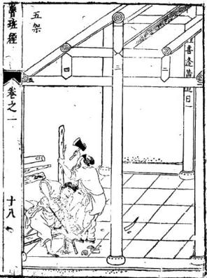

○正七架三間格

七架堂屋大凡架造合用前後柱高一丈三尺六寸棟高一丈零六寸中間用濶一丈四尺三寸次關一丈三尺六寸叚四尺八寸地基濶窄高低深淺隨人意加減則爲之

詩日

經營此屋好華堂並是工師巧主張富貴本由繩庚得也須合用按陰陽

凡造此屋步柱用高一丈三尺六寸棟柱或地基 潤空一丈四尺八寸叚淺者四尺三寸成十分深 高二丈二尺棟爲妙

陰陽兩字最室先鼎創興工好何前九架五關堂尤 天萬年千載福綿綿謹按先師眞尺寸管教富貴足 直四時人若不依仙法致使人家兩不然

獻韆架今人偷棟橫爲之吉人以如此造其中剝閉要坐起處則可依此格儘好

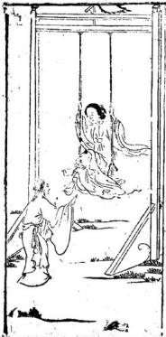

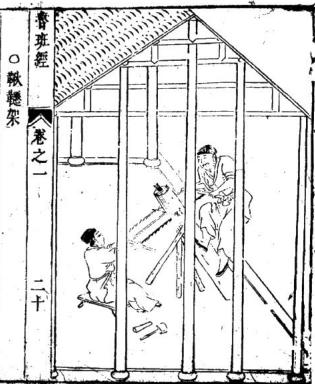

凡造小門者乃是塚墓之前所作兩柱前重在屋皮上出入不可十分長露出殺傷其家子媳不用使木作門蹄二邊使四隻將軍柱不空大高也

造此亭者四柱落地上三超四結果使平盤方中使福海頂藏心柱十分要聳无用暗鐙釘住則無脫落四方可觀之

詩日

枷梢門屋有兩般，方直尖斜一樣，言家有姦倫，夜行子須防，橫禍及道官

詩日

此屋分明端正奇暗中爲禍少人知只因匠者多藏素也是時師不細詳使得家門長退落緣他屋主大隈衰從今若要兒孫好除是從頭改過爲

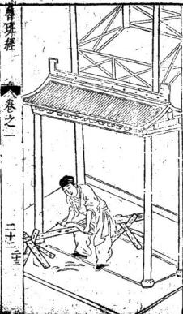

新創屋宇開門之法一自外七大門而入次二重較門則就東畔開吉門須要屈曲則不空大直內門不可較大外門用依此例也大凡人家外大門千萬不可被人家屋春對射則不祥之兆也論起廳堂門例

或起大屬屋起門須用好筹頭向或作槽門之時須用放高與第二重門同第三重却就柁起或作如意門或作古錢門與方勝門在主人意愛

新蕭朱雀凶日庚午巳卯戊子丁酉丙午乙卯 1 修門雜忌 九良星年丁亥癸巳占大門○壬寅庚申占門○丁 巴占前門○丁卯巳卯占後門 丘公殺甲巳年占九月○乙庚占十一月丙辛年 占正月○丁壬年占三月○戊癸年占五月 ○逐月修造門吉日

正月癸酉外丁酉二月甲寅 三月庚子外乙巳四月甲子庚子外庚午五月甲寅外丙寅

六月甲申甲寅外丙申庚申 七月丙辰 八月乙亥九月庚午丙午 十月申子乙未壬午庚子辛末外庚午十一月甲寅 十二月戊寅甲寅甲子申申庚子外庚申丙寅丙申

右吉日不犯朱雀天牢天火獨火九空死氣月破 小耗天賊地天瘟受死氷消瓦陷陰陽錯月建 轉殺正四廢九土鬼伏斷火星九醜滅門離 窠次地火四忌五窮耗絕庚寅門大夫死自自虎 炙退三殺六甲胎神占門并食木星爲忌

○門光星 大月從下數上 小月從上數下 00 O cb

○白圈者吉人字損人丫字損畜

○門光星吉目定同

大月 -- · -- 四千八十九小月

諭門樓不可專至門樓經正輦経談人不淺故不編魯班經 卷之 十五

入門向須避直冲尖射砂水路道惡石山坳嵐破 孤峯枯木神廟之類謂之乘殺入門凶宜迎水迎 山避水斜割悲聲經云以水爲朱雀者忌夫湍 爾黃泉門路天機訣云庚丁坤上是黃臬乙丙須助 巽木先甲癸向中休見艮辛壬水路怕當乾○犯 王在死少丁殺家長長病忤逆

庚向忌安軍坤向門路水步丙向忌安单坤同門一路水步乙向忌安单五向門路水步內向忌安卑異向門路木甲向癸向忌安卑艮向門路水步幸壬向忌安单乾向門路水步

其法乃死絕處朝對宮爲黃泉是也

## 詩日

兩棟簷水流相射大小常相罵此屋名爲暗箭山人口不平安

據仙賢云屋前不可作欄村上不可使宜釘名爲暗前當忌之

○郭璞相宅詩三首

崖前致鴦杵名曰紙錢山家必多喪禍哭泣不曾闕曹班經 卷之一 二十六

詩云

門高勝於片後代絕人丁門高過於壁其家多哭法 門扇爾機欺夫婦不相空家財當耗散眞是不爲量 ○五架屋諸式圍

五架樑栟或使方樑者又有使界梗者及又槽搭欄半像之類在主人之所爲也

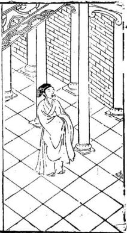

○五架後拖兩架

五架屋後添兩架此正按古格乃佳也今時人嗔做曹班經 卷之一 二十七

前淺後之說乃生生笑隱上吉也如造正五衆者必是其基地如此別有實格式學者可驗之也正七架樑指及七架屋川牌栟使斗櫟或柱義並由人造作後有圖式可佳

土府官殿凡倣此殿皇帝殿九丈五尺高王府七丈高飛麤找角不必再自重拖五架前拖三架上截升拱天花板及地量至天花夜有五上零三尺高殿上佳頭七七四十九根餘外不必再記隨在加滅中心兩柱入爲之天梁輔佐後無門俱大厚板片進金上前無門俱掛硃簾左邊立五宮右邊十二院此與民間房屋同式直出明律門有七重俱有殿名不必載之

二十十九

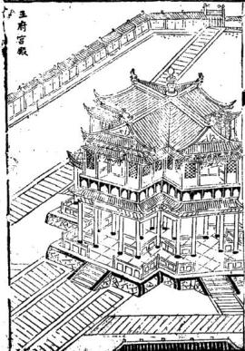

同天臺式此臺在欽天監左下層土磚石之類過圍八八六十四丈濶高三十三丈下一十八層上分三十三層此應上觀天文下察地利至上層過圍俱是冲天欄有其木裏方外圓東西南北反中央立起五處旗杆又按天腳二十八面寫定二十八宿星主上有天盤流轉各位星宿吉凶乾象臺上又有冲天一直平盤關方圓一丈三尺高七尺下四平縣穿枋串進中立圖木一根開上平盤者盤能轉欽魯班經 卷之一 三十

天監官每看天文立於此處修正廳左右二邊四大孔水湛光量每汛多少高帶礫至一穿枋下有多少尺寸可分爲上下一半下永棋帶腰枋每矮九寸零三分其腰祊只做九寸三分大抱柱線平面九分窄上五分上起荷葉線下起棋盤線腰枋上面亦然九分下超一四分窄面五分卜貼地祇貼仔一寸三分厚真地厭盤厚中間分三孔或四孔嶽枋存方圓一寸六分開尖一寸四分長前相後湄北磊心舞要高七寸三分房間光顯冲欄二尺四寸五分大應心門魯班經 卷之 10÷1

框一寸四分厚二寸二分大或下四差或下六差 尺寸要有零子舍箱問與惡心一同尺寸切惡爾 樣尺寸人家不和聽止荊眉彌孔厥門上截亮格 下截上行板門框起聰營線一寸四分大守入 分厚

正堂林修與正屬一同上框門尺寸無二但辰枋帶下水椹比屬上尺寸每變一寸八分若做一林光木椹如上他門做上截起洪盤綵或荷葉線平七分窄面五分上合角貼仔一寸二分厚其別雷同

寺觀庵堂廟宇式

架學造寺觀等行人門身帶斧器從後正龍而入立在乾位見本家人出方動手左手執六尺右手班經 卷之一 三十二

拿斧先量正柱次首左邊轉身柱再量直出山門外止呌夥同人起手右邊上一抱柱次後不論大殿中問無水椹或欄杆斜格必用粗太每筭正數不可有零前欄杆三尺六寸高以應天星或門及抱柱各樣要筭七十二地星菴堂廟宇中間水椹板此人家水椹每矮一寸八分起線抱柱尺寸一同巳載在前不自或做門或亮格尺寸俱矮一寸八分上寶棹三尺六寸高每與轉身柱一般長四尺面前疊方三層每退墨一寸八分荷業線下兩層花板每孔要分成雙下腳或雕獅象柁驅戒倣貼稍用二寸半厚記此

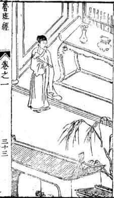

凡攸祠宇爲之家廟前三門次東西走馬廊又次之大廳屬之後明樓亭亭之後卽寢堂若粧修自三門做起至內堂止中門開四尺六寸二分潤一丈三尺三分高濶合得長天尺方在義官位上有等說官字上不好安門此是祠堂起不得官義二字用此二字子孫方有發達榮糧兩邊耳門三尺六寸四分濶九尺七寸高大吉財二字上見各天星吉地德星兄中門兩邊俱后格式家房之也專常人家子弟賢否都在此處種秀又且寢堂及屬兩廊至三門只可步步高見孫方有尊甲县小期大之故敘者深詳記之

壯修三門水椹城枝下量起直至一穿上平分上下一年兩邊演開八字水椹亦然如是大門二寸三分厚每片用餘暗串其門筍要圓門斗要扁此開門方齋爲吉兩廊不用壯架廳中心四大孔木椹上下平分下截每矮七寸正抱柱三寸六分大上截起荷葉線下或一林光或聞尖的此尺寸骨班經 卷之一 三十四

在前可觀廳心門不可做四片要做六片吉兩邊易閭及耳房可微大孔田字格或窗齒可合式甚門後楣要留進退有式明樓不須架修其寢堂中心不用做門下殿水椹帶地厭三尺五高上分五充做田字格此要括的內奉神主租先春秋祭7就拿得下來兩邊水滿前有尺寸不必再白又前君厭亮格門抱杜下馬蹄抱住此亦用活的後臺觀此謹家計察不可有悞

魯班經神厨茶式

下層三尺三寸高四尺鄉每一片三寸三分大寸四分厚下鎖廊方一寸四分大一寸三分厚要雷出吳上盤仔二尺二寸深三尺三寸關其框二寸五分大一寸三分厚中下兩串兩頭合角與樞一般大吉用止佐半合角好開柱脾相二個五寸高四分厚中下土厨只做九寸深一尺崗齒櫛枉止好下五根步步高上層柱四尺二寸高帶嶺在內柱子方圓一寸四分大其下六根中兩根係進的裏半做一尺二寸深外空一尺內中或做二層或做三層步步退墨上層下散柱二個分三孔耳孔只做六寸五分濶餘留中上拱樑二寸大拱樑上方樑一尺八大下層下曜眉勒水前柱礫一寸四分高二寸二分大雕播荷葉前楣帶嶺八寸九分大切忌大了不威勢上或下火熖屏可分爲三截中五寸高兩邊三寸九分高餘或主家用大用小可依此尺寸退墨無錯

卷之一三十六

宮寨格式立寨之日先下纍杆次看羅經再看地勢山形生絕之處方令木匠伐不踰定裏外管壘內營方用廳者其木不俱大小止前選定二根下定前門中五直木九丈爲中央主旗杆內分間架裏外相串次看外營週圍疊分金木木火土中立二十八宿下伏生傷杜日景死驚開此行文外代木交架而下週建祿角旗鎗之勢並不用木作之工但裏營要飽砍我接下門之羞其餘不必木匠嘗斑經 卷之一 川十七

新鐫京板工師雕斷正式魯班經匠家鏡卷之一一一一

保亭水閣式粧修四圍欄杆業背下一尺五寸五分高坐板一尺三寸大二寸厚坐板下或橫下板片或十字掛欄杆上靠背一尺四寸高此上靠背尺寸在前不白斜四寸二分方好坐上至一穿枋做選陽或做亮格門若下遮陽上油一穿下離一尺六寸五分是遮陽穿枋三寸大一寸九分原中下二根斜的好開光窗

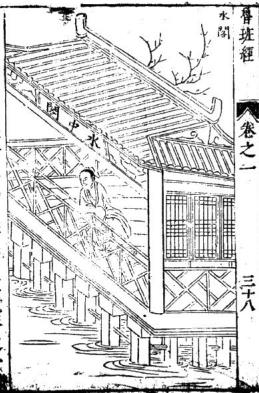

魯班經匠家鏡卷之二倉敖式

依祖格九尺六寸高七尺七分濶九尺六寸溪枋每下四片前立二柱開門只一尺五寸七分濶下做一尺六寸高至一穿要留五尺二寸高上捐枋槍門要成對刀忌成單不吉閒之目不可內中飲食又不可用墨斗曲尺又不可柱枋上留字留墨學者記之切忌

會班經卷之二

松梁式凡橋無粧修或有神厨倣或有欄者若徙雙月而起自下而上若单日而起自酉而東者屋凡事尾濶欄杆二尺五寸高坐柅一尺五寸高

凡殿角之式垂昂插序則規橫奧用升斗拱相稱魯班經 卷之二 二

溪淺濶狹用合尺寸或地基濶二丈柱用高一丈不可走祖此爲大畧言不盡意細詳之

○建鐘樓格式凡起造鐘樓用風字廓四柱並用渾成梗木定高大相稱散水不可大低低則掩鐘聲不嚮于四方更不宜在右畔合在左逐寺廊之下或有就樓盤下作佛堂上作平基盤頂結中開樓盤心透上真見鍾作六角禍杆則風送鐘聲遠出於之外則為也

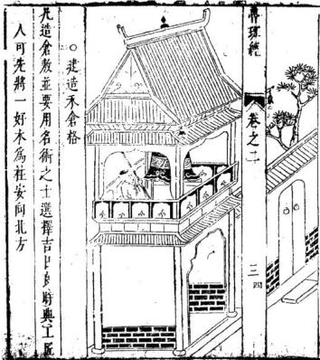

曹班經卷之三

○五音造牛欄法

夫牛者本姓李元是大力菩薩切見凡間人力不及特降天牛來助人力凡造牛欄者先須用術人揀擇吉方切不可犯倒欄殺牛黃殺可用左畔是坑右右畔是田王牛犢必得長壽也○造欄用木尺寸法度用尋向陽木一根作棟柱用近在人屋在辟半性怕寒使牛溫暖其柱長短尺寸用壓白不可犯在上含下作欄者用東方採祿木一根作左邊角柱用高六尺一寸或是二周四間不得作单間也人家各別椽子用令四隻則按春夏秋冬陰陽四氣則大吉也不可犯五尺五寸乃爲五黃不祥也子萬不可使損壞的爲牛備開門用合二尺六寸大高四尺六寸乃爲六自按六畜爲好也若八寸係八白則爲八敗不可使之恐損八也

魯般法慶剏牛欄先用推尋吉上安必使工師求好木次將尺寸細詳看但須不可當人屋實要相空對魯班經 卷之二 六

草崗時師依北規模作致使牛牲食祿寬

○合音指詩

不堪巨石在欄前必主牛遺虎咬遵切忌欄前大水窟主牛難使鼻難穿

牛欄休在污溝邊定墮牛胎損子連欄後不堪有行露主牛必相爛蹄肩

○牛嗇詩

一十黃一十起于坤二十還歸震巽四十官中歸乾盈此是神仙妙訣根○定牛人欄刀砧詩

春天大忌亥子位，夏月須在寅卯方，秋日休逄在巳本，冬時申酉不可裝

○起欄日辰

起欄不得犯空亡犯着之時牛必亡癸日不堪行起 造牛瘟必定兩相妨

○占牛神出入

三月初一日牛神出欄九月初一日牛神歸欄空修 魯班經 卷之二 七

造大吉也。牛黃八月入，至次年三月方出，並不可修造，大凶屯

○造牛欄樣式

凡做牛欄主家中心用羅線蹐看做在奇羅星上吉門要向東切忌向北此用雜木五根爲柱七尺七寸高看地基寬窄而佐不可取方圓依古式八人二寸溪六尺八寸濶下中上下枋用圓木不可使扁枋爲吉

生門對牛欄羊棧一同看，年年官事至，牢獄出應維

○論逐月遣作牛欄吉日 正月 二月 三月 四月庚午壬午五月 真市甲中 丙辰乙未 乙ま 七月戊申 入月 乙丑 九月 甲戌 十月壬子子 甲子庚子 +1 月乙 乙亥庚 十二月反五丙寅 月乙丑丙寅 右不犯魁罡狗絞牛火血忌牛飛薦牛腹脹牛刃 砧天瘟九空受死大小耗土鬼凹廢

此亦看羅經一德星在何方做在一德星上吉門向東用一色杉木忌雜木立六根柱子中用小圓樑二根扛過好下夜閒掛馬索四圍下高水椹板每邊用模方四根纔堅固馬多者隔斷巳間每間三尺三寸濶深馬舊下向門左邊吉

前腳二尺四寸後腳三尺五寸高長三尺濶一尺四寸柱子方圓三寸大四圍橫下板片下腳空尺高

○馬鞍架

刖二腳高三尺三寸後二隻二尺七寸高中下半柱每高三寸四分其腳方圓一寸三分大濶八寸二分上三根直枋下中腰每邊一根橫每頭二根前二腳與後正腳取平但前每上高五寸上下搭頭好放馬鈴

已逐月作馬材吉日

正月真卯 辛未丁未 巳未 三月 甲申乙巳 丁卯巳卯四月子戊子 甲于戊子 五月 辛未壬辰 丙辰 六月 辛未乙亥 甲申庚申曹班經 卷之二 十一

七月 庚子壬子辛未 載子戊子丙子 壬辰乙丑 九月辛甲子戊于庚

○猪桐様式

此亦要看三台星居何方做在三台屋上方吉四桂 二尺六寸高方圓七尺橫下穿祊中直下大粗寶 齒用雜方堅固稍要內西北良工者識之初學 忌亂爲

○逐月作猪欄吉日

正月 四月 戊寅 甲子戊子庚子 乙未戊寅 甲戌 乙未六月 三月 辛卯丁卯 巳巳 甲申七月 十巳子王子成申 甲子戊子庚 八月 甲戌乙丑 九月 甲戊辛酉7 春之二 十二

十月 甲于乙未庚子 壬午真午辛未 十一月 丙辰 十二月 甲子庚 壬子戊寬○六畜肥目

春申子辰 夏亥卯未秋寅午戌冬巳酉耳目○鷺鴨鷄栖式

此看禽大小而做安貪狼方鵝欄二尺匕寸高深四尺六寸濶二尺七寸四分週圍下小窗齒每孔分一寸濶鷄鴨桐二尺高三尺三寸深二尺三寸濶桂子方圓二寸半此亦看至家禽鳥多少而做學者亦用自愚之

○鶏槍樣式

南柱高二尺四寸大一寸二分厚一寸樑大二寸五分一寸二分大鹿高一尺三寸濶一尺二寸六分下車腳二寸大八分厚中下齒仔五分大八分厚上做滔環二寸四大兩邊獎腿與下層窗仔一般高每邊四寸大

○屏風式八者高五尺六寸帶腳在內淵六尺九寸琴腳六寸六分大長二尺雕日月掩象鼻格奬腿工尺四分高四寸八分大四框一寸六分大厚一寸四分外起改竹四內起棋盤線平面六分窄三分繚環土下俱六寸四分要分成单下勒水花分作兩孔肜四寸四分相屋關窄餘大小長短依此長倣此○圍屏式

每做此行用八片小者六片高五尺四寸正每片火魯班經 卷之二 十四

一片四寸三分零四框八分大六分原倣成五分 厚筭定共四寸厚內較田宇格六分厚四分大做 者切忌碎框

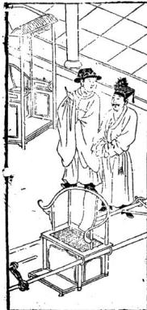

○牙轎式

巨家明嶠衙下一尺五寸高屏一尺二寸高深一尺四寸濶一尺八寸上圓手一寸三分大斜七分纔圓轎杠方圓一寸五分大下靖帶轎二尺三寸五分

○衣籠樣式

一尺六寸五分高三尺二寸長一尺三寸大上發九分一寸八分高上板片三分厚籠板片四分厚內子口八分大三分厚下車腳一寸六分大或魯班經 卷之二 十五

雕三灣車腳上要下二根橫獷仔此籠尺寸無加

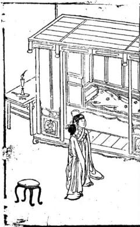

○大状下廊帶床方其高式尺一寸二分正床方七寸七分天武五寸七分大上屏四尺五寸二分高後屏二片兩頭二片濶者四尺零二分窄者三尺二寸三分長六尺二寸正領一寸四分厚徹大小片下中閒要做陰陽相合前踏板五寸六分高一尺入寸關前楣帶頂一尺零一分下門四片每片一尺四分大上腦板八寸下穿簾一尺八寸零四分餘留下板片門框一寸四分大一寸二分厚下門檻一管班經 卷之二 十六

寸四分三接裏面轉芝門九寸三分或九寸九分 切忌一尺大後學專用記此

此與藤床無樣但踏板卜下顧杆要下長柱子四根每根一寸四分大上榻八寸大下欄杆前一片左右兩二萬字或十字揖前二片止作一寸四分大高二尺二尺五分橫頭隨蹟板大小而做無悞○藤床式

帶床方一尺九寸五分高長五尺七寸零八分謂三尺一寸五分半上桂子四尺一寸高牛屏一尺五八寸四分高床嶺三尺濶五尺六寸長框一寸三分厚床方五寸二分大一寸二分厚起一字線好穿簾踏板一尺二寸大四寸高或上框做一寸二後腳二寸六分大一寸三分厚半合角記逐月安牀設帳吉日

三月 正月 一 一 丁酉癸酉丁卯 巳卯癸丑 甲子庚子丁酉 乙卯癸酉乙巳 4 二月 四月 巳未乙亥巳亥真寅 丙寅甲寅辛未乙未 丙戌乙卯癸卯五月甲 六月兩寅甲寅乙 丁酉乙亥丁亥癸寶班經 養之 十

十二月 乙丑丙寅甲寅 甲子丙子庚子

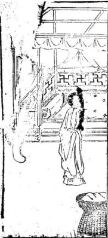

○禪床式 此寺觀庵堂纔有這做在後殿或禪堂雨邊長依屋 寬窄但濶五尺面前高一尺五寸五分床錢一尺 前平四板八寸八分大一寸二分享起六个注每 柱三才方圓上下一穿方好掛禪衣及張韓前平 面板下要下水椹板地上隴二寸下方仔盛板片 其板片要密

○禪椅式

一尺六寸三分高一尺八寸二分深一尺九寸五分魯班經 卷之二 十入

深上屏二尺高兩力手二尺二寸長柱子方圓一寸三分大屏上七寸下七寸五分出笋三寸開機頭下盛腳盤子四寸三分高一尺六寸長一尺三寸大長短大小倣此

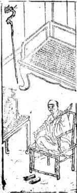

○鏡架勢及鏡箱式 架及鏡箱有大小者大者一尺零五分深濶九寸 高八寸零六分上層下鏡架二寸深中層下抽相 一寸二分下層抽相三尺一寸零五分底四分 厚方圓離車腳內中下鏡架七寸大九寸高若辟 花者雕雙鳳朝陽中雕古錢兩邊睡草花下佐連 花托此大小依此尺寸退墨無悞

○雕花面架式

後兩腳五尺三寸高前四腳二尺零八分高每落墨魯班經 卷之二 十九

三寸七分大方能役轉雕刻花草此用樟木或南木中心四腳摺進用陽筭共濶一尺五寸二分零

案棹式

在高二尺八寸四層下一層高入寸二層高五寸三層高三寸七分四層高三寸三分高二寸空一寸五分棟一寸五分上淨瓶頭共五寸方層板四分半厚內子口三分厚八分大兩根將軍柱一寸五分大一寸二分厚奬腿四隻每隻一尺九寸五分高四寸大每層二尺六寸五分長一尺六寸濶下車腳二寸二分大一寸二分厚合角開進雕虎爪雙釣

高二尺五寸長短濶狹看按面而穢中分兩孔按面魯班經 卷之二 二十二

下抽箱或六寸深或五寸深或分三孔或兩孔下踏腳方與腳一同大一寸四分厚高五寸其腳方圓一寸六分大起麻擴線

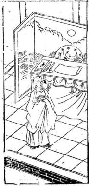

搭仔 長二尺二寸高五寸大四寸五分大卯一寸二分太 一寸一分厚面起錫春線腳上竹圓

○諸樣垂魚正式

春班經卷之二

二十三

凡作垂魚者用按營造之正式今人又嘆作繁針如用此又用做進風及偃桷者方可使之今之匠人又有不使垂魚者只使直板作如意只作彫雲樣者亦好昔在主人之所好也

○馳峯正格

馳峯之格亦無正樣或有彫雲樣或有做荒樣又 有做虎爪如意樣又有彫瑞草者又有彤花頭者 有厭毬捧格又有三肄或今之人多只愛使斗立 父童乃爲時格也

魯班經卷之二

1+四

## ○風箱樣式

長三尺高一尺一寸濶八寸板片八分厚內開風板 六寸四分大九寸四分長抽風橫仔八分大四分 厚扯手七寸四分長抽風好八分大四分厚批 手七寸長方圓一寸大出風眼要取方圖一寸八 分大平中爲主兩頭吸風眼每頭一箇濶一寸入 分長二寸二分四邊衣片都用上行欽準

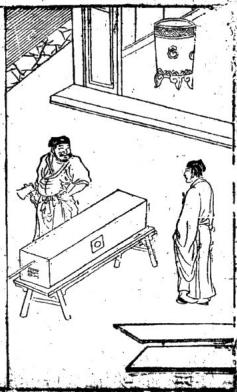

班經 卷之二 二十五扉花者五尺高三尺七寸濶土搭頭每邊長四寸四分中環三片腿二尺三寸五分大下廊一尺五寸三分高柱一寸四分大一寸二分厚○素衣衆式

高四尺零一寸大三尺下郡一尺二寸長四寸四分大柱子一寸二分大厚一寸上搭廟出頭二寸七分中下光框一根下二根窗齒每成雙做一度三分高每眼齒仔八分厚八分大○而架式

兩柱一尺九寸高外頭二寸三分後二廊四及十九分方員一寸一分大或三腳者內要交集職除笋書進一寸零四分斜六分無悞

臺班氣 卷之二二十六○鼓架式

一尺二寸七分高四腳方圓一寸二分大上雕淨獲頭三寸五分高上層穿枋仔四捌根下層入根上層雕花板下層下繚環或做八方者柱子橫擴在尺寸一樣但畫眼上每邊要斜三分半筆是正的一此尺寸不可走分毫謹記

高三尺七寸上蕃簾衣架頭花方圓一寸五分大兩邊柱子俱一級起棋盤線中閒穿枋仔要三尺高銅鼓掛起便手好打下腳雕屏風腳樣式獎薄尺八寸高三寸三分大

○花架式

八者六鄺或四腳或二腳六腳大者中下騎相一七寸高兩邊四尺高中高六尺下枋二根每根三寸大直枋二根三寸大直枋二根三寸大五尺濶七尺長上盛花盆板一寸五分厚八寸大此亦看人家天井大小而做只依此尺寸退星有準○凉傘架式

官班經 卷之二 1+七一尺三寸高二尺四寸長中閒下傘柱仔二尺三寸高帶琴脾在內筭中柱仔二寸二分大一寸六分厚上除三寸三分做淨平頭中心下傘樑一寸三分厚二寸二分大下托傘柄亦然而是兩邊柱子方圓一寸四分大窗齒八分大六分厚琴腳五寸大寸六分厚一尺五寸長

○校椅式

椅先看好光梗木頭及節次用解開要乾枋纔下手做其柱子一寸大前腳二尺一寸高後廊式尺九寸三分高盤子深一尺二寸六分濶一尺六寸七分厚一寸一分屏上五寸大下六寸大前花牙一寸五分大四分厚大小長短依此格○板式

海獄一尺六寸高一寸三分庫長三尺八寸五分樓讀三寸八分半長腳一寸四分大一寸二分厚卷牙勒水三寸七分大或看櫈面長短及粗橈尺一同餘倣此 UE○琴式

八者看廳堂濶狹淺深而做大者高一尺七寸面三寸五分厚或三寸厚卽歃坐不得長一丈三尺三分面一尺三寸三分大腳七寸分大雕捲草雙釣花牙四寸五分半頭一尺三寸一分長或腳下做貼仔只可一寸三分厚要除矮腳一寸三分纔相稱或做靠背尺寸一同但靠背只高一尺申班經 卷之二 二十九

四寸則止橫仔做一寸二分大一尺五分厚或起棋盤線或起錫春線雕花亦而之不下花者同樣餘長短寬濶在此尺寸上分準此

○机子式

四一尺二寸長濶九寸或八寸高一尺六寸頭空一寸零六分晝眼腳方圓一寸四分大面上眼斜六分半下橢仔一寸一分厚起鈕眷線花牙三寸五

○

高二尺五寸長短濶狹看按面而做中分兩孔按面下拙和或六寸深或五寸深或分三孔或兩孔下踊腳方與腳一同大一寸四分厚高五寸其腳方員一寸六分大起麻橫線

0八仙掉

高二尺五寸長三尺三寸大二尺四十鄰一寸五分大若下爐金下層四寸七分高中間方員九寸八分無悞動木三寸七分大腳上方員二分緣棹框春班經 卷之二 三十

二寸四分大一寸二分厚時師依此式大小必無一悞

○小琴棹式

長二尺三寸大一尺三寸高二尺三寸腳一寸人分大下梢一寸二分大厚一寸一分上下琴腳勒水二寸人斜聞六分或大者放長尺寸與一字棹同○棋盤方棹式

方圓一尺九寸三分腳二尺五寸高方員一寸五分大棹革一寸二分學二寸四分大四齒吞頭四值

○衣厨樣式高五尺零五分深一尺六寸五分濶四尺四寸平公爲兩柱每柱一寸六分大一寸四分厚下衣擴一寸四分大十寸三分厚上嶺一寸四分大一寸一分厚門框每根 寸四分大一寸一分厚其廚上補一寸二分○食格操式

在二根高二尺二寸三分帶淨平頭在內一寸一分大八分厚標尺分厚二寸九分大長一尺六寸春班經 卷之二 三十

分濶九寸六分下層五寸四分高二層三寸五分高三層三寸四分高二寸高板片三分半厚裏子入分大三分厚車腳二寸大八分厚奬腿一尺五寸三分高三寸二分大餘大小依此退墨做○衣摺式

大者三尺九寸長一寸四分大內柄五寸厚六分小者二尺六寸長一寸四分大柄三寸八分厚五分此做如劍樣

衣箱式

長一尺九寸二分大一尺六分高一尺三寸板片只用四分厚上層一寸九分高子口出五分或下車腳一寸三分大五分厚車腳只是三灣

燭臺式

回四尺柱子方圓一寸三分大分上盤仔八寸大三分倒指花牙每一隻腳下交進三片每片高五寸二分雕轉鼻帶葉交腳之時可拿板畫威左八寸四分定三方長短照墨方準

面爐式

方圓二尺一十三分大帶腳及車腳共上磨六尺五分正上面盤子一寸三分厚加盛爐賊任八分厚做成二寸四分大豹脚六隻每隻二寸大二寸三分厚下貼梢一寸厚中圓九寸五分正

九寸高方圓式尺四分大盡仔下絲環式寸樞一寸厚一寸六分大分佐亦方下豹脚腳二寸二分大一寸六分厚其豹腳要雕吞頭下貼梢一寸五分厚一寸魯班經 卷之二 三十三

六分大雕三灣動水其框合角笋眼要斜八分半方 聞得起中間孔方員一尺無悞

方式

高五寸五分圓尺內圓九寸三分四腳二寸五分大雕雙蓮挽雙鈎下貼梢一寸厚二寸大盤任一寸二分厚繚環一寸四分大雕螳螂胜接豹腳相秤

香爐樣式 細樂者長一尺四寸闊八寸二分四權三分厚高一 寸四分底三分厚與上樣樣關大框上斜三分上卯 水邊三分厚六分大厭竹線下豹腳下六隻分 八分大一寸二分大貼梢三分厚七分大雕三灣車 脚或粗的不用豹脚水邊寸尺一同又大小敬者尺 寸依此加減

前柱一尺五寸五分壽後柱子式尺七寸高方圓一寸大盤子一尺三寸開一尺一寸深框一寸一分厚寸二分大切忌有節樹米無用

卷之二

九佐香九要看人家屋大小若何而大者上層三丈高二層三寸五分高三層鄉尺三寸長先用六寸大役做一十四分大下層五寸高下車脚一寸五分厚合角花牙五寸三分大止層欄杆仔三寸三分羸方圓做五分大餘看長短大小而行

招牌式 大者六尺五寸高八寸三分闕小者三尺二寸高五 寸五分大

洗浴坐板式三尺一寸長三寸大厚五分四圍起劍脊線藥厨高五尺大一尺七寸長六尺中分兩眼每層五寸分作七層每層抽箱兩個門共四片每邊兩片方圜一寸五分大門框一寸六分大一寸一分厚抽箱板四分厚

三尺高一尺七寸大深九中分三層內下抽相只做魯班經 卷之三 三十五

三寸高內中方圓交佐巳孔如田字格樣好下藥此是杉木板片合進切忌雜木夾半式

方圓五寸五分高四寸七分板片三分半厚上柄柱子共高八寸五分方圓六分大下或刻車腳上掩火宿齒仔四分大五分厚橫二根直六根或五根此行燈檠高一尺二寸下盛板三寸長一尺五分厚上留頭一寸三分照得遠近無悞履式

大櫃上框者二尺五寸高長六尺六寸四分關三尺三寸下腳高七寸或下轉輪聞在腳上可以推動四住每住三寸大三寸厚板片下叩框方密小者扳是合進二尺四寸高二尺八寸關長五尺零二寸板一寸厚板此及量十及星跡各項識記

身書身云 大者一尺四寸長共大一尺二寸內中開河路一寸 二分大框七分方圓內起線三分方圓橫共十路直 共九路何路笋要內做重貼方能堅固

魯班經 卷之二 三十六圍棋盤式

方圓一尺四寸六分框六分厚七分大內引六十四 路長通路七十二小斷路板片只用三分厚 路長通路七十二小斷路板片只用三分厚

起造房屋類 卷路

立柱喜逢黃道日

天官賜福

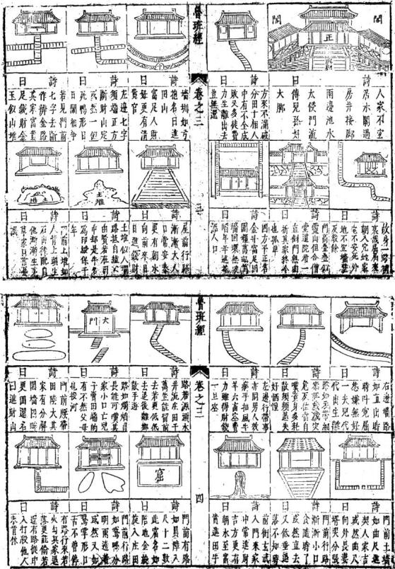

注意雕鏤刻書欲令中華文物煥爾一新故嘗語人日不規而圓不矩而方此乾坤自然之象也規以爲圓矩以爲方實人官雨象之能也矧吾之明雖足以盡制作之神亦安得必天下萬世咸能師心而如吾明耶明不如吾則吾之明而吾之技亦窮矣爰是韻目力復繼之以規矩繩俾公私欲經營宮室駕造舟車與置設器皿以前民用者要不超吾一成之法巳試之方矣然則師之綠物盡制緣制盡神者顧不良且鉅哉而其淑配雲氏又天授一叚神巧所魯班經 源流 春班經 源流 1魯班仙師源流 制器物固難枚舉第較之於師殆有佳處內外贊襄師諱班姓公輸字依智魯之賢勝路東平村人也其 用能享太名而垂不朽耳裔是年蹟四十復隱于歷父諱賢母吳氏師生於魯定公三年甲成五月初七 山卒遘異人授秘訣雲遊天下白日飛昇止畱斧鋸日午時是日白鶴羣集異香滿室經月弗散人咸奇 在自鹿仙巖迄今古迹昭然如睹故戰國大義贈爲之甫七歲嬉戲不學父母深以爲憂迨十五歲忽幡 永成待詔義士後三年陳侯加贈智惠法師歷漢唐然從遊於子夏之門人端木起不數月遂妙理融通 宋猶能顯蹤助國屢膺 封號我度越時流憤諸僭稱王號因遊說列國志在尊周 皇明水樂間鼎剏北京龍聖殿役使萬匠莫不震錶而計不行廼歸而隱于泰山之南小和山馬晦迹幾 賴師降靈指示方獲洛成爰建廟祀之扁曰魯班門一十三年偶出而遇龜老輩促膝讌譚竟受業其門 封待詔輔國太師北成侯春秋二祭禮用太牢今之

工人凡有祈禱聲不隨淨隨應恍懸象著明而萬古神照者
