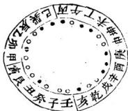
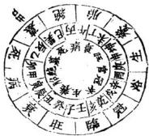
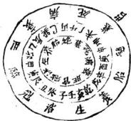
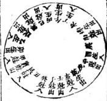
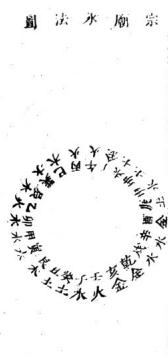

# 青囊心印续编

> 来源：413.地理正宗臆解+黑囊经+青囊心印+地学.pdf，PDF 第 307–324 页

要終原始余關靑囊告深客有難之者曰心印一書可謂發先人所未發矣然所論陰陽必有其原所言順逆豈無所自若非或有底見雖麗辭累牘終屬傷門豈以問世者無以自問乎予曰唯唯青囊之書總歸理氣理氣之源防於河洛嘗聞李李子舉默師之傳矣給亂衍義筆於編末以是終之以是始之之意也夫

吉蒙心印續編如軫原始

丙初層先天卦 二層後天方位 三四卦陽順 生圖 四層先天卦陰 後天方位 六盤盈縮閣

明陰陽五行氣分順逆間之師曰陰陽五行之氣皆申先天卦所生於後天四正四隔之宮當細推之乃以盈縮經度天盤於之畧得且說夫天午居後天地盤丙午縫中是先天乾卦爲天爲父大盤予居後天地盤壬子縫中是先天坤卦爲地爲母河國曰天一生水者謂南乾施生之始也乾金左旋而生陽水胎於後天地盤午丁於未坤生於申庚右旋而生陰水胎於後天地盤巳丙養於其辰生於乙二水者是乾金所生也地二生火若謂比坤發生之始也地坤左旋而生陽火胎於後天地盤子癸養於丑艮奇漢心印續通 要原始

生於寅甲右旋而生陰火胎於後天地盤壬亥養於乾戌生於 辛酉二火者是地坤所生也天三生木者天盤之酉居後天地 庚酉縫中本先天坎卦所居坎水位西屬陽卦得天三奇數 故從天而生木左旋而生陽木胎於後天地盤酉辛養於戌乾 生於亥壬右旋而生陰木胎於後天地盤庚中於坤未生於 丁午二木者是坎水所生也地四生金者天盤之卯居後天地 盤甲卯縫中本是先天離均所居離火位東屬陰卦得地四偶 數故從地而生金左旋而上陽金胎於後天地甲寅養於艮 丑生於癸子二金者是離久地坤所生也以金藏於土腹非火 不能流行而見也天五生土河圗以戊巳於中宮又分寄於長 戊丑未四支者蓋因先天土無正位卦氣之所而天五奇數乃 而陽故從陽水同生於未坤申冠於戌乾亥衰於五艮墓於辰 巽是以長戊五未各得土氣屬其位矣大五行之氣皆從先天 CCCいO C3 卦分陽順陰逆而生而後天生旺之山從此起也古人云先 天統龍者言龍家陰陽五行本於先天而施於後天二十四龍 黃泉之內所以放棺必曰內乘生氣者以氣由先天卦所生故 曰先天續龍也而後天佈局者悉肇於斯矣

## 雙山換星兩盤圖

經曰用此步水與量山百里江山一餉開此圗尤爲堪輿家金靑囊心印續編

## 針也具於左

## 大元空國

經曰晉世景純明此術衍經立義號元空又曰雌與雄交會人靑囊心印編 式 三

元空則山川之變換萬有不齊而出水之配合理惟一致也固 約之以八局保覽者無疑義焉

右陰木龍配陽火水局法宜收丑艮養位水寅甲長生水辰 巽冠帶水丙巳臨官水午丁旺位水入常流歸戌乾庫地而

收巽水堂坐癸向丁兼丑末主人多聰秀丙水特朝宜 坐艮向坤主驟富格貴催官收丁水宜坐甲向庚兼寅 申但煞不淨午水朝宜坐寅向申長見卯水主中薄 風聲

靑變心印緒羅

水配金临

不岐金龍配水水局法宜收未坤養位水申庚長生水庚乾尅帶水亥千臨官水子癸旺位水入堂流歸辰巽庫地而

圖金男配火陰

收壬水宜坐呷向艮多發中男收癸水宜坐庚向甲 收乾水宜坐向癸兼丑未

子水特朝宜聖申向寅兼坤艮大發丁財格貴催官

青藥心印續堀

右吟火龍配陽金水局法宜收辰巽養位水巳丙長生水坤冠帶水申庚臨官水西辛旺位水入堂流歸丑艮庫也而去

收庚水宜坐共向乾但當過西煞收辛水宜坐丙向壬辛水東流也 收坤水宜坐乙向辛兼辰戌

右陰水龍配陽木水局法宜收戌乾養位水亥壬長生水丑 艮冠帶水寅甲臨官水卯乙旺位水入堂流歸未坤庫也而 去

甲水特朝宜坐乾向巽主少年蜚聲收乙水宜坐壬向丙收艮水宜坐辛向乙兼辰戌卯水特朝宜坐亥向巳兼壬丙格貴主登科及第

石陽火龍配陰木水局法宜收未坤養位水丁午長生水辰冠帶水乙卯臨官水甲寅旺位水入堂流歸乾戌庫地而

甲水朝宜坐丁向癸乙水朝宜坐坤向艮然乙與辰同宮不若借未向丑卯水朝主白手成家催官篇云陽衞水來主聚富龍輕沙碎招淫奔畏見丙巳水入堂主入含抱養

靑囊心印續國式白冰於配陰金局法宜丑養位水子癸長水乾冠帶水辛酉臨下水屯理位水人帶沉辰巽庫北也大

辛水特朝宜坐艮向庚來宜坐癸則丁玉只云亥佛丁曲而發貴

異見辰水來碼破煞側沛土女多產厄男多旁傷吐血戌 克軍于里人之嗣若刀砂見定懼刀丘橡楊七尺云八 曜重遇刀砂難免龜法之誅

青囊心卯德張配陰 水局法岐乾成養泣水辛酉長生水承丁午亭官水丙巳旺位水入堂疏歸丑艮庫地而

朝宜坐午向乙丁水朝宜坐乾向巽坤水闹宜坐丙亥山巳向载壬丙主大發人丁六秀水入堂沙合格台居风

青羹心印續題國式

石陽水龍配陰木水局法宜收巽辰養位水乙卯長生水艮丑以帶水癸子臨宮水壬亥旺位水入室流歸未坤庫地而去

爽水朝宜坐巽向乾壬水朝宜坐乙向辛艮水朝 坐丙向水兼巳亥乾水特朝又見乾峯高聳回山作珂 貴主科知暮選催宮云磯入雲宿生宰輔

小元空國說

經曰大小俱在元空裏十個退神靈如鬼十四進神卯鬼雪是 山川融結豈能盡符大元空則小元空洵補教之善術也五尺 靑囊心印續論 i 云法顯元紳功莫剝至道精後惟聖人方能及此非春知其 就能知之天玉云此是收山出煞書歷觀仙師秘訣謂可挽回 這化能使人朝貧暮富面余遍閣名地何多符食近坊書皆從 向止論生尅殊失宗旨不觀玉尺鄉乎從嶺坐大之吉凶須看 水神之出入小元空訣云乾坤卯今金同坐皆明明言之而世 強以巳意牽解何戲予故辨之夫世之制志者爲具圖於 左

袂云丙丁乙酉原屬火是四火山喜甲癸亥艮方水來爲七 人干寅辰異辛巳申壬大水來爲尅人吉丑庚戌未方水去 爲生出乾坤卯午方水去爲尅出吉

訣云乾坤卯午金同坐則四金山喜戌未丑庚方水來爲生入丙丁巳酉亦水來爲尅人俱吉甲癸亥艮左水去爲尅出子寅辰巽辛巳申壬方水去爲生出俱吉

訣云甲癸亥艮是木神此四木山喜子寅辰異巳辛壬山水來爲生入乾坤卯午方水來爲尅人俱吉喜丙丁酉乙方水去爲生出減未丑庚方永去爲尅出俱吉青衆心印縮船 き

訣云戌戌未丑庚土爲此四土山喜丙丁乙酉方水來爲生 入甲癸亥良方水去爲尅入俱吉喜乾坤卯午方水去爲 生山子寅辰巽辛巳申壬方水去爲尅出俱古

訣云子寅辰巽辛兼巳申與壬方是水神此入水山喜乾地 卯午方水來爲生入丑庚戌未方水來爲尅入俱吉喜甲 癸亥艮方水去為生出丙丁乙酉方水去爲尅出俱吉

經曰宗廟本是陰陽元得四失六難爲全雪心賦云宗廟之水法悞人似此法竟可畧然用之山運可存也姑備之

.断

第一養生水到堂貪狼星照顯文帝長位兒孫多貴人丁呂熾性忠良水大曲瀦官職重水小樺迤福壽長養生流去終煩絕少年孤空房

沐浴方水断

沐浴水來犯桃花女人淫乱不由他投河自縊隨人走血病官災破敗家子午方來曲業盡如酉流來好暗奢若還流破生神一位墮產風流帶望伽

青囊心印續

冠帶方水斷

冠帶水來人聰慧雅致風流好賭奢七歲兕童龍詩賦文章博 學萬人誇水神流去三房苦碧亂嬰鬼死不差更損深閏孀態 女此方停蓄乃為

臨官方水断

臨官方位水趨墳祿馬朝元喜氣新少午早入青雲路賢相籌謀佐聖君最忌此方砂水去成材之子另歸陰閨中少婦常啼服財穀空一徹骨費

帝旺方水断

帝旺朝來望前一團和氣發庄田爵高威重名插遠金穀豐 紅有利錢最怕休四來滾散石愚豪富不多年此方流去財源 張之食貧窮怨上天

衰方水断

衰方管局巨門星學堂水到發聰明少年及第文章貴人旺年高金滿盈出入起居乘聖焉宴遊歌舞王壺傾旺局七宜來則吉去須灣曲更留情

病死方水所

病死二方水忌來天門地尸不爲更有辨名官顯水若針吉囊心印續編

一飛起火災損妻飛刁兵脈紫瘋海女麼胎必主其家遭此

墓庫方水斷

墓庫之宮怕水臨破軍流云久爲與陣上揚兵文武貴池御區 壽富如春回前直去家資父啻經年不了人未列克軍千星 外三男二子把周零

絕胎方水斷

絕非水斷不生兒無孕無刀絕溪枝縫使胎生不義育夫妻父 于各分離水泓婦女多淫水小私清宿地此處只宜為水

口祿存流盡佩金魚

土曜九星

七曜訣

大墓屬霞半絕胎是祿存武曲陷官莊逢衰是巨門養生貪狠位伏俗冠帶文康口兼病死七曜一齊分

九星公位m

貪頭長子巨興中武曲三房家必隆文敗中房祿敗季改襄長 于受貧寤收山出煞有何功破祿文廉要坐巨輔武收入 一穴何愁大地不相道

旨心印知 七九星

又七曜詩

貧須臨位未無兵紫草生從腳下來兩驗紅顏猶尙友袁斬新裁

此曲朝來最是奇兒孫金有名鹽若見水流從吉位鐘鳴陽 食不須疑

文曲星辰事若何流來推桴水生多勇士其中泥上聚應知白蟻結成巢

祿存若見水冲來吹淳翻棺最可哀不信請君開穴看此中泥 水使生災

寐貞潮水繕蟲多蛇鼠穿塋自作窠屍胃損來多黑燭聚房子 受炎磨

巨門乾淨起死塵穴內祥烟瑞氣新因此兒孫多富貫山入清秀更楚羣

陂軍帝位不堪言竹太藤祖規聲德又主兩頭嶂墻聚死骸棺 木兩難至

論去而不及

水從庫位而出正合本說主營福治久假如陰木一局氣通成

庫今水未到戌乾於申酉方逐出謂之不及主發福之人不壽 或雖得貴而無禮虛云爻而不及顏淵三十便身囚

論交而太過

水到庫位而出謂之眞夫婦自有化吉之機假如陰木一局立歸戊廟今水過戌乾於亥于方始出謂之過亢主老年科第晚平發福經云情過而几呂墨八旬方陰會

論陰陽錯

假如陰木龍水宜歸戌庫水不歸成直過五方出夫丑條丁火庫而謂之陽結主出人多孤寡逆云過陽第以光夫

又如陽木龍水宜歸未庫今永不歸非而至辰方出夫辰係壬水庫卽謂之陰結主出人多鰥獨經云見陰錯以傷妻黃泉水

泉水有吉凶不同

五尺云少亡橫死爲犯黃泉故立向消納所避最重火曰八段黃泉雖云惡曜若在生方例難同斷是貴泉又非純凶觀之歌訣云四路黃泉能役人辰戌丑未有耳四路黃泉能人乾坤艮巽有巨門則黃泉之有凶有吉也明之故辨之俾世知

黃水歌

庚丁坤上是苗原乙丙須防巽水光甲癸向中憂見艮辛壬水路伯宮

黃泉從坐山起不從向上論其曰庚丁中是黃泉若蓋言坐甲山甲木墓於未坐癸山癸水亦同墓於未未坤同宮故云乙丙防巽水首蓋言坐辛山辛金墓於辰坐壬山壬水亦墓於辰辰巽同宮故云○甲癸向憂艮首言坐庚山庚金墓於丑丁山丁火同墓於丑丑艮同宮故云○辛壬水路怕乾者言坐乙山乙水墓於戌坐丙山丙火亦墓於戌戌乾同宮故云蓋破軍墓地四野黃泉能穀人若此也救魯簧泉歌

辛入乾宮百萬庄癸歸艮步顯文章乙向巽流清富貫丁終是萬斯稍

辛八乾宮百萬正

辛向乾水屬黃泉今反以爲救貧者何蓋陽不龍入穴垂乙向辛世氣生於乾亥於九星爲貪狼取配癸水成局乙乃癸之生位夫癸水旺於壬亥衰於乾戌於力星爲巨門傳龍神貸狼水水神巨門水入堂故有百萬庄之應若從乾位流心印續論 泉 至

去是冲弦龍家生方天玉經云流破生方員少下化之年定見刑主丁壬年有橫少丁之凶若陰陽龍袖遇乾坤艮巽在墓方者乃眞黃泉水去爲上御砦水來必帶四金卽爲破煞倒冲不可不悔

癸歸艮位顯文章

癸向艮水本屬黃泉今乃以爲救貧者何蓋陽火龍入穴坐 丁向癸其氣生於艮實於九星爲食狼取配乙木火局丁乃 乙之生位夫乙木旺於甲寅衰於艮五於九星爲巨門得龍 神貪復水水補巨門水入堂故有此應丑艮爲天市爲六秀 自爾文章著願若艮艮位流生破龍家生方矣主乙而年有 損少丁之厄

乙向巽流清富貴

乙向巽水原屬黃泉今以爲收貧者何陽金龍入穴坐辛 向乙其氣生於巽巳於九星爲貪狼取配火成局辛乃丁 之生位失丁火旺於巳丙靠於辰巽於九星爲巨門得貪狼 巨門二吉水入堂故有此應且巽爲大乙爲六秀合巽辛相 見主清雅富貴若從巽位流去是微龍家生氣主乙庚之 歲損少T

靑囊心叩殯編人 黄泉

一坤終是萬斯箱

坤水本屬黃泉今以爲收貧者何蘇陽水龍入穴坐癸向丁其氣生於坤申於九星爲貪狼取華金成局癸乃辛之生位夫辛金旺於庚申衰於坤未於么星爲巨門得龍神貪俱水神巨門一吉水入堂砭有此應且雖爲老母主掌中饋箱若從坤位流去是激散龍神生氣生丙辛于化年損少丁所謂四路黃泉能救人乾坤艮巽有巨門者是也夫四路黃泉一曰少一曰救貧惕公傳其法而不宣其蘊重諸書但言黃泉可良而不原其故令人吳所適從至時病有圃言來爲黃泉去爲八殺者味可哂之甚也舍觀靑愛文雖未詳而聖巳備寓爰涇默師天玉汉本而闈發之以公同好庶幾學者可不惑於岐趨亦造福之助六爾

附後廊記云壬山丙向用門開五百年來產大木只因走了紫陽山下水乙庚之歲損嬰孩蓋府基條陽金龍人局取吧丁火坐壬向丙紫陽山傑辰巽地是流破龍家養生方故乙庚干化金之年有此凶則黃泉之忌去水也其明驗矣假如陽龍作丙向忌巽水爲黃泉王乙庚之年應禍陰氷龍作乙向亦忌巽水爲黃泉主丙辛之年應祠所謂乙丙須靑囊心而精病 釐泉八曜 雪

防巽水先世卽天玉經云長坐位上黃泉是于化之年名見刑以龍神論來吉去凶也其丁庚向忌流坤甲癸向巳流艮辛壬向忌流乾可推矣

八程

論入曜水

經曰旺中帶來不宜虛中藏殺去亦非以曜殺之爲禍最將烈也玉尺云曜方佛至閑室遭刑重遇刀砂難免憲法天玉云呂位若來見逆龍男女失其仙師相傳教人不可有犯犯則必主見血而凶然其中有以龍論名有只坐山取者有以水而

兼砂言者起倒載於左

八曜歌

攻龍坤兎震山淚巽鷄乾一兩兌蛇頭艮虎離名爲役曜犯之名 墓一齊休

曜殺從卦爻中生者也以八名如坎卦戌辰爲官鬼父故坎忌見辰水艮卦中西爲官鬼爻故艮忌見寅水震卦中庚申爲官鬼文畝震忌見申水巽卦中辛酉爲官鬼女故巽思見酉水離卦中已亥為官鬼久故離忌見亥水坤卦中乙卯爲官鬼故坤忌見卯水兌卦中丁巳爲官鬼爻故兌忌青表心印續編 八疆倒於

見巳水乾卦中壬午爲鬼父故乾忌見午水

按八曜中惟兌龍見巳水條生方玉尺云曜在生方例难俯 断

經曰明倒杖卦坐陰陽何必想雖妙在於心悟而訣庶以言傳 雪心賦云忝吐浮沉務依葬法詎非例杖之法與愛墓古詩定 註於下學者僧翫而自得之斯葬法其麼幾矣

十二例杖法

陰陽倒杖若能明開井放天上葬繩立定慄準深與術地後 倚與前迎接迎若誤旺順逆如差有廢興學者言明號減 法朝貧真富福非輕

悟善迢迢勢軟正選迤屈似蛇行氣從腦入棺中正順仗仙淺紗入神

脈緩中落用順杖以止受謂之捶穴如龍勢歐活脈情透迤不倍饒減法葬陽來陰受陰來陽愛直奔直送是也要下沙逆閭前案持朝胎水交會於前味依量續斷發福自然

## 例杖

急夢冲來氣勢雄旅棺忌直當氣從耳入識錄受逆杖傭 偏始有功

脈急中非用逆材以求謂之傷穴如龍勢雄強氣脈硬急饒滅轉跌避殺葬吐曲耳杖臂堆急歸後斜倚直奇是也要衆山拱做衆水交結門堂平正四獸咸備發福甚速須審脈陰到就陽減湊之法金魚交合為生

勢短來徐上聚高氣藏百官座英豪放棺湊緊當宁截縮入天

庭不用

四山高峻環抱木山低雲脈短打開百會拂頂闌脈葬之愛四山全備並不孤露主復跌斷復起明堂有泓水者方結否則粗氣未脫八風交映故須細看金魚交合爲的

杖

勁勢中來不可起到頭殺向壑嵬放棺脫殺乘生氣綴一能教發似雷

脈勢雄意朝山崖低戲處頤脈實姑故曰後蓋富頭太圓脫 脈犯燈乃於急氣將脫之閒稍離三尺緩其悍急使之和 靑裳心印續編 の杖 美五廟居藏

謂之脫殺粘穴要四獸皆低並不凌歷眞氣滴落衆山有情 方結不然脫氣失脈難免泥水之患須看陰來陽受惕來陰 受切不可靠脈如到頓帶煞當虛枯

開

直神中段不堪扦堂氣廷應在一邊依脈稍離二三尺法中開杖最精言

山長清體用開杖如開派然龍勢起借堂牧納坐緩落 而正之處向前朗對時所實濃渠折贈魯實術重遺深鍾 謂之聖殺奪扯方弦腳流振發等穴是世到頭亦審陰到陽

到右鬼樂照鷹之法為的

等

上明下急勢續唇子亞中停捕樂星十字剪安們受脈種花穿秋有誰能

形仰口小用穿杖如瘦體削木氣脈淺促串其所來取宛究之巾鑿孔穿入閭脈斜插橫撞深插謂之破煞穴又謂之凭煞穴却不可認錯散得擔蕩以悞人須看陰陽半來之脈為的

杖

吉囊心印結編例杖

勢雄氣猛峻無停脫落鋪羶辰唐平離脈號停中例杖員金中正墨坎瑩

派勢甚急就龍虛曰離猶如懸筆之取珠淌者謂之脫煞 六拋六接太陽影光穴縣拔馬荒封是也如龍雄勢猛卸落 平洋結成盤珠鋪缠展磨遙對來脈壘土浮葬高大爲坟便 之氣負用客上成堆賈有微窩織脫或章蛇灰線者方結 否則旺氣未平必主災禍須以四應金魚交合爲的

乳肥面滿依蟲去用開金仅水方闊大開塋中接氣開高没枚有商量

形仰面滿用没杖如肥乳頭金氣脈微茫乘其所止開金取水園裏塋道端正沉藏謂之藏煞穴却不可認錯頭硬天罡以人酌定淺深以定陰陽分數

對 杖

上直中平下忽低剛柔順逆兩相宜只堪對杖棺中正發福須教吉半之

上剛下柔就剛柔交接處對脈中拄故曰對蓋居上則陵急 取皁則微軟乃於高低相代之所乾滋判之間平分緩 阿囊心印廟編 倒杖

剛柔相濟中正對撞隨勢哉成使其得宜謂之中聚撞穴要 左右相登並無四陷穴倩明白生氣呈露如上無丁陷鉗免 水蟻之患須審陰到陽到金魚界合迎擴放送為的

截 杖

上雄直仰下平稜焦湯中間必有停截杖龍腰騎馬香初年小敗後仍興

山長直體用哉杖如騎馬香然氣脈不住直卸前去於稍停弱緩之處四正有情之所乘窩藏脈騎截依法造作謂之稱煞穴卽宜截橫哉騎龍斬關之六也

龍雄元武嘴尖長嘴上安境殺氣帛此是亂埋爲犯杖翻館同見刑

饒龍滅虎犯過脈中如侵境相犯卽棄死挨生外趨堂氣是 也斟酌緩急三合陰到陽到也謂之就正穴

杖

到頭峭芳維昂湊腳當峰直硬蓑巳脫未饒成困頓養屍無鑫少年六

巧穴天頓在脈上如有定處頓卽安頓之頓生氣窩口不靑義心印鑰

用掘鑿是此多窩鉗之結須得山廻水聚爲佳落脈分合或陽或凶酌量審薩謂之窩頓穴頓杖法曰四水夾護是雌龍獨有姓龍居此中棄急就平成頓杖剛柔相濟是眞蹤范越風曰杖不難於倒而難於放局不嫌其不正而嫌其不生水不嫌其不朝而嫌其不靜定杖法眞訣曰正來直受當用順杖而無冲腦散之縣勢雄耳受當用逆杖而有換生僚死之治來急愛當出縮杖而有歷煞就生之義勢急就氣當用經根有脫龍就局之名勢硬橫受當用開杖而有鬬祭之打勢促劍受當甲窮杖而有穿針之穴平中華突當母離杖開狐貴穴當用没杖騎龍斬開以截杖爲最無穴打岸以封杖爲截氣立穴卻杖名爲斬開挨殺貫順頓杖號為到騎龍

經曰：識掌模太極分明，心有國其廖公四象星暈之謂乎？是烏可忽諸。

星中太樞飯元徽於焉生兩儀陰陽須把肥瘦別龍穴要相得儀中饒城始堪裁光到必當誤若是動時分國象脈息窟突狀脈是有暈中生息是再成形窟是有窩在平面突是泡形現声心句絕 星畢

陽龍息入忌相逢陰龍脈窟凶脈象開井分四樣蓋粘拜倚撞緩用急用粘直倚橫撞尖息象開非有四類斬威拜弔墜息短用初長載當高弔低隧稱窟衆開井有四訣正求與架近用止廟用求深架淺折收突象開井有四法挨拜與斜插突單用挨雙併中正斜偏插同

核堂穴賦

魚尾擺開看後倚前視之勢虹腰雙下認橫扦直就之情莫道無頭無固橫看其蹤休言是水是金動中取穴順受逆受何拘判定平天心分求正求猶在省息於龍虎橫磨橫落無龍却達有龍直向直扦有氣須安無氣講山廢香處曰關斧直山打柔處曰人簷拋鞭須認節避刺要離根反手枯高骨冲天打額門歹裁如把傘平規合棍盤櫃出情難緩橫飛勢合翻區大臨弦出雄粗帶側尋打尖休動骨點鼻莫傷唇五直宜橫下二停妙影尋脏監扦鼠肉側耳定龍心牛鼻防牽水魚腮要合襟
