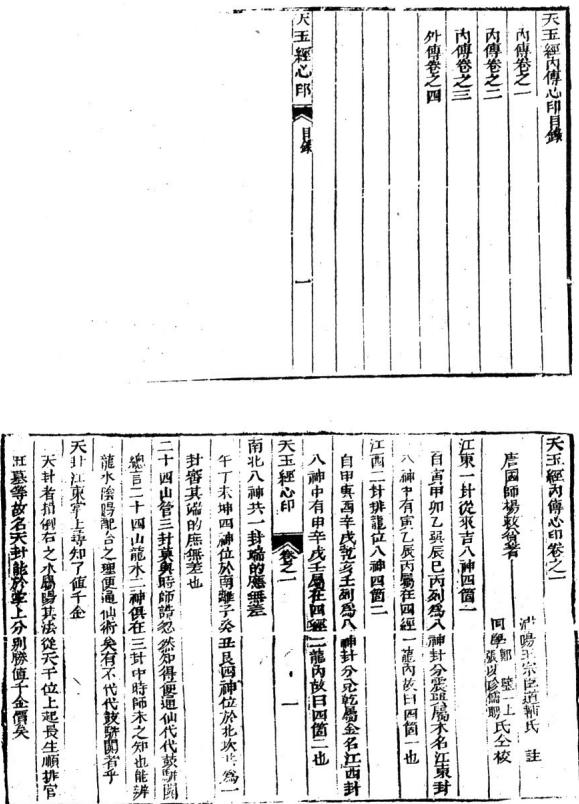

# 天玉经内传心印

> 来源：413.地理正宗臆解+黑囊经+青囊心印+地学.pdf，PDF 第 325–346 页

地棗八封誰能會山與水相對地卦者指例左之水屬陰共法從地支位上起長生逆非言旺墓等故名地封凡天地二卦水神俱要與龍神合配謂之相對

父毋陰陽仔細尋前後相兼定前後相兼兩路看今定兩邊安此以人百龍當乘正氣貫穴也言龍有陰陽各有父母所生來當細辨次言支辰陰陽龍及干唯陰陽龍入穴其相兼實有兩路而收攷乘眞氣亦分兩退也

假如左旋子龍屬陽必以本支七分而廉後壬三分始得直天五經心印 卷之一 二

子氣人穴謂之後兼右旋子龍屬陰必以本支七分而兼前壬三分始得真子氣入穴謂之前兼

假如左旋壬龍屬陽必以本于七分而兼前子三分始得真壬氣人穴謂之前集右旋壬龍屬陰必以本于七分兼後子支三分始得眞壬氣入穴謂之後兼能如此則無孤虛龜甲差錯空七關煞等弊

昔楊公制穿山七十二龍盤格龍故言相兼以取正氣後朱 蔡二公作平分六十龍周佈於七十二龍之下如壬龍取丙 子爲正氣子龍取庚子爲正氣之類小後世最確富

卦內八卦不出位代代人尊貴向永流歸一路行到處有聲名 龍行出卦無官貴不用勞心力只把天醫福德未解見榮光 首二句以龍體言龍卦必須得本龍生方有水入堂流歸庫 地謂之不出位而蔭尊貴三四句以能配水爲用言立向合 本龍正配之水生旺互交歸庫謂之向水歸一路行知此法 托十到處有聲名傳矣若龍神生方無水來或水不流歸自 庫去謂之出位不必尋求矣雖將天醫福德從水神裝卦寧 有榮光之應哉

倒排父母蔭龍位 山同同流水十二陰陽一路排總是卦中來天玉經心印 卷之一 三

凡龍立向必須朝本龍父母宮爲倒排父母以蔭龍位而龍向陰陽配合全在水神之來處與龍家互相生旺水神之去處與龍家同歸墓位爲山向同流水又言十二陰陽順逆排配龍神一路之理皆天地卦中所出也

開天閃地定雌雄富貴此中逢翻天倒地對不同秘密在玄空閱元指乾坤艮巽四維屬陽開地指辰成丑未四支屬陰皆言火口定雌雄辨富貴也翻天句言龍左行取右旋之水配龍右行取左旋之水配各不同而雌橫配合之法秘密在玄竅相通耳猶劉公云陰陽配合得生富貴雙全是也

三陽水口盡源流富貫永無憂三陽六秀二神當立見入朝堂三陽者貪巨武即龍水二神生旺水也水口庫位也言二陽之水又在六夭宮來堂歸庫位爲蓋源流爲歸二神當也主速發故曰立見五尺云生旺同歸人財咸吉更從六秀方來尚門未紫

水到御街官便至神童狀元出印綬若然居水口玉御近台輔承上言既得三陽六秀歸二神穴若水出四維墓位爲到鄉街也官便至者發福速也又宜本方砂格雄悍領異鎮塞水口未句猶云天子親臨門弟也

夫五經心卯 1 四 葵焚鼓角隨流水艷艷紅施貴

鼓琴水聲鼓角水神之官旺位此言官旺位上水朝紅篇水神病方艷艷峯戀秀美也

上按三才井六建排定陰陽算下按玉輦埠門流龍去要回頭上宏者看來水以定坐山也三才坐位也以于支共有六位曰六逮用以排水神之生旺各有陰陽順逆之法謂之勝定陰陽算下按看局前水也王輦衰方也又名巨門捍門墓方也局前有巨門水入堂合數貧四大局恰好歸墓位更回頭纏玄武而去也此龍字富作水字

之兆分明號六龍名姓達天聰正山正向流支上寡天遭刑松 承上文六建名六龍乃陰陽之天根月宿也能知此立坐向 生與旺罔歸定主各姓達天之應正山句言支龍八首作 支向見支水出入當應寡刑之凶吏神多藏役收也 向若回山是父毋水流回何首水若上山父母同定見出三公 言立向須朝本龍父母官而水神出入宜取本配更得走玄 武故後有三公之應

假如甲木龍入首宜坐癸水司何甲木受生之宮曰回句申木取配癸水須得卯乙亥壬生旺水命桑穴前出未坤爲流天玉經心印 之一 五

回向首若又得纏玄武曰水土山必主久遶發福餘陰陽八局可推

共洛兩神爲夫婦認敗寅神路仙人秘密定陰陽使是正龍爾- -\*龍水配合為夫繡細認本龍本配水爲得真神路也定陰陽者如陰龍入首須收當配之陽水陽龍八首須收當配之陰水便是得正龍崗矣猶前言用本配癸水局得兩神夫婦之道也劉公云陰用陽朝陽角陰應相見協室家之義陰陽字看零正坐向須知病菩遇正神正位礙水入零堂天堂正向須知好認取來山腳水上排龍點位裝積粟萬餘倉又言陰陽二中千爲零陽支爲正陰分工支入首之脉辨王行以定坐向夫坐向之吉凶在水遇千水來則吉支水來則凶若遇句言龍遇支水爲病又作支向則爲正位裴矣如局勢宜立支向須於立穴處或 扶左挨石撥水入零堂必須得龍與局官旺之零神立正向方好又不可脫本龍之眞氣認取來山腦然後從水局中非龍何方是生是旺納之入堂點位裴萬餘倉之應必矣

正神百步始成龍水短使遭凶宋神不問長和短吉凶不同斷承上零正神而言百步喜亥水長大在龍局生旺方來始天玉經心印 卷之一 大

成就龍身之吉水短雖在生臣方而吉氣不舒亦凶以支辰藏後故也于水不論長短在吉位短亦吉在凶位仍凶不可不察

父毋作來到子息須去認生尅水上排龍照位分兄弟更子孫上二句認入首後龍開節處辨生尅以定吉凶龍從受生處來為又毋人首處爲子息若從尅洩之處來凶故曰認生尅氏云一節相生一代貴一節尅洩一代貧五尺云壬癸來自兌庚作體全之象坎水迎歸卯酉名須氣之神是也下二句辨人堂之水分金木水火陰陽人局各分生熙聽排龍四經五行以金爲兄水爲第水為于火爲係舉四經之坎岸而言非應房分之謂

二十四山分兩路認取五行主龍中交戰水中裴便是正龍傷前面若無凶交破莫斷為凶凶星看是何公頭竹細認踪由十四山分陰陽兩路須先記入首之龍是何五行爲主查曜殺水破殺水敗殺水黃果水來冲犯否或有一把便是正龍受傷凡龍作穴前面未當無殺位但要殺方無水來破局及無惡砂照入則不為凶若凶位水冲入砂射入在養生位禍長官旺位禍中衰病墓位禍幼故曰龍中交爵水中裝天玉經心印 卷之一 七

而知公位之遭凶也。

先定來山後定向聯珠莫相放須知細覓五行綜官星結全龍先以入首之龍定陰陽五行然後配向立坐以收來去之水但來山賞收本龍三合之峯局前艮宜納正配三合之水為山向聯珠不相放也此法背由知五行之蹤而得能以此杵定應貴

五行若然翻值向百子千孫旺陰陽配合亦同論富貴此中尋此爲時師格龍但知從三合先四生四墓衆向四正所屬五行論龍神故誤人凶敗不知四正旺龍本兩長同氣其四生四墓入雙山雖是同宮面不同氣必當作一十六龍辨左查旋定陰陽從正五行父母作向故曰五行湖值向而有百子千孫也又辨水神與本龍配合生旺五交元竅相通不惟癸子孫而更富貴矣

假如右行乾辛申金龍入首若俠雙山乾是乙木龍當配丙火水宜出戊乾辛是丁火龍富配庚金水宜出丑艮申是癸水龍富配甲木水宜出未坤或三龍之水不出三方而例右出辰巽者乾龍不可作乙木而作陰金辛龍不可作丁大而作木金中龍不可作癸水而作辛金三龍俱取配王水成配天玉經心印 之一 入

則辰巽之去水爲二神歸虞矣斯得金龍動也須坐壬水局 六建山向辛金父母官謂之五行翻伯向則陰陽配合元竅 相通子絲富貫之應必矣餘可類推

雙山龍左行屬陽者 全再酉木甲卯 水壬子 火內雙山龍右行屬陰者金庚曹木甲卯 水壬子假加庚西雙山龍入首左行係陽金宜從巽巳方發祀起峯來至庚酉旺方成星結穴癸丑方起客應爲得三合龍峯之吉本配陰火水局作向局前收酉辛宮生水及巳丙旺水剩堂出丑艮此是陰小地卦陽龍之法也

如庚酉雙山入首右行除陰金宜從分丑方張神起峯而來至庚酉旺方成星結穴巽巳燕方起空應為得三龍峯之吉本配陽水水局作向局前收曰庚生位水及予癸旺位水八室出辰巽此是陽水天封配陰龍之法也

巳上雙山三合陰陽一十六龍外丑艮二七龍寄於陽水同父母不寄陰水中共一十八能佈局今但發明陽金醜陰火陰金聖陽水二局其陽水陽火陽水土及陰木陰火陰水龍可推

東西父母三般卦算直千金價二丁四幣山高官緋紫人長妄天主經心 卷之

父母不是未爲好無官只富蒙 反母不是未爲好無官只富易東封即天卦是倒右陽水配陰薩者也西卦卽地卦是左陰水配陽龍者也父毋卦凡金水水火土龍辨左旋右庭分陰陽五行所屬名尋本龍久母宮作向爲得父毋封也如右行陰龍遇本配陽水局爲得封水如左行陽遇本配陰水局爲得西卦水此爲得一般卦也凡二十四語得此三般全局主高官緋紫君獨取水局而不合本龍及向父母乃母不是不爲好應富無貴矣炙母排來看左右何首分休咎鬱山變向水零神鬲寶永無貧遇正神須敗絕五行當分別向一神仲子當子萬細惟掌先辨左右宛定陰喝五行之龍尋父母得向父母爲休美天則災咎雙山雙向者言坐于當乘支坐支當兼于又得于水從生旺入堂出墓主富貴四何韻遇支水在生旺征不亦福後終敗絕五六句當從本龍五行父母位立向天向父母爲隔向也宜綱詳之

君行宮位看順逆接得万特宮位若然見道龍男女失其院乖神入穴陰陽此言水祐歸堂陰陽也推局前之水須分願逆以定吉凶接得者言官旺方有水八堂近穴有情為天玉經心印 卷之一 十

奇特主速發無情而遠穴雖吉方則接不得矣若死墓絕方有水倒冲爲宮位見逆龍主男女失縣之凶劉公云破煞中生氣丁眷矣堪獸師云破煞倒冲男女絕蹤

更看父母下三吉三般卦第一

凡龍穴所向父毋言下之處乃穴前堂局也若得局前是父母封能生龍身之吉而又得龍卦及水封貪巨武三吉水八同歸墓位爲得三帳封第一之吉也總結上文寶以起下埃星之羞

天五經內傳心印卷之二

浦陽王宗臣道輔氏甫註同學宏學用氏正

二十四山起八官貪巨武輔榮四邊盡是逃亡穴下後人丁絕此以小游年引起挨星之法以貪巨祿文廉武破輔爲序順行三也例云乾甲離壬寅戌山坤壬乙上起貪狼與辛兌丁巳丑也乾甲丁上起貪振坤乙坎癸甲辰山艮丙辛上起貪狼艮丙震庚亥未山巽庚癸上起貪狼訣云收山出殺有何功破祿廉文要坐密貪巨武補收入穴何大地不相逢天五經心印 之二

貪狼本是吉星辰生氣融融煖似春紫黃滿棺生嫩莊見孫濟濟佐王臣

巨門穴氣如墟棺木乘之結水珠紫茜白藤生滿椁他年 富貴耀門閭

祿存穴冷如水棺內原來有水停土蟻木根皆入穴庄田賣盡純人丁

文曲水星坐時必然宥水浸棺屍兒孫貧苦家聲覿更主風飄死不歸

服貴獨火至爲凶蓋坐原來有地風棺倒屍翻生白見孫 代代主貧窮

武曲從來是吉神若還坐吉祥臨白結滿棺生紫茜自然富榮家門

破軍坐不堪聞曰蟻地虫滿棺中更有木根穿骨殖還格公訟播淫風

左輔原來是本宮若還坐吉還凶或然坐吉終須吉富貴榮華在此中

默師云巳上之法惟取陽龍陽同陽水陰龍陰向陰水如星

龍入首作丑山未向得巨門坐之吉另是一法不在天地父母三卦之內

若挨星爲最貫泄漏天機機天樓若然安在內家活常富貴大機若然安在外家活常退敗五星配出九星名天下任橫行言小游年不足取獨按星爲足貴也然佈挨星於龍山水局中各於大墓起破軍陽順陰逆佈九星取貪巨武三吉水八堂歸庫爲天機安在內矣主當富貴若水不合龍獨用挨星於水中佈罡稱三吉爲美則天機安在外矣但得一家無根之水初年雖吉而終退敗也五星指各龍所屬五行也能禮名龍所屬之五行後能佈名龍之九星能知各龍當配之水局然後能佈各水之九星則挨星之法得天下可橫行也楊公稱最貴為泄天機之秘者此耳

于雖乾艮巽坤壬陽順星辰輪支辰次震離兌陰卦逆行取 分定陰陽歸兩路順逆推排去知生知死亦知貧留取教兒孫 玉陽水也癸陰水也凡倒右之水屬陽局法從甲庚丙壬連 四生支位起長生順排水神之生旺息宮佈陽水起陽于順 行也凡倒左之水屬陰局法從于卯午西連四陰于位起長 生逆排水神之生旺墓嘗佈陰水從陰于逆行也知水有陰 天玉經心印 卷之二 三

陽兩路分順逆推非則死生貧當盡知矣留教兒孫者寶之也

天地父母三般卦時師未會話元空大卦神仙說本是此經訣不識宗支俱亂傳開口莫胡言若還不信此經文但要呂古入墳此承上文而言天卦卽東卦倒右之陽水地卦卽西卦倒左之陰水父母卦郎本龍尋父母作何也乃大玄空之秘用之以辨龍則知龍卦生旺墓之宗枝用之以辨水則知水卦生旺墓之宗枝用之以立向則知向卦龍與水之宗枝凡古興發之地必合三卦宗枝之訣其敢絕之地必失三卦之宗枝仁古人墳而知經言之不易矣分却東兩兩箇卦會者傳天下學取神仙經一宗切莫亂談五行山下問來由入首便知踪

神仙指青鳥子郭景純也言東西二卦乃出上古仙經五行山下問來由當辨八首來龍以推其陰陽是何五行允得來山之由然後審用何卦水神以配龍神立向斯謂知蹤而不淡

分定子孫十二位穴禍相連值千灾萬禍少人知尅者論宗枝凡龍八首其生旺墓死絕等共有十二位因其從生處而來天玉經心節 卷之二 四

故曰子孫必以入首龍氣正玉行爲主以推後龍之吉凶或相生相尅及死絕墓皆須辨之若是節節相生或生位及比和乃得宗枝之子孫爲吉龍也若愛尅洩及死墓絕而來凶欽曰論宗枝佚龍又有八卦與正五行之生尅如坤上龍轉申結穴此卦生正也寅龍轉艮人穴此正尅卦也或本龍轉辰士火龍轉金此皆正尅正也其千災萬禍皆山宗枝之患而少人知也玉尺云最喜來乘於進氣切忌陷入於休四又曰生能發足莫犯天罡旺處山身休逢死絕此之謂也重行位中出一位仁細祕中記假如來龍骨不真從此悞于人凡龍脈八穴當辨是何五行謂金木水火土中分出一位也卽於此五行依經秘訣以辨嘗脉之死生行止之眞爲陰陽之來路始得無悞若不以真龍骨脉爲主惟取天地二卦強節誤矣

一個排來千百個莫把星辰錯龍要合向向合水水合四吉位合祿合馬與官星本卦官旺尋合凶合吉合祥瑞何法能趨避但看大歲是何神立地見分明成敗盡從宮位斷三合年中是此示人辨龍拼水局立向消納井斷吉凶之法夫一龍局前排吉凶星辰若千百之多不可錯認若龍得合父母之向向天王經心印 卷之二 五

得本局貪巨武輔吉水水得合本卦之祿或合本龍之馬或合本龍之官星謂之合吉合祥瑞倘合本龍之殺須立向避之或有不避者遇都天本歲臨其位凶禍立見其吉凶名分公位逢三合之年應如養生位合殺主三合孟年長房見禍如官旺方合殺主三合仲年次房見禍如衰病墓方合殺主三合季年小房見禍如合吉在等方亦主三合年各房應福

佛扈仔細看五行看是何卦生來山八卦不知踪八卦九星空順逆排來各不同天卦在玄室

非星宿井龍之五行的以人首一節爲主推其從何卦所生若不知所生之根由雖用九星水法亦空矣然排龍有陰陽順逆之分而配水局以立坐向皆在玄卦內也不言地卦者省文也

假如左行甲卯龍入首是乾卦生來當配右行癸水成局然癸水是震卦生來水須倒左出未坤此龍水知得乾震二卦所生也

又如右行甲卯龍入首是離卦生來當配左行丙火合局然 丙火是艮卦生來水須倒石出戌乾此龍水知得離艮二卦 天王經心印 卷之二 六

所生也餘可類推

述男位上算輕游富貴容易收胎沐養生貪長共寇臨衰旺仲 李子排來病死位墓絕亦皆是分定陰陽順水裝三子一齊昌 用挨星排水神分陰陽二路辨順巡佈九星以收貪巨武人 堂出破軍位爲順水裝主三子俱昌矣

子寅辰與乾丙乙長男非此位午申戌與坤壬辛二男此位眞卯巳丑及艮庚丁三男位相生酉亥未兼巽申癸四男此位是此排二十四山分金木水火成四經五行之序而曰金一木二水三火四用之以佈水神實若分公位吉凶也公位吉凶上文里來龍問祖宗支水來去凶惟有寅申巳亥水生旺福無比指八首一節龍須辨陰陽五行若得生旺方來爲祖宗之吉北配龍之水從于位來吉與支位來去俱凶惟寅申巳亥支水在本龍長生之位又合配局旺神之宮主發福無北不可以支水槩作凶斷

甲庚丙壬俱屬陽順排五行詳乙辛丁癸俱屬陰逆排五行之陰陽順逆不同途須向此中求九星雙起雌雄異元關眞妙處此言龍水二神成配各從大墓起破軍佈挨星於龍水各宮天玉經心印 卷之三 七

之法也

假如右行陰金龍配壬水成局其陽水佈挨星之法則以大 墓辰巽位起破軍順佈巳丙午丁是祿存未坤申庚是貪狼 酉辛戌乾是文曲亥壬子是武曲癸爲右弼丑巨門艮爲左 輔寅甲卯乙是廉貞此順佈九星於水局得貪巨武水來八 堂法從四經天卦順佈挨星也其陰金龍佈挨星之法亦以 大墓辰乙位逆起破軍卯甲寅艮是祿存丑癸子壬是貪狼 亥乾戌辛是文曲酉庚甲是武曲埔為右弼未巨門丁爲左 輔午酉巳巽是廉貞此順節九是於龍山得貪三武峯起應 穴爲從雙山龍卦逆起挨星也 凡順行陽水局名天卦東卦逆行陰水局名地卦西卦從雙 山位起挨星龍卦配合成局名雌雄卦又名夫婦卦又名陰 陽卦則裝卦之名盡矣

東西二卦眞奇異須知本向水木向本水四神奇代代着紫衣首言陰陽二路水卦次言辨明何龍當配何水當立何向須合圓經秘法能以此扦主代代着紫衣也前言天地兩卦順逆不同途者卽此東西二卦也楊公恐後人忽挨星之秘復申言之

天玉經心印卷之二

水流出卦有何全一代出官員一折一代爲官祿二折二代福二折父母共長流馬上錦衣游馬上斬頭水出卦一代爲官罷直山直水去無翻塲務小官班

水出卦者非水出外卦也因來水實與龍相配未歸庫而出請之出卦此爲止得一折水不成全局止應一代小貴四句分水折數言局前之生旺水若出本墓位爲得三折水也應得二代貴五句若再得水纏玄武遶水神父母宮而去應馬上貴顯卽前章水上山父母同定見出三公意馬上斬頭者言局前出卦之水從水神病位而出借云馬上斬頭只得一折水也以四孟生地是各龍山馬位若水神非直病位出水爲馬上斬頭水言水至馬位卽斬斷而不能歸庫水成全局雖龍水二神合吉只主一代爲官矣直山直水者惟寅申巳亥四坐山遇馬在向前相對水從此出爲去無翻總龍神來水穴法合吉止塲務小官耳若三者無可取必不可扦天玉經內傳心印卷之三浦陽王宗臣道輔氏甫註下明國師劉伯溫輯同學其永先氏全校 鄭爾政一偉乾山乾向水來乾乾峯山狀元

左行甲木龍屬乾卦所生曰乾山其水倒左出未坤取配癸 水坐巽巳山作乾亥本龍父母甸曰乾向得乾亥水入堂曰 水來乾見乾峯高聳曰乾上高峯其水與峯俱居龍之二神 生旺位劉公云陰陽品配得生旺而富貴雙全

卯山卯向迎源水驟富石樂比

天五經心印卷之三

右行癸水龍從震封所生來曰卯山其水倒右出未坤取配 甲木坐辛戌山作乙辰本龍父母向曰卯向又見卯乙位龍 水二神生旺水來朝穴曰迅源水頓公云陽衡水來主驟富 午山午向午來堂大將鎭邊疆

右行乙木龍屬離卦生來曰午山其水倒右出戍乾取配丙火坐子癸山作午丁本龍父母向曰午向又得龍局生旺水來朝堂曰午來堂震龍有奮武之威午水有將軍之應劉公云源流浩大偏宜武職坤山坤向水坤流富貴永無休

左行水土龍屬坤卦生來曰坤山其水倒左出辰巽取配金坐寅艮山作坤申本龍父母向曰坤向又見坤申龍局二神生旺水來入堂曰水坤流卽本經云一龍往處有三龍世代富無窮之謂也

辨得陰陽兩路行五星要分明泥猷浪裡跳龍門浮海便飛身承上文龍與水當分別陰陽二路之行次言龍水二神屬何五行要分明也泥猷喻龍浪裡喻力此龍門言向得木龍父母生旺互交同墓也未句喻龍得水其發福便如化身飛騰依得四神爲第一官職無休歇穴上八卦要知情穴內卦裝清天玉經心印 卷之三 二

若能依金木水火四神之局配合立向爲第一吉主富貴永久穴上要知者承上女四神藏八卦而八卦又分二十四山凡立向收水須知穴上各有本龍陰陽之五行各有水神配含之眞情則龍水二卦始無悞是得三般卦也穴內卦裝清者指辨脈乘眞氣貫棺切不可使雜氣混入爲害靑囊云前後八尺不宜雜氣乘生旺方無殺

要求富貴三般卦出卦家貧乏寅中巳亥生發長五行向中藏反戌丑未四金龍動得永不窮若還借庫富後貧自庫樂長春凡求富貴地須本龍本配水而向又朝父母爲得三般卦卽自庫樂長春也若遇水未及交至衰位遂出者謂之山卦主貧乏之應寅申巳亥四水乃金木水火四陽局長生之水又是四陰局官旺之水凡立向須納之入堂故曰五行向中藏也辰戌丑未乃金木水火龍之墓位名金龍水從此出爲自庫之金動矣主永不貧借庫者言水出局前衰方也衰方爲巨門水書曰惟有巨門可去來雖爲吉實有未歸庫之嫌故曰借庫主先富後貧卽交而不及

天都星起何方是五行長生旺火旆相對起高崗職位在學堂稗門官国華表起山水亦同例水秀峯奇出大宮四位一般看天玉經心卽 卷之三 三

天都星卽坐山後起星峯主大旺人丁凡坐局之生位卽龍家之旺位故曰五行長生旺火施相對者即向上有美峯高起也學堂指水神衰方巨門星有水朝峯秀主高官捍門墓位官同龍家死位得有華表峯鎭塞水口龍合大格水從六秀方來峯是六秀方起主出六貫凡金木水火四局同一例故曰一般看

坎離水火中天過龍墀移帝座實鳳閣四維朝寶殿登龍樓罡纵弔殺休犯著四墓多銷鑠金枝玉葉四孟裴金箱玉印藏承上文看局前各官之來水如峯巒得退以下所註之吉星又在龍水二神生旺之宮炤穴必應書顯若死墓絕位雖逢吉峯吉水如臨不爲吉逢凶峯及水冲射大凶二十四古凶星詳載於下

子名帝座午名龍墀卯爲將星金水酉爲華太陰乾爲龍樓太陽坤爲寶佐尊艮爲鳳閣曜巽名寶殿紫氣寅爲玉印天財申為金箱巳爲金枝亥名五葉紫微辰爲天罡戌爲天刼丑爲天弔未名天殺甲爲鬼殺庚名刼殺丙名帝釋炎烈士爲元武咸池乙爲功曹辛爲眞符丁爲帝輦帝赦癸名鸞大玉經心卯 卷之三 四

帝釋一名定州府紫微同八武倒排父母養龍神富貴萬餘春帝釋丙也多爲州府縣治之向紫徵亥也八武壬也同者言坐壬兼亥也如左行庚金龍坐于亥山立巳丙向謂得父母以生龍神也故曰倒排父母其曰養龍神者配龍神之水從生旺八堂歸庫以陰養龍神故有萬餘春之吉

得父母二般卦便是眞神路此斗七星去打劫離宮要相合言能辨明三般卦龍水配合爲旧便得眞神路矣次二句發三般卦中有犯龍神之八殺者當避

假如左行離龍入首氣合丁火配庚金若立亥壬向亥爲離之殺特有水照穴是離宮遭殺水合矣必遭刑戮北斗七星在壬亥之官有亥水殺離如遭劫賊之患欲出比殺宜作成乾二向放亥水於向外斯化殺爲權又如右行卯龍作庚向當避申水左行巽龍作辛向當避酉水右行坎龍作兩向宜避辰水左行坤龍作寅向宜避卯水左行兌龍作卯向宜避巳水右行艮龍作丙丁向宜避寅水巳上皆龍家八殺水犯者必主殺戮見血而亡凡見殺水如劫賊之凶雖合三般卦亦無至如左行金龍作乾山與向見午水朝入不作八殺大玉經心印 卷之三 五

乾金無火不流行且午乃先天乾位故不忌更有一星佐尊貫坤是金星位甲庚丙壬四龍神俱屬陽于行巽艮乾坤水向同富貴足典隆辰戌丑未一路行驟富振家聲此爲坐于維山以收倒右陽水局而舉坤山發言也佐尊坤也夫坐坤山之所貴在配辛全龍謂金星位也陽水從天卦于位起長生收亥壬子癸官旺水出辰巽是水向同行一路矣必主發福舉坤山辛金龍一局而于維十二局收倒右陽水之法可推矣依得封中爲第一失卦軍賊出不依方封失眞傳何必亂談天由示人須依天地二卦拂水神得真生旺八堂爲第一青否則有出軍賊之患如下女見子午卯酉方水來不在官旺位亦是失方卦致有是凶

十午卯酉四龍崗作祖人財旺水長百里住君王水短便遭傷 指坐子午卯酉四山取配倒右之陽水交媾成局須本龍長 生宮有水來朝謂得祖宗生万水主發人丁又是水局旺方 水主旺財祿故曰作祖人財旺須水源長遠而有佐君王之 應未句因四正之支水藏軍脈桃花殺若水短小則吉氣輕 微而殺易動主四玉只云子午必招軍賊源流清大而偏宜 六玉經心印 卷之三 六

武職卯酉本犯邪淫悠洋清徹而女友賢艮短與長之分也識得陰陽兩路行富貴達京城不黃陰陽兩路行萬丈火坑深總言龍夾各分陰陽兩路議得其理取配合定坐向富貴可易得也不識兩路而妄行扦十其害人不有若萬丈火坑乎前兼龍神前兼向聯珠莫相放後兼龍神後兼向排定陰陽算勇得零神與正神指日入青雲不識零神及正神代代絕除前兼向者言穴前水倒右天卦陽水局也當坐于維位兼後支謂前兼龍用前兼向收來水因以前于兼後支謂之前兼假如倒右水出未坤法宜坐甲木局收甲寅卯乙官旺水入堂出未坤以配右行癸水龍生旺同墓之用得合亥卯未雙山聯珠之法不相放也前兼龍神與後兼龍神詳在首章前後相兼定註中夫三合順聯珠惟右旋陰龍配陽水局有之若左旋陽龍配陰水局止有弔合聯珠而無順聯珠矣後兼向者言穴前水倒左地卦陰水局也法坐支位兼前于謂後兼龍用後兼向收來水因以後支兼前于謂之後兼假如倒左水出辰巽法宜坐辛金局收辛門申庚官旺水入堂出辰巽以配左行壬水龍生旺同墓之用此無聯珠三合而止有排定陰陽相配之法以算之也零于也正支也言能大玉經心印 卷之三 七

明于支龍入穴而以前後相兼取氣以相兼前後立向可得指日之吉若不明此法有除根之曰

倒非父母是真龍子息達天聰順排父母倒子息代代人財退倒非者指入首之龍分陰陽得向本龍父母宮爲真龍父母若天龍爲子息向回父母是爲子息達天聰順排父母者凡左旋之陽龍遇倒有之陽水右旋之陰龍遇倒左之陰水失陰陽之配俱爲順排主人財退敗也劉公云二女同居純陰不長有見並處獨陽不生是也

一龍宮中水便行子息受艱辛四三二龍逆去四子俱榮世龍行徑遠主離鄉四位發經商一龍四三三二龍局圖

時師不識挨屋學只把天心填東退財衆引西歸北到南方推 有龍終曰臥山中何嘗不易逢只是自家眼不的亂把山崗覓 言時師不識天地二卦起挨星取貪臣武三吉爲用立以天 心十道堂局之正立向不辨龍水二神生旺之位在東南而 誤收西北臨官在西北而反取東南使龍神水局倒置雖遇 言地終難發福皆因學術眼力之謬卽有眞龍真配處何嘗 識哉廖公曰局不嫌其不正而嫌其不得生旺者此也 世人不識天機秘洩破有何益汝今傳得地中仙玄空妙難言 補天倒地更玄立大封不易傳更有收山出殺訣亦兼與汝說 相逢大地有幾人個個是知心若退求地不種德穩口深臧 此楊公傳曾公偈語見玄空大封神妙莫測非易人任也翻 天倒地者陰陽生死之不同也收山出煞者小玄空有生尅 出入之用也詳在青囊此不贊章內言深理與采河洛 其道參贊化育其功回天改命九遇吉地及此經訣不可輕 授匪人以獲天譴慎之兩之王尺云懼洩天機之秘牧田石 室之幽又曰男之匪人天神共通凡抱道之士決宜自重當 凜仙師遺命 天玉經内傳心印三卷終 天玉經心和一卷之三 九

天五經外獨心印卷之四皆公蛇中松清豬為李東於言 兩先生定 九官 浦陽王宗臣道福氏甫註 同學李品子方 祖結八 氏全較陽子寅辰乾丙乙 目金名天寶經為一龍陰午申戌坤壬辛 曰水名龍子經爲二龍陽卯巳丑艮庚丁 曰水名玄女經為三龍陰酉亥未巽甲癸 日大名寶堅經為四龍

天王經心印 之四天玉經分房水法

天玉經心印之四
子寅辰乾丙乙長男真端的午申戌坤壬辛次男此位眞
卯巳丑與艮庚丁三男從此分酉亥夫與巽甲癸四男當此位
第一折水長房折乾丙更要一第二斤水二男情坤辛王同行
第三折水三房位艮庚丁吉制第四折水四男宮巽甲癸相逢者無
四男還歸長仔細分明講

三三 早 望 土青辰戌丑未重 乙丙乾辰寅于 吉吉吉四四 房七四一主也父天官一金排丁星如之三神見凹見水官水當看後龍所屬地成中午区区区房八 11 主也母地官二木

大玉經心印 卷之四

右圜乃壙前放水之法取千神官旺位爲用

假如水倒右申木局坐壬向而理當初步放小神乙水八二步放中神甲水入注放未坤去十道者乃左右前後相對是也

默師云支爲陰靜為主神為雌千爲陽動為雄爲零神中方國壙也外方國壙前放水起步處也

雌維妙訣 山龍天一名天賓經一商音金父母東方爲天爲陽 上天陽上天陽上天陽下地陽下地陽下地陽 于北 寅京辰東 乾西 丙東 乙東一 四經五行以一龍爲天爲金屬陽凡坐子寅辰二支山者宜 收倒左之陰水夫陰逆上而行故皆曰上天陽凡坐乾兩 乙三山者宜收倒右之陽水去陽順下而行竣曰下天陽上 下卽佈水神順逆二字

山龍地二名龍子經一角音木子男西方為地爲陰

天玉經心印 卷之四

上地陰上地陰上地陰下地陰下地陰下地陰午南中西成酉 坤南壬西辛酉

四經五行以二龍爲地爲木屬陰凡坐午申戌三支山者宜收倒左之陰水夫陰逆上而行故皆上地陰凡坐坤千辛

三山者宜收倒右之陽水故皆曰下也陰

四經五行以三龍爲鬼爲水土屬陽凡坐卯巳丑三支山官一收倒左之陰水夫陰逆上行故皆曰上冠陽凡坐百與三千維山者立故倒右之陽水啟曰下火陽

山龍人四名寶臨經徵肯火孫息也南方爲人為陰四遠五行以四龍為人爲火屬陰凡坐西亥未三支山宜奴倒左之陰外夫陰逆上而行故皆曰上人陰先坐要申癸三山者宜收何右之陽水故皆曰下人陰

上四龍分夫地鬼人者言東方保日出之所陽升之宮爲天也西方乃曰入之宮陽没之卿爲地也北方為幽宜之宮爲鬼也南方乃陽和之宮爲人也兵上下之名言陰從下而上尹逆行有仰承之象曰土也陽待從止而下有施生之義曰下也 1

天五經心印卷之四

玄空大卦訣

封號立空理最幽乾坤良巽剛踪由坎難震兌分天地五行更在位中束第一天實經最妙第二要看龍子經第三一經名玄女第四寶照經爲名乾丙乙與子寅辰六位排來俱屬金艮其丁與卯巳丑六位屬水出人數巳上數名盡屬陽陽山陽水始相當坤壬辛與午申戌六位屬木無人識巽甲癸與酉亥未六位屬火君須紀巳上數者盡屬陰陰山陰水正相應此是陰陽夫卦五行之內號四經不癸能方財祿聚疏碳生方損少丁長生位上黃泉是壬化之年定見刑此是九天玄女訣毋得經薄則人按新安时志云壬山丙向申明謂五百年來產大才只因圭了紫陽山一水長地名 地名 乙真之成損要孩此其也玉尺亦云少三鑽死為犯黃泉

龍全位家富貴百子于攝位

一龍指生陰陽二金局金位指庚申酉辛一方是金位官旺水來堂必主富貴又係丁火壬水二龍長生水主百子千保然庚辛水七三吉六秀故主貴

一龍行來到本篇外保置田主

天五經心印卷之四

二龍指坐陰陽二水局本鄉指寅甲卯乙二方是本位官旺水入堂必主置止於分保又係孫丙二龍之長生方主發丁三龍行從本位去金玉家無數

三龍指坐陰陽一水局本位指亥壬子癸二方是水位之官旺水來堂必主金王多富是美金甲木龍之生方主發丁西龍行來到火中富貴出三公

四龍拉坐陰陽二火局火中指巳内午丁二方是火位之官旺水入堂主富貫丙丁水是六秀故主三公此二方乃庚金乙木生方主貴顯子

正神山上水文值百子千孫出零補前來水上交富貴出官潦乘神正神水交着見孫遭跌漕正神百步始成龍水短便遭凶零神不問長知短吉凶不同斷

正神山上者坐支山也言坐支山又見本龍所配之生旺水在支位來堂曰水交值獨取發丁改百子千孫出粟神于也言坐文山得生旺水在于維位來入堂不獨旺丁且發官僚若主子山而遇本龍所配之支水入堂主子孫吉凶無常蓮跌薄也正神百步一叚詳在前章

二十四山分五行頓逆要知倩每見時師錯用心便為來主眞天玉經心印 公之四 六

若將八首為端的陰陽何虞寬只取過龍來作主直龍却無取須三真龍來勢無錯認悞殺人

言二十四山各有一五行陽順陰迦須知也時師不辨來龍出身陰陽五行配局止以八首一卽爲主昧於順逆之理將何處尋陰陽又何處尋生旺乎責冀云來山起頂須要知惟取龍身左右旋以定入育之陰陽不以入首一節淨陰净陽使言龍身陰又恐失眞脉必須待眞龍來勢真氣住於此背臺毫釐謬以千里死該失蔭主人受禍矣郭仙師云塟乘生氣明斯理自方詐人道

五行者水尅向上百子于孫旺遇向若然行兩神代代高無貧言坐西北二山屬金屬水而本山有元辰水入堂能結向上東水南火曰水尅向也且東南二愈為天氣陽和生長之鄉向主發可若又值龍水兩神生旺互交必主久楊公因此二向多野和又得水尅向爲財局故更墻言之

龍生處有三龍世代高無窮更知三是五行主本身原屬土水重一土共五行生旺基同情三龍三個太家富銀為多盡節三龍位上若當凶三十絲根宗四位得位人織曰庫有錢與指坐辛金局為一龍生處也見坤申庚三方係水龍之長生天玉經心邱 卷之四

又辛金局之官旺汪洋入堂謂之有三龍主富無窮又須知 三龍係四經五行屬水長生居坤申爲永龍之主且坤屬土 故本身原屬土然水龍之生旺墓官重兼土龍在內故目 阿滿三龍卽水龍也三個又指坤申真三位之水得龍神水 句之生旺洋朝應六主三子俱富若陽水土龍水出坤申庚 方亥薩家生方破局之旺亥天主三子絕宗四經巽屬火在 凶龍內禽四位係壬水與卒金之庫得坤巾庚水入堂流出 與合辛壬尽矣主人肥滿而富有伐與也此與四三 二龍逆去同法川前局內有酉辛六秀水臾主榮覺此與得

七旺水止言財丁四經五行以金龍爲首致陽公以龍亡句提振再三後舉集此而通之其庶幾矣財山財水財易發也通井入遠奔財巨高出聰明只是少入丁且要順龍頗水去人財從此至順龍來去子孫昌代代足衣糧指左行陽金龍至官旺八首結穴四金是天下之財曰財山也財水者言陽金龍堡配丁火局有午巳丙官旺水來堂故曰財易發也然龍雖得本配爲吉而滿局火旺水來尅龍生富而不旺丁老得堂局寬大應案遠拱墓虛低遠得泄火氣主財丁兩旺故曰七通人達順龍順水去之謂也出聰明天王經心跡 卷之目

者因丙丁水爲六秀故人多聰俊夫陰陽八局中遇水尅龍者惟此一局虜公易舉而言之

拼山併向明堂水拆盡諸道理小心匠香本龍經一經各一名 五行無根水上折時師那會得放水與山同路行代代坐畢城 折山指入首辨陽之龍非的取本龍父母作向明堂水收 本龍用配之水八望掃庫也知此去謂折蓋諸道理矣看四 龍經者言金水水火四局中龍水相配各有五行之分卽一 經各一名也五行無根水上折山成山水自成水何言 白分五行山與水有陰陽五行之分及何生旺墓同情之位 其根由皆人所察在玄竅通處得之也故曰水上折此卽 故水與山同路行也能如此辨山排而明堂水而汙必主富 貴久遠矣此一節總經文察龍配局納永之妙而保贊之一 一龍行宮水口去兒孫多不吉籠行位遠主離鄉水位却無紡 二龍先行一龍上內反兼抱卷二折行二見眞龍白手置田豐 三龍先行一龍上入舍兼抱養四龍行位不分明父子絕人丁

二龍三龍二折行二圖見下

天王經心印卷之四令木水火各一言主命亦不同證得四行合主命自然發福此辨局前之水得何五行之土旺入局有主命合此水昔發福假如得金局生旺水入堂者主金命生人富貴金到火宮人死絕火入金宮定妻金火相刑人自溢縱然不縊也分離

言寅午戌堂局之地主庚申辛酉金命人寅午戌年死絕次 言巳丙午丁火命人遇巳酉丑堂局之地主寅午成年損妻 一局以相尅言也如巳火刑甲金申金刑寅本皆相刑尅故 有自縊分離之凶

金木水火四龍位生尅無窮極相生爲吉相尅四禍福在其中

于支二水要相依更把天星卦例推囊宮長男遨福應兌宮小 位吉凶知中男坎離天分定子息排來位却移

看局前來水是于維位來宜坐于維山以收之支辰位來宜坐支出收之謂于支相假也更把卦例推者須是本于本友之官旺水來爲吉否則不吉也假卯亥山巳向水街右倧雙山陽木局見賽宮卯水入堂是陽旺水舊長男發福

又加坐未山丑向係雙山陰水局水倒左見震宮卯水來朝乃陰木臨官水應長男發貴凡坐天支二山辨入堂之水是何卦中來以分公位吉凶如在乾震巽三卦之水合吉應長房賢福合凶應長房凶如艮坤兌三卦之水合吉應小男發福合四應小男凶坎離二卦水來合吉應中男發禍合凶應中男凶其吉者長生官旺也凶者死墓絕也排位却移者此也

四路黃泉

庚丁坤上是黃泉乙丙須防翼水先甲癸向中憂見艮辛壬水 天玉經心印 卷之四 土

路怕當乾

接庚向坤水爲黃泉者係左旋壬水龍入首取辛金爲配庚乃陽水之生位坤是善位法宜收癸辛庚坤生旺位水八堂流歸辰巽方成辛壬會全局今水流坤上是冲破龍神生養方矣主丙辛年有損少丁之凶

丁向同忌坤水者係右旋乙水龍入首取配丙火丁乃陰木之生位坤是養位法宜收甲丙丁坤生旺位水入堂流歸乾戌方合乙婦配丙夫交媾成局今水流坤上是冲破龍神生養方主丁壬年有損少丁之凶

七向巽水爲黃泉者緣右旋癸水龍入首取配甲木乙乃凶水之生位巽是養位法宜收壬甲乙巽水入堂流歸未坤方成全局合水流巽是冲破龍神生養方主丙辛年凶

丙向防與水者緣左旋庚金龍入首宜配丁火丙乃庚之生 位巽是養位法宜收辛丁兩巽生旺位水入堂流歸丑艮今 水流吳出是沖破龍神生養方主乙庚之年應禍

甲向忌艮水爲黃泉者緣左旋丙火龍入肖取乙木爲配甲乃丙之生位艮是養位法宜收丁乙丙艮水入堂流歸乾成合丙配乙交媾成局今水流艮是冲破龍神生養方主戊癸天五經心印 卷之四

又癸向忌艮水者綠右旋辛金龍八首配以壬水癸乃辛金 生位艮是養位法宜收辛壬癸艮生旺位水入堂流歸辰巽 今水流艮出冲破龍家生養方矣主丙辛年應禍

辛向怕乾爲黃泉者緣右旋丁火龍入首取配庚金辛乃丁 火生位乾是養位法宜收丙庚辛乾生旺水入堂流歸丑艮 令丁婦配庚失交媾成局今水乾出破龍家生養方矣主 成癸年凶

又壬向怕乾者係左旋甲木龍入首配以癸水壬乃甲木生 仁乾是養位法宜收乙癸壬乾生旺位水入堂流歸未坤今 水流乾出破龍神生養方矣主丁壬年應禍

經云流破生方損少丁長生位上黃泉是千化之年定見刑指流破乾坤艮巽係龍神之生養位而言如巖郡之壬山丙局記是也若排四維值陰陽龍神墓地水去爲上御街水來爲破煞倒冲宜辦

幸入乾官百萬生癸歸艮位顯文章乙向巽流清富貴丁坤終是萬斯箱

天五經心印卷之四

丰

此四大局詳在青囊後編中此復舉之以原本天玉也辛入乾宮者以左行水龍入首氣屬甲木癸水爲配坐乙向辛乾水朝堂乾乃甲木龍之生方癸水局之衰位於九星爲貪狼爲巨門得貪巨二吉水入堂且乾亥上應紫微垣故有是應

癸歸良位者以左行火龍入穴氣屬丙火乙木爲配作丁山癸向具水朝堂艮乃丙火龍生方乙木局衰位於九星爲貪狼爲巨門得此二吉水入堂且艮爲六秀上應天市垣故有是應

乙向巽流者以左行金龍八穴氣屬庚金丁火爲配坐辛向 乙巽水朝堂巽乃庚金龍生方丁火局衰位排九星值貪狼 值巨門得二吉水入堂且巽爲六秀上應太微垣故有是應 丁向坤水者以左行水龍入穴氣屬壬水辛金爲配坐癸向 丁坤水朝堂坤乃陽水龍生方陰金局衰位排九星值貞狼 值巨門得此二吉水八堂且坤爲老母主堂笥箱上應少微 垣故有是應

余觀此四大局名救貧而獨喜其來者以排在龍神生方日合曰天垣星道法雙譚云水法多四以收合四垣星者爲第大玉經心印卷之四 十四五蘭齋藏振一指此四局而言也若從此四維方流去爲嚴散龍神生氣其凶禍陽木龍應在丁壬年陽火龍應在戊癸年陽金龍應乙庚年陽水土龍應丙辛年有損少丁之凶

玄女天關大卦

更有一神難爲說時師不會得辰山戌向戌山辰驚動世間入寅歸甲水乙歸巽長流爲官定丙辰爲龍寅爲虎仔細尋根取巽丙丁爲六秀到世代無煩惱卯山辛向水來乾富貴出官員吉坐辰山遇水倒左法從卯上起長生逆排本神合子方臨官水來臨吉忍犯軍賊之凶若水倒右法從巳位起長生順排水神合申方臨官水來雖吉又犯玄武之川如坐戍山永倒左法從酉位起長生逆排水神合午方臨水吉恰犯軍賊之凶若水倒右法從亥位上起長生順排水神合寅方臨官水來吉又犯尾虎之四二山俱出人充惡而驚動世人楊公所謂出方虎者此也

寅歸甲水者言坐申山作寅向水倒左有甲方旺水入堂乙歸巽者言坐辛山作乙向得巽官巨門水入堂卽乙向巽流也二局水長大格貴定主爲官

丙辰爲龍寅爲虎者言坐寅山作申向水倒右法從寅上起 天玉經心印 卷之四

長生順佈水神得巽丙位臨官水丁宮旺位水來堂係六秀中赦文爲六秀到雖寅山爲凶必主世代無煩惱也頼公云丙丁有水名赦文永無凶禍臨家門

卯山辛向者指左行卯龍入首右乙山辛向得乾方生旺水來堂卽辛入乾宮也主富貴官員之應不也

人玉經外傳心印卷四終
