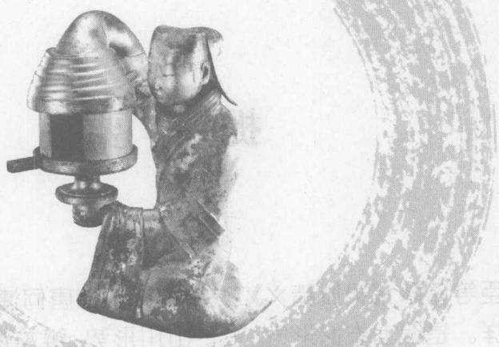
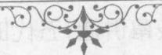

# 灵城精义（全文注音版·2008）

> 来源：《宅经》《灵城精义》《葬书》2008.pdf，PDF 第 30–113 页

## 中国古代文化全阅读

## ZhongGuoGuDaiWenHuaQuanYueDu

全文注音版

第一辑 第25册

灵城精义

LingChengJingYi

[南唐]何溥 He Pu

## 提 要

臣等谨案：《灵城精义》二卷，旧本题南唐何溥撰。溥字令通，履贯未详。是编上卷论形气，主于山川形势，辨龙辨穴；下卷论理气，主于天星卦例，生克吉凶。自宋以来，诸家书目皆不著录。观其言宇宙有大关合，气运为主，又言地运有推移，而天气从之；天运有转旋，而地气应之，盖主元运之说者。考元运之说，以甲子六十年为一元，配以《洛书》九宫，凡历上中下三元为一周，更历三周，五百四十年为一运，凡为甲子者九。每元六十年为大运，一元之中，二十年为小运，以卜地气之旺相休囚。如上元甲子一白司运，则坎得旺气，震巽得生气，乾兑得退气，离得死气，坤得鬼气。大抵因《皇极经世》而推演之。其法出自明初宁波幕讲僧，五代时安有是说？其非明以前书确矣。其注题曰刘基撰。前列引用书自凡二十二种，如《入式歌》之类，亦明中叶以后之伪书，则出于赝作亦无疑义。但就其书而论，则所云大地无形看气概，小地无势看精神，水成形山上止，山成形水中止，龙为地气，水为天气诸语，于彼法之中颇为近理，注文亦发挥条畅，胜他书之口鄙，犹解文义者之所为。术数之书，无非依托，所言可采，即录存以备一家，真伪固无庸辨，亦不足与辨也。乾隆四十六年十月恭校上。

总纂官臣纪昀臣陆锡熊 臣孙士毅总校官臣陆费墀

## juàn shàng

## 卷 上

xíng qì zhāng zhèng jué

## 形气章正诀

yǔ zhòu yōu dà guān hé qì yùn wéi zhū shān chuān yǒu zhēn xìng qíng 宇宙有大关合，气运为主；山川有真性情， qì shì wéi xiān 气势为先。

cǐ shǒu zhāng nǎi kān yú jiā zhī lùn qì zhě dì yī jī qiào yě xī 此首章，乃堪舆家之论气者第一机窍也。昔 yún yōu dì fēi rén bú xià yǒu rén fēi shí bú xià gài yī qì yùn yán yě 云：有地非人不下，有人非时不下。盖以气运言也。 yòu yún chá yǐ yǎn jiè. huì yǐ xìng qíng ruò néng liǎo cǐ tiān xià héng xíng 又云：察以眼界，会以性情，若能了此，天下横行， cǐ yǐ qì shì yán yě rú bī qián zhé yì dū xíng shì biàn zhī huò fú zhī 此以气势言也。如彼前哲，一睹形势，便知祸福之 dà xiǎo shì shù zhī xiān hòu quán zài qì yùn shàng bū zhī fú shān chuān 大小，世数之先后，全在气运上卜之。夫山川 yǒu zhēn xìng qíng hé yǐ biàn yē xī rén yōu yún shān chéng xiù qì shuǐ 有真性情，何以辨也？昔人有云山乘秀气，水 chéng jī qì shí chéng shà qì píng chéng jī qì yòu yún shān gǔ yì 乘积气，石乘煞气，平乘脊气。又云：山谷异 xíng píng yuán yī qì cǐ shān chuān zhī dà shì nǎi shān chuān zhī zhēn xìng 形，平原一气，此山川之大势，乃山川之真性 qíng yě shān hé yǐ dú qǔ xiù qì yě shān zhī shì lèi duō gāng měng ér 情也。山何以独取秀气也？山之势，类多刚猛而 wán yìng wéi huàn bú xiù lì ruò jiàn xiù lì suō cóng biàn shì zhēn qì suǒ 顽硬，惟患不秀丽，若见秀丽所丛，便是真气所 jù qiē shàng jù dì wéitiān qīng zhī qì jū duō suǒ wèi shōu shān bù shōu shuǐ 聚。且上聚地惟天清之气居多，所谓收山不收水

zhě zhèng yòng zhī cǐ chù gù yǐ fēng luán zhī xiù qì wéishēng qì ěr shuī 者，正用之此处，故以峰峦之秀气为生气耳。水 hé yǐ dú qū jī qì yě shuǐ zhī shì lèi duō liú zǒu ér sàn yì wéi huàn 何以独取积气也？水之势，类多流走而散逸，惟患 bù chéng níng ruò jiàn zhū shuǐ suō jī biàn shì zhēn qì suǒ zhōng qiě xià jù 不澄凝，若见诸水所积，便是真气所钟。且下聚 dì wéi qǔ níng xù zhī qì jū duō suō wèi shōu shuī bù shōu shān zhě zhèng yòng 地惟取凝蓄之气居多，所谓收水不收山者，正用 zhī cǐ chù gù yǐ shuī zhī jī qì wéishēng qi ěr shí hé yǐ dú qǔ shà qì 之此处，故以水之积气为生气耳。石何以独取煞气 yě shān yǒushān zhī xǐ qì yì yōu shān zhī nù qì nù zé shān zhī wēi 也？山有山之喜气，亦有山之怒气。怒则山之威 líng suō zài wēi líng zhī qì duō lù wéi shí ruò shí shān ér tú gāng měng 灵所在。威灵之气，多露为石。若石山而徒刚猛， yā bī bù chéng tǐ shì bú zuò wēi yí - zé tú yǒushà ér wú shēng yǐ cóng 压逼不成体势，不作威仪，则徒有煞而无生矣。从 ér xià zhī huò bù xuán zhǒng gù shí guì chéng shà qì zhě qǔ qí wēi ér 而下之，祸不旋踵。故石贵乘煞气者，取其威而 chéng tǐ yǒu shēng qì yě zuì yí xì rèn píng hé yǐ dú qǔ jǐ qì yě 成体，有生气也，最宜细认。平何以独取脊气也？ rú ping yáng yí pài zhī tǔ chún yáng wú yīn shēng qì bù liān gǒu dé yì 如平阳一派之土，纯阳无阴，生气不敛，苟得一 gǔ jī zhī chù gāo qǐ biàn wéi liān ér yǒu shēng qì yǐ , xī rén yǒu mò niú 骨脊之处高起，便为敛而有生气矣。昔人有“没牛 chuī qì rú sū zài tāng zhī yù zhèng rú cǐ shān gǔ yòu hé yǐ chēng yì 吹气，如酥在汤”之喻，正如此。山谷又何以称异 qì hū rú jīn shān gū zhī jiān gè zì qǐ shì gè zì kāi jú gè zì chéng 气乎？如今山谷之间，各自起势，各自开局，各自成 mén hù qí qì gè yì gù fán jiāng nán yí dài bù dāng yǔ jiāng bēi tóng 门户，其气各异，故凡江南一带，不当与江北同 kàn zhī jiàn yí gè xīng chén tè qǐ yí gè jú miàn tè kāi yǒu gài yǒu 看，只见一个星辰特起，一个局面特开，有盖有 sòng yǒu cháo yǒu yíng huò rú zhuān chéng huò rú ting yì tǎng dé liǎng 送，有朝有迎，或如专城，或如停驿。倘得两

sān chóng shuǐ kǒu tè tè guān suǒ biàn wéi yǒu jié biàn dāng zhuó yǎn shì 三重水口，特特关锁，便为有结，便当着眼。试 guān mǐn guǎng wú yuè zhī jiān gè cūn gè shè gè yōu míng zú yì gè yǒu 观闽、广、吴越之间，各村各社，各有名族，亦各有 míng zhōng zhū fán yǔ yán xí shàng yòu gè bù tóng fēng wéi yì qì rán yē 名冢，诸凡语言习尚，又各不同风，惟异气然也。 píng yuán yòu hé yǐ chēng yī qì hū rú jīn sì wàng guǎng mò zhī dì yǒu 平原又何以称一气乎？如今四望广漠之地，有 hé dà fēn bié zhī jiàn yōu yì fāng gāng jī qǐ chù biàn zuòchéng chí shì zhèn 何大分别，只见有一方冈脊起处，便作城池市镇， qí wéi lú shè fén mù jìn jù yú cǐ jí fán yǔ yán xí shàng suī shù bǎi 其为庐舍坟墓，尽聚于此。即凡语言习尚，虽数百 lǐ duō wéitōng tóng wèi fēi yī qì rán hū tǎng jū yì qì chù ér màn yǐ 里多为通同，谓非一气然乎？倘居异气处而漫以 mò rán sì wàng zhī shì qiú zhī zé yǐ yǎn jiè tài kuān ér shī yǐ tǎng jū yī 漠然四望之势求之，则以眼界太宽而失矣；倘居一 qì chù ér bì yǐ shān gǔ fēn jié zhī shì qiú zhī zé yòu yǐ yǎn jiè tài zhǎi ér 气处而必以山谷分结之势求之，则又以眼界太窄而 shī yǐ cǐ rèn qì yǐ rèn qì shì wéinán yē   
失矣。此认气以认气势为难也。

dì yùn yǒu tuī yí ér tiān qì cóng zhī tiān yùn yǒu zhuān xuán ér dì 地运有推移，而天气从之；天运有转旋，而地 qì yìng zhī tiān qì dòng yú shàng ér rén wéi yìng zhī rén wéi dòng yú xià 气应之。天气动于上，而人为应之；人为动于下， ér tiān qì cóng zhī 而天气从之。

cǐ yán yǔ zhòu qì yùn tiān dì rén jiē xiāng yǔ yú yǒu chéng yì yǒu 此言宇宙气运，天地人皆相与于有成，一有   
zhuǎn yí jǔ dòng qì jí yǐ yì cǐ shí shí guān biàn zhě zhī yí dà shū niǔ 转移举动，气即以异，此识时观变者之一大枢纽   
yě hé wèi dì yùn yōu zhuān yí ér tiān qì cóng zhī rú huáng hé shì tiān   
也。何谓地运有转移而天气从之？如黄河是天   
dì jiān yí dà xuè mài jù huáng yú shí hé yóulóng mén ér zhuǎn lǚ liáng   
地间一大血脉，据黄虞时河由龙门而转吕梁，

vóu lǚ liáng ér zhuǎn tài háng yóu tài háng ér zhuǎn jié shí nǎi rù hāi shì 由吕梁而转太行，电太行而转碣石乃入海，是 hé cóng xī zhuǎn nán cóng nán zhuān dōng bēi ér jì jū qí zhōng zé suō 河从西转南，从南转东北，而冀居其中，则所 wèi huáng hé rú dài wǔ yuè jù cháo wéitiān xià dì yī dà fēng shuǐ zhē cǐ 谓黄河如带，五岳俱朝，为天下第一大风水者，此 yě cǐ jì dū yì shí ér yáoshùn yǔ sān shèng rén chū yān qiān gǔ mò shèng 也。此冀都一时而尧舜禹三圣人出焉，千古莫盛 yǐ fú wéi huáng hé jīng qí běi cháng jiāng rào qí nán ér tài yuè jiā yú 矣。夫惟黄河经其北，长江绕其南，而泰岳夹于 qí jiān zé tài shān wéi huá shān yǐ lái tài jìn zhī lóng nǎi zhōng guó zhī yí 其间，则泰山为华山以来大尽之龙，乃中国之一 dà gān yě ruò lùn zhōng guó xíng shèng zé tài shān wéi zhōng jìn dāng shí 大于也。若论中国形胜，则泰山为中尽，当时 kǒng shèng qǐ ér qún xián jǐ jǐ bìng shēng qiān gǔ yì mò shèng yān cǐ kāi 孔圣起而群贤济济并生，千古亦莫盛焉。此开 pì yǐ lái wèi yǒu zhuǎn xī zhī shān shuǐ yě zì hàn huáng hé jiàn xǐ ér 辟以来未有转徙之山水也。自汉，黄河渐徙而 nán nǎi zhì chuān duàn zōu lǔ zhī xū zhí zōu huái sì zé tài shān fān jū 南，乃至穿断邹鲁之墟，直走淮泗，则泰山反居 bēi ér huáng hé nǎi jū nán yǐ jì zhōu zhī shuǐ shì qīng zōu lǔ zhī dì 北，而黄河乃居南矣。冀州之水势倾，邹鲁之地 màiduàn ér bēi dì zhī qì yün shuāi yǐ wō cháo zǔ líng zhōng yú zhōng 脉断，而北地之气运衰矣。我朝祖陵钟于中 dū dà yè qǐ yú chú yáng zhèng zài huái sì zhī jiān qǐ fēi huáng hé nán 都，大业起于滁阳，正在淮泗之间，岂非黄河南 xǐ qì yùn qù shǐ zhī rán hū rén yán jiāng nán zhī shèng yǐ sòng nán dù ér 徙，气运固使之然平！人言江南之盛，以宋南渡而 rán bù zhī huánq hé xǐ ér zhī nán zé tiān yùn yì cóng ér zhī nán rén bù 然，不知黄河徙而之南，则天运亦从而之南，人不 néng wèi zhī wǎn yě fú tiān qì yī cóng dì yùn zhī zhuǎn zhě rú cǐ 能为之挽也。夫天气一从地运之转者如此。

hé wèitiān yùn yǒuzhuǎn xuán ér dì qì yì yìng zhī rú qín tài shī zhān 何谓天运有转旋而地气亦应之？如秦太史占 jīn líng yǒutiān zǐ qì nǎi shū qín huái yǐ xiè zhī bù zhī qín huái yì shū dì 金陵有天子气，乃疏秦淮以泄之，不知秦淮一疏，地 yùn nǎi dòng sì hòu xiǎo ér liù cháo zhī jiàn dū dà ér wō cháo zhī dǐng diàn 运乃动，嗣后小而六朝之建都，大而我朝之鼎奠， guǒyìng yú cǐ yòu rú luò yáng sù wèi yǒu dù juān jí dù juān tí ér tiān 果应于此。又如洛阳素未有杜鹃，及杜鹃啼而天 qì xíng yú nán yǐ nán rén zì shì guǒzuò xiàng shì dì yùn wèi dào ér tiān yùn 气行于南矣，南人自是果作相，是地运未到而天运 xiāndào zé dì nǎi cóng tiān zhuāņ yě hé wèitiān, qì dòng yú shàng ér rén 先到，则地乃从天转也。何谓天气动于上而人 wéi yìng zhī rú chén xī yí yì xī jiàn xiǎo xīng jū dì xīng zhī zuǒ jí dàn 为应之？如陈希夷一夕见小星居帝星之左，及旦 ér jí mì qí suǒ jiànsòng tài zǔ yǔ zhào pǔ tóng zuò jiǔ sì jiān ér zhào jū 而亟觅其所，见宋太祖与赵普同坐酒肆间，而赵居 qí zuǒ chén nāi yuē xiǎo xīng hé gǎn jū dì zuò zuǒ zāi tuī ér yì zhī 其左。陈乃曰：小星何敢居帝座左哉！推而易之。 cǐ sòng tài zǔ wēi shí shì jīn rén duō yǐ xīng qì wéi miāo máng ér bù zhī 此宋太祖微时事。今人多以星气为渺茫，而不知 tiāndòng rén yìng qí bù shuǎng rú cǐ hé wèi rén shì dòng yú xià ér tiān 天动人应，其不爽如此。何谓人事动于下而天 qì cóng zhī rú luò yáng huā shí hé dà guān jì ér yuán shǐ zhān zhī yǐ 气从之？如洛阳花石，何大关系，而元史占之，以 wéi huā shí bú qù zé sòng zhī wàng qì. bù jué jí yí dàn yí qù huā shí 为花石不去，则宋之旺气不绝，及一旦移去花石， ér háng hāi zhī zhōu suì fù jīn rén duō yǐ qián zhé àn xīņg guà wéi zuò yòng 而航海之舟遂覆。今人多以前哲按星卦为作用， sì wéi guàidàn bù jīng ér bù zhī .yì jū. yi dòng tiān jí wéi yìng qì hé 似为怪诞不经。而不知一举一动，天即为应，气何 bú guàntōng yē fú lùn qì yùn zhě ér gōu gōu gōu yú ding gé bù jí yú 不贯通也？夫论气运者而苟拘拘于定格，不及于 zhuǎn xǐ huàn huà zhī bù cháng yì hé yǐ dìng qí biàn zāi fú gǔ dà zhé 转徙幻化之不常，抑何以定其变哉！夫古大哲 wàng qì ér kě yù zhān chá shí ér kě guān biàn gài néng tōng cǐ qiào ěr 望气而可预占，察时而可观变，盖能通此窍耳， zì fēi shén xiāndào yān wū zú yǔ cǐ 自非神仙道眼，乌足语此！

yǒu jù jiǎng xíng jiǎng zuò jiǎng zé qì jù yú lóng yōu quán xīng 有聚讲、行讲、坐讲，则气聚于龙；有权星、 zūn xīng xióng xīng zé qì jù yú shì yōu gài tāi jiā tāi chéng tāi zé 尊星、雄星，则气聚于势；有盖胎、夹胎、乘胎，则 qì jù yú xué yǒushōu jīn shōutáng shōu guān zé qì jù yú jú 气聚于穴；有收襟、收堂、收关，则气聚于局。

cǐ sì duàn nǎi rèn qì zhē dì yī guān jiàn yě fú lóng jì gū dān 此四段，乃认气者第一关键也。夫龙忌孤单， rén suǒ gòng zhī rán yì dàn zhī kàn dào tóu shù jié ěr bù zhǐ lóng yǒu qǐ yǒu 人所共知。然亦但知看到头数节耳，不知龙有起有 zhǐ yǒu xíng dù qǐ chù bì yào jù jiǎng rú céng yún dié wù hé qì yùn 止有行度，起处必要聚讲。如层云叠雾，合气运 xíng dà yǐ shù bǎi lǐ xiǎo yǐ shù shí lǐ héng gèn mián yán huò wǔ xīng 形，大以数百里，小以数十里，横亘绵延，或五星 jù ér bù fēn wèi zhī jù jiǎng rú dū huì zhī dì bǎi guān suǒ jù wàn 聚而不分，谓之聚讲。如都会之地，百官所聚，万 mín suǒ zhǐ nǎi shū yào zhī huì yě jì. jù zhī hòu zé fēn zhī pī mài ér 民所止，乃枢要之会也。既聚之后，则分枝劈脉而 qù tiáo fēn lǚ xī zhèng gān cóng zhōng yú zhī fēn zuǒ fēn yòu ér xíng huò 去，条分缕析，正干从中，余支分左分右而行。或 yǐ dù xiá huò yǐ zǒu shǎn liāng biān jiā hù gè dài fēng luán dài yìn dài 以渡峡，或以走闪，两边夹护，各带峰峦，带印、带 bǐ dài qí dài gǔ dài cāng dài kù gè gè bù yī zōng zhī cóng jù gōng 笔、带旗、带鼓、带仓、带库，各各不一，总之丛聚拱 hù bù gū bú lù wèi zhī xíng jiǎng lóng zhī xíng dù jì lì bō huàn bì 护，不孤不露，谓之行讲。龙之行度既历剥换，必 yōu guī sù pì zé xíng zhě zhī fù jiā qí yì jiā gǔ ròu bì wéi tuán jù 有归宿，譬则行者之赴家，其一家骨肉必为团聚。 yòù pì zé guì rén zhī dēng táng qí suǒ shǔ liáo zuǒ bì wéi gǒng hù jué wú gū 又譬则贵人之登堂，其所属僚佐必为拱护，决无孤 lì dú zuò zhī lǐ wèi zhī zuò jiāng yǒu cǐ sān jiǎng qí lóng nǎi zhēn ruò 立独坐之理，谓之坐讲。有此三讲，其龙乃真；若

huò bù rán zé gū dān èr zì bú tè zài rù xué zhī suǒ yǐ 或不然，则孤单二字，不特在入穴之所矣。

hé yǐ wèi zhī quán xīng wú gōng qián lóng jīng zhōng suō chēng dū 何以谓之权星？吴公《钳龙经》中所称都 quán zhī xīng yē gài yǐ qí shì zhèng shèng zhèng dà zǔ zōng èr zì bù zú 权之星也。盖以其势正盛正大，祖宗二字不足 yǐ jìn zhī gāo dà rú xuěshān zhī qí tiān bú jiàn qí dǐng mián gèn rú yún 以尽之。高大如雪山之齐天，不见其顶；绵亘如云 zhōng zhī yàn bú jiàn qi lái cóng jí rú kūn lún bā fāng zhī pán jù bú 中之雁，不见其来；丛集如昆仑，八方之蟠踞，不 jiàn qí fēn zé tiān xià wàn pài zhī shān jiē zǔ yú cī cǐ yì hé kē yǐ zǔ 见其分，则天下万派之山，皆祖于此，此亦何可以祖 yán gù yǐ dū quán zhī xīng míng yě dà dǐ quán xīng duō tǔ jīn zhī tǐ 言，故以都权之星名也。大抵权星多土金之体， gài wéi tǔ jīn néng mián gèn yě ruò shuǐ mù huǒ duō zuò zǔ xīng yǐ qí huó 盖惟土金能绵亘也。若水木火多作祖星，以其活 dòng ér zhuó lì zé wéi fēn xíng yǐ zé yǔ zhòu jiān wéi tū shí wéi dà wéi 动而卓立，则为分形矣，则宇宙间惟土石为大为 shèng gài shí jí jīn yě jīng yún quán xīng yí dà bù yí xiù zǔ xīng lín 盛，盖石即金也。经云权星宜大不宜秀，祖星临 lái yào qǐ fēng zhèng cī zhī wèi cóng cǐ ér tuī yí jùn yōu yí jùn zhī 来要起峰。正此之谓。从此而推，一郡有一郡之 quán xīng fán lùn fó xiān hóu wáng xiàng gōng zhī dà jié.gòu bì běn yú cǐ 权星，月论佛仙侯王相公之大结构，必本于此。 zhì rú zūn xīng zé huò zǔ huò zōng gāo chū yú yì fāng wéi zhòng shān suǒ 至如尊星，则或祖或宗，高出于一方，为众山所 shōu chū zhē cóng cǐ ér zhī lóng zhī zhèng gān zhèng jié jiē zhào yú cǐ yòu 首出者，从此而知龙之正干正结，皆肇于此。又 rú xióng xīng zé yú chéng kuò jiāo guān zhī chù yōuzhuó lì xīng chén kē yǐ 如雄星，则于城廓交关之处，有卓立星辰，可以 yìng zūn xīng ér dāng mén hù zhē zé yǐ xióng xīng chēng jí jīn suǒ wèi bēi 应尊星而当门户者，则以雄星称、即今所谓北 chén luó mù hóu zhī lèi qài jiāo yá zhī jié bù rú yǐ qín shòu chéng xíng wù 辰罗目侯之类。盖交牙织结，不如以禽兽成形，物 xing shǒu guān yòu bù rú yǐ rén shǒu guān zhī wéi dà yě yǒu cǐ sān xīng 形守关，又不如以人守关之为大也。有此三星， fāng wéi shì dà tāi xīng shì jié xué zhī suǒ   
方为势大。胎星是结穴之所。 hé wèi gài tāi jí gài. zuò shì yě gài wú gài shì tāi bì bù jié 何谓盖胎？即盖座是也。盖无盖势，胎必不结。 huá gài wéishàng guān gài bǎo gài cì zhī ji gè zì fēi é yì shì gài yàng 华盖为上，冠盖宝盖次之，即个字飞蛾亦是盖样。 gài yǒu gài zé mài bú lù bù gū ér xué bì cáng fēng jù qì yǐ hé wèi jiā 盖有盖则脉不露不孤，而穴必藏风聚气矣。何谓夹 tāi rú jīn lóng hǔ jiā ěr zhī shuō shī fēng mén bú dòng suō yǐ wèi xué zhē 胎？如今龙虎夹耳之说，使风门不动，所以卫穴者 yě hé wèichéng tāi rú jīn xiǎo míng táng shì yě gài shàng gài zé qi 也。何谓乘胎？如今小明堂是也。盖上盖则气 zhù yú xià xià chéng zé qì yōng yú shàng liǎng páng jiā zé qì xù yú 注于下，下乘则气壅于上，两旁夹则气蓄于 zhōng fāng wèi yǒu qì zhī xué hé wèi shōu jīn zé xuézhōng wēi máng jiè 中，方谓有气之穴。何谓收襟？则穴中微茫，界 shuǐ suǒ huì rú rén zhī jīn, ling suǒ jiāo míng yuē jīn hé hé wèi shōu táng 水所会，如人之襟领所交，名曰襟合。何谓收堂？ zé lóng hǔ jiè gē zhī shuǐ suǒ huì rú jū shì zhī mingtáng wéi sì shuǐ zhī suǒ 则龙虎界割之水所会，如居室之明堂，为四水之所 jù míng yuē táng hé hé wèi shōu guān yǐ lóng zhī fēn lái zuò chéng zuò 聚，名曰堂合。何谓收关？以龙之分来作城作 guō zhī shuǐ suǒ huì xiǎo rú jū shì zhī mén hù dà rú chéng kuò zhī guān suō 郭之水所会，小如居室之门户，大如城廓之关锁， míng yuē guān hé gǔ réņ suǒ wèi xiāo hé·shōu náng yǐ táng hé. yán yě dà 名曰关合。古人所谓小合收囊，以堂合言也；大 hé shōu jú yǐ guān hé yán yě xué qíng dī xiǎo zhě shōutáng yǐ nèi zhī 合收局，以关合言也。穴情低小者，收堂以内之 shuī xuéqíng gāo dà zhě shōu guān yǐ nèi zhī shuǐ zhì rú xué qián xiǎo míng 水；穴情高大者，收关以内之水。至如穴前小明 táng hé jīn zhī shuī wú lùn gāo dī xué jiē suǒ dāng shōu yě fán lùn jú zhě 堂合襟之水，无论高低穴皆所当收也。凡论局者，

bì zhǔn zhū cǐ hé ér lùn zhī xī rén yǒu yún yǒu xuéfāng yán dì wú jú 必准诸此，合而论之。昔人有云：有穴方言地，无局 bù yánlóng zé jú yòu lóng zhī suǒ yǐ dìng bèi miàn yě liào gōng xiè tiān 不言龙。则局又龙之所以定背面也。廖公泄天 jī fēn lóng xuéshā shuǐ ér yòu jiā zhī yǐ táng zhèng cǐ zhī wèi yú 机，分龙穴砂水，而又加之以堂，正此之谓与！

yīn shèng féng yáng zé zhǐ yáng shèng féng yīn zé zhù xióng lóng xū yào 阴胜逢阳则止，阳胜逢阴则住。雄龙须要 cí lóng yù cí lóng xū yào xióng lóng cù 雌龙御，雌龙须要雄龙簇。

cǐ èr duàn yán lóng shì bì dé yīn yáng cí xióng gòu huì zhī chǔ ér shǐ 此二段言龙势必得阴阳雌雄媾会之处而始 chéng tāi rèn qì zhē suǒ dāng shěn yě rú shān gǔ zhī jiān yīn qì cháng 成胎，认气者所当审也。如山谷之间，阴气尝 shèng gù yí xiè píng yáng tuō tāi huàn gǔ jú miàn yì qiě kāi yáng shū 胜，故一卸平洋，脱胎换骨，局面亦且开阳舒 chàng cǐ biàn yǒu jié suǒ wèi yīn shèng féng yáng ér zhǐ shì yě dà kāi dà 畅，此便有结，所谓阴胜逢阳而止是也。大开大 jié xiǎo kāi xiǎo jié wàn wàn bù shuǎng yòu rú píng yáng zhī dì yáng qì 结，小开小结，万万不爽。又如平洋之地，阳气 chángshèng gù hū rán qǐ yì gāng fù yì shān jǐ wèi zhī jí qì suǒ qǐ 尝胜，故忽然起一冈阜、一山脊，谓之吉气所起， nǎi sì miàn yīn shā wèi chán wèi hù biàn shì qiǎn lù yì zì chéng jú gù 乃四面阴砂，未缠未护，便是浅露，亦自成局。故 ping yuán zhī chù zhī yào fēn jú dé ming gǔ mài xiǎn lù wéi zhèng suǒ wèi 平原之处，只要分局得明，骨脉显露为证，所谓 yángshèng féng yīn ér zhù yě yòu rú lóng shì zhī lái zhèng gān xióng qiáng 阳胜逢阴而住也。又如龙势之来，正干雄强； wèi zhī xióng lóng yǒu zì tiān ér jiàng yù fēng ér xíng zhī shì nǎi liǎng hù 谓之雄龙，有自天而降、御风而行之势，乃两护 sòng zhī shān xū yào róu shùn wǎn zhuǎn yuān chn yuǎn hù bù yǔ zhēng 送之山须要柔顺婉转，远缠远护，不与争 qiáng zé zhèng gān nǎi jié xī rén suǒ yún xióng lóng zuò dà jiàng yǐ wò 强，则正干乃结。昔人所云雄龙坐大将以握 zhòng bīng shì yě yāo zhī suǒ yù zhī shā ruò guǒ xiù yǎ yì chū wén shì 重兵是也。要之，所御之砂若果秀雅，亦出文士， huò yǐ wén chén wò bīng quán ěr yòu rú lóng shì zhī xíng yí pài ruǎn nèn 或以文臣握兵权耳。又如龙势之行，一派软嫩 wéi cí bì liǎng biān yōng hù gǒng jiā yōu lì zuò qǐ qì shì nǎi xiàn jīng 为雌，必两边拥护，拱夹有力，作起气势，乃见精 shén fú cí lóng gù zhǔ wén xiù rán sì miàn shā rú bǐ rú hù rú gǔ 神。夫雌龙固主文秀，然四面砂如笔、如笏、如鼓、 rú qí yì zhǔ wēi yán qǐ zhǐ wén xiù zāi cǐ cí lóng yǐ jiā cóng xióng shì 如旗，亦主威严，岂止文秀哉！此雌龙以夹从雄势 wéi jiā fán cí xióng guì jiāo gòu rú cǐ   
为佳，凡雌雄贵交媾如此。

dà dì wú xíng kàn qì gài xiǎo dì wú shì kàn jīng shén shuǐ chéng xíng 大地无形看气概，小地无势看精神。水成形 shān shàng zhǐ shān chéng xíng shuǐ zhōng zhǐ 山上止，山成形水中止。

cǐ yán lì xué dāng xiān rèn qí xíng shén zhī jù zhī chù ér xué zhī bù kē 此言立穴当先认其形神止聚之处而穴之，不可 yí gài lùn yě jīn rén yú rù shǒu zuò xué chù biàn kàn wō qián rǔ tū sì 一概论也。今人于入首作穴处，便看窝钳乳突四 zì yī yǒu cǐ sì zhě biàn chēng hāo xué bù zhī xíng nǎi xué zhī zhèng zuǒ 字，一有此四者，便称好穴，不知形乃穴之证佐 ēr zhì qí shēng jī zhēn jié zhī chù quán zài dà shì shàng lǐ huì rú dà 耳。至其生机真结之处，全在大势上理会。如大 dì zhī xíng cháng yǐn,cháng zhuō hé yǒu xíng zhī qiǎo mèi dòng rén zhī yú 地之形，尝隐尝拙，何有形之巧媚动人。只于 dà, xiàng shàng chá qí qì shì rèn qí xìng qíng gǒu dé shēng jī biàn chéng 大象上察其气势，认其性情，苟得生机，便成 xué fǎ bù zài gōugōu yú wō qián rǔ tū zhī cháng fā yě zhì ruò xiǎo dì 穴法，不在拘拘干窝钳乳突之常法也。至若小地， jì wú qì .gài bì xū xíng jú hé dù jù qì cáng fēng chū jú guān zhī 既无气概，必须形局合度，聚气藏风。出局观之， sì wú qì shì rù jú guān zhī què yǒu jīng shén zé biàn kě yú jīng shén jù 似无气势：入局观之，却有精神，则便可于精神聚 chù xué zhī yì kě chéng yí qì jú yě cǐ guǎn shì lì xué yǐ rèn xíng shì 处穴之，亦可成一器局也。此管氏立穴以认形势 wéi xiān zuì wéi zhì yào nāi lùn xíng zhī zhǐ sù chù yòu yào biàn zhī lōng gāo 为先，最为至要。乃论形之止宿处，又要辨支珑高 xià nǎi bù shī qí xìng qíng yě rú píng zhī zhī lóng quán. yǐ shuǐ wéi jiè hé 下，乃不失其性情也。如平支之龙，全以水为界合 ér chéng yáng qì cháng shèng qí shì róu wǎn xué dāng cóng qí qǐ chù gāng 而成，阳气尝胜，其势柔婉，穴当从其起处刚 chù ér chéng zhī suǒ wèishān shàng zhǐ zhě shì yě jí zàng shū zhī zàng qí 处而乘之，所谓山上止者是也，即《葬书》支葬其 diān zhī yì rú shān lǒng zhī lóng yīn qì cháng shèng qí shì xióng jí xué 巅之意。如山珑之龙阴气常胜，其势雄急，穴 dāng cóng qi tǎn chù ér chéng zhī suǒ wèi shuǐ zhōng zhǐ zhē shì yē wèi zhī 当从其坦处而乘之，所谓水中止者是也。谓之 shuīzhōng zhī shì jiè shuī huì. ér zhǐ chù gǔ suǒ yún lái bù lái tǎn zhōng 水中只是界水会而止处，古所云：来不来，坦中 cái zhù bú zhù píng zhōng qǔ cǐ yǔ zàng shū lǒng zàng qí lù zhī 裁，住不住，坪中取。此与《葬书》珑葬其麓之 yì tóng   
意同。 rèn qì yú dà fù mǔ kàn zūn xīng rèn qì yú zhēn zǐ xī kàn zhǔ xīng 认气于大父母看尊星，认气于真子息看主星，   
rèn qì yú fāngjiāogǒu kàn tāi fú xīng rèn qì yú tāi yù kàn tāi xī xīng rèn   
认气于方交媾看胎伏星，认气于胎育看胎息星，认   
qì yú huà shà wéi quán kàn jiě xīng rèn qì yú féng jué ér shēng kàn ēn xīng   
气于化煞为权看解星，认气于逢绝而生看恩星。 cǐ shù duàn nǎi lóng qì zhōng rèn qì dì yì fǎ mén yě fán kànlóng xū 此数段乃龙气中认气第一法门也。凡看龙须   
rèn zūn xīng wéi zhǔ gài dào yì fāng kàn shì hé shān zuì gāo zuì dà zhuān shàn   
认尊星为主，盖到一方看是何山最高最大，专擅   
yì fāng biàn yǐ zhī wéi dà fù mǔ kàn zūn xīng shì hé xīng chén rú tǔ   
一方，便以之为大父母。看尊星是何星辰，如土   
xīng qǐ dǐng chuí jiān dà kāi gài zhàng zé wéi tǔ lóng shì qí suǒ yù zhī zǐ   
星起顶垂肩，大开盖帐，则为土龙势，其所育之子

sūn tǔ shì bēn qì jīn shì shēng qì rú mù zé wéi shà rú huǒ zé wèi qí 孙，土是本气，金是生气。如木则为煞，如火则为其 suǒ xiè rú shuǐ zé yòu wèi qí suō xíng gù fán zì shàng ér xià yù shēng 所泄，如水则又为其所刑。故凡自上而下，遇生 wàng wéi zǐ xī yù kè hài zé wéi xíng shà qí fā dāng zǔ hé tú yī 旺为子息，遇克害则为刑煞。其法当祖《河图》，一 yǐ shùn shēng wéi xù gài fù mǔ bù kě kè zǐ sūn yě lǐ jiā lóng jīng 以顺生为序，盖父母不可克子孙也。李家《龙经》 yún xī xīng kè mǔ zǐ róng chāng mǔ xīng. kè zǐ sǐ jué wáng gài xià kě 云：息星克母子荣昌，母星克子死绝亡。盖下可 kè shàng shàng bù kě kè xià yě fán shān yí dào rù shǒu zhī chù kàn shì 克上，上不可克下也。凡山一到入首之处，看是 hé xīng chén rú jīn xīng rù shǒu nǎi zū zōng yuán shì tǔ shì chū mài zé wéi 何星辰，如金星入首，乃祖宗原是土势出脉，则为 zhēn zǐ sūn yǐ ruò yú rù shǒu gài fù zhī xīng huò dài mù bù miān xiāng 真子孙矣。若于入首盖覆之星或带木，不免相 kè rán xī wéi jīn ér fù tāi zhī .xīng dài mù zé zǐ xī zhī pò mǔ tāi ér 克。然息为金而覆胎之星带木，则子息之破母胎而 chū yuán yǒu cǐ lǐ dàn dé jīn mù xiāng jiē zhī chù wēi yōu shuǐ yì biàn 出，原有此理。但得金木相接之处，微有水意，便 bù gé jué yǐ cǐ jí hé qián suǒ yún xī xīng kè mǔ zǐ róng chāng zhī shuō 不隔绝矣。此即合前所云息星克母子荣昌之说， yǒu hé fáng hū qí fā chū yú luò shū yī yǐ nì kè wéi xù ér wú 有何妨乎！其法出于《洛书》，一以逆克为序。而吴 gōng jiě yì yún mù xīng rù tǔ xīng yì jiǎ fǔ míngtíng yì yǐ cóng xià 公解义云：木星入土星，一甲辅明廷。亦以从下 kè shànq zhī bú wèi yě rú jīn shù jiā suǒ chēng píng xià guì rén fú yǐ mù 克上之不畏也。如今术家所称屏下贵人，夫以木 xīng quì rén ér zài píng tǔ zhī xià fēi mù rù tū zhī shuō hū yòu rú dà fù 星贵人而在屏土之下，非木入土之说乎！又如大父 mǔ jì bù shì jiàng mài ér lái ruò yú qí jiān bú yù cí xióng jiāo gòu hé yǐ 母既布势降脉而来，若于其间不遇雌雄交媾，何以 chéng tāi gù dāng xíng dào qì shèng chù xū yào diē uàn guò xiá yì fū yì 成胎？故当行到气盛处，须要跌断过峡，一俯一

yǎng ér chéng tāi fú nǎi chéng jiāo gòu cǐ qù fāng yǒu'shēng yù ruò wú 仰而成胎伏，乃成交媾，此去方有生育。若无 tāi fú qián qù bì bú biàn huà biàn shì chún yáng chún yīn wú shēng jī yī 胎伏，前去必不变化，便是纯阳纯阴，无生机矣。 yáng gōnglùn lóng bì yǐ tāi fú yì zhèng rú cī cī yú lóng yāo rèn qì zhī 杨公论龙，必以胎伏，意正如此，此于龙腰认气之 dì yī jī qiào yē   
第一机窍也。 lóng jì diē duàn guò xiá zé zài qǐ bì yǒu hǎo xīng chén huò kāi gài 龙既跌断，过峡则再起，必有好星辰，或开盖 fù bì chéng tāi yù gài gài fù zhī xià yí xiàn qǐ mài wéi tāi suǒ wèi hè 覆，必成胎育。盖盖覆之下，一线起脉为胎，所谓鹤 xī fēng yāolóng yǐ chéng zhèng zhǐ cǐ chù cǐ yí xiàn čhuí luò bì yàoshuī 膝蜂腰龙已成，正指此处。此一线垂落，必要水 tǐ nǎi chéng tāi suō wèi wàn wù jiē shēng yú shuǐ shì yě cǐ jí shù qì zhī 体乃成胎，所谓万物皆生于水是也。此即束气之 chǔ tāi zhī xià zài qǐ biàn shì xī xīng huò yú yì jié jí jié huò shù jié nāi 处胎之下，再起便是息星，或于一节即结，或数节乃 jié zài suǒ bù jū rán yì bù kě jié shù tài duō yǐ qì lí tāi bù kě 结，在所不拘。然亦不可节数太多，以气离胎不可 huǎn yì bù kē tuō yě xī xīng biàn shì rù shǒu rù shǒu zhī xià zài kàn 缓，亦不可脱也。息星便是入首，入首之下，再看 rù shǒuchéng hé xué fǎ huò jí tiē yú xī xīng zhī běn tǐ huò tuō luò ér wéi. 入手成何穴法，或即贴于息星之本体，或脱落而为 lìng tǐ nǎi xuéchǎng yě cǐ rèn zhēn qì yú fù mǔ xiāng hé chù zhèng zài 另体，乃穴场也。此认真气于父母，相合处正在 cǐ fánlóng xíng dù qǐ néng jìn wú bó zá rú tǔ lóng xíng dù yù mù 此。凡龙行度，岂能尽无驳杂。如土龙行度，遇木 zé wéishà rán yǐ mù xīng guì rén zhī fēng ér zài tǔ píng zhī xià suī wéi shà 则为煞，然以木星贵人之峰而在土屏之下，虽为煞 ér yǒu quán ruò yú guì rén fēng xià shǎo zhuān shuǐ ér dùn qǐ jīn xīng zé jīn 而有权，若于贵人峰下少转水而顿起金星，则金 kě zhì mù zhī shà ér shuī wéi guì rén xiù yǐ qǐ bù huà shà wéi quán hū 可制木之煞，而水为贵人秀矣，岂不化煞为权乎！ wèi zhī jiě xīng cóng cǐ xíng qù bì wéi shēng wàng biàn jié xué yǐ fán 谓之解星，从此行去，必为生旺，便结穴矣。凡 lóng xíng dù bì bú biàn huàn zé suī shēng wàng wèi miǎn tài guò fǎn zhì 龙行度，必不变换，则虽生旺，未免太过，反致 gāng shà yǐ rú tǔ lóng jiàng shì jīn xīng wéi shēng nǎi yí pài jīn xīng 刚煞矣。如土龙降势，金星为生，乃一派金星， sān wǔ bú jiàn bù shēng zhī jiǎo hún shì jiān gāng zé chún yáng bú huà fǎn 三五不间，不生支脚，浑是坚刚，则纯阳不化，反 wéi yánglóng zhī jué bì xū xiè xià huò zhuǎn tiān hóng zhī tǔ liǎng biān kāi 为阳龙之绝，必须卸下，或转天虹之土，两边开 zhèng yǐ fēn jiän gāng zhī qì shi yǐ mǔ jiù zǐ wéi ēn yě huò xiè xià 挣，以分坚刚之气，是以母救子为恩也。或卸下 zhuǎn zhé rú sān niāo zhī shuǐ yǐ xiè gāng zhí zhī qì shì yǐ zǐ jiù mǔ yì 转折，如三袅之水，以泄刚直之气，是以子救母，亦 ēn yě dé cī fāng qù jié xué ruò bù dé cǐ biàn shì xiāng huǒ zhī jū 恩也。得此方去结穴，若不得此，便是香火之居， huòwéi jiāolóng zhī kū yǐ fán yì fāng qǐ yì zūn xīng bì yōu yì jié huò 或为蛟龙之窟矣。凡一方起一尊星，必有一结。或 yú jin chù zhèng shòu biàn wéi'zhèng gé huò jìn chù jiē shòu xíng shà zé yú 于尽处正受，便为正格；或尽处皆受刑煞，则于 jiě xīng ēn xīng zhī yǒu shēng jī chù huò zuò qí lóng huò zuò zhǎn guān xū 解星恩星之有生机处，或作骑龙，或作斩关，须 yào xiáng rèn fù gài xiá qián xiá hòu zhī chù měi yǒu jié zuò zhèng cóng tuō 要详认。覆盖峡前峡后之处，每有结作，正从脱 xiè chù ér dé jiě xīng ēn xīng zhī yǒu qi yē cóng lóng rèn qì miào fǎ 卸处而得，解星恩星之有气也，从龙认气，妙法 zài cǐ   
在此。

rèn lóng zhī qì yǐ shì rèn xué zhī qì yǐ qíng

认龙之气以势，认穴之气以情。

xī rén yún wàng qì cún hū shì lì xuéchéng hū qíng dà yào kànlóng 昔人云：望气存乎势，立穴乘乎情。大要看龙   
yǐ shì wéi zhǔ qí jú yǒu wū yuē zhí yuē héng yuē huí yuē fēi yuē   
以势为主。其局有五：曰直，曰横，曰回，曰飞，曰

qián rù shì gē yún zhí lóng yuán shì zhuàng bèi lái zhōng chū guì pái 潜。《入式歌》云：直龙原是撞背来，中出贵徘 huái yán zhí lái zhī lóng shì duō zhí yìng miào zài pái huái nǎi yǒu qì yē 徊。言直来之龙势多直硬，妙在徘徊，乃有气也。 héng lóng yuán shì cóng cè luò nì zhuān xū páng bó yán héng lái zhī lóng 横龙原是从侧落，逆转须磅礴。言横来之龙， qí shì bú zhèng qì xū nì zhuǎn ér lè ding nǎi shōu zhù yě huí lóng yuán 其势不正，气须逆转而勒定，乃收住也。回龙原 shì nì fān shēn gù zǔ yào qūn xún yán huí,lóng zhī shì duō còu cù qí qì 是逆翻身，顾祖要逡巡。言回龙之势多凑促，其气 bù shū bì dé kuān chàng qün xún qì nǎi hé yě fēi lóng yuán shì jié shàng 不舒，必得宽畅逡巡，气乃和也。飞龙原是结上 jù áng shǒu zhēn qí yì yán fēi lóng jì shǔ shàng shì xū yào xuān áng 聚，昂首真奇异。言飞龙既属上势，须要轩昂， shōu dé zhòng shān shuǐ zhì dé zhòng shān shuǐ qì xiàng shī wéi qí yě qián 收得众山水，制得众山水，气象始为奇也。潜 lóng yuán shì luò píng yáng sā mài zì yōu yáng yán píng yáng duō sǎ màn 龙原是落平洋，撒脉自悠扬。言平洋多撒漫， bìng zài mài bú dào gù xū sǎ mài yōu yáng yǒu fēn yǒu hé yǒu bǎi yǒu zhé 病在脉不到，故须撒脉悠扬，有分有合，有摆有折， zé qì nǎi zhēn ěr cóng lóng lùn qì dà yuē zài cī wǔ zhē xué fǎ dà yào 则气乃真耳。从龙论气，大约在此五者。穴法大要 yǒutiān dì rén sān tíng bú lùn gāo xià zhī yào shōu dé shān shuǐ biàn shì zhēn 有天地人三停，不论高下，只要收得山水，便是真 qíng xiàng yě jí rú yǐ fēi lóng ér zuòtiān xué qíng zài shàng jù fǎ dāng 情向也。即如以飞龙而作天穴，情在上聚，法当 yǐ lóng zhī qì shì yǔ shàng jù fēng luán pèi hé wéi shì xī rén duàn tiān xué 以龙之气势与上聚峰峦配合为是。昔人断天穴 zhī jí xiōng zhuān yǐ lóng duàn yǐ shàng jù zhuān zhǔ yú lóng shì yē ruò 之吉凶，专以龙断，以上聚专主于龙势也。若 xià miàn shā shuǐ bù wéi yòng shì zé bú bì lùn yǐ fán shōu shān nà shuǐ 下面砂水，不为用事，则不必论矣。凡收山纳水， zhī yǐ yān zhōng dé lì yòng shì zhě wéi jǐn yào yě zhì rú cí xióng xiāng bàn 只以眼中得力用事者为紧要也，至如雌雄相半

zhī lóng kě qiān rén xué qíng zài zhōng jù zé yǐ zhōng jù gǒng yī zhī shā 之龙，可扦人穴，情在中聚，则以中聚拱揖之砂 wéi yìng qǔ rù shōu zhī mài yǔ -zhī pèi hé yǐ qí hòulóng zhī shì shàng huǎn 为应，取入首之脉与之配合，以其后龙之势尚缓， ér guītáng zhī shuǐshàng dī wéi qǔ zhōng jù zhī shā shōu ér nà zhī qí qì 而归堂之水尚低，惟取中聚之砂收而纳之，其气 jù qí yìng sù yě zhì rú róu. wǎn zhī lóng suǒ wèi qián lóng duō zuò di 聚，其应速也。至如柔婉之龙，所谓潜龙，多作地 xué zé yī rù kǒu zhī shuī wéi zhǔ yǐ gài píng yáng zhī dì yī yǐ shuǐ zhī 穴，则以入口之水为主矣。盖平洋之地，一以水之 jiè hé wéilóng gù jù shuǐ guī táng nǎi wéi yǒu qíng gù shōu xià jù zhī qì 界合为龙，故聚水归堂，乃为有情，故收下聚之气 zhě miào zài yònġ shuī xī rén duàn zhōng jù zhī dì yǐ shā xià jù zhī dì 者，妙在用水。昔人断中聚之地以砂，下聚之地 yǐ shuǐ zhě chéng yǒu jiàn yě   
以水者，诚有见也。

lóng bèi wū xíng zhī quán gù shān zhī xíng tǐ xiàng lóng lóng jí biàn 龙备五行之全，故山之形体象龙。龙极变 huà zhī shén gù shān zhī biàn huàn xiàng lóng lóng zhī tǐ chún hū yáng gù 化之神，故山之变换象龙。龙之体纯乎阳，故 shānféng yáng ér huà yù yáng zé shēng lóng zhī xìng xǐ hū shuǐ gù shān jiā 山逢阳而化，遇阳则生；龙之性喜乎水，故山夹 shui wéi jiè dé shuǐ wéi zhù lóng zhī xíng yù hū fēng gù shān chéng fēng zé 水为界，得水为住。龙之行御乎风，故山乘风则 téng cáng fēng nǎi xiē lóng bì dé cháo nǎi qī gù shān yǐ yǒu jú yǒu guān 腾，藏风乃歇。龙必得巢乃栖，故山以有局有关 nǎi jù yǐ wú jú wú guān wéi sàn lóng fán yù wù zé pèi gù shān yǐ yǒu 乃聚，以无局无关为散。龙凡遇物则配，故山以有 pèi yǒu hé ér zhǐ yǐ wú pèi wú hé ér xing 配有合而止，以无配无合而行。

cǐ yán lùnlóng zhě bì shēn dé lóng zhī xing qíng nǎi néng dé qí jīng shén 此言论龙者必深得龙之性情，乃能得其精神   
xuè mài zhī suǒ jù cǐ rèn lóng qi zhě dì yī chǐ jǐn chù yě fán yǔ zhòu   
血脉之所聚。此认龙气者第一吃紧处也。凡宇宙

jiān wù lǐ suī gè yǒu wǔ xíng yǐ yì tǐ ér jù. wǔ xíng zhě wéi lóng lóng 间物理，虽各有五行，以一体而具五行者惟龙。龙 zhī lín wéi jīn jiǎo yǔ zhǎo wéi huō shēn wéi mù bǎi zhé wéi shuī fù zhī 之鳞为金，角与爪为火，身为木，摆折为水，腹之 huáng wéi tǔ jīn rén qǔ tiān gāng xīng yì bèi wǔ xíng yòu yǐ chén wéi tiān 黄为土。今人取天罡星亦备五行，又以辰为天 gāng xīng zhèng yǐ kàng wéi jīn lóng zhèng wèi wǔ xíng zhī quán jú yě lóng 罡星，正以亢为金龙，正谓五行之全局也。龙 néng qián nég xiàn néng dà néng xiǎo néng shēng néng jiàng shān zhī xíng 能潜能见，能大能小，能升能降，山之行 òng guì yǒu qǐ fú yǒu biàn huàn zhèng xiàng hū lóng gù yǐ lóng míng 动，贵有起伏，有变换，正象乎龙，故以龙名。 fú chén xiàolóng yǐ chén jū wǔ yáng zhī dì ér lóng zhī qì chún hū yáng 夫辰肖龙，以辰居五阳之地，而龙之气纯乎阳， chén zé xiào zhī gù shān zhī xíng dù yù huó dòng kāi chàng zé wéi yáng nāi 辰则肖之。故山之行度，遇活动开畅则为阳，乃 lóng biàn huàn zhī chù shān zhī jié xué yù píng tǎn yuán mǎn zé wéi yáng nǎi 龙变换之处；山之结穴，遇平坦圆满则为阳，乃 lóng qī zhǐ zhī chù yǐ qí tǐ běn shū yáng yě qiě yǐ shí xù lùn féng dào 龙栖止之处，以其体本属阳也。且以时序论，逢到 sān yáng zé wéi jīng zhé ér lóng dòng jí dào sì yáng zé wéi fēi lóng zài 三阳，则为惊蛰而龙动，及到四阳，则为飞龙在 tiān fēi yǐ yáng wéi dé lìng zhī hòu hū ruò féng xià zhì yǐ hòu jiàn jí wǔ 天，非以阳为得令之候乎！若逢夏至以后，渐及五 yáng lóng zé cáng zhī chóng yuān zhī xià yǐ lóng zhī xìng xǐ shuǐ gù shān 阳，龙则藏之重渊之下矣。龙之性喜水，故山 yǒu jiè shuī yǒu dà jiè shuǐ zé wéi dà jiè hé. yǒu xiǎo jiè shuǐ zé wéi xiǎo jiè 有界水，有大界水则为大界合，有小界水则为小界 hé yòu rú jīn yú rú xiā xū rú xiè yän jiē yǐ shuǐ yán zhèng yǐ xiàng 合。又如金鱼，如虾须，如蟹眼，皆以水言，正以象 lóng zhī dé shuǐ. wéi xǐ dé shuǐ ér zhù yě lóng zhī qǐ bì fēng yún cóng 龙之得水为喜，得水而住也。龙之起，必风云从 zhī lóng zhī cáng bì qí yún sàn fēng jìng shì gù shān zhī zhī chù yì bì 之；龙之藏，必其云散风静，是故山之止处，亦必

cáng fēng nāi wéi zhǐ yě lóng yǒu lóng zhī cháo xué qí cháo xué bì qiē shēn 藏风乃为止也。龙有龙之巢穴，其巢穴必且深 chén suì mì nǎi wéi lóng jū qí zài shān gǔ bì yǒu yán dòng zhī shēn suì 沈邃密，乃为龙居。其在山谷，必有岩洞之深邃， qí zài píng yáng bì yǒujiāng hú zhōu zhǔ wéi zhòng shuī suō jù yuān shēn mò 其在平洋，必有江湖洲渚，为众水所聚，渊深莫 cè zhī chù qǐ shì xiè lù pò ài gù jīn kān yú jiā bì qǔ táng jú zhī wán   
测之处，岂是泄露迫隘。故今堪舆家必取堂局之完   
mì sì shòu zhī jù lái yǒu kāi yǒu hé yōu guān yǒu suǒ zhèng yǐ xiàng lóng   
密，四兽之俱来，有开有合，有关有锁，正以象龙   
zhī cháo xué bù dé huàn sàn ér qiān lù yē jīn rén lùn xué zhī yǐ ān guān   
之巢穴，不得涣散而浅露也。今人论穴，只以安棺 bā chǐ zhī suō wéi xué bù zhī hé lóng xué shā shuǐ jú miàn chéng yuán ér lùn   
八尺之所为穴，不知合龙穴砂水局面城垣而论   
zhī nǎi wéi xué yē lóng qì chún yáng qí xìng zhì yín fán yù wù zhī cí   
之，乃为穴也。龙气纯阳，其性至淫，凡遇物之雌   
zhě zé pèi shì qí suǒ xǐ zé yǔ pèi hé gù shān jiā yú lóng xué shā shuǐ jiē   
者则配，是其所喜则与配合，故山家于龙穴砂水皆   
qǔ qí pèi hé jí shì cǐ yì jīn rén lùn lóng xué shā shuǐ yǐ sì jiàn bèi bù   
取其配合，即是此义。今人论龙穴砂水以四件备，不   
zhī zhī yǐ lóng wéizhǔ nǎi qí suǒ wèi pèi hé zhī yì yòu 'zhī shì yí gè tā lái   
知只以龙为主，乃其所谓配合之意，又只是一个他来   
yōuqíng yú wǒ ěr rú cháo àn rú lóng hǔ zhī shì yí gè kāi miàn zhuǎn   
有情于我耳。如朝案，如龙虎，只是一个开面转   
jiǎo gǒng yī huán bào biàn shì yǔ wō pèi hé ruò yǒu yì shān zǒu qù yì   
脚，拱揖环抱，便是与我配合。若有一山走去，一   
shuǐqīng liú bù wǒ huí gù biàn shì bú pèi biàn fēi zhēn lóng zhī zhù biàn   
水倾流，不我回顾，便是不配，便非真龙之住，便   
bù kě yán xué yǐ   
不可言穴矣。

biànlóng shēng sǐ xū fēn sān yīn sān yáng biàn xué shēng sǐ xū shí 辨龙生死，须分三阴三阳；辨穴生死，须识 yáng duō yīn shǎo 阳多阴少。

cǐ èr duàn nǎi yǐ mài luò zhī yīn yáng ér rèn qì wéi yì fā wú gōng 此二段乃以脉络之阴阳而认气为一法。吴公 jiān xīng zhī shuō yǐ jīn mù huǒ wéi yáng shuǐ tǔ wéi yīn wèi zhī sān yīn 《间星》之说，以金木火为阳，水土为阴，谓之三阴 sān yáng xing lóng bì yīn yáng hù huàn nǎi wéi biàn huà nǎi néng shēng wù 三阳。行龙必阴阳互换，乃为变化，乃能生物， gù yǐ cǐ wéi jiān xīng jiān zhē tuō huàn biàn huà zhī wèi yě lóng bú biàn 故以此为间星。间者，脱换变化之谓也。龙不变 huà bù chéng zhēn lóng gù bì jīn mù huǒ dé shuǐ tǔ shuǐ tǔ dé jīn mù 化，不成真龙，故必金木火得水土，水土得金木 huō liǎng xiāng hù jì yǐ chéng tāi yù fāng jié hǎo xué bù rán zé chún 火，两相互济，以成胎育，方结好穴。不然则纯 yīn bù shēng chún yáng bù chéng bù hé zào ér wéi xiāng huǒzhī jū zé làn 阴不生，纯阳不成，不涸燥而为香火之居，则滥 yì ér wéi jiāo lóng zhī kū yǐ jīn rén lì xué dàn yú rù shōu jié zuò zhī 溢而为蛟龙之窟矣。今人立穴，但于入首结作之 chù rú jīn kāi kǒu mù shēng yá tǔ guà jiǎo 'zé wéi yīn lái yáng shòu huò 处，如金开口，木生芽，土挂角，则为阴来阳受，或 rù shǒu zhī mài liān ér jí zhì rù xué nǎi píng ér shū yǒu nǎo yǒu wō yōu 入首之脉敛而急，至入穴乃平而舒，有脑有窝，有 xiǎo míngtáng yì wéi yīn lái yáng shòu cǐ suǒ wèi zhī zàng kǒu rú yáng lái 小明堂，亦为阴来阳受，此所谓之葬口，如阳来 yīn shòu yì rán sān bǎo jīng suǒ wèi yīn shǎo yáng duō dé zàng fǎ yīn duō 阴受亦然。《三宝经》所谓阴少阳多得葬法，阴多 yáng shǎo mò qiáng qiú hé qí zhuān qǔ yáng duō hū bù zhī jīng yún wéi qǔ 阳少莫强求，何其专取阳多乎！不知经云惟取 hū yáng bú fàn hū yīn dà yào wàn wù shēng yú yáng hé sǐ yú yīn sù 平阳，不犯平阴，大要万物生于阳和，死于阴肃， gù xué qíng 'yǐ yáng wéi zhǔ zǒng shì yáng lái yīn shòu bì jìng yīn zhōng yòu 故穴情以阳为主，总是阳来阴受，毕竟阴中又 yǒu yáng nǎi kě zàng yē rú píng dì zhī tū shì yáng lái yīn shòu bì tū 有阳，乃可葬也。如平地之突，是阳来阴受，必突 dīng pínq tǎn nǎi yǒu yáng qì ér wú shà rú tū dīng xuējiān zé shì chún yīn 顶平坦，乃有阳气而无煞；如突顶削尖，则是纯阴 yǒu shà yǐ biàn bù kě zàng zhī yí yú tū pángtān qì wéi yīn yáng jiāo gòu zhī 有煞矣，便不可葬，只宜于突旁坦气为阴阳交媾之 suǒ fāng kě shòu xué qián duàn lùn lóng zhī yīn yáng hòu lùn xué zhōng yīn 所，方可受穴。前段论龙之阴阳，后论穴中阴 yáng jiē yǐ yīn yáng ér lùn shēng qì zhě yě   
阳，皆以阴阳而论生气者也。

lóng yǒu biàn tǐ huò wèi dùn zhù lè zhù xué yǒu biàn gé zé wéi zhuì 龙有变体，或为顿住勒住；穴有变格，则为坠 gōng zuǎn gōng

## 宫纂宫。

ci er auan nai yı aa snı zí nuan jı ıu cnen er wei iun qı zne znı pian cǐ èr duàn nǎi yǐ dà shì zhī huǎn jí fú chén ér wéi lùn qì zhě zhī biàn

此二段乃以大势之缓急浮沈而为论气者之变 lù yě fán lóng zhī xíng dù rú qiáng ruò xiāng jiān ér lái biàn néng duō 律也。凡龙之行度，如强弱相间而来，便能多 jié yǒu rú zhī tiáo tài cháng jié shù tài duō míng wéi cháng xíng jīn shuǐ 结，有如枝条太长，节数太多，名为长行。金水 xíng dào shí shù jié duō shi kùn bèi wú li dàn yī xiàng xíng lái shǒu zú .yì 行到十数节，多是困惫无力，但一向行来，手足亦 bù piān kū tóu miàn yì bù líng.céng sì hū wú lì bú wèi wú tǐ jí dào 不偏枯，头面亦不崚嶒，似乎无力，不谓无体。及到 lì xuéchù hū rándùn qǐ gāo shān wēi rán chéng yì zhǔ xīng qí shǒu zú jìn 立穴处，忽然顿起高山，巍然成一主星，其手足尽 néng zhuǎn fān gāng qǐ zé liǎng biān zhī jié jiē wéi yǒu lì ruò dé zuǒ yòu 能转翻扛起，则两边枝节皆为有力。若得左右 shānshuī còu jí cháo àn jú miàn gǒng zhù jí suǒ qù wèi jìn zhī lóng yòu 山水凑集，朝案局面拱注，及所去未尽之龙，又 zhuǎn guān yǒu lì ér zuò shuǐ kǒu biàn shì dà dì cǐ suō wèi nèi wàng zhī 转关有力而作水口，便是大地。此所谓内旺之 gé yě hū rándùn qǐ gù wéidùnzhù cǐ yǐ huǎn lǎn ,ér dé dùn qǐ zhēn 格也。忽然顿起，故为顿住，此以缓懒而得顿起，真 qì zì jù qí yǔ xué zhī huǎn zhōng qū jí zhětóng yì yòu rú lóng zhī xing 气自聚，其与穴之缓中取急者同义。又如龙之行 lái yí xiàng kuáng měng qí shì fēi téng shōu zhù bù dé hū rán diē duàn 来一向狂猛，其势飞腾，收住不得，忽然跌断，

zài qǐ xīng chén wǎn wǎn yǒu zhù zú zhī yì jiē xià èr sān jié shǒu zú jìn 再起星辰，婉婉有驻足之意，接下二三节，手足尽 wéi huí gù fān zhuǎn qià rú lè mǎ zhī zhuàng cǐ yǔ jí. zhōng qǔ huǎn zhī 为回顾翻转，恰如勒马之状，此与急中取缓之 yì tóng qí wéi yǒu jié wú yí yǐ cǐ jiē. lóng zhī biàn. tài bù kē bú xì 义同，其为有结无疑矣。此皆龙之变态，不可不细 chá yě   
察也。 fán lì xué bì qǔ yīnyáng chōng hé shén qì róng qià wéizhǔ ruò yú lì 凡立穴必取阴阳冲和、神气融洽为主，若于立 xué.zhī chù jiè gē shēn ér xiā xū bù míng cháo duì yuǎn ér gǒng yī bú mì 穴之处界割深而虾须不明，朝对远而拱揖不密， rán zhēn qì suǒ zài bù dé. gǎi yí zòng xué chǎng zhì gāo. yì xū shēn qǔ zhì 然真气所在，不得改移，纵穴场至高，亦须深取至 yí zhàng xǔ huò zhì yí zhàng wǔ liù chǐ xǔ wéi qū qián cháo wài zhào cí 一丈许，或至一丈五六尺许，惟取前朝外照、雌 xióng jiāo dù chù wéi shēn qiān cǐ zhī wèi chéng chú jiā jiè quán yǐ wài zhào 雄交度处为深浅，此之谓乘除假借，全以外照 wéi zhǔ yě yǐ qí zhuì xià ér àn yuǎn shā yuǎn shuǐ gù fǎ wèi zhī zhuì 为主也。以其坠下而按远砂远水，故法谓之坠 gōng jīng yuē dī cáng gāodiān nà qián cháo shēn qiān dé chéng zhēn qì jù 宫。经曰：低藏高点纳前朝，深浅得乘真气聚。 gài rú cǐ yòu rú zhū shān fú còu yú píng yáng yǒu dà chí hú yǐn zhù zhī 盖如此。又如诸山辐辏，于平洋有大池湖隐注之 chù míng tiān xiān dà huì gé yǐ zhū lóng huì yú zhōng yě rán shēn guǎng 处，名天仙大会格，以诸龙会于中也。然深广 nán xià xū yào rèn dìng qì shì huì dìngjīng shén dí què hé chù kě shōu zhū 难下，须要认定气势，会定精神，的确何处，可收诸 lóng zhī huì kě nà sì fāng zhī qì nǎi yú cǐ lì xué péi tǔ chéng fén qí 龙之会，可纳四方之气，乃于此立穴培土成坟。其 qǔ táng jú lì xiàng zuò yī cóng zhū shān zhī yōng hù cháo àn wéi ping yǐ 取堂局，立向座，一从诸山之拥护朝案为凭，以 qí xué nǎi yóu jù huì chù zuān dìng gù fǎ wèi zhī zuǎn gōng. jīng yuē jī dé 其穴乃由聚会处纂定，故法谓之纂宫。经曰：饥得 bǎo ér yīn huí jí yù shū ér yáng zhù gài rú cǐ fán cǐ jiē liào gōng zhī 饱而阴回，疾遇舒而阳住。盖如此。凡此皆廖公之 dà zuò yòng chù yì xué fǎ zhōng zhī biàn tǐ yě   
大作用处，亦穴法中之变体也。

xīng tǐ yǒuzhèng yǒu fù jiān chèn tiē zhī dāng biàn xué qíng yǒu xiǎn yǒu 星体有正有附，兼衬贴之当辨；穴情有显有 huì xíng qì yīng zhī yí xiáng 晦，形气影之宜详。

cī yán rù shǒu xīng chén xíng tǐ bù yī qì gè yǒu jù yǒu biàn bù kě 此言入首星辰形体不一，气各有聚有变，不可 bú xì rèn yē rú jīn rén. yú rù shǒu zhī xīng chén zhī zhī wǔ xīng jiū xīng 不细认也。如今人于入首之星辰，只知五星九星 hé shì hé tǐ biàn wéi zhǐ qiān bù zhī xīng chén duō wú zhèng xíng rú jīn 合是何体，便为指阡，不知星辰多无正形。如金 xīng dàotóu zhī shì quán quán yí gè tài yīn tài yáng yǒu .hé nán biàn bù zhī 星到头只是全全一个太阴太阳，有何难辨，不知 yí gè xīng chén yǒu sān tǐ zhī fēn yuē jiān yuē chèn yuē tiē jiān zhě rú 一个星辰有三体之分，曰兼、曰衬、曰贴。兼者如 jīn xīng ér zhuǎn tǔ zhuǎnshuǐ zé wéijiān tū jiānshuī yòu rú jīn xīng ér tuō 金星而转土转水，则为兼土兼水，又如金星而拖 huǒ tuō mù zé wéi jiān huǒ jiān mù xiāng shēng zé jí xiāng kè zé xiōng 火拖木，则为兼火兼木。相生则吉，相克则凶， cǐ yú běn tǐ shàng huò zuǒ huò yòu huò qián huò yāo míng dài ér yì jiàn zhē 此于本体上或左或右，或前或腰，明带而易见者。 rú tiē tǐ zé yú xué qíng chù jīn jīn wēi tiē yì xiē xīng xiàng nǎi xíng zhǐ wēi 如贴体则于穴情处仅仅微贴一些，星象乃形之微 lù chù xū xì rèn nāi jiàn rú suǒ wèi qì kuài zhī lèi yòu rú suǒ wèi tāng 露处，须细认乃见，如所谓气块之类，又如所谓汤 zhōng sū yún zhōng yàn zhī lèi cī yì tǐ ér bù fēn zhē yě zhèng wèi xīng 中酥、云中雁之类，此一体而不分者也。正谓星 chén zhī líng guāng fā lù chù zuì yí tǐ rèn qí měi è jù zì běn tǐ lùn 辰之灵光发露处，最宜体认其美恶，俱自本体论 shēng kè yē ruò chèn yū tiē bù tóng tiē bù fēn èr jiàn chèn yóu fēn èr 生克也。若衬与贴不同，贴不分二件，衬犹分二 jiàn yě rú suǒ chēng chèn yī zhī yàng shí shì èr wù ér yòu xiāng yī cǐ 件也。如所称衬衣之样，实是二物而又相依，此 yú yī kàochèn tiē zuì wéi qīn qiē qí jí xiōng yì yǐ shēng kè lùn lùn qì 于依靠衬贴最为亲切，其吉凶亦以生克论。论气 zhě xū yú chèn zhī dé lì tiē zhī yǒu qíng jiān zhī yǒu shēng chù jīng ér biàn 者须于衬之得力、贴之有情、兼之有生处精而辨 zhī nǎi néng dé zhēn qì yě   
之，乃能得真气也。 yòu rú xué chāng suǒ .zài qí zhèng zuǒ yǒu wō qián rǔ tū shì xíng zhī 又如穴场所在，其证佐有窝钳乳突，是形之 kē jiàn zhě yě gǔ rén jí yī xíng zàng zhī suō wèi xíng zàng shì yě zhi 可见者也。古人即依形葬之，所谓形葬是也。至 yōu xíng ér wú wō qián rǔ tū zhī kě zhèng zhī wēi wēi yǒu tū yǒu kuài yòu 有形而无窝钳乳突之可证，只微微有凸有块，又 wēi wēi yǒu kuài yǒu xián wèi zhī qì xué. yǐ qí yōu qì ér wú qì yē gū rén 微微有块有弦，谓之气穴，以其有气而无气也，古人 biàn yòng qì zàng zhī yòu yǒu běn tǐ xīng chén quán wú xíng yì wú qì dài 便用气葬之。又有本体星辰全无形，亦无气，带 bǎo ér bù kāi miàn rán zhēn lóng jì dào bì yǒu zhēn qì. nǎi zhì tuō.luò píng 饱而不开面，然真龙既到，必有真气，乃至脱落平 yáng huò zài tián huò zài píng huò zài hú zhū yǐn yǐn lóng lóng líng guāng 洋，或在田，或在坪，或在湖渚，隐隐隆隆，灵光 ruò lù rú suǒ wèi wū yuè chén jiāng qí guāng zài yǐng zhī lèi cǐ jí chuāng 若露，如所谓乌月沈江、其光在影之类，此即窗 wài yuè míng chuāng nèi bái shuī biān huā fā shuǐ zhōng hóng zhī yì quán yú 外月明窗内白，水边花发水中红之意，全于 yǐng shàng zhuó jīng shén yě yǐ cǐ gǔ rén yòu yǒu yīng guāng zhī xué fú qì 影上着精神也。以此古人又有影光之穴。夫气 xué wú xíng yóu bù lí hū běn tǐ nǎi yǐng xué zé tuō běn tǐ ér zài yǐng 穴无形，犹不离乎本体，乃影穴则脱本体而在影 xiǎng zhī jiān cǐ dēng wēi máng jí jīng jí miào zì fēi dào yǎn wèi yì 响之间。此等微茫，极精极妙，自非道眼，未易 yán cǐ jīn rén zhī zhī zàng xíng gài gōu gōu xiā xū xiè yǎn shuō ěr qǐ 言此。今人只知葬形，盖拘拘虾须、蟹眼说耳，岂

zhī zào huà zhī miào biàn huà gù wú qióng zāi 知造化之妙变化固无穷哉！

gài zhàng bù kāi lóng bù kē lún yùn bú fù xué bú zhù shù yān bú xì 盖帐不开龙不窠，轮晕不覆穴不住，束咽不细 qì bú jù ní wn bù mǎn qì bù chōng 气不聚，泥丸不满气不充。

cǐ yánlóng xué gè yǒu zhēn qì níng jié zhī chù suǒ bì bù kē shǎo zhē 此言龙穴各有真气凝结之处所，必不可少者。 jīn rén dàn jiàn shān shì suō lái biàn yǐ' wéi lóng bù zhī yǒu lóng zhī pán zé 今人但见山势所来，便以为龙，不知有龙之蟠，则 yǒulóng zhī cháo bì xū yǒuzhàng yǒu gài chěng dé yí gè shì zhàng ér lóng 有龙之巢，必须有帐有盖，成得一个势帐，而龙 nǎi zhǐ qiě lóng yì jīng gài zhàng zė yi xiàng zhí lái kuáng bēn zhī qì dé 乃止。且龙一经盖帐，则一向直来狂奔之气，得 cǐ ér kāi jiān zhǎn chì chàng lǎng shū xú shà qì jin tuō shēng qì żì róng 此而开肩展翅，畅朗舒徐，煞气尽脱，生气自融， nǎi kě jié xué ruò fēi gài zhàng zhī lóng bù wéi chún yīn bì wéi gū lù 乃可结穴。若非盖帐之龙，不为纯阴，必为孤露， zì rán bù jié zòng jié yì bú dà yě lún yùn zhī shuō hé rì fāng hū yī 自然不结，纵结亦不大也。轮晕之说何日方乎？以 xuéchāng zhī suǒ shàng yǒu héng wén xì lù yuán ér qiē wān ruò chē zhī 穴场之所，上有横纹细路，圆而且弯，若车之 lún rán zé yīn qì bù chōng yáng qì zì chàng xī rén suǒ wèi xué yǒu sān 轮，然则阴气不冲，阳气自畅，昔人所谓穴有三 lún qí guì wú lún shì yě yùn jí rì zhī yùn yǒu qí yǐng wú qí xíng 轮，其贵无伦是也。晕即日之晕，有其影，无其形， yuán ér bù quē mǎn ér bù qīng jīn rén suō chēng tài jí quán shì yě yǐ cǐ 圆而不缺，满而不倾，今人所称太极圈是也，以此 rèn qì zé bì bú fàn hū yīn ér xué nǎi zhēn yǐ fú jié yān zhī shuō nǎi 认气，则必不犯乎阴，而穴乃真矣。夫结咽之说，乃 rù shōu shù qì zhī chù rú rén zhī hóu rán xī rén suō wèi jié huā xiān jié 入首束气之处，如人之喉然。昔人所谓结花先结 dì yòu pì zhī chuī guǎn zhě zhòng qiào qí kāi bì bù chéng xiāng wéi bì 蒂，又譬之吹管者，众窍齐开，必不成响，惟闭

zhòng kǒng ér fàng yì kǒng zé kě àn lù ér xiǎng yīn nǎi,chéng cǐ shàn yù 众孔而放一孔，则可按律而响音乃成，此善喻 yě shì gù lóng zhī jié shù qì chù bù kē bú xì gài qì bù xī jù bù 也。是故龙之结束气处不可不细。盖气不翕聚，不 nénq fā sàn bì xū shù zhī zhì xì zé qì nāi jù ér xué kě jié nǎi zhì jié 能发散，必须束之至细，则气乃聚而穴可结，乃至结 xué zhī chù zé yòu yào chōng. mān guāng rùn rú hái ér tóu rán bì qí ní 穴之处，则又要充满光润，如孩儿头，然必其泥 wán jīng suǐ mǎn zú ér hòutóu miàn zhī jiān qì nǎi chōng yì qí sè nǎi huá 丸精髓满足，而后头面之间气乃充溢，其色乃华。 ruò yǒu yì quēxiàn bó xuē zé bì kū gǎo ér bù kě xué yǐ yú cǐ qì mài 若有一缺陷薄削，则必枯槁，而不可穴矣。于此气脉 rù shǒu jié zuò zhī chù zuì wéi jīn yào bù kě bú xì rèn zhě 入首结作之处，最为紧要，不可不细认者。

wǔ xīng bù lí shuǐ tǔ tǐ jiū xīng cháng dài fǔ bì suí tǔ xīng bú 五星不离水土体，九星常带辅弼随。土星不 zuò yī wǔ xīng jiē yǒuzhuàng huǒ mù bù kě yì shuī tū qǐ réng nián 作倚，五星皆有撞，火木不可益，水土岂能黏。

cǐ èr duàn nǎi rèn xīng chén zhī zǒng tǐ fēn tǐ ér zàng yǐ chéng qì 此二段乃认星辰之总体，分体而葬，以乘气 wéi yì fǎ fú yǔ zhòu jiān wú shuǐ bù shēng wú tū bù chéng lóng fēi cǐ 为一法。夫宇宙间无水不生，无土不成，龙非此 bù chéng lóng xué fēi cǐ bù chéng xué gù fán lóng mài rù shōu wǔ xīng suī 不成龙，穴非此不成穴。故凡龙脉入首五星，虽 gè yǒu tǐ ér yào zhī shuǐ tū bì bù kě wú gù rén yún huò jié rǔ huò 各有体，而要之水土必不可无。古人云：或结乳，或 jié qián qiě yào cóng tóu dǐng gài yuán fán yuán píng chù jí shì tǔ tǐ suǒ 结钳，目要从头顶盖圆。凡圆平处即是土体，所 wèi huàshēng nǎo shì yē yòu yún bù guǎn cóng tóu lái bù lái zhī yào jīn 谓化生脑是也。又云：不管从头来不来，只要金 yú shuǐ yìn sāi fán shuǐ jiè hé chù biàn shì shuǐ tǐ suǒ wèi xiā xū xiè yǎn 鱼水荫腮。凡水界合处便是水体，所谓虾须、蟹眼 shì yē rú fū bì èr xīng yì shì shuǐ tǔ zhī yì gài fǔ xīng shǔ jīn bì 是也。如辅弼二星亦是水土之义。盖辅星属金，弼 xīng shū shuǐ zài jiǔ xīng zhōng yīn ér bú xiàn cháng suí qī xīng zhī zuō yòu 星属水，在九星中隐而不见，常随七星之左右， gù fán lì xué bù jū tān jù wǔ dàotóu xū yào fǔ wéi zhī gài bì wéi zhī 故凡立穴不拘贪巨武，到头须要辅为之。盖弼为之 chéng suǒ wèi chéng jīn xiàng shuī zhèng shì cǐ yì cǐ shì xīng chén zhī zǒng 承，所谓乘金相水，正是此意。此是星辰之总 tǐ huà hé chù zuì dàng tǐ rèn zhě yě yòu rú zàng fǎ zhōng yuē gài nián 体化合处，最当体认者也。又如葬法中曰：盖粘 yǐ zhuàng jīn rén zhī xiàng gāng róu huǎn jí zhī shì ér shī zhī biàn wèi dí 倚撞，今人只相刚柔缓急之势而施之，便为的 dàng bù zhī gǔ rén zuò zé yòng xīng réng yào yú xīng tǐ shàng tǐ rèn rú 当，不知古人作则用星，仍要于星体上体认，如 tǔ zàng qí jī qǐ kě tuō ér nián shuǐzàng qí yǒng qǐ kě huǎn ér nián 土葬其饥，岂可脱而粘？水葬其涌，岂可缓而粘？ tǔ xīng yǐ zàng zé bēng mù xīng gài nǎo zé pò huō xīng dān'g fēng zé liè 土星倚葬则崩，木星盖脑则破，火星当峰则烈， yī huò fàn cǐ bù widǒu shà zé wèi tuō qì cǐ yú xīng chén zhī fēn tǐ chù 一或犯此，不为斗煞，则为脱气，此于星辰之分体处 gè yǒuzhēn jī yě   
各有真机也。

zuò dàng zuò wàng zuò shα shì wèi zuò fǎ quán tāi bǎo tāi pò tāi shì wéi 坐宕坐旺坐煞，是谓坐法；全胎保胎破胎，是为 zuò fǎ 作法。

cǐ tiáo tè yù zuò xué zhī fǎ hé wèi zuò dàng rú jīn qiáng jí zhī 此条特语坐穴之法。何谓坐宕？如今强急之   
lóng qi qì zhèng nù nù bù kē fàn zé yú tǎn dàng zhī chù kàn qí sì   
龙，其气正怒，怒不可犯，则于坦宕之处看其四   
yìng kě yǐ xué zé xué xī rěn suǒ wèi tuō shà zuò dàng shì yē hé wèi zuò   
应，可以穴则穴。昔人所谓脱煞坐宕是也。何谓坐   
wàng rú jīn píng pū huǎn lǎn zhī lóng qí qì zhèng ruò ruò bù kě chéng   
旺？如今平铺缓懒之龙，其气正弱，弱不可乘，   
dāng yú wàng xiàng chù chéng zhī cǐ shì zàng fǎ rú sū hú yí dài fán jiàn   
当于旺相处乘之，此是葬，法。如苏湖一带，凡见 gāng jǐ duī fù qǐ chù jí wéi cūn shì fén mù yì shì zuò wàng zhī fǎ yě 冈脊堆阜起处，即为村市坟墓，亦是坐旺之法也。 hé wèi zuò shà yōu rú jīn yǐ gāng bǎo wéi shà ér gāng bǎo zhī shàng xià yòu 何谓坐煞？有如金以刚饱为煞，而刚饱之上下又 wú xuéqíng zhī dé cóng gāng chù kāi jīn qǔ shuǐ ér zuò zhī yòu rú jīn yǐ 无穴情，只得从刚处开金取水而坐之。又如金以 huǒ wéi shà ér xué qíng yòu zài jīn huǒ xiāng jiāo zhī chù zhī dé ái jīn jiǎn 火为煞，而穴情又在金火相交之处，只得挨金剪 huǒ pī huō zuǐ ér qí zhī jí rú qí xíng zhī fǎ shì yě hé wèi quán tāi 火，劈火嘴而骑之，即如骑形之法是也。何谓全胎？ rú lóng xiè píng yáng zé shà qì jìn tuō zhì rù shǒu zhī chù rú yìn zhǎng 如龙卸平洋，则煞气尽脱。至入首之处，如印掌 jīn pán zhī xué yòushǔ chún yáng zé yòng kè tǔ duī péi chéng fén jí gǔ kāi 金盘之穴，又属纯阳，则用客土堆培成坟，即古开 jīng pà jiàn tū zhī fǎ shì wèi quán tāi hé wèi bāo tāi rú jīn zhū qiàn huā 井怕见土之法，是谓全胎。何谓保胎？如金珠嵌花 zān zhī lèi bàn tūn bàn tǔ ér chéng zhī zhū cóng páng rù huā cóng zhèng rù 簪之类，半吞半吐而乘之，珠从旁入，花从正入， shí fēn zhǐ qì zhī qǔ qí sì shì wèi bǎo tāi hé wèi pò tāi rú jīn wán 十分之气，只取其四，是谓保胎。何谓破胎？如今顽 jīn gū gāng zhī lèi yīn qì jū duō bú dà kāi shēn qǔ shuǐ ér chéng yáng xué 金孤罡之类，阴气居多，不大开深取水而成阳穴， zé bù kě xià shì wèi pò tāi quán tāi rú wú tóng zǐ zhī jié yú yè shàng 则不可下，是谓破胎。全胎如梧桐子之结于叶上， qīng fú ér tāi quán lù yě. bāo tāi rú lián zǐ zhī cáng yú lián fáng wēi lù ér 轻浮而胎全露也；保胎如莲子之藏于莲房，微露而 dà bàn hán tāi zhōng pò tāi rú lì zǐ zhī bāo yú cì bāo hú táo ròu zhī cáng 大半含胎中；破胎如栗子之包于刺包，胡桃肉之藏 yú jiān ké bì pò ti ér chū nǎi dé jīng suī yě   
于坚壳，必破胎而出，乃得精髓也。

āi shēng bàng qì huò wéituō qiào jiè tāi huò wéi zǐ tóu mǔ fù tuō shà 挨生旁气，或为脱壳借胎，或为子投母腹；脱煞 féng shēng huò wéi jiè mǔ yāng zǐ huò wéi yǐ zǐ jiù mǔ 逢生，或为借母养子，或为以子救母。

cǐ wéichéng qì zhōng āi shēng huà shà zhī miào yòng yě hé wèi tuō qiào 此为乘气中挨生化煞之妙用也。何谓脱壳 jiè tāi jí yǐ jiǔ xīng lùn rú tiān gāng nǎi gū gāng hé yǐ chéng tāi 借胎？即以九星论，如天罡乃孤罡，何以成胎？ bì kāi gū qǔ shuǐ zé gāng qì sī tuō ér shuǐ nǎi chéng tāi gù wèi zhǐ tuō 必开孤取水，则罡气斯脱，而水乃成胎，故谓之脱 qiào jiè tāi yě hé wèi zǐ tóu mǔ fù rú mù xīng ér dài dàng shuǐ xīng 壳借胎也。何谓子投母腹？如木星而带荡，水星 ér dài jīn zé yuán yǒu tāi yù ér zǐ kě tóu gù mù bú zàng mù ér zàng 而带金，则原有胎育而子可投，故木不葬木，而葬 mù zhī bǎi dàng yǒu shuǐ chù shuǐ bú zàng shuǐ ér zàng shuǐ zhī jiān shí rú jīn 木之摆荡有水处；水不葬水，而葬水之坚实如金 chù fēi wèi zǐ tóu mǔ fù hū hé wèi jiè mǔ yǎng zǐ jí yǐ wǔ xīng 处，非谓子投母腹乎！何谓借母养子？即以五星 lùn rú mù tǐ dài jīn zhě bì pò jīn qǔ shuǐ yǐ yìn mù shì mù shòu bing bù 论，如木体带金者，必破金取水以荫木，是木受病不 néng yǎng qí zǐ ér tè jiè qǔ shuǐ xué yī yìn zhī suǒ wèi jiè mǔ yāng zǐ 能养其子，而特借取水穴以荫之，所谓借母养子 yě hé wèi yǐ zǐ jiù mū rú jīn tǐ ér dài huǒ zhě bi yú jīn huǒ xiāng 也。何谓以子救母？如金体而带火者，必于金火相 jiàn zhī chù dà kāi shuǐ xué yǐ zhì zhī xī rén yōu qū shuǐ zhèn huǒ zhī fā 间之处，大开水穴以制之，昔人有取水镇火之法， zhèng wèi cǐ ěr fú jīn mǔ yù huǒnàn ér dé shuǐ zhī wéi zǐ zhě qiě jiě qiě 正谓此耳。夫金母遇火难而得水之为子者，且解目 zhì zé shà bú wèi wǒ hài ér kē huà wéi quán yòu hé zuò yòng zhōng liú shà 制，则煞不为我害而可化为权，又合作用中留煞 wéi guān zhī shuō yǐ cǐ fēi wèi shà bú bì qù yě yǐ néng jiān chǎn xíng shà 为官之说矣。此非谓煞不必去也，以能剪铲刑煞 ér zhì zhī zé zài qián kē zuò guān xīng zài zuǒ yòu biàn kě zuò yào qì ěr 而制之，则在前可作官星，在左右便可作曜气耳。 fú zào huà wú quán gōng ān dé xīng'chén jìn shì chún cuì zhī yào xiǎo dé qū 夫造化无全功，安得星辰尽是纯粹，只要晓得趋 shēng ér bì sǐ tuō shà ér féng shēng nǎi wéi cái chéng zào huà zhī shū 生而避死，脱煞而逢生，乃为裁成造化之殊

gōng yě

功也。

tuō lóng jiù jú nà qián cháo zhī wéi bàn wěi bàn zhēn liáo shān pī yìng chǔ 脱龙就局纳前朝，只为半伪半真；撩山劈硬处 píng jī zhī wèi zhí lái zhí shòu 平基，只畏直来直受。

cǐ yǐ qián cháo hòu shì ér wéi chéng qì zhōng zhī jìn tuì xiāo nà yì yì 此以前朝后势而为乘气中之进退消纳，亦一 fǎ yě fán zàng guì guān bù lí mài ér cǐ zhī tuō lóng jiù jú zhē nǎi rù 法也。凡葬贵棺不离脉，而此之脱龙就局者，乃入 shōu zhī mài bó zá bù chún zhí zhì yī èr jié shàng nǎi wéizhēn mài ér qián 首之脉，驳杂不纯，真至一二节上乃为真脉，而前 cháoquè kě qǔ shì cháozhēn ér rù shōu zhī mài fēi zhēn yě rú bì zhí dǐng 朝却可取，是朝真而入首之脉非真也。如必直顶 qí mài zé chū nián bú lì dāng yú xué zhōng fàng chū guān èr sān chǐ dà 其脉，则初年不利，当于穴中放出棺二三尺，大 zuò duī jīn yǐ nà qián cháo qiě, shòu shuǐ fǎ zhī jí yǐ fā chū nián wéi shì 作堆金以纳前朝，且受水法之吉，以发初年为是。 fán zàng guì qì bù tuō mài ér cī yán liáoshān pī yìng tuì chū píng jī yī wéi 凡葬贵气不脱脉，而此言撩山劈硬、退出平基以为 xuézhě nǎi rù shǒu zhī mài yīn lái zhí yìng zé shà zhòng yòu rú zǐ lóng zuò 穴者，乃入首之脉阴来直硬则煞重。又如子龙作 wǔ xiàng wèi zhī zǐ wǔ lín tóu shà zé zàng zhī bì xiōng gù xū liáoshān pī 午向，谓之子午淋头煞，则葬之必凶，故须撩山劈 ying yǐ zuò píng. jī jiāng guān, tuì chū píng jī lì xué zé wú dǒu shà chōng 硬以作平基，将棺退出平基立穴，则无斗煞冲 guān zhī huò huò xué cóng liǎng biān wēi xié yòu huò shàng qì xū kuàng xià 棺之祸。或穴从两边微斜，又或上砌虚圹，下 zàng zhēn guāņ shù kě bì shà nǎi wéi zhí lái zhí shòu zhī zuò fǎ yē gǔ rén 葬真棺，庶可避煞，乃为直来直受之作法也。古人 yǒu xíng zàng yǒu fǎ zàng fú shùn qí xué zhī shēng chéng, ér zàg zhě wéi xíng 有形葬，有法葬，夫顺其穴之生成而葬者为形 zàng huò pī xuē,huò uī péi ér zàng zhē. wéi fǎ zàng cǐ jiē gǔ rén zuò yòng 葬，或劈削或堆培而葬者为法葬，此皆古人作用

zhī miàochù bù kě bù lǐ huì yě之妙处，不可不理会也。

píng yáng zhī qì cháng shū cháng sàn xū yàotāng zhōng fú sū shān lǒng 平洋之气，尝舒尝散，须要汤中浮酥；山垄 zhī qì cháng jí cháng liǎn dāng kàn shuǐ miàn pán shé 之气，尝急尝敛，当看水面蟠蛇。

cǐ yǐ qì zhī jù sàn huān jí ér rèn xué zhī wēi máng zàng shū zhōng 此以气之聚散缓急而认穴之微茫。《葬书》中 suǒ yún zàng chéng shēng qì zhě zhèng zài yú cǐ fú píng yáng zhī dì yáng 所云葬乘生气者，正在于此。夫平洋之地，阳 shèng hū yīn gù yǐ liǎn ér jù wéi yǒu qì rú suǒ yún yǐn yǐn lóng lóng xué 胜乎阴，故以敛而聚为有气，如所云“隐隐隆隆，穴 zài qí zhōng zhī shuō xū yào tǐ rèn gài suǒ wèi lóng lóng zhě zhèng wèi yīn 在其中”之说，须要体认。盖所谓隆隆者，正谓隐 yīn zhī zhōng ér yǒu cǐ fēng lù zhī xiàng gǔ rén qǔ xiàng yú rú sū zài tāng 隐之中而有此丰露之象，古人取象于如酥在汤， liáng yǒu jiàn yě zàng shū yún jí qì suō qǐ qǐ jí lóng lóng zhī wèi sū 良有见也。《葬书》云吉气所起，起即隆隆之谓、酥 zài tāng zhī wèi yě bù rán zé yì pū zhān zhǎn xí sàn màn wú shōu ér yǐ 在汤之谓也。不然则亦铺毡展席，散漫无收而已， hé wèixué hū zhì rú shān lǒng zhī shì yǐn shèng hū yáng bù xián mài zhī 何谓穴乎！至如山垄之势，阴胜乎阳，不嫌脉之 bú dào ér xián qì zhī bù hé suō yǐ duō shà gù xū jié xué zhī suǒ yuán 不到，而嫌气之不和，所以多煞，故须结穴之所圆 róng píng tān bù xiǎn bú pò yǒu rú shuǐ miàn pán shé zhī zhuàng huó ér bù 融平坦，不险不迫，有如水面蟠蛇之状，活而不 sǐ jìng ér bú dòng pán xuán ér wú zhí yìng hún hún yí gè tài jí zhī 死，静而不动，盘旋而无直硬，浑浑一个太极之 quān zé xíngshū qì hé ér shà jìn tuō yǐ gǔ rén suǒ wèi shān lōng zhī lóng 圈，则形舒气和而煞尽脱矣。古人所谓山垄之龙， zàng qì bú zàng xíng zhě zhèng wèi cī yì cǐ rèn xué zhī mì jué yě 葬气不葬形者，正谓此意，此认穴之秘诀也。

mò shuǐ zhī niú qì yǎng ér chuī yí chéng qíqì chū dòng zhī lóng 没水之牛，气仰而吹，宜乘其气；出洞之龙， qì zhí ér tǔ yí chéng qí yú jīng huá wài lù zhī qì rú huā yí zàng qí 气真而吐，宜乘其余。精华外露之气如花，宜葬其 pí jīng huá nèi niàng zhī qì rú guǒ yí zàng qí gǔ

皮；精华内酿之气如果，宜葬其骨。

cǐ sì duàn yǐ qì zhī huǎn jí shēn qiǎn ér wéi zàng zhī huān jí shēn 此四段以气之缓急深浅而为葬之缓急深 qiǎn nǎi zuò fǎ yē rú píng tān zhī lóng mài qián yú dì ér wēi lù máo 浅，乃作法也。如平坦之龙脉，潜于地而微露毛 jǐ zhì jié xué chù tè qǐ yí qì nǎi jí qì zhī suǒ qǐ yě qí qì cóng 脊，至结穴处特起一气，乃吉气之所起也。其气从 chén huǎn ér jǐn fú bù yí huǎn chéng qí wéi huǎn lái bù fáng ān jué dīng 沈缓而仅浮，不宜缓乘，其为缓来，不妨安绝顶 hū pì rú niú zhī mò shuǐ shēn cáng shuǐ zhōng ér ǒu lù máo jǐ tè yì 平！譬如牛之没水，身藏水中而偶露毛脊，特一 yǎng ér chuī qì zé jin zài bí zhōng ruò shāo tuō zhī biàn shī qì yǐ cǐ 仰而吹气，则尽在鼻中，若稍脱之便失气矣。此 huǎn lái zhī fā yě yòu rú gāolōng zhī lóng mài xíng yú shān ér shì bēn qì 缓来之法也。又如高陇之龙，脉行于山而势奔气 yǒng zhì jié xué zhī chù xū yào tuō xiè luò zài píng yáng qì nāi chōng hé 涌，至结穴之处，须要脱卸，落在平洋，气乃冲和， suǒ wèi lái bù lái tǎn zhōng cái zhù bú zhù píng zhōng qǔ yē qí qì 所谓“来不来，坦中裁，住不住，坪中取”也。其气 cóng shèng jí ér nǎi shū bù yí jí chéng qí wéi jí lái bú pà zàng shēn 从盛急而乃舒，不宜急承，其为急来，不怕葬深 ní hū pì rú lóng zhī chū dòng qí qì yàn fāng shèng hé kě fàn zhī nǎi 泥乎！譬如龙之出洞，其气焰方盛，何可犯之？乃 qí qì zhī tū ér yǒu yú yàn chù zé jīng líng zhī kě jū zhě yě gù yí tuō 其气之吐而有余焰处，则精灵之可掬者也。故宜脱 qiú ér zàng yán huǎn yǐ chéng zhī yòu rú qì fú yú shàng ér líng guāng 球而葬檐，缓以承之。又如气浮于上，而灵光 yǐ lù shēn zàng zhī zé qì cóng shàng guò gù yí qiǎn zàng rú mù zhī yǒu 已露，深葬之则气从上过，故宜浅葬。如木之有 huá shuǐ zhī yǒu zhū qí yīng huá jìn lù yú wài shēn zhī zé shāng qí zhì 华，水之有珠，其英华尽露于外，深之则伤其质 yǐ yòu rú qì chén yú xià ér pí fū cū gāng měi hán yú nèi bù yǐ 矣。又如气沉于下，而皮肤粗刚，美含于内，不以 shēn qǔ zé qì cóng xià guò gù yí shēn zàng rú wán jīn zhī kāi gū qǔ 深取，则气从下过，故宜深葬。如顽金之开孤取 shuǐ hòu tǔ zhī pò jiǎo jiàn jīn jiē yú shēn ér dé zhī yě pì rú guǒ shí 水，厚土之破角见金，皆于深而得之也。譬如果实 zhī wèi pí bù jiā ér ròu jiā qí jīng niàng zài nèi suǒ yí shēn qǔ jīn rén 之味，皮不佳而肉佳，其精酿在内，所宜深取。今人 bù chá qì zhī fú chén ér gài yòng qiǎn zàng shēn zàng zhě jiē fēi yě gǔ 不察气之浮沈，而概用浅葬深葬者，皆非也。古 rén wèishēn zàng fā chí qiǎn zàng fā sù suǒ jiàn chéng rán dàn yù sù fā 人谓深葬发迟、浅葬发速，所见诚然。但欲速发 ér gài yòng qiǎn zàng zé shī gǔ rén zhī yì yǐ shuǐ mù lóng duō yì fā 而概用浅葬，则失古人之意矣。水木龙多易发， zhèng yǐ qí qì zhī kě qiǎn zàng ěr cǐ yòu lùn qì zhī jiǔ yuǎn zhě bù kě 正以其气之可浅葬耳。此又论气之久远者不可 bù zhī yě   
不知也。

lóng xué yōu yīn yáng shā shuǐ yì yǒu yīn yáng lóng xué yǒu shēņg sǐ shā 龙穴有阴阳，砂水亦有阴阳；龙穴有生死，砂 shuǐ yì yǒushēng sī 水亦有生死。

cǐ yǐ shā shuǐ zhī yīn yáng shēng sǐ ér lùn qì zhě yě lóng xué zhī yīn 此以砂水之阴阳生死而论气者也。龙穴之阴 yáng shēng sǐ qián yǐ lùn zhī xiáng yǐ shā hé yǐ fēn yīn yáng hū yì yǐ 阳生死，前已论之详矣，砂何以分阴阳乎？亦以 kāi miàn. ér shū tǎn zhě wéi yáng yǐ fān bèi ér líng céng zhě wéi yīn pi zhī 开面而舒坦者为阳，以反背而崚嶒者为阴。譬之 rén rán qí zài zhèng miàn zhī jiān zì rán kāi miàn píng tǎn ér wéi yáng qí 人然：其在正面之间，自然开面平坦而为阳，其 zài bèi miàn zì rán fǎn bèi wán yìng ér wéi yīn yōu miàn zé wéi xiàng wǒ ér 在背面，自然反背顽硬而为阴。有面则为向我而 yōu qing wú miàn zé wéi bèi wǒ ér wú qíng fēi wéi lóng xué gui yáng ér 有情，无面则为背我而无情。非惟龙穴贵阳，而

shā yì guì kāi yáng yě shuǐ hé yǐ fēn yīn yáng hū rú shuǐ zhī lái qù qū 砂亦贵开阳也。水何以分阴阳乎？如水之来去屈 qū yōu yōu yáng yáng chén chén hún hún zé shū xú chén níng ér wéi yáng 曲，悠悠洋洋，沈沈浑浑，则舒徐沈凝而为阳； qí xì rú shéng qí zhí rú shǐ qí jí rú pù bù qí xié rú fǎn gōng zé 其细如绳，其直如矢，其急如瀑布，其斜如反弓，则 jí jù xié fǎn ér wéi yīn pì zhī rén rán qí xuè mài liú tōng tiáo chàng zé 急遽斜反而为阴。譬之人然：其血脉流通条畅，则 hū xī zhī jiān zì rán hé píng tǔ nà zhī jì zì rán tiáo shì bù jí bù xú 呼吸之间自然和平，吐纳之际自然调适，不疾不徐， wú fān wú nì nǎi kě wú bìng rú zhòu rán ér rù diān dǎo ér chū bú jiàn 无反无逆，乃可无病；如骤然而入，颠倒而出，不见 ān xián chéņ jìng biàn shì bing dào fēi wéi shā guì kāi yáng ér shuǐ yì guì 安闲沈静，便是病到。非惟砂贵开阳，而水亦贵 kāi yáng yě shā zhī shēng sǐ hé fēn yě shā wú lùn lóng hǔ àn duì zhī 开阳也。砂之生死何分也？砂无论龙虎案对，只 shì qíng xiàng cháo wǒ yǒu miàn yǒu mù yǒu shǒu yǒu zú gǒng yī huán bào 是情。向朝我，有面有目有手有足，拱揖环抱， zhí ruò pú zhī cóng zhǔ fù zhī cóng fū yǒu chàng yǒu suí yǒu hū yǒu yìng 直若仆之从主，妇之从夫，有唱有随，有呼有应， qǐ bú shì gè yōu qíng yǒu yì yǒu shēng fā de pì rú rén zhī xiāng jiàn yǒu 岂不是个有情有意有生发的！譬如人之相见，有 bēi yú wǒ ér wèi jìng wǒ zhě yǒuděng yú wǒ ér qīn ài wō zhē qí miàn mù 卑于我而畏敬我者，有等于我而亲爱我者，其面目 suī gè bù tóng ér yào yí qì xǐ xǐ huān huān yōng yōng sù sù zhī yì wú 虽各不同，而要一气喜喜欢欢雍雍肃肃之意，无 bù tóng yě kàn qí miàn mù kāi fā qíng yì gù liàn zé wéi huó dòng ér 不同也。看其面目开发，情意顾恋，则为活动而 shēng fǒu zé zhí yìng wán hàn hū zhī bù lái qū zhī bú qù zé wéi wú qínġ 生，否则直硬顽悍，呼之不来，驱之不去，则为无情 wú qì ér sǐ yǐ shuǐ zhī sǐ yì yǐ zhí jí fǎn nì bú gù bù níng ér rán 无气而死矣。水之死亦以直急返逆，不顾不凝而然。 yào zhī shā shuǐshēng sǐ yòu zǒng zài yīn yáng shàng xiàn gài yǔ zhòu jiān wù 要之砂水生死又总在阴阳上见。盖宇宙间物，

zǒng shì féng yáng zé shēng féng yīn zé sǐ yòu rú rén zhī jié tāi nán jīng 总是逢阳则生，逢阴则死。又如人之结胎，男精 shū yáng nǚ xuè shū yīn yáng guì yǒu yú yīn guì bù zú shì gù jīng shèng 属阳，女血属阴，阳贵有余，阴贵不足，是故精盛 zé jié xuè xū zé shòu yī yǐ yáng wéi zhū yē yòu rú rén zhī jì sǐ mū 则结，血虚则受，一以阳为主也。又如人之既死，母 xuè xiān bài fù gǔ yóu cún qí kě shōu nà tiān dì zhī qì ér yìn shēng rén 血先败，父骨犹存，其可收纳天地之气而荫生人 zhě quán zài fù gǔ fēi yī yǐ yáng wéi zhū hū yòu rú dà ér tiān dì 者，全在父骨，非一以阳为主乎！又如大而天地， tiān qì wéi yáng dì mài wéi yīn ruò fēi tiān xíng zhì jiàn qǐng kè bù tíng sān 天气为阳，地脉为阴，若非天行至健，顷刻不停，三 guāng wéizhào yǔ lù wéi rùn yì yáng lái fù wàn lài nǎi chuī zé dì hé 光为照，雨露为润，一阳来复，万籁乃吹，则地何 néng shēng hū shì tiān dì yī yǐ yáng wéi zhū yě cǐ nāi kān yú jiā lùn 能生乎？是天地一以阳为主也，此乃堪舆家论 shēng sǐ zhī dà guān xì yě gǔ lái dà zhé jiàn shí zhǔ cǐ jiān yì lùn jí 生死之大关系也。古来大哲见实主此间，亦论及 ér wèicháng jiē yǐ shì rén qǐ yǐ qiān gǔ bù chuán zhī mì wéi yǐ shén huì 而未尝揭以示人，岂以千古不传之秘，惟以神会 ér fēi yǐ yán chuán zhě hū   
而非以言传者乎！

qì yǒu xū shí fǎ dāng yǐ shí tóu xū yǐ xū chéng shí qì yǒu xiān 气有虚实，法当以实投虚，以虚乘实：气有先 hòu fā dāng xiān dào xiān shōu hòu dào hòu shōu 后，法当先到先收，后到后收。

此二段乃以主穴之进退饶减而乘气为一法。 qián duàn yán fán yìn xī zhī chéng chū jié tāi shí yǐ yáng jīng wéizhǔ qì wéi 前段言凡胤息之成，初结胎时，以阳精为主，气为 shèng ér xíng wèi shí gù xū ér shǔ yáng yáng zé bù yí huǎn chéng yí 胜而形未实，故虚而属阳，阳则不宜缓承，宜 zhōng zhèng yǐ chéng zhī rú píng miàn tài yáng zuò jīn pán duī guō rú bǎi bān 中正以乘之，如平面太阳作金盘堆果、如百般

huā wèi zǒng jū xīn zhī lèi shì yě jì chéng tāi hòu yǐ yīn xuè wizhǔ xíng 花味总居心之类是也。既成胎后，以阴血为主，形 wéi shí ér qì yǐ liǎn gù shí ér shū yīn yīn zé bù yí jí còu. yí tuō mài 为实而气已敛，故实而属阴，阴则不宜急凑，宜脱脉 yī chéng zhī rú zhū zé xué qí páng rū bù kě dāng tóu shì yě cǐ yǐ jìn 以乘之，如珠则穴其旁，乳不可当头是也。此以进 tuì xū shí zhī jiān lùn zhě yě hòuduàn yán jié .xué zhī suǒ rú zuǒ chā xiān 退虚实之间论者也。后段言结穴之所，如左插先 dào zé qì guī yú yòu zé yí āi yòu yǐ shōu zuǒ shā rú yòu chā xiān dào 到，则气归于右，则宜挨右以收左砂；如右插先到， zé qì guī yú zuǒ zé yí āi zuō yǐ shōu yòu shā gǔ .rén wèi liǎng gōng qí 则气归于左，则宜挨左以收右砂。古人谓两宫齐 dàozhōng chéng píng qì suī nài jiǔ ér fā cháng chí xiān dào xiān shōu qì 到中乘平，气虽耐久而发常迟，先到先收，气 cóng āi yǐ nǎi yíng cái jiù lù ér fā cháng sù zhèng shì cǐ yì cǐ nǎi 从挨倚，乃迎财就禄而发常速，正是此意。此乃 ráo jiăn shōu fàng zhī jiān ér lùn zhě yě   
饶减收放之间而论者也。

bàng chéng jiè zhǔ xū xiáng shěn hū luò tuò jiù xiàng niù lóng dāng xiāo 傍城借主，须详审乎乐托；就向拗龙，当消 xiáng hū míngtáng 详乎明堂。

cǐ èr duàn jiē jiè wài qì yǐ chéng nèi qì nāi zuò xiàng zhōng zhǐ zuò 此二段皆借外气以乘内气，乃坐向中之作 fǎ yǐ lóng zhī lái bù yí zhèng shòu yǒu cè luò yǒu fān shēn luò bù wú 法。以龙之来不宜正受，有侧落，有翻身落，不无 tuō qù běn lái zhī shì ér bàng luó chéng huò bàng shuǐ chéng huò bàng lù chǔ 脱去本来之势而傍罗城，或傍水城，或傍禄储 fēng cǐ jiē jiè luò tuò yǐ wéi zhǔ ér píng wài qì yǐ wéi jù sàn zhě yě gù 峰，此皆借乐托以为主，而凭外气以为聚散者也，故 yuē bàng chéng jiè zhū yòu yǒulóng qi zhí lái sì yí zhèng shòu nǎi rù shōu 曰傍城借主。又有龙气直来，似宜正受，乃入首 zhī chù wú miàn mù xiàng fāng zhī chù zé wú qíng biàn bù chéng jú gù dāng 之处无面目，向方之处则无情，便不成局，故当 kàn qí mingtáng hé táng kāi jú biàn dāng niù lóng ér jiù zhī suǒ wèi yǐ lóng 看其明堂何堂开局，便当拗龙而就之，所谓以龙 ding xué yǐ shuǐding xiàng zhě zhèng wèi shuǐ zhī jù chù zé yǒu ming táng ér 定穴，以水定向者，正谓水之聚处，则有明堂而 chéng jú biàn dāng zhūn cǐ yǐ ding xiàng fāng bú bì gōu gōu yú zhèng shòu 成局，便当准此以定向方，不必拘拘于正受 yě bō shā jīng yún wú jú bù yán lóng kē jiàn jú zhī suǒ zài jí 也。《拨砂经》云：无局不言龙。可见局之所在，即 lóng zhǐ suō zhǐ gù yǒu jiù xiàng niù lóng zhī fā   
龙之所止，故有就向拗龙之法。

diǎn xué xū qiú sān jìng yí dòng rèn qì xū yào bǎi sǐ yì shēng 点穴须求三静一动，认气须要百死一生。

cǐ yī dòng jìng shēng sǐ ér shí qì mài zhī zhēn jiā zuì wéi guān yào 此以动静生死而识气脉之真假，最为关要。 hé wèi sān jing àn duì yào jìng kāi miàn cháo gǒng ér wú yā bī zǒu cuàn 何谓三静？案对要静，开面朝拱而无压逼走窜； lóng hū yào jìng nèi xiàng huái bào ér wú tā gù fēi téng shuǐ chéng yào jing 龙虎要静，内向怀抱而无他顾飞腾；水城要静， rào huán níng jù ér wú fǎn bèi chōng jī zhōng jiān wéi jiàn xué chǎng zhī suǒ 绕环凝聚而无反背冲激。中间惟见穴场之所， yí mài huó dòng ér yǒu jīng shén cǐ zé sān jìng yí dòng qí xué nāi zhēn 一脉活动而有精神，此则三静一动，其穴乃真。 ér rèn qì zé yú xué chǎng zhōng kàn qí jīng'shén hé zhě shì qí jīng shén fā 而认气则于穴场中看其精神。何者是其精神发 yuèchù jí rú hái ér tóu yì bān tóu shàng zhī gǔ jiē jiān ér wéi xin mén 越处？即如孩儿头一般，头上之骨皆坚，而惟囟门 dú róu yì hū yì xī kě fú kě chén cī zhēn shēng yì chù gǔ rén yǐ 独柔，一呼一吸，可浮可沈，此真生意处。古人以 huà shēng nǎo bù qǔ xiàng yú tóu ér qǔ xiàng yú hái ér tóu zhě jí yōu wèi 化生脑不取象于头而取象于孩儿头者，极有味 yě. tā rú hòu zhōng qǔ bó bó zhōng qǔ hòu jìng zhōng qǔ dòng dòng 也。他如厚中取薄，薄中取厚，静中取动，动 zhōng qǔ jìng bì jiē yú qì jìn sǐ ér wéi cǐ yì diǎn dú yōushēng jī nǎi 中取静，必皆余气尽死，而惟此一点独有生机，乃 wéishēng qì bù rán zé yì jīn rén suǒ chēng pú sà miàn sǐ biē bèi zhī shuō 为生气。不然则亦今人所称菩萨面死鳖背之说 ér yǐ zuì yí xì chá zhī   
而已，最宜细察之。

yǒu xián yǒu léng zé, xíng zhēn ruò yǒng ruò tū zé qì dào rèn qì nán 有弦有棱则形真，若涌若凸则气到。认气难 yú rèn mài zàng mài qǐ rú zàng qì 于认脉，葬脉岂如葬气。

此乃于入首微茫处认出一点灵光之气，为堪 yú jiā zhì yào yì zhì jué yě qián duàn yán yí rù xué chǎng dāng xiān rèn 舆家至要，亦至诀也。前段言一入穴场当先认 xíng suí jí rèn qì rú xué chǎng bì yǒu xián léng zé xiè yǎn xiā xū zhī 形，随即认气。如穴场必有弦棱，则蟹眼、虾须之 shuǐ nǎi xiàn shǐ néng chéng tāi xiè yān shì tū xué qí zhōng yuán mǎn ér 水乃见，始能成胎。蟹眼是凸穴，其中圆满而 qǐ rú xiè yǎn rán wài yǒu chán yì shā wèi zhī yīn hù ér shuǐ wēi jiàn wèi 起，如蟹眼然，外有蝉翼砂为之阴护，而水微见，谓 zhī xiè yǎn shuǐ yě yī yǒu chán yì shā zé xián léng chéng yǐ xiā xū shì 之蟹眼水也。一有蝉翼砂则弦棱成矣。虾须是 wō xué qí zhōng xī jù rú xiā xū zhī bào jū rán wài yǒu niú jiǎo shā wèi zhī 窝穴，其中翕聚，如虾须之抱掬然，外有牛角砂为之 mínq hù ér shuǐ míng jiàn wèi zhī xiā, xū shuǐ yě yī yǒu niú jiǎo shā zé 明护，而水明见，谓之虾须水也。一有牛角砂则 xián léng chéng yǐ xián léng chéng zé qì jù ér bú sàn tiān xīn zì rán yǒng 弦棱成矣。弦棱成则气聚而不散，天心自然涌 tū nǎi chéng tāi xī ruò tiān xīn chén xiàn nǎi shì huā jiǎ bù chéng xué 凸，乃成胎息。若天心沈陷，乃是花假，不成穴 yǐ qì mài hé yǐ fēn bié fán mài zhī xíng bì xū liǎn ér yǒu jǐ nāi jiàn 矣。气脉何以分别？凡脉之行，必须敛而有脊，乃见 cǎo shé huī xiàn xíng suī bú shèn lù ér wèi cháng wú xíng yě fán xing zhī 草蛇灰线，形虽不甚露，而未尝无形也。凡形之 yǒu jǐ ér liǎn chù biàn shǔ yīn yīn zé yǒu shà bù kē fàn píng tǎn yuán mǎn 有脊而敛处便属阴，阴则有煞不可犯。平坦圆满 zé wéi qì rú rén zhī shēn mài yóu àn zhī yǒu jǐ qì zé chōng mǎn zhōu biàn 则为气，如人之身脉，犹按之有脊气，则充满周遍 ér wú níng zhì nǎi shǔ yáng yáng suǒ yí chéng yē dàn mài yì jiàn ér qì nán 而无凝滞，乃属阳，阳所宜乘也，但脉易见而气难 rèn. ěr wèi zàng mài bù rú zàng qì zhē zhèng yǐ mài fàn yīn ér qì wéi 认耳。谓葬脉不如葬气者，正以脉犯阴而气为 yáng dāng zàng qì yē rú qián suǒ chēng tài jí yùn jí tiān lún zhī shuō 阳，当葬气也。如前所称太极晕及天轮之说， zhèng shì qì tǐ ēr shí shī 'duōnéng zàng mài ér bù néng zàng qì zhě yǐ qí 正是气体耳。时师多能葬脉而不能葬气者，以其 yuán wèi míng cǐ gù huò cháng duō ér fú cháng shǎo yě fú gǒu xíng zhēn 原未明此，故祸常多而福常少也。夫苟形真 xuézhèng ér yòu néng biàn hū qì mài zé wèi rén zào fú bǎi bù shī yī yǐ 穴正，而又能辨乎气脉，则为人造福，百不失一矣。

fā zàng zhī zàng fā zài xíng lǐ huì yì zhī zàng yì zài xíng biāo 法葬之葬，法在形里；会意之葬，意在形表。

cǐ yǐ xuéqíng biàn tài bù yī yǒu xuécáng yú zhuō yǐ rén lì ér jiān 此以穴情变态不一，有穴藏于拙，以人力而剪 cái zhī zhě yōu xué yǐn yú wēi yǐ yì xiàng ér róng huì zhī zhě cǐ zhī wèi 裁之者；有穴隐于微，以意向而融会之者，此之谓 xiān zōng fán lùn qì zhē bù kě bù shén huì yě fú lùn xué xiān lùn xíng nǎi 仙踪，凡论气者不可不神会也。夫论穴先论形，乃 yǒu xíng bù zú yǐ chéng xué zhē rú wán jīn ér bù shǎo kāi wō qí gāng bǎo 有形不足以成穴者，如顽金而不少开窝，其刚饱 qǐ kě yán xué zé dāng xì rèn qí zhōng zhī wēi āo chù biàn wéi shēng qì 岂可言穴，则当细认其中之微凹处，便为生气， xū yī kāi gū fǎ dà yòng rén gōng qǔ chū shuǐ wō yǐ zàng zhī cǐ quán yǐ 须以开孤法，大用人工，取出水窝以葬之，此全以 rén lì ér chéng wèi zhī fǎ zàng yòu rú shuǐ wō tài shēn nǎi yáng zhōng zhī 人力而成，谓之法葬。又如水窝太深，乃阳中之 yáng bù kě yán xué ránzhēn qì jì xù bì rán yǒu jié zé yí yú wō nèi 阳，不可言穴，然真气既蓄，必然有结，则宜于窝内， huòtián yǐ tū huò diàn yǐ shí rú lóng qiáng yòu huò diàn zhī yǐ mù xū 或填以土，或垫以石，如龙强，又或垫之以木，须

yòngtián shí qí wō chéng gè yáng zhōng zhī yīn qǔ pī .jià yú qí shàng ér 用填实其窝，成个阳中之阴，取披架于其上而 zànq cǐ nǎi xū ér shí zhī zhī fǎ yì suǒ wèi fǎ zàng yě tā rú qí xíng 葬，此乃虚而实之之法，亦所谓法葬也。他如骑刑 jiǎn zào kāi gū jié dàng gè gè yǒu fǎ yì dāng péi zé péi dāng xuē zé 剪燥，开孤载荡，各各有法，亦当培则培，当削则 xuē yí xū ér xū yīng shí ér shí zhī fā dù yě shì yǐ yáng gōng yōu fǎ 削，宜虚而虚，应实而实之法度也，是以杨公有法 zàng zhī tiáo

## 葬之条。

yòu rú yǒu zhēn lóng zhèng mài jìn zhōng yú cǐ qíng shì jú miàn yì jìn 又如有真龙正脉尽钟干此，情势局面亦尽 huì yú cǐ nǎi kǎo zhī xué qíng zé wú zhēn zhèng rù xiàng xíng xué gǔ rén 会于此，乃考之穴情，则无真正入相形穴，古人 yī wéi huì qí jīng shén suō jù zhī yì rú guān kēng liáng shàng guà jīn dǒu 一惟会其精神所聚之意。如官坑梁上挂金斗 dì nǎi zài'qióng yuán pì wù gāo līng jué dǐng zhī shàng liāng biān shān shì jù 地，乃在穷源僻坞高岭绝顶之上，两边山势俱 shì bù zhī xíng qù qiě yǒu shí shù lǐ yú cǐ yì xíng xué zhī suǒ bú xiàng 是不止，行去且有十数里余，此亦形穴之所不相 zhě dàn guān qí qì shì zé liǎng biān lóng huí hǔ bào qián miàn cháo dui 者。但观其气势，则两边龙回虎抱，前面朝对， zì jìn àn héng lán zhī wài yí wàng kě bǎi lī xǔ yuān yuān jiàn é zǐ jiān 自近案横栏之外，一望可百里许，远远见鹅子尖 wéizhèng cháo yā fēng zhi zuǒ dà máo zhì yòu sān yáng bìng sǒng wàn fēng 为正朝，鸦峰峙左，大茅峙右，三阳并耸，万峰 jù cháo qù shuǐ suī yǒu yī èr shí lǐ rán yì zhé yì huí zhī xuán jiǔ qū bú 俱朝，去水虽有一二十里，然一折一回之玄，九曲不 jiàn qí qù xué xià yú qì yì zì chéng gè xiāo míng táng rú zài píng dì 见其去；穴下余气，亦自成个小明堂，如在平地， bú jiàn qí qīng lì zài xué nėi wéi jiàn shàng jù zhī pài tiān qīng zhī qì gāo 不见其倾：立在穴内，惟见上聚之派，天清之气，高 lǎng huī hóng sēn yán xī jù yǎn rán yì shèng xián qīng gāo qì xiàng gù dāng 朗恢弘，森严翕聚，俨然一圣贤清高气象，故当

shí zé yòng dīng mén bāi huì zhī xué ér zàng zhī 时则用顶门百会之穴而葬之。

lóng shì héng lái rù shōu chù wēi yǒu tǔ jīn tiē tǐ qǔ xiàng jīn dōu 龙是横来，入首处微有土金贴体，取象金斗， zé yì yǐ yì huì zhī ěr yòu rú kēng kōu má zhà xíng lóng zì gāo shān tuō 则亦以意会之耳。又如坑口麻榨形，龙自高山脱 xià píng yáng kuò yǒu shí yú mǔ xià mài chù suī yì yōu lái lóng fā dào qián 下平洋，阔有十余亩，下脉处虽亦有来龙发到，前 miànquè shì yí piàn pū yáng qí yú wō qián rǔ tū sì zì quán wú zuǒ 面却是一片铺阳，其于窝钳乳突四字，全无佐 zhèng yòu wú lóng hū xī fēng sǎo lái bù kě wéi xué rán zhēn lóng jì dào 证，又无龙虎溪风扫来，不可为穴，然真龙既到， quèshì dà jié zuò dāng shí lài xiān zhī huì qí zhōng qì zhèng jù zhī chù dà 却是大结作，当时赖仙只会其中气正聚之处，大 kāishēn cáo kuò yī èr zhàng cháng yǒu sān wǔ zhàng shēn yì wǔ liù chǐ 开深槽，阔一二丈，长有三五丈，深亦五六尺 xǔ qǔ xiàng yóu cáo hē zuò má zhà xíng xué dīng cáo tóu yī qǔ cáo gōu yǐ 许，取象油槽，喝作麻榨形，穴顶槽头，一取槽沟以 jù qì yī qǔ cáo gōudāng zuòlóng hǔ yǐ bì qí fēng ruò lùn xué qǐ yǒu cǐ 聚气，一取槽沟当作龙虎以蔽其风。若论穴岂有此 děng gài yì huì yì zuò zhī ěr cǐ qí fǎ yòu zài xíng zhī wài yǐ 等？盖亦会意作之耳，此其法又在形之外矣。

lóng zhī guì jiàn yǐ gé biàn lóng zhī zhèng yú yǐ zū biàn lóng zhī dà 龙之贵贱以格辨，龙之正余以祖辨，龙之大 xiǎo yǐ gàn biàn gù tónglóng lùn gé tóng gé lùn zǔ tóng zǔ lùn gàn lóng 小以干辨，故同龙论格，同格论祖，同祖论干。龙 zhī qù zhù yǐ jú biàn lóng zhī piān zhèng yǐ táng biàn lóng zhī zhēn wēi yǐ zuò 之去住以局辨，龙之偏正以堂辨，龙之真伪以座 biàn gù tóng lóng lùn jú tóng jú lùntáng tóngtáng lùn zuò 辨。故同龙论局，同局论堂，同堂论座。

qián yī duàn lùn lóng zhī lái chù hòu yī duàn lùn lóng zhī zhǐ chù jiē rèn 前一段论龙之来处，后一段论龙之止处，皆认   
qì zhě zhī bù kě bú biàn fú lóng hé yǐ fēn guì jiàn yě rú lóng zhī tǐ   
气者之不可不辨。夫龙何以分贵贱也？如龙之体

shì huò yǐ wǔ nǎo huò yǐ sān tái huò yǐ huá gài huò yǐ yù píng huò yǐ 势，或以五脑，或以三台，或以华盖，或以玉屏，或以 gàozhóu chéng hé gui gé zé bú lùn lóng zhī èr sān wǔ jié huò cháng huò 诰轴，成何贵格则不论，龙之二三五节，或长或 duān ér yǒu cǐ zhuàng yàng biàn yǐ guì lùn yǐ yào zhī yǐ xué hòu yì jié 短，而有此状样，便以贵论矣。要之以穴后一节 wéizhǔ liào gōng yún xué hòu yì jié wéi lóng gé shì yǐ rán lóng yōu guì 为主。廖公云“穴后一节为龙格”是已。然龙有贵 gé ér guān bù zūn fú .bù yǒng zhě zé duō yǐ chéng zǔ fēn jiā zhī chù bù 格而官不尊、福不永者，则多以承祖分家之处不 dé qí zhèng ěr gù xū kàn qí fēn zǔ zhī chù wéi zhèng wéi yú ér hòu guān 得其正耳，故须看其分祖之处为正为余，而后官 zhī zūn bēi fú zhī yuǎn jìn kě biàn yě fēn zū zhī chù bì xū qǐ zǔ chuí 之尊卑、福之远近可辨也。分祖之处，必须起祖垂 jiān chéng hé xīng chén chéng hé pǐn gé fāng wéi zhèng jiàng yòu yǒu zū 肩，成何星辰，成何品格，方为正降。又有祖 lóng dé qí zhèng mài ér guì bú liè yú shàng qīng fù bù móu hū dí guó 龙得其正脉，而贵不列于上卿，富不侔乎敌国 zhě zé qí zhī zhōng zhī gàn ér fēi gàn zhōng zhī gàn gù qí lì liàng zhōng 者，则其枝中之干，而非干中之干，故其力量终 bù zú yǐ lǎn quán shèng dāng dà rèn ěr gài yǒu bǎi lǐ zhī gàn shǐ shōu 不足以揽全胜、当大任耳。盖有百里之于，始收 bǎi lǐ zhī xíng shèng yǒu qiān wàn lǐ zhī gàn shī shōu qiān wàn lǐ zhī xing 百里之形胜；有千万里之于，始收于万里之形 shèng yòu qǐ kē yǐ yǎn qián zhī qì jú fēn dà xiǎo yē fán lùn lóng zhī lái 胜，又岂可以眼前之器局分大小也。凡论龙之来 chù yī dāng yǐ cǐ wéizhǔn lóng hé yǐ dìng qù zhù yě fú lóng bì yǒu 处，一当以此为准。龙何以定去住也？夫龙必有 cháoxué nǎi pán gù fán yí dào fāng suō kàn qí chéng yuán guān suǒ jú miàn 巢穴乃蟠，故凡一到方所，看其城垣关锁，局面 kuān yuán chéng gè cháo xué zé zhī lóng zhī guī sù zài cǐ rán yōu yú cǐ 宽圆，成个巢穴，则知龙之归宿在此，然有于此 zé. wéizhèng yú bǐ zé wéi piān zhě yǐ táng zài cǐ bú zài bǐ yě xī rén 则为正、于彼则为偏者，以堂在此不在彼也。昔人

suǒ wèishān guī chéng lóng shuǐ guī chéng xué, zhèng yǐ táng zhī jù chù wéi shuǐ 所谓山归成龙，水归成穴，正以堂之聚处为水 suō guī ěr nǎi yòu yǒu táng zhèng ér xué bù zhēn zàng bù fā zhē yǐ rù 所归耳。乃又有堂正而穴不真、葬不发者，以入 shǒu zhī gài zuò zài cǐ bú zài bǐ yē gài zuò rú mù xiù huá gài tǔ xiù guān 首之盖座在此不在彼也。盖座如木秀华盖、土秀冠 gài jīn xiù bǎo gài zhī lèi yóu shì zhòng suǒ gòng yǐ yòu rú luò tuò lù 盖、金秀宝盖之类，犹是众所共倚。又如乐托、禄 chǔ chèn tiē zhī lèi yì shì xiǎn ér yì jiàn zhī rú huàshēng zhī nāo tiān lún 储、衬贴之类，亦是显而易见，只如化生之脑、天轮 zhī gài tài jí zhī yùn rèn qí zuǒ shān yòu yǐ jù yǒu yīn yǐn .gài fù zhī 之盖、太极之晕，任其左闪右倚，俱有隐隐盖覆之 yì cǐ shì rù shǒu zhēn gài zuò yē bì yǒu gài zuò ér xué nǎi zhēn pì rú 意，此是入首真盖座也。必有盖座而穴乃真。譬如 dū yì zhī jiān yǐ lóng zhī yuán jú jí chéng guō yě yǐ lóng zhī xué chāng 都邑之间以龙之垣局，即城郭也，以龙之穴场， jí tángtīng yě yǐ lóng zhī zuò xiàng jí tái zuò yē fán lùn lóng zhī zhī 即堂厅也，以龙之座向，即台座也。凡论龙之止 çhù yī dāng yǐ cǐ wéizhǔn   
处，一当以此为准。

xiōng xīng bù wú jiā zá zhī yào yǒu tāi yǒu huà jí yào zòng rán xióng 凶星不无夹杂，只要有胎有化；吉曜纵然雄 sǒng yì yào yǒu jīng yǒu shén 耸，亦要有精有神。

cǐ yán rèn shēng qì yú wēi máng zhě suǒ dāng zhì shēn yě rú wǔ xīng 此言认生气于微茫者所当致审也。如五星   
dé qí zhèng tǐ wú lùn yǐ yōu rú zhí yìng zhī mù ér wēi dài pāo jié yǒu shuǐ   
得其正体无论矣，有如直硬之木而微带泡节：有水   
zhī yì rú sǎo dàng zhī shuǐ ér wēi lù jiān kuài yǒu jīn zhī yì shì wéi féng   
之意，如扫荡之水，而微露坚块；有金之意，是为逢   
tāi zé jiù qí mǔ ér zǐ yǒu kào bù wéi bài yē yòu rú huō jīn xiāng zhàn   
胎，则就其母而子有靠，不为败也。又如火金相战   
wéitiān gāng dàn kàn qí zhōng wēi yōushuǐ wō zé cóng qí wēi wō ér dà kāi   
为天罡，但看其中微有水窝，则从其微窝而大开

shēn qǔ yǐ chéng shuī tǐ gài jīn gāng bǎo ér yòng shuǐ yǐ xiè zhī zé yǐ 深取，以成水体。盖金刚饱而用水以泄之，则以 xiè ér huà qí xiōng yě huǒ shāng jīn ér yǐ shuǐ zhì zhī zé yī zhì ér huà 泄而化其凶也；火伤金而以水制之，则以制而化 qí xiōng yě cǐ yǐ rén lì ér wéi huà zhē yòu rú cū lì zhī tǔ ér wēi 其凶也。此以人力而为化者。又如粗粝之土而微 lù jīn yì zé yǐ shēng ér xiè qí qì wéi huà rú tài yīn zhī jiǎo dài huō 露金意，则以生而泄其气为化，如太阴之角带火。 rán jīn shèng ér huǒ wēi kē yòng yī táo róng hū jīn ér jīn fān cuì zé yǐ 然金盛而火微，可用以陶熔乎金，而金反粹，则以 zhì ér chéng qí mēi wéi huà cǐ yòu shēng chéng zhī zì rán ér huà qì zhě 制而成其美为化，此又生成之自然而化气者。 rú chūshēn zì bù féng tāi yòu bù féng huà zé nán xià shǒu yǐ yòu rú 如出身自不逢胎，又不逢化，则难下手矣。又如 chōngtiān zhī mù běn měi rán wàng zhī ér xiǎn jùn bú xiù bù yǎ shì mù wú 冲天之木本美，然望之而险峻，不秀不雅，是木无 huá yòu rú xiàn tiān zhī jīn zhì sōng rán wàng zhī ér wán chǔn wú tǐ wú 华。又如献天之金至耸，然望之而顽蠢，无体无 yí shì jīn wú sè yòu rú yàntiān zhī huǒ yì zhì nán dé rán wàng zhī ér 仪，是金无色。又如焰天之火亦至难得，然望之而 ling céng fēi bǐ fēi jiàn wú yǐng wú yàn shì huǒ wú guāng yòu rú píngtiān 崚嶒，非笔非剑，无影无焰，是火无光。又如平天 zhī tǔ zhǎng tiān zhī shuǐ jiē shì zūn guì rán wàng zhī ér fēi píng fēi gé 之土、涨天之水，皆是尊贵，然望之而非屏非阁， wú bō wú wén shì. tǔ wéi yōng ér shuǐ wéi dàng yě hé zú guì zāi yòu rú 无波无纹，是土为壅而水为荡也，何足贵哉！又如 guì rén zài yá xíng biàn yào yǒu gè táng táng zhī qì xiàng jiāng jūn àn jiàn 贵人在衙，形便要有个堂堂之气象；将军按剑， xíng biàn yào yǒu gè wēi quán mó yàng yòu rú xiān rén kuà hè xíng biàn yào 形便要有个威权模样。又如仙人跨鹤，形便要 yǒu gè qīng fēng gāoyùn ruò wén ér bù yǎ xiù ér bù yán qīng ér bù gāo 有个清风高韵，若文而不雅，秀而不严，清而不高， biàn shì wú jīng shén yì bù fā fú hé zú guì yé cǐ zhèng xīng chén zhě 便是无精神，亦不发福，何足贵邪！此证星辰者 yóu dāng zhèng qí jīng shén dà dǐ shān yǒu tǐ pò yǒu jīng shén rèn tǐ pò 尤当证其精神。大抵山有体魄，有精神，认体魄 yì rèn jīng shén nán cǐ fēi bié yǒu dà qiào wèi yì yǔ cǐ 易，认精神难，此非别有大窍，未易语此。

líng gǔ biàn qiān shān chuān gǎi sè zào.wù gù zì yǒu shí kòng zhì shān 陵谷变迁，山川改色，造物固自有时；控制山 chuān dǎ dònglóngshén zuò yòng yì zì yǒu fǎ 川，打动龙神，作用亦自有法。

jīn rén dàn jiàn xiān xián zuò yòng yǒu shèn qí shèn yǐn yòu shèn yū ér bù 今人但见先贤作用，有甚奇甚隐又甚迂而不 kě cè duózhě biàn yǐ wéi huàn wàng ér sì jī dǐ bù zhī zào huà shàng wú 可测度者，便以为幻妄而肆讥诋，不知造化尚无 ding tǐ shàng wú quán gōng bù wú yǔ shí tuī yí qǐ yǐ rén wéi ér bù suí 定体，尚无全功，不无与时推移，岂以人为而不随 shí suí sú yǐ wéi zhī cái chéng zhē hū xī rén suǒ wèi rén bù tiān bù yīn 时随俗以为之裁成者乎！昔人所谓“人不天不因， tiān bù rén bù chéng zhě fēi xū yǔ yě dà rú huáng hé nán xǐ ér qì 天不人不成”者，非虚语也。大如黄河南徙而气 yùn yì nán xiǎo rú jīn. shā tān chū xiàn ér niú sēng guǒ yìng nèi zhào yòu dà 运亦南，小如金沙滩出见而牛僧果应内召；又大 rú huáng hé qīng ér shèng xiánchū xiǎo rú hú gōng yǐ shí yì sè ér liǎng jùn 如黄河清而圣贤出，小如壶公以时易色而两郡 rén cái xīng tì suí zhī cǐ fēi zào wù gù zì yǒu shí hū yòu rú huī jùn zhī 人材兴替随之，此非造物固自有时乎！又如徽郡之 chéng shè nǔ lóu yǐ shè wǔ guǐ dīng yuán zhī mù kāi yóu cáo yǐ yìng má zhà 城设弩楼以射五鬼，丁源之墓开油槽以应麻榨， yáng gōng suǒ wèi rú shuì rú méng huò fā yǐ zhōng liào gōng suǒ wèi miè huǒ 杨公所谓如睡如蒙，或发以钟。廖公所谓灭火 miè wēn zé záo qí dì zhì jīn qí yìng rú xiǎng cǐ fēi zuò yòng yì zì yǒu 灭瘟，则凿其地，至今其应如响，此非作用亦自有 fǎ hū fán rú yì zhī yí pài shānshuǐ zé kě yǎn qián ér dìng zhì yú dà 法乎！凡如一枝一派山水，则可眼前而定。至于大 xing dà shì huò yǐ jìn yìng huò yǐ yuǎn yìng qí yìng yàn gù zì. yǒu shí 形大势，或以近应，或以远应，其应验固自有时。

gài shān shuǐ jì fēi yǎn qián diǎn jiǎn dé jìn zé fú zé yì fēi yǎn qián jì liáng 盖山水既非眼前点检得尽，则福泽亦非眼前计量 dé jìn yě qiě rú qián xián zuò yòng yōu yìng zhī dāng nián yì yǒu yìng zhī 得尽也。且如前贤作用，有应之当年，亦有应之 shù shí nián jí qiān bǎi nián zhě jiē bù kě yǐ xún cháng ěr mù kuī cè jiē 数十年及千百年者，皆不可以寻常耳目窥测。嗟 hū jiē hū zì fēi shén xīn huì shí shú néng dāng cǐ hū 乎！嗟乎！自非神心慧识，孰能当此乎？

## juàn xià

## 卷 下

## 理气章正诀

dì wú jīng qì yǐ xīng guāng wéi jīng qì dì wú jí xiōng yǐ xīng qì 地无精气，以星光为精气；地无吉凶，以星气 wéi jí xiōng 为吉凶。

fú jīn zhī lùn kān yú jiā zhě lèi yǐ xíng tǐ wéi tǐ tiān xīng wéi yòng 夫今之论堪舆家者，类以形体为体，天星为用， shèn zhì yǐ xíng tǐ wéi shí tiān xīng wéi xū ér jing zhì xīng xué yú bù jiǎng 甚至以形体为实，天星为虚，而竟置星学于不讲， qǐ zhī yǔ zhòu jiān jīng guāng zài tiān tǐ pò zài dì bǔ dì ér bù jí tiān 岂知宇宙间精光在天，体魄在地，卜地而不及天 xīng zé tǐ pò zhī sǐ kuài ēr gài xià zhī hé yuè jí shàng zhī tiān chén 星，则体魄止死块耳。盖下之河岳，即上之天辰， yuán fēi èr wù rú tiān dōng yǒu cāng lóng zài jiǔ tiān wèi zhī cāng tiān qí 原非二物。如天东有苍龙，在九天谓之苍天，其 xià jí wéidōng yuè bēi yǒu xuán wǔ wéi xuán tiān qí xià jí wéi bēi yuè nán 下即为东岳，北有玄武为玄天，其下即为北岳；南 yōu zhū què wèi zhī yán tiān qí xià jí wéi nán yuè xī yǒu bái hǔ wèi zhī hào 有朱雀谓之炎天，其下即为南岳；西有白虎谓之昊 tiān qí xià jí wéi xī yuè zhōng yǒu běi jí wèi zhī jūn tiān qí xià jí wéi 天，其下即为西岳；中有北极谓之钧天，其下即为 zhōng yuè yòu rú shàng yǒu tiān hé tiān hàn ér xià jí yōu cháng jiāng dà 中岳。又如上有天河天汉，而下即有长江大 hé shàng yǒu sān yuán jiǔ yě ér xià jí yōu yuán jú yǐ yù wáng chéng yōu 河；上有三垣九野，而下即有垣局以域王城，有 fēn tǔ yǐ yù jiǔ zhōu shàng yǒu shí èr cì shè sān bǎi liù shí wū dù ér xià 分土以域九州；上有十二次舍三百六十五度，而下

jí yǒu shí èr zhī chén fēn xiàn yòu rú rén zhī shēng yě tóu dǐng yuán ér 即有十二支辰分限。又如人之生也，头顶圆而 xiàng hū tiān zhǐ lǚ dì ér xiào hū fāng shǒu zú xiàng sì yì fù xīn xiàng 象平天，趾履地而肖乎方，手足象四裔，腹心象 zhōng tǔ liǎng móu xiàng rì yuè yóu xíng yùn dòng xiàng sì shí yòu rú yí 中土，两眸象日月，游行运动象四时。又如一 wù yí qì zhī lèi rèn dì suō yōu jiē tiān zhī suǒ wéi qǐ yǒu tiān guāng dì 物一器之类，任地所有，皆天之所为，岂有天光地 dé ér bù xiāng méng zhě zāi nǎi ruò xīng jiā ruò bài ruò gān zhī suǒ zhān qí 德而不相蒙者哉！乃若星家若稗若甘之所占，其 yú zāi xiáng yǒu fú qì quàn dì qì suǒ zhōng qí jí qí xiōng yǒu bù yǔ tiān 干灾祥有符契券，地气所钟，其吉其凶有不与天 tōng hū shì gù gū rén yǒu yún shén xiān zhī dì duō fā tiān mén yǐ gān 通平？是故古人有云：神仙之地，多发天门。以干 wéitiān ér qiě qì wéi chún yáng yě dì wáng zhī dì duō qǐ jīn lóng yǐ 为天，而且气为纯阳也。帝王之地，多起金龙，以 jiǎo kàng shǒu èr shí bā xiù qiě tiān jiāo dì xí suǒ zài yòu yǐ gān yáng dào 角亢首二十八宿，且天角帝席所在，又以干阳到 cǐ. zhèng zài jiǔ wǔ zhī gōng yě hòu fēi zhī dì duō cóng dì hù lóng fēi 此，正在九五之宫也。后妃之地多从地户，龙飞 fèng wǔ nǎi zài gān xùn zhī jiāo yě hàn yuàn wén zhāng zhī kè lèi duō tài 凤舞，乃在于巽之交也。翰苑文章之.客，类多太 yǐ tiān yǐ yǐ liǎng guì rén wéitiān sī wén zhāng zhī fǔ yē tái fǔ zǎi zhí 乙天乙，以两贵人为天司文章之府也。台辅宰执 zhī qì lèi đuō lí rén yǐ sān tái zài lí zuì jìn tài wēi sì fǔ zài rén 之器，类多离壬，以三台在离，最近太微，四辅在壬， zuì jìn zǐ wēi jiē zài dì zuò zhī zuǒ yòu yě zhōng liáng xiān shèng zhī fēng 最近紫微，皆在帝座之左右也。忠良仙圣之风， wéi gèn wéi duō yǐ gèn gōng yì xīng zuì wéi míng chì qí guāng yì cháng 唯艮为多，以艮宫一星，最为明赤，其光异常， gù yì rén yì qì duō chǎn yú cī yě yòu rú jiàng shuài biān chén wū biàn 故异人异气多产于此也。又如将帅边臣，武弁 hàn zú duō chǎn yú lóu jīn dù yī lóu jīn wéi shà ér qiě kuí gāng suō lín 悍卒，多产于娄金度，以娄金为煞，而且魁罡所临

yě shéntán gǔ chà guǎ xiù gū shén- duōchū yú jǐng guǐ dù yǐ guǐ jīn wéi 也。神坛古刹，寡宿孤神，多出于井鬼度，以鬼金为 àn ér qiě tài yīn suǒ qī yě   
暗，而且太阴所栖也。 yòu rú tài yáng zài wū ér zhū xiōng jù bù gǎn lín yōu jūn zhī xiàng 又如太阳在午，而诸凶俱不敢临，有君之象， yī gù jiàn dū lì jùn yī jiē xiàng lí ér jū gài xiàng tiān xīng yān tā 以故建都立郡，一皆向离而居，盖象天星焉。他 rú zhū xīng gè gè yǒu zhǔ ér gè gè yǒu yìng qǐ yuē miǎo máng hū zāi 如诸星各各有主，而各各有应，岂曰渺茫乎哉！ gù zàng shū zhōng yún chéng shēng qì zhě rén dàn zhī rèn yǒu xíng zhī shēng 故《葬书》中云乘生气者，人但知认有形之生 qì ér bù zhī rèn wú xíng zhī shēng qì zhèng zài tiān guāng xià lín dì dé 气，而不知认无形之生气，正在天光下临、地德 shàng zài zhī èr yǔ yě yáng shì kàn xíng lóng duō yòng dǒu shū zhī jiǔ xīng 上载之二语也。杨氏看行龙多用斗枢之九星， rú tān láng jù mén yún yún yī dǒu biāo jū zhōng ér yùn fāng gù xíng lóng 如贪狼、巨门云云，以斗杓居中而运方，故行龙 qǔ xiàng yān liào shì kàn rù shǒu zé yòng liú xing zhī qī zhèng rú tài yīn 取象焉。廖氏看入首则用流行之七政，如太阴、 tài yáng yún yún yǐ qī zhèng yùn xíng yǒu cháng yōu biàn ér jí xiōng zuì 太阳云云，以七政运行有常有变，而吉凶最 qiē gù rù shǒu zhì xiáng yān qí fā yǐ zhǔn zhūtiān xīng fēi yì jiàn yē 切，故入首致详焉。其法一准诸天星，非臆见也。

yòng xiāntiān yǐ tǒng lóng dāng xiáng míng yú sì lóng tiān xīng yòng hòu

用先天以统龙，当详明于四龙天星；用后 tiān yǐ bù jú yóu yí shēn hū sān pán guà lì 天以布局，尤宜审乎三盘卦例。

cǐ èr duàn yǐ xiān tiān hòu tiān wéi ding lóng dìng xué zhī gāng lǐng nǎi 此二段以先天后天为定龙定穴之纲领，乃   
chéng qì zhōng dì yī wù yě dà dǐ xiān tiān guà wèi gān nán kūn bēi lí   
乘气中第一务也。大抵先天卦位，干南坤北，离   
dōng kǎn xī zhèn xùn gèn duì jū sì yú nāi yīn yáng duì dài zhī tǐ rán gān   
东坎西，震巽艮兑居四隅，乃阴阳对待之体。然干

kūn suī vúntiān dì dìnq wèi shí wéi yīn yánq zhī lǎo kǎn lí suī yún shuǐ huǒ bù 坤虽云天地定位，实为阴阳之老；坎离虽云水火不 xiāng shè yì wéi yīn yánq zhī jí yǐ sì guà shàng xià èr yáo jiē chún yīn 相射，亦为阴阳之极。以四卦上下二爻皆纯阴 chún yáng wú huà qì yě wéi gèn duì zhèn xùn sì guàshàng xià èr yáo jiē yīn 纯阳，无化气也。唯艮兑震巽四卦上下二爻皆阴 yáng xiāng pèi nǎi hé chōng hé zhī xiàng yǒu huà shēng zhī jī qiě yǐ dì fā 阳相配，乃合冲和之象，有化生之机，且以地法 fān quà pèi hé tiān xīng zé gèn wéi tān láng dui wéi wǔ qū xùn wéi jù mén 翻卦配合天星，则艮为贪狼，兑为武曲，巽为巨门， zhèn wéilián zhēn jīng yǐ tān jù wǔ wéi sān jí yòu yún dà dì ruò wú lián 震为廉贞，经以贪巨武为三吉。又云：大地若无廉 zuò zū wéi guān yě bú zhì sān gōng zēng wén chuán suǒ yún lóng kàn qǐ zǔ 作祖，为官也不至三公。曾文遇所云龙看起祖， yǒu jiànq shì yōu rù lù yǒu chū miàn yǒu qì zhōng ér xíng jí yǒu mài xī 有降势，有入路，有出面，有气钟而形吉，有脉息 ér zhī fēn dà yào bù chū sì lóngtiān xīng zhī wài zhèng wèi cǐ yě lóng gē 而枝分，大要不出四龙天星之外，正谓此也。龙歌 zhōng yún èr shí sì shān gèn duì hài cǐ shì gān kūn zhèng lóng gé gèn hài 中云：二十四山艮兑亥，此是干坤正龙格。艮亥 jiāng nán qí jiāng bēi yí xī duì gēng xīn bǐng dīng shì tiān gān xún dé zhēn 江南奇，江北宜西兑。庚辛丙丁是天于，寻得真 lóng shí wéi zuì zhèn xùn èr guà kàn ōng xī bāi lǐ zhī jiān miào xiāng huì 龙实为最。震巽二卦看东西，百里之间妙相会。 yáng guì lí yǔ rén yīn guì gèn xùn duì cǐ yú sì lóng zhī wài ér yòu qǔ 阳贵离与壬，阴贵艮巽兑。此于四龙之外，而又取 hū hài yòu qǔ gēng xīn bǐng dīng yòu qǔ lí yǔ rén zhě hé yē cóng tiān 平亥，又取庚辛丙丁，又取离与壬者，何也？从天 xīng yě gèn duì xùn yī wéi tiān shì yuán yī wéi tài wēi yuán yī wéi shào 星也。艮兑巽一为天市垣，一为太微垣，一为少 wēi yì liè yuán jú suǒ yǐ wéi guì kuàng hài wéi zǐ wēi yuán wèi jū běi 微，亦列垣局，所以为贵，况亥为紫微垣，位居北 jí zhī zūn yóu yuán jú zhōng zhī zui guì zhě hū nǎi gēng xīn bǐng dīng zhī yì 极之尊，尤垣局中之最贵者乎！乃庚辛丙丁之亦

guì zhě zé yǐ gèn nà bǐng ér chēng tān láng xùn nà xīn ér chèng jù mén 贵者，则以艮纳丙而称贪狼，巽纳辛而称巨门， duì nà dīng ér chèng wǔ qū zhèn nà gēng ér chèng lián zhēn yě fú lí yǔ 兑纳丁而称武曲，震纳庚而称廉贞也。夫离与 rén hé zú guì hū yǐ lí jū zhèng yáng zhī wèi zhū xīng dào cǐ jù wéi 壬何足贵乎？以离居正阳之位，诸星到此，俱为 gǒng zhuànq shí shàn qí zūn rú rén yǔ hài tóng gōng zuì jìn wēi yuán yì 拱状，实擅其尊。如壬与亥同宫，最近微垣，亦 wéi zuì quì yòu rú sì wéi zǐ wēi yuán zhī duì gōng chēng dì zuò zhī míng 为最贵。又如已为紫微垣之对宫，称帝座之明 táng jīn rén yǐ xīn bīng dīng hé gèn duì xùn ér chēng liù xiù yòu yǐ hài sì 堂，今人以辛丙丁合艮兑巽而称六秀，又以亥巳 liù xiù ér chēng bā gui yòu yī lí rén ér chēng yáng liù xiù zhī shǒu jí jiē 六秀而称八贵，又以离壬而称阳六秀之首吉，皆 cóngtiān xīng yě xī suǒ wèitǒnglóng fǎ zhě tuī ér xíng zhī dà yì shí bú 从天星也。昔所谓统龙法者，推而行之，大义实不 wài cǐ   
外此。 fú hòutiān zhī quà nǎi fēn yīn fēn yáng zhī yì cóng gān zhì kǎn zhì gèn 夫后天之卦，乃分阴分阳之义，从干至坎至艮 zhì zhèn jiē wéi yáng liè yú dōng běi cóng xùn zhì lí zhì kūn zhì duì jiē wéi 至震，皆为阳，列于东北，从巽至离至坤至兑皆为 yīn liè yú xī nán qí yì yǐ wéi gān kūn wéi lǎo yīn lǎo yáng tuì chǔ xī 阴，列于西南，其意以为干坤为老阴老阳，退处西 běi yǐ liù zǐ shī shēng bù liè yú dōng nán nǎi zhì yòng zhī xué yě biàn 北，以六子施生布列于东南，乃致用之学也。辨 fāng dìng wèi gū rén yòng hū hòutiān yì qū zhū cī rán gū rén yòu yǒu sān 方定位，古人用平后天，意取诸此。然古人又有三 pán quà lì zhī shuō zhě yún hé zhèng yǐ fāng wèi zhōng yǒu jí yǒu xiōng yǒu 盘卦例之说者云何？正以方位中有吉有凶，有 quì yǒu jiàn bù kě yǐ wú biàn ěr gù sù shū yǐ hún tiān liù shí lóng 贵有贱，不可以无辨耳。故《素书》以浑天六十龙 zhuāng guà qǔ běn lái shān'shuǐzhōng sì jí sān qí guì rén lù mǎ yǐ dìng zuò xué 装卦取本来山水中四吉三奇贵人禄马以定坐穴

zhī jí xiōng xī rén suǒ wèi yòng nèi guà shēn shān shuǐ yǐ dìng zuò xué zhī 之吉凶。昔人所谓用内卦审山水，以定坐穴之 chún bó zhě jí cǐ guà yě bǎojìng yǐ qī shí èr lóng zhuāng guà qǔ zuò 纯驳者，即此卦也。《宝镜》以七十二龙装卦取坐 xiàng shānshuizhōng sì jí sān qí yǐ tuī běn lái shān shuī zhī jí xiōng xī rén 向山水中四吉三奇以推本来山水之吉凶，昔人 suǒ wèi yòng běn guà shěn rù xué yǐ tuī shān shuǐ zhī jí xiōng zhě jí cǐ guà 所谓用本卦审入穴，以推山水之吉凶者，即此卦 yě yòu rú lóng mài bù hé :hún tiān tiān pán zhōng zhī sì jí sān qí zé qiú 也。又如龙脉不合浑天天盘中之四吉三奇，则求 zhī dì pán zuò xiàng yòu rú zuò xiàng bù hé sì jí sān qí zé yòu yú zuò 之地盘坐向，又如坐向不合四吉三奇，则又于坐 xiàng nèi suǒ chuàn zhī tiān pán kàn shì hé shǔ yòu yú cǐ guà qǔ sì jí sān 向内所串之天盘看是何属，又于此卦取四吉三 qí suō wèi wài guà shì yě rán yào zhī jí xiōng guì jiàn yī dāng yǐ lóng wéi 奇，所谓外卦是也。然要之吉凶贵贱，一当以龙为 zhǔ rú sì jí sān qí lù mǎ guì rén jù dāng yǐ lóng ding zhī zhì yú chéng 主，如四吉三奇禄马贵人，俱当以龙定之。至于乘 qì zhōng jǐn yào chù yòu quán zài píng fēn liù shí lóng shàng tàn tǎo dāng yǐ 气中紧要处，又全在平分六十龙上探讨，当以 cài xī shān shì suǒ ding xiáng jié tiān biǎo liù shí lóng zhī fēn dù wéizhǔn dì yě 蔡西山氏所定详节天表六十龙之分度为准的也。 gài tiān pán yíng suō zé liù jiǎ yǒu duō guǎ zhī chā chuān shān qī shí èr zé 盖天盘盈缩，则六甲有多寡之差；穿山七十二，则 liù jiǎ yǒu duàn xù zhī jiān yǐ zhī chéng qì qǐ wéi dàng hū gù sān pán 六甲有断续之间，以之乘气，岂为当乎？故三盘 guà lì gǔ rén yòng zhī yǐ qǔ sì jí sān qí guì rén lù mā zé kě ruò yǐ cǐ 卦例，古人用之以取四吉三奇贵人禄马则可，若以此 fǎ yòng zhī chéng qì fēi qí zhǐ yě gù chéng qì fēn dù yòng cài shì zhī 法用之乘气，非其旨也。故乘气分度，用蔡氏之 píng fēn chéng qì fēn jīn yòng lài shì zhī āi jiā chéng qì fēn jīn huá dù nà 平分，乘气分金，用赖氏之挨加，乘气分金划度纳 xiù yíng guān zé sù shū húntiān zhī guà lì sī yú kn yú zhī xué sī 秀迎官，则《素书》浑天之卦例，斯于堪舆之学，思

guò bàn yǐ 过半矣。

yǐ lóng dìng xué xū shěn rù lù yīn yáng yǐ shuǐ dìng xiàng xū kàn guī 以龙定穴，须审入路阴阳；以水定向，须看归 lù yīn yáng 路阴阳。

cǐ èr duàn nǎi yǐ lóng shàng rù lù guī lù zhī yīn yáng ér chéng zhī wéi 此二段乃以龙上入路归路之阴阳而乘之为 yì fǎ rú yí hài yě cóng gēng yǒu xīn ér lái shì zuǒ biān lái wéi yáng 一法。如一亥也，从庚酉辛而来，是左边来，为阳， zé hài wéi yáng mù cóng rén zǐ guǐ ér lái shì yòu biān lái wéi yīn zé hài 则亥为阳木；从壬子癸而来，是右边来，为阴，则亥 wéi yīn mù qí wǔ xíng shēng wàng biàn yǐ cǐ ér fēn cǐ yáng gōng yǐ lóng 为阴木。其五行生旺便以此而分，此杨公以龙 zhī lái lù fēn yīn yáng yě yòu rú gēng wéi yáng jīn mù zài chōu dīng wéi 之来路分阴阳也。又如庚为阳金，墓在丑，丁为 yīn huǒ yì mù zài chōu cǐ suǒ wèi dǒu niú shí gēng dīņg zhī qi yē yòu rú 阴火，亦墓在丑，此所谓斗牛食庚丁之气也。又如 yǐ bǐng jiāo ér qū xū xīn rén huì ér jù chén jīn yáng shōu guǐ jíǎ zhī líng 乙丙交而趋戌，辛壬会而聚辰，金羊收癸甲之灵， jù shì cǐ yì xī rén suǒ wèi mù hé zhě rú cǐ gù rú hài lóng cóng nán 俱是此义。昔人所谓墓合者如此。故如亥龙从南 zhuǎn dōng ér rù bēi wéi yīn jí wéi yǐ mù huò yǒu bǐng shuǐ zhāo lái guī xū 转东而入北为阴，即为乙木，或有丙水朝来归戌 ér qù jí yí lì bǐng xiàng cǐ zhēn yīn yáng jiāo gòu zhī fǎ liú gōng tiān 而去，即宜立丙向，此真阴阳交媾之法。刘公《天 jī mì yào xiāoshuǐ lì xiàng zhī fā quán zài yú cǐ cǐ yǐ lóng zhī guǐ lù 机秘要》消水立向之法；全在于此，此以龙之归路 fēn yīn yáng yě 分阴阳也。

rù shǒu rù shǒu zé lóng yǔ mài zhī suǒ yóu biàn fēn jīn fēn jīng zé lái 入手入首，则龙与脉之所由辨；分金分经，则来 yǔ zuò zhī suǒ yóu fēn 与坐之所由分。

cǐ èr duàn yī wéi chū dìng xué shí gōng fū nǎi kāi shān lì xiàng zhī jīn 此二段一为初定穴时工夫，乃开山立向之紧 yào zài cǐ cǐ yī wéi jì chéng xué hòu gōng fū nǎi lái mài zuò dù zhī jǐn 要在此。此一为既成穴后，工夫乃来，脉坐度之紧 yào zài cǐ hé yún rù shǒu jīn rén suō chēng dào tóu shì yē fán dào tóu 要在此。何云入首？今人所称到头是也。凡到头 kàn shì hé lóng rú rù shǒu shì yīn què shēn hòu lóng duō yīn zé yīn wéi zhēn 看是何龙，如入首是阴，却审后龙多阴，则阴为真 luò rú hòu lóng duō yáng zé yīn wéi wěi luò gǔ rén zuò fā duō cóng dà 落；如后龙多阳，则阴为伪落。古人作法多从大 shì yǐ hòu lóng wéi zhǔ gù duō shē qù wěi luò suī bú lì yú chū nián suǒ 势，以后龙为主，故多舍去伪落，虽不利于初年，所 bú xù yē rú chū yì jié xīng tǐ shèn xiù yòu yǒu xiàng hé yòu yōu shuǐ 不恤也。如初一节星体甚秀，又有向合，又有水 hé zé chū nián kē yǐ cuī guān xiān zhé yì jiàn qǔ zàn fú ér yòng zhī cǐ 合，则初年可以催官，先哲亦间取暂福而用之，此 yì shān yì shuǐ zhī zuò yòng yě ruò dà dì zé bù yǐ zàn fú wéi fú yǐ 一山一水之作用也。若大地则不以暂福为福矣。 cǐ rù shǒu wéi kāi shān lì xiàng zhī zuì jǐn yào yě hé yún rù shǒu rú rén 此入首为开山立向之最紧要也。何云入手？如人 zhī qǔ wù rù shǒu nǎi qí shí shòu yòng chù gài zhǐ xué zhōng zhī qì mài yán 之取物入手，乃其实受用处，盖指穴中之气脉言 yě gǔ rén suǒ wèi cāo shé huī xiàn zhī mài zhèng yǐ rù shǒu yán ěr ruò 也。古人所谓草蛇灰线之脉，正以入手言耳。若 yǒu cǎo shé huī xiàn zé mài luò fēn míng zhēn yǒu qì dào rán qì yǔ mài yòu 有草蛇灰线，则脉络分明，真有气到。然气与脉又 yǒu fēn zhě yǐ liǎn ér huó dòng chù zé wéi mài jì yǒu liǎn jù zé qì cóng 有分者，以敛而活动处则为脉，既有敛聚，则气从 mài xíng dàn bù miǎn zhōng shǔ yīn ěr yīn bù kě chéng gù bì dào yǒu yuán 脉行，但不免终属阴耳，阴不可乘，故必到有员 yùn chù nǎi yīn bú dào ér shǔ yáng fāng kē zàng yē cī rù shǒu zhī zhì jīng 晕处，乃阴不到而属阳，方可葬也。此入手之至精 zhì wēichù yóu wéi jǐn yào chū dìng xué shi quán zài. cǐ chù jiā gōng hé 至微处，尤为紧要。初定穴时，全在此处加功。何 wèi fēn jīn rú hài yǒu wǔ hài yī yǐ xīn hài dīng hài wéi wàng xiàng ér sì 谓分金？如亥有五亥，一以辛亥丁亥为旺相，而已 guǐ wéi gū xū gū xū bù kě rù wàng xiàng suǒ dāng chéng gài cóng jiā zǐ 癸为孤虚。孤虚不可入，旺相所当乘，盖从甲子 yǐ chǒu zhī jīn fēn lái ér qí jí xiōng měi è bù kě bù shěn zé yě cǐ 乙丑之金分来，而其吉凶美恶不可不审择也。此 chéng qì zhōng zhī zuì jǐn yào chù hé wèi fēn jīn èr shí bā xiù nāi tiān zhī 乘气中之最紧要处。何谓分金？二十八宿乃天之 jīng xīng húntiān wǔ xing yú èr shí bā xiù zhōng yòu gè yǒu fēn shū yān qí 经星，浑天五行于二十八宿中又各有分属焉。其 yǔ fēn jīn nà yīn wǔ xíng xiāng wéi shēng kè zhì huà zhē yě xué zhōng yǒu íái 与分金纳音五行相为生克制化者也。穴中有来 mài yǒu zuò dù lái mài zhòng fēn jīn zuò dù zhòng fēn jīng rán zuò dù wéi 脉，有坐度，来脉重分金，坐度重分经。然坐度为 jì yù lái mài wéi bēn shēng ér jì yù yòu suǒ yǐ zuǒ běn zhǔ zhě yě cǐ 寄寓，来脉为本生，而寄寓又所以佐本主者也。此 chéng qì zhōng qū shēng bì sǐ zhī zuì jīn yàochù yě   
乘气中趋生避死之最紧要处也。

mài yǒu zuǒ yòu luò zé mài kě biàn zhēn wěi qì shěn zuǒ yòu jiā zé qì 脉有左右落，则脉可辨真伪；气审左右加，则气 kě bié chún lí 可别淳漓。

cǐ shēn luò mài chù yòng āi jiā jiān cái wéi chéng qì zhōng zuì yào jīn 此审落脉处用挨加剪裁，为乘气中最要紧 chù dì lǐ quán tí yún jī huáng zuǒ luò nǎ kān yòng ruò yù yòu luò 处。《地理筌蹄》云：玑皇左落那堪用，若遇右落 kě ci yùn huáng yuán zuǒ luò zhēn guì xiān yòu luò rén qī chǎn huāng liáng 可裁晕。皇源左落真贵显，右落壬七产荒凉。 yán hài zhī dān xíng zé chún cuì bù zá wéi jí ruò gān yǔ hài shuāng xíng 言亥之单行，则纯粹不杂为吉，若干与亥双行， xū kàn suō luò hé rú zuǒ luò zé gān duō bù kě zuò rú yòu luò zé hài duō 须看所落何如，左落则干多不可作，如右落则亥多， yóu kě cái liáng ruò rén hài shuāng xíng yì rán fú gān wéi zuǒ ér hài wéi yòu 犹可裁量，若壬亥双行亦然。夫干为左而亥为右

zhě yǐ miàn duì lái mài ér kàn zé gān zuǒ ér hài yòu yě fán rèn luò mài 者，以面对来脉而看，则干左而亥右也，凡认落脉 dāng rú cǐ biàn lài gōng cuī guān piān yún tiān xīng qì shè tiān jiù xīng 当如此辨。赖公《催官篇》云：天星气射天厩星， wēi āi xī shòu jiā rén xíng tiān. jiù xué kōng shǐ wéi jí zuǒ ēr shòu qì guān 微挨西兽加壬行。天厩穴空始为吉，左耳受气官 zī róng yán gān yǔ hài zòng fēi shuāng xíng qí lì xuéchù xū yào āi jiā dé 资荣。言干与亥纵非双行，其立穴处须要挨加得 fā nǎi bú wèi zá qì suǒ qīn rú yǐ tiān huáng ér xué gān xiàng xùn yào 法，乃不为杂气所侵。如以天皇而穴干向巽，要 wēi yú yòu biān jiā rén zé quán shòu hài qì ér bù zhān gān zé tiān jiù zhī 微于右边加壬，则全受亥气而不沾干，则天厩之 xué shǐ kōng yē fán yán xī shòu zhě jiē yǐ yòu zhī bái hǔ wéi jí fēi yǐ 穴始空也。凡言西兽者，皆以右之白虎为吉，非以 xī shòu wéi gān yě jīn rén jiē zuò xué āi gān ér qì jiā rén zhě yuán bù zhī 西兽为干也。今人解作穴挨干而气加壬者，原不知 jiā rén jí shì xué chǎng zhōng qì. xiàn yí jiā rén biān lì xīn biāo yě gài xīn 加壬即是穴场中气线移加壬边立心标也。盖心 biāo jì lì zé zuò xiàng kē rèn zhuān yí huò wéi tiān xīng huò wéi guà qì 标既立，则坐向可任转移，或为天星，或为卦气， jiē tīng cái zhuó tè xué chǎng zhōng zhī xīn biāo bú dòng ěr gǔ rén yún 皆听裁酌，特穴场中之心标不动耳。古人云： yòng guà bú yòng guà guà xiàng xué zhōng zuò fú wèi xuézhōng zuò zhě zhèng 用卦不用卦，卦向穴中作。夫谓穴中作者，正 yǐ zài xué chǎng zhī zhōng cóng guà qì fēi yú xué chǎng zhī wài cóng guà qì 以在穴场之中从卦气，非于穴场之外从卦气 yě lái shān yǔ zuò xià yōu biàn lái shān shì zhǐ lái lóng rù shǒu zuò xià shì 也。来山与坐下有辨，来山是指来龙入首，坐下是 zhǐ xué chǎng zhōng rù shǒu cǐ yún āi jiā zhě zhǐ zuò xué zhī mài xì wēi rù 指穴场中入手。此云挨加者，指坐穴之脉细微入 shǒuchù yě fù mǔ zhī. xià shù qì jié yān nǎi chéng tāi xī cī wéi rù 手处也。父母之下，束气结咽，乃成胎息，此为入 shǒu zhī shān. suǒ wèi zhǔ xīng shì yě rù shǒu jí shì dào tóu yì jié dào 首之山，所谓主星是也。入首即是到头，一节到 tóu kāi miàn yòu bì cāo shé huī xiàn zhī mài tiān lún tài jí zhī yùn cǐ wéi 头，开面又必草蛇灰线之脉，天轮太极之晕，此为 xuéchāng jí wéi rù shǒu zhī mài suō wèi xué qíng shì yě gù fán dìng zuò 穴场，即为入手之脉，所谓穴情是也。故凡定坐 xiànq yǐ lóng zhī rù shǒu dìng xué qíng yǐ mài zhī rù shǒu yù chéng shēng 向，以龙之入首定穴情，以脉之入手欲乘生 qì cǐ qí jín yào wú lài èr gōng zhī suō zuì wéi jiū xīn chù yě 气，此其紧要，吴、赖二公之所最为究心处也。

lóng mài yōu shùn nì chéng qì zì dāng yǒu biàn wǔ xíng yǒu 'diān dǎo 龙脉有顺逆，乘气自当有辨；五行有颠倒， zuò yòng gè zì yǒu fǎ 作用各自有法。

cǐ yán lái lóng shēng wàng zhī qì bù tóng ér chéng zhī zhě yì bù tóng 此言来龙生旺之气不同，而乘之者亦不同 yě rú tóng yì hài yě cuī guān piān yún tiáotiáo xī duì rù tiān huáng 也。如同一亥也，《催官篇》云：迢迢西兑入天皇， qǐng quì hàn yuàn kuā wén zhāng gài hài shǔ shuǐ duì shǔ jīn cóng xī duì rù 清贵翰苑夸文章。盖亥属水，兑属金，从西兑入 tiān huáng shì jīn néng shēng shuǐ zé hài qì wéi wàng cī yòng zhèng wǔ xíng 天皇，是金能生水，则亥气为旺，此用正五行 ér lùn shēng wàng zhě yě qīng náng jing yòu yún kān guǐ téng téng rù hài 而论生旺者也。《青囊经》又云：坎癸腾腾入亥 gān bǐng xiàrg jiā shé qiān hé yě gài yǐ guī chǒu shǔ jīn rén zǐ shǔ 于，丙向夹蛇阡。何也？盖以癸丑属金，壬子属 shuī gān hài shǔ mù bǐng shǔ huǒ jīn yóu guǐ chōu jīn ér shēng rén zǐ shuī 水，干亥属木，丙属火，今由癸丑金而生壬子水， shuǐshēng gān hài mù mù shēng bǐng xiàng zhī huǒ cǐ yòu yòng shuāng shān wū 水生干亥木，木生丙向之火，此又用双山五 xíng ér lùn shēng wàng zhě yě lài gōng yòng zhèng wǔ xíng 'yáng gōng yòng 行而论生旺者也。赖公用正五行，杨公用 shuāng shān wǔ xíng zuò yòng gè zì yōu fǎ yī zhǔ yú chéng shēng qì ér yǐ 双山五行，作用各自有法，一主于乘生气而已。

qì yǒu chéng bēn mài ér bù róng tā zá zhě qì yǒu jiè páng mài ér kě 气有乘本脉而不容他杂者，气有借旁脉而可

gé shān qǔ zhě qì yōu hé chū fēn mài ér bù wéi yáo yuǎn zhē qì yǒu chuàn 隔山取者，气有合初分脉而不为遥远者，气有串 dù xiá mài ér bù yāo jié zhě   
渡峡脉而不邀截者。

cǐ nǎi rèn mài zhī zhēn zhèng ér chéng qì wéi yì fǎ méi huā yuàn 此乃认脉之真正而乘气为一法。《梅花院 zuǎn yún hài wú lín jiā yòng xīn ān yòu yún gé shān qǔ qì jūn xū cān 纂》云：亥无鳞甲用心安。又云：隔山取气君须参。 gài yǐ hài zhī liǎng páng wéi gān wéi rén jiē bù kē qīn suǒ wèi wú lín jiǎ yē 盖以亥之两旁为干为壬，皆不可侵，所谓无鳞甲也。 cǐ yǐ běn mài qǔ zhēn qì yě gé shān qǔ qì rú xùn sì bīng yuán shǔ yīn 此以本脉取真气也。隔山取气，如巽已丙原属阴， bǐng kě jiè sì sì kě jiè xùn jiē kě gé shān ér jiè qì yě cǐ yǐ gé shān 丙可借已，已可借巽，皆可隔山而借气也，此以隔山 ér qǔ zhēn qì yě yù chī jīng yún lái lóng bù tuō lái lóng qì cǐ 而取真气也。《玉尺经》云：来龙不脱来龙气。此 chéng chū fēn zhī qì yán yē rú yǐ hài mài qǐ zǔ zhì rù xué réng fù hài 乘初分之气言也。如以亥脉起祖，至入穴仍复亥 mài qí qì yǔ zǔ hé yě yòu yún sān xiá sān guān yuán fù yuán cǐ yǐ 脉，其气与祖合也。又云：三峡三关元复元。此以 dù xiá zhī qì yán yě rú yǐ hài mài guò xiá dù guān zhì rù xué chù réng fù 渡峡之气言也。如以亥脉过峡渡关，至入穴处仍复 hài mài yě yì wéi zhēn qì hé zhē guò xiá chù shí wéi shù qì shòu tāi zhī 亥脉也，亦为真气，何者？过峡处实为束气受胎之 suǒ suǒ yǐ wéi zhēn ēr gài fán qì mài zhī zhēn zì yōu fù zǐ gōng sūn 所，所以为真耳。盖凡气脉之真，自有父子公孙 xiāng xiàochù cǐ rèn qì zhē bù kě bù jiā chá yě 相肖处，此认气者不可不加察也。

lóng xué wú chǐ cùn zhī yí shòu qì yǒu ěr yāo zhī yì fēn jīn yǒu zhuǎn 龙穴无尺寸之移，受气有耳腰之异，分金有转 yí zhī qiǎo qì xiàn wú háo fà zhī chā 移之巧，气线无毫发之差。

cǐ èr duàn nǎi yǐ āi shēng qì sǐ cún zhēn qù wěi níng chéng guàn 此二段乃以挨生弃死、存真去伪、凝承贯 quān yìn qǔ yí xiàn zhī qì wéi yì fǎ qián duàn yán xué zhī níng jié huò 棺、荫骨一线之气为一法。前段言穴之凝结，或 yǐ zhèng xué ér wéi wō qián rǔ tū huò yǐ guài xíng ér wéi qí xíng jiān huō 以正穴而为窝钳乳突，或以怪形而为骑形剪火， kāi qū jié. dànq huò yǐ zhèng luò ér wéi bēn shān běn qì huò yǐ wěi luò ér 开孤截荡，或以正落而为本山本气，或以伪落而 wéizhǎn guān jiè yù yào jiē yǒu bù kě yí yì zhī xué chǎng yě qǐ kě chǐ 为斩关借寓，要皆有不可移易之穴场也，岂可尺 ùn yí zāi nāi shòu qì zé bù rán huò yú xíng lóng chū mài yǒu shùn yǒu 寸移哉！乃受气则不然，或于行龙出脉，有顺有 nì yǒuhéng yǒu zhí yǒu gé yì gōng yǒu gé shù gōng qí shòu qì huò ěr 逆，有横有直，有隔一宫，有隔数宫。其受气或耳 huò yāo nèi jiē shēng qì wài jiē táng qì shèn bù kě jū nì yě xiān xián 或腰，内接生气，外接堂气，甚不可拘泥也。先贤 yǐ rén lì ér dí tiān gōng quán zài yú cǐ ruò wèi xīng guà yòng shì bìng 以人力而敌天工，全在于此。若谓星卦用事，并 qí shēng chéng zhī xué fǎ ér yí zhī zé miù yǐ qì xiàn yǐ rù shōu shù qì 其生成之穴法而移之，则谬矣。气线以入手束气 chù wéizhǔ rú gènlóng rù shǒu wù yín wéi zhèng qì qiě wù yín wéi tǔ yì 处为主，如艮龙入首，戊寅为正气，且戊寅为土，亦 wéi běn qì suǒ wèi zuò xià zì wàng wú dài bū zhù yǐ ruò huò bǐng yín qī 为本气，所谓坐下自旺，无待补助矣。若或丙寅七 gèn zhī qì zé shǔ huǒ fān shēng gèn tǔ wéi xiè nǎi shī zhī ruò yí yòng fēn 艮之气则属火，反生艮土为泄，乃失之弱，宜用分 jīn shēng yǎng xué rú zuò jiǎ shān gēng xiàng yí yòng gēng yín fēn jīn yǐ 金生养穴。如作甲山庚向，宜用庚寅分金，以 gēng yín zhī mù kē shēng bǐng yín zhī huō wéi shēng wàng yě gài èr shí sì zì 庚寅之木可生丙寅之火为生旺也。盖二十四字 wéi fù mǔ liù shí lóng wéi tāi xī fán tāi xī yǐ shēng fù mǔ wéi xiè gù 为父母，六十龙为胎息。凡胎息以生，父母为泄，故 bǐng yín zhī qì zuò gèn zhōng wéi ruò yě cī yú zuò xiàn zhī fēn jīn kě yǐ 丙寅之气坐艮中为弱也。此于坐线之分金，可以 zhuān yí ér wú ding gé ruò qì xiàn bù kě yōu chā zhě yǐ zài shù qì rù 转移而无定格，若气线不可有差者，以在束气入

shǒu zhī chù shēng dìng cǐ qì bù kē gāi yí jí zhì xué zhōng guà xiàn chéng 首之处生定此气，不可改移。及至穴中挂线乘 qì rú shāo qīn guī chǒu zé jū sān chǒu zhī dì biàn fēi gèn yǐ qī kě háo 气，如稍侵癸丑，则居三丑之地，便非艮矣，岂可毫 fà çhā zāi gù fán qì xiàn jì dìng nǎi guà zuò xiàn zuò xiàn jì dìng yòu 发差哉！故凡气线既定，乃挂坐线；坐线既定，又 dāng guà zá qì xiàn rú gèn lóng rù shǒu yǒu sān fēn yín qì biàn dāng guà yín 当挂杂气线。如艮龙入首有三分寅气，便当挂寅 qì yí xiàn ruò zuò jiā shān gēng xiàng zé guà jiǎ gēng zuò xiàn zhì yú qì 气一线，若作甲山庚向，则挂甲庚坐线。至于气 xiàn zuò xiàn jiāo jiè zhī suǒ biàn wéi yòu ēr chéng qì zhī suǒ yòu dāng yú jiāo 线坐线交界之所，便为右耳乘气之所，又当于交 jiè shòu qì chù kàn yín qì hé rú rú yǒu yín qì chōng rù biàn dāng qū 界受气处看寅气何如。如有寅气冲入，便当趋 bì mài lù lái jí dāng tuì xià yì fēn yǐ bì yín qì mài lù lái huǎn dāng 避，脉路来急，当退下一分以避寅气；脉路来缓，当 jìn shàng yì fēn yǐ bì yín qì zé gèn zhī zhēn qì nāi guàn guān ér wú jiā zá 进上一分以避寅气，则艮之真气乃贯棺而无夹杂 yī cǐ zé zhì jīng zhì wēi bù kě háo fà chā zhě yě chéng qì zhī chī jǐn 矣。此则至精至微不可毫发差者也。乘气之吃紧 chù zài cǐ   
处在此。

chéng qì dāng bì zhōng qì gù qǔ sān qī fàng guān fēn jīn yí chéng 乘气当避中气，故取三七放棺；分金宜乘 wàng qì yì qǔ sān qī jiā xiàng 旺气，亦取三七加向。

cǐ èr duàn yán qì xiàn zuò xiàn dàn dāng bì shà yíng shēng nǎi chéng qì 此二段言气线坐线但当避煞迎生，乃乘气   
zhōng zhī dì yī jǐn yào yǔ zhòu jiān yì féng zhōng qì jí wéishuāi jiàn gù 中之第一紧要。宇宙间一逢中气，即为衰渐，故 luó jīng zhōng yǐ wù zǐ jǐ chǒu wéi dà kōng wáng zhèng yǐ qí dù shù jiè   
《罗经》中以戊子己丑为大空亡，正以其度数界   
zài wǔ fēn zhōng qì zhī jiān wéi wú shēng jī yē rú cuī guān piān hài   
在五分中气之间，为无生机也。如《催官篇》亥 lóng zuò rén xiàng bǐng lüè jiā gān wèi shèn rù sì hài zuò gān xiàng xùn lüè 龙坐壬向丙，略加于位，慎入巳亥，坐于向巽，略 jiā rén wèi shòu guǐ hài zhī qī hài sān rén zhèng hé cǐ yì yòu rú fēn jīn 加壬位，受癸亥之七亥三壬，正合此意。又如分金 jiā zuō jiā yòu duō yòng sān fēn zhèng yǐ sān fēn zé zài bǐng dīng gēnġ xīn zhī 加左加右，多用三分，正以三分则在丙丁庚辛之 shàng bú fàn wù jǐ zá shà jí liǎng biān jiāo jiè zhī zhōng fèng yě fēn jīn 上，不犯戊已杂煞及两边交界之中缝也。分金 yòng bǐng dīng gēng xīn yuán yīn yáng zhèng suǒ yuán zài shí qǔ guà qì zhī zài 用丙丁庚辛，原阴阳正所源载，实取卦气之在 duì gèn zhèn xùn zhě wéi yīn yáng xiāng jiāo gù chēng wàng xiàng yào zhī lùn 兑艮震巽者，为阴阳相交，故称旺相。要之论 hū chéng qì zé cóng bǐng dīng gēng xīn zuò fēn jīn yì bú fàn chōng zhōng zhī 乎乘气，则从丙丁庚辛作分金，亦不犯冲中之 shà ér yí qiē kōng wáng guān shà kě wú huàn yī   
煞，而一切空亡关煞可无患矣。

mài bù zhí ér qì zhi hé wèi zhí lái zhí shòu qì bù xié ér guān xié 脉不直而气直，何畏直来直受；气不斜而棺斜， nǎi wéi zhèng guàn zhèng chéng 乃为正贯正承。

此二段正《催官篇》中承气之妙诀。《催 guān piān yún chì shé tóu xiàng tiān mén běi zhí lái zhí xiàng shén gōng liè 官篇》云：赤蛇头向天门北，直来直向神功烈。 xùn bǐng shòu xiàng zuì wéi liáng fù guì róng huá rén yīng jié fú zhí lái zhí 巽丙受向最为良，富贵荣华人英杰。夫直来直 xiàng wéi qì chōng nǎosàn rán huòzuǒ ér jiā xùn yòu ér jiā bǐng wēi wēi xié 向为气冲脑散，然或左而加巽，右而加丙，微微斜 shòu biàn fēi chōng nǎo qiě kàn rù shǒu zhī mài jǐ hé rú yī yǒu cǎo shé 受，便非冲脑。且看入手之脉脊何如，一有草蛇 huī xiàn zhī xuán qū zhé ér rù shǒu bù wéi fàn yīn zé yǐ āi jiā zhī fǎ 灰线之玄，曲折而入手，不为犯阴，则以挨加之法 ér cái zhī hé wèi qí zhí suǒ wèi mài bù zhí ér qì zhí bù wéi hài yě 而裁之，何畏其直？所谓脉不直而气直，不为害也。

ruò guǒ rù shōu yì shì ying zhí zé suǒ wèi liáo shān pī shì yǐ jiā chā nián zhī 若果入手亦是硬直，则所谓撩山劈势倚加插黏之 fā qǐ kě shāo zāi yòu yún bèi yī miàn jiǔ chéng tiān bǔ qì cóng yòu 法，岂可少哉！又云：背一面九，乘天补气，从右 ēr wéi hé jǔ xué yí āi zuǒ jiā tiān huáng fù guì róng huá zhèn xiāng tǔ 耳为合矩，穴宜挨左，加天皇富贵，荣华震乡土。 cǐ yán rén lóng zuò zǐ xiàng wǔ dé bīng zǐ zhèng rén zhī qì yǐ guàn yòu ēr 此言壬龙坐子向午，得丙子正壬之气，以贯右耳 wéi hé fǎ xué yí āi zuǒ yǐ qǔ jiǎ zǐ qī rén sān hài zhī qì fàng guān hé 为合法，穴宜挨左，以取甲子七壬三亥之气，放棺合 bīng zǐ zhèng qì wéi zuǒ fū fú bù qū zhèng rén ér qǔ qī rén zhī qì zhē 丙子正气为左辅。夫不取正壬而取七壬之气者， zhèng wéi āi guò qī rén zé zhèng rén zhī qì xié xié guàn ěr zhèng qì wéi wú 正为挨过七壬，则正壬之气斜斜贯耳，正气为无 kuī yǐ cǐ guān xié shòu ér qì nǎi néng zhèng shòu zhī fǎ gài guàn ěr shì 亏矣。此棺斜受而气乃能正受之法。盖贯耳是 yí dìng zhī qì fàng guān shì zuō yòu āi jiā ér wéi chéng qì zhī huó fā yě 一定之气，放棺是左右挨加，而为乘气之活法也。 cuī guān piān zhī miào jué zhèng zài yú cǐ   
《催官篇》之妙诀正在于此。

lóng yǐ mài wéi zhǔ xué yǐ xiàng wéizūn shuǐ yǐ xiàng ér dìng xiàng 龙以脉为主，穴以向为尊。水以向而定，向 yī jú ér fēn 以局而分。

cǐ yǐ shuǐ yǔ xué jiē yǐ xiàng wéi zhòng fán lùn qì zhē bù kē bú lùn 此以水与穴皆以向为重，凡论气者不可不论   
xiàng yě fán zàng fǎ ni zhī chéng qì yī yǐ mài wéizhū yì yǐ zhèng wū   
向也。凡葬法内之乘气，一以脉为主，亦以正五   
xíng wéizhū bié wú tā mén ruò zuò xué lì xiàng zé suī nèi yǐ chénglóng   
行为主，别无他门。若坐穴立向，则虽内以乘龙，   
ér shí wài yǐ xiāo shuǐ qí fǎ duō duān bù kě bù xiáng shěn yě rú hài   
而实外以消水，其法多端，不可不详审也。如亥   
rù shǒu shuǐ zì yín gèn lái yóu xū gān qù ruò yǐ shuāng shān wǔ xíng shǔ   
入首，水自寅艮来，由戌干去，若以双山五行属

mù zé chōng pò tāi yǎng yǐ zhèng wǔ xíng shǔ shuǐ zé chōng pò guān dài 木，则冲破胎养；以正五行属水，则冲破冠带， jù bù hé dù dāng lì bǐngdīng xiàng zé shuǐ kē xiāo gài yǐ xuán kōng wǔ 俱不合度，当立丙丁向，则水可消。盖以玄空五 xínglùn zé bǐng dīng shǔ huǒ qí mù zài xū nǎi kě shōu yín gèn.zhī shuǐ ér 行论，则丙丁属火，其墓在戌，乃可收寅艮之水而 fā fú cǐ yǐ xuán kōng wǔ xíng shōu xiàng shàng zhī shuī yě shuǐ yǒu xī dào 发福，此以玄空五行收向上之水也。水有息道 lòu dào cóng rén ér chéng zhì shān xiàng ér zhé zhī nǎi lòu dào zé shēng 漏道，从人而成，至山向而折之，乃漏道，则生 chéng zhī jú fēi rén wéi yě gù gǔ rén dìng xiàng zài yú shōu jú dāng yòng 成之局非人为也，故古人定向在于收局，当用 shuāng shān ding zhī rú mǎolóng xùn gēng shuǐ'cháo jīn jú yě chū gèn fāng 双山定之。如卯龙巽庚，水朝金局也，出艮方 zé jīn qì yǐ chéng dāng lì gēng xiàng gài cóng shà zhèng -wéi yíng shén bì 则金气已成，当立庚向。盖从煞正为迎神避 shà zhī fǎ yòu rú mǎo lóng jiàn yín gèn xùn sì bīng shuǐ cháo shì chéng huō 煞之法。又如卯龙见寅艮，巽巳丙水朝，是成火 jú dāng qiān xīn xiàng gài mù lóng jiàn huō jú bù miǎn wéi xiè rán qiān xīn 局，当迁辛向。盖木龙见火局不免为泄，然迁辛 xiàng dui kàn qù liú cǐ cóng xiū qiú chū shuǐ yì chéng shēng tuō shà zhī yì fǎ 向对看去流，此从休囚出水，亦乘生脱煞之一法 yě xī rén yún wú jué shuǐ yǒu jué xiàng gài shān shuī yǐ jié wèi yǒu 也。昔人云：无绝水，有绝向。盖山水已结，未有 bù kě zàng zhě huò shuǐ yōu bù hé dāng yú xiàng shàng zhuǎn yí ér xiāo 不可葬者。或水有不合，当于向上转移而消 zhī zì gǔ lì xiàng xiāo shuǐ yǒu xǔ duō fǎ dù fēi yǐ zī hòu rén zhī 之。自古立向消水，有许多法度，非以滋后人之 huò zhī shì lìng rén yǒu gè fǎ dù yǐ hé shān chuān zhī xìng qíng bú zhì fú 惑，只是令人有个法度，以合山川之性情，不至拂 nì ér yǒu bài dì ēr shì gù fǎ dù bú bì jìn hé zhī hé dé yì zhǒng biàn 逆而有败地耳。是故法度不必尽合，只合得一种便 kě zuò fú ruò hé zhū jiā ér yuē wú yòng mǒu zhōng shuǐ fǎ zì yǐ wéi què 可作福。若合诸家，而曰吾用某种水法，自以为确 bù kě yí fú shān shuǐ xìng qíng biàn tài bù yī ér gōu zhí yì fǎ yǐ hé 不可移，夫山水性情变态不一，而苟执一法以合 zhī qǐ bú miù zāi

## 之，岂不谬哉？

lái lù kàn sì shēng zuò xià kàn sì jué jú nèi kàn sān hé xiàng shàng

来路看四生，坐下看四绝，局内看三合，向上 kàn shuāng jīn

## 看双金。

cǐ sì duàn nǎi yǐ gè jiā wū xíng lùn qì ér wéi shōu shān chū shà zhī fǎ

yē lái lù hé yǐ kàn sì shēng xī rén suǒ wèi dì yǒu sì shì shì yě rú 也。来路何以看四生？昔人所谓地有四势是也。如

shuǐ tǔ lóng cóng kün shēn gēng duì ér lái zhì rén hài jié xué shì cóng shēng 水十龙从坤申庚兑而来，至壬亥结穴，是从生

fāng fā zú wàng fāng dào tóu cǐ wéi shēng wàng zhī lóng qí fā fú bì dà 方发足，旺方到头，此为生旺之龙，其发福必大

bì jiū yòu rú shuī tǔ cóngdōng fāng lái zé wéi kè xiè zhī dì yì fā biàn 必久。又如水土从东方来，则为克泄之地，一发便

shuāi yǐ fán kànlóng yòng zhèng wǔ xíng fǎ dāng rú shì zuò xià hé yǐ kàn 衰矣。凡看龙用正五行法当如是。坐下何以看

sì jué rú gèn lóng rù shǒu zuò rén shān bǐng xiàng shuǐ cóng gān hài fāng 四绝？如艮龙入首，作壬山丙向，水从干亥方

chū zé wéi huǒ jué tāi zhī dì jué tāi shì lù cún suǒ wèi sì gè lù cún liú 出，则为火绝胎之地。绝胎是禄存，所谓四个禄存流

jìn bì fù guì zhē yě gài zuò xià rén shǔ huǒ gèn yín nǎi huǒ shēng zhǎng zhī 尽，必富贵者也。盖坐下壬属火，艮寅乃火生长之

dì ér yǐ rén wéi zuò xià zé huǒ jū huǒ dì wéi dé wèi yòu huò shuǐ cóng 地，而以于为坐下，则火居火地为得位。又或水从

yín jiǎ lái zé shēng yǎng fāng wéi tān láng zhǎng fáng bì fā huò shuǐ cóng 寅甲来，则生养方为贪狼，长房必发；或水从

bīnq wǔ fāng lái zé guān wàng wéi wǔ qū zhōng fáng bì fā yòu huòshuǐ cóng 丙午方来，则官旺为武曲，中房必发；又或水从

dīng wèifāng lái zé shuāifāng wéi jù mén xiǎofáng bì fā hé cǐ sān jí 丁未方来，则衰方为巨门，小房必发。合此三吉，

cóng gān hài fāng chū zé jué tāi wéi lù cún sān fáng bìng fā bì wéi fù guì   
从干亥方出，则绝胎为禄存，三房并发，必为富贵   
yōu yuǎn zhī dì ruò huò shuǐ cóng gān hài fāng chū ér wù zuò guī shān dīng   
悠远之地。若或水从于亥方出，而误作癸山丁   
xiàng wéi tǔ zuò tū. zé gān hài wéi lín guān zhī dì chōng pò lín guān 向，为土坐土，则干亥为临官之地，冲破临官，   
zhōng zǐ bì bài yǐ cǐ zuò xià suǒ xì shèn bù xiǎo yě jīn rén dàn zhī lì 中子必败矣，此坐下所系甚不小也。今人但知立   
xiàng ér bù zhī zuò xià wéi dāng shèn suǒ yǐ shí yǒu jiǔ bài ěr zuò xià 向，而不知坐下为当慎，所以十有九败耳。坐下   
yòng hóng fàn wū xíng fǎ dāng rú shì yì yōu yǐ cǐ yòng zhī kàn lái mài   
用《洪范》五行法，当如是。亦有以此用之看来脉   
zhě rú dōng shì míng zhī yì yòng cǐ fǎ   
者，如董氏明旨亦用此法。

fán kàn lái mài dāng yòng zhèng wǔ xíng zhì yòng hóng fàn wǔ xíng cān

凡看来脉，当用正五行，至用《洪范》五行参 ér hé zhī yóu wéi dí dàng lǐ fǎ jú nèi hé yǐ kàn sān hé rú hài lóng 而合之，尤为的当理法。局内何以看三合？如亥龙 rù shǒu shuǐcóng mǎo jiā fāng lái zhì kūn wèi fāng chū kǒu shì hài mǎo wèi sān 入首，水从卯甲方来，至坤未方出口，是亥卯未三 hé cǐ zhēn mù jú yē yòu rú hài lóng zhì gēng jié xué zuò mǎo xiàng shuǐ 合，此真木局也。又如亥龙至庚结穴，作卯向，水 cóng kūn wèi fāng chū kōu zé lóng shuǐ zuò xiàng jiē cóng mù jú hé wéi yì 从坤未方出口，则龙水坐向皆从木局，合为一 jiā. gèng shēng wàng yǐ kàn jú yòng shuāng shān wǔ xing fǎ dāng rú shì 家，更生旺矣。看局用双山五行法当如是。 xiàng shàng hé yǐ kàn shuāng jīn yǐ chén xū chǒu wèi nǎi sì jīn zhī dì rú 向上何以看双金？以辰戌丑未乃四金之地，如 chǒu gōng wéi jīn niú zé chēng àn jīn shà huò zuò kūn xiàng zé xuán kōng 丑宫为金牛，则称暗金煞。或作坤向，则玄空 wǔ xíng kūn shǔ jīn mù yì zài chōu shì chǒu wéi yì jīn kūn yòu wéi yì jīn 五行坤属金，木亦在丑，是丑为一金，坤又为一金， hé zhī zé wéishuāng jīn yǐ cǐ wèi lóng xiàng jiē shǔ mù biàn wéi shuāng 合之则为双金矣。此谓龙向，皆属墓，便为双 jīn shà yě fàn zhī bì dìng sūn dīng jí dì shèn jí bù fáng fā guì yào zhī 金煞也，犯之必定损工。即地甚吉，不妨发贵要之 rén dīng zhōng shòu shāng yě chǒu zuǒ yǒu gèn yòu yǒu guǐ jiē shū chōu 人，丁终受伤也。丑左有艮，右有癸，皆属丑 fēn huò qèn qī fēn ér chōu sān fēn zé kě bú zuò chǒu lùn ruò gèn chōu píng 分，或艮七分而丑三分，则可不作丑论；若艮丑平 fēn biàn yǒu àn jīn qīn zhī jù bù kě zuò kūn xiàng guǐ zhī xiāng jiān yì 分，便有暗金侵之，俱不可作坤向，癸之相兼亦 rán yòu qān kūn mǎo wǔ jiē shǔ jīn zé chǒu gèn zhī lóng yú cǐ sì xiàng jiē 然。又干坤卯午皆属金，则丑艮之龙于此四向皆 wéishuāng jīn yǐ fán dà mù jiē shū pò jūn jīn tuī zhī tā lóng jiē rán 为双金矣。凡大墓皆属破军金，推之他龙皆然。 gài xuán kōng wǔ xíng zhuān yòng yǐ shōu shān chū shà fǎ dāng rú shì ruò yīn 盖玄空五行专用以收山出煞法当如是。若阴 zuò yīn xiànq yánq zuò yáng xiàng yóu bù chōng jī hò kě miǎn huò ruò yǐ 作阴向，阳作阳向，犹不冲激，或可免祸；若以 chǒu ér zuò kūn xiàng zé yáng lái chōng yīn huò gèng sù yǐ fán wǔ xíng 丑而作坤向，则阳来冲阴，祸更速矣。凡五行 diān dǎo jīn rén duō bú bìng yònq bù zhī gǔ rén zuò fǎ gè yǒu qū yì yuán 颠倒，今人多不并用，不知古人作法各有取义，原 shū yì jiā zhī yòng zhī qè dānq bù shī gǔ rén zuò yòng zhī yì ěr hóng 属一家，只用之各当，不失古人作用之意耳。《洪 fàn wǔ xing rú chōushān wèi xiàng zuò shān shū tǔ kūn shēn wéi cháng shēng 范》五行如丑山未向坐，山属土，坤申为长生， rén hài wéi wàng dì zǐ guǐ wéishuāi dì gù gǔ rén yǒu chǒushān gāo wèishuī 壬亥为旺地，子癸为衰地，故古人有“丑山高未水 tāo tāo rén hài gōng yī xué jiān láo bǐng sì chū kǒu chǎn xián háo zhī shuō 滔滔，于亥拱揖穴坚牢，丙已出口产贤豪”之说。 yānq shēng wéi tān láng shǔ zhǎng guān wàng wéi wǔ qū shǔ zhōng shuāi wéi 养生为贪狼，属长，官旺为武曲，属中，衰为 jù mén shǔ yòu rú pò zhǎng shēng zé sūn zhǎng cháng shēng lái zé yì 巨门，属幼。如破长生则损长，长生来则益 zhǎng fán guān wàng shuāi shuǐ lái qù yú zhōng xiǎo jiē rán fán lóng yǔ 长。凡官旺衰水来去，于中小皆然。凡龙与

shuǐ jù yí lái shēng wàng yē wài yǒu bā guà wǔ xíng cóng nà jiā zhōng 水俱宜来，生旺也。外有八卦五行从纳甲中 lái yòng zhī hé jú wéi dàng yòu yōu hún tiān guà yáo qí wǔ xíng yòng zhī 来，用之合局为当。又有浑天卦爻，其五行用之 yǐ tuī shà yào yǐ tuī zǐ fù cái guān jí wéi yǒu zhūn cǐ jiē wǔ xíng zhōng 以推煞曜，以推子父才官，极为有准，此皆五行中 dāng jiū xīn zhě   
当究心者。

zhì shà mò rú chéng wàng tuō shà zhèng yǐ fú shēng cóng shà nǎi huà wéi 制煞莫如乘旺，脱煞正以扶生，从煞乃化为 quán liú shà zhèng ěr yíng guān 权，留煞正尔迎官。

cǐ èr duàn yǐ shēng kè zhì huà wéixiāo nà zhī fǎ nǎi chéng qì zhōng 此二段以生克制化为消纳之法，乃乘气中 bǔ xiè zhī yì xuán jī yě rú lí lóng rù shǒu gān hài shuǐcháo lái zhèng wéi 补泄之一玄机也。如离龙入首，干亥水朝来正为 shà yào dāng zuò dīng xiàng guǐ shōu jiǎ shuī yǐ hé gān hài ér wéi gān jiǎ 煞曜，当坐丁向，癸收甲水，以合干亥，而为干甲 dīng zhī mù jú mù néng shēng huǒ gù yě qì hé ér lí huǒ.wàng zé gān 丁之木局，木能生火故也。气合而离火旺，则干 hài bù wéi shà yào ér fǎn wéi shēng wàng yǐ cǐ çhéng wàng zhì shà zhī yì 亥不为煞曜，而反为生旺矣。此乘旺制煞之一 fā yě yòu rú māo lóng rù shǒu bǐng shuǐ yǔ gèn shuǐ cóng xīn ér qù yí 法也。又如卯龙入首，丙水与艮水从辛而去，一 pài huō jú xiè mù zhī qì jí wéi shà yǐ dāng zuò xīn xiàng lìng shà shuǐ zhi 派火局泄木之气，即为煞矣。当作辛向，令煞水直 qù ér bú xù yú jú zhōng zé huō qì xiè ér mù qì bù shāng yǐ cǐ tuō 去，而不蓄于局中，则火气泄而木气不伤矣，此脱 shà fú shēng zhī yì fǎ yě 煞扶生之一法也。

yòu rú hài lóng rù shǒu hòu lóng dài zǐ guǐ ér lái yǐ shuāng shān lùn 又如亥龙入首，后龙带子癸而来，以双山论   
shǔ mù shuǐ cóng gēng xīn fāng rù táng yí pài jīn. qì zé shà shuǐ mǎn jú   
属木，水从庚辛方入堂，一派金气，则煞水满局 yǐ dāng lì xùn xiàng gài xùn gēng guǐ yuán wéi yì jiā jīn yǐ xùn yǔ gēng 矣，当立巽向。盖巽庚癸原为一家，今以巽与庚 xīn hé ér yòu yǔ hài zǐ guǐ hé fú dǎng yǔ hé ér shà huà zé shà fǎn wéi 辛合，而又与亥子癸合，夫党与合而煞化，则煞反为 quán bù wéi wǒ zhī chóu yǐ cǐ cóng shà wéi quán zhī yì fā yē yòu rú 权，不为我之仇矣，此从煞为权之一法也。又如 xùņ lóng rù shǒu xīn shuǐ dāng miàn cháo lái suǒ wèi yì tiáo xīn shuǐ xiàng dōng 巽龙入首，辛水当面朝来，所谓一条辛水向东 liú yě. dàn yǐ zhèng wǔ xíng lùn xùn shū mù xīn shǔ jīn zé xīn jīn wéi 流也。但以正五行论，巽属木，亲属金，则辛金为 xùn mù zhī shà yǐ dú yǐ guà qì lùn zé xùn xīn xiāng nà wéi pèi hé yǐ 巽木之煞矣。独以卦气论，则巽辛相纳为配合。以 tiān xīng lùn zé tiān yī. tài yǐ wéi xīng yuán zhōng zhī liǎng guì rén ruò shān 天星论，则天乙太乙为星垣中之两贵人，若山 shuǐ kě, zuò xīn xiàng zé xīn bù wéi shà ér wéi guān xīng yǐ ǐ yíng guān jiù 水可作辛向，则辛不为煞而为官星矣，此迎官就 lù, zhī yì fǎ yē shān yōu shān zhī shà shuǐ yǒu shuǐ zhī shà qí xiāo nà 禄之一法也。山有山之煞，水有水之煞，其消纳 gōng fū quán zài shēng kè zhì huà shàng tàn tǎo ěr   
工夫，全在生克制化上探讨耳。

kè shuǐ kè shā shàng kě zhāo yāo qǔ qì zhēn fū zhēn fù yóu xián bàn 客水客砂，尚可招邀取气；真夫真妇，犹嫌半 lù xiāng féng

## 路相逢。

cǐ èr duàn yán wài hé kě jiè nèi hé bù kě jiǎ nǎi yǐ shā shuǐ ér 此二段言外合可借，内合不可假，乃以砂水而   
chéng qì zhī yì fǎ yē xī liú gōng wéi pān shì zuò zǔ dì yí piàn fāng shā   
乘气之一法也。昔刘公为潘氏作祖地，一片方砂   
bù kāi tóu miàn ér dōng xī kuò èr sān bǎi bù bing wú jiè shuǐ chā dōu què   
不开头面，而东西阔二三百步，并无界水插兜，却   
yú dōng nán jiāoshàng yǒu shuǐ cóng xùn sì qū zhé ér lái dào yòu cóng bīng shàng   
于东南角上有水从巽已曲折而来，到右从丙上   
hé liú yǔ héng shuǐ jiāo liú dào zuǒ chū chǒu gèn ér qù liú gōng jí cóng dōng   
合流，与横水交流到左出丑艮而去，刘公即从东

nn jiǎoshàng diǎn xué zuò xùn xiàng rén jiē yí qí miǎo máng wú shōu shí qì 南角上点穴作巽向。人皆疑其渺茫无收拾，气 sàn bú jù zàng xià bú shù nián ér kē dì xiān hé yě cǐ nǎi xùn shuǐ yāo 散不聚，葬下不数年而科第显。何也？此乃巽水邀 hài dui zhī qì rù xué qiě gèn chū shuī zuò xùn xiàng jīē táng qì ēr cǐ yǐ 亥兑之气入穴，且艮出水作巽向接堂气耳。此以 wài hé zhī kè qì ér qǔ nèi zhī zhēn qi wéi yì fā yòu rú shā tóu zì dōng 外合之客气而取内之真气为一法。又如砂头自东 qū xī bēi bēn shì kūn shēn lái lóng rán dōng nán xùn bǐng shàng shuǐ lái zuǒ 趋西北，本是坤申来龙，然东南巽丙上水来，左 yòu liǎng shā jiāo yá xùn bǐng zhī cháo qū qū dào táng yǒu qíng suī běn shēn 右两砂交牙，巽丙之朝屈曲，到堂有情，虽本身 mán kuàng wú jiè rán cháo shàng shā shuī yǒu qíng duì .qì zì jù gài kè shā 蛮旷无界，然朝上砂水有情，兑气自聚，盖客砂 néng yāolóng qì rù .jú yě jīng yún mán qì yí piàn nán shōu shí què bǎ 能邀龙气入局也。经云：蛮气一片难收拾，却把 cháoshān shí xing xīn cǐ jiàn xún lóng chéng qì zì yǒu qiǎo ćhù nèi qì nán 朝山识幸心。此见寻龙乘气自有巧处，内气难 rèn dāng yǐ wài qì ér rèn zhī cǐ wéi yì fǎ yòu rú bǐng yǐ xiāng jiàn wéi 认，当以外气而认之，此为一法。又如丙乙相见为 fū fù ruò bǐng féng dīng guǐ xīn shuǐ lái yǐ féng jiǎ gēng rén shuǐ lái zé pèi 夫妇，若丙逢丁癸辛水来，乙逢甲庚壬水来，则配 fēi qí ǒu zòng cháo xiàng dé qíng zhōng nán fā fú yòu yǒu yǐ pèi bǐng yú 非其偶，纵朝向得情，终难发福。又有乙配丙于 zhōng tú rú bīng huǒshēng yú yín shuǐ bú zì yín lái què shì sì wǔ fāng lái 中途，如丙火生于寅水，不自寅来，却是巳午方来 cháochū 'xū cǐ suī zhèng pèi zhōng fēi zì shào zhì lǎo zhī fū qī yì wéi lù 朝出戌，此虽正配，终非自少至老之夫妻，亦为路 yù dāng zhū shuāi nián kē dì qí fā fú zhōng chí huǎn yě cǐ yī zhēn qì 遇，当主衰年科第，其发福终迟缓也。此以真气 ér fēi zhēn zhèng jiāo gòu qì wéi qīng qiǎn nāi duó shén gōng gǎi tiān mìng zhē 而非真正交媾，气为轻浅，乃夺神功改天命者， yòu dāng zì yōu bǔ ruò fú shuāi zhī fā yě cǐ zài chéng qì zhě bù kē 又当自有补弱扶衰之法也。此在乘气者不可

bù chá

不察。

yīn yòng yáng cháo yáng yòng yīn yìng hé zhī gù juàn shū yì jiā shān

阴用阳朝，阳用阴应，合之固眷属一家；山 yùn shōu shān shuī yùn shōu shuǐ fēn zhī yì hù wéishēng wàng 运收山，水运收水，分之亦互为生旺。

cǐ èr duàn yǐ cháo.yíng shōu nà ér wéi chéng qì zhī miào jué yē rú 此二段以朝迎收纳而为乘气之妙诀也。如 hài lóng cóng xī duì ér lái wéi yáng hài zé wéi jiǎ mù yǐ jiǎ mù wéi yáng 亥龙从西兑而来为阳，亥则为甲木，以甲木为阳， shēng hài wàng mo ér mù wèi dāng yòng yīn ér mù wèi zhē pèi zhī wéi guī 生亥旺卯，而墓未当用阴，而墓未者配之，唯癸 shuǐ wéi yīn shēng mǎo wàng hài mù wèi nǎi wéi zhèng pèi suǒ wèi jīn yáng shōu 水为阴，生卯旺亥墓未乃为正配，所谓金羊收 guǐ jiǎ zhī líng yě yáng mù yòng yīn shuǐ lái pèi zé wéi yáng yòng yīn yìng 癸甲之灵也。阳木用阴水来配，则为阳用阴应。 ruòshēn zǐ chénshuǐ jú cóng yòuzhuǎn zé wéi yīn guǐ zhī shuǐ yí yòng jiǎ lái 若申子辰水局从右转，则为阴癸之水，宜用甲来 pèi nāi wéi yīn yòng yáng cháo gài yáng yòng yīn ying yáng jìng ér shǒu yīn 配，乃为阴用阳朝。盖阳用阴应，阳静而守，阴 yùn ér. yòng yē yīn yòng yáng cháo yīn jìng ér shǒu yáng yùn ér dòng yě 运而用也；阴用阳朝，阴静而守，阳运而动也。 yīn yáng hù cáng qí zhái dòng jìng hù wéi qí gēn qì cóng zuǒ xíng cóng 阴阳互藏其宅，动静互为其根。气从左行，从 shēng qū wàng qì cóng yòu xuán cóng wàng qū shēng yě shēng wàng hù 生趋旺，气从右旋，从旺趋生也。生旺互 jiāo xuánqiàoxiāngtōng ér huà yù chéng yǐ cī wéi kān yú jiā chéng qì 交，玄窍相通，而化育成矣。此为堪舆家乘气 zhī dì yī guān qiào yě yòu rú hài lóng cóng kǎn rù hài zhē wéi yīn hài zé 之第一关窍也。又如亥龙从坎入亥者为阴，亥则 wéi yǐ. mù yǐ yǐ mù wéi yīn shēng wū wàng yín mù xū dāng yòng yáng ér 为乙木，以乙木为阴，生午旺寅，墓戌当用阳，而 mù xū zhě pèi zhī nǎi wéi zhèng pèi suǒ wèi yǐ bǐng jiāo ér qū xū shì yē 墓戌者配之，乃为正配，所谓乙丙交而趋戌是也。

yīn yángjiāo gòu qì shǐ níng jù rán hòu yǐ xiàng hé zhī dāng yíng yín wǔ zhī 阴阳交媾，气始凝聚，然后以向合之当迎寅午之 shēng wàng ér wéicháoyíng xué yǐ lóng yǐ chéng nèi qì xiàng yī shuǐ yī 生旺，而为朝迎。穴依龙以乘内气，向依水以 chéng wài qì shān lóng yǐ shān yùn shōu shān shuǐ lóng yǐ shuǐ yùn shōu shuǐ 乘外气。山龙以山运收山，水龙以水运收水。 rú yǐ mù shēng yú wǔ gù wǔ shàng yǒu gāofēng zé wàng.rén dīng wàng yú 如乙木生于午，故午上有高峰，则旺人丁；旺于 yin gù yín shàng yǒu gāo fēng zé fā cái lù suǒ wèi shān guǎn shān yě 寅，故寅上有高峰，则发财禄，所谓山管山也。 bīng huōshēng yú yín gù yín shàng shuǐ lái zhǔ wàng rén dīng wàng yú wū 丙火生于寅，故寅上水来，主旺人丁；旺于午， gù wǔ shàng shuǐ lái zhǔ fā cái lù suǒ wèi shuǐ guǎn shuǐ yě yǐ mù yǐ 故午上水来，主发财禄，所谓水管水也。乙木以 bǐng huō wéi pèi gù qí cháo xiàng shōu nà bìng cóng huǒ jú yí yòng yín wǔ 丙火为配，故其朝向收纳，并从火局，宜用寅午 wèi dé shēng wàng zé shuī yǔ lóng zhī qi bing yǔ xiàng hé ér wèi qí shōu nà 为得生旺，则水与龙之气并与向合而为其收纳 yǐ ruò yīn yù yīn zé wéi chún yīn bù cháng yáng yù yáng zé wéi chún yáng 矣。若阴遇阴则为纯阴不长，阳遇阳则为纯阳 bù shēng zòng shā míng shuǐ xiù zhōng fēi dà dì wéi gù wàitáng shuǐ fǎ 不生，纵砂明水秀，终非大地。唯顾外堂水法， suí shuǐ lì xiàng xiāo qí qù shuǐ yǐ bì xiōng shā ér yǐ ān néng zào dà fú 随水立向，消其去水以避凶杀而已，安能造大福 zāi rú bái lóng jì kān hài rù gān yīn lóng yòu xuán zhī fǎ yín jiǎ shuǐ 哉！如白龙记坎亥入干、阴龙右旋之法，寅甲水 lái cháng shēng huì dì wàng shuǐ yě xīn xū shuǐ qù xuán qiào hé yē 来，长生会帝，旺水也，辛戌水去，玄窍合也。 yòng bīng xiàng yǐ dì wàng shōu yín xū yē gù zàng xià wǔ zǐ jiē xiān 用丙向，以帝旺收寅戌也，故葬下五子皆显。 hòu qǔ xīn xū nì chōng dīng lí zé chōng pò guān lù yī gù wǔ zǐ jiē 后取辛戌逆冲丁离，则冲破官禄矣，故五子皆 bài ruòchōng pò cháng shēng zé rén dīng jué cǐ bù zhī wàng zuò zhě zhī 败。若冲破长生，则人丁绝，此不知妄作者之

suǒ yǐ qǔ huò yě 所以取祸也。

zhǔ yǒu zhū qì nèi yí mì yú wǔ xíng táng yǒu táng qì wài yí guān 主有主气，内宜秘于五行；堂有堂气，外宜观 hū sì shì lóng wéi dì qì dāng cóng gǔ mài shí chù qiào qí nèi ér zhù zhī 乎四势。龙为地气，当从骨脉实处窍其内而注之； 4 shuī wéitiān qì dāng cóng xiàng fāng xū chù qiào qí wài ér yīn zhī 水为天气，当从向方虚处窍其外而引之。

cǐ nǎi kòng zhì shān chuān cái chéng zào huà yǐ bǔ xiè yǒu yú bù zú 此乃控制山川，裁成造化，以补泄有余不足 zhī qì nǎi gǎitiān ming.duó shén gōng zhī mì yào yē fán zàng fǎ dé jīn jīng 之气，乃改天命夺神功之秘要也。凡葬法得金井 yǔ mén hù wéi yī xiàng nǎi zhèng fā yē yǒu rú wài jiù táng qì zé xiān 与门户为一向，乃正法也。有如外就堂气，则先 dào zhī shāshuī bù kě bù shōu jù huì zhī táng qì bù kě bú nà cǐ zhòng kǒu 到之砂水不可不收，聚会之堂气不可不纳，此众口 yī wéi bì rán zhē què yū lóng fā zhī shēng xiàng bù hé zé yǐ dāng yǐ tiān 以为必然者，却与龙法之生向不合，则以当以天 xīng guà qì wéizhǔ zuò nèi wài èr xiàng jiā rú hài lóng yí zuò xùn xiàng 星卦气为主，作内外二向。假如亥龙宜作巽向， wàimiàn shā shuǐ yòu yí zuò sì xiàng zé nèi yòng xùn xiàng yǐ chéng shēng 外面砂水又宜作巴向，则内用巽向以乘生 qì wài yòng sì xiàng yǐ jiē táng qì yì hé xián yú zuò liǎng xiàng yē cǐ 气，外用巳向以接堂气，亦何嫌于作两向也。此 zhèng suō wèi sì shì rèn jūn tán wǔ xíng dāng zì shǒu zhě xiān zhé yǒu 正所谓“四势任君谈，五行当自守”者。先哲有 yún lóng zhī qì wèi dào xiàng zhī qì xiān dào zé bù zhì zhī fǎ zhèng wéi 云：龙之气未到，向之气先到。则布置之法，正为 gāi duó zhī shén gōng yě qǐ yì yán zāi yào zài chá shān chuān zhī xìng qíng 改夺之神功也，岂易言哉！要在察山川之性情， shēn qì mài zhī qiáng ruò huò yí bǔ huò yí xiè huò yǐ fú shān huò yǐ zhù 审气脉之强弱，或宜补，或宜泄，或以扶山，或以助 mìng huò yǐ fā hū dāng dài huò yǐ yìng hū hòu rén gè gè yǒu fā bù kē 命，或以发乎当代，或以应乎后人，各各有法，不可 bù jīng xiáng yān gài qiào nèi suǒ yǐ dǎo nèi qi fán suǒ yǐ guàn chuàn hòu 不精详焉。盖窍内所以导内气，凡所以贯串后 lóng ér shǐ zhī huà bó wéi chún fú shuāi wéi wàng zhē jiē zài cǐ yě xī 龙而使之化驳为纯、扶衰为旺者，皆在此也。昔 rén suǒ wèi bù zhì cóng lóng shì yǐ qiào wài zhī fā ruò rén zhī bí xī rán 人所谓布置从龙是已。窍外之法，若人之鼻息然， xī rén suǒ wèi xī dàotōng qì bù tōng shuǐ zhě shì yě rú rén zhī yì hū yì 昔人所谓息道通气不通水者是也。如人之一呼一 xī dé qí qīng qì .zé jí dé qí zhuó qì zé xiōng suǒ xì bù xiǎo shì gù 吸，得其清气则吉，得其浊气则凶，所系不小，是故 qiào wài zhī fā qí fǎ zuì xuán yì yǐ fú shān zhù mìng wéi zhǔ ěr nǎi qí 窍外之法其法最玄，亦以扶山助命为主耳。乃其 shēng kè zhì huà yòng yǐ huà shà wéi quán zhuān xiōng wéi jí gù zì gè gè 生克制化，用以化煞为权，转凶为吉，固自各各 yǒu fā dà. dǐ zài xiàng fāng shā shuǐ shàng jīng xiáng zhī kàn shā shuǐ zhī jí 有法，大抵在向方砂水上精详之。看砂水之吉 xiōng chún bó yū lóng shēn zhī gǔ mài pèi hé hé rú hé zé shùn qí zì rán ér 凶纯驳与龙身之骨脉配合何如，合则顺其自然而 yǐ zhèng hé bù hé zé yòng jiǎn cái zhì huà zhī fā ér yǐ biàn hé gài dǎo 以正合，不合则用剪裁制化之法而以变合。盖导 wài qì shí yǐ fú nèi qì yě yǒu rú wài qì guāi lì nèi qì bì sǔn shāng 外气实以扶内气也，有如外气乖戾，内气必损伤， kē bú shèn zāi   
一丁陆+

## 可不慎哉！

zài tiān chéng xiàng zài dì chéng xíng tóng yí qì gù tiān xiàng yǐ tài 在天成象，在地成形，同一气，故天象以太   
yáng wéizūn ér dì fǎ yǐ lián zhēn wéi zhǔ tóng yǐ huǒ xīng wéi wàn xiàng zhī   
阳为尊，而地法以廉贞为主，同以火星为万象之   
zōng xiàngchuí jí xiōng xíng fēn huò fú tóng yí yù gù xīng guāng yǐ suì   
宗；象垂吉凶，形分祸福，同一域，故星光以岁   
xīng wéi dé ér dì fǎ yǐ tān láng wéi guì tóng yǐ mù xīng wéi wàn xiàng zhī huá   
星为德，而地法以贪狼为贵，同以木星为万象之华。

cǐ yǐ jǔ mù huǒ èr duān yǐ jiàntiān xiàng dì xíng zhī pèi hé bù kē 此以举木火二端，以见天象地形之配合不可 qi ér èr yě zhū rú sān yuán jiǔ yē tóng yú yú tú zhī huà jǐng fēn jiāng 岐而二也。诸如三垣九野，同于舆图之画井分疆： chí liú shùn nì tóng yú lóng mài zhī xiàng bèi xíng zhǐ jí xiōng zāi xiáng 迟留顺逆，同于龙脉之向背行止；吉凶灾祥， tóng yú guó jiā zhī ān wēi huò fú wū hū yōu háo fà zhī shuǎng wéi jǔ qí 同于国家之安危祸福，恶乎有毫发之爽！唯举其 jīn yào zhē ér yán zé wǔ xíng wéi tǔ wéi néng shēng wù wéi huō wéi néng shēng 紧要者而言，则五行唯土为能生物，唯火为能生 tǔ shì huǒ wéi yǔ zhòu zhī dà zǔ zōng yě hé zhě wéi zhēn huǒ wéi yì 土，是火为宇宙之大祖宗也。何者为真火？唯一 diǎn zhēn yáng wéizhēn huǒ tài yáng shì sì yú tiān wéi rì yú guà wéi lí 点真阳为真火。太阳是巳，于天为日，于卦为离， yú fāng wéi wū yú xīng wéi lián zhēn yú wǔ shòu wéi huáng lóng qiě wǔ xíng 于方为午，于星为廉贞，于五兽为黄龙。且五行 yú gè yǒushǔ wéi huǒ wú suǒ bú yù jī shí jī jīn zé huǒ chū shì tǔ jīn 余各有属，唯火无所不寓，激石激金则火出，是土金 yǒu huǒ yě mù néng shēng huǒ shì mù yōu huǒ yě quán yǒu wēn quán hǎi'dǎo 有火也；木能生火，是术有火也：泉有温泉，海岛 zhī zhōng shí xiàn huǒ guāng shì shuǐzhōng yì yǒu huǒ yě jí rú rén zhī jié 之中，时见火光，是水中亦有火也。即如人之结 tāi fēi dé yì diǎn yáng jīng zhēn huǒ zé bù néng jié ér wéi xíng cǐ kàn dì 胎，非得一点阳精真火，则不能结而为形，此看地 fǎ bì yǐ huǒ xīng wéi zǔ fāng néng huà shēng fāng'néng yuǎn dà yì qí lǐ 法必以火星为祖，方能化生，方能远大，亦其理 gù rán ěr zhū fán dū chéng jùn yì bì xiàng nán lí zhèng yǐ wǔ wéi tài 固然耳。诸凡都城郡邑，必向南离，正以午为太 yáng suō jū zhī wèi cì zé tài yīn yǔ rì tóng yùn yòu cì zé jīn shuǐ fù rì 阳所居之位，次则太阴与日同运，又次则金水附日 yuè ér xíng jiē yǐ jìn rì wéi guì gù fán jié xué tài yīn tài yáng yòu'duō 月而行，皆以近日为贵。故凡结穴太阴太阳，又多 jīn shuǐ:zhē fán yǐ cǐ yě gǔ tài shǐ duōchēng suì xīng suǒ zài qí guó bù 金水者，凡以此也。古太史多称岁星所在，其国不 kě fá qǐ fēi yǐ mù xīng wéi zuì jí hū jiǔ xīng zhōng yǐ tān láng wéi shǒu 可伐，岂非以木星为最吉乎！九星中以贪狼为首

jí zhē yì yǐ tān láng shǔ mù ěr qiě yǔ nèi hé zhě zuì xiù zuì huá qǐ 吉者，亦以贪狼属木耳。且宇内何者最秀最华？岂 fēi mù yé fú mù fā yú chūn ér shèng yú xià wèi zhī huá xià huàn hū yì 非木邪？夫木发于春而盛于夏，谓之华夏，焕乎一 wén míng zhī xiàng yī cǐ mù xīng wú lùn chōng tiān zǐ qì qū zhí zòng 文明之象。以此木星，无论冲天紫气，曲直纵 héng jiē shì xiù tǐ yì wú lùn huā yá jié bāo jiē shì shēng jī gài dì 横，皆是秀体，亦无论花芽节苞，皆是生机。盖地 xíng yǔ tiān xīngtóng yǐ mù zhī jīng huá xiù lì wéi jí xiàng ěr yóu cǐ yǐ 形与天星同，以木之精华秀丽为吉象耳。由此以 tuī zé jīn rén zhī yǐ tiān xīng wéi miǎo máng ér yǒu jué kǒu zhì zhī bú dào 推，则今人之以天星为渺茫，而有绝口置之不道 zhě liáng kě guài yē   
者，良可怪也。

xiāntiān yì yīn yì yáng duì pèi wéi zhǔ gù sì lóng tiān xīng wéi qǔ 先天一阴一阳，对配为主，故四龙天星，唯取 xiāng pèi yīn yǔ yáng hui yáng yǔ yīn hé hòu.tiān fēn yīn fēn yáng zhì yòng 相配，阴与阳会，阳与阴合；后天分阴分阳，致用 wéizhǔ gù bā fāng zuò xiàng kě jiè wéi pèi zuò yáng shōu yīn zuò yīn 为主，故八方坐向，可借为配；坐阳收阴，坐阴 shōu yáng

## 收阳。

cǐ yán xiāntiān hòutiān guà qì yōu yǐ wéi tǐ -ér bù kě yì zhě yǒu yǐ 此言先天后天卦气，有以为体而不可易者，有以 wéi yòng ér kě yí yì zhě cǐ lùn lóng lùn jú zhī biàn yē xiān tiān zhī tī 为用而可移易者，此论龙论局之辨也。先天之体， gān kūn yǐ lǎo yīn lǎo yáng xiāng pèi kān lí wéi zhōng nán zhōng nǚ xiāng pèi 干坤以老阴老阳相配，坎离为中男中女相配， zhèn xùn wéi zhǎng nán zhǎng nǚ xiāng pèi gèn duì wéi shào nán shào nǚ xiāng 震巽为长男长女相配，艮兑为少男少女相 pèi zé bā lóng jiē yǒu yīn yáng xiāng pèi hé ér hé dú qǔ yú sì lóng yě 配，则八龙皆有阴阳相配合，而何独取于四龙也？ yǐ gān kūn chún yīn chún yáng wéi yīn yáng zhī lǎo kǎn lí shàng xià jiē yīn jiē 以干坤纯阴纯阳，为阴阳之老，坎离上下皆阴皆

yáng yì wéi yīn yáng zhī ji shū fá shēng jī ēr wéi zhèn duì shàng yīn ér 阳，亦为阴阳之极，殊乏生机耳。唯震兑上阴而 xià yáng gèn xùn shàng yáng ér xià yīn nǎi wéi yīn yáng zhī jiāo yǔ zhòu shēng 下阳，艮巽上阳而下阴，乃为阴阳之交，宇宙生 jī bìng cóng cǐ chū jīng yún sì lóng tiān xīng zhèng yǐ cǐ yě zhū fán 机，并从此出。经云四龙天星，正以此也。诸凡 gū xū wàng xiàng zhī shuō jiē yuán yú cǐ' fēi suǒ wèi xiān tiān tǒng lóng fā 孤虚旺相之说，皆原于此，非所谓先天统龙法 zhě hū hòutiān zì ġān zhì zhèn wéi yáng zì xùn zhì duì wéi yīn suō wèi fēn 者平！后天自于至震为阳，自巽至兑为阴，所谓分 yīn fēn yáng shì yǐ qí yì yì yǐ gān kūn wéi lǎo tuì jū xī bēi zhī dì 阴分阳是已。其意亦以于坤为老，退居西北之地， ér zhì liù zǐ yú dōng nán shī shēng zhī fāng suǒ yǐ zhì yòng yě qiě yī 而置六子于东南施生之方，所以致用也。且以 luò shū ér bù hòutiān yīn yáng dāng kě suí fāng ér jiù huò yǐ guà qì 《洛书》而布，后天阴阳，当可随方而就，或以卦气， huò yǐ tiān gān bù xián jiāo pèi rú gèn lóng ér zuò duì xiàng shì wéi zhèng 或以天干，不嫌交配。如艮龙而作兑向，是为正 pèi suī zuò dīng xiàng yì shì cóng duì suǒ nà jí zuò bing xiàng bù cóng 配，虽作丁向，亦是从兑所纳。即作丙向，不从 quà qì ér cónq tiān xīng yì shì pèi hé qiě zuò guǐ xiàng dīng zuò rén xiàng 卦气而从天星，亦是配合。且坐癸向丁，坐壬向 bǐng yì bù shī wéi zuò yánġ pèi yīn zhī fǎ suǒ wèi yīn yáng xiāng jiàn shì yē 丙，亦不失为坐阳配阴之法，所谓阴阳相见是也。 xiāntiān zhī tǐ wú biàn hòu tiān zhī yòng yǒu biàn jí dì fǎ zhōng wú guài 先天之体无变，后天之用有变，即地法中无怪 lóng ér yǒu guài xué zhī yì xī rén suō wèi dì lǐ shàng qí biàn yì zhèng rú 龙而有怪穴之意。昔人所谓地理尚其变，意正如 cǐ cǐ yòng guà dà kěn qǐ chù bù kě bù lǐ huì zhě yē zhū rú fān guà 此。此用卦大肯綮处，不可不理会者也。诸如翻卦 duō mén wǔ xínq diān dāo qǐ wú miù lì hé bì gōu gōu wéi zāi 多门，五行颠倒，岂无谬戾，何必拘拘为哉！

xiāntiān hòutiān xin wéi tǐ ér hòu wéi yòng guì tōng qí biàn yīn yáng 先天后天，先为体而后为用，贵通其变；阴阳 èr qì yáng fēi jiàn ér yīn fēi guì zài shì qí yí 二气，阳非贱而阴非贵，在适其宜。

jīn kān yú jiā yí lùn dì fā zé yǐ yīn lóng wéi shèng bù zhī gǔ rén 今堪舆家一论地法，则以阴龙为胜，不知古人 shì yuán xí xiàng yīn yáng gè suí suǒ yí qǐ yǒu guì yīn ér jiàn yáng zhī 视原隰，相阴阳，各随所宜，岂有贵阴而贱阳之 yì gài luò shū zhī yì yī jiǔ sān qī jū yú sì zhèng shì hé xiān tiān 义？盖《洛书》之义，一九三七居于四正，适合先天 gān kūn kǎn lí zhī wèi èr sì liù bā jū yú sì yú shì hé xiān tiān gèņ duì 干坤坎离之位，二四六八居于四隅，适合先天艮兑 zhèn xùn zhī wèi jī shù shǔ yáng ǒu shù shǔ yīn pèi yǐ gān kūn kǎn lí yì 震巽之位，奇数属阳，偶数属阴，配以干坤坎离，亦 cóng hū yáng pèi yī zhèn duì gèn xùn yì cóng hū yīn cǐ jīn shù jiā yǐ jī 从乎阳，配以震兑艮巽，亦从乎阴，此今术家以奇 ǒu lùn yīn yáng ér fēi xiān tiān bēn ,lái zhī yīn yáng yē gǔ rén jiàn dū lì 耦论阴阳，而非先天本来之阴阳也。古人建都立 guó nán miàn ér zhì wèi yú sì zhèng zhèng yǐ gān nán kūn běi zhèng tiān 国，南面而治，位于四正，正以于南坤北，正天 dì zhī wèi lí dōng kǎn xī yìng rì yuè zhī mén yú tiān dào wéi zhèng yú 地之位，离东坎西，应日月之门，于天道为正，于 dì shì wéi yí fēi gù qù yīn ér qǔ yáng yì yì xiāntiān zhī guà tǐ yí ěr 地势为宜，非故去阴而取阳，抑亦先天之卦体宜尔 yě zhì rú ān fén cuò gú gǔ rén duō qǔ gèn duì zhèn xùn sì guà yì yǐ 也。至如安坟厝骨，古人多取艮兑震巽四卦，亦以 xiāntiān guà tǐ fēng léi xiāng wéi dòng dàng shān zé hù wéi liú tōng yòng yǐ 先天卦体，风雷相为动荡，山泽互为流通，用以 yìn kū gǔ zé yì yǐ shēng fā yān ěr qǐ yǐ wèi jū èr sì liù bā zhī yīn ér 荫枯骨则易以生发焉耳，岂以位居二四六八之阴而 jí wéi guì zāi ruò lùn dì wèi zé suǒ wèi shén xiān zhī dì fā zì tiān mén 即为贵哉！若论地位，则所谓神仙之地发自天门， dì wáng zhī dì qǐ zì jīn lóng zhě fēi gān yǔ zhèn hū qiě hòu tiān zhèn.duì 帝王之地起自金龙者，非干与震乎？且后天震兑 wéi xiāntiān zhī kǎn lí hòutiān gān kūn jí xiān tiān zhī xùn gèn yì ān dé yǐ 为先天之坎离，后天干坤即先天之巽艮，亦安得以

hòutiān zhī wèi ér yì xiān tiān zhī qì yě dà yào dì fǎ dāng yǐ lóng shì wéi 后天之位而易先天之气也！大要地法当以龙势为 zhū qí dà xiāo guì jiàn zhī zài lóng shì shàng dìng zhī nǎi rú guà qì féng yáng 主，其大小贵贱只在龙势上定之。乃如卦气逢阳 zé yáng féng yīn zé yīn huò yi yáng ér cóng yáng huò yí yīn ér cóng yīn 则阳，逢阴则阴，或宜阳而从阳，或宜阴而从阴， ruò fú sì shì zhī yí ér qiǎng yǐ cóng guà cǐ jiāo zhù gǔ sè kè zhōu qiú jiàn 若拂四势之宜而强以从卦，此胶柱鼓瑟、刻舟求剑 zhī yū shù yě qǐ néng hé shān chuān qíng xìng ér tōng dì zhī líng jiǎo dì 之迂术也，岂能合山川情性，而通地之灵、徼地 zhī fú zāi

## 之福哉！

dì yǐ bā fāng zhèng wèi dìng kūn dào zhī yú tú gù yǐ zhèng zǐ wū wéi 地以八方正位，定坤道之舆图，故以正子午为 dì pán jū nèi yǐ yìng dì zhī shí tiān yǐ shí èr fēn yē zhèng chán dù zhī 地盘，居内以应地之实；天以十二分野，正躔度之 cì shè gù yǐ rén zǐ bīng wū wéitiān pán jū wài yǐ yìngtiānzhī xū 次舍，故以壬子丙午为天盘，居外以应天之虚。

jīn rén lùn zhēn nǎi yōu zhèng zhēn féng zhēn zhī fēn qiě yōu bǐ shì cǐ 今人论针，乃有正针缝针之分，且有彼是此 fēi yòu yǒuzhuān yònq cī ér bú yòng bǐ zhě gài bù zhī èr zhēn gè yǒu qǔ 非，又有专用此而不用彼者，盖不知二针各有取 yì xiānq wéi yònq ér bù xiāng wéi bèi ěr dì pán hé qǔ yú zhèng zǐ wǔ 义，相为用而不相为悖耳。地盘何取于正子午 yē yuán dì pán fēn shǔ yǐ bā guà wéi fēn shǔ yī cóng hé luò zhōng 也？原地盘分属，以八卦为分属，一从《河》《洛》中 lái hé tú zhī xiàng liè yǐ bā fāng luò shū zhī shù yì yǒu sì 来，《河图》之象，列以八方，《洛书》之数，亦有四 zhèng sì yú shě cī zhī wài zé wú lǐ qì jīng zhī suǒ wèi qì cóng bā 正四隅，舍此之外，则无理气。经之所谓气从八 fāng hùn yuán zǐ suǒ wèi bā fāng ding wèi líng xiá jīng suǒwèi nèi lì bā 方，混元子所谓八方定位，《灵辖经》所谓内立八 jí yǐ tǒng bā fāng zhī qì shì yě fú jì yǐ bā fāng fēn wèi zé rén zǐ guǐ 极以统八方之气是也。夫既以八方分位，则壬子癸

gòng yì kǎn yě bǐng wǔ dīng gòng yì lí yě yí guà sān shān .qí yǐ zhèng 共一坎也，丙午丁共一离也。一卦三山，其以正 zǐ wǔ wéi dì zhī zhōng fú hé yí hū gǔ rén yòng yǐ cè dì zhèng wéi 子午为地之中，夫何疑乎？古人用以测地，正为 qì cóng bā fāng gù yǐ zhèng zǐ wǔ zhī zhēn dǎ lóng suō wèilóng cóng dì xià 气从八方，故以正子午之针打龙，所谓龙从地下 qiú zhě zhǐ dì pán yán yě fú dì qì hé yǐ fēn guì jiàn nǎi cóng tiān xīng 求者，指地盘言也。夫地气何以分贵贱？乃从天星 yě tiān zhī chán dù yǐ shi èr cì shè wéi fēn rén zǐ gòng yì zǐ yē hé 也。天之躔度以十二次舍为分，壬子共一子也，何 yǐ biàn zhī fán cì shè shí èr mēi cì fēn dé sān shí dù hé kǎo zhī xuán 以辨之？凡次舍十二，每次分得三十度，合考之，玄 xiāo cì shè zì nǚ, bā dù qǐ zhì wēi shí wǔ dù fāng chéng sān shí dù fú nǚ 枵次舍自女八度起至危十五度，方成三十度，夫女 sì xīng shí yī dù bàn shǔ guǐ jīn xuán xiāo qǐ yú nǚ bā dù shì jīn qīn guǐ 四星十一度半属癸，今玄枵起于女八度，是仅侵癸 zhī sān dù ér yǐ xū èr xīng jiǔ dù bàn shū kǎn wēi sān xīng shí bā dù shǔ 之三度而已；虚二星九度半属坎，危三星十八度属 rén jīn xuán xiāo zhǐ yú wēi shí wǔ dù yì jǐn chéng shèng rén zhī sān dù ér 壬，今玄枵止于危十五度，亦仅成剩壬之三度而 yǐ zé xuán xiāo zǐ fēn qǐ fēi rén zǐ zhī jiān hū gù yǐ rén zǐ zhī jiān 已，则玄枵子分，岂非壬子之间乎？故以壬子之间 wéitiān pán zhī zǐ yòu fù hé yí jí zǐ ér tuī bǐng wǔ yì gòng yì wǔ 为天盘之子，又复何疑？即子而推丙午，亦共一午， zé rén zǐ bǐng wǔ zhī jiān zhèng wéi tiān zhī zhōng yǐ gǔ rén xiàng cóng tiān 则壬子丙午之间，正为天之中矣。古人向从天 zhōng lì zhèng yǐ ying tiān zhī xū cóng tiān pán yě gài dì qì jìng gù 中立，正以应天之虚，从天盘也。盖地气静，故 xún lóng zhuō mài dāng yǐ dì pán zhī jing ding wéi zhǔ tiān qì dòng gù shōu shuǐ 寻龙捉脉当以地盘之静定为主；天气动，故收水 lì xiàngdāng yǐ tiān pán zhī xuán dòng wéi zhǔ qiě guì jiàn zài tiān xīng ruò 立向当以天盘之旋动为主。且贵贱在天星，若 bù cóngtiān pán ér ding zé tiān xīng wú jù jiāng hé yǐ fā yòng hū shì 不从天盘而定，则天星无据，将何以发用乎？是

gù shōu shēng wàng zhī qì yú zuò xià ér yòu yíng jí yào zhī qì yú xiàng 故收生旺之气于坐下，而又迎吉曜之气于向 fāng zé tiān yǔ dì tōng ér dòng yǔ jìng hé sī kě yǐ zhào fú ér yíng 方，则天与地通，而动与静合，斯可以召福而迎 xiáng yē rán zé zhèng zhēn féng zhēn qǐ yǒu piān zhòng piān yòng zhī lǐ dàn 祥也。然则正针缝针，岂有偏重偏用之理，但 lóng shì yī dìng zhī lóng xiàng wú yī dìng zhī xiàng zòng lóng mài yǒu āi jiā 龙是一定之龙，向无一定之向，纵龙脉有挨加， yì shì yīn xiàng fāng ér yǒu āi jiā xī rén yún lì xué yì lì xiàng nán 亦是因向方而有挨加。昔人云：立穴易，立向难。 zhèng yǐ dòng tǐ zhī nán zhuō mō ěr fú suǒ wèishén ér míng zhī cún hū qí 正以动体之难捉摸耳。夫所谓神而明之，存乎其 rén zhē qí zài tiān pán hū   
人者，其在天盘乎！

## yǐn yòng shū mù 引用书目

wú gōng qián lóng jīng

吴公钳龙经

wú gōng jiān xīng shuō

吴公间星说

lǐ jiā lóng jīng

李家龙经

guō pú zàng jīng

郭璞葬经

liú gōngtiān jī mì yào

刘公天机秘要

dì lǐ quán tí

地理筌蹄

méi huā yuàn zuǎn

梅花院纂

dǒng shì míng zhǐ

董氏明旨

wú gōng jiě yì

吴公解义

liào gōng xiè tiān jī

廖公泄天机

rù shi gē

入式歌

sān bǎo jīng

三宝经

zēng wén chuán lóng gē

曾文遄龙歌

sù shū

素书

xiáng jié tiān biǎo cài xī shān suǒ dìng详节天表（蔡西山所定）

bǎo jing

宝镜

cuī guān piān

催官篇

qīng náng jīng

青 囊 经

yù chǐ jīng

玉尺经

hùn yuán zǐ

混元子

líng xiá jīng

灵辖经

bái lóng jì

白龙记
