# 水龙经

> 来源：409.水龙经+地理四弹子+雪心赋直解+廖公扒砂经.pdf，PDF 第 5–156 页

水龍經序自鴻濛開闢以來山水為乾坤二祁器並雄于天壤間一陰一陽一剛一柔一流一時如天覆地載日旦月暮各司一職後世言地之家罔識厥理知山之為龍不知水之為龍即有高談水法者莫不以山之為辭而水為之用至比之兵之聽令乎將婦之効順乎夫是以山之名獨尊而水之權少絀遂使平陽水局之地置水龍之真機而附為山龍之妄說舉世昏之有若聾聵世死楊曾未晰此義也古不云乎行到平澤奠問蹤只看水水龍經 卷一繞是真龍又云平洋大地無龍虎漭歸何處東西只取水為龍扦著出三公其言之曉暢條達彰之在人耳目間如是久矣人目不察耳至其裁製格法实鮮專書發揮未備卒使學者有同面墻無徑可入推原其故豈不以山之結搏有定而水之運用無窮世人若知水龍作法盡天地山河隨所指願咸可握神機泰造化故引而不發為天地惜此秘奧耳高在上哀此下民亦欲使千古不傳之緒宣露一時假平陪下愚發抒要妙為後世通人彥士執轡前驅乃無因極之傳畫泄楊公之訣于是平階乃蕩然大闢其旨以山龍屬高山以水龍屬平壤二法判分不憚大聲疾呼以正告天下有識之士間亦信之從來迷謬跡焉洞豁平陪窃自恨其遭逢之大恐冐陰陽之愆何敢貪天之功以為已力也始平隋初得師傳時既知有水龍之法矣而求之古今成跡茫無考據及得幕講禪師玉鏡真經千里眼諸書而後入穴機若合符契未築又得水龍經若干篇乃嘆平洋龍洋未嘗無書但先賢珍重不浪泄于世耳因無刻本間有字句之訛用加校讐詮次成書編成五卷一卷水龍經 卷一明行龍結穴大辭支榦相乘之法二卷明五星正變穴髀吉凶審辨之法三卷還水龍上應星垣諸大格四卷指水龍托物比類之象五卷義同二卷而縱橫言之一二四卷得之吳天柱先生三卷得之乍浦故官家五卷最復得之我郡夫是五者或有作者姓名或失其姓名其言各擅精義互見得失合而觀之則水龍軌度無餘蘊矣以此水龍為辭而后施之以三元九宮乘氣作用譬之大匠水龍者楩楠杞梓而三元九宮其方圓繩墨也譬之丹家水龍者鼎器藻物而三元九宮其卦爻火也名材未按公輸無所施其巧鉛汞不備伯陽無以運其神故天元心法亦云至矣而是書又曷可少乎經之為名不可漫加即其舊名因而不革实可藏之金匱石室與青囊狐首並垂不朽後之學者苟非有遇人之福天牖其衷未獲親此書也希世之寶惟有德者當之尚其知敬也欣尚其知惧也欣時天啟下元甲子越四十年歲次癸卯律中黃鐘後學杜陵蔣平隋大鴻氏題于丹陽之水精菴

水龍經第一卷總論此卷專明水龍支榦之理蓋以通流大水為行龍而謂之祭以溝渠小水為割界而謂之支穴法取支不取榦猶之高山起祖重岩疊嶂之中反為直結而老龍發出嫩枝始有結作也篇中主意嘗以榦龍遶抱取外氣形局以支龍止息交會取內氣孕育其于水龍之理論之特為美備蓋大江大河雖有灣抱其氣曠渺與墓宅不親斷難下手須于其旁另有支水作元辰速抱成胎則化氣內生并大水之氣脈皆收攬而無餘斯大地矣予水龍殿觀舊家名塚枝川小榦首尾通流其形曲析竟于轉爾下龍腹穴全无內堂界水亦得大發其小枝畫震或一水車纏或双流界抱深藏婉麗毓秀鍾靈世家大族所在都有不必盡論外局其福力已不可限量似乎此書所論不可畫拘小幹無枝其局雖大必須久而後應終難驟發支龍無榦其效雖捷而氣盡易衰不能綿逮究不若支榦相扶之地可希求旦夕之功而亦可期代興之澤也然則此書之義其可廢而不察欣其所重在特朝之水迎秀立穴斯雖正論然必欲其逆入朝迎猶是一偏之論蓋水龍妙用只在流神曲水生動化機自呈前後左右無徃不宜順逆去来隨方協應以予所見尤以坐向首尾為駕馭有權或左或右未免偏于公位耳若湖蕩龍法此書昏取衆砂環聚蓋即倣山龍式眠倒星辰之說也果如所局法固大然予徧觀吳楚之間三江五湖巨浸多矣欲合此等啚式百無一遇全在此說會意云爾必欲按索驥求此等之地而冀之涉于愚矣要之湖蕩之脉亦當深明支幹蓋大蕩即名大榦必須其旁又求支水立穴而後發福可期若卑取大水龍經 卷一 五

蕩陽宅尚有歸收陰基決難乗接其借外砂包護亦即支榦之法而變用之者也至于水龍作用全在八卦三元江河湖蕩其歸一也不精此義縱得合格大地未免求福而反受其禍則又乾坤之秘要聖哲之心傳而非作此書者所能知也此作書不著姓氏大約近代人手筆其每篇立論未免尚存流俗之見于真傳正訣猶隔一山予以支榦之說為水龍開卷第一義故節取其嗇列之卷首若一一泥于其說則于真实際會反致河漢貴學者之善讀書也大鴻氏筆記

秘傳水龍經

晉郭景純著明誠意伯劉基閱宋韓國公趙善訂後學九淵邵滄錄

氣機妙運論

太始惟一氣洱突其所先莫先于水之中法濁精而成上木土震盪水落土出遂成山川是以山川有波浪之勢焉經云氣者水之母水者氣之子氣行則水隨木止則氣止子母同情木氣相逐猶影之隨形也夫氣一也水龍膜 卷一溢于地外而有迹者為水行于地中而無形者為氣水其表也氣其裏也表裏同運內外同流此造化必然之妙用故欲知地中之氣趨東趨西即具水之或去或來可以概知之矣若觀氣機之運者必觀諸水川上之嘆亦可以觀先聖見道之情焉然行龍必有水輔氣止必有木界輔行龍者既在乎木故察其未之所來即以知龍氣發涂之始止龍氣省亦在乎水故察其水之所交即以知龍氣融聚之霰故經曰界永則止又曰水氣橫行內氣止生旨斯言欤然天地之氣陰與陽而已易曰一陰一陽之謂道又曰陰陽互戴其宅動靜互為其根不可須臾離也地脉之行陰陽相裨萬物化醇郭子有云獨陽不長獨陰不成陰陽合德而生成之功备故山脉之峙水脉之流各有陰陽水者陽也山者陰也二者交互不可須更離也地脉之行藉水以遂之地脉之佳藉水以止之既能道寸其行又能止其止者何也蓋外氣輿內氣相合二氣相盪而成物猶夫婦始而成生育之功也陽為雄陰為雖陽以畜陰以含陽即雌雄相會牝牡交姤之情也故曰陰陽相見福祿永貞沖陽和永龍經 卷陰萬物化生此天地自然之化機已合而言混沌之初辭即萬物統體一太極之妙用分而言之隨物付物又萬物各其一大極之多粵也知太極之理則可以語化機之妙知化機之妙則可以語形象之學矣

自然水法形歌水法最多難盡述略舉大綱釋盜惑世傳卦例十數家彼吉此凶行不得自然水法君切記無非屈曲有情意来不欲冲去不直橫不欲反斜不急橫須遂抱及弯環來則之予去屈曲澄清停蓄甚為佳領瀉急流何有益八字分開男女淫川流三派業歌傾急瀉急流財不聚直來直去損人丁左射長男必遭殃右射幼子受灾遭若還木從中心射中房之子命難長掃聊盪城子息少冲心射脇孤寡夭反跳人離及退財捲簾填房與入贅水龍經澄清出人多俊秀污濁主子多遇缺大江祥朝田萬頃暗拱爵祿食五鼎池湖凝聚卿相職天江洋朝貴無敖飄之斜出是挑花云記男女貪淫撝破家又主出人好遊蕩終朝吹唱逞屠華屈四流來秀水朝定然金榜省名標此木去流無妨碑財豐亦主官豪邁水法不狗去與來但要屈曲去復廻三迴玉度轉頓穴悠眷戀不忍別何用九星并八卦生旺死絕皆虛詭述此一篇真口訣讀者胸中皆透澈免惑時師卦例言祸無福有須當別

天河大江或徒東南來或從西南來中開雖省屈曲處並不見回顧環遼十里二十里滔而來如雁之飛略無回翔之勢中間雖有屈曲決不結穴直至回遶環轉回頭之處如雁之將止則不必回翔而後泊也至此方是龍脉止聚之屬經云界水則止又云界水所以止來龍若一二十里尚不見水國頭則前之屈曲處乃行龍處也書曰龍落平陽如展布一片茫之難捉模平洋只以水為龍水纏便是龍身泊故又尋龍須于來水城迴遶處求之然水之來路遠其勢寬大中須有小回頭處乃真龍東氣結咽之處即未結穴省至大纏大回之嚴方始聚氣然到頭形勢寬大又難捉模必須求支永界割何如得支水插腹界出內堂砂永包曩不疎不審形局完固方為真穴共非支水界割則大水雖環遶終是茫無以指點蓋勢寬則氣蕩形大則氣散內無支水交殄一片頑皮何以立六雖無天害必不發福矣

木龍經 卷 十

此局榦木斜行似有曲折而非環袍又枝水以作內氣右前一枝天江自右倒左右後一枝天江亦自右趙左與前倒左术合流屈曲而去此正兩水合流一水引脉之局又云兩水合出是其龍之從右來穴倚左局中龍脉寬大和要尋枝水插腹割界作內局龍虎前後左右朝抱包晨周霽方可立穴此局于腹中插入小水分界左右重交鎖三分三合東氣結咽龍脉到頭圓淨端嚴形勢極秀橫來橫受向前面砂木弯抱巖立穴以迎西來永其福力甚天

西南水來迎合東南來水出東北却于東北插一枝水分界于左右作龍虎砂橫夾于前後中間插一枝水橫界于前立右有金魚水緊拱于兩間作橫來正受而來護衛周密三分三合到頭上氣完固如斯經云永要省分合有合氣方治今此局三分三合而轉頭向南委曲活動略無硬直之殺主富貴全美若東南屈曲而來穴中望之如在目前其秀尤佳文翰飛名可發甲也此勢受水只從後面右來遶分武而回頭即于左邊局後屈曲而去于後大水去處禘一支水從左向前弯弓抱遇石邊即作外包裹又于左之右挿一枝水上前分作兩股一股向局後過省界出龍昧一股向局前聚水成池其砂水處之四頭于左側此亦橫來側結六也前有小蕩作聚术堂宜對小萬正受亦主科甲發貴蓋分武水雖不頓穴却于左邊繞局後而去乃直氣也

木龍經

坐上盛從東北或從西北插一枝水上南屈曲一路向因左柚上一路向右挿上割界左右龍虎交鎖反抱千坐下成龍虎交抱勢到頭成仙人仰掌仰結寫穴逆來脈立穴取何作回受穴順脈立穴取向為順牧穴得龍虎砂朝抱于前其秀尤速此二法俱可但看前後朝應何如之前有速朝曲水可迎立回受穴如後有曲水遠朝或遠山呈秀作順枝穴兆勢雖纏角武弯弓如弓並無分泄城秀完固局勢周密主百子千孫朱紫滿門若東北或西北一路水分泄而去其力景便輕矣

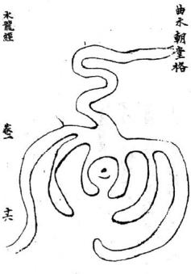

穴前曲水不間五曲五曲周札整肅自右過東就身回 抱而去知于曲水後分枝割界作重龍虎分列左右 奴回頭朝頌如拜如揖穴後枝未分合五閱四峽重 重結咽東氣兜収得此形勢極為周密秀水完固來水 屈曲呈秀來脉尊賞端嚴左右重衛護主有百子千 孫世出魁元神童幸相若穴前舍蓄聚水當道數國若 水徼左來于穴前屈必而去其福力不減何為官清貴 無財清白傳家也

水龍經 基 +x

凡見曲水當面來朝橫遇穴前須得就身曲抱屈曲而去坐下要枝水割界兜收龍脈或一重二重三重疊之繞手穴前後方或辭勢其穴前積界深水不宜太濶太濶則氣蕩不宜太狹大狹則氣促而前朝水加箭射恐破氣蕩洩此地曲水一路車纏兜收脈氣凝聚大能發福但坐下無元武木大江遶護乃是行龍腰結非盡龍也其力量比兩水合出稍輕若得去水在元武後四頭役坐下包聚而去更自不同

水龍經 參 大

穴前秀水當面朝來與右來橫水合流倒左就身回抱遶元武卻田頭向東北而流來則屈曲去則須歲更得右水交會此與一水卑纏殊覺左勝水交砂會龍畫氣鍾亦大地也入丁繁盛富貴非常凡右木衝左灌堂則前秀水不得滿臺而長房興二小房並發若右水是穴前曲水分泄而去則小房不發矣後主邊移過繼或易姓離鄉也

<!-- doc013 PDF 第 13 页：高风险/复杂版面 OCR 供检索；内容与排版以原页图为准。 -->
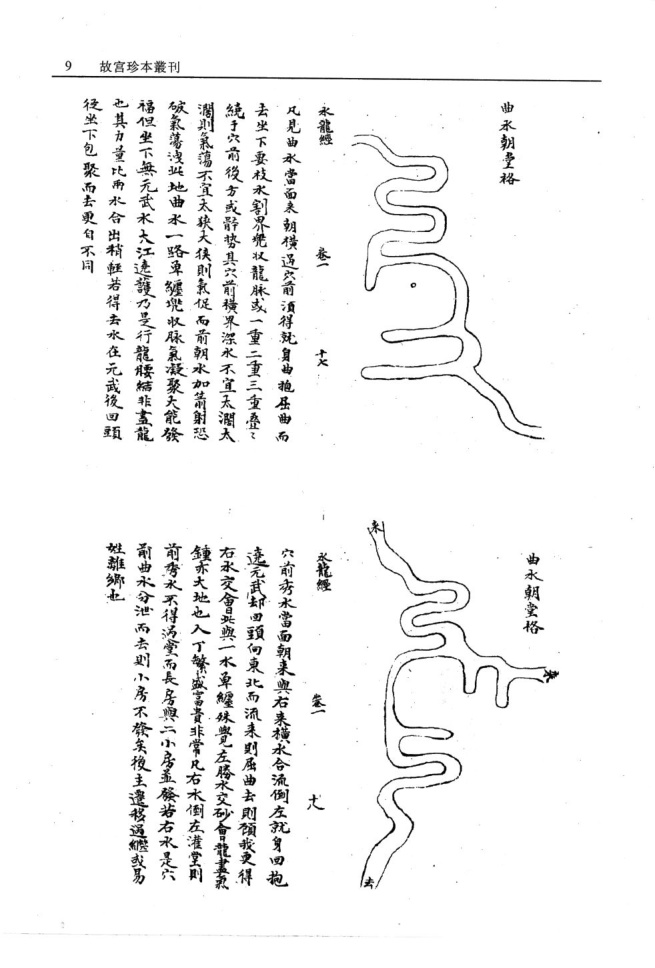

水龍經 卷 十

此勢與前田水朝堂遶首龍纏武法合前局周緊 此作左來就身夾下稍長而寬龍脉趨歸紫武秀水在 前欲就曰秋立穴則氣聚在後而脫氣立穴就氣衆處 則曲水遠而乗受不及如此形势中闇必有枝水插腹 兜収其氣于中局梗前不脫曲水復不脫龍氣前親 後倚方能發福而主文翰之貴先發長房後發中房 小房更得去水之分則力量悠久

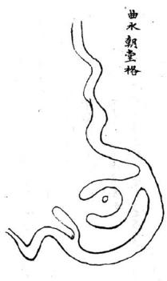

卷

或從左來屈曲到堂或從右來就身環抱遶武而去 或從右來屈曲到堂或從左來就身環抱遶中武而去 其曲處須要如多字樣或之字形不懈不疏舊蕭周匝 至穴前却如弯弓就遶轉包承于穴後得此形勢甚 佳若形勢太寬中間須得枝水界得脉絡清奇若局勢 周審雖無枝水割界亦可立穴

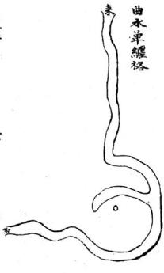

永龍經 叁

凡曲水朝堂須得三橫四摺如之如兮摺之包遇穴場其轉折處不至衝射若來水雖見屈曲東拽西拽圄不可周若曲形如纏牽穴前維見弯抱而前面一路殊非秀麗亦不為吉如興形體局中雖割成勢而穴之終難發福即不沖不破僅可小康若有沖擊或左右前後略見分洩必至破壞矣遠宋如草之字或如晨牽而六前弯抱蓋得穴過望之不見前面冲射亦主三四十年發福及术步行至之日即衰退矣不可不細辦此番外局既全內氣復固爵尊福厚丁旺力長美不可言

水龍經 卷

凡曲水朝堂流要摺之整齊厚薄相等不宜東拽西竄 如風擺柳條如風吹偃草或蓋過穴或不蓋過穴參差 錯亂者雖見屈曲無足取也如垣局割界結咽內氣合 局亦能發福秀但主子孫飄蕩淫遶愛歌舞輕狂廢業 若得進局一摺水朝抱有情亦主初年稳發行至搖 動擺跌處不免退敗之憂

叁 主

一水卑纏只要屈曲有憤或役東南來或從西南來帽摺調勻不牽不拽不疏不密三曲四曲厚簿同情未即結穴互至理翔弯遶如滿月之勢力成體面其去水亦要回頭預我所謂洋悠顧我欲留是來要之爭去要屈曲然屈曲去庸最怡如繩牽樣曲不遠即及背走跳亦不結穴興水從東南來三五摺到向前抱如滿月前面不李不疎而獨到頭一曲獨厚而圍渾此水星曲也穴也得去水变局不向西北而向東北者真

水龍經 卷 雷

凡一水車纏局內不宜太寬太寬則氣不歸聚亦不宜太狹太狹則氣不運化坐氣急迫若局勢天寬必須左右或前後有枝水兜乗不使生氣蕩散方妙蕩前覺後蕩左兜右又得元武永遠過穴後上下包貴則氣完固局势周審得此形勢必大發福若此勢曲水當面朝堂徒左倒右遶白虎纏武却頭復從元武而去局內左右金魚美界其氣凝聚星為真穴一水單纏乃為遊龍戲水

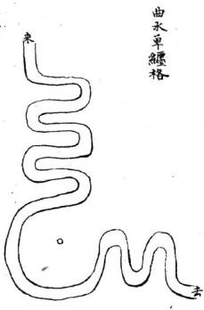

水龍經 卷 1

三橫九曲當面朝堂不疏不密不牽不拽曲整肅遶 貴龍纏白虎回頭領我屈曲而去中間並無枝水插界 左右兜乘真氣于中此穴名水星曲池穴前曲永端 肅皆宜正受望曲水立向此名曲水朝堂纏青龍遠元 武前復左右繫抱拱秀乃大地也賊云為官清貴多因 水繞貴龍發福悠長定是水纏元武更表曲水朝堂去 永回頭水法中之最吉省凡曲池不宜太寬之則氣恐 蕩歸多武六難白前正受必有脫氣失脉之患若見寬 大必得復水兜桀方妙此書主出狀元宰輔文翰飛聲 三房至乘百子千瘰書費悠

水龍 卷

凡是曲水左來朝壹不不密不牽不裡摺之聲整者 宜從曲水至處立穴之前一水橫迎曲水合流者酒得 小枝水插界于後方能汲曲木之秀

<!-- doc013 PDF 第 17 页：高风险/复杂版面 OCR 供检索；内容与排版以原页图为准。 -->

水龍經 叁 主

兩水夾纏合流而出來見之爭去見屈曲局向緊拱不寬不蕩不必枝水晰割成形只要中間晰割東腰牧氣則穴法自完固矣兩水合出前面三五謂屈曲整肅當面曲水立向雖是順水而不至于直流直去則亦不嫌于順局也龍盡氣鍾而更得外堂曲水有情明堂內如織如拋拔即兜乗則木雖去而氣自固也主發文翰清貴仕而無若資局山寬大更得枝水兜插成局而得水豬更有田頭砂包裹穴蟻亦能發財貴而又富

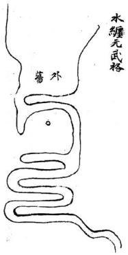

水龍缓 叁

局前天水聚于明堂從東南橫架過右抱身纏遶于元 武三曲四曲而去砂水反關于坐下其本在穴後法當 向曲水主向然前有曲水明堂流神自南而遶亦可就 水來蘆立向富貴兩美但聚水在前秀永在後先富後 貴若來水自北而南福力尤重代出魁元只要曲永包 曩營齊若有牽拽便不發秀矣左纏發長右纏發小中 房福力德長天旺人丁

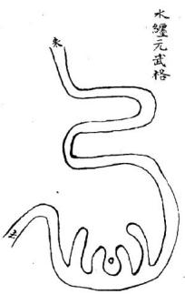

水籠經 二十七

前有曲水三四摺遠朝來就身兜抱局後纏身元武而去入路得咽結處東氣緊界發福悠長富貴双全人丁繁盛雖二三百年不衰

水龍經 卷 旱

曲水當面朝來不厚不薄摺之整齊或左右就身環抱 從元武纏回而去此势極秀若圓抱緊矣不寬不抉法 當湊前曲水中立穴若就身環抱寬天深長則湊前主 穴恐真氣刼洩于後雖得親就曲水而真氣脫穴亦不 發福即當于曲水後求枝米秸在于何處若插中 聞宜立中穴變插于後面元武前宜立六坐元武永作 回受穴只要穴前望得曲水雖遠如在目前乃妙如局 內別無枝承插畸須以人力為之無使真氣刼洩脫氣 但姿迎受得秀水著耳經云曲水朝堂秀而可穴纏護 緊密湊近迎扦若還寬天發福必遲

<!-- doc013 PDF 第 19 页：高风险/复杂版面 OCR 供检索；内容与排版以原页图为准。 -->
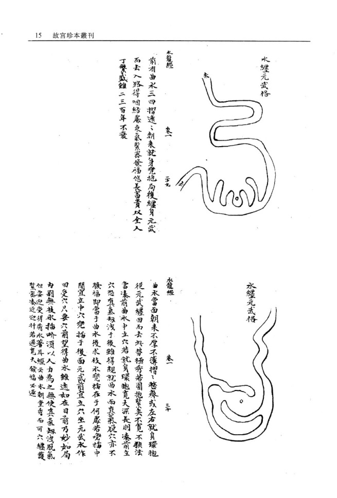

凡回受穴多是永纏多武為師云坐空割背者妄也只要天潦流永從東向西左右得枝水插腹重之包裹割界結咽與天分合清奇其福力亦天若從右邊未遶弟順龍不如足龍武出東南去比遶青龍者稍輕以秋向東流者常也婦于順水若往西南向北轉遶向南而出東南穴向朝西得水遶分武其福力與遶青龍纖多武相同以逆势也百子千孫富貴三百年不衰前有朝陽邀倖其秀尤美朱紫滿堂凡元武永纏須得數百步之外便弯抱拱夫仰研而去方顯正格若面前滔機衆而去不見曰頭此又不可以水纏元武論也水纏者逸也回遶弯抱之謂也水龍短 卷 三三

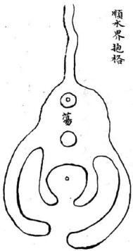

一片天砂周圍四水團聚中閒却插一枝水屈曲直至大砂中腹或分作兩路罰界于左右裁成龍虎砂緊夬于穴前蓄成一河蕩或五六畝十數畝涵聚于穴前雖元辰向穴前出去然得屈曲如之令不見直流又得聚蓄不洩則其形勢尤佳不可以元辰水直出而棄之也亦主發福一二紀財祿亦不甚厚人丁雖盛而不秀小貴而已河蕩中得一砂蓋過不見前水去乃為可貴如無小砂蓋遏三四十年便見退敗

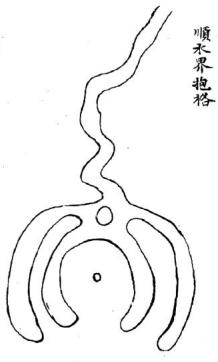

永龍經 卷 三

此勢與前局同但無蓄聚水涵于前明堂無聚水却得前面枝水到堂三四摺如織如拋梭東西包裹砂頭奴抱護雖無蓄水因其秀反主發貴丁財亦盛

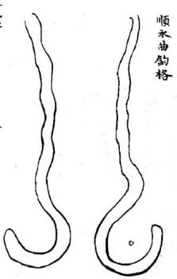

水龍經 卷

曲水垂勾有兩势有曲承橫來頭到却于盡處仰作勾 如鉤有曲非直來到頭却于盡處作抱永勾勢此二勢 俱可立穴但要水來屈曲不陳不審不牽不拽摺之整 齊或迎曲水來處立向或張曲水作朝或垂勾盡處立 穴主少年魁元奕世貴顯鼎盛一時文章名譽

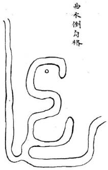

水龍經 卷 三十

青龍省水屈曲就身抱纏元武回頭領我而去此遶青龍纏元武勢也却于元武插一枝水摺直至腹中作一晚水勾形穴之亦能發福穴前雖無吉秀砂水朝應而水脉自坐穴後來氣脉完足丁財極盛貴而悠久亦佳格也

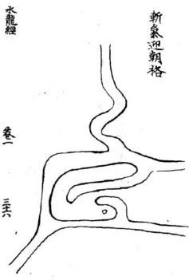

大江大河于前或有大江遠屈曲而來與天江橫樂水交會其交會之處並無枝水收受蕩散龍脉似難立穴却于數百步之後又有一水插界中間有枝水進腹中如勾仰如掌或勾左或勾右與曲水登對雖遠數百百望之如在目前即于異處斬脉立穴以迎前朝曲水之秀名斬氣迎朝穴亦主發福二三代福力但不悠久耳以龍脉未畫故也若得左右夾界重審元武水仰抱如弓福力必大且久也因朝遠而不就故發應遲數十年後方發則暴而盛以大江水大故也

卷一

曲水遠來到結局竟橫架而不見回頭砧下此本入懷反跳之勢理無可取然四水三橫四曲摺整齊不牽不拽斜竄其形势秀而可愛若得有枝水橫入秀水之後弯拘如勾本局又得枝水插入于後仰兜如勾其龍脈雖未歇止却于交鈕處斬氣立穴仰乗曲水之秀亦能發福曲水近在日前只發二三十年速在百步之外三四十年始發然終是曲水反眺在得歸元就身富不過萬貴不過三品兩代即衰入籍他州亦出魁元水龍三第一卷終

水龍經第二卷

遠朝倖秀格

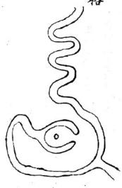

水龍經 卷二曲水朝堂從左轉右彎彎就身遠抱却又得客水從東來纏元武與曲木合于局後此亦兩水來成勢而曲水之丙並無架成穴反于客水挿一枝水橫架于曲水之後乘受曲水之秀所謂以李樓桃名曰邀倖主移居易姓或贅婿過房發大貴或遠鄉胃姓胃籍發科甲或于四夷邊疆主功業或文人立武業武人立文業或于他途立名者有之然局勢周審結氣完固亦主人丁繁盛累代不絕也

速朝律秀格

永龍經 卷二 二

凡遠朝倖季須得曲水當面朝堂或倒左或倒右本局 無枝水挿畸成形却于他方外來下割成金蟹仰業 勢托于曲水之下亦名倖秀然穴後又得一枝水包承 于元武與曲水合從集一路而去則水口當以曲水為 主若後面外水不從與元武曲水合流則水口當從本 穴枝水處論去木屈曲回頭交鎖織結不至渗漏方為 大地

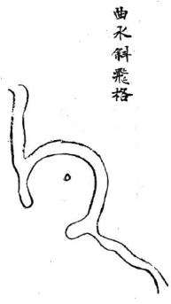

水龍蝗 卷二 三

凡水委曲來去要朝抱就自尤要彎環委曲來要之负 去要回頭纏遶此勢穴前左來右抱就身似為可穴然 形如之字雖見屈曲而勢如拽索斜曲不秀謂之斜曲 來則可謂之朝堂實非也其右邊去水雖見就身札局 不遠又反跳斜飛更不曰頭顧家則去水似是而非其 帖身左右枝水縱栽割如盡穴之僅可暫發不能悠久 若誤認水令如帶是一而廢百也蓋水城固要圓抱而 來去亦宜朝鵲書去橫索曲而斜此處莫安排又云水 若田頭寵家水不顧家必破觀興而論水之去來 可例明矣

<!-- doc013 PDF 第 24 页：高风险/复杂版面 OCR 供检索；内容与排版以原页图为准。 -->

右湖蕩一十餘圖曲盡聚砂之變態可謂極巧窮工矣然據實雅論天生之巧必不能及此即于地脉正理名墓之已驗者亦不必如是凡池湖之格其積水小者一二三畝以至十數畝形局端正者或一乘獨專或二三聚氣穴之得法即可大發丹陽賀氏祖穴左右前三池居中立穴是也其湖蕩之大者汪澤巨浸不可以頃計其法于大蕩之涯另有小曲水拆入兜抱乃以小水立穴為內氣借大蕩旺神為外氣其富貴亦不可限量江西紫溪劉氏仙姑壇祖穴是也只此二法已足盡湖蕩作法之妙不必按圖索驥刻舟求劍也

年酉初秋 劉氏記大湖大蕩數千頃于中間突起二三片大者數百畝小者五六十畝團聚拱夾面相顧洲角兜权雙回如衆犬之聚食于槽者然即于中間審詔何砂端正尊嚴有無枝水界割成局中間如有界割枝水結咽分合件之明白的有明証便看明堂左右朝抱如何若朝抱有情蕩水收進蓄于穴前作內明堂局前更有遠砂蓋照湖蕩雖大而局視之不覺寬濶蕩散垣局眉密乃天地也穴之主富堪敵國貴並王侯以湖蕩中精神獨種而人不得分受之故也並以砂水朝揖之多寡尚定世代之速近朝拱之砂愈多愈妙

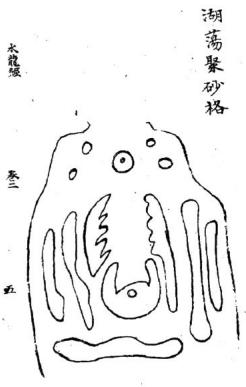

湖蕩聚砂格

河之泊穴都有群砂團穰或遠或近四頭朔應中有一砂端肅整嚴中處望之左右前後各有是少龜之變回頭顧穴如大將之坐營而衆軍之獻我屯則也如之坐堂而更卒之排衙唱惹也曰非具解胡喜月架半里一里視遠若近而羣砂紛洪衛口在日前拜如俯如揖如揖伏整齊震肅而坐穴有黃少聚閒于後不致滲漏如此形勢主立伯分茅富堪敏國子衆多萬福悠久更主子孫孝義世出忠貶

湖蕩聚砂格

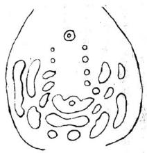

水龍經 叁

洲泊河蕩之處一望無際中閉或有小砂數十塊或數百塊大則五七畝小則二三畝或蘆間革渚圍簇于一處却于中間看內有大砂或十畝二十畝得枝水插界緊身包抱左右小砂或長或短蒸擁團聚如蜂之從王雙回頭向拱小砂交鈕如練之聯屬重疊不見穿漏坐下近局有橫砂欄阻于後穴前小砂點之如鷗之浮水橫列如排班倚立如衙意直列如亂蘿倒穀團列如屯軍集塞有此形勢主咸震邊疆或統大軍將或割撮一方或分茅主伯若前有列旂反砂主出強梁之人

湖蕩聚砂格

<!-- doc013 PDF 第 26 页：高风险/复杂版面 OCR 供检索；内容与排版以原页图为准。 -->
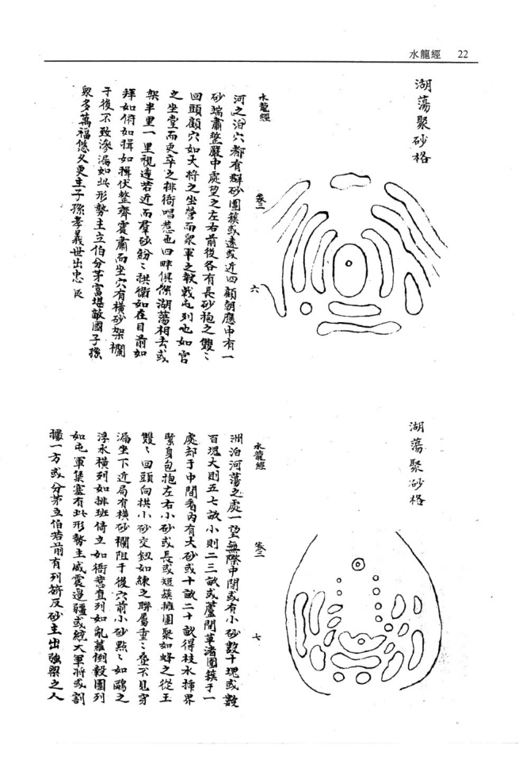

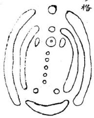

龍 卷二

蕩泊之處多有吉穴如波心蕩月如雁落平沙又如浮 鷗點水審而穴之無不發福

凡羣砂輻輳有五勢有穴聚水遠砂朝應者有水聚明 堂近砂夾輔而遠砂拱衛者有本身綿長直出湖蕩外 砂遠應者有湖蕩中群砂圍統自相轅者有羣砂內 聚而外有天砂包乗者皆大地也此局水聚明堂得近 身砂襯貼前有湖蕩而遠砂拱夾外砂拱水外水夾砂 其局勢更妙更得穴前或遠或近有砂其呈秀富貴極 天若左右夾拱雖多前面無砂作應則堂空無物富而 不願

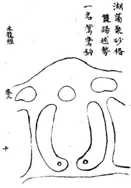

內張河蕩左右兩砂相顧中通過穴雙之頭若內蓄 水直長須得蓋砂護覆不見明堂水直長方妙左右 兩砂各自結穴故曰鴛鴦垂鈎勢其形如皮刀歎嘴 當就彎處扦之轉身向上方有力若倒扦之則不發 秀矣此地主拜甲聯芳但初必先因財致貴或納粟奏 名後發文翰貴至腰金官相見左六先發次房右 穴先發長房多生孝第忠信子孫繫盛悠久若扦 穴天進則氣散而不收難以發貴兩穴同斷

湖蕩聚砂格亦名踢毬勢

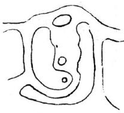

水龍經 叁

砂形勾踢如馬如靴頭如皮刀口客砂包纏于座下穴前蓄聚來水成湖一水單纏元武左轉兩砂自相包暴垣局完固並無木割亦大地也木自右來穴宜右迎非堂局端正不覺斜倒穴宜正變湖澤方佳雖無蓋砂炤應亦吉若聚緊木直長必得水中小砂照顧為美蓋明堂水喜橫長如堯不且如竹也主富而且貴子孫代榮顯若元武水倒纏入明堂竟向前而去穴宜橫受方吉

精水灌堂聚蓄成湖或一二頃或八九十畝却于穴 左右起砂條夾身逆水挿出護衛區穴或四五重六 七重雙回頭朝拱形如勤馬其力量最重是大 地也世人或以後龍散漫過峽束氣不清而棄之悞 矣

湖蕩聚砂格

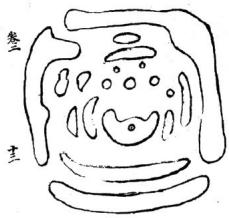

水龍茲

湘漢之間及浙直等處地最低薄古時開聞田地多是瑱低就高各因砂法以成田故多小砂攢聚成勢之穴然都大小不均橫斜不憨零散而團簇者少凡是此等地面亦有結穴者須要隨砂詳看砂頭朝向何地若攢簇整齊不便去群砂之中尋得中立之砂四顧有砂包暴不見露風藏聚含蓄此地極佳主百子千孫富貴悠久朱紫滿庭之應其穴向當視小砂中處之向內得正面迎受方美若小砂多而大砂遠抱終恐近身穿滿必穴砂左右有貼身金魚永緊抱以護漏風則氣盆固矣

湖蕩聚砂格

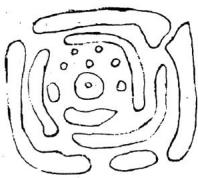

永龍茲 叁 古

湖泊之處多有小砂或二三十塊或一二畝五六畝團簇抱聚中開包含湖蕩其砂點印于水面若浮鷗泛水小砂之外却有長砂周圍包暴小砂于其中左右前後不見水穿漏而外有天砂長砂角包畏不見滲漏方成局勢却于中間小砂認出一中砂頭面端正整肅而前後左右小砂雖零散而寔朝頭攢簇擁護不遠不近不疏不審其外面更得天砂彎抱周密完固者正大局也其力量雄盛誠大貴之地若中間雖有小砂而不得湖藩舍蓄其秀不願露雖發貴而財當不甚厚主出文翰詞林之貴但小砂不要如驚頭鴨頭方妙

湖蕩聚砂格

水龍經 主

前後各有長砂橫架左右有直砂色乗中間却得小橫砂或三四畝七八畝並無枝水挿畛藏於衆砂之中左右直砂角匕回頭勾搭色抱左右前後水雖四穿八建穴中視之毫無滲漏正如車輪合之湊合團簇周審衆砂歸向不敢反背則真氣聚矣凡有地先看左右前後朝頭向何處若雙回頭向于內即于中間尋中正不倚或大或小麗求之若有反背砂或向內或向外或友跳即非真氣所聚之處不必求穴全在目力之精心思之巧體察其情寔見得甚真方無量漏矣

亦雙盤龍勢

去

砂水團雲勢有雙盤龍單盤龍結穴須砂水圍遶周旋委曲如雲之圍繞方成盤結而氣聚不散也若無委曲盤旋之勢雖回頭朝應非盤龍結也此勢雙盤而左右客砂重之盤曲旋遠如雲之護日凡盤龍結穴多結在局中必得蓄水于內明豐或小砂照應方佳得此形局發福最悠久以盤龍之地無風吹水破之患馥也雖穴不盡真縱不大發亦不大敗房分均勻貴而不躡富而不吝男女貞潔風聲可愛子孫守節而不濫或有被徵召而不仕者皆氣脉潛藏之應也

湖蕩聚砂格雙盤龍勢

水龍經 叁 老

凡砂水團雲勢多結盤龍穴一條水入一條木出周圍盤結皆在局中結穴處須要水寬聚成湖澤其中涵得氣脉溶活方妙不然成裹頭城矣裏頭名中國水穴氣窘逼不得流通反成絕地經云山囚水囚虜主滅僕蓋其義也此圖穴前湖澤汪澤緊而不迫穴之自能發福子孫悠久更出人孝弟性巧聰明或于巧藝中成名發財以龍來秀曲也

界水外抱格

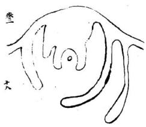

永龍經 叁一 二 大

此勢龍虎重朝抱局前彎抱如弓此形勢之美者然穴前左右砂角硬直無情外形可觀內形似覺得相不可以硬直而棄之也職云內直外勾儘可前裁以工力掘去直指便成彎勢開睁亦天地也

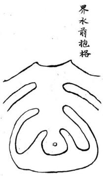

水龍經此勢局前支水挿入包抱左右砂氣緊拱似乎有情然湖蕩在坐下砂角雙飛散則前氣雖叔後氣不蓄前為外氣後為內氣外實內虛此等地僅發小財終無大福官貴絕響人丁亦稀劉氏曰前為外氣後為內氣二語得入穴骨髓

一水橫欄格

米龍經 叁 二

腰帶水左右砧下緊夾包裹其水城形勢収龍氣有力經云界水所以止來龍若大水橫號而左右不就身環抱亦不為妙書云未隨左右碎穴看左右鐸今局內緊身金魚木分合上前回頭拱抱後有結咽前有包乗砂頭回水就誠美勢也書云砂要田頭水要就又云好水彎環巧如帶此勢局前水環抱如帶實水法之最佳者當面若小反亦不為害可以人力改圓或內堂左右各開腮水挿進作內堂蕩則不見其反矣此種地三房俱發福力悠久數世不替矣

水龍經 叁 主

書云穴看左右鐸水看左右砧三陽看城郭明堂看四 角此格穴前水環抱如弓如帶或從左來貼身或從右 来貼身緊交兜收並無渙散中間雖無枝水挿晰氣亦 完固若或寬天必須枝水收聚得此形勢穴之主發福 悠久若局前更有曲水或達或近悠揚之朝揖于前 不問左來右來俱為秀局主鞠苑聲名之應左秀倚左 發長右秀倚右發小左右均平則三房均發

一水橫欄格

缺亦類湖蕩聚砂格而本身穴後界水多內氣足與此勢水聚明堂兩水來拱于左右與前橫水合流或過左或過右只通一路出去穴前水舊聚池蕩于垣城聯珠串作內明堂龍虎重之拱抱亦大地也局前雖朝陽拜揖只要下砂逆水挿得緊審似不容水神流去則精神凝聚而不減于衆水朝堂局也仕而多資恒科第不獲名魁僅可腰金以穴前無秀朝揖拱胡也內外堂有三兩重關鎖亦主三四十紀福力三代榮華子孫滿堂過二紀后貴雖不大而財祿曲匡水靜專而不蕩洩故悠久耳

<!-- doc013 PDF 第 34 页：高风险/复杂版面 OCR 供检索；内容与排版以原页图为准。 -->
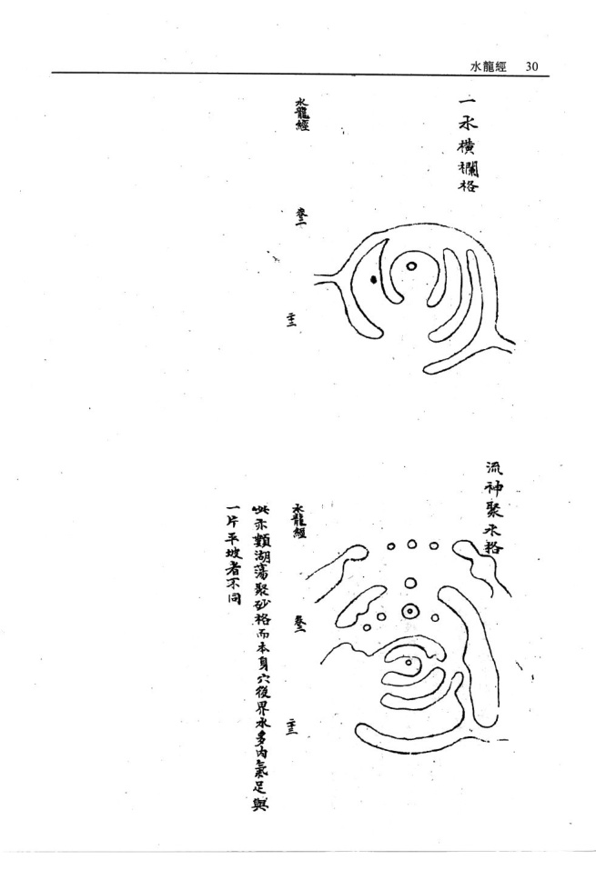

永龍經 參

前合衿當穴前而出却聚成一河蕩左右砂角儂朝抱湖蕩中間小砂或員或方或長橫浮水面交鎖關關亦不見水口冲射雖是元辰水向穴出流而聚蓄汪澤元與辰直出之勢大相懸絕主大當大貴福力悠久若穴前湖蕩中死砂角欄截亦不為害只要左右砂甯左右拱抱為佳不可以元辰水直流指為順水也賦云元辰當心查出未可言凶只要湖曲之橫案欄之乃吉水龍經 卷 主

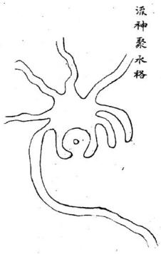

十八格惟水聚堂為第一蓋水為財祿當貴之樞機故水神渙散無所收拾者不惟不發主亦敗絕是以古人論水不曰蕩然直去則曰水無關關務得局前水聚蓄方為吉壤此勢左右砂頭朝抱而前又見衆水朝流聚注成蕩只通一路或纏元武或過青龍此來多去少所謂朝干天旺澤于將衰瀦而後洩之勢也垣局園審衆水聚堂成十全之大地主百子千孫繫滿堂成三年十紀之福長中幼三房並發但一太寬則衆人之水非我一垣之水情不專則發引不專矣

水龍經 +x

凡是兩木夾來隨龍交令于局前其水多從明堂前直 去人皆指為順水地順木龍豈知結地水未有不向前 去者只要去得屈曲不見直去亦為吉勢局前亦宜蓄 水石至徑去為貴耳蓋瀦而復流精而後洩離去水無 害其吉也若局前無池沼蓄精則其去水無交鈕向前 直去所忌者惟此耳若三橫四曲頓我後流悠揚眷戀 似不忍去此正為顧我水也前顧我去發近而速後顧 我者其發遠而遲其與過穴返逮甚皇得以順 而棄之哉

其曲木去處雖不屈曲亦不為台。沒之水乃龍之元辰而曲水乃客水也不過邀客秀以發福耳。其流之曲直無與于本龍之氣。但要坐下元辰水去得屈曲為貴。此等當以過房入贅而後發，或他途絆籍登科也。

水龍經 叁 主

水龍終卷三終

水龍經卷三總論此卷耑言水龍貼体吉凶形局而入穴星体巳森然燦列于其中此水龍肯綮扼要之書也。六不著徃氐言初理俗愚意必揚公直本千年以來師相授開卷先言五星而五星之中帷取金水土三星為吉木火二曜為凶此與山龍稍異山龍有火星起頂上下即結直穴亦有行龍穴星皆木星結体弥見貴秀水龍則一犯木火立見灾禍推原其故總之水形喜柔荏而惡剛強宜朝抱與而忌冲激者情性判然矣是以五星既別而即繼之以遶抱反跳収炁之風蓄聚分飛諸格辨之最詳亦即五星明枝幹之義則行龍之体格大畧已盡繼明五星之正言而後入穴之作用得其主宰掌握自由學者苟有意于郭公之秘能于是書深切而体聽之水龍之道思過半矣過此以徃三元九宮之法庚幾其有逢源之樂乎大鴻氐筆

真龍到頭結穴左右必有兩股無浜界善氣脈入穴前必有低小明堂左右隨龍水送到局前交互前有朝案之砂橫攔之水彎環向穴四圍護送之砂回頭駐劄面有情明堂平正水口牙前看兜收後有拱送右砂何左之砂向右穴住天心此天然之結局也

人知尋龍為認穴之根本不知認水乃尋龍為捷徑故水勢之所在沖層石亦砂頭之所輔巨漲皆迴水源有淺有深可推龍勢之大小水局有纏有走即知六法之假真然而取千頃之汪洋滙于案外不若取一勺之灸秀聚于堂中以小者真而易受大者衆而難居是故

卷

体变星金

枝龍作穴須長久

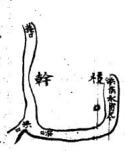

右金小房興斜金似水受克非售若然照穴賣盡田園永龍 卷三

前火克金城 風字腳不停 若扦此寺地 不久主佺行 金星如玉帶 此地真無價 橫水道害八 金城挹穴 若扦此地 富貴不破

鑫 卷三

<!-- doc013 PDF 第 39 页：高风险/复杂版面 OCR 供检索；内容与排版以原页图为准。 -->
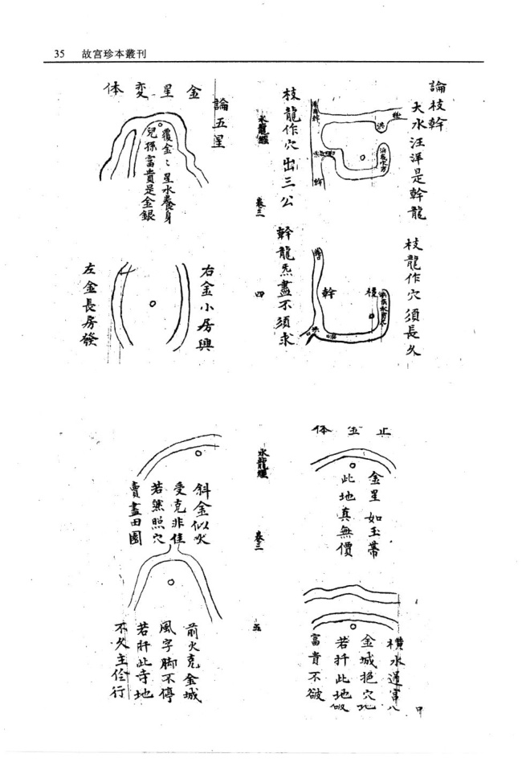

金城反弓逃走貧窮水入金城富貴多丁

六 長子必離宗 金城左反躬

金城右反弓金城右反弓小子必狐窮

相侵 盜賊 金城 火克

中細即成夬形故曰火克

蠢卷三

斜木亦為火星二火來克金災星日臨水星得地金玉滿堂

官见揖人曲木入金城

窮敗無丁 煞入金城 o

火金相刑敗絕無丁

司上

<!-- doc013 PDF 第 41 页：高风险/复杂版面 OCR 供检索；内容与排版以原页图为准。 -->

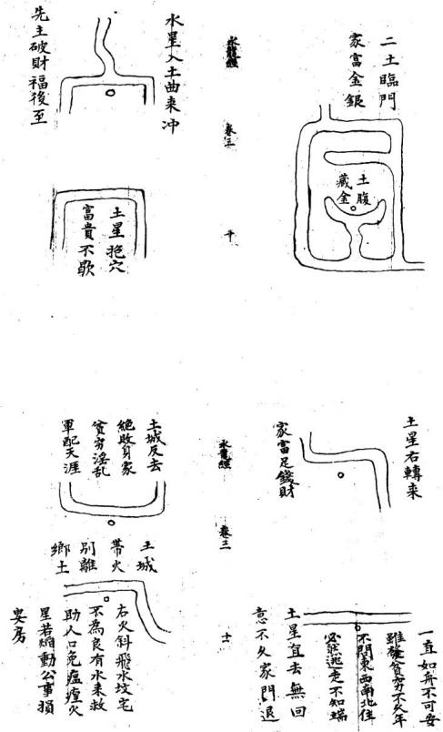

龍經 卷三

7 後主生離 不堪下穴

<!-- doc013 PDF 第 42 页：高风险/复杂版面 OCR 供检索；内容与排版以原页图为准。 -->

水龍經 整水似木又瘟瘧孤寡

<!-- doc013 PDF 第 43 页：高风险/复杂版面 OCR 供检索；内容与排版以原页图为准。 -->

火城反去江故不良家財蕩尽絕嗣逃鄉

若還如此樣退尽生貧穷 水城後反弓忤近各西東 水經卷

右火斜飛 兄偷弟婦 九火斜出 弟偷兄妻

价 官刑絕子孫 光火射其身

老死無人送 B 燥火焰動

子孫特逆面前八字水流刀鎗之水反射刀鎗之水反射身後配遠充軍

左火斜飛絕嗣無依

<!-- doc013 PDF 第 44 页：高风险/复杂版面 OCR 供检索；内容与排版以原页图为准。 -->

未龍緩 卷三

論四獸

朱雀之前三水反

男盜女淫無衣飯火星屈曲飛無食又無衣

元武之水有湖池

定宅安坟福祿宜

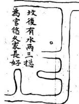

元武 定是永纏 發福悠長

青龍直走如飛去代人難佳

<!-- doc013 PDF 第 45 页：高风险/复杂版面 OCR 供检索；内容与排版以原页图为准。 -->
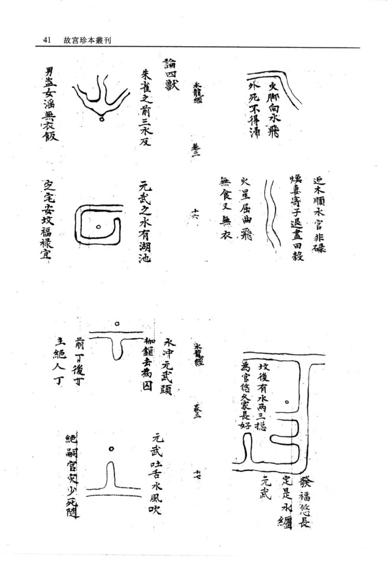

人心 脚分開惹 是無情兩 掀裙之水

兩邊龍虎 弯之抱 富貴冬到 若然點穴 得真方定 出狀元即 大 須知此地出公鄉

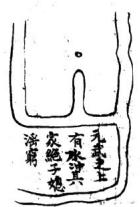

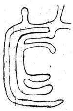  
貴龍水轉抱其身

龍經 秦

白虎水如飛不久便光移又去永口無閉先賣爹田地出敗亡凶流配為之戌

减脚 水井 之是 有子

徒流退敗主離鄉

<!-- doc013 PDF 第 46 页：高风险/复杂版面 OCR 供检索；内容与排版以原页图为准。 -->

維漸絕種 青龍吞壞 0 少亡絕嗣 白虎唧屍

右閨水為灾陰人定左右两边水展去見拋父母走

两边水去不回 頭財物鬼來偷

白虎冲腹少子刑傷

青龍沖腹 長子遠 白虎御屍 貧老無見

青龍吞塚憂盧無穷

青龍抱体足堪誇年少達京華

滇憂 富貴不 兜出人 水拒玫 貴龍之

青龍左轉挹其身富貴有聲名青龍之上一浜来此地安坟任点裁更得後河多積水世代兒孫解状才

<!-- doc013 PDF 第 47 页：高风险/复杂版面 OCR 供检索；内容与排版以原页图为准。 -->

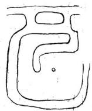

水龍經 春三 重

青龍水似龍富貴比石崇 屈曲門前照子息侍王宮 青龍弯轉如牛角 子孫代代登紫閣

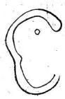

青龍屈抱身來世代兒孫入帝台青龍水反逆子孫無官職君若扦此地誤殺人青龍反去不朝身長子之先貧

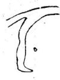

<!-- doc013 PDF 第 48 页：高风险/复杂版面 OCR 供检索；内容与排版以原页图为准。 -->

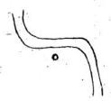

大覆蟹卷三

青龍射入子孫傷死并軍賊 青龍一水如鎗 來長子必凶災

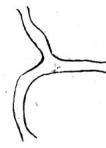

青龍頭上水反 飛家破并人離 白虎水抱两 三重兒孫發 福永無穷 青龍水多 破下後人 灾祸一名 金鵝箭主 瘋疾破敗 敗閱之水虎 來瘟火反官災 右边砂水利如鎗 必定子孫主殺傷

<!-- doc013 PDF 第 49 页：高风险/复杂版面 OCR 供检索；内容与排版以原页图为准。 -->

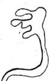

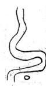

論形局 貪狼之水面 前朝子孫代 產英豪不 問去表并前 後官居台閣 子孫當朝代 五高雲

水龍經 叁 文虎口河尖當百至小子賣田地官事頻之福患凶長子橫七

曲水來朝家業自然豪

水見三弯富貴安閑永盤經

水轉三湾富貴清閑若扦此地位列朝班水龍

<!-- doc013 PDF 第 50 页：高风险/复杂版面 OCR 供检索；内容与排版以原页图为准。 -->
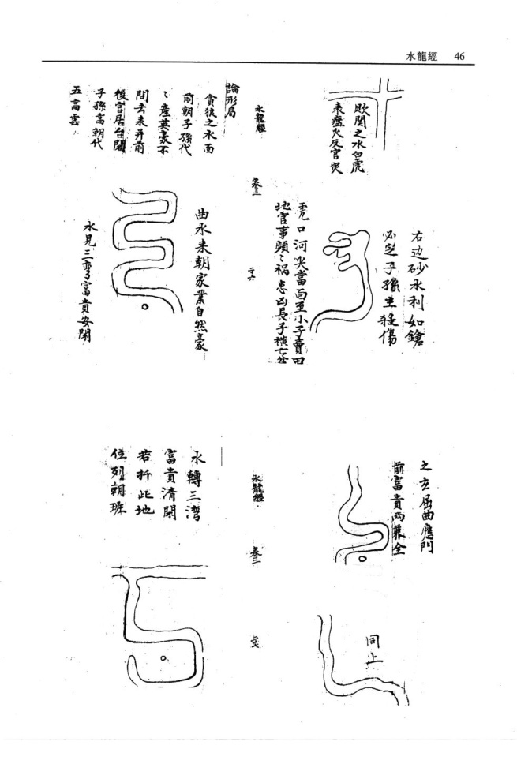

龍虎兩相聞忤逆多山咎

犬子不相親兄弟如勉 左右水直無收 兒孫必主憂愁

雖然有水後兜 定無子嗣守坵

家業自然豪 9 火吉水果朝

水似生地出穴最佳若迁此穴富貴

四龍之水穴論異形

<!-- doc013 PDF 第 51 页：高风险/复杂版面 OCR 供检索；内容与排版以原页图为准。 -->
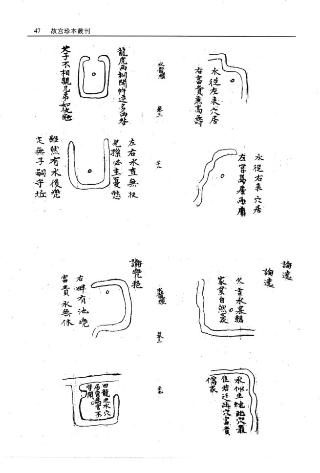

<!-- doc013 PDF 第 52 页：高风险/复杂版面 OCR 供检索；内容与排版以原页图为准。 -->
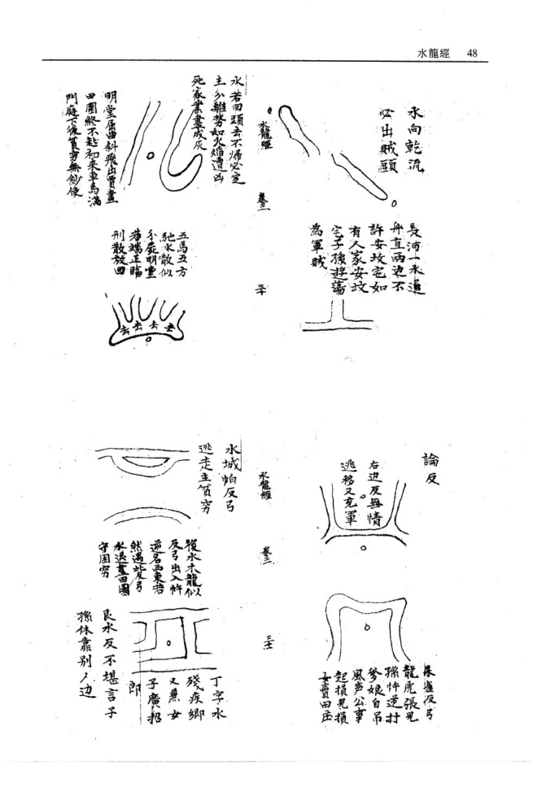

永龍經 卷三

周回之水遶坟林破財損金銀又兼淫亂無家室疾病少精神

## 水龍經卷三終

坤鎗向艮 乾鎗甸巽配在遼東 配在雲南

巽鑰向乾 良鎗向坤配在陕西 配在廣西

抄佑在形英作坟 搥然富責主充常

水龍經卷四總論 風水之法得水為上 藏風次之 夫外炁所以止內炁 界水所以止寒 龍天元歌云 人言生炁地中求 豈知地悉水邊流 到水邊逢水界平原 浩炁畫兜 取故葬必以龍為主而水亦其要也 故平澤之法先取大水後取小水 先大水則知幹龍所鐘 可以明大勢取大局 復小水則知真爲所聚 可以決定所取真穴 不明大勢則地之大小不分 不知定所則穴之真假罔決 但水法之書汗牛充棟 茲卷所輯專言水龍業是術者先當釋其吉者 水龍綬

趨之凶者避之則吉無不利而凶禍不侵矣

大鴻氏筆記

<!-- doc013 PDF 第 53 页：高风险/复杂版面 OCR 供检索；内容与排版以原页图为准。 -->

山川之性微妙難明陰陽配偶炁化形生一炁感成地灸人傑內乗生炁骸骨之不朽外接堂砂吉凶之應賒水之吉凶可見山之情性難明谷中關鎖為上平洋永聚則佳所貴者洋中之陰所喜者谷中之洋龍神頓伏斷而末斷水神屈之去而不去閃東過西炁脉愈佳或飛或奔或墨或隱現其行止察其所藏動中現其脉靜中現穴求靜中之動変化則行會合則止尋龍隨乎脉止定穴當從炁現二者得明穴法自成明急緩纏加吞吐審陰陽而下浮沉立甸須憑唇口樸親堂從界明山有支龍之分別地有厚薄之得宜壠也之脉陰多而就陽支竟之氣陽多而湊陰支有陽極成陰壠有陰極生陽成陰可撞雖陽莫湊地厚處當從薄取地薄取處須尋厚裁取厚者須親炁脊取薄者亦須唇口平洋無炁脉之可观史穴有水神之証估群堯會合于州府二水交鎖于鄉衬現生死于曲直之間審行止于雌雄之内雖不可以勝雄不可以不就星体卧于平炁脉從于水現体小者當存乎內体大者須察于旁脉随水行炁隨水挹現背向而在方圓雲穴法當知生死則靜動則生不現于前須視其側方則取動圓則取靜平洋須得水谷內要張山陰以隨脉樸生陽須風旁空已當審其四應热察其至微竜神之大當以智量而現穴法之難須求正已而作依水尋竜傍砂點穴来須脉現止隨炁納

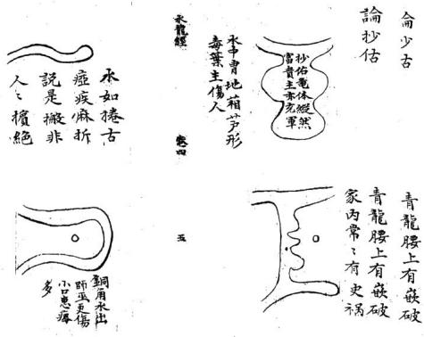

<!-- doc013 PDF 第 56 页：高风险/复杂版面 OCR 供检索；内容与排版以原页图为准。 -->
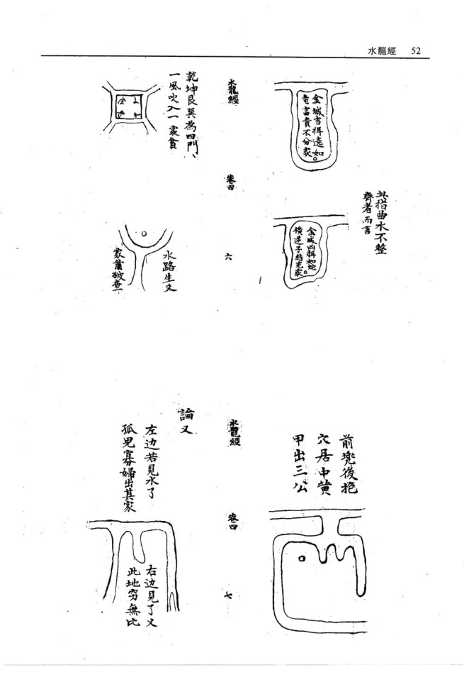

<!-- doc013 PDF 第 57 页：高风险/复杂版面 OCR 供检索；内容与排版以原页图为准。 -->

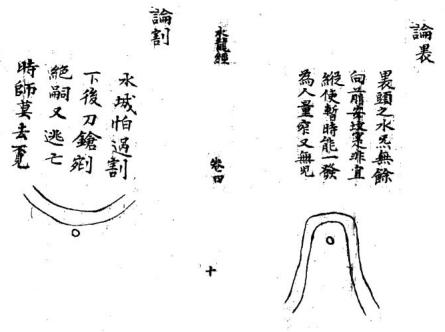

絕嗣無人 逃亡橫天 刑獄充軍 屍鎗射六 論射

水中有地 葫芦形毒藥 主傷人

蓋边遠去充軍 葵後兒孫終不 城砂水两相刑 火入金名帶劍 論交 論交

<!-- doc013 PDF 第 58 页：高风险/复杂版面 OCR 供检索；内容与排版以原页图为准。 -->
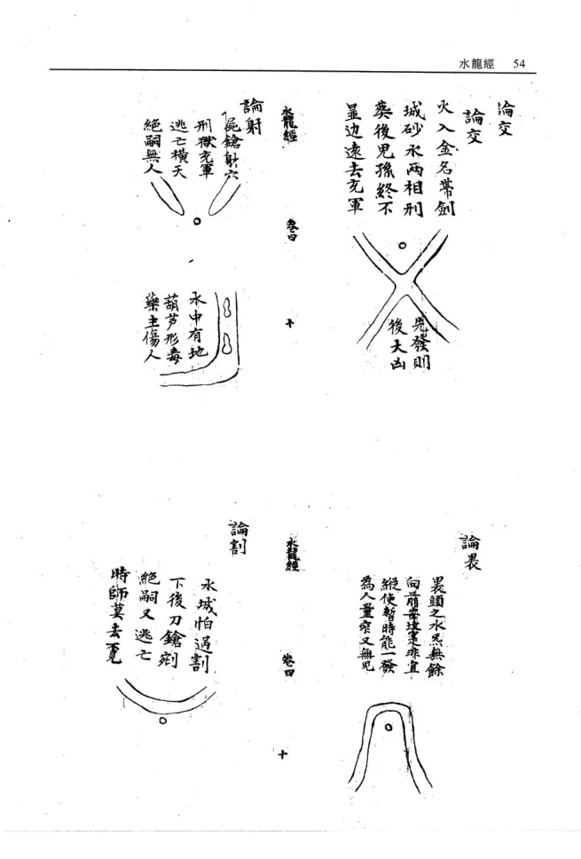

若能扦當貴聲名

金勾左轉足金銀

水龍線

案應三台出貴人 屈曲盤旋 富貴綿延 竜史勢作三台秀 水前朝 面來若得 有人扦此 地為官代 作烏台 瓜藤之水節之有情

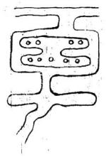

卷

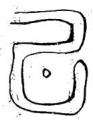

左轉奎鉤貴而無敵武宮旗水交劍長流有人塟之陣上亡身

<!-- doc013 PDF 第 59 页：高风险/复杂版面 OCR 供检索；内容与排版以原页图为准。 -->

火入金城兩相戰奕後其家終不显功名或是出旗鐘後代光孫必陳亡

金蛇势難識下後大官出又名笑之大處一边有水一边無衣食安然不久退永如竜至金銘玄又玄有人扦此地及第至三元

<!-- doc013 PDF 第 60 页：高风险/复杂版面 OCR 供检索；内容与排版以原页图为准。 -->

逆竜一水後 交臨砂水分 明是合襟寬 拖弯環如玉 帶綿當貴 作公卿

永朝曲去又纏身家內出豪英更有路朝生旺地官显在朝廷

冰龍經

一重路挹一重城金水重按南門若得水中再色裹代英華達帝京

無穷 贵永 雄當 號雌 相會 二竜 二竜

舞鳳之後妃尊貴男作三公少年及第

<!-- doc013 PDF 第 61 页：高风险/复杂版面 OCR 供检索；内容与排版以原页图为准。 -->

無休 州知府出 之字流知 之字合襟

右轉金鈎形富貴有聲名

水如王鈎官為知州

蟠竜之水前後兜在田千厲富無休面前若得三竜水兒孫代出公侯

蟠竜之水後頭代之作公侯左轉金鈎形富貴睢人丁水如乙字形水如乞字形家出大朝臣十字水朝故見孫手

<!-- doc013 PDF 第 62 页：高风险/复杂版面 OCR 供检索；内容与排版以原页图为准。 -->

丞龍經 卷 雖然溫飽有成敗 定出娼優賤且淫

三十年前走道途不曾下得仰天湖若有世人扦此地見孫衣紫達皇都十字水流後與前地字井字總一幾此為市井人多往若是一家不可安

水龍經 书

此穴分明結作形只恐時人不識真者遇成師點真穴富貴双全砂水纏流荷葉地却如架上金盤形若然点作樸頭穴之出見孫朝内人

<!-- doc013 PDF 第 63 页：高风险/复杂版面 OCR 供检索；内容与排版以原页图为准。 -->

籠經

<!-- doc013 PDF 第 64 页：高风险/复杂版面 OCR 供检索；内容与排版以原页图为准。 -->

春曰

永合門前富責出名矣

卷甲

雖雄相見天地交通陰陽得位定出三公右水似華頭子孫貴無休左水似筍圭長房中元魁

<!-- doc013 PDF 第 65 页：高风险/复杂版面 OCR 供检索；内容与排版以原页图为准。 -->

左水似筆頭 家主進田牛 右边二水抱 家内足金宝

二竜相會應門前子嗣去朝天

水後頭兜人皇州

不孝多疾 1 二永右边出

二竜穴後兠富貴永無休東浜深百尺西侯有千粮

<!-- doc013 PDF 第 66 页：高风险/复杂版面 OCR 供检索；内容与排版以原页图为准。 -->

<!-- doc013 PDF 第 67 页：高风险/复杂版面 OCR 供检索；内容与排版以原页图为准。 -->

宅後有池亦 是人財之地 西北池塘近塚边 子孫不孝呌皇天 番 龍經

門前橋沖少死 橫亡疾病鰥寡

人口過房此俱俱衰敗之炁耳若當旺運反能發福也大鴻氏題坟後有井患心疼双目損兒孫井不分東西南北偏旁近攻主心腹目痛

森

<!-- doc013 PDF 第 68 页：高风险/复杂版面 OCR 供检索；内容与排版以原页图为准。 -->

鵝兄頭碼兒 頭女兒媳婦 上秦接

是°前

疾有

难横

基

宿婦木前 抱杓山 公媳如

水龍經卷四終

水籠經

蕃

朱雀一坵地此穴梁安然更更有後河堯富貴皇等開

<!-- doc013 PDF 第 69 页：高风险/复杂版面 OCR 供检索；内容与排版以原页图为准。 -->

水龍紅第五卷總論此卷水龍天星垣局乃化龍山人董遇元述景紀氏之言言董君不知何代人其三十六穴上應天星而每局格以四言十六字有駙馬儀賓京堂等語乃本朝物色其為近代人所撰有明微矣而品占列星隱嬰不猥苟非博綜象緯窮採星源者安望其涯涘雖不出于景純氏亦景純氏之流亞歟至其撰句選詞典博道麗卓乎大雅之為予考楊公以還地理之家少有能文之士惟元賴布衣蓋以奇才生蒙古之運祥狂詩酒晦跡江河其水龍綬 卷王中有歌咏天才爛發見于會稽諸鉗記可徵也予向以為頼布衣之才無與比者不意又得之此卷形家者流何多才之甚也至其所論天星垣局但取水形相似連類以求蓋非無本者也古語不云乎在天成象在地成形地有斯形寔與天象遙相應合耳以此明天星垣局與世人所傳二十四方道各分星纏者奚啻天壤蓋地有定位而天無定位雖有十二次舍不可渾配地之二十四十支也故天星之說古今所尚而予獨以為無考徵之 徃幾見翰林學士定出巽辛萬里封侯必生庚震雨代帝王發跡之地亦未嘗畫屬三垣來龍也故據方位之合天星不若據形象之合天星有微也予存此書蓋將尊其名廣其類以顯水龍作用之大使學者知兩崇重以應乎山龍不分軒輕耳三垣九野列宿甚多而名川三百支川三千水之為數亦不可紀極即如山龍亦安能一一舉天星而比擬之我故執天星以論水局取合天星之水局然後知水局之尊貴不多也學者毋以文害志可也大鴻氏筆誌

水麓經 卷五

水鉗天壤浩渺三辰顕晦一氣循環五行榮悴江河以流山金岳以峙暄陽為生陰寒為死是以哲人象天則物因地察儀氣以載理磅磚無疆理萃氣聚陰谷生陽地出川岳天垂星本乎一氣情同異名理穴龍形列宿耀明天施順播地德上承葭管灰飛孕懷百靈鑄以形氣剖以吉凶陰陽相禪五行生聯舉一遠二巧術之編欲識其地先觀其天欲識其形先觀其兮禹跡茫哲人大觀不察其流孰知其源淄分漫衍疊之淵秦氣而行子水龍經 卷五母相援夫婦交度剝換蜿蜒氣緩為吉激射為凶見水非水五星真偽土水厚重金水圓清木水挺直火水飛騰臨涯眺望不失其形金木相攻奕水則吉水火相戰本旺尤忌土神生金最畏逢木星帶火邦家傾覆趨蓄之位各有關軸胞胎死絕生旺官祿冲剋刑傷灾釋迅速吉凶本乎消長五行運乎生死信耳不如信目信目不如信心景純雖死精神尚存乃若長江鴨綠大海無涯波瀾洶湧蛟龍夜啼界之罔極察之愈疑雖有如折不委迤運啟天鑰君子勿題下追淮泗江峽漢水巨脉橫沿洪觸漢州邑鄉村龍神所據旋垣轉屏脉隨氣聚揚肩遠眺精神來會洲澗洋之穿江入河三十穴景純所為末晉之間仙音既殂唐宋以來水法虛無青烏石匱發自何年不載地物惟說水鉗龍額藏珠賢輔所生上應華蓋葬隨曲衡河漢交度東西二藩真穴奠下近侍官班天府壞箎曜通天苑穴點龍晴名揚翰苑虹飛欲海將軍氣揚帷幄內穴威鎮邊疆蟠龍飲乳軫宿所據穴點京堂旁為驃騎錦屏挂鏡上輝天錢穴藏中宿主賔責賢金鈎挂月天釣入垣餌穴居內可釣水龍般 卷五 四

顯官天衢献印漸臺垂應穴居中轂貴萬乗天廚玉饍天皇內厨鼎釜取穴珍羞腯肥龜浮蓮形天電暗照穴應蓮心耆福之兆瓊屏玉架上應五車牙籤吏穴翰史榮華玉階五級翌宿所居穴乘羽輸飛步天衢瓊筵結彩八奎聚靈隱褥取穴錦繡聯英金鎮瓊幃斗宿所居穴轉曲寫金資萬箱玉堂文幕器府璘福穴居內笙歌滿庭方城秀衍上配天田穴居其中阡陌連綿玉練纏天工應文曲穴居剪裁補袞之職金闕牙班庫楼森張玉作穴列爵滿行易橫九畹天龐耀明穴點易眉負扆名陽河猗綠上應斗斛穴鐘日精冢宰之福陽隰纏耀即位亹之參差點穴簪纓幾里神鬼食蛤六甲奮光穴居豐颈爕理陰陽驥嘶掉尾右映旂星穴繫其項陣上揚名日月分精天廟顕星葬陽御陰男女双英双乳聚英左右執法穴齊端門功名顕達春蛟賽月蛇蜒臨河神宮取穴名顯皇都金盤出匣牛宿所居葬看點饌綺席華烟金倉玉粒天困顕赫穴其中廩祿錫萬石玉女鋪床天床星照駙馬儀賔穴居閫奧繡幃銀鈎天圗外屏褥取穴御翰芳英雁落平沙穴粘羽林壁水龍經 卷五

壘桓武柄文衡珠胎瀉月天淵映禪法葵內池食祿瓊關金蓮側露穴在花心上臨積翠統馭萬軍玉衡挂斗天倉昱文桂史儲鄉塟倚雲屏天福地軸威名千里穴居中宮奎宿所履以上龍法作自景純紛錯斜纏形難具陳得魚忘筌頓悟以心生旺起祖清絕入穴水纏砂轉蔓若瓜認根識幹認枝識葉山亂勢奔水亂勢結珠經浪萍隱冥之入土不減入水不湮上哲辨氣下哲辨形之氣既得殃福日真東南華煖西北凜冽冰雪未消虛兩歇塘弩發機遊刃一節蝦鬚蟹眼玄論紛蓋粘何彊化生胸唇庸師憤五行不分既泥羅纏又多謬星指生為死鑒凶裂純上瀆天垣下毀地文靈輝不照白畫天昏幽堂慘苟非知者交臂不親遇穴淹脩草野悲吟敢照珍秘豁吾後人雖曰先矣之淑教亦由後人之秉心

化龍山人董過元編述

永龍經

柔龍經 卷五 龍額藏珠賢輔所生 上應華蓋葬隨曲衡

河漢交度東西二藩真穴奠下近侍官班帷幔內穴成振邊疆水龍經 卷五蟠龍飲乳軫宿所處穴点京堂傍為驃騎

<!-- doc013 PDF 第 73 页：高风险/复杂版面 OCR 供检索；内容与排版以原页图为准。 -->

穴藏中宿主嬪貴美

木龍經天鈎星

斜穴居內可鉤顕官

卷五 十

織女星

衢献印漸臺乗應 從中轂貴擁萬乗

<!-- doc013 PDF 第 74 页：高风险/复杂版面 OCR 供检索；内容与排版以原页图为准。 -->

穴卧唇詹肥適賢哲

龍經

<!-- doc013 PDF 第 75 页：高风险/复杂版面 OCR 供检索；内容与排版以原页图为准。 -->

  
穴轉西窩金資萬籍

  
福居穴內生歌滿庭

龍經

王案作穴列爵鵷行

卷五

<!-- doc013 PDF 第 76 页：高风险/复杂版面 OCR 供检索；内容与排版以原页图为准。 -->

  
方城秀衍上配天田  
塟居中穴阡陌連綿

∑

三師星

  
龍經

天廐星

穴点多眉員扆楊名

<!-- doc013 PDF 第 77 页：高风险/复杂版面 OCR 供检索；内容与排版以原页图为准。 -->

  
疆  
穴鍾自精冢宰之職

<!-- doc013 PDF 第 78 页：高风险/复杂版面 OCR 供检索；内容与排版以原页图为准。 -->

<!-- doc013 PDF 第 79 页：高风险/复杂版面 OCR 供检索；内容与排版以原页图为准。 -->

天來星1010

玉女鋪床天床森炤駙馬儀賔穴居閫粵水龍經 卷五續水龍經卷一懸論此卷專言水龍象形肖物之義興天星垣局厥旨祠同蓋天有是星即地有是形水能象星亦能肖物此與玉髓真經指物論龍固歸一例原本亦云景純氏作其文不古比之星鈐有雅鄭之異乃後人之傳會無疑矣予最取其篇首山群以為山龍水群以水為龍二語為地理家千古開關之論必非淺學之流所能庶幾其餘文多粗率意多穿鑿略之可也又云水行交鎖織結雖順亦吉局內穿割箭財縱逆何庸兄哉通達之言也若探續水龍經為局則草尾露珠双龍戲感入懷諸格又深得水龍微妙作法而亂中取齊則又裁穴之真機確乎不易之至論也夫喝形點穴予于山龍深辨其非茲于水龍反取其說何也要亦因文節取讀者貴有変通耳予亦緣世人論平浑者專取地之為形而不知水之形為形也故博採其義以破世迷純乎一家之書正論云耳大鴻氏筆記

<!-- doc013 PDF 第 80 页：高风险/复杂版面 OCR 供检索；内容与排版以原页图为准。 -->

## 水龍尋脉歌

<!-- doc013 PDF 第 81 页：高风险/复杂版面 OCR 供检索；内容与排版以原页图为准。 -->

地理之術世罕逢陰陽真僞妙難窮尋龍捉脉觀山水崗阜平洋捻一功平洋之地水為龍四畔茫之豈認宗若使明師精妙理追尋源洛辨雖雄水龍妙法少人知慎勿輕傳與俗師達者悟之明此理愚人不曉豈能為亨武之水是龍身定穴君圓看的真水積必然龍有穴水流氣散不堪陳大水榮廻是幹龍小河支接幹親蹤幹龍氣畫難安穴作穴支龍富貴豐弓武之宅有湖池立宅能令福氣隨坟墓穴前宜此水兒孫富貴著鯡衣河兜續水龍經 卷一 二

池水不通流水若通流氣不留若見田圩閱水口兒孫富貴永無休大河之脈氣歸灣湖內砂明應案欄下後兒孫多富貴能令曰户出高官流來水勢似刀槍射脇沖心不可當尖利田圩為絕地殺傷公訟退田莊後來水龍似反弓出人忤逆谷西東若還遇此反弓水退敗田園守困窮水要灣環莫直流直流之水是為四更兼四畔無遮掩浪打風吹不可求十字水流後與前廿字井字損一般此為市井入多住若是一家不可安抱身之水勢環墳穴後龍真氣脈純葬後其家多富貴兒獵榮顯作王臣

秘傳續水龍經卷一

晉郭景饒氏著 宋韓國公趙普訂 明誠意伯劉基閱

山群以水為龍水群以水為龍三吳諸郡江楚二省枝 浜交流一圩之地不過里許前賢謂以水為龍正此處 也相水認遊蔡得其穴富貴悠火經曰江淮大地無龍虎 渺歸何震東西只把水為龍葬了發三公千里無山英 雄迭出其貴在水縱是浙閩多山之地一離山脉亦作水 局至于蘇松之地近海通潮六時潮來六時潮去来口便 踏水龍紙 卷一

是去口去口便是來口兩頭交媾為交精潮退兩分為乳蔭妙圗處在乎潭旋生活喜其之兮潭流叙精神百倍之牟現衷化無窮屈曲耒朝不論大河小澗遠流曲抱無分江海池塘經云地道剛柔神变化衆流聚嚴引乡櫟小水多敘而愈妙直流縱大不為奇內直外鈎多巧結內鈎外直枉勞心橫通抱身為抱局對面曲朝是迎神進局入懷要雨邊之抱應流來入腹須四畔以包藏前復特秀即為華蓋附身交合便是金魚兩水合局是朝堂派二交流為合腳六建四達昏護衛三陽當面似趨迎金魚腰帶抱我湾環弓局天虹當面大抱上下水朝號作雖雄兩感繞身方正即為華蓋幞頭衆局枝浜奇時遂處葉榮穿珠垂乳源頭即時富貴獻誥水英雄三世藏秀局富貴千秋又股無纏而驟發迎神得秀以綿長四龍珠大富大貴四圍環抱悠無疆交劍合流生武職催官盤繞出文臣左右仙官俱富貴蓮花垂仰定陰陽勢若踢毬頃得趨形如飛鳳翼宜長仙掌撫琴登甲第捲簾殿試耀巍科一水曲小盤蛇局兩浜正抱似開弓美女献羞生秀氣排衙形局出官條太極二源真秀貴蜈蚣百腳產英豪蝦甬富而雄豪金城續水龍紙 卷一

貴而悠久高朝局大則出姓翻花形一發便休草露孽垂 在取尾露薄則出姓絕嗣順風船穴在居中船大則榮華 富貴順水捲簾而入贅舞旂腳轉始堪裁風吹羅帶發福 遲而綿長伏蔭金魚富饒先而後貴插花垂帶衣食從容 進百入懷福祿悠久金鈎宜轉腳朝元要水多暴局潤大 而不朽交牙緊英而有情曰字局有吉有凶鞋城格分真 分儒盤龍局勢盤中取虹食彩霞敘震尋擎傘水扦垂尾 邕形局取中尋又龍戲感合陰陽一水垂照鈎裏取四水 歸朝防散亂聚堂旺曷忌秉風砂水相關真妙局回龍願 祖巧形模苷有排衙最局蛇生朝聚多情蛛熱敘布敘 藤安扦重抱盤旋水多愈妙中軍垂乳有外抱而財祿 榮昌土宿叙堂得秀朝則累料貴顯四勞不流元氣聚 弯弓一抱福天然橫官龍形生顯貴借合穿龍發財潦 出水蓮巧而生秀流帶局活動為榮蓮花局取緊小垂 節勢取多枝生蕊靈芝蕊多為妙邱原轉結衆敘為奇 來長去短福蔭無疆射脇穿心凶福立至大抵來宜屈 曲去宜之兮急流者易于興敗凝靜者福壽綿長水口 交鐵織結雖順亦吉局內穿割箭射縱逆為凶此等水 繡水龍經 卷一 五

法理致最微不特知之者鮮而講之者亦少矣

<!-- doc013 PDF 第 85 页：高风险/复杂版面 OCR 供检索；内容与排版以原页图为准。 -->

<!-- doc013 PDF 第 86 页：高风险/复杂版面 OCR 供检索；内容与排版以原页图为准。 -->

<!-- doc013 PDF 第 87 页：高风险/复杂版面 OCR 供检索；内容与排版以原页图为准。 -->

<!-- doc013 PDF 第 88 页：高风险/复杂版面 OCR 供检索；内容与排版以原页图为准。 -->

續水龍經卷

<!-- doc013 PDF 第 89 页：高风险/复杂版面 OCR 供检索；内容与排版以原页图为准。 -->

  
亦名朝元格 回龍領祖格

  
聚堂旺局格

  
旛花格

  
盤尨格位王亦堂見孫芽義 盤龙乳願為深處

<!-- doc013 PDF 第 90 页：高风险/复杂版面 OCR 供检索；内容与排版以原页图为准。 -->

  
積官格

  
朝元裕

以上形休圓者為金城曲者為水城方者為土城直者為水城次也續水龍經 卷主

金水土三城供富貴也格惟水城矣利煞重不受直穴矣

續水龍經卷之臺終續水龍經第三三兩卷總論余少多疾病性好放蕩朝夕尋山間水竟作江湖散人烟霞痼疾知已深矣後好浮屠兼習地理但好淳屠而不知粘香禮佛習地理而不知插標近見井蛙鼎沸无缶雷鳴并坊刻梓本亦且明珠魚目混行莫辨即青囊敬卷未有不以為玉函秘本也前曾披閱数次見其吉凶妍醜之大有近理處但肉中不無淺陋之語似非前賢手筆必像後人妄加添入耳去辰歲了棄一切將薄田數畝付之見曹西抵蜀中渡錦江登劍閣陟峨嵋之續水龍經 卷二巔南至武昌登黃鶴樓渡漢江上晴川閣領略萬千荏苒不覺有二年矣復計歸鄉里渡長江至金焦之間時薄暮狂風大作駭浪千尺如金蛇萬道茫然死際夕泊焦山寺前聞有虛無上人者乃叢林中一了道師也兼陰陽兮理人莫能測登堂進謁則有蒼顏曰髮清癯異常形如槁木心若死厌者遂延坐法堂談笑間不覺斜月東升水天一色萬里雪濤晶瑩一片如坐琉璃世界中一時萬緣昏空矣上入遷出水龍一經示余細玩良大共約有八十皆自古名塚吉地格之成形实為今世所鮮然以天下之大豈曰今必不如古哉惟世人不察每躬遇此等妙局既水法之茫然又真龍之未究遂致當面錯遇不甚為可惜乎上人之藏此卷也誠一片菩提欲盡指迷之意久思傳世祗恐不得其人姑且自秘合與余作竟夕談深知余于陰陽之理尚克諄求遂慨然授之且囑曰子好浮屠而虛无之境不易窺也子善地理曷弗以此卷精而玩之一深救世之心乎余乃拜而受之謹以攜歸諦視其番余與所輯數卷反覆推論其形局雖或有異而意指則同故遂繼前所輯正續水龍經 卷二集五卷及所續一卷後亦以續卷名之因其嗇真尚繁復析為二三兩卷以誌不忘所授也云爾

天鴻氏識

<!-- doc013 PDF 第 91 页：高风险/复杂版面 OCR 供检索；内容与排版以原页图为准。 -->

<!-- doc013 PDF 第 93 页：高风险/复杂版面 OCR 供检索；内容与排版以原页图为准。 -->

<!-- doc013 PDF 第 94 页：高风险/复杂版面 OCR 供检索；内容与排版以原页图为准。 -->

<!-- doc013 PDF 第 95 页：高风险/复杂版面 OCR 供检索；内容与排版以原页图为准。 -->

<!-- doc013 PDF 第 96 页：高风险/复杂版面 OCR 供检索；内容与排版以原页图为准。 -->

<!-- doc013 PDF 第 97 页：高风险/复杂版面 OCR 供检索；内容与排版以原页图为准。 -->

<!-- doc013 PDF 第 98 页：高风险/复杂版面 OCR 供检索；内容与排版以原页图为准。 -->

<!-- doc013 PDF 第 99 页：高风险/复杂版面 OCR 供检索；内容与排版以原页图为准。 -->

<!-- doc013 PDF 第 100 页：高风险/复杂版面 OCR 供检索；内容与排版以原页图为准。 -->

<!-- doc013 PDF 第 101 页：高风险/复杂版面 OCR 供检索；内容与排版以原页图为准。 -->

<!-- doc013 PDF 第 102 页：高风险/复杂版面 OCR 供检索；内容与排版以原页图为准。 -->

續水龍經卷二終

<!-- doc013 PDF 第 103 页：高风险/复杂版面 OCR 供检索；内容与排版以原页图为准。 -->

<!-- doc013 PDF 第 104 页：高风险/复杂版面 OCR 供检索；内容与排版以原页图为准。 -->

<!-- doc013 PDF 第 105 页：高风险/复杂版面 OCR 供检索；内容与排版以原页图为准。 -->

<!-- doc013 PDF 第 106 页：高风险/复杂版面 OCR 供检索；内容与排版以原页图为准。 -->

<!-- doc013 PDF 第 107 页：高风险/复杂版面 OCR 供检索；内容与排版以原页图为准。 -->

<!-- doc013 PDF 第 108 页：高风险/复杂版面 OCR 供检索；内容与排版以原页图为准。 -->

<!-- doc013 PDF 第 109 页：高风险/复杂版面 OCR 供检索；内容与排版以原页图为准。 -->

<!-- doc013 PDF 第 110 页：高风险/复杂版面 OCR 供检索；内容与排版以原页图为准。 -->

<!-- doc013 PDF 第 111 页：高风险/复杂版面 OCR 供检索；内容与排版以原页图为准。 -->

<!-- doc013 PDF 第 112 页：高风险/复杂版面 OCR 供检索；内容与排版以原页图为准。 -->

<!-- doc013 PDF 第 113 页：高风险/复杂版面 OCR 供检索；内容与排版以原页图为准。 -->

續水龍經第四卷論人稟天地之氣而生乃受陽陰之節生必有宅死必有技若坟宅居于吉地康人輿鬼安人安則家道榮昌鬼安則子孫吉利凡思不可不擇吉地以葬而人不可不擇吉地以居近觀父富之家必有祖坟注蔭祖宗者根也子孫者枝苗也根受肥厚之地必枝葉茂盛根生瘠薄之區必枝葉應枯論擇地之術最為難矣四方風土不同形勢各有差別作穴或在平洋深谷之中或在石間安穴或在水底安穴羹書曰水底必須巨眼石間

必待名師以此論之实為微妙夫相地必察乎來龍點穴渭迎夫真厭地脉者陰氣也水脉者陽氣也岡草水道皆龍脉也要退而來博龍換骨如移花接木之意所謂枝葬也葬書曰得水為上藏風次之此結穴之法陶公云雖雄相喜天地交通故水不離山不離水推形納穴形隨勢類而定更得九星臨照穴喜逢委曲避冲財須要環抱宛轉兩脇寬容方正立向牧水應合星卦水口關鎖而入格朝從砂法以有情方為吉地經曰地貴平菟水貴有支故平洋之地亦支幹相牽不離山水也平洋之地池河田土全無山龍又無水脉牽連立宅安坟無龍脉之來去無星峰之倚傍無龍虎之護衛無前後之朝應坐向不辨五星水路何分八卦若謂此等之地亦出富貴之家未之有也蓋聞先賢書云有山傍山死山傍城有水就水無水依形平洋之地以水為龍水積知山脉之住水流知山脉之動水流動則氣脉分飛水停蓄則氣脉攢聚大河類榦龍之形小河乃支龍之辭後有河兠此即榮華之完前逢池沼兄為富貴之家左右環抱有情堆金積玉前後縈廻無破財富田續水龍經 卷曰

豐地欲水之有情喜其廻環朝穴水乃龍之脉也切忌乎沖射反弓最嫌潭割牽消多憂少案尤怕飛斜逼拗易富即貧或水路前朝而立宅或田圩後抱以安坟地理之書必須恭究陰陽之術要在講明主者若積陰功天之所祐日者須憑目力穴若輕裁福輕難遇明師福厚易逢吉地理之書難盡述陰陽之理固當明今又續成水法龍經之卷四以云後之學者

大鴻氏識局丁陰于陽正當岐界不解出言平

續永龍經

墓氣單収 螟蛉难育 露珠垂章 左陽右陰

卷四

卷四

<!-- doc013 PDF 第 116 页：高风险/复杂版面 OCR 供检索；内容与排版以原页图为准。 -->

  

<!-- doc013 PDF 第 117 页：高风险/复杂版面 OCR 供检索；内容与排版以原页图为准。 -->

千葉蓮花六要五行主木星只喜節上東南二陽而水龍經陰陽宅上下卷纏論地理之書真僞雜揉山龍猶有善本平洋隻字不傳世本紛紛類皆不知而妄作俗士同察謬以高山龍法與平地同論遂使安坟立宅盡失其宜中格合符百無一遇固天機之秘惜亦俗術之悞人覩此茫可勝悲惋余自元極真傳洞悉高山平夷陰陽二宅秘旨曾有水龍一書藏之名山未敢輕泄人世庚子春偕我友余曉宗過同郡鄒子客有以水龍一卷見示與余兩藏大同小異披覽之餘深歎幕講文成三百年絕學亦有從推水龍陰陽楼 卷上測中得其梗概者其書不知何人所著其年應在神廟中大約江湖術士歷覽已成之跡不拘牽于俗論而自杼其所見有如此者雖未究精徽之旨亦可謂英敏絕妙之才矣其亦有所傳授以及此乎緣未識三元九宮秘要又所見成敗廢輿皆中元甲子格局其論列方隅體勢尚多偏曲龐雜之機予為刪正訛失其合道者若干篇綴諸予所藏本之末與第二卷圗例互相者雖間有重複而層見疊出益證大同之旨麼作者之初懷不沒而學者亦可以廣義類云爾

  
受注富貴之地式

<!-- doc013 PDF 第 118 页：高风险/复杂版面 OCR 供检索；内容与排版以原页图为准。 -->

<!-- doc013 PDF 第 119 页：高风险/复杂版面 OCR 供检索；内容与排版以原页图为准。 -->

  

  
浮 水 枝

<!-- doc013 PDF 第 120 页：高风险/复杂版面 OCR 供检索；内容与排版以原页图为准。 -->

<!-- doc013 PDF 第 121 页：高风险/复杂版面 OCR 供检索；内容与排版以原页图为准。 -->

杜陵中陽子蔣平階大鴻氏手訂並題

水龍陰瑞痣

卷上

金星城格蔣大鴻補番并此即取格

水城化出五星名龍取金城最吉星不論枝流屏餘水死分池沼與溝汀左圃右抱皆堪喜後倚前來並

金星如仰外 家宅田園敗 水龍陰陽樓

金水相生格陰宅同 金內水外貴多 福少 金星如出水短 水方為貴

金水泛濫格 陰宅同 金水太縱橫泛濫起風聲 穴中若漏氣屢楨少年人 縱有官和富其家必主淫 不如為寺觀春火得慇 蔣曰此為漏氣多故亦

少吉

水籠陰陽愁 卷上

木撞金城格陽宅同城垣之水木來冲縱然秀麗也為凶左冲長絕右絕少中心仲子不留踪房户之皆遭害忤逆淫邪刑反土格陽宅同王星若州梁無永便雖財

<!-- doc013 PDF 第 123 页：高风险/复杂版面 OCR 供检索；内容与排版以原页图为准。 -->

<!-- doc013 PDF 第 124 页：高风险/复杂版面 OCR 供检索；内容与排版以原页图为准。 -->

永龍陰陽德 卷上 x

伶仃 富貴浚嗣 金堪親莫倫 橫水直水絕 橫直水格

-—11-

光無頹 二丈焱動去朝肥 二火尅城格陰宅同

水龍陰陽穩

卷上

大鴻曰因見斜飛夫利刑金曲也吉年办三灾火尅城格陽宅全殺入垣城獄松遭形刼賊常關子孙兜抱禾格陰宅全屋前屋後有池變富貴永无憂

水龍陰陽捲

<!-- doc013 PDF 第 125 页：高风险/复杂版面 OCR 供检索；内容与排版以原页图为准。 -->

身後抱水格陽宅同水灣幾千章無如後抱虫回頭看偃月富貴主悠去愛福悠去金是水纏乡武

臺 九 蘇動之城小百輕水城魚小 污正具若是城邑通流水 六十年中起甲兵 太鴻曰此本水星因斜飛 即作火福

水龍陰陽德

抱水城格陰死同在城弯抱日門前富貴旺曰園

水龍陰陽

<!-- doc013 PDF 第 126 页：高风险/复杂版面 OCR 供检索；内容与排版以原页图为准。 -->

木尅土城格陽宅同木星專帶土星來土上出居方有財若取木星為俸貼尅刹相爭為患胎

攻宅若居此凶退

重抱水格陽宅同虎永雨重抱宅坎家富王金鎖

禾帯土格 木土曲直來家富 足錢財 左右同福

永龍陰陽德 卷

氯 天鴻曰妙在復淦六然見 宅壹隆 枝水交抱氣前銓墓宅 知襟 後有池兜空主為震足 嗣為震當荷妙兩边前 兩边前浚似金鈎沒 把氣水格湯宅同

<!-- doc013 PDF 第 127 页：高风险/复杂版面 OCR 供检索；内容与排版以原页图为准。 -->

土星内挹格土星為內挹富貴盈財寶永龍陰陽王星城格土星為曲轉富貴進田產

養

水火相射格陰宅全水欠差相刑瘟火松交争

水龍陰陽進

水木交流格禾星硬木而交流一房丹旺一房愁

<!-- doc013 PDF 第 128 页：高风险/复杂版面 OCR 供检索；内容与排版以原页图为准。 -->

遶抱永格陽宅全永遠青尨身去子豆精神各房皆吉

挹身水格 陽宅同 遶負一水 最難逢 更喜來朝 屈曲中 天富之人 安宅基 蟲斯千口 爵三公

木龍陰陽樵

卷

木龍陰爾抱

卷

曲水抱城格 青在頭水方抱 身家富出定素 八國城門格 八國圈環小動 鳳五旁下着 福重

<!-- doc013 PDF 第 129 页：高风险/复杂版面 OCR 供检索；内容与排版以原页图为准。 -->

最頭城格陽宅同

孙 高尨柔到頭終是絕兒 東西即初瘟緩使後祿 眾頭城裏莫為攻刼却

六太逼及先斜氣形也

水龜陽陰也 卷上

偏傍微抱水格陰宅全

蔭腮永格

永龍度摩花

金鈎格曲永似金鈞富貴此中术之元水格陽宅同之元挹身格抱身出大貴

永陰陽抱

<!-- doc013 PDF 第 130 页：高风险/复杂版面 OCR 供检索；内容与排版以原页图为准。 -->

反水格陽宅同反鉤水格名皆城出入拘性心狂心更兼象足招鳳疾家業飄親公松具

土星仰外格陰宅同 土星如仰外無水使離財

氣龍陰陽築 重土格陰宅同 二土面前橫 家豪頗有名

血

<!-- doc013 PDF 第 131 页：高风险/复杂版面 OCR 供检索；内容与排版以原页图为准。 -->

唯當 兩木六宜去一土白 木尅土城格陰宅同

永龍彦陽 卷上水籠陰隔德 養 主

東帶纏身前挹水格陰宅司東帶水纏身家中好積金若然為墓家文多百成名

白虎弯拒屋前富貴出高官龙神挹体足堪誇富貴遠京華又名轉角水

<!-- doc013 PDF 第 132 页：高风险/复杂版面 OCR 供检索；内容与排版以原页图为准。 -->

西重龙耒抱屋前支富及人出若然兩絕屋立見家壹厚代見小綿衣回青鎖及烏臺

永龍陰陽哲

声石 先別紀榮華累氏有 重之大抱形更同小傍 一重路抱一重城金水 金水大抱形格

鉗水格赤名兩水合兩水合成鉗無宸且有錢

鉏水地格 水口若窝鉗高官 且有錢此形出文 武秋合人 天鸿日此以水挹而吉 能富地之故

<!-- doc013 PDF 第 133 页：高风险/复杂版面 OCR 供检索；内容与排版以原页图为准。 -->

三台 地形鵝周大端的位 家富足錢財若是 金鈎左轉抱身來 又金鈎格陽宅同

水龍陰陽 整

金釣水格金鈎左抱家富是入丁金鈎形格永来屈曲鈎富貴兜優僻

永觀陰陽德 卷 二六

水尾勾來尖射六此拖作凶後

勾水心格陰宅全

天鴻曰此勾以射形堂便為財破若勾过堂形在左子者友為大吉之元挹身格云元巳水是真在來去皆結產巨公水若抱身鍾大貴即便不抱也具降

永龍隆陽想

<!-- doc013 PDF 第 134 页：高风险/复杂版面 OCR 供检索；内容与排版以原页图为准。 -->

乙字水格乙字巳字入懷流也是迴頭在脉収穴若有情再月氣其家富貴穴須憂米龍陰陽花 卷

曲木轉抱格六名纏格陰宅同 曲水已格為瓜藤文秀实淹能 更若也班城大局家世多橫玉 永星环絕空玄秀麗文章 曲水城格此即飛雷城式 虛神穹之屈之來曰進 錢財若是曲多深且渭門 前車馬盈金川永秀盛 文章翰苑姓名揚

<!-- doc013 PDF 第 135 页：高风险/复杂版面 OCR 供检索；内容与排版以原页图为准。 -->

三折水格弯翻鳳舞曲来朝九曲急氣勢豪縱少氣砂攔水口之然素是為名高一般多面術來直者為凶曲者為吉

永龍陰摩 卷

曲水反去格陽宅全 曲水轉者抱他家反上 出故穴更差縱用秀尼 堪一愛若逢逞運祸 交加

龍背格陰宅全家任曲外名尨背抱嗣多乖矣

永龍陰陽德

迴龍格陰宅全 水神乗及後回頭此是廻 尨急脉收腹裏色藏無 洩漏其中釐祿永無休 凡水經赤南來过西拖塚宅 復向局此而去主累代富貴 相

未龍隆陽稳

<!-- doc013 PDF 第 136 页：高风险/复杂版面 OCR 供检索；内容与排版以原页图为准。 -->

迴龍水格陽屯仝西水屯来抱宅故兒孙富貴墨家門

纏龍水格 右边酒水湾曲挹 北地多財室若然 局天屈曲來平步 上金堦

龍腹格陰宅仝 家住曲中号腹 富貴食天祿 左飛龍城格 左飛危全斷 曲來已永是飛卷六一 居中富貴崇更看至 辰憧吉位為定一定到三公

<!-- doc013 PDF 第 137 页：高风险/复杂版面 OCR 供检索；内容与排版以原页图为准。 -->

新水格水行一折一卷居二折西尨樓更加三折卷神旺身在青壹勵

門鳳 家富足清我畫 帶復如弓為官 二水三重尨虹 御街水格

曲直水格曲徒直美此地急裁避直就曲金玉成雄避曲就直一敗成灰坟前有水直中穴下後兒孙能

御街巳城买玄貴宰相已公在高位若然卷浚帶奇星雲主圣朝子羔

## 舞鳳格

<!-- doc013 PDF 第 138 页：高风险/复杂版面 OCR 供检索；内容与排版以原页图为准。 -->

群流飛舞入垣城 鳳翥鸞翔羽湘輕更 得穴中其氣諸穴 為仙客也公紳

未龍隆陽德主

蟠龍舞鳳格

三台 第復居清則 來下湲兒孙登甲 迴做若蟠尨屈曲 翱翔朱雀勢妾

## 覆鐘格

來水會 若覆鐘 雄金積玉 富你壹 子孫罡責 登金虜百 遠聲名遠九重

大龍陰傷飛

有永前流似幞頭官來 穴用求六鴻曰 此宛過以永城 僥挹而度六重在幞頭也 抄佑龍格

<!-- doc013 PDF 第 139 页：高风险/复杂版面 OCR 供检索；内容与排版以原页图为准。 -->

前浚賀穷反逃走

掃箒地格

水龍陰陽卷上冬抄佑龍格抄佑格最穴良下

聚水龍格衆水如雀百面来定知此地出三台縱然氣散难豪富也出神童抱世

永龍陰陽德

玉几格青尨有水似玉几官居州興貴卷下

## 砂水合秀格

<!-- doc013 PDF 第 140 页：高风险/复杂版面 OCR 供检索；内容与排版以原页图为准。 -->

方塘 兒孙定許出高震 穴下水城如遶抱 文兼森劍氣寒 印浮水面笏橫前

永龍陰陽想 卷下

山水連秀格

邪 後福必傾 來斜縱能 山尨已脉木 斜水侵山格

水龍陰陽稳 卷下

斜水冲山格

<!-- doc013 PDF 第 141 页：高风险/复杂版面 OCR 供检索；内容与排版以原页图为准。 -->

池湖脉 前後有湖池墓宅 兩相宜池前須貼 近池後安防瓶下 法青平三傾斜 脉更維更相方圓 扁持巴各有宣

後有池尺八約永梭近

池湖脉方印格方印積水深北地出官人

水龍陰陽 秦

永龍陰陽福

类

池湖脉前有池湖汪洋巨侵者立穴稍遠大吉若太追前魚富貴难為子嗣三須代之撫房以瓦依氣故也

池湖旺明堂精永深圍鑑足居海出人多秀麗男女喜刃情

形鑑印方圗池式

又曰坑攻在不十分言

永龍陰陽框

池湖主格

<!-- doc013 PDF 第 142 页：高风险/复杂版面 OCR 供检索；内容与排版以原页图为准。 -->

橋梁格陰宅全急面振直冲未免势太凶瘟病并孫寡陰宅亦亙同大鴻曰此桥上石衆敗之方於也若石旺方反能召指不嫌朱雀也

<!-- doc013 PDF 第 143 页：高风险/复杂版面 OCR 供检索；内容与排版以原页图为准。 -->

天鴻曰此松衣在衰敗已方陽宅以浮風為重枝金不吉若在旺方反主有吉不可以青龍白虎各凶吉也

橋梁格陰宅同青卷已上有橫橋鎖永仕君安大鴻曰橋立論方位合元不可但云青卷

內圓外直取内作吉凡橫过水不牵玉掣不斜不側不反不飛及作吉斷

## 井泉格

及目病井不分偏左偏右 或前或後若天近故側 难為子孙

橫水直过本為山 畧允言环氣脉鍾 縱小星辰占富貴 喜無傾敗損家風 直冲漏氣格 右畔遇鳳水直中 宋祸立逢凶

<!-- doc013 PDF 第 144 页：高风险/复杂版面 OCR 供检索；内容与排版以原页图为准。 -->

水龍陰陽德 卷下分飛格青在白虎兩分張徒流邑散抱離鄉

永龍陽陰提 卷下

在冲漏氣格左边有未直冲来凡吹散人財大鴻曰此矣金土城為左边禾星冲破

<!-- doc013 PDF 第 145 页：高风险/复杂版面 OCR 供检索；内容与排版以原页图为准。 -->

斜飛水格白虎一去无情水維鄉徒酏人

水龍陰陽挺 卷下

分飛格

性偏恙 瘧弄刑獄更嫌婦如 扣屍实百裏客死瘟 頭斜脚及兩边來此号

## 捲舌水格

永如捲舌最堪悲退敗人丁水穿龍各最不宜瘡巳人端為有甘常疑木守臂格喋是和然後魚遶色而左右反去頭參龍火年止虎以吉中有凶 D 边堪忌處城門斫剖女男島

重反术格 斜飛水格永反而三重其家空有凶 水城斜走去如飛見孙主前有面水流向塚也公 竄移家業飄零推保守者主子孙不孝及殘疾 人丁漸稀

<!-- doc013 PDF 第 146 页：高风险/复杂版面 OCR 供检索；内容与排版以原页图为准。 -->

<!-- doc013 PDF 第 147 页：高风险/复杂版面 OCR 供检索；内容与排版以原页图为准。 -->

百面水停流不久有灾憂心疼及腹痛水蠱藥难投陰陽二宅一发便衰即一代菱福王二代穷敗若不急移三代耗拒无救兩格仝論

米龍陰陽槐 卷下

十字水格此地不宜久居久居日漸消磨主合年之疾病十字水格宅浚有龙十字酒風冲兒病磨

十字巳水君莫看廿字井字樞一船若然市井犹堪住独一宅不可安

水龍陰陽穩 卷下

<!-- doc013 PDF 第 148 页：高风险/复杂版面 OCR 供检索；内容与排版以原页图为准。 -->

箭射永格陰宅則，箭財巳水尖当心飛来，大祸侵

穿心巳木又針行上在天文，相矢星及箭賀之死兵賦，更兼自猶及官刑

枉天未格 鎗形格 面前已水是天鎗北 地貝凶殃

水龍陰陽

然追田圍 任君安南畔如刀來射穴共為 天九坐穴有後先前後形結 天躬格

四水相朝格迢之四水入明堂直不相多若还屈曲廻頭財穀不勝收夫射术格青鬼如鎗來射身現孫遭刑凶

刀鑲木格水勢似刀鎗殺人不百当子孤多刼盜騎駝到結塲交劍格百劍水流名割斫此地如刀削兩边撞財入肥堂枉死少年郎

龍陰陽 卷下 辛

<!-- doc013 PDF 第 149 页：高风险/复杂版面 OCR 供检索；内容与排版以原页图为准。 -->

掃割水格西畔掃割瘟火刑殺家業如湯入口糧射研割格滔之流木直冲来飄取弯之到此裁氣不怕吉星并合引相逢立便見凶灾研割水格陽宅同刀劍攢攻研割形北坎一葵主信行男如死亡无救助投自溢賊軍刑

本龍陰陽挺

聚射水格 穴前有水是傷 疊箭交加害更深 惡煞凶神难聽避 神仙豈此也消魂 卷下 水漏氣格 左边小水如業頭此宅進 田牛運若合財隆之起退 運家如洗只因水直未 兜收一轉即无憂

永龍隆陽穩 卷下

## 漏風水格

<!-- doc013 PDF 第 150 页：高风险/复杂版面 OCR 供检索；内容与排版以原页图为准。 -->

漏風水格
十字交流處通縱然織錦也成空
莫將枝水為水用
浪打瓜少無空
漏風水格
水來撞界勢縱橫
若是無兒便漏風
蚩然眼裏如花錦
下了財絕是空

漏風水格水内百脚飛浪打及鳳吹魚有穹环并淳蓄總先直結 不場下六 朱抱合宜小吉穴不堪樓 翌嘴地

復嗣 氣極寒不可下穴主死 興蠡玉遙掩被風吹穴姓出抄

## 漏風格

永龍陰陽穩卷下

<!-- doc013 PDF 第 151 页：高风险/复杂版面 OCR 供检索；内容与排版以原页图为准。 -->

## 囚水格陽宅曰

百面水因流艾名喚作囚運旺巳財寔一愛運裏之財方林弟角边自百居中作穴更堪懋肘師莫須碁盤上下着將軍福到頭

滿風吹塚不堪項子嗣左知天舞看後出宗窮行夜子桥相強阻豈龍安

## 交流水格

回頭 歇更薰多走作交流一敗不 兩水夹流述抱穴鴻去还消

## 永破明堂格

水破明堂家去难

<!-- doc013 PDF 第 152 页：高风险/复杂版面 OCR 供检索；内容与排版以原页图为准。 -->

著解不須澆此悞矣良 此水入明堂開能云直

并瘟瘧

離鄉退敗 攻宅有此主傷家苦 主出心疾及疾患月疾

## 之元禾格 之元水格

土牛曲拽格面前水直去魚吉 明堂曲水為已予土牛不動六不渗 六可扦葬後其家天嚴福子孙富貴出天然

<!-- doc013 PDF 第 153 页：高风险/复杂版面 OCR 供检索；内容与排版以原页图为准。 -->

前頭流水似又科足敗 韌笏水格它死家須知此也多臨 門前有水為枕笏為宮從疾人死骨 興出尨停有迴环方许鉴衣逆

右園一水最為災主有如胎傷小房位上家財退此法无人合

破碎見火呈墓宅見憂驚繼然處脉遠只有祸來優大鴻曰此火星為害

## 按劔水格

## 龍陰陽推春下

## 沮洳水格

<!-- doc013 PDF 第 154 页：高风险/复杂版面 OCR 供检索；内容与排版以原页图为准。 -->

沮如巳水半彊平乾 積垢生苔泥之侵 如蝦螟背如半鼻汗 水犯隆扦巳生患 孤瘋旺形神不壯木癡 腫脚惡疾龕

分背水格塚背已水兩乡流財散丁掃門户休凡塚背已水分頭而去囚坑已水停濛不流皆奈祥

分背水格此水皆四散故主產难死子孙衰弱病伶行繼後难

## 破碎水格

酒岸多宿破家中起 灾祸喚作金鵞帶生形 縱然遶抱有凶刑

兩畔汙酒多破缺官无休歌

破碎水格 乱水格 水如效蜜杰似孔 麻葬巳必丙王 乱淫邪

永龍陰陽捷卷下主

銅角水格

<!-- doc013 PDF 第 155 页：高风险/复杂版面 OCR 供检索；内容与排版以原页图为准。 -->

木形似以銅角氣物寬取始巫風及師娘賣桑乃門坊更爭疾并助跛小口多傷促

淫慾地格淫慾已地似鴨頭鴨頭已地不知羞曲前式似掀裙樣女見嬪婦上秦後

水龍蔭陽稳卷下

了又水格边傍若有了又水此全兌

水龍陰陽穩卷下終

—19

<!-- doc013 PDF 第 156 页：高风险/复杂版面 OCR 供检索；内容与排版以原页图为准。 -->

