# 雪心赋直解

> 来源：409.水龙经+地理四弹子+雪心赋直解+廖公扒砂经.pdf，PDF 第 243–322 页

## 序纂註家千合

卜則巍先生原著 田希玉先生帽斛

## 雪心賦直解

唐朝卜應天先生解明地其者出此賦身今言發山川之奧蓋盡雪此心而爲之毫無隱也故命名曰常心賦川其言微也從學難窮明季川希一先山月家計山聚戶馬飢曰自解使學者誦註按圗一見了然负學地之傳也澈指珍之 匡謫肅十人識雪心賦直解序余蚤歲目力頗異吊凡宅兆大槩熾惡類能辯之以方習舉子業弗暇攻也比登第歸爲先大夫先恭人卜窀穸得吉矣猶循俗延諸治地者爲相之言人序一

<!-- doc013 PDF 第 243 页：高风险/复杂版面 OCR 供检索；内容与排版以原页图为准。 -->
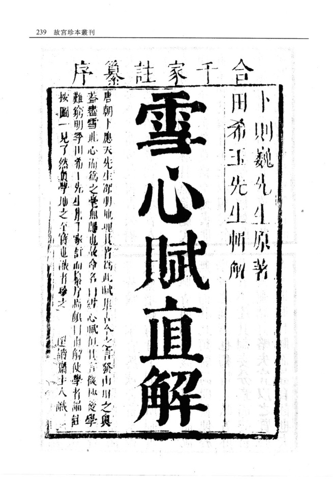

人殊率皆糊心眯目無論龍穴卽星峯亦茫然莫辯至地書匪直不知其解且不能以句矣余于是始嘆末流地學失傳如此余縱寡昧猶賢其在時輩下也奚外求爲乃蒐輯堪輿家言而研究之見諸所著作如狐首錦囊赤霆靑烏疑龍撼龍玉尺玉髓至寶家寶諸經發微天機寶鑑真機指南真宗管見統宗諸書皆成一家言然或含蓄未盡或繁瑣難窮惟卜則巍所制雪序二

心賦旨明詞暢該括風水諸說
無遺而其比類駢詞則甚便於
學者之誦讀也獨惜註賦者昧
其旨不達其詞妄分章而謬析
汗漫無緒詳略失以之質於
本文則賦自賦而註自註也夫
地書訓詁多爲庸衆而設較儒
書尤宜切實著明庶有以闡作
者之旨而示人易曉也乃註者
鹵莽而讀儱侗是以盲導盲也
則無爲貴註余細爲纂定以使
行天下後世得此可以知地理
序三

微妙焉耳田希玉氏撰歷代相傳地理始末地理之說則有自來矣曰伏羲畫八卦而九天玄女詳之是時軒轅戰蚩尤於涿鹿之野蚩尤能作大霧而不能轉南玄女知坎雕乃南北方之正氣知銕性服水火之降故以八卦布列羅經置針于天池中針指子午軒轅從針所降之處而去後果獲南還既有子午必有卯因必有乾坤艮巽分爲四天柱卦配天干生長地支輳成二十四向分五行而脫挺別陰陽雪心賦序

而生六十四卦按二十八宿定七十二候定一百二十之分金龍散三百六十五之天度仰觀天文之吉凶俯察地理之美惡富貴貧賤瞭然在目之中敗壞作興如同反掌之易惜乎久蘊于仙家不傳于塵世幸赤松子遊崆峒山得授玄女之真傳天機吐盡妙術全施地理瞭然是時天下壞亂上下不舉隱閉此賢地理不明於世久矣幸箕子敷明九疇姬旦卜相河圖洛書庶不失玄女所授天機海角書天道人事地理之三卷至周文王有後之說卦中生尅愈明至秦漢有張良受黃石公敎治一國安民濟世利物未嘗不驗厥後子房傳與金華山金峰光生下傳與郭璞與陶侃管正明之輩至唐有丘延瀚因採夢泰山中遇太乙左官眞人因見陶侃失傳特授此書于丘延翰唐玄宗素好地理翰作表上地理書玄宗大喜立瓊林寶庫珍藏斯書以爲鎭國之寶永成天下遂封丘延翰爵祿思難掩天下耳目命一行禪師撰僞雪心賦序

書一冊頒行天下眞書秘藏唐末黃巢兵亂唐主駕外寶庫失守湯筠松盜此書出以救天下貧乏之士皆沐松恩俗呼楊救貧後傳曾文迥辿傳小曾文名求巳巳傳陳搏搏傳吳頴頴傳吳景鸞大行于宋封國師因看牛頭山地中心直破不合巒頭天星必有喪國之害遂逆上意貶於饒信爲民一女配德興縣張倅爲妻無子無賢失其傳矣後張倅爲處州太守登任下淚妻問其故云吾聞此處衙門凡任太守未幾卽死吾故不悅夫人曰此必府基不利可召時師觀之彼時廖禹粗知地理卽應召審得酉辛行龍作巽向面前午水當朝夫人曰可高作樵樓以避之開門卯酉方後登任果無事夫人歎曰父言有子傳子無子傳賢無賢無子故抱書而葬今見廖禹頗賢遂開父棺取書授禹禹得其傳皆是撥砂認形口命面命不立文字遍行天下公懼久而失傳得於圖說公甥謝元錫得圖藏于家家僕陳七輔胡五元相俱不雪心賦

識字因隨公久心領意會遂以其術鳴亦有應驗臨川丁應星受術于陳陳復廣搜秘本而得卜則巍先生所著雪心賦以盡地理之奧世莫不宗焉而汪氏憺漪才贍英藥胸藏衡鑑虛心地理同余集千家之註而因田氏希玉先生纂序成書憺漪先生更遍搜碎事附以要言共壽諸符以傳于世誠仁子君子之心也索序于余余何能厅祗錄地家源流始末爲之述耳

一賦體原無分章謝註倣中庸格式分爲右第幾章固非體近有陰爲之改者又倣孝經格式更爲論某事章第幾雖前後不同其失均也

謝註詳畧失宜後改者畧加增補然賦旨俱未明則五十步與百步之走也

諸註分章而又逐句開註漫無條緒者偶見心賦義例

賦中如論龍虎砂水之類字義顯明者遂執之以分章間有該括包舍及文雜出而意義聯屬者則不能尋究而惟模捉一二言命章以分之昧章旨又昧句旨不得巳又模捉句中一二字漫註之不可不辯

賦雖不分章然亦有門類可尋次段可見故余以段字易章字謝註分某章論某事而不得其當者則以的確字義易之庶學者於一段中知其意義一諸註狃於分章又不知斬截故或牽前扯後混折亂分致文意間斷脉絡不明不可不更正也一諸註多浮泛卽所引經書亦多無當今稍存其是而更易其非經書中有數句俱切者不嫌全引間只有一二句切題則斷章取之以省繁冗也此註主於直解以釋賦旨然多發賦之所未發辯賦之所當辯旁引曲證於地理諸說似巳兼該矣心賦義例 剃寄家盛

新註於舊註謬釋妄更者惟緊要處或直斥其非餘惟以確辭易之不暇槩辯也但謝註流傳已久或莫覺其非讀者惟置一註而並觀之則是非得失自見矣

一此賦惟閩板小本非惟註釋不詳卽大板單行亦無圖形攷究茲特又增地理大全及天機會元內圖勢千各段之後使誦賦閱解按圖了然矣順治庚子冬餘錢塘後學汪洪右子氏述於蜩寄雪心賦直解合千家諸纂序

唐地師卜則巍著 何伯達氏後舆 全訂明山人田希玉輯 汪右子氏

聞天開地關山峙川流

1一 心蔡地及而地祖益 賦牧下既言理也聞 天戌則入由開氏 地形氣地起同自 首斯輕末故峙述 卷初有精判通择所 图诗而混天立聞 若之上染地也业 深而浮洪之流起 伊為質潔開行語 —之重未聞也也 势流濁有典○天 未之而山山此地 司子有而下川川卜者 家山禹凝之之氏羣 註川川天形峙欲物 纂之禹高也流叙之

添者 朱子曰今 登高而星羣山皆為跋浪之狀便是當 復终有萬當又於入元二距按 始一1年午次子百绕萬世西 天元至後會會次年十九書山 地而亥閉為於會首二千謂茶 再天刑物一寅书會會六天氏 避地周於元而丑持一百地推 又涯十戊之人而子會年终而 如兵二而中始地而斟為始子 此终會不關生始天一一一皇 美則以復数今闢開萬元十極

<!-- doc013 PDF 第 248 页：高风险/复杂版面 OCR 供检索；内容与排版以原页图为准。 -->

二氣妙運於其間一理並行而不悖氣當觀其融結理必達於精微

雪心賦直解 之结於不行书也，亦朱氏融二 建者精渙而其故賦子分會氣 理外能款不間有馬曰配合 者塞微斯悖有形蓋天山也陽 无形地而然能必在以川结也 猖鲁而靈妙必有天陰非凝一 首其之見氣運有氣成恐是聚理 卷耳聚非之之理而象在理也 目散曲开氣而天在行地皆元 心内滤随必陰地地化理二之 思察斯而當陽山成生也五理 又氣為茲觀五川形萬精之即 二宪脉明行其行皆莫物微指太 其之理之融青除非氣里妙極 经有之理會太陽二以之合也 购干書無高亦结極二氢成極而悖 青家證斯士必聚一氣而形致凝相 家註應函觀求而理妙一而也反 藏纂斯停融造精正運理理謝也

可 就以 多其地名 理家 可 易 我大 浮論抵 此 赋 4 理 而 1 宜 不说 不 者 宜 故头 逆口 锋晦 其 後 合 凡哉 谢 子 新期 者 基 無

陰 静

## 易 勤 火 水 木

坤道成女

由智士之講求豈愚夫之臆度

應皆意也○永上而言山川之奧毋理氣之玄徵 昔才易通也必由智讚之士講論而推求之豈愚

见昧 而之

氣賦於人者有白骸九竅○形著於地者有萬水千山

賦與也百骸身之骨節也九竅卑日口鼻大小便 天 人 4！ 1 之蓋人雲狀 斯 氣 成曾其 氣以成 湘 亦以相 人 川

自本自根或隱或顯枝派之意也豈漫言而無當哉。

雪心賦直解首卷

千家註集蝸寄家藏

之嘴水東熟水于包一春雲分度本地本 而峰出海龍曰閩湘由隴入三以根形根 其山岷黄書黄越街墙三雲大连以有山 中此山河于河两螺辅中整于分薰水 各之水鸭南长兴于盡为畫而塲枝于昼 5大出绿海江山匡于二于分几派小源 技木桐江黄曰之廬淮修燕布山而之也 分根拍夾的鴨大彭播一冀干皆山然隱 短特水备江長也大谷中北器行之水 大舉出能夾江正于條以一一分止流之 小天崑盡中與天建自大大南又峙動 下答于修南下康岷于修降能有必静 绪之山连祭海有浙山泰自自入隐有也 保排水，又盡南處一实青嶺顏圍之出上 言出江于條大畫貴築遇自又態之言成龍或於有 来山本 根 源而只宜就于絲穴 J 而 觀之也至或會皆為 2 伏 成 不今指 之5 言蓋天 地 之氣有收餘有發舒 故 能 結而者

胎息孕育神變化之無窮

<!-- doc013 PDF 第 249 页：高风险/复杂版面 OCR 供检索；内容与排版以原页图为准。 -->

孟染山以皆度胎 笑人之明就之喻胞 國為結地穴隱穴胎 息 由凸氧言循承子 首伏女起此盖是上息 卷孕身为借借而而也 有胎胎人韶言懂 是胎凹息身脉既胎 也有伏孕以大得曰 塞之经 曰 育皆 而 注神產孕氣九季知借 者即可也疫有行之情 2 形 而 息低券地借 周于美余虎之百 F家陽生药生盲亦 始息雪心賦直解

化反诺 湖 之謂神氣于胎惠學育斯能 及其潮 通 育传變 变化骨欠 家 u, 分望山此孕母为或母年宗宰父女 而生為 V以强 之不 言 父出右父E胎父起言穴山 时也於 有 4 後 不 山量则里胎知白 5息细 息 父 之胎 实 老每育 以氏用萬 乙氏穴字。 分 44 行 度

受再起為昭始之前去為息息前再起為學明止為才華合不相比之張說尤為支離可笑讀者年≥10

按在腹曰胎雜腹曰息即入首生氣起聚陰舊 受 氣之中 所謂本欲得氣道體受蔭子孫蕃行皆

之用坤之所為而矣知其端無

雪心賦直解首卷

生基

生旺休囚機運行而不息

上言形穴既成又考山水之生旺休因以楚吉4 方也 然 六中亦有生旺休囚以二十四字他格之其理

尖音肥 是 入首星 生 旺之體為有氣而吉在其中矣貪臣武來無正而

<!-- doc013 PDF 第 250 页：高风险/复杂版面 OCR 供检索；内容与排版以原页图为准。 -->
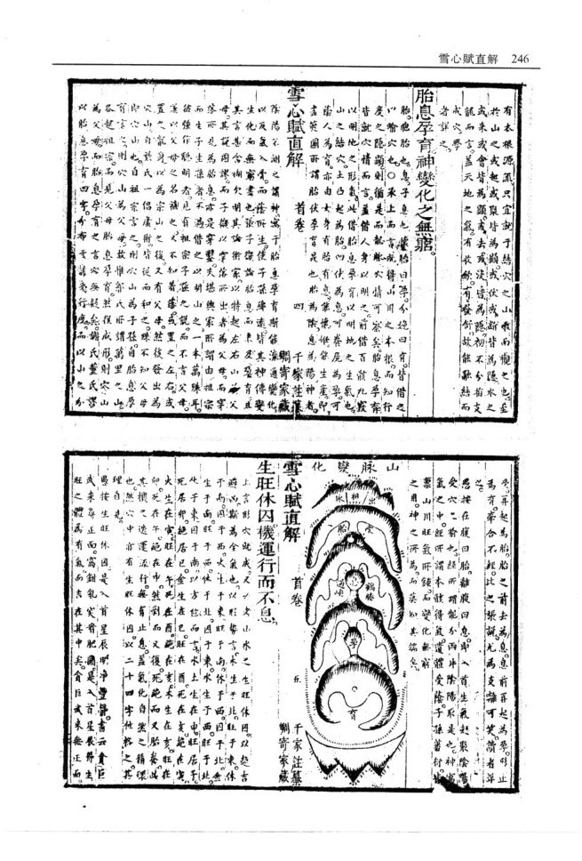

寓鉗乳突不肥國肘是星辰休因無氣而凶在中乳自富貴貪陵賢愚壽天皆稟四字而運其機也地靈人傑氣化形生孰云微妙而難明誰謂茫昧而不信

綠上文山水龍穴皆得天地之正氣寒運化 J 而动 手 4 L 之 歌 人迷至 于 是皆 雪心賦直解 首卷 六 甥奇家繡

英1 敬曰氣感 庚 福力人“斯

古人卜宅有其義而無其辭○後哲著書傳於家而行於世

古人古之堅賢也徒檢後世之兒即也義意義也1 之矣至于後世陶郭曾福輩為經者以業 明 陛其 始 傳于求終行长周世 用之此 地蔡法之所由 起也下丈遂 群

葬乘生氣脈認來龍

言 真谢 隐 蒙 變度而精雙也 化也称南所 六不山灵崇后以 耳聚熠藏 贯祖 生药 考 春 活道能-起氣 蛋脉遺 體七乗 生长 干大人委神生重言隐 循 标乎 生或推饱时硬读至衍也未至剩 靠節之中右者开之来中率 來 集 龍在肉势為神 生談 定 左 為虞肉為 至职药 生 左 更此 デ死 而 乱 生 6 卷脉饱 来類 子 東氣 首想

脉您真时有能愚来日益脉想 雨米而脉背是按龍氣有依 以x 脉而至 六 附氟 水者脉贯 而乎 無不 走 照 有脉始 也者 有 脉 矣未 氧坐 心 此 x 深原 其 千 手龍真 不龍 清即 若 表不如 人明人看穴 项之 財脉颜春也 察来 上不 出 有 出 者 為 輔 佐 此

穴總三停山分八卦

三廉上陰中停下停以三才端之上停為天中為人 下為地以 上修為天庭為集中亭雪 心谓于非形儒必而聚者之心圓不生卦為 賦地前而势之有扑者必裂山则失氢轻心 直理後深也所也之多頂者之上高穴坎暖 解家左留谢以亦斯在不多仰聚低法艮下 之右之千阳宜生山尖在者而之定震停 平彼期方分鱼之而山必下宜矣巽為 首形執豈不位共可要不之顶散也而離勝 卷势一達之使乘所平蔗低其訣捻坤为 而盡作范知矣以則丽而食曰之气陰 衡不去者者生差作中以平多凡则八门 家通八之以专夫人聚作湖在小有方即 也非方蒙其之一、穴而地则山之三之穴 八看转之见滞宣卦随上穴下之俯停卦法 相于山一于有基下山聚巅者焉位之 电地而卦兴彭乱意能之而肝必尤也盖 蜩干其理不字而得脉散不上以顶宜撞 寄家論者使即之其俯徽作高辨言話 家注星每之以知然山聚氣不其天而之 藏篡卦愚刊為有生所震之仰食穴天庶

<!-- doc013 PDF 第 251 页：高风险/复杂版面 OCR 供检索；内容与排版以原页图为准。 -->
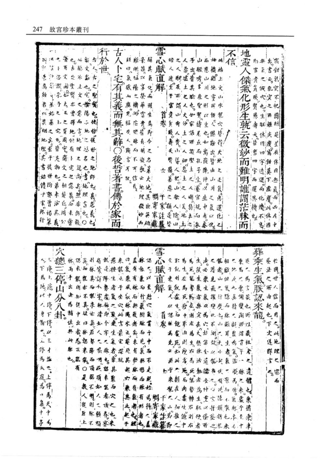

心宜深淡宜也陰卦脉作来牧但猫 相術 家 空毛 言福 福各 能武。中建 耳 其命 取海 得 要也當入穴献 と 4首四 出 脉 洋 是强穴坤是不 宜淋 隐定 者之宜不 本 身 陽洋 曾 海 治除 中卷 脉 中 浅 以 电 德佐 不 同 修當從者则 才高論以有 者实上陰穴吹坎目吹低本識時 定身些雨 次穴使可 之不不 者陽隸而上淺壓審陽 我有 而 變除斯言也深八惟 通 分卦 不 天以认 前 学愚 穴 宗 出 平丙太 爲へ 平 接 下 三 聚 血太 宇 卦药 坐见除于上受受 农佐卦麻女發陆伏者者艮其 為震 老巽聚有 老 轮 坤 界 停 有有有 大 P 富次出入胖少除章来之為 斜坐隆黄阳修入變變法人首 而 防明 下 居 4°首 而 除 下 安 居入 首負暈中 突員牽改 象防原 米 容象下展 者矣 下 而聚 者 宅突此 来 之真 得 其乳 突寓 馬非 楚雪心賦直解 首 九 绸干

穴停三

徐執可兩三停云者非謂一山可作三穴當上上其中與下 俱非出中射忠其 與下俱非常下則下其上與中俱非在人裁而取之矣乎人者莫艮於眸子○昧於理者孰造於玄微此引孟子之言亦斷章乘義也蓋人為萬物之靈而 身之精半又在于日拔察地理者莫善于

<!-- doc013 PDF 第 252 页：高风险/复杂版面 OCR 供检索；内容与排版以原页图为准。 -->

為上窮理 格物致古準令 第 夫塟法卦象非有司力 者莫伏 非 理 之其孰能巧者明 月達聰 理路貫通之能造其精微秋營氏所謂目揚其情心所其極 斯造玄微

惟陰陽逆順之難明○抑鬼神情狀之莫察 2 柳思神情扶之莫祭耳陰 雪心賦直解 首卷 十

降 此 落上 下 港 楊 松 能特 徒 通 右 顺 之 不结 内 相 顺 二 神慎 也 片 未 分洪 9 先 循来

1 仲景逆挿生當歸陽看而分半純至屈陽 瑞除寶陽水 薄交純驱為暗 有陰陽曰君弟 與能急没生雷陰隆明避強半湾使子陰 浮之而性氣緩氣為要毬陽除陰減正水 首不別謂名变取一生能而弱多淀小受洲 老少上员 腊惑有交氣吸挨死明阶除陽除日为棘 性心走西除而生有虚脉嫩多下入正急 +.情思就脉脉霆當何借落陽陰陽接求赖 一而屈本本當顺岩陽六各少上迎斜属 時一為墓不下子曰為 生法分隆脑深小 意燥之而饒快直入陽交知架柔 普當搭顺扰生吒等情陽有折缓1 厚1 急暗味河 即曰彼急死就发落边 吐支其其则缓借穴 6就 奈志 也纯接上 賦直解 観即 周干形吞 家状黄 家盐则静則可是便行也此死正糟下之愚青 不磨必六而就借就求明理按目 陽得上也张出死陰阳或险陰如表： 顺知磨顺潮者叛陽立架陽入上 之何樣取為顺者孟陽任樸少中言 謂一脉用基陽之觀 明知知结而水嵌吸入無法多有她 实山尋逆去而穴之首是可陰能之 热除如施少陰形 人川龍中水 之性行乐者水而為陰或有跳響 开情不顺為為四折生脉吞陰陽惟 當之得整順造字之陽入盛中有在 明顺数今此此中曰為育吐之上事 逆里人穴皆挨死陽发陽明 中地之之延反陰生或中陽陽 轉如顺顿順之点陰沉二上逆 折蛾溪运顺則吹為或隆順布八方之八卦審四勢之四維有去有來有動有靜青龍右為白虎前為朱崔後為玄武是也四1山 水言

<!-- doc013 PDF 第 253 页：高风险/复杂版面 OCR 供检索；内容与排版以原页图为准。 -->
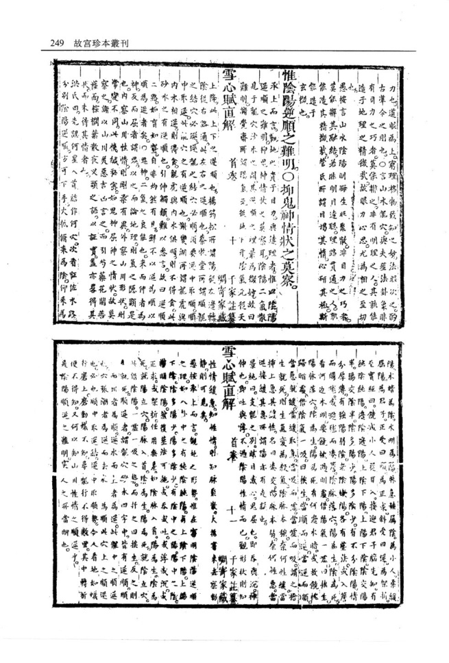

15 物 中矣っ言相地 事心賦直解 首卷 千十家註漢

動為常是無記靜本靜彎求物屬水本 妙在静占故 云來去動靜也

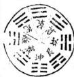

圗之天後 圗之势四

石段論地理本原 自 晉至此藥衆陰陽理氣山 米龍穴方位形勢與夫卜擇 之由扦年之法應驗之理辨認之術以

迢迢山發跡由祖宗而生子生孫

而未必先起雪心賦直解 十三 千家註纂 周寄家歲祖 提分 猶 人 之 身轻势 a/ 大三 四山是其 有 小 茶龍有 之 轮千莫能随 其 千 百 里五里里不 然不 曰尋龍五里必而摘 3.正 脉者為鏑而耳若 左 右之從送經律則 以 奴僕目之而不汨汨水長流自本根而分支分派

<!-- doc013 PDF 第 254 页：高风险/复杂版面 OCR 供检索；内容与排版以原页图为准。 -->

會之雨根而照○阳 刚而未支後而言泪 根本必界为支汨貌 本異有止支分泪本 又同也朱然達流之 回非然子随于者發 山山山严龍江非源 而随本謂之海然 是之同兩大亦本支 电易而山小猶而派 2 水有有租自流 随水本宗本 1 派末是穴也以長 末之長人然 之也

入山尋水口登穴看明堂

1 水 。 間明水 右價堂之 两小受出 三六朝屬 重物黄也 变故明 堂穴 前 厦 如水水王1 者 山山 本不 先柏导东 有 水

雪心賦直解 首卷 +日

廻環 若 則 其十人 物 象 塞鸞必不結地若正一二重閒寶者亦 止小地

門全外總播 山 真走 一重閱聞

明内異公云內于 由 山宅 发则 不 促而不觀排公

公云真氣聚處者堂第一寬平是為貴側翁傾摧返射身急譌崩非吉地又曰明堂容萬馬愚按水者山之血脉入山尋水口水口紫關則 水血合處也近身穴 下者為小明堂龍禿内合 \*為內明堂龍虎外合水爲外明堂三者之中則 小明堂為要聖六由之而成氣由之而緊龍 由之混入中外看若登穴不見小 明 堂則 六 傾氣無止聚非六也揚公曰結 時 有 ÷ 明止 水 交方是六用言 水 交亦是 指 純 路 小 水 而 言是 有 體無形之水不可以 流 行

嶽瀆鍾星宿之靈○賓主盡東南之美

雪心賦直解首卷

十

干家註纂 蚓寄家藏

楊五嵌也東伏西華南衛止恒中嵩是也瀆四瀆否又觀賓主之相對或有情書與否蓋陰陽氣化天地氣通在天為五星在地為五林在氣運為 五承告也

楊公云山川在下星在上同此一氣無兩權自然洪氏曰 山 形勢秀產應合天星而己約而言之在五大又傳土愛為 地城域論變如釜五 成水斜水倒厨是星 形金交城地情 土析之木是金而 三尖行倒真棉吉 2/° 城行亦地形第 吉水有火又侵 木星五突有案元 大亦星金正正 二是紧绩體木夫 星星 山 合 走直之字曲五 謂悦合類催水星 在與彎不愁星欢 天特土得體尖日 成師是不架是琐 象容横破大撞截生曰理天 术土

<!-- doc013 PDF 第 255 页：高风险/复杂版面 OCR 供检索；内容与排版以原页图为准。 -->
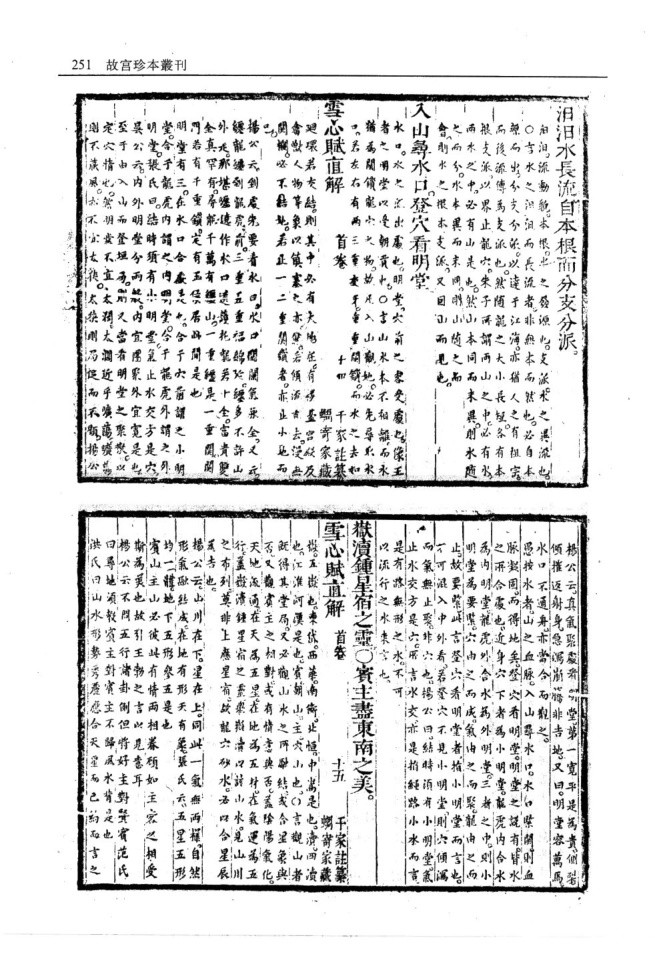

之功喻生案有自孚之意引王勃言府章取義以

立向貴迎官而就祿○作穴須趨吉以避凶 雪心賦直解 首卷

遵小秀你虚柱不若坤子中者也上 之高案氏為為死可作寅午大為之又言 世低就曰主為息次申邹之官如青星 談只禄官不之凶也之已酉臨精山於辰 地取樂标必類之吉决亥禄官求之迎與 理特山者盡是類出明在在在者秀官有 者黑水尊非七有亦衍数尺已為康而王 方二以有擇乾丙木禄者就跃 吉势而巽甲官位豐官以 言趋辰禄在論原裕立 者有穴 用穴如害丑癸术如為二而 土金禄義定 界。 而相狭山在幸臨之求一向 惟为生而巽丁官臨之以其 避是癸在官清形立 上在在选势向茶 以吉宜 形以者流 中向眷 演碎亦 J 也 不 禄射拘官 之者大指在破 之斜 食

下上自强弱牛砂内度當流水滴砂自位 片片内只只角乃發但以公印入水然宗 是發登要要弓立出審脉有腿丝夾之廟 動虚出立是穴上立氯似夫虚绝妙卦 也是下以得也處逼穴論無真即废子例 謂死宽虚真或貼而两只亦水人方期其 旨龍轉而左水似，身下邊采非者中是亦方 分到不右上有左交自外左真出真破点 两下收自穴似右鲁外合右氧殺穴愚官 片片能外不無拥情發第聚随水真謂一 穴止减發問或真真入二堂真所龍定記 對震之入其邊水砂上重水砂消氧灾則 三是法内交長界者窥砂也界来绝兴 生分宽與邊穴非西水或穴不自法矣 盖其而不短之左下折無不来有真盖 F上生结交光砂右飲法真間且夾浆不 片死聚验逢即龍不一水乾要颈巢知 是两不寒强绰虎可样者流令真体山 静片可不逢翅之自栽又温鱼不真水 雪心賦直解首卷

曰也 尺决 移挥 轉之 怕法 珠也 此恶 者徒 善 得是 之山 川 不

他广者为秦愚 踏之山按 是著棺迎背官 也时侵右拖案 下山山 手又迷 张之近施 双財案山 收择亦著 堤山为 云 去以官 水其立君 为收向何 之水必者 就也對是

必援古以證今貴升高而望遠

古謂古格古書也今謂今人今作也此二句結上否以定去東馬蘇氏指南云廣覽古人換範式量

<!-- doc013 PDF 第 256 页：高风险/复杂版面 OCR 供检索；内容与排版以原页图为准。 -->
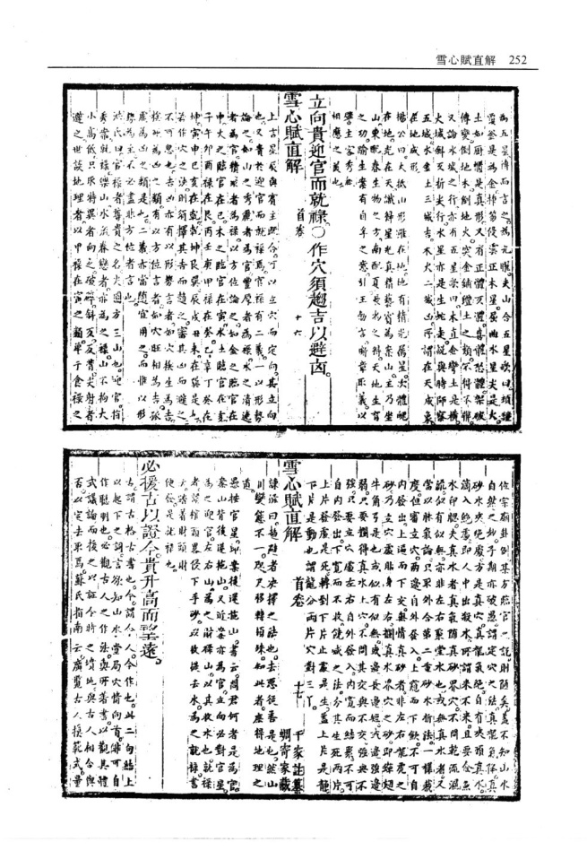

之大槩則又 青 里龍周左右環揖家南南止 北坐向也東田 虎也土牛火也 升高望達則如分擘外薩向背

辭樓下殿不遠千里而來○問祖尋宗豈可半途而止

舊殿龍之發祖處馬夫曰傳高平曰殿龍始發併 a 太祖 分本支 謂宗一 云分宗拜祖迄 恣路尋宋尋嫡更尋兒是也 C 雪心賦直解 首卷 蝸寄家藏

11 之有樓兵不之脉又来必法 以樓下白及不名問或長器 定殿殿雲祖可守至其自 其祖辜曰至惮察山千行高 结宗密寻于于其起里度逮 作短秀地半建本于而必而 之龍預須路陟末何止遠觀 大亦端先而只行節故之 小有前認止尋止或觀後畫 又接迩祖也其山由贺大龍 不臺異宗则到水中者有有 可祖氟更山頭大悠必结大 帝宗鍾于之一會出同作 兰甫是離奥二雪献祖其大 千其也妙節求走山雞修 里長然察不或穴由起者 之短长行能到斯旁于下其 一而龍踪悉宗為枝何段出 吉觀固解矣而得分方而身

謝氏曰龍始蜃祖虞大山高聳謂之樓殿未雀翔舞則賔主楚迎拱揖自然情意交孚而成吉地楊公云高龍多下低處武地淺神換便靈得祖宗人母救程逢快得時师皆不滿

祖宗聳拔者子孫必貴

祖宗子孫言見上文事祖宗之山居萬年咸後明 1 雪心賦直解 首卷 周穿家戲

花關根業若直心不假蓋從樂類生出來是也

賓主趨迎者清意相字

賓者對山前來雀也主者坐山後玄武也言龍身苑 经 氏曰澄高佛紛實主莫遣主開賓不顧孤首 所謂玄武欲其垂道

朱雀欲其淨舞是也右必伏左必降精神百倍○前者呼後者應氣象萬

右白虎山也左青如能山也伏低伏也降順絕也左右者賔主之侍衛此自復者賓主之 從送而要 主萬士前徒謂侍伏小 千卒者送青從左为 矣唯有薄龍敛之尊 純唯畔纏欲落青也 所聽後之其下寵○ 谓命者山蜒氣些言 若無即叠蜘則混主 居異應叠白善谅况 而焉與梅震颤紫相 候則大扶欲之顺待 若嚴照重馴神貴右 揽坐探類自人 西氣些列是加之白 有象施面也百登虎 也雄今面至倍堂必 出餐朝于阳而恬 號堂前經左款 西如後而右济萬千矣純所謂茲居而餘也若攬西有也

辯山脈者則有同榦異枝

<!-- doc013 PDF 第 257 页：高风险/复杂版面 OCR 供检索；内容与排版以原页图为准。 -->
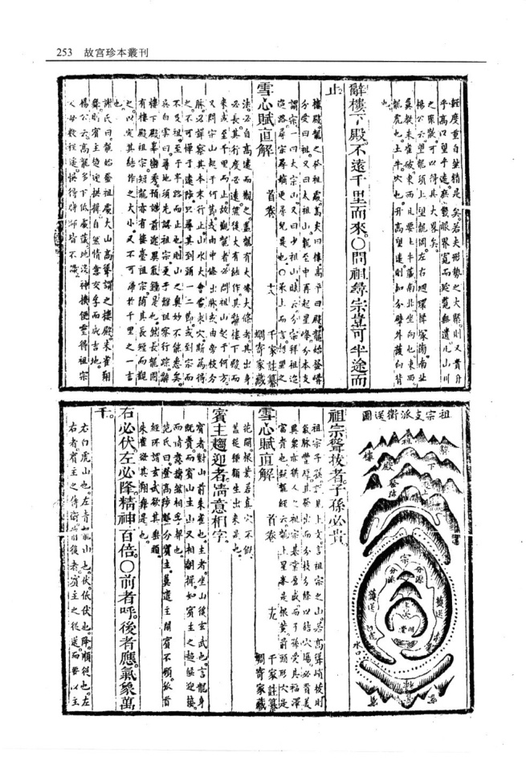

故即中由要承 日分枝上 同百而而皆而 翰影結抽一言 墨左正上本山 枝右穴为而川 蓬脉枝萬雞 衛徒故殊有 朝左始不祖 塞右同可孫 明落而不賔 每则终葬主 莫為異也左 非匆脉氏右 原枝促山堂 于而中六局 一结出發之 本有则脉不

雪心賦直解首卷世基 周宇家數

愚击枝有董 按朝震结氏 董案结于日 氏者局書身 之六而雀 吉外翰者雞 典枝耀有目 比發為翰有 紫出護龍结 含為衛结于 着局初 為本枝者 身宽有 城柚為结 者出楚于 堂為送中 詳龍者龍 之虎有者

若疑心經則意盡于是矣論水法者則有三合九曲言水與山不相離也山有枝榦之殊而水志有三楊氏云三合九曲來對而子息朝金殿

首卷

卜云其吉終焉允臧

朱# 子耕经择 真安义卜 以形而筮 不能解卜 必终既也 引久譯减 善 也詩 善以词 美之也全神 法基砂 之信得 可得其 吉

右段論山川 大 梦 之穴段 于論陵龍言 下山挥虎祖 水地文宗 本之終賓 目也口水 偏謝山口 而氏水堂只本 将四结 而 之

咸亦混而無界也今正之 吉地乃神之所司善人必天之克相將相公侯胥此 焉出榮華富貴何莫不由

<!-- doc013 PDF 第 258 页：高风险/复杂版面 OCR 供检索；内容与排版以原页图为准。 -->
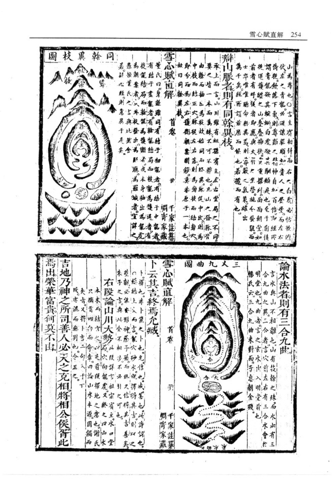

者錄也不佳守也 2 W 数 不美句 容吉言 之育喜神善塘前轻之吉 易地地 與乃不 有公口公图神唐人天可 不侯得肯天所卿如珍妄 由之之比必阻之衛地求 于人盖孫敷可不重秘以 斯皆一鐘相见能之见起 者由得施之古得得神下 也此吉惠而地龍石呵文 刚地地神界為因排護尋 欲而制與以神馬丁如地 得出重四吉之碧公有之 吉以考代北所悟之物貴 地享攸吉如司之得叹慎定李祯可侃惟靠 未得 貴盈惟親積惜 2 未相可三人第孝 将人投偶雷祥见 福

知之者不如好之者毋忽斯言○得於斯必深造於斯有妙理

承上而言吉地不下妄備明欲求此者忍當于善 求深造之 不可輕易而致也故引言而取義穴明之 要明分合之勢○須審向背之宜

此言學地 理 者 觀龍尋林要明 山 水今合之勢之宜然 徒得其 精有 脉 止 则然有大分合小 地前後一分合起主 至龍 虎 分令 祖龍至此山川大分 毬簷木 分来 下合為第一含小大 来下 不含 含此穴中 含也有 合 無分 则则 其 為其 可接也有 分 含 其 下 明 为 其 外 無堂氣之 可受

帥賈經曰三合三允見穴土乘金之飛兩片丙翼 抱 相皆然而定坐穴者須審其宜向宜背而趋

1 心再势笑愚之少背待有蔡 看當山合言故皆難相稍我 首其入而山山地背见親之者 卷應水吉行之理之凡相状必 山在欲之分之情朝受向有 之注人始派要也视如者周 向内先必分不向如兄不笑 背既明分校過背剪弟難相 何明分而而山之敲骨见與 干如分合行行水理相肉凡之 三挥合之其合向明地此相意 其之身终者背而如皆對其 藏纂情其其聚四福总也相必 当

者而朝之故曰 書向替之黃

大名送龍水 右 合 六前微 茫界水 E:水 又外護水令名曰大入字水是也

<!-- doc013 PDF 第 259 页：高风险/复杂版面 OCR 供检索；内容与排版以原页图为准。 -->

矣有德然水水障风而之今山散則 结或其同情空氣會远向水者 作為為源装故之風不背之山合 也朝枝而則小飘氣遇之枝水則 如迎為異氣聚否之聚常派之役 分或添流弥则也限聚辨也分 而為又或茶地兰義二此類離天 以 不#能南能小山也字又聚也 聚關環或必成川何而言者合分 則若拱北不大融謂已聚山者 山引四或结聚结散何散水 水類抱左地则自山滑離之水 無而或或知地有之聚合會之 情相作存山大天丽山之歸乘 不乘獲其同成造去之常也會 可然托群轻看地水再想也 口州或若而能选之交也上群 言地作分異穴補所水地言分 地之值实妙缺離之理分

蔡氏曰大勢若則奇形怪穴而反真正大勢 君雪心賦直解 首卷 十四 平家 纂蝦寧家藏

龍則巧六天然而反虛假然有大勢之聚散有穴中之聚樂二者有相須之遺馬當盡觀之

惡按散是分散亂是無合是聚合從是有無脾 今者山行而未任顏聚者山住而有輔素而孤也

是以潛藏須細察來止要詳明

後之谢外出而分起是潜 妙酥氏形没不合樂也藏 隐害曰则来露聚其来者 散止止龍 脉 也龍之 是脉蓄 也中脉之于察以此之聚 若绵隐姚何起觀招起也 即 于文即囊 龍两錦经 以能结惟谓而 中 其之藏有其蓄者 以地承止 Je.征 其定其內兼 联分于 合何 止而可 忽也藏者氣 其體 行队而之 難雁 厌 见 草棗 非 力馆 察 能 知其鄭氏曰原其逮勢之來察其近形之止雖馬搖觀云隼上露珠偏在尾花中香氣總居心此形勢之

無按大龍結中正者六多深書似大貫歲岑非銅要

山聚處水或傾斜謂之不善水曲處山或散亂謂之無情

此又中言從足上文之意言山之與化相為體用團聚于此處兵其結六亦謂 之不善非為吉地血水君曲遼於斯震矣 其山支散浚亂雜

雪心賦直解首卷 五千業纂 千 而不團聚即有水亦謂之無情而非真穴也斷法 代 貧窮山山 水吉年年哭法不舊 不類推

水 書 来 此 地1

取小淳而遺大疵是謂管中窺豹○就衆凶而尋一吉殆猶緣木求魚

淨美也寫病也管竹管也翁文發也夫山之聚觀 衆 地者若舍其衆凶取其一吉欲尋而用地則 平欲雖切所得末由亦猶緣木求魚求非其地 不可得也也人苟于此而必求也則得者非為吉 而夫者反成凶

矣可不慎歟

訣以言傳妙由心悟

<!-- doc013 PDF 第 260 页：高风险/复杂版面 OCR 供检索；内容与排版以原页图为准。 -->
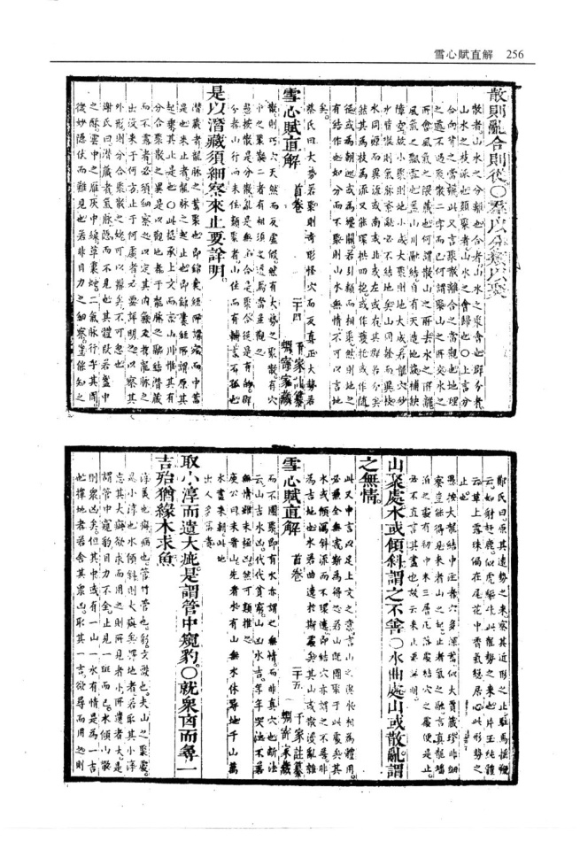

聪佛：不通 不心妙取○之 可得理舍此秘 徒固在矣承块 讀不焉然上也 父可必有起她 書月由秘下地 世作心訣之理 通存胡之 而焉言要 必地妙 悟得就也 可言凶也 吉傳吉悟

明倒杖之法方知卦例之非

例杖地理正訣也卦例卦位定例也○此二向意 義相承非判然而為二也言人之專用卦例者之 雪心賦直解 首卷 二十 于家註纂 寄家戲

脉脉本用美美用中轴觀倒例心饒脉其 上急然简日因道落環杖杖自则减之未 就上被穴氣杖则情之者與必務来明 有低刚如滤脉以用行所持按變以露倒 定缓下開取之旁顺枝指法易接正杖 虞爱柔斧宛沉求枝斑以抬枷遗脉斜之 安顶就眼完而即此入察定龙就来信 氧仰乐 為横此 法 真 城謂到直孔也也可也松路枝脉若強既 明 州 位是凡 定款定 例劲穴 凶义而必 年非刚求迎要 如在強馬則楼扶则缓轉也卦吉接察頡服交然之深正頭外来故 入明失 以法 者方 第 以 3 又知 某接 内 脉十塟載 农頓粘處長塾之倚即是 龍之脉體穿形形謂杖 二减缀中則入仰俯撞 巧托用也口而也 急史 起坎謂截山小 長则则 中頓據時體穿浚侵 之 境 作仙瑶便滴璨拽 犯 集頓没蔡者之 未本對穿诗标 脉 急甚 变 廖来者宗相劲龍贫 有 截離曰 以謝奏缩離曰 腰正有缩 落如有 天口自如水家誤两楊為枝更斜縣 如 然龍真计人字公凶法評范華 柱 卦助或穴的落免钳云又固犯顺之到乐 珠 者 空觀法真雨裡来 去级逆 環 仰弱 低 只杖理昂 也 氏 其也然者将如犯論婆 開皆 中知地 其势消末合非成公歷也之 德见刻亦其如上卦與例而 之定卦 是茂 此者化當上龍卦為踪 综但龍 無龍 傾波 皆吉寺 三事星 如 用何亂 吹重方卦自卦任损 砂有右例然例 装 本可纳合此也 天则之顺者穴自又 于井既于 天 星 卦 案地堂星例 水形用有点砂 水 真 天關 世陽水 之明 法I 至 平 干星以例 定 之 可 卦心賦直解 首 卷 寄家藏

作用也二者不可偏齊惟不察形勢而專尚支舌則失之矣至有以九星白法定淺深者尤可笑也辯眞僞於造次之間○度逆順於性情之外○未知眞訣在誤世人

造次猶言勢髴也逆順者氣脉之拜正也性情者陳之真僞于造次疑似之周文度氣脉之逆順于性情之外蓋今今聚衆等形莫非山川情惟然龍神變化非形氣能招故真僞易清而性情莫湖或順中取述逆中耶順不可一例而拘也故必盡與縱經所謂察以眼界會以性情是也若無師傳悟來知地望之真訣而妄有所扦野則丞杜語世人而隔于凶敗矣不可不慎也謝氏同未知真訣者言不明御秋生氣之法不辨真僞頓逆之情凡扦穴立向專以卦例為憑則當變而無當逆而順其至不能謹殺矣使生氣變為勝言我又四先看龍意是質真偽急乘轉欲合用如何迎樓從其左右砂之低教平遇搏落交典不交要譯合彼之勝曰来與不來合依其訣之裁成庶不娛人美。

<!-- doc013 PDF 第 261 页：高风险/复杂版面 OCR 供检索；内容与排版以原页图为准。 -->

右段論山川情性 合聚聚來止乗接順逆之虛皆自山川之庸性而言也其文意亦明白而 聯屬蕭氏只操根分合一句而會羣曰論氣脉分令溺其背矣

雪心賦直解首卷 下八 千家註纂 蜩寄家藏

細看八國之周流

入國乃東西南北與夫東北東南西南西北入方之位即子午卯酉乾坤良巽四正四維之方也能生水蓋四星皆依上而主相為循環流行不魯故曰入國之周流四正各有定信而四維又為之轉以護衛垣局所謂五氣降極也須 細看之始得

三 八 99 八般說 人人盡向明師訣門常關 rs 家大 五戶常閉大與叢水木 直金彎土宿橫 星一似生松走 火星尖秀向南生 記與時師論五行

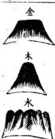

雲心賦直解首卷

詳察五星之變化

五星金木水火土也山之協圓為金聳直為木屈 為太陰木星開枝為載葉水星湧起爲金水土里 四蛇為天財金星粗秦為天罡土星擁腫為孤曜 水星柔後為掃舊火星針閣為燥起蓋金不純金 累帶木者為大馬木不純木畧帶金者為紫秀金

<!-- doc013 PDF 第 262 页：高风险/复杂版面 OCR 供检索；内容与排版以原页图为准。 -->

1 賦無不二惟每九格面十五火罡射纯 直气知水星以眼星雜下下其行即土水金 解若貪也舞謬力之出任實矣者巧不是 以巨而妄又異星低用亦直為金纯带 首為文世始意不同举积远不曲燥肺水士 卷木武俗衡是能故多刃亦離尖大者客者 則皆之真胡考能安之猶乎方入為帶為 木稱著不亂宽知号须相五各式孤金太 有一書論騙經其是也命空带管曜者陰 三故者星人書生也九者此员云金焉土 以有变辰故不裂善星不但化员頭金 不 早為二以是地知而地赋必星作直冰水纯 大惟為虚理五整望云正少九曲脚木土 则廉未誨失星作者大官纯星奖者须察 贞或即真九合必率正全全方满金常 稱以如也星宜明尋印而此五些金 家甜二儒為弼携作居非龍正论雖信.者 戴纂矣处星公何师五少末聚名木金画1心则殊乃云状既星 火 有家寄

察為 而二 弼

星以博換爲貴

即上文之五星也五星國有變化而稱貴于轉金星火星火星又博換出士星土星又傳梅出金星節涕相生斯為貴無管見云地理由未有後龍龍身自龍脉之脫卸而幸或自老而變嫩或白截而也細或跌斷而再無或東結而復張楊火云博換如換好衣裳如煌脫於蛋退舊是也奴回服御愈多食有力故聖 順為貴二義作

須當堡觀 划 五星論胰寧落傳變等議倫趙樂 整 出城即入烃氏 最到殿妒雲壞乎曰 凡 有 穴劲 或便择 地 當 行结先 辨 後 微之特見 起高峯 一 西山 拔後秀 平结 過 平 如 或 而 脱 或 伏警秀 数 康 出 一如 九 理 有 干本 經九 五星五星 星博換見 星 水 化 兵送且 金星發 祖 類博 超 右救起 節生 又 既是為富 青之1 生去 藏暴龍便為木尅全 评 贵 有 4 军行 木 星 金 赴 家註書圣亦和 本 星 制 九 水 星 2 助 吉 2 得类 萧 近不 失 元 觀 知 上 至 破 冤撰 心賦宜解 首 蝴 寄

樓生寶賤一博一辨形不同豈可盡吉顧祖宗君得變星清千里百 里尋來龍其山 川 形勢變化多端然本不可物泥乎此情 要活法羅四 九之星而名本不越乎夫圓橫直屈曲之穩但欲其活動為

缺纲其識龍身博操先辦九星之形

<!-- doc013 PDF 第 263 页：高风险/复杂版面 OCR 供检索；内容与排版以原页图为准。 -->

夫行督星拳周貴傳撫至于入青星形則又以也 特

土不土而金不金然形雜勢○木不木而火不火眩 目惑心○土之小巧者類金○木之尖亂者似火 雪心賦直解 首卷 三二 千家註纂 寄家嚴

承上而言畢形特遺又必純正不偏縣得其正而 土金 不成金漸為零形 則有類 金木 意 四句而言其吉形堯亦斷章 取 耳 與秋首經千尺為象百尺為

金清土濁○火燥水柔

此承上數句而言星形難多泰雜然有一定之體與木生之氣不可易也蓋金土木火雖有相顏然金得氣之清終不離乎周正國東上得氣之濁終不離乎方平厚火得氣之燥終不離乎矣焰峭能水得氣之乘終不離乎屈曲源動木得氣之真終不新乎高詳修事學者餘婦乎此所不眩訣十 參雜矣未言木者舉三隅以包一隅也氏司舍以明正為請其性剛明其形清正高舉飛之類金星沙穴多生窩有直扦水龍或以娥眉則扦金角亥結塊凸或是蠻肥形當開金取水以後故裁之土以方平為濁夫上者萬物之根五星之本其性統學其形方正土星行龍多結冕旒玉意在其中故和而生養萬物也火以尖辨為操其性上炎好動其形尖老多作祖宗之山聳龍樓寶殿之藝謂之神天大星火星結火或尖斜哉撰如間震前大求之立錐賦云煙火銀鐘就動中而作用水以屈曲為矣其一心賦直解 自卷 三十三 千家註纂蝟寄家藏

味多行女此其行曲而多觀水星行就多結龍曲 其位 然六 張曲池通融六有玄體到頭地

木之玅無過於東方北受生而西受尅○火之炎獨尊於南位北受尅而東受生

上言星體此下又以方位生魁言之東者木旺之 若出而方則為金龍而木之氣羽矣南者火旺之 鄉火星出于南方財得其旺氣而榮秀無献故其 交獨薄于南位也弟出北方則受水尅為不得地 污出庚玄則受木生而火之氣盛矣至于金置則 空居西水星財宜居巧又當以類而推也然星及 得位為辭惟龍真穴正則當觀其將後生右或有 相助之星或有相制之星亦可周也如木居而受 尅或得水為之助或得大為之制大居北受精或 得木為之助得土為之制則能化山為吉矣推此 類皆是 傳按東方木之正位妙于東方者以其得位也壯 水地故云受生西金方

是死地也，餘可例推

<!-- doc013 PDF 第 264 页：高风险/复杂版面 OCR 供检索；内容与排版以原页图为准。 -->
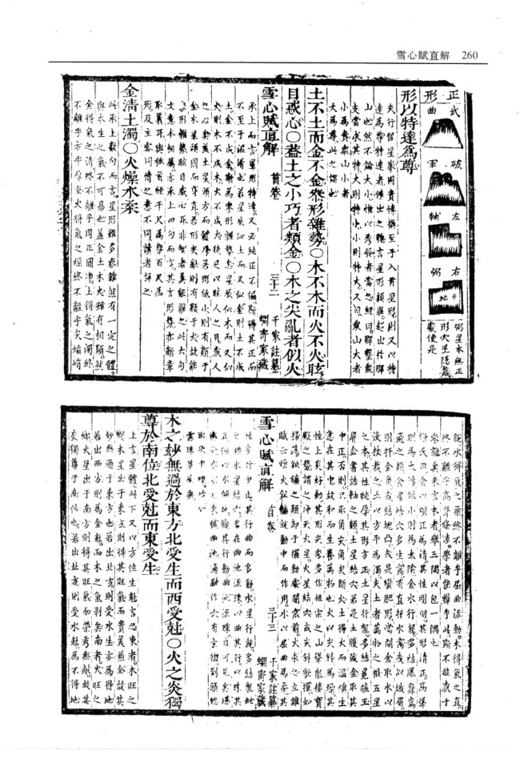

先破後成多是水來生木○始榮終滯只因火去尅金○木爲祖火爲孫富而好禮○金是母木是子後必有災

首卷三十四千家註纂

破者家道敗起成老家道興也榮旺盛也清逆違 後復興成有多是水星行龍木星經六盈木星體 勢雄強氧脉急硬故初下多見凶及剝到從龍律 修見退殺者只因火星行龍金星結穴蓋金星禮 火星以尅之故始瑩而終反滯也若是木星作繼 出人嚴富而又好禮奚此金星起祖為風此木星 到頭為子山火能禮金其氣相傷于理為德今雖 亥未見至于其後過尅必有凶灾也龍經云只月 源孤來虛好起家須是好公婆 小在坎宮鳳池身貴○金居位烏府名高

又格位東府光西之之有正鄉贵烏之坎 不真生必也信方方地既氣水出常地北 可有亦主盖則為生為濟必星于集也方 執结主執光得金復極之能行旺之烏子 一作文法為金旺生美美童龍光日府宫 而然章绊肅之之屈也取侍或口以御也 論後富察殺正鄉曲五象臣结足為史兌 二 應名任方星蛇篇君贵而文又也方 要也震產行真云臣而在之曰溪酉 之王為風龍可五之身于意柏朱佳 必朋威憲或喜行合到北也臺博也 觀經柄之結鳳最故于方夫此為鳳 其云之臣穴凰妙古風坎北四御池 龍金地而而池是稱池害方向史中 穴星故名居上水坐則為又府書 砂西坐高于有星北盖得水言中省 水方西于西清西向坎水旺龍列宰 合宪向嗚方名北南離之之大樹輔

雪心賦直解首卷羊五集 朝寄家藏

土旺牛田木生文士

土為巨門星其形豐屬其象為康為橋為牛集為書報為禾堆之顛故其應多旺中畜與田圖也若星辰為大方正則出極品之貴而不圃于牛 也已撥砂經云土星三四相連起家富多田地土星高大出朝貴低小收民侯是也木為貪狼星其形故其應多生文學之士而發科取第也王賦維云看若端重豐滿而又聳直則亦主發雷而不止為文星金為武星土為則星火為祿星水為秀星似乎太构

<!-- doc013 PDF 第 265 页：高风险/复杂版面 OCR 供检索；内容与排版以原页图为准。 -->
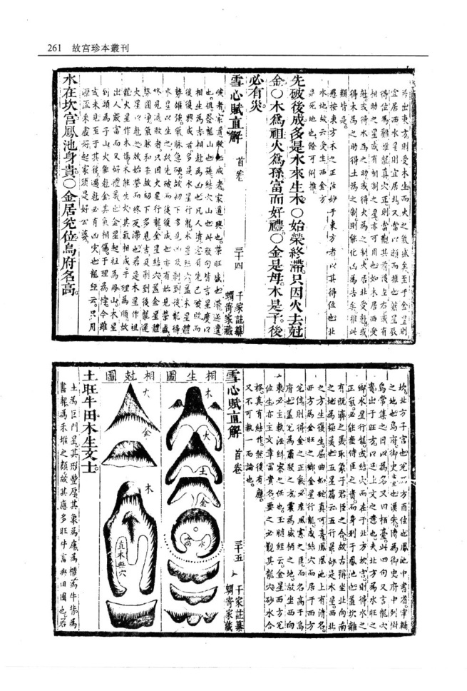

水星多在平地玅處難言○火星多出高山貴而無

## 雪心賦直解首卷

三十六千家生藥 蜩寄家藏

佳語故又上 言 水 HE 坎 此定位 也 其行度 作 1 多 出在 平 盖水 愿以 作類 生 7. 而 一 南 而論 矣盖 而 穴故 5 山 作 祖 宗而 無 與比 机 誉 作 至三公是 然 水 出5 高 為浪 天水 作 行龍大星有 止 小 大 揚而己 須有節○金貴連珠

節枝節也此亦承上文而言星辰國有徵應亦有然後為吉節者即所謂梧 體縣是故木星不但 世取其聲直而已也須有枝節 相枝芍藥枝是也若止硬直而不開枝高則為術 氣開殺不可用矣即玉也不奶珠者星尺 宜微能即不經 安微則而但所 引起為增取谓 大少颂走其木 法年土馬國衡 之人死金净天 言及埋串已而 以第而珠也包 舞愚不全必節 起按可是贵生 熊此取也連震 非文若珠方 粗上龍止然成 浅下經散後體 者俱云淵為制 而論金而美是 能星星不連也 端辰似起珠金

圖之化變星五 土蟹棋土才天 金陽太 水金 天 水蕩掃金公大 水地平 木地街

三十七 干家註纂蜩寄家藏

所貴者活龍活蛇所賤者鰍久鱔雖低小不宜瘦削雖屈曲不要欹斜

要龍斜不削不断活恶此 辨行则要则宜死能均惩： 逃錦為形非形好活當承 囊凶势告状之蛇一上 经矣帝矣瘦状之例文 云尋斜龍削山形而而 梦龍如以如以其觀言 如記繁擺纸肥所其星 鹜云蛇脱丐滿瞎所展 之 屈者斯美斯肯惟者應 曲龍可雖善雖在惟目 歌神矣压兵低于在各 邻心若曲若小贫于不 滅裡屈無低無硬恬同 國鹭曲所小网拈软列 亡方而嫌而嫌搞活形 家是又也又世如動势 須正歌但瘦但死如灵

楊公云死龍絕火不須尋輕若無情枉用心下後人丁多退散時師不識妄裁針

<!-- doc013 PDF 第 266 页：高风险/复杂版面 OCR 供检索；内容与排版以原页图为准。 -->
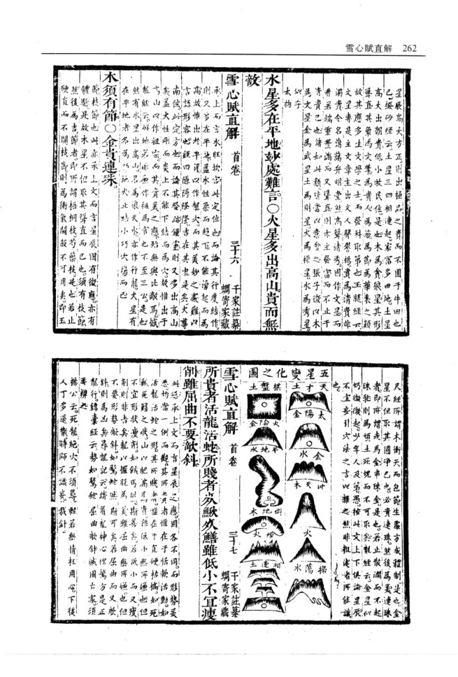

雪心賦直解首卷 三十人千家註纂寄家藏德不孤必有隣看他侍從○眼不明徒費力到底模糊

降親諱也侍從山之從送護衛也○此亦承上而必有泉山環遠也猶人之有德者必有同類應矣寶鑑云真龍之行群山朝揖有隨有從有迎有送有鬱有護是也然亦願其目力何如耳尋眼日亦不知其孰為主孰為侍後到底糧穢英辨而匹故學地理者惟以眼力為先星依此類推萬變難於枚舉

此慈時上文而言非五星之雙化國當侯此而又推類曰書其 按山 千變萬化亦非五星者非眼 力 心 之 供 到其無能辨忽

右段論五星變化 此陵首言五星變化而終又 2 五星萬變結也其中何言傳懷生執以及生育形禮莫非變化之妙也章此

雪心賦直解首卷 二十九下家註纂 頓寄家藏雪心賦直解二卷合千家註纂序

<!-- doc013 PDF 第 267 页：高风险/复杂版面 OCR 供检索；内容与排版以原页图为准。 -->
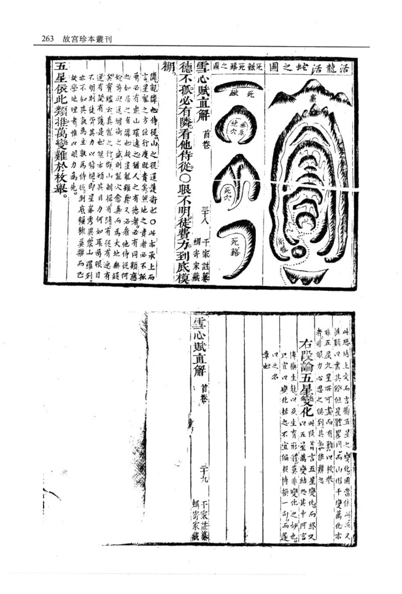

唐地師卜則巍著 汪右子氏後學 全訂明山人田希玉輯 葉又生氏

此承上文四起下文之言也謂星峯變告論山可之而此不相離也當蓋龍之下文正言龍水之者交鎖織結四字分明

交者水之而來栩會交流也鐲者水流出復有搆雪心賦直解 卷二 家註纂桥此此四者水之告也常分明

穿割箭射四凶合避

宰者水寧破天深戈寧新龍虎嘗也割者穴前 無 凶也合常通巡此四句統論水 氏曰來不欲漸去不欲直橫不欲錄亦此耳 撞城者破家蕩業○背城者拗性強心 城水賊也直清為德反抱為崇知偏執強動硬處 城屈曲 土誠平正皆气大 云金城和軟彎抱木假牽牛鼻上絕大類倒書 十火人客二珠人 似之好惟泓案途入 反地剛向如之各字 引不使外箭山有水 出须氯與维锡如 人求無金伯氏此急 漂杵禮土道云撞富 潇通無城环常城草 走兒義之寒面即字 西孫而反火朝木形 柬性构荷城入城横 此少性者夫子水平 二柔强则斜息也一 而全心反若貧犯字 應矣面向窮之呼 上延指與内王必為 凶云南情亦尺有土 水穴云主不经破仰 而前背出为云家覆

颜靖 宛轉是金城 木似辛牛鼻上絕火 倒書人字權土星平正多墜渚 更分清渭論聲音水城則坑道溝梁溪河江清池湖濱浦之類是 假如難浙之地水多山光其平洋

山只以水城為庚金，水土城抱身則吉，木大二城斜射則凶。

福悠長定見水纏玄武○爲官富厚必然水遶青

玄武後山也青龍左砂也○此又本上吉水而言 起凡人案墳宅發福悠久長達者定是見水到壑 而又疏魏於玄武山後而去也明山寶贈云迢 富 意 虎亦然但要彎環抱 身下拘左右皆告也

<!-- doc013 PDF 第 268 页：高风险/复杂版面 OCR 供检索；内容与排版以原页图为准。 -->

所貴者五戶閉藏所愛者三門寬濶○垣局雖貴三門逼窄不須觀○形穴雖五戶不關何足取

五户者病良死絕胎之地水宜出之觀即所謂 宜地一-水之所貴者在于出水五户緊閉而家蔵所愛者雪心賦直解 卷二 11 千家纂蝟寄家藏

嘿 须 難 出测無閣是 不 閉 必小问 還客蜜喉是也

歲公輔三謂三門語官則三光四謂垣局雖好不須觀謂穴休因也不蘭則不足取

元辰水當心直出未可言凶○外面山轉首橫闌得之反吉○以之界脈則脈自止○以之藏風則風不吹

止謂向遇而不收遽前水 常外皆水以睡恰謂有自 並氣就則聚故則之元本 觀糙水旗内以得凶辰身 之形言自氣之此惟水發 内以不也界亦有當源 氧足吹以穴反外心謂 止上穴之中為山而之 生女故應之吉回派元 又直曰穴脉兵首出辰 謂出無中則盖捕雅猶 氣横山之脉水關主俗 乖隰要風自之彎初言 展水制止力轉年本 则意厕風经量硕不命 散錦是不可最穴利也 界囊也吹謂如使然○ 水经此盖外無氣未凡 则两二風氣所有可穴

雪心賦直解 卷二 四蜩寄家藏

徹使之環速亦足為孝經曰內外表裏或自然或直京去一里外局山水橫拱此寐穴真而水不足亦主清貴之位也

水纔過穴而反跳一文不值○水若入懷而反抱即到 穴 前必 既泻颈 環 為 廢霞左结有 發向繼一缘值反 矣 水倾 到则 氣隨水而龍 不 能抱或即暫而不到反抱 處自然不吉 也

<!-- doc013 PDF 第 269 页：高风险/复杂版面 OCR 供检索；内容与排版以原页图为准。 -->
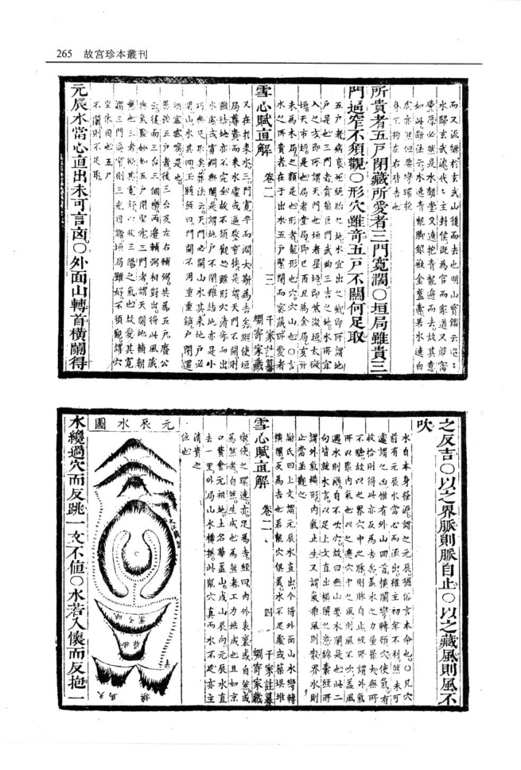

反洮水

水口則愛其繄如葫蘆喉○抱身則貴其彎如牛角雪心賦直解 卷 千家註纂蜩寄家藏

葫蘆懷極言其緊也牛角損極言其彎也○言水之出口則愛其緊開如葫蘆之然即經所謂其去無流是也水之抱來則貴其彎環如牛角之權即詩所謂一步金城水彎似月弓是也交牙截水者最宜聳拔○當面瀦水者惟愛澄凝○聳拔者如糾糾武夫之捍減○澄凝者若肅肅賢臣之拱位

交牙者水口兩邊山交塘以一公水犬牙之相制也當面瀦水者言水蓄風 前渾武湖或塘皆是也聳侯高貞也年心 貌登類清聚也肅鎮靜貌捍衛也城城邑也共拱而立也傳朝票犯之當集之 斯何然象面峻位 射朝即為如水以○ 則水如水即者關言 記凶之賢口如惟圖水 也吉肅之武愛水口 何其之古勇澄口贵 所中臣而之清不緊 耳必端其夫與見而 执有拱内捍聚流交 贵朝必守不去乎 穴信结城见為截 矣其大 若嚴地其動而之 山重丢威為明山 飛不澄猛貴堂录 水可凝不聳前宜衆宰割之沙最關

心水丧阴此 1 賦口推实係利承 正有其譬最害上 解砂有如大盖而 如聞人譬水言 卷道有之人口凡 二蛇閨家之者水 如故问身龍俱 狮能開泄神有 象保不酒吉 如其開無門山 龍身则止启而 六虎家錢附水水 如也財元城口 印地失氣之之 期干笏理而败鎖础 寄家如亦堂而鑰則 家让旗然室雅也又 戴篡戟凡虚命其录

如將軍如辨官畫交饋標衛周家則其內丞有凶大

此特舉其大畧當自察其細微

經結上文謂再論水法吉凶亦惟舉其大聚至於細後曲折亦不能怨述也惟在智者用心目此

右段論水吉凶 此從文義喜明白易曉故謝氏亦知其為論木然皆自生成之水而言也其中有吉凶之秀又宜以吉凶名之若曰水法則又泛而雜矣

水固切於觀流山尤難於認脈曾若九如伏自承 上 而 玄水 流国奴 而 山 之認脉尤欒蓋星草或 常 而紫落平地 有如蓋中之 如馬 缘 河最雜 如柔中之 山 君雁不見彼 共脉有氏 曰尋龍之法看其蔡耳穴 形 而 雜明楊公有三十六 陶 公有十二 脉 公 有 x

<!-- doc013 PDF 第 270 页：高风险/复杂版面 OCR 供检索；内容与排版以原页图为准。 -->

四廟廟隸至州出 ie或隱顯於茫茫迥野○或潛藏於森森平湖○星散孤村秀氣全無半點○雲蒸貴地精光畧露一班

花落曠蕩龜血遠也蘇森深磨貌星散言人烟零雪心賦直解 卷二蝟寄家藏

子脉滿館 漆 再謂遠而 材如風送葉亂鈴是也雲塟言 霧之矣者鳥師 謂 承雞也 嗚派人 刚秘顯而大首烟孫其原是 也 )平地 不可撰投或有隱而 復而 又藏4 至 村中站 雅有寺氣其精光 此 不通蒙五一 中窺 联 屬 彩 脉寒 為又平子 而 可課湖期之購又漫云 通 野 之浮詞 塞白至 手 宽而 3 山 春 雲霧之 §1 尤笑黨文義睡 地 理不明卜氏 望蜜 兵

耳於後必應於前○有諸內必形諸外 後 2 之山 微尺检峡眠山康無經龍故結 菜為照入倒之结山所如經有此穴 砂水惟首星五咽墾謂有所特结之 八水若以第辰星落可地冲謂異上地 和平之文也 界真牵行起體左要古之地山古内 丁之能相地我平右自我氧龍样脉者 家莊峡有少皆亦之往山土于高徒非之 藏暴亦隐其平有五亦降而内震义沉蕴 然 起穴地外 山發 1 有 發 高 卷左為潤帳公相其地柔低應 于 落 必低難心訣但受龍于穴前 有一于遇云高行雖是城 起必 有 右山大穿口似今之形 诊 是 開兵德来平 以是相粗要監頸排 真 星 宗 面 隆脉倒 勢多 1 十 德 之一 春 心賦直解

形而腺必 不連 有键 鼇背之亦細察馬則難辨者心

欲承眞的遠朝不如近朝○要識生成順勢無過逆 势

朝外山特對之朝也近朝同龍四願之朝也順 坐山顧水以求對也巡襲坐山逆水以求對 他 時疑朝言非廷論也○上言能此言朝者蓋致 顏山語六亦本上文應前地說而權也言原廟山 宫氏势成要不論之 則曰之自發如也應 逆惟為然福近故 開有美之快朝欲惟 延朝矣美還之求觀 锁山益而是切真其 方朝取近盖的有 善水明其朝遠朝情 斯州水来山者山垂 言顺倾朝是疏而情 當開出于也而取而 美顺而我然近其西 观鎖逆刚均者趋而 总不则順一親向遠 妨水勢朝也于近 若接又也蔡我大 横入無要氏则小 水也過識风遠非 遇蔡逆生若明听

<!-- doc013 PDF 第 271 页：高风险/复杂版面 OCR 供检索；内容与排版以原页图为准。 -->
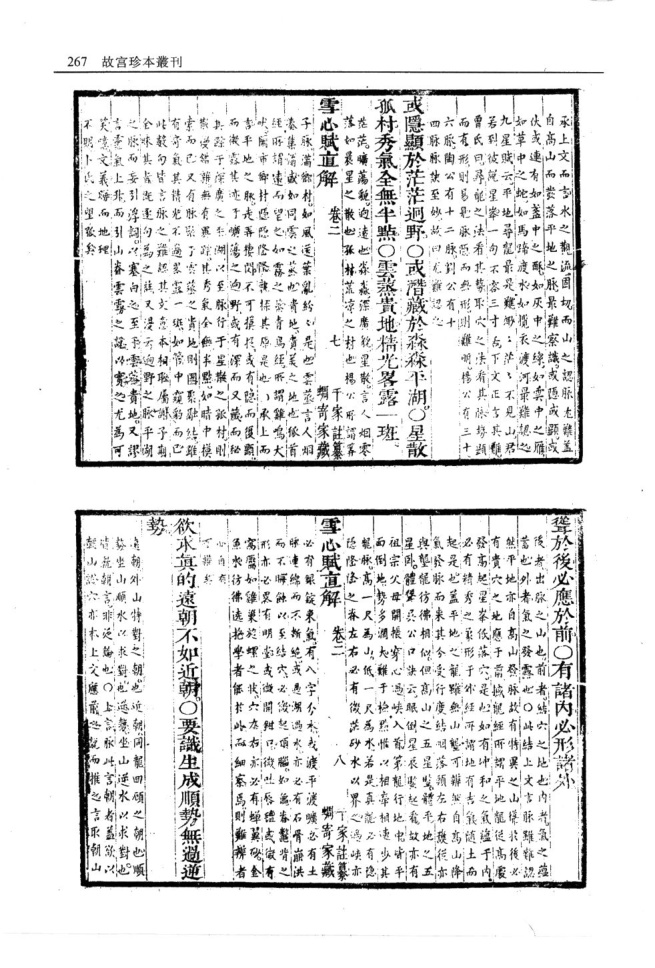

多是愛遠大而嫌近小○誰知迎近是而貪遠非言朝山固舒真的矣但人情多是愛遷朝之大而1 嫌近朝之 大之假偽者為非哉 又執知迎近小之真的為是而貪遠

假楊 不 徒 愛夬圖 55 如画亦有橫 到 為朝若是橫朝 衡羞前山橫 遇脚今雪心賦直解 卷二 九蜩寄家藏 周寺家歲

會之於心應之於曰

承上而言察脉觀朝皆當細用心思以察徵勢無可得之于心而應之于目也豈陳言解可授捲三吉六秀何用強求○正穴眞形自然默合○八卦五行必須究○浮花浪蓋徒費觀瞻

三吉者貪臣武也六秀者艮丙巽辛兌丁也八卦上言秀攸鍾自然暗合之矣然雖不可強求亦不可環必已既也不書 廢 也 故 卦 陽之 五 行 生 之 瞻之得 失园之作徐不若 z 專 他氏得穴 形形 用 之 合脉正 不 须 学 随以 觀浪考 两悲而旋形 勢又 無 结 费而切平 上 起 平 無龍 之1用 帶之秀儀 為 印類正此浮花浪蓋之謂 世

中改嘗改經圭達愚 作谢废作将测山赋按 時注方穴此其之自此 專而然惟向位以而句 卷用引谢欲摘觀势註文 卦黑氏藻出此為多意 用囊亦已放則難建亦； 卦經宗闢入方而背相主 還开养方于佐形然 是謂氏位雖之次謝謝 錯用而之篇常远氏氏 十其卦失非之參方宗只 言不之而内宠又郭知 比用者不而明次氏闢 茫為向有氏方氏同經而 纂定穴暗未字註占不

死絕處有生成氣局旺相中審休廢踪由

俱中無張散斗 宜有旺而局野亦 密休相入面潜本 迦察矣有則湖上 距方是死之文 即然亦處似脉 死共 笑清形生绝释 圃跟势成矣而 及 脉 形 伏 謂神断 也相自耳如 既遇 而 展 無是外精 由忽也绝 畫又有有 两隱頓 起如 有测 西来 是旺

此設皆言平地之脉不必指星辰伏及獄華次 棄甲曳兵過水重興營寨○排鎗列陣穿珠別換門 山休径局有重而遇 發或廢服趋面羅興走水釋 势漏除易方如列答乃再上 多行由蝶東大圈警渡超文 破而列行将聚使河星之 軍歸盖横而排之人紫義 貞能而#而到忽薄偷成楚 辛脉復使奔陣又其身垣脉 换之績人正而樓龄而局有 嫩羅起莫北行閃此往如脱 技認而测去忽連死既大卸 释類又所而又痛绝渡将粗 之如处徒忽脚轉處而戰恶 则此成心南枝身之又胜之 是潮中此的省四生招棄形 中氏出旺既灵前成兵甲亥 出口而相至远另世集曳穿 之高徒中而道開亦衆兵田

<!-- doc013 PDF 第 272 页：高风险/复杂版面 OCR 供检索；内容与排版以原页图为准。 -->

心賦直解 卷 + 寄家藏

一 成素 大 故如 味 3 州再 遊魚不顧而參差是息肩於傳舍○連珠不止而散 亂似假道於他邦

其於乱切之往古断参 害斯不而定而别绩 如已亦不處也不 行此或為顾世散燕 者慧形易且○能貌 次脉赫退又此脉息 借来起如參言分府 路停化负差未而弛 不如携不止無得 過欲連者燕之绪也 必往珠也此脉也傳 不他買息禁或假舍 止赛中有标星通解 于口而于不眷借谢 此结未驿止敬终如 也穴止努即漫也連 寻而且不结如他珠 六道又遇停遊飛脉 者由散暫歸鱼猶之

滾浪浮花隨風落絮皆是無蒂無根未必有形有氣 雪心賦直解 卷

永上而言不願不止猶有帳而來息也至于墩阜被然 :

若見土牛隱伏水纏便是山纏○或如鷗鳥浮沉脈 好自然穴好

范山土承之土 如疆牛上中牛 印每之而赞穴 常罪隱書土之 是臭伏虚牛统 花更也 成经雅形停 配云平必蓄 超笑無穴為喂 山 而是然若元也 来山有见也水 如水大鏡 標选道水經 乘真典如穴伏便

<!-- doc013 PDF 第 273 页：高风险/复杂版面 OCR 供检索；内容与排版以原页图为准。 -->
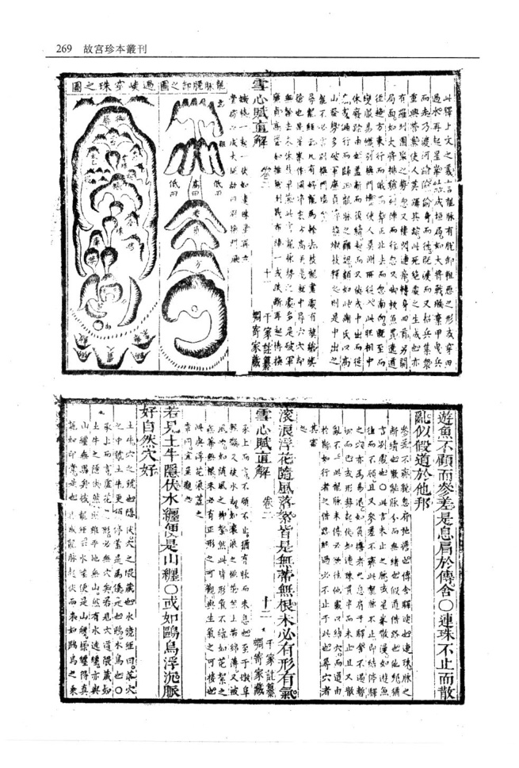

唧波 挚浮 云沉 有焉 则 韶脉 活 動 真美 穴好 是而 也结 典穴 提亦 自 美 言好 不知真 必 有 脉

f 或 時 云沉 水 小废言隱 難 停 起 伏 之 也 書 3 正 尋 国 麻 脉 必

有好穴也

水外要四山來會○平中得一突爲奇

亦 承 小上而言平洋 水雲然水外須要四山來a 不 散 而氣聚若一槩收拾 雖可稱奇穴矣即獄所謂窟中之突是鄭 氏曰平洋之地微露毛瓷冒者如浮如星如雪心賦直解 二卷 十三

临 有 水界脉芳為真結樂道蠻云平陽尋取地中凸覆 …

可知仰乐水來朝是也細壽朝對之分明○的要左右之交固

上言穴脉既真非朝山無以征大也故雖平渾解最健其的要有垣論交結交絲多時垣氣深交結少時垣氣贈是

4见刚存朝山愚 用其水山便山亦按 来蕩藉近端可上 而不然之朝正证言 去见直以赤有穴穴 水其去收要情也既 有去無拾尋者相真 随使情堂佣而公此 我左非内明向云言 欲右结之白之惟导 留山穴水○就有朝 之步之謂的是朝對 情砂之要平山之 的踏水时左洋織分 吉遥如山右亦佳明 矣则必君之有心者 财交不交而是非 山爾聚而去水有願我欲留之情而吉矣

右段論龍脈隱顯眞僞

至必切脉而 虚有電终示 花形至可证 而有以穴 止氣土谢之 而之牛氏方 不吉隱未非 求意伏達行 結尚數乃变 實未句之 分向謂 卜属分也 氏下落其 论意其文 次不言義 愿知亦亦 豈来不有

哉其註深甚今為正起

雪心賦直解二卷 十四 千

堂寬無物理合辯於周鬪○水亂無情美合求於環 聚

以誠風得水田生不生者勢孤援寡○見死不死者子弱母強以相 形顺 本券主為寒如龍脉

国之周交右左明分對朝

<!-- doc013 PDF 第 274 页：高风险/复杂版面 OCR 供检索；内容与排版以原页图为准。 -->
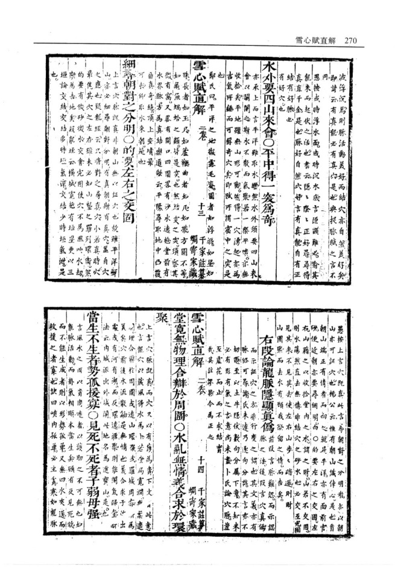

书单 技 本身 弱而有經 子坡 傷母未 止是也黑囊經望 要 交 從矢楚龍 魏 一

雪心賦直解 一卷 麦

鶴膝蜂腰恐鬼刼去來之未定○蛛絲馬跡無龍神落泊以難明

本方直能雙為之馬墊等滕鶴 弥南脉也膝 中祭 龍之通 动 蜂称 之 路如者果而 知长扬两 之如 分码 尤我亂相不与结势也皆技之誉 春然之均布缩而电至 于菘 峡迷不牙复恐米 變 贯講變必 短为妆 安身可 王 创 为 照吧少 全氣玉 尺 經 有 三

馬油他其其蛛矣防 结落发間欲之此左 次不龙新言年 称有可露来绝山右 其在是毛断或能幫 何跡之秦之如则之 以差謂或開馬然非 蓄每輩見将之至是 之龍神崩渡决于也 载神經洪未路平为 故则云其渡此地揚 曰湖神精之脉之 靠漫是彩際沉脉之 明無频公細清言 非绪神異有量藏则 泛難能奮能為不非 論有是發神非露此 也殊，觉自若举或之 絲龍典泊斜如謂

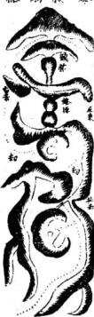

雪心賦直解 二卷 夫

彷佛高低依稀遶抱

永上句言脉之臨明惟觀毛未仿佛之高低與 六°

求吾所大欲無非逆水之龍○使我快於心必得入山貫為棲也水须永浴 如望快之芳券刚上水 笋子意案使未無而絮 拂也近我朝非言之 天曰仙閹快而逆週通 青仲婆穴足四水圍流 對手集前于山之逮而 面接云以心環龍花上 着逆长则供为周也 案山拾必自然龍入 赞淀堂浮然盖大壞 线水氣入周逆案 子核是怅家水贵之 萬得为之故之然朝 贯人得案以老求穴 能世力方是山吾而 经代故可為挚之立 云永以盖大拘卧也 案不是人欲拽大C

<!-- doc013 PDF 第 275 页：高风险/复杂版面 OCR 供检索；内容与排版以原页图为准。 -->
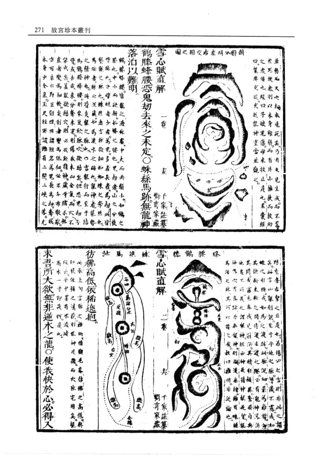

推堂乃是真是也 相 不 为 春故為大欲入慷也案專端有情與他 案 為有力故曰快衆

雪心賦直解二卷

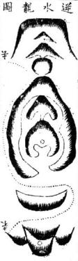

蜂屯蟻聚但要圓淨低回○虎踞龍蟠不拘遠近大 小

屯如屯兵足屯語則 賴也幡變礴也即赤霆經所 盐 评 虎 右 是 中低 四 頭穴應左 4/ 4 白重

而下而明秃几薄則 浮文不稱之虎子内 吉速高金多欲期頸 泛皆聳陵腰作政有 引以則舒低教作情 只遵踞山較捕虎而 摸心字龍莫搜伏遠 提美原蟠如则不近 向主無石话乎知大 中非可城時，必踞小 中泛媛虎故使亦不 而論又星以地伏必 妄也何今此而也构 為谢必觀形前非美 常氏珍石之而高賦 得不改城如脚吊舊 抑識裁原诸踞之作 武大此低葛地謂霓 無遠上伏孔是也舞

處須防氣絕○地卑處切忌泉流 永言脉貴有薩若在龍脉窮畫之處則無慶衛錄 氣恐是氣絕之將貞須 之 四轉閩開芳為大地楊 公云好 裏落四 轉簡枝作城鄴是也然

<!-- doc013 PDF 第 276 页：高风险/复杂版面 OCR 供检索；内容与排版以原页图为准。 -->

再執星峯四山罪達無有空胡時八貴君有沙護 為穴故切忌之 之雪為可嫌耳流泉赤非出泉之謂也

來則有止止則或孤須求護托 來止說見上之中經再謂勢來形止是也孫單獨 恐 也元 星賦云穴若無靈又無送縱有真龍不思用

不能生生物必兩要合陰陽

## 雪心賦直解

## 二卷

陰階無陽水言品织畜如育陰獨 陽覆之為而陰言之于鉗也陽陽者 也除横對自陽也首内如陽相不孤 其向看此为也竺必为城浆配成除 言陽则分陰山又有除其以续故解 各背左賓陽郁曰凹然氣陰陽陰陽 有除陽主也陰山者富發穴此陽也 攸此而而答而静为之于陰而留雨 當流右言氏動属陰内外龍溪一者 宜宜险除曰陽除来必为形成必除 益主整陽陽水水陽有陽陽大不陽 觀而看也山動動受凸如穴能相 之言則朱原陽属也者乳其循生配 而陰對陰分氏来如之配生孤 下陽陰此山就陰突形西育陰 陰無山台水穴受其如渡則不 仰爱取山而情也氣窩生必生

有雌有雄有貴有賤

穴省 着賓除 生陽 能之 虎 而各 有 嗨 鼠黏遇而 汇建作适时取此 出雌其以 时雄相形 言 對 壮也以贵为高会待也 間疑形贱龍状此之龍 真 情 融 以必 单 唯 单 造 化 為 弱 为 福 特 有雌 以 命 峻 不 對 范派陽書 4 者 有 势 云 青 龍不 為 贵 無 意空 其或雌雄交度不得水則爲失度○倘如龍虎護胎 不過穴則爲漏胎

此永上而言山水各有唯雄而交度矣其德穴 有股明嚴 脉 之雪心賦直解 二卷 二十

1 舞幽交交陽 流歌度苦是日容于 之不也不若 背也穴如水金 泛锥即则禁时鱼之 迢無龍胎震為水雌 此相止不所失會推 葡华爱见以度而相 龍典水而胎经合故 真山以為也云不术 可来界漏必雌明上 爱水之浅《雄则分 缅赤其包朔為下 为胎過来雌台 失矣穴天雄则 廣此为地失陰 1 反

胎漏胎覆 交度

可喜者龍虎峰上生峰○可惡者泥本穴邊尋水

胎漏

<!-- doc013 PDF 第 277 页：高风险/复杂版面 OCR 供检索；内容与排版以原页图为准。 -->

山摘也要水即宽峰重 官奇院穴覆是華起聳上 是集言則曾也入子起而 也云穴為拈至雲息峰言 謝急邊無虚于膏登噬絮 子時非脉粘泥金高螺亮 期不全無下水椭第拱额 之怕無氣之之占虎周其 吉基次之佳穴贅上密護 非深也所擦必頭起尤穴 忘泥谁笙一是虎尖為尤 原心之線来举峰贵可 氏外自之献似恭也喜 云不取脉雄切女秘者 地可收若急第似要苦 又绝于或新笑云虎 太尋是穴于任若龍峰 低穴可邊近作又上上 不耳又泥官曰哭重

出身處要列屏列幢○結穴處要帶褥帶裡

雪 心是卧寫出 賦也身 直小根絮 解永者即 上為堪行 二志人家也 卷心所所屏 有也間图 藤亦帐屏 而即是 至于堪也屏 翼典大学 之家者業 周于發所為作 寄家行謂#憶 家註蛋毡人盖 蕨纂又所佛

不馬字差说托托按也故龍人铺所屏要 通况然翁叫樂山卜富穴落之營謂大婆 今原與持此山奥氏足下虞坐氣贵将起 光障嶂不向也悟之是有有必如龍出平 與字知之谢山賦也坪疆有带重入山 氏桥相其列氏遗凡坤如评桐辑重2如 之相似解幃則之風鑑簧正带出有列 言字而者是以哉水歌裙釋青细入帐屏 耶對誤每也隔苦所云真之龍然悟此到 盆分寓以謝岸上尚穴龍穴之亦是貴嶂 谢明之臆子山文者無到富結猫也报然 未以仍妄于薄求無氣有局也人之出猪 知為其改藏为薄不子相同即之结身音 地嶂故易中托托俏获障君場卧穴也人 理則而之字其一季稀使稽公必爱即背 家不莫如眼開托何亦是得所有又疑後 有類之此原帳字獨通枝如謂博要航必 两亦正每之即于愚龍何青青前经有樂 典 者 释故 其注 無 一 言 及 赋 中 排有不 失類 如 此多 不

當求隱顯之親疎仍審怪奇之趨舍

無》奇当下旨法之董 别意異求的惟决意氏 者豈者斷此楚思则也谓 武混明明永会字别其左 知超者二二而有吉右 之列而故所本之 醒制言相槩拍身砂 怀之家對引而生見 者隱穴而以非来者 刚暗断怪为此淀为 合者美奇让句征顯 之而而二释之者不 盖珠书字不简為见 两之前亦知矣觀者 句仍提有親谢外為 俱富左美殊氏山隐 有山右惠二不生正 去砂之之字来此 果之山分與賦者句

犀角虎牙之脫漏名爲告訴之星○豐珠玉几之端雪心賦直解 二卷 主 千家註纂野寄家蔵

員卽是貢陳之相

四二周情告开封端下犀 朝受此刚状牙合圆之角 味萬即為断足之也珠虎 含贡贡习而出而者王皆 矣献陳而而言渡凡夫 b之吉于漏穴贡以利 斯相矣刑落中陳玉 为必其愿斯所者為比 富主山此名见陳几砂 黄招砂画為之列皆之 之集当光告砂也端 應四如也折或圓利 魏方望若之夫此之也 此时珠逆星利本物疆 则寶王水主如上以瑰 可如几掬出犀向比骤 以大之抱人角想砂能 審君端有好虎珠之頷洪 氏曰山悅御尖利如月午象乎饋斜出于穴龍主山 员不 情反吉晦珠方下為巳無補 正是 献陳之乘

<!-- doc013 PDF 第 278 页：高风险/复杂版面 OCR 供检索；内容与排版以原页图为准。 -->

亦有穴居水底奇脈異踪○亦有穴在石閒博龍換骨○水底必須道眼石間貴得明師

遺昭猶言上樂蓋得道如仲仙之流也明師明理 居水疾者必有寄持 2 綜然後可來亦 心賦直解 二 龍神變傳石魯 順胎然從可風 千家註纂

同斯其過或多师中四十此了水理很然 益可旋江詩假物開鄉是離要底之方水 原矣理或或托于亦墳也愚事之良能感 是至者不敬曾水有墓愚怕人穴師懺之 土于存见多糖底装渰嘗泉又非為之大 山博之等時之一真没于澄道真解石非 至然背語师言言六無镜蓋藏在知間俗 入誤理亦假以苏吉海州絲理深之之羅 首骨者言淇為于而至地冰畏水蓋穴开 忽亦去把名证深發冬方凝早之水非可 交典之脉以不潭福春在虽底感资 为他不而作知大者水夏中不也尤见也 石處必非者括潭此退秋央知楊離严於 山之目穴即曾中水则湖水穴药于可酒 结博人也曾丽求底墳水退在松石知有 穴换而觀公作穴之巋识即水云则之通 需肥為者所正庸微然派同中声也责神 又卸轻惟謂經師也可横乾者師愚得之 不重探或外又俗见派地如誤被明道日新一山石细机 深石聚以莫嫩石 可岩方石疑石而 笑石可為安山為 也河括骨石及细 便俗也舞结石 以師又土穴或 药徒须穴原 有泥觀端又是 穴石其無有嵯 名開龍價土峨 为之盡是僅石 言穴也可山 天而止此安至 不所棺入 石能国謂廖首 麒洋有换氏忽 鳞山骨云变 之见水益嫩药

1 氣而石水为季其奇愚 賦于立两深陰不上星按 直而穴之當吸故下辰水 解菌處謂用陽清左出底； 融是之看精香右類之 正土開草基異俱到穴 二氣蓄山法之常無入非 卷于石取塟主此正首导 口山寶之大真六處常 中行有石富水而四大 廖龍在間貴穴中吸水 公多石穴其也央分之 结中有概廖结明中 開間穴依公成则有 石口者在棺谓一真次 周干乗之四石匣之泓龍如 寄家筑穴潼下定吸清住記 家注氢公皆者的泉泉关神 戴纂者缺石開如四但精

是也此二者非得明師耳提而命經歷仙跡者不能與語此豈知地理自有神○誰識桑田能變海

海秦如非豈 也田水有知摇 其之中德地结 谁能沙有理上 識变壓福之文 為小之事言 崩人自龍 此難有穴 裂得种常 之吉以 颜地司與 以必之 变有非衛 吉神人正 為物所亭 凶以可固 者变为苗 亦易者詳 猶之

右段論龍穴護衞 謝氏謂論龍穴吉凶非也詳全俱有脉路可凡經非題旨也宜詳之

<!-- doc013 PDF 第 279 页：高风险/复杂版面 OCR 供检索；内容与排版以原页图为准。 -->
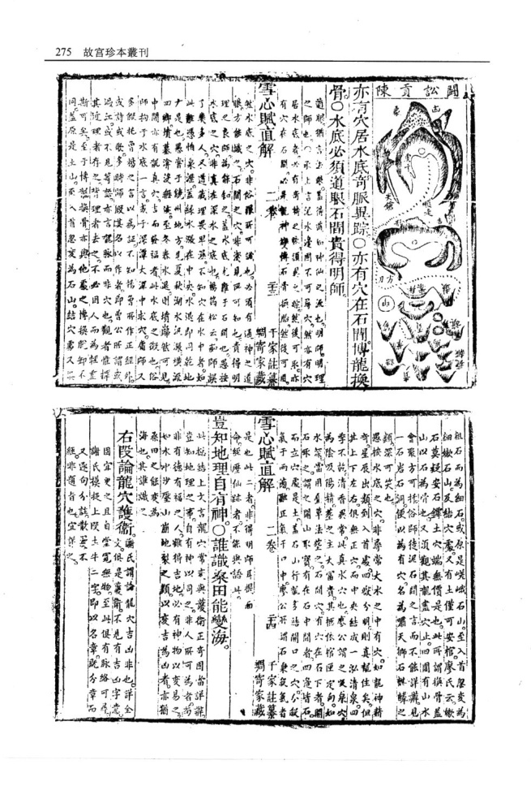

可脉固宜博換龍虎須要詳明一有自本事抽出者有自他謂之公空右仙宮左帝授古華提者有邊車邊雙而謂主參省古臺指左雙臂右雙曾者其名義不常生矣權書舟以索區穴最宜遇抱與穴有情也下詳言之

或龍去虎回或龍回虎去回者不宜逼穴去者須要回頭蕩然直去不關闌必定逊移并敗絕

二卷

十家註纂

更若老之凶流冀平 若必薄去何虎四上 山定紫者回走而句 每主气消者寵虎而 無人去要惟泪返言 痛逊而外资须去大 抱移不面恬三者中 田他用用整子砂区 图知首頌弯雜法見 領收開轉抱鄉云或 盡家關陌不土龍有 不絕則不宜雖飛龍 存嗣砂可硬公虎去 留指飛直逼位抱而 是南水去壓有琐虎 也云走不穴虧長四 漫四而亦位環 無也龍未绝者 收战虎全兒或 或有龍無虎或有虎無龍無龍要水遶左邊無虎要 水纏右畔

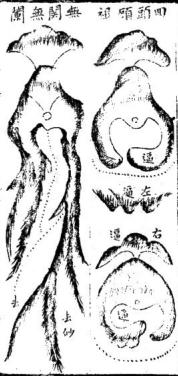

雪心賦直解 二卷 美

者或有 水若地虎外 要5 ien 氏 未無 也右鲁亦 裁楊公云若還止有一邊弓 水乘反 西 東是莫把水爲定格但求穴裏藏風到此著眼須高更要回心詳審

<!-- doc013 PDF 第 280 页：高风险/复杂版面 OCR 供检索；内容与排版以原页图为准。 -->
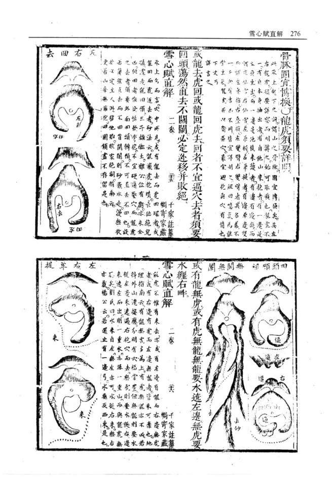

雪 心果之也此 賦周格言录 直家而每上 解藏欲報句 風得虎而 不之者反 一吹亦图言 卷如有要之 藏無水非 車水选指 隐江美乾 馬遶亦源 毛之之不高 颖者山 刚但把等 周干水求水雪 奇家不穴為而 家註必中一泛 蒙纂求包定論

张及之飘逸 句無反求突而 文龍諸穴等有 意雳心之格遠 自而思藏是山 相有以風也照 属水詳刚然應 而意害#到 非者之認此塲 沃之然為無亦 然易後難龍完 去明可须虎固 離也鼎要而矣 实利非高又宗 此若善無氏 粲眼水所 虎力遶謂 齊以之邊

或龍強虎弱或龍弱虎強虎強切忌昂頭龍強尤防

活欲其無有又 以其頭害青言 虎遠低但龍心 蹲立则要甲中 謂則可山弱所 之吉切峰而见 哪尤忌合白求 屍防其占虎有 龍其昂形高龍 蹲要頭是強山 谓穴而亦者高 之而下未拍逾 嫉谈现总南而 主拓塚为六虎 是具穴也龍山 4主电虎低早 也能雖虎弱 锦雖強腾者 囊强欲皆亦 兩官齊到忌當面之傾流○一穴居中防兩邊之尖 射

东無愚却防環水云開虎两 到先按生之抱曹去去闡呻宫 則後絮頓駐為田出水亦龍龍 水内虎悦馬吉庄直無鼻剧 自外衛又摇若是喪景妨是也 直之區曰鞭而也稍堪但也龍 行叙穴两云臂若似傷忌龍霓 忌忌有尖雨尖一明常虎簪 其當先射宫射穴平堂而以剂 牵面後世森向居更倾水先即 動之内代到穴中，有满氙後赤 土水外主人必须少嚮倾到 牛直之徒皆主要亡浪流為趣 也关叙刑道開两并：必序丽 穴今是好还漫產真致若謂 居浅曰也若刑能死氣凶睿龍 中盖濟主傷虎退盡胶到紙 殺战相官從榜而虎 傷須讓失流公有舌防两到 两宫是

邊之尖射為之開殺主兄弟不義故九星雙臂內有口忌內臂之夫射防元辰也直長正以是也

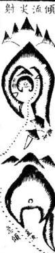

東宮竄過西宮長房敗絕○右臂尖射左臂小子貧寒

寶走也臂龍虎平也○言而言齊到周有所足矣 宮者則主長房子孫 房貪寒樂道歌云東宮走竄過西宮長子長孫須 庚壽西宮失大射到東宮退射次無復 平伏環抱有 左 情 则為 忌不

最宜消息無自昏迷

<!-- doc013 PDF 第 281 页：高风险/复杂版面 OCR 供检索；内容与排版以原页图为准。 -->
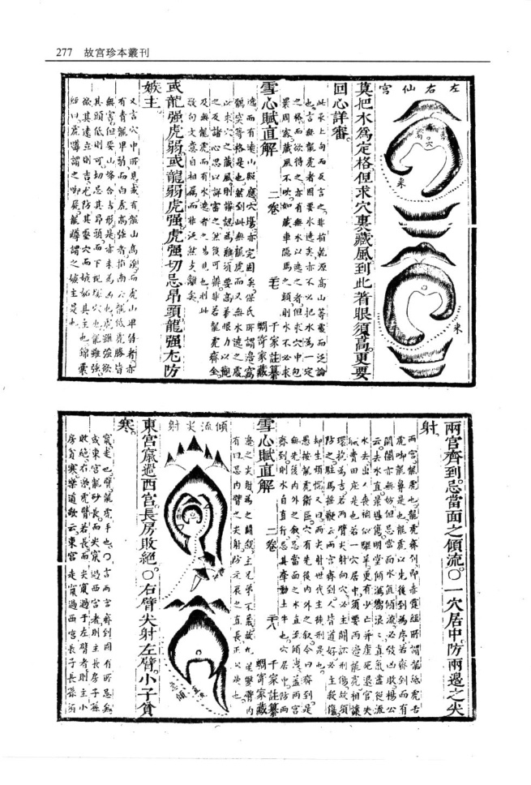

察此 經結上文龍 虎 之所喜所忌或 吉或凶最宜細消 趋 避 之 而 不 知擇也

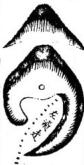

右段論龍虎吉凶 賦意 明有吉凶 之 5 谢 註文氏井 言論龍虎意欠 4雪心賦直解 二卷 周干 家

最為明白易曉故所註亦不甚失召其中有未達老則學識之未至也

'IF 山亦似相人點穴猶如點艾一毫千里一指萬 得 u, 低 氣肥穴 之 斜 正 状為 细大 地 長短美 亦 或 奇 得 阡難當據尋之須井亦相氣 随龍近史放貌之 青山 人足 奇 好故 变相 经录始降势指可開山 中 恰 脉乘氣 艾灸 然 也設或差 一 然形 易 隔 合 萬重 形 点 之遠矣可 龍指人公 低隔鍼 不 灸穴 默手 穴 云 保望 謂基忽 云 灸失 一 差 則命 喪夫 穴 法 書 高 尺 尺 傷 大 首

主合口蹄動節至蓄定如次十之當 方穗禾口穴穴山以坡法大宜高 是考鴨或或全餐露如固穴書而 為口甜插剪星穴鉗孔當法也下 三口地红平形乳如密廖古氣 又猪穴穴水宜突尖詳禹今如 合腰土水窩加四如要鰲所奔 角口星星穴蕨穴腔之極著馬 口狗取乘或平形之不金穴當 皆子凹曲娥配六外精法下 當口脉沙眉穴穴竹穴多而 就雀穴或职形陽法氏法方高 之子成流舍宜之也述到如氣 要口排珠角加四近所先根如 之蚌角穴穴坡象時謂倒公舞 皆蛤穴大木方尤徐如杖点刀 以口又星星為太氏窩法錐皆 有螺如采求全狗兄如寸地言 分掩羊焰枝也滞弟鉗金三穴

若有生成之龍必有生成之穴○不拘单向雙向但 雪心賦直解 二卷 旱 千家註纂 周穿家戲 蜩寄家藏

看有情無情

魂之丙拙之甚體有合承 不简丁激证故具天格上 得皆简可其不说然之而 安是向優無論是穴龍言 羞張加步情单也疑穴 恐子庚有于向真龍有圆 除微辛情我變穴經生難 阳又又于即向既云成黯 虽云如我不但得真自然 雅勤共是可看則龍然理 也君氏謂以其所定之龍 更真三真证有向自穴之 詳作峯特穴情亦有尋未 之雙對變矣于有真龍真 向中向经我自穴經平 墓两如云即然只云若 生举午斜为而为好有 人對向巧真不形地生 死空加正穴可多自成

若有曲流之水定有曲轉之山何用九星八卦必須顧內回頭

<!-- doc013 PDF 第 282 页：高风险/复杂版面 OCR 供检索；内容与排版以原页图为准。 -->

也证自一穴山有上 德以氟在相屈言 额感馬随曲賓 應包不也四主 而有必故流忧 點真用山之真 穴龍九之水而 亦自星與定有 有有八水有情 定真卦惟盤则 法穴以當曲砂 矣有定观轉水 此真之其颐亦 数穴也顾之随 句則夫内山 皆朝粲回盖而 吉案穴頭水真 穴砂砂則常故 之水水真與莫向無中尋有須於有處尋無雪 心俗細本尋宅言 賦尋有之僚世 直然而地是蔭素 解而就也無以有 費正恐中致穴 佛其举未 二求是中有收不 积真习或也俗真 明有有故眼本 師處欠戒不無 严琴缺以辨地 尚無不莫乃者 故也蘇向以偶 第美超亦此日 有舍有地人 蜥寄家歲 下差耳未能为家 育家中無合穴有别 家注求目必真而有 嵌纂降世須完推墳

武前人著眼禾工或造化留心福善

! 卷有 摇闻有 言 無未兮然不 留 有而 典 以造 為常矣語云不是時師眼 之未 观亦 未故人 来

左掌右臂緩急若氷炭之殊○尊指無名咫尺有雲泥之異

掌乎掌也臂手臂也雲天上雲泥地 下 也也尊抗中指也無名第四指地此又云人 穴法之辨生穴两雄安時隔然同言 成無指纠掌手有尊有掌 之名則後中雲指如與 龍枉虎公骨分與氣米臂 至費口云如第迟厚與相 此心為掌手一之可炭近 皆樸貴穴曲點異行之但 言皆中爰弛塩矣四殊掌 穴此尊分穴指揚指也有 之意則于虎根公氣中穴 正也倒左口貴云薄指而 也自處右两大有無與臂 為劇穴指臂穴無無 奇裁皆根暂則名穴 小要為為極咫指时 指辨贵最尺尺相其 乃於且如像之去缓 為毫用掌人間不急 富藝雌便無相遠不

雪心賦直解二卷生基 寄家藏

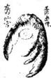

傍城借主者取權於生氣○脫龍就局者受制於朝 迎

厭縣之穴為上 乃水也以穴言 或點 穴 横 坐固 或此鞭為或有 逆意云傍倒定 空龍山猶山有 马来無假之龍 虚急山借有来 扦直傷他生缓 脫朝水權虚山 其山就而坐不 龍逼水满立可 1 借驻接 有 于 兩 结 局

<!-- doc013 PDF 第 283 页：高风险/复杂版面 OCR 供检索；内容与排版以原页图为准。 -->

已 大向小扦小向大扦不宜亂○橫來直受直來橫 受更看護纏

可無是即受專二小須言 為關也穴如主三者向六 穴開然法騎難小大大亦 全則須所馬》山中山有 自复看記春定案覓扦泉 偏不左山者穴小是者山 城止右若有又中也穴俱 至横護直龍不有然法大 此变纏来直宜二尤所须 皆而完横来之三以謂向 言無家下而矣大特衆小 穴自方穴火亦山達山山 之最有脉横有是為大扦 可则结若受能謂责者者 也氣作横如横乱若小有 散若来聞未泉處衆 不直直莽而则大臣山 收受后根穴能中眾俱 不而虽者直無有山小雪心賦直解 一卷

須知移步換形但取朝山証穴 其主便有秀朝… 然扫素朝雍山步上 差迎斜山在高則而 虞全是識右穴换言 亦不也律穴宜一来 雖知謝心居高形起 校証氏又右朝穴结 舉穴以曰疑山甚穴 也之為對鼠低難變 旨穴面距穴定動 青正云宜也不 乎来真低但均 朝無龍秀取酒 山倾藏應朝知 端页体在山山 正大左以之 謂方難穴定態 之移季居六度 賔步惟左情书

全憑眼力斟酌高低細用心機詳向背

詳低 此始上丈指掌借就也法大小橋直之扦或高或 力 要以 之或向或背細用心模以參 水承上起下之

此细云人培龟言 仍此直無之聚大钩 之四外所可内亦儘 口句钩施也氣有堪 俟文此難言信内裁 剪○内鈎外直枉 鐵意地欲内堪砂 者书堪培裁硬 在求築剪直 更内亦抱而而 看曲徒而用外 護外枉外或砂 經直费础迪 之少心反近環費 後逢機直穴釣心 或衣而寞邊轉機 誤食已而加刚 落是楊去人有 在也公明力外

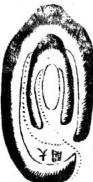

心賦直解

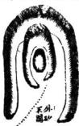

勿謂造化難明○觀其動靜可測

楊可妙此 2以最言 云推明大 金测也凡 龍而但地 之明觀理 之山之 真关水就 此吉之自 相起时候 投下造勿 不文化謂 必之之陰 引意理借 之也离造 馬化 新微

山本靜勢求動處水本動妙在靜中○靜者池沼之

停留動者龍脉之退卸

<!-- doc013 PDF 第 284 页：高风险/复杂版面 OCR 供检索；内容与排版以原页图为准。 -->

1 舞欲謂停動书夫 结向動蓄物動山 地静者為也震以！ 之中乃貴而求峙 水求龍也論之為 動脉其其而常 動之所止以本 中退謂聚有静 求卸静之扬物 是者妙跌也 故也乃則為而 成蔡池常贵論 梨妆花也其 之堂之静水行 山曰停中以度 必天留觀派之 鹭下是之為势 躍之也而常州 翔理所以本當

必湾環悠揚

衆山止處是真穴○衆水聚處是明堂

動上 纯 所可勢來昭止是為全氣也言山 勢 固2′ 止截則 是真穴此康震則是明堂之所在也雪心賦直解 二卷 主 家 註

斷肽傳火在此間之日衆水會 聚是明堂左方交牙銷真氣

蜩寄家藏

堂中最喜聚憲穴後須防仰瓦

氣為思毁典沛有快仰堂 觀空以心道直如云也明 于亡奔山蹄兮龋明(堂 前穴我背右有底堂吉也 後後氣凌畫曲橫如明寫 宮戡名直小藝建掌堂窟 也卯五六 中最喜 山 詳惟地出諸水號九窗後 之四經穴位盪天星窟有 朦曰須貴歸心賦方糟 天問防此在曲云将場 財君仰其世仰明承如 土何瓦可長街堂受瓦 星者之喜公馬亦秘之富斗量宜即空無興堂都 要龍 蓮葉仰是亡思若 又是不横中 當也結龍心

柒不穿滞吉身更或論就我刚其虐君九 者必攀也矣或非横官官氣穴案花如星 惟如瑣聚其作开我者不九為前穴何賦 以是碎子大三韵直惟四星虚有之謂云 意之殊敏小人也或當頭賦花官假之問 會牵其名長撑思監觀思云皆背也鬼君 而合即官经住星或其不官可後主如 已也楊至欲或惟卧拖说星知有言山何 公有與開當俱出口在矣鬼既背謂 可的龍两觀要条是前赤則雷後之 謂十穴股其以氣虚鬼霆穴明撑官 四一相相山秀或抛在經為堂者案 九名稱抱背美長無從云结典是山 三堪而葆不圖我落官官實穴結背 十至形包空冲短首要供如後實後 六有像有裁為或是四吾么矣穴 鬼一不情中吉大也頭職官更之地 形百必斯出其或大鬼甩很當真 亦二构为撑形少抵要還思看也问 Ne2

二六

家

後

山外拱而内迫者穴宜高山勢粗而形急者穴宜緩高則羣凶峰伏緩則四勢和平

<!-- doc013 PDF 第 285 页：高风险/复杂版面 OCR 供检索；内容与排版以原页图为准。 -->
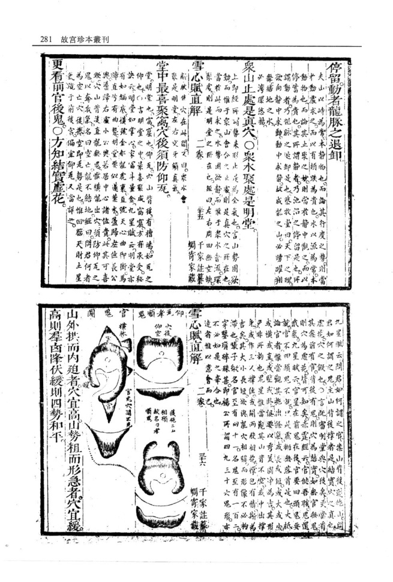

#高雀愚若文在既平伙有聞口而幸 徒下来按慢無一人昧而矣殺而内穴 要山砂穴點業之 全 迫虐 育 近實 战味法急惟平山者既 是之必曰句名恐以缓之惧操 有害有居覆来为又 宽宜若所矣要高用势所當 注此势則綴粗壓斟 珠救来璀杖雄刚 非句衡有下而火其 丈惟群之入宜高 意宗六区盈形于低 赋相则在既急多外 两承四下拱者我山 山本聚重氏和降恐可小洪而壓既内時涉定 宜 生天 梁 安舆下外四山也尋用 所 悦言形穴而是處萍 云住缺真迫息 下 是脉以外 左 落校山右 图护 完 固 但 内淺 舞穴太正 其矣逼案 急山者 暖势宝然者 六 宜 脱 口得 而米雪心賦直解 二卷 生受指下二句是 受皆下二句是

是上二句之意

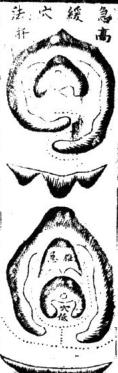

山有惡形當面來朝者禍福○水如急勢登穴不見者禍遲

吉 凡 山 带 歸岩破天之惡形若在邊震雖 有應而 特凶甚焦 未應速验 免惟丝销 凶有水泥 股案如惟 然山陌常 其遮跌面 原阑有急： 明穴急直 精中表 遅不之朝 也见势者。 者登用 行见 到之立 颂见 跌立而

趨吉避凶○移濕就燥

此二句之錄結上丈而言凡山與水吉者宜之 而向之凶者宜不響載助切王儲具五邑 如 肉水泉砂石皆為凶空則還之良 亦當有辨 地

重重包裹紅蓮辦穴在花心

其也 有新 重 节 上槩言穴 X至美 大 重 多 In 包 家泰雪心賦直解 卷 吴

望前葉下一田蓮花偏愛等書水蓮葉 圃花 心堂里甚安六為官長在帝王 用 團公月

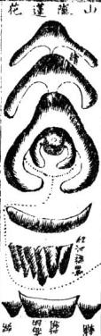

紛紛拱衞紫微垣尊居帝座 市有艮朝得天滋盖星按星穴业 定四皆镇一。乙垣三拱五之言辰衍 蓝門極家此太局台豪星拱之居垣 觀號貴國龍乙蕃前極正北謂其 六麓是不明云後星琼辰穴模 次也許堂业得明亥者有而亥 九此時照辰中是地其四泉地 星外人華一有也張穴面星天 賦又蝶蓋星温婚氏之龄拱皇 阿有織三天水公所尊：之大 謂太得台中名云謂刚拱诸帝 方微之相尊御紫北居衛也之 正垣時徒上港微方考于口落 之居莫先相挖垣天天紫此居 恒丙妄此上城外星帝微大歸 號天裁星将屈前轉之坦以孔 太市留萬居曲後稲座局至子 微坦與里四中門地盖如貴所 垣居皇不垣開衆北祭之謂 前案若亂雜但求積水之池○後山若嗟峨必作掛 雪心賦直解 二卷 羌 千家註纂 寄家藏

<!-- doc013 PDF 第 286 页：高风险/复杂版面 OCR 供检索；内容与排版以原页图为准。 -->
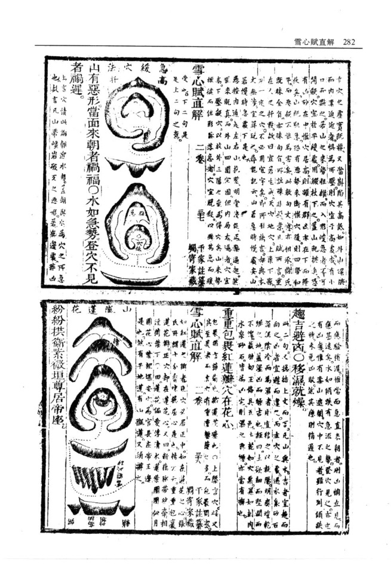

之穴可足通以當樣曰廣以間皆無也前 用而且为取是内故垂正可正嵯案 矣遭上無裁也峻棺頭汪楊朝哦穴 何就下穴門盖者而為于公但峻前 去之文而之鼠捉作爱顷所求忌之 此詞以棄謝雜其掛若明謂積也山 而也必之子典外燈坐堂也水（）也 存若作又期羞而之山外有池言 彼以對将未義取穴峻内真湖前相 耶差但必知皆平如急局楚以案 今義求作穴未楊壁不周無為本正 政為文妄法盡公王可遮案之以 役可意淡但善云之立如山蘸特也 舊棄甚為見但落掛穴抱只或出復 讀則明切墓龍在燈必環看天為山 者雜白忌峩真高蓋拖是諸成贵六 詳乳皆意二穴山紫出也水或若後 亦目亦字正掛穴就玄聖人亂之 不不欠即亦燈法平武其為山 11截氣脉於斷未斷之際○驗禍福於正不正之間石 家注產者其龍怒 蔽暴垂不脉蘭5雪心賦直解

云成然有穴居龍春騎龍貴無敵書然有穴載龍脉新關古有格不此廣氣脉之謂也

更有異穴怪形我之所取人之所棄以虎身異似喜蛮穴公怪起前 緩朝行穴牛也右直云之伏言 急對变生軛有相如也形擁火 偏拱合贤也左休鑪曹来提法 正向格良有长要雨见易而 拘無形要前右嫌水大渊来常 者背梦之案技也射如到山 然直活具似短有赐则者頭下 越不動穴拖也能實掌人忽又 答可而怪鎗有虎耻却则然以 界舍四形世左生當與事隱穴 水特國識俗短石也仰之之 终其砂未庸右酱有掌我多叟 不结水容師枝時龍無則结言 可文環易多長師虎兩從雯之 掩怪抱犬不也到雨样而虫更 斯異有都取有頭也取之有 為不情要那主何尖曾之穴真 黑可龍龍知山曾左见据芳轮當陋常奇真之而穴 熟矣也怪正其慢怪 玩斯今非大課以形 ”言人好势甚粗方 於怪若矣醜可 大也散熔斜用 聚良則氏侧之 之由巧曰不若 中得穴大成不 马山天势星察 或水寒若體龍 狗之而累之心 正反則零砂 形川重奇名水 穴怪假形為之 而穴占怪怪真 不可人穴異假 塟以穴而而聚 者為多愈扦散

<!-- doc013 PDF 第 287 页：高风险/复杂版面 OCR 供检索；内容与排版以原页图为准。 -->

若見藏牙縮爪機不可測妙不可言牙其氣鼠之凡 缩精攸之将龍 爪愈鍾藏止之 龍藏其牙則未 欲其撰藏住 住种不不牙时 合愈可爱缩分 牙题湖训小开 布而而如关布 不其其心利不 龍心妙之飛技 者° 天明古且變伴 乐山七軍為而 遣奔 随 见龍行真可 重吉天育 龍云圆 欲藏云雪心賦直解 二卷腰龍已處 诚

石骨過江河無形無影平地起培婁一東一西河諭過水非立穴心仔細香親格穿山渡水過其蹤認他石覺為真贵句台导言於龍似東脉西脉 以乃只穴石平济論西之错是 此引检即骨望隱所乱也 震地向需每…冰顕不至 為有中謂形突中何格可整於 有吉慎天無为墙也中为删平 穴氧提环影高之盖丝心為地 與随一天何之吉卜是也浮之 非土二角废言而氏也花中 真如字龍有而於恐此星浪销 知起為微穴喝人陵武荒起 地之解渡培星水滯尊云或培 理言上是接散處論欲為望 者以句之東小导穴次新絮小 美實循湖墩公居法不身康 之為氏散上又水而断曜而 近不象求處底此馬急一 织知党穴人及书 下其可故滞真向過一

當如沙裏揀金定要水來界脉

此 然栏 後承 得上 文 言尋 第 发时 法 當 有如 美沙 大理 要金 家注御之 葳纂其精雪心賦直 解 二 日+1 寄家

有水來界脉之處斷可為穴若無水界則脉未止決非六矣解曰 無 止氣隨水而比是也平洋穴宜斟的不宜掘地及泉○峻峭山要消詳務要登高作穴

平有结安方妨標法低夫 世富天心水加準富以界 另是巧處七客以以定心 有也之須深土绝合之脉 一自穴要库以的水不法 境下须消刚培平截宜以 界视登费有墳仍斟深水 正之高精不堆篆的掘全 所峻求力必也尺之其篮 謂峭之以然此許合也有 高無穴看矣盖以水口平 山穴法洋高南防處及第 宦成六之赞方客與泉之 也或险土水立水穴 庸其山架峭薄如穴而别 師顶突美之則土處浸宜 不则兀势山然淺客棺期 詳选其聚本若落立也酌 賦圆中無止不一其高 意不知龍協 而 乃慢 云 峻 峭山可 作馬 則感峻 峭 山 本 身 山

<!-- doc013 PDF 第 288 页：高风险/复杂版面 OCR 供检索；内容与排版以原页图为准。 -->
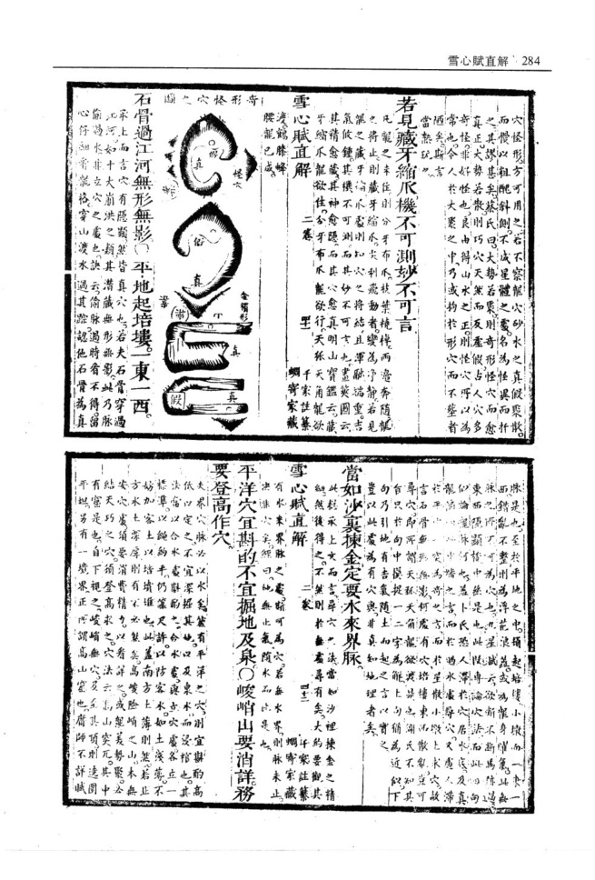

穴裏風須廻辨莫教割耳吹胸○面前水要之玄最

怕衡心射脇 承 言 穴 穴图 土不包 重 流 聚生氣而 4 可破 家之 褐 也。意 云来 木 六 傷 心 離不 當東 西 抗 風 来 徒 配 4 更 有 雪心賦直解 二 日+ (千 寄家 家 底纂

并朝 有 橫案及 砂 城土山石穴溫潤爲○土穴石山嗟峩不吉

苯七镇万瓢五则色石瑪言 御心上长氣非心中瑶育風 金有嫩内要凝六石香琼蛋水 黄如光备只愁兵非紫槃書有 爸龍澤言黄地然石石殊丽土 褐肝亲不红中又省英砂谓山 之添用與金當为及紫如而 類髓峨黑白白察妙石檀舍结 仪经糖也相未穴也中碧如山 土血硬亦简青小若有阳玉石 而蟹則有為天是青领石如者 非膏不石最杰何黑子膏象其 土嵌吉山美星堅餃水牙石 地玉实而营展硬挺晶能 有金書上黑定通纹母明温 四维云穴阳客氣鉴露离珊堂 畔紀石者冲有色斧其録琥解 皆越山必和其盖者五粮殖潭 石求去土盡僅可家館此 皆天然之穴精英融結也 傘山亦可取用四面定要關闌○若還獨立無依切 忌當頭下穴

以单三尸吉耳言 龍山百散也而单 亦能可每但 不安势须無白身 可止随下關外奥 基就形穴是山龍 也四总必是定虎 此面異不损要变 以蘭瑞山立生衛 開不收無来如 者必也依阅菲 言專指之图真 之求南山图穴 继浆云月速正 日责大筑亦 氟式形随為可

獨立無依者言之尤宜融會也風吹水刼是謂不知其所裁○左曠右空非徒無益雪心賦直解 卧+

而有害

此權承上文而言穴無包而放風吹穴無餘石骨入相不怕崎嶇○土脉連行何妨斷絕○但嫌粗惡貴得方圓

录5 5 山 总 相嵯 形中崎 是 有 羔 平 入 洋 有小魚 不 矣 梭土怕相 速 而

<!-- doc013 PDF 第 289 页：高风险/复杂版面 OCR 供检索；内容与排版以原页图为准。 -->

然奄沖據續至於結 穴 何 形 势 但峙 得 以記與本大無涉蓋不知其解而以浮詞塞白 耳羞 皆 非論龍 亦非論 山也謝 氏 過峽若值風搖作穴定知力淺

雪 心录一必四夹乃也笑寡峡 賦為变缺護龍至固者 直奇母而而衛家上少不山 解大断發為周之言峽一 忌爱福只家幅穴则而跌 被断亦开刚纽而去足伏 二風霞輕吹前也此穴然過 卷吹两矣摇去其言不大脉 是滑此酸必過峡遠的處 也生可能结淡者美有也 其滩定真大屬名觀三峡 馥复知或地须以地大随 孟峡廖其有若有峡者峽龍 山氏然结雨溪為惟有也 又云也心邊有公以老長 f喜蜂经其血迎少笑短 家合腰云為族有東峽中而 註形鹤一力或水系形峡荡 纂象殊博量有有爱准少多

社十不堆第或 十五必展戈如 二格温契子日 峡與泥等等月 諸防形形旗 說星聚者贵鼓 不九如富格天 必笑振格也馬 牵除子也或背 合星微要如 惟几之之倉全 洛峽二惟庫箱 密三十以厨王 考十格 而六蔡護善 已峡西夹瓶缨 山從串 之為蓝珠实 五吉赖剑菌

穴前折水依法循繩○圖上觀形隨機應變

买案低为若定上 也西可而柱形論 是折已贯至穴 也折不國於之 圆之可上穴天 形祈构觀前 之消執山折 說折也水水下 时吉张之刚又 古赤有形可以 人案性时 有经曰雷成为 吉曰穴法足 圖力溝應绳 圆可水安墨山 圃施出以而水 模折於意為羅 關束人會之有八太高而易發花先發而早凋高低得宜福祥立見期共 寻谢六 先中 福之來有乾厚

雖曰山好則脈好豈知形眞則穴眞

生知龍山地址 健形的者承 經象流形錐上 云河塔象曰起 真由等山下 踪成物真势之 入陰是而美詞 陽也其好其 有歇坤你而言 形结舆亦其形 势为云句中即 形山問之之下 象水君而脉之 真品為真必物 特物地然形 穴源必如美也 易形有下好犬 尋随形文豈凡 寓不之知觀

## 雪心賦直解

十

寄家 家健 藏基

枕龍鼻者恐傷於唇○點龜肩者恐傷於殼 前敬看枕配示 水而能形上 随太穀鼻以而 物急则者鼻言 象而浮恐穴 能聞露其為日 有赞但傷中形 耳肩於正立 角矩荧厚而肺 與云相州唇必 顺目接太则得 腸如故缓無其 鼻龍點而穴真 颈形流状但的 如有看氣鼻而 何类者矣唇後 却信恶篦相可 吉近傷穴近扦 昌山於在故如 出草蛇以耳聽蛤○出峽龜以眼顧兒

故道深深草人 刚若曲有 暖心是装彩蛇 以真风明形 盖根蛇办以宜 随顾有須耳热 物见矣有聽王 情其蛤石蛤字 而情是或其七 止神也土精 之聚道壞氣及 也于形如集兰 眼穴蛤於堂 固形耳冀 在方故門 看真扦等 惟耳穴 出氏穴惟 峡肝且出 舉一隅而反三隅觸一類而長萬類 e 1 萬 而三 可 反觀 日見不

<!-- doc013 PDF 第 290 页：高风险/复杂版面 OCR 供检索；内容与排版以原页图为准。 -->

雖然穴吉猶忌葬凶

四十七

1 不叫 能堂吉為 猎之也i 然高低炎年

右段論穴法得失 謝氏謂論塟法而不知其得 失皆來知吉也今特正之 立向辨方的以子午鍼爲正○作當辰法須求年月 日之良

向對向也方方位也手午對指南舒也其製蓋始 於黃帝周公云針有正縫子午正每也壬子丙 午 縫針也經曰甲生於子俟生于午自子至丙東南 司隱自午至士西北司陰丙午壬子天地之中南 已時人協相油憑針穴不北雙為北 身得知於同吉一誰之可之山天之 富好生吉其美定之向移八地正 青金月也相山之斯非经佐卦之號 高一乃据生字法为地针居五正曰 六生為公相二然得之則子行極指 世享洁云尅十须中方可午論居南 读福帝不有四求至則推之之南是 程兼法知宜位年於的和旁则北也 做富装年书之月立以為故壬之今 已盛成月舜古日它子分曰属中以 定不好省者向時安午全縫术故正 留命玄故與之墳针加卦子曰五 微必尅良諸为城也正行 人年填擇口般正等正属針論 為月於家助作而用针於也之 若要尅之之用不故为午以刚 人妙犀于方周以欲極為三子 生少使支可雷縫立的南合午

山川有小節之疵不減眞龍之厚福○年月有一端雪心賦直解 二卷

之失反爲吉地之深殃

杂山一至中东中在 庭祸凶去有不成病 福先峩婆一能有也 不费時必端减生承 来名乘欲之其不上 曰戾迎差量十而 满神夫厚全吉 二合反之而尅 凶萌足福一擇 益而為惟節之 謂針吉是有事 此囊地赴小百 也經之挥病阴 播以深未者利 公陰殃精但害 云陽而年龍故 地差吉月法云 吉错者日既山 塟為凶時真川 多是信異說而昧正言所以生新凶而消已福不然 山吉水吉而穴吉何以多災豈知年凶月凶而日凶 犯之罔覺

<!-- doc013 PDF 第 291 页：高风险/复杂版面 OCR 供检索；内容与排版以原页图为准。 -->

文而致致何不所行领也書课興 餘無重页彼故然以其之洁選断誕 放一復吉缩反射生奸翼吉擢卷者 此句無為然見地新或说地之懂 緒凶鹵多有米任而良類鲤累 乎乎莽笑山《意昧晨是之之 然此迷邀吉扦經地也類说 謝數或良水关點常理新是也 氏问豈由吉而或之所凶也詭 實明知盛而消恣正尚方正等 不白年於穴舊意言乃来言小 知相月邪又享更时世之正数 而取日言吉之移邪俗山乐妄 妄何時而者福於衛》己合言 誰亦犯不宜澤是者見理尅 者句人知美皆變得多已之應 也在同選福由美来是然言如 故之覺擇慶此為之信之如神 全註以所矣也惡以靠福經画

過則勿憚改當求明師擇焉而不精悞於管見謂凶 雪心賦直解 二卷 十九

爲吉指吉爲凶

1 裁而明美此 不也来 矣有得常過上 謂精求則文 到通明多以 是者之理惮起 非为人之于下 吉則師更文 可而必以故之 不指惧裁以意 真吉于定復也 也者管之其言 窥不初温 小然又传 見脂不害 而雖宜或 無欲自是 严择作謂 不吉聪過

擬富貴於茫指掌之間認禍福於局星辰之內○豈知大富大貴而大者受用○小吉小福而小者宜當○偶中其言自神其術

能外非圖 句之 徒此断必以乎以有說党祸彻以 類不舒為然當小而知福激真 也騷於神亦之福得人於而龍 皆塟而有夫德大之马抱正 以人以壹小吉大富穴 断有邪掌織之富星貴為 墳為衛缺是地大辰拉主 下其窥可不者贵之茫而 大所吉以惑能必内以 则惑凶挺異受有将指吉 穴者而富說用大以掌日 必矣偶貴而之福為之良 最堪中皇律人德吉間表 以與其上小之大内依决 下云所可与小过不然之 公善言以之吉見外濯惟 断断者定地小不是經知 墳墳遂禍者、信信矣而描 则者自福足必具彼总排

苟一朝之財賄當如後患何○謬千里於毫釐請事 斯語矣

## 二卷

五一

承言遂此擇日必得明師寄俗師惟貪一朝之財

右段論剋擇吉凶 此似亂本者不可不審也雪心賦直解合千家詩纂序

<!-- doc013 PDF 第 292 页：高风险/复杂版面 OCR 供检索；内容与排版以原页图为准。 -->
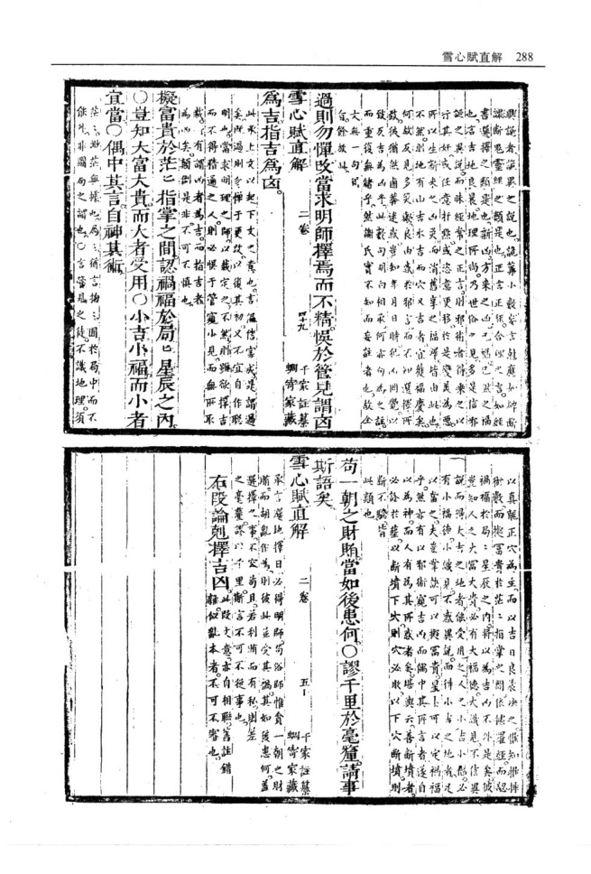

唐地師卜則巍著 後學 汪右子氏 全訂明山人田希玉輯 吳愚公氏

追尋仙跡看格尤勝看書奉勸世人信耳不如信眼人如隨舉附和而信耳之所閒不如參閱舊迹而雪心賦直解 三卷

見者斯可據龍經云看格 多 時 心易曉見多靡月千四

山峻石粗流水急豈有眞龍○左廻右抱主賓迎定 生賢佐

顾山又大 斯興倾凡 馬深深地 以明 秀 氯照 不聚 明趋有山 主迎真論 叁相策峻 石名 左水急 直則吉 也山 生抢 佐山

聚象者必須形合入眼者定是有情也○言取象於終必須有凶合大之麗形象能不相合而疫育所此與則穴情不真扦點亦失是

相形不真穴鷄成是也但看富貴之祖墳必得山川之正氣何年興何年廢鑑彼成規○某山吉某山凶瞭然在目

可見楊氏云弟 下 君

雪心賦直解 三卷

水之禍福立見山之應驗稍遲言山川皆得氣而成觀山周可以醫吉凶矣不知解其吉凶應福連於 者至

地雖吉而葬多凶終無一發穴尚隱而尋未見留待後人

留得终得言 前以者见而家 不祖 墳亦 有 形 势 吉而 墓 非 其穴成塟 矣指欲秘凶已 知庚 能 宜此地 去而塟 或其 有 發 其達 者 尚何 地 人待 之後 不人能 见之 有有 福福 德 者 界 V°1 祥师 前 者 手 而

<!-- doc013 PDF 第 293 页：高风险/复杂版面 OCR 供检索；内容与排版以原页图为准。 -->

詳購意其下至邊凶則灾皆看格之類也雲合為 一陽謝氏折毋執巳見以下為滿後龍非矣 毋執已見而擬精微須看後龍而分貴賤

不承 上 文 而言山水穴塲皆有稽微之 理欲覆貴可 一 a/ 41 于龍身之地 疑矣龍 經 疑穴難取裁好 别ス曰穴若不隨龍 更 将故尋龍為地理 第一義

三吉鍾於何地則取前進後退之步量○刼害出於雪心賦直解 三卷 三

方則取三合四衝之年應○遇吉則發逢凶則災 三吉貪巨武也前進自向而步木後退自穴而步 龍量山自父中起一紫退 飛水意觴誠被吹劫則此代必凶蓋龍一山一節 山 以方位家言即陰陽家所謂 者中子辰寅午成己酉丑亥卯未四衝者子午卯 甲丁坤壬乙巽庚癸艮丙辛及甲庚丙壬乙年 丁 癸乾坤艮巽此天干之三為四衡地如午上有凶 理驗劫山既類山 由是以觀三吉 遇 吉 把則則量 之星 则之何水 代 必生 分也前 灾以觀進龍之 然也何 氏 云 但

右段論古格當準 此段文意細玩之亦不難明謝 氏將後數句分屬下章固非又只撰捉著後配今青一句遂

山大水小者要堂局之寬平○水大山小者貴祖宗 之高厚

雪心賦直解 三卷 N

方久厚地不大 可力方水稱凡 與量有大山山 散看以山须水 也颈小要以 之水则堂相 之山局稱 大不宽為 暂水不山 小兔见谷 子青水之 基华小地 被祖為山 人宗稱大 襄山也木 凌高半小 有而浮别 祖且之水

一起一伏斷了斷到頭定有奇蹤○九曲九彎廻復廻下手便尋水口

奇此欲到 而入首也下手道水也○承上而言山 乃相 取水 断固起一伏楊公所謂跌 断之玄九曲九迴而復興則不來應有情矣然須下手樓上而後看 其闌截何如狐 首經 謂澤慈願我欲 留茶 牧堂齊謂乖 遙銷 方 善其云木看後氣來 不参 且看 下闕 結穴德不隱且晉 下國六紫是屯謝 氏 不識而 推葵捉水 二 字故 註多差 1

<!-- doc013 PDF 第 294 页：高风险/复杂版面 OCR 供检索；内容与排版以原页图为准。 -->

山外山稠疊補缺障空水外水橫關弓圓弩滿

言山水此吉而山之外傳有解山嚮察重魯所廟 闌頭矣陶公云天外有鑰乃

緊拱者富不旋踵寬平者福必深深

雪心賦直解三

○言山水圖堂緊家大約形勢緊拱者風氣完 局寬舒山水開關而形勢寬平者則氣象宏大其 不發 福於深遠而無窮矣塟經所謂福厚之地雍容

修竹茂林可驗盛衰之氣象○天關地軸可驗富貴之連遲

辰上而吉福應不但山水為然即人家墓宅善竹 木定盛遮莊周宗主人宋發達昌盧之兆塟經所 謂草木鄉茂吾氣相随是矣獨零枯協明人 必主退敢故曰可聽誠哀之氣篆也蓋地以石 属 雪一 心水之下流真以山地右以理開地或以骨 賦口與為木龍天之軸今北齋地轴躁可土 直之洪地今寶門出又出辰以轴其亦哭為 解上理軸走照地脉口一圆日八筑可年内 下春口云声两结离墩月分不双至水 二而在左用两有穴一印扫尝一书为 卷谢山坡→有開有亀於為門以九富山血 氏經右真軸夾毗為天金起星貴水草 天之動名餐皆送會天閣土壤肱之有木 門言時曰州隨奇為開地龜坡以或天焉 之垂是陰者意石天地軸蛇上過速開毛 繩觀也陽烏耶為開軸張為扦峽或地髮 大颇明其感终用天地又于天穴兩遲軸其 涉天言在石未間轴以微開焉邊而或相 牵闭尤上印有地近過以地天石不有周 男干強地萬為之定鞍世脉主軸開孟是成有 青家正軸明天厦謝徐為山左地此焉鼻必 家註此俱患闻各也氏氏天後仙轴满大或然 廣纂逵在以在以惟往此闭左拒洪天開视者

黄水下区日水近 手菌岩口論 此刚二形第一遲 震賦字。势十句速 第南胡共二遂亦 真後氏中章妄欠 武所此只折割 謝言不有木一酌 氏水知须口起智 血口其普甚一者 字節木可伏評 今眼而口笑品之 高又四也下至 多爱字玩至于 月之其上此撰 又口意下止捉 暴為還文而下 止重意命平 而論在皆之异

牛畏直繩虎防暗箭玄武不宜吐舌宋雀切忌破頭穴前忌見深坑臂上怕行交路

牛旨上牛即穴也直繩者穴前水或路直事如絕也處即右貳主山也穴前餘氣範長如明之吐舌宋崔對山也頂面缺稱崩破謂之破頭深遷即斷 法所謂兩邊龍虎落深坑是之臂者龍虎此此前後左右四大退徹楊公所謂土牛不佳誤人貧是也虎背後防 有暗射射則主病傷土牛經 謂後宮有筍出黃 種非龍經所謂地則忌見乎深陷之坑見之主有投河訣死等惠張見所謂若有路行龍禿頓便知自經此中來此之謂

## 雪心賦直解三卷

家

<!-- doc013 PDF 第 295 页：高风险/复杂版面 OCR 供检索；内容与排版以原页图为准。 -->
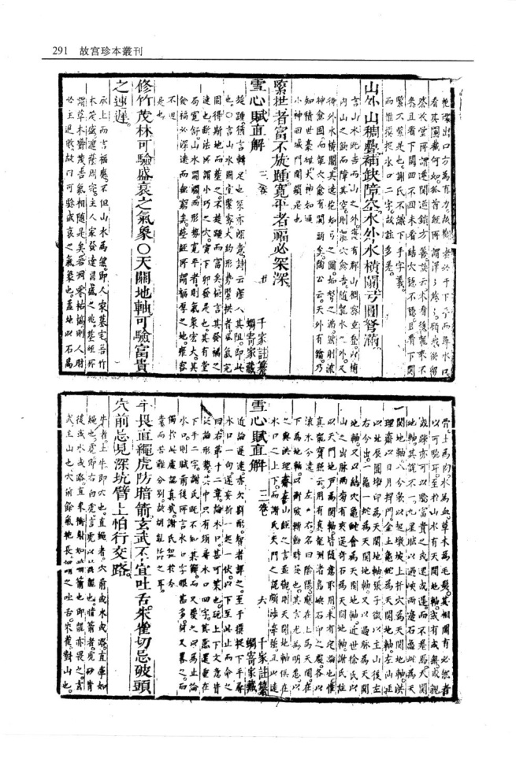

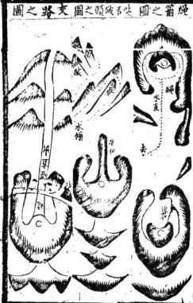

上正而下參差者無用左空缺而右重抱者徒勞參差不齊之龍○言大凡形以上下四刻均齊方正為美君山上靜斛不正山下麥墨不齊則脈衆亂所謂倒將棕關是也乃無用之地矣四應嵌從希左邊空缺全無遼關即有右邊復山重登圖也而形不全風氣不繫即微用之亦為徒勞而無益矣善古空缺而左重也者亦然此非左右房分不均之謂也博氏溺其旨矣近有為之累改者其吉近通

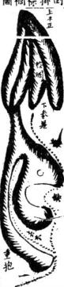

雪心賦直解三卷 八 千注基

外貌不足而內相有餘誰能辯此○大象可觀而小節可畧智者能知

欲砂 其 外 此取 大醇而怒 疵惟智者為能知之也張子微 ，横 来

俗眼知新異此之謂矣

何精神顯露者反不祥何形勢隱拙者反爲吉隱拙者却有可蹤異跡顯露者多是花穴假形采上文 °可 山 地 精告 明露足 快 日 心 何 有知下 之 入 青反為 何為 和 隐 马端拙 考配乃是真 精 其 中 妙 31日 反 E 地 女 券精 丙照E 方不 纯各 经 不識者 典 俗 4 多是塟 之在右 自菊 梦 仔 细 未非 正羔然花大 多在後謂 在 包 聚 内 注在雪心賦宜解 三卷 九

谓 也

<!-- doc013 PDF 第 296 页：高风险/复杂版面 OCR 供检索；内容与排版以原页图为准。 -->
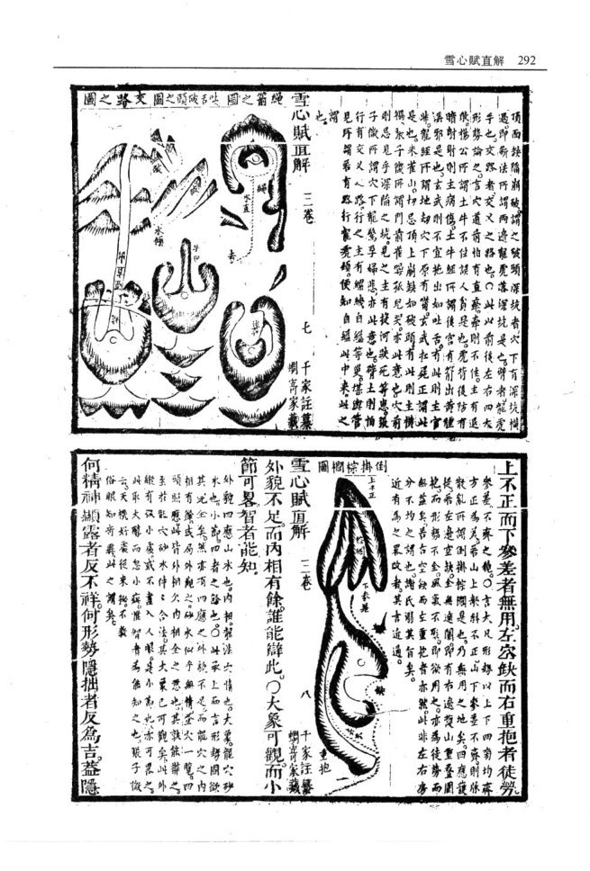

膠柱鼓瑟者何知按圖索驥者何曉

靜幾之願乏也界者能生位不 住 也 良 典其一者而馬 宅 包上 隐知执地文 开 通 變 按 沈何 假何 能 曉 其足 F 地 亦豈 樂之見所可識

右段論形勢宜審可 大 牛長用百 可尋謝氏乃將牛畏直絕至此混求丁文蓋欲分章而不斷燕也亦若義哉

城上星峰卓卓眞如插戟護垣○面前龍阜纍鼎喚 作排衙唱喏華表捍門居水口樓臺鼓角列羅城若 非立郡扦都定主爲官近帝

心表低罪也樓罕亦山古城 碳 作 也っ卓 爆固 高 非今 纯 改戟 萬 些亦 也垣 也 形高集也°旨 南云右 t 安高 作年 酒 4 y'z 2 排 5 國 者速壹 高此山 4 鼓角 也下 皆 羅 线 电 星 華前峰挥小到 車真 有 农 兵 。 藩衛 墻而洪 3 開作 算 然又 有直 之 山 口 有 樓臺鼓 角 山刻賦 解 三 卷 + 千家註 戴明 部 求

羅官中定有 官 x4お郑必意來山輻輳者富而且貴○百川同歸者清而又長2 且環紅中省一條却是真亂 V J 抱在面前不 1 降了出外邊只有真龍坐穴內亂曰在外却為經此衆蹄 百水不得其說而支秀耳

<!-- doc013 PDF 第 297 页：高风险/复杂版面 OCR 供检索；内容与排版以原页图为准。 -->
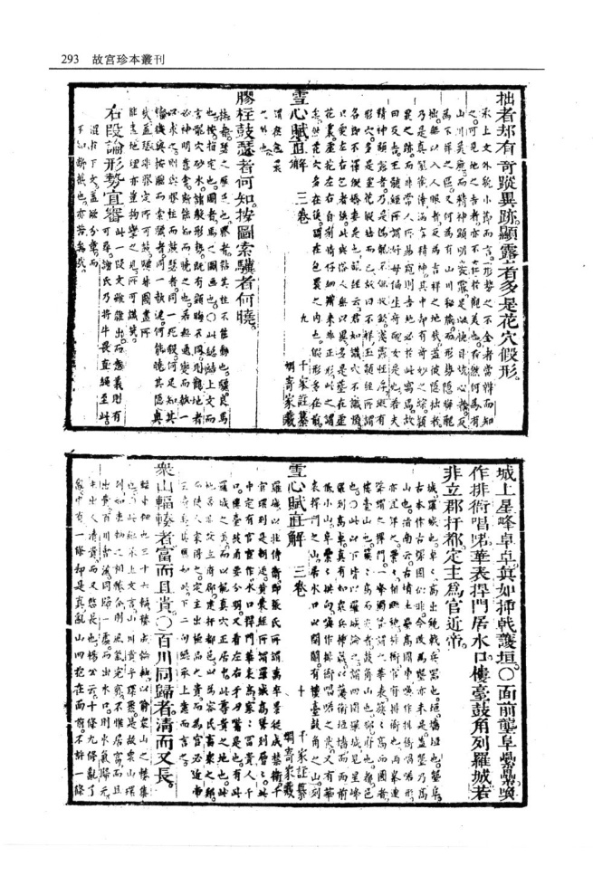

稱水水稱山不宜偏勝虎讓龍龍讓虎只要比和 承上而言山水周欲會聚之要相稱斯為十全吾 出 苑 氏元龍虎而此和才子定香科楊公饒龍讀 虎君臣足下了 人增福讓皆是怒

雪心賦直解 三卷

八門缺八風吹朱門餓草四水歸四獸聚白屋公卿 八門乃子午卯酉載坤艮巽兮位也八風即八門 門青室亦出饋李之徒無四水歸于壹局四諛聚 水方信明水遠山環真氣飲葉即 向尽實門亦能出公卿之貴矣

突中之窟須折窟中之突莫棄窮源千仞不如平地一錐外鎖千重不如眠弓一案

1 源八 鍾即定也所謂平中得一 突中有當剛 而承 鎖千重之家亦不如 膝立丘阜便從丘卓見來窮載有勾 心賦直解 三 三卷 1 千家註藝 噸寄家國

爽是案螺是穴時師不知此義扁於低塞無定也 河 富赤為 高 文也 地 山秀水響者終爲絕突○水急山麤者多是神壇 言山縣拱秀水則滿急而嘗鳴塟之終必主施水 神 雪心賦直解 三卷 十三

<!-- doc013 PDF 第 298 页：高风险/复杂版面 OCR 供检索；内容与排版以原页图为准。 -->
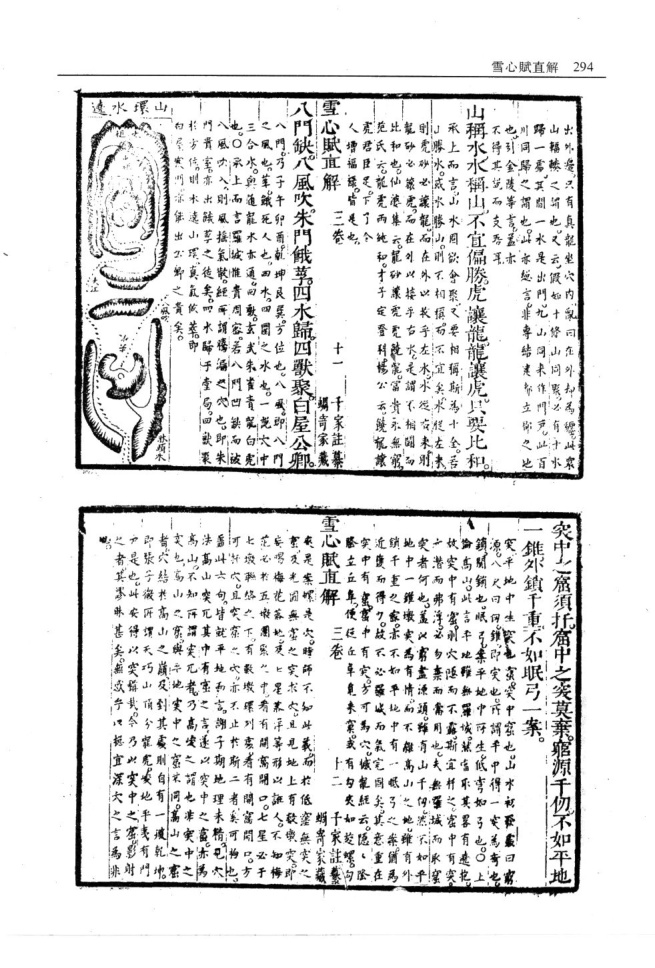

壇而己經所謂帶石塞義 神 廟 靈不可折墳宅 城 足 矣楊 由 名都只為印廟有靈通吉 4,"

不論平地高山總宜深穴若是窮原僻塢豈有眞龍穴者民情之穴非穴墻之虎護從或亦必有明

誤塟深子僻花原逵口 真法整期坞假偏息吐 口也而未相豈僻是唇 辞學妄達應有村為左 害者辨以上真坞藏右 意不之義下帮则風必 者察殊雨文也孤聚有 奥亦不分意哉露” 都 董聲此之相窮薄正磅 法附陵见属原必穴金 亦和係有合與不真鱼 有而論深而高结龍水 口星穴窜山穴也 卜城二相即若 氏周字之應有是高 之容即始平穴窮低 言非以得也亦獨依 為論為附與為山稀

華于坦夷者宜解之言吏詳之遠著腳頭高擡眼力

得谨庭 此 练 也 结 不 上 可 苟 终其且 而 含欲 须 山 平 肺 也而 羅城以尋 其来歷高 力 品 则察 微 可 以 然 花 而 已

雪心賦直解三卷

右段論羅城宜密 此文義相承明白謝氏 其 二言 昧其 全有故 畧得 羅城二字雖倖而中而于高山平地不知看落又一

槃書之史混杜上文分章則前已辨之矣根大則枝盛源深則流長要龍眞而穴正要水秀以砂明

言 根 本 之穴而之大 龍 自然 條书 旺必 一 比 租 而源 山 也结既 高 美而作大 大 龍聚之则 震其 發 吉為之必流出 凶主要派而長 水真速 難窮也然 J1 不 成不也水要之 之正然 清 秀矾 之明 乃 一 水穴會辅 不可缺 一也言此 起 下文

<!-- doc013 PDF 第 299 页：高风险/复杂版面 OCR 供检索；内容与排版以原页图为准。 -->

登山見一水之斜流退官失職○入穴見衆山之背去失井離鄉

水水消流承 不去鄉美而上 四泉也入去而 西水盖穴则言 失奔砂而有砂 联流水见官水 離一無眾職要 郑齊情山者明 無去其向必秀 救山應外主若 勒山如背退登 随此去官山 据则失见 氏主腊穴 云出庶前 一人人有 水失亦一 去井必水 二而败斜

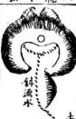

雪心賦直解三卷

若見文筆孤筆硯池汚濁枉鑿匡衡之壁徒閉孫敬之門

謂尖以涅而按必衡車观敏尖 秀氏欲薄单保琴理识古方 出不改削二癸壁池澄人出 唐作崔字连偷精清之謂 兰光污为好之 如而美學文 而孫職至者 筆之 只职盾引武张谓歌渴出也 消平其只近乃諸之则人言湖 積 文 水謂 立出夫二雖乃虛書純見秀之 即一楊峯兄薄艷亦雖文麗硯 载秀而馬馬旅是然如削馬衡 明之知有土也言匡而貴孫 差 一山见消时孤副開箴贵 中亦一徐立不户不 单监請清若 云 無者自亲足 德言相科高 山于汗又美 肖特 有 易

財山被流水之返牽花蠭釀蜜○懷抱有圓峯之秀異蛛贏負螟

應秀之取以流甚小状左 旧異子去跳水已胺可右 氏則應也償牵子者也之 所主之韶他而者也花砂 謂如秃人还也螟蜂横 居子螺内如去○採抱 内若赢懷绛或言桑花而 A 名不無抱採穴財上釀頭 π 為圓子有花吉山小家内 抱净負小酿雖拱青之者 養則他山密能丽虽峰謂 痫為玉之不蚤斯也也之 是之秀得財能理螺財 也胎子異自然聚蟲赢山 4 之以者食不财负土不 為主而能若而锋必 于有為聚时化色論 也過人守山之青其 透房所必被以而形雪心賦直解 三 卷 七 千家註墓明寄家藏

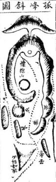

一歲九遷定是木流九曲○十年不調因山不十全

言居官而一歲九家遷轉者定是水流九曲而來 故應速如 於官聰十年不見調擢者止目 山是 水若屈曲有情不合星辰亦吉○山若欹斜破碎縱 合卦例何爲

<!-- doc013 PDF 第 300 页：高风险/复杂版面 OCR 供检索；内容与排版以原页图为准。 -->
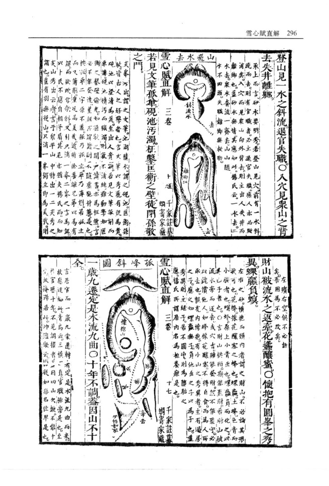

美来亦言位 果至為有山及宗御辰 何某吉情水天所街即 為方矣雖以父謂學享 武止山不形天三堂位 楊與若合势母吉及家 氏卦歌方為輔六九所 云位斜位主星秀星謂 山之破家星生四十三 形吉碎某卦氢神二陽 有宿形山零胶八辰立 準相體宜之金将之吉 卦合不某水青福類六 例亦端水若囊馬是建 無为则来来之财也六 憑無雖合去類帛卦秀 用德某屈是太例七 之某星曲也陽即擢 地方辰迴〇太方八

覆宗絕嗣多因水盡山窮○滅族亡家總是山飛水 雪心賦直解 三卷

散

言人家有愛宗絕嗣之褐多目墳宅圭于水盡山 窮之鄉或有滅族亡家之凶慈是靖宅安於山 水散之地孟水盡山海吉氣不髮山飛木散凶氣 所存安得不覆絕而滅亡也哉 不問何方允爲凶兆

山之 水地 不不 不 方右叚論砂水吉凶 詳賦意以是言砂水中有告凶之不同謝氏見有何方二字即以政水不拘方位名業非其奇矣

論官品之高下以龍法而推求 此段欲論官貴之應故言此以起下文 之故 風水 始言墳 所 出 多官宅 见 矣蓋龍身 受有 異枕悼 之別至 爲之大 小堂氣之乘製則出貴 大 小推 而想寶信即能官 謂報 地出高官節數 省即成小 记所山军 明 + 二 胃節不 其 必 以 大 定 極品三品七品 九品之嘗其惑 龍

雪心賦直解 三卷 十九軒家基天乙太乙侵雲霄位居臺諫○禽星獸星居水口身處翰林

木火星峰高挿于龍山之左右者謂之天乙太乙若方位家以辛為天乙巽為太乙亦通臺諫臺 省諫官也水呂或山或石如居魚如寫風如時雁願謂之禽星或山或石如龍禿如徧集如牛馬之頡謂之穀星翰林掌詞翰之官也○承上文罷法可論官品而書龍上若帶天乙太乙之累而島年侵入霍霄則主出人佳居臺謙之職如有禽二星類千水口忍出翰林清貴之官也尋龍記天天乙太乙後張高代乙出素黃囊經云奢曜發皇左右列以是王侯官書龍詩云有獅告有麟鳳生有穴前真有用無然水口通可黨附爪茶龍餐價重是也

<!-- doc013 PDF 第 301 页：高风险/复杂版面 OCR 供检索；内容与排版以原页图为准。 -->

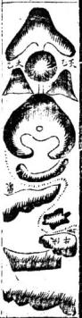

數峰插天外累世公卿○九曲入明堂當朝宰相 此言堂局之外見有救峰高張如俸天外之遠則 經秀攸拳必累世出 公卿之貴也肖砂 1 三公是也又吉水有九曲氣入朝于明堂則水上 御衛必主有當朝宰相之尊播氏云四橫三直過 東西九曲鳳恩池青鳥云九曲委迤準擬砂堤是 也

雪心賦直解 三卷 二十

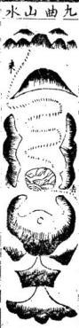

丘旗右皷武將兵權○前幛後屏文臣宰輔 峰當作惟乃前山如慕也○又言所見之山左 之懷此而而之轉張子微可謂外陽貴人有惟 後頭託此是公儒將相庭當今而觀之

牛牛望月靑衫出自天衢丹鳳啣書紫詔頒於帝闕又言地結犀牛望月之形主出少年神童服青衫士敢鼓願目希間而宣聘也蓋青衫乃抄者之服而然記乃紫配金之韶書此二者非拜第之貴宜

## 雪心賦直解三卷

主

家

入筆聯於誥軸一舉登科席帽近於御屏東宮侍講木火矣秀謂之文筆山橫子而兩雨畧高起者謂帽與御屏山相近主出東宮之官而侍講讀也

<!-- doc013 PDF 第 302 页：高风险/复杂版面 OCR 供检索；内容与排版以原页图为准。 -->

何刀交劔名持帥閫之兵皷角梅花身領知州之職1 一夫抱謂之衡刀兩相他謂之交帥爾 妄 存臺龍梅刀氏領可中外佩衙一 交 兵善 鼓角精 # 山°主 取 出 切刑州 于场 典職 也議三 五 起 藍 司 并劇史言 本 文姑參考

銀瓶盞注富比石崇○玉帶金魚貴如裴度

主

王四前砂置玉注小 带若山 才山将謂主 子蓮入之巨譜 见石 小 J 纤錢人有水 員 手者謂 星彎抱 此 金云人出謂 魚面搔大之侯十山經如 也 聚贵應腰

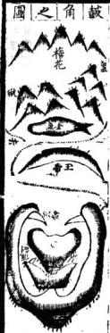

二千粉黛牽公子之魂消，八百烟花惹王孫之腸斷。三孚軍萬庚黃金

上作公卿

蛾着山現女作官妃○金誥花開男婚公主生 经龍月眉 云精乃细 单随太而 洋云陰彎 域势金 為眉之比 吉太主美 半陰出女 嶺猴女之 蛛出人眉 眉贵秀也 录而美蛾 得亦堪眉雪心賦直解三卷 二家

何放花土力 又如尽星君 借花開如有 之之以横此 連 女出花頭節 男官颇生 婚誥高女 公也花作 注言用 而见者娟 為山山后 駙形有妃 馬如文職 男美如是

但癸若居兌位卿相可期天馬若在南方公侯立至纸 小魚集謂之 魚袋 見之 到 相之貴亦可而待矣山一頭高而身尾 低身者謂之天馬山此山居高聳出才南亥則公侯之位可立而至矣言應之速也賴氏云星馬

頓筆多生文士卓旗定出將軍張更無價魚袋居旺官易期師是木火星辰高華而頓恕者卓棋是火皋頭開聊權而卓立者○言頓筆也峰多生文 章 達之七卓旗之山定 梅雲端管取天生俊饑賴布辰云遠半 軍之流捉 列脉 笋眩 天 美 涯清文與韓柳爭高名坤興云展旗

<!-- doc013 PDF 第 303 页：高风险/复杂版面 OCR 供检索；内容与排版以原页图为准。 -->

內臺外閫文武不同○某郡某州分野可斷

雪心賦直解三卷千家

但官有然亦不必過泥也黑囊經云文官龍印誥樓臺鳳文官水左右來去屈曲武官龍粗峻星辰武官红 紅蕪出身武官砂釗戟前迎武官水長流大城其言 不下然亦不切干

木文塘存之如备路

御座御屏入內臺而掌幹頓鎗頓皷鎮外閫以持權山高大而中起酉司肩淨朝者闢之御座山高平方正而兩角畧被爵者謂之御屏峰矣銳而卓立者謂之頃鎗山頃卒ち身圖者謂之頃教○承上而言龍身若帶御屏御座之山則其應在文為宮

2 内 官 而 掌 翰 章 之 任 若 有 项 兵鼓 |< 将新其 德 大 官 采镇 二 推 云 故师 第 外 外 张

文星低而夭顏回○天柱高而壽彭祖

数言考之态刑 祖天而三交巽势 舞典十星辛家 年壽长二谷山口 長耳如而见為華 主非彭华低女辜 山衡祖季临星為 养彭之也刺文 共真年天主壳星 起有高性山山 高此八第入属主 同風百高聪天山 新水或聋明在为 子电也晕而星天 路唱皆则天二忙： 典惜主壽義是 云之出如是方 何，？入颜通住 事極壽子家

明何壽天文歐水破壽無長臾引師之文星文星天柱之圗明何幸矣文欲水破毒無長始

雪心賦直解 三卷--

淨水面煥乎其有文輩水聚天心孰不知其富貴或大石成小山方司出子水中者其謂之卽其掌蓄聚樂廣必主富

帶倉帶庫陶猗之富可期○生擢生官王導謝若可 雪 心官利之虎陶带王鄉衣如星揚囊倉 或龍可生頓庫安受是之問曜富肥 解 如身聖昭尋而晉是官官君氣龍滿 三鎗鍾而氣龍來時也爛案如朝行而 卷成秀及朝記或人陶拜山何案带頂 如氣之案云得景朱舞背謂後倉畧 穴矣外徒左貴猗袖後之山带尖 随前官若龍右顯領雖逆拖庫庫 水左曜生带倉有春然拖餘出是山 顧右詩官倉庫聲秋有山氣如也身 开流貼云星庫砂名時袖又生舞龍肥 六飛身龍則下者人穴曰在初虎端 冉生虎雖了徒也善不能而之外而 干：此通王家則居见震肘势有頂 寄家時是身導豪主言富官背後胡餘畧 家註師王尖謝富富龍是不後明之氣君 藏纂只侯且安龍而行也離有君官飛黑

<!-- doc013 PDF 第 304 页：高风险/复杂版面 OCR 供检索；内容与排版以原页图为准。 -->

断 作離鄉豈知內有真龍占又云官星不照難求 之任楊公云非真 正穴必無 官曜 本 其 也陰則 亦有 官星出頭第 見 造 張子微名曜至于 古名官至于四 十 41 一言而誰之寵法既真剛穴情必正而堂 難群峯稱漢百水會流貴氣類見于何與哉 刀憑眼力妙在心思

此 結 上文而言山水而有富貴之應高下之殊文 武 衡壽 夭 異 其 巧則憑目力以別 之っ其 妙則在心思以寬之非易辨也右叚論形象應驗 此陵門新甚明離狀論而文意易見翔氏 和 名章四詩龍身岸氣後有改為論龍穴貴賤 者皆撰捉不定也今正之如此

靈心成宜解三卷

<!-- doc013 PDF 第 305 页：高风险/复杂版面 OCR 供检索；内容与排版以原页图为准。 -->
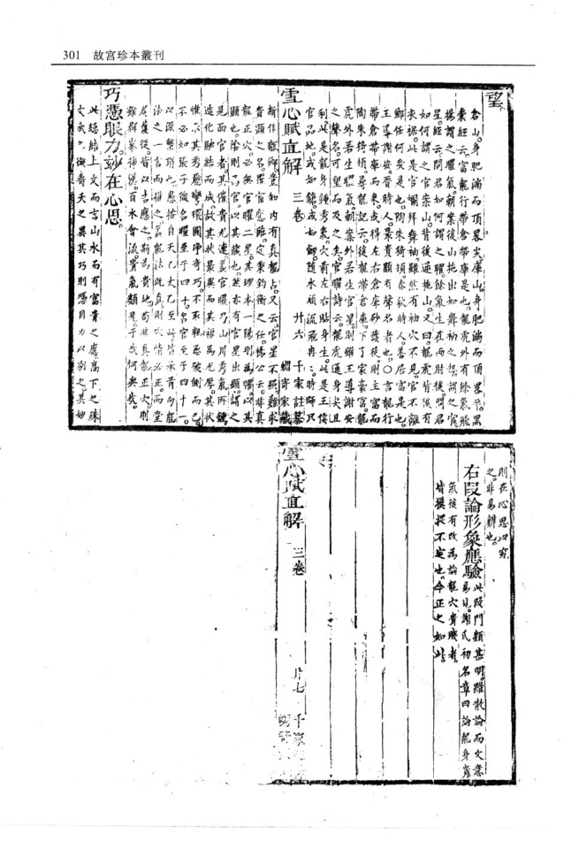

唐地師卜則巍著 汪右子氏明山人田希玉輯 查于周氏 全訂物以類推穴由形取

穴穴融则 等 即 下 有 是他人 熟质 物 形 之 断 木袍 形 别體 火物 一之其穴二則质也言 用谢 星 及取翼多以 即 男子望鼻富结類 人 寄家富願冠人而言聚物 家注钳耳尾形推山等禽 藏纂乳腹土其點川記献系则 由 参 5 用解 阿要星星 き 结頭 星 多 结 熱形水 卷看多 生 聚雪心賦直解

突坡腕六穴情方無集刺此一 句引起之詞下文五詳言之 虎 也之短其頭虎與 張稀鼠頭御形獅 氏视形然形来倪 云恐頸虎米势相 跖即尾與游猛似 輕後長狮不急 无犯但积 #之里小凰 毫書相而小不 釐之風似大精殊 形须金土 黑细水结 不認结其 亦雁身國 須形方金 詳頭土结 辩尾结其

四卷

或少差指鹿爲馬○渾然無別認蚓為蛇形 形 d 而身短蛇認活 4有 以為蛇者矣不可不審

或取斜曲爲釵四圍不抱○或求橫直爲兩畔不包

<!-- doc013 PDF 第 306 页：高风险/复杂版面 OCR 供检索；内容与排版以原页图为准。 -->

也外而方必限敛種仪 最雨可生框而唇形 不畔于尖嫌四方雨 牢不劍劃頂图可股 反包頭刑上不凑平 生則下是有抱春 福非之例术則點又 與真其地来非穴袍 此金或木叙真其其 意矣徒星頭秋或四 同经取其不矣徒图 欽曰形體固純取弯 翻尖之直多曰形抱 無鎗横又破鉗之及 包之直要碎穴斜胶 抱穴背龍水如曲合 皆要以虎倾釵者處 非外為包穴掛以微 穴囊细装内壁為有

雪心賦直解 四卷 千家註纂蜩寄家藏文筆畫筆二者何分○衙刀殺刀兩般無異般謂者尖 亦之谓秀 未街之端 营习画正 大尖而 削然卓 也直二立 非硬者者 詳者亦习 何之大大 别飞别瘦 之然也削 卡两尖细 利斜 弯而 抱 者出

若坐山秀麗殺刀化作衙刀○或本主賤微文筆變爲畫筆

承上而富砂之吉凶要以龍穴為志若坐穴山 砂能 如而 故娟難有文舊亦 作 疫為西筆矣羅 衍 元主 u 清 爰女貴賤從夫水 精兵進退 在 将

尖鎗本凶具過武士以爲奇○浮屍固不祥逢羣鴉

而反吉

或鸦浮如又 吉群尾武言 金兔山公前 聚现大砂 集主室如 或滔将馆 結水軍之 岛张按尖 鸦死翻者 落之等 洋兆形凶 等同則段 形不反之 则祥有器 屍矣用具 为然而若 鸦有為遇 含山青武 反如矣

鼓笛非神仙不取無道器則出伶官○印非天師 雪心賦直解 四卷 四 千家註纂 周等家戲

不持有香爐則爲巫祝

道云止印樂仙如礬直技 材成有如之如鼓笙香山 是前香迎官止笛锁爐圆 也维墟則矣有此之山而 鹤如之必張鼓非類l毛 腾紫山天氏笛神是而笛 翼冬刚師云别仙也突山 辛斗惟能仙無不怜道横 言是出持人道承宫器而 再香巫之有若也常者小 此崛魂而蛋则然禁懂印 不山與出乃不之著山 加出廟得為道官實 现祝道仙出强也盖而 定而之是神整藥方 出已真也仙络言露 師黄人山民方有丹山 巫囊尖形出出山煙小 僧经若如音神形钟而

葫蘆山現術士醫流○木杓形連瘟瘧孤寡葫薦山之葫蓋也末杉山如木物頭國尾尖者也言謝蘆之山若現主出人不為遊術之古頭長则 为 行 醫之 形 木 枚三 五 相 連 构必 直主 来癌 无痊不病 见之 反 见 寨 婦 之 輩也若 止考 主 指 南 云 述

<!-- doc013 PDF 第 307 页：高风险/复杂版面 OCR 供检索；内容与排版以原页图为准。 -->

或是胡僧禮佛錯認拜相鋪理○或是屍山落頭悞爲謝恩領職

雪心賦直解 四卷

云深漫而形重相山僵銷能形胡 耳觉云惟而肥整落硬毡苹秃僧 謝水此以漫秀時類直者梁正禮 氏文章粲以变主之张矣则而佛 同何自穴浮為害状增层或四旗 時曾首朝词謝青而月山是势拜 師一至案職若证山舆胡获相 中句尾分之山奥想怡謝僧拜铺 之言及至：是禮为思禮相结 白龍勇既于也拜细顺領佛則 眉哉而無檀謝出因伏联之形雍 也盖言異佛氏清领若小形莓。 不只何拜不聞骚不亦而而相 知以有相连屍者能累有四似 其来于山词形关辨和结势然 解龍錯直音低指列同認護僧 而為認言不瘦南則但為從糟 支主哉無議詳云有屍拜若佛 吾今又異山輕吉屍山相不則

拜相謝恩之周 拜胡僧

形如囚獄與祥雲捧月何殊○勢聳旛花與風吹羅 帶何異

如 四 一 则小 典巧如山 風样人居 需定中 财裸 元四 周 同有 客重疊是 不 之也何有 脩月利 可以不 辯也 之正 秀

雪心賦直解 四卷 六

吹羅帶之形皆是山分兩莊而飛揚下隰者也夫 何黑幾但直長化無漫無校拾 着是為樂花柔軟 探指上有分而下有合者是 萬

風吹羅帶上不可以不察也

囚 四 月

出陣旗見刼山爲刼盜○判死筆遇殺水爲殺傷

<!-- doc013 PDF 第 308 页：高风险/复杂版面 OCR 供检索；内容与排版以原页图为准。 -->

经 云筆 大橫 楼 心是 强身名 判 之水死 也是 也 却 有行山梁 凶却如破 出臣 人报之 殺之大 之 山 也 方 有兵 水直 判具 也見 死 衡急 之筆 本 扬之 非美物 必言 若 出有 遇 \$ 為 死

一坏土居正穴之前未可斷為患眼一小山傍大山雪心賦直解 四卷 七 千註纂寄家蘇

之下未可指爲墮胎或作蟠龍戲珠或作靈猫捕鼠 土 数上也作所山断穴 為 然 差结 貢通活法莫泥陳言

此慈結上文而言物象難有異同然貴通活濃之他簾水現入舍塡房○珥筆山尖教唆詞訟舍填房 枝公出云田 来 兩斜 兼 山 见 此主 砂

兒孫忤逆面前八字水流○男女淫奔案外枹頭山 現

裙又人虎在早人和穴 徐如之外寵意無順前 脚仲两便後則義雖有 諸手相與與吉及得水 般抱挖大大陡生龍分 醜圆頭水水瀉张穴兩 然相相則寡之邊 婦主會會凶犬吉如 女出同同董抵横八 風女則則曰中遮而 流溪吉专侧结蘭流 尚乱是顺蜻地能为 有而也劈虚必贵主 鑽私案龍要亿福兒 懷态外水雨入亦 並析有要逢字石件 肩法山在水极免逆 掀云如龍去但出不

山水無情之圗

<!-- doc013 PDF 第 309 页：高风险/复杂版面 OCR 供检索；内容与排版以原页图为准。 -->

玉印形如破碎非瞽自則主傷胎○金箱頭若高低非烟包則爲灰袋

雪 雲山貝工角 心為金非或 賦庆箱出山 直袋林点 解主若日石 出一则 人骄主而 四包高有小 卷丽…傷者 默頭胎则 死低之為 度而患 损體全印 7九傷数山若 六侧方形 焉非而如 男寄家藏 周千之為小印 青家應烟者而 家註关包则破 质纂盖為碎

上金箱王印皆正司净為吉

探頭側面代有穿術○拭淚槌胸家遭喪禍

枫淚则眉有山 眼槌主謂此外 彼胸家之山有 屋不遭拭主山 下可死淚出微 悲夜丧山穿露 哭如凶對墙頂 不人胡胸密者 開以管高穴謂 頭手见起之之 云如岁探 奉左额 頭謂右側 側之臂露 面脆近者 應胷而謂 為山迫之 盗见穴侧屍山居水口路死扛屍○腫腳出墳前瘟瀍浮腫非謂之腫腳山有此出于墳脹浮氣臃腫之疾也

出林虎無以啖之則傷入伏草蛇無以制之則損巳物 形 以 √ 吉善 啖主損傷F定至書

吉矣伏草蛇形隱報多毒善要鼠輅螟舩鷹鸛等物為應案 以 制之如 無 亦主損害身已 而為凶 有也龍經云如 雜如虎各有穴形落真時穴可想虎

章曆并眼七看背如何却出貴可並觀之蜈蚣鉗裏眠犬懷中

1 宜始正山 也得若结 其形蜈 如蚁 眠之 大形 2 鉗 囊或紅發上井穴始 為 之得 1 花 懷中尋鼻顧或衆

凡此惡形制之有法

此氣上而言正此凶惡之瞻如虎蛇螟犬之類皆當有作法以制之則能化凶為吉矣嘶馬必聞風於他處驚蛇還畏物於坡中

<!-- doc013 PDF 第 310 页：高风险/复杂版面 OCR 供检索；内容与排版以原页图为准。 -->

是神至法馬斯山 者特同 发雄 之風 妙此口 亦猜矣作斯如 方 留之 物有 然者 5 、 七恒于 此外 求 留在 没隱 真 分 言 當以

羅求穴不可泥千一述也

取舟楫於前難貴遊魚於上水

新为以船 形 必 必通水方可取故曰取舟 标 于前灘而為貴莫注 之 可水 行者荷葉不堪重載瓜藤僅可小裁

誤字可節重言 也之小裁形 我生力 类不荷 而 已其 如穴 氣藻力 藤一 之然行 不氣鼠輕 河 多生 多塟如小舟而

泊岸浮牌豈畏風平沙落鴈偏宜水 風氏志畏而浮 严不在风無解 引凌于哉依形 仙其水雁靠周 掌義偏形射喜 脉漫证在畏近 洪言水山风水 言平逸或吹然 與洋為不矣形 此宜吉翰若势 全水也水泊不 無而無若岸大 干不水平浮使 涉畏州牌两 不落有菊 成雁平俱 次之维是 全形繁大 谢則豈小

魚貫而進馨香在於捲阿鴈陣而低消息求於迥野 雪心賦直解 四卷 d 千家註纂 周寄家歲 蝸寄家藏

尋“野雁群陳美鱼 之高之布鱼群之贯 中 书氧 之而 来息可唢 之 必于穴 也香 就迎群言雁芳 也委

八形葬於臍腹要窩藏禽形妙在翼阿不拘左右 人形有三停之必惟蘇腹最為深舊故宜塟之然 寫一公頌發千倉禾是也若乳穴柏風缺 翼阿最限歲故其妙 在于此也而其穴則不拘左 也是

<!-- doc013 PDF 第 311 页：高风险/复杂版面 OCR 供检索；内容与排版以原页图为准。 -->

不可一途而取豈客一例而言

此 結 上 一文 變而 同形 书雅 以以 人物翁獸等 斟形 酌名 之可形 1- 不 途 而 平 意會隨宜而 之豈

一例而言哉粘倚撞細認穴情

蓋者氣巖千山之斷即天穴也惟木土金三星 蓋穴其 雪心賦直解 四卷 剽穿家歲

非星氣倚有穴泥5即 以皆不其虚也水實地 朝可在右倚惟欠粘穴 山下下至有金点震也 高之亦寶實水絕粘惟 低懒不經倚：矣極木 撞在日生里倚豁少 重上主氢有者阡舍 掩氣积在倚偏如三 淮聚衡左穴而龍星 口中中州木不降有 氧正奪倚大正不粘 脉基其亦氣急穴 之发其左有渠混其 尊即生其脉穴 宛人是氣倚侮不有 為大也在穴即真二 輕也撞右有龍反曰 重五都时二耳成虚

t 言 公形不 可 泥此下言當于穴法而 也可情乳 盖 粘 侍按 同然各 湛之或 急在 以 17. 于 粘或 在 于 倚或情 在于榷務得其高低 之宜不 忽

吞吐浮沈務依葬法

心维俗仰下如務而承 賦急除掌借细求扦上 且從氣要陽春乘之句 解上一奏氣要氣宜而 生吹入一能接吞言 下其毬嘘於脉則穴 四者氨簷其毬不吞情 农乃方内氣簷可宜不 天生故方T苟吐同 氟家棺生教也則故 下寶謂凡棺民吐藍 降經之陽謂陰宜法 西生曰吞脉之脉浮亦 氣陰此到吐到則異 露者日塟此基淫塟 下而為陽口目口宜者 寄家不强極纯純沉務 家注隐麻插階强陰制依 藏纂宜来上如缩直沉法首哭基顧耳发之臍二死深受上浮 句氣之除腾葬 言廊未生 陽 氏陽 不 人依得夫不翼 荷法其 李 法沉宜来 上刺淡况沉 二 趋氏生 之穴 胸傷征之角三肠混情失避开上 脇宛首拔腰處四然乃其等謂者 朝中日天 别成則俱来地 暮蓄鼻凶四莖吉。也下為宜除氣师其 顙腹三吉三 宣卤 非此福唇曰勉之唇厥 足鼻藏科藤而 有浅额言 以其藤减穴露腹 最不三 任成書耳宜受處之 穴客 筑可 也皆傷死二強必 目 告尾 穴中白四脇穴角 之是後僕 以其兵定其 是 方法深 者也世

<!-- doc013 PDF 第 312 页：高风险/复杂版面 OCR 供检索；内容与排版以原页图为准。 -->

形似亂衣妻必淫女必妒勢如流水家必敗人必亡 此又汝形象論之言山形如衣裳亂節長主非女 添 流水生人皆鬼斷法云龍虎山飲飛田周實盡不 或遇提龜之山定生乞丐若見擎奉之勢定出凶徒 或見左右前砂有小如人提籬之形者定生乞丐 之人若見龍虎砂頭高起如人擊拳之狀者定出 兇銀之徒以地不可用也管見云擊

雪心賦直解四卷 千家註纂 蜩寄家藏

小破太陰雲雨巫山之輩山欹文曲風流洛浦之人太陰者雉眉金星也枝水天破成坑主出人縣如楚裏王之夢巫山神也 砂賦云尖金生絕案可言生男育女說家門

頭開兩指似羊蹄出人忤逆○腦生數摺如牛脅犯法徒刑

州纪逊为而言 是法之非杵山 配山犯逆頭 他如法觀若 羊品長開 练道山西 悪徒罄指 子配若候 敢之生羊 門刑数蹄 間不之 砂可如保 法有牛定 云也脑出 山仙之人 形婆状不 如集主 云出不 羊

雪心賦直解四卷 十六千家註集 周寄家歲文筆若坐懸針切宜謹畏孝惰若臨大墓勿謂無凶縣針正而午位也若有舊天大星如文筆者坐于正南主有七災故宜謹畏者謂之孝懼此山若臨于四墓之位主常混李服初謂縣凶大篡辰成丑未之官也

小人中君子鶴立鷄羣○君子中小人蓬生麻內四山亂其中一山滿正出泉者是小人中君之立于雞殿神象自異也四山秀麗其

<!-- doc013 PDF 第 313 页：高风险/复杂版面 OCR 供检索；内容与排版以原页图为准。 -->

山 租 惠 者是 之山君 予 若中 龍小 人如 蓬華之 生于 用庆 内不 也 此 發住形 真 穴 正亦 可 取裁 可如 雞 観群 之醇 立 真龍之行 如 犬 走羊

珉中玉表多生庶出之兒狐假虎威必主過房之子耿美石也言龍身微弱至臨結六之山星峯秀麗異于後之星者如 石1

爲人無嗣只因水破天心有子出家定是水衝城臘 天心者穴也城辭明堂前與龍虎山脚也○言為 雪心賦直解 四卷 十七

衡破如茶傳竹覘然故氣令而主絕嗣也駐馬搖 云 信道浙滅并師號水破天心人無子新婦為家主 亦有虛拱無情似乎有情多見前朝如揖却非眞揖 頂雖尖圓而可愛必走竄而顧他縱有吉穴可扦 不過虛花而巳

此疑承上文 而 之形象義惡固 可辨矣然亦 拱 勢若 情也而 也而 乎 细 山现有 其形又非真 何 拱 虛揖 之 告意為若朝無斜乍 上亦虚亦後情走觀 字自花可應似竄其 様相之扦方有而頂 而穴而或情頸难 文不而大垣是他尖 意西已势局也关秀 反用此不若凡楊圆 不許挺累四真公正 達多言即應龍云而 也承衆扦無正文可 上山之情穴面爱 非亦之則成細 専易區必举察 指發维左身其 朝易结四直脚 山敗成右去则 其不吉抱與必 文通穴前我飛

萬狀千形咸在凡三才八卦本諸心好地只在方寸間秘術不出文字外

i 惟不寸才 本同心天 諸惟也地 心在 思于此之 之目德三 巧力结穴 欲之上也 得明文八 好穴而卦 只有山正 在三雍四 吾才有维 心八千之 方卦形方 寸之萬位 之是状母

闢則當倩德以遇之欲求祕術亦不出 于地書之外惟當回言以會意而乙 右段論形穴異同及形象凶吉 目一例而言必上 論形六異周自蓋 飛倚撞以下論形象凶吉其文意

甚明以宜分作而段今姑仍之 土崩陷而神魂不妥木淵落而旺氣將衰

此言本龍與本身山土石忽黨崩倫財龍神尅剥 驚動而所塟之神魂不安矣草木得氣之先龍氣 旺則毛髮茂若草木結稿凋 落則旺氣將衰必主退敗矣

源泉混混出明堂氣隨飄散○白石磷磷張虎口必 主刑傷

記長流貌礦燒岩絕○言明堂有源泉而泥昆疏出則內氣發喪而觀哉矣衆氏云明堂有 水曰虎山高生惡石穴

内見時然不吉是也更防東屈西伸最怕左牽右拽

言龍震以直南为吉更防其東邊曲 轉不- - 也

危樓寺觀忌聞鐘皷之聲古木壇場驚見雷霆之擊 宅墓簡若有高危樓聞及僧寺道觀或高近逼壓 或鍾鼓館譁皆足以鸞動崔神傷氣故宜忌 雪心賦直解 四卷

後達執寺見之 莫矣之觀雷或 安黑以伏霆有 墳囊非于之古 只經卜其网寺 後云长下攀乔 少神之不者木 见增說為皆及 孫廟也害不神 其者宜社 註然穴堙 古不之塲 木可即恐 二滞自有 句于麓妖 明一真邪 文二穴两 且质正楼 未而而驚

怪石若居前案必有凶災吉星坐後龍豈無厚福言號岩粗惡之怪石若居于前案則為南殺之星有也黃橐經云前案山帶朝石一半白兮一半赤此名廉貞瘟火星表勸時師不要覓疑龍經云吉星之下無不吉凶星之後山所存可互觀之忽覩山裂者橫事必生○常聞水泣者喪禍頻見地赤事墳 玉频必宝 随仍生前 经见时後 冬常左 水消開右 底砂水之 悲賦聲 嗚曰如忽 鬼崩买然 出洪注崩 是裂則可 也乃死见 凶喪者 哭則 泣横 爱之其或聲響如環珮進祿進財○若然滴漏注銅壺守州守郡

其或水 而實如 2 進 a 若水馨如 金 環 王興相擊之聲附主 必 守 州進 守禄一 民

琴三洞響而亮者爲貴○淒切三悲而泣者爲 災

雪心賦直解 四卷水其蔡如奉亮而 者此 衰為也水急通其聲凄 如悲位聲慘而者此為灾華也夢氏云宅邊常有水潺浸喪榻自連編 常月水舊文良昌自連龜

然而有聲不如無聲明拱不如暗拱短明明经有上 言 吉此 又 聲 囊雎吉 亦 之 為愈也 锦水 不 如 案本 湍 拱有 遮闕之為 妙 也疑 耀來一去有福有災○一急一緩有利有害山一水背 制有稻 而 亦 有 穴山水之寬舒 而 緩者則 為 利

<!-- doc013 PDF 第 315 页：高风险/复杂版面 OCR 供检索；内容与排版以原页图为准。 -->

水之陡鴻而急者則為害若一惡一漢則有利而亦有害也留心四顧緩步重登二十四山山名太雜三十六穴穴法何迂

心雜既向脚之十重止地龍 賦口未明力物四登砌之衡 直穴達承者象字山自法多 解法其上之其之原何必言 為文二再法方以迴須也 四不義向可如候詳术留迂 春迂故而作彼其富自心猶 一訴言義之名之何四言 是句不此迂如方會願 一註可六遠此得而以也 非之不句而之其又察○ 豈而如文豈雜精不其此 #卜又是急無多娉吝龍稻 一氏直之本心穴不脚徒承 之以詳相思有然力何上 干意山富联無三則綏来言 寄家哉名也而眼十山步穴而 寥註且為卜下力六有上從言 藏纂二太氏四無形二下何觀

去此而 宗廟之水法誤人五行之山運有準

宗廟水乃大五行之葆存水也唐月禪師云貪狼只出富臺不出官本山太乙為宗廟水居射時為 武曲起峯腐更有朝未坐處看水若不流宗廟者惟要見孫文武有官塘坐見朝廷有鳳詔水若流句有率二字比類龍之似當作非誣二字或傳寫運鬼擇家亦以正運夷運取周堪輿家有正五行大五行與此自表裏山澄配有年矣何獨水法而誤人其蓋此水法出于郭璞錦案辭其言朱雀源于生氣即養生之位也派于未盛即沐浴霍帶之雪1|1-|-11 心龍愚亥豈深水貢謂總文所果後師即衰 賦真嘗易闲朝大重溢為正謂如既不绝病 且穴驗其该哉舍水为未意绕此以连胎之 解告諸文哉若為入餘威而者則郭此之位 而名意加止朝江波謂直何所說義信也 四不墓以理泛不入為新逞以谓為又禄流 卷合美蓬家論知海讲多其微生是将存于 者宅己以水山等謂會私之所乃书宗囚 亦其之郭禁谷記行泾臆鄭謂謂绝廟讚 有水悲氏則不實速為謂謐盛水改是即 之合而為又近之應大有祖两势作也死 今宗不宗不江其近旺氣張謂自不其墓 #俗廟覺因切河吉為謂斯說晤然绝文之 二師者其不于帝迈伟有以两非文意位 立必言黜地震強不蓄水註謂合遂甚也 干異出之其理又殊絕水謂组衰星欠明以 寄家说责不就矣安甚且没始畫所不通白近 家註以其通而郭得若此為于变謂生張乃非 藏纂或也惟氏有禹衰一正珊旺于俗绝

五行者周多龍要之惟當以正五行論龍穴以入不虞中國人先用之以自滅乎言亦可笑逆水來朝不許內堂之泄氣○翻身作穴切須外從之同頭○所貴關藏最嫌空缺

自逆水來朝須要到堂為吉若內堂傾運漏泄國而氣聚者為吉棗嫌者惟是無關閣無遮護使四圍空缺而氣散者為凶是在審耶舍而已

<!-- doc013 PDF 第 316 页：高风险/复杂版面 OCR 供检索；内容与排版以原页图为准。 -->

隔水爲護者何妨列似屏風○就身生案者須要回 如肘臂

言隔水有山來作壞從者不妨排列似屏風 方為完寡本 山龍虎生出為案山者須要弯 1 肘 生 本

母友不如巳者當求特異之朝山○同氣然後求之何必十分之厚壠

言賓亡貴乎相稱毋對乎不如巳者當求持異之朝山而對之若有失 租宗分出 之山反木作朝是雪心賦直解 四卷 鄒壽家藏之謂同氣也目其同氣有情而求之則難不如 财 经 云朝 特 山 龍 1 般 必朔于十分之厚墾其疑 祖 同宗未作佳 本

尖山秀出只消一峯兩峯曲水來朝不論大澗小澗 玄有尖山秀麗特出衆山之占尺消一峯武二峯 皆為吉矣不多也有水屈曲宋朝不海 大淵小 謂皆是有請可必悔于大小哉頓氏云一峯秀出 一登科雙墓兄弟同科舉揚氏云楚舞來朝屈曲 神富貴保千春則審不以

衆水順流而散漫不用勞神○四山壁立而粗雄何 須着眼

此古衆水順流而夫而又聚漫不聞決然無地不 必再去費神山坡則 如變之立而又相惡高權亦 結地不須着眼者 之矣青烏云水走 山真從人寄食水急山想是謂休囚

山無朝移夕改之勢水有陵遷谷變之時

承上而言山水國當詳雜然山靜物也若生成 1 常可轉也然惟龍真穴正或有亥山而為吉者尋 龍記云水即經年番

水不亂灣則氣全○山不亂聚聚則形止

水性直為蓋不亂灣若灣抱之處必默氣脉完金也山之經靜必 不亂聚谷前 迎 後雪心賦直解 四卷

其勢緊則形亦止于是曰有結作矣疑龍 經云凡山大曲水大轉必有侯居此關

淺薄則出人淺薄寬平則出人寬平

言 既 u 水之灣 聚°入 水七 重 輕蓋人 票水 t 只氣而生者 九美水上淺簿則 出 有平薄而 其 則出人亦5 其 福亦 悠遠五 雜灣聚之 結作養育亦耄七 重 4! 人不 同也語 剛弱土之 美北 氏歌开人人桑醜又云經 壁甘 水而多好 與さ義人享 水 所多瘋與痤人苦 水49 所謂 山季人肥人 暗 述水 深 民 富水 淺民多貧水 聚44 稠水散民 多離皆宜並觀 /°

<!-- doc013 PDF 第 317 页：高风险/复杂版面 OCR 供检索；内容与排版以原页图为准。 -->

隻山尖射豈子之所欲哉○源水斜流其餘不足觀也

言山以圓爭平建為貴若隻山皆尖財此豈 人足觀也已異氏云若然夫射 入料 火來井述刑數源切忌又四順水斜飛無縣醒田圖賣盡走

後山不宜壁立去水最怕直流

後 山 峻削 如 壁之言則玄武不垂頭名曰 拒i 必精頭不 不 宜也玉 時轻 云玄武番頭 穴不 一名頭肯垂時' 其清曲 最怕直 無 情捉脈 赋雪心賦直解 四 卷 五

則田牛退脉尋龍記云而前水 去直 如兩財散人亡出派寒

更嫌來短去長切忌左傾右瀉

去長非 见 但去其可来山 有長来嫌水 水 也 凡短 源 墙而 宅去之 謂也蓋 逮長 切八水去則就 水下一 手锦 或 漫 坐 于 長 去 短 右若 但 来 字 為见 左 水傾 去皆 當 uz

流神峻急雖屈曲而驟發驟衰○水口關關不重登 而易成易敗

流神即水去也言水以平靜為吉若阵峻急瀉雖然屈曲有情亦主驟叢而又縣衰不耐久也水口微其重人交鑽有三五 一重至八九 其中必結而 無重疊鎖開者矣 鑑 云水口

不過開鎖密千重薰疊擬奇開其或勢如浪湧何須卓立之峰脈若帶連何必高昂之阜帶連者貴接續而不斷浪湧者須重疊以爲奇言來氣之山或重疊起伏如巨須之漂則不須夫峯卓立亦吉赤霆經曰勢如巨浪重儀疊嶂千樂如編斷絲秦如拔換線接續而不斷絕若斷則脉也若單後則氣不旺矣故又當辨之捉原肱云山雪心賦直解 四卷 十六

則谷 相则 一 頓一伏平地联 相來是也

脉有同榦異枝枝嫌延蔓勢有回龍顧祖祖不默高a飛而而壓容1 對 忘對 楊尤為的 句 嫌延蔓與下句忌壓高正不 再 更之註為 是

<!-- doc013 PDF 第 318 页：高风险/复杂版面 OCR 供检索；内容与排版以原页图为准。 -->

察其老嫩精粗審其生旺休廢 粗文佐发换精山 之山定源皮肥之 異水之曰香蠢嗟 则凶字曰硬高 當之義聚老為雄 審意尤曰龍粗為 其而见旺抽寥考 生言明流出氏亲 旺之白出嫩云献 謂不為枝老活 山可休柯是動 則广没跌大為 當也入断山嫩 察為不毛秀 其此麼嫌骨舞 老有多粗 嫩结以水嫩净 精上方之是為

右段泛論山水吉凶 凶 玩賦意今明有吉凶之殊犬 雖 散而意則易曉若以通論山水名章則太迎善

若言陽宅何異陰宮最要地勢寬平不宜堂局逼窄 雪心賦直解 四卷 +七

無陰要服形男如宅軒堂宅形結陽 不势细亦首 址 也 與 夫 宮靖墓 惟徒 男之婦出宅近青阳结送 宗矣其深坐堪則刚除则迎 無楊出居堂遷有要地陽閩二 墳么身蔺煞愚異地一宅霸宅 阁聚嘗耳势線穴山其 重播秆警裝寬是麻水来 宫而昂之氏平也廣聚寵 陽室藏斯陽云堂陰劉散遇 與宅器身為地陽局宅陰等峡紫 逼类謂用為地超界于 墳與女如群陰 子贵女 貴云問 君居 此 典 < 有吉宅

若居山谷最怕凹風○共石在平洋先須得水 成水則是真斯要中安陽 也之山至蟹為水房在宅 生谷指管美标及凹若 平南见也湾穴风居 洋云云龍環道則山 均八平经速尤 以風地云抱宜长最 得听止氏及避右怕 水起時到朝之凹凹 藏皆须平入若風風 風為水洋或宅刚 為敗界乡界在虧吹 贵四隴問止平右則 也水龍踪地洋常氣 此不聚但脉四而飄 以歸處觀我應吹散 上實怕水得山入居 言不風远其遠則之 风祥吹是用須妨不

土有餘當闢則關○山不足當培則培下外的 爱则小 不當用砂 有培除若 雷補之土 马然則山有 之培砂祭 其之若矣 不云或粗 目長缩有 力補或坊 之短低碍 家巧捐陷质 生工高有雷 康力益欠雪心賦直解 四卷 字家之具其終也奪神功改天命而人與天無間矣郭氏亦以日力之可工力之具增高益下為三吉不可忽也此二句言

先宅後墳墳必興而宅必退○先墳後宅宅盛而墳自衰

情退地 先立宅而後安貞則貴奪宅氣貴必興而宅 矣若先安墳而後立 而必 抽出稍遠另有結作則亦不 可得兼湖 妨審 句 言風 水之當超確

先宅後墳先墳後宅之圗明堂平曠萬象森羅○衆水歸朝諸山聚會○艸盛

<!-- doc013 PDF 第 319 页：高风险/复杂版面 OCR 供检索；内容与排版以原页图为准。 -->

木繁水深土厚

源宗應此 萬諸聚又 沁山秀承 皆大如上 朝聚蒿西 宗如象言 是會森陽 。河器宅 而龍於大 又é其约 如云前要 此文明 草前得堂 之諸乘平 茂官水正 术皆降廣 之拜内福 繁祥如而 水千朝

雪心賦直解 四卷 羌

時形不露安居久遠祿千鍾則墳宅亦當有帶此車吉陽

墻垣籬塹俱要回環水圳池塘總宜朝揖與夫鐵爐油榷水碓牛車立必辯方作當依法

害作术塘靠上 故之雄之玩言 必不牛粕整 依可拥标俱得 合妨車以要山 房朝四川 方 拱湾 状 1° 之至 子有方夫開 于 为于而立水修 者风依鐵圳等 然水法塘灌墙 也之度油渠垣 利以作地固

水寰關於禍福山宜合於圗經

此又聽始上文而言以起下文之意也書宅基因福凡 古人制作皆是

所忌者水尾源頭○所戒者神前佛後

1 水尾乃聞謝之處源頭乃今受之初氣脉未曾止 1 地 心賦直解 四卷 干 注章 轉逆水成堂局又非水尾渠顛之胷也 神前佛後 之地巳在神靈所捷 幽 开 動居之 必 不 安故宜或之居氣 旺 各有結作 無妨矣

指南云寺觀靈增山秀異引生胞穴任戴囂壇廟必居水口羅星忌見當堂

不上而言大約神壇鄉廟止宜居于水口此塞地志也中墳慕亦然龍經云羅里要在羅城外若是 羅星不在內居內名為抱

形局小者不宜傷殘寸土惜如寸玉垣局濶者何妨充廣千家任住千年

<!-- doc013 PDF 第 320 页：高风险/复杂版面 OCR 供检索；内容与排版以原页图为准。 -->

大 R 陽宅皓 作 弟形 不致穴 堂 脉 必 要穴家州结如留 宜掘鑒殘應恐 财 通失故 惜寸土 惜寸玉之貴甚言其 可傷也若形勢旺誠 而 1 立邑次則巾鎮村集又 次明巨戶大模羅有 7 曰犬 凡陽 宅 大寬濶連綿又 平快前朝粹 正 面 前寬可 為市 井柑 内 谷数 句 推 形 势大 不 山 平 洋 而

一山一水有情小人所止大勢大形入局君子攸居 而巳如是四山福藤衆衣會同 1 為等局則氣象雍客斷為大君 子之所居聚而 雪心賦直解 四卷 1 千註纂 啁寄家臧

百里局局而既震非小也形翹即歸所謂于尺為傳百尺為形勢象形正畏也以二句亦乎分論語也

泰山支麓水交流北林最茂○龍虎山中風不動仙圃長春

東山魯之東縱虹之當信正之倦山足也言世洋先須得水下二句應山谷景怕四風而言故 引2

2 得水載風墳宅所貴從古已足微矣後之觀 水者居當稽考往昔以楯職其從來革 將乎合以參劭乎古 可臆度謬妄也 右段論陽宅體勢 凡段雖 論陽它召陰宅亦可類 觀 之其因徃推來二句的係屬 於前廢方有歸結斷載兌文貴

牧堂之論深於理醇正無疵○景純之術幾於神玄玅莫測

雪心賦直 醇末 正蔡 而神 解 無典 真號 四病牧 春香堂 郭所 璞著 字地 景理 纯發 着其 二 論 明干囊深 寄家经于 家注其理 藏基術发

5 氏於唐而其下即兌寅申巳亥長形 厚而方等語此 多y是昆寫註齋之詞從學 不 察其 共所由失遂将本文所

法度固難盡述儀關須自變通造玄微自忘寢食 此承上之因往推來二句而言以起下文之素也 言論地者圖有古今法虔可循然其法多端宗難 盡述其機關惟在人自疲通而 之矣詳 之玄微則 段 當 以深

<!-- doc013 PDF 第 321 页：高风险/复杂版面 OCR 供检索；内容与排版以原页图为准。 -->

亟稱水何取於水誰會孔聖之心○盡信書不如無 書還要離婁之月

姓數句乃簡言以 司而陳迹 方書え 可泥也非言水 見學地理者其志在心其巧 源可貴向 在書之真爲當解也義承上而言脉 精剛得意忘言如孔子之稱水求水其心周有 出 1 则不 ；得 則會之君徒盡信也書之所言而 如 之 無書之為愈矣還要有離糞之 日 執 之 2 不通 明号 能

雪心賦直解 四卷 廿三千家註纂

賦稟雖云天定，禍福多自巳求。

i 言人 秘贵 貧 生 敏其 出 铭天! 定而 其尊 為 福 福 為 禍則由 于 风 水之轉怡在 人自求\_- 而 已可不慎

智者樂水仁者樂山是之服爾○天之生人地之生 穴夫豈偶然

1 有地美一然此 一生地人天亦 人一共其之借 必文言吉生言 有之必凶人山 一言有祸而水 穴而所福界為 漂俗以之仁 可師致低以智： 笑遂之于 所 言謝夫地好 註崖之故 混偶生其 有然穴理 天而益亦 生可有 一以之可 得于聪欲求滕公之佳城須積叔敖之陰德 胃月故相女蛇位山白使溪 1 今今告楚日人夏 求采不安其获吁掘侯 滕上死在母叔嗟地要 公而矣對曰数滕三封 之言吾曰人幼公尺滕 化美聞恐见時居得公 城地有地两出此石驾 进室 见公 佳門 積陽之今殺天；鳴 日而也 3以 见理吾三足 之死千晚 動為無母阮笙年地 天楚憂旦歸于见公人 埋 4须不除 精可德 者法 而有锅 得 善 可 以

叔數之除德以威召之也積善必獲吉扦積惡還招凶地

精 善州 四凶天 卷地： 愿以 美 而地 報 之而獲 吉矣人 藏基意若精 天 必 以 之 书 凶矣此 二雪心賦直解 1i+E 寄家 注家

桓言感應之理，即境曰葉地好不如心地好之謂也。

莫損人而利巳勿喪善以欺天穴本天成福由心造此言陰德為求地之本舊心者氣之主氣者德之1 符天味嘗有心 不謂穴本天成 于人而一心一氣感應自相合耳

發明古訣以雪吾心地理精麤包括殆盡切記寶而藏之非人勿示慎傳後之學者永世無窮

卜先生作書不私 慎于裕受誠得其人而傳之則疏布萬古豈有 以裕己惟公以傳人蓋亦 经性雪心賦終雪心賦乃卜氏將地理之事盡雪其心以告世今合千家之註彙成直解按圖精梓以稱全覽後又附地理碎事弁要言以質海內也

<!-- doc013 PDF 第 322 页：高风险/复杂版面 OCR 供检索；内容与排版以原页图为准。 -->

