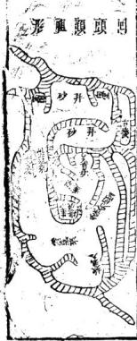
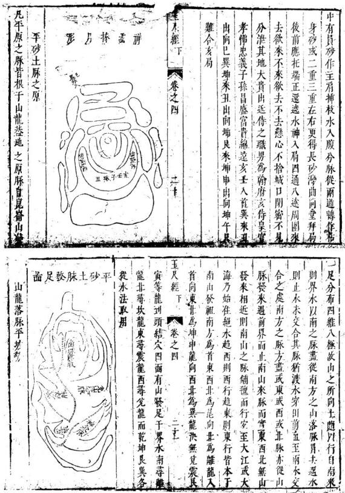
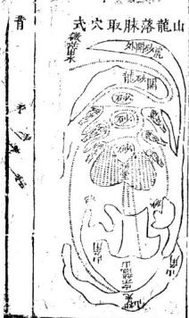
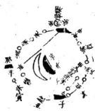
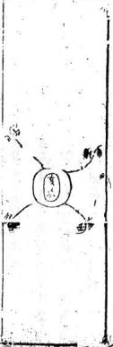
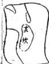
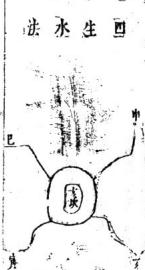
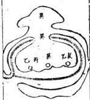
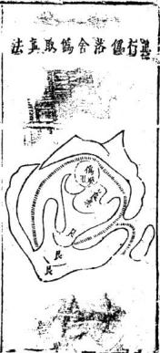
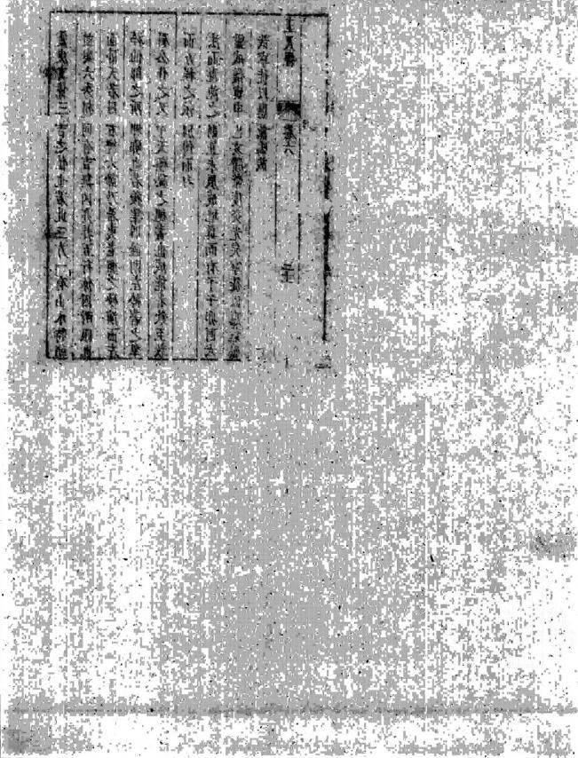

# 平砂玉尺经

> V3 AI 全自动白话释读版。专业术语保留，释读内容可展开核对原文。

> 来源：410.入地眼全书+玉尺经+葬经+鲁班经+选择纪全+秘诀仙机.pdf，PDF 第 167–252 页

<!-- V3_SOURCE_ID:book003-b000002-p000-233f24d594 -->

《劉文成公彙解》

查看对应原文

<!-- V3_FOLDBACK_BEGIN:book003-b000002-p000-233f24d594 -->

劉文成公彙解

<!-- V3_FOLDBACK_END:book003-b000002-p000-233f24d594 -->

<!-- V3_SOURCE_ID:book003-b000003-p000-788db7e143 -->

## 平砂玉尺經

查看对应原文

<!-- V3_FOLDBACK_BEGIN:book003-b000003-p000-788db7e143 -->

## 平砂玉尺經

<!-- V3_FOLDBACK_END:book003-b000003-p000-788db7e143 -->

<!-- V3_SOURCE_ID:book003-b000004-p000-f82dbd9987 -->

附郭璞塟經

查看对应原文

<!-- V3_FOLDBACK_BEGIN:book003-b000004-p000-f82dbd9987 -->

附郭璞塟經

<!-- V3_FOLDBACK_END:book003-b000004-p000-f82dbd9987 -->

<!-- V3_SOURCE_ID:book003-b000005-p000-2ddb132b13 -->

擇日全紀秘訣僊機

查看对应原文

<!-- V3_FOLDBACK_BEGIN:book003-b000005-p000-2ddb132b13 -->

擇日全紀秘訣僊機

<!-- V3_FOLDBACK_END:book003-b000005-p000-2ddb132b13 -->

<!-- V3_SOURCE_ID:book003-b000006-p000-a931ee1ac1 -->

魯班造福經

查看对应原文

<!-- V3_FOLDBACK_BEGIN:book003-b000006-p000-a931ee1ac1 -->

魯班造福經

<!-- V3_FOLDBACK_END:book003-b000006-p000-a931ee1ac1 -->

<!-- V3_SOURCE_ID:book003-b000007-p000-06151263f5 -->

彙賢齋收藏的《平沙玉尺經》序言：國師文成公在金陵察知旺氣所在，於是率領眾儒士加以輔助，並在滁陽開創基業，在應天定都建鼎。

查看对应原文

<!-- V3_FOLDBACK_BEGIN:book003-b000007-p000-06151263f5 -->

彙賢齋藏 平沙玉尺經序 國師文成公知旺氣在金 陵而首率群儒以輔之而 滁陽開基應天定鼎紫荊

<!-- V3_FOLDBACK_END:book003-b000007-p000-06151263f5 -->

<!-- V3_SOURCE_ID:book003-b000008-p000-32805eae9d -->

上奏說：帝王萬代陵寢之事，豈能不懂地理之術？但又擔心一人的目力無法遍察天下，所以在告老閒暇之日，創作了《平沙玉尺經》並頒行海內，同時附上晉代國師郭璞的《塟經》。這並非輕洩天機，而是希望後人得到這把尺來度量，獲得的福報將無邊無際。

查看对应原文

<!-- V3_FOLDBACK_BEGIN:book003-b000008-p000-32805eae9d -->

奏爲帝王萬代陵寢斯不 精於地理哉然又懼一人 之目力不能遍天下廼於 告老暇日創爲平沙玉尺 頒行海內并附晉國師郭 璞塟經此非輕洩天機 欲使後之人得是尺而量 之獲福應無崖岸矣是爲

<!-- V3_FOLDBACK_END:book003-b000008-p000-32805eae9d -->

<!-- V3_SOURCE_ID:book003-b000009-p000-72ac2450cd -->

题记写于万历丙午年仲夏上旬的吉日。

查看对应原文

<!-- V3_FOLDBACK_BEGIN:book003-b000009-p000-72ac2450cd -->

萬曆丙午歲仲夏上浣之吉題

<!-- V3_FOLDBACK_END:book003-b000009-p000-72ac2450cd -->

<!-- V3_SOURCE_ID:book003-b000010-p000-8821a92f51 -->

新刻石函《平砂玉尺經全書》真機上卷。元朝太師文正趙國公那州劉秉忠述說，明朝太師文成誠意伯青田劉基解讀。

查看对应原文

<!-- V3_FOLDBACK_BEGIN:book003-b000010-p000-8821a92f51 -->

新刻石函平砂玉尺經全書眞機上卷元太師文正趙國公那州劉秉忠述明太師文成誠意伯青田劉基解

<!-- V3_FOLDBACK_END:book003-b000010-p000-8821a92f51 -->

<!-- V3_SOURCE_ID:book003-b000011-p000-52d80a3a58 -->

敬簡賴從謙發揮。

查看对应原文

<!-- V3_FOLDBACK_BEGIN:book003-b000011-p000-52d80a3a58 -->

敬簡賴從謙發揮

<!-- V3_FOLDBACK_END:book003-b000011-p000-52d80a3a58 -->

<!-- V3_SOURCE_ID:book003-b000012-p000-b804cc44df -->

審勢篇第一

查看对应原文

<!-- V3_FOLDBACK_BEGIN:book003-b000012-p000-b804cc44df -->

審勢篇第一

<!-- V3_FOLDBACK_END:book003-b000012-p000-b804cc44df -->

<!-- V3_SOURCE_ID:book003-b000013-p000-b8d1f74ade -->

天上分列星宿，地上排列山川。仰觀牛宿與斗宿的區域，才能看見眾星拱衛運行的景象；俯察圖阜的來向，才能識別平原的發跡跡象。

查看对应原文

<!-- V3_FOLDBACK_BEGIN:book003-b000013-p000-b8d1f74ade -->

天分星宿地列山川仰觀牛斗之墟乃見衆星之拱運俯察圗阜之來方識平原之起跡

<!-- V3_FOLDBACK_END:book003-b000013-p000-b8d1f74ade -->

<!-- V3_SOURCE_ID:book003-b000014-p000-fdf9d177ae -->

五行之氣在天上形成景象，所以日月星辰顯現。紫微太極起於亥子之中，天市東垣起於寅卯之區。

查看对应原文

<!-- V3_FOLDBACK_BEGIN:book003-b000014-p000-fdf9d177ae -->

五行之氣在天成象而日月星辰見焉紫微太極起於亥子之中天市東垣起於寅卯之區少徵西單尺經 卷一

<!-- V3_FOLDBACK_END:book003-b000014-p000-fdf9d177ae -->

<!-- V3_SOURCE_ID:book003-b000015-p000-dac57ec984 -->

液在坤兌之間，太後南極在巽巳丙之首，中有一星尊居於內，而二十八宿環繞於外。所以牛斗之墟左邊是帝星所居之處，其列宿則隨斗柄所指而拱向之，附天而行，這叫做天經。五行之氣在地上形成形狀，峙立而成山岡壠阜，散開而成平原都隰，流動而成江淮河漢。所以山川的流動與峙立，無非是氣的佈置。然而平原曠野皆根於圖壠分布四維而成形，所以觀察岡阜的來處，就知道平原的發跡了。馬山一貫起自崑崙。

查看对应原文

<!-- V3_FOLDBACK_BEGIN:book003-b000015-p000-dac57ec984 -->

液在坤兌之間太後南極在巽巳丙之首中有一星尊居於内而二十八宿環遶於外故牛斗之墟左爲帝星所居之處其列宿則隨斗柄所指而拱向之附天而行是謂天經五行之氣在地成形峙而爲山岡壠阜散而爲平原都隰流而爲江淮河漢故山川之流峙莫非是氣之疑布然平原曠野皆根於圗壠分布四維而成形故察岡阜之所來則知平原之發跡矣馬山一貫起自崑崙

<!-- V3_FOLDBACK_END:book003-b000015-p000-dac57ec984 -->

<!-- V3_SOURCE_ID:book003-b000016-p000-516b55d33a -->

山龍的散見於地，雖有千萬之多，但其龍脈的來處皆出於崑崙。按《搜異錄》及地志圖記，崑崙山高萬八千九百四十七里，中峯齊天。在中國計之，崑崙則在西北乾兌之間，實為天下山川之祖，而五之入中國又眾山之大宗也。

查看对应原文

<!-- V3_FOLDBACK_BEGIN:book003-b000016-p000-516b55d33a -->

山龍之散見於地雖有千萬之多而其龍脉之來皆出於崑崙按搜異錄及地志啚吉崑崙山高萬八千九百四十七里中峯齊天在中國計之崑崙則在西北乾兌之間實天下山川之祖而五之入中國又衆山之大宗也

<!-- V3_FOLDBACK_END:book003-b000016-p000-516b55d33a -->

<!-- V3_SOURCE_ID:book003-b000017-p000-d028e6a490 -->

聶出孤宗，分行八極。

查看对应原文

<!-- V3_FOLDBACK_BEGIN:book003-b000017-p000-d028e6a490 -->

聶出孤宗分行八極

<!-- V3_FOLDBACK_END:book003-b000017-p000-d028e6a490 -->

<!-- V3_SOURCE_ID:book003-b000018-p000-3fec8a9e9e -->

崑崙之山上方而下圓，周圍一萬二千七百里九十三步。鱗分孤宗，東北出角居艮，東南出角居巽，西南出角居坤，西北出角居乾，乃為四勢下山。

查看对应原文

<!-- V3_FOLDBACK_BEGIN:book003-b000018-p000-3fec8a9e9e -->

崑崙之山上方而下員周圍一萬二千七百里九十三步鱗分孤宗東北出角居艮東南出角居巽西南出角居坤西北出角居乾乃爲四勢下山之玉尺經 卷一 二

<!-- V3_FOLDBACK_END:book003-b000018-p000-3fec8a9e9e -->

<!-- V3_SOURCE_ID:book003-b000019-p000-df635da8d0 -->

山顶距离六千七百九里十三步。旁侧的龙脉条分四正方向：东边的条脉位于震位，南边的条脉位于离位，西边的条脉位于兑位，北边的条脉位于坎位。上方对应八卦，下方对应八方。其中乾、坤、艮、巽四卦开启了五龙生气的门户，坎、离、震、兑四卦则发越五气官旺的脉气，这被称为八极。所谓八极，又是万山的总宗。乾、坤、坎、离以及兑这几条脉归向绝域，向西通往渐海；而艮、震与巽这三条脉则进入中国境内，使得五岳分居各地。

查看对应原文

<!-- V3_FOLDBACK_BEGIN:book003-b000019-p000-df635da8d0 -->

頂六千七百九里十三步旁乃條分四正東條居震南條居離西條居兌北條居坎上按八卦下按八方乾坤艮巽開五龍生氣之門坎離震兌發五氣官旺之脉是謂八極八極者又萬山之大宗也乾坤坎離及兌歸絕域而西通漸海艮震與巽三條入中國而五岳分居

<!-- V3_FOLDBACK_END:book003-b000019-p000-df635da8d0 -->

<!-- V3_SOURCE_ID:book003-b000020-p000-3949d99da8 -->

乾坤坎離兌五條分歸西北及正南，入羌夷蠻種之地，龍脈出拆俱不可考。惟艮震巽三條獨入中國，分居五方，為五岳之山，又中國山川之大宗。

查看对应原文

<!-- V3_FOLDBACK_BEGIN:book003-b000020-p000-3949d99da8 -->

乾坤坎離兌五條分歸西北及正南入羌夷蠻種之地龍脉出拆俱不可考惟艮震巽三條獨入中國分居五方爲五岳之山又中國山川之大宗而

<!-- V3_FOLDBACK_END:book003-b000020-p000-3949d99da8 -->

<!-- V3_SOURCE_ID:book003-b000021-p000-0a19e4b177 -->

地势分施生气，东南巳巽方位的行龙，从出身起行经十一万九千六百五十里，入海后聚结为帝王都城。这一区域有三起龙之地，一百四十七处水穴，三十六处穴；其中能诞生忠贞之士、培育英才、出圣君贤相的有七百二十处穴，聚集精华、拔擢秀气，成为卿士大夫出身地的穴数量多到无法计算。寅艮方位的行龙，从出身起行经八万四千一百里，入海后聚结为帝王都城。这一区域有一起蛟龙之地，七十二处顶穴，一十八处穴；其中能诞生大圣人的地方有五处，出贤人良相的有五百零七处穴，成为卿大夫出身地的穴数量多到无法计算。甲卯方位的行龙，行经八万一千五百六十里，在伊洛、廛涧的交汇处停留，聚结为帝王都城。原文此处记有“三起尺经 卷一上 11”，其中“三起尺经”具体含义不详，卷一上，11。

> **释读存疑：** “三起尺经”具体所指不详，可能为术语或文本讹误。；“顶穴”的确切风水含义不明。；本地硬校验仍未通过，已记录供后续自动处理或人工核对。；“三起尺经”含义不明；“三”所指是第三处还是数量三处无法确定；原文末尾“三起尺经 卷一上 11”中“三起尺经”含义不明，已如实标注

查看对应原文

<!-- V3_FOLDBACK_BEGIN:book003-b000021-p000-0a19e4b177 -->

分勢施生東南巳巽行龍出身行十一萬九千六百五十里人海結帝之都三起龍之地一百四十七水穴三十六其間産忠貞育英才出聖君賢相者七百二十穴聚精拔秀爲卿士大夫之地不計其數寅艮行龍出身八萬四千一百里入海結帝王之都一起蛟龍之地七十二頂穴一十有八其產大聖人之地五出賢人良相五百有七穴爲卿大夫之地不計其數甲卯行龍行八萬一千五百六十里止於伊洛廛澗之交結帝王之都三起尺經 卷一上 11]

<!-- V3_FOLDBACK_END:book003-b000021-p000-0a19e4b177 -->

<!-- V3_SOURCE_ID:book003-b000022-p000-0a7737b15c -->

蛟龙之穴共有二十四处，产生圣君、贤相、侯伯五百零五室。其间钟聚气脉、发越秀气成为卿士大夫、宝士之类人物的地方。北边艮、巽方位的穴，龙脉众多。

查看对应原文

<!-- V3_FOLDBACK_BEGIN:book003-b000022-p000-0a7737b15c -->

蛟龍之穴二十有四產聖君賢相侯伯五百五室其間鍾氣發秀爲卿士大夫寶士之類北艮巽之穴龙多

<!-- V3_FOLDBACK_END:book003-b000022-p000-0a7737b15c -->

<!-- V3_SOURCE_ID:book003-b000023-p000-b5ba20fa0e -->

如中回之東。是故黃河界而西北，丑艮行龍。

查看对应原文

<!-- V3_FOLDBACK_BEGIN:book003-b000023-p000-b5ba20fa0e -->

如中回之東 是故黃河界而西北丑艮行龍

<!-- V3_FOLDBACK_END:book003-b000023-p000-b5ba20fa0e -->

<!-- V3_SOURCE_ID:book003-b000024-p000-e9d42f8dbb -->

黃河之水派自崑崙，艮寅之左，甲卯之右，界良丑於東北之首，限甲卯於正東，向東曲折而流入中國。至河套之北，出峽之左而山西等路右臂，至汴之東南，左紆徐州之東北入海。故河之西地乃丑艮行龍，實為坤申之氣入首。故燕冀至青兗之地，義一坤甲結穴，自右轉為坎局，左顧為兌局，趨巽為亥龍，無離巽艮震穴，蓋水趨東北故也。敬仙云：崑崙丑艮落脈為坤申之氣入首者，水多東流。燕冀雲朔之地為坤氣腰落，青徐之地為坤氣之盡龍黃其界也，直沾其孤也。開州以南其左臂也，遼東其右臂之盡氣也。其脈直遂無曲折，河北氣散不收，故其民多直魯，性剛風氣強勁，少許詐，民不戀業，家不久富，官無三代。然而清泉穴漢，氣從下升，產聖賢為文章之祖，育英才為一時之。

查看对应原文

<!-- V3_FOLDBACK_BEGIN:book003-b000024-p000-e9d42f8dbb -->

黃河之水派自崑崙艮寅之左甲卯之右界良丑于東北之首限甲卯于正東向東曲折而流入中國至河套之北出峽之左而山西等路右臂至汴之東南左紆徐州之東北入海故河之西地乃丑艮行龍實爲坤申之氣入首故燕冀至靑兗之地義一坤甲結穴自右轉為坎局左顧爲兌局趨巽爲亥龍無離巽艮震穴蓋水趨東北故也敬仙云崑崙丑艮落脈爲坤申之氣入首者水多東流燕冀雲朔之地爲坤氣腰落青徐之地爲坤氣之盡龍黃其界也直沾其孤也開州以南其左臂也遼東其右臂之盡氣也其脉直遂無曲折河北氣散不收故其民多直魯性剛風氣強勁少許詐民不戀業家不久富官無三代然而清泉穴漢氣從下升産聖賢爲文章之祖育英才爲一時之尺經 卷一上

<!-- V3_FOLDBACK_END:book003-b000024-p000-e9d42f8dbb -->

<!-- V3_SOURCE_ID:book003-b000025-p000-4daf2f67bc -->

盛女子美貌而無恥，皆其氣之惠也。長江限而東南，巽辰起祖。

查看对应原文

<!-- V3_FOLDBACK_BEGIN:book003-b000025-p000-4daf2f67bc -->

盛女子美貌而無耻皆其氣之惠也長江限而東南巽辰起祖

<!-- V3_FOLDBACK_END:book003-b000025-p000-4daf2f67bc -->

<!-- V3_SOURCE_ID:book003-b000026-p000-c87123728f -->

崑崙東南孤角分條，自康姑九萬八千七百五十里，出西羌天竺西番南界，曰六國山之北一萬二千里，通巴西之嚴鵬山。分枝三派：左股出陝之南為雍之右衛；中股歷憑旗發派為荊襄之南衞，渡祁山起南岳衡山為離宮之火星；憑旗右股作成都之左衞而止。嚴南股歷雍思入東蜀之南為成都之右衛，過東北起平華頂，分二右股為雲南。

查看对应原文

<!-- V3_FOLDBACK_BEGIN:book003-b000026-p000-c87123728f -->

崑崙東南孤角分條自康姑九萬八千七百五十里出西羌天竺西番南界曰六國山之北一萬二千里通巴西之嚴鵬山分枝三派左股出陝之南爲雍之右衛中股歷憑旗發派爲荊襄之南衞渡祁山起南岳衡山爲離宮之火星憑旗右股作成都之左衞而止嚴南股歷雍思入東蜀之南爲成都之右衛過東北起平華頂分二右股爲雲南

<!-- V3_FOLDBACK_END:book003-b000026-p000-c87123728f -->

<!-- V3_SOURCE_ID:book003-b000027-p000-ca5942735d -->

之右衛，左股過四川之東北作雲南之左衛，過電磨山起二枝。一枝出辰州以南為貴州之西北護，一枝出貴州之東北分岐。南一枝廣東趨南海，枝入廣西與辰州之北界合，行過東梅峯為廣東之北護，即福之南條山也。梅峯西角分枝入豫章，西南盡于九江，渡江過黃川作湖廣之下流為河南之東北障。梅峯之北角入建者，過潛陽山起祖為建之西南障，歷鉛山左臂為建之北障，即浙之南衛。自建寧出漳江之南而入海，右臂分結諸洞。

查看对应原文

<!-- V3_FOLDBACK_BEGIN:book003-b000027-p000-ca5942735d -->

之右衛左股過四川之東北作雲南之左衛過電 磨山起二枝一枝出辰州以南爲貴州之西北護 一枝出貴州之東北分岐南一枝廣東趨南海 枝入廣西與辰州之北界合行過東梅峯爲廣東 之北護卽福之南條山也梅峯西角分枝入豫章 西南盡于九江渡江過黃川作湖廣之下流爲河 南之東北障梅峯之北角入建者過潛陽山起祖 爲建之西南障歷鉛山左臂爲建之北障卽浙之 南衛自建寧出漳江之南而入海右臂分結諸洞 玉尺經 卷一上 五

<!-- V3_FOLDBACK_END:book003-b000027-p000-ca5942735d -->

<!-- V3_SOURCE_ID:book003-b000028-p000-dfeab6d660 -->

铅山左臂有两条分支：一条进入福建，一条进入浙东，经过处州后分为两条：一条从温州入海，一条从台州至四明入海。铅山左股有一条越过玉山蓼花峰起顶，分出三条：一条出饶信，一条出南康渚泽鄱阳，一条从祁门进入至浙江临安之西，起于天目。甲卯行龙作为兑气入首，到达古杭后左回右抱，合气结穴为钱塘。其左股经过皋亭至海盐入海而止。丑艮方向的一条至宁国西界分派：一枝出太平濩洋子江，过舍山经六合从太典入海；一枝出建平西界分派，进入建康东界，经过句容成为长山；一枝自东向西逆回，成为建康的北卫；一枝自西过东至润州，出靖江入江，经历十一万九千六百五十里入海。其中分枝异派不止数百，逆行顺行各有所趋。因此，岷山以东、幡山以西之地多离龙；云南之水自北向南，地多坎、艮、乾龙；贵州北界地多震、巽；广东之界地多坤、艮、兑、乾。自广东以西，巽、震、艮、坎受气；豫章以东，巽、震之交的北界则是坎、艮；是贵、闽、福之南，坤、申得气，而北条则是兑、亥、坎成胎。临安为坤、兑之交，建康得南离之气。

查看对应原文

<!-- V3_FOLDBACK_BEGIN:book003-b000028-p000-dfeab6d660 -->

一鉛山左臂二條一條入福建一條入浙東歷處州分二條一條自溫入海一條自台至四明入海具鉛山之左股一條踰玉山蓼花峯起頂出三條條出饒信一條出南康渚澤鄱陽一條自祈門入至浙江臨安之西起天目甲卯行龍爲兌氣入首至古杭左回右抱合氣結穴爲錢塘其左股歷臯亭至海鹽入海而止其丑艮一條至寧國西界分派一枝出太平濩洋子江過舍山經六合從太典入海一枝出建平西界分派入建康之東界歷句容而爲長山一枝自東而西逆回爲建康之北衛一枝自西過東至潤州出靖江入江經歷十一萬- 九千六百五十里入海其中分枝異派不止數百逆行順行各有所趨故是岷山以東幡山以西地多離龍雲南之水自北而南地多坎艮乾龍貴州北界地多震巽廣東之界地多坤艮兌乾自廣以西巽震艮坎受氣豫章以東巽震之交北界則坎艮是貴閩福之南坤申得氣而北條則兌亥坎成胎臨安爲坤兌之交建康得南離之氣以長江卷一上 六

<!-- V3_FOLDBACK_END:book003-b000028-p000-dfeab6d660 -->

<!-- V3_SOURCE_ID:book003-b000029-p000-476d3b9657 -->

敬仙曰：崑崙之東南出脈者為乾亥行龍。幾巽宮之氣煖而風和，亥木得之則生意條暢，枝葉茂盛。故自南條向南者氣愈和而散漫，鳥獸稀章，民乃析。故南方之人散而不聚，不服教化，然多洞穴，水從穴行。

查看对应原文

<!-- V3_FOLDBACK_BEGIN:book003-b000029-p000-476d3b9657 -->

敬仙曰崑崙之東南出脉者爲乾亥行龍几巽宮之氣煖而風和亥木得之則生意條暢枝葉茂盛故自南條向南者氣愈和而散漫鳥獸稀章民乃析故南方之人散而不聚不服教化然多洞穴水從穴行

<!-- V3_FOLDBACK_END:book003-b000029-p000-476d3b9657 -->

<!-- V3_SOURCE_ID:book003-b000030-p000-cd936da3ff -->

號曰潛木，人反奸淫，同域異音，話言不辯。南條而北者氣和平而教化行，風俗美，車同軌書同文行同倫而國大治。惟廣西雲南闕福三省之氣背東逆行，獨向東南與大江流神別派。其地多膠股合脈，穴地出木，民風碩不知禮，無父子君臣之義，淫貪無恥，龍蛇出沒，嵐氣時行，民多病疫，語不通音。其風土氣習類如此。

查看对应原文

<!-- V3_FOLDBACK_BEGIN:book003-b000030-p000-cd936da3ff -->

號曰潛木人反奸淫同域異音話言不辯南條而北者氣和平而敎化行風俗美車同軌書同文行同倫而國大治惟廣西雲南闕福三省之氣背東逆行獨向東南與大江流神別派其地多膠股合脉穴地出木民風碩不知禮無父子君臣之義淫貪無耻龍蛇出没嵐氣時行民多病疫語不通音其風土氣習類如此

<!-- V3_FOLDBACK_END:book003-b000030-p000-cd936da3ff -->

<!-- V3_SOURCE_ID:book003-b000031-p000-a6829e3002 -->

惟寅甲卯乙之落脈為河江中柱之根基。

查看对应原文

<!-- V3_FOLDBACK_BEGIN:book003-b000031-p000-a6829e3002 -->

惟寅甲卯乙之落脉为河江中柱之根基

<!-- V3_FOLDBACK_END:book003-b000031-p000-a6829e3002 -->

<!-- V3_SOURCE_ID:book003-b000032-p000-cd0f8924d2 -->

河源的左侧，从寅、甲、卯、乙方位开始，正当震卦的首位，龙脉由此落脉起帐，延伸出一万四千里，形成兰花嶂；再延伸三万三千七百一十六里，形成乔黎山；再延伸一万九千里，进入榆莱山，经过西域羌胡地区，向南经过幕西首山，行走一万二千二百五十里进入中国，到达《玉尺经》。卷一占 2

> **释读存疑：** 原文数字“三万三千七自一十六里”存在衍文或讹误，此处按“三万三千七百一十六里”理解，但需核对原书；“主尺”应为书名《玉尺经》的简称或脱文，此处按《玉尺经》处理；原文数字“三万三千七自一十六里”存在衍文或讹误，candidate按“三万三千七百一十六里”理解是合理的推测。；2轮自动修复后核义模型仍建议修订，已保守记录。

查看对应原文

<!-- V3_FOLDBACK_BEGIN:book003-b000032-p000-cd0f8924d2 -->

河源之左自寅甲卯乙當震之首落脉起帳出一萬四千里爲蘭花嶂至三萬三千七自一十六里爲喬黎山至一萬九千里入榆萊山過西域羌胡一南幕西首山行一萬二千二百五十里入中國至主尺經 卷一占 2

<!-- V3_FOLDBACK_END:book003-b000032-p000-cd0f8924d2 -->

<!-- V3_SOURCE_ID:book003-b000033-p000-22f1617588 -->

幽谷连绵奇脉，是秦汉时期的另一条龙脉，其中一条分支延伸到南楚的北界，另一条分支延伸到同原的北界，进入中条山脉的洛水、长江东段界限，黄河向西流，剩余的气脉波及淮水、杨水，通达秦地后入海。由此可知，震脉的落脉是江湖之间的柱石，这条龙脉地位独尊，气脉最为纯正。文中提到“出震入離犬都二區”，其中“犬都”具体所指不详；此处占卜国运可获绵长享国时间，百姓安定、物产丰饶，文士大量涌现，社会风气正直，百姓没有欺诈奸邪的行为，上下都顺从教化，都是这一龙脉气脉感应的结果。

> **释读存疑：** “犬都”原文如此，可能为“大都”之误，具体所指不详；“卜年悠久”原文指年代久远，未特指“卜算”这一行为；1轮自动修复后核义模型仍建议修订，已保守记录。；“犬都”含义不明；原文“犬都”具体所指不明，已如实标注

查看对应原文

<!-- V3_FOLDBACK_BEGIN:book003-b000033-p000-22f1617588 -->

幽谷連奇爲秦漢又一條分至南楚之北界一條分至同原之北界入河中條之洛長江東限黃河西流餘氣及淮楊通秦入海是知震脉之落爲江湖之中柱其龍獨尊其氣獨正出震入離犬都二區卜年悠久民安物阜文士萃出風氣正直民無詐奸上下從化皆其應也

<!-- V3_FOLDBACK_END:book003-b000033-p000-22f1617588 -->

<!-- V3_SOURCE_ID:book003-b000034-p000-26958c769f -->

散仙说：此地多坤申龙、兑局、离垣，从荆湖地区出来的多属亥局，民俗朴素，少文采。

查看对应原文

<!-- V3_FOLDBACK_BEGIN:book003-b000034-p000-26958c769f -->

散仙日其地多坤申龍兌局離垣出荊湖者多亥局民俗朴素少文

<!-- V3_FOLDBACK_END:book003-b000034-p000-26958c769f -->

<!-- V3_SOURCE_ID:book003-b000035-p000-9f56cc0096 -->

冈垄与平原的区别，就像身体中骨骼与肌肉的依附关系，肌肉附着于骨骼之上。

查看对应原文

<!-- V3_FOLDBACK_BEGIN:book003-b000035-p000-9f56cc0096 -->

岡壠平源之分别猶體骨肌肉之相附肮肉麗于骨

<!-- V3_FOLDBACK_END:book003-b000035-p000-9f56cc0096 -->

<!-- V3_SOURCE_ID:book003-b000036-p000-4d62be87bc -->

记录穴位，是内卿不能做到的，原文此处以“所”字结尾，句子似乎不完整，具体所指不详。

> **释读存疑：** 原文结尾“所”字导致句子不完整，可能脱文；原文结尾“所”字导致句子不完整，可能脱文。candidate已明确标注。

查看对应原文

<!-- V3_FOLDBACK_BEGIN:book003-b000036-p000-4d62be87bc -->

錄穴是內卿不能也所

<!-- V3_FOLDBACK_END:book003-b000036-p000-4d62be87bc -->

<!-- V3_SOURCE_ID:book003-b000037-p000-13a2787cc1 -->

外血脉运行在肌肉之中，可以知晓血脉流动的情状，见到肌肉荣枯的道理。

查看对应原文

<!-- V3_FOLDBACK_BEGIN:book003-b000037-p000-13a2787cc1 -->

外血脉行于肉中知血脉流動之情見肌肉榮枯之理

<!-- V3_FOLDBACK_END:book003-b000037-p000-13a2787cc1 -->

<!-- V3_SOURCE_ID:book003-b000038-p000-06ddb73f39 -->

大凡山脉起自昆仑山，是山的首领，而气脉的运行因山而显现，就像人有体骨，气络流行分布而散漫成为土皮，就像人的肌肉。土不离山，就像肉不离骨。由此可知，土的气都根源于山。山从东方来，则土脉之气随山血。

查看对应原文

<!-- V3_FOLDBACK_BEGIN:book003-b000038-p000-06ddb73f39 -->

凡山脉起自崑崙爲山之首而氣脉之行因山而 見猶人有體骨之格氣絡流行分布而散漫爲土 皮猶人之肌肉士不離山猶肉不離骨也乃知乎 土之氣皆根于山山自東來則土脈之氣隨山血

<!-- V3_FOLDBACK_END:book003-b000038-p000-06ddb73f39 -->

<!-- V3_SOURCE_ID:book003-b000039-p000-828fc0556f -->

所以说肌肉附着于骨骼，外山行走则水跟随，就像人的血脉。如果没有水，则不能滋养，所以龙脉必须得水才能涵养，运行于地中，这是《玉尺经》卷一的内容。

查看对应原文

<!-- V3_FOLDBACK_BEGIN:book003-b000039-p000-828fc0556f -->

故曰肌肉麗于骨外山行則水隨水猶人之血脉王無水則不養故龍脉必得水而涵行于地中爲玉尺經 卷一

<!-- V3_FOLDBACK_END:book003-b000039-p000-828fc0556f -->

<!-- V3_SOURCE_ID:book003-b000040-p000-d2268af7ca -->

气运行而外显为水，水是气的延续。界于外部，是为了巩固内部，使气脉得以运行于地中。所以水神流动之处，可以验证气的出入。流于东方，则山气之东行可见；若无水东流而气反而西布，这是没有道理的。所谓龙行则水随，气行则自随。血脉流动，经络秩然，其余理贯通。所以说地理是天经，地理合而为一，观乎天文而地理的妙用显现。因此众水趋归东北，而坤中的气施生。

查看对应原文

<!-- V3_FOLDBACK_BEGIN:book003-b000040-p000-d2268af7ca -->

氣行而外見爲水水者氣之述也界乎外將以固乎内而氣脉得以行于地中矣故水神流動之處可以驗氣之出入流於東則山氣之東行可見矣無水東流而氣反西布之理所謂龍行則水隨氣行則自隨也血脉流動經絡秩然餘理貫串故曰地理天經地理合而爲一觀乎天文而地理之妙用顯然是故衆水趨歸東北而坤中之氣施生

<!-- V3_FOLDBACK_END:book003-b000040-p000-d2268af7ca -->

<!-- V3_SOURCE_ID:book003-b000041-p000-66a46f5aa0 -->

大凡坤申行龙，水巡趋流东北，这是气脉的使然。震龙入首向西，则西为震气之至，而东为气出之处。

查看对应原文

<!-- V3_FOLDBACK_BEGIN:book003-b000041-p000-66a46f5aa0 -->

大凡坤申行龍水巡趨流東北其氣脉之使然也震龍入首向西則西爲震氣之至而東爲氣出之

<!-- V3_FOLDBACK_END:book003-b000041-p000-66a46f5aa0 -->

<!-- V3_SOURCE_ID:book003-b000042-p000-949b26d0bf -->

所以水神向东北方向倒流的区域，当地多有坤申之气，结局三门。因此向着砂的酉首立穴，是气脉停滞、水流交汇的地方，属于关换。气脉有乾兑相交的情况，此时坎、离、艮、震的气不会进入。如果在东首立标求穴，就会收纳辛酉的兑气入穴。原本水流在西侧交汇，坎、离、艮、震的龙如果在东北交媾，就不是真龙。龙哪有兑气返回东侧的道理？所谓“不食酉辛之气”，说的是兑气真照时穴位不正，没有不出现子嗣断绝、家道衰落、贫病夭折的情况。兑气不进入东侧，所以震龙不会取用兑气。当世的地师不懂得龙脉的相关说法，仙人称水归向东北的话，龙首在西南而龙尾在东北，地脉起止的界限不清楚，水神的来去方向不明确，地气的来源没弄明白，就只凭着坐向方位指东画西，胡乱立标选穴，给人造成的祸害说都说不完。各路水流朝向震辰方位，而乾亥的龙秀美养育，午丁方向生息，怎么会是乘受坎癸的灵气？假如众水流向震辰方向交汇合流而去，那么土辰、午丁方向行龙的区域，水神必然是从南向北合流而去。凡是见到这样的水势来向，必然是乾亥方向来的行龙，所以在东南交汇处寻求龙脉主干才是真龙。这种凭水势推断龙脉走向、立穴的方法，必须向水流交合的地方去寻求，原文此处有“則午下玉尺縱 卷一 尤 尺經 卷 十轉關”的错乱文字，无法通顺释读，具体含义不详；之后的内容提到壬子龙也能结地，坤申之气左关的，也可取用，生息之气聚集才能形成地。如果不在水城出水交汇的地方，就只会有离、巽的灵气，艮气不会进入，所以寻龙的人不应当在乾亥反向朝南的上水处立穴，这样是乘受坎癸的灵气，不是正确的穴。在下砂头立穴，必然会导致绝嗣。仙人称东南方水聚的地方，界水倒向右侧有震穴，界水倒向左侧有兑穴。观察众水的交汇之处，雌雄的区别就会显现。水向北流有兑穴，离、艮、巽三个方向来的龙绝对不宜立穴。龙从西北来，山为雌、水为雄，就像人有男女之别。龙脉到尽头、水流汇合，就算是从别处来的水在东南方汇合，气脉与水交媾的情意已经在震巽方位。雌雄交会，就像男女结合而媾精一样。这个玄妙的地方，是万物化生没有逆向的道理，是生命诞生的关键。而男女的玄门，是任督二脉的尽头，所以男在甲卯方位成胎，不会取用酉辛之气，男女交媾则两尾相对，就像山到尽头、水流交汇的地方，正是牝牡交媾的位置。原文此处的数字“1”具体所指不详。

> **释读存疑：** 原文“玉尺經 卷一 尤 尺經 卷 十轉關”文字错乱，无法通顺解释；原文中出现的数字“1”可能是页码或标记，非正文内容；原文“玉尺經 卷一 尤 尺經 卷 十轉關”文字错乱，无法通顺解释。；原文中出现的数字“1”可能是页码或标记，非正文内容。；2轮自动修复后核义模型仍建议修订，已保守记录。；原文“則午下玉尺縱 卷一 尤 尺經 卷 十轉關”文字错乱，无法释读；“下砂頭立穴也 之必絕”句存在脱文，语义不连贯；原文错乱文字“則午下玉尺縱 卷一 尤 尺經 卷 十轉關”无法释读，数字“1”含义不明，已如实标注

查看对应原文

<!-- V3_FOLDBACK_BEGIN:book003-b000042-p000-949b26d0bf -->

故水神倒東北而行者其地多坤申之氣結局三 門故向砂之酉首立穴是氣止水交之處乃爲關換氣則有乾兌之交而坎離艮震之氣不入求 穴若自東首立標則收辛酉兌氣入穴原水交于西坎離艮震之龍於東北交媾者非眞龍也龍之不 豈有兌氣返東之理所謂不食酉辛之氣言兌氣眞照穴不正未有不絕減而貧折者 1 不入于東而震龍不食兌氣也時師不知龍脉之仙曰水歸東北則龍首在西南而尾在東北地盡 起止不審水神之來去不明地氣之所從只者坐對指東畫西謬立標穴其擠人于害不可勝言矣群流來向震辰而乾亥之龍秀育 午丁生息豈乗坎癸之靈假如衆水流向震辰之方交會合流而去則土辰 午丁行龍者水神必自南而向北合流而去凡見之來必自乾亥行龍故求龍干東南之交者始真 此水步龍立穴須向水流交合之處求之則午下玉尺縱 卷一 尤 尺經 卷 十轉關則壬子龍亦結地坤申之氣左關者亦可取 生息之氣始聚而成地若不于水城出合之所而惟離巽靈艮氣之不入故尋龍者不當於乾亥之 反向南之上水處立穴是乘坎癸之靈非穴也下砂頭立穴也 之必絕仙日東南水聚之處界水倒右有震穴界水倒左 觀衆水之交衿而雄雌乃見向北流有兌穴離艮巽三龍决不宜下龍從西北 山爲雌而水爲雄猶人之有男女也龍盡水合雖方來水自東南合者氣脉水交媾情意巳在震巽 雄交會猶男女合而媾精也此玄妙之處萬物化無逆至之理 生之大關也然男女之玄門任督二脉之盡故男甲卯成胎不食酉辛之氣 女媾則兩尾相對猶山盡水會之處正牝牡交媾之

<!-- V3_FOLDBACK_END:book003-b000042-p000-949b26d0bf -->

<!-- V3_SOURCE_ID:book003-b000043-p000-02d1087936 -->

仙曰：龙至水交之处方止，脉尽气聚，乃为真穴。水不合衿，则龙脉未止；龙脉不止，则气行未住。故寻龙定穴，必于水交之处求之，方是察万里之乎垄而首尾当知。原文结尾有数字“7”，可能是页码或标记，具体所指不详。

> **释读存疑：** 原文结尾的数字“7”可能是页码或标记，非正文内容；原文结尾的数字“7”可能是页码或标记，非正文内容。candidate已标注。

查看对应原文

<!-- V3_FOLDBACK_BEGIN:book003-b000043-p000-02d1087936 -->

仙曰龍至水交之處方止脉盡氣聚乃爲眞穴水7---F不合衿則龍脉未止龍脉不止則氣行未住故尋龍定穴必于水交之處求之方是察萬里之乎壠而首尾當知

<!-- V3_FOLDBACK_END:book003-b000043-p000-02d1087936 -->

<!-- V3_SOURCE_ID:book003-b000044-p000-d0d4de7fe0 -->

平原旷野，虽万里之远，而求其脉之所自，必有山龙以之为根，就像四肢分职而元首在上，起处为首，止处为尾，其理一致。故寻平原之地，必求首尾之所，自然后察其水神之去来，以观其交会止聚之情，则真穴自见矣。

查看对应原文

<!-- V3_FOLDBACK_BEGIN:book003-b000044-p000-d0d4de7fe0 -->

平原曠野維萬里之遠而求其脉之所自必有山龍以爲之根猶四肢分職而元首在上起處爲首止處爲尾其理一致故尋李洋之地必求首尾之所自然後察其水神之去來以觀其交會止聚之情則眞穴自見矣

<!-- V3_FOLDBACK_END:book003-b000044-p000-d0d4de7fe0 -->

<!-- V3_SOURCE_ID:book003-b000045-p000-ce9102319e -->

长经卷上敬仙曰：昆仑山是天地之首，五岳四渎是心腹，支流分脉散于八极是四肢。以中国而言，五岳是万山之首。如山之首可以循脉之知，脉之分可以见龙之止矣。

查看对应原文

<!-- V3_FOLDBACK_BEGIN:book003-b000045-p000-ce9102319e -->

長經 卷 上敬仙曰崑崙山天地之首也五岳四瀆者心腹也支流分脉散于八極者四肢也以中國而言五岳者萬山之首也如山之首可以循脉之知脉之分可以見龍之止矣

<!-- V3_FOLDBACK_END:book003-b000045-p000-ce9102319e -->

<!-- V3_SOURCE_ID:book003-b000046-p000-85cbb78946 -->

纵是回头顾之龙，岂脱父母本生之气？虽云甲卯行龙不食酉辛之气，然亦有“国贾愿尔者”，具体所指不详。如甲卯行龙而气脉返向甲卯结穴者，名“顾袖之地”，具体所指不详，可能为“顾祖之地”之误。虽逆回成穴，而砂头起脚须从震宫发来，关转逆水向震，乃真转关处。若被水流断，则父母本生之气已为水神隔绝矣，非真地也。右关水左倒，兑气入首，从兑局作用；左吉水倒，乾气入首，从乾局作用，又不当以震气立法取之。举一龙而“七龙之法”同例，具体所指不详。仙曰：两砂并出，股长股短，边粗边细。其短而细者必缩，粗而长者必伸。粗大雄急，势必曲折向砂之短处挨归，故多结回龙之地及盘龙之地。或为下砂所压而曲折转关者，亦有回龙盘龙之穴。然必得父母本生之气不脱，始行之砂随水转关而成，方为大地。

> **释读存疑：** “国贾愿尔者”语意不明，具体所指不详；“顾袖之地”可能为“顾祖之地”之误，具体所指不详；“七龙之法”具体所指不详；“国贾愿尔者”语意不明，具体所指不详。candidate已标注。；“顾袖之地”可能为“顾祖之地”之误，具体所指不详。candidate已标注。；“七龙之法”具体所指不详。candidate已标注。

查看对应原文

<!-- V3_FOLDBACK_BEGIN:book003-b000046-p000-85cbb78946 -->

縱是回頭顧之龍豈脫父毋本生之氣雖云甲卯行龍不食酉辛之氣然亦有國賈願爾者如甲卯行龍而氣脈返向甲卯結穴者名顧袖之地雖逆回成穴而砂頭起腳須從震宮發來關轉逆水向震乃眞轉關處若被水流斷則父毋本生之氣巳爲水神隔絕矣非眞地也右關水左倒兌氣入首從兌局作用左吉水倒乾氣入首從乾局作用又不當以震氣立法取之舉一龍而七龍之法同例仙曰兩砂並出股長股短邊粗邊細其短而細者必縮粗而長者必伸粗大雄急勢必曲摺向砂之短處挨歸故多結回龍之地及盤龍之地或爲下砂所壓而曲摺轉關者亦有回龍盤龍之穴然必得父毋本生之氣不脫始行之砂隨水轉關而成方爲大地

<!-- V3_FOLDBACK_END:book003-b000046-p000-85cbb78946 -->

<!-- V3_SOURCE_ID:book003-b000047-p000-5b9c0222c5 -->

所以顺水直冲而逆回结穴，方知体段之真。若还逆水直冲而合衿在后，断是虚花之地。

查看对应原文

<!-- V3_FOLDBACK_BEGIN:book003-b000047-p000-5b9c0222c5 -->

故順水直衝而逆回結穴方知體叚之眞若還逆水直衝而合衿在後斷是虛花之地

<!-- V3_FOLDBACK_END:book003-b000047-p000-5b9c0222c5 -->

<!-- V3_SOURCE_ID:book003-b000048-p000-e0654ef30a -->

回龙之地的砂头，并非从本生之方而来，只是逆着水流方向直冲而上。凡是水流流向背后交合的地方，都不是真地。当时的风水师指称这是“上冰鱼飞天龙”，这一说法非常荒谬。虽然其体势宛转，坐向整齐，但也只是虚花。如果合流在后方，那么砂的行气终究会趋向于交襟之处。

查看对应原文

<!-- V3_FOLDBACK_BEGIN:book003-b000048-p000-e0654ef30a -->

回龍之地其砂頭不從本生之方而來但只逆水直衡而上其水流向背後交合者皆非眞地時師指曰上氷魚飛天龍者甚謬雖其體勢宛轉坐應整齊亦是虛花合流在後則其砂之行氣終趨向于交襟之處也

<!-- V3_FOLDBACK_END:book003-b000048-p000-e0654ef30a -->

<!-- V3_SOURCE_ID:book003-b000049-p000-36217a80b2 -->

乾源旷野铺毡，细认交襟。

> **释读存疑：** 原文“乾源壙野舖氊細認交襟”为短句，语意较为隐晦，可能指在乾方旷野如铺毡般平坦处，需仔细辨认水气交合之处。；原文“乾源旷野铺毡，细认交襟”语意较为隐晦，可能指在乾方旷野如铺毡般平坦处，需仔细辨认水气交合之处。

查看对应原文

<!-- V3_FOLDBACK_BEGIN:book003-b000049-p000-36217a80b2 -->

乾源壙野舖氊細認交襟

<!-- V3_FOLDBACK_END:book003-b000049-p000-36217a80b2 -->

<!-- V3_SOURCE_ID:book003-b000050-p000-82a101fd9b -->

有数百里平洋之地，前后左右又无沟壑溪涧，原文以“如”字结尾，句子似乎不完整，具体所指不详。

> **释读存疑：** 原文结尾“如”字导致句子不完整，可能脱文；原文结尾“如”字导致句子不完整，可能脱文。candidate已标注。

查看对应原文

<!-- V3_FOLDBACK_BEGIN:book003-b000050-p000-82a101fd9b -->

有數百里平洋之地前後左右又無溝壑溪澗如

<!-- V3_FOLDBACK_END:book003-b000050-p000-82a101fd9b -->

<!-- V3_SOURCE_ID:book003-b000051-p000-007ca0d3d5 -->

铺毡展席，一韦无际。此等形体既无水神可“寿”其出入（“寿”字语意不明，可能为“审察”之意），又无冈阜可辨其来去，何以察其龙脉之行止、穴情之定否？如见此等平地，必有微茫之水，“可满整”之水必有所归（“可满整”语意不明，具体所指不详），而微茫之水去留亦足以察其龙脉之行止。凡水必归趋于卑下而低洼之处，为众水之所归，虽“微浩”之水（“微浩”语意不明，具体所指不详），亦可以见其会合交会。于东则寻兑气之入首，交会于西则寻震气之入首。细心详察，必得真情。

> **释读存疑：** “可寿其出入”的“寿”字语意不明，可能为“审察”之意；“可满整之水”的“满整”语意不明，具体所指不详；“虽微浩之水”的“微浩”语意不明，具体所指不详；“可寿其出入”的“寿”字语意不明，可能为“审察”之意。candidate已标注。；“可满整之水”的“满整”语意不明，具体所指不详。candidate已标注。；“虽微浩之水”的“微浩”语意不明，具体所指不详。candidate已标注。

查看对应原文

<!-- V3_FOLDBACK_BEGIN:book003-b000051-p000-007ca0d3d5 -->

鋪氊展席一韋無際此等形体既無水神可壽其出入又無岡阜可辨其來去何以察其龍脉之行止穴情之定否如見此等平地必有微茫之水可滿整之水必有所歸而微茫之水去留亦足以察其龍脉之行止凡水必歸趨于卑下而低窪之處爲衆水之所歸雖徵浩之水亦可以見其會合交會于東則尋兌氣之入首交會于西則尋震氣之入首細心詳察必得眞情

<!-- V3_FOLDBACK_END:book003-b000051-p000-007ca0d3d5 -->

<!-- V3_SOURCE_ID:book003-b000052-p000-989ceb2240 -->

古云：高一尺为山，低一尺为水，正为平洋乾源旷野之地立法。

查看对应原文

<!-- V3_FOLDBACK_BEGIN:book003-b000052-p000-989ceb2240 -->

古云高一尺爲山低一尺爲水正爲平洋乾源曠玉尺經 卷一 上 十三野之地立法

<!-- V3_FOLDBACK_END:book003-b000052-p000-989ceb2240 -->

<!-- V3_SOURCE_ID:book003-b000053-p000-c8c55cfc89 -->

仙人说：龙脉有起伏和隐现，所以砂术有微茫的踪迹。龙脉有住结，所以即使是沟潦也有交合。考察龙脉微茫的分合，再查看冲潦的去处，真龙自然就会明白。然而原文此处似乎未完。

> **释读存疑：** 原文此处似乎未完；2轮自动修复后核义模型仍建议修订，已保守记录。

查看对应原文

<!-- V3_FOLDBACK_BEGIN:book003-b000053-p000-c8c55cfc89 -->

仙曰龍脉有起伏隱見故砂术有微茫之跡龍脉有住結故雖溝潦亦有交合龍微茫之分合考沖潦之去處而眞龍自明然

<!-- V3_FOLDBACK_END:book003-b000053-p000-c8c55cfc89 -->

<!-- V3_SOURCE_ID:book003-b000054-p000-6a38d678c9 -->

一水曰微茫，则至细难认，非智者目力心思之巧不能也。

查看对应原文

<!-- V3_FOLDBACK_BEGIN:book003-b000054-p000-6a38d678c9 -->

一水日微茫則至細難認非智者目力心思之巧不能也

<!-- V3_FOLDBACK_END:book003-b000054-p000-6a38d678c9 -->

<!-- V3_SOURCE_ID:book003-b000055-p000-0fee659742 -->

极垄平披月角，详看住结。

> **释读存疑：** 原文“极垄平披月角详看住结”语意较为隐晦，可能指在极垄平坡或月角之处，需仔细查看气脉的停驻结聚。

查看对应原文

<!-- V3_FOLDBACK_BEGIN:book003-b000055-p000-0fee659742 -->

極壠平披月角詳看住結

<!-- V3_FOLDBACK_END:book003-b000055-p000-0fee659742 -->

<!-- V3_SOURCE_ID:book003-b000056-p000-93ae96a186 -->

山龍窮盡時，截斷頭部，掛角鋪展成平坡，左右沒有水流夾隨，前行送行，前方沒有溝壑溪澗作為界合。像這樣落頭雖然沒有水法可以辨認，但如果龍脈是真正的龍結穴，那麼氣止融聚之處，必然有正脈垂落，或者微茫地界於左右，旁分砂翼，上首如月角生出，兩肩兜轉，護衛周匝，或一重二重，或四五重，隻隻向前，兜堂收氣。或者左右肩肘抱出，砂頭宛轉曲折到堂，橫過做微茫案應，這地方才是真的。或者從別支分脈曲折到堂，直拜堂局，旁分兩翼，覆冒於本砂之左右，也是好的。所以看平地落頭無處尋其住結，只於月角兜收與不兜收，砂頭轉匝與不轉匝，龍的住與不住、穴的結與不結，方見於此。玉尺經 卷上 十四

查看对应原文

<!-- V3_FOLDBACK_BEGIN:book003-b000056-p000-93ae96a186 -->

山龍窮盡截頭掛角鋪出平坡左右無水夾隨行送前無溝壑溪澗界合如此落頭雖無水法可辨然其龍脉之出若有眞龍結穴則其氣止融聚之處必有正脉垂落或微茫以界于左右旁分砂翼上首如月角之出兩肩兠轉護衞周匝或一重二重或四五重隻隻向前兠堂收氣或左右肩肘抱出砂頭宛轉曲折到堂橫過做微茫案應者其地方眞或從别支分脉曲折到堂直拜堂局旁分兩翼覆冒於本砂之左右者亦佳故看平地落頭無處尋其住結只于月角兠收興不兠收砂頭轉匝以不轉圃而龍之住與不住穴之結與不結方見玉尺經 卷上 十四

<!-- V3_FOLDBACK_END:book003-b000056-p000-93ae96a186 -->

<!-- V3_SOURCE_ID:book003-b000057-p000-1caf03f22d -->

又有四五個山頭出廊平坡，尤其煩難辨認哪座山落頭長、哪座山落頭短，旁角從何方地轉，則知這五山和氣交合成穴。其法尤其微妙，得此穴者富貴雙全，萬子孫一二百紀福力。

查看对应原文

<!-- V3_FOLDBACK_BEGIN:book003-b000057-p000-1caf03f22d -->

又有四五山頭出廊平坡尤煩辨其何山落頭長何山落頭短旁角從何方地轉則知其五山和氣交合成穴其法尤微得此穴者富貴雙全萬子畫孫一二百紀福力

<!-- V3_FOLDBACK_END:book003-b000057-p000-1caf03f22d -->

<!-- V3_SOURCE_ID:book003-b000058-p000-b2aa04fd2f -->

勢說，由巒聲。

查看对应原文

<!-- V3_FOLDBACK_BEGIN:book003-b000058-p000-b2aa04fd2f -->

勢說繇巒聲

<!-- V3_FOLDBACK_END:book003-b000058-p000-b2aa04fd2f -->

<!-- V3_SOURCE_ID:book003-b000059-p000-3b7673c2a4 -->

寥天乙日塟經說：勢為上，形次之，方位次之。勢，是理之立，顯立之神之容，玄牝之門，乾坤復姤之間，造化鼓萬物出入之機，希夷之數。不可得而聞，不可得而見，不可得而審也。

查看对应原文

<!-- V3_FOLDBACK_BEGIN:book003-b000059-p000-3b7673c2a4 -->

寥天乙日塟經日勢爲上形次之方位次之勢也者理之立也顯立之神之容也玄牝之門也乾坤復姤之間也造化鼓萬物出入之機也希夷之數也不可得而聞不可得而見不可得而審也

<!-- V3_FOLDBACK_END:book003-b000059-p000-3b7673c2a4 -->

<!-- V3_SOURCE_ID:book003-b000060-p000-a89db82b29 -->

《新刻石函平砂玉尺經全書後集》卷的内容记载：阳气在冬至甲子时的一半向左运行，阴气在夏至甲子时的一半向右运行，阴阳相互更替，左右相互激荡，这就是化机。元朝太师、文正赵国公、州人刘秉忠，懂得化机的道理，因此知道山川排布的形态，并不是毫无生气地只向人展示外形。明朝太师、文成诚意伯、青田人刘基作注。所以法象没有比天地更大的。敬仙顿从谦对此作了进一步的阐发。左属阳右属阴，龙脉行走分为两路，阳顺行而阴逆行，气的本源是统一的。地形排布在大地上，并不是孤立的事物，本质上也是阴阳二气构成的。所以太极分化之后两仪就奠定了位置，二气分布之后就有了顺行和逆行的区别。土凭借气而形成形态，阳气在左侧强盛，脉就随之左转；阴气向右旋转，脉就随之右转。所以地势从右转向左进入局的是阳龙，从左转向右进入局的是阴龙，分为阴阳两路，一顺一逆行，是地气自然的运行规律。日月星辰在天上显现的形象，就是清气精粹明澈的表现；江河在大地上排布的形态，就是浊气凝结而通畅的表现。天气属阳，地象属阴，阴需要阳来朝应，阳需要阴来呼应，两者相见符合家室相配的义理；阳用来蓄养阴，阴用来含藏阳，就有了雌雄交媾的情状。混沌初始的时候，太极之气还没有分化，等到轻清的气在子正时分散开，向上浮的成为天；重浊的气在丑时闭合，向下凝结的成为地。五行之气顺行流转，四季按秩序运行，万物化生，都是这股气的作用。阴气向右旋转，夏天行于南方，春天行于东方，冬天行于北方，秋天行于酉位，五气逆行流转，时序正常万物亨通，也都是这股气的作用。然而阳气生长所以向前进发向左，阴气消减所以向后退减向右；阳气生长阴气就盈满，阴气生长阳气就消减，这种进退消长，就是化育的机理，一顺一逆也是自然的运行规律。原文中夹有“上人經下 卷之一 王大經下 卷之 二”的文字，属于排版错乱的卷次标注。气是水的母体，气运行水就跟着流动，水停滞气就跟着停留，母和子的特质是相通的。水和气相伴运行，就像影子跟着形体一样。气是统一的，溢出地面之外而有逆向流动的是水，运行在地面之下没有形态的是气；水是气的外在表现，气是水的内在本质，表里同步运行，内外一同流动，这是天地造化必然的妙理。所以想要知道地下的气是往东边还是西边走，只要看水的来向，就可以大概把握了。文末有“诀是性命非神氣水鄉筆只一味”的表述，具体所指不详。

> **释读存疑：** 原文中“上人經下 卷之一 王大經下 卷之 二”等文字位置交错，可能为标题或注疏混排，此处未做强行整合；原文末尾“诀是性命非神气水乡笔只一味”语义不明，可能为衍文或错乱，具体所指不详；原文中‘上人經下 卷之一 王大經下 卷之 二’等文字位置交错，可能为标题或注疏混排，具体格式和含义不明。；原文末尾‘诀是性命非神气水乡笔只一味’语义不明，可能为衍文或错乱。；2轮自动修复后核义模型仍建议修订，已保守记录。；原文夹有的“上人經下 卷之一 王大經下 卷之 二”为排版错乱文字，无法确定其具体位置和含义；文末“诀是性命非神氣水鄉筆只一味”含义不明；原文夹注的错乱卷次标注“上人經下 卷之一 王大經下 卷之 二”及末尾口诀“诀是性命非神气水乡笔只一味”含义不明，已如实标注

查看对应原文

<!-- V3_FOLDBACK_BEGIN:book003-b000060-p000-a89db82b29 -->

新刻石函平砂玉尺經全書後集卷之 時之半而右行陰陽相禪左右相盪北之謂化機 元太師文正趙國公洲州劉秉忠者 知化機之理則知山川列形要非塊然示人以象 明太師文成誠意伯青田劉基 解 矣故法象莫大乎天地 敬仙頓從謙發揮 左陽右陰龍行兩路而陽順陰逆氣本一原 造微膩 形之列于地者非塊然之物要亦陰陽二氣爲之也故 太極分而兩儀奠二氣布而順逆行 土因氣形陽氣左嚴則脉從而左轉陰氣右旋則 混沌之初太極之氣末分及輕清之氣開于子正 脉從而右轉故其地勢自右轉左入局者爲陽龍 上浮者爲天重濁之氣關于丑而下凝者爲地其 從左轉右入局者爲陰龍分陰陽而兩路而順行 日月星辰懸象于天者卽其清氣精而明者也 逆行其地氣自然之運也 上人經下 卷之一 王大經下 卷之 二 川江河列形于地者卽其濁氣凝而通者也天氣 陰用陽朝陽用陰應相見協室家之義陽以蓄陰陰 屬陽地象屬陰陰陽分五行兆布陽氣左旋秦 以含陽雖雄慶交媾之情 行于東夏行于南秋行于西冬行于北五氣順流 氣者水之母氣行則水隨水止則氣止子母同情 四持序而萬化生者皆是氣也陰氣右旋夏行于南 水氣交逐猶影之隨形也益氣一也溢于地外而 春行于東冬行于北秋行于酉五氣逆流時序正 有逆爲水行於地中而無形者爲氣水其表也氣 而品彙亨有皆是物也然陽氣長故進而左陰氣 其裏也表裏同運內外同流此造化必然之妙運 消故退而右陽長則陰滿陰長則陽消進退消長 故欲知地中之氣趨東趨西卽水之來夫亦可以 化育之機也而一順一逆亦自然之運焉耳故陽 槩守之矣 生寸冬至甲子時之半而左行陰生于夏至甲子 訣是性命非神氣水鄉筆只一味

<!-- V3_FOLDBACK_END:book003-b000060-p000-a89db82b29 -->

<!-- V3_SOURCE_ID:book003-b000061-p000-bb4411e103 -->

所以說，善於觀察氣機之運的人，觀諸水川上之嘆，亦可觀宜尾見道之深焉。然龍行必有水輔，止氣必在水界。輔龍行者，周在于水，故察其水之所來，足以知龍氣發源之始。止龍氣者，亦本于水，故察其水之所交，足以知龍氣贏聚之處。

查看对应原文

<!-- V3_FOLDBACK_BEGIN:book003-b000061-p000-bb4411e103 -->

故曰善觀氣機之運者觀諸水川上之嘆亦可觀宜尾見道之深焉然龍行必有水輔止氣必在水界輔龍行者周在于水故察其水之所來足以知龍氣發源之始止龍氣者亦本于水故察其水之所交足以知龍氣贏聚之處

<!-- V3_FOLDBACK_END:book003-b000061-p000-bb4411e103 -->

<!-- V3_SOURCE_ID:book003-b000062-p000-2f404a6c09 -->

经书说：遇到水则止。又说：外气横行，内气止而生。这话说得多么深刻啊！然而天地之气，不过是阴与阳而已。《易经》说：一阴一阳之谓道。又说：阴阳互藏其宅，动静互为其根，阴阳相禅，万物化醇。郭子有云：独阳不生，独阴不长。由此可知，冲和阴阳而后才能成就化机。所以阴龙逆得阳水来会，阳龙必得阴水来交。外气与内气相会，气激荡而成物，就像夫妇交媾而生育一样。阳为雄，阴为雌。阳龙左行而阴水右来，到堂合襟，为阴以含阳；阴龙右行而阳水左来，到堂合襟，为阳以蓄阴。这就是雌雄相会、牝牡交媾的情状。阴阳相见，福禄承禎。冲阳和阴，万物化生。这是天地自然的化机。合而言之，就是统体一太极的妙用；分而言之，随物付物，又各具一太极的玄妙。懂得太极的道理，就可以谈论化机的妙处；懂得化机的妙处，就可以谈论形法之学了。所以阴交于阳，阳下济而施生；阳交于阴，阴仰承而翁交。文中还提到“1卷之之”，具体所指不详。

> **释读存疑：** 1卷之之

查看对应原文

<!-- V3_FOLDBACK_BEGIN:book003-b000062-p000-2f404a6c09 -->

經日界水則止又日外氣橫行內氣止生識哉言歟然天地之氣陰與陽而巳易曰一陰一陽之謂道又日陰陽互藏其宅動靜互爲其根陰陽相禪萬物化醇郭子有云獨陽不生獨陰不長由是1卷之之則知冲陰和陽而後可以成化機也故陰龍逆得陽水來會陽龍必得陰水來交外氣與內氣相會氣盪而成物猶夫婦媾而生育也陽爲雄陰爲雌陽龍左行而陰水右來到堂合襟爲陰以含陽陰龍右行而陽水左來到堂合襟為陽以蓄陰卽雌雄相會牝牡交媾之情也陰陽相見福祿丞禎冲陽和陰萬物化生此天地自然之化機合而言之卽統體一太極之妙用分而言之隨物付物又各具一太極之玄與也知太極之理可與語化機之妙知化機之妙可與語肜法之學矣故陰交于陽陽下濟而施生陽交十陰陰仰承而翁交

<!-- V3_FOLDBACK_END:book003-b000062-p000-2f404a6c09 -->

<!-- V3_SOURCE_ID:book003-b000063-p000-07b25009e6 -->

龙脉来临时，土随着气的运行形成形态，气虽然流动无法阻挡，但土脉的来向和停驻位置是固定的、难以移动，所以龙形是静态的、固守自己的位置。至于水就是动态的、没有固定形态，有时向东有时向西，没有恒定的属性。虽然气运行水就跟着来，原本就有自然的趋势，但气无法自己停下来，必须要等到水流交汇之后才能停驻。所以阳龙入首的时候阴水来交会，原文写作“陰龍入旨”，疑似“阴龙入首”的讹误，阴龙入首的时候阳水来交会。原文此处有“是之謂陰陽史嫌言陰交于陽陽交于陰者尺經下”的内容，其中“史嫌”具体所指不详，“尺經下”三字为卷次标注。卷之一，19。

> **释读存疑：** 史嫌的具体含义；2轮自动修复后核义模型仍建议修订，已保守记录。；“陰龍入旨”疑似“阴龙入首”的讹误，原文未明确；“史嫌”具体所指不详；原文“史嫌”含义不明，“陰龍入旨”疑似“阴龙入首”讹误，已如实标注存疑

查看对应原文

<!-- V3_FOLDBACK_BEGIN:book003-b000063-p000-07b25009e6 -->

日龍脉之來土隨氣形氣雖流行而不可禦然其土脉之來止一定而難移故龍形則靜而守位若夫水則動而無常或東或西無一定之性雖氣行水來固有自然之勢然氣不能自止必得水交而後止故陽龍入首而陰水來會陰龍入旨而陽水來會是之謂陰陽史嫌言陰交于陽陽交于陰者尺經下 卷之一 19

<!-- V3_FOLDBACK_END:book003-b000063-p000-07b25009e6 -->

<!-- V3_SOURCE_ID:book003-b000064-p000-5cd5a63e53 -->

皆以木言也。经有云：形止气畜，气之流行，无往不到。何以能畜？益以局前之水能止龙气，如界水三乂是也。故杨公所以曰：水对三乂，细认宗也。经又云：外气横行，内气止生。内水随土，十因气形而脉止（“十”字语义不明，可能为衍文或误字），气聚者，以横行于前，足以止内气也。至于山龙得龙虎应，按备行于前，亦为形止气畜，而内气所由以止生者，此也。由是范之，则阳公所谓阴交阳交，以从水神立意何也？气随十形（“十”字语义不明），形则静而有常；水则动而能运，静刑守位（“刑”字在风水语境中可能有特定含义，或为“形”之误），动则流通。故水东于龙而龙不盘进，交于水势也。故龙不可裁而水可裁。

> **释读存疑：** 原文“十因氣形”及“氣隨十形”中的“十”字语义不明，可能为衍文或误字；原文“靜刑守位”中的“刑”字可能为“形”之误，或具有特定风水含义，具体所指不详；原文‘十因氣形’及‘氣隨十形’中的‘十’字语义不明，可能为衍文或误字。；原文‘靜刑守位’中的‘刑’字可能为‘形’之误，或具有特定风水含义。

查看对应原文

<!-- V3_FOLDBACK_BEGIN:book003-b000064-p000-5cd5a63e53 -->

皆以木言也經有云形止氣畜氣之流行無往不到何以能畜益以局前之水能止龍氣如界水三乂是也故楊公所以日水對三乂細認宗也經又云外氣橫行內氣止生內水隨土十因氣形而脉止氣聚者以橫行于前足以止內氣也至于山龍得龍虎應按備行于前亦爲形止氣畜而內氣所由以止生者此也由是范之則陽公所謂陰交陽交以從水神立意何也氣隨十形形則靜而有常水則動而能運靜刑守位動則流通故水東于龍而龍不盤進交于水勢也故龍不可裁而水可裁

<!-- V3_FOLDBACK_END:book003-b000064-p000-5cd5a63e53 -->

<!-- V3_SOURCE_ID:book003-b000065-p000-30fdc6f8d9 -->

阴交于阳，阳下济而施生，意思是阳在下而阴在上，阳气下济而乘阴以施生。阳交于阴，阴仰承而翕受，意思是阳在上而阴在下，阳气下降而乘阴以翕受。阳施阴受，胎息开始，这是化育的妙处，也是气机必然的道理。

查看对应原文

<!-- V3_FOLDBACK_BEGIN:book003-b000065-p000-30fdc6f8d9 -->

陰交于陽陽下濟而施生者陽在下而陰在上湯氣下濟而乘陰以施生也陽交于陰陰仰承而翕受者陽在上而陰在下陽氣下降而乘陰以翕受也陽施陰受胎息始化育之妙氣機必然之理也

<!-- V3_FOLDBACK_END:book003-b000065-p000-30fdc6f8d9 -->

<!-- V3_SOURCE_ID:book003-b000066-p000-f393af927f -->

文中提到“天根呈众妙之门，月窟启玄机之户”，具体所指不详。

> **释读存疑：** 天根呈众妙之门，月窟启玄机之户

查看对应原文

<!-- V3_FOLDBACK_BEGIN:book003-b000066-p000-f393af927f -->

天根呈衆妙之門，月窟啓玄機之戶。

<!-- V3_FOLDBACK_END:book003-b000066-p000-f393af927f -->

<!-- V3_SOURCE_ID:book003-b000067-p000-753215fd02 -->

天根者，陽氣所從出之門，即施生之竇，猶男子之卷之一。

查看对应原文

<!-- V3_FOLDBACK_BEGIN:book003-b000067-p000-753215fd02 -->

天根者陽氣所從出之門卽施生之竇猶男子之卷之一

<!-- V3_FOLDBACK_END:book003-b000067-p000-753215fd02 -->

<!-- V3_SOURCE_ID:book003-b000068-p000-c3f7935453 -->

月窟者，陰氣所發育之施，即翁愛之戶，猶女子之牝。牝牡相對，玄竅相通，男女交媾而生息自盛矣，如下文所云。

查看对应原文

<!-- V3_FOLDBACK_BEGIN:book003-b000068-p000-c3f7935453 -->

牡月窟者陰氣所發育之施卽翁愛之戶猶女子之牝牝牡相對玄竅相通男女交媾而生息自盛矣如下文所云

<!-- V3_FOLDBACK_END:book003-b000068-p000-c3f7935453 -->

<!-- V3_SOURCE_ID:book003-b000069-p000-a6f5c242c8 -->

文中提到“乙丙交而趋戌，辛壬会而聚辰，斗牛纳丁庚之气，金羊收癸甲之灵”，具体所指不详。

> **释读存疑：** 乙丙交而趋戌，辛壬会而聚辰，斗牛纳丁庚之气，金羊收癸甲之灵

查看对应原文

<!-- V3_FOLDBACK_BEGIN:book003-b000069-p000-a6f5c242c8 -->

乙丙交而趨戌，辛壬會而聚辰，斗牛納丁庚之氣，金羊收癸甲之靈。

<!-- V3_FOLDBACK_END:book003-b000069-p000-a6f5c242c8 -->

<!-- V3_SOURCE_ID:book003-b000070-p000-0c1cbabcea -->

文中提到“乙用丙交”，意指丙火生于寅，沐浴于卯，冠带于辰，临官于巳，原文作“帝莊午”，“莊”疑为“旺”的形近误字，对应术数中帝旺阶段，对应地支为午；之后衰于未，病于申，死于酉，原文作“基于戌”，“基”疑为“墓”的形近误字，对应术数中墓的阶段，对应地支为戌。原文还提到“成者再之墓”，具体所指不详，文中称其为阳艮龙的天根，也是阴亥水的月。接着又说“丙州乙交者”，其中“州”字原文如此，具体含义不详；此处描述乙木生于午，原文作“沐洛巳”，“洛”疑为“浴”的形近误字，对应沐浴阶段，对应地支为巳，之后冠带于辰，帝旺于卯，临官于寅。文中未继续列出乙木后续的衰、病、死、墓阶段。

> **释读存疑：** 丙州乙交中的‘州’字含义；成者再之墓的具体所指；2轮自动修复后核义模型仍建议修订，已保守记录。；“帝莊”的“莊”疑为“旺”的形近误字；“基于戌”的“基”疑为“墓”的形近误字；“成者再之墓”具体所指不详；“丙州乙交者”的“州”具体含义不详；“沐洛巳”的“洛”疑为“浴”的形近误字

查看对应原文

<!-- V3_FOLDBACK_BEGIN:book003-b000070-p000-0c1cbabcea -->

乙用丙交者丙火生于寅沐浴卯寇帶辰臨官巳 帝莊午衰於未病于申死于酉基于戌是成者再 之墓卽陽艮龍之天根陰亥水之月也丙州乙 交者乙木生于午沐洛巳冠帶辰帝旺卯臨官寅

<!-- V3_FOLDBACK_END:book003-b000070-p000-0c1cbabcea -->

<!-- V3_SOURCE_ID:book003-b000071-p000-09e460c6ef -->

文中提到“衰于丑，病于子，死于亥，墓于戌（原文作“墓干成”，疑为误字），是戌者乙之阴，亥龙之月窟也，阳艮水之天根也”。丙乙相见，玄窍相通，这就是雌雄交媾的情状。震、离二龙同局。至于辛配壬，是异兑的阴局；壬配辛，是申子的阳局。四龙水法，都在辰上出路，所以如此。庚配丁，是巽兑的阳局；丁配庚，是寅午的阴局，四龙水法都在丑上出路，所以如此。癸配甲，是申子的阴局；甲配癸，是亥卯的阳局，四龙水法都在未上出路，所以如此。行龙布气，并放甲乙交配法例，其黄式并见后。《玉尺经》下卷之一。所以有乙、辛、丁、癸之妇室，配甲、庚、丙、壬之夫，夫夫妇妇，雌雄牝牡。

> **释读存疑：** 原文“墓干成”疑为“墓于戌”之误；原文中“癸配甲申子”和“甲配癸亥卯”为完整组合，不可拆解为独立的“甲申”或“癸亥”短语；原文‘墓干成’疑为‘墓于戌’之误。；原文中‘癸配甲申子’和‘甲配癸亥卯’为完整组合，具体断句和含义需结合风水理气知识理解。；本地硬校验仍未通过，已记录供后续自动处理或人工核对。

查看对应原文

<!-- V3_FOLDBACK_BEGIN:book003-b000071-p000-09e460c6ef -->

衰於丑病于子死於亥墓干成是戍者乙之陰亥龍之月窟也陽艮水之天根也丙乙相見玄竅相通爲雖雄交媾者此也震離二龍同局至于辛配壬者異兌之陰局也壬配辛者申子之陽局也四龍水法皆在辰上出路故耳庚配丁巽兌之陽局也丁配庚者寅午之陰局也以四龍水法皆在於丑上出路故耳癸配甲申子之陰局也甲配癸亥卯之陽局也以四龍水法皆在于未上出路故耳行龍布氣並放甲乙交配法例其黃式並見後玉尺經下 卷之一 大故有乙辛丁癸之婦室配甲庚丙壬之夫夫夫婦婦雌雄牝牡

<!-- V3_FOLDBACK_END:book003-b000071-p000-09e460c6ef -->

<!-- V3_SOURCE_ID:book003-b000072-p000-41b87c374a -->

乙、辛、丁、癸属于阴，甲、庚、丙、壬属于阳。阳用阴来应合，阴用阳来朝迎。所以乙得丙、丁得庚、辛得壬、癸得甲，这是阴用阳；丙得乙、庚得丁、壬得辛、甲得癸，这是阳用阴。阴与阳相见，就像夫妇获得雌雄、牝牡相配，其义理见上文。

查看对应原文

<!-- V3_FOLDBACK_BEGIN:book003-b000072-p000-41b87c374a -->

乙辛丁癸陰也甲庚丙壬陽也陽用陰應陰用陽朝故乙得丙丁得庚辛得壬癸得甲爲陰用陽趙丙得乙庚得丁壬得辛甲得癸爲陽用陰應陰陽相見猶夫婦之獲雌雄牝牡義見上文

<!-- V3_FOLDBACK_END:book003-b000072-p000-41b87c374a -->

<!-- V3_SOURCE_ID:book003-b000073-p000-632e336478 -->

如果阴遇到阳却不是其相配的一类，就称为阳差；阳见到阴却失去了其配偶，就称为阴错。

查看对应原文

<!-- V3_FOLDBACK_BEGIN:book003-b000073-p000-632e336478 -->

若陰遇陽而非其類號曰陽差陽見陰而失其偶名爲陰錯

<!-- V3_FOLDBACK_END:book003-b000073-p000-632e336478 -->

<!-- V3_SOURCE_ID:book003-b000074-p000-26a55c085b -->

例如乙亥龙若用丙气相合，便构成了阴阳正配，此时水从戌方流出。

> **释读存疑：** 1轮自动修复后核义模型仍建议修订，已保守记录。

查看对应原文

<!-- V3_FOLDBACK_BEGIN:book003-b000074-p000-26a55c085b -->

如乙亥龍用丙氣相合乃爲陰陽正配而戍上出

<!-- V3_FOLDBACK_END:book003-b000074-p000-26a55c085b -->

1

<!-- V3_SOURCE_ID:book003-b000076-p000-ba7b0b4db5 -->

水有相见的义理，如果在辰与丑上出水，见到的是庚壬水口而非相配的对象，就叫做阳差，阳差会伤及男丁。丙寅龙用乙气来合，才是阴阳正配，从戍上出水，符合阴阳相见的义理；如果在辰与丑上出水，见到的是丁壬水口却不属于相配的同类，就叫做阴错，阴错会伤及妻子。

> **释读存疑：** 1轮自动修复后核义模型仍建议修订，已保守记录。；原文两处“戍”疑为“戌”的形近误字

查看对应原文

<!-- V3_FOLDBACK_BEGIN:book003-b000076-p000-ba7b0b4db5 -->

水得相見之義若辰與丑上出水是見庚壬水口而非其偶謂之陽差陽差則傷男丙寅龍用乙氣來合乃爲陰陽正配而戍上出水爲陰陽相見之義若辰與丑上出水是見丁壬水口而失其類爲之陰錯陰錯則傷妻

<!-- V3_FOLDBACK_END:book003-b000076-p000-ba7b0b4db5 -->

<!-- V3_SOURCE_ID:book003-b000077-p000-9f44cb3432 -->

妻子如同路上相遇，终究是强行结合而不和谐；眷属一家，虽然程度轻微，却仍有用处。比如丙乙相见，如同夫妻同心，眷属一家，虽然程度轻微，仍为有用，富贵福泽也能惠及后代。如果丙不逢乙而遇到‘丁癸辛未木日’出路，这是夫遇妻于路，‘丁癸辛未木日’具体所指不详。文中还有‘乙不玉及经下卷之一’，此处文字可能有误，具体含义不详。

> **释读存疑：** 丁癸辛未木日；乙不玉及经下卷之一

查看对应原文

<!-- V3_FOLDBACK_BEGIN:book003-b000077-p000-9f44cb3432 -->

妻猶路遇終強合而不諧眷屬一家縱輕微而有用如丙乙相見爲夫妻同情眷屬一家雖去來輕發猶爲有用富貴福澤亦能及其所生若丙不逢乙而遇丁癸辛未木日出路者是夫遇妻于路乙不玉及經下 卷之一

<!-- V3_FOLDBACK_END:book003-b000077-p000-9f44cb3432 -->

<!-- V3_SOURCE_ID:book003-b000078-p000-a2d5a8d934 -->

逢内且逢甲庚壬水口出路的情况，是妻在路上遇到夫，“逢内”具体所指不详。哪怕砂明水秀，终究是强行相合没有情分，发福也不会太深厚，因为“玄户”不通。文中还提到“铜山西崩，灵钟东应”，又说“崔鸣在阴，其子和之”，这都是同声相应、同气相求的道理。先贤说：气和则形和，形和则气和，形气都和顺，万物才能化生。所以阴阳和顺万物就会生长，夫妇和顺子女就会养育。又比如丙在中途配乙，乙在半道配内，比如丙生于寅但水却不从寅来，反而从辰巳方位来，到了水口却从戌上流出，“木是去窦相通”具体含义不详，而来水是在中途相遇的。这种情况本来是正配，但发福迟缓，更主老年才得科第，凡事都迟缓，主有老夫生子的应验，不旺人丁，长房不利，只中小房特别发财。还有水从别的地方横伏过堂流出的情况，也属于路遇，这种尤其不合局，不会发福祉，哪怕发福也很轻微。认水立向有“千向上消息”，具体含义不详，如果符合相关规则，就算是客水登堂也能带来吉兆。

> **释读存疑：** 逢内；木是去窦相通；千向上消息；玄户；崔鸣；1轮自动修复后核义模型仍建议修订，已保守记录。；“逢内”具体所指不详；“玄户”未列入允许术语表，具体含义以原文为准；“崔鸣在阴”未列入允许术语表，具体所指不详；“木是去窦相通”具体含义不详；“千向上消息”具体含义不详

查看对应原文

<!-- V3_FOLDBACK_BEGIN:book003-b000078-p000-a2d5a8d934 -->

逢內而逢甲庚壬水口出路者是妻遇夫于路雖 砂明水秀終為強合無情其發福亦不甚厚以 玄戶不通也銅山西崩靈鍾東應又云崔鳴在陰 其子和之以其同聲相應同氣相求耳先賢曰氣 和則形和形和則氣和形氣俱和物乃化生故陰 陽和則萬物生夫婦和則勇女育又若丙配乙于 中途乙配內於半道如丙生于寅而水却不自寅 來却于辰巳方來至於水口却在戌上出木是去 竇相通而來水在中途中見也此本爲正配 發福遲緩更王老年科第凡百俱遲主老夫 生子之應不旺人丁長房不利特發中小房財 又有水從他處橫伏過堂而出亦爲路遇此尤不 合局不發福祉雖發亦輕可認水立向有千向上 消息則客水登堂亦能致吉

<!-- V3_FOLDBACK_END:book003-b000078-p000-a2d5a8d934 -->

<!-- V3_SOURCE_ID:book003-b000079-p000-a25f0b99d3 -->

女同居纯阴不长，两男并处独阳不生。

查看对应原文

<!-- V3_FOLDBACK_BEGIN:book003-b000079-p000-a25f0b99d3 -->

女同居純陰不長兩男並處獨陽不生

<!-- V3_FOLDBACK_END:book003-b000079-p000-a25f0b99d3 -->

<!-- V3_SOURCE_ID:book003-b000080-p000-c8003a7b36 -->

比如乙亥龙得卯木水来及子午水来到堂，右转倒左，这也是阴遇阴，为二女全居纯阴不长，这是因为水与龙一路来的缘故。若将左水右倒，会阴水而行，不妨‘五玉人经下卷之’，此处文字可能有误，具体含义不详。

> **释读存疑：** 五玉人经下卷之

查看对应原文

<!-- V3_FOLDBACK_BEGIN:book003-b000080-p000-c8003a7b36 -->

如乙亥龍得卯木水來及子午水來到堂右轉倒左是亦陰遇陰爲二女全居純陰不長水輿龍一路來故也若將左水右倒會陰水而行不妨五玉人經下 卷之

<!-- V3_FOLDBACK_END:book003-b000080-p000-c8003a7b36 -->

<!-- V3_SOURCE_ID:book003-b000081-p000-0017bed832 -->

当寅龙得到壬水、庚甲水从左向右流动而去时，这意味着阳遇阳，如同两个男子并立，而独阳无法化生万物。如果右方的水流向左方，与阴水相汇而出，则没有妨碍。文中提到的‘庚甲’具体所指不详。

> **释读存疑：** 庚甲的具体含义；‘庚甲’的具体含义不详。

查看对应原文

<!-- V3_FOLDBACK_BEGIN:book003-b000081-p000-0017bed832 -->

寅龍得壬庚甲水左行倒右而去是以陽遇陽爲 兩男並虞獨陽不生若得右水倒左會陰水而出 -- 不妨

<!-- V3_FOLDBACK_END:book003-b000081-p000-0017bed832 -->

<!-- V3_SOURCE_ID:book003-b000082-p000-314807c968 -->

阴与阳相遇如果交亢就会有祸害，阳超过阴或者不及荒废就没有功效。比如乙亥龙与丙火相交，应当从寅巳上方来水，向右倒到成字上出水，却不从戍上流出，直流到乾亥字上流出，这叫做过交而亢，反而会亏损人丁，冲散生气，还主有意外官非灾祸，后代孤绝，为人刚猛凶恶，“立巳过高”具体所指不详，轻视他人，违背事理败坏家业。又比如丙寅龙与乙木相交，本来水从艮丙上方来，向左倒朝向戍上流出才符合格局，却没到戍上就从乾亥方位流出，属于不及而荒废，后代为人懦弱没有谋略，贫穷孱弱没有能力，学东西多有始无终，克妻丧子，晚年家业衰败。哪怕砂水秀丽能享受福禄，也不会长久，做官的会被贬谪。原文“不一天机决二水交不及颜圆三十二云殂亦出玉寿也”可能存在文字讹误，“颜圆三十二”具体所指不详。

> **释读存疑：** 立巳过高；不一天机决二水交不及颜圆三十二云殂亦出玉寿也；1轮自动修复后核义模型仍建议修订，已保守记录。；原文“成字上出水”的“成”疑为“戌”的形近误字；“立巳过高”具体所指不详；“不一天机决二水交不及颜圆三十二云殂亦出玉寿也”可能存在文字讹误，“颜圆三十二”具体所指不详

查看对应原文

<!-- V3_FOLDBACK_BEGIN:book003-b000082-p000-314807c968 -->

陰與陽而遇交亢則爲害陽過陰而不及廢則無功 如乙亥龍與丙火交當自寅巳上水來右倒至成 字上出水却不于戍上出直流至乾亥字上出此 名爲過交而亢反能虧損人丁冲散生氣故也更 主非橫官灾孤絕出入剛惡立巳過高滅視人物 違理敗家乂如丙寅龍與乙木交本在艮丙上來 左倒向戌上出方合却未到戍上便從乾亥 不及而廢出人王懦怯無謀貧弱無力多學 有始無終克妻喪子晚年喪敗雖砂水秀享祿不 久爲官則謫降不一天機決二水交不及顏圓三 十二云殂亦出玉壽也

<!-- V3_FOLDBACK_END:book003-b000082-p000-314807c968 -->

<!-- V3_SOURCE_ID:book003-b000083-p000-e0360cba92 -->

化育本于龙家，盛衰系于形应。

查看对应原文

<!-- V3_FOLDBACK_BEGIN:book003-b000083-p000-e0360cba92 -->

化育本于龍家盛衰係于形應

<!-- V3_FOLDBACK_END:book003-b000083-p000-e0360cba92 -->

<!-- V3_SOURCE_ID:book003-b000084-p000-6476aefbd6 -->

天地如同男女，‘勇女一天地也’，‘勇’字疑似讹误，具体含义不详。观察男女可以推知天地。乾阳主宰生物之机，而坤阴成就生物之能，犹如男女合而二气感应而孕育。故上龙虽龙生物，富贵入经下卷之一。

> **释读存疑：** 勇女一天地也

查看对应原文

<!-- V3_FOLDBACK_BEGIN:book003-b000084-p000-6476aefbd6 -->

夫天地一男女也勇女一天地也觀男女可以知天地矣乾陽宰生物之機而坤陰成生物之能猶男女合而二氣感而育故上龍雖龍生物富貴入經下 卷之一

<!-- V3_FOLDBACK_END:book003-b000084-p000-6476aefbd6 -->

<!-- V3_SOURCE_ID:book003-b000085-p000-8e606441f0 -->

利达于兹焉出，然不得形应以触，则化机亦几乎息矣。故阳用阴应，阴用阳朝，形以气融，则因以生气感而应，鬼福以及。由是论之，则生富贵，盱人丁皆在于水神交会合法而后应也。主贫贱受孤穷，亦惟水神来去失度使然也。故气化之聚不聚，或盛或衰，系于水而已。龙阳而水阴，或龙阴而水阳，阴阳交构，则气感而应，鬼福始生。旧本刘伯温先生许云：化育虽本于阴阳龙气，而所以发富贵贫贱，则又系于形应。形应感触，物随而始言龙气。

查看对应原文

<!-- V3_FOLDBACK_BEGIN:book003-b000085-p000-8e606441f0 -->

利達于茲焉出然不得形應以觸則化機亦幾乎息矣故陽用陰應陰用陽朝形以氣融則因以生氣感而應鬼福以及由是論之則生富貴盱人丁皆在于水神交會合法而後應也主貧賤受孤窮亦惟水神來去失度使然也故氣化之聚不聚或盛或衰係于水而巳龍陽而水陰或龍陰而水陽陰陽交構則氣感而應鬼福始生舊本劉伯溫先生許云化育雖本于陰陽龍氣而所以發富貴貧賤則又係于形應形應感觸物隨而始言龍氣

<!-- V3_FOLDBACK_END:book003-b000085-p000-8e606441f0 -->

11

<!-- V3_SOURCE_ID:book003-b000087-p000-52cd5764c0 -->

融结而不得穴，则形与气不应而衰；穴乘生气，则形与气应而盛。此以乘气穴立法也。阴阳交媾而不得向，则向与气不应而衰；向乘堂气，则向与气应而盛。此又以乘气立向而言也。

查看对应原文

<!-- V3_FOLDBACK_BEGIN:book003-b000087-p000-52cd5764c0 -->

融結而不得穴則形與氣不應而衰穴乘生氣則 形與氣應而盛此以乘氣穴立法也陰陽交媾而 不得向則向與氣不應而衰向乘堂氣則向與氣 應而盛此又以乘氣立向而言也

<!-- V3_FOLDBACK_END:book003-b000087-p000-52cd5764c0 -->

<!-- V3_SOURCE_ID:book003-b000088-p000-8f855b7b07 -->

是故左行从亥子而进，右行从子亥而旋。

查看对应原文

<!-- V3_FOLDBACK_BEGIN:book003-b000088-p000-8f855b7b07 -->

是故左行從亥子而進右行從子亥而旋

<!-- V3_FOLDBACK_END:book003-b000088-p000-8f855b7b07 -->

<!-- V3_SOURCE_ID:book003-b000089-p000-0b08d9fb42 -->

这是讲解布气以察盛衰、立向以求生旺的方法。向的指向一旦明确，水神的生旺死绝状况就会清晰明了。所以阳气按照左旋的规律，从亥、子、丑的顺序运行；阴气按照右旋的规律，从子、亥、戍的顺序推进，各自根据阴阳的朝应关系，作为‘愿逆’的法则，正所谓二十四山分愿逆，原文提到的‘诏天经下 春之 十’具体所指不详。

> **释读存疑：** 子亥戍；诏天经下春之十；1轮自动修复后核义模型仍建议修订，已保守记录。；诏天经下 春之 十

查看对应原文

<!-- V3_FOLDBACK_BEGIN:book003-b000089-p000-0b08d9fb42 -->

此言布氣以察盛衰立向以求生旺之法向指一明則水神之生旺死絕燎然在目故陽從左旋自亥子丑而行陰從右旋自子亥戍而進各因陰陽朝應以爲願逆之法正所謂二十四山分願逆詔天經下 春之 十

<!-- V3_FOLDBACK_END:book003-b000089-p000-0b08d9fb42 -->

<!-- V3_SOURCE_ID:book003-b000090-p000-05d96b085b -->

取阴阳祖与宗，阳从左边团团转，阴从右路转相通。

查看对应原文

<!-- V3_FOLDBACK_BEGIN:book003-b000090-p000-05d96b085b -->

取陰陽祖與宗陽從左邊團團轉陰從右路轉相通

<!-- V3_FOLDBACK_END:book003-b000090-p000-05d96b085b -->

<!-- V3_SOURCE_ID:book003-b000091-p000-ee611adb83 -->

生旺互用，玄窍相通。

查看对应原文

<!-- V3_FOLDBACK_BEGIN:book003-b000091-p000-ee611adb83 -->

生旺互用玄竅相通

<!-- V3_FOLDBACK_END:book003-b000091-p000-ee611adb83 -->

<!-- V3_SOURCE_ID:book003-b000092-p000-867b752a39 -->

比如乙丙相见，乙水‘生千旺’，‘千’字疑似讹误，具体含义不详；丙寅火生寅旺午。乙本所生之地，即丙火帝旺之方；乙木帝旺之方，即丙火所生之地。乙与内交，故曰‘生肝互用’，‘肝’字疑似讹误，具体含义不详。丙墓在戌，乙墓同之，故为玄窍相通，因为丙乙皆以戌上为水口。杨公葬白龙潭，乙亥龙主穴，乙生气在子，乙丙向生气在寅，戌上出水，此正生壮。

> **释读存疑：** 生千旺；生肝互用

查看对应原文

<!-- V3_FOLDBACK_BEGIN:book003-b000092-p000-867b752a39 -->

如乙丙相見乙水生千旺丙寅火生寅旺午乙本所生之地卽丙火帝莊之方乙木帝旺之方卽西火所生之地乙與內交故曰生肝互用丙墓在戌乙墓同之故爲玄竅相通以丙乙皆以戌上爲水口也楊公塟白龍潭乙亥龍主穴乙生氣在子乙丙向生氣在寅戌上出水此正生壯

<!-- V3_FOLDBACK_END:book003-b000092-p000-867b752a39 -->

<!-- V3_SOURCE_ID:book003-b000093-p000-a8078a67ad -->

窍相通，故发大富贵，作丙向收寅甲水归戍也。惟偶成于契合，勿乐交于兄妹。

查看对应原文

<!-- V3_FOLDBACK_BEGIN:book003-b000093-p000-a8078a67ad -->

竅相通故發大富貴作丙向收寅甲水歸戍也 惟偶成于契合勿樂交于兄妹

<!-- V3_FOLDBACK_END:book003-b000093-p000-a8078a67ad -->

<!-- V3_SOURCE_ID:book003-b000094-p000-664f245ef8 -->

乙、丙、丁、庚、癸、甲、辛、壬都是相互契合结成配偶的情况。比如乙亥见到甲水、辛酉见到庚水、癸龙见到壬水、丁龙见到两木，那么“千癸下内”都属于兄妹同气，难道是它们应当交合的对象吗？“千癸下内”原文疑为讹误，具体所指不详，“两木”具体所指不详。虽然乙见到甲是遇到阳，但总体来说是不吉的情况。

> **释读存疑：** 千癸下内；'千癸下内'可能为'千癸壬内'之误。；'两木'具体所指不详。；1轮自动修复后核义模型仍建议修订，已保守记录。；“千癸下内”原文疑为讹误，具体所指不详；“两木”具体所指不详

查看对应原文

<!-- V3_FOLDBACK_BEGIN:book003-b000094-p000-664f245ef8 -->

乙丙丁庚癸甲辛壬皆契合而偶成者若乙亥見甲水辛酉見庚水癸龍見壬水丁龍見兩木則乙甲辛庚千癸下內皆爲兄妹同氣豈其所交乎雖乙見甲爲遇陽而總爲不樂

<!-- V3_FOLDBACK_END:book003-b000094-p000-664f245ef8 -->

<!-- V3_SOURCE_ID:book003-b000095-p000-ebca5abc65 -->

因此，周公制定礼制，明确家室以区别男女，娶异姓女子以辨别夫妇关系。

查看对应原文

<!-- V3_FOLDBACK_BEGIN:book003-b000095-p000-ebca5abc65 -->

是故周公制禮明家室所以別男女娶異姓所以辨夫婦

<!-- V3_FOLDBACK_END:book003-b000095-p000-ebca5abc65 -->

<!-- V3_SOURCE_ID:book003-b000096-p000-18e534c5e6 -->

这段话是说周公制定礼制，让男女相配从而有家室，让异姓相合从而有德行。卷之一，十1。

查看对应原文

<!-- V3_FOLDBACK_BEGIN:book003-b000096-p000-18e534c5e6 -->

此言周公制禮男女相配俾有家室異姓相合德卷之一 十1

<!-- V3_FOLDBACK_END:book003-b000096-p000-18e534c5e6 -->

<!-- V3_SOURCE_ID:book003-b000097-p000-161aaf484d -->

明确嫌疑，礼制上同姓不婚，是用来辨别宗族的方法。原文作“圣八心”，疑为“圣人心”的形近讹误，圣人之心通晓天的道德，明晓地的纲纪，效法天的常经，遵循地的法则，以此树立人伦的准则，这也是理气自然的运行规律。“圣八心”具体所指不详，原文“法天之经则地之绝”的“绝”字含义不明，此处暂依字面直译。

> **释读存疑：** 圣八心；地之绝；'圣八心'可能为'圣人心'之误。；'地之绝'的'绝'字含义不明。；1轮自动修复后核义模型仍建议修订，已保守记录。；“圣八心”疑为“圣人心”的形近讹误，具体所指不详；“法天之经则地之绝”的“绝”字含义不明；“圣八心”“法天之经则地之绝”的“绝”字无明确原文依据确定准确含义，仍保留存疑

查看对应原文

<!-- V3_FOLDBACK_BEGIN:book003-b000097-p000-161aaf484d -->

明嫌疑禮不聚同姓者所以辨族也聖八心通乎天道德明乎地紀法天之經則地之絕以立人極要亦理氣自然之運也

<!-- V3_FOLDBACK_END:book003-b000097-p000-161aaf484d -->

<!-- V3_SOURCE_ID:book003-b000098-p000-24d9b75d84 -->

这大概是天经地义的常理，也是理气自然运行的规律。

查看对应原文

<!-- V3_FOLDBACK_BEGIN:book003-b000098-p000-24d9b75d84 -->

此蓋天經地懿之常要亦理氣自然之運

<!-- V3_FOLDBACK_END:book003-b000098-p000-24d9b75d84 -->

<!-- V3_SOURCE_ID:book003-b000099-p000-1cf0ae6afa -->

这段话是说圣人区分男女、确定夫妇关系，是效法天经地义的常道来确立人伦纲纪，符合理气自然的运行规律，并不是强迫人情、违背天地之道来制定的制度。圣人制定礼制来匹配男女、确定阴阳，不外乎天经地义的常则，由此可知地理中选取阴阳相见、牝牡交媾各有正配不能混乱，是天地自然化育万物的真机。原文作“天开开财禄之源”，“开开”疑为“关”的重复讹误，具体所指不详。地轴是疏浚化生之宝的地方，原文作“未神发源之处”，“未”疑为讹漏，神发源的地方名为天关，水神流出的地方称为地轴。天关主管财禄，地轴主管人丁，来水深长的话财德就会悠远，出水符合法度的话人丁就会繁衍，这是因为以玄窍作为化生的牝户。原文“法显玄空神功莫测”中，“法显玄空”具体所指不详，其功效神奇难以测度。

> **释读存疑：** 天开开财禄之源；法显玄空；'天開開'可能为'天関'或'天关'之误。；'未神'可能为'水神'或'龙神'之误。；'法显玄空'的具体含义和结构不明。；1轮自动修复后核义模型仍建议修订，已保守记录。；“天开开财禄之源”的“开开”疑为“关”的重复讹误，具体所指不详；“未神发源之处”的“未”疑为讹漏；“法显玄空”具体所指不详

查看对应原文

<!-- V3_FOLDBACK_BEGIN:book003-b000099-p000-1cf0ae6afa -->

此言聖人別男女定夫婦者法天經地懿之常道以立人紀合理氣自然之運要非強人情違天地之道而爲之制也卽聖人制禮以合男女定陰陽不外乎天經地懿之常則知地理取陰陽相見北牡交媾各有正配而不可亂者乃天地自然之化育萬物之眞機也乃若天開開財祿之源地軸濬化生之寶未神發源之處名天関水神流出之處爲地軸天関主財祿地軸官人丁來水深長則財德悠遠出水合法則人丁繫息以玄竇爲化生之牝戶故也法顯玄空神功莫測

<!-- V3_FOLDBACK_END:book003-b000099-p000-1cf0ae6afa -->

<!-- V3_SOURCE_ID:book003-b000100-p000-373d3c488f -->

以水龙相交得到阴阳相见的意义，生肝到堂则生水，人丁兴旺；木发则财禄兴盛，这也是必然的。或者阴阳背驰而向指难以收聚财禄人丁，若有所失，则又立玄空五行。文中提到的“生肝到堂”具体所指不详。文末的“十十”具体含义不详。

> **释读存疑：** 生肝到堂；十十；'生肝到堂'可能为'生旺到堂'或'生干到堂'之误。；'千經下'和'十十'的具体含义及是否为页码错误不详。；1轮自动修复后核义模型仍建议修订，已保守记录。

查看对应原文

<!-- V3_FOLDBACK_BEGIN:book003-b000100-p000-373d3c488f -->

以水龍相交得陰陽相見之義而生肝到堂則生水發人旺木發祿亦所必然者或有陰陽背馳而向指難收財祿人丁若有所則又立玄空五行千經下 卷之一 十十

<!-- V3_FOLDBACK_END:book003-b000100-p000-373d3c488f -->

<!-- V3_SOURCE_ID:book003-b000101-p000-6f7a1a22e7 -->

之法，取八水、四金、四火、四木、四土，布列在二十四山之中，用以调节水路。取生我、克我为吉，生出、克出为凶。来水合法必发，助苏；去水合度必旺。文中提到的“人工”具体所指不详，吉以吉应，凶以凶应，神功不可测度。

> **释读存疑：** 人工；'助蘇'可能为'財祿'或'丁財'之误。；'人工'可能为'人丁'之误。；1轮自动修复后核义模型仍建议修订，已保守记录。

查看对应原文

<!-- V3_FOLDBACK_BEGIN:book003-b000101-p000-6f7a1a22e7 -->

之法取八水四金四火四木四土布列二十四山之中用以消息乎水路取生我尅我爲吉生出尅出爲凶來水合法必發助蘇去水合度必旺人工吉以吉應凶以凶應神功莫測者也

<!-- V3_FOLDBACK_END:book003-b000101-p000-6f7a1a22e7 -->

<!-- V3_SOURCE_ID:book003-b000102-p000-03b7ecb09e -->

五行实际上与龙家的祸福没有直接关系，必须明察水路。

查看对应原文

<!-- V3_FOLDBACK_BEGIN:book003-b000102-p000-03b7ecb09e -->

五行實無係于龍家禍福須取明于水路

<!-- V3_FOLDBACK_END:book003-b000102-p000-03b7ecb09e -->

<!-- V3_SOURCE_ID:book003-b000103-p000-70e63f2a30 -->

玄空五行与龙家本音的意义实际上没有关联。文中提到的“日本山五行”具体所指不详，它以甲乙、寅卯属本，丁巳乍属火，庚辛乾车属金，壬癸亥子属水，艮辰戍丑未桥七之类。而玄空之气则又以乙木、酉金为火，异木、申金为日，丙丁乙酉原属火，乾坤卯午金同坐，亥癸里艮是木，神戍庚丑未还属土，子寅辰巽水为名，多巳壬申同水府。取用坐穴、坐向与水口来去之地，是何字得何五行，以求生克。文中提到的“乾车”、“桥七”、“神戍”、“异木申金为日”等具体所指不详。

> **释读存疑：** 日本山五行；乾车；桥七；神戍；异木申金为日；本段原文存在大量疑似OCR错误或生僻术语组合，难以准确释读，如'于係'、'日本山'、'異寅卯'、'丁巳乍'、'乾車'、'橋七'、'異木申金爲日'、'神戍'等。；1轮自动修复后核义模型仍建议修订，已保守记录。

查看对应原文

<!-- V3_FOLDBACK_BEGIN:book003-b000103-p000-70e63f2a30 -->

玄空五行輿龍家本音之義實無于係日本山五行以甲乙異寅卯屬本兩丁巳乍屬火庚辛乾車屬金壬癸亥子屬水艮辰戍丑未橋七之類面玄空之氣則又以乙木酉金爲火異木申金為日丙丁乙酉原屬火乾坤卯午金同坐亥癸里艮是木神戍庚丑未還屬土子寅辰巽水爲名多巳壬申同水府取用坐穴坐向與水口來去之地一是何字得何五行以求生尅也

<!-- V3_FOLDBACK_END:book003-b000103-p000-70e63f2a30 -->

<!-- V3_SOURCE_ID:book003-b000104-p000-15925408b3 -->

克我者为官，生我者为父。凡是五行之气，取相生而忌相克。此处反取克入者，是因为水神来交，彼此情意自趋之，所以生我、克我者情意自彼而入。水神出去，情意不盛，绝故生我、克我亦情意自彼而入。若土龙体静而专，文中提到的“卷之州”具体所指不详。

> **释读存疑：** 卷之州；'人 卷之 州'可能为'人丁'后接'卷之一'及页码'州（卅）'的格式混乱。；1轮自动修复后核义模型仍建议修订，已保守记录。

查看对应原文

<!-- V3_FOLDBACK_BEGIN:book003-b000104-p000-15925408b3 -->

尅我爲官生我爲父凡五行之氣取相生忌相尅此反取尅入者以水神之來彼來交我情自趨之故生我尅我者情自彼入也水神出去情不盛絕故生我尅我亦情自彼入也若土龍體靜而專人 卷之 州

<!-- V3_FOLDBACK_END:book003-b000104-p000-15925408b3 -->

<!-- V3_SOURCE_ID:book003-b000105-p000-e092d73078 -->

雅静，所以专一，所以常守位。生出、克出则动。水龙动而直，惟动而直，所以常运化。克入、生入而化工自成。穴依龙，君道也，无为恭己南面而出令者也。向依水，臣道也，行君之令而施化者也。君则逸而有成，臣则劳而成功。这也是天地自然运行的规律。如此，则生入、克入的意义就完备了。

查看对应原文

<!-- V3_FOLDBACK_BEGIN:book003-b000105-p000-e092d73078 -->

雅靜故專故常守位生出尅出則動矣水龍動而直惟動而直故常運化尅入生入而化工自成矣穴依龍君道也無爲恭巳南面而出令者也向依水臣道也行君之令而施化者也君則逸而有成臣則勞而成功此亦天地自然之運耳如此則生入尅入之義所矣

<!-- V3_FOLDBACK_END:book003-b000105-p000-e092d73078 -->

<!-- V3_SOURCE_ID:book003-b000106-p000-3c7eac9260 -->

之夺之，彼无心而何济？生入、克入，情既去而复永。神流出，势不可用。我虽生之，不以为德；我虽克之，不以为怨。所谓彼无心而何济。然水神流出，文中提到的“变不可面”具体所指不详，而其情则不可失。我固不能为彼若何，而彼之情则不忘乎我。势欲去，而生我、克我亦能为我作福。来施恩，去犹贡福，岂不为吉。

> **释读存疑：** 变不可面；'变不可面'具体所指不详，可能为'变不可回'或'势不可回'之误。

查看对应原文

<!-- V3_FOLDBACK_BEGIN:book003-b000106-p000-3c7eac9260 -->

之奪之彼無心而曷濟生入尅入情既去而復永神流出勢不可用我雖生之不以爲德我雖尅之不以為怨所謂彼無心而局濟然水神流出變不可面而其情則不可失我固不能爲彼若何而彼之情則不忘乎我勢欲去而生我尅我亦能爲我作福矣來施恩去猶貢福豈不爲吉

<!-- V3_FOLDBACK_END:book003-b000106-p000-3c7eac9260 -->

<!-- V3_SOURCE_ID:book003-b000107-p000-5e3357f63c -->

张古松论玄空之法有曰：情自我出，泄龙气也；情自彼来，益龙气也。此四句正指生入、克入而言。难曰：克出亦情自巳出耳，虽曰克入亦情自外入也。天地赞化育，无非此道。造化改天命，术何妙焉！形法之术，冲阳和阴，睹形审气，辨方察音，故裁天经以立人纪，明尊卑定上下，随时顺人事，建邦玉人。经下卷之一，第十四页。

查看对应原文

<!-- V3_FOLDBACK_BEGIN:book003-b000107-p000-5e3357f63c -->

張古松論玄空之法有曰情自我出泄龍氣也情自彼來益龍氣也此四句正指生人尅入而言難日尅出亦情自巳出耳雖日尅入亦情自外入也天地贊化育無非此道造化改天命術何妙焉形法之術冲陽和陰覩形審氣辨方察音故裁天經以立人紀明尊卑定上下隨天時順人事建邦玉人經下 卷之一 十四

<!-- V3_FOLDBACK_END:book003-b000107-p000-5e3357f63c -->

<!-- V3_SOURCE_ID:book003-b000108-p000-172304c54e -->

国治百姓，辅相天地之空，参赞化育之不及，使天地位于上下而万物育于两间者，亦不过此道焉。已矣，况于葬者，乘气立穴，收生气，荫死骨，召鬼福以及其所生，使鬼神不得以司吉凶之柄，造化不得以宰物之权，回天命而改造化，其术亦妙矣哉！至道精微，惟圣人然后能及此，非睿知孰能之？地理之学，本于太极之理，河图以呈其源，洛书以发其微，乘阴阳五行之气而顺天地自然之运，反气以入骨，其道至精至妙。惟圣人与天地合其德，与鬼神合其吉凶，夫然后能与人穴，之以乘气，回天命，改造化。若非聪明圣知之圣人，其孰能知此道之妙哉？道且不能知，况又能穴之以乘气，召鬼福以及其所生乎？

查看对应原文

<!-- V3_FOLDBACK_BEGIN:book003-b000108-p000-172304c54e -->

國治百姓輔相天地之空參贊化育之不及使天地位于上下而萬物育于兩間者亦不過此道焉巳矣況于塟者乘氣立穴收生氣蔭死骨召鬼福以及其所生使鬼神不得以司吉凶之柄造化不得以宰物之權回天命而改造化其術亦妙矣哉○至道精微惟聖人然後能及此非睿知孰能之地理之學本于太極之理河啚以呈其源洛書以發其微乘陰陽五行之氣而順天地自然之運反氣以入骨其道至精至妙惟聖人輿天地合其總與鬼神合其吉凶夫然後能與人穴之以乘氣回天命改造化若非春知聽明之聖人其孰能知此道之妙哉道且不能知況又能穴之以乘氣召鬼福以及其所生乎

<!-- V3_FOLDBACK_END:book003-b000108-p000-172304c54e -->

<!-- V3_SOURCE_ID:book003-b000109-p000-cc4259fbf2 -->

吉地每每留给积德之家，善地绝不授予邪淫之人。若授之匪人，天神必怒。

查看对应原文

<!-- V3_FOLDBACK_BEGIN:book003-b000109-p000-cc4259fbf2 -->

吉地每雷于積德善地罔授于邪淫昇之匪人天神其怒

<!-- V3_FOLDBACK_END:book003-b000109-p000-cc4259fbf2 -->

<!-- V3_SOURCE_ID:book003-b000110-p000-164f272ec3 -->

葬法有回天改命的功能，召鬼福以及人。如此，故吉地常留于积德之家，而善地不可授于为恶之徒。福善祸淫，是乃天道。顺天之道以造福，则天经。卷之十五。

查看对应原文

<!-- V3_FOLDBACK_BEGIN:book003-b000110-p000-164f272ec3 -->

塟法有回天改命之功能召鬼福以及人如此故吉地常留于積德之家而善地不可授于爲惡之徒福善禍淫是乃天道順天之道以造福則天經 卷之 十五

<!-- V3_FOLDBACK_END:book003-b000110-p000-164f272ec3 -->

<!-- V3_SOURCE_ID:book003-b000111-p000-a21750a021 -->

必应之。若授之于邪淫之辈，则天固祸之而人国福之，是达天道而幸福矣。天地鬼神，其肯容耶？天不罪为恶之人而罪法象家矣。文中提到的“人国福之”具体所指不详。

> **释读存疑：** 人国福之；'人國 福之'可能为'人亦福之'或'人反福之'之误。；1轮自动修复后核义模型仍建议修订，已保守记录。

查看对应原文

<!-- V3_FOLDBACK_BEGIN:book003-b000111-p000-a21750a021 -->

必應之若授之于邪淫之輩則天固禍之而人國 福之是達天道而倖福矣天地鬼神其肯容耶天 不罪爲惡之人而罪法象家矣

<!-- V3_FOLDBACK_END:book003-b000111-p000-a21750a021 -->

<!-- V3_SOURCE_ID:book003-b000112-p000-32495de5e3 -->

某虽不敏，幸淑师传戒言在通焉，敢忽诸。

查看对应原文

<!-- V3_FOLDBACK_BEGIN:book003-b000112-p000-32495de5e3 -->

某雖不敏幸淑師傳戒言在通焉敢忽諸

<!-- V3_FOLDBACK_END:book003-b000112-p000-32495de5e3 -->

<!-- V3_SOURCE_ID:book003-b000113-p000-fe4830a89e -->

论天真戒严，总为天吏立玄科耳。彼购大利、操大钺者何居焉？嗟乎！购大利者，天假籍没也；操大钺者，天委征剿也。故宁为恶家赁天怒，毋为伐恶天将作先锋；宁为善恶两家皇功过纠籍，毋宁为混善恶于千雷可海而顾为一润打尽之枕花也。文中提到的“皇功过纠籍”、“千雷可海”、“一润打尽之枕花”具体所指不详。

> **释读存疑：** 皇功过纠籍；千雷可海；一润打尽之枕花；'皇功过纠籍'、'千雷可海'、'一润打尽之枕花'具体所指不详，文意晦涩。

查看对应原文

<!-- V3_FOLDBACK_BEGIN:book003-b000113-p000-fe4830a89e -->

論天眞戒嚴總爲天吏立玄科耳彼購大利操大 鉞者何居焉嗟乎購大利者天假籍沒也操大鉞 者天委征勦也故寧爲惡家賃天慍毋爲伐惡天 將作先鋒寧為善惡兩家皇功過糾籍毋寧為混 善惡于千雷可海而顧爲一潤打盡之枕花也

<!-- V3_FOLDBACK_END:book003-b000113-p000-fe4830a89e -->

<!-- V3_SOURCE_ID:book003-b000114-p000-d0777918e2 -->

可悲啊，背上元赐福的这段文字，是夷的后人题写在圣统槐临的。

> **释读存疑：** 原文断句与具体所指不详，部分字词（如“元賜福”“聖統槐臨”）含义难以确证

查看对应原文

<!-- V3_FOLDBACK_BEGIN:book003-b000114-p000-d0777918e2 -->

悲夫背上元賜福之是一若夷後人題于聖統槐臨

<!-- V3_FOLDBACK_END:book003-b000114-p000-d0777918e2 -->

<!-- V3_SOURCE_ID:book003-b000115-p000-3c7209a906 -->

这是《石函平砂玉尺经全书》后集的卷次，也是新刻的《石函平砂玉尺经全书》真机上卷。该书由元朝太师、文正、赵国公、邢州人刘秉忠述说，并由明朝太师、文成、诚意伯、青田人刘基注解。

查看对应原文

<!-- V3_FOLDBACK_BEGIN:book003-b000115-p000-3c7209a906 -->

石函平砂玉尺經全書後集卷新刻石甬乎砂玉尺經全書眞機上卷元太師文正趙國公邢州劉秉忠述明太師文成誠意伯青田劉基解

<!-- V3_FOLDBACK_END:book003-b000115-p000-3c7209a906 -->

<!-- V3_SOURCE_ID:book003-b000116-p000-6a87a05452 -->

敬仙赖从谦发挥《审气篇》第二日：玄都的道理蕴含在气之中，所以谈论地势时，坎龙分为三八之数，气属于五行，以此确定阴阳消长的道理，阐明孤虚旺相的原因。

> **释读存疑：** 原文断句与部分术语（如“三八”）的具体所指不详

查看对应原文

<!-- V3_FOLDBACK_BEGIN:book003-b000116-p000-6a87a05452 -->

敬仙賴從謙發揮 審氣篇第二之日 玄都日理寓於氣者故談勢而坎 龍分三八氣屬五行定陰陽消長之理明孤虛旺相 之因

<!-- V3_FOLDBACK_END:book003-b000116-p000-6a87a05452 -->

<!-- V3_SOURCE_ID:book003-b000117-p000-013ded034b -->

地支共有十二位，将乾、坤、艮、巽这四个方位加入午位进行配合隶属，合并后成为二十四位。其中甲、庚、壬、丙隶属于四正之宫；乙、辛、丁、癸隶属于四库之地；乾、坤、艮、巽隶属于四维之方。关于三合的法则：亥、卯、未属于木，乾、甲、丁随之；巳、酉、丑属于金，巽、庚、癸随之；寅、午、戌属于火，艮、丙、辛随之；申、子、辰属于水，坤、壬、乙随之。

查看对应原文

<!-- V3_FOLDBACK_BEGIN:book003-b000117-p000-013ded034b -->

地支一十二位以四維入午配隸于交中併而爲二十四位以甲庚壬丙隸於四正之宮乙辛丁癸隸于四庫之地乾坤艮巽隸于四維之方三合以亥卯未屬木而乾甲丁從之巳酉丑屬金而巽庚癸從之寅午戌屬火而艮丙辛從之申子辰屬水而坤壬乙從之

<!-- V3_FOLDBACK_END:book003-b000117-p000-013ded034b -->

<!-- V3_SOURCE_ID:book003-b000118-p000-ebbcc005d5 -->

经书说：从气的是正确的。乾纳甲而为金，巽纳辛而为木，艮纳丙而为火，兑纳丁而为金，坤纳乙而为水，离纳壬而为土，坎纳癸而为木，震纳庚而为木。经书讲纳气的是正确的。若按正五行来论，则寅、甲、卯、乙、巽五山属木，巳、丙、午、丁属火，庚、申、辛、酉、乾属金，亥、壬、子、癸属水，辰、戌、丑、未、坤、艮属土，分布四方，是万世不易的定气。若用三合罗纹之法，则是土寄旺于四方，生气配于水神，长生于坤，旺于子而无正位，用水、火、木、金为四经五行，如同筮家的妙用，也是古人的深意。推究生旺休废以明阴阳消长之理，孤虚旺相也由此可知。

查看对应原文

<!-- V3_FOLDBACK_BEGIN:book003-b000118-p000-ebbcc005d5 -->

經云從氣者是也乾納甲而爲金巽納辛而爲本 艮納丙而爲火兌納丁而爲金坤納乙而爲水離 納壬而爲土坎納癸而爲木震納庚而爲木經二 納氣者是也以正五行論之則寅甲卯乙巽五山 屬木巳丙午丁屬火庚申辛酉乾屬金亥壬子癸 屬水辰戌丑未坤艮屬土分布四方萬方不易之 定氣也若三合羅紋之法則以土寄旺於四方而 生氣配於水神長生于坤旺于子而無正位用水 火木金爲四經五行如筮家之妙用亦古人之深 一意也推生旺休廢以明陰陽消長之理而孤虛旺 相亦於此而可知矣

<!-- V3_FOLDBACK_END:book003-b000118-p000-ebbcc005d5 -->

<!-- V3_SOURCE_ID:book003-b000119-p000-944e18ef91 -->

因此，壬癸水从兑方、庚方而来，就形成“体全之象”；坎水被迎入寅方、卯方的格局，被称为“领气之神”。

> **释读存疑：** 1轮自动修复后核义模型仍建议修订，已保守记录。；“领气之神”为风水特定格局称谓，并非指神祇

查看对应原文

<!-- V3_FOLDBACK_BEGIN:book003-b000119-p000-944e18ef91 -->

是故壬癸來自兌庚乃作體全之象坎水迎歸寅卯名爲領氣之神

<!-- V3_FOLDBACK_END:book003-b000119-p000-944e18ef91 -->

<!-- V3_SOURCE_ID:book003-b000120-p000-b9476c86d6 -->

壬癸是北方的水，水龙自庚兑而来，出自印绶。《玉尺经》卷二上。

查看对应原文

<!-- V3_FOLDBACK_BEGIN:book003-b000120-p000-b9476c86d6 -->

壬癸爲北方之水水龍自庚兌而來出自印綬之 玉尺經 卷二上

<!-- V3_FOLDBACK_END:book003-b000120-p000-b9476c86d6 -->

<!-- V3_SOURCE_ID:book003-b000121-p000-0a2b35bd04 -->

乡从生处趋向旺处，秀气才能完备。甲和卯是东方的水，水龙领气进入东方生助甲，耶木是坎龙的行体，木龙进入局中，水与木相生，秀气由此显现。这是说旺龙乘载生气而形成的结局体制。仙云：坎龙从西兑出身，震龙从北方出身，都不犯气克泄，从而钟灵草秀，周审完固。如果入首这一节更不混杂关杀，例如坎龙单行，卯龙单行，不与寅、甲、壬、亥相间，那么木木之气清纯，就能富贵双全。

> **释读存疑：** 本地硬校验仍未通过，已记录供后续自动处理或人工核对。

查看对应原文

<!-- V3_FOLDBACK_BEGIN:book003-b000121-p000-0a2b35bd04 -->

鄉從生趨旺秀氣乃全甲卯爲東方之水水龍領 氣入東方生甲耶木是坎龍行體木龍入局水木 相生秀氣乃出此言旺龍乗生氣而結局體製也 仙云坎龍自西兌出身震龍自北方出身皆不犯 氣尅泄而鍾靈草秀周審完固若入首一節更不 混關殺如坎龍單行卯龍单行不與寅甲壬亥相 間則木木之氣清純而富貴雙全矣

<!-- V3_FOLDBACK_END:book003-b000121-p000-0a2b35bd04 -->

<!-- V3_SOURCE_ID:book003-b000122-p000-ea9b1343a1 -->

三阳交泰而震星呈祥，四伏生舆而天罡蚀气。丙午丁为阳之地，气属南离，从震、坎二方起祖，则一贞贪狼之气趋至南离而火神愈明且秀，此是长生发足旺方八首之意也。然火炎而性烈，又自东方行龙，则猛威之性恐为回禄之灾，须得坎方有山水相制方妙，或坐水穴亦可。辰、戌、丑、未为四伏，四金之地，五龙所畏，天罡所临之地，为贵人不立之乡，故曰天罡蚀气。凡龙入首若犯辰、戌、丑、未四伏，生嗔立见灾害。杨公云：先看金龙动，动即此意也。

> **释读存疑：** 原文断句与部分术语（如“四伏生舆”“一贞贪狼”“八首”）的具体所指不详

查看对应原文

<!-- V3_FOLDBACK_BEGIN:book003-b000122-p000-ea9b1343a1 -->

三陽交泰而震星呈祥四伏生輿而天罡蝕氣丙午丁爲陽之地氣屬南離從震坎二方起祖則一貞貪狼之氣趨至南離而火神愈明且秀此是長生發足旺方八首之意也然火炎而性烈又自一東方行龍則猛威之性恐爲回祿之災須得坎方有山水相制方妙或坐水穴亦可辰戌丑未爲四伏四金之地五龍所畏天罡所臨之地爲貴人不立之鄉故曰天罡蝕氣凡龍入首若犯辰戌丑未四伏生嗔立見災害楊公云先看金龍動動卽此意也

<!-- V3_FOLDBACK_END:book003-b000122-p000-ea9b1343a1 -->

<!-- V3_SOURCE_ID:book003-b000123-p000-64635490ab -->

敬仙曰：若午龙从双山三合作戌向或艮向者，多不吉。《玉尺经》卷二一。

查看对应原文

<!-- V3_FOLDBACK_BEGIN:book003-b000123-p000-64635490ab -->

敬仙曰若午龍從雙山三合作戍向或艮向者多不玉尺經 卷二一

<!-- V3_FOLDBACK_END:book003-b000123-p000-64635490ab -->

<!-- V3_SOURCE_ID:book003-b000124-p000-d643135681 -->

发福乃助火党，反祸之故也。更坐火穴，则杀到局，必主回禄。从纳甲作壬向者极妙。若巽、辛二龙入首，切忌辰、戌，决难立穴，即出少亡、孤寡、子孙绝嗣。间有丑、未二龙从丁、癸行者，略通，亦宜避其正声也。

> **释读存疑：** 原文断句与部分术语（如“助火党”“正声”）的具体所指不详

查看对应原文

<!-- V3_FOLDBACK_BEGIN:book003-b000124-p000-d643135681 -->

發福乃助火黨反禍之故也更坐火穴則殺到局必主回祿從納甲作壬向者極妙若巽辛二龍入首切忌辰戍決難立穴卽出少亡孤寡子孫絕嗣間有丑未二龍從丁癸行者畧通亦宜避其正聲也

<!-- V3_FOLDBACK_END:book003-b000124-p000-d643135681 -->

<!-- V3_SOURCE_ID:book003-b000125-p000-4f1a054393 -->

企临火地，自焚厥尸。木入金，即衣稀绝命。兑金行龙，趋向午、丙，立宅是金临火地，向上火来克金，为自焚厥尸矣。若转至丁龙入首，则为阴丽相趋；至巳宫入首，为旺龙趋生，虽巳属火，亦不忌也。甲、卯木行龙，至坎宫杂日得生。若转至兑宫，画酉方上到头，则木入金乡而受制，绝命。如见此地，贼当从金气取用，而不宜以木论也。若木龙长而气短，宜以气短，其入首逢金克而绝命，不成穴矣。火龙畏见兑、庚，遇北辰而自废。东震愁逢火劫，见西兑而伤魂。丙午行龙向西兑，则火为金气泄气，而展至亥、寅之地，则火气废绝无余矣。甲、卯行龙向丙午，则木生火而气脱，复入金乡。于《玉尺经》卷二上，申、酉入首，则木绝于寅而魂气俱伤矣。仙曰：此言火龙不当从兑、坎结局，木龙不当从维、兑结局。如震木在八将之列，丙、丁在六秀之官，行龙出身本秀丽，然入首受制，亦不是局。坎、兑人首本是清贵，不宜木、火行龙也。杨公曰：行得好不如立得好，此言有理。是故阳龙左旋，从生趋旺；阴龙右归，自旺朝生。然皆要得生旺之木气，莫犯鬼劫克泄其本生之龙为美。若克劫，则不成体制矣。

> **释读存疑：** 原文断句与部分术语（如“自焚厥尸”“阴丽”“北辰”“鬼劫”）的具体所指不详

查看对应原文

<!-- V3_FOLDBACK_BEGIN:book003-b000125-p000-4f1a054393 -->

企臨火地自焚厥屍木入金卽衣稀絕命兌金行龍趨向午丙立宅是金臨火地向上火來尅金爲自焚厥屍矣若轉至丁龍入首則爲陰麗相趨至巳宮入首爲旺龍趨生雖巳屬火亦不忌也甲卯木行龍至坎宮雜日得生若轉至兌宫畫酉方上到頭則木入金鄉而受制絕命如見此地賊當從金氣取用而不宜以木論也若 木龍長而 氣短宜 以氣短其入首逢金尅而絕命不成穴矣火龍畏見兌庚遇北辰而自廢東震愁逢火刼見西兌而傷魂丙午行龍向西兌則火爲金氣泄氣而展至亥寅之地則火氣廢絕無餘矣甲卯行龍向丙午則木生火而氣脫復入金鄉於王尺經 卷二上申酉入首則木絕于寅而魂氣俱傷矣仙曰此言火龍不當從兌坎結局木龍不當從維兌結局如震木在八將之列丙丁在六秀之官行龍出身本秀麗然入首受制亦不是局坎兌人首本是清貴不宜木火行龍也楊公日行得好不如立得好此言有理是故陽龍左旋從生趨旺陰龍右歸自旺朝生然皆要得生旺之木氣莫犯鬼刼尅泄其本生之龍爲美若剋刼則不成體製矣

<!-- V3_FOLDBACK_END:book003-b000125-p000-4f1a054393 -->

<!-- V3_SOURCE_ID:book003-b000126-p000-2ade0b78bc -->

仙曰：阳龙左旋，从本生上起长生顺行，如水上居申、沐浴酉、冠带戌、临官亥之类。阴龙右旋，从凡位上起长生逆行，如水上生于卯、沐浴寅、冠带丑、临官子、帝旺亥之类。其排山起运，阳龙从左，阴龙从右。如坎为水，坎戌寅戌辰戊午顺布六爻，以定才官父子兄弟之属；巽为木，巽木辛丑辛亥辛酉逆布六爻，以定才官父子兄弟之属。各从所在位砂木吉凶而断之，万无一失。

查看对应原文

<!-- V3_FOLDBACK_BEGIN:book003-b000126-p000-2ade0b78bc -->

仙曰陽龍左旋從本生上起長生順行如水上居申沐浴酉冠帶戍臨官亥之類陰龍右旋從凡位上起長生逆行如水上生於卯沐浴寅冠帶丑臨官子帝旺亥之類其排山起運陽龍從左陰龍從右如坎爲水坎戍寅戌辰戊午順布六爻以定才官父子兄弟之屬巽爲木巽木辛丑辛亥辛酉逆布六爻以定才官父子兄弟之屬各從所在位砂木吉凶而斷之萬無一失

<!-- V3_FOLDBACK_END:book003-b000126-p000-2ade0b78bc -->

<!-- V3_SOURCE_ID:book003-b000127-p000-2f31e9f73c -->

此结上言龙脉自生方入旺方，或旺方入生方，皆为进气。若生旺二方反行至死绝之地入首结穴者，陷入休囚矣。龙体虽好，亦无用也。

查看对应原文

<!-- V3_FOLDBACK_BEGIN:book003-b000127-p000-2f31e9f73c -->

此結上言龍脈自生方入旺方或旺方入生方皆爲進氣若生旺二方反行至死絕之地入首結穴者陷入休囚矣龍體雖好亦無用也

<!-- V3_FOLDBACK_END:book003-b000127-p000-2f31e9f73c -->

<!-- V3_SOURCE_ID:book003-b000128-p000-f932cb50d5 -->

到头囚谢，旺水聚而财禄尤宜；入首衰微，生神会而人丁可救。

> **释读存疑：** 原文断句与部分术语（如“囚谢”“生神会”）的具体所指不详

查看对应原文

<!-- V3_FOLDBACK_BEGIN:book003-b000128-p000-f932cb50d5 -->

到頭囚謝旺水聚而財祿尤宜入首衰微生神會而 人丁可救

<!-- V3_FOLDBACK_END:book003-b000128-p000-f932cb50d5 -->

<!-- V3_SOURCE_ID:book003-b000129-p000-ca314135d7 -->

来龙入首之气休囚，而或符官旺水聚明堂，则龙穴虽凶而外气清吉，亦能财。或得长生之水气流至局前，则内气虽废而外气不绝，亦能兴旺人丁，终不致于绝嗣。

查看对应原文

<!-- V3_FOLDBACK_BEGIN:book003-b000129-p000-ca314135d7 -->

來龍入首之氣休囚而或符官旺水聚明堂則龍 穴雖凶而外氣清吉亦能財或得長生之水氣 流至局前則內氣雖廢而外氣不絕亦能興旺人 丁終不致於絕嗣

<!-- V3_FOLDBACK_END:book003-b000129-p000-ca314135d7 -->

<!-- V3_SOURCE_ID:book003-b000130-p000-1fb86642b1 -->

所贵双兴并至，那堪两败重逢。得生旺之龙，而又见生旺水神到局，此谓双兴并至，则富贵绵远，发福悠长，人丁财禄两无所缺。若不能用向收制，龙穴休囚而水神朝局，又见囚谢，是胃阿文直色心文收色，无疑。

> **释读存疑：** 原文断句与部分术语（如“胃阿文直色心文收色”）的具体所指不详，疑似文字讹误

查看对应原文

<!-- V3_FOLDBACK_BEGIN:book003-b000130-p000-1fb86642b1 -->

所貴雙興並至那堪兩敗重逢得生旺之龍而又見生旺水神到局此謂雙興並至則富貴綿遠發福悠長人丁財祿兩無所若不能用向收製龍穴休囚而水神朝局又見囚謝是胃阿文直色心文收色無疑

<!-- V3_FOLDBACK_END:book003-b000130-p000-1fb86642b1 -->

<!-- V3_SOURCE_ID:book003-b000131-p000-2cd4e2c35c -->

是谓两败重逢，必致败绝无处。杨公为人救贫，只用向上五行论水法出入之吉凶。衰方水来，向胎养则衰水已在生旺方矣。以向就水，因水立向，此收山出煞玄机救贫续嗣之用也。象日和风，三径雪微，两一龙萍。

> **释读存疑：** 原文断句与部分术语（如“两一龙萍”）的具体所指不详

查看对应原文

<!-- V3_FOLDBACK_BEGIN:book003-b000131-p000-2cd4e2c35c -->

是謂兩敗重逢必致敗絕無處楊公爲人救貧只用向上五行論水法出入之吉凶衰方水來向胎養則衰水巳在生旺方矣以向就水因水立向此收山出煞玄機救貧續嗣之也用也象日和風三徑雪微兩一龍萍

<!-- V3_FOLDBACK_END:book003-b000131-p000-2cd4e2c35c -->

<!-- V3_SOURCE_ID:book003-b000132-p000-af509e2836 -->

仙曰：杨公立双山五行之法，以来龙入首用三，取生旺之位者，立法之经制也。砂水不合，而以合从向上取生旺之位者，用法之权也。水不合而以向上避之，是取外气之吉以为人造福耳。以内虽吉而外气或凶，从内气立向而不顾砂水之恶，则外气亦能损内气，故有吉地而多凶者，此也。杨公深得于此法，诚救贫之奇术也。

查看对应原文

<!-- V3_FOLDBACK_BEGIN:book003-b000132-p000-af509e2836 -->

仙日楊公立双山五行之法以來龍入首用三 取生旺之位者立法之經制也砂水不合而以 合從向上取生旺之位者用法之權也水不合 而以向上避之是取外氣之吉以爲人造福耳以內 雖吉而外氣或凶從內氣立向而不顧砂水之 惡則外氣亦能損內氣故有吉地而多凶者此也 楊公深得於此法誠救貧之奇術也

<!-- V3_FOLDBACK_END:book003-b000132-p000-af509e2836 -->

<!-- V3_SOURCE_ID:book003-b000133-p000-e3eacc24a0 -->

生气短而死气长，凶多吉少；死气短而生气长，福重。凡来龙身生旺之气长，而入首死绝之气短，则君迁之时必致生祸；及至龙步行运到生此之处，食一能发福，故吉多而凶少。凡龙身死绝之气长，而入首生旺之气短，则初葬虽吉，而龙运步至之时必生大祸，故凶多而吉少。

查看对应原文

<!-- V3_FOLDBACK_BEGIN:book003-b000133-p000-e3eacc24a0 -->

生氣短而死氣長凶多吉少死氣短而生氣長福重凡來龍身生旺之氣長而入首死絕之氣短則君遷之時必致生禍及至龍步行運到生此之處食一能發福故吉多而凶少凡龍身死絕之氣長而入首生旺之氣短則初塟雖吉而龍運步至之時必生大禍故凶多而吉少

<!-- V3_FOLDBACK_END:book003-b000133-p000-e3eacc24a0 -->

<!-- V3_SOURCE_ID:book003-b000134-p000-81d2cc8193 -->

仙家说：如果入首之气处于休囚状态，但有砂和水可以收纳，就将它们收纳到向方，这样即使初葬之后也能发福，不会遭受休囚的灾祸。如果没有砂可以收纳，就依据入首之气，从生气方立向，这也是可行的。文中还提到“百三條千里處 陌三條 顧祖廻頭逆勢重於舉鼎遭傷歷刼進氣輕似鴻手”，以及“王尺經 卷二 一 七”，这些文字的具体含义不详，且原文可能存在错漏。

> **释读存疑：** 原文“百三條千里處 陌三條 顧祖廻頭逆勢重於舉鼎遭傷歷刼進氣輕似鴻手”存在明显错漏，含义不明；“王尺經”中的“王”字可能为“玉”之误，但依规则保留原词；“鴻手”可能为“鸿毛”之误，但依规则保留原词并说明可能为误；'百三條千里處 陌三條' 含义不明，可能为口诀或误抄。；'生氣' 具体指生旺之气还是特定方位，原文未明。；'休囚' 为风水术语，指衰败、无力的状态。；1轮自动修复后核义模型仍建议修订，已保守记录。

查看对应原文

<!-- V3_FOLDBACK_BEGIN:book003-b000134-p000-81d2cc8193 -->

仙曰入首休囚者有砂水可收則收歸向上便初 塟之後亦能發福不致受休囚之禍無砂之可收 則以入首從生氣立向亦可百三條千里處 陌三條 顧祖廻頭逆勢重於舉鼎遭傷歷刼進氣輕似鴻手 王尺經 卷二 一 七

<!-- V3_FOLDBACK_END:book003-b000134-p000-81d2cc8193 -->

<!-- V3_SOURCE_ID:book003-b000135-p000-216571aa12 -->

回顾祖盘，虽然弯曲可爱，气势若有举鼎之重而来，但历经之地若遭遇鬼气分劫，到了入首之处，英灵耗散，便似鸿毛之轻了。

查看对应原文

<!-- V3_FOLDBACK_BEGIN:book003-b000135-p000-216571aa12 -->

廻頭祖盤顧雖曲可愛勢力若有舉鼎之重而來 歷之地若遭鬼氣分刼至於入首之處英靈耗散 似鴻毛之輕矣

<!-- V3_FOLDBACK_END:book003-b000135-p000-216571aa12 -->

<!-- V3_SOURCE_ID:book003-b000136-p000-d343811a68 -->

这段话论述盘龙之地福力反而变轻，是提示人们不可以因为回顾祖山就将其指认为大地。顾祖回龙之地，最重要的是水要缠绕玄武，这样气力才会钟聚；否则后气脱去，反而不美。

查看对应原文

<!-- V3_FOLDBACK_BEGIN:book003-b000136-p000-d343811a68 -->

言盤龍之地福力返輕示人不可以顧而遂指爲大地也顧祖廻龍地最要水纏玄武則氣力乃鍾不然後氣脫去反不爲美

<!-- V3_FOLDBACK_END:book003-b000136-p000-d343811a68 -->

<!-- V3_SOURCE_ID:book003-b000137-p000-0f8d9e5a0f -->

仙家说：水龙转离泄于火，归于兑，又复战于金，经历多少克耗，所以说……

> **释读存疑：** 原文句子似乎未完，'故'字后无下文，具体所指不详。

查看对应原文

<!-- V3_FOLDBACK_BEGIN:book003-b000137-p000-0f8d9e5a0f -->

仙日水龍轉離泄於火歸於兌復戰於金經歷多少尅耗故

<!-- V3_FOLDBACK_END:book003-b000137-p000-0f8d9e5a0f -->

<!-- V3_SOURCE_ID:book003-b000138-p000-ab55643f84 -->

所以说：来龙之势虽重，但入首之气轻，纵然发富，其能有限。因此千剥癸、癸剥壬，水龙互用而自纯。坎龙入首而木初之气，得壬癸互换，不失本方体制，则始不犯鬼煞孤空之耗。

> **释读存疑：** 原文'千剝癸癸剝壬'及'木初之氣'等表述在风水理气中含义复杂，此处依字面直译，具体理气推演逻辑不详。

查看对应原文

<!-- V3_FOLDBACK_BEGIN:book003-b000138-p000-ab55643f84 -->

曰來龍之勢重而入首之氣輕縱發富貴其能 是故千剝癸癸剝壬水龍互用而自純 坎龍入首而木初之氣得壬癸互換不失本方體 制則始不犯鬼煞孤空之耗

<!-- V3_FOLDBACK_END:book003-b000138-p000-ab55643f84 -->

<!-- V3_SOURCE_ID:book003-b000139-p000-ffaed0e673 -->

所以说，水清与宝瓶互用，气机自然纯粹，这是指龙脉不杂乱。但如果得癸方入首……

> **释读存疑：** “然得”在此处的逻辑关系（转折或条件）原文未完全明确，暂译为“但如果”；'然得' 在此处的逻辑关系（转折或条件）原文未完全明确，暂译为'但如果'。；'水清'、'宝瓶' 具体所指不详，candidate 保留原词并融入句子，符合规则。

查看对应原文

<!-- V3_FOLDBACK_BEGIN:book003-b000139-p000-ffaed0e673 -->

故云水清寶瓶互用而自純言龍不雜也然得 癸方入首

<!-- V3_FOLDBACK_END:book003-b000139-p000-ffaed0e673 -->

<!-- V3_SOURCE_ID:book003-b000140-p000-473d3ea87e -->

换丙，丙换丁，火气相须而不疚。

查看对应原文

<!-- V3_FOLDBACK_BEGIN:book003-b000140-p000-473d3ea87e -->

換丙丙換丁火氣相須而不疚

<!-- V3_FOLDBACK_END:book003-b000140-p000-473d3ea87e -->

<!-- V3_SOURCE_ID:book003-b000141-p000-b7a8662aca -->

丙和丁都属于火神。丁龙横在丙内，龙换丁，虽然是阴阳相杂而不纯粹，但属于一家之气，所以丁龙不把丙阳当作病态。文中还提到“尺经 卷一上”，具体所指不详。

> **释读存疑：** '尺经 卷一上' 具体所指不详，candidate 已说明。

查看对应原文

<!-- V3_FOLDBACK_BEGIN:book003-b000141-p000-b7a8662aca -->

丙丁皆係火神丁龍橫丙內龍換丁雖是陰陽相雜而不純然爲一家之氣故丁龍不以丙陽爲病尺經 卷一上

<!-- V3_FOLDBACK_END:book003-b000141-p000-b7a8662aca -->

<!-- V3_SOURCE_ID:book003-b000142-p000-00b19754b1 -->

丙龙不以丁阴为害，所谓相须而成质者此也。西为阳火，但理气净阴净阳又系阴也，故丙丁皆吉。仙家说：壬癸虽属阳龙，而亦自有秀气，非若实甲之。若寅甲与卯同行，申与酉同行，辛巳与丙丁同行，则气杂而有病矣。

> **释读存疑：** 原文'非若实甲之'后似有脱漏，'辛巳'在干支中通常不连用，可能为'辛'与'巳'或特定干支组合，具体所指不详。

查看对应原文

<!-- V3_FOLDBACK_BEGIN:book003-b000142-p000-00b19754b1 -->

丙龍不以丁陰爲害所謂相須而成質者此也西 爲陽火但理氣净陰净陽又係陰也故丙丁皆吉 仙曰壬癸雖屬陽龍而亦自有秀氣非若實甲之 北也故壬癸互用而亦純丙丁相須而不疚若寅 甲與卯同行申與酉同行辛巳與丙丁同行則氣 雜而有病矣

<!-- V3_FOLDBACK_END:book003-b000142-p000-00b19754b1 -->

<!-- V3_SOURCE_ID:book003-b000143-p000-d94124cf04 -->

亥龙忌杂乾。千许通一路，异地怕兼辰巳，只爱单行。直受无庇，曲来有玷。

> **释读存疑：** 原文'千许通一路'中'千'可能为'乾'之误，但依规则保留原词；'异地怕兼辰巳'具体地理含义不详。

查看对应原文

<!-- V3_FOLDBACK_BEGIN:book003-b000143-p000-d94124cf04 -->

亥龍忌雜乾千許通一路異地怕兼辰巳只愛單 行直受無庇曲來有玷

<!-- V3_FOLDBACK_END:book003-b000143-p000-d94124cf04 -->

<!-- V3_SOURCE_ID:book003-b000144-p000-dfbfda4175 -->

乾与亥同宫，乾阳而亥阴。壬与亥交界，亥阴而王阳（此处'王'疑为'壬'之误，但依规则保留原词）。二气本不相通，故亥气犯乾壬者必绝。止宜直爱（此处'爱'疑为'受'或'受'之误，但依规则保留原词），不宜曲折。故许通一路，如带乾壬而来，立穴犯之不可，须避其所犯，挨归亥上。其异龙与辰巳同行亦然，犯巳气未必尽绝，侵辰气则人无子遗矣。甲艮何堪并至，酉庚辛乃可双行。

> **释读存疑：** 原文存在多处疑似 OCR 错误或通假字（如'王'、'爱'），且部分逻辑表述晦涩，具体所指不详，释读采用保守表达。

查看对应原文

<!-- V3_FOLDBACK_BEGIN:book003-b000144-p000-dfbfda4175 -->

乾與亥同宮乾陽而亥陰壬輿亥交界亥陰而王陽二氣本不相通故亥氣犯乾壬者必絕止宜直愛不宜曲折故許通一路如帶乾壬而來立穴犯之不可須避其所犯挨歸亥上其異龍與辰已同行亦然犯巳氣未必盡絕侵辰氣則人無子遺矣甲艮何堪並至酉庚辛乃可雙行

<!-- V3_FOLDBACK_END:book003-b000144-p000-dfbfda4175 -->

<!-- V3_SOURCE_ID:book003-b000145-p000-cd4761dc9e -->

艮龙为六秀之尊，得之富贵极速。然与寅甲同界，出其身入首，若有毫厘之差，则福咎须异。若犯丑龙同行，虽为不吉，然不失阴阳一体，尚可裁穴，则寅甲之不可毫厘犯也。酉与庚辛总为一家，庚虽……

> **释读存疑：** 原文'庚虽'后似有脱漏，具体所指不详。

查看对应原文

<!-- V3_FOLDBACK_BEGIN:book003-b000145-p000-cd4761dc9e -->

艮龍爲六秀之尊得之富貴極速然與寅甲同界出其身入首若有毫厘之差則福咎須異若犯丑龍同行雖爲不吉然不失陰陽一體尚可裁穴則寅甲之不可毫厘犯也酉與庚辛總爲一家庚雖玉尺經 卷二上 九

<!-- V3_FOLDBACK_END:book003-b000145-p000-cd4761dc9e -->

<!-- V3_SOURCE_ID:book003-b000146-p000-8bb3c76bba -->

穴清亦为阴气，故三龙双行换互入局亦成大地，不北（此处'北'疑为'减'或'减'之误，但依规则保留原词）寅艮之多庇也。

> **释读存疑：** 原文'不北'语义不明，疑似 OCR 错误，具体所指不详。

查看对应原文

<!-- V3_FOLDBACK_BEGIN:book003-b000146-p000-8bb3c76bba -->

穴清亦爲陰氣故三龍雙行換互入局亦成大地不北寅艮之多庇也

<!-- V3_FOLDBACK_END:book003-b000146-p000-8bb3c76bba -->

<!-- V3_SOURCE_ID:book003-b000147-p000-7256b670f0 -->

乾坤二位到头，虽发福而终归败绝。

查看对应原文

<!-- V3_FOLDBACK_BEGIN:book003-b000147-p000-7256b670f0 -->

乾坤二位到頭雖發福而終歸敗絕

<!-- V3_FOLDBACK_END:book003-b000147-p000-7256b670f0 -->

<!-- V3_SOURCE_ID:book003-b000148-p000-7f8c5f4042 -->

乾冲老亢，退居西北；西南以其生气竭也。故龙自乾坤入首者，砂明水秀，外气清灵，亦能发者。然老阴老阳终无生息，故必归于绝败，亦其理之必然。故后天之卦以乾坤处而一北（此处'一北'疑为'一南'或'一北'之误，但依规则保留原词）西南，此谓也。

> **释读存疑：** 原文'一北'语义不明，疑似 OCR 错误，具体所指不详。

查看对应原文

<!-- V3_FOLDBACK_BEGIN:book003-b000148-p000-7f8c5f4042 -->

乾沖老亢退居西北西南以其生氣竭也故龍自乾坤入首者砂明水秀外氣清靈亦能發者然老陰老陽終無生息故必歸於絕敗亦其理之必然故後天之卦以乾坤處而一北西南此謂也

<!-- V3_FOLDBACK_END:book003-b000148-p000-7f8c5f4042 -->

<!-- V3_SOURCE_ID:book003-b000149-p000-cc88811910 -->

辰戌两龙入首，纵利达而世受孤寒。

查看对应原文

<!-- V3_FOLDBACK_BEGIN:book003-b000149-p000-cc88811910 -->

辰戍兩龍入首縱利達而世受孤寒

<!-- V3_FOLDBACK_END:book003-b000149-p000-cc88811910 -->

<!-- V3_SOURCE_ID:book003-b000150-p000-c2ad37971b -->

辰戌丑未为四金之地，然鬼牛二气虽烈，而亢之恶尤甚。故甲戊得丑未一取贵，辰戌则天乙不临，亢娄为害，能使人绝嗣。此辰戌二龙虽发者一时，得砂水之福，而子孙世见孤寒，与乾坤两龙之害无异。乾之凶尤甚而极能发财，但出人天寿寡。毋坐房辰成（此处'辰成'疑为'辰戌'之误，但依规则保留原词）亦甚凶恶，而丑未又次之。仙家说：筮易家以乾坎艮云（此处'云'疑为'兑'之误，但依规则保留原词）属阳，巽离坤兑属阴。占之堪舆法，取乾坤坎离为阳者何？曰：易老为阳而少为阴。乾为老阳，坤为老阴。老亢而退居乾坤，亦以阴而从乾。次离本中男中女而居子午之正交。玉尺鑾卷上十。

> **释读存疑：** 原文存在多处疑似 OCR 错误或通假字（如'云'、'辰成'），且部分逻辑表述晦涩，具体所指不详，释读采用保守表达。

查看对应原文

<!-- V3_FOLDBACK_BEGIN:book003-b000150-p000-c2ad37971b -->

辰戍丑未爲四金之地然鬼牛二氣雖烈而亢 之惡尤甚故甲戊得丑未一取貴辰戌則天乙不 臨亢婁爲害能使人絕嗣此辰戍二龍雖發者一 時得砂水之福而子孫世見孤寒與乾坤兩龍之 害無異乾之凶尤甚而極能發財但出人天壽 寡毋坐房辰成亦甚凶惡而丑未又次之 仙日筮易家以乾坎艮雲屬陽巽離坤兌屬陰占 之堪輿法取乾坤坎離爲陽者何曰易老爲陽而 少爲陰乾爲老陽坤爲老陰老亢而退居乾坤亦 以陰而從乾次離本中男中女而居子午之正交 玉尺鑾 卷上 十

<!-- V3_FOLDBACK_END:book003-b000150-p000-c2ad37971b -->

<!-- V3_SOURCE_ID:book003-b000151-p000-604c7ecc91 -->

极而不变，故从阳至于震为长子，代乾施生；异（此处'异'疑为'巽'之误，但依规则保留原词）为长女，代坤施生；兑艮始交，气方生息，并列为阴。此八卦配龙之本，吉凶之应正也。

> **释读存疑：** 原文'异'在八卦语境下通常指'巽'，但依规则保留原词；具体所指不详。

查看对应原文

<!-- V3_FOLDBACK_BEGIN:book003-b000151-p000-604c7ecc91 -->

極而不變故從陽至于震爲長子代乾施生異爲長女代坤施生兌艮始交氣方生息並列爲陰此八卦配龍之本吉凶之應正也

<!-- V3_FOLDBACK_END:book003-b000151-p000-604c7ecc91 -->

<!-- V3_SOURCE_ID:book003-b000152-p000-46b6911484 -->

疋（此处'疋'疑为'故'之误，但依规则保留原词）故辩方定位，究二十四宇（此处'宇'疑为'位'之误，但依规则保留原词）之兴衰，五行之气土从水寄为四杂。东木西金，南火北水，各有方位，而其生其旺并从一十二支辰之中配以四八千。如木土生于申，旺如子之类，于二十四位上究之，知其与衰休废，以为立穴审龙之法，而为纳水得气之要也。

> **释读存疑：** 原文存在多处疑似 OCR 错误（如'疋'、'宇'、'四八千'），具体所指不详，释读采用保守表达。

查看对应原文

<!-- V3_FOLDBACK_BEGIN:book003-b000152-p000-46b6911484 -->

疋故辯方定位究二十四宇之興衰五行之氣土從水寄爲四雜東木西金南火北水各有方位而其生其旺並從一十二支辰之中配以四八千如木土生於申旺如子之類于二十四位上究之知其與衰休廢以爲立穴審龍之法而爲納水得氣之要也

<!-- V3_FOLDBACK_END:book003-b000152-p000-46b6911484 -->

<!-- V3_SOURCE_ID:book003-b000153-p000-0aabd6e329 -->

守穴朝迎，察七十二龙之关杀。十二支辰各配以浑天甲子，甲丙戊庚壬乙丁巳辛癸所属之纳音，如甲子乙丑金、丙寅丁卯火之类，及甲乙异（此处'异'疑为'巽'之误，但依规则保留原词）、丙丁坤、庚辛乾、壬癸艮四维八干之圭甲空亡，共七十二龙，以审来龙立穴之关杀，选其所侵，趋其所喜。更以六十龙均分于格盘，以耕（此处'耕'疑为'看'或'审'之误，但依规则保留原词）坐穴之关杀。如癸龙当壬子巳丑之间空亡，宜迟乙丑龙而坐于丁卯，是以金龙而坐火穴矣。火穴而受水向，为向克穴，鬼气侵穴，法即当避他。如二五尺卷卷二上 +1 百六十五度穿山甲子透地辉之杀，学者亦宜谨一求（此处'求'后文字混乱，疑似'郁染日青州萄旧子内类弥'为乱码）……

> **释读存疑：** 原文末尾存在严重乱码（'求鬱染日青州萄舊子內類彌'），且多处疑似 OCR 错误（如'异'、'耕'），具体所指不详，释读采用保守表达。

查看对应原文

<!-- V3_FOLDBACK_BEGIN:book003-b000153-p000-0aabd6e329 -->

守穴朝迎察七十二龍之關殺十二支辰各配以渾天甲子甲丙戊庚壬乙丁巳辛癸所屬之納音如甲子乙丑金丙寅丁卯火之類及甲乙異丙丁坤庚辛乾壬癸艮四維八干之圭甲空亡共七十二龍以審來龍立穴之關殺選其所侵趨其所喜更以六十龍均分於格盤以耕坐穴之關殺如癸龍當壬子巳丑之間空亡宜遲乙丑龍而坐於丁卯是以金龍而坐火穴矣火穴而受水向爲向尅穴鬼氣侵穴法卽當避他如二五尺卷 卷二 上 +1百六十五度穿山甲子透地輝之殺學者亦宜謹一求鬱染日青州萄舊子內類彌

<!-- V3_FOLDBACK_END:book003-b000153-p000-0aabd6e329 -->

<!-- V3_SOURCE_ID:book003-b000154-p000-80b0807790 -->

龙脉落入空亡方位时，必须明确避开忌讳的向；即使向方受到克制，也应当通过推移调整来化解。

查看对应原文

<!-- V3_FOLDBACK_BEGIN:book003-b000154-p000-80b0807790 -->

龍落空亡須明避忌向如尅制亦達推移

<!-- V3_FOLDBACK_END:book003-b000154-p000-80b0807790 -->

<!-- V3_SOURCE_ID:book003-b000155-p000-28c3951272 -->

龙脉落入空亡，指的是七十二龙的说法中，忌讳圭甲空亡的方法；至于向方克制向方、向方生向方的诀法，则是另一回事。

查看对应原文

<!-- V3_FOLDBACK_BEGIN:book003-b000155-p000-28c3951272 -->

龍落空亡卽七十二龍之說忌圭甲空亡之法也 至如向制向生之訣

<!-- V3_FOLDBACK_END:book003-b000155-p000-28c3951272 -->

<!-- V3_SOURCE_ID:book003-b000156-p000-abc18ed8a5 -->

杨公运用玄空五行来推演吉凶，选取二十四山、八水、四金五行之间的生克关系来确定避忌的方位，这是一种方法。另有使用缝针取浑天六十龙五行来推演吉凶的，这也是一种方法。还有使用穿山边地，以三百六十五度五行来推演吉凶的，这也是一种方法。虽然立法众多，道理并非归于一途，往往兼行并用，但多数墓穴只从玄空五行决定，如杨公之法，无不听从。文中提到“仙日穿山渾天甲子圓布三百六十五度按二十八宿分金過度配五行所屬是名星度五行”，具体所指不详。在用于立穴配向时，如穴坐火度，喜对面上有木火星度，木见火则相生，火见火则为和，所以说若火见水则为克，木见金则为克出，这就是所谓的相战则凶。又如亥山入首，生乾向，异要得透地龙水度为生气，主富贵双全；若坐火度，则犯关杀，必伤人丁而败财禄，确实不是小事。再如《玉尺经》卷二第十二。

> **释读存疑：** “仙日”可能为“仙曰”的误写或特定术语，原文未明；“对面上方”的“上方”为无依据的增译，已修正为“对面上”；“木見金爲剋出”中的“出”字含义未明，保留原词；“八水四金”的具体含义未明；“木見金爲剋出”中的“出”字含义未明；“再玉尺經 卷二」 十二”的准确含义和结构未明；1轮自动修复后核义模型仍建议修订，已保守记录。

查看对应原文

<!-- V3_FOLDBACK_BEGIN:book003-b000156-p000-abc18ed8a5 -->

楊公用玄空五行以消息之取二十四山八水四金五行之生尅以定避忌之方此一法也又有用縫針取渾天六十龍五行以消息之此亦一法也又有穿山邊地用三百六十五度五行以消息之此亦一法也立法多端理非歸一兼行並用多墓取決只從玄空五行如楊公之法亦無不聽仙日穿山渾天甲子圓布三百六十五度按二十八宿分金過度配五行所屬是名星度五行用之如立穴配向如穴坐火喜對面木火星度木見火則相生火見火爲此和故曰若火見水爲尅木見金爲剋出所謂相戰則凶也又如亥山入首生乾向異要得透地龍水度爲生氣主富貴雙全坐火度則犯關殺必傷人丁而敗財祿矣誠非細故再玉尺經 卷二」 十二

<!-- V3_FOLDBACK_END:book003-b000156-p000-abc18ed8a5 -->

<!-- V3_SOURCE_ID:book003-b000157-p000-8497867721 -->

平庸的师匠如果苟且行事，就会误人子弟。

查看对应原文

<!-- V3_FOLDBACK_BEGIN:book003-b000157-p000-8497867721 -->

庸師可苟且悞人哉

<!-- V3_FOLDBACK_END:book003-b000157-p000-8497867721 -->

<!-- V3_SOURCE_ID:book003-b000158-p000-a97b903329 -->

要审察阴阳相见的适宜之处，并考察是否有曜气侵凌。

查看对应原文

<!-- V3_FOLDBACK_BEGIN:book003-b000158-p000-a97b903329 -->

審陰陽相見之宜察曜氣侵之否

<!-- V3_FOLDBACK_END:book003-b000158-p000-a97b903329 -->

<!-- V3_SOURCE_ID:book003-b000159-p000-763d4f6417 -->

艮见丙、巽见辛、父见丁、震见庚、坤见乙、乾见甲、离见壬、坎见癸，这叫阴阳相见。例如艮龙到头，别无山水可收可避，而左右两方有山水相应，则向首宜指向两方，为阴阳相见。艮自与丙配，意气相悦，犹如夫妇之翕合，自然发福。若指向他向，则与艮龙气不相干。其他方位以此类推。至于曜气侵凌的情况。文中“父见丁”疑似“兑见丁”之误，因八卦中无“父”卦，且与上下文八卦配对格式不符，但原文如此，故保留。

> **释读存疑：** “父见丁”疑似“兑见丁”之误，原文未明；“两方”可能指“丙方”或“特定两方”，candidate 译为“左右两方”为合理推测，但原文未明确

查看对应原文

<!-- V3_FOLDBACK_BEGIN:book003-b000159-p000-763d4f6417 -->

艮見丙巽見辛父見丁震見庚坤見乙乾見甲離 見壬坎見癸爲陰陽相見如艮龍到頭別無山水 可收可避而兩上有山水相應則向首宜指兩方 爲陰陽相見艮自與丙配意氣相悅猶夫婦之 翕合也自然發福若指他向則與艮龍氣不相于 矣他放此至如曜氣之侵凌

<!-- V3_FOLDBACK_END:book003-b000159-p000-763d4f6417 -->

<!-- V3_SOURCE_ID:book003-b000160-p000-0cfe4a953d -->

歌诀说：坎龙、坤兔、震山侯、巽鸡、乾马、兑蛇头、艮虎、离飞，为杀曜，犯之则墓宅一齐休。假如巽龙到头，酉为杀，其方有砂来应或水归堂，各为恶杀，向首亦宜忌之。若用双山五行三合论之，则以生龙朝旺反受其祸。又向巽龙见酉水，仙日坎龙忌辰水，坤龙忌卯水，震龙忌申水，巽龙忌酉水，乾龙忌午水，兑龙忌巳水，艮龙忌寅水，离龙忌亥水，向亦相同。互相避忌的原因是什么呢？殊不知坎水受辰土克，坤土受卯木克，震木受申金克，异木尺经卷二上十川。

> **释读存疑：** 原文末尾存在疑似 OCR 识别错误或残损（如“异木尺经 卷二上 十川”），此处按字面保守转译，具体所指不详。

查看对应原文

<!-- V3_FOLDBACK_BEGIN:book003-b000160-p000-0cfe4a953d -->

歌曰坎龍坤兎震山侯巽鷄乾馬兌蛇頭艮虎離飛為殺曜犯之墓宅一齊休假如巽龍到頭酉爲殺罪其方有砂來應或水歸堂各爲惡殺向首亦宜忌之若用雙山五行三合論之則以生龍朝旺反受其禍又向巽龍見酉水仙日坎龍忌辰水坤龍忌卯水震龍忌申水巽龍忌酉水乾龍忌午水兌龍忌巳水艮龍忌寅水離龍忌亥水向亦相同互相避忌者何也殊不知坎水受辰土尅坤土受卯木尅震木受申金尅異木尺經 卷二上 十川

<!-- V3_FOLDBACK_END:book003-b000160-p000-0cfe4a953d -->

<!-- V3_SOURCE_ID:book003-b000161-p000-01e6c97bf1 -->

受酉金克，乾金受午火克，兑金受起克，艮土受寅木克，离火受亥水克，这叫八曜杀。纵使是真龙古地，犯之也会召祸，不轻。所以八卦的刑害有如此情况。

> **释读存疑：** 原文“兑金受起克”中“起”字语意不明，可能为衍文或误字，此处按字面保留，具体所指不详。

查看对应原文

<!-- V3_FOLDBACK_BEGIN:book003-b000161-p000-01e6c97bf1 -->

受酉金尅乾金受午火尅兌金受起尅艮土受寅 木尅離火受亥水此名八曜殺縱真龍古地犯之 召禍不輕故八卦之刑害有如此

<!-- V3_FOLDBACK_END:book003-b000161-p000-01e6c97bf1 -->

<!-- V3_SOURCE_ID:book003-b000162-p000-6f9c4c1ce1 -->

艮龙寅木回首呈祥，离龙亥水，此逾彖日得力。兑龙巳水天贵进吉，狄沾下文，惟明觉不昧，领会通神。

> **释读存疑：** 原文“此逾彖日得力”及“狄沾下文”语意晦涩，可能为特定术语或传抄讹误，此处按字面转译，具体所指不详。

查看对应原文

<!-- V3_FOLDBACK_BEGIN:book003-b000162-p000-6f9c4c1ce1 -->

艮龍寅木廻首呈祥離龍亥水此踰彖日 得力兌龍巳水天貴進吉狄沾下文惟明覺不昧領會通神

<!-- V3_FOLDBACK_END:book003-b000162-p000-6f9c4c1ce1 -->

<!-- V3_SOURCE_ID:book003-b000163-p000-dd47062e9d -->

二十四山的兴衰、七十二龙的关杀、圭甲的空亡、曜气的侵凌，只有明觉者才能审察。若昏昧不明，或避或忌，领会于心，通其神妙，然后能尽美尽善，夺造化，改天命，救济人贫。上卷二终。

查看对应原文

<!-- V3_FOLDBACK_BEGIN:book003-b000163-p000-dd47062e9d -->

二十四山之興衰七十二龍之關殺圭甲之空亡曜氣之侵惟明覺者爲能審之而箇昧或避或忌領會於心通其神妙然後能盡羙盡善奪造化改天命救濟人貧 上卷二終

<!-- V3_FOLDBACK_END:book003-b000163-p000-dd47062e9d -->

<!-- V3_SOURCE_ID:book003-b000164-p000-3e8259b62b -->

刻石函平砂玉尺经后集卷之二

查看对应原文

<!-- V3_FOLDBACK_BEGIN:book003-b000164-p000-3e8259b62b -->

刻石函平砂玉尺經後集卷之二

<!-- V3_FOLDBACK_END:book003-b000164-p000-3e8259b62b -->

<!-- V3_SOURCE_ID:book003-b000165-p000-bdbb2ea2f1 -->

元太师文正赵国公刑州刘秉忠著，明太师文成诚意伯青田刘基解

查看对应原文

<!-- V3_FOLDBACK_BEGIN:book003-b000165-p000-bdbb2ea2f1 -->

元太師文正趙國公刑州劉秉忠著明太師文成誠意伯青田劉基解

<!-- V3_FOLDBACK_END:book003-b000165-p000-bdbb2ea2f1 -->

<!-- V3_SOURCE_ID:book003-b000166-p000-dbc2617f14 -->

敬仙赖从谦发挥

查看对应原文

<!-- V3_FOLDBACK_BEGIN:book003-b000166-p000-dbc2617f14 -->

敬仙賴從謙發揮

<!-- V3_FOLDBACK_END:book003-b000166-p000-dbc2617f14 -->

<!-- V3_SOURCE_ID:book003-b000167-p000-34d35ea900 -->

天机赋

查看对应原文

<!-- V3_FOLDBACK_BEGIN:book003-b000167-p000-34d35ea900 -->

天機賦

<!-- V3_FOLDBACK_END:book003-b000167-p000-34d35ea900 -->

<!-- V3_SOURCE_ID:book003-b000168-p000-a8bdb59962 -->

曾经考察寻龙的方法，首先看龙的盛衰，其次观察向水的吉凶，审察召瑞邀祥的妙处，察验阴阳朝应的情状。

查看对应原文

<!-- V3_FOLDBACK_BEGIN:book003-b000168-p000-a8bdb59962 -->

嘗考尋龍之法首看龍之盛衰次觀向水之吉凶審召瑞邀祥之妙察陰陽朝應之情

<!-- V3_FOLDBACK_END:book003-b000168-p000-a8bdb59962 -->

<!-- V3_SOURCE_ID:book003-b000169-p000-ea8758d427 -->

龙运以五行揆配于二十四山之上，如亥卯方到头是木龙之气，用木生于亥起例。然有阴阳之分，天经下卷之二。

查看对应原文

<!-- V3_FOLDBACK_BEGIN:book003-b000169-p000-ea8758d427 -->

龍運以五行揆配于二十四山之上如亥卯方到頭是木龍之氣用木生于亥起例然有陰陽之分天經下 卷之二

<!-- V3_FOLDBACK_END:book003-b000169-p000-ea8758d427 -->

<!-- V3_SOURCE_ID:book003-b000170-p000-18ccba782b -->

阳木起亥，阴木起午，顺布逆布各从阴阳行运，以审生旺休废。生旺为吉，休废为凶，而吉凶祸福可得而察矣。其召瑞邀祥之法，并以向上消之。如生方水来吉，则以向趋之；旺方水来吉，则以向邀之。杨公云：向依水立，正邀祥之法也。

查看对应原文

<!-- V3_FOLDBACK_BEGIN:book003-b000170-p000-18ccba782b -->

陽木起亥陰木起午順布逆布各從陰陽行運以審生旺休廢生旺爲吉休廢爲凶而吉凶禍福可得而察矣其召瑞邀祥之法並以向上消之如生方水來吉則以向趨之旺方水來吉則以向邀之楊公云向依水立正邀祥之法也

<!-- V3_FOLDBACK_END:book003-b000170-p000-18ccba782b -->

<!-- V3_SOURCE_ID:book003-b000171-p000-b7d1a0b268 -->

生旺墓吊合于三方，而孟仲季之公位，饮分十二宫，配属于五行，而贪武破之天星始定。

查看对应原文

<!-- V3_FOLDBACK_BEGIN:book003-b000171-p000-b7d1a0b268 -->

生旺墓吊合于三方而孟仲季之公位飲分十二宮配屬于五行而貪武破之天星始定

<!-- V3_FOLDBACK_END:book003-b000171-p000-b7d1a0b268 -->

<!-- V3_SOURCE_ID:book003-b000172-p000-7ab09e5172 -->

寅申巳亥四孟也，而乾坤艮巽隶焉；子午卯酉四仲也，甲庚丙壬隶焉；辰戌丑未四季也，而乙辛丁癸隶焉。如长生在四孟，则吉凶应于长子；帝旺进四仲，则吉凶应于仲子；墓库在四季，则吉凶应于幼子。长生则为贪狼，官旺为武曲，墓库为破军，并以孟仲季分配以隶公位。

查看对应原文

<!-- V3_FOLDBACK_BEGIN:book003-b000172-p000-7ab09e5172 -->

寅申巳亥四孟也而乾坤艮巽隸焉子午卯酉四仲也甲庚丙壬隸焉辰戍丑未四季也而乙辛丁癸隸焉如長生在四孟則吉凶應于長子帝旺進四仲則吉凶應于仲子墓庫在四季則吉凶應于幼子長生則爲貪狼官旺爲武曲墓庫爲破軍並以孟仲季分配以隸公位

<!-- V3_FOLDBACK_END:book003-b000172-p000-7ab09e5172 -->

<!-- V3_SOURCE_ID:book003-b000173-p000-83f60f8d54 -->

入丁实系于长生，财禄必根于官旺，是以生水朝堂，斯干古旺神聚局，食禄万钟。

查看对应原文

<!-- V3_FOLDBACK_BEGIN:book003-b000173-p000-83f60f8d54 -->

入丁實係于長生財祿必根于官旺是以生水朝堂斯干古旺神聚局食祿萬鍾

<!-- V3_FOLDBACK_END:book003-b000173-p000-83f60f8d54 -->

<!-- V3_SOURCE_ID:book003-b000174-p000-6c080c95ff -->

長生位能帶來人丁，帝旺位主掌官祿。因此，長生位的木氣若流到明堂，子孫就會繁盛；帝旺位的“水”若朝拜明堂，財帛就會豐盈。

查看对应原文

<!-- V3_FOLDBACK_BEGIN:book003-b000174-p000-6c080c95ff -->

長生帶人丁帝旺主官祿故長生木到堂則子孫繁盛帝旺水朝堂則財帛豐盈

<!-- V3_FOLDBACK_END:book003-b000174-p000-6c080c95ff -->

<!-- V3_SOURCE_ID:book003-b000175-p000-310054f865 -->

贪图富贵的，就舍弃生位朝向“庇啚”位；求子嗣延续的，就背离旺位迎向生位。原文末尾有“主尺經下 卷之”的内容，为书名加卷次的标识，“主”字保留原文原样。其中“庇啚”具体所指不详。

> **释读存疑：** 庇啚嗣续的具体含义；1轮自动修复后核义模型仍建议修订，已保守记录。；“庇啚”具体所指不详

查看对应原文

<!-- V3_FOLDBACK_BEGIN:book003-b000175-p000-310054f865 -->

貪富貴則棄生朝庇啚嗣續則背旺迎生主尺經下 卷之

<!-- V3_FOLDBACK_END:book003-b000175-p000-310054f865 -->

<!-- V3_SOURCE_ID:book003-b000176-p000-114a0e675b -->

确立‘向’的方法，首先以‘水口’为主，然后仔细考察‘木’的方位属于何种生旺状态。如果生水到达明堂，而‘向’乘载生气，则先发达人丁；如果旺水到达明堂，而‘向’乘载旺气，则先发财禄。这是伤公救贫的卫护之法，不必非得得到吉地作为安葬之处，只要在水神的来去方向上，让‘向’乘载相应之气，便能发福。既然如此，如果得到了吉地但‘向’不合乎‘水’的流向，也不会发福，更何况是没有吉气可乘的情况呢？

> **释读存疑：** 来木方位中的‘木’字是否应为‘水’之误；1轮自动修复后核义模型仍建议修订，已保守记录。

查看对应原文

<!-- V3_FOLDBACK_BEGIN:book003-b000176-p000-114a0e675b -->

立向之法先以水口爲主然後細察來木方位屬 何生旺如生水到堂而向乘生氣則先發人丁耻 水到堂而向乘旺氣則先發財祿此傷公救貧之 衞不必得吉地以爲之處卽于水神之來去而向 乘之便能發福如此然則得吉地而向不合水則 亦不發福況于無吉氣可乘者乎

<!-- V3_FOLDBACK_END:book003-b000176-p000-114a0e675b -->

<!-- V3_SOURCE_ID:book003-b000177-p000-e4eafdec85 -->

破軍星侵擾帝旺的鄉位，自身將無一命可寄託；天罡星犯及貪狼的位置，難以招致半子之榮。

查看对应原文

<!-- V3_FOLDBACK_BEGIN:book003-b000177-p000-e4eafdec85 -->

破軍侵帝旺之鄉身無一命之寄天罡犯貪狼之位 難招半子之榮

<!-- V3_FOLDBACK_END:book003-b000177-p000-e4eafdec85 -->

<!-- V3_SOURCE_ID:book003-b000178-p000-4fe18aee92 -->

墓方的“水”逆流到堂，衝破官旺之位，則貧賤是必然的。即使身命嘉美吉利，也不顯貴，這是因為貧賤與不貴的情況互見。若墓水衝破長生位，則損傷人丁，主少亡、孤寡，女子不可招，何況是兒子呢？這是極言絕嗣之禍。

查看对应原文

<!-- V3_FOLDBACK_BEGIN:book003-b000178-p000-4fe18aee92 -->

墓方水逆流到堂冲破官旺則貧賤必矣身嘉命吉不貴也不言貧者互見也墓水冲破長生則損人丁主少亡孤寡女且不可招況于子乎甚言絕嗣之禍如此

<!-- V3_FOLDBACK_END:book003-b000178-p000-4fe18aee92 -->

<!-- V3_SOURCE_ID:book003-b000179-p000-27684ec3c5 -->

来水会合旺位，听命于明堂之子方，生位与旺位相合；去水冲破生位，纵然富贵也是徒然。文中提到‘肚去’，具体所指不详。去水冲破生位，富贵之期骤至；而生位如果被破旺，虽有子孙又有何用？长生水先到明堂，局会旺水合流，在库墓安葬，葬后先发人丁，生贵子并登科第。帝旺水先到明堂，局会长生水合流聚库，主葬后先发官贵而后发人丁。若旺水逆流冲破长生，虽发官禄却损人丁。生水逆流，此处具体所指不详。这是《人经》下卷之二的内容。

> **释读存疑：** 肚去的具体含义；生水逆流的具体所指；1轮自动修复后核义模型仍建议修订，已保守记录。

查看对应原文

<!-- V3_FOLDBACK_BEGIN:book003-b000179-p000-27684ec3c5 -->

來會旺聽明之子方生而旺去冲生縱富貴徒然肚去．生富貴之期驟至而生如破旺雖有子何爲長生水先到堂局會旺水合流在庫王塟後先發人丁生貴子登科第帝旺水先到堂局會長生水合流聚庫主塟後先發官貴而後發人丁若旺水逆流冲破長生雖發官祿却損人丁生水逆流紳五人經下卷之二

<!-- V3_FOLDBACK_END:book003-b000179-p000-27684ec3c5 -->

<!-- V3_SOURCE_ID:book003-b000180-p000-9dcd38e373 -->

破損帝旺雖能發人丁，卻傷財祿，二者不足取。如見此等水法，須以“向”來斟酌。若去水落在衰絕之方，則來水必在生旺方了。

查看对应原文

<!-- V3_FOLDBACK_BEGIN:book003-b000180-p000-9dcd38e373 -->

破帝旺雖發人丁却傷財祿二者不足取也如見 此等水法須以向上消息之將去水松在衰絕之 方則來水必在生旺方矣

<!-- V3_FOLDBACK_END:book003-b000180-p000-9dcd38e373 -->

<!-- V3_SOURCE_ID:book003-b000181-p000-17823f0987 -->

未離胎而夭折，多因衝破胎神；總出世而亡身，是為擊傷生氣。

查看对应原文

<!-- V3_FOLDBACK_BEGIN:book003-b000181-p000-17823f0987 -->

未離胎而天折多因冲破胎神總出世而亡身爲擊傷生氣

<!-- V3_FOLDBACK_END:book003-b000181-p000-17823f0987 -->

<!-- V3_SOURCE_ID:book003-b000182-p000-4550af7b22 -->

胎水流出“明堂”，主有墮胎之應，及崩淋瀝之災。胎是生氣發萌之初，流出主女人不受胎；流入則墮胎。長生氣方若被水來擊散其氣，則主在週期亡身之禍。生氣為孩兒煞，俗稱百日闕老。

查看对应原文

<!-- V3_FOLDBACK_BEGIN:book003-b000182-p000-4550af7b22 -->

胎水流出明堂主有墮胎之應及而崩淋瀝之灾 胎爲生氣發萌之初流出主女人不受胎流入 則墮胎長生氣方克達而水來擊散其氣則主在 周朞亡身之禍生氣爲孩兒煞俗爲百日闕老

<!-- V3_FOLDBACK_END:book003-b000182-p000-4550af7b22 -->

<!-- V3_SOURCE_ID:book003-b000183-p000-639ed63891 -->

並非如此，江亂可看（此處原文語意不明，具體所指不详）。

> **释读存疑：** 原文‘江亂可看’語意不明，無法確定其具體含義，故保守釋讀並標註具體所指不详。；原文‘江亂可看’語意不明，candidate 已标注‘具體所指不详’，符合要求。

查看对应原文

<!-- V3_FOLDBACK_BEGIN:book003-b000183-p000-639ed63891 -->

非也，江亂可看

<!-- V3_FOLDBACK_END:book003-b000183-p000-639ed63891 -->

<!-- V3_SOURCE_ID:book003-b000184-p000-b37e6fe458 -->

原文开头提到“帶矣歸酖之男官喪成財之子”，具体含义不详。气到达寇带就会产生克制作用，击散这种克制生长的气，就会导致上位受损、出现散乱的状况，还会波及即将脱离幼年期的人。气到达临官就会变得生长旺盛，若损伤这种旺盛的气，就会主家宅受损衰弱，波及三十岁上下的人。人在气血方刚的年纪，如果中途损伤了对应的气，那么出现夭折也是必然的应验。况且人到二三十岁的时候，已经能创造财富，气与外在的形貌相互感应，这是造化的自然规律。因此圣人顺应时节施行政务，保养自然的和顺之气，不让它出现乖戾的情况，所以鸡、猪、狗这类家畜的饲养不耽误时节，砍伐树木也按照时节进入山林，懂得节制和爱惜。本段出自《人经》下卷之二，页码为19。

> **释读存疑：** 1轮自动修复后核义模型仍建议修订，已保守记录。；帶矣歸酖之男官喪成財之子含义不明；寇带具体所指不明；酖具体所指不明

查看对应原文

<!-- V3_FOLDBACK_BEGIN:book003-b000184-p000-b37e6fe458 -->

帶矣歸酖之男官喪成財之子 氣至寇帶則克矣擊散其克長之氣則上損解 亂及將出幼之人氣至臨官則長而盛矣摯喪其 克盛之氣則主損弱及三十上下之人氣血方 剛則中生而損其氣則天亦必然之應也且人至 二三十之時則成財矣氣以形應乃造化之木然 故也聖人順時爲政保養天和使無乖戾故雞豚 狗彘之畜無失其時斧斤以時入山林樽節愛卷 人經下 卷之二 19

<!-- V3_FOLDBACK_END:book003-b000184-p000-b37e6fe458 -->

<!-- V3_SOURCE_ID:book003-b000185-p000-07993fdd8e -->

這正是因為不欲損折其方長之氣，而使之克長條達也。故曰輔相之。空地理家忌傷生旺之氣，而保之，以為人造福，正所以運氣而發造化耳。

查看对应原文

<!-- V3_FOLDBACK_BEGIN:book003-b000185-p000-07993fdd8e -->

者夫固不欲損折其方長之氣而使之克長條達也故日輔相之空地理家忌傷生旺之氣而保金之以爲人造福正所以運氣而發造化耳

<!-- V3_FOLDBACK_END:book003-b000185-p000-07993fdd8e -->

<!-- V3_SOURCE_ID:book003-b000186-p000-73b6672058 -->

貪狼直步天罡，百年願壽；破煞倒沖生氣，丁眷奚堪？長生位的“水”向堂曲流，直至本音庫墓方聚畜，悠洋而去，別無他方分流破碎，則子孫多壽。有此等水法，則堂局周密，內氣完固，故有此應。天罡水從坐後反沖生氣，亦主人丁天亡。

查看对应原文

<!-- V3_FOLDBACK_BEGIN:book003-b000186-p000-73b6672058 -->

狼直步天罡百年願壽破煞倒冲生氣丁眷奚堪 長生水向堂曲流苴至本音庫墓方聚畜悠洋而 去别無他方分流破碎則王子孫多壽有此等水 法則堂局周密內氣完固故有此應天罡水從坐 後反冲生氣亦主人丁天亡

<!-- V3_FOLDBACK_END:book003-b000186-p000-73b6672058 -->

<!-- V3_SOURCE_ID:book003-b000187-p000-7756b04b38 -->

四败伤生，即使有子，也呈现母亲显明而父亲昏暗的状态；旺神受到沐浴之气的影响，恐怕在居官时会遭遇不利。

查看对应原文

<!-- V3_FOLDBACK_BEGIN:book003-b000187-p000-7756b04b38 -->

四敗傷生雖有子而母明父暗旺神受沐恐居官而

<!-- V3_FOLDBACK_END:book003-b000187-p000-7756b04b38 -->

<!-- V3_SOURCE_ID:book003-b000188-p000-4072cad929 -->

浪流出。第1页。

查看对应原文

<!-- V3_FOLDBACK_BEGIN:book003-b000188-p000-4072cad929 -->

浪流出 1

<!-- V3_FOLDBACK_END:book003-b000188-p000-4072cad929 -->

<!-- V3_SOURCE_ID:book003-b000189-p000-59ff88ea90 -->

子午卯酉為咸池水，又名桃花水。若“水”從子午卯酉上朝來，流至生方而去，不惟無子，且主雖得亦是姦生，而母明父暗也。若帝旺水朝入，向了午卯酉方，是旺神投于沐浴之鄉，雖發富貴，亦是聞門淫亂而風聲可醜也。

查看对应原文

<!-- V3_FOLDBACK_BEGIN:book003-b000189-p000-59ff88ea90 -->

子午卯酉爲咸池水又名挑花水若水從子午酉上朝來流至生方而去不惟無子且主雖得亦是姦生而母明父暗也若帝旺水朝入向了午卯酉方是旺神投于沐浴之鄴雖發富貴亦是聞門淫亂而風聲可醜也

<!-- V3_FOLDBACK_END:book003-b000189-p000-59ff88ea90 -->

<!-- V3_SOURCE_ID:book003-b000190-p000-834364ad9c -->

遇陽差而剋夫，見陰錯以傷妻。

查看对应原文

<!-- V3_FOLDBACK_BEGIN:book003-b000190-p000-834364ad9c -->

遇陽差而尅夫見陰錯以傷妻

<!-- V3_FOLDBACK_END:book003-b000190-p000-834364ad9c -->

<!-- V3_SOURCE_ID:book003-b000191-p000-5c0b1fdbbe -->

所谓阳差，例如巳气见到壬、庚、甲子顺行而去的情况，这主妇人克夫、导致孤寡；若是阴错，则是丙气进入辛、丁、亥水迎去的情况。这些内容收录于下卷之二。

> **释读存疑：** 本地硬校验仍未通过，已记录供后续自动处理或人工核对。

查看对应原文

<!-- V3_FOLDBACK_BEGIN:book003-b000191-p000-5c0b1fdbbe -->

陽差如巳氣見壬庚甲子順去者是也主婦人尅夫孤寡若陰錯則丙氣入辛丁亥水迎去者是集下 卷之二

<!-- V3_FOLDBACK_END:book003-b000191-p000-5c0b1fdbbe -->

<!-- V3_SOURCE_ID:book003-b000192-p000-dd97921d37 -->

雌雄在路途相遇，便能览尽岁月的荣华；眷属之间心意相通，家门便充满孝义。这些法则可见于图注，详细观察图式便可知晓。

查看对应原文

<!-- V3_FOLDBACK_BEGIN:book003-b000192-p000-dd97921d37 -->

雌雄路遇而覽歲榮華眷屬同情而家門孝義 法見圖註詳觀圖式而可知矣

<!-- V3_FOLDBACK_END:book003-b000192-p000-dd97921d37 -->

<!-- V3_SOURCE_ID:book003-b000193-p000-5b84a6143a -->

情過而亢，呂望八旬方際會；交而不及，顏回三十便身亡。

查看对应原文

<!-- V3_FOLDBACK_BEGIN:book003-b000193-p000-5b84a6143a -->

情過而亢呂望八旬方際會交而不及顏回三十便身亡

<!-- V3_FOLDBACK_END:book003-b000193-p000-5b84a6143a -->

<!-- V3_SOURCE_ID:book003-b000194-p000-a8030e23d7 -->

气数到了极点就会变得平凡，所以主人到了晚年才会发达，就像姜太公遇到周文王一样；气数达不到极点就会衰废，所以主人少年时就会夭折，就像颜回一样。这些情况都要参考圆图注疏。文中提到“秀水来而特朝破旺隐居官而卒任尸还”，这一整句的具体所指不详。

> **释读存疑：** 秀水来而特朝破旺隐居官而卒任尸还；“交極則凡”的确切含义；“秀水來而特朝破旺隱居官而卒任屍還”整句含义；1轮自动修复后核义模型仍建议修订，已保守记录。

查看对应原文

<!-- V3_FOLDBACK_BEGIN:book003-b000194-p000-a8030e23d7 -->

交極則凡故主暮年發達如太公之遇文王也不 及則廢故主少年天折如顏回也並見圓註 秀水來而特朝破旺隱居官而卒任屍還

<!-- V3_FOLDBACK_END:book003-b000194-p000-a8030e23d7 -->

<!-- V3_SOURCE_ID:book003-b000195-p000-63306cc508 -->

旺方主官禄，秀水主荣贵。如果三吉六秀的水特意来朝到达明堂，却从朝向前面的官旺方流出，主子孙能考中科甲但不能善终，死于官事而尸身被扛回家中。

> **释读存疑：** 手官；1轮自动修复后核义模型仍建议修订，已保守记录。

查看对应原文

<!-- V3_FOLDBACK_BEGIN:book003-b000195-p000-63306cc508 -->

旺方王官祿秀水王榮貴若三吉六秀特朝到堂 却從向前官旺方流出主子孫科甲而不善終死 手官而扛屍家也

<!-- V3_FOLDBACK_END:book003-b000195-p000-63306cc508 -->

<!-- V3_SOURCE_ID:book003-b000196-p000-23fa607652 -->

必须究尽各房分的荣枯，品评三方等的等级，福报有轻重之分，必须明白吉凶灾祥的验应，必定有先后的次序。

查看对应原文

<!-- V3_FOLDBACK_BEGIN:book003-b000196-p000-23fa607652 -->

至究房分之榮枯品三方之等第福有重輕須明羲急灾祥驗應必有先後

<!-- V3_FOLDBACK_END:book003-b000196-p000-23fa607652 -->

<!-- V3_SOURCE_ID:book003-b000197-p000-139e5fd096 -->

房分公位以及生旺墓三方，配合孟仲季来断吉凶，方法注疏见前文。如孟为长子，长生当长房旺人丁，若生水先到堂，主先发长房人丁；仲为仲子，帝旺管中房财禄，若旺水先到堂，主先发中房财禄；生水先到先人丁，旺水先到先发官禄，这是缓急先后之应的区别。其余土入经下卷之六。

查看对应原文

<!-- V3_FOLDBACK_BEGIN:book003-b000197-p000-139e5fd096 -->

房分公位及至生旺墓三方配孟仲季以斷吉凶 法註見前如孟爲長子長生當長房王人丁若生 水先到堂主先發長房仲爲巾中子帝旺管中房 財祿若旺木先到堂主先發中房生水先到先 人丁旺水先到先發官祿此緩隱先後之應也餘 土入經下 卷之 六

<!-- V3_FOLDBACK_END:book003-b000197-p000-139e5fd096 -->

<!-- V3_SOURCE_ID:book003-b000198-p000-873ecd5fd5 -->

可以类推。

查看对应原文

<!-- V3_FOLDBACK_BEGIN:book003-b000198-p000-873ecd5fd5 -->

可類推

<!-- V3_FOLDBACK_END:book003-b000198-p000-873ecd5fd5 -->

<!-- V3_SOURCE_ID:book003-b000199-p000-e1ae07f8ae -->

原文提到“孟兄寄位十貪狼胎沐養生同斷”，其中“十”疑为讹字，整句具体断句和含义不详，大致涉及贪狼对应胎、沐、养、生四个方位，判断方法一致。原文提到“仲于取權子武曲寇臨衰旺無殊”，其中“仲于”疑为“仲子”的讹字，“寇”疑为讹字，整句具体含义不详，大致涉及武曲对应相关方位，吉凶判断没有差别。第三位对应叔李，分属破军，主休废，此处“叔李”具体所指不详。这十二个方位分为三组：贪狼掌管长房，胎、沐、养、生四个方位归属于它；武曲掌管中房，对应的相关方位归属于它；天罡掌管三房，原文提到“病欽慕絕去”，此处疑有多处讹字，具体所指不详，对应的吉兆应验在小房。只要观察水神的来去，审察三吉六秀的方位，来确定其对应的归属。

> **释读存疑：** 孟兄寄位十貪狼胎沐養生同斷；仲于取權子武曲寇臨衰旺無殊；三位第當叔李分属破軍休廢；“孟兄寄位十貪狼胎沐養生同斷”中“十”字及具体所指；“仲于取權子武曲寇臨衰旺無殊”中“寇”字及“旺”字含义；“叔李”是否为“叔季”之误；“病欽慕絕去”的具体方位名称；“以所之”的完整含义；1轮自动修复后核义模型仍建议修订，已保守记录。；孟兄寄位十貪狼胎沐養生同断的“十”为讹字，具体含义不明；仲于取權子武曲寇臨衰旺無殊中“仲于”“寇”疑为讹字，含义不明；叔李具体所指不详；病欽慕絕去疑有多字讹误，具体所指不明

查看对应原文

<!-- V3_FOLDBACK_BEGIN:book003-b000199-p000-e1ae07f8ae -->

是故孟兄寄位十貪狼胎沐養生同斷仲于取權子 武曲寇臨衰旺無殊三位第當叔李分属破軍休廢 此十二位分三札貪狼管長房而胎沐養三方係 烏武曲官中房而寇帶臨官衰係焉天罡營三房 而病欽慕絕去則吉應小房但水神來去審三吉 六秀以所之

<!-- V3_FOLDBACK_END:book003-b000199-p000-e1ae07f8ae -->

<!-- V3_SOURCE_ID:book003-b000200-p000-c5ec515fa4 -->

因此，迢迢生水贯穿天罡，不仅长兄毓秀，屈曲旺神归库，庆仲叔均荣。

查看对应原文

<!-- V3_FOLDBACK_BEGIN:book003-b000200-p000-c5ec515fa4 -->

是以迢迢生水貫天罡不特長兄毓秀屈曲旺神歸庫也慶仲叔均榮

<!-- V3_FOLDBACK_END:book003-b000200-p000-c5ec515fa4 -->

<!-- V3_SOURCE_ID:book003-b000201-p000-b493211c37 -->

长生主长房，若生水抱堂直贯墓方流水，则长子与中小三房皆吉，故曰不特长兄毓秀。中关或有杂水流破何宫，则断某岩应凶。官旺水屈曲流来朝堂，向墓方出去，则主二房与三房应吉，其长房则不干预矣。若旺水与衰病水流来到堂，却从养生方去，则中房吉而小房凶。

查看对应原文

<!-- V3_FOLDBACK_BEGIN:book003-b000201-p000-b493211c37 -->

長生主長房若生水抱堂直貫墓方流水則長子 與中小三房皆吉故曰不特長兄毓秀中關或有 雜水流破何宮則斷某岩應凶官旺水屈曲流來 朝堂向墓方出去則主二房與三房應吉其長房 則不干預矣若旺水與衰病水流來到堂却從養 生方去則中房吉而小房凶

<!-- V3_FOLDBACK_END:book003-b000201-p000-b493211c37 -->

<!-- V3_SOURCE_ID:book003-b000202-p000-a5d30da025 -->

生位与旺位的水一同汇归，人丁和财富都会吉利。如果水再从六秀方来，就能断定会出现“瀟门朱紫若”的情况，这一短语具体所指不详。

> **释读存疑：** 瀟门朱紫若；“瀟门朱紫若”的具体含义；1轮自动修复后核义模型仍建议修订，已保守记录。；瀟门朱紫若具体所指不详

查看对应原文

<!-- V3_FOLDBACK_BEGIN:book003-b000202-p000-a5d30da025 -->

生與旺而同歸人共財而咸吉更從六秀方來定擬瀟門朱紫若

<!-- V3_FOLDBACK_END:book003-b000202-p000-a5d30da025 -->

<!-- V3_SOURCE_ID:book003-b000203-p000-9119ef7344 -->

生旺方水全到堂朝合流墓出，则人丁助帛皆吉，工人乐。卷之二。

查看对应原文

<!-- V3_FOLDBACK_BEGIN:book003-b000203-p000-9119ef7344 -->

生旺方水全到堂朝合流慕出則人丁助帛皆吉工人樂 卷之二

<!-- V3_FOLDBACK_END:book003-b000203-p000-9119ef7344 -->

<!-- V3_SOURCE_ID:book003-b000204-p000-dbec95926f -->

若生旺二水皆像是三吉六秀方发源面到，则秀气更佳，不特人财咸利，且主科第魁元富贵双全。如见曜方冲至，应知阎室遭刑。

查看对应原文

<!-- V3_FOLDBACK_BEGIN:book003-b000204-p000-dbec95926f -->

若生旺二水皆像是三吉六秀方發源面到則秀 氣更佳不特人財咸利且主科第魁元富貴雙全 如見曜方冲至應知閻室遭刑

<!-- V3_FOLDBACK_END:book003-b000204-p000-dbec95926f -->

<!-- V3_SOURCE_ID:book003-b000205-p000-3c951900ea -->

生旺二水虽见朝堂，若非吉秀等方来至，而复从八曜关煞等方及子午卯酉咸池军贼路上流来，则虽系向上生旺，必主有刑戮之惨。若主休四南龙身者，犹验益龙体贱而煞旺，则化官为鬼故也。乃若龙观入首，水看源头，天干位上室来，须防流破地支位上空去，切忌朝归。

查看对应原文

<!-- V3_FOLDBACK_BEGIN:book003-b000205-p000-3c951900ea -->

生旺二水雖見朝堂若非吉秀等方來至而復從 八曜關煞等方及子午卯酉咸池軍賊路上流來 則雖係向上生旺必主有刑戮之慘若主休四南 龍身者猶驗益龍體賤而煞旺則化官爲鬼故也 乃若龍觀入首水看源頭天千位上室來須防流破 地支位上空去切忌朝歸

<!-- V3_FOLDBACK_END:book003-b000205-p000-3c951900ea -->

<!-- V3_SOURCE_ID:book003-b000206-p000-52a0912a76 -->

凡是看龙脉，只需观察入首这一节属于何种三吉六秀，以此判断贵贱；看水则需观察发源之处以及流经到头这一节属于何种吉秀，以此判断吉凶。水属阳，从天而来，如果从乾、坤、艮、巽、甲、庚、丙、壬、乙、辛、丁、癸这些天干方位来朝，则吉利；如果水要流去，则必须从地支方位流去，而不喜欢从天干方位流来。

> **释读存疑：** 本地硬校验仍未通过，已记录供后续自动处理或人工核对。

查看对应原文

<!-- V3_FOLDBACK_BEGIN:book003-b000206-p000-52a0912a76 -->

凡龍只看入首一節屬何三吉六秀以斷貴賤水 則觀發源之處及經流到頭一節屬何吉秀以斷 言凶水屬陽從天故來朝則室自天干乾坤艮巽 甲庚丙壬乙辛丁癸方上則吉若其去則要自地 支位」去而不喜其來也

<!-- V3_FOLDBACK_END:book003-b000206-p000-52a0912a76 -->

<!-- V3_SOURCE_ID:book003-b000207-p000-c480142d69 -->

所以小赦文进，则贡福于小男；大赦文退，则祸临于仲子。

查看对应原文

<!-- V3_FOLDBACK_BEGIN:book003-b000207-p000-c480142d69 -->

是故小赦文進則貢福于小男大赦文退則禍臨于仲子

<!-- V3_FOLDBACK_END:book003-b000207-p000-c480142d69 -->

<!-- V3_SOURCE_ID:book003-b000208-p000-0d6dadb6e2 -->

乙、辛、癸这三个方位被称为“小赦文水”，如果水从这些方位朝来，小房会获得福报；“里庚壬丙”被称为大赦之文，如果水从这些方位朝来，中子会应验吉利。文中提到的“其子王人经”，具体所指不详。这是经卷之二的内容。

> **释读存疑：** 里庚壬丙；其子王人经；“里庚壬丙”是否为“甲庚壬丙”之误；“其子王人经”是否为一部书名及其确切名称；1轮自动修复后核义模型仍建议修订，已保守记录。

查看对应原文

<!-- V3_FOLDBACK_BEGIN:book003-b000208-p000-0d6dadb6e2 -->

乙辛于癸爲小赦文水其方水 朝則小房獲福里庚壬丙大赦之文也其方水朝則中子應吉其子王人經 卷之二

<!-- V3_FOLDBACK_END:book003-b000208-p000-0d6dadb6e2 -->

<!-- V3_SOURCE_ID:book003-b000209-p000-e118b2b535 -->

午卯酉四仲地支皆隶二房，来则凶祸；辰戌丑未四墓地支皆系三房，来则凶祸。此又不在生旺论也。

查看对应原文

<!-- V3_FOLDBACK_BEGIN:book003-b000209-p000-e118b2b535 -->

午卯酉四仲地支皆隸二房來則凶禍辰戌丑未四墓地支皆係三房來則凶禍此又不在生旺諭也

<!-- V3_FOLDBACK_END:book003-b000209-p000-e118b2b535 -->

<!-- V3_SOURCE_ID:book003-b000210-p000-b9893183d3 -->

四柱有情，长房应福。

查看对应原文

<!-- V3_FOLDBACK_BEGIN:book003-b000210-p000-b9893183d3 -->

四柱有情長房應福

<!-- V3_FOLDBACK_END:book003-b000210-p000-b9893183d3 -->

<!-- V3_SOURCE_ID:book003-b000211-p000-b30055037f -->

乾、坤、艮、巽被称为四维，也是天地的四根支柱。如果水从这些方位来朝，福泽会归于长房；如果水从寅、申、巳、亥方位来，长房会遭遇凶险。因此如果“庚甲”方位的水来朝堂，人就能腰悬金印；如果寅方位的水来到局中，人就能身挂朱衣。这里说的是甲、庚、寅、丙四水带来的吉利，但甲水通常主风疾，而此处之所以吉利，是因为得到了庚金的泄制，所以转凶为吉。如果甲水独自流入堂前，则是凶兆。

> **释读存疑：** 文中提到的‘庚甲’具体所指不详，原文未作进一步解释。；本地硬校验仍未通过，已记录供后续自动处理或人工核对。；“庚甲”具体所指不详

查看对应原文

<!-- V3_FOLDBACK_BEGIN:book003-b000211-p000-b30055037f -->

乾坤艮巽爲維爲天地之四柱也是水來朝福在 長房而寅申巳亥水來則孟子遭凶矣 是以庚甲朝堂腰懸金印而寅兩到局身掛朱衣 此言甲庚寅丙四水之吉甲水主風疾而此則者 者得庚金以泄制之故吉甲水獨流入堂則凶矣

<!-- V3_FOLDBACK_END:book003-b000211-p000-b30055037f -->

<!-- V3_SOURCE_ID:book003-b000212-p000-89b57d0bc0 -->

书声魁第，必是水来壬甲官荣；即侍之尊，多因朝自申庚。

查看对应原文

<!-- V3_FOLDBACK_BEGIN:book003-b000212-p000-89b57d0bc0 -->

書聲魁第必是水來壬甲官榮卽侍之尊多因 朝自申庚

<!-- V3_FOLDBACK_END:book003-b000212-p000-89b57d0bc0 -->

<!-- V3_SOURCE_ID:book003-b000213-p000-be25588e0c -->

寅甲水天市垣星照临，三吉六秀龙得寅甲朝堂，主少年登高科，以木主文章也；申庚水少徵垣罗一三吉六秀龙见之，主官居极品，为郎侍等职，以金主利而文籍在辛兑也；震龙得之，则主武职，以秋金肃杀之气。

查看对应原文

<!-- V3_FOLDBACK_BEGIN:book003-b000213-p000-be25588e0c -->

寅甲水天市垣星照臨三吉六秀龍得寅甲朝堂主少年登高科以木主文章也申庚水少徵垣羅一三吉六秀龍見之主官居極品爲郎侍等職以金主利而文籍在辛兌也震龍得之則主武職以秋金肅殺之氣

<!-- V3_FOLDBACK_END:book003-b000213-p000-be25588e0c -->

<!-- V3_SOURCE_ID:book003-b000214-p000-cc4024b379 -->

亥方和壬方代表外任官员的职司，巳方和丙方代表内廷应职的岗位。

查看对应原文

<!-- V3_FOLDBACK_BEGIN:book003-b000214-p000-cc4024b379 -->

亥壬爲外任之司巳丙爲內應之職

<!-- V3_FOLDBACK_END:book003-b000214-p000-cc4024b379 -->

<!-- V3_SOURCE_ID:book003-b000215-p000-6a3405f4fd -->

文中提到‘亥壬永本紫微垣所臨且在天門理當爲京職者’，其中‘永本’一词含义不明，可能为‘永’字另有深意或为‘水’字之误，此处暂按原文保留；‘理當爲京職者’表示按理推测应当是京城任职的情况，但原文并未确指。卷之二。

> **释读存疑：** 永本的具体含义；理當爲京職者是否确指某种格局

查看对应原文

<!-- V3_FOLDBACK_BEGIN:book003-b000215-p000-6a3405f4fd -->

亥壬永本紫微垣所臨且在天門理當爲京職者 卷之二

<!-- V3_FOLDBACK_END:book003-b000215-p000-6a3405f4fd -->

<!-- V3_SOURCE_ID:book003-b000216-p000-b813999be4 -->

如果亥方混杂壬方，则应当在外任职；若是异龙单独见到亥水，必定主有翰林院的美名。巳方和丙方为太微垣所照临，地户是后妃的居所，也是天子的掖庭。因此，巳方和丙方的水来朝，主有在掖庭近侍的荣耀。三吉六秀的龙脉见到这种格局更美。

查看对应原文

<!-- V3_FOLDBACK_BEGIN:book003-b000216-p000-b813999be4 -->

以亥雜壬則當在外若異龍獨見亥水必主有翰林之美巳丙爲太徽垣所照地戶爲后妃之居乃天子之掖庭也故巳丙水朝主有掖庭近侍之榮三吉六秀龍見之更美

<!-- V3_FOLDBACK_END:book003-b000216-p000-b813999be4 -->

<!-- V3_SOURCE_ID:book003-b000217-p000-c6326d0bad -->

酉方发端生出聪明之女，震方和庚方产出威武之儿。

查看对应原文

<!-- V3_FOLDBACK_BEGIN:book003-b000217-p000-c6326d0bad -->

酉異發聰明之女震庚產威武之兒

<!-- V3_FOLDBACK_END:book003-b000217-p000-c6326d0bad -->

<!-- V3_SOURCE_ID:book003-b000218-p000-40ab075a7f -->

巽方代表长女，兑方代表少女，如果这两方的水来朝，主家会出聪明女子。酉方是沐浴之地，若水不清澈恐怕会引发淫乱之行，但若水清澈则无灾祸。如果巽方的水来，所生之女极美且尊贵，不像酉方的水那样不洁。震方和庚方是威武之地，若三吉六秀的龙脉得到这种殊胜的朝应，很容易出将相。若是离龙或坤龙见到这种格局，则主出将军。艮方、巽方、丙方、辛方交相呼应，主世世有魁元之贵。文中还提到‘亥聯寅甲巽庚代璧蔣相之權’，这一短语的具体所指不详。

> **释读存疑：** 亥聯寅甲巽庚代璧蔣相之權的具体含义；王出聪明女人中‘王’字的含义；殊朝的具体含义；1轮自动修复后核义模型仍建议修订，已保守记录。

查看对应原文

<!-- V3_FOLDBACK_BEGIN:book003-b000218-p000-40ab075a7f -->

異爲長女兌爲少女二水來朝王出聰明女人卷酉爲沐浴恐犯淫行若得水清徹則無患矣若巽水來則生女極美而貴非若酉水之不潔也震庚爲威武之地三吉六秀龍得此殊朝主出將相之易若離龍坤龍見之則爲將軍矣艮巽丙辛交應世世魁元之貴亥聯寅甲巽庚代璧蔣相之權

<!-- V3_FOLDBACK_END:book003-b000218-p000-40ab075a7f -->

<!-- V3_SOURCE_ID:book003-b000219-p000-6b59bb6241 -->

艮方、丙方、巽方、辛方属于六秀之水。因为艮方和巽方主管文章，所以这四股水汇聚于厅堂，预示会出神童和状元，是品级高贵的象征。亥方与寅方、甲卯方，以及巽方与庚方，则是吉秀之水。然而庚方主管武事，甲卯方象征雷霆，亥方主文运，当这五股水汇聚到厅堂时，预示会出将入相，具备文武全才。

> **释读存疑：** 1轮自动修复后核义模型仍建议修订，已保守记录。

查看对应原文

<!-- V3_FOLDBACK_BEGIN:book003-b000219-p000-6b59bb6241 -->

艮丙異辛六秀之水也良異主文章故四水聚堂 主出神童狀元爲品之貴亥與寅甲巽庚吉秀 水也然庚主武甲卯爲雷霆異亥至文五水到堂 主出將入相文武全材

<!-- V3_FOLDBACK_END:book003-b000219-p000-6b59bb6241 -->

<!-- V3_SOURCE_ID:book003-b000220-p000-0b09086cc7 -->

文中记载了‘元辰永到功名白首垣星入局立霸封侯輔龍發源血脉大爲元辰曲屈隨龍到堂交合會王’，这段文字语义模糊，其中‘元辰’、‘白首垣星’、‘交合會王’等术语的具体含义不详，无法确指其吉凶或具体景象。尺经卷之二。

> **释读存疑：** 元辰的具体含义；白首垣星的含义；交合會王的含义；整段文字的完整逻辑

查看对应原文

<!-- V3_FOLDBACK_BEGIN:book003-b000220-p000-0b09086cc7 -->

元辰永到功名白首垣星入局立霸封侯輔龍發源血脉大爲元辰曲屈隨龍到堂交合會王尺經 卷之二

<!-- V3_FOLDBACK_END:book003-b000220-p000-0b09086cc7 -->

<!-- V3_SOURCE_ID:book003-b000221-p000-56adbb6074 -->

内外朝流而去的格局是元辰入局，这种水最难遇到。如果得到这种水到堂合襟，就会富贵悠久、寿命无穷，这是白头功，说的是其效力长久。垣星是四垣水，比如寅、巳、丙、申、庚、亥、壬方位的水，这种水入局朝堂也不容易得到，有这种水法主有立疆封侯的应验，是大勇的征象。

> **释读存疑：** 1轮自动修复后核义模型仍建议修订，已保守记录。

查看对应原文

<!-- V3_FOLDBACK_BEGIN:book003-b000221-p000-56adbb6074 -->

內外朝流而去是元辰入局此水最難遇如得此水到堂合襟則富貴悠久壽考無疆爲白頭功言其久也垣星四垣水也如寅巳丙申庚亥壬水此水入局朝堂此水亦不易得有此水法主立疆封侯之應大勇之象也

<!-- V3_FOLDBACK_END:book003-b000221-p000-56adbb6074 -->

<!-- V3_SOURCE_ID:book003-b000222-p000-c169bb2260 -->

震方和庚方来朝，则富贵可敌国。文中提到‘巳內至而武將英雄’，这里的‘內’字含义不明，可能是‘丙’字之误，也可能指代某种非标准的方位，因此‘巳內至’的具体所指不详，但原文意指这种情况会出武将英雄。

> **释读存疑：** 內字是否为丙字之误；內字的具体方位指代

查看对应原文

<!-- V3_FOLDBACK_BEGIN:book003-b000222-p000-c169bb2260 -->

震庚朝而富堪敵國巳內至而武將英雄

<!-- V3_FOLDBACK_END:book003-b000222-p000-c169bb2260 -->

<!-- V3_SOURCE_ID:book003-b000223-p000-793bf057e2 -->

震方和庚方具有威断之势，所以其发越时有斩斫自由的态势，因此主大富。巳方和丙方的水来，主出武将。木盛火烈，其性质威烈，所以文中提到‘巳兩四午三火水皆有是應’，但‘兩四’和‘三火水’的具体含义不详。文中还提到‘若龍體藤題’，这一短语的具体所指也不详。

> **释读存疑：** 兩四的含义；三火水的含义；若龍體藤題的含义；木盛火烈其性威烈的具体逻辑；1轮自动修复后核义模型仍建议修订，已保守记录。

查看对应原文

<!-- V3_FOLDBACK_BEGIN:book003-b000223-p000-793bf057e2 -->

震庚威斷故其發則有斬斫自由之勢所以大富巳丙水來出武將木盛火烈其性威烈故巳兩四午三火水皆有是應三吉六秀方好若龍體藤題

<!-- V3_FOLDBACK_END:book003-b000223-p000-793bf057e2 -->

<!-- V3_SOURCE_ID:book003-b000224-p000-e4c2295513 -->

原文仅存‘两 爲軍賊之資’六字，其中‘两’字含义不明，可能是衍文、脱漏或特定术语，无法进行可靠的释读，故保留原文并标注其不可确知。

> **释读存疑：** 两字的含义；整句的完整语义

查看对应原文

<!-- V3_FOLDBACK_BEGIN:book003-b000224-p000-e4c2295513 -->

两 爲軍賊之資

<!-- V3_FOLDBACK_END:book003-b000224-p000-e4c2295513 -->

<!-- V3_SOURCE_ID:book003-b000225-p000-31dfc6471e -->

乾方成卦为鼓盆之杀，坤方流变为寡宿之星。乾为老阳，戌为天罡杀。乾方和戌方水来，必主克妻。庄子妻死，惠子吊之，庄子鼓缶而歌。坤为寡母，是水流入主克夫。天上有寡宿，只此星独明，旁无别宿，故以寡宿明之，言孤而无夫也。

查看对应原文

<!-- V3_FOLDBACK_BEGIN:book003-b000225-p000-31dfc6471e -->

乾成爲鼓盆之殺坤流爲寡宿之星乾老陽也戌天罡殺也乾戌水來必主尅妻莊子妻死惠子吊之莊子鼓金而歌坤爲寡母是水流入主尅夫天上有寡宿只此星獨明旁無別宿故以寡宿明之言孤而無夫也

<!-- V3_FOLDBACK_END:book003-b000225-p000-31dfc6471e -->

<!-- V3_SOURCE_ID:book003-b000226-p000-0f1c12440e -->

卯方和酉方为咸池，水来则主淫乱；若来水悠洋清澈不浊，则生女子反而贤淑贞洁。

查看对应原文

<!-- V3_FOLDBACK_BEGIN:book003-b000226-p000-0f1c12440e -->

卯酉爲咸池水來則主淫若來水悠洋清徹不濁 則生女子反賢淑貞絜

<!-- V3_FOLDBACK_END:book003-b000226-p000-0f1c12440e -->

<!-- V3_SOURCE_ID:book003-b000227-p000-6f8309de55 -->

本篇开头出现“支無下”，具体所指不详。内容属于卷之十。文中提到“午必招軍賊源流浩大而偏室武職”，其中“偏室武職”具体所指不详。子、午两个方位有水来，本主出现军贼、大盗。如果水的源头荡漾在湖渚之间，不直流冲向财位，就主子孙有威严，出现武将。如果“直射綱小”，其中“綱”具体所指不详，只有武职人家安葬在此地反而吉利，若是普通士人百姓家遇到这种水势，一定会出现军贼或者大盗相关的情况。

> **释读存疑：** 支無下的含义；偏室的具体指代；偏室武職的具体含义；綱字的含义；1轮自动修复后核义模型仍建议修订，已保守记录。；支無下的具体所指；偏室武職的具体所指；直射綱小中“綱”的具体所指；“直射綱小”的“綱”含义不明，“偏室武職”含义不明，均已明确存疑，符合保守原则

查看对应原文

<!-- V3_FOLDBACK_BEGIN:book003-b000227-p000-6f8309de55 -->

支無下 卷之 十 午必招軍賊源流浩大而偏室武職 子午水來本出軍賊大盜若源頭蕩漾湖渚不至 直流冲財則主子孫有威嚴出武將若直射綱小 惟武職人家塟之反吉如士庶之家見此必出軍 賊或大盜相于

<!-- V3_FOLDBACK_END:book003-b000227-p000-6f8309de55 -->

<!-- V3_SOURCE_ID:book003-b000228-p000-f862e94401 -->

乙辰方位的水来，主出现投河自缢的情况；丙丁方位的水来，主寿考无疆。辰是天罡，乙是盛索。辰方和乙方的水同时来，主出现投河自缢而死的人，否则会出现少年亡故的情况，有“扛處之福”的说法，该短语具体所指不详。丙丁两个方位是南极长真星所临的位置，这两个方位的水朝来，主有长寿的福分。

> **释读存疑：** '扛處之福'具体所指不详。；1轮自动修复后核义模型仍建议修订，已保守记录。；扛處之福的具体所指；“扛處之福”原文语义不明，已明确存疑，符合要求

查看对应原文

<!-- V3_FOLDBACK_BEGIN:book003-b000228-p000-f862e94401 -->

乙辰至而投河自縊丙丁來而壽考無疆辰爲天罡而乙爲盛索辰與乙並至主出投河自縊死之人否則少亡扛處之福丙丁二方南極長真星所臨二水朝來主有壽考

<!-- V3_FOLDBACK_END:book003-b000228-p000-f862e94401 -->

<!-- V3_SOURCE_ID:book003-b000229-p000-55c44d4dd4 -->

赦文若带桃花，难乘清白之风。甲、庚、丙、壬、乙、辛、丁、癸为赦文水。单来则吉。水如混杂，子、午、卯、酉上并至，或问他方同朝，皆带桃花，非淫乱则主军贼，而清白之风少矣。

查看对应原文

<!-- V3_FOLDBACK_BEGIN:book003-b000229-p000-55c44d4dd4 -->

赦文若帶桃花難乘清白之風 甲庚丙壬乙辛丁癸爲赦文水單來則吉水如混 雜子午卯酉上並至或問他方同朝皆帶桃花非 淫亂則主軍賊而清自之風少矣

<!-- V3_FOLDBACK_END:book003-b000229-p000-55c44d4dd4 -->

<!-- V3_SOURCE_ID:book003-b000230-p000-a7c231ee91 -->

曜杀之气最为凶险，六秀龙若犯丽星，非遭刑戮，必为‘蟲強暴之人’，主横死扛尸之应。其中‘蟲’字在此处的具体含义不详。

> **释读存疑：** 蟲字的具体含义

查看对应原文

<!-- V3_FOLDBACK_BEGIN:book003-b000230-p000-a7c231ee91 -->

曜殺之氣最凶六秀龍若犯麗星非遭刑戮必蟲 強暴之人橫死扛屍之應

<!-- V3_FOLDBACK_END:book003-b000230-p000-a7c231ee91 -->

<!-- V3_SOURCE_ID:book003-b000231-p000-a0bb359f90 -->

少亡横死为犯黄泉。

查看对应原文

<!-- V3_FOLDBACK_BEGIN:book003-b000231-p000-a0bb359f90 -->

少亡橫死爲犯黃泉

<!-- V3_FOLDBACK_END:book003-b000231-p000-a0bb359f90 -->

<!-- V3_SOURCE_ID:book003-b000232-p000-462ff9d34b -->

辰、成、丑、未为黄泉四库水，其中“成”疑为“戌”之讹误，具体暂不明确。如果在穴前见到这种水，一定会主“火王”，“火王”具体所指不详。内容属于《天经下》卷之二，页码为十十十。

> **释读存疑：** 火王的具体含义；辰成丑未中‘成’字是否为‘戌’之误；1轮自动修复后核义模型仍建议修订，已保守记录。；成是否为“戌”的讹误；火王的具体所指；原文“成”疑为“戌”讹误，已明确存疑；“火王”含义不明，已标注，符合保守原则

查看对应原文

<!-- V3_FOLDBACK_BEGIN:book003-b000232-p000-462ff9d34b -->

辰成丑未爲黃泉四庫水穴前若見此水必主火 王天經下 卷之二 十十十

<!-- V3_FOLDBACK_END:book003-b000232-p000-462ff9d34b -->

<!-- V3_SOURCE_ID:book003-b000233-p000-343daa0f1b -->

亡横死之应。辰、戌二方主生背逆，丑、未二方主出孤寡，念经师尼。

查看对应原文

<!-- V3_FOLDBACK_BEGIN:book003-b000233-p000-343daa0f1b -->

亡橫死之應辰戌二方主生背逆丑未二方主出孤寡念經師尼

<!-- V3_FOLDBACK_END:book003-b000233-p000-343daa0f1b -->

<!-- V3_SOURCE_ID:book003-b000234-p000-98bf454ae4 -->

流通囚庫婦女據家

> **释读存疑：** 原文語義不明，可能為 OCR 識別錯誤或殘缺，無法確定具體所指

查看对应原文

<!-- V3_FOLDBACK_BEGIN:book003-b000234-p000-98bf454ae4 -->

流通囚庫婦女據家

<!-- V3_FOLDBACK_END:book003-b000234-p000-98bf454ae4 -->

<!-- V3_SOURCE_ID:book003-b000235-p000-d00a8dc464 -->

辰、戌、丑、未這四個方位被稱為四庫。如果水流從這些方位而來，會導致家中男女少亡，女人寡居，獨自支撐家業。如果水流從這些方位而來，但在堂外聚蓄而不形成沖射，情況稍輕，反而會使主婦人起家興旺。

查看对应原文

<!-- V3_FOLDBACK_BEGIN:book003-b000235-p000-d00a8dc464 -->

辰戌丑未爲四庫若水流來男女少亡女人寡居 獨撐家業若水流來而堂外聚蓄不至冲射其 稍輕反主婦人起家

<!-- V3_FOLDBACK_END:book003-b000235-p000-d00a8dc464 -->

<!-- V3_SOURCE_ID:book003-b000236-p000-c5e016121c -->

如果寅、申、巳、亥这四个方位有水朝来，带来的灾祸不是瘟疫或火灾，就是生产困难和虚劳病；如果戌、乾、辰、兌这四个方位有气或水来临，带来的灾祸不是疯疾，就是自盲或喑哑。

> **释读存疑：** '自肓喑啞'的'肓'字原文可能为'盲'或'肓'，含义不明。；1轮自动修复后核义模型仍建议修订，已保守记录。

查看对应原文

<!-- V3_FOLDBACK_BEGIN:book003-b000236-p000-c5e016121c -->

寅申巳亥水朝非瘟火則產難虛癆戍乾辰兌來臨 非瘋疾則自肓喑啞

<!-- V3_FOLDBACK_END:book003-b000236-p000-c5e016121c -->

<!-- V3_SOURCE_ID:book003-b000237-p000-90eb2aa85c -->

寅、申、巳、亥四路水流，主有瘟疫、火災及產難、虛勞、夢魘等災異。

查看对应原文

<!-- V3_FOLDBACK_BEGIN:book003-b000237-p000-90eb2aa85c -->

n 寅申巳亥四路水主有瘟疫火灾及產虛夢之彝

<!-- V3_FOLDBACK_END:book003-b000237-p000-90eb2aa85c -->

<!-- V3_SOURCE_ID:book003-b000238-p000-69b4e475cd -->

蓋五氣初生而四水破地支有是也。戌、乾之氣凶烈，辰、兌之氣孤惡。或有水來而應者，未知何義。寅、甲水來，那堪風疾纏身。

> **释读存疑：** 原文部分語句邏輯跳躍，具體所指不详

查看对应原文

<!-- V3_FOLDBACK_BEGIN:book003-b000238-p000-69b4e475cd -->

\- 蓋五氣初生而四水破地支有是也戍乾之氣 凶烈辰兌之氣孤惡或有水來而應者未知何義 寅甲水來那堪風疾纏身

<!-- V3_FOLDBACK_END:book003-b000238-p000-69b4e475cd -->

<!-- V3_SOURCE_ID:book003-b000239-p000-8333630b60 -->

寅和甲五行属木，而寅又是火的长生之地，其宫分中有箕星降临。箕星喜好风，况且木气旺盛容易生风，而东方又是木气旺盛的邻位。所以，如果寅、甲方位有水来，主会生出疯疾。

查看对应原文

<!-- V3_FOLDBACK_BEGIN:book003-b000239-p000-8333630b60 -->

寅甲屬木而寅爲火生之地而其宮分有箕星臨 之箕星好風況木盛則生凰而東方又木旺之鄰 也故寅甲水來主出來主出瘋疾

<!-- V3_FOLDBACK_END:book003-b000239-p000-8333630b60 -->

<!-- V3_SOURCE_ID:book003-b000240-p000-97103151a9 -->

妻亢雙歸，應見持刀刎頭。

> **释读存疑：** 原文語義不明，可能為 OCR 識別錯誤或殘缺，無法確定具體所指

查看对应原文

<!-- V3_FOLDBACK_BEGIN:book003-b000240-p000-97103151a9 -->

妻亢雙歸應見持刀刎頭

<!-- V3_FOLDBACK_END:book003-b000240-p000-97103151a9 -->

<!-- V3_SOURCE_ID:book003-b000241-p000-40658350cd -->

辰、戌二宮水至，為天罡對射，主自殺。寅、亥、午、戌水歸垣會乙辰，而史立至。

> **释读存疑：** 原文語句含混，具體所指不详

查看对应原文

<!-- V3_FOLDBACK_BEGIN:book003-b000241-p000-40658350cd -->

辰戌二宮水至爲天罡對射主自之 寅亥午戍水歸垣會乙辰而史立至

<!-- V3_FOLDBACK_END:book003-b000241-p000-40658350cd -->

<!-- V3_SOURCE_ID:book003-b000242-p000-190b090b48 -->

玉尺經下卷之二

查看对应原文

<!-- V3_FOLDBACK_BEGIN:book003-b000242-p000-190b090b48 -->

玉尺經下卷之二

<!-- V3_FOLDBACK_END:book003-b000242-p000-190b090b48 -->

<!-- V3_SOURCE_ID:book003-b000243-p000-a91b9ac3ed -->

十三

查看对应原文

<!-- V3_FOLDBACK_BEGIN:book003-b000243-p000-a91b9ac3ed -->

十三

<!-- V3_FOLDBACK_END:book003-b000243-p000-a91b9ac3ed -->

<!-- V3_SOURCE_ID:book003-b000244-p000-ae3f89ec39 -->

午是天火，戌是地火，寅是人火，乙辰是木中之火。如果龙脉见到午、戌方位的水流入明堂，而又遇到乙辰方位，主会有俸禄方面的变故。申、子、壬、辰四者会局，若逢亥水，则会导致飘荡无遗。申是天河水，子是大海水，辰是池塘水，亥是黄河水。如果龙脉见到子、壬、辰方位的水流入明堂，而又遇到亥水，主会有水患飘荡的灾祸，否则就会生出放荡败家之子，导致祖业荒废而流落他乡。所以，方位的纯杂不同，吉凶的感应也就不同。

> **释读存疑：** 乙辰木中火的具体所指；祖拳廢而遜流的具体含义；'乙辰木中火'的具体所指。；'祖拳廢而遜流'的具体含义。；1轮自动修复后核义模型仍建议修订，已保守记录。

查看对应原文

<!-- V3_FOLDBACK_BEGIN:book003-b000244-p000-ae3f89ec39 -->

午天火也戌地火也寅人火也乙辰木中火也宜 龍見午戌水入堂而又遇乙辰則主有祿之變 申地子壬辰會局逢亥水而飄蕩無遺 申天河水也子大海水也辰池塘水也亥黃河水 也申龍見子壬辰水入堂而更遇亥水則主有水 飄之患否則生蕩敗之子祖拳廢而遜流也 是故方位之純雜有此吉凶之異應

<!-- V3_FOLDBACK_END:book003-b000244-p000-ae3f89ec39 -->

<!-- V3_SOURCE_ID:book003-b000245-p000-79c96b4d69 -->

所有现象的出现，都是因为二十四方位的气存在清浊、纯杂的不同，所以对应的吉凶对人的影响才会有这样的差异。原文此处存有“兆結上文有上新刻石函平砂玉尺經卷之三”的内容，具体含义不详。

> **释读存疑：** 1轮自动修复后核义模型仍建议修订，已保守记录。；兆結上文有上新刻石函平砂玉尺經卷之三具体含义不详

查看对应原文

<!-- V3_FOLDBACK_BEGIN:book003-b000245-p000-79c96b4d69 -->

凡是皆因二十四方位之氣有清濁純雜不同故其吉凶之應干人有如此之異也兆結上文有上新刻石函平砂玉尺經卷之三

<!-- V3_FOLDBACK_END:book003-b000245-p000-79c96b4d69 -->

<!-- V3_SOURCE_ID:book003-b000246-p000-587c01096f -->

只有仔细研读先圣留下的言论，才能真正掌握寻龙的诀窍。古代贤哲如杨筠松撰写了《寻龙赋》，其中提到了“平地青云”的诀窍；《鲁杨问答》中记载了“浪花浓月”、“芦花三枭”等说法；刘江东则提出了“铺毡展席”、“田角兜筌”的观点。考察这些道理，便能理解关于平地的论述。此处提及《玉尺经》卷三上。

查看对应原文

<!-- V3_FOLDBACK_BEGIN:book003-b000246-p000-587c01096f -->

計觀先聖之遺言方識尋龍之要訣 古先賢哲如楊筠松作尋龍賦有平地青雲之要 訣魯楊問答有浪花浓月蘆花三梟等語劉江東 有鋪氊展席田角兜筌之說考其理因得夫平地 玉尺經 卷三上

<!-- V3_FOLDBACK_END:book003-b000246-p000-587c01096f -->

<!-- V3_SOURCE_ID:book003-b000247-p000-480ed28b12 -->

寻龙的诀窍，大致与寻山龙的技法相同，但水神的出入流向比山势更为关键。因此，下文将首先通过“砂”的走向和“水”的辅助作用来进一步阐述。

查看对应原文

<!-- V3_FOLDBACK_BEGIN:book003-b000247-p000-480ed28b12 -->

尋龍之訣，殆與山龍同術，而水神出入尤緊于山也。故下文先以砂行水輔發之

<!-- V3_FOLDBACK_END:book003-b000247-p000-480ed28b12 -->

<!-- V3_SOURCE_ID:book003-b000248-p000-fd2d90c186 -->

经书说：乘风则气散，界水则外气无法进入，从而止住内气。气是水的母亲，水是气的孩子。水行则气行，水止则气止。如果水界在外部平齐，那么气就止于内部。所以，凡是龙脉行走，水气便随之而行，就像夫妇相随，情意协调，这也是自然的道理。

查看对应原文

<!-- V3_FOLDBACK_BEGIN:book003-b000248-p000-fd2d90c186 -->

經云乘風則散界水無外氣所以止內氣氣爲水之母水爲氣之于冰行則氣行水止則氣止水界平外則氣止于內故凡龍行則永自隨如夫婦相隨情請意恊亦理之然也

<!-- V3_FOLDBACK_END:book003-b000248-p000-fd2d90c186 -->

<!-- V3_SOURCE_ID:book003-b000249-p000-b8ee14f70d -->

回則水自然還遶局外，交流到堂，悠悠洋洋，止而不動，聚而不渙，如拜如舞，類臣之見君，肅然欽伏也。

查看对应原文

<!-- V3_FOLDBACK_BEGIN:book003-b000249-p000-b8ee14f70d -->

回則水自然還遶局外交流到堂悠悠洋洋止而不動聚而不渙如拜如舞類臣之見君肅然欽伏也

<!-- V3_FOLDBACK_END:book003-b000249-p000-b8ee14f70d -->

<!-- V3_SOURCE_ID:book003-b000250-p000-7135f9db55 -->

仙曰：砂回頭伏盤舒，如舞拜之象；而水之來去屈曲之玄，亦若舞聚蓄不流，亦如拜。又曰：其靜如拜，其動如舞，准取。

查看对应原文

<!-- V3_FOLDBACK_BEGIN:book003-b000250-p000-7135f9db55 -->

仙曰砂回頭伏盤舒如舞拜之象而水之來去屈 曲之玄亦若舞聚蓄不流亦如拜又曰其靜如拜 其動如舞准取

<!-- V3_FOLDBACK_END:book003-b000250-p000-7135f9db55 -->

<!-- V3_SOURCE_ID:book003-b000251-p000-ec6dd576fe -->

是故真龍發足之初，猶萬馬奔馳之勢。

查看对应原文

<!-- V3_FOLDBACK_BEGIN:book003-b000251-p000-ec6dd576fe -->

是故眞龍發足之初猶萬馬奔馳之勢

<!-- V3_FOLDBACK_END:book003-b000251-p000-ec6dd576fe -->

<!-- V3_SOURCE_ID:book003-b000252-p000-4d713c97bf -->

大抵真龍之行，砂隨水輔，如萬馬奔馳之勢，不可過也。

查看对应原文

<!-- V3_FOLDBACK_BEGIN:book003-b000252-p000-4d713c97bf -->

大抵真龍之行砂隨水輔如萬馬奔馳之勢不可過也

<!-- V3_FOLDBACK_END:book003-b000252-p000-4d713c97bf -->

<!-- V3_SOURCE_ID:book003-b000253-p000-0da754f669 -->

主人經卷三上

查看对应原文

<!-- V3_FOLDBACK_BEGIN:book003-b000253-p000-0da754f669 -->

主人經卷三上

<!-- V3_FOLDBACK_END:book003-b000253-p000-0da754f669 -->

<!-- V3_SOURCE_ID:book003-b000254-p000-7eddcf7cee -->

砂丘的形态如同狼群般奔涌，水流交错如同鱼鳞般层层簇拥向外，谁能辨识其来时的痕迹？真正的龙脉在出身时，其送从的砂丘夹辅推拥，如同浪涌一般重重叠叠，顺着水流方向延伸，绝无回头或反背的形势。水从砂丘间流去，如同鱼鳞般或分或合，或合后又分，像鱼鳞交错般随砂而行，滔滔向外流去，不蓄积也不聚拢。这就是真龙出身的形势，这种形体岂是容易得到的？如今的术师，一见到砂头方正，便指点说这是某龙某穴，岂不知龙有真体，出身发足有住与不住之分，有正龙与傍龙之别，有真气与伪气之异。能透过望砂来点穴，只能说是误导人罢了。水势如同横张的弓，砂势犹如动荡的马军，军屯戟列，谁知龙脉止驻的具体位置所在？

> **释读存疑：** '狼湧'的具体比喻含义；'試'在此处确切指辨识还是试探；'悟人'在此处确切指使人醒悟还是误导人；'縣'通'懸'指具体位置而非县境；1轮自动修复后核义模型仍建议修订，已保守记录。

查看对应原文

<!-- V3_FOLDBACK_BEGIN:book003-b000254-p000-7eddcf7cee -->

砂如狼湧水如鱗交簇擁向外誰試方來之跡一眞龍出身其送從之砂夾輔推擁如浪之湧重重疊疊順水流踰絕無回頭反背之勢水從砂去如魚之鱗或分或合或合復分如鱗之交隨砂而行滔滔向外不蓄不聚此眞龍出身之勢如此形體豈易得哉今之術師一見砂頭方正便指點曰某龍某穴豈知龍有眞體出身發足有住不住有正龍傍龍有眞氣僞氣望砂點穴亦悟人矣水似橫弓砂猶動馬軍屯戟列孰知止札之縣

<!-- V3_FOLDBACK_END:book003-b000254-p000-7eddcf7cee -->

<!-- V3_SOURCE_ID:book003-b000255-p000-b1f191636b -->

真龍到達頭部時，其送從的旁砂隻隻回頭相隨，猶如勒住馬匹。四水交流，過堂橫聚，環抱如弓案，應龍虎側列如戟，屯伏如軍。有此形勢，方見真龍止駐不去，乃是結地。如今的術者，一見砂頭水面方正，不問水之合流交會，竟從點穴，這也是誤人。

查看对应原文

<!-- V3_FOLDBACK_BEGIN:book003-b000255-p000-b1f191636b -->

眞龍到頭則送從傍砂隻隻回頭相須猶如勒馬 四水交流過堂橫聚環抱如弓案應龍虎側列如 戟屯伏如軍有此形勢方見真龍止札不去乃結 地也今之術者一見砂頭水面方正不問水之合 流交會而竟從點穴亦悞人矣

<!-- V3_FOLDBACK_END:book003-b000255-p000-b1f191636b -->

<!-- V3_SOURCE_ID:book003-b000256-p000-681e82fbd6 -->

大凡真龙结穴，不在长流之旁，也不出大水之门，多结于两水夹流之中。旁边有护送砂魂送从而来，适宜作为入首之处。群砂愿局，或展开作案，或缠绕，或外遮后拥，必定不出身露体、献头露面以泄真气。

> **释读存疑：** '砂魂'这一术语的具体所指

查看对应原文

<!-- V3_FOLDBACK_BEGIN:book003-b000256-p000-681e82fbd6 -->

大凡眞龍結穴不在長流之傍亦不出大水之門多結於兩水夾流之中傍有護送砂魂送從而來宜主入首之處羣砂願局或展開作案或纏或遶外遮後擁必不出身露體獻頭露面以泄眞氣經 卷三上 n

<!-- V3_FOLDBACK_END:book003-b000256-p000-681e82fbd6 -->

<!-- V3_SOURCE_ID:book003-b000257-p000-9e1a897d80 -->

古人說：好龍卻是闥中女，帳幕藏身不露體，正是這個意思。

查看对应原文

<!-- V3_FOLDBACK_BEGIN:book003-b000257-p000-9e1a897d80 -->

古人云好龍却是闥中女帳幕藏身不露體正此謂也

<!-- V3_FOLDBACK_END:book003-b000257-p000-9e1a897d80 -->

<!-- V3_SOURCE_ID:book003-b000258-p000-1fe1c8ee15 -->

龍未住時，其來如逐龍；龍住時，其止如伏。左砂右歸，右砂左蹈，眾水朝堂，群龍躡足。

查看对应原文

<!-- V3_FOLDBACK_BEGIN:book003-b000258-p000-1fe1c8ee15 -->

龍未住時其來如逐龍住時其止如伏左砂右 歸右砂左蹈衆水朝堂羣龍躡足

<!-- V3_FOLDBACK_END:book003-b000258-p000-1fe1c8ee15 -->

<!-- V3_SOURCE_ID:book003-b000259-p000-0c84407518 -->

真龍未住時，其勢逐逐而行，不容止也。及其住也，其勢即伏靜而不動。左砂到堂向右，或右砂過堂向左，四畔環抱，明堂其送從之砂躡足而朝拱護齋。如此方是真龍住歇之勢。

查看对应原文

<!-- V3_FOLDBACK_BEGIN:book003-b000259-p000-0c84407518 -->

眞龍未住其勢逐逐而行不容止也及其住也其 勢卽伏靜而不動左砂到堂向右或右砂過堂向 左四畔環抱明堂其送從之砂躡足而朝拱護齋 如此方是眞龍住歇之勢

<!-- V3_FOLDBACK_END:book003-b000259-p000-0c84407518 -->

<!-- V3_SOURCE_ID:book003-b000260-p000-d6a13f6144 -->

注气疑神，璧招之而不来，前关后钻将拒之而不去。砂愿水朝则气淫而不行，神凝而不散，静而不动。其止如伏。言右关拦，前后拥护周密，招之不来，拒之不去。真龙入首之势如此。其中'璧'字可能为'臂'之误或通假，意为以臂招之；'钻'字可能通'攒'，意为聚集、阻拦，原文未明。

> **释读存疑：** '璧'字的确切含义及是否为通假字；'钻'字的确切含义及是否为通假字

查看对应原文

<!-- V3_FOLDBACK_BEGIN:book003-b000260-p000-d6a13f6144 -->

注氣疑神璧招之而不來前關後鑽將拒之而不去 砂願水朝則氣淫而不行神凝而不散靜而不動 其止如伏言右關攔前後擁護周密招之不來拒 之不去眞龍人首之勢如此

<!-- V3_FOLDBACK_END:book003-b000260-p000-d6a13f6144 -->

<!-- V3_SOURCE_ID:book003-b000261-p000-1aac15e046 -->

故知水交砂會之方，乃見真龍入首之地。

查看对应原文

<!-- V3_FOLDBACK_BEGIN:book003-b000261-p000-1aac15e046 -->

故知水交砂會之方乃見眞龍入首之地

<!-- V3_FOLDBACK_END:book003-b000261-p000-1aac15e046 -->

<!-- V3_SOURCE_ID:book003-b000262-p000-bdc1ca3f5d -->

水流交汇于穴场前方，山丘（砂）汇聚于左右两侧，这表明龙脉气势在此处停歇。寻找龙脉时，必须先观察穴场前后左右的形势如何，然后详细分析其格局体制的优劣，这样才能准确判断其情状、吉凶与祸福。

查看对应原文

<!-- V3_FOLDBACK_BEGIN:book003-b000262-p000-bdc1ca3f5d -->

水交于局前砂會於左右此見龍勢歇泊之處而尋龍必須先看其局前後左右之勢何如然後詳其體制之美惡方可以得其情狀吉凶休咎之述也

<!-- V3_FOLDBACK_END:book003-b000262-p000-bdc1ca3f5d -->

<!-- V3_SOURCE_ID:book003-b000263-p000-d257e703f7 -->

勢或消消，情猶赴海，鴉飛雁影，極目天涯。

查看对应原文

<!-- V3_FOLDBACK_BEGIN:book003-b000263-p000-d257e703f7 -->

勢或消消情猶赴海鴉飛鴈影極目天涯

<!-- V3_FOLDBACK_END:book003-b000263-p000-d257e703f7 -->

<!-- V3_SOURCE_ID:book003-b000264-p000-2fd309ca5e -->

玉天大卷王上四。

查看对应原文

<!-- V3_FOLDBACK_BEGIN:book003-b000264-p000-2fd309ca5e -->

玉天大卷王上四

<!-- V3_FOLDBACK_END:book003-b000264-p000-2fd309ca5e -->

<!-- V3_SOURCE_ID:book003-b000265-p000-f8feeda355 -->

原文说“消消赴海”，指的是水流离去而不汇聚；“鸦飞雁影”，指的是砂离去而不回头。有四句话是用来阐发龙脉行进还未停驻的态势的，就像下文所说的，神形涣散就不会归聚，龙脉还在前行没有停驻。

> **释读存疑：** 1轮自动修复后核义模型仍建议修订，已保守记录。

查看对应原文

<!-- V3_FOLDBACK_BEGIN:book003-b000265-p000-f8feeda355 -->

消消赴海言水去而不聚鴉飛雁影言沙去而不 頭此四句將以發龍行未住之勢如下文所云 疏神渙散則不歸龍尚去而不住

<!-- V3_FOLDBACK_END:book003-b000265-p000-f8feeda355 -->

<!-- V3_SOURCE_ID:book003-b000266-p000-8b6102a6a1 -->

龍之留去，觀水之行。止水行則龍行，水聚則龍住。故水神渙散不收，則知龍尚行去而未見其止泊也。

查看对应原文

<!-- V3_FOLDBACK_BEGIN:book003-b000266-p000-8b6102a6a1 -->

龍之畱去觀水之行止水行則龍行水聚則龍住故水神渙散不收則知龍尚行去而未見其止泊也

<!-- V3_FOLDBACK_END:book003-b000266-p000-8b6102a6a1 -->

<!-- V3_SOURCE_ID:book003-b000267-p000-b6bfe013e1 -->

微垣中的星辰分散而不愿聚合，气脉仍在运行而尚未收敛。

> **释读存疑：** 微垣；1轮自动修复后核义模型仍建议修订，已保守记录。

查看对应原文

<!-- V3_FOLDBACK_BEGIN:book003-b000267-p000-b6bfe013e1 -->

微垣星散而不願氣尚行而未收

<!-- V3_FOLDBACK_END:book003-b000267-p000-b6bfe013e1 -->

<!-- V3_SOURCE_ID:book003-b000268-p000-959d17fbcb -->

龙气凝住，在傍砂揖伏展关而后可见。若'微垣像列'，群砂向外而不顾堂局，则知气尚行而未见其或开门立面，须知风翼游鳞。龙行而不住，气去而未收。中有砂头分布，门面似有穴场可指点者，此不过行龙上分枝结耳，非气钟大地。如风林宿鸟，焉有宁翼？急水游鱼，岂有'杂解'？虽有发福，非久长也。其中'微垣像列'和'杂解'具体所指不详。

> **释读存疑：** '微垣像列'的具体含义；'杂解'的具体含义

查看对应原文

<!-- V3_FOLDBACK_BEGIN:book003-b000268-p000-959d17fbcb -->

龍氣凝住在傍砂揖伏展關而後可見若微垣像 列羣砂向外而不顧堂局則知氣尚行而未見其 或開門立面須知風翼游鱗 龍行而不住氣去而未收中有砂頭分布門面似 有穴塲可指點者此不過行龍上分枝結耳非氣 鍾大地如風林宿鳥焉有寧翼急水游魚豈有雜 解雖有發福非久長也

<!-- V3_FOLDBACK_END:book003-b000268-p000-959d17fbcb -->

<!-- V3_SOURCE_ID:book003-b000269-p000-c6ca01b3ef -->

總然蓄水為關，亦是斬慶截氣。

查看对应原文

<!-- V3_FOLDBACK_BEGIN:book003-b000269-p000-c6ca01b3ef -->

總然蓄水爲關亦是斬慶截氣

<!-- V3_FOLDBACK_END:book003-b000269-p000-c6ca01b3ef -->

<!-- V3_SOURCE_ID:book003-b000270-p000-2dde0874f3 -->

真龙出身中间，或得木聚之处，分头立面，或被水插肩破腹，立头面。此等场穴，亦是斩截龙腰，'俶气王人无'。原文中'俶气王人无'一句语义不通，可能文字有脱误或讹字，具体含义不详。

> **释读存疑：** '俶气王人无'一句的确切含义及是否存在文字讹误

查看对应原文

<!-- V3_FOLDBACK_BEGIN:book003-b000270-p000-2dde0874f3 -->

眞龍出身中間或得木聚之處分頭立面或被水插肩破腹立頭面此等塲穴亦是斬截龍腰俶氣王人無 卷三上 五

<!-- V3_FOLDBACK_END:book003-b000270-p000-2dde0874f3 -->

<!-- V3_SOURCE_ID:book003-b000271-p000-6c15bc6668 -->

这只是立穴的一种方法罢了，终究不是正龙自行停驻、气脉蓄积的地方。面对这样的形势，一定要眼力巧妙、心思深邃的人，善于运用方法、不违背相关规则，才能获得福泽。

> **释读存疑：** 1轮自动修复后核义模型仍建议修订，已保守记录。

查看对应原文

<!-- V3_FOLDBACK_BEGIN:book003-b000271-p000-6c15bc6668 -->

立穴之法耳終非正龍自止氣蓄之地也如此形勢必得目力之巧心思之深者善能作用不失其法而獲福也

<!-- V3_FOLDBACK_END:book003-b000271-p000-6c15bc6668 -->

<!-- V3_SOURCE_ID:book003-b000272-p000-9ffc112c60 -->

長砂展布，取一節于枝流。

查看对应原文

<!-- V3_FOLDBACK_BEGIN:book003-b000272-p000-9ffc112c60 -->

長砂展布取一節于枝流

<!-- V3_FOLDBACK_END:book003-b000272-p000-9ffc112c60 -->

<!-- V3_SOURCE_ID:book003-b000273-p000-60933385fb -->

長砂直出，隨水而去，去如席之展，無有地界收，不可立穴。中間有枝水插破其腹，勾取其氣入局者，亦斬腰截脈之法也。大塊鋪氊，求至配合。

查看对应原文

<!-- V3_FOLDBACK_BEGIN:book003-b000273-p000-60933385fb -->

長砂直出隨水而出去如席之展無有地界收不可立穴中間有枝水插破其腹勾取其氣入局者亦斬腰截脉之法也大塊鋪氊求至配合

<!-- V3_FOLDBACK_END:book003-b000273-p000-60933385fb -->

<!-- V3_SOURCE_ID:book003-b000274-p000-7f20079ecc -->

大鬼砂頭從淨藏之處而來，形狀如同鋪開的氈毯，必須讓它延伸到盡頭，使交砂會合，陰陽配合之後才能融結出真穴。否則，如果只是一片山巒停滯不動，又憑什麼來驗證氣脈的吉凶呢？

查看对应原文

<!-- V3_FOLDBACK_BEGIN:book003-b000274-p000-7f20079ecc -->

大鬼砂頭淨藏而來如鋪氊之狀必使到頭釋交砂會陰陽配合後融結真穴否則一片巒止何所驗氣

<!-- V3_FOLDBACK_END:book003-b000274-p000-7f20079ecc -->

<!-- V3_SOURCE_ID:book003-b000275-p000-39da0ca49a -->

透徹玄機確實可以參贊造化，古人的秘訣豈能輕易傳給非人？這也是斬斷氣脈、建立穴場的方法，機巧玄妙徹底，能夠挽回天地自然生發的氣。凶地可以轉為吉地，但非深諳此術的人無法透徹其中的奧妙。得到傳承的人，足以參贊造化，為生人立命，使他們早晨貧窮晚上就富貴。東海聞歸、崔南陽見臥龍，古人恐怕洩露天機而秘而不宣。

查看对应原文

<!-- V3_FOLDBACK_BEGIN:book003-b000275-p000-39da0ca49a -->

透玄機實可造化古先秘訣豈容輕度非人此亦斬氣立穴之法機巧玄徹能挽回天地自盎之氣凶者可轉爲吉非深於術者不能透其奧也得其傳者足以贊造化以與生人立命而使朝貧暮富也東海聞歸崔南陽見臥龍古人恐泄天機秘而不言也

<!-- V3_FOLDBACK_END:book003-b000275-p000-39da0ca49a -->

<!-- V3_SOURCE_ID:book003-b000276-p000-4848d1152d -->

这是《新刻不函平砂玉尺经后集》卷三的标题。

> **释读存疑：** 1轮自动修复后核义模型仍建议修订，已保守记录。

查看对应原文

<!-- V3_FOLDBACK_BEGIN:book003-b000276-p000-4848d1152d -->

新刻不函平砂玉尺經後集卷之三

<!-- V3_FOLDBACK_END:book003-b000276-p000-4848d1152d -->

<!-- V3_SOURCE_ID:book003-b000277-p000-4910981e3e -->

文中列出了元代太师、文正公、赵国公、邢州的刘秉彧，以及明代太师、文成公、诚意伯、青田的刘基的姓名。

> **释读存疑：** 1轮自动修复后核义模型仍建议修订，已保守记录。

查看对应原文

<!-- V3_FOLDBACK_BEGIN:book003-b000277-p000-4910981e3e -->

元太帥文正趙國公刑州劉秉彥明太師文成誠意伯青田劉基聲

<!-- V3_FOLDBACK_END:book003-b000277-p000-4910981e3e -->

<!-- V3_SOURCE_ID:book003-b000278-p000-dbc2617f14 -->

敬仙賴從謙發揮。

查看对应原文

<!-- V3_FOLDBACK_BEGIN:book003-b000278-p000-dbc2617f14 -->

敬仙賴從謙發揮

<!-- V3_FOLDBACK_END:book003-b000278-p000-dbc2617f14 -->

<!-- V3_SOURCE_ID:book003-b000279-p000-cb5271aad4 -->

逐吉賦。

查看对应原文

<!-- V3_FOLDBACK_BEGIN:book003-b000279-p000-cb5271aad4 -->

逐吉賦

<!-- V3_FOLDBACK_END:book003-b000279-p000-cb5271aad4 -->

<!-- V3_SOURCE_ID:book003-b000280-p000-a45793b3a6 -->

曾聽聞英雄豪傑確實是鍾聚了山嶽河流的靈氣，富貴榮華乃是繫於山川的秀氣。所以龍脈進入局勢，固然有清濁不同的脈路，而群砂聚集，難道就沒有吉凶不同的應驗嗎？

查看对应原文

<!-- V3_FOLDBACK_BEGIN:book003-b000280-p000-a45793b3a6 -->

嘗聞英雄豪傑實鍾岳瀆之靈富貴榮華乃係山川 之秀是故龍來入局固有清濁之株途而羣砂翕聚 置無吉凶之異應

<!-- V3_FOLDBACK_END:book003-b000280-p000-a45793b3a6 -->

<!-- V3_SOURCE_ID:book003-b000281-p000-9e3a5eb5a1 -->

郭于曰：岳瀆鍾靈產豪育英，山川毓秀聚富及王。下卷之三。

查看对应原文

<!-- V3_FOLDBACK_BEGIN:book003-b000281-p000-9e3a5eb5a1 -->

郭于日岳瀆鍾靈產豪育英山川毓秀聚富及王下 卷之三

<!-- V3_FOLDBACK_END:book003-b000281-p000-9e3a5eb5a1 -->

<!-- V3_SOURCE_ID:book003-b000282-p000-9f414f9fed -->

青囊經說：氣感而應則生神靈，忠良乃知富貴豪傑之家必得山川之秀氣而致也。然而山川不能自美，有聚吉而吉，聚凶而凶。所以龍體清貴而群砂聚堂，則也有凶咎的應驗。因此尋龍立塟，又應當視察砂水。

查看对应原文

<!-- V3_FOLDBACK_BEGIN:book003-b000282-p000-9f414f9fed -->

青囊經曰氣感而應則生神靈忠良乃知富貴豪傑之家必得山川之秀氣而致也然山川不能美有聚吉而吉聚凶而凶故龍體清貴而羣砂聚堂則亦有凶咎之應是以尋龍立塟又當視砂水

<!-- V3_FOLDBACK_END:book003-b000282-p000-9f414f9fed -->

<!-- V3_SOURCE_ID:book003-b000283-p000-90ec5ab99f -->

龍的善惡如何呢？龍貴而砂賤的，不葬良地就是因為這個道理。文中提到‘成居’於四維之地，或見於六秀之方，若見尖齊高聳，君子可以求取官職；若低小方圓，士庶也應能致富。左右前後四應、送從、朝護等山，不拘四維六秀之位，都要尖齊聳拔，不可欹斜破碎。所以尖秀者多吉，破碎者多凶。若見於三吉六秀之方而尖聳侵逼，則主科第之吉；若低小方圓，則但主富而已。文中還提到‘馬陷祿空’，意指虛名虛利。至於‘成居’具體所指，以及‘王富’是否為‘主富’之誤，原文未明。

> **释读存疑：** 成居；王富可能為主富之誤；1轮自动修复后核义模型仍建议修订，已保守记录。

查看对应原文

<!-- V3_FOLDBACK_BEGIN:book003-b000283-p000-90ec5ab99f -->

之善惡何如也龍貴而砂賤者不塟良以此也成居于四維之地或見于六秀之方若見尖齊高聳君子可以官求低小方員士庶也應致富左右前後四應送從朝護等山不拘四維六秀位俱要尖齊聳拔不室欹斜破碎故尖秀者破碎者多凶或見于三吉六秀之方而尖聳侵則主科第之吉若低小方貝則但王富而巳馬陷祿空虛名虛利

<!-- V3_FOLDBACK_END:book003-b000283-p000-90ec5ab99f -->

<!-- V3_SOURCE_ID:book003-b000284-p000-f7d4f93870 -->

氣屬上而成為星辰，氣凝下而成為山川。所以山川在下，上應天上的星辰。丙星屬於天市垣，是貨財聚集之處，而地下相應的是天祿之司。若乾與離方位，有天廐星臨照，那是天帝行御的兵馬。所以艮方若有兩處缺陷，則祿山受損；乾與午方位若有缺陷，則天焉倒置。這兩個方位若出現缺陷破碎，即使乘龍穴之吉，也只能稱為虛利而已。武官有職而無祿，主出義官，反壽官。文中最後提到‘卷之主 11’，具體所指不详。

> **释读存疑：** 卷之主 11 具體所指不详；1轮自动修复后核义模型仍建议修订，已保守记录。

查看对应原文

<!-- V3_FOLDBACK_BEGIN:book003-b000284-p000-f7d4f93870 -->

氣屬而上爲星辰氣凝而下爲山川故山川在下上應天星辰丙屬天市之垣貨財所聚之處而地下應之爲天祿之司也若乾之與離天廐星臨照爲天帝行御之兵故艮兩缺則祿山盾乾午缺則爲天焉倒此二方缺陷破碎雖乘龍穴之吉亦名虛利而巳武有職而無祿主出義官反壽官卷之主 11

<!-- V3_FOLDBACK_END:book003-b000284-p000-f7d4f93870 -->

<!-- V3_SOURCE_ID:book003-b000285-p000-e8e87f2a09 -->

有的人考中科举却得不到官职俸禄，或者虽然有了官职俸禄却不能善终。如果天、太两座山峰不起势，就知道是缺乏贵人扶持。

查看对应原文

<!-- V3_FOLDBACK_BEGIN:book003-b000285-p000-e8e87f2a09 -->

科甲而不及食祿或食祿而不得善終也天太兩峯不起須知無貴扶持

<!-- V3_FOLDBACK_END:book003-b000285-p000-e8e87f2a09 -->

<!-- V3_SOURCE_ID:book003-b000286-p000-bd38a7e389 -->

巽宫上方对应天乙贵人星照耀，辛宫上方对应天乙星所在。这两颗星主宰天下百姓的福分，扶持贫贱之人，辅佐上天，专门以举荐贤才为职责。如果这两个方位有缺陷、山峰不起势，就表示得不到贵人的助力。如果山峰尖耸秀丽，且龙穴位置确实正宗，就一定会有大贵人提携，凭借权势之家而获得显贵。

查看对应原文

<!-- V3_FOLDBACK_BEGIN:book003-b000286-p000-bd38a7e389 -->

巽宮上應天乙貴人星照辛宮上應天乙星所此二星主天下民物之福扶貧拔賤以翼上帝專以薦賢為職者故也應之也若此二方缺陷不起則主不得貴人之力尖峯秀拔而更見龍穴眞正則必有大貴人攜挈正出責緣于權勢之家而取貴也

<!-- V3_FOLDBACK_END:book003-b000286-p000-bd38a7e389 -->

<!-- V3_SOURCE_ID:book003-b000287-p000-313b0b753a -->

如果荐元官星落入空亡，总是意味着虽然才华高超却考不中进士。

查看对应原文

<!-- V3_FOLDBACK_BEGIN:book003-b000287-p000-313b0b753a -->

薦元官肯投空總是才高不第

<!-- V3_FOLDBACK_END:book003-b000287-p000-313b0b753a -->

<!-- V3_SOURCE_ID:book003-b000288-p000-a73c067723 -->

在乾、坤、艮、巽这四个方位的星辰之地，如果有高山特别耸起，就能激发二十四龙的秀气，这被称为催官生气的曜星。凡是龙脉结穴，必须得到乾、坤、艮、巽四座山耸拔挺立，不能有缺陷，这样发贵就会极快。甚至巽龙见到辛方有山，艮龙见到兑方有山，兑龙见到丁方有山，震龙见到庚方有山，也都称为荐元峰。如果巽龙得到辛方山峰高起相应，那么巽龙得辛、癸方秀丽，登科及第都可以确定。如果辛方山峰有缺陷，荐元就已经落空了。即使巽龙明净，砂圆水绕，也不能兴发科甲，其他情况也是如此。所谓官，是指甲龙见辛之类；所谓贵，是指尊重端严。比如甲龙见辛峰，丙龙见癸峰，都称为官曜。也有人说案山对应的秀山就是官曜，这也是对的。以上这些内容属于卷之三。

> **释读存疑：** 本地硬校验仍未通过，已记录供后续自动处理或人工核对。

查看对应原文

<!-- V3_FOLDBACK_BEGIN:book003-b000288-p000-a73c067723 -->

1 乾坤艮巽四垣星辰之地高山特起能發二十四 龍之秀氣名催官生氣之曜凡龍結穴必得乾坤 艮異四山聳拔不致缺陷則發貴極速以至異龍 見辛艮龍見兩兌龍見丁震龍見庚亦名薦元峯 如異龍得辛峯高應則異得辛而癸秀登科及第 皆可必也若辛峯缺陷薦元巳空矣雖異龍明净 砂圓水遶亦未興發科甲餘皆然官謂甲見辛之 類貴者言尊重端嚴也如甲龍見辛峯丙龍見癸 峯皆名官曜或云案應秀山爲官曜亦是凡此等 卷之三 丰

<!-- V3_FOLDBACK_END:book003-b000288-p000-a73c067723 -->

<!-- V3_SOURCE_ID:book003-b000289-p000-de7d0ad858 -->

方缺稻空碎，則雖才學過人，終難及第。宣尼之老途，劉責之下第，蓋以此也。

> **释读存疑：** 原文「方缺稻空碎」語意不明，「稻」字可能為「陷」或「倒」之訛，此處依字面保守釋讀，未作推斷。；「劉責」具體所指人物或事件，原文未明，依字面釋讀。；原文‘方缺稻空碎’、‘宣尼之老途’、‘劉責之下第’含义不明，candidate 已作保守释读并标注不确定性。

查看对应原文

<!-- V3_FOLDBACK_BEGIN:book003-b000289-p000-de7d0ad858 -->

方缺稻空碎則雖才學過人終難及第宣尼之老途劉責之下第蓋以此也

<!-- V3_FOLDBACK_END:book003-b000289-p000-de7d0ad858 -->

<!-- V3_SOURCE_ID:book003-b000290-p000-794cb5ca28 -->

是故乾馬亘天，坤平望月，艮狗依市，巽雞鳴開。天柱生四稱之氣，而功名唾手。

查看对应原文

<!-- V3_FOLDBACK_BEGIN:book003-b000290-p000-794cb5ca28 -->

是故乾馬亘天坤平望月艮狗依市巽雞鳴開天柱生四稱之氣而功名唾手

<!-- V3_FOLDBACK_END:book003-b000290-p000-794cb5ca28 -->

<!-- V3_SOURCE_ID:book003-b000291-p000-8205cc4704 -->

聖人創作易經，將卦象與物類相對應：乾為馬，坤為牛，艮為狗，巽為雞。萬物依卦象而各屬其類。所以說乾馬旦天，是因為乾為天門；坤牛望月，是因為坤為太陰；艮狗依市，是因為艮為天市；巽雞鳴關，是因為巽為地闕。乾坤艮巽是天地的四柱，處四勢以銜接之。文中提到‘十四龍之年’，具體所指不详，可能是指四勢行氣、八龍施生齊北的情況。因此能發群龍之秀，為行氣中的第一吉。凡龍入三吉六秀之局，若得此四方高聳，則科甲立成，功名如唾手可得。太徵臨御，南極呈輝，金階步武，玉殿傳書，薦元催秀之官，而月墀獨對。

> **释读存疑：** 十四龍之年具體所指不详

查看对应原文

<!-- V3_FOLDBACK_BEGIN:book003-b000291-p000-8205cc4704 -->

聖人作易隷卦以乾爲馬坤爲牛艮爲狗巽爲雞物以象卦而各屬其類是故曰乾馬旦天以乾爲天門也坤牛望月以坤爲太陰也艮狗依市以艮爲天市也巽雞鳴関以巽爲地閱也乾坤艮巽爲天地之四柱處四勢以銜之十四龍之年所調四勢行氣八龍施生齊北也故能發羣龍秀爲行之第一吉也凡龍入三吉六秀之局齊得此四方高聳則科甲立成而功名如唾手之易矣太徵臨御南極呈輝金堦步武玉殿傳書薦元催秀之官而月墀獨對

<!-- V3_FOLDBACK_END:book003-b000291-p000-8205cc4704 -->

<!-- V3_SOURCE_ID:book003-b000292-p000-f236928511 -->

太微垣位於兩南，極星位於丁，庚為金階，辛為玉殿。若艮龍為天市之垣，見太微峰起，稱為太微臨御；兌龍遇丁峰高聳，稱為南極呈輝；震龍見庚山齊雲，稱為金階步武。之所以稱為步武，是因為庚與震主武庫之司。文中最後提到‘巽人經下 卷之 四’，具體所指不详。

> **释读存疑：** 兩南具體所指不详；巽人經下 卷之 四具體所指不详；1轮自动修复后核义模型仍建议修订，已保守记录。

查看对应原文

<!-- V3_FOLDBACK_BEGIN:book003-b000292-p000-f236928511 -->

太微垣在兩南極星在丁庚為金堦辛爲玉殿如艮龍爲天市之垣見太微峯起爲太微臨御兌龍遇丁峯高聳爲南極呈輝震龍見庚山齊雲爲金增步武謂之步武者庚震主武庫之司故也巽人經下 卷之 四

<!-- V3_FOLDBACK_END:book003-b000292-p000-f236928511 -->

<!-- V3_SOURCE_ID:book003-b000293-p000-e718d4f6f1 -->

龍見辛峯挿天，為玉殿傳書，辛為天帝文章之府故也。丙丁庚辛各以氣應，故辛山發巽龍之秀，丙丁發庚龍之秀，庚丁之于震兌皆然。得此四山催動六秀之氣，則科甲立至，而丹墀屬對也。必象若異無辛應，辛無異應，則秀氣不能奮發，雖穴可乘，而官貴不顯矣。

查看对应原文

<!-- V3_FOLDBACK_BEGIN:book003-b000293-p000-e718d4f6f1 -->

龍見辛峯挿天爲玉殿傳書辛爲天帝文章之府故也丙丁庚辛各以氣應故辛山發巽龍之秀丙丁發庚龍之秀庚丁之于震兌皆然得此四山催動六秀之氣則科甲立至而丹墀屬對也必象若異無辛應辛無異應則秀氣不能奮發雖穴可乘而官貴不顯矣

<!-- V3_FOLDBACK_END:book003-b000293-p000-e718d4f6f1 -->

<!-- V3_SOURCE_ID:book003-b000294-p000-26c9ed016e -->

若异方与辛方得气，此人会成为文章之士；若能再得乾方冲霄而起，则富贵无比，无人能比。巽方和辛方是天帝掌管文章典籍的地方，因此巽方和辛方得气，都会诞生文章冠绝古今的人才。如果乾方和艮方两座山峰不耸起，那么或许...

> **释读存疑：** 原文‘異見辛’的具体结构及含义存在多种解读可能，此处按‘异方与辛方’理解，但原文未明；‘異見辛’的具体结构及含义；1轮自动修复后核义模型仍建议修订，已保守记录。

查看对应原文

<!-- V3_FOLDBACK_BEGIN:book003-b000294-p000-26c9ed016e -->

異見辛爲文章之士更得乾沖霄富貴依誰可並 巽辛二方爲天帝司文章典籍之地故巽辛二 得氣皆出文章冠古之士若乾艮二峯不起則或

<!-- V3_FOLDBACK_END:book003-b000294-p000-26c9ed016e -->

<!-- V3_SOURCE_ID:book003-b000295-p000-41787b10f4 -->

文气齐备而显贵，但富贵不够厚重，即使考中高科，也仅能担任‘流要翰林’之职，未必能达到极品高位，其中‘流要’具体所指不详。如果想要位至三公、登台阁，实现富贵双全，必须再得乾方和艮方两座山峰高耸才能应验。内遇艮方，可得万钟之禄；再逢乾方和巽方，就会在全朝拥有王谢般的声名。艮方和丙方是天市垣财货所居之处，地气应验，必然主食禄万钟、财富丰足、百货齐备。若再见乾方和巽方一同耸拔，就会魁元及第、富贵双全，且拥有王谢般的声名，这是因为王谢家族得此地气应验的缘故。

> **释读存疑：** ‘流要’一词在原文中出现，具体所指不详，可能为特定官制术语或传抄之误；‘流要’一词的具体含义；1轮自动修复后核义模型仍建议修订，已保守记录。；流要

查看对应原文

<!-- V3_FOLDBACK_BEGIN:book003-b000295-p000-41787b10f4 -->

文齊而貴不大貴重富而不厚雖中高科止爲流要翰林之職未必止于極品也如欲位三公登台閻富貴雙全必復得乾艮兩峯高聳始應內遇艮食萬鍾之祿再逢乾異全朝聲名王謝爲艮丙爲天市垣財貨所居之處地應是氣必主食祿萬鍾饒財富足百貨具備再見乾巽同朝聳拔則魁元及第富貴雙全而有王謝之聲名王謝得是地氣應之故也

<!-- V3_FOLDBACK_END:book003-b000295-p000-41787b10f4 -->

<!-- V3_SOURCE_ID:book003-b000296-p000-3de6143cb9 -->

雷动天横，在巽方和亥方握有重权。

查看对应原文

<!-- V3_FOLDBACK_BEGIN:book003-b000296-p000-3de6143cb9 -->

雷動天橫握重權于巽亥

<!-- V3_FOLDBACK_END:book003-b000296-p000-3de6143cb9 -->

<!-- V3_SOURCE_ID:book003-b000297-p000-2808d8650c -->

雷震对应震方，天横对应庚方。庚方和震方本是威武之地，为天子堂、兵器库及库司，主除残戡乱之职。若得巽方和辛方二龙主穴，且穴外有庚方和震方二方起应，则巽方和亥方二龙之地，三处出文章之贵；庚方和震方秀峰相应于武事，因此文臣由科举之士而掌握重兵。若龙体局秀，则贵至极品，有出入将相之尊。若壬、子、癸、坤、申、寅、甲等贱龙，得此二山耸秀而龙身气聚，则不由科甲而取武职，或由他途侥幸致武贵者也有。若再见‘罗’，则武职不保身，‘罗’具体所指不详。

> **释读存疑：** 原文‘異’字在前后文中可能均指‘巽’，此处统一处理为‘巽’；‘罗’具体所指不详；‘罗’具体所指不详；原文‘異’字在前后文中可能均指‘巽’

查看对应原文

<!-- V3_FOLDBACK_BEGIN:book003-b000297-p000-2808d8650c -->

雷震也天橫庚也庚震二方本爲威武爲天子堂兵器及庫之司以爲除殘戡亂之職也若得異辛二龍主穴外有庚震二方起應之則異亥二龍之穴三出文章之貴庚震秀峯邦應于武是以文臣由科樂之士而掌握重兵也若龍體局秀則貴至及品有出入將相之尊若壬子癸坤申寅甲等賤龍得此二山聳秀而龍身氣聚則不由科甲而取武職矣或由他途而倖致武貴者有之更見羅則武不保身

<!-- V3_FOLDBACK_END:book003-b000297-p000-2808d8650c -->

<!-- V3_SOURCE_ID:book003-b000298-p000-477e81012a -->

震方和庚方奋武，关于正南和西于坎方、离方的关系，原文表述模糊，具体所指不详。若震方和庚方二峰起秀，又得坎龙结局，穴乘其气，再得南方离方高声一峰，且乾、坤、艮、巽各方起旗山、鼓阁、军屯，‘韩列’重重密布者，主出天下英豪，横行四方。凡见此地，不得乱传，点作反主奇祸。‘韩列’具体所指不详。

> **释读存疑：** ‘正南西于坎離’句读和含义模糊；‘韩列’具体所指不详；‘正南西于坎離’句读和含义模糊；‘韩列’具体所指不详

查看对应原文

<!-- V3_FOLDBACK_BEGIN:book003-b000298-p000-477e81012a -->

震庚奮武正南西于坎離 震庚二峯起秀若得坎龍結局穴乘其氣而又得 南離高聲一峯乾坤艮異各起旗山鼓閣軍屯韓 列重重密布者主出天下英豪橫行四方也凡見 此地勿得亂傳點作反主奇禍

<!-- V3_FOLDBACK_END:book003-b000298-p000-477e81012a -->

<!-- V3_SOURCE_ID:book003-b000299-p000-92c0c49f17 -->

丙午、丁方地势秀拔，可拟独占魁元。

查看对应原文

<!-- V3_FOLDBACK_BEGIN:book003-b000299-p000-92c0c49f17 -->

丙午丁秀拔擬獨占魁元

<!-- V3_FOLDBACK_END:book003-b000299-p000-92c0c49f17 -->

<!-- V3_SOURCE_ID:book003-b000300-p000-560a39a3ba -->

丙午、丁三阳之地，秀峰特起，有魁元之贵。若艮方之气受之，其福力尤大；壬龙得之亦奇。其余山峦见此虽能发科第，未必得中魁元，当再得木山卷之。

查看对应原文

<!-- V3_FOLDBACK_BEGIN:book003-b000300-p000-560a39a3ba -->

丙午丁三陽之地秀峯特起至有魁元之貴若艮玄之氣受之其福力尤大壬龍得之亦奇餘山見此雖能發科第未必得中魁元也當再得木山卷之

<!-- V3_FOLDBACK_END:book003-b000300-p000-560a39a3ba -->

<!-- V3_SOURCE_ID:book003-b000301-p000-9dfdfd8947 -->

‘官等沙助之方应母峰高起，幸题名于榜尾’，原文术语晦涩，具体所指不详。

> **释读存疑：** ‘官等沙助’、‘母峯’等术语含义不明

查看对应原文

<!-- V3_FOLDBACK_BEGIN:book003-b000301-p000-9dfdfd8947 -->

官等沙助之方應母峯高起幸題名于榜尾

<!-- V3_FOLDBACK_END:book003-b000301-p000-9dfdfd8947 -->

<!-- V3_SOURCE_ID:book003-b000302-p000-9ade913ae4 -->

坤方为老母，又名太阴星。坤龙本为元极，而其方高起作他山之应，亦仅发秀气而获吉。故坤峰高耸秀拔，主科第，低在势之末耳。

查看对应原文

<!-- V3_FOLDBACK_BEGIN:book003-b000302-p000-9ade913ae4 -->

坤爲老母又名太陰星坤龍本為元極而其方高 起作他山之應亦僅發秀氣而獲吉故坤峯高聳 秀拔主科第低在勢之末耳

<!-- V3_FOLDBACK_END:book003-b000302-p000-9ade913ae4 -->

<!-- V3_SOURCE_ID:book003-b000303-p000-46f601a33a -->

是故木主兴隆，煞曜变为文煞。龙身微贱，牙刀化作屠刀。

查看对应原文

<!-- V3_FOLDBACK_BEGIN:book003-b000303-p000-46f601a33a -->

是故木主興隆煞曜變爲文煞龍身微賤牙刀化作屠刀

<!-- V3_FOLDBACK_END:book003-b000303-p000-46f601a33a -->

<!-- V3_SOURCE_ID:book003-b000304-p000-07e33dcf15 -->

煞曜者，是黄泉八曜之煞。煞罗犯之主出刑祸。然而坐下龙穴若得巽方、艮方、丙方、丁方、兑方、庚方、辛方等气，且‘几护应’等砂聚秀可观，则黄泉八煞等方高峰反龙助我，福力化煞生权，而劫曜可以作腹心矣。有此砂应，反主威权而斩斫自由。若龙身贱，砂散，则黄泉八煞为祸，重则刑戮，轻则天亡，‘抄拈’也，必然应之。‘抄拈’具体所指不详。牙刀、佩刀也，屠刀、杀创刀也。龙身贵则刀为佩刀，龙身贱则牙刀化作屠刀。‘友致伤人’语义不明，可能为误字，刀无屠牙之别，而龙有贵贱，故吉以吉应，凶以凶应矣。柜落于艮方、丙方，富堪敌国。

> **释读存疑：** ‘几护应’中的‘几’字可能通‘机’或为‘其’之误；‘抄拈’具体所指不详；‘友致伤人’语义不通，可能为误字；‘几护应’中的‘几’字可能通‘机’或为‘其’之误；‘抄拈’具体所指不详；‘友致伤人’语义不通，可能为误字

查看对应原文

<!-- V3_FOLDBACK_BEGIN:book003-b000304-p000-07e33dcf15 -->

煞曜者黃泉八曜之煞也煞羅犯之主出刑禍然坐下龍穴或得巽方艮丙丁兌庚辛等氣而幾護應等砂聚秀可觀則黃泉八煞等方高峯反龍助我福力化煞生權而刼曜可以作腹心矣有此砂應反主威權而斬斫自由使龍賤砂散則黃泉八煞爲禍重則刑戮輕則天亡抄拈也必然應之牙刀佩刀也屠刀殺創刀也龍身貴則刀爲珮刀龍身賤則牙刀化作屠刀友致傷人刀無屠牙之别而龍有貴賤故吉以吉應凶以凶應矣櫃落于艮丙富堪敵國

<!-- V3_FOLDBACK_END:book003-b000304-p000-07e33dcf15 -->

<!-- V3_SOURCE_ID:book003-b000305-p000-01df2f6ff8 -->

艮方、丙方二方为财货之司，故库山、柜山方平肥满，形似玉尺。经卷之三。

查看对应原文

<!-- V3_FOLDBACK_BEGIN:book003-b000305-p000-01df2f6ff8 -->

艮丙二方財貨之司故庫山櫃山方平肥滿形似玉尺經 卷之三

<!-- V3_FOLDBACK_END:book003-b000305-p000-01df2f6ff8 -->

<!-- V3_SOURCE_ID:book003-b000306-p000-6a3f3610ff -->

库柜者，见于其方则上应天星之气，地气得之，必主大发财禄，百货具积，而富主敌国，言无比也。娥眉见于巽宫，女色倾城。

查看对应原文

<!-- V3_FOLDBACK_BEGIN:book003-b000306-p000-6a3f3610ff -->

庫櫃者見于其方則上應天星之氣地氣得之必主大發財祿百貨具積而富主敵國言無比也娥眉見于巽宮女色傾城

<!-- V3_FOLDBACK_END:book003-b000306-p000-6a3f3610ff -->

<!-- V3_SOURCE_ID:book003-b000307-p000-e3278c0526 -->

巽为长女，太微所临之地，清而不杂。‘娥居山’形如半月，低小长湾，‘娥居山’可能指娥眉形的山，具体所指不详。巽山见之主女人美貌，有倾城之姿。若得坐下山龙秀丽清贵，则女为后妃之尊，或男婚鼎马也。离与兑为坤之少女、中女，虽娥眉砂应，然‘离百’为沐浴之地，‘百’字可能为衍文或误字，离为沐浴之地，女色美而多淫，故只取其砂而已。其巽砂兴似娥眉，卯、酉、子、午上砂来‘胫’，‘来胫’具体所指不详。

> **释读存疑：** ‘娥居山’可能为‘娥眉山’之误；‘离百’中的‘百’字可能为衍文；‘来胫’具体所指不详；‘娥居山’可能为‘娥眉山’之误；‘离百’中的‘百’字可能为衍文；‘来胫’具体所指不详

查看对应原文

<!-- V3_FOLDBACK_BEGIN:book003-b000307-p000-e3278c0526 -->

異爲長女太微所臨之地清而不雜其娥居山形如半月低小長灣異山見之主女人美貌有傾之姿若得坐下山龍秀麗清貴則女爲后妃之尊或男婚鼎馬也離與兌爲坤之少女中女雖娥眉砂應然離百爲沐浴之地女色美而多淫故只取其砂而巳其異砂興似娥眉卯酉子午上砂來脛

<!-- V3_FOLDBACK_END:book003-b000307-p000-e3278c0526 -->

<!-- V3_SOURCE_ID:book003-b000308-p000-460a5c7442 -->

破则美貌亦所不免。

查看对应原文

<!-- V3_FOLDBACK_BEGIN:book003-b000308-p000-460a5c7442 -->

破則美貌亦所不免

<!-- V3_FOLDBACK_END:book003-b000308-p000-460a5c7442 -->

<!-- V3_SOURCE_ID:book003-b000309-p000-b5cba47ac0 -->

发文笔于巽、辛，在坤、辛乃为词讼之凶。

查看对应原文

<!-- V3_FOLDBACK_BEGIN:book003-b000309-p000-b5cba47ac0 -->

發文筆於異辛在坤辛乃爲詞訟之凶

<!-- V3_FOLDBACK_END:book003-b000309-p000-b5cba47ac0 -->

<!-- V3_SOURCE_ID:book003-b000310-p000-71bf7ef46a -->

文笔峰高拔如笋，插于巽、辛二方。‘王文翰轨誉者’在坤、申之地见之，则虽插天如笋，反主词讼，为笔之凶，‘王文翰轨誉者’具体所指不详。得坐下乘亥、艮、巽、丙等龙受之，亦主出科第，有刀笔之才，按断之美也。

> **释读存疑：** ‘王文翰轨誉者’含义不明，可能为人名及事迹或传抄之误

查看对应原文

<!-- V3_FOLDBACK_BEGIN:book003-b000310-p000-71bf7ef46a -->

文筆峯高拔如筍挿于巽辛二方王文翰軌譽者在坤申之地見之則雖挿天如笋反主詞訟為筆之凶也得坐下乘亥艮異丙等龍受之亦主出科第有刀筆之才按斷之美也

<!-- V3_FOLDBACK_END:book003-b000310-p000-71bf7ef46a -->

<!-- V3_SOURCE_ID:book003-b000311-p000-ccdb538c6c -->

旌旗于庚、震，在子午则为劫贼之资。

查看对应原文

<!-- V3_FOLDBACK_BEGIN:book003-b000311-p000-ccdb538c6c -->

顗旌旗于庚震在子午則爲刼賊之資

<!-- V3_FOLDBACK_END:book003-b000311-p000-ccdb538c6c -->

<!-- V3_SOURCE_ID:book003-b000312-p000-c56358614a -->

旌旗、刀戟本为凶器，如见于庚、震之方，坐下得吉，六秀龙气受之，则出文武全才，‘掘兵权于关处’，‘掘’字可能为‘握’或‘攫’之误，具体所指不详。玉人经卷之三。末尾的‘人’字可能为衍文。

> **释读存疑：** ‘掘兵权于关处’语义不通，‘掘’字可能为误字；末尾‘人’字可能为衍文；‘掘兵权于关处’语义不通，‘掘’字可能为误字；末尾‘人’字可能为衍文

查看对应原文

<!-- V3_FOLDBACK_BEGIN:book003-b000312-p000-c56358614a -->

旌旗刀戟本爲凶器如見于庚震之方坐下得吉六秀龍氣受之則出文武全才掘兵權于關处玉人經 卷之三 人

<!-- V3_FOLDBACK_END:book003-b000312-p000-c56358614a -->

<!-- V3_SOURCE_ID:book003-b000313-p000-24a3bc506e -->

‘八若’在子、午二方见之，则子、午为劫煞之乡，主出军贼，而更有旗剑应之，则执凶器以杀物而不可胜，一言矣。大则背父背君，小则劫乡携村。‘八若’可能为‘若’之误或另有含义，具体所指不详。

> **释读存疑：** 起首‘八若’可能为‘若’之误或另有含义

查看对应原文

<!-- V3_FOLDBACK_BEGIN:book003-b000313-p000-24a3bc506e -->

八若在子午二方見之則子午爲劫煞之鄉主出軍賊而更有旗劍應之則執凶器以殺物而不可勝一言矣大則背父背君小則刼鄉攜村

<!-- V3_FOLDBACK_END:book003-b000313-p000-24a3bc506e -->

<!-- V3_SOURCE_ID:book003-b000314-p000-cc370e30e9 -->

剑、战、牙、刀这四种秀峰因之而显贵，但若出现在四金和八曜的方位，反而会招致杀身之祸。

查看对应原文

<!-- V3_FOLDBACK_BEGIN:book003-b000314-p000-cc370e30e9 -->

劍戰牙刀六秀因之而取貴四金八曜之方反作殺身之害

<!-- V3_FOLDBACK_END:book003-b000314-p000-cc370e30e9 -->

<!-- V3_SOURCE_ID:book003-b000315-p000-6d14f00590 -->

刀、剑、锐、戟都是兵器。如果六秀龙遇到这些兵器，必然主掌武威、兵权类的职务；如果这些兵器形出现在辰、戌、丑、未四个金位，以及八曜的方位，反而会导致杀身败家。八曜即‘坎龙’‘坤兑’‘震居猴’‘异鸡’‘乾马’‘兑残头’‘艮虎’‘离术’，是属于克制类的凶煞，上述这些和八曜相关的组合短语具体所指不详。

> **释读存疑：** 八曜具体组合含义不明；异鸡与巽鸡的对应关系存疑；1轮自动修复后核义模型仍建议修订，已保守记录。；坎龙；坤兑；震居猴；异鸡；乾马；兑残头；艮虎；离术

查看对应原文

<!-- V3_FOLDBACK_BEGIN:book003-b000315-p000-6d14f00590 -->

刀劍銳戟兵器也六秀龍見之必主武威兵形之職若在辰戍丑未四金之位及八曜之方反主殺身亡家八曜卽坎龍坤兌震居猴異雞乾馬兌殘頭艮虎離術曜之 尅制之煞也

<!-- V3_FOLDBACK_END:book003-b000315-p000-6d14f00590 -->

<!-- V3_SOURCE_ID:book003-b000316-p000-18c2d862c8 -->

龟、鹤、冬剑这三种吉形，若得之出现在未、坤、申之地，多主仙圣之风。

查看对应原文

<!-- V3_FOLDBACK_BEGIN:book003-b000316-p000-18c2d862c8 -->

龜鶴冬劍三吉得之而 未坤申之地多爲仙聖之風

<!-- V3_FOLDBACK_END:book003-b000316-p000-18c2d862c8 -->

<!-- V3_SOURCE_ID:book003-b000317-p000-97953192b8 -->

龟、鹤、琴、书、玩、戏这些器物，以及龙、鹤、女这些永年灵瑞之物，若三吉龙见到，主出文臣清雅之职，为翰林驰誉。若在丑、未、坤、申四方，则丑、未主出神仙，而坤、申又生孤耿地气，应之则其地产仙圣是必然的。

查看对应原文

<!-- V3_FOLDBACK_BEGIN:book003-b000317-p000-97953192b8 -->

龜鶴琴書玩戲之器而龍鶴女永年靈瑞之物也 三吉龍見之主出文臣清雅之職爲翰林馳譽羞 在丑未坤申四方則丑未主出神仙而坤申又生 孤耿地氣應之其產仙聖也必矣

<!-- V3_FOLDBACK_END:book003-b000317-p000-97953192b8 -->

<!-- V3_SOURCE_ID:book003-b000318-p000-b0d5f67420 -->

秋君舞袖这种形貌，在沐浴之乡不堪出现。

查看对应原文

<!-- V3_FOLDBACK_BEGIN:book003-b000318-p000-b0d5f67420 -->

秋君舞袖不堪于沐浴之鄉

<!-- V3_FOLDBACK_END:book003-b000318-p000-b0d5f67420 -->

<!-- V3_SOURCE_ID:book003-b000319-p000-6dfe28ae57 -->

欹裙砂，一股长直，一股反长，东西不相向，就是这种。舞袖砂，来势长而曲折，东凶绕绕，如风之飘舞，就是这种。土入经下卷之九。

> **释读存疑：** 原文末尾“土入经下 卷之 九”疑似为卷次或出处标记，非正文内容，此处保留原意但语意稍显突兀。；原文末尾‘土入经下 卷之 九’疑似为卷次或出处标记，非正文内容，此处保留原意但语意稍显突兀。

查看对应原文

<!-- V3_FOLDBACK_BEGIN:book003-b000319-p000-6dfe28ae57 -->

欹裙砂一股長直一股反長東西不相向者是也舞袖砂來長曲折東凶繞繞如風之飄舞者是也土入經下 卷之 九

<!-- V3_FOLDBACK_END:book003-b000319-p000-6dfe28ae57 -->

<!-- V3_SOURCE_ID:book003-b000320-p000-68d58c0cd7 -->

这些砂法若出现在子、午、卯、酉方位，必定主妇人淫丽无耻；若在其他方位，其祸患略轻。

查看对应原文

<!-- V3_FOLDBACK_BEGIN:book003-b000320-p000-68d58c0cd7 -->

此等砂法若見于子午卯酉方位必主婦人淫麗 無耻若有他方其禍略輕

<!-- V3_FOLDBACK_END:book003-b000320-p000-68d58c0cd7 -->

<!-- V3_SOURCE_ID:book003-b000321-p000-ac22efe425 -->

偃月、卧尸这两种砂形，最忌讳出现在黄泉之地。

查看对应原文

<!-- V3_FOLDBACK_BEGIN:book003-b000321-p000-ac22efe425 -->

偃月臥屍最忌于黃泉之地

<!-- V3_FOLDBACK_END:book003-b000321-p000-ac22efe425 -->

<!-- V3_SOURCE_ID:book003-b000322-p000-800832b7e6 -->

依月砂的形状像蛾眉一样倾斜，是低长的卧尸砂；还有一种是低小长直、头高头低的砂，也属于这类相关的砂形。这两种砂无论出现在哪个方位，都不吉利；如果出现在辰、戌、丑、未以及八煞方位，立刻会主应害人。文中提到‘不容死扛屍 則主刑戮’，整句具体所指不详。

> **释读存疑：** 不容死扛的具体含义不明；1轮自动修复后核义模型仍建议修订，已保守记录。；低小長直頭高頭低者砂的定名；不容死扛屍 則主刑戮

查看对应原文

<!-- V3_FOLDBACK_BEGIN:book003-b000322-p000-800832b7e6 -->

依月砂狀蛾眉而斜是低長臥屍砂低小長直頭 高頭低者是也此二砂不拘何方見之皆不美若 在辰成丑未及八煞遇之立主害人不容死扛屍 則主刑戮

<!-- V3_FOLDBACK_END:book003-b000322-p000-800832b7e6 -->

<!-- V3_SOURCE_ID:book003-b000323-p000-f826fd2ef8 -->

八曜重遇力砂，难以逃脱宪法的诛杀。

查看对应原文

<!-- V3_FOLDBACK_BEGIN:book003-b000323-p000-f826fd2ef8 -->

八曜重遇力砂難逃憲法之誅

<!-- V3_FOLDBACK_END:book003-b000323-p000-f826fd2ef8 -->

<!-- V3_SOURCE_ID:book003-b000324-p000-992e156c67 -->

八曜即指八煞方。例如‘坎龙’，如果在辰位上有刃砂出现，因为辰本是‘坎’的曜煞方，此时又见到像刀一样的尖砂，那么刑戮的灾祸怎能避免呢？如果曜煞方有高山尖秀，且不可朝向像刀一样的尖砂，否则难道不会导致杀身之祸吗？如果坐下的龙体清秀，周围的砂都吉利，但曜地却遇到像刀一样的凶砂，那么‘阵下又则罪戮’这一句原文语义不通，可能存在传抄错误，具体所指不详。

> **释读存疑：** 阵下又则罪戮原文语义不通，疑有传抄错误

查看对应原文

<!-- V3_FOLDBACK_BEGIN:book003-b000324-p000-992e156c67 -->

八曜八煞方也如坎龍而辰上有刃砂見則辰本 坎之曜煞方也而又見尖砂如刀其刑戮之禍豈 能免耶曜煞方若有高山尖秀且不可向尖砂如 刀而不至殺身者哉坐下龍體清秀羣砂皆吉而 曜地逢刀武則陣下又則罪戮

<!-- V3_FOLDBACK_END:book003-b000324-p000-992e156c67 -->

<!-- V3_SOURCE_ID:book003-b000325-p000-7ac20fd483 -->

乙展交加，木路未免有悬河之厄。

> **释读存疑：** “乙展交加”具体所指不详，可能为特定术语或排版异体，此处保留原词。；‘乙展交加’具体所指不详，可能为特定术语或排版异体，此处保留原词。

查看对应原文

<!-- V3_FOLDBACK_BEGIN:book003-b000325-p000-7ac20fd483 -->

乙展交加木路未免懸河之厄

<!-- V3_FOLDBACK_END:book003-b000325-p000-7ac20fd483 -->

<!-- V3_SOURCE_ID:book003-b000326-p000-d82883744e -->

乙辰宫为轸水、角木二星所占据，是水龙的库位。如果乙辰位上有水流入，或者有路道被踏破、出现崩横、碎陷的情况，无论是什么龙，都会主应投河自缢的灾祸。如果坎龙遇到这种情况，立刻就会应验。后文提到‘不飄孟鉢藩坤申爲僧尼乞丐’，整句具体所指不详。

> **释读存疑：** 不飘孟钵藩的具体含义不明；‘不飄孟鉢藩坤申爲僧尼乞丐’整句含义不明，可能涉及特定术语或为讹误。；1轮自动修复后核义模型仍建议修订，已保守记录。；不飄孟鉢藩坤申爲僧尼乞丐

查看对应原文

<!-- V3_FOLDBACK_BEGIN:book003-b000326-p000-d82883744e -->

乙辰宮軫水角木二星所占且展爲水龍之庫若 乙辰位上有水流入或有路道踏破崩橫碎陷不 拘何龍並出投河自縊之灾若坎龍見之立應 不飄孟鉢藩坤申爲僧尼乞丐

<!-- V3_FOLDBACK_END:book003-b000326-p000-d82883744e -->

<!-- V3_SOURCE_ID:book003-b000327-p000-ae4d6edca6 -->

木飘砂，一山有柄，长圆欹侧，就是这种。孟钵，低圆如覆盆盘而小，就是这种。他方见之主出僧尼乞丐之徒；若在坤、申二方应之，坤申之气主出看经念佛之人，又为孤神煞，必有是验也。

查看对应原文

<!-- V3_FOLDBACK_BEGIN:book003-b000327-p000-ae4d6edca6 -->

木飄砂一山有柄長員欹側者是也孟鉢低員如覆盆盤而小者是也他方見之主出僧尼乞丐之徒若在坤申二方應之坤申之氣主出看經念費之人又爲孤神煞必有是驗也

<!-- V3_FOLDBACK_END:book003-b000327-p000-ae4d6edca6 -->

<!-- V3_SOURCE_ID:book003-b000328-p000-b7f2e95f7c -->

鬼、牛、寅、甲遇到葫芦，而疯残痢疾。

查看对应原文

<!-- V3_FOLDBACK_BEGIN:book003-b000328-p000-b7f2e95f7c -->

鬼牛寅甲遇葫蘆而瘋殘痢疾

<!-- V3_FOLDBACK_END:book003-b000328-p000-b7f2e95f7c -->

<!-- V3_SOURCE_ID:book003-b000329-p000-be4e2d22c0 -->

葫芦山是指山头局低、中间凹陷且圆润的地形。丑、未、寅、申、乙、辰这些方位主应疯疾；如果‘葫芦砂’出现在‘千其方’，则意味着药不离口，但‘千其方’的具体所指不详。如果高峰独自耸立在南方‘离’位，恐怕会有‘骜苏’之称，但‘骜苏’的具体含义不详。

> **释读存疑：** 千其方的具体含义不明；骜苏的具体含义不明；1轮自动修复后核义模型仍建议修订，已保守记录。

查看对应原文

<!-- V3_FOLDBACK_BEGIN:book003-b000329-p000-be4e2d22c0 -->

葫蘆山頭局低中凹而員者是也丑未寅申乙辰方主應瘋疾更葫蘆砂見千其方則藥不離口矣高峰獨出南離恐驁蘇之稱

<!-- V3_FOLDBACK_END:book003-b000329-p000-be4e2d22c0 -->

<!-- V3_SOURCE_ID:book003-b000330-p000-0bc6c5deae -->

杂南方火位也。火性炎烈，易发威气。若南方独峰过秀，而亥、乾之砂不耸，必有火烧之变。若离山过寅，龙戍水来，其祸立至。巳、辰砂会寅午戌局全者亦然，否则目盲之祸。

查看对应原文

<!-- V3_FOLDBACK_BEGIN:book003-b000330-p000-0bc6c5deae -->

雜南方火位也火性炎烈易發威氣若南方獨峰 過秀而亥乾之砂不聳必有火燒之變若離山過 寅龍戍水來其禍立至巳辰砂會寅午戌局全者 亦然否則目盲之禍

<!-- V3_FOLDBACK_END:book003-b000330-p000-0bc6c5deae -->

<!-- V3_SOURCE_ID:book003-b000331-p000-957e4bc0c1 -->

星印如当日马，必遭瞽目之殃。

查看对应原文

<!-- V3_FOLDBACK_BEGIN:book003-b000331-p000-957e4bc0c1 -->

星印如當日馬必遭瞽目之殃

<!-- V3_FOLDBACK_END:book003-b000331-p000-957e4bc0c1 -->

<!-- V3_SOURCE_ID:book003-b000332-p000-009b7d75b0 -->

印者，砂平方圆，如印也；星者，散乱细小，如星也。二砂见于正午，应主眼目之殃。离者，日月当之，丽明之地，故万物至离为明晕，如人之两目明烛事物也。若有尾印遘掩，则两日无光，万缘杂葛矣，故有是应。

查看对应原文

<!-- V3_FOLDBACK_BEGIN:book003-b000332-p000-009b7d75b0 -->

印者砂平方員如印也星者散亂細小如星也二 砂見于正午應主眼目之殃離者日月當之 麗明之地故萬物至離為明暈如人之兩目明燭 事物也若有尾印遘掩則兩日無光萬緣雜葛矣 故有是應

<!-- V3_FOLDBACK_END:book003-b000332-p000-009b7d75b0 -->

<!-- V3_SOURCE_ID:book003-b000333-p000-da21fd3751 -->

人经卷之十一

查看对应原文

<!-- V3_FOLDBACK_BEGIN:book003-b000333-p000-da21fd3751 -->

人經卷之十一

<!-- V3_FOLDBACK_END:book003-b000333-p000-da21fd3751 -->

<!-- V3_SOURCE_ID:book003-b000334-p000-006d762ce9 -->

从故辛峰凌云，虽然相距十余里，又有什么嫌它远呢？六秀插入汉霄，纵然有数日步行路程，也不算遥远。

查看对应原文

<!-- V3_FOLDBACK_BEGIN:book003-b000334-p000-006d762ce9 -->

从故辛峰凌雲雖十餘里何嫌于遠六秀挿漢縱數日步亦不爲遼

<!-- V3_FOLDBACK_END:book003-b000334-p000-006d762ce9 -->

<!-- V3_SOURCE_ID:book003-b000335-p000-c973bacf49 -->

异辛方位的府秀峰高耸入云，高峻卓立，哪怕远在十里、二十里也无妨。只要山峰尖圆端正，如乐鳞般在前方显现，就会呈现秀气。六秀方有山峰凌云，哪怕距离数千百步，也不会影响其秀气，此处‘逃退’具体所指不详。只要山峰不至于压眉遮掩，堂局宽平，穴前有朝山，就会生出秀气，‘压眉遮掩’为比喻性描述，具体所指不详。文中提到‘六喜愛季于昭昭太忌藏奸于隱隱’，具体所指不详。凡是三吉、六秀等方位有秀砂，都要呈送情状、如拜舞般拱向局前，或者在局后山体俯伏，才属吉利。

> **释读存疑：** ‘六喜愛季于昭昭’含义不明。；‘逃退’一词含义不明。；‘压眉遮掩’为比喻，具体形态不详。；1轮自动修复后核义模型仍建议修订，已保守记录。；逃退；压眉遮掩；六喜愛季于昭昭太忌藏奸于隱隱

查看对应原文

<!-- V3_FOLDBACK_BEGIN:book003-b000335-p000-c973bacf49 -->

異辛位府秀峰挿天高卓不嫌于十里二十里六 遠只尖員端樂鱗前見之便呈秀氣六秀方有峰 凌漢數千百步亦不凝其逃退遠也只要不至于 壓眉遮掩堂局寬平穴前朝便生秀氣 二 六喜愛季于昭昭太忌藏奸于隱隱 凡三吉六秀等方如有秀砂皆要送情拜舞拱向 局前或在局後根身俯伏謂之愛幸於昭昭若巖

<!-- V3_FOLDBACK_END:book003-b000335-p000-c973bacf49 -->

<!-- V3_SOURCE_ID:book003-b000336-p000-73c5b01351 -->

岩身露爪探头，隐体谓之出奸，于隐隐皆不吉也。露忠献赤，宾主识心面而遂情，方可如贵。

查看对应原文

<!-- V3_FOLDBACK_BEGIN:book003-b000336-p000-73c5b01351 -->

身露爪探頭隱體謂之出奸了隱隱皆不吉也 露忠獻赤賓主識心面而遂情方可如貴

<!-- V3_FOLDBACK_END:book003-b000336-p000-73c5b01351 -->

<!-- V3_SOURCE_ID:book003-b000337-p000-080ba278bd -->

秀砂挺出拜舞局前者，名露忠献赤，其心事彼谣此见，无有隐匿也。

查看对应原文

<!-- V3_FOLDBACK_BEGIN:book003-b000337-p000-080ba278bd -->

秀砂挺出拜舞局前者名露忠獻赤，其心事彼謠此見無有隱匿也

<!-- V3_FOLDBACK_END:book003-b000337-p000-080ba278bd -->

<!-- V3_SOURCE_ID:book003-b000338-p000-c96a507ce0 -->

若或抱头侧面，非忠厚之风；闪迹抛踪，必是险邪之辈。

查看对应原文

<!-- V3_FOLDBACK_BEGIN:book003-b000338-p000-c96a507ce0 -->

若或抱頭側面，非忠厚之風；閃跡拋踪，必是險邪之輩

<!-- V3_FOLDBACK_END:book003-b000338-p000-c96a507ce0 -->

<!-- V3_SOURCE_ID:book003-b000339-p000-d17c6c4c7a -->

君子的风度是站立必定端正，坐姿必定从容。抱头侧面、容貌失度，没有可效仿的仪态的，都是‘食邪’小人的姿态，‘食邪’具体所指不详。这里是比喻砂形抱头歪斜、欹侧不正，如同闪迹抛踪、半藏半露的小人状态。文末的‘玉人經下 卷之 十11’为版刻标注内容，不属于正文语义范畴。

> **释读存疑：** ‘食邪’一词含义不明。；‘玉人經下 卷之 十11’为版刻信息或无关文字。；1轮自动修复后核义模型仍建议修订，已保守记录。；食邪

查看对应原文

<!-- V3_FOLDBACK_BEGIN:book003-b000339-p000-d17c6c4c7a -->

君于之風立必正坐必容抱頭側面容貌無在 可象之儀者皆食邪小人之態也喻砂抱頭斜而 欹側而不正也閃跡拋蹤半藏牛露也如小人之 玉人經下 卷之 十11

<!-- V3_FOLDBACK_END:book003-b000339-p000-d17c6c4c7a -->

<!-- V3_SOURCE_ID:book003-b000340-p000-d402e143a7 -->

险邪的地形既没有可效法的威仪，也就没有可遵从的德行。那些轻微细碎、似山非山的地形，有的罗列在四周，有的星散在左右；看着好像在前面，细看却不见；回头看好像在后面，移动位置又观测不到。这些地形轻微渺小、似山非山，文中提到‘或举或砂堆’，具体所指不详，形状不长不方、无形无像、欹斜尖曲，有的罗列在四方，有的像星一样散见于左右；远望似乎有，却踪迹闪烁在旁，不朝向堂局，头部却在后方；靠近走到近前，即便拨弄也对应‘不十云’的描述，该短语具体所指不详。像这类的砂形都不吉利，以上这类险邪的地形都不足取用。

> **释读存疑：** 原文“虽拨之而不十云”中“十云”二字语义不明，疑为衍文或讹误，释读中暂作“不知所云”处理。；原文“或举或砂堆”中“举”字含义不明，可能为“土”或“丘”之讹，或意指隆起，此处暂保留原字并说明其不确定性。；1轮自动修复后核义模型仍建议修订，已保守记录。；或举或砂堆；不十云

查看对应原文

<!-- V3_FOLDBACK_BEGIN:book003-b000340-p000-d402e143a7 -->

險邪既無可象之威儀則不可法之德行矣輕微項碎似山非山或羅列于四旁或星散于左右瞻之在前視之而不見顧焉在後遷之而不覘輕微渺小似山非山或舉或砂堆不長不方無形無像欹斜尖曲或羅列下四方或如星之散見于左右望之似有而閃跡在旁不向堂局頭之在後近身涉足雖撥之而不十云如此砂法皆為不吉如上險邪不足取也

<!-- V3_FOLDBACK_END:book003-b000340-p000-d402e143a7 -->

<!-- V3_SOURCE_ID:book003-b000341-p000-e807b26089 -->

随形步影，非穿窬则鬼祟为妖；摸背推肩，非私淫则奴谋主。

查看对应原文

<!-- V3_FOLDBACK_BEGIN:book003-b000341-p000-e807b26089 -->

隨形步影，非穿窬則鬼祟爲妖；摸背推肩，非私淫則奴謀主

<!-- V3_FOLDBACK_END:book003-b000341-p000-e807b26089 -->

<!-- V3_SOURCE_ID:book003-b000342-p000-7f529ce750 -->

如同上文所说，土堆星散，靠近身体时看它的影子，看却看不见，原文记载“拨之而不夫”，此处“夫”字语义不明，整体含义无法确定。这种砂法是穿窬和鬼祟的应验。踪迹闪烁在旁侧，背靠着推挤肩膀，没有固定的形态和形象，这种砂法是私淫和阴谋的应验。凡是正人君子，光明磊落，彼此心意相通。像这种藏头露尾、踪迹闪烁之辈，心地阴暗不明，阴邪害人。所以，如果砂头呈现出这种形象，原文说“必王出穿窬之盗”，此处“王”字语义不明，整体含义无法确定；否则就会遭遇穿窬盗贼或鬼祟妖邪，以及妻子谋害丈夫、奴仆谋害主人，甚至妇人淫乱，原文提到“素中之期，上宫之要”，具体所指不详，相关的祸事无所不至。

> **释读存疑：** 原文“拨之而不夫”中“夫”字语义不明，疑为讹误，释读中暂作“不见反应”处理。；原文“必王出穿窬之盗”中“王”字语义不明，疑为“主”字之讹，释读中暂作“必定会生出”处理。；原文“素中之期，上宫之要”句意完全晦涩，无法确解，释读中标注其含义不明。；原文“穿奋”应为“穿窬”之讹，释读中已修正为“穿窬”。；本地硬校验仍未通过，已记录供后续自动处理或人工核对。；“拨之而不夫”的“夫”字语义不明；“必王出穿窬之盗”的“王”字语义不明；“素中之期，上宫之要”具体所指不详

查看对应原文

<!-- V3_FOLDBACK_BEGIN:book003-b000342-p000-7f529ce750 -->

如上文土推星散近身步影視之而不見撥之而 不夫此等砂法爲穿奮鬼祟之應閃跡在旁背 推肩無形無像此等砂法爲私淫陰謀之應凡正 人君子堂堂可見彼此識心若此藏頭閃跡等輩 心地暗昧陰邪害物故砂頭像之必王出穿窬之 盜否則遭穿窬盜賊或鬼祟如妖及妻謀夫奴謀 主以至婦人淫亂素中之期上宮之要無所不至 也

<!-- V3_FOLDBACK_END:book003-b000342-p000-7f529ce750 -->

<!-- V3_SOURCE_ID:book003-b000343-p000-23909d5cbd -->

“王人龟下卷之王”这一片段语义完全不明，疑似为版刻页码、书名或残文混入，无法作为正文进行有效释读。

> **释读存疑：** 原文“王人龟下卷之王”疑似为版刻页码、书名或残文混入，语义完全不明，无法释读。

查看对应原文

<!-- V3_FOLDBACK_BEGIN:book003-b000343-p000-23909d5cbd -->

王人龜下卷之王

<!-- V3_FOLDBACK_END:book003-b000343-p000-23909d5cbd -->

十

<!-- V3_SOURCE_ID:book003-b000345-p000-a6b7beb51b -->

因此，如果砂的形状圆净、定素、忠贞，原文记载“势或歌斜”，“歌斜”的含义无法确定，原文提到“必生淫僂”，“淫僂”的含义无法确定。这是地舆入符、气通物应的规律。

> **释读存疑：** 原文“势或歌斜”中“歌斜”一词含义不明，疑为“欹斜”之讹，释读中暂作“歪斜”处理。；原文“必生淫僂”中“淫僂”一词含义不明，疑为“淫乱”之讹，释读中暂作“淫乱和佝偻”处理。；1轮自动修复后核义模型仍建议修订，已保守记录。；“歌斜”含义不明；“淫僂”含义不明

查看对应原文

<!-- V3_FOLDBACK_BEGIN:book003-b000345-p000-a6b7beb51b -->

是故砂如圓淨定素忠貞勢或歌斜必生淫僂地輿入符氣通物應

<!-- V3_FOLDBACK_END:book003-b000345-p000-a6b7beb51b -->

<!-- V3_SOURCE_ID:book003-b000346-p000-9abd9bec6c -->

由此看来，原文记载“则砂如则净高大峻洁者”，此处“如则”语义不明，这类形态的砂必定会生出方正秀雅的人；如果砂的形状欹斜、细碎，必定生出阴险、奸佞、丑陋、邪恶的人。原文记载“此裕地气自然之符”，此处“裕”字语义不明，这句话说的是地气自然符应，是确定不变的道理。

> **释读存疑：** 原文“则砂如则净高大峻洁者”中“如则”二字重复或衍文，释读中暂作“如净”处理。；原文“此裕地气自然之符”中“裕”字语义不明，疑为“由”或“此”之讹，释读中暂作“这是”处理。；1轮自动修复后核义模型仍建议修订，已保守记录。；“如则”语义不明；“裕”字语义不明

查看对应原文

<!-- V3_FOLDBACK_BEGIN:book003-b000346-p000-9abd9bec6c -->

由是觀之則砂如則淨高大峻潔者必出人方正秀雅欹細碎者必出陰人佞醜惡此裕地氣自然之符而一定不易之理也

<!-- V3_FOLDBACK_END:book003-b000346-p000-9abd9bec6c -->

<!-- V3_SOURCE_ID:book003-b000347-p000-060b7ec0ce -->

见地可以知人，而察来验于巳往。

查看对应原文

<!-- V3_FOLDBACK_BEGIN:book003-b000347-p000-060b7ec0ce -->

見地可以知人，而察來驗于巳往

<!-- V3_FOLDBACK_END:book003-b000347-p000-060b7ec0ce -->

<!-- V3_SOURCE_ID:book003-b000348-p000-c114ee0d2e -->

观地之形象以及其龙气之秀否，便可以知其家之子孙。如砂圆端正，则子孙必主大端厚；欹斜侧向，则子孙阴丑恶。不必见其孙而后知之也。

查看对应原文

<!-- V3_FOLDBACK_BEGIN:book003-b000348-p000-c114ee0d2e -->

觀地之形象以及其龍氣之秀否便可以知其家之子孫如砂員端正則子孫必主大端厚欹斜側向則子孫陰醜惡不必見其孫而後知之也

<!-- V3_FOLDBACK_END:book003-b000348-p000-c114ee0d2e -->

<!-- V3_SOURCE_ID:book003-b000349-p000-03822f5651 -->

想要知道将来的事情，就可以从祖基的龙砂来验证；至于过去的事情，（此处文意不明）将来发生的事情也就像亲眼见到一样。

> **释读存疑：** 原文“其巳往之事 一則將來者亦如見來”句意晦涩，逻辑不通，释读中标注“此处文意不明”。

查看对应原文

<!-- V3_FOLDBACK_BEGIN:book003-b000349-p000-03822f5651 -->

知將來之事卽于其祖基之龍砂驗其巳往之事 一則將來者亦如見來

<!-- V3_FOLDBACK_END:book003-b000349-p000-03822f5651 -->

<!-- V3_SOURCE_ID:book003-b000350-p000-2cab08ed08 -->

“石函平砂玉尺经后集卷之三王尺经 卷之三 十四新刻石甬平砂玉尺经卷之四”这一片段是明显的书名、卷次及版刻信息的混杂，语义不明，无法作为正文进行有效释读。

> **释读存疑：** 原文“石函平砂玉尺經後集卷之三王尺經 卷之三 十四新刻石甬平砂玉尺經卷之四”是明显的书名、卷次及版刻信息的混杂，语义不明，无法释读。

查看对应原文

<!-- V3_FOLDBACK_BEGIN:book003-b000350-p000-2cab08ed08 -->

石函平砂玉尺經後集卷之三王尺經 卷之三 十四新刻石甬平砂玉尺經卷之四

<!-- V3_FOLDBACK_END:book003-b000350-p000-2cab08ed08 -->

<!-- V3_SOURCE_ID:book003-b000351-p000-373c861488 -->

元太师文正赵国公刑州刘秉忠著

查看对应原文

<!-- V3_FOLDBACK_BEGIN:book003-b000351-p000-373c861488 -->

元太師文正趙國公刑州劉秉忠著

<!-- V3_FOLDBACK_END:book003-b000351-p000-373c861488 -->

<!-- V3_SOURCE_ID:book003-b000352-p000-26537571a8 -->

明太师文成诚意伯青田刘基解

查看对应原文

<!-- V3_FOLDBACK_BEGIN:book003-b000352-p000-26537571a8 -->

明太師文成誠意伯青田劉基解

<!-- V3_FOLDBACK_END:book003-b000352-p000-26537571a8 -->

<!-- V3_SOURCE_ID:book003-b000353-p000-dbc2617f14 -->

敬仙赖从谦发挥

查看对应原文

<!-- V3_FOLDBACK_BEGIN:book003-b000353-p000-dbc2617f14 -->

敬仙賴從謙發揮

<!-- V3_FOLDBACK_END:book003-b000353-p000-dbc2617f14 -->

<!-- V3_SOURCE_ID:book003-b000354-p000-4e280079a1 -->

审穴篇第四

查看对应原文

<!-- V3_FOLDBACK_BEGIN:book003-b000354-p000-4e280079a1 -->

審穴篇第四

<!-- V3_FOLDBACK_END:book003-b000354-p000-4e280079a1 -->

<!-- V3_SOURCE_ID:book003-b000355-p000-4d968fa55e -->

龙脉从地面兴起，有吉有凶；水气从天空而来，只有清浊之分。凡是龙脉出身，必须位于十二地支的方位。龙代表万阴之气，地支有十一个方位象征大地，因为大地属阴，但原文此处称“十一支辰”，具体所指不详，可能为“十二”之误或特指某种分类。然而，地支上行的龙脉，其出身和入首之处也有吉凶的差异。例如辰、戌、丑、未这四个地支中，藏有四种暗金杀，这是龙脉入首时的凶象，原文此处写作“辰成”，疑为“辰戌”之讹。此段引自《玉尺经》卷内上。

> **释读存疑：** 原文“十一支辰”可能为“十二支辰”之误或特指某种分类；原文“辰成”疑为“辰戌”之讹；原文“十一支辰”与“十二支辰”矛盾，具体所指不详。；原文“辰成”可能为“辰戌”之讹。；原文“玉尺经 卷内上”是否为直接引用，上下文未明。；1轮自动修复后核义模型仍建议修订，已保守记录。

查看对应原文

<!-- V3_FOLDBACK_BEGIN:book003-b000355-p000-4d968fa55e -->

龍從地起有吉有凶水自天來惟清惟濁凡龍出身須在十二支辰之方龍萬陰氣十一支辰象地從陰故也然地支上行龍出身入首亦有吉凶之異如辰成丑未藏四暗金殺此龍入首玉尺經 卷内上

<!-- V3_FOLDBACK_END:book003-b000355-p000-4d968fa55e -->

<!-- V3_SOURCE_ID:book003-b000356-p000-b6c16a0136 -->

原文提到“董不结穴”，其中“董”字含义不明，可能为“若”或“龙”之误，具体所指不详。若龙脉不能结穴，那么水神来去宜在八天干和四维的方位之上。水属阳气，天干象征天，因为天属阳。然而，天干的水也有清浊的差别。乾、坤、坎、癸等方位的水神来去，总非吉利。原文提及“驪之類”，具体所指不详。

> **释读存疑：** 原文“董不结穴”中“董”字含义不明，可能为“若”或“龙”之误；原文提及“驪之類”，具体所指不详；原文“董”字含义不明。；原文“驪之類”具体所指不详。；1轮自动修复后核义模型仍建议修订，已保守记录。

查看对应原文

<!-- V3_FOLDBACK_BEGIN:book003-b000356-p000-b6c16a0136 -->

董不結穴凡水神來去宜在八幹四維之上水屬陽氣天干象天從陽故也然天干水亦有清濁之銖乾坤坎癸木神來去總非吉驪之類

<!-- V3_FOLDBACK_END:book003-b000356-p000-b6c16a0136 -->

<!-- V3_SOURCE_ID:book003-b000357-p000-552bbb41cd -->

杨氏说：万木都从天空上去，群龙须向地中行。用砂和水来区分，但不谈论吉凶，这是秘密。

查看对应原文

<!-- V3_FOLDBACK_BEGIN:book003-b000357-p000-552bbb41cd -->

楊氏語萬木盡從天上去羣龍須向地中行以砂水分之而不言吉凶秘之也

<!-- V3_FOLDBACK_END:book003-b000357-p000-552bbb41cd -->

<!-- V3_SOURCE_ID:book003-b000358-p000-8627aeeb78 -->

仙人说：气在地中运行，是取地气；水流在地外，是取天气。所以龙从阴而生，水从阳而生。

查看对应原文

<!-- V3_FOLDBACK_BEGIN:book003-b000358-p000-8627aeeb78 -->

仙曰氣行地中取地氣也水流地外取天氣也故龍從陰而水從陽

<!-- V3_FOLDBACK_END:book003-b000358-p000-8627aeeb78 -->

<!-- V3_SOURCE_ID:book003-b000359-p000-d7faa81c21 -->

杨氏为人转祸为福，立法示人。

查看对应原文

<!-- V3_FOLDBACK_BEGIN:book003-b000359-p000-d7faa81c21 -->

楊氏爲人轉禍爲福立法示人

<!-- V3_FOLDBACK_END:book003-b000359-p000-d7faa81c21 -->

<!-- V3_SOURCE_ID:book003-b000360-p000-922d9121d3 -->

原文说“日万木尽从王人上去”，其中“王人”含义不明，具体所指不详。群龙须向地中行进，这是就局取裁，凭借外气来确立朝向。原文记载“拨龙入入干”，此处“入入干”可能存在衍文或讹误，具体所指存疑，将龙移入地支，用来区分天清地浊的意象。这是召摄外气，纳入局中，转祸为福的权宜方法。

> **释读存疑：** 原文“王人”含义不明，可能为讹字；原文“拨龙入入干”疑为衍字；1轮自动修复后核义模型仍建议修订，已保守记录。；“王人”含义不明，所指不详；“入入干”可能存在衍文或讹误，所指存疑

查看对应原文

<!-- V3_FOLDBACK_BEGIN:book003-b000360-p000-922d9121d3 -->

日萬木盡從王人上去羣龍須向地中行者就局取 裁因外氣以立向撥龍入入干移龍入地支以分 天清地濁之象召攝外氣納就局中移禍爲福之 權法也

<!-- V3_FOLDBACK_END:book003-b000360-p000-922d9121d3 -->

<!-- V3_SOURCE_ID:book003-b000361-p000-3b1f59efea -->

因此，《寻龙赋》全篇的秘旨中，没有一句话提到来龙贵贱吉凶的区别。文中又说“二节三节不须拘”，又说“前后八尺须无杂”，又说“不问坐向及来山死气却虚闲”。由此可知，杨公在运用外气的去来、确立向位和收山时，看重的是生旺休囚之气的状况。这是避祸转福的权宜之法，而其寻龙贵贱的方法，则是默受于文仙、江东诸人，著书立说，条理分明。此段引自《玉尺经》卷四上二。

> **释读存疑：** 本地硬校验仍未通过，已记录供后续自动处理或人工核对。

查看对应原文

<!-- V3_FOLDBACK_BEGIN:book003-b000361-p000-3b1f59efea -->

故尋龍賦終篇秘旨無一言及來龍貴賤吉凶之別且日二節三節不須拘又曰前後八尺須無雜又曰不問坐向及來山死氣却虛閑觀於此則知楊公取用于外氣之去來立向收山以生旺休囚之氣何如耳此避禍轉福之權而其尋龍貴賤之法默受于文仙江東諸人而立言著書班班王人撫 卷四上 二

<!-- V3_FOLDBACK_END:book003-b000361-p000-3b1f59efea -->

<!-- V3_SOURCE_ID:book003-b000362-p000-9a71875686 -->

可以考证。考察古圣，龙、穴、砂、水只是避孤虚、趋生旺，未曾说龙宜地支、水取天干。左衿仙人独见杨公之意，秘于书而废之，说：“龙从地起有吉有凶，水自天来惟清惟浊。”独以见龙从地支而未画吉，水自天干而未尽清，显然示人以寻龙之法不当专取地支，而水亦不宜尽从乎天干也。

查看对应原文

<!-- V3_FOLDBACK_BEGIN:book003-b000362-p000-9a71875686 -->

可考也稽諸古聖龍穴砂水止避孤虛趨生旺面未嘗曰龍宜地支水取天干也左衿仙人獨見楊公之意秘於書而廢之曰龍從地起有吉有凶水自天來惟清惟濁獨以見龍從地支而未畫吉水自天干而未盡清顯然示人以尋龍之法不當專取卜地支而水亦不宜盡從乎天干也

<!-- V3_FOLDBACK_END:book003-b000362-p000-9a71875686 -->

<!-- V3_SOURCE_ID:book003-b000363-p000-60dbb33e3d -->

艮、两异、辛、兑、丁为六秀之位。因为天市垣在艮位，太微垣天贵星在丙位，主掌天下的禄位；天乙在辛位，太乙在巽位。原文提到的“两异”具体所指不详。

> **释读存疑：** 原文“两异”具体所指不详，可能为“两巳”或“巽巳”之讹；1轮自动修复后核义模型仍建议修订，已保守记录。；“两异”具体所指不详

查看对应原文

<!-- V3_FOLDBACK_BEGIN:book003-b000363-p000-60dbb33e3d -->

艮兩異辛兌丁爲六秀之位以天市垣在艮太微 垣天貴星在丙主天下之祿天乙在辛太乙在巽

<!-- V3_FOLDBACK_END:book003-b000363-p000-60dbb33e3d -->

<!-- V3_SOURCE_ID:book003-b000364-p000-39b6a570ea -->

主天下之福。少微在兑，寿星在丁，主天下之寿。福、禄、寿三者，洪范为五福之最。洪范之数上应人星，故其方之气清贵纯美，而龙体秀丽。若震则为雷门，主天下之威柄；庚如威斗，主四方之权衡，以肃令万物，故其方名为将星，亦贵龙也。但巽、辛、艮为文章之府，兑、丙、丁为司籍之地，故六秀龙多出文章之士，而艮、丙则富贵双全也。又不如巽、辛为清贵枢要，卯、庚则出人有谋略威权耳。至于亥为紫微之垣，天皇之帝座，其贵尤尊。故自粹诞于天门。

查看对应原文

<!-- V3_FOLDBACK_BEGIN:book003-b000364-p000-39b6a570ea -->

主天下之福少徽在兌壽星在丁主天下之壽福祿壽三者洪範爲五福之最洪範之數上應人星故其方之氣清貴純美而龍體秀麗若震則爲雷門主天下之威柄庚如威斗主四方之權衡以肅令萬物故其方名爲將星亦貴龍也但巽辛艮爲丈章之府兌丙丁爲司籍之地故六秀龍多出文章之士而艮丙則富貴雙全也又不如異辛爲清貴樞要卯庚則出人有謀畧威權耳至于亥爲紫微之垣天皇之帝座其貴尤尊故自粹誕于天門五尺經 卷四上 三

<!-- V3_FOLDBACK_END:book003-b000364-p000-39b6a570ea -->

<!-- V3_SOURCE_ID:book003-b000365-p000-c701141fd1 -->

若巳龙亦有发贵，特不显大，不如六秀八将、亥龙之美。丑、未二龙，鬼牛之气，虽有微秀，终亦败绝。十二阴龙弃丑、未、巳而不取，蕃以此耳。至于阳龙为穴，如寅、甲亦发福，辰、戌且能发财，而左衿仙人不取之者，非直以孤虚弃之也。寅、甲为风磨之杀，风能柝物，况气得风而散，虽发福，其如孤寡疯疾何？辰、戌发财，灭门绝嗣，亦使不忍也。若坎、离二山，虽为阳龙，乃阴阳之正位。乾于西北而坎继之，坤退于西南而离继之，虽曰交极，气不尽废，故二龙亟能发贵，但骤发骤废，如可畏耳。至如坤亦有下后大发者，久亦大废。故地理家贵阴而贱阳，且阳龙性气缓弱，力微而轻；阴龙雄急，力厚而清。此阳之别，祸福应验乃如此也。

查看对应原文

<!-- V3_FOLDBACK_BEGIN:book003-b000365-p000-c701141fd1 -->

若巳龍亦有發貴特不顯大不如六秀八將亥龍之美丑未二龍鬼牛之氣雖有微秀終亦敗絕十二陰龍棄丑未巳而不取蕃以此耳至於陽龍爲穴如寅甲亦發福辰戍且能發財而左衿仙人不取之者非直以孤虛棄之也寅甲爲風磨之殺鳳能柝物況氣得風而散雖發福其如孤寡瘋疾何辰戍發財滅門絕嗣亦使不忍也若坎離二山雖爲陽龍乃陰陽之正位乾於西北而坎繼之坤退於西南而離繼之雖曰交極氣不盡廢故二龍亟能發貴但驟發驟廢如可畏耳至如坤亦有下後大發者久亦大廢故地理家貴陰而賤陽且陽龍性氣緩弱力微而輕陰龍雄急力厚而清此陽之別禍福應驗乃如此也

<!-- V3_FOLDBACK_END:book003-b000365-p000-c701141fd1 -->

<!-- V3_SOURCE_ID:book003-b000366-p000-30b8b5ab0a -->

仙人说：阳山行龙，若体势秀异，特达入首，润厚方正，左右周密，三吉六秀方有砂水朝应，尊严亦可指点。一则收外气之利，一则收本山之吉，亦能发富贵而旺人丁。三四十年后，必须别求吉地以代之，否则力退福衰，人丁必绝。至如辰、戌二龙，决不宜。

查看对应原文

<!-- V3_FOLDBACK_BEGIN:book003-b000366-p000-30b8b5ab0a -->

仙曰陽山行龍若體勢秀異特達入首潤厚方正 左右周密三吉六秀方有砂水朝應尊嚴亦可指 點一則收外氣之利一則收本山之吉亦能發富 貴而旺人丁三四十年後必須別求吉地以代之 否則力退福衰人丁必絕至如辰成二龍決不宜 玉尺經 卷四上 四

<!-- V3_FOLDBACK_END:book003-b000366-p000-30b8b5ab0a -->

<!-- V3_SOURCE_ID:book003-b000367-p000-03f8df1bd5 -->

宸、庚会而耀武，亦有轻重。

查看对应原文

<!-- V3_FOLDBACK_BEGIN:book003-b000367-p000-03f8df1bd5 -->

宸庚會而耀武亦有輕重

<!-- V3_FOLDBACK_END:book003-b000367-p000-03f8df1bd5 -->

<!-- V3_SOURCE_ID:book003-b000368-p000-802ea91110 -->

震、庚二龙主武，说见前篇。然震为雷门，天定卦以为廉贞星在焉，故有威，主出大将，有镇边压境之权。若庚方亦不失禅将之职，此重轻之别。若庚龙坐乾朝巽，则主出文武双全；震龙坐乙朝辛或庚、辛二方，山水相应，亦主出少年科甲，掌兵权之职。坎、离交而巳极焉，无厚薄。

查看对应原文

<!-- V3_FOLDBACK_BEGIN:book003-b000368-p000-802ea91110 -->

震庚二龍主武說見前篇然震爲雷門天定卦以 爲廉貞星在焉故有威主出大將有鎮邊壓境之 權若庚方亦不失禪將之職此重輕之別若庚龍 坐乾朝異則主出武文雙全震龍坐乙朝辛或庚 辛二方山水相應亦主出少年科甲掌兵權之職 坎離交而巳極焉無厚薄

<!-- V3_FOLDBACK_END:book003-b000368-p000-802ea91110 -->

<!-- V3_SOURCE_ID:book003-b000369-p000-980ee90694 -->

坎、离虽然交极但气没有完全耗尽，所以也有能发富贵的情况。然而子、午、壬、癸都属于阳龙，如果入首清奇，就会官位显达。原文提到“壬癸畧似簷久”，其中“簷久”具体所指不详。而坎龙的气运容易衰退，离属火性，发富快速且实在，但气运衰退也快，这是必然的应验。其他比如坤龙的发达比坎、离二龙还要快，坎、离二龙也会出人才，但坤为老阴，必定会出孤寡之人，所以原文提到“左衿仙人使不用也”，其中“左衿仙人”具体所指不详。

> **释读存疑：** 原文“簷久”具体所指不详；1轮自动修复后核义模型仍建议修订，已保守记录。；“簷久”具体所指不详；“左衿仙人”具体所指不详

查看对应原文

<!-- V3_FOLDBACK_BEGIN:book003-b000369-p000-980ee90694 -->

坎離雖交極而氣不盡廢故亦有發富貴者然子 午壬癸皆陽龍若入首清奇則官顯壬癸畧似簷 久而坎則易退離爲火性急驟發富實而其退亦 速必然之應也他如坤龍則發達尤速於坎離 但坎離二龍亦有人才而坤爲老陰必出孤寡故 陽龍如坤申左衿仙人使不用也

<!-- V3_FOLDBACK_END:book003-b000369-p000-980ee90694 -->

<!-- V3_SOURCE_ID:book003-b000370-p000-42fdcd02de -->

癸龙乘坎气而有用，坤母妙西掖而未纯。癸本阳山，得坎子之正气，故有用。更生坎穴向离亦利。坤亦阳山而太微垣所属，故不以阳而以阴。坤龙亢阴，在申未之间，少有曲折则不纯矣。

查看对应原文

<!-- V3_FOLDBACK_BEGIN:book003-b000370-p000-42fdcd02de -->

癸龍乘坎氣而有用坤母妙西掖而未純癸本陽山得坎子之正氣故有用更生坎穴向離亦利坤亦陽山而爲太微垣所屬故不以陽而以陰坤龍亢陰在申未之間少有曲折則不純矣故玉尺經 卷四上 五

<!-- V3_FOLDBACK_END:book003-b000370-p000-42fdcd02de -->

<!-- V3_SOURCE_ID:book003-b000371-p000-b6bf7c5419 -->

说：未纯。

查看对应原文

<!-- V3_FOLDBACK_BEGIN:book003-b000371-p000-b6bf7c5419 -->

日未純

<!-- V3_FOLDBACK_END:book003-b000371-p000-b6bf7c5419 -->

<!-- V3_SOURCE_ID:book003-b000372-p000-4881aecf16 -->

以阴阳老亢，四墓藏金。寅、甲富，风广之列。巳、申当二四之偏。

> **释读存疑：** 原文“风广之列”“二四之偏”语义晦涩，具体所指不详；原文‘风广之列’‘二四之偏’语义晦涩，具体所指不详。candidate已保留原短语并标注不确定性，符合要求。

查看对应原文

<!-- V3_FOLDBACK_BEGIN:book003-b000372-p000-4881aecf16 -->

以陰陽老亢四墓藏金寅甲富風廣之列巳申當二四之偏

<!-- V3_FOLDBACK_END:book003-b000372-p000-4881aecf16 -->

<!-- V3_SOURCE_ID:book003-b000373-p000-fdda24a0f7 -->

比如乾为亢阳，坤为亢阴，老阴老阳不能化生万物，所以选地时不会选用。辰、戌、丑、未藏有亢、娄、牛、鬼四金暗杀。寅、甲对应雷神，风本属震，有散气的作用。何况火生在寅，风生于木，五行中只有火性酷烈，木性容易被焚烧，风能散气、摧折物体。原文提到“巳申当二四之偏，不识其意”，具体所指不详。都说明阳龙的穴，本来就不如“笼”，“笼”具体所指不详，而原文说“以上十山充不如离壬坎癸阳中四山也”，其中“充”字含义不明，所指存疑。龙脉来、生、止、积，虽然有成胎的意象，但穷阳剥体，最终会陷入孤虚的。

> **释读存疑：** 原文“不识其意”具体所指不详；原文“笼”具体所指不详；1轮自动修复后核义模型仍建议修订，已保守记录。；“巳申当二四之偏，不识其意”具体所指不详；“笼”具体所指不详；“充”字含义不明，所指存疑；文末“终蹈孤虚之”表述不完整，含义存疑

查看对应原文

<!-- V3_FOLDBACK_BEGIN:book003-b000373-p000-fdda24a0f7 -->

如乾爲亢陽坤爲亢陰老陰老陽不能生物故選處而不用辰戍丑未有亢婁牛鬼四金暗殺藏焉寅甲雷神風本震威散氣況火生在寅風生于本五行惟火性酷烈木性易焚風能散氣折物也巳申當二四之偏不識其意皆明陽龍之穴固不如籠而以上十山充不如離壬坎癸陽中四山也來生止積雖有成胎之象而窮陽剝體終蹈孤虛之

<!-- V3_FOLDBACK_END:book003-b000373-p000-fdda24a0f7 -->

<!-- V3_SOURCE_ID:book003-b000374-p000-ba5ebd152e -->

上言四墓、乾坤、寅、申、巳、甲诸山，虽来乘生气之方，而入首之处又得四兽攒聚，砂水会堂止而有情者，亦能发富贵。然终是阳龙气散，犯孤虚之咎，不惟易兴易衰，其不利于人丁、刑祸灾疾，必所不免。其巳龙本属阴，而比干阳山之内者，以巳龙之灾祸与阳山同也。

查看对应原文

<!-- V3_FOLDBACK_BEGIN:book003-b000374-p000-ba5ebd152e -->

上言四墓乾坤寅申巳甲諸山雖來乘生氣之方而入首之處又得四獸攢聚砂水會堂止而有情者亦能發富貴然終是陽龍氣散犯孤虛之咎不惟易興易衰其不利于人丁刑禍災疾必所不免其巳龍本屬陰而比干陽山之内者以巳龍之災禍與陽山同也

<!-- V3_FOLDBACK_END:book003-b000374-p000-ba5ebd152e -->

<!-- V3_SOURCE_ID:book003-b000375-p000-eec601cdf8 -->

还有说法认为，六秀之中只有巳、亥是最优的，所以巳也属于吉利的龙脉。这段内容出自左矜《玉经》卷肉上，此处“卷肉上”疑为“卷四上”的讹误。

> **释读存疑：** 1轮自动修复后核义模型仍建议修订，已保守记录。；“卷肉上”疑似“卷四上”的讹误，原文字面无从解释

查看对应原文

<!-- V3_FOLDBACK_BEGIN:book003-b000375-p000-eec601cdf8 -->

又曰六秀之內惟巳亥爲最則巳亦吉龍也左矜 玉經 卷肉上

<!-- V3_FOLDBACK_END:book003-b000375-p000-eec601cdf8 -->

<!-- V3_SOURCE_ID:book003-b000376-p000-dd0dd8d2f4 -->

仙人不再取用巳龙，是因为它的兴衰变化不一，并非因为它的才德不足。它与丑、未两座山的情况相同，所以下文会有这样的论述。

查看对应原文

<!-- V3_FOLDBACK_BEGIN:book003-b000376-p000-dd0dd8d2f4 -->

仙人更不取巳者以其興廢之不一耳非素其才 與德也與丑未二山同故下文云云

<!-- V3_FOLDBACK_END:book003-b000376-p000-dd0dd8d2f4 -->

<!-- V3_SOURCE_ID:book003-b000377-p000-44cdb2bd9c -->

因此，地理家重视阴龙而取用旺相之气，虽然丑、未、巳也是龙脉，却尤为被抛弃；轻视阳龙而避开孤虚之气，纵使寅、甲、申也是龙脉，也往往难以容纳。

查看对应原文

<!-- V3_FOLDBACK_BEGIN:book003-b000377-p000-44cdb2bd9c -->

故地理家貴陰龍而取旺相雖丑未巳尤爲所棄賤 陽龍而避孤虛縱寅甲申亦見難容

<!-- V3_FOLDBACK_END:book003-b000377-p000-44cdb2bd9c -->

<!-- V3_SOURCE_ID:book003-b000378-p000-5fb9577f44 -->

总结上文，地理家重视龙脉，是取用旺相之气。然而气虽旺相，若德行有所不足，也不算是美。所以丑、未、巳虽然是山，却尤为被抛弃；虽然重视龙脉，却不会全部取用阴龙。轻视阳龙，是因为它们带有孤虚之气。龙气虽犯孤虚，但若德行可用，也未尝不取用，比如坎、离二龙发贵就是如此。如果既以阳龙为秀气，

查看对应原文

<!-- V3_FOLDBACK_BEGIN:book003-b000378-p000-5fb9577f44 -->

結上文地理之家貴龍者取旺相之氣也然氣 雖旺相而德有不足亦不爲美故丑未巳雖山 而尤爲所棄雖貴龍而不盡取于陰賤陽龍者以 孤虛之氣也龍氣雖犯孤虛而德有可用未嘗不 取如坎離二龍之發貴是也若既以陽龍而秀氣

<!-- V3_FOLDBACK_END:book003-b000378-p000-5fb9577f44 -->

<!-- V3_SOURCE_ID:book003-b000379-p000-f7e0400605 -->

但又不能纯厚，容易发迹也容易遭遇灾祸，且容易招致绝嗣之祸。那么寅、甲等龙虽然发福极远，似乎可以取用，但因有刑祸绝丁的弊端，所以不敢使用。

> **释读存疑：** 原文'寅甲三龙'中的'三'字含义不明，可能为衍文、误写或指代特定组合，此处暂按'寅、甲等龙'处理。；原文'寅甲三龙'中的'三'字含义不明，candidate已明确标注。

查看对应原文

<!-- V3_FOLDBACK_BEGIN:book003-b000379-p000-f7e0400605 -->

又不能純厚易發易象且臺禍絕人則寅甲三龍下之發財極遠宜若可取而刑禍絕丁故不敢用

<!-- V3_FOLDBACK_END:book003-b000379-p000-f7e0400605 -->

<!-- V3_SOURCE_ID:book003-b000380-p000-899af7a219 -->

取用坎、离二卦，只求一节的长处；避开丑、未二支，废弃四金的生气。坎、离被称为二阳龙，之所以取用它们，是因为坎、离分别代表太阳与太阴之地，火在南、水在北，具有相济之美，下葬于此能发福富贵、显达贵人，使人财两旺，因此也可以取用。若丑、未虽是阴山，终究被暗金所修，所以不予采用。

> **释读存疑：** 本地硬校验仍未通过，已记录供后续自动处理或人工核对。

查看对应原文

<!-- V3_FOLDBACK_BEGIN:book003-b000380-p000-899af7a219 -->

用坎離而求一節之長避丑未而廢四金之氣 坎離二陽龍也而取用之者以坎離爲太陽太陰 之地火南水北有濟之美下之發富貴顯達人 財兩旺故亦可取若丑未雖陰山終爲暗金所修 而不用

<!-- V3_FOLDBACK_END:book003-b000380-p000-899af7a219 -->

<!-- V3_SOURCE_ID:book003-b000381-p000-169ad07923 -->

虽说龙脉本身没有吉凶的差异，只看气的清浊状态。原文只记有“清主貴而”，之后内容残缺，后续含义不明。这段内容出自《王人徑》卷四，“王人徑”疑为“玉尺经”的讹误。

> **释读存疑：** 1轮自动修复后核义模型仍建议修订，已保守记录。；“王人徑”疑似“玉尺经”的讹误；“清主貴而”之后原文残缺，文意不全

查看对应原文

<!-- V3_FOLDBACK_BEGIN:book003-b000381-p000-169ad07923 -->

雖云龍無吉凶之異亦惟氣方清濁之蘇清主貴而 王人徑 卷四

<!-- V3_FOLDBACK_END:book003-b000381-p000-169ad07923 -->

<!-- V3_SOURCE_ID:book003-b000382-p000-fa6f0cec1a -->

气浊主贱是常理。难道阴必吉而阳必凶是气使然吗？二十四龙吉凶的差异无处考证，只有气有阴阳清浊的区别，所以贵贱吉凶随之应验。

查看对应原文

<!-- V3_FOLDBACK_BEGIN:book003-b000382-p000-fa6f0cec1a -->

觸主賤理之常也陰必吉而陽必凶氣使然歟二十四龍吉凶之異無處考驗惟氣有陰陽清濁之別故貴賤吉凶應之矣

<!-- V3_FOLDBACK_END:book003-b000382-p000-fa6f0cec1a -->

<!-- V3_SOURCE_ID:book003-b000383-p000-5451670253 -->

因此，三吉、六秀是主富贵的枢机，而阳品配合则是作用的玄奥。

查看对应原文

<!-- V3_FOLDBACK_BEGIN:book003-b000383-p000-5451670253 -->

是故三吉六秀主富貴之樞機而陽品配爲作用之玄奧

<!-- V3_FOLDBACK_END:book003-b000383-p000-5451670253 -->

<!-- V3_SOURCE_ID:book003-b000384-p000-b891386ecf -->

三吉，古语说是以贪狼、巨门、武曲为是。然而九星中的贪狼、巨门、武曲，有天定卦取用的，有长生日旺取配的，有三匝取用的，有坐方取用的，取用没有一定的见解。所以这里说的三吉，并非指九星中的贪狼、巨门、武曲。

查看对应原文

<!-- V3_FOLDBACK_BEGIN:book003-b000384-p000-b891386ecf -->

三吉古云以貪巨武爲是然九星貪巨武有天定卦取用者有長生帝旺取配者有三匝取用者有坐方取用者取用無一定之見故此言三吉者非九星貪巨武之謂也

<!-- V3_FOLDBACK_END:book003-b000384-p000-b891386ecf -->

<!-- V3_SOURCE_ID:book003-b000385-p000-81cd4433ed -->

《玉尺经》中无一字提及九星，而这里的三吉显然不在九星上取用。这大概是指亥、震、艮三龙为三吉。三吉、六秀等龙，实乃钟聚秀气，是富贵的枢机，而作用的关键在于向，要得阴阳相配才可贵，比如艮见丙、兑见丁、巽见辛之类，如阴阳相见。

查看对应原文

<!-- V3_FOLDBACK_BEGIN:book003-b000385-p000-81cd4433ed -->

玉尺經中無一言及九星而此三吉者斷然不在 九星上取也此蓋言亥與震艮三龍爲三吉矣三 吉六秀等龍實鍾秀氣爲富貴之樞機而作用向 指要得陰陽相配乃爲可貴如艮見丙兌見丁巽 見辛之類如陰陽相見

<!-- V3_FOLDBACK_END:book003-b000385-p000-81cd4433ed -->

<!-- V3_SOURCE_ID:book003-b000386-p000-9c09668807 -->

经书说：阴阳相见，福禄永祯；阴阳相幸，祸咎踵门。说的就是这种情况。

查看对应原文

<!-- V3_FOLDBACK_BEGIN:book003-b000386-p000-9c09668807 -->

經云陰陽相見福祿永禎陰陽相幸禍咎踵門以此也

<!-- V3_FOLDBACK_END:book003-b000386-p000-9c09668807 -->

<!-- V3_SOURCE_ID:book003-b000387-p000-d5106c9ba8 -->

仙人说：艮、丙、兑、丁、巽、辛，这是卦气五行，用来收纳来山的吉气；净阴净阳，用来收纳气的秀气。文中还提到'如异龙而华上有主人'，具体所指不详。此段引自经书卷四上第八。

> **释读存疑：** '如异龙而华上有主人'这一短语的具体含义不详。；1轮自动修复后核义模型仍建议修订，已保守记录。

查看对应原文

<!-- V3_FOLDBACK_BEGIN:book003-b000387-p000-d5106c9ba8 -->

仙曰艮丙兌丁巽辛此卦氣五行用之以收來山之吉淨陰淨陽以收納氣之秀如異龍而華上有主人經 卷四上 八

<!-- V3_FOLDBACK_END:book003-b000387-p000-d5106c9ba8 -->

<!-- V3_SOURCE_ID:book003-b000388-p000-efd42da883 -->

如果砂水秀丽，就用辛来收纳，这就是所谓的收纳。然而龙形有斜侧的差异，水神有来去的差别，那么纳甲也有不能完全符合的情况，关键在于不要拘泥于此。又有三合五行，如寅、午、戌、艮、两辛之类，取一气相见的意义，以说明砂水生旺休废的情况，将其收归本龙之内。然而水神与砂又不完全合乎龙家之气，生旺宜来而反去，休囚宜'脂'而反高，这里的'脂'字含义不明，原文未明其确切所指，则又用三合五行以向上收纳，这叫向上五行。山音五行是三合的常法。

> **释读存疑：** 原文'休囚宜脂而反高'中的'脂'字含义不明，可能为讹误，此处保留原字并说明其不确定性。；原文'休囚宜脂而反高'中的'脂'字含义不明，candidate已明确标注。

查看对应原文

<!-- V3_FOLDBACK_BEGIN:book003-b000388-p000-efd42da883 -->

砂水秀麗則以辛收之之謂也然龍形有斜側之異水神有來去之差則納甲亦有不可盡合者要不宜拘執於此也又有三合五行如寅午戌艮兩辛之類取一氣相見之義以明砂水生旺休廢之情收歸本龍之內然水神與砂又不盡合乎龍家之氣生旺宜來而反去休囚宜脂而反高則又用三令五行以向上收之謂之向上五行山音五行三合之常

<!-- V3_FOLDBACK_END:book003-b000388-p000-efd42da883 -->

<!-- V3_SOURCE_ID:book003-b000389-p000-2aeb769cfe -->

杨公取用以定龙穴的贵贱，向上五行是杨公取用的方法，一以避开砂水的吉凶。三合之法在人，宜活动运用而不当偏执死法。今之术家用卦气取用的，执守纳甲而不知变通，虽凶杀也有所不顾；用三合取向的，孰知三合而不变化，虽水神反逆也不知回避。其有随山行地势立向的，则曰有真龙必有真案、真水之处，但取案三应、门面方正面，不究砂水龙向合法与否，这是庸师的一议，唉，多么愚笨啊。

查看对应原文

<!-- V3_FOLDBACK_BEGIN:book003-b000389-p000-2aeb769cfe -->

楊公取用以定龍穴之貴賤向上五行楊公取用一以避砂水之吉凶三合之法在人宜活動用而不當偏執死法今之術家用卦氣取川者執納甲而不知變雖凶殺而有所不顧用三合取向者孰三合而不變雖水神反逆而不知避其有隨山行地勢立向則日有真龍必有真案真水之處但取案三應門面方正面不究砂水龍向合法與否此庸師一議見噫何愚哉

<!-- V3_FOLDBACK_END:book003-b000389-p000-2aeb769cfe -->

<!-- V3_SOURCE_ID:book003-b000390-p000-20bb128e38 -->

离趋向壬癸，癸向南离。

查看对应原文

<!-- V3_FOLDBACK_BEGIN:book003-b000390-p000-20bb128e38 -->

離趨壬癸癸向南離

<!-- V3_FOLDBACK_END:book003-b000390-p000-20bb128e38 -->

<!-- V3_SOURCE_ID:book003-b000391-p000-338674c6a5 -->

离纳壬，用壬向而坐丙穴，这是卦气。然坐丁向癸。《玉尺经》卷四上九。

查看对应原文

<!-- V3_FOLDBACK_BEGIN:book003-b000391-p000-338674c6a5 -->

離納壬用壬向而坐丙穴此卦氣也然坐丁向癸 玉尺經 卷四上 九

<!-- V3_FOLDBACK_END:book003-b000391-p000-338674c6a5 -->

<!-- V3_SOURCE_ID:book003-b000392-p000-55da52028a -->

也不失为坎离相见，而离山本音之气也是癸向收纳的。癸山用午向，癸配于坎，坎癸同方而上纳于离，也不失为坎离木火相射之意，以离向收癸气而取贵。

查看对应原文

<!-- V3_FOLDBACK_BEGIN:book003-b000392-p000-55da52028a -->

亦不失爲坎離相見而離山本音之氣亦癸向收之矣癸山用午向癸配于坎坎癸同方而上納于離亦不失爲坎離木火相射之意以離向收癸氣而取貴也

<!-- V3_FOLDBACK_END:book003-b000392-p000-55da52028a -->

<!-- V3_SOURCE_ID:book003-b000393-p000-c0848893fe -->

坎得丁、坤而发贵，丙逢辛、艮以钟灵。

查看对应原文

<!-- V3_FOLDBACK_BEGIN:book003-b000393-p000-c0848893fe -->

坎得丁坤而發貴丙逢辛艮以鍾靈

<!-- V3_FOLDBACK_END:book003-b000393-p000-c0848893fe -->

<!-- V3_SOURCE_ID:book003-b000394-p000-35d95d7540 -->

坎本纳癸，癸坎同方，故取癸坐以收丁气入坎，也是正配。坐坎而借配于坤，以坎水长生于坤中力耳。丙、艮本同一气，生旺相关，正配也。辛在戌宫，三合类配，也足以钟灵。

查看对应原文

<!-- V3_FOLDBACK_BEGIN:book003-b000394-p000-35d95d7540 -->

坎本納癸癸坎同方故取癸坐以收丁氣入坎亦正配也坐坎而借配于坤以坎水長生于坤巾力耳丙艮本同一氣生旺相關正配也辛在戍宮三合類配亦足以鍾靈

<!-- V3_FOLDBACK_END:book003-b000394-p000-35d95d7540 -->

<!-- V3_SOURCE_ID:book003-b000395-p000-2a5021a332 -->

庚方宜与艮、震、坤三方相遇，再与癸方交会。庚方喜好震方，若穴位坐酉方，则是一气相通；若配于艮方，则富贵双至。坤方本应收纳乙方，但不作为乙向，是因为它靠近卯方；于是借用配于癸方，若坐丁方，也能发大贵。

查看对应原文

<!-- V3_FOLDBACK_BEGIN:book003-b000395-p000-2a5021a332 -->

庚宜艮震坤遇癸交 庚喜震而穴坐酉一氣也而配於艮則富貴並至 坤本納乙而不作乙向者以近卯也借配於癸而 坐丁亦發大貴

<!-- V3_FOLDBACK_END:book003-b000395-p000-2a5021a332 -->

<!-- V3_SOURCE_ID:book003-b000396-p000-a773edca2e -->

艮、辛、亥是丁龙所乐见的，丙、巽、癸是亥气必然要依随的。丁山行龙，正配在酉方，但是酉和丁相隔四个宫位，虽然卦气相合，但形势无法匹配，所以舍弃兑而趋近艮，因为艮也是兑所喜好的方位。辛和亥两个方位，因为丁在未位，亥是丁的本音，兑是巽所厌恶的，所以借用巽所属的辛来相配，也就是舍弃兑所厌恶的，跟从兑所喜好的。这段内容出自《玉尺经》卷四上第十。

> **释读存疑：** 1轮自动修复后核义模型仍建议修订，已保守记录。；“许丙异癸”的“异”疑为“巽”的讹字

查看对应原文

<!-- V3_FOLDBACK_BEGIN:book003-b000396-p000-a773edca2e -->

艮辛亥乃丁龍之樂許丙異癸爲亥氣之必從 丁山行龍正配在酉然酉與丁相隔四宮雖卦氣 得合而勢不可指故棄兌而趨艮者以艮亦兌之 喜也辛與亥二方以丁在未而亥爲本音兌爲異 之所惡而借巽之辛爲配棄其所惡而從其所好 玉尺經 卷四上 十

<!-- V3_FOLDBACK_END:book003-b000396-p000-a773edca2e -->

<!-- V3_SOURCE_ID:book003-b000397-p000-59ca4a8870 -->

情势没有不合之处。亥龙本应与未方相配，但辰、戌、丑、未四方的金之杀皆不可交，所以舍弃未方而取丙方为正配，巽方、癸方为借配。这三合都能以贵致用。癸方本不可作向，若坐癸向丁，文中称其“亦是兑”，具体所指不详。丁方本为正配，若乱见亥方、艮方，则富贵尤为奇特。

> **释读存疑：** “亦是兑”的具体含义；“癸非可向坐癸向丁亦是兌丁本爲正”的确切句读与含义；“乱见亥艮”的主语和具体所指；1轮自动修复后核义模型仍建议修订，已保守记录。

查看对应原文

<!-- V3_FOLDBACK_BEGIN:book003-b000397-p000-59ca4a8870 -->

情無不合亥龍本輿未配而辰成丑未四金之殺皆非可交故棄未而取丙爲正巽癸爲借此三合皆能以貴致用癸非可向坐癸向丁亦是兌丁本爲正亂見亥艮而富貴尤奇

<!-- V3_FOLDBACK_END:book003-b000397-p000-59ca4a8870 -->

<!-- V3_SOURCE_ID:book003-b000398-p000-02b104c9b8 -->

兑方与丁方相见，兑方宜向丁方。然而酉方与丁方相隔六宫，体势倾斜而气贯不顾，也不吉利。若借配于“千亥艮”，具体所指不详，文中称可致富贵殊异。从三合看，癸方也可以，但巽方并非兑方所喜，所以“左矜仙人”不取巽方、巳方，因为兑龙犯曜气侵害的缘故。震方与庚方，犹如夫妇相见；见辛亥方则文武双全。

> **释读存疑：** “千亥”是否为“干亥”或“乾亥”之误；“左矜仙人”的具体身份；1轮自动修复后核义模型仍建议修订，已保守记录。

查看对应原文

<!-- V3_FOLDBACK_BEGIN:book003-b000398-p000-02b104c9b8 -->

兌丁相見兌宜向丁然酉與丁相間六宮體勢欹 斜而氣貫不顧亦不吉借配千亥艮則富貴殊異 從三合癸亦可但異非兌之所喜故左矜仙人不 取巽巳於兌龍犯曜氣侵害之故也 震庚猶如夫婦見辛亥而文武雙全

<!-- V3_FOLDBACK_END:book003-b000398-p000-02b104c9b8 -->

<!-- V3_SOURCE_ID:book003-b000399-p000-00596588fd -->

震方与庚方卦气相见而配合，向指所趋，必发大贵。若辛亥方，则文武相承而并显。震方、庚方主武，辛亥方主文章之应。亥方先文而后武，辛方则文武全才。巽方见辛方，辛方见巽方，两者承接，妙用无穷。

查看对应原文

<!-- V3_FOLDBACK_BEGIN:book003-b000399-p000-00596588fd -->

震與庚卦氣相見而配合向指所趨必發大貴若 辛亥則文武相承而並顯震庚主武辛亥主文章 之應亥則先文而後武辛則文武全才也 巽見辛辛見巽兩承妙用

<!-- V3_FOLDBACK_END:book003-b000399-p000-00596588fd -->

<!-- V3_SOURCE_ID:book003-b000400-p000-7286374418 -->

巽方与辛方相见，互用作向，主大贵，少年科第，文翰清奇，何其妙也。然而辛龙尤配于卯方，主先文而后武。若备配于亥方，也主文翰官爵。若巽龙见辛方，则大贵，而借配于艮方、亥方二方，则福力便轻，虽贵不显。文中提到“氏生壬，壬生丙”，具体所指不详，但称其为上吉。

> **释读存疑：** “氏”是否为“巳”之误；“氏生壬，壬生丙”的具体含义；“氏生壬，壬生丙”的具体含义（“氏”可能为“巳”之误）

查看对应原文

<!-- V3_FOLDBACK_BEGIN:book003-b000400-p000-7286374418 -->

異辛相見互用作向主大貴少年科第文翰清奇何其妙也然辛龍尤配于卯主亦先文而後武備配於亥亦主文翰官爵若異龍見辛則大貴而借配於艮亥二方則福力便輕雖貴不顯氏生壬壬生丙誠爲上吉

<!-- V3_FOLDBACK_END:book003-b000400-p000-7286374418 -->

<!-- V3_SOURCE_ID:book003-b000401-p000-92cfad67ce -->

《玉尺经》卷四上。

查看对应原文

<!-- V3_FOLDBACK_BEGIN:book003-b000401-p000-92cfad67ce -->

玉人經卷四上

<!-- V3_FOLDBACK_END:book003-b000401-p000-92cfad67ce -->

<!-- V3_SOURCE_ID:book003-b000402-p000-6a1108fc5b -->

然而用辛方、庚方而尤贵，取丁方、兑方而亦宜。艮山纳卦于“勇”，具体所指不详，文中称作壬山丙向者是大吉之壤，极富极贵之向。然而用辛向，则名驰毫管；用庚向，则才略过人；用丁向，则禄与寿齐；用兑向，则文与福齐。这些都是全美之局，而艮山又不当执丙向为定也。

> **释读存疑：** “勇”字是否为卦名或其他术语之误；“勇”字的具体含义；1轮自动修复后核义模型仍建议修订，已保守记录。

查看对应原文

<!-- V3_FOLDBACK_BEGIN:book003-b000402-p000-6a1108fc5b -->

然用辛庚而尤貴取丁兌而亦宜艮山納卦於勇作壬山丙向者大吉之壤極富極貴之向也然用辛向則名馳毫管用庚向則才畧過人用丁向則祿與壽齊用兌向則文與福齊是皆亦爲全美而艮山又不當執丙向爲定也

<!-- V3_FOLDBACK_END:book003-b000402-p000-6a1108fc5b -->

<!-- V3_SOURCE_ID:book003-b000403-p000-88d76c4f47 -->

天市见庚方，才堪文武；少男遇巽方，福寿全难。

查看对应原文

<!-- V3_FOLDBACK_BEGIN:book003-b000403-p000-88d76c4f47 -->

天市見庚才堪文武少男遇巽福壽全難

<!-- V3_FOLDBACK_END:book003-b000403-p000-88d76c4f47 -->

<!-- V3_SOURCE_ID:book003-b000404-p000-d27a0df346 -->

天市艮山作庚向。艮本为生气贪狼之地，主生而不主杀。以庚向，则庚为威胆，主有武略，故出文武之才而富贵。艮为少男，而巽为艮之所忌者，文中称“卷艮土陷于东南”，具体所指不详。若“川巽向”，文中称“罗主”发富而出人无寿，独发中房，夫人贤美，以少女在巽矣。

> **释读存疑：** “卷艮”的具体含义；“川”是否为“用”或“作”之误；“罗主”是否为“罗星”或“罗城”之误；1轮自动修复后核义模型仍建议修订，已保守记录。

查看对应原文

<!-- V3_FOLDBACK_BEGIN:book003-b000404-p000-d27a0df346 -->

天市艮山作庚向艮本生氣貪狼之地主生而不主殺以庚向則庚爲威胆主有武畧故出文武之才而富貴也艮爲少男而巽爲艮之所忌者卷艮土陷於東南也若川巽向羅主發富而出人無壽獨發中房夫人賢美以少女在巽矣

<!-- V3_FOLDBACK_END:book003-b000404-p000-d27a0df346 -->

<!-- V3_SOURCE_ID:book003-b000405-p000-9f0f7e5206 -->

此实卦气之攸宜，为阳之相人。

查看对应原文

<!-- V3_FOLDBACK_BEGIN:book003-b000405-p000-9f0f7e5206 -->

此實卦氣之攸宜爲陽之相人

<!-- V3_FOLDBACK_END:book003-b000405-p000-9f0f7e5206 -->

<!-- V3_SOURCE_ID:book003-b000406-p000-7a1d7bbffb -->

巳上取穴立向，并从卦气作用。然而有不合于法而不容执一取裁的，故于各山之下，复取借配之意，亦皆与龙家本音相合，情性一气而用之也。

查看对应原文

<!-- V3_FOLDBACK_BEGIN:book003-b000406-p000-7a1d7bbffb -->

巳上取穴立向並從卦氣作用然有不合於法面 不容執一取裁故于各山之下復取借配之意亦 皆與龍家本音相合情性一氣而用之也

<!-- V3_FOLDBACK_END:book003-b000406-p000-7a1d7bbffb -->

<!-- V3_SOURCE_ID:book003-b000407-p000-4f22b2c599 -->

如砂水吉凶异宜，则弃正配而用借配，方向上消息之，务使龙向与砂水品定，得旺相休囚之宜，而不失于偏废荣枯，乃为妙用。卦气不全，则用双山。《玉尺经》卷四。

查看对应原文

<!-- V3_FOLDBACK_BEGIN:book003-b000407-p000-4f22b2c599 -->

如砂水吉凶異宜則棄正配而用借配方向上消息之務使龍向與砂水品定得旺相休囚之宜而不失于偏廢榮枯乃爲妙用卦氣不全則用雙山玉尺舞 卷四

<!-- V3_FOLDBACK_END:book003-b000407-p000-4f22b2c599 -->

<!-- V3_SOURCE_ID:book003-b000408-p000-a0906544f0 -->

三合五行收本山之音，本山之音不合，则用双山收向上之音。三合之法，互相斟酌，庶不误人。若曰某山必得某卦气纳甲作向者，固不是理；某山龙必得某三合作向者，亦不通变。必须旁观龙气及堂气，砂水相应而后议立向指，以收某山之吉，出某木之凶，方善其法，并见前卷。

查看对应原文

<!-- V3_FOLDBACK_BEGIN:book003-b000408-p000-a0906544f0 -->

三合五行收本山之音本山之音不合則用雙山收向上之音三合之法互相斟酌庶不悞人若日某山必得某卦氣納甲作向者固不是理某山龍必得某三合作向者亦不通變必須旁觀龍氣及堂氣砂水相應而後議立向指以收某山之吉出某木之凶方善其法並見前卷

<!-- V3_FOLDBACK_END:book003-b000408-p000-a0906544f0 -->

<!-- V3_SOURCE_ID:book003-b000409-p000-120d8a01b1 -->

龙或神杀之交横不一，砂水之隐见不齐，例难执乎。纳甲法，莫妙于变通。

查看对应原文

<!-- V3_FOLDBACK_BEGIN:book003-b000409-p000-120d8a01b1 -->

龍或神殺之交橫不一砂水之隱見不齊例難執乎 納甲法莫妙于變通

<!-- V3_FOLDBACK_END:book003-b000409-p000-120d8a01b1 -->

<!-- V3_SOURCE_ID:book003-b000410-p000-e596b4839d -->

黄泉曜气皆为神杀交横，子前后左右，甚至“不砂水之夫”，具体所指不详，来于前后左右，隐见难齐。文中称“被”寻龙容易，立向极难，其中“被”字可能为“彼”之误。向指一差，如隔万山。所贵智者在於活法，如执“巳私”，具体所指不详，其中“巳”可能为“己”之误；拘于卦气而不知“神然”之在侧，其中“神然”可能为“神煞”之误；执于双山而不知“砂木”之去来犯煞，其中“砂木”可能为“砂水”之误。如此议向，鲜不误人。古云：宁与人家寻千龙，不与人间立一向，以向之祸人甚大。世术用双山卦气之法，少有不合，则便人移山塞水以强就之，不知以立向就砂水，而欲改砂水就立向，至愚亦甚矣。

> **释读存疑：** “不砂水之夫”的具体含义；“被”是否为“彼”之误；“巳私”的具体含义；“神然”是否为“神煞”之误；“砂木”是否为“砂水”之误；“巳私”的具体含义（“巳”可能为“己”之误）

查看对应原文

<!-- V3_FOLDBACK_BEGIN:book003-b000410-p000-e596b4839d -->

黃泉曜氣皆爲神殺交橫子前後左右甚至不砂水之夫來于前後左在隱見難齊被尋龍容易立向極難向指一差如隔萬山所貴智者在於活法如執巳私拘於卦氣而不知神然之在側執于雙山而不知砂木之去來犯煞如此議向鮮不悞人古云寧與人家尋千龍不與人間立一向以向之禍人甚大世術用雙山卦氣之法少有不合則便人移山塞水以強就之不知以立向就砂水而欲改砂水就立向至愚亦甚矣

<!-- V3_FOLDBACK_END:book003-b000410-p000-e596b4839d -->

<!-- V3_SOURCE_ID:book003-b000411-p000-8aa95d93ce -->

先圣曰：愚而好自用，灾必建夫身。

查看对应原文

<!-- V3_FOLDBACK_BEGIN:book003-b000411-p000-8aa95d93ce -->

先聖曰愚而好自用灾必建夫身

<!-- V3_FOLDBACK_END:book003-b000411-p000-8aa95d93ce -->

<!-- V3_SOURCE_ID:book003-b000412-p000-1317be2213 -->

仙曰：有吉龙必有吉水相辅。然而世远年湮，或为人开鉴填塞，有不合法者。若龙体真正，则又不得不开凿剪裁以就向也。亦不过是大纯而小疵者方可如此，若大执不合，亦当弃之矣。若其龙来真正，而入首体制或欠齐整，或欠收拾，则又不可不裁剪。经曰：龙不足当培则培，虚有余宜裁则裁，是亦裁成辅相之宜也。《易》曰：裁成天地之道，辅相天地之宜，此之谓也。

查看对应原文

<!-- V3_FOLDBACK_BEGIN:book003-b000412-p000-1317be2213 -->

仙曰有吉龍必有吉水相輔然而世遠年湮或爲人開鑒填塞有不合法者若龍體眞正則又不得不開鑿剪裁以就向也亦不過是大純而小疵者方可如此若大執不合亦當棄之矣若其龍來真正而入首體制或欠齊整或欠收拾則又不可不裁剪經曰龍不足當培則培虛有餘宜裁則裁是亦裁成輔相之宜也易曰裁成天地之道輔相天地之宜此之謂也

<!-- V3_FOLDBACK_END:book003-b000412-p000-1317be2213 -->

<!-- V3_SOURCE_ID:book003-b000413-p000-9a3c686215 -->

还有说法认为，龙脉入首有固定的方位，而穴的位置需要根据龙的形态调整，原文只到“少有城”，疑似存在脱文，推测“城”后缺“郭”或“局”字，完整表述可能是少有城郭或少有成局，具体文意不明。

> **释读存疑：** “少有城”是否为“少有成”或“少有城郭”之误；1轮自动修复后核义模型仍建议修订，已保守记录。；“少有城”疑似存在脱文，文意不全，具体所指不详

查看对应原文

<!-- V3_FOLDBACK_BEGIN:book003-b000413-p000-9a3c686215 -->

又曰龍家入首有一定之方而穴因龍形少有城

<!-- V3_FOLDBACK_END:book003-b000413-p000-9a3c686215 -->

<!-- V3_SOURCE_ID:book003-b000414-p000-a04f53d41c -->

形势或前或后、或左或右，不过是根据缓急曲直的差别，以及双来、单来的不同，做出相应的调整罢了。如果确立向位、点选穴地，核心是避开堂气中的神煞、察明水神的来去，以及八方的秀气，以此作为趋避的依据。如果没有凶煞需要躲避，依循卦气不会有妨害，运用三合也不会7伤，就以三合卦气——此处“卦气”疑为衍字——收纳八方的秀气。如果有所阻碍，宁可放弃秀气也要避开神煞。祸患祛除之后福气自然会产生，如果触犯神煞却贪图秀气，那么求福还没实现反而会招来大祸。况且祸患应验很快，福报应验迟缓，还没获得将来的福报，就先失去了已经拥有的福报，出现“礴財絕人”的情况——“礴財”疑为“破財”之讹——连眼前的福报都保不住，哪里还谈得上将来的福报呢？以上内容出自《玉尺经》卷四，四。

> **释读存疑：** 本地硬校验仍未通过，已记录供后续自动处理或人工核对。；原文“不7 傷”中的“7”为讹字，含义不明；“卦氣衍字”疑为注文误入正文，原文此处可能存在衍文；“礴財”可能为“破財”的讹误

查看对应原文

<!-- V3_FOLDBACK_BEGIN:book003-b000414-p000-a04f53d41c -->

勢或前或後或左或右不過因緩急曲直之間及雙來單來之異以爲之移就耳若立向生穴全在避堂氣之神煞與水神之去來及八方之秀氣以爲趨避耳無殺可避就卦氣而無害用三合而不7 傷則以三合卦氣卦氣衍字收八方之秀若有所碍則寧背秀氣而灌神煞也禍去則福自生如犯神煞而貪秀氣則求福未得而反致大禍況禍應速而福應遲未獲將來之福而先失巳成之福礴財絕人眼前之福且不可耐安用將來之福哉世玉尺經卷四 四

<!-- V3_FOLDBACK_END:book003-b000414-p000-a04f53d41c -->

<!-- V3_SOURCE_ID:book003-b000415-p000-a6a7485e34 -->

关于‘天心律日地申龍之術’，必须特别戒慎。如果有所失误，就会像云外有鬼拥挤着车马一样。

查看对应原文

<!-- V3_FOLDBACK_BEGIN:book003-b000415-p000-a6a7485e34 -->

天心律日地申龍之術者戒之戒之 失之雲外鬼擁車

<!-- V3_FOLDBACK_END:book003-b000415-p000-a6a7485e34 -->

<!-- V3_SOURCE_ID:book003-b000416-p000-15258e37fd -->

至于禄马贵人，催官、生气荐福的应验速度像雷声一样快。艮、丙二山是天禄山。凡六秀三合应当作为吉穴选用，“蜜藏氣護衛秀麗發富毓貴”，具体含义不详，据说能使人发财致富、孕育贵气。虽然这是本音必然会带来的吉兆，但如果艮、丙两山有缺陷，或者水神流出、返逆无情，主家初年不会立刻享用天禄，一定会先出现无禄贵人，之后才能登科第；或者登科第却不能食禄，或者食禄却不显达。乾、离二山是天马山，六秀三合作为吉穴，如果离、乾二山高耸，主登科第的速度极快，内可获金马玉堂的贵位，外可任节使屏翰的官职。如果这两座山有缺陷，“滔水返”——疑为“水返”之讹——即使能发贵，爵禄也不厚重，而且做官多有被贬谪、仕途阻滞的损失。巽是太乙贵人，辛是天乙贵人，如果巽、辛两山高起，挺立齐云，呈朝拜之态，主登科第，会得到贵人举荐提拔，这两座山名为荐元山，又名贡福贵人星，主做官多能掌权，有贵人引荐。如果这两座山有缺陷，即使发贵也会是后榜，科甲名次不高。辛、丙、庚、丁四山是阳催官，巽、兑、艮、震四山是阴催官，“如異見辛爲陽辛見巽爲凡異”，文字疑有讹误，具体含义不详。龙脉结穴时，必须辛方的山水秀丽且高耸特出，才能登科第，速度极快，主少年登科、魁元压众。如果再得到艮山相应，会兄弟接连登科。《泄天机》记载：以上内容出自《玉尺经》卷四上。

> **释读存疑：** 蜜藏气护卫秀丽；如异见辛为阳辛见巽为凡异；1轮自动修复后核义模型仍建议修订，已保守记录。；“蜜藏氣護衛秀麗發富毓貴”具体所指不详；“缺滔水返”中的“滔”字讹误，含义不明；“如異見辛爲陽辛見巽爲凡異”存在文字错讹，具体含义不详

查看对应原文

<!-- V3_FOLDBACK_BEGIN:book003-b000416-p000-15258e37fd -->

乃若祿馬貴人速於應催官生氣薦福如雷艮丙二山爲天祿山凡六秀三合當作吉穴用蜜藏氣護衛秀麗發富毓貴雖是本音之所必至然艮丙二山缺陷或水神流出返逆無情主初年未便應食天祿必先出無祿貴人而後登科第或發科弟而不得食祿食祿而不顯乾離爲天馬山六秀三合爲作吉穴而離乾二山高聳主發科第極速內爲金馬玉堂之貴外爲節使屏翰之任若二山缺滔水返發貴邊而爵祿不重且爲官多謫降阻滯之失巽爲太乙貴人辛爲天乙貴人巽辛二山高起齊雲挺立朝拜者發科第主貴人薦拔名薦元山又名貢福貴人星爲官多得權主貴人引薦若二山缺陷發貴亦主後榜科甲不高辛丙庚丁四山爲陽催官巽兌良震四山爲陰催官如異見辛爲陽辛見巽爲凡異龍結穴必得辛方山水秀麗而高聳特出則發科第樞速主少年登科魁元壓衆更得艮山應之兄弟聯芳洩天機云玉尺經 卷四上

<!-- V3_FOLDBACK_END:book003-b000416-p000-15258e37fd -->

<!-- V3_SOURCE_ID:book003-b000417-p000-cc077a4591 -->

催官星升起，须知贵气自天而来。如果辛山有缺陷，就会富裕但不贵显，就算有贵气也是小贵。又如辛龙入首，“異方山秀發貴極顯”，其中“異方”疑为“巽方”之误，具体所指不详。如果巽山有缺陷，再加上禄马崩损，就算有文章才学，经过“五选”也会落第，“五选”具体所指不详。

> **释读存疑：** 异方山秀发贵极显；文章五选；1轮自动修复后核义模型仍建议修订，已保守记录。；“異方”可能为“巽方”的讹误；“五选”具体含义不详

查看对应原文

<!-- V3_FOLDBACK_BEGIN:book003-b000417-p000-cc077a4591 -->

催官星起須知貴自天來若辛山缺富而不貴 雖貴亦小者耳又如辛龍入首異方山秀發貴極 顯巽山缺陷而更見祿馬崩損雖有文章五選失 第

<!-- V3_FOLDBACK_END:book003-b000417-p000-cc077a4591 -->

<!-- V3_SOURCE_ID:book003-b000418-p000-1aa7edb19f -->

洩天機曰：催官與祿，豈知年齡？縱然文才齊全，福氣卻不一定齊全。凡是諸六秀三吉，得催官星高且見生氣方高來相應，尤其妙。生氣指艮也。生氣貪狼方位，主爾祿之樞機，故欲其相廉。

> **释读存疑：** 原文「欲其相廉」語意略顯晦澀，此處依文意推測為希望生氣與催官星相互協調、廉潔（或指氣脈純正）；原文‘欲其相廉’语意晦涩，candidate 推测为‘希望生氣與催官星相互協調、廉潔（或指氣脈純正）’，并在uncertainty中说明，处理得当。

查看对应原文

<!-- V3_FOLDBACK_BEGIN:book003-b000418-p000-1aa7edb19f -->

泄天機曰催官與祿焉知齡縱文齊而福不齊凡 諸六秀三吉得催官星高而見生氣方高來相應 尤妙生氣指艮也生氣貪狼方位主爾祿之樞機 故欲其相廉

<!-- V3_FOLDBACK_END:book003-b000418-p000-1aa7edb19f -->

<!-- V3_SOURCE_ID:book003-b000419-p000-bbdced936a -->

文中提到泄露天机之秘，牧由玉屋之幽，造化开通，卿文自见。责人禄马催官，用之以收三吉六秀之灵粹。天机之与，为天下开造化枢机，裁成辅相之大玄术也。古人惧怕泄露天机之秘，将其藏在石屋之中，大概是不肯轻易指示他人。这本书名为《神文通机集》，由华山所撰，左矜先师得到后将其秘藏。该书在虔州石屋基被收拾，左矜先师从陕州回师时获得此书，观看后认为真是地理家的奇术。因为体察左矜先师不愿泄露其机的意愿，所以再次将其私藏，并告诫后人说：莫泄天机。

> **释读存疑：** 1轮自动修复后核义模型仍建议修订，已保守记录。

查看对应原文

<!-- V3_FOLDBACK_BEGIN:book003-b000419-p000-bbdced936a -->

洩天機之秘牧由玉屋之幽造化開通卿文自見責人祿馬催官用之以收三吉六秀之靈粹天機之與爲天下開造化樞機裁成輔相之大玄術也古人懼洩天機之秘而藏之石屋之中蓋不肯輕以指示人耳此書名神文通機集華山所撰而左矜先師得之以自秘其書收拾于虔州之石屋基自取陝州旋師而獲見是書觀之真地理家奇術也因體左衿先師之意而不欲洩其機復藏之於私且戒其後曰莫洩天機

<!-- V3_FOLDBACK_END:book003-b000419-p000-bbdced936a -->

<!-- V3_SOURCE_ID:book003-b000420-p000-8c5013b398 -->

此处为刻印卷次标识：“華東經 卷四廿壽刻年沙王尺經酉卷終”，文字混杂，具体含义不详。后接“新刻石函平砂玉尺經後集卷之四”，即新刻石函版《平砂玉尺经》后集的第四卷。

> **释读存疑：** 1轮自动修复后核义模型仍建议修订，已保守记录。；“華東經 卷四廿壽刻年沙王尺經酉卷終”为卷次刻印混杂信息，无法准确释读

查看对应原文

<!-- V3_FOLDBACK_BEGIN:book003-b000420-p000-8c5013b398 -->

華東經 卷四廿壽刻年沙王尺經酉卷終新刻石函平砂玉尺經後集卷之四

<!-- V3_FOLDBACK_END:book003-b000420-p000-8c5013b398 -->

<!-- V3_SOURCE_ID:book003-b000421-p000-16a7bae038 -->

文中提到元太师文正赵国公刑州刘秉忠，以及明太师文成诚意伯青用对基解。

> **释读存疑：** 元太师文正赵国公刑州刘秉忠者；明太师文成诚意伯青用对基解；原文为两个人名/称号的并列，candidate 处理为‘文中提到…’，并保留了原词，在uncertainty中说明，处理得当。

查看对应原文

<!-- V3_FOLDBACK_BEGIN:book003-b000421-p000-16a7bae038 -->

元太師文正趙國公刑州劉秉忠者明太師文成誠意伯青用對基解

<!-- V3_FOLDBACK_END:book003-b000421-p000-16a7bae038 -->

<!-- V3_SOURCE_ID:book003-b000422-p000-dbc2617f14 -->

敬仙賴從謙發揮。

查看对应原文

<!-- V3_FOLDBACK_BEGIN:book003-b000422-p000-dbc2617f14 -->

敬仙賴從謙發揮

<!-- V3_FOLDBACK_END:book003-b000422-p000-dbc2617f14 -->

<!-- V3_SOURCE_ID:book003-b000423-p000-d0811433ce -->

枝水贯穿腹腰部位，“分作護圖”，“護圖”疑为讹字，具体含义不详。各分砂还气，龙脉肋下及腰下的分砂，各自向左右延伸出去，向前曲折环绕而行，到尽头归向堂局，或呈拜态、或呈舞态，或俯或伏，层层叠叠上前关锁，不让堂气走泄。局中气脉贯通直来入首，“其枝木盡虞隻隻朝內”，“枝木”疑为“枝水”之讹，“虞”字含义不明，整体是作为龙脉的关挟。有这样的形局，再得坐下“王經”——“王經”疑为讹字，具体所指不详——下卷之四的内容印证。

> **释读存疑：** 其枝木尽虞；1轮自动修复后核义模型仍建议修订，已保守记录。；“護圖”为讹字，具体含义不明；“枝木”可能为“枝水”的讹误，“虞”字含义不明；“王經”疑为书名讹误，具体所指不详

查看对应原文

<!-- V3_FOLDBACK_BEGIN:book003-b000423-p000-d0811433ce -->

枝水貫腹腰分作護圖各分砂還氣龍肋下及腰下分砂各向左右出去向前曲遶而行到頭歸向堂局或拜或舞或俯或伏重重上前關鎖堂氣不容走泄局中氣貫直來入首其枝木盡虞隻隻朝內爲龍脉之関挾如此形體又得坐下王經下 卷之四

<!-- V3_FOLDBACK_END:book003-b000423-p000-d0811433ce -->

<!-- V3_SOURCE_ID:book003-b000424-p000-8e25940110 -->

正平的大案山应当齐整，或者形成坎局。壬子方位行龙，坤申方位有水到来，乙辰、巽巳方位出水。此地雄壮，福力远大，富贵双全，子孙众多。如果后脉在三四里处起身出体，主发旺五六十纪之久。

查看对应原文

<!-- V3_FOLDBACK_BEGIN:book003-b000424-p000-8e25940110 -->

正平大案應齊整或成坎局壬子行龍坤申水到 乙辰巽巳出水其地雄北福力遠大富貴雙全百 于千孫若得後脉三四里起身出體者主發旺五 六十紀久

<!-- V3_FOLDBACK_END:book003-b000424-p000-8e25940110 -->

<!-- V3_SOURCE_ID:book003-b000425-p000-683c1e1730 -->

坎局直贯入首，龙脉形势空，若作午、丙、丁向，则堂局整齐可观。辰、巽方位出水，若坤申方位（文中误作‘坤巾牛’，推测为坤申方位）旺盛的水流来，则周丙午向者冲破官禄。用丁未向，则休囚永出至堂。用坤申向，则堂局不正，贪图堂局而作午向，不出五七年必败。用丁未向，则灾祸少亡，不败则绝。用坤申向，虽然堂局不正，终能发旺人丁，但不如从正气的说法。文中提到‘体癸作子癸向，其福始大，作涌泉受气，为倒骑龙爵二圆斗原瓒野认征茫水法’，此句文字错乱，含义不明。

> **释读存疑：** 坤巾牛旺水来；爵二圆斗原瓒野认征茫水法；本地硬校验仍未通过，已记录供后续自动处理或人工核对。

查看对应原文

<!-- V3_FOLDBACK_BEGIN:book003-b000425-p000-683c1e1730 -->

坎局直貫入首龍脉形勢空作午丙丁向則堂局整 齊可觀辰巽出水坤巾牛旺水來則周丙午向者 冲破官祿矣用丁未向則休囚永出至堂矣用坤 申向則堂局不正貪堂局而川午向不出五七年 必敗用丁未向則灾禍少亡不敗則絕用坤申何 雖堂局不正終能發旺人丁然不如從非氣矣體 癸作子癸向其福始大作湧泉受氣爲倒騎龍爵 二圓斗原瓚野認徵茫水法

<!-- V3_FOLDBACK_END:book003-b000425-p000-683c1e1730 -->

<!-- V3_SOURCE_ID:book003-b000426-p000-11c84df904 -->

在方圆数百里的平原之地，如果没有长江大河作为界脉，气脉就会涣散而去，但也一定有气交脉会结穴之处。当遇到微小的水流汇聚、细砂交合趋向流动的地方，就要寻找辨认穴情。凡是小水交合之地，也一定有浅涧出水通流至大江大河，这便是气脉住处的标志。小水交合之处，便是气聚之处。在平洋之地一二百里范围内，如果忽然突出一片高地，四周拙出，这便是主尺经卷之四所描述的情况。

查看对应原文

<!-- V3_FOLDBACK_BEGIN:book003-b000426-p000-11c84df904 -->

一望數百里平原之地又無長江大河界脉載氣渙散而去亦必有氣交脉會結穴之處當其微蒞小水殫斃細砂交合趨流之所尋認穴情凡小水交合之地亦必有淺澗出水通流至大江大河者此便是氣脉住處小水交合此便是氣聚處又用平洋之地一二百里忽然突出一片高地四畔拙出主尺經 卷之四

<!-- V3_FOLDBACK_END:book003-b000426-p000-11c84df904 -->

<!-- V3_SOURCE_ID:book003-b000427-p000-4f86884fcc -->

月角向前，“梵收散氣者亦是”，“梵收”含义不明，具体所指不详。又有一坎高，“一坎堡”，“坎堡”疑为讹字，具体含义不详，整体三高四低，向前铺展，下方地理分出余气，兜收流入堂局，“何局者亦是”，“何局”疑为“合局”之讹，具体所指不详。这类龙脉主富裕兴旺人丁，发财出官。“蘆花三梟水星行龍體”，“三梟”具体所指不详。

> **释读存疑：** 梵收散气者亦是；芦花三枭；1轮自动修复后核义模型仍建议修订，已保守记录。；“梵收”具体含义不明；“一坎堡”中的“堡”为讹字，含义不明；“何局”可能为“合局”的讹误；“三枭”具体含义不明

查看对应原文

<!-- V3_FOLDBACK_BEGIN:book003-b000427-p000-4f86884fcc -->

月角向前梵收散氣者亦是又有一坎高一坎堡三高四低向前鋪出下地理分餘氣兜收入堂何局者亦是此等龍脉主富旺人丁發財出官蘆花三梟水星行龍體

<!-- V3_FOLDBACK_END:book003-b000427-p000-4f86884fcc -->

<!-- V3_SOURCE_ID:book003-b000428-p000-3a60a72fd0 -->

九龙来脉，最忌讳刚直粗拙、死硬丑陋。只有水星行龙，三弯四曲，节节开气，“地激到頭”，“地激”疑为讹字，具体含义不详，到头开门立面，端齐方正，左边退卸右边护持，肋下生出砂，朝向堂局作龙虎的，地脉活动不带僵死硬态，“形似蘆花摺三晨龍體”，“摺三晨”含义不明，这种佳地发福长久。当贯双企，主子孙孝义温雅，聪明过人，有少年登科第的应验。这种龙的形体，亥气出身，亥气到头，有一二里长的，是“龙九美”，具体所指不详。察看到气脉达到水旺的地方——原文“水旺之虞”的“虞”疑为讹字——立穴还要审察流神山入的吉凶来确定向。生甲卯的是本向，丁未向次之。如果合流在中，上山作乙辰坤申亥龙，没有戌水，有丑水，丑上出水，作乙酉，丑受气。此段句读存在不确定性，整体含义可能有偏差。

> **释读存疑：** 地激到头；形似芦花折三晨龙体；龙九美；1轮自动修复后核义模型仍建议修订，已保守记录。；“地激”“摺三晨”“龙九美”具体含义不明；“水旺之虞”的“虞”为讹字，含义不明；末句句读和含义存在较大不确定性

查看对应原文

<!-- V3_FOLDBACK_BEGIN:book003-b000428-p000-3a60a72fd0 -->

九龍之來最嫌奮直相拙使死醜陋惟水星行龍三灣四曲節節開氣地激到頭開門立面端齊方正左退右護肋下出砂向堂作龍虎者其地脉活動不帶蠶硬形似蘆花摺三晨龍體其美發福悠久當貫雙企而子孫孝義溫雅聰明過人少年登科第之應也此龍形體亥氣出身亥氣到頭得一二里長者龍九美看氣至水旺之虞立穴仍審流神山入吉凶以爲向生甲卯者本向也丁未次之如合流在中上山作乙辰坤申亥龍無戍水有丑水丑上出作乙酉丑受氣

<!-- V3_FOLDBACK_END:book003-b000428-p000-3a60a72fd0 -->

<!-- V3_SOURCE_ID:book003-b000430-p000-70a6dbc843 -->

文中提到‘戴丸履一区’，具体含义不详。

> **释读存疑：** 戴丸履一区

查看对应原文

<!-- V3_FOLDBACK_BEGIN:book003-b000430-p000-70a6dbc843 -->

戴丸履一區

<!-- V3_FOLDBACK_END:book003-b000430-p000-70a6dbc843 -->

<!-- V3_SOURCE_ID:book003-b000431-p000-0284ef9a7b -->

凡是一阳数居于上下作为辅助，中间尊贵的方体属土。“水神在煎”，“煎”疑为讹字，具体含义不详。水流横直如织，盘绕四周，似去不去，欲来不来。左右的砂东拜西舞，拥伏朝向，得到天地的中正五行之气。灵气萃聚成形，是第一等的龙体。砂呈拜舞之态，就是朝会夷皇。在此处立宅安坟，会汇聚忠良、孕育圣贤、出侯王，百子千孙，“飄一祐攸久也”，“飄一祐”疑为讹字，具体含义不详，指福佑长久。

> **释读存疑：** 水神在煎；1轮自动修复后核义模型仍建议修订，已保守记录。；“煎”字为讹误，具体含义不明；“飘一祐”文字讹误，具体含义不明

查看对应原文

<!-- V3_FOLDBACK_BEGIN:book003-b000431-p000-0284ef9a7b -->

凡一陽數居上下以爲輔中尊方體屬土水神在煎橫直如織盤遶四闢似去不去欲來不來左右砂東拜西舞擁伏朝向得天地之中正五行之處靈萃聚成質第一之龍體爲拜爲舞則朝會夷皇立宅安墳則萃忠良產聖賢出侯王百子千孫飄一祐攸久也

<!-- V3_FOLDBACK_END:book003-b000431-p000-0284ef9a7b -->

<!-- V3_SOURCE_ID:book003-b000432-p000-2725cc84c0 -->

其正氣居中，面離立穴者，出聖賢，受禁婦。左受氣，中文士神童狀元，為天下宗歸。右受氣，出將相英名，通四夷。界水有破，中局不過中品之地，山州牧之職。至人忠義正直，方大沉思有謀。此龍不論水法出入，四水俱可來朝，八面俱可出入，只空千向，福力深大。若認水立向，則福氣減矣。三十六龍，惟此最貴。如見此地，不可輕易指黜，禁之，禁之。

查看对应原文

<!-- V3_FOLDBACK_BEGIN:book003-b000432-p000-2725cc84c0 -->

其正氣居中面離立穴者出聖賢受禁婦左受氣中文士神童狀元爲天下宗歸右受氣出將相英名通四夷界水有破中局不過中品之地山州牧之職至人忠義正直方大沉思有謀此龍不論水法出入四水俱可來朝八面俱可出入只空千向福力深大若認水立向則福氣減矣三十六龍惟此最貴如見此地不可輕易指黜禁之禁之

<!-- V3_FOLDBACK_END:book003-b000432-p000-2725cc84c0 -->

<!-- V3_SOURCE_ID:book003-b000433-p000-52211c1c8e -->

开篇的“才汤四網巴工夏君”应为文字讹误，具体含义不明。如果申、巳、亥四维方位的水流交汇，堂局四周的四正方位都是实地，那么子、午、卯、酉四个方向的龙脉都会在此处停驻、聚合交汇。但四种地势不会同时结聚气脉，按照常理，要么是离龙结穴，以坎位的朝砂为朝向；要么是坎位结穴，以离位的朝砂为朝向；结穴位置要么在兑位，要么在震位，这些都要根据水神的来去方位来辨别。如果水从乾、坤两个方位来，就可以知道正龙位于兑位，左右的山势作为护砂，震位的山势是朝砂。如果水从坤、巽、乾三个方位来，就可以知道离、兑方位是正龙，震、坎方位是朝护砂。只需要在正龙上寻找大小合襟以及兜收的小水，详细查探水是从左来还是右来，是正来还是偏来，以此确定龙脉的到头位置来定穴。定穴时要么偏左要么偏右，根据地形的方正或歪斜，来寻找乘气入穴的方法。不过也有各自的规制，能形成小型穴场的，就根据本龙的“小九分合”（此处“9”疑为“九”或“穴”的讹误，具体含义不明），分辨右转、左转、正来、直来的来由，以及小合水出入的方位，辨别方位取穴，才是正确的方法。但这种穴位最终只能带来小的福运，发福的力量薄弱，福泽较轻。

> **释读存疑：** 1轮自动修复后核义模型仍建议修订，已保守记录。；才汤四網巴工夏君含义不明；小9分合的“9”为疑似讹误，具体所指不详

查看对应原文

<!-- V3_FOLDBACK_BEGIN:book003-b000433-p000-52211c1c8e -->

才汤四網巴工夏君 只申巳亥四維水交流衆堂而四正俱係實地則子 午卯酉四面之龍脉俱至此住絕搆聚交會矣然 四勢無並結胎理或離龍結穴面坎爲朝砂坎結 穴而離爲朝砂或在兌或在震皆從水神來去上 辨別水從乾坤二方來則知正龍居兌而左右作 護震爲朝砂水從坤巽乾三方來則知離兌爲正 龍而震坎爲朝護但只從正龍上尋大小合矜及 兠澈小水詳其左來或右來正來偏來以求龍脉 之到頭定穴或倚左倚右方正欹斜以求服氣人 穴之法然亦各有方成小可穴者卽于本龍小 9 分合右轉左轉正來直來之因以及小合水出入 之方辨位取穴乃爲得之然終是小發隔力糧輕

<!-- V3_FOLDBACK_END:book003-b000433-p000-52211c1c8e -->

<!-- V3_SOURCE_ID:book003-b000434-p000-12109c1eea -->

羣鴈落湖形。

查看对应原文

<!-- V3_FOLDBACK_BEGIN:book003-b000434-p000-12109c1eea -->

羣鴈落湖形

<!-- V3_FOLDBACK_END:book003-b000434-p000-12109c1eea -->

<!-- V3_SOURCE_ID:book003-b000435-p000-9db10835f6 -->

此地中的砂，有的呈金形、木形，有的随水形，有的如舟形。旁边有小长砂，每一只砂都与龙体不连，各自成形，弯弯地向堂朝拱。有的横长直长在前，横湾长砂在后。水神东穿酉绕，周回来去，三重及四重，纵横如织。砂体各谷交牙，水路曲折紧密，不通风，这也是大地。主子孙繁盛，孝义忠信，富贵并显。但后世子孙同居一户者，不能都发达，只要分门剖云，另居立业，方主名位俱发。福气官禄财帛人丁牲畜，无不兴隆。此地局内水法四通八达，难拘出入，当看城外大合来去之方，以定坐向。否则只从局内砂头转处。观朝水聚处作案，也可略从大势水法，于向中饶减之，可合卦例，只以卦例取用为妙者也。

查看对应原文

<!-- V3_FOLDBACK_BEGIN:book003-b000435-p000-9db10835f6 -->

此地中砂或成金形木形或隨水形或如舟形旁有小長砂砂隻隻與龍體不連各有成形灣灣向堂朝拱或橫長直長在前橫灣長砂在後水神東穿酉遶周廻來去三重及四重綜橫如織砂體各谷交牙水路曲折密不通風亦大地也主生子孫繁盛孝義忠信富貴並顯但後世子孫同居其戶者不能皆發只要分門剖云另居立業方主名位俱發福氣官祿財帛人丁牲畜無不興隆者矣此地局內水法四通八達難拘出入當看城外大合來去之方以定坐向否則只從局內砂頭轉處耳觀朝水聚處作案亦可畧從大勢水法于向中饒減之可合卦例只以卦例取用爲妙者也

<!-- V3_FOLDBACK_END:book003-b000435-p000-9db10835f6 -->

<!-- V3_SOURCE_ID:book003-b000436-p000-e482966e01 -->

综羣横属如落织朔之形

> **释读存疑：** 原文语义晦涩，具体所指不详，此处仅做字面直译，未做引申解释。

查看对应原文

<!-- V3_FOLDBACK_BEGIN:book003-b000436-p000-e482966e01 -->

綜羣橫屬如落織朔之形

<!-- V3_FOLDBACK_END:book003-b000436-p000-e482966e01 -->

<!-- V3_SOURCE_ID:book003-b000438-p000-274ccd3864 -->

尺经 卷之四 六 2

查看对应原文

<!-- V3_FOLDBACK_BEGIN:book003-b000438-p000-274ccd3864 -->

尺經 卷之四 六 2

<!-- V3_FOLDBACK_END:book003-b000438-p000-274ccd3864 -->

<!-- V3_SOURCE_ID:book003-b000439-p000-4086101f63 -->

气虽然没有形体却具有神妙，土虽然没有神妙却具有形体。气随着土的形体而存在，神妙随着形体而发用。所以凡是土脉的来处，都是本山的龙脉；平原地区的气，完全从土脉而来。土脉起始的地方是首龙，是气发运的开始；土脉终结的地方是尾龙，是气聚会的地方。龙气聚结的位置，才开始融结。神龙的真经说：要知道气止息的地方，必须寻找气来的地方；来的地方是头，止息的地方是尾。文中提到“血脉在外精神在裡雖雄媾合玄從尾底言山水交合之處卽精神聚會之處”，其中“雄媾合玄”具体所指不详，不能确认为雄雌交合。龙底穴左肩脉的尽头，文中称为“男女玄牝之門”，这是“阴阳妙合之眞境”，但“男女玄牝”这一术语的具体含义不详。由此可以看见，气的会合在于水交龙尽之处，而取气的穴应当从砂的尾底去寻求。如果水从东方来流向西方去，那么东方是首，西方是尾，是“育水魯之處”，这一短语的具体所指不详。如果指着穴反在水头上寻找穴，这是舍弃它所止息的地方而取它所脉络的地方。脉经说：甲卯作龙，不食酉辛之气。这句话非常重要。

> **释读存疑：** 雄媾合玄；男女玄牝之門；育水魯之處

查看对应原文

<!-- V3_FOLDBACK_BEGIN:book003-b000439-p000-4086101f63 -->

氣無形而有神土無神而有形氣隨土形神從形發 故凡土脉之來皆本山龍而平原之氣盡從土脉 而至土脉起處爲首龍氣發行之始也土脉盡處 爲尾龍氣聚會之處也龍氣聚位方始融結神龍 眞經云要知止處須尋來處來處爲頭止處爲尾 血脉在外精神在裡雖雄媾合玄從尾底言山水 交合之處卽精神聚會之處龍底穴左肩脉之盡 男女玄牝之門是陰陽妙合之眞境也卽此可見 氣之會在水交龍盡之處而取氣之穴當從砂 之尾底求之若水自東來流從西去則東爲首酉 爲尾育水魯之處指穴反于水頭上尋穴是棄 其所止取其所脉經日甲卯作龍不食酉辛之氣 此言絕要矣

<!-- V3_FOLDBACK_END:book003-b000439-p000-4086101f63 -->

<!-- V3_SOURCE_ID:book003-b000441-p000-5ce4dae72d -->

玉尺经卷之

查看对应原文

<!-- V3_FOLDBACK_BEGIN:book003-b000441-p000-5ce4dae72d -->

玉尺經卷之

<!-- V3_FOLDBACK_END:book003-b000441-p000-5ce4dae72d -->

<!-- V3_SOURCE_ID:book003-b000442-p000-425ca9190f -->

鬼劫龙

查看对应原文

<!-- V3_FOLDBACK_BEGIN:book003-b000442-p000-425ca9190f -->

鬼劫龍

<!-- V3_FOLDBACK_END:book003-b000442-p000-425ca9190f -->

<!-- V3_SOURCE_ID:book003-b000443-p000-d55ddab0d2 -->

鬼劫行龙，出身于东、西、南、北，各出土脉，飞窜顺去，直来或直去，顺来或顺来。尖斜横曲，乱流支水交冲，腹心穿丛。龙脉入首轻斜，不分门面者，谓之鬼杀，分散英灵，无所收拾，断不结地。肋下分砂向前逊出，文中提到“不頸堂局自開不端不正者”，其中“不頸堂局”具体所指不详。顺劫分散聚气也。腰下分砂向后逃出不来，护局东牵西洁，长斜分脚者，谓之鬼砂，逆劫分散来气也。其中“东牵西洁”的“洁”字含义不明，可能是文字讹误。时师误认黄龙，安坟立宅，不出二年，必遭横祸、瘟疫、死亡，子孙逃宽，军徒刑横，无所不至，出入訐诈，无信不仁，男盗女淫。其中“子孙逃宽”的“逃宽”具体所指不详。十年之外，便主绝嗣。

> **释读存疑：** 不頸堂局；东牵西洁；子孙逃宽；1轮自动修复后核义模型仍建议修订，已保守记录。

查看对应原文

<!-- V3_FOLDBACK_BEGIN:book003-b000443-p000-d55ddab0d2 -->

鬼劫行龍出身東西南北各出土脉飛竄順去直來或直去順來尖斜橫曲亂流支水交衝腹心穿叢龍脈入首輕斜不分門面者謂鬼殺分散英靈無所收拾斷不結地肋下分砂向前逊出不頸堂局自開不端不正者謂之鬼砂順刼分散聚氣也腰下分砂向後逃出不來護局東牽西潔長斜分腳者謂之鬼砂逆刼分散來氣也時師誤認黃龍安墳立宅不出二年必遭橫禍瘟疫死亡子孫逃寬軍徒刑橫無所不至出入訐詐無信不仁男盜女淫十年之外便主絕嗣

<!-- V3_FOLDBACK_END:book003-b000443-p000-d55ddab0d2 -->

<!-- V3_SOURCE_ID:book003-b000445-p000-76f863458d -->

长砂关气直受。长砂关气直受。

> **释读存疑：** 原文重复，可能为传抄错误或强调，此处保留原意直译。

查看对应原文

<!-- V3_FOLDBACK_BEGIN:book003-b000445-p000-76f863458d -->

長砂關氣直受 長砂關氣直受

<!-- V3_FOLDBACK_END:book003-b000445-p000-76f863458d -->

<!-- V3_SOURCE_ID:book003-b000446-p000-20b19cd5a3 -->

凡是龙体发源时，砂头直长，延伸一二里地都没有曲折，如果中间龙腰经过的地方，没有分出的枝水从西边插入肋下作为关拦，就会导致气脉散逸无法聚集。行龙到头之后又没有枝水从两旁插入肩窝，文中“气滇不收”的“滇”字含义不明，疑似讹误，这种情况都不会结穴。只有在来龙行脉的中间，左右有三重水插入，关拦催动龙气，从中间穿过过峡的位置，行龙到头之后又有枝水插入肩窝，左右有关拦催动，将气脉收拢在中间，才能形成完整的龙势体段，可以在此处点穴。如果再有展开的水流东挨西推，往一侧收拢气脉归到角位，形成四维受气的格局，就更好了。真龙配真水，气脉冲和隐蔽，最难确定朝向。要观察水神的来去方位：东北方位出水，就立兑向腰受；西北方位出水，就立午向通泉受；东南方位出水，就立坎向正受；西南方位出水，就立震向疆受，“疆受”疑似指在疆域方位受气，具体所指不详。凡是正受的情况，必须要带丁、丙方的光，将子午向偏出三分，要避开双金真气，“双金”为风水特定术语，具体所指不详。不然恐怕会损伤人丁，腰受的情况只要正下就没有妨碍。如果斜向偏移二分，气脉就不会贯通带来福庆了。此处穿插有《尺經》卷之四的章节标识。

> **释读存疑：** 气滇不收；四维；疆受；双金；1轮自动修复后核义模型仍建议修订，已保守记录。；气滇不收的“滇”字含义不明；疆受具体所指不详；双金具体所指不详

查看对应原文

<!-- V3_FOLDBACK_BEGIN:book003-b000446-p000-20b19cd5a3 -->

凡龍體出身砂頭直長或一里二里行來全無委曲若中間腰去處不分枝水西邊插入肋下作關則主尺經 卷之四 入氣散不聚到頭又無枝水兩旁插入肩窩則氣滇不收皆不結穴惟于來龍行脉中間兩得三重水挿進關激龍氣居中過峽到頭又得枝水插窩左關右激收氣脉在中則方成龍勢體叚便可指點更得開水東挨西推過一邊收氣歸角成四維受氣又妙眞龍眞水其氣冲隱最難立向看水神來去東北出水作兌向腰受西北出水作午向通泉受東南出水作坎向正受西南出水作震向疆受凡正受須帶丁丙光分子午三分要避雙金真氣然恐傷人丁腰受只正下無妨若斜歸二分則氣不貫慶矣

<!-- V3_FOLDBACK_END:book003-b000446-p000-20b19cd5a3 -->

<!-- V3_SOURCE_ID:book003-b000447-p000-452c96a2a6 -->

“受直氣阴沙長 形風蜈天上”语义破碎，疑似OCR识别错误或原文残缺，具体所指不详。

> **释读存疑：** 受直氣阴沙長 形風蜈天上；整段语义破碎，无法准确释读

查看对应原文

<!-- V3_FOLDBACK_BEGIN:book003-b000447-p000-452c96a2a6 -->

受直氣阴沙長 形風蜈天上

<!-- V3_FOLDBACK_END:book003-b000447-p000-452c96a2a6 -->

<!-- V3_SOURCE_ID:book003-b000448-p000-c0e06343f7 -->

三关三峡本气入首式

查看对应原文

<!-- V3_FOLDBACK_BEGIN:book003-b000448-p000-c0e06343f7 -->

三関三峽本氣入首式

<!-- V3_FOLDBACK_END:book003-b000448-p000-c0e06343f7 -->

<!-- V3_SOURCE_ID:book003-b000449-p000-2deaffa48e -->

“能體”疑为“龍體”的讹误，龙体发源时砂头长直，延伸二三里远，中间有水插入内部。“內王”疑似讹误，具体所指不详。此处穿插有《尺經》卷之四的章节标识。

> **释读存疑：** 王尺經 卷之四；1轮自动修复后核义模型仍建议修订，已保守记录。；能體疑为龙体讹误；內王具体所指不详

查看对应原文

<!-- V3_FOLDBACK_BEGIN:book003-b000449-p000-2deaffa48e -->

能體出身沙頭長直或二三里遠中間有水挿入內王尺經 卷之四

<!-- V3_FOLDBACK_END:book003-b000449-p000-2deaffa48e -->

<!-- V3_SOURCE_ID:book003-b000450-p000-63edf147c6 -->

地作开峡换气入首，则龙气方清。凡阁峡过气所在，须一关过东，一开过西，使龙腰曲折活动，而来到首更有肩水插入，兜激收气入局，方成贵龙体段。此龙坎上为坐，闪过壬上，度气换来癸，癸换上仍归正坎入首。虽系坎龙行属，中间换过壬癸而来，脱煞到头，不犯直冲，方可正下。仍看水神出入，或耳受、“农受”皆可，其中“农受”具体所指不详。

> **释读存疑：** 农受

查看对应原文

<!-- V3_FOLDBACK_BEGIN:book003-b000450-p000-63edf147c6 -->

地作開峽換氣入首則龍氣方清凡閣峽過氣所在須一関過東一開過西使龍腰曲折活動而來到首更有肩水挿進兜激收氣入局方成貴龍體叚此龍坎上爲坐閃過壬上度氣換來癸癸換上仍歸正坎入首雖係坎龍行屬中間換過壬癸而來脫煞到頭不犯直冲方可正下仍看水神出入或耳受農受皆可

<!-- V3_FOLDBACK_END:book003-b000450-p000-63edf147c6 -->

<!-- V3_SOURCE_ID:book003-b000451-p000-d69c4a84d9 -->

九开峡形势，有谢关，有斜阅，直来直受，多币直来斜受者，多斜闪看开口受气。屈何方，则知气至何方。

> **释读存疑：** 原文中“谢关”“斜阅”“多币”等词含义不明，可能是特定术语或 OCR 错误，此处仅做字面直译，具体所指不详。

查看对应原文

<!-- V3_FOLDBACK_BEGIN:book003-b000451-p000-d69c4a84d9 -->

九開峽形勢有謝関有斜閱直來直受多幣直來斜受者多斜閃看開口受氣屈何方則知氣至何

<!-- V3_FOLDBACK_END:book003-b000451-p000-d69c4a84d9 -->

<!-- V3_SOURCE_ID:book003-b000452-p000-b581948b22 -->

方如口张，向巽乾，水自乾来，气必超巽坤申之角，为死脉矣。

查看对应原文

<!-- V3_FOLDBACK_BEGIN:book003-b000452-p000-b581948b22 -->

方如口張向巽乾水自乾來氣必超巽坤申之角爲死脈矣

<!-- V3_FOLDBACK_END:book003-b000452-p000-b581948b22 -->

<!-- V3_SOURCE_ID:book003-b000454-p000-4d8727cb3a -->

斜来正下，水朝业外

> **释读存疑：** 原文“业外”语义不明，可能是“案外”之误，但无法确证，故保留原词直译。

查看对应原文

<!-- V3_FOLDBACK_BEGIN:book003-b000454-p000-4d8727cb3a -->

斜來正下水朝業外

<!-- V3_FOLDBACK_END:book003-b000454-p000-4d8727cb3a -->

<!-- V3_SOURCE_ID:book003-b000455-p000-867d7ae6b4 -->

龙体出身，不分枝脚，对角发脉，腰有二回阅，气入首。

> **释读存疑：** 原文“回阅”可能为“回环”或特定术语，但证据不足，保留原词直译。

查看对应原文

<!-- V3_FOLDBACK_BEGIN:book003-b000455-p000-867d7ae6b4 -->

龍體出身不分枝腳對角發脈腰有二回閱氣入首卷之四

<!-- V3_FOLDBACK_END:book003-b000455-p000-867d7ae6b4 -->

<!-- V3_SOURCE_ID:book003-b000456-p000-8a638d4583 -->

开作正面，堂前大小朝人，分开两股，插肩兜收，龙气入穴。前有横案，左卫右护，亦大地也。生龙旺穴，王百子千孙，富贵绵远。更得“袭闲双徽”，其中“袭闲双徽”具体所指不详，福力尤建。旁无劫泄，又无兴废，奕世富贵，朱紫不绝。坤申兑乾，俱可出水，放煞。

> **释读存疑：** 袭闲双徽

查看对应原文

<!-- V3_FOLDBACK_BEGIN:book003-b000456-p000-8a638d4583 -->

開作正面堂前大小朝人分開兩股挿肩兜收龍氣入穴前有橫案左衛右護亦大地也生龍旺穴王百子千孫富貴綿遠更得襲閑雙徽福力尤建旁無劫泄又無興廢奕世富貴朱紫不絕坤申兌乾俱可出水放煞

<!-- V3_FOLDBACK_END:book003-b000456-p000-8a638d4583 -->

<!-- V3_SOURCE_ID:book003-b000457-p000-bb419d3bb4 -->

长宫行龙，向从卦例。艮纳丙，坐穴对丙，空甲午木，或丙午火方美。若艮土来，水向巽巳午出，当改癸角耳受，终不如丙午向富贵攸长。若作申向，则艮为病龙，申为病向，虽不死绝，而龙气休囚，岂为尽善。

查看对应原文

<!-- V3_FOLDBACK_BEGIN:book003-b000457-p000-bb419d3bb4 -->

長宮行龍向從卦例艮納丙坐穴對丙空甲午木或丙午火方美若艮土來水向巽巳午出當改癸角耳受終不如丙午向富貴攸長若作申向則艮爲病龍申爲病向雖不死絕而龍氣休囚豈爲盡善

<!-- V3_FOLDBACK_END:book003-b000457-p000-bb419d3bb4 -->

<!-- V3_SOURCE_ID:book003-b000458-p000-71244172e4 -->

有壬子癸水来亦好。水朝案外势。

查看对应原文

<!-- V3_FOLDBACK_BEGIN:book003-b000458-p000-71244172e4 -->

有壬子癸水來亦好 水朝案外勢

<!-- V3_FOLDBACK_END:book003-b000458-p000-71244172e4 -->

<!-- V3_SOURCE_ID:book003-b000460-p000-8cd75c2d63 -->

中局气势

查看对应原文

<!-- V3_FOLDBACK_BEGIN:book003-b000460-p000-8cd75c2d63 -->

中局氣勢

<!-- V3_FOLDBACK_END:book003-b000460-p000-8cd75c2d63 -->

<!-- V3_SOURCE_ID:book003-b000461-p000-117251e786 -->

龙脉的体势中，砂头方正，从旁分出的枝水关拦龙气，都从中局收拢。此处出现“中王尺 卷之四 十”的文字，疑似书名或卷次标识，具体所指不详。

> **释读存疑：** 中王尺 卷之四 十；1轮自动修复后核义模型仍建议修订，已保守记录。；中王尺 卷之四 十具体所指不详

查看对应原文

<!-- V3_FOLDBACK_BEGIN:book003-b000461-p000-117251e786 -->

龍脉體勢砂頭方正傍出枝水關氣到中局都從中王尺 卷之四 十

<!-- V3_FOLDBACK_END:book003-b000461-p000-117251e786 -->

<!-- V3_SOURCE_ID:book003-b000462-p000-ad407fb51a -->

“腰門面入”具体所指不详，两股交汇的水到达中局后分出两股，横向展开，朝向旁边收摄，纳入收束来脉，使气脉居于中间，又有局中肩位的水流插入，“重觉入气”具体所指不详，斜向开辟关口收纳气脉，力量很大。“大鼎寺龙穴”疑似指类似大鼎寺格局的龙穴，具体所指不详，在此处安坟立宅，子孙可以绵延长久，富贵洪远，各房分的福运均匀，“年朱業滿朝”疑似指多年后家族官宦众多，朱紫满朝，具体所指不详。家族中的人忠厚聪明，形体丰满俊秀。

> **释读存疑：** 年朱業滿；聽明；腰門面入；重覺；大鼎寺；年朱業滿朝；1轮自动修复后核义模型仍建议修订，已保守记录。；腰门面入具体所指不详；重觉入气具体所指不详；大鼎寺龙穴具体所指不详；年朱业满朝具体所指不详

查看对应原文

<!-- V3_FOLDBACK_BEGIN:book003-b000462-p000-ad407fb51a -->

腰門面入一交水到中局分出兩股橫開向傍攝 入收來脉在中又得局中肩上挿入重覺入氣 斜開關口收受其力大鼎寺龍穴安墳立宅子 孫攸久富貴洪遠房分均年朱業滿朝由人忠厚 聽明形體豐美

<!-- V3_FOLDBACK_END:book003-b000462-p000-ad407fb51a -->

<!-- V3_SOURCE_ID:book003-b000463-p000-ce5126db61 -->

如果龙脉从申方来，卦气纳乙，乙水去向作壬方处理；若癸水（原文误作木）来，朝向作坎方，止于辰方，水去符合三合局，对应子向七分、壬向三分；若作甲向，则佛向煞气导致人丁退败；丙午向主退败，丙水赵艮作巽向亦可。

> **释读存疑：** 原文中'癸木'可能为'癸水'之误，因癸属水；'佛向'具体所指不详；'赵'字用法不明，可能为'照'或'招'之误；'三分巷'含义不详；1轮自动修复后核义模型仍建议修订，已保守记录。

查看对应原文

<!-- V3_FOLDBACK_BEGIN:book003-b000463-p000-ce5126db61 -->

申來龍卦氣納乙乙水去向作壬若癸木來向作 坎朝止于辰水去三合同子向七壬向三分巷 作甲佛向煞人退敗丙午向主退出年丙水趙艮 作巽已向亦可

<!-- V3_FOLDBACK_END:book003-b000463-p000-ce5126db61 -->

<!-- V3_SOURCE_ID:book003-b000465-p000-e1d39850da -->

中受平收氣脈勢。

查看对应原文

<!-- V3_FOLDBACK_BEGIN:book003-b000465-p000-e1d39850da -->

中受平收氣脉勢

<!-- V3_FOLDBACK_END:book003-b000465-p000-e1d39850da -->

<!-- V3_SOURCE_ID:book003-b000466-p000-6572fc382c -->

龙脉发源时形态细小，“梟集面来”具体所指不详，“将近扁后”具体所指不详，延伸百步、二百步或是三百步之后向外开展，“慶直至一百步外”的“慶”字含义不明。“兩木合轉人經下”的“木”疑为“水”的讹误，整句具体所指不详。此处穿插有卷之四十的标识。

> **释读存疑：** 兩木合轉人；經下 卷之四 十；梟集面來；將近扁後；分外開大慶；1轮自动修复后核义模型仍建议修订，已保守记录。；枭集面来具体所指不详；将近扁后具体所指不详；庆直至一百步外的“庆”字含义不明；两木合转入经下具体所指不详

查看对应原文

<!-- V3_FOLDBACK_BEGIN:book003-b000466-p000-6572fc382c -->

龍脉出身細小梟集面來將近扁後百步二百步或三百步分外開大慶直至一百步外兩木合轉人經下 卷之四 十

<!-- V3_FOLDBACK_END:book003-b000466-p000-6572fc382c -->

<!-- V3_SOURCE_ID:book003-b000467-p000-f56a3e008f -->

龙脉从一个方向发源，却在去水交汇的地方再次分开。“爾杖”具体所指不详。小水从局肩插入，冲破局内的逆砂而后流走，“逛”疑指水流散乱，具体所指不详。从中间关拦龙气，局域中间聚水如同湖泊，两旁插出的砂山作为本身的龙虎砂，俯伏在湖的外围，湖内的气脉不偏不斜，这种格局叫做中局平收气脉，指的是穴旁没有界水兜收冲激，只以本身的龙虎砂为主来判断气脉选取穴位。

> **释读存疑：** 爾杖；逛；界兜激；氣取穴；1轮自动修复后核义模型仍建议修订，已保守记录。；尔杖具体所指不详；破局内逆砂而逛的“逛”具体所指不详

查看对应原文

<!-- V3_FOLDBACK_BEGIN:book003-b000467-p000-f56a3e008f -->

一處出來却從去水合處復分爾杖小水從局肩挿破局內逆砂而逛從中關進龍氣當中聚水如湖兩傍插砂作本身龍虎俯伏湖外其中氣不偏不斜名中局平收氣脉言穴傍無界兠激只取本身龍虎爲主氣取穴也

<!-- V3_FOLDBACK_END:book003-b000467-p000-f56a3e008f -->

<!-- V3_SOURCE_ID:book003-b000468-p000-cae850e44c -->

如果亥气出身，带亥、壬、子气入穴；若在巽、巳、午方出身，只作丁未向以收亥气长生本气，入局后又收坎方临官之气。此局既取人丁又发财禄，但气宽大而欠清细，出官贵者三逢俱有发财，则是商艺俱典水木气混行者。

> **释读存疑：** '商艺俱典'具体所指不详；'三逢'含义不明；'典'字用法存疑；1轮自动修复后核义模型仍建议修订，已保守记录。

查看对应原文

<!-- V3_FOLDBACK_BEGIN:book003-b000468-p000-cae850e44c -->

如亥氣出身帶亥壬子氣入穴巽巳午上出身只作丁未向收亥氣長生本入局又收坎上臨官木穴既取人丁又發財祿但氣寬大欠清細出官貴三逢俱有發財則商藝俱典水木氣混行者也

<!-- V3_FOLDBACK_END:book003-b000468-p000-cae850e44c -->

<!-- V3_SOURCE_ID:book003-b000470-p000-a6f4b11498 -->

群雁賓鴻勢。

查看对应原文

<!-- V3_FOLDBACK_BEGIN:book003-b000470-p000-a6f4b11498 -->

羣鴈賓鴻勢

<!-- V3_FOLDBACK_END:book003-b000470-p000-a6f4b11498 -->

<!-- V3_SOURCE_ID:book003-b000471-p000-bd79959433 -->

體隨木出身，先出一大橫砂，流水界斷，後生少砂五七塊，東西散立，向前復結大砂居中，或圓或方，或出角，左右旁小砂一二十塊，或尖長，或舒翼。文中提到“香之神”，具體所指不详。出角隻雙向內朝堂，向前又結小砂，或長或方，三五塊，週廻又結曲折長砂抱護，向內者名群屬賓鴻形。中間結穴，砂頭得十畝、二十者准小砂，或三畝五龍方是“外讒”，具體所指不详。大砂不拘，只要長灣內，向其一小砂，隻隻交股，片片遮欄，不見木來水去，其地極妙，百子千孫富貴不勝難計。立向從外水立向，其中穴傍水來去縱橫，極有情況，難以認取，故也不必俱此圖，此益以“異亥立式”，具體所指不详。認水定龍，詳看首尾中砂，若大亦要“堯收”，具體所指不详。

> **释读存疑：** 香之神；外讒；異亥立式；堯收；體隨木出身；出角隻雙；週廻；准；長灣內；向其；1轮自动修复后核义模型仍建议修订，已保守记录。

查看对应原文

<!-- V3_FOLDBACK_BEGIN:book003-b000471-p000-bd79959433 -->

體隨木出身先出一大橫砂流水界斷後生少砂五七塊東西散立向前復結大砂居中或員咸方或出角左右旁小砂一二十塊或尖長或舒翼或香之神出角隻雙向內朝堂向前又結小砂或長或方三五塊週廻又結曲折長砂抱護向內者名羣屬賓鴻形中間結穴砂頭得十畝二十者准小砂或三畝五龍方是外讒大砂不拘只要長灣內向其一小砂隻隻交股片片遮欄不見木來水去其地極妙百子千孫富貴不勝難計立向從外水立向其中穴傍水來去縱橫極有情況難以認取故也不必俱此圖此益以異亥立式也認水定龍詳看首尾中砂若大亦要堯收取氣

<!-- V3_FOLDBACK_END:book003-b000471-p000-bd79959433 -->

<!-- V3_SOURCE_ID:book003-b000472-p000-2080377e06 -->

眾砂小次砂大小，群雁從大賓鴻形。

查看对应原文

<!-- V3_FOLDBACK_BEGIN:book003-b000472-p000-2080377e06 -->

衆砂小次砂大小羣鴈從大賓鴻形

<!-- V3_FOLDBACK_END:book003-b000472-p000-2080377e06 -->

<!-- V3_SOURCE_ID:book003-b000474-p000-d5897e7512 -->

劫龍分氣。

查看对应原文

<!-- V3_FOLDBACK_BEGIN:book003-b000474-p000-d5897e7512 -->

刼龍分氣

<!-- V3_FOLDBACK_END:book003-b000474-p000-d5897e7512 -->

<!-- V3_SOURCE_ID:book003-b000475-p000-e1fd2765ef -->

龍脈到頭，開頭有面類，若聚氣穴場端正，凡見此龍。文末標註了“玉尺經 卷之四 十四”，這具體所指不详。

> **释读存疑：** 玉尺經 卷之四 十四

查看对应原文

<!-- V3_FOLDBACK_BEGIN:book003-b000475-p000-e1fd2765ef -->

龍脉到頭開頭有面類若聚氣穴塲端正凡見此龍玉尺經 卷之四 十四

<!-- V3_FOLDBACK_END:book003-b000475-p000-e1fd2765ef -->

<!-- V3_SOURCE_ID:book003-b000476-p000-d28cda200d -->

便易指點，若腰肋之間有砂劈出兩旁，向後“定寶”，具體所指不详。一與龍穴無情，謂之劫砂，龍分散英靈之氣故也。雖是穴場可觀，頭面端正，葬之無福而反致大禍，絕人退敗，理之必然。尤防隔絕，使龍氣入路不清，越隔與劫砂二者俱是凶惡，決不可下。古人所謂菩薩由者，正此龍也。言龍氣不至，虛立門面，徒好看耳。龍隨土行，土到氣至，何以有氣不至之事？文中說“所日”，具體所指不详。譬如吹管者然，閑氣音開一音，氣至而多出音，齊開則氣泄而多音，便不出矣，此理必然至。

> **释读存疑：** 定寶；所日；定寶一；菩薩由者；閑氣音開一音；氣至而多出音；齊開則氣泄而多音；便不出矣；1轮自动修复后核义模型仍建议修订，已保守记录。

查看对应原文

<!-- V3_FOLDBACK_BEGIN:book003-b000476-p000-d28cda200d -->

便易指點若腰肋之間有砂劈出兩旁向後定寶一與龍穴無情謂之刼砂龍分散英靈之氣故也雖是穴塲可觀頭面端正塟之無福而反致大禍絕人退敗理之必然尤防隔絕使龍氣入路不清越隔與劫砂二者俱是凶惡決不可下古人所謂菩薩由者正此龍也言龍氣不至虛立門面徒好看耳龍隨土行土到氣至何以有氣不至之事所日譬猶吹管者然閑氣音開一音氣至而多出音齊開則氣泄而多音便不出矣此理必然至

<!-- V3_FOLDBACK_END:book003-b000476-p000-d28cda200d -->

<!-- V3_SOURCE_ID:book003-b000477-p000-a5bb7b195c -->

玄至妙，學者祭之。

查看对应原文

<!-- V3_FOLDBACK_BEGIN:book003-b000477-p000-a5bb7b195c -->

玄至妙學者祭之

<!-- V3_FOLDBACK_END:book003-b000477-p000-a5bb7b195c -->

<!-- V3_SOURCE_ID:book003-b000479-p000-6569612340 -->

出頭尖細，鬼砂食氣。

查看对应原文

<!-- V3_FOLDBACK_BEGIN:book003-b000479-p000-6569612340 -->

出頭尖細鬼砂食氣

<!-- V3_FOLDBACK_END:book003-b000479-p000-6569612340 -->

<!-- V3_SOURCE_ID:book003-b000480-p000-082492fc51 -->

龍來有氣，三開三摺，甚是活動，及至到頭出額，反尖。文末標註了“王尺經 卷之四 十五”，這具體所指不详。

> **释读存疑：** 王尺經 卷之四 十五

查看对应原文

<!-- V3_FOLDBACK_BEGIN:book003-b000480-p000-082492fc51 -->

龍來有氣三開三摺甚是活動及至到頭出額反尖王尺經 卷之四 十五

<!-- V3_FOLDBACK_END:book003-b000480-p000-082492fc51 -->

<!-- V3_SOURCE_ID:book003-b000481-p000-3990fb947b -->

細度長斜欹逼，則雖龍來亦必減沒，如海中之潮浪湧而來，及至逼窄之處，勢無容則沖擊而終是滅沒，必然之驗。古人云：來得好不如收得好，長戴尾龜鬼頭，踏着便生愁，正謂此也。

查看对应原文

<!-- V3_FOLDBACK_BEGIN:book003-b000481-p000-3990fb947b -->

細度長斜欹逼則雖龍來亦必減没如海中之潮浪湧而來及至逼窄之處勢無容則冲擊而終是滅沒必然之驗古人云來得好不如收得好長戴尾龜鬼頭踏着便生愁正謂此也

<!-- V3_FOLDBACK_END:book003-b000481-p000-3990fb947b -->

<!-- V3_SOURCE_ID:book003-b000482-p000-280aac067c -->

龍行入首，面額須然端正，而坐下鬼砂支水倒插入，展三重四重，穿破龍形，如破金。楊公所謂棕欄業散，“夜文頭正”，具體所指不详，此龍也。時師見此頭額，便從此處尋一穴，絕人宗嗣，受禍無窮，不可薦言矣。棕葉鬼形似棕欄葉，有向前不顧堂局而散亂不收者，有“破拿”，具體所指不详。

> **释读存疑：** 夜文頭正；破拿；棕欄業散夜文頭正；1轮自动修复后核义模型仍建议修订，已保守记录。

查看对应原文

<!-- V3_FOLDBACK_BEGIN:book003-b000482-p000-280aac067c -->

龍行入首面額須然端正而坐下鬼砂支水倒挿入展三重四重穿破龍形如破金楊公所謂棕欄業散夜文頭正此龍也時師見此頭額便從此處尋一穴絕人宗嗣受禍無窮不可薦言矣棕葉鬼形似棕欄葉有向前不顧堂局而散亂不收者有破拿

<!-- V3_FOLDBACK_END:book003-b000482-p000-280aac067c -->

<!-- V3_SOURCE_ID:book003-b000485-p000-758fe5ca99 -->

回龍顧祖，大水來處起祖，行龍隨水而出，到頭或為他砂挨重，使本龍從左轉右，或從右轉左，道流而上，卻乃回龍顧祖之地。經曰：龍廻則水廻，又目龍從水轉。若水面流出而不見有轉歸逆流處，決無廻龍顧祖地。雖有砂頭轉回，不過是支木界龍脉矣，雖穴場好，其力亦輕，謂非眞龍到頭之故也。若日是眞龍到頭，其水必從龍逆回，此地最難立向，以四邊皆實地，一路出水耳。後立圖自坤申右遷轉至坎。文末標註了“五尺經下 卷之四 十八”，這具體所指不详。

> **释读存疑：** 五尺經下 卷之四 十八；道流而上；又目龍從水轉；支木界龍脉矣；若日是眞龍到頭；遷轉；1轮自动修复后核义模型仍建议修订，已保守记录。

查看对应原文

<!-- V3_FOLDBACK_BEGIN:book003-b000485-p000-758fe5ca99 -->

回龍顧祖 大水來處起祖行龍隨水而出到頭或為他砂挨重 使本龍從左轉右或從右轉左道流而上却乃回 龍顧祖之地經曰龍廻則水廻又目龍從水轉若 水面流出而不見有轉歸逆流處決無廻龍顧祖 地雖有砂頭轉回不過是支木界龍脉矣雖穴 塲好其力亦輕謂非眞龍到頭之故也若日是眞 龍到頭其水必從龍逆回此地最難立向以四邊 皆實地一路出水耳後立圖自坤申右遷轉至坎 五尺經下 卷之四 十八

<!-- V3_FOLDBACK_END:book003-b000485-p000-758fe5ca99 -->

<!-- V3_SOURCE_ID:book003-b000486-p000-f3de6c2fcd -->

入首若是阴龙行体，水土喜东南出水，但东南反而出灾煞，这是必然的。所以凡是回龙之地，发福不久；阴木从卯上起长生，反而从阳木长生之方出去，只发七八十年便衰；后来从辰上出，木气虽略悠久，但终究无福气。

> **释读存疑：** '出煞然矣'中'然矣'的语气和确切含义；'后之闢'中'闢'字的具体指代

查看对应原文

<!-- V3_FOLDBACK_BEGIN:book003-b000486-p000-f3de6c2fcd -->

入首是陰龍行體水土喜東南出水而東南反災 出煞然矣故凡回龍之地發福不久陰木自卯上 起長生返從陽木長生之方出去只發七八十年 便衰後之闢自辰上出木畧悠久終無福氣

<!-- V3_FOLDBACK_END:book003-b000486-p000-f3de6c2fcd -->

<!-- V3_SOURCE_ID:book003-b000488-p000-ffb7d930ec -->

截气立穴法的操作是：截取兑方的气引入左侧，截取震方的气引入右侧，目的是调整入首的气脉状态。这种情况是砂到尽头时龙脉的形态有气势，但入首处的余气分散，很难直接点穴。必须在砂体低伏平缓的位置察看，如果有枝水流入砂体内部，水流冲刷切割出如钩的形状，旁边还有短浜隔断气脉，不让气直接进入入首的位置，此时应当收取气脉入局，这样的地局也能发福，但终究达不到理想的效果。

> **释读存疑：** 原文“當慶”一詞，可能為“當亟”（應當趕緊）或“當乘”之誤，具體所指不详。；“當慶”一詞，候選句未處理，直接跳過。應按 writer_uncertainty 標註其不確定性。；1轮自动修复后核义模型仍建议修订，已保守记录。

查看对应原文

<!-- V3_FOLDBACK_BEGIN:book003-b000488-p000-ffb7d930ec -->

截氣立穴法截兌氣入左截震氣入右砂到頭龍體有勢但到首餘氣分散難以下穴須在砂之偃間看有枝水入腹濤割如鈎傍待短浜隔斷氣不使入首之處當慶收氣入局內亦能發福終不達矣

<!-- V3_FOLDBACK_END:book003-b000488-p000-ffb7d930ec -->

<!-- V3_SOURCE_ID:book003-b000489-p000-30c9205036 -->

斬氣立穴：指通過特定手法斬斷或截斷氣脈，從而確立穴位的做法。

查看对应原文

<!-- V3_FOLDBACK_BEGIN:book003-b000489-p000-30c9205036 -->

斬氣立穴

<!-- V3_FOLDBACK_END:book003-b000489-p000-30c9205036 -->

<!-- V3_SOURCE_ID:book003-b000490-p000-ca01d37098 -->

如果砂丘形狀像船或像梭子，兩頭都尖銳，難以下手立穴。必須觀察枝水在兩側斜向流入並朝向去處，逆展如鈎，且水從背面逆流入腹，兜攬氣脈入局，此時應當鈎取穴位，稱為斬穴。文中提到“申兠氣入局”，其中“申”字具體所指不详，可能為“伸”或“深”之誤。此段出自《玉尺經》下卷，原文標記為“卷之國 十九”，其中“國”字疑為“四”或“五”之誤，具體分卷及頁碼不详。

> **释读存疑：** “申兠”一詞中“申”字含義不明，可能為“伸”或“深”之誤。；“卷之國 十九”中的“國”字疑為數字之誤，具體分卷及頁碼不详。；“申兠”一詞中“申”字含義不明。；1轮自动修复后核义模型仍建议修订，已保守记录。

查看对应原文

<!-- V3_FOLDBACK_BEGIN:book003-b000490-p000-ca01d37098 -->

砂如舡形或如梭形兩頭俱尖難以下手必須看得枝水在脇間斜入向去之處逆展作鈎下水背面又得永逆入腹申兠氣入局當鈎取穴名斬穴玉尺經下 卷之國 十九

<!-- V3_FOLDBACK_END:book003-b000490-p000-ca01d37098 -->

<!-- V3_SOURCE_ID:book003-b000491-p000-97ff3f9071 -->

這種做法是使氣不入頭，乘勢而立穴，稱為斬氣立穴，也能發福。若龍脈出身遠大，則福澤也深厚。

查看对应原文

<!-- V3_FOLDBACK_BEGIN:book003-b000491-p000-97ff3f9071 -->

其氣使不入頭乘而立穴之謂亦能發福紀看龍出身遠大則福亦厚

<!-- V3_FOLDBACK_END:book003-b000491-p000-97ff3f9071 -->

<!-- V3_SOURCE_ID:book003-b000495-p000-f3ce3c9ced -->

凡是山龙脉到头分开两翼，中间不垂乳，山势逼急，适宜铺展曲折至平坡，在距离三里或四里之外才有大溪或长江作为界绝。有的在山脚下一二百步便结穴，有的则在平坡腹中结穴，前方无水止聚，四周界溪又远。取穴认气的方法是：观察真龙落头到结穴处，四周必出月角瓮，转向堂或左右抱出轻砂向前作栏头砂，若有三重或四重抱护，必是真穴所在。其后的脉须经过三伏或四伏，节节隐露不一，直到结穴之处自然明白可辨。两边微落水夹流合矜而去，该地的福力也很大，能带来百子千孙、发财发福。与《玉天经》下卷之四相比，山龙脉穴更佳，但水法不堪裁剪，不像平源大河之处那样一不合法，东手无计。

> **释读存疑：** “月角甕”具体所指不详。；“東手無計”具体所指不详。；原文“與玉天經下 卷之四 114-11”的引用方式和具体含义不详。；本地硬校验仍未通过，已记录供后续自动处理或人工核对。

查看对应原文

<!-- V3_FOLDBACK_BEGIN:book003-b000495-p000-f3ce3c9ced -->

凡山龍到頭分開兩翼中不垂乳山逼勢急宜鋪曲去平坡三里四里之外方有大溪或長江界絕或有山腳下一二百步便結穴有平坡腹中結穴前無水止四畔界溪又遠取穴認氣之法看眞龍落頭到結穴處四畔必出月角甕轉向堂或左右抱出輕砂向前作欄頭砂或三重四重抱護者必是眞穴所在其後而脉須三伏四伏節節隱露不一及至結穴之處自然明自可辨兩邊微落水夾流合矜而去其地福力亦大百子千孫發財發福與玉天經下 卷之四 114-11山龍脉穴更佳水法不堪裁剪不比平源大河之處一不合法東手無計

<!-- V3_FOLDBACK_END:book003-b000495-p000-f3ce3c9ced -->

<!-- V3_SOURCE_ID:book003-b000497-p000-d5b58cab38 -->

出自木龙，寅甲水从上方远处蜿蜒而来，层层曲折朝堂，返回作阴水右旋流出戌位。巽水从远处至两处朝来，生旺二水都清澈，但不必担心左倒从坐下行出戌，那是阴过阴了。局内腮水甲卯水从左夹出，坤未水从右夹出，左倒会合甲寅长生大水逆行，则内部全都逆了。朝向丙午则发财源官位，详见下卷之四。

查看对应原文

<!-- V3_FOLDBACK_BEGIN:book003-b000497-p000-d5b58cab38 -->

出木龍寅甲水延上遠來層曲朝堂返作陰水右旋出戌巽水遠至兩上朝來生旺二水俱是有清但不慮左倒從坐下行出戍是陰過陰矣局內腮水甲卯水自左夾出坤未水自右夾出左倒會甲寅長生大水逆行則內俱逆矣向丙午則發財源官維下 卷之四

<!-- V3_FOLDBACK_END:book003-b000497-p000-d5b58cab38 -->

<!-- V3_SOURCE_ID:book003-b000498-p000-fa2a3e22c3 -->

貴而背生水，其人丁亦無病，但主人當家婦克夫，少亡寡居矣。發中房財祿則長房人丁久旺，發長房人丁則中房官貴不興。東典西退，消長不一。若作甲寅向，則人丁雖旺又出氣疾。若帶艮上發源，可免商賈起，家主骨肉不和，出人用佞。丙向亦能發邪，第但陰邪誤國，食祿不終。

查看对应原文

<!-- V3_FOLDBACK_BEGIN:book003-b000498-p000-fa2a3e22c3 -->

貴而背生水其人丁亦無病但主人當家婦尅夫 少亡寡居矣發中房財祿則長房人丁久旺發長 房人丁則中房官貴不興東典西退消長不一若 作甲寅向則人丁雖旺又出氣疾若帶艮上發源 可免商賈起家主骨肉不和出人用佞丙向亦能 發邪第但陰邪誤國食祿不終

<!-- V3_FOLDBACK_END:book003-b000498-p000-fa2a3e22c3 -->

<!-- V3_SOURCE_ID:book003-b000499-p000-3f9e9e5733 -->

本正：指根本正理或正統法則。

查看对应原文

<!-- V3_FOLDBACK_BEGIN:book003-b000499-p000-3f9e9e5733 -->

本正

<!-- V3_FOLDBACK_END:book003-b000499-p000-3f9e9e5733 -->

<!-- V3_SOURCE_ID:book003-b000500-p000-1a4d9dc90d -->

子午卯酉四个正位有水流来去，没有空缺，这种水叫做滚浪桃花水，也叫做军睡水、天狱水、天禁水，主家中女子淫乱，男子游荡败家，还会出盗贼。如果离方见坎方来水，卯酉兑方见午方来水，某方见子方来水，主家中女子杀夫，出现阴邪之事。如果遇到这种水，要有申、庚、壬、丙方的赦文水来解救才可以，否则男子会做盗贼，女子会有淫乱之事，导致家族败绝、孤寡。如果水直冲破局，一定会有“抄拈”之祸，该短语具体所指不详，还会出现产妇难产、少年早亡的情况。如果有一路或两路来水很长，祸患立刻就会显现；来水短的话祸患较轻。如果龙气清灵秀丽，又有六秀水朝拱，原文此处表述不全，疑似缺后续内容。本段出自《玉尺释》下卷之四，页码为二十四。另外原文“卯西兑”的“西”疑似“酉”的讹误，“那见子”的“那”字含义不明，暂依原文保留。

> **释读存疑：** “那見子”中的“那”字，可能為“巽”或“巳”之誤，具體所指不详。；原文“若龍氣清麗六秀水朝亦”語意可能不完整。；1轮自动修复后核义模型仍建议修订，已保守记录。；“淫袭”具体含义不明；“那见子”的“那”字含义不明；“抄拈”具体含义不明；原文“若龍氣清麗六秀水朝亦”表述不全，疑似缺字

查看对应原文

<!-- V3_FOLDBACK_BEGIN:book003-b000500-p000-1a4d9dc90d -->

子午卯而四正不空來去名滾浪桃花水又爲軍睡 水又爲天獄水又如天禁水主出女人淫襲男子 流蕩破家主出軍賊離見坎卯西兌見午那見子 主出女人殺夫陰邪如過此水得申庚壬丙赦文 水救之方可否則男主盜女主姦敗絕孤寡若直 冲破局必有抄拈之禍產難少亡一路二路來長 其禍立見來短則禍輕若龍氣清麗六秀水朝亦 玉尺釋下 卷之四 二十四

<!-- V3_FOLDBACK_END:book003-b000500-p000-1a4d9dc90d -->

<!-- V3_SOURCE_ID:book003-b000501-p000-c5b6519a52 -->

主為官取罪而刑。

查看对应原文

<!-- V3_FOLDBACK_BEGIN:book003-b000501-p000-c5b6519a52 -->

主爲官取罪而刑

<!-- V3_FOLDBACK_END:book003-b000501-p000-c5b6519a52 -->

<!-- V3_SOURCE_ID:book003-b000503-p000-a5eef2a5bb -->

假如亥龙的脉气从坎方来，进入亥位，就是阴亥龙。亥龙对应乙木，乙木长生于午位，从午位起长生，逆行排布到戌位是墓位。原文“乙席丙龙”表述模糊，可能存在讹误；丙龙从寅位起长生，顺行数到戌位是墓位。所谓“乙丙龙变而赵成为虽一雄交媾也”，此句多处用词不明，文意不通，疑似存在多处讹误。阴阳之气调和才能生发聚集，之后通过向来控制，使得气脉感应，福泽就能降临。穴是依托龙脉来乘受生气的，原文“甸依水接堂气也”的“甸”字疑似讹误，暂依原文保留，大致是指依托水来承接堂气。所以气在地下运行，用土龙的本音来布运；水在地面流淌，用水龙的本音来布运。察辨生旺聚气的状态，土龙用山运来收山气，水龙用水运来收水气。比如午位有高峰就旺人丁，寅位有高山就旺财禄，这正是所说的“水管水”，该表述具体指向不明。再用寅午向来控制，水和龙的气就能相合不散。这种控制龙气的方法关键就在于向，一旦有差错，祸福相差千里。

> **释读存疑：** “乙席”一詞疑為“乙丙”之誤或特定術語，具體所指不详。；“甸依水接堂氣也”中的“甸”字，可能為“穴”之誤，具體所指不详。；“趙成”一詞含義不明，具體所指不详。；本地硬校验仍未通过，已记录供后续自动处理或人工核对。；“乙席”疑似讹误，具体所指不明；“赵成”“一雄交媾”含义不明，整句“乙丙龍變而趙成爲雖一雄交媾也”疑似存在多处讹误，文意不通；“甸依水接堂气也”的“甸”字疑似讹误；“土龙本音”“水龙本音”“山运”“水运”等均为风水理气专有术语，文中未作说明，普通读者难以理解；“水管水”表述模糊，具体指向不明

查看对应原文

<!-- V3_FOLDBACK_BEGIN:book003-b000503-p000-a5eef2a5bb -->

假如亥龍從坎入亥者爲陰亥龍以乙木生于午從午上起長生逆布至成爲墓乙席丙龍從寅上起長生順數至戌爲墓所謂乙丙龍變而趙成爲雖一雄交媾也冲陽和陰始發聚然後以向制之使氣感而應鬼福以及矣然穴依龍乘生氣也甸依水接堂氣也故氣行地中用土龍本音以布運水溢地外用水龍本音以布運審生旺體聚之氣土龍以山運收山水龍以水運收水如午上有高峰則旺人丁寅上有高山則旺財祿此正謂水管水也並用以寅午向制之則于水與龍之氣始合而不散矣此控制龍家之氣在于向而巳矣一差禍福千里

<!-- V3_FOLDBACK_END:book003-b000503-p000-a5eef2a5bb -->

<!-- V3_SOURCE_ID:book003-b000504-p000-850682b4ed -->

陽龍布氣岡：指陽龍在岡嶺上布散氣脈。

查看对应原文

<!-- V3_FOLDBACK_BEGIN:book003-b000504-p000-850682b4ed -->

陽龍布氣岡

<!-- V3_FOLDBACK_END:book003-b000504-p000-850682b4ed -->

<!-- V3_SOURCE_ID:book003-b000505-p000-942d4cf028 -->

土尺經下卷之四

查看对应原文

<!-- V3_FOLDBACK_BEGIN:book003-b000505-p000-942d4cf028 -->

土尺經下卷之四

<!-- V3_FOLDBACK_END:book003-b000505-p000-942d4cf028 -->

<!-- V3_SOURCE_ID:book003-b000506-p000-3b3d13876c -->

二十五

查看对应原文

<!-- V3_FOLDBACK_BEGIN:book003-b000506-p000-3b3d13876c -->

二十五

<!-- V3_FOLDBACK_END:book003-b000506-p000-3b3d13876c -->

<!-- V3_SOURCE_ID:book003-b000508-p000-e0ccdcb7ae -->

从辛戌方位进入亥方位，这是阳龙中的亥龙，纳音属木。甲木生于亥位，顺行到未位为墓库；甲木与癸水相配，癸水生于卯位，逆行到未位也为墓库，这就是所说的“金羊收癸甲之蠹”，具体含义不详。辨识龙脉、布排气运的口诀，依据随气的运化流行而变化的“樓法”，“樓法”具体所指不详。从子、丑、寅、卯方位开始排布，“員布子外陽左陰左”这一规则具体所指不详，原文未明确阴阳龙的排布方向。水神的来去不能死板地遵循子、丑、寅、卯方位的顺回流转模式作为合法标准。只要水从生旺方来，朝向局前朝堂汇聚为来水；水到局前与各处水流汇合后，再朝向墓方流去，就是吉利的。如果是癸龙，卯方为三方，“三方”具体所指不详，亥方为旺方，水若从局后经过寅、丑、子、亥方位右转，流入未方再流出，那么亥、卯方位的水虽在玄武方位，却没有进入堂局，即便水来自生方、从死方流出，也不能算作吉利，其余情况都依照这个逻辑类推。

> **释读存疑：** “辛戍”應為“辛戌”，原文用字可能為異體或誤寫。；“陽左陰左”疑為“陽左陰右”之誤，具體所指不详。；“問局前朝堂為來言趙至局前朝會眾水”一句中，“問”字可能為“向”或“闚”之誤，“趙”字可能為“趨”或“朝”之誤，具體所指不详。；1轮自动修复后核义模型仍建议修订，已保守记录。；金羊收癸甲之蠹的含义；樓法的具体所指；員布子外陽左陰左的规则含义；三方的具体所指；员布子外阳左阴左规则、三方含义原文确无明确解释，予以存疑合理

查看对应原文

<!-- V3_FOLDBACK_BEGIN:book003-b000508-p000-e0ccdcb7ae -->

從辛戍入亥爲陽龍亥龍木音以甲木生于亥順行至未爲墓甲用癸配癸水生于卯逆行至未爲墓所謂金羊收癸甲之蠹是也認龍布運之訣憑隨氣化流行之樓從子丑寅卯員布子外陽左陰左以爲之式然其水神之來去不可執子丑寅卯順逆周施轉來爲合法也只要水從生旺來问局前朝堂爲來言趙至局前朝會衆水然後向墓方出去吉癸龍卯爲三方亥爲旺方空從局後至寅丑子亥右轉入未流去則亥卯水玄武而不入堂矣雖來自生方出自死方亦不可言吉餘做此推之

<!-- V3_FOLDBACK_END:book003-b000508-p000-e0ccdcb7ae -->

<!-- V3_SOURCE_ID:book003-b000511-p000-83bafe47e9 -->

文中提到木龙借配壬，虽然交媾不真且夹流出异，但也带有秀气。如果砂法符合格局，完全能够催发富贵。如果内堂的腮水从甲卯乙方位流来，遇到丙午方位右转到戌，反向朝向午丙，经“趙巽”方位合流出异，“趙巽”具体所指不详。这种情况是外木虽然不符合法度，但内水符合格局，立异向的话，可兼收外水顺向的利好。外卯向则人丁显贵也属佳局，丁未向依然吉利，丙午向则人得官禄更旺盛。地气荫发长子，向利荫发中子，丁向荫发小房。又过六七十年，“麗力”作用下贵不过四品，富不过“艮萬”，“麗力”“艮萬”具体所指不详。水流到外堂后就会败落，“步行”具体所指不详，疑为原文讹误。

> **释读存疑：** 赵巽合流出异；丽力；艮万；1轮自动修复后核义模型仍建议修订，已保守记录。；趙巽的具体所指；麗力的具体所指；艮萬的具体所指；步行的含义，疑为原文讹误；趙巽、麗力、艮萬、步行原文无明确释义，存疑符合要求

查看对应原文

<!-- V3_FOLDBACK_BEGIN:book003-b000511-p000-83bafe47e9 -->

云木龍借配壬雖交媾不眞而夾流出異亦有秀氣 砂法合局大能發富貴若得內堂腮水從甲卯乙 遇丙午右到轉戌反向午丙趙巽合流出異是外 木雖不合法而內水得局作異向則兼外水順向 外卯則人丁貴亦美丁未向猶吉丙午向則人 官祿更盛地發長子向發中子丁向發小房又六 七十年麗力貴不過四品富不過艮萬水步行至 外堂敗矣

<!-- V3_FOLDBACK_END:book003-b000511-p000-83bafe47e9 -->

<!-- V3_SOURCE_ID:book003-b000512-p000-5695eea03d -->

“多壬”方位为北极，“多壬”具体所指不详，是“業薇”之司、尊帝所居之处，也是“申庚而少綴亙數”之地，“業薇”“少綴亙數”具体所指不详。巳丙方位为南极之司，寅申为天市天帝司货之处。地如果得到对应水流到堂局朝会，福报无可比拟，或者有三路、四路水来也属佳局。寅中水先到会合，巳丙方水流右倒，“出成”具体所指不详，主家中出神童状元，官居清要的极品贵位。南方会合庚酉木而左倒的情况，原文未说明后续吉凶，“庚酉木”疑为“庚酉水”讹误，具体所指不详。本段出自卷之四，页码114。

> **释读存疑：** “業薇”一詞具體所指不详。；“南會庚酉木而左倒則”一句語意未完，可能漏字或為特定術語，具體所指不详。；“申庚而少綴亙數”含義不明。；“庚酉木”可能為“庚酉水”之誤。；本地硬校验仍未通过，已记录供后续自动处理或人工核对。；多壬的具体所指；業薇的具体所指；少綴亙數的具体所指；出成的具体所指；庚酉木的含义，疑为原文讹误；多壬、業薇、少綴亙數、出成、庚酉木原文无明确释义，存疑合理

查看对应原文

<!-- V3_FOLDBACK_BEGIN:book003-b000512-p000-5695eea03d -->

多壬爲北極業薇之司尊帝之居申庚而少綴亙數 之地巳丙爲南極之司寅申爲天市天帝司貨之 處地得此水到堂朝會其福無比或三路四路水 來亦美寅中水先到會巴丙倒右出成主出神童 狀元官居清要極品之貴南會庚酉木而左倒則 卷之四 114

<!-- V3_FOLDBACK_END:book003-b000512-p000-5695eea03d -->

<!-- V3_SOURCE_ID:book003-b000513-p000-0e0cdffe15 -->

“臨力畧”官至四品，“臨力畧”具体所指不详。酉水先动，会合寅甲水“出成”，“出成”具体所指不详，先发外姓旁支后发本宗族，先发小贵后发魁元。亥木先到，金寅甲“出未”，“出未”具体所指不详，主家中少年登科及第，文章传世。辛兑龙见到这种格局，文章冠绝天下，只是仅得清贵。庚中水遇到震龙，得到乾、“異峯”高出，“異峯”具体所指不详，主家中出英豪。经文中说“開享門關地戶，震龍動而龍見時”，“開享門”具体所指不详，疑为原文讹误。

> **释读存疑：** 临力略；开享门关地户；震龙动而龙见时；1轮自动修复后核义模型仍建议修订，已保守记录。；臨力畧的具体所指；出成的具体所指；出未的具体所指；異峯的具体所指；開享門的含义，疑为原文讹误；臨力畧、出成、出未、異峯、開享門原文无明确释义，存疑符合要求

查看对应原文

<!-- V3_FOLDBACK_BEGIN:book003-b000513-p000-0e0cdffe15 -->

臨力畧官至四品酉水先動會寅甲水出成先發 外始後發本宗先發小貴後發魁元亥木先到金 寅甲出未少年科第文章奕世辛兌龍見之文壓 天下但清貴矣庚中水遇震龍得乾異峯高出主 英豪經云開享門關地戶震龍動而龍見時

<!-- V3_FOLDBACK_END:book003-b000513-p000-0e0cdffe15 -->

<!-- V3_SOURCE_ID:book003-b000515-p000-b8a982009d -->

阴亥龙戌上本为亥窍，水空山不互入。若水变戌上，龙自外由离者，只取艮水出夫，作庚下气。其内水逆入分流，从局前破午丙方去，枝分流变垫，赵向异震，作巳丙可教，此收山山气之做妙，移祸到寅上流出，则生年二方俱要井击，须内堂水法为雇之真机也。如作丙午寅艮向，则立见害人也。作砂亦不可下，下之不出十年外定主败家绝人，官讼残疾抄枯。寅水大先绝财禄，戌水先到堂中生房先败绝，继及长小二房破家损人。只看内堂水，水园出入向。若寅甲上有内水，丙午则人丁可教。内水法不出午而出申酉二方，则财禄可至一二纪方进。作异向始可少缓其祸。若作午丁向，巢左系。寅申巳亥四龙长生之地，交流入局朝堂者，垂发人。《玉尺经》下卷之四二十八。《玉尺经》卷之四芒九。冲破丁然水阳也，外气从天地交阴也，龙气从地。故生旺喜地支行度，水喜天于行度，故曰水从天上去，龙借配来，地下眠。又曰万水尽从天上，夫群龙须向地中来。行门生虽无四正之祸，然终为地支不发福气法，且为长房之煞。若犯四生水法，惟长房受灾。见为成土水来，或分或合俱右转左向堂一路出丙午，各有分位，兼得乾坤艮异四宇上来，其灾稍路出寅艮生旺二方俱受冲散而亥气不聚矣。迁4之立见败绝。若戌水并流到堂，分坤离艮者，其祸水基15犹烈。如戌水来处便分流一枝过堂出艮，一枝分。

> **释读存疑：** 赵向异震；做妙；井击；为雇之真机；巢左系；垂发人；芒九；迁4；水基15；四宇上来；1轮自动修复后核义模型仍建议修订，已保守记录。

查看对应原文

<!-- V3_FOLDBACK_BEGIN:book003-b000515-p000-b8a982009d -->

陰亥龍戍上本爲亥竅水空山不互入若水變戍上 龍自外由離者只取艮水出夫作庚下氣其內水逆人分流從局前破午丙方去枝分流變墊 趙向異震作巳丙可教此收山山氣之做妙移禍到寅上流出則生年二方俱要 井擊須內堂水法 為雇之眞機也如作丙午寅艮向則立見害人也作砂亦不可下下之不出十年外定主敗家絕人官訟殘疾抄枯寅水大先絕財祿戍水先到堂中生房先敗絕繼及長小二房破家損人只看內堂水 水 園出入向若寅甲上有內水丙午則人丁可教內水法不出午而出申酉二方則財祿可至一二紀方進作異向始可少緩其禍若作午丁向巢左系 寅申巳亥四龍長生之地交流入局朝堂者垂發人玉尺經下 卷之四 二十八 玉尺經 卷之四 芒九冲破 丁然水陽也外氣從天地交陰也龍氣從地故生旺 喜地支行度水喜天于行度故日水從天上去龍借配 來地下眠又曰萬水盡從天上夫羣龍須向地中來行門生雖無四正之禍然終爲地支不發福氣法 且爲長房之煞若犯四生水法惟長房受灾見爲成土水來或分或合俱右轉左向堂一路出丙午 各有分位兼得乾坤艮異四宇上來其灾稍路出寅艮生旺二方俱受冲散而亥氣不聚矣遷 4之立見敗絕若戍水併流到堂分坤離艮者其禍 水基15猶烈如戍水來處便分流一枝過堂出艮一枝分

<!-- V3_FOLDBACK_END:book003-b000515-p000-b8a982009d -->

<!-- V3_SOURCE_ID:book003-b000517-p000-09797c3ec5 -->

“法殿成”，丑未为四墓，“法殿成”具体所指不详。“是水宣緊不室來室去不空入”一句原文疑似讹误，具体含义不详。如果墓水流入朝堂，主家中发瘟疫病疾，孤寡败绝后嗣。如果墓水聚集而不冲来，又能够催发富贵。水直接冲破格局，小房遭受灾祸；冲破北气，中子主灾伤损财；冲破生气，长子承当灾祸。看龙气的“左忌”来判断吉凶，“左忌”具体所指不详。如果四墓的水都聚集而不冲击堂气，主家中大富，可比石崇。如果“西某側”水到，绝对不可立穴，立穴后立刻就会出现灾秽，“西某側”具体所指不详。“池河方壤通衆水來去者不是刀”一句原文疑似讹误，具体含义不详。

> **释读存疑：** 法殿成；不室来室去；西某侧；不是刀；1轮自动修复后核义模型仍建议修订，已保守记录。；法殿成的具体所指；是水宣緊不室來室去不空入的含义，疑为原文讹误；左忌的具体所指；西某側的具体所指；池河方壤通衆水來去者不是刀的含义，疑为原文讹误；法殿成、水宣緊不室來室去不空入、左忌、西某側、池河方壤通衆水來去者不是刀原文疑似讹误，存疑合理

查看对应原文

<!-- V3_FOLDBACK_BEGIN:book003-b000517-p000-09797c3ec5 -->

法殿成丑未爲四墓是水宣緊不室來室去不空入若墓水朝堂主瘟疫病疾孤敗絕後若聚而不來則又能發富貴直衝破局小房受禍冲破北氣中子主灾傷財生氣則長子當禍看龍氣左忌以斷吉凶如四墓俱聚不來冲擊堂氣主大富甚比石崇若西某側到決不可下下之立見災穢池河方壤通衆水來去者不是刀

<!-- V3_FOLDBACK_END:book003-b000517-p000-09797c3ec5 -->

<!-- V3_SOURCE_ID:book003-b000518-p000-0a7b2e2240 -->

主天經下卷之四

查看对应原文

<!-- V3_FOLDBACK_BEGIN:book003-b000518-p000-0a7b2e2240 -->

主天經下卷之四

<!-- V3_FOLDBACK_END:book003-b000518-p000-0a7b2e2240 -->

<!-- V3_SOURCE_ID:book003-b000520-p000-600c79c480 -->

亥龍從山頂升起，落下時正對亥方進入局勢，左右兩側的龍虎砂山蹲踞環抱，中間的脈氣擁抱而出，形如詹口。如果從亥脈的盡頭處立穴，則會使脈氣暴露，風吹退纏，導致玄武舌過長。然而，氣若乘風則會散失，若進氣則五氣和融。因此，只可退後一步立穴。

查看对应原文

<!-- V3_FOLDBACK_BEGIN:book003-b000520-p000-600c79c480 -->

亥龍起頂落孔正亥入局左右龍虎蹲踞而中脉抱出詹口若從亥脉盡處立穴則忍露脉風吹退纏則玄武舌長然氣乘風則散而進則五氣和融故只可退止一步

<!-- V3_FOLDBACK_END:book003-b000520-p000-600c79c480 -->

<!-- V3_SOURCE_ID:book003-b000521-p000-5c10ae0fde -->

如果乘得亥氣卻立穴不當，應以此書為忌。楊公三十六穴法指出，應在玄武內側長高處點穴，文中也提到‘開勞火之法’，但‘開勞火’具體所指不详。對於山脈餘氣未盡的情況，如果可以裁截就加以裁截；如果不可裁截，就將穴立得高一些，使坐下不傷玄武舌，這也是妙法。

> **释读存疑：** 開勞火之法

查看对应原文

<!-- V3_FOLDBACK_BEGIN:book003-b000521-p000-5c10ae0fde -->

乘得亥氣着不當以此書為忌楊公三十六穴法去玄武內長高處點此亦開勞火之法也是以山脉餘氣不盡者可兼則裁之如不可裁把穴立得高使坐下不碑謹舌亦妙

<!-- V3_FOLDBACK_END:book003-b000521-p000-5c10ae0fde -->

<!-- V3_SOURCE_ID:book003-b000523-p000-85af27c53f -->

龍脈從祖山升起，換出坎局，脈氣如乳房般進入首處，橫向鋪展平闊，開面又似坎卦之體，這是真龍偽行的情況。然而，若有艮龍起禍，則必有艮脈入穴，必須朝向應情。若正行斜受，子不承祖，其人穴之處必有艮氣到頭，勢必超在右角畔。若以中局取穴，則用偽氣，其禍立至。

查看对应原文

<!-- V3_FOLDBACK_BEGIN:book003-b000523-p000-85af27c53f -->

龍起祖换出坎局脉乳入首橫鋪平濶開面又似坎體是眞龍僞行也然有艮龍起禍則必有艮脉入穴須朝應情向若何正行斜受子不雛祖其人穴之處必有艮氣到頭者勢決超在右角畔矣以中局取穴則用僞氣矣其禍立至

<!-- V3_FOLDBACK_END:book003-b000523-p000-85af27c53f -->

<!-- V3_SOURCE_ID:book003-b000524-p000-dbf242ffe8 -->

所以，真龍偽行時，不應當在正落處求穴，而應行前山以求，或左右以求開氣。二者一得其法，則真偽自可見矣。

查看对应原文

<!-- V3_FOLDBACK_BEGIN:book003-b000524-p000-dbf242ffe8 -->

故眞龍僞行者不當在正落處求之行前山以求 李心察左右以求開氣二者一得其法則眞僞自 一見矣

<!-- V3_FOLDBACK_END:book003-b000524-p000-dbf242ffe8 -->

<!-- V3_SOURCE_ID:book003-b000527-p000-ea76488f5b -->

劉秉忠砂周昌奇，廂作艮龍轉亥，作丙向。二十三年，昌奇十狀元，為元太學士，後改監茶馬司，卒。其子一葬昌奇於艮龍之頂，取艮脈盡處，世代顯官接踵相繼。此龍體製本自艮方起祖，再損艮龍不雜，第二節損出亥局，再博得幕亥，麻大宗小宗俱各三吉六秀，故艮亥一二穴皆發官貴。

查看对应原文

<!-- V3_FOLDBACK_BEGIN:book003-b000527-p000-ea76488f5b -->

劉秉忠砂周昌奇廂作艮龍轉亥作丙向二十三年昌奇十狀元爲元太學士改監茶馬司後卒其子一塟昌奇于艮龍之頂取艮脉盡處世代顯官接踵相繼此龍體製本自艮方起祖再損艮龍不雜第二節損出亥局再博得幕亥麻大宗小宗俱各三吉六秀故艮亥一二穴皆發官貴

<!-- V3_FOLDBACK_END:book003-b000527-p000-ea76488f5b -->

<!-- V3_SOURCE_ID:book003-b000529-p000-b953be57d8 -->

文中提到‘工尺無卷之四’，具體所指不详。三十三共峯起祖，至第三節變出土星，橫闊厲平，粗區不開，窩乳東西二角又無脈落可考，似難立穴。然有大穴，雖無明淨乳脈，必有微茫灰線，亦蔭腮暗異佐證，方可立穴。若並其翼砂不明，則又當驗朝應山水何方有情。經云：‘唯氣朝山識幸心’，但‘幸心’具體所指不详。後看來脈，前看朝山，以為準的，則萬無一矢矣。又有乳脈亂雜，難辨真偽者，皆於朝應左右砂察之，則其真穴可見。文中提到‘占先聖賢立法’，具體所指不详，說金取窩，土取角，恐非的論。若朝對迹接在中，安得舍中局而取金角乎？

> **释读存疑：** 工尺無卷之四；幸心；占先聖賢立法；1轮自动修复后核义模型仍建议修订，已保守记录。

查看对应原文

<!-- V3_FOLDBACK_BEGIN:book003-b000529-p000-b953be57d8 -->

工尺無卷之四 三十三共峯起祖至第三節變出土星橫濶厲平粗區不開窩乳東西二角又無脉落可考似難立穴然有大穴雖無明淨乳脉必有微茫灰線亦蔭腮暗異佐證方可立穴若并其翼砂不明則又當驗朝應山水何方有情經云唯氣朝山識幸心後看來脉前看朝山以爲準的刖萬無一矢矣又有乳脉亂雜難雜眞僞者皆于朝應左右薩砂察之則其眞穴可見占先聖賢立法金取窩土取角恐非的論若朝對迹接在中安得舍中局而取金角乎

<!-- V3_FOLDBACK_END:book003-b000529-p000-b953be57d8 -->

<!-- V3_SOURCE_ID:book003-b000531-p000-4aa43a22cb -->

良龍起祖，二三節皆艮峯起頂，至落脈入首，文中提到‘邦流趨癸丑方盡’，但‘邦流’具體所指不详，全是偽立穴之法。當循艮脈盡處，乃為氣。卻於艮脈盡處立穴，雖拖出癸丑方去，亦空裁人經下卷之四，文中提到‘王十四剪以截僞氣’，但‘王十四剪’具體所指不详。如不可裁，亦就艮氣上遷之。故古人云：真氣得乘，偽氣自滅。不當以癸丑絕出砂頭為嫌疑也。作丙向，以陽艮收丙氣，大發官貴，後富貴雙全。若犯丑癸之氣，其禍不可勝言矣。

> **释读存疑：** 邦流；王十四剪；1轮自动修复后核义模型仍建议修订，已保守记录。

查看对应原文

<!-- V3_FOLDBACK_BEGIN:book003-b000531-p000-4aa43a22cb -->

良龍起祖二三節皆艮峯起頂至落脉入首邦流趨癸丑方盡是僞立穴之法當循艮脉盡處乃爲氣却于艮脉盡處立穴雖拖出癸丑方去亦空裁人經下 卷之四 王十四剪以截僞氣如不可載亦就艮氣上遷之故古人云眞氣得乘僞氣自滅不當以癸丑絕出砂頭為嫌疑也作丙向以陽艮收丙氣大發官貴後富貴雙全若犯丑癸之氣其禍不可勝言矣

<!-- V3_FOLDBACK_END:book003-b000531-p000-4aa43a22cb -->

<!-- V3_SOURCE_ID:book003-b000532-p000-66969c8063 -->

催官吉秀羅列

查看对应原文

<!-- V3_FOLDBACK_BEGIN:book003-b000532-p000-66969c8063 -->

催官吉秀羅列

<!-- V3_FOLDBACK_END:book003-b000532-p000-66969c8063 -->

<!-- V3_SOURCE_ID:book003-b000533-p000-2ba62fc110 -->

文中提到'1亥龍起酈'，其中数字'1'必须保留。接着描述龙脉从亥位起始，经过三节或四节而不脱离本体，最终在入首处结穴。此处龙虎之势降伏，乾、坤、艮、巽四座高山重叠耸立，震、庚、丁、兑等方位在前后左右呈现秀气。若能获得这样的形势且龙真穴的，便预示将出将入相，受封赐爵，子孙世代延续美好。若再有旗鼓剑戟森严之象，则能横行天下，百战无敌。来龙绵延数百里，入首后呈现某种形态而降伏，但这属于禁忌。若经过此地，必须闭口不言；若是福分缠身之人迁居至此，必会遭遇献虎、雷击、水漂等灾祸而后亡。

> **释读存疑：** '1亥龍起酈'中'1'的具体指代或版本差异；'八而降伏'中'八'的具体含义；'淹英芍'的具体所指不详；'獻虎'的具体含义不详；本地硬校验仍未通过，已记录供后续自动处理或人工核对。

查看对应原文

<!-- V3_FOLDBACK_BEGIN:book003-b000533-p000-2ba62fc110 -->

1亥龍起酈三節四節不脫本體人首結穴之處龍虎降伏乾坤艮異四山高疊震庚丁兌列秀于前後左右得此形勢而龍眞穴的則主出將人相封象賜爵子孫奕世濟美更得旗鼓劍戟森嚴則淹英芍橫行天下百戰無敵者來龍迢迢數百里入首而八而降伏並係禁忌如過此地禁口勿言福纏之人遷之必至獻虎雷擊水飄而後亡

<!-- V3_FOLDBACK_END:book003-b000533-p000-2ba62fc110 -->

<!-- V3_SOURCE_ID:book003-b000535-p000-a734d3344a -->

玉尺經下卷之凶 三十

查看对应原文

<!-- V3_FOLDBACK_BEGIN:book003-b000535-p000-a734d3344a -->

玉尺經下卷之凶 三十

<!-- V3_FOLDBACK_END:book003-b000535-p000-a734d3344a -->

<!-- V3_SOURCE_ID:book003-b000536-p000-36e564e762 -->

乾龍起祖，換亥二節四節，亥龍行入首端正，而乾坤艮異四山高應，文中提到‘丙丁兌災邊到秀峯’，但‘災邊’具體所指不详。衆水倒左出寅艮長流而去。作巽向以收水神，則砂水盡美，主出魁元宰相。無震庚砂，主文章冠世，文中提到‘名播夷百’，但‘夷百’具體所指不详。子千孫，世代顯赫，朱紫滿朝。文中提到‘兒催官薦元砂水’，但‘兒催官’具體所指不详。得一則貴，況羣秀呈祥者乎？

> **释读存疑：** 災邊；夷百；兒催官；1轮自动修复后核义模型仍建议修订，已保守记录。

查看对应原文

<!-- V3_FOLDBACK_BEGIN:book003-b000536-p000-36e564e762 -->

乾龍起祖換亥二節四節亥龍行入首端正而乾 坤艮異四山高應丙丁兌災邊到秀峯衆水倒左 出寅艮長流而去作巽向以收水神則砂水盡美 主出魁元宰相無震庚砂主文章冠世名播夷 百子千孫世代顯赫朱紫滿朝儿催官薦元砂水 得一則貴况羣秀呈祥者乎

<!-- V3_FOLDBACK_END:book003-b000536-p000-36e564e762 -->

<!-- V3_SOURCE_ID:book003-b000538-p000-7682c6e06b -->

亥龍起頂，單行落脈到頭，一路俱係亥脈，文中提到‘臨穴處都王人經 卷之四 三十六’，但此段具體所指不详。

> **释读存疑：** 臨穴處都王人經 卷之四 三十六

查看对应原文

<!-- V3_FOLDBACK_BEGIN:book003-b000538-p000-7682c6e06b -->

亥龍起頂單行落脉到頭一路俱係亥脉臨穴處都王人經 卷之四 三十六

<!-- V3_FOLDBACK_END:book003-b000538-p000-7682c6e06b -->

<!-- V3_SOURCE_ID:book003-b000539-p000-3985c1f61a -->

雜壬氣出右邊，似壬亥雙到，左東右伸。時師不知，卻見左右護砂緊促，應案整齊，便從落脈畫處點之。是棄其亥氣而取偽脈，自壬氣上作用，則失之矣。法當從亥脈盡處‘族左’立穴，但‘族左’具體所指不详，任其壬脈鋪出。

> **释读存疑：** 族左

查看对应原文

<!-- V3_FOLDBACK_BEGIN:book003-b000539-p000-3985c1f61a -->

雜壬氣出右邊似壬亥雙到左東右伸時師不知却見左右護砂緊促應案整齊便從落脉畫處點之是棄其亥氣而取僞脉自壬氣上作用則失之矣法當從亥脉盡處族左立穴任其壬脉鋪出

<!-- V3_FOLDBACK_END:book003-b000539-p000-3985c1f61a -->

<!-- V3_SOURCE_ID:book003-b000540-p000-21ecd83ead -->

文中提到‘妨趙’，具體所指不详，說要避偽，審飛龍勢法。文中提到‘空高則高’，但‘空高’具體所指不详，下腳下有餘氣，雖不裁亦可也。文中提到‘法空就來’，但‘法空’具體所指不详，則東遷右有餘氣，雖不裁亦可也。文中提到‘全憑月力之巧者’，但‘月力’具體所指不详，此為上術也。

> **释读存疑：** 妨趙；空高；法空；月力

查看对应原文

<!-- V3_FOLDBACK_BEGIN:book003-b000540-p000-21ecd83ead -->

妨趙眞避僞審飛龍勢法空高則高下腳下有餘氣雖不裁亦可也法空就來則東遷右有餘氣雖不裁亦可也全憑月力之巧者上術也

<!-- V3_FOLDBACK_END:book003-b000540-p000-21ecd83ead -->

<!-- V3_SOURCE_ID:book003-b000541-p000-5afd868105 -->

參形雜勢斷

查看对应原文

<!-- V3_FOLDBACK_BEGIN:book003-b000541-p000-5afd868105 -->

參形雜勢斷

<!-- V3_FOLDBACK_END:book003-b000541-p000-5afd868105 -->

<!-- V3_SOURCE_ID:book003-b000543-p000-58e5a495fb -->

比如艮龙从坎位转换脉向进入，在艮方起顶，平缓下落至入首的位置，却铺展出一片宽平的区域，范围有一二十丈。文中提到“拔用同情”，该短语可能是OCR识别误差，具体所指不详。这里的地貌看起来没有收束的态势，形局混杂紊乱。文中提到“坎癸艮寅皆刊”，其中“皆刊”可能是OCR识别误差，或指相关方位都有显现，具体含义不详，整个区域完全没有曲折回转的形态。不过龙脉是真的，文中提到“左右护砂明自”，其中“明自”可能是“明显”的讹误，指左右两侧的护砂形态明确，这样的地方自然不应该放弃。这类地形最难判断方位点穴，完全要依据《玉尺经》下卷之四的相关内容，见第三十七页。

> **释读存疑：** 拔用同情；皆刊；明自；且；1轮自动修复后核义模型仍建议修订，已保守记录。

查看对应原文

<!-- V3_FOLDBACK_BEGIN:book003-b000543-p000-58e5a495fb -->

如艮龍從坎換入艮方起頂卑落至入首之處却鋪出一片平濶一二十丈拔用同情似無收拾勢雜形亂坎癸艮寅皆刊全無屈曲情況然龍眞正左右護砂明自不可棄如此形勢最難指點全憑且王尺經下 卷之四 三十七

<!-- V3_FOLDBACK_END:book003-b000543-p000-58e5a495fb -->

<!-- V3_SOURCE_ID:book003-b000544-p000-c38a1352f5 -->

文中提到‘力之巧’，具體所指不详，詳察朝應情勢屬何體製。書云：形雜發如何認？惟有朝山見‘幸心’，但‘幸心’具體所指不详。故有真龍必有真穴，有真穴必有真朝。從穴內詳觀前峯有情者，若在丙上，則下丙上對穴，取艮作用，便為真穴。其餘癸坎寅氣皆為偽落矣。

> **释读存疑：** 力之巧；幸心；1轮自动修复后核义模型仍建议修订，已保守记录。

查看对应原文

<!-- V3_FOLDBACK_BEGIN:book003-b000544-p000-c38a1352f5 -->

力之巧詳察朝應情勢屬何體製書云形雜發如何認惟有朝山見幸心故有眞龍必有眞穴有眞穴必有眞朝從穴內詳觀前峯有情者若在丙上則下丙上對穴取艮作用便爲眞穴其餘癸坎寅氣皆爲僞落矣

<!-- V3_FOLDBACK_END:book003-b000544-p000-c38a1352f5 -->

<!-- V3_SOURCE_ID:book003-b000545-p000-7e0fcf9d3e -->

石雨年王尺經全書後集卷之四新刻石函平砂玉尺經卷之五

查看对应原文

<!-- V3_FOLDBACK_BEGIN:book003-b000545-p000-7e0fcf9d3e -->

石雨年王尺經全書後集卷之四新刻石函平砂玉尺經卷之五

<!-- V3_FOLDBACK_END:book003-b000545-p000-7e0fcf9d3e -->

<!-- V3_SOURCE_ID:book003-b000546-p000-561d22ee24 -->

元太師文正趙國公邢州劉秉忠述 明太師文成誠意伯青田劉基解

查看对应原文

<!-- V3_FOLDBACK_BEGIN:book003-b000546-p000-561d22ee24 -->

元太師文正趙國公邢州劉秉忠述 明太師文成誠意伯青田劉基解

<!-- V3_FOLDBACK_END:book003-b000546-p000-561d22ee24 -->

<!-- V3_SOURCE_ID:book003-b000547-p000-f632c4e463 -->

審砂篇第五

查看对应原文

<!-- V3_FOLDBACK_BEGIN:book003-b000547-p000-f632c4e463 -->

審砂篇第五

<!-- V3_FOLDBACK_END:book003-b000547-p000-f632c4e463 -->

<!-- V3_SOURCE_ID:book003-b000548-p000-c3304e6e2a -->

这一章节的标题是‘砂明生死脉辩阴阳 敬仙赖从谦发挥’，其中‘砂’指穴场周围起护卫、朝应作用的山丘或地形，整句意为通过观察砂的形态来辨析生死的脉络与阴阳的消长，并由敬仙赖从谦进行阐发。

> **释读存疑：** 1轮自动修复后核义模型仍建议修订，已保守记录。

查看对应原文

<!-- V3_FOLDBACK_BEGIN:book003-b000548-p000-c3304e6e2a -->

砂明生死脉辯陰陽 敬仙賴從謙發揮

<!-- V3_FOLDBACK_END:book003-b000548-p000-c3304e6e2a -->

<!-- V3_SOURCE_ID:book003-b000549-p000-a99802593c -->

在平原之地，砂頭進脈有左邊生而右邊死、右邊生而左邊死的情況；有氣脈來時生發卻止於死地的情況，也有氣脈來時死絕卻止於生地的情況。大凡龍脈來時，活動曲折拆分為生，僵硬直粗逼壓為死。確定脈絡和取穴，必須捨棄死脈而挨近生脈。出自《金函卷五》。

查看对应原文

<!-- V3_FOLDBACK_BEGIN:book003-b000549-p000-a99802593c -->

平原之地砂頭進脉有左生右死右生左死有來生而止死有來死而止生凡龍脉之來活動曲拆爲生硬直粗逼爲死定脉取穴須棄死挨生金函卷五

<!-- V3_FOLDBACK_END:book003-b000549-p000-a99802593c -->

<!-- V3_SOURCE_ID:book003-b000550-p000-a8e4986894 -->

经文中说：生脉形态活动灵活，取穴要舍弃死脉、挨近生脉，就是这个道理。风水地理的说法认为，高处为阴，低处为阳；向下覆的形态为阴，向上仰的形态为阳；笔直逼仄的形态为阴，平坦开阔的形态为阴。只有平原地区独阳无阴，要到砂与水交汇的地方，才能见到阴阳交会的状态。辨别龙脉的阴阳，要依据五行之气判定阴阳的升降：左侧属阳，右侧属阴。阳气从左运行，阴气从右运行。乾、坎、艮、震属阳，卦象排布在左侧，比如子、寅、辰、午、申、戌这类地支就属于阳位；巽、离、坤、兑属阴，卦象排布在右侧，比如未、巳、卯、丑、亥、酉这类地支就属于阴位。这是天地自然的气运，是五行运行的固定规律。天气属阳，向左旋转；地气属阴，向右旋转，此处“阴面右旋”的“面”字可能是“而”的讹误。所以阳龙顺着天气的方向顺行是吉象，阴龙顺着地气的方向逆行是吉象，杨公所说的“龙飞两片阴阳取”就是这个意思。赖氏说：龙脉从生旺的方位发端，却迂回从死绝的方位入首，这种情况叫生龙死穴，在这里下葬一定会导致家族绝嗣。比如亥方发端的龙脉，本属木气，却迂回从午、申、酉方位入首结穴，按照十二长生规律，木死于午，文中提到“绳于申”，“绳”可能是十二长生状态中“绝”或“病”的讹误，具体所指不详，墓于未，这种情况叫生龙入死，不是吉地。又比如亥龙的气脉向东南方运行，从巽、巳方位入首，却在西南、东北角取穴，这也是生龙发端却点在死穴上。文中提到“莽亥归东南，西南东北亥气不贯”，其中“莽”可能是“若”的讹误，整句意思可能是如果亥龙运行到东南方，西南、东北方位没有亥龙的气脉贯通，具体所指不详，这样的地方就是死绝之地。这个方法十分精妙，时下的风水师大多不懂，很多人会点在死绝的方位上，那样贫穷绝后的灾祸马上就会到来。龙脉运行而来，有阴有阳，阳龙从左侧旋转，阴龙从右侧旋转。以上内容出自《避尺经 卷五》，此处“避尺经”可能是《玉尺经》的讹误。

> **释读存疑：** 地氣陰面右旋中的‘面’字含义；繩于申的具体含义；莽亥的具体含义；1轮自动修复后核义模型仍建议修订，已保守记录。；面；绳于申；莽亥；避尺经；“绳于申”“莽亥”“避尺经”的讹误判断无直接原文佐证，仅为合理推测

查看对应原文

<!-- V3_FOLDBACK_BEGIN:book003-b000550-p000-a8e4986894 -->

經云生脉活動而棄死挨生是也地理之說高爲陰而低爲陽覆爲陰而仰爲陽直逼爲陰而平坦爲陽惟平原之地獨陽無陰而砂水合處始見陰陽之會脉辯陰陽者以五氣定陰陽之升降左陽而右陰也陽從左而陰從右也乾坎艮震屬陽而卦列左布如子寅辰午申戌之類巽離坤兌屬陰而卦列右布如未巳卯丑亥酉之類此天地身然之氣運五行之定機天氣陽而左旋地氣陰面右旋故陽龍從天氣順行爲吉陰龍從地氣逆行爲吉楊公所謂龍飛兩片陰陽取者是也賴氏曰龍自方生而紆從死地入首者名生龍死穴下之必絕如亥方發足本木也而紆從午申酉地入首結局本死于午繩于申墓于未名生龍入死非吉地也又爲亥龍氣脉趨東南巽巳入首而取穴西南東北角者亦是生龍發足而下死穴莽亥歸東南西南東北亥氣不貫爲死絕之地此法精妙時師不知多有向死絕點指者其貧絕之禍立至龍脉之來有陰有陽陽從左轉陰從右轉避尺經 卷五

<!-- V3_FOLDBACK_END:book003-b000550-p000-a8e4986894 -->

<!-- V3_SOURCE_ID:book003-b000551-p000-6793f44f43 -->

若死絕趨向旺生，則龍氣清和，結穴秀麗。所以右邊轉左邊入首的是陽龍，自左邊轉右邊入首的是陰龍。陰陽二氣俱得生旺，不犯死絕，為吉。例如甲卯入首者，是木氣。自午、巽而至，為陰木；自乾、亥、壬、子、癸、丑而至，為陽木。陰木生於午，陽木生於亥，俱得生氣出身。若犯兌、坤二方出身，則龍脈發源已先絕矣。縱使到頭得局，護托完固，終不發福。水發城門，流詳出入。

查看对应原文

<!-- V3_FOLDBACK_BEGIN:book003-b000551-p000-6793f44f43 -->

其死絕趨其旺生則龍氣清和結穴秀麗故右而左轉入首者爲陽龍自左而右轉入首者爲陰龍陰陽二氣俱得生旺不犯死絕吉如甲卯入首者木氣也自午巽而至爲陰木自乾亥壬子癸丑而至爲陽木陰木生于午陽木生于亥俱得生氣出身若犯兌坤二方出身則龍脉發源巳先絕矣縱雖到頭得局護托完固終不發福水發城門流詳出入

<!-- V3_FOLDBACK_END:book003-b000551-p000-6793f44f43 -->

<!-- V3_SOURCE_ID:book003-b000552-p000-0f4a38dcbb -->

龙行水随，所以水发源之地，即是龙神出身之地。水流或趋向东，或趋向西，必须详观其所出的方位。若流神从“实艮”而出，则知龙脉自坤、兑而来；则知水神必从寅、艮而出。这里的“实艮”具体所指不详。以艮、寅为“水日者”的说法，必先龙成胎于正西，巽龙生息于东南。这里的“水日者”具体所指不详。所以郭氏说：入山观水口，登穴看明堂，就是这个意思。

> **释读存疑：** 實艮的具体含义；水日者的具体含义

查看对应原文

<!-- V3_FOLDBACK_BEGIN:book003-b000552-p000-0f4a38dcbb -->

龍行水隨故水發源之地卽龍神出身之地或趨東或趨西必須詳觀其所出之方若流神從實艮而出則知龍脉自坤兌而來則知水神必從寅艮而出以艮寅爲水日者必先龍成胎于正西巽龍生息于東南故郭氏云入山觀水口登穴看明堂卽此意也

<!-- V3_FOLDBACK_END:book003-b000552-p000-0f4a38dcbb -->

<!-- V3_SOURCE_ID:book003-b000553-p000-e1cc759038 -->

龍行審來歷之因

查看对应原文

<!-- V3_FOLDBACK_BEGIN:book003-b000553-p000-e1cc759038 -->

龍行審來歷之因

<!-- V3_FOLDBACK_END:book003-b000553-p000-e1cc759038 -->

<!-- V3_SOURCE_ID:book003-b000554-p000-d52fe02c73 -->

大凡龍體到頭歸收水口之處，必考其本龍之來。要知從何發足，經歷何方。如東北到頭，向艮、寅之方，其龍必自兌宮出身，乃為真龍。自坤、申而兌者，亦出自《尺經 卷五 三》。

查看对应原文

<!-- V3_FOLDBACK_BEGIN:book003-b000554-p000-d52fe02c73 -->

凡龍體到頭歸收水口之處必考其本龍之來要知從何發足經歷何方如東北到頭向艮寅之方其龍必自兌宮出身乃爲眞龍自坤申而兌者亦尺經 卷五 三

<!-- V3_FOLDBACK_END:book003-b000554-p000-d52fe02c73 -->

<!-- V3_SOURCE_ID:book003-b000555-p000-92185b120b -->

这种格局是吉象。如果龙脉从壬、子、癸、丑方位而来，一定要坎位有左方的水流辅助，相夹同流，在坤、申位会合，水流从左方倒去；还要有乙、辰方位的水流辅助，相夹同流，在坤、申位会合，水流朝向寅、艮方位流去才算符合要求。文中提到“方的若是离宫落头”，其中“方的”很可能是“若”的讹误，意为如果龙脉是从离宫方位落头，那么水流一定不会从坤位流来。所以判断龙脉运行的来历时，必须从流向坤位的水流的情况来研判，才能掌握其中的实情。

> **释读存疑：** 方的的具体含义；1轮自动修复后核义模型仍建议修订，已保守记录。；方的；“方的”的讹误判断无直接原文佐证，仅为合理推测

查看对应原文

<!-- V3_FOLDBACK_BEGIN:book003-b000555-p000-92185b120b -->

吉若從壬子癸丑而來必得坎上有左水佐輔夾流會合于坤申水左倒更得乙辰水佐輔夾流會合于坤申水向寅艮而去方的若是離宮落頭則水必不自坤上來矣故龍行來歷之因須自流坤上消息之始可以得其情也

<!-- V3_FOLDBACK_END:book003-b000555-p000-92185b120b -->

<!-- V3_SOURCE_ID:book003-b000556-p000-6f73121dc5 -->

赖氏说：平坦的坡地绵延千里没有界限，龙脉没有固定的结穴位置，人也没有固定的判断标准。假如有一片方形的砂，四面八方都没有收束的态势，看起来很难取穴。如果能考察清楚龙脉形态的来历，有明确的判断，确实是坤、申方位行龙出体，就可以确定穴的位置，龙脉向东方延伸，原文“菜坤兑之”的“菜”字可能是讹误，此处语句可能存在残缺，具体含义不详。

> **释读存疑：** 來坤、兌之的完整含义及原文是否残缺；1轮自动修复后核义模型仍建议修订，已保守记录。；菜坤兑之

查看对应原文

<!-- V3_FOLDBACK_BEGIN:book003-b000556-p000-6f73121dc5 -->

賴氏日平坡之地千里無畫龍無一定之穴而人 無一定之見假如一片方砂四方八面無有收拾 似難取穴若能審龍形來歷之因眞知灼見的係 坤申行龍出體則知穴清龍脉趨東菜坤兌之

<!-- V3_FOLDBACK_END:book003-b000556-p000-6f73121dc5 -->

<!-- V3_SOURCE_ID:book003-b000557-p000-b445250851 -->

迎神定分合之自

查看对应原文

<!-- V3_FOLDBACK_BEGIN:book003-b000557-p000-b445250851 -->

迎神定分合之自

<!-- V3_FOLDBACK_END:book003-b000557-p000-b445250851 -->

<!-- V3_SOURCE_ID:book003-b000558-p000-e9c1292559 -->

气而融结了。文中提到“吴巳行龙发源”，但“吴巳”具体所指不详，若以此发源，则知穴情，龙脉归西北了。

> **释读存疑：** 吳巳的具体含义

查看对应原文

<!-- V3_FOLDBACK_BEGIN:book003-b000558-p000-e9c1292559 -->

氣而融結矣吳巳行龍發源則知穴情龍脉歸西北矣

<!-- V3_FOLDBACK_END:book003-b000558-p000-e9c1292559 -->

<!-- V3_SOURCE_ID:book003-b000559-p000-035d379e3e -->

迎神者，朝會於堂局之水也。水來到堂，必有發源之處，從何方分流而來，又從何方會流而去。知流神分合之清，而龍脈結穴之真偽自見。若水來到堂左畔分流交行前後，而右畔不見其合，兩派流或橫去或直來，前有無收，後無迴統者，其龍自未住扎。雖砂頭有情，方正端通，未繼穴也。直至水上，出自《尺經 卷五 四》。

查看对应原文

<!-- V3_FOLDBACK_BEGIN:book003-b000559-p000-035d379e3e -->

迎神者朝會于堂局之水也水來到塘必有發源 之處從何方分流而來又從何方會流而去知流 神分合之清而龍脉結穴之真僞自見若水來到 堂左畔分流交行前後而右畔不見其合兩派 流或橫去或直來前有無收後無廻統者其龍自 未住扎雖砂頭有情方正端通未繼穴也直至水 上尺經 卷五 四

<!-- V3_FOLDBACK_END:book003-b000559-p000-035d379e3e -->

<!-- V3_SOURCE_ID:book003-b000560-p000-d44ed9ffed -->

交砂會之處，龍脈始聚而融結，真穴是故。五行品配於八方，萬象畫歸於四蟄。

查看对应原文

<!-- V3_FOLDBACK_BEGIN:book003-b000560-p000-d44ed9ffed -->

交砂會之處龍脉始聚而融結眞穴是故五行品配于八方萬象畫歸于四蟄

<!-- V3_FOLDBACK_END:book003-b000560-p000-d44ed9ffed -->

<!-- V3_SOURCE_ID:book003-b000561-p000-b02fa34275 -->

乾、坤、坎、离、艮、震、巽、兑八个方位，各自归属于五行的金、木、水、火、土。正五行的划分是：乾属金，坎属水，离属火，兑属金，巽、震属木，坤、艮属土，这是万世都不会改变的固定属性。但是如果按照生旺死绝的气运来判定，那么木生于亥位而配属乾，金生于巳位而配属巽，水生于申位而配属坤，火生于寅位而配属艮。甲、庚、丙、壬对应子、午、卯、酉，是五行处于帝旺的方位。五行和八个方位这样的匹配，是天地自然的气运运行不息、化育万物的结果，不是人为可以随意匹配、牵强附会的。至于寅、申、巳、亥四个地支，是五气发生的初始，是风水家所说的四始，也是万物的根基。五行乘旺的气，一定是从寅、申、巳、亥开始发生、变得充盛，直到达到帝旺的状态，就像金气最初是从巳位开始生发的一样。《青囊经》说：“地有四势，气从八方。四势行龙，八方施生”，说的正是这个道理。原文此处的“1”为排版残留字符，无实际含义。

> **释读存疑：** 本地硬校验仍未通过，已记录供后续自动处理或人工核对。

查看对应原文

<!-- V3_FOLDBACK_BEGIN:book003-b000561-p000-b02fa34275 -->

乾坤坎離艮震巽兌八方各分隸于五行金木水1 火土正五行則乾金坎水離火兌金巽震木坤艮土萬世不易之定氣也然以生旺死絕之氣定之則木生在亥而配乾金生在巳而配巽水生在申而配坤火生在寅而配艮甲庚丙壬麗子午卯酉爲五行帝旺之鄉是五行品配于八方者天地然之氣運行而不息以化生萬物非人爲可得而品兜牽合之者也若寅申巳亥乃五氣發生之始爲龍家之四始萬物之根基五行乘旺之氣必一自寅申巳亥發生充盛而至于旺猶先金之氣甚始生在巳也青囊經云地有四勢氣從八方四勢行龍八方施生正謂此也

<!-- V3_FOLDBACK_END:book003-b000561-p000-b02fa34275 -->

<!-- V3_SOURCE_ID:book003-b000562-p000-28b7e0ad0c -->

變形察體觀象審龍

查看对应原文

<!-- V3_FOLDBACK_BEGIN:book003-b000562-p000-28b7e0ad0c -->

變形察體觀象審龍

<!-- V3_FOLDBACK_END:book003-b000562-p000-28b7e0ad0c -->

<!-- V3_SOURCE_ID:book003-b000563-p000-45d3dea8d7 -->

随地之形以察其龙之体，观砂之象而审其龙之气象，气象随气形以理而变化。如木之形必直而耸，火之形必尖而侧，金之形必头员“鄺关”，土之形必方。这里的“头员鄺关”具体所指不详。出自《玉尺经 卷五 五》。

> **释读存疑：** 頭員鄺關的具体含义；1轮自动修复后核义模型仍建议修订，已保守记录。

查看对应原文

<!-- V3_FOLDBACK_BEGIN:book003-b000563-p000-45d3dea8d7 -->

隨地之形以察其龍之體觀砂之象而審其龍之 氣象以氣形以理變者也如木之形必直而聳火 之形必尖而側金之形必頭員鄺關土之形必方 玉尺經 卷五 五

<!-- V3_FOLDBACK_END:book003-b000563-p000-45d3dea8d7 -->

<!-- V3_SOURCE_ID:book003-b000564-p000-17b3198040 -->

正而尊。水之形必曲折而動。故觀其直而聳者，知其如木；尖而側者，知其如火；頭員而腳關者，知其為金也。水土亦然。為金之形圓而闊者，又當審甚龍之自何方來。如兌方發足，則金形乘於旺氣而出，真金龍也。若自離方來，其出身巳被火制矣，縱雖結穴，亦不久遠。餘龍倣此。

查看对应原文

<!-- V3_FOLDBACK_BEGIN:book003-b000564-p000-17b3198040 -->

正而尊水之形必曲折而動故觀其直而聳者知 其如木尖而側者知其如火頭員而腳關者知其 爲金也水土亦然爲金之形圓而闊者又當審甚 龍之自何方來如兌方發足則金形乘于旺氣而 出眞金龍也若自離方來其出身巳被火制矣縱 雖結穴亦不久遠餘龍倣此

<!-- V3_FOLDBACK_END:book003-b000564-p000-17b3198040 -->

<!-- V3_SOURCE_ID:book003-b000565-p000-6985279ee5 -->

赖氏说：龙有形者，是气之所钟聚而成的；有象者，是形之所成类而象的。如土形方而“玉凡”，凡御屏、金柜、天马之类；金形员而覆钟、覆釜、半月、“娥类”；木形直而玉尺、横琴、展轴之类；水形曲而生蛇。这不是五气之流行而各有当然的法则。如取火形于焰动，取木形于包节，取金形于“开巨”，取水形于曲拆，习土形于“觚角”。如此审详以取中，则有以得其穴情之真。其中“玉凡”、“娥类”、“开巨”、“习”字及“觚角”的具体含义或是否为误字，原文未明。

> **释读存疑：** 玉凡的具体含义及断句；娥类的具体含义；開巨的具体含义；習土形中的‘習’字含义及觚角的具体含义；1轮自动修复后核义模型仍建议修订，已保守记录。

查看对应原文

<!-- V3_FOLDBACK_BEGIN:book003-b000565-p000-6985279ee5 -->

賴氏曰夫龍有形者氣之所鍾聚而成者也有象者形之所成類而象者也如土形方而玉凡御屏金櫃天馬之類金形員而覆鐘覆釜半月娥類木形直而玉尺橫琴展軸之類水形曲而生蛇非五氣之流行而各有當然之則如取火形于熖動取木形于包節取金形于開巨取水形于曲拆習土形于觚角如此審詳以取中則有以得其穴情之眞也

<!-- V3_FOLDBACK_END:book003-b000565-p000-6985279ee5 -->

<!-- V3_SOURCE_ID:book003-b000566-p000-727c3e1438 -->

氣藏於左右，忌分泄於鬼劫之交橫。

查看对应原文

<!-- V3_FOLDBACK_BEGIN:book003-b000566-p000-727c3e1438 -->

氣藏于左右忌分泄于鬼刼之交橫

<!-- V3_FOLDBACK_END:book003-b000566-p000-727c3e1438 -->

<!-- V3_SOURCE_ID:book003-b000567-p000-8ce8d578f4 -->

龙脉的形体形成，水神与之交合，此地必定已经结成了穴。然而，气脉的充盛坚固以及福力的轻重，则又取决于左右两侧的护砂，或者环抱的水势。出自《玉人经》卷五。

查看对应原文

<!-- V3_FOLDBACK_BEGIN:book003-b000567-p000-8ce8d578f4 -->

龍體成形水神交合其地須巳結穴然氣之充固與福力之輕重則又在于左右之護砂或環抱有玉人經 卷五

<!-- V3_FOLDBACK_END:book003-b000567-p000-8ce8d578f4 -->

<!-- V3_SOURCE_ID:book003-b000568-p000-e039de27bc -->

情水城郭紧密坚固，更不向东西直冲窜去，而是四重五重，节节包集，这样才佳。或者从本身分出枝脉，向前环抱，顾盼明堂，尤其奇妙。如果左右砂头向东西飞窜，或者从本体抽出，从肋下、从腰内、肩肘之间，左牵右拽，向东西乱窜，这就名叫鬼劫，能够分泄龙气的英灵。如果有这种情况，即使水交砂会，也不能结成穴了。

查看对应原文

<!-- V3_FOLDBACK_BEGIN:book003-b000568-p000-e039de27bc -->

情水城緊固更不東西直竄四重五重節節包集者方佳或自本身分枝向前環抱顧堂尤妙若左右砂頭東西飛竄或有本體柚出從肋下從腰內肩肘之間左牽右摯東西亂竄者乃名鬼刼能分泄龍氣之英靈如有此等則須水交砂會亦不成穴矣

<!-- V3_FOLDBACK_END:book003-b000568-p000-e039de27bc -->

<!-- V3_SOURCE_ID:book003-b000569-p000-f1875a25b4 -->

脉气承接于前后，却害怕在坐山应位之下发生透漏涣散。

查看对应原文

<!-- V3_FOLDBACK_BEGIN:book003-b000569-p000-f1875a25b4 -->

脉承于前後怕透漏于坐應之下渙

<!-- V3_FOLDBACK_END:book003-b000569-p000-f1875a25b4 -->

<!-- V3_SOURCE_ID:book003-b000570-p000-fd9d0af220 -->

龙脉运行到入首处结穴，必定前面有案砂，后面有坐托，这样气脉才能镇重。如果收不到坐托，或者虽然有砂但呈喷屑状，前面有应砂却倾斜反跳，不拜堂、不平正，或者水来斜射，那么气脉就会透漏而不聚结。

查看对应原文

<!-- V3_FOLDBACK_BEGIN:book003-b000570-p000-fd9d0af220 -->

龍行入首結穴必前有案砂後有坐托則氣脉鎭重方有收坐托無砂或有砂而噴屑前有應而歆斜反跳不拜堂不平正或水來斜射者其氣透漏而不聚也

<!-- V3_FOLDBACK_END:book003-b000570-p000-fd9d0af220 -->

<!-- V3_SOURCE_ID:book003-b000571-p000-bf3093084a -->

地形荡散如鳖背，突出似龟头，都令人忧虑气脉散漫而难以收聚。圆如金盘，平如仰掌，需根据高低来确定取穴。

查看对应原文

<!-- V3_FOLDBACK_BEGIN:book003-b000571-p000-bf3093084a -->

蕩如鱉背出似龜頭慮散漫而難收圓若金盤平如 一仰掌認高低而定取

<!-- V3_FOLDBACK_END:book003-b000571-p000-bf3093084a -->

<!-- V3_SOURCE_ID:book003-b000572-p000-14e7c443ae -->

平坡之龙，砂头宽大中高而四周必低，如鳖之背；砂圆而四周乱出尖角，如龟头，这都是气散而不聚的形态，是此不可迁之祸绝。圆如金盘，边幅高而中间低，平如仰掌，中间前低而后高，形成这种形象，如果龙气分明，知晓来龙来历，方可下手。

查看对应原文

<!-- V3_FOLDBACK_BEGIN:book003-b000572-p000-14e7c443ae -->

平坡之龍砂頭寬大中高而四圍必低如鱉之背砂圓而四圍亂出尖角如龜之頭者氣散而不聚也此不可遷之禍絕圓若金盤邊幅高而中低平如仰掌中前低而後高成此形象若龍氣分明的知來歷方可下手

<!-- V3_FOLDBACK_END:book003-b000572-p000-14e7c443ae -->

<!-- V3_SOURCE_ID:book003-b000573-p000-8e4b1a4e33 -->

玉尺经 卷五 七

查看对应原文

<!-- V3_FOLDBACK_BEGIN:book003-b000573-p000-8e4b1a4e33 -->

玉尺經 卷五 七

<!-- V3_FOLDBACK_END:book003-b000573-p000-8e4b1a4e33 -->

<!-- V3_SOURCE_ID:book003-b000574-p000-f754ca398e -->

赖氏说：鳖背者，砂不出角，气散难收；龟头者，砂头微细而气不藏蓄，二者都不能结穴。金盘荷叶，傍高中卑，水在中，也必有出处。点穴应当如仰月形，看角兜收而从中取之。仰掌平坡，必有掌窝，语取窝穴而定之。杨公说：荷叶须寻蒂，平坡认掌窝，正是此法。囚四正四维之去来，究枝分枝合之聚向。

查看对应原文

<!-- V3_FOLDBACK_BEGIN:book003-b000574-p000-f754ca398e -->

賴氏日鱉背者砂不出角氣散難收龜頭者砂頭 微細而氣不藏蓄二者皆不結穴金盤荷葉傍高 中卑水在中亦必有出處點穴當如仰月形看角 兠收而中取之仰掌平坡必有掌窩語取窩穴而 定之楊公曰荷葉須尋蒂平坡認掌窩正此法也 囚四正四維之去來究枝分枝合之聚向

<!-- V3_FOLDBACK_END:book003-b000574-p000-f754ca398e -->

<!-- V3_SOURCE_ID:book003-b000575-p000-b556849479 -->

水交流于子午卯酉四正之方，则寅申巳亥为实地。又观察水的出入，以审察是何龙结穴。凡四至之地，实者多自生龙发足，乘旺穴水交流于寅申巳亥四维之方，其子午卯酉为实地。凡四正之地，实者自旺能行成生穴。又须以水神辨之，看其水送分水合枝水之出入，方见。若水不分枝，作小分小合，则气宽而不清，也不结地。

查看对应原文

<!-- V3_FOLDBACK_BEGIN:book003-b000575-p000-b556849479 -->

水交流于子午卯酉四正之方則寅申巳亥爲實地乂觀其水之出入以審何龍之結穴凡四至之地實者多自生龍發足乗旺穴水交流于寅申巳亥四維之方其子午卯酉爲實地凡四正之地實者自旺能行成生穴又須以水神辨之看其水 送分水合枝水之出入方見若水不分枝作小分小合則氣寬而不清亦不結地

<!-- V3_FOLDBACK_END:book003-b000575-p000-b556849479 -->

<!-- V3_SOURCE_ID:book003-b000576-p000-6b7ebaac18 -->

如果水流横向铺开如同织布的纹路，就能看出砂和水相互眷恋的情态；如果水泽汇聚如同湖泊，依然还要辨别水流朝向穴场的态势。在入首结穴的位置，前后左右如果见到水流三横四直、曲折交错流淌，就像织布的样子，这是砂眷恋水、水眷恋砂的表现，就像夫妻相见不忍心分离一样。众多水流汇聚到明堂，或从左来或从右来，汇聚成湖泊一样的水面，就说明水和砂已经交汇了。但是还要辨别水流出的方向，以及水流朝向穴场的态势。以上内容出自《主人经 春五》，其中“春”可能是“卷”的讹误，末尾的“人”字具体所指不详。

> **释读存疑：** 主人經；春五；人；‘主人經 春五 人’的具体含义和结构存疑，‘春’可能为‘卷’的异体、讹字或特定编号方式。‘人’字在末尾，可能为衍文、篇名一部分或标记。；1轮自动修复后核义模型仍建议修订，已保守记录。；“春五”的“春”为“卷”的讹误判断无直接原文佐证，仅为合理推测

查看对应原文

<!-- V3_FOLDBACK_BEGIN:book003-b000576-p000-6b7ebaac18 -->

秋橫似織方知眷戀之情滙澤如湖仍辯朝宗之勢 入首結穴之處前後左右若見水三橫四直屈曲 交流猶如織帛然此砂戀水水戀砂猶夫妻相見 而不忍違也衆水到堂或左或右聚滙如湖則知 水交砂會矣然又要辯水神之出向何方而朝 主人經 春五 人

<!-- V3_FOLDBACK_END:book003-b000576-p000-6b7ebaac18 -->

<!-- V3_SOURCE_ID:book003-b000577-p000-42fc41bf04 -->

或者出于大江，或者出于大朔，辩方定位以明龙穴之美恶也。

查看对应原文

<!-- V3_FOLDBACK_BEGIN:book003-b000577-p000-42fc41bf04 -->

或出于大江或出于大朔辯方定位以明龍穴之美惡也

<!-- V3_FOLDBACK_END:book003-b000577-p000-42fc41bf04 -->

<!-- V3_SOURCE_ID:book003-b000578-p000-8bc4284678 -->

赖氏说：水来到明堂，有聚必有泄。观察水汇聚的地方，可以看见龙脉的行止；看水流去的地方，可以看见结穴的倚靠。龙脉结穴，必定倚靠水流流向的一侧，水神合流而去的地方，是阴阳交媾之处，所以穴场必定倚靠于此。九曲水流入明堂，如石崇般富贵；水流杂乱如箭射，则如伯道般孤寒。水弯曲则财禄聚集，屈折朝入明堂者，富贵双全。水直如箭射至明堂，不仅贫贱而且孤绝天亡。7

查看对应原文

<!-- V3_FOLDBACK_BEGIN:book003-b000578-p000-8bc4284678 -->

賴氏曰水來到堂有聚必有泄觀水之聚處可以見龍脉之行止水出之去處可以見結穴之倚着几龍結穴必倚何水神流去一邊水神合流而去之地離雄交媾之處也故穴必倚焉九曲入明堂石崇富貴一亂如箭射伯道孤寒水曲則財祿聚屈摺朝入明堂者富貴雙全水直如箭射至明堂不惟貧賤而且孤絕天亡 7

<!-- V3_FOLDBACK_END:book003-b000578-p000-8bc4284678 -->

<!-- V3_SOURCE_ID:book003-b000579-p000-60ccb29a36 -->

是故流神合法者，龙体方真。此总结上文，言水之去来合法，则龙脉沾穴方见真正而无虚假。若砂头端正，应托尊严，左右护从周匝，虽云龙脉可观，而水神去来一或不合共法，则此等总为虚假，所谓菩萨面者，此也。

查看对应原文

<!-- V3_FOLDBACK_BEGIN:book003-b000579-p000-60ccb29a36 -->

是故流神合法者龍體方眞此總結上文言水之去來合法則龍脉沾穴方見眞正而無虛假若砂頭端正應托尊嚴左右護從周匝雖云龍脉可觀而水神去來一或不合共法則此等總爲虛假所謂菩薩面者此也

<!-- V3_FOLDBACK_END:book003-b000579-p000-60ccb29a36 -->

<!-- V3_SOURCE_ID:book003-b000580-p000-4a930a9369 -->

戴九履一，而天地之中数居尊；凤舞龙飞，而乾巽之阴阳交泰。

查看对应原文

<!-- V3_FOLDBACK_BEGIN:book003-b000580-p000-4a930a9369 -->

戴九履一而天地之中數居尊鳳舞龍飛而乾巽之陰陽交泰

<!-- V3_FOLDBACK_END:book003-b000580-p000-4a930a9369 -->

<!-- V3_SOURCE_ID:book003-b000581-p000-b12c95ae87 -->

一者阳之始，九者阳之极，五者阳之中。五属土，面于体方正居中，坐下长砂为托，面通横水四道。直尺经 卷五 九。

查看对应原文

<!-- V3_FOLDBACK_BEGIN:book003-b000581-p000-b12c95ae87 -->

一者陽之始九者陽之極五者陽之中五屬土面于體方正居中坐下長砂爲托面通橫水四道直尺經 卷五 九

<!-- V3_FOLDBACK_END:book003-b000581-p000-b12c95ae87 -->

<!-- V3_SOURCE_ID:book003-b000582-p000-3b2ed64969 -->

水四道列，砂九方，得天地之正气，阳刚中正，是壹王建极之地，能产明王、育贤相，非寻常可北之地。这是坎离交媾、震兑合气而成的。若亥上行龙，自天门而出，踊跃如飞；巽上行龙，自地户而迎，扬砂如舞。亥巳交合，朝对有情，左右送从合法，则乾阳而巽阴，二气交太，翕受敷施，成为明王圣帝临民之地，聚贤才会文武。此地原不易得。或九履一谓子午也。2

查看对应原文

<!-- V3_FOLDBACK_BEGIN:book003-b000582-p000-3b2ed64969 -->

水四道列砂九方得天地之正氣陽剛中正爲壹王建極之地產明王育賢相非尋常可北之地此坎離交媾震兌合氣而成者也若亥上行龍自天門而出踴躍如飛巽上行龍自地戶而迎揚砂如舞亥巳交合朝對有情左右送從合法則乾陽而巽陰二氣交太翕受敷施爲明王聖帝臨民之地聚賢才會文武此地原不易得或九履一謂子午也 2

<!-- V3_FOLDBACK_END:book003-b000582-p000-3b2ed64969 -->

<!-- V3_SOURCE_ID:book003-b000583-p000-2715be059e -->

即使有三关三峡的落脉，也要特别防备左牵右拽的弊端。龙脉出身之前如果没有关锁镇守，那么行龙的面势就停不住，气脉会随着‘七行峡’流动，关于‘七行峡’的具体含义目前尚不明确。若峡口不转折，气就会散失而无法收敛。真正的龙脉和真地，其入路必须到达尽头，所以左右必须有护送的砂头向前拱卫夹护。其中龙脉穿过田地、渡过水面的地方，不能让它出体露风。在到头之处，左右东环西抱，如同朝拜、如同舞蹈，这样气才能藏得完固，没有漏泄，这确实是大地。中龙入首，有时是长砂曲折三里或四里而来，固然有关夹，但气脉的发动在曲折转角处受到阻碍，又恐怕在弯折处分泄，导致入首之气反而微弱，那么结穴也会单薄。所以在曲折之间，必须有枝水界逼，使气顺着脉行，兜转收束直到尽头才算真龙。又有直砂行龙三四里或五六里，随上。其后有‘人经 卷五 十’的字样，‘十’具体所指不详。

> **释读存疑：** 隨上；人經；卷五 十；‘七行峽’的具体含义不明，可能为风水术语或描述性短语。；‘隨上’的含义及其与前后文的关联不确定。；‘人經’是书名还是‘主人經’的简称或讹写不确定。；1轮自动修复后核义模型仍建议修订，已保守记录。；七行峡含义不明；人经前的‘随上’与前文语义衔接存疑；卷五后的‘十’具体所指不详

查看对应原文

<!-- V3_FOLDBACK_BEGIN:book003-b000583-p000-2715be059e -->

雖有三關三峽之落尤防左牽右摯之非龍脉出身前無關鎮則行面不住氣隨七行峽不轉峽則氣散而不收真龍眞地入路到頭故左右必有護送砂頭向前拱夾其中龍穿田渡水之處不使出體露風其到頭之左右東環西抱如拜如舞則氣藏完固無有漏泄誠大地也中龍入首或爲長砂曲折三里四里而來固自有關夾而氣發阻碍曲角復恐分畜於摺處而入首之氣反輕則結穴亦薄故曲摺之間有枝水界逼使氣從脉行兜收到頭方真又有直砂行龍三四里五六里隨上人經 卷五 十

<!-- V3_FOLDBACK_END:book003-b000583-p000-2715be059e -->

<!-- V3_SOURCE_ID:book003-b000584-p000-3a61a2d642 -->

水而出者，有方砂居中，三五百七八百成地。有龙脉之来历，固在水神之出入可考，而英气之聚处，何从而辨别？必得辰股而下，有微水穿破关气，节脉使渡峡，在左在右，曲折活动，而未入首之处，武左右肩膊水插界，明白其气方聚。否则龙脉须来，气涣而不收，难以指点。三里四里来龙，或成曲折长砂，或为直木。长砂到头，其中腰与肩肘之下，若有余砂分臂而出，须要向前作本身之护从，拜舞朝堂，方可。若东牵西拽，各自分逃于本砂，略各无情意者，却来分泄我气，所谓飞散英灵者，此也。生龙发足，莫犯天罡旺处；出身休逢死绝。

查看对应原文

<!-- V3_FOLDBACK_BEGIN:book003-b000584-p000-3a61a2d642 -->

水而出者有方砂居中三五百七八百成地有龍脉之來歷固在水神之出入可考而英氣之聚處何從而辯别必得辰股而下有微水穿破關氣節脉使渡峽在左在右曲折活動而未入首之處武左右肩膊水插界明白其氣方聚否則龍脉須來氣渙而不收難以指點三里四里來龍或成曲折長砂或爲直木長砂到頭其中腰與肩肘之下若有餘砂分臂而出須要向前作本身之護從拜舞朝堂方可若東牽西摯各自分逃于本砂畧各無情意者却來分泄我氣所謂飛散英靈者此也生龍發足莫犯天罡旺處出身休逢死絕

<!-- V3_FOLDBACK_END:book003-b000584-p000-3a61a2d642 -->

<!-- V3_SOURCE_ID:book003-b000585-p000-b1a88aa135 -->

寅申巳亥如长生，辰戌丑未如天罡。莽天罡所临之地，禄马贵人不到，故生龙出身带辰戌丑未天罡而来者，皆不结地。如寅艮龙出脉，转过丑上而行，是犯天罡矣。子午卯酉为帝旺，寅申巳亥为死绝。旺龙出身，转寅申巳亥者，亦不结地。如卯木龙转至午未申方入首，是木死在午，绝在申，而卯龙受死绝矣。此天地阴阳之妙理，五行之真机。出自《地理尺经》卷五十。

查看对应原文

<!-- V3_FOLDBACK_BEGIN:book003-b000585-p000-b1a88aa135 -->

寅申巳亥如長生辰戌丑未如天罡莽天罡所臨之地祿馬貴人不到故生龍出身帶辰戍丑未天罡而來者皆不結地如寅艮龍出脉轉過丑上而行是犯天罡矣子午卯酉爲帝旺寅申巳亥爲死絕旺龍出身轉寅申巳亥者亦不結地如卯木龍轉至午未申方入首是木死在午絕在申而卯龍受死絕矣此天地陰陽之妙理五行之眞機地理尺經 卷五 十

<!-- V3_FOLDBACK_END:book003-b000585-p000-b1a88aa135 -->

<!-- V3_SOURCE_ID:book003-b000586-p000-f000bca218 -->

家不明此道，则龙穴之生旺休囚且不知，何以验吉凶休咎之应。

查看对应原文

<!-- V3_FOLDBACK_BEGIN:book003-b000586-p000-f000bca218 -->

家不明此道則龍穴之生旺休囚且不知何以驗吉凶休咎之應

<!-- V3_FOLDBACK_END:book003-b000586-p000-f000bca218 -->

<!-- V3_SOURCE_ID:book003-b000587-p000-c9811c6139 -->

当大龙脉结穴时，如果周围的小砂众多，如同祥云捧月一般，虽然众砂较小，但大砂最为尊贵。大龙脉来到入首处结穴，形成三四百地面，地势方正，旁边有大砂重重交绕，节节包承，呈现出祥云捧月的形态。如果众砂都小，则特别选取大龙脉入首结穴，形成二三百地面，形状或方或圆，旁边有小砂如星如月，耸肩开翘，姿态如飞如舞，双双砂头向内朝向明堂，顾盼局势，呈现出群雁宾鸿的态势。

> **释读存疑：** 原文'三四地面'和'二三百地面'中的'地面'具体单位不详，未增加'步'等推测单位。；原文'负成方'中的'负'字可能指承载，此处'负成方'具体指承载形成方正之形，但确切含义存疑。；原文'瞬肩开翘'中的'瞬'字可能为'耸'之误或通假，但原文未明，故保留原字并标注不确定性。；1轮自动修复后核义模型仍建议修订，已保守记录。

查看对应原文

<!-- V3_FOLDBACK_BEGIN:book003-b000587-p000-c9811c6139 -->

大從小而祥雲捧月以小輔大而羣鴈賔鴻群砂俱大小者爲尊龍來到頭結成三四地面負成方而旁有大砂重重交遶節節包承如祥雲捧月之狀群砂俱小特取其大龍來入首結成二三百地面或方或圓而旁例小砂如星如月瞬肩開翹如飛如舞雙雙砂頭向內朝堂顧局如群鴈賔鴻之勢也

<!-- V3_FOLDBACK_END:book003-b000587-p000-c9811c6139 -->

<!-- V3_SOURCE_ID:book003-b000588-p000-4fdba87976 -->

赖氏说：结穴的龙脉特别大，而众砂特别小的情况，必须在大砂之外，又有大砂或长或方，关拦于左右前后之外，包承群砂在内，则局内的水方有归东，不致散乱分流漏泄。否则，砂虽整齐，但水神涣散，能泄堂局之气，纵结穴也不美。若中砂细小而护砂大，其水自有兜收，虽出身轻微，而其力反而重。

查看对应原文

<!-- V3_FOLDBACK_BEGIN:book003-b000588-p000-4fdba87976 -->

賴氏曰結穴之龍特大而衆砂特小者必得小砂 之外又有大砂或長或方關攔于左右前後之外 包承群砂在內則局内之水方有歸東不致散亂 分流漏泄否則砂雖整齊而水神渙散能泄堂局 之氣縱結穴亦不美也若中砂細小而護砂大者 其水自有兠收雖出身輕微而其力反重

<!-- V3_FOLDBACK_END:book003-b000588-p000-4fdba87976 -->

<!-- V3_SOURCE_ID:book003-b000589-p000-59c160165f -->

粗脉出细脉，细脉出粗脉，形状奇特如鹤膝；横脉取曲脉，曲脉取横脉，袅袅如芦花。

查看对应原文

<!-- V3_FOLDBACK_BEGIN:book003-b000589-p000-59c160165f -->

粗出細而細出粗形奇鶴滕橫取曲而曲取橫裊若蘆花

<!-- V3_FOLDBACK_END:book003-b000589-p000-59c160165f -->

<!-- V3_SOURCE_ID:book003-b000590-p000-f73bfa8132 -->

从粗的形态中显现出细的特征，从细的形态中又显现出粗的特征，形状如同鹤膝，经过三关四锁的入路，其后标注有“玉尺经 卷五”。

> **释读存疑：** 原文'入路'的具体含义不详，可能指进入的路径或某种特定的风水格局。；原文'入路而玉尺经 卷五'的结构中，'入路'与'玉尺经'之间的连接关系及'而'字的具体作用存疑。；1轮自动修复后核义模型仍建议修订，已保守记录。；“入路而”的结构存疑，无法确定“三关四锁入路”是否为《玉尺经》卷五所载内容

查看对应原文

<!-- V3_FOLDBACK_BEGIN:book003-b000590-p000-f73bfa8132 -->

粗中出細細中出粗形如鶴膝三關四鎖入路而玉尺經 卷五

<!-- V3_FOLDBACK_END:book003-b000590-p000-f73bfa8132 -->

<!-- V3_SOURCE_ID:book003-b000591-p000-13e35d3c21 -->

来者其气清奇，横来曲展，曲来横展，三折四袅，形似芦花入路。而到者其脉活动，龙体真而穴情善，福力大而富贵远矣。

查看对应原文

<!-- V3_FOLDBACK_BEGIN:book003-b000591-p000-13e35d3c21 -->

來者其氣清奇橫來曲展曲來橫展三折四裊形 似蘆花入路而到者其脉活動龍體眞而穴情善 福力大而富貴遠矣

<!-- V3_FOLDBACK_END:book003-b000591-p000-13e35d3c21 -->

<!-- V3_SOURCE_ID:book003-b000592-p000-ed586f3d11 -->

赖氏说：三关四锁似断不断，如鹤膝也；三折四身似来不来，如芦花也。此言来情之善，龙脉之活，气行之清，皆于此可见。左衿先师独得之妙，发杨曾之所未到处。

查看对应原文

<!-- V3_FOLDBACK_BEGIN:book003-b000592-p000-ed586f3d11 -->

賴氏曰三關四鎖似斷不斷如鶴膝也三折四身似來不來如蘆花也此言來情之善龍脉之活氣行之清皆于此可見左衿先師獨得之妙發楊曾之所未到處

<!-- V3_FOLDBACK_END:book003-b000592-p000-ed586f3d11 -->

<!-- V3_SOURCE_ID:book003-b000593-p000-23ca64be2b -->

木形冲天，而包节生处方成。

查看对应原文

<!-- V3_FOLDBACK_BEGIN:book003-b000593-p000-23ca64be2b -->

木衝天而包節生處方成

<!-- V3_FOLDBACK_END:book003-b000593-p000-23ca64be2b -->

<!-- V3_SOURCE_ID:book003-b000594-p000-1802693384 -->

如倒地木星，形长直而瘦，若无包节，乃为死木，金用处也。必得水合襟之左右，有界水插入肩膊之内，界出门面，方成体制。

查看对应原文

<!-- V3_FOLDBACK_BEGIN:book003-b000594-p000-1802693384 -->

如倒地木星形長直而瘦若無包節乃爲死木金用處也必得水合襟之左右有界水插入肩膊之内界出門面方成體制

<!-- V3_FOLDBACK_END:book003-b000594-p000-1802693384 -->

<!-- V3_SOURCE_ID:book003-b000595-p000-241b074e64 -->

火炎上，而焰起动处乃见精微。

查看对应原文

<!-- V3_FOLDBACK_BEGIN:book003-b000595-p000-241b074e64 -->

火炎上而焰起動處乃見精微

<!-- V3_FOLDBACK_END:book003-b000595-p000-241b074e64 -->

<!-- V3_SOURCE_ID:book003-b000596-p000-30a84710cd -->

如火星成形，头尖脚关，若火焰不动，名照天火，无用也。必得尖斜所向之处，界水插过一边，使尖头归堂，方可立穴。

查看对应原文

<!-- V3_FOLDBACK_BEGIN:book003-b000596-p000-30a84710cd -->

如火星成形頭尖腳關若火熖不動名照天火無 用處也必得尖斜所向之處界水挿過一邊使尖 頭歸堂方可立穴

<!-- V3_FOLDBACK_END:book003-b000596-p000-30a84710cd -->

<!-- V3_SOURCE_ID:book003-b000597-p000-e94f98779b -->

面方正大，挂角留情。

查看对应原文

<!-- V3_FOLDBACK_BEGIN:book003-b000597-p000-e94f98779b -->

面方正大掛角留情

<!-- V3_FOLDBACK_END:book003-b000597-p000-e94f98779b -->

<!-- V3_SOURCE_ID:book003-b000598-p000-c31a94066e -->

土星形状方正，其情意在于角部，界水收气，所以称为留情挂角。如果吐出金唇，则生气更加完备。廖公所说的土角流金，正是指这种情况。出自卷五十三。

> **释读存疑：** 原文'卷五 十三'中的空格可能表示'卷五'和'十三'是分开的卷次和条目编号，但具体格式含义不详。；原文'卷五 十三'中的空格含义不详，candidate处理为'出自卷五十三'，可能合并了卷次和条目，但未明确标注格式不确定性。

查看对应原文

<!-- V3_FOLDBACK_BEGIN:book003-b000598-p000-c31a94066e -->

土星方正其情在角界水收氣故曰留情掛角吐出金唇則生氣更完廖公言土角流金正此謂卷五 十三

<!-- V3_FOLDBACK_END:book003-b000598-p000-c31a94066e -->

也

<!-- V3_SOURCE_ID:book003-b000600-p000-88f7c4ddbf -->

赖氏说：土为五气之尊，中立不倚，其正性也。傍分界水，立穴在中，通受子午卯酉四止之气，为震杂坎兑之局，尤妙。但不宜当局正心取穴，俗云中宫地也，谬甚矣。惟帝皇之都，多有如此取用者，取宅中以御天下，坐坎面离之义，开日月卯酉之门，而四海文明矣。

查看对应原文

<!-- V3_FOLDBACK_BEGIN:book003-b000600-p000-88f7c4ddbf -->

賴氏曰土爲五氣之尊中立不倚其正性也傍分 界水立穴在中通受子午卯酉四止之氣爲震雜 坎兌之局尤妙但不宜當局正心取穴俗云中宮 地也謬甚矣惟帝皇之都多有如此取用者取宅 中以御天下坐坎面離之義開日月卯酉之門而 四海文明矣

<!-- V3_FOLDBACK_END:book003-b000600-p000-88f7c4ddbf -->

<!-- V3_SOURCE_ID:book003-b000601-p000-d10f01f5f8 -->

那关头圆开金，取穴。

查看对应原文

<!-- V3_FOLDBACK_BEGIN:book003-b000601-p000-d10f01f5f8 -->

那關頭圓開金取穴

<!-- V3_FOLDBACK_END:book003-b000601-p000-d10f01f5f8 -->

<!-- V3_SOURCE_ID:book003-b000602-p000-0eed9453ed -->

金星形体，脚关头圆，须得开口取穴。然异坐实差，坐下不实，名为悬钟金，其气在边，如钟之声，应在边也。

查看对应原文

<!-- V3_FOLDBACK_BEGIN:book003-b000602-p000-0eed9453ed -->

金星形體腳關頭圓須得開口取穴然異坐實差坐下不實名爲懸鍾金其氣在邊如鐘之聲應在邊也

<!-- V3_FOLDBACK_END:book003-b000602-p000-0eed9453ed -->

<!-- V3_SOURCE_ID:book003-b000603-p000-dea23e2df2 -->

虽四通八达之区，必有伏元归气之所。

查看对应原文

<!-- V3_FOLDBACK_BEGIN:book003-b000603-p000-dea23e2df2 -->

雖四通八達之區必有伏元歸氣之所

<!-- V3_FOLDBACK_END:book003-b000603-p000-dea23e2df2 -->

<!-- V3_SOURCE_ID:book003-b000604-p000-098e010bbe -->

此总言上文砂水须四通八达，分枝散布面去，然其到头必有收拾之处，为伏元归气之根也。

查看对应原文

<!-- V3_FOLDBACK_BEGIN:book003-b000604-p000-098e010bbe -->

此總言上文砂水須四通八達分枝散布面去然其到頭必有收拾之處爲伏元歸氣之根也

<!-- V3_FOLDBACK_END:book003-b000604-p000-098e010bbe -->

<!-- V3_SOURCE_ID:book003-b000605-p000-edd044d9a7 -->

赖氏说：龙脉行到尽头，东西前后旁边分出枝砂，四通八达而去，看起来难以收拾。到了入首的地方，那些分出的众砂，“登要隻隻回頭願祖”，此短语具体含义不详，或者作为龙虎砂环抱在左右，或者呈现“案狭”的状态俯伏在前，具体所指不详，或者作为拦砂回塞水口。最开始虽然四通八达，末尾标注“卷五 十四”，此处卷次和数字的关系存疑。

> **释读存疑：** 原文'登要'的具体含义不详，无法确定其确切指代。；原文'卷五 十四'中的空格可能表示'卷五'和'十四'是分开的卷次和条目编号，但具体格式含义不详。；1轮自动修复后核义模型仍建议修订，已保守记录。；“登要隻隻回頭願祖”含义不明；“案狭”是否指案砂狭长存疑；“卷五 十四”是卷五第十四还是卷五十四无法确定

查看对应原文

<!-- V3_FOLDBACK_BEGIN:book003-b000605-p000-edd044d9a7 -->

賴氏曰龍體到頭東西前後旁分枝砂四通八達 而去似難收拾至于入首之處其衆砂分出者登 要隻隻回頭願祖或爲龍虎抱歸左右或爲案狹 俯伏在前或爲攔砂回塞水口其始雖四通八達 卷五 十四

<!-- V3_FOLDBACK_END:book003-b000605-p000-edd044d9a7 -->

<!-- V3_SOURCE_ID:book003-b000606-p000-a6b1e691d1 -->

若与本方无情，及至到头结穴之处，只只不虚收作用，神乃为伏降之气而归东堂局矣。众水会淹，到堂在前在后，或左或右，东穿西渡，南去北来，一似四通八达，无所收拾。然其总括去处，众水群聚合流于城门之口，重砂关寨于下者，见其合不见其去，此亦伏元归气之根，地有神气而融结，穴情始大。

查看对应原文

<!-- V3_FOLDBACK_BEGIN:book003-b000606-p000-a6b1e691d1 -->

若與本方無情及至到頭結穴之處隻隻不虛收 作用神乃爲伏降之氣而歸東堂局矣衆水會淹 到堂在前在後或左或右東穿西渡南去北來一 似四通八達無所收拾然其總括去處衆水群聚 合流于城門之口重砂關寨于下者見其合不見 其去此亦伏元歸氣之根地有神氣而融結穴情 始大

<!-- V3_FOLDBACK_END:book003-b000606-p000-a6b1e691d1 -->

<!-- V3_SOURCE_ID:book003-b000607-p000-fa96bc9d60 -->

来气短，须防腰截；进气长，尤怕直冲。

查看对应原文

<!-- V3_FOLDBACK_BEGIN:book003-b000607-p000-fa96bc9d60 -->

來氣短須防腰截進氣長尤怕直衝

<!-- V3_FOLDBACK_END:book003-b000607-p000-fa96bc9d60 -->

<!-- V3_SOURCE_ID:book003-b000608-p000-20b31f6798 -->

砂头短折的情况，坐穴后方不能有横水截断来脉导致气折；脉短而曲折的话，气反而会急疾不和，所以砂头短折的情况，怕腰部出现截断曲折。如果砂头来势有三四里或者五里长，中间必须要有曲折转关、博换过峡，可能是三重也可能是四重，比如亥气进入艮位，艮气还归亥位；亥龙进入震位，震气还归亥位，就不会形成直冲。然而亥龙趋向艮位，艮位上又有支水兜激回亥，那么艮宫的气就不会散流，各自立门面分泄其英灵，使气再复归亥而去，这才是妙处。如果艮宫没有水兜激，任凭气自行散去，各自立成堂局，就是亥入艮就火局结穴。如果亥入卯，卯宫没有水兜激，任凭气自行散去，在卯位立成堂局，就是“亥龍入卯就旺方木”，原文此处疑似有缺，具体所指不详。末尾标注“玉尺經 卷五 十五”。

> **释读存疑：** 原文'就旺方木'后文残缺，candidate补全为'局結穴'，此处保留原词并标注推测；'砂頭短折'中的'短折'可能指形态短促曲折，而非折断，需结合上下文理解；'砂頭短折'的具体形态和'腰截曲折'的确切含义存在一定模糊性。；'各立門面以分泄其英靈'的'分泄'在此处的具体吉凶含义需结合更大语境判断。；1轮自动修复后核义模型仍建议修订，已保守记录。；“腰截曲折”是否指被水截断存疑；“亥龍入卯就旺方木”原文疑似残缺，含义不明

查看对应原文

<!-- V3_FOLDBACK_BEGIN:book003-b000608-p000-20b31f6798 -->

砂頭短折者坐後不得有橫水截住來脉使氣 折脉短而曲折則氣反急疾不和故砂短折者 怕腰截曲折也砂頭來若有三四里或五大里長 者中間須得曲折轉關博換過峽或三重四重如 亥氣入艮艮氣還亥亥龍入震震氣還亥則非直 冲矣然亥龍趨艮艮上又得支水兜激回亥則艮 宮不到散流各立門面以分泄其英靈使復還亥 而去乃玅若艮宮無水兜激任其自去各立堂局 是亥入艮就火局結穴矣亥入卯卯宮無水兜激 任其自去卯上立成堂局是亥龍入卯就旺方木 玉尺經 卷五 十五

<!-- V3_FOLDBACK_END:book003-b000608-p000-20b31f6798 -->

<!-- V3_SOURCE_ID:book003-b000609-p000-7cd6afdbd8 -->

局結穴了。如果得艮入亥，亥入艮，艮又入亥，三關三出，仍作本龍出身結地。所以亥龍入亥穴，則發福綿遠，富貴雙全，百子千孫，無有極也。經云：龍來不脫來龍氣，三峽三關元復元，正此理也。

查看对应原文

<!-- V3_FOLDBACK_BEGIN:book003-b000609-p000-7cd6afdbd8 -->

局結穴矣若得艮入亥亥入艮艮又入亥三關三出仍作本龍出身結地是以亥龍入亥穴則發福綿遠富貴雙全百子千孫無有極也經云龍來不脫來龍氣三峽三關元復元正此理也

<!-- V3_FOLDBACK_END:book003-b000609-p000-7cd6afdbd8 -->

<!-- V3_SOURCE_ID:book003-b000610-p000-86646316cf -->

所以博換轉關，實為龍行體勢之真，而左關右界為入首成胎之要。

查看对应原文

<!-- V3_FOLDBACK_BEGIN:book003-b000610-p000-86646316cf -->

是故博換轉關，實龍行體勢之眞，而左關右界爲入首成胎之要。

<!-- V3_FOLDBACK_END:book003-b000610-p000-86646316cf -->

<!-- V3_SOURCE_ID:book003-b000611-p000-5ceb5b7d93 -->

賴氏說：上兩句總結上文行龍體勢須要博換之意；下兩句發明入首結穴之體段。大凡砂頭入首將結穴之處，若頭平額關，或左薄而右厚，或左厚而右薄，脈氣衝至到頭，在東在西，或左或右而倚於一邊，何以兜收其氣而取穴？故龍脈入首必得支水關界，使氣聚而不散。方或穴體關者，關其氣使不走也；界者，界其氣使就局也。關水長而曲，界水短而直。

查看对应原文

<!-- V3_FOLDBACK_BEGIN:book003-b000611-p000-5ceb5b7d93 -->

賴氏曰上二句結上文行龍體勢須要博換之意 下二句發明入首結穴之體段大凡砂頭入首將 結穴之處若頭平額關或左薄而右厚或左厚而 右薄者脉氣衝至到頭在東在西或左或右而倚 于一邊何以兠收其氣而取穴故龍脉入首必得 支水關界使氣聚而不散方或穴體關者關其氣 使不走也界者界其氣使就局也關水長而曲界 水短而直

<!-- V3_FOLDBACK_END:book003-b000611-p000-5ceb5b7d93 -->

<!-- V3_SOURCE_ID:book003-b000612-p000-fc1baccd6e -->

一片蠻皮將奚取證？雲翔霧走何處兜收？

查看对应原文

<!-- V3_FOLDBACK_BEGIN:book003-b000612-p000-fc1baccd6e -->

片蠻皮將奚取證雲翔霧走何處兠收

<!-- V3_FOLDBACK_END:book003-b000612-p000-fc1baccd6e -->

<!-- V3_SOURCE_ID:book003-b000613-p000-efe2149f6f -->

这段话是说，到头立穴的地方，如果左右没有起到关拦、界定作用的水流汇入，只是一片“蛮皮”，具体所指不详，无法证明气是否在此聚集。气需要止聚，却又没有办法辨别其归向是否形成确定的格局。

> **释读存疑：** 1轮自动修复后核义模型仍建议修订，已保守记录。；“蛮皮”为风水特定表述，具体含义不详

查看对应原文

<!-- V3_FOLDBACK_BEGIN:book003-b000613-p000-efe2149f6f -->

此言到頭立穴之處左石無關界水入是一片蠻皮無以證其氣之聚不聚氣須止而又無以辨其歸向之定局也

<!-- V3_FOLDBACK_END:book003-b000613-p000-efe2149f6f -->

<!-- V3_SOURCE_ID:book003-b000614-p000-5119ffa57e -->

玉尺經 卷五十六

查看对应原文

<!-- V3_FOLDBACK_BEGIN:book003-b000614-p000-5119ffa57e -->

玉尺經 卷五十六

<!-- V3_FOLDBACK_END:book003-b000614-p000-5119ffa57e -->

<!-- V3_SOURCE_ID:book003-b000615-p000-e5e2bda749 -->

賴氏說：平洋之地與山龍之局，取氣驗穴最難。蓋山龍落頭有大小分水，可辨其入首之真偽；有大小合水，可考其氣止之精。玄箇字定出脈之由，毬簷詳住結之根，蟬翼界於其旁，腮水蔭於其側，龍蹲虎踞，案應向堂，有此取證，昭然可指。若其平砂一片，不仰不俯，若無關界，何以取證？至如龍行體勢，雲飛霧走，須有關峽而前，無砂頭回抱，又不得水來交合於左右，則龍脈未見收拾之處。脈不收則氣必不聚矣。

查看对应原文

<!-- V3_FOLDBACK_BEGIN:book003-b000615-p000-e5e2bda749 -->

賴氏曰平洋之地與山龍之局取氣驗穴最難蓋 山龍落頭有大小分水可辨其入首之眞僞有大 小合水可考其氣止之精玄箇字定出脉之由毬 簷詳住結之根蟬翼界于其旁腮水蔭于其側龍 蹲虎踞案應向堂有此取證昭然可指若其平砂 一片不仰不俯若無關界何以取證至如龍行體 勢雲飛霧走須有關峽而前無砂頭回抱又不得 水來交合于左右則龍脉未見收拾之處脉不 收則氣必不聚矣

<!-- V3_FOLDBACK_END:book003-b000615-p000-e5e2bda749 -->

<!-- V3_SOURCE_ID:book003-b000616-p000-fb9f0529da -->

这是新刻石函本《平砂玉尺经》卷六的标题，由元代太师文正赵国公邢州人刘秉忠述说，明代太师文成诚意伯青田人刘基解说，敬山赖从谦发挥，内容涉及审向篇中的纳水与消水。

> **释读存疑：** 1轮自动修复后核义模型仍建议修订，已保守记录。

查看对应原文

<!-- V3_FOLDBACK_BEGIN:book003-b000616-p000-fb9f0529da -->

薪刻石函平砂玉尺經卷之六元太師文正趙國公邢州劉秉忠述明太師文成誠意伯青田劉基解敬山賴從謙發揮審向篇 納水消水

<!-- V3_FOLDBACK_END:book003-b000616-p000-fb9f0529da -->

<!-- V3_SOURCE_ID:book003-b000617-p000-f76b2af78c -->

山為體，水為用，一氣而成。用屬陽，體屬陰，動靜乃見。五行之氣行於地中，有土則有氣，而山者土之脈絡也。積而成山，是五氣升而成體，故曰山者氣之體也。氣行則水隨，故水必隨土而出，脈從水止。水玉尺經 卷六上。

查看对应原文

<!-- V3_FOLDBACK_BEGIN:book003-b000617-p000-f76b2af78c -->

山爲體水爲用一氣而成用屬陽體屬陰動靜乃見五行之氣行于地中有土則有氣而山者土之脉絡也積而成山是五氣升而成體故曰山者氣之體也氣行則水隨故水必隨土而出脉從水止水玉尺經 卷六上

<!-- V3_FOLDBACK_END:book003-b000617-p000-f76b2af78c -->

<!-- V3_SOURCE_ID:book003-b000618-p000-12b13f7031 -->

從脈行，故水者氣之用也。土靜而不動，屬陰；水動而流通，屬陽。動為用而靜為體，此陰陽之別，體用之分，于此可見。

查看对应原文

<!-- V3_FOLDBACK_BEGIN:book003-b000618-p000-12b13f7031 -->

從脉行故水者氣之用也土靜而不動屬陰水動而流通屬陽動爲用而靜爲體此陰陽之別體用之分于此可見

<!-- V3_FOLDBACK_END:book003-b000618-p000-12b13f7031 -->

<!-- V3_SOURCE_ID:book003-b000619-p000-dd6a7a67c4 -->

赖氏说：山是本体，所以地理家必定要先观察龙体的来势，来查看气的钟聚之处，等到行至到头的位置，再考察水神的出入，来判断龙脉的止息之处。龙脉到了但水不来，就是有体无用，不是真龙。地理家以高为阴，以低为阳；逼仄为阴，平坦为阳；覆为阴，仰为阳；有尖为阴，有窝为阳。以上这些阴阳划分遵循静为阴、动为阳的原则，这是针对水的体质性情而言的。所以阳品配得生旺就能富贵双全。山属阴，水属阳，根据山水确定五行之气，对应十二宫的生旺休囚，那么山水既有生旺的方位，也各有疾死绝的位置。符合生旺的就吉利，符合死绝的就凶险。比如亥方是本气长生之地，震宫行甲卯乙龙，生于亥，旺于卯，死于午，绝于申。比如原文写“實方为火长生之地”，“實”疑为“寅”的讹字，离宫行丙午丁龙，生于寅，旺于午，死于酉，绝于亥。比如巳方是金长生之地，原文写“羌宮”行庚酉辛龙，“羌宮”疑为“兑宮”的讹字，生于巳，旺于酉，死于子，绝于寅。比如申方是水土长生之地，原文写“坎官”行壬子癸龙，“坎官”疑为“坎宮”的讹字，末尾有“行王庚繼 卷六”的字样，“行王庚繼”疑似讹误或残缺，具体含义不详。

> **释读存疑：** 原文'羌宮'疑为'兑宮'之误；原文'行王庚繼 卷大'疑似残缺或OCR错误，无法准确释读；1轮自动修复后核义模型仍建议修订，已保守记录。；静阴动阳的原则是仅针对水还是通用阴阳原则存疑；“實”“羌宮”“坎官”“行王庚繼”均疑似讹误或残缺，含义无法确定

查看对应原文

<!-- V3_FOLDBACK_BEGIN:book003-b000619-p000-dd6a7a67c4 -->

賴氏曰山爲體故地理家必先取龍體之來以觀其氣之所鍾及其到頭之處乃察其水神之出入以審其龍之所止龍脉至而水不來則有體而無用非眞龍也地理家以高爲陰以低爲陽逼爲陰一平坦爲陽覆爲陰仰爲陽有尖爲陰有窩為陽此一以靜爲陰動爲陽者以水之體質性情而言也定故陽品配得生旺而富貴雙全山爲陰水爲陽以山水而定五行之氣接入方十二宮之生旺休因則山水有生旺之方亦各有疾死絕之處合生旺者吉合死絕者凶如亥方爲本長生之地震宮行甲卯乙龍生于亥旺于卯死于午絕于申如實方爲火長生之地離宮丙午丁行龍生于寅旺于午死于酉絕于亥如巳方爲金長生之地羌宮庚酉辛行龍生于巳旺于酉死于子絕于寅如申方爲水土長生之地坎官壬子癸行王庚繼 卷大

<!-- V3_FOLDBACK_END:book003-b000619-p000-dd6a7a67c4 -->

<!-- V3_SOURCE_ID:book003-b000620-p000-c8ab7d8989 -->

龍生於申，旺於子，死於卯，絕於巳。各得生旺之氣者，富貴雙全，必然應之；乘死絕之氣者，敗絕，又何楚焉。

查看对应原文

<!-- V3_FOLDBACK_BEGIN:book003-b000620-p000-c8ab7d8989 -->

龍生于申旺于子死于卯絕于巳各得生旺之氣者富貴雙全必然應之乗死絕之氣者敗絕又何楚焉

<!-- V3_FOLDBACK_END:book003-b000620-p000-c8ab7d8989 -->

<!-- V3_SOURCE_ID:book003-b000621-p000-50631ff166 -->

賴氏說：山水本生旺休囚，因觀龍體出身之所及，而入首之方，而以五氣各從長生位上數之，始見有某方生、某方死。以到頭或生來入旺，旺位趨生者吉，無不利。然又當觀其坐穴立向之法何如。本是生旺山龍水神，而取歸死絕之方，雖為旺方生方出身，到頭亦不為吉。此理玄而又玄，惟曾陽氣一之深而左衿先師發之真，為後世開蒙也，其功大矣哉。

查看对应原文

<!-- V3_FOLDBACK_BEGIN:book003-b000621-p000-50631ff166 -->

賴氏曰山水本生旺休囚因觀龍體出身之所及 而入首之方而以五氣各從長生位上數之始見 有某方生某方死以到頭或生來入旺旺位趨生 者吉無不利然又當觀其坐穴立向之法何如本 是生旺山龍水神而取歸死絕之方雖爲旺方生 方出身到頭亦不爲吉此理玄而又玄惟曾陽氣 一之深而左衿先師發之眞爲後世開蒙也其功 大矣哉

<!-- V3_FOLDBACK_END:book003-b000621-p000-50631ff166 -->

<!-- V3_SOURCE_ID:book003-b000622-p000-67fbf0520d -->

体与用本源于同一处，若遇到三合的格局，便能汇聚英灵之气而显得纯粹。

查看对应原文

<!-- V3_FOLDBACK_BEGIN:book003-b000622-p000-67fbf0520d -->

體用一原逢三合而英靈純粹

<!-- V3_FOLDBACK_END:book003-b000622-p000-67fbf0520d -->

<!-- V3_SOURCE_ID:book003-b000623-p000-2e19feb6cc -->

山和水原本同出一源，都要获得生旺之气，想要收纳这些气汇聚到坐向之下，就要用三合之法详细推演。木龙对应乾、丁、亥、卯、未；火龙对应艮、丙、辛、寅、午、戌；水土龙对应坤、壬、乙、申、子、辰；金龙对应巽、庚、癸、巳、酉、丑。如果山水出身从亥方耸起而来，坐癸丑向丁未，就是在亥方收纳木气；甲卯出身，坐癸丑何丁未，“何”字疑似讹误，具体含义不详，就是在卯方收纳木气；从寅方上来，坐……，其后标注“玉尺綜 卷六”，此处原文结构不完整，具体坐向内容无法确认。

> **释读存疑：** 坐玉尺綜 卷六的具体断句和含义需结合上下文确认，此处暂按“参考《玉尺经》卷六”处理；原文'坐玉尺綜 卷六'断句和具体所指不明，可能指某种坐向组合在《玉尺经》卷六中有详细说明，也可能存在文字错漏。；1轮自动修复后核义模型仍建议修订，已保守记录。；“何丁未”的“何”字疑似讹误，含义不明；“坐玉尺綜 卷六”结构不清，原文疑似有缺漏

查看对应原文

<!-- V3_FOLDBACK_BEGIN:book003-b000623-p000-2e19feb6cc -->

山水本同一原俱要得生旺之氣而欲收其氣卷坐向之下則以三合之法詳之其木龍則以乾里丁亥卯未火龍以艮丙辛寅午戌水土龍以坤壬乙申子辰金龍以巽庚癸巳酉丑如山水出身聳亥上來坐癸丑向丁未則是收木氣於亥甲卯出身坐癸丑何丁未則是收木氣于卯從寅上來坐玉尺綜 卷六

<!-- V3_FOLDBACK_END:book003-b000623-p000-2e19feb6cc -->

<!-- V3_SOURCE_ID:book003-b000624-p000-17493c113d -->

坐乙辰向辛戌，就是在寅方败火气，此处“败”字与上下文“收气”的逻辑是否一致存疑。丙午出身，坐乙辰向辛戌，就是在午方收火气；从巳方上来，坐丁未向癸丑，就是在巳方收金气；庚酉出身，坐丁未向癸丑，就是在酉方收金气；从申方上来，坐辛戌向乙辰，就是在申方收水气；壬子出身，坐辛戌向乙辰，就是在子方收水气。这样各得生旺之位，不进入死绝的方位，其英灵秀气自然纯粹。杨公说“三合聯珠貴無價”，指的就是这个方法。赖氏说：乾甲丁、巽庚癸、艮丙辛、坤壬乙，原文“千”疑为“壬”的讹字，是收阳山行龙，顺应天气，天属阳；寅午戌、巳酉丑、亥卯未、申子辰，是收阴山行龙，顺应地气，地属阴。如果龙脉清奇，三方砂水贵气，就把龙脉收在地支；如果水神出入合格但龙脉不清，且三方砂没有贵气，就把水神收在天干。收龙合局的，主旺人丁；收水合局的，主旺财禄。如果龙和水都合局，并且收归坐向之下，就用天干兼地支，形成“雙坐雙血”，“血”疑为“向”或“气”的讹字，具体所指不详。如果水神清而龙气杂，山就多用天干、少用地支；如果水欠清而龙气真，就多用地支、少用天干，原文“天于”的“于”疑为“干”的讹字。这是古人取用坐向的玄奥之处，不是当时普通风水师能够传授的。每次使用这个方法，没有不应验的。

> **释读存疑：** 原文'敗火氣'中的'敗'字可能为'收'字之误，或确指败气，存在歧义；原文'坤千乙'中的'千'疑为'壬'之误；原文'雙坐雙血'中的'血'疑为'向'或'气'之误；原文'天于少'中的'于'疑为'干'之误；1轮自动修复后核义模型仍建议修订，已保守记录。；“敗火氣”的“敗”字语义存疑；“坤千乙”的“千”、“雙坐雙血”的“血”、“天于”的“于”均疑似讹字，具体含义需校勘确认

查看对应原文

<!-- V3_FOLDBACK_BEGIN:book003-b000624-p000-17493c113d -->

乙辰向辛戌則是敗火氣于寅丙午出身坐乙辰向辛戌則是收火氣于午從巳上來坐丁未向癸丑則是收金氣於巳庚酉出身坐丁未向癸丑則是收金氣于酉從申上來坐辛戌向乙辰則是收水氣于申壬子出身坐辛戌向乙辰則是收水氣于子各得生旺之位而不入死絕之方其英靈秀氣豈不純粹楊公云三合聯珠貴無價者此法也賴氏曰乾甲丁巽庚癸艮丙辛坤千乙收陽山行龍從天氣也天屬陽寅午戌巳酉丑亥卯未申子辰收陰山行龍從地氣也地屬陰龍脉清奇三方砂水貴馬收龍脉于地支水神出入合格而龍脈不清與三方砂無貴則收水神于天于收龍合局者主旺人丁收水合局者主旺財祿龍與水皆局而收歸坐向之下則用天干兼地支雙坐雙血水神清而龍氣雜山用天干多地支少水欠清面龍氣真則用地支多而天于少此古人用向坐取之玄奧而非時師之所可傳者每用此法無不應驗也

<!-- V3_FOLDBACK_END:book003-b000624-p000-17493c113d -->

<!-- V3_SOURCE_ID:book003-b000625-p000-5567d878ea -->

然而‘龍穴’的美恶从‘水’，就像女人的贵贱从丈夫一样（原文作‘從木’，根据上下文逻辑，此处极可能为‘從水’之误）。‘龍穴’本来没有善恶，而是以‘水’定吉凶。‘水’的去来如果合法度，那么‘砂’的吉凶才能显现。如果‘水神’出入不合法度，‘砂’即使有龙凤等形状、花朵般的巧态，也不足取。正像女人本来没有贵贱，其贵贱只看丈夫的贵贱而定，从来没有丈夫贵而妻子不贵的。所以选择地形以辨识‘水’为关键。‘砂’有吉凶，不是从气的角度来说，而是从形的角度来说。例如圆正端方、丰满益动为吉；歪斜破碎、欹侧走窜为凶；曲折之玄回环为吉；箭割穿射、斜飞倾跌为凶，这些都是依据山水的形状来判断吉凶。如果从气的角度来讨论，有什么美恶之分呢？气得到生旺就吉，遇到休囚就凶。左矜先师常说：‘砂’没有吉凶，视‘水’而定吉凶；从‘向’来论，‘水’也没有吉凶，视‘向’而定吉凶。‘砂’的吉凶依从‘水’，而‘水’的吉凶依从‘向’，那么‘向’实际上是‘五行’生旺死绝的主宰。如果有一点不合，那么‘砂頭’和‘木神’（原文‘木神’疑为‘水神’之误）都会进入休囚死绝的状态而没有用处了。这里的‘玄经’可能为‘之玄’的讹误，形容水流曲折之态，具体所指存疑；‘丰居益动’‘箭割穿助’表述可能存在讹误，具体含义存疑。

> **释读存疑：** 原文'從木'疑为'從水'之误；原文'豐居益動'、'休四'、'以于論之'、'木神'等词疑似错字，具体所指需结合上下文推测；1轮自动修复后核义模型仍建议修订，已保守记录。；玄经可能为‘之玄’讹误；丰居益动含义存疑；箭割穿助含义存疑；原文‘從木’‘木神’‘丰居益动’‘箭割穿助’存疑，‘玄经’疑为‘之玄’讹误均已明确标注

查看对应原文

<!-- V3_FOLDBACK_BEGIN:book003-b000625-p000-5567d878ea -->

然龍穴之美惡從木猶女人之貴賤從夫 龍穴本無善惡而以水爲吉凶水之去來合法 則砂之吉凶方見若水神出入不合法其砂雖也 龍鳳等形花朶之巧亦不足取正猶女人本無 賤而其貴其賤惟視夫之貴賤以為貴賤未有夫 貴而妻不貴者故擇地以認水爲要用也砂有 吉凶者非以氣言以形言也如圓正端方豐居益 動爲吉失斜破碎歆側走竄爲凶曲摺之玄經 回環爲吉箭割穿助斜飛傾跌爲凶皆指山水 形狀以爲吉凶者若以氣而論之有何美惡哉性 得其生明則吉休四則凶矣左矜先師常言砂無 吉凶視水爲吉凶以于論之水亦無吉凶以向爲 吉凶砂之吉凶從水而水之吉凶從向則向實 五行生旺死絕之主也若一不合則砂頭木神皆 人休囚死絕而無用矣

<!-- V3_FOLDBACK_END:book003-b000625-p000-5567d878ea -->

<!-- V3_SOURCE_ID:book003-b000626-p000-1f919c1279 -->

故砂雖吉而水凶，從生百惡；穴雖凶而水吉，尚集諸祥。

查看对应原文

<!-- V3_FOLDBACK_BEGIN:book003-b000626-p000-1f919c1279 -->

故砂雖吉而水凶從生百惡穴雖凶而水吉尚集諸 祥

<!-- V3_FOLDBACK_END:book003-b000626-p000-1f919c1279 -->

<!-- V3_SOURCE_ID:book003-b000627-p000-879cb076bd -->

如果木神的出入方位一旦不符合法则，那么即使周围的砂（山丘或地形）再纯粹温良，也无法产生生旺之气。此段出自《玉尺经》卷六。

> **释读存疑：** 本地硬校验仍未通过，已记录供后续自动处理或人工核对。

查看对应原文

<!-- V3_FOLDBACK_BEGIN:book003-b000627-p000-879cb076bd -->

木神出入一不合法則砂雖純粹溫良亦不能生玉尺經 卷六

<!-- V3_FOLDBACK_END:book003-b000627-p000-879cb076bd -->

<!-- V3_SOURCE_ID:book003-b000628-p000-3100b3af29 -->

吉祥反而招致百种灾祸，这是凶咎的应验，这种应验往往体现在水神上，而砂的形态即使美好也无效验。因此，即使穴不能得善地，只要水能得生旺之气，建立宅基或安葬坟墓尚能招致吉祥、产生祥瑞、兴旺人丁、发达财禄。杨公能够拯救贫贱之人，难道常常是让人另寻善地来拯救其贫贱吗？经书说：有绝木，无绝地，无绝穴，有绝向，正是这个意思。

查看对应原文

<!-- V3_FOLDBACK_BEGIN:book003-b000628-p000-3100b3af29 -->

吉而反招百禍是凶咎之應惟于水神上致之形砂之美無驗也故穴雖不得善而水或得生旺之氣則立宅安墳尚能召吉生祥旺人丁發財祿楊公能救人貧賤者豈常與人别尋善地以救人之貧哉經云有絕木無絕地無絕穴有絕向正以此也

<!-- V3_FOLDBACK_END:book003-b000628-p000-3100b3af29 -->

<!-- V3_SOURCE_ID:book003-b000629-p000-8942c1a382 -->

颠公说：杨筠松的“卫”随地势而立，不区分砂和水的好坏，也不管堂局的偏正，只取八方生旺休囚之气。有砂可以收的就收它，有水可以取的就取它，使得能够乘千生旺之气。这里的“卫”具体指代何种方法或技术，原文未作明确说明，保留了其含混性。

> **释读存疑：** “卫”字的具体指代（可能指术法、方法或技术）

查看对应原文

<!-- V3_FOLDBACK_BEGIN:book003-b000629-p000-8942c1a382 -->

顛公曰楊筠松之衛隨地立不分砂水之善惡 堂局之偏正而惟取足于八方生旺休囚之氣有 砂可收則收之有水可取則取之使得乗千生旺

<!-- V3_FOLDBACK_END:book003-b000629-p000-8942c1a382 -->

<!-- V3_SOURCE_ID:book003-b000630-p000-baa51dbdd6 -->

之鄉而已。如白龙潭引记，未曾易地而取水法一移，福祸顿异，其玄妙有如此者。欲观坐穴的吉凶，须看水神的出入。穴无吉凶，以水神的出入为吉凶。如亥卯行龙，木气入穴，水自西北、东北从亥、乾、艮、寅、甲、卯而来，往巽、离、坤、申而去，则气随水行，而木龙之气方清，故亥卯入局之穴必发富贵、旺人丁。若亥卯行龙，木气入局，各各如法，而水神的出入反从东北而去，则官旺之气不聚；从亥、乾而去，则长生之气分泄。五尺经卷六七八。

> **释读存疑：** 原文中“亥卯行龍木 氣入穴水自西北東北從亥乾艮寅甲卯而來徃 巽離坤申而去”句读及具体方位流向在古籍中可能存在多种解读，此处依文意保守转述；原文“亥卯行龍木 氣入穴水自西北東北從亥乾艮寅甲卯而來徃 巽離坤申而去”句读及具体方位流向在古籍中可能存在多种解读，此处依文意保守转述。

查看对应原文

<!-- V3_FOLDBACK_BEGIN:book003-b000630-p000-baa51dbdd6 -->

之鄉而巳如白龍潭引記未嘗易地而取水法一 移而福禍頓異其玄妙有如此者 欲觀坐穴之吉凶須看水神之出入 穴無吉凶以木神之出入爲吉凶如亥卯行龍木 氣入穴水自西北東北從亥乾艮寅甲卯而來徃 巽離坤申而去則氣隨水行而木龍之氣方清故 亥卯入局之穴必發富貴旺人丁若亥卯行龍木 氣入局各各如法而水神之出入反從東北而去 則官旺之氣不聚從亥乾而去則長生之氣分泄 五尺經 卷六 六七八

<!-- V3_FOLDBACK_END:book003-b000630-p000-baa51dbdd6 -->

<!-- V3_SOURCE_ID:book003-b000631-p000-a1d32b3082 -->

矣。例如艮丙行龙，火气入穴，水从东北、东南方向，经由“实、毕”、巽、巳、丙、午而来，往坤、兑、乾、亥方向流出，那么气随火行，火龙之气才算清朗，所以艮丙入局的穴位必定发富贵、旺太丁。如果艮丙行龙，火气入局，各方面都符合法度，但水神的流出反而从东南方向离去，那么官旺之气就不能聚集；如果从艮、寅方向离去，那么长生之气就会流泄。又如巳酉行龙，金气入穴，水从东南、西南方向，经由巽、巳、坤、申、庚、酉而来，往坎、癸、艮、寅方向流出，这就是气随金行，金龙之气才算清朗，所以巳酉入局的穴位必定发富贵、旺人丁。若巳酉行龙，金气入局，各方面都……（原文此处“各各”后似有缺文，文意可能不完整）。文中提到的“实、毕”二字在常见风水术语中不典型，具体所指不详；“太丁”可能是“人丁”之误或特定称谓，具体含义需存疑。

> **释读存疑：** “实、毕”的具体含义；“太丁”是否为“人丁”之误或特定称谓；原文末尾“各各”后似有缺文；1轮自动修复后核义模型仍建议修订，已保守记录。

查看对应原文

<!-- V3_FOLDBACK_BEGIN:book003-b000631-p000-a1d32b3082 -->

矣如艮丙行龍火氣入穴水自東北東南從實畢 巽巳丙午而來徃坤兌乾亥而出則氣隨火行面 火龍之氣方清故艮丙入局之穴必發富貴旺太 丁若艮丙行龍火氣入局各各如法而水神之出 反從東南而去則官旺之氣不聚從艮寅而去則 長生之氣流泄矣如巳酉行龍金氣入穴水自東 南西南從巽巳坤申庚酉而來徃坎癸艮寅而此 則是氣隨金行而金龍之氣方清故巳酉入局之 穴必發富貴旺人丁若巳酉行龍金氣入局各各

<!-- V3_FOLDBACK_END:book003-b000631-p000-a1d32b3082 -->

<!-- V3_SOURCE_ID:book003-b000632-p000-c65e1e47f3 -->

气也。立巽、巳、庚、酉立向，则其祸断不旋踵。考从上立向，则寅卯之山反为火之长生，而巳午之水乃火之临官、帝旺之水矣。岂不为福？迎福背煞，化煞生权。

查看对应原文

<!-- V3_FOLDBACK_BEGIN:book003-b000632-p000-c65e1e47f3 -->

氣也立巽巳庚酉立向則其禍斷不旋邇考從上立向則寅卯之山反爲火之長生而巳午之水乃火之臨官帝旺之水矣豈不爲福迎福背煞化煞生權

<!-- V3_FOLDBACK_END:book003-b000632-p000-c65e1e47f3 -->

<!-- V3_SOURCE_ID:book003-b000633-p000-17cd6384ed -->

例如甲、卯、亥、乾木气行龙，丁未方的‘水’来入‘明堂’，或者坤、申、庚、酉、丙午合流入局，从“左何”流出，往寅、卯生旺方去，这是木龙的水来去违背凶忌，长久失度，导致左右前后满局带煞。如果从亥局立‘向’，若对着甲、卯、丁未，人财败绝；若对着壬、子、乙、辰，大损财禄；若对着艮、寅、丙午，主“尺经卷六九”。其中“左何”语意不明；“主尺经卷六九”文本可能存在讹误，具体含义存疑。

> **释读存疑：** “左何”中“何”字的语意；“主尺经卷六九”中“主”字是否为误字或特定术语；1轮自动修复后核义模型仍建议修订，已保守记录。；“左何”具体所指不详；“主尺经卷六九”文本存疑；‘左何’‘主尺经卷六九’存疑均已明确标注

查看对应原文

<!-- V3_FOLDBACK_BEGIN:book003-b000633-p000-17cd6384ed -->

如甲卯亥乾木氣行龍丁未方水來入明堂或坤 申庚酉丙午合流入局從左何流出寅卯生旺方 去是木龍之水來去背凶出久失度左右前後滿 局帶煞從亥局立向若對甲卯丁未人財敗絕立 向若對壬子乙辰大損財祿立向若對艮寅丙午 主尺經 卷六 九

<!-- V3_FOLDBACK_END:book003-b000633-p000-17cd6384ed -->

<!-- V3_SOURCE_ID:book003-b000634-p000-80293d98c6 -->

辛戌则伤人丁。若从巽、巳、庚、酉或癸丑金气作奥，则坤、申、庚、酉朝水反为官旺进神，而亥卯木气之煞反为迎神旺方，去水反为进神，而亥气木龙之煞出进神至矣，煞化生权，人丁财帛两不损伤。但从金气立向，则亥卯龙气虽受病亦无大害，犹能小发，而人丁尚得生息也。如巽、巳、庚、酉金气行龙，而巽、巳、坤、申、庚、酉水朝，作坤、申、丁未立向，乃退神入局，主绝嗣也。若迁巽、巳、庚、酉或癸丑向，反得生旺到堂，流归艮、寅、癸丑方去，大发人丁官爵，决矣。

查看对应原文

<!-- V3_FOLDBACK_BEGIN:book003-b000634-p000-80293d98c6 -->

辛戌則傷人丁若從巽巳庚酉或癸丑金氣作奧 則坤申庚酉朝水反爲官旺進神而亥卯木氣之 煞反爲迎神旺方去水反爲進神而亥氣木龍之 煞出進神至矣煞化生權人丁財帛兩不損傷但 從金氣立向則亥卯龍氣雖受病亦無大害猶能 小發而人丁尚得生息也如巽巳庚酉金氣行龍 而巽巳坤申庚酉水朝作坤申丁未立向乃退神 入局主絕嗣也若遷巽巳庚酉或癸丑向反得生 旺到堂流歸艮寅癸丑方去大發人丁官爵決矣

<!-- V3_FOLDBACK_END:book003-b000634-p000-80293d98c6 -->

<!-- V3_SOURCE_ID:book003-b000635-p000-61c58d03a0 -->

赖公说：水之来去无有定方，而水之吉凶亦无定位。非谓必系某方来去乃为吉，某方来去乃为凶。只以行龙入首得何五行，而生旺死绝属于何方，乃以水神出入落何方位，因而吉凶悔吝所由动也。然其趋吉避凶之法，不须易地改穴，而即于本龙穴上立向，收来水于生旺之方，废去水于休囚之位，便为迎神背煞。其法其理至精至妙，能朝食暮富之术。此乃杨筠松之所以深秘而不传者也。卿存鬼没而富贵速如转圜。

查看对应原文

<!-- V3_FOLDBACK_BEGIN:book003-b000635-p000-61c58d03a0 -->

賴公曰水之來去無有定方而水之吉凶亦無定 位非謂必係某方來去乃爲吉某方來去乃爲凶 只以行龍入首得何五行而生旺死絕屬于何方 乃以水神出入落何方位因而吉凶悔吝所由動 也然其趨吉避凶之法不須易地改穴而卽于本 龍穴上立向收來水于生旺之方廢去水于休囚 之位便爲迎神背煞其法其理至精至妙能朝食 暮富之術此乃楊筠松之所以深秘而不傳者也 卿存鬼没而富貴速如轉圜

<!-- V3_FOLDBACK_END:book003-b000635-p000-61c58d03a0 -->

<!-- V3_SOURCE_ID:book003-b000636-p000-1ffa37aa18 -->

砂和水是有形迹而容易看见的，它们的生旺死绝各有方位，立向和出煞是人都容易知道的。至于五行之气流于地中，顺行而出时，有神在焉；逆行而入时，有鬼在焉。它们默默寓于八方，变化不可测度，微妙难见。作用者不仅仅因为砂和向的吉凶而立向作为趋避的方法，至于五气生旺之神和克泄之思，隐于二十四山由分金之内及六十龙分金之中，其生旺克泄尤其应当考察。神希望它留存，鬼希望它保和本气，如果本气不伐天精，那么福鬼自然到来，富贵就会降临到人身上了。赖氏说：假如木龙入首，坐癸、甲、艮，收木气入穴是……

查看对应原文

<!-- V3_FOLDBACK_BEGIN:book003-b000636-p000-1ffa37aa18 -->

砂水者有跡而易見其生旺死絕各有方位立向 出煞人所易知至于五行之氣流于地中順而出 也有神在焉逆而入也有鬼在焉黙寓于八方變 化不測微妙難見作用者不惟因砂向之吉凶而 立向以爲趨避之法至于五氣生旺之神尅泄之 思隱于二十四由分金之內及六十龍分金之中 其生旺尅泄尤所當察神欲其存鬼欲其保和本 氣不伐天精則福鬼自至而富貴及于人矣 賴氏曰假如木龍入首坐癸甲艮收木氣入穴是

<!-- V3_FOLDBACK_END:book003-b000636-p000-1ffa37aa18 -->

<!-- V3_SOURCE_ID:book003-b000637-p000-bf4f335e4f -->

以木龙用木穴向，未为财帛。申巳巽为印绶，皆留神去鬼。若坐向卯、坤、午方，则金气克木为鬼；两丁乙酉火泄木气，或克或泄皆为鬼杀。鬼旺神休，有祸无福；神旺鬼没，富贵立至。以六十龙坐下纳音神煞亦宜忌之。此玄空五行坐向之用也。暗煞逼身而贫贱易如反掌。

查看对应原文

<!-- V3_FOLDBACK_BEGIN:book003-b000637-p000-bf4f335e4f -->

以木龍用木穴向未爲財帛申巳巽爲印綬皆 留神去鬼若坐向卯坤午方則金氣尅木爲鬼兩 丁乙酉火泄木氣或尅或泄皆爲鬼殺鬼旺神休 有禍無福神旺鬼没富貴立至以六十龍坐下納 音神煞亦宜忌之此玄空五行坐向之用也 暗煞逼身而貧賤易如反掌

<!-- V3_FOLDBACK_END:book003-b000637-p000-bf4f335e4f -->

<!-- V3_SOURCE_ID:book003-b000638-p000-aa5134f1e2 -->

水自来去不合生旺休囚之位者，明煞也。至庄方水来，虽为吉神，亦有暗煞存乎其中，即经云：旺方带煞流来者，此也。如木气入震方者，带煞至也。林玉尺经卷六 +1。

查看对应原文

<!-- V3_FOLDBACK_BEGIN:book003-b000638-p000-aa5134f1e2 -->

水自來去不合生旺休囚之位者明煞也至莊方水來雖爲吉神亦有暗煞存乎其中卽經云旺方帶煞流來者此也如木氣入震方者帶煞至也林玉尺經 卷六 +1

<!-- V3_FOLDBACK_END:book003-b000638-p000-aa5134f1e2 -->

<!-- V3_SOURCE_ID:book003-b000639-p000-922e03f42e -->

在囚位方去‘水’，虽然说是出煞，然而也有暗煞隐于‘水口’，这就是所谓“休因出煞不尽”的情况。例如木气“氷”出于坤，这是水出煞所在。至于六十分金纳音暗煞也是如此，尤其应当忌讳。分金之法，秘藏于《分金丛珠》内，彖辞说：“鸳鸯绣出从君看，不把金针度与人。”其中“氷”字语意不明，可能为“水”字之误或特定术语，具体所指不详。

> **释读存疑：** “冰”字的具体含义或是否为误字；1轮自动修复后核义模型仍建议修订，已保守记录。；“氷”具体所指不详

查看对应原文

<!-- V3_FOLDBACK_BEGIN:book003-b000639-p000-922e03f42e -->

囚位方去水雖云出煞然亦有腊煞隱于水口所謂休因出煞不盡者此也如木氣氷出于坤是水出煞在也至于六十分金納音暗煞亦然尤宜忌之分金之法祕分金叢珠内彖曰鴛鴦繡出從君看不把金針度與人

<!-- V3_FOLDBACK_END:book003-b000639-p000-922e03f42e -->

<!-- V3_SOURCE_ID:book003-b000640-p000-767f4160ef -->

赖公说：这种玄空五行之法，就是杨公十四退神之欢；六十分金，就是景纯暗金神煞之术。这种煞最关利害。可贵的是地师既然明白了龙穴的美恶，尤其应当探求作用的玄机。龙体成形，虽有美恶而无吉凶，至于吉凶的应验，是由精神气会合而成的。正像人的形貌有美恶而无贵贱，至于贵贱的应验，是由骨格神气决定的。神气清朗而骨格潼奇，那么虽然形貌未必尽美，但富贵利达、功名事业也有见于当时、传于后世的。至于龙穴的精神，不仅仅在于‘砂’的护卫、流神的出入、来脉的清奇而已。要裁收“生莊”之气，召摄天地之灵，收四吉之山，议三之水，发生成之玄微，审五雷之妙应，接天星招挂气，使其精神会合于穴内而英灵聚结，和荫枯骨，那么鬼福自然应验在所生的子孙身上了。一旦失去其法，百主尺经卷六十二。其中“生莊”语意晦涩，具体所指不详；“百主尺经卷六十二”文本可能存在讹误，具体含义存疑。

> **释读存疑：** “生庄”中“庄”字的含义；“百主”是否为“百祸”或“百凶”之误；1轮自动修复后核义模型仍建议修订，已保守记录。；“生莊”具体所指不详；“百主尺经卷六十二”文本存疑；‘生莊’‘百主尺经卷六十二’存疑均已标注

查看对应原文

<!-- V3_FOLDBACK_BEGIN:book003-b000640-p000-767f4160ef -->

賴公日此玄空五行之法卽楊公十四退神之歡六十分金卽景純暗金神煞之術此煞最關利害所貴地師既明龍穴之美惡尤當求作用之玄機龍體成形難有美惡而無吉凶至于吉凶之應精神氣會成之也正猶人之形貌有美惡而無貴賤至貴賤之應骨格神氣爲之也神氣清而骨格潼奇則雖形貌未必盡美而富貴利達功名事業亦有見于當時傳于後世者矣若夫龍穴之精神不特在乎砂之護衛流神之出入來脉之清奇而巳裁收生莊之氣召攝天地之靈收四吉之山議三之水發生成之玄微審五雷之妙應接天星招掛氣使其精神會合于穴內而英靈聚結和蔭枯骨則鬼福自然以應所生之子孫矣一失其法百主尺經 卷六 十二

<!-- V3_FOLDBACK_END:book003-b000640-p000-767f4160ef -->

<!-- V3_SOURCE_ID:book003-b000641-p000-ead5b66514 -->

凶并至，虽得龙穴之美，亦不为福。故曰：作用之不善，反为真龙之咎。又云：年月之不善，反为吉地之殃。此立向出煞、收山召气玄机妙用，尤所当来审。藏神合煞之彻察，休囚旺相之气。

查看对应原文

<!-- V3_FOLDBACK_BEGIN:book003-b000641-p000-ead5b66514 -->

凶並至雖得龍穴之美亦不爲福故曰作用之不善反爲眞龍之咎又云年月之不善反爲吉地之殃此立向出煞收山召氣玄機妙用尤所當來審藏神合煞之徹察休囚旺相之氣

<!-- V3_FOLDBACK_END:book003-b000641-p000-ead5b66514 -->

<!-- V3_SOURCE_ID:book003-b000642-p000-48b7e45565 -->

收五形积灵之气，归藏于穴中，不犯克泄以伤其和，召金水日月之英华，使照临于穴上，天将护其外，三奇孕其胎，则神藏而不散矣。布于二十四山者为明煞，隐于六十分金三百六十五度之中者为暗煞，见于砂水之来去为形煞，昭于年月日时为星煞。然二十四山及六十分金三百六十五度内以至于砂水之中者，以向上消息之，使合法度而不致伤制本气之神。若年月日时之中有星煞无星煞，则以年月日时克释之间求合法度而已。生旺之气行于一十二方，即长生帝旺之位；运于年月日时者，即五运六气之顺布。以向上审五气之生旺，以年月审气运之流行，俾收生气于穴中，而忌犯于休囚克泄，斯为作用之善。此郭氏所谓葬乘生气之法也。

查看对应原文

<!-- V3_FOLDBACK_BEGIN:book003-b000642-p000-48b7e45565 -->

收五形積靈之氣歸藏于穴中不犯尅泄以傷其和召金水日月之英華使照臨于穴上天將護其外三奇孕其胎則神藏而不散矣布于二十四山者爲明煞隱于六十分金三百六十五度之中者爲暗煞見于砂水之來去爲形煞昭于年月日時者爲星煞然二十四山及六十分金三百六十五度內以至于砂水之中者以向上消息之使合法度而不致傷制本氣之神若年月日時之中有星煞無星煞則以年月日時尅釋之間求合法度而巳生旺之氣行于一十二方卽長生帝旺之位運于年月日時者卽五運六氣之順布以向上審五氣之生旺以年月審氣運之流行俾收生氣于穴中而忌犯于休囚尅泄斯爲作用之善此郭氏所謂塟乗生氣之法也

<!-- V3_FOLDBACK_END:book003-b000642-p000-48b7e45565 -->

<!-- V3_SOURCE_ID:book003-b000643-p000-f499f9cf05 -->

赖公说：神气应当藏聚，而煞气不宜合聚。左衿先师说：所谓合煞，是用三合的方法去制伏它。比如木气遇到煞气，就用丁火来制伏；金气遇到煞气，就用癸水来合化；水土气遇到煞气，就用乙木来制伏；火气遇到煞气，就用辛金来制伏。所以说“合煞”。原文提到“合煞于在燕都得砂本玉尺经题曰石函玉尺经篇曰藏神闢煞”，其中“得砂”具体所指不详，不能直接解释为讲究收砂；“题曰”即题目叫做。伯温先生的注解和全姚的解说认为，“合煞”这个意思，是古先人相传的讹误。因为“闢”字难以理解，就被改写成“合”字；或者是意会其为“围闢”的“闢”，声音相同而误写成了“合”字。所以伯温先生因此顺着他的书，以讹传讹罢了。文中还提到“秀水特朝取贵常势而趋也”，但“秀水特朝”这一短语的具体所指不详。

> **释读存疑：** 得砂具体所指不详；秀水特朝具体所指不详；1轮自动修复后核义模型仍建议修订，已保守记录。

查看对应原文

<!-- V3_FOLDBACK_BEGIN:book003-b000643-p000-f499f9cf05 -->

賴公曰神宜藏而煞不宜合左衿先師曰合煞者以三合制之也如木氣見煞以丁制之金龍見煞以癸合之水土氣見煞以乙制之火氣見煞以辛制之故曰合煞于在燕都得砂本玉尺經題曰石函玉尺經篇曰藏神闢煞無伯溫先生解註全姚曰合煞意者古先人相傳之訛因關不可曉而說改爲合字或者意會其爲圍闢之閭聲同而誤寫之也故伯溫因而從其書以訛傳訛耳秀水特朝取貴常勢而趨也

<!-- V3_FOLDBACK_END:book003-b000643-p000-f499f9cf05 -->

<!-- V3_SOURCE_ID:book003-b000644-p000-a9f47d9d5c -->

艮、丙、兑、丁、巽、辛，这六处是六秀水。如果水流曲折独特，盛大通达地朝会汇聚，虽然在本龙脉上不符合生旺的要求，但其他方位没有好水可收，只将六秀的水收归局内，或者合于长生、临官、帝旺，或者带着养方，都可以。如果生旺方原本就有水来，即使不在六秀位，只收本方的水为上吉，不必勉强牵合六秀归堂。如果合了六秀，反而失去了本方生旺的水，拨归死绝之处，不仅得不到六秀的吉利，反而遭受生旺变死绝的祸害。廖金精说：拿得瓜却失了李，这是得此失彼的比喻。所以左衿先师说：应当趋向就趋向，意思是应当审察轻重得失。《玉尺经》卷十四。

查看对应原文

<!-- V3_FOLDBACK_BEGIN:book003-b000644-p000-a9f47d9d5c -->

艮丙兌丁巽辛爲六秀水若從曲摺特達朝會盛 内于本龍雖不合生旺而他方無好水可收只將 六秀之水收歸局內或合長生或臨官或帝旺別 帶養方皆可若生旺方原有水來雖不在六秀位 只收本方之水爲上吉不必勉強牽合六秀歸堂 合得六秀則反失却本方生胚之水撥歸死絕之 處不惟不得六秀之吉而反受生旺死絕之禍矣 廖金精曰拏得瓜見失却李蓋得一失一之喻也 故左衿先師日當趨而趨言當審其輕重得失而 玉尺經 卷大 十四

<!-- V3_FOLDBACK_END:book003-b000644-p000-a9f47d9d5c -->

<!-- V3_SOURCE_ID:book003-b000645-p000-a5c62fe8cf -->

需要加以斟酌。不仅水是这样，至于砂，也应当根据“命法”来定，但“命法”这一术语的具体所指不详。如果处于休囚反逆的状态，就会生灾，应当避开。

> **释读存疑：** 命法具体所指不详

查看对应原文

<!-- V3_FOLDBACK_BEGIN:book003-b000645-p000-a5c62fe8cf -->

爲之斟酌耳不特水爲然至于砂亦宜命法 休囚反逆生灾宜避面避焉

<!-- V3_FOLDBACK_END:book003-b000645-p000-a5c62fe8cf -->

<!-- V3_SOURCE_ID:book003-b000646-p000-00827403d4 -->

比如坤、壬、乙、申、子、辰水土龙入首，‘水’宜向东南，从“鉢囚方”流去；如果水流反流逆冲，到堂前击散生旺之气，那么水土龙就不能融合作穴，安葬后立刻会招致灾祸。立向取裁，应当避开这种反逆的恶势。如果立艮寅、丙午、辛戌向，就用火局来承受；又可立亥、甲卯、丁未向，用木局来收纳，也可以；立巽智、癸丑向，就用金局来承接。火局收纳东南“少经方”的来水，也能获得财禄官爵；水局在衰弱方收纳东南的来水，也能轻发财禄而不至于退败；金局在长生方收纳东南的来水，也能发旺人丁，而不至于出现少亡、孤寡、绝灭宗喬的情况。其中“鉢囚方”具体所指不详；“巽智”可能为“巽巳”之讹误，具体存疑；“少经方”“衰弱方”“长生方”为风水术语，原文未做解释，含义依风水常识确定；“龍輕”表述可能存在讹误，具体含义存疑；“宗喬”可能为“宗祧”之讹误，具体存疑。

> **释读存疑：** 宗乔是否为宗祧或宗族之误；1轮自动修复后核义模型仍建议修订，已保守记录。；“鉢囚方”具体所指不详；“巽智”可能为“巽巳”讹误；“龍輕”含义存疑；“宗喬”可能为“宗祧”讹误；‘鉢囚方’‘巽智’‘少经方’‘龍輕’‘宗喬’存疑均已明确标注

查看对应原文

<!-- V3_FOLDBACK_BEGIN:book003-b000646-p000-00827403d4 -->

如坤壬乙申子辰水土龍入首水宜向東南就鉢囚方去或反流逆衝到堂擊散生旺則水土龍不能融合作穴而塟之立至生禍立向取裁當避其反逆之惡司作艮寅丙午辛戌向則用火局受之乂可生亥甲卯丁未向則用木局納之亦可巽智癸丑向則用金局就之蓋火局收東南少經方亦能與財祿官爵水局收東南之水于衰弱方亦龍輕發財祿而不至于退敗局收東南之水于長生方亦能發旺人丁而不至于少亡孤寡絕滅宗喬

<!-- V3_FOLDBACK_END:book003-b000646-p000-00827403d4 -->

<!-- V3_SOURCE_ID:book003-b000647-p000-4b3b09669c -->

赖公说：休囚与帝旺两个方位的山水都来到堂前，法度难以取裁，理当以生方作为衰方来处理。生方与衰方的山水都来到堂前，法度难以斟酌权衡，暂且以旺方作为衰方来处理（原文作“以旺方作衰友”，“衰友”可能是“衰方”之误）。以旺方作为衰方，那么衰方就被当作旺方了；以生方作为衰方，那么衰方就被当作生方了。就比如火局，戌亥为休囚方，与午丁旺方的山水同来，难以取穴、难以确定立向方位，须用坤壬乙申子辰水局来对应，那么戌乾就为……此段出自《尺经》卷六十五，原文末尾文意未完，可能存在脱文或错乱。

> **释读存疑：** 衰友是否为衰方之误；尺经卷六十五后文意是否完整；本地硬校验仍未通过，已记录供后续自动处理或人工核对。；原文末尾存在脱文或错乱；原文末尾脱文成疑已标注

查看对应原文

<!-- V3_FOLDBACK_BEGIN:book003-b000647-p000-4b3b09669c -->

賴公曰休囚與帝旺二方山水俱來到堂法難取裁理宜以生方作衰方生方與衰方山水俱來到堂法難消息權宜以旺方作衰方以旺方作衰友則衰方以爲旺方矣以生方作衰方則衰方以爲生方矣且如火局戌亥休囚與午丁旺方俱難穴難歲處立向須坤壬乙申子辰水局則戌乾乃為尺經 卷六 十五

<!-- V3_FOLDBACK_END:book003-b000647-p000-4b3b09669c -->

<!-- V3_SOURCE_ID:book003-b000648-p000-b7730f704c -->

官禄水也。午丁乃是胎养水。是以生方作衰左之法。且如金局，巽巳生方与辛戌衰方俱来，点穴尤难。法宜缩退数步，收庚酉旺气于辛戌之位，则辛戌衰方已为旺方矣。然裁收生旺之气，亦在上前落后、挨左挨右之妙。此转移祸福之玄机，乃筠松救人之微术也。时师不知，妄论砂水，岂不误哉？射破生方向少差，而就绝冲伤旺位，针一转以从衰。此四句即上文趋避之法，转移祸福之一玄机。左衿先师发杨筠之旨意，以为后世学术之鉴也。彖曰：蜗角千钟少，鸿毛大帛轻。可合双山作用法，联珠之妙。双山者，一十二宫，每宫二位，共二十四位，八干四维，十二支各以类合，如母子公孙、骨肉一家。以甲配卯，从木气也；以艮配寅，从火气也；以亥卯未类者，合气也。亥卯未联以乾甲丁，如珠之联，而三合收之情交意合，而生旺休囚之方位与气化无干矣。此九天玄女立法之本意，景纯详注于前，筠松发明于后。地理家切要之玄机，万物之根本。《玉尺经》卷六十六。

查看对应原文

<!-- V3_FOLDBACK_BEGIN:book003-b000648-p000-b7730f704c -->

官祿水也午丁乃爲胎養水也是以生方作衰左之法且如金局巽巳生方與辛戍衰方俱來點穴尤難法宜縮退數步收庚酉旺氣於辛戌之位則辛戌衰方巳爲旺方矣然裁收生旺之氣亦在上前落後挨左挨右之妙此轉移禍福之玄機乃筠松救人之微術也時師不知妄論砂水豈不悞哉射破生方向少差而就絕衝傷旺位針一轉以從衰此四句卽上文趨避之法轉移禍福之一玄機左衿先師發楊筠之旨意以爲後世學術之鑑也彖日蝸角千鍾少鴻毛大帛輕可合雙山作用法聯珠之妙雙山者一十二宮每宮二位共二十四位八千四維十二支各以類合如母子公孫骨肉一家之以甲配卯從木氣也以艮配寅從火氣也以亥卯未類者合氣也亥卯未聯以乾甲丁如珠之聯而三合收之情交意合而生旺休固之方位與氣化無干矣此九天玄女立法之本意景純詳註于前筠松發明于後地理家切要之玄機萬物之根本玉尺經 玉尺經 卷六 卷六 十六 十六

<!-- V3_FOLDBACK_END:book003-b000648-p000-b7730f704c -->

<!-- V3_SOURCE_ID:book003-b000649-p000-6aaff678af -->

杨筠松作《联珠经》，开明双山五行之妙，以为收山出杀之枢机，其至神至妙者欤？宜从卦例推求尊纳甲之宗。

查看对应原文

<!-- V3_FOLDBACK_BEGIN:book003-b000649-p000-6aaff678af -->

也楊筠松作聯珠經開明雙山五行之妙以爲收山出殺之樞機其至神至妙者歟宜從卦例椎求尊納甲之宗

<!-- V3_FOLDBACK_END:book003-b000649-p000-6aaff678af -->

<!-- V3_SOURCE_ID:book003-b000650-p000-1afced0543 -->

九天玄女将卦气从八卦纳入十天干的体系之内，以乾纳甲，坤纳乙，离纳壬，坎纳癸，艮纳丙，巽纳辛，震纳庚，兑纳丁。这就像夫妻相见，情意投合，不相违背。葬法用这种纳甲方法来立向，如果乾龙到头作甲向，艮龙到头作丙向，一气相合，吉庆就会产生。用这种方法来收山，艮宫水吉，就用丙来收纳；乾宫水吉，就用甲来收纳，那么乾艮的水就会成为为我所用的用神，吉庆自然产生。否则艮乾的水虽然吉，而“牧掣不归”，就像路人与我没有亲近的关系，想要让它为我造福，岂不是很难吗？至于乾甲丁、巽庚癸、坤壬乙、艮丙辛的卦例三合法，用纳甲来推演立向、纳水，是很得法度的方法。又如乙辛丁癸，对应辰戌丑未，是墓库天干。“国墓”方的水适宜流去，龙穴格局的人看到向对着去水有所嫌忌，殊不知乙辛丁癸四个向就是要对着去水，左右自然会有生旺水来受气，这是“曲煞乘生”的玄妙道理，普通的俗人难以知晓。人杀黄泉虽然说是恶曜，如果处在生方，按例难以同样论断。其中“八于十于”可能为“八干十干”的讹误，具体存疑；“牧掣不归”中的“牧掣”生僻，具体含义不详；“国墓”具体所指不详；“曲煞乘生”为风水术语，具体规则原文未做说明。

> **释读存疑：** 牧掣是否为掣肘或牵掣之误；国墓具体所指不详；1轮自动修复后核义模型仍建议修订，已保守记录。；“八于十于”可能为“八干十干”讹误；“牧掣”具体所指不详；“国墓”具体所指不详；‘八于十于’‘牧掣’‘国墓’‘曲煞乘生’存疑均已标注

查看对应原文

<!-- V3_FOLDBACK_BEGIN:book003-b000650-p000-1afced0543 -->

九天玄女以卦氣從八卦納八于十于之內以乾 納甲坤納乙離納壬坎納癸艮納丙巽納辛震納 庚兌納丁是猶夫妻相見情交意契不相違背者 也塟法用之以立向若乾龍到頭作甲向艮龍到 頭作丙向者一氣相合吉慶乃生用之以收山艮 宮水吉以丙收之乾宮水吉以甲收之則乾艮之 水乃爲我用神而吉慶自生否則艮乾之水雖吉 而牧掣不歸則猶如路人與我無相親愛欲其從 上我爲福豈不難哉至如乾甲丁巽庚癸坤壬乙艮 丙辛卦例三合法用納甲而推立向納水甚得其 法又如乙辛丁癸卽辰戌丑未因墓天于也國墓 方水宜去龍穴局面人見向對去水有所嫌忌殊 不知乙辛丁癸四向要對去水左右自然有生旺 水來受氣此乃曲煞乘生之玄妙凡俗可知 人殺黃泉雖云惡曜若在生方例難同斷

<!-- V3_FOLDBACK_END:book003-b000650-p000-1afced0543 -->

<!-- V3_SOURCE_ID:book003-b000651-p000-5177a80818 -->

黄泉八煞水：如庚丁忌坤，乙丙防巽，甲癸怕艮，辛壬忌乾。又丁向坤庚巽嫌，乙丙又云乙丙黄泉巽莫游之类。此等水若得有生旺方来，绝胎方去，虽是入煞，亦不为害。不可泥于黄泉而反失于生旺休囚五行之正气也。正穴水城倒左向，虽死而无妨。

查看对应原文

<!-- V3_FOLDBACK_BEGIN:book003-b000651-p000-5177a80818 -->

黃泉八煞水如庚丁忌坤乙丙防巽甲癸怕艮辛壬忌乾又丁向坤庚巽嫌乙丙又云乙丙黃泉巽莫遊之類此等水若得有生旺方來絕胎方去雖是入煞亦不爲害不可泥于黃泉而反失于生旺休囚五行之正氣也正穴水城倒左向雖死而無妨

<!-- V3_FOLDBACK_END:book003-b000651-p000-5177a80818 -->

<!-- V3_SOURCE_ID:book003-b000652-p000-6d97519467 -->

乾亥、坤申、艮寅、巽巳方位的龙穴，属于五行“四良生”的位置。水流本应当从对面来朝，向右方流去。现在反而向左流，是死绝水到来，该怎么从旺方流出呢？如果要按水流向左的情况处置，应对水煞应当采用坐生朝死的方法，也就是前面所说的趋避原则。比如水土龙立穴朝金向，金龙立木向，木龙立金向，火龙立水向，这是变局中纳水的好方法，属于天地的真机要理，不能轻易对外言说。

> **释读存疑：** 向金龙是否指向金和龙两个概念；異巳是否为原文用字；1轮自动修复后核义模型仍建议修订，已保守记录。；原文“異巳”应为“巽巳”之讹，已径改；“入何出旺方”断句和语义存在歧义，当前解释为合理推测

查看对应原文

<!-- V3_FOLDBACK_BEGIN:book003-b000652-p000-6d97519467 -->

乾亥坤申艮寅異巳龍穴乃五行四良生之位水宜對面趨朝倒右而去今反倒左是死絕水來入何出旺方矣欲出左例水煞宜坐生朝死卽前趨避之說如水土龍立穴向金龍立木向木龍立金向火龍立水向此爲變局納水之良法也乃天地之眞機弗容易言

<!-- V3_FOLDBACK_END:book003-b000652-p000-6d97519467 -->

<!-- V3_SOURCE_ID:book003-b000653-p000-299ed1fcb1 -->

旺龙左水右归，向就养方，方向害。

> **释读存疑：** 原文极简短，似为口诀或残句，具体所指不详；原文极简短，似为口诀或残句，具体所指不详。candidate 保留了原文的晦涩性，符合要求。

查看对应原文

<!-- V3_FOLDBACK_BEGIN:book003-b000653-p000-299ed1fcb1 -->

旺龍左水右歸向就養方向害

<!-- V3_FOLDBACK_END:book003-b000653-p000-299ed1fcb1 -->

<!-- V3_SOURCE_ID:book003-b000654-p000-f5ba2cd942 -->

壬子、丙午、甲卯、庚酉方位的来龙，属于五行“四帝莊”之地，该短语具体所指不详。水流本应当向左流去，现在反而向右流，是死绝水“入局”，从生方流出。如果要按水流向右的情况处置，应对水煞立向应当采用坐衰朝养的方法。比如水龙立木向，木龙立火向，火龙立金向，金龙立水向。水实际上是鬼神的精蕴所在，怎么能随便泄露呢？这就是前面所说的“趨內”之法，该短语具体所指不详。其中水流向左改向右的规则，记载于“登穴三尺经” 卷六 十人，“登穴三尺经”具体所指不详，“卷六 十人”疑为讹误，具体内容不详。

> **释读存疑：** 四帝莊是否为四帝旺之误；趨內是否为趋避之误；卷六 十人是否为卷六十八或卷六十之误；1轮自动修复后核义模型仍建议修订，已保守记录。；原文“人局”应为“入局”之讹，已径改并标注；“登穴三尺经”可能为书名或专门术语，具体所指不详；原文"四帝莊"、"趨內"、"登穴三尺经"、"卷六 十人"均无足够佐证确定含义，candidate标注所指不详符合存疑要求

查看对应原文

<!-- V3_FOLDBACK_BEGIN:book003-b000654-p000-f5ba2cd942 -->

壬子丙午甲卯庚酉來龍爲五行四帝莊之地水宜倒左今反倒右是死絕水來人局出生方矣欲出倒右水煞向宜坐衰朝養如水龍立木向木龍立火向火龍立金向金龍立水向水實鬼神之精蘊豈可浪泄卽前趨內之法其例左倒右卽登穴三尺經 卷六 十人

<!-- V3_FOLDBACK_END:book003-b000654-p000-f5ba2cd942 -->

<!-- V3_SOURCE_ID:book003-b000655-p000-53e194ba45 -->

见水如入左右手臂，后流去也。

查看对应原文

<!-- V3_FOLDBACK_BEGIN:book003-b000655-p000-53e194ba45 -->

見水如入左右手臂後流去也

<!-- V3_FOLDBACK_END:book003-b000655-p000-53e194ba45 -->

<!-- V3_SOURCE_ID:book003-b000656-p000-c1b6531cfa -->

是故认水立朝，有“夜吉此凶”之应，但“夜吉此凶”这一短语的具体所指不详，可能为有吉有凶或有吉此凶之误。而收山出煞，有朝贫暮富之殊。

> **释读存疑：** 夜吉此凶具体所指不详

查看对应原文

<!-- V3_FOLDBACK_BEGIN:book003-b000656-p000-c1b6531cfa -->

是故認水立朝有夜吉此凶之應而收山出煞有朝貧暮富之殊

<!-- V3_FOLDBACK_END:book003-b000656-p000-c1b6531cfa -->

<!-- V3_SOURCE_ID:book003-b000657-p000-a187425a3e -->

察认水神之出入以立向，有得其法则反凶为吉，失其局则化吉为凶。是知水神之出入，本无吉凶一定之应，而祸福之相验，系于朝向得失，有如此然。则作用之间，其可苟耶？

查看对应原文

<!-- V3_FOLDBACK_BEGIN:book003-b000657-p000-a187425a3e -->

察認水神之出入以立向有得其法則反凶為吉 失其局則化吉爲凶是知水神之出入本無吉 凶一定之應而頑福之相驗係于朝向得失有如 此然則作用之間其可苟耶

<!-- V3_FOLDBACK_END:book003-b000657-p000-a187425a3e -->

<!-- V3_SOURCE_ID:book003-b000658-p000-e72d2d1e4c -->

赖氏曰：吉凶之应，系于立向之得失者。以砂本无吉凶，以向为吉凶；向无吉凶，以生旺死绝为吉凶。气至而伸为神，气反而归为鬼。生旺之气，神气也；死绝之气，鬼气也。神属阳，鬼属阴。阳气进而生长，阴气反而收藏。故发育万物者，神气也；肃杀万物者，鬼气也。鬼神之气，行于土脉之内，充周于天地之间，运行不穷。为春为夏为秋为冬，化育万物者是气也。则夫生旺死绝之气，是即阴阳鬼神之运，而为吉凶之主者也。故神气为吉，而以长养；鬼气为凶，而以收藏。此天地自然之运，为阴阳一定之玄机也。是故气至而伸为生为旺，而其方位之经卷六十九。

查看对应原文

<!-- V3_FOLDBACK_BEGIN:book003-b000658-p000-e72d2d1e4c -->

賴氏曰吉凶之應係于立问之得失者以砂本 無吉凶以向爲吉凶向無吉凶以生旺死絕爲吉 凶氣至而伸爲神氣反而歸爲鬼生旺之氣神氣 也死絕之氣鬼氣也神屬陽鬼屬陰陽氣進而生 長陰氣反而收藏故發育萬物者神氣也肅殺萬 物者鬼氣也鬼神之氣行于土脉之内充周于天 地之間運行不窮爲春爲夏爲秋爲冬化育萬物 者是氣也則夫生旺死絕之氣是卽陰陽鬼神之 運而為吉凶之主者也故神氣爲吉而以長養鬼 氣爲凶而以收藏此天地自然之運爲陰陽一定 之玄機也是故氣至而伸爲生爲旺而其方位之 經 卷六 十九

<!-- V3_FOLDBACK_END:book003-b000658-p000-e72d2d1e4c -->

<!-- V3_SOURCE_ID:book003-b000659-p000-b2a250851d -->

在方位上，高处宜来气，若气反而归去则称为‘休’，对应四象；而该方位若宜低且去气，高处来气则称为‘神’，这是气至而伸展的表现；低处去气则称为‘鬼’，这是气反而归去的表现。以神感应神则吉利，吉利由神所生；以鬼摄受鬼则凶险，凶险由鬼所导致。若将鬼气收入神方，或将神气收入鬼方，便是神鬼情状相异、阴阳反常，把收藏当作长生，把春夏当作秋冬，天地就会变异而万物灭绝。这种凶险也是天地阴阳自然的感应，哪里是人为强求的呢？所以杨氏说：生旺之气宜来，死绝之气宜去。有人曾说：生方高耸，人丁兴旺，起峰宫禄到来。这深知鬼神的情状和阴阳的妙用。四生三合是天机，甲、寅、巳、丙、庚、申、亥、壬，这四方是五行长生之位。天市、紫微、少微、太微四垣的贵气，若能得到这四种水，或者一时朝见，即使不是生庄，也能获得科名官禄，这又不在死绝休囚的论断之中。三合作法：首先定龙、立穴、定向，得向后专门观察水口。龙向要三合生旺而至，金木水火各成一气；水口要三合库墓绝胎而去。这是得天机、奎造化的真诀，不可轻易泄露。

> **释读存疑：** ‘爲四’的具体所指不详。；‘生莊’的具体所指不详。；‘奎造化’中‘奎’字可能为传抄讹误，具体所指不详。；本地硬校验仍未通过，已记录供后续自动处理或人工核对。

查看对应原文

<!-- V3_FOLDBACK_BEGIN:book003-b000659-p000-b2a250851d -->

上宜高而來氣反而歸爲休爲四而其方位之上宜低而去高而來者爲神從氣至而伸也低而去者爲鬼從氣反而歸也以神感神則吉吉以神生以鬼攝鬼則凶凶以鬼致收鬼氣入神方收神氣入鬼方神鬼異情陰陽反常以收藏爲長生以春夏爲秋冬天地變而萬物滅矣其爲凶也亦天地陰陽自然之應而豈強于人爲者哉故楊氏曰生旺宜來而死絕宜去入云生方高聳耶人丁旺起峰宮祿至其深知鬼神之情狀陰陽之妙用也四生三合是天機甲寅巳丙庚申亥壬此四方乃五行長生之位天市紫微少微太微四垣之貴若得此四樣水或一時朝雖非生莊亦能致科名官祿又不在死絕休囚之論三合作法到首定龍立穴定向得向專觀水口龍向要三合生旺而至金木水火各成一氣水口要三合庫墓絕胎而去此乃得天機奎造化之眞訣而不可輕露也

<!-- V3_FOLDBACK_END:book003-b000659-p000-b2a250851d -->

<!-- V3_SOURCE_ID:book003-b000660-p000-7ba1a85011 -->

双山五行全秘诀。

查看对应原文

<!-- V3_FOLDBACK_BEGIN:book003-b000660-p000-7ba1a85011 -->

雙山五行全秘訣

<!-- V3_FOLDBACK_END:book003-b000660-p000-7ba1a85011 -->

<!-- V3_SOURCE_ID:book003-b000661-p000-7d5fe8dc6f -->

玉尺经卷六。

查看对应原文

<!-- V3_FOLDBACK_BEGIN:book003-b000661-p000-7d5fe8dc6f -->

玉尺經 卷六

<!-- V3_FOLDBACK_END:book003-b000661-p000-7d5fe8dc6f -->

<!-- V3_SOURCE_ID:book003-b000662-p000-e5ec573b39 -->

二十。

查看对应原文

<!-- V3_FOLDBACK_BEGIN:book003-b000662-p000-e5ec573b39 -->

二十

<!-- V3_FOLDBACK_END:book003-b000662-p000-e5ec573b39 -->

<!-- V3_SOURCE_ID:book003-b000663-p000-24fae6db87 -->

假如寅艮行龙，立丙、辛二向，艮寅长生的水，巽巳、丙午临官帝旺的水，汇合朝入明堂，流归戌乾亥方向而去，这就得到了火局的完美格局。又如乾亥行龙，立丁、卯二向，有乾亥长生的水，艮寅、甲卯的水一同汇入明堂，流归西南丁未、坤申方向而去，这就得到了木局的完美格局。如巽巳行龙，立庚、酉、癸三向，有巽巳、庚酉的水来，流入“艮青”方向而去，得到金局的完美格局，“艮青”疑为讹误，具体所指不详。如坤申行龙，立壬、子、乙三向，原文标注序号“1”，有坤申、壬子的水来，流入巽巳方向而去，这就得到了水局的完美格局。这种格局福禄均衡，各房公位不会偏枯，是气脉全备的地方。原文此处表述为“久震庚裏儀三吉之位也”，该短语具体所指不详。如果这三个方向有山水特意来朝，就和六秀的作用相同，只有吉没有凶，也不受五行休囚的限制。从“面卧夫若日右经六谛乃希夷老祖之砂演而左矜仙師之所鄲鄂也”到“若後集四詮則左衿著之犁眉公什之又天顧秘之穗書也”的内容，原文晦涩难解，具体含义不详。原文末尾“成能者欽至教，而方程之依別傳而勾”语义不完整，无法准确释读。

> **释读存疑：** 面卧夫若日右经六谛乃希夷老祖之砂演而左矜仙師之所鄲鄂也；左衿著之犁眉公什之又天顧秘之穗書也；方程之依別傳而勾；‘艮青’可能为传抄讹误，具体所指不详。；‘久震庚裏儀三吉’的具体所指不详。；‘面卧夫若日右经六谛乃希夷老祖之砂演而左矜仙師之所鄲鄂也’等句原文晦涩，可能包含讹误或隐语，具体含义不详。；‘方程之依別傳而勾’句末可能不完整，具体含义不详。；本地硬校验仍未通过，已记录供后续自动处理或人工核对。；“艮青”疑为讹误，具体所指不详；“久震庚裏儀三吉”含义不明，未强解；“面卧夫若日右经六谛……穗书也”段原文晦涩，无法释读；末尾“而勾”语义不完整，无法释读；原文序号“1”已保留；原文；1；艮青、；久震庚裏儀三吉之位也、；面卧夫若日右经六谛；段及末尾残缺内容均无足够佐证释读，candidate标注存疑符合要求

查看对应原文

<!-- V3_FOLDBACK_BEGIN:book003-b000663-p000-24fae6db87 -->

假如寅艮行龍作丙辛二向艮寅長生之水巽巳 丙午臨官帝旺之水會朝到堂流歸戌乾亥于而 去此得火局之全美也又如乾亥行龍作丁卯二 向有乾亥長生之水艮寅甲卯之水併入于堂流 歸西南丁未坤申而去此得木局之全美也如巽 巳行龍作庚酉癸向有巽巳庚酉水來流入艮青 而去得金局之全美也如坤申行龍作壬子乙向 1 有坤巾壬子水來流入巽巳而去此得水局之全 美也福祿均齊而公位不至偏枯全氣之地也久 震庚裏儀三吉之位也若此三方曰有山水特朝 並與六秀相同有吉無凶亦非五行休四所限也 面卧夫若日右經六諦乃希夷老祖之砂演而左 矜仙師之所鄲鄂也若後集四詮則左衿著之犁 眉公什之又天顧秘之穗書也成能者欽至教 而方程之依別傳而勾

<!-- V3_FOLDBACK_END:book003-b000663-p000-24fae6db87 -->

<!-- V3_SOURCE_ID:book003-b000664-p000-5d61f6e923 -->

法而混沌之则，丑未辰戌地真而有子午卯酉六灵戒仪，寅申巳亥腾紫度炎光矣。宁徒以惠盐哉？宁徒以惠薰鸣哉？

> **释读存疑：** 原文“惠盐”“惠薰鸣”等词义晦涩，可能为传抄讹误或特定隐语，具体所指不详，此处仅按字面直译，未作推测性解释。；原文‘惠盐’‘惠薰鸣’等词义晦涩，可能为传抄讹误或特定隐语，具体所指不详。

查看对应原文

<!-- V3_FOLDBACK_BEGIN:book003-b000664-p000-5d61f6e923 -->

法而混沌之則丑未辰成地眞而有子午卯酉六靈戒儀寅申巳亥騰紫度炎光矣寧徒以惠鹽哉寧徒以惠薰鳴哉

<!-- V3_FOLDBACK_END:book003-b000664-p000-5d61f6e923 -->

<!-- V3_SOURCE_ID:book003-b000665-p000-70ef9b1b42 -->

玉尺经卷六。

查看对应原文

<!-- V3_FOLDBACK_BEGIN:book003-b000665-p000-70ef9b1b42 -->

玉尺經卷六

<!-- V3_FOLDBACK_END:book003-b000665-p000-70ef9b1b42 -->

