# 鲁班经匠家镜

> V3 AI 全自动白话释读版。专业术语保留，释读内容可展开核对原文。

> 来源：410.入地眼全书+玉尺经+葬经+鲁班经+选择纪全+秘诀仙机.pdf，PDF 第 282–322 页

<!-- V3_SOURCE_ID:book005-b000002-p000-466c07700b -->

义新镐京板工师雕断正式鲁班经匠家镜卷之一，由北京提督工部御匠司司正午荣汇编。

查看对应原文

<!-- V3_FOLDBACK_BEGIN:book005-b000002-p000-466c07700b -->

义新鎬京板工師雕斷正式魯班經匠家鏡卷之一北京提督工部御匠司司正午榮彙編

<!-- V3_FOLDBACK_END:book005-b000002-p000-466c07700b -->

<!-- V3_SOURCE_ID:book005-b000003-p000-6442c3b226 -->

局匠所把总章严今集。

查看对应原文

<!-- V3_FOLDBACK_BEGIN:book005-b000003-p000-6442c3b226 -->

局匠所 把總 章嚴 今集

<!-- V3_FOLDBACK_END:book005-b000003-p000-6442c3b226 -->

<!-- V3_SOURCE_ID:book005-b000004-p000-171a79970b -->

南京递匠司司承周言竣正。

查看对应原文

<!-- V3_FOLDBACK_BEGIN:book005-b000004-p000-171a79970b -->

南京遞匠司司承周 言竣正

<!-- V3_FOLDBACK_END:book005-b000004-p000-171a79970b -->

<!-- V3_SOURCE_ID:book005-b000005-p000-9d12dea0b9 -->

○人家起造伐木

查看对应原文

<!-- V3_FOLDBACK_BEGIN:book005-b000005-p000-9d12dea0b9 -->

○人家起造伐木

<!-- V3_FOLDBACK_END:book005-b000005-p000-9d12dea0b9 -->

<!-- V3_SOURCE_ID:book005-b000006-p000-af1ab929be -->

入山伐木的方法如下：凡是选择伐木的日期、时辰以及起工的日子，都要避开“穿山”和“杀匠人”等凶日。进入山中伐木起工时，要仔细挑选好木头，并在平坦的地方砍伐，不可在老草丛中作业，这是为了节省人力。如果原文提到“百班经卷之”，但此处文字残缺，具体所指不详。

> **释读存疑：** 恨數具立的具体含义；此用人力以所爲也的目的；百班经卷之后的残缺内容；恨数具立的含义；此用人力以所爲也的含义；1轮自动修复后核义模型仍建议修订，已保守记录。

查看对应原文

<!-- V3_FOLDBACK_BEGIN:book005-b000006-p000-af1ab929be -->

入山伐木法凡伐木日辰及起王日切下可犯穿山 殺匠人入山伐木起工且用看好木頭恨數具立 平坦處斫伐不可老草此用人力以所爲也如或 百班經 卷之

<!-- V3_FOLDBACK_END:book005-b000006-p000-af1ab929be -->

<!-- V3_SOURCE_ID:book005-b000007-p000-8ab89c44de -->

把砍好的木头运到场地后，不可堆放在“黄杀方”，也不可触犯“皇帝入座”和“九天大尘”等凶日，其余日子都是吉利的。

> **释读存疑：** 黄杀方、皇帝入座、九天大尘的具体所指

查看对应原文

<!-- V3_FOLDBACK_BEGIN:book005-b000007-p000-8ab89c44de -->

本梳到塲不可堆放黃殺方又不可犯皇帝入座九天大塵餘日皆吉

<!-- V3_FOLDBACK_END:book005-b000007-p000-8ab89c44de -->

<!-- V3_SOURCE_ID:book005-b000008-p000-9cc3da956f -->

文中列举了巳巳、庚午、辛未、壬申、甲处、乙亥、戊寅、巳卯、西定、成开日、十又空、明星、黄道、天德、月德、○巳祐、段斧头、龙虎灰、天职、日月砧、危日、山县九十里、正四废、魁罢日、素口山裹红篇、朱雀起工架马等术语。凡是匠人和丁工，必须按照祖先留下的格式，先将“水”（指风水语境中的河流、水系及其来去形态）放置在吉利的方位，然后将后步柱安放在马上起手，全部使用翻锄向内动作。现在有晚学木匠，却先将糠柱用正，不按鲁班之法，后步柱先起手，这样会导致后方先起、前方后起，先低后高，自下而上，这才是依照祖传的格式。每月建造住宅时，深浅、阔狭、高低的尺寸必须相等且合格，才可以进行。

> **释读存疑：** 西定成開日十又空明星黃道天德月德○巳祐段斧頭龍虎灰天職日月砧危日山縣九十里正四廢魁罷日素口山裹紅篇朱雀起工架馬的具体含义；水长中的长字含义；月造宅的具体所指；本地硬校验仍未通过，已记录供后续自动处理或人工核对。

查看对应原文

<!-- V3_FOLDBACK_BEGIN:book005-b000008-p000-9cc3da956f -->

巳巳庚午辛未壬申甲處乙亥戊寅巳卯西定成開日十又空明星黃道天德月德○巳祐段斧頭龍虎灰天職日月砧危日山縣九十里正四廢魁罷日素口山裹紅篇朱雀起工架馬凡匠人典丁須用按祖留下格式將水長先放在吉方然後將後步柱安放馬上起手俱用翻鋤向內動作今有晚學木匠則先將糠柱用正則不按魯班之法後步柱先起手者則先後方有前先就低而後高自下而至上此爲依祖式也月造宅用深淺闊狹高低相等尺寸合格方可為之也

<!-- V3_FOLDBACK_END:book005-b000008-p000-9cc3da956f -->

<!-- V3_SOURCE_ID:book005-b000009-p000-4950b85f36 -->

文中列出了关于‘起工破木’的干支序列，包括空巳、巳辛、甲戌、乙亥、戊寅、巳卯、壬午、里申、乙酉、戊子、庚寅、乙未、巳亥、壬寅、癸卯、庙午、戊申、巳酉、壬子、乙卯、巳未、庚申、辛酉、黄等项，但具体排列规则及各项所指不详。

> **释读存疑：** 起工破木的具体含义；干支序列的排列规则；‘里’‘庙’‘黄’等字在此处的具体所指；‘起工破木’的具体含义

查看对应原文

<!-- V3_FOLDBACK_BEGIN:book005-b000009-p000-4950b85f36 -->

起工破木 空巳巳辛來甲戌乙亥戊寅巳卯壬午里 申乙酉戊子庚寅乙未巳亥壬寅癸卯廟午戊申巳酉壬子乙卯巳未庚申辛酉黃

<!-- V3_FOLDBACK_END:book005-b000009-p000-4950b85f36 -->

<!-- V3_SOURCE_ID:book005-b000010-p000-0c2299d8f9 -->

通天成月空天月三德及合神开日吉。○忌刀砧杀、木马杀、斧头杀、天受爽、破发、建日、九土证、四绝大生亡荒芜凶跋戒汶日凶。

> **释读存疑：** 原文中‘九土证’、‘四绝大生亡’等词组语义模糊，可能为传抄讹误，此处仅保留原词并标注凶吉；‘九土证’、‘四绝大生亡’等词组的具体含义

查看对应原文

<!-- V3_FOLDBACK_BEGIN:book005-b000010-p000-0c2299d8f9 -->

通天成月空天月三德及合神 開日吉○忌刀砧殺 木馬 殺斧頭 殺 天 受爽 破发 建日 九土 证 四 四絕大生亾荒蕪凶跋戒汶日凶

<!-- V3_FOLDBACK_END:book005-b000010-p000-0c2299d8f9 -->

<!-- V3_SOURCE_ID:book005-b000011-p000-7146656d95 -->

○总论

查看对应原文

<!-- V3_FOLDBACK_BEGIN:book005-b000011-p000-7146656d95 -->

○總論

<!-- V3_FOLDBACK_END:book005-b000011-p000-7146656d95 -->

<!-- V3_SOURCE_ID:book005-b000012-p000-d9561aba7e -->

论新立宅架马法：新立宅舍作主人眷无巳出火避“鲁功经”卷之二。其中“鲁功经”可能为“鲁班经”之误，“无巳出火避”语意不通，具体所指不详。

> **释读存疑：** 鲁功经是否为鲁班经之误；无巳出火避的具体含义

查看对应原文

<!-- V3_FOLDBACK_BEGIN:book005-b000012-p000-d9561aba7e -->

論新立宅架馬法新立宅舍作主人眷無巳出火避魯功經 卷之 二

<!-- V3_FOLDBACK_END:book005-b000012-p000-d9561aba7e -->

<!-- V3_SOURCE_ID:book005-b000013-p000-d886cc55e1 -->

宅如起工，即就坐上架马；至于竖造吉日，亦可通用。

查看对应原文

<!-- V3_FOLDBACK_BEGIN:book005-b000013-p000-d886cc55e1 -->

宅如起工卽就坐上架馬至如豎造吉日亦可通用

<!-- V3_FOLDBACK_END:book005-b000013-p000-d886cc55e1 -->

<!-- V3_SOURCE_ID:book005-b000014-p000-27ba64bf12 -->

论净尽折除旧宅倒堂竖造架马法：凡尽折除旧宅倒堂竖造，作主人眷巳出火避宅，如起工架马，与新立宅舍架马法同。

> **释读存疑：** ‘巳出火避宅’的具体含义

查看对应原文

<!-- V3_FOLDBACK_BEGIN:book005-b000014-p000-27ba64bf12 -->

論淨盡折除舊宅倒堂豎造架馬法凢盡折除舊宅 倒堂豎造作主人眷巳出火避宅如起工架馬 與新立宅舍架馬法同

<!-- V3_FOLDBACK_END:book005-b000014-p000-27ba64bf12 -->

<!-- V3_SOURCE_ID:book005-b000015-p000-cce5710f2b -->

论坐宫修方架马法：凡作主不出火游宅，但就所修之方择吉方上起工架马吉，或别择吉架马亦利。论移宫修方架马法：凡移宫修方，作主人眷不出避宅，则就所修之方择取吉方上起工架焉。

查看对应原文

<!-- V3_FOLDBACK_BEGIN:book005-b000015-p000-cce5710f2b -->

論坐宮修方架馬法凡作主不出火遊宅但就所修 之方擇吉方上起工架馬吉或别擇吉架馬亦利 論移宮修方架馬法凡移宮修方作主人眷不出 避宅則就所修之方擇取吉方上起工架焉如

<!-- V3_FOLDBACK_END:book005-b000015-p000-cce5710f2b -->

<!-- V3_SOURCE_ID:book005-b000016-p000-e111e15784 -->

火避宅起工架马，却不问方道。论架马活法：凡修作在柱近空屋内，或在一首步外起寮架，便马却不问方道。其中“便马”含义不明，原文可能存在重复或讹误。

> **释读存疑：** 便马的具体含义；原文重复是否为讹误

查看对应原文

<!-- V3_FOLDBACK_BEGIN:book005-b000016-p000-e111e15784 -->

火避宅起工架馬却不問方道論架馬活法凡修作在柱近空屋內或在一首步外起寮架凡修作在柱近空屋內或在一首步外起寮架便馬却不問方道

<!-- V3_FOLDBACK_END:book005-b000016-p000-e111e15784 -->

<!-- V3_SOURCE_ID:book005-b000017-p000-d2b2b74463 -->

起符吉日其法

查看对应原文

<!-- V3_FOLDBACK_BEGIN:book005-b000017-p000-d2b2b74463 -->

起符吉日其法

<!-- V3_FOLDBACK_END:book005-b000017-p000-d2b2b74463 -->

<!-- V3_SOURCE_ID:book005-b000018-p000-e540ecdb8a -->

修造百无日起造，随事临时自起符后一任。论修造起符所忌备。其中“百无日”和“自起符后一任”语意不明，具体所指不详。

> **释读存疑：** 百无日的具体含义；自起符后一任的具体含义

查看对应原文

<!-- V3_FOLDBACK_BEGIN:book005-b000018-p000-e540ecdb8a -->

修造百無日起造隨事臨時自起符後一任論修造起符所忌 备

<!-- V3_FOLDBACK_END:book005-b000018-p000-e540ecdb8a -->

<!-- V3_SOURCE_ID:book005-b000019-p000-adf744c056 -->

昭告符若注：凡修造家主行年得运，自空用年得运白作造；家主行年不得运，自而以弟子行符起实班经卷之。其中“若注”可能为“之法”或“之注”之误，“自空用年得运白作造”和“自而以弟子行符起实班经卷之”语意不明，“实班经”可能为“鲁班经”之误。

> **释读存疑：** 若注是否为之法或之注之误；自空用年得运白作造的具体含义；实班经是否为鲁班经之误

查看对应原文

<!-- V3_FOLDBACK_BEGIN:book005-b000019-p000-adf744c056 -->

昭告符若注凡修造家主行年得運自空用年得運白作造家主行年不得運自而以弟子行符起實班經 卷之

<!-- V3_FOLDBACK_END:book005-b000019-p000-adf744c056 -->

<!-- V3_SOURCE_ID:book005-b000020-p000-9885d311ba -->

杀但用作主一人名姓昭告山头龙神，则定砾扇架坚柱日，避本命日及对主日，俟修造完备，移香火随符入宅，然后卸符安镇宅舍。其中“杀但”语意不明，可能为“只须”或“只要”之误，“砾扇”可能为“吉日”或“吉时”之讹。

> **释读存疑：** 杀但的具体含义；砾扇是否为吉日或吉时之讹

查看对应原文

<!-- V3_FOLDBACK_BEGIN:book005-b000020-p000-9885d311ba -->

殺但用作主一人名姓昭告山頭龍神則定礫扇 架堅柱日避本命日及對主日俟修造完備移香 火隨符入宅然後卸符安鎮宅舍

<!-- V3_FOLDBACK_END:book005-b000020-p000-9885d311ba -->

<!-- V3_SOURCE_ID:book005-b000021-p000-0361ce053e -->

论东家修作“騰家”起符照方法：凡东家修方造作，就本家宫中置罗经格，定邻家所修之方。如值年官符、三秩独火、月家飞宫、州县官符、小儿柔打头火、大月建、家主身皇定命，就本家屋内前后左右起立符使，依移官法，坐符使从权，请定祖先福神香火，暂归空界。将符使照起邻家所修之方，今转而为吉方。侯月节过，视本家“住县”当初永定方道无“紧柔占”，然后安奉祖先香火“祸神”，所有符使待岁除方可卸也。其中“騰家”可能为“东家”之误，“三秩独火”、“小儿柔打头火”、“紧柔占”等术语含义不明，“住县”可能为“住宅”或“住居”之误，“祸神”可能为“福神”之误。

> **释读存疑：** 騰家是否为东家之误；三秩独火、小儿柔打头火、紧柔占的具体含义；住县是否为住宅或住居之误；祸神是否为福神之误

查看对应原文

<!-- V3_FOLDBACK_BEGIN:book005-b000021-p000-0361ce053e -->

論東家修作酉家起符照方法凡騰家修方造作就本家宮中置羅經格定隣家所修之方如值年官符三秩獨火月家飛宮州縣官符小兒柔打頭火大月建家主身皇定命就本家屋内前後左右起立符使依移官法坐符使從權請定祖先福神香火暫歸空界將符使照起隣家所修之方今轉而爲吉方 侯月節過視本家住縣當初永定方道無緊柔占然後安奉祖先香火禍神所有符使待歲除方可卸也

<!-- V3_FOLDBACK_END:book005-b000021-p000-0361ce053e -->

<!-- V3_SOURCE_ID:book005-b000022-p000-4cd7b7cda8 -->

文中提到完全符合绳墨规矩的右侧吉日，此时天月二德与三白、九紫星值临日时，最为大吉。至于‘齊札郡空’这一短语，具体所指不详。此外，文中还提及选择寅、申、巳、亥日。

> **释读存疑：** 齊札郡空；1轮自动修复后核义模型仍建议修订，已保守记录。

查看对应原文

<!-- V3_FOLDBACK_BEGIN:book005-b000022-p000-4cd7b7cda8 -->

盡杜繩墨右吉日空天月二德併三白九紫值日時大吉齊札郡空寅申巳亥日

<!-- V3_FOLDBACK_END:book005-b000022-p000-4cd7b7cda8 -->

<!-- V3_SOURCE_ID:book005-b000023-p000-7146656d95 -->

○总论

查看对应原文

<!-- V3_FOLDBACK_BEGIN:book005-b000023-p000-7146656d95 -->

○總論

<!-- V3_FOLDBACK_END:book005-b000023-p000-7146656d95 -->

<!-- V3_SOURCE_ID:book005-b000024-p000-2872c25ac0 -->

论述画柱、绳墨对齐、木料开杜眼，都以‘自星’为主，但‘自星’具体所指不详。三白、九紫是匠人最大的用途。先确定日时的‘自星’，再选取尺寸的白星。停停当当，上合天星，应验昭祥之光覆盖护佑。文末注明出自《鲁班经》卷之一第四。

> **释读存疑：** 自星；杜眼；1轮自动修复后核义模型仍建议修订，已保守记录。

查看对应原文

<!-- V3_FOLDBACK_BEGIN:book005-b000024-p000-2872c25ac0 -->

論畫柱繩墨併齊木料開杜眼俱以自星為主三白九紫匠者之大用也先定日時之自後取尺寸之白停停當當上合天星應昭祥光覆護所以住魯班經 卷之一 四

<!-- V3_FOLDBACK_END:book005-b000024-p000-2872c25ac0 -->

<!-- V3_SOURCE_ID:book005-b000025-p000-098ffe1874 -->

文中提到这是养福的吉日，并补出右侧吉日不犯天瘟、天贼，受成转柔，以及大小火星、荒芜、伏断等日动土、平基、填墓的吉日。随后列出甲子、乙丑、丁卯、戊辰、庚午、辛未等干支日，但原文存在严重错乱，如‘巳卯’、‘申乙未’等组合异常，具体含义无法确证。文中还提到‘哺集春宅’、‘龙六七月占端’、‘伏龙六七月占西墙二壁’等内容，但‘固雨领倒’、‘便药即为动’等短语具体所指不详。最后提及泥饰冠墙、平治道。

> **释读存疑：** 甲于；辛末；巳卯；申乙未；固雨领倒；便药即为动；本地硬校验仍未通过，已记录供后续自动处理或人工核对。

查看对应原文

<!-- V3_FOLDBACK_BEGIN:book005-b000025-p000-098ffe1874 -->

者養福之吉豈知乎此福於是補出便右吉日不犯天瘟天賊受成轉柔大小火星荒蕪伏斷等日動土平基 填墓吉日○甲于乙丑丁卯戊辰庚午辛 末巳卯辛巳申乙未丁酉巳亥丙午丁日吉○哺集春宅龍六七月占端○伏龍六七月占西墻二壁固雨領倒就當臣起工便藥卽爲動○泥飾冠墙平治道

<!-- V3_FOLDBACK_END:book005-b000025-p000-098ffe1874 -->

<!-- V3_SOURCE_ID:book005-b000026-p000-f21cb70425 -->

论述动土方，陈希夷《玉钥匙》云：土皇方犯之，令人害疯、癆、水蠱。土符所在之方取上动土，犯之主浮麗冰氣。又据术者云：土瘟日并方犯之，令人兩腳深體；天賊日起手动土，犯之招盗。

> **释读存疑：** '浮麗冰氣'、'兩腳深體'等描述在现存文献中无确切对应，依字面直译，具体所指不详；'浮麗冰氣'、'兩腳深體'等描述在现存文献中无确切对应，具体所指不详。

查看对应原文

<!-- V3_FOLDBACK_BEGIN:book005-b000026-p000-f21cb70425 -->

論動土方陳希夷玉鑰匙云土皇方犯之令人害瘋 癆水蠱土符所在之方取上動土犯之主浮麗冰 氣又據術者云土瘟日并方犯之令人兩腳深體 天賊日起手動土犯之招盜

<!-- V3_FOLDBACK_END:book005-b000026-p000-f21cb70425 -->

<!-- V3_SOURCE_ID:book005-b000027-p000-a977adb54a -->

论述取土动土，坐宫修造，不出避火宅，须忌年家、月家核杀方。

查看对应原文

<!-- V3_FOLDBACK_BEGIN:book005-b000027-p000-a977adb54a -->

論取土動土坐宮修造不出避火宅須忌年家月家覈殺方

<!-- V3_FOLDBACK_END:book005-b000027-p000-a977adb54a -->

<!-- V3_SOURCE_ID:book005-b000028-p000-12b12c18e0 -->

文中列出甲子、乙丑、丙寅、戊辰、巳巳、庚午、辜未、甲亥、戊子、巳丑、庚寅、癸巳、乙來下酉、戊戌、巳亥、廙子、壬寅、癸卯、丙午、戊申、巳酉、壬子、癸等干支。凡甲寅、乙身、辰、丁巳、巳未、盧申、辛酉，又空天德、月德、黃道，併諸吉神位日，亦可通用。忌正則廢、天賊、建破臣。且庚寅、癸卯、戊申、壬戌、兩寅、辛巳，又空寅申邑克，為四柱日黃道、天月二德諸吉星成開日吉。文中‘乙來下酉’、‘廙子’、‘盧申’、‘邑克’等词含义不明，且原文存在严重乱码，无法进行可靠释读。

> **释读存疑：** 乙來下酉；廙子；盧申；邑克；乙身；兩寅；本地硬校验仍未通过，已记录供后续自动处理或人工核对。

查看对应原文

<!-- V3_FOLDBACK_BEGIN:book005-b000028-p000-12b12c18e0 -->

甲子乙五丙寅戊辰巳巳庚午辜未甲亥戊子巳丑庚寅癸巳乙來下酉戊戌巳亥廙子壬寅癸卯丙午戊申巳酉壬子癸凡甲寅乙身辰丁巳巳未盧申辛酉又空天德月德黃道併諸吉神位日亦可通用忌正則廢天賊建破臣且庚寅癸卯戊申壬戌兩寅辛巳又空寅申邑克爲四柱日黃道天月二德諸吉星成開日吉721 五

<!-- V3_FOLDBACK_END:book005-b000028-p000-12b12c18e0 -->

<!-- V3_SOURCE_ID:book005-b000029-p000-f952f332e8 -->

文中提到至应寅、甲午、丙申、丁酉、处戌。凡庚黄子、辛五子、寅工巢吉日、申甲成、丙千成、演庚辰、任午、甲甲、丙戊一、今卯、乙巳、丁未、巳酉、辛庚凑泽、乙卯、丁巳、巳未、辛酉、癸夹黄道、天月二。原文断句混乱，大量词汇如‘处戌’、‘辛五子’、‘丙千成’、‘凑泽’等无法确证，无法进行保守释读。

> **释读存疑：** 处戌；辛五子；丙千成；凑泽；庚黄子；寅工巢吉日；申甲成；演庚辰；任午；甲甲；丙戊一；今卯；辛庚凑泽；癸夹黄道

查看对应原文

<!-- V3_FOLDBACK_BEGIN:book005-b000029-p000-f952f332e8 -->

至應寅甲午丙申丁酉處戌凡庚黃子辛五子寅 工巢吉日 申甲成丙千成演庚辰任午甲甲丙戊一 今卯乙巳丁未巳酉辛庚湊澤乙卯丁巳巳未辛 酉癸夾黃道天月二

<!-- V3_FOLDBACK_END:book005-b000029-p000-f952f332e8 -->

<!-- V3_SOURCE_ID:book005-b000030-p000-e874aa21b6 -->

文中提到德诸吉星成开日吉。随后列出空甲于乙丑、两寅成辰、巳巳、辛未、癸酉、甲午、乙未、巳庚至丑、癸卯、已酉、九戌。原文断句与干支组合混乱，如‘两寅成辰’等，无法进行保守释读。

> **释读存疑：** 两寅成辰；巳庚至丑；九戌

查看对应原文

<!-- V3_FOLDBACK_BEGIN:book005-b000030-p000-e874aa21b6 -->

德諸吉星成開日吉 空甲于乙丑兩寅成辰巳巳辛未癸酉甲 午乙未巳庚至丑癸卯已酉九戌

<!-- V3_FOLDBACK_END:book005-b000030-p000-e874aa21b6 -->

<!-- V3_SOURCE_ID:book005-b000031-p000-61fcc9b58e -->

文中列出1卯戌辰巳巳半未主申癸尔两卷屋吉廿十ip犹日吉。原文存在严重乱码，如‘ip犹’，无法进行保守释读。

> **释读存疑：** ip犹

查看对应原文

<!-- V3_FOLDBACK_BEGIN:book005-b000031-p000-61fcc9b58e -->

1 卯戌辰巳巳半未主申癸爾兩卷屋吉廿 十 ip猶日吉

<!-- V3_FOLDBACK_END:book005-b000031-p000-61fcc9b58e -->

<!-- V3_SOURCE_ID:book005-b000032-p000-498d3ce041 -->

文中列出义吉旦午、戊申、庚戌、辛庚、丙庚、丁巳、戊午、庚申、平成日吉。这些连续干支或日名序列的具体含义不详，‘义吉旦午’等是否为特定术语或错误无法确证，‘平成日吉’可能为特定吉日名称或组合，但原文未明。

> **释读存疑：** 义吉旦午；平成日吉；‘义吉旦午’、‘平成日吉’具体所指不详。

查看对应原文

<!-- V3_FOLDBACK_BEGIN:book005-b000032-p000-498d3ce041 -->

義吉旦午戊申庚戌辛庚丙庚丁巳戊午庚申平成日吉

<!-- V3_FOLDBACK_END:book005-b000032-p000-498d3ce041 -->

<!-- V3_SOURCE_ID:book005-b000033-p000-fa6eda7c6b -->

结庙天井吉日。诗曰。

查看对应原文

<!-- V3_FOLDBACK_BEGIN:book005-b000033-p000-fa6eda7c6b -->

結廟天井吉日詩曰

<!-- V3_FOLDBACK_END:book005-b000033-p000-fa6eda7c6b -->

<!-- V3_SOURCE_ID:book005-b000034-p000-2e6a1f4dcb -->

结修天井、砌阶基，须识水仲、放水圭格、向天干理棓口。忌中顺逆小儿嬉雷灵大杀、土皇废土、忌符受死、离天贼瘟囊芳地破土公土水隔廉随右方以罗径放天井中间针定取方伯放水天干上，切忌大小诚没雷霆大杀、土皇囊方、忌土区囊、荒芜地辰土公箭土东木兼水隔。原文存在大量术语堆砌与疑似乱码，如‘水仲’、‘理棓口’、‘小儿嬉雷灵大杀’、‘诚没’等，形成的句子支离破碎，无法为普通读者提供有效信息。

> **释读存疑：** 水仲；理棓口；小儿嬉雷灵大杀；诚没；土皇囊方；土区囊；土公箭土东木兼水隔

查看对应原文

<!-- V3_FOLDBACK_BEGIN:book005-b000034-p000-2e6a1f4dcb -->

結修天井砌堦基須識水仲放水圭格向天干理棓口忌中順逆小兒嬉雷靈大殺土皇廢土忌符受死離天賊瘟囊芳地破土公土水隔廉隨右方以羅徑放天井中間針定取方伯放水天干上切忌大小誠沒雷霆大殺土皇囊方忌土區囊荒蕪地辰土公箭土東木兼水隔

<!-- V3_FOLDBACK_END:book005-b000034-p000-2e6a1f4dcb -->

<!-- V3_SOURCE_ID:book005-b000035-p000-f1e85c2af1 -->

○论逐月甃地结天井砌阶基吉日

查看对应原文

<!-- V3_FOLDBACK_BEGIN:book005-b000035-p000-f1e85c2af1 -->

○論逐月甃地結天井砌堦基吉日

<!-- V3_FOLDBACK_END:book005-b000035-p000-f1e85c2af1 -->

<!-- V3_SOURCE_ID:book005-b000036-p000-f704faea07 -->

文中提到四月甲公子，但‘甲公子’具体所指不详。

> **释读存疑：** 甲公子；‘甲公子’具体所指不详。

查看对应原文

<!-- V3_FOLDBACK_BEGIN:book005-b000036-p000-f704faea07 -->

四月甲公 子

<!-- V3_FOLDBACK_END:book005-b000036-p000-f704faea07 -->

<!-- V3_SOURCE_ID:book005-b000037-p000-2cda82a664 -->

六月涉及巳卯、甲申、戊申、庚甲、辛吏、丙寅、庚巳火、戊寅、甲寅、辛卯、乙卯等干支组合。其中‘庚甲’这一组合的具体所指不详。

> **释读存疑：** 庚甲的具体含义；'庚甲'的具体含义不详。

查看对应原文

<!-- V3_FOLDBACK_BEGIN:book005-b000037-p000-2cda82a664 -->

六月 巳卯甲申戊申庚甲辛吏丙寅 庚巳火戊寅甲寅辛卯乙卯

<!-- V3_FOLDBACK_END:book005-b000037-p000-2cda82a664 -->

<!-- V3_SOURCE_ID:book005-b000038-p000-aa11bedb67 -->

文中列出了戌寅、处寅、乙丑、丙、两辰、甲改庚、九月半、午、丙辛癸卯、甲于戊壬癸酉坐、正一川、己未、甲戌、戊中、壬辰典、冲丙泰六、庚巳东夷、千二月火中甲、戊寅、庚寅、甲寅、甲等干支与术语。接着介绍了起造立木上梁的仪式：凡进行立木上梁的营造活动，需等待吉日良时，在中亭设立香案，供奉普庵仙师香火，陈列五色钱、香、花、灯、烛及三姓东酒等供养物品。匠师需拜请三界地王、五方宅神、专班三郎、十极高真。匠人将秤、丈竿、墨斗、曲尺等工具系于春班经卷之一、香棹、米桶之上，并安置巡官罗金，以此照应官符、三煞及凶神，打退神杀，祈求居住者永远通达、吉祥昌盛。随后是请设三界地主与鲁班仙师的祝祷上标文：以日吉时良、天地开张为引，在金炉之上点燃五炷明香，虔诚拜请。文中提到拜请今年、今月、今日、今时的且符使者，希望其光临。恳请直符使者手持香信，降临三界四府、高与于方贤圣、诸天星寸二宫、五方地主、明师、虚空过往福德灵、听花居香火、道释众真、门官、井灶司命六神、鲁班真仙公及余子匠人，并祈请先传后教的神本先师赐临。文中还描述诸圣跨崔弊鸾，暂别宫鴈之内，登车拨马，降临场屋之中，沐浴降临。接着进行三奠酒仪式，并诵读奠酒诗：初奠才斟，圣道降临，巳享巳祀，鼓敦穀琴，布福乾坤之大，受恩在海之汉乡，凭圣道普降凡情；二奠时人神喜乐，大布恩光，享来禄爵，杯觞之间永威灾殃，百福降鲜，万寿无疆；三奠之后，门庭常贴泰，从兹勇女永安康，仰赖圣贤流恩泽，广置四产，降福降祥。三奠完毕，七献已过，不敢再献。文中祈愿信生某在创造上标之后，家门浩浩，活计昌昌，仓廪万新，一日富而三日寿，公私两利，门庭光显，宅舍隆盛，火双沸，诸事吉庆，四时不遇水患，当贵起家。文中还提到凶藏然没，各无干犯之方，转喜人双人本禎穷之兆。最后提到凡在四时克臻万善，次与匠人典正。

> **释读存疑：** 且符使者具体所指；崔弊鸾具体所指；宫鴈具体所指；勇女具体所指；火双沸具体所指；水2当贵起家之子云去凶藏然没各无干犯之方转喜人双人本禎穷之兆的具体含义；'且符使者'、'崔弊鸾'、'宫鴈'、'勇女'、'火双沸'等具体所指不详。；'水2当贵起家之子云去凶藏然没各无干犯之方转喜人双人本禎穷之兆'等语段因原文混乱，具体含义不详。；本地硬校验仍未通过，已记录供后续自动处理或人工核对。

查看对应原文

<!-- V3_FOLDBACK_BEGIN:book005-b000038-p000-aa11bedb67 -->

戌寅處寅乙丑丙 兩辰甲改庚 九月半 午丙辛癸卯 甲于戊壬癸酉坐 正一川 己未甲戌戊中壬辰典 沖丙泰六庚巳東夷 千二月火中甲 戊寅庚寅甲寅甲 ○起造立木上樑式 凡造作立木上樣候吉日良時可立一香案於中亭 設安普庵仙師香火篇列五色錢香花燈燭三姓 東酒供養之儀匠師拜請三界地王五方宅神專 班三郎十極高眞其匠人秤丈竿墨斗曲尺繫故 春班經 卷之一 香棹米桶上并巡官羅金安頓照官符三煞凶神 打退神殺居住者永達吉昌也 ○請設三界地主魯班仙師祝上標文 伏以日吉時良天地開張金爐之上五炷明香虔誠 一… 拜請今年今月今日今時且符使者伏望光臨在 事懇請今據道某府某縣某鄉某里某杜春道 架造廳堂不敢自專仰伏直符使者賞持香信年 精三界四府高與于方賢聖諸天星寸二宮 そ 五五方地主明師虛空過往福德靈聽花居香火道 釋衆眞門官井竈司命六神魯班眞仙公餘子匠 人帶來先傳後教神本先師望賜膝臨伏望諸聖 跨崔弊鸞暫别宮鴈之內登車撥馬來臨塲屋之 中沐降臨酒當三奠奠酒詩日 初奠纔斟聖道降臨巳享巳祀鼓敦穀琴布 福乾坤之大受恩在海之漢鄉憑聖道普降 凡情酒當二奠人神喜樂大布恩光享來 祿爵二奠盃觴永威災殃百福降鮮萬壽無 魯非經 卷之一 八 疆酒當三奠自此門庭常貼泰從茲勇女 永安康仰與聖賢流恩澤廣置四產降福降 祥上來三奠巳畢七獻云過不敢過獻伏願 信生某自創造上標之後家門浩浩活計昌昌于 斯倉而萬新箱一日富而三日壽公私兩利門庭 一光顯宅舍與隆火雙沸詣事吉慶四時不遇水 2 當貴起家 之子云去 凶藏然沒各無干犯之方轉喜人雙人 本禎窮之兆凡在四時克臻萬善次與匠人典正

<!-- V3_FOLDBACK_END:book005-b000038-p000-aa11bedb67 -->

<!-- V3_SOURCE_ID:book005-b000039-p000-4f4f990ab9 -->

进行营造工作时，工匠拈刃弄斧，自然目光明朗、心绪开阔，无论负重还是拈轻，都能应对自如。文中提到三架与七架的吉凶：三架堂凶，七架厅吉；三间峤，三间堂广。工匠轻手快脚，仰赖神通，特求庇祐，不敢久留圣驾。关于钱财与断水平法：奉送水平仪来时当献下车酒，去后当酬上马杯。诸圣各庄于云：夜静水平归宫阙，再有所请，望赐降临钱财。匠人出二工云：云水从平则止。营造此法时，中立一方表，下作十掌，天开地关，日吉时良，皇帝子孙起造高堂，或造庙宇。拱头蹄脚上横过一方，分作三分，中开水池，中表架造，先合阴隐，若为寺观则云仙师。凶神退位，恶煞潜藏，此间建立永安。二线垂下，将一小石头坠正中心，水池中立三个水鸭子，实要匠人定得木头端正，压尺十字，不可分毫走失，若依此例，无不平正。一声槌响透夫门，万圣千贤左右分，天煞打归天。关于画起屋样：鲁班经卷之一提到，上去地煞潜归地里藏，大厦千开生富贵，全家百木匠接式，用精纸一幅，画地叠阔狭溪浅，分下间架，行益儿孙。金槌敲处诸神护，恶煞凶神隐速奔。或三架、五架、七架、九架、十一架，则依主人之意。关于造屋间数吉凶例：柱柱落地，或偷柱及梁栟使过步梁眉梁眉枋。或一间、二间、自三间吉、四间凶、五闲吉、使斗砾者皆在地盘上停当、六间、七间吉、八间、九间、鲁杀真尺。歌曰：按鼎般尺乃有曲尺，一尺四寸四分，其尺间有八寸，五间属三间堂，创后三年必招殃。始五间属三一寸堆曲尺，一寸八分内有财病离义官劫害本卫堂，二年内杀五人，七年在败凶。四间厅三间堂也。凡人造门用伏尺法也，俭如单扇门，小者开二五内杀四人，三年内杀七人，来二间无子，五圆尺一寸一白般尺在义上，单扇门开二尺尺寸在。文中还提到风水中的‘穴’，即气脉聚结、适宜安葬或营建的位置。

> **释读存疑：** 三架丽七架堂凶的具体含义；三间峤的具体含义；勇女的具体含义；火双沸的具体含义；鲁杀真尺的具体含义；五圆尺一寸一白般尺在义上的具体含义；'三架丽七架堂凶'、'三间峤'、'鲁杀真尺'、'五圆尺一寸一白般尺在义上'等具体所指不详。；1轮自动修复后核义模型仍建议修订，已保守记录。

查看对应原文

<!-- V3_FOLDBACK_BEGIN:book005-b000039-p000-4f4f990ab9 -->

造作拈刃弄斧自然目朗心開負重拈輕莫不歷 絕三架麗七架堂凶七架廳吉三間嶠三間堂廣輕手快仰賴神通特垂庇祐不敢久留聖駕錢財 ○斷水平法奉送來時當獻下車酒去後當酬上馬盃諸聖各 莊于云 夜靜水平歸宮闕再有所請望賜降臨錢財 匠人出 二工云 云 水從平則止造此法中立一方表下作十掌天開地關日吉時良皇帝子孫起造高堂字遠 或造廟 拱頭蹄腳上橫過一方分作三分中開水池中表架造先合陰隱 寺觀則云仙師 凶神退位惡煞潛藏此間建立永 安二線垂下將一小石頭墜正中心水池中立三遠吉昌伏顧榮遷之後龍歸寶穴鳳徒桔巢茂薩 個水鴨子實要匠人定得木頭端正壓尺十字不兒孫增崇產業者 可分毫走失若依此例無不平正也一聲槌響透夫門萬聖千賢左右分天煞打歸天 ○畫起屋様班經 卷之 魯班經 卷之一上去地煞潛歸地裏藏大廈千開生富貴全家百 木匠接式用精紙一幅畫地疊濶狹溪淺分下間架行益兒孫金槌敲處諸神護惡煞凶神隱速奔 或三架五架七架九架十一架則王主人之意或○造屋間數吉凶例 柱柱落地或偷柱及樑栟使過步樑眉樑眉枋或一間 二間 自 三間 吉 四間凶五閒吉 使斗礫者皆在地盤上停當六間 七間吉 八間 九間 魯殺真尺○歌日 按鼎般尺乃有曲尺一尺四寸四分其尺閒有八寸五間屬三間堂創後三年必招殃○始五間屬三 一寸堆曲尺一寸八分內有財病離義官刼害本衞堂二年內殺五人七年在敗凶四間廳三間堂 也凡人造門用伏尺法也儉如單扇門小者開二五內殺四人三年内殺七人來二間無子五圓 尺一寸一白般尺在義上單扇門開二尺尺寸在

<!-- V3_FOLDBACK_END:book005-b000039-p000-4f4f990ab9 -->

<!-- V3_SOURCE_ID:book005-b000040-p000-cfeaf5ffdc -->

文中提到八自般只合吉上，双扇门者用四尺三寸一分，合四缘一自则为本门在吉上。如财门者用四尺八分，合财门吉。大双扇门用广五尺六寸六分，今尔自又在吉上。今时匠人则开门涧四尺二寸，乃为二黑般尺，又在吉上。及五尺六寸者则吉，二分加六分正在吉中，为住也。皆用依法，百无一吴则为良匠也。原文存在大量术语堆砌与疑似乱码，如‘四缘一自’、‘今尔自’、‘开门涧’、‘百无一吴’等，逻辑混乱，无法进行保守释读。

> **释读存疑：** 四缘一自；今尔自；开门涧；百无一吴；八自般；二黑般尺

查看对应原文

<!-- V3_FOLDBACK_BEGIN:book005-b000040-p000-cfeaf5ffdc -->

八自般只合吉上雙扇門者用四尺三寸一分合四緣一自則爲本門在吉上如財門者用四尺八分合財門吉大雙扇門用廣五尺六寸六分今爾自又在吉上今時匠人則開門澗四尺二寸乃爲二黑般尺又在吉上及五尺六寸者則吉二分加六分正在吉中爲住也皆用依法百無一吳則爲良匠也

<!-- V3_FOLDBACK_END:book005-b000040-p000-cfeaf5ffdc -->

<!-- V3_SOURCE_ID:book005-b000041-p000-80cf659b15 -->

○鲁班尺八首

查看对应原文

<!-- V3_FOLDBACK_BEGIN:book005-b000041-p000-80cf659b15 -->

○魯般尺八首

<!-- V3_FOLDBACK_END:book005-b000041-p000-80cf659b15 -->

<!-- V3_SOURCE_ID:book005-b000042-p000-5380e50894 -->

《魯班經》卷之一

查看对应原文

<!-- V3_FOLDBACK_BEGIN:book005-b000042-p000-5380e50894 -->

魯班經 卷之

<!-- V3_FOLDBACK_END:book005-b000042-p000-5380e50894 -->

<!-- V3_SOURCE_ID:book005-b000043-p000-5280187231 -->

「財」字臨門需要仔細詳察：如果安設在外門，能招來外部的財源；如果安設在中門，家中自然常有積蓄；如果必須安設在大門正對的房門，且安設在上方，符合規矩，那麼家中會有銀帛千箱與錢財萬箱的富貴。木匠若能明白這個道理，家中的福氣與祿運自然會榮耀昌盛。

查看对应原文

<!-- V3_FOLDBACK_BEGIN:book005-b000043-p000-5280187231 -->

財字臨門仔細詳外門招得外才良若在中門常自 有積財須用大門當中房若合安於上銀帛千箱輿 萬箱木匠若能明此理家中福祿自榮昌

<!-- V3_FOLDBACK_END:book005-b000043-p000-5280187231 -->

<!-- V3_SOURCE_ID:book005-b000044-p000-9e3c426ba0 -->

「病」字臨門會招致疫病：如果在外門，神鬼會進入中庭；如果在中門遇到此字，災禍雖輕但可避免危險。如果又被外門相對照應，一年內會發生兩次「卷尸靈」的現象，具體所指不详。若要避免凶禍，「廁上」具體所指不详，原文說此處是「好親」。

> **释读存疑：** 卷尸靈；廁上；好親；1轮自动修复后核义模型仍建议修订，已保守记录。

查看对应原文

<!-- V3_FOLDBACK_BEGIN:book005-b000044-p000-9e3c426ba0 -->

病字臨門招疫疾外門神鬼入中庭若在中門逢此 字灾須輕可免危聲更被外門相照對一年兩度卷 尸靈於中若要無凶禍廁上無疑是好親

<!-- V3_FOLDBACK_END:book005-b000044-p000-9e3c426ba0 -->

<!-- V3_SOURCE_ID:book005-b000045-p000-1ceca9c908 -->

「離」字臨門主事不吉祥，需要仔細排定在什麼方位。如果在外門或中戶，可能與南方或父親的分離有關；房門若主生離別，夫婦恩情處處忙亂，早晚家中常鬧事，驚惶無地，這禍患由誰來承擔？

> **释读存疑：** 于南父非自分張；1轮自动修复后核义模型仍建议修订，已保守记录。

查看对应原文

<!-- V3_FOLDBACK_BEGIN:book005-b000045-p000-1ceca9c908 -->

離字臨門事不祥仔細排來在甚方若在外門并中 戶于南父非自分張房門必主生離別夫婦恩情為 處忙朝夕士家常作鬧栖惶無地禍誰當

<!-- V3_FOLDBACK_END:book005-b000045-p000-1ceca9c908 -->

<!-- V3_SOURCE_ID:book005-b000046-p000-e99710d8af -->

## 義字

查看对应原文

<!-- V3_FOLDBACK_BEGIN:book005-b000046-p000-e99710d8af -->

## 義字

<!-- V3_FOLDBACK_END:book005-b000046-p000-e99710d8af -->

<!-- V3_SOURCE_ID:book005-b000047-p000-7b741ce766 -->

「義」字臨門主孝順，一字中字最為真實。如果在都門，會招來三婦；廊門則有淫婦戀花聲。在中門「合字」雖為吉利，但也可能興災及人；若要完全沒有災害，只有廚門是真正可親近的。

> **释读存疑：** 合字；一字中字最爲眞；戀花聲；1轮自动修复后核义模型仍建议修订，已保守记录。

查看对应原文

<!-- V3_FOLDBACK_BEGIN:book005-b000047-p000-7b741ce766 -->

義字臨門孝順生一字中字最爲眞若在都門招三 婦廊門淫婦戀花聲於中合字雖為吉也有興灾害 及人若是十分無災害只有厨門實可親

<!-- V3_FOLDBACK_END:book005-b000047-p000-7b741ce766 -->

<!-- V3_SOURCE_ID:book005-b000048-p000-64e5da813e -->

「官」字臨門要自己詳察，不要安設在大門場。須防範公事牽連州府，富貴在中庭房自然昌盛。若要房門生貴子，其家必定「出春班」，具體所指不详。經卷之一十1。

> **释读存疑：** 出春班

查看对应原文

<!-- V3_FOLDBACK_BEGIN:book005-b000048-p000-64e5da813e -->

官字臨門自要詳莫教安在大門塲須妨公事親州府富貴中庭房自昌若要房門生貴子其家必定出春班經 卷之一 十1

<!-- V3_FOLDBACK_END:book005-b000048-p000-64e5da813e -->

<!-- V3_SOURCE_ID:book005-b000049-p000-ee742e1a4c -->

官廊富貴人家有相壓，庶人之屋實難量。劫字。

查看对应原文

<!-- V3_FOLDBACK_BEGIN:book005-b000049-p000-ee742e1a4c -->

官廊富家人家有相壓庶人之屋實難量劫字

<!-- V3_FOLDBACK_END:book005-b000049-p000-ee742e1a4c -->

<!-- V3_SOURCE_ID:book005-b000050-p000-78c5bcc9c2 -->

「劫」字臨門不足誇耀，家中日日事如麻。更有害門相羅看，凶來疊疊禍無差。見孫行劫身遭苦，作事因循害卻家。四惡四凶星不吉，偷人物件害其佗。

查看对应原文

<!-- V3_FOLDBACK_BEGIN:book005-b000050-p000-78c5bcc9c2 -->

刼字臨門不足誇家中日日事如麻更有害門相羅 看凶來疊疊禍無差見孫行刼身遭苦作事因循害 却家四惡四凶星不吉偷人物件害其佗

<!-- V3_FOLDBACK_END:book005-b000050-p000-78c5bcc9c2 -->

<!-- V3_SOURCE_ID:book005-b000051-p000-7284ddd582 -->

「害」字安門需要細細尋究，外人多被外人臨。如果在內門「多典禮」，具體所指不详，家財必被賊來侵。兒孫行門於「害」字，作事須因破其家。良匠若能明白這個道理，管教宅主永遠興隆。

> **释读存疑：** 多典禮；1轮自动修复后核义模型仍建议修订，已保守记录。

查看对应原文

<!-- V3_FOLDBACK_BEGIN:book005-b000051-p000-7284ddd582 -->

害字安門用細尋外人多被外人臨若在內門多典禮家財必被賊來侵兒孫行門于害字作事須因破其家良匠若能明此理管教宅主永與隆

<!-- V3_FOLDBACK_END:book005-b000051-p000-7284ddd582 -->

<!-- V3_SOURCE_ID:book005-b000052-p000-2771c444fb -->

文中提到带有“吉”字的吉字节门是最好的，其中官位无论内外都同样强盛。子孙与夫妇都能获得荣华富贵，年年月月都在从事蚕桑之事。如果有财门相互照应，家道就会兴隆，是大吉大利的征兆。即使有凶神在旁位，也不会造成夹害，依然能保持风光。

> **释读存疑：** 1轮自动修复后核义模型仍建议修订，已保守记录。

查看对应原文

<!-- V3_FOLDBACK_BEGIN:book005-b000052-p000-2771c444fb -->

吉字吉字節門最是良中官內外一齊強子孫夫婦皆榮貴年年月月在蠶桑如有財門相照者家道興隆大吉昌使有凶神在傍位也無夾害亦風光

<!-- V3_FOLDBACK_END:book005-b000052-p000-2771c444fb -->

<!-- V3_SOURCE_ID:book005-b000053-p000-0f96bd172b -->

本門詩

查看对应原文

<!-- V3_FOLDBACK_BEGIN:book005-b000053-p000-0f96bd172b -->

本門詩

<!-- V3_FOLDBACK_END:book005-b000053-p000-0f96bd172b -->

<!-- V3_SOURCE_ID:book005-b000054-p000-a0f45bb616 -->

本子開門大吉昌，尺頭尺尾正相當。量來尺尾須當吉，此到頭來財上量。福祿乃為門上致，子孫「必山好見郎」，具體所指不详。「晴師」依此「仙賢造」，具體所指不详，但意指千倉萬廩有餘糧。

> **释读存疑：** 必山好見郎；晴師；仙賢造；1轮自动修复后核义模型仍建议修订，已保守记录。

查看对应原文

<!-- V3_FOLDBACK_BEGIN:book005-b000054-p000-a0f45bb616 -->

本子開門大吉昌尺頭尺尾正相當量來尺尾須當吉此到頭來財上量福祿乃爲門上致子孫必山好見郎晴師依此仙賢造千倉萬廩有餘糧

<!-- V3_FOLDBACK_END:book005-b000054-p000-a0f45bb616 -->

<!-- V3_SOURCE_ID:book005-b000055-p000-cf7d69ddaa -->

《魯班經》卷之一

查看对应原文

<!-- V3_FOLDBACK_BEGIN:book005-b000055-p000-cf7d69ddaa -->

魯班經卷之一

<!-- V3_FOLDBACK_END:book005-b000055-p000-cf7d69ddaa -->

<!-- V3_SOURCE_ID:book005-b000057-p000-b33f17dad4 -->

一白惟如六白良，若然八白亦為昌。但將般尺來相吉，少凶多必主殃。

查看对应原文

<!-- V3_FOLDBACK_BEGIN:book005-b000057-p000-b33f17dad4 -->

一白惟如六白良若然八白亦爲昌但將般尺來相吉少凶多必主殃

<!-- V3_FOLDBACK_END:book005-b000057-p000-b33f17dad4 -->

<!-- V3_SOURCE_ID:book005-b000058-p000-7a7ea5a5e8 -->

○曲尺之長

查看对应原文

<!-- V3_FOLDBACK_BEGIN:book005-b000058-p000-7a7ea5a5e8 -->

○曲尺之長

<!-- V3_FOLDBACK_END:book005-b000058-p000-7a7ea5a5e8 -->

<!-- V3_SOURCE_ID:book005-b000059-p000-a87b6d5432 -->

文中列举了一白、二黑、三碧、四绿、五黄、六白、七赤、八白、九紫，并论述了曲尺的根由。

> **释读存疑：** 1轮自动修复后核义模型仍建议修订，已保守记录。

查看对应原文

<!-- V3_FOLDBACK_BEGIN:book005-b000059-p000-a87b6d5432 -->

一白二黑三碧四綠五黃六白七赤八白九紫一○論曲尺根由

<!-- V3_FOLDBACK_END:book005-b000059-p000-a87b6d5432 -->

<!-- V3_SOURCE_ID:book005-b000060-p000-700bcfc05d -->

曲尺有十寸，一寸等於十分。凡是遇到起造經營、開門的高低長短度量，都以此為準，須當湊對魯般尺八寸，吉凶相度，則吉多凶少為佳。匠者只要仿效此法，大吉。原文作「曹班經」卷之十四，可能為「魯班經」之誤。

> **释读存疑：** 曹班經

查看对应原文

<!-- V3_FOLDBACK_BEGIN:book005-b000060-p000-700bcfc05d -->

曲尺者有十寸一寸乃十分凡遇起造經營開門高低長短度量皆在此上須當湊對魯般尺八寸吉凶相度則吉多凶少爲佳匠者但用倣此大吉也曹班經 卷之 十四

<!-- V3_FOLDBACK_END:book005-b000060-p000-700bcfc05d -->

<!-- V3_SOURCE_ID:book005-b000061-p000-bb286ebd9a -->

○惟起造何首合自吉星

查看对应原文

<!-- V3_FOLDBACK_BEGIN:book005-b000061-p000-bb286ebd9a -->

○惟起造何首合自吉星

<!-- V3_FOLDBACK_END:book005-b000061-p000-bb286ebd9a -->

<!-- V3_SOURCE_ID:book005-b000062-p000-4cc5f5ec0e -->

《魯般經營》記載，凡人造宅門，門之一須用準與不準；起造室院、條緝車箭，須用準合陰陽，然後使尺寸量慶，用合財吉星及三白星方為吉。在三白星之外，則以九紫星為小吉。人要將魯般尺與曲尺上下相仝，才好用。需尅定神人運宅及其年向（建築或穴位所朝的方位）首大利。其中「條緝車箭」、「量慶」、「尅定」、「神人運宅」等詞具體所指不详。

> **释读存疑：** 條緝車箭；量慶；其白外但則九紫為小吉；尅定；神人運宅；本地硬校验仍未通过，已记录供后续自动处理或人工核对。

查看对应原文

<!-- V3_FOLDBACK_BEGIN:book005-b000062-p000-4cc5f5ec0e -->

魯般經營凡人造宅門門一須用準與不準及起造室院條緝車箭須用準合陰陽然後使尺寸量慶用合財吉星及三白星方爲吉其白外但則九紫爲小吉人要合魯般尺與曲尺上下相仝爲好用尅定神人運宅及其年向首大利

<!-- V3_FOLDBACK_END:book005-b000062-p000-4cc5f5ec0e -->

<!-- V3_SOURCE_ID:book005-b000063-p000-39d4f0ebd7 -->

按照九天玄女襲門路的方法，用玄女尺來推算，每尺只能得到九寸多。接著要將財、病、離、義、官、刼、害、本這八個方位分佈進去，各尺寸長短不一。只有本門與財門相接最為吉利；義門只適合寺廟、道觀、學校等聚集義氣之所，可以裝飾；官門只適合官府建築；其餘民俗建築，只有本門與財門相接最為吉利。大抵尺法各隨匠人所傳，術者應當依照《魯班經》的尺度作為法則。

查看对应原文

<!-- V3_FOLDBACK_BEGIN:book005-b000063-p000-39d4f0ebd7 -->

按九天玄女襲門路以玄女尺筭之每尺止得九寸有零却分財病離義官刼害本八位其尺寸長短不齊惟本門與財門相接最吉義門惟寺觀學合義聚之所可裝官門惟官府可叢其餘民俗只本門與財門相接最吉○大抵尺法各隨匠人所傳術者當依魯般經尺度爲法

<!-- V3_FOLDBACK_END:book005-b000063-p000-39d4f0ebd7 -->

<!-- V3_SOURCE_ID:book005-b000064-p000-fa720ecca2 -->

關於開門的步數，原文提到“室單不客雙行”，具體所指不详。只有一步、三步、五步、七步、十一步為吉利，其餘為凶。每步計算為四尺五寸。在屋簷適宜的“水”處起步，量到立門處，得到單步，並符合前述財、義、官木門方位，才為吉利；其中“木門”可能是“本門”之誤或特定術語，具體所指不详。

> **释读存疑：** 室單不客雙行；木門；1轮自动修复后核义模型仍建议修订，已保守记录。

查看对应原文

<!-- V3_FOLDBACK_BEGIN:book005-b000064-p000-fa720ecca2 -->

開門步數室單不客雙行惟一步三步五步七步十一步吉餘凶每步計四尺五寸爲一步于屋薦適水處起步量至立門處得單步合前財義官木門方爲吉也

<!-- V3_FOLDBACK_END:book005-b000064-p000-fa720ecca2 -->

<!-- V3_SOURCE_ID:book005-b000065-p000-5efa9d153d -->

○定盤真尺

查看对应原文

<!-- V3_FOLDBACK_BEGIN:book005-b000065-p000-5efa9d153d -->

○定盤眞尺

<!-- V3_FOLDBACK_END:book005-b000065-p000-5efa9d153d -->

<!-- V3_SOURCE_ID:book005-b000066-p000-b0ecaa5368 -->

凡是建造屋宇，先必須使用平坦的地基，然後根據大小寬窄進行安置。文中提到“安魯班經 卷之 十五”，此處“安”字可能指“按照”或“安置”，也可能為衍文或排版錯誤，具體所指不详。

> **释读存疑：** 安魯班經 卷之 十五；1轮自动修复后核义模型仍建议修订，已保守记录。

查看对应原文

<!-- V3_FOLDBACK_BEGIN:book005-b000066-p000-b0ecaa5368 -->

凡劍造屋宇先須用坦平地基然後隨大小潤狹安魯班經 卷之 十五

<!-- V3_FOLDBACK_END:book005-b000066-p000-b0ecaa5368 -->

<!-- V3_SOURCE_ID:book005-b000067-p000-878817c28c -->

文中提到“礫平正平者穩也”，意指平整穩固。接著描述使用一件木料，長度約一丈四五尺，關於“有爵長短在人”、“大四十厚二九”、“實用壓曲尺端止”等描述，原文語意晦澀，具體所指不详。文中還提到中立表，長度在四五尺內，兩邊安入字射中心，上繫一線，下吊石墜，則為平正直也。對於“有實襟可駁非日”一句，原文語意不明，具體所指不详。

> **释读存疑：** 有爵長短在人；大四十厚二九；實用壓曲尺端止；有實襟可駁非日

查看对应原文

<!-- V3_FOLDBACK_BEGIN:book005-b000067-p000-878817c28c -->

礫平正平者穩也次用一件木料 長一丈四五人 有爵長短在人用大四十厚二九中立表長短在四五尺內實用壓曲尺端止兩邊安入字射中心 上繫一線重下吊石墜則 爲平正直也有實襟可駁非日

<!-- V3_FOLDBACK_END:book005-b000067-p000-878817c28c -->

<!-- V3_SOURCE_ID:book005-b000068-p000-b84496ee92 -->

世間萬物得其平，全伏權衛及準繩。創造先量基邇狹，均分內外兩相停。石磔切須安得正，地盤先安鎮中心。定將真尺分平正，良匠當依此法真推造宅舍吉凶論。

查看对应原文

<!-- V3_FOLDBACK_BEGIN:book005-b000068-p000-b84496ee92 -->

世間萬物得其平全伏權衛及準繩創造先量基邇狹均分內外雨相停石磔切須安得正地盤先安鎮中心定將真尺分平正良匠當依此法眞推造宅舍吉凶論

<!-- V3_FOLDBACK_END:book005-b000068-p000-b84496ee92 -->

<!-- V3_SOURCE_ID:book005-b000069-p000-4a722c599c -->

這屋基淺在市井中“人魁之處”，具體所指不详。屋形或外闊內徒為，或內內潤外狹穿，只得隨地基所作。若內濶外狹，乃名為“蟒穴”屋，則衣食自豐；其中“穴”指風水中認為氣脈聚結、適宜安葬或營建的位置。若外濶則名為“檻口”屋，不為奇也。造屋切不可前三直後二直，否則為穿心不吉。如或新起，不可與舊屋棟齊過，俗云新屋掃舊棟，不久使相選，須用放低於舊屋，則曰次棟。又不可直棟穿中門，形成二穿心棟。

> **释读存疑：** 人魁之處；或外濶內徒為或內內潤外狹穿；若內濶外；不久使相选；1轮自动修复后核义模型仍建议修订，已保守记录。

查看对应原文

<!-- V3_FOLDBACK_BEGIN:book005-b000069-p000-4a722c599c -->

這屋基淺在市井中人 人魁之處或外濶內徒爲或內內潤外狹穿只得隨地基所作若內濶外乃名為蟒穴屋則衣食自豐也其外濶則名爲檻口屋不爲奇也造屋切不可前三直後二直則爲穿心不吉如或新起併不可與舊屋棟齊過俗云新屋掃舊棟不久使相选須用放低於舊屋則曰次棟又不可直棟穿中門二穿心棟

<!-- V3_FOLDBACK_END:book005-b000069-p000-4a722c599c -->

<!-- V3_SOURCE_ID:book005-b000070-p000-cf7d69ddaa -->

魯班經卷之一

查看对应原文

<!-- V3_FOLDBACK_BEGIN:book005-b000070-p000-cf7d69ddaa -->

魯班經卷之一

<!-- V3_FOLDBACK_END:book005-b000070-p000-cf7d69ddaa -->

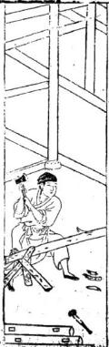

<!-- V3_SOURCE_ID:book005-b000072-p000-7c9a793895 -->

○三架屋後車三架法

查看对应原文

<!-- V3_FOLDBACK_BEGIN:book005-b000072-p000-7c9a793895 -->

○三架屋後車三架法

<!-- V3_FOLDBACK_END:book005-b000072-p000-7c9a793895 -->

<!-- V3_SOURCE_ID:book005-b000073-p000-ecb36bc7d5 -->

建造此小屋者，切不可高大。凡步柱只可高一丈零寸，“棟桂”可能為“棟柱”之誤，具體所指不详，其高度為一丈二尺一寸。“段深”可能指進深或梁段深度，具體所指不详，其深度為五尺六寸。間濶為丈一尺一寸，次間為一丈零一寸。此法則相稱也。詩曰：

> **释读存疑：** 棟桂；段深

查看对应原文

<!-- V3_FOLDBACK_BEGIN:book005-b000073-p000-ecb36bc7d5 -->

造此小屋者切不可高大凡步柱只可高一丈零寸棟桂高一丈二尺一寸段深五尺六寸間濶丈一尺一寸次間一丈零一寸此法則相稱也詩日

<!-- V3_FOLDBACK_END:book005-b000073-p000-ecb36bc7d5 -->

<!-- V3_SOURCE_ID:book005-b000074-p000-469c031267 -->

凡人建造三架屋，“巖尺須華吉”一句，原文語意不明，具體所指不详。上量澗狹高低，依此法，後來必出好兒郎。

> **释读存疑：** 巖尺須華吉

查看对应原文

<!-- V3_FOLDBACK_BEGIN:book005-b000074-p000-469c031267 -->

凡人創造三架屋巖尺須華吉上量澗狹高低依此 法後來必出好兒郎

<!-- V3_FOLDBACK_END:book005-b000074-p000-469c031267 -->

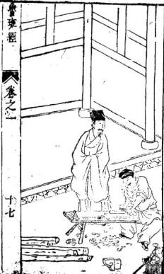

<!-- V3_SOURCE_ID:book005-b000076-p000-66412cbb5f -->

○五架房子格

查看对应原文

<!-- V3_FOLDBACK_BEGIN:book005-b000076-p000-66412cbb5f -->

○五架房子格

<!-- V3_FOLDBACK_END:book005-b000076-p000-66412cbb5f -->

<!-- V3_SOURCE_ID:book005-b000077-p000-e17e0d79d6 -->

正五架三间的房屋，向后拖出一根柱子，进深尺寸为一丈零若干寸，中柱高度为一丈三尺八寸，屋脊高度为一丈五尺一寸，每段梁架高度为四尺六寸，中间跨度为一丈三尺六寸，次一级的宽度为一丈二尺一寸。如果地基的宽窄情况特殊，则由工匠根据实际情况进行增减，这些都属于压白尺法的应用规则。

> **释读存疑：** 1轮自动修复后核义模型仍建议修订，已保守记录。

查看对应原文

<!-- V3_FOLDBACK_BEGIN:book005-b000077-p000-e17e0d79d6 -->

正五架三閒拖後一柱步用一丈零入寸仲高一丈三尺八寸棟高一丈五尺一寸每段四尺六寸中間一丈三尺六寸次濶一丈二尺一寸地基瀾狹則在人加減此皆壓白之法也

<!-- V3_FOLDBACK_END:book005-b000077-p000-e17e0d79d6 -->

<!-- V3_SOURCE_ID:book005-b000078-p000-ec26456dcf -->

三间五架的格局，星位分布呈现偏奇之象，依据白尺法来衡量材料，确实利于居住，住在此处能安然无恙。书中多记载此类房屋能带来喜庆和横财，入宅居住并不受具体时辰的限制。

查看对应原文

<!-- V3_FOLDBACK_BEGIN:book005-b000078-p000-ec26456dcf -->

三間五架星偏奇按白量材實利空住坐安然多書慶橫財入宅不拘時

<!-- V3_FOLDBACK_END:book005-b000078-p000-ec26456dcf -->

<!-- V3_SOURCE_ID:book005-b000080-p000-3b185f707e -->

○正七架三間格

查看对应原文

<!-- V3_FOLDBACK_BEGIN:book005-b000080-p000-3b185f707e -->

○正七架三間格

<!-- V3_FOLDBACK_END:book005-b000080-p000-3b185f707e -->

<!-- V3_SOURCE_ID:book005-b000081-p000-9e234628b3 -->

关于七架堂屋的建造，大凡符合实用要求的规格如下：前后柱子高度为一丈三尺六寸，屋脊高度为一丈零六寸，中间跨度为一丈四尺三寸，次一级跨度为一丈三尺六寸，梁段高度为四尺八寸。地基的宽窄、高低、深浅，都可以根据人的意愿进行增减调整，以此来确定建造方案。

> **释读存疑：** 1轮自动修复后核义模型仍建议修订，已保守记录。

查看对应原文

<!-- V3_FOLDBACK_BEGIN:book005-b000081-p000-9e234628b3 -->

七架堂屋大凡架造合用前後柱高一丈三尺六寸棟高一丈零六寸中間用濶一丈四尺三寸次關一丈三尺六寸叚四尺八寸地基濶窄高低深淺隨人意加減則爲之

<!-- V3_FOLDBACK_END:book005-b000081-p000-9e234628b3 -->

<!-- V3_SOURCE_ID:book005-b000082-p000-8c7b1ae218 -->

詩曰：

查看对应原文

<!-- V3_FOLDBACK_BEGIN:book005-b000082-p000-8c7b1ae218 -->

詩日

<!-- V3_FOLDBACK_END:book005-b000082-p000-8c7b1ae218 -->

<!-- V3_SOURCE_ID:book005-b000083-p000-176ca1d6d8 -->

经营建造这样华丽的厅堂，全靠工匠的巧妙构思与主张。富贵本来源于绳墨与庚尺的精准测量，但也必须结合阴阳法则来综合考量。

查看对应原文

<!-- V3_FOLDBACK_BEGIN:book005-b000083-p000-176ca1d6d8 -->

經營此屋好華堂並是工師巧主張富貴本由繩庚得也須合用按陰陽

<!-- V3_FOLDBACK_END:book005-b000083-p000-176ca1d6d8 -->

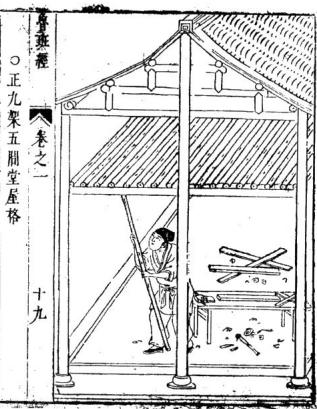

<!-- V3_SOURCE_ID:book005-b000085-p000-e5c2f231c1 -->

凡造此屋，步柱用高一丈三尺六寸。“棟柱或地基 潤空一丈四尺八寸”一句，其中“潤空”可能為“寬空”或特定術語，具體所指不详。“叚淺者四尺三寸成十分深 高二丈二尺棟爲妙”一句，原文語意晦澀，具體所指不详。

> **释读存疑：** 潤空；叚淺者四尺三寸成十分深 高二丈二尺棟爲妙

查看对应原文

<!-- V3_FOLDBACK_BEGIN:book005-b000085-p000-e5c2f231c1 -->

凡造此屋步柱用高一丈三尺六寸棟柱或地基 潤空一丈四尺八寸叚淺者四尺三寸成十分深 高二丈二尺棟爲妙

<!-- V3_FOLDBACK_END:book005-b000085-p000-e5c2f231c1 -->

<!-- V3_SOURCE_ID:book005-b000086-p000-db45762617 -->

陰陽兩字最室，先鼎創興工好。關於“何前九架五關堂”、“尤天萬年千載福綿綿”、“直四時人”、“兩不然”等詩句，原文語意晦澀，具體所指不详。謹按先師真尺寸，管教富貴足。若不依仙法，致使人家兩不然。

> **释读存疑：** 最室；何前九架五關堂；直四時人；兩不然

查看对应原文

<!-- V3_FOLDBACK_BEGIN:book005-b000086-p000-db45762617 -->

陰陽兩字最室先鼎創興工好何前九架五關堂尤 天萬年千載福綿綿謹按先師眞尺寸管教富貴足 直四時人若不依仙法致使人家兩不然

<!-- V3_FOLDBACK_END:book005-b000086-p000-db45762617 -->

<!-- V3_SOURCE_ID:book005-b000087-p000-dd9e8135c7 -->

文中提到‘献架’，结合后文‘偷栋横为之’，这可能指一种特定的建筑构件，但具体所指不详。如果人们像文中描述的那样，为了吉利而采用这种偷工减料、横向搭建的方式，那么在需要坐卧起居的‘剥闭’之处，依照这种格局建造也是很好的。

> **释读存疑：** 献架的具体所指；剥闭的具体所指；献韆架的具体所指；1轮自动修复后核义模型仍建议修订，已保守记录。

查看对应原文

<!-- V3_FOLDBACK_BEGIN:book005-b000087-p000-dd9e8135c7 -->

獻韆架今人偷棟橫爲之吉人以如此造其中剝閉要坐起處則可依此格儘好

<!-- V3_FOLDBACK_END:book005-b000087-p000-dd9e8135c7 -->

<!-- V3_SOURCE_ID:book005-b000090-p000-020026073f -->

凡是建造坟墓前的小门，两根柱子要支撑在‘屋皮’上，具体所指不详。门洞出入的长度不可过长而完全暴露，否则可能会伤害到家里的子孙媳妇。不要使用木头制作‘门蹄’，具体所指不详；门的两侧要使用四根‘将军柱’，具体所指不详，这些柱子不能留空，且要高大。

> **释读存疑：** 屋皮的具体所指；门蹄的具体所指；将军柱的具体所指；不空大高也的具体含义；1轮自动修复后核义模型仍建议修订，已保守记录。

查看对应原文

<!-- V3_FOLDBACK_BEGIN:book005-b000090-p000-020026073f -->

凡造小門者乃是塚墓之前所作兩柱前重在屋皮上出入不可十分長露出殺傷其家子媳不用使木作門蹄二邊使四隻將軍柱不空大高也

<!-- V3_FOLDBACK_END:book005-b000090-p000-020026073f -->

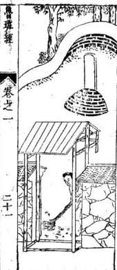

<!-- V3_SOURCE_ID:book005-b000092-p000-29797f9140 -->

建造这种亭子时，四根柱子要落在地上，‘三超四结果’的具体所指不详，需使平盘方正。‘福海顶’的具体所指不详，其中要藏有‘心柱’，柱子要十分高耸。不要使用‘暗钉’固定，具体所指不详，否则会导致脱落。这样四面都可以观赏。

> **释读存疑：** 三超四结果的具体所指；福海顶的具体所指；暗钉的具体所指；十分要耸的具体含义；1轮自动修复后核义模型仍建议修订，已保守记录。

查看对应原文

<!-- V3_FOLDBACK_BEGIN:book005-b000092-p000-29797f9140 -->

造此亭者四柱落地上三超四結果使平盤方中使福海頂藏心柱十分要聳无用暗鐙釘住則無脫落四方可觀之

<!-- V3_FOLDBACK_END:book005-b000092-p000-29797f9140 -->

<!-- V3_SOURCE_ID:book005-b000093-p000-8c7b1ae218 -->

诗曰：

查看对应原文

<!-- V3_FOLDBACK_BEGIN:book005-b000093-p000-8c7b1ae218 -->

詩日

<!-- V3_FOLDBACK_END:book005-b000093-p000-8c7b1ae218 -->

<!-- V3_SOURCE_ID:book005-b000094-p000-9585e51cd5 -->

‘枷梢门屋’有两种情况，无论是方直还是尖斜，文中都指出：如果家里出现奸邪淫乱之事，夜里行走的人需要防备，否则会有横祸降临到官员身上。

> **释读存疑：** 枷梢门屋的具体所指；夜行子须防的具体含义；道官的具体所指；1轮自动修复后核义模型仍建议修订，已保守记录。

查看对应原文

<!-- V3_FOLDBACK_BEGIN:book005-b000094-p000-9585e51cd5 -->

枷梢門屋有兩般，方直尖斜一樣，言家有姦倫，夜行子須防，橫禍及道官

<!-- V3_FOLDBACK_END:book005-b000094-p000-9585e51cd5 -->

<!-- V3_SOURCE_ID:book005-b000095-p000-8c7b1ae218 -->

诗曰：

查看对应原文

<!-- V3_FOLDBACK_BEGIN:book005-b000095-p000-8c7b1ae218 -->

詩日

<!-- V3_FOLDBACK_END:book005-b000095-p000-8c7b1ae218 -->

<!-- V3_SOURCE_ID:book005-b000096-p000-99967e5308 -->

此屋分明端正奇，暗中为祸少人知。只因匠者多藏素，也是时师不细详。使得家门长退落，缘他屋主大隈衰。从今若要儿孙好，除是从头改过为。

查看对应原文

<!-- V3_FOLDBACK_BEGIN:book005-b000096-p000-99967e5308 -->

此屋分明端正奇暗中爲禍少人知只因匠者多藏素也是時師不細詳使得家門長退落緣他屋主大隈衰從今若要兒孫好除是從頭改過爲

<!-- V3_FOLDBACK_END:book005-b000096-p000-99967e5308 -->

<!-- V3_SOURCE_ID:book005-b000098-p000-d9cf64a1f7 -->

新建房屋开门的方法：首先从外部的‘七大门’进入，具体所指不详；其次是第二重‘较门’，具体所指不详，应在东侧开设吉门，门道需要曲折，不能空旷或过于直长。内部的门不可比外部的门大，应依照此例。大凡人家的大门，千万不可被邻居的房屋‘春对射’，具体所指不详，否则是不祥之兆。这是关于厅堂门的规矩。

> **释读存疑：** 七大门的具体所指；较门的具体所指；春对射的具体所指；不空大直的具体含义；1轮自动修复后核义模型仍建议修订，已保守记录。

查看对应原文

<!-- V3_FOLDBACK_BEGIN:book005-b000098-p000-d9cf64a1f7 -->

新創屋宇開門之法一自外七大門而入次二重較門則就東畔開吉門須要屈曲則不空大直內門不可較大外門用依此例也大凡人家外大門千萬不可被人家屋春對射則不祥之兆也論起廳堂門例

<!-- V3_FOLDBACK_END:book005-b000098-p000-d9cf64a1f7 -->

<!-- V3_SOURCE_ID:book005-b000099-p000-570b7ba3a5 -->

如果要建造‘大属屋’并起门，具体所指不详，必须使用好的‘筹头向’，具体所指不详。或者建造‘槽门’时，高度要与第二重门相同。第三重门则从‘柁’上起建，具体所指不详。可以做成‘如意门’、‘古钱门’或‘方胜门’，具体形制不详，这取决于主人的喜好。

> **释读存疑：** 大属屋的具体所指；好筹头向的具体所指；柁的具体所指；槽门、如意门、古钱门、方胜门的具体形制；1轮自动修复后核义模型仍建议修订，已保守记录。

查看对应原文

<!-- V3_FOLDBACK_BEGIN:book005-b000099-p000-570b7ba3a5 -->

或起大屬屋起門須用好筹頭向或作槽門之時須用放高與第二重門同第三重却就柁起或作如意門或作古錢門與方勝門在主人意愛

<!-- V3_FOLDBACK_END:book005-b000099-p000-570b7ba3a5 -->

<!-- V3_SOURCE_ID:book005-b000100-p000-ecad8c8f28 -->

新建房屋时，‘朱雀’方位的凶日包括：庚午、巳卯、戊子、丁酉、丙午、乙卯。关于修门的杂忌：在九良星年，丁亥、癸巳年占大门；壬寅、庚申年占门；丁巳年占前门；丁卯、巳卯年占后门。‘丘公杀’的规律是：逢天干为甲或己的年份占九月；逢天干为乙或庚的年份占十一月；逢天干为丙或辛的年份占正月；逢天干为丁或壬的年份占三月；逢天干为戊或癸的年份占五月。此外还有逐月修造门的吉日。

> **释读存疑：** 丁巴修正为丁巳的依据；丘公杀的具体含义；本地硬校验仍未通过，已记录供后续自动处理或人工核对。

查看对应原文

<!-- V3_FOLDBACK_BEGIN:book005-b000100-p000-ecad8c8f28 -->

新蕭朱雀凶日庚午巳卯戊子丁酉丙午乙卯 1 修門雜忌 九良星年丁亥癸巳占大門○壬寅庚申占門○丁 巴占前門○丁卯巳卯占後門 丘公殺甲巳年占九月○乙庚占十一月丙辛年 占正月○丁壬年占三月○戊癸年占五月 ○逐月修造門吉日

<!-- V3_FOLDBACK_END:book005-b000100-p000-ecad8c8f28 -->

<!-- V3_SOURCE_ID:book005-b000101-p000-e063b85ee1 -->

文中列出了正月癸酉日（另有丁酉日）、二月甲寅日、三月庚子日（另有乙巳日）、四月甲子日与庚子日（另有庚午日）、以及五月甲寅日（另有丙寅日）等日期记录。

> **释读存疑：** 本地硬校验仍未通过，已记录供后续自动处理或人工核对。

查看对应原文

<!-- V3_FOLDBACK_BEGIN:book005-b000101-p000-e063b85ee1 -->

正月癸酉外丁酉二月甲寅 三月庚子外乙巳四月甲子庚子外庚午五月甲寅外丙寅

<!-- V3_FOLDBACK_END:book005-b000101-p000-e063b85ee1 -->

<!-- V3_SOURCE_ID:book005-b000102-p000-10a2c77fec -->

文中继续记录了六月甲申日与甲寅日（另有丙申日、庚申日）、七月丙辰日、八月乙亥日、九月庚午日与丙午日、十月申子日、乙未日、壬午日、庚子日、辛末日（另有庚午日）、十一月甲寅日，以及十二月戊寅日、甲寅日、甲子日、申申日、庚子日（另有庚申日）、丙寅日和丙申日等日期。

> **释读存疑：** 本地硬校验仍未通过，已记录供后续自动处理或人工核对。

查看对应原文

<!-- V3_FOLDBACK_BEGIN:book005-b000102-p000-10a2c77fec -->

六月甲申甲寅外丙申庚申 七月丙辰 八月乙亥九月庚午丙午 十月申子乙未壬午庚子辛末外庚午十一月甲寅 十二月戊寅甲寅甲子申申庚子外庚申丙寅丙申

<!-- V3_FOLDBACK_END:book005-b000102-p000-10a2c77fec -->

<!-- V3_SOURCE_ID:book005-b000103-p000-b0e455e441 -->

右吉日不犯朱雀、天牢、天火、独火、九空、死气、月破、小耗、天贼、地天瘟、受死、冰消、瓦陷、阴阳错、月建、转杀、正四废、九土鬼、伏断、火星、九丑、灭门、离窠、次地火、四忌、五穷、耗绝、庚寅、门大夫、死自、自虎、炙退、三杀、六甲、胎神占门并食木星为忌。

查看对应原文

<!-- V3_FOLDBACK_BEGIN:book005-b000103-p000-b0e455e441 -->

右吉日不犯朱雀天牢天火獨火九空死氣月破 小耗天賊地天瘟受死氷消瓦陷陰陽錯月建 轉殺正四廢九土鬼伏斷火星九醜滅門離 窠次地火四忌五窮耗絕庚寅門大夫死自自虎 炙退三殺六甲胎神占門并食木星爲忌

<!-- V3_FOLDBACK_END:book005-b000103-p000-b0e455e441 -->

<!-- V3_SOURCE_ID:book005-b000104-p000-3cb2048cfd -->

关于‘门光星’的推算：大月从下往上数，小月从上往下数。原文此处有无法辨识的符号或文字。

> **释读存疑：** 00 O cb的具体含义；本地硬校验仍未通过，已记录供后续自动处理或人工核对。

查看对应原文

<!-- V3_FOLDBACK_BEGIN:book005-b000104-p000-3cb2048cfd -->

○門光星 大月從下數上 小月從上數下 00 O cb

<!-- V3_FOLDBACK_END:book005-b000104-p000-3cb2048cfd -->

<!-- V3_SOURCE_ID:book005-b000105-p000-3a4827dcf8 -->

白圈者吉，人字损人，丫字损畜。

查看对应原文

<!-- V3_FOLDBACK_BEGIN:book005-b000105-p000-3a4827dcf8 -->

○白圈者吉人字損人丫字損畜

<!-- V3_FOLDBACK_END:book005-b000105-p000-3a4827dcf8 -->

<!-- V3_SOURCE_ID:book005-b000106-p000-3bf4416825 -->

文中提到‘门光星吉目定同’，具体含义不详。

> **释读存疑：** 门光星吉目定同的具体含义

查看对应原文

<!-- V3_FOLDBACK_BEGIN:book005-b000106-p000-3bf4416825 -->

○門光星吉目定同

<!-- V3_FOLDBACK_END:book005-b000106-p000-3bf4416825 -->

<!-- V3_SOURCE_ID:book005-b000107-p000-8f1d031506 -->

原文记载‘大月’后有符号‘-- · --’，接着是‘四千八十九’，然后是‘小月’，但‘小月’之后的内容缺失。

> **释读存疑：** 四千八十九的具体含义；小月后缺失的内容

查看对应原文

<!-- V3_FOLDBACK_BEGIN:book005-b000107-p000-8f1d031506 -->

大月 -- · -- 四千八十九小月

<!-- V3_FOLDBACK_END:book005-b000107-p000-8f1d031506 -->

<!-- V3_SOURCE_ID:book005-b000108-p000-37177d0b88 -->

文中告诫‘门楼’不可‘专至门楼’，具体所指不详。‘经正辇经’谈论的内容对人的影响很大，具体所指不详，因此没有编入《鲁班经》卷之十五。

> **释读存疑：** 专至门楼的具体所指；经正辇经的具体所指；谈人不浅的具体含义；1轮自动修复后核义模型仍建议修订，已保守记录。

查看对应原文

<!-- V3_FOLDBACK_BEGIN:book005-b000108-p000-37177d0b88 -->

諭門樓不可專至門樓經正輦経談人不淺故不編魯班經 卷之 十五

<!-- V3_FOLDBACK_END:book005-b000108-p000-37177d0b88 -->

<!-- V3_SOURCE_ID:book005-b000109-p000-8a8f703d22 -->

入门的‘向’必须避开直冲、尖射、‘砂’、水路、道路、恶石、山坳、岚破、孤峰、枯木、神庙之类，这被称为‘乘杀’。入门若犯凶，宜迎接‘水’和‘山’，避开‘水’的斜割。《悲声经》说：以‘水’为‘朱雀’者，忌讳湍急。《黄泉门路天机诀》云：庚丁在坤方是黄泉，乙丙须助巽木，甲癸向中休见艮，辛壬水路怕当乾。这些口诀的具体含义需结合专业知识。若触犯，会导致家中少丁、家长死亡、长子生病或忤逆。

> **释读存疑：** 忌夫湍的具体含义；乙丙须助巽木等口诀的具体含义；犯王的具体所指；1轮自动修复后核义模型仍建议修订，已保守记录。

查看对应原文

<!-- V3_FOLDBACK_BEGIN:book005-b000109-p000-8a8f703d22 -->

入門向須避直冲尖射砂水路道惡石山坳嵐破 孤峯枯木神廟之類謂之乘殺入門凶宜迎水迎 山避水斜割悲聲經云以水爲朱雀者忌夫湍 爾黃泉門路天機訣云庚丁坤上是黃臬乙丙須助 巽木先甲癸向中休見艮辛壬水路怕當乾○犯 王在死少丁殺家長長病忤逆

<!-- V3_FOLDBACK_END:book005-b000109-p000-8a8f703d22 -->

<!-- V3_SOURCE_ID:book005-b000110-p000-ec7c51d63f -->

这是一系列关于不同‘向’的禁忌口诀：庚向忌讳安‘军’，具体所指不详；坤向涉及门路‘水’步；丙向忌讳安‘单’，具体所指不详，坤向同理；乙向忌讳安‘单’；五向涉及门路‘水’步；内向忌讳安‘卑’，具体所指不详；异向涉及门路木；甲向和癸向忌讳安‘卑’；艮向涉及门路‘水’步；壬向忌讳安‘单’；乾向涉及门路‘水’步。

> **释读存疑：** 安军、安单、安卑的具体所指；五向、异向的具体所指；原文口诀的正确断句和整体含义；1轮自动修复后核义模型仍建议修订，已保守记录。

查看对应原文

<!-- V3_FOLDBACK_BEGIN:book005-b000110-p000-ec7c51d63f -->

庚向忌安軍坤向門路水步丙向忌安单坤同門一路水步乙向忌安单五向門路水步內向忌安卑異向門路木甲向癸向忌安卑艮向門路水步幸壬向忌安单乾向門路水步

<!-- V3_FOLDBACK_END:book005-b000110-p000-ec7c51d63f -->

<!-- V3_SOURCE_ID:book005-b000111-p000-2752db1d46 -->

这种方法是：在‘死绝’方位的正对面宫位，即为所谓的黄泉。

> **释读存疑：** 死绝处朝对宫的具体方位判定标准

查看对应原文

<!-- V3_FOLDBACK_BEGIN:book005-b000111-p000-2752db1d46 -->

其法乃死絕處朝對宮爲黃泉是也

<!-- V3_FOLDBACK_END:book005-b000111-p000-2752db1d46 -->

<!-- V3_SOURCE_ID:book005-b000112-p000-1a93f28367 -->

## 詩日 — 诗曰

查看对应原文

<!-- V3_FOLDBACK_BEGIN:book005-b000112-p000-1a93f28367 -->

## 詩日

<!-- V3_FOLDBACK_END:book005-b000112-p000-1a93f28367 -->

<!-- V3_SOURCE_ID:book005-b000113-p000-9f8c4596f5 -->

两栋房屋的屋檐水相互冲射，无论大小水流常相争斗，这种房屋被称为暗箭山，居住其中的人口不安宁。

查看对应原文

<!-- V3_FOLDBACK_BEGIN:book005-b000113-p000-9f8c4596f5 -->

兩棟簷水流相射大小常相罵此屋名爲暗箭山人口不平安

<!-- V3_FOLDBACK_END:book005-b000113-p000-9f8c4596f5 -->

<!-- V3_SOURCE_ID:book005-b000114-p000-fdb5352cff -->

据仙贤所说，屋前不可设置‘栏村’（具体所指不详，可能指栏杆或栅栏），村中不可使用‘宜钉’（具体所指不详），这被称为‘暗前’，应当忌讳。

> **释读存疑：** 栏村的具体含义；宜钉的具体含义

查看对应原文

<!-- V3_FOLDBACK_BEGIN:book005-b000114-p000-fdb5352cff -->

據仙賢云屋前不可作欄村上不可使宜釘名爲暗前當忌之

<!-- V3_FOLDBACK_END:book005-b000114-p000-fdb5352cff -->

<!-- V3_SOURCE_ID:book005-b000115-p000-e786efa42a -->

○郭璞相宅诗三首

查看对应原文

<!-- V3_FOLDBACK_BEGIN:book005-b000115-p000-e786efa42a -->

○郭璞相宅詩三首

<!-- V3_FOLDBACK_END:book005-b000115-p000-e786efa42a -->

<!-- V3_SOURCE_ID:book005-b000116-p000-0abaf3d434 -->

崖前放置鸳鸯杵，名为纸钱山，家中必定多有丧祸，哭泣之声从未断绝。曹班经 卷之一 二十六

查看对应原文

<!-- V3_FOLDBACK_BEGIN:book005-b000116-p000-0abaf3d434 -->

崖前致鴦杵名曰紙錢山家必多喪禍哭泣不曾闕曹班經 卷之一 二十六

<!-- V3_FOLDBACK_END:book005-b000116-p000-0abaf3d434 -->

<!-- V3_SOURCE_ID:book005-b000117-p000-6df2df5136 -->

诗云

查看对应原文

<!-- V3_FOLDBACK_BEGIN:book005-b000117-p000-6df2df5136 -->

詩云

<!-- V3_FOLDBACK_END:book005-b000117-p000-6df2df5136 -->

<!-- V3_SOURCE_ID:book005-b000118-p000-fb10700c39 -->

门高若超过‘片’（具体所指不详，可能指厅或壁），后代将断绝人丁；门高若超过墙壁，家中将多哭泣。门扇若‘尔机欺’（具体含义不详，可能指某种机巧或欺瞒之象），夫妇将不相和睦，家财必将耗散，这确实是不合情理。○五架屋诸式围

> **释读存疑：** 片的具体所指；尔机欺的具体含义

查看对应原文

<!-- V3_FOLDBACK_BEGIN:book005-b000118-p000-fb10700c39 -->

門高勝於片後代絕人丁門高過於壁其家多哭法 門扇爾機欺夫婦不相空家財當耗散眞是不爲量 ○五架屋諸式圍

<!-- V3_FOLDBACK_END:book005-b000118-p000-fb10700c39 -->

<!-- V3_SOURCE_ID:book005-b000119-p000-57ed76fff2 -->

五架梁柱，有的使用方梁，有的使用界梗，还有像槽搭栏半像之类的形式，这都是由主人自行决定的。

> **释读存疑：** 原文中“界梗”“槽搭栏半像”具体建筑构件所指不详

查看对应原文

<!-- V3_FOLDBACK_BEGIN:book005-b000119-p000-57ed76fff2 -->

五架樑栟或使方樑者又有使界梗者及又槽搭欄半像之類在主人之所爲也

<!-- V3_FOLDBACK_END:book005-b000119-p000-57ed76fff2 -->

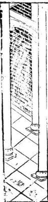

<!-- V3_SOURCE_ID:book005-b000122-p000-64da93f0dd -->

○五架后拖两架

查看对应原文

<!-- V3_FOLDBACK_BEGIN:book005-b000122-p000-64da93f0dd -->

○五架後拖兩架

<!-- V3_FOLDBACK_END:book005-b000122-p000-64da93f0dd -->

<!-- V3_SOURCE_ID:book005-b000123-p000-e5eee484f3 -->

五架屋后面添建两架，这正符合古法格律，是上佳的做法。如今人们却嗔怪这样做。曹班经 卷之一 二十七

查看对应原文

<!-- V3_FOLDBACK_BEGIN:book005-b000123-p000-e5eee484f3 -->

五架屋後添兩架此正按古格乃佳也今時人嗔做曹班經 卷之一 二十七

<!-- V3_FOLDBACK_END:book005-b000123-p000-e5eee484f3 -->

<!-- V3_SOURCE_ID:book005-b000124-p000-e773972be5 -->

前浅后深的说法，乃是生生笑隐所说的上吉之局。如果建造正五架屋，必定是基地如此，另有实格式，学者可以验证。正七架梁指及七架屋，川牌栟使用斗栱或柱义，均由人造作，后有图式可供参考。

> **释读存疑：** 原文中“川牌栟”“斗栱”“柱义”具体所指不详

查看对应原文

<!-- V3_FOLDBACK_BEGIN:book005-b000124-p000-e773972be5 -->

前淺後之說乃生生笑隱上吉也如造正五衆者必是其基地如此別有實格式學者可驗之也正七架樑指及七架屋川牌栟使斗櫟或柱義並由人造作後有圖式可佳

<!-- V3_FOLDBACK_END:book005-b000124-p000-e773972be5 -->

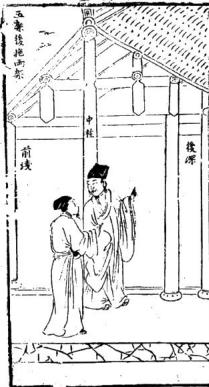

<!-- V3_SOURCE_ID:book005-b000127-p000-92a4789553 -->

土府宫殿，凡仿照此殿皇帝殿，高九丈五尺；王府高七丈。飞檐翘角不必再重复拖五架，前拖三架。上截升拱天花板及地面量至天花夜有五上零三尺高，殿上佳头七七四十九根，其余不必再记，随在加减。中心两柱入为天之梁，辅佐后无门，俱大厚板片。进金上前无门，俱挂朱帘。左边立五宫，右边十二院，此与民间房屋同式。直出明律门有七重，俱有殿名，不必记载。

> **释读存疑：** 原文中“佳头”“进金”“明律门”具体所指不详

查看对应原文

<!-- V3_FOLDBACK_BEGIN:book005-b000127-p000-92a4789553 -->

土府官殿凡倣此殿皇帝殿九丈五尺高王府七丈高飛麤找角不必再自重拖五架前拖三架上截升拱天花板及地量至天花夜有五上零三尺高殿上佳頭七七四十九根餘外不必再記隨在加滅中心兩柱入爲之天梁輔佐後無門俱大厚板片進金上前無門俱掛硃簾左邊立五宮右邊十二院此與民間房屋同式直出明律門有七重俱有殿名不必載之

<!-- V3_FOLDBACK_END:book005-b000127-p000-92a4789553 -->

<!-- V3_SOURCE_ID:book005-b000128-p000-07855a4ad8 -->

二十十九

> **释读存疑：** 原文仅为数字，无上下文，具体含义不详

查看对应原文

<!-- V3_FOLDBACK_BEGIN:book005-b000128-p000-07855a4ad8 -->

二十十九

<!-- V3_FOLDBACK_END:book005-b000128-p000-07855a4ad8 -->

<!-- V3_SOURCE_ID:book005-b000130-p000-7ef56e78a1 -->

同天台式，此台在钦天监左下，层土砖石之类，过围八八六十四丈，阔高三十三丈，下一十八层，上分三十三层。此应上观天文，下察地利。至上层过围俱是冲天栏，有其木里方外圆。东西南北反中央立起五处旗杆。又按天脚二十八面，写定二十八宿星主。上有天盘流转，各位星宿吉凶。乾象台上又有冲天一直平盘，关方圆一丈三尺，高七尺。下四平县穿枋串进中立图木一根，开上平盘者，盘能转。钦鲁班经 卷之一 三十

> **释读存疑：** 原文中“关方”“四平县”“图木”具体所指不详

查看对应原文

<!-- V3_FOLDBACK_BEGIN:book005-b000130-p000-7ef56e78a1 -->

同天臺式此臺在欽天監左下層土磚石之類過圍八八六十四丈濶高三十三丈下一十八層上分三十三層此應上觀天文下察地利至上層過圍俱是冲天欄有其木裏方外圓東西南北反中央立起五處旗杆又按天腳二十八面寫定二十八宿星主上有天盤流轉各位星宿吉凶乾象臺上又有冲天一直平盤關方圓一丈三尺高七尺下四平縣穿枋串進中立圖木一根開上平盤者盤能轉欽魯班經 卷之一 三十

<!-- V3_FOLDBACK_END:book005-b000130-p000-7ef56e78a1 -->

<!-- V3_SOURCE_ID:book005-b000131-p000-00ae9a080a -->

天监官在观测天文时立于此处。关于厅堂左右两边的四大孔，文中提到‘水湛光量’（具体含义不详），以及‘每汛多少’、‘高带砾至一穿枋下’等描述，涉及尺寸划分。文中还提到‘下永棋带腰枋’（具体所指不详），其高度为九寸零三分；‘腰祊’（具体所指不详）只做九寸三分；大抱柱线平面九分，窄处上五分。上部起‘荷叶线’，下部起‘棋盘线’，腰枋上面也是如此，九分下超一四分，窄面五分。‘卜贴地祇贴仔’（具体所指不详）厚一寸三分，‘真地厌盘’（具体所指不详）厚度中间分三孔或四孔。‘岳枋’（具体所指不详）存方圆一寸六分，开尖一寸四分，‘长前相后湄北磊心舞’（具体含义不详），高度需七寸三分。房间‘光显冲栏’（具体所指不详）二尺四寸五分，大应心门。《鲁班经》卷之10÷1

> **释读存疑：** 水湛光量的含义；下永棋的含义；腰祊的含义；卜贴地祇贴仔的含义；真地厌盘的含义；岳枋的含义；长前相后湄北磊心舞的含义；光显冲栏的含义

查看对应原文

<!-- V3_FOLDBACK_BEGIN:book005-b000131-p000-00ae9a080a -->

天監官每看天文立於此處修正廳左右二邊四大孔水湛光量每汛多少高帶礫至一穿枋下有多少尺寸可分爲上下一半下永棋帶腰枋每矮九寸零三分其腰祊只做九寸三分大抱柱線平面九分窄上五分上起荷葉線下起棋盤線腰枋上面亦然九分下超一四分窄面五分卜貼地祇貼仔一寸三分厚真地厭盤厚中間分三孔或四孔嶽枋存方圓一寸六分開尖一寸四分長前相後湄北磊心舞要高七寸三分房間光顯冲欄二尺四寸五分大應心門魯班經 卷之 10÷1

<!-- V3_FOLDBACK_END:book005-b000131-p000-00ae9a080a -->

<!-- V3_SOURCE_ID:book005-b000133-p000-299bfa2cfb -->

框一寸四分厚，二寸二分大，或下四差，或下六差。尺寸要有零子。文中提到‘舍箱问与恶心一同尺寸切恶尔样尺寸人家不和听止荆眉弥孔厥’（具体含义不详，原文可能因OCR错误或晦涩难懂而无法连贯释读）。门上截为亮格，下截为上行板，门框起‘聪营线’（具体所指不详）一寸四分大，守入分厚。

> **释读存疑：** 舍箱问与恶心一同尺寸切恶尔样尺寸人家不和听止荆眉弥孔厥的含义；聪营线的含义

查看对应原文

<!-- V3_FOLDBACK_BEGIN:book005-b000133-p000-299bfa2cfb -->

框一寸四分厚二寸二分大或下四差或下六差 尺寸要有零子舍箱問與惡心一同尺寸切惡爾 樣尺寸人家不和聽止荊眉彌孔厥門上截亮格 下截上行板門框起聰營線一寸四分大守入 分厚

<!-- V3_FOLDBACK_END:book005-b000133-p000-299bfa2cfb -->

<!-- V3_SOURCE_ID:book005-b000134-p000-271f37ac2e -->

正堂林修与正属一同，上框门尺寸无二。但辰枋带下水椹比属上尺寸，每变一寸八分。若做一林光木椹，如上他门做，上截起洪盘彩或荷叶线，平七分，窄面五分，上合角贴仔一寸二分厚，其别雷同。

> **释读存疑：** 原文中“林修”“正属”“林光木椹”“洪盘彩”具体所指不详

查看对应原文

<!-- V3_FOLDBACK_BEGIN:book005-b000134-p000-271f37ac2e -->

正堂林修與正屬一同上框門尺寸無二但辰枋帶下水椹比屬上尺寸每變一寸八分若做一林光木椹如上他門做上截起洪盤綵或荷葉線平七分窄面五分上合角貼仔一寸二分厚其別雷同

<!-- V3_FOLDBACK_END:book005-b000134-p000-271f37ac2e -->

<!-- V3_SOURCE_ID:book005-b000136-p000-b185fe518c -->

寺观庵堂庙宇式

查看对应原文

<!-- V3_FOLDBACK_BEGIN:book005-b000136-p000-b185fe518c -->

寺觀庵堂廟宇式

<!-- V3_FOLDBACK_END:book005-b000136-p000-b185fe518c -->

<!-- V3_SOURCE_ID:book005-b000137-p000-c63d0b90eb -->

架学造寺观等行人，门身带斧器，从后正龙而入，立在乾位，见本家人出方，动手左手执六尺，右手班经 卷之一 三十二

> **释读存疑：** 原文中“架学”“正龙”“班经”具体所指不详

查看对应原文

<!-- V3_FOLDBACK_BEGIN:book005-b000137-p000-c63d0b90eb -->

架學造寺觀等行人門身帶斧器從後正龍而入立在乾位見本家人出方動手左手執六尺右手班經 卷之一 三十二

<!-- V3_FOLDBACK_END:book005-b000137-p000-c63d0b90eb -->

<!-- V3_SOURCE_ID:book005-b000138-p000-80279f1623 -->

先拿斧头测量正中的柱子，接着测量左侧的转身柱，再测量直出山门外的柱子为止，然后叫伙计们一起动手。右侧先处理抱柱，随后不论大殿中间是否有“水椹”或栏杆斜格，都必须使用粗大的木材。每计算正数时不可有零头。前栏杆高三尺六寸，以应“天星”之数；或者门及抱柱等各样尺寸要算“七十二地星”。庵堂庙宇中间的“水椹”板，此人家用的“水椹”每矮一寸八分起线，抱柱尺寸一同已载在前。无论是做门还是做亮格，尺寸都矮一寸八分。上宝棹高三尺六寸，每根与转身柱一般长四尺。面前叠方三层，每退墨一寸八分。“荷业线”下的两层花板，每孔要分成双。下脚或雕刻狮象，“柁驱戒仿贴稍”用二寸半厚。记此。

> **释读存疑：** 次首；粗太；正数；天星；七十二地星；水椹；荷业线；柁驱戒仿贴稍；1轮自动修复后核义模型仍建议修订，已保守记录。

查看对应原文

<!-- V3_FOLDBACK_BEGIN:book005-b000138-p000-80279f1623 -->

拿斧先量正柱次首左邊轉身柱再量直出山門外止呌夥同人起手右邊上一抱柱次後不論大殿中問無水椹或欄杆斜格必用粗太每筭正數不可有零前欄杆三尺六寸高以應天星或門及抱柱各樣要筭七十二地星菴堂廟宇中間水椹板此人家水椹每矮一寸八分起線抱柱尺寸一同巳載在前不自或做門或亮格尺寸俱矮一寸八分上寶棹三尺六寸高每與轉身柱一般長四尺面前疊方三層每退墨一寸八分荷業線下兩層花板每孔要分成雙下腳或雕獅象柁驅戒倣貼稍用二寸半厚記此

<!-- V3_FOLDBACK_END:book005-b000138-p000-80279f1623 -->

<!-- V3_SOURCE_ID:book005-b000140-p000-06c9764cc8 -->

凡是修建祠宇作为家庙的，前三门之后是东西走马廊，再往后是大厅，大厅之后是明楼，明楼之后即是寝堂。若装修从三门做起至内堂止，中门开四尺六寸二分，“润”一丈三尺三分高，阔合得长“天尺”方。在“义官位”上，有说法称“官字”上不好安门，此是祠堂起不得“官义”二字，用此二字子孙方有发达荣粮。两边耳门三尺六寸四分阔，九尺七寸高，大吉。“财”二字上见各“天星”、“吉地”、“德星”。“中门两边俱后格式家房之也”文句不通，具体所指不详。专常人家子弟贤否都在此处种秀。又且寝堂及属两廊至三门只可步步高，“见孙方有尊甲县小期大之故”文句不通，具体所指不详。叙者深详记之。

> **释读存疑：** 润；长天尺；义官位；官字；官义；大吉财二字上见各天星吉地德星兄；俱后格式家房之也；见孙方有尊甲县小期大之故；1轮自动修复后核义模型仍建议修订，已保守记录。

查看对应原文

<!-- V3_FOLDBACK_BEGIN:book005-b000140-p000-06c9764cc8 -->

凡攸祠宇爲之家廟前三門次東西走馬廊又次之大廳屬之後明樓亭亭之後卽寢堂若粧修自三門做起至內堂止中門開四尺六寸二分潤一丈三尺三分高濶合得長天尺方在義官位上有等說官字上不好安門此是祠堂起不得官義二字用此二字子孫方有發達榮糧兩邊耳門三尺六寸四分濶九尺七寸高大吉財二字上見各天星吉地德星兄中門兩邊俱后格式家房之也專常人家子弟賢否都在此處種秀又且寢堂及屬兩廊至三門只可步步高見孫方有尊甲县小期大之故敘者深詳記之

<!-- V3_FOLDBACK_END:book005-b000140-p000-06c9764cc8 -->

<!-- V3_SOURCE_ID:book005-b000141-p000-c2def89c04 -->

“壮修”三门，“水椹”城枝下量起，直至一穿上平分，上下一年两边“演开八字”，“水椹”亦然。如是大门二寸三分厚，每片用余暗串，其门笋要圆，门斗要扁，此开门方斋为吉。两廊不用“壮架”，厅中心四大孔木椹上下平分，下截每矮七寸，正抱柱三寸六分大。上截起“荷叶线”下，或“一林光”或“闻尖的”，此尺寸“骨班经”卷之一三十四。

> **释读存疑：** 壮修；城枝；演开八字；壮架；一林光；闻尖的；骨班经；“壮修”、“城枝”、“演开八字”、“壮架”、“一林光”、“闻尖的”、“骨班经”等术语含义不明，candidate已加引号引用并列入uncertainty，处理得当。

查看对应原文

<!-- V3_FOLDBACK_BEGIN:book005-b000141-p000-c2def89c04 -->

壯修三門水椹城枝下量起直至一穿上平分上下一年兩邊演開八字水椹亦然如是大門二寸三分厚每片用餘暗串其門筍要圓門斗要扁此開門方齋爲吉兩廊不用壯架廳中心四大孔木椹上下平分下截每矮七寸正抱柱三寸六分大上截起荷葉線下或一林光或聞尖的此尺寸骨班經 卷之一 三十四

<!-- V3_FOLDBACK_END:book005-b000141-p000-c2def89c04 -->

<!-- V3_SOURCE_ID:book005-b000142-p000-af706bb6ef -->

前面的厅堂心门不可做成四片，应当做成六片才吉利。两边的易闾以及耳房可以稍微开大孔，做成田字格或窗齿样式，只要合式即可。门后的楣梁要留出进退的空间并符合规制，明楼不需要架设修缮。寝堂的中心位置不需要做门，下殿的水椹要带着地厌，高度为三尺五，上方分成五部分做成田字格，这一点必须概括清楚。内部供奉神主，用于祖先春秋两季的祭祀，这样就能拿得下来。两边的水满前面已有尺寸，不必再赘述。另外，前部的君厌亮格门抱杜下马蹄抱住，这也应当灵活处理。后台观察这些内容，要仔细核算家计，不可有误。

> **释读存疑：** 7的具体指代不明，原文仅提及数字7，未说明其单位或具体含义；'易闾'、'地厌'、'水满'、'君厌'、'抱杜'、'马蹄抱住'等词具体所指的建筑构件或工艺不详。；本地硬校验仍未通过，已记录供后续自动处理或人工核对。

查看对应原文

<!-- V3_FOLDBACK_BEGIN:book005-b000142-p000-af706bb6ef -->

在前可觀廳心門不可做四片要做六片吉兩邊易閭及耳房可微大孔田字格或窗齒可合式甚門後楣要留進退有式明樓不須架修其寢堂中心不用做門下殿水椹帶地厭三尺五高上分五充做田字格此要括的內奉神主租先春秋祭7就拿得下來兩邊水滿前有尺寸不必再白又前君厭亮格門抱杜下馬蹄抱住此亦用活的後臺觀此謹家計察不可有悞

<!-- V3_FOLDBACK_END:book005-b000142-p000-af706bb6ef -->

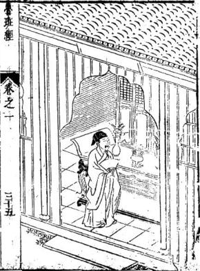

<!-- V3_SOURCE_ID:book005-b000144-p000-f8bf36a4ec -->

鲁班经神厨茶式

查看对应原文

<!-- V3_FOLDBACK_BEGIN:book005-b000144-p000-f8bf36a4ec -->

魯班經神厨茶式

<!-- V3_FOLDBACK_END:book005-b000144-p000-f8bf36a4ec -->

<!-- V3_SOURCE_ID:book005-b000145-p000-988ad7e8b9 -->

下层三尺三寸高，四尺“乡”每一片三寸三分大，寸四分厚。下锁廊方一寸四分大，一寸三分厚，“要雷出吴上盘仔”二尺二寸深，三尺三寸关，其框二寸五分大，一寸三分厚。中下两串两头合角与“枢”一般，“大吉用止佐半合角好”文句不通，具体所指不详。开“柱脾相”二个五寸高，四分厚。中下“土厨”只做九寸深，“一尺岗齿栉枉止好”文句不通，具体所指不详。下五根步步高，上层柱四尺二寸高，带岭在内，柱子方圆一寸四分大。其下六根中两根系进的，里半做一尺二寸深，外空一尺。内中或做二层或做三层，步步退墨。上层下散柱二个分三孔，耳孔只做六寸五分阔，余留中上拱梁二寸大。拱梁上方梁一尺八大，下层“下曜眉勒水前柱砾”一寸四分高，二寸二分大，“雕播荷叶”。“前楣带岭”八寸九分大，切忌大了不威势。上或下“火熖屏”可分爲三截，中五寸高，两边三寸九分高，余或主家用大用小可依此尺寸退墨无错。

> **释读存疑：** 乡；要雷出吴上盘仔；枢；大吉用止佐半合角好；柱脾相；土厨；一尺岗齿栉枉止好；下曜眉勒水前柱砾；雕播；前楣带岭；火熖屏；“乡”、“要雷出吴上盘仔”、“枢”、“大吉用止佐半合角好”、“柱脾相”、“土厨”、“一尺岗齿栉枉止好”、“下曜眉勒水前柱砾”、“雕播”、“前楣带岭”、“火熖屏”等术语或文句含义不明，candidate已加引号引用或标注文句不通，处理得当。

查看对应原文

<!-- V3_FOLDBACK_BEGIN:book005-b000145-p000-988ad7e8b9 -->

下層三尺三寸高四尺鄉每一片三寸三分大寸四分厚下鎖廊方一寸四分大一寸三分厚要雷出吳上盤仔二尺二寸深三尺三寸關其框二寸五分大一寸三分厚中下兩串兩頭合角與樞一般大吉用止佐半合角好開柱脾相二個五寸高四分厚中下土厨只做九寸深一尺崗齒櫛枉止好下五根步步高上層柱四尺二寸高帶嶺在內柱子方圓一寸四分大其下六根中兩根係進的裏半做一尺二寸深外空一尺內中或做二層或做三層步步退墨上層下散柱二個分三孔耳孔只做六寸五分濶餘留中上拱樑二寸大拱樑上方樑一尺八大下層下曜眉勒水前柱礫一寸四分高二寸二分大雕播荷葉前楣帶嶺八寸九分大切忌大了不威勢上或下火熖屏可分爲三截中五寸高兩邊三寸九分高餘或主家用大用小可依此尺寸退墨無錯

<!-- V3_FOLDBACK_END:book005-b000145-p000-988ad7e8b9 -->

<!-- V3_SOURCE_ID:book005-b000146-p000-509cc92114 -->

卷之一三十六

查看对应原文

<!-- V3_FOLDBACK_BEGIN:book005-b000146-p000-509cc92114 -->

卷之一三十六

<!-- V3_FOLDBACK_END:book005-b000146-p000-509cc92114 -->

<!-- V3_SOURCE_ID:book005-b000149-p000-8773f082f5 -->

宫寨格式，立寨之日先下“纍杆”，次看罗经，再看地势山形生绝之处，方令木匠伐，不逾定里外管垒内营，方用厅者，其木不俱大小，止前选定二根，下定前门中五直木九丈为中央主旗杆，内分间架，里外相串。次看外营周围叠“分金”，“木木火土”中立二十八宿，下伏“生伤杜日景死惊开”此行文外代木交架而下，周建“禄角旗枪之势”，并不用木作之工，但里营要饱砍，“我接下门之羞”文句不通，具体所指不详。其余不必木匠尝。“斑经卷之一川十七”。

> **释读存疑：** 纍杆；不逾定里外管垒内营；不俱；木木火土；生伤杜日景死惊开；禄角旗枪之势；我接下门之羞；斑经；“纍杆”、“不逾定里外管垒内营”、“不俱”、“木木火土”、“生伤杜日景死惊开”、“禄角旗枪之势”、“我接下门之羞”、“斑经”等术语或文句含义不明，candidate已加引号引用或标注文句不通，处理得当。

查看对应原文

<!-- V3_FOLDBACK_BEGIN:book005-b000149-p000-8773f082f5 -->

宮寨格式立寨之日先下纍杆次看羅經再看地勢山形生絕之處方令木匠伐不踰定裏外管壘內營方用廳者其木不俱大小止前選定二根下定前門中五直木九丈爲中央主旗杆內分間架裏外相串次看外營週圍疊分金木木火土中立二十八宿下伏生傷杜日景死驚開此行文外代木交架而下週建祿角旗鎗之勢並不用木作之工但裏營要飽砍我接下門之羞其餘不必木匠嘗斑經 卷之一 川十七

<!-- V3_FOLDBACK_END:book005-b000149-p000-8773f082f5 -->

<!-- V3_SOURCE_ID:book005-b000150-p000-a62bc425df -->

新镌京板工师雕断正式鲁班经匠家镜卷之一一一一

查看对应原文

<!-- V3_FOLDBACK_BEGIN:book005-b000150-p000-a62bc425df -->

新鐫京板工師雕斷正式魯班經匠家鏡卷之一一一一

<!-- V3_FOLDBACK_END:book005-b000150-p000-a62bc425df -->

<!-- V3_SOURCE_ID:book005-b000151-p000-6e29f11d87 -->

保亭“水阁”式装修，四周围栏杆“业背”下一尺五寸五分高，坐板一尺三寸大，二寸厚。坐板下或横下板片或十字挂栏杆上，靠背一尺四寸高，此上靠背尺寸在前“不白”。“斜四寸二分方好”，坐上至一穿枋做“选阳”或做亮格门。若下遮阳“上油”一穿，下离一尺六寸五分是遮阳穿枋，三寸大一寸九分“原”，中下二根斜的好开光窗。

> **释读存疑：** 业背；不白；选阳；上油；原；“业背”、“不白”、“选阳”、“上油”、“原”等术语含义不明，candidate已加引号引用或直接引用，处理得当。

查看对应原文

<!-- V3_FOLDBACK_BEGIN:book005-b000151-p000-6e29f11d87 -->

保亭水閣式粧修四圍欄杆業背下一尺五寸五分高坐板一尺三寸大二寸厚坐板下或橫下板片或十字掛欄杆上靠背一尺四寸高此上靠背尺寸在前不白斜四寸二分方好坐上至一穿枋做選陽或做亮格門若下遮陽上油一穿下離一尺六寸五分是遮陽穿枋三寸大一寸九分原中下二根斜的好開光窗

<!-- V3_FOLDBACK_END:book005-b000151-p000-6e29f11d87 -->

<!-- V3_SOURCE_ID:book005-b000153-p000-af4bcd64a3 -->

鲁班经匠家镜卷之二仓敖式

查看对应原文

<!-- V3_FOLDBACK_BEGIN:book005-b000153-p000-af4bcd64a3 -->

魯班經匠家鏡卷之二倉敖式

<!-- V3_FOLDBACK_END:book005-b000153-p000-af4bcd64a3 -->

<!-- V3_SOURCE_ID:book005-b000154-p000-809b6bb612 -->

依祖格九尺六寸高，七尺七分阔，九尺六寸“溪枋”每下四片，前立二柱开门只一尺五寸七分阔，下做一尺六寸高，至一穿要留五尺二寸高。上“捐枋枪门”要成“对刀”，忌成单不吉。“闲之目”不可内中饮食，又不可用墨斗曲尺，又不可柱枋上留字留墨，学者记之，切忌。

> **释读存疑：** 溪枋；捐枋枪门；成对刀；闲之目；“溪枋”、“捐枋枪门”、“成对刀”、“闲之目”等术语含义不明，candidate已加引号引用或直接引用，处理得当。

查看对应原文

<!-- V3_FOLDBACK_BEGIN:book005-b000154-p000-809b6bb612 -->

依祖格九尺六寸高七尺七分濶九尺六寸溪枋每下四片前立二柱開門只一尺五寸七分濶下做一尺六寸高至一穿要留五尺二寸高上捐枋槍門要成對刀忌成單不吉閒之目不可內中飲食又不可用墨斗曲尺又不可柱枋上留字留墨學者記之切忌

<!-- V3_FOLDBACK_END:book005-b000154-p000-809b6bb612 -->

<!-- V3_SOURCE_ID:book005-b000155-p000-e7e62ad644 -->

会班经卷之二

查看对应原文

<!-- V3_FOLDBACK_BEGIN:book005-b000155-p000-e7e62ad644 -->

會班經卷之二

<!-- V3_FOLDBACK_END:book005-b000155-p000-e7e62ad644 -->

<!-- V3_SOURCE_ID:book005-b000156-p000-1f4da9d193 -->

松梁式，凡桥无装修或有“神厨仿”或有栏者，若徙双月而起自下而上，若单日而起自酉而东者，“屋凡事尾阔”栏杆二尺五寸高，坐柅一尺五寸高。

> **释读存疑：** 神厨仿；若徙双月而起自下而上若单日而起自酉而东者；屋凡事尾阔；“神厨仿”、“若徙双月而起自下而上若单日而起自酉而东者”、“屋凡事尾阔”等文句含义不明，candidate已直接引用，处理得当。

查看对应原文

<!-- V3_FOLDBACK_BEGIN:book005-b000156-p000-1f4da9d193 -->

松梁式凡橋無粧修或有神厨倣或有欄者若徙雙月而起自下而上若单日而起自酉而東者屋凡事尾濶欄杆二尺五寸高坐柅一尺五寸高

<!-- V3_FOLDBACK_END:book005-b000156-p000-1f4da9d193 -->

<!-- V3_SOURCE_ID:book005-b000157-p000-35851e0eb7 -->

凡殿角之式，“垂昂插序”则“规横奥”，用升斗拱相称。鲁班经卷之二二。

> **释读存疑：** 垂昂插序；规横奥；“垂昂插序”、“规横奥”等术语含义不明，candidate已加引号引用，处理得当。

查看对应原文

<!-- V3_FOLDBACK_BEGIN:book005-b000157-p000-35851e0eb7 -->

凡殿角之式垂昂插序則規橫奧用升斗拱相稱魯班經 卷之二 二

<!-- V3_FOLDBACK_END:book005-b000157-p000-35851e0eb7 -->

<!-- V3_SOURCE_ID:book005-b000159-p000-fdb94249ad -->

溪浅阔狭用合尺寸，或地基阔二丈，柱用高一丈，“不可走祖”，此为大略言不尽意，细详之。

> **释读存疑：** 不可走祖；“不可走祖”含义不明，candidate已加引号引用，处理得当。

查看对应原文

<!-- V3_FOLDBACK_BEGIN:book005-b000159-p000-fdb94249ad -->

溪淺濶狹用合尺寸或地基濶二丈柱用高一丈不可走祖此爲大畧言不盡意細詳之

<!-- V3_FOLDBACK_END:book005-b000159-p000-fdb94249ad -->

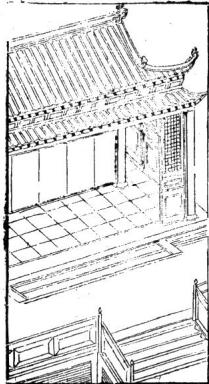

<!-- V3_SOURCE_ID:book005-b000161-p000-93b6de8480 -->

建钟楼格式，凡起造钟楼用“风字廓”，四柱并用浑成梗木，定高大相称，“散水”不可大低，低则掩钟声不响于四方。更不宜在右畔，合在左，“逐寺廊”之下，或有就楼盘下作佛堂，上作平基盘顶，“结中开楼盘心透上真见钟”文句不通，具体所指不详。作“六角祸杆”，则风送钟声远出于之外，“则为也”文句不通，具体所指不详。

> **释读存疑：** 风字廓；散水；逐寺廊；结中开楼盘心透上真见钟；六角祸杆；则为也；“风字廓”、“散水”、“逐寺廊”、“结中开楼盘心透上真见钟”、“六角祸杆”、“则为也”等术语或文句含义不明，candidate已加引号引用或标注文句不通，处理得当。

查看对应原文

<!-- V3_FOLDBACK_BEGIN:book005-b000161-p000-93b6de8480 -->

○建鐘樓格式凡起造鐘樓用風字廓四柱並用渾成梗木定高大相稱散水不可大低低則掩鐘聲不嚮于四方更不宜在右畔合在左逐寺廊之下或有就樓盤下作佛堂上作平基盤頂結中開樓盤心透上真見鍾作六角禍杆則風送鐘聲遠出於之外則為也

<!-- V3_FOLDBACK_END:book005-b000161-p000-93b6de8480 -->

<!-- V3_SOURCE_ID:book005-b000164-p000-620d41f359 -->

曹班经卷之三

查看对应原文

<!-- V3_FOLDBACK_BEGIN:book005-b000164-p000-620d41f359 -->

曹班經卷之三

<!-- V3_FOLDBACK_END:book005-b000164-p000-620d41f359 -->

<!-- V3_SOURCE_ID:book005-b000165-p000-67e30befe4 -->

五音造牛栏法

查看对应原文

<!-- V3_FOLDBACK_BEGIN:book005-b000165-p000-67e30befe4 -->

○五音造牛欄法

<!-- V3_FOLDBACK_END:book005-b000165-p000-67e30befe4 -->

<!-- V3_SOURCE_ID:book005-b000166-p000-c23f3fd372 -->

夫牛者本姓李，元是大力菩萨，切见凡间人力不及，特降天牛来助人力。凡造牛栏者，先须用术人拣择吉方，切不可犯“倒栏杀”、“牛黄杀”，可用左畔是坑，右畔是田，“王牛犊”必得长寿也。造栏用木尺寸法度，用寻向阳木一根作栋柱，用近在人屋，“在辟半性怕寒”文句不通，具体所指不详，使牛温暖。其柱长短尺寸用压白，不可犯。“在上含下作栏者”文句不通，具体所指不详。用“东方采禄木”一根作左边角柱，用高六尺一寸，或是二周四间，不得作单间也。人家各别椽子用令四只，则按春夏秋冬阴阳四气，则大吉也，也不可犯五尺五寸，乃为五黄不祥也。子万不可使损坏的，为牛备开门用合二尺六寸大，高四尺六寸，乃为“六自”，按六畜为好也。若八寸系八白，则为八败，不可使之，恐损八也。

> **释读存疑：** 倒栏杀；牛黄杀；王牛犊；在辟半性怕寒；在上含下作栏者；东方采禄木；六自；“倒栏杀”、“牛黄杀”、“王牛犊”、“在辟半性怕寒”、“在上含下作栏者”、“东方采禄木”、“六自”等术语或文句含义不明，candidate已加引号引用或标注文句不通，处理得当。

查看对应原文

<!-- V3_FOLDBACK_BEGIN:book005-b000166-p000-c23f3fd372 -->

夫牛者本姓李元是大力菩薩切見凡間人力不及特降天牛來助人力凡造牛欄者先須用術人揀擇吉方切不可犯倒欄殺牛黃殺可用左畔是坑右右畔是田王牛犢必得長壽也○造欄用木尺寸法度用尋向陽木一根作棟柱用近在人屋在辟半性怕寒使牛溫暖其柱長短尺寸用壓白不可犯在上含下作欄者用東方採祿木一根作左邊角柱用高六尺一寸或是二周四間不得作单間也人家各別椽子用令四隻則按春夏秋冬陰陽四氣則大吉也不可犯五尺五寸乃爲五黃不祥也子萬不可使損壞的爲牛備開門用合二尺六寸大高四尺六寸乃爲六自按六畜爲好也若八寸係八白則爲八敗不可使之恐損八也

<!-- V3_FOLDBACK_END:book005-b000166-p000-c23f3fd372 -->

<!-- V3_SOURCE_ID:book005-b000167-p000-ffce6390ef -->

鲁班法庆创立牛栏，首先推求吉地，安设后必使工匠求得好木材，其次将尺寸仔细详看。但须不可正对人家房屋，实在要相合空旷之地。

查看对应原文

<!-- V3_FOLDBACK_BEGIN:book005-b000167-p000-ffce6390ef -->

魯般法慶剏牛欄先用推尋吉上安必使工師求好木次將尺寸細詳看但須不可當人屋實要相空對魯班經 卷之二 六

<!-- V3_FOLDBACK_END:book005-b000167-p000-ffce6390ef -->

<!-- V3_SOURCE_ID:book005-b000168-p000-fce4c5d1d1 -->

当时的工匠或风水师依照北方规模建造草岗，致使牛牲食禄宽裕；但文中提到的“草岗时师”这一短语，具体所指不详。

> **释读存疑：** 草岗时师；1轮自动修复后核义模型仍建议修订，已保守记录。

查看对应原文

<!-- V3_FOLDBACK_BEGIN:book005-b000168-p000-fce4c5d1d1 -->

草崗時師依北規模作致使牛牲食祿寬

<!-- V3_FOLDBACK_END:book005-b000168-p000-fce4c5d1d1 -->

<!-- V3_SOURCE_ID:book005-b000169-p000-d42fcdfbef -->

○合音指詩

查看对应原文

<!-- V3_FOLDBACK_BEGIN:book005-b000169-p000-d42fcdfbef -->

○合音指詩

<!-- V3_FOLDBACK_END:book005-b000169-p000-d42fcdfbef -->

<!-- V3_SOURCE_ID:book005-b000170-p000-c3cd9434f9 -->

栏前忌讳有巨石，否则必主牛只遗失或被虎咬伤，切记不可。栏前若有大水窟，主牛难使，鼻难穿。

> **释读存疑：** 不堪巨石

查看对应原文

<!-- V3_FOLDBACK_BEGIN:book005-b000170-p000-c3cd9434f9 -->

不堪巨石在欄前必主牛遺虎咬遵切忌欄前大水窟主牛難使鼻難穿

<!-- V3_FOLDBACK_END:book005-b000170-p000-c3cd9434f9 -->

<!-- V3_SOURCE_ID:book005-b000171-p000-7e8a67b5d0 -->

牛栏不可建在污沟边，否则定堕牛胎，损子连累。栏后若有行露，主牛必相烂蹄肩。

查看对应原文

<!-- V3_FOLDBACK_BEGIN:book005-b000171-p000-7e8a67b5d0 -->

牛欄休在污溝邊定墮牛胎損子連欄後不堪有行露主牛必相爛蹄肩

<!-- V3_FOLDBACK_END:book005-b000171-p000-7e8a67b5d0 -->

<!-- V3_SOURCE_ID:book005-b000172-p000-ac0cf33152 -->

○牛嗇詩

查看对应原文

<!-- V3_FOLDBACK_BEGIN:book005-b000172-p000-ac0cf33152 -->

○牛嗇詩

<!-- V3_FOLDBACK_END:book005-b000172-p000-ac0cf33152 -->

<!-- V3_SOURCE_ID:book005-b000173-p000-423cfbde73 -->

一十黄一十起于坤，二十还归震巽，四十官中归乾盈，此是神仙妙诀根。

查看对应原文

<!-- V3_FOLDBACK_BEGIN:book005-b000173-p000-423cfbde73 -->

一十黃一十起于坤二十還歸震巽四十官中歸乾盈此是神仙妙訣根○定牛人欄刀砧詩

<!-- V3_FOLDBACK_END:book005-b000173-p000-423cfbde73 -->

<!-- V3_SOURCE_ID:book005-b000174-p000-8a2002a198 -->

春天大忌亥子位，夏月须在寅卯方，秋日休逢在巳本，冬时申酉不可装。

查看对应原文

<!-- V3_FOLDBACK_BEGIN:book005-b000174-p000-8a2002a198 -->

春天大忌亥子位，夏月須在寅卯方，秋日休逄在巳本，冬時申酉不可裝

<!-- V3_FOLDBACK_END:book005-b000174-p000-8a2002a198 -->

<!-- V3_SOURCE_ID:book005-b000175-p000-1a2df5c58d -->

○起欄日辰

查看对应原文

<!-- V3_FOLDBACK_BEGIN:book005-b000175-p000-1a2df5c58d -->

○起欄日辰

<!-- V3_FOLDBACK_END:book005-b000175-p000-1a2df5c58d -->

<!-- V3_SOURCE_ID:book005-b000176-p000-40b487c699 -->

起栏不得犯空亡，犯着之时牛必亡。癸日不堪行起造，牛瘟必定两相妨。

查看对应原文

<!-- V3_FOLDBACK_BEGIN:book005-b000176-p000-40b487c699 -->

起欄不得犯空亡犯着之時牛必亡癸日不堪行起 造牛瘟必定兩相妨

<!-- V3_FOLDBACK_END:book005-b000176-p000-40b487c699 -->

<!-- V3_SOURCE_ID:book005-b000177-p000-4f106db54e -->

○占牛神出入

查看对应原文

<!-- V3_FOLDBACK_BEGIN:book005-b000177-p000-4f106db54e -->

○占牛神出入

<!-- V3_FOLDBACK_END:book005-b000177-p000-4f106db54e -->

<!-- V3_SOURCE_ID:book005-b000178-p000-2ab1e43cba -->

三月初一日牛神出栏，九月初一日牛神归栏，此时若逢空亡之时进行修造则不吉。以上内容出自《鲁班经》卷之二第七部分。

> **释读存疑：** 空修；1轮自动修复后核义模型仍建议修订，已保守记录。

查看对应原文

<!-- V3_FOLDBACK_BEGIN:book005-b000178-p000-2ab1e43cba -->

三月初一日牛神出欄九月初一日牛神歸欄空修 魯班經 卷之二 七

<!-- V3_FOLDBACK_END:book005-b000178-p000-2ab1e43cba -->

<!-- V3_SOURCE_ID:book005-b000179-p000-eb29fc02bb -->

造大吉也。牛黄八月入，至次年三月方出，并不可修造，大凶屯。

> **释读存疑：** 原文'大凶屯'语意不明，此处依字面直译，具体所指不详

查看对应原文

<!-- V3_FOLDBACK_BEGIN:book005-b000179-p000-eb29fc02bb -->

造大吉也。牛黃八月入，至次年三月方出，並不可修造，大凶屯

<!-- V3_FOLDBACK_END:book005-b000179-p000-eb29fc02bb -->

<!-- V3_SOURCE_ID:book005-b000180-p000-31799a2872 -->

○造牛欄樣式

查看对应原文

<!-- V3_FOLDBACK_BEGIN:book005-b000180-p000-31799a2872 -->

○造牛欄樣式

<!-- V3_FOLDBACK_END:book005-b000180-p000-31799a2872 -->

<!-- V3_SOURCE_ID:book005-b000181-p000-d52fc05f98 -->

凡是建造牛栏，主家中心需用罗线测量，若建在“奇罗星”上则为吉门，门要向东，切忌向北。此法需用杂木五根做柱，高七尺七寸，根据地基宽窄调整，不可取方圆之式。文中还提到“八人二寸溪”，具体所指不详。下中上下枋需用圆木，不可用扁枋，这样才吉。

> **释读存疑：** 蹐看；奇罗星；八人二寸溪；依古式八人二寸溪六尺八寸濶；1轮自动修复后核义模型仍建议修订，已保守记录。

查看对应原文

<!-- V3_FOLDBACK_BEGIN:book005-b000181-p000-d52fc05f98 -->

凡做牛欄主家中心用羅線蹐看做在奇羅星上吉門要向東切忌向北此用雜木五根爲柱七尺七寸高看地基寬窄而佐不可取方圓依古式八人二寸溪六尺八寸濶下中上下枋用圓木不可使扁枋爲吉

<!-- V3_FOLDBACK_END:book005-b000181-p000-d52fc05f98 -->

<!-- V3_SOURCE_ID:book005-b000182-p000-a6a60cc834 -->

生门对牛栏羊栈一同看，年年官事至，牢狱出应维。

> **释读存疑：** 原文'应维'语意不明，此处依字面直译，具体所指不详

查看对应原文

<!-- V3_FOLDBACK_BEGIN:book005-b000182-p000-a6a60cc834 -->

生門對牛欄羊棧一同看，年年官事至，牢獄出應維

<!-- V3_FOLDBACK_END:book005-b000182-p000-a6a60cc834 -->

<!-- V3_SOURCE_ID:book005-b000183-p000-e8ba3b3a57 -->

○论述每月建造牛栏的吉日：正月、二月、三月、四月选庚午或壬午日，五月选真市、甲中、丙辰、乙未、乙日，七月选戊申日及入月乙丑日，九月选甲戌日，十月选壬子、子、甲子、庚子日，十一月选乙、乙亥、庚日，十二月选反五、丙寅、乙丑、丙寅日。以上日期均不触犯魁罡、狗绞、牛火、血忌、牛飞、荐牛、腹胀、牛刃、砧天瘟、九空、受死、大小耗、土鬼、凹废等禁忌。

> **释读存疑：** 原文'真市'、'甲中'、'乙ま'、'入月'、'反五'等词可能为OCR错误或特殊术语，具体所指不详；本地硬校验仍未通过，已记录供后续自动处理或人工核对。

查看对应原文

<!-- V3_FOLDBACK_BEGIN:book005-b000183-p000-e8ba3b3a57 -->

○論逐月遣作牛欄吉日 正月 二月 三月 四月庚午壬午五月 真市甲中 丙辰乙未 乙ま 七月戊申 入月 乙丑 九月 甲戌 十月壬子子 甲子庚子 +1 月乙 乙亥庚 十二月反五丙寅 月乙丑丙寅 右不犯魁罡狗絞牛火血忌牛飛薦牛腹脹牛刃 砧天瘟九空受死大小耗土鬼凹廢

<!-- V3_FOLDBACK_END:book005-b000183-p000-e8ba3b3a57 -->

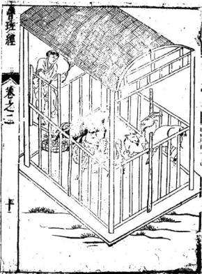

<!-- V3_SOURCE_ID:book005-b000186-p000-2ec3b3715d -->

此处也需查看罗经，确定一德星在何方，建在一德星上为吉门，门向东。需用单一颜色的杉木，忌讳杂木。立六根柱子，中间用两根小圆梁扛过。文中提到“好下夜闲挂马索”，具体所指不详。四围下高水椹板，每边用模方四根才坚固。若马多，需隔断“巳间”，每间三尺三寸阔深。文中还提到“马旧下向门左边吉”，具体所指不详。

> **释读存疑：** 好下夜闲挂马索；巳间；马旧下向门左边吉

查看对应原文

<!-- V3_FOLDBACK_BEGIN:book005-b000186-p000-2ec3b3715d -->

此亦看羅經一德星在何方做在一德星上吉門向東用一色杉木忌雜木立六根柱子中用小圓樑二根扛過好下夜閒掛馬索四圍下高水椹板每邊用模方四根纔堅固馬多者隔斷巳間每間三尺三寸濶深馬舊下向門左邊吉

<!-- V3_FOLDBACK_END:book005-b000186-p000-2ec3b3715d -->

<!-- V3_SOURCE_ID:book005-b000187-p000-b97b564fcd -->

前脚二尺四寸，后脚三尺五寸，高长三尺，阔一尺四寸。柱子方圆三寸大，四围横下板片，下脚空尺高。

查看对应原文

<!-- V3_FOLDBACK_BEGIN:book005-b000187-p000-b97b564fcd -->

前腳二尺四寸後腳三尺五寸高長三尺濶一尺四寸柱子方圓三寸大四圍橫下板片下腳空尺高

<!-- V3_FOLDBACK_END:book005-b000187-p000-b97b564fcd -->

<!-- V3_SOURCE_ID:book005-b000188-p000-c258c6446f -->

○馬鞍架

查看对应原文

<!-- V3_FOLDBACK_BEGIN:book005-b000188-p000-c258c6446f -->

○馬鞍架

<!-- V3_FOLDBACK_END:book005-b000188-p000-c258c6446f -->

<!-- V3_SOURCE_ID:book005-b000189-p000-c891296c0d -->

前部两只脚高三尺三寸，后部两只脚高二尺七寸。关于“中下半柱每高三寸四分”这一描述，原文断句和具体所指不详。脚的截面方圆一寸三分，宽度八寸二分。上部有三根直枋，中部腰部每边一根横枋，每头两根横枋。前部两只脚与后部正脚保持水平，但前部每根上端高出五寸，以便在上下搭头处安放马铃。

> **释读存疑：** 中下半柱每高三寸四分的具体含义；前每上高五寸的具体指代部位

查看对应原文

<!-- V3_FOLDBACK_BEGIN:book005-b000189-p000-c891296c0d -->

刖二腳高三尺三寸後二隻二尺七寸高中下半柱每高三寸四分其腳方圓一寸三分大濶八寸二分上三根直枋下中腰每邊一根橫每頭二根前二腳與後正腳取平但前每上高五寸上下搭頭好放馬鈴

<!-- V3_FOLDBACK_END:book005-b000189-p000-c891296c0d -->

<!-- V3_SOURCE_ID:book005-b000190-p000-4e77790371 -->

已列出每月制作马厩的吉日。

查看对应原文

<!-- V3_FOLDBACK_BEGIN:book005-b000190-p000-4e77790371 -->

已逐月作馬材吉日

<!-- V3_FOLDBACK_END:book005-b000190-p000-4e77790371 -->

<!-- V3_SOURCE_ID:book005-b000191-p000-20541da20a -->

正月：真卯、辛未、丁未、巳未（原文“巳未”干支组合异常，疑为“己未”之误）。三月：甲申、乙巳、丁卯、巳卯。四月：子、戊子、甲子（原文“甲于”疑为“甲子”之误）。五月：辛未、壬辰、丙辰。六月：辛未、乙亥、甲申、庚申。曹班经卷之二，第十一页。

> **释读存疑：** 巳未是否为己未之误；甲于是否为甲子之误；子戊子的具体断句与含义；页码十一是否独立于书名；1轮自动修复后核义模型仍建议修订，已保守记录。

查看对应原文

<!-- V3_FOLDBACK_BEGIN:book005-b000191-p000-20541da20a -->

正月真卯 辛未丁未 巳未 三月 甲申乙巳 丁卯巳卯四月子戊子 甲于戊子 五月 辛未壬辰 丙辰 六月 辛未乙亥 甲申庚申曹班經 卷之二 十一

<!-- V3_FOLDBACK_END:book005-b000191-p000-20541da20a -->

<!-- V3_SOURCE_ID:book005-b000192-p000-68f748dd94 -->

七月：庚子、壬子、辛未。载子、戊子、丙子、壬辰、乙丑（原文“載子”干支组合异常，疑为误字）。九月：辛、甲子、戊于、庚（原文“辛甲子”“戊于”干支组合均不合理，疑为误字）。

> **释读存疑：** 載子是否为误字；辛甲子是否为误字；戊于是否为误字；1轮自动修复后核义模型仍建议修订，已保守记录。

查看对应原文

<!-- V3_FOLDBACK_BEGIN:book005-b000192-p000-68f748dd94 -->

七月 庚子壬子辛未 載子戊子丙子 壬辰乙丑 九月辛甲子戊于庚

<!-- V3_FOLDBACK_END:book005-b000192-p000-68f748dd94 -->

<!-- V3_SOURCE_ID:book005-b000194-p000-c1cd030ef6 -->

○猪桐样式

查看对应原文

<!-- V3_FOLDBACK_BEGIN:book005-b000194-p000-c1cd030ef6 -->

○猪桐様式

<!-- V3_FOLDBACK_END:book005-b000194-p000-c1cd030ef6 -->

<!-- V3_SOURCE_ID:book005-b000195-p000-ab3fc110cb -->

此法也要看“三台星”位于何方，若建在“三台屋”上方则吉利。关于“四桂 二尺六寸高方圓七尺”的描述，具体所指不详。文中还提到“橫下穿祊中直下大粗寶 齒用雜方堅固”，其中“祊”“宝齿”“杂方”等词的具体含义不详。此外，“稍要內西北良工者識之”一句，关于“内西北”的具体要求或方位含义，原文未明。初学者切忌胡乱制作。

> **释读存疑：** 四桂 二尺六寸高方圓七尺的具体含义；祊的具体含义；宝齿的具体含义；杂方的具体含义；内西北的具体所指

查看对应原文

<!-- V3_FOLDBACK_BEGIN:book005-b000195-p000-ab3fc110cb -->

此亦要看三台星居何方做在三台屋上方吉四桂 二尺六寸高方圓七尺橫下穿祊中直下大粗寶 齒用雜方堅固稍要內西北良工者識之初學 忌亂爲

<!-- V3_FOLDBACK_END:book005-b000195-p000-ab3fc110cb -->

<!-- V3_SOURCE_ID:book005-b000196-p000-0958e55661 -->

○逐月作猪栏吉日

查看对应原文

<!-- V3_FOLDBACK_BEGIN:book005-b000196-p000-0958e55661 -->

○逐月作猪欄吉日

<!-- V3_FOLDBACK_END:book005-b000196-p000-0958e55661 -->

<!-- V3_SOURCE_ID:book005-b000197-p000-6496fa51ba -->

正月对应四月，包含戊寅、甲子戊子庚子、乙未戊寅、甲戌、乙未等干支组合。六月对应三月，包含辛卯、丁卯、巳巳、甲申。七月包含十巳子王子成申、甲子戊子庚。八月包含甲戌、乙丑。九月包含甲戊辛酉。此处记录为七春之二十二，其中数字7需保留。

> **释读存疑：** 1轮自动修复后核义模型仍建议修订，已保守记录。

查看对应原文

<!-- V3_FOLDBACK_BEGIN:book005-b000197-p000-6496fa51ba -->

正月 四月 戊寅 甲子戊子庚子 乙未戊寅 甲戌 乙未六月 三月 辛卯丁卯 巳巳 甲申七月 十巳子王子成申 甲子戊子庚 八月 甲戌乙丑 九月 甲戊辛酉7 春之二 十二

<!-- V3_FOLDBACK_END:book005-b000197-p000-6496fa51ba -->

<!-- V3_SOURCE_ID:book005-b000198-p000-4c29b1913a -->

十月：甲子（原文“甲于”疑为“甲子”之误）、乙未、庚子、壬午、真午（原文“真午”疑为误字）、辛未。十一月：丙辰。十二月：甲子、庚、壬子、戊宽（原文“戊寬”非干支，含义不明）。○六畜肥目。

> **释读存疑：** 甲于是否为甲子之误；真午是否为误字；戊寬的具体含义；1轮自动修复后核义模型仍建议修订，已保守记录。

查看对应原文

<!-- V3_FOLDBACK_BEGIN:book005-b000198-p000-4c29b1913a -->

十月 甲于乙未庚子 壬午真午辛未 十一月 丙辰 十二月 甲子庚 壬子戊寬○六畜肥目

<!-- V3_FOLDBACK_END:book005-b000198-p000-4c29b1913a -->

<!-- V3_SOURCE_ID:book005-b000199-p000-978a8d6dd0 -->

春申子辰，夏亥卯未，秋寅午戌，冬巳酉。耳目。○鹭鸭鸡栖式。

查看对应原文

<!-- V3_FOLDBACK_BEGIN:book005-b000199-p000-978a8d6dd0 -->

春申子辰 夏亥卯未秋寅午戌冬巳酉耳目○鷺鴨鷄栖式

<!-- V3_FOLDBACK_END:book005-b000199-p000-978a8d6dd0 -->

<!-- V3_SOURCE_ID:book005-b000200-p000-0584c67e09 -->

此法要根据禽鸟的大小来制作，安放在“贪狼方”。鹅栏高二尺六寸（原文“匕寸”疑为“六寸”之误），深四尺六寸，宽二尺七寸四分。周围下方设有小窗齿，每孔宽一寸。关于“鷄鴨桐二尺高三尺三寸深二尺三寸濶”的描述，原文前后出现两个“高”，具体尺寸指代不明。文中还提到“桂子方圆二寸半”，其中“桂子”的具体含义不详。此法也要根据家禽鸟的数量来制作。学者在应用时也应自行斟酌。

> **释读存疑：** 匕寸是否为六寸之误；鷄鴨桐的具体尺寸指代；桂子的具体含义；学者亦用自愚之的具体含义；1轮自动修复后核义模型仍建议修订，已保守记录。

查看对应原文

<!-- V3_FOLDBACK_BEGIN:book005-b000200-p000-0584c67e09 -->

此看禽大小而做安貪狼方鵝欄二尺匕寸高深四尺六寸濶二尺七寸四分週圍下小窗齒每孔分一寸濶鷄鴨桐二尺高三尺三寸深二尺三寸濶桂子方圓二寸半此亦看至家禽鳥多少而做學者亦用自愚之

<!-- V3_FOLDBACK_END:book005-b000200-p000-0584c67e09 -->

<!-- V3_SOURCE_ID:book005-b000201-p000-cc3df058c7 -->

○鸡枪样式

查看对应原文

<!-- V3_FOLDBACK_BEGIN:book005-b000201-p000-cc3df058c7 -->

○鶏槍樣式

<!-- V3_FOLDBACK_END:book005-b000201-p000-cc3df058c7 -->

<!-- V3_SOURCE_ID:book005-b000202-p000-c37a21ee97 -->

南柱高二尺四寸，直径或宽度一寸二分，厚一寸。梁大二寸五分，一寸二分大（原文表述重复，具体截面尺寸含义不明）。“鹿”高一尺三寸，宽一尺二寸六分（原文“鹿”的具体含义不详）。下车脚大二寸，厚八分。中下齿仔大二寸，厚八分。上做“滔环”大二寸，两边“奖腿”与下层窗仔一般高，每边四寸大（原文“滔环”“奖腿”的具体含义不详）。

> **释读存疑：** 大指直径还是宽度；梁大二寸五分一寸二分大的具体含义；鹿的具体含义；滔环的具体含义；奖腿的具体含义

查看对应原文

<!-- V3_FOLDBACK_BEGIN:book005-b000202-p000-c37a21ee97 -->

南柱高二尺四寸大一寸二分厚一寸樑大二寸五分一寸二分大鹿高一尺三寸濶一尺二寸六分下車腳二寸大八分厚中下齒仔五分大八分厚上做滔環二寸四大兩邊獎腿與下層窗仔一般高每邊四寸大

<!-- V3_FOLDBACK_END:book005-b000202-p000-c37a21ee97 -->

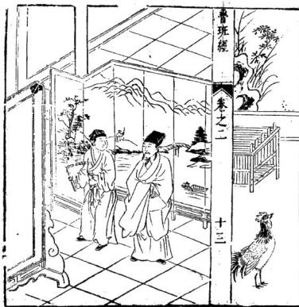

<!-- V3_SOURCE_ID:book005-b000204-p000-dba3c9684f -->

○屏风式八者，高五尺六寸，带脚在内，关于“渊六尺九寸”的描述，原文“渊”字可疑，具体所指不详。琴脚六寸六分大，长二尺。雕日月掩象鼻格，“奖腿”工尺四分，高四寸八分大（原文“工尺”含义不明，疑为误字）。四框一寸六分大，厚一寸四分。外起“改竹”四（原文“改竹”具体含义不详），内起棋盘线平面六分，窄三分。“缭环土下”俱六寸四分（原文“土下”疑为“上下”之误），要分成单下勒“水”花，分作两孔，“肜”四寸四分（原文“肜”字可疑，具体含义不详），相屋关窄。其余大小长短依此仿效。○围屏式。

> **释读存疑：** 渊是否为深或宽之误；工尺的具体含义；改竹的具体含义；土下是否为上下之误；肜的具体含义；相屋关窄的具体含义；1轮自动修复后核义模型仍建议修订，已保守记录。

查看对应原文

<!-- V3_FOLDBACK_BEGIN:book005-b000204-p000-dba3c9684f -->

○屏風式八者高五尺六寸帶腳在內淵六尺九寸琴腳六寸六分大長二尺雕日月掩象鼻格奬腿工尺四分高四寸八分大四框一寸六分大厚一寸四分外起改竹四內起棋盤線平面六分窄三分繚環土下俱六寸四分要分成单下勒水花分作兩孔肜四寸四分相屋關窄餘大小長短依此長倣此○圍屏式

<!-- V3_FOLDBACK_END:book005-b000204-p000-dba3c9684f -->

<!-- V3_SOURCE_ID:book005-b000205-p000-95b28fb811 -->

每做此行（原文“此行”指代不明，可能指围屏或上文的某种样式）用八片，小者六片，高五尺四寸正。每片火（原文“火”字含义不明，疑为误字或分隔符）。鲁班经卷之二，第十四页。

> **释读存疑：** 此行的具体指代；火字的具体含义

查看对应原文

<!-- V3_FOLDBACK_BEGIN:book005-b000205-p000-95b28fb811 -->

每做此行用八片小者六片高五尺四寸正每片火魯班經 卷之二 十四

<!-- V3_FOLDBACK_END:book005-b000205-p000-95b28fb811 -->

<!-- V3_SOURCE_ID:book005-b000206-p000-5fa1ca0208 -->

一片四寸三分，零四框八分大（原文“零四框”含义不明，疑为误字或断句问题）。六分原仿成五分厚。算定共四寸厚。内较“田宇格”六分厚，四分大（原文“田宇格”的具体含义不详）。制作时切忌将框做碎。

> **释读存疑：** 零四框的具体含义；六分原仿成五分厚的具体含义；田宇格的具体含义

查看对应原文

<!-- V3_FOLDBACK_BEGIN:book005-b000206-p000-5fa1ca0208 -->

一片四寸三分零四框八分大六分原倣成五分 厚筭定共四寸厚內較田宇格六分厚四分大做 者切忌碎框

<!-- V3_FOLDBACK_END:book005-b000206-p000-5fa1ca0208 -->

<!-- V3_SOURCE_ID:book005-b000208-p000-3cc5ce0059 -->

○牙轿式

查看对应原文

<!-- V3_FOLDBACK_BEGIN:book005-b000208-p000-3cc5ce0059 -->

○牙轎式

<!-- V3_FOLDBACK_END:book005-b000208-p000-3cc5ce0059 -->

<!-- V3_SOURCE_ID:book005-b000209-p000-81aa883cfb -->

巨家明“嶠衙”下一尺五寸高（原文“巨家明嶠衙下”含义不明，疑为部件名误写）。屏一尺二寸高，深一尺四寸，宽一尺八寸。上圆手一寸三分大，斜七分才圆。轿杠方圆一寸五分大。下“靖”带轿二尺三寸五分（原文“下靖”含义不明）。

> **释读存疑：** 巨家明嶠衙下的具体含义；下靖的具体含义

查看对应原文

<!-- V3_FOLDBACK_BEGIN:book005-b000209-p000-81aa883cfb -->

巨家明嶠衙下一尺五寸高屏一尺二寸高深一尺四寸濶一尺八寸上圓手一寸三分大斜七分纔圓轎杠方圓一寸五分大下靖帶轎二尺三寸五分

<!-- V3_FOLDBACK_END:book005-b000209-p000-81aa883cfb -->

<!-- V3_SOURCE_ID:book005-b000210-p000-8349294e89 -->

○衣笼样式

查看对应原文

<!-- V3_FOLDBACK_BEGIN:book005-b000210-p000-8349294e89 -->

○衣籠樣式

<!-- V3_FOLDBACK_END:book005-b000210-p000-8349294e89 -->

<!-- V3_SOURCE_ID:book005-b000211-p000-f61a3e694e -->

一尺六寸五分高，三尺二寸长，一尺三寸大（原文“大”可能指宽度或直径，含义不明确）。“上发”九分，一寸八分高（原文“上发”的具体含义不详）。上板片三分厚，笼板片四分厚。内子口八分大，三分厚。下车脚一寸六分大。或（原文“或”疑为“卷”或“第”之误）鲁班经卷之二十五。

> **释读存疑：** 一尺三寸大的具体指代；上发的具体含义；或字是否为误字；1轮自动修复后核义模型仍建议修订，已保守记录。

查看对应原文

<!-- V3_FOLDBACK_BEGIN:book005-b000211-p000-f61a3e694e -->

一尺六寸五分高三尺二寸長一尺三寸大上發九分一寸八分高上板片三分厚籠板片四分厚內子口八分大三分厚下車腳一寸六分大或魯班經 卷之二 十五

<!-- V3_FOLDBACK_END:book005-b000211-p000-f61a3e694e -->

<!-- V3_SOURCE_ID:book005-b000212-p000-547261542f -->

在雕花三湾车的车脚上要安装两根横档，这个笼子的尺寸没有额外增加。

查看对应原文

<!-- V3_FOLDBACK_BEGIN:book005-b000212-p000-547261542f -->

雕三灣車腳上要下二根橫獷仔此籠尺寸無加

<!-- V3_FOLDBACK_END:book005-b000212-p000-547261542f -->

<!-- V3_SOURCE_ID:book005-b000214-p000-3df59e210f -->

大状下廊带床的方形尺寸，其高度为尺一寸二分正。床方七寸七分，天武五寸七分。大上屏高四尺五寸二分，后屏两片，两头两片，宽者四尺零二分，窄者三尺二寸三分，长六尺二寸正。领一寸四分厚，彻大小片下中间要做阴阳相合。前踏板五寸六分，高一尺入寸（原文作“入寸”，可能为“八寸”之误）。关前楣带顶一尺零一分。下门四片，每片一尺四分。大上脑板八寸。下穿帘一尺八寸零四分。余留下板片。门框一寸四分大，一寸二分厚。下门槛一管。班經 卷之二 十六（原文格式如此，可能指卷之二第十六条或第十六页）。

> **释读存疑：** 入寸可能为八寸之误；班經 卷之二 十六的具体指代不详；'天武'具体所指不详。；'彻'字在此处的具体含义不详。；'一管'的具体所指不详。；1轮自动修复后核义模型仍建议修订，已保守记录。

查看对应原文

<!-- V3_FOLDBACK_BEGIN:book005-b000214-p000-3df59e210f -->

○大状下廊帶床方其高式尺一寸二分正床方七寸七分天武五寸七分大上屏四尺五寸二分高後屏二片兩頭二片濶者四尺零二分窄者三尺二寸三分長六尺二寸正領一寸四分厚徹大小片下中閒要做陰陽相合前踏板五寸六分高一尺入寸關前楣帶頂一尺零一分下門四片每片一尺四分大上腦板八寸下穿簾一尺八寸零四分餘留下板片門框一寸四分大一寸二分厚下門檻一管班經 卷之二 十六

<!-- V3_FOLDBACK_END:book005-b000214-p000-3df59e210f -->

<!-- V3_SOURCE_ID:book005-b000215-p000-c8262c7108 -->

寸四分三接里面转芝门九寸三分或九寸九分，切忌一尺大。后学专用记此。

> **释读存疑：** '转芝门'具体形制不详，保留原词。；'切忌一尺大'指尺寸禁忌，保留原意。；'转芝门'具体形制不详。

查看对应原文

<!-- V3_FOLDBACK_BEGIN:book005-b000215-p000-c8262c7108 -->

寸四分三接裏面轉芝門九寸三分或九寸九分 切忌一尺大後學專用記此

<!-- V3_FOLDBACK_END:book005-b000215-p000-c8262c7108 -->

<!-- V3_SOURCE_ID:book005-b000216-p000-28578a880b -->

此与藤床样式不同，但踏板卜下顾杆要下长柱子四根，每根一寸四分大。上榻八寸大，下栏杆前一片，左右两片（原文作“左右兩二”，可能为排版或误识），二万字或十字揖前二片，止作一寸四分大，高二尺二尺五分（原文重复“二尺”，可能为“高二尺二寸五分”之误）。横头随迹板大小而做，无误。○藤床式。

> **释读存疑：** 左右兩二的具体含义不详；高二尺二尺五分可能为高二尺二寸五分之误；'無樣'在此处的确切含义不详。；'卜下顧杆'具体所指不详。；'二萬字或十字'的具体图案样式不详。；'揖前二片'的结构和确切所指不详。；'止作'是否通'只作'不详。；1轮自动修复后核义模型仍建议修订，已保守记录。

查看对应原文

<!-- V3_FOLDBACK_BEGIN:book005-b000216-p000-28578a880b -->

此與藤床無樣但踏板卜下顧杆要下長柱子四根每根一寸四分大上榻八寸大下欄杆前一片左右兩二萬字或十字揖前二片止作一寸四分大高二尺二尺五分橫頭隨蹟板大小而做無悞○藤床式

<!-- V3_FOLDBACK_END:book005-b000216-p000-28578a880b -->

<!-- V3_SOURCE_ID:book005-b000217-p000-ceeb5dc83d -->

带床方一尺九寸五分高，长五尺七寸零八分，谓三尺一寸五分半。上桂子四尺一寸高，牛屏一尺五八寸四分高。床岭三尺，阔五尺六寸。长框一寸三分厚。床方五寸二分大，一寸二分厚。起一字线好穿帘。踏板一尺二寸大，四寸高。或上框做一寸二。后脚二寸六分大，一寸三分厚。半合角记。逐月安床设帐吉日。

> **释读存疑：** '上桂子'、'牛屏'、'床岭'等构件名称在通用家具术语中不常见，保留原词，具体所指不详。；'一尺五八寸四分'数值表述特殊，可能是'一尺五寸八分'的异写或误录，按原文保留。；'上桂子'、'牛屏'、'床岭'等构件名称在通用家具术语中不常见，具体所指不详。；'一尺五八寸四分'数值表述特殊，可能是'一尺五寸八分'的异写或误录。

查看对应原文

<!-- V3_FOLDBACK_BEGIN:book005-b000217-p000-ceeb5dc83d -->

帶床方一尺九寸五分高長五尺七寸零八分謂三尺一寸五分半上桂子四尺一寸高牛屏一尺五八寸四分高床嶺三尺濶五尺六寸長框一寸三分厚床方五寸二分大一寸二分厚起一字線好穿簾踏板一尺二寸大四寸高或上框做一寸二後腳二寸六分大一寸三分厚半合角記逐月安牀設帳吉日

<!-- V3_FOLDBACK_END:book005-b000217-p000-ceeb5dc83d -->

<!-- V3_SOURCE_ID:book005-b000218-p000-41f8aacc1e -->

文中列出了三月、正月、一、一、丁酉、癸酉、丁卯、巳卯、癸丑、甲子、庚子、丁酉、乙卯、癸酉、乙巳，以及数字4和二月。随后是四月，包含巳未、乙亥、巳亥、真寅、丙寅、甲寅、辛未、乙未、丙戌、乙卯、癸卯。接着是五月，仅提到甲。六月部分列出了两寅、甲寅、乙、丁酉、乙亥、丁亥、癸宝。最后提到班经养之十。

> **释读存疑：** 1轮自动修复后核义模型仍建议修订，已保守记录。

查看对应原文

<!-- V3_FOLDBACK_BEGIN:book005-b000218-p000-41f8aacc1e -->

三月 正月 一 一 丁酉癸酉丁卯 巳卯癸丑 甲子庚子丁酉 乙卯癸酉乙巳 4 二月 四月 巳未乙亥巳亥真寅 丙寅甲寅辛未乙未 丙戌乙卯癸卯五月甲 六月兩寅甲寅乙 丁酉乙亥丁亥癸寶班經 養之 十

<!-- V3_FOLDBACK_END:book005-b000218-p000-41f8aacc1e -->

<!-- V3_SOURCE_ID:book005-b000219-p000-becb42d036 -->

十二月：乙丑丙寅甲寅，甲子丙子庚子。

查看对应原文

<!-- V3_FOLDBACK_BEGIN:book005-b000219-p000-becb42d036 -->

十二月 乙丑丙寅甲寅 甲子丙子庚子

<!-- V3_FOLDBACK_END:book005-b000219-p000-becb42d036 -->

<!-- V3_SOURCE_ID:book005-b000221-p000-fd19bbc294 -->

○禅床式：此寺观庵堂才有这种做法，做在后殿或禅堂两边。长度依屋宽窄而定，但宽五尺。面前高一尺五寸五分。床钱一尺（原文作“床钱”，具体所指不详，可能为“床前”或“床沿”之误）。前平四板八寸八分大，一寸二分厚。起六个注，每柱三才方圆，上下穿方好挂禅衣及张韩（原文作“张韩”，具体所指不详）。前平面板下要下水椹板，地上陇二寸，下方仔盛板片（原文作“下方仔”，具体所指不详）。其板片要密。

> **释读存疑：** 床钱的具体所指不详；张韩的具体所指不详；下方仔的具体所指不详；'床钱'的具体所指不详。；'张韩'的具体所指不详。；'下方仔'的具体所指不详。

查看对应原文

<!-- V3_FOLDBACK_BEGIN:book005-b000221-p000-fd19bbc294 -->

○禪床式 此寺觀庵堂纔有這做在後殿或禪堂雨邊長依屋 寬窄但濶五尺面前高一尺五寸五分床錢一尺 前平四板八寸八分大一寸二分享起六个注每 柱三才方圓上下一穿方好掛禪衣及張韓前平 面板下要下水椹板地上隴二寸下方仔盛板片 其板片要密

<!-- V3_FOLDBACK_END:book005-b000221-p000-fd19bbc294 -->

<!-- V3_SOURCE_ID:book005-b000222-p000-ae18a6c6fc -->

○禅椅式

查看对应原文

<!-- V3_FOLDBACK_BEGIN:book005-b000222-p000-ae18a6c6fc -->

○禪椅式

<!-- V3_FOLDBACK_END:book005-b000222-p000-ae18a6c6fc -->

<!-- V3_SOURCE_ID:book005-b000223-p000-4e0f2beb71 -->

一尺六寸三分高，一尺八寸二分深，一尺九寸五分。鲁班经卷之二十入。

> **释读存疑：** '卷之二十入'应为'卷之二十'，'入'可能是'八'的误识或异写，按原文保留。；'卷之二十入'应为'卷之二十'，'入'可能是'八'的误识或异写。

查看对应原文

<!-- V3_FOLDBACK_BEGIN:book005-b000223-p000-4e0f2beb71 -->

一尺六寸三分高一尺八寸二分深一尺九寸五分魯班經 卷之二 十入

<!-- V3_FOLDBACK_END:book005-b000223-p000-4e0f2beb71 -->

<!-- V3_SOURCE_ID:book005-b000224-p000-38b9ed8e9f -->

深上屏二尺高，两力手二尺二寸长。柱子方圆一寸三分。大屏上七寸，下七寸五分，出笋三寸。开机头下盛脚盘子四寸三分，高一尺六寸，长一尺三寸大。长短大小仿此（原文作“长短短大小仿此”，“长短短”可能为笔误，应为“长短大小”）。

> **释读存疑：** 长短短可能为长短大小之误；'两力手'具体所指不详。；'大屏'的'大'字是修饰'屏'还是属于前句存疑。；1轮自动修复后核义模型仍建议修订，已保守记录。

查看对应原文

<!-- V3_FOLDBACK_BEGIN:book005-b000224-p000-38b9ed8e9f -->

深上屏二尺高兩力手二尺二寸長柱子方圓一寸三分大屏上七寸下七寸五分出笋三寸開機頭下盛腳盤子四寸三分高一尺六寸長一尺三寸大長短大小倣此

<!-- V3_FOLDBACK_END:book005-b000224-p000-38b9ed8e9f -->

<!-- V3_SOURCE_ID:book005-b000226-p000-9fc3ff2078 -->

○镜架势及镜箱式：架及镜箱有大小者。大者一尺零五分深，阔九寸，高八寸零六分。上层下镜架二寸深。中层下抽相一寸二分。下层抽相三尺一寸零五分，底四分厚。方圆离车脚内中下镜架七寸大，九寸高。若辟花者，雕双凤朝阳，中雕古钱，两边睡草花，下佐连花托。此大小依此尺寸退墨，无误。

> **释读存疑：** '抽相'、'辟花'、'睡草花'、'佐连花托'等雕刻术语保留原词，具体纹样所指不详。

查看对应原文

<!-- V3_FOLDBACK_BEGIN:book005-b000226-p000-9fc3ff2078 -->

○鏡架勢及鏡箱式 架及鏡箱有大小者大者一尺零五分深濶九寸 高八寸零六分上層下鏡架二寸深中層下抽相 一寸二分下層抽相三尺一寸零五分底四分 厚方圓離車腳內中下鏡架七寸大九寸高若辟 花者雕雙鳳朝陽中雕古錢兩邊睡草花下佐連 花托此大小依此尺寸退墨無悞

<!-- V3_FOLDBACK_END:book005-b000226-p000-9fc3ff2078 -->

<!-- V3_SOURCE_ID:book005-b000227-p000-a2f8ae6fa3 -->

○雕花面架式

查看对应原文

<!-- V3_FOLDBACK_BEGIN:book005-b000227-p000-a2f8ae6fa3 -->

○雕花面架式

<!-- V3_FOLDBACK_END:book005-b000227-p000-a2f8ae6fa3 -->

<!-- V3_SOURCE_ID:book005-b000228-p000-a2bd2926a4 -->

后两脚五尺三寸高，前四脚二尺零八分高。每落墨。鲁班经卷之二十九。

查看对应原文

<!-- V3_FOLDBACK_BEGIN:book005-b000228-p000-a2bd2926a4 -->

後兩腳五尺三寸高前四腳二尺零八分高每落墨魯班經 卷之二 十九

<!-- V3_FOLDBACK_END:book005-b000228-p000-a2bd2926a4 -->

<!-- V3_SOURCE_ID:book005-b000229-p000-2e7efe68c1 -->

三寸七分大方，能役转雕刻花草。此用樟木或南木。中心四脚折进，用阳算共阔一尺五寸二分零。

> **释读存疑：** '役转'、'阳算'等词在木工语境中含义不明，保留原词，具体所指不详。；'役转'、'阳算'等词在木工语境中含义不明，具体所指不详。

查看对应原文

<!-- V3_FOLDBACK_BEGIN:book005-b000229-p000-2e7efe68c1 -->

三寸七分大方能役轉雕刻花草此用樟木或南木中心四腳摺進用陽筭共濶一尺五寸二分零

<!-- V3_FOLDBACK_END:book005-b000229-p000-2e7efe68c1 -->

<!-- V3_SOURCE_ID:book005-b000231-p000-c3550df241 -->

案棹式

查看对应原文

<!-- V3_FOLDBACK_BEGIN:book005-b000231-p000-c3550df241 -->

案棹式

<!-- V3_FOLDBACK_END:book005-b000231-p000-c3550df241 -->

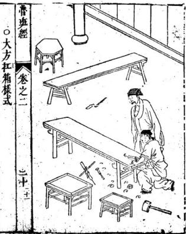

<!-- V3_SOURCE_ID:book005-b000233-p000-7a7f4cf993 -->

在高二尺八寸。四层下一层高入寸（原文作“入寸”，可能为“八寸”之误），二层高五寸，三层高三寸七分，四层高三寸三分，高二寸空一寸五分。栋一寸五分，上净瓶头共五寸。方层板四分半厚，内子口三分厚，八分大。两根将军柱一寸五分大，一寸二分厚。奬腿四只（原文作“奬腿”，具体所指不详，可能为“桨腿”或“撑腿”之误），每只一尺九寸五分高，四寸大。每层二尺六寸五分长，一尺六寸阔。下车脚二寸二分大，一寸二分厚。合角开进雕虎爪双钓。

> **释读存疑：** 入寸可能为八寸之误；奬腿的具体所指不详；'高二寸空一寸五分'的具体结构含义不详。；'奬腿'具体所指不详。；1轮自动修复后核义模型仍建议修订，已保守记录。

查看对应原文

<!-- V3_FOLDBACK_BEGIN:book005-b000233-p000-7a7f4cf993 -->

在高二尺八寸四層下一層高入寸二層高五寸三層高三寸七分四層高三寸三分高二寸空一寸五分棟一寸五分上淨瓶頭共五寸方層板四分半厚內子口三分厚八分大兩根將軍柱一寸五分大一寸二分厚奬腿四隻每隻一尺九寸五分高四寸大每層二尺六寸五分長一尺六寸濶下車腳二寸二分大一寸二分厚合角開進雕虎爪雙釣

<!-- V3_FOLDBACK_END:book005-b000233-p000-7a7f4cf993 -->

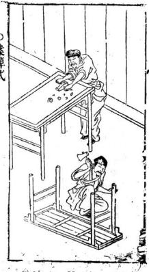

<!-- V3_SOURCE_ID:book005-b000235-p000-8eb9a35194 -->

高二尺五寸，长短阔狭看按面而穢中分两孔（原文作“穢”，语义不通，可能为“劃”或“分”等字之误）。按面。魯班經 卷之二 二十二（原文格式如此，可能指卷之二第二十二条或第二十二页）。

> **释读存疑：** 穢字的具体含义不详；魯班經 卷之二 二十二的具体指代不详；'看按面而穢'的具体含义不详，'穢'字可能为讹字。；句末'按面'的具体所指不详。；1轮自动修复后核义模型仍建议修订，已保守记录。

查看对应原文

<!-- V3_FOLDBACK_BEGIN:book005-b000235-p000-8eb9a35194 -->

高二尺五寸長短濶狹看按面而穢中分兩孔按面魯班經 卷之二 二十二

<!-- V3_FOLDBACK_END:book005-b000235-p000-8eb9a35194 -->

<!-- V3_SOURCE_ID:book005-b000236-p000-c485d490e6 -->

下抽箱或六寸深，或五寸深，或分三孔或两孔。下踏脚方与脚一同大，一寸四分厚，高五寸。其脚方圆一寸六分大。起麻扩线。

查看对应原文

<!-- V3_FOLDBACK_BEGIN:book005-b000236-p000-c485d490e6 -->

下抽箱或六寸深或五寸深或分三孔或兩孔下踏腳方與腳一同大一寸四分厚高五寸其腳方圓一寸六分大起麻擴線

<!-- V3_FOLDBACK_END:book005-b000236-p000-c485d490e6 -->

<!-- V3_SOURCE_ID:book005-b000238-p000-cf1f098b71 -->

搭仔长二尺二寸，高五寸，大四寸五分大，卯一寸二分，太一寸一分厚（原文作“太”，可能为“厚”之误或重复）。面起锡春线，脚上竹圆。

> **释读存疑：** 太一寸一分厚的具体含义不详；'大四寸五分大'的准确断句和含义不详。；'卯一寸二分太'的具体含义不详，'太'字可能为讹字或特定术语。；1轮自动修复后核义模型仍建议修订，已保守记录。

查看对应原文

<!-- V3_FOLDBACK_BEGIN:book005-b000238-p000-cf1f098b71 -->

搭仔 長二尺二寸高五寸大四寸五分大卯一寸二分太 一寸一分厚面起錫春線腳上竹圓

<!-- V3_FOLDBACK_END:book005-b000238-p000-cf1f098b71 -->

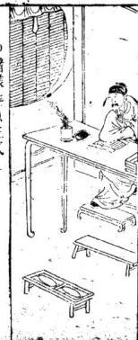

<!-- V3_SOURCE_ID:book005-b000240-p000-d916c77bbf -->

○各种垂鱼的正式做法

查看对应原文

<!-- V3_FOLDBACK_BEGIN:book005-b000240-p000-d916c77bbf -->

○諸樣垂魚正式

<!-- V3_FOLDBACK_END:book005-b000240-p000-d916c77bbf -->

<!-- V3_SOURCE_ID:book005-b000241-p000-b11f186286 -->

春班经卷之二

查看对应原文

<!-- V3_FOLDBACK_BEGIN:book005-b000241-p000-b11f186286 -->

春班經卷之二

<!-- V3_FOLDBACK_END:book005-b000241-p000-b11f186286 -->

<!-- V3_SOURCE_ID:book005-b000242-p000-dcfb24deab -->

二十三

查看对应原文

<!-- V3_FOLDBACK_BEGIN:book005-b000242-p000-dcfb24deab -->

二十三

<!-- V3_FOLDBACK_END:book005-b000242-p000-dcfb24deab -->

<!-- V3_SOURCE_ID:book005-b000243-p000-bc8012818c -->

凡是制作垂鱼，应当依据营造的正式规范。如今人们又制作‘繁针’，如果采用这种‘繁针’做法，并配合使用进风和偃桷，才可以施行。现在的工匠中，也有不使用垂鱼的，只用直板做成如意形状，或者只雕刻云纹样式，这也是好的，这取决于主人的喜好。

> **释读存疑：** 繁针的具体所指不详；‘繁针’具体所指不详

查看对应原文

<!-- V3_FOLDBACK_BEGIN:book005-b000243-p000-bc8012818c -->

凡作垂魚者用按營造之正式今人又嘆作繁針如用此又用做進風及偃桷者方可使之今之匠人又有不使垂魚者只使直板作如意只作彫雲樣者亦好昔在主人之所好也

<!-- V3_FOLDBACK_END:book005-b000243-p000-bc8012818c -->

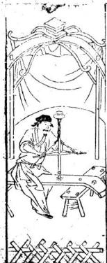

<!-- V3_SOURCE_ID:book005-b000245-p000-b5e4bdaf69 -->

○驰峰正格

查看对应原文

<!-- V3_FOLDBACK_BEGIN:book005-b000245-p000-b5e4bdaf69 -->

○馳峯正格

<!-- V3_FOLDBACK_END:book005-b000245-p000-b5e4bdaf69 -->

<!-- V3_SOURCE_ID:book005-b000246-p000-284b8f9895 -->

驰峰的式样也没有固定的正格。有的雕刻云纹样式，有的做成荒样，有的做成虎爪如意样式，有的雕刻瑞草，有的装饰彤花头，有的制作厌球捧格，有的制作三肄。如今的人大多只喜欢使用斗立，父童（此处具体所指不详）被认为是当时的流行式样。

> **释读存疑：** 父童：原文如此，具体所指不详，可能是某种构件名称或特定术语

查看对应原文

<!-- V3_FOLDBACK_BEGIN:book005-b000246-p000-284b8f9895 -->

馳峯之格亦無正樣或有彫雲樣或有做荒樣又 有做虎爪如意樣又有彫瑞草者又有彤花頭者 有厭毬捧格又有三肄或今之人多只愛使斗立 父童乃爲時格也

<!-- V3_FOLDBACK_END:book005-b000246-p000-284b8f9895 -->

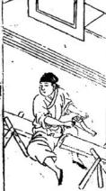

<!-- V3_SOURCE_ID:book005-b000249-p000-110f9e1b0e -->

鲁班经卷之二

查看对应原文

<!-- V3_FOLDBACK_BEGIN:book005-b000249-p000-110f9e1b0e -->

魯班經卷之二

<!-- V3_FOLDBACK_END:book005-b000249-p000-110f9e1b0e -->

1+四

<!-- V3_SOURCE_ID:book005-b000251-p000-1badec0388 -->

## ○風箱樣式 — ○风箱样式

查看对应原文

<!-- V3_FOLDBACK_BEGIN:book005-b000251-p000-1badec0388 -->

## ○風箱樣式

<!-- V3_FOLDBACK_END:book005-b000251-p000-1badec0388 -->

<!-- V3_SOURCE_ID:book005-b000252-p000-2ec5f665d4 -->

风箱长三尺，高一尺一寸，宽八寸。板片厚八分。内部开设的风板，宽六寸四分，长九寸四分。抽风横仔厚八分，大四分。扯手长七寸四分，抽风好厚八分，大四分。批手长七寸，截面为方形或圆形，大一寸。出风眼要取方形，尺寸一寸八分，以平中为主。两头的吸风眼，每头一个，宽一寸，入分长二寸二分。四边的衣片都采用上行钦准。

> **释读存疑：** 抽风好具体所指不详；入分具体所指不详；上行钦准具体所指不详；‘抽风好’具体所指不详；‘入分’具体所指不详；‘上行钦准’具体所指不详；1轮自动修复后核义模型仍建议修订，已保守记录。

查看对应原文

<!-- V3_FOLDBACK_BEGIN:book005-b000252-p000-2ec5f665d4 -->

長三尺高一尺一寸濶八寸板片八分厚內開風板 六寸四分大九寸四分長抽風橫仔八分大四分 厚扯手七寸四分長抽風好八分大四分厚批 手七寸長方圓一寸大出風眼要取方圖一寸八 分大平中爲主兩頭吸風眼每頭一箇濶一寸入 分長二寸二分四邊衣片都用上行欽準

<!-- V3_FOLDBACK_END:book005-b000252-p000-2ec5f665d4 -->

<!-- V3_SOURCE_ID:book005-b000254-p000-61506e3a93 -->

这是《班经》卷之二的内容。关于扉花，高五尺，宽三尺七寸。土搭头每边长四寸四分。中环三片。腿长二尺三寸五分。下廊高一尺五寸三分。柱大一寸四分，厚一寸二分。○素衣众式。

> **释读存疑：** 扉花具体所指不详；土搭头具体所指不详；‘扉花’具体所指不详；‘土搭头’具体所指不详

查看对应原文

<!-- V3_FOLDBACK_BEGIN:book005-b000254-p000-61506e3a93 -->

班經 卷之二 二十五扉花者五尺高三尺七寸濶土搭頭每邊長四寸四分中環三片腿二尺三寸五分大下廊一尺五寸三分高柱一寸四分大一寸二分厚○素衣衆式

<!-- V3_FOLDBACK_END:book005-b000254-p000-61506e3a93 -->

<!-- V3_SOURCE_ID:book005-b000255-p000-3276e66d73 -->

高四尺零一寸，大三尺。下郡长一尺二寸，大四寸四分。柱子大一寸二分，厚一寸。上搭庙出头二寸七分。中下光框有一根，下部有两根。窗齿每成双制作，高度一度三分。每眼齿仔厚八分，大八分。○而架式。

> **释读存疑：** 下郡具体所指不详；上搭庙具体所指不详；一度三分中的度具体所指不详；‘下郡’具体所指不详；‘上搭庙’具体所指不详；‘一度三分’中的‘度’具体所指不详；1轮自动修复后核义模型仍建议修订，已保守记录。

查看对应原文

<!-- V3_FOLDBACK_BEGIN:book005-b000255-p000-3276e66d73 -->

高四尺零一寸大三尺下郡一尺二寸長四寸四分大柱子一寸二分大厚一寸上搭廟出頭二寸七分中下光框一根下二根窗齒每成雙做一度三分高每眼齒仔八分厚八分大○而架式

<!-- V3_FOLDBACK_END:book005-b000255-p000-3276e66d73 -->

<!-- V3_SOURCE_ID:book005-b000256-p000-b6d5219514 -->

两柱高一尺九寸，外头二寸三分。后二廊四及十九分，方圆一寸一分大。或者是三脚的结构，内部需要交集职，除笋书进一寸零四分，斜六分，不可有误。

> **释读存疑：** 后二廊四及十九分具体所指不详；交集职具体所指不详；除笋书具体所指不详；‘后二廊四及十九分’具体所指不详；‘交集职’具体所指不详；‘除笋书’具体所指不详；1轮自动修复后核义模型仍建议修订，已保守记录。

查看对应原文

<!-- V3_FOLDBACK_BEGIN:book005-b000256-p000-b6d5219514 -->

兩柱一尺九寸高外頭二寸三分後二廊四及十九分方員一寸一分大或三腳者內要交集職除笋書進一寸零四分斜六分無悞

<!-- V3_FOLDBACK_END:book005-b000256-p000-b6d5219514 -->

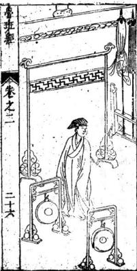

<!-- V3_SOURCE_ID:book005-b000258-p000-41caef9820 -->

台班气卷之二，二十六。○鼓架式

查看对应原文

<!-- V3_FOLDBACK_BEGIN:book005-b000258-p000-41caef9820 -->

臺班氣 卷之二二十六○鼓架式

<!-- V3_FOLDBACK_END:book005-b000258-p000-41caef9820 -->

<!-- V3_SOURCE_ID:book005-b000259-p000-fd5c6b5815 -->

高一尺二寸七分，四脚，方圆一寸二分大。上部雕刻净获头，高三寸五分。上层穿枋仔四或八根，下层八根。上层有雕花板，下层有下缭环。或者做成八方形的，柱子横扩的尺寸一样，但在画眼上每边要斜三分半，笔触要是正的。此尺寸不可走分毫，谨记。

> **释读存疑：** 净获头具体所指不详；四捌根具体所指不详；横扩具体所指不详；‘净获头’具体所指不详；‘四捌根’具体所指不详；‘横扩’具体所指不详；1轮自动修复后核义模型仍建议修订，已保守记录。

查看对应原文

<!-- V3_FOLDBACK_BEGIN:book005-b000259-p000-fd5c6b5815 -->

一尺二寸七分高四腳方圓一寸二分大上雕淨獲頭三寸五分高上層穿枋仔四捌根下層入根上層雕花板下層下繚環或做八方者柱子橫擴在尺寸一樣但畫眼上每邊要斜三分半筆是正的一此尺寸不可走分毫謹記

<!-- V3_FOLDBACK_END:book005-b000259-p000-fd5c6b5815 -->

<!-- V3_SOURCE_ID:book005-b000260-p000-3ee42b5411 -->

高三尺七寸。上部有蕃帘衣架头花，方圆一寸五分大。两边柱子都一级起棋盘线。中间穿枋仔高三尺。铜鼓挂起后便于手打。下部脚雕刻成屏风脚的样式，奖薄尺高八寸，大三寸三分。

> **释读存疑：** 蕃帘具体所指不详；奖薄尺具体所指不详；‘蕃帘’具体所指不详；‘奖薄尺’具体所指不详；1轮自动修复后核义模型仍建议修订，已保守记录。

查看对应原文

<!-- V3_FOLDBACK_BEGIN:book005-b000260-p000-3ee42b5411 -->

高三尺七寸上蕃簾衣架頭花方圓一寸五分大兩邊柱子俱一級起棋盤線中閒穿枋仔要三尺高銅鼓掛起便手好打下腳雕屏風腳樣式獎薄尺八寸高三寸三分大

<!-- V3_FOLDBACK_END:book005-b000260-p000-3ee42b5411 -->

<!-- V3_SOURCE_ID:book005-b000261-p000-74c0eb6c3f -->

○花架式

查看对应原文

<!-- V3_FOLDBACK_BEGIN:book005-b000261-p000-74c0eb6c3f -->

○花架式

<!-- V3_FOLDBACK_END:book005-b000261-p000-74c0eb6c3f -->

<!-- V3_SOURCE_ID:book005-b000262-p000-0c2693b669 -->

八者六鄺，或者是四脚、二脚、六脚。大者中下骑相一，高七寸。两边高四尺，中高六尺。下枋两根，每根大三寸。直枋两根，大三寸。直枋两根，大三寸。宽五尺，长七尺。上部盛花盆板，厚一寸五分，大八寸。这也看人家天井大小而做，只依此尺寸退星有准。○凉伞架式。

> **释读存疑：** 八者六鄺具体所指不详；骑相一具体所指不详；退星具体所指不详；‘八者六鄺’具体所指不详；‘骑相一’具体所指不详；‘退星’具体所指不详；1轮自动修复后核义模型仍建议修订，已保守记录。

查看对应原文

<!-- V3_FOLDBACK_BEGIN:book005-b000262-p000-0c2693b669 -->

八者六鄺或四腳或二腳六腳大者中下騎相一七寸高兩邊四尺高中高六尺下枋二根每根三寸大直枋二根三寸大直枋二根三寸大五尺濶七尺長上盛花盆板一寸五分厚八寸大此亦看人家天井大小而做只依此尺寸退星有準○凉傘架式

<!-- V3_FOLDBACK_END:book005-b000262-p000-0c2693b669 -->

<!-- V3_SOURCE_ID:book005-b000263-p000-ef228052a0 -->

这是《官班经》卷之二的内容。高一尺三寸，长二尺四寸。中间下伞柱仔高二尺三寸，带琴脾在内计算。中柱仔大二寸二分，厚一寸六分。上部除三寸三分做净平头。中心下伞梁厚一寸三分，大二寸二分。下托伞柄也是如此。两边柱子方圆一寸四分大。窗齿大八分，厚六分。琴脚大五寸，厚一寸六分，长一尺五寸。

> **释读存疑：** 1+七具体所指不详；琴脾具体所指不详；‘1+七’具体所指不详；‘琴脾’具体所指不详；本地硬校验仍未通过，已记录供后续自动处理或人工核对。

查看对应原文

<!-- V3_FOLDBACK_BEGIN:book005-b000263-p000-ef228052a0 -->

官班經 卷之二 1+七一尺三寸高二尺四寸長中閒下傘柱仔二尺三寸高帶琴脾在內筭中柱仔二寸二分大一寸六分厚上除三寸三分做淨平頭中心下傘樑一寸三分厚二寸二分大下托傘柄亦然而是兩邊柱子方圓一寸四分大窗齒八分大六分厚琴腳五寸大寸六分厚一尺五寸長

<!-- V3_FOLDBACK_END:book005-b000263-p000-ef228052a0 -->

<!-- V3_SOURCE_ID:book005-b000265-p000-b74bcc17b0 -->

○校椅式

查看对应原文

<!-- V3_FOLDBACK_BEGIN:book005-b000265-p000-b74bcc17b0 -->

○校椅式

<!-- V3_FOLDBACK_END:book005-b000265-p000-b74bcc17b0 -->

<!-- V3_SOURCE_ID:book005-b000266-p000-6c4a5b154a -->

制作椅子要先看好光梗木头及节次，锯开后要用干燥的枋木才下手制作。其柱子大一寸，前脚高二尺一寸，后廊式高尺九寸三分。盘子深一尺二寸六分，宽一尺六寸七分，厚一寸一分。屏上五寸大，下六寸大。前花牙一寸五分大，四分厚。大小长短依此格。○板式。

> **释读存疑：** 后廊式具体所指不详；‘后廊式’具体所指不详；本地硬校验仍未通过，已记录供后续自动处理或人工核对。

查看对应原文

<!-- V3_FOLDBACK_BEGIN:book005-b000266-p000-6c4a5b154a -->

椅先看好光梗木頭及節次用解開要乾枋纔下手做其柱子一寸大前腳二尺一寸高後廊式尺九寸三分高盤子深一尺二寸六分濶一尺六寸七分厚一寸一分屏上五寸大下六寸大前花牙一寸五分大四分厚大小長短依此格○板式

<!-- V3_FOLDBACK_END:book005-b000266-p000-6c4a5b154a -->

<!-- V3_SOURCE_ID:book005-b000267-p000-506a2d30ea -->

海狱琴的样式如下：琴身高一尺六寸，宽一寸三分；琴库长三尺八寸五分；琴楼读高三寸八分半；琴脚长一寸四分，大一寸二分，厚一寸；琴卷牙勒水宽三寸七分。大琴的尺寸可参考琴凳面的长短及粗细，琴橈的尺寸与之相同，其余部分仿照此例。

> **释读存疑：** “库”、“楼读”、“勒水”、“桡”的具体所指不详。；“大一寸二分”的具体维度（宽/径）不详。；1轮自动修复后核义模型仍建议修订，已保守记录。

查看对应原文

<!-- V3_FOLDBACK_BEGIN:book005-b000267-p000-506a2d30ea -->

海獄一尺六寸高一寸三分庫長三尺八寸五分樓讀三寸八分半長腳一寸四分大一寸二分厚卷牙勒水三寸七分大或看櫈面長短及粗橈尺一同餘倣此 UE○琴式

<!-- V3_FOLDBACK_END:book005-b000267-p000-506a2d30ea -->

<!-- V3_SOURCE_ID:book005-b000268-p000-52ab5f6ea8 -->

第八种做法是观察厅堂的宽窄与深浅来制作大型琴桌。其高度为一尺七寸，桌面宽三寸五分，厚度为三寸；若厚度为三寸，则坐面长度不得长于一丈三尺三分，桌面宽一尺三寸三分，大脚宽七寸，雕刻卷草双钩花牙宽四寸五分半，头部长一尺三寸一分。或者在脚下制作贴仔，厚度只可一寸三分，需扣除矮脚一寸三分才相称。或者制作靠背，尺寸与前述相同，但靠背高度仅为一尺。文中末尾标注“申班经 卷之二 二十九”。

> **释读存疑：** “大腳七寸分大”的具体断句与含义；“坐下不得长”的确切指代；“除矮腳”的具体操作含义；1轮自动修复后核义模型仍建议修订，已保守记录。

查看对应原文

<!-- V3_FOLDBACK_BEGIN:book005-b000268-p000-52ab5f6ea8 -->

八者看廳堂濶狹淺深而做大者高一尺七寸面三寸五分厚或三寸厚卽歃坐不得長一丈三尺三分面一尺三寸三分大腳七寸分大雕捲草雙釣花牙四寸五分半頭一尺三寸一分長或腳下做貼仔只可一寸三分厚要除矮腳一寸三分纔相稱或做靠背尺寸一同但靠背只高一尺申班經 卷之二 二十九

<!-- V3_FOLDBACK_END:book005-b000268-p000-52ab5f6ea8 -->

<!-- V3_SOURCE_ID:book005-b000269-p000-253867fcb2 -->

若厚四寸则止。横仔做一寸二分大，一尺五分厚。或者起棋盘线，或者起锡春线，雕花亦如此，不下花者同样。其余长短宽窄在此尺寸上分准，仿照此例。

> **释读存疑：** “起棋盤線”、“起錫春線”的具体工艺不详。

查看对应原文

<!-- V3_FOLDBACK_BEGIN:book005-b000269-p000-253867fcb2 -->

四寸則止橫仔做一寸二分大一尺五分厚或起棋盤線或起錫春線雕花亦而之不下花者同樣餘長短寬濶在此尺寸上分準此

<!-- V3_FOLDBACK_END:book005-b000269-p000-253867fcb2 -->

<!-- V3_SOURCE_ID:book005-b000270-p000-afff71b9c2 -->

○机子式

查看对应原文

<!-- V3_FOLDBACK_BEGIN:book005-b000270-p000-afff71b9c2 -->

○机子式

<!-- V3_FOLDBACK_END:book005-b000270-p000-afff71b9c2 -->

<!-- V3_SOURCE_ID:book005-b000271-p000-c0335b06ed -->

该物件长一尺二寸，宽九寸或八寸，高一尺六寸。头部留空一寸零六分，文中提到的“晝眼”脚方圆一寸四分大。面上眼斜六分半，下部“橢仔”厚一寸一分。起钮眷线花牙宽三寸五。

> **释读存疑：** “晝眼”是否为“画眼”或误字；“橢仔”的具体含义；“三寸五”是否指宽度且尺寸是否完整；1轮自动修复后核义模型仍建议修订，已保守记录。

查看对应原文

<!-- V3_FOLDBACK_BEGIN:book005-b000271-p000-c0335b06ed -->

四一尺二寸長濶九寸或八寸高一尺六寸頭空一寸零六分晝眼腳方圓一寸四分大面上眼斜六分半下橢仔一寸一分厚起鈕眷線花牙三寸五

<!-- V3_FOLDBACK_END:book005-b000271-p000-c0335b06ed -->

○

<!-- V3_SOURCE_ID:book005-b000273-p000-a6e30d08d4 -->

该物件高二尺五寸，长短宽窄需根据按面情况制作。中间分为两孔，按面下“拙和”深度或为六寸，或为五寸；或者分为三孔，或两孔。下部“踊脚”方圆与脚相同，大一寸四分，厚度或高度为五寸。其脚方圆一寸六分大，起麻横线。

> **释读存疑：** “拙和”的具体含义；“厚五寸”与“高五寸”的指代区别；“麻横线”的具体样式；1轮自动修复后核义模型仍建议修订，已保守记录。

查看对应原文

<!-- V3_FOLDBACK_BEGIN:book005-b000273-p000-a6e30d08d4 -->

高二尺五寸長短濶狹看按面而做中分兩孔按面下拙和或六寸深或五寸深或分三孔或兩孔下踊腳方與腳一同大一寸四分厚高五寸其腳方員一寸六分大起麻橫線

<!-- V3_FOLDBACK_END:book005-b000273-p000-a6e30d08d4 -->

<!-- V3_SOURCE_ID:book005-b000274-p000-21baa54bf3 -->

0八仙掉

查看对应原文

<!-- V3_FOLDBACK_BEGIN:book005-b000274-p000-21baa54bf3 -->

0八仙掉

<!-- V3_FOLDBACK_END:book005-b000274-p000-21baa54bf3 -->

<!-- V3_SOURCE_ID:book005-b000275-p000-7f887fc581 -->

该物件高二尺五寸，长三尺三寸，大二尺四十，邻一寸五分大。若涉及“下爐金”，下层高四寸七分，中间方圆九寸八分，无误动木大三寸七分。脚上方圆二分，缘棹框春。文末标注“班经 卷之二 三十”。

> **释读存疑：** “四十”是否为“四寸”之误；“鄰”的具体含义；“爐金”与“無悞動木”的具体所指；“緣棹框春”的含义；1轮自动修复后核义模型仍建议修订，已保守记录。

查看对应原文

<!-- V3_FOLDBACK_BEGIN:book005-b000275-p000-7f887fc581 -->

高二尺五寸長三尺三寸大二尺四十鄰一寸五分大若下爐金下層四寸七分高中間方員九寸八分無悞動木三寸七分大腳上方員二分緣棹框春班經 卷之二 三十

<!-- V3_FOLDBACK_END:book005-b000275-p000-7f887fc581 -->

<!-- V3_SOURCE_ID:book005-b000276-p000-8089ba61fc -->

尺寸为大二寸四分，厚一寸二分。当时的工匠依照此式样制作大小，必定不会有任何差错。

> **释读存疑：** “大”具体指直径还是其他维度；“必無一悞”是否包含扩写

查看对应原文

<!-- V3_FOLDBACK_BEGIN:book005-b000276-p000-8089ba61fc -->

二寸四分大一寸二分厚時師依此式大小必無一悞

<!-- V3_FOLDBACK_END:book005-b000276-p000-8089ba61fc -->

<!-- V3_SOURCE_ID:book005-b000277-p000-774e467710 -->

○小琴棹式

查看对应原文

<!-- V3_FOLDBACK_BEGIN:book005-b000277-p000-774e467710 -->

○小琴棹式

<!-- V3_FOLDBACK_END:book005-b000277-p000-774e467710 -->

<!-- V3_SOURCE_ID:book005-b000278-p000-8a7092e529 -->

小琴棹：长二尺三寸，大一尺三寸，高二尺三寸。脚一寸“人分”大，下梢一寸二分大，厚一寸一分。上下琴脚勒水二寸，人斜闻六分。或者大者放长尺寸，与一字棹相同。文末标注“棋盘方棹式”。

> **释读存疑：** “人分”是否为“八分”之误；“勒水”的具体工艺含义；“人斜闻”是否为“八斜纹”或误字；1轮自动修复后核义模型仍建议修订，已保守记录。

查看对应原文

<!-- V3_FOLDBACK_BEGIN:book005-b000278-p000-8a7092e529 -->

長二尺三寸大一尺三寸高二尺三寸腳一寸人分大下梢一寸二分大厚一寸一分上下琴腳勒水二寸人斜聞六分或大者放長尺寸與一字棹同○棋盤方棹式

<!-- V3_FOLDBACK_END:book005-b000278-p000-8a7092e529 -->

<!-- V3_SOURCE_ID:book005-b000279-p000-9d0a09719d -->

棋盘方棹：方圆一尺九寸三分，脚高二尺五寸，方圆一寸五分大。棹革一寸二分，学二寸四分大，四齿吞头四值。

> **释读存疑：** “棹革”、“學”、“吞頭”、“四值”的具体含义；1轮自动修复后核义模型仍建议修订，已保守记录。

查看对应原文

<!-- V3_FOLDBACK_BEGIN:book005-b000279-p000-9d0a09719d -->

方圓一尺九寸三分腳二尺五寸高方員一寸五分大棹革一寸二分學二寸四分大四齒吞頭四值

<!-- V3_FOLDBACK_END:book005-b000279-p000-9d0a09719d -->

<!-- V3_SOURCE_ID:book005-b000280-p000-24ecc9ce8a -->

衣厨样式：高五尺零五分，深一尺六寸五分，阔四尺四寸。平公为两柱，每柱一寸六分大，一寸四分厚。下衣扩一寸四分大，十寸三分厚。上岭一寸四分大，一寸一分厚。门框每根一寸四分大，一寸一分厚。其厨上补一寸二分。文末标注“食格操式”。

> **释读存疑：** “平公”是否为“平分”或误字；“下衣擴”的具体部件指代；“十寸三分”是否为“一寸三分”之误；“補”的具体指代；“平公”的具体含义不详。；“下衣擴”的具体部件指代不详。；“十寸三分”可能为“一寸三分”之误。；“補”的具体指代不详。；1轮自动修复后核义模型仍建议修订，已保守记录。

查看对应原文

<!-- V3_FOLDBACK_BEGIN:book005-b000280-p000-24ecc9ce8a -->

○衣厨樣式高五尺零五分深一尺六寸五分濶四尺四寸平公爲兩柱每柱一寸六分大一寸四分厚下衣擴一寸四分大十寸三分厚上嶺一寸四分大一寸一分厚門框每根 寸四分大一寸一分厚其廚上補一寸二分○食格操式

<!-- V3_FOLDBACK_END:book005-b000280-p000-24ecc9ce8a -->

<!-- V3_SOURCE_ID:book005-b000281-p000-dc7cff6f59 -->

食格操：在二根高二尺二寸三分，带净平头在内一寸一分大，八分厚。标尺分厚二寸九分大，长一尺六寸。文末标注“春班经 卷之二 三十”。

> **释读存疑：** “標尺分厚”的具体含义；“標尺分厚”的具体含义不详。；1轮自动修复后核义模型仍建议修订，已保守记录。

查看对应原文

<!-- V3_FOLDBACK_BEGIN:book005-b000281-p000-dc7cff6f59 -->

在二根高二尺二寸三分帶淨平頭在內一寸一分大八分厚標尺分厚二寸九分大長一尺六寸春班經 卷之二 三十

<!-- V3_FOLDBACK_END:book005-b000281-p000-dc7cff6f59 -->

<!-- V3_SOURCE_ID:book005-b000282-p000-de91abdf27 -->

衣摺式：分阔九寸六分。下层高五寸四分，二层高三寸五分，三层高三寸四分，二寸高。板片厚三分半，里子入分大，三分厚。车脚大二寸，厚八分。奬腿高一尺五寸三分，大三寸二分。其余大小依此退墨做。

> **释读存疑：** “裏子入分大”是否为“八分”之误；“奬腿”的具体含义；“退墨”的具体工艺含义；“裏子入分大”可能为“八分”之误。；“奬腿”的具体含义不详。；“退墨”的具体工艺含义不详。；1轮自动修复后核义模型仍建议修订，已保守记录。

查看对应原文

<!-- V3_FOLDBACK_BEGIN:book005-b000282-p000-de91abdf27 -->

分濶九寸六分下層五寸四分高二層三寸五分高三層三寸四分高二寸高板片三分半厚裏子入分大三分厚車腳二寸大八分厚奬腿一尺五寸三分高三寸二分大餘大小依此退墨做○衣摺式

<!-- V3_FOLDBACK_END:book005-b000282-p000-de91abdf27 -->

<!-- V3_SOURCE_ID:book005-b000283-p000-5570b8e26e -->

大者三尺九寸长，一寸四分大，内柄五寸，厚六分。小者二尺六寸长，一寸四分大，柄三寸八分，厚五分。此做如剑样。

查看对应原文

<!-- V3_FOLDBACK_BEGIN:book005-b000283-p000-5570b8e26e -->

大者三尺九寸長一寸四分大內柄五寸厚六分小者二尺六寸長一寸四分大柄三寸八分厚五分此做如劍樣

<!-- V3_FOLDBACK_END:book005-b000283-p000-5570b8e26e -->

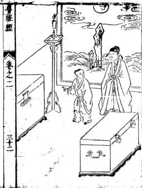

<!-- V3_SOURCE_ID:book005-b000285-p000-232e80497e -->

衣箱式

查看对应原文

<!-- V3_FOLDBACK_BEGIN:book005-b000285-p000-232e80497e -->

衣箱式

<!-- V3_FOLDBACK_END:book005-b000285-p000-232e80497e -->

<!-- V3_SOURCE_ID:book005-b000286-p000-f4250fd24f -->

衣箱：长一尺九寸二分，大一尺六分，高一尺三寸。板片只用四分厚。上层高一寸九分，子口出五分。或者下车脚一寸三分大，厚五分。车脚只是三湾。

> **释读存疑：** “子口”的具体结构含义；“三灣”的具体造型含义；“子口”的具体结构含义不详。；“三灣”的具体造型含义不详。；1轮自动修复后核义模型仍建议修订，已保守记录。

查看对应原文

<!-- V3_FOLDBACK_BEGIN:book005-b000286-p000-f4250fd24f -->

長一尺九寸二分大一尺六分高一尺三寸板片只用四分厚上層一寸九分高子口出五分或下車腳一寸三分大五分厚車腳只是三灣

<!-- V3_FOLDBACK_END:book005-b000286-p000-f4250fd24f -->

<!-- V3_SOURCE_ID:book005-b000287-p000-8181f75def -->

烛台式

查看对应原文

<!-- V3_FOLDBACK_BEGIN:book005-b000287-p000-8181f75def -->

燭臺式

<!-- V3_FOLDBACK_END:book005-b000287-p000-8181f75def -->

<!-- V3_SOURCE_ID:book005-b000288-p000-b9958de9b1 -->

烛台：回四尺，柱子方圆一寸三分大。分上盘仔八寸大，三分。倒指花牙，每一只脚下交进三片，每片高五寸二分。雕转鼻带叶。交脚之时可拿板画威，左八寸四分定三方，长短照墨方准。

> **释读存疑：** “回四尺”指总高还是周长；“拿板畫威左”的具体含义；“回四尺”指总高还是周长不详。；“拿板畫威左”的具体含义不详。；1轮自动修复后核义模型仍建议修订，已保守记录。

查看对应原文

<!-- V3_FOLDBACK_BEGIN:book005-b000288-p000-b9958de9b1 -->

回四尺柱子方圓一寸三分大分上盤仔八寸大三分倒指花牙每一隻腳下交進三片每片高五寸二分雕轉鼻帶葉交腳之時可拿板畫威左八寸四分定三方長短照墨方準

<!-- V3_FOLDBACK_END:book005-b000288-p000-b9958de9b1 -->

<!-- V3_SOURCE_ID:book005-b000289-p000-d4ba07f04b -->

面爐式

查看对应原文

<!-- V3_FOLDBACK_BEGIN:book005-b000289-p000-d4ba07f04b -->

面爐式

<!-- V3_FOLDBACK_END:book005-b000289-p000-d4ba07f04b -->

<!-- V3_SOURCE_ID:book005-b000290-p000-53b46d042d -->

该器物方圆二尺一十三分，带脚及车脚共上磨六尺五分。正上方盘子厚一寸三分，加盛炉贼任厚八分，做成二寸四分大。豹脚共六只，每只二寸大、二寸三分厚，下贴梢厚一寸，中间圆径九寸五分正。文中提到的“加盛炉贼任”具体所指不详，“豹脚”为行业术语，具体含义亦不详。

> **释读存疑：** 加盛炉贼任；豹脚

查看对应原文

<!-- V3_FOLDBACK_BEGIN:book005-b000290-p000-53b46d042d -->

方圓二尺一十三分大帶腳及車腳共上磨六尺五分正上面盤子一寸三分厚加盛爐賊任八分厚做成二寸四分大豹脚六隻每隻二寸大二寸三分厚下貼梢一寸厚中圓九寸五分正

<!-- V3_FOLDBACK_END:book005-b000290-p000-53b46d042d -->

<!-- V3_SOURCE_ID:book005-b000291-p000-c94d6c2a80 -->

该器物高九寸，呈方圆式，尺四分大。尽仔下丝环式，寸枢厚一寸、大一寸六分，分佐亦方。下方豹脚脚部二寸二分大、一寸六分厚，其豹脚需雕刻吞头，下贴梢厚一寸五分。文末标注“鲁班经 卷之二 三十三”。文中提到的“尽仔”、“丝环式”、“分佐”、“豹脚”及“吞头”均为行业术语，具体所指不详。

> **释读存疑：** 尽仔；丝环式；分佐；豹脚；吞头；1轮自动修复后核义模型仍建议修订，已保守记录。

查看对应原文

<!-- V3_FOLDBACK_BEGIN:book005-b000291-p000-c94d6c2a80 -->

九寸高方圓式尺四分大盡仔下絲環式寸樞一寸厚一寸六分大分佐亦方下豹脚腳二寸二分大一寸六分厚其豹腳要雕吞頭下貼梢一寸五分厚一寸魯班經 卷之二 三十三

<!-- V3_FOLDBACK_END:book005-b000291-p000-c94d6c2a80 -->

<!-- V3_SOURCE_ID:book005-b000292-p000-70473f3e08 -->

该处尺寸六分大，雕刻三湾动水。其框合角笋眼需斜八分半方。闻得起中间孔方圆一尺无误。文中提到的“雕三湾动水”中的“动水”为行业术语，具体所指不详。

> **释读存疑：** 动水

查看对应原文

<!-- V3_FOLDBACK_BEGIN:book005-b000292-p000-70473f3e08 -->

六分大雕三灣動水其框合角笋眼要斜八分半方 聞得起中間孔方員一尺無悞

<!-- V3_FOLDBACK_END:book005-b000292-p000-70473f3e08 -->

<!-- V3_SOURCE_ID:book005-b000293-p000-91697a026c -->

方式

查看对应原文

<!-- V3_FOLDBACK_BEGIN:book005-b000293-p000-91697a026c -->

方式

<!-- V3_FOLDBACK_END:book005-b000293-p000-91697a026c -->

<!-- V3_SOURCE_ID:book005-b000294-p000-312019ca89 -->

该器物高五寸五分，圆尺内圆九寸三分。四脚二寸五分大，雕刻双莲挽双钩。下贴梢厚一寸，二寸大。盘任厚一寸二分。缭环一寸四分大，雕刻螳螂胜接豹脚相秤。文中提到的“螳螂胜”和“相秤”均为行业术语，具体所指不详。

> **释读存疑：** 螳螂胜；相秤

查看对应原文

<!-- V3_FOLDBACK_BEGIN:book005-b000294-p000-312019ca89 -->

高五寸五分圓尺內圓九寸三分四腳二寸五分大雕雙蓮挽雙鈎下貼梢一寸厚二寸大盤任一寸二分厚繚環一寸四分大雕螳螂胜接豹腳相秤

<!-- V3_FOLDBACK_END:book005-b000294-p000-312019ca89 -->

<!-- V3_SOURCE_ID:book005-b000295-p000-814040136f -->

香炉样式说明：细乐者长一尺四寸，阔八寸二分，四权厚三分，高一寸四分，底厚三分。与上样样关大框上斜三分，上卯水边厚三分，六分大。厌竹线下豹脚下六只，分八分大，一寸二分大，贴梢厚三分，七分大，雕刻三湾。车脚或粗的不用豹脚，水边寸尺一同。又大小敬者，尺寸依此加减。文中提到的“细乐”、“四权”、“厌竹线”、“豹脚”、“车脚”及“敬者”均为行业术语，具体所指不详。

> **释读存疑：** 细乐；四权；厌竹线；豹脚；车脚；敬者；1轮自动修复后核义模型仍建议修订，已保守记录。

查看对应原文

<!-- V3_FOLDBACK_BEGIN:book005-b000295-p000-814040136f -->

香爐樣式 細樂者長一尺四寸闊八寸二分四權三分厚高一 寸四分底三分厚與上樣樣關大框上斜三分上卯 水邊三分厚六分大厭竹線下豹腳下六隻分 八分大一寸二分大貼梢三分厚七分大雕三灣車 脚或粗的不用豹脚水邊寸尺一同又大小敬者尺 寸依此加減

<!-- V3_FOLDBACK_END:book005-b000295-p000-814040136f -->

<!-- V3_SOURCE_ID:book005-b000296-p000-d380f075b6 -->

前柱高一尺五寸五分，寿后柱子式尺七寸高，方圆一寸大。盘子一尺三寸，开一尺一寸深，框厚一寸一分，寸二分大。切忌有节，树米无用。文中提到的“寿后柱子式”及“树米”均为行业术语或存疑词汇，具体所指不详。

> **释读存疑：** 寿后柱子式；树米；1轮自动修复后核义模型仍建议修订，已保守记录。

查看对应原文

<!-- V3_FOLDBACK_BEGIN:book005-b000296-p000-d380f075b6 -->

前柱一尺五寸五分壽後柱子式尺七寸高方圓一寸大盤子一尺三寸開一尺一寸深框一寸一分厚寸二分大切忌有節樹米無用

<!-- V3_FOLDBACK_END:book005-b000296-p000-d380f075b6 -->

<!-- V3_SOURCE_ID:book005-b000297-p000-9db9ba9792 -->

卷之二

查看对应原文

<!-- V3_FOLDBACK_BEGIN:book005-b000297-p000-9db9ba9792 -->

卷之二

<!-- V3_FOLDBACK_END:book005-b000297-p000-9db9ba9792 -->

<!-- V3_SOURCE_ID:book005-b000298-p000-c8e29fde28 -->

九佐香九需根据人家房屋大小而定，大者上层高三丈，二层高三寸五分，三层乡尺三寸长。先用六寸大役做一十四分大。下层高五寸，下车脚厚一寸五分。合角花牙五寸三分大。止层栏杆仔三寸三分，羸方圆做五分大。其余看长短大小而行。文中提到的“九佐香九”、“乡尺”、“役”、“止层”、“栏杆仔”及“羸”均为行业术语，具体所指不详。

> **释读存疑：** 九佐香九；乡尺；役；止层；栏杆仔；羸；1轮自动修复后核义模型仍建议修订，已保守记录。

查看对应原文

<!-- V3_FOLDBACK_BEGIN:book005-b000298-p000-c8e29fde28 -->

九佐香九要看人家屋大小若何而大者上層三丈高二層三寸五分高三層鄉尺三寸長先用六寸大役做一十四分大下層五寸高下車脚一寸五分厚合角花牙五寸三分大止層欄杆仔三寸三分羸方圓做五分大餘看長短大小而行

<!-- V3_FOLDBACK_END:book005-b000298-p000-c8e29fde28 -->

<!-- V3_SOURCE_ID:book005-b000299-p000-94b9856632 -->

招牌式

查看对应原文

<!-- V3_FOLDBACK_BEGIN:book005-b000299-p000-94b9856632 -->

招牌式 大者六尺五寸高八寸三分闕小者三尺二寸高五 寸五分大

<!-- V3_FOLDBACK_END:book005-b000299-p000-94b9856632 -->

<!-- V3_SOURCE_ID:book005-b000300-p000-bae24c45b9 -->

大者六尺五寸高，八寸三分闕。小者三尺二寸高，五寸五分大。

查看对应原文

<!-- V3_FOLDBACK_BEGIN:book005-b000300-p000-bae24c45b9 -->

洗浴坐板式三尺一寸長三寸大厚五分四圍起劍脊線藥厨高五尺大一尺七寸長六尺中分兩眼每層五寸分作七層每層抽箱兩個門共四片每邊兩片方圜一寸五分大門框一寸六分大一寸一分厚抽箱板四分厚

<!-- V3_FOLDBACK_END:book005-b000300-p000-bae24c45b9 -->

<!-- V3_SOURCE_ID:book005-b000301-p000-0865260e95 -->

该条目描述洗浴坐板式，三尺一寸长，三寸大，厚五分，四围起剑脊线。药厨高五尺，大一尺七寸，长六尺，中分两眼。每层五寸，分作七层。每层抽箱两个，门共四片，每边两片，方圆一寸五分。大门框一寸六分大，一寸一分厚。抽箱板四分厚。三尺高，一尺七寸大，深九。中分三层，内下抽相只做。文末标注“鲁班经 卷之三 三十五”。文中提到的“抽相”可能为“抽箱”之误或行业术语，具体所指不详。

> **释读存疑：** 抽相；1轮自动修复后核义模型仍建议修订，已保守记录。

查看对应原文

<!-- V3_FOLDBACK_BEGIN:book005-b000301-p000-0865260e95 -->

三尺高一尺七寸大深九中分三層內下抽相只做魯班經 卷之三 三十五

<!-- V3_FOLDBACK_END:book005-b000301-p000-0865260e95 -->

<!-- V3_SOURCE_ID:book005-b000302-p000-3b83923f18 -->

该器物高三寸，内中方圆交佐巳孔如田字格样。好下药。此是杉木板片合进，切忌杂木夹半式。文中提到的“交佐巳孔”为行业术语，具体所指不详。

> **释读存疑：** 交佐巳孔

查看对应原文

<!-- V3_FOLDBACK_BEGIN:book005-b000302-p000-3b83923f18 -->

三寸高內中方圓交佐巳孔如田字格樣好下藥此是杉木板片合進切忌雜木夾半式

<!-- V3_FOLDBACK_END:book005-b000302-p000-3b83923f18 -->

<!-- V3_SOURCE_ID:book005-b000303-p000-b5a64345a8 -->

该器物方圆五寸五分，高四寸七分，板片厚三分半。上柄柱子共高八寸五分，方圆六分大。下或刻车脚，上掩火宿齿仔四分大、五分厚。横二根，直六根或五根。此行灯檠高一尺二寸。下盛板三寸长，一尺五分厚。上留头一寸三分，照得远近无误。履式。文中提到的“火宿齿仔”及“履式”均为行业术语，具体所指不详。

> **释读存疑：** 火宿齿仔；履式

查看对应原文

<!-- V3_FOLDBACK_BEGIN:book005-b000303-p000-b5a64345a8 -->

方圓五寸五分高四寸七分板片三分半厚上柄柱子共高八寸五分方圓六分大下或刻車腳上掩火宿齒仔四分大五分厚橫二根直六根或五根此行燈檠高一尺二寸下盛板三寸長一尺五分厚上留頭一寸三分照得遠近無悞履式

<!-- V3_FOLDBACK_END:book005-b000303-p000-b5a64345a8 -->

<!-- V3_SOURCE_ID:book005-b000304-p000-a118e0a2cd -->

大柜上框者高二尺五寸，长六尺六寸四分，关（宽）三尺三寸。下脚高七寸，或下转轮闻在脚上可以推动。四住每住三寸大、三寸厚。板片下叩框方密。小者扳是合进，高二尺四寸，宽二尺八寸，关长五尺零二寸。板厚一寸。板此及量十及星迹各项识记。文中提到的“闻”、“住”、“扳”、“量十”及“星迹”均为行业术语或存疑词汇，具体所指不详。

> **释读存疑：** 闻；住；扳；量十；星迹；1轮自动修复后核义模型仍建议修订，已保守记录。

查看对应原文

<!-- V3_FOLDBACK_BEGIN:book005-b000304-p000-a118e0a2cd -->

大櫃上框者二尺五寸高長六尺六寸四分關三尺三寸下腳高七寸或下轉輪聞在腳上可以推動四住每住三寸大三寸厚板片下叩框方密小者扳是合進二尺四寸高二尺八寸關長五尺零二寸板一寸厚板此及量十及星跡各項識記

<!-- V3_FOLDBACK_END:book005-b000304-p000-a118e0a2cd -->

<!-- V3_SOURCE_ID:book005-b000305-p000-7f5fe87eca -->

身书身云：大者一尺四寸长，共大一尺二寸。内中开河路一寸二分大，框七分方圆，内起线三分方圆。横共十路，直共九路。何路笋要内做重贴方能坚固。

查看对应原文

<!-- V3_FOLDBACK_BEGIN:book005-b000305-p000-7f5fe87eca -->

身書身云 大者一尺四寸長共大一尺二寸內中開河路一寸 二分大框七分方圓內起線三分方圓橫共十路直 共九路何路笋要內做重貼方能堅固

<!-- V3_FOLDBACK_END:book005-b000305-p000-7f5fe87eca -->

<!-- V3_SOURCE_ID:book005-b000306-p000-9885921cef -->

鲁班经 卷之二 三十六 围棋盘式

查看对应原文

<!-- V3_FOLDBACK_BEGIN:book005-b000306-p000-9885921cef -->

魯班經 卷之二 三十六圍棋盤式

<!-- V3_FOLDBACK_END:book005-b000306-p000-9885921cef -->

<!-- V3_SOURCE_ID:book005-b000307-p000-00dc01ccaf -->

该器物方圆一尺四寸六分，框厚六分，七分大。内引六十四路长通路七十二，小断路板片只用三分厚。原文中“路长通路七十二小断路板片只用三分厚”一句重复出现，具体所指不详。

> **释读存疑：** 原文重复

查看对应原文

<!-- V3_FOLDBACK_BEGIN:book005-b000307-p000-00dc01ccaf -->

方圓一尺四寸六分框六分厚七分大內引六十四 路長通路七十二小斷路板片只用三分厚 路長通路七十二小斷路板片只用三分厚

<!-- V3_FOLDBACK_END:book005-b000307-p000-00dc01ccaf -->

<!-- V3_SOURCE_ID:book005-b000308-p000-73b8642561 -->

起造房屋类 卷路

查看对应原文

<!-- V3_FOLDBACK_BEGIN:book005-b000308-p000-73b8642561 -->

起造房屋類 卷路

<!-- V3_FOLDBACK_END:book005-b000308-p000-73b8642561 -->

<!-- V3_SOURCE_ID:book005-b000309-p000-54f06e4dce -->

建造立柱时，恰逢黄道吉日。

查看对应原文

<!-- V3_FOLDBACK_BEGIN:book005-b000309-p000-54f06e4dce -->

立柱喜逢黃道日

<!-- V3_FOLDBACK_END:book005-b000309-p000-54f06e4dce -->

<!-- V3_SOURCE_ID:book005-b000310-p000-8fe023b4d4 -->

天官赐予福泽。

查看对应原文

<!-- V3_FOLDBACK_BEGIN:book005-b000310-p000-8fe023b4d4 -->

天官賜福

<!-- V3_FOLDBACK_END:book005-b000310-p000-8fe023b4d4 -->

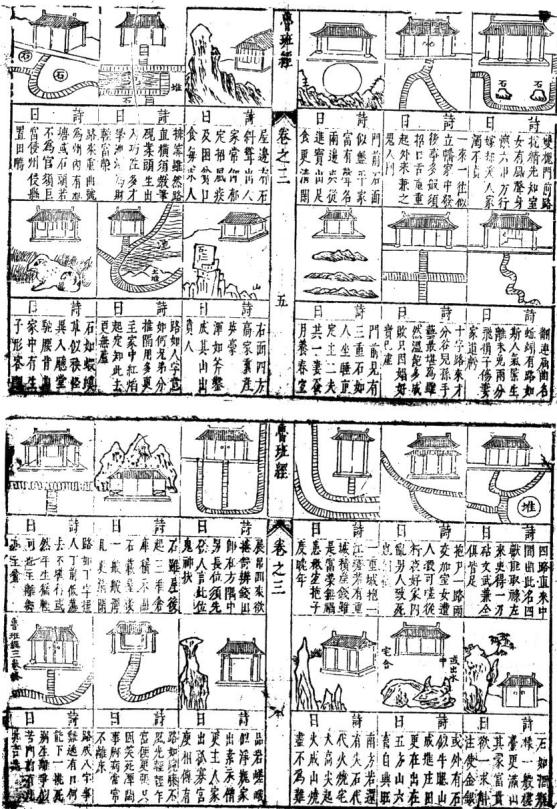

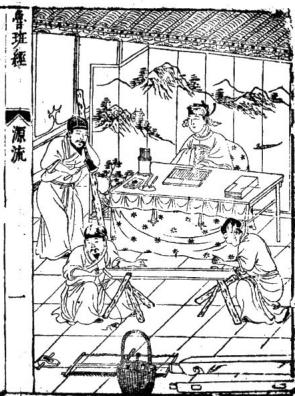

<!-- V3_SOURCE_ID:book005-b000315-p000-53d188015f -->

文中提到，雕刻与刻书的目的在于让中华文物焕然一新。作者曾对人说道：不依靠圆规却能成圆，不依靠矩尺却能成方，这是“水”、“乾”、“坤”、“震”自然呈现的象态。而用圆规画圆、用矩尺画方，则是人为的两种象态所能达到的功能。况且，我的智慧虽然足以穷尽制作的神妙，又怎能保证天下万世的人都能以我的心为心，像我的智慧一样呢？如果别人的智慧不如我，那么我的智慧和技艺也就穷尽了。因此，我凭借韵目之力，再次继之以圆规、矩尺和绳墨，使公私想要经营宫室、制造舟车以及设置器皿以供百姓使用的人，都不超出我一成不变的法则和已经验证的方法。既然如此，那么学习这些道理、利用万物、穷尽制作、并因制作而达至神妙的人，难道不是美好且伟大吗？他的贤配云氏，又是上天授予的一段神巧。所制作的器物固然难以一一列举，但比起老师，大概有更好的地方。内外辅助老师，老师名讳叫班，姓公输，字依智，是鲁国的贤人，胜过路，是东平村人。他的功绩能享太牢之祭而垂不朽。此后每年事迹四十次，又隐于历山。父亲名讳贤，母亲吴氏。老师生于鲁定公三年甲戌年五月初七。在自鹿仙岩至今古迹昭然如睹，所以战国大义赠为。甫七岁嬉戏不学，父母深以为忧。等到十五岁忽然幡然醒悟。永成待诏义士。后三年陈侯加赠智惠法师。历汉唐然从游于子夏之门人端木起，不数月遂妙理融通。宋犹能显踪助国，屡膺封号。我度越时流，愤诸僭称王号，因游说列国，志在尊周。皇明水乐间鼎创北京龙圣殿，役使万匠，莫不震表而计不行，乃归而隐于泰山之南小和山，马晦迹几。赖师降灵指示，方获落成。爰建庙祀之，扁曰鲁班门。一十三年偶出而遇龟老，辈促膝宴谈，竟受业其门。封待诏辅国太师北成侯，春秋二祭，礼用太牢。今之工人凡有祈祷，声不随净随应，恍悬象著明而万古神照者。

> **释读存疑：** 文中关于‘战国大义赠为’的具体所指不详，原文此处语意似乎未完或存在缺漏。；‘马晦迹几’一句含义不明，具体所指不详。；‘水乐’应为‘永乐’之误，但依据规则保留原文‘水乐’。；‘震表’具体含义不详，原文未明。；本地硬校验仍未通过，已记录供后续自动处理或人工核对。

查看对应原文

<!-- V3_FOLDBACK_BEGIN:book005-b000315-p000-53d188015f -->

注意雕鏤刻書欲令中華文物煥爾一新故嘗語人日不規而圓不矩而方此乾坤自然之象也規以爲圓矩以爲方實人官雨象之能也矧吾之明雖足以盡制作之神亦安得必天下萬世咸能師心而如吾明耶明不如吾則吾之明而吾之技亦窮矣爰是韻目力復繼之以規矩繩俾公私欲經營宮室駕造舟車與置設器皿以前民用者要不超吾一成之法巳試之方矣然則師之綠物盡制緣制盡神者顧不良且鉅哉而其淑配雲氏又天授一叚神巧所魯班經 源流 春班經 源流 1魯班仙師源流 制器物固難枚舉第較之於師殆有佳處內外贊襄師諱班姓公輸字依智魯之賢勝路東平村人也其 用能享太名而垂不朽耳裔是年蹟四十復隱于歷父諱賢母吳氏師生於魯定公三年甲成五月初七 山卒遘異人授秘訣雲遊天下白日飛昇止畱斧鋸日午時是日白鶴羣集異香滿室經月弗散人咸奇 在自鹿仙巖迄今古迹昭然如睹故戰國大義贈爲之甫七歲嬉戲不學父母深以爲憂迨十五歲忽幡 永成待詔義士後三年陳侯加贈智惠法師歷漢唐然從遊於子夏之門人端木起不數月遂妙理融通 宋猶能顯蹤助國屢膺 封號我度越時流憤諸僭稱王號因遊說列國志在尊周 皇明水樂間鼎剏北京龍聖殿役使萬匠莫不震錶而計不行廼歸而隱于泰山之南小和山馬晦迹幾 賴師降靈指示方獲洛成爰建廟祀之扁曰魯班門一十三年偶出而遇龜老輩促膝讌譚竟受業其門 封待詔輔國太師北成侯春秋二祭禮用太牢今之

<!-- V3_FOLDBACK_END:book005-b000315-p000-53d188015f -->

<!-- V3_SOURCE_ID:book005-b000316-p000-57a76532dd -->

工匠凡有祈祷，声音不随净随应，恍若悬象著明，而万古神照。

> **释读存疑：** 原文“声不随净随应”语义模糊，可能为OCR错误或古语特殊表达，无法确定确切含义，释读时保留原词结构并做通顺处理，具体所指不详。

查看对应原文

<!-- V3_FOLDBACK_BEGIN:book005-b000316-p000-57a76532dd -->

工人凡有祈禱聲不隨淨隨應恍懸象著明而萬古神照者

<!-- V3_FOLDBACK_END:book005-b000316-p000-57a76532dd -->

