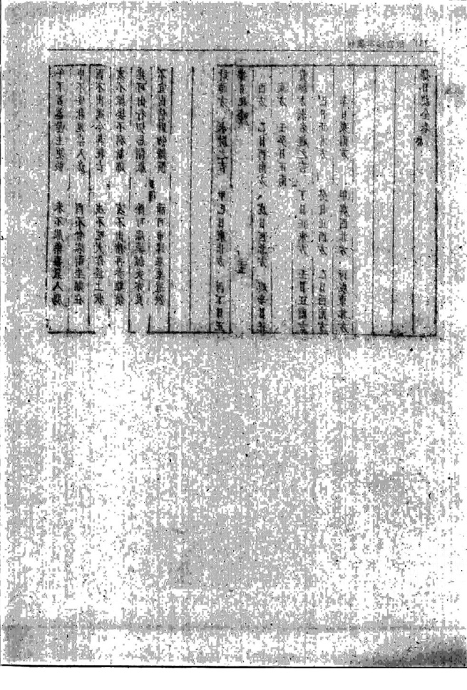

# 选择纪全

> V3 AI 全自动白话释读版。专业术语保留，释读内容可展开核对原文。

> 来源：410.入地眼全书+玉尺经+葬经+鲁班经+选择纪全+秘诀仙机.pdf，PDF 第 323–336 页

<!-- V3_SOURCE_ID:book006-b000002-p000-4c6d828fe2 -->

明代錢塘人胡文煥，字德父，於貞觀元年正月十五日校正此書。

查看对应原文

<!-- V3_FOLDBACK_BEGIN:book006-b000002-p000-4c6d828fe2 -->

明錢塘胡文煥德父校正貞觀元年正月十五日

<!-- V3_FOLDBACK_END:book006-b000002-p000-4c6d828fe2 -->

<!-- V3_SOURCE_ID:book006-b000003-p000-15b816a367 -->

和尚上奏说，百姓设斋的日子遇上凶神，所以出现了灾祸，这难道不是因为没有按照藏经里记载的适合吉神当值的日子行事，才导致这种情况的吗？臣现在从藏经中抄录如来关于吉凶选择的记录上奏。

> **释读存疑：** 1轮自动修复后核义模型仍建议修订，已保守记录。

查看对应原文

<!-- V3_FOLDBACK_BEGIN:book006-b000003-p000-15b816a367 -->

和尚奏萬姓設齋之日值遇凶帝故爲咎者豈是不按藏經內值吉神可用之日所以致此臣今藏經內錄如來選擇紀奏

<!-- V3_FOLDBACK_END:book006-b000003-p000-15b816a367 -->

<!-- V3_SOURCE_ID:book006-b000004-p000-2d11fd65d9 -->

甲子日是善財童子在世檢查齋事的日子，若有人在此日設齋還愿，子孫昌盛、福運生起、招來財運，非常吉利。

查看对应原文

<!-- V3_FOLDBACK_BEGIN:book006-b000004-p000-2d11fd65d9 -->

甲子日是善財童子在世撿齋還愿者子孫昌盛福生招財大吉利

<!-- V3_FOLDBACK_END:book006-b000004-p000-2d11fd65d9 -->

<!-- V3_SOURCE_ID:book006-b000005-p000-9a96447c56 -->

乙丑日、丙寅日是阿羅漢、尊長者與天神下降的日子，若有人在此二日設齋還愿，會獲得萬倍的衣祿與財寶，自然吉祥慶賀，非常吉利。

查看对应原文

<!-- V3_FOLDBACK_BEGIN:book006-b000005-p000-9a96447c56 -->

乙丑丙寅日是阿羅漢尊長者與天神下降有人設齋還愿者萬倍衣祿財寶自然吉慶大吉利

<!-- V3_FOLDBACK_END:book006-b000005-p000-9a96447c56 -->

<!-- V3_SOURCE_ID:book006-b000006-p000-5959ace6b2 -->

丁卯日是司命检查斋事的日子，如果有人在这天祈祷还愿，原本求善的事反而会变成招恶的结果，会妨害家中人口，大凶，应当避讳。

查看对应原文

<!-- V3_FOLDBACK_BEGIN:book006-b000006-p000-5959ace6b2 -->

丁卯日是司命檢齋有人祈禱還愿者返善爲惡妨人口大凶可忌

<!-- V3_FOLDBACK_END:book006-b000006-p000-5959ace6b2 -->

<!-- V3_SOURCE_ID:book006-b000007-p000-87b7b03d29 -->

戊辰日、己巳日是那吒太子检查斋事的日子，如果有人在这两天设醮还福，原本求善的事反而会变成招恶的结果，会妨害家中人口，大凶。

查看对应原文

<!-- V3_FOLDBACK_BEGIN:book006-b000007-p000-87b7b03d29 -->

戊辰巳巳日是那吒太子撿齋若人設醮還福返 善爲惡妨人口大凶

<!-- V3_FOLDBACK_END:book006-b000007-p000-87b7b03d29 -->

<!-- V3_SOURCE_ID:book006-b000008-p000-d2ffd04dd7 -->

庚午日是青衣童子在世间检查斋事的日子，在这天还福的人，会得到万倍的富贵，出现“典旺”的吉兆，大吉。文中提到的“典旺”具体含义不详。

> **释读存疑：** “典旺”具体所指不详

查看对应原文

<!-- V3_FOLDBACK_BEGIN:book006-b000008-p000-d2ffd04dd7 -->

庚午日是青衣童子在世撿齋還福者主萬倍富 貴典旺大吉

<!-- V3_FOLDBACK_END:book006-b000008-p000-d2ffd04dd7 -->

<!-- V3_SOURCE_ID:book006-b000009-p000-ba453c6c76 -->

辛未日是三途饿鬼在世间检查斋事、处理“选愿”相关事务的日子，如果有人在这天“选愿”，到第三年就会破财，损失六畜，大凶。文中提到的“选愿”具体含义不详。

> **释读存疑：** “选愿”具体所指不详

查看对应原文

<!-- V3_FOLDBACK_BEGIN:book006-b000009-p000-ba453c6c76 -->

辛未日是三途餓鬼在世撿齋選愿者至三年破財損六畜大凶

<!-- V3_FOLDBACK_END:book006-b000009-p000-ba453c6c76 -->

<!-- V3_SOURCE_ID:book006-b000010-p000-13b2a4d641 -->

壬申日、癸酉日是判官在世间检查斋事的日子，如果有人在这两天还愿，一年之内会有灾祸，大凶。

查看对应原文

<!-- V3_FOLDBACK_BEGIN:book006-b000010-p000-13b2a4d641 -->

壬申癸酉日是判官在世撿齋還愿者至一年內 有禍大凶

<!-- V3_FOLDBACK_END:book006-b000010-p000-13b2a4d641 -->

<!-- V3_SOURCE_ID:book006-b000011-p000-beb6acc972 -->

甲戌日、乙亥日、丙子日、丁丑日、戊寅日、己卯日這六日，是馬鳴王菩薩檢查齋事的日子，在此日行事可得無量福運，萬事非常吉利。

> **释读存疑：** 原文中“巳卯”疑為“己卯”的訛誤

查看对应原文

<!-- V3_FOLDBACK_BEGIN:book006-b000011-p000-beb6acc972 -->

甲戌乙亥丙子丁丑戊寅巳卯六日是馬鳴王菩薩檢齋得無量福萬事大吉利

<!-- V3_FOLDBACK_END:book006-b000011-p000-beb6acc972 -->

<!-- V3_SOURCE_ID:book006-b000012-p000-a8123a50d5 -->

庚辰日、辛巳日、壬午日，这三日被称作神恶鬼在世的日子，若是在这几日设斋，主有损伤。原文此处有“远择纪全”四字，具体所指不详。

> **释读存疑：** “远择纪全”具体含义无法确定；“远择纪全”具体所指不详

查看对应原文

<!-- V3_FOLDBACK_BEGIN:book006-b000012-p000-a8123a50d5 -->

庚辰辛巳壬午日是稱神惡鬼在世設齋主傷 遠擇紀全

<!-- V3_FOLDBACK_END:book006-b000012-p000-a8123a50d5 -->

<!-- V3_SOURCE_ID:book006-b000013-p000-df0e484727 -->

在癸未日设斋，会导致人口遭遇灾祸、家中常出现血光、火灾类的凶事，一整年都处于大凶的状态。癸未日是野妇罗刹相关的日子，在这一日设斋，主一年内人口破败离散，属于大凶的日子。

> **释读存疑：** 1轮自动修复后核义模型仍建议修订，已保守记录。

查看对应原文

<!-- V3_FOLDBACK_BEGIN:book006-b000013-p000-df0e484727 -->

人口生灾家中常有血光火燭一年大凶癸未日是野婦羅刹設齋主一年內人口破散大凶

<!-- V3_FOLDBACK_END:book006-b000013-p000-df0e484727 -->

<!-- V3_SOURCE_ID:book006-b000014-p000-013995fc21 -->

甲申日、乙酉日、丙戌日这三日，是弥陀佛说法的日子，若是在这几日设斋、迁愿，主三年内能获得万倍的福报，子孙兴耻，龙神获佑，百事都大吉。

> **释读存疑：** “興耻”具体含义无法确定，暂保留原词

查看对应原文

<!-- V3_FOLDBACK_BEGIN:book006-b000014-p000-013995fc21 -->

甲申乙酉丙戍三日是彌陀佛說法之日設齋遷愿者主三年內獲福萬倍子孫興耻龍神獲祐百事大吉

<!-- V3_FOLDBACK_END:book006-b000014-p000-013995fc21 -->

<!-- V3_SOURCE_ID:book006-b000015-p000-de54ef8bb1 -->

丁亥日是朱雀（穴前方的形势称谓）神在世之日，若在此日设斋还愿，会遭遇官非、口舌、疾病之事。

查看对应原文

<!-- V3_FOLDBACK_BEGIN:book006-b000015-p000-de54ef8bb1 -->

丁亥日是朱雀神在世設齋還愿者官灾口舌疾

<!-- V3_FOLDBACK_END:book006-b000015-p000-de54ef8bb1 -->

<!-- V3_SOURCE_ID:book006-b000016-p000-7e7910cb84 -->

戊子日是冥司差派的极忌神在世之日，若在此日设斋还愿，会出现……（此处原文残缺）

> **释读存疑：** 原文“還愿書三”残缺，无法确认完整含义

查看对应原文

<!-- V3_FOLDBACK_BEGIN:book006-b000016-p000-7e7910cb84 -->

戊子日是冥司差極忌神在世設齋還愿書三

<!-- V3_FOLDBACK_END:book006-b000016-p000-7e7910cb84 -->

<!-- V3_SOURCE_ID:book006-b000017-p000-679b82263c -->

在巳丑日设斋的凶兆为当年遭遇官事、口舌是非、疾病，这一日属于大凶之日。巳丑日是司命真君差遣童子在世检斋的日子，若是在这一日还愿，主人口安康，获得无量福报，这一日平安。

> **释读存疑：** 干支“巳丑”不符合传统干支组合规则，疑为原文讹误；“王人口安康”中“王”字含义不明；1轮自动修复后核义模型仍建议修订，已保守记录。

查看对应原文

<!-- V3_FOLDBACK_BEGIN:book006-b000017-p000-679b82263c -->

年遇遭官事口舌是非疾病此日大凶巳丑日是司命真君差童子在世檢齋還愿者王人口安康獲福無量此日平安

<!-- V3_FOLDBACK_END:book006-b000017-p000-679b82263c -->

<!-- V3_SOURCE_ID:book006-b000018-p000-5eaa8dd5bd -->

庚寅日、辛卯日是畜神在世之日，若在此日设斋还愿，会在一年内……

> **释读存疑：** 原文此处残缺，无法确认完整含义

查看对应原文

<!-- V3_FOLDBACK_BEGIN:book006-b000018-p000-5eaa8dd5bd -->

庚寅辛卯日是畜神在世設齋還願者主一年內

<!-- V3_FOLDBACK_END:book006-b000018-p000-5eaa8dd5bd -->

<!-- V3_SOURCE_ID:book006-b000019-p000-c1e15286bc -->

会出现破财损畜、口舌是非之事，是大凶之日。

查看对应原文

<!-- V3_FOLDBACK_BEGIN:book006-b000019-p000-c1e15286bc -->

破財損畜是非大凶

<!-- V3_FOLDBACK_END:book006-b000019-p000-c1e15286bc -->

<!-- V3_SOURCE_ID:book006-b000020-p000-4d8c6333ec -->

壬辰日是阿难尊者与青衣童子在世之日，若在此日设斋还愿，会使子孙昌盛，获得无量福报，三年内大吉大利。

查看对应原文

<!-- V3_FOLDBACK_BEGIN:book006-b000020-p000-4d8c6333ec -->

壬辰日是阿難尊者與青衣童子在世設齋還願者主子孫昌盛獲福無量三年大吉利

<!-- V3_FOLDBACK_END:book006-b000020-p000-4d8c6333ec -->

<!-- V3_SOURCE_ID:book006-b000021-p000-a362b15749 -->

癸巳日是恶神游行之日，若在此日设斋还愿，会导致年年不利，是大凶之日。

查看对应原文

<!-- V3_FOLDBACK_BEGIN:book006-b000021-p000-a362b15749 -->

癸巳日是惡神遊行設齋還愿者王年年不利大 凶

<!-- V3_FOLDBACK_END:book006-b000021-p000-a362b15749 -->

三

<!-- V3_SOURCE_ID:book006-b000023-p000-e99c292a4a -->

甲午、乙未、丙申、丁酉、戊戌、己亥、庚子、辛丑这八日，是文殊、普贤与青衣童子在世的日子，在此期间检斋还愿的人，会获得无量福德，百事大吉。

查看对应原文

<!-- V3_FOLDBACK_BEGIN:book006-b000023-p000-e99c292a4a -->

甲午乙未丙申丁酉戊戌巳亥庚子辛丑八日是文殊普賢與青衣童子在世檢齋還願者此且獲福無量百事大吉

<!-- V3_FOLDBACK_END:book006-b000023-p000-e99c292a4a -->

<!-- V3_SOURCE_ID:book006-b000024-p000-2151cd0a7f -->

壬寅、癸卯两日，是观音菩萨行化的日子，在这两天设斋还愿的人，王兄、孙辈都能得福，后世往生净土，生下的男子十相俱足。

查看对应原文

<!-- V3_FOLDBACK_BEGIN:book006-b000024-p000-2151cd0a7f -->

壬寅癸卯日是觀音菩薩行化之日設齋還愿者 王兄孫得福後世生淨土所生男子十相俱足

<!-- V3_FOLDBACK_END:book006-b000024-p000-2151cd0a7f -->

<!-- V3_SOURCE_ID:book006-b000025-p000-5425830bfd -->

甲辰、乙巳两日，县入下四角大神在世，在这两天检斋还愿的人，反而会善变为恶，家眷遭遇灾祸，属于大凶的日子。

> **释读存疑：** “县入下四角大神”具体所指不详；1轮自动修复后核义模型仍建议修订，已保守记录。

查看对应原文

<!-- V3_FOLDBACK_BEGIN:book006-b000025-p000-5425830bfd -->

甲辰乙巳日县入下四角大神在世檢齋還愿者 返善爲惡人眷生灾大凶

<!-- V3_FOLDBACK_END:book006-b000025-p000-5425830bfd -->

<!-- V3_SOURCE_ID:book006-b000026-p000-ba23a3bfea -->

丙午、丁未两日，是牛头夜乂在世，在此期间检斋还愿的人，（此处原文未说完）。

> **释读存疑：** 原文内容残缺，未完整表述

查看对应原文

<!-- V3_FOLDBACK_BEGIN:book006-b000026-p000-ba23a3bfea -->

丙午丁未日是牛頭夜乂在世檢齋還願者人子

<!-- V3_FOLDBACK_END:book006-b000026-p000-ba23a3bfea -->

<!-- V3_SOURCE_ID:book006-b000027-p000-3854877a31 -->

信用者三年内伤人之日，这一天大凶。戊申、巳酉两日，是千佛下世的日子，在这两天设斋酬恩了愿的人，能获得加倍的福利，子孙昌盛，财物兴旺，六畜繁殖，大吉。庚戌、辛亥两日，是一切贤圣一同降临、巡游天下的日子，如果有人在这两天祈福，能获得无量的福报，大吉。

> **释读存疑：** 开头“信用者三年內傷人日”具体含义不详；1轮自动修复后核义模型仍建议修订，已保守记录。

查看对应原文

<!-- V3_FOLDBACK_BEGIN:book006-b000027-p000-3854877a31 -->

信用者三年內傷人日此日大凶戊申巳酉日是千佛下世設齋酬恩了願福利倍子孫昌盛財物興旺六畜孳生大吉庚戌辛亥日是一切賢聖同降遊行天下若人祈福者獲福無量大吉

<!-- V3_FOLDBACK_END:book006-b000027-p000-3854877a31 -->

<!-- V3_SOURCE_ID:book006-b000028-p000-dcaa05bdc1 -->

壬子、癸丑、甲寅、乙卯四日，是诸佛贤圣同恶树的日子，在此期间设斋的人，当日运势平平。

> **释读存疑：** 同恶树具体所指不详

查看对应原文

<!-- V3_FOLDBACK_BEGIN:book006-b000028-p000-dcaa05bdc1 -->

壬子癸丑甲寅乙卯四日是諸佛賢聖同惡樹設齋者此日平平

<!-- V3_FOLDBACK_END:book006-b000028-p000-dcaa05bdc1 -->

<!-- V3_SOURCE_ID:book006-b000029-p000-bd8400d52f -->

丙辰、丁巳两日，是大头金刚在世的日子，在这两天设斋的人，当日大凶。戊午日，是诸位圣人不接受愿心、心意不明的日子，当日大凶。

> **释读存疑：** 1轮自动修复后核义模型仍建议修订，已保守记录。

查看对应原文

<!-- V3_FOLDBACK_BEGIN:book006-b000029-p000-bd8400d52f -->

丙辰丁巳日是大頭金剛在世設齋者此日大凶 戊午日是諸聖不受愿心不明此日大凶

<!-- V3_FOLDBACK_END:book006-b000029-p000-bd8400d52f -->

<!-- V3_SOURCE_ID:book006-b000030-p000-abd06a142c -->

己未日，是释迦如来同菩萨在世，设斋酬恩的人，所获利益无量，大吉。

> **释读存疑：** 原文作"巳未"，干支中无巳未，疑为OCR讹误，暂按己未处理

查看对应原文

<!-- V3_FOLDBACK_BEGIN:book006-b000030-p000-abd06a142c -->

巳未日是釋迦如來同菩薩在世設齋酬恩者禮 利無量大吉

<!-- V3_FOLDBACK_END:book006-b000030-p000-abd06a142c -->

<!-- V3_SOURCE_ID:book006-b000031-p000-f8ec378268 -->

庚申、辛酉两日，是释迦如来说法的日子，设斋酬恩的人，福利无量，家宅富贵兴旺，子孙昌盛，主大古利。

> **释读存疑：** 大古利具体所指不详

查看对应原文

<!-- V3_FOLDBACK_BEGIN:book006-b000031-p000-f8ec378268 -->

庚申辛酉日是釋迦如來說法之日設齋酬恩者福利無量家宅富貴興旺子孫昌盛主大古利

<!-- V3_FOLDBACK_END:book006-b000031-p000-f8ec378268 -->

<!-- V3_SOURCE_ID:book006-b000032-p000-dbded8099b -->

壬戌、癸亥两日，是诸佛不检斋的日子，大凶。听闻《皇极玉记》秘藏在大有之庭，出自太虚玉匣之内，从真君许开始才有相关的创立记载，选择相关的纪文被藏在西上宝塔之上，从三藏贞观初年才现世。内容分二教建善之文，二多巳巳、庚午、辛未、壬申、甲戌、乙亥、戊寅、巳卯、壬午、甲申、乙酉、戊子、甲午、乙未、丙申、壬寅、丙午、丁未、戊申、巳酉、甲寅、乙卯、巳未、庚申、辛酉，定、成、开日需要忌讳：刀砧、柔斧头、杀龙、虎受死、天贼、月破、危日、山九、土鬼、正四废、魁罡日，竹木不蛙。

> **释读存疑：** “信用者三年内伤人日”具体含义不明；“二多巳巳”具体含义不明；“竹木不蛙”具体含义不明；“二多巳巳”具体所指不详；“竹木不蛙”具体含义不详；1轮自动修复后核义模型仍建议修订，已保守记录。

查看对应原文

<!-- V3_FOLDBACK_BEGIN:book006-b000032-p000-dbded8099b -->

王戍癸亥日是諸佛不撿齋之日大凶 聞皇極玉記秘於大有之庭出自太虛玉匣之 內自眞君許始有立焉選擇紀者藏於西上寶 塔之上自三藏貞觀初現此分二教建善之文 二多巳巳庚午辛未壬申甲戌乙亥戊寅巳卯壬午 甲申乙酉戊子甲午乙未丙申壬寅丙午丁未戊 申巳酉甲寅乙卯巳未庚申辛酉定成開 忌刀砧柔斧頭殺龍虎受死天賊月破危日山 九土鬼正四廢魁罡日 竹木不蛙

<!-- V3_FOLDBACK_END:book006-b000032-p000-dbded8099b -->

<!-- V3_SOURCE_ID:book006-b000034-p000-a6a30ba5cf -->

之亥、甲辰、壬辰、丙辰这几日，以及每月初五的巳时之前，遇上忌日时不宜修建宫室。

> **释读存疑：** “之亥”作为日期表述，具体所指未明

查看对应原文

<!-- V3_FOLDBACK_BEGIN:book006-b000034-p000-a6a30ba5cf -->

之亥甲辰壬辰丙辰每月初五巳前遇忌日建宮室

<!-- V3_FOLDBACK_END:book006-b000034-p000-a6a30ba5cf -->

<!-- V3_SOURCE_ID:book006-b000035-p000-fc384e909c -->

与起造、同安、明堂、玉堂、黄道、大明、三帝星及五帝相关的择日，无需全部避讳。

> **释读存疑：** “同安”具体所指未明；“免全”具体含义未明；1轮自动修复后核义模型仍建议修订，已保守记录。

查看对应原文

<!-- V3_FOLDBACK_BEGIN:book006-b000035-p000-fc384e909c -->

與起造同安明堂玉堂黃道大明三帝星及五帝擇日免全

<!-- V3_FOLDBACK_END:book006-b000035-p000-fc384e909c -->

<!-- V3_SOURCE_ID:book006-b000036-p000-5f54f71832 -->

生日忌天灾、天火、地火、雷火、月火、独火、火星、魁星。

查看对应原文

<!-- V3_FOLDBACK_BEGIN:book006-b000036-p000-5f54f71832 -->

生日忌天灾天火地火雷火月火獨火火星魁星

<!-- V3_FOLDBACK_END:book006-b000036-p000-5f54f71832 -->

<!-- V3_SOURCE_ID:book006-b000037-p000-4d78c83aee -->

修建神庙。

查看对应原文

<!-- V3_FOLDBACK_BEGIN:book006-b000037-p000-4d78c83aee -->

建神廟

<!-- V3_FOLDBACK_END:book006-b000037-p000-4d78c83aee -->

<!-- V3_SOURCE_ID:book006-b000038-p000-7e1231c847 -->

不论金华塔台的建造年月如何，相关要求都和普通起造相同，只是要注意“神在忌神鬼隔”的规定。桑门寺院的相关规则也和上面一致。自汉代创建马寺开始，才出现佛庙，当时佛庙朝向都是东；梁、唐两代之后，佛庙大多朝向北，忌朝向南方动工、破木。

> **释读存疑：** “神在忌神鬼隔”的具体含义未明，“马寺”所指未明；“神在忌神鬼隔”的具体含义未明；1轮自动修复后核义模型仍建议修订，已保守记录。

查看对应原文

<!-- V3_FOLDBACK_BEGIN:book006-b000038-p000-7e1231c847 -->

不論金華塔臺年月只與起造同但要神在忌神鬼隔 桑門寺院同自漢創自馬寺始有佛廟皆向東梁唐之後多向北忌向南方起工破木

<!-- V3_FOLDBACK_END:book006-b000038-p000-7e1231c847 -->

<!-- V3_SOURCE_ID:book006-b000039-p000-75098a6b5e -->

宏巳、巳甲、戊辛、未乙亥、戊寅巳卯、壬午甲申、乙一戊子、庚寅乙未、巳亥壬寅、癸卯丙午、戊卯巳酉、乙卯巳未、庚申辛酉这些日子，属于黄道天成、月空、天月二厘及合成的开日。

> **释读存疑：** 部分干支组合含义不明，具体所指不详

查看对应原文

<!-- V3_FOLDBACK_BEGIN:book006-b000039-p000-75098a6b5e -->

宏巳巳甲戊辛未乙亥戊寅巳卯壬午甲申乙一戊子庚寅乙未巳亥壬寅癸卯丙午戊卯巳酉于乙卯巳未庚申辛酉黃道天成月空天月二釐及合成開日

<!-- V3_FOLDBACK_END:book006-b000039-p000-75098a6b5e -->

<!-- V3_SOURCE_ID:book006-b000040-p000-763982a6d5 -->

忌刀砧杀、木马杀、斧头杀、天贼、受死、月破、被败、独火、鲁般杀、建日、九土鬼、正四废、四离、四绝日，忌起桑扇架。

查看对应原文

<!-- V3_FOLDBACK_BEGIN:book006-b000040-p000-763982a6d5 -->

忌刀砧殺木馬殺斧頭殺天賊受死月破被敗獨 火魯般殺建日九土鬼正四廢四離四絕日 起桑扇架

<!-- V3_FOLDBACK_END:book006-b000040-p000-763982a6d5 -->

<!-- V3_SOURCE_ID:book006-b000041-p000-3e18242ed8 -->

空甲包括乙丑、丙寅、戊辰、己巳、庚午、辛未、甲戌、乙亥、戊寅、庚辰、辛巳、壬午、癸未、甲申、丁亥、戊子、己丑、庚寅、癸巳、乙未、丁酉、戊戌、己亥、庚子、壬寅、癸卯、丙午、戊申、己酉、壬子、癸丑、甲寅、乙卯、丙辰、丁巳、己未这些日子，属于渡日绝全。

> **释读存疑：** “空甲”、“渡日绝全”的具体含义未明

查看对应原文

<!-- V3_FOLDBACK_BEGIN:book006-b000041-p000-3e18242ed8 -->

空甲于乙丑丙寅戊辰巳巳庚午辛未甲戌乙亥 戌寅庚辰辛巳壬午癸未甲申丁亥戊子巳丑庚 寅癸巳乙未丁酉戊戌巳亥庚子壬寅癸卯丙午 戊申巳酉壬子癸丑甲寅乙卯丙辰丁巳巳未渡 日絕全

<!-- V3_FOLDBACK_END:book006-b000041-p000-3e18242ed8 -->

<!-- V3_SOURCE_ID:book006-b000042-p000-5e9bdbca9b -->

申辛酉这些日子属于黄道天月二德成开定日，忌正四废、天贼、建日、破日。

> **释读存疑：** 部分干支组合含义不明，具体所指不详

查看对应原文

<!-- V3_FOLDBACK_BEGIN:book006-b000042-p000-5e9bdbca9b -->

申辛酉黃道天月二德成開定日忌正四廢天賊建日破日

<!-- V3_FOLDBACK_END:book006-b000042-p000-5e9bdbca9b -->

<!-- V3_SOURCE_ID:book006-b000043-p000-7bce777a0c -->

属于空亡范畴的干支分别有乙巳、辛丑、甲寅、乙亥、乙酉、巳酉、壬子、乙丑、巳未、庚山戊下、乙未、巳亥、巳卯、甲申、巳丑、庚寅、癸卯、戌。

> **释读存疑：** 庚山戊下的具体含义不详

查看对应原文

<!-- V3_FOLDBACK_BEGIN:book006-b000043-p000-7bce777a0c -->

空乙巳辛丑甲寅乙亥乙酉巳酉壬子乙丑巳未庚山戊下乙未巳亥巳卯甲申巳丑庚寅癸卯戌

<!-- V3_FOLDBACK_END:book006-b000043-p000-7bce777a0c -->

<!-- V3_SOURCE_ID:book006-b000044-p000-372a557cd6 -->

这部分罗列的适宜择用的日期包括空甲子、乙丑、丁卯、戊辰、巳巳、庚午、辛未、壬申、甲戌、丙子、戊寅、庚辰、壬午、甲申、丙戌、戊子、庚寅、甲午、丙申、丁酉、戊巳、巳亥、庚子、辛丑、壬寅、癸卯、乙巳、丁未、巳酉、辛亥、丑、乙卯、丁巳、巳未、辛酉、癸亥，还有黄道、天德、月德等诸多巨星成开日。前面两类日期都要避开以下神煞和凶日：朱雀、黑天牢、黑独火、天火、月火、狼藉地火、冰消、羗天、天瘟、天贼、月破、大耗、天罡、河魁、受死、鲁船杀、刀砧杀、刬削血刃杀、鲁班跌蹼杀、阴错、阳错、伏断、九土鬼、正四废、五行忌、月建、转杀、火星、天灾日。

> **释读存疑：** 1轮自动修复后核义模型仍建议修订，已保守记录。

查看对应原文

<!-- V3_FOLDBACK_BEGIN:book006-b000044-p000-372a557cd6 -->

空甲子乙丑丁卯戊辰巳巳庚午辛未壬申甲戌丙子戊寅庚辰壬午甲申丙戌戊子庚寅甲午丙申丁酉戊戊巳亥庚子辛丑壬寅癸卯乙巳丁未巳酉辛亥丑乙卯丁巳巳未辛酉癸亥黃道天月二德諸巨星成開日 前二條忌朱雀黑天牢黑獨火天火月火狼藉地火氷消羗天瘟天賊月破大耗天罡河魁受死魯船殺刀砧殺剗削血刃殺魯般跌蹼殺陰錯陽錯伏斷九土鬼正四廢五行忌月建轉殺火星天灾日

<!-- V3_FOLDBACK_END:book006-b000044-p000-372a557cd6 -->

<!-- V3_SOURCE_ID:book006-b000045-p000-dd3b3cca7a -->

宏甲子、丁卯、戊辰、巳巳、辛未、壬申、癸酉、丙子、丁丑，日紀全，九。

查看对应原文

<!-- V3_FOLDBACK_BEGIN:book006-b000045-p000-dd3b3cca7a -->

宏甲子丁卯戊辰巳巳辛未壬申癸酉丙子丁丑 日紀全 九

<!-- V3_FOLDBACK_END:book006-b000045-p000-dd3b3cca7a -->

<!-- V3_SOURCE_ID:book006-b000046-p000-5c327ac554 -->

巳卯、庚辰、癸未、甲申、乙酉、丙戌、戊子、庚寅、丁酉、癸巳、乙未、巳亥、辛丑、壬寅、癸卯、甲辰、乙巳、戊申、巳酉、庚戌、辛亥、癸丑、乙卯、丙辰、庚申、辛酉，定成開日，泥尾。

查看对应原文

<!-- V3_FOLDBACK_BEGIN:book006-b000046-p000-5c327ac554 -->

巳卯庚辰癸未甲申乙酉丙戌戊子庚寅丁酉癸 巳乙未巳亥辛丑壬寅癸卯甲辰乙巳戊申巳酉 庚戌辛亥癸丑乙卯丙辰庚申辛酉定成開日 泥尾

<!-- V3_FOLDBACK_END:book006-b000046-p000-5c327ac554 -->

<!-- V3_SOURCE_ID:book006-b000047-p000-009dc8a2cd -->

空甲子、乙丑、巳巳、甲戌、丁丑、庚辰、辛巳、乙酉、辛亥、庚寅、辛卯、壬辰、癸巳、甲午、乙未、丙午、戊申、庚戌、辛亥、丙辰、丁巳、戊午、庚申，平成日。

查看对应原文

<!-- V3_FOLDBACK_BEGIN:book006-b000047-p000-009dc8a2cd -->

空甲子乙丑巳巳甲戌丁丑庚辰辛巳乙酉辛亥庚寅辛卯壬辰癸巳甲午乙未丙午戊申庚戌辛亥丙辰丁巳戊午庚申平成日

<!-- V3_FOLDBACK_END:book006-b000047-p000-009dc8a2cd -->

<!-- V3_SOURCE_ID:book006-b000048-p000-1531c10cb8 -->

此处罗列的干支为室、甲子、乙、五內寅、戊辰、巳巳、辛未、癸酉、甲戌、丁丑。

> **释读存疑：** “乙”“五內”的具体所指原文未明，干支序列存在脱漏讹误；1轮自动修复后核义模型仍建议修订，已保守记录。

查看对应原文

<!-- V3_FOLDBACK_BEGIN:book006-b000048-p000-1531c10cb8 -->

室甲子乙五內寅戊辰巳巳辛未癸酉甲成丁丑

<!-- V3_FOLDBACK_END:book006-b000048-p000-1531c10cb8 -->

<!-- V3_SOURCE_ID:book006-b000049-p000-9a5bc60596 -->

这段内容介绍了一种计数规则：开头记有五个“人”字，天月的计数要从下往上数，顺序是逆行的；小月的计数要从上往下数，顺序是顺行的。每天对应一个位置，如果遇到带自圈标记的位置，就属于大吉的情况。如果遇到黑闾对应的位置，会出现损伤六畜的情况；如果遇到人字对应的位置，会出现损伤人口的情况，属于不利的情形。这部分内容还提到需要忌讳庚寅门、大夫死日，以及六甲胎神占月的情况，这类月份不空，不适宜进行修造和乘门相关的事宜。

> **释读存疑：** “黑闾”的具体含义无法完全确定；“自圈”的具体标记样式、“乘门”的具体所指均没有明确说明；1轮自动修复后核义模型仍建议修订，已保守记录。

查看对应原文

<!-- V3_FOLDBACK_BEGIN:book006-b000049-p000-9a5bc60596 -->

人人人人人天月從下數至上逆行小月從上數至下順行日一位遇自圈大吉黑閭損六畜人字損人不利忌庚寅門大夫死日及六甲胎神占月不空修乘門

<!-- V3_FOLDBACK_END:book006-b000049-p000-9a5bc60596 -->

<!-- V3_SOURCE_ID:book006-b000050-p000-8e281d34e5 -->

空伏斷閉日，忌丙寅、巳巳、庚午、丁巳及四廢日開路。

查看对应原文

<!-- V3_FOLDBACK_BEGIN:book006-b000050-p000-8e281d34e5 -->

空伏斷閉日忌丙寅巳巳庚午丁巳及四廢日開路

<!-- V3_FOLDBACK_END:book006-b000050-p000-8e281d34e5 -->

<!-- V3_SOURCE_ID:book006-b000051-p000-7d989f23b2 -->

一天德、月德、黃道、月忌、月建、轉殺、天賊、正四廢、塞路、空伏斷閉，且。

> **释读存疑：** 原句末尾存在缺字，内容难以完全确认

查看对应原文

<!-- V3_FOLDBACK_BEGIN:book006-b000051-p000-7d989f23b2 -->

一天德月德黃道月忌月建轉殺天賊正四廢塞路空伏斷閉且

<!-- V3_FOLDBACK_END:book006-b000051-p000-7d989f23b2 -->

<!-- V3_SOURCE_ID:book006-b000052-p000-06035fdb94 -->

修筑堤坝堵塞普通水体的时候，空伏、断闭这类日子是禁忌的，同时还要避开龙会、开破月份；原文还提及“造橋染”，其中“染”字疑似存在讹误，具体含义不详。

> **释读存疑：** “造橋染”中的“染”字疑似讹误，具体所指不详

查看对应原文

<!-- V3_FOLDBACK_BEGIN:book006-b000052-p000-06035fdb94 -->

案堤塞水空伏斷閉日忌龍會開破月 造橋染

<!-- V3_FOLDBACK_END:book006-b000052-p000-06035fdb94 -->

<!-- V3_SOURCE_ID:book006-b000053-p000-cabd6a5641 -->

不論金華、臺塔年月，只與起造宅舍同忌，寅申巳亥日時爲四絕、四井。

查看对应原文

<!-- V3_FOLDBACK_BEGIN:book006-b000053-p000-cabd6a5641 -->

不論金華臺塔年月只與起造宅舍同忌寅申巳亥日時爲四絕四井

<!-- V3_FOLDBACK_END:book006-b000053-p000-cabd6a5641 -->

<!-- V3_SOURCE_ID:book006-b000054-p000-fdec988d4c -->

空、上吉、黄道、大明、要安、续世、益后、天月二德、金天、成天廟、咸勲、福厚、吉期、普護、守成兵、吉兵、寶这些条目，适用於建造仓库。

> **释读存疑：** 1轮自动修复后核义模型仍建议修订，已保守记录。

查看对应原文

<!-- V3_FOLDBACK_BEGIN:book006-b000054-p000-fdec988d4c -->

空上吉黃道大明要安續世益後天月二德及金天成天廟咸勲福厚吉期普護守成兵吉兵寶造倉庫

<!-- V3_FOLDBACK_END:book006-b000054-p000-fdec988d4c -->

<!-- V3_SOURCE_ID:book006-b000055-p000-af80e7c919 -->

室、丙寅、丁卯、庚午、巳卯、壬午、癸未、庚寅、甲午、乙未

查看对应原文

<!-- V3_FOLDBACK_BEGIN:book006-b000055-p000-af80e7c919 -->

室丙寅丁卯庚午巳卯壬午癸未庚寅甲午乙未

<!-- V3_FOLDBACK_END:book006-b000055-p000-af80e7c919 -->

<!-- V3_SOURCE_ID:book006-b000056-p000-3c5ab4dcb0 -->

癸卯、戊午、巳未、癸丑属于满成开日。前三條俱邑，忌朱雀、黑天牢、黑天火、狼藉、独火、月火、九空、空亡、财离、岁空、死炁、官符、月破、大小耗、天贼、天瘟、受死、水消瓦解、月建转杀、月虚、月杀、四耗、阴阳错、地火伏断、正四废、火星、十恶、天地离、九土鬼、大杀入塞、鼠宄。

> **释读存疑：** 前三條俱邑的具体含义不详；1轮自动修复后核义模型仍建议修订，已保守记录。

查看对应原文

<!-- V3_FOLDBACK_BEGIN:book006-b000056-p000-3c5ab4dcb0 -->

癸卯戊午巳未癸丑滿成開日 前三條俱邑 朱雀黑天牢黑天火狼藉獨火月火九空空亡財 離歲空死炁官符月破大小耗天賊天瘟受死水 消瓦解月建轉殺月虛月殺四耗陰陽錯地火伏 斷正四廢火星十惡天地離九土鬼大殺入 塞鼠宄

<!-- V3_FOLDBACK_END:book006-b000056-p000-3c5ab4dcb0 -->

<!-- V3_SOURCE_ID:book006-b000057-p000-5d2822e31e -->

室、壬辰、庚寅属于满闭日，正月上辰是鼠死日、克天狗日，适用于造厨。

查看对应原文

<!-- V3_FOLDBACK_BEGIN:book006-b000057-p000-5d2822e31e -->

室壬辰庚寅滿閉日正月上辰鼠死日克天狗日 造厨

<!-- V3_FOLDBACK_END:book006-b000057-p000-5d2822e31e -->

<!-- V3_SOURCE_ID:book006-b000058-p000-a27c4f9edc -->

空、丙寅、巳巳、辛未、戊寅、甲申、戊申、甲寅、乙卯、巳未，捧日紀全

查看对应原文

<!-- V3_FOLDBACK_BEGIN:book006-b000058-p000-a27c4f9edc -->

空丙寅巳巳辛未戊寅甲申戊申甲寅乙卯巳未 捧日紀全

<!-- V3_FOLDBACK_END:book006-b000058-p000-a27c4f9edc -->

<!-- V3_SOURCE_ID:book006-b000059-p000-9df3c716d8 -->

庚申

查看对应原文

<!-- V3_FOLDBACK_BEGIN:book006-b000059-p000-9df3c716d8 -->

庚申

<!-- V3_FOLDBACK_END:book006-b000059-p000-9df3c716d8 -->

<!-- V3_SOURCE_ID:book006-b000060-p000-ff0eda2541 -->

空、甲子、乙丑、巳巳、庚午、辛未、癸酉、甲戌、乙亥、癸未、甲申、壬辰、乙未、辛亥、癸丑、甲寅、乙卯、巳未、庚申，属于黄道、天赦、月空、正阳、五祥定成开日。前面两项所指的时日，忌讳碰到朱雀、黑天气、土瘟、天贼、受死、天丈、独火、十恶、四部转杀、九土鬼、正四废、建破、丙丁午日这类神煞或不利的日子；每月的初七、十五、二十七日，不可以进行移动类的事宜；每月的初八、十六、十七日，以及六甲胎神占月的时段，忌讳拆灶、进行修理作业。

> **释读存疑：** 本地硬校验仍未通过，已记录供后续自动处理或人工核对。

查看对应原文

<!-- V3_FOLDBACK_BEGIN:book006-b000060-p000-ff0eda2541 -->

空甲子乙丑巳巳庚午辛未癸酉甲戌乙亥癸未甲申壬辰乙未辛亥癸丑甲寅乙卯巳未庚申黃道天赦月空正陽五祥定成開日前二條忌朱雀黑天氣土瘟天賊受死天丈獨火十惡四部轉殺九土鬼正四廢建破丙丁午日每月初七十五廿七不可移動每月初八十六十七日及六甲胎神占月忌拆竈修理

<!-- V3_FOLDBACK_END:book006-b000060-p000-ff0eda2541 -->

<!-- V3_SOURCE_ID:book006-b000061-p000-5a49d3f587 -->

戊寅、巳卯、癸未、甲申、壬辰、癸巳、甲午、乙未、巳亥、辛丑、癸卯、巳酉、庚戍、辛亥、癸丑、丙辰、丁巳、庚申、辛酉属于余日。前三类都忌讳朱雀、黑天火等火、天瘤、火星、天贼、月破、受死、毕元、九土鬼、八风、正四废、转杀、午日、丁巳日。

> **释读存疑：** 1轮自动修复后核义模型仍建议修订，已保守记录。

查看对应原文

<!-- V3_FOLDBACK_BEGIN:book006-b000061-p000-5a49d3f587 -->

戊寅巳卯癸未甲申壬辰癸巳甲午乙未巳亥辛丑癸卯巳酉庚戍辛亥癸丑丙辰丁巳庚申辛酉餘日 前三條俱忌朱雀黑天火等火天瘤火星天賊月破受死畢元九土見八風正四廢轉殺午日丁巳日

<!-- V3_FOLDBACK_END:book006-b000061-p000-5a49d3f587 -->

<!-- V3_SOURCE_ID:book006-b000062-p000-3a1ebefcc0 -->

打扫房舍适宜选用空日、除日、满日。

查看对应原文

<!-- V3_FOLDBACK_BEGIN:book006-b000062-p000-3a1ebefcc0 -->

掃舍空除滿日

<!-- V3_FOLDBACK_END:book006-b000062-p000-3a1ebefcc0 -->

<!-- V3_SOURCE_ID:book006-b000063-p000-a6b3858bad -->

空、壬子、癸丑、丙辰、丁巳、戊午、巳未、庚申、辛酉，報日紀全，主

查看对应原文

<!-- V3_FOLDBACK_BEGIN:book006-b000063-p000-a6b3858bad -->

空壬子癸丑丙辰丁巳戊午巳未庚申辛酉報日紀全 主

<!-- V3_FOLDBACK_END:book006-b000063-p000-a6b3858bad -->

<!-- V3_SOURCE_ID:book006-b000064-p000-84b1e15689 -->

自巳日起算的第八日是凶神朝天的日子，适合饼工从事造作、修理事务，优先建造门户。

> **释读存疑：** 1轮自动修复后核义模型仍建议修订，已保守记录。

查看对应原文

<!-- V3_FOLDBACK_BEGIN:book006-b000064-p000-84b1e15689 -->

巳上八日凶神朝天可餅工造作修理優造門

<!-- V3_FOLDBACK_END:book006-b000064-p000-84b1e15689 -->

<!-- V3_SOURCE_ID:book006-b000065-p000-e650dd68d1 -->

室宿对应的甲子、乙丑、辛未、癸酉、甲戌、壬午、甲申、乙酉、戊子、己丑、辛卯、癸巳、乙未、己亥、庚子、壬寅、戊申、壬子、甲寅、丙辰、戊午这些日子，属于黄道、生气、天月德及合、蒲、成日，是建造门户的适宜日期。

> **释读存疑：** “蒲”具体所指不详；“蒲成日”具体所指不详；1轮自动修复后核义模型仍建议修订，已保守记录。

查看对应原文

<!-- V3_FOLDBACK_BEGIN:book006-b000065-p000-e650dd68d1 -->

室甲子乙丑辛未癸酉甲戌壬午甲申乙酉戊子巳丑辛卯癸巳乙未巳亥庚子壬寅戊申壬子甲寅丙辰戊午黃道生氣天月德及合蒲成日作門忌日

<!-- V3_FOLDBACK_END:book006-b000065-p000-e650dd68d1 -->

<!-- V3_SOURCE_ID:book006-b000066-p000-231a8034a6 -->

春季不可修东门，夏季不可修南门，秋季不可修西门，冬季不可修北门，与修门的禁忌规则相同。

查看对应原文

<!-- V3_FOLDBACK_BEGIN:book006-b000066-p000-231a8034a6 -->

春不作東門夏不作南門秋不作酉門冬不作北門與修門同

<!-- V3_FOLDBACK_END:book006-b000066-p000-231a8034a6 -->

<!-- V3_SOURCE_ID:book006-b000067-p000-0ead003765 -->

文中提到“归钊龟立”，具体所指不详；在壬癸月以及水月，修建水廨方，对应天蜂地哑日。

> **释读存疑：** “归钊龟立”具体所指不详；“水廨方”具体所指不详；“天蜂地哑日”具体所指不详

查看对应原文

<!-- V3_FOLDBACK_BEGIN:book006-b000067-p000-0ead003765 -->

歸釗龜立壬癸月及水月修水廨方天蜂地啞日

<!-- V3_FOLDBACK_END:book006-b000067-p000-0ead003765 -->

<!-- V3_SOURCE_ID:book006-b000068-p000-3f6c1b92a3 -->

每月的巳、午、未日为禁忌日期；三月里没有牛的人家不可以砌花台，相关规则和动土日的要求相同；逢空的水木日，禁忌在金土日进行相关作业。

> **释读存疑：** “空水木日”的具体规则不详；1轮自动修复后核义模型仍建议修订，已保守记录。

查看对应原文

<!-- V3_FOLDBACK_BEGIN:book006-b000068-p000-3f6c1b92a3 -->

忌每月巳午未日及三月無牛之家不砌花臺 與動土日同 空水木日 忌金土日作

<!-- V3_FOLDBACK_END:book006-b000068-p000-3f6c1b92a3 -->

<!-- V3_SOURCE_ID:book006-b000069-p000-c190356bbc -->

逢空的庚辰、丙戌、癸巳、壬子、己未之日，属于天乙绝气伏断上阅的禁忌日期，其中“上阅”具体所指不详，正月二十九日属于这类禁忌时间。

> **释读存疑：** “上阅”具体所指不详；“天乙绝气伏断”具体规则不详；1轮自动修复后核义模型仍建议修订，已保守记录。

查看对应原文

<!-- V3_FOLDBACK_BEGIN:book006-b000069-p000-c190356bbc -->

空庚辰丙戍癸巳壬子巳未天乙絕氣伏斷上閱忌正月廿九日

<!-- V3_FOLDBACK_END:book006-b000069-p000-c190356bbc -->

<!-- V3_SOURCE_ID:book006-b000070-p000-c29f66405d -->

修庙相关的对应日期，为室宿对应的己卯、壬子、壬午、乙卯、戊午之日。

> **释读存疑：** 1轮自动修复后核义模型仍建议修订，已保守记录。

查看对应原文

<!-- V3_FOLDBACK_BEGIN:book006-b000070-p000-c29f66405d -->

修廟 室巳卯壬子壬午乙卯戊午

<!-- V3_FOLDBACK_END:book006-b000070-p000-c29f66405d -->

<!-- V3_SOURCE_ID:book006-b000071-p000-9909a9890c -->

禁忌的时间包括春季、夏季、正月、六月，以及六甲胎神占月、牛胎四十月占的时段；文中另有“在今”表述，具体所指不详；以上是安置碓磑、磨、银油榨的相关规则。

> **释读存疑：** “在今”具体所指不详；“六甲胎神占月”“牛胎四十月占”具体规则不详

查看对应原文

<!-- V3_FOLDBACK_BEGIN:book006-b000071-p000-9909a9890c -->

忌春夏正六月及六甲胎神占月牛胎四十月占 在今 安碓磑磨銀油榨

<!-- V3_FOLDBACK_END:book006-b000071-p000-9909a9890c -->

<!-- V3_SOURCE_ID:book006-b000072-p000-7ced0f7300 -->

逢空的庚午、辛未、甲戌、乙亥、庚寅、庚子、庚申之日，属于“龚哑月渗磨日”，该短语具体所指不详，相关禁忌和安磨日的规则相同；禁忌在牛胎正七月占的时段开挖池塘。

> **释读存疑：** “龚哑月渗磨日”具体所指不详；“牛胎正七月占”具体规则不详

查看对应原文

<!-- V3_FOLDBACK_BEGIN:book006-b000072-p000-7ced0f7300 -->

空庚午辛未甲戌乙亥庚寅庚子庚申龔啞月滲磨日與安磨日同忌牛胎正七月占開池

<!-- V3_FOLDBACK_END:book006-b000072-p000-7ced0f7300 -->

<!-- V3_SOURCE_ID:book006-b000073-p000-db3c8698c0 -->

逢空的甲子、乙丑、甲申、壬午、庚子、辛丑、辛亥、癸巳、癸丑、辛酉、戊戌、乙巳、丁巳、癸亥之日，属于天月二德及合、生气、成日这几类择日范畴。

查看对应原文

<!-- V3_FOLDBACK_BEGIN:book006-b000073-p000-db3c8698c0 -->

空甲子乙丑甲申壬午庚子辛丑辛亥癸巳癸丑辛酉戊戌乙巳丁巳癸亥天月二德及合生炁成

<!-- V3_FOLDBACK_END:book006-b000073-p000-db3c8698c0 -->

<!-- V3_SOURCE_ID:book006-b000074-p000-e7ef4f2521 -->

左方所列的甲子、乙丑、辛未、巳卯、庚辰、丙戌、戊申，为开年月相关的干支；前面两条要忌讳玄武、黑天贼、土瘟、受死、大小耗、龙口、伏龙、咸池、冬季的壬癸日、九土鬼、土痕、水隔四废、天地豐。此处原文末尾的“sa#”为残缺字符，无法辨识。

> **释读存疑：** 原文“開年月”的具体指向未明确，“天地豐”的含义未标注存疑；1轮自动修复后核义模型仍建议修订，已保守记录。

查看对应原文

<!-- V3_FOLDBACK_BEGIN:book006-b000074-p000-e7ef4f2521 -->

左甲子乙丑辛未巳卯庚辰丙戌戊申開年月 前二條忌玄武黑天賊土瘟受死大小耗龍口伏 龍咸池冬壬癸日九土鬼土痕水隔四廢天地豐 sa#

<!-- V3_FOLDBACK_END:book006-b000074-p000-e7ef4f2521 -->

<!-- V3_SOURCE_ID:book006-b000075-p000-bee83d2106 -->

空甲子、乙丑、癸酉、庚子、辛丑、壬寅、乙巳、辛亥、辛酉、癸亥、丙子、壬午、癸未、乙酉、戊子、癸巳、戊戊、戊午、巳未、庚申、甲申、癸丁巳，是黃道天月二德及合生氣成日。此处原文中的“戊戊”为可疑字符，无法确认。

> **释读存疑：** 原文中的“戊戊”为可疑字符，无法确认

查看对应原文

<!-- V3_FOLDBACK_BEGIN:book006-b000075-p000-bee83d2106 -->

空甲子乙丑癸酉庚子辛丑壬寅乙巳辛亥辛酉癸亥丙子壬午癸未乙酉戊子癸巳戊戊戊午巳未庚申甲申癸丁巳黃道天月二德及合生氣成日

<!-- V3_FOLDBACK_END:book006-b000075-p000-bee83d2106 -->

<!-- V3_SOURCE_ID:book006-b000076-p000-042a90128f -->

釋日紀全

查看对应原文

<!-- V3_FOLDBACK_BEGIN:book006-b000076-p000-042a90128f -->

釋日紀全

<!-- V3_FOLDBACK_END:book006-b000076-p000-042a90128f -->

<!-- V3_SOURCE_ID:book006-b000077-p000-11fa8e91f5 -->

所列的甲申、庚子、辛丑、乙巳、辛亥、癸丑、丁巳、壬午、戊戌，属于成日前两条应当避讳的日期，相关避讳的神煞包括黑道、天瘟、土壅、天贼、受死、土忌、血忌、飞廉、九空、大小耗、水、隔九土鬼、正四废、刀砧、天地转杀、水痕、伏断。三六七月以及卯日，关联泉竭、泉开的相关说法。辛巳、巳丑、庚寅、壬辰、戊申，以上属于泉竭日。戊辰、辛巳、巳丑、庚寅、甲寅，以上属于泉闭日。戊辰、辛巳、巳丑、庚寅、甲寅，以上属于泉闭日。以上内容属于器用类。

> **释读存疑：** 1轮自动修复后核义模型仍建议修订，已保守记录。

查看对应原文

<!-- V3_FOLDBACK_BEGIN:book006-b000077-p000-11fa8e91f5 -->

空甲申庚子辛丑乙巳辛亥癸丑丁巳壬午戊戌 成日前二條忌黑道天瘟土壅天賊受死土忌 血忌飛廉九空大小耗水隔九土鬼正四廢刀砧 天地轉殺水痕伏斷三六七月及卯日泉竭泉開 日辛巳巳丑庚寅壬辰戊申巳上係泉竭日 戊辰辛巳巳丑庚寅甲寅巳上係泉閉日 戊辰辛巳巳丑庚寅甲寅巳上係泉閉日 器用類

<!-- V3_FOLDBACK_END:book006-b000077-p000-11fa8e91f5 -->

<!-- V3_SOURCE_ID:book006-b000078-p000-d15a968b1a -->

室黃道生氣要安吉期、活曜、天慶、天端、吉慶、天月。

查看对应原文

<!-- V3_FOLDBACK_BEGIN:book006-b000078-p000-d15a968b1a -->

室黃道生氣要安吉期活曜天慶天端吉慶天月

<!-- V3_FOLDBACK_END:book006-b000078-p000-d15a968b1a -->

<!-- V3_SOURCE_ID:book006-b000079-p000-0cab41fa98 -->

二德合天善金堂、玉堂后续世、三合成目，忌讳天瘟、四废、九土鬼、魁罡、勾绞、月破、火星、离II楚牀；文中提到“造猛奄同是桔榫”，具体所指不详。还有水库空黄道、天月二德、生气、三合平足日，忌讳黑道虚耗、焦坎、田火、地火、九土鬼、水隔。原文末尾有残缺字符“H”，整段内容属择日相关的记载。

> **释读存疑：** 造猛奄同是桔榫；离II楚牀；“离II楚牀”“造猛奄同是桔榫”“水庫空黃道”“平足日”“焦坎”的具体所指未明确标注存疑；1轮自动修复后核义模型仍建议修订，已保守记录。

查看对应原文

<!-- V3_FOLDBACK_BEGIN:book006-b000079-p000-0cab41fa98 -->

二德合天善金堂玉堂後續世三合成目忌天瘟四廢九土鬼魁罡勾絞月破火星離II楚牀 造猛奄同是桔榫 卽水庫空黃道天月二德生氣三合平足日忌黑道虛耗焦坎田火地火九土鬼水隔水裏破H擇日紀全

<!-- V3_FOLDBACK_END:book006-b000079-p000-0cab41fa98 -->

<!-- V3_SOURCE_ID:book006-b000080-p000-09822111d8 -->

文中是对一年四季各月份相关择日规则的说明：每个月要避讳吉凶星降临的情况，宜先核查寅、申、巳、亥这四个月份，它们被称为四孟月。四七十月的甲子、癸酉、壬午、辛卯、庚十、巳酉、戊午，对应妖星上齐星；甲戌、癸未、壬辰、辛丑、庚戌、巳未，对应或星上火；丙寅、乙亥、甲申、癸巳、壬寅、辛亥，对应利星上利星；丁卯、丙子、乙酉、甲午、癸卯、壬子、辛夏，相关择日记录在此齐全。共煞星对应上显星；戊辰、一、两戌、乙未、甲辰、癸丑、壬岁，直星对应上曲里；戊寅、丁亥、丙申、乙巳、甲寅、癸，利星对应上林；庚午、巳卯、戊子、十酉、两午、乙卯，角星对应上僻尼；华未、贞辰、已丑、戊戌、丁未、丙辰，传星对应上传星。其中“庚十”“辛夏”“一”“两戌”“十酉”“两午”“僻尼”“华未”“贞辰”表述存疑，具体所指不详。

> **释读存疑：** 庚十；辛夏；一；两戌；十酉；两午；僻尼；华未；贞辰

查看对应原文

<!-- V3_FOLDBACK_BEGIN:book006-b000080-p000-09822111d8 -->

諭一年四季之月 每月忌吉凶星臨前日宜查寅申巳亥謂之四孟月 正四七十月甲子 癸酉 壬午 辛卯 庚十 巳酉 戊午妖星上齊星甲戌 癸未 壬辰 辛丑 庚戌 巳未或星上火丙寅 乙亥 甲申 癸巳 壬寅 辛亥利星上利星丁卯 丙子 乙酉 甲午 癸卯 壬子 辛夏擇日紀全 共煞星 上顯星戊辰 一 兩戌 乙未 甲辰 癸丑 壬歲直星 上曲里戊寅 丁亥 丙申 乙巳 甲寅 癸利星 上林庚午 巳卯 戊子 十酉 兩午 乙卯角星 上僻尼華未 貞辰 已丑 戊戌 丁未 丙辰傳星 上傳星

<!-- V3_FOLDBACK_END:book006-b000080-p000-09822111d8 -->

<!-- V3_SOURCE_ID:book006-b000081-p000-2d19ef6344 -->

辛巳、庚寅、巳亥、戊申，章星上火；子、午、卯、酉，稱為四仲月；二、五、八、十一月的甲子、癸酉、壬午、辛卯、庚子、巳酉、戊午，或星上利星；甲戌、癸未、壬辰、辛丑、真成、巳，利星土廈星；一、丙寅、乙亥、甲申、癸巳、壬寅、辛亥、康申，上曲星煞星；擇日總全；丁卯、丙子、乙酉、甲午、癸卵、壬子、辛酉，直星上朴星；戊辰、丙戌、乙未、甲医、壬盛，利星上解星；巳巳、戊寅、丁亥、乙，角星上傳屋；巳卯、戊子、丙午，傳星上章星；庚辰、用、成戌、丁未、丙辰。此处原文中的“真成”“康申”“癸卵”“甲医”“壬盛”“巳巳”“乙”“用”为可疑字符，无法确认。

> **释读存疑：** 原文中的“真成”“康申”“癸卵”“甲医”“壬盛”“巳巳”“乙”“用”为可疑字符，无法确认

查看对应原文

<!-- V3_FOLDBACK_BEGIN:book006-b000081-p000-2d19ef6344 -->

辛巳 庚寅 巳亥 戊申章星 上火星子午卯酉謂之四仲月 二五八十 一月甲子 癸酉 壬午 辛卯 庚子 巳酉 戊午或星 上利星甲戌 癸未 壬辰 辛丑 真成 巳利星 土廈星一丙寅 乙亥 甲申 癸巳 壬寅 辛亥 康申上曲星煞星擇日總全丁卯 丙子 乙酉 甲午 癸卵 壬子 辛酉直星 上朴星戊辰 丙戌 乙未 甲医 壬盛利星上解星巳巳 戊寅 丁亥 乙角星 上傳屋巳卯 戊子 丙午傳星 上章星庚辰 用 成戌 丁未 丙辰

<!-- V3_FOLDBACK_END:book006-b000081-p000-2d19ef6344 -->

<!-- V3_SOURCE_ID:book006-b000082-p000-965c4451b5 -->

阜星对应上齐星；壬申、辛巳、真寅、巳亥、戊申，对应妖星上利星。辰、戌、丑、未这四个月份被称为四季月。三六九十二月的甲子、癸酉、壬午、辛卯、庚子、巳酉、戊午，对应利星上类；一、乙丑、甲戌、癸未、壬辰、辛丑、庚戌、己未，煞星对应上曲星；丙寅、乙亥、甲申、癸巳、壬寅、辛亥，相关齐日的记录在此齐全。直星对应上朴里；丁卯、丙子、乙酉、甲午、癸卯、壬子、辛酉，利星对应上鲜星；戊辰、工丑、乙未、甲辰、癸丑、壬成，角星对应上传星；巳巳、戊寅、丁亥、丙申、乙、甲寅、癸亥，传星对应上章星；庚午、戊子、打酉、丙午、乙卯，章星对应上齐星。其中“真寅”“工丑”“壬成”“巳巳”“乙”“打酉”表述存疑，具体所指不详。

> **释读存疑：** 真寅；工丑；壬成；巳巳；乙；打酉

查看对应原文

<!-- V3_FOLDBACK_BEGIN:book006-b000082-p000-965c4451b5 -->

阜星上齊星 壬申 辛巳 真寅 巳亥 戊申 妖星上利星 辰戍丑未謂之四季月 三六九十二月 甲子 癸酉 壬午 辛卯 庚子 巳酉 戊午 利星上類 一乙丑 甲戌 癸未 壬辰 辛丑 庚戌 已未 煞星 上曲星 丙寅 乙亥 甲申 癸巳 壬寅 辛亥 齊日紀全 直星 上朴里 丁卯丙子 乙酉 甲午 癸卯 壬子 辛酉 利星 上鮮星 戊辰 工丑 乙未 甲辰 癸丑 壬成 角星 上傳星 巳巳 戊寅 丁亥 丙申 乙 甲寅 癸亥 傳星 上章星 庚午 戊子 打酉 丙午 乙卯 章星 上齊星

<!-- V3_FOLDBACK_END:book006-b000082-p000-965c4451b5 -->

<!-- V3_SOURCE_ID:book006-b000083-p000-1a59b90761 -->

庚辰己丑戊戌丁未丙辰

查看对应原文

<!-- V3_FOLDBACK_BEGIN:book006-b000083-p000-1a59b90761 -->

庚辰己丑戊戌丁未丙辰

<!-- V3_FOLDBACK_END:book006-b000083-p000-1a59b90761 -->

<!-- V3_SOURCE_ID:book006-b000084-p000-6f60c5619a -->

壬申、辛巳、庚寅、己亥、戊申、丁巳，或为星曜相关内容。

查看对应原文

<!-- V3_FOLDBACK_BEGIN:book006-b000084-p000-6f60c5619a -->

壬申辛巳庚寅己亥戊申丁巳或星

<!-- V3_FOLDBACK_END:book006-b000084-p000-6f60c5619a -->

<!-- V3_SOURCE_ID:book006-b000085-p000-3b2962d92f -->

妖星当值时，会有凶险之事发生。

查看对应原文

<!-- V3_FOLDBACK_BEGIN:book006-b000085-p000-3b2962d92f -->

妖星值日凶

<!-- V3_FOLDBACK_END:book006-b000085-p000-3b2962d92f -->

<!-- V3_SOURCE_ID:book006-b000086-p000-21e8f41eb6 -->

如果遇到这颗星当值的情况，就叫做玄武入宅。凡是遇到人家起造、嫁娶、秋徒、上官匙任闻张兴店、出人祭祀等事项，不出一年，还会出现人口遭遇凶事、接连碰到官非、动工安葬时失财、被盗、被囚禁受刑狱之灾、有人落水的情况，四百天之内还会有疾病、孝服、损财、口舌是非从东面来，直年日纪全 克。文中的“秋徒”“上官匙任闻张兴店”“直年日纪全 克”具体所指不详。

> **释读存疑：** 秋徒；上官匙任闻张兴店；直年日纪全 克；本地硬校验仍未通过，已记录供后续自动处理或人工核对。

查看对应原文

<!-- V3_FOLDBACK_BEGIN:book006-b000086-p000-21e8f41eb6 -->

如值此星者名爲玄武入宅凢遇人家起造嫁娶秋徒上官匙任聞張興店出人祭祀等項不出一年再主人口凶連遭官非動作安葬失財被盜牢禁刑獄人口落水四百日內有疾病孝服損財口舌自東直年日紀全 克

<!-- V3_FOLDBACK_END:book006-b000086-p000-21e8f41eb6 -->

<!-- V3_SOURCE_ID:book006-b000087-p000-1a9265b42c -->

若从方位而来，三年内会有大凶之事，这就是所谓的齐星。

查看对应原文

<!-- V3_FOLDBACK_BEGIN:book006-b000087-p000-1a9265b42c -->

方來三年內大凶卽齊星是也

<!-- V3_FOLDBACK_END:book006-b000087-p000-1a9265b42c -->

<!-- V3_SOURCE_ID:book006-b000088-p000-9e03946cef -->

武星当值时，会有凶险之事发生。

查看对应原文

<!-- V3_FOLDBACK_BEGIN:book006-b000088-p000-9e03946cef -->

武星值日凶

<!-- V3_FOLDBACK_END:book006-b000088-p000-9e03946cef -->

<!-- V3_SOURCE_ID:book006-b000089-p000-9052b94bc5 -->

如果遇上此星，这种情况称作朱雀入宅。主家当年会发生火灾、盗窃、怪异灾祸之事，一日重过一日，还会出现官非诉讼、财产耗散、六畜受伤患病、男女淫乱、家人有缺唇的情况、遭遇丧事，要是只为空宅安坟还好，要是做其他事都会不顺利，这个星就是火星。

> **释读存疑：** “一日落一日”“只空安安墳”具体含义不明；1轮自动修复后核义模型仍建议修订，已保守记录。

查看对应原文

<!-- V3_FOLDBACK_BEGIN:book006-b000089-p000-9052b94bc5 -->

如值此星者名日朱雀入宅主當年火盜怪灾一日落一日官非財散六畜傷疾男女淫亂缺唇喪服只空安安墳若有他事不美此星卽火星也

<!-- V3_FOLDBACK_END:book006-b000089-p000-9052b94bc5 -->

<!-- V3_SOURCE_ID:book006-b000090-p000-5121d15658 -->

和星值日时有凶祸。如果遇到这颗星当值的情况，就叫做白虎入宅。凡是所有嫁娶、上官、开囊等事，不出一年之内，会有缺虎咬蛇伤、损财、患病、官非汉乱的情况，如果是积累了阴德的人，会出现见血灾、奴婢承担灾祸的情况。文中的“缺虎咬蛇傷”“官非漢亂”具体所指不详。

> **释读存疑：** 缺虎咬蛇傷；官非漢亂

查看对应原文

<!-- V3_FOLDBACK_BEGIN:book006-b000090-p000-5121d15658 -->

和星值日凶如值此星者名日白虎入宅凡一應嫁娶上官開囊等事不出一年之內損財疾病缺虎咬蛇傷官非漢亂若有積陰德之人見血灾奴婢當災也

<!-- V3_FOLDBACK_END:book006-b000090-p000-5121d15658 -->

<!-- V3_SOURCE_ID:book006-b000091-p000-622ba416a7 -->

朴星当值时，会有凶险之事发生。若遇上此星，便称黑杀入宅。凡遇起造房屋、举办嫁娶、开设店铺等事，不出一年之内，会出现患疯疾之人、遭遇凶事，还有火灾、盗窃、官灾、淫乱、被虎咬蛇伤之事，若本人有福，也只会出现虚耗不祥的情况。

查看对应原文

<!-- V3_FOLDBACK_BEGIN:book006-b000091-p000-622ba416a7 -->

朴星值日凶如值此星者名日黑殺入宅几過造作嫁娶店肆等事不出一年內主瘋疾之人見凶更有火盜官灾淫亂虎咬蛇傷若本人有福立見虛耗不祥之意

<!-- V3_FOLDBACK_END:book006-b000091-p000-622ba416a7 -->

<!-- V3_SOURCE_ID:book006-b000092-p000-3e7d562982 -->

若遇上此星，便称金柜六令青龙天德星入宅。凡遇人家修造房屋、举办嫁娶、开设店铺、赴任官职、出行等事，不出三年之内，为官者会得俸禄，老者会增寿，全家孝顺，百事称心，这就是所谓的大吉庆喜如意，也就是显星。

查看对应原文

<!-- V3_FOLDBACK_BEGIN:book006-b000092-p000-3e7d562982 -->

如值此星者名日金櫃六令青龍天德星入宅凡人 家修造嫁娶開店鋪上官出行等不三年內官者 祿老者增壽今家孝順百事稱心所謂大吉慶喜如 意者卽顯星也

<!-- V3_FOLDBACK_END:book006-b000092-p000-3e7d562982 -->

<!-- V3_SOURCE_ID:book006-b000093-p000-536e6c4b95 -->

释目纯全 二十

查看对应原文

<!-- V3_FOLDBACK_BEGIN:book006-b000093-p000-536e6c4b95 -->

釋目純全 二十

<!-- V3_FOLDBACK_END:book006-b000093-p000-536e6c4b95 -->

<!-- V3_SOURCE_ID:book006-b000094-p000-5ec4f17d13 -->

传星值日吉

查看对应原文

<!-- V3_FOLDBACK_BEGIN:book006-b000094-p000-5ec4f17d13 -->

傳星值日吉

<!-- V3_FOLDBACK_END:book006-b000094-p000-5ec4f17d13 -->

<!-- V3_SOURCE_ID:book006-b000095-p000-3f42646e5a -->

如果遇到这颗名为太阴金堂的星入宅，凡是进行营造修建、嫁娶、上官赴任、店铺开张、搬家入宅、出行等事，不出一年就会生下贵子，三年之内有官职的人能位至公卿，没有官职的人也会得到无量福运。所谓吉庆之事多、财帛丰足，还能获得外人送来的财喜，用度自然充裕富足，说的就是叶微星。

> **释读存疑：** 1轮自动修复后核义模型仍建议修订，已保守记录。

查看对应原文

<!-- V3_FOLDBACK_BEGIN:book006-b000095-p000-3f42646e5a -->

如值此星者名日太陰金堂入宅凢遇造作嫁娶上官赴任開張店舖移徙入宅出行等事不出一年之內主生貴子三年之間有位至公卿無官得福無量所謂吉慶財斧豐餘得外人財喜用自然交集者卽葉微星也

<!-- V3_FOLDBACK_END:book006-b000095-p000-3f42646e5a -->

<!-- V3_SOURCE_ID:book006-b000096-p000-c1762970cb -->

前星值日为吉。

查看对应原文

<!-- V3_FOLDBACK_BEGIN:book006-b000096-p000-c1762970cb -->

前星值日吉

<!-- V3_FOLDBACK_END:book006-b000096-p000-c1762970cb -->

<!-- V3_SOURCE_ID:book006-b000097-p000-499fd56da7 -->

一旦遇到这颗名为玉堂的星入宅，凡是人家修造、嫁娶、开店、上官、出行等事，不出三年之内，官位会高升，田产与家业兴旺，男孩显贵女孩清秀，能招来横财，百事称心；如果遇到金神七煞就会有凶灾，一一日之内先吉后凶，会遭遇损失财物、多遭官事的灾殃，这就是文曲星。如果没有遇到金神七煞，这一天就是上好的日子。

> **释读存疑：** 1轮自动修复后核义模型仍建议修订，已保守记录。

查看对应原文

<!-- V3_FOLDBACK_BEGIN:book006-b000097-p000-499fd56da7 -->

一如值此星者名日玉堂入宅凡人家修造嫁娶開店上官出行不出三年內官位高遷田委與隆男貴女清決招橫財百事稱心若遇金神七煞凶至年一一日先吉後主灾失財多遭官事此卽文曲星也如無不遇金神七煞此日上好

<!-- V3_FOLDBACK_END:book006-b000097-p000-499fd56da7 -->

<!-- V3_SOURCE_ID:book006-b000098-p000-ea0ed3291b -->

角星值日为凶。

查看对应原文

<!-- V3_FOLDBACK_BEGIN:book006-b000098-p000-ea0ed3291b -->

角星值日凶

<!-- V3_FOLDBACK_END:book006-b000098-p000-ea0ed3291b -->

<!-- V3_SOURCE_ID:book006-b000099-p000-06e64c5240 -->

如果遇到这颗名为太阳符的星入宅，凡是进行嫁娶、营造、赴任、出行等事，不过三年就会遭遇官讼、火灾、盗窃之类的灾祸，家中尤其忌讳生育之事。除此之外，如果主人平时积有阴德，只会出现口舌纷争的情况，只要进行祭祀答谢相关神祇就能消解灾祸，这颗星就是解星。

查看对应原文

<!-- V3_FOLDBACK_BEGIN:book006-b000099-p000-06e64c5240 -->

如值此星者名曰太陽符入宅凡嫁愛造作赴任出行不過三年內主遭官灾火盜更忌生產外若主人有陰德只見口舌經答謝此卽解星也

<!-- V3_FOLDBACK_END:book006-b000099-p000-06e64c5240 -->

<!-- V3_SOURCE_ID:book006-b000100-p000-a1ed239de1 -->

如果遇到这颗名为勾陈符的星入宅，凡是遇到营造、嫁娶、开张、择日纯全之事，主……

> **释读存疑：** 原文此处有缺漏，内容不完整

查看对应原文

<!-- V3_FOLDBACK_BEGIN:book006-b000100-p000-a1ed239de1 -->

如值此星者名日勾陳符入宅凢遇造作嫁娶開張擇日純全 主

<!-- V3_FOLDBACK_END:book006-b000100-p000-a1ed239de1 -->

<!-- V3_SOURCE_ID:book006-b000101-p000-beaaf73c4d -->

如果选择这颗星当值的时候经营店铺、赴任、出行、安葬等事，不出一年就会出现家人离散、遭遇官讼、火灾、盗窃的情况。按照上面的说法造船，还会出现工匠遭遇皿光之灾的情况。主人这套方法和各家历书的内容不同，阴阳算法也不一样，《人口救苦经》《宅又日灵经》这类奇异书籍，不要随便传给世间的人。如果遇到七煞星当值，就算同时碰到吉神也不能选用对应的时日，否则会有损失、财物离散的情况。

> **释读存疑：** 皿光之灾具体所指不详；宅又日灵经为专有经书名称，具体内容不详；“亦宅又日靈經”表述存在讹误或断句不明，相关经书名称无法确定；1轮自动修复后核义模型仍建议修订，已保守记录。

查看对应原文

<!-- V3_FOLDBACK_BEGIN:book006-b000101-p000-beaaf73c4d -->

店舍赴任出行安葬等事不出一年內主有人口退散官灾火盜如上樣造船可見匠人皿光之灾主人要與諸家曆書不同陰陽不同人口救苦經亦宅又日靈經異書莫傳與天下遇人如七煞星雖遇吉神亦不可用有失有散

<!-- V3_FOLDBACK_END:book006-b000101-p000-beaaf73c4d -->

<!-- V3_SOURCE_ID:book006-b000102-p000-d029a62cb5 -->

一、九天相关内容中提到“星玫联活”，该短语疑似OCR识别错误，具体含义不详。凡是营造动工，要从福星起计算福运，从一岁开始顺着德星的方位顺数轮转，到当年对应的星位。权月对应的宅德星入命的时候，适合修造，能使人添寿延年，是家中人口增添、北面的田宅财运旺盛、富贵临门的吉兆。宅福星入命的时候，无论是不是特意挑选修造动工的时日，只要动工就能获得三财进益、家宅兴旺的结果，是非常吉利的征兆。

> **释读存疑：** 星玫联活疑似OCR错误，具体含义不详；空修造兴工的“空”此处解释为无需特意择日，仅为符合上下文逻辑的推断；三财具体所指不详；四宅典旺具体所指不详

查看对应原文

<!-- V3_FOLDBACK_BEGIN:book006-b000102-p000-d029a62cb5 -->

一九天 星玫联活 凡造作奧工從福星起福 壹歲至德星順數輪轉至其年星位權月宅德星入命宜修造注壽延年爲兆自作添進人反北方田宅財旺富貴之吉兆也宅福星入命空修造興工三財進益四宅典旺大吉利也

<!-- V3_FOLDBACK_END:book006-b000102-p000-d029a62cb5 -->

<!-- V3_SOURCE_ID:book006-b000103-p000-d9a5f2de19 -->

宅禄星入命的时候，无论是不是特意挑选修造房屋的时日，这一年只要动土兴工修造，不需要耗费过多钱财，也不用等满十六日或者十日，就会有横财上门，天地间的龙神自然会降下福运。

> **释读存疑：** 不论钱此处解释为无需耗费过多钱财，仅为符合上下文逻辑的推断；不用十六十日的具体表述含义存疑，暂按无需等满十六日或十日解释；本地硬校验仍未通过，已记录供后续自动处理或人工核对。

查看对应原文

<!-- V3_FOLDBACK_BEGIN:book006-b000103-p000-d9a5f2de19 -->

宅祿星入命空修造屋此年修造不論錢動土輿工不用十六十日橫財來天地龍神自降福

<!-- V3_FOLDBACK_END:book006-b000103-p000-d9a5f2de19 -->

<!-- V3_SOURCE_ID:book006-b000104-p000-750e3ae485 -->

宅宝星入命属于祥瑞的星兆，如果碰上修造之事，一定会添丁；建造房屋还未完工时财运就会到来，子孙昌盛顺利，往后家运兴旺。

> **释读存疑：** ‘造屋未威上財至’的‘威’、‘後頭典旺’的‘典’具体含义不明；1轮自动修复后核义模型仍建议修订，已保守记录。

查看对应原文

<!-- V3_FOLDBACK_BEGIN:book006-b000104-p000-750e3ae485 -->

宅寶星入命是祥星若逢修造必添丁造屋未威上財至子孫昌順後頭典旺

<!-- V3_FOLDBACK_END:book006-b000104-p000-750e3ae485 -->

<!-- V3_SOURCE_ID:book006-b000105-p000-dabfbaf7e9 -->

宅败星入命，主虚耗损失；如果动工建造，立刻会发生灾祸。如果不挑选吉日，后续会出现相关的不利状况。

> **释读存疑：** 原文末尾‘紀全 主’存在残缺，语义不完整；1轮自动修复后核义模型仍建议修订，已保守记录。

查看对应原文

<!-- V3_FOLDBACK_BEGIN:book006-b000105-p000-dabfbaf7e9 -->

宅敗星人命名下虛耗若興工造作立生灾殃如不擇日紀全 主

<!-- V3_FOLDBACK_END:book006-b000105-p000-dabfbaf7e9 -->

<!-- V3_SOURCE_ID:book006-b000106-p000-7fc118e743 -->

忌讳官非、火灾、盗窃之事。

查看对应原文

<!-- V3_FOLDBACK_BEGIN:book006-b000106-p000-7fc118e743 -->

忌官火盜

<!-- V3_FOLDBACK_END:book006-b000106-p000-7fc118e743 -->

<!-- V3_SOURCE_ID:book006-b000107-p000-1ad4d1aeb6 -->

宅虎星守命的时候，不适宜进行修造活动；如果出现灾祸惊扰的情况，即使是小规模的修造也不可以做；等到龙虎入宫的时段，动土疏浚濠沟可以平息灾祸，获得安宁。

> **释读存疑：** 1轮自动修复后核义模型仍建议修订，已保守记录。

查看对应原文

<!-- V3_FOLDBACK_BEGIN:book006-b000107-p000-1ad4d1aeb6 -->

宅虎星守命不宜修造若見灾驚小修未可龍虎入宮動土修濠可歇安寧

<!-- V3_FOLDBACK_END:book006-b000107-p000-1ad4d1aeb6 -->

<!-- V3_SOURCE_ID:book006-b000108-p000-1fb31d3057 -->

处于宅天之年的时候，往往多有祸患凶事，很难靠做善事祈福来保有阴功。如果有人坚持开凿、动工建造，不信这套说法，二年之内就会出现家境贫穷的情况。

查看对应原文

<!-- V3_FOLDBACK_BEGIN:book006-b000108-p000-1fb31d3057 -->

宅天之年多禍凶難依作福保陰功握鑿造作人不信二年之內見貧窮

<!-- V3_FOLDBACK_END:book006-b000108-p000-1fb31d3057 -->

<!-- V3_SOURCE_ID:book006-b000109-p000-1c3b4ed92b -->

宅鬼之年，鬼兵位于偏左的方位；祈福要朝向中廷，金神太乙来修作的话，当年之内主伶行。

> **释读存疑：** 伶行；伶行具体所指不明

查看对应原文

<!-- V3_FOLDBACK_BEGIN:book006-b000109-p000-1c3b4ed92b -->

宅鬼之年鬼兵偏左作福向中廷金神太乙來修作當年之內主伶行

<!-- V3_FOLDBACK_END:book006-b000109-p000-1c3b4ed92b -->

<!-- V3_SOURCE_ID:book006-b000110-p000-0c1659fec2 -->

宅钦星当运时福分过盛，此时动土修造，立刻会显现出不好的征兆；就算自身强横有福义庇佑，也会事情还没办成就先遭遇身危的状况。

> **释读存疑：** 福过围；立见颜；福过围、立见颜、福义具体所指不明；1轮自动修复后核义模型仍建议修订，已保守记录。

查看对应原文

<!-- V3_FOLDBACK_BEGIN:book006-b000110-p000-0c1659fec2 -->

宅欽星運福過圍修造之工立見顏憑汝豪強福義 且未成先巳身危

<!-- V3_FOLDBACK_END:book006-b000110-p000-0c1659fec2 -->

<!-- V3_SOURCE_ID:book006-b000111-p000-7ae7197db6 -->

这部分内容是“肘金语”。

> **释读存疑：** 肘金语；肘金语具体所指不明

查看对应原文

<!-- V3_FOLDBACK_BEGIN:book006-b000111-p000-7ae7197db6 -->

肘金語

<!-- V3_FOLDBACK_END:book006-b000111-p000-7ae7197db6 -->

<!-- V3_SOURCE_ID:book006-b000112-p000-ec3db728f3 -->

凡是起造、修理等工程，只需看当家的人或是子孙、过继的继承人，轮值到对应年份的星位是吉是凶，挑选对应的吉年，再在当年选好合适的月、日、时刻动工，就会吉利；不相信这个说法的人，相关的应验情况很多；相关内容可以在功室中仔细详细地观察考量，就能长期适用。以下是鹤神方位的相关内容。

> **释读存疑：** 天凢；功室；天凢、功室具体所指不明；1轮自动修复后核义模型仍建议修订，已保守记录。

查看对应原文

<!-- V3_FOLDBACK_BEGIN:book006-b000112-p000-ec3db728f3 -->

天凢起造修理等用但看當家人或子息承繼之人絕輪到其年星位吉凶擇用就千吉年內選月日時刻用之則吉不信者誠之多驗功室細詳觀可久也鶴神方位

<!-- V3_FOLDBACK_END:book006-b000112-p000-ec3db728f3 -->

<!-- V3_SOURCE_ID:book006-b000113-p000-6df804ec57 -->

正东方对应乙卯、丙辰、丁巳、戊午、己未；东甫方对应庚申、辛酉、壬戌、癸亥、甲子、乙丑。

> **释读存疑：** 东甫方具体所指不明；1轮自动修复后核义模型仍建议修订，已保守记录。

查看对应原文

<!-- V3_FOLDBACK_BEGIN:book006-b000113-p000-6df804ec57 -->

正東方 乙卯丙辰 丁巳戊午巳未 東甫方 庚申辛酉壬戌癸亥甲子 乙丑

<!-- V3_FOLDBACK_END:book006-b000113-p000-6df804ec57 -->

<!-- V3_SOURCE_ID:book006-b000114-p000-3b9e13684d -->

正南方对应的相关内容有丙寅、丁卯、戊辰、己巳、庚午，原文标注“擇日紀全 1”，其中“擇日紀全”的具体含义以及数字“1”的指代暂不明确。

> **释读存疑：** 擇日紀全的具体含义不明；数字1的指代不明

查看对应原文

<!-- V3_FOLDBACK_BEGIN:book006-b000114-p000-3b9e13684d -->

正南方 丙寅丁卯戊辰巳巳庚午擇日紀全 1

<!-- V3_FOLDBACK_END:book006-b000114-p000-3b9e13684d -->

<!-- V3_SOURCE_ID:book006-b000115-p000-d2e945c470 -->

西南方对应的日子为辛未、壬申、癸酉、乙亥、丙子；正酉方对应的日子为丁丑、戊寅、己卯、庚辰、辛巳；东井方对应的日子为壬午、癸未、甲申、乙酉、丙戌、丁亥。

> **释读存疑：** 丙成应为丙戌，疑为OCR识别错误；source中“丙成”应为“丙戌”，疑为OCR识别错误

查看对应原文

<!-- V3_FOLDBACK_BEGIN:book006-b000115-p000-d2e945c470 -->

西南方 辛未壬申 癸酉 乙亥 丙子正酉方 丁丑 戊寅 巳卯 庚辰 辛巳東井方 壬午 癸未 甲申乙酉 丙成丁亥

<!-- V3_FOLDBACK_END:book006-b000115-p000-d2e945c470 -->

<!-- V3_SOURCE_ID:book006-b000116-p000-3fe080ed27 -->

正非方对应的干支为戊子、己丑、庚寅、辛卯、壬辰，原文记载“餘日上夫直至巳酉日起甲寅日止遷歸裏北方屬象在後”，该段表述存在讹误，具体含义不明。

> **释读存疑：** 餘日上夫直至巳酉日起甲寅日止遷歸裏北方屬象在後的具体含义不明

查看对应原文

<!-- V3_FOLDBACK_BEGIN:book006-b000116-p000-3fe080ed27 -->

正非方戊子巳丑庚寅辛卯壬辰餘日上夫直至巳酉日起甲寅日止遷歸裏北方屬象在後

<!-- V3_FOLDBACK_END:book006-b000116-p000-3fe080ed27 -->

<!-- V3_SOURCE_ID:book006-b000117-p000-205be123e0 -->

唐神方歌

查看对应原文

<!-- V3_FOLDBACK_BEGIN:book006-b000117-p000-205be123e0 -->

唐神方歌

<!-- V3_FOLDBACK_END:book006-b000117-p000-205be123e0 -->

<!-- V3_SOURCE_ID:book006-b000118-p000-acedf7b2ea -->

甲、巳对应东北方，丁、壬对应南方，乙庚酉泣丰乡，丙辛对应的方位在正酉天。

> **释读存疑：** “乙庚酉泣丰乡”“酉天”的具体含义原文未明确说明

查看对应原文

<!-- V3_FOLDBACK_BEGIN:book006-b000118-p000-acedf7b2ea -->

甲巳東北丁壬南乙庚酉泣豐鄉安丙辛正在酉天

<!-- V3_FOLDBACK_END:book006-b000118-p000-acedf7b2ea -->

<!-- V3_SOURCE_ID:book006-b000119-p000-7238b85b5e -->

吟前煞的规则：正四七十月逢酉，二五入十一月逢巳，三六九十二月逢丑，这些月份碰到吟的情况，就涉及红纱煞，红纱煞还要分南北红沙。南方的规则是正二三四月为五，五六七八月为仲数；北方的规则是正为孟，三为季，孟对应酉，仲对应巳，丑对应数。此外正二三四月逢酉日，五六七入月逢巳日也和相关煞的判定有关。

> **释读存疑：** “入十一月”“五五六七八月”“入月”等表述的具体含义，以及相关数术规则的完整指代原文未明确说明；本地硬校验仍未通过，已记录供后续自动处理或人工核对。

查看对应原文

<!-- V3_FOLDBACK_BEGIN:book006-b000119-p000-7238b85b5e -->

吟前煞正四七十月逢酉二五入十一月逢巳 三六九十二月逢丑此月逢吟人是 紅紗煞并分南北紅沙 南正二三四月爲五五六七八月爲仲數 此北正為孟三爲季孟西仲巳爲丑數此 正二三四月酉日五六七入月巳日

<!-- V3_FOLDBACK_END:book006-b000119-p000-7238b85b5e -->

<!-- V3_SOURCE_ID:book006-b000120-p000-99ae8d608a -->

这是红纱日，应当忌讳出行，触犯此日禁忌出行的话老人不能归家；起造触犯此日禁忌的话白天会失火；得病时触犯此日禁忌的话“必掛細贏嫌”，该短语具体含义不明；嫁娶触犯此日禁忌的话会导致家道败落。

> **释读存疑：** 必掛細贏嫌的具体含义不明

查看对应原文

<!-- V3_FOLDBACK_BEGIN:book006-b000120-p000-99ae8d608a -->

此是紅紗日當忌出行犯之老不歸家起造犯此日白日火燒得病犯之必掛細贏嫌娶犯之百里敗家

<!-- V3_FOLDBACK_END:book006-b000120-p000-99ae8d608a -->

<!-- V3_SOURCE_ID:book006-b000121-p000-f5d95ef015 -->

集纪全彭祖百忌日

查看对应原文

<!-- V3_FOLDBACK_BEGIN:book006-b000121-p000-f5d95ef015 -->

集紀全彭祖百忌日

<!-- V3_FOLDBACK_END:book006-b000121-p000-f5d95ef015 -->

<!-- V3_SOURCE_ID:book006-b000122-p000-7604b8e58d -->

甲日不要开仓，否则财物会耗散；“乙不羞植千枝不長”，“羞植”具体含义不明；丙日不要修灶，否则一定会遭遇火灾灾祸；“丁不痢頭野必生瘡”，该短语具体含义不明；戊日不要接受田产，否则对田主不吉祥；“巳不破券二北並七真不經絡機織虛張”，该句断句及具体含义不明；“辛不合暫上人不嘗”，该短语具体含义不明；壬日不要开决堤岸放水，否则堤防难再加固；癸日不要打官司诉讼，否则理亏难以对抗强势的对方；子日不要求卜问卦，否则自己会招来灾殃；“且不寇帶主不還鄉”，该短语具体含义不明；寅日不要举行祭祀，否则神鬼不会享用祭品；卯日不要打井，否则井水不香；“展不哭泣主必重喪”，“展”具体所指不明；巳日不要远行，否则财物会丢失藏匿；午日不要修缮覆盖房屋，否则屋主会更换；未日不要服药，否则毒气会进入肠道；申日不要安放床榻，否则鬼祟会进入房中；“酉不會客醉坐顛在”，该短语具体含义不明；酉日不要把鸡放出去，否则会导致损耗亡失；“戌不吃犬作怪上狀”，该短语具体含义不明；亥日不要嫁娶，否则对新郎不利；亥日不要把猪卖出去，否则后续再养猪也难以抵偿损失；建日可以出行，切忌“開嚴”，“開嚴”具体含义不明；除日可以服药，针灸也很好，不宜向外出货，否则财物难以收回；“蒲可市肆服藥遭殃”，该短语具体含义不明；有财神方，是求财的吉利方位：甲巳日财神方在东北方，丙丁日财神方在正酉方，乙日财神方在酉南方，戊日财神方在酉北方，庚辛日财神方在正东方，壬癸日财神方在正南方；有贵神方，是求名应当前往的吉利方位：丁日贵神方在正东方，壬日贵神方在正南方，九巳日贵神方在正非方，癸日贵神方在正西方，乙日贵神方在酉南方左侧，辛日贵神方在东南方，甲庚日贵神方在西北方，丙戌日贵神方在东北方。全书为《擇日親全卷》。

> **释读存疑：** 羞植的具体含义不明；丁不痢頭野必生瘡的具体含义不明；巳不破券二北並七真不經絡機織虛張的断句及含义不明；辛不合暫上人不嘗的具体含义不明；且不寇帶主不還鄉的具体含义不明；展不哭泣主必重喪中展的所指不明；酉不會客醉坐顛在的具体含义不明；戌不吃犬作怪上狀的具体含义不明；開嚴的具体含义不明；蒲可市肆服藥遭殃的具体含义不明；1轮自动修复后核义模型仍建议修订，已保守记录。

查看对应原文

<!-- V3_FOLDBACK_BEGIN:book006-b000122-p000-7604b8e58d -->

甲不開倉財物耗散 乙不羞植千枝不長丙不修竈必見火殃 丁不痢頭野必生瘡戊不受田田主不祥 巳不破券二北並七真不經絡機織虛張 辛不合暫上人不嘗壬不決水難更隄防 癸不詞訟理崩敵強子不問卜自若灾殃 且不寇帶主不還鄉寅不祭祀神鬼不嘗 卯不穿井井泉不香展不哭泣主必重喪 巳不遠行財物状藏午不苫屋主更張 未不服藥毒氣入腸申不安牀鬼崇入房 酉不會客醉坐顛在酉不出鷄令其耗亡 戌不吃犬作怪上狀亥不嫁娶不利新郎 亥不出猪再養難償建可出行切忌開嚴 除可服藥鍼炙亦良不宜出貨財物難償 蒲可市肆服藥遭殃財神方求財之吉 甲巳日東北方 丙丁日正酉方 乙日酉南方戊日酉北方庚辛日正東方壬癸日正南貴神方求名趨之吉丁日正東方壬日正南九巳日正非方 癸日正西方 乙日酉南左辛日東南方 甲庚西北方丙戌東北方擇日親全卷

<!-- V3_FOLDBACK_END:book006-b000122-p000-7604b8e58d -->

<!-- 原书漏识别页：doc002 PDF 第 336 页；高清原页图 -->

