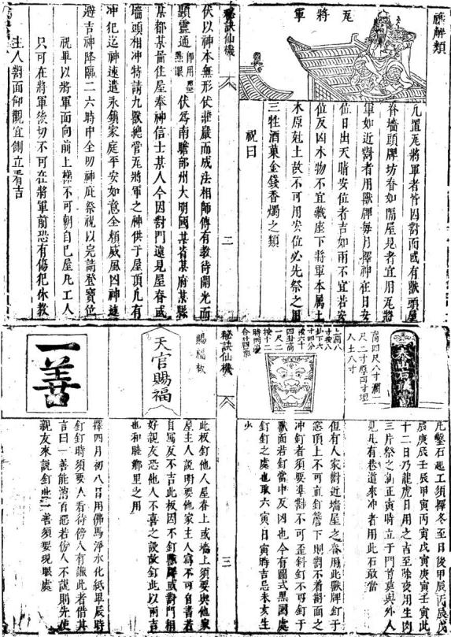
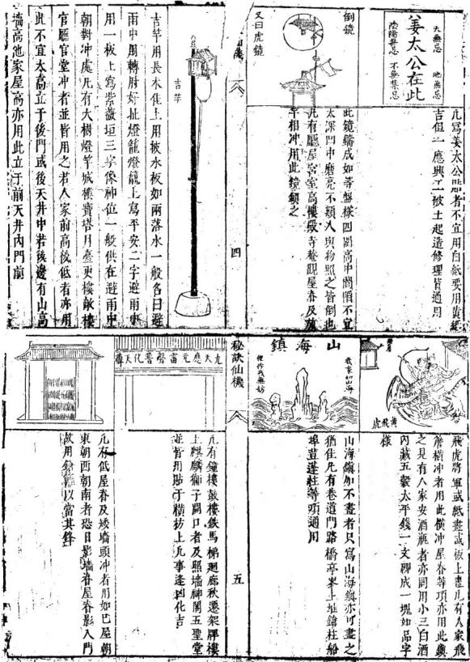
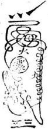

# 秘诀仙机

> V3 AI 全自动白话释读版。专业术语保留，释读内容可展开核对原文。

> 来源：410.入地眼全书+玉尺经+葬经+鲁班经+选择纪全+秘诀仙机.pdf，PDF 第 337–345 页

<!-- V3_SOURCE_ID:book007-b000002-p000-00df054f2f -->

《靈驅解法洞明真言秘書》，是唐代李淳風替人選擇動土建房的日子時留下的相關書籍。當時那戶人家要建造房屋，李淳風為他們選定了完工的日子，卻提到這是十惡魔之日，必須有對應的解禳方法。此前流行的各種魘禳書籍，都是土木工匠所傳的邪術，他們遇到真正的大敗日，卻謊稱當天是上等吉日，還把他們的書和本書相對貼在柱子上，邪術怎麼能勝過正法呢？本書所記載的各種法門，都配有對應的真言和靈符。當天袁天罡和唐太宗一同來拜訪李淳風，剛好見到那戶人家立柱上梁，本書記載的都是奇妙的訣竅，學習和翻看的人都不能用污穢的手翻閱，各自都應當恭敬對待。凡是遇到任何相關狀況，袁天罡當時笑着說：“天下的術士都在胡亂行事。”唐太宗問為什麼這麼說，袁天罡回答：“今天是適合一切動作、起造完工的日子，做完解禳之後，土木相關的煞氣就不會帶來壞處了，若是單純卜算的話這是惡日。”唐太宗問是誰選的這個日子，就去問那戶人家，那戶人家回答是李淳風選的。袁天罡問李淳風現在在哪裡，那戶人家回答說在旁邊的寺廟山門處。袁天罡本來要走，那戶人家挽留他，擺了豐盛的酒菜招待，沒喝幾杯袁天罡就對唐太宗說：“臣聽說李淳風是高人，現在看來是虛有其名啊。”唐太宗說可以去問問他的術數，看他知不知道我們來了。唐太宗還沒到寺廟，袁天罡先進去見李淳風，問他知不知道自己來了，李淳風說知道，今天左輔星降臨寺廟，就是你袁天罡到了；紫薇星到寺廟，雖然差了一個時辰，但卦象是乾卦二爻的見龍在田，這是君主要來了。袁天罡問他知不知道自己為什麼來，是不是之前村上樑的日子是他選的，李淳風說是。袁天罡說：“今天是十惡大敗日，你怎麼會不知道？”李淳風回答：“今天紫養星臨位，是吉日，五行和五土之間相剋相生，木能克土，土會快速遁走形跡，木氣穿山過地，所有凶神都會躲避。”袁天罡問紫薇星現在在哪裡，李淳風說馬上就到，還念誦起完工禳解的咒語：“癸金克神，木精急退，免得天嗔，工師假術，即化微塵。一切魔鬼快出戶庭，掃盡妖氛，五雷發聲，柳枝一灑，火盜清寧，一切魔物不得翻身，工師邪語貶入幽冥。善奉天令，永保家庭，急急如老君律令。”他剛說完，唐太宗的車駕就到了，走進寺廟，李淳風跪拜在地上，唐太宗處在艮位。袁天罡也附和說立柱正好趕上黃道日，這些對應的內容就是養星相關的記載，一一講解清楚之後，唐太宗就扶起李淳風一起返回，後來還提拔李淳風做了軍師。現在人家張貼這些內容，就是源於這個舊事。如果是住在舊房子，或者買來、租來的住宅，家裡接連出現凶事，或是有人生病、有口舌是非，或是有官司訴訟、家人不合，睡覺時總做惡夢、夢中喊叫、見到神鬼、被鬼怪傷害，時常無故發生火災、頻繁遭盜賊偷竊、有飛來橫禍導致敗家喪命這一類的狀況，都可以用本書的方法禳解，能夠轉禍為福，不受各種災禍侵擾，長久安穩。這些秘訣都是仙機，屢次試驗都很靈驗，特意傳播開來，讓大家掌握方法之後都能平安順遂。

> **释读存疑：** 1. 源文存在多处语序混乱、文字讹脱（如“大宗艮夫”“飛來等福敗家”“何句真言”等），具体原义无法完全确定。；2. 源文提到的“紫養星”不属于通用术数术语，原文未明确其含义，候选直接作为确定表述使用存在风险。；本地硬校验仍未通过，已记录供后续自动处理或人工核对。

查看对应原文

<!-- V3_FOLDBACK_BEGIN:book007-b000002-p000-00df054f2f -->

靈驅解法洞明真言秘書 唐李淳風代人擇日其家造屋淳風與之畢日乃十惡魔者必須有解前魘禳之書皆土木工師邪術蓋 大敗日言稱今日乃上吉日也遂與其書此對貼于柱邪者何能勝正是書所載諸法皆何句真言靈符 其日袁天罡同唐太宗來訪淳風偶見其立柱上梁天妙訣學者觀者勿得汚手開展各宜敬之凡有一 罡笑曰天下術士亂爲也太宗曰何也天罡曰今日乃切動作起造完日解禳之後則土木之覺無益矣 卜惡日也大宗曰可是誰擇之日遂問之其家對日如居舊室或買者賃者家宅累見凶事或病或口 淳風也天罡曰今在何處其家遂荅曰在右左寺山門舌或爭訟家中不和瞻夢魘呌見神遇鬼傷害人 口卜數天罡欲行其家留之侍以盛酒不數盃遂亂而日主意淡薄時常火發頻賊偷盜飛來等福敗家 行天罡與太宗曰臣聞淳風高士今虛傳也太宗曰可喪命之類並皆可禳能轉禍爲福百難無侵則永 去問其數看其知我爾乎太宗未至寺天罡先行見連秘訣仙機 訣傳機達安泰矣 風曰知我乎曰知也今日左輔臨寺是君也紫薇至寺因累試累驗特此挾升 差一時然卦屬乾二爻見龍在田乃君至也天罡曰今工完禳解呪 知吾來是真乃袁天罡前村上梁擇日是爾否曰然天呪日 罡曰今日乃十惡大敗日何不識也曰今日紫養臨吉五行五土相尅相生木能尅土土速遁形木出山卷 地諸凶神皆避也天罡曰紫薇在于何所曰將及至癸金尅神木精急退免得天嗔工師假術卽化微塵 也方說完太宗駕至入寺淳風拜伏于地大宗艮夫一切魔鬼快出戶庭掃盡妖氲五雷發聲柳枝一酒天罡對以立柱喜逢黃道日上來正題案養星之記一火盜清寧一切魔物不得番身工師哩語貶入入冥 一講明太宗遂扶起而還遂擢爲軍師今人家貼此是善奉天令永保家庭急急如老君律令 疵故事也

<!-- V3_FOLDBACK_END:book007-b000002-p000-00df054f2f -->

<!-- doc002 PDF 第 340–341 页：HTML 表格 OCR 供搜索；符图、器物图以原页图为准。 -->

<!-- V3_SOURCE_ID:book007-b000007-p000-bcd1c917b7 -->

这部分是《鲁班秘书》的相关内容，记载匠人独自在无人处时，不能让孕妇看见，要自己闭着眼睛展开，见过的人就可以使用相关方法。把柱叶藏在手里，主发利甲。船也可以藏在斗中使用，船头朝内主家宅有进益，不能朝外，朝外主家财损耗。不管藏在什么地方，都能主家主人长寿。在门缝中间藏浸过墨的物件，主家代代出贤能的人，为人方正不去做书吏，反而靠丹青技艺让家宅安稳，主家人忠信。要是在门口架梁内藏一块桃片、一根筋，后代儿孙会沦为乞丐，缺衣少食常受冻，最后得卖掉房产住到桥边寺庙里。此处题记为“秘诀仙机”。长。七。卷首标注有“魅卷”字样。把被头五鬼藏在中柱里，主家有死丧之事。藏一个棺材主家死一个人，如果藏两个棺材主家受双刑；棺材大的话家中长辈会伤亡，棺材小的话家中小辈会丧命，要藏在堂屋的内枋里。把覆船形的物件藏在房屋北侧的地下，主人出外经营会死在江里；如果见到女子，必然会有落井落河的灾祸，妻子难逃难产而死的厄运，要埋在北侧的地里。藏一个系着绳子的朱头，随便埋在地下什么地方，主夫妻父子经常发生争执，用吊死过人的绳头，不管埋在哪里都会有相应的灾殃。0。遇到黑日，家宅不兴旺，香火昏暗闷沉，日子过得不顺，做事就像被云遮住太阳一样不顺遂，年年患疟疾卧病在床；相关物件要藏在大门的上枋里。此处有无法识别的字符“4は一半γ”。在铁锁中间藏木人，木人外面画上五彩的人形，主这家一年之内死五口人，三年到五年就会绝后，要深深藏在井底或者药墙里。“白法尽成雨，把刀杀人放火逞英豪”，做了杀人放火的事伤人的人会遭遇牢狱之灾，免不了秋天被处决；相关物件藏在门前的自首枋内。藏人、马、枪的造型，主习武之人荣显大吉昌，名声传遍天下，敌人都归顺，只是免不了将军会战死沙场。白虎当堂坐正，主家经常发生口舌纠纷，女人在家多患病遭灾，不会伤害小孩，只会伤害女主人；相关物件藏在梁相里，头朝内区。在斗里藏未家者尾，主家必然富裕，家道兴旺多有资财，就算有灾也能安稳度过，米堆满仓库，衣服装满箱子。在门槛中间写“囚”字，要是有人碰到了，主会遇到天大的官司，困在监牢里难出来；相关做法也可用于孟中作死囚，藏在门盘的合缝里。在房屋中间藏牛叠，主家人终日辛苦忙碌，到老死了都没有棺材收殓，后代儿孙常年劳累，要埋在房屋中间。浦。把一块破瓦、一把断锯藏在梁头的合缝处，主丈夫去世妻子改嫁儿子离散，奴仆逃亡找不到踪迹；要藏在正堂的合缝里。在正梁的左右分别放双钱，主寿、财、福禄都丰盈，丈夫荣耀儿子显贵妻子能得到封赠，代代儿孙都能得到福佑，正梁两头各放一个，要倒扣着放。在头发中间放把刀，主孙子会落发出家逃走，女子有丈夫也如同没有，常年孤苦，鳏寡孤独的灾祸躲不过；要藏在门槛下面的地里。在墙头梁上放葫芦，主家人靠九流三教的技艺谋生，住在这里的人家都会异术，靠占卜、星相、针灸之类的技艺过活，盖墙的时候放在墙的合缝处即可。此处题记为“嘉诀仙机”。八。诀仙机。九垂。V。把七个钉头放在一起，主家七口人丁不会离散，如果家里添人口或者娶亲，必然会有武事相关的灾祸难以逃脱；要藏在柱子的孔洞里。笔 壁。藏一块好墨、一支笔，主家富贵荣华财源广进，后代必定能入朝做宰辅大臣，如果笔头是秃的主会被免去官职；要藏在枋里。凡是建造房屋的时候，木石、泥水等各类工匠，如果用蛊毒、魇魅的方法祸害主人，上梁的那天，主人需要准备三牲福礼、横匾一架，祭告各位神灵，拿出鲁班先师的秘符一道，念咒语：“恶匠无知，叠寿魇魅，自作自当，主人无伤，暗诵七遍，本匠遭殃，吾奉太上老君勅令，他作吾无妨，百物化為吉祥，急急如律令。”念完就把符拿到没人的地方烧掉，不能让孕妇看见，再取黄狗和黑狗的血脂混在酒里，上梁的时候把这酒递给匠头喝三杯，剩下的分给所有工匠喝，凡是工匠下了魇术的都会自己承担恶果，家中诸事都能转为吉祥。

> **释读存疑：** “4は一半γ”具体含义不明；“柱叶”“发利甲”“未家者尾”“牛叠”“压肩芮”“破九”“声葫”“肾卜星相注来灸”“盖墙上尽合两”“七口人丁永不抛”“几一得武失必难逃”“藏柱內吼中”“金增立”“笔头若蛙”“叠寿魘魅”“暗诵七遙”“上標”“众正”“诸事背祥”等表述具体所指存疑；本地硬校验仍未通过，已记录供后续自动处理或人工核对。

查看对应原文

<!-- V3_FOLDBACK_BEGIN:book007-b000007-p000-bcd1c917b7 -->

<table><tr><td></td><td></td><td></td><td></td><td></td><td colspan="8" rowspan="1"></td><td colspan="2" rowspan="1">魯班秘書凡匠人在無人處莫與四眼見自巳閉日展開一見者便用</td><td colspan="1" rowspan="1"></td><td colspan="1" rowspan="1">柱葉藏手手內主發利甲</td><td colspan="1" rowspan="1"></td></tr><tr><td colspan="1" rowspan="1"></td><td colspan="1" rowspan="1">舡亦藏于斗中可用舡頭朝內主進則不可朝外朝外主財退</td><td></td><td colspan="1" rowspan="1">不拘藏于某虞主主人壽長</td><td></td><td colspan="6" rowspan="1">門縫中間藏墨浸代代賢能出方正不爲書吏却丹青安穩人家主忠信</td><td colspan="1" rowspan="1">0</td><td colspan="1" rowspan="1">一塊桃片一枝筋後代兒孫乞丐是衣禮口食嘗凍紙賣了房廊住橋寺藏門口架梁內</td></tr><tr><td colspan="1" rowspan="1">秘訣仙機</td><td colspan="1" rowspan="1"></td><td colspan="1" rowspan="1">长</td><td colspan="1" rowspan="1"></td><td></td><td colspan="6" rowspan="1"></td><td colspan="1" rowspan="1">七</td><td colspan="1" rowspan="1"></td></tr><tr><td colspan="1" rowspan="1">t      魅卷      卷</td><td colspan="1" rowspan="1">此被頭五鬼藏中柱內主死喪</td><td colspan="1" rowspan="1"></td><td colspan="1" rowspan="1">一箇棺材死一人若然兩簡主雙刑大者其家傷大口小者其家喪小丁藏堂屋內枋內</td><td></td><td colspan="6" rowspan="1">覆船藏在房北地出外經營喪江内見女必然漏井河妻見難逃產死厄理北首地中</td><td colspan="1" rowspan="1"></td><td colspan="1" rowspan="1">一箇朱頭繫一繩塊嶽地下隨處行夫妻父子嘗爭閱吊死繩頭有巳人不論埋何處</td></tr><tr><td colspan="1" rowspan="1">0</td><td colspan="1" rowspan="1">黑日嶽家不吉昌香昏悶問過時光作事却如雲蔽日年年虐疾不離床臧大門上枋內</td><td colspan="1" rowspan="1">4は一半γ</td><td colspan="1" rowspan="1">鉄鎖中聞藏木人上裝五彩像人形其家一載死五口三年五載絕人丁深藏井底或藥墻內</td><td></td><td colspan="6" rowspan="1">白法盡成雨把刀殺人放火逞英豪殺傷人令遭宇獄不免秋來刀下地藏門前自首枋内</td><td colspan="1" rowspan="1"></td><td colspan="1" rowspan="1">人一馬一枝鎗武身榮大吉昌名昭天下虜咸伏不免將軍死戰攝</td></tr><tr><td colspan="1" rowspan="1"></td><td colspan="1" rowspan="1">白虎當堂坐正聽主人口舌不離身女人在家多疾厄不傷小口只傷妻藏梁相內頭向內区</td><td colspan="1" rowspan="1"></td><td colspan="2" rowspan="1">斗中藏未家者尾必然富黃發華易子則萬貫災安穩米刪成倉衣浦箱跋斗引</td><td colspan="1" rowspan="1"></td><td colspan="6" rowspan="1">門檻從中書一囚房若成時觸上頭天大官司監牢內難出孟中作死囚蒙門盤合縫中</td><td colspan="1" rowspan="1"></td><td colspan="1" rowspan="1">房屋中間藏牛疊終朝辛苦忙礙碌老來身死没棺材後代兒孫壓肩芮埋屋中間F</td></tr><tr><td colspan="1" rowspan="1">浦</td><td colspan="1" rowspan="1">一塊破九一斷鋸藏在梁頭合縫處夫喪妻嫁子離奴僕逸亾无處置藏正聚合縫內</td><td colspan="1" rowspan="1"></td><td colspan="2" rowspan="1">雙錢正梁左右分壽財福祿正豐盈夫榮子貴妻封贈代代兒孫永蒙正梁兩頭一墓一個須要覆放</td><td colspan="1" rowspan="1"></td><td colspan="6" rowspan="1">頭髮中閒果把刀見孫落髮出家逃有子無夫常不樂蘇寡孤獨不相饒藏門檻下地中</td><td colspan="1" rowspan="1"></td><td colspan="1" rowspan="1">墙頭梁上聲葫九流三教用工夫几住人家皆異術腎卜星相注來灸蓋墻上盡合两</td></tr><tr><td colspan="1" rowspan="1">嘉訣仙機</td><td colspan="1" rowspan="1"></td><td colspan="1" rowspan="1">八</td><td colspan="2" rowspan="1"></td><td colspan="1" rowspan="1"></td><td colspan="6" rowspan="1">訣仙機</td><td colspan="1" rowspan="1"></td><td colspan="1" rowspan="1">九垂</td></tr><tr><td colspan="1" rowspan="4">V</td><td colspan="1" rowspan="4">七箇釘頭作一七口人丁永不拋若然添人與娶幾一得武失必難逃藏柱內吼中</td><td colspan="1" rowspan="4">筆  壁</td><td colspan="2" rowspan="4">一定好墨一枝筆富貴榮華金增立必佐聖朝爲宰臣筆頭若蛙退官職藏枋內</td><td colspan="13" rowspan="1">凢造房屋木石泥水匠作諸色人等蠱毒麗魅殃</td></tr><tr><td colspan="13" rowspan="1">害主人上糅之日須用三牲福禮橫扁一架祭告</td></tr><tr><td colspan="13" rowspan="1">諸神將魯班先師秘符一道念呪云惡匠無知疊壽魘魅自作自當主人無傷暗誦七遙本匠遭殃吾</td></tr><tr><td colspan="13" rowspan="1">奉</td></tr><tr><td colspan="1" rowspan="3">~</td><td colspan="1" rowspan="3">合木木中書此符家中嘗見鬼妖魔走石飛砂長作怪妻女兒原社藉多將木上鐵鏡中畫</td><td colspan="1" rowspan="3"></td><td colspan="2" rowspan="3">朱雀前書多口舌官非橫禍相釀涉家財耗散損人丁直待賣房繞得處寫大門上枋中</td><td colspan="13" rowspan="1">大上老君勅令他作吾無妨百物化爲吉祥急急律</td></tr><tr><td colspan="13" rowspan="1">令卽箱符焚於無人處不可四眼見取黃黑狗血脂藏酒內上標時將此酒達遞匠頭三杯餘者</td></tr><tr><td colspan="13" rowspan="1">分飲衆正凡有魘自受其諸事背祥</td></tr></table>

<!-- V3_FOLDBACK_END:book007-b000007-p000-bcd1c917b7 -->

<!-- V3_SOURCE_ID:book007-b000008-p000-23a8e1feb2 -->

这道符要用朱砂书写，贴在正标上。

> **释读存疑：** 1轮自动修复后核义模型仍建议修订，已保守记录。

查看对应原文

<!-- V3_FOLDBACK_BEGIN:book007-b000008-p000-23a8e1feb2 -->

此符用殊砂書符貼正標上

<!-- V3_FOLDBACK_END:book007-b000008-p000-23a8e1feb2 -->

<!-- V3_SOURCE_ID:book007-b000010-p000-3fd14a0fb3 -->

在黑圈之内写上本家的名字，写完后用墨涂掉，贴符时用左手拿着，点符时不许外人说闲话，贴完后下梯子，再用青龙和合净茶米食焚烧化纸，这样就能安顿家堂圣泉、敖土地、灶神的居位，接着念安家堂真言：

> **释读存疑：** “青龙和合净茶米食”“家堂圣泉敖土地”原文未明确具体所指

查看对应原文

<!-- V3_FOLDBACK_BEGIN:book007-b000010-p000-3fd14a0fb3 -->

黑圈內寫本家名字在內篤完以墨塗之貼符用左手持之點時莫許外人說閒語貼畢下梯方以青龍和合淨茶米食化紙卽安家堂聖泉敖土地灶神居位遂念安家堂真言曰

<!-- V3_FOLDBACK_END:book007-b000010-p000-3fd14a0fb3 -->

<!-- V3_SOURCE_ID:book007-b000011-p000-86ef4777ee -->

秘訣仙機

查看对应原文

<!-- V3_FOLDBACK_BEGIN:book007-b000011-p000-86ef4777ee -->

秘訣仙機

<!-- V3_FOLDBACK_END:book007-b000011-p000-86ef4777ee -->

+1

<!-- V3_SOURCE_ID:book007-b000013-p000-9d1211fcd2 -->

天属阳地属阴，阴阳二气化生神灵，日月星三光普照，吉祥的星曜降临家门。华美香雾飘散出异彩，天界的乐声流转传扬，迎请家堂司命六神，以常年供奉的香火永久镇护家庭，各种邪祟不得进入，水火灾害都难以侵损。门神户尉斩杀恶鬼精怪，神威广大，品行正大光明。奉太乙的敕命，长久护佑这户人家的门户，安神仪式已经完成，文中还提到“永达大古”，具体含义不详；如果家宅多有邪祟，可以用这套方法禳解。

> **释读存疑：** 永达大古具体含义不详

查看对应原文

<!-- V3_FOLDBACK_BEGIN:book007-b000013-p000-9d1211fcd2 -->

天陽地陰 二氟化神 三光普照 吉曜臨門華香散彩 天樂流音 迎請家堂 司命六神萬年香火 永鎮家庭 諸邪莫入 水火難浸門神戶尉 殺鬼誅精 神威廣大正大光明太乙勅命久保ム門 安神巳畢 永達大古家宅多崇禳解

<!-- V3_FOLDBACK_END:book007-b000013-p000-9d1211fcd2 -->

<!-- V3_SOURCE_ID:book007-b000014-p000-6484d447c1 -->

有不少人家内部，或是从远方带来了邪神野鬼这类在家中作祟的事物；邪鬼脱离本形作怪，把物品搬来搬去，附在病人身上开口索要酒饭之类的，遇到这类情况可以使用这道符。文中提到“毗壹十二张”，具体含义不详；按照星盘方位和对应的妙法贴符之后，邪祟就会永远消失、快速离开，文中还提到“麗禳之物无用矣”，具体含义不详。

> **释读存疑：** 毗壹十二张具体所指不详；麗禳之物无用矣具体含义不详

查看对应原文

<!-- V3_FOLDBACK_BEGIN:book007-b000014-p000-6484d447c1 -->

多有人家內或遠方帶來邪神野鬼家中魔祟之物邪鬼脫其形而作怪移物過東過西負病人言語要酒要飯之類可用此符毗壹十二張按星盤方數妙法貼之邪崇永無速去麗禳之物無用矣

<!-- V3_FOLDBACK_END:book007-b000014-p000-6484d447c1 -->

<!-- V3_SOURCE_ID:book007-b000015-p000-415d6b8712 -->

星盘方向确定漏

> **释读存疑：** 原句语义不明确

查看对应原文

<!-- V3_FOLDBACK_BEGIN:book007-b000015-p000-415d6b8712 -->

星盤方向定漏

<!-- V3_FOLDBACK_END:book007-b000015-p000-415d6b8712 -->

<!-- V3_SOURCE_ID:book007-b000017-p000-db27590e04 -->

之前星盘定局都是贴符的方法，比如立春前作十二月簿气，一到立春就是正月节，第十道符就从正东贴起；未立春就从东北贴起，正东、正西、正南、正北都贴两张，东秘訣袖機 十二

> **释读存疑：** “东秘訣袖機 十二”语义不明确；“十二月簿气”“东秘訣袖機 十二”语义不明确

查看对应原文

<!-- V3_FOLDBACK_BEGIN:book007-b000017-p000-db27590e04 -->

前星盤定局皆貼符方法假如立春前作十二月簿氣一立春後卽正月節第十道卽從正東貼起未立春卽從東北貼起正東正西正南正北皆貼兩張東秘訣袖機 十二

<!-- V3_FOLDBACK_END:book007-b000017-p000-db27590e04 -->

<!-- V3_SOURCE_ID:book007-b000018-p000-119846912d -->

南、东、北、西、西南、西北都贴一张，不能错乱，如果贴错了就没有益处。

查看对应原文

<!-- V3_FOLDBACK_BEGIN:book007-b000018-p000-119846912d -->

南東北西南西北皆貼一張不可錯亂如錯亂貼無基益

<!-- V3_FOLDBACK_END:book007-b000018-p000-119846912d -->

<!-- V3_SOURCE_ID:book007-b000019-p000-de40cbad4a -->

五雷地支靈符

查看对应原文

<!-- V3_FOLDBACK_BEGIN:book007-b000019-p000-de40cbad4a -->

五雷地支靈符

<!-- V3_FOLDBACK_END:book007-b000019-p000-de40cbad4a -->

<!-- V3_SOURCE_ID:book007-b000020-p000-81566e18ef -->

正月从正东贴起，操上

> **释读存疑：** “操上”语义不明确

查看对应原文

<!-- V3_FOLDBACK_BEGIN:book007-b000020-p000-81566e18ef -->

正月從正東貼起操上

<!-- V3_FOLDBACK_END:book007-b000020-p000-81566e18ef -->

<!-- doc002 PDF 第 343 页：HTML 表格 OCR 供搜索；符图以原页图为准。 -->

<!-- V3_SOURCE_ID:book007-b000023-p000-7b31af84d4 -->

二月：疑、雷声增化天尊、WR、东下、W、第、壁一；六月：特、雪、雷、贴西、O、南止、雪；三月：贴束、p；七月：最；南角、秘诀备机、十三；西上、十四；四月：贴正；秘诀仙机、八月：贴正；南上、标处；：门、西下；五月；九月；第正、4、南、壁上；盐西、北

> **释读存疑：** 原文存在“WR”“W”“p”“O”“4”等不明符号，“貼束”“盐西”“第正”等表述含义不明；本地硬校验仍未通过，已记录供后续自动处理或人工核对。

查看对应原文

<!-- V3_FOLDBACK_BEGIN:book007-b000023-p000-7b31af84d4 -->

<table><tr><td>二月 疑 雷聲增化天尊 WR 東下 W 第 壁一</td><td>六月 特 雪 雷 貼西 O 南止 雪</td></tr><tr><td>三月 貼束 p</td><td>七月 最</td></tr><tr><td>南角 秘訣備機 十三</td><td>西上 十四</td></tr><tr><td>四月 貼正</td><td>秘訣仙機 八月 貼正</td></tr><tr><td>南上 標處</td><td>： 門 西下</td></tr><tr><td>五月</td><td>九月</td></tr><tr><td>第正 4 南 壁上</td><td>盐西 北</td></tr></table>

<!-- V3_FOLDBACK_END:book007-b000023-p000-7b31af84d4 -->

<!-- V3_SOURCE_ID:book007-b000025-p000-6b941d4ae8 -->

卯时击打碎门神尸尉，各应在本位本字，护佑太子。念完后诵读一卷雷经。

> **释读存疑：** “尸尉”具体所指不详

查看对应原文

<!-- V3_FOLDBACK_BEGIN:book007-b000025-p000-6b941d4ae8 -->

打 卯碎門神尸尉各宜本位本字 保太子 念畢誦雷經一卷

<!-- V3_FOLDBACK_END:book007-b000025-p000-6b941d4ae8 -->

<!-- V3_SOURCE_ID:book007-b000026-p000-c6b837306e -->

退去青龙、白虎（穴场或建筑右侧的形势称谓）、朱雀（穴前方的形势称谓）、玄武（穴后方的靠山形势称谓）、勾陈、腾蛇、太岁及五方诸天星，将众化纸与醋一同奉送出门，仪式完毕。

查看对应原文

<!-- V3_FOLDBACK_BEGIN:book007-b000026-p000-c6b837306e -->

退青龍白虎朱雀玄武勾陳騰蛇太歲五方諸天星 衆化紙醋潭奉送出門畢

<!-- V3_FOLDBACK_END:book007-b000026-p000-c6b837306e -->

<!-- V3_SOURCE_ID:book007-b000027-p000-d2a3b13cf3 -->

另外，在家中安设家堂、土地、灶神，在室内焚烧“神化”纸，不可将纸送出门外。用这样的方法解禳，家中永远不会有灾祸障碍，以此化为吉兆，家道就能吉祥如意。

> **释读存疑：** “神化”具体所指不详；1轮自动修复后核义模型仍建议修订，已保守记录。

查看对应原文

<!-- V3_FOLDBACK_BEGIN:book007-b000027-p000-d2a3b13cf3 -->

又安家堂土地灶神化紙于室內不可送出門外如此解禳永無災障以函化吉家道虞吉祥如意者

<!-- V3_FOLDBACK_END:book007-b000027-p000-d2a3b13cf3 -->

