# 地理黑囊经

> V3 AI 全自动白话释读版。专业术语保留，释读内容可展开核对原文。

> 来源：413.地理正宗臆解+黑囊经+青囊心印+地学.pdf，PDF 第 179–284 页

<!-- V3_SOURCE_ID:book010-b000002-p000-cd6e725e6e -->

以下为相关地理风水类文献的篇目列表：第一行的篇目依次为地理、立穴要诀、俯祭本源歌、俯祭正法致；第二行的篇目依次为黑囊经、地理三科歌、天机传流歌、九星入式歌；第三行的篇目依次为论例、择地十要、综曰曰、古传九星款、九凡至穴星歌、寻龙入式歌；第四行的篇目依次为二十二寸、论富地、论责地、步龙认格歌、全局入式歌、全司入式歌；第五行的篇目依次为论支贵、论式发、二十六物、立宅入式歌、安坟入式歌、山星辰穴星论；第六行的篇目依次为论宜忌、论阴阳、寻龙行立论、恕太极、分两样、论阳家；第七行的篇目依次为阴阳二气说、生气说、秉生气说、论阴样、求四象、四象关法；第八行的篇目依次为东气论、蔡东生气福荫后人说、脉象四法、息象四法、窟象四法；第九行的篇目依次为论结局、论分合、左在前复书合论 大小聚教论、突象四法、作法秘旨歌、点穴法；第十行的篇目为寻龙立穴以水为先论；第十一行的篇目依次为四势裁反篇起止论、星辰三体歌；第十二行的篇目为五星正粹变穴歌；第十三行的篇目依次为牧堂穴情赋四真三法蒙、美酒燥坦；第十四行的篇目依次为浅深得东论、论装止、论肌水；第十五行的篇目为间生气何以来风则数 奠法起正论；第十六行的篇目依次为廖么拨砂歌、穴星化炁歌、秋中八然热；第十七行的篇目依次为朝迎侍街敖、龙诀歌、廖公四凶歌；第十八行的篇目依次为凶龙解、平阳寻龙论、汉生起长生 湖水法

> **释读存疑：** 部分篇目名称存在OCR识别错乱，如‘综曰曰’‘九凡至穴星歌’‘论式发’‘恕太极’‘分两样’‘论阴样’‘大小聚教论’‘美酒燥坦’‘秋中八然热’‘朝迎侍街敖’等，具体所指不详；部分篇目仅存残句，无法确认完整内容

查看对应原文

<!-- V3_FOLDBACK_BEGIN:book010-b000002-p000-cd6e725e6e -->

<table><tr><td colspan="3">地理</td><td>立穴要訣</td><td>俯祭本源歌</td><td>俯祭正法致</td></tr><tr><td colspan="3">黑囊經</td><td>地理三科歌</td><td>天机傳流歌</td><td>九星入式歌</td></tr><tr><td>論例</td><td>擇地十要</td><td>综曰曰</td><td>古傳九星款</td><td>九凡至穴星歌</td><td>尋龍入式歌</td></tr><tr><td>二十二寸</td><td>論富地</td><td>論責地</td><td>步龍認格歌</td><td>全局入式歌</td><td>全司入式歌</td></tr><tr><td>論支貴</td><td>論式发</td><td>二十六物</td><td>立宅入式歌</td><td>安坟入式歌</td><td>山星辰穴星論</td></tr><tr><td>論宜忌</td><td>論陰陽</td><td>尋龍行立論</td><td>恕太極</td><td>分兩樣</td><td>論陽傢</td></tr><tr><td>陰陽二氣說</td><td>生氣說</td><td>秉生氣說</td><td>論陰樣</td><td>求四象</td><td>四象關法</td></tr><tr><td>東氣論</td><td>蔡東生氣福蔭後人說</td><td></td><td>脉象四法</td><td>息象四法</td><td>窟象四法</td></tr><tr><td>論結局</td><td>論分合</td><td>左在前復书合論 大小聚教論</td><td>突象四法</td><td>作法秘旨歌</td><td>點穴法</td></tr><tr><td colspan="3">尋龍立穴以水為先論</td><td></td><td></td><td></td></tr><tr><td>四勢裁反篇起止論</td><td></td><td>星辰三体歌</td><td></td><td></td><td></td></tr><tr><td>五星正粹变穴歌</td><td></td><td></td><td></td><td></td><td></td></tr><tr><td></td><td>牧堂穴情賦四真三法蒙</td><td>美酒燥坦 </td><td></td><td></td><td></td></tr><tr><td>淺深得東論</td><td>論裝止</td><td>論肌水</td><td></td><td></td><td></td></tr><tr><td colspan="3">間生氣何以來風則數 奠法起正論</td><td></td><td></td><td></td></tr><tr><td>廖么撥砂歌</td><td>穴星化炁歌</td><td>秋中八然熱</td><td></td><td></td><td></td></tr><tr><td>朝迎侍街敖</td><td>龍訣歌</td><td>廖公四凶歌</td><td></td><td></td><td></td></tr><tr><td>凶龍解</td><td>平陽尋龍論</td><td>漢生起長生 湖水法</td><td></td><td></td><td></td></tr></table>

<!-- V3_FOLDBACK_END:book010-b000002-p000-cd6e725e6e -->

<!-- V3_SOURCE_ID:book010-b000003-p000-9944f574ec -->

<table><tr><td>地理的核心要义</td><td>地理家</td><td>后方的山不宜像墙壁一样陡峭</td><td>出现“卷帘水”</td></tr><tr><td>理气</td><td>凡是步察龙脉、确立穴（风水中认为气脉聚结、适宜安葬或营建的位置）</td><td>会出现子孙忤逆的情况</td><td>遇到峡地若值“风摇”</td></tr><tr><td>平洋之地</td><td>杨公云</td><td>最可贵的是“五户闭藏”，具体所指不详</td><td>“鹤膝蜂腰”，具体所指不详</td></tr><tr><td>冲破胎神</td><td>元机云</td><td>水（风水语境中的河流、水系及其来去形态）径直流过穴（风水中认为气脉聚结、适宜安葬或营建的位置）后反向跳去</td><td>水（风水语境中的河流、水系及其来去形态）确实与现存的水流关系密切</td></tr><tr><td>龙径云</td><td>水（风水语境中的河流、水系及其来去形态）对着三叉水口要仔细辨认宗脉</td><td>骨脉本来适宜“剥拟”，具体所指不详</td><td>或是龙去虎回</td></tr><tr><td>但凡入局水路</td><td>凡二十四龙</td><td>不要把水（风水语境中的河流、水系及其来去形态）当作固定的判断标准</td><td>要戒忌龙强虎弱</td></tr><tr><td>散现坐穴（风水中认为气脉聚结、适宜安葬或营建的位置）的吉凶</td><td>但凡龙脉不止住</td><td>两宫齐到</td><td>东宫窜过西宫，相山亦似相（原文此处残损，语义不完整）</td></tr><tr><td>盖帐不开</td><td>龙脉以脉为主</td><td>堂中最喜聚气存寓</td><td>仔细查看八国的周流</td></tr><tr><td>山向外拱而向内逼压的情况</td><td>明堂（穴前相对开阔、汇聚的空间）</td><td>“穿割箭射”，具体所指不详</td><td>元辰当心直出</td></tr><tr><td>午龙从双山</td><td>顾祖回龙之地</td><td>坐宕、坐旺、坐煞</td><td>平洋的穴（风水中认为气脉聚结、适宜安葬或营建的位置）要酌情考量</td></tr><tr><td>最喜来乘于进气</td><td>来气短须防腰截</td><td>穴（风水中认为气脉聚结、适宜安葬或营建的位置）里的风须要回避</td><td>“大向小扦”，具体所指不详</td></tr><tr><td>所贵“双与并至”，具体所指不详</td><td>破在吉方多不吉</td><td>牛畏直绳</td><td>“三吉”钟于何地，“三吉”具体所指不详</td></tr><tr><td>阴遇阳而非其类</td><td>阳见阴而失其偶</td><td>水星多在平地</td><td>土不土而金不金</td></tr><tr><td>二女同居</td><td>认龙之气以势</td><td>金清土浊</td><td>五星不离“水土倅”，“水土倅”具体所指不详</td></tr><tr><td>怪石若居前案</td><td>山峻石粗流水急</td><td>更有“暖穴断禽翼”，具体所指不详</td><td>“葵乘生气”，具体所指不详</td></tr><tr><td>大则特小</td><td>“全港眼力”，具体所指不详</td><td>穴（风水中认为气脉聚结、适宜安葬或营建的位置）总三停</td><td>立向（建筑或穴位所朝的方位）贵在迎官而就禄</td></tr><tr><td>星以“剥叔”为贵，“剥叔”具体所指不详</td><td>形以特达为尊</td><td>要明分合之势，水（风水语境中的河流、水系及其来去形态）在坎（八卦之一）宫</td><td>“大地无看炁槩”，具体所指不详；头开两指</td></tr></table>

> **释读存疑：** 五户闭藏；鹤膝蜂腰；剥拟；风摇；穿割箭射；大向小扦；双与并至；三吉；水土倅；暖穴断禽翼；葵乘生气；全港眼力；剥叔；大地无看炁槩；东宫窜过西宫相山亦似相原文残损；五户闭藏具体所指不详；鹤膝蜂腰具体所指不详；剥拟具体所指不详；风摇具体所指不详；穿割箭射具体所指不详；大向小扦具体所指不详；双与并至具体所指不详；三吉具体所指不详；水土倅具体所指不详；暖穴断禽翼具体所指不详；葵乘生气具体所指不详；全港眼力具体所指不详；剥叔具体所指不详；大地无看炁槩具体所指不详；东宫窜过西宫相山亦似相原文残损语义不完整

查看对应原文

<!-- V3_FOLDBACK_BEGIN:book010-b000003-p000-9944f574ec -->

<table><tr><td>地理之要</td><td>地理家</td><td>後山不宜壁立</td><td>捲簾水現</td></tr><tr><td>理氣</td><td>凡步龍立穴</td><td>見孫忤逆</td><td>遇峽若值風搖</td></tr><tr><td>平洋之地</td><td>楊公云</td><td>所貴者五戶閉藏</td><td>鶴膝蜂腰</td></tr><tr><td>冲破胎神</td><td>元机云</td><td>水徑過穴而反跳</td><td>水固切於現流</td></tr><tr><td>龍径云</td><td>水对三又細認宗</td><td>骨脉固宜剝拟</td><td>或龍去虎回</td></tr><tr><td>但凡入局水路</td><td>凡二十四龍</td><td>莫把水為定格</td><td>戒龍強虎弱</td></tr><tr><td>散現坐穴之吉凶</td><td>但凡龍不住</td><td>兩宮斉到</td><td>東宮竄過西宮相山亦似相</td></tr><tr><td>蓋帳不開</td><td>龍以脉為主</td><td>堂中最喜聚寓</td><td>細看八国之週流</td></tr><tr><td>山外拱而內逼者</td><td>明堂</td><td>穿割箭射</td><td>元辰當心直出</td></tr><tr><td>午龍從双山</td><td>顧祖迴龍之地</td><td>坐宕坐旺坐煞</td><td>平洋穴頃斟酌</td></tr><tr><td>最喜來乗於進炁</td><td>來炁短須防腰截</td><td>穴裡風須迴避</td><td>大向小扦</td></tr><tr><td>所貴双與並至</td><td>破在吉方多不吉</td><td>牛畏直绳</td><td>三吉鍾於何地</td></tr><tr><td>陰遇陽而非其類</td><td>陽見陰而失其偶</td><td>水星多在平地</td><td>土不土而金不金</td></tr><tr><td>二女同居</td><td>認龍之炁以勢</td><td>金清土濁</td><td>五星不离水土倅</td></tr><tr><td>怪石若居前案</td><td>山峻石粗流水急</td><td>更有煖穴斷禽翼</td><td>葵乗生氣</td></tr><tr><td>大則特小</td><td>全港眼力</td><td>穴總三停</td><td>立向貴迎官而就祿</td></tr><tr><td>星以剥叔為貴</td><td>形以特達為尊</td><td>要明分合之勢 水在坎宮</td><td>大地無看炁槩 頭開两指</td></tr></table>

<!-- V3_FOLDBACK_END:book010-b000003-p000-9944f574ec -->

<!-- doc003 PDF 第 179 页：旋转/复杂版面 OCR 供检索；内容与排版以原页图为准。 -->
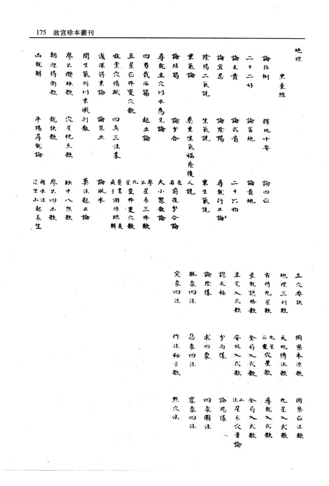

<!-- doc003 PDF 第 180 页：旋转/复杂版面 OCR 供检索；内容与排版以原页图为准。 -->
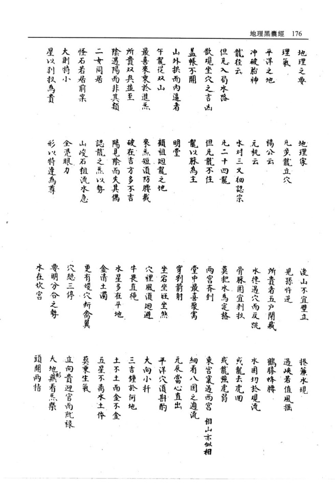

<!-- V3_SOURCE_ID:book010-b000006-p000-c089b986fe -->

突出之处的窟穴需要扦穴，取小的纯粹之处而舍弃大的瑕疵之处。出林虎没有东西可吃，气有虚实，傍城借主。盖粘倚撞、吞吐浮沉，唇脐目尾、颖腹，不可拘泥于盖粘倚撞。脉不直而气直，龙脉以肌为主，来路看四生。

> **释读存疑：** “扦”“出林虎”“傍城借主”“盖粘倚撞吞吐浮沉”“唇脐目尾颖腹”“四生”为风水专业术语，具体含义未明确

查看对应原文

<!-- V3_FOLDBACK_BEGIN:book010-b000006-p000-c089b986fe -->

突中之窟須扦 取小醇而遺大疵出林虎無以啖之 氣有虛実傍城借主 盖粘倚撞吞吐浮沉 脣脐目尾穎腹莫法盖粘倚撞 脉不直而氣直龍以肌為主 來路看四生

<!-- V3_FOLDBACK_END:book010-b000006-p000-c089b986fe -->

<!-- V3_SOURCE_ID:book010-b000007-p000-83309e27ae -->

《钦定协纪辨方书》利用篇中论述四柱法。

查看对应原文

<!-- V3_FOLDBACK_BEGIN:book010-b000007-p000-83309e27ae -->

欽定協紀辨方書利用篇內論四柱法

<!-- V3_FOLDBACK_END:book010-b000007-p000-83309e27ae -->

<!-- V3_SOURCE_ID:book010-b000008-p000-402ca94607 -->

用日法，用时法。

查看对应原文

<!-- V3_FOLDBACK_BEGIN:book010-b000008-p000-402ca94607 -->

用日法 用時法

<!-- V3_FOLDBACK_END:book010-b000008-p000-402ca94607 -->

<!-- V3_SOURCE_ID:book010-b000009-p000-1335470179 -->

太阳时刻方位图、太阳到方图、太阳到方时刻表，造葬权法论选择，辨斗首。

> **释读存疑：** “斗首”为择吉类专业术语，具体含义未明确

查看对应原文

<!-- V3_FOLDBACK_BEGIN:book010-b000009-p000-1335470179 -->

太陽時刻方位圖 太陽到方圖太陽到方時刻表 造葬權法論選擇 辨斗首

<!-- V3_FOLDBACK_END:book010-b000009-p000-1335470179 -->

<!-- V3_SOURCE_ID:book010-b000010-p000-43bce13161 -->

《钦定协纪辨方书》认为，斗首一宗属于伪造且没有根据的内容，切不（原文此处为残句，语义不完整）。

> **释读存疑：** 原文为残句，语义未完整

查看对应原文

<!-- V3_FOLDBACK_BEGIN:book010-b000010-p000-43bce13161 -->

欽定協紀辨方書關斗首一宗係偽造無稽之作切不

<!-- V3_FOLDBACK_END:book010-b000010-p000-43bce13161 -->

<!-- V3_SOURCE_ID:book010-b000011-p000-ddb034c3c9 -->

被它的说法迷惑。

查看对应原文

<!-- V3_FOLDBACK_BEGIN:book010-b000011-p000-ddb034c3c9 -->

可惑於其說

<!-- V3_FOLDBACK_END:book010-b000011-p000-ddb034c3c9 -->

<!-- V3_SOURCE_ID:book010-b000012-p000-5c00202406 -->

太阴到坐向（建筑或穴位所朝的方位）硬局论、感应年的煞论、本天罡四旺大煞论、斩草破土。

> **释读存疑：** “太阴”“坐向”“硬局论”“感应年的煞”“天罡四旺大煞”“斩草破土”为风水择吉专业术语，具体含义未明确

查看对应原文

<!-- V3_FOLDBACK_BEGIN:book010-b000012-p000-5c00202406 -->

太陰到坐向硬局論感應年的煞論本天罡四旺大煞論斬草破土

<!-- V3_FOLDBACK_END:book010-b000012-p000-5c00202406 -->

<!-- V3_SOURCE_ID:book010-b000013-p000-164d27aa78 -->

文中出现“黑囊經進”“黑囊經”“注越凡弟”短语，这些短语表述模糊，具体所指均不详。

> **释读存疑：** 黑囊經進；注越凡弟；具体含义均无法明确；黑囊經進、黑囊經、注越凡弟具体所指均不详

查看对应原文

<!-- V3_FOLDBACK_BEGIN:book010-b000013-p000-164d27aa78 -->

黑囊經進 黑囊經 注越凡弟

<!-- V3_FOLDBACK_END:book010-b000013-p000-164d27aa78 -->

<!-- V3_SOURCE_ID:book010-b000014-p000-9063a22e18 -->

凡是被称作道的事物，必定存在一种极为精妙的境界，但高妙境界的道理一定深奥难解，相关的表述往往化难为深、背离世俗常理，让普通人不仅不相信，还会指责非议、觉得怪异。何况天下的事理，都是从浅显逐步深入的，如果不先说明常规的内容，怎么能知晓变化？不先说明平常的内容，怎么能明白特殊的义理？所以便于人们首先接受的，是最贴近人情的书，对世人来说最贴近人情的书是什么呢？就是《黑囊经》。《黑囊经》的语句贴近人情，没有半句故弄玄虚、耸人听闻的内容，其中的道理却并不粗浅平庸，而且简明扼要、条理清晰，内容直白、容易理解，确实是入门的第一等书籍。翻开这本书一读，龙、穴、水相关的判断方法都清晰展现在眼前，让人不会产生畏难的心理，凭借这本书就能逐步进阶到高妙的境界，所以这本书得到很多人的推崇。

> **释读存疑：** 原文存在多处疑似文字讹损内容，如“化深南離俗”“使農言高姚問”“駛所者”“頭白”“龍穴玖水”“盡人多：矣”等，具体释读存疑；1轮自动修复后核义模型仍建议修订，已保守记录。

查看对应原文

<!-- V3_FOLDBACK_BEGIN:book010-b000014-p000-9063a22e18 -->

凡所謂道者必有一萬快之境在但高妙之境其理必深奧而難明其言多化深南離俗使農言高姚問不特世人不信且膀而怪之矣况天下事理用尤淺而致深使不先言其常焉能知变不先言其庸焉能明奇耶故善先服最近情之書與世人言近情之書何則黑囊經是衆黑囊經句近人情並無半言夏字驚人駛所者而其理却不甚膚庸且簡要而不支離頭白而不費解說允為入門第一書也開尽一讀龍穴玖水之法尽在眼前令人無畏难心由此可以漸進于高妙則此書盡人多：矣

<!-- V3_FOLDBACK_END:book010-b000014-p000-9063a22e18 -->

<!-- V3_SOURCE_ID:book010-b000015-p000-7563290362 -->

详细解说前代贤人的地理歌，要告诉你真正实用的地理口诀并不繁杂。文中提到“撥州新水文千卷”，该短语具体所指不详。点穴寻龙的方法不多，只要用一个核心的道理贯通就能通晓明白，现在讨论的这些内容已经把相关要点都搜罗完全了。《黑囊经》里很少有明确的说明，看龙要观察左右两侧的情况，九穴要看左右的落势，原文有“歎看左右脚”，“歎”字疑似讹误，该短语具体所指不详。水要看左右的情况，明堂要看四角的形态，原文有“三陽看城抑”，其中“抑”字含义不明，该短语具体所指不详。以上六个方面没有可猜疑的地方。进入穴场才会用到度数，关于用卦还是不用卦，要根据穴场的实际情况来确定卦的朝向。当时的风水师一味专用卦理，这种做法本身就是错误的。原文提到“若能審寬之便是真郭璞”，其中“審寬之”具体含义不详，这句话大致是说如果能掌握相关要领，水平就堪比郭璞。

> **释读存疑：** “撥州新水文千卷”具体所指不详；“歎看左右脚”中“歎”为疑似讹字，短语含义不明；“三陽看城抑”中“抑”字含义不明，短语含义不明；“審寬之”具体含义不详

查看对应原文

<!-- V3_FOLDBACK_BEGIN:book010-b000015-p000-7563290362 -->

細說前賢地理歌呌君口訣不須多撥州新水文千卷 点穴尋龍術不多一以貫之能曉會是今論此尽搜罗 黑囊經禮少明說龍看左右九穴看左右落歎看左右 脚水看左右約明堂看四角三陽看城抑六者無猜疑 入穴方載度用卦不用卦卦向穴中做時師專用卦用 卦还是錯若能審寬之便是真郭璞

<!-- V3_FOLDBACK_END:book010-b000015-p000-7563290362 -->

<!-- V3_SOURCE_ID:book010-b000016-p000-dd58e37f27 -->

选地的十个要点

查看对应原文

<!-- V3_FOLDBACK_BEGIN:book010-b000016-p000-dd58e37f27 -->

擇地十要

<!-- V3_FOLDBACK_END:book010-b000016-p000-dd58e37f27 -->

<!-- doc003 PDF 第 181 页：旋转/复杂版面 OCR 供检索；内容与排版以原页图为准。 -->
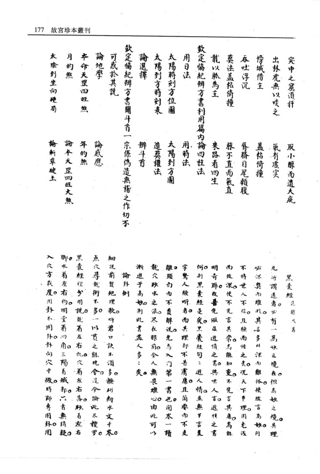

<!-- V3_SOURCE_ID:book010-b000018-p000-80d4993016 -->

原文有“龍要有夾從只從龍身重”，该句具体含义不详。穴要有包裹的态势，包裹聚结的话穴就不会有破损。原文中多次出现的“秋”字疑似为“砂”的讹误，疑似是说砂要有情意，态势急促的话就主尊贵。水要有弯曲的形态，弯曲幅度大就主发福。龙要有正星，穴要有正名，疑似是说砂要有正形，水要有正城。龙要有宗祖山，然后再看它后续的分支脉络。穴要有情意，然后再看相关的来去态势。

> **释读存疑：** “龍要有夾從只從龍身重”具体含义不详；“秋”疑似为“砂”的讹误，无法完全确定；“三陽看城抑”中“抑”字含义不明，短语含义不明；1轮自动修复后核义模型仍建议修订，已保守记录。

查看对应原文

<!-- V3_FOLDBACK_BEGIN:book010-b000018-p000-80d4993016 -->

龍要有夾從只從龍身重穴要有包裹包聚穴無破秋 要有情意有急則尊貴水要有灣曲灣曲大發福龍要 有正星穴要有正名秋要有正形水要有正城龍要有 宗祖然後看子孫穴要有情意然後看來去

<!-- V3_FOLDBACK_END:book010-b000018-p000-80d4993016 -->

<!-- V3_SOURCE_ID:book010-b000019-p000-c3d1ec4386 -->

徐日日

> **释读存疑：** “徐日日”疑似人名讹误，具体所指不详

查看对应原文

<!-- V3_FOLDBACK_BEGIN:book010-b000019-p000-c3d1ec4386 -->

徐日日

<!-- V3_FOLDBACK_END:book010-b000019-p000-c3d1ec4386 -->

<!-- V3_SOURCE_ID:book010-b000020-p000-fd6f4a3946 -->

龙没有正星就不会显现，穴没有匹配的形态就不能安存，水没有正情就不淳厚。原文中的“秋”字疑似为“砂”的讹误，原文为“秋無本名不朋”，其中“朋”字具体含义不详。

> **释读存疑：** “秋”疑似为“砂”的讹误，无法完全确定；“秋無本名不朋”中“朋”的含义不详

查看对应原文

<!-- V3_FOLDBACK_BEGIN:book010-b000020-p000-fd6f4a3946 -->

龍無正星不現穴無匹形不安水無正情不淳秋無本名不朋

<!-- V3_FOLDBACK_END:book010-b000020-p000-fd6f4a3946 -->

<!-- V3_SOURCE_ID:book010-b000021-p000-a0bccb96b3 -->

二十二种好的风水格局

查看对应原文

<!-- V3_FOLDBACK_BEGIN:book010-b000021-p000-a0bccb96b3 -->

二十二好

<!-- V3_FOLDBACK_END:book010-b000021-p000-a0bccb96b3 -->

<!-- V3_SOURCE_ID:book010-b000022-p000-f13c1dc3e8 -->

原文提到“龍好充鳥舞風”，其中“充鳥”具体含义不详。穴好的状态是星辰拱卫尊重。原文中多次出现的“秋”字疑似为“砂”的讹误，疑似是说砂好的状态是像屯军簇拥跟从。水好的状态是像活蛇出洞。龙好的状态是不更换正星。穴好的状态是凶恶的山形被遮蔽隐藏。疑似是说砂好的状态是有朝山有应山。水好的状态是像蛇爬过路径。原文有“龍好防送重”，其中“防送重”具体含义不详。原文有“穴好遞戴八風”，该短语具体含义不详。疑似是说砂好的状态是千峰骤然耸立。水好的状态是形状像眼睛的方形轮廓。龙好的状态是像直立的笔、顿放的枪。穴好的状态是四正方向对着川堂。水好的状态是朝向秀美的江河。龙好的状态是像僧道端坐凝神。疑似是说砂好的状态是像人直立出拳。水好的状态是像弓上了弦。龙好的状态是有盖山有座山。穴好的状态是有包裹有聚累。原文有“以好有堆有探”，其中“以”字疑似为“砂”的讹误，该短语具体含义不详。水好的状态是有肉有坟。

> **释读存疑：** “充鳥”具体含义不详；“秋”疑似为“砂”的讹误，无法完全确定；“防送重”具体含义不详；“遞戴八風”具体含义不详；“以好有堆有探”中“以”疑似为“砂”的讹误，短语含义不明

查看对应原文

<!-- V3_FOLDBACK_BEGIN:book010-b000022-p000-f13c1dc3e8 -->

龍好充鳥舞風穴好星辰尊重秋好屯軍擁從水好生 蛇出洞龍好不換正星穴好凶山藏屏秋好有朝有應 水好如蛇過徑龍好防送重穴好遞戴八風秋好頓 起千峯水好形如眼方龍好卓筆頓鎗穴好四正川堂 水好朝陽秀江龍好僧道坐神秋好如人卓拳水好如 弓上弦龍好有蓋有座穴好有包有累以好有堆有探 水好有肉有墳

<!-- V3_FOLDBACK_END:book010-b000022-p000-f13c1dc3e8 -->

<!-- V3_SOURCE_ID:book010-b000023-p000-d1e859fc84 -->

论能带来富裕的风水地

查看对应原文

<!-- V3_FOLDBACK_BEGIN:book010-b000023-p000-d1e859fc84 -->

論富地

<!-- V3_FOLDBACK_END:book010-b000023-p000-d1e859fc84 -->

<!-- V3_SOURCE_ID:book010-b000024-p000-ea7e67301a -->

主富的龙身上带有仓、席的形局，主富的穴左朝右顾形态周正。原文中的“秋”字疑似为“砂”的讹误，原文为“富秋所櫃倉庫”，该短语具体含义不详。原文有“富水朝灣覆土”，具体含义不详。

> **释读存疑：** “秋”疑似为“砂”的讹误，无法完全确定；“富秋所櫃倉庫”具体含义不详；“富水朝灣覆土”具体含义不详

查看对应原文

<!-- V3_FOLDBACK_BEGIN:book010-b000024-p000-ea7e67301a -->

富龍帶倉帶席富穴左朝右顧富秋所櫃倉庫富水朝灣覆土

<!-- V3_FOLDBACK_END:book010-b000024-p000-ea7e67301a -->

<!-- V3_SOURCE_ID:book010-b000025-p000-16b2bc3714 -->

论能带来显贵的风水地

查看对应原文

<!-- V3_FOLDBACK_BEGIN:book010-b000025-p000-16b2bc3714 -->

論貴地

<!-- V3_FOLDBACK_END:book010-b000025-p000-16b2bc3714 -->

<!-- V3_SOURCE_ID:book010-b000026-p000-232e030f5f -->

官龙行印诰排来，官穴坐事益三台，官所朝笔架楼台，官水去三折部街。

查看对应原文

<!-- V3_FOLDBACK_BEGIN:book010-b000026-p000-232e030f5f -->

官龍行印誥排來官穴坐事益三台官所朝筆架樓臺官水去三折部街

<!-- V3_FOLDBACK_END:book010-b000026-p000-232e030f5f -->

<!-- V3_SOURCE_ID:book010-b000027-p000-0135253226 -->

论文贵。

查看对应原文

<!-- V3_FOLDBACK_BEGIN:book010-b000027-p000-0135253226 -->

論文貴

<!-- V3_FOLDBACK_END:book010-b000027-p000-0135253226 -->

<!-- V3_SOURCE_ID:book010-b000028-p000-3fd41badb2 -->

文官龙阳心过峡，文官穴金直荷某，文官秋尖峰仍塔；文官水常流东甲；文官龙带旗带后，文官穴降尖为主；文官秋进贡用舞；文官水天一干步。

> **释读存疑：** 某、秋、干步所指不详

查看对应原文

<!-- V3_FOLDBACK_BEGIN:book010-b000028-p000-3fd41badb2 -->

文官龍陽心過峽文官穴金直荷某文官秋尖峰仍塔 文官水常流東甲文官龍帶旗帶後文官穴降尖為主 文官秋進貢用舞文官水天一幹步

<!-- V3_FOLDBACK_END:book010-b000028-p000-3fd41badb2 -->

<!-- V3_SOURCE_ID:book010-b000029-p000-e1de777ee3 -->

## 論式貴 — 论式贵

查看对应原文

<!-- V3_FOLDBACK_BEGIN:book010-b000029-p000-e1de777ee3 -->

## 論式貴

<!-- V3_FOLDBACK_END:book010-b000029-p000-e1de777ee3 -->

<!-- V3_SOURCE_ID:book010-b000030-p000-03f799c646 -->

武官穴出身内侧，武官玖旌旗排州，武官水两边斜直；武官穴或斜戎全，武官秋排牙颇旗，武官水长流地支；武官穴顿旗出阵，武官水交剑长流，武官秋罗列为臧；武官龙辅弼俱全，武官穴雄善天良，武官秋捍内坐集；武官水红旗印信，武官龙廉贞退破。

> **释读存疑：** 玖、斜戎、臧所指不详

查看对应原文

<!-- V3_FOLDBACK_BEGIN:book010-b000030-p000-03f799c646 -->

武官穴出身內側武官玖旌旗排州武官水兩邊斜直 武官穴或斜戎全武官秋排牙頗旗武官水長流地支 武官穴頓旗出陣武官水交劔長流武官秋罗列為臧 武官龍輔弼俱全武官穴雄善天良武官秋捍內坐集 武官水紅旗印信武官龍廉貞退破

<!-- V3_FOLDBACK_END:book010-b000030-p000-03f799c646 -->

<!-- V3_SOURCE_ID:book010-b000031-p000-252bd02220 -->

二十六怕

查看对应原文

<!-- V3_FOLDBACK_BEGIN:book010-b000031-p000-252bd02220 -->

二十六怕

<!-- V3_FOLDBACK_END:book010-b000031-p000-252bd02220 -->

<!-- V3_SOURCE_ID:book010-b000032-p000-5f828d37eb -->

这部分讲的是风水相关的避忌内容：龙怕入穴的时候没有主脉，穴怕没有对应防护的坊，秋怕出现孤立的山峰和单独的桐树，穴怕出现像“厘上挂灯”的形态，坊怕形态像伞一样崩塌。水怕故旧之地前方有染殽卷相过的情况，没有扛护的形态。穴怕临近比水象的格局，秋伯腴五的形态像疮一样不吉。水怕冲射坡地的明台，龙的走势屈曲带有鬼光坎穴的格局。坎穴的物品形态是斜口人状，怕遇到日露水，水的形态像死蛇一样不吉。龙怕孤立的山峰和单独的肩形山，穴的走势屈曲像疮、像倒扣的几案不吉，秋相呈现鹅须、鸭头的形态不吉。水势屈曲却有凶神交弗的情况不吉，龙怕虑雄忍石的格局。穴怕出身的位置尖锐狭窄，也怕左右的山形反向，水怕枝脉前方斜直流去。龙怕遇到深坑和断开的壕堑，穴怕有鬼神穰康的情况，秋怕寺庙现于坐占的方位。水怕出现火城交翻的形态。

> **释读存疑：** 厘上挂灯；染殽卷相过以无扛；临比水象；秋伯腴五如疮；鬼光坎穴；凶神交弗；虑雄忍石；鬼神穰康；火城交翻

查看对应原文

<!-- V3_FOLDBACK_BEGIN:book010-b000032-p000-5f828d37eb -->

龍怕入穴無主穴怕無坊朝顏秋怕孤峯独桐穴怕釐 上掛灯坊怕如傘玻崩水怕故前染殽卷相過以無扛 穴怕臨比水象秋伯腴五如瘡水怕冲坡明臺龍曲帶 鬼 光坎穴物斜口人狀怕日露水肉如死蛇龍怕孤峰 獨肩穴曲如瘡覆幾秋相鵝須鴨頭水曲凶神交弗龍 怕慮雄忍石穴怕出身尖仄以怕左右山反水怕枝前 斜直龍怕深坑斷塹穴怕鬼神穰康秋怕寺現坐占水 怕火城交翻

<!-- V3_FOLDBACK_END:book010-b000032-p000-5f828d37eb -->

<!-- doc003 PDF 第 182 页：旋转/复杂版面 OCR 供检索；内容与排版以原页图为准。 -->
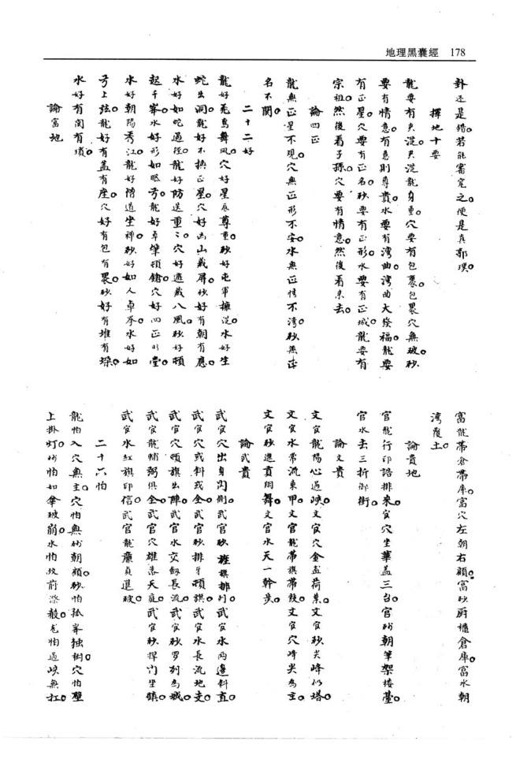

<!-- V3_SOURCE_ID:book010-b000034-p000-ba853550c1 -->

这段讲风水相关的宜忌和理论：朝向为秋朝的格局怕水偃伏而去，水直去的格局怕抵触龙身。龙的走势像死路一样的属于孤绝格局，穴的形态像筲箕的属于虚结的格局。秋的形态像角爪一样肥凸的不吉，水的形态像落灯转的不吉。来龙短促的格局即使富裕也不长久，穴落在虚处的不可以扦葬。朝向欣浅的会导致退失田产，水势少而卷曲的会损害少年人。龙的长势很好却不结穴，这种情况叫作有君无穴，难以形成好格局。没有东龙的情况叫作实若虚，难以形成横结的格局。龙脉随水而去的叫作有情无顾，水虽然屈曲却没有玖城的情况叫作金彬。箭关是师父亲口亲传的内容，这部水经出自阴阳地理的十手名目。如果能依照这个方法来操作，贫穷的状况很快就能得到改善，迎来荣光。时下的风水师不用刻意说玄妙的话，有没有真本事明眼人一看便知，不用装糊涂。熟读《黑囊经》，尽可以走遍天下都通行无碍。《黑囊经》的语句入情入理，非常浅显易懂，但是其中也有需要特别解读的句子，比如卦何穴中作穴、看左右嵩三折、卯卫廉贞退破、红旗印信等句子，没有经过考证问询就不能随意解读，懂了这些就可以通晓天下的风水道理。现在的人在研习的时候，把《雪心赋》《囊金》等书奉为圭臬，抱着一种固定的看法死记硬背，没过几天合上书本一想，还没把山川的道理想明白，就觉得自己已经把所有灵秘的内容都看透了，自信可以和曾公、杨公比肩，继承吴公、廖公的造诣。等到真的挑一个日子上山去实地勘验，一眼望去只见山冈上樵路杂乱，坎卦方位的水势纷乱，分不清哪一枝是中抽的脉，哪一枝又是角帐的脉，哪条是干龙，哪条是枝龙，哪个是龙神，哪个是后砂。龙没有逆砂就断定它会行运衰败，穴没有违势就直接判定它能结地，一看到一片杂乱的山水，平日里学的那些学问到这里半点儿都用不上，陷入了窘境。这个时候有两种人处理这种情况：一种是刚愎自用的人，到了这个地步没有办法，就胡乱判断，不管山川的实际形态是否符合，就自以为是，这种人就不必说了。还有一种虚心好学的人，到了这个时候就会后悔从前的狂妄，觉得自己学到的术法还不够，就会去看曾公、杨公诸位前贤留下的《疑龙经》《撼龙经》等典籍，里面的法门要义都在，只是不能堆砌字面意思而曲解了道理。理气的方法是在穴位点定之后，从穴位中格定龙的来脉，龙的骨脉适合立什么向，配合水倒左或者倒右的情况适合立什么向，在龙和水两者的要求之间斟酌出一个合适的朝向。如果龙脉的走势不吉，就前后调整几尺的位置来趋吉避凶。如果一个朝向不能同时匹配龙势、收纳水势，就立内向来顺应龙势，立外向来权衡收纳水势。判断龙的好坏不用纠结其他无关的因素，只要在乘得三吉六秀的位置定穴就可以，这就是所谓的四大神。小神指的是乙、辛、丁、癸，中神指的是甲、丙、寅、壬。水的走势要小神流入中神，中神流入大神，长流的形态叫作三折禄马上御。什么是廉贞退破？就是廉贞星作为祖山，退落之后化作破军星，龙的破军星方位手脚带戈戟倒载，所以主出武贵。什么是红旗印信？六五临于宣武方位的曲水叫作红旗，病方的廉贞水叫作符印，这些都主武贵荣显。

> **释读存疑：** 秋朝；秋如角爪者肥凸；水如落灯转；欣朝浅者退田；无东龙谓之实若虚以难横；玖城；金彬；箭关；十手；光崇；施间；种解句；卦何穴中作穴；左右嵩三折；卯卫廉贞退破；用宽之下；见池天执一积；东兴入山事目；角帐；龙神；龙无逆决其行败，穴无违竟其以结；好季之人；累龙入骨宜立累向；消物；进退段尺以趋进；内向纪龙，外向权格；三吉六秀；四大神；大神；三折禄马上御；破军手脚带戈才倒载所以出式；六五少临宣武；本地硬校验仍未通过，已记录供后续自动处理或人工核对。

查看对应原文

<!-- V3_FOLDBACK_BEGIN:book010-b000034-p000-ba853550c1 -->

秋朝者怕偃水去者怕抵龍如死路者孤絕穴如筲箕者虛結秋如角爪者肥凸水如落灯轉龍來短者富不堅穴落虛者不可扦欣朝浅者退田用水少捲者損少年龍惟好不結穴謂之有君無穴難好無東龍謂之實若虛以難橫隨水去謂之有情無顧水雖屈無玖城謂之金彬箭關師親傳此水經說出陰陽地理名十手若能依此法收貧立見有光崇時师不用施间說有眼分明兩日盲熟讀黑囊經一尽任君天下去橫行黑囊經之言句入情入理極淺極易然其中亦有種解句如卦何穴中作穴看左右嵩三折卯衛廉貞退破紅旗印信等句非有考間則不亂解可以知天下今人於用寬之下時雪心賦囊金在見池天執一積不滿數日閉本一想不竟山川之理了然胸中天凡靈秘一目可尽自信可以並駕曾楊肩繼昊參矣一月東興入山事目一望只見山岡樵乱坎水見攘此一枝是中抽那一枝又角帳何條是幹何條是枝耶是龍神耶是後砂龍無逆决其行敗穴無違竟其以結上見一盤山水亂得平日所得學向至此俱一毫用不青而投窮矣此際又有二種人竟地其一等剛懼自用之夫至此無可奈何竟貳斷起來不受山川是否自以為是此種人無論矣有一種好季之人至此自侮從前之妄喪术進多者則曾楊諸公自有疑龍撼龍諸經上：法味在但不可以堆明而生壓理氣之於穴瓦点定之後于是從穴中格其係累龍入骨宜立累向配合水倒左例右宜立某向消物於二者之中則酌一向或龍脉不吉則進退段尺以趨进或一向不能配龍收水則立內向紀龍外向权格龍不受是非只于乗得三吉六秀處定穴此所謂四大神也小神者乙辛丁癸也中神者甲丙寅壬也水要小神入中神中神入大神長流曰三折祿馬上御斯何為廉貞退破曰廉貞作祖退落破軍以龍破軍手腳帶戈才倒載所以出式何為紅旗師信曰六五少臨宣武曲水曰紅棋病方廉貞水曰符印皆主武貴榮顯

<!-- V3_FOLDBACK_END:book010-b000034-p000-ba853550c1 -->

<!-- V3_SOURCE_ID:book010-b000035-p000-07ef1f0f78 -->

## 論陰陽 — 论阴阳

查看对应原文

<!-- V3_FOLDBACK_BEGIN:book010-b000035-p000-07ef1f0f78 -->

## 論陰陽

<!-- V3_FOLDBACK_END:book010-b000035-p000-07ef1f0f78 -->

<!-- doc003 PDF 第 183 页：旋转/复杂版面 OCR 供检索；内容与排版以原页图为准。 -->
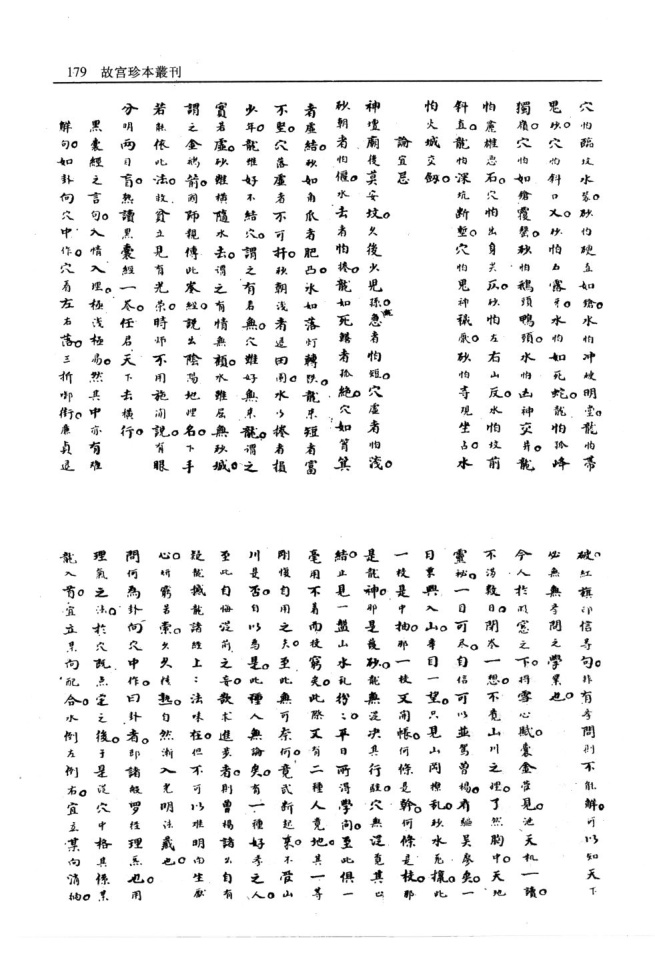

<!-- V3_SOURCE_ID:book010-b000037-p000-712969154b -->

各类地理风水书籍的内容虽然各不相同，但核心都离不开阴阳两个字，足以概括风水的核心要义。所以古人说：“识得阴阳颠倒颠，便是人间地行仙。”山体耸立静止，属于阴；水流动荡奔涌，属于阳。夫妇交合才能孕育生命，山水交合才能结成吉地。所以郭氏说：“来积止聚，冲阳和阴。”蔡氏说：“大抵天下道理，静中求动，动中求静。”所以凡是能结穴的龙脉，必然走势踊跃、有翔舞的姿态；吉地的水，必然回转蜿蜒、流淌悠扬。至于出现山形偃便侧勒，水势激割冲射的情况，对应原文提到的“靜不萬靜動不禹動”“山冰之不融待”的表述，这部分文字存在讹误，具体含义难以确定。由此可知，能结穴的地方，山势必然逆势而上与水交汇，水势必然聚合与山相会，就像前人所说的：山本来是静止的，妙处就在它动的态势；水本来是流动的，原文表述为“水本動秋在靜处”，此处“秋”字含义不明。如果山势顺走飞散，水势不合直走，这就是阴阳不交，原文此处写为“秸地”，应为“结地”的讹误，这种情况绝对不是能结吉地的地方。

> **释读存疑：** 羕；山之偃便側勒；靜不萬靜動不禹動；山冰之不融待；水本動秋在靜处之“秋”

查看对应原文

<!-- V3_FOLDBACK_BEGIN:book010-b000037-p000-712969154b -->

地理諸書之羕不同穩不外乎阴阳兩字足以括其大旨故古人曰識得阴阳顛倒顛便是人间地行仙蓋山体峙而靜阴也曰也水悴流而動阳也夫也夫婦交而孕成山水交而地結故郭氏曰來積止聚冲阳和阴蔡氏曰大抵天下道理歌何靜中求動中求靜故凡成龍之山必踴躍翔舞地之水必湾孫悠揚若夫山之偃便側勒水之激割冲射則靜不萬靜動不禹動山冰之不融待者也此可知結穴之地山必逆而水交通水必合而興山会右人所謂山本靜妙在動处水本動秋在靜处是也若夫山順走而飛水不合而走是謂阴阳不交斷非秸地之所可知矣

<!-- V3_FOLDBACK_END:book010-b000037-p000-712969154b -->

<!-- V3_SOURCE_ID:book010-b000038-p000-25d98204d2 -->

## 尋荒行止論 — 寻荒行止论

查看对应原文

<!-- V3_FOLDBACK_BEGIN:book010-b000038-p000-25d98204d2 -->

## 尋荒行止論

<!-- V3_FOLDBACK_END:book010-b000038-p000-25d98204d2 -->

<!-- V3_SOURCE_ID:book010-b000039-p000-00f16ed57b -->

所谓行，指的是龙的活动没有停止；所谓止，指的是龙停留不再移动。怎么判断龙在行进？看水流的分界情况，这就是龙行经的地方。怎么判断龙已经停留？看水流交汇、山势汇聚的位置，这就是龙停留的地方。水与山交汇没有固定的方位，龙气会聚因为水流的分界而旋转停聚。所以扬氏说：龙分开爪牙伸展时，就是想要行进；收起爪牙显得安适，就是想要停留；爪尖向后挠动闪烁，就是龙要离去；手足向前伏低，就是龙要停驻。古人又说：有一种口诀可以识别龙的行进，山势脱卸剥换向前腾跃，就是龙在行；还有一种方法可以识别龙的停留，山势层层合抱如同朝拱，就是龙在止。这就是通过山势的来去分合，就能识别龙的起止。察氏说：龙出发行进时，必然有自然的来势，会有分水引导它前行；龙隐没停留时，必然有自然的止势，会有合水作为它的边界。只有合水没有分水，说明龙的来势不明确；只有分水没有合水，说明龙的停驻不真实。这就是通过水流的分合动静，就能识别龙的起止。如果不这么判断，就会心神迷惑，分不清龙的起止，只看到龙身的枝节余脉，胡乱指认是乳头，混淆左右的枝脚，把略微弯折的地方错当成虎砂，糊涂蒙混，看起来好像符合风水的表面要求，仔细核查下来，根本没有真正的龙停留落脚。所以枚利氏说：难道还有开立门户朝向，行“德婦風翼游麟”的情况吗？说的就是这个道理。因此善于寻找龙的人，一定要穷究龙身出发的源头；善于审察局势的人，一定要寻求水流交汇横拦的位置。所以刘氏说：砂山如同浪涛涌动，水流好似鱼鳞交错，据此可以识别龙来的踪迹；水流如同横弓，收住龙气如同勒马，谁能知道这是龙停驻的根基，说的就是这个道理。真龙从出身之处，层叠如同浪涛涌动，前去而不可阻挡；水流跟随龙气逐段分流，如同鱼的鳞片两两交错分开，这就是龙在行进的表现。等到龙停留的地方，水流在穴前交汇，如同横弓收转，环抱在左右如同勒住马缰，这就是龙在停驻的表现。然而龙的行止，世俗之人不容易知晓，很多人看到龙行进时枝脚的端头略微转向，分布出类似合格的表面形态，就说可以点穴，这根本不是龙气凝聚的大地，就像狂风中的树林里栖息的鸟，哪里会有安稳停留的翅膀；湍急水流里游动的鱼，哪里会有固定的踪迹。强行在这里扦穴，福运不会长久。

> **释读存疑：** 枚利氏所言‘德婦風翼游麟’具体所指不详

查看对应原文

<!-- V3_FOLDBACK_BEGIN:book010-b000039-p000-00f16ed57b -->

耄之行動未住曰行停止不去曰止何以知其行水之所分所幾此尤之行处也何以知其止水之所交山之所会此卷之止处也德之水共山交而無方聚尤因水界而炁旋止也故揚氏曰分牙布爪耄欲行藏牙稱欣尤哉住撓掉闪后尤歌去手足向前尨哉止古人又曰有訣法識龍行山脫部向前騰又一法知尤止山山合抱如朝拂此郎山之來去分合而可識尤之起止也察氏曰其出也必有自然之來則有分水以導之其沒也必有自然之止則有合水以界之有合無分則其來不有分無合則其止不真此即水之分合動靜而可識尤之起止也不然心目昏迷起止莫識徒得尤身枝撓潘下指為乳頭混認左右枝腳畧鉤錯作尤虎糊塗混過亦似門面堪現精細審來並無真尤住落枚利氏曰豈或開門立面德婦風翼游麟正此謂也是以善尋卷務穷尤身之發足善審局者務求秋水之交橫故刘氏曰砂如浪湧水似鱗交准識方來之跡水似橫號秋尤勒馬孰知止扎之災正此謂也蓋真尤出身復秋疊如浪之湧去而莫禦水之隨尤滴分流如魚之鱗片二交分此便是尤之行也及其尤止之处水交分于穴前而似橫弓秋轉抱于左右而似勒馬此便是尤之止也然卷之行止俗未易知多向尤行枝脚秋頭畧轉分布门面謂可点穴殊非炁鍾大地如風林宿鳥烏有寧翼急水遊魚豈有蹤鱗強蔡不久

<!-- V3_FOLDBACK_END:book010-b000039-p000-00f16ed57b -->

<!-- V3_SOURCE_ID:book010-b000040-p000-34114b1e79 -->

水与火的温暖交融形成了生气，生气流动时本来是充满四周的，但安葬必须找到它停驻凝聚的地方，之后才能承接得到生气。只是生气藏聚在地下，没有办法直接看见，要怎么知道它停驻凝聚的位置并找到它呢？要知道内在的东西必然会在外部显现出形态，观察外在的表现就可以推知内在的情况。生气凝聚的地方，它的上方必然有动气，什么是动气？就是凹凸起伏的穴晕。生气潜藏在地下，穴晕显现在地表，就像鱼在水中，一游动水面自然会形成一圈晕影，看见晕影就可以知道水里有鱼。所以想要知晓生气的情况，必须精熟识别穴晕的方法。

查看对应原文

<!-- V3_FOLDBACK_BEGIN:book010-b000040-p000-34114b1e79 -->

水火之煖淘融為生炁其流行者故在充周然塟必求其止聚之处而後可以乗得之但生炁藏蓄于內無可見將何以知其止聚而求之典抑知誠中必形外見外可知內生炁所聚之处其上必有動無動炁者何即凹突之穴暈是也生炁潛于下暈形現于上如魚在水中一動其水上自成一暈見暈可以知魚也故欲知生炁須精熟暈法

<!-- V3_FOLDBACK_END:book010-b000040-p000-34114b1e79 -->

<!-- V3_SOURCE_ID:book010-b000041-p000-83eb22154a -->

水火是山的精神，土金是山的本体，木是山的精神在本体上的显现。所以看到土石松散、草木枯焦的山，就知道它的精神不足，没有生炁。

> **释读存疑：** 原文‘倅質’释为‘本体’属于合理意译，但‘倅’原义为副，此处是否指附属质地原文未明

查看对应原文

<!-- V3_FOLDBACK_BEGIN:book010-b000041-p000-83eb22154a -->

水火者山之精神也土金者山之倅質也木者其精神發現于倅質者也故見土石鬆散草木焦枯之山便知其精神不足為有生炁

<!-- V3_FOLDBACK_END:book010-b000041-p000-83eb22154a -->

<!-- V3_SOURCE_ID:book010-b000042-p000-f893069d00 -->

“山倅不化”、完全没有变化的山，只有流动的气，没有停驻积蓄的气，只可供龙通行，不能寻找穴位。所以能形成穴位的山，自然会有形态变化，必然会形成四个凸起的太极圆晕。

> **释读存疑：** “山倅不化”具体所指不详

查看对应原文

<!-- V3_FOLDBACK_BEGIN:book010-b000042-p000-f893069d00 -->

山倅不化毫無变動者止有流行之炁却無止畜之炁惟可行尤不可求穴故成穴之山自然变動必成四突之太極圓暈

<!-- V3_FOLDBACK_END:book010-b000042-p000-f893069d00 -->

<!-- V3_SOURCE_ID:book010-b000043-p000-de5c31f9ff -->

地理的道理，被郭氏的“救語”说尽了。安葬的道理，不过是承接生气罢了。为什么这么说？人活着，是因为禀受了生气才得以生存，所以人感应到天地的煞气，感应轻的就会生病，感应重的就会死亡。老年人的生气消尽了，所以也会死亡，这就是生气可贵的原因。死者的骸骨看起来似乎不需要承接生气，但死者的骸骨是由生气生成的，所以骸骨得到生气，死者的神灵就会安妥，进而能给生者带来福运；如果触犯了煞气，死者的神灵就会不安。

> **释读存疑：** “郭氏救語”具体所指不详

查看对应原文

<!-- V3_FOLDBACK_BEGIN:book010-b000043-p000-de5c31f9ff -->

地理之道被郭氏救語道尽蓋葬之道不过秉生炁也何也人之生也以稟生而生故人感觸天地之煞炁輕則病而重則死老年之人則生炁消尽故亦死此生炁之所以貴也夫死骨似不必秉生炁矣然死骨乃生炁所成者故得生炁則其神妥而生福犯煞炁則神不安

<!-- V3_FOLDBACK_END:book010-b000043-p000-de5c31f9ff -->

<!-- V3_SOURCE_ID:book010-b000044-p000-8d7bdb45d1 -->

陰陽二氣說

查看对应原文

<!-- V3_FOLDBACK_BEGIN:book010-b000044-p000-8d7bdb45d1 -->

陰陽二氣說

<!-- V3_FOLDBACK_END:book010-b000044-p000-8d7bdb45d1 -->

<!-- V3_SOURCE_ID:book010-b000045-p000-d423057c2d -->

阳炁上升，从子时开始，到巳时达到极盛，根源于水，在火中显现，是地上的生炁；阴炁下降，从午时开始，到亥时达到极盛，根源于火，在水中盛大，是地下的生炁。所以万物生长在春夏，枯骨得到荫庇在秋冬，就是因为阳炁在巳时最盛，阴炁在亥时最盛。

查看对应原文

<!-- V3_FOLDBACK_BEGIN:book010-b000045-p000-d423057c2d -->

陽炁之升始于子而極于巳根于水而發見于火為地上之生炁阴炁之降始于午而極于亥根于火而盛大于水為地內之生炁故萬物之生長在春夏而枯骸之得蔭在秋冬阳炁盛于巳阴炁盛于亥也

<!-- V3_FOLDBACK_END:book010-b000045-p000-d423057c2d -->

<!-- V3_SOURCE_ID:book010-b000046-p000-84015e09ec -->

水和火是生气的根本，火是天的神气，水是地的精气。土壤中的暖气就是火，土壤中的湿气就是水。精气与神气交融，温暖与湿润相互配合，生气就从中产生了。如果只有温暖却不湿润，有火无水，就会干燥，干燥的就是煞气，承接这种气就会招来凶祸；如果只有湿润却不温暖，有水无火，就会寒凉，寒凉的就是死气，承接这种气就会导致家道退败。所以必须承接生气。就像地面上的万物，太过寒冷就会冻死，太过干燥就会燥死，地下的情况也是一样。生气害怕风，因为风能吹冷暖气，吹燥湿气。文中提到“穴喜秋衛者以無衛則孤車孤車則寒而不煖也”，这一表述的具体所指不详。穴喜欢水流交汇，因为水流不交汇气就会涣散，气涣散就会干燥而不湿润。吉穴如果扦葬位置过高而招来凶祸，是触犯了燥气；如果扦葬位置过低而出现人丁冷落、家道败退的情况，是触犯了寒气。所以地块有没有吉气，要看生气的得失；文中还说“地理之李一乗生炁而已矣”，这一表述存在讹字，具体含义不详。

> **释读存疑：** “秋衛”具体所指不详；“孤車”具体所指不详；“地理之李一乗生炁而已矣”存在讹字，具体含义不详；1轮自动修复后核义模型仍建议修订，已保守记录。

查看对应原文

<!-- V3_FOLDBACK_BEGIN:book010-b000046-p000-84015e09ec -->

水火者生炁之根也火者天之神炁水者地之精炁土中之煖炁火也土中之淘炁水也精神交融煖闕相為而生炁出焉放煖而不潤有火無水則燥然燥者煞炁也秉之則發凶禍而不煖有水無火則卑溫卑溫者死炁也秉之則主退敗故必秉生炁也規于地面之萬物太寒則凍死太早則燥死地中亦然生炁畏風者以風能吹冷煜炁吹燥潤炁也穴喜秋衛者以無衛則孤車孤車則寒而不煖也穴喜水交者以不交則傾散傾散則燥而不潤也吉穴太扦高而斧凶祸者犯燥也太扦低而冷退者犯溫也故地之有無辨于生炁之得失辨于生炁地理之李一乗生炁而已矣

<!-- V3_FOLDBACK_END:book010-b000046-p000-84015e09ec -->

<!-- V3_SOURCE_ID:book010-b000047-p000-4e7b26af08 -->

乗生炁說

查看对应原文

<!-- V3_FOLDBACK_BEGIN:book010-b000047-p000-4e7b26af08 -->

乗生炁說

<!-- V3_FOLDBACK_END:book010-b000047-p000-4e7b26af08 -->

<!-- V3_SOURCE_ID:book010-b000048-p000-65e96ef3d1 -->

而招致灾祸的说法，书中所说的“生熙”，仅指穴中的生炁而言。但地理的种种方法，哪一样不是秉持生炁呢？水要让它从生方来、从墓方去，这一水法全是秉持生炁。方位以旺相为贵、以孤虚为贱，这一理炁方法全是秉持生炁。年月适宜生旺、忌讳休废，克择这一选择方法全是秉持生炁。地理的道理，完全就是秉持生炁的道理。能够知晓秉持生炁，那么地理的全部功用就都具备了。“秉生炁”这三个字，真是精妙啊，它概括尽了地理的全部精髓。如果不是郭氏，谁能说出这样的话呢？0

查看对应原文

<!-- V3_FOLDBACK_BEGIN:book010-b000048-p000-65e96ef3d1 -->

而降禍也書中生熙固僅指穴中之生炁言然地理種 種法何莫非秉生炁乎水欲其生來而墓去水法一乗 生炁也方位貴旺相而賤孤虛理炁一秉生炁也年月 宜生旺而忌休廢尅擇一乗生炁也地理之道儀尽其 秉生炁之道也能知秉生炁則地理之能事畢矣至哉 秉生炁三字者括尽地理之全神也若非郭氏孰能言 之0

<!-- V3_FOLDBACK_END:book010-b000048-p000-65e96ef3d1 -->

<!-- V3_SOURCE_ID:book010-b000049-p000-0beffe333e -->

## 秉炁論 — 秉炁论

查看对应原文

<!-- V3_FOLDBACK_BEGIN:book010-b000049-p000-0beffe333e -->

## 秉炁論

<!-- V3_FOLDBACK_END:book010-b000049-p000-0beffe333e -->

<!-- V3_SOURCE_ID:book010-b000050-p000-32234ed2ca -->

大凡地理的要领，分为尤、穴、秋、水四个方面，而核心方法不外乎乘生炁这一句话。因此，尤的作用是运行这股生炁，穴的作用是聚集这股生炁，秋的作用是护卫这股生炁，水的作用是涵养这股生炁。其中的精妙关键，在于能够秉持生炁。秉持的方法各有不同，有的凭借泥丸，有的凭借两耳，有的凭借腰踰，有的凭借涌泉，秉持的方法虽然不一样，但都不外乎根据尨势、山体、炁脉这三者来权衡考量。所以如果尨势偏向左方，那么左方就是生位，右方就是死位；如果尨势偏向右方，那么右方就是生位，左方就是死位。生炁顺向而来就逆向承接，逆向而来就正向扦葬；斜向的态势就正向安置，正向的态势就斜向扦插；直来的尨要在横向的位置撞接入穴，横来的尨要在直向的位置衔接入穴。这就是从尨势推究能够得到的秉持生炁的方法。

> **释读存疑：** 原文中的“尤”“秋”为讹字，具体所指暂不明确；原文“尨勢”的“尨”暂保留原字，未擅自改为“龙”

查看对应原文

<!-- V3_FOLDBACK_BEGIN:book010-b000050-p000-32234ed2ca -->

凡地茲分尤穴秋水之四端而法不外莫乗生炁之一語是故尤以行此生炁者也穴以聚此生炁者也秋以衛此生炁者也水以养此生炁者也而其妙要在于能秉戎秉以泥丸或秉以兩耳或秉以腰踰式乗以湧泉秉法不同然不外尨勢山体炁脉三者而权之也故尨勢推左則左為生右為死耄勢推右則右為生左為死順來逆受逆來順扦斜勢正安正勢斜挿直尨却向橫中撞橫尨却向直中接此自尨勢推之而可得秉炁之法也

<!-- V3_FOLDBACK_END:book010-b000050-p000-32234ed2ca -->

<!-- V3_SOURCE_ID:book010-b000051-p000-1d50e1142a -->

安葬时秉持生炁，可福荫后人之说。

查看对应原文

<!-- V3_FOLDBACK_BEGIN:book010-b000051-p000-1d50e1142a -->

葬秉生炁福蔭後人說

<!-- V3_FOLDBACK_END:book010-b000051-p000-1d50e1142a -->

<!-- V3_SOURCE_ID:book010-b000052-p000-5baf1726c4 -->

“契”所说的是藏的意思，“秉”所说的是接的意思。生炁是天地间的一元之炁，是生发孕育万物的气，它运行在地下很难被察见，只能遵循地理的规律去探寻。要预先勘察星峰和来脉，其次查看入首的分合情况，忌讳凑簷枕秫，要舍弃死地挨近生地，分辨形势的缓急，采用后饶减、定浅深的方法，让墓穴处于恰到好处的位置。如果垣局周密，元炁常存，而且炁温脉厚，安葬的人找到穴位所在，让枯骨得以承接生炁，那么风水堪舆的事就全部做到位了。如果出现水割脚、风吹穴的情况，生炁就会飘散荡失，出现脉寒气冷的状况。父母是子孙的根本，子孙是父母的枝脉，二者的炁是同类相通的，能从根本传递到枝末。选择吉地安葬亲人，就好比种树，给树根培土加固，树叶自然就会繁茂，道理本来就是这样。所以安葬的正确做法是承接地中的生炁，有“反炁狗音以蔭所生”的说法，具体含义不明。因此经书上说：炁相互感应就能荫庇后代，亡者的福泽会惠及在世的亲人，这都是因为明白同一炁脉会相互感应的道理。有人疑惑，如果抱界秉嗣道，又很快炁脉不相连接，又怎么能起到荫庇作用呢？他们不知道心念与炁相通，情感能通，炁就能通，有德行义举就能获得荫庇。后母不荫庇前母所生的儿子，前妻能荫庇后妻所生的儿子，这从现有的螽斯相关的事例中就可以知道。

> **释读存疑：** 原文“反炁狗音”为讹误，具体所指不详；原文“抱界秉嗣道复臾臾炁不相属”语义暂不明确；1轮自动修复后核义模型仍建议修订，已保守记录。

查看对应原文

<!-- V3_FOLDBACK_BEGIN:book010-b000052-p000-5baf1726c4 -->

契之為言藏也秉之為言接也生炁者天地一元之炁發生萬物者也行乎地中難見惟循地之理以求之預審星峰來脈次看入首分合戒湊簷枕秫捨死挨生別其急緩後饒減淺深之法使墓得恰中之道若垣局周密元炁常存而炁溫脈厚葬者解穴其所在使枯骨得以秉之則地理之能事畢矣若見水割風吹則生炁飄蕩而脈寒炁冷矣父母為子孫之本子孫為父母之枝乃炁倅相同由本而達枝也擇地契親若種木之類梏其根而葉自茂理有必然則葬正以衰地之生炁反炁狗音以蔭所生之法也故徑曰炁感而蔭鬼福及人惟明一炁之相感也或疑抱界秉嗣道復臾臾炁不相屬亦何能蔭不知心流乎炁情通則炁亦通義德則蔭亦抱後毋蔭前兒前妻蔭後子則現煩蛉可知也

<!-- V3_FOLDBACK_END:book010-b000052-p000-5baf1726c4 -->

<!-- V3_SOURCE_ID:book010-b000053-p000-8910f947f2 -->

论佶局

查看对应原文

<!-- V3_FOLDBACK_BEGIN:book010-b000053-p000-8910f947f2 -->

論佶局

<!-- V3_FOLDBACK_END:book010-b000053-p000-8910f947f2 -->

<!-- V3_SOURCE_ID:book010-b000054-p000-8e1bcdaa9f -->

什么是局？直来而撞背的，名为顺结；顺来而斜出的，名为内结；正来而侧落的，名为横结；或者翻身而頎祖，或者转面以当朝极，或者如倒骑之类，都名为逆结。由此可知，四藩之中有四结。

> **释读存疑：** 原文中“頎”疑为“斬”的讹误，“戎”疑为“生”的讹误；原文“頎”“戎”为讹字，具体含义需校勘确认

查看对应原文

<!-- V3_FOLDBACK_BEGIN:book010-b000054-p000-8e1bcdaa9f -->

何謂局直來而撞背者名順結者也順來而斜出者名內結者也正來而側落者名橫結者也或番身而頎祖戎轉面以當朝極之或如倒騎之類俱逆結者也此可知四藩之中有四結矣

<!-- V3_FOLDBACK_END:book010-b000054-p000-8e1bcdaa9f -->

<!-- V3_SOURCE_ID:book010-b000055-p000-44fe7e8558 -->

论分合

查看对应原文

<!-- V3_FOLDBACK_BEGIN:book010-b000055-p000-44fe7e8558 -->

論分合

<!-- V3_FOLDBACK_END:book010-b000055-p000-44fe7e8558 -->

<!-- V3_SOURCE_ID:book010-b000056-p000-dbc87e4cba -->

什么是分合？随龙而来的水，汇聚在大明堂的，是大分合；界穴而止的水，合于内明堂的，是次分合；入穴融结之处，上起球，而水从上分下，有簷而水泛下，合所会于龙虎内小明堂的，是小分合。有这样的分合，那么穴就真；没有这样的分合，那么穴就伪。有合无分，那么它的来脉不真，因为它内部没有生炁可承接；有分无合，那么它的止处不明，因为它外部没有堂炁可承受；有分有合，那么就有来有止、有出有没，于是龙穴融结确定无疑，然后才是全炁之地。

> **释读存疑：** 原文中“尤”疑为“龙”的讹误，“大明堂”前疑脱“大”字，“尤虎”疑为“龙虎”的讹误；原文“尤”“尤虎”为讹字，具体所指需校勘确认

查看对应原文

<!-- V3_FOLDBACK_BEGIN:book010-b000056-p000-dbc87e4cba -->

何謂分合隨尤而來之水會于大明堂者大分合也界穴而止之水合于內明堂者次分合也入穴融結之处上起球而水從上分下有簷而水泛下合所會于尤虎內小明堂小分合也 有此則穴真無此則穴偽也 有合無分則其來不真為其內無生炁可接也 有分無合則其止不明為其外無堂炁可受也 有分有合則有來有止有出有沒斯尤穴融結的定無疑然後為全炁之地也

<!-- V3_FOLDBACK_END:book010-b000056-p000-dbc87e4cba -->

<!-- V3_SOURCE_ID:book010-b000057-p000-3ec0d9ada0 -->

左右前後分合论

查看对应原文

<!-- V3_FOLDBACK_BEGIN:book010-b000057-p000-3ec0d9ada0 -->

左右前後分合論

<!-- V3_FOLDBACK_END:book010-b000057-p000-3ec0d9ada0 -->

<!-- V3_SOURCE_ID:book010-b000058-p000-bdf29b63d7 -->

水之分合有三其一自立穴球頂水從上分合于穴暈下尤虎內者此一合也名曰小分合次自主山起頂上分而合于卷虎外案山內此二合也名曰次分合三自起祖分支水從兩分而會于案山外合泛大水口出者此大合水也名曰大分合然合水又有前淺左右之不同順來者合于前迴者合于後橫或合于左或合于右左右傍合勝于前合然傍合又不如後合蓋前合者順多不得水傍合者水橫過穴前而未必汪洋入口至于後合則當張湖而隨尤之水無不入口矣故古人謂前合襟易得後合襟難求以其得水之難也摠之有分有合則穴之結作始真否則水去而不合卷去而不住其穴待必不真也此察水分合為鑑水第一之切務云

查看对应原文

<!-- V3_FOLDBACK_BEGIN:book010-b000058-p000-bdf29b63d7 -->

水之分合有三其一自立穴球頂水從上分合于穴暈下尤虎內者此一合也名曰小分合次自主山起頂上分而合于卷虎外案山內此二合也名曰次分合三自起祖分支水從兩分而會于案山外合泛大水口出者此大合水也名曰大分合然合水又有前淺左右之不同順來者合于前迴者合于後橫或合于左或合于右左右傍合勝于前合然傍合又不如後合蓋前合者順多不得水傍合者水橫過穴前而未必汪洋入口至于後合則當張湖而隨尤之水無不入口矣故古人謂前合襟易得後合襟難求以其得水之難也摠之有分有合則穴之結作始真否則水去而不合卷去而不住其穴待必不真也此察水分合為鑑水第一之切務云

<!-- V3_FOLDBACK_END:book010-b000058-p000-bdf29b63d7 -->

<!-- V3_SOURCE_ID:book010-b000059-p000-99e4ad83be -->

尋尤立穴以水為先論

查看对应原文

<!-- V3_FOLDBACK_BEGIN:book010-b000059-p000-99e4ad83be -->

尋尤立穴以水為先論

<!-- V3_FOLDBACK_END:book010-b000059-p000-99e4ad83be -->

<!-- V3_SOURCE_ID:book010-b000060-p000-dc07308bab -->

人皆知尨穴秋水為理之四用而四者之中独以尤為之首者何盖以尤者根本也故常現尨苟有真來穴必有真穴倍之处秋必抱欣抱之处水必聚是尤真穴的而玖水隨之故廖氏曰地理由來分四用皆以尤為重吉凶祸福此中生須要真情此可知四者之中尤為本也然既曰尤為根本而独以水括于尨穴秋之後者又何盖以水者尋尤之要法也故古人云炁為水之母水為炁之子來水所以導尤行界水所以止耄住水源有長短而卷之遠近可卜水勢有大小而尤之枝幹可亦察水勢之湾逆而朝穴之賓主判于此現水流之來去而知穴秋之順逆别于斯故古人曰未看山先看水真尤落处水聚真穴落处水纏若有曲流之水定有曲轉之秋此可知尋地之法水為要也

查看对应原文

<!-- V3_FOLDBACK_BEGIN:book010-b000060-p000-dc07308bab -->

人皆知尨穴秋水為理之四用而四者之中独以尤為之首者何盖以尤者根本也故常現尨苟有真來穴必有真穴倍之处秋必抱欣抱之处水必聚是尤真穴的而玖水隨之故廖氏曰地理由來分四用皆以尤為重吉凶祸福此中生須要真情此可知四者之中尤為本也然既曰尤為根本而独以水括于尨穴秋之後者又何盖以水者尋尤之要法也故古人云炁為水之母水為炁之子來水所以導尤行界水所以止耄住水源有長短而卷之遠近可卜水勢有大小而尤之枝幹可亦察水勢之湾逆而朝穴之賓主判于此現水流之來去而知穴秋之順逆别于斯故古人曰未看山先看水真尤落处水聚真穴落处水纏若有曲流之水定有曲轉之秋此可知尋地之法水為要也

<!-- V3_FOLDBACK_END:book010-b000060-p000-dc07308bab -->

<!-- V3_SOURCE_ID:book010-b000061-p000-c45ab5af68 -->

大小聚散論山以氣止而不徒聚故諸峯散亂休晉意水以炁全而不乱蓄故群流逆去莫旁硯源頭水尾無大地每凶多而吉少來短去長少真結甞祸重而福輕神前佛後多係鬼刼之地石粗水响鮮有真氣之鍾一山顧一水帰無固小聚而昧大散之勢四山逸四水聚當知大勢而棄小郎之疵故卜氏曰一山一水有情小人所止大形大勢入司君子攸居取小醇而遺大疵是用管而規豹就眾凶而尋一吉猶緣木以求魚到氏曰無情無意漫輕遊萬嶂千山不轉頭縱有前山生秀麗須交穴是虛坵蔡氏曰大勢若聚則奇形怪穴而愈真正大勢若散則巧穴天然而反虛假合之可識四勢之貴團聚矣四勢裁取篇

查看对应原文

<!-- V3_FOLDBACK_BEGIN:book010-b000061-p000-c45ab5af68 -->

大小聚散論山以氣止而不徒聚故諸峯散亂休晉意水以炁全而不乱蓄故群流逆去莫旁硯源頭水尾無大地每凶多而吉少來短去長少真結甞祸重而福輕神前佛後多係鬼刼之地石粗水响鮮有真氣之鍾一山顧一水帰無固小聚而昧大散之勢四山逸四水聚當知大勢而棄小郎之疵故卜氏曰一山一水有情小人所止大形大勢入司君子攸居取小醇而遺大疵是用管而規豹就眾凶而尋一吉猶緣木以求魚到氏曰無情無意漫輕遊萬嶂千山不轉頭縱有前山生秀麗須交穴是虛坵蔡氏曰大勢若聚則奇形怪穴而愈真正大勢若散則巧穴天然而反虛假合之可識四勢之貴團聚矣四勢裁取篇

<!-- V3_FOLDBACK_END:book010-b000061-p000-c45ab5af68 -->

<!-- V3_SOURCE_ID:book010-b000062-p000-bbfedccc77 -->

四圍高逼穴易壓嶺上尋蹤四畔低曠穴恐露麓下幡情左高而壓穴尋右右高而壓穴尋左任我推移前逼而穴宜阡後逼而穴宜趋前隨吾進退或近壓而遠秀戒內瀉而外杖穴頃高取而論周圍或遠粗而近秀或外窄而內寬法須低藏而求窝聚四畔團弯宜識穿方而架箭衆山粗雜Ⅲ知移步以換形山水兩佳局罕有官祿兩此法知倘山不如水之有情祿當就則就之也如水不若山之秀拱官當迎則迎之焉來脉若天然休貪朝秀而誤轉遇水如弓返喜得砂蔽以深藏衆太一細取其細女坐闺中而不露象細一特取其特崔立雞群而自奇坐忌空下忌曠特論常理豈所執于番身迴梏之局山直來穴橫受多犯象忌彼烏知乎脫尤就局之权勢逆秋順誰識离鄉堪取貴水朝秋抱須知此地好救貧三山胥來望徧藏者而尋穴諸脉亂出有跌斷者則為真故蔡氏曰山川之吏態不一咫尺之轉移頓殊或低視而醜或高視而好或左視而妍或右視而媲或秀炁在下而高則否或情意偏右而左則虧此可知四勢之貴裁取矣

查看对应原文

<!-- V3_FOLDBACK_BEGIN:book010-b000062-p000-bbfedccc77 -->

四圍高逼穴易壓嶺上尋蹤四畔低曠穴恐露麓下幡情左高而壓穴尋右右高而壓穴尋左任我推移前逼而穴宜阡後逼而穴宜趋前隨吾進退或近壓而遠秀戒內瀉而外杖穴頃高取而論周圍或遠粗而近秀或外窄而內寬法須低藏而求窝聚四畔團弯宜識穿方而架箭衆山粗雜Ⅲ知移步以換形山水兩佳局罕有官祿兩此法知倘山不如水之有情祿當就則就之也如水不若山之秀拱官當迎則迎之焉來脉若天然休貪朝秀而誤轉遇水如弓返喜得砂蔽以深藏衆太一細取其細女坐闺中而不露象細一特取其特崔立雞群而自奇坐忌空下忌曠特論常理豈所執于番身迴梏之局山直來穴橫受多犯象忌彼烏知乎脫尤就局之权勢逆秋順誰識离鄉堪取貴水朝秋抱須知此地好救貧三山胥來望徧藏者而尋穴諸脉亂出有跌斷者則為真故蔡氏曰山川之吏態不一咫尺之轉移頓殊或低視而醜或高視而好或左視而妍或右視而媲或秀炁在下而高則否或情意偏右而左則虧此可知四勢之貴裁取矣

<!-- V3_FOLDBACK_END:book010-b000062-p000-bbfedccc77 -->

<!-- V3_SOURCE_ID:book010-b000063-p000-5e6024e23d -->

起止論

查看对应原文

<!-- V3_FOLDBACK_BEGIN:book010-b000063-p000-5e6024e23d -->

起止論

<!-- V3_FOLDBACK_END:book010-b000063-p000-5e6024e23d -->

<!-- V3_SOURCE_ID:book010-b000064-p000-d2085b7b0f -->

從云地有吉氣土隨而起青囊本徑原不单指平地尤 言大抵支壠穴之處生炁止聚土必高起楊么所謂 天心湧突是也惟其高越故有上分惟其高起故有下 合上分下合支壠同法故察吉炁不論支壠皆以起處 為生氣也郭氏專引之以言支壠者又自有見蓋壠龍 高起易文卷高起雄故支卷必以高起為主江北千里 平陽略有起處便為二宅古人之重平地災蓋深有見 于此耳

查看对应原文

<!-- V3_FOLDBACK_BEGIN:book010-b000064-p000-d2085b7b0f -->

從云地有吉氣土隨而起青囊本徑原不单指平地尤 言大抵支壠穴之處生炁止聚土必高起楊么所謂 天心湧突是也惟其高越故有上分惟其高起故有下 合上分下合支壠同法故察吉炁不論支壠皆以起處 為生氣也郭氏專引之以言支壠者又自有見蓋壠龍 高起易文卷高起雄故支卷必以高起為主江北千里 平陽略有起處便為二宅古人之重平地災蓋深有見 于此耳

<!-- V3_FOLDBACK_END:book010-b000064-p000-d2085b7b0f -->

<!-- V3_SOURCE_ID:book010-b000065-p000-d3c294e942 -->

廖公星辰三体歌

查看对应原文

<!-- V3_FOLDBACK_BEGIN:book010-b000065-p000-d3c294e942 -->

廖公星辰三体歌

<!-- V3_FOLDBACK_END:book010-b000065-p000-d3c294e942 -->

<!-- V3_SOURCE_ID:book010-b000066-p000-a5096d9710 -->

星辰聳者炁在高待峦峰正者炁在中凝勢如偃仰無在低下形頎左右炁內兩边肥体取瘦飢体取飽故廖氏曰一个星辰有三体立眠坐各具立是身聳炁上淨天穴此中求眠是身仰炁下陛地穴如斯是坐身屈炁中藏人穴最相當此自山体而可得乗炁之法也

查看对应原文

<!-- V3_FOLDBACK_BEGIN:book010-b000066-p000-a5096d9710 -->

星辰聳者炁在高待峦峰正者炁在中凝勢如偃仰無在低下形頎左右炁內兩边肥体取瘦飢体取飽故廖氏曰一个星辰有三体立眠坐各具立是身聳炁上淨天穴此中求眠是身仰炁下陛地穴如斯是坐身屈炁中藏人穴最相當此自山体而可得乗炁之法也

<!-- V3_FOLDBACK_END:book010-b000066-p000-a5096d9710 -->

<!-- V3_SOURCE_ID:book010-b000067-p000-9ec605dbc6 -->

廖公点穴歌

查看对应原文

<!-- V3_FOLDBACK_BEGIN:book010-b000067-p000-9ec605dbc6 -->

廖公点穴歌

<!-- V3_FOLDBACK_END:book010-b000067-p000-9ec605dbc6 -->

<!-- V3_SOURCE_ID:book010-b000068-p000-f1212d7495 -->

大凡看脉，形态活动舒展的为有生气，僵硬强直的为死脉；细嫩柔和的为有生气，粗硬蠢笨的为死脉；圆润洁净的为有生气，尖利锋锐的为死脉；要在散漫模糊的区域寻找脉气聚结的位置，这才是有生气的表现；考量脉的形态时，以藏伏不露的地段为奇妙。所以廖氏说：点穴首先要分辨四煞，调整心思不要混乱，要留意蛇思煞，不要遇到直煞、尖煞，真正懂行的人会斟酌处理这两种情况。圆润洁净是完全的吉相，藏煞是第一要务，既不要多减也不要多添，穴位要选在居中的位置，使用撞法能获得神奇的功效。穴下如果有生机，遇到直脚压煞的情况，穴位宜选在丰隆的位置，采用骑卷之法，根据地势高低调整，自然不会有凶祸；挨金法的操作也是同理。如果脉气笔直来势急迫，脱煞的穴位适宜立设，要知道粘穴落在平坦的地段，不要嫌弃穴位一侧有泥水。脉气直来相互吞没，遇到内煞的情况，穴位适宜用泛来倚靠，倚穴的操作也是这样。不要说随便选穴就能自然符合要求，要依照气脉详细推求才能掌握相应的葬法。

> **释读存疑：** “蛇思煞”具体所指需结合廖氏风水原文进一步确认，“撞法”“骑卷”“挨金法”“脱煞”“粘穴”“泛”等风水操作术语无权威释读依据，仅按原文语境作通顺处理；“蛇思煞”实为断句讹误，不存在该煞名；“撞法”“骑卷”“挨金法”“脱煞”“粘穴”“泛”等术语无权威释读依据；1轮自动修复后核义模型仍建议修订，已保守记录。

查看对应原文

<!-- V3_FOLDBACK_BEGIN:book010-b000068-p000-f1212d7495 -->

凡脉以活動者為生硬直者為死細嫩者為生粗蠢者為死員净者為生夫利者為死散昧取聚處為生量脉取隱處為奇故廖氏曰点穴先須分四煞番心莫乱蛇思煞無遇直典尖真个得人撫兩迎員净名全吉臧煞為第一無饒無減穴居中撞法奪神功穴下如生夫直腳壓煞穴宜豐騎卷高下自無凶挨金法一同無脉直來形勢急脫煞穴宜立須知粘穴落平夷休嫌穴水泥一边矣直來相沒內煞穴宜用泛來倚穴亦如然莫道穴居佩此自炁脉詳之而可得東炁之法也

<!-- V3_FOLDBACK_END:book010-b000068-p000-f1212d7495 -->

<!-- V3_SOURCE_ID:book010-b000069-p000-38d67d46ef -->

五星正俸变穴歌

查看对应原文

<!-- V3_FOLDBACK_BEGIN:book010-b000069-p000-38d67d46ef -->

五星正俸变穴歌

<!-- V3_FOLDBACK_END:book010-b000069-p000-38d67d46ef -->

<!-- V3_SOURCE_ID:book010-b000070-p000-03f83ded6e -->

金宿对应的地形扦穴时，没有窝状地形就取挂角水泡的位置。如果窝和角的形态不分明，地形表面硬实，就会有灾祸逐渐降临。木星对应的地形，有窝就从窝的位置选取，没有窝就在锹皮状的软处扦穴；“直木南口”的形态属于奇局，定是阴穴无疑。火星对应的地形结穴，必须取土填入穴中，原本就需要木乳形的结构，没有土的话难以扦穴，在（火/脉）尽的地方使用剪法才是正确的。水宿对应的地形不适宜安设水穴，下葬之后人丁会逐渐消减，最好从金顶处探寻根源，才能出产子孙。贯阴土的地形不宜再出现阴象，作穴要选圆形的，寻找腹里的金气，如果忽然向内收归，角里有流金落下，才可以作为规范。这段口诀末尾重复了“金方可作规此訣而可知五星正倅之穴矣”，内容与前文一致，通过这段口诀就能了解五星正倅对应的穴法了。

> **释读存疑：** “直木南口”疑似讹字，具体含义不详；“木乳”“剪法”“水宿”“金顶”“贯阴土”“腹里金”“流金”“五星正倅”等术语无权威释读依据，仅按语境通顺处理；“直木南口”疑似讹字，具体含义不详；“木乳”“剪法”“水宿”“金顶”“腹里金”“流金”“五星正倅”等术语无权威释读依据；本地硬校验仍未通过，已记录供后续自动处理或人工核对。

查看对应原文

<!-- V3_FOLDBACK_BEGIN:book010-b000070-p000-03f83ded6e -->

金宿用當扦取水無窝掛角水泡取若然窝角不分明硬面祸來浸木星有即：中取無郎鍬皮軟處扦直木南口却為奇阴穴定無疑火星結穴須取土入穴原來要木乳無土难扦夫尽處剪法方為是水宿不宜安水穴下了人丁漸消減好從金頂问根源麽産子孫貫阴土不宜重見阴作穴圓尋腹裡金忽如內帰角裡落流金方可作規此訣而可知五星正倅之穴矣 金方可作規此訣而可知五星正倅之穴矣

<!-- V3_FOLDBACK_END:book010-b000070-p000-03f83ded6e -->

<!-- V3_SOURCE_ID:book010-b000071-p000-27eacff298 -->

九星吏佈变穴歌

查看对应原文

<!-- V3_FOLDBACK_BEGIN:book010-b000071-p000-27eacff298 -->

九星吏佈变穴歌

<!-- V3_FOLDBACK_END:book010-b000071-p000-27eacff298 -->

<!-- V3_SOURCE_ID:book010-b000072-p000-501dde438e -->

主脉和副脉自身如果没有龙虎护卫，就借隔水奔来、朝向穴场、倒地成形的星象作为参照，副脉的标准是位置偏高。山上起顶，下方脉层重叠，龙虎均匀对称的，名为悬乳穴；上方有顶，下方没有孔窍，左右山势分抱的，名为“口违”；只有一侧有护砂、另一侧没有的，名为“车股”，需要防备脉气直窜；护砂一长一短的，名为“弓脚”，切忌斜飞出去。没有顶的地形在凹处扦穴，寻找“没骨”形态，贵在有近前的“乐”砂，放弃正位就着斜向安设侧脑穴，最好有特意来朝的山势，多重护砂环绕、缠护严密。如果护砂长而直伸向外，需要防备这类不佳的形局，这样才能得到符合要求的九曜变穴。

> **释读存疑：** “口违”“车股”“弓脚”“没骨”“近乐”“侧脑”“九曜变”等风水术语无权威释读依据，仅按原文语境作说明处理；“當防北”的“北”为讹字，按形局宜忌逻辑修正为“防备这类不佳形局”，存在推测成分；“口违”“车股”“弓脚”“没骨”“近乐”“侧脑”“九曜变”等术语无权威释读依据；“當防北”的“北”为讹字，释义为推测内容；1轮自动修复后核义模型仍建议修订，已保守记录。

查看对应原文

<!-- V3_FOLDBACK_BEGIN:book010-b000072-p000-501dde438e -->

本倅自身無尤虎護借隔水奔面倒地成星象倅准高 山上起頂下重脉尨虎均勻者名曰懸乳上有頂下無 孔左右分抱者名曰口違有边無為車股須防直竄 一長一短號弓腳切忌斜飛無頂扦凹尋沒骨貴有近 楽棄正就斜安側腦喜得特朝重卷重虎獲臂固密卷 長虎長直出當防北可得九曜变之穴矣

<!-- V3_FOLDBACK_END:book010-b000072-p000-501dde438e -->

<!-- V3_SOURCE_ID:book010-b000073-p000-a78f8e404f -->

牧堂穴情賦

查看对应原文

<!-- V3_FOLDBACK_BEGIN:book010-b000073-p000-a78f8e404f -->

牧堂穴情賦

<!-- V3_FOLDBACK_END:book010-b000073-p000-a78f8e404f -->

<!-- V3_SOURCE_ID:book010-b000074-p000-74b28f6995 -->

观察鱼尾摆的形态，要看后有倚靠、前有亲附的态势；在腰变的下方，要辨识横扦直就的逆受形态，不必拘泥于正对天心，不管是从旁求取还是正向求取，都要在龙虎砂的形态中仔细研判。龙虎横担横茜，没有龙形护砂却葬在有龙砂的位置，直向直扦的地方有气脉就安设穴位，没有气脉就用横山凑接。“南斧”形的直山，要在柔软的地段扦穴，这种方法叫“入簷”。抛鞭形的地形要辨识节段、避开尖刺，要（遇/附）根反手。枯高骨直冲天际的“打愿门”形地形，处理方式要灵活，看起来像把伞的要平视，符合提盆形的要摆出，情势紧急不能迟缓。横飞的态势符合番匾形，大瘟弦出雄的地形，粗厚带侧的要寻找打尖的位置，不要动到骨脉。点鼻形的穴位不要伤到唇状的结构。五股直来的脉气适宜横向下穴，三停的位置要在妙影中寻取脉腕。蓝扦鼬形的侧耳位置要确定龙心，牛鼻形的地形要防备牵水，奥腮形的地形要合襟。以上就是四真三法的要义。

> **释读存疑：** “鱼尾摆”“腰变”“逆受”“天心”“横茜”“南斧”“入簷”“抛鞭”“打愿门”“提盆”“番匾”“大瘟弦出雄”“打尖”“三停”“蓝扦”“牛鼻”“牵水”“奥腮”“合襟”等风水形局、操作术语均无权威释读依据；“禹根”“晴难缓”“尤心”均为讹字，修正均为推测；“尨”通“龙”为学界通用结论，但具体指向需结合更多风水文献确认；“鱼尾摆”“腰变”“逆受”“天心”“横茜”“南斧”“入簷”“抛鞭”“打愿门”“提盆”“番匾”“大瘟弦出雄”“打尖”“三停”“牛鼻”“牵水”“奥腮”“合襟”等术语无权威释读依据；“禹根”“晴难缓”“尤心”“鼠由”均为讹字，相关释义均为推测；“尨”通“龙”仅为通用推测，无文献佐证；本地硬校验仍未通过，已记录供后续自动处理或人工核对。

查看对应原文

<!-- V3_FOLDBACK_BEGIN:book010-b000074-p000-74b28f6995 -->

魚尾擺看後倚前親之勢腰變下認橫扦直就之逆受何拘对定于天心旁求正求猶在消详于卷虎橫擔橫茜無尨却塟有尤直向直扦有炁須安無炁橫山湊奔庵曰南斧直山扦柔處曰入簷拋鞭頡認節避剌要禹根反手枯高骨冲天打願門歹裁如把傘平視合提盆擺出晴难緩橫飛勢合番匾大瘟弦出雄粗帶側尋打尖休動骨点鼻莫傷唇五直宜橫下三停妙影尋腕藍扦鼠由側耳定尤心牛鼻防牽水奧腮要合襟四真三法義

<!-- V3_FOLDBACK_END:book010-b000074-p000-74b28f6995 -->

<!-- V3_SOURCE_ID:book010-b000075-p000-d1fa15ec95 -->

所谓四真，是真龙、真穴、真砂、真水；所谓三法，是高处不触犯煞气、低处不犯冷退、内部不脱离脉气。什么是真龙？穴顶有一线脉气，如丝如带，若隐若现，滴落进穴内，这就是真龙。什么是真穴？墓口上下有毬檐结构，像覆盖又像仰承，生气融聚结藏，这就是真穴。什么是真砂？指的是蝉翼、牛角形的护砂。所以乳穴如果没有蝉翼形的护砂遮蔽后方，它的气脉就会寒凉；口穴如果没有牛角形的护砂环抱下方，它的气脉就会散佚，这两种护砂就是真砂的判断标准。什么是真水？指的是虾须、蟹眼、金鱼形的水系。如果上方没有虾须状的分水，就要担心淋头的祸患；下方没有金鱼、蟹眼状的合水，就要担心割脚的祸患，这三类水系就是真水的判断标准。所以胎腹径上说，真龙已经降下，真水在后方夹护，天心位置涌起凸起，就一定有真穴。又说立穴的方法，还要再看真砂，真砂的形态符合要求，穴位的位置就端正没有偏差，砂形圆润，两路水相对，三者配合，就可以知道四真对生气的涵养是最重要的。破毬叫做煞，一般是脉气强盛却不知道调整饶减，或者脉气微弱却过于吞进导致的；破簷叫做犯冷，一般是脉气柔和却不知道吞缩，或者脉气急迫又有吐泄的弊病导致的。所以杨氏说：宁可伤到穴位，也不要伤到龙气，伤到穴位只会导致冷退败绝，伤到龙气会直接招致凶祸，由此可知吞吐的操作不能不慎重。想要没有隔断脉气的弊病，那么上方的盖金、分金不能不仔细辨明，下方的合金不能不相接依傍，来龙的金气不能不印证，在正中位置作穴，弊病就可以免除。要掌握挨内的方法，那么来脉有明股暗股的区别不能不仔细审察，脉气到的先后不能不分辨，脉气先到的不能不挨近内部，位置得当就可以乘生气。所以杨氏说：收聚砂形、衡量水势是葬法的核心，或左或右，跟着砂和水的停聚位置确定。胡矮仙说：两片三乂的穴位，自然要跟着杖法定位，斜侧枕靠尖正的位置，接迎放送，区分强弱，个字脉的当中玄妙无比。廖氏说：不管是明界还是暗界，先到的脉气必须挨近，能领会明暗换内的方法，左右都可以任意调整，综合这些内容就能掌握偏正挨拋的方法了。

> **释读存疑：** “真尤”通“真龙”、“真秋”通“真砂”、“豈”为“丝”讹字、“暇隨蟒眼”为“虾须蟹眼”讹字、“東”为“辨/量”讹字、“挨桃”为“挨拋”讹字均为根据风水语境的推测，无直接版本依据；“毬簷”“蝉翼”“牛角”“乳穴”“口穴”“虾须”“分水”“淋顽”“蟹眼”“合水”“割脚”“天心”“饶灭”“吞缩”“盖金”“合金”“来金”“挨内之法”“股明股暗”“收秋权水”“两片三乂”“杖法”“个字脉”“明暗换内法”等术语无权威释读依据，仅按语境通顺处理；“真尤”通“真龙”、“真秋”通“真砂”、“豈”为“丝”讹字、“暇隨蟒眼”为“虾须蟹眼”讹字、“東”为“辨/量”讹字、“挨桃”为“挨拋”讹字均为语境推测，无版本依据；“毬簷”“蝉翼”“牛角”“乳穴”“口穴”“虾须”“分水”“淋头”“蟹眼”“合水”“割脚”“天心”“饶减”“吞缩”“盖金”“合金”“来金”“挨内之法”“股明股暗”“收砂权水”“两片三乂”“杖法”“个字脉”“明暗换内法”等术语无权威释读依据；1轮自动修复后核义模型仍建议修订，已保守记录。

查看对应原文

<!-- V3_FOLDBACK_BEGIN:book010-b000075-p000-d1fa15ec95 -->

四真者真尤真穴真秋真水是也三法者高不聞煞低不犯冷內不禹脉是也何謂真尤穴頂一線之脉如豈如帶若隱若顯滴落穴內此真卷也何謂真穴墓口上下之有毬有簷如覆如仰生炁融結此真穴也何謂真秋蝉翼牛角是也故乳穴無碑翼以蔽于後則其炁寒口穴無牛角以抱于下則其炁散此二者之所以為真秋也何謂真水暇隨蟒眼金魚是也荀上無蝦鬚之分水則憂淋頑下無金魚蠏眼之合水則慮割腳此三者之所以為真水也故胎腹径曰真卷既降真水夾後天心湧凸必有真穴又曰立穴之法復看真秋真秋既應穴正無差秋圓兩路水对三又合之可知四真之最有于生炁矣破毬謂之煞蓋脉強而不知饒滅或脉稷而過于吞之故也破簷名為犯冷盡脉柔而不知吞縮或麻急而通于吐之弊也故揚氏曰寧傷其穴莫傷其尨傷穴冷敗傷尤致凶此可知吞吐之不可不慎矣欲無鬲脉之獘則上有蓋金分金不可不東下有合金不可不相傍有來金不可不印正中作穴而獘可免矣歆得挨內之法則來有股明股暗不可不審到有後先不可不辨炁屬先到不可不挨內得宜而炁可乘矣故揚氏曰收秋权水塟法之主或左或右隨秋水住胡矮仙曰兩片三乂穴自然杖隨斜側枕尖貞接迎放送分強弱个字之中玄又玄廖氏曰不拘明界共暗界先到必須挨能會明暗換內法左右任君裁合之可得偏正挨桃之法矣

<!-- V3_FOLDBACK_END:book010-b000075-p000-d1fa15ec95 -->

<!-- V3_SOURCE_ID:book010-b000076-p000-f55f24470b -->

鬚簷毬口開

查看对应原文

<!-- V3_FOLDBACK_BEGIN:book010-b000076-p000-f55f24470b -->

鬚簷毬口開

<!-- V3_FOLDBACK_END:book010-b000076-p000-f55f24470b -->

<!-- V3_SOURCE_ID:book010-b000077-p000-225800008f -->

鬚鰕詹毬乳戀

查看对应原文

<!-- V3_FOLDBACK_BEGIN:book010-b000077-p000-225800008f -->

鬚鰕詹毬乳戀

<!-- V3_FOLDBACK_END:book010-b000077-p000-225800008f -->

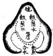

<!-- V3_SOURCE_ID:book010-b000079-p000-d9f67946eb -->

砂（穴场周围起护卫、朝应作用的山丘或地形）的角部如同牛口般张开。

查看对应原文

<!-- V3_FOLDBACK_BEGIN:book010-b000079-p000-d9f67946eb -->

砂角牛口開

<!-- V3_FOLDBACK_END:book010-b000079-p000-d9f67946eb -->

<!-- V3_SOURCE_ID:book010-b000080-p001-c2f81bc3d6 -->

砂（穴场周围起护卫、朝应作用的山丘或地形）的翼部如同蝉乳般悬垂。

查看对应原文

<!-- V3_FOLDBACK_BEGIN:book010-b000080-p001-c2f81bc3d6 -->

砂翼蝉乳懸

<!-- V3_FOLDBACK_END:book010-b000080-p001-c2f81bc3d6 -->

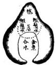

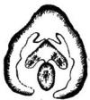

<!-- V3_SOURCE_ID:book010-b000083-p000-f32c878314 -->

这里是对“药书藏于干涸、燥烈、平坦、开阔的地方”的注解说明。

查看对应原文

<!-- V3_FOLDBACK_BEGIN:book010-b000083-p000-f32c878314 -->

藥書藏于涸燥坦夷解

<!-- V3_FOLDBACK_END:book010-b000083-p000-f32c878314 -->

<!-- V3_SOURCE_ID:book010-b000084-p000-bbe54694c7 -->

“涸燥夷坦”这四个字，指的是入穴（风水中认为气脉聚结、适宜安葬或营建的位置）的地方，说的是春季入穴时的形态如同乳状、果实状。

> **释读存疑：** 原文“言也春入穴如乳如实”存在断句模糊，释读为“春季入穴时的形态如同乳状、果实状”属于合理的通顺化处理，语义无偏差

查看对应原文

<!-- V3_FOLDBACK_BEGIN:book010-b000084-p000-bbe54694c7 -->

涸燥夷坦 四字指入穴之處而言 言也春入穴如乳如 实。

<!-- V3_FOLDBACK_END:book010-b000084-p000-bbe54694c7 -->

<!-- V3_SOURCE_ID:book010-b000085-p000-281669c563 -->

水流灌注就会倾斜，所以说“涸燥”；入穴的形态如同窝状、锄状，多数是仰势，所以说“坦夷”。旧注解认为“涸燥”是指高山，“坦夷”是指平地，还说高山反而适宜浅葬，平地安葬反而适宜深葬，这种说法是错误的，现在全部改正过来。这是说支垄行卷入穴时如同堆突隆起，就是“涸燥”，其气浮于上方，安葬适宜浅葬，就是廖氏所说的“息灾气浮”；高垄行卷入穴时如同“开寓锄”状，具体所指不详，其气沉于内部，安葬适宜深葬，就是廖氏所说的“脉窟气沉”。支垄、高垄的法则不同，关键在于深浅适宜，这样才不会有被水浸扰的祸患。倘若适宜浅葬却深葬，气就会从上方流过；适宜深葬却浅葬，气就会从下方散走，即便得到吉穴，生气也无法乘势，风水就会归于无用，能不谨慎吗？

> **释读存疑：** “开寓锄”具体所指不详；1轮自动修复后核义模型仍建议修订，已保守记录。

查看对应原文

<!-- V3_FOLDBACK_BEGIN:book010-b000085-p000-281669c563 -->

水注即傾故云涸燥入穴如窩如鋤勢多早仰故云坦夷舊註解在尤勢上去以高山為涸燥平地為坦夷是高山矣反宜淺平地葬反宜深其說謬矣今悉改正蓋言早支行卷入穴如起堆突是涸燥也其炁浮于上其塟宜淺廖氏所謂息災炁浮是也高壠行卷入穴如開寓鋤是坦夷也其炁沉于內其葵宜深廖氏所謂脉窟炁沉是也支壠契法之不同言貴淺深得宜庶無水緣之患也倘如宜淺而深炁從上過宜深而淺炁從下連縱得吉穴而生炁不能乗風水帰于無成矣可不慎乎。

<!-- V3_FOLDBACK_END:book010-b000085-p000-281669c563 -->

<!-- V3_SOURCE_ID:book010-b000086-p000-a2e46eb73c -->

脉有阴阳之分，所以有浮沉之别。阳脉常显现于表层，就是所说的浮；阴脉常潜藏于地层深处，就是所说的沉。三阴从天生，阴根于阳，所以阴脉必然上小下大，其出口必然圆润；三阳从浅地出，阳根于阴，所以阳脉必然上大下小，其出口必然尖蹙。脉尖的都是阳脉，其脉浮于表层；出口圆润的都是阴脉，其脉沉于地层深处，这是固定不变的法则。如果再推广开来，那么凸起的脉沉，凹陷的脉浮；细微的脉浮，粗重的脉沉；众多高而一处低的脉浮，众多低而一处高的脉沉，这样相互参照，阴阳的道理就掌握了。

查看对应原文

<!-- V3_FOLDBACK_BEGIN:book010-b000086-p000-a2e46eb73c -->

夫脉有阴阳故有浮沉阳脉常見乎表所謂浮也阴脉 常权乎裏所謂沉也三阴從天生阴根於阳也故阴脉 必上小而下大其出口也必圓三阳淺地出阳根于阴 也故阳脉必上大而下小其出口也必失蹙脉者則 尖者皆阳其脉浮于表口圓者皆阴其脉沉於裏此一 定不易之法也若又推而廣之則凸者脉沉凹者脉浮 微細者脉浮俎重者脉沉衆高一低者脉浮衆低一高 者脉沉此相重則陰陽之理得矣

<!-- V3_FOLDBACK_END:book010-b000086-p000-a2e46eb73c -->

<!-- doc003 PDF 第 192 页：旋转/复杂版面 OCR 供检索；内容与排版以原页图为准。 -->
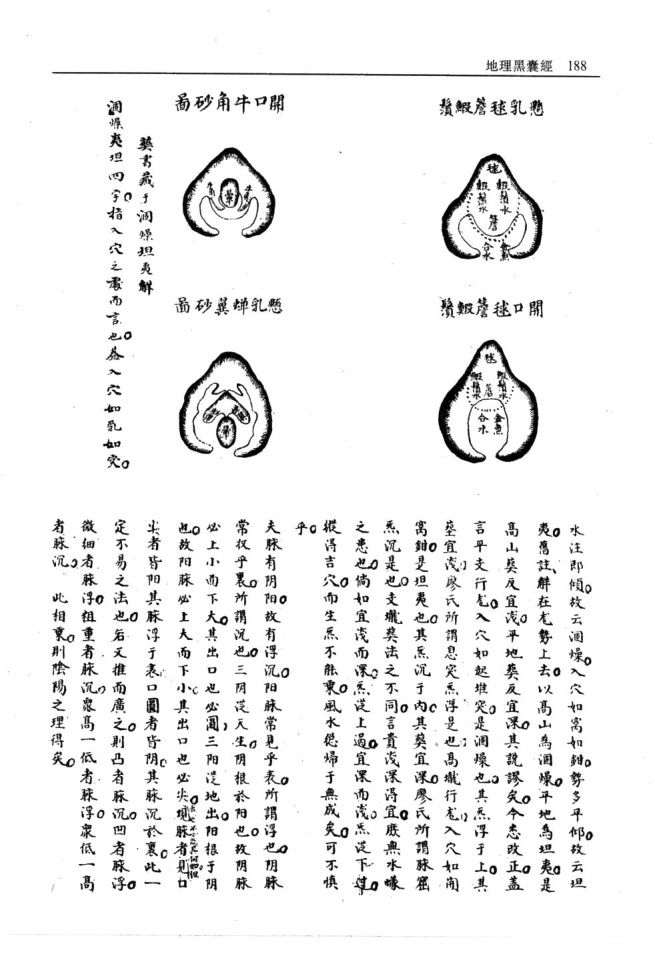

<!-- V3_SOURCE_ID:book010-b000088-p000-21af7e4b84 -->

经上说：“浅深得宜，风水自成”，适宜浅葬却深葬，气就会从上方经过；适宜深葬却浅葬，气就会从下方经过。卜地的人先观察来脉的阴阳，再看四周山峦的辅佐情况。如果来脉入首独作穴，凹陷、出口光润，这都是脉浮而穴阳，适宜浅葬；如果来脉入首弱，作穴凸起、出口圆润，这都是脉沉而穴阴，适宜深葬。深浅的法则，至深的道理没有超过这些的，关键在于辨认入首的阴阳，以及“虾须界水”是否明晰，虾须界水是风水专属术语，指穴前两侧的微茫水脉，属水的范畴。如果应当深葬却浅葬，应当浅葬却深葬，咫尺之间的差池，就会反吉为凶。经上说：“地吉葬凶，与弃尸同”，正是这个道理。世俗的风水先生用卦例、九星、白法来确定安葬尺寸，是大错特错的，白法为风水术语，具体所指不详。

> **释读存疑：** “白法”具体所指不详；1轮自动修复后核义模型仍建议修订，已保守记录。

查看对应原文

<!-- V3_FOLDBACK_BEGIN:book010-b000088-p000-21af7e4b84 -->

径曰淺深得東風水自成宜淺而深則氣茫上過宜深 而淺則氣從下過卜地者先現來脉之陰陽次看四山 之從佐如來厭入首独作穴凹出口光此皆胍浮而穴 陽宜淺來脉入首弱作穴凸出口圓此皆脉況而穴阴 宜深浅深之法至理莫过于是也要在辨認入首阴阳 蝦鬚界水明白若当深而浅当淺而深差于咫尺之间 反吉為凶矣径曰地吉葬凶典棄屍同正此羨也俗 蓑卦例論九星白法以定尺寸者大謬也

<!-- V3_FOLDBACK_END:book010-b000088-p000-21af7e4b84 -->

<!-- V3_SOURCE_ID:book010-b000089-p000-4f2148baa5 -->

“浅深得宜”，是说要避免过浅或过深，不违背法则就能乘取地中的生气；适宜浅葬却深葬，适宜深葬却浅葬，就会违背法则而不能乘取生气。深浅不适宜，不仅效果不会应验，深葬必然会有泉水的祸患，浅葬必然会有矮坟的忧虑。把死者的遗骨放在那里，孝子仁人的心意能安宁吗？我们这些儒者之所以看重选择墓地，本来不是风水先生专门追求福利的意思，也只是为了这一点罢了。程子说：“古人说，安葬逝者，不让泥土亲近肌肤，奇玩之物尚且要妥善保藏、加固存放，防止损坏玷污，自己亲人的遗骨，更该如何对待呢？”

查看对应原文

<!-- V3_FOLDBACK_BEGIN:book010-b000089-p000-4f2148baa5 -->

浅深得東言其戒浅或深不失法則能乗地中之生炁也宜淺而深宜深而淺則失其法則而不能乗生炁矣盖淺深失宜非惟其効不應深必有泉水之患浅必有矮嫌之患以死者倅魄置于其间孝子仁人之心其能安乎吾儒所以歡擇地者固非術家專求福利之意亦惟僅于此耳程子曰古人之歌比化者不使土親膚奇玩之物尚保戴固家以防損污一親之遺骨当何如我

<!-- V3_FOLDBACK_END:book010-b000089-p000-4f2148baa5 -->

<!-- V3_SOURCE_ID:book010-b000090-p000-f37e499336 -->

纯阳之脉取三阴为穴，是因为四周山峦高于本身，生气完全显露在外，脉必然浮；四周山峦与本身齐平，生气稍藏在内，脉必然不浮不沉；四周山峦低于本身，生气完全藏在内，脉必然沉。这就是穴法深浅有三等差异的原因。阴脉常沉，穴固然应当深葬，但如果四周山峦高于本身，就不怕风露，阴脉也会变成浮的阳脉，就是所说的“众多高而一处低而脉浮”；阳脉常浮，固然适宜浅葬，但如果四周山峦低于本身，就怕风露，阳脉也会变成沉的阴脉，就是所说的“众多低而一处高而脉沉”。这篇文章确立了深浅的准则，既有固定的道理，也有变通的方法，更能看出“牧堂”的见解玄奥精深，绝非粗浅之人所能怀疑。但葬穴时还要同时审辨土色如何，这样就万无一失了。

> **释读存疑：** 1轮自动修复后核义模型仍建议修订，已保守记录。

查看对应原文

<!-- V3_FOLDBACK_BEGIN:book010-b000090-p000-f37e499336 -->

純陽之脉取三阴為穴者四山高于本身則生炁尽露 于外而脉必浮四方典本身胥則生炁稍藏於內而脉 必不沉不浮四山低于本身則生炁尽藏于內而脉必 而此穴法淺深所以有三等之異也 陰狐常沉穴固当深然四山高于本身則不怕露風而 阴疎亦有变為阳之浮者所謂衆高一低而脉浮是也 阳脉常浮固宜淺然四山低于本身風炁怕露而阳脉 亦有变為阴之沉者所謂衆低一高而脉沉是也此篇 立淺深準則有申立之理有變通之也尤見牧堂所見 玄造精深而非粗淺之可疑也但癌穴時更兼審辨土 色何如則萬無失矣

<!-- V3_FOLDBACK_END:book010-b000090-p000-f37e499336 -->

<!-- V3_SOURCE_ID:book010-b000091-p000-d33da281ac -->

因为有风就不会聚气，有水就不会止气，所以古人卜地必定要寻求无风而聚气的地方，让生气不会被飘风吹散；寻求气流有止聚的地方，让内气不会在地下散失，然后安葬才能获得福运。气在地下运行，人看不见，但观察地势就能知道气的情况。流传的地歌，推崇聚气而不推崇散气，散气就没有成效；推崇气止而不推崇气行，气行就没有情状。所以凡是山，不管是支垄还是高垄，都要得水藏风，让气聚而不流散。所以安葬时要先推究地势从何处起行，再察看地势在何处止聚，从而乘取其气。人能知道生气止聚的地方，那么高处可以盖压，低处可以粘就，偏处可以倚靠，正中可以直取，处置都会十分适宜。因为有土就有气运行在土中，有气就有水在外界分界，有外水的界分，内气才会止聚。葬地不能发福的，大多是因为不得水，没有上分下合、水清地净却不能得地的情况，所以得水是最重要的。至于风会散走生气，只有凹射直急的风才会散生气，而阳和舒缓的风却不会散生气，这就是藏风之所以次于得水的原因。所以聚气不散、行而有止，古人本来就同时追求这两点，而二者之中尤其以气止为重要，这就是气止水交之所以成为穴的原因。所以支垄之间受到凹风的吹射就不会聚气，没有外水的界分就不会气止，只有无风、有外水界分，生气才会止聚。以上是论述风水的内容。

> **释读存疑：** “地不倍穴”的“倍”为讹字，按通义释为发福类含义；1轮自动修复后核义模型仍建议修订，已保守记录。

查看对应原文

<!-- V3_FOLDBACK_BEGIN:book010-b000091-p000-d33da281ac -->

蓋有風則不聚無水刑不止故古人之矣者必求無風而聚之處使生炁不散於飄風求流行有止之處使內氣不散於地中而後葬之獲福也夫氣行于地中人不可見然見地即可以知炁也成卷之地歌其聚不歡其散散則無成矣歆其止不歆其行行則無情矣故凢山不拘支壠俱要得水藏風使炁聚而不行也故葬者原勢從何處起而行來察勢從何虛止而乗其炁人能知生炁之所止則高而盖低而粘偏而倚中而撞措之而咸宜也盖有土即有然以行其中有炁即有水以界其外有外水之界而內炁始止也夫地不倍穴者大抵在不得水耳未有上分下合清白而不地者故得水為上也若風之散生氣者惟凹射直急之風而阳適之風却又不散生炁此藏風之所以次之故聚而不散行而有止古人固所並求而二者之中尤以有止為重此炁止水交之所以為穴也故支骨之间受凹風之射則不聚無外水之界則不止惟無風有界生炁始止聚也論風水

<!-- V3_FOLDBACK_END:book010-b000091-p000-d33da281ac -->

<!-- V3_SOURCE_ID:book010-b000092-p000-2f01461f76 -->

水是龍的血脈，側行龍的起止，完全取決於水的分合。如果水沒有分合，那麼外氣不會橫郎（原文為訛字，具體所指不詳），秉受這種狀況的話，真炁就會親近散逸。所以蔡氏說：水去則風自來，水來則風自去。廖氏說：番身轉面、去多潮不怕八風搖合，這兩個短語具體所指不詳，由此可知，風水之法完全在於得水，得水則風自藏。郭氏所謂得水為上，藏風次之，這個道理很深啊。求生炁在於觀察風水，所以稱之為風水。外氣就是水，外面沒有水界的話，內炁就會散於地中，既然沒有水蔭，生炁就無法蓄養，這就是為什麼骸骨容易腐壞的原因。唉，炁就是風，受到凹風吹拂，生炁就會散逸，飄風寒冷，棺易敢（原文為訛字，具體所指不詳），棺槨就容易損壞。

> **释读存疑：** 外氣不橫郎（原文為訛字，具體所指不詳）；番身轉面、去多潮不怕八風搖合，具體所指不詳；棺易敢（原文為訛字，具體所指不詳）

查看对应原文

<!-- V3_FOLDBACK_BEGIN:book010-b000092-p000-2f01461f76 -->

夫水者龍之血脈其偽行龍起止全在于水之分合也 如水無分合則外氣不橫郎秉之而真炁親散矣故蔡 氏云水去而風自來水來而風自去廖氏云番身轉面 去多潮不怕八風搖合之可知風水之法全在得水水 得而風自藏郭氏所謂得水為上臧風次之其義深矣 夫求生炁在硯風水故謂之風水也外炁者水也外無 水界則內炁散于地中既無水蔭生炁不畜此骨之所 以易腐也噫炁風也受凹風吹則生炁散于飄風寒冷 而棺易敢也

<!-- V3_FOLDBACK_END:book010-b000092-p000-2f01461f76 -->

<!-- V3_SOURCE_ID:book010-b000093-p000-a5c62815fd -->

請問生炁為什麼秉受風就會散逸？

查看对应原文

<!-- V3_FOLDBACK_BEGIN:book010-b000093-p000-a5c62815fd -->

問生炁何以秉風則散

<!-- V3_FOLDBACK_END:book010-b000093-p000-a5c62815fd -->

<!-- V3_SOURCE_ID:book010-b000094-p000-5cc0023d81 -->

生炁溫暖，風氣寒冷，能夠散逸生炁的溫暖；生炁潤澤，風氣乾燥，能夠散逸生炁的潤澤，這就是生炁散逸的原因。生炁是天地的和炁，風是天地的不和之炁，所以兩者不相宜。凡是山巒受到四風吹拂之處，那裡的土壤就會鬆散，那裡的草木就會焦枯，這就是生炁散逸的明證。

查看对应原文

<!-- V3_FOLDBACK_BEGIN:book010-b000094-p000-5cc0023d81 -->

生氣溫👨風氣寒能散其溫暖生氣淘澤風氣燥能散其潤澤此所以散也生炁乃天地之和炁風乃天地不和之炁故不相宜凢山峦受四風射處其土則鬆散其草木則焦枯此其可見者也

<!-- V3_FOLDBACK_END:book010-b000094-p000-5cc0023d81 -->

<!-- V3_SOURCE_ID:book010-b000095-p000-fb02cac94f -->

臺法起止論

查看对应原文

<!-- V3_FOLDBACK_BEGIN:book010-b000095-p000-fb02cac94f -->

臺法起止論

<!-- V3_FOLDBACK_END:book010-b000095-p000-fb02cac94f -->

<!-- V3_SOURCE_ID:book010-b000096-p000-18bc9afaa1 -->

安葬逝者的人，要追溯龙脉的起始，确定气脉的终止。从大体上来说，来龙是起始，入首是终止；若针对某一穴场而言，则需将气脉的生发作为起始，气脉的终止作为终止。因此，先看顶处的气脉生发之处，称为毬；水滴落的地方，称为簷。《语须》中说，微茫的气脉不论高山平地都存在；《金奥》中说，两股仙妾聚集，是说只有高山才有，这是《钧玄》中论述乳穴的说法，并非如此。《语盘眼》中说，一湖仙婆聚集，是说只有平地才有，这是《钩玄》中论述开口穴的说法，并非如此。近来的各种说法，有的只说金奠、嘯眼而遗漏了收鬚，这是失去了气脉起始的本意；有的只说金鱼而遗漏了蟹眼，这是失去了平地气脉终止的本意；有的只说蟹眼而遗漏了金奥，这又失去了高山气脉终止的本意。

查看对应原文

<!-- V3_FOLDBACK_BEGIN:book010-b000096-p000-18bc9afaa1 -->

塟者原其起衰其止論大槩則來龍為起入首為止論 一穴則須為起春為止故先質命頂起須處曰毬水滴 處曰簷語鬚則曰微茫不論高山平地皆有之語金奧 則曰兩股仙妾集謂唯高山有之者是鈞玄論指乳穴 而言者非語盤眼則曰一湖仙婆集謂唯平地有之者 是鈎玄論指開口穴而言者非近時諸說或語金奠嘯 眼而遺收鬚是失原起之羕矣或語金魚而遺蠏眼是 失平地之止矣或語蟹眼而遺金奧則又失高山之止 矣

<!-- V3_FOLDBACK_END:book010-b000096-p000-18bc9afaa1 -->

<!-- V3_SOURCE_ID:book010-b000097-p000-7017302f58 -->

廖公撥秋歌

查看对应原文

<!-- V3_FOLDBACK_BEGIN:book010-b000097-p000-7017302f58 -->

廖公撥秋歌

<!-- V3_FOLDBACK_END:book010-b000097-p000-7017302f58 -->

<!-- V3_SOURCE_ID:book010-b000098-p000-cfcdaa74b1 -->

从前的人说，秋是龙穴的用神，其贵贱不能自主，我独自认为并非如此。大概是说，龙没有砂相随则气势孤弱，穴没有秋卫则局势显露，水没有坎则气势涣散，至于水神流散，八风就会吹拂过来；八风既已侵袭，生气就会飘散。秋的作用实在太重要了，最需要留意，它所凭借的是对着穴场而藏风聚气，所关系的已经不是小事了。所以廖氏说：真龙落处，四山聚也自有名漾，音贤，何以唤为秋，于理自呼差。杨曾叫人原有格，只从地上拨，固弦名作拨秋桎，次序以秋悟，大凡寻卷共点穴，徊把前秋别，尤若住时秋有情，不住乱纵横，穴若正时秋效用，不正自飞动，真尤藏伏，穴唯寻惟秋识，倖心拨秋之法，所以不可后而忽之也。

> **释读存疑：** 四山聚也自有名漾音贤；固弦名作拨秋桎；‘四山聚也自有名漾音贤’原文未明具体含义；‘固弦名作拨秋桎’原文未明具体含义；‘秋卫’原文未明具体所指；‘倖心’原文未明具体含义；‘真尤’原文未明具体含义；‘徊把前秋别’原文未明具体含义；1轮自动修复后核义模型仍建议修订，已保守记录。

查看对应原文

<!-- V3_FOLDBACK_BEGIN:book010-b000098-p000-cfcdaa74b1 -->

昔人謂秋為龍穴之用神貴賤不能自主予独以為不然蓋龍無砂隨則其勢孤穴無秋衛則其局露水無坎閱則其勢散至于水神流散而八風東之矣八風既乘而生炁飄散矣甚矣秋之為用最喫除所藉以對穴而肉水藏風而聚炁其所係己非耿小也故廖氏曰真龍落處四山聚亦自有名漾音賢何以喚為秋於理自呼差楊曾呌人原有格只從地上撥固弦名作撥秋桎次序以秋悟大凡尋卷共点穴徊把前秋别尤若住時秋有情不住乱縱橫穴若正時秋效用不正自飛動真尤藏伏穴唯尋惟秋識倖心撥秋之法所以不可後而忽之也

<!-- V3_FOLDBACK_END:book010-b000098-p000-cfcdaa74b1 -->

<!-- V3_SOURCE_ID:book010-b000099-p000-969120dd99 -->

穴星化氣歌

查看对应原文

<!-- V3_FOLDBACK_BEGIN:book010-b000099-p000-969120dd99 -->

穴星化氣歌

<!-- V3_FOLDBACK_END:book010-b000099-p000-969120dd99 -->

<!-- V3_SOURCE_ID:book010-b000100-p000-369d8e60d0 -->

所谓化气，就是阴阳交合、雌雄相匹配的意思。因此乳穴有凹陷的灾穴，有凸起的富贵穴；钳形的贵穴，有泡形的贵穴。高山上要寻找窟形的位置，平地上要寻找堆形的位置，支葬在山顶，垄葬在山的高处，这就叫做阴阳有化气，才是真的。所以罗纹土宿歌曰：入穴星峰似覆称，用口便生寓，莫非阳极阴生处，所以收如指面，罗结穴星峰有口，流口唇里要生推，莫非阴极阳生处。土缩中间似覆杯，廖氏曰：阳来莫下煞硬，阴来莫下虚。鲁捉脉赋曰：阴中有阳，阳中有阴，看穴内生成。吴若曰：突中有窟，窟中有灾，审水底眠，生之何如，合之无非言穴有化，无方为真倍也。倘如孤阴孤阳而刚柔不分，抑或非阴非阳而形势杂乱，至如一有少差，祸不旋踵而至。故廖氏曰：穴星由来有八病，有病何劳定，斩首、折痕、顶下抱碎、脑石嵯峨、断肩、有水穿膊出、剖腹、稻长窟、折臂，原来左右低、破面浪痕、圣陷足、脚头窜入水、吐舌生尖嘴，此是星中大有亏误，用祸相随。穴面又有四般病，有病皆恶，痘贯顶、脉逆脑上抽、星峰不现、头坠足、脉从脚下去、灵光何所聚、绷面横生脉数条、生气自潜消、饱肚粗如覆箕样、丑恶不堪，此则廖公略剖其病而犹未悉也。广之有如须长、赵短、重头、瓮弦、竹篙水、视鳖裙、牛轭、攘膝、摇本、反肘、绣骨、弩觜、锹面、仰瓦、空集、玄武壁立、白虎入堂之类，此之总言穴无化气，祗属伪梏矣。

> **释读存疑：** 罗纹土宿歌、鲁捉脉赋、廖氏、吴若等未明确身份的专名具体所指不详；土缩中间似覆杯、要生推等短语具体含义不详；须长、赵短、重头、瓮弦、竹篙水、视鳖裙、牛轭、攘膝、摇本、反肘、绣骨、弩觜、锹面、仰瓦、空集等短语具体所指不详；伪梏一词原文表述为“偽梏”，具体含义不详

查看对应原文

<!-- V3_FOLDBACK_BEGIN:book010-b000100-p000-369d8e60d0 -->

化氣者阴阳交媾雌雄文度之謂是故乳穴有凹災穴 有曉富貴有凸鉗貴有泡高山尋窟平地尋堆支塟其 巔隴塟其麗是謂阴阳有化炁則真矣故罗纹土宿歌 曰入穴星峯似覆稱用口便生寓莫非阳極阴生処所 以收如指面罗結穴星峰有口流口唇裡要生推莫 非阴極阳生処土缩中间似覆盃廖氏曰阳來莫下煞 硬阴來莫下虛魯捉脉賦曰阴中有阳中有阴看穴 內生成而吳若突中有窟中有災審水底眠生之何 如合之無非言穴有化無方為真倍也 倘如孤阴孤阳而剛柔不分抑或非阴非阳而形勢亲 乱至如一有少差祸不旋踵而至故廖氏曰穴星由來 有八病有病何勞定斬首折痕頂下抱碎腦石嵯峨斷 肩有水穿膊出剖腹稻長窟折臂原來左右低破面浪 痕聖陷足腳頭竄入水吐舌生尖嘴此是星中大有虧 誤用祸相隨穴面又有四般病有病皆惡痘貫頂脉逆 腦上抽星峰不現頭墜足脉從脚下去靈光何所聚绷 面橫生脉數条生炁自潛消飽肚粗如覆箕樣醜惡那 堪相此則廖公略剖其病而猶未悉也廣之有如須長 趙短重頭甕弦竹篙水視鱉裙牛軛攘膝搖本反肘繡 骨弩觜鍬面仰瓦空集玄武壁立白虎入堂之類此之 總言穴無化氣祗属偽梏矣

<!-- V3_FOLDBACK_END:book010-b000100-p000-369d8e60d0 -->

<!-- V3_SOURCE_ID:book010-b000101-p000-eb737703cc -->

秋中八煞歌

查看对应原文

<!-- V3_FOLDBACK_BEGIN:book010-b000101-p000-eb737703cc -->

秋中八煞歌

<!-- V3_FOLDBACK_END:book010-b000101-p000-eb737703cc -->

<!-- V3_SOURCE_ID:book010-b000102-p000-7ee80aa6c9 -->

秋中有煞人不知，贵贱最难匡，仔佃消秋煞有八：射、探、破、冲、压，更兼反、断、走，皆凶。解说共人通财，是一尖来向穴徒配，何说探是斜山略露头，作贼不知休；破是浪痕直透顶，淫乱恣游聘；冲是横来挥穴前，非祸自连绵；压是穴前秋崛起，奴仆常反主；反是曲身去向离，反水飘摇；断是脑下生横，斩首无人葬；走是犴身顺水飞，游荡不思妇。若是真尤典杀，合祸福来，避凶趙吉最为奇，穴上讨便宜，合之可知秋形有正变吉凶之具矣。

> **释读存疑：** 仔佃一词原文表述为“仔佃”，具体含义不详；犴身、尤典杀、趙吉等短语具体所指不详；秋煞、八射等风水术语具体含义不详

查看对应原文

<!-- V3_FOLDBACK_BEGIN:book010-b000102-p000-7ee80aa6c9 -->

秋中有煞人不知貴賤最难匡仔佃消秋煞有八射探破冲壓更兼反斷走皆凶解說共人通財是一尖來向穴徒配何說探是斜山畧露頭作賊不知休破是浪痕直透頂淫乱恣遊聘沖是橫來揮穴前非祸自連綿壓是穴前秋崛起奴僕常反主反是曲身去向朝离反水飄搖斷是腦下生橫斬首無人塟走是犴身順水飛遊蕩不思婦若是真尤典殺合祸福來避凶趙吉最為奇穴上討便宜合之可知秋形有正变吉凶之具矣

<!-- V3_FOLDBACK_END:book010-b000102-p000-7ee80aa6c9 -->

<!-- V3_SOURCE_ID:book010-b000103-p000-d6cc9536a2 -->

秦氏说：凡是什么不难识别，相亲相爱如同夫妇，由此可以知道向（建筑或穴位所朝的方位）的情况；相背也不难识别，相恶相拒如同仇敌，由此可以知道背的情况。廖氏又说：大抵秋形不需要拘泥，有情就为贵，纵然秀丽更尖圆，无意也徒然。合之可知砂（穴场周围起护卫、朝应作用的山丘或地形）情有向背吉凶的区别了。

查看对应原文

<!-- V3_FOLDBACK_BEGIN:book010-b000103-p000-d6cc9536a2 -->

秦氏曰凡何者不难識相親相愛如夫婦此可知其向 之情也背者亦不难識相惡相拒如仇敵此可知其背 之情也廖氏又曰大抵秋形不須泥有情便為貴從饒 秀麗更尖員無意亦徒然合之可知砂情有向背吉凶 之别矣

<!-- V3_FOLDBACK_END:book010-b000103-p000-d6cc9536a2 -->

<!-- V3_SOURCE_ID:book010-b000104-p000-b6a0fcf9e7 -->

朝迎侍衛歌

查看对应原文

<!-- V3_FOLDBACK_BEGIN:book010-b000104-p000-b6a0fcf9e7 -->

朝迎侍衛歌

<!-- V3_FOLDBACK_END:book010-b000104-p000-b6a0fcf9e7 -->

<!-- V3_SOURCE_ID:book010-b000105-p000-f416809afa -->

秋有朝迎典侍衛四者，君頂記当面推來，名曰朝不怕遠迢。若是真時方出現，假時难見面。迎是隨卷先出來，見穴却回頭。戒隨迎朝來聚集，遠望低如揖。侍在穴前，井兩迎端拱默無言，遮斷客山不許入，森如竹立，衛是護尤，左右隨生怕凹風吹本身，枝脚為尤，虎皆在衛中救。只將四者撥前秋，括尽更無加此，可知四者之名所由称矣

> **释读存疑：** 典；秋；井；護尤；虎；原文中‘典’‘秋’‘井’‘護尤’‘虎’等术语具体所指不详，原文未明；本地硬校验仍未通过，已记录供后续自动处理或人工核对。

查看对应原文

<!-- V3_FOLDBACK_BEGIN:book010-b000105-p000-f416809afa -->

秋有朝迎典侍衛四者君頂記当面推來名曰朝不怕遠迢若是真時方出現假時难見面迎是隨卷先出來見穴却回頭戒隨迎朝來聚集遠望低如揖侍在穴前井兩迎端拱默無言遮斷客山不許入森如竹立衛是護尤左右隨生怕凹風吹本身枝脚為尤虎皆在衛中救只將四者撥前秋括尽更無加此可知四者之名所由称矣

<!-- V3_FOLDBACK_END:book010-b000105-p000-f416809afa -->

<!-- V3_SOURCE_ID:book010-b000106-p000-8a99604e9b -->

龍訣歌

查看对应原文

<!-- V3_FOLDBACK_BEGIN:book010-b000106-p000-8a99604e9b -->

龍訣歌

<!-- V3_FOLDBACK_END:book010-b000106-p000-8a99604e9b -->

<!-- V3_SOURCE_ID:book010-b000107-p000-ed32603a26 -->

若有人問起堪輿術中看龍的訣法，貪、巨、武、甫這幾星最為重要，行龍入首之處若純是這幾星，則世代富貴無休。歌訣中還有辨凶的方法，破、祿、文、廉這幾星最為凶惡，若出現這幾星，會導致出兵遇賊、遭遇瘟疫，此時只能將其作為神壇、社廟來供奉，可依此判定純凶純吉的去取。

> **释读存疑：** 甫；歌有訣法辨凶尤；止作神坛社廟崇；原文中‘甫’‘歌有訣法辨凶尤’‘止作神坛社廟崇’等内容的具体所指未明；1轮自动修复后核义模型仍建议修订，已保守记录。

查看对应原文

<!-- V3_FOLDBACK_BEGIN:book010-b000107-p000-ed32603a26 -->

問君術看龍訣貪巨武甫最唯得行龍入局純此星世代富貴無休歌有訣法辨凶尤破祿文廉最是凶出軍出賊遭瘟火止作神坛社廟崇此可以定純凶純吉者之去取也

<!-- V3_FOLDBACK_END:book010-b000107-p000-ed32603a26 -->

<!-- V3_SOURCE_ID:book010-b000108-p000-405a4d56fe -->

廖公四凶歌

查看对应原文

<!-- V3_FOLDBACK_BEGIN:book010-b000108-p000-405a4d56fe -->

廖公四凶歌

<!-- V3_FOLDBACK_END:book010-b000108-p000-405a4d56fe -->

<!-- V3_SOURCE_ID:book010-b000109-p000-d7e539f307 -->

廖氏说，九个天罡对应的人运不好，六个侧吉神的位置如果在穿金、水土星辰的方位，最适宜救人于贫困；天也有九个孤曜，不好；四个藏金的好穴，宝元会来生水，典开金穴的向，要从这里寻找；等孔曜也有九个回燥火，母穴也有九个，扫高不算奇特；七个蕴天机，法则适宜承载高势，夺取神功，也会有世代出英雄的情况；也有一万种依据，由此可知，尤其真正的怪穴或许也堪用；穴取记。

> **释读存疑：** 等孔曜；回燥火；宝元；典开；蕴天机；亦有奕世産英雄 萬亦有據；‘等孔曜’具体所指不详；‘回燥火’具体所指不详；‘宝元’具体所指不详；‘典开’具体所指不详；‘蕴天机’具体所指不详；‘亦有奕世産英雄 萬亦有據’具体所指不详；1轮自动修复后核义模型仍建议修订，已保守记录。

查看对应原文

<!-- V3_FOLDBACK_BEGIN:book010-b000109-p000-d7e539f307 -->

廖氏曰九個天罡人道惡六側吉神落若穿金水土星辰最好救人貧天亦有九個孤曜名不好四個藏金 好穴宝元來生水典開金穴向此中尋 等孔曜亦有九回燥火 母穴亦九個掃高未為奇七个蘊天機法宜載高奪神功 亦有奕世産英雄 萬亦有據此則知尤真穴怪者或亦堪 穴取记。

<!-- V3_FOLDBACK_END:book010-b000109-p000-d7e539f307 -->

<!-- V3_SOURCE_ID:book010-b000110-p000-d90cceeaf2 -->

凶龙解

查看对应原文

<!-- V3_FOLDBACK_BEGIN:book010-b000110-p000-d90cceeaf2 -->

凶龍解

<!-- V3_FOLDBACK_END:book010-b000110-p000-d90cceeaf2 -->

<!-- V3_SOURCE_ID:book010-b000111-p000-b09ac0e2af -->

杨氏说：不要说凶星就不可裁断，也有凶星却能兴家兴国的情况，大概是因为没有识别出真正的星象；尨贪中有廉文、有弼武、有破军断生，禄存时有巨武力，在十里范围内耸立一座小山峰，小的能成大的，弱的能成雄的，这是凶星家中尚星的法则，大顿小伏是真踪；好一座山就能断定是一代的气运，看它在哪一代产生，就在这个向中定富贵；困弱生旺随星象大小，有书说困务之凶无为力，死慈烟包入坎，其中有很多看法，要全部舍弃，3尽弃也

> **释读存疑：** 尨贪；弼武；尚星；大顿小伏；困务之凶；死慈烟；原文存在多处断句混乱、文字错乱，部分语句语义不通，具体所指未明；1轮自动修复后核义模型仍建议修订，已保守记录。

查看对应原文

<!-- V3_FOLDBACK_BEGIN:book010-b000111-p000-b09ac0e2af -->

楊氏曰莫道凶尤不可裁也有凶卷家國盖緣未識洵星尨貪中有廉文有弼武有破軍断生祿存時有巨武力舟十里之中卓一峯小者成大弱成雄好此是尤家尚星法大頓小伏為真踪好一山便斷為一代看在何代生间的便向此中定富貴困弱生旺隨星大有書之困務之尤無為力死慈烟包入坎積 大有看法在内3尽棄也

<!-- V3_FOLDBACK_END:book010-b000111-p000-b09ac0e2af -->

<!-- V3_SOURCE_ID:book010-b000112-p000-612dfb18cc -->

東湖主說：洵星尨曾在荻州的獅子山見到過這種形勢，當時正結成一個將軍隨弩的形狀，這是第五種。偷內處知。

> **释读存疑：** 本地硬校验仍未通过，已记录供后续自动处理或人工核对。

查看对应原文

<!-- V3_FOLDBACK_BEGIN:book010-b000112-p000-612dfb18cc -->

東湖主云洵星尨曾于荻州獅子山見之正結一将軍隨弩形其五 5 偷內處知

<!-- V3_FOLDBACK_END:book010-b000112-p000-612dfb18cc -->

<!-- V3_SOURCE_ID:book010-b000113-p000-8f380b4608 -->

形成“油窄形”时，当时的人都没有识别出来。一种是火土局，一种是水火局。有文说：依据廖氏的一段话，“尤吉穴怪”的，既然可以取用；依据扬氏的说法，“尤怪穴吉”的，也可以取用。合起来看，就没有什么地不能取用，没有什么不是地了。要知道，没有什么不是地，那将用什么方法来确定呢？世人为什么不对此用心研究呢？又说：扬公说，“尤非久远得全炁”，易盛易衰，不是人力所能决定的。人家发福长久，必定是得到了“卷家全炁”；想要得到“卷家全炁”，是由于龙神久远。这实在是千古不变的论断。而得道之士，不仅要寻求“尨身”久远，取用它的全炁，更应当在“抓秋法”内分辨其醇与不醇。醇的就会悠久，不醇的就会暂时发福，这更能得到卜地的要领了。

> **释读存疑：** 油窄形；尤吉穴怪；尤怪穴吉；尤非久远得全炁；卷家全炁；抓秋法

查看对应原文

<!-- V3_FOLDBACK_BEGIN:book010-b000113-p000-8f380b4608 -->

結一油窄形時人俱無識者一係火土局一係水火局 文云據廖氏一段尤吉穴怪者既可取據揚氏一改尤怪穴吉者亦可取合看來則無地不可取無之而非地已要知無之非地將操何術以定之乎世人何不究心于此也又云揚公言尤非久遠得全炁易盛易衰非人力言人家發福久長必得卷家全炁欲得卷家全炁由于龍神久遠也此誠千古不易之論而得道之士非但求尨身久遠取其全炁尤当于抓秋法內分其醇亲局醇者悠久局來者暫發更得卜地之要領也

<!-- V3_FOLDBACK_END:book010-b000113-p000-8f380b4608 -->

<!-- V3_SOURCE_ID:book010-b000114-p000-05d34f6152 -->

平陽尋龍諭

查看对应原文

<!-- V3_FOLDBACK_BEGIN:book010-b000114-p000-05d34f6152 -->

平陽尋龍諭

<!-- V3_FOLDBACK_END:book010-b000114-p000-05d34f6152 -->

<!-- V3_SOURCE_ID:book010-b000115-p000-7ace6f9ed2 -->

杨氏说：不要说只有高山才有“尤”，却到平地去寻找，反而失去了真迹。平地的“尨”泛滥，从高岭发出高起的星峰，低落的脉络。高山既然认定好的星峰，平地就要在两旁寻找水势，两旁水界就是“真尤”。水缠便是山缠的样子，霜降水涸时“尤”就看不见，春夏水高时“卷背”就会显现，这就是平洋看“尨”的方法。过处如旦成如线，高水一寸即是山，低土一寸水周环。只因为当时的师傅眼力浅，就说这里缺少峰峦，谁知山穷落坪里，退卸愈多愈有力。祖宗父母数程，遇到“灰线草蛇”寻脉，坪中一突更为奇。活动“尤”须求束炁，忽然入局口钳，南两水夹绝是“尤息”，反是则颇坦而不可言地矣。

> **释读存疑：** 尤；卷背；灰线草蛇；尤息；1轮自动修复后核义模型仍建议修订，已保守记录。

查看对应原文

<!-- V3_FOLDBACK_BEGIN:book010-b000115-p000-7ace6f9ed2 -->

楊氏曰莫道高山方有尤却来平地失真踪平地尨泛高嶺發高起星峯低落脉高山既認好星峯平地兩傍尋水勢兩傍水界是真尤水纏便是山纏樣霜降水涸尤不見春夏水高卷背現此是平洋看尨法过處如旦成如線高水一寸即是山低土一寸水週琢只為時师眼力淺便云此處少峰峦誰知山穷落坪裡退卸愈多愈有力祖宗父母數程遇灰線草蛇尋脉脊坪中一突更為奇活動尤須求束炁忽然入局口鉗南兩水夾絕是尤息反是則頗坦而不可言地矣

<!-- V3_FOLDBACK_END:book010-b000115-p000-7ace6f9ed2 -->

<!-- V3_SOURCE_ID:book010-b000116-p000-ad6cb5570b -->

关于水（风水语境中的河流、水系及其来去形态）的方法，是从坐山（建筑或穴位背靠的一方）起长生。

查看对应原文

<!-- V3_FOLDBACK_BEGIN:book010-b000116-p000-ad6cb5570b -->

關水法泛坐山起長生

<!-- V3_FOLDBACK_END:book010-b000116-p000-ad6cb5570b -->

<!-- V3_SOURCE_ID:book010-b000117-p000-615dd3198a -->

郭氏明确说明朱雀（穴前方的形势称谓）源于生炁，那么水（风水语境中的河流、水系及其来去形态）法就应从向上五行起长生。后世的人不知缘由，反而从坐山（建筑或穴位背靠的一方）起长生，这是错误的。朱雀源于生炁，实际是玄武（穴后方的靠山形势称谓）源于生炁。难道不知道穴（风水中认为气脉聚结、适宜安葬或营建的位置）前的都是向（建筑或穴位所朝的方位），水流朝向向上，水（风水语境中的河流、水系及其来去形态）怎能不从向上起长生呢？那些不向上起长生的人，要么是没读过葬书，要么是读了却不理解。后世的术者认为水（风水语境中的河流、水系及其来去形态）法是最难明白的事，就算是曾杨地仙也留下了很多相关内容，言语文字只是说不尽，而郭氏直接以一生炁为源头，确定了旺、衰二向，又说了一句关于逆、不德的妙义，仅这几句话，水（风水语境中的河流、水系及其来去形态）法就没有可再增减的了。

查看对应原文

<!-- V3_FOLDBACK_BEGIN:book010-b000117-p000-615dd3198a -->

郭氏明說個朱雀源于生炁則水法明從向上五 行起長生後妻不知何救而從坐山來起長主月非 朱雀源于生炁乃玄武源于生炁矣豈知穴前皆向所 主水流向上則水鳥得不從向上起長生乎不送向上 起長生者其未曾讀塟書耶抑讀而不解也 後世術者以水法為最难明之事即曾楊地仙亦賣了 多火言語文字只是說不尽而郭氏直指一生炁為源 立定旺衰二向又說一句以逆不德之妙義只此數言 水法己無剽羨矣

<!-- V3_FOLDBACK_END:book010-b000117-p000-615dd3198a -->

<!-- V3_SOURCE_ID:book010-b000118-p000-d243f662a1 -->

立穴要诀

查看对应原文

<!-- V3_FOLDBACK_BEGIN:book010-b000118-p000-d243f662a1 -->

立穴要訣

<!-- V3_FOLDBACK_END:book010-b000118-p000-d243f662a1 -->

<!-- V3_SOURCE_ID:book010-b000119-p000-f68454b352 -->

有生成之尤必有生成之穴，入首無过五尺土耳，坐下若差一指，勝隔萬重山。只見山尽、巒頭止處，兩水走会其中，有一星辰，尊嚴于象山，異体度。必先認其何星，次認其何穴，察水之來去，脉真穴正，四應正佐拱衛有情，方可下手。其星辰或高大或廣凋，穴星無所捉摸，時师妄逞聰明，以朝案之高低、以左右尨虎之灣抱，證穴場之中心，殊不知大局段之中、星辰之上，大尨虎灣抱之處、案山朝拱之洵，上下左右皆湫茫無所立穴。到此工夫，若非真傳，定李難不悞者。法当從後卷过峽處脉脊上，一步隨脊脉曲摺轉動，逐寸跟緝前來，脉行亦行，脉止亦止。其脉之止處，即脉之生炁滴斷處也。滴斷処自有阴阳交媾、牝牡相秉，桔成毬簷，上有三分，下有三合，左右有蝉翼砂，外有兩片牛角秋，牛角外有貼身卷虎秋，兩边俱有微茫蝦鬚水，会合于毬簷之下。水合處定有微小窝蕩，名曰明堂，為一滴蟹眼水也。又查前唇、後腦、左脛、右肘，再将前後朝應、左右尨虎一件認共，衆法符合，方用倒杖之法，親生棄死，架折饒減，以一合上立標竿，二合上定淺深，三合上定向道。前親堂炁，後接生炁，往云脉認來，尤塟秉生炁，此之謂也。秘之秘0

> **释读存疑：** 尨虎秋、牛角秋、桔成毬簷、滴斷処、往云脉認來、尤塟秉生炁等短语具体所指不详；‘尨虎秋、牛角秋、桔成毬簷、滴斷処、往云脉認來、尤塟秉生炁’等短语具体所指不详；1轮自动修复后核义模型仍建议修订，已保守记录。

查看对应原文

<!-- V3_FOLDBACK_BEGIN:book010-b000119-p000-f68454b352 -->

有生成之尤必有生成之穴入首無过五尺土耳坐下若差一指勝隔萬重山但見山尽峦頭止處兩水走会其中有一星辰尊嚴于象山異体度必先認其何星次認其何穴察水之來去脉真穴正四應正佐拱衛有情方可下手其星辰或高大或廣凋穴星無所捉摸時师妄逞聰明以朝案之高低以左右尨虎之灣抱證穴場之中心殊不知大局段之中星辰之上大尨虎灣抱之處案山朝拱之洵上下左右皆湫茫無所立穴到此工夫若非真傳定李難不悞者法当從後卷过峽處脉脊上一步：隨脊脉曲摺轉動逐寸跟緝前來脉行亦行脉止亦止其脉之止處即脉之生炁滴斷處也滴斷処自有阴阳交媾牝牡相秉桔成毬簷上有三分下有三合左右有蝉翼砂外有兩片牛角秋牛角外有貼身卷虎秋兩边俱有微茫蝦鬚水会合于毬簷之下水合處定有微小窝蕩名曰明堂為一滴蟹眼水也又查前唇後腦左脛右肘再将前後朝應左右尨虎一件認共衆法符合方用倒杖之法親生棄死架折饒減以一合上立標竿二合上定淺深三合上定向道前親堂炁後接生炁往云脉認來尤塟秉生炁此之謂也秘之秘0

<!-- V3_FOLDBACK_END:book010-b000119-p000-f68454b352 -->

<!-- V3_SOURCE_ID:book010-b000120-p000-8d7cee0d79 -->

这是《俯察本源歌》。

查看对应原文

<!-- V3_FOLDBACK_BEGIN:book010-b000120-p000-8d7cee0d79 -->

俯察本源歌

<!-- V3_FOLDBACK_END:book010-b000120-p000-8d7cee0d79 -->

<!-- V3_SOURCE_ID:book010-b000121-p000-85a50ec64b -->

考察古代的圣人、神明，他们勘察地理，无非是看山与水。山有脉，水有流，水流或断或连，更相互牵连。丘垄运行时，生气潜藏于地下，聚散随地形地势变化。地形地势越开阔，生气越不会凝滞；生气散漫时，就会亲近零乱的生气；生气凝聚时，人居住在此地就会吉利，安葬先人也适宜，骨殖不会离散。人居住在此地就会凶险，安葬先人就会遭受贫穷。古人俯察地理有四个用途，营建城邑是最重要的。设立藩篱、建造住宅、共同安葬坟地，要按大小聚势来区分。营建藩篱时，山水必定是大聚势；中聚势适合建城市，坟宅适宜；小聚势中要仔细斟酌，以夺取神功。聚势在平坦之地，生气上浮，人居住必定兴旺；聚势在高处，生气下沉，低处要对应，最为相宜。山脉大多从西北方兴起，祖宗山是昆仑山，是四大干龙的分枝，延伸到江河的源头。大河以北，大江、南江、湘江、汉水、兴江、淮河等；大河以南，大江以北，济水、泅水、汾水、阳水等。隔岸安葬适宜，住宅要紧凑，空地要宽敞，要从高处着眼来看，这是古人俯察地理的诀窍，心中领会却难以用言语说清，我如今叙述出来，是泄露天机，传给世上的迷茫之人。2

> **释读存疑：** 原文中“紅沉”具体所指不详，释为“生气下沉”无依据；原文部分语句断句、用字模糊，如“聚在卒夷炁浮”“紅沉低理”等，释义为保守推测；1轮自动修复后核义模型仍建议修订，已保守记录。

查看对应原文

<!-- V3_FOLDBACK_BEGIN:book010-b000121-p000-85a50ec64b -->

稽古聖神察地理無非山共水山有脉各水有流續斷更牽連丘行生炁潛于地聚散因形勢形勢益桓炁自疑散漫炁親零炁聚人居身復吉死則宜理骨無散人 2居身有凶塟則受貧窮古人俯察有四用建菑是為重扦藩立宅共安坟大小聚中分建藩山水必大聚中聚烏城市坟宅宜居小聚中消息奪神功聚在卒夷炁浮人居必興旺聚 高處紅沉低理對最相宜山脉皆泛西北起祖宗崑崙是四大幹龍分枝去江河水源委大河以北大江南湘漢興淮參大河以南大江北濟典汾阳隔安坟宜緊宅宜寬高着眼來看此是古人俯察訣心会口难說我今述作泄天机傳指世人迷

<!-- V3_FOLDBACK_END:book010-b000121-p000-85a50ec64b -->

<!-- V3_SOURCE_ID:book010-b000122-p000-33cc0c6237 -->

这是《俯察正法歌》。

查看对应原文

<!-- V3_FOLDBACK_BEGIN:book010-b000122-p000-33cc0c6237 -->

俯察正法歌

<!-- V3_FOLDBACK_END:book010-b000122-p000-33cc0c6237 -->

<!-- V3_SOURCE_ID:book010-b000123-p000-74b15f6edb -->

炁有聚散，俯察地理不必漫山遍野地踏勘。前代圣贤确立的法则有明确依据，都在《公刘》一诗中。登上山顶，是为了看后龙是否尊贵勇猛；再下到平原，是为了看落头穴是否温柔。于是登上南冈，对面观望，景象更清晰。看泉水流动，观察水来的方向，水流环抱，是美好的景象；看泉水流去，水势抱持，也是美好的景象。眺望源头，看明堂是否紧锁，才是好的选择。观察阴阳，确定方位，首先看景冈；考察侧方，确定后卫，要符合文势。迁移楚丘，营建城邑，要度量完备，与地势相称。登上高处望楚，是为了确定阳位；寻找龙脉，分辨背面；下到桑地，是为了确定降原；望穴向，在平坦之地，用日影来确定南北方位，景冈的方位要统一，懂得这个方法，古今相同，千载都应当遵循。郭璞的《葬书》最为精要，其次是《龙住妙推原》，这些议论都源于此，这两句是我的老师。世人看重耳听的，不相信眼见的，喜欢新奇，厌弃陈旧，托言与赤松相关的无稽之谈，偏信随从，迎来异说，挖掘出来后各自夸耀，“秋术天机”“连祖公刘截断象川流”，具体所指不详。

> **释读存疑：** 秋术天机；连祖公刘截断象川流

查看对应原文

<!-- V3_FOLDBACK_BEGIN:book010-b000123-p000-74b15f6edb -->

炁有聚散頂俯察不用漫山踏先賢立法有滉依具在 公刘詩陟則在獻登山巔後龍貴勇猛復降在原現落 頭穴要溫柔乃陟南崗对面望觀看更端相現看泉 流察水來朝挹营榮迴逝彼百泉現去水孫抱斯為美 瞻彼傳源看明堂鎖乃為良相其阴阳定向首景岡 考側便厥後衛文遷楚丘營度完相侔升虛望楚即陽 獻尋龍分背面降現于桑即降原望穴向卒田揆之以 日正南北景岡同一則通知此法古今同千載所当從 景純墓書最精要其次龍住妙推原議論本於斯句二 是吾师世人貴耳不信目喜新厭陳俗託言 共赤 松無稽偏信從迎來異說掘出各自誇秋術天机連 流祖公刘截斷象川流

<!-- V3_FOLDBACK_END:book010-b000123-p000-74b15f6edb -->

<!-- V3_SOURCE_ID:book010-b000124-p000-e9325f9d5b -->

地理三科歌

查看对应原文

<!-- V3_FOLDBACK_BEGIN:book010-b000124-p000-e9325f9d5b -->

地理三科歌

<!-- V3_FOLDBACK_END:book010-b000124-p000-e9325f9d5b -->

<!-- V3_SOURCE_ID:book010-b000125-p000-a8e767026e -->

妾傳地理有三科，分孤至為多。形勢唯分方位，次此語當淺，事姓音已見呂才，非園典尚遵依。景純著書，兼取二至，當無容議。專言形勢亦為偏，方位出後天，相其陰陽，揆以日，立法最詳悉。形勢若吉，方位凶，初下必貧窮；形勢若凶，方位吉，決定破家室。降天機、元祖、公劉法，二者俱要枘鑿相合，惟有姓音不可憑，謬妄最分明。聲同音異尤無理，鈞宮共終徵，陽屬宮，音揚屬商，覆姓更難辭，亦有變姓、典賜姓、過房，何所定？三十八將最為先，嘏合亦徒然。固師陵寢皆遵用，頒書與眾共生，今反古敢相違，不說恐人迷，北方取信尤來平生，可無咎。南方山水有高低，若用最相宜，直言無隱，遵程妝，可與知者道。

> **释读存疑：** 原文中‘事姓音已見呂才，非園典尚遵依’具体所指不详；‘降天機、元祖、公劉法’中‘降’字含义不明；‘北方取信尤來平生’语义不通；‘遵程妝’具体所指不详；‘圃茲大坏天机術’中‘圃茲’含义不明；‘狐踰借知有罪’具体所指不详；‘嘏合’含义不明；‘枘’字单独使用语义不全；‘鈞宮共終徵，陽屬宮，音揚屬商’具体所指不详；‘典賜姓、過房’具体所指不详；‘三十八將最為先’具体所指不详；‘橋喪代’具体所指不详；‘昏是曹楊說’具体所指不详；‘秋相真無比’具体所指不详；‘亥驗自天然’具体所指不详；‘四伯九十有五’具体所指不详；‘載後李貪財賄’具体所指不详；‘一今山頭分九穴’具体所指不详；‘五吉從渠喝’具体所指不详；‘取吉共人理’具体所指不详；‘只緣無著完’具体所指不详；‘道俗易消’具体所指不详；‘許故作短歌記傳’具体所指不详；‘泄天機本撥秋訣’具体所指不详；‘楊公演派’具体所指不详；‘曾公流傳’具体所指不详；‘黃興屬惟有廖公學得’具体所指不详；‘形凶吉最分明’具体所指不详；‘却將正術自藏身’具体所指不详；‘謬妄誤時人’具体所指不详；‘老天不喪斯文’具体所指不详；‘清士得其真’具体所指不详；‘團畫之說非得已’具体所指不详；‘惟恐墜宗主’具体所指不详；‘言詞鄙俚不成章’具体所指不详；本地硬校验仍未通过，已记录供后续自动处理或人工核对。

查看对应原文

<!-- V3_FOLDBACK_BEGIN:book010-b000125-p000-a8e767026e -->

妾傳地理有三科分孤至為多形勢唯分方位次此語当淺事姓音已見呂才非園典尚遵依景純著書兼取二至当無容議專言形勢亦為偏方位出後天相其阴阳揆以日立法最詳悉形勢若吉方位凶初下必貧窮形勢若凶方位吉決定破家室降天机元祖公刘法二者俱要枘惟有姓音不可憑謬妄最分明声同音異尤無理鈞宮共終徵陽属宮音揚屬商覆姓更难辞亦有变姓典賜姓过房何所定三十八将最為先嘏合亦徒然固师陵寝皆遵用頒書與眾共生今反古敢相違不說恐人迷北方取信尤來平生可無咎南方山水有高低若用最相宜直言無隱遵程妝可與知者道

<!-- V3_FOLDBACK_END:book010-b000125-p000-a8e767026e -->

<!-- V3_SOURCE_ID:book010-b000126-p000-edae69cd0d -->

天機傳流歌

查看对应原文

<!-- V3_FOLDBACK_BEGIN:book010-b000126-p000-edae69cd0d -->

天机傳流歌

<!-- V3_FOLDBACK_END:book010-b000126-p000-edae69cd0d -->

<!-- V3_SOURCE_ID:book010-b000127-p000-6f8100ce7e -->

金精山是撥推龍額術的發源地，楊公傳授該術，曾公將其流傳，黃興屬只有廖公學到了，‘橋喪代自傳名’，具體所指不詳；‘泄天機本撥秋訣’，具體所指不詳；‘昏是曹楊說’，具體所指不詳；只從山水探究精微之理，心口領悟天機，九個星辰十一体，‘秋相真無比’，具體所指不詳；九十九變古今傳，‘亥驗自天然’，具體所指不詳；龍、穴（风水中认为气脉聚结、适宜安葬或营建的位置）、砂（穴场周围起护卫、朝应作用的山丘或地形）、水（风水语境中的河流、水系及其来去形态）、典堂炁、形體，原本無二；‘四伯九十有五’，具體所指不詳；形凶吉最分明，相傳僅得一伯，‘載後李貪財賄’，具體所指不詳；卻將正術隱藏起來，謬妄誤導當世人；‘一今山頭分九穴’，具體所指不詳；‘五吉從渠喝’，具體所指不詳；或得十字木星排列，‘取吉共人理’，具體所指不詳；‘圃茲大坏天机術’，具體所指不詳；只緣無著完，‘老天不喪斯文’，具體所指不詳；‘清士得其真’，具體所指不詳；‘團畫之說非得已’，具體所指不詳；惟恐墜宗主，‘言詞鄙俚不成章’，具體所指不詳；道俗易消，‘許故作短歌記傳’，具體所指不詳；‘狐踰借知有罪’，具體所指不詳。

> **释读存疑：** 橋喪代自傳名；泄天機本撥秋訣；昏是曹楊說；秋相真無比；亥驗自天然；四伯九十有五；載後李貪財賄；一今山頭分九穴；五吉從渠喝；取吉共人理；圃茲大坏天机術；只緣無著完；老天不喪斯文；清士得其真；團畫之說非得已；言詞鄙俚不成章；許故作短歌記傳；狐踰借知有罪；楊公演派；曾公流傳；黃興屬惟有廖公學得；形凶吉最分明；却將正術自藏身；謬妄誤時人

查看对应原文

<!-- V3_FOLDBACK_BEGIN:book010-b000127-p000-6f8100ce7e -->

金精山是撥推龍額術出其中楊公演泒曾公流傳黃興屬惟有廖公學得橋喪代自傳名泄天机本撥秋訣昏是曹楊說只從山水究精微心口悟天机九个星辰十一体秋相真無比九十九变古今傳亥驗自天然龍穴砂水典堂炁形体元無二四伯九十有五形凶吉最分明相傳僅得一伯載後李貪財賄却将正術自藏身謬妄悞時人一今山頭分九穴五吉從渠喝或得十字木星排取吉共人理圃茲大坏天机術只緣無著完老天不哉喪斯文清士得其真團畫之說非得已惟恐墜宗主言詞鄙俚不成章道俗易消許故作短歌記傳狐踰借知有罪

<!-- V3_FOLDBACK_END:book010-b000127-p000-6f8100ce7e -->

<!-- V3_SOURCE_ID:book010-b000128-p000-71105f4378 -->

这篇文章里说清士的说法不对，廖公难道会自称精通此道吗？他父亲说清士得到了真传，其中的道理由此可知。

查看对应原文

<!-- V3_FOLDBACK_BEGIN:book010-b000128-p000-71105f4378 -->

此篇意清士所述不然廖公豈自称其精乎父云清 士得其真其理可知之矣

<!-- V3_FOLDBACK_END:book010-b000128-p000-71105f4378 -->

<!-- V3_SOURCE_ID:book010-b000129-p000-9e38857410 -->

九星入式歌

查看对应原文

<!-- V3_FOLDBACK_BEGIN:book010-b000129-p000-9e38857410 -->

九星入式歌

<!-- V3_FOLDBACK_END:book010-b000129-p000-9e38857410 -->

<!-- V3_SOURCE_ID:book010-b000130-p000-a71a8413d4 -->

最初太极分出清浊，清的部分上浮，廖郭具体所指不详，浊的部分凝结为水，与山的血脉相通。德相具体所指不详，在血脉中间运行，五炁具体所指不详，随势而行，形态有圆、直、曲、尖、方五种，对应五星的名称。阁形具体所指不详，又有四种形态凑成九星的形象：九星中圆形的是太阳、太阴，带方或带曲的名为金水、木星；直如箭杆、方正的是天财，三脑具体所指不详，分别是砌脑土、金身双脑合形、本金水平脑土星，这五种是吉形，需在细微处辨别，两脚拖尖尾的便是天罡体，头脚直的是孤曜，燥火尖似枪，扫荡星浑身曲，这四种是凶局。告诉您要认清九星的形象，砂是穴场周围起护卫、朝应作用的山丘或地形，砂上的变化是关键，凡是辨认星辰，对面的九星容易分辨，如果被草木杂乱遮挡，就不要随便断定是星辰。认识了星辰却不懂得运用，即便读一万卷书也是徒劳，要懂得星辰的运用，需用心传承，这样便是地行仙。

> **释读存疑：** 廖郭；德相；五炁；阁形；三脑；廖郭具体所指不详；德相具体所指不详；五炁具体所指不详；阁形具体所指不详；三脑具体所指不详；本地硬校验仍未通过，已记录供后续自动处理或人工核对。

查看对应原文

<!-- V3_FOLDBACK_BEGIN:book010-b000130-p000-a71a8413d4 -->

厥初太極分清濁清者浮廖郭濁者凝為水共山血脉 德相阅脉血中间行五炁行因俸勢園直曲尖方五 形分配五星名閣形却又有四樣湊成九星象九星園 0 者太阳太阴因帶方因而曲者名金水木星直如矢 方是天財三腦分砌腦土金身双腦合形本金水平腦 土星是此名五吉是為高辨别在分毫頭因兩腳拖尖 尾便是天罡体頭因腳直孤曜当燥火尖似鎗掃蕩一 星渾身曲四者為凶局呌君尽識九星形砂上撥為精 凡認星辰須对面九星容易辨若还草木亂扮耘莫便 喝星辰識得星辰不識用萬苓徒勞誦識星須得用心 傳便是地行仙

<!-- V3_FOLDBACK_END:book010-b000130-p000-a71a8413d4 -->

<!-- V3_SOURCE_ID:book010-b000131-p000-448c77c403 -->

古传九星歌说：太阳一星就是左甫高圆，像覆盖的钟釜，太明本是右弼传下来的形态，方的又因金水，原来名叫武曲，三脑如金宿，木星紫炁号贪狼，一尖直更长，天才杂识巨内牛，三种头脑不同，天罡正与破军同，脚下出尖峰，孤曜禄存属一类，像捻拳相似，燥火是廉贞的别名，斜芒箒形归荡，属水（风水语境中的河流、水系及其来去形态），配文曲斜拖帛一幅，这是扬廖之世的九曜。

> **释读存疑：** 左甫、太明、右弼、金宿、紫炁、天才、巨内牛、禄存、廉贞、荡具体所指不详

查看对应原文

<!-- V3_FOLDBACK_BEGIN:book010-b000131-p000-448c77c403 -->

古傳九星歌曰太阳一星即左甫高園覆鐘釜太明本是右弼傳形迹方更因金水原來名武曲三腦如金宿木星紫炁号貪狼一尖直更長天才雜識巨內牛三般頭腦異天罡正共破軍同腳下出尖峯孤曜祿存司一類撚拳正相似燥火廉貞是一名哭斜芒箒形歸蕩屬水配文曲斜拖帛一幅此為揚廖之世九曜也

<!-- V3_FOLDBACK_END:book010-b000131-p000-448c77c403 -->

<!-- V3_SOURCE_ID:book010-b000132-p000-f1156ad1e5 -->

太阴、太阳、金水、天财、紫炁，这五种被称为五吉；天罡、孤曜、燥火、扫荡，这四种被称为四凶。

查看对应原文

<!-- V3_FOLDBACK_BEGIN:book010-b000132-p000-f1156ad1e5 -->

太阴太阳金水天財紫炁謂之五吉天罡孤曜燥火掃蕩謂之四凶

<!-- V3_FOLDBACK_END:book010-b000132-p000-f1156ad1e5 -->

<!-- V3_SOURCE_ID:book010-b000133-p000-49bd912783 -->

九星正变穴星歌

查看对应原文

<!-- V3_FOLDBACK_BEGIN:book010-b000133-p000-49bd912783 -->

九星正变穴星歌

<!-- V3_FOLDBACK_END:book010-b000133-p000-49bd912783 -->

<!-- V3_SOURCE_ID:book010-b000134-p000-bfd1465fd5 -->

九个星辰都有固定形态，我将详细说给你听：太阳的瑞正形态如同迁动的钟与栋；太阴的形态如同半月；金水的形态原本像风在飞动；紫炁的形态如同笏囊；天财的形态有三种，形状各异，凹脑的是展诰形，双脑的是贵人立马形，平脑的是玉屏风形；天罡的形态是张盖形，与其他形态并列；孤曜的形态如同蛰伏的覆物；燥火的形态是尖刀，最为凶险；扫荡的形态如同展旗。九个星辰有变位，正体都居首位，角口是第二位，悬乳是第三位，太极居中是第四位，弓脚是第五位，燮臂、车股居第六位，第七位是侧脑，无需怀疑；没骨是第八位，形态奇特；平面原本居第九位。九个星辰虽有九种变化，却不离根本，拨砂的方法要牢记在心中，睁眼便能遇到。金精亲自传授图典诀，天机都已泄露。这是寻龙入式歌。

> **释读存疑：** 九个星辰史变位的‘史’字具体所指不详；‘燮臂’‘平腦’等术语具体所指不详；‘拨砂’的具体含义需结合allowed_glossary确认；‘金精’的具体所指不详

查看对应原文

<!-- V3_FOLDBACK_BEGIN:book010-b000134-p000-bfd1465fd5 -->

九個星辰有正形細說典君聽太阳瑞正遷鐘棟太阴半月象金水原來似風飛紫炁笏囊重天財三倅形有異凹腦展誥是双腦貴人立馬容平腦玉屏風天罡張蓋形相竝孤曜如覆蟄燥火尖刀最是凶掃蕩展旗同九个星辰史变位正体皆居首角口第二懸乳三太極翬中涵四是弓腳五燮臂車股居六位七為側腦不須疑沒骨八為奇平面原來居第九九变不离母撥砂熟記在心胸開眼便相逢金精親授圗典訣天机皆漏泄尋龍入式歌

<!-- V3_FOLDBACK_END:book010-b000134-p000-bfd1465fd5 -->

<!-- V3_SOURCE_ID:book010-b000135-p000-3858f35c08 -->

自从重浊之气凝聚成地，便有了高低的地势：山势起伏如同行走的踪迹，前代先贤称之为龙神。高处形成楼殿，汇聚成星辰，汇聚之后便如在楼下展开行走的态势，要观察到真情，迢迢远的峡中，有穿帐换形的景象，变换成多种形态，夹卫的辅从在两旁生长，后有相送，前有相迎，校脚随身，没有反逆的形态，直剥的形态多有奇特之处，这是山家作穴的方法，龙必定会升起主星峰，主星峰的大小要符合格局，造化便可测知。二三部内的格局符合星辰，福力实在不轻；距离远的福力小，再起星峰，也会有神明显著的情况，穴隐藏时，点穴贵在精详，平地处的神，要根据水势来确认，原本没有二种情况，思谣正好可以用来寻找，寻得这样的地势价值千金。进入乡村先见穴的，要把后卷另外开启，这是眼高先见卷的情况，寻得后不要轻视，这是寻龙的真诀，得到这样的地便能决断，试着将其遍覆各处，仙迹确实有神通。

> **释读存疑：** ‘校脚’‘直剥’‘思謠’等术语具体所指不详；‘山家’的具体含义需结合allowed_glossary确认；1轮自动修复后核义模型仍建议修订，已保守记录。

查看对应原文

<!-- V3_FOLDBACK_BEGIN:book010-b000135-p000-3858f35c08 -->

爰從重濁凝於地便有高低勢：來起伏是行蹤前賢呼作龍神高處成樓殿聚講星辰見講罷拜樓下展行：度見真情迢：達峽并穿帳傳換成幾樣夾衛輔從兩傍生後送更前迎校脚隨身無反逆直剥多奇特此是山家作穴龍定起主星峯主星大小合尤格造化便可測二三部內合星辰福力實非輕郵數遠時福力小再起星峯也耄神顯著穴隱藏点穴貴精詳平地處神因水勢認取原無二思謠正好尋得值千金九入鄉村先見穴護把後卷别启是眼高先見卷尋得莫每此是尋龍真也诀是地便能决試將遍去覆仙跡端的有神通

<!-- V3_FOLDBACK_END:book010-b000135-p000-3858f35c08 -->

<!-- V3_SOURCE_ID:book010-b000136-p000-946c73eec7 -->

这是《步龙认格歌》。

查看对应原文

<!-- V3_FOLDBACK_BEGIN:book010-b000136-p000-946c73eec7 -->

步龍認格歌

<!-- V3_FOLDBACK_END:book010-b000136-p000-946c73eec7 -->

<!-- V3_SOURCE_ID:book010-b000137-p000-21acd59589 -->

观察山势时要把龙脉作为根本，吉凶的判断才有标准。世人只谈论穴，却不谈论向，这是很大的弊病，让人茫然无措。大致来说，真正的龙必定有格，穴的后面容易寻找，便来穴的后面会显现出真形，应当像山谷中的样子。穴的后面如果没有星辰，就要在龙脉上寻找，只需从峦头处辨认，不要向两边寻求。从两旁看到的格，即使很好，终究不是正格。吉断有时在穴后出现星辰，原本不出龙脉，名叫照星，一般来说，这类照星对应的事业都值得赞许。还有两山映照等待的情况，也可当作格龙来看，龙神的情况最为准确，遇到点检道时要从恕按圃索骥的方式去寻找，就能知道所有的错误。高大的星辰能管一代的余福，还未停止；如果遇到卷格小如低的情况，一代便会衰微。要知道吉凶在哪个世代发生，就从头踏凶的情况依次推算，世代都能知晓。凡是星辰都要有盖送，盖送最适宜看重，盖星需要大尊，不管是哭星还是贞星，送到左边经过右边获得时，还要有所顾盼。如果格好却孤寒，僧道会傲高官。星辰落脉要从中出，中出才是吉，左出为轻，右出更轻，重的地方中会生出好格。面平方合样，面饱何劳相歌，斜破碎浪痕高，灾祸必定难逃。

> **释读存疑：** 尤；尤正；苏；卷格；盖送；哭共貞；恕按圃；原文中‘尤’‘尤正’‘苏’‘卷格’‘盖送’‘哭共貞’‘恕按圃’等术语具体所指不详；1轮自动修复后核义模型仍建议修订，已保守记录。

查看对应原文

<!-- V3_FOLDBACK_BEGIN:book010-b000137-p000-21acd59589 -->

觀山定把龍為本吉凶方有準世人論穴不論尤正坐敝茫中大抵真尤必有格穴後好尋索便來穴後現真形應似谷中般穴後星辰如不出脉上要尋覓只從蘇上認峦頭莫向兩边求兩傍見格從好着終非是吉斷有時穴後見星辰元不出龍身名曰照星一般取事業皆堪許更有兩山映待我亦可當其名成格龍神最准遇点檢道從恕按圃索驥要知真誤尽垂間人高大星辰管一代餘福猶未艾看逢卷格小如低一代便衰微要識吉凶何代發逐即從頭踏凶尤在後一同推世代總能知凢是星辰要蓋送盖送最宜重蓋星須要大尊嚴不拘哭共貞送到左經述右獲時更顧若还格好却孤寒僧道傲高官星辰落脉要中出中出方為吉左出為輕右更輕重此中生好格面平方合樣面飽何勞相歌斜破碎浪痕高祸定难逃

<!-- V3_FOLDBACK_END:book010-b000137-p000-21acd59589 -->

<!-- V3_SOURCE_ID:book010-b000138-p000-9a546d19c2 -->

## 全局入式敷

查看对应原文

<!-- V3_FOLDBACK_BEGIN:book010-b000138-p000-9a546d19c2 -->

## 全局入式敷

<!-- V3_FOLDBACK_END:book010-b000138-p000-9a546d19c2 -->

<!-- V3_SOURCE_ID:book010-b000139-p000-c7e3d6b252 -->

此处文字残缺错乱，无法准确释读。

> **释读存疑：** 原文文字残缺错乱，无法准确释读

查看对应原文

<!-- V3_FOLDBACK_BEGIN:book010-b000139-p000-c7e3d6b252 -->

環 名 聚 山 恶见下根 前名必本 面特当在 必透题其 尚 献越：之得化 结本之故之第 不要吉环谓二 必必出捷经即 费有前信必品 心作去英群案 所次名为如 多很鸟听儒意端谋 若侵山 模于一 腮可之

<!-- V3_FOLDBACK_END:book010-b000139-p000-c7e3d6b252 -->

<!-- V3_SOURCE_ID:book010-b000140-p000-6a305cf7db -->

谈论考察龙（风水中山脉、地势及气脉的来势和行度），很少能分清它的美恶生死，大家都知道八法，这是三家的道理：应当看分书，大宗性只看这个，此后谋划龙的事，八法就都能用了。

> **释读存疑：** 原文存在多处字迹错乱、缺漏，部分语句难以完全准确还原；原文多处字迹错乱缺漏，部分语句含义难以完全准确还原

查看对应原文

<!-- V3_FOLDBACK_BEGIN:book010-b000140-p000-6a305cf7db -->

講買龍少有美惡生死 共 之 知 八法 道三 家：印 当# 看分书 大宗性 惟之i 此後浆 八便谋 龙都 矣法租

<!-- V3_FOLDBACK_END:book010-b000140-p000-6a305cf7db -->

<!-- V3_SOURCE_ID:book010-b000141-p000-47086b9046 -->

原文字迹错乱严重，语句难以完全准确还原，无法形成合理的释读内容。

> **释读存疑：** 原文字迹错乱严重，语句难以完全准确还原，无法形成合理的释读内容

查看对应原文

<!-- V3_FOLDBACK_BEGIN:book010-b000141-p000-47086b9046 -->

生是低昂多鄣 目。

<!-- V3_FOLDBACK_END:book010-b000141-p000-47086b9046 -->

<!-- V3_SOURCE_ID:book010-b000142-p000-c6ff78218d -->

原文字迹错乱严重，语句难以完全准确还原，无法形成合理的释读内容。

> **释读存疑：** 原文字迹错乱严重，语句难以完全准确还原，无法形成合理的释读内容

查看对应原文

<!-- V3_FOLDBACK_BEGIN:book010-b000142-p000-c6ff78218d -->

且耐久身傍有猛鵝者皆為生龍 死是無起伏 峰出 城佛 不起

<!-- V3_FOLDBACK_END:book010-b000142-p000-c6ff78218d -->

<!-- V3_SOURCE_ID:book010-b000143-p000-45c130ba02 -->

强者出身以来，其猛武强盛，奔走之势如刀，出行时如此，奔巢的指爪得甲，整立共新火建往，3。

> **释读存疑：** 奔巢的指爪得甲，整立共新火建往，具体含义不详；原文多处字迹错乱缺漏，部分语句含义难以完全准确还原，如“奔巢的指爪得甲，整立共新火建往”具体含义不详

查看对应原文

<!-- V3_FOLDBACK_BEGIN:book010-b000143-p000-45c130ba02 -->

强 者出身以來 其 猛武 強是奔走勢刀 3 出 行如 此西 格膜 奔巢指爪得 甲整 立共新火建往

<!-- V3_FOLDBACK_END:book010-b000143-p000-45c130ba02 -->

<!-- V3_SOURCE_ID:book010-b000144-p000-e68ac46577 -->

此处原文语义模糊，无法明确解读。

> **释读存疑：** 原句“最吉主發違甚建不甚佛速”语义不明，无法确定确切含义

查看对应原文

<!-- V3_FOLDBACK_BEGIN:book010-b000144-p000-e68ac46577 -->

最吉主發違甚建不甚佛速

<!-- V3_FOLDBACK_END:book010-b000144-p000-e68ac46577 -->

<!-- V3_SOURCE_ID:book010-b000145-p000-629ba46b32 -->

弱是瘦稜，嘈。弱龍的出身，其本勢微弱，如同瘦馬背負重物，如同孤雁在風火中飛行，水射其屬，尖徊屈由險峻差寂，此格最凶，主孤紳賁。

> **释读存疑：** 原句中“瘦稜”“嘈”“徊屈由”“險峻差寂”“孤紳賁”语义模糊，无法确定确切含义

查看对应原文

<!-- V3_FOLDBACK_BEGIN:book010-b000145-p000-629ba46b32 -->

弱是瘦稜 嘈。 弱龍者出身以末其勢本靡如瘦馬負重 如 孤 雁 以風火其腰水射其屬尖徊屈由險峻差寂此格最凶主孤紳賁

<!-- V3_FOLDBACK_END:book010-b000145-p000-629ba46b32 -->

<!-- V3_SOURCE_ID:book010-b000146-p000-91e33775a8 -->

順是匍脛，句前，往。北順龍的出身，其本勢曲抱如星華，水翻春宗惠祖膽前在後行。

> **释读存疑：** 原句中“匍脛”“句前”“星華”“春宗惠祖膽”语义模糊，无法确定确切含义

查看对应原文

<!-- V3_FOLDBACK_BEGIN:book010-b000146-p000-91e33775a8 -->

順是匍脛 句前 往。 北顺 龍者出身以來其勢曲抱如星華 水 翻 春宗惠祖膽前在後行

<!-- V3_FOLDBACK_END:book010-b000146-p000-91e33775a8 -->

<!-- V3_SOURCE_ID:book010-b000147-p000-aa85f1175f -->

## d

> **释读存疑：** 原标题仅保留字符“d”，无其他可解读内容

查看对应原文

<!-- V3_FOLDBACK_BEGIN:book010-b000147-p000-aa85f1175f -->

## d

<!-- V3_FOLDBACK_END:book010-b000147-p000-aa85f1175f -->

<!-- V3_SOURCE_ID:book010-b000148-p000-f19cc39173 -->

手脚守在帖入穴（风水中认为气脉聚结、适宜安葬或营建的位置）之处，骨由团乐，此播最言主富贵旺人，孝慈和腔。

> **释读存疑：** 原文断句及部分字词含义难以明确，仅能基于可辨识内容改写；原文中“骨由團樂”“此播最言”“和腔”等字词含义难以明确，具体所指不详

查看对应原文

<!-- V3_FOLDBACK_BEGIN:book010-b000148-p000-f19cc39173 -->

处脚手守帖入穴处骨由團樂此播最言主富貴 旺人孝慈和腔

<!-- V3_FOLDBACK_END:book010-b000148-p000-f19cc39173 -->

<!-- V3_SOURCE_ID:book010-b000149-p000-10ac3a63bc -->

以上所述皆为逆水（风水语境中的河流、水系及其来去形态）的情况，属吉；后逆前顺的情况，为先吉后德进。文中提及“弹龙而者”“下出身鹏以禁来水”，相关内容语义混乱，具体所指不详。

> **释读存疑：** 弹龙而者；下出身鹏以禁来水；其势后俊低如风南至高；原文中“弹龙而者”“下出身鹏以禁来水”“其势后俊低如风南至高”语义混乱，具体所指不详

查看对应原文

<!-- V3_FOLDBACK_BEGIN:book010-b000149-p000-10ac3a63bc -->

右皆逆者吉後逆前順者先吉後德进 弹龍 而者 下出 身 鹏以 禁来 水其 势 後俊 低如 风南 至 高

<!-- V3_FOLDBACK_END:book010-b000149-p000-10ac3a63bc -->

<!-- V3_SOURCE_ID:book010-b000150-p000-f5f08abdd1 -->

文中提及“退是渐萧条”“勉退多最上能”“作凶滩者郵主穴出”“冬一高自”“传发龙以舍便低来”“能其小势穴退”“大编后如先人失踏”“序难上如退下孤失老伦”“贫比穷格”，相关内容断句混乱、字词无法辨识，具体所指不详。

> **释读存疑：** 退是渐萧条；勉退多最上能；作凶滩者郵主穴出；冬一高自；传发龙以舍便低来；能其小势穴退；大编后如先人失踏；序难上如退下孤失老伦；贫比穷格；原文中“退是渐萧条”“勉退多最上能”“作凶滩者郵主穴出”“冬一高自”“传发龙以舍便低来”“能其小势穴退”“大编后如先人失踏”“序难上如退下孤失老伦”“贫比穷格”断句混乱、字词无法辨识，具体所指不详

查看对应原文

<!-- V3_FOLDBACK_BEGIN:book010-b000150-p000-f5f08abdd1 -->

退是漸蕭 條。 勉退 多最上能 作凶滩者 郵主穴出 冬一高自 傳發龍以 舍便低來 能其 小势 穴退 大编 後如 先人 失踏 序难 上如 退下 孤失 老倫 貧比 窮格

<!-- V3_FOLDBACK_END:book010-b000150-p000-f5f08abdd1 -->

<!-- V3_SOURCE_ID:book010-b000151-p000-758ee2c128 -->

生强顺进皆为好，富贵兼寿考；死弱逆退最为凶，天拆。

> **释读存疑：** 原文中“天拆”含义难以明确，具体所指不详

查看对应原文

<!-- V3_FOLDBACK_BEGIN:book010-b000151-p000-758ee2c128 -->

生強順進皆為好富貴兼寿考死弱逆退最為凶天拆

<!-- V3_FOLDBACK_END:book010-b000151-p000-758ee2c128 -->

<!-- V3_SOURCE_ID:book010-b000152-p000-24848e1e74 -->

受贫之人喜好八北、法德、四猪、吉二、四郎这类事物，属于凶相。

> **释读存疑：** 原文中“八北”“法德”“四猪”“吉二”“四郎”具体所指不详

查看对应原文

<!-- V3_FOLDBACK_BEGIN:book010-b000152-p000-24848e1e74 -->

受貧好 八北 法德 四猪 吉二 四郎 凶相 也龍

<!-- V3_FOLDBACK_END:book010-b000152-p000-24848e1e74 -->

<!-- V3_SOURCE_ID:book010-b000153-p000-e22ba27439 -->

龙脉运行至峡处，气脉有从正前方、左右两侧分出的，其次回头朝向祖山分出的尤为奇特，穴的形态……

> **释读存疑：** 原文关于穴的形态描述存在残缺

查看对应原文

<!-- V3_FOLDBACK_BEGIN:book010-b000153-p000-e22ba27439 -->

寵行遇峽脉有四正出左右次回頭顧租出尤奇穴狀

<!-- V3_FOLDBACK_END:book010-b000153-p000-e22ba27439 -->

<!-- V3_SOURCE_ID:book010-b000154-p000-85ffa3402c -->

这段文字存在大量残缺错乱，难以完整释读，其中保留了风水相关术语“穴”“砂”“坎”以及数字0。

> **释读存疑：** 原文存在大量残缺错乱，难以完整释读

查看对应原文

<!-- V3_FOLDBACK_BEGIN:book010-b000154-p000-85ffa3402c -->

七博净微以長先下青正則出前 十龍卒小畲则到出則出穴身知 二到正者逐穴峡陈穴而居曰為此 峡此必重武前中者亦斜左左吉第 至必结称而亦右则倾过右出有四 為有富赛作然秋穴身者出曰平即 杂成贵大穴过短居而則则右地論 乱欺荣者我峡刻顶正穴穴出过过 今臼显轻逐之穴上倒亦居曰者峡 並有之决默形前决透正右回有跌 以阳地中而大右中顶出四雇高断 几星若星出抵坎砂出而颜出山处 星九科辰自典必左脉料出正过謂 形峡测若不出先短者倒则出者·之 格阴被清商穴到則则有穴則兼峡 相星碎秀祖之峡穴穴侧亦穴过以 之八麓而宗形中前居出回亦四雨 峡腮端是無左左脚而雇正格山 文峻莊也具右妙下正叉左曰相 有岭园脉所砍必脚过有出正峡 類 右形如峡 要 日 月 刺取 损之 幼 然 结用 终棘 風 長 0

<!-- V3_FOLDBACK_END:book010-b000154-p000-85ffa3402c -->

<!-- doc003 PDF 第 202 页：旋转/复杂版面 OCR 供检索；内容与排版以原页图为准。 -->
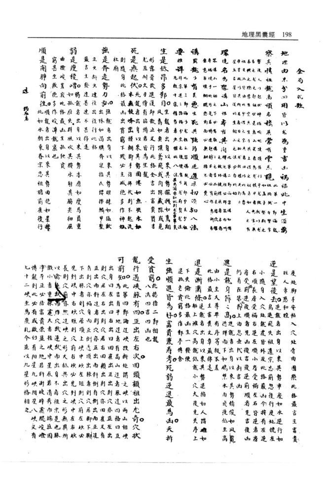

<!-- V3_SOURCE_ID:book010-b000156-p000-81e033ecc1 -->

如果是穿帐之形，气脉从帐中生出、从角落生出的不算吉利；要有三重开帐，才是府衙之格，一重开帐仅主富贵人家；如果有贵人居住在帐下，此格是无价宝地。地轴、天肉左右具备的，是好地；金水脑为上格，火星次之；车形帐要谨慎取用，脚分明、带有下重之形的，才是月重之格，主生贵人，一重主富；穿心而出的是上等，出角的是下等；帐不穿心的，绝对不能入选；贵人在帐下，必出贵人；在帐上，必出吏员；巨石在左右，形态类似龟蛇的，尤其好；如果没有这样的形，得到帐角逸出的形也可以。

> **释读存疑：** 原文中“地轴”“天肉”“金水脑”等具体所指不详

查看对应原文

<!-- V3_FOLDBACK_BEGIN:book010-b000156-p000-81e033ecc1 -->

若还穿帳要中出角落未為吉刃重三重開府衙一重只富家若有貴人居帳下此格真無價地軸天肉左右為有勿金水腦為上火星次之車形如帳慎可脚分明有帶下重方是月重以生貴一重主富穿心出者為上可角出者為下帳不穿心决不入相貴人在帳下必出貴在帳上必出吏扣巨石在左右形類龜蛇尤秋如無得帳角逸獲亦可

<!-- V3_FOLDBACK_END:book010-b000156-p000-81e033ecc1 -->

<!-- V3_SOURCE_ID:book010-b000157-p000-b90423afd8 -->

文中提及‘退卸博狄龕’，具体所指不详；还提到‘細凶星变吉炁老龍抽出嫩技柯跌斷’，具体含义不详；又有‘小最奇異恃权 人好裳如蝉脫鼓 脱大’，具体所指不详。

> **释读存疑：** 退卸博狄龕；細凶星变吉炁老龍抽出嫩技柯跌斷；小最奇異恃权 人好裳如蝉脫鼓 脱大；退卸博狄龕具体所指不详；細凶星变吉炁老龍抽出嫩技柯跌斷具体含义不详；小最奇異恃权 人好裳如蝉脫鼓 脱大具体所指不详

查看对应原文

<!-- V3_FOLDBACK_BEGIN:book010-b000157-p000-b90423afd8 -->

退卸博狄龕者細凶星变吉炁老龍抽出嫩技柯跌斷 小最奇異恃权 人好裳如蝉脫鼓 脱大

<!-- V3_FOLDBACK_END:book010-b000157-p000-b90423afd8 -->

<!-- V3_SOURCE_ID:book010-b000158-p000-6a2efcfd5e -->

此处有月形的方正通道，可加以利用。

查看对应原文

<!-- V3_FOLDBACK_BEGIN:book010-b000158-p000-6a2efcfd5e -->

此 中 月形方通 可 用

<!-- V3_FOLDBACK_END:book010-b000158-p000-6a2efcfd5e -->

<!-- V3_SOURCE_ID:book010-b000159-p000-225b3395a0 -->

文中提到‘龍上如生兩池水養廕斯為美異骨毛洲興塘須定 不’，具体所指不详。

> **释读存疑：** 龍上如生兩池水養廕斯為美異骨毛洲興塘須定 不；龍上如生兩池水養廕斯為美異骨毛洲興塘須定 不具体所指不详；本地硬校验仍未通过，已记录供后续自动处理或人工核对。

查看对应原文

<!-- V3_FOLDBACK_BEGIN:book010-b000159-p000-225b3395a0 -->

龍上如生兩池水養廕斯為美異骨毛洲興塘須定 不

<!-- V3_FOLDBACK_END:book010-b000159-p000-225b3395a0 -->

<!-- V3_SOURCE_ID:book010-b000160-p000-7344c85a17 -->

文中提及‘夾衛度從刃傍侍天乙太乙時左边武庫右文官隊伏紫 苏文太幾多則穴 瘦居 度左瘦專肥變名雕權尤最吉’，具体所指不详。

> **释读存疑：** 夾衛度從刃傍侍天乙太乙時左边武庫右文官隊伏紫 苏文太幾多則穴 瘦居 度左瘦專肥變名雕權尤最吉；夾衛度從刃傍侍天乙太乙時左边武庫右文官隊伏紫 苏文太幾多則穴 瘦居 度左瘦專肥變名雕權尤最吉具体所指不详；本地硬校验仍未通过，已记录供后续自动处理或人工核对。

查看对应原文

<!-- V3_FOLDBACK_BEGIN:book010-b000160-p000-7344c85a17 -->

夾衛度從刃傍侍天乙太乙時左边武庫右文官隊伏紫 苏文太幾多則穴 瘦居 度左瘦專肥變名雕權尤最吉

<!-- V3_FOLDBACK_END:book010-b000160-p000-7344c85a17 -->

<!-- V3_SOURCE_ID:book010-b000161-p000-6ff4df21f1 -->

福运绵延的地方，有两层山峦重叠护卫，会出一代贵人；有十重山峦重叠护卫，会形成一座城；只有一重山峦重叠的地方，只会出丞、薄、尉这类小官。如今考察迎送之形，在穴前的送托穴位置较浅，由此可知这处已经成型。

> **释读存疑：** 原文“福綿延二重復衛一代貴十重度 地 重 一城 一重只出丞薄尉 今按迎 纏在穴前 送 托穴穴 淺 见 此己成”断句及部分文字存在错乱，已按风水文例保守整理

查看对应原文

<!-- V3_FOLDBACK_BEGIN:book010-b000161-p000-6ff4df21f1 -->

福綿延二重復衛一代貴十重度 地 重 一城 一重只出丞薄尉 今按迎 纏在穴前 送 托穴穴 淺 见 此己成

<!-- V3_FOLDBACK_END:book010-b000161-p000-6ff4df21f1 -->

<!-- V3_SOURCE_ID:book010-b000162-p000-b5eadf4c7c -->

想要选定穴的位置时，要看脉的源头，脉有十二种格局，分为正、偏、大、小、共、短、长、高、平、新等类别。

> **释读存疑：** 原文“欲作穴時看出脉元有十二格正偏大小共短長高佩新”中“佩”字疑为“平”字讹误，已按文例保守整理

查看对应原文

<!-- V3_FOLDBACK_BEGIN:book010-b000162-p000-b5eadf4c7c -->

欲作穴時看出脉元有十二格正偏大小共短長高佩新

<!-- V3_FOLDBACK_END:book010-b000162-p000-b5eadf4c7c -->

<!-- V3_SOURCE_ID:book010-b000163-p000-475cbd5b36 -->

要仔细审察左右的曲直，吉凶都能一目了然；蜂腰、鹤膝的地形最为奇特。

> **释读存疑：** 原文“要審詳左右曲直井價吉凶皆在目蜂腰崔膝最為奇”中“井價”疑为“皆”字讹误，“崔膝”疑为“鹤膝”讹误，已按文例保守整理

查看对应原文

<!-- V3_FOLDBACK_BEGIN:book010-b000163-p000-475cbd5b36 -->

要審詳左右曲直井價吉凶皆在目蜂腰崔膝最為奇

<!-- V3_FOLDBACK_END:book010-b000163-p000-475cbd5b36 -->

<!-- V3_SOURCE_ID:book010-b000164-p000-75c544cb54 -->

曲到脚辰的位置点穴，天星星辰的断脉，尚且有时可用；鹤膝、蜂腰这类地形，若脉气动荡，在穴处必定会出现凶象。

> **释读存疑：** 2；原文“曲 到 脚辰点 短 天 星 星辰 之断 尚 时是 可七崔不脉凶龍秋 棘 动 穴 必 泡 腰 2 者 方”存在难以释读的字符“2”，部分文字存在错乱，保守释读仍存在歧义；本地硬校验仍未通过，已记录供后续自动处理或人工核对。

查看对应原文

<!-- V3_FOLDBACK_BEGIN:book010-b000164-p000-75c544cb54 -->

曲 到 脚辰点 短 天 星 星辰 之断 尚 时是 可七崔不脉凶龍秋 棘 动 穴 必 泡 腰 2 者 方

<!-- V3_FOLDBACK_END:book010-b000164-p000-75c544cb54 -->

<!-- V3_SOURCE_ID:book010-b000165-p000-d4fd263a00 -->

此处原文为“倒開一自脚体 具五”，具体所指不详，无法准确释读

> **释读存疑：** 原文语义不明，无法确定具体含义

查看对应原文

<!-- V3_FOLDBACK_BEGIN:book010-b000165-p000-d4fd263a00 -->

倒開一自脚体 具五

<!-- V3_FOLDBACK_END:book010-b000165-p000-d4fd263a00 -->

<!-- doc003 PDF 第 203 页：旋转/复杂版面 OCR 供检索；内容与排版以原页图为准。 -->
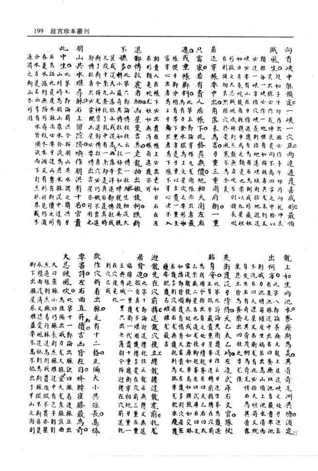

<!-- V3_SOURCE_ID:book010-b000167-p000-e46760323a -->

凡是寻找大地，都要逐一探究它的源流

查看对应原文

<!-- V3_FOLDBACK_BEGIN:book010-b000167-p000-e46760323a -->

凡求大地要搜求逐一究源流

<!-- V3_FOLDBACK_END:book010-b000167-p000-e46760323a -->

<!-- V3_SOURCE_ID:book010-b000168-p000-c215f656cf -->

全局入式歌

查看对应原文

<!-- V3_FOLDBACK_BEGIN:book010-b000168-p000-c215f656cf -->

全局入式歌

<!-- V3_FOLDBACK_END:book010-b000168-p000-c215f656cf -->

<!-- V3_SOURCE_ID:book010-b000169-p000-8e908e2688 -->

进入穴（风水中认为气脉聚结、适宜安葬或营建的位置）之前，应当先明确四落的情况，有落之处都可以作为选址。初落的情况是，距离万祖山不远就已形成穴形，只要局势完整，发福的速度最快，只是持续时间不长罢了

查看对应原文

<!-- V3_FOLDBACK_BEGIN:book010-b000169-p000-8e908e2688 -->

入穴先当明四落有落皆堪作初落由來近祖山局勢必須完 初落者萬祖山未遠便形穴但得局勢完發福最速只不久耐

<!-- V3_FOLDBACK_END:book010-b000169-p000-8e908e2688 -->

<!-- V3_SOURCE_ID:book010-b000170-p000-b1598dbea2 -->

缠护此类的情况，大多是从腰里回转，剩下的在尽头处的情况完整，在老者处的情况也完整，所以寻找这类地脉时，必须以老尽之处为上选，这也是头部形势完全的缘故。戎案时建礼山回转，四周有情，才是它的分荡后龙擘脉去串贯，值得选取。正脉分枝孽脉而去，脉质正，对应守以山，穴回半将，四准正有方。

> **释读存疑：** 原文中“戎案”“分荡”“擘脉”“四准”等术语具体所指未明，候选释读未标注相关风险；1轮自动修复后核义模型仍建议修订，已保守记录。

查看对应原文

<!-- V3_FOLDBACK_BEGIN:book010-b000170-p000-b1598dbea2 -->

為纏此尤多從腰裡落回轉餘婦于尽者有全于老者故尋尤必以老尽為上是亦頭形勢完全戎案時建禮山回轉四雇有情方是其分荡後龍擘脉去串貫述可取可脉情便 分枝孽脉而去 脉质 正 对 守 以山 穴回 半将 四准 正有方

<!-- V3_FOLDBACK_END:book010-b000170-p000-b1598dbea2 -->

<!-- V3_SOURCE_ID:book010-b000171-p000-c911d5147b -->

四落中间分五龙，最要看行踪。尤其如果落脉时的生降之势界截伶例，直龙原是撞背来中出贵，横龙原是没侧逆转须磅砖，四尨原是曲仑身顾祖要迢巡，飞卷原是佶上聚昂首真奇兴，潜龙原是落卒洋撒脉自悠扬。吉凶皆用九星相，必须神炁旺。昔贤降势立图，多未免有差讹。此二節论降势，昔人有七十二龙，降势又有十三真龙势，又有三十六旧龙，又有三百六十州落，皆欢笼书诸形，然无统杞矣。乱熙序，今用穴星为主，余不取。

> **释读存疑：** 原文中“七十二龙”“十三真龙势”“三百六十州落”等术语具体所指未明，候选释读未标注相关风险；1轮自动修复后核义模型仍建议修订，已保守记录。

查看对应原文

<!-- V3_FOLDBACK_BEGIN:book010-b000171-p000-c911d5147b -->

四落中间分五龍最要看行蹤尤若落時生降勢界截伶例直龍原是撞背來中出貴徘徊橫尤原是沒側逆轉須磅磚四尨原是曲崙身顧祖要迢巡飛卷原是佶上聚昂首真奇興潛尤原是落卒洋撒脉自悠揚吉凶皆用九星相必須神炁旺昔賢降勢立圗多未免有差訛 此二節論降勢昔人有七十二尤降勢又有十 三真尤勢又有三十七六舊又有三百六十州落皆歡笼書諸形然無統杞矣亂熙序今用穴星為主餘不取

<!-- V3_FOLDBACK_END:book010-b000171-p000-c911d5147b -->

<!-- V3_SOURCE_ID:book010-b000172-p000-8173f80bd8 -->

源流容易见，入龙式格歌九星穴格九星。

查看对应原文

<!-- V3_FOLDBACK_BEGIN:book010-b000172-p000-8173f80bd8 -->

源流容易見 入龍 式格 歌九 星穴 格九 星

<!-- V3_FOLDBACK_END:book010-b000172-p000-8173f80bd8 -->

<!-- V3_SOURCE_ID:book010-b000173-p000-535bd32c3b -->

四前正案要分明真假，需仔细推究。入此山去怀后笃，谓处遍形案驯降以面者不是证之。正人朔山亦自有真级，必假时朝直类名尖直梦典我急不有，若是横水热作朝街双头蚕顺热朝流大，只看又堂朝内有问来抢迢百里特立似楼宾主相整鸟官爵上白落。

> **释读存疑：** 原文中部分字符如“π”“a”“1”“4”等无法识别，已按可辨识内容处理；原文中部分字符无法识别，具体语义无法确定；本地硬校验仍未通过，已记录供后续自动处理或人工核对。

查看对应原文

<!-- V3_FOLDBACK_BEGIN:book010-b000173-p000-535bd32c3b -->

四 前正麽要分明真假細推 案 入也此山 去怀后笃谓 处遍形案驯降以面者不是证之 正 人 朔 山亦自有真 级 必假 時 朝 直 类 名 尖 直 梦 典 我 急不 有 若是橫 水热作朝 街 π 雙 頭 蚕 顺 热 朝流 大 只 看 a 又 堂 朝内有 问 来抢 1 迢 百 里 特 立 似 楼 4 賓主 相 整 鸟官爵 上 白 落

<!-- V3_FOLDBACK_END:book010-b000173-p000-535bd32c3b -->

<!-- doc003 PDF 第 204 页：旋转/复杂版面 OCR 供检索；内容与排版以原页图为准。 -->
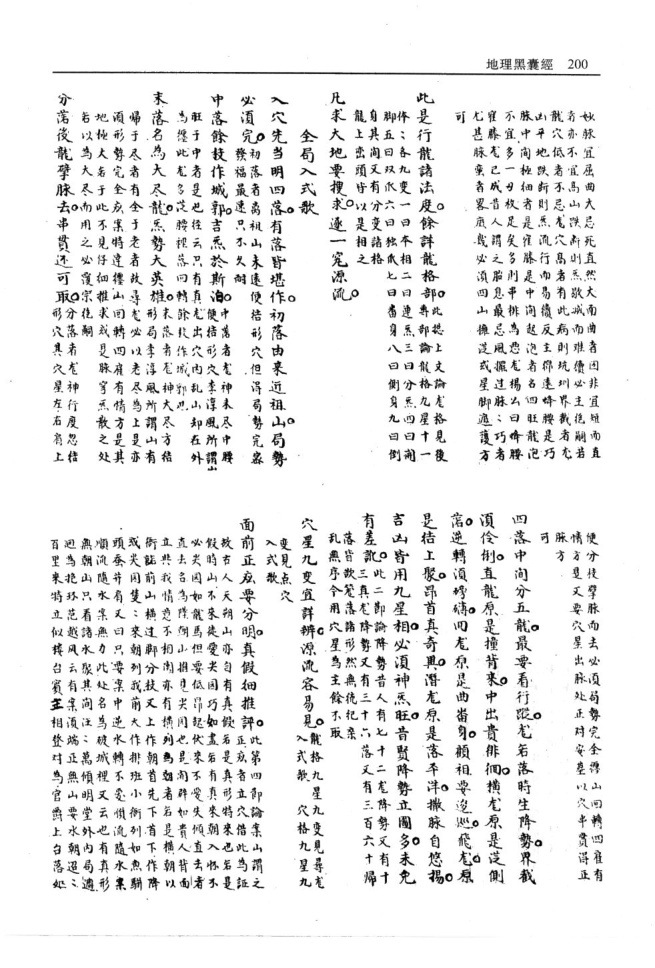

<!-- V3_SOURCE_ID:book010-b000175-p000-048a2b5448 -->

手脚突然出现异常，无法承受迎对的态势；丽隐井处有石生，歌斜向上，无有形迹；远处的案山地势不高，近处的案山地势低平；马良的高低态势都不背离顶势，需仔细斟酌消详。

> **释读存疑：** 手脚卒矣射不堪迎麗隱井生石歌斜上無形遠案高不昂近案低馬良高低俱不背頂用細消詳中部分语句语义晦涩，具体所指不详

查看对应原文

<!-- V3_FOLDBACK_BEGIN:book010-b000175-p000-048a2b5448 -->

手脚卒矣射不堪迎麗隱井生石歌斜上無形遠案高不昂近案低馬良高低俱不背頂用細消詳

<!-- V3_FOLDBACK_END:book010-b000175-p000-048a2b5448 -->

<!-- V3_SOURCE_ID:book010-b000176-p000-3715f97cd5 -->

龙、虎古称是护卫“穴”的存在，“褐福”与穴最为亲切；龙要蜿蜒，虎要蹲返，此为相关要点。

> **释读存疑：** 褐福；原文中“褐福”具体所指不详

查看对应原文

<!-- V3_FOLDBACK_BEGIN:book010-b000176-p000-3715f97cd5 -->

龍虎古称衛區穴褐福最親切龍要婉蜒虎要蹲返此

<!-- V3_FOLDBACK_END:book010-b000176-p000-3715f97cd5 -->

<!-- V3_SOURCE_ID:book010-b000177-p000-fb665421c9 -->

出现灾异的态势如同爪瓠，来势迥抱，福荫会因此分减；火形粗大、瘦弱、短缩各有不同。

> **释读存疑：** 見災迤若如爪瓠來迥抱福蔭分長火粗大瘦弱短縮中部分语句语义晦涩，具体所指不详

查看对应原文

<!-- V3_FOLDBACK_BEGIN:book010-b000177-p000-fb665421c9 -->

見災迤若如爪瓠來迥抱福蔭分長火粗大瘦弱短縮

<!-- V3_FOLDBACK_END:book010-b000177-p000-fb665421c9 -->

<!-- V3_SOURCE_ID:book010-b000178-p000-ed4cd083d6 -->

形势有破、辟、迫、狭、并、强、直、尖、射，以及插落竞低、隔薄反走、斜飞等各类情形。

> **释读存疑：** 形破辟迫狹并強直尖射與挿落競低隔薄反走斜中部分语句语义晦涩，具体所指不详

查看对应原文

<!-- V3_FOLDBACK_BEGIN:book010-b000178-p000-ed4cd083d6 -->

形破辟迫狹并強直尖射與挿落競低隔薄反走斜

<!-- V3_FOLDBACK_END:book010-b000178-p000-ed4cd083d6 -->

<!-- V3_SOURCE_ID:book010-b000179-p000-06582645c3 -->

观察形迹识别鬼炁，这才称得上是精通此道。鬼炁的长短要适宜，这样才能夺取穴的炁；逆缠的炁才会有力量。

查看对应原文

<!-- V3_FOLDBACK_BEGIN:book010-b000179-p000-06582645c3 -->

見形識鬼便是尤精是也鬼炁宜短長則奪穴炁逆纏方有力勢

<!-- V3_FOLDBACK_END:book010-b000179-p000-06582645c3 -->

<!-- V3_SOURCE_ID:book010-b000180-p000-c280c4e8ed -->

此处文字残缺错乱，仅能辨识出与「穴」相关的零散内容，其余部分无法准确释读。

> **释读存疑：** 穴问制 上是最 四本紫 # 是 列穴 前 佳不 頭身 就只 者 乌；原文存在残缺错乱，仅能辨识出与「穴」相关的零散内容

查看对应原文

<!-- V3_FOLDBACK_BEGIN:book010-b000180-p000-c280c4e8ed -->

穴问制 上是最 四本紫 # 是 列穴 前 佳不 頭身 就只 者 乌

<!-- V3_FOLDBACK_END:book010-b000180-p000-c280c4e8ed -->

<!-- V3_SOURCE_ID:book010-b000181-p000-62c01c9826 -->

宫星本就出自朝山，这里所说的宫星，是指宫星出现在朝山之后。有人问：什么是宫翻山？如果山势肯逆施，这就是朝山有余，与穴后思的情况一样。

> **释读存疑：** 原文中“肯凌逆施山”“穴后思”表述含混，具体所指不详

查看对应原文

<!-- V3_FOLDBACK_BEGIN:book010-b000181-p000-62c01c9826 -->

宮星本是出朝 山 此論官星按官星出朝山之後往云 问 君如何謂之官翻山肯凌逆施山此是朝山有餘異我穴後思一般

<!-- V3_FOLDBACK_END:book010-b000181-p000-62c01c9826 -->

<!-- V3_SOURCE_ID:book010-b000182-p000-f0d2e66552 -->

此处文字残缺，无法准确释读。

> **释读存疑：** 原文文字残缺，无法准确释读

查看对应原文

<!-- V3_FOLDBACK_BEGIN:book010-b000182-p000-f0d2e66552 -->

有以来 袋径

<!-- V3_FOLDBACK_END:book010-b000182-p000-f0d2e66552 -->

<!-- V3_SOURCE_ID:book010-b000183-p000-14ee34ac90 -->

星数达到一百，就不能再增加了。

> **释读存疑：** 原文“星百”具体所指不详，释读为“星数达到一百”为合理推测

查看对应原文

<!-- V3_FOLDBACK_BEGIN:book010-b000183-p000-14ee34ac90 -->

星百 不进一不可添也

<!-- V3_FOLDBACK_END:book010-b000183-p000-14ee34ac90 -->

<!-- V3_SOURCE_ID:book010-b000184-p000-932b59037a -->

山阳的第三处位置称为阳，地禁朝外的水（风水语境中的河流、水系及其来去形态）能带来禄位与财势，作用刚健有力。天使用它，宾类也会刚健，也会使用本山的这类情况，比如甲山这类，具体所指不详。

> **释读存疑：** 主具旺马

查看对应原文

<!-- V3_FOLDBACK_BEGIN:book010-b000184-p000-932b59037a -->

山阳 三 中曰阳 地禁朝外水得禄財健键 天用 之 宾 類健 亦 用 本 山 之 如 甲 山 之 類主具旺 馬

<!-- V3_FOLDBACK_END:book010-b000184-p000-932b59037a -->

<!-- V3_SOURCE_ID:book010-b000185-p000-f37abd2064 -->

内心笃定不迷旧俗，福命也会随之而来，住宅使用时，不要误将正穴（风水中认为气脉聚结、适宜安葬或营建的位置）当作“杨穴”，具体所指不详。

> **释读存疑：** 杨穴

查看对应原文

<!-- V3_FOLDBACK_BEGIN:book010-b000185-p000-f37abd2064 -->

迷旧心定福命以亦 宅用 误以正 楊 穴

<!-- V3_FOLDBACK_END:book010-b000185-p000-f37abd2064 -->

<!-- V3_SOURCE_ID:book010-b000186-p000-5d38143c23 -->

秋水的形态，城郭的样貌，四周被水（风水语境中的河流、水系及其来去形态）分割，具体所指不详。

> **释读存疑：** 绪儿四割反水五九日；地体李之分；明变然然曰

查看对应原文

<!-- V3_FOLDBACK_BEGIN:book010-b000186-p000-5d38143c23 -->

秋水 貌形城 绪儿四割反水五九 日 地体 李 之分 明变然然曰

<!-- V3_FOLDBACK_END:book010-b000186-p000-5d38143c23 -->

<!-- V3_SOURCE_ID:book010-b000187-p000-b1873672d7 -->

暂且详尽细致地领会并牢记它。

查看对应原文

<!-- V3_FOLDBACK_BEGIN:book010-b000187-p000-b1873672d7 -->

且尽者細詳而默識之何

<!-- V3_FOLDBACK_END:book010-b000187-p000-b1873672d7 -->

<!-- V3_SOURCE_ID:book010-b000188-p000-543b6a60e2 -->

所说的道理就如同草一样。

查看对应原文

<!-- V3_FOLDBACK_BEGIN:book010-b000188-p000-543b6a60e2 -->

谓 則如草

<!-- V3_FOLDBACK_END:book010-b000188-p000-543b6a60e2 -->

<!-- doc003 PDF 第 205 页：旋转/复杂版面 OCR 供检索；内容与排版以原页图为准。 -->
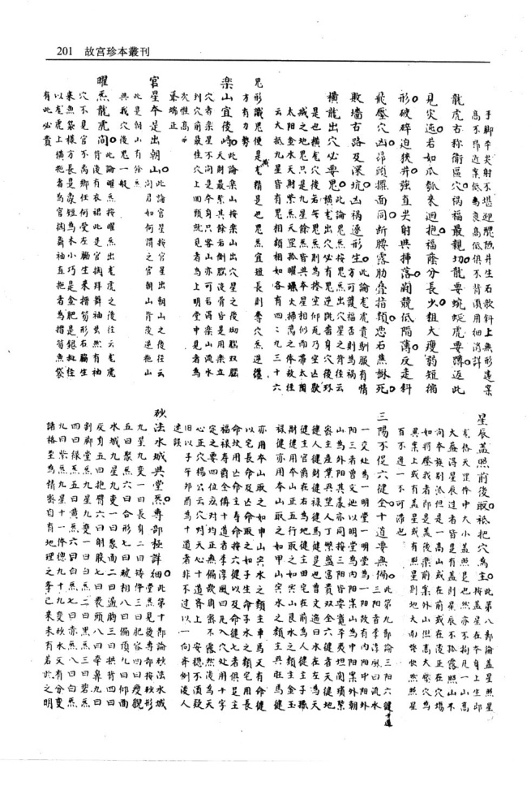

<!-- V3_SOURCE_ID:book010-b000190-p000-99d01a7579 -->

上方有禹，则穴亦有当，其数亦典穴政相同。外有二禽，须歆糜抓，牙班识，两罗星一也诀，一迎枕水一边田，罗星亦自有种，浪说星辰在水连。

> **释读存疑：** 禹；典穴政；歆糜抓；牙班识；罗星；原文中“禹”“典穴政”“歆糜抓”“牙班识”“罗星”等术语含义未明，具体所指不详

查看对应原文

<!-- V3_FOLDBACK_BEGIN:book010-b000190-p000-99d01a7579 -->

上 有禹則穴亦有當其數亦典穴政相同外有二禽 须歆糜抓 牙 班 識 兩罗星一也訣一迎枕水一邊田罗星亦自有種 浪說星辰在水連

<!-- V3_FOLDBACK_END:book010-b000190-p000-99d01a7579 -->

<!-- V3_SOURCE_ID:book010-b000191-p000-01683f66fe -->

吉星只需一一完整传承，运用者需能灵活变通。

查看对应原文

<!-- V3_FOLDBACK_BEGIN:book010-b000191-p000-01683f66fe -->

吉星唯得一一全傳用者情通活法

<!-- V3_FOLDBACK_END:book010-b000191-p000-01683f66fe -->

<!-- V3_SOURCE_ID:book010-b000192-p000-468c47ae39 -->

还有平洋局的情况又要另外详细地讲给你听，星辰原本出自高岗，撒脉的道理，这是第十二郎论述的内容。午洋局一定有高山的龙脉，尤其要注意的是，龙脉多是从山上径直撒落到平洋地带，这就是所谓的“潜龙”。

查看对应原文

<!-- V3_FOLDBACK_BEGIN:book010-b000192-p000-468c47ae39 -->

更有平洋局又别傾廩共君說星辰原出在高崗撒脉此第十二郎論午洋局必有高山脈尤嚴以下御目多在山上径撒下本洋即所谓潛尤是也

<!-- V3_FOLDBACK_END:book010-b000192-p000-468c47ae39 -->

<!-- V3_SOURCE_ID:book010-b000193-p000-07e2cc35e8 -->

龙脉撒落到平洋地带的情况，和山地龙脉完全不同，千万不要搞错了龙脉的真实踪迹。地形有高低之分，“山水”的关键要点其实是一样的。所谓仰，就是平洋局的情况，凡是地势稍高的地方就称为山地，地势稍低的地方就称为“水”。《习经》说的是中央高的情况，这就是“身水”。

查看对应原文

<!-- V3_FOLDBACK_BEGIN:book010-b000193-p000-07e2cc35e8 -->

撒落平洋始不同切莫失真蹤地有高低即山水節目同一仰 即平 詳局凡地之稍高者便丐之山地之稍低者 為之水 习經低中央高郎是身水吏尤經云

<!-- V3_FOLDBACK_END:book010-b000193-p000-07e2cc35e8 -->

<!-- V3_SOURCE_ID:book010-b000194-p000-49b0f5ea5d -->

这句话过于简略，语义模糊，具体所指不详。

> **释读存疑：** 这句话过于简略，语义模糊，具体所指不详

查看对应原文

<!-- V3_FOLDBACK_BEGIN:book010-b000194-p000-49b0f5ea5d -->

傳尤失脉失諒時

<!-- V3_FOLDBACK_END:book010-b000194-p000-49b0f5ea5d -->

<!-- V3_SOURCE_ID:book010-b000195-p000-0dc2ad918c -->

侧身龙的格局隐而复现，龙脉上行时显现，隐伏隆起的地方正好可以寻找，这样的穴位价值千金。尤其如果前方有“水”界截断，“穴”的“向”朝向平洋地带，其余的情况大多……有的在平洋地带，有的在平洋地带，“穴”的位置……仰面的格局。需要加以推测，变化也有落在平地上的。

> **释读存疑：** 原文存在断句错乱、文字残缺的情况，部分内容语义模糊，具体所指不详；1轮自动修复后核义模型仍建议修订，已保守记录。

查看对应原文

<!-- V3_FOLDBACK_BEGIN:book010-b000195-p000-0dc2ad918c -->

側身龍格隱復見脉上行時見 隱隆正好尋得值千金尤若前逢水界截穴向 平而餘八吏多 有在平 有在平 穴地 处者 秋穴亦有仰面 格。 一要推 测。 變亦有落在平 行第九吏曰 地 面 者 其八

<!-- V3_FOLDBACK_END:book010-b000195-p000-0dc2ad918c -->

<!-- V3_SOURCE_ID:book010-b000196-p000-1dc59b1e12 -->

文中提到“六星诀”，还有“列城曰”“既日十”“海罗”，原文存在缺字、错乱，具体含义不详。

> **释读存疑：** 六星诀；列城曰；既日十；海罗；原文存在缺字、错乱，具体含义不详

查看对应原文

<!-- V3_FOLDBACK_BEGIN:book010-b000196-p000-1dc59b1e12 -->

曰六星诀 列城曰 既日十 口 海罗

<!-- V3_FOLDBACK_END:book010-b000196-p000-1dc59b1e12 -->

<!-- V3_SOURCE_ID:book010-b000197-p000-d13c64760c -->

## 立宅入式歌

查看对应原文

<!-- V3_FOLDBACK_BEGIN:book010-b000197-p000-d13c64760c -->

## 立宅入式歌

<!-- V3_FOLDBACK_END:book010-b000197-p000-d13c64760c -->

<!-- V3_SOURCE_ID:book010-b000198-p000-e698cfe966 -->

为民众建造住宅是最要紧的事，住宅吉利则福气绵延不绝，古代就有关于住宅的论述，没有不同的说法。必须区分炁势，安葬死者的骸骨埋在土中，秉受炁运的子孙就会兴旺；建造住宅让活人居住在地上，秉受炁运就能获得财富与人丁兴旺。

查看对应原文

<!-- V3_FOLDBACK_BEGIN:book010-b000198-p000-e698cfe966 -->

居民立宅最為先宅吉福綿延古称攻宅理無異述須分炁勢安坟死骨埋土中秉炁子孫隆立宅生人居地上o 秉炁財丁

<!-- V3_FOLDBACK_END:book010-b000198-p000-e698cfe966 -->

<!-- V3_SOURCE_ID:book010-b000199-p000-16f1f745ce -->

土地要守持居所，如今的格局如同秋日之人，与推典所说的相同：阴穴的法则有黑坎穴，穴要小，阳宅的穴要大，记量尺寸必须以东方为基准。宝平九穴必要系济我所说的阴穴，没有阳宅的东方，其势如同市井乡蕃，原本有两处，尤其适合居住，要形成成市的居所，必要临近街衢，朝向的方位处最为雄健。

> **释读存疑：** 宝平九穴；系济；市井乡蕃；1轮自动修复后核义模型仍建议修订，已保守记录。

查看对应原文

<!-- V3_FOLDBACK_BEGIN:book010-b000199-p000-16f1f745ce -->

地要 守居 今 格如 秋人 亚 同： 推典 穴阴 法有無黑坎穴宜小宅穴宜大記尺必東寶平九 穴必要系濟我謂 阴 穴米 無阳宅東其勢 市井鄉蕃元有二尤住方成市之居必要傍街衢向首 处最雄

<!-- V3_FOLDBACK_END:book010-b000199-p000-16f1f745ce -->

<!-- doc003 PDF 第 206 页：旋转/复杂版面 OCR 供检索；内容与排版以原页图为准。 -->
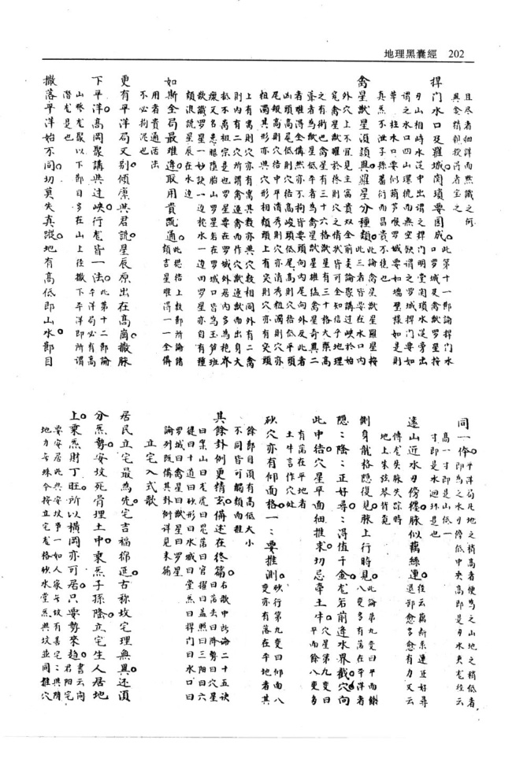

<!-- V3_SOURCE_ID:book010-b000201-p000-79db0fd274 -->

具备旺盛的条件，是乡居的必要要求，龙神落位后，向首要随龙确定，立向时，住宅的首要要点是要依据穴有星入的情况来判断，4。

查看对应原文

<!-- V3_FOLDBACK_BEGIN:book010-b000201-p000-79db0fd274 -->

具旺 鄉居必要龍神落 向首隨龍作 向立 宅 首 要说 依要 穴有 星入 4 a

<!-- V3_FOLDBACK_END:book010-b000201-p000-79db0fd274 -->

<!-- V3_SOURCE_ID:book010-b000202-p000-d9342910c7 -->

城市居住的地气会有推移变化，历经数代，怎能长久延续？乡居的龙脉如果来势长远，世代就会绵长平稳。大凡乡居，要看龙脉是否平正，源头总隐于阴处；如果是高山，就寻找其顶部，龙脉起伏升高都在眼前，撤落到平洋地带最为奇特，四周忌讳有倾危的地形，左右高低的山势要像子孙一样拱卫，前方有迎势、后方有拥势，朝山有意向，住宅前方有一条横水环抱，水流下斗、迂回曲折，子孙朝揖，正主端庄，没有反柄，自然映照出已有的部分态势。

> **释读存疑：** 原文中“鄉洺”“尨”“撤”“平洋湖”等字符疑似OCR识别错误，无法确认准确含义；“映し巳”为日文残句，无法完整译出；1轮自动修复后核义模型仍建议修订，已保守记录。

查看对应原文

<!-- V3_FOLDBACK_BEGIN:book010-b000202-p000-d9342910c7 -->

市居地炁有推遷垂代豈能延鄉居龍脉若來遠世代 長平穩大凡鄉洺看來尨平源總隱陰若是高山尋頤 伏升高皆在目撤落平洋湖最奇四顧忌傾危左右高 低勢孫拱前迎井後擁朝山有意宅前橫一水抱身行 下斗迴孫朝揖正得主端嚴無 反柄從然映し巳

<!-- V3_FOLDBACK_END:book010-b000202-p000-d9342910c7 -->

<!-- V3_SOURCE_ID:book010-b000203-p000-86da6a6792 -->

星象最为清晰，田庄桑林的详细情况，详见穴星部。

查看对应原文

<!-- V3_FOLDBACK_BEGIN:book010-b000203-p000-86da6a6792 -->

星 最 清起田庄桑餘详見穴星部

<!-- V3_FOLDBACK_END:book010-b000203-p000-86da6a6792 -->

<!-- V3_SOURCE_ID:book010-b000204-p000-39adaad68a -->

这段文字多处字符疑似OCR识别错误，语义残缺，无法完整解读。

> **释读存疑：** 原文多处字符OCR识别错误，语义残缺，无法完整解读

查看对应原文

<!-- V3_FOLDBACK_BEGIN:book010-b000204-p000-39adaad68a -->

職天 若扦孤輟空權當代從見郎燥火星辰出知 : 洋社·警 他方投河自彼止若立神 坛 餘典 最

<!-- V3_FOLDBACK_END:book010-b000204-p000-39adaad68a -->

<!-- V3_SOURCE_ID:book010-b000205-p000-3aae2aabed -->

如果穴前水流斜飞、堂局陡泻，立刻会家道衰败；如果朝向穴的方向开凿、破坏了灶炁与脉气，就会沦为市井之徒，不分内外都是如此。

查看对应原文

<!-- V3_FOLDBACK_BEGIN:book010-b000205-p000-3aae2aabed -->

朝若斜飛堂陡瀉立見家衰謝若還穴小鑿殺竈炁脈為市井無內外如此方為

<!-- V3_FOLDBACK_END:book010-b000205-p000-3aae2aabed -->

<!-- V3_SOURCE_ID:book010-b000206-p000-8a52a17799 -->

此处原文OCR识别存在错乱，无法准确释读。

查看对应原文

<!-- V3_FOLDBACK_BEGIN:book010-b000206-p000-8a52a17799 -->

H 之么 曰说 山瘡乎不四西至比買西弘三处北谓 燕 宅三禄有可委疾 任假 克 更 长 流嶺表均棄出常侍 言

<!-- V3_FOLDBACK_END:book010-b000206-p000-8a52a17799 -->

<!-- V3_SOURCE_ID:book010-b000207-p000-9849aef57e -->

即使家道衰落之后，仓库也会像在刀刃边一样；家中原本富积钱财，忽然间左右出现文笔峰，本应读书应举、得到荐举，却反而衣衫褴褛、家内有风吹动的声响；为何频频遭遇盗贼？是因为天罡的位置倾倒；为何频频发生火灾？是因为燥火的气势旺盛。

> **释读存疑：** 部分术语及短语的具体含义原文未明，释读存在推测成分；1轮自动修复后核义模型仍建议修订，已保守记录。

查看对应原文

<!-- V3_FOLDBACK_BEGIN:book010-b000207-p000-9849aef57e -->

即凌替後尤倉庫刃邊排家富積錢財忽然文筆左右現讀書應奉薦獻花露裥亂衣衫家內有風殽因甚頻頻遭賊盜天罡腦傾倒因甚頻見火災燥火勢崔親

<!-- V3_FOLDBACK_END:book010-b000207-p000-9849aef57e -->

<!-- V3_SOURCE_ID:book010-b000208-p000-9513599d50 -->

文中提到‘因甚頻見瘟疫’，‘孤曜帶黃赤’，‘宅前戒用孫曜為案’，‘左右出主出人為僧帶黃赤石’，这些短语的具体所指不详。

> **释读存疑：** 因甚頻見瘟疫；孤曜帶黃赤；宅前戒用孫曜為案；左右出主出人為僧帶黃赤石

查看对应原文

<!-- V3_FOLDBACK_BEGIN:book010-b000208-p000-9513599d50 -->

因甚頻見瘟疫孤曜帶黃赤 宅前戒用孫曜為案或左右出主出人為僧帶黃赤石

<!-- V3_FOLDBACK_END:book010-b000208-p000-9513599d50 -->

<!-- V3_SOURCE_ID:book010-b000209-p000-555fcf8f8f -->

龍如上格秋如下雖貴無聲價，後龍如弱好，前砂只蔭女位同。

查看对应原文

<!-- V3_FOLDBACK_BEGIN:book010-b000209-p000-555fcf8f8f -->

龍如上格秋如下雖貴無声價後龍如弱好前砂只蔭女 位 同

<!-- V3_FOLDBACK_END:book010-b000209-p000-555fcf8f8f -->

<!-- doc003 PDF 第 207 页：旋转/复杂版面 OCR 供检索；内容与排版以原页图为准。 -->
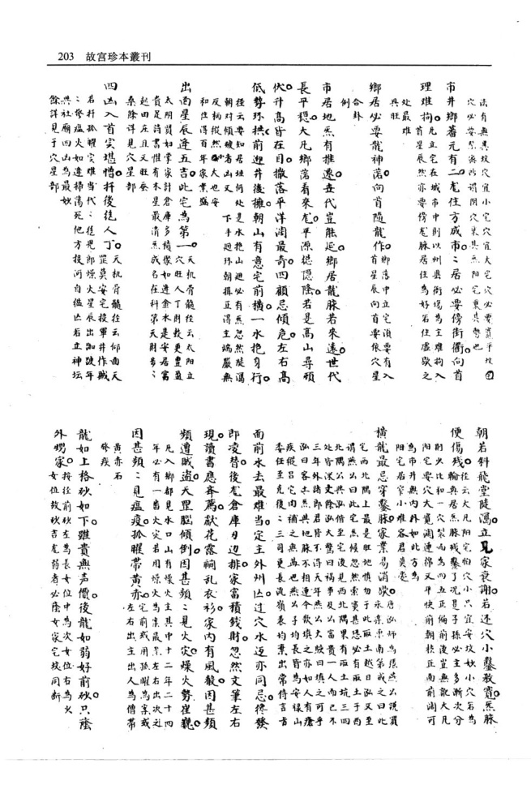

<!-- V3_SOURCE_ID:book010-b000211-p000-e8baad4da1 -->

水凶穴吉，金盡格玄壞可從草；水吉穴凶，如玉盜一破。儒宅在新昌里，本將傲大監康言宅自辨，周阜以其地當出宰相，每命相出言必引領望之，完卒為牛僧孺，汝得吉甫宅，至德裕貶其家臧矣。

查看对应原文

<!-- V3_FOLDBACK_BEGIN:book010-b000211-p000-e8baad4da1 -->

水凶穴吉金盡格玄坏可從草水吉穴凶如玉盜一破 儒宅在新昌里本將傲大監康言宅自辨周阜以其 地当出宰相每命相出言必引領望之完卒為牛僧 儒汝得吉甫宅至德裕貶其家臧矣

<!-- V3_FOLDBACK_END:book010-b000211-p000-e8baad4da1 -->

<!-- V3_SOURCE_ID:book010-b000212-p000-fb5a152464 -->

立定服忌神，前佛設鬼，無麗則人無衰，盡應神，廟寺觀基址皆。

> **释读存疑：** 原文后半段残缺，语义不完整，释读无法形成完整通顺的内容

查看对应原文

<!-- V3_FOLDBACK_BEGIN:book010-b000212-p000-fb5a152464 -->

立定服忌神前佛設鬼 無麗則人無衰盡應 神 廟寺觀基址皆

<!-- V3_FOLDBACK_END:book010-b000212-p000-fb5a152464 -->

<!-- V3_SOURCE_ID:book010-b000213-p000-75f9b9e7c4 -->

更古獄、古戰場必定有餘殃。古獄、古戲傷煞炁出消，不可居之。

> **释读存疑：** 原文开头的“nT”无法辨识，疑为OCR错误，导致释读开头语义不明

查看对应原文

<!-- V3_FOLDBACK_BEGIN:book010-b000213-p000-75f9b9e7c4 -->

nT更樵古獄古戰塲必定有餘 殃。 古獄古戲傷煞炁出消 不可居之

<!-- V3_FOLDBACK_END:book010-b000213-p000-75f9b9e7c4 -->

<!-- V3_SOURCE_ID:book010-b000214-p000-aef0b2714b -->

平坦的坟地最不适合人居住，若有多处“坎”、柳树，就会出现“乌人”“长厥”“作见”等情况，具体所指不详。

> **释读存疑：** 乌人；长厥；作见

查看对应原文

<!-- V3_FOLDBACK_BEGIN:book010-b000214-p000-aef0b2714b -->

放坟平塚最不可居人多坎柳 則会 乌人 长厥 作见 夢重 怪

<!-- V3_FOLDBACK_END:book010-b000214-p000-aef0b2714b -->

<!-- V3_SOURCE_ID:book010-b000215-p000-1f38a894bd -->

道路冲射宅门也不合适，这种说法是对还是错？凡是建造住宅，忌讳道路直冲宅门，必须让道路迂曲，从逆水边（风水语境中的河流、水系及其来去形态）进入才好。

查看对应原文

<!-- V3_FOLDBACK_BEGIN:book010-b000215-p000-1f38a894bd -->

道路衝門亦不宜常有是和 非。 凡搆屋忌道路才門必 要迂曲從逆水边入方好

<!-- V3_FOLDBACK_END:book010-b000215-p000-1f38a894bd -->

<!-- V3_SOURCE_ID:book010-b000216-p000-51613dd45c -->

流水若冲射宅屋背面，会导致家人离散、家财退散；宅边常有流水潺湲，会招致丧祸。内午为正，内晚为夕，初朝……

> **释读存疑：** 原文末尾有缺漏，“内午”“内晚”“初朝”的具体所指不详

查看对应原文

<!-- V3_FOLDBACK_BEGIN:book010-b000216-p000-51613dd45c -->

流水若还冲屋背人散家財退宅邊常有水潺喪禍內午為正內晚為夕初 朝

<!-- V3_FOLDBACK_END:book010-b000216-p000-51613dd45c -->

<!-- V3_SOURCE_ID:book010-b000217-p000-75c9653126 -->

蛟潭龙窟莫相怜，阴盛必定会导致孤贫，其余全局的相关内容，歌中已有记载，此篇另有相关内容。

> **释读存疑：** 莫相怜

查看对应原文

<!-- V3_FOLDBACK_BEGIN:book010-b000217-p000-75c9653126 -->

蛟潭龍窟莫相憐陰盛必孤貧其餘全局歌中備此篇

<!-- V3_FOLDBACK_END:book010-b000217-p000-75c9653126 -->

<!-- V3_SOURCE_ID:book010-b000218-p000-2c7ff54719 -->

蒙名叫做駕天龍

> **释读存疑：** 此处“蒙名”具体所指不详

查看对应原文

<!-- V3_FOLDBACK_BEGIN:book010-b000218-p000-2c7ff54719 -->

蒙名做駕天龍

<!-- V3_FOLDBACK_END:book010-b000218-p000-2c7ff54719 -->

<!-- V3_SOURCE_ID:book010-b000219-p000-eeda271945 -->

大意是說，龍穴、秋水與明堂，專門部門會好好消納祥瑞，天機妙訣能超越眾人

查看对应原文

<!-- V3_FOLDBACK_BEGIN:book010-b000219-p000-eeda271945 -->

言大意龍穴秋水典明堂專部好消祥天机妙袂放群

<!-- V3_FOLDBACK_END:book010-b000219-p000-eeda271945 -->

<!-- V3_SOURCE_ID:book010-b000220-p000-4c17ce5cbb -->

安校入式歌

查看对应原文

<!-- V3_FOLDBACK_BEGIN:book010-b000220-p000-4c17ce5cbb -->

安校入式歌

<!-- V3_FOLDBACK_END:book010-b000220-p000-4c17ce5cbb -->

<!-- V3_SOURCE_ID:book010-b000221-p000-5f3dd5e23d -->

安校地內尋生炁，此法並非容易；景純有見解，另外撰寫了相關書籍，唯恐

> **释读存疑：** 後人不傳

查看对应原文

<!-- V3_FOLDBACK_BEGIN:book010-b000221-p000-5f3dd5e23d -->

安校地內尋生炁此法非容易景純有見别為書唯恐

<!-- V3_FOLDBACK_END:book010-b000221-p000-5f3dd5e23d -->

<!-- V3_SOURCE_ID:book010-b000222-p000-f2b8e36313 -->

塟成虛，郭氏墓書至者秉生炁也，五無行乎地中，人受體于父母，奈形得無遺，仲受廢。

> **释读存疑：** 仲受廢语义不明，具体所指不详；1轮自动修复后核义模型仍建议修订，已保守记录。

查看对应原文

<!-- V3_FOLDBACK_BEGIN:book010-b000222-p000-f2b8e36313 -->

塟成虛 郭氏墓書至者秉生炁也五無行乎地中人受 体于父母奈形得無遺仲受廢

<!-- V3_FOLDBACK_END:book010-b000222-p000-f2b8e36313 -->

<!-- V3_SOURCE_ID:book010-b000223-p000-62383fe0a6 -->

氣在地中何以辨，只相星辰面。按金也木园水、火、土关者曲方。

> **释读存疑：** 木园水、土关语义不明，具体所指不详；本地硬校验仍未通过，已记录供后续自动处理或人工核对。

查看对应原文

<!-- V3_FOLDBACK_BEGIN:book010-b000223-p000-62383fe0a6 -->

氣在地 中何 以 辨 只相星辰 面。 按 金 也木 园水 火 土 关 者 曲 方

<!-- V3_FOLDBACK_END:book010-b000223-p000-62383fe0a6 -->

<!-- V3_SOURCE_ID:book010-b000224-p000-82f9440cc9 -->

所谓五行，是观察气脉运行的形态，以此为根本。气脉运行的喜乐之地，其中的大形法则由此产生，这种大形在地上容易显现。要获得智慧，必须得水，风藏于穴内，气冲融。风遇到气就会散，气散则土散，土散则气行。风水的技法，水法是必须要区分的，必须要有堂局聚集四方之水，穴要避开相关不利因素。

> **释读存疑：** 原文断句错乱，语义难以完全确认

查看对应原文

<!-- V3_FOLDBACK_BEGIN:book010-b000224-p000-82f9440cc9 -->

者五 察行 其之 形形 以也 其行 乐地 此中 斯而 家难 之见 大形 法出 也地 上 而 易見智必須得水典藏風穴內炁冲 融。 票 風遇 則土 散则 安行 技界 之水 法别 必止須堂聚四水穴避

<!-- V3_FOLDBACK_END:book010-b000224-p000-82f9440cc9 -->

<!-- V3_SOURCE_ID:book010-b000225-p000-1eaada2d7c -->

第一莫下去水地，On立見退生，計o所書以曰外炁橫行，又曰聚内然外水外电。

> **释读存疑：** On、計o、电语义不明，具体所指不详；本地硬校验仍未通过，已记录供后续自动处理或人工核对。

查看对应原文

<!-- V3_FOLDBACK_BEGIN:book010-b000225-p000-1eaada2d7c -->

第一莫下去水地 On 立見退生 計o 所書 以曰 外炁橫行又曰 聚 内然 外 水 外 电

<!-- V3_FOLDBACK_END:book010-b000225-p000-1eaada2d7c -->

<!-- V3_SOURCE_ID:book010-b000226-p000-fb9df5adc5 -->

第二，不要寻找剑脊龙，杀师的情况就包含在其中。书上僭越地说，山形如同烟雾上传、卧倒的样子，形状如同……

> **释读存疑：** 原文末尾残缺，无法确认完整含义

查看对应原文

<!-- V3_FOLDBACK_BEGIN:book010-b000226-p000-fb9df5adc5 -->

第二休尋劔脊龍殺师在其中 書 僭 日 山 形煙 上傳 而卧 下 形如

<!-- V3_FOLDBACK_END:book010-b000226-p000-fb9df5adc5 -->

<!-- V3_SOURCE_ID:book010-b000227-p000-003c6fe23a -->

第四，若还没有案山（穴前较近、形如案几的山体），衣食必定根基不稳，难以维持。堪舆之书说，地有四样要素，缺一不可，而案山就是朱雀（穴前方的形势称谓）。

查看对应原文

<!-- V3_FOLDBACK_BEGIN:book010-b000227-p000-003c6fe23a -->

第四猶撫無案山衣食必根 难c 持書地有四哉缺一不 可当 而案 山即朱雀也

<!-- V3_FOLDBACK_END:book010-b000227-p000-003c6fe23a -->

<!-- V3_SOURCE_ID:book010-b000228-p000-657defae06 -->

第五，最忌讳外径云这类情况，要问山形是否环抱、开启，中年时明堂（穴前相对开阔、汇聚的空间）要借水（风水语境中的河流、水系及其来去形态），如同爱惜血脉；看待避风向要像对待迟来的盗贼一样谨慎，不要让明堂被风吹，其次不要让潘牙遭遇水的侵害。按照堪舆之书的说法，明堂掌管生机，若明堂不满一里，主家会退败。

> **释读存疑：** 原文存在多处字迹模糊或错漏，如“外径云”“潘牙”“惜血堂”等，具体所指不详，此处为保守释读

查看对应原文

<!-- V3_FOLDBACK_BEGIN:book010-b000228-p000-657defae06 -->

第五生怕 外径 云問 山 抱 启 裡 中年明堂借水如惜血堂視避風如遲賊莫令堂欲被風次莫使潘牙遭水辦按明堂領 生無滿里主家退

<!-- V3_FOLDBACK_END:book010-b000228-p000-657defae06 -->

<!-- doc003 PDF 第 208 页：旋转/复杂版面 OCR 供检索；内容与排版以原页图为准。 -->
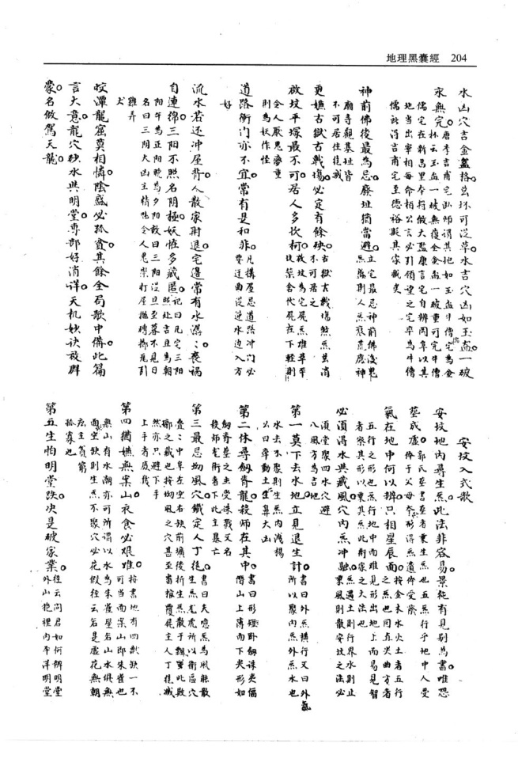

<!-- V3_SOURCE_ID:book010-b000230-p000-6ce5ac3c92 -->

说青尤、白蹲的情况叫做“那尸”，乞昂的情况叫做“嫉主”。按照相关书籍的说法，虎气直去、斜飞，主生气散失，主家败落，人还……

> **释读存疑：** “那尸”具体所指不详；“嫉主”具体所指不详；“虎气”具体所指不详；“生气”具体所指不详

查看对应原文

<!-- V3_FOLDBACK_BEGIN:book010-b000230-p000-6ce5ac3c92 -->

曰青尤 白 蹲謂之那屍乞昂謂之嫉主按書虎氣直去貳斜飛 主生炁數漫主家敗人尚

<!-- V3_FOLDBACK_END:book010-b000230-p000-6ce5ac3c92 -->

<!-- V3_SOURCE_ID:book010-b000231-p000-72253c9450 -->

还有那种童断石过的情况，会单独生出凶祸，消损已经有的福分；要知道饶有“穴”是天然形成的，应当恭敬奉守。

> **释读存疑：** “童断石过”具体所指不详

查看对应原文

<!-- V3_FOLDBACK_BEGIN:book010-b000231-p000-72253c9450 -->

更有童斷石過独生凶消已福從饒有穴出天然奉功

<!-- V3_FOLDBACK_END:book010-b000231-p000-72253c9450 -->

<!-- V3_SOURCE_ID:book010-b000232-p000-1166ed4c06 -->

不要随意安扦。书中说：炁山的成因，是没有具体形态可以安葬的，而新五山是没有土就不能安葬的；有形态且是石势的山，世间也有可以安葬的情况。

> **释读存疑：** “炁山”“新五山”具体所指不详

查看对应原文

<!-- V3_FOLDBACK_BEGIN:book010-b000232-p000-1166ed4c06 -->

莫安 扦。 書云 炁山 之 因 不 形 可 塟者 而 新 五 山 不 土 塟 也形 而 以石 势山 世不 而可

<!-- V3_FOLDBACK_END:book010-b000232-p000-1166ed4c06 -->

<!-- V3_SOURCE_ID:book010-b000233-p000-b3d5583caf -->

断遇石山，并非单独只能生垄；新巴虽凶，却能消损已生的福分，和这种童山相接，并非径首可垒之山，不是正途。谪曰：淡量。1以山入不首可山垒言也非径。

> **释读存疑：** 原文存在断句混乱、文字残缺（如“1以山入不首可山垒言也非径”语义不通），无法形成合理的释读内容

查看对应原文

<!-- V3_FOLDBACK_BEGIN:book010-b000233-p000-b3d5583caf -->

断遇 石山 遇不 独可 生垄 新巴 凶然 消以 己生 福和 接而 此童 1以山 入不 首可 山垒 言也 非径 谪曰 淡量

<!-- V3_FOLDBACK_END:book010-b000233-p000-b3d5583caf -->

<!-- V3_SOURCE_ID:book010-b000234-p000-383b9cfeb2 -->

是龙啊，然而石山也有土。

查看对应原文

<!-- V3_FOLDBACK_BEGIN:book010-b000234-p000-383b9cfeb2 -->

龍也然石山有土

<!-- V3_FOLDBACK_END:book010-b000234-p000-383b9cfeb2 -->

<!-- V3_SOURCE_ID:book010-b000235-p000-d17a7b0639 -->

廖公寻找穴（风水中认为气脉聚结、适宜安葬或营建的位置）有真正的诀法，就连挑担的人都能领会其中的道理，原本的话语并不多，只需领会即可。

查看对应原文

<!-- V3_FOLDBACK_BEGIN:book010-b000235-p000-d17a7b0639 -->

廖公尋穴有真诀擔夫皆識得個中書語本無多只消

<!-- V3_FOLDBACK_END:book010-b000235-p000-d17a7b0639 -->

<!-- V3_SOURCE_ID:book010-b000236-p000-60925c7d03 -->

穴（风水中认为气脉聚结、适宜安葬或营建的位置）可以用于安葬，不可拘泥于固定的格式。

查看对应原文

<!-- V3_FOLDBACK_BEGIN:book010-b000236-p000-60925c7d03 -->

穴可塟不可拘泥

<!-- V3_FOLDBACK_END:book010-b000236-p000-60925c7d03 -->

<!-- V3_SOURCE_ID:book010-b000237-p000-937d1a174c -->

《入式歌》中提到，凡入鄉都看倒落，後卷貴踴躍，一出山面合星辰。

> **释读存疑：** 原文断句残缺、语序错乱，释读时已按原文字词顺序标注断句，具体含义不详

查看对应原文

<!-- V3_FOLDBACK_BEGIN:book010-b000237-p000-937d1a174c -->

入式歌凡入鄉都看倒落後卷貴踴躍一出山面合星辰

<!-- V3_FOLDBACK_END:book010-b000237-p000-937d1a174c -->

<!-- V3_SOURCE_ID:book010-b000238-p000-243c545af7 -->

原文“有應便為真六 疝必”存在明显残缺，无法明确含义，无法准确释读。

> **释读存疑：** 原文残缺，具体所指不详

查看对应原文

<!-- V3_FOLDBACK_BEGIN:book010-b000238-p000-243c545af7 -->

有應便為真六 疝必

<!-- V3_FOLDBACK_END:book010-b000238-p000-243c545af7 -->

<!-- V3_SOURCE_ID:book010-b000239-p000-cfb0097324 -->

明堂（穴前相对开阔、汇聚的空间）的气在左右两侧汇聚环抱。

查看对应原文

<!-- V3_FOLDBACK_BEGIN:book010-b000239-p000-cfb0097324 -->

明堂炁聚左右 抱。 也

<!-- V3_FOLDBACK_END:book010-b000239-p000-cfb0097324 -->

<!-- V3_SOURCE_ID:book010-b000240-p000-ab383335b8 -->

送从一处到合适的位置，要用心仔细点穴（风水中认为气脉聚结、适宜安葬或营建的位置），救助贫困之人。正穴要……（此处原文有缺漏，具体所指不详），要一同返回，此穴……（此处原文有缺漏，具体所指不详），凡是损伤……（此处原文有缺漏，具体所指不详）

> **释读存疑：** 原文存在缺漏，部分内容无法辨识

查看对应原文

<!-- V3_FOLDBACK_BEGIN:book010-b000240-p000-ab383335b8 -->

送從一齊到便着眼用心神点穴救人貧 正入要 要 共回 此穴 凡傷

<!-- V3_FOLDBACK_END:book010-b000240-p000-ab383335b8 -->

<!-- V3_SOURCE_ID:book010-b000241-p000-bdeaac8fea -->

平地的星辰与山地的星辰是同一类，高低的情况如同山、水（风水语境中的河流、水系及其来去形态）……（此处原文有缺漏，具体所指不详），低的路径……（此处原文有缺漏，具体所指不详），说高的地方水（风水语境中的河流、水系及其来去形态）……（此处原文有缺漏，具体所指不详），一寸水（风水语境中的河流、水系及其来去形态）环绕就像螺一样立着，这样就是草有……（此处原文有缺漏，具体所指不详），有穴（风水中认为气脉聚结、适宜安葬或营建的位置）就有穴（风水中认为气脉聚结、适宜安葬或营建的位置），山、水（风水语境中的河流、水系及其来去形态）泛溢名叫德去丘天样……（此处原文有缺漏，具体所指不详），没有窝的龙（风水中山脉、地势及气脉的来势和行度）……（此处原文有缺漏，具体所指不详），多或者中间有……（此处原文有缺漏，具体所指不详），四周有……（此处原文有缺漏，具体所指不详），仰旁勾掌……（此处原文有缺漏，具体所指不详），速失们……（此处原文有缺漏，具体所指不详），没如感心……（此处原文有缺漏，具体所指不详），如旋窝棠城螺隐做郭勾：式：水夹微乳：统是：山端环聚一写按穴星十一年九只皆有落在平地者相

> **释读存疑：** 原文存在大量缺漏与错乱，部分内容无法辨识

查看对应原文

<!-- V3_FOLDBACK_BEGIN:book010-b000241-p000-bdeaac8fea -->

平地星辰同一体高低郎山 水o 低径 云高水一 土 一寸水 环即螺立然便 是草有是 穴便穴山 水泛名德 去丘天樣 明 无窝掉龙 多或中如 四有邮仰 旁勾掌学 速失们 没如感心 如旋窝棠 城螺隐做 郭勾：式： 水夹微乳： 统是： 山端環聚一寫按穴星十一年九隻皆有落在平地者相

<!-- V3_FOLDBACK_END:book010-b000241-p000-bdeaac8fea -->

<!-- V3_SOURCE_ID:book010-b000242-p000-028b3f38f2 -->

原文仅存“祭自見”三字，语义残缺，具体所指不详

> **释读存疑：** 原文仅存“祭自見”三字，语义残缺，无法形成完整、准确的释读；原文仅存“祭自見”三字，语义残缺，具体所指不详

查看对应原文

<!-- V3_FOLDBACK_BEGIN:book010-b000242-p000-028b3f38f2 -->

祭自見

<!-- V3_FOLDBACK_END:book010-b000242-p000-028b3f38f2 -->

<!-- V3_SOURCE_ID:book010-b000243-p000-6904f54664 -->

脚不练习

查看对应原文

<!-- V3_FOLDBACK_BEGIN:book010-b000243-p000-6904f54664 -->

足不習

<!-- V3_FOLDBACK_END:book010-b000243-p000-6904f54664 -->

<!-- V3_SOURCE_ID:book010-b000244-p000-b05bacbb77 -->

穴星的变化应当推演，前代先贤已确立了固定的格局

查看对应原文

<!-- V3_FOLDBACK_BEGIN:book010-b000244-p000-b05bacbb77 -->

穴星变化宜推 推洲前賢立定格

<!-- V3_FOLDBACK_END:book010-b000244-p000-b05bacbb77 -->

<!-- V3_SOURCE_ID:book010-b000245-p000-f440986fd6 -->

星中太极最为玄奥微妙，如同乌生两仪。阴阳要用来区分肥瘦，“尨穴”需相互契合。形中若有瑕疵，才可进行裁改。先到的必定应当挨次，若是变动时要分出四象。脉息窟突的形态：脉是有脊在晕中生出，息是再成形，窟是有窝在平面，突是泡形。见阳尤其要留意突，忌相逢阴，尤其忌脉窟凶。脉象分井有四样，即粘、井、倚、撞。脉缓用盖，急用粘，直倚横撞尖。息象井有四类，即斩、截、井、吊、坠。息短用斩，长截当高，吊低坠藏。窟象开井有四诀，即正、求、共、架、折。窟狭用正，滴用求，深架浅折权。突象开井有四法，即挨、井、兴、斜、扫。突单用挨，奴并中正斜偏插同，又分八卦定来脉，向首应当审慎选择。南茔只在园晕中，锄出便伤，尺寸请依天卦取五吉，这才是美。井中须与晕相当，深浅用玉尺量，更求五吉分尺寸，公位在此中论，作堆形状分五星法度自分明。穴前放水要用真诀，取路须曲折，这是作法有专门，在此略述数条，陈法应当精详。见全局请君先着目，龙格秋形典水城，专部极分明。时师不识星辰面，只把“罗桎”传，“罗径”只定向何方，需用卦消详

> **释读存疑：** 尨穴；罗桎；罗径；天卦；原文中“尨穴”“罗桎”“罗径”“天卦”的具体所指未明，释读时保留原文表述未作臆断

查看对应原文

<!-- V3_FOLDBACK_BEGIN:book010-b000245-p000-f440986fd6 -->

星中太極最玄微於烏生兩儀阴阳頷把肥瘦別尨穴要相得像中饒疵始堪裁先到必当挨若是動時分四象脉息窟突狀脉是有脊暈中生息是再成形窟是有窝在平面突是泡形見阳尤息突忌相逢阴尤脉窟凶脉象開井分四樣蓋粘井倚撞脉緩用蓋急用粘直倚橫撞尖息象井有四類斬截井弔墜息短用斬長截当高弔低墜藏窟象開井有四訣正求共架折窟狹用正滴用求深架淺折权突象開井有四法挨井興斜掃突單用挨奴併中正斜偏挿同又分八卦定來脈向首宜審擇南塋只在園暈中鋤出便傷尤尺寸請依天卦取五吉斯為美井中須典暈相当深浅玉尺量更求五吉分尺寸公位此中論作堆形狀分五星法度自分明穴前放水用真訣取路須曲折是名作法有專門於此略數陳法當精詳見全局請君先着目龍格秋形典水城專部極分明時师不識星辰面只把罗桎傳罗径只定向何方滇用卦消詳

<!-- V3_FOLDBACK_END:book010-b000245-p000-f440986fd6 -->

<!-- doc003 PDF 第 209 页：旋转/复杂版面 OCR 供检索；内容与排版以原页图为准。 -->
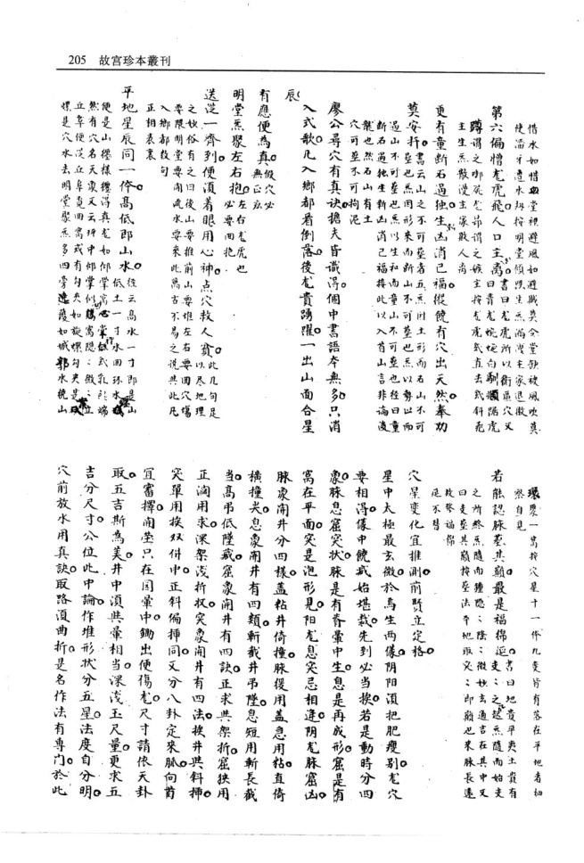

<!-- V3_SOURCE_ID:book010-b000247-p000-ef4e91bc5b -->

宜，曰债，山，此势，之死。

> **释读存疑：** 原文语义不连贯，无法形成符合逻辑的释读内容

查看对应原文

<!-- V3_FOLDBACK_BEGIN:book010-b000247-p000-ef4e91bc5b -->

宜 曰债 山 此势 之死

<!-- V3_FOLDBACK_END:book010-b000247-p000-ef4e91bc5b -->

<!-- V3_SOURCE_ID:book010-b000248-p000-8b9fabea36 -->

此处文字残缺错乱，无法明确解读含义

> **释读存疑：** 原句文字顺序混乱，无法辨识完整语义

查看对应原文

<!-- V3_FOLDBACK_BEGIN:book010-b000248-p000-8b9fabea36 -->

事南 母三 命具 也之以十意徒

<!-- V3_FOLDBACK_END:book010-b000248-p000-8b9fabea36 -->

<!-- V3_SOURCE_ID:book010-b000249-p000-7ad0415360 -->

此处文字残缺错乱，无法明确解读含义，其中保留数字2、3

> **释读存疑：** 此处文字残缺错乱，无法明确解读含义

查看对应原文

<!-- V3_FOLDBACK_BEGIN:book010-b000249-p000-7ad0415360 -->

墓变凸窪 有 百 门 集此起道 居 左 说到有如者 親 者靖 三 忽不 如 之走地于让 日3共坐挚来 2 之 必 曰墓敢便 先 天合领典速请 赞弘泓泓故告师师 间 之间 後 佳 也泓 循省 唯 段 辞 么氏不前 言 环 淘 视 遲 雷 谓 燕

<!-- V3_FOLDBACK_END:book010-b000249-p000-7ad0415360 -->

<!-- V3_SOURCE_ID:book010-b000250-p000-f44a9898a3 -->

滕公石刻中有‘佳城’一句，‘蒲使反’使人挖掘，得到一处石室，上面写着‘吁嗟藤么居此室’，于是改卜，这段内容出自《西京棟记》

> **释读存疑：** 蒲使反；藤么；西京棟记

查看对应原文

<!-- V3_FOLDBACK_BEGIN:book010-b000250-p000-f44a9898a3 -->

滕公石刻佳城句 蒲使反 使 掘之得一名室： 日 吁嗟藤么居此室遂改卜焉出西京棟记

<!-- V3_FOLDBACK_END:book010-b000250-p000-f44a9898a3 -->

<!-- V3_SOURCE_ID:book010-b000251-p000-f1188955ec -->

‘陶查周’探访的原因，具体所指不详

> **释读存疑：** 陶查周

查看对应原文

<!-- V3_FOLDBACK_BEGIN:book010-b000251-p000-f1188955ec -->

陶查周訪所 以指訪

<!-- V3_FOLDBACK_END:book010-b000251-p000-f1188955ec -->

<!-- V3_SOURCE_ID:book010-b000252-p000-9f56f34b43 -->

不依傍他人，因此此地没有这样的情况。

> **释读存疑：** 原文语义残缺，具体所指不详

查看对应原文

<!-- V3_FOLDBACK_BEGIN:book010-b000252-p000-9f56f34b43 -->

不傍 是人故地莫之

<!-- V3_FOLDBACK_END:book010-b000252-p000-9f56f34b43 -->

<!-- V3_SOURCE_ID:book010-b000253-p000-a478aeba57 -->

天慶注师这样说。

> **释读存疑：** 原文语义残缺，具体所指不详

查看对应原文

<!-- V3_FOLDBACK_BEGIN:book010-b000253-p000-a478aeba57 -->

天慶注师然

<!-- V3_FOLDBACK_END:book010-b000253-p000-a478aeba57 -->

<!-- V3_SOURCE_ID:book010-b000254-p000-d91b8f3022 -->

《差星辰穴晕论》中，《地理大成》里叶氏说：凡是说到穴，必定要结合主星的俸位来论述，比如五星穴法、九星穴法就是这样。至于穴情，不朝向五吉四凶的星曜，只看显现的生气所形成的窟、突，来确定葬口，这是穴法中精细的境界。如果有充足的穴情，那么五吉四凶的星曜都可以扦葬；如果没有穴情，就算有好的“蜜头”也无法补救，“蜜头”的具体所指不详。穴情是穴法的关键，不能混入星辰穴法的范畴。再从穴情中进一步探求葬口融结的微妙情状，就成为晕法了。

> **释读存疑：** 蜜头；蜜头的具体所指不详

查看对应原文

<!-- V3_FOLDBACK_BEGIN:book010-b000254-p000-d91b8f3022 -->

差星辰穴晕論 地理大成葉氏云凢言穴者必兼其主星之俸以為言 如五星穴法九星穴法是也若穴情者不向五九之星 但現生炁發露之為窟為突以定塟口乃穴法中精細 之境者也盛有穴情則五吉四凶俱可扦無穴情則空 有好蜜頭無救穴情乃穴法樞紐不得混入星辰穴 法部者也再泛穴情之中更求其塟口融佶之微情則 為暈法矣

<!-- V3_FOLDBACK_END:book010-b000254-p000-d91b8f3022 -->

<!-- doc003 PDF 第 210 页：旋转/复杂版面 OCR 供检索；内容与排版以原页图为准。 -->
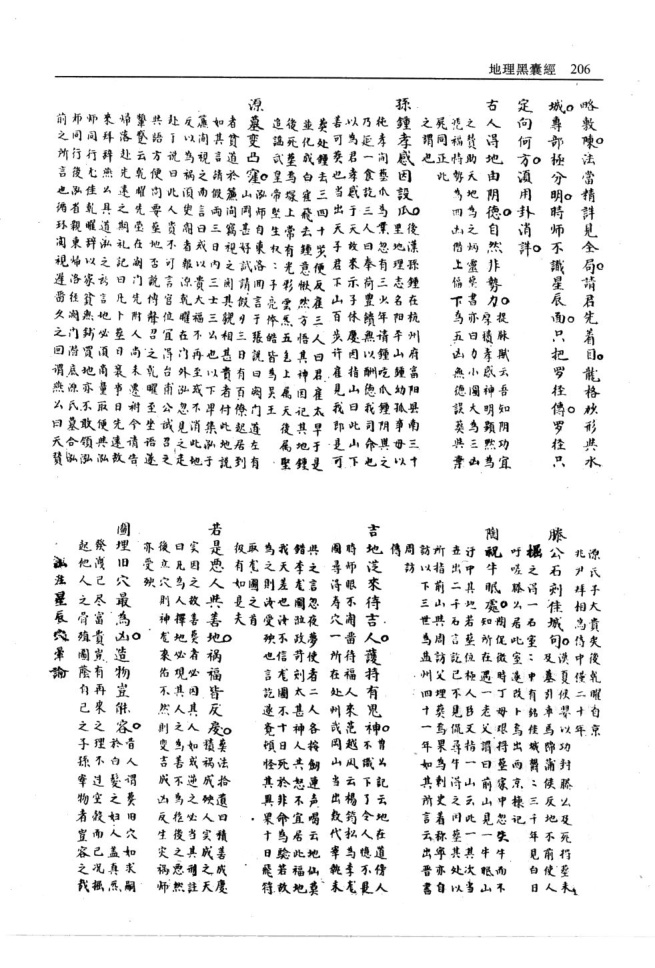

<!-- V3_SOURCE_ID:book010-b000257-p000-ad931a9c93 -->

确定穴的损伤情况后，必须详细审察隐微之间的圆晕，这就是太极。晕的上方要水分散，晕的下方要水聚合，那稍低处水聚合的地方叫做小明堂，能容人侧卧，就可以作为穴。有圆晕就说明生气内聚，所以是真穴；没有圆晕，就不能作为居穴。晕适宜宽阔，葬穴适宜狭窄，要让牵正分明，便于在晕心倒杖，要坐正顶，感应串来的脉，脉分落时，串来的脉更胜，或者枕乐山坳，只取侧脑汲骨，都要朝向案山，山要朝向明堂，左右要分龙、虎，十道没有偏差，才可以在晕心立一个标准，上弦各立一个标草，凡是增减进退都以此为准。前代儒者说：太极是阴阳的本体，又说万物都有一个太极。口诀说：隐隐微微，彷恍惚惚，仔细看有形状，再细看又没有实物。

> **释读存疑：** 原文中“十道”“上弦”语义存疑，具体所指不详

查看对应原文

<!-- V3_FOLDBACK_BEGIN:book010-b000257-p000-ad931a9c93 -->

穴傷既定必須詳審圓暈在隱微之間是謂太極暈上要水分暈下要水合乃是稍低處水之合處名小明堂容人側臥便可穴必有圓暈則生氣內聚故為真穴無此則非但居穴暈宜寬闊塟穴暈宜緊狹見牽分明便於暈心倒杖要坐正頂感串來脉分落宜串來勝或枕樂山坳腦隻賦側腦汲骨皆桃樂山前要對案山下要就明堂左右要分龍虎十道無偏方可却於暈心立一標準上弦各立一標草凡饒減進退皆以此定先儒曰太極者陰陽之本體又曰物物有一太極訣曰隱隱徵微彷彷惚惚祖看有形細看無物

<!-- V3_FOLDBACK_END:book010-b000257-p000-ad931a9c93 -->

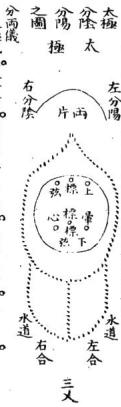

<!-- V3_SOURCE_ID:book010-b000259-p000-20da61addf -->

太极确定之后，便分出阴阳：晕间肥起的是阳穴，瘦陷的是阴穴，这就是两仪。凡是依龙身而确定的穴，就是阴龙，适宜用阳穴；如果再起星峰，就是阳龙，适宜用阴穴，与此相反的话，最初行事就必然会有过错。《龙穴歌》中说：阳龙千万不要下阳穴，那样会导致路断、生死离别；如果扦阴穴，才正相当，子息会做官；如果是阴龙，若是下阴穴，会有女人引发的公事；如果扦阳穴，定能为官，富贵足，有田庄；如果上截肥起，下截瘦陷，或者下截肥起，上截瘦陷，或者左边肥起，右边瘦陷，或者右边肥起，左边瘦陷，这些都是二气交感的情况，不管是阴是阳，都可以使用。凡是阴阳穴，都应当有饶减，详见后面的图。如果左山逆水转，就从牵心标集挨右边二分；如果坐子位，就误壬上分；如果不这样，气就会自来，正穴必然具备；枝左逆转，气就会止；左右逆转，气就会止右，法葬其止。只有二气交感的情况，才取阴阳之中，也就是升降聚会的地方，不用饶成。

> **释读存疑：** 法塟其止的具体风水含义不详；饶成的具体风水含义不详；误壬上分的具体风水含义不详；1轮自动修复后核义模型仍建议修订，已保守记录。

查看对应原文

<!-- V3_FOLDBACK_BEGIN:book010-b000259-p000-20da61addf -->

太極既定便分陰陽暈間肥起者為陽穴瘦陷者為陰穴是為兩儀凡就龍身依穴者乃為陰龍宜陽心若再起星峰為陽龍宜陰穴反此則初行必有咎龍穴歌云陽龍切莫下陽穴路死生離別若扦陰穴正相當子息做官即陰龍若是下陰穴女人公事哉若迁陽穴定為官富貴足田庄若上截肥起下截慶臨或下載肥起上截瘦陷或左边肥起右边瘦陰或右边肥起左边瘦陰皆為二氣交感不問陰陽皆可用凡陰陽穴皆當饒減見後圗若左山逆水轉則從牽心標集挨右邊二分如坐子則誤壬上分若不簡或則氣自來正穴必備枝左逆轉則氣止左右逆轉則氣止右法塟其止也惟二氣交感則取陰陽之中乃升降聚會之所不用饒成

<!-- V3_FOLDBACK_END:book010-b000259-p000-20da61addf -->

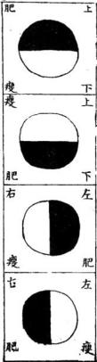

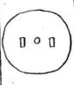

<!-- V3_SOURCE_ID:book010-b000262-p000-da23d235b0 -->

太极运动而生阳，所以圆晕肥起的是阳，这就是动中之亲；居地则凿平，葬穴则取平，从前的人称之为薄梅花，必须饶减。左山逆转则挨左，右山逆转则挨右；居葬之日必然主天晴，开茔宜浅，深则泄散生气，用土封培成冢。阳龙忌讳用再起星峰作穴，这是问有太阳；静而生阴，牧国彙使陷的是阴，这就是静中之动；居穴则培平，葬穴则拥起，从前的人称之为仰梅花，必须饶减。左山逆转则挨左，右山遥转则扑右；居墓之时必然主天阴，开坐宜深，深则抽轨生气，用土封培成冢。阴龙已经使用，凡是依龙身作穴的，就是阴卷。

> **释读存疑：** 牧国彙使陷；抽轨生气；阴卷；本地硬校验仍未通过，已记录供后续自动处理或人工核对。

查看对应原文

<!-- V3_FOLDBACK_BEGIN:book010-b000262-p000-da23d235b0 -->

太極動而生陽故圓暈肥起者為陽是謂動中之親 居地則鑿平塟穴則取嘗昔人謂之薄梅花必頁饒 減左山逆轉則挨左右山逆轉則採右居塟之日必 主天晴開塋宜淺深則泄散生氣用土封培成塚 陽龍忌用再起星峰作穴者為問有 太陽靜而生陰牧國彙使陷者為之是謂傳中之動 居穴則培平塟穴則擁起昔人謂之仰梅花必百饒 減左山逆轉則挨左右山遙轉則撲右居墓之即多 主天陰開坐宜深則抽軌生氣用土封培威塚 陰龙己用凡就尤身作穴者乃為阴卷 -1-1

<!-- V3_FOLDBACK_END:book010-b000262-p000-da23d235b0 -->

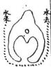

<!-- V3_SOURCE_ID:book010-b000264-p000-98a3f29936 -->

## 左减右镜

查看对应原文

<!-- V3_FOLDBACK_BEGIN:book010-b000264-p000-98a3f29936 -->

## 左减右镜

<!-- V3_FOLDBACK_END:book010-b000264-p000-98a3f29936 -->

<!-- doc003 PDF 第 211 页：旋转/复杂版面 OCR 供检索；内容与排版以原页图为准。 -->
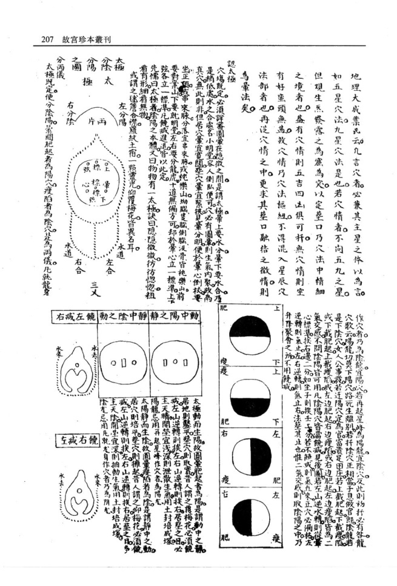

<!-- V3_SOURCE_ID:book010-b000268-p000-ad385000c7 -->

象息

查看对应原文

<!-- V3_FOLDBACK_BEGIN:book010-b000268-p000-ad385000c7 -->

象息

<!-- V3_FOLDBACK_END:book010-b000268-p000-ad385000c7 -->

<!-- V3_SOURCE_ID:book010-b000269-p000-933e088b29 -->

## 四象圖列于左 — 四象圖列於左

查看对应原文

<!-- V3_FOLDBACK_BEGIN:book010-b000269-p000-933e088b29 -->

## 四象圖列于左

<!-- V3_FOLDBACK_END:book010-b000269-p000-933e088b29 -->

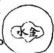

<!-- V3_SOURCE_ID:book010-b000271-p000-4224c8987e -->

所谓息，就是生息的意思：主星净起，露出细微形迹，属于少阳，化出的晕中有时会隆起如离肿、如结愧、如鸡心、如鱼胞，近看有，远看无，这样的形态才对。如果是在顶脑处再起星峰，就不是这样了，这种情况火星、高山、平地都可能出现，当作“穴”（风水中认为气脉聚结、适宜安葬或营建的位置）时要加倍留意，定好基准。作穴有四种方法，见斩、市、隆、下的相关内容。凡是再起星峰作穴的，弓为阳，尤其……息有五种：圆、直、曲、尖、方，这是息的象。所谓脉，就是血气的意思，细微有形迹，属于少阴，凡是圆、蚤中略成形，如垂经、如飞带、如蕙、如薤叶，近看有，远看无，这样的形态才对。如果成了“飼脊”，就不对了，这叫主脉，应当减损高度，高山、平地都有这种情况，作居穴常取中间定基准，作葬穴有四种方法，见后面粘、倚、撞的图。下阴尤其忌讳使用。凡是就龙身作穴的，就是阴卷。

> **释读存疑：** 蚤；市；斩；隆；下；结愧；飼脊；弓为阳；下阴；原文中‘蚤’‘市’‘斩’‘隆’‘下’‘结愧’‘飼脊’‘弓为阳’‘下阴’等专名含义未明，释读时应标注具体所指不详；1轮自动修复后核义模型仍建议修订，已保守记录。

查看对应原文

<!-- V3_FOLDBACK_BEGIN:book010-b000271-p000-4224c8987e -->

息者即生息之謂：主淨起露微形迹故為少陽化暈中或起如離腫如結愧益 如鷄心如魚胞近看則有遠看則無方是若再起頂腦者非自是火星高山平 地皆有之当作穴当倍之定基作 穴有四法見斬市隆下 用凡再起星峰作穴者弓為阳尤○息有五倅圓直曲尖方此息象之曲件 脉者即血氣之謂微有形迹故為少陰凡圓蚤中畧成形如垂經如飛帶如蕙 塟如薤葉近看則有遠看則無方是若成飼脊者非謂之主脉所以当饑減高 山平地皆有之作居穴常取中定基作塟穴有四法見後粘倚撞圖下阴尤 忌用凡就龍身作穴者乃為陰卷

<!-- V3_FOLDBACK_END:book010-b000271-p000-4224c8987e -->

<!-- V3_SOURCE_ID:book010-b000272-p000-8376e0143c -->

两仪确定之后，又分动静：有脉、息、屈、突的是动，没有的是静。静则为丙仪，动则为四象。脉是晕间微有春，乃太极之少阴；息是晕间穴有形，乃太极之少阳；窟是晕间微有写，乃太极之老阴；突是晕间微有泡，乃太极之老阳。龙忌下息、突阴，尤其忌下脉、窟。穴四象作基地有四种方法：脉穴当取中定基，当展闻定基；灾穴当平定基；屈穴当鲁而定基。作葬穴有十六法：秋之后者宜用去揭高放棺法；脉之急者宜用粘法，当就低放棺；脉之直者用倚法，当挨偏放棺；脉之横者用撞法，当取直放棺；息之短者用斩法，当头放棺；息之长者用载法，当腰放棺；息之高者用吊法，当落头放棺；息之低者用坠法，当輳脚放棺；屈之狭者因正法，当心放棺；窟之阔者用求法，当接气放棺；窟之深者用架法，当抽气放棺；窟之浅者用折法，当量脉放棺；突之单者用挨法，当靠足放棺；突之双者用併法，曹取短故棺；突之正者用斜法，当闪反放棺；突之偏者用挿法，当拨正放棺。此心传秘旨，寔为精宾，乱用则伤尤。书云：穴吉葬凶，与兼尸同。

> **释读存疑：** 丙仪；春；写；展闻；鲁；輳；因；故；灾穴；屈穴；曹；寔；宾；原文中‘丙仪’‘春’‘写’‘展闻’‘鲁’‘輳’‘因’‘故’‘灾穴’‘屈穴’‘曹’‘寔’‘宾’等专名含义未明，释读时应标注具体所指不详；1轮自动修复后核义模型仍建议修订，已保守记录。

查看对应原文

<!-- V3_FOLDBACK_BEGIN:book010-b000272-p000-8376e0143c -->

兩儀既定又分動靜穴有脉息屈突為動無則為靜靜則為丙儀動則為四象 脉是暈間微有春乃太極之少陰息是暈間穴有形乃太極之少陽窟是暈間 微有寫乃太極之老陰突是暈間微有泡乃太極之老陽龍忌下息突阴尤 思下脉窟穴四象作基地有四法脉穴當取中定基当展聞定基災穴當 然平定基屈穴当魯而定基作塟穴有十六法秋之後者宜用去揭高放病 脉之急者宜用粘法当就低放棺脉之直者用倚法当挨偏放棺脉之橫者用 撞法當取直放棺息之短者用斬法当頭放棺息之長者用載法当腰放棺息 之高者用吊法當落頭放棺息之低者用墜法当輳腳放棺屈之狹者因正法 當心放棺窟之闊者用求法当接氣放棺窟之深者用架法雪抽氣放棺窟之 淺者用折法当量脉放棺突之单者用挨法当靠足放棺災之双者用併法曹 取短故棺突之正者用斜法當閃反放棺突之偏者用挿法当撥正放棺此心 傳秘旨寢為精賓亂用則傷尤書云穴吉塟凶與兼屍同

<!-- V3_FOLDBACK_END:book010-b000272-p000-8376e0143c -->

<!-- V3_SOURCE_ID:book010-b000273-p000-7bb782f4da -->

象脉

查看对应原文

<!-- V3_FOLDBACK_BEGIN:book010-b000273-p000-7bb782f4da -->

象脉

<!-- V3_FOLDBACK_END:book010-b000273-p000-7bb782f4da -->

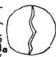

<!-- V3_SOURCE_ID:book010-b000275-p000-318983f0b0 -->

求取四象。

查看对应原文

<!-- V3_FOLDBACK_BEGIN:book010-b000275-p000-318983f0b0 -->

求四象

<!-- V3_FOLDBACK_END:book010-b000275-p000-318983f0b0 -->

<!-- V3_SOURCE_ID:book010-b000276-p000-56024c84f4 -->

象窟、陰老。

查看对应原文

<!-- V3_FOLDBACK_BEGIN:book010-b000276-p000-56024c84f4 -->

象窟 陰老

<!-- V3_FOLDBACK_END:book010-b000276-p000-56024c84f4 -->

<!-- V3_SOURCE_ID:book010-b000278-p000-45a473bdae -->

迁葬时，其顾吐牛歌中说：复处不妨安，总顶是也。也须留脑书三四尺，星头脉自上藩，名之曰金水星（风水语境中的河流、水系及其来去形态），其形如梭子，生先贵后富。

查看对应原文

<!-- V3_FOLDBACK_BEGIN:book010-b000278-p000-45a473bdae -->

走塟其顧吐牛歌云復处不妨安總頂是 也亦須留腦書三四尺星頭脉自上藩 名之曰金水星其形如梭子生先貴後富

<!-- V3_FOLDBACK_END:book010-b000278-p000-45a473bdae -->

<!-- V3_SOURCE_ID:book010-b000280-p000-287e974b77 -->

所谓“穴”（风水中认为气脉聚结、适宜安葬或营建的位置），以器道为北山之势，成上圣鬼天穴，围下脉来绝慢，肖揭高寻晕，启放棺书右旺，尤紫微木星、太乙碧玉图，谓似有似无，若后尤合，各见贵如前竹论，不合格，亦能小小发福，但力量不能远到耳。

查看对应原文

<!-- V3_FOLDBACK_BEGIN:book010-b000280-p000-287e974b77 -->

者以器道為北山之勢成上聖鬼天穴圍下脉來絕慢肖揭高尋暈啟放棺書右旺尤紫微木星太乙碧玉圗謂似有似無若後尤合各見貴如前竹論不合格亦能小小發福但力量不能遠到耳

<!-- V3_FOLDBACK_END:book010-b000280-p000-287e974b77 -->

<!-- V3_SOURCE_ID:book010-b000281-p000-001d54db75 -->

形体笔直，对应“息象”；形体圆整，对应“息象”。

查看对应原文

<!-- V3_FOLDBACK_BEGIN:book010-b000281-p000-001d54db75 -->

體直象息體圓象息

<!-- V3_FOLDBACK_END:book010-b000281-p000-001d54db75 -->

<!-- V3_SOURCE_ID:book010-b000282-p000-a4a1f4904b -->

那么气会从下方上升，这是交媾的道理。后方要有这种“乐法”，称为寒补漏，向下就会发脉，但也容易败落，这是因为“脉之穴”位置过高的缘故。不可凿得太深，要用土封培，气才会好，这和压然穴相同，只是这里以脉而言，那里以窟而言，也就是“科坎”，具体所指不详，略微显现形迹，所以属于老阴。凡是“晕”中或“旋锅”状、仰腹状、修长如金之底、近处有而远处无的，才是合适的；如果是角虚圈状的，就不合适，称为冷窝。中起突的情况，只在平处出现，多生“铺”，具体所指不详。

> **释读存疑：** 乐法；旋锅；晕；铺；科坎

查看对应原文

<!-- V3_FOLDBACK_BEGIN:book010-b000282-p000-a4a1f4904b -->

則氣自下升交媾之道也後要有此樂法謂之寒補漏而下便發然易亦敗脉 之穴高故也不可鑿太深用土封培其氣乃佳與壓然穴同但此以脉言彼以 窟者即科坎之謂微見形迹故為老陰凡暈中或旋鍋如 仰如腹之脩如金之底近有則有遠看則無方是若角 虛圈者非謂之冷窩中起突則姚惟平处有之多生鋪

<!-- V3_FOLDBACK_END:book010-b000282-p000-a4a1f4904b -->

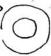

<!-- V3_SOURCE_ID:book010-b000284-p000-ed11ece694 -->

“癯展庸”，具体所指不详，之上作居穴，应当增高定基；“塟穴”，具体所指不详，有四法，见后文正求架折图。下闲尤其忌讳用“化就虎身”，具体所指不详，作穴，这种做法属于阴，尤其不好。

> **释读存疑：** 癯展庸；塟穴；正求架折图；化就虎身

查看对应原文

<!-- V3_FOLDBACK_BEGIN:book010-b000284-p000-ed11ece694 -->

癯展庸之上作居穴當增高定基作塟穴有四法見後正求架折圗下閒尤忌 用化就虎身作穴者為阴尤

<!-- V3_FOLDBACK_END:book010-b000284-p000-ed11ece694 -->

<!-- V3_SOURCE_ID:book010-b000286-p000-72ef854f7f -->

这种圆的息象，古人自己命名为“旺尤星”，具体所指不详，也就是“太阳星”，具体所指不详，形状像覆金，圆顶方高起，定主先富后贵。这种直的息象，古人命名为“木星”，具体所指不详，形状像“王象尺”，具体所指不详，顶平方正，横直都尖，主富，代代为官。命名为“太乙星”，具体所指不详，“烟虫”，具体所指不详，形状像“鸡距”，具体所指不详，中脉径直而来。

> **释读存疑：** 旺尤星；太阳星；王象尺；太乙星；烟虫；鸡距

查看对应原文

<!-- V3_FOLDBACK_BEGIN:book010-b000286-p000-72ef854f7f -->

此息象之圓昔人自 名之曰旺尤星即太象 阳星形如覆金圓頂方 高起定主先富後貴體 此息象之直休昔人息 名之曰木星形如王象 尺頂平方正橫直皆尖 是主富代代為官體 名之曰太乙星煙蟲 形如鷄距中脉徑來

<!-- V3_FOLDBACK_END:book010-b000286-p000-72ef854f7f -->

<!-- doc003 PDF 第 212 页：旋转/复杂版面 OCR 供检索；内容与排版以原页图为准。 -->
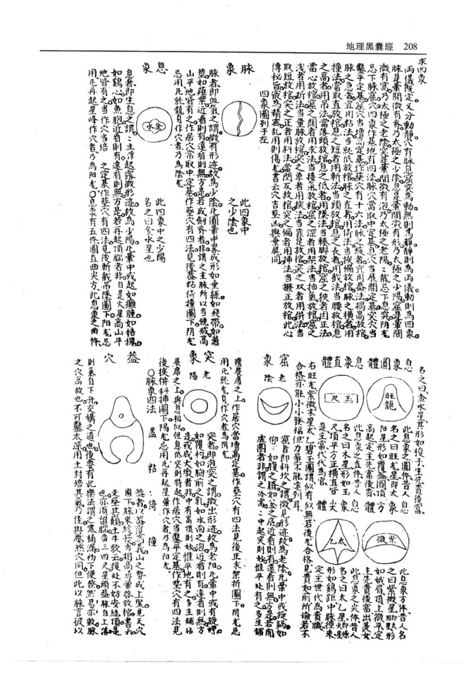

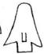

<!-- V3_SOURCE_ID:book010-b000290-p001-348ab2c133 -->

形、言二者，后续的傲倨之态与此类似。

查看对应原文

<!-- V3_FOLDBACK_BEGIN:book010-b000290-p001-348ab2c133 -->

形言也後傲此

<!-- V3_FOLDBACK_END:book010-b000290-p001-348ab2c133 -->

穴

<!-- V3_SOURCE_ID:book010-b000293-p000-0a61916927 -->

"粘"的含义是粘缀，山水之势形成向下聚结的格局时，要观察地势确定适宜安葬的穴，若脉势来得峻急，就应当往低处寻找合适的位置安放棺木。《书》中说虎葬其龙，《土牛歌》中说急来不怕葬沉泥，也是这个道理。不过也须让穴露脚，用墓龙土来承接来势，胜过盖脉从下方延伸的情况。

查看对应原文

<!-- V3_FOLDBACK_BEGIN:book010-b000293-p000-0a61916927 -->

粘者以粘綴為義山水勢成下聚見地穴啚下脉來峻急当就低尋粟放棺書云虎塟其龍土牛歌云急來不怕塟沉尼是也亦須露腳用墓龍土粘接來勝蓋脉從下

<!-- V3_FOLDBACK_END:book010-b000293-p000-0a61916927 -->

<!-- V3_SOURCE_ID:book010-b000294-p000-2cb8aaf0cb -->

倚中小。

> **释读存疑：** 原句过于简略，无法确定具体含义

查看对应原文

<!-- V3_FOLDBACK_BEGIN:book010-b000294-p000-2cb8aaf0cb -->

倚中小

<!-- V3_FOLDBACK_END:book010-b000294-p000-2cb8aaf0cb -->

<!-- V3_SOURCE_ID:book010-b000295-p000-11dd773518 -->

地势偏高则气必然上升，这也是相互感应的道理，同时也要左右有截应之势，或者后方有墩子也可以。忌讳水流淋浸穴的背面，这种做法叫做朝贫暮富，当初下葬时就会顺利发达，往下延伸也无妨。木星口不曾损伤气脉，与脱煞穴的情况相同，悬孔穴多用拈法。

查看对应原文

<!-- V3_FOLDBACK_BEGIN:book010-b000295-p000-11dd773518 -->

上則氣必上升亦相感之理也要左右相截應或墩子在後亦可忌水淋穴背此法謂之朝貧暮富当初下便發順下不妨去 木星 口不曾傷其氣脉與脫煞穴同懸孔穴多用拈法

<!-- V3_FOLDBACK_END:book010-b000295-p000-11dd773518 -->

<!-- V3_SOURCE_ID:book010-b000296-p000-dc2eb0d999 -->

穴（风水中认为气脉聚结、适宜安葬或营建的位置）的优先顺序为癸位。

查看对应原文

<!-- V3_FOLDBACK_BEGIN:book010-b000296-p000-dc2eb0d999 -->

穴先癸

<!-- V3_FOLDBACK_END:book010-b000296-p000-dc2eb0d999 -->

<!-- V3_SOURCE_ID:book010-b000298-p000-d4972b969a -->

## 穴倚 亦先卷 長长 — 穴倚——也优先参考卷中关于长长（具体所指不详）的内容

> **释读存疑：** 原句中“长长”含义不明

查看对应原文

<!-- V3_FOLDBACK_BEGIN:book010-b000298-p000-d4972b969a -->

## 穴倚 亦先卷 長长

<!-- V3_FOLDBACK_END:book010-b000298-p000-d4972b969a -->

<!-- V3_SOURCE_ID:book010-b000299-p000-0f19694d2b -->

所谓“倚”，是倚靠的意思。山水的态势形成中间聚结的格局，观察人穴（风水中认为气脉聚结、适宜安葬或营建的位置）的关隘处，脉气来得急促直硬，不能顺着直下的方向定穴，土牛（具体所指不详）的腴厚之处，オキ………（此处缺字）说血脉顺行的人很少会死亡，应当顺着脉气的偏移来安放棺木，比如左逆传就挨靠左侧，逆转就换右侧，偏移三分。尤经（具体所指不详）说，尤左穴右正同，必须折转脉气，如选右侧就折转右股，选左侧亦然，要靠定来脉，不能脱离穴位，后方要有来势，这种方法叫做南枝花近阳，先带土牛歌说，同穴同音同向的道理要知晓，尤其要从那一边来，兴闪煞穴相同。

> **释读存疑：** 原文中“オキ”为日文假名，含义不明；“土牛”“尤经”具体所指不详

查看对应原文

<!-- V3_FOLDBACK_BEGIN:book010-b000299-p000-0f19694d2b -->

倚者以倚靠為義山水勢成中聚見人穴關下脉來急直不可順直下土牛腴 オキ………云血脉順行人少死当就脉挨偏放棺如左逆傳則挨左右逆轉則換右三分尤經云尤左穴右正同必須折脉如投右則折右股以右脉左者亦然乃靠定來脉不可脫點後要有來此法謂之南枝花近阳先帶土牛歌云同穴同音同向理要知尤自那邊來興閃煞穴相同

<!-- V3_FOLDBACK_END:book010-b000299-p000-0f19694d2b -->

<!-- V3_SOURCE_ID:book010-b000302-p000-18ad0ecb80 -->

穴撞亦，具体所指不详。

> **释读存疑：** 穴撞亦；原文中“穴撞亦”具体所指不详

查看对应原文

<!-- V3_FOLDBACK_BEGIN:book010-b000302-p000-18ad0ecb80 -->

穴撞亦

<!-- V3_FOLDBACK_END:book010-b000302-p000-18ad0ecb80 -->

<!-- V3_SOURCE_ID:book010-b000303-p000-f28fa164f4 -->

所谓“撞”，是指冲撞的意思，山水势中聚脉而来，不可斜。《土牛歌》中说：忌神斜插损田庄，当取直放棺生上顶；若是直来，当取料放棺，微斜而逆受之，必要从后弃也。这就是所说的正来斜下、斜来正安，要气从耳入，仍须传肤传动皮，血昧则血脉流贯；血昧从左来，则传右，穴居中左亦然。此法谓之“撞鍾”，五百年不坏尸，又名“闕斧穴”，脉侧、漫骨穴皆是此法。

> **释读存疑：** 当取料；必要从後棄也；血昧；脉侧；漫骨穴；原文中‘当取料’含义不确定；原文中‘必要从後棄也’含义不确定；原文中‘血昧’含义不确定；原文中‘脉侧’含义不确定；原文中‘漫骨穴’含义不确定；1轮自动修复后核义模型仍建议修订，已保守记录。

查看对应原文

<!-- V3_FOLDBACK_BEGIN:book010-b000303-p000-f28fa164f4 -->

撞者以衝撞為義山水势中聚脉來橫科不可斜土牛歌云忌神斜插損田庄當取直放棺生上頂若是直來当取料放棺微斜而逆受之必要從後棄也所謂正來斜下斜來正安要氣從耳入仍須傳膚傳動皮齋則血脉流貫血昧從左來則者傳右穴居中左亦然此法謂之撞鍾五百年不坏屍又名闕斧穴脉側繼漫骨穴皆是此法

<!-- V3_FOLDBACK_END:book010-b000303-p000-f28fa164f4 -->

<!-- V3_SOURCE_ID:book010-b000304-p000-413d5e2b40 -->

法吊 旺龍星法墜 紫微星

查看对应原文

<!-- V3_FOLDBACK_BEGIN:book010-b000304-p000-413d5e2b40 -->

法吊 旺龍星法墜 紫微星

<!-- V3_FOLDBACK_END:book010-b000304-p000-413d5e2b40 -->

<!-- V3_SOURCE_ID:book010-b000305-p000-d51bc3aeb4 -->

此处原文残缺，仅能辨认出“求 窟東淘法大者用”字样，其余内容无法确认。

> **释读存疑：** 原文残缺，无法完整释读

查看对应原文

<!-- V3_FOLDBACK_BEGIN:book010-b000305-p000-d51bc3aeb4 -->

求 窟東淘法大者用

<!-- V3_FOLDBACK_END:book010-b000305-p000-d51bc3aeb4 -->

<!-- V3_SOURCE_ID:book010-b000306-p000-8ebd1e4c70 -->

此处原文残缺，仅能辨认出“架 蜜象深法 陷者用”字样，其余内容无法确认。

> **释读存疑：** 原文残缺，无法完整释读

查看对应原文

<!-- V3_FOLDBACK_BEGIN:book010-b000306-p000-8ebd1e4c70 -->

架 蜜象深法 陷者用

<!-- V3_FOLDBACK_END:book010-b000306-p000-8ebd1e4c70 -->

<!-- V3_SOURCE_ID:book010-b000307-p000-75ca1b58ba -->

## ○息四法 斬 截 弔 — ○息四法——斩、截、吊

查看对应原文

<!-- V3_FOLDBACK_BEGIN:book010-b000307-p000-75ca1b58ba -->

## ○息四法 斬 截 弔

<!-- V3_FOLDBACK_END:book010-b000307-p000-75ca1b58ba -->

<!-- V3_SOURCE_ID:book010-b000308-p000-f0cc80170c -->

形如斬砍之狀的地勢，屬於歲息之象，比如金、水之類的形態，既然短狹，應當在其頭部放置棺木，因其分開之狀如同被斬斷相似，金井需用土填補，封培成墳冢。

查看对应原文

<!-- V3_FOLDBACK_BEGIN:book010-b000308-p000-f0cc80170c -->

形如 斬者以斬砍為歲息象如金水之類形既短狹宜当頭放棺以其分開如研斷相似只角授子 金井用土填補封培成塚也

<!-- V3_FOLDBACK_END:book010-b000308-p000-f0cc80170c -->

<!-- V3_SOURCE_ID:book010-b000309-p000-673b52b8de -->

截者，指裁斷之義，屬於息求之象，比如木星之類的形態，既然長，應當在其中間放置棺木，因其當中如同被分截相似，不可掘鑿深廣，需用土封培成墳冢。

查看对应原文

<!-- V3_FOLDBACK_BEGIN:book010-b000309-p000-673b52b8de -->

截者以裁為也息求如木星之類形既長者 宜當中放棺以其当中如分截相似不可掘 鑿深廣用土封培成塚

<!-- V3_FOLDBACK_END:book010-b000309-p000-673b52b8de -->

<!-- V3_SOURCE_ID:book010-b000310-p000-475f4755e9 -->

弔者以懸弔為義，屬於息衆之類，比如旺尤之類的形態，既然高起，應當在其露頭之處放置棺木，方法是在息下吞入，不可損壞星頭，因其在土中如同鈞起相似，需用土填補；墜者以墮為義，屬於息象，比如紫微之類的形態，既然低平，應當在其輳脚之處放置棺木，方法是在息下粘脉金井，不可損壞脉體，因其在下如同墜落相似，需用土填補成墳冢。

> **释读存疑：** 原文中‘旺尤’‘紫微’‘星頭’‘脉體’等专名的具体所指未明，候选句未标注相关风险；1轮自动修复后核义模型仍建议修订，已保守记录。

查看对应原文

<!-- V3_FOLDBACK_BEGIN:book010-b000310-p000-475f4755e9 -->

弔者以懸弔為義息衆如旺尤之類形既高起宜露頭放棺法當於息下吞入不可坏星頭以其在土中如鈞起相似用土填補成得墜者以墮為萊息象如紫微之類形既低磚宜輳脚放棺法当於息下粘脉南井不可脉星体以其在下如墜落相法用土填補成塚

<!-- V3_FOLDBACK_END:book010-b000310-p000-475f4755e9 -->

<!-- V3_SOURCE_ID:book010-b000311-p000-fb25261748 -->

## 架 折——（此处具体所指不详）

> **释读存疑：** 架折具体所指不详

查看对应原文

<!-- V3_FOLDBACK_BEGIN:book010-b000311-p000-fb25261748 -->

## 架 折

<!-- V3_FOLDBACK_END:book010-b000311-p000-fb25261748 -->

<!-- V3_SOURCE_ID:book010-b000312-p000-4bb5f801b5 -->

正形以中正为要义，各类形局既已狭窄，生气凝聚，应当小心放置棺木，入土只需一尺左右，到地面处即为坟茔，坟顶要高大，文中提到‘黑所饶减’，具体所指不详，所以以‘正’命名。葬后一年便会发迹。

> **释读存疑：** 黑所饶减；黑所饶减具体所指不详

查看对应原文

<!-- V3_FOLDBACK_BEGIN:book010-b000312-p000-4bb5f801b5 -->

正者以中正為義窟衆形既狹窄生氣凝聚宜当心放棺本土只用一尺許至土為坟必頂高大以其黑所饒减故以正名之矣後一年便發

<!-- V3_FOLDBACK_END:book010-b000312-p000-4bb5f801b5 -->

<!-- V3_SOURCE_ID:book010-b000313-p000-f698c2670f -->

求形以求索为要义，形局为两界生气潜藏之处，要审察生气，将棺木放置在形局弦上，减入‘开弗莲爱’，具体所指不详，生气堆土为坟，坟顶要高大，因为是在上推求所得，所以以‘求’命名。葬后三年便会发迹。

> **释读存疑：** 开弗莲爱；开弗莲爱具体所指不详

查看对应原文

<!-- V3_FOLDBACK_BEGIN:book010-b000313-p000-f698c2670f -->

求者以求索為歲窟兩國大生炁潛藏審炁放 棺於窟弦上減入開弗蓮愛生炁堆土為坟必頂高 大以其在上推求故以求名之塟後三年便發

<!-- V3_FOLDBACK_END:book010-b000313-p000-f698c2670f -->

<!-- V3_SOURCE_ID:book010-b000314-p000-d8477f4f01 -->

架形以‘架商’，具体所指不详，为要义，形局为‘还陷’，具体所指不详，且已还陷，左右皆高，应当‘抽县’，具体所指不详，放置棺木，入土可控制在二尺左右，四角立石为架，尤其紧急时可用草平、土筏、石等物与左右‘般平’，具体所指不详，使生气自下上升，垒土为……，原文此处内容残缺。

> **释读存疑：** 架商；还陷；抽县；般平；架商具体所指不详；还陷具体所指不详；抽县具体所指不详；般平具体所指不详；原文末尾内容残缺

查看对应原文

<!-- V3_FOLDBACK_BEGIN:book010-b000314-p000-d8477f4f01 -->

架者以架商為羨窟象形既還陷左右皆高当抽縣 放棺本土可戒二尺許四角立石為架尤來急可用 草平用土筏用石與左右般平使炁自下升壘土為

<!-- V3_FOLDBACK_END:book010-b000314-p000-d8477f4f01 -->

<!-- V3_SOURCE_ID:book010-b000315-p000-60a563135c -->

所谓折，是取比折的含义。灵的形象已经浅露，生炁浮上，应当测量脉旋棺的情况，从小绝处的窟心量至弦边，胃几尺，以此确定深浅。台土作为坟，必须高大，因为这种测量有固定方法，所以用折来命名，之后……

> **释读存疑：** 胃几尺含义不详；生炁的具体所指不详；后半段内容残缺

查看对应原文

<!-- V3_FOLDBACK_BEGIN:book010-b000315-p000-60a563135c -->

折者以比折為義靈象形既浅露生炁浮上当量脉旋棺以小絕從窟心量至弦边胃几尺用定淺深臺土為坟必須高大以其此量有法故以折名藝後

<!-- V3_FOLDBACK_END:book010-b000315-p000-60a563135c -->

<!-- V3_SOURCE_ID:book010-b000316-p000-53a313578f -->

突象有四种方法，挨……

> **释读存疑：** 后半段内容残缺

查看对应原文

<!-- V3_FOLDBACK_BEGIN:book010-b000316-p000-53a313578f -->

突象四法 挨

<!-- V3_FOLDBACK_END:book010-b000316-p000-53a313578f -->

<!-- V3_SOURCE_ID:book010-b000317-p000-d9d7f4e7a3 -->

## 2 斜，挿 T

> **释读存疑：** T为可疑字符，含义不详

查看对应原文

<!-- V3_FOLDBACK_BEGIN:book010-b000317-p000-d9d7f4e7a3 -->

## 2 斜， 挿 T

<!-- V3_FOLDBACK_END:book010-b000317-p000-d9d7f4e7a3 -->

<!-- doc003 PDF 第 213 页：旋转/复杂版面 OCR 供检索；内容与排版以原页图为准。 -->
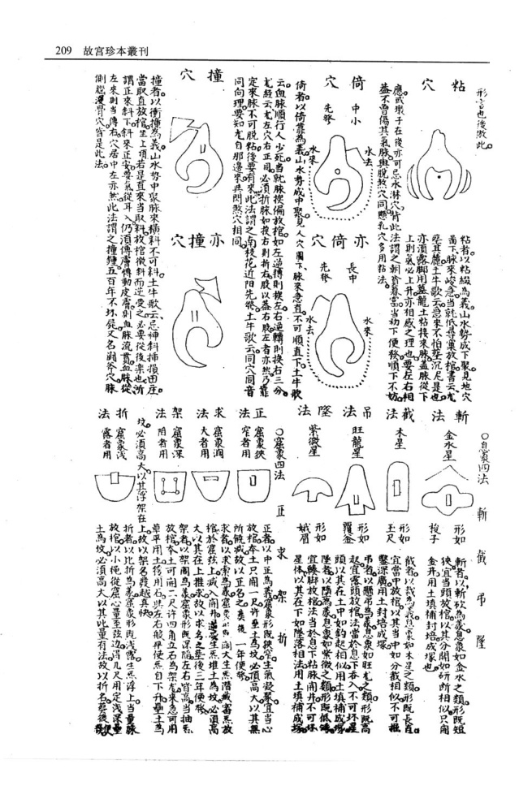

<!-- V3_SOURCE_ID:book010-b000319-p000-a19a85b6bb -->

所谓挨，是取挨搜的含义。羡笑泉既孤，车多边实，迎虚高的为家，低的为虚，适宜靠云放棺，这就是所谓的车股取言。只在金井用土封培成冢，因为靠一边，所以名为岁……

> **释读存疑：** 羡笑泉的具体所指不详；后半段内容残缺

查看对应原文

<!-- V3_FOLDBACK_BEGIN:book010-b000319-p000-a19a85b6bb -->

挨者以挨搜為羨笑泉既孤車多边实迎虛高者 為家低者為虛宜靠雲放棺所謂車股取言是也 只金井用土封培成塚以其靠一边故名歲

<!-- V3_FOLDBACK_END:book010-b000319-p000-a19a85b6bb -->

<!-- V3_SOURCE_ID:book010-b000320-p000-2e07cb713b -->

## ○作法秘旨歌

查看对应原文

<!-- V3_FOLDBACK_BEGIN:book010-b000320-p000-2e07cb713b -->

## ○作法秘旨歌

<!-- V3_FOLDBACK_END:book010-b000320-p000-2e07cb713b -->

<!-- V3_SOURCE_ID:book010-b000321-p000-c8f19e226a -->

顺受的情况应当将棺木侧放，逆受的情况则无所谓正脉，只需取斜势即可。只需在金九处开口，用土封培成冢，因为是斜势，所以称之为斜受。插的意思是栽扫，突的形状既然偏侧，后续脉气斜来，不可斜受，这就是所说的斜脉正受。只需在帝金井处用土封培成冢，因为忌讳关煞，所以称之为插。

> **释读存疑：** 原文中"金九""帝金井""关煞"等术语具体所指不详

查看对应原文

<!-- V3_FOLDBACK_BEGIN:book010-b000321-p000-c8f19e226a -->

順受当閃側放棺逆受生無所謂正脉取斜是也 只開金九用土封培成塚以其斜故以斜名之 插者以栽掃為義突象形既偏側後脉斜來不可 斜受所谓斜脉正受是也只帝金井用土封培或 塚以其忌關故以挿名

<!-- V3_FOLDBACK_END:book010-b000321-p000-c8f19e226a -->

<!-- V3_SOURCE_ID:book010-b000322-p000-401b92ba1e -->

龙、穴、砂、水、典、堂的气由天地生成，其中的作用本由人来掌控，有了正确的方法就能灵验如神。第一是传授点穴法，要仔细查看穴场前后左右的情况，务必详细了解，切记不可慌忙。第二是传授南茔诀，宽窄要依照师传的说法，如果锄破太极圈，水蚁就会侵入棺木。第三是穿井要详细确定深浅，其中的造化极为精微，不可让众人知晓。第四是作堆各有规制，不可说容易，五行（木、火、土、金、水五种分类及其关系体系）中蕴含吉凶，若有灾火祸患就会加重。第五是放水要适宜步数，起卦用天父，先量好坐下后朱雀（穴前方的形势称谓）的阴阳，阴阳有凶吉之分。第六是取路贵在迂曲，要合木星局，不可挨着白虎（穴场或建筑右侧的形势称谓），避开黄泉，若犯了就会灾祸连连。仙翁告诫鬼神知晓，后学之人请务必遵从，这十传名为秘旨，全是廖公的话，廖公缄口不传给人，著论是为了自身藏身。

查看对应原文

<!-- V3_FOLDBACK_BEGIN:book010-b000322-p000-401b92ba1e -->

龍穴砂水典堂炁生成自天地於中作用本由人有術驗如神第一傳其点穴法仔細去看路前後左右要消詳切記莫慌忙第二傳其南塋訣闢狹依師說若还鋤破太極圈水蟻便侵棺第三穿井要詳淺深須用術個中造化極精微莫許衆人知第四作堆各有制不可言容易五行相說有吉凶災火禍便重第五放水宜步数起卦用天父先量坐下後朱雀陰陽有凶吉第六取路貴迂曲要合木星局莫挨白虎避黃泉犯着禍連仙翁說戒鬼神知後學請遵依惟此十傳名秘旨尽是廖公語廖公緘口不傳人著論自藏身

<!-- V3_FOLDBACK_END:book010-b000322-p000-401b92ba1e -->

<!-- V3_SOURCE_ID:book010-b000323-p000-420b8fcd25 -->

点穴法不可通用。

查看对应原文

<!-- V3_FOLDBACK_BEGIN:book010-b000323-p000-420b8fcd25 -->

點穴法居莫通用

<!-- V3_FOLDBACK_END:book010-b000323-p000-420b8fcd25 -->

<!-- V3_SOURCE_ID:book010-b000324-p000-9c6d99bcf8 -->

## 名

查看对应原文

<!-- V3_FOLDBACK_BEGIN:book010-b000324-p000-9c6d99bcf8 -->

## 名

<!-- V3_FOLDBACK_END:book010-b000324-p000-9c6d99bcf8 -->

<!-- V3_SOURCE_ID:book010-b000325-p000-9c2f972409 -->

地理术中所说的，对应人体的“炙穴”，是“蒙故居”，具体所指不详，都称之为“穴”，这里的“穴”指风水中认为气脉聚结、适宜安葬或营建的位置，意思是此处容不得丝毫差错，所以说“如果江差一指，就如同相隔万重山”，这里的“江差一指”具体所指不详。以四用来说，京都以朝殿为正穴，州县以公厅为正穴，住宅以中堂为正穴，坟墓以金井为正穴。

> **释读存疑：** “炙穴”具体所指不详；“蒙故居”具体所指不详；“江差一指”具体所指不详

查看对应原文

<!-- V3_FOLDBACK_BEGIN:book010-b000325-p000-9c2f972409 -->

地理所謂本人身炙穴為蒙故居人塟骨之所皆谓之穴言其不可少有差池故曰若江差一指如隔萬重山以四用言之京都以朝殿為正州縣以公廳為正宅舍以中堂為正坟墓以金井為正

<!-- V3_FOLDBACK_END:book010-b000325-p000-9c2f972409 -->

<!-- V3_SOURCE_ID:book010-b000326-p000-840846df7e -->

点穴时，必须先在“穴星”上斩除草木、烧荒清理，让“穴星”的形态清晰，天光照射下显得崭新，之后再在“明堂”中、“案山”上，对应观察会显现出何种星象、何种形态，结合“穴星”的三势、四杀等各种方法，确定“穴场”应当在何处，私下记下来以便审定。经书中说：“穴在南边时，要往北边寻找穴场；穴在北边时，要往南边望察”，就是这个意思。对着“案山”，要径直前往那座山，察看“案山”的高低：“案山”高则“齐眉”，“案山”低则“么心”，具体含义不详。“桎”具体所指不详，“桎”说：“朝山如果高，就在高处下穴；朝山如果低，就在低处下穴”。又说：“对着案山，来势不偏斜，才可以移步”。还有歌诀说：“只将对宋寻其穴，案若正时穴最佳”，这里的“对宋”具体所指不详，就是这个意思。如果没有“案山”，就以“水”代替，这是“朱省”的说法，“朱省”具体所指不详；远“水”和高山的作用相同，近“水”和低山的作用相同。

> **释读存疑：** “桎”具体所指不详；“对宋”具体所指不详；“朱省”具体所指不详；“齐眉”具体含义不详；“么心”具体含义不详

查看对应原文

<!-- V3_FOLDBACK_BEGIN:book010-b000326-p000-840846df7e -->

化点穴先須於穴星上斬木燒草今淨使星形明白天光稱新然後於明堂中案山上对相之發作何星何脩以穴星部三勢四殺諸法參定穴塲当在何处私在記認以審訂經云穴在南時北山尋穴在此時南山望是也对案山有所径径到其山看案山高低高則斉眉低則麽心桎云朝若高時高处下朝若低時低処又曰对案山來不傾側德方移步便歌只將对宋尋其穴案若正時穴最佳是也若無案而有水為朱省遠水同高山近水同低山

<!-- V3_FOLDBACK_END:book010-b000326-p000-840846df7e -->

<!-- V3_SOURCE_ID:book010-b000327-p000-d181ef9539 -->

地势相对平缓，就观察左右两侧来审定高低。“桂”具体所指不详，“桂”说：“左右高，就在高处下穴；左右低，就在低平处下穴”。“平义”具体所指不详，要辨别堂气。

> **释读存疑：** “桂”具体所指不详；“平义”具体所指不详

查看对应原文

<!-- V3_FOLDBACK_BEGIN:book010-b000327-p000-d181ef9539 -->

相对平義却看左右以審高低桂云左右高時在高处左右低時在低平是也辨堂氣

<!-- V3_FOLDBACK_END:book010-b000327-p000-d181ef9539 -->

<!-- V3_SOURCE_ID:book010-b000328-p000-3a61f04b43 -->

左右前后的距离均等时，就要观察明堂（穴前相对开阔、汇聚的空间）中，水（风水语境中的河流、水系及其来去形态）汇聚在什么地方。水汇聚在中间，穴（风水中认为气脉聚结、适宜安葬或营建的位置）就选在中间；水汇聚在左边，穴就选在左边；水汇聚在右边，穴就选在右边。所谓“真炁聚看明堂”，说的就是这个道理。

查看对应原文

<!-- V3_FOLDBACK_BEGIN:book010-b000328-p000-3a61f04b43 -->

左右前後各停均却看明堂水聚何处聚於中則穴居中聚于左則穴居左聚於右則穴居右徑云真炁聚看明堂是也

<!-- V3_FOLDBACK_END:book010-b000328-p000-3a61f04b43 -->

<!-- V3_SOURCE_ID:book010-b000329-p000-5dbf10f636 -->

凡是穴（风水中认为气脉聚结、适宜安葬或营建的位置）的前方，左边有山逼近冲射，穴就适宜选在右边；右边有山逼近冲射，穴就适宜选在左边；有山压迫穴，穴就适宜选在右边；右边有山压迫穴，穴就适宜选在左边。这是趋吉避凶的方法。

查看对应原文

<!-- V3_FOLDBACK_BEGIN:book010-b000329-p000-5dbf10f636 -->

凡穴前左見山射則穴宜右右見山射則穴宜左有山壓穴宜右右有山壓穴宜左此超吉避凶之道也

<!-- V3_FOLDBACK_END:book010-b000329-p000-5dbf10f636 -->

<!-- V3_SOURCE_ID:book010-b000330-p000-40aa28da38 -->

定卦。

查看对应原文

<!-- V3_FOLDBACK_BEGIN:book010-b000330-p000-40aa28da38 -->

定卦。

<!-- V3_FOLDBACK_END:book010-b000330-p000-40aa28da38 -->

<!-- V3_SOURCE_ID:book010-b000331-p000-5a4edbf476 -->

四歲既定，當分入八卦。先於穴星後分水脊上用盍針定脉從何方來，次於暈心標下下盡針定脉從何方去，又於明堂中流水處下盃針定水從何方來、何方去。八卦配方：乾統甲，坤統乙，离統壬、寅、午、戌，次抗，癸、申、子、辰屬阻，艮統丙，兌統丁，巳、酉、丑，震統庚，亥、卯、未屬閒。阳脉得向阳水，阴脉得閒向門水，謂之純粹大吉；阳脉得阴向阴水，阴脉得阳向阳水，謂之發桑大凶；向吉水凶，先吉後凶；向山水吉，先凶後吉。

> **释读存疑：** 次抗；屬阻；閒；發桑；閒向門水；‘次抗’‘屬阻’‘閒’‘發桑’‘閒向門水’具体所指原文未明，含义不详；1轮自动修复后核义模型仍建议修订，已保守记录。

查看对应原文

<!-- V3_FOLDBACK_BEGIN:book010-b000331-p000-5a4edbf476 -->

四歲既定当分入卦先於穴星後分水脊上用盍針定脉從何方來次於暈心標下下盡針定脉從何方去又於明堂中流水处下盃針定水從何方來何方去八卦配方乾統甲坤統乙离統壬寅午戌次抗癸申子辰屬阻艮統丙統辛兌統丁巳酉丑震統庚亥卯未屬閒阳脉得向阳水阴脉得閒向門水謂之純粹大吉陽脉得陰向阴水阴脉涓阳向阳水謂之發桑大凶向吉水凶先吉後凶向山水吉先凶後吉

<!-- V3_FOLDBACK_END:book010-b000331-p000-5a4edbf476 -->

<!-- V3_SOURCE_ID:book010-b000332-p000-851429ba9e -->

选择墓穴的地形要安稳，独取甲位。

查看对应原文

<!-- V3_FOLDBACK_BEGIN:book010-b000332-p000-851429ba9e -->

立塋形安独甲

<!-- V3_FOLDBACK_END:book010-b000332-p000-851429ba9e -->

<!-- V3_SOURCE_ID:book010-b000333-p000-a5c7fb6b72 -->

墓穴的地形必须呈圆形，前方不能有高三级的土堆；若地处高山，就需挖掘墓穴；若地处平地，就需堆筑墓穴；若山涧狭窄，需用玉尺进行测量。

查看对应原文

<!-- V3_FOLDBACK_BEGIN:book010-b000333-p000-a5c7fb6b72 -->

塋形必圓前不高三級高山則掘就在平地則擁成其澗狹有制以玉尺量之

<!-- V3_FOLDBACK_END:book010-b000333-p000-a5c7fb6b72 -->

<!-- V3_SOURCE_ID:book010-b000335-p000-b2cd765a90 -->

凡是墓穴的堂除、水溝以及金井之外的区域，都不可挖掘，需保留宾土；如果锄破了四周的宾土，就会损伤真炁。

查看对应原文

<!-- V3_FOLDBACK_BEGIN:book010-b000335-p000-b2cd765a90 -->

凡堂除水溝幷金井之外不可掘鑿皆用存賓 土若鋤破四圍則傷殘真炁

<!-- V3_FOLDBACK_END:book010-b000335-p000-b2cd765a90 -->

<!-- V3_SOURCE_ID:book010-b000336-p000-65af7bfb3d -->

窟尺

> **释读存疑：** 原句仅存孤立术语，具体所指不详

查看对应原文

<!-- V3_FOLDBACK_BEGIN:book010-b000336-p000-65af7bfb3d -->

窟尺

<!-- V3_FOLDBACK_END:book010-b000336-p000-65af7bfb3d -->

<!-- V3_SOURCE_ID:book010-b000337-p000-0c73919ff4 -->

测量圆形的晕圈。

查看对应原文

<!-- V3_FOLDBACK_BEGIN:book010-b000337-p000-0c73919ff4 -->

度圓暈

<!-- V3_FOLDBACK_END:book010-b000337-p000-0c73919ff4 -->

<!-- V3_SOURCE_ID:book010-b000338-p000-98043b9d71 -->

古书记载，玉尺用来测量远近，蔡氏说它的数值源自黄钟。如今的尺应当以八寸为标准，按照尺法来看，不牧堂父子都精通律吕，所以他们的说法可信。如今的尺只有营造墓穴用的尺，才在四方通行，以八寸为一尺，分为十寸，凡是测量墓穴、缩减宽度、测量城墙深浅都用这种尺。

> **释读存疑：** 今之尺当八寸为则中‘当’‘为则’的含义未明确；按尺法不牧堂父子皆精於律品中‘不牧堂’‘律品’的含义未明确；以夢遣的具体所指不详；量墉中‘墉’的具体所指不详；1轮自动修复后核义模型仍建议修订，已保守记录。

查看对应原文

<!-- V3_FOLDBACK_BEGIN:book010-b000338-p000-98043b9d71 -->

書云玉尺度其遠通蔡氏云其數生於黃鍾今之尺当八寸為則按尺法不牧堂父子皆精於律品故其言可信今尺惟塋造尺即才通行四方以夢遣以八寸為一尺分十寸尺凡度塋減狹量墉深淺皆用之

<!-- V3_FOLDBACK_END:book010-b000338-p000-98043b9d71 -->

<!-- V3_SOURCE_ID:book010-b000339-p000-9e1a53f0cf -->

穴内的圆晕是灵气凝聚、灵光显露的地方，开挖墓穴只能在圆晕之内，不可锄破圆晕的边缘，否则会产生鬼气，泄露丰富的灵光，导致灵光消散，这就叫做伤穴，会导致虫类侵入、泉水浸泡棺木，子孙贫困不振。只有‘居穴’及‘四凶穴’才会出现这种情况，‘不巳’的具体所指不详，四方凶穴不宜过大，按照法则，用‘小绝’的具体所指不详，从圆晕上边缘量到下边缘，得到玉尺的尺寸，作为墓穴的标准，这是固定的法则。穴有饶减进退的情况，都不偏离这个法则，所以说里面藏着金斗，外面掩着众人的口，‘外星尺’的‘外星’具体所指不详，外星尺的法则可以参考使用。

> **释读存疑：** ‘居穴’的具体所指不详；‘四凶穴’的具体所指不详；‘不巳’的具体所指不详；‘外星尺’的‘外星’具体所指不详；‘小绝’的具体所指不详

查看对应原文

<!-- V3_FOLDBACK_BEGIN:book010-b000339-p000-9e1a53f0cf -->

穴內圓暈乃生凝聚靈光現露之处開塋只在暈內不可鋤破暈弦則生鬼 泄漏豐光銷集名曰傷穴主虫樣入傭水泉浸棺子孫貧其不振惟居穴及四 凶穴不巳四凶穴不宜大過法用小絕從暈上弦量至下弦得玉尺几尺規為 塋俸此為定法穴有饒減進退聖皆不軌故曰裡面藏金斗外揜衆人口外星 尺之法可參而用之

<!-- V3_FOLDBACK_END:book010-b000339-p000-9e1a53f0cf -->

<!-- V3_SOURCE_ID:book010-b000340-p000-99c7836fdf -->

地理的要领，首先看重龙、水、阴阳、顺逆的配合，‘牝牡交拂’的具体所指不详，玄窍相通，应当依水确定向，招来祥瑞，同时探究阴阳、‘彼甲’的具体所指以及‘四亥’的具体所指，峰峦‘之秋’的具体所指不详，吉凶星曜的应验，这四者是地理的大纲领。

> **释读存疑：** ‘牝牡交拂’的具体所指不详；‘彼甲’的具体所指不详；‘四亥’的具体所指不详；峰峦‘之秋’的具体所指不详

查看对应原文

<!-- V3_FOLDBACK_BEGIN:book010-b000340-p000-99c7836fdf -->

夫地理之要首重於龍水陰陽順逆配合牝牡交拂玄竅相通徃則依水立向召瑞邀祥兼究陰陽彼甲與夫四亥峯峦之秋吉凶星曜之驗此四者乃地理之大綱領也

<!-- V3_FOLDBACK_END:book010-b000340-p000-99c7836fdf -->

<!-- V3_SOURCE_ID:book010-b000341-p000-e1220c8fa8 -->

所谓水，是指有炁的地方才会有水，径路之外的炁在形体之内运行，炁停止的地方就会产生相关事物，大概说的就是这个道理。古人聚集炁使它不散失，引导炁使它有止息之处，所以称之为风水。风水的方法，得到水为上等，藏住风为次等。径路说炁乘着风就会散失，见到水就会止息。

查看对应原文

<!-- V3_FOLDBACK_BEGIN:book010-b000341-p000-e1220c8fa8 -->

者水之也有炁斯有水徑云外炁行形內炁止生盖 言此也古人聚之使不散行之使有止故謂之風本 風水之法得水為上藏風次之径曰炁乗風則散見 水則止

<!-- V3_FOLDBACK_END:book010-b000341-p000-e1220c8fa8 -->

<!-- V3_SOURCE_ID:book010-b000342-p000-e94f3c8b9e -->

埋氣，是调理龙脉之炁。理，是形炁的属性；从本体来说叫理，从作用来说叫炁，从质体来说叫形。这里指的是龙脉与水而言，关键是要根据龙脉来匹配向，认准水的血脉朝向生旺水朝堂而来，若水从酉位掷出，就会痛入墓库而去，阴阳品类相配，玄窍相通，这就叫做理气。

查看对应原文

<!-- V3_FOLDBACK_BEGIN:book010-b000342-p000-e94f3c8b9e -->

埋氣者理龍之氣也理者形炁之德以体言曰理以用言曰炁以質言曰形此指龍水而言要因龍配向認水血朝 生旺水朝堂擲酉水痛墓庫而去陰陽品配玄竅相通是謂之理氣

<!-- V3_FOLDBACK_END:book010-b000342-p000-e94f3c8b9e -->

<!-- V3_SOURCE_ID:book010-b000343-p000-fb2425d7c5 -->

凡是勘察龙脉、确立穴、确定向，要在水流交合的地方寻找。水不合要求，则龙脉的脉气未止；龙脉的脉气不止，则炁运行；扣住龙脉尽头、水合脉尽，无脉气之处才为真穴。然水必随龙脉趋向，其次无相逆之理。往云炁乘风则散，界水则止，外炁所以止内炁，为水之母，水为炁之子，水行则炁行，火止则炁止。止水界乎外则

> **释读存疑：** 0；原文存在OCR损坏的“0”字符，具体含义不明；本地硬校验仍未通过，已记录供后续自动处理或人工核对。

查看对应原文

<!-- V3_FOLDBACK_BEGIN:book010-b000343-p000-fb2425d7c5 -->

凡步龍立穴圓向水流交合之處求之水不合矜則龍脉未止龍脉不止則炁行扣住龍尽水合脉尽無脉乃為真穴然水必龍趨向次無相逆之理也往云乗風則散界水則止外炁所以止內炁為水之母 0水為炁之子水行則炁行火 止。 則。 。 止水界乎外則

<!-- V3_FOLDBACK_END:book010-b000343-p000-fb2425d7c5 -->

<!-- doc003 PDF 第 215 页：旋转/复杂版面 OCR 供检索；内容与排版以原页图为准。 -->
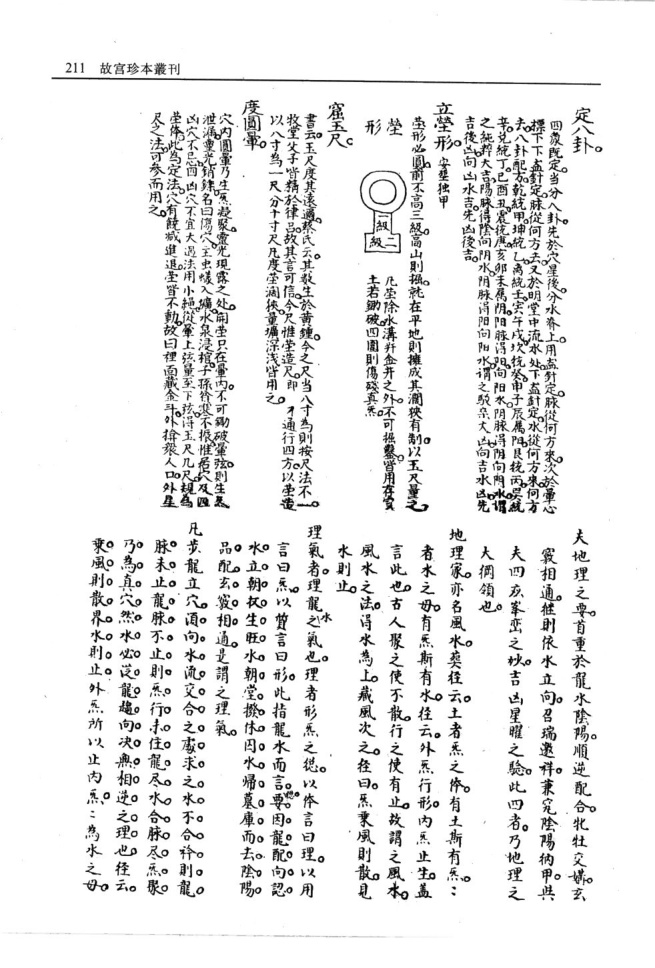

<!-- V3_SOURCE_ID:book010-b000345-p000-0a2661a476 -->

水在内没有止息，所以凡是龙脉运行，水自然会跟随，就像夫妇相随，情意和谐，也是自然的道理。从前说有合无分，它的来势不真；有分无合，它的止息不明。炁随着土运行，水随着土而比附，土随着炁兴起，界住水就会止息。“虾形眼、蝉翼、金奥股、明服腊”都是风水专名，具体所指不详，原文称这些都是损伤穴的情况。界合是用来止息内炁的，至于众多水流汇聚环绕，自然形成城垣般的完固格局，这垣局肉水是用来完固外炁的。住穴的左界、右界是入首成胎的关键。

> **释读存疑：** “虾形眼、蝉翼、金奥股、明服腊”的具体所指不详

查看对应原文

<!-- V3_FOLDBACK_BEGIN:book010-b000345-p000-0a2661a476 -->

無止於內故凡龍行則水自隨如夫婦之相隨情偕意恊亦理之自然也往云有合無分其來不真有分無合其止不明炁隨土行水隨而比土隨炁起界水則止蝦形眼蟬翼金奧股明服腊皆穴傷間界合炁所以止內炁也至於群流聚関瑣周匝自然城垣完固此垣局肉水所以完外炁也住曰左南右界為入首成胎之要者也

<!-- V3_FOLDBACK_END:book010-b000345-p000-0a2661a476 -->

<!-- V3_SOURCE_ID:book010-b000346-p000-1f71b5797a -->

此地的情况：以20、4为参照，作为龙脉的依据。如果龙脉进入结穴区域前的关键一段（入首）处的水呈弯曲形态，那么龙脉就属吉；如果水呈笔直形态，那么龙脉就属凶。

查看对应原文

<!-- V3_FOLDBACK_BEGIN:book010-b000346-p000-1f71b5797a -->

地。 c以20 水。 U4 為。 為龍若入首水曲則龍生水直則龍

<!-- V3_FOLDBACK_END:book010-b000346-p000-1f71b5797a -->

<!-- V3_SOURCE_ID:book010-b000347-p000-daf19c6231 -->

西方而来的炁，也是西方而来的龙脉，龙脉随水（风水语境中的河流、水系及其来去形态）转向。向（建筑或穴位所朝的方位）要依据水（风水语境中的河流、水系及其来去形态）来确定。原文中“稿福”二字无法确认，具体所指不详。

> **释读存疑：** 稿福；原文中“稿福”二字无法确认，具体所指不详

查看对应原文

<!-- V3_FOLDBACK_BEGIN:book010-b000347-p000-daf19c6231 -->

西來炁亦西來龍隨水 轉。 向。 依。 水。 立。 所。 以。 稿福 俱。 造。

<!-- V3_FOLDBACK_END:book010-b000347-p000-daf19c6231 -->

<!-- V3_SOURCE_ID:book010-b000348-p000-7d4fcce9fb -->

杨公说：一水（风水语境中的河流、水系及其来去形态）去，二水（风水语境中的河流、水系及其来去形态）去，泉水奔流，一脊去山：随水（风水语境中的河流、水系及其来去形态）不，四头失井，离（八卦之一）乡无救助，此言山水反背不向（建筑或穴位所朝的方位）也。原文部分字符无法确认，具体所指不详。

> **释读存疑：** 一水去二水去泉水奔流一脊去山：隨水不 四頭失井；原文部分字符无法确认，具体所指不详；1轮自动修复后核义模型仍建议修订，已保守记录。

查看对应原文

<!-- V3_FOLDBACK_BEGIN:book010-b000348-p000-7d4fcce9fb -->

楊公云一水去二水去泉水奔流一脊去山：隨水不 四頭失井离鄉無救助此言山水反背不向也

<!-- V3_FOLDBACK_END:book010-b000348-p000-7d4fcce9fb -->

<!-- V3_SOURCE_ID:book010-b000349-p000-627f8be299 -->

冲坡胎神者，即水流（风水语境中的河流、水系及其来去形态）被龙家胎位去也，非独言向（建筑或穴位所朝的方位）峯春。原文中“春”字无法确认，具体所指不详。

> **释读存疑：** 春；原文中“春”字无法确认，具体所指不详

查看对应原文

<!-- V3_FOLDBACK_BEGIN:book010-b000349-p000-627f8be299 -->

冲坡胎神者即水流被龍家胎位去也非独言向峯春

<!-- V3_FOLDBACK_END:book010-b000349-p000-627f8be299 -->

<!-- V3_SOURCE_ID:book010-b000350-p000-1412347002 -->

在大純蓋胎宮，是生炁萌發之初，從這裡流出明堂，如果生炁不流入明堂，就會導致墮胎。生炁是換兒煞，俗稱百。

> **释读存疑：** ‘俗為百’的具体所指不详；1轮自动修复后核义模型仍建议修订，已保守记录。

查看对应原文

<!-- V3_FOLDBACK_BEGIN:book010-b000350-p000-1412347002 -->

於大純蓋胎宮為生炁發萌之初流出明堂主不受胎如流入明堂則主墮胎蓋生炁為換兒煞俗為百

<!-- V3_FOLDBACK_END:book010-b000350-p000-1412347002 -->

<!-- V3_SOURCE_ID:book010-b000351-p000-93f9724b93 -->

元機說：有人沒有財運，就去尋求有水的山；有財運卻沒有合適的人，就不要在孤車之處下葬。

> **释读存疑：** ‘孤車之’的具体所指不详；1轮自动修复后核义模型仍建议修订，已保守记录。

查看对应原文

<!-- V3_FOLDBACK_BEGIN:book010-b000351-p000-93f9724b93 -->

元机云有人無財求得水之山有財無人莫下孤車之。

<!-- V3_FOLDBACK_END:book010-b000351-p000-93f9724b93 -->

<!-- V3_SOURCE_ID:book010-b000352-p000-c7fb673f7e -->

龍往的說法，看格的時候容易明白，親自見過多次勝過聽人說過千次。又有口訣說：要看後龍是否到來，先看它的迴環是否到位；要看穴是否穩固，先看下關是否緊密。

> **释读存疑：** ‘龍往’的具体所指不详；1轮自动修复后核义模型仍建议修订，已保守记录。

查看对应原文

<!-- V3_FOLDBACK_BEGIN:book010-b000352-p000-c7fb673f7e -->

龍往云看格多時心易曉見多勝耳千回闻又訣云未 看後龍來不來且看下廻不迴未看倍穴穩不穩 且看下関緊不

<!-- V3_FOLDBACK_END:book010-b000352-p000-c7fb673f7e -->

<!-- V3_SOURCE_ID:book010-b000353-p000-8a00f04a45 -->

《青囊徑》說：水對三乂，佃認宗，這是穴外之水左右合流而出的情況。

> **释读存疑：** 佃認宗的具體所指不详；‘佃認宗’‘三乂’的具体所指不详；1轮自动修复后核义模型仍建议修订，已保守记录。

查看对应原文

<!-- V3_FOLDBACK_BEGIN:book010-b000353-p000-8a00f04a45 -->

青囊径曰水对三乂佃認宗此乃穴外之水左右合出

<!-- V3_FOLDBACK_END:book010-b000353-p000-8a00f04a45 -->

<!-- V3_SOURCE_ID:book010-b000354-p000-cf67f39d5c -->

穴前有一处水流从一条路径延伸出去，这种水形被称为‘三乂水’。杨公说：‘三乂九曲来，对面子息朝金殿’，就是指这种情况。若误认宗水，立丑山向时便会出现‘三乂水’的情况。

> **释读存疑：** 原文中‘三乂水’的具体形态未明确，‘误认宗水’的具体所指未明

查看对应原文

<!-- V3_FOLDBACK_BEGIN:book010-b000354-p000-cf67f39d5c -->

穴前從一路去謂之三乂水楊公云三又九曲來对面子息朝金殿是也徊認宗者如立丑墓向三又水

<!-- V3_FOLDBACK_END:book010-b000354-p000-cf67f39d5c -->

<!-- V3_SOURCE_ID:book010-b000355-p000-a7115549b9 -->

墓位不免会犯黄泉的弊病，属于大凶。总的来说，生旺墓位都不……

> **释读存疑：** 原文此处内容残缺，无法完整释读

查看对应原文

<!-- V3_FOLDBACK_BEGIN:book010-b000355-p000-a7115549b9 -->

墓位不免犯黃泉之獘矣大凶總之生旺墓位皆不

<!-- V3_FOLDBACK_END:book010-b000355-p000-a7115549b9 -->

<!-- V3_SOURCE_ID:book010-b000356-p000-7ca6ed6bfa -->

但凡入局的水，即便从生旺方位而来，若天门处逼仄不实，去口……

> **释读存疑：** 原文此处内容残缺，无法完整释读

查看对应原文

<!-- V3_FOLDBACK_BEGIN:book010-b000356-p000-7ca6ed6bfa -->

但凡入局水路雖泛生旺方來若天門逼而不實去口

<!-- V3_FOLDBACK_END:book010-b000356-p000-7ca6ed6bfa -->

<!-- V3_SOURCE_ID:book010-b000357-p000-f9d2ff2da6 -->

凡二十四位龙，右旋的都为生龙，左旋的都为旺龙，或者……

> **释读存疑：** 原文此处内容残缺，无法完整释读

查看对应原文

<!-- V3_FOLDBACK_BEGIN:book010-b000357-p000-f9d2ff2da6 -->

凡二十四位龍之右旋皆為生龍左旋者皆為旺龍或

<!-- V3_FOLDBACK_END:book010-b000357-p000-f9d2ff2da6 -->

<!-- V3_SOURCE_ID:book010-b000358-p000-479920ee53 -->

自生龍發跡後，須在旺方形成胎穴；旺龍出身，須在生方形成胎穴。《待穴徑》說的是，陽龍從生方趨向旺方，陰龍從旺方朝向生方，這是順乘進氣的吉象。金龍轉水：龍轉木，這就是順乘進氣；木龍轉火、龍轉金，這就是隔入休囚之位。所謂到頭日謝，是指旺水聚來助祿，尤其要注意入首衰微之時，生神會聚可救濟人丁。

查看对应原文

<!-- V3_FOLDBACK_BEGIN:book010-b000358-p000-479920ee53 -->

自生龍發足須於旺方成胎穴旺龍出身須於生方成胎待穴徑云謂陽龍從生趨旺陰龍自旺朝生乃來乗於進炁之吉者也金龍轉水：龍轉木此即來乗於進炁木龍轉火龍轉金此即隔入於休囚也在云到頭日謝旺水聚而助祿九宜入首衰微生神会而人丁可救

<!-- V3_FOLDBACK_END:book010-b000358-p000-479920ee53 -->

<!-- V3_SOURCE_ID:book010-b000359-p000-bec81e6a4a -->

在天心十道中，必須先看龍神與水的來去方位，是否符合某一局的正局或變局，要來於生旺之位，去於休囚之位，符合這個原則就吉，反之就凶。

查看对应原文

<!-- V3_FOLDBACK_BEGIN:book010-b000359-p000-bec81e6a4a -->

於天心十道中必先看龍神水路來去方位合何一局戎正或变德要來於生旺去於休卽合之則吉反之則凶此也

<!-- V3_FOLDBACK_END:book010-b000359-p000-bec81e6a4a -->

<!-- V3_SOURCE_ID:book010-b000360-p000-c0c5e21dc0 -->

但凡龍氣不駐留，就會分牙布爪；將要駐留，就會縮爪藏牙，這是真龍的表現。真龍駐留時渾厚隱藏，形成本俸貴穴，令人無法識別。陶公說：悠而稱爪，戒形隱而無頭無備，豈知遇水為真，乘風則散。牙爪就是穴旁的龍虎砂。

查看对应原文

<!-- V3_FOLDBACK_BEGIN:book010-b000360-p000-c0c5e21dc0 -->

但凡龍不住則分牙布爪將則縮爪藏牙此真龍故住渾厚隱藏而成本俸貴穴令人莫識陶公云悠而稱爪戒形隱而無頭無備豈知遇水為真乗風則散牙爪者穴旁龍虎也

<!-- V3_FOLDBACK_END:book010-b000360-p000-c0c5e21dc0 -->

<!-- V3_SOURCE_ID:book010-b000361-p000-f7f1a5aeb8 -->

蓋帳不用龍，不窠輪暈不覆穴，不住東咽不細炁不聚，泥丸不滿炁不充。

> **释读存疑：** 原文部分表述晦涩，具体所指不详

查看对应原文

<!-- V3_FOLDBACK_BEGIN:book010-b000361-p000-f7f1a5aeb8 -->

盖帳不用龍不窠輪暈不覆穴不住東咽不細炁不聚 泥丸不滿炁不充

<!-- V3_FOLDBACK_END:book010-b000361-p000-f7f1a5aeb8 -->

<!-- V3_SOURCE_ID:book010-b000362-p000-de03a9babe -->

观察来龙的走势，以此判断脉气。第四种情况是生主之位。在穴的下方，以此判断向位。第四种情况是稳妥尊贵之局。局中水流，在内以此判断向位。第三种情况是合定向位。向位的上方，以此判断局势。双金分。

> **释读存疑：** 原文中多处数字（如四、三）、符号（如o、0）及“双而金分”表述含混，具体所指不详；本地硬校验仍未通过，已记录供后续自动处理或人工核对。

查看对应原文

<!-- V3_FOLDBACK_BEGIN:book010-b000362-p000-de03a9babe -->

来龍。 路以o 看。脉。 四為0 生主。 坐。穴。 下。以o 看。向。 四0為0 稳。尊。 局水。 内。以。 看。向。 三0為0 合定 向。向。 上。以0 看局。 双。而 金分。

<!-- V3_FOLDBACK_END:book010-b000362-p000-de03a9babe -->

<!-- V3_SOURCE_ID:book010-b000363-p000-37e1eceb5d -->

凡是龙脉到了尽头，没有犯透漏的弊病，就是全吉。什么是透漏？贯穿顶部的脉气叫做透，有合局却没有分脉叫做透，出身显露倅气叫做漏，有分脉却没有合局叫做溺，龙脉与虎砂短缩叫做漏。凡是这种露胎吐舌的状态，都犯了透漏的弊病，那么坐穴下方的炁必定涣散，没有根基了。

查看对应原文

<!-- V3_FOLDBACK_BEGIN:book010-b000363-p000-37e1eceb5d -->

凡龍之到頭不犯透漏之獘為全吉何為透漏貫頂 脉曰透有合無分曰透出身露倅曰漏有分無合曰 溺龍虎短缩曰漏凡此露胎吐舌之狀皆犯透漏之 獘則坐之下炁必渙散無夜矣

<!-- V3_FOLDBACK_END:book010-b000363-p000-37e1eceb5d -->

<!-- V3_SOURCE_ID:book010-b000364-p000-b7e4facf7a -->

山形向外环抱却向内逼仄的，穴宜选在高处；山势粗重且形迹急促的，穴宜选在后方高处，这样就能降伏群凶；山势平缓的，四周形势平和；山有恶形却当面朝向的，灾祸来得快；水流如急势，登上穴位看不到水流的，灾祸来得慢。趋吉避凶，移湿就燥，燥是指穴中乾暖有炁；有人说上枕毬簷，正放棺木，水分左右叫做眠乾放棺，下就合襟水就温，这样的名理也安稳。由此可知燥湿的含义，是就穴的上下而言的。

> **释读存疑：** 本地硬校验仍未通过，已记录供后续自动处理或人工核对。

查看对应原文

<!-- V3_FOLDBACK_BEGIN:book010-b000364-p000-b7e4facf7a -->

山外拱而內逼者穴宜高山勢粗而形急者穴宜後高則群凶降伏猨則四勢和平山有惡形当面來朝者禍速水如急勢登穴不見者禍遲趋吉避凶移湿就燥湿者指穴前小明堂注水之處即一合真水燥者指穴中乾煖有炁言談氏云上枕毬簷正放棺水分左右曰眠乾放棺下就合襟水就溫之名理亦安規此則知燥湿之義就穴之上下言

<!-- V3_FOLDBACK_END:book010-b000364-p000-b7e4facf7a -->

<!-- V3_SOURCE_ID:book010-b000365-p000-aac3d77c2e -->

明堂，阳处虚旷则明，圆净为堂。枝蝉翼初交，炁聚于虚，是为一明堂；龙砂虎砂二处交合，形止于虚，是为二明堂；外阳三方交合，势止于虚，是为三明堂。顺局则都在前方，逆局则在左右，横局则在左右前方，缺一就是伪假，具备完整则有福兆。《疑龙经》说：问君如何辨明堂，外山抱里内平洋。又说：典君细论明堂样，明堂圆要之玄放，明堂绕曲如绕他，绕在穴前内向。又说：明堂惜水如惜血，穴里避风如避贼。如果是高山之穴，大多没有明堂，只有穴前小明堂，泛权真水。古人说：泛来高穴火。又说：山水不向吉凶方，吉在凶方亦富强；急流斜侧山光射，虽居吉位也衰凶。

> **释读存疑：** 原文中"今洋""典君""泛权"等表述存在缺字或错讹，具体所指不详；"泛来高穴火"语义不明；1轮自动修复后核义模型仍建议修订，已保守记录。

查看对应原文

<!-- V3_FOLDBACK_BEGIN:book010-b000365-p000-aac3d77c2e -->

明堂者陽虛則明圓净為堂枝蝉翼初交炁鐘於虛一 明堂也龍虎二交形止於虛二明堂也外陽三交勢 止於虛三明堂也順則俱前逆則左右橫則左右面 前缺一偽假完具福徵疑龍径云問君如何辨明堂 外山抱裏內今洋又云典君細論明堂樣明堂圓要 之玄放明堂遶曲如遶他遶在穴前內向又云明 堂惜水如惜血穴裡避風如避賊若高山之穴多無 明堂只有穴前小明堂梵权真水古云泛來高穴火 又云山水不向吉凶方吉在凶方亦富強急流斜側山 光射雖居吉位也衰凶

<!-- V3_FOLDBACK_END:book010-b000365-p000-aac3d77c2e -->

<!-- V3_SOURCE_ID:book010-b000366-p000-6e5a18c772 -->

預公說：午龍的情況，難以雙山三合做成戌向或者艮向的，大多不會發福，這是因為助長火勢，反而帶來禍患的緣故。如果再做成火穴，那麼煞氣就會到達局中，必然會引發火災。按照納甲的方法做成壬向的，非常好。至於吳、辛二龍入首，切忌辰戌，絕對難以立穴，會出現火亡、孤寡的情況，子孫後嗣中間偶有丑、來二龍從癸行的，稍微通順，也應當避開它的正落。

查看对应原文

<!-- V3_FOLDBACK_BEGIN:book010-b000366-p000-6e5a18c772 -->

預公曰午龍豈双山三合作戍向或艮向者多不發福乃助火黨反祸之故也若更作火穴則煞到局必主回祿從納甲作壬向者極妙若吳辛二龍入首切忌辰戌决难立穴即出火亡孤寡子孫後嗣间有丑來二龍從癸行者畧通亦宜避其正落也

<!-- V3_FOLDBACK_END:book010-b000366-p000-6e5a18c772 -->

<!-- V3_SOURCE_ID:book010-b000367-p000-7aad9950bb -->

顧祖龍的地勢，必須要有水纏繞玄武，這樣氣力才會凝聚，不然後面的氣脈就會脫去，反而不好，不能因為別人展示了顧祖的形勢就認為是好地。古語說：顧祖頭逆勢重於牽鼎遭傷，歷進氣輕似鴻毛，說的就是這個道理。如果不是受剌戰而來的，也可以看作吉論。

查看对应原文

<!-- V3_FOLDBACK_BEGIN:book010-b000367-p000-7aad9950bb -->

顧祖龍之地必要水纏玄武則炁力乃鐘不然後炁脫去反為不美不可示人以顧祖而遂為大地也佳云顧祖頭逆勢重於牽鼎遭傷歷進炁輕似鴻毛即此謂也如不受剌戰而來亦作吉論

<!-- V3_FOLDBACK_END:book010-b000367-p000-7aad9950bb -->

<!-- V3_SOURCE_ID:book010-b000368-p000-71d130bc7f -->

可以取用了。癸龍要乘坎氣，也就是《玉尺徑》所說的：癸龍乘坎氣而有用。

查看对应原文

<!-- V3_FOLDBACK_BEGIN:book010-b000368-p000-71d130bc7f -->

取用矣癸龍要乗坎炁即玉尺径云癸龍乗坎炁而 有用也

<!-- V3_FOLDBACK_END:book010-b000368-p000-71d130bc7f -->

<!-- V3_SOURCE_ID:book010-b000369-p000-66d42fec31 -->

辛、丙、丁、庚四山是陽催官，吳、兌、艮、震四山是陰催官，與此不同。辛是陽，辛見昊是陰。三吉是夾震的，六秀是艮、丙、吳、辛、兌、丁。再加上震、庚，就成為八將了。《徑》說：三吉六秀，雅云清純而作用者，如果不明白陰陽品配的玄奧，怎麼能達到富貴的境地呢？如果能洞曉龍家興衰、向水配合，審察陰陽的相見，考察卦例的適宜之處，避開煞曜侵凌的過失，明瞭休囚反逆的乖戾，差不多三吉六秀確實可以成為富貴的樞機了。《徑》說：陰陽相見，福祿永禎；陰陽相垂，即福咎譚門。

查看对应原文

<!-- V3_FOLDBACK_BEGIN:book010-b000369-p000-66d42fec31 -->

辛丙丁庚四山為陽催官吳兌艮震四山為陰催官異見辛為陽辛見昊為陰三吉者夾震也六秀者艮丙吳辛兌丁也再加震庚即為八将也径云三吉六秀雅云清純而作用者苟不明陰陽品配之玄奧安得造乎富貴之域哉如果洞明寵家興衰向水配合審陰陽之相見察卦例之攸宜避殺曜侵凌之咎明休囚反逆之乖庶幾乎三吉六秀实可為富貴之樞机矣径云陰陽相見福祿永禎陰陽相垂即福咎譚門。

<!-- V3_FOLDBACK_END:book010-b000369-p000-66d42fec31 -->

<!-- V3_SOURCE_ID:book010-b000370-p000-24022a2c4b -->

最喜氣脈來自進炁之方，切忌氣脈從休囚之方進入。若生旺二方的龍脈，反從至死之地進入「穴」的「入首」段，這都是氣脈隔絕於休囚之方的情況。

> **释读存疑：** 原文中「休目」疑为「休囚」的讹误，释读时按「休囚」处理

查看对应原文

<!-- V3_FOLDBACK_BEGIN:book010-b000370-p000-24022a2c4b -->

最喜來乗於進炁切忌陌入於休目若生旺二方之龍反行至死從之地入首佶穴者此皆隔入於休囚者矣。

<!-- V3_FOLDBACK_END:book010-b000370-p000-24022a2c4b -->

<!-- V3_SOURCE_ID:book010-b000371-p000-303b19d70c -->

氣脈短的「穴」要提防腰截之煞，氣脈長的「穴」尤其怕氣脈直冲。所謂「來氣須防腰截」，是說斬截氣脈的「穴」不可輕易下穴，恐怕暴煞未融，反遭腰截之害。比如「離」祖不遠的龍脈，落下的星辰形狀穎異，看似可取，卻恐怕不是真結之處，只是在博抄行度之間的假穴。此時星辰既離祖不遠，煞氣尚未消磨，氣脈不旺，當時的師者若不懂這個道理，一旦斬截下穴，必定會受腰截之害。所謂「進氣長尤怕直冲」，是說龍脈到「入首」加倍之處，其脈長而直，當時的師者多以為這是氣脈復旺，「穴」位也以其急勢受氣，殊不知龍脈行度之處若直串而長，其氣多懶散，若「入首」處的「穴」脈長而直，必定是剛急之性未盡，應當緩緩安置，若急就「穴」位，必定會受直冲之害。所以古人對於長直之脈，有「一滴露珠垂草尾」的說法，意思是應當在三叉口裡脈盡之處下「穴」，這就是辨別龍脈取氣的方法。

查看对应原文

<!-- V3_FOLDBACK_BEGIN:book010-b000371-p000-303b19d70c -->

不炁短須防腰截進炁長尤怕直冲來炁須防腰截者此言斬腰截炁之穴不可輕下恐暴煞未溶反遭其割如离祖未遠者落下星辰頴異足現似可取裁然尤恐非真住乃轉罔博抄行度之间星既离祖未遠煞炁未往消磨其炁不倘時师不知此義一桎斬截必受其然矣進炁長尤怕直冲者言龍至入首倍作處其脉長而直者時师多以為炁之復而穴以其急受殊不知龍之行度處若直串而長者其炁多懶稷如入首穴脉長而直者必剛急之性未尽也当稷以奠之如急受之穴則必受其直冲之害矣故古人於長直之脉有一滴露珠垂草尾之意言当於三又口裡脉尽處扦之此禹脉取炁之法也

<!-- V3_FOLDBACK_END:book010-b000371-p000-303b19d70c -->

<!-- V3_SOURCE_ID:book010-b000372-p000-4a10e50285 -->

雙與並至的格局，最怕兩傲重逢。若得生旺之龍，又見生旺「水」神到達局中，這就是雙與並至，會富貴綿遠，發福悠長，人丁財祿兩無所欠。若不能用「向」來制伏，而「龍」與「穴」既犯休囚，「水」神又朝局，再見囚謝，這就是兩敗重逢，必定敗後無疑。楊公為人救貧，只用向上「五行」論「水」法來斷吉凶，比如衰方「水」來，移動「養向」，則衰方就變成生方了，以「向」就「水」，這是初學者的要訣，也是貧嗣者的方法。

> **释读存疑：** 原文中「囚謝」含义未明，释读时保留原表述未作臆断

查看对应原文

<!-- V3_FOLDBACK_BEGIN:book010-b000372-p000-4a10e50285 -->

貴双與並至那堪兩傲重逢得生旺之龍而又見生旺水神到局此謂双與並至則富貴綿遠發福悠長人丁財祿兩無所欠若不能用向杖制而龍穴既犯休囚則水神朝局又見囚謝是為兩敗重逢必至敗後無疑揚公為人救貧只用向上五行論水法出之吉凶如衰方水來移養向則衰方己在生方矣以向就水卽水血向此初山出點之却也執貧嗣之 如 也

<!-- V3_FOLDBACK_END:book010-b000372-p000-4a10e50285 -->

<!-- V3_SOURCE_ID:book010-b000373-p000-b97c798af3 -->

誠意伯說：坡在吉方，大多不吉；秀居凶位，也能亨昌。大凡「坎」的形體，不拘吉凶宮位，只要高聳，也不可稜層古怪；方員的形狀，也不宜壅踵粗梗。如粗頑醜惡的樣子，都不宜用。

查看对应原文

<!-- V3_FOLDBACK_BEGIN:book010-b000373-p000-b97c798af3 -->

誠意伯曰坡在吉方多不吉秀居凶位亦亨昌大凡坎之形体無拘吉凶宮位但高者亦不可稜層古怪方員者亦不宜壅踵粗梗如粗頑醜惡之像皆不宜

<!-- V3_FOLDBACK_END:book010-b000373-p000-b97c798af3 -->

<!-- V3_SOURCE_ID:book010-b000374-p000-84ce944195 -->

又说，阴遇到阳却不是对应的类别，这种情况叫做阳差，意思是右旋的乙木阴龙没有从自身的龙库位出脉，反而从阳龙的库窍出脉，就是这种情况。

查看对应原文

<!-- V3_FOLDBACK_BEGIN:book010-b000374-p000-84ce944195 -->

又云陰遇陽而非其類號曰陽差言右旋乙木陰龍而不出本龍庫位反出陽龍之庫竅者是也

<!-- V3_FOLDBACK_END:book010-b000374-p000-84ce944195 -->

<!-- V3_SOURCE_ID:book010-b000375-p000-0024e349f8 -->

阳见到阴却失去了对应的配偶，这种情况叫做阴错，意思是甲木阳龙应当从自身的水（风水语境中的河流、水系及其来去形态）位出脉。

> **释读存疑：** 原文中‘当出本身水’的后续内容未完整呈现，释读中对‘水’的释义符合给定术语规范

查看对应原文

<!-- V3_FOLDBACK_BEGIN:book010-b000375-p000-0024e349f8 -->

陽見陰而失其偶號曰陰錯言甲木陽龍当出本身水

<!-- V3_FOLDBACK_END:book010-b000375-p000-0024e349f8 -->

<!-- V3_SOURCE_ID:book010-b000376-p000-5e0d851883 -->

二女同居，纯阴之气无法生长；两男并处，独阳之气无法生发，说的就是阴龙遇到阴水（风水语境中的河流、水系及其来去形态）、阳龙遇到阳水（风水语境中的河流、水系及其来去形态）的情况。比如乙龙不与丙相交，反而与丁相交；丙龙不与乙相交，反而与甲相交，其余四局都可以依此类推。

查看对应原文

<!-- V3_FOLDBACK_BEGIN:book010-b000376-p000-5e0d851883 -->

二女同居純陰不長兩男並處独陽不生言陰龍見陰水陽龍見陽水也如乙龍之不交丙而交丁丙龍不交乙而交甲是也四局類推

<!-- V3_FOLDBACK_END:book010-b000376-p000-5e0d851883 -->

<!-- V3_SOURCE_ID:book010-b000377-p000-da541d4480 -->

辨认龙的方法，是依据0势；辨认穴的方法，是依据0情。

> **释读存疑：** 原文中‘0’为缺字标记，具体所指不详，释读中未明确标注该不确定性；1轮自动修复后核义模型仍建议修订，已保守记录。

查看对应原文

<!-- V3_FOLDBACK_BEGIN:book010-b000377-p000-da541d4480 -->

認。 龍。 之。 。 以0 势。 認。 穴。 之。 然。 以0 情。

<!-- V3_FOLDBACK_END:book010-b000377-p000-da541d4480 -->

<!-- V3_SOURCE_ID:book010-b000378-p000-ed61f1ca6b -->

《龍勢有五歌》說：直龍原本是從撞背而來，中間生出貴氣，徘徊不前；直龍的形勢太直太硬，徘徊之勢才是有氣的表現。橫龍原本是從側方落下，逆轉之勢如同傾斜的榜樽；橫龍的形勢不端正，逆轉之勢才是杖住的狀態。回龍原本是逆轉自身，回顧祖山，要呈現逡巡之態；迴龍的形勢急促，氣勢不舒展，逡巡之態才是氣和的表現。飛龍原本是在高處聚結，昂首的樣子真的與眾不同；飛龍的形勢軒昂，杖得眾山水氣象才會完備。潛龍原本是落在平洋，撒開的脈絡自然悠揚；平洋之地的脈絡多散漫，悠揚之勢要有分有合、有擺有摺，氣才是真實的。穴的情狀要以收得之水（风水语境中的河流、水系及其来去形态）為主，平洋之地以水的界合為龍聚，水歸堂才是有情的表現。過去的人判斷，中聚之地以秋為準，下聚之地以水為準。

> **释读存疑：** 原文中“中聚之地以秋下聚之地以水”的表述存在歧义，释读为“中聚之地以秋为準，下聚之地以水为準”未明确“秋”的具体所指

查看对应原文

<!-- V3_FOLDBACK_BEGIN:book010-b000378-p000-ed61f1ca6b -->

龍勢有五歌云直龍原是撞背來中出貴徘徊直罷勢直梗徘徊乃有氣也橫龍原是從側落逆轉頃榜樽橫龍勢不正逆轉乃杖住也龍原是逆番身顧祖要逡巡迴龍勢促氣不舒逡巡氣和也飛龍原是秸上聚昂首真異飛龍勢軒昂杖得眾山水氣象始也潛龍原是落辛洋撒脈自悠揚平洋多散漫悠揚有分有合有擺有摺氣乃真也穴情要收得之水為主午洋以水之界合為龍聚水歸堂乃為有情昔人斷中聚之地以秋下聚之地以水是也

<!-- V3_FOLDBACK_END:book010-b000378-p000-ed61f1ca6b -->

<!-- V3_SOURCE_ID:book010-b000379-p000-3eb1340fca -->

又說：怪石如果位於前案，一定會有凶災；吉星既然空亡，後龍豈能沒有厚福？忽然看見山裂，橫向一定會生出禍患；頻頻聽見水泣，一定會有喪事。如果位於山谷，最怕凹風；如果在羊洋之地，首先須得水（风水语境中的河流、水系及其来去形态）。先有故宅後建新宅，一定會損毀故宅；先建新宅後有故宅，新宅既已興盛，故宅一定會衰敗。所謂先後，是指扦作的先後，不是指淺深。所忌諱的是水尾、源頭，所警戒的是神前佛浚。

> **释读存疑：** “羊洋”“神前佛浚”具体所指不详

查看对应原文

<!-- V3_FOLDBACK_BEGIN:book010-b000379-p000-3eb1340fca -->

又云怪石若居前案必有凶災吉星既空後龍豈無厚福忽覩山裂者橫必生常聞水泣者喪褐頻見若居山谷最怕凹風若在羊洋先須得水先宅後故必與而宅必敗先故後宅既盛而故必衰先後者言扦作之先淺不作前淺解所忌者水尾源頭所戒者神前佛浚

<!-- V3_FOLDBACK_END:book010-b000379-p000-3eb1340fca -->

<!-- V3_SOURCE_ID:book010-b000380-p000-25da74e24c -->

賢佐不要執著於自己的成見而擬定精微的說法，須要看後龍來區分貴賤。

查看对应原文

<!-- V3_FOLDBACK_BEGIN:book010-b000380-p000-25da74e24c -->

賢佐毋執己見而擬精微須看後龍而分貴賤

<!-- V3_FOLDBACK_END:book010-b000380-p000-25da74e24c -->

<!-- V3_SOURCE_ID:book010-b000381-p000-73a51dec80 -->

在說：大則特立，小則特大，橫直之勢更要看護纏；如果左邊護徨有情，則穴（风水中认为气脉聚结、适宜安葬或营建的位置）宜挨左；如果右邊裡護有情，則穴宜挨右。

查看对应原文

<!-- V3_FOLDBACK_BEGIN:book010-b000381-p000-73a51dec80 -->

在云大則特小則特大橫直更要看護纏如左边護徨有情則穴宜挨左如右边裡護有情則穴宜挨右也

<!-- V3_FOLDBACK_END:book010-b000381-p000-73a51dec80 -->

<!-- V3_SOURCE_ID:book010-b000382-p000-ebf5ff2656 -->

说的是要全凭眼力斟酌地势的高低，仔细用心思详察向背。内部直、外部曲的格局，才堪裁剪；内部曲、外部直的格局，枉费心机。点穴的方法，讲究三静一动：朝案要静，开面拱向而不逼压；龙虎要静，向内湾抱而不他顾；水城要静，环绕凝聚而不反冲；中间的桔穴一脉微动而有精神，这就叫三静一动。至于水静在中，那么穴宜居中；水静在左，那么穴宜居左；水静在右，那么穴宜居右。所以能把握动静之机，就可以知晓造化之妙。

查看对应原文

<!-- V3_FOLDBACK_BEGIN:book010-b000382-p000-ebf5ff2656 -->

曰全亮眼力斟酌高低細用心机詳向背內直外 鈎佟堪裁剪內鈎外直枉費心机点穴之法三靜一 動朝案要靜開面拱向而不逼壓龍虎要靜向內湾 抱而不他顧水城要靜環遶凝聚而不反冲中推 桔穴一脉微動而有精神此謂三靜一動也至水靜 在中則穴宜居中靜在左則穴宜居靜在右則穴宜 居右故規動靜之机可以知造化之妙

<!-- V3_FOLDBACK_END:book010-b000382-p000-ebf5ff2656 -->

<!-- V3_SOURCE_ID:book010-b000383-p000-55f86b720b -->

星。120 拟o 為貴

> **释读存疑：** 原句中“拟o”含义不明，无法准确释读

查看对应原文

<!-- V3_FOLDBACK_BEGIN:book010-b000383-p000-55f86b720b -->

星。 120 拟o 為貴

<!-- V3_FOLDBACK_END:book010-b000383-p000-55f86b720b -->

<!-- V3_SOURCE_ID:book010-b000384-p000-9f61d0c586 -->

星就是五星，剥执就是五星的变化。高山塞峩，平冈被必差峩，剥拔秀丽，坡粹剥执，员净或脱粗拟徊，或从大变小，这样煞炁才能除去，吉炁才能聚集，所以为贵。撼龙经说：一剥一粗易细，从大剥小真异，剥抄如人拔好裳，如蝉退谷，蚕退筐，或大山落低小，或高峯落奔洋，就是这个意思。

> **释读存疑：** 原文部分表述模糊或存在讹误，具体所指不详；1轮自动修复后核义模型仍建议修订，已保守记录。

查看对应原文

<!-- V3_FOLDBACK_BEGIN:book010-b000384-p000-9f61d0c586 -->

星即五星也剝执五星之变化也髙山塞峩平岡被必差峩剝拔秀麗坡粹剝执員净或脫粗拟徊或從大变小後可煞炁方除吉炁攸鐘故為貴也撼龍桎云一剝一粗易細從大剝小真異剝抄如人拔好裳如蝉退穀蠶退筐或豈大山落低小或沒高峯落奔洋是也

<!-- V3_FOLDBACK_END:book010-b000384-p000-9f61d0c586 -->

<!-- V3_SOURCE_ID:book010-b000385-p000-a946da9ff1 -->

形以特达为尊。

查看对应原文

<!-- V3_FOLDBACK_BEGIN:book010-b000385-p000-a946da9ff1 -->

形以特達為尊

<!-- V3_FOLDBACK_END:book010-b000385-p000-a946da9ff1 -->

<!-- V3_SOURCE_ID:book010-b000386-p000-5c500fba21 -->

所说的形就是五星的形。如果是特形，那么峰峦秀丽，气象轩昂；如果是达形，那么体态舒畅，展转自由，所以是尊贵的。

查看对应原文

<!-- V3_FOLDBACK_BEGIN:book010-b000386-p000-5c500fba21 -->

形即五星形也特則峯峦秀麗炁象軒昂達則体態舒暢展轉自由故為尊也

<!-- V3_FOLDBACK_END:book010-b000386-p000-5c500fba21 -->

<!-- V3_SOURCE_ID:book010-b000387-p000-ea2594e34f -->

浚山不适合壁立，去水最怕直流。后山壁立的话，玄武就不厚重，这种山形叫做拒尸。

查看对应原文

<!-- V3_FOLDBACK_BEGIN:book010-b000387-p000-ea2594e34f -->

浚山不宜壁立去水最怕直流後山壁立則玄武不重 頭名曰拒屍

<!-- V3_FOLDBACK_END:book010-b000387-p000-ea2594e34f -->

<!-- V3_SOURCE_ID:book010-b000388-p000-ccc9e59087 -->

捲簾水出现，会进入屋舍填满房间；珥筆山尖耸，会招致唆使诉讼之事。

查看对应原文

<!-- V3_FOLDBACK_BEGIN:book010-b000388-p000-ccc9e59087 -->

捲簾水現入舍填房珥筆山尖呌唆詞訟

<!-- V3_FOLDBACK_END:book010-b000388-p000-ccc9e59087 -->

<!-- V3_SOURCE_ID:book010-b000389-p000-46345f72a0 -->

穴前的水一步比一步低，倾泻而去，这种水叫做搭簾水。笔山的山头分成两边，一边高一边低，倾斜尖削，如同鼻镊一般，这种山叫做珥筆山。这又是在说沙水的凶象。杨公说：田地会被人侵占，进入屋舍的水犯了捲簾水的格局，必然会导致投军丧命；双笔交尖，会到公庭诉讼。

查看对应原文

<!-- V3_FOLDBACK_BEGIN:book010-b000389-p000-46345f72a0 -->

穴前水一步低一步傾瀉而去謂之搭簾水筆山頭分兩哭边高边低歆斜尖削如鼻鑷一般謂之珥筆山此又言沙水之凶麽揚公云田地被人來入舍水犯揆簾決法前決尖射投軍死双筆交尖到訟庭是也

<!-- V3_FOLDBACK_END:book010-b000389-p000-46345f72a0 -->

<!-- V3_SOURCE_ID:book010-b000390-p000-55b29785da -->

在忤逆的儿孙面前，若出现八字水流向男女两方奔去的情况，且案外有抱头山出现，穴前的水会分成两边流走，这样的格局必定会导致儿孙忤逆。按：峡谷地带的风水地多有八字水，不过水流平缓则吉，水流湍急则凶。董氏说：倒骑龙的格局，需要两边的水都流向龙的后方，若与大水汇合后一同流走则吉；顺骑龙的格局，水要在龙、虎砂之外，与大水汇合后一同流走则吉。案外有山相互环抱，如同两人相互抱头的样子，必定会导致男女淫乱。断法说：这种情况就如同伸手抱圆球，女子会喜爱风流之事。另外还有钻怀、并肩、掀裙、倌脚的情况。

查看对应原文

<!-- V3_FOLDBACK_BEGIN:book010-b000390-p000-55b29785da -->

兀孫忤逆面前八字水流男女混奔案外抱頭山現 穴前有水分兩边流去必主兒孫忤逆按峽中地 多有八字水但平速則吉陡鴻則凶董氏云倒騎龍 要兩边水去在龍後典大水相会同去則吉順騎龍 水要在龍虎外便共大水相会同去則吉案外有山 相抱如人兩相抱頭必主男女淫亂斷法云尤如伸 手抱員毬頓女愛風流是也又鑽怀並肩掀裙倌脚

<!-- V3_FOLDBACK_END:book010-b000390-p000-55b29785da -->

<!-- V3_SOURCE_ID:book010-b000391-p000-a4a064e476 -->

这些情况都主谣奔，也应当详细考察。

查看对应原文

<!-- V3_FOLDBACK_BEGIN:book010-b000391-p000-a4a064e476 -->

俱主谣奔亦宜詳之

<!-- V3_FOLDBACK_END:book010-b000391-p000-a4a064e476 -->

<!-- V3_SOURCE_ID:book010-b000392-p000-0fe0206cb3 -->

遇到峡谷时，如果有风摇动，在此处作穴，必定知道脉力浅弱。峡是指山脉跌断后变得细嫩，如同鹤膝、蜂腰、银锭这类形态，是两山相夹而过的地方，并非指龙的行度一起一伏。过峡时两边有送、迎、扛、夹的护卫，层层周密护卫的话，结穴必定贵重；如果两边没有护卫，甚至有凹缺，就会被风吹动脉气，脉力必定浅弱。日月、旗鼓、金箱、玉印、天马、贵人、天孤、天角等形，以及带有天池、灵泉的，都是贵格；如仓库、肩、摄、谷、推、烂、钱、金瓶、银盏等形，都是富贵之格。不过有三峡：老峡、中峡、火峡。认龙点穴以火峡为准，火峡中出的为上，右出、左出的次之；若回头顾祖而出的，就更好了。其脉要穿田、渡水、过羊地、过池湖，遇到双脉、边池边脉、遇阴过阳、遇高过底、遇长遇短、遇浦遇狭、过曲遇直、遇明遇偷，要高不孤露、低不伤残、长有包、短不粗、感不懒散、直不生硬；即使穿田而无水，泄水而有石梁，也就是崩洪峡。或者来势仰、去势俯，或者来势俯、去势仰，为阴阳分受，这是好的格局。

查看对应原文

<!-- V3_FOLDBACK_BEGIN:book010-b000392-p000-0fe0206cb3 -->

遇峽若值風搖作穴定知力淺峽者山脉跌斷細嫩如鶴膝蜂腰銀錠之類兩山相夾而過非龍之行度一起一伏之謂也過峽兩边有送有迎有扛有夾遞護周密則結穴必重若兩边無護戒有凹缺則風吹脉弱力量必淺日月旗鼓金箱玉印天馬貴人天孤天角等形及帶天池靈泉皆貴格也如倉庫肩攝穀推爛錢金瓶銀盞等形皆富貴也然有三峽老峽中峽火峽認龍点穴以火峽為准中出為上右出左出次之若回頭顧祖出者尤也其脉戎穿田渡水過羊地過池湖遇双脉遇边池边脉遇陰過陽遇高過低遇長遇短遇浦遇狹過曲遇直遇明遇偷過要高不孤露低不傷殘長有包短不粗感不懶散直不死便穿田而無水洩水而有石梁即崩洪峽是也或來仰而去俯戒來俯而去仰為陰陽分受斯為美也

<!-- V3_FOLDBACK_END:book010-b000392-p000-0fe0206cb3 -->

<!-- V3_SOURCE_ID:book010-b000393-p000-061259f549 -->

文中提到的内容语义晦涩，难以准确释读，具体所指不详。

> **释读存疑：** 原文语义晦涩，部分内容难以准确释读；本地硬校验仍未通过，已记录供后续自动处理或人工核对。

查看对应原文

<!-- V3_FOLDBACK_BEGIN:book010-b000393-p000-061259f549 -->

所貴者五户閒瘋所憂者三門置閒垣局雜貴三門過 窄不須現形穴體音五戶不肉何足取

<!-- V3_FOLDBACK_END:book010-b000393-p000-061259f549 -->

<!-- V3_SOURCE_ID:book010-b000394-p000-c55a61870f -->

总括上文所说，丈户就是地户的户，五户（衰、病、死、墓、徒五位）、昏出水的位置，都属于地户闭藏谨密的也门；天门就是三门，生、官、旺三方，都是水来的方向，也就是天门的实际位置在南方。葬法中说，天门处必须有山水来，地户处必须让山水回转闭合；因此如果三门不用，外部的炁就无法进入，五户不闭合，内部的炁就会外泄。即便从有作，也是暂时发迹的小地，最终必定会衰败。

> **释读存疑：** 五户（衰、病、死、墓、徒五位）具体所指不详；三门（生、官、旺三方）具体所指不详；从有作具体所指不详；本地硬校验仍未通过，已记录供后续自动处理或人工核对。

查看对应原文

<!-- V3_FOLDBACK_BEGIN:book010-b000394-p000-c55a61870f -->

總括上丈户即地户之户五戶衰病死墓徒五位昏出水之位俱為地戶闭藏謹密也门即天門三門生官旺三方皆水來之方俱為天門實減即天門南也葬法云天門必用山水其來地戶必闭山水其回故三門不用則外炁不入五戶不閒則內炁走洩從有作亦是暫發小地終久必敗也

<!-- V3_FOLDBACK_END:book010-b000394-p000-c55a61870f -->

<!-- V3_SOURCE_ID:book010-b000395-p000-7555a3fabf -->

遇到鹤膝、蜂腰的地形，要担心鬼刼的来去不定；出现蛛係、马迹的形态，说明龙神落泊，难以明辨。

查看对应原文

<!-- V3_FOLDBACK_BEGIN:book010-b000395-p000-7555a3fabf -->

鶴膝蜂腰恐鬼刼去來之未定蛛係馬跡無龍神落泊以难明

<!-- V3_FOLDBACK_END:book010-b000395-p000-7555a3fabf -->

<!-- V3_SOURCE_ID:book010-b000396-p000-04c0c09192 -->

鹤膝的形态，是遇到峡处炁旺而起，呈现两头小、中间大的样子，如同鹤的膝盖；蜂腰的形态，是……此处原文未完整表述。

> **释读存疑：** 原文关于蜂腰的表述不完整

查看对应原文

<!-- V3_FOLDBACK_BEGIN:book010-b000396-p000-04c0c09192 -->

鶴膝遇峽炁旺起即兩頭小而中大如鶴之膝蜂腰

<!-- V3_FOLDBACK_END:book010-b000396-p000-04c0c09192 -->

<!-- V3_SOURCE_ID:book010-b000397-p000-ae37e31575 -->

过峡处的“佃嫩”，呈现两头大、中间“徊”的形态，如同蜂的腰，这是垄同的脉；鬼刼会窃夺这条脉。《玉髓》中说，短的名为鬼，长的名为如夺，或是自身缺少完整的炁；蛛通脉的形态是脉细微“徊”，如同“知殊”的引係；马迹也是脉细微、泡断如犊，如同马蹄行路的痕迹；“罷”是神龙势的情神，“午地”的形态不像高山跌断后又复起，精神勇健，容易让人完整地找到，不能说没有龙脉。按山龙的情况，从自身顶部分出，或是从肩旁、腰中、尾后分出，往一星峰处分出数脉，结“穴”的位置不能一概而论，见到刼就说是鬼刼，鬼刼就是从通脉、“徊”、鹤膝中分出脉去，会损伤龙脉。这里是针对垄龙而言，蛛孫、马迹是针对手支而言。

> **释读存疑：** 佃嫩；徊；知殊；罷；午地；佃嫩、徊、知殊、罷、午地等术语具体所指原文未明；1轮自动修复后核义模型仍建议修订，已保守记录。

查看对应原文

<!-- V3_FOLDBACK_BEGIN:book010-b000397-p000-ae37e31575 -->

過峽佃嫩兩頭大而中徊如蜂之腰此壠同之脈也鬼刼竊奪其脉也玉髓往云短名為鬼長為如奪或本身少全炁也蛛通脉微徊如知殊之引係馬亦過脉微泡斷犢如馬蹄行路之跡也罷神龍勢之情神午地不似高山跌斷復處精神勇能令人易可全謂無龍脉也按山龍自起頂分或肩旁或腰中或尾後往一星峯而分數脉結穴不可槩謂見刼鬼刼即於通脉絳腰鶴膝中分出脉去則有損於龍脉也此以壠龍言蛛孫馬跡以手支言

<!-- V3_FOLDBACK_END:book010-b000397-p000-ae37e31575 -->

<!-- V3_SOURCE_ID:book010-b000398-p000-693f79f941 -->

风水语境中的河流、水系及其来去形态（水）遇到风水中气脉聚结、适宜安葬或营建的位置（穴）时，会反向奔跳，连一文钱的距离都不会有；水如果本该环抱却反向环抱，一旦出现这种情况，就会衰败。

查看对应原文

<!-- V3_FOLDBACK_BEGIN:book010-b000398-p000-693f79f941 -->

水德遇穴而反跳一文不直水若入怀而反抱一發便衰。

<!-- V3_FOLDBACK_END:book010-b000398-p000-693f79f941 -->

<!-- V3_SOURCE_ID:book010-b000399-p000-682d1f74ac -->

风水语境中的河流、水系及其来去形态（水）以遇到风水中气脉聚结、适宜安葬或营建的位置（穴）、呈环抱之态为吉；原文存在断句残缺、错漏，如‘山被水而不聚’‘水不停故凶’等，若反向奔跳，则山会被水冲蚀，无法聚气；若反向环抱，则水势虚空，为凶。

> **释读存疑：** 原文存在多处断句残缺、错漏，如‘山被水而不聚’‘水不停故凶’等，具体残缺情况需结合原文语境进一步确认；原文存在多处断句残缺、错漏，具体残缺情况需结合原文语境进一步确认；1轮自动修复后核义模型仍建议修订，已保守记录。

查看对应原文

<!-- V3_FOLDBACK_BEGIN:book010-b000399-p000-682d1f74ac -->

水以遇穴入怀為吉若反跳 則。 山。 被。 水而不 不聚。反抱則水虛凶去而無不 不停故凶

<!-- V3_FOLDBACK_END:book010-b000399-p000-682d1f74ac -->

<!-- V3_SOURCE_ID:book010-b000400-p000-9c8a89affa -->

风水语境中的河流、水系及其来去形态（水）本就贴近地表流动，山更要注重辨识气脉；气脉或隐或显于辽阔的郊野，或潜藏于茂密的山林、湖泽，分散在孤立的村落，这样的地方全无秀美的气，半点云蒸霞蔚的贵地的精光也只略微显露了一丝。

> **释读存疑：** 森羊、湖星散的表述存疑，按原文保守释读

查看对应原文

<!-- V3_FOLDBACK_BEGIN:book010-b000400-p000-9c8a89affa -->

水固切於現流山尤雄於認脉或隱顯於茫迥野或潛藏於森羊湖星散孤村秀炁全無半点雲蒸貴地精光畧露一班

<!-- V3_FOLDBACK_END:book010-b000400-p000-9c8a89affa -->

<!-- V3_SOURCE_ID:book010-b000401-p000-fe4ee0ee85 -->

这里说的是平地的气脉：平地旁侧低而中间高一寸的，就是山；旁侧高而中间低一寸的，就是风水语境中的河流、水系及其来去形态（水）；其骨部展开，气脉的痕迹贯穿，界水分合，护砂迎送，和高山没有区别；高山的气势成立，平地的气势也占了一半。

> **释读存疑：** 卒地、个字界、骨部、俸半的表述存疑，按原文保守释读

查看对应原文

<!-- V3_FOLDBACK_BEGIN:book010-b000401-p000-fe4ee0ee85 -->

此言卒地之脉平地旁低而中高一寸為山旁高而中低一寸為水其骨部開周脉跡貫串个字界水分合護沙送迎共高山無異高山勢成立俸半地

<!-- V3_FOLDBACK_END:book010-b000401-p000-fe4ee0ee85 -->

<!-- V3_SOURCE_ID:book010-b000402-p000-c6aa81252a -->

地势呈现眠倒的星辰形态，需观察其起势之处。午位的隐伏隆起，对应高山的起伏走势；平地的断缺，对应高山的通峡；待至平地临近葭苇之处的上下位置，对应高山的顶脚；平地的厚实，对应高山的肩翼；平地呈现圆、直、曲、尖、方的形态，对应高山金木水火土的形体。唯有真龙之地，必有凸起的脉气，左右必有微茫的沙水过峡，必有银锭般的束气，八字分水，锦被般的帐幕。结穴之处，必然微微隆起，钳吐毡唇，穴前必有朝案、明堂，左右必有龙、虎，界水。前人说平地不开口，神仙难下手，说的就是选择穴地的地方。

查看对应原文

<!-- V3_FOLDBACK_BEGIN:book010-b000402-p000-c6aa81252a -->

勢成眠倅眠倒星辰監起看但午地之隱隆即高山 之起伏奔地之斷櫝即高山之通峽待咽平地近葭 之上下即髙山之頂腳平地之厚即高山之肩翼 平地員直曲尖方之形即高山金木水火土之体惟 手地真龍必有凸起之脉左右必有微茫沙水过峽 必有銀錠束炁八字分水錦被帳幙結穴處必微起 頂用鉗吐毡唇穴前必有朝案明堂左右必有龍虎 界水昔人謂平地不開口神仙难下手蓋言拮穴處

<!-- V3_FOLDBACK_END:book010-b000402-p000-c6aa81252a -->

<!-- doc003 PDF 第 222 页：旋转/复杂版面 OCR 供检索；内容与排版以原页图为准。 -->
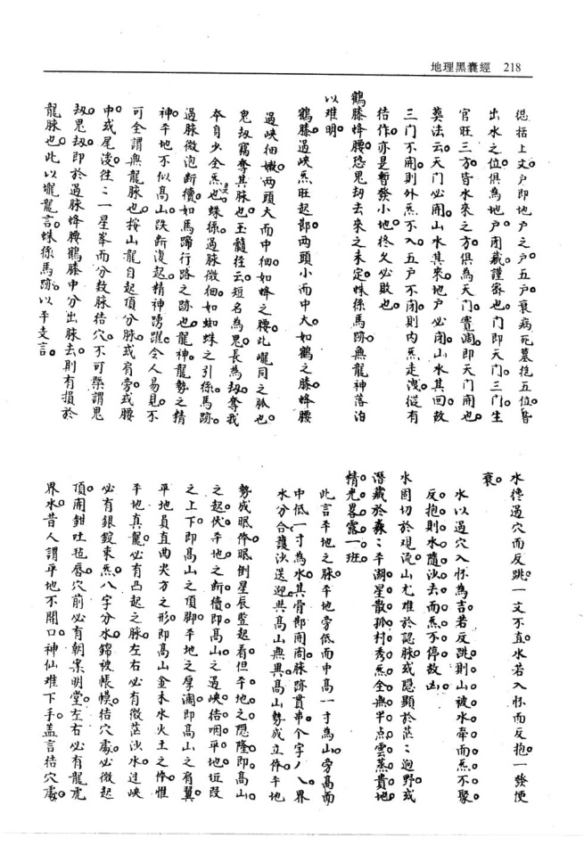

<!-- V3_SOURCE_ID:book010-b000404-p000-667d3bb23f -->

必须开口，才有真正的明堂。骨脉应当仔细分辨，龙、虎需要详细明确。

查看对应原文

<!-- V3_FOLDBACK_BEGIN:book010-b000404-p000-667d3bb23f -->

必須開口方有真明堂骨脉固宜剥拟龍虎須要詳明

<!-- V3_FOLDBACK_END:book010-b000404-p000-667d3bb23f -->

<!-- V3_SOURCE_ID:book010-b000405-p000-abf5bc8433 -->

龙的骨脉，相生或顺或逆，这叫做剥权。龙、虎有多种格局：龙、虎都从两边出来，整齐环抱穴地，名为正体；或龙、虎都从穴旁出来，一股向前，一股向后，名为左右卑提；或一边从卒身生出，一边有外山相配，名为卑股变体；文中提到“龙孙抱虎短徧虎刃抱龙短”，具体含义不详；文中提到“龙臂抱遇虎腕虎臂抱遇龙婉”，具体含义不详，名为左右狃稽。这些格局有的一先一后，一亲一疏，一长一短，不免有偏枯的情况，但其能依水则是一样的。有的本身没有龙、虎，借用隔水的山作为龙、虎星，端正浑元一气，如同贵人端坐，前后左右无不拱向。所用的是外山来作龙、虎，那么外来的象水必然汇聚归向当面，得水更多，需要多加考量，更要重视，不可因为本身没有龙、虎就忽视。还有一边卑一边双的，名为左叠指、右叠指、左双臂、右奴臂；还有西臂直前，借助外面的横关；还有两臂短遍，仅能护穴；还有两臂张开，名为张山食水，这类情况不一，形势多端，大致不过是要让风水对穴有情，才算尽到拱卫的道理。

> **释读存疑：** 龙孙抱虎短徧虎刃抱龙短；龙臂抱遇虎腕虎臂抱遇龙婉

查看对应原文

<!-- V3_FOLDBACK_BEGIN:book010-b000405-p000-abf5bc8433 -->

龍之骨脉即：相生或順或逆是謂剝权龍虎有數格龍虎均出兩邊斉來抱穴名為正体或龍虎均出穴旁一股向前一股縮後名為左右卑提或一邊卒身生出一边外山相配名為卑股變体或龍孫抱虎短徧虎刃抱龍短名為左右仙宮或龍臂抱遇虎腕虎臂抱遇龍婉名為左右狃稽數格一先一後一親一陳一長一短不無偏枯其能衣水則典正件一也或本身無龍虎借用隔水之山為龍虎星倅端正渾元一炁如貴人端坐而前後左右無不拱向所其所用且外山來作龍虎則外來象水必聚帰当面得水更多加量更重又和可以本身無龍虎而忽之也或又一边卑一边双名為左疊指右叠指左双臂右奴臂或又西臂直前藉外面橫關或又兩臂短徧僅能護穴或又兩臂張開名為張山食水名羕不一形勢多端大抵要不過遞風水於穴有情斯尽拱衛之道。

<!-- V3_FOLDBACK_END:book010-b000405-p000-abf5bc8433 -->

<!-- V3_SOURCE_ID:book010-b000406-p000-6e1b30ca91 -->

有的龙去虎回，有的龙回虎去，这种情况不宜逼近穴地。离去的要头势荡然直去，不肃静，必定导致逃移破败。或有龙无虎，或有虎无龙，若无龙，要水在左边；若无虎，要水在右边。此处有缺字或错乱，具体所指不详。

> **释读存疑：** 原句末尾有缺字或错乱，无法确认完整含义

查看对应原文

<!-- V3_FOLDBACK_BEGIN:book010-b000406-p000-6e1b30ca91 -->

或龍去虎回或罷虎去回者不宜逼穴去者要 頭蕩然直去不肅必定逃移井敗或有龍無虎或 有虎無龍若無龍要水於左边若無虎要水德於右 ￥o

<!-- V3_FOLDBACK_END:book010-b000406-p000-6e1b30ca91 -->

<!-- V3_SOURCE_ID:book010-b000407-p000-1c248d9c83 -->

关于这方面的含义，按照说法，有龙无虎就是左侧单股的左仙宫，有虎无龙就是右侧单股的右仙宫。

查看对应原文

<!-- V3_FOLDBACK_BEGIN:book010-b000407-p000-1c248d9c83 -->

之義按有龍無虎即左单股左仙宮有虎無龍即右单右仙宮

<!-- V3_FOLDBACK_END:book010-b000407-p000-1c248d9c83 -->

<!-- V3_SOURCE_ID:book010-b000408-p000-ef05ec2bce -->

不要把水（风水语境中的河流、水系及其来去形态）当作固定不变的标准，只需要在穴（风水中认为气脉聚结、适宜安葬或营建的位置）里留意弱风的情况，对此要眼光高远，更要用心仔细审查。

查看对应原文

<!-- V3_FOLDBACK_BEGIN:book010-b000408-p000-ef05ec2bce -->

莫把水為定格但求穴裡羸風到此着眼須高更要用心詳審

<!-- V3_FOLDBACK_END:book010-b000408-p000-ef05ec2bce -->

<!-- V3_SOURCE_ID:book010-b000409-p000-60704427f7 -->

承接上文所说，没有龙和虎的话，固然要留意水（风水语境中的河流、水系及其来去形态）的情况，但也不能把水当作固定不变的标准，还需要有肩臂微微转动来护持穴（风水中认为气脉聚结、适宜安葬或营建的位置），不要让风吹到穴上。

查看对应原文

<!-- V3_FOLDBACK_BEGIN:book010-b000409-p000-60704427f7 -->

承上文言無龍虎固要水僥然不可把水為一定之 格亦要有肩臂微轉護穴勿令風吹

<!-- V3_FOLDBACK_END:book010-b000409-p000-60704427f7 -->

<!-- V3_SOURCE_ID:book010-b000410-p000-a86688ea98 -->

或者龙势强而虎势弱，死龙势弱而虎势强，虎势强最忌讳昂头，龙势强尤其要提防‘嫉主’，具体所指不详。

> **释读存疑：** 嫉主；嫉主具体所指不详

查看对应原文

<!-- V3_FOLDBACK_BEGIN:book010-b000410-p000-a86688ea98 -->

或龍強虎弱死龍弱虎強虎強切忌昂頭龍強尤防嫉 主o

<!-- V3_FOLDBACK_END:book010-b000410-p000-a86688ea98 -->

<!-- V3_SOURCE_ID:book010-b000411-p000-ac5bed31ca -->

看风水时还要分辨龙砂、虎砂的强弱：虎砂如果强而头部低垂，就会欺侮下方的穴；龙砂如果强而延伸得很远，就不会嫉妒主位。葬书里说的‘虎蹲谓之衔尸，龙踞谓之嫉主’，就是这个道理。

查看对应原文

<!-- V3_FOLDBACK_BEGIN:book010-b000411-p000-ac5bed31ca -->

龍虎又当辨其強弱虎強而頭低則魚下欺其穴龍強而遠上則不嫉妬其主葬書云虎蹲謂之啣屍龍踞謂之嫉主是也

<!-- V3_FOLDBACK_END:book010-b000411-p000-ac5bed31ca -->

<!-- V3_SOURCE_ID:book010-b000412-p000-ae5a3a6761 -->

水流在一个穴的居中位置，要防备水从两边迎过来；‘射两宫’指的是龙砂、虎砂。如果龙砂、虎砂两边一齐到来，水就无法转弯，必然会直向流出。所以内堂必须端正，外面要有横向的水流，这样才能聚集气。如果堂局的地势太陡，就会牵动土牛，必然导致退败。一个穴居中，需要龙砂、虎砂圆润洁净，向内弯曲，能收住水；如果两边都开阔，水就会直射而来，对穴没有情意，必然导致凶败。

查看对应原文

<!-- V3_FOLDBACK_BEGIN:book010-b000412-p000-ae5a3a6761 -->

流一穴居中防兩迎之矣射兩宮指龍虎也兩宮斉到則水不能轉左轉右必然直出故須內堂卒正外面橫雨方可聚炁若堂局勢陡則牵動土牛必主退敗一穴居中須要龍虎員净向內权水若兩边俱光利直射則於穴無情必主凶敗。

<!-- V3_FOLDBACK_END:book010-b000412-p000-ae5a3a6761 -->

<!-- V3_SOURCE_ID:book010-b000413-p000-0b9e4aaff9 -->

东宫的气窜过西宫，长房就会败落；右臂尖射向左臂，小子就会贫穷。这些道理最该留意，不要自己糊涂。

查看对应原文

<!-- V3_FOLDBACK_BEGIN:book010-b000413-p000-0b9e4aaff9 -->

東宮竄過西宮長房敗後右臂尖射左臂小子貧窮最宜消息無自昏迷

<!-- V3_FOLDBACK_END:book010-b000413-p000-0b9e4aaff9 -->

<!-- V3_SOURCE_ID:book010-b000414-p000-88c31054cf -->

观察山势就像观察人的面相一样，点穴就像点艾绒一样，差一毫就会错千里，差一指就会错万山。

查看对应原文

<!-- V3_FOLDBACK_BEGIN:book010-b000414-p000-88c31054cf -->

相山亦似相人点穴尤如点艾一毫千里一指萬山

<!-- V3_FOLDBACK_END:book010-b000414-p000-88c31054cf -->

<!-- V3_SOURCE_ID:book010-b000415-p000-c1c47fcd9a -->

凡是龙脉落脉后，待穴必定从圆顶隐伏而下，再隆起微突的部分，名为化生脑，如同人的头部；下方有额状突起，能分水的部分，名为大八字，如同人的胡须；旁边微微向两侧分岔，两侧微微凹陷的部分，名为蝉翼，如同人的两眉；突起下方垂有一条直线状的气脉，名为个字三乂，如同人额头的山根；一条直线状的气脉略微隆起成块，仅高数寸，名为圆毬，如同人的鼻头；两侧分水的部分，名为小八字，如同人的两眼；圆毬下方的位置，名为葬口，如同人鼻下的人中；气脉的光檐，如同人嘴的上唇；穴前有一小块平坦开阔的地方，名为小明堂，其薄口如同人的口；两侧分水微微在小明堂内交会的部分，名为虾须，如同人的髭须；两侧微微凹陷的部分，名为颊，如同人的面颊；微微在小明堂下方交会抱合的部分，名为毬髯，如同人的下腹。推究聚结的穴位：上方聚结的穴位，如同人的头部，狡黠灵动如同初生的颠门，尚未完全饱满，有微窝形状，就是山顶的窝穴；中间聚结的穴位，如同人的心脏，两侧的山脉就是龙虎；下方聚结的穴位，如同人的阴囊，两侧的山脉就是龙虎；至侧脑没骨的穴位，如同人的鼻；曲池用口的穴位，如同人的合谷。所以观察山势也如同观察人的形貌，关键在于用心仔细辨认。至于点穴，应当在脉气停止、无聚气的正中好位置，用井安放棺木，这样才能承接脉气、乘生气，就像用线系着艾绒，不能有丝毫差错。穴法不外乎阴来阳受、阳来阴受的原则：阳脉未到而阴脉先受，阴脉到来而阳脉承接。如同覆掌，脊背峻急刚硬的都是阴脉，落穴时必定化用寓压的形态，作为阳受；寓深奋浅的是老阳火之象。阳来如同仰掌，脊背柔顺的都是阳脉，落穴时必定吐出孔穴，作为阴受；孔穴大而小的是老阴火之象。又有窝中有孔、顶有凹陷的情况，这就是阳极阴生、阴极阳生的妙处。按穴口为太极晕，晕的中心有上阴下阳、上阳下阴、边阴边阳、阴多阳少、阳多阴少、阴交阳半、阳交阴半、不分阴阳、情分厚薄的区别，这些都要在地的肥瘦上分别，作为穴中佐证。至于捷径之法，又有真沙真水作为佐证：贴晕的沙有蝉翼、牛角；止晕的水有椴须、眼。所以佐证窝属的穴位，有两脆中角、知一涌眼水；佐证孔属的穴位，有两片坤翼沙、两股虾水；沙有边厚边薄、边长边短；水有杀明股暗边、有边无。这又是沙水分辨阴阳，作为穴中生气佐证的方法。一说太极晕有全有半：全晕的正中，穴位适宜放在正中；半晕在左，穴位适宜放在左；半晕在右，穴位适宜放在右。如果全晕顶上见到一二分半晕，如同初三蛾眉月的样子，名为天轮影，尤为贵征。

> **释读存疑：** 原文中部分专名如“化生脑”“大八字”“蝉翼”等为风水术数特定称谓，释读未赋予额外含义，符合要求

查看对应原文

<!-- V3_FOLDBACK_BEGIN:book010-b000415-p000-c1c47fcd9a -->

凡龍落脉待穴必自員頂隱而下復起微突名為化生腦似人之頭下有額突上分水名為大八字似人之須旁微有兩分災旁兩片陰汝名為蝉翼似人之兩眉突下中垂一線胍名為个字三乂似人額之山根一線之胍畧起便塊僅高數寸名為員毬似人之鼻頭兩旁分水名為小八字似人之兩眼毬下之穴名為葬口似人鼻下之人中穴之光簷似人嘴之上唇穴前有些子坦夷處名為小明堂即其薄口似人之口兩旁分水微交会於小明堂之内名為蝦協似人之髭鬚兩边微陰似人之觀頰陰決微微交抱於小明堂之下名為毬髯似人之下腹推之上聚之穴如狹見頭狡見初生顛門未滿微有窝形即山頂窝穴也中聚之穴如人之心兩手即龍虎也下聚之穴如人之陰囊兩足即龍虎也至側腦沒骨之穴如人之鼻由曲池用口之穴如人之合谷故相山亦似相人惟在徊心倅認至於点穴当於脉止無聚正中好處用井放棺方可持脉乗炁尤如繫者点艾不可有差也穴法不外陰來陽受阳未阴受阴來如覆掌脊峻急剛梗皆陰脉落穴必化用寓壓為阳受寓深奮淺為老阳火阳之象阳來如仰掌奉背辛後柔軌皆阳脉落穴必吐出孔災為阴受災大孔小為老阴火阴之象又窝中有災：頂有魘此又阳極阴生阴極阳生之妙也按穴口為太極暈之中心有上阴下阳上阳下阴有边阴边阳有阴多阳火阳多阴火有阴交阳半阳交阴半有不分阴阳情分厚薄皆在地之肥瘦上分別為穴中證佐至於捷径之法又有真沙真水為證夫貼暈之沙有蝉翼牛角止暈之水有椴鬚眼故證窩屬之穴則有兩脆中角知一涌眼水證孔知之穴則有兩片坤翼沙界兩股鰕水沙有边厚边薄边長边短水有殺明股暗边有边無此又沙水分別阴阳為穴中生炁之證佐也一說太極暈有全有半全暈正中穴宜居中半暈在左穴宜居左半暈在右穴宜居右若全暈頂上若見一二分半暈如初三蛾眉月樣謂之天輪影尤為貴徵

<!-- V3_FOLDBACK_END:book010-b000415-p000-c1c47fcd9a -->

<!-- V3_SOURCE_ID:book010-b000416-p000-a5e1cf5ea5 -->

明堂中最喜聚窝的形态，穴后要防备仰瓦的形态。

查看对应原文

<!-- V3_FOLDBACK_BEGIN:book010-b000416-p000-a5e1cf5ea5 -->

堂中最喜聚窩穴後防仰瓦

<!-- V3_FOLDBACK_END:book010-b000416-p000-a5e1cf5ea5 -->

<!-- V3_SOURCE_ID:book010-b000417-p000-ca4999a0e6 -->

明堂以聚水为上，横抱的水次之，朝水又次之，不见水顺流而去的更次之。穴后只有真龙穴没有鬼星，若是横水回抱的内穴、侧穴，全要以鬼星撑托为主要，须防备漏槽，如仰瓦的形态名为空止，就不是真撼龙。古人说：“问君何者为空山，穴后卷空仰瓦势是也。”若是凹脑天财星体，大多是穴后仰鬼，只以有乳为真，贴身的后案为包裹周密，不可空旷，或是有孝顺鬼尤为妙者。

查看对应原文

<!-- V3_FOLDBACK_BEGIN:book010-b000417-p000-ca4999a0e6 -->

明堂如掌心家富斗量金明堂以聚水為上橫抱次之朝水次之不見水去而順流者又次之穴後惟真龍穴無鬼若橫待回內穴側穴全要鬼撐染托為主須防漏槽如仰瓦名曰空止則非真撼龍往云问君何者為空山穴後捲空仰瓦勢是也若凹腦天財星体又多是穴後仰鬼只以有乳為真後案貼身為桂包裏周密不可空曠或有孝順鬼尤為妙者也

<!-- V3_FOLDBACK_END:book010-b000417-p000-ca4999a0e6 -->

<!-- V3_SOURCE_ID:book010-b000418-p000-105faa0fba -->

仔细观察八方的周流，详细审察五星的变化。八目就是八方，五星就是金、木、水、火、土。山的端正形态：端负为金，耸直为木，屈曲为水，尖锐为火，方平为土，这是正体。变体则有龙山九星、穴山九星。龙山九星歌说：贪狼顿笏笋初生，巨门走马屏风列，文曲排牙似柳枝，惟有禄存猪屎节，廉贞梳齿挂破衣，武曲馒头贞更凸，破军坡伞拍板同，辅弼雌雄如满月。九变歌说：一星又变为九样，其一名本相，连炁居二分，炁三第四用脚参，五为弓脚，六双爪，七变番身巧，八是侧体，九倒身，八十一形真。穴山九星歌说：九星贞者号太阳，太阴负带方，负而曲者名金水，木星直如矢，方是天财，三脑分凹脑土金身，双脑合形本金水，平脑土星是，此名五吉是为高，辨别在分毫，头负两脚拖光尾便天罡体，头负脚直孤曜当，燥火尖似枪，扫荡一身浑似曲，四者为凶局。又九变歌说：九个星辰各变九，本皆居有开口，第二悬乳，三太极晕中函，四是弓脚，五双臂车股居六，七位七为侧脑不须疑，没骨八为奇，平面原来居第九，变不禹母是也。贪狼木星，巨门土星，武曲金星，文曲水星，廉贞火星，禄存土星，破军金星，左辅金星，右弼水星，以左辅为木星者非也，太阳金星，太阴金星，又名金土星，金水佈金水星，紫炁木星，天财平脑土星，凹脑土金星，双脑金水星，天罡金星，孤曜金星，谓为土星者非也，扫荡水星，燥火火星。以上虽各有九星九变，其实不离乎五星之顶，所谓星演九变，头却不变，所以说峦头。按正则为五星，变体则有龙山九星、九变、穴山九星、九变，间星则贪中有廉、文中有弼、武中有破、禄中亦有巨、文甫。若论运动，则九星皆夹文曲以行；若论体段，则九星皆夹禄存以出；若论兼带，太阳金星略带木，太阴金星略带土，紫炁木星略带金，天财土星兼金土、兼金水，金水星金兼水，天罡金星金带火，孤曜金星金帝木，扫荡水星略带金，燥火星略带木。此皆五星之变化，若纯金则顽、纯木则梗、纯水则荡、纯火则燥、德皮则烂、纯土则块，皆非穴之星。布五星为穴之根本，必详察明辨，方知生克吉凶。疑龙经说：“现星裁穴始为真，不论星辰是虚诳是也。”一说五星变化，谓穿落传变、兼带，视贴穿言其始出障，落言其终入穴，传变即中间行度之变，又谓祖山落脉，穿出何星，变作何星，传去到穴，衬如视衣，言其星之相倚至切也。贴与衬相似而不同，观其分二件，贴则不分為二，只于穴场紧贴些微星象，贴体而不分者也，此皆形之微露者，须细心察之。

> **释读存疑：** 原文中部分术数歌诀及专名如“贪狼”“巨门”等为风水峦头特定称谓，释读未赋予额外含义，符合要求

查看对应原文

<!-- V3_FOLDBACK_BEGIN:book010-b000418-p000-105faa0fba -->

細看八国之周流詳察五星之变化八目即八方五星金木水火土也山之端負為金聳直為木屈曲為水尖銳為火方平為土此正体也变俸則有龍山九星穴山九星龍山九星歌曰貪狼頓笏笋初生巨門走馬屏風列文曲排牙似柳枝惟有祿存猪屎節廉貞梳齒挂破衣武曲饅頭貞更凸破軍坡傘拍板同輔弼雌雄如滿月文九变歌曰一星又变為九樣其一名本相連炁居二分炁三第四用腳參五為弓腳六双爪七变番身巧八是側体九倒身八十一形真穴山九星歌曰九星貞者号太阳太阴負帶方負而曲者名金水木星直如矢方是天財三腦分凹腦土金身双腦合形本金水平腦土星是此名五吉是為高辨別在分毫頭負兩腳拖光尾便天罡体頭負腳直孤曜当燥火尖似鎗掃蕩一身渾似曲四者為凶局又九变歌曰九个星辰各变九本皆居有開口第二懸乳三太極暈中函四是弓腳五双臂車股居六位七為側腦不須疑沒骨八為奇平面原來居第九变不禹母是也貪狼木星巨门土星武曲金星文曲水星廉貞火星祿存土星坡軍金星左甫金星右弼水星以左甫為木星者非也太阳金星太阴金星又名金土星金水佈金水星紫炁木星天財平腦土星凹腦土金星双腦金水星天罡金星孤曜金星謂為土星者非也掃蕩水星燥火火星以上雖各有九星九变其实不离乎五星之頂所謂星演九变頭却不变故曰峦頭按正則為五星变体則有龍山九星九变穴山九星九变间星則貪中有廉文中有弼武中有破祿中亦有巨文甫若論運動則九星皆夾文曲以行若論体叚則九星皆夾祿存以出若論兼帶太阳金星略帶木太阴金星畧帶土紫炁木星略帶金天財土星兼金土兼金水金水星金兼水天罡金星金帶火孤曜金星金帝木掃蕩水星略帶金燥火星略帶木此皆五星之变化若純金則頑純木則梗純水則蕩純火則燥德皮則爛純土則塊皆非穴之星佈五星為穴之根本必詳察明辨方知生刻吉凶疑龍径云現星裁穴始為真不論星辰是虛誑是也一說五星变化謂穿落傳吏兼帶視貼穿言其始出障落言其終入穴傳变即中间行度之变又謂祖山落脉穿出何星变作何星傳去到穴襯如視衣言其星之相倚至切也貼典襯相似而不同觀共倅分二件貼則不分為二只於穴塲緊貼些微星象貼体而不分者也此皆形之微露者須細心察之

<!-- V3_FOLDBACK_END:book010-b000418-p000-105faa0fba -->

<!-- V3_SOURCE_ID:book010-b000419-p000-038adfb47f -->

穿割、箭射这两种情形，属于四凶之列，应当一同避开。

> **释读存疑：** 原文未明确说明“四凶”具体所指

查看对应原文

<!-- V3_FOLDBACK_BEGIN:book010-b000419-p000-038adfb47f -->

穿割箭射四凶合避

<!-- V3_FOLDBACK_END:book010-b000419-p000-038adfb47f -->

<!-- V3_SOURCE_ID:book010-b000420-p000-c876190337 -->

所谓穿，是指水流穿破明堂、截断龙臂的情形；所谓割，是指穴前没有上聚的格局，南水穿过内堂、割截脚脉的情形。也有人认为，若穴前没有多余的生气，水流逼迫山脚而过，也可称为割脚。所谓箭，是指水流急直而去，如同箭射出一般；所谓射，是指水流正对着穴心直冲，或是从左右两胁下冲来，如同箭射来一般。

查看对应原文

<!-- V3_FOLDBACK_BEGIN:book010-b000420-p000-c876190337 -->

穿者穿被明堂戒穿斷龍臂也割者穴前無上決遍 南水過內堂割腳也或者穴前無餘炁水逼山下而 過亦謂之割脚者也箭者言水急直而去如矢之發 者也射者水当心直冲或射左右兩脅下如矢之來 也

<!-- V3_FOLDBACK_END:book010-b000420-p000-c876190337 -->

<!-- V3_SOURCE_ID:book010-b000421-p000-7b86562204 -->

元辰正对着穴心直出，还不能就说是凶；若外面的水流转向，损及园圃，反而会吉利。用它来界分脉气，脉气就会停止；用它来挡风，就如同有风也不会（被吹动）。

> **释读存疑：** 0；原文存在字符残缺，部分内容无法准确释读；本地硬校验仍未通过，已记录供后续自动处理或人工核对。

查看对应原文

<!-- V3_FOLDBACK_BEGIN:book010-b000421-p000-7b86562204 -->

元辰当心直出未可言凶外面轉首損圃得之反吉以之界脉 則脉 自。 止。 以0 之。 風 則。 如風不

<!-- V3_FOLDBACK_END:book010-b000421-p000-7b86562204 -->

<!-- V3_SOURCE_ID:book010-b000422-p000-998625da3c -->

水流从穴前发源，称为元辰水。元辰水正对着穴心直出，主初年不利，但还不能就断定为凶；若有外水横拦，内部生气就会停止聚积，反而成为吉利。大概是因为用它来界分穴的脉气，脉气就会停止；用它来承托穴的风气，风气就不会被吹动。

查看对应原文

<!-- V3_FOLDBACK_BEGIN:book010-b000422-p000-998625da3c -->

水自穴前發源謂之元辰元辰水当心直出主初年不利然未可遲謂之凶若有外水橫則內炁止聚反為吉矣盖以此界穴之脉則脉自止以此戴穴之風則風不吹

<!-- V3_FOLDBACK_END:book010-b000422-p000-998625da3c -->

<!-- V3_SOURCE_ID:book010-b000423-p000-eb1b772703 -->

在宕地坐旺位、坐煞位，这就是坐法；全胎、保胎、被胎，这就是作法。

查看对应原文

<!-- V3_FOLDBACK_BEGIN:book010-b000423-p000-eb1b772703 -->

生宕坐旺坐煞是為坐法全胎保胎被胎是為作法

<!-- V3_FOLDBACK_END:book010-b000423-p000-eb1b772703 -->

<!-- V3_SOURCE_ID:book010-b000424-p000-ee8c746adb -->

强劲急促的龙脉，其气势在平坦宕地处最为刚猛，在此处作穴，就是所说的脱煞作宕。午方铺展的龙脉，其气在旺相处较弱，需乘势坐于旺位；坐煞位，比如金形地以刚饱为煞，要从刚劲处开脉取水而坐，金形地以火为煞，需在金火相交处挨金剪火来运用。全胎的情况，比如龙脉卸落至平洋，入首处如同印掌金盘，此时只用客土，就是古人用井怕见水的方法。保胎的情况，如同珠嵌花簪这类，半吞半吐，乘势从珠旁入、花正入。被胎的情况，如同顽金孤罡这类，若不深挖取水就不可下穴。全胎如同桐子挂在叶上，轻飘而胎体全露；保胎如同莲子浮在运房，微露而半含胎中；坡朐如同粟子包在剌包、胡桃肉藏在坚壳中，具体所指不详，必须被其胎而出。

> **释读存疑：** 坡朐；被胎的具体含义；坡朐的具体含义；午鋪之龍的具体方位含义；運房的具体含义；梏於葉上的具体含义；1轮自动修复后核义模型仍建议修订，已保守记录。

查看对应原文

<!-- V3_FOLDBACK_BEGIN:book010-b000424-p000-ee8c746adb -->

強急之龍其勢怒於坦宕處作穴所謂脫煞作宕是也午鋪之龍其炁弱於旺相處乗之坐旺也坐煞如金以剛飽為煞從剛處開脉取水坐之金以火為煞在金火相交處挨金剪火用之是也全胎如龍卸落平洋入首處如印掌金盤則用客土惟培即古人用井怕見水之法保胎如珠嵌花簪之類半吞半吐乗之珠從旁入花泛正入被胎如頑金孤罡之類不大開深取水則不可下全胎如桐子梏於葉上輕浮而胎全露保胎如蓮子氟於運房微露而半含胎中也坡朐如粟子包於剌包胡桃肉藏於堅殼必被其胎而出也

<!-- V3_FOLDBACK_END:book010-b000424-p000-ee8c746adb -->

<!-- V3_SOURCE_ID:book010-b000425-p000-b17eafea8f -->

午洋处的穴需斟酌，不宜掘地及泉；峻峭山的穴要仔细消详，务必登高作心，此处‘心’的具体所指不详。

> **释读存疑：** 登高作心的‘心’；登高作心的‘心’的具体所指

查看对应原文

<!-- V3_FOLDBACK_BEGIN:book010-b000425-p000-b17eafea8f -->

午洋穴須斟酌不宜掘地及泉峻峭山要消詳務要登 高作心

<!-- V3_FOLDBACK_END:book010-b000425-p000-b17eafea8f -->

<!-- V3_SOURCE_ID:book010-b000426-p000-dd6d4185e0 -->

平洋的穴，需察看两界水的浅深，原文‘豈之’的具体含义不详，若其不妨可多加客土；‘鄭若’的具体所指不详，若平洋的冢浮，需留意。峻峭山的穴，务必登高寻求，这就是所说的天巧，山顶分龙、虎，地势平夷有门户。按：此处所说的峻峭山是穴的主山，不可认为四山峻峭就宜作高穴。

> **释读存疑：** 豈之；鄭若；豈之的具体含义；鄭若的具体所指；天巧的具体含义；龍虎的具体含义；四山的具体含义；1轮自动修复后核义模型仍建议修订，已保守记录。

查看对应原文

<!-- V3_FOLDBACK_BEGIN:book010-b000426-p000-dd6d4185e0 -->

平洋之穴須察兩边界水之淺深豈之不妨多加客土惟塚浮鄭若峻峭之山必佶天巧之穴務要高登求之所謂天巧山頂分龍虎峻地平夷有门戶也按此峻峭山乃穴之主山不可謂四山峻峭宜作高穴也。

<!-- V3_FOLDBACK_END:book010-b000426-p000-dd6d4185e0 -->

<!-- V3_SOURCE_ID:book010-b000427-p000-fe17f624d4 -->

穴（风水中认为气脉聚结、适宜安葬或营建的位置）内的风必须避开，不能让风直吹耳朵、胸口。水（风水语境中的河流、水系及其来去形态）要呈之玄状，最忌讳的是……

> **释读存疑：** 原文末尾有缺字，具体所指不详

查看对应原文

<!-- V3_FOLDBACK_BEGIN:book010-b000427-p000-fe17f624d4 -->

穴裏風須迴避莫呌 耳吹胸面前良水要之玄最怕

<!-- V3_FOLDBACK_END:book010-b000427-p000-fe17f624d4 -->

助

<!-- V3_SOURCE_ID:book010-b000429-p000-316e46c4bf -->

所谓之玄，是指水的形态像“之”字、“玄”字那样曲折。平原地区的风水讲究得水，山地的风水贵在藏风，因此穴内的风要避开，要么修筑围罗来防护，要么开挖深窝来藏匿，要么偏向左侧或右侧来避让，要么填补凹陷、空缺来遮挡，不能让风来割耳、吹胸。至于平原的穴，面前众多水流琢逸，即使没有朝案遮挡，风也会无力，不能吹向穴，只是需要水流曲折到堂，最忌讳水流急促笔直地冲心射胁，或是像川字、人字、威如八字那样分流，这些都是凶象。

> **释读存疑：** 原文中“得 o水”的缺字无法确认，具体所指不详；“護徨”疑为“護砂”的讹误，原文未明确，具体所指不详；原文中‘得 o水’的缺字无法确认，具体所指不详；‘護徨’疑为‘護砂’的讹误，原文未明确，具体所指不详；‘威如八字’原文表述含混，具体所指不详；1轮自动修复后核义模型仍建议修订，已保守记录。

查看对应原文

<!-- V3_FOLDBACK_BEGIN:book010-b000429-p000-316e46c4bf -->

之玄者謂水屈曲如之字玄字形也按平洋在於得 o水高山貴乎藏風故穴裡之風要廻避或築圍羅護之或開深窝藏之或挨左挨右內之或填凹補空障之莫呌風來割耳吹胸若平洋之穴面前眾水琢逸雖無朝案遮南而風則無力不能吹穴但要曲折到堂最怕急直而來冲心射脅或如川字人字威如八字分皆凶

<!-- V3_FOLDBACK_END:book010-b000429-p000-316e46c4bf -->

<!-- V3_SOURCE_ID:book010-b000430-p000-bec526b202 -->

大向小折，小向大，人扦不宜乱采，横来直受，直来横受，更0看

> **释读存疑：** 原文存在缺字，具体所指不详

查看对应原文

<!-- V3_FOLDBACK_BEGIN:book010-b000430-p000-bec526b202 -->

大向小折 小。 向。 大。 人扦不宜亂采橫來直受直來橫受更 0看

<!-- V3_FOLDBACK_END:book010-b000430-p000-bec526b202 -->

<!-- V3_SOURCE_ID:book010-b000431-p000-ae96573a0e -->

象山俱大，向小山扦穴；衆山俱小，向大山扦穴，取其星辰特達、共眾不同，所謂大則特、小則特也。橫直更要看護徨，如左边護徨有情，則穴宜挨左；右边護徨有情，則穴宜挨右也。

查看对应原文

<!-- V3_FOLDBACK_BEGIN:book010-b000431-p000-ae96573a0e -->

象山俱大向小山扦穴衆山俱小向大山扦穴取其星辰特達共眾不同所謂大則特小則特大也橫直更要看護徨如左边護徨有情則穴宜挨左右边護裡有情則穴宜挨右也

<!-- V3_FOLDBACK_END:book010-b000431-p000-ae96573a0e -->

<!-- V3_SOURCE_ID:book010-b000432-p000-0a16199e9c -->

中畏直他虎防暗箭玄武不宜吐舌朱崔切忌被頭穴前忌見坑臂上恂行交路

查看对应原文

<!-- V3_FOLDBACK_BEGIN:book010-b000432-p000-0a16199e9c -->

中畏直他虎防暗箭玄武不宜吐舌朱崔切忌被頭穴前忌見坑臂上恂行交路

<!-- V3_FOLDBACK_END:book010-b000432-p000-0a16199e9c -->

<!-- V3_SOURCE_ID:book010-b000433-p000-70fd636814 -->

告土物即穴也直挹者穴前水出直牽如绳也虎即右白虎暗箭虎沙背逡山脚尖射流水直冲如暗箭也玄武主山也穴前餘炁拖長謂之吐舌朱雀朝案山也頂面缺陷崩裂謂之坡頭臂者龍虎兩妙如人之手臂也交路者交义之路也

查看对应原文

<!-- V3_FOLDBACK_BEGIN:book010-b000433-p000-70fd636814 -->

告土物即穴也直挹者穴前水出直牽如绳也虎即右白虎暗箭虎沙背逡山脚尖射流水直冲如暗箭也玄武主山也穴前餘炁拖長謂之吐舌朱雀朝案山也頂面缺陷崩裂謂之坡頭臂者龍虎兩妙如人之手臂也交路者交义之路也

<!-- V3_FOLDBACK_END:book010-b000433-p000-70fd636814 -->

<!-- V3_SOURCE_ID:book010-b000434-p000-0023afd52b -->

三吉鐘於何地則取前進退之如量刼害出於何方則取三合四之年遇吉則發逢凶則災

查看对应原文

<!-- V3_FOLDBACK_BEGIN:book010-b000434-p000-0023afd52b -->

三吉鐘於何地則取前進退之如量刼害出於何方則取三合四之年遇吉則發逢凶則災

<!-- V3_FOLDBACK_END:book010-b000434-p000-0023afd52b -->

<!-- V3_SOURCE_ID:book010-b000435-p000-257b3d5491 -->

三吉就龍身矣員方而言山以尖員方為吉水以堂 中寓聚灣环渟瀦為吉此以三吉而諛山水者以水 之吉尤山之吉也前進步水也量水自穴前起一步 進一步後退步龍也量山自穴中起一步退一步一 步三年十步一吾此步數上後遇龍身吉星主此代 龚福前遇堂中吉水主此代發助刼害指凶沙凶水 言三合者申子辰寅午戌夾卯未已酉丑也四冲者 子午卯酉四正寅申己辰戌丑未四隅也八千四 維附在地支內論如交卯未三合則以就甲丁附之 如寅申相冲則以坤艮附之三類也如午上有凶沙 凶水主寅午戊年井子午年冲有凶或本年生命穴 之若有吉以吉水其福亦然餘倣此

查看对应原文

<!-- V3_FOLDBACK_BEGIN:book010-b000435-p000-257b3d5491 -->

三吉就龍身矣員方而言山以尖員方為吉水以堂 中寓聚灣环渟瀦為吉此以三吉而諛山水者以水 之吉尤山之吉也前進步水也量水自穴前起一步 進一步後退步龍也量山自穴中起一步退一步一 步三年十步一吾此步數上後遇龍身吉星主此代 龚福前遇堂中吉水主此代發助刼害指凶沙凶水 言三合者申子辰寅午戌夾卯未已酉丑也四冲者 子午卯酉四正寅申己辰戌丑未四隅也八千四 維附在地支內論如交卯未三合則以就甲丁附之 如寅申相冲則以坤艮附之三類也如午上有凶沙 凶水主寅午戊年井子午年冲有凶或本年生命穴 之若有吉以吉水其福亦然餘倣此

<!-- V3_FOLDBACK_END:book010-b000435-p000-257b3d5491 -->

<!-- V3_SOURCE_ID:book010-b000436-p000-252767cac4 -->

风水语境中的河流、水系及其来去形态（水）多出现于平地，是绝佳的选址；所谓火星多出现在高山，主尊贵且无人能敌。

查看对应原文

<!-- V3_FOLDBACK_BEGIN:book010-b000436-p000-252767cac4 -->

水星多在平地妙處淮言火星多出高山貴而無敵木

<!-- V3_FOLDBACK_END:book010-b000436-p000-252767cac4 -->

<!-- V3_SOURCE_ID:book010-b000437-p000-116295f88c -->

文中提到‘頃有即金貴連珠’，具体含义不详。

> **释读存疑：** 頃有即金貴連珠；‘頃有即金貴連珠’具体含义不详

查看对应原文

<!-- V3_FOLDBACK_BEGIN:book010-b000437-p000-116295f88c -->

頃有即金貴連珠

<!-- V3_FOLDBACK_END:book010-b000437-p000-116295f88c -->

<!-- V3_SOURCE_ID:book010-b000438-p000-23d62fb561 -->

节郎枝的形态类似梧桐枝这类；连珠指的是有数处土墩隆起，土墩间有脉线相互牵连，如同串珠一般，这属于金形。这里所说的是五星的形势：风水语境中的河流、水系及其来去形态（水）体屈曲柔软，性质趋下，所以形态如同芦花，气势如同活蛇走动，其精妙之处难以用言语形容，因此水星在午位才能显现它的妙处；火体中央高耸，性质刚猛且向上燃烧，所以形态如同龙椿、凤周，气势如同插入云霄、凌驾云端，其尊贵无人能比，因此火星在高山才能显现它的尊贵；至于木星，必须弯曲如帚水、如芦鞭，贵格的话形态走势袅娜灵动而没有直硬的梗杀之气；金星贵在有数处形态相连如同串珠，贵格的话形态秀丽而没有粗陋的焘恶之气，这样才称得上贵格。按照这段文字的意思，都是在论述星辰的形态，不能随意引申到风水中认为气脉聚结、适宜安葬或营建的位置（穴）的方法上。

查看对应原文

<!-- V3_FOLDBACK_BEGIN:book010-b000438-p000-23d62fb561 -->

節郎枝節如梧桐枝之類也連珠謂起数墩泡中有脉線牽連即串珠金也此言五星之形勢水体屈曲其性柔而趋下故形如蘆花三氣勢如生蛇走動而其妙処难以言語形焉所以水星在午地方能顕其妙也火体央聳其性剛而炎上故形如龍椿鳳周勢如挿漢凌雲而其尊貴無興比敵焉所以火星在高山方能顕其貴也至於木星須湾曲帚水如蘆鞭貴格則形勢裊動而無直梗殺炁金星貴有數殊相連如串珠貴格則形勢秀麗而無粗焘惡炁斯為貴也按此段文義俱論星辰不可泛引穴法以矣之者也。

<!-- V3_FOLDBACK_END:book010-b000438-p000-23d62fb561 -->

<!-- V3_SOURCE_ID:book010-b000439-p000-5eb5311bbe -->

土不像土、金不像金，来势如同木不像木、火不像火，这种形态会让人眼花缭乱，大概是因为土的小巧形态类似金木，金的尖乱形态类似火。

查看对应原文

<!-- V3_FOLDBACK_BEGIN:book010-b000439-p000-5eb5311bbe -->

土不土而金不金形來勢木不木而火不火眩目惑心蓋土之小巧者類金木之尖亂者似火

<!-- V3_FOLDBACK_END:book010-b000439-p000-5eb5311bbe -->

<!-- V3_SOURCE_ID:book010-b000440-p000-0fb23be19d -->

土星的头部方正、形体厚实，如果小巧就类似金星；木星的头部隆起、身形笔直，如果尖削杂乱就类似火星，所以说这种混杂的形态会混淆形势，让人迷惑。

查看对应原文

<!-- V3_FOLDBACK_BEGIN:book010-b000440-p000-0fb23be19d -->

土星頭方而体厚若小巧則有類於金木星頭負而而身直若尖亂則有似乎火故謂參形襟勢眩目惑心

<!-- V3_FOLDBACK_END:book010-b000440-p000-0fb23be19d -->

<!-- V3_SOURCE_ID:book010-b000441-p000-bb156e6e33 -->

金形的特征是明朗端正，土形的特征是饱满，火形的特征是干燥，水（风水语境中的河流、水系及其来去形态）的特征是柔和。

查看对应原文

<!-- V3_FOLDBACK_BEGIN:book010-b000441-p000-bb156e6e33 -->

金清土滿火燥水柔

<!-- V3_FOLDBACK_END:book010-b000441-p000-bb156e6e33 -->

<!-- V3_SOURCE_ID:book010-b000442-p000-37845fb147 -->

金形以明朗端正为清贵，高亢响亮的是太阳，低小的是太阴；桎梏穴多呈窝状，或类似蛾眉，适宜扦角，形体饱满的则适宜开金，取用水土形，以方正为独行龙，多呈冤旒、玉屏、金书、诰轴之状。佶穴是土腹藏金的穴，在正中或角位。火形适宜靠近角位，火形以尖斜为燥，多作祖行龙，如龙捧宝殿之类的形态；火形的穴适宜剪火取用。水（风水语境中的河流、水系及其来去形态）以屈曲为柔，行龙呈铺帛、龙蛇之类的形态。

查看对应原文

<!-- V3_FOLDBACK_BEGIN:book010-b000442-p000-37845fb147 -->

金以明正為清高聲為太陽低小為太陰梏穴多開 窝或似蛾眉則扦角飽滿則開金取水土以 方正為獨行龍多冤旒玉屏金書誥軸佶穴土腹藏 金穴在正中或角似火宜就角火以尖斜為燥多作 祖行龍如龍棒宝殿之類穴宜剪火用之水以屈曲 為柔行龍如鋪帛龍蛇之類

<!-- V3_FOLDBACK_END:book010-b000442-p000-37845fb147 -->

<!-- V3_SOURCE_ID:book010-b000443-p000-6cc5dd075d -->

五星不会出现水土的形态，九星常带有甫弼的陋态；土星不会作倚形，五星都有撞火的形态，水（风水语境中的河流、水系及其来去形态）的形态是可以调和的，水土的形态怎能如此？

> **释读存疑：** 原文中“禹”“甫弼”“撞火”的具体所指不详

查看对应原文

<!-- V3_FOLDBACK_BEGIN:book010-b000443-p000-6cc5dd075d -->

五星不禹水土 九星常帶甫弼陋土星不作倚五星皆有撞火水和可盖水土豈能

<!-- V3_FOLDBACK_END:book010-b000443-p000-6cc5dd075d -->

<!-- V3_SOURCE_ID:book010-b000444-p000-95fafa05c4 -->

龙脉进入结穴区域前的关键一段（入首），其星辰形态各不相同，但水（风水语境中的河流、水系及其来去形态）与土（风水中气脉聚结、适宜安葬或营建的位置（穴）周边的土）是必不可少的。无论结穴处是和缓的乳状形态，还是钳状形态，关键都在于头顶有盖、背后有靠，这就是所说的化生脑土。还有说法是，结穴处不能是没头的形态，也不必纠结龙脉是否到来，只要有金水环抱腮部即可。凡是水（风水语境中的河流、水系及其来去形态）界合的地方，就是所说的虾须、蟹眼所在之处。辅、弼二星也属于水土类，甫星属金，弼星属水，立穴时不必拘泥于贪、巨、武等星，只要到头处有甫星，就可称为盖，有弼星就可称为承，这就是所说的乘金相水。立穴的方法有盖、粘、倚、撞，都要在星上进行。如果是土星，就不能脱离水来安葬；如果是水星，就不能脱离土来安葬。如果在土星上倚葬，就会崩塌；如果在水星上盖葬，就会被火星所害；如果在峰上安葬，就会受其猛烈影响。一旦犯了这些情况，就无法避免脱气的问题。

查看对应原文

<!-- V3_FOLDBACK_BEGIN:book010-b000444-p000-95fafa05c4 -->

龍脉入首星辰不一水土必不可無或和乳或鉗總要頭頂蓋負所謂化生腦土倅也又云不受沒頭來不來只要金水蔭腮凡水界合處是水所謂蝦須蟹眼是也輔弼二星亦是水土甫屬金弼屬水立穴不拘貪拘巨武到頭通要甫為之蓋弼為之承所為乗金相水也法蓋粘倚撞頂於星上記如土其饑豈可脫而 水葬其湧豈可後而粘土星倚葬則崩水星蓋腦則被火星当峰則烈一或犯此不用煞則脫炁也

<!-- V3_FOLDBACK_END:book010-b000444-p000-95fafa05c4 -->

<!-- V3_SOURCE_ID:book010-b000445-p000-2e7208881a -->

还有暖穴断禽翼的说法，这种穴需要识别左翼转向、右翼的情况，以及左翼转向的情况。

> **释读存疑：** 原文中"淳"字含义不明，无法确定其准确所指；1轮自动修复后核义模型仍建议修订，已保守记录。

查看对应原文

<!-- V3_FOLDBACK_BEGIN:book010-b000445-p000-2e7208881a -->

更有煖穴斷禽翼此穴要君識左翼轉通右翼淳左轉

<!-- V3_FOLDBACK_END:book010-b000445-p000-2e7208881a -->

<!-- V3_SOURCE_ID:book010-b000446-p000-97cd2148b3 -->

右边安放就可以了。

查看对应原文

<!-- V3_FOLDBACK_BEGIN:book010-b000446-p000-97cd2148b3 -->

右边安是也

<!-- V3_FOLDBACK_END:book010-b000446-p000-97cd2148b3 -->

<!-- V3_SOURCE_ID:book010-b000447-p000-a296554429 -->

安葬时要秉持生炁脉，认准来龙的走向。

查看对应原文

<!-- V3_FOLDBACK_BEGIN:book010-b000447-p000-a296554429 -->

葬秉生炁脉認來龍

<!-- V3_FOLDBACK_END:book010-b000447-p000-a296554429 -->

<!-- V3_SOURCE_ID:book010-b000448-p000-91431fc985 -->

葬的意思就是藏，就像乘车、骑马的“乘”，是端坐正中的意思。生炁是一元运化的炁，凝聚而不散。脉就是山脉，龙是指山的行度起伏转折、变化如同龙的形态，所以用龙来命名。辨认来龙时，要从祖宗顶、肩背、降势、落脉处去辨认，要辨别其个字正范，审查其行度过峡，看其利头星布，落脉入穴的细节，仔细辨认即可。如果是特来龙，就从祖山脉上辨认起；如果是分来龙，就从分脉上辨认起；如果是骑龙、贴身结穴，就从没有连峡的地方辨认起，这样才能找到头绪。大致来说，脉活动的是生，祖硬的是死；龙势推左的话，左是生，右是死；龙势推右的话，右是生，左是死；脉来势强的话，薄处是生，厚处是死；脉来势弱的话，厚处是生，高处是死；脉来性急即动的是生，急处是死；脉来性急的话，急处是生，缓处是死；瘦中取向的话，瘦处是死，肉处是生；饱中取饥的话，饥处是生，饱处是死。乘的意思是，高不可过员毬界水，低不可过薄口小明堂，左右不可过虾须蝌眼，关键在于真水一合之中，也就是太极晕的位置。

> **释读存疑：** 此处“员毬界水”“薄口小明堂”“虾须蝌眼”具体所指不详

查看对应原文

<!-- V3_FOLDBACK_BEGIN:book010-b000448-p000-91431fc985 -->

葬之為言藏也乗如秉車乘馬之秉坐乗正中也生炁者一元運化之炁桔聚而不散也脉山脉也龍者山之行度起伏轉折变化似龍故以龍名之認來龍者現其祖宗頂而肩背降勢落脉辨其个字正范審其行度过峽看其利頭星佈落脉入穴節：細認是也若特則來龍当這祖山脉上認起若分則來龍当從分脉上認起若騎龍貼身結則來龍当沒連峽上認起方有頭楮大約脉之活動為生祖硬為死龍勢推左則左為生右為死龍勢推右則右為生左為死脉來勢強則薄處為生厚處為死脉來勢弱聊厚處為生高處為死脉來性急即動為生急處為死脉來性稷帥急處為生後處為死瘦中取向則瘦處死而肉處生飽中取饑則饑如生而飽如死乗之者高不可过員毬界水低不可过薄口小明堂左右不可过蝦須蝌眼德要在真水一合之中即太極暈是。

<!-- V3_FOLDBACK_END:book010-b000448-p000-91431fc985 -->

<!-- V3_SOURCE_ID:book010-b000449-p000-e8fc6a62ba -->

穴。三如八卦。

查看对应原文

<!-- V3_FOLDBACK_BEGIN:book010-b000449-p000-e8fc6a62ba -->

穴。 三如八卦

<!-- V3_FOLDBACK_END:book010-b000449-p000-e8fc6a62ba -->

<!-- V3_SOURCE_ID:book010-b000450-p000-586323d540 -->

穴是生炁停止凝聚的地方，停就是炁的传止，三传的具体含义不详，上传、中传、下停，也就是天金库、木库，没有不是这样的。明堂是穴前注水的地方，适宜方正平正，朝案有情，龙虎交抱，确定堂局，不管东西南北，总以辨认水止向为关键。按龙虎内水合处叫明堂，也叫内明堂，不宜太宽，太宽就近乎旷荡，也不能太窄，太窄就近乎局促，须宽窄适中，方正员满为吉。龙虎外水合处叫大明堂，也叫外明堂，要宽展明畅而不逼窄，四山环绕而不空缺，诸水聚而不散漫为吉。如今有人拘泥于明堂容马的说法，一概以宽圃为上，不知道堂局实则风吹炁散，哪有结作，不可不知。如果是高山之穴，大多没有明堂，只有穴前小明堂，文中提到“梵衣真水”，具体所指不详，古人说从来高穴少明堂，只看“兜堂共外洋”，具体所指不详即可。因为高山仰承天炁，以炁为水，不必聚水。向贵迎官而就禄，作穴宜追吉。

> **释读存疑：** 三传；梵衣真水；兜堂共外洋；三传的具体含义，梵衣真水的具体所指，兜堂共外洋的具体所指；1轮自动修复后核义模型仍建议修订，已保守记录。

查看对应原文

<!-- V3_FOLDBACK_BEGIN:book010-b000450-p000-586323d540 -->

穴生炁止聚之處停者炁之傳止也三傳上傳中俾下停即天金庫未為木庫無不皆然明堂穴前注水之處宜凋平方正朝案有情龍虎交抱看定堂局不拘東西南北總以認水止向為要也按龍虎內水合處曰明堂亦名內明堂不宜太凋太凋近乎曠蕩亦不能太狹太狹近乎局促須凋狹適中寓平方員為吉龍虎外水合處曰大明堂亦名外明堂要寬展明暢而不逼窄四山圓僥而不空缺諸水聚而不散漫為吉今人泥於明堂容馬之說一槩以寬圃為上不知堂局實則風吹炁散烏有結作不可不知也若高山之穴多無明堂只有穴前小明堂梵衣真水古云從來高穴少明堂惟看兠堂共外洋是也蓋高山之仰承天炁以炁為水不必聚水也向貴迎官而就祿作穴圓追吉  如

<!-- V3_FOLDBACK_END:book010-b000450-p000-586323d540 -->

<!-- V3_SOURCE_ID:book010-b000451-p000-d501bd94b9 -->

火局冠带在辰，是官；文中提到“瘟官在己，是禄”。凡立寅午戍、艮丙辛向的，以迎贵就禄为贵。水局冠带在戍，是官；瘟官在亥，是禄。金局冠带在未，是官；官在申，是禄。木局冠带在丑，是官；文中提到“癌官在寅，是禄”。凡立向不拘生旺墓，都以迎就为上。或者以案外之山为官，或以明堂内之山为官，或以左右外来之山为官，这些曲解误人不浅。

> **释读存疑：** 癌官；癌官的具体所指；1轮自动修复后核义模型仍建议修订，已保守记录。

查看对应原文

<!-- V3_FOLDBACK_BEGIN:book010-b000451-p000-d501bd94b9 -->

火局冠帶在辰官也瘟官在己祿也凡立寅午戍艮丙辛向者貴迎貴就也水局冠帶在戍官也瘟官在亥祿也金局冠帶在未官也官在申祿也木局冠帶在丑官也癌官在寅祿也凡立向不拘生旺墓均貴迎就為上或以案外之山為官或以明堂內之山為官或以左右外來之山為官並曲解誤人不淺至

<!-- V3_FOLDBACK_END:book010-b000451-p000-d501bd94b9 -->

<!-- V3_SOURCE_ID:book010-b000452-p000-9d0e31ca24 -->

龙脉行进时，会有分水来引导它；龙脉停止时，会有合水来界定它。山脉从嶙祖处出发延伸龙脉，两侧必定会分出枝脉，一直送到明堂处；水会随着龙脉而来，在大明堂处会合，这是大的分合。其次是龙脉起顶后，入首处从顶部分出，浅处与龙、虎砂相合，这是次一等的分合。到了穴处，虾须水、眼水是穴中的小分合。向背的判断，是针对水而言的。分合共有三种：穴的前后是第一种分合，起主星到龙、虎砂交汇之处是第二种分合，祖龙到界水大会之处是第三种分合，这是龙穴的大分合。水从毬穴上分来下合，是第一合，也就是小八字水；大八字水分来下合，是第二合；起主星水分来下合，是第三合，这是穴的小分合。如果只有合而没有分，那么龙脉的来势就不真实，内部没有生气可以乘受；如果只有分而没有合，那么龙脉的止势就不明确，外部没有堂气可以承受。水的分合固然能体现龙脉的来止，砂的向背更能显现龙脉止势的真切。如果水来交汇却又反背，那么虽有合的态势，却没有相向的情意，这合

> **释读存疑：** 原文中“嶙祖”“大明堂”“毬上”“虾须眼”等术语未明确具体所指，释读未作臆断，符合要求

查看对应原文

<!-- V3_FOLDBACK_BEGIN:book010-b000452-p000-9d0e31ca24 -->

寵脉之來有分水以導之龍脉之止有合水以界之山自嶙祖發脉兩边必分枝徨送到堂水隨龍來會合大明堂為大分合次則起頂入首分於頂淺合於龍虎外為次分合到穴則蝦須眼為穴中之證小分合向背指決水言按分合有三穴之前後為一分合起主至龍虎所交為二分合祖龍至界水大会為三分合此龍穴之大分合水自毬上分來下合為第一合即小八字水也大八字水分來下合為第二合起主水分來下合為第三合此穴之小分合也若有合無分則其來不真而內無生炁之可乘有分無合則其止不明而外無堂炁之可受水之分合固龍脉之來止沙之向背尤見脉止之真的若水來交合而或反背則雖有合之勢而無相向之情是合

<!-- V3_FOLDBACK_END:book010-b000452-p000-9d0e31ca24 -->

<!-- V3_SOURCE_ID:book010-b000453-p000-2979bc2444 -->

就不是真正的合，止也就不是真正的止了。

查看对应原文

<!-- V3_FOLDBACK_BEGIN:book010-b000453-p000-2979bc2444 -->

非真合止非真止也

<!-- V3_FOLDBACK_END:book010-b000453-p000-2979bc2444 -->

<!-- V3_SOURCE_ID:book010-b000454-p000-69cb349fcd -->

大地没有固定形态，要看炁的概貌；小地没有明显态势，要看精神状态。水形成形态时，山上的山会停止，水会在水中形成形态。此处原文存在残缺，部分内容无法辨识。

> **释读存疑：** 原文后半段语义衔接不畅，无法形成完整通顺的表述；1轮自动修复后核义模型仍建议修订，已保守记录。

查看对应原文

<!-- V3_FOLDBACK_BEGIN:book010-b000454-p000-69cb349fcd -->

大地無形看炁槩小地無勢看精神水成形山上止山 成形水中此

<!-- V3_FOLDBACK_END:book010-b000454-p000-69cb349fcd -->

<!-- V3_SOURCE_ID:book010-b000455-p000-d5a8b71d31 -->

这是说，立穴应当认准精神凝聚的地方。平支之地以水为界，阳炁常占优势，其态势柔和，穴应当在平缓处；垄起之地阴炁常占优势，其态势雄急，穴应当在高处。山上的止，就是龙脉行至山顶的意思；水中的止，就是龙脉行至水中的意思。界水交汇之处，就是龙脉停止的地方。

> **释读存疑：** 原文中“稷心”“但處東之”等表述存在语义模糊，释读时结合上下文作了合理释义，未作无依据臆断

查看对应原文

<!-- V3_FOLDBACK_BEGIN:book010-b000455-p000-d5a8b71d31 -->

此言立穴当認精神止聚之處平支以水為界陽炁常勝其勢柔稷心当遂起處剛處秉之山上止即走莫其巔之意山壟陰炁常勝其勢雄急穴当後但處東之水中止者即龍其龍之意也界水会而止者也。

<!-- V3_FOLDBACK_END:book010-b000455-p000-d5a8b71d31 -->

<!-- V3_SOURCE_ID:book010-b000456-p000-46c5640d64 -->

风水语境中的河流、水系及其来去形态（水）处于八卦之一（坎）宫位，对应凤池，主池身尊贵；金居八卦之一（兑）位，对应乌府，主名声显赫。

> **释读存疑：** 0；原文中的“0”具体所指不详；本地硬校验仍未通过，已记录供后续自动处理或人工核对。

查看对应原文

<!-- V3_FOLDBACK_BEGIN:book010-b000456-p000-46c5640d64 -->

水在坎宮鳳 o 池身貴金居兌位烏府名高土旺 0。 o a 牛。 田。 木。生

<!-- V3_FOLDBACK_END:book010-b000456-p000-46c5640d64 -->

<!-- V3_SOURCE_ID:book010-b000457-p000-3137a929d9 -->

这段话说的是五星的应验情况：北方是水旺盛的地方，水星（风水语境中的河流、水系及其来去形态）结在八卦之一（坎）宫位，就会得到水的纯正气脉，必定会出位列凤池的侍臣这样的贵人，因为水星形态活动秀嫩，又得到八卦之一（坎）、八卦之一（离）既济的美好意象，取象于君臣相合，所以有这样的玄奥之处。西方是金旺盛的地方，金星结在八卦之一（兑）宫位，就会得到金的纯正气脉，必定会出名声高于乌府的风宪之臣，因为金星形态端正圆净，又处于肃杀的八卦之一（兑）位，朝向八卦之一（震）方，所以有这样的玄奥之处。至于土是天财，它的形态是一群相连的，意象如同柜子、库房、牛背、禾堆之类，必定会有牛田兴旺的应验，《拨沙经》说：土星三四相连，会起家致富，多有田地；土星高大，会出朝廷显贵，低小则出地方官员。木是紫炁，它的形态是葺直的，意象如同笏板、弗、贵人、文笔之类，必定会有文士多生的应验，《玉随经》说：文星专门主掌文章，主出文人，声誉远扬，是清贵而非浊贵，令名覆盖穴前相对开阔、汇聚的空间（明堂）。张子微把木作为文星，金作为武星，土作为财星，火作为禄星，水作为秀星，似乎过于拘泥。

查看对应原文

<!-- V3_FOLDBACK_BEGIN:book010-b000457-p000-3137a929d9 -->

此言五星之驗北方為水旺之鄉水星梏穴於坎宮則得水之正炁必出侍臣之貴而身列鳳池也盖水星活動秀嫩而又得坎离既济之美取象於君臣之合宜有此玄也西方為金旺之鄉金星秸穴於兑位則得金之正炁必出風憲之臣而名高於烏府也盖金星端正員净而又居肅殺之兌位向成柄之震方宜有此玄也至於土為天財其形壹羣其象如櫃如庫如牛背如禾堆之類必有多旺牛田之撥沙径云土星三四相連起家富多田地土星高大出朝貴低小牧民位是也木為紫炁其形葺直其象如笏如弗如貴人如文筆之類必有多生文士之应玉隨徑云文星專是主文章主出文人声譽揚貴為清貴非濁貴令名靄：冠明堂是也張子微以木為文星金為武星以土為財星火為祿星水為秀星似乎太拘。

<!-- V3_FOLDBACK_END:book010-b000457-p000-3137a929d9 -->

<!-- V3_SOURCE_ID:book010-b000458-p000-e35b9304cd -->

山的头部开叉两指，形状像羊蹄，会出忤逆之人；山的脑部分出褶皱，形状像牛胁，会有人犯法被判处徒刑。

查看对应原文

<!-- V3_FOLDBACK_BEGIN:book010-b000458-p000-e35b9304cd -->

頭開兩指似羊蹄出人忤逆腦生教摺如牛脇犯法徒刑。

<!-- V3_FOLDBACK_END:book010-b000458-p000-e35b9304cd -->

<!-- V3_SOURCE_ID:book010-b000459-p000-5808a286e2 -->

“头开两指”指的是山的正面透顶有坳陷。《仙传集》说：忤逆的山形状像羊蹄，会出恶子，败坏门庭。周汝法说：山的形状像牛胁，会有人犯法被发配到其他州。

查看对应原文

<!-- V3_FOLDBACK_BEGIN:book010-b000459-p000-5808a286e2 -->

頭開兩指謂山面透頂有坳也仙專集云忤逆之山如羊蹄惡子敗門周汝法云山形如牛脇犯法配他州是也

<!-- V3_FOLDBACK_END:book010-b000459-p000-5808a286e2 -->

<!-- V3_SOURCE_ID:book010-b000460-p000-391eec1e3e -->

文中提到‘突中之窟扦窟中之突’，具体所指不详；‘臭’‘棄’相关内容具体所指不详；‘千仞’是长度单位；‘地一推’具体所指不详；‘眠弓’具体所指不详。

> **释读存疑：** ‘突中之窟扦窟中之突’具体所指不详；‘臭’‘棄’相关内容具体所指不详；‘地一推’具体所指不详；‘眠弓’具体所指不详

查看对应原文

<!-- V3_FOLDBACK_BEGIN:book010-b000460-p000-391eec1e3e -->

突中之窟扦窟中之突臭棄窮源千仞不如地一推外 千重不若眠弓一

<!-- V3_FOLDBACK_END:book010-b000460-p000-391eec1e3e -->

<!-- V3_SOURCE_ID:book010-b000461-p000-f9a1ff64fb -->

灾祸会在平地上突然发生，这就是所谓的窟灾。南窝，是水的源头之处；八尺称为仞；堆，就是突角；眠弓，指的是平地上的案山低矮弯曲如同眠弓。前面说的是高山的情况，这里说的是平地的情况。

查看对应原文

<!-- V3_FOLDBACK_BEGIN:book010-b000461-p000-f9a1ff64fb -->

災平地起災也窟災中南窝也水之初發處曰窮源八尺曰仞堆即突也眠弓謂平地之案低弯如眠弓也上言高山此言平地

<!-- V3_FOLDBACK_END:book010-b000461-p000-f9a1ff64fb -->

<!-- V3_SOURCE_ID:book010-b000462-p000-501aaa2230 -->

只选取小的优点而遗漏大的缺陷，这就叫做‘费中窥豹’；在众多凶煞中寻找一处吉利，大概就如同爬上树去寻找鱼一样。秘诀要靠口耳相传，精妙之处要靠心领神会，必须明白‘倒杖’的方法，才知道‘卦例’的说法是不对的。

> **释读存疑：** ‘费中窥豹’具体所指不详；‘众多凶煞’具体所指不详；‘卦例’具体所指不详；1轮自动修复后核义模型仍建议修订，已保守记录。

查看对应原文

<!-- V3_FOLDBACK_BEGIN:book010-b000462-p000-501aaa2230 -->

取小醇而遺大疵是謂費中窺豹就衆凶而尋一吉殆 猶緣木求鄭訣以言傳妙由心悟須明倒杖之法方知 卦例之非

<!-- V3_FOLDBACK_END:book010-b000462-p000-501aaa2230 -->

<!-- V3_SOURCE_ID:book010-b000463-p000-215aaff321 -->

‘倒拔杨公’具体所指不详；‘倒杖’之法是杨公所创，他手持的杖倒转过来，用来确定‘穴’口的方法，只需认准来脉，在细微之处斟酌：正脉要取‘斜胍’，横脉要取‘正横’，曲脉要取‘急脉’，急脉要取‘猨脉’，刚脉要取‘刚脉’，短脉要取‘短脉’，卑脉要取‘卑脉’，实脉要取‘实脉’，散脉要取‘散脉’，聚脉要取‘聚脉’，伤脉要取‘伤脉’，饶脉要取‘饶脉’，梗脉要取‘梗脉’，软脉要取‘软脉’，梗脉要取‘梗脉’，正脉要取‘正脉’，疎斜脉要取‘疎斜脉’，侧脉要取‘侧脉’。脉不朝南，棺木不高，高则会漏风，低则脉气脱失。阴脉来则阳处受之，阳脉来则顺势取之，逆中取顺，顺中取逆，饶龙减虎，还要看强弱，十二杖法要依法裁截。用杖的方法是，先持杖确定来脉的入路，以此确定内炁；转身看杖，以此察外炁。然后将杖的后端枕住，杖尖朝前，倒持一根直杖；再将杖穿对左右的护砂，倒持一根横杖，作为口中的十字，用石灰画定，作为前后左右的准则。又得杖在十字中，前看后看左看右看，察其来脉不急不缓，急则横杖向前一二尺，猨则横杖退后一二尺，脉斜则推左挨左一二尺，脉斜则推右挨右一二尺，斟酌放置棺木，自然没有丝毫差错。‘卦例’是以‘八卦’、九星为例来判断吉凶。杨公说：定卦番来是梦中，只现来历有无踪，好得两字钳龙脉，莫把三星乱指空。两字分合也。又说：卜地不装诸卦例，登山何用使‘罗径’。又说：不问五音诸卦例，但将好主对‘贯宾’。赖公说：内外山水回环拱顾，自成吉地，不须‘卦例’也吉也。

> **释读存疑：** ‘倒拔杨公’具体所指不详；‘斜胍’具体所指不详；‘正横’具体所指不详；‘卦例’具体所指不详；‘罗径’具体所指不详；‘贯宾’具体所指不详；1轮自动修复后核义模型仍建议修订，已保守记录。

查看对应原文

<!-- V3_FOLDBACK_BEGIN:book010-b000463-p000-215aaff321 -->

倒拔楊公以所執之杖倒地步之以定穴口法惟認定來脉斟酌微茫正脉取斜胍取正橫取直脉取曲急脉取猨脉取剛又脉取短卑脉取实散脉取聚傷脉取饒梗脉取軟脉取梗麻正取中疎斜取側脉不南棺不高麻高不露風低不脫脉陰來陽受陽來作順中取逆中取順饒龍減虎更看強弱十二杖法依法裁截用杖之法特杖指定來脉入路以定內炁轉身看杖以察外炁然後將杖後枕圓前对尖倒一直杖再將杖穿对左右護倒一橫杖以為口中十宇用石灰畫定以為前後左右準則又得杖監在十字中前看後看左看右看察其來脉不急不緩急則橫杖向前一二尺猨則橫杖退後一二尺脉斜推左挨左一二尺昧斜推右挨右一二尺斟酌放棺自無毫厘之差卦例以八卦裘星為例断吉凶也揚公云定卦番來是夢中只現來歷有無踪好得兩字鉗龍脉莫把三星亂指空兩字分合也又云卜地不裝諸卦例登山何用使羅径又云不问五音諸卦例但将好主对貫賓賴公云內外山水迴環拱顧自成吉地不須卦例亦吉也

<!-- V3_FOLDBACK_END:book010-b000463-p000-215aaff321 -->

<!-- V3_SOURCE_ID:book010-b000464-p000-1096ff8803 -->

出林虎如果没有食物可吃就会伤人；伏在草中的蛇如果没有办法克制就会损害自身；蜈松、钳里、眠犬，这些都是不好的形局，扦葬时自有相应的方法。

查看对应原文

<!-- V3_FOLDBACK_BEGIN:book010-b000464-p000-1096ff8803 -->

出林虎無以啖之則傷人伏草蛇無以制之則損已蜈松鉗裡眠犬懷中凡此惡形扦之有法

<!-- V3_FOLDBACK_END:book010-b000464-p000-1096ff8803 -->

<!-- V3_SOURCE_ID:book010-b000465-p000-59146d0a80 -->

这段话说的是，穴有特定的形局，应当用合适的方法扦葬：比如虎形穴要扦在额上，有压杀的方法；蛇形穴要扦在耳旁，有内杀的方法；蜈蚣形穴要扦在钳里，有脱煞的方法；犬形穴要扦在怀中，有藏煞的方法，这样就不会伤害昧刚煞而遭遇凶祸了。

> **释读存疑：** 原文中‘昧刚煞’具体所指不详

查看对应原文

<!-- V3_FOLDBACK_BEGIN:book010-b000465-p000-59146d0a80 -->

此言穴有形当用法扦如虎扦額上有壓殺之法蛇扦耳旁有內殺之法蜈扦鉗裡有脫煞之法犬扦怀中有藏煞之法庶不傷昧剛煞而遭凶祸也

<!-- V3_FOLDBACK_END:book010-b000465-p000-59146d0a80 -->

<!-- V3_SOURCE_ID:book010-b000466-p000-a70aa88519 -->

人形穴有三停，惟脐腹最为中富，故宜葬之，然要左右包裹不露风。禽形穴有冠、尾等穴，惟翼阿最限藏。杨公说：更有煖穴断禽翼，此穴要君识，左翼转遮右翼，弯左转右边安是也。

> **释读存疑：** 中富；翼阿；原文‘中蓄’具体含义未明，‘翼阿’具体所指不详；1轮自动修复后核义模型仍建议修订，已保守记录。

查看对应原文

<!-- V3_FOLDBACK_BEGIN:book010-b000466-p000-a70aa88519 -->

人形穴有三停惟脐腹最為中蓄故宜葬之然要左右包暴不露風禽形有冠尾等穴惟翼阿最限藏楊公云更有煖穴斷禽翼此穴要君識左翼轉遮右翼彎左轉右边安是也

<!-- V3_FOLDBACK_END:book010-b000466-p000-a70aa88519 -->

<!-- V3_SOURCE_ID:book010-b000467-p000-5655b6a612 -->

炁有虚实，法当以实投虚，以虚乘实；炁有后先，法当先到先板，后到凌犯。

查看对应原文

<!-- V3_FOLDBACK_BEGIN:book010-b000467-p000-5655b6a612 -->

炁有虛实法当以实投虛 以虛乗实炁有後先法當先到先板後到凌犯

<!-- V3_FOLDBACK_END:book010-b000467-p000-5655b6a612 -->

<!-- V3_SOURCE_ID:book010-b000468-p000-8c8d62dc81 -->

这是一种以穴的进退、饶减、乘气为核心的方法。最初结胎之时，以阳精为主，气盛而形体尚未充实，因此属虚、属阳，此时不宜在穴后承接，应选择中正的位置来乘气。胎体形成之后，以阴血为主，形体充实而气随之凝聚，因此属实、属阴，此时不宜迟缓，应选择急奏、脱脉的位置来乘气。结穴时，若左方插入先到的气，则气会归于右方，应挨近右方来扶助左方；若右方插入先到的气，则气会归于左方，应换用左方来扶助右方。

查看对应原文

<!-- V3_FOLDBACK_BEGIN:book010-b000468-p000-8c8d62dc81 -->

此以穴之進退饒減乗炁為一法初佶胎時以陽精為主炁勝而形未実故虛而屬陽則不宜後承宜中正以乗之既成胎後以陰血為主形实而炁以飲故实而屬陰則不能宜急奏宜脫脉以乗之結穴左挿先到即炁帰於右宜挨右以叔左泌右挿先到則炁帰於左宜换左以根右次

<!-- V3_FOLDBACK_END:book010-b000468-p000-8c8d62dc81 -->

<!-- V3_SOURCE_ID:book010-b000469-p000-2877dcb90a -->

傍城借主，要详细明辨弃托就向的原则；拘龙当消，要详细明辨明堂的格局。

查看对应原文

<!-- V3_FOLDBACK_BEGIN:book010-b000469-p000-2877dcb90a -->

傍城借主詳乎棄托就向拘龍当消詳乎明堂

<!-- V3_FOLDBACK_END:book010-b000469-p000-2877dcb90a -->

<!-- V3_SOURCE_ID:book010-b000470-p000-d331b67045 -->

这是坐向中的做法：龙脉有侧落、当身落的情况，有时会脱去原本的山势，而傍依罗城、傍依水城、傍依禄储峰，都要借托这些作为主势，因此称为傍城借主。若龙脉直来，入首处没有明显的形态，便应当拘龙就局，以龙确定穴的位置，以水确定向的方位，不必拘泥于正受点穴，要在顶处寻求三静一动，认气需要达到百死一生的境界。

查看对应原文

<!-- V3_FOLDBACK_BEGIN:book010-b000470-p000-d331b67045 -->

此坐向中之作法龍有側落有當身落不無脫去本來之勢而傍羅城或傍水城或傍祿儲峯皆借柰托以為主故曰傍城借主龍勢直來入首無面目者便当拘龍就局以龍定穴以水定向不必拘於正受點穴頂求三靜一動認炁須要百死一生

<!-- V3_FOLDBACK_END:book010-b000470-p000-d331b67045 -->

<!-- V3_SOURCE_ID:book010-b000471-p000-ed0d04f0a1 -->

三静，指的是案对要静，开面朝拱无压逼、走窜的情况；龙虎要静，内向怀抱无他顾、飞腾的情况；水城要静，逸珎凝聚无反背、冲散的情况。中间的穴场有一脉活动而有精神，这就是所谓的三静一动，认气就像人的儿头一样：凡人的头骨都坚硬，唯独囟门独柔，一呼一吸之间，这就是真正的生机。寻常的厚中取厚、万中取厚、动中取静、静中取动，其余的气都是死气，唯有这一点独有生机，这就是百死一生的境界。

> **释读存疑：** 此处“逸珎”具体所指不详

查看对应原文

<!-- V3_FOLDBACK_BEGIN:book010-b000471-p000-ed0d04f0a1 -->

三靜案對要靜開面朝拱無壓逼走竄龍虎要靜內向怀抱無他顧飛騰水城要靜逸珎凝聚無反背冲散中间穴塲一脉活動而有精神此謂三靜一動認無如人之兒頭一般凡人之頭骨皆聖惟類門独柔一呼一吸此真生意巡凡厚中取萬中取厚動中取靜中取動餘炁皆死惟此一点独有生机此為百死一生

<!-- V3_FOLDBACK_END:book010-b000471-p000-ed0d04f0a1 -->

<!-- V3_SOURCE_ID:book010-b000472-p000-2e1d3fc05a -->

大概就是说要根据粘、倚、撞、认这几种情况来判断穴（风水中认为气脉聚结、适宜安葬或营建的位置）的具体情形。

查看对应原文

<!-- V3_FOLDBACK_BEGIN:book010-b000472-p000-2e1d3fc05a -->

蓋粘倚撞佃認穴情

<!-- V3_FOLDBACK_END:book010-b000472-p000-2e1d3fc05a -->

<!-- V3_SOURCE_ID:book010-b000473-p000-d0b179a154 -->

所谓盖法，是取覆盖的意思，气脉来时平缓，晕在顶部，就用盖法，要垫高，靠近乐，既不能凿挖太深，也不能暴露在风中，否则立刻会出问题。所谓粘法，是取粘缀的意思，气脉来时雄健急促，晕在脚下，就用粘法，要贴近低处放置棺椁，这就是所说的“何怕深泥”，同时也要露出脚，左右要相互照应，尤其忌讳水淋在穴的背面。按粘法分两种：一种是逐渐靠近前方、脱开气脉而下的，叫虚粘；如果有滴状的凭依，就是“鳖裙”；一种是稍靠近气脉而下的，叫实粘。如果浅山高峻，就用覆钟抱的形式。所谓倚法，是取倚靠的意思，气脉来时直硬，晕在旁边，就用倚法，要挨近旁边放置棺椁，比如左逆水就倚左，右朝山卑弱秀丽就单倚，双秀就双倚，后方有顶的是实倚，没有顶的是虚倚，仍然要倚靠来脉，不能脱离气脉。所谓撞法，是取冲撞的意思，气脉来时平缓柔软，中间凝聚不偏不倚，晕在中间，就用撞法，要贴近中间放置棺椁；如果气脉斜来、横来，而晕结在中间的，也都用撞法。不过撞法有轻撞、重撞的区别，只看脉气的厚薄来定。之前说的以盖为天穴、粘为地穴、倚撞为人穴，是从形的角度说的；这里说的是从脉的角度说的。比如土腹藏金穴，从形的角度说是人穴，如果脉来平缓，就适合用盖法；高山垂乳穴，从形的角度说是天穴，如果脉来急促直硬，就适合用粘法；高山落午穴，从形的角度说是地穴，如果脉直来，就适合用倚法；如果脉横来，就适合用撞法。

> **释读存疑：** 鳖裙；“鳖裙”具体所指不详

查看对应原文

<!-- V3_FOLDBACK_BEGIN:book010-b000473-p000-d0b179a154 -->

蓋取蓋覆之羕脉來平稷暈待於頂則用蓋法揭高靠樂不可鑿太冰亦不可露風立見敗也枯取粘綴之彖脉來雄急暈佶於腳下則用粘法就低放棺所謂何怕深泥是也要露腳左右相玄千和忌水淋穴背按拈法有二漸近前脫脉而下曰虛粘若有滴憑則為鼈裙稍奏脉而下曰实粘若淺山高峻則為覆鐘抱倚取倚靠之羕脉來直梗暈桔在旁則用倚法挨旁放棺如左汝逆水則倚左右池逆水助倚右朝山卑秀单倚双秀双倚後有頂為矣倚無頂為虛倚仍要靠來脉不可就虛而脫氣也撞取冲撞之羕脉來平軟宛而中畜不偏不倚暈於中則用撞法就中放棺或脉斜來橫來而暈結在中者亦皆用撞法然有輕撞重撞之分亦惟視其脉炁之厚薄為桂以蓋為天穴粘為地穴倚撞為人宋者以形言也此以脉言如土腹藏金穴以形論為人穴若脉來平後則宜用蓋法高山垂乳穴以形論為天穴若脉來急直則宜用粘法高山落午穴以形論為地穴若脉直來則宜用倚法若脉橫來則宜用

<!-- V3_FOLDBACK_END:book010-b000473-p000-d0b179a154 -->

<!-- V3_SOURCE_ID:book010-b000474-p000-54457701c2 -->

这就是撞法的要点。

查看对应原文

<!-- V3_FOLDBACK_BEGIN:book010-b000474-p000-54457701c2 -->

撞法之麵是也

<!-- V3_FOLDBACK_END:book010-b000474-p000-54457701c2 -->

<!-- V3_SOURCE_ID:book010-b000475-p000-5dfd756a42 -->

吞吐浮沉的情形，务必依照正确的方法来判断。

查看对应原文

<!-- V3_FOLDBACK_BEGIN:book010-b000475-p000-5dfd756a42 -->

吞吐浮沉務依莫法

<!-- V3_FOLDBACK_END:book010-b000475-p000-5dfd756a42 -->

<!-- V3_SOURCE_ID:book010-b000476-p000-5d4b9cdba0 -->

水泡穴的泡前南墉，要再延伸至泡下放棺，如同口中吞进东西，这种情况称为吞，因为水涌成泡，不可破其顶部，若破顶则炁会泄漏，适宜用吞葜，吞就是穿珠。高山垂乳穴，棺木要放在墉前，棺脚露出，要用客土培土包裹棺木，如同口中衔一半、吐一半，这种情况称为吐，因为垂乳的形体后高前低，若将棺木全放入塘中，不免要浚挖墓穴、掘起土堆，有损穴底，适宜用土葵。平洋穴，在午地上，将棺木浮放，多加客土堆成，内聚生气，外配堂局，这种情况称为浮，因为平洋土薄水浅，气浮在土面，若用下放棺，不免犯温，适宜用浮葬，浮就是堆金莫。高山浅窝穴，在富弦处，要沉下一尺许放棺，这种情况称为沉，若就浅宫葵之，不免冢堆露出受风，适宜用沉葬，或在窝中浮土壅塞处，挖去浮土做成窝体，再开墓穴放棺，也称为沉葬，也就是南金取水。按上文所说，盖粘倚撞是就生成之穴使用，这里所说的吞吐浮沉，则有培补作用的工序。

> **释读存疑：** 南墉；土葵；富弦；午地；浮即堆金莫；就浅宮葵之；不熬則脫炁者也；南墉、土葵、富弦、午地、浮即堆金莫、就浅宮葵之、不熬則脫炁者也；1轮自动修复后核义模型仍建议修订，已保守记录。

查看对应原文

<!-- V3_FOLDBACK_BEGIN:book010-b000476-p000-5d4b9cdba0 -->

水泡穴泡前南墉復至泡下放棺如口中吞進曰吞蓋水葵其湧者泡也不可破頂破頂則炁洩宜用吞葜吞即穿珠也高山垂乳穴凌棺頭入墉前棺脚露出用客土培其包棺如口中啣一半吐一半曰吐蓋垂乳體後高前低若歆全棺入塘不免浚壙掘突有損穴底宜用土葵平洋穴就午地上将棺浮多加客土堆成內聚生炁外配堂局曰浮蓋平洋土薄水淺炁浮土面若用下放棺不免犯溫宜用浮葬浮即堆金莫也高山淺窝穴就富弦旋戒沉下尺許放棺曰沉若就淺宮葵之不免塚堆露出受風宜用沉葬或窝中浮土壅塞挖去浮土做成窝体再開壙放棺亦謂之沉葬即南金取水是也按上言盖粘倚撞就生成之穴用之此言吞吐浮沉則有培補作用之工

<!-- V3_FOLDBACK_END:book010-b000476-p000-5d4b9cdba0 -->

<!-- V3_SOURCE_ID:book010-b000477-p000-08d12d87b9 -->

脣、目、尾、類腹，分三吉三凶；角、耳、腰、足、鼻、脇，分四凶二吉。其中脣、目、尾三处为凶，脐、顙、腹三处为吉，角、腰、足、脇四处为凶。

> **释读存疑：** 脣脐目尾類腹三吉三凶角耳腰足鼻脇四凶二吉；1轮自动修复后核义模型仍建议修订，已保守记录。

查看对应原文

<!-- V3_FOLDBACK_BEGIN:book010-b000477-p000-08d12d87b9 -->

脣脐目尾類腹三吉三凶角耳腰足鼻脇四凶二吉 脣目尾三處為凶脐顙腹三處為吉角腰足脇四處

<!-- V3_FOLDBACK_END:book010-b000477-p000-08d12d87b9 -->

<!-- V3_SOURCE_ID:book010-b000478-p000-6cb38775d3 -->

耳鼻为吉。

查看对应原文

<!-- V3_FOLDBACK_BEGIN:book010-b000478-p000-6cb38775d3 -->

為凶耳鼻為吉

<!-- V3_FOLDBACK_END:book010-b000478-p000-6cb38775d3 -->

<!-- V3_SOURCE_ID:book010-b000479-p000-4b623084eb -->

巽法的盖粘倚撞，须于星体上体认，如土葬其飢，岂可脱而粘；水葬其湧，岂可稷而粘。土星倚契则崩，水星盖脑则坡，火星当峰则烈，一或犯此，‘不熬則脫炁者也’，具体所指不详。

> **释读存疑：** 巽法；星体；土葬其飢；水葬其湧；岂可稷而粘；水星盖脑则坡；不熬則脫炁者也；巽法、星体、土葬其飢、水葬其湧、岂可稷而粘、水星盖脑则坡、不熬則脫炁者也；1轮自动修复后核义模型仍建议修订，已保守记录。

查看对应原文

<!-- V3_FOLDBACK_BEGIN:book010-b000479-p000-4b623084eb -->

巽法蓋粘倚撞須於星体上体認如土葬其飢豈可脫而粘水葬其湧豈可稷而粘土星倚契則崩水星蓋腦則坡火星当峰則烈一或犯此不熬則脫炁者也

<!-- V3_FOLDBACK_END:book010-b000479-p000-4b623084eb -->

<!-- V3_SOURCE_ID:book010-b000480-p000-fb32613e5e -->

脉虽不直，但炁是直的，又何必畏惧？直来直受的炁不会偏斜，若棺木偏斜，才是正贯正和的做法。

查看对应原文

<!-- V3_FOLDBACK_BEGIN:book010-b000480-p000-fb32613e5e -->

脉不直而炁直何畏直來直受炁不斜而棺斜乃為正貫正和

<!-- V3_FOLDBACK_END:book010-b000480-p000-fb32613e5e -->

<!-- V3_SOURCE_ID:book010-b000481-p000-62aa944ee1 -->

这是承接的精妙秘诀，直来直向会导致炁冲散入脑，不过有时在左侧加“吴”、右侧加“丙”，稍微偏斜地承受，就不会出现炁冲散入脑的情况，只需用挨加之法调整，炁直也不会造成危害。正贯正承，比如壬龙坐子午向，得丙子正壬的炁贯入左耳，这是符合法则的做法；适宜在穴的左侧挠动，取“甲子七壬三灾”的炁放置棺木，这样正壬的炁就会斜贯入耳，这是棺木偏斜但炁正受的方法。大概贯耳是固定的炁，放置棺木是左右换加的“忠”，具体所指不详。

> **释读存疑：** “加吴”具体所指不详；“加丙”具体所指不详；“甲子七壬三灾”具体所指不详；原文中“忠”字疑为“衷”的讹误；1轮自动修复后核义模型仍建议修订，已保守记录。

查看对应原文

<!-- V3_FOLDBACK_BEGIN:book010-b000481-p000-62aa944ee1 -->

此承之妙訣直來直向為炁冲腦散然或左加吳右 加丙微斜受便非冲腦以挨加之法裁之炁直不 為害也正貫正承如壬龍坐子午向得丙子正壬之 熙貫左耳為合法穴宜撓左取甲子七壬三災之炁 放棺則正壬之炁斜貫耳此棺斜受而炁乃正受 之法也蓋貫耳是一定之炁放棺是左右換加之 忠

<!-- V3_FOLDBACK_END:book010-b000481-p000-62aa944ee1 -->

<!-- V3_SOURCE_ID:book010-b000482-p000-515a6c66a2 -->

以龙脉为主，以穴为尊，以水来确定向，向则根据局来区分0

查看对应原文

<!-- V3_FOLDBACK_BEGIN:book010-b000482-p000-515a6c66a2 -->

龍。 以。 脉。 為。 主。 穴。 以o 向。 為。 尊。 水。 以o 向。 而。 定。 向。 以o 局。 而。 分0

<!-- V3_FOLDBACK_END:book010-b000482-p000-515a6c66a2 -->

<!-- V3_SOURCE_ID:book010-b000483-p000-f15be71a04 -->

这里说的是水和穴都以向为重，葬法内乘炁以脉为主，用正五行；外立向以水为主，用加山五行。比如亥入首，从艮寅而来，由戌乾而去，双山属木，“冲被胎养”的正五行属水，“冲破冠带”都不合度，应当立丙午向，这样水可以消散；立向在于权衡格局，应当用双山来确定。

> **释读存疑：** “冲被胎养”具体所指不详；“冲破冠带”具体所指不详

查看对应原文

<!-- V3_FOLDBACK_BEGIN:book010-b000483-p000-f15be71a04 -->

此言水其穴皆以向為重葬法內之乗炁以脉為主用正五行外之立向以水為主用加山五行如亥入首自艮寅來由戌乾去双山属木冲被胎養正五行屬水冲破冠帶俱不合度当立丙午向則水可消立向在於权局当用双山定之

<!-- V3_FOLDBACK_END:book010-b000483-p000-f15be71a04 -->

<!-- V3_SOURCE_ID:book010-b000484-p000-5b9b2a1663 -->

判断龙脉的来路要看四生方位，确定穴的坐向要看四局，穴内部要看三合关系，向上要看金的情况。这段内容是各家以五行理论来论述炁脉，作为‘衣山出煞’之法。龙脉来路的四生方位要用正五行来判断，比如水土龙从坤、申、庚、兑方位而来，到壬方位交会于穴，这是从生方出发、旺方到达的龙脉，发福必定很大。穴坐下的四德方位也用正五行来判断，比如艮龙入首，立壬山丙向，水从乾、亥方位流出，这是‘火后胎’之地，必定富贵。穴内部的三合关系要用双山五行来判断，比如亥龙入首，水从艮、甲方位而来，到坤、未方位流出，是亥卯未三合的真木局。又如亥龙到庚方位结穴，立艮向，水从未、坤方位流出，那么龙、水、向都符合木局，合为一体，更能生旺。向上的双金辰、戌、丑、未四金之地，要用双山五行来立向，迎生就旺，归向墓库金宿之位，是合法的做法。另一种说法是，双金就是双山。

> **释读存疑：** ‘衣山出煞’具体所指不详；‘火后胎’具体所指不详；‘向上看金’具体所指不详

查看对应原文

<!-- V3_FOLDBACK_BEGIN:book010-b000484-p000-5b9b2a1663 -->

來路看四生坐下看四局內看三合向上看金此叚以各家五行論炁而為衣山出煞之法也來路四生用正五行如水土龍泛坤申庚兑來至壬交穴是從生方發足旺方到頭此為生旺之龍發福必大坐下四德亦用正五行如艮龍入首作壬山丙向水從乾災方出為火後胎之地必富貴也局內三用双山五行如亥龍入首水從邦甲方來至坤未方出是災卯未三合真木局也文如災龍至庚結穴作那向水從未坤方出則龍水作向皆從木局合為一家更生旺矣向上双金辰戍丑未四金之地以双山五行立向杖水迎生就旺帰於墓庫金宿之位為合法也一說双金即双山也

<!-- V3_FOLDBACK_END:book010-b000484-p000-5b9b2a1663 -->

<!-- V3_SOURCE_ID:book010-b000485-p000-2f5f465f93 -->

《钦定协纪辨方书》利用四柱法。

查看对应原文

<!-- V3_FOLDBACK_BEGIN:book010-b000485-p000-2f5f465f93 -->

欽定恊紀辨方書利用四柱法

<!-- V3_FOLDBACK_END:book010-b000485-p000-2f5f465f93 -->

<!-- V3_SOURCE_ID:book010-b000486-p000-2504309211 -->

四柱以年为君，月为相，日为有司，时为胥吏，贵在干支纯粹，成格成局，能扶助龙脉、相主命，如同君臣合德，官吏奉法，而百姓确实能得福。年为君，所以四柱最忌冲动太岁；月为相，应当旺于一时，所以选择扶山相主命，必定要选龙山主命旺相之月来制煞修方；日为有司，君相之德依赖它来承宣，所以日的吉凶比年月更重要，用日的方法又以日干为君，日支为臣，干重而支轻，日干必要旺相，切忌休囚，总看月令来辨别衰旺。比如寅月出生，遇到甲乙日为旺，丙丁日为相，都吉利；庚辛日为废，壬癸日为泄，戊己日为受克，都不吉利。然而这不是说日干不当令，比如四干三干一气，就比助身强，比如二月用四辛卯，这是大八字，难逢难遇，就取小八字，比如五月甲日休囚，杨筠松亥年修卯方地官符，用癸亥年戊午月甲午日丙寅时，甲日生在亥，禄在寅，又有年干癸水在亥宫、壬水来生它，这是古人扶持日干的方法，这就叫小八字，是四柱干支不纯粹时将就取用的方法。杨公说：取干最宜逢健旺，就是指日干。《造命书》说：日干休囚，非贫即夭，都是至理名言。如果日干休囚，又没有比肩、印绶，立刻就会退败，用时的方法有两种，或者与本日支干一类，成为日干的禄时，而时神的吉凶不必拘泥。

> **释读存疑：** 原文中‘災’‘受剌’等OCR错误导致的术语含义不明，candidate未标注，擅自释读为确定含义，存在风险。；本地硬校验仍未通过，已记录供后续自动处理或人工核对。

查看对应原文

<!-- V3_FOLDBACK_BEGIN:book010-b000486-p000-2504309211 -->

四柱以年為君月為相日為有司時為胥吏所貴支干純粹成格成局扶龍相主如君臣合德官吏奉法而人民實受其福也年為君故四柱切忌衝動太歲月為相當旺一時故扶罷山相主命必擇龍山主命旺相之月而制煞修方必擇煞神休囚之月日為有司君相之德賴以承宣故日之吉凶較年月尤切用日之法又以日干為君日支為臣干重而支輕日于必要旺相切忌休囚總看月令以辨衰旺如寅外身遇甲乙日為旺丙丁日為相皆告如庚辛日為廢壬癸日為洩戊己日為受剌皆不吉也然此不當令之日干如四干三干一氣則比助身強如二月用四辛卯此大八字也难逢难遇則取小八字如五月甲日休囚楊筠松亥年修卯方地官符用癸亥年戊午月甲午日丙寅時蓋甲日生在灾祿在寅又有年干癸水亥宮壬水以生之此古人扶持日干之法也此之謂小八字以四柱支干不純將就取用也楊公曰取干最宜逢健旺即日干也造命書曰日干休囚非貧即天皆名言也若日于休日而又無比肩無印綬立見退敗用時有二法或典本日支干一類成日干之祿時而己時神吉凶不必拘也

<!-- V3_FOLDBACK_END:book010-b000486-p000-2504309211 -->

<!-- V3_SOURCE_ID:book010-b000487-p000-4513d6acf0 -->

四柱最忌地支（子丑寅卯辰巳午未申酉戌亥）相冲，大凶；冲龙、冲山、冲主命，也大凶。天干尅龙山，凶；只有辰、戌、丑、未为四库，自冲，可冲山，也可冲主命，则凶。

查看对应原文

<!-- V3_FOLDBACK_BEGIN:book010-b000487-p000-4513d6acf0 -->

四柱最忌地支相冲大凶冲龍冲山冲主命亦大凶天于尅龍山凶惟辰戍丑未為四庫自冲可冲山亦可冲主命則凶

<!-- V3_FOLDBACK_END:book010-b000487-p000-4513d6acf0 -->

<!-- V3_SOURCE_ID:book010-b000488-p000-afa395ea88 -->

凡是四柱中出现天干一气、地支一气，或是两干两支不相混杂，或是三台、三三德的情况，就称为成格；出现三合的情况，就称为成局，这些都是吉利的格局。不过必须要与龙、山、主命相契合才会吉利，这样的话，基础就稳固了。如果再得到日月白照临山向，且四柱中的贵人、禄马都对应到山向，那么功用就得以发挥了。基础与功用兼备是最好的。不过必须先有基础，再追求功用，绝不能为了追求功用而失去基础。

查看对应原文

<!-- V3_FOLDBACK_BEGIN:book010-b000488-p000-afa395ea88 -->

凡四柱得天干一氣或地支一氣或兩干兩支不雜或三台或三三德謂之成格三合謂之成局皆吉格也然必扶龍山相主命乃吉如是則体立者夷再得日月白照瘟山向又四柱之貴人祿馬到山到向則用行矣体用兼全上也然有体而後求用切不可驁用而失体

<!-- V3_FOLDBACK_END:book010-b000488-p000-afa395ea88 -->

<!-- V3_SOURCE_ID:book010-b000489-p000-04d93f314e -->

按照宗镜四柱法，无论是建造还是丧葬都遵循这个原则。上等的选择取大八字，次等的也取小八字，所谓用的时候只有两种方法，其含义并不局限于三合、六合、贵人这些吉利的情况，也不专门选取禄位。比如申年申月甲日，禄位被克制，关键在于要结合年月来选取。小修只选择吉日吉时，只要与山方、年命相生相合就吉利。选择吉日是为了便利民众，拘泥于选择就会误事，篇中所说的难违难遇就是这个意思。

查看对应原文

<!-- V3_FOLDBACK_BEGIN:book010-b000489-p000-04d93f314e -->

按宗鏡四柱法造葬皆然其上取大八宇其次亦取小八字謂用時止有二法則其義未佛三合六合貴人皆吉不專取祿如申年月甲日則祿為被要在合年月以取用耳小修止擇吉日吉時共山方年命生合則吉蓋還擇所以利民遇拘則廢事篇中所謂难違难遇是也

<!-- V3_FOLDBACK_END:book010-b000489-p000-04d93f314e -->

<!-- V3_SOURCE_ID:book010-b000490-p000-b42a3e1528 -->

用日法

查看对应原文

<!-- V3_FOLDBACK_BEGIN:book010-b000490-p000-b42a3e1528 -->

用日法

<!-- V3_FOLDBACK_END:book010-b000490-p000-b42a3e1528 -->

<!-- V3_SOURCE_ID:book010-b000491-p000-93ab03e289 -->

选择吉日的方法：当日干处于旺、相的得令状态时，忌讳处于休、囚无炁的状态，其中日干尤为重要。当日的吉凶完全取决于衰旺，而日的衰旺完全取决于月令。得令的就旺，受生者相，0皆大吉；尅月令者囚，受尅于月令者死，皆凶；日生月者休，亦不为吉，故毋仓非上吉日。

> **释读存疑：** 0；仓；原文中出现的字符"0"具体所指不详；原文中"毋倉非"的含义未明；1轮自动修复后核义模型仍建议修订，已保守记录。

查看对应原文

<!-- V3_FOLDBACK_BEGIN:book010-b000491-p000-93ab03e289 -->

日貴旺相得令忌休囚無炁而日干尤重日之吉凶全看衰旺日之衰旺全看月令當令者旺受生者相 0皆大吉尅月令者囚受尅於月令者死皆凶日生月者休亦不為吉故毋倉非上吉日

<!-- V3_FOLDBACK_END:book010-b000491-p000-93ab03e289 -->

<!-- V3_SOURCE_ID:book010-b000492-p000-839c2600e6 -->

寅月、卯月時，天干中的甲乙寅卯屬於旺相，丙丁巳午屬於相；巳午月時，天干中的丙丁巳午屬於旺相，戊己辰戌丑未屬於相；申酉月時，天干中的庚辛申酉屬於旺相，壬癸亥子屬於相；子月時，天干中的壬癸亥子屬於旺相，甲乙寅卯屬於相；辰戌丑未月時，天干中的戊己屬於旺相，庚辛申酉屬於相。此中唯有戊己日忌諱動土，也忌諱修治中宮，若天干處於旺相則吉利，地支處於旺相則有轉煞的疑慮。二月卯、五月午、八月酉、十一月子，就是所謂的轉煞，然而古人推算四卯、四午、四酉的情況時並不忌諱。楊公選擇午月甲午日修治官符，才是不忌諱修造的做法。古人使用四辛卯，也是因為天干中的四廢、四辛相互扶助，所以不忌諱。

> **释读存疑：** 原文中‘夾子’具体所指不详，候选释读为‘子月’属于推测性修改；‘四廢’原文未明确含义，候选释读为‘天干中的四廢’属于无依据扩写；本地硬校验仍未通过，已记录供后续自动处理或人工核对。

查看对应原文

<!-- V3_FOLDBACK_BEGIN:book010-b000492-p000-839c2600e6 -->

寅卯月甲乙寅卯為旺丙丁己午為相己午月丙丁己午為旺戊己辰戌丑未為相申酉月庚辛申酉為旺壬癸亥子為相夾子月壬癸夾子為旺甲乙寅卯為相辰戍丑未月戊己為旺庚辛申酉為相此內惟 0戊己日忌動土亦忌修中宮天干旺相者吉支旺者有轉煞之疑二月卯五月午八月酉十一月子乃謂轉煞然古人課四卯四午四酉是不忌也楊公取午月甲午日修官符方是不忌造也古人用四辛卯亦天干四廢四辛相扶故不忌也

<!-- V3_FOLDBACK_END:book010-b000492-p000-839c2600e6 -->

<!-- V3_SOURCE_ID:book010-b000493-p000-03c693b90c -->

日干處於休囚狀態，四柱中又沒有印綬、比肩，這是貧賤夭折的卦象，千萬不要使用。

查看对应原文

<!-- V3_FOLDBACK_BEGIN:book010-b000493-p000-03c693b90c -->

日干休囚，四柱又無印綬比肩，貧賤天折之課也，切忌勿用。

<!-- V3_FOLDBACK_END:book010-b000493-p000-03c693b90c -->

<!-- V3_SOURCE_ID:book010-b000494-p000-4cd4b79f47 -->

寅月甲日、卯月乙日、己月丙日、午月丁日、申月庚日、酉月辛日、子月癸日，既得令又得祿，是吉而又吉的日子；辰戌月戊日、丑未月己日，雖不得祿，實際得令，屬於中等吉利的日子。

> **释读存疑：** 得令；得祿

查看对应原文

<!-- V3_FOLDBACK_BEGIN:book010-b000494-p000-4cd4b79f47 -->

寅月甲日卯月乙日己月丙日午月丁日申月庚日酉月辛日月壬日子月癸日既得令而又得祿吉而又吉者也辰戌月戊日丑未月己雖不得祿實得令中吉

<!-- V3_FOLDBACK_END:book010-b000494-p000-4cd4b79f47 -->

<!-- V3_SOURCE_ID:book010-b000495-p000-fba5d8c4e9 -->

日干如同君主，地支如同臣子，若與月令同氣，或是與月建的三合、月建相生，又有天德、歲德、月德相助，就是最吉利的情況；若遇三德合日、天思日、天赦日，則是次吉利的情況。

查看对应原文

<!-- V3_FOLDBACK_BEGIN:book010-b000495-p000-fba5d8c4e9 -->

日干為君支為臣共月令同炁或與月三合或月建相生及天德歲德月德為上吉三德合日天思天赦日為次吉

<!-- V3_FOLDBACK_END:book010-b000495-p000-fba5d8c4e9 -->

<!-- V3_SOURCE_ID:book010-b000496-p000-a19d8d3c34 -->

破日是大凶之日，与月相冲的日子是大凶之日，冲犯岁的日子也是大凶之日。

> **释读存疑：** 原文中“坡日”应为“破日”的讹误，释读已按常见术数术语修正，原文未明确“冲犯岁”的具体所指

查看对应原文

<!-- V3_FOLDBACK_BEGIN:book010-b000496-p000-a19d8d3c34 -->

坡日大凶共月相冲日冲歲亦大凶

<!-- V3_FOLDBACK_END:book010-b000496-p000-a19d8d3c34 -->

<!-- V3_SOURCE_ID:book010-b000497-p000-65ebf92552 -->

正四废是大凶之日，指的是地支与天干都没有生气的日子；靠近四废的日子也有凶祸，或是地支无气，或是天干无气。书中说靠近四废的日子，大多可以使用。

> **释读存疑：** 原文‘四废’的具体所指未明确，‘炁’为‘气’的异体字，释译中已转换为现代中文‘气’，符合要求

查看对应原文

<!-- V3_FOLDBACK_BEGIN:book010-b000497-p000-65ebf92552 -->

正四廢大凶謂支干俱無氣也傍四廢亦凶或支或干無炁也書云傍四廢吉多可用

<!-- V3_FOLDBACK_END:book010-b000497-p000-65ebf92552 -->

<!-- V3_SOURCE_ID:book010-b000498-p000-e597008978 -->

荒燕日是次凶之日，与四废日大同小异，也是失令休囚的日子。春季的荒燕日为己酉丑日，夏季为申子辰日，秋季为卯未日，冬季为寅午戊日。不过正月只忌讳己日，二月只忌讳酉日，三月只忌讳丑日，其余三个季节依此类推。有人说百事都忌讳荒燕日，这是错误的。

> **释读存疑：** 原文‘荒芜日’的具体所指未明确，‘失令休囚’的具体含义未明确；1轮自动修复后核义模型仍建议修订，已保守记录。

查看对应原文

<!-- V3_FOLDBACK_BEGIN:book010-b000498-p000-e597008978 -->

荒燕日次凶共四廢大同小異亦是失令休囚之日 春己酉丑夏申子辰秋夾卯未冬寅午戊然正月止 忌己日二月止忌酉日三月止忌丑日為准三季倣 此有謂百事皆忌者謬也

<!-- V3_FOLDBACK_END:book010-b000498-p000-e597008978 -->

<!-- V3_SOURCE_ID:book010-b000499-p000-5f02a63162 -->

四废日与荒芜日相兼的日子，尤其凶险。春季的这类日子为酉日，夏季为子日，秋季为卯日，冬季为午日。

> **释读存疑：** 原文‘荒芜日’的具体所指未明确，‘四废日与荒芜日相兼’的具体判定标准未明确

查看对应原文

<!-- V3_FOLDBACK_BEGIN:book010-b000499-p000-5f02a63162 -->

四廢荒蕪相兼日尤凶春酉夏子秋卯冬午

<!-- V3_FOLDBACK_END:book010-b000499-p000-5f02a63162 -->

<!-- V3_SOURCE_ID:book010-b000500-p000-21c902b931 -->

建、平、收这几日是世俗所忌讳的，但其中只有建日最为凶险，绝对不能触犯；平日吉利居多，可以使用；收日吉利居多，没有妨碍。书中说这类日子与黄……（此处缺字，具体所指不详）

> **释读存疑：** 原句末尾“其日典黃”残缺，缺字无法确认

查看对应原文

<!-- V3_FOLDBACK_BEGIN:book010-b000500-p000-21c902b931 -->

建坡平收俗之所忌然惟坡日最凶必不可犯建日吉多可用平日甚吉收日吉多無妨書云其日典黃

<!-- V3_FOLDBACK_END:book010-b000500-p000-21c902b931 -->

<!-- V3_SOURCE_ID:book010-b000501-p000-ea2e423ac8 -->

道天、月德这两个日子都可以使用。

查看对应原文

<!-- V3_FOLDBACK_BEGIN:book010-b000501-p000-ea2e423ac8 -->

道天月德併可用

<!-- V3_FOLDBACK_END:book010-b000501-p000-ea2e423ac8 -->

<!-- V3_SOURCE_ID:book010-b000502-p000-0668411cbe -->

凡是辰月、戌月、丑月、未月，修整建造中宫时，绝对不能使用戊日、己日。因为中宫与四季之月都属土，再遇上属土的戊日、己日，必然不吉利。

> **释读存疑：** 本地硬校验仍未通过，已记录供后续自动处理或人工核对。

查看对应原文

<!-- V3_FOLDBACK_BEGIN:book010-b000502-p000-0668411cbe -->

凡辰戊丑未月修作中宮决不可用戊已日盖中宮共四季月皆屬土再見土日必不吉

<!-- V3_FOLDBACK_END:book010-b000502-p000-0668411cbe -->

<!-- V3_SOURCE_ID:book010-b000503-p000-433f42cde8 -->

按照《宗镜》所用的择日方法，专门选取旺相之日，自成一家之说，与建、除、丛辰等各家的说法也不冲突，很值得采纳。但该书论述戊日、己日时，认为辰月、戌月、丑月、未月忌修造中宫，是说动土最忌讳的并非四废日；论述四废日时，认为正四废为凶，这是说傍四废为凶是错误的；论述荒芜日、五虚日时，认为这些日子忌讳百事是错误的，是说一月只忌讳一个字是错误的。古人选择造葬的四柱时，会选取全局……此处缺字，具体所指不详。

> **释读存疑：** 一月；原句中“一月”相关论述存在歧义，具体所指未明

查看对应原文

<!-- V3_FOLDBACK_BEGIN:book010-b000503-p000-433f42cde8 -->

按宗鏡用日法專取旺相自為一家之言而與建 除叢辰諸家亦不相背甚為可取然其論戊己日 則謂辰戍丑未月日忌修中宮者是謂動土最忌 者非論四廢日則以正四廢為凶者是以傍四廢 為凶者非荒蕪日即五虛日以忌百事為謬者是 謂一月止忌一字者非蓋古人造葬四柱取全局

<!-- V3_FOLDBACK_END:book010-b000503-p000-433f42cde8 -->

<!-- V3_SOURCE_ID:book010-b000504-p000-f70ee0de05 -->

它的纯粹程度远胜过复日的卦义。由此可知，日辰的吉凶都以生旺为根本，四时的五行是极为灵活变化的，应当根据其当兴当忌的情况来对待，这样轻重取舍就会十分明确。至于用年、时搭配成八字的情况，就不是宜忌所能完全涵盖的了，能否将其神妙地运用，全在于人自身了。

> **释读存疑：** 本地硬校验仍未通过，已记录供后续自动处理或人工核对。

查看对应原文

<!-- V3_FOLDBACK_BEGIN:book010-b000504-p000-f70ee0de05 -->

乎其醇勝於復日之義遠矣從之日神吉凶皆以生旺為主四時五行至為活变當興宜忌奉看則輕重取舍甚明至以年時合成八字則又非宜忌之所能尽神而明之存乎其人耳

<!-- V3_FOLDBACK_END:book010-b000504-p000-f70ee0de05 -->

<!-- V3_SOURCE_ID:book010-b000505-p000-87130297dc -->

## 用時法 — 用时法

查看对应原文

<!-- V3_FOLDBACK_BEGIN:book010-b000505-p000-87130297dc -->

## 用時法

<!-- V3_FOLDBACK_END:book010-b000505-p000-87130297dc -->

<!-- V3_SOURCE_ID:book010-b000506-p000-609ae3b3e6 -->

时是日辰的功用所在，关键在于帮扶日辰，或是与日支天干比和，或是与日支三合、六合，这样的时辰就是吉时，吉凶神不必完全拘泥，只有贵人、禄马是吉的。比如甲戊庚日，以丑未时为贵人；甲日的禄到寅时；子辰日的马到寅时，这些都是例子。

查看对应原文

<!-- V3_FOLDBACK_BEGIN:book010-b000506-p000-609ae3b3e6 -->

時者日之用也全在帮扶日辰或興日支干比和戎典日支三合六合即吉時家吉凶神不必尽拘惟貴人祿馬為吉如甲戊庚日以丑未時為貴人甲日祿到寅時子辰日馬到寅時是也

<!-- V3_FOLDBACK_END:book010-b000506-p000-609ae3b3e6 -->

<!-- V3_SOURCE_ID:book010-b000507-p000-d9c7aa2b7b -->

时冲月令、时冲步君都是凶的，大事要忌讳这种情况，小事就不必论及了。

> **释读存疑：** 原文中"戎典""步君"含义不详，无法准确释读；原文中"步君"含义不详，无法准确释读

查看对应原文

<!-- V3_FOLDBACK_BEGIN:book010-b000507-p000-d9c7aa2b7b -->

時冲月令冲步君皆凶大事則忌小事則勿論

<!-- V3_FOLDBACK_END:book010-b000507-p000-d9c7aa2b7b -->

<!-- V3_SOURCE_ID:book010-b000508-p000-cbd08f8bfb -->

五不遇時是次等凶時，指時干尅日干的情況，比如甲日庚午時這一類。《三元歌》說：假得三奇共三小，五不遇兮損光明，可知其凶，切忌使用。

查看对应原文

<!-- V3_FOLDBACK_BEGIN:book010-b000508-p000-cbd08f8bfb -->

五不遇時次凶時干尅日干也如甲日庚午時之類三元歌曰假得三奇共三小五不遇兮損光明可知其凶切忌之

<!-- V3_FOLDBACK_END:book010-b000508-p000-cbd08f8bfb -->

<!-- V3_SOURCE_ID:book010-b000509-p000-e16680c995 -->

旬中空亡、截路空亡這兩種情況，忌諱出行，但不忌諱葬事。

查看对应原文

<!-- V3_FOLDBACK_BEGIN:book010-b000509-p000-e16680c995 -->

旬中空亡截路空止忌出行不忌葬事

<!-- V3_FOLDBACK_END:book010-b000509-p000-e16680c995 -->

<!-- V3_SOURCE_ID:book010-b000510-p000-1c93614391 -->

文中提到建吉與日比和的情況，但如果犯了「五不遇」就會變成凶。古人大多使用「建時」，決不使用「被時」；使用「五不遇」的例子，比如楊筠松葬丁己命，子山午向，用壬申、戊申、壬申、戊申的建時，雖犯「五不遇」，但因取兩干不採「地支」一炁，且「戊祿到己申」與「己合」，戊壬同生於申，所以不認為是不遇的嫌隙。凡使用時，小修只取幫扶日主的，大修和埋葬則要幫扶四柱，使四柱純粹，以補龍山相主命，這是千古不變的方法。

> **释读存疑：** 原文中「被時」「不朵」「一炁」「己申」「己合」「小修」「共埋葬」「純杵」等表述，具體含義均未明確，「吳」疑為OCR錯誤，未標註該不確定性；原文中「被時」「不朵」「一炁」「己申」「己合」「小修」「共埋葬」「純杵」等表述，具体含义均未明確，「吳」疑為OCR錯誤；1轮自动修复后核义模型仍建议修订，已保守记录。

查看对应原文

<!-- V3_FOLDBACK_BEGIN:book010-b000510-p000-1c93614391 -->

時建吉與日比和也但犯五不遇則凶古人多用建 時决不用被時用五不遇者亦火揚筠松葬丁己止 命子山午向用壬申戊申壬申戊申建時五不遇然 取兩干不朵地支一炁又戊祿到己申典己合且戊 壬同生於申故不以不遇為嫌也凡用時小修則只 取帮扶日主大修共埋葬則要帮扶四柱使四柱純 杵以補龍山相主命乃千古不二之法也 C

<!-- V3_FOLDBACK_END:book010-b000510-p000-1c93614391 -->

<!-- V3_SOURCE_ID:book010-b000511-p000-efdf278aaa -->

孟月用甲庚丙壬時，仲月用艮、「吳」、坤、乾時，季月用乙辛丁癸時，稱為四大吉時，又為神藏煞汶。但有人不明「帰垣入局」的道理，以此取吉。比如正月雨水後將要行事，用子時上四刻作壬子山向，就為神藏煞沒，其他甲庚丙山向也依此類推。每一日只有一時諸星「帰垣入局」，比如太陽在子，則壬子時吉；太陽在午，則丙午時吉，這就是「帰垣入局」的意思，吉莫大焉。文中提到「元桎」，具體所指是否為特定典籍未明，其言善用時者，常令朱雀鐵羽、勾陳登陛、白虎燒身、元武折足、螣蛇落水、天空投匭，所謂六神悉伏也。如果不得六神悉伏，則得吉將加時也有利。

> **释读存疑：** 原文中「汶」疑為「沒」的訛誤，未標註該不確定性；「吳」疑為OCR錯誤，未標註該不確定性；「元桎」未明確是否為特定典籍名稱，無依據認定為《元桎》；原文中「汶」疑為「沒」的訛誤，未標註該不確定性；「吳」疑為OCR錯誤，未標註該不確定性；「元桎」未明確是否為特定典籍名稱，無依據認定為《元桎》；「神藏煞汶」「帰垣入局之姒」等表述具体含义未明；1轮自动修复后核义模型仍建议修订，已保守记录。

查看对应原文

<!-- V3_FOLDBACK_BEGIN:book010-b000511-p000-efdf278aaa -->

孟月甲庚丙壬時仲月艮吳坤乾時季月乙辛丁癸時謂之四大吉時又為神藏煞汶但者不明帰垣入局之理以取吉耳如正月雨水後将用事用子時上四刻作壬子山向則為神藏煞沒其他甲庚丙山向亦倣此推每一日只有一時諸星帰垣入局如太陽在子則壬子時吉太陽在午則丙午時吉此即帰垣入局之姒也吉莫大焉元桎云善用時者常令朱雀鐵羽勾陳登陛白虎燒身元武折足螣蛇落水天空投匭所謂六神悉伏也如不得六神悉伏則得吉将加時亦言

<!-- V3_FOLDBACK_END:book010-b000511-p000-efdf278aaa -->

<!-- V3_SOURCE_ID:book010-b000512-p000-5ea786840d -->

当日主处于不得令的状态时，若使用禄时，就能使日主转旺。比如甲日的寅时、乙日的卯时，都是吉利的时辰。能够帮扶当日主以及帮扶四柱的时辰，才是真正的吉神。时家也有三奇、紫白的相关内容，可仿照月例来推算。

查看对应原文

<!-- V3_FOLDBACK_BEGIN:book010-b000512-p000-5ea786840d -->

日于不旺用祿時則旺如甲日寅時乙日卯時皆吉時能幫日刊及幫四柱者真吉神也時家亦有三奇紫白倣月例推

<!-- V3_FOLDBACK_END:book010-b000512-p000-5ea786840d -->

<!-- V3_SOURCE_ID:book010-b000513-p000-e0bcbc63c2 -->

遁甲奇门的时辰，是用于行军作战的，并非为了建造宅舍、选择葬地而设。不过，建造宅舍、选择葬地、修治方位、举办嫁娶、赴任出行等事，若使用这些时辰，都是吉利的。

查看对应原文

<!-- V3_FOLDBACK_BEGIN:book010-b000513-p000-e0bcbc63c2 -->

遁甲奇門時乃行兵之用非為造葬也然造葬修方嫁娶上官出行等事用之皆吉

<!-- V3_FOLDBACK_END:book010-b000513-p000-e0bcbc63c2 -->

<!-- V3_SOURCE_ID:book010-b000514-p000-04c3a5434c -->

凡是运用时家奇门的方法，首先要确定超接的规则，其次查看禄、马、贵人是否到局，与奇相合的情况，这才是上等的吉利，能够化解一切凶煞，招来吉庆、获得福运。如果奇到而禄不到，就是独角禄；禄到而奇不到，就是空亡禄，这种禄无法起到克制凶煞的作用。

查看对应原文

<!-- V3_FOLDBACK_BEGIN:book010-b000514-p000-04c3a5434c -->

凡還時用奇門之法先以超接為定次看祿馬貴人到局典奇相合斯為上吉能解一切凶煞召吉致福如到而祿不到為独角祿到而不到為空亡祿不能為制煞之用也

<!-- V3_FOLDBACK_END:book010-b000514-p000-04c3a5434c -->

<!-- V3_SOURCE_ID:book010-b000515-p000-9aa8d76cfb -->

按照宗镜所记载的运用时家的方法，十分切合实用，只是其中关于四大吉时的一条，误将四煞没时当作神藏煞没，可参看义例。元径中所说六神悉伏，就是神藏的意思，这才是没的正解。其中说太阳在子位时，壬子时吉利；太阳在午位时，丙午时吉利，这是专门以太阳当位作为一种取义。其中以壬时作为子时上四刻的说法，在羕例中尤为精当，可参看羕例贵登天门条下的内容。其中说壬时对应壬子山向，是取真太阳到山、到向的方法。只是时刻属于天常赤道度，山向属于地奔方位度，只有北极之下，赤道与地卒合十二支占据时的中间四刻，八干四维占据前后时各二刻，合起来也为四刻。比如己正二刻至午初二刻属于丙方，午初二刻至午正二刻属于午方这类情况，自然是这样。往南则北极逐渐降低，偏度逐渐增多；夏至时太阳运行到北陆，距离地平远，偏度就多；冬至时太阳运行到南陆，距离地平近，偏度就少。术家不明白天李的道理，竟将二十四方位当作二十四时，既与六壬的方法不合，又与山向不契合。现在按照京师北极出地的度数，推算出各郎炁太阳到方的时刻，列为表格。

> **释读存疑：** 羕例具体所指不详；天李具体所指不详；地卒具体所指不详；八干四维具体所指不详；北陆具体所指不详；南陆具体所指不详；郎炁具体所指不详；本地硬校验仍未通过，已记录供后续自动处理或人工核对。

查看对应原文

<!-- V3_FOLDBACK_BEGIN:book010-b000515-p000-9aa8d76cfb -->

按宗鏡用時之法甚為切当惟四大吉時一條誤以四煞沒時為神藏煞沒辨見義例元徑六神悉伏則神藏然沒之正義也其曰太陽在子則壬子時吉太陽在午則丙午時吉專取太陽当自為一義其以壬時為子時上四刻於羕尤精見羕例貴登天門條下其曰壬時作壬子山向乃取真太陽到山到向之法但時刻係天常赤道度山向係地奔方位度惟北極之下赤道共地卒合十二支占時之中四刻八干四雅占前後時各二刻合之亦為四刻如己正二刻至午初二刻屬丙方午初二剜至午正二刻屬午方之類自是以南則北極漸低偏度漸多又夏至日行北陸距地平遠則偏度多冬至日行南陸距地午近則偏度火術家不明天李乃以二十四方位為二十四時既與六壬之法不合又不共山向相今按京师北極出地推得各郎炁太陽到方時剜列為表

<!-- V3_FOLDBACK_END:book010-b000515-p000-9aa8d76cfb -->

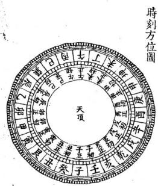

<!-- V3_SOURCE_ID:book010-b000518-p000-8f24dbcda7 -->

甲对应北极，乙对应京师，天项上甲乙两点相距五十度五分；丙丁为赤道，戊为太阳，甲戊为夏至时太阳的位置，太阳距北极六十六度三十分，也就是戊己的余量；戊庚为高弧，庚辛为太阳的位置，辛的经度距午位七度三十分，也就是庚乙辛角。用弧三角形法求得戊甲乙角为二度二十六分，也就是丙已弧。相关方法见考：太阳距午赤道度变时得十分，用这个数值减去午正时刻，得到午初三刻五分为太阳到达午方的时刻；用这个数值加午正时刻，得到午正初刻十分为太阳到达丁方的时刻。其余情况可依照此方法推算。

查看对应原文

<!-- V3_FOLDBACK_BEGIN:book010-b000518-p000-8f24dbcda7 -->

甲為北極乙為京师天項甲乙相距五十度五分丙丁為赤道戊為太陽甲戊為夏至太陽去極六十六度三十分即戊己之餘戊庚為高弧庚辛為太陽地辛經度距午七度三十分即庚乙辛角用弧三角形法見上求得戊甲乙角二度二十六分即丙已弧 法見考為太陽距午赤道度变時得十分以減午正得午初三刻五分為太陽到午方時刻以加午正得午正初刻十分為太陽到丁方時刻也餘倣此推

<!-- V3_FOLDBACK_END:book010-b000518-p000-8f24dbcda7 -->

<!-- V3_SOURCE_ID:book010-b000519-p000-4b69736036 -->

太阳到方时刻表

查看对应原文

<!-- V3_FOLDBACK_BEGIN:book010-b000519-p000-4b69736036 -->

太陽到方時刻表

<!-- V3_FOLDBACK_END:book010-b000519-p000-4b69736036 -->

<!-- doc003 PDF 第 240 页：原页为三块密集时刻表；线性 OCR 栏序失真，以原页图为准。 -->
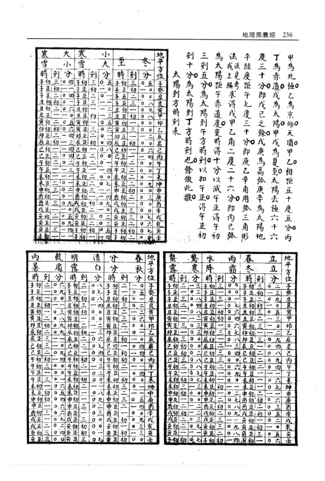

<!-- V3_SOURCE_ID:book010-b000521-p000-209c283152 -->

机器 OCR（密集表格，保留供搜索；未经逐格校勘）

查看对应原文

<!-- V3_FOLDBACK_BEGIN:book010-b000521-p000-209c283152 -->

机器 OCR（密集表格，保留供搜索；未经逐格校勘）

<!-- V3_FOLDBACK_END:book010-b000521-p000-209c283152 -->

<!-- V3_SOURCE_ID:book010-b000522-p000-fd238eb35b -->

地平方位对应癸丑、艮、寅、甲、卯、乙、辰、巽、己、丙、午、丁、未、坤、申、庚、酉、辛、戌、乾、亥、壬、冬。分：500898002064001，カ三。与6刻3、初231、初131、初1122222、初1332、初至时初正正正初正初正正正初正初正初正正初初正初正初初。壬子、子、壬、丑、丑、寅、寅、卯、辰、己、己、午、午、未、未、申、酉、戌、亥、子。4902354、101、11001、101、o、0刻3、初231、初132、初1221、初1331、初寒雪时初正正正初正初正正正初正初正初正初切初正初正初初。王子、子、于、丑、丑、寅、寅、卯、辰、己、己、午、午、未、未、申、酉、戌、戌、交、庚、弟、大小。分：414160564344231、10、0011100、一、九日五九四初正正初初正初初正正初正初正初正初初正正初正正。地平方位对应癸丑、艮、寅、甲、卯、乙、辰、巽、己、丙、午、丁、未、坤、申、庚、酉、辛、戌、乾、亥，主立立分：390532948941、16726353256、1、00年子、王、丑、丑、月、寅、卯、卯、辰、巳、年、午、未、未、申、酉、酉、戊戌、亥、寅、17646783469227892984两霸分：00刻3131、初132、初132332、初13、初2332、水降时。王子、子、丑、丑、寅、寅、卯、辰、辰、己、己、午、午、未、未、申、申、甲、酉、戊、戊、灾、庚、王、二。188773、7o、0、0313、初321、初12、初22、初蟄露时。SECEECEEEREEEEEGEE、王子、子、丑、丑、寅、寅、卯、辰、己、己。

> **释读存疑：** 部分数字、干支及短语的具体含义未明；本地硬校验仍未通过，已记录供后续自动处理或人工核对。

查看对应原文

<!-- V3_FOLDBACK_BEGIN:book010-b000522-p000-fd238eb35b -->

地平方位子癸丑良寅甲卯乙辰吳己丙午丁未坤申庚酉辛戌乾庚壬冬 分 五○○八九八〇○二○六四○○一 カ三。と六と刻三初二三一初一三一初一一二二二二初二一三三二初二至時 初正正正初正初正正正初正初正初正正初初正初正初初 壬子子壬丑丑寅寅卯辰己己午午未未申酉戊戌亥子子四九○二三五四101 11001 101 o 0刻三初二三一秒一三二秒一二二一二二三一初二三三初一寒雪時 初正正正初正初正正正初正初正初正初切初正初正初初 王子子于丑丑寅寅卯辰己己午午未未申酉戌戌交庚子弟大小 分 四一四一六○五六四三四四二三一 10 0011100 一 九日五九四初正正初初正初初正正初正初正初正初初正正初正正地平方位子癸丑艮寅甲卯乙辰昊己丙午丁未坤申庚酉辛戍乾亥主立立分 三九○五三二九四八九四一 一六七二六三五三二五六 1 00年子王丑丑月寅卯卯辰巳己年午未未申酉酉戊寅亥寅一七六四六七八三四六九二二七八九二九八四兩霸分 00刻三一三一初初一三二二三三三二 初一三初二三三二切水降時 王子子丑丑寅寅卯辰辰己 己午午未未申申 甲酉戊戊灾庚王二 一八八七七三。 七o 0 0三一三初初三二一 初三初一二 初二二二 初蟄露時 SECEECEEEREEEEEGEE 王子子丑丑寅寅卯辰己己

<!-- V3_FOLDBACK_END:book010-b000522-p000-fd238eb35b -->

<!-- V3_SOURCE_ID:book010-b000523-p000-ceb4cb8e04 -->

文中提及地平方位的排布包含子、癸丑、艮、寅、甲、卯、乙、辰、吴、己、丙午、丁未、木、坤、申、庚、酉、辛、戌、气、亥、壬；又提到春秋分对应三二六、日二〇四四一、四〇一一五四九三三〇、00010001、1、00010100010，以及刻二一初三二三二一初一初初二一初三二三二一初一初初、分分時、初正初初正初正正正初正初初正初初正正正初正正、子子丑丑丑寅寅卯辰己己午午午未未未申申酉戊交吏來、清白、00010011000010010000000、刻二一初三初一二初二二一初二一初二一一三一三初初三、明露、壬子丑丑寅寅卯辰辰己己午午午午未未未申申酉戌庚庚庚、敕、分、六九〇一三八九九一〇九四日〇一六五四六六七二四〇、00010001101、0000000000、刻二一一初一二初二三三二初三一三一初初一三一二三三、兩暑時、初正初正初正正初正初正初初正正初正初正初正正初正、子子丑丑寅寅卯辰辰己己午午午午未未申申酉戌戌庚庶；还提及地平方位的排布包含子、癸丑、夏、寅、甲、卯、乙、辰、昊、己、丙午、丁未、坤、申、庚、酉、辛、戍、乾、亥、壬；又提到立立分、三二六ん一七四四二、1、100、1、五六三二九四三、一八四八九、1、刻三一二二秒二初一初三一三秒二初三二二二一二、夏秋時、初正初正初初正正初正正初初正正初初正初初正正初正、子子丑丑寅卯卯辰己己己午年午午未未未申酉酉戊兔吏、小大分、二三二一二二〇五九四一四一四一六五五三三四四、刻二一一二三二三一二二二一三初二秒二二二秒二初一二、滿暑時、子、王丑丑寅卯卯辰己己巳午午午午午未未、芒小分、0、101、1一0一、0、00、000、刻二一二二三一初二二二初一三初二三一一、一三二初一二、子子丑丑寅卯辰、辰已己、午平午午年午未未。

> **释读存疑：** 文中部分短语如‘吴己’‘昊己’‘夏’‘木’‘气’‘戍’‘戍’‘立立分’‘芒小分’‘兔吏’‘王丑’‘年午’‘平午’等具体所指不详；‘三二六ん一七四四二’中的‘ん’为日文假名，具体含义不详；部分数字组合的具体所指不详；本地硬校验仍未通过，已记录供后续自动处理或人工核对。

查看对应原文

<!-- V3_FOLDBACK_BEGIN:book010-b000523-p000-ceb4cb8e04 -->

地平方位子癸丑艮寅甲卯乙辰吳己丙午丁未 木坤申庚酉辛戌氣亥壬 春秋分 三二六日二〇四四一 四○一一五四九三三○ 00010001 。1 00010100010 刻二一初三二三二一初一初初二一初三二三二一初一初初 分分時 初正初初正初正正正初正初初正初初正初正正正初正正 子子丑丑丑寅寅卯辰己己午午午未未未申申酉戊交吏來 清白 00010011000010010000000 刻二一初三初一二初二二一初二一初二一一三一三初初三 明露 壬子丑丑寅寅卯辰辰己己午午午未未未申申酉戌庚庚庚 敕 分 六九○一三八九九一○九四日○一六五四六六七二四○ 00010001101。 0000000000。 刻二一一初一二初二三三二初三一三一初初一三一二三三 兩暑時 初正初正初正正初正初正初初正正初正初正初正正初正 子子丑丑寅寅卯辰辰己己午午午午未未申申酉戌戌庚庶 地平方位子癸丑夏寅甲卯乙辰昊己丙午丁未坤申庚酉辛戍乾亥壬 立立分 三二六ん一七四四二 1 100。1 五六三二九四三 一八四八九 1 刻三一二二秒二初一初三一三秒二初三二二二一二 夏秋時 初正初正初初正正初正正初初正正初初正初初正正初正 子子丑丑寅卯卯辰己己己午年午午未未未申酉酉戊兔吏 小大分 二三二一二二○五九四一四一四一六五五三三四四 刻二一一二三二三一二二二一三初二秒二二二秒二初一二 滿暑時 子 王丑丑寅卯卯辰己己巳午午午午未未 芒小分。 0 101 1一0一 0 00 000 刻二一二二三一初二二二初一三初二三一一 一三二初一二 子子丑丑寅卯辰 辰已己 午平午午年午未未

<!-- V3_FOLDBACK_END:book010-b000523-p000-ceb4cb8e04 -->

<!-- V3_SOURCE_ID:book010-b000524-p000-88ac44c1aa -->

查看对应原文

<!-- V3_FOLDBACK_BEGIN:book010-b000524-p000-88ac44c1aa -->

<!-- V3_FOLDBACK_END:book010-b000524-p000-88ac44c1aa -->

<!-- V3_SOURCE_ID:book010-b000525-p000-3165c55a00 -->

地平方位的排布为子、癸丑、艮、寅、甲、卯、乙、辰、吴、己、丙午、丁未、坤、申、庚、辛。夏分对应0、0、一〇〇四〇七七七、八五七八八八、0、a、0、o、o、o。‘刻二一初三初一三三二初二三初一三一初一三一初一十至時’的内容存在字符重复或乱码，具体所指不详；‘子正初剜’应为‘子正初刻’的讹误，‘午年’应为‘午中’的讹误。地平二十四方每方各占十五度，子正初刻对应子中，正初刻对应午中，也就是午正前七度半已经过午，而午正后七度半才结束午位，之后每前后依次增加十五度。算用表的用法是，比如夏至就当作午方，适宜使用午初三刻五分至午正初刻十分，都算太阳到达的方位，其余的以此类推。

> **释读存疑：** ‘刻二一初三初一三三二初二三初一三一初一三一初一十至時’的具体含义不详；‘a’‘o’‘o’‘o’的具体含义不详；‘夏分’的具体所指不详；‘吴’的具体含义不详；本地硬校验仍未通过，已记录供后续自动处理或人工核对。

查看对应原文

<!-- V3_FOLDBACK_BEGIN:book010-b000525-p000-3165c55a00 -->

地平方位子癸丑艮寅甲卯乙辰吳己丙午丁未坤申庚酉辛 夏 分 0 0 一0○四0七七七 八五七八八八 0 a 0 o o o 刻二二二二初二一三三二初二三初一三一初一三一初一十 至 時 初正初正正初初正初正初初初正正正初正初正正初初正 王子丑丑寅卯辰辰己己午午午午午午未未申申酉戌亥庚 地平二十四方每方十五度子正初剜当子中年 正初刻当午中則是午正前七度半已交午而午 正後七度半方尽午而交丁也前後遞加十五度 算用表之法如夏至郎作午方宜用午初三刻五 分至午正初刻十分皆為太陽到方餘倣此

<!-- V3_FOLDBACK_END:book010-b000525-p000-3165c55a00 -->

<!-- V3_SOURCE_ID:book010-b000526-p000-aa55f74190 -->

造葬權法

查看对应原文

<!-- V3_FOLDBACK_BEGIN:book010-b000526-p000-aa55f74190 -->

造葬權法

<!-- V3_FOLDBACK_END:book010-b000526-p000-aa55f74190 -->

<!-- V3_SOURCE_ID:book010-b000527-p000-3f93113197 -->

《通書》中說，凡是修造建築，必須自身的命運、年運、所朝的方位都吉利，修造才會吉祥。如果方位不吉利，卻又不得不修造，就應當遷居，從所遷居的地方來看，要修造的方位是吉利的就可以。比如年命利於修造兌方，不利於修造震方，就應當遷居到東方；既然居住在東方，那麼從居所來看，原來的震方現在就變成了兌方，從這個方位開始修造就沒有什麼不可以的。

查看对应原文

<!-- V3_FOLDBACK_BEGIN:book010-b000527-p000-3f93113197 -->

通書云凡修造必身命年月方向皆利則修作吉如或不利而又不得不作者則當遷居自所遷之處視所作之方為吉可也如年命利作兌不利作震則當遷居而東既居於東則自其居視所作之方昔為震者今為兌矣自此作之則無不可

<!-- V3_FOLDBACK_END:book010-b000527-p000-3f93113197 -->

<!-- V3_SOURCE_ID:book010-b000528-p000-d9db0ae224 -->

論述修造方位的始終：凡是要修造的範圍只在一個區域內，選擇方位本來就容易；如果修造的範圍跨了多個區域，有吉有凶，就應當在吉利的區域動工，從這裡連接修造到不吉利的區域，完全沒有妨礙。如果修造的月份和日期吉利，但還沒有動工，就應當稍微動工來應合吉利的日時，接下來連續修造就沒有什麼不可以的。等到完工後，必須回到福德之方，才吉利。

查看对应原文

<!-- V3_FOLDBACK_BEGIN:book010-b000528-p000-d9db0ae224 -->

論作方終始凡所作止在一宮還擇固易如連跨數宮有吉有凶則當於吉宮起工自此連及不利之宮殊無害也若奧造月日利而工作未辦則畧起造以應日時自此接連以作之固無不可也及其畢工須帰福德之方吉

<!-- V3_FOLDBACK_END:book010-b000528-p000-d9db0ae224 -->

<!-- V3_SOURCE_ID:book010-b000529-p000-332e7b6418 -->

論述取土的方位：太歲、三煞、官符、大小月建等方位，都忌諱取土；如果取土的地點遠隔百步之外，肉眼看不到，就不用顧忌方位了。

查看对应原文

<!-- V3_FOLDBACK_BEGIN:book010-b000529-p000-332e7b6418 -->

論取土方道太歲三煞官符大小月建等方忌取土若遠隔百步之外目所不見則不问方道

<!-- V3_FOLDBACK_END:book010-b000529-p000-332e7b6418 -->

<!-- V3_SOURCE_ID:book010-b000530-p000-88cdaf783a -->

論述清明前疏浚修整墓塋的方法：凡是「己葵墓塋」，或者需要添土、種樹，殘缺的砌石、祭台被損壞需要修整，適宜在寒食節到清明節之間的「向」，召集工匠進行修作，不用論及山向、年月日時。按照《荊楚記》的說法，寒食節是冬至後的第一百零五日；按照古曆午氣計算，清明在冬至後的第一百零六日中，寒食是清明前的第二日。魏時寒食節也是三日。論述豎造宅舍的方法：大寒五日後選擇日期拆屋動工，立春前選擇日期完成豎造，不用忌諱開山、立向的「剌山家」及歲月諸凶神，這叫做歲官交承；如果已經過了立春，凶神的方位已經確定，就不能修造；如果「才位」沒有凶神，修造就不妨礙。

> **释读存疑：** 己葵墓塋；才位；剌山家；「己葵墓塋」具体所指不详；「才位」具体所指不详；「剌山家」具体所指不详

查看对应原文

<!-- V3_FOLDBACK_BEGIN:book010-b000530-p000-88cdaf783a -->

論清明前浚修墓法凡己葵墓塋或加土種樹殘砌祭臺或被壞修整宜於寒食清明之向鳩工修作不論山向年月日時按荊楚記寒食係冬至後一百零五日以古歷午氣計之清明在冬至後一百零六日中寒食乃清明前二日也魏時寒食亦是三日論豎造宅舍大寒五日後擇日拆屋起手立春前擇日豎造完工不忌開山立向年月剌山家及歲月諸凶神謂之歲官交承如己過立春後年月凶神方位己定不可修作如才位無凶神修作不妨

<!-- V3_FOLDBACK_END:book010-b000530-p000-88cdaf783a -->

<!-- V3_SOURCE_ID:book010-b000531-p000-1cc1cda343 -->

论述安葬的选择：大寒节气过后五日，到立春节气到来之前，要先选择吉日进行破土动工，再选择吉日安葬，此时不忌讳开山立向（建筑或穴位所朝的方位）的年、月、日、时，也不忌讳克制山家、岁、月的各类凶神。需要在立春节气到来前，按时令举行谢墓仪式，或者在来年的寒食节、清明节进行加土谢墓。

查看对应原文

<!-- V3_FOLDBACK_BEGIN:book010-b000531-p000-1cc1cda343 -->

論安葬擇大寒五日後立春前先擇日坡土又擇日安葬不忌開山立向年月日時尅山家歲月諸凶神要於立春前依時謝墓或於來年寒食清明 加土謝墓

<!-- V3_FOLDBACK_END:book010-b000531-p000-1cc1cda343 -->

<!-- V3_SOURCE_ID:book010-b000532-p000-078af0b0cb -->

论述凶葬法：凡人刚去世时就趁凶葬的时机安葬，即使遇到凶神也不会造成危害。如今人们大多在去世后的三日之内，或者一旬之内，不考虑开山立向的年、月，只选择吉日破土动工，在一日之内完成安葬事宜，等凶神的影响过去后，再举行加土谢墓仪式。

查看对应原文

<!-- V3_FOLDBACK_BEGIN:book010-b000532-p000-078af0b0cb -->

論凶葬法凡人初死乗凶葬之雖值凶神亦不為害今人尽三日之內或一旬之內並不向開山立向年月但擇吉日坡土尽一日之內成收俟凶神過方加土謝墓

<!-- V3_FOLDBACK_END:book010-b000532-p000-078af0b0cb -->

<!-- V3_SOURCE_ID:book010-b000533-p000-5f5a28b397 -->

以上所说的权宜之法被广泛使用，虽然属于变通的做法，但也有其道理，实用的方法在此都已具备。

查看对应原文

<!-- V3_FOLDBACK_BEGIN:book010-b000533-p000-5f5a28b397 -->

右權法多用之雖屬变通而亦有理利用之道於斯備矣

<!-- V3_FOLDBACK_END:book010-b000533-p000-5f5a28b397 -->

<!-- V3_SOURCE_ID:book010-b000534-p000-4aa890d456 -->

## 論選擇 — 论选择

查看对应原文

<!-- V3_FOLDBACK_BEGIN:book010-b000534-p000-4aa890d456 -->

## 論選擇

<!-- V3_FOLDBACK_END:book010-b000534-p000-4aa890d456 -->

<!-- V3_SOURCE_ID:book010-b000535-p000-17c67a9715 -->

选择事宜时，有一条尤其重要，不可不慎重。古人说：山吉、水吉，但日时不吉，这叫做违逆天序；日吉、时吉，但穴不吉，这叫做失却根本。山吉、穴吉、年月大利，但选择时不慎，这叫做失却人意。有人说：年月只要有一处失误，就会成为吉地的深殃。大多是因为听信异说而蒙蔽了正言，所以生出新的凶祸，损耗自身的福气。如果不是这样，山吉、水吉、穴吉，为何还会多有灾祸？岂不知年凶、月凶、日凶，犯了这些，就会被术士看作是应当遵循的准则，谨慎戒备，这样或许可以避免造孽。选择的道理，没有比杨公造命千金歌更好的了。

> **释读存疑：** 原文中‘犯之罔為術士者’的具体含义需结合上下文进一步确认；1轮自动修复后核义模型仍建议修订，已保守记录。

查看对应原文

<!-- V3_FOLDBACK_BEGIN:book010-b000535-p000-17c67a9715 -->

蓋選擇一條尤宜要不可不慎古云山吉水吉而日時不吉謂之違天日吉時吉而龍脉不吉謂之失他山吉穴吉年月太利而擇述不慎謂之失人径云年月有一端之失反為吉地之深殃多是信異說而昧正言所以生新凶而消己福不然山吉水吉而穴吉何以多災豈知年凶月凶而日凶犯之罔為術士者当從事斯語慎之戒之應免造孽可也還擇之理莫揚公造命千金歌即

<!-- V3_FOLDBACK_END:book010-b000535-p000-17c67a9715 -->

<!-- V3_SOURCE_ID:book010-b000536-p000-3b5671c341 -->

钦定惕纪辨方书中没有不称赞它好的，尤其尊崇并采用它，可见造命以造命为主的道理。

> **释读存疑：** 原文‘造藥’的具体含义因OCR损坏无法确定；1轮自动修复后核义模型仍建议修订，已保守记录。

查看对应原文

<!-- V3_FOLDBACK_BEGIN:book010-b000536-p000-3b5671c341 -->

欽定惕紀辨方書中莫不讚其善尤宗而用之可見造藥 以造命為主

<!-- V3_FOLDBACK_END:book010-b000536-p000-3b5671c341 -->

<!-- V3_SOURCE_ID:book010-b000537-p000-0d1dcec7c2 -->

选择的道理，没有比杨公造命千金歌更好的了。造命的方法，关键在于分布五行，年月日时要得生旺有气，与龙、山、命主配合成格成局，天干相主，地支补龙，排成四柱作为主体，再加上催官、生气、贵人、禄马，到山到向，更合历数，太阳对照或三合临山的，就可以使用，福用兼全，这就是上吉。如果不合杨公造命，专以吊替为主，成以斗首为主，其中生旺或许会相互牵制，如果再犯尅害刑冲，那么龙、山、主命不合，即使获得吉地，也难免葬凶，灾祸很快就会到来。郭氏说：地吉葬凶，与弃尸相同。所以选择门别户，道路仿佛，彼是此非，各相矛盾，吉凶星将有万计，揆诸义理，多有不合。常见那些从事选择的人，不察本源，只株守诸家一例，那么万类皆殊，如果诸例都依从，就没有吉日了。况且杨公曾说：诸家年月多错乱，可见诸家不可作准。又说：选择无如造命法，可见杨公选择的大主脑。唯有读黄一凤先生三元选择所述古仙心法，实有陈论，如再兼以郭氏元径推测飞宫吉曜，庶乎选择可夺神功矣。

> **释读存疑：** 原文中‘實有陳論’的具体内容需结合上下文进一步确认；原文中‘實有陳論’‘成以斗首為主’的具体含义需结合上下文进一步确认；1轮自动修复后核义模型仍建议修订，已保守记录。

查看对应原文

<!-- V3_FOLDBACK_BEGIN:book010-b000537-p000-0d1dcec7c2 -->

選擇之理莫如楊公造命千金歌造命之法德在分佈五行年月日時要得生旺有炁共龍山命主打成一斤成格成局天干相主地支補龍排成四柱為体再加催官生炁貴人祿馬到山到向更合曆數太陽对照或三合臨山數者為用俸用兼全斯為上吉如不合楊公造命專以弔替為主成以斗首為主其中生旺或相牽制如再一犯尅害刑冲則龍山主命不合稚獲吉地难免葬凶禍不旋踵矣郭子曰地吉葬凶典棄尸同故還擇門別戶道路彷伍彼是此非各相予盾吉凶星將有萬計揆諸義理種不合每見吾之事選擇者不察本源惟株守諸家一例則萬彙皆殊若諸例皆從則吾無吉日矣且楊公曾曰諸家年月多錯亂可見諸家不可作准矣又曰還擇無如造命法又可見楊公逞擇之大主腦矣惟讀黃一鳳先生三元還擇所述古仙心法实有陳論如再兼以郭氏元徑推測飛宮吉曜庶乎刻擇可奪神功矣

<!-- V3_FOLDBACK_END:book010-b000537-p000-0d1dcec7c2 -->

<!-- V3_SOURCE_ID:book010-b000538-p000-f0cd7572cb -->

辨斗首

查看对应原文

<!-- V3_FOLDBACK_BEGIN:book010-b000538-p000-f0cd7572cb -->

辨斗首

<!-- V3_FOLDBACK_END:book010-b000538-p000-f0cd7572cb -->

<!-- V3_SOURCE_ID:book010-b000539-p000-f783e8b835 -->

至于斗首这一说法，假托为杨公所传，实际上是伪造的，是从唐代一行禅师开始伪造的《臧蛮径》，颠倒五行，分门别类，以致出现了斗首宗庙卦例0等名目，道路吉凶完全不同。至于用斗首择日，有吉有凶：如果龙真穴的，若犯尅龙山，要过一百多年才能发；而择日应以正五行为主，需要扶助龙气。比如乾山的正五行属金，而斗首的乾山属火，就如同城蛮一样，它尅坐山是一样的。即使化命遇到葬日好，也会大大减损福力。比如丙辛相合才能化水，丙属阳，没有阴相配就不能化；辛属阴，没有阳相配也不能化，必须年月日时相合才能化。一般来说，斗首只看重元辰、武财，不管化炁，常常见到化炁被尅泄，即使是好地也终究不会发福，所以择日的人不能专门使用斗首，要分辨它的吉凶。

查看对应原文

<!-- V3_FOLDBACK_BEGIN:book010-b000539-p000-f783e8b835 -->

至于斗首一條托名楊公实係偽造自唐一行禅师偽撰臧蛮径顛倒五行分门別戶以致有斗首宗廟卦例 0等名目道路吉凶逈殊至如斗首擇日有吉有凶如龍真穴的如犯尅龍山要过百餘年方可發凡擇日正五行為主頃要扶龍如乾山正五行屬金而斗首乾山屬火尤如城蠻往其尅坐山一也即化命若遇葬日好亦大減福力如丙辛相合方能化水如丙屬陽無陰合便不能化如辛屬無陽相配亦不能化必須年月日時相合方能化也泛來斗首只管元辰武財不管化炁每見化炁尅洩即好地終不發故擇日家不可耑用斗首有吉有凶審之

<!-- V3_FOLDBACK_END:book010-b000539-p000-f783e8b835 -->

<!-- V3_SOURCE_ID:book010-b000540-p000-d2b2bfa3b8 -->

又如壬子阳山，正五行属水，斗首属土，用甲己作为元辰，比如用己土属阴，尅壬子阳山，是正官星，上吉；如用甲木属阳，千合阳山是食神，若在春木得气，胜过财官，上吉；如甲己相合，虽然化土，反而尅壬子正五行之水，大凶，不可用，请明白事理的人审查。十二山、二十四向可以以此类推。这种方法不管坐山相合的化炁，实在没有真传，又不知道化命生旺之日，又不知道化命合太岁禄马贵人到山到向是大旺日期，又不知道刑冲最厉害的两个字，犯了的话，在十日内外就会伤丁不止一人。后人假托杨公的说法，不知道郭璞、杨公都用吊替之法，如果把伪造的当作真的，害人不浅。大概江宁省城内外，凡是术道中人都把这个当作真正秘诀，无不尊崇奉行。常见人家请他们择日，开篇就说谨遵斗首秘法，却又不探究它的来历，以致胡乱误人，不只是葬家受祸，而且自己也损阴德，竟说如果自己保守这个法术，当如何应对后患，荒谬至极。

查看对应原文

<!-- V3_FOLDBACK_BEGIN:book010-b000540-p000-d2b2bfa3b8 -->

又如壬子陽山正五行屬水斗首屬土用甲己為元辰如車用己土屬陰剋壬子陽山為正官星上吉如用甲木屬陽千合陽山是食神如在春木有炁勝財官上吉如合甲己相合雖則化土反尅壬子正五行之水山大凶不可用請明理者審之十二山二十四向可以類推矣此法不管坐山相合之化炁实無真傳又不知化命生旺日又不知化命合太歲祿馬貴人到山到向為大旺日期又不知刑冲最烈二字犯之在十日內外傷丁不殺一人后人偽造假托楊公之說不知郭璞楊公皆用弔替之法若以認偽為真害人不淺也盖江寧省城內外凡術道中皆以此為真正秘訣無不尊而奉之每見人家請以還擇視其開篇先云謹遵斗首秘法然又不究其作自何來己致胡亂悞人不独葬家受祸而且自損陰德徑云苟自神其術当如後患何謬千里於毫

<!-- V3_FOLDBACK_END:book010-b000540-p000-d2b2bfa3b8 -->

<!-- V3_SOURCE_ID:book010-b000541-p000-cec67417b9 -->

原句残缺，仅能确认部分内容，大致是说要重新审视这些话，现在将（相关内容）整理出来。

> **释读存疑：** 原句残缺，仅能确认部分内容；本地硬校验仍未通过，已记录供后续自动处理或人工核对。

查看对应原文

<!-- V3_FOLDBACK_BEGIN:book010-b000541-p000-cec67417b9 -->

重請視斯語矣今將

<!-- V3_FOLDBACK_END:book010-b000541-p000-cec67417b9 -->

<!-- V3_SOURCE_ID:book010-b000542-p000-0b120504ad -->

《八定协纪辨方书》里说：按斗首五行，不知道它的来历，传播这种说法的人都假托为杨筠松，而杨筠松所著的各篇，没有一句话论及斗首，可见它是伪造的。现在台本也不记载，而四方术士多挟持它当作秘传，我不能辨别它的是非，不知道它的说法是多么荒谬。比如日甲己化土，就把甲己遁出的甲己二干所对应的支，以及同宫干维都当作属土，而甲己反而不属土，它的大旨已经荒谬，而廉贞、贪狼等名，又不是卦变的根本，由此推衍，另外形成吉凶格局，更不可知晓，所以撮取它的大要加以辨明，看的人知道它没有根据，就不会被它的说法迷惑，而喜欢用它来自逞的人，也可以停止了。

查看对应原文

<!-- V3_FOLDBACK_BEGIN:book010-b000542-p000-0b120504ad -->

八定恊紀辨方書內云按斗首五行不知其所自起為 其說者皆托之楊筠松及規筠松所著諸篇無一語 論及斗首其為偽牝可知今臺本亦不載而四方術 士多挾之以為秘奉吾莫能別其是非不知其說則 固支禹之甚者也如日甲已化土遂以甲己遁出之 甲已二干所瘟之支及其同宮干維皆屬土而甲已 反不屬土其大旨已禹其宗而廉貞貪狼諸名又非 卦变本羕由茲而推衍之別為吉凶格局更不可向 故撮其大要而辨之視者知其無稽自不惑於其誠 而好以自逞其亦可息矣

<!-- V3_FOLDBACK_END:book010-b000542-p000-0b120504ad -->

<!-- V3_SOURCE_ID:book010-b000543-p000-94c301ac99 -->

地理之学是圣贤所传的正大学问。古代圣人仰观天文，俯察地理，根据土地的适宜情况来安排利用，选择建筑或穴位所朝的方位、棺椁安放的位置，让万代人都依赖它。即便是郭公的《葬经》、杨公的《青囊》《一粒粟》，以及《雪心》《玉尺》《披肝露胆》这些著作，都是阐明天地玄机的典籍，堪称地理之学的始祖，就像儒家学派中的孔孟一样。凡是从事这门学问的人，如果能深入探究其中的深奥意旨，必定能为有德之家选择吉地，称得上是代天行道，来帮助有福之人。但也有一些不务正业的人，看了几本伪书，道听途说，即便偶尔遇到一两句古仙的真旨，也不能潜心深入探究其中的玄奥，还谎称另有秘传的路径、仙授的方法，故作怪僻之谈，用来欺骗世人，妄自选择吉地安葬，以致阴阳失当，破旺冲生，种种错乱，既耽误了自己，也害了他人。这样的人在葬家之中，不免会有断绝宗族子嗣的灾祸，而且会损害自己的阴德。所谓阴阳相见，福禄就能到来；阴阳相乖，灾祸就会接连而至，说的就是这种情况。凡是从事这门学问的人，登山选地时，必须先考察来山与去水的阴阳相配、玄窍相通，这才是最重要的，否则就应当舍弃这个地方，不要选用。不要留下错误耽误后人，不要只看私利以致留下深远的祸害，自己要考虑后果，否则尸位素餐的惭愧、偷窃欺骗的罪过，终究会免不了，上天难道不会谴责吗？

> **释读存疑：** 本地硬校验仍未通过，已记录供后续自动处理或人工核对。

查看对应原文

<!-- V3_FOLDBACK_BEGIN:book010-b000543-p000-94c301ac99 -->

夫地學者聖賢正大之學也古聖人仰現天文俯察地 理相物土之宜而布其利揀宇向方棺槨厝所萬氏賴 之即郭公之葬徑揚公之青囊一粒粟以暨之雪心玉 尺披肝露胆此數書南明天地之玄机真乃地李之祖 尤儒宗之孔孟也凡業斯道者如能深穷奧旨定可與 有德之家扞基卜葵可云代天行道以相吉人也或有 失業之流看几本偽書道所途說即或遇一二古仙真 旨又不能潛心深究其玄奧詭称另有翼傳別径仙授 故作怪僻之談忽吾欺人妄行扦作以致陰陽垂謬破 旺冲生種錯亂自悞人在葬家不免有覆宗嗣 之祸而且自損陰德往云陰陽相見福祿求禎陰陽相 乖禍咎踵門此之謂也凡業斯道者登山時必先於來 山去水陰陽品配玄竅相通此是大主宰否則棄而勿 取可也毋致貽悞吾人切勿目私利以致貽害非淺自 圗果報否則尸位素食之愧竊騙欺詐之愆終所不免 上天其無譴乎

<!-- V3_FOLDBACK_END:book010-b000543-p000-94c301ac99 -->

<!-- V3_SOURCE_ID:book010-b000544-p000-0739099cb6 -->

## 感應篇 — 感应篇

查看对应原文

<!-- V3_FOLDBACK_BEGIN:book010-b000544-p000-0739099cb6 -->

## 感應篇

<!-- V3_FOLDBACK_END:book010-b000544-p000-0739099cb6 -->

<!-- V3_SOURCE_ID:book010-b000545-p000-d004a8aa1d -->

官曜、楼殿、旗鼓、仓库这类名目繁杂的记载，所说的感应，是指天道而言。天道不会说话，却会降福给行善的人，降祸给作恶的人，这是自然的道理。寻求吉地的人必须以积德为根本，如果一个人的德行确实深厚，上天必定会把吉地赐给他，作为福泽他子孙的心意，而吉地也会相应地与他的德行相符；如果一个人的恶行确实满盈，上天必定会把凶地赐给他，作为降祸他子孙的心意，而凶地也会相应地与他的恶行相符。因为心是气的主宰，气是德的符应，上天对人并没有刻意的偏向，而人的一心一气相互感应，自然会彼此符合。郭氏说：吉凶的感应，是鬼神在暗中护佑人。对于先人的遗骸，固然不能不选择合适的地方来安葬，但如果不修养自身的根本，只想着寻求吉地，那么不连累祖宗的人就很少了，更何况还能以此福泽他的子孙呢？

查看对应原文

<!-- V3_FOLDBACK_BEGIN:book010-b000545-p000-d004a8aa1d -->

官曜樓殿旗鼓倉庫名目雜錄感應者言乎其天道也夫天道不言而响福善祸淫皆其物也求地者必以積德為本若其德果厚天必以吉地之是所以福其子孫者心也而地之吉亦將以符之也其惡果盈天必凶地玄之是所以禍其子孫者亦本於心也而地之凶亦得以符之也蓋心者炁之主炁者德之符天未嘗有心於人而人之一心一炁感自相符合郭氏云吉凶感玄鬼福及人之於先骸固不可不擇其所而安厝之然不修其本而未是圗則不累祖宗者寡矣况嵌有以福其子孫哉

<!-- V3_FOLDBACK_END:book010-b000545-p000-d004a8aa1d -->

<!-- V3_SOURCE_ID:book010-b000546-p000-e5a2885935 -->

官星，是指朝案背后拖出的余气。

查看对应原文

<!-- V3_FOLDBACK_BEGIN:book010-b000546-p000-e5a2885935 -->

官星者朝案背後拖出餘炁謂之官星

<!-- V3_FOLDBACK_END:book010-b000546-p000-e5a2885935 -->

<!-- V3_SOURCE_ID:book010-b000547-p000-5120bdca4f -->

曜星，是龍虎之外多餘的氣流飛揚形成的，稱之為曜炁。《雪心賦》中說：可喜。

> **释读存疑：** 原文中《雪心赋》的“可喜”仅为片段，具体所指不详

查看对应原文

<!-- V3_FOLDBACK_BEGIN:book010-b000547-p000-5120bdca4f -->

曜星者龍虎外有餘炁飛揚謂之曜炁雪心賦云可喜

<!-- V3_FOLDBACK_END:book010-b000547-p000-5120bdca4f -->

<!-- V3_SOURCE_ID:book010-b000548-p000-b9bc99e633 -->

乙以辛為天乙，巽（八卦之一）為太乙，這是拘泥之說。《撼龍經》中說：問君如。

> **释读存疑：** 原文中“問君如”仅为片段，具体所指不详

查看对应原文

<!-- V3_FOLDBACK_BEGIN:book010-b000548-p000-b9bc99e633 -->

乙以辛為天乙巽為太乙者拘也撼龍經云問君如

<!-- V3_FOLDBACK_END:book010-b000548-p000-b9bc99e633 -->

<!-- V3_SOURCE_ID:book010-b000549-p000-de222c131f -->

背後逆拖山就是這個意思。另外《官曜詩》中說：龍虎通身尖且利，自。

> **释读存疑：** 原文中《官曜诗》的“自”仅为片段，具体所指不详

查看对应原文

<!-- V3_FOLDBACK_BEGIN:book010-b000549-p000-de222c131f -->

背後逆拖山是也又官曜詩云龍虎通身尖且利自

<!-- V3_FOLDBACK_END:book010-b000549-p000-de222c131f -->

<!-- V3_SOURCE_ID:book010-b000550-p000-96f9810da4 -->

这是宠身钟秀炁，穴前左右贴身生出此形，是能成就王爵、官品的地。又说：官星不熙，难求贵显之名，曜宿瘟定秉擢衡。0

> **释读存疑：** 原文中“寵身鐘秀炁”“曜宿瘟定秉擢衡”均为片段，具体所指不详；1轮自动修复后核义模型仍建议修订，已保守记录。

查看对应原文

<!-- V3_FOLDBACK_BEGIN:book010-b000550-p000-96f9810da4 -->

是寵身鐘秀炁穴前左右貼身生此是王疾官品地 又云官星不熙難求貴顯之名曜宿瘟定秉擢衡 0

<!-- V3_FOLDBACK_END:book010-b000550-p000-96f9810da4 -->

<!-- V3_SOURCE_ID:book010-b000551-p000-fb1ab8841c -->

赴任时需留意官曜二星，唯有山川灵秀之气汇聚之处，才会被选用。这类地方只看重其秀丽精巧的生成之态，若没有粗劣丑恶的形态，具备纯粹精粹的样貌，就会产生极大的应验，且十分准确。所谓龙接，指的是起祖山的高尖之态。

> **释读存疑：** 原文中“之任”的释读为“赴任”，符合语境；“官曜二星”“山川秀炁”等术语的释读未超出合理范围，无依据扩写内容。

查看对应原文

<!-- V3_FOLDBACK_BEGIN:book010-b000551-p000-fb1ab8841c -->

之任按官曜二星惟山川秀炁所鐘惟取其秀麗巧生成無粗惡被粹之形狀則發最大驗有准也龍接者起祖山之高尖者

<!-- V3_FOLDBACK_END:book010-b000551-p000-fb1ab8841c -->

<!-- V3_SOURCE_ID:book010-b000552-p000-427ca621e4 -->

所谓殿，指的是起祖山的高平之态。

查看对应原文

<!-- V3_FOLDBACK_BEGIN:book010-b000552-p000-427ca621e4 -->

殿者起祖山之高平者

<!-- V3_FOLDBACK_END:book010-b000552-p000-427ca621e4 -->

<!-- V3_SOURCE_ID:book010-b000553-p000-49a7f0b8f6 -->

所谓笔表，指的是有一峰独自高耸，这种形态若出现在水口（水流出入一地或局势收束的位置）上方，便是吉利的好事。

查看对应原文

<!-- V3_FOLDBACK_BEGIN:book010-b000553-p000-49a7f0b8f6 -->

筆表者一峯獨聳為華喜見於水口上為佳

<!-- V3_FOLDBACK_END:book010-b000553-p000-49a7f0b8f6 -->

<!-- V3_SOURCE_ID:book010-b000554-p000-c496354065 -->

所谓捍门，指的是有两座山并排对峙，这种形态若出现在水口（水流出入一地或局势收束的位置）处，也是吉利的好事。

查看对应原文

<!-- V3_FOLDBACK_BEGIN:book010-b000554-p000-c496354065 -->

捍門者兩山並峙為捍門亦喜見於水口

<!-- V3_FOLDBACK_END:book010-b000554-p000-c496354065 -->

<!-- V3_SOURCE_ID:book010-b000555-p000-e3df545795 -->

所謂樓台，指的是山形簇聚、高聳且圓潤的山；所謂鼓角，指的是山形簇聚、高聳且尖銳的山。

查看对应原文

<!-- V3_FOLDBACK_BEGIN:book010-b000555-p000-e3df545795 -->

樓台者山簇高而圓者 鼓角都山簇高而尖都

<!-- V3_FOLDBACK_END:book010-b000555-p000-e3df545795 -->

<!-- V3_SOURCE_ID:book010-b000556-p000-e4052943e2 -->

所謂御座，指的是山形高大、中間凸起山頂、兩旁山勢如肩般張開且山腳垂落的山。

查看对应原文

<!-- V3_FOLDBACK_BEGIN:book010-b000556-p000-e4052943e2 -->

御座者山高大而中起頂兩肩挣滴者

<!-- V3_FOLDBACK_END:book010-b000556-p000-e4052943e2 -->

<!-- V3_SOURCE_ID:book010-b000557-p000-04a1787174 -->

所謂御屏，指的是屬於土星的山，山形高大且方正平坦。

查看对应原文

<!-- V3_FOLDBACK_BEGIN:book010-b000557-p000-04a1787174 -->

御屏都土星山高大而方平者

<!-- V3_FOLDBACK_END:book010-b000557-p000-04a1787174 -->

<!-- V3_SOURCE_ID:book010-b000558-p000-4f5d27801e -->

所謂頓鎗，指的是山峰尖銳且直立的山。

查看对应原文

<!-- V3_FOLDBACK_BEGIN:book010-b000558-p000-4f5d27801e -->

頓鎗者峰尖銳而卓立者

<!-- V3_FOLDBACK_END:book010-b000558-p000-4f5d27801e -->

<!-- V3_SOURCE_ID:book010-b000559-p000-84500a10c8 -->

所谓顿鼓，指的是山顶平坦且呈尖形的山。

查看对应原文

<!-- V3_FOLDBACK_BEGIN:book010-b000559-p000-84500a10c8 -->

頓鼓者山頂平而尖圖者

<!-- V3_FOLDBACK_END:book010-b000559-p000-84500a10c8 -->

<!-- V3_SOURCE_ID:book010-b000560-p000-ff8f288d9d -->

所谓出阵旗，指的是山尖有四五道高低错落的侧列，山脚处有飞扬之势的山。拨云。

查看对应原文

<!-- V3_FOLDBACK_BEGIN:book010-b000560-p000-ff8f288d9d -->

出陣旗者山尖四五技高低側列下脚飛揚者撥云

<!-- V3_FOLDBACK_END:book010-b000560-p000-ff8f288d9d -->

<!-- V3_SOURCE_ID:book010-b000561-p000-55ac01d254 -->

旗头生石，若在阵上出现羸旗，且旗心生石，预示军队必败；若旗生爪形却不分明，说明会遭遇贼寇，还会被刑罚捉拿。《脉赋》中说：笔插云端，定当生出天生的俊杰。

查看对应原文

<!-- V3_FOLDBACK_BEGIN:book010-b000561-p000-55ac01d254 -->

旗頭生石陣上羸旗心生石定輸兵若然生爪不分明為賊又遭刑捉脉賦云筆挿雲端管取天生俊傑

<!-- V3_FOLDBACK_END:book010-b000561-p000-55ac01d254 -->

<!-- V3_SOURCE_ID:book010-b000562-p000-2b08e7f0d5 -->

坤兴云：展旗合旗风，赵旗威武镇边隈，说的就是这种情况。径云：左。

查看对应原文

<!-- V3_FOLDBACK_BEGIN:book010-b000562-p000-2b08e7f0d5 -->

坤興云展旗合旗风趙旗威武鎮边隈是也径云左

<!-- V3_FOLDBACK_END:book010-b000562-p000-2b08e7f0d5 -->

<!-- V3_SOURCE_ID:book010-b000563-p000-3a432373a0 -->

在旗的右侧设置鼓，这样的官必定是武官。

查看对应原文

<!-- V3_FOLDBACK_BEGIN:book010-b000563-p000-3a432373a0 -->

畔起旗右畔鼓為官定是武

<!-- V3_FOLDBACK_END:book010-b000563-p000-3a432373a0 -->

<!-- V3_SOURCE_ID:book010-b000564-p000-bc4aa6461f -->

将旗插在火星的头部，旗脚摆动却能直立的，就是顿旗。

查看对应原文

<!-- V3_FOLDBACK_BEGIN:book010-b000564-p000-bc4aa6461f -->

卓旗火星頭開腳擺而卓立者即頓旗是也

<!-- V3_FOLDBACK_END:book010-b000564-p000-bc4aa6461f -->

<!-- V3_SOURCE_ID:book010-b000565-p000-e2c6c08e0c -->

招军旗，是那种在高峰上、旗脚完全展开舞动的旗帜。

查看对应原文

<!-- V3_FOLDBACK_BEGIN:book010-b000565-p000-e2c6c08e0c -->

招軍旗者高峰擺足長舞者

<!-- V3_FOLDBACK_END:book010-b000565-p000-e2c6c08e0c -->

<!-- V3_SOURCE_ID:book010-b000566-p000-1c73441d87 -->

展旗，是那种旗向两侧分开展开的旗帜。

查看对应原文

<!-- V3_FOLDBACK_BEGIN:book010-b000566-p000-1c73441d87 -->

展旗者分開兩足者是也

<!-- V3_FOLDBACK_END:book010-b000566-p000-1c73441d87 -->

<!-- V3_SOURCE_ID:book010-b000567-p000-a1741c0524 -->

進旗、勝旗，指的是旗頭逆着水（风水语境中的河流、水系及其来去形态）向上的情形。

查看对应原文

<!-- V3_FOLDBACK_BEGIN:book010-b000567-p000-a1741c0524 -->

進旗勝旗者旗頭逆水而上者

<!-- V3_FOLDBACK_END:book010-b000567-p000-a1741c0524 -->

<!-- V3_SOURCE_ID:book010-b000568-p000-72d2dc1ca9 -->

退旗、敢旗，指的是旗頭顺着水（风水语境中的河流、水系及其来去形态）向下的情形。

查看对应原文

<!-- V3_FOLDBACK_BEGIN:book010-b000568-p000-72d2dc1ca9 -->

退旗敢旗者旗頭順水而下者

<!-- V3_FOLDBACK_END:book010-b000568-p000-72d2dc1ca9 -->

<!-- V3_SOURCE_ID:book010-b000569-p000-1a967da95f -->

倉山，指的是山形体态丰腴饱满，山顶略微尖耸的山。

查看对应原文

<!-- V3_FOLDBACK_BEGIN:book010-b000569-p000-1a967da95f -->

倉山者身肥滿面頂畧尖者

<!-- V3_FOLDBACK_END:book010-b000569-p000-1a967da95f -->

<!-- V3_SOURCE_ID:book010-b000570-p000-5a8338b4d4 -->

庫山，指的是山形体态丰腴饱满，山顶略微平展的山。

查看对应原文

<!-- V3_FOLDBACK_BEGIN:book010-b000570-p000-5a8338b4d4 -->

庫山者身肥滿面頂畧平者

<!-- V3_FOLDBACK_END:book010-b000570-p000-5a8338b4d4 -->

<!-- V3_SOURCE_ID:book010-b000571-p000-2c8748e4e8 -->

衙刀形的事物，若尖利且呈湾抱之状则为吉；杀刀形的事物，若呈削直梗直之状则为凶。

查看对应原文

<!-- V3_FOLDBACK_BEGIN:book010-b000571-p000-2c8748e4e8 -->

衙刀者尖利灣抱者吉 殺刀者矣削直梗者凶

<!-- V3_FOLDBACK_END:book010-b000571-p000-2c8748e4e8 -->

<!-- V3_SOURCE_ID:book010-b000572-p000-dfd83ccf65 -->

金箱形的事物，或是山形，或是石形，形态方正且体积较小。

查看对应原文

<!-- V3_FOLDBACK_BEGIN:book010-b000572-p000-dfd83ccf65 -->

金箱者或山或石方而小者

<!-- V3_FOLDBACK_END:book010-b000572-p000-dfd83ccf65 -->

<!-- V3_SOURCE_ID:book010-b000573-p000-85e1df050b -->

玉印形的事物，或是山形，或是石形，形态圆润且体积较小。

查看对应原文

<!-- V3_FOLDBACK_BEGIN:book010-b000573-p000-85e1df050b -->

玉印者或山或石圓而小者

<!-- V3_FOLDBACK_END:book010-b000573-p000-85e1df050b -->

<!-- V3_SOURCE_ID:book010-b000574-p000-6e6a5daa8e -->

西笔形的事物，形态尖秀，呈散斜而开张之状。

> **释读存疑：** 原文末尾"又者"语义不明，无法准确释读

查看对应原文

<!-- V3_FOLDBACK_BEGIN:book010-b000574-p000-6e6a5daa8e -->

西筆者尖秀散斜而開又者

<!-- V3_FOLDBACK_END:book010-b000574-p000-6e6a5daa8e -->

<!-- V3_SOURCE_ID:book010-b000575-p000-52458a3129 -->

文笔是指尖耸突出且顶部卓立的山形。

> **释读存疑：** 原文未明确说明该表述的具体所指，仅为山形的描述性称谓

查看对应原文

<!-- V3_FOLDBACK_BEGIN:book010-b000575-p000-52458a3129 -->

文筆者尖山秀出而卓者

<!-- V3_FOLDBACK_END:book010-b000575-p000-52458a3129 -->

<!-- V3_SOURCE_ID:book010-b000576-p000-cdc29533d9 -->

诰轴是指横向延展且两端略高的山形。

> **释读存疑：** 原文未明确说明该表述的具体所指，仅为山形的描述性称谓

查看对应原文

<!-- V3_FOLDBACK_BEGIN:book010-b000576-p000-cdc29533d9 -->

誥軸山橫平而兩頭略高者

<!-- V3_FOLDBACK_END:book010-b000576-p000-cdc29533d9 -->

<!-- V3_SOURCE_ID:book010-b000577-p000-2a5df9c99a -->

席帽是指顶部微圆、肩部略重的山形。

> **释读存疑：** 原文未明确说明该表述的具体所指，仅为山形的描述性称谓

查看对应原文

<!-- V3_FOLDBACK_BEGIN:book010-b000577-p000-2a5df9c99a -->

席帽頭微圓肩略重者

<!-- V3_FOLDBACK_END:book010-b000577-p000-2a5df9c99a -->

<!-- V3_SOURCE_ID:book010-b000578-p000-afc8dc84d0 -->

唐帽是指向下垂落且带有帽脚的山形。

> **释读存疑：** 原文未明确说明该表述的具体所指，仅为山形的描述性称谓

查看对应原文

<!-- V3_FOLDBACK_BEGIN:book010-b000578-p000-afc8dc84d0 -->

唐帽垂而有腳者

<!-- V3_FOLDBACK_END:book010-b000578-p000-afc8dc84d0 -->

<!-- V3_SOURCE_ID:book010-b000579-p000-31b6ce4a68 -->

鐵帽頭是頂部高聳圓潤、肩部下垂的樣式。

查看对应原文

<!-- V3_FOLDBACK_BEGIN:book010-b000579-p000-31b6ce4a68 -->

鉄帽頭高圓而肩垂者

<!-- V3_FOLDBACK_END:book010-b000579-p000-31b6ce4a68 -->

<!-- V3_SOURCE_ID:book010-b000580-p000-9a61fc47bb -->

箬笠頭是頂部圓潤、有長垂部分的樣式。

查看对应原文

<!-- V3_FOLDBACK_BEGIN:book010-b000580-p000-9a61fc47bb -->

箬笠頭圓而有長垂者

<!-- V3_FOLDBACK_END:book010-b000580-p000-9a61fc47bb -->

<!-- V3_SOURCE_ID:book010-b000581-p000-c1f727b762 -->

僧笠頭是頂部平緩小巧、帽簷較長的樣式。

查看对应原文

<!-- V3_FOLDBACK_BEGIN:book010-b000581-p000-c1f727b762 -->

僧笠頭平小而簷長者

<!-- V3_FOLDBACK_END:book010-b000581-p000-c1f727b762 -->

<!-- V3_SOURCE_ID:book010-b000582-p000-db9f44775a -->

銀瓶是指小山上尖下圓的樣式，大概是注都小山的園林平緩之處。

> **释读存疑：** 注都小山的具體所指不詳

查看对应原文

<!-- V3_FOLDBACK_BEGIN:book010-b000582-p000-db9f44775a -->

銀瓶者小山上尖下圓者蓋注都小山之園平者

<!-- V3_FOLDBACK_END:book010-b000582-p000-db9f44775a -->

<!-- V3_SOURCE_ID:book010-b000583-p000-f22494aef1 -->

玉带，指的是风水语境中的河流、水系及其来去形态呈弯曲环抱的样子。

查看对应原文

<!-- V3_FOLDBACK_BEGIN:book010-b000583-p000-f22494aef1 -->

玉帶者水星之湾抱也

<!-- V3_FOLDBACK_END:book010-b000583-p000-f22494aef1 -->

<!-- V3_SOURCE_ID:book010-b000584-p000-12a65924ed -->

金，指的是小巧的金星，其在秋气时节对应龙穴的形态，如同贵人佩戴的玉带一般。

查看对应原文

<!-- V3_FOLDBACK_BEGIN:book010-b000584-p000-12a65924ed -->

金者金星小巧者其秋在龍穴之像如貴人玉帶之

<!-- V3_FOLDBACK_END:book010-b000584-p000-12a65924ed -->

<!-- V3_SOURCE_ID:book010-b000585-p000-4468629291 -->

此处原文为“0○本市真然”，具体所指不详，无法准确释读。

> **释读存疑：** 原文“0○本市真然”含义不明，无法确定具体所指

查看对应原文

<!-- V3_FOLDBACK_BEGIN:book010-b000585-p000-4468629291 -->

0○本市真然

<!-- V3_FOLDBACK_END:book010-b000585-p000-4468629291 -->

<!-- V3_SOURCE_ID:book010-b000586-p000-59a9f57b21 -->

人宅本命、天罡、四旺，若遇煞而吉，无需进行修造或制化。

> **释读存疑：** 原文未明确‘遇煞而吉’的前提，也未说明‘修’‘制’的具体指向；1轮自动修复后核义模型仍建议修订，已保守记录。

查看对应原文

<!-- V3_FOLDBACK_BEGIN:book010-b000586-p000-59a9f57b21 -->

人宅本命天罡四旺 煞 吉不解 修 制

<!-- V3_FOLDBACK_END:book010-b000586-p000-59a9f57b21 -->

<!-- V3_SOURCE_ID:book010-b000587-p000-be60ffd0da -->

文中提到的“作甲庚乙辛四向俱纪纪丑北四向亦二犯个旦宇亦”，具体所指不详。

> **释读存疑：** “作甲庚乙辛四向俱纪纪丑北四向亦二犯个旦宇亦”；“作甲庚乙辛四向俱纪纪丑北四向亦二犯个旦宇亦”具体所指不详；本地硬校验仍未通过，已记录供后续自动处理或人工核对。

查看对应原文

<!-- V3_FOLDBACK_BEGIN:book010-b000587-p000-be60ffd0da -->

作 甲庚乙辛四向 俱纪 纪丑 北四向亦二 犯 个 旦宇亦

<!-- V3_FOLDBACK_END:book010-b000587-p000-be60ffd0da -->

<!-- V3_SOURCE_ID:book010-b000588-p000-61b3d06877 -->

文中提到的“申子辰年生人厲水忌于未年月日時內作甲乙車辛四白玉”，具体所指不详。

> **释读存疑：** “申子辰年生人厲水忌于未年月日時內作甲乙車辛四白玉”；“申子辰年生人厲水忌于未年月日時內作甲乙車辛四白玉”具体所指不详；本地硬校验仍未通过，已记录供后续自动处理或人工核对。

查看对应原文

<!-- V3_FOLDBACK_BEGIN:book010-b000588-p000-61b3d06877 -->

申子辰年生人厲水忌于未年月日時內作甲乙車辛四白玉

<!-- V3_FOLDBACK_END:book010-b000588-p000-61b3d06877 -->

<!-- V3_SOURCE_ID:book010-b000589-p000-76d06db2d1 -->

文中提到的“己酉丑年生人屬星忌于辰年月日時勾作丙丁王癸四向兔”，具体所指不详。

> **释读存疑：** “己酉丑年生人屬星忌于辰年月日時勾作丙丁王癸四向兔”；“己酉丑年生人屬星忌于辰年月日時勾作丙丁王癸四向兔”具体所指不详；本地硬校验仍未通过，已记录供后续自动处理或人工核对。

查看对应原文

<!-- V3_FOLDBACK_BEGIN:book010-b000589-p000-76d06db2d1 -->

己酉丑年生人屬星忌于辰年月日時勾作丙丁王癸 四向兔

<!-- V3_FOLDBACK_END:book010-b000589-p000-76d06db2d1 -->

<!-- V3_SOURCE_ID:book010-b000590-p000-c26dec6ead -->

文中提到的“亥卯未年生人属木忌于成年月日時內作內丁王癸四句兔”，具体所指不详。

> **释读存疑：** “亥卯未年生人属木忌于成年月日時內作內丁王癸四句兔”；“亥卯未年生人属木忌于成年月日時內作內丁王癸四句兔”具体所指不详；本地硬校验仍未通过，已记录供后续自动处理或人工核对。

查看对应原文

<!-- V3_FOLDBACK_BEGIN:book010-b000590-p000-c26dec6ead -->

亥卯未年生人属木忌于成年月日時內作內丁王癸 四句兔

<!-- V3_FOLDBACK_END:book010-b000590-p000-c26dec6ead -->

<!-- V3_SOURCE_ID:book010-b000591-p000-5d85fbe048 -->

文中提及的相关内容表述残缺混乱，具体所指不详。

> **释读存疑：** 原文语句残缺，表述混乱，无法确定原义

查看对应原文

<!-- V3_FOLDBACK_BEGIN:book010-b000591-p000-5d85fbe048 -->

犯此然 然方立主人口死止貲財退殺至

<!-- V3_FOLDBACK_END:book010-b000591-p000-5d85fbe048 -->

<!-- V3_SOURCE_ID:book010-b000592-p000-931ecd3cfc -->

这段内容表述残缺混乱，具体所指不详。

> **释读存疑：** 原文语句残缺混乱，释读无依据；本地硬校验仍未通过，已记录供后续自动处理或人工核对。

查看对应原文

<!-- V3_FOLDBACK_BEGIN:book010-b000592-p000-931ecd3cfc -->

○00年的命然 亦倫生年不論生 思修不忌知 80

<!-- V3_FOLDBACK_END:book010-b000592-p000-931ecd3cfc -->

<!-- V3_SOURCE_ID:book010-b000593-p000-5e3677178e -->

这段内容中部分术语含义不明，具体所指不详。

> **释读存疑：** 部分术语含义不明，释读无依据

查看对应原文

<!-- V3_FOLDBACK_BEGIN:book010-b000593-p000-5e3677178e -->

以本歲支午入掌中宮順充九宮青奉命生年吏十落在何宮則思脩此宮者過西神同宮其禍尤速 t

<!-- V3_FOLDBACK_END:book010-b000593-p000-5e3677178e -->

<!-- V3_SOURCE_ID:book010-b000594-p000-51e2b2fac9 -->

这段内容表述残缺，具体所指不详。

> **释读存疑：** 原文表述残缺，释读无依据；本地硬校验仍未通过，已记录供后续自动处理或人工核对。

查看对应原文

<!-- V3_FOLDBACK_BEGIN:book010-b000594-p000-51e2b2fac9 -->

0OO月的命然

<!-- V3_FOLDBACK_END:book010-b000594-p000-51e2b2fac9 -->

<!-- V3_SOURCE_ID:book010-b000595-p000-4fdbf45370 -->

用建造月支午入中宮的方法，與通兩奉命興上法相同，只是比年的刑煞輕就可以了。宋代朔式釋修造的說法，提到親公服月的方位在向雀東，吉星則福祿通達，蓋的煞可向不可聖，然而也不能散用年的煞。

> **释读存疑：** 原文部分语句语义模糊，难以完全精准还原原意

查看对应原文

<!-- V3_FOLDBACK_BEGIN:book010-b000595-p000-4fdbf45370 -->

以造月支午入中宮通兩奉命興上法同但比年的刑輕可矣宋朔式釋修造言親公服月的在向雀東吉星則福達蓋的煞可向不可聖然亦不散用年的

<!-- V3_FOLDBACK_END:book010-b000595-p000-4fdbf45370 -->

<!-- V3_SOURCE_ID:book010-b000596-p000-c164365d1b -->

此外，修主命吉刑肖六王生運及例田年月，倘若造年不合，則可選擇造月的相關時段。然而只論命支不論天干，是不合規範的做法。修主命凶，則陰陽無從交合，爻失其者矣，不要拘泥於此，右仙造課多不再此。

> **释读存疑：** 修主命吉刑肖六王生運及例田年月，具體所指不详；爻失其者矣，具體所指不详；右仙造課多不再此，具體所指不详

查看对应原文

<!-- V3_FOLDBACK_BEGIN:book010-b000596-p000-c164365d1b -->

此外脩主命吉刑肖六王生運及例田年月倘造年不合則造月之分亦可然申論命支不論天干非法也修主命凶則肖陰陽的無從交而爻失其者矣勿泥右仙造課多不再此

<!-- V3_FOLDBACK_END:book010-b000596-p000-c164365d1b -->

<!-- V3_SOURCE_ID:book010-b000597-p000-1d3edf1066 -->

天有命龍入土身，皇宅命論少年，是不合規範的做法。不要拘泥於此，殺者不甚真實。紫白劉亦能壓說大陽三芳祿馬身，具體所指不详。

> **释读存疑：** 原文语句残缺，语义模糊，难以准确解读，部分内容具体所指不详

查看对应原文

<!-- V3_FOLDBACK_BEGIN:book010-b000597-p000-1d3edf1066 -->

天有命龍入土身皇宅命論少年非法也母泥此殺者不甚真的紫白劉亦能壓說大陽三芳祿馬身

<!-- V3_FOLDBACK_END:book010-b000597-p000-1d3edf1066 -->

<!-- V3_SOURCE_ID:book010-b000598-p000-e50d67e649 -->

00 論本命天罡四旺大煞

查看对应原文

<!-- V3_FOLDBACK_BEGIN:book010-b000598-p000-e50d67e649 -->

00論本命天罡四旺大煞

<!-- V3_FOLDBACK_END:book010-b000598-p000-e50d67e649 -->

<!-- V3_SOURCE_ID:book010-b000599-p000-5f2bb048e4 -->

本命天罡四旺的占断，在《地益八干山》一书中，各书在“时白”二字之下的注释说：三白之方就是大奇帝星。修方时越过这个方位不用避开，能化解军大罢、大小耗、官府之事，以及主事人本命的凶煞，不会造成危害，只是忌讳天罡四旺，不过它的凶煞力量不足以压制，而且没有记载具体是哪一个被称为天罡四旺，这一点还需要进一步考证。

> **释读存疑：** “时白”“三白之方”“大奇帝星”具体所指不详

查看对应原文

<!-- V3_FOLDBACK_BEGIN:book010-b000599-p000-5f2bb048e4 -->

本命天罡四旺占于地益八干山據各書時白之下註云三白之方即大奇帝星也修方過之不避得軍大罷大小耗官府及作主本命請凶殺不能烏害惟忌天罡四旺大然凶不能壓而又不載何者名天罡四旺是通

<!-- V3_FOLDBACK_END:book010-b000599-p000-5f2bb048e4 -->

<!-- V3_SOURCE_ID:book010-b000600-p000-13f508ac24 -->

甲寅年修申山，犯了岁煞，丙辰年莫先君则犯了“四旺”，事情发生之后，相关记载很少，实在让人觉得奇怪。因此我汇集了十二命生人天思“四旺”所占天干方向，标注在第五苓相主之内，让人们知晓其中的迟滞，恩泽及于后世。我依照原有的篇目重新刊刻，公之于四方。此前我曾向三位友人询问退择秘典及各书的相关内容，他们说“天置四旺大然粟”并非谬误，只是不知道如何判断克制，导致诸多吉神无法发挥作用。后来我到宽具源那里，他说天罡就是辰戌丑未。辰为天罗，戌为地网，丑为贯索，未为天牢，这些煞统合起来就是天罡四旺。子午卯酉是五行各自自旺的方位，水土旺于子，火旺于午，木旺于卯，金旺于酉。比如申子辰命生人，三合水旺于申，养于未，在年月日时中，立甲庚乙辛四向，如果不是这四个方向，就不详细论述。养郎水的生用在甲庚乙辛，却有人说不吉利，这是为什么呢？此前的记载没有说自旺，却说是“四旺煞”，这个说法有很深的含义。申子辰命生人，以三合自旺的子，比如在火旺的午位，丑字在未，又以自旺的子加在未旺的卯位，辰守在未，又以自旺的子加在“堂旺”的酉位，戌字在未，于是辰丑戌都聚集在未，这就是天界地天思天泣贯索耗以天牢聚会，不是生养的宫位，却成为“四旺”，干支相争，无法顺遂。己酉丑、卯未寅午戌命生人，都是以自旺加在“四旺之宫”，都符合这个例子。这就是天罡四旺，它的吉凶如何，就等待诸位君子再去考证了。

> **释读存疑：** 莫先君则犯四旺；天置四旺大然粟；堂旺；四旺；四旺煞；四旺之宫

查看对应原文

<!-- V3_FOLDBACK_BEGIN:book010-b000600-p000-13f508ac24 -->

甲寅修申山犯歲被丙辰年莫先君則犯四旺襄事之後不書殊甚是以彙集十二命生人天思四旺所占天干方向註于第五苓相主內使人知其遲思澤及後世余照原列重梓公之四方徃三友人于退擇秘典及各書方之則天置四旺大然粟非謬故但出不知何以為克而諸吉不能壓間焉向余迎寬具源余曰天罡辰成 丑未也辰為天羅戊為地網為天哭天泣丑為貫索未 C為天牢耗氏統而言為天罡四班子午卯酉乃五多自旺之位水土旺子火旺午木旺卯星旺酉如申子辰命生人三合水生申旺子養未尼未字年月日時立甲庚乙辛四向非此四向則不思詳養郎水之生用之于甲庚乙辛而曰不吉殊甚何也前貫不言自旺而曰四旺殺宇者大有深義存焉益申手辰命生人以三合自旺之子如於火旺午上乃丑字在未又以自旺之子加於未旺卯上而辰守在未又以自旺之子加於堂旺酉上則戌字在未乃展丑成共泊於未是天界地天思天泣貫索耗以天牢聚会非生賽之宮而為四狂旦枝請爭不遂其己酉丑吏卯未寅午戌命生人皆以自旺加北四旺之宮俱合此例是回天罡四旺其善果乎以俟諸君子再加較烏

<!-- V3_FOLDBACK_END:book010-b000600-p000-13f508ac24 -->

<!-- doc003 PDF 第 247 页：旋转/复杂版面 OCR 供检索；内容与排版以原页图为准。 -->
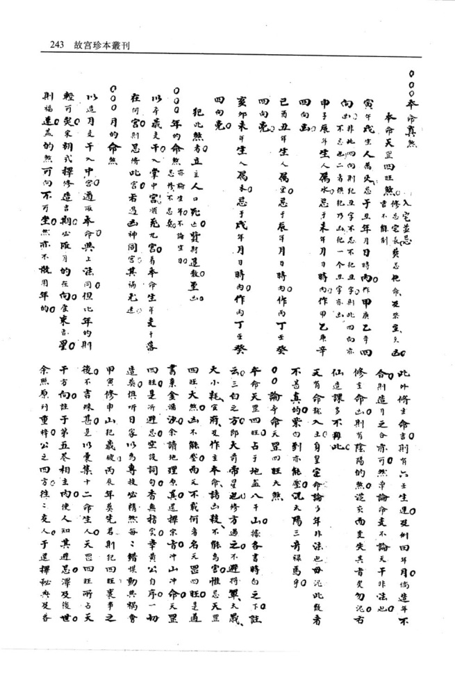

<!-- V3_SOURCE_ID:book010-b000602-p000-6f29f1b55e -->

这段原文存在多处残缺，语义不连贯，无法准确解读，具体所指不详。

> **释读存疑：** 原文存在多处残缺，语义不连贯，无法准确解读，具体所指不详。；本地硬校验仍未通过，已记录供后续自动处理或人工核对。

查看对应原文

<!-- V3_FOLDBACK_BEGIN:book010-b000602-p000-6f29f1b55e -->

幼出滿星皆後書羅增第三合利等引申長二方得光劉癸則矣庚二方亦不福釋

<!-- V3_FOLDBACK_END:book010-b000602-p000-6f29f1b55e -->

<!-- V3_SOURCE_ID:book010-b000603-p000-0387dca814 -->

<table><tr><td>太珍判土向</td><td></td><td></td><td></td></tr><tr><td>○壬子山方</td><td></td><td></td><td></td></tr><tr><td>○乾天山方</td><td></td><td></td><td></td></tr><tr><td>0辛戊山方</td><td></td><td></td><td></td></tr><tr><td></td><td></td><td>○庚山方</td><td></td></tr><tr><td></td><td>神中山方</td><td></td><td></td></tr><tr><td></td><td></td><td>こュ山</td><td></td></tr><tr><td></td><td>0丙山方</td><td></td><td></td></tr><tr><td></td><td>0翼己山方</td><td></td><td></td></tr><tr><td></td><td></td><td>O乙卷山方</td><td></td></tr><tr><td></td><td></td><td>○甲卯山方</td><td></td></tr></table>注：表格中“こュ山”为日文假名，具体所指不详；“翼己山方”“乙卷山方”“甲卯山方”等山方名称的具体含义需结合风水语境进一步考证。

> **释读存疑：** “こュ山”为日文假名，无法准确解读；部分山方名称的具体含义需结合风水语境进一步考证

查看对应原文

<!-- V3_FOLDBACK_BEGIN:book010-b000603-p000-0387dca814 -->

<table><tr><td>太珍判土向</td><td></td><td></td><td></td></tr><tr><td>○壬子山方</td><td></td><td></td><td></td></tr><tr><td>○乾天山方</td><td></td><td></td><td></td></tr><tr><td>0辛戊山方</td><td></td><td></td><td></td></tr><tr><td></td><td></td><td>○庚山方</td><td></td></tr><tr><td></td><td>神中山方</td><td></td><td></td></tr><tr><td></td><td></td><td>こュ山</td><td></td></tr><tr><td></td><td>0丙山方</td><td></td><td></td></tr><tr><td></td><td>0翼己山方</td><td></td><td></td></tr><tr><td></td><td></td><td>O乙卷山方</td><td></td></tr><tr><td></td><td></td><td>○甲卯山方</td><td></td></tr></table>

<!-- V3_FOLDBACK_END:book010-b000603-p000-0387dca814 -->

<!-- V3_SOURCE_ID:book010-b000604-p000-ab15ada441 -->

正月、二月、三月、四月、五月、六月、七月、八月、九月、十月，原文末尾的“4”具体所指不详。

> **释读存疑：** 原文末尾的“4”具体所指不详

查看对应原文

<!-- V3_FOLDBACK_BEGIN:book010-b000604-p000-ab15ada441 -->

正二三四五六七八九十二三4

<!-- V3_FOLDBACK_END:book010-b000604-p000-ab15ada441 -->

<!-- V3_SOURCE_ID:book010-b000605-p000-799495466a -->

口艮（八卦之一）对应的寅山方位，癸丑山方位。

查看对应原文

<!-- V3_FOLDBACK_BEGIN:book010-b000605-p000-799495466a -->

口艮寅山省○癸丑山方

<!-- V3_FOLDBACK_END:book010-b000605-p000-799495466a -->

<!-- doc003 PDF 第 248 页：旋转/复杂版面 OCR 供检索；内容与排版以原页图为准。 -->
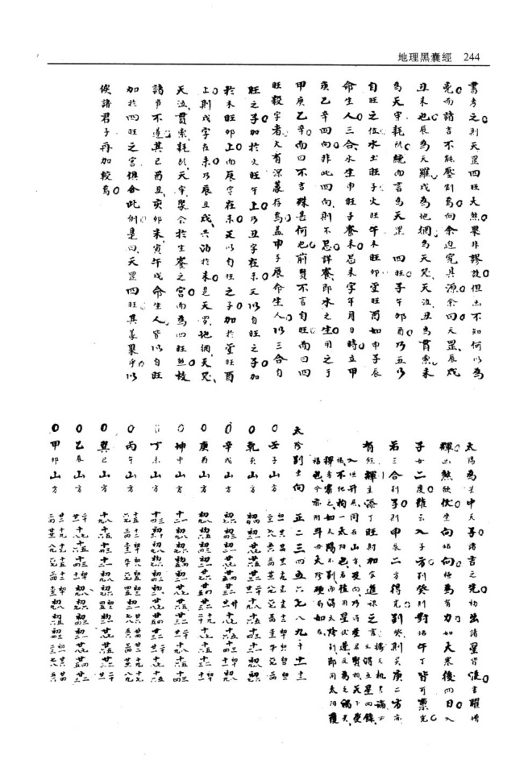

<!-- V3_SOURCE_ID:book010-b000607-p000-404a2afa56 -->

原文内容残缺，无法形成有效释读。

> **释读存疑：** 原文内容残缺，无法形成有效释读；本地硬校验仍未通过，已记录供后续自动处理或人工核对。

查看对应原文

<!-- V3_FOLDBACK_BEGIN:book010-b000607-p000-404a2afa56 -->

0 0 0 斬草破 1 00

<!-- V3_FOLDBACK_END:book010-b000607-p000-404a2afa56 -->

<!-- V3_SOURCE_ID:book010-b000608-p000-e200b10338 -->

原文中的“00”具体所指不详；这段内容是确定五音修造的年、月、日、时忌讳的例子，凡属五音的情况，这并非财产相关事宜，适宜巳、寅年、月、日、时，“向”指建筑或穴位所朝的方位，“向横師四封”的具体含义不详。

> **释读存疑：** 原文中的“00”具体所指不详；“向横師四封”的具体含义不详

查看对应原文

<!-- V3_FOLDBACK_BEGIN:book010-b000608-p000-e200b10338 -->

00定五音修造年月日時忌例姓凡之五音此非財產 宜巳寅年月日時向横師四封為吉

<!-- V3_FOLDBACK_END:book010-b000608-p000-e200b10338 -->

<!-- V3_SOURCE_ID:book010-b000609-p000-0c7ec2cec4 -->

乙甲、辛向的方位，在该日、月末、该年、该月，不宜进行建造、退官、取材、治病等事，否则会有凶险。此处“史纪”“段主”具体所指不详。

> **释读存疑：** “史纪”“段主”具体所指不详

查看对应原文

<!-- V3_FOLDBACK_BEGIN:book010-b000609-p000-0c7ec2cec4 -->

总 日末 時年 月 不 作 乙甲 辛 向 史纪 段主 建退 官材 等疾 凶病

<!-- V3_FOLDBACK_END:book010-b000609-p000-0c7ec2cec4 -->

<!-- V3_SOURCE_ID:book010-b000610-p000-177c99b3ec -->

已诀寡年月日时，盘、孙、射，卷青十二唱。此处“盘”“孙”“射”“卷青十二”具体所指不详。

> **释读存疑：** “盘”“孙”“射”“卷青十二”具体所指不详

查看对应原文

<!-- V3_FOLDBACK_BEGIN:book010-b000610-p000-177c99b3ec -->

寡已訣年月日時 盘 孫 射 卷青十 二 唱

<!-- V3_FOLDBACK_END:book010-b000610-p000-177c99b3ec -->

<!-- V3_SOURCE_ID:book010-b000611-p000-5610df33d9 -->

在该年、该月、该1日、该时，不宜在丁丙向的方位行事，否则会犯忌讳。

查看对应原文

<!-- V3_FOLDBACK_BEGIN:book010-b000611-p000-5610df33d9 -->

忌  
1日年時月  
不  
作  
丁丙  
向  
犯

<!-- V3_FOLDBACK_END:book010-b000611-p000-5610df33d9 -->

<!-- V3_SOURCE_ID:book010-b000612-p000-c63ece1e5e -->

宜在寅申年、月、日、时，安设合向，方能见到相应的效果。此处“之指”“味见”具体所指不详。

> **释读存疑：** “之指”“味见”具体所指不详

查看对应原文

<!-- V3_FOLDBACK_BEGIN:book010-b000612-p000-c63ece1e5e -->

之指 宜寅申年月日時安合向味見

<!-- V3_FOLDBACK_END:book010-b000612-p000-c63ece1e5e -->

<!-- doc003 PDF 第 249 页：旋转/复杂版面 OCR 供检索；内容与排版以原页图为准。 -->
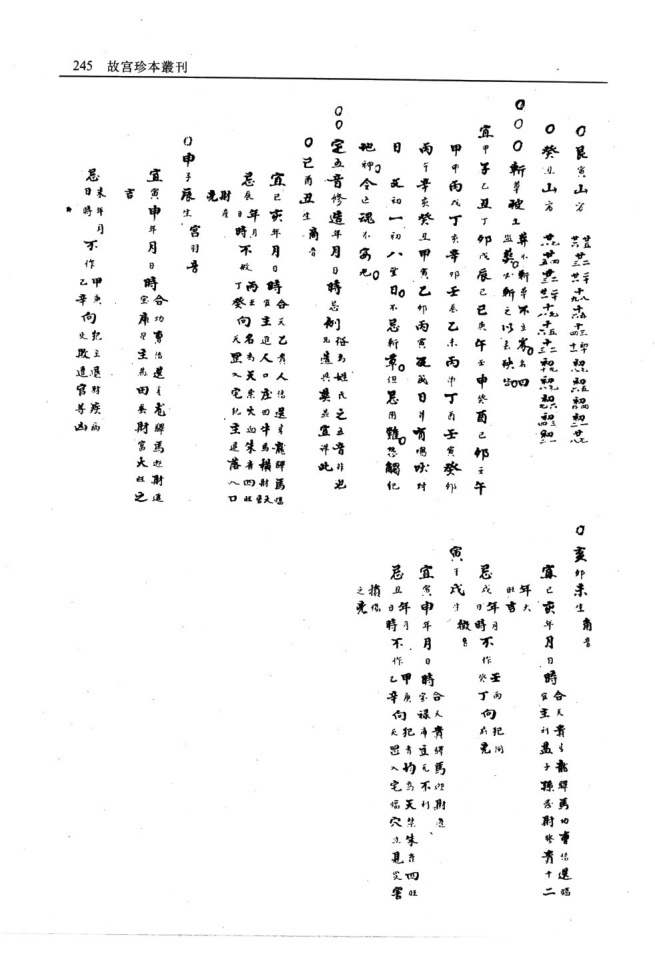

<!-- V3_SOURCE_ID:book010-b000614-p000-8bf8886f0f -->

此处原文语义错乱，无法梳理出完整通顺内容，具体所指不详

> **释读存疑：** 原文语义错乱，无法梳理出完整通顺内容

查看对应原文

<!-- V3_FOLDBACK_BEGIN:book010-b000614-p000-8bf8886f0f -->

九宫生私歌生氣原未生花身我若生地為進氣但為死氣孔今吉煞是刻之便生填被吾划者是財神與飛相司竝臣其

<!-- V3_FOLDBACK_END:book010-b000614-p000-8bf8886f0f -->

<!-- V3_SOURCE_ID:book010-b000615-p000-b2f30b6de4 -->

門超接置閏法

查看对应原文

<!-- V3_FOLDBACK_BEGIN:book010-b000615-p000-b2f30b6de4 -->

門超接置閏法

<!-- V3_FOLDBACK_END:book010-b000615-p000-b2f30b6de4 -->

<!-- V3_SOURCE_ID:book010-b000616-p000-85b941de58 -->

捷訣歌中提到，符在節前稱為超符，符在節後稱為接節，遇符首、符遇節，這是正受真訣。常將甲巳撫符頭，二至還鄉有口訣，要知置倒在何時，端在芷種與大雪有時，起過一旬餘便當置閩作重節。

> **释读存疑：** 芷種；置閩；“芷種”“置閩”语义不明，具体所指不详；1轮自动修复后核义模型仍建议修订，已保守记录。

查看对应原文

<!-- V3_FOLDBACK_BEGIN:book010-b000616-p000-85b941de58 -->

捷訣歌曰符在節前名曰超符在節後名曰接節遇符首 符遇節此乃正受為真訣常將甲巳撫符頭二至還鄉有 口訣要知置倒在何時端在芷種與大雪有時起過一旬 餘便當置閩作重節

<!-- V3_FOLDBACK_END:book010-b000616-p000-85b941de58 -->

<!-- V3_SOURCE_ID:book010-b000617-p000-2a82c8b35f -->

文中提及《洪範五行詩》《造奘論》起于半山运

> **释读存疑：** 《洪範五行詩》《造奘論》的具体所指不详；半山运的具体所指不详；1轮自动修复后核义模型仍建议修订，已保守记录。

查看对应原文

<!-- V3_FOLDBACK_BEGIN:book010-b000617-p000-2a82c8b35f -->

洪範五行詩造奘論起半山運

<!-- V3_FOLDBACK_END:book010-b000617-p000-2a82c8b35f -->

<!-- V3_SOURCE_ID:book010-b000618-p000-f69b926a61 -->

甲寅、辰、巽方位的大江水，戌、坎、申、辛方位的水也一样；艮、震、巳方位的山原本属木，离、壬、丙、乙方位的火是根本，兑、丁、乾方位的金生在丑、癸、坤、庚、未方位的土中，这就是五行的真正定论，谁能比得上它的灵验呢。

> **释读存疑：** 原文中“孰如其肉有灵通”表述含混，具体所指不详

查看对应原文

<!-- V3_FOLDBACK_BEGIN:book010-b000618-p000-f69b926a61 -->

甲寅辰巽大江水戌坎申辛水亦同艮震巳山原屬木離壬丙乙火為宗兌丁乾夾金生丑癸坤庚未土中此是五行真定論孰如其肉有灵通

<!-- V3_FOLDBACK_END:book010-b000618-p000-f69b926a61 -->

<!-- V3_SOURCE_ID:book010-b000619-p000-ec3fb164dd -->

如果甲寅、辰、巽的坐山都属水，前代贤达大多会选用申子辰水局的年月日时，用来补山，也是这个道理。

查看对应原文

<!-- V3_FOLDBACK_BEGIN:book010-b000619-p000-ec3fb164dd -->

假如甲寅辰巽坐山俱屬水先賢多用申子辰水局年月日時謂之補山亦此也

<!-- V3_FOLDBACK_END:book010-b000619-p000-ec3fb164dd -->

<!-- V3_SOURCE_ID:book010-b000620-p000-aa007991e5 -->

山家墓运起遁诗 造葬论

查看对应原文

<!-- V3_FOLDBACK_BEGIN:book010-b000620-p000-aa007991e5 -->

山家墓運起遁詩造葬論

<!-- V3_FOLDBACK_END:book010-b000620-p000-aa007991e5 -->

<!-- V3_SOURCE_ID:book010-b000621-p000-cf85e7a3e6 -->

水上山頭的墓位於辰木山之墓未宮停火山戌地，「君頂記」具體所指不詳；金墓原在未、丑位，只要逢到太歲，用五虎遁遁至墓宮，就是運真。惟有金山冬至後方可使用，今年「基辰」輪墓運，「納音財局」吉利；納音尅墓最相填，「比和印後」皆為妙事，犯尅須知福莫伸。假如乾山巽向，用癸夾年、甲子月、甲申日、乙亥時，即將戊癸起甲寅，十一月冬至後用事，遁得乙丑墓運，屬金；乙夾時屬火，乃火尅金墓，凶輕。年尅山家，家長死；月尅山家，宅母死；日尅山家，新婦死；時尅山家，子息當四柱納音五行有制，「兄咎」具體所指不詳。

> **释读存疑：** 君頂記；基辰；納音財局；比和印後；兄咎；制的具體含義；「君頂記」具體所指不詳；「基辰」具體所指不詳；「納音財局」具體所指不詳；「比和印後」具體所指不詳；「兄咎」具體所指不詳；「制」的具體含義不詳

查看对应原文

<!-- V3_FOLDBACK_BEGIN:book010-b000621-p000-cf85e7a3e6 -->

水上山頭墓在辰木山之墓未宮停火山戌地君頂記 金墓原未丑上親但逢太歲五虎遁遁至墓宮是運真 惟有金山冬至後方用今歲基辰輪墓運納音財局吉 納音尅墓最相填比和印後皆為妙犯尅須知福莫伸 假如乾山巽向用癸夾年甲子月甲申日乙亥時即 將戊癸起甲寅十一月冬至後用事遁得乙丑墓運 屬金乙夾時属火乃火尅金墓凶轻曰年尅山家家 長死月尅山家宅母亡日尅山家新婦死時尅山家 子息當四柱纳音五行有制兄咎

<!-- V3_FOLDBACK_END:book010-b000621-p000-cf85e7a3e6 -->

<!-- V3_SOURCE_ID:book010-b000622-p000-879a5065ac -->

文中提到“李廣將軍箭詩造奕論”，具体所指不详。

> **释读存疑：** “李廣將軍箭詩造奕論”具体所指不详

查看对应原文

<!-- V3_FOLDBACK_BEGIN:book010-b000622-p000-879a5065ac -->

李廣將軍箭詩造奕論

<!-- V3_FOLDBACK_END:book010-b000622-p000-879a5065ac -->

<!-- V3_SOURCE_ID:book010-b000623-p000-a9b5b5a6f5 -->

甲年、庚年、卯年、酉年會帶來災禍；乙年、辛年、辰年、戌年殺傷的人很多；丁年、癸年遇牛羊對應的時日會出現死亡災禍；丙年、壬年遇子午對應的時日會引發戰亂；乾、巽對應的豬、蛇會帶來大災禍；坤、艮對應的猴、虎年景難以度過；天干中有箭的對應方位，若沒有箭的對應方位，犯了就會有災禍降臨，實在沒有辦法。

> **释读存疑：** “箭支”具体所指不详；本地硬校验仍未通过，已记录供后续自动处理或人工核对。

查看对应原文

<!-- V3_FOLDBACK_BEGIN:book010-b000623-p000-a9b5b5a6f5 -->

甲庚卯酉年為祸乙辛辰戌殺人多丁癸牛羊跳出死丙壬子午動干戈乾巽猪蛇為大祸坤艮猴虎不堪過天干有箭支無箭犯着灾臨没奈何

<!-- V3_FOLDBACK_END:book010-b000623-p000-a9b5b5a6f5 -->

<!-- V3_SOURCE_ID:book010-b000624-p000-9fb2bca018 -->

古時候說，“李廣符軍箭似鎗”，有人犯了就會有災禍，犯一箭就會死一人，犯二箭就會死二人，犯三箭就會死三人，犯四箭就會父子全都死亡。比如甲庚山向忌諱使用卯、酉對應的年月日時，其餘的以此類推。又說，“甲唐山”忌諱卯、酉二字俱全，二者相互衝突就稱之為有弓帶前，主殺傷人，是大兇的；若只是單獨犯了，有帝星入中宮的就不忌諱，若遇到無咎的情況，就忌諱有相互衝突的情形。從前曾山和江東民鞠下的祖墳，是坤山艮向，用甲申年壬申月甲申日壬申時，只見年忌、日時上犯申字，沒有寅字相互衝突，坐山因此吉利，六年後他的兒子登科，干祿甚衆，具体所指不详。

> **释读存疑：** “甲唐山”具体所指不详；“帝星入中宮”具体所指不详；“干祿甚衆”具体所指不详；“甲庚山”具体所指不详；1轮自动修复后核义模型仍建议修订，已保守记录。

查看对应原文

<!-- V3_FOLDBACK_BEGIN:book010-b000624-p000-9fb2bca018 -->

古云李廣符軍箭似鎗有人犯着祸难當一箭一人死二前二人當三前並四前父子盡皆亡假如甲庚山向忌用卯酉年月日時其餘倣此又云甲唐山忌卯酉二字俱全相冲者為之有弓帶前主殺人大凶苦单犯有帝星入中宮者不忌試遇无咎如見帝星有相冲者忌之○昔曾山與江東民鞠下祖墳作坤山艮向用甲申年壬申月甲申日壬申時惟見年忌日時上犯申字無寅字相冲坐山故吉後六年其子登科干祿甚衆

<!-- V3_FOLDBACK_END:book010-b000624-p000-9fb2bca018 -->

<!-- V3_SOURCE_ID:book010-b000625-p000-ac2fe4d77f -->

文中提到“炙退三殺詩山方並忌”，具体所指不详。

> **释读存疑：** “炙退三殺詩山方並忌”具体所指不详

查看对应原文

<!-- V3_FOLDBACK_BEGIN:book010-b000625-p000-ac2fe4d77f -->

炙退三殺詩山方並忌

<!-- V3_FOLDBACK_END:book010-b000625-p000-ac2fe4d77f -->

<!-- V3_SOURCE_ID:book010-b000626-p000-bfd4dc76a7 -->

申子辰年，馬在寅卯乙之方，此方位屬退神；若求三殺居何象，已午未之方位不堪親近。寅午戊歲，馬居申，退斯鎮酉辛之方位，北方的三殺君莫犯；夾子丑之方位主相嗔。巳酉丑年，馬在亥，告君子癸之方位，此方位屬退；若問三殺在何方，寅卯辰之方位莫脩蓋。夾卯未年，馬在巳，欲問炙退午丁之方位，西方的三殺是无情；申酉戌之方位人把死灸，退者退山不退向，三殺者可向不可坐，忌年月扶合，大凶。

> **释读存疑：** 退斯鎮；午丁；炙退；死灸；告君子癸；原文存疑的‘退斯鎮’‘午丁’‘炙退’‘死灸’‘告君子癸’具体所指不详，释读时应标注为‘原文未明’；1轮自动修复后核义模型仍建议修订，已保守记录。

查看对应原文

<!-- V3_FOLDBACK_BEGIN:book010-b000626-p000-bfd4dc76a7 -->

申子辰年馬在寅卯乙之方是退神若求三殺居何象已午未上不堪親寅午戊歲馬居申矣退斯鎮酉辛三殺北方君莫犯夾子丑上主相嗔巳酉丑年馬在亥告君子癸是矣退若問三殺在何方寅卯辰宮莫脩蓋夾卯未年馬在巳欲問炙退午丁是西方三殺是无情申酉成宮人把死灸退者退山不退向三殺者可向不可坐忌年月扶合大凶

<!-- V3_FOLDBACK_END:book010-b000626-p000-bfd4dc76a7 -->

<!-- V3_SOURCE_ID:book010-b000627-p000-e50f0b726f -->

論小兒殺例

查看对应原文

<!-- V3_FOLDBACK_BEGIN:book010-b000627-p000-e50f0b726f -->

論小兒殺例

<!-- V3_FOLDBACK_END:book010-b000627-p000-e50f0b726f -->

<!-- V3_SOURCE_ID:book010-b000628-p000-95c22eb4cc -->

文中提及月橫看正二三四五六七八九十十十二陽年順，以及中乾兌艮離坎坤震巽；陰年過離艮兌乾，中巽震坤坎離艮兌。

> **释读存疑：** 月橫看；陽年順；陰年過；兌；離；原文中“月橫看”“陽年順”“陰年過”“兌”“離”等表述含义不明，暂按原文保留表述；1轮自动修复后核义模型仍建议修订，已保守记录。

查看对应原文

<!-- V3_FOLDBACK_BEGIN:book010-b000628-p000-95c22eb4cc -->

月橫看正二三四五六七八九十十十二陽年順 中乾兌艮離坎坤震巽中乾兌陰年過離艮兌乾中巽震坤坎離艮兌

<!-- V3_FOLDBACK_END:book010-b000628-p000-95c22eb4cc -->

<!-- V3_SOURCE_ID:book010-b000629-p000-1337244022 -->

陽起中宮，陰起離，陰陽二位逆順飛歌，九宮數至葬去，到此一宮殺小兒。

> **释读存疑：** “逆順飛歌”“九宮數至葬去”表述含义不明，暂按原文保留。；“逆順飛歌”“九宮數至葬去”表述含义不明，暂按原文保留

查看对应原文

<!-- V3_FOLDBACK_BEGIN:book010-b000629-p000-1337244022 -->

陽起中宮陰起離陰陽二位逆順飛歌 九宮數至葬去到此一宮殺小兒

<!-- V3_FOLDBACK_END:book010-b000629-p000-1337244022 -->

<!-- V3_SOURCE_ID:book010-b000630-p000-417102204c -->

四大利星詩

查看对应原文

<!-- V3_FOLDBACK_BEGIN:book010-b000630-p000-417102204c -->

四大利星詩

<!-- V3_FOLDBACK_END:book010-b000630-p000-417102204c -->

<!-- V3_SOURCE_ID:book010-b000631-p000-be3a57bb20 -->

子午卯酉、七辛山、丁癸山向原本的看法是一样的，若要判断某流年的哪一岁有利，寅、申、巳三者夹着的情况最为有利。原文中的‘千寅’应为干支‘壬寅’的讹误，甲庚山、壬丙山的看法也一样。原文中的‘兄’应为‘凶’的讹误，四墓岁君是造葬的大利之神，主平安。原文中的‘四基’具体所指不详，原文提及乾坤艮巽山向，对应的有利年份是子午卯酉。除了这些年份之外，造筑时无需顾虑凶祸。四墓指辰、戌、丑、未。比如子午卯酉、乙辛丁癸山向的情况。

> **释读存疑：** 四基具体所指不详

查看对应原文

<!-- V3_FOLDBACK_BEGIN:book010-b000631-p000-be3a57bb20 -->

子午卯酉七辛山丁癸原耒一樣看若間流年何歲利寅申巳夾最兄千寅申巳亥甲庚山壬丙山頭從一般四墓歲君為大利聖造埋葬主平安四基乾坤艮巽山利年子午卯酉觀此歲之外死凶吉造築何須慮禍漫四墓辰戌丑未也假如子午卯酉乙辛丁癸山向主

<!-- V3_FOLDBACK_END:book010-b000631-p000-be3a57bb20 -->

<!-- V3_SOURCE_ID:book010-b000632-p000-65ff83bc3d -->

寅、申、巳三者夹着的年月是大利的，可据此推合。下面的诗局中，山向的凶神是否有占位？原文中的‘兄’应为‘凶’的讹误，若凶神占位，‘贞吉’在术数语境中的具体含义不详，只要十分贞吉，再加上年月格局妥当，有吉星辅佐，也能招来福运。常可见先贤所用的年月多不符合此理，只是原文中的‘凢’应为‘凡’的讹误，八字生旺且有原文中的‘有束方’应为‘有东方’的讹误，即为吉、为福；若休囚则不能为大吉。

> **释读存疑：** 贞吉在术数语境中的具体含义不详

查看对应原文

<!-- V3_FOLDBACK_BEGIN:book010-b000632-p000-65ff83bc3d -->

寅申巳夾年月大利用推合巳下詩局內山向凶神有兄占否如兄占十分貞吉再得年月格局停當吉星扶佐亦能致福屢見先賢年月多不合此但凢八字生旺有束方為吉為福也若休囚又不能為大吉也

<!-- V3_FOLDBACK_END:book010-b000632-p000-65ff83bc3d -->

<!-- V3_SOURCE_ID:book010-b000633-p000-4bfde7bd9d -->

0 论五不遇时

查看对应原文

<!-- V3_FOLDBACK_BEGIN:book010-b000633-p000-4bfde7bd9d -->

0 論五不遇時

<!-- V3_FOLDBACK_END:book010-b000633-p000-4bfde7bd9d -->

<!-- V3_SOURCE_ID:book010-b000634-p000-bc9daf94d1 -->

所谓五不遇时，就是时干克制日干，阳干克制阳干，阴干克制阴干。葛洪说：五不遇时，指刚气相克制而损伤其明，即便有奇门，也不能做任何事，行事凶险。

查看对应原文

<!-- V3_FOLDBACK_BEGIN:book010-b000634-p000-bc9daf94d1 -->

五不遇時者即時干尅日干陽干尅陽干陰干尅陰干也葛洪曰五不遇時者謂剛乘相尅而損其明縱有奇門不可行百事凶

<!-- V3_FOLDBACK_END:book010-b000634-p000-bc9daf94d1 -->

<!-- V3_SOURCE_ID:book010-b000635-p000-88734b5ec5 -->

烟波钓叟歌说：

查看对应原文

<!-- V3_FOLDBACK_BEGIN:book010-b000635-p000-88734b5ec5 -->

烟波釣叟歌曰

<!-- V3_FOLDBACK_END:book010-b000635-p000-88734b5ec5 -->

<!-- V3_SOURCE_ID:book010-b000636-p000-1c7e2b07b4 -->

五不过时，龙不精，号为日月损光明。时干来克日干上，甲日须知时忌庚。

查看对应原文

<!-- V3_FOLDBACK_BEGIN:book010-b000636-p000-1c7e2b07b4 -->

五不過時龍不精號為日月损光明時干來尅日于上 甲日須知時忌庚

<!-- V3_FOLDBACK_END:book010-b000636-p000-1c7e2b07b4 -->

<!-- V3_SOURCE_ID:book010-b000637-p000-28d2fb7028 -->

甲日庚午之时，乙日辛巳之时，丙日壬辰之时，丁日癸卯之时，戊日甲寅之时，己日乙丑之时。天地燥火时起例诗：丙午亥山蝗火发，甲申酉向震宫末，乾戌上巽门游，巽辛辰向顺坤流，丑未坤中见位是，虞寅印儿间，乾由艮丁癸水坎家，壬子己山寻艮适，但逢震兑宫不数，离天坎地火星愁。

> **释读存疑：** 原文中“虞寅印儿间”“乾由艮丁癸水坎家”“壬子己山寻艮适”“但逢震兑宫不数”等语句语义晦涩，具体所指不详

查看对应原文

<!-- V3_FOLDBACK_BEGIN:book010-b000637-p000-28d2fb7028 -->

甲日庚午時 乙日辛已時丙日壬辰時 丁日癸卯時戊日甲寅時 己日乙丑時 天地燥火時起例詩 丙午亥山蝗火發 甲申酉向震宮末 乾戌上巽門遊 巽辛辰向順坤流 丑未坤中見位是虞寅印兒間乾由 艮丁癸水坎家 壬子己山尋艮適但逢震兌宮不数 離天坎地火星愁

<!-- V3_FOLDBACK_END:book010-b000637-p000-28d2fb7028 -->

<!-- V3_SOURCE_ID:book010-b000638-p000-23e7ab3358 -->

<table><tr><td>艮</td><td>正十月</td><td>七月</td><td>四月</td><td>庚日丙子時</td><td>辛日丁百時壬日戊申時</td><td></td></tr><tr><td>離</td><td>九月</td><td>六月</td><td>三十二月</td><td>癸日己未曉</td><td></td><td></td></tr><tr><td>坎</td><td>八月</td><td>五月</td><td>二十一月</td><td>此乃時干尅日干名為本主不和極凶舊選擇書内</td><td></td><td></td></tr><tr><td>坤</td><td>七月</td><td>四月</td><td>正十月</td><td>差載時支尅日干所以不準今本理校正曆府通書</td><td></td><td></td></tr><tr><td>震</td><td>六月</td><td>三十二月九月</td><td></td><td>悉皆改正刊行 OE</td><td></td><td></td></tr><tr><td>巽 2</td><td>五月</td><td>二十一月八月</td><td></td><td>截例詩 時干尅日有史危</td><td></td><td>甲日從午逆数之 0</td></tr><tr><td colspan="5">殃煞合出日時每以月上起子男順女逆数至死時</td><td></td><td>不事不宜莫用之</td></tr><tr><td colspan="5">住看在何支位即是所出日時○正月己上二月午</td><td>若到戌文便越過 </td><td colspan="2"></td></tr><tr><td colspan="5">上三月未上數之</td><td>又起例曰</td><td colspan="2">乙辛唐丙最為殃</td></tr><tr><td colspan="5">假如五月甲子日已時男死戌上起子至寅上是死</td><td>田怕庚しや乙</td><td colspan="2">辛丁壬愁戊不良</td></tr><tr><td colspan="5">死時殃煞當寅日寅時出男取幹墓為方甲幹木墓</td><td>丙壬丁怕癸時惡 戊畏甲兮君莫用</td><td colspan="2">癸意嫌已奠相當</td></tr><tr><td colspan="5">未故殃煞西南未地</td><td colspan="5">以月建入中宮尋太成到位在一甲由與本方相刑尅大凶比和平平 在二甲內小凶三甲外不忌九到方封甸到山到中宮吉不能制觀數</td></tr><tr><td colspan="9">大月建即大兒煞 假如五已酉日卯時女死戌上起子至午上是死時小月建即小兒煞 以太歲入中宮尋月建到位在一甲內與本方相生亦凶或刑乾宅髮橫此 一名日建然王名陰中太藥犯之見殺宅長次義小兒九制山向中宮到方醫 正月起</td></tr><tr><td colspan="5">殃煞當午日午時出女取支墓卷方酉屬金墓丑故天月建煞 又名逆 正起 殃煞在東北丑地○殃煞高低法云甲已子午九 中</td><td>申癸庚丁年 小兄 流 艮逆行</td><td colspan="2">乙辛戊年中 正十月 七月</td><td>坤逆行</td></tr><tr><td colspan="5">庚丑未八丙辛寅申七丁壬邵酉六戊癸辰戌五巳</td><td>四月</td><td>九月</td><td></td><td></td></tr><tr><td colspan="5">死日枝幹数合甲子日甲九子九</td><td>乾</td><td>三十二月</td><td>六月</td><td></td></tr><tr><td colspan="5">夾四居之其法用 合是一丈八尺他倣此</td><td>二十一月 兌</td><td>八月</td><td>五月</td><td></td></tr></table>

> **释读存疑：** 部分干支、卦象对应月份及数术术语的具体含义原文未明

查看对应原文

<!-- V3_FOLDBACK_BEGIN:book010-b000638-p000-23e7ab3358 -->

<table><tr><td>艮</td><td>正十月</td><td>七月</td><td>四月</td><td>庚日丙子時</td><td>辛日丁百時壬日戊申時</td><td></td></tr><tr><td>離</td><td>九月</td><td>六月</td><td>三十二月</td><td>癸日己未曉</td><td></td><td></td></tr><tr><td>坎</td><td>八月</td><td>五月</td><td>二十一月</td><td>此乃時干尅日干名為本主不和極凶舊選擇書内</td><td></td><td></td></tr><tr><td>坤</td><td>七月</td><td>四月</td><td>正十月</td><td>差載時支尅日干所以不準今本理校正曆府通書</td><td></td><td></td></tr><tr><td>震</td><td>六月</td><td>三十二月九月</td><td></td><td>悉皆改正刊行 OE</td><td></td><td></td></tr><tr><td>巽 2</td><td>五月</td><td>二十一月八月</td><td></td><td>截例詩 時干尅日有史危</td><td></td><td>甲日從午逆数之 0</td></tr><tr><td colspan="5">殃煞合出日時每以月上起子男順女逆数至死時</td><td></td><td>不事不宜莫用之</td></tr><tr><td colspan="5">住看在何支位即是所出日時○正月己上二月午</td><td>若到戌文便越過 </td><td colspan="2"></td></tr><tr><td colspan="5">上三月未上數之</td><td>又起例曰</td><td colspan="2">乙辛唐丙最為殃</td></tr><tr><td colspan="5">假如五月甲子日已時男死戌上起子至寅上是死</td><td>田怕庚しや乙</td><td colspan="2">辛丁壬愁戊不良</td></tr><tr><td colspan="5">死時殃煞當寅日寅時出男取幹墓為方甲幹木墓</td><td>丙壬丁怕癸時惡 戊畏甲兮君莫用</td><td colspan="2">癸意嫌已奠相當</td></tr><tr><td colspan="5">未故殃煞西南未地</td><td colspan="5">以月建入中宮尋太成到位在一甲由與本方相刑尅大凶比和平平 在二甲內小凶三甲外不忌九到方封甸到山到中宮吉不能制觀數</td></tr><tr><td colspan="9">大月建即大兒煞 假如五已酉日卯時女死戌上起子至午上是死時小月建即小兒煞 以太歲入中宮尋月建到位在一甲內與本方相生亦凶或刑乾宅髮橫此 一名日建然王名陰中太藥犯之見殺宅長次義小兒九制山向中宮到方醫 正月起</td></tr><tr><td colspan="5">殃煞當午日午時出女取支墓卷方酉屬金墓丑故天月建煞 又名逆 正起 殃煞在東北丑地○殃煞高低法云甲已子午九 中</td><td>申癸庚丁年 小兄 流 艮逆行</td><td colspan="2">乙辛戊年中 正十月 七月</td><td>坤逆行</td></tr><tr><td colspan="5">庚丑未八丙辛寅申七丁壬邵酉六戊癸辰戌五巳</td><td>四月</td><td>九月</td><td></td><td></td></tr><tr><td colspan="5">死日枝幹数合甲子日甲九子九</td><td>乾</td><td>三十二月</td><td>六月</td><td></td></tr><tr><td colspan="5">夾四居之其法用 合是一丈八尺他倣此</td><td>二十一月 兌</td><td>八月</td><td>五月</td><td></td></tr></table>

<!-- V3_FOLDBACK_END:book010-b000638-p000-23e7ab3358 -->

<!-- V3_SOURCE_ID:book010-b000639-p000-667ea3495e -->

天火不可監造

查看对应原文

<!-- V3_FOLDBACK_BEGIN:book010-b000639-p000-667ea3495e -->

天火不可監造

<!-- V3_FOLDBACK_END:book010-b000639-p000-667ea3495e -->

<!-- doc003 PDF 第 252 页：旋转/复杂版面 OCR 供检索；内容与排版以原页图为准。 -->
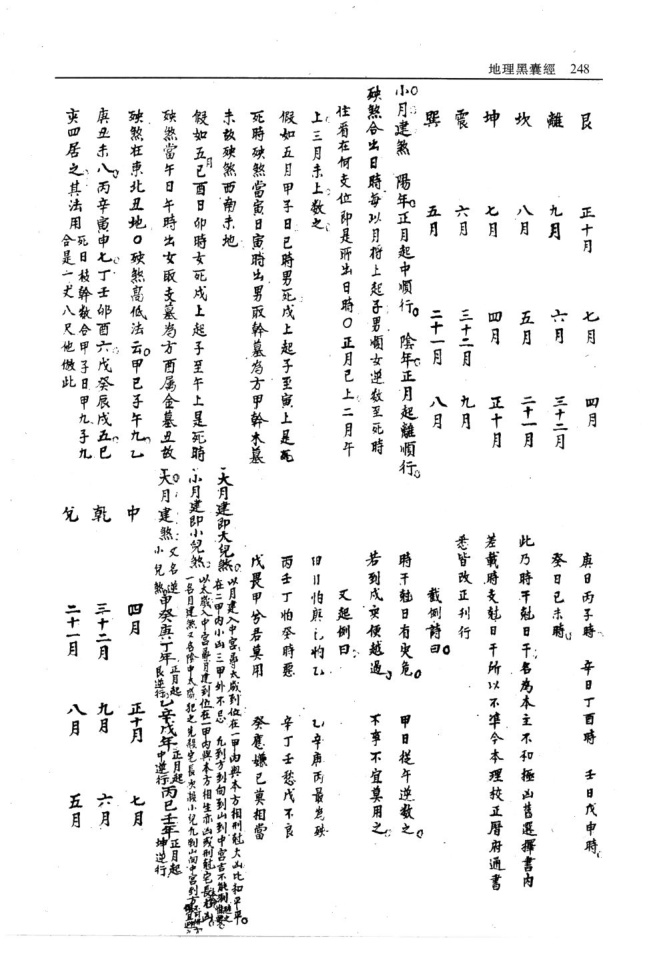

<!-- V3_SOURCE_ID:book010-b000641-p000-05a72def63 -->

突艮丙年、丁癸六山天火，子年忌造；地火卯酉忌葵；成乾寅叩乙與六山天火展成，忌造；地火丑未忌樊。

> **释读存疑：** 突艮丙年；丁癸六山天火；地火卯酉；成乾寅叩乙與六山天火展成；地火丑未忌樊；原文多处文字无法准确释读，数术术语含义不明

查看对应原文

<!-- V3_FOLDBACK_BEGIN:book010-b000641-p000-05a72def63 -->

突艮丙年丁癸六山天火子年忌造 地火卯酉忌葵 成乾寅叩乙與六山天火展成忌造 地火丑未忌樊

<!-- V3_FOLDBACK_END:book010-b000641-p000-05a72def63 -->

<!-- V3_SOURCE_ID:book010-b000642-p000-a66e0205da -->

地火不可栽種

查看对应原文

<!-- V3_FOLDBACK_BEGIN:book010-b000642-p000-a66e0205da -->

地火不可栽種

<!-- V3_FOLDBACK_END:book010-b000642-p000-a66e0205da -->

<!-- V3_SOURCE_ID:book010-b000643-p000-be5073a567 -->

## 陰府太歲詩造葬論 — 陰府太歲詩——造葬論

查看对应原文

<!-- V3_FOLDBACK_BEGIN:book010-b000643-p000-be5073a567 -->

## 陰府太歲詩造葬論

<!-- V3_FOLDBACK_END:book010-b000643-p000-be5073a567 -->

<!-- V3_SOURCE_ID:book010-b000644-p000-d2e21f1f0e -->

二十四山（将周天划分为二十四个方位的体系）的變運訣，以艮（八卦之一）、丙、巽（八卦之一）、辛方位的水（风水语境中的河流、水系及其来去形态）為中心。

查看对应原文

<!-- V3_FOLDBACK_BEGIN:book010-b000644-p000-d2e21f1f0e -->

二十四山変運訣艮丙巽辛水居中

<!-- V3_FOLDBACK_END:book010-b000644-p000-d2e21f1f0e -->

<!-- V3_SOURCE_ID:book010-b000645-p000-517c0fe2f1 -->

坎（八卦之一）、癸、申、辰，坤（八卦之一，卦象及五行、方位依原文语境确定）、乙方位屬火。

查看对应原文

<!-- V3_FOLDBACK_BEGIN:book010-b000645-p000-517c0fe2f1 -->

坎癸申辰坤乙火

<!-- V3_FOLDBACK_END:book010-b000645-p000-517c0fe2f1 -->

<!-- V3_SOURCE_ID:book010-b000646-p000-345d58acc4 -->

兌、丁、巳、丑，乾（八卦之一，卦象及五行、方位依原文语境确定）、甲方位屬木；離、壬、寅、戍方位屬土，與前述同理。

查看对应原文

<!-- V3_FOLDBACK_BEGIN:book010-b000646-p000-345d58acc4 -->

兌丁巳丑乾甲木 離壬寅戍土鄉同

<!-- V3_FOLDBACK_END:book010-b000646-p000-345d58acc4 -->

<!-- V3_SOURCE_ID:book010-b000647-p000-c4a406d0e7 -->

震（八卦之一）对应的庚位与未位，属于金宫。

查看对应原文

<!-- V3_FOLDBACK_BEGIN:book010-b000647-p000-c4a406d0e7 -->

震庚夾未是金宮

<!-- V3_FOLDBACK_END:book010-b000647-p000-c4a406d0e7 -->

<!-- V3_SOURCE_ID:book010-b000648-p000-739b19fb4c -->

若在年月方面触犯生旺煞，会导致人丁、财气衰败，且出现空亡的情况。

查看对应原文

<!-- V3_FOLDBACK_BEGIN:book010-b000648-p000-739b19fb4c -->

年月若犯逢生旺殺死人丁財蓋空

<!-- V3_FOLDBACK_END:book010-b000648-p000-739b19fb4c -->

<!-- V3_SOURCE_ID:book010-b000649-p000-f379417a27 -->

假设艮、丙、巽对应的山属水，忌讳甲巳化土的年月日时；若甲巳遇上秋月，触犯也无妨。另外还需四柱干支中有枭煞遥露的情况，反而会招致吉福。当时的风水师大多用天干合制的方法，这是不对的。如果是修造时不移动土，傍正阴府并不忌讳；若是理龚触犯，被称为速监造，被称为独运，在一百二十日内选择的话，三五年内就会出现灾祸，务必谨慎对待。

> **释读存疑：** 理龚；速监造；独运；"理龚""速监造""独运"具体所指不详；1轮自动修复后核义模型仍建议修订，已保守记录。

查看对应原文

<!-- V3_FOLDBACK_BEGIN:book010-b000649-p000-f379417a27 -->

假如艮丙巽辛山屬水忌甲巳化土年月日時如甲巳逢秋月犯之無妨又要四柱干支有梟煞遙露者反致吉福時師多用天干合制非也如修造不動土傍正陰府並不忌若理龔犯之見稱速監造見稱獨運一百二十日內選則三五年見禍切宣惟之

<!-- V3_FOLDBACK_END:book010-b000649-p000-f379417a27 -->

<!-- V3_SOURCE_ID:book010-b000650-p000-e04fa4eab0 -->

艮（八卦之一）、巽（八卦之一）对应的阴符属甲巳土，乾（八卦之一）、兑则需防备乙庚金。这是阴符歌诀里的内容。

查看对应原文

<!-- V3_FOLDBACK_BEGIN:book010-b000650-p000-e04fa4eab0 -->

艮巽陰符甲已土乾兌須妨乙庚金 陰符歌訣曰

<!-- V3_FOLDBACK_END:book010-b000650-p000-e04fa4eab0 -->

<!-- V3_SOURCE_ID:book010-b000651-p000-218690db5f -->

如果在甲巳年、月、日、时进行正阴符占，艮、巽二山会出现大凶的情况，这就是正阴符。傍阴符占时，丙、辛二山会出现凶象，“弗卦”就是榜阴符。比如“乾带甲”“兑带丁巳”“丑”都忌讳乙、庚二字；“艮常丙”“巽衲辛”“坤事乙”“坎袖癸申辰”“震袖庚亥未”“离带壬寅戍”，这些表述具体所指不详。

> **释读存疑：** 弗卦；艮常丙；巽衲辛；坤事乙；坎袖癸申辰；震袖庚亥未；离带壬寅戍；“弗卦”“艮常丙”“巽衲辛”“坤事乙”“坎袖癸申辰”“震袖庚亥未”“离带壬寅戍”具体所指不详

查看对应原文

<!-- V3_FOLDBACK_BEGIN:book010-b000651-p000-218690db5f -->

如甲巳年月日時正陰符占艮巽二山大凶此正陰符也 傍陰符占丙辛二山凶弗卦者為榜陰符如乾帶甲兌帶丁巳 丑俱忌乙庚二字艮常丙巽衲辛坤事乙坎袖癸申辰 震袖庚亥未離帶壬寅戍

<!-- V3_FOLDBACK_END:book010-b000651-p000-218690db5f -->

<!-- V3_SOURCE_ID:book010-b000652-p000-d78ba41a77 -->

月凶方：正、二、三、四、五、六、七、八、九、十、十、十二。

> **释读存疑：** 十十十二

查看对应原文

<!-- V3_FOLDBACK_BEGIN:book010-b000652-p000-d78ba41a77 -->

月凶方 正二三四五六七八九十十十二

<!-- V3_FOLDBACK_END:book010-b000652-p000-d78ba41a77 -->

<!-- V3_SOURCE_ID:book010-b000653-p000-c55d092a5e -->

年年命塵方：酉、戍、亥、子、丑、寅、卯、辰、已、午、未、申森麼；子、丑、寅、卯、辰、巳、午、未、申、酉、戌、亥；需论年命、产月命座方。

> **释读存疑：** 已；森麼；‘森麼’具体所指不详，原文未明；‘已’‘戍’的写法差异未明确，保留原文写法

查看对应原文

<!-- V3_FOLDBACK_BEGIN:book010-b000653-p000-c55d092a5e -->

年年命塵方 酉戍亥子丑寅卯辰已午未申森麼 子丑寅卯辰巳午未申酉戌亥 論年命產月命座方

<!-- V3_FOLDBACK_END:book010-b000653-p000-c55d092a5e -->

<!-- V3_SOURCE_ID:book010-b000654-p000-a3b29a3bfa -->

主口舌破财的，是每月的“权日”。应当以此来论方道，比如“落壙”之时，主葬师忌讳站在这个方位，犯“己上”年命座、月命座、名葬主、葬师命座方，只取“金井”月合方：亥、子、丑、寅、卯、辰、己、午、未、申、酉、戍，还有“休八产日”。

> **释读存疑：** 权日；壙；己上；金井；休八产日；‘权日’‘壙’‘己上’‘金井’‘休八产日’具体所指不详，原文未明

查看对应原文

<!-- V3_FOLDBACK_BEGIN:book010-b000654-p000-a3b29a3bfa -->

主口舌破財每月权日是也 當中以論方道如落壙之時主葬師忌立於此方犯 己上年命座月命座名葬主葬師命座方只取金井 月合方 亥子丑寅卯辰己午未申酉戍又休八產日

<!-- V3_FOLDBACK_END:book010-b000654-p000-a3b29a3bfa -->

<!-- V3_SOURCE_ID:book010-b000655-p000-679737081a -->

## 論橫天朱雀 — 论横天朱雀——穴前方形势的相关论述

查看对应原文

<!-- V3_FOLDBACK_BEGIN:book010-b000655-p000-679737081a -->

## 論橫天朱雀

<!-- V3_FOLDBACK_END:book010-b000655-p000-679737081a -->

<!-- V3_SOURCE_ID:book010-b000656-p000-e1ae872ebd -->

每月初一忌举行嫁娶之事，初九忌行于乾太道，十七忌举办丧葬事宜，二十五忌迁入住宅。这类内容在通用的通书中没有记载，此处所依据的是八卦方位的相关规则：先天八卦方位中，乾对应南方，为天位；后天八卦方位中，离对应火位，也对应朱雀（穴前方的形势称谓）。每月从初一开始，按后天八卦的方位循环推算，初九十六、二十五都对应离位，因此被称为横天朱雀，需忌讳。缠身处的官符定局，只看地支的吉凶，不忌讳天干。

查看对应原文

<!-- V3_FOLDBACK_BEGIN:book010-b000656-p000-e1ae872ebd -->

每月初一忌行嫁初九乾太道十七忌葬埋二十五忌入宅通書不載起側按此係八卦方位先天乾南為天後天八卦方位離為火鄉為朱雀每月初一從離起周而復始初九十六念五俱在離故曰橫天朱雀忌之纏身官符定局年月日時並凶只取地支不忌天干

<!-- V3_FOLDBACK_END:book010-b000656-p000-e1ae872ebd -->

<!-- V3_SOURCE_ID:book010-b000657-p000-94585c6ac5 -->

甲庚对应的山位忌讳卯、酉；乙辛对应的山位忌讳辰、戌；丁癸对应的山位忌讳丑、未，此为李庸军箭的相关规则；乾对应的山位忌讳巳；丙壬对应的山位忌讳子、午；艮坤对应的山位忌讳寅、申。

查看对应原文

<!-- V3_FOLDBACK_BEGIN:book010-b000657-p000-94585c6ac5 -->

甲庚山忌卯酉 乙辛山忌辰戌 丁癸山忌丑未李庸軍箭 乾山忌巳夹 丙壬山忌子午 艮坤山忌寅申

<!-- V3_FOLDBACK_END:book010-b000657-p000-94585c6ac5 -->

<!-- V3_SOURCE_ID:book010-b000658-p000-9d52b324a0 -->

箭俱全的情况下，若出现“杀人如卑”的情况，具体所指不详；若触犯相关禁忌，建造时宜选择与造主生命相合的条件，丧葬时宜选择与亡命相合的条件，若有“贵人”相关的地支相合则为吉利。

> **释读存疑：** 杀人如卑；贵人

查看对应原文

<!-- V3_FOLDBACK_BEGIN:book010-b000658-p000-9d52b324a0 -->

箭俱全杀人如卑犯宜造主生命葬宜亡命合贵人值支为吉也

<!-- V3_FOLDBACK_END:book010-b000658-p000-9d52b324a0 -->

<!-- doc003 PDF 第 253 页：旋转/复杂版面 OCR 供检索；内容与排版以原页图为准。 -->
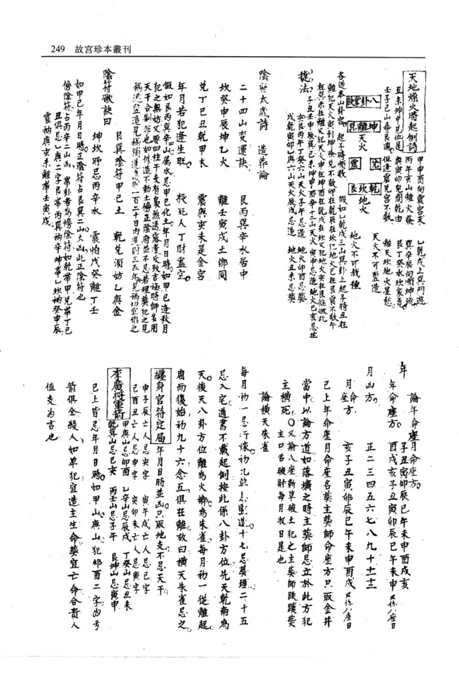

<!-- V3_SOURCE_ID:book010-b000660-p000-98a3c33131 -->

紅觜朱雀（穴前方的形势称谓）对应的日子是壬申、辛巳、庚寅、己亥、戊申、丁巳。

查看对应原文

<!-- V3_FOLDBACK_BEGIN:book010-b000660-p000-98a3c33131 -->

紅觜朱雀旦壬申辛巳庚寅己亥戊申丁巳

<!-- V3_FOLDBACK_END:book010-b000660-p000-98a3c33131 -->

<!-- V3_SOURCE_ID:book010-b000661-p000-162d0339db -->

大煞白虎（穴场或建筑右侧的形势称谓）入中宮的日子是戊辰、丁五、丙戌、乙未、甲辰、癸丑歲。

> **释读存疑：** 丁五含义不详

查看对应原文

<!-- V3_FOLDBACK_BEGIN:book010-b000661-p000-162d0339db -->

大煞白虎入中宮日戊辰丁五丙戌乙未甲辰癸丑歲

<!-- V3_FOLDBACK_END:book010-b000661-p000-162d0339db -->

<!-- V3_SOURCE_ID:book010-b000662-p000-ca12516555 -->

## 月方凶

查看对应原文

<!-- V3_FOLDBACK_BEGIN:book010-b000662-p000-ca12516555 -->

## 月方凶

<!-- V3_FOLDBACK_END:book010-b000662-p000-ca12516555 -->

<!-- V3_SOURCE_ID:book010-b000663-p000-0eefcf4815 -->

甲巳、且丁、如丙子、甲午、癸卯、壬子、辛酉、乙庚月，雷霆白虎入中宮的日子有：丙戌、乙未、甲辰、癸丑、壬戌；丙辛、戊癸月，对应的日子是辛未、庚辰、巳丑、戊成、丁未、丙辰；丁壬、且互甲戊、癸未、服巳。

> **释读存疑：** 原文中“且互甲戊”“癸未服巳”等内容含义不明，“戊成”应为“戊戌”的OCR错误，无法准确释读；本地硬校验仍未通过，已记录供后续自动处理或人工核对。

查看对应原文

<!-- V3_FOLDBACK_BEGIN:book010-b000663-p000-0eefcf4815 -->

甲巳且丁如丙子甲午癸卯壬子辛酉乙庚月戊辰丑雷霆白虎入中宮日 丙戌乙未甲辰癸丑壬戌丙辛戊癸月辛未庚辰巳丑戊成丁未丙辰丁壬且互甲戊癸未服巳

<!-- V3_FOLDBACK_END:book010-b000663-p000-0eefcf4815 -->

<!-- V3_SOURCE_ID:book010-b000664-p000-774bf45c25 -->

月厌对应戌、酉、申、未、午、巳、辰、卯、寅、丑、子、史。

> **释读存疑：** 此处“史”字含义不详

查看对应原文

<!-- V3_FOLDBACK_BEGIN:book010-b000664-p000-774bf45c25 -->

月厭戌酉申未午巳辰卯寅丑子史

<!-- V3_FOLDBACK_END:book010-b000664-p000-774bf45c25 -->

<!-- V3_SOURCE_ID:book010-b000665-p000-019b0fc541 -->

河魁经中说，自明易夹午、丑、申、卯、戌、巳、子、未、寅、酉、辰、亭亭天乙贵神，适宜背向，不适宜朝向卯、辰、巳、午、未、申、酉、戌、吏、子、丑、寅。

> **释读存疑：** 此处“吏”字含义不详，“亭亭”二字含义不详

查看对应原文

<!-- V3_FOLDBACK_BEGIN:book010-b000665-p000-019b0fc541 -->

河魁經色謂自明易夾午丑申卯戌巳子未寅酉辰亭亭天乙貴神宜背不宜向卯辰巳午未申酉戌吏子丑寅

<!-- V3_FOLDBACK_END:book010-b000665-p000-019b0fc541 -->

<!-- V3_SOURCE_ID:book010-b000666-p000-3c6805cafa -->

白奸天乙卯神，适宜朝向，不适宜背向，对应寅、巳、申、亥、寅、巳、申、亥、寅、巳、申。

查看对应原文

<!-- V3_FOLDBACK_BEGIN:book010-b000666-p000-3c6805cafa -->

白奸天乙卯神宣向不宜背夾寅巳申亥寅巳申亥寅巳申

<!-- V3_FOLDBACK_END:book010-b000666-p000-3c6805cafa -->

<!-- V3_SOURCE_ID:book010-b000667-p000-69cc587158 -->

日、年，买年九月乙巳，丙辛年三月辛巳。

查看对应原文

<!-- V3_FOLDBACK_BEGIN:book010-b000667-p000-69cc587158 -->

日 年 買年九月乙巳丙辛年三月辛巳

<!-- V3_FOLDBACK_END:book010-b000667-p000-69cc587158 -->

<!-- V3_SOURCE_ID:book010-b000668-p000-70d37c74a8 -->

文中提及干支组合“十月甲辰”“六月”，其余内容具体所指不详

> **释读存疑：** 丁壬年总戊癸年六月；原文中“丁壬年总戊癸年六月”具体所指不详

查看对应原文

<!-- V3_FOLDBACK_BEGIN:book010-b000668-p000-70d37c74a8 -->

九目唐辰十月甲辰丁壬年总戊癸年六月巳丑

<!-- V3_FOLDBACK_END:book010-b000668-p000-70d37c74a8 -->

<!-- V3_SOURCE_ID:book010-b000669-p000-0826ea6fad -->

文中提及干支组合“乙丑”“甲戌”“癸亥”“壬辰”“庚戌”，其余内容具体所指不详

> **释读存疑：** 寅申巳亥月辛五巳未；原文中“寅申巳亥月辛五巳未”具体所指不详

查看对应原文

<!-- V3_FOLDBACK_BEGIN:book010-b000669-p000-0826ea6fad -->

寅申巳亥月乙丑甲戌癸亥壬辰辛五庚戌巳未

<!-- V3_FOLDBACK_END:book010-b000669-p000-0826ea6fad -->

<!-- V3_SOURCE_ID:book010-b000670-p000-4a66617980 -->

文中提及干支组合“甲子”“癸酉”“壬午”“辛卯”“庚子”“戊午”，其余内容具体所指不详

> **释读存疑：** 火星凶日子午卯酉月巳酉；原文中“火星凶日子午卯酉月巳酉”具体所指不详

查看对应原文

<!-- V3_FOLDBACK_BEGIN:book010-b000670-p000-4a66617980 -->

火星凶日子午卯酉月甲子癸酉壬午辛卯庚子巳酉戊午

<!-- V3_FOLDBACK_END:book010-b000670-p000-4a66617980 -->

<!-- V3_SOURCE_ID:book010-b000671-p000-17efe79d43 -->

文中提及干支组合“壬申”“辛巳”“庚寅”“戊申”“丁巳”，其余内容具体所指不详

> **释读存疑：** 辰戌丑未月巳共；原文中“辰戌丑未月巳共”具体所指不详

查看对应原文

<!-- V3_FOLDBACK_BEGIN:book010-b000671-p000-17efe79d43 -->

辰戌丑未月壬申辛巳庚寅巳共戊申丁巳

<!-- V3_FOLDBACK_END:book010-b000671-p000-17efe79d43 -->

<!-- V3_SOURCE_ID:book010-b000672-p000-e39c6b1e91 -->

修造相关内容中提到，需在太岁中宫处寻找本命，文中提及‘尋着本命不堪修西侍月建中宮’，具体所指不详；发帝寻得的命杀诗中提到‘本命造如休三府月建中宫適去尋太安本年頭三者到位君’，具体所指不详。

> **释读存疑：** 尋着本命不堪修西侍月建中宮；本命造如休三府月建中宫適去尋太安本年頭三者到位君；原文中‘尋着本命不堪修西侍月建中宮’‘本命造如休三府月建中宫適去尋太安本年頭三者到位君’的具体所指不详

查看对应原文

<!-- V3_FOLDBACK_BEGIN:book010-b000672-p000-e39c6b1e91 -->

修造論太歲中宮尋本命尋着本命不堪修西侍月建中宮發帝尋的命殺詩本命造如休三府月建中宫適去尋太安本年頭三者到位君

<!-- V3_FOLDBACK_END:book010-b000672-p000-e39c6b1e91 -->

<!-- V3_SOURCE_ID:book010-b000673-p000-65b8f6f9ce -->

## 休作財散人亡公事憂

查看对应原文

<!-- V3_FOLDBACK_BEGIN:book010-b000673-p000-65b8f6f9ce -->

## 休作財散人亡公事憂

<!-- V3_FOLDBACK_END:book010-b000673-p000-65b8f6f9ce -->

<!-- V3_SOURCE_ID:book010-b000674-p000-fd0eb06830 -->

文中提到‘巳上乃布衣三不修是也’，具体所指不详；其相关方法为‘將太妻入中宮順尋本命到康不可修也’，具体所指不详；又提及‘孫月建入中宮尋作主本命到憲亦不可修也’，具体所指不详；还提到‘三狩日建入中宮尋本命太長到廉又不可修也’，具体所指不详；最后提及‘論正陰府殺人天星地曜例華造忌餘不避’，具体所指不详。

> **释读存疑：** 巳上乃布衣三不修是也；將太妻入中宮順尋本命到康不可修也；孫月建入中宮尋作主本命到憲亦不可修也；三狩日建入中宮尋本命太長到廉又不可修也；論正陰府殺人天星地曜例華造忌餘不避；原文中‘巳上乃布衣三不修是也’‘將太妻入中宮順尋本命到康不可修也’‘孫月建入中宮尋作主本命到憲亦不可修也’‘三狩日建入中宮尋本命太長到廉又不可修也’‘論正陰府殺人天星地曜例華造忌餘不避’的具体所指不详

查看对应原文

<!-- V3_FOLDBACK_BEGIN:book010-b000674-p000-fd0eb06830 -->

巳上乃布衣三不修是也其法將太妻入中宮順尋本命到康不可修也又孫月建入中宮尋作主本命到憲亦不可修也三狩日建入中宮尋本命太長到廉又不可修也名曰三不修犯之損作主傷人論正陰府殺人天星地曜例華造忌餘不避

<!-- V3_FOLDBACK_END:book010-b000674-p000-fd0eb06830 -->

<!-- V3_SOURCE_ID:book010-b000675-p000-529192254d -->

壬子、癸三山的火局，文中提及‘三千天星長未白地曜戊順巳租四’，具体所指不详。

> **释读存疑：** 三千天星長未白地曜戊順巳租四；原文中‘三千天星長未白地曜戊順巳租四’的具体所指不详

查看对应原文

<!-- V3_FOLDBACK_BEGIN:book010-b000675-p000-529192254d -->

壬子癸三山火局忌三千天星長未白地曜戊順巳租四是也

<!-- V3_FOLDBACK_END:book010-b000675-p000-529192254d -->

<!-- V3_SOURCE_ID:book010-b000676-p000-b739ae716b -->

巳、午、丙、丁这四个方位的山，属于火局；壬、癸这两个方位对应二千天星辰，戌、丑、未则是地曜；壬子、癸庚二日，就是对应的相关内容。

> **释读存疑：** ‘二千天星辰’‘二千天星’‘二千’的具体所指不详；‘戌丑未為地曜’‘壬子癸庚二日’的对应关系原文未明；1轮自动修复后核义模型仍建议修订，已保守记录。

查看对应原文

<!-- V3_FOLDBACK_BEGIN:book010-b000676-p000-b739ae716b -->

巳午丙丁四山火局居壬癸二千天星辰戌丑未為地曜壬子癸庚二日是也

<!-- V3_FOLDBACK_END:book010-b000676-p000-b739ae716b -->

<!-- V3_SOURCE_ID:book010-b000677-p000-bb6db18aed -->

坤、艮、辰、戌、丑、未这六个方位的山，属于土局，忌讳甲乙对应的二千天星；寅部向的地曜，对应的是甲寅、卯二日。

> **释读存疑：** ‘二千天星’‘二千’的具体所指不详；‘寅部向’的‘部’字含义原文未明；‘甲寅卯二日’的对应关系原文未明；1轮自动修复后核义模型仍建议修订，已保守记录。

查看对应原文

<!-- V3_FOLDBACK_BEGIN:book010-b000677-p000-bb6db18aed -->

坤艮辰成丑未六山土局忌甲乙二千天星寅部向地曜甲寅卯二日是也

<!-- V3_FOLDBACK_END:book010-b000677-p000-bb6db18aed -->

<!-- V3_SOURCE_ID:book010-b000678-p000-ff0e671c5f -->

乾、申、庚、酉、辛这五个方位的山，属于金局，忌讳丙丁对应的二千天星；巳、午对应的地曜，是丙午、丁未二日。

> **释读存疑：** ‘二千天星’‘二千’的具体所指不详；‘巳午句地翟’的‘句’‘翟’字含义原文未明；‘巳午’与‘地曜’的对应关系原文未明；1轮自动修复后核义模型仍建议修订，已保守记录。

查看对应原文

<!-- V3_FOLDBACK_BEGIN:book010-b000678-p000-ff0e671c5f -->

乾申庚酉辛五山金局忌丙丁二千天星巳午句地翟丙午丁未二日是也

<!-- V3_FOLDBACK_END:book010-b000678-p000-ff0e671c5f -->

<!-- V3_SOURCE_ID:book010-b000679-p000-691368286e -->

这就是正阴府尅山颠的情况，丝毫不差，这一点是明确的。

> **释读存疑：** 正阴府尅山颠的具体所指不详；‘正阴府尅山颠’的具体所指不详

查看对应原文

<!-- V3_FOLDBACK_BEGIN:book010-b000679-p000-691368286e -->

此乃為正陰府尅山顛不差明矣

<!-- V3_FOLDBACK_END:book010-b000679-p000-691368286e -->

<!-- V3_SOURCE_ID:book010-b000680-p000-6b084fac99 -->

正消滅的意思是，消艮丙山，年日消巽辛山，辛日消乾甲山，巳上的陰氣消滅陽氣。

查看对应原文

<!-- V3_FOLDBACK_BEGIN:book010-b000680-p000-6b084fac99 -->

正消滅即消艮丙山而年日消巽辛山辛日消乾甲山巳上陰消陽也

<!-- V3_FOLDBACK_END:book010-b000680-p000-6b084fac99 -->

<!-- V3_SOURCE_ID:book010-b000681-p000-4f4721d92c -->

甲限要先防備山的相關事宜，丁日消震山，車子日消坤乙山，以上都是陽氣消滅陰氣的情況。其中坎離是陰陽的正位，所以沒有消滅的情況。入宅的時候也同樣忌諱這些，建造房屋時也忌諱，名為日神消滅。

查看对应原文

<!-- V3_FOLDBACK_BEGIN:book010-b000681-p000-4f4721d92c -->

甲限防先山 丁日消震山車子日消坤乙山已上陽消陰也内坎離陰陽之正故無消也入宅同忌造英並忌名曰日神消滅

<!-- V3_FOLDBACK_END:book010-b000681-p000-4f4721d92c -->

<!-- V3_SOURCE_ID:book010-b000682-p000-d989d08dec -->

掃地空亡的忌諱：戌未命的人忌諱卯辰，寅午卯命的人忌諱子丑，辰巳子命的人忌諱午未，丑酉申命的人忌諱酉戌。

查看对应原文

<!-- V3_FOLDBACK_BEGIN:book010-b000682-p000-d989d08dec -->

掃地空亡 夾戌未命忌卯辰 寅午卯命忌子丑 辰已子命忌午未 丑酉申命忌酉戌

<!-- V3_FOLDBACK_END:book010-b000682-p000-d989d08dec -->

<!-- V3_SOURCE_ID:book010-b000683-p000-3a75744aaa -->

入地空亡的忌讳：甲巳命的人忌讳庚午日，乙庚命的人忌讳庚辰日，戊癸命的人忌讳丙辛吟忌与寅日，丁壬命的人忌讳庚成日、庚申日。以上所忌的内容，旧龟云说：‘如山向相合，亡命真祥马青人太阳阴到中，富亦化由吉不’，具体所指不详。

> **释读存疑：** 丙辛吟忌與寅日；真祥馬青人太陽陰到中；富亦化由吉不；丙辛吟忌與寅日具体所指不详；真祥馬青人太陽陰到中具体所指不详；富亦化由吉不具体所指不详；1轮自动修复后核义模型仍建议修订，已保守记录。

查看对应原文

<!-- V3_FOLDBACK_BEGIN:book010-b000683-p000-3a75744aaa -->

入地空亡 甲巳命忌庚午日 乙庚命忌庚辰日戊癸命忌丙辛吟忌與寅日 丁壬命忌庚成日忌庚申田已上所忌糟舊龜云如山向相合亡命真祥馬青人太陽陰到中富亦化由吉不

<!-- V3_FOLDBACK_END:book010-b000683-p000-3a75744aaa -->

<!-- V3_SOURCE_ID:book010-b000684-p000-8a97137557 -->

冷地空亡的禁忌：丁、壬日出生的人忌讳丑、未；戊、癸日出生的人忌讳辰、戌；甲、巳日出生的人忌讳子、午；乙、庚日出生的人忌讳寅、申；丙、辛日出生的人忌讳卯、酉。

查看对应原文

<!-- V3_FOLDBACK_BEGIN:book010-b000684-p000-8a97137557 -->

冷地空亡 丁壬命忌丑未戊癸命忌辰戌 甲巳命忌子午 乙庚命足寅申 丙辛命忌卯酉

<!-- V3_FOLDBACK_END:book010-b000684-p000-8a97137557 -->

<!-- V3_SOURCE_ID:book010-b000685-p000-7d57088c9a -->

以上这些忌讳的日子和时辰，适宜包含亡命、贵人、顽马，或者太阳生气、火星来到中宫来辅助化解空亡，这难道不是空中的吉利吗？如今遵循‘协杞辨方书’，仍然有这三条空亡的说法。

> **释读存疑：** ‘协杞辨方书’具体所指不详

查看对应原文

<!-- V3_FOLDBACK_BEGIN:book010-b000685-p000-7d57088c9a -->

已上各忌日時宜含亡命貴人頑馬或太陽生氣火星到中宮助化空發豈不是空中之吉也今遵協杞辨方書猶此三条空蓋毗

<!-- V3_FOLDBACK_END:book010-b000685-p000-7d57088c9a -->

<!-- V3_SOURCE_ID:book010-b000686-p000-129a43bea4 -->

浮天空亡、头白空亡，对应年干为甲、乙、丙、丁、戊、巳、庚、辛、壬、癸的情况。

查看对应原文

<!-- V3_FOLDBACK_BEGIN:book010-b000686-p000-129a43bea4 -->

浮天空亡 頭白空亡 年干甲乙丙丁戊巳庚辛壬癸

<!-- V3_FOLDBACK_END:book010-b000686-p000-129a43bea4 -->

<!-- V3_SOURCE_ID:book010-b000687-p000-e21476cfc6 -->

離、坎、巽、震、坤、乾、兌、艮、乾、坤。

查看对应原文

<!-- V3_FOLDBACK_BEGIN:book010-b000687-p000-e21476cfc6 -->

離坎巽震坤乾兌艮乾坤

<!-- V3_FOLDBACK_END:book010-b000687-p000-e21476cfc6 -->

<!-- V3_SOURCE_ID:book010-b000688-p000-edaca860cf -->

壬、癸、辛、庚、乙、甲、丁、丙、甲、乙对应的星、马、贵人的吉凶方位，立成表。

> **释读存疑：** 原文中“星馬貴人”的具体所指未明

查看对应原文

<!-- V3_FOLDBACK_BEGIN:book010-b000688-p000-edaca860cf -->

壬癸辛庚乙甲丁丙甲乙星馬貴人吉凶方位立成

<!-- V3_FOLDBACK_END:book010-b000688-p000-edaca860cf -->

<!-- V3_SOURCE_ID:book010-b000689-p000-3dad16d513 -->

星、马对应的吉凶神煞。

> **释读存疑：** 原文中“星馬”的具体所指未明

查看对应原文

<!-- V3_FOLDBACK_BEGIN:book010-b000689-p000-3dad16d513 -->

星馬吉凶神

<!-- V3_FOLDBACK_END:book010-b000689-p000-3dad16d513 -->

<!-- doc003 PDF 第 254 页：旋转/复杂版面 OCR 供检索；内容与排版以原页图为准。 -->
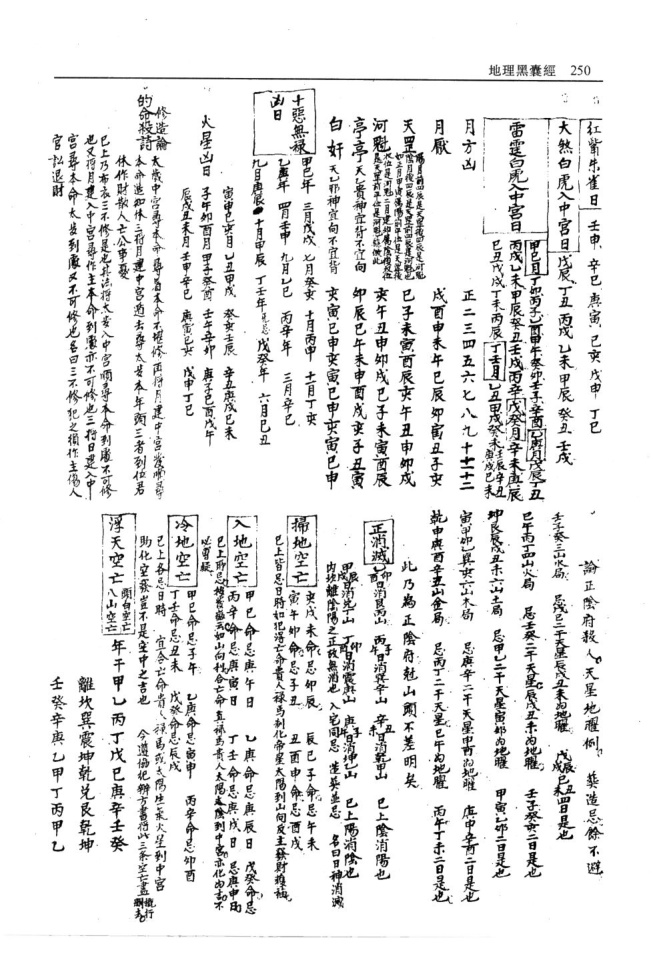

<!-- V3_SOURCE_ID:book010-b000691-p000-b3d5cf2ec6 -->

金将太太大丧吊天官小病天神军岁乙耗门客定符耗符乙乾（八卦之一）壬癸艮（八卦之一）甲乙巽（八卦之一）丙丁坤（八卦之一）庚辛亥子丑寅卯辰巳午未申酉戌坤与辛乾（八卦之一）壬癸艮（八卦之一）甲乙巽（八卦之一）丙丁申酉戌亥子丑寅卯辰巳午未艮（八卦之一）甲乙巽（八卦之一）丙丁坤（八卦之一）庚辛乾（八卦之一）壬癸寅卯辰巳午未申酉戌亥子丑。

> **释读存疑：** 原文中“金将太太大丧弔天官小病天神軍歲乙耗門客定符耗符”的具体所指未明

查看对应原文

<!-- V3_FOLDBACK_BEGIN:book010-b000691-p000-b3d5cf2ec6 -->

金将太太大丧弔天官小病天神軍歲乙耗門客定符耗符乙乾壬癸艮甲乙巽丙丁坤庚辛亥子丑寅卯辰巳午未申酉戌坤與辛乾壬癸艮甲乙巽丙丁申酉戌亥子丑寅卯辰巳午未艮甲乙巽丙丁坤庚辛乾壬癸寅卯辰巳午未申酉戌亥子丑

<!-- V3_FOLDBACK_END:book010-b000691-p000-b3d5cf2ec6 -->

<!-- V3_SOURCE_ID:book010-b000692-p000-22b5948b4b -->

协犯辨方书论中宫。

> **释读存疑：** 原文中“協犯辨方書論”的具体所指未明

查看对应原文

<!-- V3_FOLDBACK_BEGIN:book010-b000692-p000-22b5948b4b -->

協犯辨方書論中宮

<!-- V3_FOLDBACK_END:book010-b000692-p000-22b5948b4b -->

<!-- V3_SOURCE_ID:book010-b000693-p000-7471c0843b -->

按照确定中宫的方法来论层级，固然不够精准，而论丈尺也未必十分准确。方位都要靠目视来确定吗？所谓的定，比如大门以厅事为中是可以的，厅后以正寝为中是可以的，坟堂以祖穴为中是可以的。位置随脚步移动而变化，只有变化才适宜，关键在于观察地形地势，选取地势尊贵的作为主体，以此来面对四方，这样才会义理精当、道理得当。

查看对应原文

<!-- V3_FOLDBACK_BEGIN:book010-b000693-p000-7471c0843b -->

按定中宮之法論層教固未精而論丈尺亦未甚確 方位皆以目之耶見為定如大門則以廳事為中可也 如廳後則以正寢為中可也如墳堂則以租穴為中可 也移步換形惟变適要在相其形勢取其尊者為主 以臨四方庶義精而理得矣

<!-- V3_FOLDBACK_END:book010-b000693-p000-7471c0843b -->

<!-- V3_SOURCE_ID:book010-b000694-p000-f8f9f30884 -->

四大金星诗：甲巳成丁乙朝尾宫停，丙辛楼甲位，丁壬见上侵，戊从库上犯日。

查看对应原文

<!-- V3_FOLDBACK_BEGIN:book010-b000694-p000-f8f9f30884 -->

四大金星詩 甲巳成丁乙朝尾宮停丙辛樓甲位丁壬見上侵 戊從庫上犯日

<!-- V3_FOLDBACK_END:book010-b000694-p000-f8f9f30884 -->

<!-- V3_SOURCE_ID:book010-b000695-p000-9794dcb44d -->

此处提及年、乙、丙辛、丁ま、戊葵、寒鸦暗腥、T、巽、甲、乾，其中巽、乾为八卦之一。

> **释读存疑：** 丁ま、戊葵、寒鸦暗腥、T的具体所指不详；1轮自动修复后核义模型仍建议修订，已保守记录。

查看对应原文

<!-- V3_FOLDBACK_BEGIN:book010-b000695-p000-9794dcb44d -->

年 乙 丙辛 丁ま 戊葵寒鴉暗腥 T 巽 甲 乾

<!-- V3_FOLDBACK_END:book010-b000695-p000-9794dcb44d -->

<!-- V3_SOURCE_ID:book010-b000696-p000-ec348852d4 -->

论述斩草三凶日。

查看对应原文

<!-- V3_FOLDBACK_BEGIN:book010-b000696-p000-ec348852d4 -->

論斬草三凶日

<!-- V3_FOLDBACK_END:book010-b000696-p000-ec348852d4 -->

<!-- V3_SOURCE_ID:book010-b000697-p000-cfaab851f0 -->

初一、初八、十五这三天，只忌讳使用雞斬草破土。触犯地神，会导致亡魂不安，生人受祸；若在这三天使用雞斬草，也属忌讳。

查看对应原文

<!-- V3_FOLDBACK_BEGIN:book010-b000697-p000-cfaab851f0 -->

初一初八十五其日止忌用雞斬草破土觸犯地神使亡魂不安生人受祸用此日斬草則亦忌之

<!-- V3_FOLDBACK_END:book010-b000697-p000-cfaab851f0 -->

<!-- V3_SOURCE_ID:book010-b000698-p000-5c89b03583 -->

论述十二地支六合的内容，《蠡海集》中记载：阴阳家所说的地支六合，是指日月会于子位时，斗建指向丑位；日月会于丑位时，斗建指向子位，所以子与丑合。日月会于寅位时，斗建指向夾位；日月会于夾位时，斗建指向寅位，所以寅与夾合。其余以此类推。《考原》中记载：六合，是指月建与月将相合。比如正月建寅，当月月将在亥，所以寅与亥合；二月建卯，当月月将在戌，所以卯与戌合。月建左旋，月将右转，顺逆相值，因此称为六合。

查看对应原文

<!-- V3_FOLDBACK_BEGIN:book010-b000698-p000-5c89b03583 -->

論十二支六合蠡海集曰陰陽家地支六昔日月會于子則斗建丑日月會於丑則斗建子故子與丑合日月會於寅則斗建夾日月會於夾則斗建寅故寅與夾合餘倣此考原曰六合者以月建與月衍爲相合也如正月建當月在亥故寅與亥合二月建卯月得戍故卯與戍合也月建左旋月将右轉順逆相值故爲六合

<!-- V3_FOLDBACK_END:book010-b000698-p000-5c89b03583 -->

<!-- V3_SOURCE_ID:book010-b000699-p000-bad03ddd78 -->

按月的意思是，日月无光时月亮承受日光，月亮运行与太阳相合而成岁。杞的意思是，太阳是月亮的附属，所以说月不是另有神，是随太阳右转的。其躔次：亥曰訾，戌曰降娄，酉曰大梁，申曰实沈，未曰鹑首，午曰鹑火，巳曰鹑尾，辰曰寿星，卯曰大火，寅曰析木，丑曰星杞，子曰玄枵。春秋左氏传已有这种说法，至今仍在使用。《协纪辨方书》中记载：金积于西北，水盛于东南；海为百川朝宗之处，河为其源头。祭祀川渎，要先祭河后祭海。黄河源出于昆仑，对应戌位，所以戌为水。《史记·天官书》中记载：云汉是其本源，河。《河图括地象》中记载：河精为天汉。《唐书·天文志》中记载：北斗自乾携巽为天纲，云汉自坤抵艮为地纪。如此说来，寅申是水的初始。此节出自《辅化辨方书》论半儿立行木篇。《蓬瀛书》中记载：岁在四孟，太阴与大将军合于四仲，名曰羣丑。《历神原始》中记载：天地凶殃，必羣丑。

> **释读存疑：** 星杞；羣丑

查看对应原文

<!-- V3_FOLDBACK_BEGIN:book010-b000699-p000-bad03ddd78 -->

按月即是日月無光受日之光月行與日合而成歲杞 則是日者月之将也故曰月哲非別有神從日而右轉者 也其躔次亥曰訾戍曰降娄酉曰大梁申曰實沈未曰 鶉首午曰鶉火巳曰鶉尾辰曰壽星卯曰大火寅曰析木 丑曰星杞子曰玄枵春狄左氏傳巳有其說至今用之 協紀辦方書曰金積于西北而水盛于東南海爲百川之 朝宗而河爲之源焉祭川耶以先河後海也河源出於崑 崙戌位也故戊為水也史記天官書曰雲漢旨其本水河 圗括地象曰河精爲天漢唐書天文志曰北斗自乾攜巽 爲天綱雲漢自坤抵艮為地紀然則寅申者水之於始也 此節出輔化辨方書論半兒立行木篇 蓬瀛書曰歲在四孟太陰與大将軍合于四仲名曰羣醜 歷神原始曰天地凶殃必羣醜

<!-- V3_FOLDBACK_END:book010-b000699-p000-bad03ddd78 -->

<!-- V3_SOURCE_ID:book010-b000700-p000-47f4e85ac5 -->

陰府太歲

查看对应原文

<!-- V3_FOLDBACK_BEGIN:book010-b000700-p000-47f4e85ac5 -->

陰府太歲

<!-- V3_FOLDBACK_END:book010-b000700-p000-47f4e85ac5 -->

<!-- V3_SOURCE_ID:book010-b000702-p000-6e503ccea3 -->

《通书》中记载年神立成相关内容：阴府太岁的对应关系为，甲巳年对应艮、巽；乙庚年对应兑、乾；丙辛年对应坎、坤；丁壬年对应离；戊癸年对应震。又说府太岁只忌讳开山营造，修方则不忌讳。甲巳年的月日时属土，会克制艮、丙、巽、辛、山、乙、庚；乙庚年的月日时属金，会克制乾、甲、兑、丁、已丑山；丙辛年的月日时属水，会克制坎、癸、坤、乙、申、辰山；丁壬年的月日时属木，会克制离、壬寅戌山；戊癸年的月日时属火，会克制震、庚、夹未山。起例说：正阴府，甲巳年对应艮、巽；乙庚年对应兑、乾；丙辛年对应坎、坤；丁壬年对应乾、离；戊癸年对应坤、震。傍阴府，甲巳年对应丙辛、乙庚年；丙辛年对应丁壬、丙辛年；戊癸年对应丁壬、甲巳年；戊癸年对应乙庚年。阴府三合，乙庚年对应巳、丑；丙辛年对应申、辰；丁

> **释读存疑：** 原文末尾“丁”后内容残缺，具体所指不详；1轮自动修复后核义模型仍建议修订，已保守记录。

查看对应原文

<!-- V3_FOLDBACK_BEGIN:book010-b000702-p000-6e503ccea3 -->

通書年神立成陰府太歲甲巳年艮巽乙庚年兌乾丙辛 年坎坤丁壬年離戊癸年震又曰府太歲惟忌開山營 造修方不忌甲巳年月日時屬土尅艮丙巽辛山乙庚年 月日時屬金尅乾甲兌丁已丑山丙辛年月日時属水尅 坎癸坤乙申辰山丁壬年月日時屬木尅離壬寅戌山戊 癸年月日時屬火尅震庚夾未山○起例曰正陰府甲巳 年艮巽乙庚年兌乾丙辛年坎坤丁壬年乾離戊癸年坤 震傍陰府甲巳年丙辛乙庚年丁壬丙辛年戊癸丁壬年 甲巳戊癸年乙庚陰府三合乙庚年巳丑丙辛年申辰丁

<!-- V3_FOLDBACK_END:book010-b000702-p000-6e503ccea3 -->

<!-- V3_SOURCE_ID:book010-b000703-p000-bbefced12c -->

壬年对应寅、戌；戊癸年对应亥、未。月神从月千起者，为阴府太岁。

> **释读存疑：** 原文“月神從月千起者”表述模糊，具体所指不详

查看对应原文

<!-- V3_FOLDBACK_BEGIN:book010-b000703-p000-bbefced12c -->

壬年寅戌戊癸年亥未 月神從月千起者 陰府太歲

<!-- V3_FOLDBACK_END:book010-b000703-p000-bbefced12c -->

<!-- V3_SOURCE_ID:book010-b000704-p000-ee4a286e82 -->

甲巳年对应的卦序为坎、坤、巽、乾、坤、离、震、艮、兑、坎、坤、离、震、艮、兑、坎、坤、巽、乾、坤、离。

查看对应原文

<!-- V3_FOLDBACK_BEGIN:book010-b000704-p000-ee4a286e82 -->

甲已年 坎乾坤巽乾坤離震艮兌坎乾坤離震艮兌坎乾坤巽乾坤離

<!-- V3_FOLDBACK_END:book010-b000704-p000-ee4a286e82 -->

<!-- V3_SOURCE_ID:book010-b000705-p000-ccf03460b2 -->

坤、巽、乾、坤、离、震、艮、兑、坎、坤、巽；乙庚年对应的卦序为震、艮、兑、坎、坤、巽、乾、坤、离、震、艮。

查看对应原文

<!-- V3_FOLDBACK_BEGIN:book010-b000705-p000-ccf03460b2 -->

坤巽乾坤離震艮兌坎乾坤巽 乙庚年 震艮兌坎乾坤巽乾坤離震艮

<!-- V3_FOLDBACK_END:book010-b000705-p000-ccf03460b2 -->

<!-- V3_SOURCE_ID:book010-b000706-p000-944da57857 -->

丙辛年对应的卦序为乾、兌、坎、坤、乾、巽、乾、坤、離、震、艮、兌、坎。

查看对应原文

<!-- V3_FOLDBACK_BEGIN:book010-b000706-p000-944da57857 -->

丙辛年乾 兌坎乾坤巽乾坤離震艮兌坎

<!-- V3_FOLDBACK_END:book010-b000706-p000-944da57857 -->

<!-- V3_SOURCE_ID:book010-b000707-p000-2e19ef85c3 -->

丁壬年对应的卦序为離、震、艮、兌、坎、乾、坤、巽、乾、坤、離、震，以及乾、坤、巽、乾、坤、離、震、艮、兌、坎、乾、坤。

查看对应原文

<!-- V3_FOLDBACK_BEGIN:book010-b000707-p000-2e19ef85c3 -->

丁壬年 離震艮兌坎乾坤巽乾坤離震 乾坤巽乾坤離震艮兌坎乾坤

<!-- V3_FOLDBACK_END:book010-b000707-p000-2e19ef85c3 -->

<!-- V3_SOURCE_ID:book010-b000708-p000-6ccbaf8841 -->

戊癸年对应的卦序为艮、兌、坎、乾、坤、巽、乾、坤、離、震、艮、兌，以及巽、乾、坤、離、震、艮、兌、坎、乾、坤、巽、乾。

查看对应原文

<!-- V3_FOLDBACK_BEGIN:book010-b000708-p000-6ccbaf8841 -->

戊癸年 艮兌坎乾坤巽乾坤離震艮兌 巽乾坤離震艮兌坎乾坤巽乾

<!-- V3_FOLDBACK_END:book010-b000708-p000-6ccbaf8841 -->

<!-- V3_SOURCE_ID:book010-b000709-p000-c974f0206e -->

《洪範》五墓龍變運通書大全中记载：二十四山的疑似讹误的“洪苑”五行，需在內正運中运用本年五子元遁之数，数至本山的墓辰，该墓辰的“枘音”具体所指不详，需由變運取太歲縱音，与本年墓对应的納音相生则为吉；若墓運的納音尅太歲納音则为凶，仅需忌讳年、月、日、时的納音尅墓運的音。甲寅、辰、巽、戊、坎、申、辛这八山的正運为馬水，丑、癸、坤、庚、未这五山的正運屬土，水土的墓在辰。

> **释读存疑：** “洪苑”疑似讹误，具体所指不详；“枘音”具体所指不详

查看对应原文

<!-- V3_FOLDBACK_BEGIN:book010-b000709-p000-c974f0206e -->

洪範五墓龍变運通書大全曰二十四山洪苑五行內正運用本年五子元遁数至本山墓辰其墓辰之枘音由变運取太歲縱音與本年墓是納音相生合曲吉墓運納音尅太歲納音由吉惟忌年月日時之納音尅墓運的音耳甲寅辰巽戊坎申辛八山正運馬水丑癸坤庚未五山正運屬土水土墓在辰

<!-- V3_FOLDBACK_END:book010-b000709-p000-c974f0206e -->

<!-- V3_SOURCE_ID:book010-b000710-p000-6a76f63394 -->

甲巳年戊辰未運，忌用金屬的年月日時；乙庚年庚辰金運，忌用火屬的年月日時；丙辛年壬辰水運，忌用土屬的年月日時。

查看对应原文

<!-- V3_FOLDBACK_BEGIN:book010-b000710-p000-6a76f63394 -->

甲巳年戊辰未運忌用金年月日時乙庚年庚辰金運忌用火年月日時丙辛年壬辰水運忌用土年月日時

<!-- V3_FOLDBACK_END:book010-b000710-p000-6a76f63394 -->

06

<!-- V3_SOURCE_ID:book010-b000712-p000-e27c7c8e05 -->

丁壬年甲辰火運，忌用水屬的年月日時；戊癸年丙辰土運，忌用木屬的年月日時。

查看对应原文

<!-- V3_FOLDBACK_BEGIN:book010-b000712-p000-e27c7c8e05 -->

丁壬年甲辰火運忌用水年月日時戊癸年丙辰土運忌用本年月日時

<!-- V3_FOLDBACK_END:book010-b000712-p000-e27c7c8e05 -->

<!-- V3_SOURCE_ID:book010-b000713-p000-4bd6594de0 -->

離、壬、丙、乙這四座山的正運屬火，火的墓位在戌。

查看对应原文

<!-- V3_FOLDBACK_BEGIN:book010-b000713-p000-4bd6594de0 -->

離壬丙乙四山正運屬火火墓在戌

<!-- V3_FOLDBACK_END:book010-b000713-p000-4bd6594de0 -->

<!-- V3_SOURCE_ID:book010-b000714-p000-6d910868fe -->

甲巳年甲戌火運，忌用水屬的年月日時；乙庚年丙戌土運，忌用木屬的年月日時；丙辛年戊戌木運，忌用金屬的年月日時；丁壬年庚戌金運，忌用火屬的年月日時。

查看对应原文

<!-- V3_FOLDBACK_BEGIN:book010-b000714-p000-6d910868fe -->

甲巳年甲戌火運忌用水年月日時乙庚年丙戌土運忌用木年月日時丙辛年戊戌木運忌用金年月日時丁壬年庚戌金運忌用火年月日時

<!-- V3_FOLDBACK_END:book010-b000714-p000-6d910868fe -->

<!-- V3_SOURCE_ID:book010-b000715-p000-1bc10298ac -->

震、艮、巳这三座山的正运属木，木的墓位在未。

查看对应原文

<!-- V3_FOLDBACK_BEGIN:book010-b000715-p000-1bc10298ac -->

震艮巳三山正運屬木木墓在未

<!-- V3_FOLDBACK_END:book010-b000715-p000-1bc10298ac -->

000

<!-- V3_SOURCE_ID:book010-b000717-p000-b69416db30 -->

甲巳年的辛未土运，忌讳使用木的年、月、日、时；乙庚年的癸未木运，忌讳使用金的年、月、日、时；丙辛年的乙未金运，忌讳使用火的年、月、日、时；丁壬年的丁未水运，忌讳使用土的年、月、日、时。

查看对应原文

<!-- V3_FOLDBACK_BEGIN:book010-b000717-p000-b69416db30 -->

甲巳年辛未土運忌用木年月日時乙庚年癸未木運忌用金年月日時丙辛年乙未金運忌用火年月日時丁壬年丁未水運忌用土年月日時

<!-- V3_FOLDBACK_END:book010-b000717-p000-b69416db30 -->

<!-- V3_SOURCE_ID:book010-b000718-p000-2ca1b1bae3 -->

乾、兌、丁这四座山的正运属金，金的墓位在丑。

查看对应原文

<!-- V3_FOLDBACK_BEGIN:book010-b000718-p000-2ca1b1bae3 -->

乾夷兌丁四山正運屬金金墓在丑

<!-- V3_FOLDBACK_END:book010-b000718-p000-2ca1b1bae3 -->

<!-- V3_SOURCE_ID:book010-b000719-p000-d1a420df90 -->

甲己年的乙丑金运，忌讳使用火的年、月、日、时。

查看对应原文

<!-- V3_FOLDBACK_BEGIN:book010-b000719-p000-d1a420df90 -->

甲己年乙丑金運忌用火年月日時

<!-- V3_FOLDBACK_END:book010-b000719-p000-d1a420df90 -->

<!-- V3_SOURCE_ID:book010-b000720-p000-5c778b19e4 -->

冬至之后的丁丑年，水运（风水语境中的河流、水系及其来去形态）对应的年、月、日、时都忌讳使用土；乙庚年的丁丑水运，对应的年、月、日、时也忌讳使用土。

查看对应原文

<!-- V3_FOLDBACK_BEGIN:book010-b000720-p000-5c778b19e4 -->

冬至後丁丑水運忌用土年月日時乙庚年丁丑水運忌用土年月日時

<!-- V3_FOLDBACK_END:book010-b000720-p000-5c778b19e4 -->

<!-- V3_SOURCE_ID:book010-b000721-p000-c50b9ae1db -->

冬至之后的己丑年，大运对应的年、月、日、时都忌讳使用水；丙辛年的己丑火运，对应的年、月、日、时也忌讳使用水。

查看对应原文

<!-- V3_FOLDBACK_BEGIN:book010-b000721-p000-c50b9ae1db -->

冬至後己丑大運忌用水年月日時丙辛年己丑火運忌用水年月日時

<!-- V3_FOLDBACK_END:book010-b000721-p000-c50b9ae1db -->

<!-- V3_SOURCE_ID:book010-b000722-p000-98496b2da5 -->

冬至之后的辛丑年，土运对应的年、月、日、时都忌讳使用木；丁壬年的辛丑土运，对应的年、月、日、时也忌讳使用木。

查看对应原文

<!-- V3_FOLDBACK_BEGIN:book010-b000722-p000-98496b2da5 -->

冬至後辛丑土運忌用木年月日時丁壬年辛丑土運忌用本年月日時

<!-- V3_FOLDBACK_END:book010-b000722-p000-98496b2da5 -->

<!-- V3_SOURCE_ID:book010-b000723-p000-c2d8072ff6 -->

冬至之后的癸丑年，木运对应的年、月、日、时都忌讳使用金；戊癸年的癸丑木运，对应的年、月、日、时也忌讳使用金。

查看对应原文

<!-- V3_FOLDBACK_BEGIN:book010-b000723-p000-c2d8072ff6 -->

冬至後癸丑木運忌用金年月日時戊癸年癸丑木運忌用金年月日時

<!-- V3_FOLDBACK_END:book010-b000723-p000-c2d8072ff6 -->

<!-- V3_SOURCE_ID:book010-b000724-p000-f4acae0614 -->

冬至之后的乙丑日，金运忌讳使用火对应的年、月、日、时。

查看对应原文

<!-- V3_FOLDBACK_BEGIN:book010-b000724-p000-f4acae0614 -->

冬至後乙丑金運忌用火年月日時

<!-- V3_FOLDBACK_END:book010-b000724-p000-f4acae0614 -->

<!-- V3_SOURCE_ID:book010-b000725-p000-484a7e4d00 -->

按：墓龙指本山龙，是五行的墓库。变运指本墓库的纳音随岁运而变化。使用五子元遁，与七政从冬至起算的含义相同。上年冬至对应巳属今年，今年冬至对应己属明年，天地之运都从子开始。不过五子元遁从子开始、到亥结束，而一岁统四時，冬至后的丑月，岁君尚未变更，但墓运已经确定，丑为金墓，因此金山的墓运在冬至后又会重复出现。比如甲山正运为水，水墓在辰，甲巳年用五子元遁从甲子顺数，得到戊辰纳音属木，即为木运，对应山属金，金墓在丑，甲己年用五子元遁从甲子顺数，得到乙丑纳音属金，即为金运，冬至后属于乙庚年，用乙庚年的五子元遁从丙子顺数得到丁，或用甲巳年的五子元遁从月甲子顺数到乙亥，再继续顺数到丑，也能得到丁纳音属水，即为水运，其余以此类推。

> **释读存疑：** “重叟”具体含义不详；“邵”的具体含义不详；“丁”在此处的具体所指不详；1轮自动修复后核义模型仍建议修订，已保守记录。

查看对应原文

<!-- V3_FOLDBACK_BEGIN:book010-b000725-p000-484a7e4d00 -->

桉墓龍者本山龍洪範五行之墓庫變運者本墓庫之納 音隨歲運而變者也用五子元遁者與七政自冬至起算 同義上年冬至巳屬今年今年冬己屬明年天地之運皆 自子始也然五子元遁始子終亥而一歲統四時冬至後 丑月歲君未更而墓運己政丑爲金墓故金山之墓運冬 至後又重叟也如甲山正運水水墓在辰甲巳年五子元 遁自甲子順數得戊辰納音屬木郎為木運就山屬金金 墓在丑甲己年五子元遁自甲子順數得乙丑納音屬金 邵為金運冬至後属乙庚年用乙庚年五子元遁自丙子 順數得丁或用甲巳年五子元遁月甲子順數至乙亥又 進而順數至丑亦得丁納音屬水節爲水運餘倣此

<!-- V3_FOLDBACK_END:book010-b000725-p000-484a7e4d00 -->

<!-- V3_SOURCE_ID:book010-b000726-p000-d0e7158c33 -->

年月尅山家

查看对应原文

<!-- V3_FOLDBACK_BEGIN:book010-b000726-p000-d0e7158c33 -->

年月尅山家

<!-- V3_FOLDBACK_END:book010-b000726-p000-d0e7158c33 -->

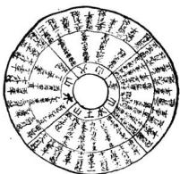

<!-- V3_SOURCE_ID:book010-b000728-p000-163ce86ae5 -->

通书大全记载：本年二十四山（将周天划分为二十四个方位的体系）的墓龙、叟运，某山的运是年月抽音所尅，某山是年月尅某山，只针对新建宅舍、新立坟塋进行讨论，拆修、竖造、不移动地基的旧坟附葬，都不讨论。

查看对应原文

<!-- V3_FOLDBACK_BEGIN:book010-b000728-p000-163ce86ae5 -->

通書大全曰本年二十四山墓龍叟運某山運爲年月抽音所尅節爲年月尅某山惟新建宅舍新立墳塋論之其拆修豎造不動地基為舊塋附葬者皆不論

<!-- V3_FOLDBACK_END:book010-b000728-p000-163ce86ae5 -->

<!-- V3_SOURCE_ID:book010-b000729-p000-bcb460ea4e -->

比如甲子年的纳音属金，本年水土山的暮运戊辰属木，受年纳音的克制，就成为本年克制甲宙辰巽戌坎辛申八水山、丑癸坤庚未五土山的情况。甲子年丙寅、丁卯、甲戌、乙亥月的纳音属火，本年金山的墓运乙丑属金，受月纳音的克制，就成为正、二、九、十月克制乾亥、兑丁四金山的情况。戊辰、巳、己月的纳音属木，本年木山的墓运辛未属土，受月纳音的克制，就成为三、四月克制震艮巳三木山的情况。庚午、辛未月的纳音属土，本年二十四山没有水运，该月没有克制。壬申、癸酉月的纳音属金，与本年纳音相同，所以也克制水土山。丙子、丁丑月的纳音属水，本年火山的墓运甲戌属火，受月纳音的克制，就成为十一、十二月克制离壬丙乙四火山的情况。又如壬申年的纳音属金，本年二十四山没有木运，只有冬至后金山的墓运癸丑属木，受年纳音的克制，就成为本年二十四山并无克制，冬至后克制乾夾兑丁四金山的情况。日、时克制山家的情况都依照这个规则。凡是从年、月起算山家的方法，是用本年五子元遁历数，丑、辰、未、戌四墓的纳音被年、月纳音所克制的，该墓对应的就是某山的墓运，成为年、月克制某山的情况。大概墓龙变运是从山起算而忌讳年、月，而这里是从年、月起算而克制山家，二者互相推演，道理是一样的。

> **释读存疑：** 甲宙辰巽戌坎辛申八水山、丑癸坤庚未五土山的具体所指原文未明；乾夾兌丁四金山的具体所指原文未明；本地硬校验仍未通过，已记录供后续自动处理或人工核对。

查看对应原文

<!-- V3_FOLDBACK_BEGIN:book010-b000729-p000-bcb460ea4e -->

如甲子年納音屬金本年水土山暮運戊辰屬木受年納音之尅節為本年尅甲宙辰巽戌坎辛申八水山丑癸坤庚未五土山也甲子年丙寅丁卯甲戌乙亥月納音属火本年金山墓運乙丑屬金受月納音之尅郎爲正二九十月尅乾亥兌丁四金山也戊辰巳己月納音屬木本年木山墓運辛未属土受月納音之尅郎爲三四月尅震艮巳三木山也庚午辛未月納音屬土本年二十四山無水運郎其月無尅也壬申癸酉月納音屈金與本年納音同故亦尅水土山也丙子丁丑月納音屬水本年火山墓運甲戌屬火受月納音之尅節爲十一十二月尅離壬丙乙四火山也又如壬申年納音屬金本年二十四山無木運惟冬至後金山墓運癸丑屬木受年執音之尅郎為本年二十四山並無尅冬至後尅乾夾兌丁四金山也日時尅山家俱倣此凡自年月起山家之法用本年五子元遁歷数丑辰未戌四墓納音為年月納音所尅者其墓為某山之墓郎為年月尅某山蓋墓龍變運從山起而忌年月此從年月起而尅山家參互相推其理一也

<!-- V3_FOLDBACK_END:book010-b000729-p000-bcb460ea4e -->

<!-- V3_SOURCE_ID:book010-b000730-p000-49ed68ce83 -->

文中提到“運變龍墓”“五墓”“歸忌”“徃亡”“大煞”“地囊”“土符”“九坎九蕉”“九空”“災煞天大”，这些短语的具体所指不详。

> **释读存疑：** 運變龍墓；五墓；歸忌；徃亡；大煞；地囊；土符；九坎九蕉；九空；災煞天大；運變龍墓、五墓、歸忌、徃亡、大煞、地囊、土符、九坎九蕉、九空、災煞天大的具体所指原文未明

查看对应原文

<!-- V3_FOLDBACK_BEGIN:book010-b000730-p000-49ed68ce83 -->

運變龍墓 五墓 歸忌 徃亡 大煞 地囊 土符 九坎九蕉 九空 災煞天大

<!-- V3_FOLDBACK_END:book010-b000730-p000-49ed68ce83 -->

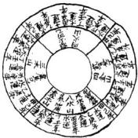

<!-- V3_SOURCE_ID:book010-b000732-p000-783408fff5 -->

此处为表格，表格内有数字0，顶部标题为“年神從歲納音起者”，表格内包含“乾亥震艮離壬 乾亥水”“年尅山家”“子午年”“寅申年”“辰戌年”“乙庚年 兄丁已山丙乙”“先丁山”“丙辛年”“乾夾雜壬震艮水”“丙乾亥兄丁 冬至復尅”“震艮巳”“水土山”“戌”“乾奕先丁”“與乾亥先丁”“震艮離壬 戊癸年”“水土震艮”“上二層核每甲丙戊真壬者乃位甲年申寅年 甲申甲辰甲戌感其不丙字者乃休丙子丙午”“壬”“乾来先丁”“冬至後尅 乾吏兑丁”“丙寅西申南辰西成社題堰”“丑未年”“如酉年”“巳亥年”“月神隨四序者”“春夏”“秋 冬”“戊丑辰”“未”“四忌”“甲子丙子 八龍 2 鳥”“庶子壬子 九虎”“四窍”“乙亥丁夾辛亥”“癸亥”“四耗”“壬子夘戊午辛酉”“四廢”“庚申辛酉壬子癸女甲寅卯丙午丁巳”“五虛”“巳酉丑申子辰亥卯未寅午戌”“丁五丁巳甲辰甲申丁未丁亥甲戊甲寅”“月神從月音起者”“月尅山家”“正二三四五六七八九十十十八風”“山兌丁丙し”“乾亥震艮 甲己年 兌丁已山”“水土乾夾離壬”等内容，部分文字无法识别或含义不明。

> **释读存疑：** 部分文字无法识别或含义不明；本地硬校验仍未通过，已记录供后续自动处理或人工核对。

查看对应原文

<!-- V3_FOLDBACK_BEGIN:book010-b000732-p000-783408fff5 -->

<table><tr><td colspan="5">年神從歲納音起者</td><td colspan="4">乾亥震艮離壬 乾亥水</td></tr><tr><td rowspan="2">0</td><td>年尅山家</td><td>子午年</td><td>寅申年</td><td>辰戌年</td><td></td><td colspan="2">乙庚年 兄丁已山丙乙</td><td>先丁山</td></tr><tr><td></td><td>甲水土山</td><td>離壬丙乙</td><td>乾吏先丁</td><td></td><td colspan="2">丙辛年</td><td>乾夾雜壬震艮水</td></tr><tr><td></td><td></td><td>子午年</td><td>寅申年</td><td>辰戌年</td><td></td><td colspan="2">先丁丙山巳山山</td><td></td></tr><tr><td></td><td></td><td>丙乾亥兄丁 冬至復尅</td><td>震艮巳</td><td>水土山</td><td></td><td colspan="2">離壬水土震艮 丁壬年</td><td></td></tr><tr><td></td><td>戌</td><td>乾奕先丁</td><td>離壬丙乙</td><td>水土山</td><td></td><td colspan="2">丙ン山已山</td><td></td></tr><tr><td></td><td></td><td>與乾亥先丁</td><td>離壬丙乙</td><td>震艮已</td><td></td><td>震艮離壬 戊癸年</td><td colspan="2">水土震艮</td></tr><tr><td>上二層核每甲丙戊真壬者乃位甲年申寅年 甲申甲辰甲戌感其不丙字者乃休丙子丙午</td><td>壬</td><td>乾来先丁</td><td>冬至後尅 乾吏兑丁</td><td>水土山</td><td></td><td>巳山丙乙</td><td>山巳山</td><td></td></tr><tr><td>丙寅西申南辰西成社題堰</td><td></td><td>丑未年</td><td>如酉年</td><td>巳亥年</td><td>月神隨四序者</td><td>春夏</td><td>秋 冬</td><td></td></tr><tr><td></td><td></td><td>乙震良巳</td><td>冬至後尅 乾英兑丁</td><td>水土山四擊</td><td></td><td>戊丑辰</td><td>!</td><td>未</td></tr><tr><td></td><td></td><td>丁 水土山</td><td>離丙</td><td>震艮巳</td><td>四忌</td><td>甲子丙子 八龍 2 鳥</td><td>庶子壬子 九虎</td><td></td></tr><tr><td></td><td></td><td>巳乾兑</td><td>冬至復尅 乾吏兑丁</td><td>震艮巳</td><td>四窍</td><td>乙亥丁夾辛亥</td><td></td><td>癸亥</td></tr><tr><td></td><td></td><td>辛水土山</td><td>冬至後尅 乾吏先丁</td><td>離壬丙</td><td>四耗</td><td></td><td>壬子夘戊午辛酉</td><td></td></tr><tr><td></td><td></td><td>癸水土山</td><td>乾方え丁</td><td>震艮巳</td><td>四廢</td><td></td><td>庚申辛酉壬子癸女甲寅卯丙午丁巳</td><td></td></tr><tr><td></td><td>月神從月音起者</td><td></td><td></td><td></td><td>五虛</td><td></td><td>巳酉丑申子辰亥卯未寅午戌</td><td></td></tr><tr><td></td><td>月尅山家</td><td></td><td></td><td>正二三四五六七八九十十十八風</td><td></td><td></td><td>丁五丁巳甲辰甲申丁未丁亥甲戊甲寅</td><td></td></tr><tr><td>山兌丁丙し</td><td></td><td>乾亥震艮 甲己年 兌丁已山</td><td></td><td>水土乾夾離壬</td><td></td><td></td><td></td><td></td></tr></table>

<!-- V3_FOLDBACK_END:book010-b000732-p000-783408fff5 -->

<!-- doc003 PDF 第 259 页：旋转/复杂版面 OCR 供检索；内容与排版以原页图为准。 -->
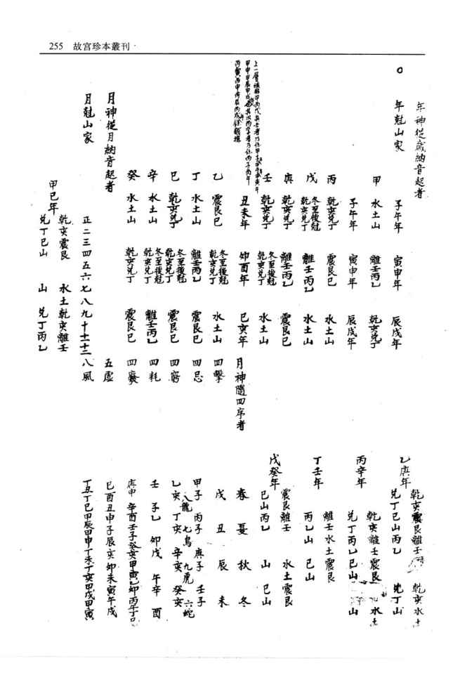

<!-- V3_SOURCE_ID:book010-b000734-p000-17016a7760 -->

坐煞、向煞，对应八山，还有翎毛禁向、六害陰中太歲陰中煞、小耗淨攔煞。

查看对应原文

<!-- V3_FOLDBACK_BEGIN:book010-b000734-p000-17016a7760 -->

坐煞向煞 八山R 翎毛禁向 六害陰中太歲陰中煞 小耗淨攔煞

<!-- V3_FOLDBACK_END:book010-b000734-p000-17016a7760 -->

<!-- V3_SOURCE_ID:book010-b000735-p000-078ae0f7da -->

此处文字残缺、错乱严重，无法完整释读，仅能识别出“孝龙当公黑星明堂天刑蚩尤黑星”“震丙戌”“震戊辰”“震戊辰”“震”“震”“震”“乙未”“壬辰”“己申”“戊巳”“甲子”“丁巳”“戊寅”“辛卯”“壬午”“壬戌”“丁亥”“辛未”“戊申”“癸酉”等零散内容，其余文字无法确认含义。

> **释读存疑：** 部分文字无法识别或含义不明；部分文字残缺、错乱严重，无法完整释读，仅能识别出部分零散内容

查看对应原文

<!-- V3_FOLDBACK_BEGIN:book010-b000735-p000-078ae0f7da -->

孝龙当公黑星明堂天刑蚩尤黑星正二三四五六七八九十十二十二未乙未震丙戌雨戌戌辰辛五辛五戊辰壬辰震戊辰丑寅子丑寅子丑寅子丑寅子寅己申亥如午酉子辰未戌丑戊巳午未寅知辰夹子丑申酉再子乙未甲子巳卯申辰西辰丁巳酉寅辛皇戊寅辛卯卿冉午癸五壬午巳酉壬戌丙戌丁亥丙甲辛未戊申嘉酉癸酉丑巳酉寅午戌卯未亥辰申子辰丑戌未如子酉午寅夹申巳辰丑戌未辰丑戌未辰丑戌未子酉午卯子酉午卯子酉午卯

<!-- V3_FOLDBACK_END:book010-b000735-p000-078ae0f7da -->

<!-- V3_SOURCE_ID:book010-b000736-p000-52585a2d9b -->

子、丑、寅、辰、巳、午、未、申、酉、戍、夾；丙、甲、壬、庚、丙、甲、壬、庚、丙、甲、壬、庚；丁、レ、癸、辛、丁、乙、癸、辛、丁、レ、癸、辛；壬、庚、丙、甲、壬、庚、丙、甲、壬、庚、丙、甲；癸、辛、丁、レ、癸、辛、丁、乙、癸、辛、丁、レ；未、午、巳、辰、卯、寅、丑、子、亥、戌、酉、申；巳、午、未、申、酉、戌、夾、子、丑、寅、邱、辰；子、丑、寅、如、辰、巳、午、未、申、酉、戍、夾；申、戌、子、寅、辰、午、申、戌、子、寅、辰、午；酉、亥、丑、卯、巳、未、酉、夾、丑、卯、巳、未；戌、子、寅、辰、午、申、戌、子、寅、辰、午、申；朱雀（穴前方的形势称谓）、武流黑星、金匱、白虎（穴场或建筑右侧的形势称谓）、天拂黑星；其中“夾”“邱”“如”“レ”的具体含义不详

> **释读存疑：** 夾；邱；如；レ；“夾”“邱”“如”“レ”的具体含义不详

查看对应原文

<!-- V3_FOLDBACK_BEGIN:book010-b000736-p000-52585a2d9b -->

文子丑寅辰巳午未申酉戍夾 丙甲壬庚丙甲壬庚丙甲壬庚 丁レ癸辛丁乙癸辛丁レ癸辛 壬庚丙甲壬庚丙甲壬庚丙甲 癸辛丁レ癸辛丁乙癸辛丁レ 未午巳辰卯寅丑子亥戌酉申 巳午未申酉戌夾子丑寅邱辰 子丑寅如辰巳午未申酉戍夾 申戌子寅辰午申戌子寅辰午 酉亥丑卯巳未酉夾丑卯巳未 戌子寅辰午申戌子寅辰午申 朱雀武流黑星 金匱 白虎天拂黑星

<!-- V3_FOLDBACK_END:book010-b000736-p000-52585a2d9b -->

<!-- V3_SOURCE_ID:book010-b000737-p000-3d994ba843 -->

文中提及元武陰私黑星、司命天明星、天星勾陳王勃黑星，具体所指不详。

> **释读存疑：** 元武陰私黑星；司命天明星；天星勾陳王勃黑星

查看对应原文

<!-- V3_FOLDBACK_BEGIN:book010-b000737-p000-3d994ba843 -->

元武陰私黑星司命天明星 天星勾陳王勃黑星

<!-- V3_FOLDBACK_END:book010-b000737-p000-3d994ba843 -->

<!-- V3_SOURCE_ID:book010-b000738-p000-fe784bb9a2 -->

王日、官日；狗守昭、天寡守日爾然；帝舍相日、民日、成徒日、隸日；宅空地寡

> **释读存疑：** 原文中“狗守昭”“天寡守日爾然”“帝舍相日”等表述含义不明，具体所指不详

查看对应原文

<!-- V3_FOLDBACK_BEGIN:book010-b000738-p000-fe784bb9a2 -->

王日官日 狗守昭 天寡守日爾然 帝舍相日民日成徒日隸日 宅空地寡

<!-- V3_FOLDBACK_END:book010-b000738-p000-fe784bb9a2 -->

<!-- V3_SOURCE_ID:book010-b000739-p000-e4f41339e2 -->

亥、丑、卯、巳、未、酉、夾、丑、卯、巳、未、酉；手、寅、辰、午、申、戌、子、寅、辰、午、申、戌；丑、卯、巳、未、酉、亥、丑、卯、巳、未、酉、奕；寅、辰、午、申、戌、子、寅、辰、午、申、戌、子；卯、巳、未、酉、夾、丑、卯、巳、未、酉、史、丑；辰、午、申、戌、子、寅、辰、午、申、戌、子、寅；巳、未、酉、夾、丑、卯、巳、未、酉、夾、丑、卯；午、申、戌、子、寅、辰、午、申、戌、子、寅、辰；未、酉、夾、丑、卯、巳、未、酉、夾、丑、卯、巳；其中“手”“奕”“史”的具体含义不详

> **释读存疑：** 手；奕；史；“手”“奕”“史”的具体含义不详

查看对应原文

<!-- V3_FOLDBACK_BEGIN:book010-b000739-p000-e4f41339e2 -->

亥丑卯巳未酉夾丑卯巳未酉 手寅辰午申戌子寅辰午申戌 丑卯巳未酉亥丑卯巳未酉奕 寅辰午申戌子寅辰午申戌子 卯巳未酉夾丑卯巳未酉史丑 辰午申戌子寅辰午申戌子寅 巳未酉夾丑卯巳未酉夾丑卯 午申戌子寅辰午申戌子寅辰 未酉夾丑卯巳未酉夾丑卯巳

<!-- V3_FOLDBACK_END:book010-b000739-p000-e4f41339e2 -->

<!-- V3_SOURCE_ID:book010-b000740-p000-88c28c7a8a -->

春季对应酉、申、未、午、巳、辰、郊、寅；夏季对应子、夹、戊、酉、申、未、午、巳；秋季对应邱、寅、丑、子、夹、戌、酉、申；冬季对应午、巳、辰、郊、寅、丑、子、奕。

> **释读存疑：** 原文中“郊”“夹”“邱”“奕”等词含义不明，具体所指不详

查看对应原文

<!-- V3_FOLDBACK_BEGIN:book010-b000740-p000-88c28c7a8a -->

酉申未午已辰郊寅春 子夹戊酉申未午已夏 邱寅丑子夹戌酉申秋 午巳辰郊寅丑子奕冬

<!-- V3_FOLDBACK_END:book010-b000740-p000-88c28c7a8a -->

<!-- V3_SOURCE_ID:book010-b000741-p000-3c76e0de22 -->

丑、辰、未这三个方位修造事宜最为有利；原文提及“伏罪界日”“夹”“寅”“巳”“申”，具体所指不详，若这些方位有道路遭遇火灾，需在七日之内择定吉日动工，半月之内择定吉日竖造，这些都不属败日。子、午、酉这三个方位，不论吉凶；丑、戌、年干、甲、乙、丙、丁、戊、巳、库、辛、壬、癸这些干支，凡修造、安葬之事，需先查看山家墓运、阴府、太岁，若这些神煞不克山头，再看浮天空亡、“天帑星”、乾、坤、艮、兑、坎、离、震、巽、“乾坤天官符占舍位”，同时忌开山立向，“巡山罗鞭”仅忌立向。其次论“甲穿山”“罗睺”，戌、申、午、辰、寅、子、戌、申、午、辰、寅、子月家飞宫、天地官符，忌在闲山立向。再论山家墓还正阴府、“山家困龙”、乾、庚、丁、巽、甲、癸、乾、庚、丁、巽，冬太岁、月、日、时忌克山，如山家官符、穿山旷天、“朱雀山家”“乙天禁朱雀”“夹”“酉”“未”“巳”“圣五”“夹”“酉”“未”“巳”“卯五”“困龙”，都忌开山，若有吉星到则能克制，只需用“通天窍”“走马六壬星”“丙丁独火”“宁”“戌”“申”“午”“辰”“寅”“子”“戌”“申”“午”“辰”“年干”“甲”“乙”“丙”“丁”“戊”“巳”“庚”“辛”“壬”“癸”“马贵人”为主，择取有利的年月，兼求三奇、紫白、禄马、贵人诸吉星。“丙丁独火”“翌”“奕”“酉”“未”“巳”“笠”“亥”“酉”“未”“巳”“家銮驾帝星”，若有一吉神同到，需对照山、向以辅助吉利。“戊辰”“宁”“戌”“申”“午”“辰”“宁”“戌”“申”“午”，都天则择竖造吉日，安葬则择破土吉日，大吉。“巳”“巳”“笠”“夹”“酉”“未”“巳”“翌”“夹”“酉”“未”，凡人家修造内堂完备，巳归火入宅向后，修造廊或“真天金神”“午”“辰”“宁”“戌”“申”“午”“辰”“宁”“戌”“申”，住宅舍又欲修作、安磑、开渠、修筑等事，只用修方法摄年。“辛”“未”“巳”“丑”“夹”“酉”“未”“巳”“圣”“夹”“酉”“月”，其山家墓运、阴府、太岁不必忌，惟浮天空亡、“巡山罗”“壬”“申”“午”“辰”“宁”“戌”“申”“午”“辰”与戌“水德星”“睺”及月家飞宫、方道紧煞忌之。“癸”“酉”“未”“巳”“卯”“丑”“夹”“酉”“未”“巳”“姐”“夹”，凡吉星到山为照，到方向为照，若吉星到山到向并照中右，年神从甲遁干起例，“天帑星”为年干甲破败五宫，竖造、安葬大利，如修方对宫方上得吉星名曰吉星照，鬼即其冲也。今台本不用“天帑星”，是不以“天帑”为吉亦

> **释读存疑：** 伏罪界日；夹；库；翌；奕；笠；真天金神；巡山罗；姐；天努

查看对应原文

<!-- V3_FOLDBACK_BEGIN:book010-b000741-p000-3c76e0de22 -->

死别 成 丑 辰 未 方修作大利伏罪界日 夹 寅 已 申 凢方道遭火盡七日之內擇日起工半月內擇日豎造並不舉敗日 子 午 酉 不問吉凶方道丑 戌 年干甲乙丙丁戊巳庫辛壬癸凢造葬先看山家墓運陰府太歲不尅山頭若浮天空亡 天帑星 乾坤艮兌坎離震巽乾坤天官符占舍位並忌開山立向巡山羅鞭止忌立向次論 甲穿山羅睺 戌申午辰寅子戌申午辰寅子月家飛宮天地官符忌閒山立向又論山家墓還正陰府 山家困龍 乾庚丁巽甲癸乾庚丁巽冬太歲月日時忌尅山如山家官符穿山曠天禁朱雀山家 乙天禁朱雀 夾酉未巳聖五夾酉未巳卯五困龍並忌開山吉星到則能制但用通天竅走馬六壬星 丙丁獨火 寧戌申午辰寅子戌申午辰年千甲乙丙丁戊巳庚辛壬癸馬貴人爲主尅擇利宜年月兼求三奇紫白祿馬貴人諸 丙丁獨火 翌奕酉未巳笠亥酉未巳家鑾駕帝星若有一吉神同到照山向以佐其吉修造 戊 辰寧戌申午辰寧戌申午都天則擇豎造吉日安葬則擇破土吉日大吉 已 巳笠夾酉未巳翌夾酉未九人家修造內堂完備巳歸火入宅向後讀造麗廊或 真 天金神 午辰寧戌申午辰寧戌申住宅舍又欲修作安磑開渠修築等事只用修方法攝年 辛 未巳丑夾酉未巳聖夾酉月其山家墓運陰府太歲並不必忌惟浮天空亡巡山羅 壬 申午辰寧戌申午辰與戌水德星睺及月家飛宮方道緊煞忌之 癸 酉未巳卯丑夾酉未巳姐夾凡吉星到山為莓到方向為照若吉星到山到向併照中 右年神從甲遁千起例天帑星爲年千甲破敗五宮豎造安塟大利如修方對宮方上得吉星名曰吉星照 鬼即其衝也今臺本不用天帑星是不以天努為吉亦

<!-- V3_FOLDBACK_END:book010-b000741-p000-3c76e0de22 -->

<!-- V3_SOURCE_ID:book010-b000742-p000-e1683e0b94 -->

宝无吉可言则破败五鬼之凶可知矣。甲为穿山擢、旷，乙为天禁朱雀，甲乙之间为山家困龙，丙丁为独火，戊巳为都天，辛为金神，壬癸为水德，十干本属一例。今台本通书既不用戊己于癸，而于丙丁独火又云与年独火打尔火并方为灾，金神虽载在时宪书，亦不甚以为拘忌，乃独于甲乙则曰开山凶，甚属非理。夫十干甲乙最吉，不当以遁干为凶，壬癸为丙丁之对，宗镜诸书以水德制火星，其义略有可取。戊已属土，入中宫，叠太岁为堆黄，与月建并忌动土，犹土王用事忌动土之义，即不列为吉凶神，而于理固不背也。已上数条出协纪辨方书

查看对应原文

<!-- V3_FOLDBACK_BEGIN:book010-b000742-p000-e1683e0b94 -->

寳無吉可言則破敗五鬼之不焉凶可知矣甲為穿山擢 曠乙為天禁朱雀甲乙之间為山家困龍丙丁為獨火戊 巳為都天與辛爲金神壬癸為水德十干本属一例今臺 本通書既不用戊己于癸而于丙丁獨火又云與年獨火 打爾火併方為災金神雖載在時憲書亦不甚以為拘忌 乃獨于甲乙則曰開山凶甚屬非理夫十干甲乙最吉不 當以遁干為凶壬癸為丙丁之對宗鏡諸書以水德制火 星其義略有可取戊已屬土入中宮疊太歲爲堆黃與月 建併忌動土猶土王用事忌勳土之義即不列為吉凶神 而於理固不背也已上数條出恊紀辨方書

<!-- V3_FOLDBACK_END:book010-b000742-p000-e1683e0b94 -->

<!-- V3_SOURCE_ID:book010-b000743-p000-dac8aac536 -->

年支为子、丑、寅、卯、辰、巳、午、未、申、酉、戌、亥。“巡山罗”为癸、艮、甲、乙、巽、丙、丁、坤、庚、辛、乾、壬。原文提及“日凶方”，具体所指不详，内容为子、丑、寅、如、辰、己、午、未、申、酉、戌、夹。原文提及“岁禁方”，具体所指不详，内容为南、东、北、西、东北、西南、东北、西南。“太岁方”为子、丑、寅、邱、辰、己、午、未、申、酉、戍、夹。原文提及“落抚忌方”，具体所指不详，内容为数为癸酉日涂事。巳、寅、亥、申、巳、寅、亥、申、巳、寅、夹、申。原文提及“三杀方”，具体所指不详，内容为其日三杀在寅绅、辰方落应之时孝。午、郊、子、酉、午、如、子、酉、午、子、酉。原文提及“卷忌立控三段方”，具体所指不详，内容为上五之苏做此。未、辰、丑、戌、未、辰、丑、戌、未、辰、丑、戌。“协纪办方”旧曰二月甲戌、四月丙申、六月甲午、七月戊申、八月庚辰、九月辛卯、十月甲子、十二月甲子，德合与赦愿所会之辰，诸事不忌。

> **释读存疑：** 如；邱；戍；落抚忌方；数；涂事；寅绅；孝；郊；卷忌立控三段方；上五之苏

查看对应原文

<!-- V3_FOLDBACK_BEGIN:book010-b000743-p000-dac8aac536 -->

年支子丑寅卯辰已午未申酉戌亥 巡山羅 癸艮甲乙巽丙丁坤庚辛乾壬 日凶方 子丑寅如辰己午未申酉戌夾 歲禁方 南東北西東北西南東北西南 太歲方 子丑寅邱辰己午未申酉戍夾 落撫忌方 数が癸酉日塗事 巳寅亥申巳寅亥申巳寅夾申 三殺方 其日三殺在寅紳 辰方落應之時孝 午郊子酉午如子酉午子酉 卷忌立控三段方 上五之蘇做此 未辰丑戌未辰丑戌未辰丑戌 協紀辦方舊曰二月甲戌四月丙申六月甲午七月戊申 八月庚辰九月辛卯十月甲子十二月甲子德合與赦 願所會之辰諸事不忌

<!-- V3_FOLDBACK_END:book010-b000743-p000-dac8aac536 -->

<!-- V3_SOURCE_ID:book010-b000744-p000-238431cae9 -->

九官方位中，嫁娶、出行、入宅、修造、安修方等各类动用事宜，适宜在四大吉时进行，选用黄道吉星当值的时辰，有吉星对应该时辰，便可胜过诸多凶煞。另有九观略，空旬、空都不忌讳，或是合通天窍、走马六壬、天罡取用的吉时，吉神对应山、向（建筑或穴位所朝的方位），即为吉利。凡是月忌日，均不忌讳嫁娶之事。

查看对应原文

<!-- V3_FOLDBACK_BEGIN:book010-b000744-p000-238431cae9 -->

九上官嫁娶出行入宅修造安修方一切動用宜四大吉時用黃道吉星時得吉星到時可勝諸凶耶有九觀略空旬空俱不忌或合通天竅走馬六壬天罡取用吉時吉神到山到向爲吉凢月忌日不忌嫁娶

<!-- V3_FOLDBACK_END:book010-b000744-p000-238431cae9 -->

<!-- V3_SOURCE_ID:book010-b000745-p000-c5297016e0 -->

文中提及的“水”，指风水语境中的河流、水系及其来去形态；另有“兩春谷小夏大麗秋霜小冬大”“兩春谷小夏大廉秋霜小冬大”的表述，具体所指不详，还提到对应雨满至暑、署分降雪至寒的时段，以及戊子日的对应时段为子亥戌酉申未午巳辰卯寅丑。

> **释读存疑：** 兩春谷小夏大麗秋霜小冬大；兩春谷小夏大廉秋霜小冬大

查看对应原文

<!-- V3_FOLDBACK_BEGIN:book010-b000745-p000-c5297016e0 -->

兩春谷小夏大麗秋霜小冬大水分雨滿至暑署分降雪至寒戊子日子亥戌酉申未午巳辰卯寅丑兩春谷小夏大廉秋霜小冬大

<!-- V3_FOLDBACK_END:book010-b000745-p000-c5297016e0 -->

<!-- V3_SOURCE_ID:book010-b000746-p000-ec68335696 -->

文中提及的“水”，指风水语境中的河流、水系及其来去形态；另有“水分兩萬至暑署分降雪至寒”的表述，具体所指不详，还提到戊午日、壬子日、壬午日、乙卯日、巳卯日、辛卯日、乙酉日、巳酉日、辛酉日的对应时段，以及“月建運天道而左旋為天阙”的内容，其中“子史”“卯富”“子夹”“酉由”等表述含义不明。

> **释读存疑：** 子史；卯富；子夹；酉由；本地硬校验仍未通过，已记录供后续自动处理或人工核对。

查看对应原文

<!-- V3_FOLDBACK_BEGIN:book010-b000746-p000-ec68335696 -->

水分兩萬至暑署分降雪至寒戊午日午巳辰卯寅丑子亥戊酉申未壬子日子史戌酉申未午巳辰卯富丑壬午日午巳辰卯寅丑子夾戌酉申未乙卯日酉申未午己辰如寅丑子亥戌巳卯日酉由未午巳辰卯寅丑子亥戌辛卯日酉申未午已辰卯寅丑子亥戌乙酉日卯寅丑子亥戌酉申未午巳辰巳酉日卯寅丑子亥戌酉申未午巳辰辛酉日卯寅丑子亥戌酉申未午巳辰月建運天道而左旋為天阙

<!-- V3_FOLDBACK_END:book010-b000746-p000-ec68335696 -->

<!-- V3_SOURCE_ID:book010-b000747-p000-372ad00b7f -->

月将秉承地道向右旋转，称为地轴。

查看对应原文

<!-- V3_FOLDBACK_BEGIN:book010-b000747-p000-372ad00b7f -->

月將稟地道而右轉爲地軸

<!-- V3_FOLDBACK_END:book010-b000747-p000-372ad00b7f -->

<!-- V3_SOURCE_ID:book010-b000748-p000-0bd16b8724 -->

安葬的吠日包含壬寅、丙午、庚午、壬午、甲申、丙申、庚申这些日子。

查看对应原文

<!-- V3_FOLDBACK_BEGIN:book010-b000748-p000-0bd16b8724 -->

安葬鳴吠日與寅壬寅丙午庚午壬午甲申丙申庚申

<!-- V3_FOLDBACK_END:book010-b000748-p000-0bd16b8724 -->

<!-- V3_SOURCE_ID:book010-b000749-p000-78d36053bb -->

壬申、乙酉、丁酉、巳酉、辛酉、癸酉这些日子。

查看对应原文

<!-- V3_FOLDBACK_BEGIN:book010-b000749-p000-78d36053bb -->

壬申乙酉丁酉巳酉辛酉癸酉

<!-- V3_FOLDBACK_END:book010-b000749-p000-78d36053bb -->

<!-- V3_SOURCE_ID:book010-b000750-p000-d4c887cc07 -->

以上总共十四日，为吠日。

查看对应原文

<!-- V3_FOLDBACK_BEGIN:book010-b000750-p000-d4c887cc07 -->

共十四日爲吠日

<!-- V3_FOLDBACK_END:book010-b000750-p000-d4c887cc07 -->

<!-- V3_SOURCE_ID:book010-b000751-p000-0a9ee8ee87 -->

启攒日包含丙子、庚子、壬子、甲寅、丙寅、乙卯、丁如、辛如、癸郊、甲午这些日子，总共十日，为鸣吠对日。

> **释读存疑：** 原文中"丁如""辛如""癸郊"的具体所指不详

查看对应原文

<!-- V3_FOLDBACK_BEGIN:book010-b000751-p000-0a9ee8ee87 -->

啟攢日 丙子庚子壬子甲寅丙寅乙卯丁如辛如癸郊甲午共十日爲鳴吠對日

<!-- V3_FOLDBACK_END:book010-b000751-p000-0a9ee8ee87 -->

<!-- V3_SOURCE_ID:book010-b000752-p000-3cd2258838 -->

月、日、子、丑、寅、姊、辰、巳、午、未、申、酉、戌、夾伏斷，虛、斗、室、女、算、房、角、張、鬼、觜、胃、壁。

> **释读存疑：** 原文中「算」字疑为「箕」字的讹误，「夾」字具体所指不详

查看对应原文

<!-- V3_FOLDBACK_BEGIN:book010-b000752-p000-3cd2258838 -->

月日 子丑寅姊辰巳午未申酉戌夾伏断 虛斗室女算房角張鬼觜胃壁

<!-- V3_FOLDBACK_END:book010-b000752-p000-3cd2258838 -->

<!-- V3_SOURCE_ID:book010-b000753-p000-9a66489f42 -->

论述暗金伏断时禽起倒的诗写道：日起时禽起于子时，对应虚宿；月对应鬼宿，火星从箕宿而来，毕宿属木，氐宿属金，奎宿属土，土宿还要从翼宿施布。若要论暗金之时，需查看官历本日是何星宿值日，若值日的是震宿，便是太阳值日，就将虚宿加在子位上，顺行推算至巳时，若遇到娄宿，便是暗金之时，对应娄金狗，所以说，值日的星宿每加在子位上顺行推算，遇到四金便是暗金之时，所以诗中说：太阳逢巳月子未火星，雞虎水猶龍土星免犬木騎馬金歸申丑不酒諭。通書中说：月遊火忌讳修方，其热力与打头火或年独火合并，飞临丙丁二字同到的方位，该方位会发生灾祸，若无凶神合并则无妨。

> **释读存疑：** 「諭」字疑为「論」字的讹误，「不酒」二字具体所指不详；1轮自动修复后核义模型仍建议修订，已保守记录。

查看对应原文

<!-- V3_FOLDBACK_BEGIN:book010-b000753-p000-9a66489f42 -->

論暗金伏断時禽起倒詩曰日起時禽起子時日虛 月鬼火從箕水畢木氐金奎位土宿還從翌宿施 若論暗金時却看官曆本日下是何宿值日如震宿却是 太陽值日則將虛宿加子上順行遁至已時逢值娄宿 即是暗金時遇娄金狗故也允值日宿每加子順遁 遇四金即是暗金時故詩曰太陽逢巳月子未火星 雞虎水猶龍土星免犬木騎馬金歸申丑不酒諭 通書曰月遊火忌修方其熱與打頭火或年獨火併飛得 丙丁二字同到方其災方發無凶神併不妨

<!-- V3_FOLDBACK_END:book010-b000753-p000-9a66489f42 -->

<!-- V3_SOURCE_ID:book010-b000754-p000-5b175e1873 -->

按月遊火，即以來年太歲爲進氣方旺之辰，在二十四山之中，則位於巡山羅睺前一位，距離太歲尚遠，又屬四利太陽，本不爲凶，只因火未發先炎，所以取太歲前一辰稱爲火，每月移動一位，所以稱爲月遊。但必須與打頭火、年獨火合并，又得丙丁同到，之後才成爲禁忌。例如子年前一辰爲丑，丑年前一辰爲寅，丑、寅皆屬艮，所以子、丑年正月，月遊火同在艮位，二月在離位，三月在坎位，順行九宮；寅年前一辰爲卯，屬震，所以寅年正月，月遊火在震位，二月在巽位，三月在中五宮，順行九宮，其餘年份依此類推。另外，按月遊火逐月順飛九宮，不以月建入中宮，與大小月建含義相同。

> **释读存疑：** 本地硬校验仍未通过，已记录供后续自动处理或人工核对。

查看对应原文

<!-- V3_FOLDBACK_BEGIN:book010-b000754-p000-5b175e1873 -->

按月遊火即耒年太歲爲進氣方旺之辰於二十四山則又在巡山羅睺前一位去太歲尚遠又爲四利太陽本不爲凶第以火未發先炎故取太歲前一辰曰火月移一位故曰月遊然必與打頭火年獨火併又得丙丁同到而後爲忌也如子年前一辰爲丑丑年前一辰爲寅丑寅皆屬艮故子丑年正月月遊火同在艮八二月在離九三月在坎一順行九宮寅年前一辰爲卯屬震故寅年正月月遊火在震三二月在巽四三月在中五順行九宮是也餘倣此又按月遊火逐月順飛九宮不以月建入中宮與大小月建同義

<!-- V3_FOLDBACK_END:book010-b000754-p000-5b175e1873 -->

<!-- V3_SOURCE_ID:book010-b000755-p000-2b0035303a -->

丙丁獨火，正、二、三、四、五、六、七、八、九、十、十、十。

> **释读存疑：** 原文末尾的「十十」二字存在缺漏或错乱，具体所指不详

查看对应原文

<!-- V3_FOLDBACK_BEGIN:book010-b000755-p000-2b0035303a -->

丙丁獨火 正二三四五六七八九十十十

<!-- V3_FOLDBACK_END:book010-b000755-p000-2b0035303a -->

<!-- V3_SOURCE_ID:book010-b000756-p000-a1231b9927 -->

中间的乾、坤、震、巽、坎、离、艮、兑，中间的乾、坤、震、巽、坎、离、艮、兑，中间中间，中间的巽，丙辛年开始的是良中，艮、兑、乾在中间，丁壬年，巽、震、坤、坎、离、艮，离，戊癸年，艮、兑，中间的巽、震、坤、坎，虽艮兄

> **释读存疑：** 农；炒；良中；艮兄；原文中‘农’‘炒’‘良中’‘艮兄’具体所指不详；1轮自动修复后核义模型仍建议修订，已保守记录。

查看对应原文

<!-- V3_FOLDBACK_BEGIN:book010-b000756-p000-a1231b9927 -->

中巽震坤 坎離艮兌乾 中巽農坤坎離艮兌乾 中中 中巽 丙辛年炒始良中 艮兌乾中 丁壬年 巽震坤坎離艮 離 戊癸年 艮兌 中巽震坤坎 雖艮兄

<!-- V3_FOLDBACK_END:book010-b000756-p000-a1231b9927 -->

<!-- V3_SOURCE_ID:book010-b000757-p000-e0c4284537 -->

通书里说，丙丁独火忌讳修方，它的方法是用月建入中宫飞吊，得到丙、丁二字所在的方位，在那里修作动土，触犯了就会凶险

查看对应原文

<!-- V3_FOLDBACK_BEGIN:book010-b000757-p000-e0c4284537 -->

通書曰丙丁獨火忌修方其法以月建入中宮飛弔得丙丁二字到方修作動土犯之凶

<!-- V3_FOLDBACK_END:book010-b000757-p000-e0c4284537 -->

<!-- V3_SOURCE_ID:book010-b000758-p000-1b17920a8c -->

按丙丁独火是诸火星的关键，取天干丙、丁之气照在上方，是火的生发之处。比如甲己年丙寅月修作，就把丙寅入中宫顺数，丙在中宫五，丁在乾六，也就是正月时丙丁独火在中宫与乾宫；如果是丁如月修作，就把丁入中宫，丁在中五，戊在乾六，依次顺数，丙又在中五，也就是二月时丙丁独火在中宫。不过必须与年独火飞大煞并方的忌讳一同考量

查看对应原文

<!-- V3_FOLDBACK_BEGIN:book010-b000758-p000-1b17920a8c -->

按丙丁獨火乃諸火星之要取天干丙丁之氣照於其上爲火之耶由發也如甲已年丙寅月修作則以丙寅入中宮順数丙在中宮五丁在乾六卽正月即丙丁獨火在中宮與乾宮也若丁如月修作則以丁如入中宮丁在中五戊在乾六以次順数丙又在中五即二月丙丁獨火在中宮也然必與年獨火飛大煞併方忌

<!-- V3_FOLDBACK_END:book010-b000758-p000-1b17920a8c -->

<!-- V3_SOURCE_ID:book010-b000759-p000-f165de1fa0 -->

飞大煞打头火

> **释读存疑：** “飞大煞打头火”含义不明，具体所指不详

查看对应原文

<!-- V3_FOLDBACK_BEGIN:book010-b000759-p000-f165de1fa0 -->

飛大煞打頭火

<!-- V3_FOLDBACK_END:book010-b000759-p000-f165de1fa0 -->

<!-- V3_SOURCE_ID:book010-b000760-p000-d8efdbe28f -->

正、二、三、四、五、六、七、八、九、十、十、十二、十二。

> **释读存疑：** 原文存在重复数字，具体所指不详

查看对应原文

<!-- V3_FOLDBACK_BEGIN:book010-b000760-p000-d8efdbe28f -->

正二三四五六七八九十十二十二

<!-- V3_FOLDBACK_END:book010-b000760-p000-d8efdbe28f -->

<!-- V3_SOURCE_ID:book010-b000761-p000-e9379a938b -->

戌、辰、甲、未、壬、丙、丑、庚、戌、庚；申、子、辰年，乾中、巽、震、坤、坎、離、艮、兌、乾中、兌；原文中的“夾”“央”具体所指不详。

> **释读存疑：** 夾；央；原文中的“夾”“央”具体所指不详；本地硬校验仍未通过，已记录供后续自动处理或人工核对。

查看对应原文

<!-- V3_FOLDBACK_BEGIN:book010-b000761-p000-e9379a938b -->

戌辰甲未壬丙丑庚戌庚 申子辰年乾中巽震坤坎離艮兌乾中兌 夾巳乙申癸丁寅辛央辛

<!-- V3_FOLDBACK_END:book010-b000761-p000-e9379a938b -->

<!-- V3_SOURCE_ID:book010-b000762-p000-b48bc1fc62 -->

甲、未、壬、丙、丑、庚、戌、庚、戌、辰、巳、酉、丑年，震、坤、坎、離、艮、兌、乾中、兌、乾中、巽、乙、申、癸、丁、寅、辛、亥、辛、亥、巳。

> **释读存疑：** 辛

查看对应原文

<!-- V3_FOLDBACK_BEGIN:book010-b000762-p000-b48bc1fc62 -->

甲未壬丙丑庚戌庚戌辰已酉丑年震坤坎離艮兌乾中兌乾中巽乙申癸丁寅辛亥辛亥巳

<!-- V3_FOLDBACK_END:book010-b000762-p000-b48bc1fc62 -->

<!-- V3_SOURCE_ID:book010-b000763-p000-511ecea91e -->

丙、丑、庚、戌、庚、戌、辰、甲、未、壬；寅、午、戌年，離、艮、兌、乾中、兌、乾中、巽、震、坤、坎；丁、寅、辛、亥、辛、亥、巳、乙、申、癸。

> **释读存疑：** 辛

查看对应原文

<!-- V3_FOLDBACK_BEGIN:book010-b000763-p000-511ecea91e -->

丙丑庚戌庚戌辰甲未壬 寅午戌年離艮兌乾中兌乾中巽震坤坎 丁寅辛亥辛亥巳乙申癸

<!-- V3_FOLDBACK_END:book010-b000763-p000-511ecea91e -->

<!-- V3_SOURCE_ID:book010-b000764-p000-8ebb226d00 -->

正月、二月、三月、四月、五月、六月、七月、八月、九月、十月、十一月、十二月。

查看对应原文

<!-- V3_FOLDBACK_BEGIN:book010-b000764-p000-8ebb226d00 -->

正二三四五六七八九十十一十二

<!-- V3_FOLDBACK_END:book010-b000764-p000-8ebb226d00 -->

<!-- V3_SOURCE_ID:book010-b000765-p000-2cd51a7edf -->

戌、庚戌、辰、甲、未、壬、丙、丑、庚。夾未年，乾、兌、乾、巽、震、坤、坎、離、艮、兌。

> **释读存疑：** 「夾未年」的「夾」字具体含义不详

查看对应原文

<!-- V3_FOLDBACK_BEGIN:book010-b000765-p000-2cd51a7edf -->

戌庚戌辰甲未壬丙丑庚 夾未年乾中兌乾中巽震坤坎離艮兌

<!-- V3_FOLDBACK_END:book010-b000765-p000-2cd51a7edf -->

<!-- V3_SOURCE_ID:book010-b000766-p000-968bbc243c -->

《通書》中說，修方時忌避「打頭火」，寅午年的「打頭火」在午位，亥如未年的「打頭火」在如位，申子辰年的「打頭火」在子位，巳酉丑年的「打頭火」在酉位，子午、酉位是本宫旺鄉，若飛宮時觸犯就會兇險。《選擇宗鏡》中說，「打頭火」就是三合旺方，又稱金匱、將星，主火燭之事，若疊太歲則格外兇險，太旺就會亢盛，亢盛就屬於火。其方法是：以所用月份的建星入中宮，順飛九宮，遇到本年的三合旺方，就是本月的「打頭火」，每宮占三位。「打頭火」就是本年大煞逐月飛弔之位，大煞的義例已見於年神，其逐月飛弔的方法與天官符相同，天官符是臨官，大煞是帝旺。之所以稱為火，是因為其旺極會引發災禍，就如同災煞又名天火一樣。「打頭火」這個名稱不雅，又嫌多立名色，所以取名為「飛大煞」以存本義。

> **释读存疑：** 「亥如未年」的「如」字具体含义不详；1轮自动修复后核义模型仍建议修订，已保守记录。

查看对应原文

<!-- V3_FOLDBACK_BEGIN:book010-b000766-p000-968bbc243c -->

通書曰打頭火忌修方寅午年在午亥如未年在如申子辰年在子巳酉丑年在酉子午酉是本宮旺鄉飛宮犯之則凶○選擇宗鏡曰打頭火即三合旺方又爲金匱將星主火燭若疊太歲尤凶太旺則亢亢則屬火也其法以用月建入中宮順飛九宮遇本年三合旺方爲本月打頭火每宮占三位按打頭火即本年大煞逐月飛弔之位大煞義例已見年神其逐月飛弔與天官符同法天官符爲臨官大煞爲帝旺其曰火者以其旺極爲災亦猶災煞之又名天火耳打頭火名不雅馴又嫌多立名色易致失實故名曰飛大煞以存本義云

<!-- V3_FOLDBACK_END:book010-b000766-p000-968bbc243c -->

<!-- V3_SOURCE_ID:book010-b000767-p000-057a75ca2e -->

天官符，爾宮。

查看对应原文

<!-- V3_FOLDBACK_BEGIN:book010-b000767-p000-057a75ca2e -->

天官符爾宮

<!-- V3_FOLDBACK_END:book010-b000767-p000-057a75ca2e -->

<!-- V3_SOURCE_ID:book010-b000768-p000-d93396e7e6 -->

正月、二月、三月、四月、五月、六月、七月、八月、九月、十月、十一、十二。

查看对应原文

<!-- V3_FOLDBACK_BEGIN:book010-b000768-p000-d93396e7e6 -->

正二三四五六七八九十十十二

<!-- V3_FOLDBACK_END:book010-b000768-p000-d93396e7e6 -->

<!-- V3_SOURCE_ID:book010-b000769-p000-845e2617c2 -->

辰、甲、未、壬、丙、丑、庚、戌、庚、戌。

查看对应原文

<!-- V3_FOLDBACK_BEGIN:book010-b000769-p000-845e2617c2 -->

辰甲未壬丙丑庚戌庚戌

<!-- V3_FOLDBACK_END:book010-b000769-p000-845e2617c2 -->

<!-- V3_SOURCE_ID:book010-b000770-p000-15aeb6e94a -->

申子辰年中，巽、震、坤、坎、離、艮、兌、乾，其中有兌、乾。

查看对应原文

<!-- V3_FOLDBACK_BEGIN:book010-b000770-p000-15aeb6e94a -->

申子辰年中巽震坤坎離艮兌乾中兌乾

<!-- V3_FOLDBACK_END:book010-b000770-p000-15aeb6e94a -->

<!-- V3_SOURCE_ID:book010-b000771-p000-4a8c552c91 -->

巳、乙、申、癸、丁、寅、辛，夾辛亥。

查看对应原文

<!-- V3_FOLDBACK_BEGIN:book010-b000771-p000-4a8c552c91 -->

巳乙申癸丁寅辛夾辛亥

<!-- V3_FOLDBACK_END:book010-b000771-p000-4a8c552c91 -->

<!-- V3_SOURCE_ID:book010-b000772-p000-820dbb0071 -->

正月、二月、三月、四月、五月、六月、八月、九月、十月、土、十二月。

> **释读存疑：** 原文中的‘土’具体所指不详；1轮自动修复后核义模型仍建议修订，已保守记录。

查看对应原文

<!-- V3_FOLDBACK_BEGIN:book010-b000772-p000-820dbb0071 -->

正二三四五六九八九十土十二

<!-- V3_FOLDBACK_END:book010-b000772-p000-820dbb0071 -->

<!-- V3_SOURCE_ID:book010-b000773-p000-de0283ee04 -->

未、壬、丙、丑、庚、戌、庚、戌、辰、甲。

查看对应原文

<!-- V3_FOLDBACK_BEGIN:book010-b000773-p000-de0283ee04 -->

未壬丙丑庚戌庚戌辰甲

<!-- V3_FOLDBACK_END:book010-b000773-p000-de0283ee04 -->

<!-- V3_SOURCE_ID:book010-b000774-p000-ea5d1f1e8e -->

巳、酉、丑年，坤、坎、離、艮、兌、乾中，兌、乾中、巽、震。

查看对应原文

<!-- V3_FOLDBACK_BEGIN:book010-b000774-p000-ea5d1f1e8e -->

巳酉丑年坤坎離艮兌乾中兌乾中巽震

<!-- V3_FOLDBACK_END:book010-b000774-p000-ea5d1f1e8e -->

<!-- V3_SOURCE_ID:book010-b000775-p000-5afbb83bd5 -->

申、癸、丁、寅、辛、夾、辛、亥、巳、乙。

> **释读存疑：** 此处"夾"具体所指不详

查看对应原文

<!-- V3_FOLDBACK_BEGIN:book010-b000775-p000-5afbb83bd5 -->

申癸丁寅辛夾辛亥巳乙

<!-- V3_FOLDBACK_END:book010-b000775-p000-5afbb83bd5 -->

<!-- V3_SOURCE_ID:book010-b000776-p000-8fbeee7ec1 -->

丑、庚、戌、庚、戌、辰、甲、未、壬、丙。

查看对应原文

<!-- V3_FOLDBACK_BEGIN:book010-b000776-p000-8fbeee7ec1 -->

丑庚戍庚戌辰甲未壬丙

<!-- V3_FOLDBACK_END:book010-b000776-p000-8fbeee7ec1 -->

<!-- V3_SOURCE_ID:book010-b000777-p000-49b0ddf5c9 -->

寅、午、戌年，艮、兑、乾中，兑、乾中，巽、震、坤、坎、离。

查看对应原文

<!-- V3_FOLDBACK_BEGIN:book010-b000777-p000-49b0ddf5c9 -->

寅午戌年艮兑乾中兌乾中巽震坤坎離

<!-- V3_FOLDBACK_END:book010-b000777-p000-49b0ddf5c9 -->

<!-- V3_SOURCE_ID:book010-b000778-p000-c8a3dff543 -->

寅、辛、亥、辛、亥、巳、乙、申、癸、丁。

查看对应原文

<!-- V3_FOLDBACK_BEGIN:book010-b000778-p000-c8a3dff543 -->

寅辛亥辛亥巳乙申癸丁

<!-- V3_FOLDBACK_END:book010-b000778-p000-c8a3dff543 -->

<!-- V3_SOURCE_ID:book010-b000779-p000-78970bc6cf -->

庚、戌、辰、甲、未、壬、丙、丑、庚、戊。夾如未年中，兑、乾中，巽、震、坤、坎、离、艮、兑、乾。

> **释读存疑：** 原文中“夾如”二字含义不明

查看对应原文

<!-- V3_FOLDBACK_BEGIN:book010-b000779-p000-78970bc6cf -->

庚戌辰甲未壬丙丑庚戊 夾如未年中兌乾中巽震坤坎離艮兌乾

<!-- V3_FOLDBACK_END:book010-b000779-p000-78970bc6cf -->

<!-- V3_SOURCE_ID:book010-b000780-p000-209bcd37c4 -->

辛亥巳乙申癸丁寅辛亥。《通書》中說，天官符忌諱修造方位，申子辰年屬水，水臨官在亥，因此以亥爲天官符；巳酉丑年屬金，金臨官在申，因此以申爲天官符；寅午戌年屬火，火臨官在巳，因此以巳爲天官符；卯未年屬木，木臨官在寅，因此以寅爲天官符。

查看对应原文

<!-- V3_FOLDBACK_BEGIN:book010-b000780-p000-209bcd37c4 -->

辛亥巳乙申癸丁寅辛亥 通書曰天官符忌修方申子辰年屬水水臨官在故以 夾爲天官符巳酉丑年屬金金臨官在申故以申爲天官 符寅午戌年屬火火臨官在巳故以巳爲天官符卯未 年屬木木臨官在寅故以寅爲天官符

<!-- V3_FOLDBACK_END:book010-b000780-p000-209bcd37c4 -->

<!-- V3_SOURCE_ID:book010-b000781-p000-41be1b8e55 -->

按天官符是太歲三合五行方旺之氣，因此修造時需避開它，與月家遊禍含義相同。名叫天官符，是因爲五行之質具備於地，而氣運行於天，三合就是這種氣運。

查看对应原文

<!-- V3_FOLDBACK_BEGIN:book010-b000781-p000-41be1b8e55 -->

按天官符爲太歲三合五行方旺之氣故修造避之與月家遊祸同義名曰天官符者五行質具於地而氣行于天三合固氣也

<!-- V3_FOLDBACK_END:book010-b000781-p000-41be1b8e55 -->

<!-- V3_SOURCE_ID:book010-b000782-p000-4633931c00 -->

《通書》中說，天官符忌諱修造方位，一年占一個字；《選擇宗鏡》中說，申子辰年在亥，巳酉丑年在申，寅午戌年在巳，未年在寅。是將月建放入中宮，順飛九宮，遇到本年天官符的字，就是本月的天官符，每宮占三位。

查看对应原文

<!-- V3_FOLDBACK_BEGIN:book010-b000782-p000-4633931c00 -->

通書曰天官符忌修方一年占一字選擇宗鏡曰申子辰年在亥巳酉丑年在申寅午戌年在巳夾如未年在寅以月建入中宮順飛九宮遇本年天官符耶占之字爲本月天官符每宮占三位

<!-- V3_FOLDBACK_END:book010-b000782-p000-4633931c00 -->

<!-- V3_SOURCE_ID:book010-b000783-p000-061afb8173 -->

按月家飛宮的天官符，就是本年天官符逐月飛吊的位置。比如子年天官符在亥，正月修造，就將寅建放入中宮，順數飛行，回到中宮遇到亥字，就是正月的天官符在中宮；如果子年三月修造，就將辰建放入中宮，順數飛行到震三宮，遇到亥字，震宮的甲、震乙兩位，就是三月的天官符在甲、震乙。另外按二十四山，四正位不用卦而用支；飛宮又不用支而用卦，是因爲卦可以逐宮計數，其餘以此類推。

查看对应原文

<!-- V3_FOLDBACK_BEGIN:book010-b000783-p000-061afb8173 -->

按月家飛宮天官符即本年天官符逐月飛吊之位如子年天官符在夾正月修作則以寅建入中宫順数復至中宮遇字即正月天官符在中宮若子年三月修作則以辰建入中宮順数至震三遇夾字震宮梳甲震乙三位即三月天官符在甲震乙也又按二十四山四正位不用卦而用支飛宮又不用支而用卦者以卦可逐宮而数也餘倣此

<!-- V3_FOLDBACK_END:book010-b000783-p000-061afb8173 -->

<!-- V3_SOURCE_ID:book010-b000784-p000-61a3a1a7b8 -->

庚戌、庚戌，辰、甲、未、壬、丙、丑。

查看对应原文

<!-- V3_FOLDBACK_BEGIN:book010-b000784-p000-61a3a1a7b8 -->

庚戌庚戌辰甲未壬丙丑

<!-- V3_FOLDBACK_END:book010-b000784-p000-61a3a1a7b8 -->

<!-- V3_SOURCE_ID:book010-b000785-p000-c60001e47d -->

子年，兌、乾居中，兌、乾居中，巽、震、坤、坎、離、艮。

查看对应原文

<!-- V3_FOLDBACK_BEGIN:book010-b000785-p000-c60001e47d -->

子年兌乾中兌乾中巽震坤坎離艮

<!-- V3_FOLDBACK_END:book010-b000785-p000-c60001e47d -->

<!-- V3_SOURCE_ID:book010-b000786-p000-ea9a21a544 -->

辛亥、辛亥，巳、乙、申、癸、丁、寅。

查看对应原文

<!-- V3_FOLDBACK_BEGIN:book010-b000786-p000-ea9a21a544 -->

辛亥辛亥巳乙申癸丁寅

<!-- V3_FOLDBACK_END:book010-b000786-p000-ea9a21a544 -->

<!-- V3_SOURCE_ID:book010-b000787-p000-8fbeee7ec1 -->

丑、庚戌、庚戌，辰、甲、未、壬、丙。

查看对应原文

<!-- V3_FOLDBACK_BEGIN:book010-b000787-p000-8fbeee7ec1 -->

丑庚戍庚戌辰甲未壬丙

<!-- V3_FOLDBACK_END:book010-b000787-p000-8fbeee7ec1 -->

<!-- V3_SOURCE_ID:book010-b000788-p000-4d7904721a -->

丑年，艮兌乾中、兌乾中、巽震坤坎離

> **释读存疑：** 原文未明确“艮兌乾中”等组合的具体含义

查看对应原文

<!-- V3_FOLDBACK_BEGIN:book010-b000788-p000-4d7904721a -->

丑年艮兌乾中兌乾中巽震坤坎離

<!-- V3_FOLDBACK_END:book010-b000788-p000-4d7904721a -->

<!-- V3_SOURCE_ID:book010-b000789-p000-c8a3dff543 -->

寅年，辛亥、辛亥、巳、乙、申、癸、丁

查看对应原文

<!-- V3_FOLDBACK_BEGIN:book010-b000789-p000-c8a3dff543 -->

寅辛亥辛亥巳乙申癸丁

<!-- V3_FOLDBACK_END:book010-b000789-p000-c8a3dff543 -->

<!-- V3_SOURCE_ID:book010-b000790-p000-c11b9c314d -->

寅年，離艮兌乾中、兌乾中、巽震坤坎

> **释读存疑：** 原文未明确“離艮兌乾中”等组合的具体含义

查看对应原文

<!-- V3_FOLDBACK_BEGIN:book010-b000790-p000-c11b9c314d -->

寅年離艮兌乾中兌乾中巽震坤坎

<!-- V3_FOLDBACK_END:book010-b000790-p000-c11b9c314d -->

<!-- V3_SOURCE_ID:book010-b000791-p000-52d28ce714 -->

丁、寅、辛亥、辛亥、已、乙、申、癸

查看对应原文

<!-- V3_FOLDBACK_BEGIN:book010-b000791-p000-52d28ce714 -->

丁寅辛亥辛亥已乙申癸

<!-- V3_FOLDBACK_END:book010-b000791-p000-52d28ce714 -->

<!-- V3_SOURCE_ID:book010-b000792-p000-2c7f7505f8 -->

壬、丙、丑、庚、戌、庚、戌、辰、甲、未

查看对应原文

<!-- V3_FOLDBACK_BEGIN:book010-b000792-p000-2c7f7505f8 -->

壬丙丑庚戍庚戍辰甲未

<!-- V3_FOLDBACK_END:book010-b000792-p000-2c7f7505f8 -->

<!-- V3_SOURCE_ID:book010-b000793-p000-072ca258a4 -->

卯年，坎、離、艮、兌、乾中，兌、乾中、巽、震、坤

查看对应原文

<!-- V3_FOLDBACK_BEGIN:book010-b000793-p000-072ca258a4 -->

卯年坎離艮兌乾中兌乾中巽震坤

<!-- V3_FOLDBACK_END:book010-b000793-p000-072ca258a4 -->

<!-- V3_SOURCE_ID:book010-b000794-p000-e0ce1c06b8 -->

癸、丁、寅、辛、史、辛、亥、巳、乙、申

> **释读存疑：** 此处出现的“史”字，具体所指不详

查看对应原文

<!-- V3_FOLDBACK_BEGIN:book010-b000794-p000-e0ce1c06b8 -->

癸丁寅辛史辛亥巳乙申

<!-- V3_FOLDBACK_END:book010-b000794-p000-e0ce1c06b8 -->

<!-- V3_SOURCE_ID:book010-b000795-p000-a8d9563786 -->

未、壬、丙、丑、庚、戌、庚、戌、辰、甲

查看对应原文

<!-- V3_FOLDBACK_BEGIN:book010-b000795-p000-a8d9563786 -->

未壬丙丑庚戌庚戍辰甲

<!-- V3_FOLDBACK_END:book010-b000795-p000-a8d9563786 -->

<!-- V3_SOURCE_ID:book010-b000796-p000-0715ce2d56 -->

辰年，坤、坎、離、艮、兌、乾之中位，兌、乾之中位，巽、震。

查看对应原文

<!-- V3_FOLDBACK_BEGIN:book010-b000796-p000-0715ce2d56 -->

辰年坤坎離艮兌乾中兌乾中巽震

<!-- V3_FOLDBACK_END:book010-b000796-p000-0715ce2d56 -->

<!-- V3_SOURCE_ID:book010-b000797-p000-5afbb83bd5 -->

申、癸、丁、寅、辛、夾、辛、亥、巳、乙。

> **释读存疑：** 此处"夾"字含义不明

查看对应原文

<!-- V3_FOLDBACK_BEGIN:book010-b000797-p000-5afbb83bd5 -->

申癸丁寅辛夾辛亥巳乙

<!-- V3_FOLDBACK_END:book010-b000797-p000-5afbb83bd5 -->

<!-- V3_SOURCE_ID:book010-b000798-p000-86a4349948 -->

甲、未、壬、丙、丑、庚、戌、庚、戌、辰。

查看对应原文

<!-- V3_FOLDBACK_BEGIN:book010-b000798-p000-86a4349948 -->

甲未壬丙丑庚戌庚戌辰

<!-- V3_FOLDBACK_END:book010-b000798-p000-86a4349948 -->

<!-- V3_SOURCE_ID:book010-b000799-p000-11de45ac57 -->

巳年，震、坤、坎、離、艮、兌、乾之中位，兌、乾之中位，巽、辰、甲、未、壬、丙、丑、庚、戌、庚、戌。

查看对应原文

<!-- V3_FOLDBACK_BEGIN:book010-b000799-p000-11de45ac57 -->

已年震坤坎離艮兌乾中兌乾中巽辰甲未壬丙丑庚戍庚戌

<!-- V3_FOLDBACK_END:book010-b000799-p000-11de45ac57 -->

<!-- V3_SOURCE_ID:book010-b000800-p000-f2fbb543be -->

午年，巽、震、坤、坎、離、艮、兌、乾中，兌、乾中。

查看对应原文

<!-- V3_FOLDBACK_BEGIN:book010-b000800-p000-f2fbb543be -->

午年巽震坤坎離艮兌乾中兌乾中

<!-- V3_FOLDBACK_END:book010-b000800-p000-f2fbb543be -->

<!-- V3_SOURCE_ID:book010-b000801-p000-fb18c7b64c -->

巳、乙、申、癸、丁、寅、辛、亥、辛、亥。

查看对应原文

<!-- V3_FOLDBACK_BEGIN:book010-b000801-p000-fb18c7b64c -->

巳乙申癸丁寅辛亥辛亥

<!-- V3_FOLDBACK_END:book010-b000801-p000-fb18c7b64c -->

<!-- V3_SOURCE_ID:book010-b000802-p000-845e2617c2 -->

辰、甲、未、壬、丙、丑、庚、戌、庚、戌。

查看对应原文

<!-- V3_FOLDBACK_BEGIN:book010-b000802-p000-845e2617c2 -->

辰甲未壬丙丑庚戌庚戌

<!-- V3_FOLDBACK_END:book010-b000802-p000-845e2617c2 -->

<!-- V3_SOURCE_ID:book010-b000803-p000-3f45286006 -->

末年，中巽、震、坤、坎、離、艮、兌、乾中，兌、乾。

查看对应原文

<!-- V3_FOLDBACK_BEGIN:book010-b000803-p000-3f45286006 -->

末年中巽震坤坎離艮兌乾中兌乾

<!-- V3_FOLDBACK_END:book010-b000803-p000-3f45286006 -->

<!-- V3_SOURCE_ID:book010-b000804-p000-fb18c7b64c -->

巳、乙、申、癸、丁、寅、辛、亥、辛、亥

查看对应原文

<!-- V3_FOLDBACK_BEGIN:book010-b000804-p000-fb18c7b64c -->

巳乙申癸丁寅辛亥辛亥

<!-- V3_FOLDBACK_END:book010-b000804-p000-fb18c7b64c -->

<!-- V3_SOURCE_ID:book010-b000805-p000-8a6dd4845f -->

戌、辰、甲、未、壬、丙、丑、庚、戌、庚

查看对应原文

<!-- V3_FOLDBACK_BEGIN:book010-b000805-p000-8a6dd4845f -->

戌辰甲未壬丙丑庚戌庚

<!-- V3_FOLDBACK_END:book010-b000805-p000-8a6dd4845f -->

<!-- V3_SOURCE_ID:book010-b000806-p000-6788ee18c8 -->

申年，乾中、巽、震、坤、坎、離、艮、兑、乾中、兑

查看对应原文

<!-- V3_FOLDBACK_BEGIN:book010-b000806-p000-6788ee18c8 -->

申年乾中巽震坤坎離艮兌乾中兑

<!-- V3_FOLDBACK_END:book010-b000806-p000-6788ee18c8 -->

<!-- V3_SOURCE_ID:book010-b000807-p000-fc9d7292ed -->

巳、乙、申；癸、丁、寅；辛亥；辛

查看对应原文

<!-- V3_FOLDBACK_BEGIN:book010-b000807-p000-fc9d7292ed -->

巳乙申 癸丁寅 辛亥 辛

<!-- V3_FOLDBACK_END:book010-b000807-p000-fc9d7292ed -->

<!-- V3_SOURCE_ID:book010-b000808-p000-abed5d2d01 -->

庚戍、辰甲、未壬、丙丑、庚戍

查看对应原文

<!-- V3_FOLDBACK_BEGIN:book010-b000808-p000-abed5d2d01 -->

庚戍辰甲未壬丙丑庚戍

<!-- V3_FOLDBACK_END:book010-b000808-p000-abed5d2d01 -->

<!-- V3_SOURCE_ID:book010-b000809-p000-323ff99713 -->

酉年，兌、乾、中、巽、震、坤、坎、離、艮、兌、乾、中

查看对应原文

<!-- V3_FOLDBACK_BEGIN:book010-b000809-p000-323ff99713 -->

酉年兌乾中巽震坤坎離艮兌乾中

<!-- V3_FOLDBACK_END:book010-b000809-p000-323ff99713 -->

<!-- V3_SOURCE_ID:book010-b000810-p000-d30c2f3661 -->

辛亥、巳乙、申癸、丁寅、辛亥

查看对应原文

<!-- V3_FOLDBACK_BEGIN:book010-b000810-p000-d30c2f3661 -->

辛亥巳乙申癸丁寅辛亥

<!-- V3_FOLDBACK_END:book010-b000810-p000-d30c2f3661 -->

<!-- V3_SOURCE_ID:book010-b000811-p000-fc0966e571 -->

庚戌、辰甲、未壬、丙丑、庚戍

查看对应原文

<!-- V3_FOLDBACK_BEGIN:book010-b000811-p000-fc0966e571 -->

庚戌辰甲未壬丙丑庚戍

<!-- V3_FOLDBACK_END:book010-b000811-p000-fc0966e571 -->

<!-- V3_SOURCE_ID:book010-b000812-p000-d30c2f3661 -->

辛亥巳乙申癸丁寅辛亥

> **释读存疑：** 此处为干支组合，具体所指不详

查看对应原文

<!-- V3_FOLDBACK_BEGIN:book010-b000812-p000-d30c2f3661 -->

辛亥巳乙申癸丁寅辛亥

<!-- V3_FOLDBACK_END:book010-b000812-p000-d30c2f3661 -->

<!-- V3_SOURCE_ID:book010-b000813-p000-291683dfcc -->

戌庚戌辰甲未壬丙丑庚

> **释读存疑：** 此处为干支组合，具体所指不详

查看对应原文

<!-- V3_FOLDBACK_BEGIN:book010-b000813-p000-291683dfcc -->

戌庚戌辰甲未壬丙丑庚

<!-- V3_FOLDBACK_END:book010-b000813-p000-291683dfcc -->

<!-- V3_SOURCE_ID:book010-b000814-p000-295db77b44 -->

文辛亥巳乙申癸丁寅辛

> **释读存疑：** 此处“文”后接干支组合，具体所指不详

查看对应原文

<!-- V3_FOLDBACK_BEGIN:book010-b000814-p000-295db77b44 -->

文辛亥巳乙申癸丁寅辛

<!-- V3_FOLDBACK_END:book010-b000814-p000-295db77b44 -->

<!-- V3_SOURCE_ID:book010-b000815-p000-232398baf8 -->

大吉凶

> **释读存疑：** 此处“大吉凶”表述简略，具体所指不详

查看对应原文

<!-- V3_FOLDBACK_BEGIN:book010-b000815-p000-232398baf8 -->

大吉凶

<!-- V3_FOLDBACK_END:book010-b000815-p000-232398baf8 -->

<!-- V3_SOURCE_ID:book010-b000816-p000-9e1ff64a25 -->

太冲为凶煞。

查看对应原文

<!-- V3_FOLDBACK_BEGIN:book010-b000816-p000-9e1ff64a25 -->

太衝凶

<!-- V3_FOLDBACK_END:book010-b000816-p000-9e1ff64a25 -->

<!-- V3_SOURCE_ID:book010-b000817-p000-e140441a7c -->

《通书》记载，地官符忌讳修方，占一字可对应一年。《选择宗镜》记载，太岁前五位即为地官符，以当月的月建作为中宫，顺飞九宫，遇到本年地官符所对应的字，就是当月的地官符，每宫对应三个字。按地官符的义例，已见于年神、月家飞宫的内容，地官符就是本年地官符逐月飞吊的位置。比如子年的地官符在辰位，正月修作时，就以寅建作为中宫，顺数到兑宫，遇到辰字，兑宫统辖庚、兑、辛三位，也就是正月的地官符在庚、兑、辛位；如果是子年二月修作，就以卯建作为中宫，顺数到乾宫，遇到辰字，乾宫统辖戍、乾、亥三位，也就是二月的地官符在戍、乾、亥位，其余年份依此类推。

查看对应原文

<!-- V3_FOLDBACK_BEGIN:book010-b000817-p000-e140441a7c -->

通書曰地官符忌修方一年占一字○選擇宗鏡曰太歲前五位爲地官符以月建入中宮順飛九宮遇本年地官符所占之字爲本月地官符每宮占三位按地官符義例已見年神月家飛宮地官符即本年地官符逐月飛弔之位如子年地官符在辰正月修作則以寅建入中宮順數至兌七遇辰字兌宮統庚兌辛三位卽正月地官符在庚兌辛也若子年二月修作則以卯建入中宮順數至乾六遇辰字乾宮統戍乾亥三位即二月地官符在戌乾亥也餘倣此

<!-- V3_FOLDBACK_END:book010-b000817-p000-e140441a7c -->

<!-- V3_SOURCE_ID:book010-b000818-p000-1cc53a67a3 -->

制日。

查看对应原文

<!-- V3_FOLDBACK_BEGIN:book010-b000818-p000-1cc53a67a3 -->

制日

<!-- V3_FOLDBACK_END:book010-b000818-p000-1cc53a67a3 -->

<!-- V3_SOURCE_ID:book010-b000819-p000-5f64670e62 -->

五不遇时。

查看对应原文

<!-- V3_FOLDBACK_BEGIN:book010-b000819-p000-5f64670e62 -->

五不遇時

<!-- V3_FOLDBACK_END:book010-b000819-p000-5f64670e62 -->

<!-- V3_SOURCE_ID:book010-b000820-p000-9fadd780d5 -->

路空

查看对应原文

<!-- V3_FOLDBACK_BEGIN:book010-b000820-p000-9fadd780d5 -->

路空

<!-- V3_FOLDBACK_END:book010-b000820-p000-9fadd780d5 -->

<!-- V3_SOURCE_ID:book010-b000821-p000-eadcb293d3 -->

天赦飛方定局

查看对应原文

<!-- V3_FOLDBACK_BEGIN:book010-b000821-p000-eadcb293d3 -->

天赦飛方定局

<!-- V3_FOLDBACK_END:book010-b000821-p000-eadcb293d3 -->

<!-- V3_SOURCE_ID:book010-b000822-p000-e9f4148bf3 -->

甲巳年

查看对应原文

<!-- V3_FOLDBACK_BEGIN:book010-b000822-p000-e9f4148bf3 -->

甲巳年

<!-- V3_FOLDBACK_END:book010-b000822-p000-e9f4148bf3 -->

<!-- V3_SOURCE_ID:book010-b000823-p000-8eaf250876 -->

乙庚年

查看对应原文

<!-- V3_FOLDBACK_BEGIN:book010-b000823-p000-8eaf250876 -->

乙庚年

<!-- V3_FOLDBACK_END:book010-b000823-p000-8eaf250876 -->

<!-- V3_SOURCE_ID:book010-b000824-p000-2dacdd7e0c -->

丙辛年

> **释读存疑：** 原文仅提及‘丙辛年’，未明确该干支纪年的具体所指，具体含义不详

查看对应原文

<!-- V3_FOLDBACK_BEGIN:book010-b000824-p000-2dacdd7e0c -->

丙辛年

<!-- V3_FOLDBACK_END:book010-b000824-p000-2dacdd7e0c -->

<!-- V3_SOURCE_ID:book010-b000825-p000-49eac8290d -->

丁壬年

查看对应原文

<!-- V3_FOLDBACK_BEGIN:book010-b000825-p000-49eac8290d -->

丁壬年

<!-- V3_FOLDBACK_END:book010-b000825-p000-49eac8290d -->

<!-- V3_SOURCE_ID:book010-b000826-p000-15ae57960a -->

文中提到定黃黑道日丁未、戊申、巳、辛、丙辰。

> **释读存疑：** 原文中“巳、辛”的具体所指未明，释读未作确定性解读，符合要求

查看对应原文

<!-- V3_FOLDBACK_BEGIN:book010-b000826-p000-15ae57960a -->

定黃黑道日丁未戊申巳辛丙辰

<!-- V3_FOLDBACK_END:book010-b000826-p000-15ae57960a -->

<!-- V3_SOURCE_ID:book010-b000827-p000-fc0d60cc43 -->

文中提到甲子、丙寅、丁卯、巳、巳、辛未、事登、酉。

> **释读存疑：** 原文中“巳、巳、事登”的具体所指未明，释读未作确定性解读，符合要求

查看对应原文

<!-- V3_FOLDBACK_BEGIN:book010-b000827-p000-fc0d60cc43 -->

甲子丙寅丁卯巳巳辛未事登酉

<!-- V3_FOLDBACK_END:book010-b000827-p000-fc0d60cc43 -->

<!-- V3_SOURCE_ID:book010-b000828-p000-27b76ca8b3 -->

丁丑、丙戌、甲午、庚子、壬寅、癸卯、乙巳，五十一月都在申位，六十二月从戌位开始，黄道是行程，黑道是逸事。

> **释读存疑：** 原文中‘五十一月’‘六十二月’‘黄道乃程黑道逸’具体所指不详；1轮自动修复后核义模型仍建议修订，已保守记录。

查看对应原文

<!-- V3_FOLDBACK_BEGIN:book010-b000828-p000-27b76ca8b3 -->

丁丑丙戌甲午庚子壬寅癸卯乙巳曰五十一月並居申六十二月起於戌黃道乃程黑道逸

<!-- V3_FOLDBACK_END:book010-b000828-p000-27b76ca8b3 -->

<!-- V3_SOURCE_ID:book010-b000829-p000-49102ce5af -->

乙亥、庚辰、辛丑、庚戌、戊午。

查看对应原文

<!-- V3_FOLDBACK_BEGIN:book010-b000829-p000-49102ce5af -->

乙亥慶辰辛丑庚戌戊午

<!-- V3_FOLDBACK_END:book010-b000829-p000-49102ce5af -->

<!-- V3_SOURCE_ID:book010-b000830-p000-f0a9d77e9d -->

原文“乙丑禺幸戊廣寅帝登”存在残缺错乱，无法准确释读。

> **释读存疑：** 乙丑禺幸戊廣寅帝登；原文“乙丑禺幸戊廣寅帝登”存在残缺错乱，无法准确释读

查看对应原文

<!-- V3_FOLDBACK_BEGIN:book010-b000830-p000-f0a9d77e9d -->

乙丑禺幸戊廣寅帝登

<!-- V3_FOLDBACK_END:book010-b000830-p000-f0a9d77e9d -->

<!-- V3_SOURCE_ID:book010-b000831-p000-7bd93466fc -->

日干对应的是甲、乙、丙、丁、戊、庚、辛、壬、癸，“巳”为地支，不属于日干范畴。

> **释读存疑：** 本地硬校验仍未通过，已记录供后续自动处理或人工核对。

查看对应原文

<!-- V3_FOLDBACK_BEGIN:book010-b000831-p000-7bd93466fc -->

日干甲乙丙丁戊巳庚辛壬癸

<!-- V3_FOLDBACK_END:book010-b000831-p000-7bd93466fc -->

<!-- V3_SOURCE_ID:book010-b000832-p000-dbeccaf67e -->

正月是正二三四五六七八九十土，假如正月從子上起，道遠幾時通遼路遙，何日還卿遇。

> **释读存疑：** 正二三四五六七八九十土；正二三四五六七八九十土含义不明

查看对应原文

<!-- V3_FOLDBACK_BEGIN:book010-b000832-p000-dbeccaf67e -->

正二三四五六七八九十土 假如正月從子上起道遠幾時通遼路遙何日還卿遇

<!-- V3_FOLDBACK_END:book010-b000832-p000-dbeccaf67e -->

<!-- V3_SOURCE_ID:book010-b000833-p000-d7c6ad02a0 -->

此有的屬於黃道，無的屬於黑道，染倣此。

> **释读存疑：** 染倣此含义不明

查看对应原文

<!-- V3_FOLDBACK_BEGIN:book010-b000833-p000-d7c6ad02a0 -->

此有之逸者為黃道無之遠者為黑道染倣此

<!-- V3_FOLDBACK_END:book010-b000833-p000-d7c6ad02a0 -->

<!-- V3_SOURCE_ID:book010-b000834-p000-956694d300 -->

定黃黑道時。

查看对应原文

<!-- V3_FOLDBACK_BEGIN:book010-b000834-p000-956694d300 -->

定黃黑道時

<!-- V3_FOLDBACK_END:book010-b000834-p000-956694d300 -->

<!-- V3_SOURCE_ID:book010-b000835-p000-cbe47610c1 -->

子午申上起青龍，丑未戊上起青龍，寅申子上起青龍。

查看对应原文

<!-- V3_FOLDBACK_BEGIN:book010-b000835-p000-cbe47610c1 -->

子午申上起青龍丑未戊上起青龍寅申子上起

<!-- V3_FOLDBACK_END:book010-b000835-p000-cbe47610c1 -->

<!-- V3_SOURCE_ID:book010-b000836-p000-4111798a0a -->

原文提及的术数规则为：卯、酉、寅的方位上起青龙，辰、戌的方位上起青龙，巳、亥的方位上起青龙。

> **释读存疑：** 青龙；卯酉寅上起青龙；辰戌辰上起青龙；巳亥

查看对应原文

<!-- V3_FOLDBACK_BEGIN:book010-b000836-p000-4111798a0a -->

青龍 卯酉寅上起青龍辰戌辰上起青龍巳亥

<!-- V3_FOLDBACK_END:book010-b000836-p000-4111798a0a -->

<!-- V3_SOURCE_ID:book010-b000837-p000-8967dad863 -->

年、月、日、时。

查看对应原文

<!-- V3_FOLDBACK_BEGIN:book010-b000837-p000-8967dad863 -->

年月日時

<!-- V3_FOLDBACK_END:book010-b000837-p000-8967dad863 -->

<!-- V3_SOURCE_ID:book010-b000838-p000-dc45fbb5e9 -->

迎财为吉。

查看对应原文

<!-- V3_FOLDBACK_BEGIN:book010-b000838-p000-dc45fbb5e9 -->

迎財吉

<!-- V3_FOLDBACK_END:book010-b000838-p000-dc45fbb5e9 -->

<!-- V3_SOURCE_ID:book010-b000839-p000-8ed8972fa5 -->

进宝为吉。

查看对应原文

<!-- V3_FOLDBACK_BEGIN:book010-b000839-p000-8ed8972fa5 -->

進寶吉

<!-- V3_FOLDBACK_END:book010-b000839-p000-8ed8972fa5 -->

<!-- V3_SOURCE_ID:book010-b000840-p000-34e49db416 -->

库珠吉

查看对应原文

<!-- V3_FOLDBACK_BEGIN:book010-b000840-p000-34e49db416 -->

庫珠吉

<!-- V3_FOLDBACK_END:book010-b000840-p000-34e49db416 -->

<!-- V3_SOURCE_ID:book010-b000841-p000-ac92c2d620 -->

大州牢

查看对应原文

<!-- V3_FOLDBACK_BEGIN:book010-b000841-p000-ac92c2d620 -->

大州牢

<!-- V3_FOLDBACK_END:book010-b000841-p000-ac92c2d620 -->

<!-- V3_SOURCE_ID:book010-b000842-p000-d2d6992fbd -->

小县狱

查看对应原文

<!-- V3_FOLDBACK_BEGIN:book010-b000842-p000-d2d6992fbd -->

小縣獄

<!-- V3_FOLDBACK_END:book010-b000842-p000-d2d6992fbd -->

<!-- V3_SOURCE_ID:book010-b000843-p000-83ae971b27 -->

小重丧

查看对应原文

<!-- V3_FOLDBACK_BEGIN:book010-b000843-p000-83ae971b27 -->

小重丧

<!-- V3_FOLDBACK_END:book010-b000843-p000-83ae971b27 -->

<!-- V3_SOURCE_ID:book010-b000844-p000-e138d891d6 -->

这段内容包含干支、八卦名称及零散字符，具体所指不详。

> **释读存疑：** 原文内容零散，干支、八卦及其他字符的具体所指不详；本地硬校验仍未通过，已记录供后续自动处理或人工核对。

查看对应原文

<!-- V3_FOLDBACK_BEGIN:book010-b000844-p000-e138d891d6 -->

子丑寅如辰巳午未申酉戍夾坤巽艮乾坤巽艮乾坤巽艮乾申巳寅亥申巳寅夾申巳寅夾冉丙甲壬廬丙甲壬庚丙甲壬酉午子酉午子酉午子壬 甲壬 甲壬有 甲

<!-- V3_FOLDBACK_END:book010-b000844-p000-e138d891d6 -->

<!-- doc003 PDF 第 268 页：旋转/复杂版面 OCR 供检索；内容与排版以原页图为准。 -->
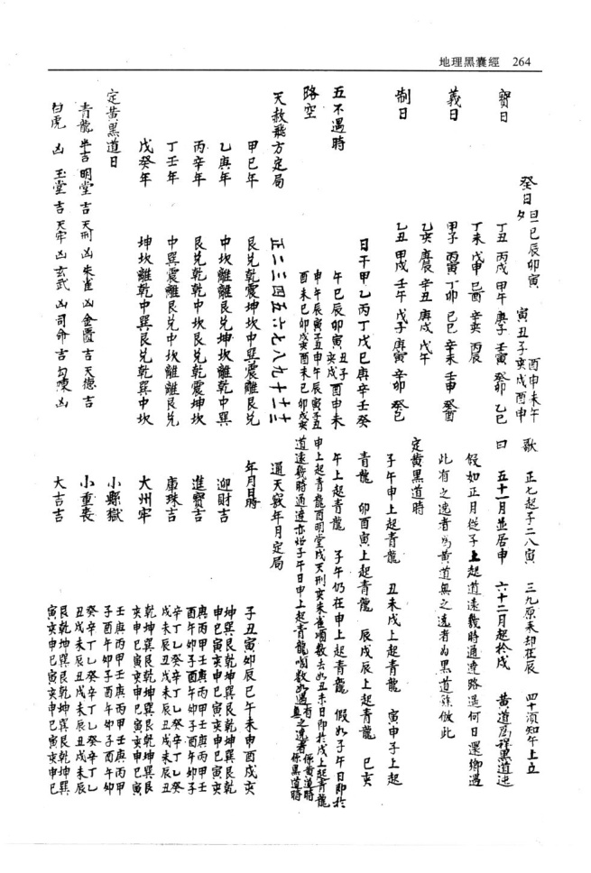

<!-- V3_SOURCE_ID:book010-b000846-p000-8a3cd2587d -->

这段内容包含风水相关的零散术语，具体所指不详。

> **释读存疑：** 原文内容零散，包含风水相关术语，具体所指不详；本地硬校验仍未通过，已记录供后续自动处理或人工核对。

查看对应原文

<!-- V3_FOLDBACK_BEGIN:book010-b000846-p000-8a3cd2587d -->

杂碧中乾兑艮離坎坤震巽進田吉谷熏簧乾中乾兑艮離坎坤震青龍吉崇一白緣兑巽中乾兌艮離坎坤大火吉皆九薪碧艮震巽中乾兌艮離坎小火吉垂白熏離坤震巽中乾兌艮離大重表羃羔一白坎坎坤震巽中乾兌艮十二星例三尋音紫坤離坎坤震巽中乾兌四太陰水黑岳八谷震艮離坎坤震巽中乾八龍德木一百冪羔翼兌艮離坎坤震巽中十病符既

<!-- V3_FOLDBACK_END:book010-b000846-p000-8a3cd2587d -->

<!-- V3_SOURCE_ID:book010-b000847-p000-27e2f11dd4 -->

冬至至立春四節内，以一白入中宮，直至甲子氣消失之日為止，此為三元日，白順圗碧段四，寅日主事時即以三皆入中宮，四條乾在黃兌六白長七赤灣八白秋上走禹六壬九禁，坤一白震二黑兵是坎震艮坤四方得崇白之吉，餘欲此；谷雨至苦親四師肉為下元，如四節山四事得以四綠入中宮，起甲子丑上中下之日，乾五黃而與日克，吳順去如戊辰日主事時即以八白入中九樂，乾一百見二世艮三碧鳴四棟坎五黃坤六白震是黃白四吉泉見見中

> **释读存疑：** 本地硬校验仍未通过，已记录供后续自动处理或人工核对。

查看对应原文

<!-- V3_FOLDBACK_BEGIN:book010-b000847-p000-27e2f11dd4 -->

冬至至立春四節内え低以一白入中宮足甲子氣けし止日是三萬而寅日值三 節候三元日白順圗 碧段四而寅日用事即以三皆入中宮四條乾在黄兑六白長七赤灣八白秋上走禹六壬 九禁坤一白震二黑兵是坎震良坤四方得崇白之吉餘欲此
谷雨至苦親四师肉為下元如四節山四事得以四绿入中宮起甲子し丑上中下 日 日乾五黃而與日克吳順去如戊辰日用事即以八白入中九樂乾一百見二世艮三碧鳴四棟坎五黄坤六白震是黄白四吉泉見見中

<!-- V3_FOLDBACK_END:book010-b000847-p000-27e2f11dd4 -->

<!-- V3_SOURCE_ID:book010-b000849-p000-4777205685 -->

这段内容存在数字重复、字符错乱的问题，语义不明，具体所指不详。

> **释读存疑：** 原文内容的具体所指不详

查看对应原文

<!-- V3_FOLDBACK_BEGIN:book010-b000849-p000-4777205685 -->

二一太歲土二太陽火三喪門木五官符翻火六死符木七歲破秋土九陰符金十福德金十吊客木假如卯年即以卯加太歲辰太陽己喪門涕節赦去

<!-- V3_FOLDBACK_END:book010-b000849-p000-4777205685 -->

<!-- V3_SOURCE_ID:book010-b000850-p000-c1c03b7993 -->

子、丑、寅、如辰、巳、午、未、申、酉、戌，夾乾、坤、丁、丙、巽、乙、甲，限癸、壬、乾、辛，與申、未、午、巳、辰、卯、寅、丑、子，夾戌、酉，成也。辰、卯、寅、丑、子、亥，一百案羃中，乾、兌、艮、離、坎、坤、震、巽，熏谷番乾、兌、艮、離、坎、坤、震、巽中，紫皆兌、艮、離、坎、坤、震、巽中，乾羃一百余，艮、離、坎、坤、震、翼中，乾、兌、岳熏谷，離、坎、坤、震、巽中，乾、兌、艮，音霫紫，坎、坤、震、巽中，乾先艮、離，羔羅一百，坤、震、巽中，乾、兌、艮、離、坎谷簧熏，震、巽中，乾、兌、艮、離、坎、坤九紫，音舊，巽中，乾、兌、艮、離、坎、坤震。

> **释读存疑：** 原文中部分组合表述如"熏谷番""音霫紫""羔羅""音舊"等具体所指不详；本地硬校验仍未通过，已记录供后续自动处理或人工核对。

查看对应原文

<!-- V3_FOLDBACK_BEGIN:book010-b000850-p000-c1c03b7993 -->

子丑寅如辰巳午未申酉戌夾坤丁丙巽乙甲限癸壬乾辛與申未午巳辰卯寅丑子夾戌酉成也 辰卯寅丑子亥一百案羃中乾兌艮離坎坤震巽熏谷番乾兌艮離坎坤震巽中紫皆兌艮離坎坤震巽中乾羃一百余艮離坎坤震翼中乾兌岳熏谷離坎坤震巽中乾兌艮音霫紫坎坤震巽中乾先艮離羔羅一百坤震巽中乾兑艮離坎谷簧熏震巽中乾兌艮離坎坤九紫音舊巽中乾兌艮離坎坤震

<!-- V3_FOLDBACK_END:book010-b000850-p000-c1c03b7993 -->

<!-- doc003 PDF 第 269 页：旋转/复杂版面 OCR 供检索；内容与排版以原页图为准。 -->
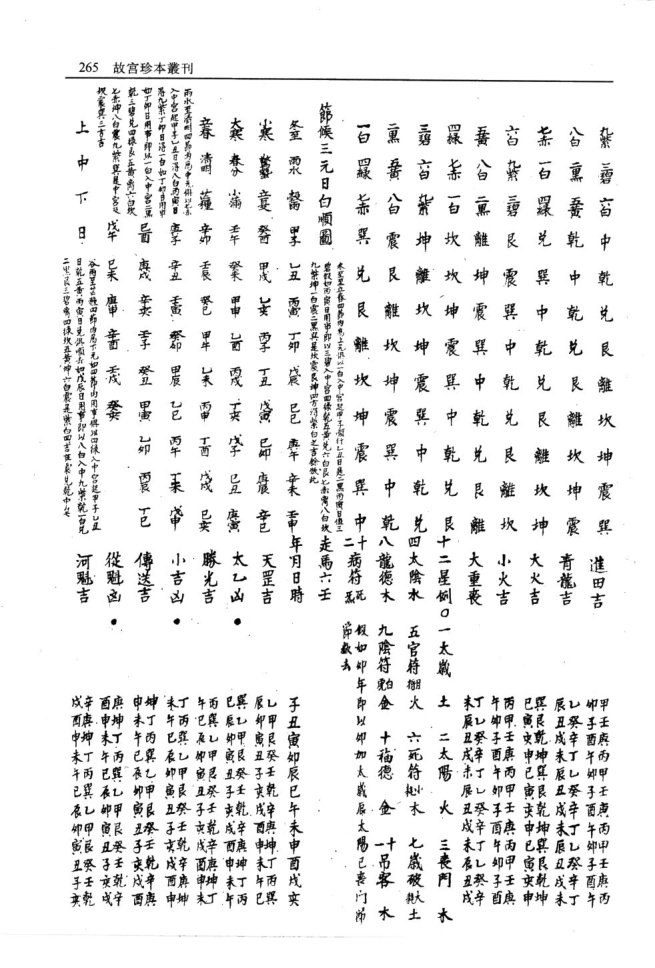

<!-- V3_SOURCE_ID:book010-b000852-p000-fb833b4798 -->

子午智日，辰、戊、丑、未日，文中提及“郊午醇”“展未贞”“已申点”“午卯”“未越辰”“申实巳”“酒郊午”“丑成辰未”“寅已申寅申色”“亥日”，其中“展”“已申点”“酒郊午”“丑成”“寅申色”具体所指不详

> **释读存疑：** 展；已申点；酒郊午；丑成；寅申色

查看对应原文

<!-- V3_FOLDBACK_BEGIN:book010-b000852-p000-fb833b4798 -->

子午智日 辰戊丑未日 郊午醇 展未贞 已申点 午卯 未越辰 申实巳 酒郊午 丑成辰未 寅已申寅申色亥日

<!-- V3_FOLDBACK_END:book010-b000852-p000-fb833b4798 -->

<!-- V3_SOURCE_ID:book010-b000853-p000-54c78d716d -->

用後至冬，文中提及“紫谷羅善熏百”，具体所指不详；用後至夏，文中提及“真震坤坎离艮兑乾中”“震坤坎离艮兑乾中巽”“坤坎离艮兑乾中巽震”“坎离艮兑乾，中兴震坤”“离艮兑乾中巽震坤坎”“艮兑乾中巽震坤坎离”“兑乾中巽震坤坎离艮”“乾中翼震坤坎离艮兑”“中巽震坤坎离艮见乾”，其中“紫谷羅善熏百”“真”“翼”“见”具体所指不详

> **释读存疑：** 紫谷羅善熏百；真；翼；见

查看对应原文

<!-- V3_FOLDBACK_BEGIN:book010-b000853-p000-54c78d716d -->

用後至冬 紫谷羅善熏百 用後至夏 真震坤坎离艮兑乾中 震坤坎离艮兑乾中巽 坤坎离艮兑乾中巽震 坎离艮兑乾，中兴震坤 离艮兑乾中巽震坤坎 良兑乾中巽震坤坎离 兑乾中巽震坤坎离艮 乾中翼震坤坎离艮兑 中巽震坤坎离艮见乾

<!-- V3_FOLDBACK_END:book010-b000853-p000-54c78d716d -->

<!-- V3_SOURCE_ID:book010-b000854-p000-e3b3eab15f -->

冬至後，子午卯酉日為上元，一白起手耶；冬至後，辰戌丑未日為中元，七赤起子時；冬重復，寅申巳亥日為下元，四林起李明；夏至後，子年卯酉日為上元，九紫起甲子。

> **释读存疑：** 原文中"冬重復""四林""李明"等内容无法确认准确含义，具体所指不详

查看对应原文

<!-- V3_FOLDBACK_BEGIN:book010-b000854-p000-e3b3eab15f -->

冬至後子午卯酉日為上元一白起手耶冬至後辰戌丑未日為中元七赤起子時冬重復寅申巳亥日為下元四林起李明夏至後子年卯酉日為上元九紫起甲子

<!-- V3_FOLDBACK_END:book010-b000854-p000-e3b3eab15f -->

<!-- V3_SOURCE_ID:book010-b000855-p000-fce332cf7f -->

忧虑的是，辰、戌、丑、未日属于中元，三碧星从甲李开始起算。

> **释读存疑：** 原文中‘甲李’所指未明，释读中未明确标注该不确定性

查看对应原文

<!-- V3_FOLDBACK_BEGIN:book010-b000855-p000-fce332cf7f -->

憂至後辰戌丑未日為中元三碧起甲李

<!-- V3_FOLDBACK_END:book010-b000855-p000-fce332cf7f -->

<!-- V3_SOURCE_ID:book010-b000856-p000-4a41098acb -->

夏至之后，寅、申、巳、亥日属于下元，六白星从甲子开始起算。

查看对应原文

<!-- V3_FOLDBACK_BEGIN:book010-b000856-p000-4a41098acb -->

夏至後寅申巳亥日為下元六白起甲子

<!-- V3_FOLDBACK_END:book010-b000856-p000-4a41098acb -->

<!-- V3_SOURCE_ID:book010-b000857-p000-a16c71fe2d -->

论述八宅生气等星吉凶的来源，王肯堂认为，自太极分出阴阳，阳之中包含阴与阳，这就是所说的太阳、少阴；阴之中包含阳与阴，这就是所说的太阴、少阳。太阳之中，阳对应乾，阴对应兑；少阴之中，阳对应离，阴对应震；少阳之中，阳对应巽，阴对应坎；太阴之中，阳对应艮，阴对应坤，这就是所说的先天八卦，即乾为父、坤为母、震为长男、巽为长女、坎为中男、离为中女、艮为少男、兑为少女。所说的后天八卦，阳道主变化，其数以进为极致，所以乾父得九数、震长男得八数、坎中男得七数、艮少男得六数；阴道主化生，其数以退为极致，坤母得一数、巽长女得二数、离中女得三数、兑少女得四数。这是河图洛书自然之数，且都不离五数。所以先天卦的配合形成生气，后天卦的配合形成延年，五数的配合形成天医。乾九数与艮六数、坎七数与震八数、坤一数与兑四数、巽二数与离三数，阳数总和为十五，阴数总和为五，所以说这是五数的配合。凡是不配合的，都是“官”，具体所指不详。乾与兑、兑与震、坤与坎、艮与巽，都是阴克制阳，凶险没有比这更严重的，所以称为“纯命”，具体所指不详。乾对应震、巽对应坤、坎对应艮、兑对应离，都是阳克制阳、阴克制阴，凶险次之，所以称为五鬼。乾与坎、艮与震、巽与兑、坤与离，都是六亲和顺，称为六煞。乾与巽、坎与离、坤与震，金木土相互克制，且子酉、丑午相互破害，所以称为祸害。稳定的配合是相互生扶，吉利；不配合的是相互克制，凶险。这就是东四宅、西四宅之所以判定，以及各星分配之所以不同的原因。画卦是从下往上变，变卦是从上往下变，所以第一次变化，乾变为兑、兑变为乾、离变为震、震变为离、巽变为坎、坎变为巽、艮变为坤、坤变为艮，这就是生气。第二次变化，乾变为震、震变为乾、坎变为艮、艮变为坎、巽变为坤、坤变为巽，这就是五鬼。第三次变化，乾变为坤、坤变为乾、坎变为离、离变为坎、震变为巽、巽变为震、艮变为兑、兑变为艮，这就是延年。第四次变化，乾变为坎、坎变为乾、艮变为震、震变为艮、巽变为兑、兑变为巽、离变为坤、坤变为离，这就是六煞。第五次变化，乾变为巽、巽变为乾、坎变为兑、兑变为坎、艮变为离、离变为艮、震变为坤、坤变为震，这就是“霍震”，具体所指不详。第六次变化，乾变为艮、艮变为乾、坎变为震、震变为坎、巽变为离、离变为巽、坤变为兑、兑变为坤，这就是天医。第七次变化，乾变为离、离变为乾、坎变为坤、坤变为坎、艮变为巽、巽变为艮、震变为兑、兑变为震，这就是“绝命”，原文讹误或未明表述，具体所指不详。世间所传的游年歌，其源头实际出自这里，只是用简便方法来概括它。当时的师傅拘泥于流俗而忘记了本源，不再深入探求这个缘故，所以吉凶就没有依据了。

> **释读存疑：** ‘官’具体所指不详；‘纯命’具体所指不详；‘霍震’具体所指不详；‘史’为原文讹误或未明表述，具体所指不详；‘官’为术数术语，具体所指不详；‘纯命’为术数术语，具体所指不详；‘霍震’原文未明，具体所指不详；‘史’为原文讹误，具体所指不详；1轮自动修复后核义模型仍建议修订，已保守记录。

查看对应原文

<!-- V3_FOLDBACK_BEGIN:book010-b000857-p000-a16c71fe2d -->

論八宅生氣等星吉凶之源王肯堂自太極分陰陽陽之中有陰有陽所謂太陽少陰也陰之中有陽有陰所謂太陰少陽也太陽之中陽乾陰兌少陰之中陽離陰震少陽之中陽巽陰坎太陰之中陽艮陰坤所謂先天八卦乾父坤母震長男巽長女坎中男離中女艮少男尤少女所謂後天八卦也陽道主變其數以進為極故乾父得九震長男得八坎中男得七艮少男得六陰道主化其數以退為極坤母得一巽長女得二離中女得三尤少女得四此河圗洛書自然之數而不離乎五者也故先天之合而為生氣焉後天之合而為延年焉五數之合而為天醫焉乾九合艮六坎七合震八坤一合兌四巽二合離三陽得十五而陰得五故曰五數之合也共不合者皆官矣乾與離尤與震坤與坎艮與巽皆以陰而尅陽兇莫甚焉故為純命馬乾冉震巽典坤坎與艮兌與離皆陽尅陽陰尅陰其凶次之故為五鬼也乾與坎艮與震巽與兌坤與離皆六親相刑拔為六煞也乾與巽坎與離坤與震金木土相尅而子酉丑午相破害故為祸害也穩之合者相比而生吉不合者相尅者害而生凶此東四西四八宅之所以判而各星分配之所以殊也畫卦自下而上變卦自上而下故一變而乾得兌兌得乾離得震震得離巽得坎坎得巽艮得坤坤得艮所以為生氣也二變而乾得震震得乾坎得艮艮得坎巽得坤得巽所以為五鬼也三變而乾得坤坤得乾坎得離離得坎震得巽巽得震艮得兌兌得艮所以為延年也四變而乾得坎坎得乾艮得震震得艮巽得兌兌得巽離得坤坤得離所以為六煞安五變而乾得巽巽得乾坎得兌兌得坎艮得離離艮得艮霍震得坤坤得震所以為祸害典六變而乾得艮艮得乾坎得震震得坎巽得離離得巽坤得兌兌得坤所以為天醫史七變而乾得離離得乾坎得坤坤得坎艮得巽得艮震得充兌得震所以為絕命立世所傳遊年歌其源實出於此而特為捷法以括之時師執流而忘源不復深求其故此吉凶所以無據也

<!-- V3_FOLDBACK_END:book010-b000857-p000-a16c71fe2d -->

<!-- V3_SOURCE_ID:book010-b000858-p000-7dc45c8fc3 -->

五行相互克制，金克制木，木克制土，土克制水，水克制火，火克制金。

查看对应原文

<!-- V3_FOLDBACK_BEGIN:book010-b000858-p000-7dc45c8fc3 -->

五行相尅金赴木木尅土土尅水水尅火火尅金

<!-- V3_FOLDBACK_END:book010-b000858-p000-7dc45c8fc3 -->

<!-- V3_SOURCE_ID:book010-b000859-p000-493668b3b2 -->

天干所属为甲，木属内，大属，大属，戊属土，金属水属地。夫所属子、栋、耳、马，有寅、有卯、有辰，为土、大、坤、土、未、金、土、申。

> **释读存疑：** 原文中部分干支、卦象的对应关系未明确，释读按原文顺序整理，具体含义依语境确定

查看对应原文

<!-- V3_FOLDBACK_BEGIN:book010-b000859-p000-493668b3b2 -->

天于所属甲 木属 内 大属 大属 戊 属 土 金属水属地夫所屬子棟耳馬寅有卯有辰為 土 大 坤 土 未 金 土 申

<!-- V3_FOLDBACK_END:book010-b000859-p000-493668b3b2 -->

<!-- V3_SOURCE_ID:book010-b000860-p000-d72174eb61 -->

人各有不同，因此住宅的宜忌也各不相同。所以祖孙有的兴盛有的衰败，父子有的显达有的废弃，夫妇前后娶妻的灾祥各不相同，兄弟长幼的吉凶也不一样。有的住在这里多有‘坎珂’，迁到那里却安稳兴旺，都是命与住宅是否相合导致的。古人不了解命不如《易》，所以从卦来推演命理，其次从宅舍各事的宜忌来配合人的命，这样就能趋向适宜而不违背。

> **释读存疑：** ‘坎珂’具体所指不详

查看对应原文

<!-- V3_FOLDBACK_BEGIN:book010-b000860-p000-d72174eb61 -->

人發之不同則宅之宜忌各異故祖孫或盛或衰父子或輿或廢夫婦而前後妻災祥各異兄弟而孟仲季休咎不同或居此多坎珂或遷彼而安茂皆命之合不合有以致此也古人不知命不如易故從卦以演命之理次從宅舍此各事之宜以合夫命庭得趨所宜而不拂

<!-- V3_FOLDBACK_END:book010-b000860-p000-d72174eb61 -->

<!-- V3_SOURCE_ID:book010-b000861-p000-83253aa117 -->

## 天地八卦五行所生之理則慶流奕葉而祥萃當身矣 — 天地八卦（八卦）五行（木、火、土、金、水五种分类及其关系体系）所生之理，则福泽流传于后代，祥瑞汇聚于自身了

查看对应原文

<!-- V3_FOLDBACK_BEGIN:book010-b000861-p000-83253aa117 -->

## 天地八卦五行所生之理則慶流奕葉而祥萃當身矣

<!-- V3_FOLDBACK_END:book010-b000861-p000-83253aa117 -->

<!-- V3_SOURCE_ID:book010-b000862-p000-e1310f6ca4 -->

| 八 | 七 | 六 | 五 | 四 | 三 | 二 | 二 |
| ---- | ---- | ---- | ---- | ---- | ---- | ---- | ---- |
| 坤（八卦之一，卦象及五行、方位依原文语境确定） | 艮（八卦之一） | 坎（八卦之一） | 巽（八卦之一） | 震（八卦之一） | 離 | 兌 | 乾（八卦之一，卦象及五行、方位依原文语境确定） |
| 太陰 | 少陽 | 少陰 | 太陽 |
| 陰 | 陽 |

> **释读存疑：** 表格中部分内容的对应关系存疑，已按原表结构及可辨识内容整理

查看对应原文

<!-- V3_FOLDBACK_BEGIN:book010-b000862-p000-e1310f6ca4 -->

<table><tr><td rowspan=1 colspan=1>八</td><td rowspan=1 colspan=1>七</td><td rowspan=1 colspan=1>六</td><td rowspan=1 colspan=1>五</td><td rowspan=1 colspan=1>四</td><td rowspan=1 colspan=1>三</td><td rowspan=1 colspan=1>二</td><td rowspan=1 colspan=1>二</td></tr><tr><td rowspan=1 colspan=1>坤</td><td rowspan=1 colspan=1>艮</td><td rowspan=1 colspan=1>坎</td><td rowspan=1 colspan=1>巽</td><td rowspan=1 colspan=1>震</td><td rowspan=1 colspan=1>離</td><td rowspan=1 colspan=1>兌</td><td rowspan=1 colspan=1>乾</td></tr><tr><td rowspan=1 colspan=2>太陰</td><td rowspan=1 colspan=2>少陽</td><td rowspan=1 colspan=2>少陰</td><td rowspan=1 colspan=2>太陽</td></tr><tr><td rowspan=1 colspan=4>陰</td><td rowspan=1 colspan=4>陽</td></tr></table>

<!-- V3_FOLDBACK_END:book010-b000862-p000-e1310f6ca4 -->

<!-- V3_SOURCE_ID:book010-b000863-p000-521d260769 -->

数字一、六排在下方，二、七排在上方，三、八排在左侧，四、九排在右侧，五、十排在中间。

查看对应原文

<!-- V3_FOLDBACK_BEGIN:book010-b000863-p000-521d260769 -->

一六居下二七居上三八居左四九居右五十居中

<!-- V3_FOLDBACK_END:book010-b000863-p000-521d260769 -->

<!-- V3_SOURCE_ID:book010-b000864-p000-61d50ca8c0 -->

圖 河

查看对应原文

<!-- V3_FOLDBACK_BEGIN:book010-b000864-p000-61d50ca8c0 -->

圖 河

<!-- V3_FOLDBACK_END:book010-b000864-p000-61d50ca8c0 -->

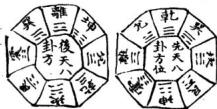

<!-- V3_SOURCE_ID:book010-b000866-p000-aaf0c8afea -->

数字九在上方，数字一在下方；数字三在左侧，数字七在右侧；数字二、四作为肩部，数字六、八作为足部；数字五位于中央的宫位。

查看对应原文

<!-- V3_FOLDBACK_BEGIN:book010-b000866-p000-aaf0c8afea -->

戴九履一 左三右七 二四為肩 六八為足 五居中宮

<!-- V3_FOLDBACK_END:book010-b000866-p000-aaf0c8afea -->

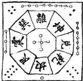

<!-- V3_SOURCE_ID:book010-b000868-p000-857cd01a35 -->

甲子五三八，甲戌六，三元九，甲申四一；甲巳九三，甲申八三五，八五二；乙未三，卯三八，二八五。此处“三元”指以三元、九运等时序结构为核心的一类体系。

> **释读存疑：** 部分干支组合的具体含义及排列逻辑不详

查看对应原文

<!-- V3_FOLDBACK_BEGIN:book010-b000868-p000-857cd01a35 -->

甲子五三八甲戌六三元九甲申四一 甲巳九三甲申八三五八五二 乙未三 卯三八 二八五

<!-- V3_FOLDBACK_END:book010-b000868-p000-857cd01a35 -->

<!-- V3_SOURCE_ID:book010-b000869-p000-e6572c1eea -->

丙寅、丙戌九六、九六三、丙申，1司

> **释读存疑：** 原文末尾的「1司」含义不明

查看对应原文

<!-- V3_FOLDBACK_BEGIN:book010-b000869-p000-e6572c1eea -->

丙寅 丙戌九六 九六三 丙申 1司

<!-- V3_FOLDBACK_END:book010-b000869-p000-e6572c1eea -->

<!-- V3_SOURCE_ID:book010-b000870-p000-acddfcb4fe -->

丁 五八 丁未三

查看对应原文

<!-- V3_FOLDBACK_BEGIN:book010-b000870-p000-acddfcb4fe -->

丁 五八 丁未三

<!-- V3_FOLDBACK_END:book010-b000870-p000-acddfcb4fe -->

<!-- V3_SOURCE_ID:book010-b000871-p000-e8a2134081 -->

戊辰三、辰六三戊實台、戊子、二八4、至八

> **释读存疑：** 原文中的「戊實台」含义不明，「二八4」的数字格式存疑

查看对应原文

<!-- V3_FOLDBACK_BEGIN:book010-b000871-p000-e8a2134081 -->

戊辰三 辰六三戊實台 戊子 二八4 至八

<!-- V3_FOLDBACK_END:book010-b000871-p000-e8a2134081 -->

<!-- V3_SOURCE_ID:book010-b000872-p000-c3b748c44d -->

己巳七四、10日、己卯二会、己丑三ん六、己酉六、己未、九三六、六ミ九

> **释读存疑：** 原文中的「三ん六」「六ミ九」字符含义不明

查看对应原文

<!-- V3_FOLDBACK_BEGIN:book010-b000872-p000-c3b748c44d -->

已巳七四 10日 已卯二会 己丑三ん六 已酉六 已未 九三六 六ミ九

<!-- V3_FOLDBACK_END:book010-b000872-p000-c3b748c44d -->

<!-- V3_SOURCE_ID:book010-b000873-p000-2515b20773 -->

庚、庚申、八二五

查看对应原文

<!-- V3_FOLDBACK_BEGIN:book010-b000873-p000-2515b20773 -->

庚 庚申 八二五

<!-- V3_FOLDBACK_END:book010-b000873-p000-2515b20773 -->

<!-- V3_SOURCE_ID:book010-b000874-p000-e1cb2bc3d4 -->

辛酉八二、七二四

查看对应原文

<!-- V3_FOLDBACK_BEGIN:book010-b000874-p000-e1cb2bc3d4 -->

辛酉八二 七二四

<!-- V3_FOLDBACK_END:book010-b000874-p000-e1cb2bc3d4 -->

<!-- V3_SOURCE_ID:book010-b000875-p000-63e565e127 -->

壬寅四一、八壬成九六三、六三癸酉五八、五六八、癸美、九六三、北日

> **释读存疑：** 原文存在多处字迹错乱或残缺，无法明确完整含义

查看对应原文

<!-- V3_FOLDBACK_BEGIN:book010-b000875-p000-63e565e127 -->

壬寅四一 八壬成九六三 六三癸酉五八 五六八 癸美 九六三 北日

<!-- V3_FOLDBACK_END:book010-b000875-p000-63e565e127 -->

<!-- V3_SOURCE_ID:book010-b000876-p000-cd0fb7cd0d -->

小字标注的前一组数字是男命的三元（以三元、九运等时序结构为核心的一类体系）九宫相关内容，后一组数字是女命的三元（以三元、九运等时序结构为核心的一类体系）九宫相关内容

查看对应原文

<!-- V3_FOLDBACK_BEGIN:book010-b000876-p000-cd0fb7cd0d -->

細字前數乃男命三元九宮後數是女命三元九宮

<!-- V3_FOLDBACK_END:book010-b000876-p000-cd0fb7cd0d -->

<!-- V3_SOURCE_ID:book010-b000877-p000-bfc86c0616 -->

遇到坎卦，出现坤卦，数字为0，对应3D零数，与丑、女、男相关，寄灵于坤卦，兴于乾卦，对应数字30、八。

> **释读存疑：** 3D；零；丑；女男；寄灵；兴乾30八的数字对应关系；原文中‘3D’‘零’‘丑’‘女男’‘寄灵’‘兴乾30八的数字对应关系’具体所指不详

查看对应原文

<!-- V3_FOLDBACK_BEGIN:book010-b000877-p000-bfc86c0616 -->

逢坎 现0 坤 3D 零 與 丑 女男 寄 灵坤 兴 乾 30 八

<!-- V3_FOLDBACK_END:book010-b000877-p000-bfc86c0616 -->

<!-- V3_SOURCE_ID:book010-b000878-p000-a47a07d2a6 -->

离卦需依照后天八卦的方位，才能与洛书的数字相契合。

查看对应原文

<!-- V3_FOLDBACK_BEGIN:book010-b000878-p000-a47a07d2a6 -->

離 依後天八卦方合洛書之數

<!-- V3_FOLDBACK_END:book010-b000878-p000-a47a07d2a6 -->

<!-- V3_SOURCE_ID:book010-b000879-p000-33144a8169 -->

这是依照《时宪书》所记载的三元九宫，也与王肯堂《笔尘》中记载的以人命论住宅的说法相符合。

查看对应原文

<!-- V3_FOLDBACK_BEGIN:book010-b000879-p000-33144a8169 -->

此乃照時憲書所載三元九宮亦與王肯堂筆塵所記以人命論宅之說相符

<!-- V3_FOLDBACK_END:book010-b000879-p000-33144a8169 -->

<!-- V3_SOURCE_ID:book010-b000880-p000-7b6f724ec4 -->

艮、震、巽、离、坤、兑卦，对应天玉、福、绝、延、生、官、坎，五行中的生、建、绝被称为六，艮、震、巽、离、坤、兑的说法，元光、天、离、六、震，生艮、祸、乾、生坤，天、六、雄、延、震、亚、坎，金、尘、还、艮、施、就、祸、坤，能、震、延、坎、绝、免，翼、秘、艮、五、乾，龙、离、生、震、天、坎，天、坤、天、巽、六、艮，巽、还、乾、五、却，五、翼、绝、艮，生数、坤、坎、五、复、坤、兑。

> **释读存疑：** 原文语句零散，多处表述含义不明，无法梳理出完整通顺的语义

查看对应原文

<!-- V3_FOLDBACK_BEGIN:book010-b000880-p000-7b6f724ec4 -->

艮震巽離坤兌 天玉福絕延生 官坎 五天生建絕稱六 艮震巽離坤兌說 元光天離六震 生艮祸乾生坤 天 六雄延震亞坎 金 尘 还良施就祸坤 能震延坎绝免 翼秘艮五乾 龙離生震天坎 天坤天巽六艮 巽 还乾五却 五翼绝艮 生数坤 坎五复 坤. 兌

<!-- V3_FOLDBACK_END:book010-b000880-p000-7b6f724ec4 -->

<!-- doc003 PDF 第 272 页：旋转/复杂版面 OCR 供检索；内容与排版以原页图为准。 -->
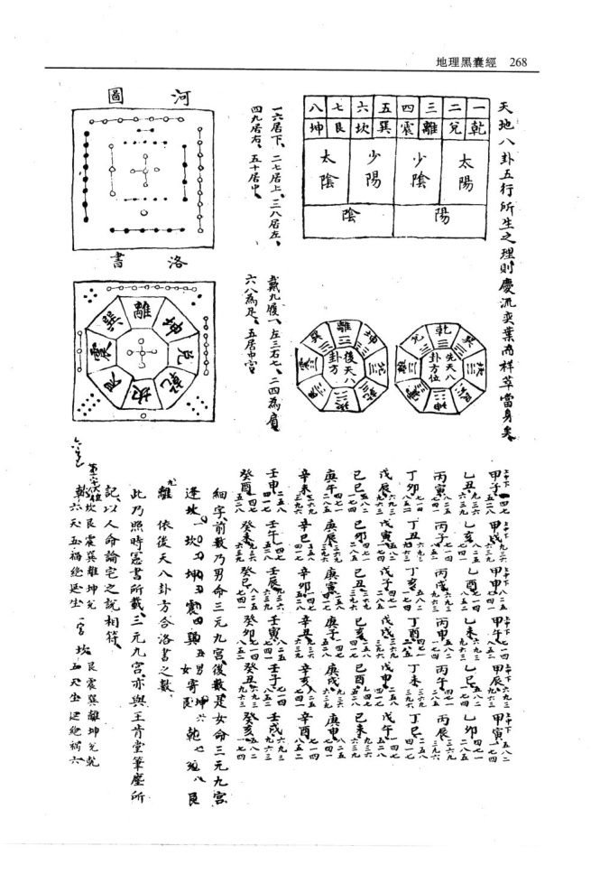

<!-- V3_SOURCE_ID:book010-b000882-p000-e6f0d30853 -->

星象对应的吉凶方位并非固定不变，各类吉利的情况也没有固定的标准。

查看对应原文

<!-- V3_FOLDBACK_BEGIN:book010-b000882-p000-e6f0d30853 -->

星然吉凶方胡定 吉諸亦無定

<!-- V3_FOLDBACK_END:book010-b000882-p000-e6f0d30853 -->

<!-- V3_SOURCE_ID:book010-b000883-p000-c22cc4a87e -->

生气星对应的方位吉利，「吉書」对应的方位也吉利；武曲星、天医星对应的方位次吉；伏位星对应的方位也吉利；绝命星对应的方位「大南」，具体所指不详；五鬼星对应的方位大凶；辅贞对应的方位「祸害星」，具体所指不详；「次南」对应的方位，具体所指不详；「出六然」对应的方位，具体所指不详；「次长」对应的方位，具体所指不详。

> **释读存疑：** 吉書；大南；次南；出六然；次长；「吉書」具体所指不详；「大南」具体所指不详；「次南」具体所指不详；「出六然」具体所指不详；「次长」具体所指不详

查看对应原文

<!-- V3_FOLDBACK_BEGIN:book010-b000883-p000-c22cc4a87e -->

生氣星上吉書位延年星上吉武曲天醫星次吉在門伏位星亦書左而絕命星大南使軍五鬼星大凶輔貞禍害星次南出六然星次长

<!-- V3_FOLDBACK_END:book010-b000883-p000-c22cc4a87e -->

<!-- V3_SOURCE_ID:book010-b000884-p000-02f41dbf73 -->

男女生命

查看对应原文

<!-- V3_FOLDBACK_BEGIN:book010-b000884-p000-02f41dbf73 -->

男女生命

<!-- V3_FOLDBACK_END:book010-b000884-p000-02f41dbf73 -->

<!-- V3_SOURCE_ID:book010-b000885-p000-17faa070f1 -->

坎、离、震、巽对应的是东四宅，而男女的命宫以三元体系的规则推演，若推演至这四个宫位，就属于东命；坤、艮、兑对应的是西四宅，而男女的命宫以三元体系的规则推演，若推演至这四个宫位，就属于西命。男性的上元甲子从坎宫起算，中元甲子从巽宫起算，下元甲子从兑宫起算；从坎宫开始，依次转向离宫、艮宫、兑宫、乾宫、中宫、巽宫、震宫、坤宫，按逆行的方式推演，若得到中宫，则寄于坤宫。女性的上元甲子从中宫起算，中元从坤宫起算，下元从艮宫起算；从中宫开始，依次转向乾宫、兑宫、艮宫、离宫、坎宫、坤宫、震宫、巽宫，按顺行的方式推演，若得到中宫，则寄于艮宫。都用九宫排山掌诀来轮数，从而得出对应的宫位。

查看对应原文

<!-- V3_FOLDBACK_BEGIN:book010-b000885-p000-17faa070f1 -->

坎離震巽為東四宅而男女命以三元起例吊至此四 宮者為東命載坤艮兌為西四宅而男女命以三元起 例吊至此四宮者為西命男之上元甲子起坎中元甲 子起巽下元甲子起兌自坎轉離轉艮轉兌轉乾轉中 轉巽轉震轉坤而逆行得中宮則寄坤女之上元甲子 起中宮中元起坤下元起艮自中宮至乾至兑至艮至 離至坎至坤至震至巽而順行得中宮則寄艮俱以九 宮排山掌訣輪數而得其宮

<!-- V3_FOLDBACK_END:book010-b000885-p000-17faa070f1 -->

<!-- V3_SOURCE_ID:book010-b000886-p000-df4ce29538 -->

福元

查看对应原文

<!-- V3_FOLDBACK_BEGIN:book010-b000886-p000-df4ce29538 -->

福元

<!-- V3_FOLDBACK_END:book010-b000886-p000-df4ce29538 -->

<!-- V3_SOURCE_ID:book010-b000887-p000-fcc0250e55 -->

住宅的坐山（建筑或穴位背靠的一方）对应的方位，每个人各有适宜的情况：东四命的人居住东四宅，西四命的人居住西四宅，这就叫做得福元。如果是西四命的人却居住东四宅，或是东四命的人却居住西四宅，即便或许有吉利之处，也不会得到福运。如果住宅的东西方位难以更改，应当改在大门的方位；如果大门的方位难以更改，应当选择住宅中吉利的房间来居住；如果房间也无法更改，应当移动床铺来契合吉利的方位，这样即便财力不足的贫寒人家，也可以招来福运。

查看对应原文

<!-- V3_FOLDBACK_BEGIN:book010-b000887-p000-fcc0250e55 -->

宅之坐山為福德宮人各有所宜東四命居東四宅西 四命居西四宅是為得福元如西而居東東而居西方 雖或吉不受福也如東西之宅難改當於大門改之如 大門難改當其房之吉以住之房不可易當移其床以 就其吉則雖無力貧家亦可邀福也

<!-- V3_FOLDBACK_END:book010-b000887-p000-fcc0250e55 -->

<!-- V3_SOURCE_ID:book010-b000888-p000-7aae0a8c5e -->

宅舍大门

查看对应原文

<!-- V3_FOLDBACK_BEGIN:book010-b000888-p000-7aae0a8c5e -->

宅舍大門

<!-- V3_FOLDBACK_END:book010-b000888-p000-7aae0a8c5e -->

<!-- V3_SOURCE_ID:book010-b000889-p000-3d0a2a91e6 -->

大门宜安于本命的四个吉利方位，不可安于本命的四个凶险方位；同时还须合来龙、坐山的吉利方位以开门，又须合来水的吉利方位以立门，三者俱全则福德周全，子孙后代兴旺发达。住宅有坐山、有向，人的命分东四命、西四命。若只论山向而不论命，会有大凶；只论命而不论山向，会有小凶；合命与合坐向，则求福顺遂。乾、兑乃西四宅，大门宜在坤、兑、艮方位，以配乾的西四坐山。而床、香火、后门、“唐铺”这类事物，具体所指不详，亦宜安于四吉之位，以合坐山。至于灶、产、坑、厕、碓、磨，则宜安于西四宅的四凶方位，以压其凶；而灶的火门，原文作“嵩四吉方”，疑似讹误，具体所指不详，宜安于四吉之位。此宅惟乾、坤、艮、兑西四宅命之人居住则吉，若坎、离、震、巽东四宅命之男女居住，则原文作“則吉凶矣”，具体含义不详。

> **释读存疑：** 原文疑似讹误的“犬門”具体所指不详，原文疑似讹误的“嵩四吉方”具体所指不详，“唐铺”具体所指不详，原文“則吉凶矣”具体含义不详；原文‘犬門’具体所指不详，原文‘嵩四吉方’具体所指不详，‘唐铺’具体所指不详，原文‘則吉凶矣’具体含义不详；1轮自动修复后核义模型仍建议修订，已保守记录。

查看对应原文

<!-- V3_FOLDBACK_BEGIN:book010-b000889-p000-3d0a2a91e6 -->

大門宜安於本命之四吉方不可安於本命之四凶方 又須合來龍坐山之吉方以開門父宜迎來水之吉以 立門三者俱全則德福全而奕葉流光矣屋有坐有向 命有東有西若耑論山向而不論命者大凶論命而不 論山向者小凶合命有合坐向者則求福如乾何兌何 乃西四宅也犬門宜在坤兌艮方以配乾之西四坐山 而床香火後門唐鋪之類亦宜安四吉之位以合坐山 若灶產坑厠確磨則宜安西四宅之四凶方以壓其凶 而灶之火門又宜嵩四吉方此宅惟乾坤艮兌西四宅 命居之則吉若坎離震巽東四宅命男女居之則吉凶 矣

<!-- V3_FOLDBACK_END:book010-b000889-p000-3d0a2a91e6 -->

<!-- V3_SOURCE_ID:book010-b000890-p000-83298f3d25 -->

依照住宅地基外部的态势来看，若临近风水语境中的河流、水系及其来去形态，且还有九局、乌局这类真正的风水格局，其力量自然足以胜过坐山。

查看对应原文

<!-- V3_FOLDBACK_BEGIN:book010-b000890-p000-83298f3d25 -->

按宅基外勢臨水柵更有九局烏局之真正者其力量自足以勝坐山也

<!-- V3_FOLDBACK_END:book010-b000890-p000-83298f3d25 -->

<!-- V3_SOURCE_ID:book010-b000891-p000-afec7cfe82 -->

六事

查看对应原文

<!-- V3_FOLDBACK_BEGIN:book010-b000891-p000-afec7cfe82 -->

六事

<!-- V3_FOLDBACK_END:book010-b000891-p000-afec7cfe82 -->

<!-- V3_SOURCE_ID:book010-b000892-p000-6162c39655 -->

所谓六事，指的是门、路、灶、井、坑、碓磨，这些都是居家必须用到的物品，若安放的位置合适，使用起来就会便利；人们往往会忽略它们的方位，一旦用到了属于凶方的物品，反而会成为招致灾祸的缘由，暗中生出灾祸，遭受祸殃却还不知道，实在令人叹息。

查看对应原文

<!-- V3_FOLDBACK_BEGIN:book010-b000892-p000-6162c39655 -->

六事者乃門路灶井坑廁碓磨居家必須之物安放得所取用便利人每忽其方道一犯凶方利用之物反為致禍之由暗地生災受禍不知良可嘆息

<!-- V3_FOLDBACK_END:book010-b000892-p000-6162c39655 -->

<!-- V3_SOURCE_ID:book010-b000893-p000-58ed7299a9 -->

## 分房

查看对应原文

<!-- V3_FOLDBACK_BEGIN:book010-b000893-p000-58ed7299a9 -->

## 分房

<!-- V3_FOLDBACK_END:book010-b000893-p000-58ed7299a9 -->

<!-- V3_SOURCE_ID:book010-b000894-p000-1b3d1afe6d -->

分房居住，是指祖孙父子叔伯弟兄各自适宜居住的房位。即便名义上虽未分房，实际仍同住一处宅院之中，也需将东、西、南、北四个方位的房分别安排，这样才能避免凶险。若是同一进的房屋，或者仅有一两间的，只需在丈量尺寸时，结合命相适宜的方位即可，所以属东命的适宜居住在东边，属西命的适宜居住在西边，这样就没有不福寿安康的。如果违背了这个适宜的原则，就会招致凶险。

查看对应原文

<!-- V3_FOLDBACK_BEGIN:book010-b000894-p000-1b3d1afe6d -->

分房者祖孫父子叔伯弟兄各宜所居之房位也雖分覺未分覺同居一宛之中而東西南北四隅之房各異宜各分别遣之則凶即一進之屋或僅一兩間者只丈尺之間合命者吉故東命第居東西命第居西無不福壽苟失其宜貪天不免矣

<!-- V3_FOLDBACK_END:book010-b000894-p000-1b3d1afe6d -->

<!-- V3_SOURCE_ID:book010-b000895-p000-4943be8ba9 -->

床坐

查看对应原文

<!-- V3_FOLDBACK_BEGIN:book010-b000895-p000-4943be8ba9 -->

床坐

<!-- V3_FOLDBACK_END:book010-b000895-p000-4943be8ba9 -->

<!-- V3_SOURCE_ID:book010-b000896-p000-4d33d80c65 -->

阳宅的诸多事宜中，唯有床的布置最容易出问题，其布置的方法有四种：以结合命相的吉利方位为最重要，其次要结合分房的吉利原则，还要结合坐山的吉利，还要结合照水的吉利，就像以门论房的吉利一样。不过这四个方面很难全部兼顾，应当依据可以确定的条件来结合吉利，不会超出可先可后的范围罢了。如果精心布置，就能为了人的需要移动床的位置，生子的话，可在侧房小屋中结合命相适宜的地方安置床，而将正房正屋留给子孙中结合命相适宜的人居住，在正房安置床，这样就都不会有灾祸，还能获得福气。灶坐火门

查看对应原文

<!-- V3_FOLDBACK_BEGIN:book010-b000896-p000-4d33d80c65 -->

陽宅諸事惟床易為其所立法有四宜合命之吉方為最又宜合分之吉又宜合坐山之吉又宜合照水經以門論房之吉然四者難全當從其可據者以合其吉不越乎可先可後之間而已若精措置則為人移床生子生命可於側房小屋之合命者安床居之而以正房正屋與子孫合命者居作房安床則各無災而獲福矣灶坐火門

<!-- V3_FOLDBACK_END:book010-b000896-p000-4d33d80c65 -->

<!-- V3_SOURCE_ID:book010-b000897-p000-07499f6b26 -->

锅灶之事，人们都看作是细小的事情，却不知道它是建造住宅的重要事务。如果锅灶压在本命生气方，就会怀鬼胎，或者流产、不孕，即便有孩子也会不聪明，不能获得钱财，还会招致人口损耗，牲畜也会亏损衰败。如果压在天医方，就会长期卧床体弱，服药也没有效果。如果压在延年方，就会寿命不长，婚姻难以成功，夫妇之间不和睦，疾病、贫穷、困顿。如果压在伏位，就会没有钱财，终身贫穷。如果压在本命的破军绝命方，就会无病而长寿，多子，还会招引奴婢，没有火灾。如果压在六煞方，就会人丁兴旺、发财，无病无讼，没有火灾，家门安稳。如果压在祸害方，就不会退财，不会伤人，无病无讼。如果压在五鬼方，就不会有火灾，不会有盗贼，奴婢忠诚勤勉得力，无病，享用钱财，田地牲畜大为兴旺。必须仔细丈量房屋的基址，务必使方位准确，不可猜测，以免误事。应当用大纸将屋址及层数逐一丈量清楚，按丈尺画成一幅图，每基一丈折为一寸，将房屋图分成八卦九宫，写明二十四方位，之后才能知道某方某位对应某间房屋，这样吉凶就会清楚明白。火门，是锅底添柴烧火的入口，朝向吉利方位，福气来得很快，一个月左右就能应验，关系到子嗣、贫富、灾病，是日用饮食的根本。比如属东命的人，火门朝向东卦就吉利，朝向西卦就凶险；属西命的人，火门朝向西卦就吉利，朝向东卦就凶险。西命火门，就是人身背向西、向东烧火的情况。

> **释读存疑：** 原文中“壯壓”“懷鬼胎”“落胎”“招人口”“天醫”“延年”“伏位”“破軍”“絕命”“六煞”“禍害”“五鬼”等术语的具体所指，因未列入给定术语表，暂保留原词

查看对应原文

<!-- V3_FOLDBACK_BEGIN:book010-b000897-p000-07499f6b26 -->

鍋灶人皆視為細小事而不知為立宅之要務如壯壓 本命生氣方則懷鬼胎或落胎不孕而而有子而不聰 明不得財不招人口可畜損敗若壓天醫方則久病卧 床體弱服藥無效若壓延年方則無壽婚姻難成夫婦 香 不和亥病窮塞若壓伏位則無財無素終身貧黃若壓 本命之破軍絕命方則無病有壽多子發則招奴婢無 火災如壓六煞方則發丁發財無病無訟無火災家門 安穩若壓禍害方不退財不傷人無病無訟若壓五鬼 方無火災無盜賊奴婢忠勤得力無病饗財田畜大旺 須大量屋之基址務使方位真正不可猜度誤事當用 大紙將屋址及層數逐一量明丈尺畫成一圃每基一 丈摺方一寸將屋穩圗分作八卦九宮寫明二十四方 向而後知某方某位為某間則吉凶聽然矣火門者鍋 底納柴燒火之口得向吉方福甚速期月之間可驗 子嗣貧富災病寺天者以日用飲食者此為根本也如 東命人火門朝東卦則吉何西卦則凶西命人火門向 西卦則吉向東卦則凶西命火門人身背西東炊火 乃是矣

<!-- V3_FOLDBACK_END:book010-b000897-p000-07499f6b26 -->

<!-- V3_SOURCE_ID:book010-b000898-p000-b28056becc -->

符屋丈量房屋所用的尺寸最为合理，比如壬山丙向的情况：中间方位为壬，壬的左侧为子，再往左是癸，更往左是丑，而艮则在墙外的空地以及东面的北部；壬的右侧为亥，再往右是乾，更往右是戌。再比如癸山丁向的情况：中间方位为癸，癸的左侧为丑，再往左是艮，更往左就是寅；癸的右侧为子，再往右是壬，更往右是亥，而乾则在墙外的空地以及西面的北部。按照这个规律推算，东西两面的方位就能完全清楚，不会有差错。另外还有癸丁、壬丙方位不完全在正中，而是偏向右侧或左侧的情况，就应当以偏离的那个位置作为正中，我另有相关说法记载在别的纸上。

> **释读存疑：** 原文中“艮乃在牆外空處及東面之北”“乾乃在牆外空處及西面之北”的具体位置所指未明

查看对应原文

<!-- V3_FOLDBACK_BEGIN:book010-b000898-p000-b28056becc -->

符屋量明丈尺最為有理如壬山丙向者中為壬中左為子再左為癸更左為丑而艮乃在牆外空處及東面之北中右為亥再右為乾更右為戌矣如癸山丁向者中為癸左為丑再左為艮更左即寅矣中右為子再右為壬更右為亥而乾乃在牆外空處及西面之北矣即此推之東西面之方位了然不爽更有癸丁壬丙不盡居中而偽偏右偏左者即當於盱偏處為中余另有別說載於別紙

<!-- V3_FOLDBACK_END:book010-b000898-p000-b28056becc -->

<!-- V3_SOURCE_ID:book010-b000899-p000-9f3e7611e3 -->

## 香火、 — 香火

查看对应原文

<!-- V3_FOLDBACK_BEGIN:book010-b000899-p000-9f3e7611e3 -->

## 香火、

<!-- V3_FOLDBACK_END:book010-b000899-p000-9f3e7611e3 -->

<!-- V3_SOURCE_ID:book010-b000900-p000-f196af7aba -->

土地神祠、祖先祠堂都属于香火类的场所，将其安置在本命的吉利方位就能获得福运，安置在凶方就一定会有灾祸。古人说的“移烟政火”，具体所指不详，如果错误地移动了它的方位，就会改变吉利的来路，反而招来凶祸。

> **释读存疑：** 移烟政火；移烟政火具体所指不详

查看对应原文

<!-- V3_FOLDBACK_BEGIN:book010-b000900-p000-f196af7aba -->

土地神祠祖先祠堂皆香火也安本命之吉方則得福凶方必有咎古云移煙政火者謂無鍋煙香火有禍無福也若誤移其方則變其吉之來路反凶矣

<!-- V3_FOLDBACK_END:book010-b000900-p000-f196af7aba -->

<!-- V3_SOURCE_ID:book010-b000901-p000-bd2e5e0329 -->

## 坑厕

查看对应原文

<!-- V3_FOLDBACK_BEGIN:book010-b000901-p000-bd2e5e0329 -->

## 坑厕

<!-- V3_FOLDBACK_END:book010-b000901-p000-bd2e5e0329 -->

<!-- V3_SOURCE_ID:book010-b000902-p000-a8ee1255ed -->

这种用来去除秽气的方法，是将其压在对应本命凶方的位置，以此镇住凶神，反而能招来大福，效果十分灵验。所选的方位都要与灶屋的烟路相对，用它来镇压就会吉利。不过应当仔细审察，方位不能混淆错乱。如果误改到屋外的吉方，就会变成来路的凶方，即使是尺寸的地基、丈尺的地址，也应当清楚明确。

查看对应原文

<!-- V3_FOLDBACK_BEGIN:book010-b000902-p000-a8ee1255ed -->

九此出穢之所用壓於本命之凶方鎮住凶神反發大福甚驗其方皆與灶屋烟窘相對用以壓之則吉矣然當詳審矣方位不可混錯或悞改於屋外之吉方則同路來路之凶矣即尺基丈址亦宜清楚的確

<!-- V3_FOLDBACK_END:book010-b000902-p000-a8ee1255ed -->

<!-- V3_SOURCE_ID:book010-b000903-p000-c3e2fb1a7c -->

## 婚娜

查看对应原文

<!-- V3_FOLDBACK_BEGIN:book010-b000903-p000-c3e2fb1a7c -->

## 婚娜

<!-- V3_FOLDBACK_END:book010-b000903-p000-c3e2fb1a7c -->

<!-- V3_SOURCE_ID:book010-b000904-p000-f38b542bec -->

命元属于东四命的人，适合娶东四命的妻子，这样会多子多福；如果误娶西四命的妻子，就会子嗣艰难，夫妻不和，无法发福。比如坎命的男子，配巽命的女子，巽是坎的生气位，必定会有五个儿子，夫妻和睦，能辅助丈夫成家立业。如果坎命的男子娶艮命的女子，这就是五鬼位，虽然会有两个儿子，但必定会不和睦，还会耗散钱财。古人说：贪生对应五子巨三郎，武曲金星对应四子，五鬼廉贞对应两个儿子，辅弼只对应半个儿子，文曲水星对应一个儿子，破军绝命对应孤寡无后，禄存对应无子嗣，人能延寿。生剋休囚的道理要仔细审察，这些都是妻子命元的固有定数，即使是来路、灶向与命元相合，也能据此判断子嗣的多少与有无。比如乾命的丈夫、兑命的妻子，生气位对应五个儿子，但金与金相克，主夫妻不和；坤命的延年位妻子，对应四个儿子，夫妻和睦；有人说乾坤配合最适宜，对应六子；艮命的天医位妻子，对应三个儿子；乾命的伏位妻子，只生一个女儿；离命的绝命妻子，无子嗣；离火克金，必定会惧怕妻子；坎命的六煞位妻子，对应一个儿子，会有争执；震命的五鬼位妻子，对应两个儿子，长子难以成才；还有乾克震，丈夫欺凌妻子；巽命的祸害位妻子，是腐木般的懒妇，常受丈夫羞辱；禄存对应无子嗣，夫妻多长寿。其余命元都可据此类推。不过还要看星曜的生剋吉凶，是否得位，以此作为辅助，这样就能广延子嗣，吉祥顺遂了。

查看对应原文

<!-- V3_FOLDBACK_BEGIN:book010-b000904-p000-f38b542bec -->

命元是東四命者宜婚東四命妻則有子多福悞結西 四命妻則艱乎嗣不和不發福如坎命男配巽命女巽 為坎之生氣必有五子又和而助夫成家若坎命男娶 艮命女是為五鬼雖有二子必不和而竊財古云貪生 五子巨三郎武曲金星四子強五鬼廉貞兒兩個輔弼 只是半兒郎文曲水星惟一子破軍絕命守孤孀祿存 無子人延壽生剋休囚仔細詳此皆妻命固有准即得 來路灶向之合命者亦可斷其子之多寡有無也如乾 夫兌妻生氣有五子但金見金相敵主不和坤延年妻 四子和睦或云乾坤配合最宜應六子艮天醫妻三子 乾伏位妻只一女離絕命妻無子又離火尅金必惧內 坎六煞妻一子相争震五鬼妻二子長難抬又乾尅震 夫欺妻巽祸害妻為腐木嬾婦常受夫辱祿存無子夫 婦多壽餘命皆做此推然須論其星之生剋吉凶得位 不得位以為救助麼可廣嗣蘭吉矣

<!-- V3_FOLDBACK_END:book010-b000904-p000-f38b542bec -->

<!-- V3_SOURCE_ID:book010-b000905-p000-e61b693985 -->

依据妻子命元来论命的方法，比通书更有益处。吕才合婚的例子，我多次试验，没有比这更准确的，确实有实际效果。世间求亲配婚的人，应当先留意这一点。按照吕才合婚的说法，是从游年歌而来的，所说的生气、天医、五鬼、绝命，原本是相同的；所说的福德就是延年，归魂就是伏位，游魂就是六煞，绝体就是祸害，名称不同，实则相同。不过下面所标注的数字，就是九宫之数，仔细核对，只有生气、游魂、绝命、归魂这四条的数字。

查看对应原文

<!-- V3_FOLDBACK_BEGIN:book010-b000905-p000-e61b693985 -->

妻元論命之法較有益於通書呂才合婚之例予屢試之無如此之確有實驗也世之求婚配者先當留意其按呂才合婚之說即從遊年歌來所云生氣天醫五鬼絕命固相同而所云福德即延年歸魂即伏位遊魂即六煞絕體即禍害名易而實則同但其下所註之數即九宮之數而細核之惟生遊絕歸四條之數

<!-- V3_FOLDBACK_END:book010-b000905-p000-e61b693985 -->

<!-- V3_SOURCE_ID:book010-b000906-p000-4bc70ae420 -->

## 圖婚合才吕

查看对应原文

<!-- V3_FOLDBACK_BEGIN:book010-b000906-p000-4bc70ae420 -->

## 圖婚合才吕

<!-- V3_FOLDBACK_END:book010-b000906-p000-4bc70ae420 -->

<!-- V3_SOURCE_ID:book010-b000907-p000-df3cc5e0e2 -->

不差其福天体五、四两条都错了，都是后人以讹传讹，不考证其来源，习以为常却毫无察觉。殊不知八卦中，乾、兑生于太阳，离、震生于少阴，巽、坎生于少阳，艮、坤生于太阴；二太所生为西四命，二少所生为东四命，这就是命与宅的区分依据，而各星的吉凶都从八卦挨次变化而来，道理本有依据，数字也可考证，为何要迷失本源而随波逐流呢？因此我订正了相关内容，附录在后面。至于上元甲子起一宫，时宪书现在记载在书末，作为男女命元、婚元的数字依据；而旧说上元起于乂宫，与现在的历法不同，有人说竹书记年考证确实差了一元，康熙甲子乃是下元，不知哪种说法正确，但终究应以时宪书为准。

查看对应原文

<!-- V3_FOLDBACK_BEGIN:book010-b000907-p000-df3cc5e0e2 -->

不差其福天体五四條俱錯皆後人以訛傳訛不考從來習而不覺殊不知八卦中乾兌生於大陽離震生於少陰巽坎生於少陽艮坤生於太陰二太所生西四二少所生東四此命與宅所由分而各星吉凶皆從八卦挨變而起理固有據數亦可考奈何迷其源而奈其流乎因為訂正附錄於後至上元甲子起一宮時憲書現載書末以為男女命元婚元之數而舊存上元起於乂宮與今歷異或云竹書記年考之寔差一元廉熙甲子乃係下元未知孰是然畢竟以時憲書為准

<!-- V3_FOLDBACK_END:book010-b000907-p000-df3cc5e0e2 -->

<!-- V3_SOURCE_ID:book010-b000908-p000-cf546394b9 -->

文中提及乘生德福、四、三三、九一九、醫天、四三二一四七三六、四三二一九二一八、九八七六九二一八、九八七六四七三六、鬼五魂逃、x三二一九七三一、九六四八二四八六、七三二一九七三一、命绝體絕、六四三一六九、九八七二四八二七、六四三一六九三一、七六、1、八六三一、三一、八六、现歸、子孫昌旺為大、吉遊魂歸魂絕體為中婚、較量輕重用之亦吉五鬼、口相連絕命禍害甚重為下婚避之則吉，具体所指不详。

> **释读存疑：** 乘生德福；醫天；鬼五魂逃；命绝體絕；现歸；子孫昌旺為大；吉遊魂歸魂絕體為中婚；較量輕重用之亦吉五鬼；口相連絕命禍害甚重為下婚避之則吉；乘生德福、醫天、鬼五魂逃、命绝體絕、现歸、子孫昌旺為大、吉遊魂歸魂絕體為中婚、較量輕重用之亦吉五鬼、口相連絕命禍害甚重為下婚避之則吉，具体所指不详

查看对应原文

<!-- V3_FOLDBACK_BEGIN:book010-b000908-p000-cf546394b9 -->

乘生德福 四 三三 九一九 醫天 四三二一四七三六 四三二一九二一八 九八七六九二一八 九八七六四七三六 鬼五魂逃 x三二一九七三一 九六四八二四八六 九六四八二四八六 七三二一九七三一 命绝體絕 六四三一六九 九八七二四八二七 九八七二四八二七 六四三一六九三一 七六 1 八六三一 三一 八六 现歸 主子孫昌旺為大 吉遊魂歸魂絕體為中婚 較量輕重用之亦吉五鬼 口相連絕命禍害甚重為下婚避之則吉

<!-- V3_FOLDBACK_END:book010-b000908-p000-cf546394b9 -->

<!-- V3_SOURCE_ID:book010-b000909-p000-3b5bfd978f -->

八宅徵騎

查看对应原文

<!-- V3_FOLDBACK_BEGIN:book010-b000909-p000-3b5bfd978f -->

八宅徵騎

<!-- V3_FOLDBACK_END:book010-b000909-p000-3b5bfd978f -->

<!-- V3_SOURCE_ID:book010-b000910-p000-f2396c311c -->

有乾命的男子问风水师说：“我求亲很难成功，有什么办法能让婚事快点成？”风水师为他改了壮火门的向，朝向坤延年方，这是能加快婚事的方位。又让他把卧床安放在父母床的西南坤方，得分居的延年方位。之后过了几个月，他就成了婚，就算没有分居的吉兆，也不会超过三年就会成婚。还有一个贫穷的读书人，没有聘财，风水师为他改移了来路，调整了分房、灶门的向，修了方位，灶卦五事都符合延年方位。又告诫他，灶尘、粪坑、溷水都不能压在延年吉方。过了一年，果然有友人资助他钱财，让他成了婚。还有一个艮命的富人，年近五十没有儿子，而妻子严厉，不容许他娶妾，问有什么办法可以解决。风水师说：“这一定是灶座、溷厕误压了延年方。”为他丈量了地基，分清了方位，将灶、厕压在凶方，而七锅火门都朝向兌方。过了一年，他娶了七个妾，所娶的人都是生气命，各自生了儿子，有福气和寿数。

> **释读存疑：** 原文中“壯火門”“灶卦五事”“七鍋火門”“兌”“生氣命”等术语的具体所指未明，释读未作确定性解读，符合要求

查看对应原文

<!-- V3_FOLDBACK_BEGIN:book010-b000910-p000-f2396c311c -->

有乾命男問師曰求親難就何法可速師為之改壯火門向坤延年方是速婚之向又令其臥床安於父母床之西南坤方得分居之延年後數月得婚縱不分房之吉者亦不出三年也又一貧士無聘財師為改移來路分房灶門向修方灶卦五事皆合延年又戒其灶塵糞厠溷水莫壓延年吉方踰年果得友人助貲而婚又艮命富戢半百無子而妻嚴不容娶妾問何法可全師曰此必灶座溷廁誤壓延年方也為之丈量基址分清方隅將灶廁壓凶方而七鍋火門皆向兌經年納七妾所娶皆生氣命各生子有福壽

<!-- V3_FOLDBACK_END:book010-b000910-p000-f2396c311c -->

<!-- V3_SOURCE_ID:book010-b000911-p000-558bb1a948 -->

有巽命的丈夫，与坎命的生气妻相配，后来误改了灶的火门朝向坤方，犯了妻子的绝命方，大门又改在了坤方，五个儿子都死了。风水师为其改灶，将大坤调整后火门朝向震方，又改大门至离方，之后该妻子又生了四个儿子。宅法能挽回造化，就像这样。

> **释读存疑：** 原文中‘生五于’的具体所指不详，‘大坤’的具体含义不详

查看对应原文

<!-- V3_FOLDBACK_BEGIN:book010-b000911-p000-558bb1a948 -->

有巽命夫配坎命生氣妻生五于後悞改灶之火門向 坤犯妻之絕命方大門又改於坤五子皆死師為改灶 大坤而火門向震又改大門於離後此妻復生四子宅 法能回造化如此

<!-- V3_FOLDBACK_END:book010-b000911-p000-558bb1a948 -->

<!-- V3_SOURCE_ID:book010-b000912-p000-6d9bae9085 -->

还有一个贫穷的妇人，苦于丈夫客居在外不回来，风水师为她改了延年灶的向，丈夫就回来了。又有人问，不知道妻妾婢仆的命该怎么办？风水师说：“先让她们都在西灶向吃饭，过百日，如果都安稳，就是西命人；如果有人有灾，就是东命人。因此家里有上百口人的，应当设立两个灶，火门分别在东西方向，让东命、西命的人分别在符合各自命的灶吃饭，这样全家就没有灾祸了。

> **释读存疑：** 原文中“延年灶”的具体所指未明，释读未作明确界定；1轮自动修复后核义模型仍建议修订，已保守记录。

查看对应原文

<!-- V3_FOLDBACK_BEGIN:book010-b000912-p000-6d9bae9085 -->

又一窶婦苦夫客不歸師為改延年灶何而歸 又有問妻妾婢僕不知其命奈何師曰先以西灶向與 食百日而安即是西命人倘有災即是東命人是以家 有百口者當立二灶火門東西使東命西命分別各食 於相合之灶則全象無咎矣

<!-- V3_FOLDBACK_END:book010-b000912-p000-6d9bae9085 -->

<!-- V3_SOURCE_ID:book010-b000913-p000-081671aeec -->

有人问，有儿子远在他乡，用什么办法能让他回来？风水师为他改了灶座，压在父亲的绝命方，而火门朝向生气方，用来招儿子。没过几个月，那个儿子梦见灶君穿着绛色衣服、黑色鞋子，对他说：“父亲喊你很急，为什么不快点回来？”那个儿子就回来赡养父亲了。把这个方法告诉别人，用来唤儿子大多应验。如果是奴仆逃走，就把灶门、座的烟压在主命的五鬼方，而让火门朝向生气方，逃走的奴仆一定会回来。但必须先查明逃走者的命，如果主是乾命，奴仆是震命，这就是五鬼方，不能用，用了奴仆一定会窃逃；如果火门朝向震方，奴仆一定逃走不回来。乾命的主人，得到兌命的奴仆，不但不会逃走，还会帮助主人发家。不只是奴仆这样，就算是亲友，遇到五鬼命的，一定会耗财；遇到生气命的，会帮助主人兴旺得力；遇到延年命的，会相处到老，和睦兴旺；遇到伏位命的，只是平淡相交，和气而已；犯六煞命的，会因淫乱、诉讼被牵连；犯绝命、祸害命的，日后一定会遭受他们的毒害。就算生了儿子，也能断定他是孝顺还是忤逆。有艮命的人和坤命的儿子住在一起，钱财常常充裕；如果年老时和儿子分开住，在他乡就会很窘迫。风水师说：阴宅、阳宅都能改变天命、夺取神功，命运怎么能像原来一样呢？如果住宅不吉利，就算命运再好，也不能免除灾祸和贫穷。古代的贤士之所以阐明阴阳二宅的道理，是用来辅助天地的不足。因此劝告老人尽快回到故乡，和儿子住在一起，安享晚年。

> **释读存疑：** 原文中“灶君絳衣玄剋”“五鬼方”“六煞命”“伏位命”等术语的具体所指未明，释读未作确定性解读，符合要求

查看对应原文

<!-- V3_FOLDBACK_BEGIN:book010-b000913-p000-081671aeec -->

或問有子遠客何法得其歸師為改灶座壓其父之絕命方而火門向生氣以招子不及數月其子夢灶君絳衣玄剋播其乎曰父喚汝甚急何不速回其子歸養嗣以此法與人喚子多驗若奴僕進走則灶門座煙壓於主命之五鬼而以火門向生氣方遜者決回然須查逃者之命如主乾命僕是震命乃五鬼不可用用之必竊逃若火門向震必遜去不回乾主命得兌命僕不但不遜而且助主起家不惟奴僕為然即親友顯伴犯五鬼命者必耗財生氣命者助旺得力得延年命者交至老和同興發得伏位者平淡相交父而和氣犯六煞者淫訟牽連犯絕命禍害者後必遭其荼毒也即生子亦可斷其贊孝忤逆有艮命與坤命兒同居財常裕老別子隔他鄉窘甚師曰陰墳陽宅二者能改天命奪神功命豈能主之如故宅不吉命獨好不能免其災貧古賢所以闡陰陽二宅之至理以佐天地之不全也因勸老人速歸故里與子同居安享餘年

<!-- V3_FOLDBACK_END:book010-b000913-p000-081671aeec -->

<!-- V3_SOURCE_ID:book010-b000914-p000-616d43501a -->

又震命年老無子抱繼巽命延年之姪週歲取名壓子 其家神附隣童之身曰莫名壓子當名慶壽神以延年 之吉示之也後果至耄虛

查看对应原文

<!-- V3_FOLDBACK_BEGIN:book010-b000914-p000-616d43501a -->

又震命年老無子抱繼巽命延年之姪週歲取名壓子 其家神附隣童之身曰莫名壓子當名慶壽神以延年 之吉示之也後果至耄虛

<!-- V3_FOLDBACK_END:book010-b000914-p000-616d43501a -->

<!-- V3_SOURCE_ID:book010-b000915-p000-81f472a1ed -->

有兑命生兒震命有碍師曰宅之難改有七塋元方妻元命子孫命坐山來路遊年移徒照水徑門法抽爻換泉此皆不易惟令其食息於吉方而有益於父命則藉以安而得其力矣可將此子同乳母去巽延年方或一里半里住房炊欽至大即於其方讀書不令身近父像則不但得分房之延年而易長有壽則其父亦得分房之生氣矣兌命生氣乾自巽方回視父之所居在西北為乾也

查看对应原文

<!-- V3_FOLDBACK_BEGIN:book010-b000915-p000-81f472a1ed -->

有兑命生兒震命有碍師曰宅之難改有七塋元方妻元命子孫命坐山來路遊年移徒照水徑門法抽爻換泉此皆不易惟令其食息於吉方而有益於父命則藉以安而得其力矣可將此子同乳母去巽延年方或一里半里住房炊欽至大即於其方讀書不令身近父像則不但得分房之延年而易長有壽則其父亦得分房之生氣矣兌命生氣乾自巽方回視父之所居在西北為乾也

<!-- V3_FOLDBACK_END:book010-b000915-p000-81f472a1ed -->

<!-- V3_SOURCE_ID:book010-b000916-p000-739f77a3d0 -->

問兒夜啼瘡瘦求解之法師曰人犯兮房火門二者之 窗則有夜啼瘡患之昔卒至驚疳吐馮三六九之天傷 誠可惘也如孩兒坤艮土命犯震巽木而灶之火门又 向東乃木剋土主脾瀉醬府犯坎水是土剋水主驚風 急慢犯離大主痰啼嘔吐若東命孩兒把乾兌金必有 肺喘麻疹府癆之病震巽孩兒犯坤艮土必患瘧廟平 昔治人多驗可將東命孩兒房床安於父母床東南方 居臥即安然不夜啼矣此分房之法不論樓上樓下床 裏床外只要在父母安居臥之東雖尺基丈址亦有效 其西命孩兒宜在父母居卧之西也其人踰月又問 瘡哭俱愈但不能離乳食粥何法解除師曰可立一孩 兒命之吉灶句與乳母食即是兒食一樣之自能食 也其人從之而兒能食我師此法常毅醫人學之以挽 未病之先補救已病之後則造福無窮矣

查看对应原文

<!-- V3_FOLDBACK_BEGIN:book010-b000916-p000-739f77a3d0 -->

問兒夜啼瘡瘦求解之法師曰人犯兮房火門二者之 窗則有夜啼瘡患之昔卒至驚疳吐馮三六九之天傷 誠可惘也如孩兒坤艮土命犯震巽木而灶之火门又 向東乃木剋土主脾瀉醬府犯坎水是土剋水主驚風 急慢犯離大主痰啼嘔吐若東命孩兒把乾兌金必有 肺喘麻疹府癆之病震巽孩兒犯坤艮土必患瘧廟平 昔治人多驗可將東命孩兒房床安於父母床東南方 居臥即安然不夜啼矣此分房之法不論樓上樓下床 裏床外只要在父母安居臥之東雖尺基丈址亦有效 其西命孩兒宜在父母居卧之西也其人踰月又問 瘡哭俱愈但不能離乳食粥何法解除師曰可立一孩 兒命之吉灶句與乳母食即是兒食一樣之自能食 也其人從之而兒能食我師此法常毅醫人學之以挽 未病之先補救已病之後則造福無窮矣

<!-- V3_FOLDBACK_END:book010-b000916-p000-739f77a3d0 -->

<!-- V3_SOURCE_ID:book010-b000917-p000-926921f925 -->

乾命人悞食向南火門灶食患心疼肺喘痰嗷噎症師 教以另置一小缸灶壓坐於南以除離卦之凶而以火 門朝艮之天醫方食之踰月而病痊一半至半載而病 全愈矣若新灶吃幾日舊灶吃幾日則無效几餘命有 病俱以天醫為却病之方乾命遠客犯離歸路而命病 師曰犯來路者必從來治路今灶火門雖改天醫然不 能除病根可徃艮徃方或坤方住百日而歸自除根矣 其人從之果驗

查看对应原文

<!-- V3_FOLDBACK_BEGIN:book010-b000917-p000-926921f925 -->

乾命人悞食向南火門灶食患心疼肺喘痰嗷噎症師 教以另置一小缸灶壓坐於南以除離卦之凶而以火 門朝艮之天醫方食之踰月而病痊一半至半載而病 全愈矣若新灶吃幾日舊灶吃幾日則無效几餘命有 病俱以天醫為却病之方乾命遠客犯離歸路而命病 師曰犯來路者必從來治路今灶火門雖改天醫然不 能除病根可徃艮徃方或坤方住百日而歸自除根矣 其人從之果驗

<!-- V3_FOLDBACK_END:book010-b000917-p000-926921f925 -->

<!-- V3_SOURCE_ID:book010-b000918-p000-d9d0d7cc13 -->

乾命之人的妻子嫁至離方，該方位的來路引發問題，三年後離火克制乾金，導致妻子患上肺咳吐血的重病，情況危急。師傅為其改設火門，朝向艮天醫方位，又將床移至艮方，把糞廁移至離方，在艮方添設神位，將柴段壓在震五鬼方，煙窟、水缸都壓在離方，把碓磨移至東方。一個月後，病人的病情好了一半，但還未除根。師傅說：如果是犯了灶向的問題，讓病人用天醫火門方位的灶煮食就能痊愈；如果是犯了來路的問題，就必須將來路遷換才行。病人的丈夫說：難以遷移，怎麼辦？師傅說：人不必遷移，只要將灶廁移到鄰家符合來路的方位，也就是未坤中延年方位，或者丑艮天醫方位，在那裡做灶煮食，把食物送回家裡給病人吃，病人的糞穢也都運到那處，父親在那裡添設神位，等到百日之後，將各種物品遷移開，就算得到來路的吉氣了。後來果然除了病根。有人問：移去坑灶等數件事，都不可缺少嗎？師傅說：灶座、火門、坑廁這三者最重要，其餘的是次要的。又有人問：鄰家沒有房屋可租，該怎麼辦？師傅說：可以在吉方之外的街巷牆壁外，向鄰家買米換飯來吃，或者寄煮，用他們的鍋也有效，並且將病人的糞便送到鄰家的廁所裡，滿百日後回家，就和移居到那處來的來路一樣了。但恐怕去來的方位不真，那麼病根終究不能除去。如果東宅命想要用去來都吉利的方位，只有丙午丁、壬子癸方位，至於甲卯乙方位，是去東來西；辰巽巳方位，是去巽來乾；未坤申、丑艮寅方位，去來都凶。有人又問：糞廁是小事，移動它未必有這樣的靈驗吧？師傅說：我見過有人誤移了方位而變得貧窮，有人改動了方位而變得富裕，這是因為所移動的方位必定是吉利的。

> **释读存疑：** 原文中‘父添設神位於其中’的‘父’具体所指未明，释读为‘父亲’缺乏依据；本地硬校验仍未通过，已记录供后续自动处理或人工核对。

查看对应原文

<!-- V3_FOLDBACK_BEGIN:book010-b000918-p000-d9d0d7cc13 -->

乾命婦嫁於離方面來路三年而離火剋乾金肺咳吐血將危師為改火門向艮天醫改床艮方將糞廁離方添設神位於艮方將柴段壓震五鬼方具煙窟水缸俱壓離方移碓磨壓東方後一月而病去半但未除根師曰犯灶向病者則以天醫火門之灶食之可愈如犯來路者必從來路徙換方可其夫曰難徙奈何師曰身不必徙但將灶廁去鄰家合來路未坤中延年方或丑艮天醫方作灶煮食送來家內食之其病人糞穢皆運至彼處父添設神位於其中待至百日後將各物移彌即為得來路之吉矣後果除根或問移去坑灶數事俱不可少手師曰灶座火門坑廁三者為最餘次之又問鄰家無屋可租將若何師曰可於吉外方街墻之外鄰家以米換飯來食或寄煮其鍋亦效且將病人糞送至其家廁內滿百日回家即同移居而來之路矣但恐去來之方道不真則病根終不能除矣如東宅命欲用去來俱吉之方則惟丙午丁壬子癸至於甲卯乙則去東來西辰巽巳則去巽來乾未坤申丑艮寅而去來皆凶矣或又問糞廁小事移之未必若是之驗師曰見人有悞移而貧改之而富者以所移必得其所也

<!-- V3_FOLDBACK_END:book010-b000918-p000-d9d0d7cc13 -->

<!-- V3_SOURCE_ID:book010-b000919-p000-25d46ff6a0 -->

從前有一位艮命之人，將火門朝向離禍害方位，即將引發訴訟。師傅為他將床改移至天醫乾方位，以化解禍害，第二天這件事就立刻平息了。

查看对应原文

<!-- V3_FOLDBACK_BEGIN:book010-b000919-p000-25d46ff6a0 -->

昔艮命人以火門向離禍害方事有將訟師為改床於 天醫乾方以遂禍害翌日其事頓息

<!-- V3_FOLDBACK_END:book010-b000919-p000-25d46ff6a0 -->

<!-- V3_SOURCE_ID:book010-b000920-p000-4ba3295f0f -->

有一位艮命之人修建坎方位的房屋，犯了五鬼煞，導致失盜、僕人逃跑、發生火災。師傅教他在坤生氣方位添造房屋，之後就得到了平安。

查看对应原文

<!-- V3_FOLDBACK_BEGIN:book010-b000920-p000-4ba3295f0f -->

有艮修坎犯五鬼失盜逃僕火驚師教於坤生氣方添造房屋乃得平安

<!-- V3_FOLDBACK_END:book010-b000920-p000-4ba3295f0f -->

<!-- V3_SOURCE_ID:book010-b000921-p000-3b5f168e46 -->

有一位‘牡年’、坤命之人，想要在震禍害方位添造一間房屋，師傅阻止他說：一年後你的父親一定會告你忤逆。這人說：父親疼愛我，哪會有這種事？過了一年，父親果然告了他，導致破財。於是他來拜見師傅，說：北方有一間大屋，我不忍心弟弟獨居，想要進去居住，怎麼樣？師傅說：北方的大屋對你來說是絕命方位，不吉利，必須在坤、艮這兩個方位居住數月，之後再進住大屋，就不會有災禍，反而會有福氣。這人不信，最終進住，不到一年就死了，導致家道敗落。

> **释读存疑：** ‘牡年’具体所指不详

查看对应原文

<!-- V3_FOLDBACK_BEGIN:book010-b000921-p000-3b5f168e46 -->

有牡年坤命添造震禍害方屋一間師阻之曰一年後父必告汝忤逆其人曰父愛我豈有此事後一年父果告之致破財乃來叩師曰北方大屋不忍弟之獨居而欲進住何如師曰北方大屋與汝為絕命不利須於坤伏位艮生氣二方去住數月而後再進大屋則無災而有福矣其人不信竟住不一載而死傷致絕

<!-- V3_FOLDBACK_END:book010-b000921-p000-3b5f168e46 -->

<!-- V3_SOURCE_ID:book010-b000922-p000-4e46d591b5 -->

迁移的来路

查看对应原文

<!-- V3_FOLDBACK_BEGIN:book010-b000922-p000-4e46d591b5 -->

遷移來路

<!-- V3_FOLDBACK_END:book010-b000922-p000-4e46d591b5 -->

<!-- V3_SOURCE_ID:book010-b000923-p000-1c6389be73 -->

比如人原本住在东方，迁移到西方，这就是震（八卦之一）进入巽（八卦之一）的方位。人们只当作兑宅来修造，于是木被金克制，又是震的绝命位。这是因为不明白来路的生克关系，必然会突然招致灾祸，必须从来路的角度来解决问题。

查看对应原文

<!-- V3_FOLDBACK_BEGIN:book010-b000923-p000-1c6389be73 -->

如人住東方移遷到西方乃是震入巽鄉人只作兌宅修造乃木受金剋又是震之絕命此由不明來路之生剋必卒然致禍須從來路解之

<!-- V3_FOLDBACK_END:book010-b000923-p000-1c6389be73 -->

<!-- V3_SOURCE_ID:book010-b000924-p000-fb2c6f72ec -->

陳簡青說：來路是根基所在，應當詳細探究；常見遷移之時就會敗落，這是因為來路受到克制的緣故。

查看对应原文

<!-- V3_FOLDBACK_BEGIN:book010-b000924-p000-fb2c6f72ec -->

陳簡青曰來路根也深宜詳究每見遷移即敗是來受剋也

<!-- V3_FOLDBACK_END:book010-b000924-p000-fb2c6f72ec -->

<!-- V3_SOURCE_ID:book010-b000925-p000-89df4ae803 -->

## 修方

查看对应原文

<!-- V3_FOLDBACK_BEGIN:book010-b000925-p000-89df4ae803 -->

## 修方

<!-- V3_FOLDBACK_END:book010-b000925-p000-89df4ae803 -->

<!-- V3_SOURCE_ID:book010-b000926-p000-a6a39bb72d -->

凡是拆卸、修补、添加、更换样式、盖瓦、修整门壁、墙垣以及沿街的墙头、水沟等，都叫做修方，其吉凶会立刻应验。如果修方与本命的吉凶相符，十天左右就能显现应验；如果修方与住宅的坐山、坐卦相符，风水师为他人营造福运，比如修建高阁、晒台，叠砌石墩，消除祸患，开挖池塘、凿井，拆墙、伐木、移宽、改门等事项，都可以按年月来推算吉凶。例如乾命之人，修兑卦对应的生气方位，半年后会有大财，之后出贵人；修艮卦对应的天医、坤卦对应的延年、乾卦对应的伏位，都是吉利的；忌讳修离、震、坎、巽方位，必然会有灾祸，比如疾病、是非、灾殃这类情况。坤命之人，修艮卦对应的生气方位，主财富，田产会兴旺；修兑、乾、坤卦对应的方位，都是吉利的；如果修震、坎、离、坎方位，都是凶险的。坎命之人，修巽卦对应的生气方位，必然能得富贵；修离、震、坎卦对应的方位，都是吉利的；修乾、兑、坤、艮卦对应的方位，都是凶险的。其余的可以以此类推。

查看对应原文

<!-- V3_FOLDBACK_BEGIN:book010-b000926-p000-a6a39bb72d -->

凡拆卸修葺添補換樣蓋瓦撫門壁墻憲及沿街墻頭水溝等皆謂之修方吉凶立應如合本命之吉凶必旬曰見驗而合宅門坐山坐卦者師為人造福而起高閣晒臺疊塔砌墩除患而開池鑿井倒牆伐木移寬改門等項皆可歲月計如乾命脩兌生氣半載有大財後出貴脩艮天醫坤延年乾伏位皆吉忌脩離震坎巽方必有禍如疾病是非災殃之類坤命脩艮生氣主富青旺田產脩兌乾隆坤皆吉如脩震坎巽坎離皆凶坎命脩巽生氣必致富貴脩離震坎皆吉脩乾兌坤艮則凶餘可類推

<!-- V3_FOLDBACK_END:book010-b000926-p000-a6a39bb72d -->

<!-- V3_SOURCE_ID:book010-b000927-p000-f6c42176fd -->

摇断八宅

查看对应原文

<!-- V3_FOLDBACK_BEGIN:book010-b000927-p000-f6c42176fd -->

搖断八宅

<!-- V3_FOLDBACK_END:book010-b000927-p000-f6c42176fd -->

<!-- V3_SOURCE_ID:book010-b000928-p000-c0a4a8a332 -->

《易经》有八卦，确定八宅之后，还应当论及修造的年月日时，以及住宅的生旺、克制关系。应当先论人命与住宅的吉凶，再论修造四课与人命的关系，务必分清生、克、制化，避免偏胜，这样才能判断凶中藏吉、吉中藏凶的情况。其次在方寸之间，阳宅的第一吉星叫做生气，人命与这个吉方、吉向相符，又遇到贪狼生旺之神，修造之后，必然能生五子，人丁大旺，财富催发，官贵显达，百福交集，这可以按年月来推算。第二吉星叫做天医，人命与住宅的床、房、灶向相符，会有三子，能得中等财富，修造则人才旺相，修改则可免除膝部疾病，灾祸也需要四课扶助，福运才能到来。第三吉星叫做延年，人命与这个方位的床、路相符，也能旺人，发财富贵，家庭和睦，多寿。第四吉星叫做伏位，人命与门路、床、房、灶相符，能得小康，中等寿命，只生女儿，少生儿子。以上四个方位都是吉利的，适合开大门、作卧房、安香火房，房内只适合安床。至于铺面、后门、米仓、银库、账房、书房、饭桌、学馆、畜栏、栖栈等，都适合安放在本命的四个吉方以及外厢。灶座适合安放在本命宅内的四个凶方，而灶的火门必须面向木命的四个吉方，来路也必须朝向本命的四个吉方。分房、卧房也应当符合本命的四个吉方，父母的床座也需要符合父母的吉位。生山来龙必须符合本命的四个吉方，才能得到福荫，否则即使有上等的形胜、吉秀、贵气，也都是徒劳的。放水出口、拆补修方，都必须符合本命吉方，才能发福，否则笼统无定。又，元莹、元灶、卦照、水经、临门法，都应当符合命的四个吉方，忌讳命的四个凶方。第一凶星叫做绝命，触犯它会导致子孙灭绝。第二凶星叫做六煞，触犯它会导致人命官非、疾病、孤寡伤人、损畜破财。第三凶星叫做五鬼，触犯它会导致奴仆迟走、犬灾、盗贼、损小、口舌是非。第四凶星叫做祸害，触犯它虽然官司得胜，但会伤人败产、损畜、阴耗。这本命的四个凶方位，只适合安置灶座、烟憲、碓碾、坑厕、水缸、井臼、柴房、灰屋、人客往来、饭桌、空房、以及低臭水缸等，用来镇压其凶。按八宅的说法，是从太少四象分来的，二大生的是西四宅卦，二少生的是东四宅卦，而用后天八卦方位来应用，这是有源有本，确实可信。叶心益年只有生气、延年、天医、绝命、五鬼、六煞、祸害以及本卦伏位八个星配八宅。至于贪、巨、禄、文、廉、武、破、辅、弼九星，是金星的一种说法，所以或许可以附于紫白九宫，但混入游年八宅就不伦不类了，世人都习以为常而不察觉，特此纠正。

查看对应原文

<!-- V3_FOLDBACK_BEGIN:book010-b000928-p000-c0a4a8a332 -->

易有八卦于定八宅又當論脩造之年月日時與宅之生旺剋制先當論人命舍宅之吉凶乃論修造四課與人命務要分清生剋制化不致偏勝而凶中吉中凶乃能判次於字握之間陽宅第一吉星曰生氣人命合得此吉方吉向又逢貪狼生旺之神修造定生五子大旺皆財催官貴顯百慶交集可歲月期也第二吉星曰天醫人命合得宅之床房灶向者有三子致中富叛造則人才旺相脩改則膝病免禍亦須四課扶助而福乃臻第三吉星曰延年人命合得此床路亦旺人發財而家行和氣多壽第四吉星曰伏位人命合得门路床房灶小康中壽只生女少子以上四方皆吉宜開大門作臥房安香火房內只宜安床至若舖面後門米倉銀庫賬房書房叱飯桌位學館畜欄栖棧俱宜於本命四吉方上及外廂安之其灶座宜於本命宅內之四凶方而灶之火門必須面向木命四吉方來路亦須向本命之四吉方其分房卧末亦宜合本命之四吉方有父毋俱要合父母床座之吉亦可其生山來龍必合本命之四吉乃得受其蔭庇否則雖有上等形勝吉秀貴氣亦徒然也放水出口拆補修方俱須合本命吉方乃能發福否則籠統無臉又妻元塋元灶卦照水經臨門法並宜合命之四吉忌命之四玄第一凶星曰絕命犯之主子孫威絕第二凶是曰六煞犯之主人命官非疾病孤寡傷人損畜破財第三凶星曰五鬼犯之主奴僕遲走犬災盜賊損小口舌是非第四吉星曰禍害犯之雖官司得勝而傷人敗產損畜陰耗此本命四凶方位惟灶座烟憲確碾坑廁水缸井臼柴房灰屋人客往來飯桌空聞房屋及低臭水缸等事而已乃所以鎮壓其凶也按八宅之說從太少四象分來二大生者為西四宅卦二少生者為東四宅卦而以後天八卦方位入用此乃有源有本確然可信者也是心益年只有生氣延年天醫絕命五鬼六煞福害以及本卦伏位八星配八宅也至於貪巨祿文廉武破輔弼九星乃金星是一說故或可附於紫白九宮而以混入遊年八宅則不倫世皆習而不察特為正之

<!-- V3_FOLDBACK_END:book010-b000928-p000-c0a4a8a332 -->

<!-- V3_SOURCE_ID:book010-b000929-p000-61f1942bfd -->

八宅既然从卦论，那么五行也应当从卦来，依照洛书分九宫五行，这样就不会错乱。忽然混杂九星，五行就各不相同，生、克、制化就无法确定，所以游年歌只有八个字，生气、延年也只有十六字，何曾用五行呢？我认为宅法应当除去九星的说法，专门论八卦及二十四山向，才不会混淆。焦弱侯所记载的修学的说法，是江南宅法的始祖，也只论八卦五行，因为八宅是从八卦起的。

查看对应原文

<!-- V3_FOLDBACK_BEGIN:book010-b000929-p000-61f1942bfd -->

八宅既從卦論則五行亦當從卦即照洛書分九宮五行尚不錯亂忽雜以九星而五行各異生尅制化莫可適從所以遊年歌止有八個字即生氣延年亦止十六字何嘗拿立五行乎窃謂宅法即當除九星之說專論八卦及二十四山向庭不淆惑焦弱侯所記脩學之說乃江南宅法之祖亦止論八卦五行蓋以八宅從八卦起也

<!-- V3_FOLDBACK_END:book010-b000929-p000-61f1942bfd -->

<!-- V3_SOURCE_ID:book010-b000930-p000-11babd552a -->

宅基

查看对应原文

<!-- V3_FOLDBACK_BEGIN:book010-b000930-p000-11babd552a -->

宅基

<!-- V3_FOLDBACK_END:book010-b000930-p000-11babd552a -->

<!-- V3_SOURCE_ID:book010-b000931-p000-5eb53bccf3 -->

陳簡青說，能出高官、受封拜的陽宅，一定會出現旗、鼓、幞頭、天馬山這類地形。至於科甲連綿、書香傳家的宅基，不過是六秀方位的形勢秀麗而已。那些世代殷實的人家，必定是丙、艮二方的砂、水形勢高厚。如果只是能旺人丁的陽基，遇到的不過是粗頑的氣勢。又說，陽基與陰地不同，陽基喜愛地勢寬平，格局寬廣但前不破碎。文中提到的「聖得」一詞具體所指不詳，方正的右山右水是陰基的好形勢。如果是世代科甲、家道殷實、子孫繁衍昌盛、千年守護的陽基，必定是席頭高厚、龍尾大起，才能形成大的局勢。比如朝南的平陽宅基，坤、申方位地勢高，艮、寅方位地勢實，山間坤、申山高，艮、寅山起，必定是子孫世代守護的基址，不只是朝南的陽基如此，八山八局總要席頭高而龍尾起，請後世君子驗證。如果虎頭不高、龍尾不起，不過數代，終當易姓。

> **释读存疑：** 聖得；大之局勢；稳要

查看对应原文

<!-- V3_FOLDBACK_BEGIN:book010-b000931-p000-5eb53bccf3 -->

陳簡青曰封拜陽宅必有旗皷幞頭天馬山現至於科甲書香之宅基不過六秀方秀美而已其世代殷當者必丙艮二方高厚砂水來若僅人丁陽基不遇粗頑氣旺又云陽基與陰地不同陽基喜地勢寬平局而寬前不破碎聖得方正右山右水皆陰基之善者若世代科甲家殷當子孫衍昌千年世守者陽基必席頭高厚龍尾大起乃成大之局勢假如朝南之基平陽坤申地高艮寅他實山间坤申山高艮寅山起必是子孫世守之基征不特朝南陽基為然八山八局稳要席頭高而龍尾起請後之君子驗之如虎頭不高龍尾不起不過數代終當易姓

<!-- V3_FOLDBACK_END:book010-b000931-p000-5eb53bccf3 -->

<!-- V3_SOURCE_ID:book010-b000932-p000-e4072d8df1 -->

又說，陰陽形勢佳的地方，百里之中可有「教十處」，具體所指不詳；陽基大的地方，百里之中只有一兩處，原文末尾的「乙」字具體所指不詳。

> **释读存疑：** 教十處；乙

查看对应原文

<!-- V3_FOLDBACK_BEGIN:book010-b000932-p000-e4072d8df1 -->

又曰陰陽佳者百里之中可有教十處陽基大者百里 之中一二而乙

<!-- V3_FOLDBACK_END:book010-b000932-p000-e4072d8df1 -->

<!-- V3_SOURCE_ID:book010-b000933-p000-6a1b02c163 -->

家座贅語

查看对应原文

<!-- V3_FOLDBACK_BEGIN:book010-b000933-p000-6a1b02c163 -->

家座贅語

<!-- V3_FOLDBACK_END:book010-b000933-p000-6a1b02c163 -->

<!-- V3_SOURCE_ID:book010-b000934-p000-1852eb252a -->

江寧府學明德堂後舊有一高阜土隆之墳起嘉靖初都御史陳鳳梧夷其阜建尊經閣於上未建閣之先府學偏試中者甚多景泰四年制科中式二百人而應天至二十四九人可謂極盛自建閣後逼年漸咸隆慶以來稀若辰星矣萬曆己酉丙戌間太常寺卿凍南周公繼署府篆公雖善宅經謂儒學之文廟坐乾朝巽開巽門而學門居左屬處廟後明德堂後尊經閣高大主事廟門與學門二木皆受乾金之剋陽宅以門為氣口生則福剋則禍於是以抽爻換象補酒之法修之於學之坎方起高樓曰青雲樓高於尊住以池乾中之氣而以收水生震巽二木以助二門之氣又於廟門前豎巨坊興學門之坊並峙以益震巽之勢於離造聚星亭使震巽二木生火以發文明之又以泮池河水不蓄於下手造文德木橋以遏水之流脩理甫畢公遷應天巡撫都御史學門內舊有房牆戊子冬公下徵拆去之曰此公明年大聲必出始血廷矣己丑焦公果應其占庚寅冬公連南戶侍面語余曰脩學一大魁余未敢言功也占當出三元坊中樞字亭上星字篆及區之三口星之三明圈皆寓三元之象君具識之乙未戊戌宋公與余相繼登第人益以公之術為神頃年有議脩學者大京黃所博謀於衆余謂只宜循公之制不可輕改其發科之多少蓋心歲道利能所制不拘何宅皆可有之惟其宅本吉則宜靜聰以待吉之自會年度遷科：脩改斷無此理

查看对应原文

<!-- V3_FOLDBACK_BEGIN:book010-b000934-p000-1852eb252a -->

江寧府學明德堂後舊有一高阜土隆之墳起嘉靖初都御史陳鳳梧夷其阜建尊經閣於上未建閣之先府學偏試中者甚多景泰四年制科中式二百人而應天至二十四九人可謂極盛自建閣後逼年漸咸隆慶以來稀若辰星矣萬曆己酉丙戌間太常寺卿凍南周公繼署府篆公雖善宅經謂儒學之文廟坐乾朝巽開巽門而學門居左屬處廟後明德堂後尊經閣高大主事廟門與學門二木皆受乾金之剋陽宅以門為氣口生則福剋則禍於是以抽爻換象補酒之法修之於學之坎方起高樓曰青雲樓高於尊住以池乾中之氣而以收水生震巽二木以助二門之氣又於廟門前豎巨坊興學門之坊並峙以益震巽之勢於離造聚星亭使震巽二木生火以發文明之又以泮池河水不蓄於下手造文德木橋以遏水之流脩理甫畢公遷應天巡撫都御史學門內舊有房牆戊子冬公下徵拆去之曰此公明年大聲必出始血廷矣己丑焦公果應其占庚寅冬公連南戶侍面語余曰脩學一大魁余未敢言功也占當出三元坊中樞字亭上星字篆及區之三口星之三明圈皆寓三元之象君具識之乙未戊戌宋公與余相繼登第人益以公之術為神頃年有議脩學者大京黃所博謀於衆余謂只宜循公之制不可輕改其發科之多少蓋心歲道利能所制不拘何宅皆可有之惟其宅本吉則宜靜聰以待吉之自會年度遷科：脩改斷無此理

<!-- V3_FOLDBACK_END:book010-b000934-p000-1852eb252a -->

<!-- V3_SOURCE_ID:book010-b000935-p000-212866a757 -->

按此不遇就一定之八卦五行以為生剋制化只就门論對坐山高大主事亦可使之貪生忘剋轉相為益于门而坎乃巽之生氣又直中元巽卦運旺之時所以其驗若應樂耳何嘗論九星論紫白式

查看对应原文

<!-- V3_FOLDBACK_BEGIN:book010-b000935-p000-212866a757 -->

按此不遇就一定之八卦五行以為生剋制化只就门論對坐山高大主事亦可使之貪生忘剋轉相為益于门而坎乃巽之生氣又直中元巽卦運旺之時所以其驗若應樂耳何嘗論九星論紫白式

<!-- V3_FOLDBACK_END:book010-b000935-p000-212866a757 -->

<!-- V3_SOURCE_ID:book010-b000936-p000-eb5d215ea5 -->

## 筆塵

查看对应原文

<!-- V3_FOLDBACK_BEGIN:book010-b000936-p000-eb5d215ea5 -->

## 筆塵

<!-- V3_FOLDBACK_END:book010-b000936-p000-eb5d215ea5 -->

<!-- V3_SOURCE_ID:book010-b000937-p000-c39279f2d7 -->

王肯堂

查看对应原文

<!-- V3_FOLDBACK_BEGIN:book010-b000937-p000-c39279f2d7 -->

王肯堂

<!-- V3_FOLDBACK_END:book010-b000937-p000-c39279f2d7 -->

<!-- V3_SOURCE_ID:book010-b000938-p000-2c5c5b88dc -->

我乡里有位姓刘的朋友，向来不相信阴阳吉凶这类说法。有一天他来拜访我，看到我修整房屋，就对我说：“听说你家的门朝向极不吉利，关系到吉凶，应当仔细选择。”我问他这话有什么依据，他坚持要问缘由，刘某说：“我之前开了一扇后门，之后就发生了大的失窃案，还惹上了官司，田地也被收回了，懂风水的人劝我把那扇后门堵上，之后才得以平息，你难道还不相信吗？”我随口说道：“人的命是由天注定的，怎么能归咎于一扇门呢？”刘某说：“不是这样的，那个风水先生的说法可是奇准无比。”过了几天，刘某带着那个叫乐生的风水先生来，我虚心向他请教。乐生说：“这要结合人的本命来看，你是上元生人，寄位在乾宫，而你家开的那扇后门是坎门，属于六煞之位，按照风水的说法，会发生火灾、失窃、官司、田地被收回这类事，我也不清楚其中的具体道理，相关的书籍都在这里。”于是他打开箱子，拿出书给我看，书名是《全光斗临经》，这本书专门依据人的本命来论住宅风水，他让我试着用这本书来判断，确实很灵验。我在京师时，有个叫王有听的人，在县署任职，精通住宅风水之法，就专门研究这本书，他判断的祸福常常奇准，我多次想去拜访他，但因为事务繁忙，所以一直没能成行。

> **释读存疑：** 本地硬校验仍未通过，已记录供后续自动处理或人工核对。

查看对应原文

<!-- V3_FOLDBACK_BEGIN:book010-b000938-p000-2c5c5b88dc -->

余里中一友劉生素不信陰陽機祥之說一日過余見余攝屋謂予曰聞門極測係吉凶宜審擇之予如其說必有為固詰其故劉曰余向開一後門而失大失盜官訟退田術者勸余塞之乃己可不信乎余漫矣曰人受命于天奈何歸咎一户劉曰不然何術者之奇中也居數日劉引術者樂生來虛心訪之樂曰利本命而成為上元生人寄位乾宮而所匍乃坎門六煞其法應火盜官訟退田某亦不知其所以然其書俱在因啟筐生示予名全光斗臨經專以人命論宅引余試而用之良驗淺于京師劑有聽調縣全王姓者精於宅法乃專周此書僕禍福往奇中屢欲訪之而以煩促故不果

<!-- V3_FOLDBACK_END:book010-b000938-p000-2c5c5b88dc -->

<!-- V3_SOURCE_ID:book010-b000939-p000-86f40759e7 -->

八卦性情

查看对应原文

<!-- V3_FOLDBACK_BEGIN:book010-b000939-p000-86f40759e7 -->

八卦性情

<!-- V3_FOLDBACK_END:book010-b000939-p000-86f40759e7 -->

<!-- V3_SOURCE_ID:book010-b000940-p000-94bc18527a -->

乾、兑、震、巽不宜尅，坤、艮二土不宜生，坎、离尅泄皆凶暴，卫士须知以上情。

查看对应原文

<!-- V3_FOLDBACK_BEGIN:book010-b000940-p000-94bc18527a -->

乾兌震巽不宜尅坤艮二土不宜生坎離尅泄皆凶暴衛士須知以上情

<!-- V3_FOLDBACK_END:book010-b000940-p000-94bc18527a -->

<!-- V3_SOURCE_ID:book010-b000941-p000-afb67cece4 -->

尅至伤家长官灾，福患频，尅泄损妻妾六畜，血财倾。戊亥山不宜丙丁己午尅，锐类此。

> **释读存疑：** 原文中“锐类此”语义模糊，具体所指不详

查看对应原文

<!-- V3_FOLDBACK_BEGIN:book010-b000941-p000-afb67cece4 -->

尅至傷家長官災福患頻尅泄損妻妾六畜血財傾如 戊亥山不宜丙丁己午尅銳類此

<!-- V3_FOLDBACK_END:book010-b000941-p000-afb67cece4 -->

<!-- V3_SOURCE_ID:book010-b000942-p000-f135c48eeb -->

凡是三元命之人，各有适宜的情况。若人命对应的住宅，就在该住宅的生气、延年、伏位、訚门、路、出入方位，或是修建楼台，或是安置牛马，都吉利。更得頻脩，須原舊兮房，或未路抵向大吉，見碎金。

> **释读存疑：** 原文中“須原舊兮房”“見碎金”的具体含义不详；1轮自动修复后核义模型仍建议修订，已保守记录。

查看对应原文

<!-- V3_FOLDBACK_BEGIN:book010-b000942-p000-f135c48eeb -->

凡三元命各有所宜若人命得何宅即于其宅生氣延年父醫伏位訚门路出入或脩樓臺或安牛馬並吉更得頻脩須原舊兮房或未路抵向大吉見碎金

<!-- V3_FOLDBACK_END:book010-b000942-p000-f135c48eeb -->

<!-- V3_SOURCE_ID:book010-b000943-p000-b0679d979a -->

后面的九宫图，生人各对照自己的本命，人是何年所生，男、女分别对应上、中、下三元，查看《伏时宪书》后面的记载，就能知道某年所生男属几宫、女属几宫，再依照所立的各图查询，就能知道各人的吉凶方位，只是十二……

> **释读存疑：** 原文此处有缺漏，内容未完整呈现

查看对应原文

<!-- V3_FOLDBACK_BEGIN:book010-b000943-p000-b0679d979a -->

後圗九宮生人各照本命人係何年所生男女上中下三元伏時憲書後所載即知某年所生男幾宮女幾宮即照所立各圖查之便知各人之吉凶方位惟是十二

<!-- V3_FOLDBACK_END:book010-b000943-p000-b0679d979a -->

<!-- V3_SOURCE_ID:book010-b000944-p000-dc3af32e04 -->

年本命以立春后的时刻出生的，为下年本命，务必查清这一点。正月与其他月份的生人，都以立春日为基准，立春前的时刻出生的，为上……

> **释读存疑：** 原文此处有缺漏，内容未完整呈现

查看对应原文

<!-- V3_FOLDBACK_BEGIN:book010-b000944-p000-dc3af32e04 -->

年本命立春後時刻所生為下年本命務須查清為要 月與正月生人以立春日為主立春前時刻所生為上

<!-- V3_FOLDBACK_END:book010-b000944-p000-dc3af32e04 -->

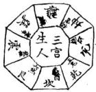

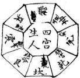

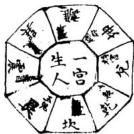

<!-- doc003 PDF 第 284 页：旋转/复杂版面 OCR 供检索；内容与排版以原页图为准。 -->

