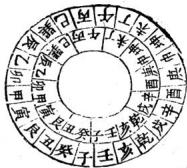
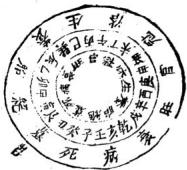
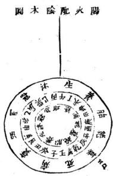
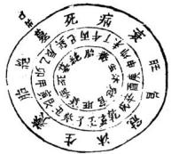
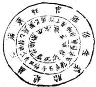
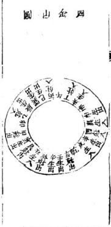
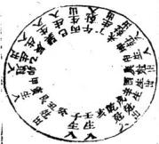
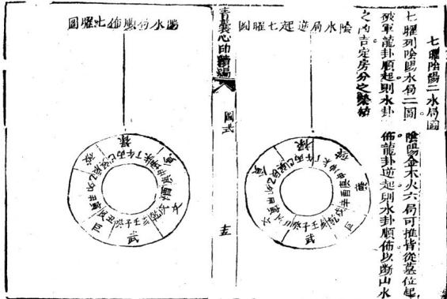

# 青囊心印续编

> V3 AI 全自动白话释读版。专业术语保留，释读内容可展开核对原文。

> 来源：413.地理正宗臆解+黑囊经+青囊心印+地学.pdf，PDF 第 307–324 页

<!-- V3_SOURCE_ID:book012-b000002-p000-7ced3e69e9 -->

我要把《青囊》的内容最终整理完成，告知那些对《青囊》有深入研究的人。有人提出疑问说：《心印》这部书，可以说是阐发了前人没有阐发的内容，但它所论述的阴阳必然有其本源，所说的顺逆难道没有依据吗？如果不是有独到的见解，即便文辞华丽、篇幅冗长，终究属于旁门左道，难道是因为问世的人无法自我省察吗？我回答说：是的。《青囊》这部书，总归要归结到理气，理气的本源出自河洛。我曾听李子说起默师的传承，于是在卷末撰写了《给乱衍义》，以此作为全书的收尾，也以此作为全书的开端，这就是它的用意所在。

查看对应原文

<!-- V3_FOLDBACK_BEGIN:book012-b000002-p000-7ced3e69e9 -->

要終原始余關靑囊告深客有難之者曰心印一書可謂發先人所未發矣然所論陰陽必有其原所言順逆豈無所自若非或有底見雖麗辭累牘終屬傷門豈以問世者無以自問乎予曰唯唯青囊之書總歸理氣理氣之源防於河洛嘗聞李李子舉默師之傳矣給亂衍義筆於編末以是終之以是始之之意也夫

<!-- V3_FOLDBACK_END:book012-b000002-p000-7ced3e69e9 -->

<!-- V3_SOURCE_ID:book012-b000003-p000-e9e11a5398 -->

吉蒙心印续编，如同车轸般追溯本源。

查看对应原文

<!-- V3_FOLDBACK_BEGIN:book012-b000003-p000-e9e11a5398 -->

吉蒙心印續編如軫原始

<!-- V3_FOLDBACK_END:book012-b000003-p000-e9e11a5398 -->

<!-- V3_SOURCE_ID:book012-b000004-p000-a40f34dfe6 -->

第一层是先天卦，第二层是后天方位，第三层、第四层是阳顺生图，第四层是先天卦阴，后天方位，第六层是盘盈缩阁，其中“盈縮閣”具体所指不详。

> **释读存疑：** 盈縮閣；“盈縮閣”具体所指不详

查看对应原文

<!-- V3_FOLDBACK_BEGIN:book012-b000004-p000-a40f34dfe6 -->

丙初層先天卦 二層後天方位 三四卦陽順 生圖 四層先天卦陰 後天方位 六盤盈縮閣

<!-- V3_FOLDBACK_END:book012-b000004-p000-a40f34dfe6 -->

<!-- V3_SOURCE_ID:book012-b000005-p000-9a4793195d -->

明辨阴阳五行之气的顺逆关系，有人说：阴阳五行之气都源自先天卦，产生于后天四正四隅之宫，应当仔细推演，才能大致了解相关情况。天盘午位对应后天地盘丙午缝中，这里是先天乾卦，代表天、父；大盘子位对应后天地盘壬子缝中，这里是先天坤卦，代表地、母。“河國”具体所指不详，其提及天一生水，是说南方乾卦施生的开始，乾金左旋而生阳水，在后天地盘午丁处孕育，在未坤处生成于申庚，右旋而生阴水，在后天地盘巳丙处孕育，在辰处养护，生于乙，这两种水都是乾金所生。地二生火，是说坤卦发生的开始，地坤左旋而生阳火，在后天地盘子癸处孕育，在丑艮处养护。“奇漢心印續通”具体所指不详，需追溯本源。

> **释读存疑：** 河國；奇漢心印續通；“河國”具体所指不详；“奇漢心印續通”具体所指不详

查看对应原文

<!-- V3_FOLDBACK_BEGIN:book012-b000005-p000-9a4793195d -->

明陰陽五行氣分順逆間之師曰陰陽五行之氣皆申先天卦所生於後天四正四隔之宮當細推之乃以盈縮經度天盤於之畧得且說夫天午居後天地盤丙午縫中是先天乾卦爲天爲父大盤予居後天地盤壬子縫中是先天坤卦爲地爲母河國曰天一生水者謂南乾施生之始也乾金左旋而生陽水胎於後天地盤午丁於未坤生於申庚右旋而生陰水胎於後天地盤巳丙養於其辰生於乙二水者是乾金所生也地二生火若謂比坤發生之始也地坤左旋而生陽火胎於後天地盤子癸養於丑艮奇漢心印續通 要原始

<!-- V3_FOLDBACK_END:book012-b000005-p000-9a4793195d -->

<!-- V3_SOURCE_ID:book012-b000006-p000-bf39f2a055 -->

生于寅甲，右旋而生阴火，胎于后天地盘壬亥，养于乾戌，生于辛酉，二火者是地坤所生也。天三生木者，天盘之酉居后天盘庚酉缝中，本先天坎卦所居，坎水位西，属阳卦，得天三奇数，故从天而生木，左旋而生阳木，胎于后天盘酉辛，养于戌乾，生于亥壬，右旋而生阴木，胎于后天盘庚中，于坤未生丁午，二木者是坎水所生也。地四生金者，天盘之卯居后天盘甲卯缝中，本是先天离均所居，离火位东，属阴卦，得地四偶数，故从地而生金，左旋而上阳金，胎于后天盘甲寅，养于艮丑，生于癸子，二金者是离久地坤所生也。以金藏于土腹，非火不能流行而见也。天五生土，河图以戊巳于中宫，又分寄于长戊丑未四支者，盖因先天土无正位，卦气之所，而天五奇数乃阳，故从阳水同生于未坤申，冠于戌乾亥，衰于五艮，墓于辰巽，是以长戊五未各得土气，属其位矣。大五行之气皆从先天卦分阳顺阴逆而生，而后天生旺之山，从此起也。古人云：先天统龙者，言龙家阴阳五行本于先天，而施于后天二十四龙黄泉之内，所以放棺必曰内乘生气者，以气由先天卦所生，故曰先天续龙也，而后天布局者，悉肇于斯矣。此处有无法识别的字符“CCCいO C3”，具体所指不详。

> **释读存疑：** 原文中存在无法识别的字符“CCCいO C3”，具体所指不详

查看对应原文

<!-- V3_FOLDBACK_BEGIN:book012-b000006-p000-bf39f2a055 -->

生於寅甲右旋而生陰火胎於後天地盤壬亥養於乾戌生於 辛酉二火者是地坤所生也天三生木者天盤之酉居後天地 庚酉縫中本先天坎卦所居坎水位西屬陽卦得天三奇數 故從天而生木左旋而生陽木胎於後天地盤酉辛養於戌乾 生於亥壬右旋而生陰木胎於後天地盤庚中於坤未生於 丁午二木者是坎水所生也地四生金者天盤之卯居後天地 盤甲卯縫中本是先天離均所居離火位東屬陰卦得地四偶 數故從地而生金左旋而上陽金胎於後天地甲寅養於艮 丑生於癸子二金者是離久地坤所生也以金藏於土腹非火 不能流行而見也天五生土河圗以戊巳於中宮又分寄於長 戊丑未四支者蓋因先天土無正位卦氣之所而天五奇數乃 而陽故從陽水同生於未坤申冠於戌乾亥衰於五艮墓於辰 巽是以長戊五未各得土氣屬其位矣大五行之氣皆從先天 CCCいO C3 卦分陽順陰逆而生而後天生旺之山從此起也古人云先 天統龍者言龍家陰陽五行本於先天而施於後天二十四龍 黃泉之內所以放棺必曰內乘生氣者以氣由先天卦所生故 曰先天續龍也而後天佈局者悉肇於斯矣

<!-- V3_FOLDBACK_END:book012-b000006-p000-bf39f2a055 -->

<!-- V3_SOURCE_ID:book012-b000009-p000-04faa6b514 -->

## 雙山換星兩盤圖

查看对应原文

<!-- V3_FOLDBACK_BEGIN:book012-b000009-p000-04faa6b514 -->

## 雙山換星兩盤圖

<!-- V3_FOLDBACK_END:book012-b000009-p000-04faa6b514 -->

<!-- V3_SOURCE_ID:book012-b000010-p000-8d3f1ce8a7 -->

经曰：用此步水与量山，百里江山一饷，开此图尤为堪舆家金青囊心印续编。

查看对应原文

<!-- V3_FOLDBACK_BEGIN:book012-b000010-p000-8d3f1ce8a7 -->

經曰用此步水與量山百里江山一餉開此圗尤爲堪輿家金靑囊心印續編

<!-- V3_FOLDBACK_END:book012-b000010-p000-8d3f1ce8a7 -->

<!-- V3_SOURCE_ID:book012-b000011-p000-df91f0dccf -->

## 針也具於左

查看对应原文

<!-- V3_FOLDBACK_BEGIN:book012-b000011-p000-df91f0dccf -->

## 針也具於左

<!-- V3_FOLDBACK_END:book012-b000011-p000-df91f0dccf -->

<!-- V3_SOURCE_ID:book012-b000014-p000-6536cd17d7 -->

## 大元空國

查看对应原文

<!-- V3_FOLDBACK_BEGIN:book012-b000014-p000-6536cd17d7 -->

## 大元空國

<!-- V3_FOLDBACK_END:book012-b000014-p000-6536cd17d7 -->

<!-- V3_SOURCE_ID:book012-b000015-p000-14ce27efd6 -->

经典记载，晋代景纯通晓此术，推演经典、确立义理，将其命名为元空。又说雌雄交会之理，被收录于《青囊心印》的“式三”篇中。

> **释读存疑：** 景纯的具体所指不详

查看对应原文

<!-- V3_FOLDBACK_BEGIN:book012-b000015-p000-14ce27efd6 -->

經曰晉世景純明此術衍經立義號元空又曰雌與雄交會人靑囊心印編 式 三

<!-- V3_FOLDBACK_END:book012-b000015-p000-14ce27efd6 -->

<!-- V3_SOURCE_ID:book012-b000016-p000-150d3b10e5 -->

元空之术，山川的形态变换千差万别，但“水”（风水语境中的河流、水系及其来去形态）的配合原理却完全一致。因此用八局来概括，可让研习者明确无误。

查看对应原文

<!-- V3_FOLDBACK_BEGIN:book012-b000016-p000-150d3b10e5 -->

元空則山川之變換萬有不齊而出水之配合理惟一致也固 約之以八局保覽者無疑義焉

<!-- V3_FOLDBACK_END:book012-b000016-p000-150d3b10e5 -->

<!-- V3_SOURCE_ID:book012-b000018-p000-63ccc19281 -->

以上为阴木龙配阳火水局的方法：适宜收纳丑艮（八卦之一）养位之水、寅甲长生位之水、辰巽（八卦之一）冠带位之水、丙巳临官位之水、午丁旺位之水，让这些水常流归戌乾（八卦之一）库地。

查看对应原文

<!-- V3_FOLDBACK_BEGIN:book012-b000018-p000-63ccc19281 -->

右陰木龍配陽火水局法宜收丑艮養位水寅甲長生水辰 巽冠帶水丙巳臨官水午丁旺位水入常流歸戌乾庫地而

<!-- V3_FOLDBACK_END:book012-b000018-p000-63ccc19281 -->

<!-- V3_SOURCE_ID:book012-b000019-p000-3482e03949 -->

收「巽」水，堂局坐「癸」向「丁」兼「丑」「未」，主人多聰秀；若「丙」水特朝，適宜坐「艮」向「坤」，主驟富格貴、催官；收「丁」水，適宜坐「甲」向「庚」兼「寅」「申」，但煞氣不淨；「午」水朝，適宜坐「寅」向「申」；長見「卯」水，主中薄風聲。

查看对应原文

<!-- V3_FOLDBACK_BEGIN:book012-b000019-p000-3482e03949 -->

收巽水堂坐癸向丁兼丑末主人多聰秀丙水特朝宜 坐艮向坤主驟富格貴催官收丁水宜坐甲向庚兼寅 申但煞不淨午水朝宜坐寅向申長見卯水主中薄 風聲

<!-- V3_FOLDBACK_END:book012-b000019-p000-3482e03949 -->

<!-- V3_SOURCE_ID:book012-b000020-p000-e510188af4 -->

靑變心印緒羅

> **释读存疑：** 原句文字生僻，具體所指不詳

查看对应原文

<!-- V3_FOLDBACK_BEGIN:book012-b000020-p000-e510188af4 -->

靑變心印緒羅

<!-- V3_FOLDBACK_END:book012-b000020-p000-e510188af4 -->

<!-- V3_SOURCE_ID:book012-b000021-p000-6858c2d058 -->

「水」配金臨

查看对应原文

<!-- V3_FOLDBACK_BEGIN:book012-b000021-p000-6858c2d058 -->

水配金临

<!-- V3_FOLDBACK_END:book012-b000021-p000-6858c2d058 -->

<!-- V3_SOURCE_ID:book012-b000023-p000-170e214b28 -->

不岐金龍配「水」，「水」局法宜收「未」「坤」「養」位「水」，「申」「庚」長生「水」，「庚」「乾」尅帶「水」，「亥」「千」臨官「水」，「子」「癸」旺位「水」入堂，流歸「辰」「巽」庫地。

> **释读存疑：** 「千」字疑為OCR識別錯誤，具體所指不詳

查看对应原文

<!-- V3_FOLDBACK_BEGIN:book012-b000023-p000-170e214b28 -->

不岐金龍配水水局法宜收未坤養位水申庚長生水庚乾尅帶水亥千臨官水子癸旺位水入堂流歸辰巽庫地而

<!-- V3_FOLDBACK_END:book012-b000023-p000-170e214b28 -->

<!-- V3_SOURCE_ID:book012-b000024-p000-d1fb0e07eb -->

将金与火相配，取其阴阳属性的对应关系。

查看对应原文

<!-- V3_FOLDBACK_BEGIN:book012-b000024-p000-d1fb0e07eb -->

圖金男配火陰

<!-- V3_FOLDBACK_END:book012-b000024-p000-d1fb0e07eb -->

<!-- V3_SOURCE_ID:book012-b000025-p000-bd01cb1bde -->

收壬水（风水语境中的河流、水系及其来去形态），适宜坐呷向艮（八卦之一），会对家中排行居中的男子多有裨益；收癸水（风水语境中的河流、水系及其来去形态），适宜坐庚向甲；收乾水（风水语境中的河流、水系及其来去形态），适宜坐向癸兼丑未。

查看对应原文

<!-- V3_FOLDBACK_BEGIN:book012-b000025-p000-bd01cb1bde -->

收壬水宜坐呷向艮多發中男收癸水宜坐庚向甲 收乾水宜坐向癸兼丑未

<!-- V3_FOLDBACK_END:book012-b000025-p000-bd01cb1bde -->

<!-- V3_SOURCE_ID:book012-b000026-p000-6a39723f92 -->

子水（风水语境中的河流、水系及其来去形态）正朝而来，适宜圣申向寅兼坤（八卦之一）艮（八卦之一），是能大幅兴旺人丁与财运、催发官贵的格局。

查看对应原文

<!-- V3_FOLDBACK_BEGIN:book012-b000026-p000-6a39723f92 -->

子水特朝宜聖申向寅兼坤艮大發丁財格貴催官

<!-- V3_FOLDBACK_END:book012-b000026-p000-6a39723f92 -->

<!-- V3_SOURCE_ID:book012-b000027-p000-ac779afdd5 -->

青药心印续堀。

> **释读存疑：** 堀字含义不详

查看对应原文

<!-- V3_FOLDBACK_BEGIN:book012-b000027-p000-ac779afdd5 -->

青藥心印續堀

<!-- V3_FOLDBACK_END:book012-b000027-p000-ac779afdd5 -->

<!-- V3_SOURCE_ID:book012-b000029-p000-d74038db55 -->

以上是火龙配阳金水局的方法，适宜收纳辰巽养位水、巳丙长生水、坤冠带水、申庚临官水、西辛旺位水，这些水应流入堂局，最终归向丑艮库位。

查看对应原文

<!-- V3_FOLDBACK_BEGIN:book012-b000029-p000-d74038db55 -->

右吟火龍配陽金水局法宜收辰巽養位水巳丙長生水坤冠帶水申庚臨官水西辛旺位水入堂流歸丑艮庫也而去

<!-- V3_FOLDBACK_END:book012-b000029-p000-d74038db55 -->

<!-- V3_SOURCE_ID:book012-b000030-p000-ed1ba0fb12 -->

收纳庚水适宜坐向乾位；收纳辛水适宜坐丙向壬，辛水从东方流出；收纳坤水适宜坐乙向辛，兼取辰戌方位。

查看对应原文

<!-- V3_FOLDBACK_BEGIN:book012-b000030-p000-ed1ba0fb12 -->

收庚水宜坐共向乾但當過西煞收辛水宜坐丙向壬辛水東流也 收坤水宜坐乙向辛兼辰戌

<!-- V3_FOLDBACK_END:book012-b000030-p000-ed1ba0fb12 -->

<!-- V3_SOURCE_ID:book012-b000032-p000-e709dcb5f8 -->

以上是阴水龙配阳木水局的方法，适宜收纳戌乾养位水、亥壬长生水、丑艮冠带水、寅甲临官水、卯乙旺位水，这些水应流入堂局，最终归向未坤库位。

查看对应原文

<!-- V3_FOLDBACK_BEGIN:book012-b000032-p000-e709dcb5f8 -->

右陰水龍配陽木水局法宜收戌乾養位水亥壬長生水丑 艮冠帶水寅甲臨官水卯乙旺位水入堂流歸未坤庫也而 去

<!-- V3_FOLDBACK_END:book012-b000032-p000-e709dcb5f8 -->

<!-- V3_SOURCE_ID:book012-b000033-p000-4dcf11b3a7 -->

甲水特朝适宜坐乾向巽，主少年时声名远扬；收纳乙水适宜坐壬向丙；收纳艮水适宜坐辛向乙，兼取辰戌方位；卯水特朝适宜坐亥向巳，兼取壬丙方位，此为贵格，主能登科及第。

查看对应原文

<!-- V3_FOLDBACK_BEGIN:book012-b000033-p000-4dcf11b3a7 -->

甲水特朝宜坐乾向巽主少年蜚聲收乙水宜坐壬向丙收艮水宜坐辛向乙兼辰戌卯水特朝宜坐亥向巳兼壬丙格貴主登科及第

<!-- V3_FOLDBACK_END:book012-b000033-p000-4dcf11b3a7 -->

<!-- V3_SOURCE_ID:book012-b000035-p000-4ab998b110 -->

石陽火龍與陰木水局相配，應選擇收納水的方法，未坤養位的水、丁午長生水、辰冠帶水、乙卯臨官水、甲寅旺位的水進入堂局，最終流歸乾戌庫地。

查看对应原文

<!-- V3_FOLDBACK_BEGIN:book012-b000035-p000-4ab998b110 -->

石陽火龍配陰木水局法宜收未坤養位水丁午長生水辰冠帶水乙卯臨官水甲寅旺位水入堂流歸乾戌庫地而

<!-- V3_FOLDBACK_END:book012-b000035-p000-4ab998b110 -->

<!-- V3_SOURCE_ID:book012-b000036-p000-01b1106bb3 -->

甲水朝來，適宜坐丁向癸；乙水朝來，適宜坐坤向艮。然而乙與辰同宮，不如借未向丑卯水朝來，主白手成家。《催官篇》說：陽衛水來，主聚富；龍輕沙碎，招淫奔；畏見丙巳水入堂，主入含抱養。

查看对应原文

<!-- V3_FOLDBACK_BEGIN:book012-b000036-p000-01b1106bb3 -->

甲水朝宜坐丁向癸乙水朝宜坐坤向艮然乙與辰同宮不若借未向丑卯水朝主白手成家催官篇云陽衞水來主聚富龍輕沙碎招淫奔畏見丙巳水入堂主入含抱養

<!-- V3_FOLDBACK_END:book012-b000036-p000-01b1106bb3 -->

<!-- V3_SOURCE_ID:book012-b000037-p000-e2c81cdf2a -->

《青囊心印續國式》中，白冰於與陰金局相配，應選擇丑養位的水、子癸長水、乾冠帶水、辛酉臨下水、屯理位的水，人帶沉辰巽庫北。

> **释读存疑：** 原文“靑囊心印續國式”“白冰於”“屯理位”“沉辰巽庫北”等表述模糊，具体所指不详

查看对应原文

<!-- V3_FOLDBACK_BEGIN:book012-b000037-p000-e2c81cdf2a -->

靑囊心印續國式白冰於配陰金局法宜丑養位水子癸長水乾冠帶水辛酉臨下水屯理位水人帶沉辰巽庫北也大

<!-- V3_FOLDBACK_END:book012-b000037-p000-e2c81cdf2a -->

<!-- V3_SOURCE_ID:book012-b000039-p000-d4f6aef16c -->

辛水特朝，適宜坐艮向庚；水從庚方來，適宜坐癸。則丁玉只說亥佛丁曲而發貴。

> **释读存疑：** 原文“丁玉只”“亥佛丁曲”表述模糊，具体所指不详

查看对应原文

<!-- V3_FOLDBACK_BEGIN:book012-b000039-p000-d4f6aef16c -->

辛水特朝宜坐艮向庚來宜坐癸則丁玉只云亥佛丁曲而發貴

<!-- V3_FOLDBACK_END:book012-b000039-p000-d4f6aef16c -->

<!-- V3_SOURCE_ID:book012-b000040-p000-a1775d9f35 -->

文中提到，辰方位的水会破煞，沛土方位的女子多会遭遇生育厄运，生下的男孩多有旁伤、吐血的灾祸；戌方位的克制会影响当地人的后嗣，就像砂出现时，定会有刀伤之灾，丘橡杨七尺云八曜重遇砂，难免龟法之诛。

> **释读存疑：** 沛土；龟法之诛；丘橡杨七尺云八曜；沛土具体所指不详；龟法之诛具体所指不详；丘橡杨七尺云八曜具体所指不详；1轮自动修复后核义模型仍建议修订，已保守记录。

查看对应原文

<!-- V3_FOLDBACK_BEGIN:book012-b000040-p000-a1775d9f35 -->

異見辰水來碼破煞側沛土女多產厄男多旁傷吐血戌 克軍于里人之嗣若刀砂見定懼刀丘橡楊七尺云八 曜重遇刀砂難免龜法之誅

<!-- V3_FOLDBACK_END:book012-b000040-p000-a1775d9f35 -->

<!-- V3_SOURCE_ID:book012-b000041-p000-7d1907185c -->

文中提到，青囊心卯德张配阴水局法，乾成养泣水，辛酉长生水，承丁午亭官水，丙巳旺位水入堂，疏归丑艮库地而。

> **释读存疑：** 养泣水；丁午亭官水；养泣水具体所指不详；丁午亭官水具体所指不详；1轮自动修复后核义模型仍建议修订，已保守记录。

查看对应原文

<!-- V3_FOLDBACK_BEGIN:book012-b000041-p000-7d1907185c -->

青囊心卯德張配陰 水局法岐乾成養泣水辛酉長生水承丁午亭官水丙巳旺位水入堂疏歸丑艮庫地而

<!-- V3_FOLDBACK_END:book012-b000041-p000-7d1907185c -->

<!-- V3_SOURCE_ID:book012-b000043-p000-c1670e0297 -->

文中提到，朝宜坐午向乙丁水朝宜坐乾向巽坤水闹宜坐丙亥山巳向载壬丙主大发人丁六秀水入堂沙合格台居风。

> **释读存疑：** 闹宜坐丙亥山巳向载壬丙主大发人丁；六秀水入堂沙合格台居风；闹水；闹宜坐丙亥山巳向载壬丙主大发人丁具体所指不详；六秀水入堂沙合格台居风具体所指不详；闹水具体所指不详；1轮自动修复后核义模型仍建议修订，已保守记录。

查看对应原文

<!-- V3_FOLDBACK_BEGIN:book012-b000043-p000-c1670e0297 -->

朝宜坐午向乙丁水朝宜坐乾向巽坤水闹宜坐丙亥山巳向载壬丙主大發人丁六秀水入堂沙合格台居风

<!-- V3_FOLDBACK_END:book012-b000043-p000-c1670e0297 -->

<!-- V3_SOURCE_ID:book012-b000044-p000-6e07e626f1 -->

青羹心印續題國式。

查看对应原文

<!-- V3_FOLDBACK_BEGIN:book012-b000044-p000-6e07e626f1 -->

青羹心印續題國式

<!-- V3_FOLDBACK_END:book012-b000044-p000-6e07e626f1 -->

<!-- V3_SOURCE_ID:book012-b000046-p000-320341b456 -->

石陽水龍搭配陰木水局的方法，應當收聚巽辰養位的水、乙卯長生的水、艮丑的帶水、癸子的臨宮水、壬亥的旺位水，讓水流入室後歸入未坤庫地而去。

查看对应原文

<!-- V3_FOLDBACK_BEGIN:book012-b000046-p000-320341b456 -->

石陽水龍配陰木水局法宜收巽辰養位水乙卯長生水艮丑以帶水癸子臨宮水壬亥旺位水入室流歸未坤庫地而去

<!-- V3_FOLDBACK_END:book012-b000046-p000-320341b456 -->

<!-- V3_SOURCE_ID:book012-b000047-p000-c3bd87da7b -->

爽水來朝，適宜坐巽向乾；壬水來朝，適宜坐乙向辛；艮水來朝，適宜坐丙向水兼巳亥；乾水特來朝見，又見乾峯高聳，回山作珂，主科第得中、暮年被選，催動宮位。訣語說：磯入雲宿，生宰輔。

> **释读存疑：** 原文中“坐丙向水兼巳亥”“回山作珂”“磯入雲宿”等表述含義不確定，未擅自解讀

查看对应原文

<!-- V3_FOLDBACK_BEGIN:book012-b000047-p000-c3bd87da7b -->

爽水朝宜坐巽向乾壬水朝宜坐乙向辛艮水朝 坐丙向水兼巳亥乾水特朝又見乾峯高聳回山作珂 貴主科知暮選催宮云磯入雲宿生宰輔

<!-- V3_FOLDBACK_END:book012-b000047-p000-c3bd87da7b -->

<!-- V3_SOURCE_ID:book012-b000048-p000-f8c726482a -->

小元空國說

查看对应原文

<!-- V3_FOLDBACK_BEGIN:book012-b000048-p000-f8c726482a -->

小元空國說

<!-- V3_FOLDBACK_END:book012-b000048-p000-f8c726482a -->

<!-- V3_SOURCE_ID:book012-b000049-p000-8990e1a494 -->

经书说：大小俱在元空里，十个退神灵如鬼，十四进神卯鬼雪是。山川融结，岂能尽符大元空，则小元空洵补教之善术也。五尺青囊心印续论说：法显元绅，功莫剥，至道精，后惟圣人方能及此，非春知其，就能知之。天玉经说：此是收山出煞书，历观仙师秘诀，谓可挽回这化，能使人朝贫暮富。而余遍阅名地，何多符食，近坊书皆从向止论生克，殊失宗旨。不观玉尺乡乎，从岭坐大之吉凶，须看水之出入。小元空诀云：乾坤卯今金同坐皆明，明言之，而世强以巳意牵解，何戏。予故辨之，夫世之制志者，为具图于左。

> **释读存疑：** 非春知其；何多符食；從嶺坐大；乾坤卯今金同坐皆明；原文中‘非春知其’‘何多符食’‘從嶺坐大’‘乾坤卯今金同坐皆明’等内容具体所指不详；1轮自动修复后核义模型仍建议修订，已保守记录。

查看对应原文

<!-- V3_FOLDBACK_BEGIN:book012-b000049-p000-8990e1a494 -->

經曰大小俱在元空裏十個退神靈如鬼十四進神卯鬼雪是 山川融結豈能盡符大元空則小元空洵補教之善術也五尺 靑囊心印續論 i 云法顯元紳功莫剝至道精後惟聖人方能及此非春知其 就能知之天玉云此是收山出煞書歷觀仙師秘訣謂可挽回 這化能使人朝貧暮富面余遍閣名地何多符食近坊書皆從 向止論生尅殊失宗旨不觀玉尺鄉乎從嶺坐大之吉凶須看 水神之出入小元空訣云乾坤卯今金同坐皆明明言之而世 強以巳意牽解何戲予故辨之夫世之制志者爲具圖於 左

<!-- V3_FOLDBACK_END:book012-b000049-p000-8990e1a494 -->

<!-- V3_SOURCE_ID:book012-b000051-p000-d6d3cb0468 -->

口诀说：丙、丁、乙、酉原本属火，这是四火山，喜甲、癸亥、艮方位的水（风水语境中的河流、水系及其来去形态）流来，为七；人干、寅、辰、巽、辛、巳、申、壬方位的水（风水语境中的河流、水系及其来去形态）流来，为克人，吉利；丑、庚、戌、未方位的水（风水语境中的河流、水系及其来去形态）流去，为生出；乾、坤、卯、午方位的水（风水语境中的河流、水系及其来去形态）流去，为克出，吉利。

> **释读存疑：** 原文中“人干”“異”的具体所指存在讹误可能，原文未明；1轮自动修复后核义模型仍建议修订，已保守记录。

查看对应原文

<!-- V3_FOLDBACK_BEGIN:book012-b000051-p000-d6d3cb0468 -->

袂云丙丁乙酉原屬火是四火山喜甲癸亥艮方水來爲七 人干寅辰異辛巳申壬大水來爲尅人吉丑庚戌未方水去 爲生出乾坤卯午方水去爲尅出吉

<!-- V3_FOLDBACK_END:book012-b000051-p000-d6d3cb0468 -->

<!-- V3_SOURCE_ID:book012-b000053-p000-a8818c6407 -->

口诀说：乾、坤、卯、午金同坐，则四金山喜戌、未、丑、庚方位的水（风水语境中的河流、水系及其来去形态）流来，为生入；丙、丁、巳、酉方位的水（风水语境中的河流、水系及其来去形态）流来，为克人，都吉利；甲、癸亥、艮左方的水（风水语境中的河流、水系及其来去形态）流去，为克出；子、寅、辰、巽、辛、巳、申、壬方位的水（风水语境中的河流、水系及其来去形态）流去，为生出，都吉利。

查看对应原文

<!-- V3_FOLDBACK_BEGIN:book012-b000053-p000-a8818c6407 -->

訣云乾坤卯午金同坐則四金山喜戌未丑庚方水來爲生入丙丁巳酉亦水來爲尅人俱吉甲癸亥艮左水去爲尅出子寅辰巽辛巳申壬方水去爲生出俱吉

<!-- V3_FOLDBACK_END:book012-b000053-p000-a8818c6407 -->

<!-- V3_SOURCE_ID:book012-b000055-p000-6d37684dc2 -->

口诀说：甲、癸亥、艮是木神，这是四木山，喜子、寅、辰、巽、巳、辛、壬方位的水（风水语境中的河流、水系及其来去形态）流来，为生入；乾、坤、卯、午方位的水（风水语境中的河流、水系及其来去形态）流来，为克人，都吉利；喜丙、丁、酉、乙方位的水（风水语境中的河流、水系及其来去形态）流去，为生出；丑、庚方位的水（风水语境中的河流、水系及其来去形态）流去，为克出，都吉利。此处有日文残句“青衆心印縮船 き”，具体含义不详。

> **释读存疑：** 原文中“異”为“巽”的讹误，具体所指不详；原文中“永”为“水”的讹误，具体所指不详；日文残句“青衆心印縮船 き”具体含义不详

查看对应原文

<!-- V3_FOLDBACK_BEGIN:book012-b000055-p000-6d37684dc2 -->

訣云甲癸亥艮是木神此四木山喜子寅辰異巳辛壬山水來爲生入乾坤卯午方水來爲尅人俱吉喜丙丁酉乙方水去爲生出減未丑庚方永去爲尅出俱吉青衆心印縮船 き

<!-- V3_FOLDBACK_END:book012-b000055-p000-6d37684dc2 -->

<!-- V3_SOURCE_ID:book012-b000057-p000-19dbff88e0 -->

口诀说：戌、戌、未、丑、庚属土，这是四土山，喜丙、丁、乙、酉方位的水（风水语境中的河流、水系及其来去形态）流来，为生入；甲、癸亥、艮方位的水（风水语境中的河流、水系及其来去形态）流去，为克入，都吉利；喜乾、坤、卯、午方位的水（风水语境中的河流、水系及其来去形态）流去，为生山；子、寅、辰、巽、辛、巳、申、壬方位的水（风水语境中的河流、水系及其来去形态）流去，为克出，都吉利。

> **释读存疑：** 原文中“戌戌”“良”“尅入”“古”的具体讹误存在可能，原文未明；1轮自动修复后核义模型仍建议修订，已保守记录。

查看对应原文

<!-- V3_FOLDBACK_BEGIN:book012-b000057-p000-19dbff88e0 -->

訣云戌戌未丑庚土爲此四土山喜丙丁乙酉方水來爲生 入甲癸亥良方水去爲尅入俱吉喜乾坤卯午方水去爲 生山子寅辰巽辛巳申壬方水去爲尅出俱古

<!-- V3_FOLDBACK_END:book012-b000057-p000-19dbff88e0 -->

<!-- V3_SOURCE_ID:book012-b000061-p000-c00acac630 -->

口诀说：子、寅、辰、巽、辛、巳、申、壬这些方位，是水神所在的方位。这种水适宜在山形水势中出现，尤其喜欢乾位。卯、午方位的水流来，属于生入；丑、庚、戌、未方位的水流来，属于克入，这两种情况都吉利。水从甲、亥、艮方位流去，属于生出；从丙、丁、乙、酉方位流去，属于克出，这两种情况也都吉利。

> **释读存疑：** 本地硬校验仍未通过，已记录供后续自动处理或人工核对。

查看对应原文

<!-- V3_FOLDBACK_BEGIN:book012-b000061-p000-c00acac630 -->

訣云子寅辰巽辛兼巳申與壬方是水神此入水山喜乾地 卯午方水來爲生入丑庚戌未方水來爲尅入俱吉喜甲 癸亥艮方水去為生出丙丁乙酉方水去爲尅出俱吉

<!-- V3_FOLDBACK_END:book012-b000061-p000-c00acac630 -->

<!-- V3_SOURCE_ID:book012-b000062-p000-694acf84f5 -->

经书说：宗廟本是陰陽元，得四失六難爲全。《雪心賦》说：宗廟之水法悞人，似此法竟可畧然用之，山運可存也，姑備之。

> **释读存疑：** 此处“宗廟”具体所指不详

查看对应原文

<!-- V3_FOLDBACK_BEGIN:book012-b000062-p000-694acf84f5 -->

經曰宗廟本是陰陽元得四失六難爲全雪心賦云宗廟之水法悞人似此法竟可畧然用之山運可存也姑備之

<!-- V3_FOLDBACK_END:book012-b000062-p000-694acf84f5 -->

.断

<!-- V3_SOURCE_ID:book012-b000064-p000-15f6a5b6cb -->

第一种是养生位的水流到堂前，贪狼星照临，会出显文帝，长房的儿孙多有贵人相助，人丁兴旺，性情忠良。水流大且汇聚，官职就高；水流小且蜿蜒绵长，福寿就长。养生位的水流去，最终会导致少年孤苦，人丁凋零。

> **释读存疑：** 此处“贪狼星”“文帝”具体所指不详

查看对应原文

<!-- V3_FOLDBACK_BEGIN:book012-b000064-p000-15f6a5b6cb -->

第一養生水到堂貪狼星照顯文帝長位兒孫多貴人丁呂熾性忠良水大曲瀦官職重水小樺迤福壽長養生流去終煩絕少年孤空房

<!-- V3_FOLDBACK_END:book012-b000064-p000-15f6a5b6cb -->

<!-- V3_SOURCE_ID:book012-b000065-p000-fc5d8c057d -->

沐浴位的水流要截断。

查看对应原文

<!-- V3_FOLDBACK_BEGIN:book012-b000065-p000-fc5d8c057d -->

沐浴方水断

<!-- V3_FOLDBACK_END:book012-b000065-p000-fc5d8c057d -->

<!-- V3_SOURCE_ID:book012-b000066-p000-bc5b2371bf -->

风水语境中的河流、水系及其来去形态（水）若从沐浴位流来，会犯桃花煞，导致女人淫乱，无法自主，投河自尽，随他人走，还会引发血病、官灾，使家道破败。若从“子午方”流来，家业会尽毁；若从“酉”位流来则为吉，“暗奢”的具体所指不详；若水流冲破“生神”位，会出现一位堕产风流之人，“望伽”的具体所指不详，“子午方”“酉位”“生神位”的具体所指不详。

> **释读存疑：** 子午方；酉位；生神位；暗奢；望伽

查看对应原文

<!-- V3_FOLDBACK_BEGIN:book012-b000066-p000-bc5b2371bf -->

沐浴水來犯桃花女人淫乱不由他投河自縊隨人走血病官災破敗家子午方來曲業盡如酉流來好暗奢若還流破生神一位墮產風流帶望伽

<!-- V3_FOLDBACK_END:book012-b000066-p000-bc5b2371bf -->

<!-- V3_SOURCE_ID:book012-b000067-p000-2a2d382002 -->

青囊心印續

查看对应原文

<!-- V3_FOLDBACK_BEGIN:book012-b000067-p000-2a2d382002 -->

青囊心印續

<!-- V3_FOLDBACK_END:book012-b000067-p000-2a2d382002 -->

<!-- V3_SOURCE_ID:book012-b000068-p000-047b2d78d5 -->

风水语境中的河流、水系及其来去形态（水）的冠带方位断语

查看对应原文

<!-- V3_FOLDBACK_BEGIN:book012-b000068-p000-047b2d78d5 -->

冠帶方水斷

<!-- V3_FOLDBACK_END:book012-b000068-p000-047b2d78d5 -->

<!-- V3_SOURCE_ID:book012-b000069-p000-0c6e22c2aa -->

风水语境中的河流、水系及其来去形态（水）从冠带位流来，主人聪慧雅致，风流好赌奢贵；“七岁兕童龙诗赋文章博 学万人夸”的具体所指不详；若水神流去，三房会受苦；“碧乱婴鬼死不差更损深闺孀态女”的具体所指不详；若水流在此处停蓄，才是……此处缺字，具体所指不详。

> **释读存疑：** 七岁兕童龙诗赋文章博 学万人夸；碧乱婴鬼死不差更损深闺孀态女；七岁兕童龙诗赋文章博学万人夸

查看对应原文

<!-- V3_FOLDBACK_BEGIN:book012-b000069-p000-0c6e22c2aa -->

冠帶水來人聰慧雅致風流好賭奢七歲兕童龍詩賦文章博 學萬人誇水神流去三房苦碧亂嬰鬼死不差更損深閏孀態 女此方停蓄乃為

<!-- V3_FOLDBACK_END:book012-b000069-p000-0c6e22c2aa -->

<!-- V3_SOURCE_ID:book012-b000070-p000-0e4f140bfb -->

临官方位的水（风水语境中的河流、水系及其来去形态）断语

查看对应原文

<!-- V3_FOLDBACK_BEGIN:book012-b000070-p000-0e4f140bfb -->

臨官方水断

<!-- V3_FOLDBACK_END:book012-b000070-p000-0e4f140bfb -->

<!-- V3_SOURCE_ID:book012-b000071-p000-46a4f307b7 -->

临官方位的水朝向坟地，禄马朝元，喜气新；若在午方位，可早入青云之路，贤相筹谋辅佐圣君；最忌此方的砂与水流去，会让成材之子另归‘阴闺’，‘阴闺’具体所指不详，少妇人常啼哭，服财谷空，‘一彻骨费’具体含义不详

> **释读存疑：** ‘阴闺’具体所指不详；‘一彻骨费’具体含义不详

查看对应原文

<!-- V3_FOLDBACK_BEGIN:book012-b000071-p000-46a4f307b7 -->

臨官方位水趨墳祿馬朝元喜氣新少午早入青雲路賢相籌謀佐聖君最忌此方砂水去成材之子另歸陰閨中少婦常啼服財穀空一徹骨費

<!-- V3_FOLDBACK_END:book012-b000071-p000-46a4f307b7 -->

<!-- V3_SOURCE_ID:book012-b000072-p000-183ffdf98c -->

帝旺方的水（风水语境中的河流、水系及其来去形态）断语

查看对应原文

<!-- V3_FOLDBACK_BEGIN:book012-b000072-p000-183ffdf98c -->

帝旺方水断

<!-- V3_FOLDBACK_END:book012-b000072-p000-183ffdf98c -->

<!-- V3_SOURCE_ID:book012-b000073-p000-b8292905d6 -->

帝旺方位有水朝来，前方一团和气，能兴旺庄田，爵位高、威势重，名声远扬，金谷丰足，红运有利、钱财顺遂；最怕休囚方位的水来势滚散，这样的愚豪富不会长久；若此方水流去，财源会被张食耗尽，导致贫穷怨天

> **释读存疑：** 原文中‘休四’的‘四’为形近误字，应为‘休囚’；‘张之食’的具体含义未明；1轮自动修复后核义模型仍建议修订，已保守记录。

查看对应原文

<!-- V3_FOLDBACK_BEGIN:book012-b000073-p000-b8292905d6 -->

帝旺朝來望前一團和氣發庄田爵高威重名插遠金穀豐 紅有利錢最怕休四來滾散石愚豪富不多年此方流去財源 張之食貧窮怨上天

<!-- V3_FOLDBACK_END:book012-b000073-p000-b8292905d6 -->

<!-- V3_SOURCE_ID:book012-b000074-p000-4450aa75ed -->

衰方的水（风水语境中的河流、水系及其来去形态）被阻断。

查看对应原文

<!-- V3_FOLDBACK_BEGIN:book012-b000074-p000-4450aa75ed -->

衰方水断

<!-- V3_FOLDBACK_END:book012-b000074-p000-4450aa75ed -->

<!-- V3_SOURCE_ID:book012-b000075-p000-4d8492809e -->

衰方的水归巨门星管辖，学堂水到来则会使人聪慧，少年时能考中科举，文章出众；贵人旺相的年份财富满盈，出入起居能得到皇帝的恩宠，宴饮歌舞时帝王赐予的酒壶倾倒。旺局适宜水流入则吉利，水流出时必须弯曲迂回，更要留意留住水势。

> **释读存疑：** 衰方；巨门星；学堂水；贵人旺；旺局；衰方、巨门星、学堂水、贵人旺、旺局的具体所指不详；1轮自动修复后核义模型仍建议修订，已保守记录。

查看对应原文

<!-- V3_FOLDBACK_BEGIN:book012-b000075-p000-4d8492809e -->

衰方管局巨門星學堂水到發聰明少年及第文章貴人旺年高金滿盈出入起居乘聖焉宴遊歌舞王壺傾旺局七宜來則吉去須灣曲更留情

<!-- V3_FOLDBACK_END:book012-b000075-p000-4d8492809e -->

<!-- V3_SOURCE_ID:book012-b000076-p000-3ce45a5012 -->

病死方的水（风水语境中的河流、水系及其来去形态）所处的位置。

查看对应原文

<!-- V3_FOLDBACK_BEGIN:book012-b000076-p000-3ce45a5012 -->

病死方水所

<!-- V3_FOLDBACK_END:book012-b000076-p000-3ce45a5012 -->

<!-- V3_SOURCE_ID:book012-b000077-p000-073b15338c -->

病死二方的水（风水语境中的河流、水系及其来去形态）忌讳流入天门、地尸方位，并非没有区别。还有名为“官显水”的水，如同针状，是吉利的囊心印续编。

> **释读存疑：** 地尸、囊心印续编具体所指不详；地尸、官显水、囊心印续编具体所指不详

查看对应原文

<!-- V3_FOLDBACK_BEGIN:book012-b000077-p000-073b15338c -->

病死二方水忌來天門地尸不爲更有辨名官顯水若針吉囊心印續編

<!-- V3_FOLDBACK_END:book012-b000077-p000-073b15338c -->

<!-- V3_SOURCE_ID:book012-b000078-p000-85c38f0d1f -->

一旦飛星引發火災，損傷妻室；飛星遇刁兵脈，主家中出現瘋癲、海女、麼胎等災禍。

> **释读存疑：** 原文中「刁兵脈」「海女」「麼胎」等術語具體所指不詳

查看对应原文

<!-- V3_FOLDBACK_BEGIN:book012-b000078-p000-85c38f0d1f -->

一飛起火災損妻飛刁兵脈紫瘋海女麼胎必主其家遭此

<!-- V3_FOLDBACK_END:book012-b000078-p000-85c38f0d1f -->

<!-- V3_SOURCE_ID:book012-b000079-p000-e81fbe2133 -->

墓庫方位的水（风水语境中的河流、水系及其来去形态）的斷語。

查看对应原文

<!-- V3_FOLDBACK_BEGIN:book012-b000079-p000-e81fbe2133 -->

墓庫方水斷

<!-- V3_FOLDBACK_END:book012-b000079-p000-e81fbe2133 -->

<!-- V3_SOURCE_ID:book012-b000080-p000-3a059d641a -->

墓庫之宮忌諱水（风水语境中的河流、水系及其来去形态）臨破軍，長久以來與陣上揚兵、文武貴池、御區等相關；壽富如春回，若水直去，家資豐厚，父親經年不絕，人未列克軍千星，外三男二子把周零。

> **释读存疑：** 原文中「破軍」「陣上揚兵」「文武貴池」「御區」「克軍千星」「周零」等術語具體所指不詳

查看对应原文

<!-- V3_FOLDBACK_BEGIN:book012-b000080-p000-3a059d641a -->

墓庫之宮怕水臨破軍流云久爲與陣上揚兵文武貴池御區 壽富如春回前直去家資父啻經年不了人未列克軍千星 外三男二子把周零

<!-- V3_FOLDBACK_END:book012-b000080-p000-3a059d641a -->

<!-- V3_SOURCE_ID:book012-b000081-p000-dfaa17c431 -->

絕胎方位的水（风水语境中的河流、水系及其来去形态）的斷語。

查看对应原文

<!-- V3_FOLDBACK_BEGIN:book012-b000081-p000-dfaa17c431 -->

絕胎方水斷

<!-- V3_FOLDBACK_END:book012-b000081-p000-dfaa17c431 -->

<!-- V3_SOURCE_ID:book012-b000082-p000-d2e5bd8e91 -->

绝非「水」（风水语境中的河流、水系及其来去形态）断绝就不会生养子女，「無孕無刀絕」的具体所指不详，「溪枝縫使胎生不義育」的具体所指不详，夫妻会各自分离；「水泓」的具体所指不详，此处只宜为「水」（风水语境中的河流、水系及其来去形态）。

> **释读存疑：** 無孕無刀絕；溪枝縫使胎生不義育；水泓；「無孕無刀絕」的具体所指不详；「溪枝縫使胎生不義育」的具体所指不详；「水泓」的具体所指不详

查看对应原文

<!-- V3_FOLDBACK_BEGIN:book012-b000082-p000-d2e5bd8e91 -->

絕非水斷不生兒無孕無刀絕溪枝縫使胎生不義育夫妻父 于各分離水泓婦女多淫水小私清宿地此處只宜為水

<!-- V3_FOLDBACK_END:book012-b000082-p000-d2e5bd8e91 -->

<!-- V3_SOURCE_ID:book012-b000083-p000-0c31e476cb -->

口禄存流尽佩金鱼

查看对应原文

<!-- V3_FOLDBACK_BEGIN:book012-b000083-p000-0c31e476cb -->

口祿存流盡佩金魚

<!-- V3_FOLDBACK_END:book012-b000083-p000-0c31e476cb -->

<!-- V3_SOURCE_ID:book012-b000084-p000-d2bf38f6c0 -->

土曜九星

查看对应原文

<!-- V3_FOLDBACK_BEGIN:book012-b000084-p000-d2bf38f6c0 -->

土曜九星

<!-- V3_FOLDBACK_END:book012-b000084-p000-d2bf38f6c0 -->

<!-- V3_SOURCE_ID:book012-b000085-p000-e7691878b9 -->

七曜訣

查看对应原文

<!-- V3_FOLDBACK_BEGIN:book012-b000085-p000-e7691878b9 -->

七曜訣

<!-- V3_FOLDBACK_END:book012-b000085-p000-e7691878b9 -->

<!-- V3_SOURCE_ID:book012-b000086-p000-2a70d3016b -->

大墓屬霞半絕胎，祿存、武曲陷官莊逢衰，是巨門養生，貪狠位伏，俗冠帶，文康口兼病死，七曜一齊分。

> **释读存疑：** 霞半絕胎；貪狠；俗冠帶；文康口

查看对应原文

<!-- V3_FOLDBACK_BEGIN:book012-b000086-p000-2a70d3016b -->

大墓屬霞半絕胎是祿存武曲陷官莊逢衰是巨門養生貪狠位伏俗冠帶文康口兼病死七曜一齊分

<!-- V3_FOLDBACK_END:book012-b000086-p000-2a70d3016b -->

<!-- V3_SOURCE_ID:book012-b000087-p000-bbe4ed6b65 -->

九星公位m

> **释读存疑：** 末尾的字母m含义不明

查看对应原文

<!-- V3_FOLDBACK_BEGIN:book012-b000087-p000-bbe4ed6b65 -->

九星公位m

<!-- V3_FOLDBACK_END:book012-b000087-p000-bbe4ed6b65 -->

<!-- V3_SOURCE_ID:book012-b000088-p000-a2c8184577 -->

貪頭長子，巨興中，武曲三房家必隆，文敗中房，祿敗季改襄，長于受貧，寤收山出煞有何功，破祿文廉要坐巨輔武收入，一穴何愁大地不相道。

> **释读存疑：** 巨興；季改襄；寤；穴；本地硬校验仍未通过，已记录供后续自动处理或人工核对。

查看对应原文

<!-- V3_FOLDBACK_BEGIN:book012-b000088-p000-a2c8184577 -->

貪頭長子巨興中武曲三房家必隆文敗中房祿敗季改襄長 于受貧寤收山出煞有何功破祿文廉要坐巨輔武收入 一穴何愁大地不相道

<!-- V3_FOLDBACK_END:book012-b000088-p000-a2c8184577 -->

<!-- V3_SOURCE_ID:book012-b000089-p000-130d4204cf -->

旨心印知 七九星

> **释读存疑：** 原文断句及含义不明

查看对应原文

<!-- V3_FOLDBACK_BEGIN:book012-b000089-p000-130d4204cf -->

旨心印知 七九星

<!-- V3_FOLDBACK_END:book012-b000089-p000-130d4204cf -->

<!-- V3_SOURCE_ID:book012-b000090-p000-178098ae16 -->

还有七曜诗。

查看对应原文

<!-- V3_FOLDBACK_BEGIN:book012-b000090-p000-178098ae16 -->

又七曜詩

<!-- V3_FOLDBACK_END:book012-b000090-p000-178098ae16 -->

<!-- V3_SOURCE_ID:book012-b000091-p000-f4b9932f01 -->

文中提到‘貧須臨位未無兵紫草生從腳下來兩驗紅顏猶尙友袁斬新裁’，其具体含义不详。

> **释读存疑：** 貧須臨位未無兵紫草生從腳下來兩驗紅顏猶尙友袁斬新裁；原文内容具体含义不详；本地硬校验仍未通过，已记录供后续自动处理或人工核对。

查看对应原文

<!-- V3_FOLDBACK_BEGIN:book012-b000091-p000-f4b9932f01 -->

貧須臨位未無兵紫草生從腳下來兩驗紅顏猶尙友袁斬新裁

<!-- V3_FOLDBACK_END:book012-b000091-p000-f4b9932f01 -->

<!-- V3_SOURCE_ID:book012-b000092-p000-08779e3043 -->

此曲清晨时分最为奇特，儿孙辈有金之名；若见“水”从吉利方位流来，钟声响起，饮食之事不必疑虑。

> **释读存疑：** 原文‘金有名’语义含混，具体所指不详

查看对应原文

<!-- V3_FOLDBACK_BEGIN:book012-b000092-p000-08779e3043 -->

此曲朝來最是奇兒孫金有名鹽若見水流從吉位鐘鳴陽 食不須疑

<!-- V3_FOLDBACK_END:book012-b000092-p000-08779e3043 -->

<!-- V3_SOURCE_ID:book012-b000093-p000-6860a311e7 -->

文曲星的相关情况是怎样的？水流来推桴木，生有勇士；其中泥土上聚集，应知晓白蚁结成巢。

> **释读存疑：** 原文‘流來推桴水生多勇士其中泥上聚應知白蟻結成巢’语义含混，具体所指不详

查看对应原文

<!-- V3_FOLDBACK_BEGIN:book012-b000093-p000-6860a311e7 -->

文曲星辰事若何流來推桴水生多勇士其中泥上聚應知白蟻結成巢

<!-- V3_FOLDBACK_END:book012-b000093-p000-6860a311e7 -->

<!-- V3_SOURCE_ID:book012-b000094-p000-f2463042ee -->

如果祿存方位出現水（风水语境中的河流、水系及其来去形态）直冲而来、冲刷穴（风水中认为气脉聚结、适宜安葬或营建的位置）地，导致棺椁翻转，这实在是最可悲的事。若不相信，就请你挖开穴地看看，这里的泥水会带来灾祸。

查看对应原文

<!-- V3_FOLDBACK_BEGIN:book012-b000094-p000-f2463042ee -->

祿存若見水冲來吹淳翻棺最可哀不信請君開穴看此中泥 水使生災

<!-- V3_FOLDBACK_END:book012-b000094-p000-f2463042ee -->

<!-- V3_SOURCE_ID:book012-b000095-p000-3d0dfd3be0 -->

寐贞方位的潮水会滋生大量虫类，蛇鼠会在坟茔中自行筑巢，尸身受损的情况会增多，黑烛聚集在房屋处，会使房屋遭受灾殃。

> **释读存疑：** 原文中“寐貞”“繕蟲”“屍胃”“炎磨”等词具体所指不详

查看对应原文

<!-- V3_FOLDBACK_BEGIN:book012-b000095-p000-3d0dfd3be0 -->

寐貞潮水繕蟲多蛇鼠穿塋自作窠屍胃損來多黑燭聚房子 受炎磨

<!-- V3_FOLDBACK_END:book012-b000095-p000-3d0dfd3be0 -->

<!-- V3_SOURCE_ID:book012-b000096-p000-8953c5e6ae -->

巨門方位的乾（八卦之一，卦象及五行、方位依原文语境确定）位洁净无杂，起死穴内有祥烟瑞气，因此儿孙多能富贵显达，山形清秀，更能在人群中出类拔萃。

查看对应原文

<!-- V3_FOLDBACK_BEGIN:book012-b000096-p000-8953c5e6ae -->

巨門乾淨起死塵穴內祥烟瑞氣新因此兒孫多富貫山入清秀更楚羣

<!-- V3_FOLDBACK_END:book012-b000096-p000-8953c5e6ae -->

<!-- V3_SOURCE_ID:book012-b000097-p000-33a003f5d7 -->

陂军帝位的情况实在不堪言说，竹太藤祖的规制，又主两头嶂墙聚集死骸，棺木陷入两难的境地。

> **释读存疑：** 原文中“陂軍”“竹太藤祖”“兩頭嶂”等词具体所指不详

查看对应原文

<!-- V3_FOLDBACK_BEGIN:book012-b000097-p000-33a003f5d7 -->

陂軍帝位不堪言竹太藤祖規聲德又主兩頭嶂墻聚死骸棺 木兩難至

<!-- V3_FOLDBACK_END:book012-b000097-p000-33a003f5d7 -->

<!-- V3_SOURCE_ID:book012-b000098-p000-04bd2e1665 -->

论述却未涉及。

查看对应原文

<!-- V3_FOLDBACK_BEGIN:book012-b000098-p000-04bd2e1665 -->

論去而不及

<!-- V3_FOLDBACK_END:book012-b000098-p000-04bd2e1665 -->

<!-- V3_SOURCE_ID:book012-b000099-p000-a0a8088eef -->

风水语境中的河流、水系及其来去形态从库位流出，正好契合这一说法，主家能长久获得福泽。比如阴木一局，气脉通畅成型。

查看对应原文

<!-- V3_FOLDBACK_BEGIN:book012-b000099-p000-a0a8088eef -->

水從庫位而出正合本說主營福治久假如陰木一局氣通成

<!-- V3_FOLDBACK_END:book012-b000099-p000-a0a8088eef -->

<!-- V3_SOURCE_ID:book012-b000100-p000-3fe9daa07a -->

如今风水语境中的河流、水系及其来去形态还未到达戌乾位，在申酉方位被阻隔，称为不及，主家有福之人寿命不长；或者虽得贵势却无礼义，虚设爻位却不及颜渊，三十岁便身陷囹圄。

查看对应原文

<!-- V3_FOLDBACK_BEGIN:book012-b000100-p000-3fe9daa07a -->

庫今水未到戌乾於申酉方逐出謂之不及主發福之人不壽 或雖得貴而無禮虛云爻而不及顏淵三十便身囚

<!-- V3_FOLDBACK_END:book012-b000100-p000-3fe9daa07a -->

<!-- V3_SOURCE_ID:book012-b000101-p000-8956e7ac9c -->

论述却过于。

> **释读存疑：** 1轮自动修复后核义模型仍建议修订，已保守记录。

查看对应原文

<!-- V3_FOLDBACK_BEGIN:book012-b000101-p000-8956e7ac9c -->

論交而太過

<!-- V3_FOLDBACK_END:book012-b000101-p000-8956e7ac9c -->

<!-- V3_SOURCE_ID:book012-b000102-p000-85b278baf6 -->

水到庫位而出謂之眞夫婦，自有化吉之機。假如陰木一局，立歸戊廟，今水過戌、乾，于方始出，謂之過亢，主老年科第晚平發福。經云：情過而几呂墨八旬方陰會。

> **释读存疑：** 情過而几；呂墨；陰會；原文‘情過而几呂墨八旬方陰會’中的‘几’‘呂墨’‘陰會’具体所指不详，原文未明；1轮自动修复后核义模型仍建议修订，已保守记录。

查看对应原文

<!-- V3_FOLDBACK_BEGIN:book012-b000102-p000-85b278baf6 -->

水到庫位而出謂之眞夫婦自有化吉之機假如陰木一局立歸戊廟今水過戌乾於亥于方始出謂之過亢主老年科第晚平發福經云情過而几呂墨八旬方陰會

<!-- V3_FOLDBACK_END:book012-b000102-p000-85b278baf6 -->

<!-- V3_SOURCE_ID:book012-b000103-p000-ac9c9eb8a0 -->

论述阴阳错的相关内容。

查看对应原文

<!-- V3_FOLDBACK_BEGIN:book012-b000103-p000-ac9c9eb8a0 -->

論陰陽錯

<!-- V3_FOLDBACK_END:book012-b000103-p000-ac9c9eb8a0 -->

<!-- V3_SOURCE_ID:book012-b000104-p000-31fd33e0b9 -->

假如陰木龍，水宜歸戌庫，水不歸戌，直過五方，出夫丑，條丁火庫，而謂之陽結，主出人多孤寡。逆云：過陽第以光夫。

> **释读存疑：** 夫；原文‘出夫丑’中的‘夫’、‘逆云’中的‘逆’具体所指不详，原文未明；1轮自动修复后核义模型仍建议修订，已保守记录。

查看对应原文

<!-- V3_FOLDBACK_BEGIN:book012-b000104-p000-31fd33e0b9 -->

假如陰木龍水宜歸戌庫水不歸成直過五方出夫丑條丁火庫而謂之陽結主出人多孤寡逆云過陽第以光夫

<!-- V3_FOLDBACK_END:book012-b000104-p000-31fd33e0b9 -->

<!-- V3_SOURCE_ID:book012-b000105-p000-b8a07c4a88 -->

又如陽木龍，水宜歸未庫，今永不歸非，而至辰方出夫，辰係壬水庫，卽謂之陰結，主出人多鰥獨。經云：見陰錯以傷妻黃泉水。

> **释读存疑：** 夫；原文‘出夫辰’中的‘夫’、‘黃泉水’具体所指不详，原文未明；1轮自动修复后核义模型仍建议修订，已保守记录。

查看对应原文

<!-- V3_FOLDBACK_BEGIN:book012-b000105-p000-b8a07c4a88 -->

又如陽木龍水宜歸未庫今永不歸非而至辰方出夫辰係壬水庫卽謂之陰結主出人多鰥獨經云見陰錯以傷妻黃泉水

<!-- V3_FOLDBACK_END:book012-b000105-p000-b8a07c4a88 -->

<!-- V3_SOURCE_ID:book012-b000106-p000-f5112b109d -->

泉水有吉凶之分。

查看对应原文

<!-- V3_FOLDBACK_BEGIN:book012-b000106-p000-f5112b109d -->

泉水有吉凶不同

<!-- V3_FOLDBACK_END:book012-b000106-p000-f5112b109d -->

<!-- V3_SOURCE_ID:book012-b000107-p000-1a7bf81548 -->

五尺云少亡横死，是犯了黄泉，所以要确立向来消纳，所避的内容中，火被称为八段黄泉，虽说它是恶曜，但如果在生方，按理不能同样判定为凶，因此这类黄泉并非纯凶。看歌诀所说：四路黄泉能役使人，辰戌丑未有耳，四路黄泉能人乾坤艮巽，有巨门则黄泉有凶有吉，要明确这一点并加以辨别，让世人知晓。

> **释读存疑：** 五尺云具体所指不详；有耳具体含义不详；四路黄泉能人乾坤艮巽的具体含义不详；1轮自动修复后核义模型仍建议修订，已保守记录。

查看对应原文

<!-- V3_FOLDBACK_BEGIN:book012-b000107-p000-1a7bf81548 -->

五尺云少亡橫死爲犯黃泉故立向消納所避最重火曰八段黃泉雖云惡曜若在生方例難同斷是貴泉又非純凶觀之歌訣云四路黃泉能役人辰戌丑未有耳四路黃泉能人乾坤艮巽有巨門則黃泉之有凶有吉也明之故辨之俾世知

<!-- V3_FOLDBACK_END:book012-b000107-p000-1a7bf81548 -->

<!-- V3_SOURCE_ID:book012-b000108-p000-ff961f470a -->

黄水歌。

查看对应原文

<!-- V3_FOLDBACK_BEGIN:book012-b000108-p000-ff961f470a -->

黃水歌

<!-- V3_FOLDBACK_END:book012-b000108-p000-ff961f470a -->

<!-- V3_SOURCE_ID:book012-b000109-p000-1dad1787ab -->

庚丁坤上是苗原，乙丙须防巽水光，甲癸向中忧见艮，辛壬水路伯宫。

> **释读存疑：** 苗原具体所指不详；水路伯宫具体所指不详；向中具体所指不详；1轮自动修复后核义模型仍建议修订，已保守记录。

查看对应原文

<!-- V3_FOLDBACK_BEGIN:book012-b000109-p000-1dad1787ab -->

庚丁坤上是苗原乙丙須防巽水光甲癸向中憂見艮辛壬水路伯宮

<!-- V3_FOLDBACK_END:book012-b000109-p000-1dad1787ab -->

<!-- V3_SOURCE_ID:book012-b000110-p000-29dbb84687 -->

黄泉的判断依据是坐山，而非朝向。所谓庚丁中是黄泉，是说坐甲山时，甲木的墓位在未；坐癸山时，癸水的墓位也在未，未与坤同宫，所以说乙丙要防范巽水。这是说坐辛山时，辛金的墓位在辰；坐壬山时，壬水的墓位也在辰，辰与巽同宫，所以说甲癸向要担忧艮首。这是说坐庚山时，庚金的墓位在丑；坐丁山时，丁火的墓位也在丑，丑与艮同宫，所以说辛壬水路要怕乾。这是说坐乙山时，乙木的墓位在戌；坐丙山时，丙火的墓位也在戌，戌与乾同宫。这是破军墓地、四野黄泉这类能伤人的说法，出自救贫黄泉歌。

查看对应原文

<!-- V3_FOLDBACK_BEGIN:book012-b000110-p000-29dbb84687 -->

黃泉從坐山起不從向上論其曰庚丁中是黃泉若蓋言坐甲山甲木墓於未坐癸山癸水亦同墓於未未坤同宮故云乙丙防巽水首蓋言坐辛山辛金墓於辰坐壬山壬水亦墓於辰辰巽同宮故云○甲癸向憂艮首言坐庚山庚金墓於丑丁山丁火同墓於丑丑艮同宮故云○辛壬水路怕乾者言坐乙山乙水墓於戌坐丙山丙火亦墓於戌戌乾同宮故云蓋破軍墓地四野黃泉能穀人若此也救魯簧泉歌

<!-- V3_FOLDBACK_END:book012-b000110-p000-29dbb84687 -->

<!-- V3_SOURCE_ID:book012-b000111-p000-efa98db8ae -->

辛向乾宫，可获百万庄田；癸归艮位，能显文章声名；乙向巽方流水，主清贵富足；丁向巽方，终是万斯稍。

> **释读存疑：** "万斯稍"的具体所指不详；1轮自动修复后核义模型仍建议修订，已保守记录。

查看对应原文

<!-- V3_FOLDBACK_BEGIN:book012-b000111-p000-efa98db8ae -->

辛入乾宮百萬庄癸歸艮步顯文章乙向巽流清富貫丁終是萬斯稍

<!-- V3_FOLDBACK_END:book012-b000111-p000-efa98db8ae -->

<!-- V3_SOURCE_ID:book012-b000112-p000-b923db2950 -->

辛八乾宫，百万正。

> **释读存疑：** "辛八"的具体所指不详；"百万正"的具体所指不详

查看对应原文

<!-- V3_FOLDBACK_BEGIN:book012-b000112-p000-b923db2950 -->

辛八乾宮百萬正

<!-- V3_FOLDBACK_END:book012-b000112-p000-b923db2950 -->

<!-- V3_SOURCE_ID:book012-b000113-p000-2e22042566 -->

辛向乾水属于黄泉，如今却反被当作救贫的说法，原因是阳龙入穴后垂向乙位，辛的气脉生于乾位，在九星中属贪狼，与癸水相配成局；乙是癸的生位，癸水旺于壬、衰于乾，在九星中属巨门，龙神为贪狼，水神为巨门，水入堂局，所以有百万庄田的应验。若从乾位流心印续论黄泉，至……

> **释读存疑：** 本地硬校验仍未通过，已记录供后续自动处理或人工核对。

查看对应原文

<!-- V3_FOLDBACK_BEGIN:book012-b000113-p000-2e22042566 -->

辛向乾水屬黃泉今反以爲救貧者何蓋陽不龍入穴垂乙向辛世氣生於乾亥於九星爲貪狼取配癸水成局乙乃癸之生位夫癸水旺於壬亥衰於乾戌於力星爲巨門傳龍神貸狼水水神巨門水入堂故有百萬庄之應若從乾位流心印續論 泉 至

<!-- V3_FOLDBACK_END:book012-b000113-p000-2e22042566 -->

<!-- V3_SOURCE_ID:book012-b000114-p000-7e083c2d8b -->

水从冲弦龙的家生方流出，《天玉经》中说，水流冲破生方，会在人年少时应验凶祸，到丁年、壬年时，必然出现‘少丁’之凶。若阴阳龙袖中出现乾、坤、艮、巽在墓方的情况，这就是真黄泉水；‘水去为上御砦水’，‘水来必帶四金’，具体所指不详，此为破煞倒冲的格局，不可不后悔。

> **释读存疑：** ‘少丁’为风水术语，具体所指不详；‘御砦水’为风水术语，具体所指不详；‘四金’为风水术语，具体所指不详

查看对应原文

<!-- V3_FOLDBACK_BEGIN:book012-b000114-p000-7e083c2d8b -->

去是冲弦龍家生方天玉經云流破生方員少下化之年定見刑主丁壬年有橫少丁之凶若陰陽龍袖遇乾坤艮巽在墓方者乃眞黃泉水去爲上御砦水來必帶四金卽爲破煞倒冲不可不悔

<!-- V3_FOLDBACK_END:book012-b000114-p000-7e083c2d8b -->

<!-- V3_SOURCE_ID:book012-b000115-p000-89e4a95624 -->

癸归艮位，能显现出文章之才。

> **释读存疑：** ‘癸归艮位’具体所指未明确，原文未明。

查看对应原文

<!-- V3_FOLDBACK_BEGIN:book012-b000115-p000-89e4a95624 -->

癸歸艮位顯文章

<!-- V3_FOLDBACK_END:book012-b000115-p000-89e4a95624 -->

<!-- V3_SOURCE_ID:book012-b000116-p000-b00559baa7 -->

癸向、艮水本属黄泉范畴，如今却被认为是救贫的格局，原因在于阳火龙入穴，坐丁向癸，其气生于艮，对应九星为‘食狼’，配属‘乙木火局’，丁为乙木的生位。乙木在甲寅位旺盛，在艮位衰弱，对应九星为‘巨门’，得龙神‘贪复’，水水补巨门水入堂，故有此应验。‘丑艮为天市为六秀’，具体所指不详；若艮位的水流冲破龙的家生方，就会在乙年出现‘少丁’之厄。

> **释读存疑：** ‘食狼’为风水九星术语，具体所指不详；‘巨门’为风水九星术语，具体所指不详；‘贪复’为风水术语，具体所指不详；‘乙木火局’为风水术语，具体所指不详；‘天市’为风水术语，具体所指不详；‘六秀’为风水术语，具体所指不详；‘少丁’为风水术语，具体所指不详

查看对应原文

<!-- V3_FOLDBACK_BEGIN:book012-b000116-p000-b00559baa7 -->

癸向艮水本屬黃泉今乃以爲救貧者何蓋陽火龍入穴坐 丁向癸其氣生於艮實於九星爲食狼取配乙木火局丁乃 乙之生位夫乙木旺於甲寅衰於艮五於九星爲巨門得龍 神貪復水水補巨門水入堂故有此應丑艮爲天市爲六秀 自爾文章著願若艮艮位流生破龍家生方矣主乙而年有 損少丁之厄

<!-- V3_FOLDBACK_END:book012-b000116-p000-b00559baa7 -->

<!-- V3_SOURCE_ID:book012-b000117-p000-3e3b2ad768 -->

乙向、巽流，是清贵且富足的格局。

> **释读存疑：** ‘乙向’‘巽流’具体所指未明确，原文未明。

查看对应原文

<!-- V3_FOLDBACK_BEGIN:book012-b000117-p000-3e3b2ad768 -->

乙向巽流清富貴

<!-- V3_FOLDBACK_END:book012-b000117-p000-3e3b2ad768 -->

<!-- V3_SOURCE_ID:book012-b000118-p000-5a24c25339 -->

乙向、巽水原本属于黄泉，如今却被当作收贫的格局，这是为什么呢？阳金龙入穴，坐辛向巽，其气生于巽，对应九星为贪狼，取火成局；辛是丁的生位，丁火旺于巳，丙靠于辰，巽对应九星为巨门，得到贪狼、巨门二吉水入堂，所以才有这样的应验。况且“巽为大”“乙为六秀”，这两个短语的具体所指不详；巽辛相见主清雅富贵；如果水从巽位流去，就是“微龙家”，具体所指不详，会在乙庚之年损伤少丁（原文此处OCR识别为“少T”）。

> **释读存疑：** “巽为大”具体所指不详；“乙为六秀”具体所指不详；“微龙家”具体所指不详

查看对应原文

<!-- V3_FOLDBACK_BEGIN:book012-b000118-p000-5a24c25339 -->

乙向巽水原屬黃泉今以爲收貧者何陽金龍入穴坐辛 向乙其氣生於巽巳於九星爲貪狼取配火成局辛乃丁 之生位失丁火旺於巳丙靠於辰巽於九星爲巨門得貪狼 巨門二吉水入堂故有此應且巽爲大乙爲六秀合巽辛相 見主清雅富貴若從巽位流去是微龍家生氣主乙庚之 歲損少T

<!-- V3_FOLDBACK_END:book012-b000118-p000-5a24c25339 -->

<!-- V3_SOURCE_ID:book012-b000119-p000-b40213a5bf -->

此处题记为《青囊心叩殡编人 黄泉》

查看对应原文

<!-- V3_FOLDBACK_BEGIN:book012-b000119-p000-b40213a5bf -->

靑囊心叩殯編人 黄泉

<!-- V3_FOLDBACK_END:book012-b000119-p000-b40213a5bf -->

<!-- V3_SOURCE_ID:book012-b000120-p000-30633f9a67 -->

一坤终是万斯箱

查看对应原文

<!-- V3_FOLDBACK_BEGIN:book012-b000120-p000-30633f9a67 -->

一坤終是萬斯箱

<!-- V3_FOLDBACK_END:book012-b000120-p000-30633f9a67 -->

<!-- V3_SOURCE_ID:book012-b000121-p000-1f0aaa14dc -->

坤水原本属于黄泉，如今却被当作收贫的格局，这是为什么呢？苏阳水龙入穴，坐癸向丁，其气生于坤，对应九星为贪狼，取华金成局；癸是辛的生位，辛金旺于庚申，衰于坤未，对应么星为巨门，得到龙神贪狼、水神巨门一吉水入堂，所以才有这样的应验。况且坤为老母，主掌中馈箱；如果水从坤位流去，就是激散龙神的生气，会在丙辛年损伤少丁。所谓四路黄泉能救人，乾坤艮巽有巨门的情况就是如此。四路黄泉，一说少丁，一说救贫，惕公只传其法却不说明其中的意蕴，众多书籍只说黄泉可良却不探究其缘由，让人无所适从。甚至还有人说来为黄泉、去为八杀，实在可笑。我观察《青囊奥语》，虽未详尽但圣人的意旨已有所蕴含，于是参照《天玉经》的版本阐发出来，以公同好，希望学者不被歧路迷惑，也能成为造福的助力。

> **释读存疑：** 华金；么星；1轮自动修复后核义模型仍建议修订，已保守记录。

查看对应原文

<!-- V3_FOLDBACK_BEGIN:book012-b000121-p000-1f0aaa14dc -->

坤水本屬黃泉今以爲收貧者何蘇陽水龍入穴坐癸向丁其氣生於坤申於九星爲貪狼取華金成局癸乃辛之生位夫辛金旺於庚申衰於坤未於么星爲巨門得龍神貪俱水神巨門一吉水入堂砭有此應且雖爲老母主掌中饋箱若從坤位流去是激散龍神生氣生丙辛于化年損少丁所謂四路黃泉能救人乾坤艮巽有巨門者是也夫四路黃泉一曰少一曰救貧惕公傳其法而不宣其蘊重諸書但言黃泉可良而不原其故令人吳所適從至時病有圃言來爲黃泉去爲八殺者味可哂之甚也舍觀靑愛文雖未詳而聖巳備寓爰涇默師天玉汉本而闈發之以公同好庶幾學者可不惑於岐趨亦造福之助六爾

<!-- V3_FOLDBACK_END:book012-b000121-p000-1f0aaa14dc -->

<!-- V3_SOURCE_ID:book012-b000122-p000-072b3ff308 -->

附在後廊的記載說：壬山丙向，開門五百年來都生長大樹，只因走了紫陽山的水，乙庚之年損傷嬰孩。原來府基是條陽金龍入局，取丁火坐壬向丙，紫陽山傑辰巽地是流破龍家養生方，所以乙庚干化金之年有此凶，是黃泉之忌的去水，這是明顯的驗證。假如陽龍作丙向，忌巽水爲黃泉，乙庚之年應禍；陰冰龍作乙向，亦忌巽水爲黃泉，主丙辛之年應禍。文中還說「乙丙須靑囊心而精病」「釐泉八曜」「雪」，這些表述具體所指均不詳。

> **释读存疑：** 條陽金龍；陰氷龍；乙丙須靑囊心而精病；釐泉八曜；雪；「條陽金龍」「陰氷龍」「乙丙須靑囊心而精病」「釐泉八曜」「雪」具體所指均不詳

查看对应原文

<!-- V3_FOLDBACK_BEGIN:book012-b000122-p000-072b3ff308 -->

附後廊記云壬山丙向用門開五百年來產大木只因走了紫陽山下水乙庚之歲損嬰孩蓋府基條陽金龍人局取吧丁火坐壬向丙紫陽山傑辰巽地是流破龍家養生方故乙庚干化金之年有此凶則黃泉之忌去水也其明驗矣假如陽龍作丙向忌巽水爲黃泉王乙庚之年應禍陰氷龍作乙向亦忌巽水爲黃泉主丙辛之年應祠所謂乙丙須靑囊心而精病 釐泉八曜 雪

<!-- V3_FOLDBACK_END:book012-b000122-p000-072b3ff308 -->

<!-- V3_SOURCE_ID:book012-b000123-p000-76cbee18f9 -->

要防范巽水，先前的《天玉经》说：长坐位上黄泉，是于化之年名见刑，以龙神论来吉去凶。其中丁庚向忌流坤，甲癸向巳流，辛壬向忌流艮、乾，可推知相关规则。

> **释读存疑：** 原文中“于化之年名見刑”“甲癸向巳流”等表述含义模糊，具体所指不详；1轮自动修复后核义模型仍建议修订，已保守记录。

查看对应原文

<!-- V3_FOLDBACK_BEGIN:book012-b000123-p000-76cbee18f9 -->

防巽水先世卽天玉經云長坐位上黃泉是于化之年名見刑以龍神論來吉去凶也其丁庚向忌流坤甲癸向巳流艮辛壬向忌流乾可推矣

<!-- V3_FOLDBACK_END:book012-b000123-p000-76cbee18f9 -->

<!-- V3_SOURCE_ID:book012-b000124-p000-75824f4e86 -->

八程

查看对应原文

<!-- V3_FOLDBACK_BEGIN:book012-b000124-p000-75824f4e86 -->

八程

<!-- V3_FOLDBACK_END:book012-b000124-p000-75824f4e86 -->

<!-- V3_SOURCE_ID:book012-b000125-p000-2aaed4d0db -->

論入曜水

查看对应原文

<!-- V3_FOLDBACK_BEGIN:book012-b000125-p000-2aaed4d0db -->

論入曜水

<!-- V3_FOLDBACK_END:book012-b000125-p000-2aaed4d0db -->

<!-- V3_SOURCE_ID:book012-b000126-p000-0c01213f82 -->

经典中说：旺势之中带来的不宜虚空，其中暗藏的杀气，即便去除也不对；以曜杀为祸，最为猛烈。《玉尺》中说：曜方佛至闲室遭刑，重遇刀砂，难免宪法。《天玉》中说：吕位若来见逆龙，男女失其仙师。仙师相传，教人不可有犯，犯则必主见血而凶。然而其中有以龙论名的，有只以坐山取的，有以水而

> **释读存疑：** ‘曜方佛至闲室遭刑’‘宪法’‘仙师’‘曜杀’‘逆龙’等术语具体所指不详；1轮自动修复后核义模型仍建议修订，已保守记录。

查看对应原文

<!-- V3_FOLDBACK_BEGIN:book012-b000126-p000-0c01213f82 -->

經曰旺中帶來不宜虛中藏殺去亦非以曜殺之爲禍最將烈也玉尺云曜方佛至閑室遭刑重遇刀砂難免憲法天玉云呂位若來見逆龍男女失其仙師相傳教人不可有犯犯則必主見血而凶然其中有以龍論名有只坐山取者有以水而

<!-- V3_FOLDBACK_END:book012-b000126-p000-0c01213f82 -->

<!-- V3_SOURCE_ID:book012-b000127-p000-06c1521ac3 -->

兼砂的相关内容，起倒的情况记载于左侧

查看对应原文

<!-- V3_FOLDBACK_BEGIN:book012-b000127-p000-06c1521ac3 -->

兼砂言者起倒載於左

<!-- V3_FOLDBACK_END:book012-b000127-p000-06c1521ac3 -->

<!-- V3_SOURCE_ID:book012-b000128-p000-5a8830f9ea -->

八曜歌

查看对应原文

<!-- V3_FOLDBACK_BEGIN:book012-b000128-p000-5a8830f9ea -->

八曜歌

<!-- V3_FOLDBACK_END:book012-b000128-p000-5a8830f9ea -->

<!-- V3_SOURCE_ID:book012-b000129-p000-0a1faacabe -->

攻龙坤兔震山泪，巽鸡乾一两，兑蛇头艮虎离名为役曜，犯之名为墓一齐休

> **释读存疑：** ‘攻龙坤兔震山泪，巽鸡乾一两，兑蛇头艮虎离名为役曜，犯之名为墓一齐休’中‘坤兔’‘震山泪’‘巽鸡’‘乾一两’‘兑蛇头’‘艮虎离’‘墓一齐休’等术语具体所指不详

查看对应原文

<!-- V3_FOLDBACK_BEGIN:book012-b000129-p000-0a1faacabe -->

攻龍坤兎震山淚巽鷄乾一兩兌蛇頭艮虎離名爲役曜犯之名 墓一齊休

<!-- V3_FOLDBACK_END:book012-b000129-p000-0a1faacabe -->

<!-- V3_SOURCE_ID:book012-b000130-p000-5efc7e1162 -->

曜殺是從卦爻中產生的，以八卦之名來命名，比如坎卦中戌、辰爲官鬼父故，所以坎忌見辰水；艮卦中酉爲官鬼爻，所以艮忌見寅水；震卦中庚申爲官鬼文畝，所以震忌見申水；巽卦中辛酉爲官鬼女故，所以巽忌見酉水；離卦中巳、亥爲官鬼久，所以離忌見亥水；坤卦中乙卯爲官鬼爻，所以坤忌見卯水；兌卦中丁巳爲官鬼爻，所以兌忌青表心印續編 八疆倒於

> **释读存疑：** 官鬼父故；官鬼文畝；官鬼女故；官鬼久；青表心印續編 八疆倒於；官鬼父故具体所指不详；官鬼文畝具体所指不详；官鬼女故具体所指不详；官鬼久具体所指不详；青表心印續編 八疆倒於为残文，含义不明；1轮自动修复后核义模型仍建议修订，已保守记录。

查看对应原文

<!-- V3_FOLDBACK_BEGIN:book012-b000130-p000-5efc7e1162 -->

曜殺從卦爻中生者也以八名如坎卦戌辰爲官鬼父故坎忌見辰水艮卦中西爲官鬼爻故艮忌見寅水震卦中庚申爲官鬼文畝震忌見申水巽卦中辛酉爲官鬼女故巽思見酉水離卦中已亥為官鬼久故離忌見亥水坤卦中乙卯爲官鬼故坤忌見卯水兌卦中丁巳爲官鬼爻故兌忌青表心印續編 八疆倒於

<!-- V3_FOLDBACK_END:book012-b000130-p000-5efc7e1162 -->

<!-- V3_SOURCE_ID:book012-b000131-p000-bd8c2ad0b1 -->

見巳水，乾卦中壬午是鬼父爻，所以乾卦忌見午水

查看对应原文

<!-- V3_FOLDBACK_BEGIN:book012-b000131-p000-bd8c2ad0b1 -->

見巳水乾卦中壬午爲鬼父故乾忌見午水

<!-- V3_FOLDBACK_END:book012-b000131-p000-bd8c2ad0b1 -->

<!-- V3_SOURCE_ID:book012-b000132-p000-38fe9c7207 -->

按八曜的說法，只有兌龍見巳水的條目屬於生方，《玉尺》中說：曜在生方，按例難以俯視判斷

查看对应原文

<!-- V3_FOLDBACK_BEGIN:book012-b000132-p000-38fe9c7207 -->

按八曜中惟兌龍見巳水條生方玉尺云曜在生方例难俯 断

<!-- V3_FOLDBACK_END:book012-b000132-p000-38fe9c7207 -->

<!-- V3_SOURCE_ID:book012-b000133-p000-94263e7578 -->

經書中說：明倒杖，卦坐陰陽何必想，雖然妙處在於心領神會，但口訣還是要靠言語傳授。《雪心賦》中說：忝吐浮沉，務依葬法，豈非例杖之法與愛墓古詩定，註於下，學者應當研習而自得，這樣葬法的要義就差不多了

查看对应原文

<!-- V3_FOLDBACK_BEGIN:book012-b000133-p000-94263e7578 -->

經曰明倒杖卦坐陰陽何必想雖妙在於心悟而訣庶以言傳 雪心賦云忝吐浮沉務依葬法詎非例杖之法與愛墓古詩定 註於下學者僧翫而自得之斯葬法其麼幾矣

<!-- V3_FOLDBACK_END:book012-b000133-p000-94263e7578 -->

<!-- V3_SOURCE_ID:book012-b000134-p000-6699687ba7 -->

十二例杖法

查看对应原文

<!-- V3_FOLDBACK_BEGIN:book012-b000134-p000-6699687ba7 -->

十二例杖法

<!-- V3_FOLDBACK_END:book012-b000134-p000-6699687ba7 -->

<!-- V3_SOURCE_ID:book012-b000135-p000-94d51066ac -->

阴阳倒杖之法若能明晓，开井、放棺、定立葬绳、确立准深等事，皆需依此行事。倚杖与前杖，需迎其气脉；若误判旺气顺逆，便会产生兴废之别。学者若能明晓此理，其术可减损谬误，朝贫暮富，福泽不轻。

> **释读存疑：** 原文语序错乱，释读时按风水术数常见逻辑调整了断句与表述，存在一定主观调整，未完全忠实于原文语序；1轮自动修复后核义模型仍建议修订，已保守记录。

查看对应原文

<!-- V3_FOLDBACK_BEGIN:book012-b000135-p000-94d51066ac -->

陰陽倒杖若能明開井放天上葬繩立定慄準深與術地後 倚與前迎接迎若誤旺順逆如差有廢興學者言明號減 法朝貧真富福非輕

<!-- V3_FOLDBACK_END:book012-b000135-p000-94d51066ac -->

<!-- V3_SOURCE_ID:book012-b000136-p000-044c6b9790 -->

文中提到“悟善迢迢，势软正选迤屈似蛇行，气从脑入棺中正，顺杖仙浅纱入神”，具体所指不详。

> **释读存疑：** 原文语义晦涩，多处表述模糊，释读仅保留原句，未完成有效释读

查看对应原文

<!-- V3_FOLDBACK_BEGIN:book012-b000136-p000-044c6b9790 -->

悟善迢迢勢軟正選迤屈似蛇行氣從腦入棺中正順仗仙淺紗入神

<!-- V3_FOLDBACK_END:book012-b000136-p000-044c6b9790 -->

<!-- V3_SOURCE_ID:book012-b000137-p000-0875dfbf09 -->

脉缓中落，用顺杖以止受，谓之捶穴；如龙势欧活，脉情透迤，不倍饶减法，葬阳来阴受、阴来阳爱，直奔直送是也要下沙逆闾，前案持朝，胎水交会于前，味依量续断，发福自然。

> **释读存疑：** 1轮自动修复后核义模型仍建议修订，已保守记录。

查看对应原文

<!-- V3_FOLDBACK_BEGIN:book012-b000137-p000-0875dfbf09 -->

脈緩中落用順杖以止受謂之捶穴如龍勢歐活脈情透迤不倍饒減法葬陽來陰受陰來陽愛直奔直送是也要下沙逆閭前案持朝胎水交會於前味依量續斷發福自然

<!-- V3_FOLDBACK_END:book012-b000137-p000-0875dfbf09 -->

<!-- V3_SOURCE_ID:book012-b000138-p000-983b32087f -->

## 例杖

查看对应原文

<!-- V3_FOLDBACK_BEGIN:book012-b000138-p000-983b32087f -->

## 例杖

<!-- V3_FOLDBACK_END:book012-b000138-p000-983b32087f -->

<!-- V3_SOURCE_ID:book012-b000139-p000-6068a169fb -->

文中提及“急夢冲來氣勢雄”“旅棺忌直”“氣從耳入”“識錄受逆杖傭”“偏始有功”，上述短语的具体所指均不详。

> **释读存疑：** 急夢冲來氣勢雄；旅棺忌直；氣從耳入；識錄受逆杖傭；偏始有功；原文中“急夢冲來氣勢雄”“旅棺忌直”“氣從耳入”“識錄受逆杖傭”“偏始有功”等短语的具体所指均不详

查看对应原文

<!-- V3_FOLDBACK_BEGIN:book012-b000139-p000-6068a169fb -->

急夢冲來氣勢雄旅棺忌直當氣從耳入識錄受逆杖傭 偏始有功

<!-- V3_FOLDBACK_END:book012-b000139-p000-6068a169fb -->

<!-- V3_SOURCE_ID:book012-b000140-p000-ff87b0f59e -->

脉气急促时，不可用逆材来求取，这就叫做损伤穴（风水中认为气脉聚结、适宜安葬或营建的位置）。比如龙势雄强，气脉硬急，要多绕转、跌荡来避开煞气，安葬时要吐气弯曲，耳杖、臂堆急促归后，斜倚直奇，这也是一种方法。还要有众山拱卫、众水（风水语境中的河流、水系及其来去形态）交结，门堂平正，四兽咸备，发福会非常迅速，须审察脉气，阴到阳处就减少凑聚，这种方法以金鱼交合为吉。

查看对应原文

<!-- V3_FOLDBACK_BEGIN:book012-b000140-p000-ff87b0f59e -->

脈急中非用逆材以求謂之傷穴如龍勢雄強氣脈硬急饒滅轉跌避殺葬吐曲耳杖臂堆急歸後斜倚直奇是也要衆山拱做衆水交結門堂平正四獸咸備發福甚速須審脈陰到就陽減湊之法金魚交合為生

<!-- V3_FOLDBACK_END:book012-b000140-p000-ff87b0f59e -->

<!-- V3_SOURCE_ID:book012-b000141-p000-8451c47660 -->

文中提及“勢短來徐”“上聚高氣藏”“百官座英豪放”“棺湊緊”“当宁截縮入天”，上述短语的具体所指均不详。

> **释读存疑：** 勢短來徐；上聚高氣藏；百官座英豪放；棺湊緊；当宁截縮入天；原文中“勢短來徐”“上聚高氣藏”“百官座英豪放”“棺湊緊”“当宁截縮入天”等短语的具体所指均不详

查看对应原文

<!-- V3_FOLDBACK_BEGIN:book012-b000141-p000-8451c47660 -->

勢短來徐上聚高氣藏百官座英豪放棺湊緊當宁截縮入天

<!-- V3_FOLDBACK_END:book012-b000141-p000-8451c47660 -->

<!-- V3_SOURCE_ID:book012-b000142-p000-f2b3e9fcba -->

庭院无需（设置相关设施）。

> **释读存疑：** 设置相关设施；原文中“设置相关设施”具体所指不详；本地硬校验仍未通过，已记录供后续自动处理或人工核对。

查看对应原文

<!-- V3_FOLDBACK_BEGIN:book012-b000142-p000-f2b3e9fcba -->

庭不用

<!-- V3_FOLDBACK_END:book012-b000142-p000-f2b3e9fcba -->

<!-- V3_SOURCE_ID:book012-b000143-p000-bee8a21176 -->

四周山体高峻，呈环抱之势；若为木山，云气脉气短浅，需打开百会穴，拂顶阑脉后下葬。需留意四周山体是否完备，是否孤露，是否有脉气跌断后又重新兴起的情况。若穴前相对开阔、汇聚的空间（明堂）有一泓风水语境中的河流、水系及其来去形态（水），方可形成吉地；否则粗重之气未脱，八风交侵，故需仔细查看，以金鱼交合为判断标准。

查看对应原文

<!-- V3_FOLDBACK_BEGIN:book012-b000143-p000-bee8a21176 -->

四山高峻環抱木山低雲脈短打開百會拂頂闌脈葬之愛四山全備並不孤露主復跌斷復起明堂有泓水者方結否則粗氣未脫八風交映故須細看金魚交合爲的

<!-- V3_FOLDBACK_END:book012-b000143-p000-bee8a21176 -->

杖

<!-- V3_SOURCE_ID:book012-b000145-p000-ee337e0c44 -->

劲猛之势从中而来，不可到尽头就朝向壑嵬处下葬，需脱离杀势，乘生气下葬，如此能使发家之势如雷般迅猛。

查看对应原文

<!-- V3_FOLDBACK_BEGIN:book012-b000145-p000-ee337e0c44 -->

勁勢中來不可起到頭殺向壑嵬放棺脫殺乘生氣綴一能教發似雷

<!-- V3_FOLDBACK_END:book012-b000145-p000-ee337e0c44 -->

<!-- V3_SOURCE_ID:book012-b000146-p000-c18f809a64 -->

脉势雄健，朝山低矮处颐脉坚实，因此说后有盖山则富；若头部太圆，脉气脱失，就会犯灯煞，需在急气将脱之时稍离三尺，缓和其悍急之气，使之平和。《靑裳心印续编》之杖，美五廟居藏。

> **释读存疑：** 原文中“靑裳心印續編 の杖”“美五廟居藏”的具体所指未明

查看对应原文

<!-- V3_FOLDBACK_BEGIN:book012-b000146-p000-c18f809a64 -->

脈勢雄意朝山崖低戲處頤脈實姑故曰後蓋富頭太圓脫 脈犯燈乃於急氣將脫之閒稍離三尺緩其悍急使之和 靑裳心印續編 の杖 美五廟居藏

<!-- V3_FOLDBACK_END:book012-b000146-p000-c18f809a64 -->

<!-- V3_SOURCE_ID:book012-b000147-p000-55c6df71fe -->

这种情况叫做脱杀粘穴，需要四兽都低矮，不会侵犯真穴的真气，周围群山都有情意，才会结作；否则就会脱气失脉，难免出现泥水之患。必须看阴来阳受、惕来阴受，千万不可紧靠脉气，如果到了顿带煞的情况，应当虚枯处理。

> **释读存疑：** 惕来阴受；顿带煞；当虚枯；原文‘惕来阴受’‘顿带煞’‘当虚枯’具体所指不详；1轮自动修复后核义模型仍建议修订，已保守记录。

查看对应原文

<!-- V3_FOLDBACK_BEGIN:book012-b000147-p000-55c6df71fe -->

謂之脫殺粘穴要四獸皆低並不凌歷眞氣滴落衆山有情 方結不然脫氣失脈難免泥水之患須看陰來陽受惕來陰 受切不可靠脈如到頓帶煞當虛枯

<!-- V3_FOLDBACK_END:book012-b000147-p000-55c6df71fe -->

開

<!-- V3_SOURCE_ID:book012-b000149-p000-450c810980 -->

直神中段的位置不适合扦堂，气廷应当在一边，依照脉气稍微离开二三尺，这是开杖之法中最精妙的说法。

> **释读存疑：** 直神；扦堂；气廷；开杖；原文‘直神’‘扦堂’‘气廷’‘开杖’具体所指不详；1轮自动修复后核义模型仍建议修订，已保守记录。

查看对应原文

<!-- V3_FOLDBACK_BEGIN:book012-b000149-p000-450c810980 -->

直神中段不堪扦堂氣廷應在一邊依脈稍離二三尺法中開杖最精言

<!-- V3_FOLDBACK_END:book012-b000149-p000-450c810980 -->

<!-- V3_SOURCE_ID:book012-b000150-p000-2e991e7020 -->

山长清体用开杖，如同开派一样，龙势兴起时，借堂牧纳，坐势缓落，正对着前方明朗的地方，这是穴的气脉厚实的表现，曲折的渠水赠送灵气，实在是术数中看重的遗深钟秀之处，这种情况叫做圣杀夺扯方弦脚流振发等穴，世人到了这种情况，也要审察阴来阳受的道理。

> **释读存疑：** 山长清体；开派；堂牧纳；遗深钟；圣杀夺扯方弦脚流振发；曲折的渠水赠送灵气；原文‘山长清体’‘开派’‘堂牧纳’‘遗深钟’‘圣杀夺扯方弦脚流振发’具体所指不详；1轮自动修复后核义模型仍建议修订，已保守记录。

查看对应原文

<!-- V3_FOLDBACK_BEGIN:book012-b000150-p000-2e991e7020 -->

山長清體用開杖如開派然龍勢起借堂牧納坐緩落 而正之處向前朗對時所實濃渠折贈魯實術重遺深鍾 謂之聖殺奪扯方弦腳流振發等穴是世到頭亦審陰到陽

<!-- V3_FOLDBACK_END:book012-b000150-p000-2e991e7020 -->

<!-- V3_SOURCE_ID:book012-b000151-p000-3204911d9a -->

到右鬼乐照鹰的方法是正确的。

> **释读存疑：** 到右鬼乐照鹰；原文‘到右鬼乐照鹰’具体所指不详；1轮自动修复后核义模型仍建议修订，已保守记录。

查看对应原文

<!-- V3_FOLDBACK_BEGIN:book012-b000151-p000-3204911d9a -->

到右鬼樂照鷹之法為的

<!-- V3_FOLDBACK_END:book012-b000151-p000-3204911d9a -->

等

<!-- V3_SOURCE_ID:book012-b000153-p000-bae6841afd -->

上面明亮、下面急促的形勢，接續唇子亞中停捕樂星，用十字剪安們受脈，穿過秋花，有誰能（具體所指不详）

> **释读存疑：** 原文语句零散，部分字词含义不明

查看对应原文

<!-- V3_FOLDBACK_BEGIN:book012-b000153-p000-bae6841afd -->

上明下急勢續唇子亞中停捕樂星十字剪安們受脈種花穿秋有誰能

<!-- V3_FOLDBACK_END:book012-b000153-p000-bae6841afd -->

<!-- V3_SOURCE_ID:book012-b000154-p000-ee32ec516d -->

形狀仰起、口部窄小的，要用穿杖，如同瘦體削木一般，氣脈淺促，要探究其氣脈的來源，在巾鑿孔穿入閭脈，斜插、橫撞、深插，這種做法稱之為破煞穴，又稱為凭煞穴，切不可認錯，散得擔蕩會貽誤他人，須以陰陽半來之脈為準

查看对应原文

<!-- V3_FOLDBACK_BEGIN:book012-b000154-p000-ee32ec516d -->

形仰口小用穿杖如瘦體削木氣脈淺促串其所來取宛究之巾鑿孔穿入閭脈斜插橫撞深插謂之破煞穴又謂之凭煞穴却不可認錯散得擔蕩以悞人須看陰陽半來之脈為的

<!-- V3_FOLDBACK_END:book012-b000154-p000-ee32ec516d -->

杖

<!-- V3_SOURCE_ID:book012-b000156-p000-11f117450c -->

吉囊心印結編例杖

查看对应原文

<!-- V3_FOLDBACK_BEGIN:book012-b000156-p000-11f117450c -->

吉囊心印結編例杖

<!-- V3_FOLDBACK_END:book012-b000156-p000-11f117450c -->

<!-- V3_SOURCE_ID:book012-b000157-p000-74d1b636d8 -->

形勢雄偉氣勢猛烈，高峻無停脫，脫落鋪羶，辰唐平離脈號停中例杖，員金中正墨坎瑩

> **释读存疑：** 原文语句零散，部分字词含义不明

查看对应原文

<!-- V3_FOLDBACK_BEGIN:book012-b000157-p000-74d1b636d8 -->

勢雄氣猛峻無停脫落鋪羶辰唐平離脈號停中例杖員金中正墨坎瑩

<!-- V3_FOLDBACK_END:book012-b000157-p000-74d1b636d8 -->

<!-- V3_SOURCE_ID:book012-b000158-p000-7647876fa4 -->

龙脉的走势过于急促，靠近龙脉的虚位如同悬笔取珠般的淌动，这就是所谓的脱煞。六抛六接的格局，对应太阳光影之中的穴，是县拔马荒封这类的情形。如果龙脉雄健、气势猛烈，卸落至平洋之地结成盘珠之形，铺展缠护，遥对来脉，垒土堆高作为坟茔，这样的气是负气，适宜在客位上形成小堆，若有微窝、织脱或章蛇灰线的形态，才会结成合格的穴；否则旺气未平，必然会招致灾祸，必须以四应金鱼交合为准则。

> **释读存疑：** 原文中“六拋六接太陽影光穴縣拔馬荒封”“負用客上成堆賈”“織脫”等表述含义模糊，具体所指不详

查看对应原文

<!-- V3_FOLDBACK_BEGIN:book012-b000158-p000-7647876fa4 -->

派勢甚急就龍虛曰離猶如懸筆之取珠淌者謂之脫煞 六拋六接太陽影光穴縣拔馬荒封是也如龍雄勢猛卸落 平洋結成盤珠鋪缠展磨遙對來脈壘土浮葬高大爲坟便 之氣負用客上成堆賈有微窩織脫或章蛇灰線者方結 否則旺氣未平必主災禍須以四應金魚交合爲的

<!-- V3_FOLDBACK_END:book012-b000158-p000-7647876fa4 -->

<!-- V3_SOURCE_ID:book012-b000159-p000-44a082917a -->

文中提到的内容具体所指不详，其中涉及风水语境中的河流、水系及其来去形态的相关表述，具体含义不详。

> **释读存疑：** 依蟲去用開金仅水方闊大；開高没枚有商量；原文中“依蟲去用開金仅水方闊大”“開高没枚有商量”具体所指不详

查看对应原文

<!-- V3_FOLDBACK_BEGIN:book012-b000159-p000-44a082917a -->

乳肥面滿依蟲去用開金仅水方闊大開塋中接氣開高没枚有商量

<!-- V3_FOLDBACK_END:book012-b000159-p000-44a082917a -->

<!-- V3_SOURCE_ID:book012-b000160-p000-83d4f2b55d -->

文中提到的内容具体所指不详，其中涉及风水中认为气脉聚结、适宜安葬或营建的位置、风水语境中的河流、水系及其来去形态的相关表述，具体含义不详。

> **释读存疑：** 形仰面滿用没杖；園裏塋道；頭硬天罡；原文中“形仰面滿用没杖”“園裏塋道”“頭硬天罡”具体所指不详；本地硬校验仍未通过，已记录供后续自动处理或人工核对。

查看对应原文

<!-- V3_FOLDBACK_BEGIN:book012-b000160-p000-83d4f2b55d -->

形仰面滿用没杖如肥乳頭金氣脈微茫乘其所止開金取水園裏塋道端正沉藏謂之藏煞穴却不可認錯頭硬天罡以人酌定淺深以定陰陽分數

<!-- V3_FOLDBACK_END:book012-b000160-p000-83d4f2b55d -->

<!-- V3_SOURCE_ID:book012-b000161-p000-39bdd02a39 -->

對 杖

查看对应原文

<!-- V3_FOLDBACK_BEGIN:book012-b000161-p000-39bdd02a39 -->

對 杖

<!-- V3_FOLDBACK_END:book012-b000161-p000-39bdd02a39 -->

<!-- V3_SOURCE_ID:book012-b000162-p000-1aafb81950 -->

地势上段平直中段平缓下段忽然变低，刚柔顺逆的情形都适宜；这种地形只可对应杖法，棺木要放在正中位置才会发福，必须让吉气占一半。

查看对应原文

<!-- V3_FOLDBACK_BEGIN:book012-b000162-p000-1aafb81950 -->

上直中平下忽低剛柔順逆兩相宜只堪對杖棺中正發福須教吉半之

<!-- V3_FOLDBACK_END:book012-b000162-p000-1aafb81950 -->

<!-- V3_SOURCE_ID:book012-b000163-p000-e729a9cb2b -->

上段刚健下段柔顺，在刚柔交接处正对脉中，所以称为对盖；处在上方则陵势急促，取皂色则稍显柔软，于是在高低相代之所、“乾滋判”之间，平分缓“阿囊心印庙编倒杖”。

> **释读存疑：** 缓阿囊心印庙编倒杖；乾滋判；1轮自动修复后核义模型仍建议修订，已保守记录。

查看对应原文

<!-- V3_FOLDBACK_BEGIN:book012-b000163-p000-e729a9cb2b -->

上剛下柔就剛柔交接處對脈中拄故曰對蓋居上則陵急 取皁則微軟乃於高低相代之所乾滋判之間平分緩 阿囊心印廟編 倒杖

<!-- V3_FOLDBACK_END:book012-b000163-p000-e729a9cb2b -->

<!-- V3_SOURCE_ID:book012-b000164-p000-6aec63a386 -->

刚柔相济，中正对撞，随势哉成，使其得宜，称为中聚；撞穴要左右相登，并无四陷，穴倩明白，生气呈露，如上无丁陷钳，免水之患，须审阴到阳到，“金鱼界合”，“迎扩放送”为的。

> **释读存疑：** 中正对撞随势哉成；迎扩放送；1轮自动修复后核义模型仍建议修订，已保守记录。

查看对应原文

<!-- V3_FOLDBACK_BEGIN:book012-b000164-p000-6aec63a386 -->

剛柔相濟中正對撞隨勢哉成使其得宜謂之中聚撞穴要 左右相登並無四陷穴倩明白生氣呈露如上無丁陷鉗免 水蟻之患須審陰到陽到金魚界合迎擴放送為的

<!-- V3_FOLDBACK_END:book012-b000164-p000-6aec63a386 -->

<!-- V3_SOURCE_ID:book012-b000165-p000-626c7c3369 -->

截杖。

查看对应原文

<!-- V3_FOLDBACK_BEGIN:book012-b000165-p000-626c7c3369 -->

截 杖

<!-- V3_FOLDBACK_END:book012-b000165-p000-626c7c3369 -->

<!-- V3_SOURCE_ID:book012-b000166-p000-cf5bbdbd72 -->

地势上雄峻直耸、下处平展棱线分明的焦汤二地中间，必定有停顿截断的杖龙腰、骑马香这类地形，早年虽有小败，后续仍会兴旺。

查看对应原文

<!-- V3_FOLDBACK_BEGIN:book012-b000166-p000-cf5bbdbd72 -->

上雄直仰下平稜焦湯中間必有停截杖龍腰騎馬香初年小敗後仍興

<!-- V3_FOLDBACK_END:book012-b000166-p000-cf5bbdbd72 -->

<!-- V3_SOURCE_ID:book012-b000167-p000-bb0e32b7f0 -->

山势呈长直形态，所用的杖如骑马香一般，气脉不会一直直泄而去，要在略微停顿、走势弱缓的地方，选择四正方位有情的位置，乘势窝藏气脉进行截断，依照此法营建，就称为称煞穴，也就是适宜截横裁、骑龙斩关的六种情形之一。

查看对应原文

<!-- V3_FOLDBACK_BEGIN:book012-b000167-p000-bb0e32b7f0 -->

山長直體用哉杖如騎馬香然氣脈不住直卸前去於稍停弱緩之處四正有情之所乘窩藏脈騎截依法造作謂之稱煞穴卽宜截橫哉騎龍斬關之六也

<!-- V3_FOLDBACK_END:book012-b000167-p000-bb0e32b7f0 -->

<!-- V3_SOURCE_ID:book012-b000168-p000-ef747d2064 -->

龙势雄峻，元武嘴尖长，在嘴上安设境杀，气帛（此处具体所指不详），这是乱埋的做法，属于犯杖翻馆同见刑的情形。

> **释读存疑：** 气帛具体所指不详

查看对应原文

<!-- V3_FOLDBACK_BEGIN:book012-b000168-p000-ef747d2064 -->

龍雄元武嘴尖長嘴上安境殺氣帛此是亂埋爲犯杖翻館同見刑

<!-- V3_FOLDBACK_END:book012-b000168-p000-ef747d2064 -->

<!-- V3_SOURCE_ID:book012-b000169-p000-52c9709baa -->

饶龙灭虎，属于犯过脉中如侵境的情形，若触犯就应当舍弃，要选择死处挨近生处，向外趋赴堂气，这就是斟酌缓急、三合阴到阳到的做法，也称为就正穴。

查看对应原文

<!-- V3_FOLDBACK_BEGIN:book012-b000169-p000-52c9709baa -->

饒龍滅虎犯過脈中如侵境相犯卽棄死挨生外趨堂氣是 也斟酌緩急三合陰到陽到也謂之就正穴

<!-- V3_FOLDBACK_END:book012-b000169-p000-52c9709baa -->

杖

<!-- V3_SOURCE_ID:book012-b000171-p000-c9cb1f698f -->

此处原文语义残缺，无法明确解读。

> **释读存疑：** 原文存在多处残缺错乱，无法辨识完整含义

查看对应原文

<!-- V3_FOLDBACK_BEGIN:book012-b000171-p000-c9cb1f698f -->

到頭峭芳維昂湊腳當峰直硬蓑巳脫未饒成困頓養屍無鑫少年六

<!-- V3_FOLDBACK_END:book012-b000171-p000-c9cb1f698f -->

<!-- V3_SOURCE_ID:book012-b000172-p000-109ba1cd4a -->

文中提到“巧穴天頓在脈上如有定處頓卽安頓之頓生氣窩口不靑義心印鑰”，其中“巧穴”指风水中认为气脉聚结、适宜安葬或营建的位置，其余短语具体所指不详。

> **释读存疑：** 巧穴天頓；定處；頓卽安頓之頓生氣窩口不靑義心印鑰；本地硬校验仍未通过，已记录供后续自动处理或人工核对。

查看对应原文

<!-- V3_FOLDBACK_BEGIN:book012-b000172-p000-109ba1cd4a -->

巧穴天頓在脈上如有定處頓卽安頓之頓生氣窩口不靑義心印鑰

<!-- V3_FOLDBACK_END:book012-b000172-p000-109ba1cd4a -->

<!-- V3_SOURCE_ID:book012-b000173-p000-ba3e45ebf7 -->

文中说，采用挖掘开凿的方式，多是“窩鉗”的结穴处，须得“山廻水聚”为最佳；落脉的分合情况，或“陽或凶”，需斟酌审察，这就叫做“窩頓穴”。“頓杖法”说：“四水夾護”，是“雌龍”独有的特征，“范越風”说：“杖不難於倒而難於放，局不嫌其不正而嫌其不生‘水’，‘水’不嫌其不朝而嫌其不靜”。“定杖法”的真诀说：正来直受，应当用“順杖”而无冲脑散气的弊病；势雄耳受，应当用“逆杖”而有换生僚死的作用；来势急，应当用“縮杖”而有避煞就生的意义；势急就气，应当用“經根”有脱龙就局的说法；势硬横受，应当用“開杖”而有斗祭的作用；势促剑受，应当用“窮杖”而有穿针的“穴”；平中突，应当用“離杖”；开狐贵穴，应当用“没杖”；骑龙斩开，以“截杖”为最佳；无“穴”打岸，以“封杖”为截；立“穴”却杖，名为“斬開”；挨杀贯顺，“頓杖”号为“到騎龍”。其中“水”指风水语境中的河流、水系及其来去形态，“穴”指风水中认为气脉聚结、适宜安葬或营建的位置，其余短语具体所指不详。

> **释读存疑：** 山廻水聚；陽或凶；雌龍；范越風；倒杖；放杖；順杖；逆杖；縮杖；經根；開杖；窮杖；離杖；没杖；截杖；封杖；斬開；到騎龍；勢雄耳受；勢急就氣；勢硬橫受；勢促劍受；平中華突；開狐貴穴

查看对应原文

<!-- V3_FOLDBACK_BEGIN:book012-b000173-p000-ba3e45ebf7 -->

用掘鑿是此多窩鉗之結須得山廻水聚爲佳落脈分合或陽或凶酌量審薩謂之窩頓穴頓杖法曰四水夾護是雌龍獨有姓龍居此中棄急就平成頓杖剛柔相濟是眞蹤范越風曰杖不難於倒而難於放局不嫌其不正而嫌其不生水不嫌其不朝而嫌其不靜定杖法眞訣曰正來直受當用順杖而無冲腦散之縣勢雄耳受當用逆杖而有換生僚死之治來急愛當出縮杖而有歷煞就生之義勢急就氣當用經根有脫龍就局之名勢硬橫受當用開杖而有鬬祭之打勢促劍受當甲窮杖而有穿針之穴平中華突當母離杖開狐貴穴當用没杖騎龍斬開以截杖爲最無穴打岸以封杖爲截氣立穴卻杖名爲斬開挨殺貫順頓杖號為到騎龍

<!-- V3_FOLDBACK_END:book012-b000173-p000-ba3e45ebf7 -->

<!-- V3_SOURCE_ID:book012-b000174-p000-9a8684121b -->

经书中说：“識掌模太極分明，心有國其廖公四象星暈之謂乎？是烏可忽諸。”其中“心有國”“其廖公四象星暈之謂乎”具体所指不详。

> **释读存疑：** 心有國；其廖公四象星暈之謂乎

查看对应原文

<!-- V3_FOLDBACK_BEGIN:book012-b000174-p000-9a8684121b -->

經曰：識掌模太極分明，心有國其廖公四象星暈之謂乎？是烏可忽諸。

<!-- V3_FOLDBACK_END:book012-b000174-p000-9a8684121b -->

<!-- V3_SOURCE_ID:book012-b000175-p000-e293835c69 -->

星中太樞飯元徽於焉生兩儀，陰陽須把肥瘦別，龍穴要相得，儀中饒城始堪裁，光到必當誤，若是動時分國象，脈息窟突狀，脈是有暈中生，息是再成形，窟是有窩在平面，突是泡形現，声心句絕，星畢。

> **释读存疑：** 本地硬校验仍未通过，已记录供后续自动处理或人工核对。

查看对应原文

<!-- V3_FOLDBACK_BEGIN:book012-b000175-p000-e293835c69 -->

星中太樞飯元徽於焉生兩儀陰陽須把肥瘦別龍穴要相得儀中饒城始堪裁光到必當誤若是動時分國象脈息窟突狀脈是有暈中生息是再成形窟是有窩在平面突是泡形現声心句絕 星畢

<!-- V3_FOLDBACK_END:book012-b000175-p000-e293835c69 -->

<!-- V3_SOURCE_ID:book012-b000176-p000-935a4546eb -->

陽龍息入忌相逢，陰龍脈窟凶，脈象開井分四樣，蓋粘拜倚撞，緩用急用粘，直倚橫撞尖，息象開非有四類，斬威拜弔墜，息短用初長，載當高弔低隧稱，窟衆開井有四訣，正求與架，近用止廟用，求深架淺折收，突象開井有四法，挨拜與斜插，突單用挨雙併，中正斜偏插同。

> **释读存疑：** 本地硬校验仍未通过，已记录供后续自动处理或人工核对。

查看对应原文

<!-- V3_FOLDBACK_BEGIN:book012-b000176-p000-935a4546eb -->

陽龍息入忌相逢陰龍脈窟凶脈象開井分四樣蓋粘拜倚撞緩用急用粘直倚橫撞尖息象開非有四類斬威拜弔墜息短用初長載當高弔低隧稱窟衆開井有四訣正求與架近用止廟用求深架淺折收突象開井有四法挨拜與斜插突單用挨雙併中正斜偏插同

<!-- V3_FOLDBACK_END:book012-b000176-p000-935a4546eb -->

<!-- V3_SOURCE_ID:book012-b000177-p000-c99c0063ab -->

核堂穴賦

查看对应原文

<!-- V3_FOLDBACK_BEGIN:book012-b000177-p000-c99c0063ab -->

核堂穴賦

<!-- V3_FOLDBACK_END:book012-b000177-p000-c99c0063ab -->

<!-- V3_SOURCE_ID:book012-b000178-p000-a7ee3e3563 -->

鱼尾摆开要看其后倚前视的态势，虹腰双下要认准横扦直就的情形，不要说没有头就没有根基，要从横处察看其踪迹，不要说这是水还是金，在动中取穴，顺受逆受有什么拘束，判定平天心分，求正求还在于省察龙虎，横磨横落没有龙却能通达，有龙直向直扦有气的地方须安置，无气的地方要舍弃，山废香处叫做关斧，直山打柔处叫做人檐，抛鞭须认准节，避刺要离开根，反手枯高骨冲天打额门歹裁，如把伞平规合棍盘柜，出情难缓，横飞势合翻区大临，弦出雄粗带侧寻，打尖不要动骨，点鼻不要伤唇，五直宜横下，二停妙影寻脏，监扦鼠肉侧耳定龙心，牛鼻防牵水，鱼腮要合襟。

> **释读存疑：** 关斧；人檐；翻区；平规；盘柜；歹裁；脏；1轮自动修复后核义模型仍建议修订，已保守记录。

查看对应原文

<!-- V3_FOLDBACK_BEGIN:book012-b000178-p000-a7ee3e3563 -->

魚尾擺開看後倚前視之勢虹腰雙下認橫扦直就之情莫道無頭無固橫看其蹤休言是水是金動中取穴順受逆受何拘判定平天心分求正求猶在省息於龍虎橫磨橫落無龍却達有龍直向直扦有氣須安無氣講山廢香處曰關斧直山打柔處曰人簷拋鞭須認節避刺要離根反手枯高骨冲天打額門歹裁如把傘平規合棍盤櫃出情難緩橫飛勢合翻區大臨弦出雄粗帶側尋打尖休動骨點鼻莫傷唇五直宜橫下二停妙影尋脏監扦鼠肉側耳定龍心牛鼻防牽水魚腮要合襟

<!-- V3_FOLDBACK_END:book012-b000178-p000-a7ee3e3563 -->

