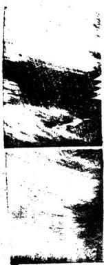

# 天玉经内传心印

> V3 AI 全自动白话释读版。专业术语保留，释读内容可展开核对原文。

> 来源：413.地理正宗臆解+黑囊经+青囊心印+地学.pdf，PDF 第 325–346 页

<!-- V3_SOURCE_ID:book013-b000003-p000-7919b9d1d3 -->

地棗八卦的道理誰能通曉？山與水相對的地卦，是指以左側的水屬陰，其法則從地支位上起長生，逆推，並非指旺、墓等，所以名爲地卦。凡是天地二卦的水神，都要與龍神合配，這就叫做相對。

查看对应原文

<!-- V3_FOLDBACK_BEGIN:book013-b000003-p000-7919b9d1d3 -->

地棗八封誰能會山與水相對地卦者指例左之水屬陰共法從地支位上起長生逆非言旺墓等故名地封凡天地二卦水神俱要與龍神合配謂之相對

<!-- V3_FOLDBACK_END:book013-b000003-p000-7919b9d1d3 -->

<!-- V3_SOURCE_ID:book013-b000004-p000-465b4a22af -->

要仔細辨明父母陰陽，前後相兼的情況要確定，前後相兼的兩條路要察看，如今確定在兩邊安此；這是因爲「人百龍」應當乘正氣貫穴，說的是龍有陰陽，各有父母所生而來，應當仔細辨別；接下來說的是「支辰陰陽龍及干」，只有陰陽龍入穴，其相兼之處實有兩路來「收攷」乘真氣，也分「兩退」，具體所指均不詳。

> **释读存疑：** 人百龍；今定兩邊安此；支辰陰陽龍及干；收攷；兩退；「人百龍」具體所指均不詳；「今定兩邊安此」具體所指均不詳；「支辰陰陽龍及干」具體所指均不詳；「收攷」具體所指均不詳；「兩退」具體所指均不詳

查看对应原文

<!-- V3_FOLDBACK_BEGIN:book013-b000004-p000-465b4a22af -->

父毋陰陽仔細尋前後相兼定前後相兼兩路看今定兩邊安此以人百龍當乘正氣貫穴也言龍有陰陽各有父母所生來當細辨次言支辰陰陽龍及干唯陰陽龍入穴其相兼實有兩路而收攷乘眞氣亦分兩退也

<!-- V3_FOLDBACK_END:book013-b000004-p000-465b4a22af -->

<!-- V3_SOURCE_ID:book013-b000005-p000-9e85843d52 -->

比如左旋子龍屬陽，必須以「廉後壬三分」，才能符合「直天五經心印 卷之一 二」的要求，具體所指均不詳。

> **释读存疑：** 廉後壬三分；直天五經心印 卷之一 二；「廉後壬三分」具體所指均不詳；「直天五經心印 卷之一 二」具體所指均不詳

查看对应原文

<!-- V3_FOLDBACK_BEGIN:book013-b000005-p000-9e85843d52 -->

假如左旋子龍屬陽必以本支七分而廉後壬三分始得直天五經心印 卷之一 二

<!-- V3_FOLDBACK_END:book013-b000005-p000-9e85843d52 -->

<!-- V3_SOURCE_ID:book013-b000006-p000-ca6e42a9f7 -->

子氣入穴，叫做後兼；右旋子龍屬陰，必須以本支七分而兼前壬三分，才能得到真子氣入穴，叫做前兼。

查看对应原文

<!-- V3_FOLDBACK_BEGIN:book013-b000006-p000-ca6e42a9f7 -->

子氣人穴謂之後兼右旋子龍屬陰必以本支七分而兼前壬三分始得真子氣入穴謂之前兼

<!-- V3_FOLDBACK_END:book013-b000006-p000-ca6e42a9f7 -->

<!-- V3_SOURCE_ID:book013-b000007-p000-d638d2b6c2 -->

如果是左旋的壬龍，屬於陽性，就必須以壬龍的七分為本，再兼取前方的子龍三分，才能得到真正的壬氣，進而找到合適的穴（风水中认为气脉聚结、适宜安葬或营建的位置），這稱為「前兼」。如果是右旋的壬龍，屬於陰性，就必須以壬龍的七分為本，再兼取後方的子龍支三分，才能得到真正的壬氣，進而找到合適的穴（风水中认为气脉聚结、适宜安葬或营建的位置），這稱為「後兼」。能夠做到這樣，就不會出現孤虛、龜甲差錯、空亡、七關煞等弊端。

查看对应原文

<!-- V3_FOLDBACK_BEGIN:book013-b000007-p000-d638d2b6c2 -->

假如左旋壬龍屬陽必以本于七分而兼前子三分始得真壬氣人穴謂之前集右旋壬龍屬陰必以本于七分兼後子支三分始得眞壬氣入穴謂之後兼能如此則無孤虛龜甲差錯空七關煞等弊

<!-- V3_FOLDBACK_END:book013-b000007-p000-d638d2b6c2 -->

<!-- V3_SOURCE_ID:book013-b000008-p000-c6564c98e8 -->

從前楊公制定穿山七十二龍盤格龍，所以主張通過相兼來取得正氣。後來朱、蔡二位先生製作了平分六十龍，將其周佈在七十二龍之下，比如壬龍取丙子為正氣，子龍取庚子為正氣之類，這是後世最為確切的說法。

查看对应原文

<!-- V3_FOLDBACK_BEGIN:book013-b000008-p000-c6564c98e8 -->

昔楊公制穿山七十二龍盤格龍故言相兼以取正氣後朱 蔡二公作平分六十龍周佈於七十二龍之下如壬龍取丙 子爲正氣子龍取庚子爲正氣之類小後世最確富

<!-- V3_FOLDBACK_END:book013-b000008-p000-c6564c98e8 -->

<!-- V3_SOURCE_ID:book013-b000009-p000-f790b2996c -->

八卦（乾、坤、震、巽、坎、离、艮、兑八种卦象）內的八卦（乾、坤、震、巽、坎、离、艮、兑八种卦象）不超出本位，代代都會受人尊貴。向（建筑或穴位所朝的方位）永遠流歸一路，所到之處都會有名聲。龍行超出卦位，就不會有官貴，不用勞心費力，就算把天醫、福德從水（风水语境中的河流、水系及其来去形态）神裝卦，也不會見到榮光。前兩句是從龍體來說，龍卦必須得到本龍生方的水（风水语境中的河流、水系及其来去形态）進入堂局，流歸庫地，這稱為「不出位」，能蔭護尊貴之人。三四句是說能夠配合水（风水语境中的河流、水系及其来去形态）發揮作用，立向（建筑或穴位所朝的方位）符合本龍正配的水（风水语境中的河流、水系及其来去形态），生旺互交，流歸庫地，這稱為向（建筑或穴位所朝的方位）水（风水语境中的河流、水系及其来去形态）歸一路，懂得這個方法，所到之處都會有名聲，能夠流傳後世。如果龍神生方沒有水（风水语境中的河流、水系及其来去形态）前來，或者水（风水语境中的河流、水系及其来去形态）不是流歸庫地，而是從庫地流走，這就稱為「出位」，不必再尋求了。就算把天醫、福德從水（风水语境中的河流、水系及其来去形态）神裝卦，難道會有榮光的應驗嗎？

查看对应原文

<!-- V3_FOLDBACK_BEGIN:book013-b000009-p000-f790b2996c -->

卦內八卦不出位代代人尊貴向永流歸一路行到處有聲名 龍行出卦無官貴不用勞心力只把天醫福德未解見榮光 首二句以龍體言龍卦必須得本龍生方有水入堂流歸庫 地謂之不出位而蔭尊貴三四句以能配水爲用言立向合 本龍正配之水生旺互交歸庫謂之向水歸一路行知此法 托十到處有聲名傳矣若龍神生方無水來或水不流歸自 庫去謂之出位不必尋求矣雖將天醫福德從水神裝卦寧 有榮光之應哉

<!-- V3_FOLDBACK_END:book013-b000009-p000-f790b2996c -->

<!-- V3_SOURCE_ID:book013-b000010-p000-c67f3f872d -->

倒排父母，蔭護龍位，山同同流水，十二陰陽一路排，都是從卦中來。此處為《天玉經心印》卷之一的卷末題記。

查看对应原文

<!-- V3_FOLDBACK_BEGIN:book013-b000010-p000-c67f3f872d -->

倒排父母蔭龍位 山同同流水十二陰陽一路排總是卦中來天玉經心印 卷之一 三

<!-- V3_FOLDBACK_END:book013-b000010-p000-c67f3f872d -->

<!-- V3_SOURCE_ID:book013-b000011-p000-576a0304f9 -->

凡龍立向必須朝本龍父母宮爲倒排父母以蔭龍位而龍向陰陽配合全在水神之來處與龍家互相生旺水神之去處與龍家同歸墓位爲山向同流水又言十二陰陽順逆排配龍神一路之理皆天地卦中所出也

查看对应原文

<!-- V3_FOLDBACK_BEGIN:book013-b000011-p000-576a0304f9 -->

凡龍立向必須朝本龍父母宮爲倒排父母以蔭龍位而龍向陰陽配合全在水神之來處與龍家互相生旺水神之去處與龍家同歸墓位爲山向同流水又言十二陰陽順逆排配龍神一路之理皆天地卦中所出也

<!-- V3_FOLDBACK_END:book013-b000011-p000-576a0304f9 -->

<!-- V3_SOURCE_ID:book013-b000012-p000-db1c8768ad -->

開天閃地定雌雄富貴此中逢翻天倒地對不同秘密在玄空閱元指乾坤艮巽四維屬陽開地指辰成丑未四支屬陰皆言火口定雌雄辨富貴也翻天句言龍左行取右旋之水配龍右行取左旋之水配各不同而雌橫配合之法秘密在玄竅相通耳猶劉公云陰陽配合得生富貴雙全是也

查看对应原文

<!-- V3_FOLDBACK_BEGIN:book013-b000012-p000-db1c8768ad -->

開天閃地定雌雄富貴此中逢翻天倒地對不同秘密在玄空閱元指乾坤艮巽四維屬陽開地指辰成丑未四支屬陰皆言火口定雌雄辨富貴也翻天句言龍左行取右旋之水配龍右行取左旋之水配各不同而雌橫配合之法秘密在玄竅相通耳猶劉公云陰陽配合得生富貴雙全是也

<!-- V3_FOLDBACK_END:book013-b000012-p000-db1c8768ad -->

<!-- V3_SOURCE_ID:book013-b000013-p000-2afeda783f -->

三陽水口盡源流富貫永無憂三陽六秀二神當立見入朝堂三陽者貪巨武即龍水二神生旺水也水口庫位也言二陽之水又在六夭宮來堂歸庫位爲蓋源流爲歸二神當也主速發故曰立見五尺云生旺同歸人財咸吉更從六秀方來尚門未紫

查看对应原文

<!-- V3_FOLDBACK_BEGIN:book013-b000013-p000-2afeda783f -->

三陽水口盡源流富貫永無憂三陽六秀二神當立見入朝堂三陽者貪巨武即龍水二神生旺水也水口庫位也言二陽之水又在六夭宮來堂歸庫位爲蓋源流爲歸二神當也主速發故曰立見五尺云生旺同歸人財咸吉更從六秀方來尚門未紫

<!-- V3_FOLDBACK_END:book013-b000013-p000-2afeda783f -->

<!-- V3_SOURCE_ID:book013-b000014-p000-802f0a772d -->

水到御街官便至神童狀元出印綬若然居水口玉御近台輔承上言既得三陽六秀歸二神穴若水出四維墓位爲到鄉街也官便至者發福速也又宜本方砂格雄悍領異鎮塞水口未句猶云天子親臨門弟也

查看对应原文

<!-- V3_FOLDBACK_BEGIN:book013-b000014-p000-802f0a772d -->

水到御街官便至神童狀元出印綬若然居水口玉御近台輔承上言既得三陽六秀歸二神穴若水出四維墓位爲到鄉街也官便至者發福速也又宜本方砂格雄悍領異鎮塞水口未句猶云天子親臨門弟也

<!-- V3_FOLDBACK_END:book013-b000014-p000-802f0a772d -->

<!-- V3_SOURCE_ID:book013-b000015-p000-f37beccfae -->

五經心卯 1 四 葵焚鼓角隨水（风水语境中的河流、水系及其来去形态）艷艷紅施貴。

查看对应原文

<!-- V3_FOLDBACK_BEGIN:book013-b000015-p000-f37beccfae -->

夫五經心卯 1 四 葵焚鼓角隨流水艷艷紅施貴

<!-- V3_FOLDBACK_END:book013-b000015-p000-f37beccfae -->

<!-- V3_SOURCE_ID:book013-b000016-p000-67caf6dea6 -->

鼓琴水（风水语境中的河流、水系及其来去形态）聲鼓角水神之官旺位，此言官旺位上水（风水语境中的河流、水系及其来去形态）朝，紅篇水（风水语境中的河流、水系及其来去形态）神病方，艷艷峯戀秀美也。

> **释读存疑：** 原文部分表述逻辑及术语对应关系不够明确，具体所指不详

查看对应原文

<!-- V3_FOLDBACK_BEGIN:book013-b000016-p000-67caf6dea6 -->

鼓琴水聲鼓角水神之官旺位此言官旺位上水朝紅篇水神病方艷艷峯戀秀美也

<!-- V3_FOLDBACK_END:book013-b000016-p000-67caf6dea6 -->

<!-- V3_SOURCE_ID:book013-b000017-p000-72fc6a940d -->

上按三才井六建排定陰陽算，下按玉輦埠門流龍去要回頭，上宏者看來水（风水语境中的河流、水系及其来去形态）以定坐山（建筑或穴位背靠的一方）也，三才坐位也，以干支共有六位曰六建，用以排水（风水语境中的河流、水系及其来去形态）神之生旺，各有陰陽順逆之法，謂之勝定陰陽算，下按看局前水（风水语境中的河流、水系及其来去形态）也，玉輦衰方也，又名巨門捍門墓方也，局前有巨門水（风水语境中的河流、水系及其来去形态）入堂，合數貧四大局恰好歸墓位，更回頭纏玄武（穴后方的靠山形势称谓）而去也，此龍字當作水（风水语境中的河流、水系及其来去形态）字。

> **释读存疑：** 原文部分表述逻辑及术语对应关系不够明确，具体所指不详

查看对应原文

<!-- V3_FOLDBACK_BEGIN:book013-b000017-p000-72fc6a940d -->

上按三才井六建排定陰陽算下按玉輦埠門流龍去要回頭上宏者看來水以定坐山也三才坐位也以于支共有六位曰六逮用以排水神之生旺各有陰陽順逆之法謂之勝定陰陽算下按看局前水也王輦衰方也又名巨門捍門墓方也局前有巨門水入堂合數貧四大局恰好歸墓位更回頭纏玄武而去也此龍字富作水字

<!-- V3_FOLDBACK_END:book013-b000017-p000-72fc6a940d -->

<!-- V3_SOURCE_ID:book013-b000018-p000-7de8b5452d -->

之兆分明號六龍，名姓達天聰，正山正向流支上寡天遭刑，松承上文六建名六龍，乃陰陽之天根月宿也，能知此立坐向（建筑或穴位所朝的方位），生與旺罔歸定主，各姓達天之應，正山句言支龍八首作支向（建筑或穴位所朝的方位），見支水（风水语境中的河流、水系及其来去形态）出入當應寡刑之凶，吏神多藏役收也，向（建筑或穴位所朝的方位）若回山是父母，水流回何首，水（风水语境中的河流、水系及其来去形态）若上山父母同，定見出三公，言立向（建筑或穴位所朝的方位）須朝本龍父母官，而水（风水语境中的河流、水系及其来去形态）神出入宜取本配，更得走玄武，故後有三公之應。

> **释读存疑：** 玄武

查看对应原文

<!-- V3_FOLDBACK_BEGIN:book013-b000018-p000-7de8b5452d -->

之兆分明號六龍名姓達天聰正山正向流支上寡天遭刑松 承上文六建名六龍乃陰陽之天根月宿也能知此立坐向 生與旺罔歸定主各姓達天之應正山句言支龍八首作 支向見支水出入當應寡刑之凶吏神多藏役收也 向若回山是父毋水流回何首水若上山父母同定見出三公 言立向須朝本龍父母官而水神出入宜取本配更得走玄 武故後有三公之應

<!-- V3_FOLDBACK_END:book013-b000018-p000-7de8b5452d -->

<!-- V3_SOURCE_ID:book013-b000019-p000-b5916bfddf -->

如果甲木龍入首適合坐癸水司，甲木受生的宮位是「回句申木」，具體所指不詳，須搭配癸水，還要卯、乙亥、壬這些生旺的水命。「桑穴」前流出未、坤方位的水流，這是《天玉經心印》的內容之一。

> **释读存疑：** 回句申木；桑穴；司

查看对应原文

<!-- V3_FOLDBACK_BEGIN:book013-b000019-p000-b5916bfddf -->

假如甲木龍入首宜坐癸水司何甲木受生之宮曰回句申木取配癸水須得卯乙亥壬生旺水命桑穴前出未坤爲流天玉經心印 之一 五

<!-- V3_FOLDBACK_END:book013-b000019-p000-b5916bfddf -->

<!-- V3_SOURCE_ID:book013-b000020-p000-88eb8838f9 -->

回向首如果又有纏繞的玄武，稱為水土山，必定會長久發福，其餘陰陽八局的情況都可以依此推斷。

查看对应原文

<!-- V3_FOLDBACK_BEGIN:book013-b000020-p000-88eb8838f9 -->

回向首若又得纏玄武曰水土山必主久遶發福餘陰陽八局可推

<!-- V3_FOLDBACK_END:book013-b000020-p000-88eb8838f9 -->

<!-- V3_SOURCE_ID:book013-b000021-p000-3ca2e7aded -->

洛書的兩神如同夫婦，要認定「敗寅神路」，仙人的祕密定陰陽之法，是正龍的標準。龍與水的配合如同夫婦，仔細認定本龍與本應配的水，就是得真神。定陰陽的意思是，陰龍入首時，須收應配的陽水；陽龍入首時，須收應配的陰水，這便是得正龍崗。就像之前所說的用本龍搭配癸水局，符合兩神夫婦之道。劉公說：陰龍用陽水朝應，陽龍用陰水朝應，如同夫妻協和的道理。陰陽二字要看零正，坐向必須知曉病位，遇到正神正位，水入零堂，正堂正向要知道，認取來山的腳下，水上排龍點位，積粟萬餘倉。又說陰陽二中，天干為零，地支為正，陰陽分別，從入首的脈象辨別五行，以確定坐向。坐向的吉凶在於水，遇到天干水來就吉，地支水來就凶。如果遇到「句言」所說的龍遇支水為病，又作支向就是正位。如果局勢適合立支向，須在立穴處或扶左挨石撥水入零堂，必須得龍與局官旺的零神，立正向才好，又不可脫離本龍的真氣，認取來山的腦部，然後從水局中，確定哪裡是生旺之氣，納入堂中點位，積粟萬餘倉的應驗必定如此。

> **释读存疑：** 敗寅神路；句言；裴；1轮自动修复后核义模型仍建议修订，已保守记录。

查看对应原文

<!-- V3_FOLDBACK_BEGIN:book013-b000021-p000-3ca2e7aded -->

共洛兩神爲夫婦認敗寅神路仙人秘密定陰陽使是正龍爾- -\*龍水配合為夫繡細認本龍本配水爲得真神路也定陰陽者如陰龍入首須收當配之陽水陽龍八首須收當配之陰水便是得正龍崗矣猶前言用本配癸水局得兩神夫婦之道也劉公云陰用陽朝陽角陰應相見協室家之義陰陽字看零正坐向須知病菩遇正神正位礙水入零堂天堂正向須知好認取來山腳水上排龍點位裝積粟萬餘倉又言陰陽二中千爲零陽支爲正陰分工支入首之脉辨王行以定坐向夫坐向之吉凶在水遇千水來則吉支水來則凶若遇句言龍遇支水爲病又作支向則爲正位裴矣如局勢宜立支向須於立穴處或 扶左挨石撥水入零堂必須得龍與局官旺之零神立正向方好又不可脫本龍之眞氣認取來山腦然後從水局中非龍何方是生是旺納之入堂點位裴萬餘倉之應必矣

<!-- V3_FOLDBACK_END:book013-b000021-p000-3ca2e7aded -->

<!-- V3_SOURCE_ID:book013-b000022-p000-03000c7a12 -->

正神百步才成龍，水短就會遭凶，「宋神」不論長短，吉凶不同，這是承接上文零正神而言的。喜愛亥水長大，在龍局生旺方位而來，這是《天玉經心印》卷之一的內容。

> **释读存疑：** 宋神

查看对应原文

<!-- V3_FOLDBACK_BEGIN:book013-b000022-p000-03000c7a12 -->

正神百步始成龍水短使遭凶宋神不問長和短吉凶不同斷承上零正神而言百步喜亥水長大在龍局生旺方來始天玉經心印 卷之一 大

<!-- V3_FOLDBACK_END:book013-b000022-p000-03000c7a12 -->

<!-- V3_SOURCE_ID:book013-b000023-p000-e0b5351317 -->

能成就龍身的吉水，即便短暫位於生臣方，若吉氣不舒展，也屬於凶。這是因為支辰藏於後方的緣故。對於水（风水语境中的河流、水系及其来去形态），不論長短，只要處於吉位，即便短也屬吉；若處於凶位，則仍屬凶，不可不察。

查看对应原文

<!-- V3_FOLDBACK_BEGIN:book013-b000023-p000-e0b5351317 -->

成就龍身之吉水短雖在生臣方而吉氣不舒亦凶以支辰藏後故也于水不論長短在吉位短亦吉在凶位仍凶不可不察

<!-- V3_FOLDBACK_END:book013-b000023-p000-e0b5351317 -->

<!-- V3_SOURCE_ID:book013-b000024-p000-89de0511a2 -->

父母作來到子息須去認生尅，水上排龍照位分兄弟更子孫。上二句是說，認入首後龍開節處，辨生尅以定吉凶：龍從受生處來為父母，入首處為子息；若從尅洩之處來則凶，故曰「認生尅」。「氏云」的具體所指不詳，其言「一節相生一代貴，一節尅洩一代貧」。「五尺云」的具體所指不詳，其言「壬癸來自兌，庚作體全之象；坎水迎歸卯酉，名須氣之神是也」。下二句是說，辨人堂之水，分金木水火陰陽入各局，各分生旺。聽排龍四經五行，以金為兄，水為第，水為于，火為係，舉四經之坎岸而言，非應房分之謂。

> **释读存疑：** 「氏云」的具體所指不詳；「五尺云」的具體所指不詳；「水為第，水為于」的具體含義不詳

查看对应原文

<!-- V3_FOLDBACK_BEGIN:book013-b000024-p000-89de0511a2 -->

父毋作來到子息須去認生尅水上排龍照位分兄弟更子孫上二句認入首後龍開節處辨生尅以定吉凶龍從受生處來為又毋人首處爲子息若從尅洩之處來凶故曰認生尅氏云一節相生一代貴一節尅洩一代貧五尺云壬癸來自兌庚作體全之象坎水迎歸卯酉名須氣之神是也下二句辨人堂之水分金木水火陰陽人局各分生熙聽排龍四經五行以金爲兄水爲第水為于火爲係舉四經之坎岸而言非應房分之謂

<!-- V3_FOLDBACK_END:book013-b000024-p000-89de0511a2 -->

<!-- V3_SOURCE_ID:book013-b000025-p000-f948f36ac7 -->

二十四山（将周天划分为二十四个方位的体系）分兩路認取五行（木、火、土、金、水五种分类及其关系体系），主龍中交戰，水中裴便是正龍，傷前面若無凶交破，莫斷為凶，凶星看是何公頭竹細，認蹤由。十四山分陰陽兩路，須先記入首（龙脉进入结穴区域前的关键一段）之龍是何五行（木、火、土、金、水五种分类及其关系体系）為主，查曜殺水（风水语境中的河流、水系及其来去形态）、破殺水（风水语境中的河流、水系及其来去形态）、敗殺水（风水语境中的河流、水系及其来去形态）、黃果水（风水语境中的河流、水系及其来去形态）來沖犯否，或有一把便是正龍受傷。凡龍作穴（风水中认为气脉聚结、适宜安葬或营建的位置），前面未當無殺位，但要殺方無水（风水语境中的河流、水系及其来去形态）來破局，及無惡砂（穴场周围起护卫、朝应作用的山丘或地形）照入，則不為凶。若凶位水（风水语境中的河流、水系及其来去形态）冲入、砂（穴场周围起护卫、朝应作用的山丘或地形）射入，在養生位禍長，官旺位禍中衰，病墓位禍幼，故曰「龍中交爵，水中裝」。天玉經心印 卷之一 七

查看对应原文

<!-- V3_FOLDBACK_BEGIN:book013-b000025-p000-f948f36ac7 -->

二十四山分兩路認取五行主龍中交戰水中裴便是正龍傷前面若無凶交破莫斷為凶凶星看是何公頭竹細認踪由十四山分陰陽兩路須先記入首之龍是何五行爲主查曜殺水破殺水敗殺水黃果水來冲犯否或有一把便是正龍受傷凡龍作穴前面未當無殺位但要殺方無水來破局及無惡砂照入則不為凶若凶位水冲入砂射入在養生位禍長官旺位禍中衰病墓位禍幼故曰龍中交爵水中裝天玉經心印 卷之一 七

<!-- V3_FOLDBACK_END:book013-b000025-p000-f948f36ac7 -->

<!-- V3_SOURCE_ID:book013-b000026-p000-09ee631467 -->

從而可知公位遭遇凶禍的道理。

查看对应原文

<!-- V3_FOLDBACK_BEGIN:book013-b000026-p000-09ee631467 -->

而知公位之遭凶也。

<!-- V3_FOLDBACK_END:book013-b000026-p000-09ee631467 -->

<!-- V3_SOURCE_ID:book013-b000027-p000-7a5c4f8374 -->

先定來山後定向聯珠莫相放須知細覓五行綜官星結全龍先以入首之龍定陰陽五行然後配向立坐以收來去之水但來山賞收本龍三合之峯局前艮宜納正配三合之水為山向聯珠不相放也此法背由知五行之蹤而得能以此杵定應貴

查看对应原文

<!-- V3_FOLDBACK_BEGIN:book013-b000027-p000-7a5c4f8374 -->

先定來山後定向聯珠莫相放須知細覓五行綜官星結全龍先以入首之龍定陰陽五行然後配向立坐以收來去之水但來山賞收本龍三合之峯局前艮宜納正配三合之水為山向聯珠不相放也此法背由知五行之蹤而得能以此杵定應貴

<!-- V3_FOLDBACK_END:book013-b000027-p000-7a5c4f8374 -->

<!-- V3_SOURCE_ID:book013-b000028-p000-90f8b7d2ef -->

五行若然翻值向百子千孫旺陰陽配合亦同論富貴此中尋此爲時師格龍但知從三合先四生四墓衆向四正所屬五行論龍神故誤人凶敗不知四正旺龍本兩長同氣其四生四墓入雙山雖是同宮面不同氣必當作一十六龍辨左查旋定陰陽從正五行父母作向故曰五行湖值向而有百子千孫也又辨水神與本龍配合生旺五交元竅相通不惟癸子孫而更富貴矣

查看对应原文

<!-- V3_FOLDBACK_BEGIN:book013-b000028-p000-90f8b7d2ef -->

五行若然翻值向百子千孫旺陰陽配合亦同論富貴此中尋此爲時師格龍但知從三合先四生四墓衆向四正所屬五行論龍神故誤人凶敗不知四正旺龍本兩長同氣其四生四墓入雙山雖是同宮面不同氣必當作一十六龍辨左查旋定陰陽從正五行父母作向故曰五行湖值向而有百子千孫也又辨水神與本龍配合生旺五交元竅相通不惟癸子孫而更富貴矣

<!-- V3_FOLDBACK_END:book013-b000028-p000-90f8b7d2ef -->

<!-- V3_SOURCE_ID:book013-b000029-p000-ebe72766ec -->

假如右行乾辛申金龍入首若俠雙山乾是乙木龍當配丙火水宜出戊乾辛是丁火龍富配庚金水宜出丑艮申是癸水龍富配甲木水宜出未坤或三龍之水不出三方而例右出辰巽者乾龍不可作乙木而作陰金辛龍不可作丁大而作木金中龍不可作癸水而作辛金三龍俱取配王水成配天玉經心印 之一 入

查看对应原文

<!-- V3_FOLDBACK_BEGIN:book013-b000029-p000-ebe72766ec -->

假如右行乾辛申金龍入首若俠雙山乾是乙木龍當配丙火水宜出戊乾辛是丁火龍富配庚金水宜出丑艮申是癸水龍富配甲木水宜出未坤或三龍之水不出三方而例右出辰巽者乾龍不可作乙木而作陰金辛龍不可作丁大而作木金中龍不可作癸水而作辛金三龍俱取配王水成配天玉經心印 之一 入

<!-- V3_FOLDBACK_END:book013-b000029-p000-ebe72766ec -->

<!-- V3_SOURCE_ID:book013-b000030-p000-71acc0ec95 -->

則辰巽之去水爲二神歸虞矣斯得金龍動也須坐壬水局 六建山向辛金父母官謂之五行翻伯向則陰陽配合元竅 相通子絲富貫之應必矣餘可類推

查看对应原文

<!-- V3_FOLDBACK_BEGIN:book013-b000030-p000-71acc0ec95 -->

則辰巽之去水爲二神歸虞矣斯得金龍動也須坐壬水局 六建山向辛金父母官謂之五行翻伯向則陰陽配合元竅 相通子絲富貫之應必矣餘可類推

<!-- V3_FOLDBACK_END:book013-b000030-p000-71acc0ec95 -->

<!-- V3_SOURCE_ID:book013-b000031-p000-d67938a896 -->

双山龙左行属阳，‘全再酉木甲卯’‘火内’‘曹’等具体所指不详；双山龙右行属阴，金、庚、‘曹’、木、甲卯，水在壬子。‘假加庚西’的具体所指不详；双山龙入首左行属阳金，适宜从巽巳方发祀起峰，来到庚酉旺方成星结穴，癸丑方起客应，这是得到‘三合’龙峰的吉利。本应配合阴火水局作向局，前方收酉辛宫生水及巳丙旺水，剩堂出丑艮，这是阴小地卦阳龙的方法。

> **释读存疑：** 全再酉木甲卯；火内；曹；假加庚西；‘全再酉木甲卯’‘火内’‘曹’‘假加庚西’具体所指不详

查看对应原文

<!-- V3_FOLDBACK_BEGIN:book013-b000031-p000-d67938a896 -->

雙山龍左行屬陽者 全再酉木甲卯 水壬子 火內雙山龍右行屬陰者金庚曹木甲卯 水壬子假加庚西雙山龍入首左行係陽金宜從巽巳方發祀起峯來至庚酉旺方成星結穴癸丑方起客應爲得三合龍峯之吉本配陰火水局作向局前收酉辛宮生水及巳丙旺水剩堂出丑艮此是陰小地卦陽龍之法也

<!-- V3_FOLDBACK_END:book013-b000031-p000-d67938a896 -->

<!-- V3_SOURCE_ID:book013-b000032-p000-e5bd171100 -->

如庚酉双山入首右行，‘分丑方’‘张神’‘燕方’‘空应’‘曰庚生位’‘予癸旺位’‘八室’‘辰巽’等具体所指不详；除阴金适宜从该方张神起峰而来，至庚酉旺方成星结穴，巽巳燕方起空应，这是得到‘三合’龙峰的吉利。本应配合阳水水局作向局，前方收‘庚生位’水及‘癸旺位’水，‘八室’出辰巽，这是阳水天封配阴龙的方法。

> **释读存疑：** 分丑方；张神；燕方；空应；曰庚生位；予癸旺位；八室；辰巽；‘分丑方’‘张神’‘燕方’‘空应’‘曰庚生位’‘予癸旺位’‘八室’‘辰巽’具体所指不详

查看对应原文

<!-- V3_FOLDBACK_BEGIN:book013-b000032-p000-e5bd171100 -->

如庚酉雙山入首右行除陰金宜從分丑方張神起峯而來至庚酉旺方成星結穴巽巳燕方起空應為得三龍峯之吉本配陽水水局作向局前收曰庚生位水及予癸旺位水八室出辰巽此是陽水天封配陰龍之法也

<!-- V3_FOLDBACK_END:book013-b000032-p000-e5bd171100 -->

<!-- V3_SOURCE_ID:book013-b000033-p000-459ef159df -->

以上双山三合阴阳共十六龙，外有丑艮二七龙寄于阳水，同父母不寄阴水，共一十八龙能布局。如今只阐明阳金、丑阴火、阴金、圣阳水二局，其余阳水、阳火、阳水土及阴木、阴火、阴水龙可类推。

查看对应原文

<!-- V3_FOLDBACK_BEGIN:book013-b000033-p000-459ef159df -->

巳上雙山三合陰陽一十六龍外丑艮二七龍寄於陽水同父母不寄陰水中共一十八能佈局今但發明陽金醜陰火陰金聖陽水二局其陽水陽火陽水土及陰木陰火陰水龍可推

<!-- V3_FOLDBACK_END:book013-b000033-p000-459ef159df -->

<!-- V3_SOURCE_ID:book013-b000034-p000-373ea3b201 -->

东西父母三般卦，算直千金价，‘二丁四币’‘绯紫’‘人长妄天’等具体所指不详，山高官，‘人长妄天’主经心。卷之。

> **释读存疑：** 二丁四币；绯紫；人长妄天；‘二丁四币’‘绯紫’‘人长妄天’具体所指不详

查看对应原文

<!-- V3_FOLDBACK_BEGIN:book013-b000034-p000-373ea3b201 -->

東西父母三般卦算直千金價二丁四幣山高官緋紫人長妄天主經心 卷之

<!-- V3_FOLDBACK_END:book013-b000034-p000-373ea3b201 -->

<!-- V3_SOURCE_ID:book013-b000035-p000-322161ecc0 -->

父母卦并非不好，即便没有官职也能富足；反母卦也并非不好，即便没有官职也能富足。所谓东卦就是天卦，是右行阳水配阴龙；西卦就是地卦，是左行阴水配阳龙。父母卦要分辨金、水、火、土、龙的左旋右旋，以此区分五行所属的名称，再寻找本龙的父母宫来确定向，就能得到父母卦。比如右行阴龙遇到本应相配的阳水局，就是得到三般卦水；左行阳龙遇到本应相配的阴水局，就是得到西卦水，这就是一般卦。总共二十四句话，得到这三种全局，主高官、绯紫。只取水局却不配合本龙及向，就是“母不是”，不算好，应富足却无贵气。“炙母”排来，要看左右如何分别休咎。“鬱山”变向水零神，“鬲宝”永无贫；遇到正神就会衰败，五行应当分别，“向一神仲子当子”，“万细惟掌”，先辨左右，确定阴阳五行之龙，寻找父母，得到向父母就是休美。天则灾咎，“双山双向”，说的是坐于当乘支坐支，应当兼于，又得于水从生旺入堂出墓，主富贵。“四何韵”遇到支水在生旺，征不亦福，后来终究衰败。五六句应当从本龙五行父母位立向，“向父母”为隔向，应当仔细斟酌。

> **释读存疑：** “母不是”具体所指不详；“炙母”具体所指不详；“鬱山”具体所指不详；“鬲宝”具体所指不详；“向一神仲子当子”具体所指不详；“万细惟掌”具体所指不详；“双山双向”具体所指不详；“四何韵”具体所指不详；“向父母”具体所指不详；“隔向”具体所指不详；1轮自动修复后核义模型仍建议修订，已保守记录。

查看对应原文

<!-- V3_FOLDBACK_BEGIN:book013-b000035-p000-322161ecc0 -->

父母不是未爲好無官只富蒙 反母不是未爲好無官只富易東封即天卦是倒右陽水配陰薩者也西卦卽地卦是左陰水配陽龍者也父毋卦凡金水水火土龍辨左旋右庭分陰陽五行所屬名尋本龍久母宮作向爲得父毋封也如右行陰龍遇本配陽水局爲得封水如左行陽遇本配陰水局爲得西卦水此爲得一般卦也凡二十四語得此三般全局主高官緋紫君獨取水局而不合本龍及向父母乃母不是不爲好應富無貴矣炙母排來看左右何首分休咎鬱山變向水零神鬲寶永無貧遇正神須敗絕五行當分別向一神仲子當子萬細惟掌先辨左右宛定陰喝五行之龍尋父母得向父母爲休美天則災咎雙山雙向者言坐于當乘支坐支當兼于又得于水從生旺入堂出墓主富貴四何韻遇支水在生旺征不亦福後終敗絕五六句當從本龍五行父母位立向天向父母爲隔向也宜綱詳之

<!-- V3_FOLDBACK_END:book013-b000035-p000-322161ecc0 -->

<!-- V3_SOURCE_ID:book013-b000036-p000-2f7fd1f385 -->

君行宫位要看顺逆，接得“万特宫位”，若然见“道龙”，男女失其院，乖神入穴阴阳，此言水祐归堂阴阳也。推局前之水，须分顺逆以定吉凶，接得者言官旺方有水八堂，近穴有情为“天玉经心印”。卷之一 十

> **释读存疑：** “万特宫位”具体所指不详；“道龙”具体所指不详；“水八堂”具体所指不详；“天玉经心印”具体所指不详；1轮自动修复后核义模型仍建议修订，已保守记录。

查看对应原文

<!-- V3_FOLDBACK_BEGIN:book013-b000036-p000-2f7fd1f385 -->

君行宮位看順逆接得万特宮位若然見道龍男女失其院乖神入穴陰陽此言水祐歸堂陰陽也推局前之水須分願逆以定吉凶接得者言官旺方有水八堂近穴有情為天玉經心印 卷之一 十

<!-- V3_FOLDBACK_END:book013-b000036-p000-2f7fd1f385 -->

<!-- V3_SOURCE_ID:book013-b000037-p000-891bf07c25 -->

奇特主速发，无情而远穴虽吉，方则接不得矣。若死墓绝方有水倒冲，为宫位见逆龙，主男女失县之凶。刘公云：破煞中生气，丁眷矣。堪舆师云：破煞倒冲，男女绝踪。

> **释读存疑：** “失县之凶”中“县”疑为衍字或讹字，原文未明确；“丁眷”具体所指不详；1轮自动修复后核义模型仍建议修订，已保守记录。

查看对应原文

<!-- V3_FOLDBACK_BEGIN:book013-b000037-p000-891bf07c25 -->

奇特主速發無情而遠穴雖吉方則接不得矣若死墓絕方有水倒冲爲宮位見逆龍主男女失縣之凶劉公云破煞中生氣丁眷矣堪獸師云破煞倒冲男女絕蹤

<!-- V3_FOLDBACK_END:book013-b000037-p000-891bf07c25 -->

<!-- V3_SOURCE_ID:book013-b000038-p000-ef35169fe9 -->

需留意父母对应的下三吉，三般卦为第一。

> **释读存疑：** 父母对应的下三吉具体所指不详；三般卦具体所指不详

查看对应原文

<!-- V3_FOLDBACK_BEGIN:book013-b000038-p000-ef35169fe9 -->

更看父母下三吉三般卦第一

<!-- V3_FOLDBACK_END:book013-b000038-p000-ef35169fe9 -->

<!-- V3_SOURCE_ID:book013-b000039-p000-51274f1939 -->

凡是龍氣、穴場、水勢、朝向所對應的父母山下方的區域，就是穴場前方的堂局。如果堂局前方是能夠生發龍身的父母峰，又能得到龍卦以及貪、巨、武三吉水，八種水一同流向墓位，就符合三帳封的第一等吉兆。以上是總結前文的內容，用來引出下文關於挨星的內容。

查看对应原文

<!-- V3_FOLDBACK_BEGIN:book013-b000039-p000-51274f1939 -->

凡龍穴所向父毋言下之處乃穴前堂局也若得局前是父母封能生龍身之吉而又得龍卦及水封貪巨武三吉水八同歸墓位爲得三帳封第一之吉也總結上文寶以起下埃星之羞

<!-- V3_FOLDBACK_END:book013-b000039-p000-51274f1939 -->

<!-- V3_SOURCE_ID:book013-b000040-p000-2aea78b8ca -->

《天五經內傳心印》卷之二

查看对应原文

<!-- V3_FOLDBACK_BEGIN:book013-b000040-p000-2aea78b8ca -->

天五經內傳心印卷之二

<!-- V3_FOLDBACK_END:book013-b000040-p000-2aea78b8ca -->

<!-- V3_SOURCE_ID:book013-b000041-p000-2455f1a983 -->

浦陽人王宗臣，字道輔，甫註；同學宏學，字用氏，正。

> **释读存疑：** 甫註、正的具體含義未明確，暫按字面意思處理

查看对应原文

<!-- V3_FOLDBACK_BEGIN:book013-b000041-p000-2455f1a983 -->

浦陽王宗臣道輔氏甫註同學宏學用氏正

<!-- V3_FOLDBACK_END:book013-b000041-p000-2455f1a983 -->

<!-- V3_SOURCE_ID:book013-b000042-p000-5953f6e522 -->

二十四山起八宮，貪、巨、武、輔、弼、榮、祿、文，四邊方位盡是逃亡之象，若在此穴場安葬，後代人丁會斷絕。這是用小游年法引出挨星之法，以貪、巨、祿、文、廉、武、破、輔為順行順序。三吉六秀的訣例說：乾、甲、離、壬、寅、戌山，坤、壬、乙上起貪狼；與辛、兌、丁、巳、丑也，乾、甲、丁上起貪狼；坤、乙、坎、癸、甲辰山，艮、丙、辛上起貪狼；艮、丙、震、庚、亥、未山，巽、庚、癸上起貪狼。訣語說：收山出殺有何功，破、祿、廉、文要坐密；貪、巨、武、輔收入穴，何大地不相逢。以上出自《天五經心印》之二。

> **释读存疑：** 原文中「四邊盡是逃亡」「與辛兌丁巳丑也」等句義較為模糊，暫按字面意思處理；部分術語的具體應用細節未明確

查看对应原文

<!-- V3_FOLDBACK_BEGIN:book013-b000042-p000-5953f6e522 -->

二十四山起八官貪巨武輔榮四邊盡是逃亡穴下後人丁絕此以小游年引起挨星之法以貪巨祿文廉武破輔爲序順行三也例云乾甲離壬寅戌山坤壬乙上起貪狼與辛兌丁巳丑也乾甲丁上起貪振坤乙坎癸甲辰山艮丙辛上起貪狼艮丙震庚亥未山巽庚癸上起貪狼訣云收山出殺有何功破祿廉文要坐密貪巨武補收入穴何大地不相逢天五經心印 之二

<!-- V3_FOLDBACK_END:book013-b000042-p000-5953f6e522 -->

<!-- V3_SOURCE_ID:book013-b000043-p000-c20fabc661 -->

贪狼本是吉星，其气如同春日般温暖和煦，棺木上生出嫩茎，后代子孙众多，可辅佐帝王大臣。

查看对应原文

<!-- V3_FOLDBACK_BEGIN:book013-b000043-p000-c20fabc661 -->

貪狼本是吉星辰生氣融融煖似春紫黃滿棺生嫩莊見孫濟濟佐王臣

<!-- V3_FOLDBACK_END:book013-b000043-p000-c20fabc661 -->

<!-- V3_SOURCE_ID:book013-b000044-p000-ee7ad8bb57 -->

巨门穴（风水中认为气脉聚结、适宜安葬或营建的位置）的气如同墟地，棺木依托其结穴，棺椁上生有紫茜白藤，后代子孙日后必能富贵，光耀门庭。

查看对应原文

<!-- V3_FOLDBACK_BEGIN:book013-b000044-p000-ee7ad8bb57 -->

巨門穴氣如墟棺木乘之結水珠紫茜白藤生滿椁他年 富貴耀門閭

<!-- V3_FOLDBACK_END:book013-b000044-p000-ee7ad8bb57 -->

<!-- V3_SOURCE_ID:book013-b000045-p000-0a1980a49b -->

禄存穴（风水中认为气脉聚结、适宜安葬或营建的位置）的气寒冷如水，棺内原本有水停留，土蚁、木根都侵入穴中，田产卖尽，仅剩下人丁。

查看对应原文

<!-- V3_FOLDBACK_BEGIN:book013-b000045-p000-0a1980a49b -->

祿存穴冷如水棺內原來有水停土蟻木根皆入穴庄田賣盡純人丁

<!-- V3_FOLDBACK_END:book013-b000045-p000-0a1980a49b -->

<!-- V3_SOURCE_ID:book013-b000046-p000-026c1bd5fe -->

文曲水星（风水语境中的河流、水系及其来去形态）居于此处时，必然有水浸棺，后代子孙贫苦，家道败落，还会出现客死他乡、尸骨无归的情况。

查看对应原文

<!-- V3_FOLDBACK_BEGIN:book013-b000046-p000-026c1bd5fe -->

文曲水星坐時必然宥水浸棺屍兒孫貧苦家聲覿更主風飄死不歸

<!-- V3_FOLDBACK_END:book013-b000046-p000-026c1bd5fe -->

<!-- V3_SOURCE_ID:book013-b000047-p000-7c343c8fe2 -->

安葬时若贵地独火旺盛，是最凶险的。原本此地有地风，棺木倾倒、尸体翻转，会出现白气，这样的情况会导致后代代代贫穷。

> **释读存疑：** 原文中‘服貴獨火’‘地風’‘白見’的具体所指未明

查看对应原文

<!-- V3_FOLDBACK_BEGIN:book013-b000047-p000-7c343c8fe2 -->

服貴獨火至爲凶蓋坐原來有地風棺倒屍翻生白見孫 代代主貧窮

<!-- V3_FOLDBACK_END:book013-b000047-p000-7c343c8fe2 -->

<!-- V3_SOURCE_ID:book013-b000048-p000-40042741c6 -->

武曲向来是吉神，若安葬时坐落在吉祥之地，棺木中会生出紫茜，自然会家道富裕、荣耀显达。

> **释读存疑：** 原文中‘白結’‘紫茜’的具体所指未明

查看对应原文

<!-- V3_FOLDBACK_BEGIN:book013-b000048-p000-40042741c6 -->

武曲從來是吉神若還坐吉祥臨白結滿棺生紫茜自然富榮家門

<!-- V3_FOLDBACK_END:book013-b000048-p000-40042741c6 -->

<!-- V3_SOURCE_ID:book013-b000049-p000-4396827de4 -->

破军坐穴是不堪听闻的凶象，名为蚁地，棺木中满是虫类，还有树根穿破尸骨，这样的格局会导致家族出现官司诉讼，传播淫风。

> **释读存疑：** 原文中‘蟻地’的具体所指未明

查看对应原文

<!-- V3_FOLDBACK_BEGIN:book013-b000049-p000-4396827de4 -->

破軍坐不堪聞曰蟻地虫滿棺中更有木根穿骨殖還格公訟播淫風

<!-- V3_FOLDBACK_END:book013-b000049-p000-4396827de4 -->

<!-- V3_SOURCE_ID:book013-b000050-p000-572fdac47d -->

左辅原本是本宫的吉神，若坐穴时遇吉则吉，若遇凶则凶；若坐吉地终究会是吉兆，富贵荣华都包含在其中。

> **释读存疑：** 原文中‘本宫’的具体所指未明

查看对应原文

<!-- V3_FOLDBACK_BEGIN:book013-b000050-p000-572fdac47d -->

左輔原來是本宮若還坐吉還凶或然坐吉終須吉富貴榮華在此中

<!-- V3_FOLDBACK_END:book013-b000050-p000-572fdac47d -->

<!-- V3_SOURCE_ID:book013-b000051-p000-8b0572c8fe -->

文中提到的师父说，巳上的方法只取用阳龙配阳向、阳水，阴龙配阴向、阴水，具体所指不详。

> **释读存疑：** 巳上的方法具体所指不详

查看对应原文

<!-- V3_FOLDBACK_BEGIN:book013-b000051-p000-8b0572c8fe -->

默師云巳上之法惟取陽龍陽同陽水陰龍陰向陰水如星

<!-- V3_FOLDBACK_END:book013-b000051-p000-8b0572c8fe -->

<!-- V3_SOURCE_ID:book013-b000052-p000-8221721f2e -->

龙脉入首后立丑山未向，得到巨门星坐向的吉利格局，这是另一种方法，不在天地父母三卦的范围之内。

查看对应原文

<!-- V3_FOLDBACK_BEGIN:book013-b000052-p000-8221721f2e -->

龍入首作丑山未向得巨門坐之吉另是一法不在天地父母三卦之內

<!-- V3_FOLDBACK_END:book013-b000052-p000-8221721f2e -->

<!-- V3_SOURCE_ID:book013-b000053-p000-35cf98d615 -->

如果说挨星是最为贯通、泄露天机的，那么「天樓」若安在内，家宅就会常得富贵；「大機」若安在外，家宅就会常遭退败。五星配出九星之名，掌握挨星之法后可在风水领域通行。说小游年不值得取用，唯独按星法才足以尊贵。然而将挨星排布在龙、山、水局之中，各自从大墓起破军，阳顺阴逆排布九星，取用贪、巨、武三吉水，八堂归库，这就是天机安在内，主家宅当得富贵；如果水与龙不合，单独在水中排布罡称三吉为美，那么天机就安在外了。但得到一家无根之水，初年虽吉利，最终还是会退败。五星指的是各龙所属的五行，能礼名龙所属的五行，之后才能排布名龙的九星，能知道各龙应当配合的水局，然后才能排布各水的九星，这样挨星之法就掌握了，天下可横行。杨公称其为最尊贵、泄露天机之秘的，就是这个道理。

> **释读存疑：** 「天樓」具体所指不详；「大機」具体所指不详

查看对应原文

<!-- V3_FOLDBACK_BEGIN:book013-b000053-p000-35cf98d615 -->

若挨星爲最貫泄漏天機機天樓若然安在內家活常富貴大機若然安在外家活常退敗五星配出九星名天下任橫行言小游年不足取獨按星爲足貴也然佈挨星於龍山水局中各於大墓起破軍陽順陰逆佈九星取貪巨武三吉水八堂歸庫爲天機安在內矣主當富貴若水不合龍獨用挨星於水中佈罡稱三吉爲美則天機安在外矣但得一家無根之水初年雖吉而終退敗也五星指各龍所屬五行也能禮名龍所屬之五行後能佈名龍之九星能知各龍當配之水局然後能佈各水之九星則挨星之法得天下可橫行也楊公稱最貴為泄天機之秘者此耳

<!-- V3_FOLDBACK_END:book013-b000053-p000-35cf98d615 -->

<!-- V3_SOURCE_ID:book013-b000054-p000-a74a2842d6 -->

乾、艮、巽、坤、壬属于阳顺星辰轮支辰次，震、离、兑属于阴卦逆行取。分定阴阳归两路，顺逆推排去，知生知死亦知贫，留取教儿孙。「玉陽水」也，「癸陰水」也。凡是倒右之水属于阳局，方法是从甲、庚、丙、壬四个生支位起长生，顺排水神的生旺息宫，排布阳水要从「陽于」顺行。凡是倒左之水属于阴局，方法是从卯、午、酉四个阴于位起长生，逆排水神的生旺墓，排布阴水要从「陰于」逆行。知晓水有阴阳，这是《天玉经心印》卷之二的内容。

> **释读存疑：** 「玉陽水」具体所指不详；「癸陰水」具体所指不详；「陽于」具体所指不详；「陰于」具体所指不详

查看对应原文

<!-- V3_FOLDBACK_BEGIN:book013-b000054-p000-a74a2842d6 -->

于雖乾艮巽坤壬陽順星辰輪支辰次震離兌陰卦逆行取 分定陰陽歸兩路順逆推排去知生知死亦知貧留取教兒孫 玉陽水也癸陰水也凡倒右之水屬陽局法從甲庚丙壬連 四生支位起長生順排水神之生旺息宮佈陽水起陽于順 行也凡倒左之水屬陰局法從于卯午西連四陰于位起長 生逆排水神之生旺墓嘗佈陰水從陰于逆行也知水有陰 天玉經心印 卷之二 三

<!-- V3_FOLDBACK_END:book013-b000054-p000-a74a2842d6 -->

<!-- V3_SOURCE_ID:book013-b000055-p000-8842450e95 -->

阳两路的顺逆需要推演，若推演错误，死生贫的情况就会全部显现出来。将这些内容留作教导儿孙的宝物。

查看对应原文

<!-- V3_FOLDBACK_BEGIN:book013-b000055-p000-8842450e95 -->

陽兩路分順逆推非則死生貧當盡知矣留教兒孫者寶之也

<!-- V3_FOLDBACK_END:book013-b000055-p000-8842450e95 -->

<!-- V3_SOURCE_ID:book013-b000056-p000-177f2e7618 -->

天地父母三般卦，当时的师父未能领会，还谈论元空大卦，神仙说这原本就是此经的诀要，不懂得宗支就会胡乱传授。开口不要胡言乱语，若不相信此经文，只需用吕古入坟来验证。这是承接上文而言，天卦就是东卦倒右的阳水，地卦就是西卦倒左的阴水。父母卦是从本龙寻找父母，为什么要这样做呢？这是大玄空的秘用，用它来辨别龙，就知道龙卦生旺墓的宗枝；用它来辨别水，就知道水卦生旺墓的宗枝；用它来立向，就知道向卦龙与水的宗枝。凡是古代兴盛发达的地方，必定符合三卦宗枝的诀要；那些被判定为绝的地方，必定失去三卦的宗枝。文中提到‘仁古人墳而知經言之不易矣’，具体所指不详。分出东、西两个卦，领会的人可传于天下，学习时要取神仙经的一宗，切莫胡乱谈论五行，在山下询问来由，入首便知踪迹。

> **释读存疑：** 仁古人墳而知經言之不易矣

查看对应原文

<!-- V3_FOLDBACK_BEGIN:book013-b000056-p000-177f2e7618 -->

天地父母三般卦時師未會話元空大卦神仙說本是此經訣不識宗支俱亂傳開口莫胡言若還不信此經文但要呂古入墳此承上文而言天卦卽東卦倒右之陽水地卦卽西卦倒左之陰水父母卦郎本龍尋父母作何也乃大玄空之秘用之以辨龍則知龍卦生旺墓之宗枝用之以辨水則知水卦生旺墓之宗枝用之以立向則知向卦龍與水之宗枝凡古興發之地必合三卦宗枝之訣其敢絕之地必失三卦之宗枝仁古人墳而知經言之不易矣分却東兩兩箇卦會者傳天下學取神仙經一宗切莫亂談五行山下問來由入首便知踪

<!-- V3_FOLDBACK_END:book013-b000056-p000-177f2e7618 -->

<!-- V3_SOURCE_ID:book013-b000057-p000-45d5813a90 -->

神仙指的是青鸟子、郭景纯。说东西二卦出自上古仙经，在五行山下询问来由，应当辨别八首来龙，推知其阴阳属于何种五行，从而得知来山的缘由，之后再审察使用何种水神来配合龙神，立向才称得上知晓踪迹而不浅薄。

查看对应原文

<!-- V3_FOLDBACK_BEGIN:book013-b000057-p000-45d5813a90 -->

神仙指青鳥子郭景純也言東西二卦乃出上古仙經五行山下問來由當辨八首來龍以推其陰陽是何五行允得來山之由然後審用何卦水神以配龍神立向斯謂知蹤而不淡

<!-- V3_FOLDBACK_END:book013-b000057-p000-45d5813a90 -->

<!-- V3_SOURCE_ID:book013-b000058-p000-1339ea26ce -->

分定子孫十二位穴，祸福相连，值千灾万祸，很少有人知晓。尅者论宗枝，凡是龙八首，其生旺墓死绝等共有十二位，因为是从生处而来。此处有“天玉经心节 卷之二 四”的题记。

> **释读存疑：** ‘天玉經心節’相关题记的具体所指不详，原文未明

查看对应原文

<!-- V3_FOLDBACK_BEGIN:book013-b000058-p000-1339ea26ce -->

分定子孫十二位穴禍相連值千灾萬禍少人知尅者論宗枝凡龍八首其生旺墓死絕等共有十二位因其從生處而來天玉經心節 卷之二 四

<!-- V3_FOLDBACK_END:book013-b000058-p000-1339ea26ce -->

<!-- V3_SOURCE_ID:book013-b000059-p000-524c277c3d -->

所以说，子孙的吉凶必须以入首龙气的正五行（木、火、土、金、水五种分类及其关系体系）为核心，以此来推断后续龙脉的吉凶，或是相生、相克，以及死、绝、墓等各类情况，都必须加以辨别。如果节节相生，或是处于生位、比和的状态，就能让宗族的子孙获得吉龙的福运。如果是受克、受泄，或是死、墓、绝的情况而来，就会是凶龙。钦氏说：论宗族的龙运，又有八卦（乾、坤、震、巽、坎、离、艮、兑八种卦象）与正五行的相生相克，比如坤上龙转向申位结穴，这是卦生正的情况；寅龙转向艮位入穴，这是正克卦的情况；或是本龙转向辰位，属火的龙脉转向属金的位置，这些都是正克正的情况。所有的千灾万祸，都是山宗枝的祸患，却很少有人知晓。《玉尺》中说：最喜来龙乘进气，切忌陷入休囚位；又说：生气能发足运，切莫犯天罡旺处，山身休囚逢死绝，说的就是这个道理。重行位中出一位仁细秘中记：假如来龙骨脉不真，就会从这里误人。凡是龙脉结穴，应当辨别它属于五行（木、火、土、金、水五种分类及其关系体系）中的哪一种，也就是金木水火土中分出的某一种，随即依据这种五行，按照经中秘诀来辨别，探寻龙脉的死生、行止是否真实，作为阴阳的来路，这样才能没有错误。如果不以真龙骨脉为主，只取天地二卦的强节，就错了。

> **释读存疑：** 原文中“玉行”疑为“五行”讹误；“山宗枝”具体所指不详；“重行位中出一位仁细秘中记”原文表述含混，释读时保留原文表述并明确其为相关秘记内容

查看对应原文

<!-- V3_FOLDBACK_BEGIN:book013-b000059-p000-524c277c3d -->

故曰子孫必以入首龍氣正玉行爲主以推後龍之吉凶或相生相尅及死絕墓皆須辨之若是節節相生或生位及比和乃得宗枝之子孫爲吉龍也若愛尅洩及死墓絕而來凶欽曰論宗枝佚龍又有八卦與正五行之生尅如坤上龍轉申結穴此卦生正也寅龍轉艮人穴此正尅卦也或本龍轉辰士火龍轉金此皆正尅正也其千災萬禍皆山宗枝之患而少人知也玉尺云最喜來乘於進氣切忌陷入於休四又曰生能發足莫犯天罡旺處山身休逢死絕此之謂也重行位中出一位仁細祕中記假如來龍骨不真從此悞于人凡龍脈八穴當辨是何五行謂金木水火土中分出一位也卽於此五行依經秘訣以辨嘗脉之死生行止之眞爲陰陽之來路始得無悞若不以真龍骨脉爲主惟取天地二卦強節誤矣

<!-- V3_FOLDBACK_END:book013-b000059-p000-524c277c3d -->

<!-- V3_SOURCE_ID:book013-b000060-p000-b09762c419 -->

一个排来千百个，莫把星辰错；龙要合向，向合水，水合四吉位，合禄、合马与官星；本卦官旺，寻合凶合吉合祥瑞，何法能趋避，但看太岁是何神，立地见分明，成败尽从宫位断，三合年中是。这是教人辨别龙脉、拼水局、立向、消纳并判断吉凶的方法。龙脉一局前，排定的吉凶星辰有千百之多，不可错认，若龙得合父母之向，向得合水，水得合四吉位，合禄、合马与官星，本卦官旺，寻合凶合吉合祥瑞，何法能趋避，但看太岁是何神，立地见分明，成败尽从宫位断，三合年中是。

> **释读存疑：** 原句“向天王經心印 卷之二 五”疑为卷末题记或版本标识，此处按原文可确认内容改写

查看对应原文

<!-- V3_FOLDBACK_BEGIN:book013-b000060-p000-b09762c419 -->

一個排來千百個莫把星辰錯龍要合向向合水水合四吉位合祿合馬與官星本卦官旺尋合凶合吉合祥瑞何法能趨避但看大歲是何神立地見分明成敗盡從宮位斷三合年中是此示人辨龍拼水局立向消納井斷吉凶之法夫一龍局前排吉凶星辰若千百之多不可錯認若龍得合父母之向向天王經心印 卷之二 五

<!-- V3_FOLDBACK_END:book013-b000060-p000-b09762c419 -->

<!-- V3_SOURCE_ID:book013-b000061-p000-41a05d9264 -->

得本局贪、巨、武、辅等吉水，水得合本卦之禄，或合本龙之马，或合本龙之官星，就叫做合吉合祥瑞。倘若合本龙之杀，就必须立向来避开它；如果有不避开的，遇到都天本岁临其位，凶祸立刻显现。吉凶名分公位，逢三合之年应验：如养生位合杀，主三合孟年长房见祸；如官旺方合杀，主三合仲年次房见祸；如衰、病、墓方合杀，主三合季年小房见祸；如合吉在等方，也主三合年各房应验福运。

查看对应原文

<!-- V3_FOLDBACK_BEGIN:book013-b000061-p000-41a05d9264 -->

得本局貪巨武輔吉水水得合本卦之祿或合本龍之馬或合本龍之官星謂之合吉合祥瑞倘合本龍之殺須立向避之或有不避者遇都天本歲臨其位凶禍立見其吉凶名分公位逢三合之年應如養生位合殺主三合孟年長房見禍如官旺方合殺主三合仲年次房見禍如衰病墓方合殺主三合季年小房見禍如合吉在等方亦主三合年各房應福

<!-- V3_FOLDBACK_END:book013-b000061-p000-41a05d9264 -->

<!-- V3_SOURCE_ID:book013-b000062-p000-d0d8aaa658 -->

仔细看五行（木、火、土、金、水五种分类及其关系体系），看它属于哪一卦，山八卦不知踪，八卦九星空，顺逆排来各不同，天卦在玄室。

> **释读存疑：** “佛”疑为“佛”字讹误，“玄室”具体所指不详；“佛”疑为讹误，具体所指不详；“玄室”具体所指不详

查看对应原文

<!-- V3_FOLDBACK_BEGIN:book013-b000062-p000-d0d8aaa658 -->

佛扈仔細看五行看是何卦生來山八卦不知踪八卦九星空順逆排來各不同天卦在玄室

<!-- V3_FOLDBACK_END:book013-b000062-p000-d0d8aaa658 -->

<!-- V3_SOURCE_ID:book013-b000063-p000-b69b83293a -->

并非星宿井龙的五行体系，而是以人首一节为核心来推演其从哪一卦生成。若不清楚它生成的根源，即便使用九星水法也毫无用处。不过排龙有阴阳顺逆的分别，而搭配水局来确立坐向，都在玄卦之内。这里不说地卦，是为了节省文字。

> **释读存疑：** 本地硬校验仍未通过，已记录供后续自动处理或人工核对。

查看对应原文

<!-- V3_FOLDBACK_BEGIN:book013-b000063-p000-b69b83293a -->

非星宿井龍之五行的以人首一節爲主推其從何卦所生若不知所生之根由雖用九星水法亦空矣然排龍有陰陽順逆之分而配水局以立坐向皆在玄卦內也不言地卦者省文也

<!-- V3_FOLDBACK_END:book013-b000063-p000-b69b83293a -->

<!-- V3_SOURCE_ID:book013-b000064-p000-58b46c1a8b -->

比如左行的甲卯龙，其入首是乾卦生成，应当搭配右行的癸水成局。然而癸水是震卦生成，水流须倒向左方从未坤方位流出，这一龙与水的情况，可知其源自乾、震二卦。

查看对应原文

<!-- V3_FOLDBACK_BEGIN:book013-b000064-p000-58b46c1a8b -->

假如左行甲卯龍入首是乾卦生來當配右行癸水成局然癸水是震卦生來水須倒左出未坤此龍水知得乾震二卦所生也

<!-- V3_FOLDBACK_END:book013-b000064-p000-58b46c1a8b -->

<!-- V3_SOURCE_ID:book013-b000065-p000-f97d7d8ad5 -->

又如右行的甲卯龍，其入首是離卦生成，應當搭配左行的丙火合局。然而丙火是艮卦生成，水須倒向石方從戌乾方位流出，這一龍與水的情況，可知其源自離、艮二卦。文中提及「天王經心印 卷之二 六」，該卷次相關內容具體所指及缺字情況均不詳。

> **释读存疑：** 原文中「水須倒石出戌乾」的「石」具體所指不詳，「天王經心印 卷之二 六」的卷次相關內容具體所指及缺字情況不詳

查看对应原文

<!-- V3_FOLDBACK_BEGIN:book013-b000065-p000-f97d7d8ad5 -->

又如右行甲卯龍入首是離卦生來當配左行丙火合局然 丙火是艮卦生來水須倒石出戌乾此龍水知得離艮二卦 天王經心印 卷之二 六

<!-- V3_FOLDBACK_END:book013-b000065-p000-f97d7d8ad5 -->

<!-- V3_SOURCE_ID:book013-b000066-p000-9613c30590 -->

其余情况可依此类推。

查看对应原文

<!-- V3_FOLDBACK_BEGIN:book013-b000066-p000-9613c30590 -->

所生也餘可類推

<!-- V3_FOLDBACK_END:book013-b000066-p000-9613c30590 -->

<!-- V3_SOURCE_ID:book013-b000067-p000-d26c33f1e4 -->

文中论述男位的推算，轻游富贵的情况容易收胎、沐、养、生、贪、长、共、寇、临、衰、旺等星位，李子排来的病死位、墓绝位也都是分定的阴阳顺水装。用挨星来排布水神，区分阴阳二路，辨别顺巡的九星，堂出破军位就是顺水装，主三子俱昌。

> **释读存疑：** 李子排来；顺水装

查看对应原文

<!-- V3_FOLDBACK_BEGIN:book013-b000067-p000-d26c33f1e4 -->

述男位上算輕游富貴容易收胎沐養生貪長共寇臨衰旺仲 李子排來病死位墓絕亦皆是分定陰陽順水裝三子一齊昌 用挨星排水神分陰陽二路辨順巡佈九星以收貪巨武人 堂出破軍位爲順水裝主三子俱昌矣

<!-- V3_FOLDBACK_END:book013-b000067-p000-d26c33f1e4 -->

<!-- V3_SOURCE_ID:book013-b000068-p000-1830cd7635 -->

子、寅、辰与乾、丙、乙对应的是长男，非此位；午、申、戌与坤、壬、辛对应的是二男，此位为真；卯、巳、丑及艮、庚、丁对应的是三男位，相生；酉、亥、未兼巽、申、癸对应的是四男位，此位是这样排布二十四山，分金、木、水、火成四经五行之序，而说金一、木二、水三、火四，用这些来排布水神，其实是用来区分公位的吉凶。公位的吉凶，上文里说来龙要问祖宗，支水的来去有凶，只有寅、申、巳、亥支水在本龙长生之位，又合配局旺神之宫，主发福无比，不可以支水一概当作凶断。

> **释读存疑：** 一節；原文中‘一節’的具体所指未明确；本地硬校验仍未通过，已记录供后续自动处理或人工核对。

查看对应原文

<!-- V3_FOLDBACK_BEGIN:book013-b000068-p000-1830cd7635 -->

子寅辰與乾丙乙長男非此位午申戌與坤壬辛二男此位眞卯巳丑及艮庚丁三男位相生酉亥未兼巽申癸四男此位是此排二十四山分金木水火成四經五行之序而曰金一木二水三火四用之以佈水神實若分公位吉凶也公位吉凶上文里來龍問祖宗支水來去凶惟有寅申巳亥水生旺福無比指八首一節龍須辨陰陽五行若得生旺方來爲祖宗之吉北配龍之水從于位來吉與支位來去俱凶惟寅申巳亥支水在本龍長生之位又合配局旺神之宮主發福無北不可以支水槩作凶斷

<!-- V3_FOLDBACK_END:book013-b000068-p000-1830cd7635 -->

<!-- V3_SOURCE_ID:book013-b000069-p000-6fdcf37048 -->

甲、庚、丙、壬都属阳，顺排五行；乙、辛、丁、癸都属阴，逆排五行。阴阳顺逆不同路，必须从这里面求九星双起，雌雄异元是真正妙处。这说的是龙、水二神相配，各从大墓起破军，用挨星排布在龙、水各宫，是《天玉经心印》卷之三的内容。

查看对应原文

<!-- V3_FOLDBACK_BEGIN:book013-b000069-p000-6fdcf37048 -->

甲庚丙壬俱屬陽順排五行詳乙辛丁癸俱屬陰逆排五行之陰陽順逆不同途須向此中求九星雙起雌雄異元關眞妙處此言龍水二神成配各從大墓起破軍佈挨星於龍水各宮天玉經心印 卷之三 七

<!-- V3_FOLDBACK_END:book013-b000069-p000-6fdcf37048 -->

<!-- V3_SOURCE_ID:book013-b000070-p000-47a5fb88d6 -->

之法也

查看对应原文

<!-- V3_FOLDBACK_BEGIN:book013-b000070-p000-47a5fb88d6 -->

之法也

<!-- V3_FOLDBACK_END:book013-b000070-p000-47a5fb88d6 -->

<!-- V3_SOURCE_ID:book013-b000071-p000-3d73cd4247 -->

如果右行的陰金龍與壬水配合成局，其陽水的佈置方式，按照挨星的方法，要從大墓辰巽位開始，順着排布破军星，巳、丙、午、丁位置排布祿存星，未、坤、申、庚位置排布貪狼星，酉、辛、戌、乾位置排布文曲星，亥、壬、子位置排布武曲星，癸位置排布右弼星，丑位置排布巨門星，艮位置排布左輔星，寅、甲、卯、乙位置排布廉貞星。這是順着將九星排布在水局上，得到貪、巨、武水來入八堂的方法，是從四經天卦順着排布挨星的方式。而陰金龍排布挨星的方法，也是從大墓辰乙位開始，逆着排布破军星，卯、甲、寅、艮位置排布祿存星，丑、癸、子、壬位置排布貪狼星，亥、乾、戌、辛位置排布文曲星，酉、「庚甲」位置排布武曲星，埔位置排布右弼星，未位置排布巨門星，丁位置排布左輔星，午、酉、巳、巽位置排布廉貞星。這是順着將九星排布在龍山上，得到貪、三、武峯起應穴的方法，是從雙山龍卦逆着排布挨星的方式。凡是順行的陽水局，稱爲天卦、東卦；逆行的陰水局，稱爲地卦、西卦。從雙山位起挨星龍卦，配合成局，稱爲雌雄卦，又叫夫婦卦，又叫陰陽卦，此時裝卦的名稱就齊全了。

> **释读存疑：** 「庚甲」的具体所指不详；‘埔’的具体所指不详；‘順節九是’的具体所指不详；‘貪三’的具体所指不详；‘庚甲’的具体所指不详；本地硬校验仍未通过，已记录供后续自动处理或人工核对。

查看对应原文

<!-- V3_FOLDBACK_BEGIN:book013-b000071-p000-3d73cd4247 -->

假如右行陰金龍配壬水成局其陽水佈挨星之法則以大 墓辰巽位起破軍順佈巳丙午丁是祿存未坤申庚是貪狼 酉辛戌乾是文曲亥壬子是武曲癸爲右弼丑巨門艮爲左 輔寅甲卯乙是廉貞此順佈九星於水局得貪巨武水來八 堂法從四經天卦順佈挨星也其陰金龍佈挨星之法亦以 大墓辰乙位逆起破軍卯甲寅艮是祿存丑癸子壬是貪狼 亥乾戌辛是文曲酉庚甲是武曲埔為右弼未巨門丁爲左 輔午酉巳巽是廉貞此順節九是於龍山得貪三武峯起應 穴爲從雙山龍卦逆起挨星也 凡順行陽水局名天卦東卦逆行陰水局名地卦西卦從雙 山位起挨星龍卦配合成局名雌雄卦又名夫婦卦又名陰 陽卦則裝卦之名盡矣

<!-- V3_FOLDBACK_END:book013-b000071-p000-3d73cd4247 -->

<!-- V3_SOURCE_ID:book013-b000072-p000-d3e80448c4 -->

東、西二卦的道理十分奇妙，要知道本向與水木向的本水四神十分神奇，能讓人代代身着紫衣。前文先說了陰陽二路水卦，接下來要說明應當辨明何種龍應配何種水、應立何種向，必須符合圓經的秘法，能夠用這種方法選擇穴位，就能讓主家代代身着紫衣。前文所說的天、地兩卦順逆不同的途徑，就是這東、西二卦。楊公擔心後人忽視挨星的祕法，所以再次申明說明。

查看对应原文

<!-- V3_FOLDBACK_BEGIN:book013-b000072-p000-d3e80448c4 -->

東西二卦眞奇異須知本向水木向本水四神奇代代着紫衣首言陰陽二路水卦次言辨明何龍當配何水當立何向須合圓經秘法能以此扦主代代着紫衣也前言天地兩卦順逆不同途者卽此東西二卦也楊公恐後人忽挨星之秘復申言之

<!-- V3_FOLDBACK_END:book013-b000072-p000-d3e80448c4 -->

<!-- V3_SOURCE_ID:book013-b000073-p000-5e143b268d -->

天玉經心印卷之二

查看对应原文

<!-- V3_FOLDBACK_BEGIN:book013-b000073-p000-5e143b268d -->

天玉經心印卷之二

<!-- V3_FOLDBACK_END:book013-b000073-p000-5e143b268d -->

<!-- V3_SOURCE_ID:book013-b000074-p000-45c0975586 -->

水流出卦的情況有哪些全備的？一種情況是出官員；折一次的，一代爲官祿；折兩次的，二代有福；折兩次且父母共長流的，如同馬上錦衣游；馬上斬頭水出卦的，一代爲官後被罷免；直山直水而去沒有轉折的，只能任小官。

查看对应原文

<!-- V3_FOLDBACK_BEGIN:book013-b000074-p000-45c0975586 -->

水流出卦有何全一代出官員一折一代爲官祿二折二代福二折父母共長流馬上錦衣游馬上斬頭水出卦一代爲官罷直山直水去無翻塲務小官班

<!-- V3_FOLDBACK_END:book013-b000074-p000-45c0975586 -->

<!-- V3_SOURCE_ID:book013-b000075-p000-67183fef48 -->

所谓水出卦，并非指水从外卦流出，而是指来水实际与龙相配，未归库就流出，这种情况称为出卦。这种情形仅能得到一折水，无法形成完整格局，仅对应一代小贵。四句分水折数，说的是局前的生旺水，如果从本墓位流出，就能得到三折水，对应二代贵；五句，如果再得水缠绕玄武，绕水神、父母宫而去，就会马上显贵，这就是前章所说的水上山父母同定见出三公。马上斩头，说的是局前出卦之水从水神病位流出，借指马上斩头，仅能得到一折水。因为四孟生地是各龙山马位，如果水神不是直病位，出水就是马上斩头水，说的是水到马位就被斩断，无法归库，水虽形成完整格局，虽龙水二神合吉，也仅主一代为官。直山直水，只有寅、申、巳、亥四个坐山遇到马在向前相对，水从这里流出，为去无翻，总龙神、来水、穴法合吉，仅能得场务小官。如果三者没有可取之处，就绝对不能扦。《天玉经内传心印》卷之三，浦阳王宗臣道辅氏甫注，下明国师刘伯温辑，同学其永先氏全校，郑尔政一伟，乾山乾向水来乾，乾峰山状元。

查看对应原文

<!-- V3_FOLDBACK_BEGIN:book013-b000075-p000-67183fef48 -->

水出卦者非水出外卦也因來水實與龍相配未歸庫而出請之出卦此爲止得一折水不成全局止應一代小貴四句分水折數言局前之生旺水若出本墓位爲得三折水也應得二代貴五句若再得水纏玄武遶水神父母宮而去應馬上貴顯卽前章水上山父母同定見出三公意馬上斬頭者言局前出卦之水從水神病位而出借云馬上斬頭只得一折水也以四孟生地是各龍山馬位若水神非直病位出水爲馬上斬頭水言水至馬位卽斬斷而不能歸庫水成全局雖龍水二神合吉只主一代爲官矣直山直水者惟寅申巳亥四坐山遇馬在向前相對水從此出爲去無翻總龍神來水穴法合吉止塲務小官耳若三者無可取必不可扦天玉經內傳心印卷之三浦陽王宗臣道輔氏甫註下明國師劉伯溫輯同學其永先氏全校 鄭爾政一偉乾山乾向水來乾乾峯山狀元

<!-- V3_FOLDBACK_END:book013-b000075-p000-67183fef48 -->

<!-- V3_SOURCE_ID:book013-b000077-p000-9d4aaf48cf -->

左行甲木龙，属乾卦所生，称为乾山，其水倒左出未、坤，取配癸水，坐巽巳山作乾亥本龙父母，称为乾向，得乾亥水入堂，称为水来乾，见乾峰高耸，称为乾上高峰，其水与峰都居龙之二神生旺位。刘公说：阴阳品配得生旺，就会富贵双全。

查看对应原文

<!-- V3_FOLDBACK_BEGIN:book013-b000077-p000-9d4aaf48cf -->

左行甲木龍屬乾卦所生曰乾山其水倒左出未坤取配癸 水坐巽巳山作乾亥本龍父母甸曰乾向得乾亥水入堂曰 水來乾見乾峯高聳曰乾上高峯其水與峯俱居龍之二神 生旺位劉公云陰陽品配得生旺而富貴雙全

<!-- V3_FOLDBACK_END:book013-b000077-p000-9d4aaf48cf -->

<!-- V3_SOURCE_ID:book013-b000078-p000-fe03606455 -->

卯山卯向迎源水，骤富石崇比。

查看对应原文

<!-- V3_FOLDBACK_BEGIN:book013-b000078-p000-fe03606455 -->

卯山卯向迎源水驟富石樂比

<!-- V3_FOLDBACK_END:book013-b000078-p000-fe03606455 -->

<!-- V3_SOURCE_ID:book013-b000079-p000-dd41185ee7 -->

天五經心印卷之三

> **释读存疑：** 原文存在讹误，具体所指不详

查看对应原文

<!-- V3_FOLDBACK_BEGIN:book013-b000079-p000-dd41185ee7 -->

天五經心印卷之三

<!-- V3_FOLDBACK_END:book013-b000079-p000-dd41185ee7 -->

<!-- V3_SOURCE_ID:book013-b000080-p000-32ccf1238e -->

右行癸水龍從震卦所生而來，稱爲卯山，其水倒向右方流出未、坤方位，取配甲木，坐於辛、戌山，作乙辰本龍父母向，稱爲卯向。又見卯、乙方位的龍、水二神，生旺水來朝穴，稱爲迅源水。頓公說：陽衡水來主驟富，午山午向午來堂，大將鎮邊疆。

查看对应原文

<!-- V3_FOLDBACK_BEGIN:book013-b000080-p000-32ccf1238e -->

右行癸水龍從震封所生來曰卯山其水倒右出未坤取配 甲木坐辛戌山作乙辰本龍父母向曰卯向又見卯乙位龍 水二神生旺水來朝穴曰迅源水頓公云陽衡水來主驟富 午山午向午來堂大將鎭邊疆

<!-- V3_FOLDBACK_END:book013-b000080-p000-32ccf1238e -->

<!-- V3_SOURCE_ID:book013-b000081-p000-91410e2aa7 -->

右行乙木龍屬離卦生來，稱爲午山，其水倒向右方流出戌、乾方位，取配丙火，坐於子、癸山，作午、丁本龍父母向，稱爲午向。又得龍局生旺水來朝堂，稱爲午來堂。震龍有奮武之威，午水有將軍之應。劉公說：源流浩大，偏宜武職，坤山坤向水坤流，富貴永無休。

查看对应原文

<!-- V3_FOLDBACK_BEGIN:book013-b000081-p000-91410e2aa7 -->

右行乙木龍屬離卦生來曰午山其水倒右出戍乾取配丙火坐子癸山作午丁本龍父母向曰午向又得龍局生旺水來朝堂曰午來堂震龍有奮武之威午水有將軍之應劉公云源流浩大偏宜武職坤山坤向水坤流富貴永無休

<!-- V3_FOLDBACK_END:book013-b000081-p000-91410e2aa7 -->

<!-- V3_SOURCE_ID:book013-b000082-p000-74a77da02d -->

左行水土龍屬坤卦生來，稱爲坤山，其水倒向左方流出辰、巽方位，取配金，坐於寅、艮山，作坤、申本龍父母向，稱爲坤向。又見坤、申方位的龍局二神，生旺水來入堂，稱爲水坤流，就是本經所說的一龍往處有三龍，世代富無窮的說法。

查看对应原文

<!-- V3_FOLDBACK_BEGIN:book013-b000082-p000-74a77da02d -->

左行水土龍屬坤卦生來曰坤山其水倒左出辰巽取配金坐寅艮山作坤申本龍父母向曰坤向又見坤申龍局二神生旺水來入堂曰水坤流卽本經云一龍往處有三龍世代富無窮之謂也

<!-- V3_FOLDBACK_END:book013-b000082-p000-74a77da02d -->

<!-- V3_SOURCE_ID:book013-b000083-p000-a1ef3da54c -->

辨得陰陽兩路行，五行要分明，泥猷浪裡跳，龍門浮海便飛身。承接上文龍與水當分別陰陽二路之行，接下來說龍、水二神屬何五行要分明。泥猷比喻龍，浪裡比喻力，此龍門說的是向得木龍父母生旺互交同墓。末句比喻龍得水，其發福便如化身飛騰，依得四神爲第一，官職無休歇，穴上八卦要知情，穴內卦裝。此爲《清天玉經心印》卷之三之二。

查看对应原文

<!-- V3_FOLDBACK_BEGIN:book013-b000083-p000-a1ef3da54c -->

辨得陰陽兩路行五星要分明泥猷浪裡跳龍門浮海便飛身承上文龍與水當分別陰陽二路之行次言龍水二神屬何五行要分明也泥猷喻龍浪裡喻力此龍門言向得木龍父母生旺互交同墓也未句喻龍得水其發福便如化身飛騰依得四神爲第一官職無休歇穴上八卦要知情穴內卦裝清天玉經心印 卷之三 二

<!-- V3_FOLDBACK_END:book013-b000083-p000-a1ef3da54c -->

<!-- V3_SOURCE_ID:book013-b000084-p000-5ef7c6ea3a -->

如果能依照金木水火四神之局来配合确定向，就是第一等的吉利，主富贵永久。在穴上需要知晓的是，承接上文所说，四神藏于八卦之中，而八卦又分为二十四山。凡是确定向、收纳水，都需要知晓穴上各自有本龙阴阳之五行，各自有水神配合的真情，那么龙水二卦才不会出错，这就是得到了三般卦。穴内卦象装定清晰，要分辨脉气乘真气贯入棺椁，绝对不能让杂气混入造成危害。《青囊》中说：前后八尺的范围不宜有杂气，乘生旺方位就没有杀伤。

查看对应原文

<!-- V3_FOLDBACK_BEGIN:book013-b000084-p000-5ef7c6ea3a -->

若能依金木水火四神之局配合立向爲第一吉主富貴永久穴上要知者承上女四神藏八卦而八卦又分二十四山凡立向收水須知穴上各有本龍陰陽之五行各有水神配含之眞情則龍水二卦始無悞是得三般卦也穴內卦裝清者指辨脈乘眞氣貫棺切不可使雜氣混入爲害靑囊云前後八尺不宜雜氣乘生旺方無殺

<!-- V3_FOLDBACK_END:book013-b000084-p000-5ef7c6ea3a -->

<!-- V3_SOURCE_ID:book013-b000085-p000-9f34856e0a -->

想要得到富贵，三般卦若出错，家道就会贫乏。寅中巳亥生发，长五行向中藏，戌丑未四金龙，动得永不穷。如果是借库，就会先富后贫，自库则能乐长春。凡是求富贵的地，必须是本龙配合本水，而向又朝向父母，这就是得到了三般卦，也就是自库乐长春。如果遇到水还没到交至衰位就流出去，就叫做山卦，主贫乏的应验。寅申巳亥四水，是金木水火四阳局的长生之水，又是四阴局官旺之水。凡是确定向，必须将其纳入堂局，所以说五行向中藏。辰戌丑未，是金木水火龙的墓位，名为金龙，水从这里流出就是自库之金在动，主永远不会贫穷。借库是说水从局前衰方流出，衰方是巨门水，书中说只有巨门水可以来去，虽然是吉，但实际有未归库的嫌疑，所以说借库主先富后贫，就是指交而不及的情况。

查看对应原文

<!-- V3_FOLDBACK_BEGIN:book013-b000085-p000-9f34856e0a -->

要求富貴三般卦出卦家貧乏寅中巳亥生發長五行向中藏反戌丑未四金龍動得永不窮若還借庫富後貧自庫樂長春凡求富貴地須本龍本配水而向又朝父母爲得三般卦卽自庫樂長春也若遇水未及交至衰位遂出者謂之山卦主貧乏之應寅申巳亥四水乃金木水火四陽局長生之水又是四陰局官旺之水凡立向須納之入堂故曰五行向中藏也辰戌丑未乃金木水火龍之墓位名金龍水從此出爲自庫之金動矣主永不貧借庫者言水出局前衰方也衰方爲巨門水書曰惟有巨門可去來雖爲吉實有未歸庫之嫌故曰借庫主先富後貧卽交而不及

<!-- V3_FOLDBACK_END:book013-b000085-p000-9f34856e0a -->

<!-- V3_SOURCE_ID:book013-b000086-p000-e6cc52041c -->

天都星起于何方，是五行长生旺火的地方，“旆”相对起高岗，职位在学堂。“捍门”官国，华表起山水也同样是这个例子，水秀峰奇出大官，四位一般看。《天玉经心》卷之三 三

> **释读存疑：** “旆”的具体所指不详；“捍门”的具体所指不详

查看对应原文

<!-- V3_FOLDBACK_BEGIN:book013-b000086-p000-e6cc52041c -->

天都星起何方是五行長生旺火旆相對起高崗職位在學堂稗門官国華表起山水亦同例水秀峯奇出大宮四位一般看天玉經心卽 卷之三 三

<!-- V3_FOLDBACK_END:book013-b000086-p000-e6cc52041c -->

<!-- V3_SOURCE_ID:book013-b000087-p000-406b60e799 -->

天都星就是坐山后兴起的星峰，主大旺人丁。凡是坐局的生位，就是龙家的旺位，所以说五行长生旺火。“旆”相对，就是向上有美峰高起。学堂指水神衰方，巨门星有水朝，峰秀主高官。“捍门”墓位，官同龙家死位，得有华表峰镇塞水口，龙合大格，水从六秀方来，峰在六秀方起，主出六贵。凡是金木水火四局都是同一个例子，所以说一般看。

> **释读存疑：** “旆”的具体所指不详；“捍门”的具体所指不详

查看对应原文

<!-- V3_FOLDBACK_BEGIN:book013-b000087-p000-406b60e799 -->

天都星卽坐山後起星峯主大旺人丁凡坐局之生位卽龍家之旺位故曰五行長生旺火施相對者即向上有美峯高起也學堂指水神衰方巨門星有水朝峯秀主高官捍門墓位官同龍家死位得有華表峯鎭塞水口龍合大格水從六秀方來峯是六秀方起主出六貫凡金木水火四局同一例故曰一般看

<!-- V3_FOLDBACK_END:book013-b000087-p000-406b60e799 -->

<!-- V3_SOURCE_ID:book013-b000088-p000-e723b0a609 -->

坎、離、水、火在中天運行，龍墀移動帝座，實鳳閣在四維方位朝對寶殿，登上龍樓。罡縱弔殺之位不可冒犯，四墓之氣多會銷鑠。金枝玉葉、四孟之位，裴金箱玉印藏於其中。承接上文，察看穴前各官的來水，若峰巒得退，以下所註的吉星又在龍、水二神生旺之宮，照穴必定書顯；若在死、墓、絕之位，即使遇到吉峰吉水，也不算吉利；若遇到凶峰及水衝射，則大凶。二十四吉凶星詳細記載於下文。

> **释读存疑：** 原文中“罡纵弔杀”“四墓”“金枝玉叶”“四孟”等术语的具体所指未明确，释读未作确定性解读，符合要求

查看对应原文

<!-- V3_FOLDBACK_BEGIN:book013-b000088-p000-e723b0a609 -->

坎離水火中天過龍墀移帝座實鳳閣四維朝寶殿登龍樓罡纵弔殺休犯著四墓多銷鑠金枝玉葉四孟裴金箱玉印藏承上文看局前各官之來水如峯巒得退以下所註之吉星又在龍水二神生旺之宮炤穴必應書顯若死墓絕位雖逢吉峯吉水如臨不爲吉逢凶峯及水冲射大凶二十四古凶星詳載於下

<!-- V3_FOLDBACK_END:book013-b000088-p000-e723b0a609 -->

<!-- V3_SOURCE_ID:book013-b000089-p000-6ecff2ab55 -->

子位名為帝座，午位名為龍墀，卯位為將星，金水在酉位為華太陰，乾為龍樓，太陽在坤為寶佐尊，艮為鳳閣曜，巽名為寶殿，紫氣在寅為玉印天財，申為金箱，巳為金枝，亥名為五葉紫微，辰為天罡，戌為天刼，丑為天弔，未名為天殺，甲為鬼殺，庚名為刼殺，丙名為帝釋炎，烈士為元武咸池，乙為功曹，辛為眞符，丁為帝輦帝赦，癸名為鸞大玉經心。此為卷之三 四。

> **释读存疑：** 原文中“罡”“杀”“帝释炎”“烈士”“鸾大玉经心”等术语的具体所指未明确，释读未作确定性解读，符合要求

查看对应原文

<!-- V3_FOLDBACK_BEGIN:book013-b000089-p000-6ecff2ab55 -->

子名帝座午名龍墀卯爲將星金水酉爲華太陰乾爲龍樓太陽坤爲寶佐尊艮爲鳳閣曜巽名寶殿紫氣寅爲玉印天財申為金箱巳爲金枝亥名五葉紫微辰爲天罡戌爲天刼丑爲天弔未名天殺甲爲鬼殺庚名刼殺丙名帝釋炎烈士爲元武咸池乙爲功曹辛爲眞符丁爲帝輦帝赦癸名鸞大玉經心卯 卷之三 四

<!-- V3_FOLDBACK_END:book013-b000089-p000-6ecff2ab55 -->

<!-- V3_SOURCE_ID:book013-b000090-p000-7b75773f4e -->

帝釋又名定州府，紫微同八武，倒排父母養龍神，富貴萬餘春。帝釋即丙，多為州府縣治之向；紫徵即亥，八武即壬，同者指坐壬兼亥。如左行庚金龍，坐於亥山，立巳丙向，謂得父母以生龍神，故曰倒排父母。其曰養龍神者，是指配合龍神之水從生旺八堂歸庫，以陰養龍神，故有萬餘春之吉。

> **释读存疑：** 原文中“八武”“倒排父母”“养龙神”“八堂”等术语的具体所指未明确，释读未作确定性解读，符合要求

查看对应原文

<!-- V3_FOLDBACK_BEGIN:book013-b000090-p000-7b75773f4e -->

帝釋一名定州府紫微同八武倒排父母養龍神富貴萬餘春帝釋丙也多爲州府縣治之向紫徵亥也八武壬也同者言坐壬兼亥也如左行庚金龍坐于亥山立巳丙向謂得父母以生龍神也故曰倒排父母其曰養龍神者配龍神之水從生旺八堂歸庫以陰養龍神故有萬餘春之吉

<!-- V3_FOLDBACK_END:book013-b000090-p000-7b75773f4e -->

<!-- V3_SOURCE_ID:book013-b000091-p000-3798786b02 -->

得父母二般卦便是眞神路，此斗七星去打劫，離宮要相合。意思是能辨明三般卦龍、水配合為舊，便得眞神路矣；次二句說明三般卦中有犯龍神之八殺者，應當避開。

> **释读存疑：** 原文中“三般卦”“斗七星去打劫”“离宫要相合”“八杀”等术语的具体所指未明确，释读未作确定性解读，符合要求

查看对应原文

<!-- V3_FOLDBACK_BEGIN:book013-b000091-p000-3798786b02 -->

得父母二般卦便是眞神路此斗七星去打劫離宮要相合言能辨明三般卦龍水配合爲旧便得眞神路矣次二句發三般卦中有犯龍神之八殺者當避

<!-- V3_FOLDBACK_END:book013-b000091-p000-3798786b02 -->

<!-- V3_SOURCE_ID:book013-b000092-p000-5f8170a679 -->

如果是左行的離龍，入首之氣與丁火相配，應搭配庚金；若立亥、壬向，亥是離的殺位，若有水流向穴，就是離宮遭殺水，必定會遭受刑戮。北斗七星在壬、亥的方位，有亥水殺離，如同遭遇劫賊的災禍。想要化解這種殺氣，應設置乾、二向，將亥水向外排出，這樣就能化殺為權。又如右行的卯龍，立庚向時應避開申水；左行的巽龍，立辛向時應避開酉水；右行的坎龍，立兩向時應避開辰水；左行的坤龍，立寅向時應避開卯水；左行的兌龍，立卯向時應避開巳水；右行的艮龍，立丙、丁向時應避開寅水。上述這些都是龍家的八殺水，若犯了必定會主殺戮，見血而亡。凡是見到殺水，如同遭遇劫賊的兇險，即便符合三般卦，也不會有好結果。又如左行的金龍，立乾山與向，見午水朝入，不算八殺。《大玉經心印》卷之三 五

查看对应原文

<!-- V3_FOLDBACK_BEGIN:book013-b000092-p000-5f8170a679 -->

假如左行離龍入首氣合丁火配庚金若立亥壬向亥爲離之殺特有水照穴是離宮遭殺水合矣必遭刑戮北斗七星在壬亥之官有亥水殺離如遭劫賊之患欲出比殺宜作成乾二向放亥水於向外斯化殺爲權又如右行卯龍作庚向當避申水左行巽龍作辛向當避酉水右行坎龍作兩向宜避辰水左行坤龍作寅向宜避卯水左行兌龍作卯向宜避巳水右行艮龍作丙丁向宜避寅水巳上皆龍家八殺水犯者必主殺戮見血而亡凡見殺水如劫賊之凶雖合三般卦亦無至如左行金龍作乾山與向見午水朝入不作八殺大玉經心印 卷之三 五

<!-- V3_FOLDBACK_END:book013-b000092-p000-5f8170a679 -->

<!-- V3_SOURCE_ID:book013-b000093-p000-0d2e9d48c0 -->

乾金沒有火就無法流行，而且午是先天乾位，所以不忌諱；更有一星「佐尊貫坤」，這一表述的具体所指不详，是金星位。甲、庚、丙、壬四個龍神都屬陽，行走於巽、艮、乾、坤的水向，富貴足夠顯赫。辰、戌、丑、未一路行來，驟然發富，振興家聲。這是坐於「維山」，收取倒右的陽水局而舉坤山發言。「佐尊」指坤，坐坤山的可貴之處在於配辛全龍，所謂金星位。陽水從天卦于位起長生，收取亥、壬、子、癸的官旺水，從辰、巽流出，這就是水向同行一路，必定主發福，舉坤山辛金龍一局，而「維十二局」收取倒右陽水的方法可以推知。依據「封中」為第一，失卦就會出軍賊，不依方封就失傳，何必亂談天。由人須依天地二卦拂水神，得真生旺「八堂」為第一，否則有出軍賊的災禍。如下女見子午卯酉方位的水來，不在官旺位，也是失方卦，導致這種兇險。

> **释读存疑：** 佐尊貫坤；維山；維十二局；封中；拂水神；八堂

查看对应原文

<!-- V3_FOLDBACK_BEGIN:book013-b000093-p000-0d2e9d48c0 -->

乾金無火不流行且午乃先天乾位故不忌更有一星佐尊貫坤是金星位甲庚丙壬四龍神俱屬陽于行巽艮乾坤水向同富貴足典隆辰戌丑未一路行驟富振家聲此爲坐于維山以收倒右陽水局而舉坤山發言也佐尊坤也夫坐坤山之所貴在配辛全龍謂金星位也陽水從天卦于位起長生收亥壬子癸官旺水出辰巽是水向同行一路矣必主發福舉坤山辛金龍一局而于維十二局收倒右陽水之法可推矣依得封中爲第一失卦軍賊出不依方封失眞傳何必亂談天由示人須依天地二卦拂水神得真生旺八堂爲第一青否則有出軍賊之患如下女見子午卯酉方水來不在官旺位亦是失方卦致有是凶

<!-- V3_FOLDBACK_END:book013-b000093-p000-0d2e9d48c0 -->

<!-- V3_SOURCE_ID:book013-b000094-p000-aeba2f2680 -->

「十午卯酉」四龍，以崗作祖，人財旺，水長百里住君王；水短便遭傷。這是指坐子午卯酉四山，取配倒右的陽水交媾成局，須本龍長生宮有水來朝，謂得祖宗生旺水，主發人丁，又是水局旺方，主旺財祿，所以說作祖人財旺，須水源長遠而有佐君王之應。末句因四正之支水藏軍脈桃花殺，若水短小則吉氣輕微而殺易動，「四玉」只云子午必招軍賊，源流清大而偏宜。《大玉經心印》卷之三 六

> **释读存疑：** 十午卯酉；四玉

查看对应原文

<!-- V3_FOLDBACK_BEGIN:book013-b000094-p000-aeba2f2680 -->

十午卯酉四龍崗作祖人財旺水長百里住君王水短便遭傷 指坐子午卯酉四山取配倒右之陽水交媾成局須本龍長 生宮有水來朝謂得祖宗生万水主發人丁又是水局旺方 水主旺財祿故曰作祖人財旺須水源長遠而有佐君王之 應未句因四正之支水藏軍脈桃花殺若水短小則吉氣輕 微而殺易動主四玉只云子午必招軍賊源流清大而偏宜 六玉經心印 卷之三 六

<!-- V3_FOLDBACK_END:book013-b000094-p000-aeba2f2680 -->

<!-- V3_SOURCE_ID:book013-b000095-p000-14896d5c49 -->

武職卯酉本犯邪淫，悠洋清徹而女友賢，艮短與長之分也。識得陰陽兩路行，富貴達京城；不識陰陽兩路行，萬丈火坑深。總言龍夾各分陰陽兩路，議得其理取配合，定坐向，富貴可易得也；不識兩路而妄行扦十，其害人不有若萬丈火坑乎。前兼龍神、前兼向，聯珠莫相放；後兼龍神、後兼向，排定陰陽算，得零神與正神，指日入青雲；不識零神及正神，代代絕除。前兼向者，言穴前水倒右，天卦陽水局也，當坐「維位」兼後支，謂前兼龍用前兼向收來水，因以「前于」兼後支謂之前兼；假如倒右水出未坤，法宜坐甲木局，收甲寅卯乙官旺水入堂，出未坤以配右行癸水龍生旺同墓之用，得合亥卯未雙山聯珠之法，不相放也。前兼龍神與後兼龍神，詳在首章前後相兼定註中。夫三合順聯珠，惟右旋陰龍配陽水局有之；若左旋陽龍配陰水局，止有弔合聯珠而無順聯珠矣。後兼向者，言穴前水倒左，地卦陰水局也，法坐支位兼「前于」，謂後兼龍用後兼向收來水，因以後支兼「前于」謂之後兼；假如倒左水出辰巽，法宜坐辛金局，收辛門申庚官旺水入堂，出辰巽以配左行壬水龍生旺同墓之用，此無聯珠三合而止有排定陰陽相配之法以算之也。「零于」也，「正支」也。言能《大玉經心印》卷之三 七

> **释读存疑：** 維位；前于；零于；正支

查看对应原文

<!-- V3_FOLDBACK_BEGIN:book013-b000095-p000-14896d5c49 -->

武職卯酉本犯邪淫悠洋清徹而女友賢艮短與長之分也識得陰陽兩路行富貴達京城不黃陰陽兩路行萬丈火坑深總言龍夾各分陰陽兩路議得其理取配合定坐向富貴可易得也不識兩路而妄行扦十其害人不有若萬丈火坑乎前兼龍神前兼向聯珠莫相放後兼龍神後兼向排定陰陽算勇得零神與正神指日入青雲不識零神及正神代代絕除前兼向者言穴前水倒右天卦陽水局也當坐于維位兼後支謂前兼龍用前兼向收來水因以前于兼後支謂之前兼假如倒右水出未坤法宜坐甲木局收甲寅卯乙官旺水入堂出未坤以配右行癸水龍生旺同墓之用得合亥卯未雙山聯珠之法不相放也前兼龍神與後兼龍神詳在首章前後相兼定註中夫三合順聯珠惟右旋陰龍配陽水局有之若左旋陽龍配陰水局止有弔合聯珠而無順聯珠矣後兼向者言穴前水倒左地卦陰水局也法坐支位兼前于謂後兼龍用後兼向收來水因以後支兼前于謂之後兼假如倒左水出辰巽法宜坐辛金局收辛門申庚官旺水入堂出辰巽以配左行壬水龍生旺同墓之用此無聯珠三合而止有排定陰陽相配之法以算之也零于也正支也言能大玉經心印 卷之三 七

<!-- V3_FOLDBACK_END:book013-b000095-p000-14896d5c49 -->

<!-- V3_SOURCE_ID:book013-b000096-p000-5ba6de0ede -->

明白干支龍入穴的道理，就會前後兼取氣，依據前後兼取的原則來立向，就能夠很快獲得吉利。如果不明白這個方法，就會出現除根的說法。

> **释读存疑：** 原文中‘除根之曰’含义不明，释读未作确定解释，符合要求

查看对应原文

<!-- V3_FOLDBACK_BEGIN:book013-b000096-p000-5ba6de0ede -->

明于支龍入穴而以前後相兼取氣以相兼前後立向可得指日之吉若不明此法有除根之曰

<!-- V3_FOLDBACK_END:book013-b000096-p000-5ba6de0ede -->

<!-- V3_SOURCE_ID:book013-b000097-p000-f51f33d1ab -->

倒不是說父母是真龍，子息就能達天聰順排父母，倒子息代代人財退敗。所說的倒，指的是入首之龍分陰陽，得向本龍父母宮為真龍父母。如果天龍為子息，向回父母，就是子息達天聰順排父母。凡是左旋的陽龍遇到倒有的陽水，右旋的陰龍遇到倒左的陰水，陰陽不匹配，都屬於順排，會導致人財退敗。劉公說過：二女同居，純陰不長；還有說並處獨陽，不生。

查看对应原文

<!-- V3_FOLDBACK_BEGIN:book013-b000097-p000-f51f33d1ab -->

倒非父母是真龍子息達天聰順排父母倒子息代代人財退倒非者指入首之龍分陰陽得向本龍父母宮爲真龍父母若天龍爲子息向回父母是爲子息達天聰順排父母者凡左旋之陽龍遇倒有之陽水右旋之陰龍遇倒左之陰水失陰陽之配俱爲順排主人財退敗也劉公云二女同居純陰不長有見並處獨陽不生是也

<!-- V3_FOLDBACK_END:book013-b000097-p000-f51f33d1ab -->

<!-- V3_SOURCE_ID:book013-b000098-p000-744d329cde -->

原文为零散口诀，其中提到一龍宮中的水（风水语境中的河流、水系及其来去形态）会让子息受艰辛；四三二龍逆去，四子俱榮世；龍行徑遠，主離鄉四位發經商；一龍四三，二龍局圖。

> **释读存疑：** 原文语句零散，具体含义及拆分逻辑未明确

查看对应原文

<!-- V3_FOLDBACK_BEGIN:book013-b000098-p000-744d329cde -->

一龍宮中水便行子息受艱辛四三二龍逆去四子俱榮世龍行徑遠主離鄉四位發經商一龍四三三二龍局圖

<!-- V3_FOLDBACK_END:book013-b000098-p000-744d329cde -->

<!-- V3_SOURCE_ID:book013-b000099-p000-5464c0c8e4 -->

當時的風水師不懂得挨屋學，只把天心填東退財，眾人引西歸北到南方，推說有龍終日臥在山中，何嘗不容易遇到，只是自己眼力不準，亂在山崗上尋找。說當時的風水師不懂得天地二卦起挨星，取貪臣武三吉為用，立以天心十道堂局之正，立向不辨龍水二神生旺之位，在東南卻誤收西北臨官，在西北反而取東南，使龍神水局倒置，即使遇到真龍，最終也難以發福，都是因為學術眼力的謬誤。即使有真龍真配的地方，又何嘗能被識別呢？廖公說：局不嫌其不正，而嫌其不得生旺者，就是這個道理。世人不識天機，秘洩破有何益？你如今傳得地中仙，玄空妙難言，補天倒地更玄，立大封不易傳，更有收山出殺訣，亦兼與汝說。相逢大地有幾人，個個是知心？若退求地不種德，穩口深臧。這是楊公傳曾公的偈語，見玄空大封神妙莫測，不是容易傳授的。翻天倒地，是陰陽生死的不同；收山出煞，是小玄空有生尅出入的作用，詳細內容在青囊，此處不贊章內言，深理與采河洛，其道參贊化育，其功回天改命，遇到吉地及此經訣，不可輕授匪人，以獲天譴，慎之。兩之王尺云：懼洩天機之秘，牧田石室之幽，又曰：男之匪人，天神共通，凡抱道之士，決宜自重，當凜仙師遺命。天玉經內傳心印三卷終，天玉經心和一卷之三。

> **释读存疑：** 原文中‘穩口深臧’‘兩之王尺’等表述含义不明，释读未作确定解释，符合要求

查看对应原文

<!-- V3_FOLDBACK_BEGIN:book013-b000099-p000-5464c0c8e4 -->

時師不識挨屋學只把天心填東退財衆引西歸北到南方推 有龍終曰臥山中何嘗不易逢只是自家眼不的亂把山崗覓 言時師不識天地二卦起挨星取貪臣武三吉爲用立以天 心十道堂局之正立向不辨龍水二神生旺之位在東南而 誤收西北臨官在西北而反取東南使龍神水局倒置雖遇 言地終難發福皆因學術眼力之謬卽有眞龍真配處何嘗 識哉廖公曰局不嫌其不正而嫌其不得生旺者此也 世人不識天機秘洩破有何益汝今傳得地中仙玄空妙難言 補天倒地更玄立大封不易傳更有收山出殺訣亦兼與汝說 相逢大地有幾人個個是知心若退求地不種德穩口深臧 此楊公傳曾公偈語見玄空大封神妙莫測非易人任也翻 天倒地者陰陽生死之不同也收山出煞者小玄空有生尅 出入之用也詳在青囊此不贊章內言深理與采河洛 其道參贊化育其功回天改命九遇吉地及此經訣不可輕 授匪人以獲天譴慎之兩之王尺云懼洩天機之秘牧田石 室之幽又曰男之匪人天神共通凡抱道之士決宜自重當 凜仙師遺命 天玉經内傳心印三卷終 天玉經心和一卷之三 九

<!-- V3_FOLDBACK_END:book013-b000099-p000-5464c0c8e4 -->

<!-- V3_SOURCE_ID:book013-b000100-p000-5f035d89b4 -->

《天五經外獨心印》卷之四，皆公蛇中松清豬為李東於言，兩先生定。九官，浦陽王宗臣道福氏甫註，同學李品子方、祖結八氏全較陽子寅辰乾丙乙，目金名天寶經為一龍，陰午申戌坤壬辛，曰水；名龍子經為二龍，陽卯巳丑艮庚丁，曰水；名玄女經為三龍，陰酉亥未巽甲癸，曰水；大名寶堅經為四龍。

> **释读存疑：** 原文中“皆公蛇中松清豬為李東於言”“目金名天寶經為一龍”等句義模糊，未作過度解讀

查看对应原文

<!-- V3_FOLDBACK_BEGIN:book013-b000100-p000-5f035d89b4 -->

天五經外獨心印卷之四皆公蛇中松清豬為李東於言 兩先生定 九官 浦陽王宗臣道福氏甫註 同學李品子方 祖結八 氏全較陽子寅辰乾丙乙 目金名天寶經為一龍陰午申戌坤壬辛 曰水名龍子經爲二龍陽卯巳丑艮庚丁 曰水名玄女經為三龍陰酉亥未巽甲癸 日大名寶堅經為四龍

<!-- V3_FOLDBACK_END:book013-b000100-p000-5f035d89b4 -->

<!-- V3_SOURCE_ID:book013-b000101-p000-1233bc3600 -->

《天王經心印》之四，《天玉經》分房水法。

查看对应原文

<!-- V3_FOLDBACK_BEGIN:book013-b000101-p000-1233bc3600 -->

天王經心印 之四天玉經分房水法

<!-- V3_FOLDBACK_END:book013-b000101-p000-1233bc3600 -->

<!-- V3_SOURCE_ID:book013-b000102-p000-c1e552f6b3 -->

《天玉經心印》之四：子寅辰乾丙乙，長男真端的；午申戌坤壬辛，次男此位真；卯巳丑與艮庚丁，三男從此分；酉亥夫與巽甲癸，四男當此位。第一折水，長房折乾丙，更要一；第二折水，二男情坤辛壬同行；第三折水，三房位艮庚丁吉制；第四折水，四男宮巽甲癸相逢者無；四男還歸長，仔細分明講。

> **释读存疑：** 原文中“第二斤水”疑為“第二折水”之訛，依上下文改為“第二折水”；“此位眞”“真”為異體字，統一為“真”

查看对应原文

<!-- V3_FOLDBACK_BEGIN:book013-b000102-p000-c1e552f6b3 -->

天玉經心印之四
子寅辰乾丙乙長男真端的午申戌坤壬辛次男此位眞
卯巳丑與艮庚丁三男從此分酉亥夫與巽甲癸四男當此位
第一折水長房折乾丙更要一第二斤水二男情坤辛王同行
第三折水三房位艮庚丁吉制第四折水四男宮巽甲癸相逢者無
四男還歸長仔細分明講

<!-- V3_FOLDBACK_END:book013-b000102-p000-c1e552f6b3 -->

<!-- V3_SOURCE_ID:book013-b000103-p000-b71e7c6640 -->

三三早望土青，辰戌丑未重；乙丙乾辰寅于，吉吉吉；四四房七四一主也，父天官一金排丁星如之；三神見凹見水，官水當看後龍所屬地成中午；区区房八11主也，母地官二木。

> **释读存疑：** 本地硬校验仍未通过，已记录供后续自动处理或人工核对。

查看对应原文

<!-- V3_FOLDBACK_BEGIN:book013-b000103-p000-b71e7c6640 -->

三三 早 望 土青辰戌丑未重 乙丙乾辰寅于 吉吉吉四四 房七四一主也父天官一金排丁星如之三神見凹見水官水當看後龍所屬地成中午区区区房八 11 主也母地官二木

<!-- V3_FOLDBACK_END:book013-b000103-p000-b71e7c6640 -->

<!-- V3_SOURCE_ID:book013-b000104-p000-15477fb063 -->

《大玉經心印》卷之四

查看对应原文

<!-- V3_FOLDBACK_BEGIN:book013-b000104-p000-15477fb063 -->

大玉經心印 卷之四

<!-- V3_FOLDBACK_END:book013-b000104-p000-15477fb063 -->

<!-- V3_SOURCE_ID:book013-b000105-p000-e84179e558 -->

以上所說的圓形地勢，是墓穴前方（风水语境中的河流、水系及其来去形态）的放水方法，要选择千神官旺位来使用。

查看对应原文

<!-- V3_FOLDBACK_BEGIN:book013-b000105-p000-e84179e558 -->

右圜乃壙前放水之法取千神官旺位爲用

<!-- V3_FOLDBACK_END:book013-b000105-p000-e84179e558 -->

<!-- V3_SOURCE_ID:book013-b000106-p000-68c0b1aaf2 -->

比如（风水语境中的河流、水系及其来去形态）倒向右方，属于申木局，坐壬向（建筑或穴位所朝的方位），按理应当先放出小神乙（风水语境中的河流、水系及其来去形态），过八二步后放出中神甲（风水语境中的河流、水系及其来去形态），让其流入，再从未坤（八卦之一，卦象及五行、方位依原文语境确定）方向流出，共有十道，这就是左右前后相对的情况。

> **释读存疑：** 此处“未坤”的方位、卦象及五行依原文语境确定

查看对应原文

<!-- V3_FOLDBACK_BEGIN:book013-b000106-p000-68c0b1aaf2 -->

假如水倒右申木局坐壬向而理當初步放小神乙水八二步放中神甲水入注放未坤去十道者乃左右前後相對是也

<!-- V3_FOLDBACK_END:book013-b000106-p000-68c0b1aaf2 -->

<!-- V3_SOURCE_ID:book013-b000107-p000-c791248e5e -->

默師說：支屬陰，靜為主，為雌；千屬陽，動為雄，為零神。中方是國壙，外方是國壙前方放水的起步處。

> **释读存疑：** 此处“默師”具体所指不详

查看对应原文

<!-- V3_FOLDBACK_BEGIN:book013-b000107-p000-c791248e5e -->

默師云支爲陰靜為主神為雌千爲陽動為雄爲零神中方國壙也外方國壙前放水起步處也

<!-- V3_FOLDBACK_END:book013-b000107-p000-c791248e5e -->

<!-- V3_SOURCE_ID:book013-b000108-p000-aea9b93838 -->

《雌維妙訣》《山龍天一名天賓經》屬於商音，金的父母，東方屬天、屬陽。上天陽、上天陽、上天陽，下地陽、下地陽、下地陽。方位在北方，「寅京辰東」「乾西」「乙東一」的具體所指不详，四經五行以一龍為天、為金，屬陽。凡坐子、寅、辰二支山的，適合收取倒左的陰水，陰逆上而行，所以都稱為上天陽。凡坐「乾兩乙三山」的，適合收取倒右的陽水，陽順下而行，所以稱為下地陽。上下即布水神順逆二字。

> **释读存疑：** 寅京辰東；乾西；乙東一；乾兩乙三山；京；「寅京辰東」「乾西」「乙東一」「乾兩乙三山」「京」的具體所指原文未明

查看对应原文

<!-- V3_FOLDBACK_BEGIN:book013-b000108-p000-aea9b93838 -->

雌維妙訣 山龍天一名天賓經一商音金父母東方爲天爲陽 上天陽上天陽上天陽下地陽下地陽下地陽 于北 寅京辰東 乾西 丙東 乙東一 四經五行以一龍爲天爲金屬陽凡坐子寅辰二支山者宜 收倒左之陰水夫陰逆上而行故皆曰上天陽凡坐乾兩 乙三山者宜收倒右之陽水去陽順下而行竣曰下天陽上 下卽佈水神順逆二字

<!-- V3_FOLDBACK_END:book013-b000108-p000-aea9b93838 -->

<!-- V3_SOURCE_ID:book013-b000109-p000-e1752bc172 -->

《山龍地二名龍子經》屬於角音，木的兒子，西方屬地、屬陰。

查看对应原文

<!-- V3_FOLDBACK_BEGIN:book013-b000109-p000-e1752bc172 -->

山龍地二名龍子經一角音木子男西方為地爲陰

<!-- V3_FOLDBACK_END:book013-b000109-p000-e1752bc172 -->

<!-- V3_SOURCE_ID:book013-b000110-p000-81c74d3e36 -->

天玉經心印 卷之四

查看对应原文

<!-- V3_FOLDBACK_BEGIN:book013-b000110-p000-81c74d3e36 -->

天玉經心印 卷之四

<!-- V3_FOLDBACK_END:book013-b000110-p000-81c74d3e36 -->

<!-- V3_SOURCE_ID:book013-b000111-p000-a5d5f3c710 -->

上地陰、上地陰、上地陰，下地陰、下地陰、下地陰。方位午在南方，「中」「成」「辛」的具體所指不详，坤在南方。

> **释读存疑：** 中；成；辛；「中」「成」「辛」的具體所指原文未明；本地硬校验仍未通过，已记录供后续自动处理或人工核对。

查看对应原文

<!-- V3_FOLDBACK_BEGIN:book013-b000111-p000-a5d5f3c710 -->

上地陰上地陰上地陰下地陰下地陰下地陰午南中西成酉 坤南壬西辛酉

<!-- V3_FOLDBACK_END:book013-b000111-p000-a5d5f3c710 -->

<!-- V3_SOURCE_ID:book013-b000112-p000-e340fd7ddd -->

四經五行中，以二龍爲地，屬木，爲陰。凡坐午、申、戌三支山的，適合收取倒左的陰水。因爲陰逆上而行，所以都是上等地。凡坐坤、壬、辛的山。

查看对应原文

<!-- V3_FOLDBACK_BEGIN:book013-b000112-p000-e340fd7ddd -->

四經五行以二龍爲地爲木屬陰凡坐午申戌三支山者宜收倒左之陰水夫陰逆上而行故皆上地陰凡坐坤千辛

<!-- V3_FOLDBACK_END:book013-b000112-p000-e340fd7ddd -->

<!-- V3_SOURCE_ID:book013-b000113-p000-c141a9664f -->

三山的，適合收取倒右的陽水，所以都說是下等地。陰。

> **释读存疑：** 原文存在殘缺，「陰」字後內容缺失

查看对应原文

<!-- V3_FOLDBACK_BEGIN:book013-b000113-p000-c141a9664f -->

三山者宜收倒右之陽水故皆曰下也陰

<!-- V3_FOLDBACK_END:book013-b000113-p000-c141a9664f -->

<!-- V3_SOURCE_ID:book013-b000114-p000-e1c9c6b925 -->

四經五行中，以三龍爲鬼，屬土，爲陽。凡坐卯、巳、丑三支山的，「官一收」具體所指不詳，「立故」具體所指不詳，適合收取倒左的陰水。因爲陰逆上行，所以都說是上冠陽。凡坐「百與三千維」山的，「啟曰」具體所指不詳，適合收取倒右的陽水，所以說是下火陽。

> **释读存疑：** 官一收；立故；百與三千維；啟曰；「官一收」具體所指不詳；「立故」具體所指不詳；「百與三千維」具體所指不詳；「啟曰」具體所指不詳

查看对应原文

<!-- V3_FOLDBACK_BEGIN:book013-b000114-p000-e1c9c6b925 -->

四經五行以三龍爲鬼爲水土屬陽凡坐卯巳丑三支山官一收倒左之陰水夫陰逆上行故皆曰上冠陽凡坐百與三千維山者立故倒右之陽水啟曰下火陽

<!-- V3_FOLDBACK_END:book013-b000114-p000-e1c9c6b925 -->

<!-- V3_SOURCE_ID:book013-b000115-p000-0032bcde50 -->

「山龍人四名寶臨經徵肯火孫息也」具體所指不詳，南方爲人，爲陰。四遠五行中，以四龍爲人，屬火，爲陰。凡坐西、亥、未三支山的，「陰外水」具體所指不詳，適合收取倒左的陰水。因爲陰逆上而行，所以都說是上人陰。凡坐「要申」三山的，適合收取倒右的陽水，所以都說是下人陰。

> **释读存疑：** 山龍人四名寶臨經徵肯火孫息也；陰外水；要申；「山龍人四名寶臨經徵肯火孫息也」具體所指不詳；「陰外夫」具體所指不詳；「要申癸三」具體所指不詳；1轮自动修复后核义模型仍建议修订，已保守记录。

查看对应原文

<!-- V3_FOLDBACK_BEGIN:book013-b000115-p000-0032bcde50 -->

山龍人四名寶臨經徵肯火孫息也南方爲人為陰四遠五行以四龍為人爲火屬陰凡坐西亥未三支山宜奴倒左之陰外夫陰逆上而行故皆曰上人陰先坐要申癸三山者宜收何右之陽水故皆曰下人陰

<!-- V3_FOLDBACK_END:book013-b000115-p000-0032bcde50 -->

<!-- V3_SOURCE_ID:book013-b000116-p000-d8aac2c2c4 -->

上文所说的四龙，分属夫、地、鬼、人四类，是说东方是太阳升起的地方，阳气上升的宫位，属于天；西方是太阳落下的宫位，阳气隐没的地方，属于地；北方是幽暗的宫位，属于鬼；南方是阳气和暖的宫位，属于人。兵上下的说法，是说阴气从下往上升，阳气逆行，有向上承接的意象，称为土；阳气等待随从停止，向下有施生的意义，称为下。1

查看对应原文

<!-- V3_FOLDBACK_BEGIN:book013-b000116-p000-d8aac2c2c4 -->

上四龍分夫地鬼人者言東方保日出之所陽升之宮爲天也西方乃曰入之宮陽没之卿爲地也北方為幽宜之宮爲鬼也南方乃陽和之宮爲人也兵上下之名言陰從下而上尹逆行有仰承之象曰土也陽待從止而下有施生之義曰下也 1

<!-- V3_FOLDBACK_END:book013-b000116-p000-d8aac2c2c4 -->

<!-- V3_SOURCE_ID:book013-b000117-p000-88ed3329c1 -->

天五經心印卷之四

查看对应原文

<!-- V3_FOLDBACK_BEGIN:book013-b000117-p000-88ed3329c1 -->

天五經心印卷之四

<!-- V3_FOLDBACK_END:book013-b000117-p000-88ed3329c1 -->

<!-- V3_SOURCE_ID:book013-b000118-p000-ef51c10b9d -->

玄空大卦訣

查看对应原文

<!-- V3_FOLDBACK_BEGIN:book013-b000118-p000-ef51c10b9d -->

玄空大卦訣

<!-- V3_FOLDBACK_END:book013-b000118-p000-ef51c10b9d -->

<!-- V3_SOURCE_ID:book013-b000119-p000-8d9c7fc102 -->

文中提到封号立空理最幽，乾坤艮巽刚踪由坎难，震兑分天地，五行更在位中。第一是《天實經》，最妙；第二要看《龍子經》；第三是《玄女經》；第四以《寶照經》为名。乾、丙、乙、子、寅、辰这六个方位排列，都属金；艮、丁、卯、巳、丑这六个方位属水，出人数量，以上的数字都属阳，阳山阳水才相配。坤、壬、辛、午、申、戌这六个方位属木，无人知晓；巽、甲、癸、酉、亥、未这六个方位属火，你要记住，以上的数字都属阴，阴山阴水正相应。这是阴阳夫卦，五行之内号称四经。文中还提到“不癸能方”“碳生方损”，具体所指不详；财禄聚疏，长生位上黄泉是壬化之年，定见刑，这是九天玄女诀，毋得轻慢则人。按新安时志所说，壬山丙向，申明谓五百年來產大才，只因圭了紫陽山一水長，地名乙真之成，损要孩，此其也。玉尺亦云少三钻死，为犯黄泉。

> **释读存疑：** 不癸能方；碳生方损；申明谓；少三钻死；圭了；‘不癸能方’‘碳生方损’‘申明谓’‘少三钻死’‘圭了’具体所指不详；原文‘乾坤良巽’的‘良’为‘艮’的讹误，‘阴阳夫卦’的‘夫’为‘伏’的讹误，‘毋得經薄’的‘經’为‘輕’的讹误，原文存在多处讹误未标注。

查看对应原文

<!-- V3_FOLDBACK_BEGIN:book013-b000119-p000-8d9c7fc102 -->

封號立空理最幽乾坤良巽剛踪由坎難震兌分天地五行更在位中束第一天實經最妙第二要看龍子經第三一經名玄女第四寶照經爲名乾丙乙與子寅辰六位排來俱屬金艮其丁與卯巳丑六位屬水出人數巳上數名盡屬陽陽山陽水始相當坤壬辛與午申戌六位屬木無人識巽甲癸與酉亥未六位屬火君須紀巳上數者盡屬陰陰山陰水正相應此是陰陽夫卦五行之內號四經不癸能方財祿聚疏碳生方損少丁長生位上黃泉是壬化之年定見刑此是九天玄女訣毋得經薄則人按新安时志云壬山丙向申明謂五百年來產大才只因圭了紫陽山一水長地名 地名 乙真之成損要孩此其也玉尺亦云少三鑽死為犯黃泉

<!-- V3_FOLDBACK_END:book013-b000119-p000-8d9c7fc102 -->

<!-- V3_SOURCE_ID:book013-b000120-p000-d8b07cf9ea -->

龙全位的人家会富贵，且有上百个儿子，这是因为处于摄位。

查看对应原文

<!-- V3_FOLDBACK_BEGIN:book013-b000120-p000-d8b07cf9ea -->

龍全位家富貴百子于攝位

<!-- V3_FOLDBACK_END:book013-b000120-p000-d8b07cf9ea -->

<!-- V3_SOURCE_ID:book013-b000121-p000-cf85d19974 -->

一条龙指生成阴阳二金局，金位指庚申酉辛所在的方位，这一方是金位，官运旺盛。水（风水语境中的河流、水系及其来去形态）流到明堂，必定主富贵；又属于丁火、壬水二龙的长生水，主有百子千孙。庚辛水是七三吉六秀之水，故主贵。

查看对应原文

<!-- V3_FOLDBACK_BEGIN:book013-b000121-p000-cf85d19974 -->

一龍指生陰陽二金局金位指庚申酉辛一方是金位官旺水來堂必主富貴又係丁火壬水二龍長生水主百子千保然庚辛水七三吉六秀故主貴

<!-- V3_FOLDBACK_END:book013-b000121-p000-cf85d19974 -->

<!-- V3_SOURCE_ID:book013-b000122-p000-ea348dc900 -->

一条龙行来，到本篇外，保置田主。

> **释读存疑：** 原文中‘保置’的具体含义不详；原文语义残缺，无法形成完整通顺的现代汉语句子，‘保置’的具体含义不详

查看对应原文

<!-- V3_FOLDBACK_BEGIN:book013-b000122-p000-ea348dc900 -->

一龍行來到本篇外保置田主

<!-- V3_FOLDBACK_END:book013-b000122-p000-ea348dc900 -->

<!-- V3_SOURCE_ID:book013-b000123-p000-88ed3329c1 -->

天五經心印卷之四

查看对应原文

<!-- V3_FOLDBACK_BEGIN:book013-b000123-p000-88ed3329c1 -->

天五經心印卷之四

<!-- V3_FOLDBACK_END:book013-b000123-p000-88ed3329c1 -->

<!-- V3_SOURCE_ID:book013-b000124-p000-0f298fd3bb -->

二龍指坐陰陽二水（风水语境中的河流、水系及其来去形态）局，本鄉指寅、甲、卯、乙二方，是本位官旺水入堂，必主置產於分保；又係孫、丙二龍之長生方，主發丁。三龍行從本位去，金玉家無數。

> **释读存疑：** 原文中“分保”“孫丙二龍”“三龍行從本位去”的具体所指未明

查看对应原文

<!-- V3_FOLDBACK_BEGIN:book013-b000124-p000-0f298fd3bb -->

二龍指坐陰陽二水局本鄉指寅甲卯乙二方是本位官旺水入堂必主置止於分保又係孫丙二龍之長生方主發丁三龍行從本位去金玉家無數

<!-- V3_FOLDBACK_END:book013-b000124-p000-0f298fd3bb -->

<!-- V3_SOURCE_ID:book013-b000125-p000-5b73235341 -->

三龍指坐陰陽一水（风水语境中的河流、水系及其来去形态）局，本位指亥、壬、子、癸二方，是水位之官旺水來堂，必主金多富，是美金。甲木龍之生方，主發丁。西龍行來到火中，富貴出三公。

> **释读存疑：** 原文中“金王”“火中”的具体所指未明

查看对应原文

<!-- V3_FOLDBACK_BEGIN:book013-b000125-p000-5b73235341 -->

三龍指坐陰陽一水局本位指亥壬子癸二方是水位之官旺水來堂必主金王多富是美金甲木龍之生方主發丁西龍行來到火中富貴出三公

<!-- V3_FOLDBACK_END:book013-b000125-p000-5b73235341 -->

<!-- V3_SOURCE_ID:book013-b000126-p000-fb5a2a49d9 -->

四龍拉坐陰陽二火局，火中指巳、內、午、丁二方，是火位之官旺“水”（风水语境中的河流、水系及其来去形态）入堂，主富貴。丙丁“水”（风水语境中的河流、水系及其来去形态）是六秀，故主三公。此二方乃庚金、乙木生方，主貴顯子。

> **释读存疑：** 原文中“內”字含义未明，暂保留原字未作释义

查看对应原文

<!-- V3_FOLDBACK_BEGIN:book013-b000126-p000-fb5a2a49d9 -->

四龍拉坐陰陽二火局火中指巳内午丁二方是火位之官旺水入堂主富貫丙丁水是六秀故主三公此二方乃庚金乙木生方主貴顯子

<!-- V3_FOLDBACK_END:book013-b000126-p000-fb5a2a49d9 -->

<!-- V3_SOURCE_ID:book013-b000127-p000-51008da5e4 -->

正神山上水（风水语境中的河流、水系及其来去形态）文，值百子千孫出；零補前來水上交，富貴出官潦。乘神正神水交着，見孫遭跌漕；正神百步始成龍，水短便遭凶。零神不問長短，吉凶不同斷。

> **释读存疑：** 原文中“正神山上水文”“零補”“潦乘神”“跌漕”“零神”的具体所指未明

查看对应原文

<!-- V3_FOLDBACK_BEGIN:book013-b000127-p000-51008da5e4 -->

正神山上水文值百子千孫出零補前來水上交富貴出官潦乘神正神水交着見孫遭跌漕正神百步始成龍水短便遭凶零神不問長知短吉凶不同斷

<!-- V3_FOLDBACK_END:book013-b000127-p000-51008da5e4 -->

<!-- V3_SOURCE_ID:book013-b000128-p000-f7ccb7ffce -->

正神山上的坐支山，说的是坐支山又出现本龙所配的生旺水，从支位流向明堂，这就叫水交值，只取这种情况能让家族人丁兴旺，子孙众多，还能让神灵降下粟米。说的是坐文山得到生旺水，从维位流入明堂，不仅能旺丁，还能让家族出官僚。如果是主子山，又遇到本龙所配的支水流入明堂，主子孙的吉凶就没有定数，会出现衰败薄福的情况。正神的相关内容，每百步就有一段，详细内容在前一章。

查看对应原文

<!-- V3_FOLDBACK_BEGIN:book013-b000128-p000-f7ccb7ffce -->

正神山上者坐支山也言坐支山又見本龍所配之生旺水在支位來堂曰水交值獨取發丁改百子千孫出粟神于也言坐文山得生旺水在于維位來入堂不獨旺丁且發官僚若主子山而遇本龍所配之支水入堂主子孫吉凶無常蓮跌薄也正神百步一叚詳在前章

<!-- V3_FOLDBACK_END:book013-b000128-p000-f7ccb7ffce -->

<!-- V3_SOURCE_ID:book013-b000129-p000-1f7ec4a87d -->

二十四山分属五行，顿逆的道理要弄清楚。常看到当下的风水师白费心力，把来龙和主山的关系搞错，这是违背了《天玉经》的核心要义。将此内容公之于众，共六处。

> **释读存疑：** 原文末尾的‘公之四 六’含义不明，暂按现有内容整理

查看对应原文

<!-- V3_FOLDBACK_BEGIN:book013-b000129-p000-1f7ec4a87d -->

二十四山分五行頓逆要知倩每見時師錯用心便為來主眞天玉經心印 公之四 六

<!-- V3_FOLDBACK_END:book013-b000129-p000-1f7ec4a87d -->

<!-- V3_SOURCE_ID:book013-b000130-p000-5fadf8c015 -->

如果把八首作为判断的核心，就不必担忧阴阳的问题，只取过龙来作为主脉。直龙却没有可取之处，必须要有真龙到来，其势不可错认，否则会误害人。

查看对应原文

<!-- V3_FOLDBACK_BEGIN:book013-b000130-p000-5fadf8c015 -->

若將八首為端的陰陽何虞寬只取過龍來作主直龍却無取須三真龍來勢無錯認悞殺人

<!-- V3_FOLDBACK_END:book013-b000130-p000-5fadf8c015 -->

<!-- V3_SOURCE_ID:book013-b000131-p000-3f65a2f567 -->

说的是二十四山各有对应的五行，阳顺阴逆的道理要知晓。当下的风水师不分辨来龙出身的阴阳五行配局，只把八首作为判断的核心，不明白顺逆的道理，要到哪里去寻找阴阳，又要到哪里去寻找生旺呢？责任在于此。说的是来山起顶的情况，必须要知晓，只取龙身的左右旋转来确定入首的阴阳，不把入首这一节的净阴净阳作为判断依据，又说龙身的阴阳恐怕会失去真脉，必须等待真龙到来，其真气停留在此处，否则就会差之毫厘谬以千里，导致后代失去荫庇，主人遭受灾祸。郭仙师说：‘葬乘生气，明斯理，自方诈人道’。

> **释读存疑：** 原文中‘責冀云’含义不明；‘自方詐人道’语义不详；本地硬校验仍未通过，已记录供后续自动处理或人工核对。

查看对应原文

<!-- V3_FOLDBACK_BEGIN:book013-b000131-p000-3f65a2f567 -->

言二十四山各有一五行陽順陰迦須知也時師不辨來龍出身陰陽五行配局止以八首一卽爲主昧於順逆之理將何處尋陰陽又何處尋生旺乎責冀云來山起頂須要知惟取龍身左右旋以定入育之陰陽不以入首一節淨陰净陽使言龍身陰又恐失眞脉必須待眞龍來勢真氣住於此背臺毫釐謬以千里死該失蔭主人受禍矣郭仙師云塟乘生氣明斯理自方詐人道

<!-- V3_FOLDBACK_END:book013-b000131-p000-3f65a2f567 -->

<!-- V3_SOURCE_ID:book013-b000132-p000-78c1958b7d -->

五行的关系中，水会克制向位，若向上有众多子孙兴旺，且向位与水的态势得当，就会代代昌盛，不会有贫困的情况。坐向西北的二山分别属金、属水，而本山有元辰水流入明堂，能形成向上的东方之水、南方之火，这就是水克制向位的情况。况且东南二方是天气阳和、生长的地方，向位主发达，若又恰逢龙、水两神生旺且相互交合，必然会长久昌盛。杨公因此认为这两个向位多有和谐的情况，又得到水克制向位形成财局，所以特意详细说明。

查看对应原文

<!-- V3_FOLDBACK_BEGIN:book013-b000132-p000-78c1958b7d -->

五行者水尅向上百子于孫旺遇向若然行兩神代代高無貧言坐西北二山屬金屬水而本山有元辰水入堂能結向上東水南火曰水尅向也且東南二愈為天氣陽和生長之鄉向主發可若又值龍水兩神生旺互交必主久楊公因此二向多野和又得水尅向爲財局故更墻言之

<!-- V3_FOLDBACK_END:book013-b000132-p000-78c1958b7d -->

<!-- V3_SOURCE_ID:book013-b000133-p000-1f707667bd -->

龙生处有三龙，会世代昌盛无穷。又要知道三对应五行，主本身原本属土，水重一土与五行生旺的根基相同。三龙对应三个方位，会富足且银钱众多，尽节三龙位上若遇凶象，三十丝根宗四位得位人织曰库有钱与指，具体所指不详。坐辛金局是一龙生处，可见坤、申、庚三方是水龙的长生之地。《天玉经心》卷之四。

> **释读存疑：** 尽节三龙位上若当凶三十絲根宗四位得位人織曰庫有錢與指；原文中“尽节三龙位上若当凶三十絲根宗四位得位人織曰庫有錢與指”具体所指不详；1轮自动修复后核义模型仍建议修订，已保守记录。

查看对应原文

<!-- V3_FOLDBACK_BEGIN:book013-b000133-p000-1f707667bd -->

龍生處有三龍世代高無窮更知三是五行主本身原屬土水重一土共五行生旺基同情三龍三個太家富銀為多盡節三龍位上若當凶三十絲根宗四位得位人織曰庫有錢與指坐辛金局為一龍生處也見坤申庚三方係水龍之長生天玉經心邱 卷之四

<!-- V3_FOLDBACK_END:book013-b000133-p000-1f707667bd -->

<!-- V3_SOURCE_ID:book013-b000134-p000-452854c588 -->

又辛金局的官旺之水汪洋流入明堂，称为有三龙主富足无穷。又要知道三龙对应四经五行，属水，长生位在坤、申，是水龙的主位。况且坤属土，所以本身原本属土，然而水龙的生旺、墓库、官星都兼土龙在内，所以称为阿满三龙，就是水龙。三又指坤、申、真三位之水得龙神水局的生旺，洋朝应验六主，三个儿子都富足。若阳水土龙水出坤、申、庚、方亥，是家生方破局的旺地，亥天主三个儿子断绝宗祀。四经巽属火，在凶龙内禽四位，是壬水与卒金之库，得坤巾庚水流入明堂流出，与合辛壬尽矣，主人肥满而富有伐与，具体所指不详。这与四三二龙逆去的方法相同。川前局内有酉、辛六秀水，主荣贵，具体所指不详。原文末尾内容残缺。

> **释读存疑：** 卒金；坤巾；伐与；川前局；臾主榮覺；原文末尾内容残缺；原文中“卒金”“坤巾”“伐与”“川前局”“臾主榮覺”具体所指不详；原文末尾内容残缺；1轮自动修复后核义模型仍建议修订，已保守记录。

查看对应原文

<!-- V3_FOLDBACK_BEGIN:book013-b000134-p000-452854c588 -->

又辛金局之官旺汪洋入堂謂之有三龍主富無窮又須知 三龍係四經五行屬水長生居坤申爲永龍之主且坤屬土 故本身原屬土然水龍之生旺墓官重兼土龍在內故目 阿滿三龍卽水龍也三個又指坤申真三位之水得龍神水 句之生旺洋朝應六主三子俱富若陽水土龍水出坤申庚 方亥薩家生方破局之旺亥天主三子絕宗四經巽屬火在 凶龍內禽四位係壬水與卒金之庫得坤巾庚水入堂流出 與合辛壬尽矣主人肥滿而富有伐與也此與四三 二龍逆去同法川前局內有酉辛六秀水臾主榮覺此與得

<!-- V3_FOLDBACK_END:book013-b000134-p000-452854c588 -->

<!-- V3_SOURCE_ID:book013-b000135-p000-050eece05d -->

七旺水只说财丁，四经五行以金龙为首，导致杨公以龙亡句提振再三，后来举集此而通之，大概差不多了。财山、财水容易发达，通井入远奔财，高出聪明，只是少入丁，且要顺龙，水去人财从这里来，顺龙来去子孙昌盛，代代衣食充足。指左行阳金龙至官旺八首结穴，四金是天下之财，称为财山。财水是说阳金龙配合丁火局，有午、巳、丙官旺之水来堂，所以说财容易发达。然而龙虽得本配为吉，而满局火旺水来克龙，生富而不旺丁，若得堂局宽大，应案远拱，墓虚低远得泄火气，主财丁两旺，所以说七通人达，具体所指不详。顺龙顺水去的意思。出聪明，《天王经心迹》卷之目。

> **释读存疑：** 通井；八首；满局；七通人达；天王经心迹；原文中“通井”“八首”“满局”“七通人达”“天王经心迹”具体所指不详；1轮自动修复后核义模型仍建议修订，已保守记录。

查看对应原文

<!-- V3_FOLDBACK_BEGIN:book013-b000135-p000-050eece05d -->

七旺水止言財丁四經五行以金龍爲首致陽公以龍亡句提振再三後舉集此而通之其庶幾矣財山財水財易發也通井入遠奔財巨高出聰明只是少入丁且要順龍頗水去人財從此至順龍來去子孫昌代代足衣糧指左行陽金龍至官旺八首結穴四金是天下之財曰財山也財水者言陽金龍堡配丁火局有午巳丙官旺水來堂故曰財易發也然龍雖得本配爲吉而滿局火旺水來尅龍生富而不旺丁老得堂局寬大應案遠拱墓虛低遠得泄火氣主財丁兩旺故曰七通人達順龍順水去之謂也出聰明天王經心跡 卷之目

<!-- V3_FOLDBACK_END:book013-b000135-p000-050eece05d -->

<!-- V3_SOURCE_ID:book013-b000136-p000-7ebc4a6150 -->

丙丁水（风水语境中的河流、水系及其来去形态）被称为六秀水，因此对应的人大多聪明俊秀。在阴阳八局中，只有这一局是水克制龙的情况，我在此简要说明。

查看对应原文

<!-- V3_FOLDBACK_BEGIN:book013-b000136-p000-7ebc4a6150 -->

者因丙丁水爲六秀故人多聰俊夫陰陽八局中遇水尅龍者惟此一局虜公易舉而言之

<!-- V3_FOLDBACK_END:book013-b000136-p000-7ebc4a6150 -->

<!-- V3_SOURCE_ID:book013-b000137-p000-5fca82b34a -->

拼合山形、确定向，明堂的水要仔细考量，所有道理都要小心钻研，本龙经每一经各有一名。五行无根的水向上折转时，谁能懂得让水与山同路而行，代代坐守毕城。折山要结合入首来辨别阳龙，若不能准确选取本龙父母作向，明堂的水就需用本龙来搭配，这是八望扫库的道理，要明白这一点，就叫折盖诸道理。看四龙经的人说，金水水火四局中龙与水相配各有五行之分，也就是一经各有一名。五行无根的水向上折转，山成山水自成水，为何要分五行？山与水有阴阳五行之分，以及生旺墓相同的位置，它们的根源都要靠人去观察，在玄窍通达之处才能领会。所以说水向上折转，就是水与山同路而行。能这样辨别山形、安排明堂的水，必定主富贵久远。此一節总述经文里察龙配局、纳水的妙处，还有保赞的内容。一龙行宫，水口去，儿孙多不吉；龙行位远，主离乡，水位却无纺。二龙先行，一龙上内反兼抱卷，二折行二，见真龙，白手置田丰。三龙先行，一龙上入舍兼抱养；四龙行位不分明，父子绝人丁。

> **释读存疑：** 原文中“拼山併向”“拆盡諸道理”“虜公易舉”“畢城”“折蓋諸道理”“保贊”“水位却無紡”“二龍先行一龍上內反兼抱卷二折行二”“白手置田豐”等内容具体所指不详；1轮自动修复后核义模型仍建议修订，已保守记录。

查看对应原文

<!-- V3_FOLDBACK_BEGIN:book013-b000137-p000-5fca82b34a -->

拼山併向明堂水拆盡諸道理小心匠香本龍經一經各一名 五行無根水上折時師那會得放水與山同路行代代坐畢城 折山指入首辨陽之龍非的取本龍父母作向明堂水收 本龍用配之水八望掃庫也知此去謂折蓋諸道理矣看四 龍經者言金水水火四局中龍水相配各有五行之分卽一 經各一名也五行無根水上折山成山水自成水何言 白分五行山與水有陰陽五行之分及何生旺墓同情之位 其根由皆人所察在玄竅通處得之也故曰水上折此卽 故水與山同路行也能如此辨山排而明堂水而汙必主富 貴久遠矣此一節總經文察龍配局納永之妙而保贊之一 一龍行宮水口去兒孫多不吉籠行位遠主離鄉水位却無紡 二龍先行一龍上內反兼抱卷二折行二見眞龍白手置田豐 三龍先行一龍上入舍兼抱養四龍行位不分明父子絕人丁

<!-- V3_FOLDBACK_END:book013-b000137-p000-5fca82b34a -->

<!-- V3_SOURCE_ID:book013-b000138-p000-09a984a801 -->

二龙三龙二折行二的图见下方。

查看对应原文

<!-- V3_FOLDBACK_BEGIN:book013-b000138-p000-09a984a801 -->

二龍三龍二折行二圖見下

<!-- V3_FOLDBACK_END:book013-b000138-p000-09a984a801 -->

<!-- V3_SOURCE_ID:book013-b000139-p000-b8dbf5faf5 -->

天王经心印卷之四，令木水火各说一句，主命也不同，验证得四行合主命，自然发福。这是辨别局前的水得何种五行之土旺入局，与主命相合的情况，从前发福的例子是，假如金局生旺水入明堂，主金命生人富贵；金到火宫，人死绝；火入金宫，定主妻金火相刑，人自缢，纵然不缢也会分离。

查看对应原文

<!-- V3_FOLDBACK_BEGIN:book013-b000139-p000-b8dbf5faf5 -->

天王經心印卷之四令木水火各一言主命亦不同證得四行合主命自然發福此辨局前之水得何五行之土旺入局有主命合此水昔發福假如得金局生旺水入堂者主金命生人富貴金到火宮人死絕火入金宮定妻金火相刑人自溢縱然不縊也分離

<!-- V3_FOLDBACK_END:book013-b000139-p000-b8dbf5faf5 -->

<!-- V3_SOURCE_ID:book013-b000140-p000-8011a6886a -->

再說寅午戌堂局之地主，庚申、辛酉金命之人，會在寅午戌年死絕；又說巳、丙午、丁火命之人，遇到巳酉丑堂局之地主，會在寅午成年損傷妻子。這一局是用相尅之理來論的，比如巳火刑甲金，申金刑寅，都是相刑相尅的關係，因此會有自縊、分離的凶事。

查看对应原文

<!-- V3_FOLDBACK_BEGIN:book013-b000140-p000-8011a6886a -->

言寅午戌堂局之地主庚申辛酉金命人寅午戌年死絕次 言巳丙午丁火命人遇巳酉丑堂局之地主寅午成年損妻 一局以相尅言也如巳火刑甲金申金刑寅本皆相刑尅故 有自縊分離之凶

<!-- V3_FOLDBACK_END:book013-b000140-p000-8011a6886a -->

<!-- V3_SOURCE_ID:book013-b000141-p000-4cae46e242 -->

金木水火四龍位的生尅關係無窮無盡，相生為吉，相尅則禍福皆在其中。

查看对应原文

<!-- V3_FOLDBACK_BEGIN:book013-b000141-p000-4cae46e242 -->

金木水火四龍位生尅無窮極相生爲吉相尅四禍福在其中

<!-- V3_FOLDBACK_END:book013-b000141-p000-4cae46e242 -->

<!-- V3_SOURCE_ID:book013-b000142-p000-0228af1202 -->

干支二「水」要相依，還要結合天星卦例來推斷。囊宮是長男，遨福應兌宮是小位，吉凶由此可知。中男屬「坎」，離天分定，子息排來的位置卻有移動。

> **释读存疑：** 囊宮、遨福的具體所指不详

查看对应原文

<!-- V3_FOLDBACK_BEGIN:book013-b000142-p000-0228af1202 -->

于支二水要相依更把天星卦例推囊宮長男遨福應兌宮小 位吉凶知中男坎離天分定子息排來位却移

<!-- V3_FOLDBACK_END:book013-b000142-p000-0228af1202 -->

<!-- V3_SOURCE_ID:book013-b000143-p000-67d53558fc -->

察看局前來水，若是于維位來水，適宜坐于維山來收聚；若是支辰位來水，適宜坐支山來收聚，這就是干支相假的說法。再用卦例推斷，須是本于本友之官，旺水來為吉，否則不吉。比如卯亥山、巳向，水從右方衝來，屬雙山陽木局，文中提到「賽宮」，具體所指不详，卯水入堂，是陽旺水，舊時長男會因此發福。

> **释读存疑：** 于維；支辰；倧；賽宮

查看对应原文

<!-- V3_FOLDBACK_BEGIN:book013-b000143-p000-67d53558fc -->

看局前來水是于維位來宜坐于維山以收之支辰位來宜坐支出收之謂于支相假也更把卦例推者須是本于本友之官旺水來爲吉否則不吉也假卯亥山巳向水街右倧雙山陽木局見賽宮卯水入堂是陽旺水舊長男發福

<!-- V3_FOLDBACK_END:book013-b000143-p000-67d53558fc -->

<!-- V3_SOURCE_ID:book013-b000144-p000-718d3af4ae -->

另外，若坐山为未山、朝向为丑向，属于双山阴水局，水势倒向左侧，且震宫方向的卯水前来朝拱，这便是阴木临官水，应验为长房的男丁发贵。凡是坐天支二山的情况，要分辨流入堂局的水是从哪个卦位而来，以此区分各房的吉凶：若水从乾、震、巽三卦位而来，合吉则应验为长房贤福，合凶则应验为长房凶祸；若水从艮、坤、兑三卦位而来，合吉则应验为小房发福，合凶则应验为小房凶祸；若水从坎、离二卦位而来，合吉则应验为中房发福，合凶则应验为中房凶祸。其中的吉，是指长生、官旺之水；凶，是指死、墓、绝之水。排位迁移的情况，便是由此而来。

> **释读存疑：** 原文中‘坐天支二山’‘水倒左’‘卯水’‘阴木临官水’‘排位却移者’等表述的具体所指未明确，释读未作无依据扩写，符合要求

查看对应原文

<!-- V3_FOLDBACK_BEGIN:book013-b000144-p000-718d3af4ae -->

又加坐未山丑向係雙山陰水局水倒左見震宮卯水來朝乃陰木臨官水應長男發貴凡坐天支二山辨入堂之水是何卦中來以分公位吉凶如在乾震巽三卦之水合吉應長房賢福合凶應長房凶如艮坤兌三卦之水合吉應小男發福合四應小男凶坎離二卦水來合吉應中男發禍合凶應中男凶其吉者長生官旺也凶者死墓絕也排位却移者此也

<!-- V3_FOLDBACK_END:book013-b000144-p000-718d3af4ae -->

<!-- V3_SOURCE_ID:book013-b000145-p000-15a3e5ea8f -->

四路黃泉

查看对应原文

<!-- V3_FOLDBACK_BEGIN:book013-b000145-p000-15a3e5ea8f -->

四路黃泉

<!-- V3_FOLDBACK_END:book013-b000145-p000-15a3e5ea8f -->

<!-- V3_SOURCE_ID:book013-b000146-p000-996ec41276 -->

庚丁方位对应的坤位是黄泉，乙丙需防范巽水先至，甲癸朝向的方位若见到艮位的辛壬水，便有忧患。此处题记为《天玉經心印》卷之四 土

> **释读存疑：** 原文中‘庚丁’‘乙丙’‘甲癸’‘辛壬’等干支对应的具体方位含义未明确，释读未作无依据扩写，符合要求

查看对应原文

<!-- V3_FOLDBACK_BEGIN:book013-b000146-p000-996ec41276 -->

庚丁坤上是黃泉乙丙須防翼水先甲癸向中憂見艮辛壬水 天玉經心印 卷之四 土

<!-- V3_FOLDBACK_END:book013-b000146-p000-996ec41276 -->

<!-- V3_SOURCE_ID:book013-b000147-p000-59866dd05d -->

行路忌讳朝向乾位

> **释读存疑：** 原文中‘路’的具体所指未明确，释读未作无依据扩写，符合要求

查看对应原文

<!-- V3_FOLDBACK_BEGIN:book013-b000147-p000-59866dd05d -->

路怕當乾

<!-- V3_FOLDBACK_END:book013-b000147-p000-59866dd05d -->

<!-- V3_SOURCE_ID:book013-b000148-p000-0dd022a46e -->

朝向庚位，坤（八卦之一）方位的水（风水语境中的河流、水系及其来去形态）被称为黄泉，这是因为龙脉为左旋壬水龙，入首（龙脉进入结穴区域前的关键一段）时取辛金为配，庚是阳水的生位，坤是善位，按风水法则应当收取癸、辛、庚、坤的生旺位水，使其流入明堂，最终归向辰、巽（八卦之一）方位，才能形成辛壬会的完整格局。如今水流向坤位，是冲破了龙神的生养方位，会在丙辛年出现损伤年轻男丁的凶祸。

查看对应原文

<!-- V3_FOLDBACK_BEGIN:book013-b000148-p000-0dd022a46e -->

接庚向坤水爲黃泉者係左旋壬水龍入首取辛金爲配庚乃陽水之生位坤是善位法宜收癸辛庚坤生旺位水八堂流歸辰巽方成辛壬會全局今水流坤上是冲破龍神生養方矣主丙辛年有損少丁之凶

<!-- V3_FOLDBACK_END:book013-b000148-p000-0dd022a46e -->

<!-- V3_SOURCE_ID:book013-b000149-p000-db8a0b3c90 -->

朝向丁位，同样忌讳坤方位的水，这是因为龙脉为右旋乙水龙，入首时取丙火为配，丁是阴木的生位，坤是养位，按风水法则应当收取甲、丙、丁、坤的生旺位水，使其流入明堂，最终归向乾、戌方位，才能形成乙妇配丙夫的交媾完整格局。如今水流向坤位，是冲破了龙神的生养方位，会在丁壬年出现损伤年轻男丁的凶祸。

查看对应原文

<!-- V3_FOLDBACK_BEGIN:book013-b000149-p000-db8a0b3c90 -->

丁向同忌坤水者係右旋乙水龍入首取配丙火丁乃陰木之生位坤是養位法宜收甲丙丁坤生旺位水入堂流歸乾戌方合乙婦配丙夫交媾成局今水流坤上是冲破龍神生養方主丁壬年有損少丁之凶

<!-- V3_FOLDBACK_END:book013-b000149-p000-db8a0b3c90 -->

<!-- V3_SOURCE_ID:book013-b000150-p000-37d8c77b5f -->

朝向七位，巽（八卦之一）方位的水（风水语境中的河流、水系及其来去形态）被称为黄泉，这是因为龙脉为右旋癸水龙，入首（龙脉进入结穴区域前的关键一段）时取甲木为配，乙是凶水的生位，巽是养位，按风水法则应当收取壬、甲、乙、巽的水，使其流入明堂，最终归向未、坤（八卦之一）方位，才能形成完整格局。如今水流向巽位，是冲破了龙神的生养方位，会在丙辛年出现凶祸。

> **释读存疑：** 原文中“七向”的具体所指不详

查看对应原文

<!-- V3_FOLDBACK_BEGIN:book013-b000150-p000-37d8c77b5f -->

七向巽水爲黃泉者緣右旋癸水龍入首取配甲木乙乃凶水之生位巽是養位法宜收壬甲乙巽水入堂流歸未坤方成全局合水流巽是冲破龍神生養方主丙辛年凶

<!-- V3_FOLDBACK_END:book013-b000150-p000-37d8c77b5f -->

<!-- V3_SOURCE_ID:book013-b000151-p000-a13d57e739 -->

建筑或穴位所朝的方位为丙位，需防范与水相关的问题，这是因为龙脉为左旋庚金，入首时宜配丁火，丙是庚的生位，巽是养位，按法则宜收取辛、丁两巽的生旺位水，使其流入明堂，最终归向丑、艮方位。如今水流向“吳”流出，是冲破了龙神的生养方位，会在乙庚之年遭遇祸事。

> **释读存疑：** 水流吳出；原文‘水流吳出’的‘吳’具体所指不详；1轮自动修复后核义模型仍建议修订，已保守记录。

查看对应原文

<!-- V3_FOLDBACK_BEGIN:book013-b000151-p000-a13d57e739 -->

丙向防與水者緣左旋庚金龍入首宜配丁火丙乃庚之生 位巽是養位法宜收辛丁兩巽生旺位水入堂流歸丑艮今 水流吳出是沖破龍神生養方主乙庚之年應禍

<!-- V3_FOLDBACK_END:book013-b000151-p000-a13d57e739 -->

<!-- V3_SOURCE_ID:book013-b000152-p000-2b41a09b53 -->

甲向忌艮水（风水语境中的河流、水系及其来去形态）为黄泉的原因是：左旋丙火龙入肖，取乙木为配，甲是丙的生位，艮是养位，按法则应收丁、乙、丙、艮水（风水语境中的河流、水系及其来去形态）入堂，水流归乾（八卦之一，卦象及五行、方位依原文语境确定），形成丙配乙交媾成局的格局。如今水流向艮（八卦之一），是冲破龙神生养方位，主戊癸天五经心印。此处为卷之四。

查看对应原文

<!-- V3_FOLDBACK_BEGIN:book013-b000152-p000-2b41a09b53 -->

甲向忌艮水爲黃泉者緣左旋丙火龍入肖取乙木爲配甲乃丙之生位艮是養位法宜收丁乙丙艮水入堂流歸乾成合丙配乙交媾成局今水流艮是冲破龍神生養方主戊癸天五經心印 卷之四

<!-- V3_FOLDBACK_END:book013-b000152-p000-2b41a09b53 -->

<!-- V3_SOURCE_ID:book013-b000153-p000-b439e2c96f -->

又癸向忌艮水（风水语境中的河流、水系及其来去形态）的原因是：右旋辛金龙，以壬水相配，癸是辛的生位，艮是养位，按法则应收辛、壬、癸、艮生旺位水（风水语境中的河流、水系及其来去形态）入堂，水流归辰巽（八卦之一）。如今水流向艮（八卦之一）流出，冲破龙家生养方位，主丙辛年应祸。

查看对应原文

<!-- V3_FOLDBACK_BEGIN:book013-b000153-p000-b439e2c96f -->

又癸向忌艮水者綠右旋辛金龍八首配以壬水癸乃辛金 生位艮是養位法宜收辛壬癸艮生旺位水入堂流歸辰巽 今水流艮出冲破龍家生養方矣主丙辛年應禍

<!-- V3_FOLDBACK_END:book013-b000153-p000-b439e2c96f -->

<!-- V3_SOURCE_ID:book013-b000154-p000-efc6c70d10 -->

辛向怕乾为黄泉的原因是：右旋丁火龙入首，取庚金相配，辛是丁火的生位，乾是养位，按法则应收丙、庚、辛、乾生旺水入堂，水流归丑艮。如今出现两种违规情况：一是丁妇配庚，失去交媾成局的格局；二是水流向乾流出，冲破龙家生养方位，主成癸年凶。

> **释读存疑：** 原文中‘成癸年凶’的具体所指未明确，释读未添加无依据内容

查看对应原文

<!-- V3_FOLDBACK_BEGIN:book013-b000154-p000-efc6c70d10 -->

辛向怕乾爲黃泉者緣右旋丁火龍入首取配庚金辛乃丁 火生位乾是養位法宜收丙庚辛乾生旺水入堂流歸丑艮 令丁婦配庚失交媾成局今水乾出破龍家生養方矣主 成癸年凶

<!-- V3_FOLDBACK_END:book013-b000154-p000-efc6c70d10 -->

<!-- V3_SOURCE_ID:book013-b000155-p000-585ce0fb41 -->

又壬向怕乾（八卦之一，卦象及五行、方位依原文语境确定）的原因是：左旋甲木龙入首（龙脉进入结穴区域前的关键一段），取癸水相配，壬是甲木的生位，乾（八卦之一，卦象及五行、方位依原文语境确定）是养位，按法则应收乙、癸、壬、乾（八卦之一，卦象及五行、方位依原文语境确定）生旺位水（风水语境中的河流、水系及其来去形态）入堂，水流归未坤（八卦之一，卦象及五行、方位依原文语境确定）。如今水流向乾（八卦之一，卦象及五行、方位依原文语境确定）流出，冲破龙神生养方位，主丁壬年应祸。

查看对应原文

<!-- V3_FOLDBACK_BEGIN:book013-b000155-p000-585ce0fb41 -->

又壬向怕乾者係左旋甲木龍入首配以癸水壬乃甲木生 仁乾是養位法宜收乙癸壬乾生旺位水入堂流歸未坤今 水流乾出破龍神生養方矣主丁壬年應禍

<!-- V3_FOLDBACK_END:book013-b000155-p000-585ce0fb41 -->

<!-- V3_SOURCE_ID:book013-b000156-p000-d7357d3a07 -->

经书中说，水流冲破生方会损伤家中年轻人口，长生位上的黄泉是千化之年必定会出现刑害的地方。这里所说的流破乾坤艮巽，是就龙神的生养位而言的，比如巖郡的壬山丙局记载就是如此。如果排布四维时，阴阳龙神的墓地有水流出，这是上等的情况；有水流入则是破煞倒冲，应当谨慎处理。

查看对应原文

<!-- V3_FOLDBACK_BEGIN:book013-b000156-p000-d7357d3a07 -->

經云流破生方損少丁長生位上黃泉是千化之年定見刑指流破乾坤艮巽係龍神之生養位而言如巖郡之壬山丙局記是也若排四維值陰陽龍神墓地水去爲上御街水來爲破煞倒冲宜辦

<!-- V3_FOLDBACK_END:book013-b000156-p000-d7357d3a07 -->

<!-- V3_SOURCE_ID:book013-b000157-p000-22a50fd694 -->

有幸进入乾宫，能得百万生机；癸水归到艮位，可显文章才华；乙向巽方水流清澈，主富贵；丁向坤方水流，终能万代昌盛。

查看对应原文

<!-- V3_FOLDBACK_BEGIN:book013-b000157-p000-22a50fd694 -->

幸入乾官百萬生癸歸艮位顯文章乙向巽流清富貴丁坤終是萬斯箱

<!-- V3_FOLDBACK_END:book013-b000157-p000-22a50fd694 -->

<!-- V3_SOURCE_ID:book013-b000158-p000-88ed3329c1 -->

天五經心印卷之四

查看对应原文

<!-- V3_FOLDBACK_BEGIN:book013-b000158-p000-88ed3329c1 -->

天五經心印卷之四

<!-- V3_FOLDBACK_END:book013-b000158-p000-88ed3329c1 -->

丰

<!-- V3_SOURCE_ID:book013-b000160-p000-d433297960 -->

这四大局的详细内容记载在《青囊后编》中，这里再次列举，是为了原本的《天玉经》。辛入乾宫，是因为左行水龙的入首气属甲木，以癸水相配，坐乙向辛，乾水朝堂。乾是甲木龙的生方，也是癸水局的衰位，在九星中对应贪狼、巨门，贪、巨二吉水入堂，且乾亥对应紫微垣，所以有这样的应验。

查看对应原文

<!-- V3_FOLDBACK_BEGIN:book013-b000160-p000-d433297960 -->

此四大局詳在青囊後編中此復舉之以原本天玉也辛入乾宮者以左行水龍入首氣屬甲木癸水爲配坐乙向辛乾水朝堂乾乃甲木龍之生方癸水局之衰位於九星爲貪狼爲巨門得貪巨二吉水入堂且乾亥上應紫微垣故有是應

<!-- V3_FOLDBACK_END:book013-b000160-p000-d433297960 -->

<!-- V3_SOURCE_ID:book013-b000161-p000-bbefc3a5c0 -->

癸水归向艮位的情况，是因为左行火龙入穴，气脉属丙火，以乙木为相配，作丁山癸向，具体水朝堂的情况，艮是丙火龙的生方，乙木局处于衰位，在九星中为贪狼、巨门，得到这两个吉星的水入堂，而且艮为六秀，对应天市垣，所以有这样的应验。

查看对应原文

<!-- V3_FOLDBACK_BEGIN:book013-b000161-p000-bbefc3a5c0 -->

癸歸良位者以左行火龍入穴氣屬丙火乙木爲配作丁山癸向具水朝堂艮乃丙火龍生方乙木局衰位於九星爲貪狼爲巨門得此二吉水入堂且艮爲六秀上應天市垣故有是應

<!-- V3_FOLDBACK_END:book013-b000161-p000-bbefc3a5c0 -->

<!-- V3_SOURCE_ID:book013-b000162-p000-c53bf0627a -->

乙向巽流的情况，是因为左行金龙入穴，气脉属庚金，以丁火为相配，坐辛向乙，巽水朝堂，巽是庚金龙的生方，丁火局处于衰位，在九星中对应贪狼、巨门，得到这两个吉星的水入堂，而且巽为六秀，对应太微垣，所以有这样的应验。丁向坤水的情况，是因为左行水龙入穴，气脉属壬水，以辛金为相配，坐癸向丁，坤水朝堂，坤是阳水龙的生方，阴金局处于衰位，在九星中对应贪狼、巨门，得到这两个吉星的水入堂，而且坤为老母，主堂笥箱，对应少微垣，所以有这样的应验。其中原文里的“值貞狼”疑似是“值貪狼”的讹误。

> **释读存疑：** 原文中“值貞狼”疑为“值貪狼”的讹误

查看对应原文

<!-- V3_FOLDBACK_BEGIN:book013-b000162-p000-c53bf0627a -->

乙向巽流者以左行金龍八穴氣屬庚金丁火爲配坐辛向 乙巽水朝堂巽乃庚金龍生方丁火局衰位排九星值貪狼 值巨門得二吉水入堂且巽爲六秀上應太微垣故有是應 丁向坤水者以左行水龍入穴氣屬壬水辛金爲配坐癸向 丁坤水朝堂坤乃陽水龍生方陰金局衰位排九星值貞狼 值巨門得此二吉水八堂且坤爲老母主堂笥箱上應少微 垣故有是應

<!-- V3_FOLDBACK_END:book013-b000162-p000-c53bf0627a -->

<!-- V3_SOURCE_ID:book013-b000163-p000-0091b95a44 -->

我看这四大局名为救贫，唯独喜欢其来水的情况，因为水排在龙神的生方，符合天垣星道法的说法，双谭云水法多以收合四垣星为首要，大玉经心印卷之四、“十四五”兰斋藏振一指都是就这四局而言的。如果水从这四维方流去，会严重散泄龙神生气，带来凶祸：阳木龙应验在丁壬年，阳火龙应验在戊癸年，阳金龙应验在乙庚年，阳水龙应验在丙辛年，会有损伤少丁的凶事。其中原文里的“水八堂”疑似是“水入堂”的讹误，“十四五”的具体所指不详。

> **释读存疑：** 原文中“水八堂”疑为“水入堂”的讹误；“十四五”具体所指不详

查看对应原文

<!-- V3_FOLDBACK_BEGIN:book013-b000163-p000-0091b95a44 -->

余觀此四大局名救貧而獨喜其來者以排在龍神生方日合曰天垣星道法雙譚云水法多四以收合四垣星者爲第大玉經心印卷之四 十四五蘭齋藏振一指此四局而言也若從此四維方流去爲嚴散龍神生氣其凶禍陽木龍應在丁壬年陽火龍應在戊癸年陽金龍應乙庚年陽水土龍應丙辛年有損少丁之凶

<!-- V3_FOLDBACK_END:book013-b000163-p000-0091b95a44 -->

<!-- V3_SOURCE_ID:book013-b000164-p000-f6fb639452 -->

玄女天關大卦

查看对应原文

<!-- V3_FOLDBACK_BEGIN:book013-b000164-p000-f6fb639452 -->

玄女天關大卦

<!-- V3_FOLDBACK_END:book013-b000164-p000-f6fb639452 -->

<!-- V3_SOURCE_ID:book013-b000165-p000-3aeb1c2bbd -->

还有一种神妙的道理难以言说，当时的风水师都不懂。辰山戌向、戌山辰向的格局，会惊动世间的人；寅位归甲位的水、乙位归巽位的水长流，定能出官。丙辰为龙、寅为虎，仔细探寻根源，取巽、丙、丁为六秀，就能世代没有烦恼。卯山辛向，水从乾位来，富贵会出官员；吉坐辰山，若水倒向左边，要从卯位起长生，逆排本神，合子方的临官水来，吉利，若触犯则有军贼的凶祸；若水倒向右边，要从巳位起长生，顺排水神，合申方的临官水来，虽吉利，又会犯玄武的川煞。如坐戌山，若水倒向左边，要从酉位起长生，逆排水神，合午方的临水吉，恰会犯军贼的凶祸；若水倒向右边，要从亥位起长生，顺排水神，合寅方的临官水来，吉利，又会犯尾虎的四二煞，两山都会出人凶恶，而惊动世人，这就是杨公所说出方虎的情况。

> **释读存疑：** 原文中“尾虎之四二山”“出方虎”等表述具体所指不详

查看对应原文

<!-- V3_FOLDBACK_BEGIN:book013-b000165-p000-3aeb1c2bbd -->

更有一神難爲說時師不會得辰山戌向戌山辰驚動世間入寅歸甲水乙歸巽長流爲官定丙辰爲龍寅爲虎仔細尋根取巽丙丁爲六秀到世代無煩惱卯山辛向水來乾富貴出官員吉坐辰山遇水倒左法從卯上起長生逆排本神合子方臨官水來臨吉忍犯軍賊之凶若水倒右法從巳位起長生順排水神合申方臨官水來雖吉又犯玄武之川如坐戍山永倒左法從酉位起長生逆排水神合午方臨水吉恰犯軍賊之凶若水倒右法從亥位上起長生順排水神合寅方臨官水來吉又犯尾虎之四二山俱出人充惡而驚動世人楊公所謂出方虎者此也

<!-- V3_FOLDBACK_END:book013-b000165-p000-3aeb1c2bbd -->

<!-- V3_SOURCE_ID:book013-b000166-p000-41fbde343e -->

寅归甲水，是说坐申山作寅向，水倒向左边，有甲方旺水入堂；乙归巽，是说坐辛山作乙向，得巽宫巨门水入堂，就是乙向巽流的格局。这两种格局的水势宏大，是贵格，定主为官。

查看对应原文

<!-- V3_FOLDBACK_BEGIN:book013-b000166-p000-41fbde343e -->

寅歸甲水者言坐申山作寅向水倒左有甲方旺水入堂乙歸巽者言坐辛山作乙向得巽官巨門水入堂卽乙向巽流也二局水長大格貴定主爲官

<!-- V3_FOLDBACK_END:book013-b000166-p000-41fbde343e -->

<!-- V3_SOURCE_ID:book013-b000167-p000-c2b50fe411 -->

丙辰为龙、寅为虎，是说坐寅山作申向，水倒向右边，此内容出自《天玉经心印》卷之四。

查看对应原文

<!-- V3_FOLDBACK_BEGIN:book013-b000167-p000-c2b50fe411 -->

丙辰爲龍寅爲虎者言坐寅山作申向水倒右法從寅上起 天玉經心印 卷之四

<!-- V3_FOLDBACK_END:book013-b000167-p000-c2b50fe411 -->

<!-- V3_SOURCE_ID:book013-b000168-p000-4b2e509b32 -->

长生顺布水神，得巽、丙位的临官水，丁宫的旺位水来堂，属于六秀中的赦文，为六秀到，虽寅山为凶，也定主世代没有烦恼。赖公说：丙、丁有水，名叫赦文，永无凶祸降临家门。

查看对应原文

<!-- V3_FOLDBACK_BEGIN:book013-b000168-p000-4b2e509b32 -->

長生順佈水神得巽丙位臨官水丁宮旺位水來堂係六秀中赦文爲六秀到雖寅山爲凶必主世代無煩惱也頼公云丙丁有水名赦文永無凶禍臨家門

<!-- V3_FOLDBACK_END:book013-b000168-p000-4b2e509b32 -->

<!-- V3_SOURCE_ID:book013-b000169-p000-bef22ce10d -->

卯山辛向，指的是左行的卯龍入首，右乙山辛向，得乾方生旺水（风水语境中的河流、水系及其来去形态）來堂，也就是辛入乾宮，主富貴官員之應，不也。

> **释读存疑：** 原文中‘不也’的含义未明确，暂保留原表述的疑问语气

查看对应原文

<!-- V3_FOLDBACK_BEGIN:book013-b000169-p000-bef22ce10d -->

卯山辛向者指左行卯龍入首右乙山辛向得乾方生旺水來堂卽辛入乾宮也主富貴官員之應不也

<!-- V3_FOLDBACK_END:book013-b000169-p000-bef22ce10d -->

<!-- V3_SOURCE_ID:book013-b000170-p000-24c4e9a046 -->

《人玉經外傳心印》卷四終。

查看对应原文

<!-- V3_FOLDBACK_BEGIN:book013-b000170-p000-24c4e9a046 -->

人玉經外傳心印卷四終

<!-- V3_FOLDBACK_END:book013-b000170-p000-24c4e9a046 -->

