# 地学（沈新周）

> V3 AI 全自动白话释读版。专业术语保留，释读内容可展开核对原文。

> 来源：413.地理正宗臆解+黑囊经+青囊心印+地学.pdf，PDF 第 347–525 页

<!-- V3_SOURCE_ID:book014-b000002-p000-4470d78d27 -->

康熙五十二年新刊的六圃沈新周先生所著的《地學》，自從晉唐諸位知名的學者深入研習之後，偽造的版本非常多，沒有見識的人一旦被邪說迷惑，就會病入膏肓，無法再救治。六圃先生學問貫通天、地、人三才，足跡遍佈名山大川，得到高人指點，在這門學問上造詣很深。他既已求得自身安穩，又身居高位，還冒著指導後人的風險，撰寫了這本書。書中有歌訣、有圖譜、有解說，其中的歌訣每一句都精闢，深奥的要旨都包含在裡面了。那些圖譜都是他親自歷歷親歷、親手摹畫的，山川的開合布置，地中的生氣、靈光都完全顯露在紙上。解說又闡明了其中的含義，文辭不虛浮。學習的人吟詠他的歌訣，按照他的圖譜，推演他的解說，入門既然正確，自然可以深入堂奧、達到精妙的境界，既能安撫祖先、造福後代，又能自我完善，不至於被野師俗巫所誤導。仁孝的君子應當重視、用心研究，不要把這本書當作尋常的坊間刻本看待。這是書的主人謹慎記下的。

查看对应原文

<!-- V3_FOLDBACK_BEGIN:book014-b000002-p000-4470d78d27 -->

康熙五十二年新鐫六圃沈新周先生地學地書自晉唐諸名公深造而外僞作猥多無識者一為邪說所中即病入膏肓不可復治六圃先生學貫三才足跡遍名勝得高人指授入此道良深既自求多福乃置身青雲之上猶冒作指述之人為著是書有歌有圖有說其歌一字一珠精義奧旨具於是矣其圖皆躬歷手摹山川開合布置地中生氣靈光畢露紙上說復發明其義文不虛生學者詠其歌按其圖繹其說得門既正自可入室造微安親福後可以自為不致為野師俗巫所誤仁孝君子珍重究心勿作尋常坊本觀也主人謹識

<!-- V3_FOLDBACK_END:book014-b000002-p000-4470d78d27 -->

<!-- V3_SOURCE_ID:book014-b000003-p000-ca39dc1d47 -->

自序：古代學習的人，仰頭觀察天文，低頭考察地理。現在天文有禁令，不是適合談論的；地理中那些深遠、宏大的部分，我也不敢妄加議論。至於父母去世，選擇墓地來安葬他們，是孝子仁人都能盡心去做的事。所以說，作為子女，不懂得選擇墓地，聽信俗巫的指點，把父母安置在「水」、螻蟻的地方，這和把父母丟在溝壑裡，讓狐狸來吃他們的罪行是一樣的。談起這件事，我沒有不感到「震」懼的。只不過我既要耕種經營、又要讀書寫作，兩件事不能兼顧，到了壯年，自覺沒有其他擅長的事，於是就逼迫自己去尋找堪輿類的書籍，搜求其中的精華，又帶著糧食，遠走偏僻的地方，親自探尋。所見到的古蹟已經很多，也時常遇到山野老人，反覆討論，時間久了，才敢匯聚各家學說，取其正確的部分，集合眾家之長，形成這本書。有幸為祖父母、父母以及髮妻選擇的墓地都很安穩，然而辛苦艱難，也到了極點。當初我自己做這件事的時候，人們都笑我；等到稍稍能為別人驗證的時候，人們又感到驚異，說：「不對，不對，天下的事只有這件事最明白罷了。」其他東西有的藏在箱子裡，不能時常看見；而山川擺在天地之間，任人縱橫觀看，難道不是很明白嗎？其他事知道一分就算一分，知道五六分就推測中等以上的水平；只有這件事，想要知道它，必須親自深入瞭解，不能馬虎。尋找龍脈、察看形勢，不論路途遠近，眼光要兼顧數百里的範圍，要多次審察「穴」、脈，察看氣息的消長，察看土質的好壞，察明其中的主氣，去除舊有的雜氣，培育新的生機。

> **释读存疑：** 原文中“水泉螻蟻之鄉”的“水”为风水术语，具体所指为风水语境中的河流、水系及其来去形态，释读时未按规范标注；1轮自动修复后核义模型仍建议修订，已保守记录。

查看对应原文

<!-- V3_FOLDBACK_BEGIN:book014-b000003-p000-ca39dc1d47 -->

自序古之學者仰以觀乎天文俯以察乎地理今天文有禁非所宜言地理之遠者大者不敢知也若父母歿卜其宅兆而安厝之則孝子仁人皆得以自盡故曰為人子不知地聽俗巫指畫置其親於水泉螻蟻之鄉此與委之溝壑以與孤狸食之者同罪興言及此未嘗不戰慄震懼顧耕經芸史勢不能兼營年及壯自顧無他善狀爰逼覓堪輿書蒐其堂奧又贏糧躡屬窮幽勝所見古蹟既多亦間遇山翁奇土短長相窮切久之乃敢會群說而折其衷集衆長以成一是幸卜祖父母父母及髮妻諸宅兆皆安穩然辛苦墊昏亦極矣始子之自為是也人皆笑之及稍稍驗人又異之曰否否天下事惟此事最明白耳他物或藏篋笥中不時見也山川擺設天地間任人橫看豎看豈不甚明勻然他事知一分算一分知五六分卽推中智以上獨此事欲知之必真知之不容牛上落下夫尋龍看格不遠千里眼光兼收數百里事七審穴脈候息耗察土壞中主氣剝舊心抽

<!-- V3_FOLDBACK_END:book014-b000003-p000-ca39dc1d47 -->

<!-- V3_SOURCE_ID:book014-b000004-p000-f22195498d -->

要達到極其精妙的境界，那些俗巫野師有什麼智慧，卻都敢妄加議論。孝子只求安撫祖先，難道一定要造福後代嗎？這是大錯特錯的。侍奉父親的心意，和我的心意是一樣的；我的心意只希望子孫長成，祖父能安穩地長眠，又能造福子孫，祖父在天之靈難道不會非常高興嗎？如果僅僅做到安葬後沒有危害，而後代凋零，冥冥之中祖父一定會憤怒傷心。所以安撫祖先、造福後代本來是一件事，不能分成兩部分來看。壬辰年，我偶然遊歷古歙，江天玉君是豪俠之士，他接待我、款待我，談到山水的事，江君驚訝地說：「起初我以為先生是道學之士，現在才知道先生無所不用其極啊。」第二天，他邀請我遊覽瑞金，一個月的時間，走遍了鄰近州縣的各處勝景，於是借著這次機會，從春天到夏天，再到秋天，江君本來就想聽青烏、白鶴的學說，我就把自己所聽到、所見到的，繪成圖譜、寫成解說，江君認為可以流傳，就商議刊刻。我每天都因為這件事而感到慚愧，丟失了書生的本色；江君說：「先生的本色還在。」最終完成了刊刻。書寫成後，請我題名，我說：「俯察也是學問中的一件事，可以命名為《地學》。」

查看对应原文

<!-- V3_FOLDBACK_BEGIN:book014-b000004-p000-f22195498d -->

在盡精微彼俗巫野師何等智慧而皆之孝子但求安親那必福後是大不然夫禮父之心與吾之心等吾之心但願子孫成立祖父得安其體魄又能福子孫在天之靈豈不甚快若僅獲養屍無害而後嗣彫零冥冥中必怒然傷之故安親福後本一貫事不容作兩截觀也歲壬辰偶遊古歙江君天玉豪俠士也客我欵我話及山水事江君矍然曰始吾以先生爲道學士也今而知先生無所不用其極也明日邀遊瑞金旬月周覽鄰封各勝幾遍乃借之那江經夏涉秋江君固欲聞青烏白鶴之義子卽所聞所見圖而說之君以爲可傳也謀梓之子日以是災黎失我書生本色矣君日先生之本色自在卒就梓焉書成請其名子日俯察亦學問中一事也可名之曰地學

<!-- V3_FOLDBACK_END:book014-b000004-p000-f22195498d -->

<!-- V3_SOURCE_ID:book014-b000005-p000-e16ab36401 -->

康熙壬辰年九月，六圃沈鎬在梧石書樓親自題寫。

查看对应原文

<!-- V3_FOLDBACK_BEGIN:book014-b000005-p000-e16ab36401 -->

康熙壬辰歲菊月六圃沈鎬自題於梧石書樓

<!-- V3_FOLDBACK_END:book014-b000005-p000-e16ab36401 -->

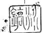

<!-- V3_SOURCE_ID:book014-b000007-p000-3e495baf5c -->

这篇小引的作者六圃先生，是上江地区的知名学者，他的学问涉猎广泛，各位老先生都真心折服，推举他为文坛中讲求实际学问的人，这本就不是我所敢妄加评判的。（向）与

> **释读存疑：** 原文‘向’的具体所指未明确，按给定术语定义无法适配此处语境；1轮自动修复后核义模型仍建议修订，已保守记录。

查看对应原文

<!-- V3_FOLDBACK_BEGIN:book014-b000007-p000-3e495baf5c -->

小引六圃先生上江名宿也其學無所不窺諸老先生委心折服推爲文壇實學此固非子所敢知向與

<!-- V3_FOLDBACK_END:book014-b000007-p000-3e495baf5c -->

<!-- V3_SOURCE_ID:book014-b000008-p000-ca1837a58d -->

先父有旧交，戊子年

> **释读存疑：** 戊子年具体所指的年份不详

查看对应原文

<!-- V3_FOLDBACK_BEGIN:book014-b000008-p000-ca1837a58d -->

先君子有舊戊子

<!-- V3_FOLDBACK_END:book014-b000008-p000-ca1837a58d -->

<!-- V3_SOURCE_ID:book014-b000009-p000-8455fa88b9 -->

先生赴京参加会试时，曾来过我家；己丑年他考中进士从京城返回，途中又来过我家

> **释读存疑：** 己丑年具体所指的年份不详

查看对应原文

<!-- V3_FOLDBACK_BEGIN:book014-b000009-p000-8455fa88b9 -->

先生上公車曾一過我巳丑捷南宮歸途又過我

<!-- V3_FOLDBACK_END:book014-b000009-p000-8455fa88b9 -->

<!-- V3_SOURCE_ID:book014-b000010-p000-db09f5f91d -->

先生为人不设心机，非常平易近人。有人向他询问古今人物的兴衰事迹，他都能一一清晰地指出来，评判时事时言辞简洁而含义完备。有个从事技艺的客人与他讨论，他会把该领域专家的见解全部拿出来交流

查看对应原文

<!-- V3_FOLDBACK_BEGIN:book014-b000010-p000-db09f5f91d -->

先生爲人不立城府甚平易近人問以古今人物廢興事蹟歷歷指諸掌折衷時事言簡而意該客有游藝者與之議盡出專家上問

<!-- V3_FOLDBACK_END:book014-b000010-p000-db09f5f91d -->

<!-- V3_SOURCE_ID:book014-b000011-p000-c84a77e161 -->

先生您有什么本事，能写出这样的书？不过是读书罢了。壬辰年，我打算为先人选择风水宝地，恰好先生在歙县，便前去拜见。在祠庙中向您询问山水之事的深浅，我了解得还不够周全。有人说，读书人谈论堪舆，往往见解高明，不知您近来如何？于是我便再次邀请您。

查看对应原文

<!-- V3_FOLDBACK_BEGIN:book014-b000011-p000-c84a77e161 -->

先生何能著是曰讀書耳壬辰歲將謀先人審先生適在歙謁之節於祠問以山水事淺深國不周悉或曰讀書人屋裏談堪輿往往居勝未審昨子如何乃更邀

<!-- V3_FOLDBACK_END:book014-b000011-p000-c84a77e161 -->

<!-- V3_SOURCE_ID:book014-b000012-p000-92c1ff5b5c -->

先生您作《踏青行》，走到景致绝佳之处，便舍弃篮舆，翻越险阻，连身强力壮的年轻人都跟不上。您指点来山与去水的情况，所言吉凶应验如响。当地士人都认为您是神人。我便请求道：“我资质愚劣，不足以做先生的弟子，希望能以一件事作为弟子的见面礼，可以吗？”

查看对应原文

<!-- V3_FOLDBACK_BEGIN:book014-b000012-p000-92c1ff5b5c -->

先生作踏靑行至勝處卽舍籃輿越險阻少壯不能從指示來山去水言休咎如響士人以爲神子乃請曰自鄙劣不足爲先生弟子願以比一事爲弟子可乎

<!-- V3_FOLDBACK_END:book014-b000012-p000-92c1ff5b5c -->

<!-- V3_SOURCE_ID:book014-b000013-p000-c5b583fdad -->

先生笑着说：“这一件事颇为困难，你轻视虎公子了。这是小引。”

查看对应原文

<!-- V3_FOLDBACK_BEGIN:book014-b000013-p000-c5b583fdad -->

先生笑曰此一事頗難君輕虎公子也此小引

<!-- V3_FOLDBACK_END:book014-b000013-p000-c5b583fdad -->

<!-- doc003 PDF 第 348 页：高风险/复杂版面 OCR 供检索；内容与排版以原页图为准。 -->
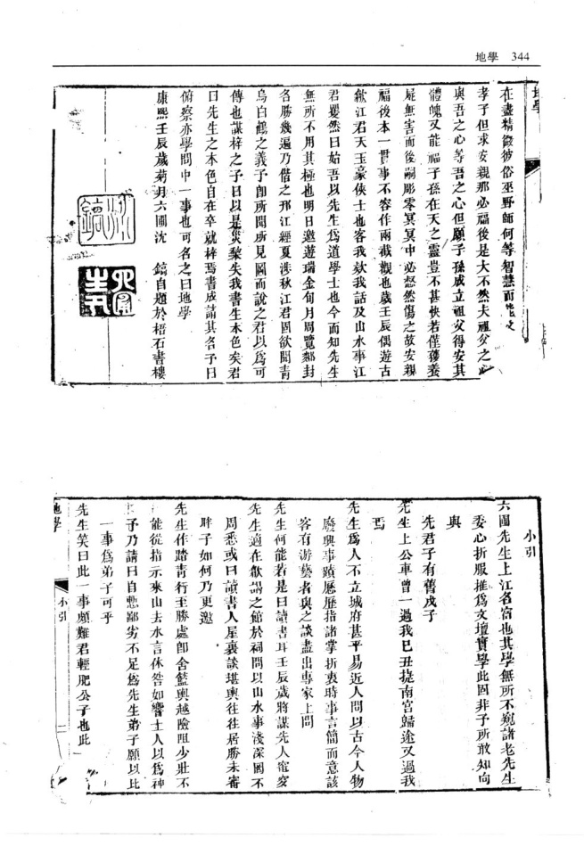

<!-- V3_SOURCE_ID:book014-b000015-p000-6afb993141 -->

亲友们登高临深，忍饥挨饿，备尝辛苦，希望能让每户人家都能得到合适的风水宝地，可这又让人身心憔悴。您擅长堪舆，我说：“先生您年高德劭，尚且能做到这些，我们这些弟子有什么做不到的？”先生说：“你不要引导我，一定要我跟着你走，你崎岖跋涉数日，可行的话就与你谈论，不行的话就停下。”第二天，我准备好干粮，跟随先生前往。一路迢迢，到了隳县，登上大山之巅，先生说：“这是群山之祖。”又指点哪处是帐幕，哪处是龙脉，哪处是过关转折，应当在何处交会。走了数日，到了交会之处，果然如先生所言。我惊讶地说：“这是神意，还是天理？希望您最终能收我为弟子。”于是我恳请先生迟回邦地，有人询问就为他们绘制图说，若有不解之处，就聚米堆沙演示。我心中忽然有所领悟：“不这样做，就不知道会把我的先人置于何处。从今以后，才知道目前谈论风水的人，都是把别人的先人当作试验品。况且谁不是人子，希望先生能著书立说，让有心之人得以尽自己的心意。”先生起初认为这不是本分之事，不肯答应，我坚决请求，先生才应允。先生先拿出《形势》二册，《地理正传》已经全部完成，未尽的部分，留待来年。古江瑞顿首识。

> **释读存疑：** 隳县具体所指不详

查看对应原文

<!-- V3_FOLDBACK_BEGIN:book014-b000015-p000-6afb993141 -->

親故登高臨深忍饑渴備諸辛苦庶幾戶若精言之又令人惟悴也君龍堪是子曰先生高年碩德且能是弟子輩有何不能先生曰君毋導我必我纂君崎嶇數日可則與言不可則止明日裏糧從先生所之迢迢適隳縣陟大巔曰此羣山之祖也若者帳若者龍若者過關轉折當於何處交會數日至交會處果然子詫曰是何神乎抑理也願卒爲弟子乃攀駕遲邦有問則爲圖說之不解即聚米堆沙予心忽忽有悟曰不如是不知將置吾親於何所今而後乃知目前之談地者皆以人親爲嘗者也且誰非人子願先生著書使有心者得以人人自盡先生初以爲非本色不肯固請之乃聽焉先出形勢二冊地理正傳盡是矣其未盡者俟之他年古 江瑞頓首識

<!-- V3_FOLDBACK_END:book014-b000015-p000-6afb993141 -->

<!-- V3_SOURCE_ID:book014-b000016-p000-17c667cb27 -->

内容涉及五行相关内容，火对应第五类、土对应第七类、金对应第八类、水对应第四类，五行共十一集，龙格共十六类，‘菜局’共五类，‘总二业’，凡入十四集，连同序目共入十七叶，分为二卷；内容涉及穴、沙、木、次星、三穴、塲，水火土金水共十八集，穴的晕、窝、乡、乳、突、串、脉、乘气、天心十道共十五类，沙法歌一类，‘菜局’，龙、虎、案、朝外、阳、摆列、侍卫、护、经、城郭等，此为目录。

> **释读存疑：** 菜局；总二业；凡入十四集併序目共入十七葉

查看对应原文

<!-- V3_FOLDBACK_BEGIN:book014-b000016-p000-17c667cb27 -->

火五巢土七業金八集水四業五行十一集龍格十六菜局五業總二業凡入十四集併序目共入十七葉二卷言穴沙木次星三穴塲水火土金水共十八集穴暈窩鄉乳突串脈乘氣天心十道共十五集沙法歌一菜龍虎案朝外陽擺列侍衛護經城郭目錄

<!-- V3_FOLDBACK_END:book014-b000016-p000-17c667cb27 -->

<!-- V3_SOURCE_ID:book014-b000017-p000-c17c6b72b3 -->

‘官鬼禽暗沙’总内容及上述沙法共三十三叶，水法共十二叶，‘杀’七叶，怪穴六叶，‘权宜诀’一叶，论方位三叶，论选择共三叶，‘片’共一百一叶。

> **释读存疑：** 官鬼禽暗沙；杀；权宜诀；片

查看对应原文

<!-- V3_FOLDBACK_BEGIN:book014-b000017-p000-c17c6b72b3 -->

官鬼禽暗沙總巳上沙法共三十三葉 水法十二葉 殺七葉 怪穴六葉 權宜訣一葉 論方位三葉 論選擇共三葉 片共一百一葉

<!-- V3_FOLDBACK_END:book014-b000017-p000-c17c6b72b3 -->

<!-- V3_SOURCE_ID:book014-b000018-p000-0d3dc525ff -->

《地学》由望江沈镐六圃氏所著。地理本是形家的学说，意思是依据形体来考察事理。自太极分出阴阳，阴阳生出五行（木、火、土、金、水五种分类及其关系体系），五行生出万物。太极是没有形体的，阴阳也是没有形体的，到了五行就有了形象。在天上形成天象，岁星、荧惑、填星、太白、辰星就是五星；在地上形成形体，就是水火木金，在上称为五材，这五种材料都是民众所使用的。而大地本身是浑土，人生于土，归于土，所以选择居所、选择安葬之地只需看土即可。土本是一种，隆起成为峰峦，延伸成为冈阜，平衍成为平原，古人都将其归入五行之中，且五行之中又各有五行，于是依据土的生相，分别区分为木、火、土、金、水的形态，再论其生克制化，以此确立寻龙求穴（风水中认为气脉聚结、适宜安葬或营建的位置）的方法，这就是由家五和。

> **释读存疑：** 原文中‘由家五和’的具体所指未明，释读中保留了原文表述，未强行确定含义

查看对应原文

<!-- V3_FOLDBACK_BEGIN:book014-b000018-p000-0d3dc525ff -->

地學 望江沈鎬六圃氏著 地理本形家言謂卽形察理也自太極分陰陽 陰陽生五行 五行生萬物 太極無形者也 陰陽亦無形者也 至于五行乃有形象 在天成象歲星熒惑填太白辰爲五星 在地成形水火木金 上爲五材 凡此五材民並用之 而大地渾土也 人生于土 歸于土 故卜居卜葬視土而巳 夫土一耳 起面爲峯巒 蔓而爲岡阜 衍而爲平原 古之皆人卯五行之中 復有五行 爰卽土之生相以別爲木火土金水之形 論其生尅制化 以立尋龍求穴之法 是爲由家五和

<!-- V3_FOLDBACK_END:book014-b000018-p000-0d3dc525ff -->

<!-- V3_SOURCE_ID:book014-b000019-p000-7d556887be -->

地理之学首先必须辨别五行（木、火、土、金、水五种分类及其关系体系）：木形挺直，火形尖耸，土形敦厚横阔，金形圆润，水形曲折，各自形成不同的形象，千变万化，这些变化就从其中产生。

查看对应原文

<!-- V3_FOLDBACK_BEGIN:book014-b000019-p000-7d556887be -->

地理先須辨五行木直火尖土宿橫金圓水曲各成象千變萬化此中生

<!-- V3_FOLDBACK_END:book014-b000019-p000-7d556887be -->

<!-- V3_SOURCE_ID:book014-b000020-p000-54c2a8c132 -->

火、土、金。

查看对应原文

<!-- V3_FOLDBACK_BEGIN:book014-b000020-p000-54c2a8c132 -->

火 土 金

<!-- V3_FOLDBACK_END:book014-b000020-p000-54c2a8c132 -->

<!-- V3_SOURCE_ID:book014-b000021-p000-a984549aad -->

木形，就像一根树木笔直冲天，特立高耸的高峰，整体形态浑然一体，全身隐现的石头，或是露出的石头，其外观苍劲古朴，骨相坚实，这是贤贵大宗祖的格局。更需要看其穿落变化的传续，如果要在自身上作穴（风水中认为气脉聚结、适宜安葬或营建的位置），也需要生出嫩枝、显现灵光，这样才会有科举及第的可能。只恐气脉短促，缺少连绵的态势，老椿如果再有来历，族大人丁兴旺，富贵仁义也会延绵。1 木。

查看对应原文

<!-- V3_FOLDBACK_BEGIN:book014-b000021-p000-a984549aad -->

木形 有如一木直冲天特立高峯體勢全渾身隱石或出石 頭面蒼古骨相堅此是賢貴大宗祖更須穿落看變傳 若敎就身要作穴亦須出嫩生光貞科第川古旨蠶 只恐氣促少連綿老椿若更有來歷族大丁蕃貴義延 1 木

<!-- V3_FOLDBACK_END:book014-b000021-p000-a984549aad -->

<!-- V3_SOURCE_ID:book014-b000022-p000-881c12e62c -->

立本只爲少祖星，也作旗鎗與貴人，若便尊他爲去禮，其下先須用祿存壇坫，尊喬嶽，立指顧八方，從心龍樓鳳閣與寶座，尊貴名龍論出身，自是辭樓下殿去，千里百里無數程，逢州遇縣盛供應，出入護衛多送迎，五星正變節敷備，始祖只是貪狼星，種桃終須結橈子，此中定作賢者宅，爲國大輔身尊榮，若是高山出叢木，木頭土身土培木到底，定作「术花穴」，官虛秀氣俱是木，似此祖宗亦極貴，三台八座良可卜，木爲文星居第一，凡遇木星俱迪吉，爲龍爲護與爲朝，所難不得木星立，立木看來不等閑，是賔是主審端的，一種名爲坐木星，頭身是木足撐橫，此是貴人大座格，排衙唱喏多稟承，「令木」肥帶金武將，軍大座非異各，劍戟森嚴旗鼓備，水口定有點兵屯，爲官顯耀甚威武，出將入相成功動，立木爲祖坐爲宗，立老坐嫩常不同，雖然未可執一論，作穴多求嫩木功，木嫩肯生花與實，木嫩氣盛脈亦通，秀嫩佳麗爲美女，若教卑小是神童，美女敗臺奮具設，縣童文筆書案逢，少年文章早科第，結婚賢淑家典隆，若令將來爲侍從，金童玉女聚仙宮，更有元禽尹詔現，人間天上樂無窮，「种行木」是龍格，木星離離氣不隔，望之如驢亦如飛，前去變化將成穴，多者入數少則三，更多十河洛協，拋棱走馬最佳妙，直作天樓尤奇特，夏章工妙功業盛，科甲蔚起宗族傑，若將爲帳更利奇，備床牙笏世間希，一林春銷無處謁，「穿犧」變化可護知

> **释读存疑：** 术花穴；令木；种行木；穿犧；本地硬校验仍未通过，已记录供后续自动处理或人工核对。

查看对应原文

<!-- V3_FOLDBACK_BEGIN:book014-b000022-p000-881c12e62c -->

立本只爲少祖星亦作旗鎗與貴人若便尊他爲去禮其下先須用祿存壇坫尊喬嶽立指顧八方從心龍樓鳳閣與寶座尊貴名龍論出身自是辭樓下殿去千里百里無數程逢州遇縣盛供應出入護衛多送迎五星正變節敷備始祖只是貪狼星種桃終須結橈子此中定作賢者宅爲國大輔身尊榮若是高山出叢木木頭土身土培木到底定作术花穴官虛秀氣俱是木似此祖宗亦極貴三台八座良可卜木爲文星居第一凡遇木星俱迪吉爲龍爲護與爲朝所難不得木星立立木看來不等閑是賔是主審端的一種名爲坐木星頭身是木足撐橫此是貴人大座格排衙唱喏多稟承令木肥帶金武將軍大座非異各劍戟森嚴旗鼓備水口定有點兵屯爲官顯耀甚威武出將入相成功動立木爲祖坐爲宗立老坐嫩常不同雖然未可執一論作穴多求嫩木功木嫩肯生花與實木嫩氣盛脈亦通秀嫩佳麗爲美女若教卑小是神童美女敗臺奮具設縣童文筆書案逢少年文章早科第結婚賢淑家典隆若令將來爲侍從金童玉女聚仙宮更有元禽尹詔現人間天上樂無窮種行木是龍格木星離離氣不隔望之如驢亦如飛前去變化將成穴多者入數少則三更多十河洛協拋棱走馬最佳妙直作天樓尤奇特夏章工妙功業盛科甲蔚起宗族傑若將爲帳更利奇備床牙笏世間希一林春銷無處謁穿犧變化可護知

<!-- V3_FOLDBACK_END:book014-b000022-p000-881c12e62c -->

<!-- V3_SOURCE_ID:book014-b000023-p000-40ce31aa43 -->

这是世代科举、世代甲第的格局，忠孝贵重，可帝王师。若将其作为朝山，也同样尊贵，只要在穴中消纳爱气。凡见大旺水成林，是龙、是帐、是朝迎4，或是分旺气左右翼，只有中龙是浑成。深山多尖峰，不要随意羡慕，陇右贪狼却少文，只因峰多反成浊，杨公早已对此有诸多论述。我行雅州，见雅山簇簇交峰有百千座，唤作雅州各峰都很好，却少雅士在其间，无中仅见使，难得一个文峰，胜过十百座山，多峰是等闲，气促峰立非奇特，此有大故君未知，须知陇雅帐头枝，数千里外护正干，八州文物赖支持，仙人当具此大严，说与时师笑复嗤。眠木不同立木形，一经倒地像生成，生枝生叶生花实，发越无穷体认真，莫言服木便不老，眠木老相穴还早，老木或求芽与眼，插木生芽衔亦巧，不如出嫩是生机，局成穴成不用疑，大枝大贵从嫩结，小枝出嫩亦堪栖，嫩怕单徵成穉体。力小气弱荒兰枝，凡星取嫩不取楫，又嫌太梦不丰肥，瘦龙瘦穴人贫薄，才有文齐福不齐，眠木生枝须认干。踏干寻去看爱换，属东走西成诸格，梧桐芍药异依段，梧桐对节左右分，行度中正天地心，数节之后必转麦，横行角出好留神，若教寻龙踏尽处，牧童也会点金精，芍药枝分先后见，简简畅茂不疲倦，有时突出夜丫头，有时生作菩萨面，法云芍药结苞深，花未开时含好英，教花寻取花苞在，福祉方来事业新，兼葭叶尖先后据，山来成穗深藏叶，开了芦花便分散，飘风著水耀承接，叶底穗中当有物，飞田过水看施设，别有水木墓鞭名，芦鞭即是兼葭根，芦花袅水东西点，翰苑文坛堂主盐 长L

> **释读存疑：** 无中仅见使，具体所指不详；夜丫头，具体所指不详；堂主盐 长L，具体所指不详；1轮自动修复后核义模型仍建议修订，已保守记录。

查看对应原文

<!-- V3_FOLDBACK_BEGIN:book014-b000023-p000-40ce31aa43 -->

<table><tr><td rowspan=1 colspan=1>此是世科世甲第忠孝貴重帝王師若將作朝同此貴只要穴中消愛之凡見大旺水成林是龍是帳是朝迎4或分旺氣左右翼只有中龍是渾成深山多尖莫漫羨隴右貪狼却少文只因峯多反成濁楊公早巳有許論我行雅州見雅山簇簇交峯有百千喚作雅州各甚好却少雅士在其間無中僅見使難得一个文峯勝十百山裏多峯是等閒氣促峯立非奇特此有大故君未知須知隴雅帳頭枝數千里外護正幹八州文物賴支持仙人當具此大嚴說與時師笑復嗤眠木不同立木形一經倒地像生成生枝生葉生花實發越無窮体認真莫言服木便不老眠木老相穴還早老木或求芽與眼插木生芽銜亦巧不如出嫩是生機局成穴成不用疑大枝大貴從嫩結小枝出嫩亦堪棲嫩怕單徵成穉体</td></tr><tr><td rowspan=1 colspan=1>力小氣弱荒蘭枝凡星取嫩不取楫又嫌太夢不豐肥瘦龍瘦穴人貧薄纔有文齊福不齊眠木生枝須認幹</td></tr><tr><td rowspan=1 colspan=1>踏幹尋去看愛換屬東走西成諸格梧桐芍藥異依段梧桐對節左右分行度中正天地心數節之後必轉麥橫行角出好畱神若敎尋龍踏盡處牧童也會點金精芍藥枝分先後見簡簡暢茂不疲倦有時突出夜丫頭有時生作菩薩面法云芍藥結苞深花未開時含好英教花尋取花苞在福祉方來事業新兼葭葉尖先後據山來成穗深藏葉開了蘆花便分散飄風著水耀承接葉底穗中當有物飛田過水看施設別有水木墓鞭名蘆鞭卽是兼葭根蘆花裊水東西點翰苑文壇堂主鹽             长L</td></tr></table>

<!-- V3_FOLDBACK_END:book014-b000023-p000-40ce31aa43 -->

<!-- V3_SOURCE_ID:book014-b000024-p000-5c0dd20310 -->

这段内容是关于风水行龙、星脉、龙格的论述，提到单纤的形态难以自行形成穴场，只有行龙串脉、星峰穿过的地方才会形成好的帐幕，四面山峦环绕、水流合抱的地方可作为城郭。观察龙脉的人，在峡谷干旱处也能知晓穴场，踏上真龙会心生惊喜。芦鞭类的形态类似笻竹杖，要谨慎分辨嫩形与老形的区别。芦鞭的嫩活之处，帐幕中的笻竹老尽后纵横舒展；芦鞭秀美的地方，对应的龙格多为文章之象，而筠竹对应的龙格则多为孤寡游荡之象，祸福都由龙格决定，不谈论龙格就是虚妄不实。杞梓的枝桠分向左右，有的呈人字形态，龙格确定后初生的枝桠斜向生长，长成后常能胜过庙堂栋梁。康任局形成后会衍生出尊贵的格局，穴场的幕帐朝向偏中正的方向，偏生的杨柳如同垂杨，一侧生枝一侧有光，多是缠龙或帐角的形态，无暇立宅的地方会自行形成堂局。枝头即使有隐蔽的穴场，终究只会在一房内显荣；没有枝桠的一侧若有护卫，也是行龙在弱处变强。若带有游耗的形态，会衍生出不同的格局，需要仔细观察其行藏。杨柳的形态类似玉梳，一侧多齿一侧少齿，缝隙均匀如同碾玉，更喜两端端正，从两隅转面穿入中心出脉，这是造化形成的好工夫，前去定会形成紫霞幛，对应的人物会是辅佐皇图的邦媛、邦翰。杨柳类中有卷帘的形态，横脚长纤，一侧短一侧拟相配，另有组旋乖的一卷，前去会出现卷帘见天日的格局，多作蟠龙食水源的形态。凡是干龙的态势闲张，是干龙就需论短长，长干长行千百里，短干十里也能成格局，富贵要看星峰与格局，世代要看节令并非渺茫。歧枝并非不结作，只是气偏多属寻常，枝桠要论大小看长，枝上复生枝的格局多属小格局，小枝对应衣食穴，大枝对应大格局，大家小枝胡乱安葬，定会失位倾家。又有一种发生木，从同一枝桠上生出，性柔少骨，弯环屈折不计其数，过细太多如同人行断，会成为我缠我护的形态，东西向作穴前后藏风，衣食人丁也会小足，这种名为瓜藤龙，未知是否也属大物，还有一种蔓木名为仙藏，金蛇屈曲更穿云，小处需争尺寸，大处重昏又丰盈，四神八将都攒聚，近水遥山秀气凝聚，若能扦得天然穴，富贵远传百世。又有藤苏灵天木，龙蛇交会五出没，龙是土出蛇是石，或是不分解骨性，不止生乱气还能作用神，并非赢刻能裁鹿，不令功勿帝唯，心心和第交章号，大来为龙中出穴，中希只有作朝紫，若有递拦谁隐龙，方位又好也无邪。又有一两个楼栏的形态，类似天葩熖歙缘，火脚虽凶不焚木，只作龙格不作穴，前途穿变好穴成，木曜火曜生纵横，定出公侯为国辅，若非世旧不承梦。又有一种梅花格，大的抚小的池聚散结，似冢非冢非人为，就生木身逐枝节，梅花本是状元龙，有时会作花喵穴，或为龙略或余气，或作包缠亦可余，寻踪觅迹求其真，莫爱梅花勉强掘。又有千叶美蓉花，味木本木陆水哺，无争生凡花是葵，苑棠花争荣华诣，般花桑与花萼，更有莲兰别一宋，0 3作花常生绝体，上曜气生气费排，喳曲舌卷舌水火，鸣香心亦可嘻，芝曲是死里活，蔚起云头吐秀，身亦富亦贵亦高鼎，只恐难绵与瓜。又有一种成器木，横安玉尺横放笏，一字原立作盖龙，工字王字蛮其路，61 术三 11

> **释读存疑：** 紫霞帧；捲簾一酢；組旋乖；仙藏；藤蘇靈天木；天葩熖歙緣；花喵穴；宋 0 3；喳曲舌卷舌水火；芝曲；蠻其路；61 术三 11；原文多处识别错误，具体所指无法确定，如“紫霞帧”“捲簾一酢”“組旋乖”“花喵穴”等；1轮自动修复后核义模型仍建议修订，已保守记录。

查看对应原文

<!-- V3_FOLDBACK_BEGIN:book014-b000024-p000-5c0dd20310 -->

二。。 广一一單纖難自作形穴只作行龍串脉星穿過定然開好帳四山合水爲城觀龍者峽旱知穴踏著真龍心裏驚蘆鞭類有笻竹杖慎看嫩形與老相蘆鞭嫩活處帳中第竹老盡縱橫放蘆鞭貴秀龍文章筠竹孤寡志遊蕩禍福都從龍格分不談龍格是虛誑杞梓枝分左右进亦作人字龍爲定初生斜出長成材常勝廟廊梁康任局成別出尊嚴穴頭幕想偏中正偏生楊柳是垂楊一畔生枝一壁光多是纏龍或帳角不暇立宅自開堂枝頭縱有隈藏穴畢竟偏榮絕一房無枝一邊又有護亦是行龍弱裏強若帶遊耗别出相又須刮目看行藏楊柳麥好爲玉梳一面多齒一面無齒罅員勻如碾玉更喜端方好兩隅轉面穿心中出脉此是造化好工夫前去定作紫霞帧邦媛邦翰輔皇圖楊柳之類有捲簾一酢橫腳長纖織一畔短擬却相配別有組旋乖一卷前去捲簾見天日多作蟠龍食水源凡是幹龍勢閒張是幹又須論短長長幹長行千百里短幹十里亦成章富貴論星論格局世代論節非渺茫岐枝豈云不結作到底氣偏多尋常枝論大小看長短枝復生枝枝無小家小枝衣食穴大家大枝亦可商大家小枝胡亂葬決定失位傾家囊又有一種發生木一同分枝幹上出但是性柔少骨氣彎環屈摺不知數過細太多人行斷而爲我纏我爾護東酉作穴前後藏衣食人丁亦小足似此名爲瓜藤龍未知亦作大物不一種蔓木名仙藏金蛇屈曲更穿雲小虛真須爭尺寸大處重昏又豐盈四神八將皆攢聚近水遙山秀氣佛若還扦得天然穴富遠貴長百世各又有藤蘇靈天木龍蛇交會五出沒龍是土出蛇是石或是不分解骨性不止生亂卽作用神亦非贏刻能裁鹿不令功勿明帝唯心心和第交章號大來為龍中出穴中希只有作朝紫若有遞攔誰隱龍方位又好亦無邪又有一兩樓欄亦似天葩熖歙緣火腳雖兇不焚木只作龍格不作穴前途穿變好穴成木曜火曜生縱橫定出公侯爲國輔自非世舊不承夢又有一種梅花格大撫小池聚散結 o似塚非塚非人爲就生木身逐枝節梅花本是狀元龍有時卽作花喵穴或爲龍略或餘氣或作包纏亦可餘尋蹤覓跡求其眞莫愛梅花勉強掘又有千葉美蓉花味木本木陸水哺無爭生凡花是 葵苑棠花爭榮華詣般花桑與花萼更有蓮蘭別一宋 0 3作花常生絕體上曜氣生氣費排喳曲舌卷舌水火鳴香心亦可嘻芝曲是死裏活蔚起雲頭吐秀身亦富亦貴亦高鼎只恐難綿與瓜又有一種成器木橫安玉尺橫放笏一字原立作蓋龍工字王字蠻其路61 术三 11

<!-- V3_FOLDBACK_END:book014-b000024-p000-5c0dd20310 -->

<!-- doc003 PDF 第 352 页：高风险/复杂版面 OCR 供检索；内容与排版以原页图为准。 -->
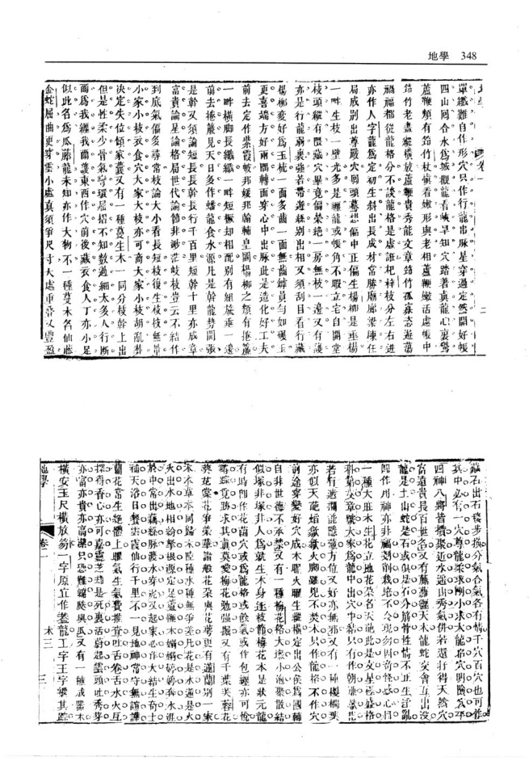

<!-- V3_SOURCE_ID:book014-b000026-p000-629f6d5cf4 -->

这段内容是关于风水岭脉、龙格的论述，提到岭脉飞腾直上形成大洛的形态，伤云逼汉的态势，望中跨乡陵县化州郡。尺欲浊为牛，饶似辄有柄即为父，父供诸川不一家。器同身步宗，更步祖，贵贱短长方可论。立木怕枯倒怕析，破木析木用何有，彻木漂床皆为凶，焚木烬木莫下手。木余为跃势飞扬，交牙撮仗守三堂，脱离单植为华表，双龙惧门不可当，冈净眼地一例论，飞花旧片头推诗，株 2 0 经读尽走天进

> **释读存疑：** 大洛；伤云逼汉；尺欲浊为牛；饶似辄有柄；器同身步宗；彻木漂床；焚木烬木；交牙撮仗；三堂；冈净眼地；飞花旧片头；株 2 0；2 0；原文多处识别错误，具体所指无法确定，无法进行有效释读

查看对应原文

<!-- V3_FOLDBACK_BEGIN:book014-b000026-p000-629f6d5cf4 -->

嶺飛直上成大洛傷雲逼漢竈望中跨鄉陵縣化州郡 尺欲濁爲牛饒似輒有柄卽爲父父供諸川不一家 器 同身步宗更步祖貴賤短長方可論立木怕枯倒怕析 破木析木用何有徹木漂床皆爲凶焚木燼木莫下手 木餘爲躍勢飛揚交牙撮仗守三堂脫離單植爲華表 雙龍懼門不可當岡淨眼地一例論飛花舊片頭推詩 株 2 0 經讀盡走天進

<!-- V3_FOLDBACK_END:book014-b000026-p000-629f6d5cf4 -->

<!-- doc003 PDF 第 353 页：高风险/复杂版面 OCR 供检索；内容与排版以原页图为准。 -->
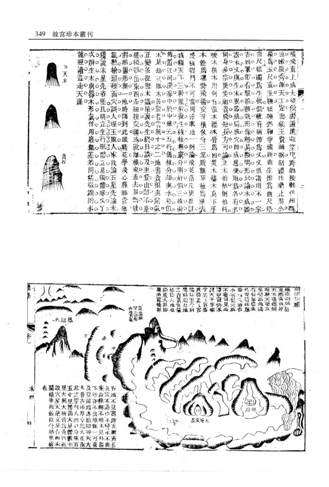

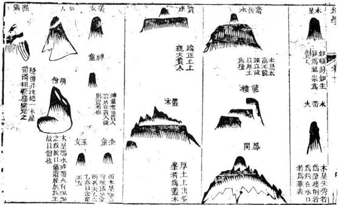

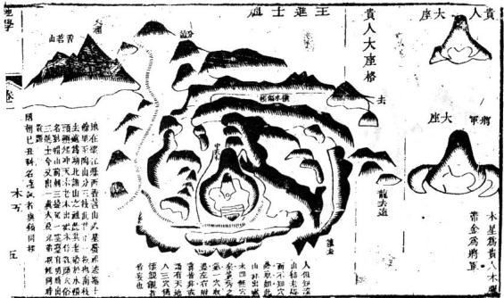

<!-- doc003 PDF 第 354 页：高风险/复杂版面 OCR 供检索；内容与排版以原页图为准。 -->
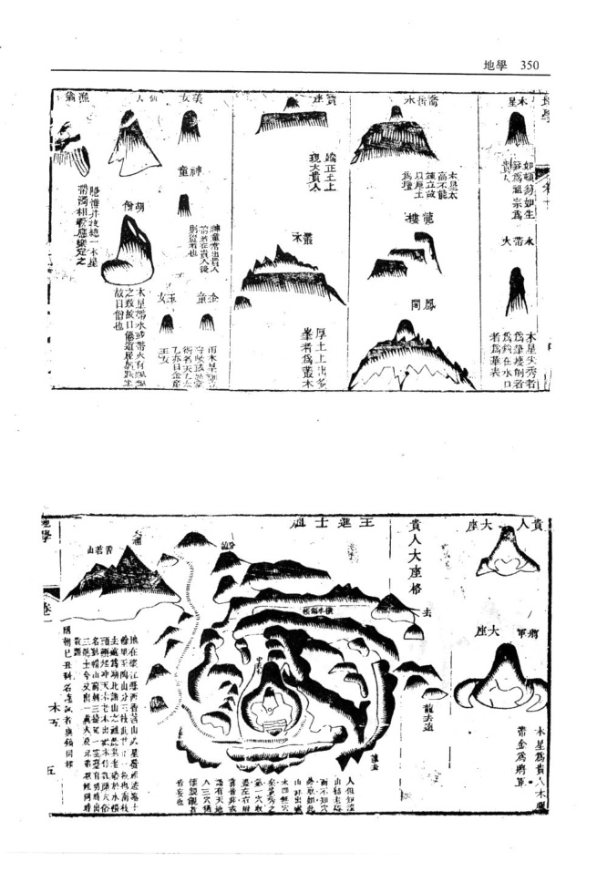

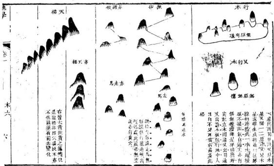

<!-- doc003 PDF 第 355 页：高风险/复杂版面 OCR 供检索；内容与排版以原页图为准。 -->
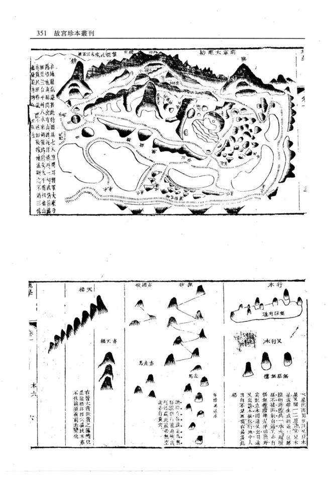

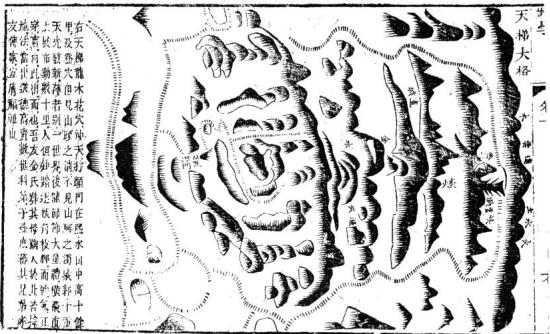

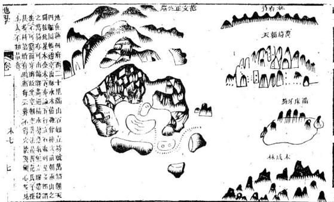

<!-- doc003 PDF 第 356 页：高风险/复杂版面 OCR 供检索；内容与排版以原页图为准。 -->
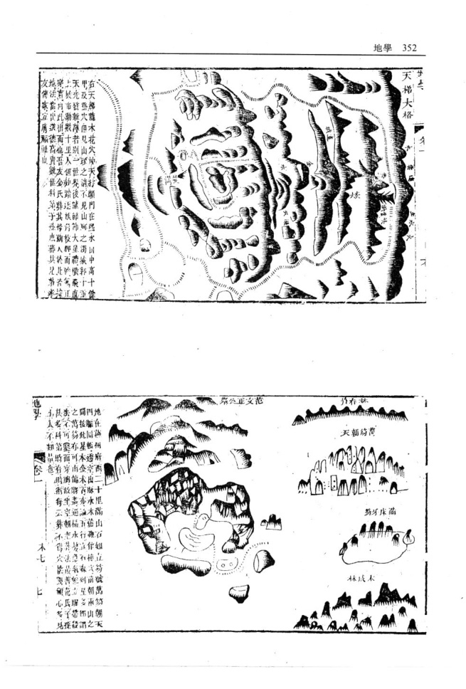

<!-- doc003 PDF 第 357 页：高风险/复杂版面 OCR 供检索；内容与排版以原页图为准。 -->
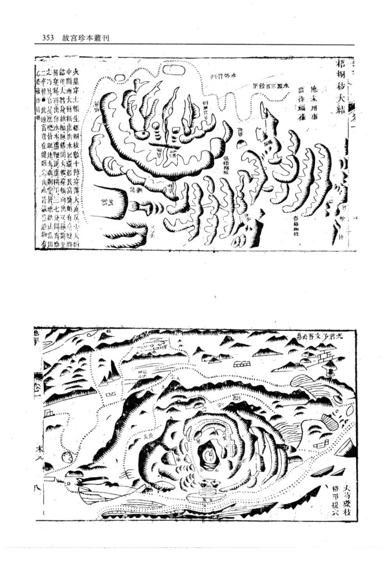

<!-- doc003 PDF 第 358 页：高风险/复杂版面 OCR 供检索；内容与排版以原页图为准。 -->
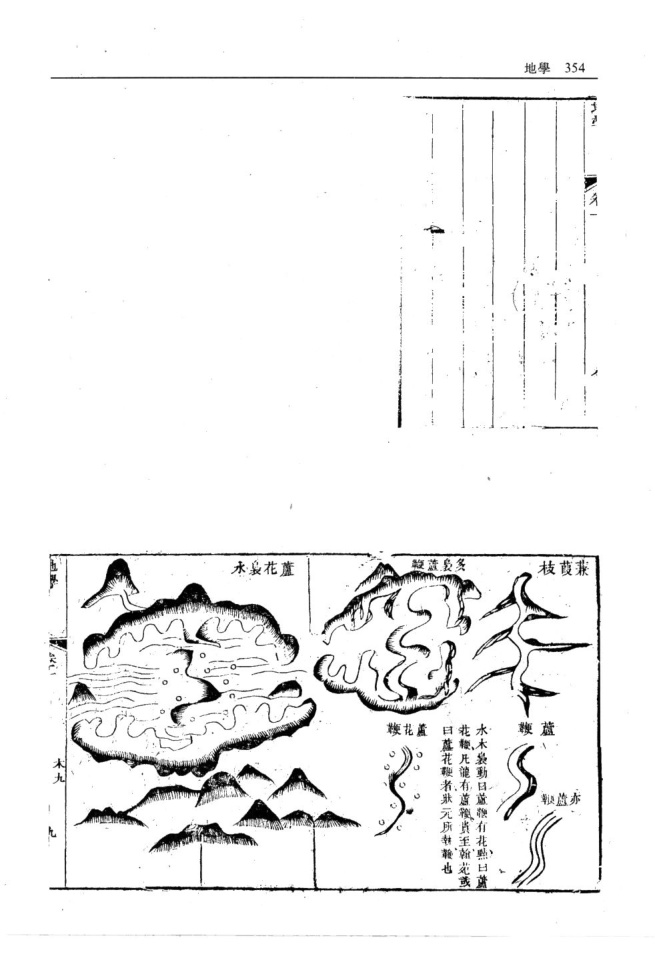

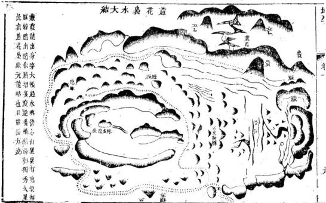

<!-- doc003 PDF 第 359 页：高风险/复杂版面 OCR 供检索；内容与排版以原页图为准。 -->
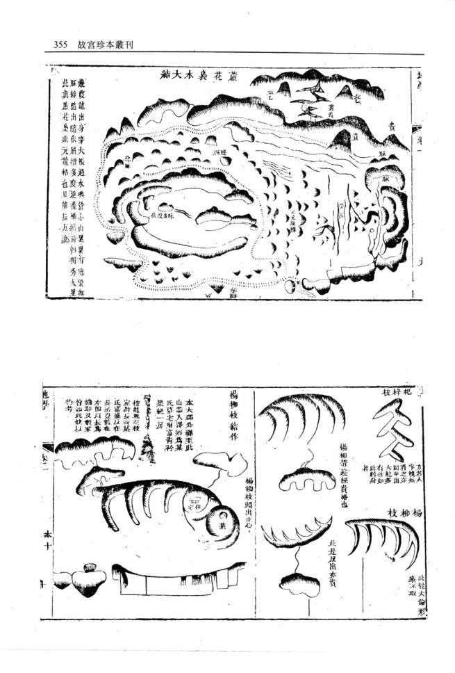

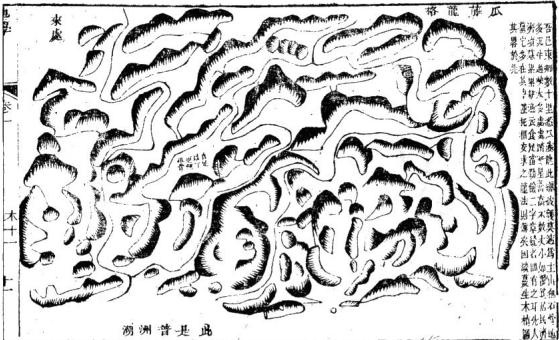

<!-- doc003 PDF 第 360 页：高风险/复杂版面 OCR 供检索；内容与排版以原页图为准。 -->
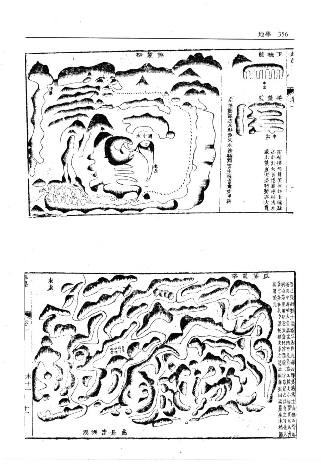

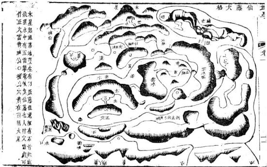

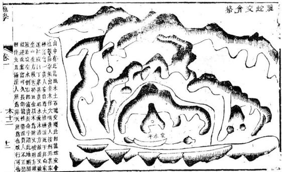

<!-- doc003 PDF 第 361 页：高风险/复杂版面 OCR 供检索；内容与排版以原页图为准。 -->
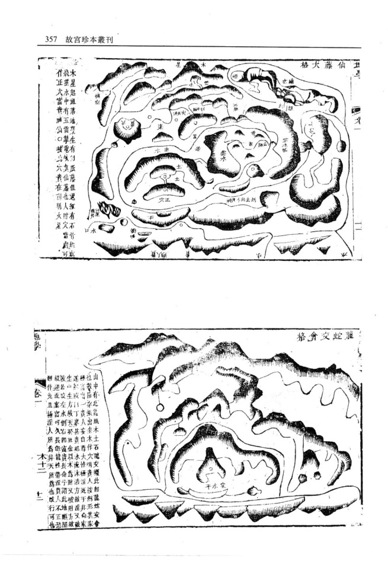

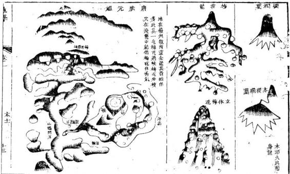

<!-- doc003 PDF 第 362 页：高风险/复杂版面 OCR 供检索；内容与排版以原页图为准。 -->
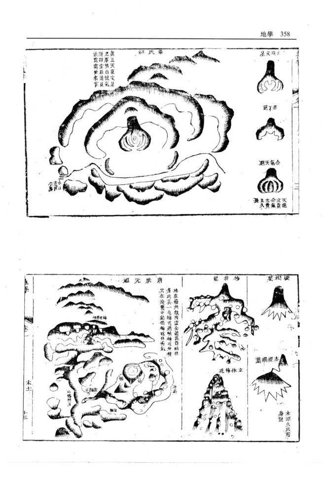

<!-- V3_SOURCE_ID:book014-b000056-p000-f64f0f7ae3 -->

右边记载的刘、唐两家的事例，都是梅花龙的情况，两家发迹后都成为元魁，世代科举及第。对祖舍众花，并非独秀之苗。唐姓的祖地以梅花为龙格，另外选择飞夺之穴安葬，张姓安葬在簇花之中，也累世科举及第。句曲方山、茅山都有梅花龙，李氏舍弃花非田的格局，出了状元拜相，曹氏并非从花中出，其史官家世声望很高，数里内有鲁肃的墓葬在花中，穴场情状很美，其子孙居住在墓所，世代缺少章缝之官。孔氏安葬在花中，子孙千余户富足兴盛，没有科举及第的情况，大概是曹、鲁、孔三家的梅花四布，都效仿李氏的秀气。我行走四方，所见梅花龙很多，有的作龙有的作穴有的作用神，僧气不一。又有木袍星墩巾球撒珠的形态，类似梅花而非凡品，只在龙正穴处寻廉，看局须符合真传，雨正结附结带结，欲站有乎精碧，梅花巽卦的贵气，未可慕名，雨云年之此在谓皆茶，又不低均花也

> **释读存疑：** 飞夺之穴；舍花非田；章缝；梅花四布；木袍星墩巾球撒珠；精碧；雨正结附结带结；雨云年之此在谓皆茶；低均花；原文多处识别错误，具体所指无法确定，如“飞夺之穴”“舍花非田”“章缝”“雨云年之此在谓皆茶”等；1轮自动修复后核义模型仍建议修订，已保守记录。

查看对应原文

<!-- V3_FOLDBACK_BEGIN:book014-b000056-p000-f64f0f7ae3 -->

右劉唐二通皆梅花龍皆發則元皆世科第對祖舍衆花非獨秀之苗唐祖以梅花爲龍別葬飛奪之穴張葬簇花之中亦累世科第又句曲方山茅山皆有梅花龍李氏舍花非田狀元拜相曹氏非花中出衞史家世甚聲數里有魯肅墓葬花中穴情甚美親子孫居墓所世乏章縫孔氏葬花中子孫千餘富盛無利第蓋曹魯孔氏梅花四佈皆作李氏秀氣也我行四方所見梅花多有或作龍或作穴或作用神僧氣不一又有木袍星墩巾球撒珠似梅花而非凡止龍正穴尋廉看局須符真傳雨正結附結帶結欲站有乎精碧梅花巽貴未可慕名雨雲年之此在謂皆茶又不低均花也

<!-- V3_FOLDBACK_END:book014-b000056-p000-f64f0f7ae3 -->

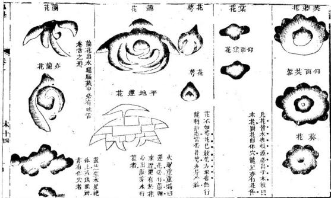

<!-- doc003 PDF 第 363 页：高风险/复杂版面 OCR 供检索；内容与排版以原页图为准。 -->
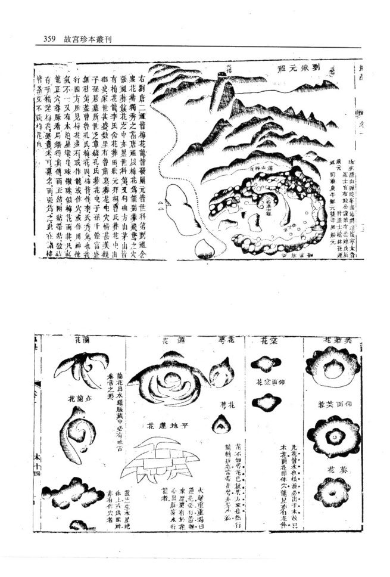

<!-- V3_SOURCE_ID:book014-b000061-p000-ca5aec4a3b -->

木本是直的，备放异了，必有起有止，背区员正公，小王方谓之谢，尺一名一字，文星第一贵也。作者义全徐，水口皆贵，十字丁字人，宇工字王字，及横飞王罪尺等，恪皆从一字生出，详龙格中外有朴句，根抚秋屈袋格讨沙法中

> **释读存疑：** 背区员正公；尺一名一字；文星；义全徐；王罪尺；朴句；根抚秋屈袋格；原文多处识别错误，具体所指无法确定，无法进行有效释读

查看对应原文

<!-- V3_FOLDBACK_BEGIN:book014-b000061-p000-ca5aec4a3b -->

木本直也備放異矣必有起有止背區員正公小王方謂之謝尺一名一字文星第一貴也作者義全徐水口皆貴十字丁字人宇工字王字及橫飛王罪尺 等恪皆從一字生出詳龍格中外有樸句根撫秋屈 袋格討沙法中

<!-- V3_FOLDBACK_END:book014-b000061-p000-ca5aec4a3b -->

<!-- V3_SOURCE_ID:book014-b000062-p000-01fa487236 -->

将玉尺竖立放置，就成为“玉鞭天一”了。也有人称起“王方”的为“王抚凶龙”，被称为“水口”的都被视为贵地，“如售六”的具体含义不详，不应随意选取，因为其中有“丝征”“段鞭”“马骤”“牛鞭”“芦鞭”“范拟”“竹竿”“竹管”等说法。

> **释读存疑：** 玉鞭天一；起王方；丝征；段鞭；范拟；如售六；1轮自动修复后核义模型仍建议修订，已保守记录。

查看对应原文

<!-- V3_FOLDBACK_BEGIN:book014-b000062-p000-01fa487236 -->

玉尺立放卽爲玉鞭天一條矣亦忍有起 王方謂之王撫凶龍 爲水口皆貴如售六必不應樂區取以有 絲征段鞭马骤牛鞭芦鞭范拟竹竿竹管

<!-- V3_FOLDBACK_END:book014-b000062-p000-01fa487236 -->

<!-- V3_SOURCE_ID:book014-b000064-p000-13b6c8aa8a -->

衣尺、糠曲都属于木器，而世间的器物用具有很多，有的平的做成案，方的做成台，曲的做成几，尖的做成笔、做成枪，没有一样不是木器。这些器物之间，雅俗吉凶的差别有天渊之别，而且《象书》无法完全说尽，明白的人心中自有活法，依据“方命式”，随形体“喝形”，没有不可以的。

> **释读存疑：** 方命式；喝形；1轮自动修复后核义模型仍建议修订，已保守记录。

查看对应原文

<!-- V3_FOLDBACK_BEGIN:book014-b000064-p000-13b6c8aa8a -->

衣尺糠曲又皆器木也而世間器用何限或平而爲案方而爲臺曲而爲儿尖而爲筆爲槍莫非木也其間雅俗吉四之用致有天淵之殊而圍不盡象書不盡言明者胸中自有活法因方命式隨體喝形無不可也

<!-- V3_FOLDBACK_END:book014-b000064-p000-13b6c8aa8a -->

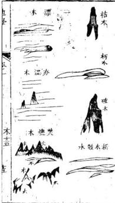

<!-- doc003 PDF 第 364 页：高风险/复杂版面 OCR 供检索；内容与排版以原页图为准。 -->
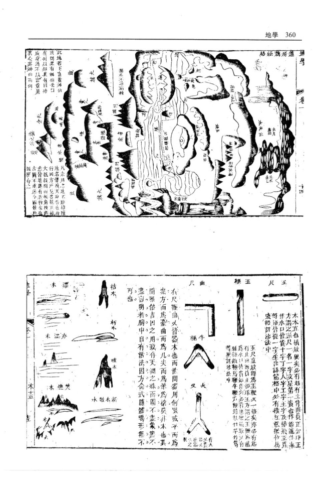

<!-- V3_SOURCE_ID:book014-b000067-p000-b32a1633af -->

右边所说的枯木，末端的生气已经断绝，有的直立而枯，有的横卧而行而枯，怎么知道它是枯木呢？形体削瘦，皮干焦，有眼力的人就能知道它是枯木。朽木必然是倒木，生气在内已经断绝，所以会腐烂。凡是孤立的木、独行的木，没有“水”来滋养它，风功气散，所以会枯；穿金倒地，“水”土沮洳，不工巧自然就会朽坏。枯木和朽木同样是无用的，原因有二：或是天破，或是人破。天破是生成时头裂胸穿；人破是挖土取石，损伤严重，不完备。立木、眠木都有这种情况，析木则破而分离，所以木有一天散小木，不中材；用人散财，是析木的余义。漂木是“水”盛木孤，倒木顺水固然会漂，即使是立木被“水”浸也会漂，或是真木，或是山阜之“水”，形与木争胜负，“水”胜则木漂。“漂”的意思是木遭火焚，“尘”则是焚余。凡是先木后火为发火，木先火后为助火，木从火来说则火盛，从木来说则木烧，所以火中之木最是无用。木火都兼立、眠，也争胜负，如果木盛而间出些许少火，则助木之秀发、木之荣，不作焚烬之论。自曜气以下都是木，剩余的用处，是因为后卷按地理论“五行”，“五行”先木，因为木居生气之初。夫犹是一气，在天则为元，于时则为春，于五德则为仁，于七情则为喜，而在地成形，形中蕴理，理中测气，所以说地理，又说葬乘生气。理则皆备矣，气则有生有旺有收有藏，生则其木也，旺则其火也，收则金而载则“水”与土也，而所乘者止言生气，元气贯四辅，仁中备五德，而且葬者归帳复命之事，帅气旺收藏，总以乘此之一元之生气。惟冰得生气最先，所以言地者先言木，理固然也。惟木生干备枝，山川关大地，亦论干论枝，后此如大，惟木自句芒发达，由一备二節以至千寻，两山阜始终亦论节数，此如木。惟木校核地中本之道，生至于成实，仍还本体，而地理山同是何出，每到底还其故相，此如木。惟木合根株干枝杪未以一体，山胃亦谷初中老尽以成一局，此如“水”。惟木有自根达末，纹理周旋，“穴”内晕纹亦周旋垂复，此如木。来歉言地者先言木，妙木则山也，仅情唐过牛矣。至于

> **释读存疑：** 乾；‘乾’具体所指不详；‘风功气散’语义不明；‘山胃亦谷初中老尽以成一局’‘来歉’‘妙木则山也，仅情唐过牛矣’等语句语义不通；本地硬校验仍未通过，已记录供后续自动处理或人工核对。

查看对应原文

<!-- V3_FOLDBACK_BEGIN:book014-b000067-p000-b32a1633af -->

右枯者末之生氣自絕或立而枯或眠行而枯何以知其枯也形體削瘦皮為乾焦有目者或知其枯也朽必倒木生意內終故腐爛也凡木孤立孤行無水土以養之風功氣散故枯穿金倒地水土沮洳不工巧自然朽矣枯朽同爲無用被有二或天破或人破天破生成頭裂胸穿人破則發土取石傷重不完也立木眠木皆有之析木則破而離故木有一天散小木不中材用人散財析之餘也漂者水盛木孤倒木順水固漂卽立木水浸亦漂或真木或山阜之水形與木爭勝負水勝則木漂矣者木遭火焚塵則焚餘也凡先木後火爲發火木先火後木爲助火木自火而言則火盛自木而言則木燒故火中之本最爲無用木火皆兼立眠亦爭勝負若木盛而間出些須少火則助木之秀發木之榮不作焚燼之論自曜氣下皆木餘之為用者謂後卷按地理論五行五行先木以木居生氣之初也夫猶是一氣也在天則爲元於時則爲春於五德則爲仁於七情則爲喜面在地成形形中蘊理理中測氣故日地理及曰葬乘生氣夫理則皆備矣氣則有生有旺有收有藏生則其木也旺則其火也收則金而載則水與土也而所乘者止言生氣元氣貫四輔仁中備五德且葬者歸帳復命之事帥氣旺收藏總以乘此之一元之生氣惟冰得生氣最先故言地者先言木理固然也惟木生幹備枝山川關大地亦論幹論後此如大惟木自句芒發達由一備二節以至千尋兩山阜始終亦論節數此如木惟木校核地中本之道生至於成實仍還本體而地理山同是何出每到底還其故相此如木惟木合根株幹枝杪未以一體山胃亦谷初中老盡以成一局此如水惟末有自根達末紋理周旋穴內暈紋亦周旋垂複此如來歉言地者先言木妙木則山也僅情唐過牛矣至于

<!-- V3_FOLDBACK_END:book014-b000067-p000-b32a1633af -->

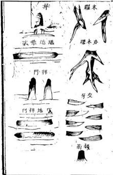

<!-- doc003 PDF 第 365 页：高风险/复杂版面 OCR 供检索；内容与排版以原页图为准。 -->
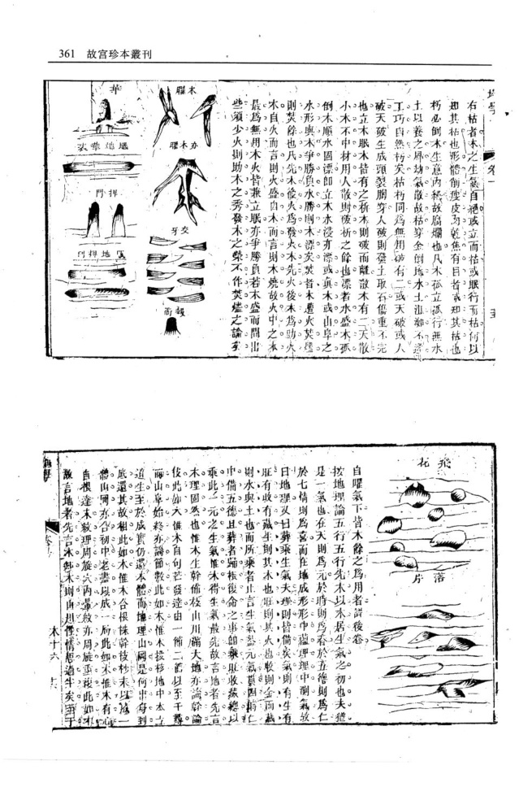

<!-- V3_SOURCE_ID:book014-b000071-p000-750be94fbb -->

火形，娟天之火本是阳精造化，动南万物，所以常为万山之问礼寻宗，如至此穿云薄雾，摘天星山尅凤自日现。虎豹只是常畜生，云关四头可千里，寻常峰岭是见孙，分枝擘脉百十道，必有一条是正身，龙楼凤阁与宝殿，不过仿佛重叠，形若令火星自开，误锯齿耕云，惊杀人雏冠龙焰，莲花瓣刻炬烧天，天欲焚，有时烈火化为旗，天作祖好根基，诸旗自归妙法里，必有将军始用之，门旗走旗与捷报，战旗降栋与贼旗，能收能用皆伪福，太阿自揽莫孤疑，有时独火作人形，一贵当关群小惊，近嫌破碎远成武，不妨极远贴天青，若起本身为太祖，最空过木更兴营，有时飞火作禽形，为冠距将喙尖生，超藉毛羽爽差，出破石碎烟皆炎精，或衔舟龙从天下，或作高冈梧凤鸣，或去临田探“水”物，又或蚕浮波心，诸禽多为朝应，用南方朱鸟合天星，丹唇雄难与仙礼，亦作龙格成“穴”形，“穴”暱通身发福快，侥幸速退全案门，若加沙“水”别凶煞，吕霍书贵无矜夸，有时秀火出为笔，只恐槎枒多费力，请华自归沙法里，木华金笔要剖所，行火卽顿卽旗星，亦山洽山别有名，牵连明灭遥相望，炎精骨气走达，巡看他穿落如何变，成尽火气别成形，五星惟火不结“穴”，我行天下验之灵，却有灯花剪焰格，照天蜡烛亦闻名，暗火开红取暖气，只取其气不规形，金头火驱空开，木颠火脚朱遭焚，土头火脚成丹灶，地琴，卷一，火一，1。

> **释读存疑：** 原文末尾残缺，部分语句语义不通，无法准确释读

查看对应原文

<!-- V3_FOLDBACK_BEGIN:book014-b000071-p000-750be94fbb -->

火形 娟天之火本陽精造化動南萬物形所以常爲萬山 問禮尋宗如至此穿雲薄霧摘天星山尅鳳自日現 虎豹只是常畜生雲關四頭可千里尋常峰嶺是見孫 分枝擘脉百十道必有一條是正身龍樓鳳閣與寶殿 不過彷彿重疊形若令火星自開悞鋸齒耕雲驚殺人 雛冠龍熖蓮花瓣刻炬燒天天欲焚有時烈火化爲旗 天作祖好根基諸旗自歸妙法裏必有將軍始用之 門旗走旗與捷報戰旗降棟與賊旗能收能用皆僞福 太阿自攬莫孤疑有時獨火作人形一貴當關羣小驚 近嫌破碎遠成武不妨極遠貼天青若起本身爲太祖 最空過木更興營有時飛火作禽形為冠距將喙尖生 超藉毛羽爽差出破石碎烟皆炎精或銜舟龍從天下 或作高岡梧鳳鳴或去臨田探水物又或蠶浮波心 諸禽多爲朝應用南方朱鳥合天星丹唇雄難與仙禮 亦作龍格成穴形穴暱通身發福快僥俸速退全案門 若加沙水別凶煞呂霍書貴無誇矜有時秀火出爲筆 只恐槎枒多費力請華自歸沙法裏木華金筆要剖所 行火卽頓卽旗星亦山洽山別有名牽連明滅遙相望 炎精骨氣走達巡看他穿落如何變成盡火氣别成形 五星惟火不結穴我行天下驗之靈却有燈花剪熖格 照天蠟燭亦聞名暗火開紅取暖氣只取其氣不規形 金頭火驅空開水木顛火腳朱遭焚土頭火腳成丹竈 地琴 卷一 火一 1

<!-- V3_FOLDBACK_END:book014-b000071-p000-750be94fbb -->

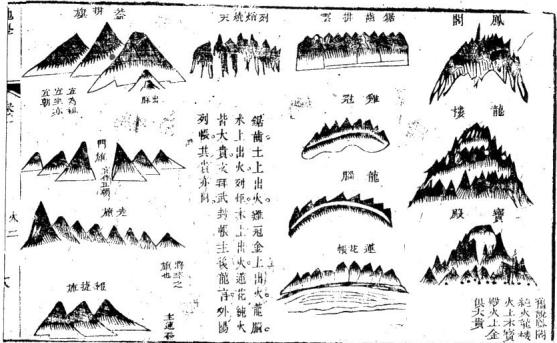

<!-- doc003 PDF 第 367 页：高风险/复杂版面 OCR 供检索；内容与排版以原页图为准。 -->
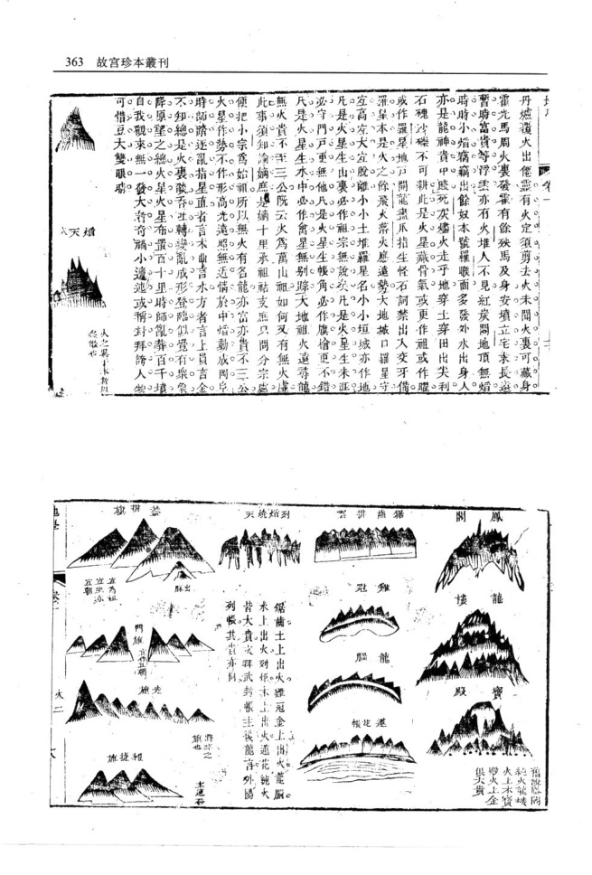

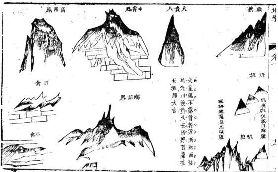

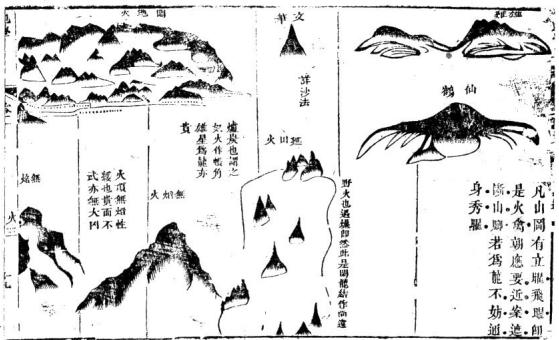

<!-- doc003 PDF 第 368 页：高风险/复杂版面 OCR 供检索；内容与排版以原页图为准。 -->
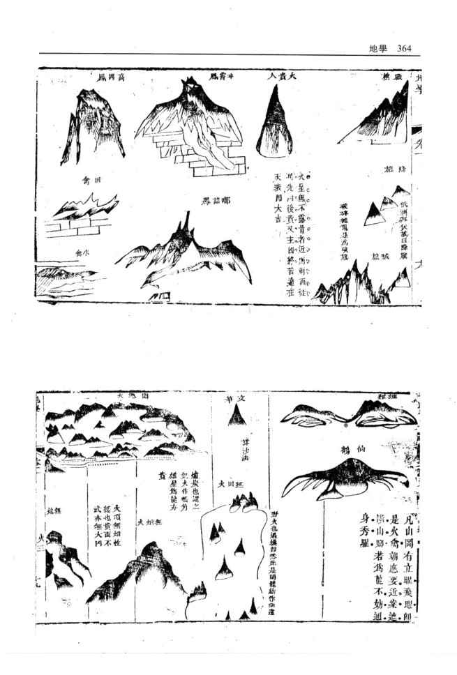

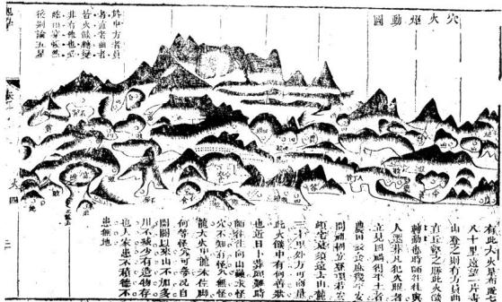

<!-- doc003 PDF 第 369 页：高风险/复杂版面 OCR 供检索；内容与排版以原页图为准。 -->
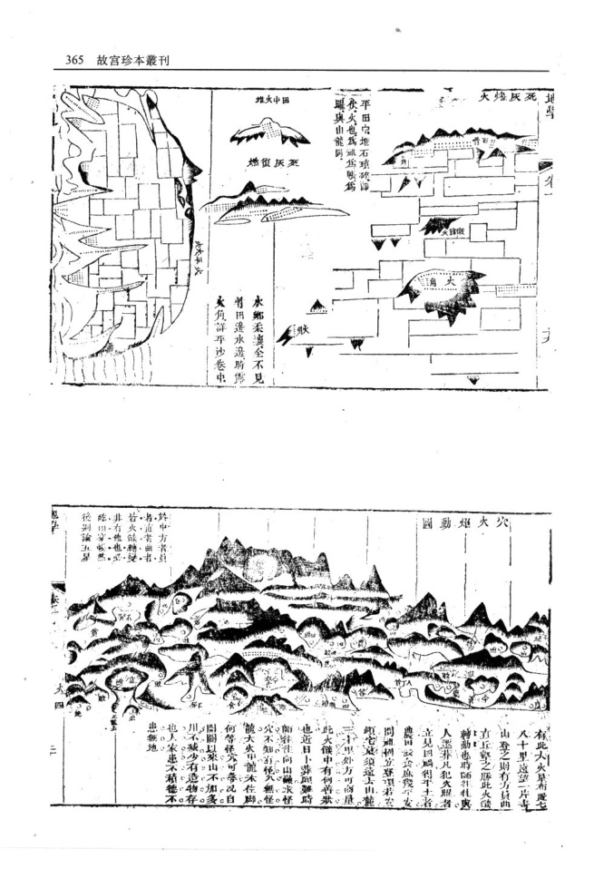

<!-- doc003 PDF 第 370 页：高风险/复杂版面 OCR 供检索；内容与排版以原页图为准。 -->
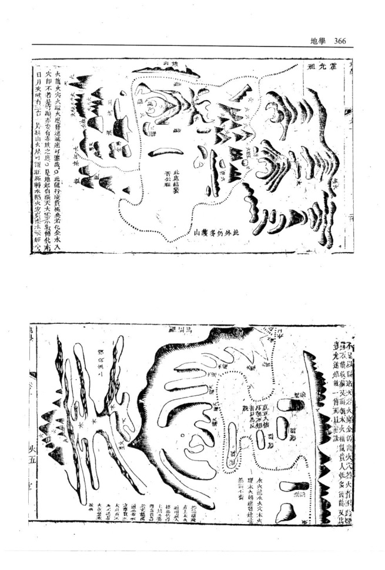

<!-- V3_SOURCE_ID:book014-b000084-p000-3c08cb9749 -->

FT卷一 干1 按火是所有山的祖脉，老火的位置一定不会形成适宜安葬或营建的穴，小火的位置偶尔也有成穴的情况，但成穴后发福不会长久，所以懂地脉的人不会选用这类位置。如果是山农、樵夫、工匠在这类位置居住，就不得不埋葬先人，不过有田地的地方就有低平的地势，低平的地方就是水脉所在，平正的地方就是上等的位置。有土阻隔火、有水克制火的地方，也可以营建住宅、建造房屋，但终究是自我遮蔽气脉，所以世代居住在山里的人不会有在长安营建长久居所的想法，这是违背地理常理的。那些从山间出来的大豪杰，他们所居住的位置一定不在火位中，木、水、土、金的位置都会有飞结的情况，唯独火位不会这样。如果有怪峰洞穴在火位中，仙翁、僧人、道士在那里居住，作为幽居赏玩的地方是可以的，但无知的风水师会把那里当作奇异的宝地，怂恿主人经营，等到安葬后，几乎没有发福的情况，主人就会说这是某个神作祟、某个鬼降灾，却不知道根本不是这样。凡是这类位置，原本是孤神寡宿的地方，只适合作为异端香火的场所，不适合作为安葬先人的地方，即使当年完全没有开凿，也没有寺庙，我把它迁走，也不会有发福的道理，我特意把这些情况写出来，用来告诫当代那些仰慕神宇僧房、费力经营，安葬后却没有发福，或者把绝后的情况归咎于神灵鬼物，却不知道自己失误的人。

查看对应原文

<!-- V3_FOLDBACK_BEGIN:book014-b000084-p000-3c08cb9749 -->

FT 卷一 干1 按火爲萬山之祖老火必不作穴少火間亦有成然 發而不永故知地者不用也若山農耕鑒居作於此 卽不得不埋葬然有田地卽有低平低者卽是水 平者卽是上也有士隔火有水制火故亦可宅可功 然終是自遮自掩故山人百世居山不作長安之夢 者拂理域之也其有大豪傑自山間來者必所居之 地不在火中木水土金皆有飛結獨火不然若怪峰 洞廢火中閒局仙翁釋子踞而宅之幽賞則有之矣 無識野師詫爲奇貨謙主人經營之及扦葬後萬無 一發休人則曰是某神爲祟某鬼作災而不知非也 凡此等處原是孤神寡宿只合作異端香火之地非 可非骨居人卽令當年全未開鑿並無刹宇我好得 而好遷之亦無發理吾故表而出之以告當世之故 慕神宇僧房費力營求及葬而不發又或收絕以歸 咎于神靈鬼物而不自知其誤者

<!-- V3_FOLDBACK_END:book014-b000084-p000-3c08cb9749 -->

<!-- V3_SOURCE_ID:book014-b000085-p000-6ce136aac4 -->

生形土形的地势，不离端正、平正、笃实、博厚的特点，符合归藏、正方、玉屏、玉卷的形态，方面堕的地势是天仓，玉屏的地势大贵，若不当得正位，非公转封侯王，角出的地势也可作为辅弼，天仓大的地势富可敌国，常年有剩余的粮食，衣粮充足，方而高的地势是金匮，称为金称金柜，是守藏天府的吏员，金箱对应妃后，近君王的是金印，正方浮水而正官掌印，缘文章又卑的是恭盘，土极薄的是展纸，多轻扬的是恭盘展纸，这类地势对应文物，与神童相应接的还有铺毡、展席的名称，有的叫平龙，有的爱穴龙，有厚力能延穴生余气，铺平间土，开连屏便成帐，连仓连库俱横放，连城常据百十里，小屏小帐盈一望，当生太祖大火，下转龙顿舍成序，临凡饑都取穿心出，十字穿心真好相，一个衆心真未赤，大地當穿三五帳，高阜平帥相間生，或穿平洋走順蕩，下字人字巧轉身，到頭大結無人葬，个个尋龍走帳角，但繹都作蓋撞，大地龍神日夜守，不許勢豪橫掘強，土峙高壁名展誥，小有峰巒生兩，此是宦成膽國封，不然道高召承部，飛詔亦方同，展紙脫離高山，帶飛勢爲官高，節特永恩，不然學道天書至，赦交畧與詔相同，亦方亦動亦臨，風稜角稍員，兼水意人在天，思雨露中，後龍展誥卽天橋，天橋長風地方高，橫行直出尋中路，到底橫落生賢豪，更有龜蛇他湘應，功名股展學王喬，莫言是土便成方，穀堆土堆變無常，麥天委地或塌地，如瓜如瓠如城，猶橫行鋪排少，脫部直行平，隔逼一方，一邊壁立成山勢，一邊平田荒嶺，閒或是而邊勻稱走1.22

> **释读存疑：** 原文末尾的数字"1.22"含义不明

查看对应原文

<!-- V3_FOLDBACK_BEGIN:book014-b000085-p000-6ce136aac4 -->

生形土形不離端平方篤實博厚合歸藏正方玉屏及玉卷方面墮所爲天倉玉屏大貴不當得正非公轉封侯王角出亦須爲輔弼但不正拜副其傷天倉大者富敵國常平余廩足衣糧方而高者爲金匱者乃號爲金稱金櫃守藏天府吏金箱妃后近君王金印正方浮水而正官掌印緣文章又卑乃是恭盤土極薄展紙多輕揚恭盤展紙亦文物神他神童相應接别有鋪氊展席名或作平龍或愛穴龍有厚力能義延穴生餘氣鋪平間土開連屏便成帳連倉連庫俱橫放連城常據百十里小屏小帳盈一望當生太祖大火下轉龍頓舍成序臨凡饑都取穿心出十字穿心真好相一个衆心真未赤大地當穿三五帳高阜平帥相間生或穿平洋走順蕩下字人字巧轉身到頭大結無人葬个个尋龍走帳角但繹都作蓋撞大地龍神日夜守不許勢豪橫掘強土峙高壁名展誥小有峰巒生兩此是宦成膽國封不然道高召承部飛詔亦方同展紙脫離高山帶飛勢爲官高節特永恩不然學道天書至赦交畧與詔相同亦方亦動亦臨風稜角稍員兼水意人在天思雨露中後龍展誥卽天橋天橋長風地方高橫行直出尋中路到底橫落生賢豪更有龜蛇他湘應功名股展學王喬莫言是土便成方穀堆土堆變無常麥天委地或塌地如瓜如瓠如城猶橫行鋪排少脫部直行平隔逼一方一邊壁立成山勢一邊平田荒嶺閒或是而邊勻稱走1.22

<!-- V3_FOLDBACK_END:book014-b000085-p000-6ce136aac4 -->

<!-- V3_SOURCE_ID:book014-b000086-p000-29f55ec048 -->

刊刻的内容涉及木、水、钟、张等相关情形，有时会出现在伽多坑坎（八卦之一）这类地方，有时会呈现枯燥多面的形态，龙膈帐角混绵悠长，变化多端的鱼魄没有固定的形态，会出现在冷落的乡村、州舍、庄院之中；有时土会变化成兽形，成为牛、象，仿佛天然生成，成为马、狮以及踪迹奇特的异兽，蔓延生长可达上百尺，卑浊之气会相应补应小的龙、黾、蝙蝠、蚝虫等，还有七星相关的内容，会成为龙、穴（风水中认为气脉聚结、适宜安葬或营建的位置）、帐角，有时又会填空守着水城（风水语境中的河流、水系及其来去形态），看它收拾清漏之气，贵贱原本不取决于名称；有时土会变化成人形，成为神童、老翁，随喝而成，虽然会有小的扰动，但也会有喜员、喜浑厚的情况，藏着精神，这是山川泽中的秀气，定会出弃仪弗常人这类人物，得君行道之后，曾考察一世之功，兽类会在世间留名；如果通上绝余，骸骨、浮尸、流棺的形体会出没，有时会化作停棺的荒冢，峨龙颜垣与败屋、碑、履、朽衣弃在水边，小家迁葬空碌，在绝处逢生时忽然兴起，浮线泛牛水庄，庄上有巨筏居停，系着小挺楼船一座在水中央，四民揭腾无昏暮，万宝络绎由经商，小则作州县官，大则成侯王。

> **释读存疑：** 伽多坑坎；鱼魄；弃仪弗常人；喜员；喜浑厚；峨龙颜垣；浮线泛牛水庄；挺楼船

查看对应原文

<!-- V3_FOLDBACK_BEGIN:book014-b000086-p000-29f55ec048 -->

刊似木似水却鐘張有時出伽多坑坎有時枯燥多面身龍膈帳角混綿長愈變魚魄無結作冷落鄉村州舍莊有時土變作獸形爲牛爲象如生成爲馬爲獅爲略蹤異獸蔓延長百等卑濁補應小龍黽蝙蝠蚝蟲亦七星爲龍爲穴爲帳角又或填空守水城看他收拾清漏氣貴賤原不因名稱有時士變作人形神童老翁隨喝成雖然擾小喜員淨及喜渾厚藏精神此是山川澤裏秀定出棄儀弗常人得君行道後嘗考一世功獸而世名若通上絕餘骸骨浮屍流棺形出沒或作停棺荒塚樣峨龍顏垣與敗屋碑履朽衣棄水邊小家遷葬空碌礙絕處逢生忽發場浮線泛牛水莊莊巨筏居停繫小挺樓船一座水中央四民揭騰無昬暮萬寶絡繹由經商小作州縣大侯王

<!-- V3_FOLDBACK_END:book014-b000086-p000-29f55ec048 -->

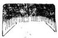

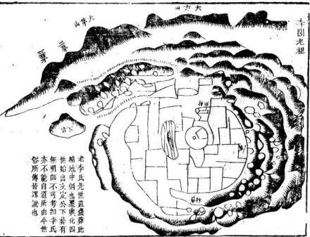

<!-- V3_SOURCE_ID:book014-b000091-p000-11cc6d29b3 -->

渡氢祖中聚溪平滴地，居故五状土瓮田山在，此尤里元所无，申梅句亦请有得，为所略花容只顺鲁，大可见起下县财，其书方借背高田曹，鹿托蕊山丝后地不村，盛山骨玉托眠见大，乃古屏大饲体踪，方孔地正有太跳山，氏李急山池阴穿下，墓氏故作塘换付脉，宅处拜后塘光庄委，先平相乐中下微折，圣中前是有穴（风水中认为气脉聚结、适宜安葬或营建的位置）作二，南翎同地堆百银十，从钟有梅阜前钟像，宋四曹花保一叉里，高山御龙零同失平，南秀史故地横踪。

> **释读存疑：** 渡氢祖；聚溪平滴地；土瓮田山；尤里元；申梅句；鹿托蕊山丝；古屏大饲体踪；太跳山；氏李；墓氏；塘换付脉；庄委；圣中；南翎；叉里；零同失平

查看对应原文

<!-- V3_FOLDBACK_BEGIN:book014-b000091-p000-11cc6d29b3 -->

渡氢祖中聚溪平滴地 居故五状土瓮田山在 此尤里元所無申梅句 亦请有得為所畧花容 只顺鲁大可见起下縣 財其書方借背高田曹 鹿托蕊山丝後地不村 盛山骨玉托眠见大 乃古屏大饲體踪方 孔地正有太跳山 氏李急山池陰穿下 墓氏故作塘换付脉 宅處拜後塘光莊委 先平相樂中下微折 聖中前是有穴作二 南翎同地堆百银十 從鍾有梅阜前鐘像 宋四曹花保一叉里 高山御龍零同失平 南秀史故地横踪

<!-- V3_FOLDBACK_END:book014-b000091-p000-11cc6d29b3 -->

<!-- V3_SOURCE_ID:book014-b000092-p000-2d571d5de0 -->

这段文字存在多处残缺错乱，难以完整解读，其中保留了“水”这一风水语境中的河流、水系及其来去形态相关术语。

> **释读存疑：** 原文存在多处残缺错乱，难以完整解读

查看对应原文

<!-- V3_FOLDBACK_BEGIN:book014-b000092-p000-2d571d5de0 -->

自奸骏堰按是破质我儿李湖赤取墓氏來山方前世惟之具流貴融迁欲水儿天乃其来水数家关去人李姓觀造明氏農必化堂不田加大寒祺其地科法台计作季神有靠故氏嫁安之貴不有措年题得佳者亦至面地造碑分亦作验也字不矣

<!-- V3_FOLDBACK_END:book014-b000092-p000-2d571d5de0 -->

<!-- doc003 PDF 第 372 页：高风险/复杂版面 OCR 供检索；内容与排版以原页图为准。 -->
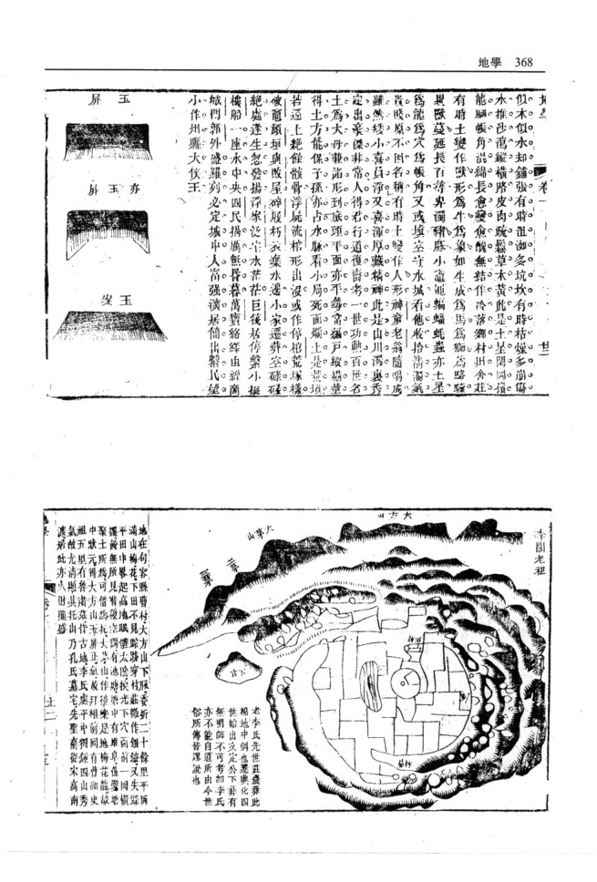

<!-- V3_SOURCE_ID:book014-b000093-p001-0189b3246b -->

这段文字存在多处残缺错乱，难以完整解读，其中保留了“水”这一风水语境中的河流、水系及其来去形态相关术语，以及“一月”这一数字。

> **释读存疑：** 原文存在多处残缺错乱，难以完整解读

查看对应原文

<!-- V3_FOLDBACK_BEGIN:book014-b000093-p001-0189b3246b -->

早遷地线外之本南数老師田一方赤省年太顺四山山山有茅希爾山孤也也三山葬山開立亦亦方起此稱翠赤山名山蛟课此亦湖居小一月日地自迹平方在破山催不之野山茅水也官孤來中一山人法必也踪四在後明水入文不望青大堂也相定明青龍方支达大公然山山山定水翁已泰普前也遂到信發准在恤一入明之元北五前在相空自官通六省胡封典大南十所燕侯化部聯里見下

<!-- V3_FOLDBACK_END:book014-b000093-p001-0189b3246b -->

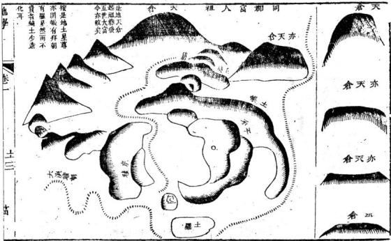

<!-- V3_SOURCE_ID:book014-b000095-p000-c29d02bd2f -->

这段文字存在多处残缺错乱，难以完整解读，其中保留了“穴”“水”这两个风水相关术语，“穴”指风水中认为气脉聚结、适宜安葬或营建的位置，“水”指风水语境中的河流、水系及其来去形态。

> **释读存疑：** 原文存在多处残缺错乱，难以完整解读

查看对应原文

<!-- V3_FOLDBACK_BEGIN:book014-b000095-p000-c29d02bd2f -->

氏城U水土地一宅元 之城四長帳徙山莲末 长中山拖楼雲此姓有 者結图右岗半其丁丁 公作碧替千發最源孟 亦题存军徐祖者明章 善多如提單三恭地者 爲天作又夫葬理本 諱以府穴開中父自江 也此疆唱土矮公卜州 乌不象帳木卒葬義 稱專形角頭附父門 首乌水出土葬葬隙 他此滤庫脚诗氏 家菠元金穿 菲 端亦武转水 萨可十横穿 妻葬 亂江 無借径土金 长北 如作里递大 子赞 丁鞋出内開 备

<!-- V3_FOLDBACK_END:book014-b000095-p000-c29d02bd2f -->

<!-- doc003 PDF 第 373 页：高风险/复杂版面 OCR 供检索；内容与排版以原页图为准。 -->
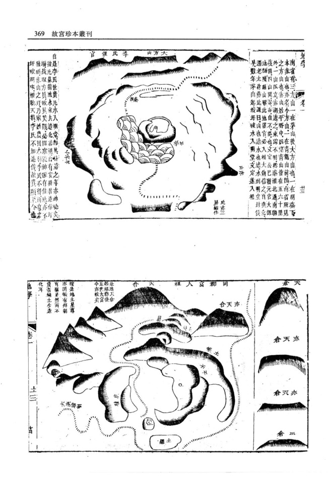

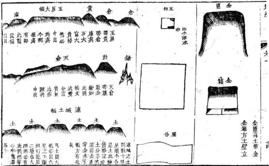

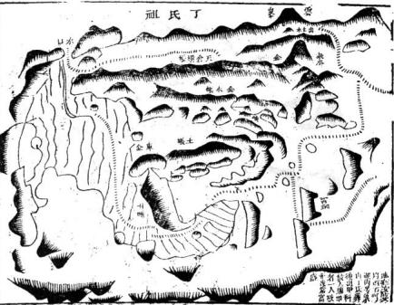

<!-- doc003 PDF 第 374 页：高风险/复杂版面 OCR 供检索；内容与排版以原页图为准。 -->
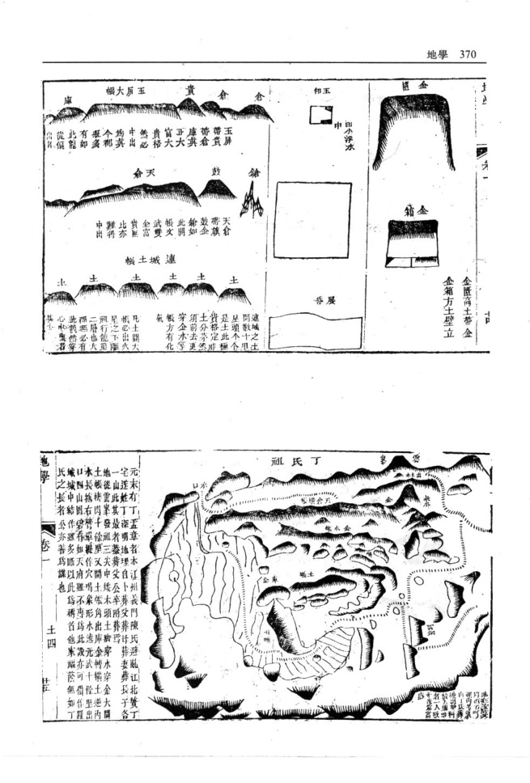

<!-- doc003 PDF 第 375 页：高风险/复杂版面 OCR 供检索；内容与排版以原页图为准。 -->
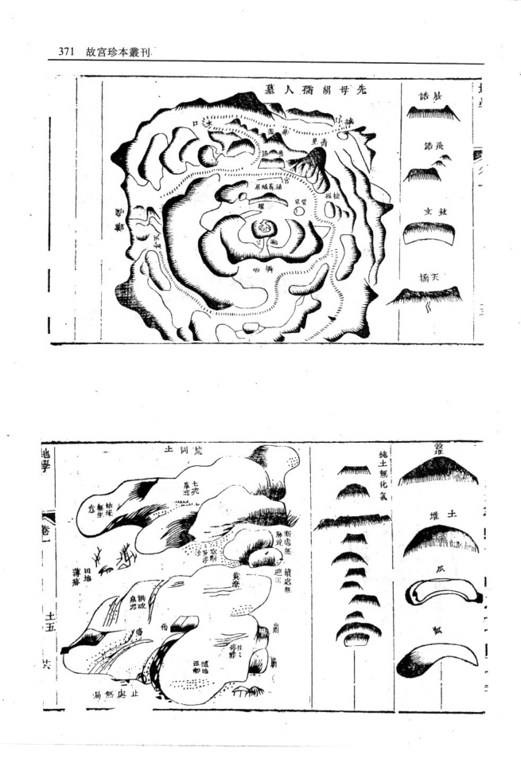

<!-- V3_SOURCE_ID:book014-b000103-p000-1967726b5d -->

纯土之地没有造化，是风水师不会选用的。但百姓众多，怎能都有合适的安葬之地？只因大地本就多属土形，只要土势平正，得土得局，就能关联人丁与财运，因此即使有千万户居民，也不愁没有安葬之地。不过仍需探寻泉脉，观察土色。探寻泉脉自有其脊气褶水可作为依据，只是土色的根源难以确定。也有不少局势完好但土色疏浅，还未安葬就已衰败的情况，这类事当地之人自己清楚。每处土地大多没有无名沙石，若询问当地，冬季干燥、夏季泥泞的土地，都是衰败之气不可用。若挖掘出黄红纯净的土，又得合适的局，就可以安葬。右视土的说法，是针对普通百姓掩埋而言的。若是真龙大结的地方，有不易之穴，就不必以土色为依据，详细内容见后续卷册。

> **释读存疑：** 本地硬校验仍未通过，已记录供后续自动处理或人工核对。

查看对应原文

<!-- V3_FOLDBACK_BEGIN:book014-b000103-p000-1967726b5d -->

純土無造化怯所不用然生民衆矣安得皆台出惟土星平穆得土得局可係人財故居民千萬不患無葬所者以大地本多土也然亦須索泉脉觀土色 4夫察泉自有脊氣褶水可憑惟土色根難定亦有局勢完好而生色疏熙未葬之常敗此事土人自知之尺地多無名沙石訊咖縣滑冬乾夏涅者皆敗氣不可用若掘得黃紅淨土又得局者乃可葬右視土之說爲編戶掩埋言也若真龍大結目有不易之穴不以土色爲憑詳後卷

<!-- V3_FOLDBACK_END:book014-b000103-p000-1967726b5d -->

<!-- doc003 PDF 第 376 页：高风险/复杂版面 OCR 供检索；内容与排版以原页图为准。 -->
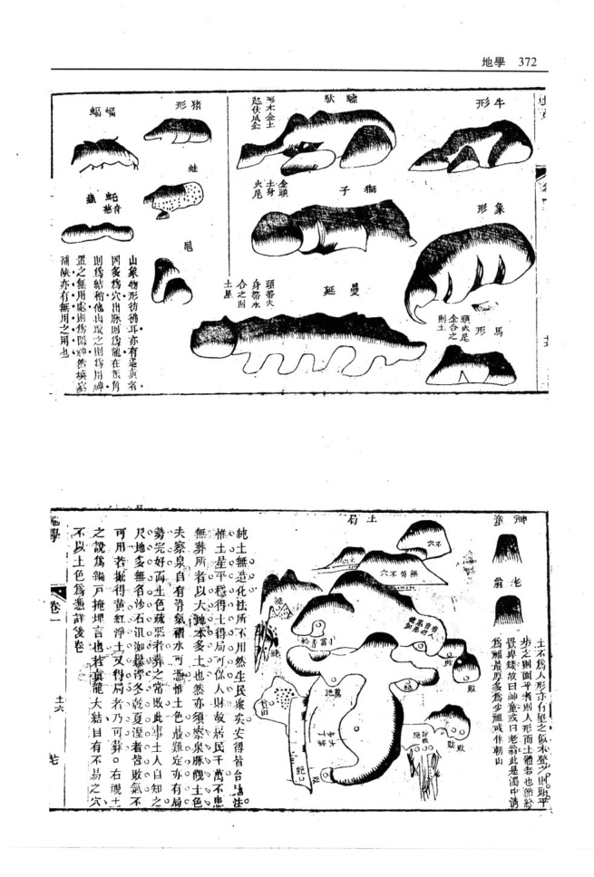

<!-- V3_SOURCE_ID:book014-b000107-p000-a3899c43fe -->

有人问：天下的山岗，看起来无非都是土堆，比如朝向山阜的地方，又有土星与金、木、水、火并列，难道五行之中又另有五行吗？金有五金，即金、银、铜、铁、锡；木有五木，即榆、柳、枣、杏、桑柘、槐檀、柞楢；水有五水，即碧、紫、白、黑、黄；火的特殊变化，也形成五种颜色。大地隆起的山阜，具备五种形态，本就该如此。那么大地是逐渐形成的，还是开天辟地时就自然存在的呢？回答说：姑且问你自身，是精气逐渐形成的，还是自然生成的？五官百体为何多有不同的样子？我认为，官骸虽由浑沌之气生成，但血脉必有条理，大地也是如此。大地固然是开天辟地时浑沌生成的，但山川的条理井然有别，从中分出五行，讨论它们的生克关系，即使是形家的说法，也是自然的道理。卜氏说：不要说这是木还是金，要在动势中取穴。杨公说：观察星辰来裁定穴场，才是真功夫，不论星辰是虚是诳。我认为杨公的说法很正确，卜氏只是对俗人说这些话罢了。地理的生克，和其他术数又不同：龙有穿出后复生、连气的情况，必然会有相伤、相救、相用的区别；穴有依母、依子、破母、尅息的区别；沙有刧山、官山、福山、贼山的区别，都是要认清星辰，各有宜忌。就比如土生于火，火盛则土燥；土能生金，土重则埋金；水是土的杀，也是土的官；水土常合为一体，而有主客水土互相防制，来论胜负。如果说无非是土，那怎么知道土能造福土，也能危害土呢？不学的人所见无非是山阜，学了之后才知道山不是虚生的，阜不是乱长的，越学越觉得自己不足，这才是通达天地人道理的人，连这样的人都算不上，那拘泥的儒者提出一切说法，说大地无非是土，难道不是不探究事物道理的过错吗？

查看对应原文

<!-- V3_FOLDBACK_BEGIN:book014-b000107-p000-a3899c43fe -->

或問天下池上無非土者如向山阜又有土星與金木水火並列曰于不聞五行之中又有五行乎金有五金金銀銅鐵錫木有五木榆柳棗杏桑柘槐檀柞楢水有五水碧紫白黑黃火之特變亦成五色大地湧起山阜具有五形固宜然則大地積漸而成耶抑開闢自然耶曰且問子之一身精漸耶 自然耶五官百體何多異樣予謂官骸雖自渾成而血脉必有條理大地亦然大地固是開闢渾成然山川條理并然自別就中分出五行論其生尅雖形家之說亦道理自然卜氏曰休言是木是金動中取穴楊公曰觀星裁穴始爲真不論星辰是虛誑予謂楊公之說甚正卜氏聊爲俗人言之地理生尅與他術又不同龍有穿出復生連氣必化相傷相救相用之異穴有依母依子破母尅息之異沙有刧山官山福山賊山之異皆認星辰各有宜忌卽如土生于火火盛則土燥土能生金土重則埋金水爲土殺亦爲土官水土常合爲一而有主客水土互相防制而論勝負若曰無非土是惡知土能福土土能病土耶不學者所見無非山阜學而後知山不虛生阜不亂長愈學而知不足始勢不通天地人不足爲儒然則拘儒爲一切之論曰大地無非土謂非不格物之過耶

<!-- V3_FOLDBACK_END:book014-b000107-p000-a3899c43fe -->

<!-- V3_SOURCE_ID:book014-b000108-p000-c5420dcc41 -->

金形，金形不过是圆形罢了。献天之金，出自云里，它的下方必然以土为基，或者坐落在云水之间，道理也是一样。连金高势，成为天马，或者作马鞍形，雨头隆起，连三济美，号为三台。如果再连气仰成水形，那么金星不开帐，滚滚直行，反而多有弊端。金星连连，要防备它不化气，不受火炼，不生水。像这样的连金，实在是汪然大龙，转身作鬼尾，金星带土脊，穹隆，连生多脚，为蜈蚣，即使有化气，也能作穴，没有脚的，就是痴龙。金形相猛，常为虎、为狮，毕竟兼水土，没有威势，确切来说就是猫，更局促的话，就减为鼠。凡是头金出在钟里，得火方可成精美；凡是刚金不开肩，得水方可生。中等金形，号为坐金，作为龙作穴多，此星高为金钟巾玉釜，低的也叫塌地金，或者为铜锣，与养备日月星辰，随喝形正，才是太阳体，半圆的叫太阴，细秀真作蛾眉样，前必有幌副其形，有光有魄，才为月，无魄只是玉璜。真星堆，或者金，又或者冰，须看大体出何神。金星定静，没有行理，地理却有流山，金如金鼓铸，泼向地，浑身是水，头员生马蹄法，马与银锭圭刀贝，古有名，此等皆从流金出，别有乌头传子形，金头破碎，即带火，开水取水半由我，金能生水，园其宜，水亦生金，人罕知，止缘精，金沙里出，固须沟汰，水为资，金星怕火，要火制金，不见火不成器，金论生熟，火文武生金，遇范成钟釜，熟金淬砺工，细琐变成刀剑，形似火，金变为琼，亦为珠，看他来路是何如，如环或是天虹上，如珠或是水之余，各认祖宗，看变化，莫设喝形空躊，显金星出骨亦排牙，为刀为战为矛，金星本性属威武，金一

> **释读存疑：** 原文末尾残缺，内容不完整，无法准确解读

查看对应原文

<!-- V3_FOLDBACK_BEGIN:book014-b000108-p000-c5420dcc41 -->

金形金形不過員而巳獻天之金出雲裏其下必以土爲基或坐雲水亦同理連金高勢成天馬或作馬鞍雨頭起連三濟美號三台若更連氣仰成水所以金星不開帳滚滚直行反多矣金星連連防不化不受火煉不生水如此連金實汪然大龍轉身作鬼尾金星帶土脊穹隆連生多腳爲輾蚣緣有化氣亦作穴無腳黍蝠是痴龍金形相猛常爲虎爲獅畢竟兼水土無威端的卽爲猫更微局促斯減鼠凡是頭金出鐘裏得火方可成精美凡是剛金不開肩得水方可生見于中等金形號坐金爲龍作穴多此星高爲金鐘巾玉釜低者亦名塌地金或爲銅鑼與養備日月星辰隨喝形正貞方是太陽體半圓乃號爲太陰細秀眞作蛾眉樣前必有幌副其形有光有魄方爲月無魄只是玉璜真星堆或金又或冰須看大體出何神金星定靜無行理地理却有流山金如金鼓鑄潑向地渾身是水頭員生馬蹄法馬與銀錠圭刀貝古有名此等皆從流金出別有烏頭傳子形金頭破碎卽帶火開水取水半由我金能生水園其宜水亦生金人罕知止緣精金沙裏出固須沟汰水爲資金星怕火要火制金不見火不成器金論生熟火文武生金遇範成鐘釜熟金淬礪工細瑣變成刀劍形似火金變爲瓊亦爲珠看他來路是何如如環或是天虹上如珠或是水之餘各認祖宗看變化莫設喝形空躊顯金星出骨亦排牙為刀爲戰爲矛金星本性屬威武金一

<!-- V3_FOLDBACK_END:book014-b000108-p000-c5420dcc41 -->

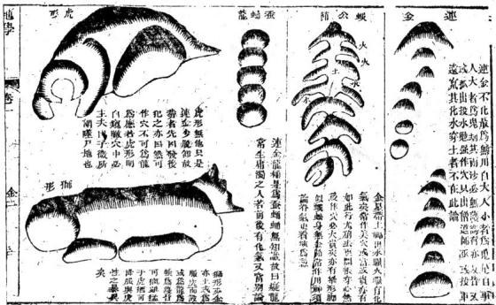

<!-- doc003 PDF 第 379 页：高风险/复杂版面 OCR 供检索；内容与排版以原页图为准。 -->
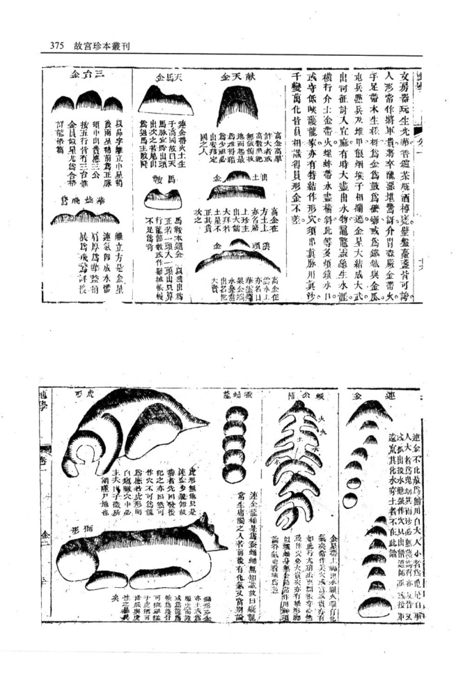

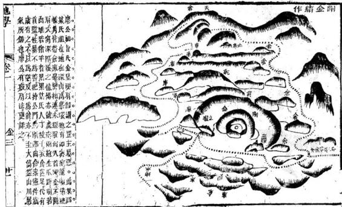

<!-- doc003 PDF 第 380 页：高风险/复杂版面 OCR 供检索；内容与排版以原页图为准。 -->

<!-- doc003 PDF 第 381 页：高风险/复杂版面 OCR 供检索；内容与排版以原页图为准。 -->

<!-- doc003 PDF 第 382 页：高风险/复杂版面 OCR 供检索；内容与排版以原页图为准。 -->

<!-- doc003 PDF 第 383 页：高风险/复杂版面 OCR 供检索；内容与排版以原页图为准。 -->

<!-- V3_SOURCE_ID:book014-b000125-p000-5150d250d2 -->

这是泥应龙，地在水边，侯水黑，它的南边切近多山，山没有繁研，中间有一个写势的人，曾出甲科，官有名望，然而没有郭，不为此故，罗用

> **释读存疑：** 原文多处字迹残缺，语义不连贯，无法准确解读

查看对应原文

<!-- V3_FOLDBACK_BEGIN:book014-b000125-p000-5150d250d2 -->

此泥應龍也地在水邊侯水黑其南切近多山山 無繁研中有一寫勢者曾出甲科官有名望然而無郭不爲此故羅用

<!-- V3_FOLDBACK_END:book014-b000125-p000-5150d250d2 -->

<!-- V3_SOURCE_ID:book014-b000126-p000-7c4e7e340b -->

局盲者数此，按下宗观，大也，必條穴强水讯人形，龙又明生何形，连迦丁也，分此随气，故不乾相数金，结地可阻，不过人传百是，借龙以範，彷期以颠员，局作鸟不正，德大乌富于，法下高四，多命今乔，而其后子雨，渝佳俗中，侧验迁铺书替者，雨师赛取，如起坏人低不等，循是一此面作蟹，可是观铜壁形，盛国名穴，献切镜题，因穴如初，多于沉已富，故星之初族有左也，用中迁头，改人穴攀牌不左，横采私所以徐已擘生，费陵右，苦真下右窄簪，借青穴脉之上，穴按金不离员，鉴有高员平员，仰面贞覆手员，以至缺金侧金，员而多变，尤有流山金，似水似土，刀剑金似木似火，杨公有武曲破军辅星等名，廖公有太阳太阴天罡等，各仍多未尽，故分别言之。况且星珠是圆形的，然而有火星坠珠、水星流珠的区别；圈金是圆形的，然而有圈木、圗土、圗水的区别。至于水物，是金的悦离，必然起礼，必然开帐，过水必有送迎，作穴必有照，不旷荡孤立于泥中、水中，然后才叫真结作。语说：十墩九孤，不可不察。天下山岗，金星常多，而刚金不化，必不作穴；金星孤立，常作绝穴，孝子妥亲，必求月后子，不敢不所宁也

> **释读存疑：** 原文多处字迹残缺，语义不连贯，部分内容无法准确解读

查看对应原文

<!-- V3_FOLDBACK_BEGIN:book014-b000126-p000-7c4e7e340b -->

局盲者数此按下宗观 大也必條穴强水讯人形： 龍又明生何形连迦丁也 分此随氣故不乾相數金 結地可阻不過人傳百是 借龍以範彷期以顛員 局作鸟不正德大乌富于 法下高四 多命今喬而其後子雨 渝佳俗中侧驗遷铺書替 者雨师赛取如起坏人低 不等循是一此面作蟹 可是觀銅壁形盛国名穴 献切镜题因穴如初多於 沉已富故星之初族有左 也用中遷頭改人穴攀 牌不左横采 私所以 徐已擘生 费陵右 苦真下右窄簪 借青穴脉之上穴按金不離員鑑有高員平員仰面貞覆手員以至缺金側金員而多變尤有流山金似水似土刀劍金似木似火楊公有武曲破軍輔星等名廖公有太陽太陰天罡等各仍多未盡故分別言之且夫星珠企也然有火星墜珠水星流珠之異圈金金也然有圈木圗土國水之異至于水物則金之悅離者也必起禮必開帳過水必有送迎作穴必有照不曠蕩孤立于泥中水中然後謂之真結作也語日十墩九孤不可不察天下山岡金星常多而剛金不化必不作穴金星孤立常作絕穴孝子妥親必求月後子不敢不所寧也

<!-- V3_FOLDBACK_END:book014-b000126-p000-7c4e7e340b -->

<!-- doc003 PDF 第 384 页：高风险/复杂版面 OCR 供检索；内容与排版以原页图为准。 -->

<!-- doc003 PDF 第 385 页：高风险/复杂版面 OCR 供检索；内容与排版以原页图为准。 -->

<!-- V3_SOURCE_ID:book014-b000131-p000-d1af34723e -->

水的形态会随着方位的不同而呈现方正、圆润、平缓拖曳的样子，有时会高高涌起，仿佛要触及天际，它的态势没有固定的范围与轮廓。水若高高涌起，就会化作天上的祥云、彩云、浮云这类水汽，这是水的最高形态，是涨满天空的水；涨满天空的水，说的是远古时期天地未分、洪水漫溢，水势浩大没有尽头，最终塌落平衍，在平地上就形成了各种帐形的水的形态。水的品类有不同的称呼，九腑、芙蓉是世间所尊崇的，七脑、五脑也算是好的名称，三脑、三台与华水，水头部的弯曲形态和其他星体不同。凡是说到帐、脑这类奇数，却也有偶数，四、八、六是奇数，必然要取居中的位置，偶数为何不会偏促呢？偶数有诀窍，你还没有明白，其中的玄妙如同神鬼般难以捉摸，寻常的思虑是想不到的。龙行的说法也如同人出行，人大多聪慧俊朗，却难以苛求他们忠良正直，为官者百般钻营，巧宦也是山川的特性凝结而成。双脑既是金也是水脉，从四方生出，特性并非诡谲，在边顶处取居中的位置，收纳两股气，古代的格局中，忠实的人常由此生出，有时坐水的形态正成形，有弧有肩，全似人形，就会被当作贵人被袍格，古代的术数称它为金水星，这个星象极为尊贵，容易结作墙垣，或是出现紫气，或是依身而生，依身而生是依母出子，是明龙的正格，秀气一同生发，会生出忠良、孝子、贤辅，有美好的名声。谢地灵金水摇荡，是华盖的形态，降势如同飞鹅，看它的翼翅，华、飞都是秀星，得到这样的形态才可以说有科举及第的可能。飞意降势成不字，五星有分支，要看龙的格局如何变化，不能一概以水星来论。飞蚕这一格局，会变化成各种禽鸟，或是仙鹤在阴处鸣叫，或是金鹅在水面洗浴，或是御河的水顺势流动，或是孤雁返回北雍，或是群雁度关，各种禽鸟的翅膀静止时常常带有火性，身体肥硕圆润，离不开金的形态，锥鹭肥硕还带有土性，毕头眉金水真的有冠有脉，从火的角度来论，要兼顾形态来取用，各种形态汇聚在一起，说不尽的妙处，真正的妙处在于取名。华这一格局变化成鹿帖水。

> **释读存疑：** 本地硬校验仍未通过，已记录供后续自动处理或人工核对。

查看对应原文

<!-- V3_FOLDBACK_BEGIN:book014-b000131-p000-d1af34723e -->

水形隨方就員任平拖有時高起侵天勢無範無圍水怎立 00水高便作上天雲祥雲彩雲浮雲氣此是水生最高體漲天之水還其次漲天是說洪荒初未排未決水漫遠形大勢無收煞到底塌地落平畬就此便分諸帳體雲毋水品異稱呼九腑芙蓉世所尊七腦五腦亦佳名三腦三台與華水頭曲動異他星凡言帳腦奇數却有偶數四八六奇數定然取中出偶數如何不偏促偶數有訣君未明透空出麻妙如神尋常思慮不及此龍行說道亦如人出人多智能聰俊難責忠良正直心爲官百計成巧宦亦是山川性結成雙腦是金亦是水脉從四出性非詭邊頂取中收雙氣古格忠實常出此有時坐水正成形有弧有肩全似人便作貴人被袍格古術號爲金水星此星至貴易結墻或出紫氣或就身就身依母出子明龍正格秀氣併生忠生孝生賢輔脯有芳名謝地靈金水搖蹈爲華蓋降勢飛鵞看翼翅華飛舊俱秀星得此方可言科第飛意降勢成不字五星名有支分勢看他龍格如何變難執水星論一例飛蠶一格變諸禽或爲僊鶴鳴于陰或作金鵞浴水面或作御河趁水解或爲孤雁還北雍或作羣雁度關形諸禽翅靜常帶火身肥體員不離金錐鷺專肥還帶士畢頭眉金水真有冠有味從火論兼形取用要調停諸般會形說不盡應樂眞時在取名華一格變鹿帖水

<!-- V3_FOLDBACK_END:book014-b000131-p000-d1af34723e -->

<!-- V3_SOURCE_ID:book014-b000132-p000-df43a9f1c9 -->

这段内容涉及风水相关的各类形态，明秀的格局居于清要之位，方山大格可出将相之才，模糊的格局对应老儒任职学校，箬笠、蓑衣对应务本农台，笠、荷衣对应锡师号，钱、铁对应游僧，烂面对应巫，铜鼓对应兵楼制蛮之道，有时水眠地不动，放置的物体方、圆随器用变化，如何知晓这是水的形态，毕竟边备常作弄，不动还动生波折，锦被、锦袍任其横纵，霞帔、霓裳对应繁华梦，鹑结牛衣对应寒苦，其波纹圆美便成花，极盛的芙蓉生在水涯，凡花根本出于木，花形却属水精华，不信但看燕花灵，一团香水更无他花，形态多端说不尽，各认枝叶推根芽，诸叶亦多水所为，荷叶团团水可裁，苔芡浑圆真水相藏，药细碎傍山，四如有尖棱方带火性，柔水重火还需斟酌，有倾水自高来九天，飞帛亦奇哉，有脚为旛，无廊帛窄狭便为仙，带裁飞帛旛带不时用，出世入世常两兼，文章华辩鸾四座，避世金马缘奇才，无他秀气好异，仙宫佛宇相徘徊，仙带更细为绳素，又细丝线水住脚，过龙巧妙生变化，06金蛇藕丝联且脱，蛛县马迹总奇踪，高魁大元名结作沙法，遇之反见恶，自经沟清人东缚踪，运变化又生足便是真龙，嘉屈曲真龙应乐，雷电珠霖两能作茶生礼，无足活动却为蚱是蛇，端的有蚁鳅鳝蚯蚓皆无川，不堪侍从作开沙，诸虫亦多水所变，蜒蚌蛤与螺州，负介是金，委曲水出内吐涎，水弥漫蚌能匝珠，珠水精流作圆形，或飞滥虫，形态多端说不尽，应乐真时任所唤，诸兽眼形亦是水，贞头员身又员，尘含员成曲水形，血没骨侧脑穴奇，说为狮为虎为大豕，或为兕牛与独身，待龙开顿作侍卫，柔中时时生晓称，诸国多篇说不书，喝形只取名之美，又有一种水分飞，两脚如麻细且微，或是真水或山脚摆布，披潼成丝绕为龙，亦同生木理作穴，破碎却不宜，为就能耿蛟龙穴，还喜云头遮蔽之，又有一种千丝坠，细细垂丝下有赘顶，平赘齐为冕旒，朝庙威仪大显贵，垂丝中间更串珠，三五七珠士大夫，九旒已上不许用，鬼神遮禁眼中无，地理忠臣孝子事，只谈忠孝更无余，贯珠撤珠多是水，水泡满山何纍巢，o或从顶下垂缨络，或当腰藤结环佩，缨络环佩妃后尊，丈夫亦作朝天瑞，水泡不应无故生，其山定是水行地，行地之水若江河，阔漫平铺莫制他，木栏土防方入用，依母依子看如何，依母撞金取实际，依子取木寻枝柯，果是木根穿水出，发苗抽干生气多，若是顺生初见木，还用土培无差讹，堤防关水木生旺，开花作实喜阳和，水边木孤衣漂汎，孟浪取用欠切磋，又有水土成温，如地涵湿蒸阴气伏，士疏沙硬是死山，掘下定有黄泉路，假形价穴空药观，定无脉线作穿渡，冷石麻箍多缝裂，不书熟晓远不住，张山食水暂时发，断不久长勿自误，水帐亦推盖，天旗随风摆动拂云低，火旗水旗或对出，门旗大旗相纷振，战旗降旗与捷报，是火是水各分歧，萧福亦无太分别，形穴生尅须知之，水星大转成天虹，一头饮水一头峰，又或两头都著水，此是陇格非火，凶穴在虹腰作穿落，最喜山涧草青慈，若是通山赤红土，太贵守然有大凶，功臣国始梗圃法，一跌赤族像何穷，水星绝气或成尸，土木浮棺都作泥，游鱼跃水惟金经411水二三。

> **释读存疑：** 06；o；411；原文标注的不确定性内容（06、o）未在释读中明确标注，直接保留或混入正文；1轮自动修复后核义模型仍建议修订，已保守记录。

查看对应原文

<!-- V3_FOLDBACK_BEGIN:book014-b000132-p000-df43a9f1c9 -->

篇明秀麗居清要方山大格出使相模糊老儒官學校箬笠蓑衣務本農臺笠荷衣錫師號錢鐵遊僧爛面巫銅鼓兵樓制蠻道有時眠地水不動置頓方員隨器用如何知他是水體畢竟邊備常作弄不動還動生波折錦被錦袍任橫縱霞幀霓裳繁華夢鶉結牛衣寒苦其激紋員美便成花極盛芙蓉生水涯凡花根本出于木花形却屬水精華不信但看燕花靈一團香水更無他花形多端說不盡各認枝葉推根芽諸葉亦多水所爲荷葉團團水可裁苔芡渾員真水相藏藥細碎傍山四如有尖棱方帶火性柔水重火還廚有傾水自高來九天飛帛亦奇哉有腳爲旛無廊帛窄狹便爲仙帶裁飛帛旛帶不時用出世入世常兩倩文章華辯鸞四座避世金馬緣奇才無他秀氣好異仙宮佛宇相徘徊仙帶更細爲繩素又細絲線水住脚過龍巧妙生變化 06金蛇藕絲聯且脫蛛縣馬跡總奇蹤高魁大元名結作沙法遇之反見惡自經溝清人東縛蹤運變化又生足便是真龍嘉屈曲真龍應樂雷電珠霖兩能作茶生禮無足活動却爲蚱是蛇端的有蟻鳅鱔蚯蚓皆無川不堪侍從作開沙諸蟲亦多水所變蜒蚌蛤與螺州負介是金委曲水出內吐涎水彌漫蚌能匝珠珠水精流作員形或飛濫蟲形多端說不盡應樂真時任所喚諸獸眼形亦是水貞頭員身又員塵含員成曲水形血没骨側腦穴奇說爲獅爲虎爲大豕或爲兕牛與獨身待龍開頓作侍衛柔中時時生曉稱諸國多篇說不書喝形只取名之美又有一種水分飛兩腳如麻細且微或是真水或山腳擺布披潼成絲繞爲龍亦同生木理作穴破碎却不宜爲就能耿蛟龍穴還喜雲頭遮蔽之又有一種千絲墜細細垂絲下有贅頂平贅齊爲冕旒朝廟威儀大顯貴垂絲中間更串珠三五七珠士大夫九旒巳上不許用鬼神遮禁眼中無地理忠臣孝子事 只談忠孝更無餘貫珠撤珠多是水水泡滿山何纍巢 o或從頂下垂纓絡或當腰藤結環佩纓絡環佩妃后尊丈夫亦作朝天瑞水泡不應無故生其山定是水行地行地之水若江河闊漫平鋪莫制他木欄土防方入用依母依子看如何依母撞金取實際依子取木尋枝柯果是木根穿水出發苗抽幹生氣多若是順生初見木還用土培無差訛隄防關水木生旺開花作實喜陽和水邊木孤衣漂汎孟浪取用欠切磋又有水土成溫如地涵濕蒸陰氣伏士疏沙硬是死山掘下定有黃泉路假形價穴空藥觀定無脉線作穿渡冷石麻箍多縫裂不書熟曉遠不住張山食水暫時發斷不久長勿自誤水帳亦推蓋天旗隨風擺動拂雲低火旗水旗或對出門旗大旗相紛振戰旗降旗與捷報是火是水各分歧蕭福亦無太分別形穴生尅須知之水星大轉成天虹一頭飲水一頭峯又或兩頭都著水此是隴格非火凶穴在虹腰作穿落最喜山澗草青慈若是通山赤紅土太貴守然有大凶功臣國始梗圃法一跌赤族像何窮水星絕氣或成屍土木浮棺都作泥游魚躍水惟金經411 水二三

<!-- V3_FOLDBACK_END:book014-b000132-p000-df43a9f1c9 -->

<!-- V3_SOURCE_ID:book014-b000134-p000-ae472105e9 -->

原文存在严重OCR识别错乱，无法准确释读其内容。

> **释读存疑：** 原文OCR识别错乱，无法准确理解原文含义；本地硬校验仍未通过，已记录供后续自动处理或人工核对。

查看对应原文

<!-- V3_FOLDBACK_BEGIN:book014-b000134-p000-ae472105e9 -->

亦宁歸熟合地 上明坦表棄在 人故呈本物中 不水相朽晴由 精部士矣無中 人世各此资于 意费三有姑弱 豈者四森置能 其十分 里非越此 自当非可二不 水有出巨强十勝 名课末年心 德不重寅 人大見按往 不實所乱则之 知得坐本青土 即此盖五塚人 者木星以

<!-- V3_FOLDBACK_END:book014-b000134-p000-ae472105e9 -->

<!-- doc003 PDF 第 388 页：高风险/复杂版面 OCR 供检索；内容与排版以原页图为准。 -->

<!-- doc003 PDF 第 389 页：高风险/复杂版面 OCR 供检索；内容与排版以原页图为准。 -->

<!-- doc003 PDF 第 390 页：高风险/复杂版面 OCR 供检索；内容与排版以原页图为准。 -->

<!-- doc003 PDF 第 391 页：高风险/复杂版面 OCR 供检索；内容与排版以原页图为准。 -->

<!-- doc003 PDF 第 392 页：高风险/复杂版面 OCR 供检索；内容与排版以原页图为准。 -->

<!-- doc003 PDF 第 393 页：高风险/复杂版面 OCR 供检索；内容与排版以原页图为准。 -->

<!-- doc003 PDF 第 394 页：高风险/复杂版面 OCR 供检索；内容与排版以原页图为准。 -->

<!-- doc003 PDF 第 395 页：高风险/复杂版面 OCR 供检索；内容与排版以原页图为准。 -->

<!-- doc003 PDF 第 396 页：高风险/复杂版面 OCR 供检索；内容与排版以原页图为准。 -->

<!-- doc003 PDF 第 397 页：高风险/复杂版面 OCR 供检索；内容与排版以原页图为准。 -->

<!-- doc003 PDF 第 398 页：高风险/复杂版面 OCR 供检索；内容与排版以原页图为准。 -->

<!-- V3_SOURCE_ID:book014-b000167-p000-e4ffc3273e -->

水，是气的外在形态，而形态又蕴含着气。高起的水化作云雾，开阔的水化作湖海，流动的水化作江河，小一点的是溪涧，再小的是浅流，浮在水面的是渊潭，更小的是池塘，还有更小的是水洼。水动时会涌起波涛，静时会如丝织品般柔和，极其安静时则像擦拭过的镜子般明净。水散开时会泛起细密的波纹，点点相连，从一处流向另一处，容器方正则水形方正，容器圆润则水形圆润，容器曲直则水形也随之曲直，山直着分割它也不会觉得痛苦，水分开时不会留下怨恨，水汇合时也不会刻意彰显恩德，所以水的形态变化无穷无尽。它会化作祥云、彩云、涨天水，也会化作水土相连的虹霞、仙桥，还会化作流行水、铺地水，或是鼓、袍、帛、带、绳索、丝线、藤萝、花、篾、珠、星，又或是龙、蛇、禽、兽、虫、鱼，种类繁多。静下心来思考，这些都蕴含着深刻的道理。当时的术师没有这样的学识，又不耐烦扰，想要一概而论，我认为这是内心粗疏、敷衍了事的做法。有人问：只要是山周围就可以安葬，为何会有这么多的水的名目？回答说：正是因为不知道水的形态，才会出现这么多的名目。古话说：山川如果能说话，葬师的脸色会像土一样；脏腑如果能说话，医师就会没有食物可吃。我想用这句话来赠给当时的术师。

查看对应原文

<!-- V3_FOLDBACK_BEGIN:book014-b000167-p000-e4ffc3273e -->

水也者氣而形形而氣者也高者爲雲霧開者爲湖海流者爲江河小則爲溪澗又小爲消讀浮者爲淵潭小則爲池塘又小爲窟澤動則爲鼓濤靜而爲綺穀及其至靜也則如拭如鏡散而經經波而點點挹彼注此器方則方器員則員器曲直時山直割之無所苦分之莫舊怨合之莫爲德故水形之變不可勝窮其爲祥雲爲彩雲爲漲天水爲水土連為虹霞爲仙橋爲流行水爲鋪地水爲鼓爲袍爲帛爲帶爲繩索爲絲線爲藤蘿爲花爲蔑爲珠爲星又或爲龍爲蛇爲禽為獸爲蟲爲魚各何多也靜言思之莫非至理時師無此學識不耐細煩欲一槩劃之吾以爲內莽滅裂也或問但是山周可葬而葬何川設名之多荅曰正為不知形像都無是處古語有之山川若能語葬師色如土藏腑若能語醫師食無所吾欲持此以贈時師云

<!-- V3_FOLDBACK_END:book014-b000167-p000-e4ffc3273e -->

<!-- V3_SOURCE_ID:book014-b000168-p000-09e02d9d66 -->

1对应71，一为水、二为火、三为木、四为金、五为土，这是先天生数。木生火、火生土、土生金、金生水、水又生木，这是后天生成之理。东方属木、西方属金、南方属火、北方属水、中央属土，这是五行本方。先天之木为阳、火为阴、水为阳、金为阴、土为阳；后天之木、火为阳，金为阴，土为阴阳之间。木主文、金主武、火主禄、水主秀、土主富，这些都是美名；木主蠢、土主愚、金主顽、水主荡、火主凶，这些都是恶名。

查看对应原文

<!-- V3_FOLDBACK_BEGIN:book014-b000168-p000-09e02d9d66 -->

1→71 一水二火三木四金五土此是先天生數 木生火火生土土生金金生水水又生木此是後天生 理東木西金南火北水中土此是五行本方 先天木陽火陰水陽金陰土陽後天木火陽金木陰 土陰陽之間木文金武火祿木秀土富皆美名 木蠢土愚金頑水蕩火凶皆惡名

<!-- V3_FOLDBACK_END:book014-b000168-p000-09e02d9d66 -->

<!-- V3_SOURCE_ID:book014-b000171-p000-801e101c0c -->

天一生水、地六成之；地二生火、天七成之；天三生木、地八成之；地四生金、天九成之；天五生土、地十成之，这是河图生成之数。

查看对应原文

<!-- V3_FOLDBACK_BEGIN:book014-b000171-p000-801e101c0c -->

大一生水地六成之地二生火天七成之天三生木地八成之地四生金天九成之天五生土地十成之此是河圖生成之數

<!-- V3_FOLDBACK_END:book014-b000171-p000-801e101c0c -->

<!-- V3_SOURCE_ID:book014-b000172-p000-c5713caa7b -->

承接之法多用后天，比如木下生火、土下生土这类情况；地理连数多用先天，原文中“火星或或八六合八六七 八爲十”部分存在识别错乱，语义难以明确，无法准确释读。

> **释读存疑：** 火星或或八六合八六七 八爲十；原文中“火星或或八六合八六七 八爲十”部分存在识别错乱，语义难以明确，无法准确释读

查看对应原文

<!-- V3_FOLDBACK_BEGIN:book014-b000172-p000-c5713caa7b -->

承接多用後天如木下生火大下生士之類 地理連數多用先天火 星或或八六合八六 七 八爲 十

<!-- V3_FOLDBACK_END:book014-b000172-p000-c5713caa7b -->

<!-- V3_SOURCE_ID:book014-b000173-p000-0ae3217f8f -->

比如二火作为祖、七火展开帐幕、一处憩息，五土排列成屏风、十土连接成城、一处憩息，四金如走马、九金如抛梭、一处憩息，一木为宗、六木如芙蓉、一处憩息，三木呈品字、八木如顿笏、一处憩息。在此之下或作五星归垣，或结成三垣之局，必定是圣贤居住或安葬之地，目前尚未见到实例，姑且说说其中的道理。原文末尾“圗丁左 火二”部分存在识别残缺，语义难以明确，无法准确释读。

> **释读存疑：** 圗丁左 火二；原文末尾“圗丁左 火二”部分存在识别残缺，语义难以明确，无法准确释读

查看对应原文

<!-- V3_FOLDBACK_BEGIN:book014-b000173-p000-0ae3217f8f -->

有如二火作祖七火開帳作一憩五土列屏十土連城作一憩四金走馬九金拋梭作一憩一木爲宗六木芙蓉作一憩三木品字八木頓笏作一憩此下或作五星歸垣或結三垣之局必是聖賢居葬之地目中未見姑言其理圗丁左 火二

<!-- V3_FOLDBACK_END:book014-b000173-p000-0ae3217f8f -->

<!-- V3_SOURCE_ID:book014-b000176-p000-aa977edb39 -->

比如纯木形的地脉，或是连续三八之数的地脉，都不会形成穴（风水中认为气脉聚结、适宜安葬或营建的位置）；就算勉强形成穴，葬在这里的人也必定愚笨，即便勉强学习，也会迂腐而没有成就。为什么呢？因为纯木形的地脉没有化气。

查看对应原文

<!-- V3_FOLDBACK_BEGIN:book014-b000176-p000-aa977edb39 -->

有如純木或連三八必不作穴卽令作穴出人必蠢勉強學問迂腐無成何也純木無化氣也

<!-- V3_FOLDBACK_END:book014-b000176-p000-aa977edb39 -->

<!-- V3_SOURCE_ID:book014-b000178-p000-3f9003e3da -->

又比如纯土形的地脉，或是连续五十之数的地脉，都不会形成穴（风水中认为气脉聚结、适宜安葬或营建的位置）；就算勉强形成穴，葬在这里的人也必定愚钝，只能从事农耕，虽能获得浊富，却无其他成就。为什么呢？因为纯土形的地脉没有化气。

查看对应原文

<!-- V3_FOLDBACK_BEGIN:book014-b000178-p000-3f9003e3da -->

又如土或連五十必不作穴卽令作穴出人必愚止堪務農濁富則有何也純土無化氣也

<!-- V3_FOLDBACK_END:book014-b000178-p000-3f9003e3da -->

<!-- V3_SOURCE_ID:book014-b000180-p000-9b7c98e67d -->

又比如纯金形的地脉，或是连续四九之数的地脉，都不会形成穴（风水中认为气脉聚结、适宜安葬或营建的位置）；就算勉强形成穴，葬在这里的人也必定顽固，要么可被教诲，要么会成为军贼。为什么呢？因为纯金形的地脉没有化气。

查看对应原文

<!-- V3_FOLDBACK_BEGIN:book014-b000180-p000-9b7c98e67d -->

又如純金或連四九必不作穴卽令作穴出人必頑堪教誨或作軍賊何也純金無化氣也

<!-- V3_FOLDBACK_END:book014-b000180-p000-9b7c98e67d -->

<!-- doc003 PDF 第 401 页：高风险/复杂版面 OCR 供检索；内容与排版以原页图为准。 -->

<!-- V3_SOURCE_ID:book014-b000183-p000-18171aadd2 -->

被水（风水语境中的河流、水系及其来去形态）统摄的地脉不会形成吉地，因为水性飘荡，生气没有依托，怎么能造福人呢？勉强在此处立穴（风水中认为气脉聚结、适宜安葬或营建的位置），葬在这里的人会游荡无度，最终会导致家族绝祀。

查看对应原文

<!-- V3_FOLDBACK_BEGIN:book014-b000183-p000-18171aadd2 -->

統水不結地水性蕩軟生氣無主那能福人勉強穴之 出人游蕩終主絕祀

<!-- V3_FOLDBACK_END:book014-b000183-p000-18171aadd2 -->

<!-- V3_SOURCE_ID:book014-b000184-p000-ba1f56d9ae -->

## (cC(o)

> **释读存疑：** 原标题内容残缺，具体含义不详

查看对应原文

<!-- V3_FOLDBACK_BEGIN:book014-b000184-p000-ba1f56d9ae -->

## (cC(o)

<!-- V3_FOLDBACK_END:book014-b000184-p000-ba1f56d9ae -->

<!-- V3_SOURCE_ID:book014-b000185-p000-b4f02e250c -->

纯火之性燥烈，不会形成适宜营建或安葬的“穴”，任何物体入此都会被焚毁，怎么能居住？若勉强在此处选“穴”，立刻就会出现凶败之事，遭遇瘟疫、火灾，陷入牢狱，被兵祸牵连，是会导致全族覆灭的做法。

查看对应原文

<!-- V3_FOLDBACK_BEGIN:book014-b000185-p000-b4f02e250c -->

純火不結地火性燥烈物入皆消何可居勢勉強穴之立見凶敗遭瘟發火陷獄被兵族滅之道也

<!-- V3_FOLDBACK_END:book014-b000185-p000-b4f02e250c -->

<!-- V3_SOURCE_ID:book014-b000187-p000-95eaa58f74 -->

谨按“五行”的规律，没有不发生生化作用的；那些纯粹而不生化的，并非真龙，必然是帐角、城墙之类的形态，又或是鬼尾，属于一往而穷尽的形态。俗人逞着城帐的形态去踏察，将其当作真龙，等到穷尽处不成形“穴”，就裁割刚培，妄称按此法安葬。这类愚昧的风水师，往往会让人在这种地方安葬，虽然木、土二宿不会立刻断绝，但也没有出贵人、生贤才的希望。他们最初选地时，夸大封说，主人又妄加听信，实在可怜。

查看对应原文

<!-- V3_FOLDBACK_BEGIN:book014-b000187-p000-95eaa58f74 -->

謹按五行無不生化者其純而不化者非龍也必帳角城牆又或鬼尾殆一往而窮俗人逞城帳踏去以之爲龍及至窮盡不成形穴乃裁割剛培妄云法葬此等育師往往人於紀其木土二宿雖不遽絕亦無出貴生賢之望乃其初下時誇封說拜彼實大妄主人又妄聽之可憐也

<!-- V3_FOLDBACK_END:book014-b000187-p000-95eaa58f74 -->

<!-- V3_SOURCE_ID:book014-b000188-p000-ea04561efc -->

凡是真龍行度，必然具备“五行”连珠顺生的形态，这是正理。但山川多有变异，不尽然如此，不得已而求其次，也必然是四星、三星相间出现。那些不全的，要用外缠外阳补足，之后才能得到贤达富贵之地。地学卷一 五行三五三

查看对应原文

<!-- V3_FOLDBACK_BEGIN:book014-b000188-p000-ea04561efc -->

凡真龍行度必備五行連珠順生乃是正理然山川多 異不盡如此不得已而求其次亦必四星三星相間而 出其不全者以外纏外陽補足之然後賢達富貴可得 地學卷一 五行三五三

<!-- V3_FOLDBACK_END:book014-b000188-p000-ea04561efc -->

<!-- V3_SOURCE_ID:book014-b000189-p000-07068cc01b -->

就风水格局而言，好比木星作为起祖之山，木适宜生在穴的位置，却不生火，反而出现水帐，这是滋养木的水。若有水流穿过此处，前方又出现木形之山，或是立起木形之山，又不生火，反而出现开敞的屏状地形，这是培育木的土。此木得水滋养、土培育，长势必然旺盛，前方必定会分出好的枝脉，形成木华之穴；又或是穿过华脉，更形成木果之穴。此木的生气在内充盈，花实繁茂，必定会生出贤能之人，其富贵是可以确定的。但或许仍有不富贵的情况，是因为缺少火形的尾峰。必须在前方的朝山、外阳处，无论偏正，或是出现独秀的火形之山，或是出现排列如火炬的火形之山，以此激发木的秀气，温暖木的生气，那么必定会富贵无疑。

查看对应原文

<!-- V3_FOLDBACK_BEGIN:book014-b000189-p000-07068cc01b -->

而言也 有如木星起祖木宜生穴却不生火而見水帳是爲滋 木之水穿過此水前又出木或立或又不生火而開 十屏是爲培木之土此木得水以滋之土以培之大旺 矣前去必開好枝葉作木華之穴又或穿華而過更作 木果之穴此木生氣內充華實董茂生賢出貴可以决 矣面猶或不貴者以少火尾也必前朝外陽不拘偏正 或見獨秀之火又或列炬之火以發木秀以溫木氣則 貴無疑矣

<!-- V3_FOLDBACK_END:book014-b000189-p000-07068cc01b -->

<!-- doc003 PDF 第 402 页：高风险/复杂版面 OCR 供检索；内容与排版以原页图为准。 -->

<!-- V3_SOURCE_ID:book014-b000192-p000-2195b92748 -->

又比如木星得水滋养、土培育，前行正处旺盛之势，却在路途中遇到金星，那么此木会被砍伐，无法长出枝叶，不要追求花实，只需看金星是否成器，若成器则必定会遇到贵人出现，有贵人在，此金星之器便可成型。

查看对应原文

<!-- V3_FOLDBACK_BEGIN:book014-b000192-p000-2195b92748 -->

又如木星水滋土培前行正旺却當路遇一金星則此木受伐不生枝葉莫求花實但看成器成器必逢人有貴人現則木器可成

<!-- V3_FOLDBACK_END:book014-b000192-p000-2195b92748 -->

<!-- V3_SOURCE_ID:book014-b000194-p000-9a5477f82b -->

此地位于县城以西七里处，梧相木穿土而出，芦鞭穿水而行，行走生木，又穿土屏而行，行度颇佳。却在屏角处穿金，木被金伐，不再生长枝叶，倒地数十丈，更无委蛇成鞭形，有垂丝带和铃，王县称其为玉鞭丝线，定逢人贵，此说也符合。无奈不成局，元神斜倾，两沙不抱，堂口不阙，葬后数万金灰败，五行四绝，一股仅延凡钟，此山者76 五行四 五。

> **释读存疑：** 原文中“76 五行四 五”含义不明，“凡钟”所指不详

查看对应原文

<!-- V3_FOLDBACK_BEGIN:book014-b000194-p000-9a5477f82b -->

地在縣西七里梧相木穿土出蘆鞭穿水出行生木又穿土屏行度頗佳乃屏角穿金木被金伐不復生枝葉倒地數十丈更無委蛇成鞭形有垂絲帶和鈴喝王縣鞭小孤山貴人正朝經曰玉鞭絲線定逢人格亦合矣奈不成局元神斜傾兩沙不抱堂口不闕葬後數萬金灰敗五坊四絕一股僅延凡鍾此山者76 五行四 五

<!-- V3_FOLDBACK_END:book014-b000194-p000-9a5477f82b -->

<!-- V3_SOURCE_ID:book014-b000195-p000-58dec6962b -->

其性皆蠢直，衣食艰难，到铭之身，六世而极，犹为坟地与敌家构讼数十年，皆此龙穴之余殃也。古经云：息星克母子荣昌，母克息星子灭亡。此地木星作穴，直上逢金，母克息星，所以五房四绝，非有他故，即一房亦危。经又曰：木得金来，器用成。此地玉鞭器成，无奈鞭形太祖，故所钟蠢直，无局，故败，水去故贫，至于损丁，终是木轻金重，初非得木气人文鼎盛，二三代穿金败矣。葬此者，琼祖也，宠祖所葬又非地，元神斜荡，与此略同，后人重困，栋祖幸得小局，祖父母父母及妻镐自卜葬，虽稍获吉，然无近功，镐老博一第，未能救穷，集茹茶不堪眉列，因谈行木穿金之格，一思及此，稍具图说，使于孙知之，凡为人子者，卜地葬亲，不可不慎也。

> **释读存疑：** 原文中“集茹茶不堪眉列”含义不明

查看对应原文

<!-- V3_FOLDBACK_BEGIN:book014-b000195-p000-58dec6962b -->

性皆蠢直衣食艱難及銘之身六世而極猶爲墳地 與敵家構訟數十年皆此龍穴之餘殃也古經云息 星尅母子榮昌母尅息星子滅亡是地木星作穴直 上逢金母尅息星所以五房四絕非有他古卽一房 亦危經又曰木得金來器用成是地玉鞭器成奈鞭 形太祖故所鍾蠢直無局故敗水去故貧至于損丁 終是木輕金重初非得木氣人文鼎盛二三代穿金 敗矣葬此者瓊祖也寵祖所葬又非地元神斜蕩與 此畧同後人重困棟祖幸得小局祖父母父母及妻 鎬自卜葬雖稍獲吉然無近功鎬老博一第未能救 窮集茹茶不堪眉列因談行木穿金之格一思及 此稍具圖說使于孫知之凡爲人子者卜地葬親不 可不慎也

<!-- V3_FOLDBACK_END:book014-b000195-p000-58dec6962b -->

<!-- V3_SOURCE_ID:book014-b000196-p000-7c6d95b65f -->

大凡风水地法，首先要看龙脉，其次要看局。此地的弊端在于没有好的局，不过倒推龙脉的走势，远方延伸过来的龙脉虽好，无奈龙脉进入结穴区域前的关键一段（入首）过于宽阔，脉气涣散，没有峡气，不能说龙脉真气纯正，另外还有走形的问题。这实际上是补充了那些空泛无用的喝形论局的不足。木火相生，称为木火通明。如果火曜之前有木，就叫做发火；木曜之下有木，就叫做益火，这些木都对火曜有益，对木曜本身却没有好处。凡是木曜被金曜克制，情况还不算太严重，木曜还有萌芽生长的可能；如果木曜被火曜克制，就会变成被火焚烧的枯木，再也没有生长的余地了。如果排列的木峰顶端有石质的火曜，这就属于秀气，木吐火华不算大害；如果火曜重而木曜轻，就会变成炬火，不再是木曜了。看起来木曜本应属阴，没有火曜也不会有问题，或许后方有火城，距离木曜稍远；或许左右的帐角有火曜形成旗形余势；或许前山外的阳火为贵秀，这就是木曜所适宜的情况。

查看对应原文

<!-- V3_FOLDBACK_BEGIN:book014-b000196-p000-7c6d95b65f -->

又凡地法第一看龍第二看局此地之害在於無局然逆推龍法遠來雖好奈入首闊過脉散無峽不言龍真元别有走作此實補空閑神枉復喝形論局木火相得謂之木火通明然火前木謂之發火木火下木謂之益火木皆於火有益於木無功凡木穿金未甚猶有萌蘖之生穿火即成煨燼無復生棱矣如列木峰頭立石火曜斯爲秀氣木吐火華不爲大害若火重木輕即爲炬火不復言木矣似本行陰道無火亦不疑或 C後有火城去木稍遺或左右帳角火作旗餘或前山外陽火爲貴秀此則木星所喜也

<!-- V3_FOLDBACK_END:book014-b000196-p000-7c6d95b65f -->

<!-- V3_SOURCE_ID:book014-b000198-p000-b847e5dac2 -->

凡是木曜被金曜克制，若临近土曜，木就会腐朽；若被水（风水语境中的河流、水系及其来去形态）克制，木就会漂散；若被火曜克制，木就会焚烧；若被重金克制，木就会破碎。比如龙脉来历很好，但如果不合局就应当舍弃，必须与脉气错开，所以出现这种截路的金曜，用来阻止被伤被泄的气，人自己走行错路，并非这条龙脉有始无终。

查看对应原文

<!-- V3_FOLDBACK_BEGIN:book014-b000198-p000-b847e5dac2 -->

凡木穿金倒地邇土重則朽水勝則漂火勝則焚重金則碎如龍長來歷好不合便休必與脈閃去故出此截路之金以止傷洩之氣人自走行錯路非此龍有初鮮終也

<!-- V3_FOLDBACK_END:book014-b000198-p000-b847e5dac2 -->

<!-- V3_SOURCE_ID:book014-b000199-p000-7a04640fa9 -->

大凡龙脉都厌恶水（风水语境中的河流、水系及其来去形态）顺流，而木星尤其如此。如果顺着江河流水的边缘生长，就算推究起来格局极文秀，最终也会导致主人流落他乡，一事无成。

查看对应原文

<!-- V3_FOLDBACK_BEGIN:book014-b000199-p000-7a04640fa9 -->

凡龍皆惡順水而木星尤甚若順江河流水走邊而生推極文秀終主流落無成

<!-- V3_FOLDBACK_END:book014-b000199-p000-7a04640fa9 -->

<!-- V3_SOURCE_ID:book014-b000200-p000-da92156ed9 -->

这块地的龙脉从荒冈延伸而来，一直到田块高低之间形成山阜，木曜穿水土小帐，也颇为合格，无奈龙脉向内顺随水系，向外顺随湖流，虽然横面结作，各沙又顺随一重索外，苍茫万顷之中只出一处秀地，上面拮掘数于金，空子没有生育，继子败落，其后代流荡不返。

> **释读存疑：** 原文中"拮掘数于金"存在缺字错乱问题，无法准确释读；原文中"拮掘数于金"存在缺字错乱问题，无法准确释读；"空子""樂流""不陪"等表述原文未明，具体所指不详；1轮自动修复后核义模型仍建议修订，已保守记录。

查看对应原文

<!-- V3_FOLDBACK_BEGIN:book014-b000200-p000-da92156ed9 -->

是地分自荒岡一往田塊高低間成山阜木穿水土小帳亦頗合格奈龍內順溪流外順湖流雖橫面結作各沙又順一重索外蒼茫萬頃出一秀上拮掘數于金空子不育繼一子敗其樂流蕩不陪

<!-- V3_FOLDBACK_END:book014-b000200-p000-da92156ed9 -->

<!-- V3_SOURCE_ID:book014-b000201-p000-0d0c5467d6 -->

抄录的木轻水重，木被水漂走，所以应验情况如同武。另外，凡是地势一重、龙虎一重，除此之外再无其他情况，最为不空。比如龙穴秀美，也有能发富贵的；祖寝没有大的成就，而且子孙不繁盛。

查看对应原文

<!-- V3_FOLDBACK_BEGIN:book014-b000201-p000-0d0c5467d6 -->

抄此木輕水重木爲水漂故其應如 武又凡地一重龍虎重閔外更無 所有最爲不空如龍穴秀美亦有發 貴者祖寢無大成且子孫不蕃

<!-- V3_FOLDBACK_END:book014-b000201-p000-0d0c5467d6 -->

<!-- doc003 PDF 第 404 页：高风险/复杂版面 OCR 供检索；内容与排版以原页图为准。 -->

<!-- V3_SOURCE_ID:book014-b000203-p000-610d78839f -->

金龙生水，水也生金，金水相配，称为金白木清，极为贵秀且洁净，没有其他间星。又担心金寒水冷，寒冷就不会发迹。间土星固然能止水，但土性可寒可暖，金水重，土也会变寒，间以木星就会变暖。但木也畏寒，必须间以火星，然后才能发越。无奈金水中断，没有出火的道理，或者后有障山，或者外有阳面，或者左缠右护，只要能看到火峰，就会阳回气转，生贤发贵。这也是根据阴阳来推测，如果在山阳，即使是纯金水也自然和暖；如果在山阴，必须间以其他星。还要看坐穴的阴阳寒暖来斟酌。山南水北为阳，山北水南为阴，这是用来区分高大的山岳、广阔的河流的。

查看对应原文

<!-- V3_FOLDBACK_BEGIN:book014-b000203-p000-610d78839f -->

金龍生水水亦生金金水相謂之金白木清太貴秀且潔清無他間星又恐金寒水冷寒冷卽不發矣間土星固能止水然土性可寒可暖金水重併土亦寒之問以木星則溫矣然木亦畏寒必間火星然後發越奈金水中斷無出火之理或後障或外陽或左纏右護但頤望得火峯卽陽回氣轉生賢發貴矣此亦景測陰陽若在山陽卽純金水亦自和暖若在山陰必問間兒又看坐穴陰陽寒展以消息之山南水北爲陽山北木南爲陰此論喬嶽大川以作分別

<!-- V3_FOLDBACK_END:book014-b000203-p000-610d78839f -->

<!-- V3_SOURCE_ID:book014-b000206-p000-d161d6b48f -->

这段文字存在多处残缺错乱，仅能识别部分零散语句，具体含义无法确定。

> **释读存疑：** 原文存在多处残缺错乱，无法准确释读；本地硬校验仍未通过，已记录供后续自动处理或人工核对。

查看对应原文

<!-- V3_FOLDBACK_BEGIN:book014-b000206-p000-d161d6b48f -->

窮可错下外為地知地 也见取走金此木踩在 能穴但水步老人吾 不劈陈穴盐龍丁邑 必密藏左至初之赤 甚小望蕩穴出盛城 長笔之軟不帐為版 局員辩穴及策邑名 不美如在四首胡 必特游里之稱氏 甚朝能而數開衣老 大端入局其開貢林 但正穴在位一之出 合每一田可関多一 造金峡田十坛難布 化水十局二卽以政 即得分之三悉二 受信氣处始城裳卿 用火足沙終不按科 無城石皆不專是七

<!-- V3_FOLDBACK_END:book014-b000206-p000-d161d6b48f -->

<!-- V3_SOURCE_ID:book014-b000207-p000-a49b71c79c -->

大堆水土合为一个整体，所以水常带土，土常带水。如果以水为主，纯水汪洋，必须依靠土来防止它；水大，既能溃土，又能助长木来填满它；木拦土防，再借火秀，就必定显贵无疑。如果以土为主，土弱就不喜欢水，担心变成沮洳；土没有用处，水也没有用处。大多是开冈的地方，过去居住的人必定贫穷，埋葬尸骨必定低贱，所以土寒需要用火来温暖它，土燥需要用水来滋润它，土重需要用木来疏通它，而金是土的儿子，土常生金。火是万福的主宰，凡是大圣人、大贤才、大封拜，没有不来自火星的。但火势雄性猛烈，万物进入火中都会被烧毁，所以远则借它的势，近则被它的烈所伤。大火星布置在一二百里的地方，所出的龙必定在十几百里或千里之外，然后结作；如果作外阳，也必须隔房隔帐四五重，然后应穴。龙有始祖朝，也有始祖，龙的始祖不可见，朝的始祖反而可见。即使是舞常无焰之火、闻墙之火、特秀之火，也必须离开一里的地方，才可以作穴；如果近在一里之内，内外必定龙行委曲，穿过水土隔断火气，不然就不是真结。旧说灯火结花穴、烛火结窝穴、丹灶火结金丹穴，道理或许如此，但未曾见过。至于大火之中，红旗令字穴，时常看到风水师妄为别人作穴，误人凶绝，要引以为戒。

查看对应原文

<!-- V3_FOLDBACK_BEGIN:book014-b000207-p000-a49b71c79c -->

大堆水土合爲一丸故水常帶土土常帶水若以水爲 主純水汪洋必賴土以防之水大且能潰土又倡木以 滿之木攔土防更借火秀卽貴無疑矣若以土爲主土 弱卽不喜水恐成沮洳土無用水亦無用矣多是開岡 昔居人必貧葬骨必賤故士寒須火以暖之土燥須 水以絹之土重須木以疏之而金則土子土常穴金也 火爲萬福之主凡大聖大賢大封大拜無不自火星 者但勢雄性烈萬物入火皆鋪故遠則借其近則被 其烈大火星布置一二百里者所出之龍必十數百里 或千里然後結作如作外陽亦必隔房隔帳四五車然 後應穴龍有始祖朝亦有始祖龍之始禮不可見朝 之始祖反可見也卽舞常無焰之火聞墻之火特秀之 火亦必離一舍之地方可作穴若近在于里內外者必 龍行委曲穿過水土隔斷火氣不然卽非眞結矣舊云 燈火結花穴燭火結窩穴丹竈火結金丹穴理或有之 未嘗見也至于大火之中紅旗令字穴頗見時師妄爲 人作誤人凶絕戒之可矣

<!-- V3_FOLDBACK_END:book014-b000207-p000-a49b71c79c -->

<!-- doc003 PDF 第 406 页：高风险/复杂版面 OCR 供检索；内容与排版以原页图为准。 -->

<!-- V3_SOURCE_ID:book014-b000209-p000-25f6d8c2c0 -->

那些金頭火腳、火角流金、暗火開新等，都是以火作川的類型，仍以其他星曜為主，而所說的火，乃是火昭、火骨之類，並非真正熾烈的火，又當另作別論。

查看对应原文

<!-- V3_FOLDBACK_BEGIN:book014-b000209-p000-25f6d8c2c0 -->

其金頭火腳火角流金暗火開新皆前火作川仍以他星爲主而所稱之火乃是火昭火骨非眞正炎炎之火又當別論矣

<!-- V3_FOLDBACK_END:book014-b000209-p000-25f6d8c2c0 -->

<!-- V3_SOURCE_ID:book014-b000210-p000-9886baaa0e -->

火凹、火陰之處常有倫結，坐穴安羣火皆藏，也有發一代科甲的，但終究不能長久，且會有其他凶禍。

查看对应原文

<!-- V3_FOLDBACK_BEGIN:book014-b000210-p000-9886baaa0e -->

火凹火陰常有倫結坐穴安羣火皆藏亦有發一代科甲者然終不久且有他凶

<!-- V3_FOLDBACK_END:book014-b000210-p000-9886baaa0e -->

<!-- V3_SOURCE_ID:book014-b000212-p000-04ea4bf673 -->

驚巨湖位於前方，士屏位於北門，木口交織重重，雲山蔡幹如垂於密室之中，是一處絕佳的風水之地，主大專子，穴處泥水相雜，若不是賢明之士，誰會在此下穴？泥中1 五 行 九

> **释读存疑：** 泥中1 五 行 九 句義不明

查看对应原文

<!-- V3_FOLDBACK_BEGIN:book014-b000212-p000-04ea4bf673 -->

驚巨湖當前士屏北門木口交織重重雲山蔡幹如垂密室中異美地也主大專子穴泥水相將自非哲士誰旅下穴泥中1 五 行 九

<!-- V3_FOLDBACK_END:book014-b000212-p000-04ea4bf673 -->

<!-- V3_SOURCE_ID:book014-b000214-p000-99075f73ef -->

文中提到先天一二三四五生成水、火、木、金、土，后天相生则要论源季顺布，以木火立金水五行纯体，对应先天联珠，便用后天理聚讲五位名归垣。有时一座山峰自成合体，东边看似木，西边看似金，南边看似火，北边似水，西南却及开平面；又或山顶平如底部，五方必有正形，踏面寻找时，顺着气脉终止的地方；又或兼四象、或兼三象、或兼两象，形体分背趾兼星象，只看气脉显露的地方，其间生克容易梳理。比如金星又兼水，便接木星也没有忌讳；又如火星又兼「十」，便接金星也可以，其余都照此例。君天下山冈反而多此情况，金行顺生是常理，却有穿落变纲纪的情况。比如木星往前延伸，不生火来直穿水，大开水帐，又出木逢生滋长，木繁茂蕴水，大木怕漂荡，却又穿土反克水，穿土前边又出「衣水」生土培旺，若没有这种情况或穿法不正，只伤照并力生护，道理也是一样的。这是生木不穿金，要看开花与结实。凡北方是水实际是金，虽然是金性还属水，定生服体多枝蔓，乱叶细节断，还起局中必有一穴，尊于山万水环抱里，或直临水取外阳切身，必须依赖亲侍卫，一重案山不可少。此外取拾几百里，隔江隔湖，非批换大开大合常如此。若还连水无其数，木逢金伐木始住，穿金更不生枝叶，倒地便论成器，木器用百般，随时宜成得器用，合尺度。或看相难，山自生天地初分「巳有」，形器用都是后世作，如何天地反从人，此中有说君未谙，圣人作事不等开制器尚象，君闻否？车轸象地，象天双输，辗地象日月，水有舟横集天船，或迁或现难提摸。有时「苏水阴洲渚」，嗜嘈杂杂甚平常，古仙作穴当其处，大封大拜人不解，谁知大物必穴「士」，土之常理固生金，却有屏下出贵人，贵人是木本克土，土为大母不生嗔，破胎生出诸殷贵，前去穿落备五行，到底作金作水，穴兼覆重载土成尊。

> **释读存疑：** 火星又兼十；苏水阴洲渚；巳有；士；「火星又兼十」具体所指不详；「苏水阴洲渚」具体所指不详；「巳有」原文表述存疑；「士」具体所指不详

查看对应原文

<!-- V3_FOLDBACK_BEGIN:book014-b000214-p000-99075f73ef -->

曰先天一二三四五生出水火木金土後天相生論源季順佈木火立金水五行純體應先天聯珠乃用後天理聚講五位名歸垣有時一峯成合體東看似木西似金南看是火北似水西南却及開平面又或頂上平如底五方必有正而踏面尋去乘其止又或兼四或兼三或兼兩體分背趾兼星但看出面處其間生尅易爲理有如金星又兼水便接木星亦無忌又如火星又兼十便接金星亦可矣其餘都照此例君天下山岡反多此金行順生是常理却有穿落變綱紀有如木星往前去不生火來直穿水大開水帳又出木逢生滋長木蕃蘊水大木小怕漂蕩却又穿土反尅水穿土前邊又出衣水生土培旺無此或不正穿只傷照併力生護亦同理此是生木不穿金但看開花與結實凡北是水實是金雖然是金性還水定生服體多枝蔓亂葉細節斷還起局中必有一穴尊于山萬水環抱裏或直臨水取外陽切身必賴親侍衛一重案山不可少此外取拾幾百里隔江隔湖非批換大開大合常如此若還連水無其數木逢金伐木始住穿金更不生枝葉倒地便論成器木器用百般隨時宜成得器用合尺度或看相難山自生天地初分巳有形器用都是後世作如何天地反從人此中有說君未諳聖人作事不等開制器尚象君聞否車軫象地象天雙輸輾地象日月水有舟橫集天船或遷或現難提摸有時蘇水陰洲渚嗜嘈雜雜甚平常古仙作穴當其處大封大拜人不解誰知大物必穴士土之常理固生金却有屏下出貴人貴人是木本尅土土爲大母不生嗔破胎生出諸殷貴前去穿落備五行到底作金作水穴兼覆重載土成尊

<!-- V3_FOLDBACK_END:book014-b000214-p000-99075f73ef -->

<!-- V3_SOURCE_ID:book014-b000215-p000-5cf3c7b63a -->

木火通明的格局值得欣喜，但若木被火焚烧就无法使用了。木大火小的情况会生发水，火头略微显现就必须停止，过火之后木会更加旺盛，到了夏季枝叶繁茂。木可开花，既是木也是火，看它的花，花萼尖圆，萼圆的属水，萼尖的属火。火曜倒地形成花体，此火肆意喷出却不焚烧木，是大贵的格局，能生出有威严的人，绝非凡庸之辈。木小火大，木会被焚烧，这只是柴薪而非花。桑木穿过火，没有生木的道理，生土生金都可以。这种龙需要看长远走势，走三五节之后难有结果，仍需分散多丘壑，前却总变化，右复左，山多则子孙繁衍。要长远谋划，在此处停安。有如金星特地隆起，生出的子孙都是水，水又传木是顺生，否则定有土止，水土变成圆的形状，金又生曹孙省祖，这是常理。金走数节又开，水又生金，金转美。金小怕水大，金大则如将军坐根里，将军必有牍与钟。前朝傍护，木火起，火星原是金之官，金寒得大贞奇位，英雄兼备文武才，相君定国安邦，天钱社金星，颁者必穿火，穿火出金无不可，再穿再出，三五转，太丹火炼成，因果遇士，笼之为钟釜，水淬变成刀，动火凡成器用必逢人，上师亦是贵人星，或出木身，或左右，或现前沙亦可凭。金不遇贵终不发，牛田商贾俗经营，间出英才好武勇，大志大言无户成，金星穿火流为珠，恐是余气争斯须，若教四望无收拾，不须踏逐费工夫。金徵土重，金被埋，得木疏通出光乡，金少木多，金反缺去，金用木看栽培。金星不尽结金果，穴土穴木无定规，先贤所言桃李种，只从木种论，元徵金清水白人高尚，金寒水冷播寡相，清白固是论，秀气秀洁太过不兴旺，所以大龙带零碎。

> **释读存疑：** 原文中“曹孙省祖”“天钱社”“因果遇士”“播寡相”“论秀气秀洁太过不兴旺”等表述含义模糊，具体所指不详；本地硬校验仍未通过，已记录供后续自动处理或人工核对。

查看对应原文

<!-- V3_FOLDBACK_BEGIN:book014-b000215-p000-5cf3c7b63a -->

<table><tr><td>木火通明格可喜木遭火焚難用矣木大火小發水 火頭畧現便須止過火出木木更歲長夏繁陰木可 九花是木亦是火看他花璣尖員理員者是水尖是火 火曜倒地成花體此火肆出不焚木大貴威臂人莫凡 木小火大木發火此是柴薪非花桑穿火使無生木理 生土生金無不可此龍須看長遠行三五節中難結果 仍須分散多丘壑前却總縊右復左山多子孫人蕃 遠計審此方停安有如金星特地起生出子孫皆是水 水又傳木是順生不然定有土止水土變員形金復生 曹孫省祖常道理金行數節又開水水又生金金轉美 金小怕浣大方好大者將軍坐根裏將軍必有牘與鐘 前朝傍護木火起火星原是金之官金寒得大貞奇位 英雄兼備文武才相君定國天錢社金星頒者必穿火 穿火出金無不可再穿再出三五轉太丹火鍊成因果 遇士籠之爲鐘釜水淬變作刀動火凡成器用必逢人 上師亦是貴人星或出木身或左右或現前沙亦可憑 金不遇貴終不發牛田商賈俗經營間出英才好武勇 大志大言無戶成金星穿火流爲珠恐是餘氣爭斯須 若敎四望無收拾不須踏逐費工夫金徵土重金被埋 得木疏通出光鄉金少木多金反缺去金用木看裁培 金星不盡結金果穴土穴木無定規先賢所言桃李種 只從木種論元徵金清水白人高尚金寒水冷播寡相 清白固是論秀氣秀潔太過不興旺所以大龍帶零碎</td></tr></table>

<!-- V3_FOLDBACK_END:book014-b000215-p000-5cf3c7b63a -->

<!-- V3_SOURCE_ID:book014-b000216-p000-9806c192de -->

金有水子不怕火，水护金母自停当，水冷喜火温，借火之气遥相望，若教钮孙皆金水蟠踞一方，数十里华盖飞愁到处生，却行阴遁多寒气，结穴猥藏用神到，逆水食水速发，理然而迟迟不肯发，只因寒冷魂不喜，太祖外阳必求火，或是火城作包裹，树木阴森须滋去，要向阳明莫藏槃，大道车马日浪行，四顾人类陪作我，金水龙穴不觉寒，发福发贵好因果。有水似垂天云，却不生木反生金，水中沙里满金子，金星又小龙不成，毕竟一变开土帐，连屏连城无数皆去，水用金怕零碎，精金贞美岁光莹，前朝仍要木火现，阴阳辐辏合天星，此是贤者大墓宅，定出硕辅名公卿。水中生火不为奇，龙雷当有火，湘随太海中常见火，地理多用后天法，还仗木神辅相之，水火相伤亦相用，谦中互，吹坎中，离中男，中女同父母，及成峰室各分号，此是分龙大关简，水火并峙不须疑，水星漫漫用士制，水大土小还阳清，脉木烂之水止，定徐看生金生木势，水帐重重横土起，传出生木国，其理水帐重重径生木，须要木盛成林麓，水火木金各得方，水径生土却无舫，尊星不论形六，小贤者出义堂中史。有如土星起作辄行去，中间当见土，莫说土星不为郑。

> **释读存疑：** 原文中“猥藏”“猥藏用神到”“滋去”“槃”“浪行”“人类陪作我”“钮孙”“精金贞美岁光莹”“硕辅”“谦中互”“吹坎中”“中女同父母”“分龙大关简”“士制”“脉木烂之水止”“径生木”“形六”“不为郑”等表述因OCR错误导致含义不明；本地硬校验仍未通过，已记录供后续自动处理或人工核对。

查看对应原文

<!-- V3_FOLDBACK_BEGIN:book014-b000216-p000-9806c192de -->

<table><tr><td>TT 金有水子不怕火水護金母自停當水冷喜火溫 借火之氣遙相望若教鈕孫皆金水蟠踞一方數十里 華蓋飛愁到處生却行陰遁多寒氣結穴猥藏用神到 逆水食水速發理然而遲遲不肯發只因寒冷魂不喜 太祖外陽必求火或是火城作包裏樹木陰森須滋去 a 要向陽明莫藏槃大道車馬日浪行四顧人類陪作我 金水龍穴不覺寒發福發貴好因果 n0 0  有如水似垂天雲却不生木反生金水中沙裏滿金子 金星又小龍不成畢竟一變開土帳連屏連城無數皆 去水用金怕零碎精金貞美歲光瑩前朝仍要木火現 陰陽輻輳合天星此是賢者大墓宅定出碩輔名公卿 水中生火不爲奇龍雷當有火湘隨太海中問常見火 地理多用後天法還仗木神輔相之水火相傷亦相用 謙中互吹坎中離中男中女同父母及成峯室各分號 此是分龍大關簡水火並峙不須疑水星漫漫用士制 水大土小還陽清脈木爛之水止定徐看生金生木勢 水帳重重橫土起傳出生木國其理水帳重重徑生木 須要木盛成林麓水火木金各得方水徑生土却無舫 尊星不論形六小賢者出義堂中史 有如土星起作輒行去中間當見土莫說土星不爲鄭</td></tr></table>

<!-- V3_FOLDBACK_END:book014-b000216-p000-9806c192de -->

<!-- doc003 PDF 第 409 页：高风险/复杂版面 OCR 供检索；内容与排版以原页图为准。 -->

<!-- V3_SOURCE_ID:book014-b000218-p000-be283511a5 -->

火生土旺是大格，火炎土燥不能生养万物，土燥会变成灰与沙，枯岸断，厕乾矢撅，偏行侧走，开水帐侵天，便把火气隔开，火重水轻，水仍乾，仍看前去凡几节，要变老相生，光员重，开帐慢再起，跌有变化方为龙脱，老出嫩方作穴。张惟老山葬老山，只寻山人商古德，有心去看长安花，周道如何备拔涉。

> **释读存疑：** 火生工旺；厠乾矢撅；开帐慢再起；张惟老山；周道如何备拔涉；火生工旺具体所指不详；厠乾矢撅具体所指不详；开帐慢再起具体所指不详；张惟老山具体所指不详；周道如何备拔涉具体所指不详；光员重具体所指不详；1轮自动修复后核义模型仍建议修订，已保守记录。

查看对应原文

<!-- V3_FOLDBACK_BEGIN:book014-b000218-p000-be283511a5 -->

火生工旺是大格火炎土燥不生物土燥變成灰與沙枯岸斷厠乾矢撅偏行側走開水帳侵天便把火氣隔火重水輕水仍乾仍看前去凡幾節要變老相生光員重開帳慢再起跌有變有化方爲龍脫老出嫩方作穴張惟老山葬老山只尋山人商古德有心去看長安花周道如何備拔涉

<!-- V3_FOLDBACK_END:book014-b000218-p000-be283511a5 -->

<!-- doc003 PDF 第 410 页：高风险/复杂版面 OCR 供检索；内容与排版以原页图为准。 -->

<!-- V3_SOURCE_ID:book014-b000221-p000-e18a674fdf -->

> **源页损坏提示（doc003 PDF 第 411 页）**：源 PDF 的内嵌 JPEG 已截断；MuPDF 渲染为黑页，Poppler 渲染为空白，MinerU 提取图亦全黑。当前文件无法恢复该页内容，须以后补入完好扫描件。

查看对应原文

<!-- V3_FOLDBACK_BEGIN:book014-b000221-p000-e18a674fdf -->

> **源页损坏提示（doc003 PDF 第 411 页）**：源 PDF 的内嵌 JPEG 已截断；MuPDF 渲染为黑页，Poppler 渲染为空白，MinerU 提取图亦全黑。当前文件无法恢复该页内容，须以后补入完好扫描件。

<!-- V3_FOLDBACK_END:book014-b000221-p000-e18a674fdf -->

<!-- V3_SOURCE_ID:book014-b000223-p000-c889cd634e -->

所谓“开帐”，是龙行的大格局，就像贵人出行，必定有供帐随行，以此彰显尊贵的身份。这类格局中，火形的叫莲花帐，锯形的叫锯菌帐，排云形的叫凤冠帐，口形的叫难冠帐，龙形的叫龙帐。

查看对应原文

<!-- V3_FOLDBACK_BEGIN:book014-b000223-p000-c889cd634e -->

開帳者龍行之大格如貴人之出必有供帳所以重咸尊體也其格火曰蓮花帳曰鋸菌排雲曰鳳冠口難冠曰龍

<!-- V3_FOLDBACK_END:book014-b000223-p000-c889cd634e -->

<!-- V3_SOURCE_ID:book014-b000224-p000-134e191baf -->

土形的格局称为屏帐，排列成屏状的也叫帐，连绵成片的城郭状也叫帐。

查看对应原文

<!-- V3_FOLDBACK_BEGIN:book014-b000224-p000-134e191baf -->

土則爲屏列屏亦爲帳連城亦爲帳

<!-- V3_FOLDBACK_END:book014-b000224-p000-134e191baf -->

<!-- V3_SOURCE_ID:book014-b000225-p000-8cfea8189e -->

水上相仆的格局叫水土连云。在这段内容里，只有金形没有帐，金形相连就会变成水形。云母、芙蓉等帐形，当以星头论正位，正位的就是金形，这类格局都已在前面提及。

> **释读存疑：** 水上相仆；星头；正者；本地硬校验仍未通过，已记录供后续自动处理或人工核对。

查看对应原文

<!-- V3_FOLDBACK_BEGIN:book014-b000225-p000-8cfea8189e -->

水上相仆日水土連雲 070 00惟金無帳連金卽成水其雲母芙蓉等帳當中一位星頭論正者卽金也格俱巳見

<!-- V3_FOLDBACK_END:book014-b000225-p000-8cfea8189e -->

<!-- V3_SOURCE_ID:book014-b000226-p000-f5997a3a23 -->

北怀格局先论横飞，所谓横飞，是指在陇蜀一带，龙势一展可达万里，这是极大的格局，难以用言语形容。其次是龙势一展千里、一展百里、数十里，小的则有数里，乃至一望无垠的区域，虽然大小不同，也各自构成帐形格局。

查看对应原文

<!-- V3_FOLDBACK_BEGIN:book014-b000226-p000-f5997a3a23 -->

北懷先論橫飛橫飛者在隴蜀一展萬里此至大不可言其次或展千里或展百里或數十里小者數里以至一望之地雖小大不同亦各成其爲帳

<!-- V3_FOLDBACK_END:book014-b000226-p000-f5997a3a23 -->

<!-- V3_SOURCE_ID:book014-b000227-p000-60d6c93520 -->

接下来是两角向前，一重又一重，有逐渐收束的态势，就像一重云母帐，再重九瓣芙蓉，三重七瓣，四重五瓣，五重三台，六重飞鸾，即将形成穴了，格局侧转已经显现。

查看对应原文

<!-- V3_FOLDBACK_BEGIN:book014-b000227-p000-60d6c93520 -->

次則兩角向前一重再重有漸收之勢卽如一重雲母 帳再重九臘美蓉三重七臘四重五厲五重三台華 六董飛鸞卽將結穴矣格側巳見

<!-- V3_FOLDBACK_END:book014-b000227-p000-60d6c93520 -->

<!-- V3_SOURCE_ID:book014-b000228-p000-8565cc9516 -->

凡是帐形，必须看它的结梢，向两侧展开，即便撑踏得宽阔辽远，也非常有力；等到了角上，如果不成形、不扎实，就顿住不动，只像这样，只是如果帐形被破坏，也不会很显贵。所以必须看结梢，或是左旗右鼓，或是左旗右枪，或是左天仓右地库，大的话，左右还会形成龙楼凤阁的形状，或是作飞凤、麒麟、青狮、白象的形状，这才算是有结梢，那些在帐中穿行的，自然是显贵的。凡是帐形，必定要离开祖宗山，另外生出，或是先有帐幔，而大的星体在它下方出现，比如帐内将军、帐里美人出帐，就是这种情况；也有就着自身展开帐形的，比如凤展两翅以及盖天旗，就是这种情况。

查看对应原文

<!-- V3_FOLDBACK_BEGIN:book014-b000228-p000-8565cc9516 -->

凡帳須論結梢一開兩翅雖撐踏濶遠甚爲有力及到 角上若不成形不著力頓住只如此唯殺了帳亦不甚 貴故必視結梢或左旗右鼓或左旗右槍或左天倉右 地庫大者或左右更成龍樓鳳開之形或作飛鳳麒麟 青獅白象方爲有結梢其穿帳中行者貴可知矣 凡帳必離祖宗另出或先設帳幔而大星體出其下如 帳內將軍帳裏美人出帳貴入是也亦有就身開帳者 如鳳展兩翅及蓋天旗者是

<!-- V3_FOLDBACK_END:book014-b000228-p000-8565cc9516 -->

<!-- V3_SOURCE_ID:book014-b000229-p000-1eee35ef4a -->

出脉的地方，在祖山之下、宗山之下、屏帐之下、龙节星头之下，都有出脉之处。这种格局以从正中间出脉为第一等，那么执着于正、求于中，就能穷尽寻龙的方法吗？回答是：不能。天地间多有奇景，山川的好地理尤其不嫌弃奇特。有的极大的星辰，不做正面，偏偏从中间出脉，这是假奇，出脉才是真奇。天地的规律固然不离开中，但中没有固定的形态，要随时处于适中的状态，执着于中而没有变通，就会陷入困境。所以星辰有正面，还恐怕所见到的不是真面；出脉不离开中，还不是真中。于是脉有中出，有奇出，不是喜好奇特，奇文大才，必定是这样才行，不这样就不行。现在明明见到祖山拔地而起，有龙楼凤阁，展开帐翅，从中下出一脉，难道不是中吗？可是前行不到一二节，忽然断绝，左顾右盼，逼窄倾斜，顽浊不化，这是什么缘故？回答是：假出脉。愚昧的人执着于中，强行当作老椿，不绝就会失败，明智的人会审慎对待，有时会在肩、在角找到一脉，先浑浊后清明，逶迤精巧，降崖踏还，仔细审视，才知道所见到的中，不是真中，这是至中，那实际是虚堂假座、傀儡形，误人啊，误人啊。循着这个暗去，果然成了龙，排列成屏，展开帐形，妙极了。跟随着走了数节，又忽然粗硬、擒曳欠缺，边生边死，丑形绝气，这是什么缘故？回答是：又误了。龙实际是侧转横行，我却逞着中，踏逐已经从某节移步闪去了，就又转身寻找它的闪落，果然又色色合法，像这样走一程、数程、百里、千里，都要看它的栖闪，不要走错路，那么真龙正结，就可以求得而得了。凡是中出，必定不贵；顶贯的，不是真中；出脉必定不瘦削，瘦削的不是真中；出脉必定不崩泻，崩湾的不是真中；出脉必定不埋没，埋没的不是真中；出脉必定没有横崖拦断，拦断的不是真中；可以隐面，不可破碎，破碎的必定不是真中；可以断而不可解，气绝的必定不是真中；必定先浑浊后清明，急远下的不是真中；必定两护，中出必定细嫩精所，其相恶的不是真中；必定谓然，足其休因，肃敬的不是真中；虽微必盛其王气，弱客气断，不是真中；虽护卫严密，必宽绰有余地，其过于过迫、枯燥腐烂，都是死气断，不是真中。

> **释读存疑：** 奇文大才，具体所指不详；精所，具体所指不详；谓然，具体所指不详；足其休因，具体所指不详；00，原文未明具体含义；本地硬校验仍未通过，已记录供后续自动处理或人工核对。

查看对应原文

<!-- V3_FOLDBACK_BEGIN:book014-b000229-p000-1eee35ef4a -->

出脉者祖下宗下屏帳下龍節星頭下皆有出脉處其格以正而中出爲第一然則執正求中可盡尋龍之法乎日未也夫天地多奇山川好地理尤不厭奇隔有絕大星辰不作正面者偏有中出是假奇出是真者天地之道固不離中然中無定體隨時處中執中無權刃身莫故星有正面猶恐所見者非面出不離中猶非中於是脈有中出有奇出非好奇也奇文大可必是乃可不如是不可也今明明見祖宗拔起龍樓鳳閣開帳翅中下一脉豈非中乎乃行不一二節忽然斷絕左顧右賢逼窄傾斜頑濁不化此是何故日假出也昧者執中強作老椿不絕卽敗哲師審之或於肩於角尋得一脈先渾後明逶迤精巧降崖踏還頭審視始知所見之中非中也此乃至中彼實虛堂假座傀儡形誤耳誤耳循此暗去前果成龍列屏開帳妙矣跟逐數節又忽粗硬擒曳欠缺邊生邊死醜形絕氣此是何故日又誤矣龍實側轉橫行我則逞中踏逐巳從某節集步閃去矣則又轉身尋其閃落果又色色合法如是一程數程百里千里皆要看他棲閃莫行錯路則眞龍正結可求而得矣凡中出必不貴頂貫頂者非眞中出必不瘦削瘦削者非眞中出必不崩瀉崩灣者非真中出必不滅没滅没者非眞中出必無橫崖攔斷攔斷者非眞中出可隱面不可破破碎者必非真中出可斷而不可解氣絕者必 00非真中出必先渾後明急遠下者非真中出必兩護中出必細嫩精所其相惡者非真中出必謂然 c足其休因肅敬者非眞中出雖微必盛其王氣弱客氣斷非眞中出雖護衞嚴密必寬綽有餘地其過于過迫枯燥腐爛渾是死氣斷匕非真

<!-- V3_FOLDBACK_END:book014-b000229-p000-1eee35ef4a -->

<!-- V3_SOURCE_ID:book014-b000231-p000-2e948dfa0a -->

大郡的过龙，一大开两肩，中间垂着圆乳，正而不前行，脉从右肩出，百里结郡城。其中出脉的，有个野师代人绘图，不是万金，就会败子孫，逃往他乡，最终绝无音信。

查看对应原文

<!-- V3_FOLDBACK_BEGIN:book014-b000231-p000-2e948dfa0a -->

大郡過龍一大開兩肩中垂員乳正而不行脉從右肩出百里結郡城其中出者一野師代為人圖非萬金亥敗子孫走他鄉見絕無耗

<!-- V3_FOLDBACK_END:book014-b000231-p000-2e948dfa0a -->

<!-- V3_SOURCE_ID:book014-b000232-p000-69e424c3d6 -->

按照这里的中脉，火形之下生出金形，金能克火，这种情况不可取用，其气象也不好，术者称其为飞风，是因为形势强硬的缘故，所以要改正脉的眉形，登上踏看，所生成的穴（风水中认为气脉聚结、适宜安葬或营建的位置）星，是鲁改相端正的样子，李秀卒所生出的乳形，也有山相配，人们只知道所见到的是中，其实并非真正的中，要到北边才能找到真正的中。凡是勘察龙脉、查看脉势的人，都要审察这一点。

> **释读存疑：** 原文中‘魯改相’‘李秀卒’‘乳形’等专名所指未明，释读未作确定认定，符合要求

查看对应原文

<!-- V3_FOLDBACK_BEGIN:book014-b000232-p000-69e424c3d6 -->

按此中脈火下出金母尅子本 不可用氣象亦惡術者喝飛風 形強奉之故改正脉眉出及登 踏則所生穴星乃魯改相端正 李秀卒所出乳有亦有山配之 刀知问所見之中非中也至北 乃得中矣凡步龍看脉者審此

<!-- V3_FOLDBACK_END:book014-b000232-p000-69e424c3d6 -->

<!-- doc003 PDF 第 413 页：高风险/复杂版面 OCR 供检索；内容与排版以原页图为准。 -->

<!-- doc003 PDF 第 414 页：高风险/复杂版面 OCR 供检索；内容与排版以原页图为准。 -->

<!-- V3_SOURCE_ID:book014-b000242-p000-b7f55af950 -->

抛脉的情况，是气势飞动，直下到平原，踪迹忽然中断，有的中断数丈，有的远到一望之地忽然又起星峰，与后面的龙脉相接，这是急中之中的情况，也属贵地、奇地，但必须检查体势是否回环、局势是否完整，不要把零碎的罗星、空势之神当作真龙的抛脉。

查看对应原文

<!-- V3_FOLDBACK_BEGIN:book014-b000242-p000-b7f55af950 -->

拋脈者氣勢飛動直下半原踪跡忽 断或問數丈或遠至一望之地忽起 星峯與後豚相接此急中衹陟中紙 也亦貴亦奇但須檢點體迴造局 勢莫將羅星零碎侍衛空勢之神認 作真龍拋脉也

<!-- V3_FOLDBACK_END:book014-b000242-p000-b7f55af950 -->

<!-- V3_SOURCE_ID:book014-b000244-p000-d9d1e0f676 -->

双龙合气，本是一条龙开口分为二，又合为一；三龙合气，本是一种说法，开口只有舌形，又合为一；四龙、五龙以及九龙合气，本是一条龙张牙舞爪，又令其合为一，形体分开而总体聚合，聚合则气脉相合，分散则呈现奇异的踪迹。

查看对应原文

<!-- V3_FOLDBACK_BEGIN:book014-b000244-p000-d9d1e0f676 -->

雙龍合氣本是一龍開口爲二復合爲一三龍合氣本是一說開口唯舌復合為一四龍五龍以及九龍合氣本是一龍張牙舞爪復令爲一菱形分而總合瓌合則氣合矣披為奇蹤

<!-- V3_FOLDBACK_END:book014-b000244-p000-d9d1e0f676 -->

<!-- V3_SOURCE_ID:book014-b000245-p000-a9eddf77fa -->

龙脉运行时，耿介取势，忽然穿过平旷的驿地，或者遥看水（风水语境中的河流、水系及其来去形态）泥之地，看起来有一里许或数里，才在平地上形成微微隆起的脊，称为滑，这种龙脉奇异尊贵且耐久，长按潜踪与抛脉相似，但掩脉以丈尺来论，潜踪则是关锁且开阔的。

> **释读存疑：** 原文中‘耿取’‘滑’等专名所指未明，释读未作确定认定，符合要求

查看对应原文

<!-- V3_FOLDBACK_BEGIN:book014-b000245-p000-a9eddf77fa -->

龍行耿取忽穿平驛或遙水泥如見里許或數里乃於平成微靈毛脊謂之滑臨龍脈奇貴且耐久長按潛蹤與拋脈相似但掩脈以丈尺論潛蹤則關且開矣

<!-- V3_FOLDBACK_END:book014-b000245-p000-a9eddf77fa -->

<!-- V3_SOURCE_ID:book014-b000247-p000-3cc28b3e6d -->

校勘幹的相关内容，在本论中已经详细说明过，木星篇里也有相关论述，现在只辨析各山的方法，重复列出如下：格幹对应科举功名，枝对应人口、财富、衣饰、巾带。

查看对应原文

<!-- V3_FOLDBACK_BEGIN:book014-b000247-p000-3cc28b3e6d -->

校幹以本論巳詳木星篇茲辨諸山法重出之如上格幹科第枝人財衣巾

<!-- V3_FOLDBACK_END:book014-b000247-p000-3cc28b3e6d -->

<!-- V3_SOURCE_ID:book014-b000248-p000-c5821f5678 -->

按照枝幹的形态，必然是曲折的，这是受限于篇幅，姑且把它画成直的圆形，观看的人不要认为龙都是这样直行的，后面的图也遵循这个说法。

查看对应原文

<!-- V3_FOLDBACK_BEGIN:book014-b000248-p000-c5821f5678 -->

按枝幹必委曲此限于幅姑直圓之觀者勿謂龍皆如此直行也後圖同此論

<!-- V3_FOLDBACK_END:book014-b000248-p000-c5821f5678 -->

<!-- V3_SOURCE_ID:book014-b000250-p000-fe809f92bc -->

主山、辅山对应火。

查看对应原文

<!-- V3_FOLDBACK_BEGIN:book014-b000250-p000-fe809f92bc -->

主輔以火

<!-- V3_FOLDBACK_END:book014-b000250-p000-fe809f92bc -->

<!-- doc003 PDF 第 415 页：高风险/复杂版面 OCR 供检索；内容与排版以原页图为准。 -->

<!-- doc003 PDF 第 416 页：高风险/复杂版面 OCR 供检索；内容与排版以原页图为准。 -->

<!-- V3_SOURCE_ID:book014-b000255-p000-5fe35d5360 -->

大祖以龙名、凤围、岩、辰聚、讲为格局；中途以开帐、列屏为扫行度，以枢、桐、芍药诸体为格局；少祖以特起尊星为格局。格局的运行，要论雌雄、论起伏、论收放、论桡棹、论缠护、论玺逆、论背面，而其中关键的紧要之处，就在于论峡。

> **释读存疑：** 原文中"掃"字疑为"掃"或其他字的OCR误差，暂按原文保留；原文中"掃"字疑为OCR识别错误，具体所指暂不明确

查看对应原文

<!-- V3_FOLDBACK_BEGIN:book014-b000255-p000-5fe35d5360 -->

大祖以龍名鳳圍巖辰聚講爲格中途以開帳列屏爲 掃行度以樞桐芍藥諸体爲格少祖以特起尊星爲格 格之行也論雌雄論起伏論收放論撓棹論纏護論璽 逆論背面而其緊関節要處則在乎論峽

<!-- V3_FOLDBACK_END:book014-b000255-p000-5fe35d5360 -->

<!-- V3_SOURCE_ID:book014-b000256-p000-87fa6d89a1 -->

00 0 峽是龍行途中的閒歇之處。凡是龍脈行至太禮下方，必定會跌斷，然後分出支脈；帳幕下方如同疾關，之後便會長行，長行途中必定會再次跌斷，然後轉折；轉折途中，黃脈尊獲得真脈，即將進入入首之處，必定會跌斷，然後起穴星。這些峽，大的稱爲隱峽、伏峽，緊的稱爲束氣峽，微小的稱爲過峽，總稱爲峽。峽的意思是狹窄，峯巒高闌，龍脈過度之處必定狹窄挾制。峽的另一層意思是夾制，龍脈過度狹窄之處，最怕風吹水刧，必定要依靠兩邊迎送護衛來夾輔它。

查看对应原文

<!-- V3_FOLDBACK_BEGIN:book014-b000256-p000-87fa6d89a1 -->

00 0 峽乃朕閒處也凡龍行太禮下必跌斷然後分宗帳模 下如疾關然後長行長行中必跌斷然後轉折轉折中 黃脉尊得真脉及將入首必跌斷然後起穴星此其大 者爲隱爲伏緊者爲束氣徽者爲過綱而總名之目峽 峽者狹也峯巒高闌過度處必窄挾峽者夾也過度窄 狹奴東徵所怕風吹水刧必仗兩邊迎送護衛以夾 輔之

<!-- V3_FOLDBACK_END:book014-b000256-p000-87fa6d89a1 -->

<!-- V3_SOURCE_ID:book014-b000257-p000-8edac0bcea -->

也有人稱峽爲園，這是因爲大的峽稱爲開，小的峽稱爲映，遠處的穴稱爲開，近處的穴稱爲峽。

查看对应原文

<!-- V3_FOLDBACK_BEGIN:book014-b000257-p000-8edac0bcea -->

亦名園何也日大者爲開小者爲映遠穴爲開近穴 爲峽

<!-- V3_FOLDBACK_END:book014-b000257-p000-8edac0bcea -->

<!-- V3_SOURCE_ID:book014-b000258-p000-a0309f14cf -->

有如後帳百里、前帳百里，中間長行數十里，其兩邊的大送迎相互靠近，各自形成圈子，稱爲關城，其中間行走的就是龍脈。龍脈行動時，或爲高岡，或爲平岡，委蛇曲折，稱爲行度；行度之中有緊要關鍵之處，也必定會形成峽，這種峽就稱爲關峽。

查看对应原文

<!-- V3_FOLDBACK_BEGIN:book014-b000258-p000-a0309f14cf -->

有如後帳百里前帳百里中間長行數十里其兩邊大送迎相就各成圈子謂之關城中行者是龍春或高岡或平岡委蛇曲折謂之行度行度中有緊關處亦必作峽此則謂之関峽也

<!-- V3_FOLDBACK_END:book014-b000258-p000-a0309f14cf -->

<!-- V3_SOURCE_ID:book014-b000259-p000-23e842265e -->

中間的脊高，兩旁也高，就是一條龍脈左右有兩道開城；如果兩旁高、中間的脊低伏，或穿走平洋，結合前後左右來觀察，所見的只有一道關城，但脊水必定會分流，終究是兩道城。

查看对应原文

<!-- V3_FOLDBACK_BEGIN:book014-b000259-p000-23e842265e -->

中春高兩外亦高則一龍左右有兩開城若兩外高中脊低伏或穿走平洋合前後左右觀之所見只一關城而脊水必分終是兩城也

<!-- V3_FOLDBACK_END:book014-b000259-p000-23e842265e -->

<!-- V3_SOURCE_ID:book014-b000260-p000-f35234196e -->

开辟的地域即便左右对称，山川的变化也有大小、方圆、长短、扁圆的不同；也存在龙脊从中间延伸，一侧形成城垣、一侧生出枝脉的情况，但终究不如两侧都形成城垣的是正干。关城的样式有很多种，后面大略列出一种样式：1. 龙格七。

查看对应原文

<!-- V3_FOLDBACK_BEGIN:book014-b000260-p000-f35234196e -->

開域雖左右對山川變化有大小方員長匾之不同亦有龍脊中行一畔作城一畔生枝者然終不如兩畔成城者之爲正幹也関城多端畧具一式于後1 龍格七

<!-- V3_FOLDBACK_END:book014-b000260-p000-f35234196e -->

<!-- V3_SOURCE_ID:book014-b000262-p000-4ada78e182 -->

右侧的龙脊从中间延伸，两侧的“帐”环绕护卫，形成左右两侧的城垣；这种城垣、城垣上的城门、“逆贵格”，具体所指不详，都是用于福节中龙的，城中擢列的内容都要用到“神”，具体所指不详。

> **释读存疑：** 帐；逆贵格；神；“帐”“逆贵格”“神”具体所指不详

查看对应原文

<!-- V3_FOLDBACK_BEGIN:book014-b000262-p000-4ada78e182 -->

右龍脊中行兩帳環護作左右開城其城上城門逆貴格皆所以福節中龍城中擢列皆用神也

<!-- V3_FOLDBACK_END:book014-b000262-p000-4ada78e182 -->

<!-- doc003 PDF 第 417 页：高风险/复杂版面 OCR 供检索；内容与排版以原页图为准。 -->

<!-- V3_SOURCE_ID:book014-b000265-p000-5037f045ed -->

一般来说，峡以短促为贵，但细的峡、门峰的腰段也有长而可贵的，这类长峡中间必定有起节，名叫鹤藤；也有长而无节却又可贵的，那就是仙桥。

查看对应原文

<!-- V3_FOLDBACK_BEGIN:book014-b000265-p000-5037f045ed -->

月凡峽以短爲貴而細者門峰腰亦有長而貴者必中間起節名曰鶴藤亦有長而無節而又貴者則仙橋也

<!-- V3_FOLDBACK_END:book014-b000265-p000-5037f045ed -->

<!-- V3_SOURCE_ID:book014-b000266-p000-158de0909e -->

凡“蜂农鹤膝”，具体所指不详，都要看迎送、经护的情况。

> **释读存疑：** 蜂农鹤膝；“蜂农鹤膝”具体所指不详

查看对应原文

<!-- V3_FOLDBACK_BEGIN:book014-b000266-p000-158de0909e -->

凡蜂農鶴膝皆 看迎送經護

<!-- V3_FOLDBACK_END:book014-b000266-p000-158de0909e -->

<!-- V3_SOURCE_ID:book014-b000267-p000-a8a79d36c7 -->

这就是直仙桥，它必定位于云山之中。直长精异之人踏上它，就像走在桥上一样，心中会生出警惕戒备的念头；环顾四周，见云山环绕守护，又会生出欣喜愉悦的心情，这样的人才能成为成仙桥的主人，既尊贵又顺遂，还能培养出高人。

查看对应原文

<!-- V3_FOLDBACK_BEGIN:book014-b000267-p000-a8a79d36c7 -->

此直仙橋也必在雲山中直長精異履之如行橋上有械惕心顧盼雲山環衛有欣悅心方成仙橋主貴而順且出高人

<!-- V3_FOLDBACK_END:book014-b000267-p000-a8a79d36c7 -->

<!-- doc003 PDF 第 418 页：高风险/复杂版面 OCR 供检索；内容与排版以原页图为准。 -->

<!-- doc003 PDF 第 419 页：高风险/复杂版面 OCR 供检索；内容与排版以原页图为准。 -->

<!-- doc003 PDF 第 420 页：高风险/复杂版面 OCR 供检索；内容与排版以原页图为准。 -->

<!-- V3_SOURCE_ID:book014-b000279-p000-85fd1ef7ac -->

即便连接之处不算幽深，也不能称之为天龙峡。山形虽有富余的生气，也可在偏处下针，但不能作为“穴”（风水中认为气脉聚结、适宜安葬或营建的位置），其中的道理我能领会，只是不及他人。

查看对应原文

<!-- V3_FOLDBACK_BEGIN:book014-b000279-p000-85fd1ef7ac -->

連雖不幽不不得爲天龍峽矣山休為有貨氣亦可偏針不為穴理我能導吃不及人

<!-- V3_FOLDBACK_END:book014-b000279-p000-85fd1ef7ac -->

<!-- V3_SOURCE_ID:book014-b000280-p000-23872feea8 -->

按照各种天池的情况来看，天池位于山中，四周山峦环绕拱卫，如同天府一般，这里是行龙之处，并非结“穴”（风水中认为气脉聚结、适宜安葬或营建的位置）的地方。若在天池之上结穴，立刻就会出现消败的情况。

查看对应原文

<!-- V3_FOLDBACK_BEGIN:book014-b000280-p000-23872feea8 -->

按諸天池居山中四山環拱有如天府然是行龍處 非結穴處穴之無福若穴漏池之上立見消敗

<!-- V3_FOLDBACK_END:book014-b000280-p000-23872feea8 -->

<!-- V3_SOURCE_ID:book014-b000282-p000-29f1207e35 -->

龙开绀口，夹着一味脉从珠中生出，最为尊贵，可位列飞元大拜，一合之气已经显现。

> **释读存疑：** 此处“一味脉”“绀口”“珠”“飞元大拜”的具体含义不详

查看对应原文

<!-- V3_FOLDBACK_BEGIN:book014-b000282-p000-29f1207e35 -->

龍開紺口夾一味脉從珠出最貴可次飛元大拜一合氣已見

<!-- V3_FOLDBACK_END:book014-b000282-p000-29f1207e35 -->

<!-- V3_SOURCE_ID:book014-b000283-p000-60ec8a942b -->

峡谷本是龙脉延续之处，也有龙脉断绝的情况，比如龙脉穿田、过阪，没入深处的水（风水语境中的河流、水系及其来去形态）中，或是穿湖、渡江，甚至渡海，关键是要探寻出龙脉看似断绝实则未断的痕迹。

查看对应原文

<!-- V3_FOLDBACK_BEGIN:book014-b000283-p000-60ec8a942b -->

峽以續龍亦有斷絕者如穿田過阪没深入水穿湖渡江甚且渡海要欲跡而不斷也

<!-- V3_FOLDBACK_END:book014-b000283-p000-60ec8a942b -->

<!-- V3_SOURCE_ID:book014-b000286-p000-7652b54fac -->

穿用龙脉的情况，不符合正格。比如高山起势，行度过程中必须穿田，穿一次再穿一次，彻底摆脱煞气，之后才会出现精秀的穴（风水中认为气脉聚结、适宜安葬或营建的位置），能荫庇后人，带来和平与福气。

查看对应原文

<!-- V3_FOLDBACK_BEGIN:book014-b000286-p000-7652b54fac -->

穿用者缺之正格比高山起禮 行度必欲穿田一穿再穿脫盡 殺氣然後出穴精秀蔭人和平 有福無

<!-- V3_FOLDBACK_END:book014-b000286-p000-7652b54fac -->

<!-- V3_SOURCE_ID:book014-b000287-p000-beace0661f -->

过阪的龙脉，是龙脉经过大野平处，或是有脊阜，或是临近田，失去踪影不见分水处，因龙脉力量大、入地深，大势自然承接大水（风水语境中的河流、水系及其来去形态），只是眼前难以点穴，龙脉前去后会结为大郡，或是成为行省、都城。

查看对应原文

<!-- V3_FOLDBACK_BEGIN:book014-b000287-p000-beace0661f -->

過販者龍過大野平用或 有脊阜或臨田失影不見 分水處因龍力大入地深 大勢自接大水自分但目 前難旅點耳前去心結大 郡或為行省都畿

<!-- V3_FOLDBACK_END:book014-b000287-p000-beace0661f -->

<!-- V3_SOURCE_ID:book014-b000288-p000-e9d7a394f1 -->

龙脉过泥地，有墩泡相望，称为马迹。度泥也有路径，没有墩泡的地方，龙脉全伏在泥中，看不到其踪迹，但旁边必定有薄法水（风水语境中的河流、水系及其来去形态）自然分流。

> **释读存疑：** 此处"薄法水"具体所指不详

查看对应原文

<!-- V3_FOLDBACK_BEGIN:book014-b000288-p000-e9d7a394f1 -->

龍過遂泥有墩泡相望謂之馬跡度泥亦有徑無驗泡者盡伏龍没入泥中不見其春也然傍必有薄法水自分

<!-- V3_FOLDBACK_END:book014-b000288-p000-e9d7a394f1 -->

<!-- V3_SOURCE_ID:book014-b000289-p000-49f0bb02ce -->

龍渡逢水時，若有石脊引導龍脈渡過，稱爲「金蛇過水」；若有泡點，稱爲「蘆林」；水勢極細、似有似無，稱爲「萬斷雜畔」。此等水勢皆屬極貴秀之象，主文章聲價居於第一，且必兩旁有侍護。若遇「盜風」，具體所指不详。

> **释读存疑：** 「嫁娜」「蘆林」「有麼」「我等」具體所指不详；「嫁娜」「有麼」「我等」具體所指不详

查看对应原文

<!-- V3_FOLDBACK_BEGIN:book014-b000289-p000-49f0bb02ce -->

龍渡逢水育石脊引過者謂之金蛇過水嫁娜有泡點者謂之蘆林良水極細在有無間者謂之萬断雜畔俱極貴秀文章聲價皆第一必兩傍有侍有麼若盜風者我等

<!-- V3_FOLDBACK_END:book014-b000289-p000-49f0bb02ce -->

<!-- V3_SOURCE_ID:book014-b000290-p000-3234b90f10 -->

龍遇橫流之水時，若有石地，主出人周望，是潛龍從水中渡過之象。舊時有「士大崩洪」之說，此亦不必拘泥於僅從閒渡而過，亦必有侍護之象。若「水痔」之處風不傷，具體所指不详；「佛」具體所指不详；否則僅是山之偃護而已。

> **释读存疑：** 「水痔」「佛」具體所指不详；「士大崩洪」「閒渡」具體所指不详

查看对应原文

<!-- V3_FOLDBACK_BEGIN:book014-b000290-p000-3234b90f10 -->

龍遇橫流有石地 出人周望是潛龍 從水中過也舊有 士大崩洪之召此 亦不必但履閒 渡耳亦必有侍有 護水痔而風不傷 乃佛否則但爲也 山之偃護

<!-- V3_FOLDBACK_END:book014-b000290-p000-3234b90f10 -->

<!-- doc003 PDF 第 421 页：高风险/复杂版面 OCR 供检索；内容与排版以原页图为准。 -->

<!-- V3_SOURCE_ID:book014-b000292-p000-9c1274a139 -->

按形家之說，過水（风水语境中的河流、水系及其来去形态）必分八字、必用石梁，此爲常見之說。若江南河由浙地達於長江，刊溝由長江達於淮河，會通河、淮河抵於通州，其東方如菰、松、常、鎮、淮海、靑齊諸郡，道路皆在水外，一水直通，何嘗分八字？所見兩岸青泥白土，何嘗有石梁？而東方人財飛盛、賢貴迭出，是何緣故？答曰：此乃小間斷，有天、有人之別。山至下地沒泥入水，是天爲；欲通漕轉運，從而鑿之，是人爲。天爲乃自然之理，人爲不能無傷，然年深歲久，各自豎立，此亦如草木雖連根生長，又各自著根於地，水滋土養，自然生旺，不必復問連根別植之所由來。所謂分水者，是形也；石梁者，是骨也。形勢有偏低，骨節有隱伏，既經穿鑿，難以復明。需具備大眼者登高而望、幕地而思，何爲天、何爲人，蹤跡何等、交會安在，固自聯然，此理胸中特難爲淺兒寡聞者道也。

查看对应原文

<!-- V3_FOLDBACK_BEGIN:book014-b000292-p000-9c1274a139 -->

按形家謂過水必分八字過水必用石梁此常說也若江南河由浙達江刊溝由江達淮會通河山淮抵通其東方若菰松常鎮淮海靑齊諸郡道皆在水外一水直通何嘗分八字所見兩岸青泥白土何嘗有石梁而東方人財飛盛賢貴迭出何哉日此小間斷有天有人山至下地沒泥入水天也欲通漕轉從而鑿之人也天則自然矣人爲不能無傷然年深歲久各自豎立此亦如草木雖連根行生又各自著根于地水滋土養自然生旺不必復問連根別植所由來也夫分水者形也石梁者骨也形勢有偏低骨節有隱伏既經穿鑿難以復明在具大眼者登高而望幕地而思何天何人蹤跡何等交會安在固自聯然胸中特難爲淺兒寡間道也

<!-- V3_FOLDBACK_END:book014-b000292-p000-9c1274a139 -->

<!-- V3_SOURCE_ID:book014-b000293-p000-6d66d331ff -->

凡文中稱過水（风水语境中的河流、水系及其来去形态）之龍者，必謂水外之山無根、遠近四面皆水。若問過水之根由，山龍各有條理，其或有石入水者，不過是山脚餘波，若亦謂之某龍過水者，此乃流言也。

查看对应原文

<!-- V3_FOLDBACK_BEGIN:book014-b000293-p000-6d66d331ff -->

文凡稱過水之龍者必水外之山無根遠近四面皆水固問過水根由若山龍各有條理其或有石入水者不過山脚餘波或亦謂之某龍過水者此流言也

<!-- V3_FOLDBACK_END:book014-b000293-p000-6d66d331ff -->

<!-- V3_SOURCE_ID:book014-b000294-p000-edc65aa3b4 -->

寻找龙脉时，要先看礼宗，再看开帐还是合帐，以及枝帐的分布情况。帐有转帐，枝有奇枝，止落的情况少，闪落的情况多。千枝万派各有不同，变化无穷，难以用言语尽数说明，谨将三大主干的大致情况绘于下方，明晓此理者可由此类推探寻龙脉。龙格三

查看对应原文

<!-- V3_FOLDBACK_BEGIN:book014-b000294-p000-edc65aa3b4 -->

代尋龍看禮宗看開帳無帳看佈枝帳有轉帳枝有奇枝止出反少閃落反多千枝萬派各有所爲變化無窮難以言盡謹圖三大幹之畧于左明者可以類求龍格三

<!-- V3_FOLDBACK_END:book014-b000294-p000-edc65aa3b4 -->

<!-- doc003 PDF 第 423 页：高风险/复杂版面 OCR 供检索；内容与排版以原页图为准。 -->

<!-- doc003 PDF 第 424 页：高风险/复杂版面 OCR 供检索；内容与排版以原页图为准。 -->

<!-- V3_SOURCE_ID:book014-b000303-p000-deab4321c2 -->

南龙起于乔南山，上至云岭，转至黔中，由桂岭、庾岭向东延伸至建岭，再转而向北，度过广信的常山，抵达岩北的黄山，之后又向东延伸至顺，结作于杭州，逆向结作于江宁，其主干在江阴处稍尽。云南、贵州、广西、湖广、广东、江西、福建、浙江、江南，皆是省会之地。中干起于须弥，向南行至番南山，与南干分开，再由番中向上延伸至雪山，开成大帐，向南直至丽水，向北抵达朔力，近万里之遥，其中以西领山为顶，穿武都，由终南向东延伸，逐渐变为平地，中间平坦之地有数千里，向东起于泰山，止于登莱，另一枝由淮南延伸至海门。四川、陕西、河南、山东，皆是省会之地。湖广的湖北、江南的江北，皆是中龙。北干自须弥发祖，向北经过葱岭，出阳关，向南转向云中，进入塞垣，如同从天而降，中途转向雁门，东过两陉，蜿蜒于井代，又向北延伸至高柳，沿着塞垣向南转，为……

> **释读存疑：** 朔力具体所指不详；两陉具体所指不详；井代具体所指不详

查看对应原文

<!-- V3_FOLDBACK_BEGIN:book014-b000303-p000-deab4321c2 -->

南龍起喬南山上雲嶺轉黔中由桂嶺庾嶺東至建嶺乃轉而北度廣信之常山達巖北之黃山乃更東下至順結杭州逆結江寧其幹稍盡于江陰若雲南貴州廣西湖廣廣東江西福建浙江江南皆省會也巾幹起須彌南行至番南山與南幹分乃由番中上雪山開大帳南盡麗水北抵朔力近萬里中以西領山爲頂穿武都由終南東出漸為平地中平數千里東起泰山書於登萊一枝由淮南盡于海門若四川陝西河南山東皆省會也湖廣之湖北江南之江北皆中龍北幹自須彌發祖北經蔥嶺出關顏南轉向雲中入塞垣若從天而下中轉雁門東兩陘委蛇井代中復北出高柳循塞垣南轉爲

<!-- V3_FOLDBACK_END:book014-b000303-p000-deab4321c2 -->

<!-- V3_SOURCE_ID:book014-b000304-p000-54a190fdf9 -->

京师、山西、辽东，是其左右两翼。

查看对应原文

<!-- V3_FOLDBACK_BEGIN:book014-b000304-p000-54a190fdf9 -->

京師山西遼東其左右翼也

<!-- V3_FOLDBACK_END:book014-b000304-p000-54a190fdf9 -->

<!-- V3_SOURCE_ID:book014-b000305-p000-0c2966b92a -->

按南干的北侧有长江，南侧有大海；中干的南侧有长江，北侧有黄河；东侧止于大海。唯有北干，其南侧是黄河，北侧是沙汉，而自古以来的图志都没有记载沙汉的尽头；其东侧应当止于东洋，而自辽东以北，也不知道东洋的位置。沙汉的北侧还有北山，北山的后方左侧是北海，为官宦客商、停驻的商人所不能到达的地方，寨内所记录的北干仅为十分之一。自古以来的圣神多生于北干。

> **释读存疑：** 沙汉具体所指不详；东洋具体所指不详；北海具体所指不详

查看对应原文

<!-- V3_FOLDBACK_BEGIN:book014-b000305-p000-0c2966b92a -->

按南幹北有長江南有海東畫干海中幹南有江北有黃河東畫于海惟北幹其南則黃河北明沙漢而自古東圖不載沙漢之所止其東宜止千東洋而自遼以北亦不知東洋之所在漢北更有北山北山之後左是北海面宦客泊商無能至北海者寨內所得北幹才十分之一自古聖神多生北幹

<!-- V3_FOLDBACK_END:book014-b000305-p000-0c2966b92a -->

<!-- V3_SOURCE_ID:book014-b000306-p000-d4518c7cbc -->

本朝历代帝王的陵寝，以及京城周边的区域，都位于北干这条山脉上，这里的山川气势雄厚，发祥久远，绝非普通百姓日常思虑所能企及的。另外，风水师常说天下有三大干脉，实际上中原地区与南方共有一条干脉，只是分出了北干等分支。这条干脉的源头，是可以通过探寻得知的。大禹曾疏导黄河，疏浚弱水，游历长江，这些都是在说治理水的开端，并非探寻水源的开端。关于黄河的谬误，《山海经》《水经》等书都混杂着各种说法，从司马迁开始，才断定黄河发源于昆仑山的说法是错误的。唐朝人与吐蕃往来时，才开始见到昆仑山，元朝人探寻前代的水源，才找到了昆仑山的位置，实际是经过昆仑山后，从东南方向再向西上行，历经半个月的路程，才找到星宿海，这里就是黄河的源头。由此可知，昆仑山只是西域的一座名山，并非天下四大干脉的发源地。杨筠松说须弥山是万山之祖，虽然源自佛经，但确实有其道理。葱岭以东，黄河的水发源于积石山，所以说黄河有两个源头，岷山只是其中一支，是长江的发源地。岷山以南有雅江、翔江、大渡河，都源自番地，距离很远。更往南有飞水，发源于雪山之外，榆叶河穿行于四川、云南之间，汇聚后形成马断水，流到叙府与岷江汇合，才奔出峡谷成为长江。那么长江的源头，是可以探寻考证的。

查看对应原文

<!-- V3_FOLDBACK_BEGIN:book014-b000306-p000-d4518c7cbc -->

本朝列聖陵寢雨京畿輔皆在北幹此其山川之厚發祥之長非草野耳日思處所能及也又形家常言三大幹其實中南共一幹而分北等則出者也此洲得源可源而知之禹賞導河仙不實山遊江皆言治水之始非言水源之始也黃河之謬山海經水經卒皆雜說自司馬遷始斷河出崑崙之非唐人通吐番始見崑崙元人尋前源始得其處實經崑得之東南而酉上更歷半月之程始得星宿海是爲河源則崑崙直西域一名山耳非四幹所由發也楊筠松云須彌山是萬山祖雖本梵書實爲有見葱嶺之東水出積石故曰黃河有兩源岷山特一支江所起耳其南有雅江有翔江有大渡河皆源自番中遠矣更南有飛水自雪山外榆葉河穿川雲之間鍾爲馬斷至敘府與岷江會乃趨峽而爲大江則江之源可得而考也

<!-- V3_FOLDBACK_END:book014-b000306-p000-d4518c7cbc -->

<!-- doc003 PDF 第 425 页：高风险/复杂版面 OCR 供检索；内容与排版以原页图为准。 -->

<!-- V3_SOURCE_ID:book014-b000308-p000-f51a475735 -->

朝城德退已经统一，没有疆界限制，箭炉以西，士人、商人都可以前往，到达崑寄也很容易。有人议论说，探寻水的源头，可知长江的源头发源于番地南部的乱山中，它的源头不止一处，舆图与黄河为何分流？以中干脉为例，在春覆一杯水，水会向左流去形成八河，向右流去形成天江。如果这两个源头清澈，那么南、中两条干脉的来历就没有隐藏之处，只是……

> **释读存疑：** 原文末尾有缺字，无法确认完整含义

查看对应原文

<!-- V3_FOLDBACK_BEGIN:book014-b000308-p000-f51a475735 -->

朝城德退被一統無外箭爐而西士商皆得而往至崑寄易耳有議者察水所由起知江之遠源發番南亂山中其源不一寶輿黃何分流以中幹爲春覆一杯水卽左八河右天江此二源清則南中二幹來歷無所隱惟 a

<!-- V3_FOLDBACK_END:book014-b000308-p000-f51a475735 -->

<!-- V3_SOURCE_ID:book014-b000309-p000-d785ed2094 -->

另外，风水术中谈论天下有三大干脉，这是夸大的说法。风水师的学问，不过是为士人、百姓选择居住和安葬的地方。这三大干脉的例子，都是京都、省会，都已经被使用了，谈论这些有什么益处？你一定要说文孙、礼知这类的话，知道大干脉的特性，那么小干脉的特性也能知晓。探寻龙脉已经知道了龙格，到了龙脉将要成形的时候，必须谈论局。所谓局，就是一个圈，所以有大局、中局、小局之分。从自身始祖与朝山的始祖各自分出缠护，合成一个圆，这就是小局。从自身少祖与朝山的少祖各自分出灵护，合成一个圈，这就是中局。从自身交母与朝山的帐幔各自伸出手脚，合成一个圆，这就是中局。

查看对应原文

<!-- V3_FOLDBACK_BEGIN:book014-b000309-p000-d785ed2094 -->

又地理談三大幹此大言耳夫形家之學不過爲士民卜居葬此三大幹例爲京都省會俱巳用事談此何獻曰子必類文孫必類禮知大幹之性情則小併之性尋龍既知龍格至于將成必須論局夫局者一圈也故有大局有中局有小局自本身之始祖與朝山之始祖各出纏護合成一剛是爲小局自本身之少祖與朝山之少祖各出靈護合成一圈是爲中局自本身之交母與朝山之帳幔各出手腳合成一圓是爲中局

<!-- V3_FOLDBACK_END:book014-b000309-p000-d785ed2094 -->

<!-- doc003 PDF 第 426 页：高风险/复杂版面 OCR 供检索；内容与排版以原页图为准。 -->

<!-- V3_SOURCE_ID:book014-b000312-p000-1dc33d13fc -->

没有局就不要谈论龙脉，只怕错认了局。罗三堂同局，垣门不必正对门堂，门堂不如卦垣门，卦垣门自有天然的布置。古地三阳洁净，没有零碎之处，因为委曲变化，不饮用的话，更会增加窒碍。吴西育有一处地方，方位象把口中开的大阪，可称为大局，但这是闲城，不是主龙居住的地方。当天就开城，也会有结地，难道没有垣嚙堂南的地方？见到贵人护卫，在城门处，当时的风水师在城门处开唐硬福砂，在厅上寻找穴，没有停止。一位士人怒目谈论风水，也说局，也说各堂，也说名匿三台，不必都显现，鉴右封拜的大地，只出现一堂的情况。

> **释读存疑：** 原文中“垣嚙”“唐硬福砂”“名匿三台”等词含义不明，无法准确解释

查看对应原文

<!-- V3_FOLDBACK_BEGIN:book014-b000312-p000-1dc33d13fc -->

無局不言龍只恐錯認局羅三堂同局垣門不必對如門堂門不如卦垣門自有天然備置也古地三陽潔淨董無零碎者以委曲變化不飲更增窒礙也吳西育一地方麵象把口中開大阪可稱大局矣然是閑城非主龍居蜜之地卽日開城亦有結豈無垣嚙堂南處見責人護產當城門而於乃時師於當城開唐硬福砂廳上求穴不巳一士人努目談地亦黨局亦各堂亦名匿三臺不必皆現鑑右封拜大地止見一堂者

<!-- V3_FOLDBACK_END:book014-b000312-p000-1dc33d13fc -->

<!-- doc003 PDF 第 427 页：高风险/复杂版面 OCR 供检索；内容与排版以原页图为准。 -->

<!-- V3_SOURCE_ID:book014-b000316-p000-e34f990dc3 -->

大地必定具备三堂，但三堂不一定都在正前方，有的在左侧，有的偏右，有的反而在后方。穴的位置以背水为一堂，到了横水处又形成圆整的一堂，到了顺水处又开阔成一堂。然而这三堂都是为同一穴而设，不能每逢堂局就寻求王人。

> **释读存疑：** 原文‘王人’具体所指不详

查看对应原文

<!-- V3_FOLDBACK_BEGIN:book014-b000316-p000-e34f990dc3 -->

大地必具三堂但不俱在前或在左偏右偏或反開在後穴自背水爲一堂及至橫水又圓一堂及至順水又開一堂然此三堂皆爲一穴而設不得每逢堂局卽求王人

<!-- V3_FOLDBACK_END:book014-b000316-p000-e34f990dc3 -->

<!-- V3_SOURCE_ID:book014-b000317-p000-f84fe9dafb -->

此处文字存在残缺，无法准确释读，其中包含数字0、90、2。

> **释读存疑：** 原文存在残缺，无法准确释读

查看对应原文

<!-- V3_FOLDBACK_BEGIN:book014-b000317-p000-f84fe9dafb -->

0今步龍見上山下有幾枝下山上又有幾枝上下之間90 2 ?2

<!-- V3_FOLDBACK_END:book014-b000317-p000-f84fe9dafb -->

<!-- V3_SOURCE_ID:book014-b000318-p000-4f265b5d07 -->

如今勘察龙脉，可见后山延伸有几层，前山环绕又有几层，来去之间必定在中间形成局地。

查看对应原文

<!-- V3_FOLDBACK_BEGIN:book014-b000318-p000-4f265b5d07 -->

t今步龍見後山來有幾層前山回又有幾層去來之間必成局于中

<!-- V3_FOLDBACK_END:book014-b000318-p000-4f265b5d07 -->

<!-- V3_SOURCE_ID:book014-b000319-p000-aee2b5eabc -->

此处的局地或圆或方，都属贵局，长者也属贵局，但局地要横长，不要直长。凡是圆局中要平整，方局中要平整，其中包含数字0000、00。

> **释读存疑：** 原文‘兄局’应为OCR识别错误，具体所指不详

查看对应原文

<!-- V3_FOLDBACK_BEGIN:book014-b000319-p000-aee2b5eabc -->

0000 00兄局或員或方皆貴長者亦貴但要橫長不要直長凡員中要平方中要平

<!-- V3_FOLDBACK_END:book014-b000319-p000-aee2b5eabc -->

<!-- V3_SOURCE_ID:book014-b000320-p000-f5f741713f -->

凡是直的形态要带有弯曲，弯曲的形态要朝向（建筑或穴位所朝的方位）内侧；如果朝向外侧，就不能形成吉局。如今寻找龙脉，看到群山都呈现苍老、粗犷的形态，忽然见到一处地方呈现出稚嫩、秀丽的形态，吉局必定在那里。

查看对应原文

<!-- V3_FOLDBACK_BEGIN:book014-b000320-p000-f5f741713f -->

凡直要帶曲曲要向內若向外卽不成局今尋龍見羣山皆老相粗相忽見一方出嫩出秀局必在焉

<!-- V3_FOLDBACK_END:book014-b000320-p000-f5f741713f -->

<!-- V3_SOURCE_ID:book014-b000321-p000-ec55dfbeb7 -->

如今寻找龙脉，看到群山密集拥挤到连立足的地方都没有，忽然出现一片平坦开阔的田地，吉局必定在那里。

查看对应原文

<!-- V3_FOLDBACK_BEGIN:book014-b000321-p000-ec55dfbeb7 -->

今尋龍見羣山濟濟密密不堪容足忽關平田曠蜀局 必在焉

<!-- V3_FOLDBACK_END:book014-b000321-p000-ec55dfbeb7 -->

<!-- V3_SOURCE_ID:book014-b000322-p000-8ba578416d -->

如今寻找龙脉，看到群山散乱、向东奔向西跑，忽然聚拢在一起，吉局必定在那里。如今寻找龙脉到了落坪处，所见之处都是荒芜的林木，风水语境中的河流、水系及其来去形态忽然变得狭窄，四周的态势……

> **释读存疑：** 原文存在日文假名及残缺内容，后半段未完整翻译；原文后半段内容残缺，具体含义未明；1轮自动修复后核义模型仍建议修订，已保守记录。

查看对应原文

<!-- V3_FOLDBACK_BEGIN:book014-b000322-p000-8ba578416d -->

っ ○ っO 今尋龍見羣山散亂東奔西走忽然團聚局必在焉 今尋龍到落坪處所見悉皆荒材水忽然隘起四勢

<!-- V3_FOLDBACK_END:book014-b000322-p000-8ba578416d -->

<!-- V3_SOURCE_ID:book014-b000323-p000-3e4f26e387 -->

抱向右右抱向 0 25.995。

> **释读存疑：** 原文内容残缺，无法明确完整含义

查看对应原文

<!-- V3_FOLDBACK_BEGIN:book014-b000323-p000-3e4f26e387 -->

抱向右右抱向 0 25.995.

<!-- V3_FOLDBACK_END:book014-b000323-p000-3e4f26e387 -->

<!-- V3_SOURCE_ID:book014-b000324-p000-ebafc41b3a -->

这四处抱持的格局需要范围极大，若只是目光短浅地从局部入手，原本的格局尚且难以自明，又怎能知晓多重的变化？

> **释读存疑：** “四抱”“垠大”“寸光”“数重”具体所指不详

查看对应原文

<!-- V3_FOLDBACK_BEGIN:book014-b000324-p000-ebafc41b3a -->

此四抱須要垠大若寸光之從入大局中本自述了安能更知數重

<!-- V3_FOLDBACK_END:book014-b000324-p000-ebafc41b3a -->

<!-- V3_SOURCE_ID:book014-b000325-p000-7a93d3c5f7 -->

有真局也有假局，龙首罗城是真局，左3右“関”的城是假局；团聚之处是真局，空旷之处是假局，0。

查看对应原文

<!-- V3_FOLDBACK_BEGIN:book014-b000325-p000-7a93d3c5f7 -->

有真局有假局 龍首羅城是真局左 3 右 関。 城 是假局 團聚處是真局去空處是假局 0

<!-- V3_FOLDBACK_END:book014-b000325-p000-7a93d3c5f7 -->

<!-- V3_SOURCE_ID:book014-b000326-p000-77843008b5 -->

出老入细之处是真局，老相不改之处是假局。

> **释读存疑：** “出老入细”具体所指不详

查看对应原文

<!-- V3_FOLDBACK_BEGIN:book014-b000326-p000-77843008b5 -->

出老入細處是真局老相不改是假局

<!-- V3_FOLDBACK_END:book014-b000326-p000-77843008b5 -->

<!-- V3_SOURCE_ID:book014-b000327-p000-76fbeced2a -->

中右主山是真局，无主山之处是假局。

查看对应原文

<!-- V3_FOLDBACK_BEGIN:book014-b000327-p000-76fbeced2a -->

中右主山是真局無主是假局

<!-- V3_FOLDBACK_END:book014-b000327-p000-76fbeced2a -->

<!-- V3_SOURCE_ID:book014-b000328-p000-d6d6bbd0e0 -->

中主太相日帶側是作見，中主太微太弱不能自振，或陷于狱囚之难，是为假局。3、0

查看对应原文

<!-- V3_FOLDBACK_BEGIN:book014-b000328-p000-d6d6bbd0e0 -->

中主太相日帶側是作見 中主太微太弱不能自振或陷 于獄囚之難是為假局 3 0 C 0 0

<!-- V3_FOLDBACK_END:book014-b000328-p000-d6d6bbd0e0 -->

<!-- V3_SOURCE_ID:book014-b000329-p000-4e7617a22e -->

这类局必定是团聚回抱的，这点毫无疑问。不过，团聚的局必须朝向“向”所指的方位，才是正确的；如果局一旦有反背的情况，就是假局。

> **释读存疑：** 向；原文中“向”的具体所指未明确；1轮自动修复后核义模型仍建议修订，已保守记录。

查看对应原文

<!-- V3_FOLDBACK_BEGIN:book014-b000329-p000-4e7617a22e -->

局必團聚回抱無疑矣雖然團聚必開面向內方是或局一有反背便是假局

<!-- V3_FOLDBACK_END:book014-b000329-p000-4e7617a22e -->

<!-- V3_SOURCE_ID:book014-b000330-p000-32fa6cbf34 -->

开面是最重要的事：后山不开面，脉就不会下来；前山不开面，朝就不会到来；左山不开面，左抱就没有情分；右山不开面，右抱就会反背。

查看对应原文

<!-- V3_FOLDBACK_BEGIN:book014-b000330-p000-32fa6cbf34 -->

開面是第一大事後山不開面則脈不下前山不開而則朝不來左山不開面則左抱無情右山不開面則右抱反背

<!-- V3_FOLDBACK_END:book014-b000330-p000-32fa6cbf34 -->

<!-- V3_SOURCE_ID:book014-b000331-p000-e29eedca02 -->

如今见到一局十分圈聚的格局，却有一枝反背而去，这就是假局，而“内飲”的具体所指不详。

> **释读存疑：** 内飲；“内飲”的具体所指不详

查看对应原文

<!-- V3_FOLDBACK_BEGIN:book014-b000331-p000-e29eedca02 -->

今見一局十分圈聚却有一枝反背而去卽是假局而内飲

<!-- V3_FOLDBACK_END:book014-b000331-p000-e29eedca02 -->

<!-- V3_SOURCE_ID:book014-b000332-p000-486adf3979 -->

如今看到内局的西沙开面，却没有无奈垣城，外城却有反飞的情况，这说明内局不假，而外局的饭（此处具体所指不详）。

> **释读存疑：** 原文中“饭”字含义不明

查看对应原文

<!-- V3_FOLDBACK_BEGIN:book014-b000332-p000-486adf3979 -->

今見內局西沙開面無奈垣城或外城却有反飛此內局不假而外局飯

<!-- V3_FOLDBACK_END:book014-b000332-p000-486adf3979 -->

<!-- V3_SOURCE_ID:book014-b000333-p000-a9659c8bcb -->

文中提及“丙局假斷 斷 外。 局。 假 是 地。”，該段文字斷句混亂，具體所指含義不詳。

> **释读存疑：** 原文斷句混亂，無法確定“丙局假斷”“外局假地”等表述是否符合原文實際含義

查看对应原文

<!-- V3_FOLDBACK_BEGIN:book014-b000333-p000-a9659c8bcb -->

丙局假斷 断 外。 局。 假 是 地。

<!-- V3_FOLDBACK_END:book014-b000333-p000-a9659c8bcb -->

<!-- V3_SOURCE_ID:book014-b000334-p000-829ab5008b -->

沙水稍稍反飞，或许会阻滞乡沙，但如果龙真穴的，也不妨碍它成为贵地，只是主贵之人会离开故乡。要观察是面还是背，如果是面作反张，就叫离乡，是可以的；如果一向是背，又作反飞，这局定然是仪（此处具体所指不详）。

> **释读存疑：** 原文中“仪”字含义不明

查看对应原文

<!-- V3_FOLDBACK_BEGIN:book014-b000334-p000-829ab5008b -->

沙水稍稍反飛或足滯鄉沙若龍眞穴的亦不害其爲貴但主貴人離鄉耳要看是面是背如面作反張謂之離鄉可也若一向是背又作反飛此局麼斷是儀

<!-- V3_FOLDBACK_END:book014-b000334-p000-829ab5008b -->

<!-- V3_SOURCE_ID:book014-b000335-p000-73b4b16d05 -->

第46局，看地没有别的诀窍，只要识得背面，百事就都了然了。背就像人背转，胸背就像手背，手面也是如此，从这里去想就可以了。

查看对应原文

<!-- V3_FOLDBACK_BEGIN:book014-b000335-p000-73b4b16d05 -->

/46 局三 看地無他識得背面百事已了背如人背回如人胸背 如手背而如手面從此想去

<!-- V3_FOLDBACK_END:book014-b000335-p000-73b4b16d05 -->

<!-- doc003 PDF 第 428 页：高风险/复杂版面 OCR 供检索；内容与排版以原页图为准。 -->

<!-- V3_SOURCE_ID:book014-b000337-p000-054a7bcdd3 -->

如果面向內部，背部就一定朝向外部；如果面向我，背部就一定朝向他人；如果面向山，背部就一定朝向水；如果面向水，背部就一定朝向山。也有背向分出一支，又朝向另一处的情况，这属于漏气。有的是自行结作，有的形成小齡。

> **释读存疑：** 小齡

查看对应原文

<!-- V3_FOLDBACK_BEGIN:book014-b000337-p000-054a7bcdd3 -->

面向內背必向外面向我背必向人面向山背必向水 面向水背必向山亦有背出一枝又開面者此是漏氣 或自倫結或成小齡

<!-- V3_FOLDBACK_END:book014-b000337-p000-054a7bcdd3 -->

<!-- V3_SOURCE_ID:book014-b000338-p000-10330fad5b -->

也有从左边看是背，从右边看也是背的情况，这属于覆体，背部朝向天，这种行龙不能被人利用。

查看对应原文

<!-- V3_FOLDBACK_BEGIN:book014-b000338-p000-10330fad5b -->

亦有左看是背右看亦是背者此爲覆體以背向天此 自行龍不爲人用

<!-- V3_FOLDBACK_END:book014-b000338-p000-10330fad5b -->

<!-- V3_SOURCE_ID:book014-b000339-p000-67ed38b892 -->

也有从左边看是面，从右边看也是面的情况，这是龙局大成的地方，枝枝都有结果，节节都有开花，不过必然有一处是主结。

查看对应原文

<!-- V3_FOLDBACK_BEGIN:book014-b000339-p000-67ed38b892 -->

亦有左看是面右看亦是面者此乃龍局大成之處枝枝結果節節開花然必有一局是其主結

<!-- V3_FOLDBACK_END:book014-b000339-p000-67ed38b892 -->

<!-- V3_SOURCE_ID:book014-b000340-p000-f90a282cc4 -->

如今用树木来比喻山，确实很贴切。树木果真有成千上万棵，除了被秕虫蛀坏的之外，都是好果子，没有什么特别奇异的。只有用人来比喻山，才最为贴切。人的五官四肢、全身的骨骼关节，每一处都是穴，而真正的主穴只在男女二根处。如果从格局来看，必然是两跨所开之处，才是与司……（此处缺字，具体所指不详）

> **释读存疑：** 日文原文中「うC」为缺字，无法确认含义；「司」后缺字，具体所指不详

查看对应原文

<!-- V3_FOLDBACK_BEGIN:book014-b000340-p000-f90a282cc4 -->

今以木譬山譬之切矣然木果成千累萬除秕蠹而外皆嘉果也無甚特異者惟以人譬山乃爲最切人身五 うC官四肢百骸三百六十骨節處處皆穴而眞正主穴惟在男女二根若以局論必兩跨所開乃是與司

<!-- V3_FOLDBACK_END:book014-b000340-p000-f90a282cc4 -->

<!-- V3_SOURCE_ID:book014-b000341-p000-5da46b693e -->

山的朝向必然弯曲环绕着我，这是理所当然的；也有弯曲填实却不朝向我的情况，具体所指不详。山的朝向必然是两山环抱我，这是理所当然的；也有看似假抱、实则难以分辨，然而其紧束之处却是山背。

> **释读存疑：** 山昔；假抱；原文中“山昔”“假抱”具体所指不详；1轮自动修复后核义模型仍建议修订，已保守记录。

查看对应原文

<!-- V3_FOLDBACK_BEGIN:book014-b000341-p000-5da46b693e -->

面必彎環向我固也亦有彎塡却不向我乃是山昔 面必兩山抱我固也亦有假抱難然具緊却是山背

<!-- V3_FOLDBACK_END:book014-b000341-p000-5da46b693e -->

<!-- V3_SOURCE_ID:book014-b000342-p000-e841c4eb0a -->

不必只看昔面，应当看地脉、看局、看穴、看沙，每一步都要分辨背曲，这是其大致要领。

> **释读存疑：** 此处“昔面”具体所指不详

查看对应原文

<!-- V3_FOLDBACK_BEGIN:book014-b000342-p000-e841c4eb0a -->

不知昔面不必看地濟龍看局看穴看沙步步言背曲君局是其大畧也

<!-- V3_FOLDBACK_END:book014-b000342-p000-e841c4eb0a -->

<!-- V3_SOURCE_ID:book014-b000343-p000-94ff8d5cc1 -->

有的地脉看似到了此处，走到近处却不成局；不成局就不说地脉。有的穴看似到了此处，环顾四周却不成局；不成局就不说穴。有的峡脉穿到此处，走到近处却不成局；不成局就不说皎，具体所指不详。看局最为要紧，分辨背面原本是容易的事，童子也该知道；却有精通此道的老人，不知背面，‘諦之以背面反向人爭意北冀不可段每也っ’，具体含义不详。

> **释读存疑：** 皎；諦之以背面反向人爭意北冀不可段每也っ；原文中‘皎’的具体所指不详，‘諦之以背面反向人爭意北冀不可段每也っ’为日文残句，含义不明；1轮自动修复后核义模型仍建议修订，已保守记录。

查看对应原文

<!-- V3_FOLDBACK_BEGIN:book014-b000343-p000-94ff8d5cc1 -->

固有龍似到此及步猶北却不成局無局不言龍 oo固有穴似到此及于四顧却不成局無局不言穴固有峽穿到此及步其處却不成局無局不言皎看局要緊只在背面背面原是易事童子當亦知之却有老于此道不知背面者諦之以背面反向人爭意北冀不可段每也っ

<!-- V3_FOLDBACK_END:book014-b000343-p000-94ff8d5cc1 -->

<!-- V3_SOURCE_ID:book014-b000344-p000-aefc87c240 -->

知晓背面就可以学习地理，进而精通地理。垣墙、罗城有的开枝一边朝向内部，这是面；一边陡峭朝向外部，这是出；有的一边无枝，邻接平圆之地，朝向内部为面；一边多枝脚，向外延伸，这是背。

查看对应原文

<!-- V3_FOLDBACK_BEGIN:book014-b000344-p000-aefc87c240 -->

知背面便可學地使可精地垣墻羅城有開枝一边向內是面斗峭一邊向外是出者有一邊無枝鄰以平員向內爲面一邊多枝腳以控踏向外爲背者

<!-- V3_FOLDBACK_END:book014-b000344-p000-aefc87c240 -->

<!-- V3_SOURCE_ID:book014-b000345-p000-e7ba00fcbe -->

靠近枝脚的地方，必须以弯曲环绕、朝向（建筑或穴位所朝的方位）内侧的一侧为面，高低错落、朝向外侧的一侧为背；那些朝向外侧的枝脚，不妨三五处分开分布，这是晖气的体现。

查看对应原文

<!-- V3_FOLDBACK_BEGIN:book014-b000345-p000-e7ba00fcbe -->

切近枝腳必以彎環向內爲面參差向外者爲背其向外者不妨三五分飛此是暉氣也

<!-- V3_FOLDBACK_END:book014-b000345-p000-e7ba00fcbe -->

<!-- V3_SOURCE_ID:book014-b000346-p000-c6dbe1daa7 -->

小型垣局，其四周的形势，内侧看起来如同环带，外侧看起来也如同环带；内侧是环中肉好的部分，外侧是环埂的部分，因此有弦栖的说法。这种情况不需要曜气分开分布。真正的垣局，就如同修筑的城墙；真正的城局，就如同修筑的城池。不过垣局和城局不可能没有高低起伏，如果有凹缺的地方正对着穴场，就叫做败垣破城，这样的穴（风水中认为气脉聚结、适宜安葬或营建的位置）必定凶险；如果不是定穴不准，就是审视局势也并非真局。

查看对应原文

<!-- V3_FOLDBACK_BEGIN:book014-b000346-p000-c6dbe1daa7 -->

小小垣局其四勢之泌內看如環外看亦如環內是中故有肉好外是環埂故有弦棲此不必曜氣分飛也垣之眞者真如築墻城之典者真如築城然不能無高低起伏若凹缺處正當穴塲名爲敗垣破城此穴定慶若非定穴不眞卽併審局亦非真矣

<!-- V3_FOLDBACK_END:book014-b000346-p000-c6dbe1daa7 -->

<!-- V3_SOURCE_ID:book014-b000347-p000-1ca841433e -->

有的龙在大山中运行，而局势却形成于小山之中。

查看对应原文

<!-- V3_FOLDBACK_BEGIN:book014-b000347-p000-1ca841433e -->

有龍行于大山而局成于小山者

<!-- V3_FOLDBACK_END:book014-b000347-p000-1ca841433e -->

<!-- V3_SOURCE_ID:book014-b000348-p000-f02d5a7972 -->

有的龙在山中运行，而局势却形成于冈地之中。

查看对应原文

<!-- V3_FOLDBACK_BEGIN:book014-b000348-p000-f02d5a7972 -->

有龍行于山而局成于岡者

<!-- V3_FOLDBACK_END:book014-b000348-p000-f02d5a7972 -->

<!-- V3_SOURCE_ID:book014-b000349-p000-0f6d417fe4 -->

有的龙在山地、山冈上运行，其格局又在平洋处形成。

查看对应原文

<!-- V3_FOLDBACK_BEGIN:book014-b000349-p000-0f6d417fe4 -->

有龍行于山于岡面局成于平洋者

<!-- V3_FOLDBACK_END:book014-b000349-p000-0f6d417fe4 -->

<!-- V3_SOURCE_ID:book014-b000350-p000-910bac2b99 -->

有的龙在山地、山冈、平洋处运行，其格局又渡过水（风水语境中的河流、水系及其来去形态），另外形成一处格局，且被水（风水语境中的河流、水系及其来去形态）环绕。

查看对应原文

<!-- V3_FOLDBACK_BEGIN:book014-b000350-p000-910bac2b99 -->

有龍行于山于岡于洋而局復渡水別成一局以水環之者

<!-- V3_FOLDBACK_END:book014-b000350-p000-910bac2b99 -->

<!-- V3_SOURCE_ID:book014-b000351-p000-d3d557b11b -->

有的格局是脱体之山被水（风水语境中的河流、水系及其来去形态）环绕，之后又被山环绕。

查看对应原文

<!-- V3_FOLDBACK_BEGIN:book014-b000351-p000-d3d557b11b -->

有局成脫體水環之山復環之者

<!-- V3_FOLDBACK_END:book014-b000351-p000-d3d557b11b -->

<!-- V3_SOURCE_ID:book014-b000352-p000-d48cad2c94 -->

有的龙先抛离原有位置，之后又抛离，脱体之后再脱体，一重水（风水语境中的河流、水系及其来去形态）环绕，两重水（风水语境中的河流、水系及其来去形态）环绕，直至水（风水语境中的河流、水系及其来去形态）远隔、数量众多。

查看对应原文

<!-- V3_FOLDBACK_BEGIN:book014-b000352-p000-d48cad2c94 -->

有拋而後拋脫而復脫一重水遶兩重水逸以至水遠無數者

<!-- V3_FOLDBACK_END:book014-b000352-p000-d48cad2c94 -->

<!-- V3_SOURCE_ID:book014-b000353-p000-6bfb4d50b8 -->

有的是大局平局，山环水绕（风水语境中的河流、水系及其来去形态）的情况，只能用心意会，无法用肉眼看清；有的是龙行临近水（风水语境中的河流、水系及其来去形态），本山出牛局，水（风水语境中的河流、水系及其来去形态）外的山凑成全局的情况。

查看对应原文

<!-- V3_FOLDBACK_BEGIN:book014-b000353-p000-6bfb4d50b8 -->

有大局平局山環水遶可以意會不可以目昭者有龍行臨水本山出牛局水外之山湊成全局者

<!-- V3_FOLDBACK_END:book014-b000353-p000-6bfb4d50b8 -->

<!-- V3_SOURCE_ID:book014-b000354-p000-bdaf041b06 -->

有的是龙出半局，水（风水语境中的河流、水系及其来去形态）凑半局的情况，有半山半冈的情况，有半冈半洋的局四。

> **释读存疑：** 原文末尾的“局四”含义不明

查看对应原文

<!-- V3_FOLDBACK_BEGIN:book014-b000354-p000-bdaf041b06 -->

有龍出半局水湊半局者有半山半岡者有半岡半洋 局四

<!-- V3_FOLDBACK_END:book014-b000354-p000-bdaf041b06 -->

<!-- V3_SOURCE_ID:book014-b000355-p000-3d87a713ca -->

有的是三七分相凑的情况，但终究不能破局。凡是局的凶辟，俱高也好，俱平也好，起伏也好，都要从当穴（风水中认为气脉聚结、适宜安葬或营建的位置）处看它周全，‘不正当破城’方好，‘尝修’‘当胁’的情况，若远风射心，其穴（风水中认为气脉聚结、适宜安葬或营建的位置）就会废弃。

> **释读存疑：** ‘不正当破城’具体所指不详；‘尝修’具体所指不详；‘当胁’具体所指不详

查看对应原文

<!-- V3_FOLDBACK_BEGIN:book014-b000355-p000-3d87a713ca -->

者有三七分相湊者然終不可破局凡局凶闢俱高也好俱平也好起伏也好但要當穴處看他周全不正當破城方好破城最怕嘗修當脇則遠風射心其穴斯廢

<!-- V3_FOLDBACK_END:book014-b000355-p000-3d87a713ca -->

<!-- V3_SOURCE_ID:book014-b000356-p000-1e63f33b50 -->

凡是察局的真假，必须登上一方高山，看它的布置，如同悬明镜一般，必然没有隐藏的形状。

查看对应原文

<!-- V3_FOLDBACK_BEGIN:book014-b000356-p000-1e63f33b50 -->

凡察局之真假須登一方高山看他佈置如懸明鏡必 無遯形

<!-- V3_FOLDBACK_END:book014-b000356-p000-1e63f33b50 -->

<!-- V3_SOURCE_ID:book014-b000357-p000-5ffa2a8777 -->

如果山位在一处，而壁局又在另一处，那么所显现的态势就会偏斜、形局乖戾，必须善于领会其中的道理。

查看对应原文

<!-- V3_FOLDBACK_BEGIN:book014-b000357-p000-5ffa2a8777 -->

若山在一壁局又在一壁則所見者勢偏形夔須善會之

<!-- V3_FOLDBACK_END:book014-b000357-p000-5ffa2a8777 -->

<!-- V3_SOURCE_ID:book014-b000358-p000-12ba29c7e6 -->

如果没有山可以登临，就必须多下功夫，在四周行走观察，看其是否环绕、抱合、交会。如果隔着很多水（风水语境中的河流、水系及其来去形态），就必须乘船四处巡查，考察其起止、环绕、抱合的情况，不能推辞辛劳。凡是从川流边移步，形体会受损伤，在此处要留意。局势偏斜就不是正局，局势残缺就不是全局，缓步朝向那里，忽然变得端正圆满，这种情况万万不可轻率对待。

查看对应原文

<!-- V3_FOLDBACK_BEGIN:book014-b000358-p000-12ba29c7e6 -->

若無山可登須多用工夫四周行走看其遶抱交會若隔水甚多須乘舟周行察其起止遶抱未可辭勞凡由川移步損形在此看之局偏不正局缺不全琰步向彼忽然端正員好此甚不可造次也

<!-- V3_FOLDBACK_END:book014-b000358-p000-12ba29c7e6 -->

<!-- V3_SOURCE_ID:book014-b000359-p000-674fafa0f5 -->

局势形成于内部，可从外部观察得知；局势形成于内部，却无法从外部观察得知。

> **释读存疑：** 原文重复表述的语义逻辑未明确说明，具体所指的‘局’的含义未明

查看对应原文

<!-- V3_FOLDBACK_BEGIN:book014-b000359-p000-674fafa0f5 -->

局成于內可外望面知局成于內未可外望而知

<!-- V3_FOLDBACK_END:book014-b000359-p000-674fafa0f5 -->

<!-- V3_SOURCE_ID:book014-b000360-p000-351ba6f900 -->

为什么会有这两种说法？造物的玄妙，确实存在于这里、那里，圆通机变的人，怎么敢固执于一种说法呢？

查看对应原文

<!-- V3_FOLDBACK_BEGIN:book014-b000360-p000-351ba6f900 -->

何爲有此二說造物之玄誠有于此于彼者員機之士何敢執一也

<!-- V3_FOLDBACK_END:book014-b000360-p000-351ba6f900 -->

<!-- V3_SOURCE_ID:book014-b000361-p000-1bf802764a -->

凡是选址，必须考虑大的交会、大的包裹，以及大地的城郭有九重之多。至于九重之外，还有重重叠叠的包裹，这需要仔细观察，若不够细致，就无法知晓。一重包裹，再一重包裹，直到中间只留一席之地，每剥一层，又收一层，直至核心处，这需要仔细斟酌，若不够精准，就无法知晓。看地首先要识别五行的正体与变体，而寻龙必须知晓正格与变格。至于龙法，其势将成之时，必然会分散，这并非造化刻意为之，造化必须如此展现，才能尽显生成的妙处。到了这种地步，功夫尤为难得，只能依据龙法来判断，不能只凭龙法就断定。所以审局是最后一步功夫，不能说我只要找到真龙，就无需看局。局是真龙止宿的地方，固然需要龙势穷尽，但龙势的穷尽，并非指没有山的地方，而是指龙山吐气之处，这才是穷尽之处，也就是龙口。龙口有的出现在山顶，称为飞龙；有的进入水中，称为潜龙；有的在群山之中，称为蟠龙。因此有横水局、冈龙局，而没有直水局。如果一座山直来，两条水直夹，当前直去，这就是死山，哪来的龙，哪来的局？如果有大龙临近水处，内堂直去一里左右，或者一二里，这不能称为直水，因为它所临近的水必然有横局来拦截，水外又必然有横沙来阻挡，沙外尤其必然有大水，或是横辅，或是来朝，那么所说的直水局，其实是龙口吐出的津气，并非直水流去。况且登到局上看，直的必然会变成方，又或者变成圆，不会是直的。所以说没有直水局。如果直水作局，应当去木而作穴，必然不是真龙止宿的地方，必然会使人家败落。

查看对应原文

<!-- V3_FOLDBACK_BEGIN:book014-b000361-p000-1bf802764a -->

凡地須議大交會大包喪大地城郭九重至于九重之外猶有重復者此要堰晴大不致廣大不足以知之一重包製再重包褻裏到中閒只一席之地剝一層又紳一層直至蕉心此要賑時細不畫精徵不足以知之九看地先要識五行正體變你因面尋龍必要知正格變格至于龍法將成其勢必散此非造化好奇造化必如此發揮方盡生成之妙到此地位工夫尤難此可據龍法面得未可據龍法而得故審局是到頭一著工夫未可曰吾但求真龍不須看局也局者眞龍止宿之地固須龍盡然龍之盡也非盡于無山處之謂盡乃盡于龍山吐氣處斯謂之盡也此龍口也或現于巔謂之飛龍或入于水謂之滑龍或在羣山之中謂之蟠龍故有橫水局有岡龍局而無直水之局若一山直來兩水直夾當前直去此卽是死山何龍之有何局之有其有大龍臨水內堂直去里許或一二里許此不得謂之直水何也其所臨之水必有橫局以攔之水外又必有橫沙以之沙外尤必有大水或是橫輔或是來朝則所言直水之局乃龍口所吐之津非直水溜去也况登局而看直必變方又或變員不爲直也故日無直水之局若直水作局當去木而作穴必非真龍止宿之地必敗人家

<!-- V3_FOLDBACK_END:book014-b000361-p000-1bf802764a -->

<!-- V3_SOURCE_ID:book014-b000362-p000-5cde24041a -->

凡是看地，知晓星象可以谈论格局，知晓格局可以寻龙，知晓龙可以审局，过了这些之后，就到了穴的地步，穷神入化，难以言说。

查看对应原文

<!-- V3_FOLDBACK_BEGIN:book014-b000362-p000-5cde24041a -->

凡看地知星可以言格知格可以尋龍知龍可以審局 過此以往則穴也窮神入化難言難言

<!-- V3_FOLDBACK_END:book014-b000362-p000-5cde24041a -->

<!-- V3_SOURCE_ID:book014-b000364-p000-779ce332c9 -->

寻龙定要知晓龙格，龙格离不开五行。先论五行大星的休咎，以聚会为上。火星作祖，必然多有奇宝，殿龙挟佛的怪形异状，没有什么不会出现，能兴云降雨，四時生长，巉岩一开就是百十里，略如齿挂破衣，开枝出脚，必然有无数正干，离开礼就会横飞。横飞宜上正推求，却有真龙出角头。能察真龙四步，两边护术自然周全，一头两肩端正，只可惜初原望势失了根由。水流大，没有定踪，木生腴地，自然从容。金星四圆，随所出，惟有土屏宜出中，天下偏少巾出土，所以难言拜与封，中间穿落，读五行，有顺生与逆生，相克也有相成，理宜变宜换，不宜纯一星始终不变。化若不为帐，即为城，阴却横飞，论开帐，帐不穿心，不入相，却有穿心中绝者，反向角须出生旺，退生运旺，再四须原，来此出非偏向中出，反来作我用，那边也有这般，兼我行用，彼我为中祖，粗望势还虚诳，除却开帐踰生枝，枝格虽备尚狐疑，还有获化忽彼此，十条九条无数枝，或反去中取偏出，或反去高取低，彻取偏偏，待有摆备，卧身侍卫不会离，取低低去行自在外边，高者作藩篱，不信但看人居室，增高人矮有何疑。然而未可执一论，亦有主高川低，时主乘直辇，从徒步主是雄龙御其雌，但是生龙身必傍龙侧，面向一边，非但冈脊有如此，石颂背面亦同然，此中最紧看，遇峡无峡，有龙不合法，是峡必然生窄狄，是峡必然有杠夹，老祖山粗，峡亦粗，虽粗还细，莫摸柳，渐丽渐铁渐精，好出相入细，有工夫，大星一節一个缺31 171，歌一。

> **释读存疑：** 原文中存在缺字、错乱，部分内容具体所指不详；1轮自动修复后核义模型仍建议修订，已保守记录。

查看对应原文

<!-- V3_FOLDBACK_BEGIN:book014-b000364-p000-779ce332c9 -->

尋龍定要知龍格龍格五行離不得先論五行大星休義辰聚講爲上則火星作祖必多奇寶殿龍挾坊佛之怪形異狀無不可出雲興雨長四時巉嚴一開百十里畧如齒掛破衣開枝出腳必無數正幹離禮卽橫飛橫飛宜上正推求却有真龍出角頭能察真龍四步立兩邊護術自然周一頭兩肩端正好初原望勢失根由水流大燃無定綜木生腴地卽從容金星四員隨所出惟有土屏宜出中天下偏少巾出土所以難言拜與封中間穿落讀五行厥有順生與逆生相尅亦有相成理宜変宜換不宜純一星始終不変化若不爲帳卽爲城陰却橫飛論開帳帳不穿心不入相却有穿心中絕者反向角須出生旺退生運旺再四須原來此出非偏向中出反來作我用那邊也有這般兼我行用彼我爲中祖粗望勢還盧誑除却開帳踰生枝枝格雖備尙狐疑還有獲化忽彼此十條九條無數枝或反去中取偏出或反去高取低徹取偏偏待有擺備卧身侍衛不會離取低低去行自在外邊高者作藩籬不信但看人居室增高人矮有何疑然而未可執一論亦有主高川低時主乘直輦從徒步主是雄龍御其雌但是生龍身必傍龍側面向一邊非惟岡脊有如此石頌背面亦同然此中最緊看遇峽無峽有龍不合法是峽必然生窄狄是峽必然有杠夾老祖山粗峽亦粗雖粗還細莫摸柳漸麗漸鐵漸精好出相入細有工夫大星一節一个缺31 171 歌一

<!-- V3_FOLDBACK_END:book014-b000364-p000-779ce332c9 -->

<!-- doc003 PDF 第 431 页：高风险/复杂版面 OCR 供检索；内容与排版以原页图为准。 -->

<!-- V3_SOURCE_ID:book014-b000366-p000-6d8f844f8c -->

这段文字涉及风水相关内容，提到有的峡谷横跨天池，有的在峡谷的关键位置有灵泉流入、流出帐幕，要仔细寻找踏察十字穿心的官道，峡谷的走势一节节看似要停住，反而嫌过于笔直，丁字、人字状的走势要顺着它的走向，只有圣峡才有道理，还有一些参差不齐的情况，帐幕状的地形分成两截相互搭放，中间斜着的峡谷要穿度过去，前方转折处的中间走势要安排妥当，山冈高大，布置得越远，力量越充足，地势低小的地方只适合三五个峡谷，跌水太多恐怕力量不足，若要峡谷多而力量不匮乏，除非再起星辰，出现石中藏石有骨气的情况，还要怕它断了正行的龙脉，龙脉少闪转、多顺着同一走向，踏察时容易出错，要问清楚从哪里来的龙脉，凭过峡处判断真龙的走势，真龙跌落后走势婆娑，峡谷有‘艺杨’，具体所指不详，不能只论左右，左不来右不至，中间凹处的峡谷或许能形成，这是‘双号来合气’，具体所指不详，要销熔渣滓、去除形秽，这样的变化真是奇贵，‘木星伯’，具体所指不详，看各种枝脉，根脚有‘元微’，具体所指不详，开花结果才会结蒂，其余没有‘开峡’，具体所指不详，不需要火星炎炎的情况，火星炎炎的地方不会形成峡谷，‘犂头’，具体所指不详、‘菱角’，具体所指不详生在脚下，火蒸水降，水为涕，相互济成，原本不怕土星，‘达生’，具体所指不详的话峡谷不成，两土中间或许夹金，凡作峡谷的星部是‘水’，即风水语境中的河流、水系及其来去形态，万物成胎先构精，常见龙脉行数十程，‘摄戊’，具体所指不详会旺财丁，科第必定凭入手处，峡谷委宛名为‘文曲星’，具体所指不详，‘水木芦鞭’，具体所指不详生在翰苑，‘芦花三里’，具体所指不详对应状元，‘金蛇过水’兼具文武，‘贯珠’，具体所指不详精巧出奇人，‘味经’，具体所指不详、‘马迹’，具体所指不详、‘奇踪’，具体所指不详，听明慧巧取科名，‘各’，具体所指不详毡上引绳粗里细，‘撒珠’，具体所指不详无据过泥坪，临田失彩，龙脉广大结作适合为州和城，星月连云而出没，设时无象出无根，如此自成仙迹，峡谷高则贤大位极人臣，‘抛修’，具体所指不详左右多巧，高才名媛沐君恩，工字平当看前后，玉字封侯理可凭，诸般卦画无‘中监’，具体所指不详，只有地坪能即行，虚头定须‘食虎榜’，具体所指不详，龙领方许跳龙门，‘蜂腾蹈胙’，具体所指不详，峡谷本相‘草蛇爪线’，具体所指不详，峡谷精神阳过阴运，峡谷不一结，咽东气缺功成，不峡还须看作‘衙’，具体所指不详。

> **释读存疑：** 艺杨；双号来合气；木星伯；元微；开峡；犂头；菱角；达生；摄戊；水木芦鞭；味经；马迹；奇踪；各；撒珠；中监；食虎榜；蜂腾蹈胙；草蛇爪线；衙；‘艺杨’具体所指不详；‘双号来合气’具体所指不详；‘木星伯’具体所指不详；‘元微’具体所指不详；‘开峡’具体所指不详；‘犂头’具体所指不详；‘菱角’具体所指不详；‘达生’具体所指不详；‘摄戊’具体所指不详；‘水木芦鞭’具体所指不详；‘味经’具体所指不详；‘马迹’具体所指不详；‘奇踪’具体所指不详；‘各’具体所指不详；‘撒珠’具体所指不详；‘中监’具体所指不详；‘食虎榜’具体所指不详；‘蜂腾蹈胙’具体所指不详；‘草蛇爪线’具体所指不详；‘衙’具体所指不详

查看对应原文

<!-- V3_FOLDBACK_BEGIN:book014-b000366-p000-6d8f844f8c -->

一大峽或將天池跨或當峽節有靈泉入帳出帳緊尋踏十字穿心官道勢節節如止反嫌直丁字人字隨他轉只聖峽中有道理却有一般參差帳帳分兩截相搭放中問斜峽作穿度前轉中勢須停當山岡高大佈置遠以愈多力愈題低小只宜三五峽跌所大多恐力倦若要峽多力不俸除非再起星辰現出石藏石有骨氣那更怕他斷了正行龍少閃行多循同踏逐易差說問出何馬憑過峽眞龍跌下走婆娑峽有藝楊不可論左不來兮右不至中間凹處峽或成此是雙號來合氣銷鎔渣子去形穢似此變化真奇貴木星伯看諸般枝眼行根腳有元微開花作果方結蒂餘無開峽不須火星炎炎不作峽犂頭菱角生腳下火蒸水降水爲涕相濟相成原不怕土星達生峽不成兩土中間或夾金凡作峽星部是水萬物成胎先構精常見龍行數十程攝戊有旺財丁科第必憑入手峽委宛名爲文曲星水木蘆鞭生翰苑蘆花三裏狀元各金蛇過水兼文武貫珠精巧出奇人味經馬跡奇踪跡聽明慧巧取科各毡上引繩粗裏細撒珠無據過泥坪臨田失彩龍廣大結作宜爲州和城星月連雲而出没設時無象出無根如此自成僊跡峽高賢大位極人臣拋修左右多巧高才名媛沐君恩工字平當看前後玉字封侯理可憑諸般卦畫無中監但有地坪能卽行虛頭定須食虎榜龍領方許跳龍門蜂騰蹈胙峽本相草蛇爪線峽精神陽過陰運峽不一結咽東氣缺功成不峽還須看作衙

<!-- V3_FOLDBACK_END:book014-b000366-p000-6d8f844f8c -->

<!-- V3_SOURCE_ID:book014-b000367-p000-9965b77aa5 -->

如果没有侍从的山峡，不算贵地。青人中座是长官，左方的侍从簿，只以天乙、太乙为尊星，怎么能作为侍从？各日月天光、政星夹照，云霞星宿、僧、天文、童男童女、供使令、武夫，夹通备持兵额，其余走旗来往，见金箱玉印护行程，垂珠、重珠要珞，幼玉龙、金凤、流苏形，龟蛇泽物，抹低映逆鱼，水物不梁，寻后帐出手名为送，前帐按手名为迎，一重送迎是小蕃，双迎双送亦常情，虞龙迎送不知教送迎交互嫌闻争，隔江迎送非虚语，送迎尽处见天青，无迎无送不成峡，偏迎偏送是奴星，连送圃看出水，务令周密护流神，也有灌星塞水口，似此名为闲峡，城関城也，右御象守也，有旗故铁闲门也，有谁何把门卒也，有贤贵司阁征也，有当圆锁枪，将浑如恶杀，与凶神开城巾间亦结作大势，还护正龙行，如此闲城左右设中行，都以峡为凭，城大节长峡连见，步步检点亲随丁，水去泄加峡中气，风来撼动陕巾，神藏风聚水峡周密，金凭迎送护山尊，直至有送无迎处，手足向抱穴将成，星尊格好峡无破，一路行来心甚乐，未知正穴却何如此，须看局何方落，局如一国论，大域大域始终一大极，且除大域看罗城，城在何方，卜筑兴圈圃，收来城郭好平平，开地莫居民，城中更须寻治所，建牙开府不胜喧，衙府有坦垣必凶，中间庭事坐中尊，得此方为龙住所，或宜藏玉或於人，大龙必结阴阳宅，阴不妨阳，阳议阴阳宅，开明取大势，阴宫秘密注真精，三堂武是一龙作，或借他山他水，营龙到有如不成局还行错路费沉，外有龙有局皆停安也，此处有“纶能二 23”字样，具体所指不详

> **释读存疑：** 虞龙迎送不知教送迎交互嫌闻争；陕巾；营龙到有如不成局还行错路费沉；“纶能二 23”；1轮自动修复后核义模型仍建议修订，已保守记录。

查看对应原文

<!-- V3_FOLDBACK_BEGIN:book014-b000367-p000-9965b77aa5 -->

如無侍爲峽不貴青人中座是長官左方參只簿以天乙太乙是尊星如何可作侍從各日月天光政夾照雲霞星宿僧天文童男童女供使令武夫夾通備持兵額餘走旗來往見金箱玉印護行程垂珠重珠要珞幼玉龍金鳳流蘇形龜蛇澤物抹低映逆魚水物不梁尋後帳出手名爲送前帳按手名爲迎一重送迎是小蕃雙迎雙送亦常情虞龍迎送不知教送迎交互嫌聞爭隔江迎送非虛語送迎盡處見天青無迎無送不成峽偏迎偏送是奴星連送圃看出水務令周密護流神也有灌星塞水口似此名爲閒峽城関城也右御象守也有旗故鐵閒門也有誰何把門卒也有賢貴司閣征也有當圓鎖鎗將渾如惡殺與凶神開城巾間亦結作大勢還護正龍行如此閉城左右設中行都以峽爲憑城大節長峽連見步步檢點親隨丁水去洩加峽中氣風來撼動陝巾神藏風聚水峽周密金憑迎送護山尊直至有送無迎處手足向抱穴將成星尊格好峽無破一路行來心甚樂未知正穴却何如此須看局何方落局如一國論大域大域始終一大極且除大域看羅城城在何方卜築興圈圃收來城郭好平平開地莫居民城中更須尋治所建牙開府不勝喧衙府有坦垣必凶中間庭事坐中尊得此方爲龍住所或宜藏玉或於人大龍必結陰陽宅陰不妨陽陽議陰陽宅開明取大勢陰宮祕密注真精三堂武是一龍作或借他山他水營龍到有如不成局還行錯路費沉外有龍有局皆停安也ぶ 纶能二 23

<!-- V3_FOLDBACK_END:book014-b000367-p000-9965b77aa5 -->

<!-- V3_SOURCE_ID:book014-b000369-p000-72870f9ec5 -->

只有穴星最难把握，先看真龙落在何处，再看堂局是否形成，又看用神是否契合。有的开了局，却又有升堂入室的景象，望过去是主星所在之处，走到那里才发现是错的。真龙落地时阴阳错乱，令人心神不安。只有龙来局开、星体端正的，才不会有太多不利。只因错步走到帐头，入首处气不清净，入首这一段是性命攸关的地方，要从这里斟酌龙的性情。龙喜栖身、喜藏隐才是真龙，直来直入是龙的弊病。转步再寻龙，必有十星居于其正位。寻得峡美如丝线般两重护持，又开面，从此处往前起星辰，这便是穴星，不必再分辨，谁知往前又成虚境。三三两两都像人不归降、各立门户，我实在与他们没有不同，这是分散的小格局，枉费工夫。一路行来龙不错，此局已开，水也分散，峦头枝脚多，应当在中间找一座穴。作穴必定是尊星，十山万水来朝迎，尊星高大固然是美，也有矮的尊星，尊星在众山之中，众山作为辅弼；也有尊星朝向角落，要在帐中分明找到尊星，备有仪仗与侍从。登星审视，却有弊病，不是臂断使水倾，这星还是作少祖。穴星还在走，未曾停驻，走偏了就藏隐，开小堂何必堂堂对大洋。搜奇搜出真精髓，交却是正文章。群山众陇中取其特高、特大、特阔、特横展、特直走，有时特地穿泥窟，特小特藏走偏隅，到此处踪迹消失，令人迷惑。望之此处似局促，入局看之却有方幅，这是主人开门坐，侍立奔走的都是奴侯。望之此地似旷荡，走到其地有星象高出作护，平冈沙大垣大城在平处，望之这是真龙作尽结，群倦聚会的大形状，到底收拾得自完密。眼孔小的不知量，望之此处是用神地。此处有“学 6111 穴星”字样

> **释读存疑：** 原文末尾的“学 6111 穴星”含义不明

查看对应原文

<!-- V3_FOLDBACK_BEGIN:book014-b000369-p000-72870f9ec5 -->

六惟有穴星最難捉先看真龍何處落矣看堂局何處成又看用神何處合却有開局與開局又有升堂入室座望七處是主星步到之時還是錯真龍落地陰閱亂令人心脩惟龍來局開星體正非者累累不利甚只因錯步走帳頭入首東氣不清淨入首一峽性命關從此斟酌龍情性喜棲喜閃是真龍直來直入是龍病轉步更尋龍轉跌必有十星居其正尋得峽美如絲線兩護秘密又開面自此前去起星辰此是穴星不必辨誰知前去又成虛三三五五都相如人不歸降各門戶我實與人無所殊此是分散小小籍枉誇大物費工夫一路行來龍不錯判此局開水亦念分散巒頭枝腳多當中要求穴一座作穴必定是尊舉十山萬水來朝迎尊星高大固爲美一般却有矮尊星尊星中座衆山輔却有尊星向隅尋分明帳裏坐尊星備諸儀仗與從人登星審之却有病不是臂斷使水傾此星還是作少祖穴星還走未會停走偏藏隱開小堂何必堂堂對大洋搜奇搜出眞精髓交却是正文章羣山衆隴取其特特高特大與特濶特地橫展特直走有時特地穿泥窟特小特藏走偏隅到此失蹤人所惑望之此處似局促入局觀之有方幅此是主人開門坐侍立奔走皆奴侯望之此地似曠蕩步到其地有星象高出作護平岡沙大垣大城在平望此是眞龍作盡結羣倦聚會大形狀到底收拾自完密眼孔小者不知量望之此處是用神地学 6111 穴星

<!-- V3_FOLDBACK_END:book014-b000369-p000-72870f9ec5 -->

<!-- V3_SOURCE_ID:book014-b000370-p000-f2d53ea393 -->

周虚之处不要向这里寻找，谁知这里错认了主，床头错认了捉刀人。谚语说：仙眼在樵夫足，一步未到莫轻试。望之此处不著监也会，行过不三省，却有节光隐耀星，仙人点破当首肯。真龙必定多栖身，人见群龙不见首，龙首恒藏不示人，仙人方许捉龙口。一方群山磊磊起，山山踏遍都不是，却有一片大蛮皮横铺涧展，无星体，这是卧龙，性情倨傲，颐指群山还气，使群山弯弯曲曲，哪知粗硬是尊星，他山对此难消纳，到此方能驱遣人。这星刚健得乾体，多谢群山伴我行，群山直走一山横，横肱箕坐无傍人，自是一横收众直，宛宛之中诏主星，群山短缩一山长，自行自止自商量，单生断不寻穷尽，多从腰里侧开堂，自回自转收山水，其余群短尽归降。群山迢迢一山短，短者横行还委宛，群长作护喜多枝，短者靠春行不远，这是主人负城居，穿山出脉暗度险，俗人不议穿山，只说主人来历短。群山皆土一山石，此石当原有来历，原是火星气焰猛，多逢穿遏藏其骨，至此得局发露出，但见嶙峋又鹘突，内骨还多此外骨，南离取象介中肉，认真生气能穿下，定发非常福。群山皆石一止七，脱杀出秀土为主，皮肤细嫩好摩掌，略跟脊脉求穴所，群山有根一山脱脱了，还起更精凿，荒茅野石阁水泥，登临四览都回合，抛落彭光巧收拾不得，仙传莫安作，亦有无奇也无怪，一当当山自在头而用神，色色齐近水，遥山都映带，中庸大道理，必生贤贵绵年代，自抛荒不曾用，山人到此心惊，定想是鬼神遮人，赐遥物留之冀有徒，北是真龙必有骨，骨不可见占处商。凡是尊星必肥厚，龙长脉远不消瘦，凡是古星必清秀，脱杀去浊方成就，凡是龙头必豁达，必无他山敢凌压，凡是龙口必隐微，如雕如望是还非，天心所在必湧突，虽落平洋亦气足，隐隐隆隆吉在中心，知其义难指出，葬口所在必窝藏，不见头面见灵光，灵光如可揭而示，只有凡夫无上，穴星所在是主人，主人必有亲随丁，不知定法推沙法，沙若真时穴亦真，凡求穴星多错认，认仆为主是通病，果能认仆知是仅四而主，亦可问正法。寻龙乃求穴，局求穴法亦贵，今与见水日有城有门有阳守，此中毕竟有大吏，更有垣墙在内，行行看看见内垣，必有衙府在中间，入垣端然见衙府，自有主人，复何言。贵人升堂盛仪卫，辉煌罗列非夸贵，此是一格差易寻，只要认真求精粹。贵人入室无所见，有时默坐正墙面，此又一格人不识，直到发越人争美。水口城门凭眼睛，得局因而寻主星，时师以把罗经转，四家水法误十人，穴星不过座山，真假还从龙势观，上山下来下山上定有形，穴中间放上，有几枝下几枝，穴星中座方可伪，只恐多枝都抱壁，还是关城龙乘野，后山向前前转后定结，骑龙无处走，转身须看大转回，迎送中间莫下手，若教定穴迎送中，乱它关峡空伤龙，真龙开局中间卧，去山还有几十座，展开手脚百十里，枝枝同转为城郭，也有想稍径飞去，此是远曜大顿挫，随身之水出两烂，惟有横水在前通，隔江峰峦都应付，此处有“72.1 穴星二二”字样，具体所指不详

> **释读存疑：** 横肱箕坐无傍人；略跟脊脉求穴所；仅四而主；出两烂；“72.1 穴星二二”；1轮自动修复后核义模型仍建议修订，已保守记录。

查看对应原文

<!-- V3_FOLDBACK_BEGIN:book014-b000370-p000-f2d53ea393 -->

周虛不向此中尋誰知裏粧偏是主牀頭錯認捉刀人諺云仙眼樵夫足一步未到莫輕詩望之此處不著監也會行過不三省却有節光隱耀星仙人點破當首肯真龍必定多棲走人見羣龍不見首龍首恒藏不示人仙人方許捉龍口一方羣山磊磊起山山踏遍都不是却有一片大蠻皮橫鋪澗展無星體此是卧龍性倨倣頤指羣山還氣使羣山彎彎曲曲行那知粗硬是尊星他山對此難消納到此方能驅遣人此星剛健得乾體多謝羣山伴我行羣山直走一山橫橫肱箕坐無傍人自是一橫收衆直宛宛之中詔主星羣山短縮一山長自行自止自商量單生斷不尋窮盡多從腰裏側開堂自回自轉收山水其餘羣短盡歸降羣山迢迢一山短短者橫行還委宛羣長作護喜多枝短者靠春行不遠此是主人負城居穿山出脉暗度險俗人不議穿山麻只說主人來歷短羣山皆土一山石此石當原有來歷原是火星氣焰猛多逢穿遏藏其骨至此得局發露出但見麟峋又鶻突內骨還多此外骨南離取象介中肉認真生氣能穿取下了定發非常福羣山皆石一止七脫殺出秀土爲主皮膚細嫩好摩掌略跟脊脉求穴所羣山有根一山脫脫了還起更精鑿荒茅野石閣水泥登臨四覽都回合拋落彭光巧收拾不得仙傳莫安作亦有無奇也無怪一當當山自在頭而用神色色齊近水遙山都映帶中庸大道理必生賢貴綿年代自拋荒不曾用山人到此心驚嚴想是鬼神遮人賜遙物留之冀有徒北是眞龍必有骨骨不可見占處商凡是尊星必肥厚龍長脉遠不消瘦凡是古星必清秀脫殺去濁方成就凡是龍頭必豁達必無他山敢凌壓凡是龍口必隱微如雕如望是還非天心所在必湧突雖落平洋亦氣足隱隱隆隆吉在中心知其義難指出葬口所在必窩藏不見頭面見靈光靈光如可揭而示只有凡夫無上穴星所在是主人主人必有親隨丁不知定法推沙法沙若真時穴亦真凡求穴星柏錯認認僕爲主是通病果能認僕知是僅四而主入亦可問正法尋龍乃求穴園局求穴法亦桂今与見水日有城有門有陽守此中畢竟有大吏更有垣墻在內地行行看看見內垣必有衙府在中間入垣端然見衙府自有主人復何言貴人升堂盛儀衛輝煌羅列非誇貴此是一格差易尋只要認真求精粹貴人入室無所見有時黙坐正墻面此又一格人不識直到發越人爭美水口城門憑眼晴得局因而尋主星時師以把羅經轉四家水法誤十人穴星不過座山眞假還從龍勢觀上山下來下山上定有形穴中間放上有幾枝下幾枝穴星中座方可僞只恐多枝都抱壁還是關城龍乘野後山向前前轉後定結騎龍無處走轉身須看大轉回迎送中間莫下手若教定穴迎送中亂它關峽空傷龍眞龍開局中間臥去山還有幾十座展開手腳百十里枝枝同轉爲城郭也有想稍徑飛去此是遠曜大頓挫隨身之水出兩爛惟有橫水在前通隔江峯巒都應付72.1 穴星二二

<!-- V3_FOLDBACK_END:book014-b000370-p000-f2d53ea393 -->

<!-- V3_SOURCE_ID:book014-b000371-p000-c6327027c9 -->

二 00? 6005 大尽大结，看似无甚特别，实则大尽处于中间，此处的穷尽并非真的穷尽，穷尽之处还会出错。有人说要找尽龙，我却要说找穷，“穷画”与“尽画”的具体所指不详，二者又有不同：龙尽之处，山水之气会穷尽；龙穷之处，水会遭“刦”，还会有风冲。要想保子孙长久，切记不要葬在穷龙之处。龙有飞龙，结穴于山，万水环抱，将全副精神聚在山巅，枝脚延伸数百里。龙有潜龙，结穴于水中，千山万水重重叠叠，将全副精神结在水间，化作云作雨，都是粗工所为。龙有回龙，来历遥远，到结穴处会转四身，转身之后，祖山或朝宗之水，要知道回转需从容，若急遽到插，就不是真回龙，勉强食水还会成凶。龙有盘龙，“同又过顾”“礼劝宗还顾我”的具体所指不详，一水绕身，成云雷之象，内有真龙安稳卧着，盘得真时福祚长久，其家金穴永无灾祸。龙有浊龙，浑大山、复岭重关，浊气自然会消除渣滓，看其变化，石中隐玉会生出高贤。龙有庸龙，无格局，“痈痛绝少”的具体所指不详，有峰缠护，到头也白成星辰，自作自为，无大体。龙有懒龙，最可嫌，无起无伏，“空憔橛”的具体所指不详，不堪为主，世间自有闲山。龙有凶龙，生带煞，到头凶顽之气不化，虽成星体也不能安坟，必出囚人，终伏法。龙有死龙，龙自死，走肉行尸，空数里，土疏沙硬水滋滋，垦田作地不肥美，有形有穴，切记不要迁，尸臭骨烂，遗害后世。庸师胡乱转动罗经，选某向某水便以为好。龙有游龙，已结过，余气飞扬，还顺挫残山剩水，“小人案尊星不同”的具体所指不详，此中坐奴。龙经中，龙与边龙也论大小分吉凶，得气也能绵世代，得水也可救贫穷。若知寻龙寻大体，哪有尊星作此中，却有群龙会一窝，三条五条或更多，大会各自开面，各成营局无差讹，尊卑也不争几许，及至登坛必有主，爱执牛耳令葬公，求取尊星向此中，能有阙龙非龙会，并峙两争皆不贵，定是罗城水口山，认作龙星遭退败。龙有伤龙，龙本真，却经伤损，不出人，它媒开作窑灶，发土取石如丘陵，或被庸师妄穿凿，或遭国伐星辰伤，龙论偏与正，更看所伤重与轻，气脉未断尽，人事加功培补令生新，报恩之地偏发快，地神也与人同情，只恐伤重龙已死，便用挑培枉费心，对此只争浩叹追思，追根彼何人，有星有穴不复用，防他岭退害人丁。龙有败龙，龙自败，此中气逆论时代，原先木是发积，能气消运去，劝作怪草木菁，凭变枯黃，“地皮员满”的具体所指不详，自崩壤，或起蛟坑破，雷震破散神魂不自在，妖狐狡兔为室家，蚌鼠穿洞真亡赖，地气已败空，复争强作强为终有害，或者年深气自转，“闻与后人乘其气”的具体所指不详，神龙端的果如神，周仲麦化尘，“天星寻得穴星事入”的具体所指不详，到头愈丰工夫深。

> **释读存疑：** 穷画；刦；憔橛；同又过顾；礼劝宗还顾我；小人案尊星不同；地皮员满；闻与后人乘其气；天星寻得穴星事入

查看对应原文

<!-- V3_FOLDBACK_BEGIN:book014-b000371-p000-c6327027c9 -->

二 00? 6005大盡大結無然而大盡在中間窮盡非盡盡還錯人說盡龍我說窮窮畫如何又不同龍盡盡鍾山水氣龍窮水刦又風衝要保子孫望長久敎君慎勿葬窮龍龍有飛龍結山裘于山萬水環抱起全副精神聚山巔枝腳任飛幾百里龍有潛龍結水中千山萬水園重重全副精神結水巧爲雲爲雨皆粗工龍有回龍來歷遠及到結作四身轉轉身而祖或朝宗須知回轉要從容急遽到插非回龍勉強食水還成凶龍有盤龍同又過顧禮勸宗還顧我一水遶身成雲雷內有真龍安穩卧盤得真時福祚長渠家金穴永無禍龍有濁龍渾大山複嶺重關濁自然消除渣滓看一變石中隱玉生高賢龍有庸龍無格子癰痛絕少峯纏起到頭也白成星辰自作自爲無大體龍有嬾龍最可嫌無起無伏空憔橛不堪爲主不爲用世間固自有閑山龍有凶龍生帶煞到頭凶頑氣不化雖成星體莫安墳必出囚人終伏法龍有死龍龍自死走肉行屍空數里土疏沙硬水滋滋墾田作地不肥美有形有穴慎勿遷屍臭骨爛禍遺體庸師過把羅經轉某向某水便好矣龍有游龍巳結過餘氣飛揚還順挫殘山剩水小人案尊星不同此中坐奴龍經龍與邊龍亦論小大分吉凶得氣也能綿世代得水也可救貧窮若知尋龍尋大體那有尊星作此中却有羣龍會一窩三條五條或更多大會各自開即面各成營局無差訛尊卑亦不爭幾許及至登壇必有主爱執牛耳令葬公求取尊星向此中能有闕龍非龍會並峙兩爭皆不貴定是羅城水口山認作龍星遭退梅龍有傷龍龍本真却經傷損不出人它媒開作窑竈發土取石如丘陵或被庸師妄穿鑿或遭國伐星辰傷龍日論偏與正更看所傷重與邨氣麻未斷盡人事加功培補令生新報恩之地偏發快地神亦輿人同情只恐傷重龍已死便用挑培枉費心對此只爭浩歎追思追根彼何人有星有穴不復用防他岭退害人丁龍有敗龍龍自敗此閒氣逆論時代原先木是發積能氣消運去勸作怪草木菁憑変枯黃地皮員滿自崩壤或起蛟坑破雷震破散神魂不自在妖狐狡免爲室家蚌鼠穿洞真亡賴地氣巳敗空復爭強作強爲終有害或者年深氣自轉聞與後人乘其秦神龍端的果如神周仲麥化塵天星尋得穴星事入九到頭愈豐工夫深

<!-- V3_FOLDBACK_END:book014-b000371-p000-c6327027c9 -->

<!-- V3_SOURCE_ID:book014-b000372-p000-782ff5389a -->

卷二 火三 三穴城寻菁穴星论穴场，穴场精细，无情忙，一个星辰，有人未知穴场落何方，堂局开，龙已止，其如面面皆可拟，大堂开明甚美观，古仙或用小堂子，秀星尖员真可爱，古仙或反向平几，分明龙势是直生，古仙却又迁横倚，横斜尚可又迁斜，此事教人心惑矣，横斜尚在星头前，古仙有时迁后尾，又或一隅便作穴，并未上顶，是何理，或抛星体用其坪，或竟葬在荡故里，非是古仙好奇怪，精神藏注各有体，葬家最紧戒硬面，星不开口穴不现，若问穴场何处有，不是开口便开于口，负是窝长是铭，太阳少阳理自然，含珠是突吐舌乳，大阴少阴固其所，开手亦同开口情，四象能令万物生，窝钳有全亦有缺，缺取傍补方成穴，故有边窝与甲提，“甲提”的具体所指不详，助口凑手不用疑，乳突不可孤单用，慎看两手分轻重，上水手轻知不妨，下水手重生，灵光或出本身或外助，只要环抱为我用，把之紫者仍是口，抱之稍宽乃是于口，舍元气手谋心最紧，切要毋差分，乳突两抱若稍远，乳突之中仍要丽，大象之中含小象，老师到此还迷，常说九变先正体，堂堂正正人所喜，须知正体要开口，开口不用看开手，若不开口不开于，但据正势中间走，便从硬面乱开穴，衰哉此火必然绝，当面不开开在旧名侧，脑是真诠，大人有时转首顾，自是心情向一边，即从肩雁，“肩雁”的具体所指不详，卜宅兆，不因侧脑便有媾，“媾眉”的具体所指不详，眉又不开开在股，凶名没骨有奇处，灵光偏同软内现，穴场一，此为残句，具体所指不详。

> **释读存疑：** 火三；三穴城；甲提；肩雁；媾眉；穴场一

查看对应原文

<!-- V3_FOLDBACK_BEGIN:book014-b000372-p000-782ff5389a -->

卷二 火三 三穴城尋菁穴星論穴塲穴塲精細無情忙一个星辰有人未知穴塲落何方堂局開龍巳止其如面面皆可擬大堂開明甚美觀古仙或用小堂子秀星尖員眞可愛古仙或反向平几分明龍勢是直生古仙却又遷橫倚遷橫尚可又遷斜此事教人心惑矣橫斜尚在星頭前古仙有時遷後尾又或一隅便作穴並未上頂是何理或拋星體用其坪或竟葬在蕩故裏非是古仙好奇怪精神藏注各有體葬家最緊戒硬面星不開口穴不現若問穴塲何處有不是開口便開于口負是窩長是銘太陽少陽理自然含珠是突吐舌乳大陰少陰固其所開手亦同開口情四象能令萬物生窩鉗有全亦有缺缺取傍補方成穴故有邊窩與甲提助口湊手不用疑乳突不可孤單用慎看兩手分輕重上水手輕知不妨下水手重生靈光或出本身或外助只要環抱爲我漢把之紫者仍是口抱之稍寬乃是于口舍元氣手謀心最緊切要毋差分乳突兩抱若稍遠乳突之中仍要麗大象之中含小象老師到此還迷瓔常說九変先正體堂堂正正人所喜須知正體要開口開口不用看開手若不開口不開于但據正勢中間走便從硬面亂開穴衰哉此火必然絕當面不開開在舊名側腦是眞詮大人有時轉首顧自是心情向一邊卽從肩鴈卜宅兆不因側腦便有媾眉又不開開在股凶名沒骨有奇處靈光偏同軟內現穴塲一

<!-- V3_FOLDBACK_END:book014-b000372-p000-782ff5389a -->

<!-- V3_SOURCE_ID:book014-b000373-p000-4bd2f6f00f -->

一开口或吐乳，详观四象，穴其中生贵生贤，理亦同，又或当原生双脑，掬气居中中自好，开口开手向中间，此穴不可用一偏。

查看对应原文

<!-- V3_FOLDBACK_BEGIN:book014-b000373-p000-4bd2f6f00f -->

一開鉗或吐乳詳觀四象穴其中生貴生賢理亦同又或當原生雙腦掬氣居中中自好開口開手向中間此穴不可用一偏

<!-- V3_FOLDBACK_END:book014-b000373-p000-4bd2f6f00f -->

<!-- V3_SOURCE_ID:book014-b000374-p000-12ea4a0760 -->

又或穴星是硬冈，避去直眷用横堂，坐横毕竟横开口，四神交会非渺茫。

查看对应原文

<!-- V3_FOLDBACK_BEGIN:book014-b000374-p000-12ea4a0760 -->

又或穴星是硬岡避去直眷用橫堂坐橫畢竟橫開口 四神交會非渺茫

<!-- V3_FOLDBACK_END:book014-b000374-p000-12ea4a0760 -->

<!-- V3_SOURCE_ID:book014-b000375-p000-56d4435167 -->

有的不用横笔却用斜笔，枝干不斜，‘樓極槎斜’，开手口却要明确，需一一检点城垣，‘合花’，具体所指不详。

> **释读存疑：** 樓極槎斜；合花

查看对应原文

<!-- V3_FOLDBACK_BEGIN:book014-b000375-p000-56d4435167 -->

或不用橫却用斜不樓枝幹樓極槎斜開手口卻明一檢點城垣如合花

<!-- V3_FOLDBACK_END:book014-b000375-p000-56d4435167 -->

<!-- V3_SOURCE_ID:book014-b000376-p000-ea81383f9a -->

这是早该如何选择‘穴’的位置，只是困于‘回面張’的‘水’，开口开手的情况，顺流而下的，是那些俗师所说的‘鬼’，在鬼上胡乱安坟，反而嘲笑仙人选的穴不好。分明是龙尽处起了星辰，安放堂中四面匀登，‘四願無真’，刚柔伸缩费人推寻，岂知‘廉’从项下落，开口开手作住城大星座，‘反關水’，有顶无顶都不是该论的。

> **释读存疑：** 回面張；鬼；廉；作住城大星座；反關水；四願無真；剛柔伸縮；1轮自动修复后核义模型仍建议修订，已保守记录。

查看对应原文

<!-- V3_FOLDBACK_BEGIN:book014-b000376-p000-ea81383f9a -->

是早如何穴得尾只困回面張山水開口開手甚分順流下者是其鬼俗師鬼上亂安墳反笑仙人穴不美分明龍盡起星辰安放堂中四面勻登之四願無真剛柔伸縮費推尋豈知廉從項下落開口開手作住城大星座反關水有頂無頂非所論

<!-- V3_FOLDBACK_END:book014-b000376-p000-ea81383f9a -->

<!-- V3_SOURCE_ID:book014-b000377-p000-cd6b0275ec -->

躔逼星頭，无可裁处，抛向平原，手脚开阔，‘麻線椎’，借势或竟差移，端的来处但聚天心，用神到了，发福绵远，无疑猜。还有奇踪人不识，弃山脱脉无踪迹，临田界‘水’，复逢泥，‘胎息’，开口开手却相当，遥山远水尽归降于中，作‘穴’自停，要他无踪迹可商量。还是‘高金象日月’，‘齋木炬火’相辉，‘燥星’尊气急不住，脑飞越‘坎’，‘廩成影光仙入’，自有隐度法，凡夫不解，‘朽傍復凡’，‘九麥’是真诠，单股双股不必言，惟有‘單提宜中紛’，开口开手有后先，或是木星先后出，或是枝帐备一边，隔坪隔谷隔田地，凑成皆可无所嫌，隔溪隔河难借配，断是沙体非异山，是龙‘博批’最有力，是沙无气臂空，‘學旗提逆水’，提了手顺，提无力何取焉。

> **释读存疑：** 麻線椎；胎息；高金象日月；齋木炬火；燥星；腦飛越坎；廩成影光仙入；朽傍復凡；九麥；單提宜中紛；枝帳；博批；臂空；學旗提逆水；1轮自动修复后核义模型仍建议修订，已保守记录。

查看对应原文

<!-- V3_FOLDBACK_BEGIN:book014-b000377-p000-cd6b0275ec -->

躔逼星頭無可裁拋向平原手腳開渾無麻線椎借勢或竟差移端的來但聚天心用神到發福綿遠無疑猜還有奇蹤人不識棄山脫脉無踪跡臨田界水復逢泥無中生有作胎息開口開手却相當遙山遠水盡歸降於中作穴自停要他無蹤跡可商量還是高金象日月齋木炬火相煇燥星尊氣急不住腦飛越坎廩成影光仙入自有隱度法凡夫不解朽傍復凡此九麥是真詮單股雙股不必言惟有單提宜中紛開口開手有後先或是木星先後出或是枝帳備一邊隔坪隔谷隔田地湊成皆可無所嫌隔溪隔河難借配斷是沙體非異山是龍博批最有力是沙無氣臂空學旗提逆水提了手順提無力何取焉

<!-- V3_FOLDBACK_END:book014-b000377-p000-cd6b0275ec -->

<!-- V3_SOURCE_ID:book014-b000382-p000-ca51b5b622 -->

有人问平面是怎样的，‘卒面’终究和高山没有区别，平而就和书图看‘垤’，不多争尺寸，‘岷倒星辰’，‘監起’看尖圆平曲，总一般，平面不在变体，例别附平龙书卷间。

> **释读存疑：** 卒面；垤；岷倒星辰；監起；1轮自动修复后核义模型仍建议修订，已保守记录。

查看对应原文

<!-- V3_FOLDBACK_BEGIN:book014-b000382-p000-ca51b5b622 -->

或問平面是何如卒面不與高山殊平而卽與書圖看垤不多爭尺寸岷倒星辰監起看尖員平曲總一般平面不在變體例別附平龍書卷間

<!-- V3_FOLDBACK_END:book014-b000382-p000-ca51b5b622 -->

<!-- V3_SOURCE_ID:book014-b000385-p000-e18f3ffb01 -->

窩屬太陽，鉗屬少陽，窩鉗為什麼屬於陽，是因為陽氣開展的緣故。就像人的胸部、手掌，如同花朵盛開，所以稱為陽。

查看对应原文

<!-- V3_FOLDBACK_BEGIN:book014-b000385-p000-e18f3ffb01 -->

窩爲太陽鉗爲少陽窩鉗如何是陽開故也如人胸如手掌如花開故曰陽也

<!-- V3_FOLDBACK_END:book014-b000385-p000-e18f3ffb01 -->

<!-- V3_SOURCE_ID:book014-b000386-p000-2a78c5fd2b -->

乳屬少陰，突屬太陰，乳突為什麼屬於陰，是因為陰氣斂聚的緣故。就像人的雙乳如同搓好的拳頭、如同結實的果實，所以稱為陰。這種說法獨自與男女二根不同，「星頭開口雨有又出手」「當圃」「陰復誦陽」這些表述的具體含義均不詳，氣勢旺盛、力量洪大，所以重重手抱乳突，陽中有蔭；乳部粗壯、突部便又開微口，陰復誦陽，生生不息，化化不已。

> **释读存疑：** 星頭開口雨有又出手；當圃；陰復誦陽

查看对应原文

<!-- V3_FOLDBACK_BEGIN:book014-b000386-p000-2a78c5fd2b -->

乳爲少陰突爲太陰乳突如何是陰斂故也如人皆如搓拳如結實故曰陰也其說獨與男女二根有異星頭開口雨有又出手或星頭出手當圃又開口氣盛力洪所以重重手抱乳突陽中有蔭乳粗突便又開微口陰復誦陽生生不修化化不巳

<!-- V3_FOLDBACK_END:book014-b000386-p000-2a78c5fd2b -->

<!-- V3_SOURCE_ID:book014-b000387-p000-1489d2cf3a -->

拔凶神八將都喜陽惡陰，只有「穴」有陽受、陰受之分，但終究是喜陽的，所以乳部粗壯、陰氣重的「穴」取徵鉗，突部陰氣重的「穴」取微壓。1

查看对应原文

<!-- V3_FOLDBACK_BEGIN:book014-b000387-p000-1489d2cf3a -->

拔凶神八將皆喜陽惡陰惟穴有陽受陰受然終是 喜陽故乳粗陰重穴取徵鉗突復陰重穴取微壓 也 1 互

<!-- V3_FOLDBACK_END:book014-b000387-p000-1489d2cf3a -->

<!-- V3_SOURCE_ID:book014-b000388-p000-8f818f3cb2 -->

窩有一邊包攬、一邊借外沙的，那外沙有的出自本星，有的出自後節，只需要渾圓完整即可。

查看对应原文

<!-- V3_FOLDBACK_BEGIN:book014-b000388-p000-8f818f3cb2 -->

窩有一邊包過一邊借外沙者其外沙有出自本星有出自後節者但要渾完

<!-- V3_FOLDBACK_END:book014-b000388-p000-8f818f3cb2 -->

<!-- V3_SOURCE_ID:book014-b000389-p000-4d7464b934 -->

窝钳的边缘必须依靠砂来补足其缺失的部分，若有不补的地方，就是窝边没有补足。有势的地，所说的象鼻形，必定是地势高，水从高处流来。凡是紧挨着砂的边缘必定是水的下游，而宽旷的边缘必定是水的上游，这样才能聚气得力。与此相反的就不是真结。

> **释读存疑：** 原文中‘有势地’‘象鼻形’未明确具体所指，释读未作无依据扩写，符合要求

查看对应原文

<!-- V3_FOLDBACK_BEGIN:book014-b000389-p000-4d7464b934 -->

邊窩邊鉗必借沙補足其有不補者補不窩邊 有势地 所謂象鼻形也必是地高水來 凡緊沙邊必下水其寬曠邊必上水則聚氣得力矣反此卽非真結

<!-- V3_FOLDBACK_END:book014-b000389-p000-4d7464b934 -->

<!-- V3_SOURCE_ID:book014-b000390-p000-a514fdbab1 -->

钳的边缘依靠护砂，这就叫做单提。

查看对应原文

<!-- V3_FOLDBACK_BEGIN:book014-b000390-p000-a514fdbab1 -->

邊鉗借護 是爲單提

<!-- V3_FOLDBACK_END:book014-b000390-p000-a514fdbab1 -->

<!-- V3_SOURCE_ID:book014-b000392-p000-0901a83ac8 -->

一臂之间的水是单提，就像用一只手提着东西一样。如果水弯抱过宫，就叫做弓脚，也叫先弓，又叫仙宫，都有左右之分。在其外补充一边，或者出自本星，只是先后不同；或者出自后节，最多也不过两三节。如果所分的地方更远，就会水重气隔，难以作为手足。其出身星体以及正侧等变化，现在不详细绘图，以免繁琐。龙到堂局，开有脉从中生出，穴应当在那里。无奈阴脊硬面不肯接纳穴，攀附的就会衰败。仔细察看，一边有开口，有唇有堂，穴就在那里。按照这个说法，也不拘泥于鬼乐，只要有开口就行。

> **释读存疑：** 原文中‘鬼乐’未明确具体所指，释读未作无依据扩写，符合要求；本地硬校验仍未通过，已记录供后续自动处理或人工核对。

查看对应原文

<!-- V3_FOLDBACK_BEGIN:book014-b000392-p000-0901a83ac8 -->

一臂閏下水爲單提如一手提物也若彎抱過宮謂之弓腳一名先弓又曰仙宮俱有左右其外補一邊或出本星只爭先後或出後節多亦不過兩三節上所分更遠則水重氣隔難爲手足矣其出身星體及正側等變今不悉圖惡煩也龍到堂開有脉中出穴宜在矣奈陰脊硬面不肯愛穴攀者衰敗審得一邊開口有唇有堂穴卽在焉按此亦不拘鬼樂但要開口

<!-- V3_FOLDBACK_END:book014-b000392-p000-0901a83ac8 -->

<!-- V3_SOURCE_ID:book014-b000396-p000-b07c373202 -->

正处不能承受横势，也不存在局斜的情况，需识别征兆；若有灵光吐出，穴就会大发达。

> **释读存疑：** 原文中‘正不可受橫’‘局斜側’‘識徵’的具体所指未明确说明

查看对应原文

<!-- V3_FOLDBACK_BEGIN:book014-b000396-p000-b07c373202 -->

正不可受橫亦無局斜側識徵有口靈光吐焉穴之大發

<!-- V3_FOLDBACK_END:book014-b000396-p000-b07c373202 -->

<!-- doc003 PDF 第 438 页：高风险/复杂版面 OCR 供检索；内容与排版以原页图为准。 -->

<!-- V3_SOURCE_ID:book014-b000398-p000-1cf3cd7ff1 -->

形勢雄偉的龍脈，格局方正，在此處安葬，若未發跡，後來定會顯達。開手處的「穴」就在這裡。

查看对应原文

<!-- V3_FOLDBACK_BEGIN:book014-b000398-p000-1cf3cd7ff1 -->

名龍大局堂堂之是正正之局葬之不發見後開口 開手穴斯在焉

<!-- V3_FOLDBACK_END:book014-b000398-p000-1cf3cd7ff1 -->

<!-- V3_SOURCE_ID:book014-b000400-p000-c59cdc7920 -->

按此說法，這也如同「開門窺壁」的說法，大的事物往往如此。就像貴人端坐室中，各種侍從無不恭敬侍奉，何必都要一一揖拜呢。

查看对应原文

<!-- V3_FOLDBACK_BEGIN:book014-b000400-p000-c59cdc7920 -->

按此亦開門窺壁之句大物往往如此大堂外陽 干奇百秀皆爲此設如貴人自坐室中千翳百官無 不祗侯豈必皆煩旅揖耶

<!-- V3_FOLDBACK_END:book014-b000400-p000-c59cdc7920 -->

<!-- V3_SOURCE_ID:book014-b000401-p000-84bc5f6a61 -->

风水语境中的「水」专门取「生意」，什么是生意？所谓生意就是水（风水语境中的河流、水系及其来去形态）生木，木涵水，空根生芽，生枝，抽叶，结果，无限生发，总而言之就是一萬水立木，无枝。有的「穴」（风水中认为气脉聚结、适宜安葬或营建的位置）顶照天蜡烛，乘清气；有的作仙人出神穴，愿门飞出阳佛公；有的柳退窥春穴，芽眼将芽未芽，生意满；有的「穴」木根食地气；有的「穴」胸膛看窝压。不然的话，大木抱小木，小木秀嫩，紫气出，紫气也是木兼水的「穴」。有的「穴」乳头水盈盈，坐木开股又开肱，当中垂乳如男形，这是人身根子的「穴」，生生化化，天地精华。如果中乳不成象，就上取坦腹，脐中放脐有小窝，固然是水肥水，切莫认为金。又有的坐木名天葩，也如人坐，多槎枒，槿材委宛，都是水章。正「穴」中间，水乳住；或「穴」水窝，同一理，出人文秀，官清华。其有正眠与侧职，若似人形，道理也是一样。「穴」阴、「穴」脐、「穴」心、乳、耳、眼、口鼻、股肱间，伸掌手心，屈凰肉，高骨合骨，丙外廉，膀庆眼及阙尾，三里，伏兎与湧泉，三百六十针灸「穴」，认得其时，皆可迁，除此便是行生木，生枝，枝生何碌，硃发芽，作药都成「穴」。或插新条，看接续，枝丫安顿，弃巢穴，葛与女萝施，乔木穴花多，穴花未开，好取萼菌，生意足。亦有大开花心穴，花残作实，「艮」（八卦之一）可卜其，或离离实巳成，实则阳极而阴生，实有内外与内肉，此事须从根本寻。梧桐叶止主偏子，杨柳枝头出正心，自是兼葭成穗小，由来芍叶结苞深，别有梅花生满树，三三五五何纠纷，众开取合苏冻蕊，众合取放报先春，梅花本是状元格，「穴」得真时应亦真。蔓木太柔，罪取实，或瓜或果，种攸分，「穴」荡木一。

> **释读存疑：** 部分原文字句残缺，「枝生何碌」「硃发芽」等内容因原文残缺无法准确释读，具体含义不详；部分原文字句残缺，「枝生何碌」「硃发芽」等内容因原文残缺无法准确释读，具体含义不详；「丙外廉」「膀庆眼」「屈凰肉」「何碌」「罪取实」等内容原文表述模糊或残缺，具体含义不详；1轮自动修复后核义模型仍建议修订，已保守记录。

查看对应原文

<!-- V3_FOLDBACK_BEGIN:book014-b000401-p000-84bc5f6a61 -->

水星專專取生意何爲生意水卽是水龍生木木涵水空根生芽生枝疇開結果生無限看來總是一萬水立木無枝或穴頂照天蠟燭乘清氣或作仙人出神穴願門飛出陽佛公柳退窺春穴芽眼將芽未芽生意滿或穴木根食地氣或穴胸膛看窩壓不然大木抱小木小木秀嫩紫氣出紫氣亦是木兼水穴了乳頭水盈盈坐木開股又開肱當中垂乳如男形此是人身根子穴生生化化天地精若還中乳不成象上取坦腹臍中放臍有小窩固是水肥水莫認爲金默若又坐眠秀且妍美女献花穴窩間眞水卽在龍漏穴天地生理有何嫌又有坐木名天葩亦如人坐多槎枒槿材委宛皆水章正穴中間水乳住或穴水窩同一理出人文秀官清華其有正眠與側職若似人形理亦然穴陰穴臍穴心乳耳眼口鼻股肱間伸掌手心屈凰肉高骨合骨丙外廉膀慶眼及闕尾三里伏兎與湧泉三百六十鍼炙穴認得其時皆可遷除此便是行生木生枝枝生何碌硃發芽作藥都成穴或插新條看接續枝丫安頓棄巢穴葛與女蘿施喬木穴花多穴花未開好取萼菌生意足亦有大開花心穴花殘作實艮可卜其或離離實巳成實則陽極而陰生實有外內與內肉此事須從根本尋梧桐葉止主偏子楊柳枝頭出正心自是兼葭成穗小由來芍葉結苞深別有梅花生滿樹三三五五何糾紛衆開取合蘇凍蕊衆合取放報先春梅花本是狀元格穴得眞時應亦眞蔓木太柔罪取實或瓜或果種攸分穴蕩木一

<!-- V3_FOLDBACK_END:book014-b000401-p000-84bc5f6a61 -->

<!-- doc003 PDF 第 439 页：高风险/复杂版面 OCR 供检索；内容与排版以原页图为准。 -->

<!-- V3_SOURCE_ID:book014-b000403-p000-9acb0a813f -->

卷二：鬱長、匏短、冬瓜腫、橫制、直切，都要留心。東陵瓜形狀圓美，好瘋瓜出石成鋒棱，瓜鄰甘美還香潔，嘗其味，水（风水语境中的河流、水系及其来去形态）是仙真仙膳，柴叢蒙丹實，拔雲尋訪彼何人，野夢狂花無結果，珍求花假誤人貧，木本草本同歸，木蘆花、蓮花、蘭花出蘆花，散漫不作「穴」（风水中认为气脉聚结、适宜安葬或营建的位置），「穴」取穗時，葉裏護；蓮花取開，重重裏，此是水鄉清秀物；蘭花卷舌復吐舌，蘭心宛宛，「穴」有福。我木倒地，枝葉促，看有節芽，生意不如遂朽爛，生樹雞，靈芝仙菌從此出，雲頭巧妙，「穴」同環，不發人丁亦發福，成器第一。玉尺木溫潤端正，無窩突，必在金膽玉匣中，謹密包藏，用無忽。蘆花鞭與玉經鞭，狀元所執，美人憐，鞭尋握處，絲爲讀，「穴」得真時應此班。玉尺一裘爲曲尺，曲尺「穴」在御處覓，亦會見人作反「穴」，只要當來應梨的。曲尺一變爲牛軛，犁欄曲，本綏其節，火了如軛，有長把，此等須從曲中「穴」。王尺粗長爲匾枝，更粗橫杠，無纏包，玉鞭長銳鎗是，更長而殺爲竹篙，馬鞭可執以求窩，牛鞭驅犢習勤勞，此等皆從掘處「穴」。雅俗還因氣類，指玉尺又愛爲玉帶，更變玉儿，「艮」（八卦之一）可愛，玉儿無「穴」，「穴」袒神；玉帶無「穴」，「穴」魚袋，雖然器用人所爲，地形實有此等在。倒木編聰爲水簡，浮簡靠岸，逐流來，水鄉村落爲居宅，安墳亦頗發人財。刳木剡木爲舟楫，金船樓船成大格，官牖檣眼係利害，認得眞時堪作「穴」。器用猥多不勝，各對景喝形，存平人，格物自開學問事，畧舉大槩，遺後生。舊說立木天「穴」，坐木人「穴」，眠木地「穴」，此亦不拘，但看高歷所在，耳下無結，作獨頭開，高弦棱明白，又在四山擁從中方作天「穴」，若似寫非窩，徹有化氣，此名孩見頭化生膈，乃吉「穴」之頂氣，非「穴」塲也。庸師見有化氣，便妄開作天「穴」，鑿壤眞龍，天且殺之矣。巢鴟或頂或面，或在岐中，忽開窩黶，登涉頗難，及王「穴」塲，窩藏安穩，有如密室，不覺其爲隨峻之山，此爲奇「穴」，最貴。楊眼者，木當春時，萌芽內動，皮膚裂爲小服，形家於此作「穴」，謂之抑眼窺春，必向東南以迎煖氣，非又宜於春時，其芽未現，其痕甚微，必審視生意盎然，乃堪作「穴」，不則虛愕之孔，誤人貧耗且至衰絕。正中有心高「穴」，張公謂之致命「穴」，不可下，下則星死，理或然矣。腹中有勝「穴」，必隆隆氣足，窩歷深藏，乃爲真的。自頂「穴」塲木二。

> **释读存疑：** 原文「木二」为残缺内容，无法准确释读，具体含义不详；部分原文断句存在歧义，「玉尺一裘爲曲尺」「只要當來應梨的」等内容因原文表述模糊，具体含义不详；原文「木二」为残缺内容，无法准确释读，具体含义不详；部分原文断句存在歧义，「玉尺一裘爲曲尺」「只要當來應梨的」等内容因原文表述模糊，具体含义不详；「皮膚裂爲小服」「及王穴塲」等内容原文表述模糊，具体含义不详；1轮自动修复后核义模型仍建议修订，已保守记录。

查看对应原文

<!-- V3_FOLDBACK_BEGIN:book014-b000403-p000-9acb0a813f -->

卷二鬱長匏短冬瓜腫橫制直切要留心東陵瓜美形員好瘋瓜出石成鋒棱瓜鄰甘美還香潔嘗況味水是仙真仙膳柴叢蒙丹實拔雲尋訪彼何人野夢狂花無結果珍求花假誤人貧木本草本同歸木蘆花蓮花蘭花出蘆花散漫不作穴穴取穗時葉裏護蓮花取開重重裏此是水鄉清秀物蘭花卷舌復吐舌蘭心宛宛穴有福我木倒地枝葉促看有節芽生意不如遂朽爛生樹雞靈芝仙菌從此出雲頭巧妙穴同環不發人丁亦發福成器第一玉尺木溫潤端正無窩突必在金膽玉匣中謹密包藏用無忽蘆花鞭與玉經鞭狀元所執美人憐鞭尋握處絲爲讀穴得真時應此班玉尺一裘爲曲尺曲尺穴在御處覓亦會見人作反穴只要當來應梨的曲尺一變為牛軛犁欄曲本綏其節火了如軛有長把此等須從曲中穴王尺粗長爲匾枝更粗橫杠無纏包玉鞭長銳鎗是更長而殺爲竹篙馬鞭可執以求窩牛鞭驅犢習勤勞此等皆從掘處穴雅俗還因氣類指玉尺又愛爲玉帶更變玉儿艮可愛玉儿無穴穴袒神玉帶無穴穴魚袋雖然器用人所爲地形實有此等在倒木編聰爲水簡浮簡靠岸逐流來水鄉村落爲居宅安墳亦頗發人財刳木剡木爲舟楫金船樓船成大格官牖檣眼係利害認得眞時堪作穴器用猥多不勝各對景喝形存平人格物自開學問事畧舉大槩遺後生舊說立木天穴坐木人穴眠木地穴此亦不拘但看高歷所在耳下無結作獨頭開高弦棱明白又在四山擁從中方作天穴若似寫非窩徹有化氣此名孩見頭化生膈乃吉穴之頂氣非穴塲也庸師見有化氣便妄開作天穴鑿壤眞龍天且殺之矣巢鴟或頂或面或在岐中忽開窩黶登涉頗難及王穴塲窩藏安穩有如密室不覺其爲隨峻之山此爲奇穴最貴楊眼者木當春時萌芽內動皮膚裂爲小服形家於此作穴謂之抑眼窺春必向東南以迎煖氣非又宜於春時其芽未現其痕甚微必審視生意盎然乃堪作穴不則虛愕之孔誤人貧耗且至衰絕正中有心高穴張公謂之致命穴不可下下則星死理或然矣腹中有勝穴必隆隆氣足窩歷深藏乃爲真的自頂穴塲木二 L

<!-- V3_FOLDBACK_END:book014-b000403-p000-9acb0a813f -->

<!-- V3_SOURCE_ID:book014-b000406-p000-452eb7c04f -->

到了腹部位置，都不会形成凸起的「穴」，因为凸起会暴露在外，无法聚气。胯下位置才有窝、乳两种「穴」，乳形对应男形，窝形对应女形，这是生生不息的根本，千百种「穴」的类型都以此为正宗。「穴」的左右延伸，或是一重或是再重，都没有固定要求，但以再重为最佳，真正的龙脉正「穴」没有不再重的，这就是开口、开手的说法。天根、月窟、星形，这些都已在山原平地上显现，忽然露出高起的乳形「穴」形，这是灵根穿地而出，最为精妙，是天地造化所秘藏的。上方有蘿，下方有伏靈，伏靈名为形脱而气通，尤其属于奇异的踪迹。天根、月窟、伏靈，都是抛「穴」影「穴」之类的。

> **释读存疑：** 原文中「蘿」「伏靈」「天恨」等术语具体所指未明

查看对应原文

<!-- V3_FOLDBACK_BEGIN:book014-b000406-p000-452eb7c04f -->

至腹皆不作乳突之穴以露風不成也胯下乃有窩 乳二穴乳男形窩女形此爲生生之根千穴百穴以 此爲正也其左右逃推或一重或再重皆不拘然以 再重爲佳眞龍正穴無不再重者此卽開口開手之 說也天根月窟星形巳盡於山原平地上忽露高乳 穴形蓋靈根穿地而出最爲精妙造化之所秘藏也 上有為蘿下有伏靈伏名形脫而氣通尤屬奇踪 天恨月窟伏靈皆拋穴影穴之類

<!-- V3_FOLDBACK_END:book014-b000406-p000-452eb7c04f -->

<!-- V3_SOURCE_ID:book014-b000407-p000-96c0f73126 -->

伪膈、双脑、没骨这些内容已经见过，不再赘述。

查看对应原文

<!-- V3_FOLDBACK_BEGIN:book014-b000407-p000-96c0f73126 -->

僞膈雙腦没骨皆已見不贊

<!-- V3_FOLDBACK_END:book014-b000407-p000-96c0f73126 -->

嫌

<!-- V3_SOURCE_ID:book014-b000409-p000-ce2fb54503 -->

天下立木应当少生肠木，常木多生，立木不会长出分叉的枝条，分叉的枝条都出自眠木，这是诸家「穴」法所欠缺的，此处唯独详细说明。

> **释读存疑：** 原文中「腸木」「常木」「眠木」等术语具体所指未明

查看对应原文

<!-- V3_FOLDBACK_BEGIN:book014-b000409-p000-ce2fb54503 -->

天下立木當少腸木常多立木不生岐技岐枝皆出眠木諸家穴法所缺茲獨詳之

<!-- V3_FOLDBACK_END:book014-b000409-p000-ce2fb54503 -->

<!-- V3_SOURCE_ID:book014-b000412-p000-daa64534f2 -->

眠木的「穴」，顶部有乳、服、男女等类型，要审察格局领会其意，只需选择其中一个「穴」即可。

> **释读存疑：** 原文中「服」等术语具体所指未明

查看对应原文

<!-- V3_FOLDBACK_BEGIN:book014-b000412-p000-daa64534f2 -->

眠木不穴頂厭有乳服男女等穴審局會意但穴其一

<!-- V3_FOLDBACK_END:book014-b000412-p000-daa64534f2 -->

<!-- V3_SOURCE_ID:book014-b000413-p000-a1767d2ef9 -->

按照人形的形态，其胸部、腹部平坦，没有脊脉的痕迹；它的通峡精徽之处在顶后，位置或正或偏都可以，也必定要有帐，没有帐就不是。

> **释读存疑：** 原文中‘通峽精徽’‘帳’‘振’等术语含义未明，释读未作无依据确定解释，符合要求

查看对应原文

<!-- V3_FOLDBACK_BEGIN:book014-b000413-p000-a1767d2ef9 -->

按人形朐腹坦陽無復脊脉 其通峽精徽在頂後或正或 偏不拘亦必有帳無振卽非

<!-- V3_FOLDBACK_END:book014-b000413-p000-a1767d2ef9 -->

<!-- V3_SOURCE_ID:book014-b000414-p000-0012f8e4b5 -->

木体侧眠，伸出一掌在一边，一臂作为案。

> **释读存疑：** 原文中‘木体侧眠’‘掌’‘案’等术语含义未明，释读未作无依据确定解释，符合要求

查看对应原文

<!-- V3_FOLDBACK_BEGIN:book014-b000414-p000-0012f8e4b5 -->

木體側眠出掌一邊一臂爲案

<!-- V3_FOLDBACK_END:book014-b000414-p000-0012f8e4b5 -->

<!-- V3_SOURCE_ID:book014-b000415-p000-a5cf60cbc4 -->

文中提到‘一股为护’，具体所指不详；‘真人形乳穴’的具体所指不详。背欲肥厚，‘问鬼’的具体所指不详，不用特意追求‘特众’，具体所指不详，只需要有‘帐幔湛之’，具体所指不详，穴必定‘孔头雅上’，具体所指不详，否则就无效。

> **释读存疑：** 一股为护；真人形乳穴；问鬼；特众；帐幔湛之；孔头雅上

查看对应原文

<!-- V3_FOLDBACK_BEGIN:book014-b000415-p000-a5cf60cbc4 -->

一股爲護真人形乳穴也背欲肥厚不須問鬼不用特衆但欲有帳幔湛之穴必孔頭雅上卽不效

<!-- V3_FOLDBACK_END:book014-b000415-p000-a5cf60cbc4 -->

<!-- V3_SOURCE_ID:book014-b000416-p000-97b2efaf0d -->

过献也在顶后。

> **释读存疑：** 原文中‘过献’术语含义未明，释读未作无依据确定解释，符合要求

查看对应原文

<!-- V3_FOLDBACK_BEGIN:book014-b000416-p000-97b2efaf0d -->

過献亦在頂後

<!-- V3_FOLDBACK_END:book014-b000416-p000-97b2efaf0d -->

<!-- V3_SOURCE_ID:book014-b000417-p000-96ab2a62e4 -->

人形的眠处生出小窝，临近崩坏，这就是‘穴’，也不必问‘鬼乐’，‘帐峡燕蔽’的情形一定存在。坐体有脐，仰体有脐，侧体有‘肺侧龄’，没有头面穴，因为手足已经能被看到，也没有男女二形，因为它们在‘隐薇’之中。

> **释读存疑：** 鬼乐；帐峡燕蔽；肺侧龄；隐薇；原文未明的‘鬼乐’‘帐峡燕蔽’‘肺侧龄’‘隐薇’，释读中未明确标注具体所指不详

查看对应原文

<!-- V3_FOLDBACK_BEGIN:book014-b000417-p000-96ab2a62e4 -->

人形制眠出小窩臨壞是爲膽穴亦不問鬼樂惟帳峽燕蔽必不可有坐體臍有仰體臍有側體肺側齡無頭面穴以手足巳聞亦無男女二形以在隱薇中也

<!-- V3_FOLDBACK_END:book014-b000417-p000-96ab2a62e4 -->

<!-- V3_SOURCE_ID:book014-b000418-p000-c15ce097ae -->

又有人形，只有‘本星’最为贴近，属金土的事多，形属木的多是虫兽形，形属火的多是禽形。

> **释读存疑：** 本星；原文未明的‘本星’，释读中未明确标注具体所指不详

查看对应原文

<!-- V3_FOLDBACK_BEGIN:book014-b000418-p000-c15ce097ae -->

又人形惟本星爲近金土事木多蟲獸 形火則禽形

<!-- V3_FOLDBACK_END:book014-b000418-p000-c15ce097ae -->

<!-- V3_SOURCE_ID:book014-b000419-p000-bcfbd89250 -->

人们都‘南击之’，有如众人奔走的样子，所以真龙出臂，问一处‘迁鼠肉穴’，用手挑篮，力量在臂部，不一定真有‘拥券作挽篮’的样子，只是说它的意态罢了。

> **释读存疑：** 南击之；拥券作挽篮；原文未明的‘南击之’‘拥券作挽篮’，释读中未明确标注具体所指不详

查看对应原文

<!-- V3_FOLDBACK_BEGIN:book014-b000419-p000-bcfbd89250 -->

人皆南擊之有如眾走者故真龍出臂問一遷鼠肉穴以手挑籃其力在臂非必果有擁券作挽藍但言其意也

<!-- V3_FOLDBACK_END:book014-b000419-p000-bcfbd89250 -->

<!-- V3_SOURCE_ID:book014-b000420-p000-87b4107d94 -->

这是横龙，也不用向东，如果出鬼尾，反而会分散不真，然而一定有其他东西持身依托，不至于后方空疏。

> **释读存疑：** 原文中‘鬼尾’具体所指不详

查看对应原文

<!-- V3_FOLDBACK_BEGIN:book014-b000420-p000-87b4107d94 -->

此橫龍亦不用東若出鬼尾反分散不眞然必有他持身托不致後空

<!-- V3_FOLDBACK_END:book014-b000420-p000-87b4107d94 -->

<!-- V3_SOURCE_ID:book014-b000421-p000-94a2535e5c -->

人手轸后方有高背动脉位于其下，因此真龙出现后，鹿形对应的是迁高骨穴，其方法是不移动骨，只从骨下的动脉处扦穴，必须知晓人脉动于陷中，不动于富地，骨硬之地才适合迁葬此处。

> **释读存疑：** 原文中‘人脉’的具体所指未明，‘迁高骨穴’的操作细节未明，‘不动于富’的具体含义未明，‘扦之’的具体操作未明，‘迁此’的具体所指未明；1轮自动修复后核义模型仍建议修订，已保守记录。

查看对应原文

<!-- V3_FOLDBACK_BEGIN:book014-b000421-p000-94a2535e5c -->

人手軫後有高背動脉在其下故真龍出 鹿卽遷高骨穴其法不動骨但從骨下執 動處扦之必知人脉動于陷中不動于富 骨硬地乃知遷此

<!-- V3_FOLDBACK_END:book014-b000421-p000-94a2535e5c -->

<!-- V3_SOURCE_ID:book014-b000422-p000-7c56f682a1 -->

真龙出现后呈掌形，对应的是迁掌心穴，人的手掌四周微微隆起，中间有四扦团中，需依傍厚边，只在伸指倒处取穴，其余手指皆为余曜，不可在远处取穴。

> **释读存疑：** 原文中‘四扦团中’的具体所指未明，‘申指倒处’的具体操作未明，‘余曜’的具体含义未明，‘不可遥’的具体含义未明；1轮自动修复后核义模型仍建议修订，已保守记录。

查看对应原文

<!-- V3_FOLDBACK_BEGIN:book014-b000422-p000-7c56f682a1 -->

真龍出宇形卽遷掌心穴人掌四畔微高中有四扦團中稱依厚邊止當申指倒處其手指皆餘曜不可遙

<!-- V3_FOLDBACK_END:book014-b000422-p000-7c56f682a1 -->

<!-- V3_SOURCE_ID:book014-b000423-p000-a94ba6ece2 -->

按手臂鹿掌形倒称他人露臂、仙人露掌，仙人现掌的情况，地形只取大致相似即可，不必强求全身形态，否则未必能找到合适的位置。这也如同仙人在云中出手，所以才这么说。龙脉来处必定穿过云气与水帐，否则不是真龙。真龙到头后出现眠木木星，不可在当头取穴，其枝桠又已显露，没有可取穴之处，需审察其龙芽取穴，必能收摄生气，其中蕴含水意，萌芽动处才是真穴，若在朽硬死节处取穴则凶险。按木本交星的情况，张木入首没有敝处、没有峡，就不尊贵，哪来的文气？此处称其远，其生根来历处必定有著鞭文曲之峡，所以尊贵且有文气。

> **释读存疑：** 原文‘木本交星’‘张木’‘著鞭’的具体所指未明，‘眠木木星’的形态未明确

查看对应原文

<!-- V3_FOLDBACK_BEGIN:book014-b000423-p000-a94ba6ece2 -->

按手臂鹿掌形倒稱他人露臂仙人露仙人現掌 何也地形只取彷佛必求全身未必得也亦如仙 人雲中出手故云然來處必穿雲水之帳不然不真 真龍到頭出眠木木星不下當頭 穴其枝檀又已發露無可穴者審 其龍芽穴之必收攝生氣中涵水 意萌芽動處乃是真穴若朽硬死 節穴之凶○按木本交星然張木 入首無敝無峽不貴何文之有聲 此餓稱遠其生根來歷處必有著 鞭文曲之峽故貴而文

<!-- V3_FOLDBACK_END:book014-b000423-p000-a94ba6ece2 -->

<!-- doc003 PDF 第 441 页：高风险/复杂版面 OCR 供检索；内容与排版以原页图为准。 -->

<!-- V3_SOURCE_ID:book014-b000425-p000-6228f3a480 -->

没有简眼的百眼服，是萌芽将要动、有生意的地方，所穿之处必须察明生气，若在烂肉破枝、朽木蹈入之处取穴，是死眼穴，会凶险。

> **释读存疑：** 原文中‘百眼服’的具体所指未明，‘穿’的具体操作未明，‘死眼穴’的具体含义未明，‘烂肉破支’‘朽蹈入’的具体含义未明；1轮自动修复后核义模型仍建议修订，已保守记录。

查看对应原文

<!-- V3_FOLDBACK_BEGIN:book014-b000425-p000-6228f3a480 -->

無簡百眼服乃萌芽將動生意所穿必察生氣若爛肉破支廬朽蹈入師是死眼穴之

<!-- V3_FOLDBACK_END:book014-b000425-p000-6228f3a480 -->

<!-- V3_SOURCE_ID:book014-b000426-p000-ca4e0e464c -->

老干之上忽然长出嫩枝，这种穴的干为老干，枝为嫩枝，属于“穴枝衣嫩”的法则。要在老干与嫩枝相凑的地方，仔细观察细微的特征，窝压之处要留意，必须关注细微的作用，不能损伤指脉，又必须有贴近的山体，不能是别的山，这样才能避免鸠占鹊巢的情况。这也如同世间的接木法，用心要精细谨慎，其效果会相差很远。老干夹着纵身，能得到滋养就会生长，得不到滋养就会消亡，原本有名的龙，巧妙地黏合出这种技法。文中提到“纳者一佛龙后节出有嫩乳一家建之驿张万金生子俊秀师地小穀起之号非家改于死复葬故处不效益方气议以矣拔山图尽处”，具体所指不详。拔山图尽的地方大多长出木星，木星大多倒卧，其中坚实的只有十分之一二罢了。世俗图书中所说的九变，都是竖木和登山找穴，没有一定的成法，难道不误人吗？而且倒卧的木星，有的可以竖看，有的不可以竖看。比如倒卧的笏形、侧花形，是可以看的；如果生出岐枝、旅散曲折的形状，怎么能竖看呢？所以谈论木星的人，对于倒卧的木星尤其应该详细考察。倒卧的木星在地上，有的是真体已经结穴，余气放散，东触西据，不值得重视；有的是真龙大旺，舒展手脚，横生枝蔓，按理不能竖看，所以倒卧的形状，是顺着自身作穴，只有气眼、乳头罢了。如果它能发荣，就会有各种花萼；结实，就会有各种果实；遇到工巧，就会成为各种器物。天下的树木种类无穷，花实无穷，器物制度又无穷，有博物的君子，怎么能全部遍及呢？应当斟酌留存大致情况，让心明的人依照类别去推求，总比漫无边际、让人迷惘要好。还有树木到了尽头，如同拖枪卧创，绝对不能在当头下穴。现在天下的平原、低湿之地、丘陵、山岗，未必都用这种倒卧的木星，而山岗脚、沙头，没有不被层层记录的，都是庸师所指的尽龙。等到登上去看，都是荒垄，有子孙的很少，发福的也没听说过，这是为什么呢？直岗穷尽的地方都是杀气，顶有杀气，怎么能不绝？露风走水，怎么能不贫？就是我的先世丘垄，大多犯这种弊病，因此单寒。所以对于穷龙画势，尤其要谆谆告诫，让凡是安葬亲人、开启后嗣的人，谨慎察看生气有无、穴情，不要听庸师指鹿，不仅是为了发福，也应当为了延续后代。

> **释读存疑：** 纳者一佛龙后节出有嫩乳一家建之驿张万金生子俊秀师地小穀起之号非家改于死复葬故处不效益方气议以矣拔山图尽处；直岗穷尽的地方都是杀气；指鹿；原文中“纳者一佛龙后节出有嫩乳一家建之驿张万金生子俊秀师地小穀起之号非家改于死复葬故处不效益方气议以矣拔山图尽处”具体所指不详；原文中“直岗穷尽的地方都是杀气”表述模糊；原文中“指鹿”未明确具体所指

查看对应原文

<!-- V3_FOLDBACK_BEGIN:book014-b000426-p000-ca4e0e464c -->

老幹忽接嫩枝穴幹誠老穴枝衣嫩法於老嫩相湊處審觀徵微窩壓久之須徵微作用不可傷指又須有切近非山庶免鳩揣此亦如世間接木法心精必慎發離甚遠老幹夾縱身得養則長失養則消固有名龍妙黏作此伎納者一佛龍後節出有嫩乳一家建之驛張萬金生子俊秀師地小穀起之號非家改于死復葬故處不效益方氣議以矣拔山圖盡處多出木星木多倒眠其堅者十之一二耳世俗圗書所言九變率皆竪木及登山捉穴漫無成法豈不誤人且眠體木星有可竪看者有不可監看者如眠笏側花璧看可也若生岐枝旅散曲折如何陞看故談木星者於眠木尤宜詳而眠木在地有是真體已結餘氣放散東觸西據不足道者有是眞龍大旺饰開手腳橫生枝蔓理不能監故作眠行者就身作穴有氣眼乳頭而巳如其發榮則有諸般花萼結實則有諸般果藏逢工遇巧則成諸殷器用夫天下之木種類無窮花實無窮器用制度又無窮有博物君子何能遍及酌存大畧使心明者依類而推猶愈於漫不及之使人憫惘也又木至盡頭如拖鎗卧創斷不可當頭下穴今天下原隱陵阿未必盡用而岡腳沙頭無不纍錄皆庸師所指爲盡龍者也及於登視率皆荒壟有子孫者少發福者無聞焉此何也直岡窮盡皆殺氣也頂殺焉得不絕露風走水安得不貧卽吾先世丘壟多犯此獘坐此單寒故於窮龍畫勢尤諄諄告戒使凡安親啟後者慎察生氣有無穴情毋聽庸師指鹿卽不爲發福計當爲瓜計也

<!-- V3_FOLDBACK_END:book014-b000426-p000-ca4e0e464c -->

<!-- doc003 PDF 第 442 页：高风险/复杂版面 OCR 供检索；内容与排版以原页图为准。 -->

<!-- doc003 PDF 第 443 页：高风险/复杂版面 OCR 供检索；内容与排版以原页图为准。 -->

<!-- V3_SOURCE_ID:book014-b000433-p000-b92e9ac5c8 -->

火头土身，火很琐细，坐穴时只见土不见火，火微土盛，能提供温暖之气。贵龙常结这种穴，如果火重土轻，就会变成炎燥，有则无人守录虏，具体所指不详。大形凶焰的地方，本来没有穴，山山也有飞凤格，大发速发，势熏大，具体所指不详，无德的人居住，最终会灭绝。文中提到“灯花剪焰必水花若是金花用不得其余入火皆成灰”，具体所指不详。劝你不必寻找火穴。

> **释读存疑：** 守录虏；势熏大；灯花剪焰必水花若是金花用不得其余入火皆成灰；原文中“守录虏”具体所指不详；原文中“势熏大”具体含义不详；原文中“灯花剪焰必水花若是金花用不得其余入火皆成灰”具体含义不详

查看对应原文

<!-- V3_FOLDBACK_BEGIN:book014-b000433-p000-b92e9ac5c8 -->

火頭土身火細瑣坐穴見土不見火火微土盛資煖氣 貴龍常結此因果火重土輕成炎燥有則無人守錄虜 大形凶焰本無穴山山亦有飛鳳格大發速發勢熏大 無德處之終絕滅燈花剪焰必水花若是金花用不得 其餘入火皆成灰勸君不必尋火穴

<!-- V3_FOLDBACK_END:book014-b000433-p000-b92e9ac5c8 -->

<!-- V3_SOURCE_ID:book014-b000434-p001-6b1030a07e -->

凤飞体侧

查看对应原文

<!-- V3_FOLDBACK_BEGIN:book014-b000434-p001-6b1030a07e -->

鳳飛體侧

<!-- V3_FOLDBACK_END:book014-b000434-p001-6b1030a07e -->

<!-- V3_SOURCE_ID:book014-b000437-p000-5b45a12823 -->

看山周

查看对应原文

<!-- V3_FOLDBACK_BEGIN:book014-b000437-p000-5b45a12823 -->

看山周

<!-- V3_FOLDBACK_END:book014-b000437-p000-5b45a12823 -->

<!-- V3_SOURCE_ID:book014-b000438-p000-0a8606a30a -->

飛鳳是南方朱雀的精氣所化，它的應驗是大貴且奇貴，或是平民能登上殿廷，或是與皇室聯姻，得到君主的寵信，一時無人能比。然而人一旦得勢，大多不會修養德行，積威過盛就會招致天怒人怨，一旦失敗就會一敗塗地，甚至會誅滅全族。爲子孫長遠打算，哪能這樣做呢？如果能讓真氣遠遠延伸，穿過冰層、穿過田埂，完全脫去煞氣，到了臨局之處秀氣顯露出來，這樣的明曜之處是值得慶幸的，會有吉無凶。一定要告誡子孫抑制威勢，修養德行，忠於君主，愛護百姓，差不多就能長治久安了。老火是太祖，不可作爲穴；壯火是宗山，也不是穴處；少火則是穴秀，稱之爲燈火，也不是穴。火而穴花，花必是水，而且花在帷箔之中，不被風吹，不泄光，就會帶來吉祥，是真美穴。花要阿曲，如果正貞名鼓子花爲上，所尅也沒有用。山行陰道，金水太盛，需要火來溫暖它。臨穴星頭出叢火，是貴氣之象。必須火輕土重，仍然在土中坐穴，穴見土不見火，這樣就會貴而有威，富而長久。如果火重土輕，火炎土燥，殺氣不餘，下葬必然沒有福分，即使發跡也會有財無人，不足以稱貴。

查看对应原文

<!-- V3_FOLDBACK_BEGIN:book014-b000438-p000-0a8606a30a -->

飛鳳南方朱雀之精也其應大又大貴且奇貴或白衣上殿或聯姻帝室得君執摧一時無兩然人情得勢多不修德積威所致天怒人張一敗如灰一趺赤族爲子孫久遠計者安用此爲哉如能真來遠穿氷穿田脫盡煞氣至臨局秀氣發露出此明曜可幸有吉無凶必戒子孫抑威用德忠君愛民庶幾久道也老火太祖也不可作穴壯火宗山也亦非穴處少火則穴秀矣謂之燈火亦不穴火而穴花花必水是且在帷箔中不被風不泄光則貨吉祥真美穴矣其花欲阿曲若正貞名鼓子花爲上所尅亦無用山行陰道金水太盛須火煖之臨穴星頭出叢火貴氣也必火輕士重仍穴土中坐穴見土不見火斯貴而有威富而爾久若火重土輕火炎土燥殺氣不餘葬必無福卽發亦有財無人不足貴也

<!-- V3_FOLDBACK_END:book014-b000438-p000-0a8606a30a -->

<!-- V3_SOURCE_ID:book014-b000441-p000-df77ff9235 -->

土角流金也可作瘡土，不可在觜質處坐穴，水尅下兮母明子若果龍真，窩氣好大，作金堆，當窩底有窩角窩，窩不然吐下合掛盆，水出盆口是生氣。大約土下多方，蝦鬚徹抱隱突，意若遇平面棋盤土，亦取突在將車位，土寫垂乳，乳是木名，爲生子破母臘，乳穴三停有當法，只要停安皆發禰，窩甜乳矣，分伯仲，惟有突兒土所重，是失皆從窩生，若還孤露卽無用。又有土成方椅加齊不安，詩空疎像，若還暖嗽內又薄黃麗天，則或虛弱，a官祿無成人不旺，橫阜非星還認錯。

> **释读存疑：** 原文中存在無法辨認的字符"a"；原文中存在无法辨认的字符"a"；1轮自动修复后核义模型仍建议修订，已保守记录。

查看对应原文

<!-- V3_FOLDBACK_BEGIN:book014-b000441-p000-df77ff9235 -->

土角流金亦可瘡土不穴觜質坐水上尅下兮母明子若果龍真窩氣好大作金堆當窩底有窩角窩窩不然吐下合掛盆水出盆口是生氣大約土下多方蝦鬚徹抱隱突意若遇平面棋盤土亦取突在將車位土寫垂乳乳是木名爲生子破母臘乳穴三停有當法只要停安皆發禰窩甜乳矣分伯仲惟有突兒土所重是失皆從窩生若還孤露卽無用又有土成方椅加齊不安詩空疎像若還暖嗽內又薄黃麗天則或虛弱 a官祿無成人不旺橫阜非星還認錯

<!-- V3_FOLDBACK_END:book014-b000441-p000-df77ff9235 -->

<!-- V3_SOURCE_ID:book014-b000442-p000-213c0d656c -->

原文爲跨頁殘句，內容不完整，無法確定完整含義，僅能辨認出零散字詞：無無不、火、生開、氣、口、圆不土变。

> **释读存疑：** 原文爲跨頁殘句，內容不完整，無法確定完整含義

查看对应原文

<!-- V3_FOLDBACK_BEGIN:book014-b000442-p000-213c0d656c -->

無無不 火。生開 氣。口 圆不土变

<!-- V3_FOLDBACK_END:book014-b000442-p000-213c0d656c -->

<!-- V3_SOURCE_ID:book014-b000443-p000-0e9a21a9ab -->

變土不開口，無生氣，無穴。凡是星形不開口的，強行鑿穴都是兇險。土性緩慢，不會有眼前的禍患，其他方位沒有氣脈，會導致退敗，時間久了墳墓也會荒廢。

查看对应原文

<!-- V3_FOLDBACK_BEGIN:book014-b000443-p000-0e9a21a9ab -->

變土不開口無生氣無穴凡星不開口強鑿穴皆凶土性緩無目前禍他面無氣脈主退敗久亦荒墳

<!-- V3_FOLDBACK_END:book014-b000443-p000-0e9a21a9ab -->

<!-- V3_SOURCE_ID:book014-b000444-p000-2afe843a28 -->

土開的地方，若有凸起的金形地，就能找到穴了。大的穴，角有肩角、星角，得到金形地就可作穴，凸起在窩中最好，平地上有凸起也很好。

查看对应原文

<!-- V3_FOLDBACK_BEGIN:book014-b000444-p000-2afe843a28 -->

土開寫高中有突突金得子矣穴之大發角有肩角星角得金卽穴突在窩中佳甚平中有突亦佳

<!-- V3_FOLDBACK_END:book014-b000444-p000-2afe843a28 -->

<!-- doc003 PDF 第 446 页：高风险/复杂版面 OCR 供检索；内容与排版以原页图为准。 -->

<!-- V3_SOURCE_ID:book014-b000449-p000-aa0851ccda -->

凡有四職衛的，名爲天財土，本財星就是天賜之財。腰長大的仍是行龍，不是星體。當時的師傅誤把它認作星體，稱爲天財，扦點誤葬在冷空之地，必然損財，時間久了也會斷絕。此山前去仍有變化。

查看对应原文

<!-- V3_FOLDBACK_BEGIN:book014-b000449-p000-aa0851ccda -->

凡四職衛名天財土本財星謂天賜財也腰大長仍是行龍非星體也時師誤認爲星作天財扦點誤葬冷空必損財下久亦墩絕此山前去仍有變化

<!-- V3_FOLDBACK_END:book014-b000449-p000-aa0851ccda -->

<!-- V3_SOURCE_ID:book014-b000450-p000-721cd362bd -->

0030 土是大母，多慈少威。凡不是土形的，都不能作为穴，也没有大凶，只是恐怕似土非土，又有‘山調絕體’，其具体所指不详，忽然形成‘上形’，具体所指不详，不開口也無護手，這必是大龍捨庫，或是‘朝應金箱玉印之顏’，具体所指不详，没有合适的穴面却擅自作为穴，也主敗絕。此名孤土，如同孤寡老婦，其性常毒也

> **释读存疑：** 山調絕體；上形；朝應金箱玉印之顏；無穴面妄穴之

查看对应原文

<!-- V3_FOLDBACK_BEGIN:book014-b000450-p000-721cd362bd -->

0030土爲大母多慈少威凡非土者羅不得穴亦無大凶但恐似土非土又山調絕體忽成上形不開口亦無護手此必大龍舍庫或係朝應金箱玉印之顏無穴面妄穴之亦主敗絕此名孤土如孤寡老婦其性常毒也

<!-- V3_FOLDBACK_END:book014-b000450-p000-721cd362bd -->

<!-- doc003 PDF 第 447 页：高风险/复杂版面 OCR 供检索；内容与排版以原页图为准。 -->

<!-- V3_SOURCE_ID:book014-b000452-p000-546473a03c -->

金星刚的位置，适宜依子位定穴，这里的窝就是穴，二者没有差别。窝在山顶，穴在愿门；窝在面部，穴在口内；高在当胎的位置，就是穴心；窝在脚下，就是穴趾。寿正、穴正，需要审察三停。窝偏，穴也偏，与筒无关。有窝的要符合天然形态，须向上对山观察起止，金钟、玉釜与糍饼的形态，穴、窝的形态道理是一样的。金盘、铜镒形态的窝，形态明白，略靠弦梭，善于聚水，淮有缺，这类窝被称为太阴弦月，蚁眉般秀丽且清，挨光相魄，开窝影，进气、退气，妙如神。地下的星辰常需反看，水中映月，钟中人，玉璜、玉玦都没有饶重，佩自然有韦，钻孔系中是穴场，也取微微的窝与窜，金铠法马，取螺纹不妨，窝影见层层，金珠穿中须仔细，惜土真如惜寸金，苍璧礼天，视内好，金钱落地看穿，心虎形穴，服穴、口鼻穴，类穴息说精神，天马穴，澄蹬彻起脊，胆合处仍有窝形，龟肩、灶眼，蟹吐沫，无窝无帘不安存，覆螺下口，仰螺历蚌为珠母，看开前罗，磨平金穴，磨眼葫芦，饱金穴脐心，扇面上聚还下散，玉钱微，铁穿，农席帽，箬笠，本用神穴，落窝属须分明，金星必不作乳穴，乳是木体，防金克，于中有一金垂乳，必是水乳，方用得水乳贞和，委死生金，出两手相承接，此名嫩水初出胎，良是金母所震，金头木脚，乳还非，不是斗斧便阑，谁挨金傍木可作，原有窝影方可为，金头火驿，枫叶尖多尖，棕叶形赫，挨金剪火有古法，如无窝剪亦难，金中蕴火，天雄附乌头侧子皆藪，寿削，金取水要泄气，先阳历年方不误，窝员钳长略同理，窝多精形，钳似子，金星不复更穴，突若还作突，是另体另识，又是小金星，又寻窝压，左可使金星无窝，穴不成，强穴头金必误人。牛体金星，弦枝明白，两角口抱，下有内地现处是光，隐处是魄，凑合浑贝，方是真月，此穴最贵，但要龙贞。2牛体金星，弦枝明白，两角口抱，下有内地现处是光，隐处是魄，凑合浑贝，方是真月，此穴最贵，但要龙贞。

> **释读存疑：** 淮有缺；韦；窜；金铠法马；斗斧便阑；寿削；龙贞；淮有缺，具體所指不详；韋，具體所指不详；竄，具體所指不详；金鎧法馬，具體所指不详；鬬斧便闌，具體所指不详；壽削，具體所指不详；龍貞，具體所指不详；1轮自动修复后核义模型仍建议修订，已保守记录。

查看对应原文

<!-- V3_FOLDBACK_BEGIN:book014-b000452-p000-546473a03c -->

金星剛便穴依子卽窩卽穴無差矣窩在頂上穴願門窩在面上穴口裏高在當胎卽穴心窩在腳下卽穴趾壽正穴正審三停窩偏卽穴偏與筒無窩有要天然須上對山觀起止金鐘玉釜與糍餅穴窩穴體總同理金盤銅鎰窩明白畧靠弦梭善食水淮有缺金號太陰弦月蟻眉秀且清挨光相魄開窩影進氣退氣妙如神地下星辰常反看水中映月鐘中人玉璜玉玦俱無饒重佩自然有韋敬鑽孔繫中是穴塲亦取微微窩與竄金鎧法馬取螺紋不妨窩影見層層金珠穿中須仔細惜土真如惜寸金蒼璧禮天視內好金錢落地看穿心虎形穴服穴口鼻穴類穴息說精神天馬穴澄蹬徹起脊膽合處仍窩形龜肩竈眼蟹吐沫無窩無簾不安存覆螺下口仰螺歷蚌爲珠母看開前羅磨平金穴磨眼葫蘆飽金穴臍心扇面上聚還下散玉錢微鐵穿農席帽箬笠本用神穴落窩屬須分明金星必不作乳穴乳是木體防金尅于中有一金垂乳必是水乳方用得水乳貞和委死生金出兩手相承接此名嫩水初出胎良是金母所震金頭木腳乳還非不是鬬斧便闌誰挨金傍木可作原有窩影方可爲金頭火驛楓葉尖多尖棕葉形赫挨金剪火有古法如無窩剪亦難金中蘊火天雄附烏頭側子皆藪壽削金取水要洩氣先陽歷年方不誤窩員鉗長畧同理窩多精形鉗似子金星不復更穴突若還作突是另體另識又是小金星又尋窩壓左可使金星無窩穴不成強穴頭金必誤人 2牛體金星弦枝明白兩角口抱下有內地現處是光隱處是魄湊合渾貝方是真月此穴最貴但要龍貞

<!-- V3_FOLDBACK_END:book014-b000452-p000-546473a03c -->

<!-- doc003 PDF 第 448 页：高风险/复杂版面 OCR 供检索；内容与排版以原页图为准。 -->

<!-- V3_SOURCE_ID:book014-b000457-p000-b5c48879c5 -->

穴（风水中认为气脉聚结、适宜安葬或营建的位置）必定处于光魄之间，且一定有墩阜来对应星辰，或是有祥云簇拥，月不会离开水，水不会离开月，月必定迎向水，水必定映照月，善于选择的人会让月形得到水的配合。

查看对应原文

<!-- V3_FOLDBACK_BEGIN:book014-b000457-p000-b5c48879c5 -->

穴必光魄之間必有墩阜以象星辰或祥雲擁之月不離水水不離月月必迎水水必映月善遷月形必令得水

<!-- V3_FOLDBACK_END:book014-b000457-p000-b5c48879c5 -->

<!-- V3_SOURCE_ID:book014-b000458-p000-33b9ece42f -->

半个月有上弦、下弦之分，蛾眉月也有晦前、朔后之别。朔后上弦是进气，下弦、晦前是退气。

查看对应原文

<!-- V3_FOLDBACK_BEGIN:book014-b000458-p000-33b9ece42f -->

一半月也而有上弦下弦一蛾眉也而有晦前頻後 朔後上弦爲進氣下弦晦前爲退氣

<!-- V3_FOLDBACK_END:book014-b000458-p000-33b9ece42f -->

<!-- V3_SOURCE_ID:book014-b000459-p000-c159325abe -->

钟氏按：天文上月亮生于西方，光在两侧南方为遣气，而地理中已紧的穴（风水中认为气脉聚结、适宜安葬或营建的位置）多与此相反。我曾与高明之人验证讨论此事，说地形对应天文就像水中映月、钟里窥人，都是反过来的，就连斗极、鬼杓也是如此，都是这个道理。承蒙教诲，仍需仔细参详。

查看对应原文

<!-- V3_FOLDBACK_BEGIN:book014-b000459-p000-c159325abe -->

鍾按天文月生于西光在兩南爲遣氣而地理巳緊 之穴多反之嘗與高明驗論此事曰地形應天文如 水中映月鐘裏窺人都是反看卽斗極鬼杓亦然皆 此慶聆仍行細參

<!-- V3_FOLDBACK_END:book014-b000459-p000-c159325abe -->

<!-- V3_SOURCE_ID:book014-b000460-p000-e486774f5a -->

天马行龙的格局，作用是神水界龙止，也可作穴（风水中认为气脉聚结、适宜安葬或营建的位置）。穴礼天乖证若似马非马，仍是侧悬马。按：此两胯开成大窝，中间有一片肉地。

> **释读存疑：** 原文中"穴礼天乖证""侧悬马"含义不明

查看对应原文

<!-- V3_FOLDBACK_BEGIN:book014-b000460-p000-e486774f5a -->

天馬行龍作用神水界龍止亦作穴穴禮天 乖證若似馬非馬仍是側縣馬 按此兩胯開大窩中有一片肉地

<!-- V3_FOLDBACK_END:book014-b000460-p000-e486774f5a -->

<!-- V3_SOURCE_ID:book014-b000461-p000-69f8908123 -->

乳木之中生出金。

查看对应原文

<!-- V3_FOLDBACK_BEGIN:book014-b000461-p000-69f8908123 -->

乳木出金

<!-- V3_FOLDBACK_END:book014-b000461-p000-69f8908123 -->

<!-- V3_SOURCE_ID:book014-b000463-p000-b7fa5f8308 -->

狮禾头金，乳水（风水语境中的河流、水系及其来去形态）之中生出金。

查看对应原文

<!-- V3_FOLDBACK_BEGIN:book014-b000463-p000-b7fa5f8308 -->

狮禾頭金乳水出金

<!-- V3_FOLDBACK_END:book014-b000463-p000-b7fa5f8308 -->

<!-- V3_SOURCE_ID:book014-b000466-p000-a78f38656e -->

法末傍金按。

查看对应原文

<!-- V3_FOLDBACK_BEGIN:book014-b000466-p000-a78f38656e -->

法末傍金按

<!-- V3_FOLDBACK_END:book014-b000466-p000-a78f38656e -->

<!-- V3_SOURCE_ID:book014-b000467-p000-1b81db3802 -->

金不攀乳，乳就是直木。上克下，必然灭绝。时师顶脉下穴（风水中认为气脉聚结、适宜安葬或营建的位置），没有不貌合的。如果龙真气止，必定有傍倚之处，可以迁移，或者压杀穴、挨金傍木，详见后文。

查看对应原文

<!-- V3_FOLDBACK_BEGIN:book014-b000467-p000-1b81db3802 -->

金不攀乳乳直木也上尅下必滅絕時師頂脉下穴無不貌者若龍眞氣止必有傍倚可遷或什壓殺穴挨金傍木見後

<!-- V3_FOLDBACK_END:book014-b000467-p000-1b81db3802 -->

<!-- V3_SOURCE_ID:book014-b000468-p000-bab8d9ff03 -->

也金生水乳，母珍其子，子依其母，發福甚速且久，無禍。

查看对应原文

<!-- V3_FOLDBACK_BEGIN:book014-b000468-p000-bab8d9ff03 -->

也金生水乳 母珍其子子依其母發福甚速久 長無禍

<!-- V3_FOLDBACK_END:book014-b000468-p000-bab8d9ff03 -->

<!-- V3_SOURCE_ID:book014-b000471-p000-c39887fc93 -->

其中蘊含水意，才堪效法安葬之法，詳見後文。

查看对应原文

<!-- V3_FOLDBACK_BEGIN:book014-b000471-p000-c39887fc93 -->

中涵水意乃堪法葬法見後

<!-- V3_FOLDBACK_END:book014-b000471-p000-c39887fc93 -->

<!-- V3_SOURCE_ID:book014-b000472-p000-69c06ad05d -->

若在木鄉安葬，金犯剛氣，木受殺氣，需在金木相交之處仔細察看，若有微微窩穴，用工夫打開，見骨見土，便安葬於其中；前方有小塘照水池，依水池之法立穴，只見池彎護，不見木乳奔去，稱之開金取水；另有說法稱挨金傍木，又說圓參，又說四年者，不出本身，必出後開肩出手，交會在前，濂成大窩乳，方可立穴；其開金取水，必照大窩乳方可立穴，開金取水，免熙有水意，開必見畢土變美色，始化；若無影妄開，及開平土變美色，始化；若無影妄開，及開師樂不川，這句話具體所指含義不詳。

> **释读存疑：** 及開師樂不川；原文‘及開師樂不川’具体所指含义不详；1轮自动修复后核义模型仍建议修订，已保守记录。

查看对应原文

<!-- V3_FOLDBACK_BEGIN:book014-b000472-p000-69c06ad05d -->

企頭木鄉葬金犯剛非木受殺法於金木相交處審有微微窩鷹用工打開見骨見土乃彝其中前關小塘照水池作法坐穴但見池壞彎護不見木乳奔去謂之開金取水一曰挨金傍木又日圓參又日四年者不出本身必出後開肩出手交會在前濂成大窩乳方可立其開金取水必照 大窩乳方可立其開金取水免熙有水意開必見畢土變美色始化若無影妄開及開 平土變美色始化若無影妄閒及開師樂不川

<!-- V3_FOLDBACK_END:book014-b000472-p000-69c06ad05d -->

<!-- V3_SOURCE_ID:book014-b000473-p000-32054657c8 -->

石愈多上愈惡者，肺來不用；凡全望火應較金頸木曲為吏四，以火性烈事，然大地往往出此；太祖火星骨氣至此發露而為曜，也出于穴者謂之明昵驛，從穴中過卽是煞，從穴中過矣，安得不凶；開金作池，裁虛壓殺，志與木廣同；金頭火腳，舊名天罡；上頭木脈，名孤疆；謙按廖公祕古，凡余星有硬者卽謂之明葬，當有凶；面雲者卽謂之孤，非當有凶；「閣扇獄掀」這一短語具體所指含義不詳，微帶水意，開面欲坦；微帶水意，四小泡微輝，亦必橫察孤罡，求水制化。

> **释读存疑：** 閣扇獄掀；原文‘閣扇獄掀’具体所指含义不详；1轮自动修复后核义模型仍建议修订，已保守记录。

查看对应原文

<!-- V3_FOLDBACK_BEGIN:book014-b000473-p000-32054657c8 -->

石愈多上愈惡者肺來不用 凡全望火應較金頸木曲為吏四 以火性烈事然大地往往出此 太祖火星骨氣至此發露而爲曜 也出于穴者謂之明昵驛從穴中 過卽是煞從穴巾過矣安得不凶 開金作池裁虛壓殺志與木廣同 金頭火腳舊名天罡上頭木脈名孤疆謙按廖公 祕古凡余星有硬者卽謂之明葬當有凶面雲者卽 謂之孤非當有凶閣扇獄掀微帶水意開面欲坦微 帶水意四小泡微輝亦必橫察孤罡求水制化

<!-- V3_FOLDBACK_END:book014-b000473-p000-32054657c8 -->

<!-- doc003 PDF 第 449 页：高风险/复杂版面 OCR 供检索；内容与排版以原页图为准。 -->

<!-- V3_SOURCE_ID:book014-b000475-p001-c41ade8b7a -->

繁 尖

查看对应原文

<!-- V3_FOLDBACK_BEGIN:book014-b000475-p001-c41ade8b7a -->

繁 尖

<!-- V3_FOLDBACK_END:book014-b000475-p001-c41ade8b7a -->

<!-- V3_SOURCE_ID:book014-b000480-p000-14bb766094 -->

文中提到‘金坦閘肩卽成金木今但徵歌已有化柔之意金面開口’，具体所指不详。

> **释读存疑：** 金坦閘肩卽成金木今但徵歌已有化柔之意金面開口；原文内容具体所指不详；本地硬校验仍未通过，已记录供后续自动处理或人工核对。

查看对应原文

<!-- V3_FOLDBACK_BEGIN:book014-b000480-p000-14bb766094 -->

金坦閘肩卽成金木今但徵歌已有化柔之意金面開口

<!-- V3_FOLDBACK_END:book014-b000480-p000-14bb766094 -->

<!-- V3_SOURCE_ID:book014-b000482-p000-8376f0a5f0 -->

挨金傍木稱為開養穴，挨金剪火稱為擁誓穴，這與側腦法又不相同，謹慎查看兩處，專門取水的意涵，也運用開削法。

查看对应原文

<!-- V3_FOLDBACK_BEGIN:book014-b000482-p000-8376f0a5f0 -->

挨金傍木謂之開养穴挨金剪火謂之擁誓穴此與側腦法又不同慎看兩交專取水意亦用開削法

<!-- V3_FOLDBACK_END:book014-b000482-p000-8376f0a5f0 -->

<!-- V3_SOURCE_ID:book014-b000483-p000-c24f1b1955 -->

此皆偏聯得文貴媽

查看对应原文

<!-- V3_FOLDBACK_BEGIN:book014-b000483-p000-c24f1b1955 -->

此皆偏聯得文貴媽

<!-- V3_FOLDBACK_END:book014-b000483-p000-c24f1b1955 -->

<!-- V3_SOURCE_ID:book014-b000484-p000-57764b0fba -->

凡是被称为法葬的圆、畏、破、孤、剪、燥、裁、荡这类情况，都必须依靠人力来化解其中的煞气，之后才能进行安葬。但如果没有具备相应的方法，只是随意妄为，很少有不耽误事的。

查看对应原文

<!-- V3_FOLDBACK_BEGIN:book014-b000484-p000-57764b0fba -->

凡圓畏破孤剪燥裁蕩謂之法葬必施人力化殺爲後然淺非須具法限若妄意作爲鮮不誤事

<!-- V3_FOLDBACK_END:book014-b000484-p000-57764b0fba -->

<!-- V3_SOURCE_ID:book014-b000486-p000-bb1725a85d -->

毒性极强的那种没有口的暂且不说，就算是在有口的地方安葬，其中的火毒仍然会致人死亡。如果是真龙正穴，一定要先开挖坟穴，经过数年风吹雨打，等毒气消散之后再使用，这样才算是凭借了最初的心意。

> **释读存疑：** 原文‘交卽測口’具体所指不详，‘凭初年之心’的含义未明确；1轮自动修复后核义模型仍建议修订，已保守记录。

查看对应原文

<!-- V3_FOLDBACK_BEGIN:book014-b000486-p000-bb1725a85d -->

大毒其無口者勿論交卽測口作其中火毒仍能殺人若是真龍正穴必刑開墳穴數年多經風雨其毒氣然後用之庶凭初年之心

<!-- V3_FOLDBACK_END:book014-b000486-p000-bb1725a85d -->

<!-- V3_SOURCE_ID:book014-b000487-p000-996629793f -->

## 突穴不金

查看对应原文

<!-- V3_FOLDBACK_BEGIN:book014-b000487-p000-996629793f -->

## 突穴不金

<!-- V3_FOLDBACK_END:book014-b000487-p000-996629793f -->

<!-- V3_SOURCE_ID:book014-b000489-p000-884837df80 -->

此处原文存在残缺错乱，无法准确释读。

> **释读存疑：** 原文内容残缺错乱，无法确定具体含义；本地硬校验仍未通过，已记录供后续自动处理或人工核对。

查看对应原文

<!-- V3_FOLDBACK_BEGIN:book014-b000489-p000-884837df80 -->

斯富不甚異值錯長 宮員鉗果長穴處仍 成高前穴最

<!-- V3_FOLDBACK_END:book014-b000489-p000-884837df80 -->

<!-- V3_SOURCE_ID:book014-b000490-p000-e0b3f01022 -->

金星形體中又凸起尖銳之處，且帶有明顯特徵，這種形態稱為雙撞，若斷裂不完整，則無法形成「穴」（风水中认为气脉聚结、适宜安葬或营建的位置），屬於凶象。

查看对应原文

<!-- V3_FOLDBACK_BEGIN:book014-b000490-p000-e0b3f01022 -->

金星中復起突災又帶明謂之雙撞硬斷不成穴穴之凶

<!-- V3_FOLDBACK_END:book014-b000490-p000-e0b3f01022 -->

<!-- V3_SOURCE_ID:book014-b000491-p000-c519a7262a -->

## 金小驳金大

查看对应原文

<!-- V3_FOLDBACK_BEGIN:book014-b000491-p000-c519a7262a -->

## 金小驳金大

<!-- V3_FOLDBACK_END:book014-b000491-p000-c519a7262a -->

<!-- V3_SOURCE_ID:book014-b000493-p000-ecc5e8f6b8 -->

金星形體舒展開來，前方凸起又開口，在此處形成「穴」（风水中认为气脉聚结、适宜安葬或营建的位置），這種形態稱為大金剝小金，屬於龍格中的小格。

查看对应原文

<!-- V3_FOLDBACK_BEGIN:book014-b000493-p000-ecc5e8f6b8 -->

金星開手矣前作突突又開口乃作穴謂之大金剝小金大金是龍格小

<!-- V3_FOLDBACK_END:book014-b000493-p000-ecc5e8f6b8 -->

<!-- V3_SOURCE_ID:book014-b000495-p000-c9814aa1e7 -->

金是「穴」，其相接處必東，氣化為「水」，開口處又化為水，化化無窮，有吉無凶，需留意高鉗之中有「水」，喜愛乳「穴」，怎知乳突不化，必是不塊石能生水，其水轉多，窩鉗開口處的生氣所出必然無水，水勢柔弱，「穴」依母「水」頭必然圓，當金處扶金取氣，不犯霜，寧鉗湊入毬裏，水順蕩軟開偏側，必是聖水絕七夾子實，小正當突上安，突若稍大取動體，水滿山畋花又多，多中取時要瑳磨周折，端詳求一特損，看問摺水聚商，水星依母還依子水，盛體宏還出孔亂，遲來子看來頭根本，穿山方有「ま」，大木小無穿山，「慷懋」僅活無生處，或是漂來一截木，小家浮泛表食，所謂龍本立而道生，爭看貴人來祀祖，純水蕩軟必無「穴」，亂作金地用不得，土柔沙散水滋滋，關阪虛堂補空開曬，袍祿君以塗花鑰，袍棉國溫復任，旗嫌擺動尋旒，資乘金不怕腳欹斜，水流員轉作天虹，長勻難「穴」反無功，一頭飲水取氣，「穴」稍稱金順，微微豐飛帛僊帶，看成結結處是金水搖拽，埃全相水曜飛場，此星水星大，氣魄大，水漫天即是雲祥，雲無「穴」，「穴」月星大，陽常怕雲遮掩，日華雲爛要開明，行大水或成龍，葬龍定葬龍口中，亦有羣龍爭球「穴」，不是餘氣便僊臨，珠從詩出水之精，不附金星附水，星光貞小巧鑽中孔，慎看龍真與局真，流行小冰或成蛇，是蛇應樂有蝦墓，耳目氣堂可作「穴」，蛇股瘟氣禍人家，水星開合為諸花，此附木呈裘面，查無木花從何處發，如花端的是空花，水必挨金柔用正，側水也不拘正偏斜，傳換水，水埃廊，金在「穴」在後必乘金，前必開，不然金金不真

> **释读存疑：** ま；慷懋；「ま」「慷懋」具体所指不详

查看对应原文

<!-- V3_FOLDBACK_BEGIN:book014-b000495-p000-c9814aa1e7 -->

金是穴星其相接處必東氣化水開口處又化水化化無窮有吉無凶備人憂高鉗中有水喜維乳穴那知乳突不化必是不塊石能生水其水轉多窩鉗開口生氣所出必無水水望柔弱穴依母水頭必員當金處扶金取氣不犯霜甯鉗湊入篇毬裏水順蕩軟開偏側必聖水絕七夾子实小正當突上安突若稍大取動體水滿山畋花又多多中取時要瑳磨周折端詳求一特損看問摺水聚商水星依母還依子水盛體宏還出孔亂遲來子看來頭根本穿山方有ま水大木小無穿山慷懋僅活無生處或是漂來一截木小家浮泛表食所眞龍本立而道生爭看貴人來祀祖純水蕩軟必無穴亂作金地用不得土柔沙散水滋滋關阪虛堂補空開曬袍祿君以塗花鑰袍棉國溫復任旗嫌擺動尋旒資乘金不怕腳欹斜水流員轉作天虹長勻難穴反無功一頭飲水取氣穴稍稱金順微微豐飛帛僊帶看成結結處是金水搖拽埃全相水曜飛場此星水星大氣魄大水漫天卽是雲祥雲無穴穴月星大陽常怕雲遮掩日華雲爛要開明清行大水或成龍葬龍定葬龍口中亦有羣龍爭球穴不是餘氣便僊臨珠從詩出水之精不附金星附水星光貞小巧鑽中孔慎看龍真與局眞流行小冰或成蛇是蛇應樂有蝦墓耳目氣堂可作穴蛇股瘟氣禍人家水星開合爲諸花此附木呈裘面查無木花從何處發如花端的是空花 水必挨金柔用正 侧 水 也不拘正偏斜傳换水 水 埃廊 金在穴在後必乘金前必開中不然金 金 金 不真

<!-- V3_FOLDBACK_END:book014-b000495-p000-c9814aa1e7 -->

<!-- doc003 PDF 第 450 页：高风险/复杂版面 OCR 供检索；内容与排版以原页图为准。 -->

<!-- doc003 PDF 第 451 页：高风险/复杂版面 OCR 供检索；内容与排版以原页图为准。 -->

<!-- V3_SOURCE_ID:book014-b000501-p000-9070bee141 -->

风水语境中的河流、水系及其来去形态（水）的水星面上，歙褶涌动的形态就是波浪。这类形态中，类似浪里桃花、金鳞虫、浪江豚拜风的，都是奇特的格局，只要大致相似即可，不必要求形态完整。如果水星面的形态变大，像舟筏的样子，就成了另一种不同的格局了。

查看对应原文

<!-- V3_FOLDBACK_BEGIN:book014-b000501-p000-9070bee141 -->

水星面上歙褶湧動是波浪也中似取形若浪裏桃花金鱗蟲浪江豚拜風皆奇格亦取彷彿不必全身若又大而爲舟筏則成另体矣

<!-- V3_FOLDBACK_END:book014-b000501-p000-9070bee141 -->

<!-- V3_SOURCE_ID:book014-b000503-p000-a7fd2e40d6 -->

上文所说的风水语境中的河流、水系及其来去形态（水），形态像锦袍、锦被的，都是取花朵的形象来类比。风水语境中的气脉聚结、适宜安葬或营建的位置（穴），大致不离突状的形态，与此相近。

查看对应原文

<!-- V3_FOLDBACK_BEGIN:book014-b000503-p000-a7fd2e40d6 -->

右雲水水或爲錦袍錦被皆取花朶形象爲穴大畧不離乎突者近是

<!-- V3_FOLDBACK_END:book014-b000503-p000-a7fd2e40d6 -->

<!-- V3_SOURCE_ID:book014-b000504-p000-fc013741a7 -->

漫水騰勇生池，旺氣也有無脉，糠不拘星泡必，成纓眼星禽，古制別有關，書博學在人，要取一特能收衆氣

> **释读存疑：** 原文断句错乱，多处语句语义难以明确；原文断句错乱，多处语句语义难以明确，具体所指不详；本地硬校验仍未通过，已记录供后续自动处理或人工核对。

查看对应原文

<!-- V3_FOLDBACK_BEGIN:book014-b000504-p000-fc013741a7 -->

漫水騰勇生池 旺氣也有無脉 糠不拘星泡必 成纓眼星禽古 制別有關書博 學在人要取一 特能收衆氣

<!-- V3_FOLDBACK_END:book014-b000504-p000-fc013741a7 -->

<!-- V3_SOURCE_ID:book014-b000505-p000-ed4cde0b27 -->

风水语境中的河流、水系及其来去形态（水）弯曲流动，关拦之处的形态是飞帛；有手足状的是龙；狭窄的形态是仙带，也叫蛇龙。蛇龙有脊，帛带没有脊。春龙作口穴，或者回头朝向风水语境中的气脉聚结、适宜安葬或营建的位置（穴）。蛇龙有耳、口、眼、鼻、气堂等，帛带则要先结作形态，之后才会形成风水语境中的气脉聚结、适宜安葬或营建的位置（穴）。大致来说，风水语境中的气脉聚结、适宜安葬或营建的位置（穴），不外乎金、乳、突这几种形态，都可以安葬或营建。

查看对应原文

<!-- V3_FOLDBACK_BEGIN:book014-b000505-p000-ed4cde0b27 -->

水流曲動關者爲飛帛有手足爲龍狹者爲仙帶爲蛇龍蛇有脊帛帶無春龍作口穴或顧穴蛇有耳口眼鼻氣堂等穴帛帶結而後穴大畧穴不離金有乳有突皆可下

<!-- V3_FOLDBACK_END:book014-b000505-p000-ed4cde0b27 -->

<!-- V3_SOURCE_ID:book014-b000507-p000-67f214c89d -->

若大水傾瀉、散漫無處可去，需另尋小位，關鍵在於定要誦讀全局，以全局水勢歸處為正結，需仔細察看田隴低沙。

> **释读存疑：** 原文中“定誦”“正結”“田隴低沙”的具体所指未明确，释读未作确定性引申，符合要求

查看对应原文

<!-- V3_FOLDBACK_BEGIN:book014-b000507-p000-67f214c89d -->

大水傾瀉散漫無可下乎別出小位貴在定誦必全局所歸斯爲正結慎看田隴低沙

<!-- V3_FOLDBACK_END:book014-b000507-p000-67f214c89d -->

<!-- V3_SOURCE_ID:book014-b000508-p000-3cb54fb3ca -->

按察之法，莫過於水星，其穴隱怪尤難察辨。柔者必取剛，脫者必聚。堂服倒時，需看堅起星辰；星辰眠倒時，需看味。此數言，思過半矣。

> **释读存疑：** 原文中“堂服”“星辰”“味”的具体所指未明确，释读未作确定性引申，符合要求

查看对应原文

<!-- V3_FOLDBACK_BEGIN:book014-b000508-p000-3cb54fb3ca -->

按莫變于水星其穴隱怪尤難察柔必取剛脫必聚 堂服倒星辰竪起看堅起星辰眠倒看味此數言思 過半矣

<!-- V3_FOLDBACK_END:book014-b000508-p000-3cb54fb3ca -->

<!-- doc003 PDF 第 452 页：高风险/复杂版面 OCR 供检索；内容与排版以原页图为准。 -->

<!-- V3_SOURCE_ID:book014-b000510-p000-9b354958f4 -->

穴場顏得，乃求穴暈。穴疊時，需於穴中再加斟酌。穴場大要，不離開口、開手、窩、鉗、乳、突；穴暈則是太極一圈。未有天地先有太極，有天地後，天亦一太極，地亦一太極，所生萬物又各一太極，故曰萬物一太極，其統宗者也；一物一太極，其獨有者也。太極中復涌太極，至於地理，一龍之始終所占之疆域、所收之山水，合成一太極；域中所開之城郭，合成一個太極，此又一太極也；城中有垣，又一太極也；垣中有宮，又一太極也；宮中有堂，又一太極也；堂中有座，又一太極也；穴暈乃指堂中之座，此為歸樓復命至精至密之所得，此一圈以作墓壙，納棺藏骨皆在其中，故名穴暈。日月在天，其傍有暈，暈無形而有形，穴暈亦然。

> **释读存疑：** 原文中“顏得”“疊”“開口開手”“歸樓復命”的具体所指未明确，释读未作确定性引申，符合要求

查看对应原文

<!-- V3_FOLDBACK_BEGIN:book014-b000510-p000-9b354958f4 -->

穴塲顏得乃求穴暈穴疊乃於穴為中再加縣酌者也穴塲大畧不離乎開口開手窩鉗乳突穴暈則太極一圈未有天地先有太極有天地天亦一太極地亦一太極所生萬物又各一太極故日萬物一太其統宗者也一物一太極其獨有者也太極中復涌太極至于地理一龍之始終所占之疆城所收之山水合成一遒此一太極也域中所開之城郭合成一個此又一太極也城中有垣又一木樞也垣中有宮又一太極也宮中有堂又一太極也堂中有座又一太極也穴暈乃指堂中之座此爲歸樓復命至精至密之所得此一圈以作墓壙納棺藏骨斯在其中故名穴暈日月在天其傍有暈暈無形而有形穴暈亦然

<!-- V3_FOLDBACK_END:book014-b000510-p000-9b354958f4 -->

<!-- V3_SOURCE_ID:book014-b000512-p000-7c61ebe4af -->

乍看則有，久看則無，細看又有；粗人看之無，細人看之有，迂腐人看之無，明哲人君看之有。

查看对应原文

<!-- V3_FOLDBACK_BEGIN:book014-b000512-p000-7c61ebe4af -->

乍看則有久看則無細看又有粗人看之無細人看之有迂腐人看之無明哲人君之有

<!-- V3_FOLDBACK_END:book014-b000512-p000-7c61ebe4af -->

<!-- V3_SOURCE_ID:book014-b000513-p000-64af79b2cc -->

询问穴（风水中认为气脉聚结、适宜安葬或营建的位置）的晕影，处于有无之间，这种情况可以用心意去领会，但终究是略微高一点，还是略微低一点？回答说：这些都还没有确定，需要看阴阳地理的情况，以开阔平坦的为阳，收敛紧凑的为阴。如果在阳中求阴，就是略微高一点的一个图子；如果在阴中求阳，就是略微低一点的一个地穴。

查看对应原文

<!-- V3_FOLDBACK_BEGIN:book014-b000513-p000-64af79b2cc -->

問穴暈在有無之間一个影子此可以意會然畢竟是畧畧高些子還是畧畧低些子日此俱未定須看陰陽地理以坦開爲陽收斂爲陰如在陽巾求陰則是畧畧高些一个图子如在陰中求陽則是畧畧低些一个地 穴一

<!-- V3_FOLDBACK_END:book014-b000513-p000-64af79b2cc -->

1

<!-- V3_SOURCE_ID:book014-b000515-p000-85c75fd069 -->

有人问：太极晕就是窝、钳、乳、突吗？回答说：不是窝、钳、乳、突，只是写的是钳、乳、突，这是什么说法？回答说：窝大的话，要在窝中再求晕；窝小的话，窝就是晕；突大的话，要在突中再求晕；突小的话，突就是晕。钳、乳都是长形的，不管大小，都必须求它的晕。窝是太阳，突是太阴，阴阳已老，故能卽变；钳是少阳，乳是少阴，故须转凌。

> **释读存疑：** 故能卽变；故须转凌；原文"故能卽变""故须转凌"含义未明，释读时应明确标注具体所指不详；1轮自动修复后核义模型仍建议修订，已保守记录。

查看对应原文

<!-- V3_FOLDBACK_BEGIN:book014-b000515-p000-85c75fd069 -->

間太極暈卽是窩鉗乳突否日不是窩鉗乳突卽是寫鉗乳突此何說也曰窩大則窩中又求暈富小卽窩卽暈突大突中又求暈突小卽突卽暈鉗乳皆長不問大小必求其暈窩是太陽突是太陰陰陽已老故能卽變鉗是少陽乳是少陰故須轉凌

<!-- V3_FOLDBACK_END:book014-b000515-p000-85c75fd069 -->

<!-- V3_SOURCE_ID:book014-b000517-p000-e90ca56ddb -->

窝中的晕影，不一定是窝中又有凸起，只要看一片或两块地方隐隐约约丰隆隆起，就是肉，就是晕影。也有最圆最好的，就葬在“穴”中，古代的人往往这样做。

> **释读存疑：** 1轮自动修复后核义模型仍建议修订，已保守记录。

查看对应原文

<!-- V3_FOLDBACK_BEGIN:book014-b000517-p000-e90ca56ddb -->

窩中暈非必窩中又突也但看一片 兩地隱隱豐隆卽肉卽暈亦有底最 員好卽葬底中古人名穴往往如此

<!-- V3_FOLDBACK_END:book014-b000517-p000-e90ca56ddb -->

<!-- V3_SOURCE_ID:book014-b000519-p000-50346cc0cd -->

畢在上弦，卽靠上弦，窩中又有層。

> **释读存疑：** 畢在上弦卽靠上弦窩中又有層；原文"畢在上弦卽靠上弦窩中又有層"具体所指不详

查看对应原文

<!-- V3_FOLDBACK_BEGIN:book014-b000519-p000-50346cc0cd -->

畢在上弦卽靠上弦窩中又有層

<!-- V3_FOLDBACK_END:book014-b000519-p000-50346cc0cd -->

<!-- V3_SOURCE_ID:book014-b000520-p000-c9a0d98b13 -->

在没有土肉的地面上，仔细察看窝口生气聚结的穴晕所在之处，穴晕有的隆隆隆起，有的隐伏如城堞般潜藏，找到穴晕就能确定穴，不是高明的风水师无法点定，不是读书之人无法点穴。

> **释读存疑：** 1轮自动修复后核义模型仍建议修订，已保守记录。

查看对应原文

<!-- V3_FOLDBACK_BEGIN:book014-b000520-p000-c9a0d98b13 -->

中無肉地上弦又井細察窩口生氣所聚穴暈在焉或隆隆而起或隱陛而藏得暈卽穴非哲師不能點非讀主不能川

<!-- V3_FOLDBACK_END:book014-b000520-p000-c9a0d98b13 -->

<!-- V3_SOURCE_ID:book014-b000522-p000-2ec6ac452c -->

有人问：窝中两水汇聚的地方，怎么可以作为穴？回答说：穴是真气凝聚的地方，哪怕是八卦之艮对应的水势也没关系。古代的风水先贤有“水中卧”“水底眠”的方法，水也有阴阳之分，都要顺应自然。如果水势如箭般直，就是阴水，阴水有煞气，确实不可触犯。至于阳水之中，滩地稍低，能藏气而不藏煞，至于窝气聚结的地方，就可以作为穴，要尽快确定。有人问：平势的地方像提盆，盆中汇聚着水，指向上方的水从盆口流出，这就是水为气之帅。高明的风水师只知道有气，不知道有水，只看到提聚的气，看不到水，所以确实难以判断。

> **释读存疑：** 1轮自动修复后核义模型仍建议修订，已保守记录。

查看对应原文

<!-- V3_FOLDBACK_BEGIN:book014-b000522-p000-2ec6ac452c -->

問窩中兩水所聚如何可穴曰穴水眞氣那怕艮水古賢有水中卧水底眠之法水亦有陰陽皆如如箭是爲陰水陰水有殺固不可當著畢陽之中灘稍低藏氣不藏煞至于窩氣之所聚故可穴其速曰平勢提盆如盆中財水指提上強水從口出卽水帥氣哲師但知有氣不知有水但見提氣不見是水固難

<!-- V3_FOLDBACK_END:book014-b000522-p000-2ec6ac452c -->

<!-- doc003 PDF 第 453 页：高风险/复杂版面 OCR 供检索；内容与排版以原页图为准。 -->

<!-- V3_SOURCE_ID:book014-b000525-p000-f5feb01e25 -->

有人问：窝心、窝口是古人的葬法，确实存在，现在的人不相信，该怎么办？如果有人不相信也就罢了，为天地山川留有剩余的生气，等待后人发掘，这也是高明风水师的福气。

查看对应原文

<!-- V3_FOLDBACK_BEGIN:book014-b000525-p000-f5feb01e25 -->

間窩心窩口古人葬法是誠有之今人不信奈何口不信便罷爲天地山川留有餘不盡以待後人此亦哲師之福也

<!-- V3_FOLDBACK_END:book014-b000525-p000-f5feb01e25 -->

<!-- V3_SOURCE_ID:book014-b000526-p000-80881e3a74 -->

开窝的形态要分明，上中下三部分的晕气如果不明确，就要察看它的旁边，如果晕气归向一边，就依傍着向下（操作）。

> **释读存疑：** 本地硬校验仍未通过，已记录供后续自动处理或人工核对。

查看对应原文

<!-- V3_FOLDBACK_BEGIN:book014-b000526-p000-80881e3a74 -->

開窩分明上中下暈氣不明須察其傍若暈歸一邊卽倚傍而下

<!-- V3_FOLDBACK_END:book014-b000526-p000-80881e3a74 -->

<!-- V3_SOURCE_ID:book014-b000527-p000-7d2da19eb8 -->

邊暈之後，必定有靠前的部分，或是明亮或是昏暗，要認真把握其中的要點，才可以進行相關操作。

查看对应原文

<!-- V3_FOLDBACK_BEGIN:book014-b000527-p000-7d2da19eb8 -->

邊暈後必有靠前必有照或明或暗認眞得力方可爲之

<!-- V3_FOLDBACK_END:book014-b000527-p000-7d2da19eb8 -->

<!-- V3_SOURCE_ID:book014-b000528-p000-70008b1202 -->

此窩必定是一邊厚一邊薄，或是倚靠厚的一邊，或是倚靠薄的一邊，也沒有固定的規則，需要觀察生氣，不可草率行事。

查看对应原文

<!-- V3_FOLDBACK_BEGIN:book014-b000528-p000-70008b1202 -->

此窩必邊厚邊薄或倚厚邊或倚薄邊亦無定須察生氣不可草草

<!-- V3_FOLDBACK_END:book014-b000528-p000-70008b1202 -->

<!-- V3_SOURCE_ID:book014-b000530-p000-2b08fcd136 -->

这个晕偏出星乡，转向（向）星头，随即到达穴位，以星头作为案，无论是否见到朝山（穴前较远、形成朝拱关系的山体）都可以。

查看对应原文

<!-- V3_FOLDBACK_BEGIN:book014-b000530-p000-2b08fcd136 -->

此暈偏出星鄉轉向星頭卽到扦之以星頭作案或見朝山或不見朝山皆可

<!-- V3_FOLDBACK_END:book014-b000530-p000-2b08fcd136 -->

<!-- V3_SOURCE_ID:book014-b000531-p000-3f631b7609 -->

但后方必定有坐鬼，这个鬼或是成双或是单个，或是横向托着，都没有固定的限制。

查看对应原文

<!-- V3_FOLDBACK_BEGIN:book014-b000531-p000-3f631b7609 -->

但後必坐鬼其鬼或雙或單或橫托皆不拘

<!-- V3_FOLDBACK_END:book014-b000531-p000-3f631b7609 -->

<!-- V3_SOURCE_ID:book014-b000532-p000-fc4ac213a6 -->

《地拳》卷二 穴二三

查看对应原文

<!-- V3_FOLDBACK_BEGIN:book014-b000532-p000-fc4ac213a6 -->

地拳 卷二穴二三

<!-- V3_FOLDBACK_END:book014-b000532-p000-fc4ac213a6 -->

<!-- V3_SOURCE_ID:book014-b000536-p000-1e42613fba -->

窝有后先

查看对应原文

<!-- V3_FOLDBACK_BEGIN:book014-b000536-p000-1e42613fba -->

窩有後先

<!-- V3_FOLDBACK_END:book014-b000536-p000-1e42613fba -->

<!-- V3_SOURCE_ID:book014-b000538-p000-bf1c5e836f -->

此处文字残缺错乱，无法准确释读

> **释读存疑：** 原句文字残缺，无法明确其含义；原句文字残缺错乱，无法准确释读

查看对应原文

<!-- V3_FOLDBACK_BEGIN:book014-b000538-p000-bf1c5e836f -->

。者。斜 量。侧 在。相

<!-- V3_FOLDBACK_END:book014-b000538-p000-bf1c5e836f -->

<!-- V3_SOURCE_ID:book014-b000539-p000-1fe3468e9d -->

凡是鉗口，必然有合毬；没有合毬却有漏槽的，必定是界水、祸水，并非針；真正的鉗頂，氣必定充足；鉗中心圓潤潔淨，有生氣，名為金；需看銀槽，觀察暈

> **释读存疑：** 合毬；界水；祸水；針；金；銀槽；暈；合毬、界水、祸水、針、金、銀槽、暈的具体所指原文未明

查看对应原文

<!-- V3_FOLDBACK_BEGIN:book014-b000539-p000-1fe3468e9d -->

凡鉗口必有合毬無合氊而有漏槽者必是界水禍水非針也眞鉗頂氣必足鉗中心員淨有生氣名金視銀槽看暈

<!-- V3_FOLDBACK_END:book014-b000539-p000-1fe3468e9d -->

<!-- V3_SOURCE_ID:book014-b000541-p000-a927a28323 -->

此处原文为“在不悉圗”，具体所指不详

> **释读存疑：** “在不悉圗”具体所指不详

查看对应原文

<!-- V3_FOLDBACK_BEGIN:book014-b000541-p000-a927a28323 -->

在不悉圗

<!-- V3_FOLDBACK_END:book014-b000541-p000-a927a28323 -->

<!-- V3_SOURCE_ID:book014-b000542-p000-d232d40d72 -->

在山顶下方的位置，名为钗头穴，有凑檐、规入两种方法

查看对应原文

<!-- V3_FOLDBACK_BEGIN:book014-b000542-p000-d232d40d72 -->

在頂下名釵頭穴有湊簷規入二法

<!-- V3_FOLDBACK_END:book014-b000542-p000-d232d40d72 -->

<!-- V3_SOURCE_ID:book014-b000543-p000-842755800d -->

晕在钳中，就是穴中，名为衔珠穴，其上方有水

查看对应原文

<!-- V3_FOLDBACK_BEGIN:book014-b000543-p000-842755800d -->

暈在鉗中卽穴中名銜珠穴其上有水

<!-- V3_FOLDBACK_END:book014-b000543-p000-842755800d -->

<!-- V3_SOURCE_ID:book014-b000544-p000-0d37f3cefb -->

最在口，就是穴口，晕稍稍隆起，各玉节夹蚀头，也有晕低平、堆土成坟的，发福情况相同；其上方有水来，不怕有分消、暗消两种方法，也……

> **释读存疑：** 原文末尾残缺，内容未完整呈现

查看对应原文

<!-- V3_FOLDBACK_BEGIN:book014-b000544-p000-0d37f3cefb -->

最在口卽穴口暈稍稍起各玉節夾蝕頭亦有暈低平堆土成墳者發福同其上中水來不畏有分消暗消二法亦

<!-- V3_FOLDBACK_END:book014-b000544-p000-0d37f3cefb -->

<!-- V3_SOURCE_ID:book014-b000545-p000-432d15c5e2 -->

邊錯單提的情形，與邊窩的情形一同論述。存在架石攢葬，且下方開有溝道的情況。

查看对应原文

<!-- V3_FOLDBACK_BEGIN:book014-b000545-p000-432d15c5e2 -->

邊錯卽單提與邊窩同論 有架石攢葬下開溝道者

<!-- V3_FOLDBACK_END:book014-b000545-p000-432d15c5e2 -->

<!-- V3_SOURCE_ID:book014-b000546-p000-a23f7d3daf -->

有人問，為什麼窩鉗的穴位不都扦在龍的上弦位置？龍來水去的形勢不會脫離氣脈，不會犯濕氣，難道不是心安理得的嗎？何苦要扦在中扦、口扦，甚至在水邊眠臥、水底眠臥？這難道不是好奇僥倖嗎？回答說：不是這樣，不是這樣。古仙怎麼敢好奇，怎麼敢僥倖？凡是確定的時候，

查看对应原文

<!-- V3_FOLDBACK_BEGIN:book014-b000546-p000-a23f7d3daf -->

問窩鉗何不都扦上弦龍來水去不脫氣不犯濕豈不心安理順何苦扦中扦口水中眠水底臥寧非好奇饒倖曰否否不然古仙何敢好奇何敢僥倖凡定

<!-- V3_FOLDBACK_END:book014-b000546-p000-a23f7d3daf -->

<!-- V3_SOURCE_ID:book014-b000547-p000-383c0c67d3 -->

窩、鋪的道理相差不遠，但鈕地多了一重隨子，必然有暈的意義，就像人的乳汁從乳頭出來，稍微往上就不是它的孔竅，不會有氣到來，不會有氣灌注了。現在的人得到乳就往那裡扦穴，

查看对应原文

<!-- V3_FOLDBACK_BEGIN:book014-b000547-p000-383c0c67d3 -->

窩鋪理不相遠但鈕地多一重隨子必有暈意如人物之乳汁從乳頭出稍上非其孔竅廉不來氣不注矣今人得乳往

<!-- V3_FOLDBACK_END:book014-b000547-p000-383c0c67d3 -->

<!-- doc003 PDF 第 454 页：高风险/复杂版面 OCR 供检索；内容与排版以原页图为准。 -->

<!-- V3_SOURCE_ID:book014-b000550-p000-aecbc1c18a -->

世俗之人把長岡當作乳，就像帳中、屏下的紫氣，蛇出草龍，世俗之舌都把它叫做乳，其實這是星体。星体或臥服，或倚眠，形勢有急有緩，煞氣有隱有現，因此有蓋、帖、倚、撞、壓煞、藏煞、閃煞、脫煞等方法，現在一併說明。

查看对应原文

<!-- V3_FOLDBACK_BEGIN:book014-b000550-p000-aecbc1c18a -->

世俗以長岡爲乳如帳中紫氣屏下紫氣蛇出草龍世舌皆以乳名其實則星体也或卧服或倚眠勢有急緩煞有隱現故有蓋帖倚撞壓煞藏煞閃煞脫煞等法今併明之

<!-- V3_FOLDBACK_END:book014-b000550-p000-aecbc1c18a -->

<!-- V3_SOURCE_ID:book014-b000552-p000-706acba0e1 -->

将两只手的中脊合在一起，形成的圆形区域就是晕。现在周脊间的位置称为盖穴，有说法认为应当在正顶处，华盖在顿门右侧，冠在额上，必须四周的形势周全，八风都不动。

> **释读存疑：** 原文中“暈”“頓門”“冠”“八風”等术语的具体所指未明确，释读未作确定性引申，符合要求

查看对应原文

<!-- V3_FOLDBACK_BEGIN:book014-b000552-p000-706acba0e1 -->

合兩手中脊而成暈現在周脊間謂之蓋穴有雲當正頂有華蓋當頓門右冠當額上必四勢周全八風不動又

<!-- V3_FOLDBACK_END:book014-b000552-p000-706acba0e1 -->

<!-- V3_SOURCE_ID:book014-b000553-p000-ff6a602c9a -->

煞脱穴粘

查看对应原文

<!-- V3_FOLDBACK_BEGIN:book014-b000553-p000-ff6a602c9a -->

煞脫穴粘

<!-- V3_FOLDBACK_END:book014-b000553-p000-ff6a602c9a -->

<!-- V3_SOURCE_ID:book014-b000555-p000-ec328a662d -->

必须坐穴时能看到穴的位置，看不到脚的位置，所以名为压煞。

> **释读存疑：** 原文中“見辱”疑为“見脅”的讹误，释读按原文处理，未作确定性修正

查看对应原文

<!-- V3_FOLDBACK_BEGIN:book014-b000555-p000-ec328a662d -->

必坐穴見辱不見腳故名壓煞

<!-- V3_FOLDBACK_END:book014-b000555-p000-ec328a662d -->

<!-- V3_SOURCE_ID:book014-b000556-p000-05d5a5c267 -->

撞穴是穴乳中必定有晕出现在中间的位置。文中提到“北穴”，具体所指不详；所有北穴都有煞，唯独这个位置四周形势平和，没有可见的煞，所以称为藏煞。

> **释读存疑：** 北穴；北穴具体所指不详

查看对应原文

<!-- V3_FOLDBACK_BEGIN:book014-b000556-p000-05d5a5c267 -->

撞穴穴乳中必暈現于中也北穴皆有 煞獨此四勢和平無所見煞故曰藏煞

<!-- V3_FOLDBACK_END:book014-b000556-p000-05d5a5c267 -->

<!-- V3_SOURCE_ID:book014-b000558-p000-355739b1d4 -->

乳形的地带有煞，不可在此处设穴（风水中认为气脉聚结、适宜安葬或营建的位置）。在乳形的下方设穴，名为“帖”，意思是骨在乳头下方。紧挨着乳头设穴，名为“实粘”。在孔头处设穴，名为“虚粘”。在“粘”的下一个位置设穴，名为“缀”。在“缀”的下一个位置设穴，名为“脱”。在“脱”的下一个位置设穴，名为“地”。推究设穴的方法，就像盖东西时的配合，无中生有，另外还有四种态势可以会合。

查看对应原文

<!-- V3_FOLDBACK_BEGIN:book014-b000558-p000-355739b1d4 -->

乳身有煞不可穴穴于乳下日帖必骨在乳下也緊靠乳頭曰實粘讀過孔頭曰虛粘粘下一穴曰綴綴下一穴日脫脫下一穴日地推穴有如蓋中之配無中生有另有四勢可會也

<!-- V3_FOLDBACK_END:book014-b000558-p000-355739b1d4 -->

<!-- V3_SOURCE_ID:book014-b000559-p000-b4466651ae -->

应当抛却而用“脱”，应当用“脱”而用“缀”，应当用“缀”而用“粘”，这些做法都会触犯煞气，主有暴死的灾祸。况且应当用“粘”却用“撞”，应当用“撞”却有不祥的情况，灾祸会发生，就像烟消火灭一样。设穴时贪求高处，十次安葬九次会有灾祸。

查看对应原文

<!-- V3_FOLDBACK_BEGIN:book014-b000559-p000-b4466651ae -->

宜拋而脫宜脫而綴宜綴而粘皆犯煞氣主有暴卒 之禍况宜粘而撞宜撞而有不彝下禍生烟消火 燼者乎作穴貪高十葬九禍

<!-- V3_FOLDBACK_END:book014-b000559-p000-b4466651ae -->

<!-- V3_SOURCE_ID:book014-b000561-p000-1b038d65e4 -->

乳形地带中有没有“闪穴”？在一旁的名为“简穴”。有实的还向上靠近脊部，有虚的就向下靠近，都要总看晕气所在的位置。右、盖、粘、倚、撞，也就是天地人的说法，不过那是泛论星体，这里专门论乳形的地体。

查看对应原文

<!-- V3_FOLDBACK_BEGIN:book014-b000561-p000-1b038d65e4 -->

乳中有無閃穴一傍日簡穴有實尙上靠脊有虛倚下就層總看暈氣所在右蓋粘倚撞亦卽天地人之說但彼泛論星体此專論乳体

<!-- V3_FOLDBACK_END:book014-b000561-p000-1b038d65e4 -->

<!-- V3_SOURCE_ID:book014-b000563-p000-9ac70278b0 -->

量度气的微妙之处，若隐若现，若有若无，必须求得真切准确的，必须顺着脉、乘着气。

查看对应原文

<!-- V3_FOLDBACK_BEGIN:book014-b000563-p000-9ac70278b0 -->

量氣微妙若隱若現若有若無必求眞的須串脉乘氣

<!-- V3_FOLDBACK_END:book014-b000563-p000-9ac70278b0 -->

<!-- V3_SOURCE_ID:book014-b000564-p000-e9f48d70f5 -->

## 串脉

查看对应原文

<!-- V3_FOLDBACK_BEGIN:book014-b000564-p000-e9f48d70f5 -->

## 串脉

<!-- V3_FOLDBACK_END:book014-b000564-p000-e9f48d70f5 -->

<!-- V3_SOURCE_ID:book014-b000565-p000-053f36473c -->

穿山并非指罗经所载的辛亥、巳亥等名称对应的穿山，必须凭眼力观察它如何大致相似、如何起顶、如何穿过山头、如何穿到穴（风水中认为气脉聚结、适宜安葬或营建的位置）。60

查看对应原文

<!-- V3_FOLDBACK_BEGIN:book014-b000565-p000-053f36473c -->

穿山者非羅經所載辛亥巳亥等名之穿山須憑眼力看他如何大肖如何起頂如何穿過山頭如何穿到穴 e 。 60

<!-- V3_FOLDBACK_END:book014-b000565-p000-053f36473c -->

<!-- V3_SOURCE_ID:book014-b000566-p000-107313c5d1 -->

文中提到的这种方法，是在大首一峡的鲁、命、性之间正穿正出、斜穿舟出、曲地出、染山顺高，对应的晕也高；穿山服低，对应的晕也低；穿山脉深，浑气就会隆隆而出；穿山脉微微，气也会隐隐而出；穿山越过脉，气必然明出；穿山脉背，气必然脱出。

> **释读存疑：** 鲁性命；舟出；染山；穿山服；原文中‘鲁性命’‘舟出’‘染山’‘穿山服’等术语具体所指不详，释读中不应将其作为确定的概念进行解释；1轮自动修复后核义模型仍建议修订，已保守记录。

查看对应原文

<!-- V3_FOLDBACK_BEGIN:book014-b000566-p000-107313c5d1 -->

其法以大首一峽魯性命閒正穿正出斜穿舟出曲地出染山順高出暈亦高穿山服低曲暈亦低穿山脈深渾氣卽隆隆而出穿山微微氣亦隱隱而出穿山踰脉氣必明出穿山脉背氣必脫出

<!-- V3_FOLDBACK_END:book014-b000566-p000-107313c5d1 -->

<!-- doc003 PDF 第 455 页：高风险/复杂版面 OCR 供检索；内容与排版以原页图为准。 -->

<!-- V3_SOURCE_ID:book014-b000570-p000-410c8973f4 -->

无需追求奇特，要正来正受，如同正正之旗、堂堂之阵，出斜穿斜。

查看对应原文

<!-- V3_FOLDBACK_BEGIN:book014-b000570-p000-410c8973f4 -->

無容求奇 正來正受 正正之旗 堂堂之陣 出 斜穿斜

<!-- V3_FOLDBACK_END:book014-b000570-p000-410c8973f4 -->

<!-- V3_SOURCE_ID:book014-b000571-p000-b2564d3f2a -->

曲人之峽是文曲星的峽位，它如何彎曲，我們就如何迎受。能夠迎受得當的，就會發福發人；蒲山一帶亂葬的地方，到處都是荒墳。斜入針法，從其口部取穴，也能斜得脈氣、得穴，自然會使家族興旺；如果在正中取穴，必定會遭遇凶禍。

查看对应原文

<!-- V3_FOLDBACK_BEGIN:book014-b000571-p000-b2564d3f2a -->

曲人之峽文曲之名 他如何曲我如何迎 迎得著者發福發人 蒲山亂葬率皆荒墳 斜入針出其口 亦斜得脉得穴 自發人家強穴 正中必罹其凶

<!-- V3_FOLDBACK_END:book014-b000571-p000-b2564d3f2a -->

<!-- doc003 PDF 第 456 页：高风险/复杂版面 OCR 供检索；内容与排版以原页图为准。 -->

<!-- V3_SOURCE_ID:book014-b000575-p000-991ab06b01 -->

星頭既已形成，就不再論其底部，因為脈氣是從星頭腹中穿出的，不再有春脈可尋。世俗之人在星頭下尋找脈氣，找不到就以肘、曜乘煞來安遷，這是自招災禍。也有星頭太大、太闊，或自身呈現委蛇、頓跌之態，穿山的脈氣不再作為準則，於是就有了星中索脈的方法。古時有十二祕脈，其中可見的是草蛇灰線，不可見的則是脈氣行於凹中、行於不中、行於層暈、行於層階、行於牽隅，必須經過指授，筆舌難以說明，現在也大致說明其含義。

查看对应原文

<!-- V3_FOLDBACK_BEGIN:book014-b000575-p000-991ab06b01 -->

星頭既起不復論底以脈穿山從星腹中穿出無復春脉可尋也世俗於星頭下更求脉不得肘卽得曜乘煞安遷是自未禍亦有星頭太大或太濶或自作委蛇頓跌穿山之脉不復作準乃有星中索脉之法舊有十二祕脉其可見者草蛇灰線其不可見者則脉行凹中脉行不中脉行層暈脉行層階脉牽隅必經指授筆舌難明今亦畧圖其意

<!-- V3_FOLDBACK_END:book014-b000575-p000-991ab06b01 -->

<!-- V3_SOURCE_ID:book014-b000576-p000-cfb753a1d6 -->

星頭開面平曠，漫無捉摸，在平曠之中忽然露出委蛇毛脊，這就是草蛇。必須等到脈頭開人字處出現暈影，才是穴場，千萬不可傷害脈氣，傷害脈氣就會破壞靈光，還未得福就先得禍了。這種脈氣必須臥著觀察、坐著審察，否則無法得其真實。

查看对应原文

<!-- V3_FOLDBACK_BEGIN:book014-b000576-p000-cfb753a1d6 -->

星頭開面平鬪漫無捉摸於平中忽露委蛇毛脊是草蛇也須待脉頭開人字處得暈影乃是穴塲千萬不可傷脉傷脉卽壞靈光未得福先得禍矣此脉須臥觀之坐察之不然不得其真

<!-- V3_FOLDBACK_END:book014-b000576-p000-cfb753a1d6 -->

<!-- V3_SOURCE_ID:book014-b000577-p000-28582c313e -->

灰線比草蛇更為隱秘，在無中露意，旋露旋滿穴暈，這是影，灰線也是影，以影證影，若不是明哲之人，誰能知道呢？

查看对应原文

<!-- V3_FOLDBACK_BEGIN:book014-b000577-p000-28582c313e -->

灰線較草蛇尤爲隱祕於無中露意 旋露旋滿穴暈是影灰線亦是影以 影証影自非明哲誰龍知之

<!-- V3_FOLDBACK_END:book014-b000577-p000-28582c313e -->

<!-- V3_SOURCE_ID:book014-b000579-p000-a46bd991a9 -->

凹处的中脉，是避开高处、偏行于低处的脉；人手上的寸口动脉，实际就在此处，地脉也是如此。图中两处高起的肘位，是俗师所勘测的脉；凹陷之处，才是真脉运行的地方。其间偶尔出现更低的情况，俗师便认为是补“水”（风水语境中的河流、水系及其来去形态）而舍弃，古仙所定的穴位多是这样。

> **释读存疑：** 原文中“隋中”“隋眉”等表述未明，具体所指不详

查看对应原文

<!-- V3_FOLDBACK_BEGIN:book014-b000579-p000-a46bd991a9 -->

凹中脉者脉避高處偏行低處人手上寸口動脈實在隋中地脉亦然是圖兩肘高處乃俗師所步之脈也陷中乃真脈行處間星復低時師以爲補水棄之古仙所下多如此者

<!-- V3_FOLDBACK_END:book014-b000579-p000-a46bd991a9 -->

<!-- V3_SOURCE_ID:book014-b000581-p000-ac789b8b17 -->

顶下的晕影重重叠叠，名为天轮影，多的甚至有七层，都是从上方垂下，如同层层递进，必须等到晕影穿出后回转过来，才可以确定“穴”（风水中认为气脉聚结、适宜安葬或营建的位置）。

查看对应原文

<!-- V3_FOLDBACK_BEGIN:book014-b000581-p000-ac789b8b17 -->

頂下暈影重重名天輪影多者或至七重俱從上下麻以層行必待出層兜轉方才作穴

<!-- V3_FOLDBACK_END:book014-b000581-p000-ac789b8b17 -->

<!-- V3_SOURCE_ID:book014-b000582-p000-2cc2c49250 -->

顺着眉骨运行的脉，顶下的平级重重叠叠，名为玉阶脉，如同从台阶上依次降下，直到穿出唇位、开口之处，才会形成晕，进而确定“穴”（风水中认为气脉聚结、适宜安葬或营建的位置）。

> **释读存疑：** 原文中“隋眉”表述未明，具体所指不详

查看对应原文

<!-- V3_FOLDBACK_BEGIN:book014-b000582-p000-2cc2c49250 -->

隋眉行脉 頂下平級重重名玉階脉豚自 歷階而下直至出唇開口然後 成暈作穴

<!-- V3_FOLDBACK_END:book014-b000582-p000-2cc2c49250 -->

<!-- V3_SOURCE_ID:book014-b000583-p000-113866f052 -->

脉牵系一隅的情况，星头平漫看不到脉，等到开口生晕的地方，仔细查看，才会觉得全身的动脉都聚结在此处。

查看对应原文

<!-- V3_FOLDBACK_BEGIN:book014-b000583-p000-113866f052 -->

脉牽一隅者星頭平漫不見有脉及至開口生暈處同視之乃覺全身動脉聚此間

<!-- V3_FOLDBACK_END:book014-b000583-p000-113866f052 -->

<!-- V3_SOURCE_ID:book014-b000584-p000-442b527fe6 -->

天下没有不存在晕的地方，也没有不存在穴的晕，更没有不存在脉的晕；哪怕差一步不到，就会被当作荒弃的山冈。如果不是合适的人，连细微之处都不会相信。

查看对应原文

<!-- V3_FOLDBACK_BEGIN:book014-b000584-p000-442b527fe6 -->

天下無不閒口之暈無無暈之穴無無脈之暈一步不到棄爲荒岡苟非其人無微不信

<!-- V3_FOLDBACK_END:book014-b000584-p000-442b527fe6 -->

<!-- V3_SOURCE_ID:book014-b000585-p000-ee06132683 -->

先靠近骨相（此处“骨”具体所指不详），必定要有所作为。有所作为。旺气闲骨（此处“闲骨”具体所指不详），必定面生生气；如果不是这样，就打算有所作为。堆。影。掘。

> **释读存疑：** “闲骨”“影”“掘”具体所指不详

查看对应原文

<!-- V3_FOLDBACK_BEGIN:book014-b000585-p000-ee06132683 -->

先臨骨必作 作。 旺氣閒骨必面生氣不然而擬作 作。 堆。 影。 掘。

<!-- V3_FOLDBACK_END:book014-b000585-p000-ee06132683 -->

<!-- V3_SOURCE_ID:book014-b000586-p000-2349766497 -->

乘气师（此处“乘气师”具体所指不详）所说的甲字丙子之类的透地，是指真气充塞在地下，超出了地的范围；安放棺木、收纳遗骨在极量之中，就会生贵。

> **释读存疑：** “乘气师”“透地”“极量”具体所指不详

查看对应原文

<!-- V3_FOLDBACK_BEGIN:book014-b000586-p000-2349766497 -->

乗氣師甲字丙子云云之透地乃真氣充塞地中遜出地範圍也安棺納骨在極量中則生貴

<!-- V3_FOLDBACK_END:book014-b000586-p000-2349766497 -->

<!-- V3_SOURCE_ID:book014-b000587-p000-a8367922d4 -->

此处提到有外、有晕、有丙、有量，需在外部开挖墓穴，用来安放棺木。

> **释读存疑：** 丙；量；外；晕；壙；原文中“丙”“量”“外”“晕”“壙”的具体所指未明确，需结合上下文进一步确认

查看对应原文

<!-- V3_FOLDBACK_BEGIN:book014-b000587-p000-a8367922d4 -->

有 外。 暈。 有。 丙。 量。 外。 以。 開。 壙。 以 纳 棺。

<!-- V3_FOLDBACK_END:book014-b000587-p000-a8367922d4 -->

<!-- V3_SOURCE_ID:book014-b000588-p000-d6af82c456 -->

外圍的暈是影，內圍的暈是形；依據影就能得到形，得到形後就可以忘記影。外圍與內圍的暈自然會相互套合，也會有差移。安放棺槨要依據內圍的暈。

查看对应原文

<!-- V3_FOLDBACK_BEGIN:book014-b000588-p000-d6af82c456 -->

外暈爲影內暈爲形憑影得形得形忘影外录內暈自然相套亦有差移安棺以玉須憑內暈

<!-- V3_FOLDBACK_END:book014-b000588-p000-d6af82c456 -->

<!-- V3_SOURCE_ID:book014-b000589-p000-43db95fb20 -->

外圍有一重暈，內部骨氣有無數；要知道真正的正臥之穴，需看暈心。

查看对应原文

<!-- V3_FOLDBACK_BEGIN:book014-b000589-p000-43db95fb20 -->

外暈一重內骨無數要知真的正臥暈心

<!-- V3_FOLDBACK_END:book014-b000589-p000-43db95fb20 -->

<!-- V3_SOURCE_ID:book014-b000590-p000-d39ea7b337 -->

石的精华从自相处到细微之处，到中间必定会得到似石非石的东西；土从粗到细，开挖到中间必定会得到最精最美的土。沙晕从粗到细，开挖到中间得到土就可以了，不必拘泥于是否精细。土也不拘泥于颜色，颜色没有固定的颜色；曾见过赤土的美，有如朱砂的，有如桃花的，有如武都紫泥的，有如霞天形云的，有如映水芙蓉的；只是不喜欢赭色，赭色是死土。如果再有坼裂，风水语境中的河流、水系及其来去形态就无疑了。曾见过黄土的美，有如牡黄的，有如雄黄的，有如硫黄的。

> **释读存疑：** 原文中‘石華自相至細閒到中間’的‘閒’含义未明，释读未明确标注该歧义；1轮自动修复后核义模型仍建议修订，已保守记录。

查看对应原文

<!-- V3_FOLDBACK_BEGIN:book014-b000590-p000-d39ea7b337 -->

石華自相至細閒到中間必得似石非石之士土自粗至細開到中間必得至精至美之土沙暈自粗至細開到中間得土可矣難拘精矣土亦不拘色色無定色曾見赤土之美有如朱沙者有如桃花者有如武都紫泥者有如霞天形雲者有如映水芙蓉者獨不喜猪色豬色是死土若更臺裂有水無疑曾見黃土之美有如麽黃者有如雄黃者有如硫黃者

<!-- V3_FOLDBACK_END:book014-b000590-p000-d39ea7b337 -->

<!-- doc003 PDF 第 458 页：高风险/复杂版面 OCR 供检索；内容与排版以原页图为准。 -->

<!-- V3_SOURCE_ID:book014-b000592-p000-6a33d08f69 -->

有如蠟黃的，有如雞彈黃的，有如柳淡黃的；只有小黃是劣質的，小黃似黃非黃，山沒有正氣，土沒有正色；細嫩的還好，粗疏的就不行。

查看对应原文

<!-- V3_FOLDBACK_BEGIN:book014-b000592-p000-6a33d08f69 -->

有如蠟黃者有如雞彈黃者有如柳淡黃者獨小黃爲劣小黃者似黃非黃山無正氣土無正色細嫩猶好粗疏則非

<!-- V3_FOLDBACK_END:book014-b000592-p000-6a33d08f69 -->

<!-- V3_SOURCE_ID:book014-b000593-p000-deee18e9d6 -->

我曾见过优质的白土，有的像铅粉一样细腻，有的像豆粉一样鲜嫩润泽，有的像烧膏粉一样疏松酥脆，有的带有花纹如同切开的天花粉，有的坚硬得像水晶，有的细腻得像碾好的玉。唯独不喜欢香灰色的土，香灰色的土是死土，没有生气。

查看对应原文

<!-- V3_FOLDBACK_BEGIN:book014-b000593-p000-deee18e9d6 -->

曾見白土之美有的的如鉛粉者有嫩潤如豆粉者有鬆脆如燒膏粉者有帶花紋如切破天花粉者有堅如水晶者有細如碾玉者獨不喜香灰色香灰色亦死土無氣也

<!-- V3_FOLDBACK_END:book014-b000593-p000-deee18e9d6 -->

<!-- V3_SOURCE_ID:book014-b000594-p000-c14f1c7b30 -->

我曾见过优质的青土，有的像翠鸟的羽毛，有的像混杂的碧色，有的像檀香，有的像茶褐色。唯独不喜欢粟色的土，粟色的土也有生土和死土之分。生土带有细密或宽阔的花纹，木星结作的土大多是这种颜色，不影响它成为贵气的土。如果是死土，颜色必然粗糙发黑，还会出现丰裂的纹路，不是真正的穴。

查看对应原文

<!-- V3_FOLDBACK_BEGIN:book014-b000594-p000-c14f1c7b30 -->

曾見靑土之美有如翠羽者有如碧雜者有如檀香如 茶褐者獨不喜粟色粟色亦有死生其生者有花紋細 濶木星結作多出此色不害其爲貴氣若死者色必粗 且黑又成豐裂斷非真穴

<!-- V3_FOLDBACK_END:book014-b000594-p000-c14f1c7b30 -->

<!-- V3_SOURCE_ID:book014-b000595-p000-77916c7bdc -->

五种土中若有四种齐备，就不用点土黑土水了。五种颜色相间出现在同一个穴中，称为五色土。土不一定局限于五种颜色，五色土也不止五种颜色。

查看对应原文

<!-- V3_FOLDBACK_BEGIN:book014-b000595-p000-77916c7bdc -->

五土四備不用點土黑土水也五色相間出一穴中謂之五色土土亦不拘五色土亦不止五色

<!-- V3_FOLDBACK_END:book014-b000595-p000-77916c7bdc -->

<!-- V3_SOURCE_ID:book014-b000596-p000-db8f69743b -->

我曾见过缘士，曾见过碧士，还见过斑鸠色的土。土的颜色本有五种，五色的变化多得数不清。真气也如同作坊里的染料，会随着所染的颜色而变化。

> **释读存疑：** 缘士、碧士具体所指不详

查看对应原文

<!-- V3_FOLDBACK_BEGIN:book014-b000596-p000-db8f69743b -->

曾見緣士曾見碧士會見班鳩色土色本五也五色之變不可勝窮真氣亦如作坊隨其所染

<!-- V3_FOLDBACK_END:book014-b000596-p000-db8f69743b -->

<!-- V3_SOURCE_ID:book014-b000597-p000-36ff7495ce -->

真正的土必定带有花纹，有的像桢纹，有的像冰纹，有的像旋螺纹，有的像人字纹，有的像火焰纹，有的像水浪纹，有的像花朵，有的像云纹、错纹，有的像反复交错的连环琐子纹，这些都是天地间奇妙之气凝结而成的。

查看对应原文

<!-- V3_FOLDBACK_BEGIN:book014-b000597-p000-36ff7495ce -->

真土必有花紋有如楨紋者有如冰紋者有如旋螺紋者有如人字紋者有如火熖紋者有如水浪紋者有貢如花朶者有如雲如錯者有反覆交細如連環瑣子著凡皆造化奇氣所結成也

<!-- V3_FOLDBACK_END:book014-b000597-p000-36ff7495ce -->

<!-- V3_SOURCE_ID:book014-b000598-p000-0b2e9151f3 -->

龙的黄土晕中，以五色土为特异之处；整座山的五色土晕中，以纯黑、纯白为特异之处。

查看对应原文

<!-- V3_FOLDBACK_BEGIN:book014-b000598-p000-0b2e9151f3 -->

龍黃土暈中以五色土爲異滿山五色土暈中以純武純白爲異

<!-- V3_FOLDBACK_END:book014-b000598-p000-0b2e9151f3 -->

<!-- V3_SOURCE_ID:book014-b000599-p000-692a17f9d4 -->

普通的土色与名称并不相符，就像一片玉也可能出现在纸中，只是人们自己未曾察觉罢了。关键在于骨相是否真切，不必拘泥于土的颜色。

> **释读存疑：** 原文中“一片玉”“于纸人”的表述较为含混，释读时以“一片玉也可能出现在纸中”呈现，未明确“于纸人”的具体所指，原文未明相关细节

查看对应原文

<!-- V3_FOLDBACK_BEGIN:book014-b000599-p000-692a17f9d4 -->

常土色不称名一片玉玉亦有于纸人自未察耳但要骨真不拘土色

<!-- V3_FOLDBACK_END:book014-b000599-p000-692a17f9d4 -->

<!-- V3_SOURCE_ID:book014-b000600-p000-4ad0b651a3 -->

如果龙脉是真的，格局、星体、晕象、内晕都为真，又有真的五色土，或是一种颜色的土，哪怕是黑土也未尝不好；整座山都不黑，唯独晕中的土是黑的，这是造化的……

> **释读存疑：** 原文末尾有缺字，内容未完整呈现

查看对应原文

<!-- V3_FOLDBACK_BEGIN:book014-b000600-p000-4ad0b651a3 -->

果龍眞局真星真暈真內暈又真五色土也好一色十 也好卽是黑土未嘗不好滿山不黑獨暈中土黑此造

<!-- V3_FOLDBACK_END:book014-b000600-p000-4ad0b651a3 -->

<!-- V3_SOURCE_ID:book014-b000601-p000-a53a3e0665 -->

如果龍的格局真實、星的形態真實、暈的形態真實、內暈真實，那麼無論是土質還是非土質，非土質的話是什麼呢？可能是沙穴，也可能是泥穴，或是水穴。滿山都是沙，而穴的位置獨自為沙，這就是氣眼穴。

查看对应原文

<!-- V3_FOLDBACK_BEGIN:book014-b000601-p000-a53a3e0665 -->

e果龍真局真星真暈真內暈又真是土也好不是土也好不是土是什麼日或是沙穴或是泥穴或是水穴滿山不沙穴中獨沙是爲氣眼穴

<!-- V3_FOLDBACK_END:book014-b000601-p000-a53a3e0665 -->

<!-- V3_SOURCE_ID:book014-b000602-p000-e8f63a9c18 -->

滿山都是泥，而穴的位置獨自為泥，這就是龍管穴。

查看对应原文

<!-- V3_FOLDBACK_BEGIN:book014-b000602-p000-e8f63a9c18 -->

滿山不泥穴中獨泥是爲龍管穴

<!-- V3_FOLDBACK_END:book014-b000602-p000-e8f63a9c18 -->

<!-- V3_SOURCE_ID:book014-b000603-p000-5bf179999e -->

滿山都不是水穴，而穴中有泉，這就是龍泉穴。

> **释读存疑：** 原文末尾的「AA」為無意義字符

查看对应原文

<!-- V3_FOLDBACK_BEGIN:book014-b000603-p000-5bf179999e -->

滿山不水穴中有泉是爲龍泉穴 AA

<!-- V3_FOLDBACK_END:book014-b000603-p000-5bf179999e -->

<!-- V3_SOURCE_ID:book014-b000604-p000-035beeb679 -->

蒲山都不是石，正當暈的位置獨自長出一片大石，這就是石占穴。石的大小如同棺木，形狀也如同棺木。古時這個穴場，千秋萬代等待有德之人發掘並使用，因此取名石占穴。

查看对应原文

<!-- V3_FOLDBACK_BEGIN:book014-b000604-p000-035beeb679 -->

蒲山不石當暈獨生一片大石是爲石占穴石大如棺 方正亦如棺古此穴塲千秋萬祧以待有德發而穴之 故名石占

<!-- V3_FOLDBACK_END:book014-b000604-p000-035beeb679 -->

<!-- V3_SOURCE_ID:book014-b000605-p000-e898e0af03 -->

凡是真正的穴（风水中认为气脉聚结、适宜安葬或营建的位置），不会生长树木；如果有树木生长，也不会有深根，气脉会从浮根处发散出去。如果穴处是干净的土地，也会有树木占据穴的位置，在穴中心单独生长出大树，或是被风吹倒，或是被人砍伐，有人就选择在这个位置营建，这也是自然造化的遮蔽隐藏，等待合适的机缘。

查看对应原文

<!-- V3_FOLDBACK_BEGIN:book014-b000605-p000-e898e0af03 -->

凡真暈不生樹木有樹亦無深根發去浮根暈必淨土亦有木占穴當暈心獨生大樹或被風發或爲人蠻恰穴其中此亦造化蔽藏以待腦緣

<!-- V3_FOLDBACK_END:book014-b000605-p000-e898e0af03 -->

<!-- V3_SOURCE_ID:book014-b000606-p000-788932bc21 -->

这是真的，却不与（其他内容）相关。

> **释读存疑：** 不与的具体所指不详；本地硬校验仍未通过，已记录供后续自动处理或人工核对。

查看对应原文

<!-- V3_FOLDBACK_BEGIN:book014-b000606-p000-788932bc21 -->

此真而不與

<!-- V3_FOLDBACK_END:book014-b000606-p000-788932bc21 -->

<!-- V3_SOURCE_ID:book014-b000607-p000-f39e01459f -->

8飞扬，左之右之，就局花著，真而不真穴如何真，沙真乃真有星有穴，四势无情，掉运不而不真。

> **释读存疑：** 局花著的具体所指不详；掉运的具体所指不详

查看对应原文

<!-- V3_FOLDBACK_BEGIN:book014-b000607-p000-f39e01459f -->

8飛揚左之右之就局花著真而不真穴如何真沙真乃真有星有穴四勢無情掉運 不而不真

<!-- V3_FOLDBACK_END:book014-b000607-p000-f39e01459f -->

<!-- V3_SOURCE_ID:book014-b000608-p000-39c0483336 -->

穴入。

> **释读存疑：** 穴入的具体所指不详

查看对应原文

<!-- V3_FOLDBACK_BEGIN:book014-b000608-p000-39c0483336 -->

穴入

<!-- V3_FOLDBACK_END:book014-b000608-p000-39c0483336 -->

<!-- V3_SOURCE_ID:book014-b000609-p000-8cd61e6a5b -->

关于“穴”如何才算真的问题，原文中“真如有真案”“真而不奠”语义不明，具体所指不详。

> **释读存疑：** 真如有真案；真而不奠；本地硬校验仍未通过，已记录供后续自动处理或人工核对。

查看对应原文

<!-- V3_FOLDBACK_BEGIN:book014-b000609-p000-8cd61e6a5b -->

00 穴如何真案眞乃眞如有真案必對真穴案偏案走不 肯就手真而不奠

<!-- V3_FOLDBACK_END:book014-b000609-p000-8cd61e6a5b -->

<!-- V3_SOURCE_ID:book014-b000610-p000-7140e89fb9 -->

关于“穴”如何才算真的问题，原文中“真乃黃凡”“真而不”语义不明，具体所指不详。

> **释读存疑：** 真乃黃凡；真而不；本地硬校验仍未通过，已记录供后续自动处理或人工核对。

查看对应原文

<!-- V3_FOLDBACK_BEGIN:book014-b000610-p000-7140e89fb9 -->

穴如何真勒真乃黃凡是真龍必有對將朝山背側或自飛去眞而不

<!-- V3_FOLDBACK_END:book014-b000610-p000-7140e89fb9 -->

<!-- V3_SOURCE_ID:book014-b000611-p000-b5c88d014c -->

关于“穴”如何才算真的问题，原文中“真城眞乃眞適當破城真而不真”“真水眞乃其水不合或而不真”语义不明，具体所指不详。

> **释读存疑：** 真城眞乃眞適當破城真而不真；真水眞乃其水不合或而不真

查看对应原文

<!-- V3_FOLDBACK_BEGIN:book014-b000611-p000-b5c88d014c -->

穴如何真城眞乃眞適當破城真而不真穴如何眞藏風乃眞適有風煞真而不與穴如何真水眞乃其水不合或而不真

<!-- V3_FOLDBACK_END:book014-b000611-p000-b5c88d014c -->

<!-- V3_SOURCE_ID:book014-b000613-p000-e49ef46d6d -->

暈有一层、两层，多的可达八九层，其内部细嫩得足以容纳棺木，开挖金井时，注意不要打破外晕。

查看对应原文

<!-- V3_FOLDBACK_BEGIN:book014-b000613-p000-e49ef46d6d -->

暈或一二重或多至八九重附是 細嫩足以容棺卽開金井偵勿打 破外暈

<!-- V3_FOLDBACK_END:book014-b000613-p000-e49ef46d6d -->

<!-- V3_SOURCE_ID:book014-b000614-p000-639e5799b0 -->

晕层之中有晕心，多是碗状的大白土，正处在金井的正中，这才称得上得穴。

查看对应原文

<!-- V3_FOLDBACK_BEGIN:book014-b000614-p000-639e5799b0 -->

暈有暈心多是碗大白土適當金 井正中乃爲得穴

<!-- V3_FOLDBACK_END:book014-b000614-p000-639e5799b0 -->

<!-- V3_SOURCE_ID:book014-b000615-p000-ab8c07cb0f -->

晕心起初看不见，挖井挖到快要见底的时候才能看见，见到这个就是正穴。

查看对应原文

<!-- V3_FOLDBACK_BEGIN:book014-b000615-p000-ab8c07cb0f -->

暈心初不見掘井重重將透底乃見見此卽正

<!-- V3_FOLDBACK_END:book014-b000615-p000-ab8c07cb0f -->

<!-- V3_SOURCE_ID:book014-b000617-p000-703f3d9c56 -->

文中提到的‘暈巾’具体所指不详，从相关内容来看，看穿山的情况就像粗晕对应石质、嫩晕对应土质一样。

> **释读存疑：** 暈巾；‘暈巾’具体所指不详

查看对应原文

<!-- V3_FOLDBACK_BEGIN:book014-b000617-p000-703f3d9c56 -->

暈巾看穿山有如粗暈是石嫩華

<!-- V3_FOLDBACK_END:book014-b000617-p000-703f3d9c56 -->

<!-- V3_SOURCE_ID:book014-b000618-p000-5ffb9791b8 -->

山面来势的地方，这便是真穿山；气脉穿过祖山，在闲处发脉，这便是真穴，是真气透地而出的地方。

> **释读存疑：** 發閒；‘發閒’具体所指不详，原文‘山面來這’表述含混；1轮自动修复后核义模型仍建议修订，已保守记录。

查看对应原文

<!-- V3_FOLDBACK_BEGIN:book014-b000618-p000-5ffb9791b8 -->

山面來這便是眞穿山半過祖 。發閒為穴乃真氣透地而出這地 o

<!-- V3_FOLDBACK_END:book014-b000618-p000-5ffb9791b8 -->

<!-- V3_SOURCE_ID:book014-b000619-p000-c86a109cac -->

伯大两角常破外晕，若外晕被破，就会有外邪侵入，内气与水的情况尚属吉利。要知道，龙脉绵长有力大的地方，可以安葬双棺；但如果想要依附此处多安葬棺木，必定不是真穴（风水中认为气脉聚结、适宜安葬或营建的位置）。

> **释读存疑：** 原文中“伯大两角”“外晕”“内气”“饶诚”等术语具体所指未明

查看对应原文

<!-- V3_FOLDBACK_BEGIN:book014-b000619-p000-c86a109cac -->

伯大兩角常破外暈破暈則外邪侵內氣水上吉謹 龍長力大可葬雙棺若要倚附多相必非真穴而

<!-- V3_FOLDBACK_END:book014-b000619-p000-c86a109cac -->

<!-- V3_SOURCE_ID:book014-b000620-p000-f1ff46292f -->

低稀有暈的面不解須用饒誠方得其的饒者讀開一步涉者掘進一步饒必上水滅必下水饒減得法乃當心 0其法相度微影依下水一邊稍稍掘入看內輩若見內暈卽依暈開壙如未見稍稍開上如巳過稍稍退下必依粗暈爲墳以便開井納棺

> **释读存疑：** 原文存在多处断句、用字模糊问题，部分语句语义不通，无法进行准确的白话释读；本地硬校验仍未通过，已记录供后续自动处理或人工核对。

查看对应原文

<!-- V3_FOLDBACK_BEGIN:book014-b000620-p000-f1ff46292f -->

低稀有暈的面不解須用饒誠方得其的饒者讀開一步涉者掘進一步饒必上水滅必下水饒減得法乃當心 0其法相度微影依下水一邊稍稍掘入看內輩若見內暈卽依暈開壙如未見稍稍開上如巳過稍稍退下必依粗暈爲墳以便開井納棺

<!-- V3_FOLDBACK_END:book014-b000620-p000-f1ff46292f -->

<!-- V3_SOURCE_ID:book014-b000622-p000-3aca7df919 -->

文中提到“薄邊者蓋而薄靈也亦有減厚邊”，具体含义不详。

> **释读存疑：** 薄邊者蓋而薄靈也亦有減厚邊；原文“薄邊者蓋而薄靈也亦有減厚邊”具体含义不详

查看对应原文

<!-- V3_FOLDBACK_BEGIN:book014-b000622-p000-3aca7df919 -->

薄 邊者蓋而薄靈也亦有減厚邊

<!-- V3_FOLDBACK_END:book014-b000622-p000-3aca7df919 -->

<!-- V3_SOURCE_ID:book014-b000624-p000-9d02c2c7f4 -->

这是固定的规则。

查看对应原文

<!-- V3_FOLDBACK_BEGIN:book014-b000624-p000-9d02c2c7f4 -->

此一定之規也

<!-- V3_FOLDBACK_END:book014-b000624-p000-9d02c2c7f4 -->

<!-- V3_SOURCE_ID:book014-b000625-p000-b0bf64a24c -->

若有隐约可见的暈，不可随意判定，必须仔细审察暈的吞吐之态，才能把握其要领。所谓吞，是指缩退一步；所谓吐，是指放出一步。这并非三停之法，而是一暈之中的呼吸之法。若玄武（穴后方的靠山形势称谓）如璧玉般挺立，断不可行吞吐之法，必须拓开腮部；若辅车清断，也断不可吐。凡此吞吐，只是在稍作补充的规则上施行，若当真吞入，便要凿开通道将其纳入腹中；若当真吐出，便要弃去窝钳退至口外。此法是葬法，必须龙真局真，所见又确是仙迹，不容侥幸。

查看对应原文

<!-- V3_FOLDBACK_BEGIN:book014-b000625-p000-b0bf64a24c -->

依稀有暈的而不的必審吞吐乃得其的吞者縮進 步吐者放出一步此非三停法乃一暈中呼吸法也在 必爾若玄武璧立斷不可吞吐必拓腮若輔車清 斷不可吐凡此吞吐只是稍補規上施下也若當真吞 入乃鑿開道納入腹中若當真吐出乃棄去窩鉗退 下口外此法葬也必龍眞局真所見又真是爲仙跡不 容僥倖

<!-- V3_FOLDBACK_END:book014-b000625-p000-b0bf64a24c -->

<!-- V3_SOURCE_ID:book014-b000626-p000-5d01702a6f -->

地学中，穴的暈有九种，其方法是：若唇明弦不明，便稍稍规入上弦，凿之得暈便止；若弦明唇不明，便稍稍退出平地，堡之得暈便止。

查看对应原文

<!-- V3_FOLDBACK_BEGIN:book014-b000626-p000-5d01702a6f -->

地学 穴暈九其法唇明弦不明稍稍規入上弦鑿之得暈乃止弦明晉不明稍稍退出平地堡之得暈乃止

<!-- V3_FOLDBACK_END:book014-b000626-p000-5d01702a6f -->

<!-- doc003 PDF 第 460 页：高风险/复杂版面 OCR 供检索；内容与排版以原页图为准。 -->

<!-- V3_SOURCE_ID:book014-b000630-p000-9a682713a4 -->

内暈的上弦容易看见，下弦难以看见，吐法尤其需要领会其意。

查看对应原文

<!-- V3_FOLDBACK_BEGIN:book014-b000630-p000-9a682713a4 -->

內暈上弦易見下弦難見吐法尤難會意可也

<!-- V3_FOLDBACK_END:book014-b000630-p000-9a682713a4 -->

<!-- V3_SOURCE_ID:book014-b000632-p000-1220539dee -->

若在头总坦中安葬，会犯湿绝之忌；若升高安葬，会犯露风之忌。此穴真气实藏在山腹中，凿洞作隧将棺木送入腹中，封塞洞口作为墓门，其中必有定程。

> **释读存疑：** 原文中"其中必程"语义残缺，具体所指不详

查看对应原文

<!-- V3_FOLDBACK_BEGIN:book014-b000632-p000-1220539dee -->

頭總坦中葬之犯濕絕升高葬之露風絕此穴真氣實藏山腹中鑿洞作隧送棺腹內封塞其口以爲墓門其中必程

<!-- V3_FOLDBACK_END:book014-b000632-p000-1220539dee -->

<!-- V3_SOURCE_ID:book014-b000633-p000-58137acdd5 -->

五色俱全的美土，没有石头、没有煞方，才是真正合适的地方。

查看对应原文

<!-- V3_FOLDBACK_BEGIN:book014-b000633-p000-58137acdd5 -->

五色美土無石無煞方真

<!-- V3_FOLDBACK_END:book014-b000633-p000-58137acdd5 -->

<!-- V3_SOURCE_ID:book014-b000634-p000-f94d204e76 -->

龙势到达、局形到达、星峰也开口的地方，若口内逼窄，三停都不可下葬。要审察这是真气吐出口外的情况，就在口外那微微的晕影下下葬，这道晕影必定稍稍涌动，巽也有相关情况。

查看对应原文

<!-- V3_FOLDBACK_BEGIN:book014-b000634-p000-f94d204e76 -->

龍到局到星亦開口口內逼窄三停皆不可下審是真氣吐出口外於口外藝微微暈影下之此影必稍稍湧巽亦有

<!-- V3_FOLDBACK_END:book014-b000634-p000-f94d204e76 -->

<!-- V3_SOURCE_ID:book014-b000635-p000-5d56e6df0d -->

浮沉是论气的，气浮就顺势让它浮，气沉就顺势让它沉。也有势浮却要辨明是沉、势沉却要用葬浮的方法的情况。

查看对应原文

<!-- V3_FOLDBACK_BEGIN:book014-b000635-p000-5d56e6df0d -->

浮沉論氣氣浮因而浮之氣沉因而沉之亦有勢浮辨沉勢沉葬浮之法

<!-- V3_FOLDBACK_END:book014-b000635-p000-5d56e6df0d -->

<!-- V3_SOURCE_ID:book014-b000636-p000-1e4fecc6f4 -->

0。0的堆土成坟，四周的形势自然聚合；窝坦之中隐隐有凹陷，要会合那凹陷的中心，深挖下去，四气才能归聚。

> **释读存疑：** 原文中“0 。 0”含义不明，暂按原文保留表述

查看对应原文

<!-- V3_FOLDBACK_BEGIN:book014-b000636-p000-1e4fecc6f4 -->

0 。 0 之堆士成墳四勢自聚 窩坦之中隱隱而陷會其陷中雨 之鑿深埋玉四氣乃歸

<!-- V3_FOLDBACK_END:book014-b000636-p000-1e4fecc6f4 -->

<!-- V3_SOURCE_ID:book014-b000637-p000-bc740968af -->

右側的窩坦必定位於大口之中、商地之上，地勢浮動時安葬會有露風的隱患，地勢沉陷時安葬則要提防濕氣侵擾；地勢浮動的狀況會使氣聚，地勢沉陷的狀況會使陽氣回聚。以上兩種情形難以憑圖說明，必須親自勘察才能明白。

查看对应原文

<!-- V3_FOLDBACK_BEGIN:book014-b000637-p000-bc740968af -->

右窩坦必在大口之中商地之上勢浮葬浮患露風沉其浮必令氣聚勢沉葬沉防犯濕浮其沉必令陽回右二端難以圖明必經指按

<!-- V3_FOLDBACK_END:book014-b000637-p000-bc740968af -->

<!-- V3_SOURCE_ID:book014-b000638-p000-6cb8b076dd -->

這是第1之穴也

查看对应原文

<!-- V3_FOLDBACK_BEGIN:book014-b000638-p000-6cb8b076dd -->

1之穴也

<!-- V3_FOLDBACK_END:book014-b000638-p000-6cb8b076dd -->

<!-- doc003 PDF 第 461 页：高风险/复杂版面 OCR 供检索；内容与排版以原页图为准。 -->

<!-- V3_SOURCE_ID:book014-b000640-p000-639932298c -->

有底而無範圍的空山野土，即便有層數也不必稱快；有範圍而無蓋底、淺深無度的，暈氣恐怕又不真實。去淨揭蓋中間的美土，只需打到該打的位置，不必打盡；若真土有九尺，何必打盡九尺，只需打到四五尺即可，放置棺木後，棺上還有真土掩蓋，能隔開客水就夠了。譬如蒸東西，只要讓甑中的火氣自然上蒸，何必到底場筆。

> **释读存疑：** 底場筆所指不詳

查看对应原文

<!-- V3_FOLDBACK_BEGIN:book014-b000640-p000-639932298c -->

有底而無範圍空山野土亦有層數不須稱快有範圍而無蓋底淺深無度暈氣恐復不眞去淨揭蓋中間美土但要打到是處不須打盡是處若眞土有九尺何必打盡九尺只打到四五尺可客棺棺上更有眞土掩棺能隔客水斯止矣譬如蒸物只要頓任甑中火氣自上何必到底場筆

<!-- V3_FOLDBACK_END:book014-b000640-p000-639932298c -->

<!-- V3_SOURCE_ID:book014-b000641-p000-986023477e -->

上肉淺者打下數尺見土變粗，或土盡見石，要急下真土作底三寸，然後放置棺木，不得將棺木直接放在底上，為什麼呢？有餘不盡，才會有油蓄；有滔蓄，才會有福庇；沒有涵蓄，福庇就少了。上面是浮土，浮土有客水；底下是死土，死土有黃泉。客水有法可消，黃泉無法可避。

查看对应原文

<!-- V3_FOLDBACK_BEGIN:book014-b000641-p000-986023477e -->

上肉淺者打下數尺見土變粗或土盡見石急下眞土 作底三寸然後頓棺不得將棺直頓死底之上何也有 餘不盡乃有油蓄有滔蓄乃有福庇無涵蓄少福庇也 上是浮土浮土有客水底下是死土死土有黃泉客 水有法可消黃泉無法可避

<!-- V3_FOLDBACK_END:book014-b000641-p000-986023477e -->

<!-- V3_SOURCE_ID:book014-b000642-p000-995390c17d -->

如果墓穴底部淺薄容易見到真實的土質，不足以容納棺木，乾脆在淨土之上另外取來好土和好灰，均勻混合後堅實築牢，客水（风水语境中的河流、水系及其来去形态）自然會消退。

查看对应原文

<!-- V3_FOLDBACK_BEGIN:book014-b000642-p000-995390c17d -->

若底淺易見眞土不足容棺寧可淨上外取好土好灰 勻和堅築客水自消

<!-- V3_FOLDBACK_END:book014-b000642-p000-995390c17d -->

<!-- V3_SOURCE_ID:book014-b000643-p000-bedc217992 -->

天露能夠消除煞氣，掩蓋棺木，需堅實築牢一尺以上，再用浮土覆蓋。用浮土堆成墳冢，以承接天露，消除新產生的煞氣，這樣就不會發生意外災禍。如果要砌石頭做頂，必須等到三年以後，這是廖公的方法。

查看对应原文

<!-- V3_FOLDBACK_BEGIN:book014-b000643-p000-bedc217992 -->

天露能消煞氣掩棺堅築一尺以上仍爲浮土蓋之浮土作塚以受天露以消新煞庶無暴災若要砌石結頂須待三年以後此廖公之法也

<!-- V3_FOLDBACK_END:book014-b000643-p000-bedc217992 -->

<!-- V3_SOURCE_ID:book014-b000644-p000-72f360f807 -->

窩、鉗的形狀是上寬下窄，乳、突的形狀是上窄下寬。有的範圍狹小，不足以容納棺木，只能容下；也有的是天生自然的樣子，不適合勉強安葬。

查看对应原文

<!-- V3_FOLDBACK_BEGIN:book014-b000644-p000-72f360f807 -->

窩鉗上大下小乳突上小下大有範圍狹小不足棺止堪容抑者亦天生自然不客勉藏者也

<!-- V3_FOLDBACK_END:book014-b000644-p000-72f360f807 -->

<!-- V3_SOURCE_ID:book014-b000645-p000-541dc2ea9d -->

穴的來處必定分開，止處必定聚合，分合是地家的說法。但是星頭必定上分下合，在子位的必定上分下合，就像外圍的指頭也必定上分下合。分合哪裡是深奧的說法，只是因為俗人專門害怕水，所以反反覆覆談論分合。比如乳穴、突穴，水分開水聚合自然不用說；如果是窩穴、鉗穴，正在水中立穴，分合又該怎麼說呢？所以說分合是地家的膚淺說法。

查看对应原文

<!-- V3_FOLDBACK_BEGIN:book014-b000645-p000-541dc2ea9d -->

來處必分止處必合分合地家之相說也但是星頭必上分下合但是在子必上分下合卽外如指頭亦必上分下合分合何是深談祗爲俗人專專怕水故鑿鑿而談分合且如乳穴突穴水分水合自不消言若窩穴鉗穴正在水中立穴分合當何言哉故曰分合者地家之粗說也

<!-- V3_FOLDBACK_END:book014-b000645-p000-541dc2ea9d -->

<!-- V3_SOURCE_ID:book014-b000646-p000-1fe0a6593d -->

风水语境中的河流、水系及其来去形态有客水、黄泉之分。风水的道理不够周密的话，各类水会从外部侵入黄泉，黄泉也会从内部翻涌而出，原本就不必论地势的高低。世俗之人只知道看重水，专门寻找乳突形的风水穴，认为这样的地形利于水的聚积，却不知道乳突形的风水穴本身没有生气，越是利于水聚积，就越是会有水的问题；窝钳形的风水穴本身有生气，即便处在水中，气脉也在水底卧着，不曾被水侵扰。

查看对应原文

<!-- V3_FOLDBACK_BEGIN:book014-b000646-p000-1fe0a6593d -->

凡水有客水有黃泉地無生氣勝理不密則各水從外 侵入黃泉從內翻出固不論勢之高低也俗人但知惟 水專尋乳突謂其利水殊不知乳突無氣愈利水愈有 水窩鉗有氣雖在水中脈水底卧未嘗有水也

<!-- V3_FOLDBACK_END:book014-b000646-p000-1fe0a6593d -->

<!-- V3_SOURCE_ID:book014-b000647-p000-9691667fb1 -->

若论大的分合关系，从始祖山到大型交会处，不知经过了几千、几百次的分合，才形成一次合垣，又形成一次合堂，再形成一次合座，最后形成一次合口，这是世俗之人从未谈论过的。若只论星峰之后的一分中堂合、星头的一分小堂合、穴上的一分穴下含，只能说这是乳形的风水穴；若是窝钳形的风水穴，就说不通了。所以世间窝钳形的风水穴侥幸留存，都是依靠当时的风水师妄谈分合关系的缘故。

查看对应原文

<!-- V3_FOLDBACK_BEGIN:book014-b000647-p000-9691667fb1 -->

若論大分合自始祖至大交會不知幾千百分乃成一合垣又一合堂又一合座又一合口又一合此世俗所未嘗談也若止論星後一分中堂合星頭一分小堂合穴上一分穴下含只好說乳來若是窩錯再說不去故世間窩鉗之穴僥倖多存皆賴時師妄談分合之力也

<!-- V3_FOLDBACK_END:book014-b000647-p000-9691667fb1 -->

<!-- V3_SOURCE_ID:book014-b000648-p000-7686bc30e9 -->

这就是世俗之人所说的三合。果真如此的话，也只能算作一个穴。只是龙势厚重、水势直来，不会有太好的效果；又担心脊势强硬、面势僵硬，还是当作“盧花亜”，不算作穴。

> **释读存疑：** 原文中“不甚發禰”疑为“不甚發跡”的讹误，原文未明确，此处按原文释读；“盧花亜”具体所指不详

查看对应原文

<!-- V3_FOLDBACK_BEGIN:book014-b000648-p000-7686bc30e9 -->

此世俗所論三分三合也果如此亦作一穴但龍重水直不甚發禰又恐脊強面硬還是盧花亜不作穴也

<!-- V3_FOLDBACK_END:book014-b000648-p000-7686bc30e9 -->

<!-- V3_SOURCE_ID:book014-b000650-p000-8395ee7890 -->

龙星必定有三分的变化，不必直来；必定有以地支三合等关系构成的一类风水体系或方法，不必直爱。世俗的风水图把直来直去教得太真切，只会误导人胡乱指认。

查看对应原文

<!-- V3_FOLDBACK_BEGIN:book014-b000650-p000-8395ee7890 -->

龍星必有三分不必直來必有三合不必直愛俗圖以直教太眞育引瞎指也

<!-- V3_FOLDBACK_END:book014-b000650-p000-8395ee7890 -->

<!-- V3_SOURCE_ID:book014-b000651-p000-be0ee9121b -->

窝钳穴这种风水穴，要另外看它的唇下是否合宜，就像这张图里画的一样。

查看对应原文

<!-- V3_FOLDBACK_BEGIN:book014-b000651-p000-be0ee9121b -->

窩鉗穴別看唇下合不如此圖

<!-- V3_FOLDBACK_END:book014-b000651-p000-be0ee9121b -->

<!-- V3_SOURCE_ID:book014-b000652-p000-ee92bbf45c -->

文中提到“亡穴星十”，具体所指不详。

> **释读存疑：** 亡穴星十；原文未明确说明“亡穴星十”的具体所指

查看对应原文

<!-- V3_FOLDBACK_BEGIN:book014-b000652-p000-ee92bbf45c -->

亡穴星十

<!-- V3_FOLDBACK_END:book014-b000652-p000-ee92bbf45c -->

<!-- V3_SOURCE_ID:book014-b000654-p000-8ae3f357fb -->

这段内容的具体含义难以明确梳理，其中提到了热浴、龙、曜、合官、星、年脚、式、山龙、穴（风水中认为气脉聚结、适宜安葬或营建的位置）、沙、大山龙、摺房穴、头虎线等相关内容，部分表述的具体所指不详。

> **释读存疑：** 增世於為他此；热浴较龍者大；不分曜者有分；曉合官併疑大；来之星有所合；年脚之；何星为式；虚求山龍也；無穴操者式；之或沙有；龍曲；大山龍板折；分膜特角真；大摺房穴；合演於能高；未顾有有；真器；头虎线

查看对应原文

<!-- V3_FOLDBACK_BEGIN:book014-b000654-p000-8ae3f357fb -->

增世於為他此 热浴较龍者大 不分曜者有分 曉合官併疑大 来之星有所合 年脚之 何星为式 虚求山龍也 無穴操者式 之或沙有 龍曲 大山龍板折 分膜特角真 大摺房穴 合演於能高 未顾有有 真器 头虎线

<!-- V3_FOLDBACK_END:book014-b000654-p000-8ae3f357fb -->

<!-- V3_SOURCE_ID:book014-b000655-p000-26d3c64b74 -->

真穴所在的地方，那座山必定嫩秀，穴前的地势必定开阔，四周的山势必定归聚，必定藏风，必定聚水，窝、钳、乳、突等穴形必定清晰分明，还有一点灵光。这灵光是什么呢？只可意会，不可言传。山明水秀，目丽风和，天光焕发，别有一番天地。在繁杂喧闹中显得清净，在清净中又藏着繁华。面对塘水，眼前豁然开朗；坐卧其间，心中畅快。气之所聚，精之所凝，其光发自其中，其气向上。

> **释读存疑：** 上不背，下不鲁，左有得，不得一协之大；原文中“上不背，下不鲁，左有得，不得一协之大”的具体含义未明；1轮自动修复后核义模型仍建议修订，已保守记录。

查看对应原文

<!-- V3_FOLDBACK_BEGIN:book014-b000655-p000-26d3c64b74 -->

眞穴所在其山必嫩其面必開其四勢必歸其風必藏其水必聚其窩鉗乳突必分明而有一點靈光何靈乎南可以意會不可言傳山明水秀目麗風和天光發新別一世界雜沓中清靜清靜中繁華塘對之而眼開也坐卧之而心快也氣之所舊精之所聚其光發中其氣凡射上之不背下之不魯左有之不得一協之大一勺之多如露如珠如隙中月如錢中影弄之如可搏也捨之不能去也領取領取難言難言

<!-- V3_FOLDBACK_END:book014-b000655-p000-26d3c64b74 -->

<!-- V3_SOURCE_ID:book014-b000656-p000-1c9805077b -->

安葬要乘生气，地理类的典籍成千上万，终究不外乎这一句话。所谓乘，就像用车载人、人乘车一样，生气必定在其中，不容有丝毫疑问。有人问生气是什么形状，回答是：能认清助益的话，抬眼就能看见；认不清的话，就没什么可说的了。没办法，姑且说说生气的样子：大概只是开面。祖山有祖山的生气，开面向前；宗山有宗山的生气，开面向前；龙脉有龙脉的生气，一節節都开面向前。到了临局之时，每座山都有生气，每处都会开面，要看面面是朝向哪一个，生气就聚集在哪一个。唯有中间的主山，俨然可畏，荡然可视，所以这些山头都面面朝向它：左山开面朝向它，右山开面朝向它，前山开面朝向它，后山开面朝向它，一重开面，两两开面，三重四重，直到九重，没有不开面的，都在传耳而听、侧目而视，唯恐违背主山的意旨。山上有石头，石头也开面；山尽处有水，水也开面；切近的蝉翼也开面，牛角也开面；切近的水、脉也开面；界眼也开面；中间的一小块地方，既可以叫一点虚光，也可以叫一大十二。

> **释读存疑：** 原文末尾‘一大十二’语义未完，具体所指不详

查看对应原文

<!-- V3_FOLDBACK_BEGIN:book014-b000656-p000-1c9805077b -->

葬乘生氣地理千經萬卷總不外此一語乘者如車載人如人乘車必在其中不容駕問生氣是何形狀日認得助舉目便是不認得時更無可言没奈何說个生氣樣子大約只是開面祖有祖之生氣開面向前宗有宗之生氣開而向前龍有龍之生氣一節節開面向前至於臨局山山都有生氣个个都會開面看他面面是農著那一个則生氣聚于那一个惟中間一个主人儼然可畏蕩然可視所以這些山頭都面面把他觀著左山也開面觀著右山也開面戲著前山也開面興著後山也開面廣著一重開面兩兩開面三重四重以至入九重莫不開面傳耳而聽側目而視惟恐有失主人意旨山上有石石亦開面山盡有水水亦開面切近之蟬翼也開面牛角也開面切近之水報鬚也開而界眼也開面中間一掬之地謂之一點虛光也可謂之一大十二

<!-- V3_FOLDBACK_END:book014-b000656-p000-1c9805077b -->

<!-- doc003 PDF 第 463 页：高风险/复杂版面 OCR 供检索；内容与排版以原页图为准。 -->

<!-- V3_SOURCE_ID:book014-b000658-p000-6f13f44926 -->

生气也可以从其他山眺望，唯有这座主山开面，从这座山向四周环顾，就会山山开面，水水开面，沙沙开面。如果眼睛所见、气息相接之处，有一座山敢不朝向我，或者敢背离我，那我就不是真主，不必再谈穴了。有人问：开面只是开面，怎么就是生气？土木菩萨到了也会开面，无奈没有生气怎么办？回答是：问得好，问得切要！所谓开面，就是用来体现生气的，开面之后还要认清生气。大概生气只是活龙、活脉、活沙、活水、活土，活土之中的活，就是草木石块无不呈现活的气象、活的意趣，整体就是一团盎然的生气。不然的话，就算是菩萨面也不对，不对。天心十道

查看对应原文

<!-- V3_FOLDBACK_BEGIN:book014-b000658-p000-6f13f44926 -->

生氣也可自他山瞻望惟此一山開面自此山四顧則山山開面水水開面沙沙開面若目之所見氣之所接政有一山敢不向我或敢去我則我非眞主人不必言穴矣或問開面只是開面如何便是生氣土木菩薩到也開面奈無生氣何曰善哉問切哉言開面乃所以生氣開而又要認生氣大約生只是活龍活脈活沙活水活土面活土中活卽草木石塊無不活氣象活意思治則一圓生氣盎然在焉不然菩薩面還錯還錯天心十道

<!-- V3_FOLDBACK_END:book014-b000658-p000-6f13f44926 -->

<!-- V3_SOURCE_ID:book014-b000659-p000-4e27f1274e -->

晕正中间叫做天心。古人寻龙时，手持拐杖自行扶持，寻到龙脉成局、气止水交的地方，就可以作穴了。于是将杖尾指定堂气朝案正中的合适位置，放下拐杖，回身再看杖头所指之处，是否迎得龙气、不失主星，这样穴就确定了。如果下合而上不合，就移步再看，到指星头气路的地方，再放下一根拐杖，回身向下看，是否迎得堂气、不失朝案。如果又上合而下不合，必定是穴晕还假，或者穴星不真，就应当再作思量。这叫做倒杖法，符合这个方法的就是真山真水、真坐真向，罗盘可以不用，定后坐前朝，再看两边夹耳。如果坐在朝在夹耳不在的位置，上下必定有差，就稍稍移步上下调整。及至坐在朝在夹耳又在、左右不差上下不差的位置，这就是天心，安棺卧玉也正当蠹魄之心，所谓真龙正穴。从前达后是一条直线，从左达右是一条横线，横直之间的一个十字，叫做天心十道，这是定穴的要紧正法。古人只用倒杖，后人恐怕有差讹，就设立标法：在层中立一个标，星头立一个标，左右夹耳各立一个标，用绳子牵住，每年校十字，更用准绳法较量十字端正无差，或者用罗盘较定。校十字、准绳法是木工也能做的，也可以凭意造作，用纸横招打一线，直招打一线，对照不差就是真十道。罗盘用朱用甲午埋一个标，就是天心一定之处了。中标既定，行上看之天心不差，行下看之天心不差，左右看之天心不差，就没有异穴了。这叫做蠢子法，实在是端的法。

> **释读存疑：** ‘安棺卧玉也正当蠹魄之心’语义模糊，具体所指不详

查看对应原文

<!-- V3_FOLDBACK_BEGIN:book014-b000659-p000-4e27f1274e -->

暈正中謂之天心古人尋龍執杖自扶尋到龍成局魯氣止水交堪作穴矣乃將杖尾指定堂氣朝案正中帶好之所放下之回身更看杖頭所指迎得龍氣不失主星則穴的矣若下合上不合又移步看之到指星頭氣路再放一杖乃回身向下看之迎得堂氣否不失朝案否若又上合下不合必是穴暈還假或併穴星不真又當更作思議此名倒杖法合此乃是眞山眞水真坐真向羅經可以不用定後坐前朝更看兩邊夾耳若坐在朝在夾耳不在則上下必差又稍稍移步上下消息之及至坐在朝在夾耳又在左右不差上下不差此爲天心安棺卧玉亦正當蠹魄之心所謂真龍正穴也從前達後此是一直從左達右此是一橫橫直之間一不十字校子謂之天心十道此定穴要緊正法也古从只用倒杖後人恐有差訛乃設立標法法於層中立一標星頭立一標左右夾耳各立一標用繩牽之歲个校子更用準繩法較量十字端正無差或用羅經較定校子 準繩法木工能之亦可意造用紙橫招打一線 直稻打一線被照不差卽是真十道羅經用朱用甲午埋一標卽天心一定之處矣中標既定行上看之天心不弟行下看之天心不差左右看之天心不弟則異穴在矣此名蠢子法實端的法也

<!-- V3_FOLDBACK_END:book014-b000659-p000-4e27f1274e -->

<!-- V3_SOURCE_ID:book014-b000660-p000-4b351f1de8 -->

中标之后，各磨脐标度量宽窄，系绳规转，就会穴广以成空爽。凡

> **释读存疑：** 原文末尾‘凡’字语义未完，具体所指不详

查看对应原文

<!-- V3_FOLDBACK_BEGIN:book014-b000660-p000-4b351f1de8 -->

中標一各磨臍標度量濶狹繫繩規轉則穴廣以成空爽凡

<!-- V3_FOLDBACK_END:book014-b000660-p000-4b351f1de8 -->

<!-- V3_SOURCE_ID:book014-b000662-p000-d333104a46 -->

这种方法上要对应天星，下要对应合襟天星，只论气泡；合襟只论唇中；夹耳只论两肘，全都以坐下所见到的情况为准。

查看对应原文

<!-- V3_FOLDBACK_BEGIN:book014-b000662-p000-d333104a46 -->

其法上對天星下對合襟天星只論氣泡合襟只論脣中夾耳只論兩肘總以坐下所見爲定

<!-- V3_FOLDBACK_END:book014-b000662-p000-d333104a46 -->

<!-- V3_SOURCE_ID:book014-b000663-p000-cdd2559acf -->

杖有正杖、斜杖、伸杖、缩杖等多种名称，总之是为了确定坐向（建筑或穴位所朝的方位）罢了。

查看对应原文

<!-- V3_FOLDBACK_BEGIN:book014-b000663-p000-cdd2559acf -->

杖有正杖斜杖伸杖縮杖多名 要之爲定坐向耳

<!-- V3_FOLDBACK_END:book014-b000663-p000-cdd2559acf -->

<!-- V3_SOURCE_ID:book014-b000665-p000-4017493c52 -->

或是立起标记拉上绳子，或是用罗经审定四证，必须明晓眠、看、嗟的道理，这是一样的。十道之中有一处歪斜，穴（风水中认为气脉聚结、适宜安葬或营建的位置）就不真实；有一处缺陷，穴就不真实；有一处勉强，穴就不真实。生气聚在这里，灵光就显现出来，踏破铁鞋就是为了这一处宝地。天心又叫穴针，古法是乘金相水，穴土印木。

查看对应原文

<!-- V3_FOLDBACK_BEGIN:book014-b000665-p000-4017493c52 -->

或立標牽繩或用羅經審定四証必明眠看嗟看其理一也十道有一歪斜其穴不眞有一缺陷其穴不真有一勉強其穴不眞生氣聚此靈光現此踏破鐵鞋爲此一針之地也天心一名穴針古法乘金相水穴士印木

<!-- V3_FOLDBACK_END:book014-b000665-p000-4017493c52 -->

<!-- V3_SOURCE_ID:book014-b000666-p000-fe8b9542ec -->

项金星土。

查看对应原文

<!-- V3_FOLDBACK_BEGIN:book014-b000666-p000-fe8b9542ec -->

项金星土

<!-- V3_FOLDBACK_END:book014-b000666-p000-fe8b9542ec -->

<!-- V3_SOURCE_ID:book014-b000667-p000-1345307251 -->

木气印合土穴，承接金气乘势。

查看对应原文

<!-- V3_FOLDBACK_BEGIN:book014-b000667-p000-1345307251 -->

木印土穴承相金乘

<!-- V3_FOLDBACK_END:book014-b000667-p000-1345307251 -->

<!-- V3_SOURCE_ID:book014-b000669-p000-fa3156d17c -->

古人不用罗盘，不用倒杖，不用立标，只以目视顽金作为坐向，以水作为朝向，以土穴安放棺木，以木气环抱穴场，这就是真穴法，这就是真眼法，是学习者应当知晓的。

查看对应原文

<!-- V3_FOLDBACK_BEGIN:book014-b000669-p000-fa3156d17c -->

古人不用羅經不用倒杖不用立標但以目頑乘金以爲坐相水以爲向穴土以安棺印木以抱穴是爲真穴法是爲眞眼法學者所當知也

<!-- V3_FOLDBACK_END:book014-b000669-p000-fa3156d17c -->

<!-- V3_SOURCE_ID:book014-b000670-p000-ec4d6ec550 -->

无论何种星体，坐穴时，其后顶必定圆润的，就是金气，所以说乘金；无论何种星体，坐穴时，其前唇必定弯曲的，就是水势，所以说相水；无论何种星体所占的穴场，其地必定平坦的，就是土气，所以说穴土；无论何种星体坐穴时，其左右两肘必定长曲直抱穴场的，就是木气，所以说印木。

查看对应原文

<!-- V3_FOLDBACK_BEGIN:book014-b000670-p000-ec4d6ec550 -->

不拘何星坐穴顧後其頂必員員者金也故曰乗金不拘何星坐穴贍前其脣必曲曲者水也故曰相水不拘何星所占之穴其地必平平者土也故日穴土不拘何星坐穴左右其兩肘必長曲直抱穴曲直者木也故日印木

<!-- V3_FOLDBACK_END:book014-b000670-p000-ec4d6ec550 -->

<!-- V3_SOURCE_ID:book014-b000671-p000-c1f18bef46 -->

论述乘金的法度。

查看对应原文

<!-- V3_FOLDBACK_BEGIN:book014-b000671-p000-c1f18bef46 -->

論乘金度

<!-- V3_FOLDBACK_END:book014-b000671-p000-c1f18bef46 -->

<!-- V3_SOURCE_ID:book014-b000672-p000-342415ca41 -->

金星本就是員頂，木雖身鍊亦是員頂，水穴依母亦是員頂，土必穴子亦是員頂，火不作穴必穴水土仍是負頂，故郭氏羅備五行及言穴法斷曰乘金。

> **释读存疑：** 木雖身鍊亦是員頂；水穴依母亦是員頂；土必穴子亦是員頂；火不作穴必穴水土仍是負頂；郭氏羅備五行及言穴法斷曰乘金；原文中「木雖身鍊亦是員頂」「水穴依母亦是員頂」「土必穴子亦是員頂」「火不作穴必穴水土仍是負頂」「郭氏羅備五行及言穴法斷曰乘金」等表述具体所指未明，释读未标注相关不确定性；本地硬校验仍未通过，已记录供后续自动处理或人工核对。

查看对应原文

<!-- V3_FOLDBACK_BEGIN:book014-b000672-p000-342415ca41 -->

金星固是員頂木雖身鍊亦是員頂水穴依母亦是員頂土必穴子亦是員頂火不作穴必穴水土仍是負頂故郭氏羅備五行及言穴法斷曰乘金

<!-- V3_FOLDBACK_END:book014-b000672-p000-342415ca41 -->

<!-- V3_SOURCE_ID:book014-b000673-p000-3a7ac48f4c -->

有人問正體本來就是頂圓的，若是側體、没骨、凹臘的情況該怎麼辦？回答說，坐著觀察這個「穴」的頂部也是圓的，不然就躺著觀察，必定是圓的，不圓就不成頂氣。

> **释读存疑：** 原文中‘没骨凹臘’‘頂氣’‘奈何日坐穴’等表述具体所指不详；1轮自动修复后核义模型仍建议修订，已保守记录。

查看对应原文

<!-- V3_FOLDBACK_BEGIN:book014-b000673-p000-3a7ac48f4c -->

或問正體固是頂員若是側體没骨凹臘奈何日坐穴 觀之其頂亦員不然卧觀之必員不員不成頂氣

<!-- V3_FOLDBACK_END:book014-b000673-p000-3a7ac48f4c -->

<!-- V3_SOURCE_ID:book014-b000674-p000-24d3831435 -->

項金星金，頂金星木。

查看对应原文

<!-- V3_FOLDBACK_BEGIN:book014-b000674-p000-24d3831435 -->

项金星金 頂金星木

<!-- V3_FOLDBACK_END:book014-b000674-p000-24d3831435 -->

<!-- V3_SOURCE_ID:book014-b000675-p001-298467a0da -->

頂金星水。

查看对应原文

<!-- V3_FOLDBACK_BEGIN:book014-b000675-p001-298467a0da -->

顶金星水

<!-- V3_FOLDBACK_END:book014-b000675-p001-298467a0da -->

<!-- V3_SOURCE_ID:book014-b000678-p000-5180aba908 -->

凡是穴的顶部，观察穴的形状必定是圆形的，为什么呢？因为这是承载气脉的踪迹，也是吉祥之气的体现。气脉的形态要么是隆起的圆形，要么是饱满端正的形状，总之穴的土质必定是圆形的，不圆形就不能成为合适的安葬或营建位置。

查看对应原文

<!-- V3_FOLDBACK_BEGIN:book014-b000678-p000-5180aba908 -->

凡穴頂坐穴視之必員何也負是蹤氣 亦是吉氣或隆隆而員或沛淨而貞總 之量土必員不員固不成吊

<!-- V3_FOLDBACK_END:book014-b000678-p000-5180aba908 -->

<!-- V3_SOURCE_ID:book014-b000682-p000-874499fdce -->

凡是在杂乱的地形中选取合适的位置，在怪异的地形中辨别出特殊之处，没有不依托金形地势的，高山和平地都是如此。

查看对应原文

<!-- V3_FOLDBACK_BEGIN:book014-b000682-p000-874499fdce -->

凡乱中取腿 怪中領異無 不乗金者高 山平地皆然

<!-- V3_FOLDBACK_END:book014-b000682-p000-874499fdce -->

<!-- V3_SOURCE_ID:book014-b000683-p000-67bb3f7d8d -->

这就是禄储水所说的相水，这个唇毡就是相水，不必是沟、水田、水池这类形态才是水。乳突的形态自然饱满，仍然要有唇，如果没有唇，恐怕就是断绝气脉的地方。窝钳是中间凹陷的形态，所说的水中眼、水底卧，如果没有唇，那又怎么能说有气呢？没有气又怎么能说有穴呢？合适的话，子孙会有跪再铺这类风水之物。唇所能容纳的范围小，擅所能容纳的范围大，没有骨就没有穴，擅的范围小则人丁少。凡是作为穴的地方，上方有天翰影覆盖，下方有唇气兜住，穴的位置怎能逃开？擅地的详细情况在沙法中。原文中存在OCR识别残缺的字符“C”，无法确认其具体含义，该部分内容无法释读。

> **释读存疑：** 原文中存在OCR识别残缺的字符“C”，无法确认其具体含义

查看对应原文

<!-- V3_FOLDBACK_BEGIN:book014-b000683-p000-67bb3f7d8d -->

是祿儲水所云相水此唇氊卽是相水不必溝水田水池水始是水也乳突自滿仍要有辱若不出屏恐是絕氣之所窩鉗中凹所謂水中眼水底臥若不出辱則C何復言氣無氣何復言穴適則子孫跪再鋪風之物也辱之所容少擅之所客多無骨無穴無擅少丁凡作穴之所上有天翰影蓋下下有脣氣兜上穴將安逃擅地詳沙法中

<!-- V3_FOLDBACK_END:book014-b000683-p000-67bb3f7d8d -->

<!-- V3_SOURCE_ID:book014-b000684-p000-d71dc096ca -->

所以说，所谓的曲并非是那种形态。圆形兜节也有五分贵气，金臀形、曲形、晋方形、土层形都是吉利的，直形、木唇形、尖形都带有煞气，必须用燕梦来处理。

> **释读存疑：** 原文中“や”的含义未明确，“燕梦”为无依据添加的内容；本地硬校验仍未通过，已记录供后续自动处理或人工核对。

查看对应原文

<!-- V3_FOLDBACK_BEGIN:book014-b000684-p000-d71dc096ca -->

上故而之曲非曲斯之謂也や以員兜節正亦有五分貴爲金臀曲爲水晉方爲土層皆吉直爲木脣尖爲火骨皆帶煞須用燕夢

<!-- V3_FOLDBACK_END:book014-b000684-p000-d71dc096ca -->

<!-- V3_SOURCE_ID:book014-b000685-p000-03e2fd1c00 -->

昏金、昏星都属于气类，喜逢五日，如同星辰运转一般，此星出现于日旁。

> **释读存疑：** 具体所指不详

查看对应原文

<!-- V3_FOLDBACK_BEGIN:book014-b000685-p000-03e2fd1c00 -->

昏金昏 皆氣 喜五日 如星轉 此出日

<!-- V3_FOLDBACK_END:book014-b000685-p000-03e2fd1c00 -->

<!-- V3_SOURCE_ID:book014-b000686-p000-f2df5e8755 -->

即使是木穴（风水中认为气脉聚结、适宜安葬或营建的位置）也适宜。

查看对应原文

<!-- V3_FOLDBACK_BEGIN:book014-b000686-p000-f2df5e8755 -->

雖木穴亦宜

<!-- V3_FOLDBACK_END:book014-b000686-p000-f2df5e8755 -->

<!-- V3_SOURCE_ID:book014-b000688-p000-fb39d61182 -->

穴晕共有十四种，木穴（风水中认为气脉聚结、适宜安葬或营建的位置）尤其适宜。

查看对应原文

<!-- V3_FOLDBACK_BEGIN:book014-b000688-p000-fb39d61182 -->

穴暈十四 木穴尤宜

<!-- V3_FOLDBACK_END:book014-b000688-p000-fb39d61182 -->

1

<!-- V3_SOURCE_ID:book014-b000690-p000-f05d9921ad -->

主管土。

> **释读存疑：** 具体所指不详

查看对应原文

<!-- V3_FOLDBACK_BEGIN:book014-b000690-p000-f05d9921ad -->

管土

<!-- V3_FOLDBACK_END:book014-b000690-p000-f05d9921ad -->

<!-- V3_SOURCE_ID:book014-b000691-p000-08434ed380 -->

臀木

> **释读存疑：** 臀木具体所指不详

查看对应原文

<!-- V3_FOLDBACK_BEGIN:book014-b000691-p000-08434ed380 -->

臀木

<!-- V3_FOLDBACK_END:book014-b000691-p000-08434ed380 -->

<!-- V3_SOURCE_ID:book014-b000692-p000-09759d77a0 -->

臀木又

> **释读存疑：** 臀木又具体所指不详

查看对应原文

<!-- V3_FOLDBACK_BEGIN:book014-b000692-p000-09759d77a0 -->

臀木又

<!-- V3_FOLDBACK_END:book014-b000692-p000-09759d77a0 -->

<!-- doc003 PDF 第 465 页：高风险/复杂版面 OCR 供检索；内容与排版以原页图为准。 -->

<!-- V3_SOURCE_ID:book014-b000694-p000-ea305bd7a8 -->

真正方正的方位，替坐穴（风水中认为气脉聚结、适宜安葬或营建的位置）来看，就像立在台面上一样，是土层。这样的地方必定是大的龙脉、大的穴场，可以安葬多具棺木，子孙众多，发福最久。通常是高穴骑在刑煞之上，也有平地出现这种情况的，都是吉利的。

查看对应原文

<!-- V3_FOLDBACK_BEGIN:book014-b000694-p000-ea305bd7a8 -->

眞正方替坐穴觀之如立臺上是土層也必是大龍大穴可葬多棺于孫衆多發福最久常是高穴騎刑壓煞亦有平地出此者皆吉

<!-- V3_FOLDBACK_END:book014-b000694-p000-ea305bd7a8 -->

<!-- V3_SOURCE_ID:book014-b000695-p000-233439621c -->

穴的形状像扇面、牛轭、雨手，脉气从开阔处生出，内部气脉自然聚结。若穴口有余地横向拦挡，就如同“繇是为木”，具体所指不详；原文中“昬員滿內”的辨识及断句问题依据不足，具体含义不详。

> **释读存疑：** 昬員滿內；繇是爲木；原文中“昬員滿內”的辨识及断句问题依据不足，具体含义不详；“繇是为木”具体所指不详

查看对应原文

<!-- V3_FOLDBACK_BEGIN:book014-b000695-p000-233439621c -->

穴作扇面牛軛雨手開脛出昬員滿內 氣自聚若當口餘地橫攔如繇是爲木

<!-- V3_FOLDBACK_END:book014-b000695-p000-233439621c -->

<!-- V3_SOURCE_ID:book014-b000696-p000-14916b9a49 -->

穴下方延伸出的直长余气，高起的部分称为舌，平展的部分称为唇，这些都属于煞气。如果龙势真确、穴位精准，可将其作为兜金来压制煞气；若龙穴平常，将其作为乐位即可。否则会导致主人离乡、贫贱，还会出现关狼自缢的情况。

查看对应原文

<!-- V3_FOLDBACK_BEGIN:book014-b000696-p000-14916b9a49 -->

穴下拖出直長餘氣高者爲舌平者 爲脣皆是煞氣若龍真穴的可作兜 金茲遷壓煞若龍穴平常樂之可也 主離鄉貧賤關狼自縊

<!-- V3_FOLDBACK_END:book014-b000696-p000-14916b9a49 -->

<!-- V3_SOURCE_ID:book014-b000697-p000-14eb011223 -->

穴前拖出的长直余气必然自低平处延伸，需斟酌穴前坦中刚挑的形态，按作池的方法处理，只需取其和平之势，不必贮水。坐于穴位观察，若能看到他处的负神而不见直杀，即为吉象；若稍加平整，坐于穴位将其化圆，更是吉象。

查看对应原文

<!-- V3_FOLDBACK_BEGIN:book014-b000697-p000-14eb011223 -->

中拖長直必自低平酌穴前坦中剛挑兜轉如作池法但取和平不必貯水坐穴觀之他見負神不見直殺吉若稍稍平治坐穴化員九吉

<!-- V3_FOLDBACK_END:book014-b000697-p000-14eb011223 -->

<!-- V3_SOURCE_ID:book014-b000698-p000-405d088bc3 -->

无论何种星峰，只要见到尖唇，就是出煞的表现，都有水火法可参照删改地形。如果中间自有泉源常贮不消，必获大福；若池不沾水，具体所指不详。

> **释读存疑：** 池不沾水的具体所指不详

查看对应原文

<!-- V3_FOLDBACK_BEGIN:book014-b000698-p000-405d088bc3 -->

不拘何星但見尖脣師是出煞皆有水火法照樣刪地如中自有泉常貯不消必獲大福若池不沾水

<!-- V3_FOLDBACK_END:book014-b000698-p000-405d088bc3 -->

<!-- V3_SOURCE_ID:book014-b000699-p000-cd3cc39ab1 -->

但能化煞亦自吉，穴前餘氣隨意破碎，或水溝散流，城浮沙推走，或陡峻出入，或亂不縱，或田腔斜反，蟲是四宅，雖覺龍到穴到，亦不可打，主招橫禍，則敬人識不徇，何星當穴暈之中，必有一片肉地，不願不傾，可坐可外，和平中正，乃是土也，一鹽蟲光其虛布，此非火生氣必乘乎此，如論天心，此是中心，如論十道，此是交會，螺紋有外有內，師暈層韋心也，土宿渾然一片，集然一撮，以色占，以意决也，至矣盡矣。

> **释读存疑：** 亂不縱；田腔斜反、蟲是四宅；一鹽蟲光其虛布；原文‘亂不縱’具体所指不详；原文‘田腔斜反、蟲是四宅’具体所指不详；原文‘一鹽蟲光其虛布’具体所指不详；原文‘可坐可外’具体所指不详；1轮自动修复后核义模型仍建议修订，已保守记录。

查看对应原文

<!-- V3_FOLDBACK_BEGIN:book014-b000699-p000-cd3cc39ab1 -->

但能化煞亦自吉鮮穴前餘氣隨意破碎或水溝散流城浮沙推走或陡峻出入或亂不縱價或田腔斜反蟲是四宅雖覺龍到穴到亦不可打主招橫滿則敬人識不徇何星當穴暈之中必有一片肉地不願不傾可坐可外和平中正乃是土也一鹽蟲光其虛布此非火生氣必乘乎此如論天心此是中心如論十道此是交會螺紋有外有內師暈層韋心也土宿渾然一片集然一撮以色占以意决也至矣盡矣

<!-- V3_FOLDBACK_END:book014-b000699-p000-cd3cc39ab1 -->

<!-- V3_SOURCE_ID:book014-b000700-p000-90f904a77d -->

这就是印证龙、虎两侧的肘位，详细内容见《沙法》。

查看对应原文

<!-- V3_FOLDBACK_BEGIN:book014-b000700-p000-90f904a77d -->

卽証印龍虎兩肘也詳沙法

<!-- V3_FOLDBACK_END:book014-b000700-p000-90f904a77d -->

<!-- V3_SOURCE_ID:book014-b000701-p000-c3f9742602 -->

地学

查看对应原文

<!-- V3_FOLDBACK_BEGIN:book014-b000701-p000-c3f9742602 -->

地學

<!-- V3_FOLDBACK_END:book014-b000701-p000-c3f9742602 -->

<!-- doc003 PDF 第 466 页：高风险/复杂版面 OCR 供检索；内容与排版以原页图为准。 -->

<!-- V3_SOURCE_ID:book014-b000703-p000-7a1b20742d -->

沙水龙真穴的论：沙为役使，水为使者，龙真局会，沙水朝向穴场，气聚于沙水止处。一种水夹一重沙，若沙呈湾环之态，水便不会斜流；若水呈弯环之态，沙亦会随之转向。沙水原本是一家，贴附于穴场两侧环抱的是蝉翼砂，贴身两侧环抱的是龙、虎砂，只是左臂称青龙，右臂称白虎。不管青龙与白虎，只要下水关住气脉，龙、虎之中就称为小堂，小堂就是我的胸膛。胸堂喜暖，取其紧秘，又要宽坦，能开阳，宽紧得中，看其有情开面向内，情才真实。肩厚肘开，掌指会，却怕攀拳相斗相争。所嫌的是洪流皮毛破，又怕飞走为别种形态。推车、龙、虎、箒箕的水下来，会让贫穷人变鬼。两手原该出自本身，却有单提借外层，外层也从本帐落下，先到先收，后凑成。龙、虎相抱为交锁纽，会重重右复左，大地护卫八九重，开展翅都为我所用。龙、虎之前是出案，案要横平远秀，案内横水名为中堂，中堂水聚喜源长，案外宜有朝山起，好主贤宾相对峙，或有丹凤下青，是为朱雀真位。从此环观，侍从山都取人形列两边，诸般摆列皆名器，或顿左右，或当前。案外朝内为大堂，大堂之水常汪洋，或逆或顺或横过水城，只取平圆方。内堂水顺，外堂水逆，阴阳交媾诚为吉；内堂水逆，外堂水顺，交媾亦成，不必问。若教三堂都顺流，土牛牵去令人愁。亦有大地逆大江，朝山过去列外阳，外势逆收内水顺，大交大媾大文章。乾流、湿流原与田，或是池塘，或是泉，若是长流看委曲，若是湖淀向澄渊。水疏最怕破天心，损财损禄还损丁，九曲朝来人贵，之玄流去产英，不如横过如弓样。学11沙水一

> **释读存疑：** 原文中“学11沙水一”的“学11”含义不明

查看对应原文

<!-- V3_FOLDBACK_BEGIN:book014-b000703-p000-7a1b20742d -->

沙水龍真穴的論沙水沙為役兮水爲使龍真局會沙水朝穴的氣聚沙水止一種水夾一重沙沙若灣環水不斜水若彎環沙亦轉沙水原來是一家貼穴雨抱爲蝉翼昭身兩抱龍虎是青龍只是左臂名白虎只是右臂字不管靑龍與白虎只要下水關住氣龍虎之中號小堂小堂卽是我胸膛胸堂喜煖取緊秘又要寬坦能開陽寬緊得中看有情開面內向情方真肩厚肘開掌指會却患攀拳相鬬爭所嫌洪流皮毛破又怕飛走爲別个推車龍虎籤箕水下了貧窮人變鬼兩手原該出本身却有單提借外層外層亦從本帳落先到先收後湊成龍虎相抱爲交鎖紐會重重右復左大地護衛八九重開展翅都爲我龍虎之前乃出案案要橫平遠秀現案內橫水名中堂中堂水聚喜源長案外宜有朝山起好主賢賔相對峙或有丹鳳下青嘗是爲朱雀真地位從此環觀侍從山都取人形列兩邊諸殷擺列皆名器或頓左右或當前案外朝內爲大堂大堂之水常汪洋或逆或順或橫過水城只取平員方內堂水順外堂逆陰陽交媾誠廸吉內堂水逆外堂順交媾亦成不必問若教三堂都順流土牛牽去令人愁亦有大地逆大江朝山過去列外陽外勢逆收內水順大交大媾大文章乾流濕流原與田或是池塘或是泉若是長流看委曲若是湖淀向澄淵水疏最怕破天心損財損祿還損丁九曲朝來人大貴之玄流去產英不如橫過如弓樣也学 11 沙水一

<!-- V3_FOLDBACK_END:book014-b000703-p000-7a1b20742d -->

<!-- V3_SOURCE_ID:book014-b000704-p000-ec3b601652 -->

1T1一切平安久福，人所忌的是冲胸与射胁，又厌恶深坑当面跌、斜飞乱关，不成龙交、会渟济，方成穴真。龙来处有屏帐，朝山屏帐，龙一饶，贵人宜依屏帐下文笔，宜出屏帐上。三堂其住一，罗城员净，罗城出本身，亦有龙朝相凑合，中间有水过堂，横城宜高老贞如砌，却防缺破贼风至。城中垣局开厅事，城上旗、销、鼓、角备，沙水团团总是圈，五星开面作城垣，还有四饑须检点，官、鬼、禽、联相周旋。案山之余名为宫，案前抽出双或单，或更发星或现而收回，官秀定为官主星。主星之余名为鬼，横龙作穴拖其尾，阴沉有力，暗助人收鬼气，斯为美。城垣之余名为贫，不作他用，专守门，成禽成兽成人物，关镜宫城定发人。臂殷之余各为曜星，出光芒示杀，僧尖利奇怪，消好仕途，风宪著威，号曜星，须舆刑杀辨，刑星尖利刺人面，杀星直硬不可消，或似拖钥或杀刀，断头穿胸舆吊头，绳索枷杖不相饶，无端还有诸般病，头风眼翳气促问疽，包腫脚令人憎，断殷折肱还侥幸，恶星照穴为刼杀，采头侧面常窃发，烟包火焰禄，沙掀裙露体招邪狎，仍有诸弊亦向贯离乡，只为沙水窜客亡，定有伏沙贫乞，祗因沙水散，沙中有秀水亦有水，谷来速沙杀久，沙作朝阳水亦朝，沙为护卫水亦守，贵贱虽然凭龙穴，数应常从沙水传，千变万化无数形，形家占验各有物，言之不尽凭慧心，转移消在山人，欲夺神功改天命，还观世德可承禁

> **释读存疑：** 原文中“1T1”的含义不明

查看对应原文

<!-- V3_FOLDBACK_BEGIN:book014-b000704-p000-ec3b601652 -->

1T1 一切平安久福人所忌衝胸與射脇又惡深坑當面跌 斜飛亂關不成龍交會渟濟方成穴真龍來處有屏帳 朝山屏帳龍一饒貴人宜依屏帳下文筆宜出屏帳上 三堂其住一羅城員淨羅城出本身亦有龍朝相湊合 中間有水過堂橫城宜高老貞如砌却防缺破賊風至 城中垣局開廳事城上旗銷鼓角備沙水團團總是圈 五星開面作城垣還有四饑須檢點官鬼禽聯相周旋 案山之餘名爲宮案前抽出雙或單或更發星或現而 收回官秀定爲官主星之餘名爲鬼橫龍作穴拖其尾 陰沉有力暗助人收鬼氣斯爲美城垣之餘名爲貧 不作他用專守門成禽成獸成人物關鏡宮城定發人 臂殷之餘各爲曜星出光芒示殺僧尖利奇怪消好 仕途風憲著威號曜星須輿刑殺辨刑星尖利刺人面 殺星直硬不可消或似拖鑰或殺刀斷頭穿胸輿弔頭 繩索枷杖不相饒無端還有諸般病頭風眼翳氣促問 疽包腫腳令人憎斷殷折肱還僥倖惡星照穴爲刼殺 採頭側面常竊發烟包火焰祿沙掀裙露體招邪狎 仍有諸弊亦向貫離鄉只爲沙水竄客亡定有伏沙 貧乞祗因沙水散沙中有秀水亦有水穀來速沙殺久 沙作朝陽水亦朝沙爲護衛水亦守貴賤雖然憑龍穴 數應常從沙水傳千變萬化無數形形家占驗各有物 言之不盡憑慧心轉移消在山人欲奪神功改天命 還觀世德可承禁

<!-- V3_FOLDBACK_END:book014-b000704-p000-ec3b601652 -->

<!-- V3_SOURCE_ID:book014-b000705-p000-703a3c52f2 -->

龍虎之外的所有用神，不論高低大小、岡巒山阜，統稱爲沙，也可稱爲貴龍賤沙，其中自有說法。有人說只需要追求一氣之眞，不必以四山爲依據，這種說法不對。不依據四山，又怎能知道一氣之眞？就像以人來論，心固然重要，但沒有手足怎能護心？主人固然重要，但沒有僕從怎能成就主人？又如有人，必有居室，有居室必有垣墻，至於城郭，雖或有或無，但做大官、居大貴的人，無不專城而居。所以沒有沙就不成穴，沒有護衛就不成龍。如今論沙，應先論與龍虎關係密切的部分。

查看对应原文

<!-- V3_FOLDBACK_BEGIN:book014-b000705-p000-703a3c52f2 -->

龍虎之外一切用神不拘高低大小岡巒山阜總名之曰沙或曰貴龍賤沙猶自有說或曰但求一氣之眞勿以四山爲據此則非也不以四山爲據安知一氣之真卽以人論心固貴矣無手足何以護心主人固貴矣無佛從何以成主人又如有人必有居室有居室必有坦墻至于城郭雖或有或無然大官大貴無不專城而居者故無沙不成穴無護不成龍今論沙論其切者則先龍虎

<!-- V3_FOLDBACK_END:book014-b000705-p000-703a3c52f2 -->

<!-- V3_SOURCE_ID:book014-b000706-p000-595998f347 -->

青龍、白虎。

查看对应原文

<!-- V3_FOLDBACK_BEGIN:book014-b000706-p000-595998f347 -->

青龍白虎

<!-- V3_FOLDBACK_END:book014-b000706-p000-595998f347 -->

<!-- V3_SOURCE_ID:book014-b000707-p000-8687631fd5 -->

天上星辰，只有中垣建極，四周有二十八宿旋繞包圍，其中左邊七宿稱爲青龍，右邊七宿稱爲白虎。地家效法這種天象，所以稱左手爲青龍，稱右手爲白虎，可見青龍、白虎只是左手右手的別名而已。

查看对应原文

<!-- V3_FOLDBACK_BEGIN:book014-b000707-p000-8687631fd5 -->

天上星辰惟中垣建極四傍有二十八宿旋遶包裏其左七宿曰青龍右七宿曰白虎地家象之故號左手爲青龍號右手爲白虎則青龍白虎只是左手右手之異名也

<!-- V3_FOLDBACK_END:book014-b000707-p000-8687631fd5 -->

<!-- V3_SOURCE_ID:book014-b000708-p000-f7dd30c3bc -->

青龍在左邊環抱，白虎在右邊環抱，穴位就在二者之中。距離近的，龍虎同出於星頭；距離遠的，龍虎同出於後帳，彎環圍抱，稱爲勻稱。若龍虎一邊出於星頭，一邊出於後帳，就稱爲單提。

查看对应原文

<!-- V3_FOLDBACK_BEGIN:book014-b000708-p000-f7dd30c3bc -->

青龍左抱白虎右抱則穴居其中近者同出星頭遠者同出後帳彎環罔抱謂之勻稱龍虎或一邊出星頭一邊出後帳謂之單提

<!-- V3_FOLDBACK_END:book014-b000708-p000-f7dd30c3bc -->

<!-- V3_SOURCE_ID:book014-b000709-p000-a84ffb9015 -->

如果青龍一同轉變成作案，或是白虎一同轉變成作案，就稱之為先弓；如果青龍與白虎先後橫向轉變，就稱之為遶抱。

查看对应原文

<!-- V3_FOLDBACK_BEGIN:book014-b000709-p000-a84ffb9015 -->

或靑龍同轉作案或白虎同轉作案謂之先弓 或青龍自虎先後橫轉謂之遶抱

<!-- V3_FOLDBACK_END:book014-b000709-p000-a84ffb9015 -->

<!-- V3_SOURCE_ID:book014-b000710-p000-0881a4ee68 -->

龍、虎生出曜氣，互相交錯出入，就稱之為交牙。

查看对应原文

<!-- V3_FOLDBACK_BEGIN:book014-b000710-p000-0881a4ee68 -->

龍虎生曜互相出入謂之交牙

<!-- V3_FOLDBACK_END:book014-b000710-p000-0881a4ee68 -->

<!-- V3_SOURCE_ID:book014-b000711-p000-f218c3969b -->

凡是這些情況，都有強弱之分、勝負之別、老嫩之差，有的各自形成特定形象，都需要論其性情。

查看对应原文

<!-- V3_FOLDBACK_BEGIN:book014-b000711-p000-f218c3969b -->

凡此皆有強弱有勝負有老嫩或各成形象皆論性情

<!-- V3_FOLDBACK_END:book014-b000711-p000-f218c3969b -->

L

<!-- V3_SOURCE_ID:book014-b000713-p000-4521c852a8 -->

7111 沙龍虎一

查看对应原文

<!-- V3_FOLDBACK_BEGIN:book014-b000713-p000-4521c852a8 -->

7111 沙龍虎一

<!-- V3_FOLDBACK_END:book014-b000713-p000-4521c852a8 -->

<!-- V3_SOURCE_ID:book014-b000714-p000-9ba4d02394 -->

大约以正面朝向我为真，背向我为假，自身运动的龙、虎为真龙、真虎。

> **释读存疑：** O 0 O o；原文中的"O 0 O o"具体所指不详；本地硬校验仍未通过，已记录供后续自动处理或人工核对。

查看对应原文

<!-- V3_FOLDBACK_BEGIN:book014-b000714-p000-9ba4d02394 -->

O 0 O o大約以面我爲眞昔我爲假本身運動龍虎爲真龍虎

<!-- V3_FOLDBACK_END:book014-b000714-p000-9ba4d02394 -->

<!-- V3_SOURCE_ID:book014-b000715-p000-a66ce6fc02 -->

判断水的强弱胜负，不必拘泥于龙、虎，只论上水、下水即可。龙在下水处，就需要龙的气势强盛、占优；虎在下水处，就需要虎的气势强盛、占优。有人说"不怕青龙高万丈，只怕白虎高一尺"，这是世俗的说法，不要听信。即使有龙、虎的形势，却没有龙、虎的情状，这样的地必定是假地。

查看对应原文

<!-- V3_FOLDBACK_BEGIN:book014-b000715-p000-a66ce6fc02 -->

其強弱勝負不拘龍虎只論上水下水龍在下水要龍強龍勝虎在下水卽要虎強虎勝或曰不怕青龍高萬丈只怕白虎高一尺此俗談勿聽可也雖有龍虎之勢而無龍虎之情其地必假

<!-- V3_FOLDBACK_END:book014-b000715-p000-a66ce6fc02 -->

<!-- V3_SOURCE_ID:book014-b000716-p000-f685cc2feb -->

一边有力，一边无力，对应的房分会不均等。

查看对应原文

<!-- V3_FOLDBACK_BEGIN:book014-b000716-p000-f685cc2feb -->

邊有力一邊無力房分不均

<!-- V3_FOLDBACK_END:book014-b000716-p000-f685cc2feb -->

<!-- V3_SOURCE_ID:book014-b000717-p000-726268b280 -->

一边是活气充足，一边是死气僵硬，这样的地也是假地。

查看对应原文

<!-- V3_FOLDBACK_BEGIN:book014-b000717-p000-726268b280 -->

邊負活一邊死硬亦假

<!-- V3_FOLDBACK_END:book014-b000717-p000-726268b280 -->

<!-- V3_SOURCE_ID:book014-b000718-p000-4dc7abdec9 -->

一边开阔豁朗，一边逼仄狭窄，这种情况也是假的。

查看对应原文

<!-- V3_FOLDBACK_BEGIN:book014-b000718-p000-4dc7abdec9 -->

邊開豁一邊逼窄亦假

<!-- V3_FOLDBACK_END:book014-b000718-p000-4dc7abdec9 -->

<!-- V3_SOURCE_ID:book014-b000719-p000-2309ad8c2c -->

大凡风水里的龙虎砂，喜欢紧紧环抱，关键在于得宜；如果紧得太过死板，没有开合的余地，必然会生出愚顽愚昧、闭门守财的人，也就是守财奴。如果紧到根本断绝了生气，就会导致人丁断绝。大凡风水里的龙虎砂，最喜多重，多到十重更好，只怕它们向外飞去；向外飞去就是假的。大凡风水里的龙虎砂，余气拖长，有半里、一里甚至数里的，只要真情朝向内聚，旺气朝向内收，拖得越长力量越大；就怕内里的真情不真，气就会走散，那么穴就假了。

查看对应原文

<!-- V3_FOLDBACK_BEGIN:book014-b000719-p000-2309ad8c2c -->

凡龍虎喜繁抱緊要繄得好若緊得死相不開眼目必主出人頑昧閉門喫飯作守錢虜若更緊本必主絕人凡龍虎最喜多重多至十重更好只怕飛去飛去便假凡龍虎餘氣拖長有半里一里以至數里者只要真情阿內旺氣向內此拖去愈長愈從力量之大只恐內情不真且氣走散則穴假矣

<!-- V3_FOLDBACK_END:book014-b000719-p000-2309ad8c2c -->

<!-- V3_SOURCE_ID:book014-b000720-p000-c733639ee3 -->

大凡风水里的龙虎砂，有的向外走去数里甚至十余里，但本穴仍然显贵的，一定是龙虎砂的圆身圆头都已经入穴，那些向外走去的都是偏行侧走，即使很远又有何妨？何况它们最终还是会关门塞水，成为我所用的助力，所以不怕分散。

查看对应原文

<!-- V3_FOLDBACK_BEGIN:book014-b000720-p000-c733639ee3 -->

凡龍虎有走去數里或十餘里而本穴仍貴者必員身員頭俱已入穴其走去者皆偏行側走雖遠何妨況他到底關門塞水作我用神故不嫌分散也

<!-- V3_FOLDBACK_END:book014-b000720-p000-c733639ee3 -->

<!-- V3_SOURCE_ID:book014-b000721-p000-d6d61a6665 -->

也有龙虎砂向外过去后，仍然形成星体，还有结作，自成贵穴，而内穴也显贵的，一定是龙气旺盛，一个穴难以收纳，所以有分结的情况；但需要区分正穴和副穴。也有龙虎砂一边层数多、一边层数少的情况。

查看对应原文

<!-- V3_FOLDBACK_BEGIN:book014-b000721-p000-d6d61a6665 -->

亦有龍虎過去仍成星體仍有結局自成貴穴而內穴亦貴者必龍氣盛旺一穴難收故有分結然須論正副亦有龍虎一邊層數多一邊層數少者

<!-- V3_FOLDBACK_END:book014-b000721-p000-d6d61a6665 -->

<!-- V3_SOURCE_ID:book014-b000722-p000-f9716e99d9 -->

也有龍與虎分散變化，各自形成結構，都排列得奇秀，朝山與暗拱之形勢，若能輔助我用神，這必定是大凶之兆。

> **释读存疑：** 原文中‘明朝暗拱’的具体所指未明，释读为‘朝山与暗拱之形势’属于合理的通俗化处理

查看对应原文

<!-- V3_FOLDBACK_BEGIN:book014-b000722-p000-f9716e99d9 -->

亦有龍虎分散變化各有結作都羅列奇秀明朝暗拱 作我用神者此必大恐

<!-- V3_FOLDBACK_END:book014-b000722-p000-f9716e99d9 -->

<!-- V3_SOURCE_ID:book014-b000723-p000-73e311f4c4 -->

龍虎須合論，也有分論的情況，相停則好，相讀好桓銜不好，具體所指不详。

> **释读存疑：** 相讀好桓銜不好；相讀好桓銜不好，原文未明，具体所指不详

查看对应原文

<!-- V3_FOLDBACK_BEGIN:book014-b000723-p000-73e311f4c4 -->

龍虎須合論亦有分論者相停好相不好相讀好桓銜不好

<!-- V3_FOLDBACK_END:book014-b000723-p000-73e311f4c4 -->

<!-- V3_SOURCE_ID:book014-b000724-p000-b508340c12 -->

轉作案形好，拭淚形不好，椎胸形不好，鐵悞形不好，寺龍嫉主不好，白虎（穴场或建筑右侧的形势称谓）銜屍不好。

> **释读存疑：** 原文‘轉作案好拭淚不好椎胸不好鐵悞不好’中‘作案’‘拭淚’‘椎胸’‘鐵悞’的具体所指未明，释读为‘轉作案形’‘拭淚形’等属于合理的通俗化处理

查看对应原文

<!-- V3_FOLDBACK_BEGIN:book014-b000724-p000-b508340c12 -->

轉作案好拭淚不好椎胸不好鐵悞不好寺龍嫉主不好白虎銜屍不好

<!-- V3_FOLDBACK_END:book014-b000724-p000-b508340c12 -->

<!-- V3_SOURCE_ID:book014-b000725-p000-f8f82caecd -->

青龍乘仙形好，白虎（穴场或建筑右侧的形势称谓）乘仙形也好；青龍生角好，帶每形不好，虎生牙形要看其安頓情況，再論好壞。

> **释读存疑：** 原文‘帶每不好’的具体所指未明，释读为‘帶每形不好’属于合理的通俗化处理

查看对应原文

<!-- V3_FOLDBACK_BEGIN:book014-b000725-p000-f8f82caecd -->

青龍乘仙好白虎乘仙亦好青龍生角好帶每不好虎生牙看安頓好不好

<!-- V3_FOLDBACK_END:book014-b000725-p000-f8f82caecd -->

<!-- V3_SOURCE_ID:book014-b000726-p000-b4df99c6e8 -->

白虎（穴场或建筑右侧的形势称谓）要有威势，姿态宜呈擎拳状，不宜有凶煞之态；青龙若有凶煞之态也会带来灾祸。

查看对应原文

<!-- V3_FOLDBACK_BEGIN:book014-b000726-p000-b4df99c6e8 -->

白虎有威膽好擎拳不好青龍亦咎

<!-- V3_FOLDBACK_END:book014-b000726-p000-b4df99c6e8 -->

<!-- V3_SOURCE_ID:book014-b000727-p000-e0b7966fb9 -->

青龙出现曜气是好事，宜出煞不宜有凶煞之态；白虎也是同样的道理。

查看对应原文

<!-- V3_FOLDBACK_BEGIN:book014-b000727-p000-e0b7966fb9 -->

青龍出曜好出煞不好自虎亦然

<!-- V3_FOLDBACK_END:book014-b000727-p000-e0b7966fb9 -->

<!-- V3_SOURCE_ID:book014-b000728-p000-d54d4159dd -->

无论龙、虎的石痕形态如何，驳杂杂乱的不好；石藤相互交缠的不好；有突兀的恶石显露的不好；有枯木恶木、状态不死不活的不好；有令人惋惜的恶相的不好；有宽阔道路的不好；有像绳索缠头一样的人行路径的不好；有断颈状石痕的不好；土死石死的状态不如断续状态的好；无气、绝气的不好；有八卦之一的坎的不好；有建造窑、炉、灶的不好；有取石取土的不好；有自破自败之态的不好；有狐兔筑巢的不好；有起蛟起龙之象的不好。

> **释读存疑：** 原文‘洪路’具体所指不详，释为‘宽阔道路’无依据；1轮自动修复后核义模型仍建议修订，已保守记录。

查看对应原文

<!-- V3_FOLDBACK_BEGIN:book014-b000728-p000-d54d4159dd -->

不拘龍虎石痕症駁不好石藤交纏不好有惡石出相不好有惡木不死不活不好有惡相令人惜不好有洪路不好有人行路如繩纏頭不好有痕斷颈不好土死石死不如断續不好無氣絕氣不好發掘坑坎不好作窯作爐竈不好取石取土不好自破自敗不好狐兎爲窟巢不好起蛟起龍不好

<!-- V3_FOLDBACK_END:book014-b000728-p000-d54d4159dd -->

<!-- V3_SOURCE_ID:book014-b000729-p000-59e4869a17 -->

润泽的好，沮洳的不好；乾的好，枯燥的不好；草丰木盛的好，草枯木焦的不好；有灵泉的好，有恶水的不好；闲热的好，炒闹的不好；清静的好，冷静的不好；阳和的好，阴悽的不好。

> **释读存疑：** 原文中‘沮洳’‘炒闹’‘阴悽’等短语具体所指未明确，属于含混短语未标注风险

查看对应原文

<!-- V3_FOLDBACK_BEGIN:book014-b000729-p000-59e4869a17 -->

潤澤好沮洳不好乾潔好枯燥不好草豐木盛好草枯木焦不好有靈泉好有惡水不好閒熱好炒鬧不好清靜好冷靜不好陽和好陰悽不好

<!-- V3_FOLDBACK_END:book014-b000729-p000-59e4869a17 -->

<!-- V3_SOURCE_ID:book014-b000730-p000-84518ae303 -->

青龙、白虎位于穴场处，应当圆满丰厚；如果穴场处凹陷寒冷，会有冷风吹胁，必然会导致人丁灭绝、祭祀断绝。

查看对应原文

<!-- V3_FOLDBACK_BEGIN:book014-b000730-p000-84518ae303 -->

青龍白虎當穴處要員滿豐厚當穴而凹冷風吹脅必王絶祀大四

<!-- V3_FOLDBACK_END:book014-b000730-p000-84518ae303 -->

<!-- V3_SOURCE_ID:book014-b000731-p000-9ec3c98312 -->

龙、虎压制穴场的，不是合适的穴场；龙、虎不关照穴场的，也不是合适的穴场；穴场位置过高，龙、虎无法关照到的，不是合适的穴场；龙、虎如同两只手取食，要能送到口边，若送不到口边，就是手和口不相呼应，这样的都不是合适的穴场。

查看对应原文

<!-- V3_FOLDBACK_BEGIN:book014-b000731-p000-9ec3c98312 -->

龍虎壓穴非穴也龍虎不顧穴非穴也穴高龍虎顧不著非穴也龍虎如兩手取食供口取食不著不能供口手口不相應皆非穴也

<!-- V3_FOLDBACK_END:book014-b000731-p000-9ec3c98312 -->

1

<!-- V3_SOURCE_ID:book014-b000733-p000-8af633884b -->

原文仅存残句，语义不完整，具体所指不详。

> **释读存疑：** 原文仅存残句，语义不完整，无法准确释读；原文仅存残句，语义不完整，具体所指不详

查看对应原文

<!-- V3_FOLDBACK_BEGIN:book014-b000733-p000-8af633884b -->

沙龍虎二

<!-- V3_FOLDBACK_END:book014-b000733-p000-8af633884b -->

<!-- V3_SOURCE_ID:book014-b000735-p000-faf12ef9b4 -->

龙、虎同出于星头，与同出于帐头，道理是一样的；近处生出的称为开口，远处生出的称为开手；左右分开对称，穴场位于中间，出入位置中正，房份就会均匀。

查看对应原文

<!-- V3_FOLDBACK_BEGIN:book014-b000735-p000-faf12ef9b4 -->

龍虎同出星頭同出帳頭一理也近出爲開口遠出爲開手左右對分穴居中停出入中正房分均勺

<!-- V3_FOLDBACK_END:book014-b000735-p000-faf12ef9b4 -->

<!-- V3_SOURCE_ID:book014-b000736-p000-40bdfa3f86 -->

不管是哪一星，都有单提的情况，十个里面有九个是真的，这是因为拗水（风水语境中的河流、水系及其来去形态）这一臂发挥了作用。这两臂一短一长，以其中一臂作为案山，另一臂作为辅助，开敞得当，水（风水语境中的河流、水系及其来去形态）发挥作用，应当会催发积累的福气。

查看对应原文

<!-- V3_FOLDBACK_BEGIN:book014-b000736-p000-40bdfa3f86 -->

不拘何星皆有單提 十个單九个眞以 拗水一臂得力也 此兩臂一短一長以 一爲案其一助之開 水得力當代發積

<!-- V3_FOLDBACK_END:book014-b000736-p000-40bdfa3f86 -->

<!-- V3_SOURCE_ID:book014-b000737-p000-d20faee3c0 -->

龙与虎环绕环抱，尤其能发挥作用，富贵吉庆，诸事顺遂。

查看对应原文

<!-- V3_FOLDBACK_BEGIN:book014-b000737-p000-d20faee3c0 -->

龍虎遶抱尤爲得力富貴吉府一切如意

<!-- V3_FOLDBACK_END:book014-b000737-p000-d20faee3c0 -->

<!-- V3_SOURCE_ID:book014-b000738-p000-81b5e721d8 -->

龙势舒展，虎势环绕龙身，每一重门户就有一重封盖，送迎的力道厚重，龙的力量到达外阳，更有尖秀的贵峰，自然是福人居于福地，富贵长久，世代兴隆。

查看对应原文

<!-- V3_FOLDBACK_BEGIN:book014-b000738-p000-81b5e721d8 -->

龍逸虎虎遶龍一重門戶一重封蓋送重匕龍力到外陽更有尖貴峯自是福人居福地富長遠承興隆

<!-- V3_FOLDBACK_END:book014-b000738-p000-81b5e721d8 -->

<!-- V3_SOURCE_ID:book014-b000739-p000-7ff70fa4de -->

这本是富贵格局，仍须龙格清灵、朝峰秀丽才称得上贵，其他格局可能有假，唯独这个格局没有假，因为它逃遁环抱、亲近隐微，藏聚气息于其中，绝无空虚不实的道理，只是要做得……

> **释读存疑：** 原文末尾有缺字，内容不完整

查看对应原文

<!-- V3_FOLDBACK_BEGIN:book014-b000739-p000-7ff70fa4de -->

此本富格仍須龍格清朝峯秀方貴他格有假獨此無假以逃抱親隈藏除氣掬于中斷無空實之理但要打得與

<!-- V3_FOLDBACK_END:book014-b000739-p000-7ff70fa4de -->

<!-- doc003 PDF 第 469 页：高风险/复杂版面 OCR 供检索；内容与排版以原页图为准。 -->

<!-- doc003 PDF 第 470 页：高风险/复杂版面 OCR 供检索；内容与排版以原页图为准。 -->

<!-- V3_SOURCE_ID:book014-b000745-p001-fb653fa1e8 -->

边塞之地，遥相开阔。

查看对应原文

<!-- V3_FOLDBACK_BEGIN:book014-b000745-p001-fb653fa1e8 -->

塞邊開遥

<!-- V3_FOLDBACK_END:book014-b000745-p001-fb653fa1e8 -->

<!-- V3_SOURCE_ID:book014-b000748-p000-8741d03c3b -->

即使上水一侧的水（风水语境中的河流、水系及其来去形态）被认为可以低薄，也必须具备一定的力量；如果完全没有力量，就会亏缺一房。

查看对应原文

<!-- V3_FOLDBACK_BEGIN:book014-b000748-p000-8741d03c3b -->

雖上水一邊稱可低薄亦須有力若全無力虧一房

<!-- V3_FOLDBACK_END:book014-b000748-p000-8741d03c3b -->

<!-- V3_SOURCE_ID:book014-b000749-p000-8a0e040767 -->

一侧圆润周正，与穴（风水中认为气脉聚结、适宜安葬或营建的位置）有情相顾；一侧死板僵硬，不与穴（风水中认为气脉聚结、适宜安葬或营建的位置）相顾，这样的仍是伪体，龙气必然会去往别处。

查看对应原文

<!-- V3_FOLDBACK_BEGIN:book014-b000749-p000-8a0e040767 -->

一邊員括顧穴有情一邊死硬不願穴所仍是僞體龍必他往

<!-- V3_FOLDBACK_END:book014-b000749-p000-8a0e040767 -->

<!-- V3_SOURCE_ID:book014-b000750-p000-e087d70154 -->

龍量數1，龍來、虎來、撞背來，只要勿稱，具體所指不详。

> **释读存疑：** 勿稱；勿稱具体所指不详

查看对应原文

<!-- V3_FOLDBACK_BEGIN:book014-b000750-p000-e087d70154 -->

龍 量數。1 龍來虎來撞背來只要勿稱

<!-- V3_FOLDBACK_END:book014-b000750-p000-e087d70154 -->

<!-- V3_SOURCE_ID:book014-b000751-p000-73c9ea22c3 -->

微弱無力，是連綿痿軟、斷斷續續的樣子；滅沒似有似無，是若隱若現的樣子。手足切近用神之處若出現這種狀況，又有什麼用呢？

查看对应原文

<!-- V3_FOLDBACK_BEGIN:book014-b000751-p000-73c9ea22c3 -->

微弱無力連痿不乍也滅沒似有似無也手足切近用神如此復有何用

<!-- V3_FOLDBACK_END:book014-b000751-p000-73c9ea22c3 -->

<!-- V3_SOURCE_ID:book014-b000753-p000-dc80f2ad2f -->

若無力，又屬於去水，必定不是合宜的地點。下等的貧賤之地，會逐漸荒廢至無人跡象，龍、虎之勢也會出現問題。

> **释读存疑：** 1轮自动修复后核义模型仍建议修订，已保守记录。

查看对应原文

<!-- V3_FOLDBACK_BEGIN:book014-b000753-p000-dc80f2ad2f -->

若無力邊又屬去水必非地矣下之貧賤漸至無人龍虎問

<!-- V3_FOLDBACK_END:book014-b000753-p000-dc80f2ad2f -->

<!-- V3_SOURCE_ID:book014-b000754-p001-91a548aa51 -->

「邊闕邊」

> **释读存疑：** 原词含义不详

查看对应原文

<!-- V3_FOLDBACK_BEGIN:book014-b000754-p001-91a548aa51 -->

邊闕邊

<!-- V3_FOLDBACK_END:book014-b000754-p001-91a548aa51 -->

<!-- V3_SOURCE_ID:book014-b000755-p000-e4bf27f334 -->

成穴之後，龍虎合局，或從龍上、虎上各自生出星體，再延伸五里、十里，另有結局。木穴貴，彼穴亦貴，因龍長力大，穴收不盡，不嫌分散。但正副有分，龍虎開山臨手，兩邊勺稱，各自伸出半瑤，逐漸低下，狀如人的兩手端拱護心，這是中正和平、能帶來福祿的穴位。

> **释读存疑：** 勺稱；半瑤

查看对应原文

<!-- V3_FOLDBACK_BEGIN:book014-b000755-p000-e4bf27f334 -->

成穴之後龍虎合局或從龍上虎上自出星體更去五里十里另有結局木穴貴彼穴亦貴因龍長力大穴收不盡不嫌分散但正副有分龍虎開山臨手兩邊勺稱各出半瑤漸匕低狀如人之兩手端拱護心此中正和平福祿之穴也

<!-- V3_FOLDBACK_END:book014-b000755-p000-e4bf27f334 -->

<!-- V3_SOURCE_ID:book014-b000761-p000-8e922edff9 -->

人们都说龙、虎方位的形势齐整是好的，谁知道这样的格局下葬后却会生出烦恼？这种说法其实不对，龙、虎方位的形势齐整又有何妨？只要二者平和自然，就会带来福运。只是怕龙、虎方位的形势都呈尖状相对，如同持戈相杀、持拳相殴；如果一方尖状、一方圆状相对，就会此杀彼伤，灾祸来得很快。龙、虎方位的形势交会之处，必定有合氊的形态，这样一来，风水语境中的河流、水系及其来去形态就不会倾倒，堂地自然厚实。龙、虎交会的地方，若被人用来做田、做池，只要田埂兜入、池埂兜入，都是吉利的。有人嫌龙、虎方位的形势像锁链相连，这是不对的；如果龙、虎方位的形势横向拥住如同绳索，或是反兜向外，那就不吉利了。这种情况需要稍稍改正，让龙、虎的形势变得圆润干净。如果原本是一片平原，是有利的丰腴之地，龙、虎的形势兜合得十分紧密，绝对不能无故开挖塘池，凿伤这片土地，否则必定损伤人丁；阻塞流走的贞气，必定会破坏风水。如果原本就有泉塘，就不应该填塞，也不应该破荒；填塞会让秀气衰减，破荒就永远不会发福。有人问相栏的情况，回答是：主家兄弟不和的情况也很多。这个案例原本是另一种格局，就龙、虎方位的形势来做也吉利，但担心不是正格——10 结耳拭泪的情况，这个案例的格局不高不低，恰在风下，如同人用手擦拭，误主少亡孤寡，不过只有在逼窄的情况下才会出现这种情况。

查看对应原文

<!-- V3_FOLDBACK_BEGIN:book014-b000761-p000-8e922edff9 -->

龍虎齊到人都道好誰知下後却生煩惱此說然而不然齊到何妨只要和平自然發福但恐兩尖相值如操戈相殺兩權相值如攀拳相毆尖員相值此殺彼傷則爲禍速矣龍虎會處必有合氊則中水不傾堂地自厚其合處或爲人作田作池但要田塍兜入池埂兜入皆吉或嫌龍虎連鎖妄也若橫擁如繩或反兜向外則不刊矣此須稍稍改正令他員淨若本是平原一片利地豐滿兜合干萬不可無故開塘作池鑿傷喪地必損人丁阻塞流神貞氣必壞若原有泉塘又不宜填塞不宜破荒填塞則秀氣自衰破卽永不發福問相欄何叫曰主兄弟不和亦多所案本另體老就龍虎作之亦吉但愁非正—10 結耳拭淚者此案不高不低恰當風下如人以手拭誤主少亡孤寡然惟逼窄始孫

<!-- V3_FOLDBACK_END:book014-b000761-p000-8e922edff9 -->

<!-- V3_SOURCE_ID:book014-b000762-p000-55649f4787 -->

## 案作轉回

> **释读存疑：** 原文“案作轉回”含义未明，具体所指不详

查看对应原文

<!-- V3_FOLDBACK_BEGIN:book014-b000762-p000-55649f4787 -->

## 案作轉回

<!-- V3_FOLDBACK_END:book014-b000762-p000-55649f4787 -->

<!-- doc003 PDF 第 471 页：高风险/复杂版面 OCR 供检索；内容与排版以原页图为准。 -->

<!-- V3_SOURCE_ID:book014-b000770-p000-98bb147374 -->

左右二沙固然要朝内，却不喜欢“铁头入怀”的情况：青龙方位的形势钻怀，主家中男子淫乱；白虎方位的形势钻怀，主家中妇女淫乱。如果是外方的青龙钻向内怀，主招引外男入室；如果是外方的白虎钻向内怀，主招引外女登床。

查看对应原文

<!-- V3_FOLDBACK_BEGIN:book014-b000770-p000-98bb147374 -->

兩沙固要內向却不喜鐵頭入懷青龍鑽懷主男淫白虎鑽懷主婦女淫若是外青龍鑽入內懷主招外男入室若是外白虎鐵入內懷主招外婦登牀

<!-- V3_FOLDBACK_END:book014-b000770-p000-98bb147374 -->

<!-- V3_SOURCE_ID:book014-b000771-p000-61d7312676 -->

“椎胸”的情况，如同自己持拳捶打自己的胸口，必定会多有死亡、气愤的事情，龙、虎方位的形势都一样。“铁怀拭泪”“椎崩”的情况，也有贵龙出现这种沙形的，这种沙形可以舍弃不用。

查看对应原文

<!-- V3_FOLDBACK_BEGIN:book014-b000771-p000-61d7312676 -->

椎胸者如自執拳自權胸也必多死亡氣憤之事龍虎皆同鐵懷拭淚椎崩亦有貴龍出此沙者棄之可也

<!-- V3_FOLDBACK_END:book014-b000771-p000-61d7312676 -->

<!-- V3_SOURCE_ID:book014-b000773-p000-f4bd05ea47 -->

青龙中兴起旺气，生出秀气，欣然环绕“穴”（风水中认为气脉聚结、适宜安葬或营建的位置），这种情况称为乘仙龙，主后代有高中科举的显贵官员，人物品格清高，家门吉祥喜庆。不过也必须看其与“穴”的力量是否相称，不要让砂的力量超过“穴”；如果砂自成星体，开面后自行离去结作，这样的“穴”也不真实。

查看对应原文

<!-- V3_FOLDBACK_BEGIN:book014-b000773-p000-f4bd05ea47 -->

青龍中起旺氣出秀氣欣悅拱穴謂之乘仙龍主高科顯仕人物清高家門吉慶亦須看與穴力相稱毋令沙勝于穴若自成星體開面自去結作此穴亦不真

<!-- V3_FOLDBACK_END:book014-b000773-p000-f4bd05ea47 -->

<!-- V3_SOURCE_ID:book014-b000775-p001-86d12be76a -->

文中提到“膽葳虎白”，具体所指不详。

> **释读存疑：** 膽葳虎白；原文“膽葳虎白”具体所指不详

查看对应原文

<!-- V3_FOLDBACK_BEGIN:book014-b000775-p001-86d12be76a -->

膽葳虎白

<!-- V3_FOLDBACK_END:book014-b000775-p001-86d12be76a -->

<!-- V3_SOURCE_ID:book014-b000776-p000-ae79fa10f8 -->

旧说生角为吉，带剑为凶。谨按：生角、带剑都是立曜，只需看龙形的喜怒即可，“喜只”后内容缺失，无法完整释读。

查看对应原文

<!-- V3_FOLDBACK_BEGIN:book014-b000776-p000-ae79fa10f8 -->

舊說生角吉帶劔凶。 謹接生角帶俱是立 曜但看龍形喜怒喜只

<!-- V3_FOLDBACK_END:book014-b000776-p000-ae79fa10f8 -->

<!-- V3_SOURCE_ID:book014-b000778-p000-70ea84a709 -->

生牙是危事，详见曜星篇。威瞻主出人有威严，有胜势，“肇”后内容缺失，无法完整释读。

查看对应原文

<!-- V3_FOLDBACK_BEGIN:book014-b000778-p000-70ea84a709 -->

生牙危事也 詳曜星篇威 瞻主出人有 威有勝與肇

<!-- V3_FOLDBACK_END:book014-b000778-p000-70ea84a709 -->

<!-- V3_SOURCE_ID:book014-b000779-p000-b756bf4864 -->

沙龍虎五

查看对应原文

<!-- V3_FOLDBACK_BEGIN:book014-b000779-p000-b756bf4864 -->

沙龍虎五

<!-- V3_FOLDBACK_END:book014-b000779-p000-b756bf4864 -->

11

<!-- V3_SOURCE_ID:book014-b000784-p000-5c5ad1ab58 -->

相議家

查看对应原文

<!-- V3_FOLDBACK_BEGIN:book014-b000784-p000-5c5ad1ab58 -->

相議家

<!-- V3_FOLDBACK_END:book014-b000784-p000-5c5ad1ab58 -->

<!-- V3_SOURCE_ID:book014-b000785-p000-5e3d6cc0c6 -->

谨按：龙、虎相互避让、相互衔接，与交纽、交牙相似，但有很大不同。相互避让为吉，交纽、交牙更是大吉；唯有相互衔接为大凶，轻则耗散钱财，如同虎豹吞噬血财，重则伤人；若龙势凶恶、煞气沉重，甚至会招致奇祸、灭族。如今仔细区分：交让，无论龙、虎是一重还是两重，先到的先收纳，后到的后收纳，水流入堂局，砂消除煞气，因此富贵吉利。交护，即相互护卫，多重的话，其穴藏于砂环密绕之处，水势曲折，因此富贵长久。交牙，是一条龙的头部自上额生出，下方作穴，或在口中，或在舌上，或衔珠，或气上，其下方则口合而牙齿自相交；交牙与牙齿不正相对、相互错入，这就是遥让之道，主大贵、大权，位极人臣，常获封拜。相衔，则是龙头自行抬起，不顾穴场，开口衔虎；或虎头自行抬起，不顾穴场，开口衔龙，势欲吞噬，并非相互避让，仅这一重，其余皆惊窜东走西奔，神藏煞出，怎能不凶？总之，吉砂自有善相，恶砂自有恶相；相衔自是恶相，人见之目怖心惊；相让自是善相，人见之目开心喜；自须法眼，不容乱谈。

查看对应原文

<!-- V3_FOLDBACK_BEGIN:book014-b000785-p000-5e3d6cc0c6 -->

謹按龍虎相讓相銜與交紐交牙相似而大不同相讓吉交紐交牙尤大吉惟相銜大凶輕財虎豹吞噬血財重則噬人若龍凶殺重或至奇禍滅族今細分之交讓不拘龍虎一重兩重先到先收後到後收水上堂沙消殺氣故富貴吉利也交無卽相護之多重者其穴藏其砂環密其水曲折故富遠貴長交牙是一龍之頭自出上額下作穴口中或舌上或銜珠或氣上其下則口合而牙齒自相交牙與齒不正相值而齟鄙相入此卽遙讓之道也大貴大權位極人臣常至封拜相銜則龍頭自起不顧穴開口銜虎或虎頭自起不顧穴開口銜龍勢欲噬之非欲相讓只此一重餘皆驚竄東走西奔神藏煞出安得不凶總之吉沙自沙自有善相惡相也相銜自是惡相人見之目怖心驚相讓自是善相人見之目開心喜自須法眼毋容亂談

<!-- V3_FOLDBACK_END:book014-b000785-p000-5e3d6cc0c6 -->

<!-- V3_SOURCE_ID:book014-b000787-p000-e467e7d6c8 -->

凡龍、虎、小砂多重，稱為蟬翼。然地氣東西走向，被破洪路阻隔不一，這就是耗氣之所，並非錢祥之所，應當捨棄。

> **释读存疑：** 錢祥

查看对应原文

<!-- V3_FOLDBACK_BEGIN:book014-b000787-p000-e467e7d6c8 -->

凡龍虎小沙多重謂之蟬翼然地氣 東西飲破洪路不一此卽耗氣之所 非錢祥之所也棄之

<!-- V3_FOLDBACK_END:book014-b000787-p000-e467e7d6c8 -->

L

<!-- doc003 PDF 第 472 页：高风险/复杂版面 OCR 供检索；内容与排版以原页图为准。 -->

<!-- V3_SOURCE_ID:book014-b000791-p000-679e8b3fab -->

不管龍虎是否有缺陷，若其正處於氣脈運行的關鍵節點，就稱之為纏頭主；若主位在當頭位置自行安葬，會招致刑死；若道路可被遮擋、培改，斷開的氣脈可以續接，而黃色的氣脈無法續接，應當捨棄。

> **释读存疑：** 原文中“不拘龍虎有略當其郵謂之纏頭主”的释读未明确“有略”的具体所指，“郵”在此处的风水术语含义未明确标注

查看对应原文

<!-- V3_FOLDBACK_BEGIN:book014-b000791-p000-679e8b3fab -->

不拘龍虎有略當其郵謂之纏頭主繼死當頭自葬主刑死路可遮培改更斷可續黃之不可續棄之

<!-- V3_FOLDBACK_END:book014-b000791-p000-679e8b3fab -->

<!-- V3_SOURCE_ID:book014-b000792-p000-4e1d29465d -->

內部形態完美和諧，外部形態舒展、飛揚、走動，這是曜氣的表現，主大貴、大權勢。

查看对应原文

<!-- V3_FOLDBACK_BEGIN:book014-b000792-p000-4e1d29465d -->

內完美和平外出石出棲飛揚走動是曜氣也大貴大權

<!-- V3_FOLDBACK_END:book014-b000792-p000-4e1d29465d -->

<!-- V3_SOURCE_ID:book014-b000794-p000-37dbe86362 -->

有些風水形勢看起來氣勢宏偉、外觀美觀，但到了確定穴的位置時，龍虎砂在脅部斷開一邊，稱為捕脅風；兩邊都斷開，稱為剪燭風；在此處安葬必定導致後代斷絕。常有無德行的富貴之人，尊求此地安葬，這也是天意。

查看对应原文

<!-- V3_FOLDBACK_BEGIN:book014-b000794-p000-37dbe86362 -->

有等大形大勢但美觀及至作穴處龍虎當脅而斷一边斷爲捕脅風兩边斷爲剪燭風下之必絕多有富貴無德之人尊求此地而葬亦天也

<!-- V3_FOLDBACK_END:book014-b000794-p000-37dbe86362 -->

<!-- V3_SOURCE_ID:book014-b000795-p000-e1a286bdf0 -->

世間有一類上等的風水地，龍脈來勢好，局勢開闊好，星峰隆起好，朝對的山峰尖銳圓潤，似乎沒有一處不好。但如果穴沒有真氣，或者有賊風吹拂、瑞殺刺傷，不僅是假穴，還是絕穴。當時的風水師喜歡談論亥龍、艮龍，這條龍脈可能從亥位而來，或從艮位進入。當時的風水師誇口說此地能出封拜之人，主人高興地說「封拜」，等到安葬之後，既沒有封也沒有拜，不出幾年就敗落了，不出兩代就斷絕了。這是什麼緣故？回答說：造物看似無心，其實自有其規律，不像世間的富貴福澤，都是奸雄勢利之人獲得，清修賢德之士哪有那麼多轉運的時候？人們都指責當時的風水師，當時的風水師也只是隨便應付說「奉行天道」。

查看对应原文

<!-- V3_FOLDBACK_BEGIN:book014-b000795-p000-e1a286bdf0 -->

世開有一等地龍也來得好局也開得好星頭也起得好朝對尖員如盡無往不好但穴無眞氣或賊風吹人或瑞殺剌傷不但假穴且是絕穴時師好談亥龍艮龍此亦從亥來或從艮入時師誇口封拜主人喜曰封拜及至葬下封不成拜不成不教年敗矣不再世絕矣此何故哉日造物無心而有心不如此世間富貴福澤都是姦雄勢利人作去清修賢德之士那更有轉身時也人俱壓罵時師時印亦漫笑而漫應之日奉行天道

<!-- V3_FOLDBACK_END:book014-b000795-p000-e1a286bdf0 -->

<!-- doc003 PDF 第 473 页：高风险/复杂版面 OCR 供检索；内容与排版以原页图为准。 -->

<!-- V3_SOURCE_ID:book014-b000798-p000-dd1382f02f -->

此地位于太湖县下乡凤楼冲相公的回龙目香苔山，从辞核下殿的位置延伸而来，曲折多有翻身朝向祖堂的情况，堂局开阔明朗，呈现奇秀之景，龙与虎重重包裹，水口重重关锁，若依据催官天星之说，此地属于天皇龙三合水。为何有人将祖先安葬于此，结果烟消火灭，连春秋祭祀的麦饭都没有？等到实地查看，才发现此地正处于作穴之处，交风剪烛的格局，本应绝嗣。再察看其后方，真龙大势分为三支，远的距离五六十里，近的十余里，各自都有结作，依照各自力量的大小，发越人丁，多的可达数千，科举及第的也有数家。正穴仍留待有德之人使用，只是此地竟成了荒坟，实在可惜。传法沙门本不应有后代，如今其坟缘已残坏无余，谨绘此图大略，以明四风之书，并纠正催官之说的虚妄。平民随祖先安葬，本应安亲，却遭遇绝穴，全凭人的判断，任其术数，反而因此遭遇变故，这都是人事的问题。依据地势谈论地理，其利害必有归属，并非随意之事。有大龙虎，有小龙虎，此论开口开手，开口小的就是龙、就是虎、就是口、就是晕茎，没有两端；开口稍大的，内部必有蝉、龚沙，薄薄包裹着穴，也叫小龙虎；开手紧的，随其四象都有小沙包，最适宜成穴；开手大的，龙、虎之内又有小龙虎，小龙虎之内有薄沙，薄沙之内又有晕地。学地理的人察看穴，必须以夹耳为依据，来耳就是龙、虎开处夹穴的两耳。凡龙、虎开口，两腮必然拓开；龙、虎开手，两肘必然拓开。当此拓处，上气下倾，下气上迎，就是穴的位置。如果腮未当位、肘未当位，就绝对不可成穴；如果已经过腮、过肘，就太靠下了，也不可成穴。所以要通过察看龙、虎来确定穴场，通过察看小龙虎来确定穴的对应位置，这是一定不移的法则。歌诀说：时人尽说沙为贱，只恐连沙也不见。认真识得龙虎穴，在中间差有限，只恐连沙也不见。在执地罗磨水地。卷二 沙龙虎七

> **释读存疑：** 原文中“辞核”“交风剪烛”“蝉龚沙”“四风之书”“执地罗磨水地”等表述含义未明

查看对应原文

<!-- V3_FOLDBACK_BEGIN:book014-b000798-p000-dd1382f02f -->

地在太湖縣下鄉鳳樓冲相公回龍目香苔山辭核下殿而來曲折多翻身朝祖堂局開明呈奇列秀龍虎重重包裏水口重重闕鐵若據催官天星亦是天皇龍三合水何惠卵葬此烟銷火燼併無春秋麥飯乎及登視之則適當作穴處交風剪燭固宜絕例更察其後眞龍大勢一密三支遠者去五六十里近者十餘里各有結作隨其力量大小發越人丁多者或至数干科第亦有数家正穴仍聽以俟有德惟此乃作荒墳天也傳法沙門豈宜有後今其墳缘殘攜無餘謹圖大畧以明四風之書併關催官之妄平民隨地安親傑值絕穴要人憑勢任術反故故逢焉也人事哉據地談理其爲利害必有攸歸非漫然也有大龍虎有小龍虎此論開口開手開口之小者卽龍虎卽口卽暈莖無兩端開口稍大內必有蟬龔沙薄薄裏穴一名小龍虎開手之緊者隨其四象皆有小沙包最成穴開手之大者龍虎內又有小龍虎小龍虎內有薄沙薄沙內又有暈地學者察穴必以夾耳爲憑來耳者龍虎開處夾穴之兩耳也凡龍虎開口兩腮必拓龍虎開手兩肘必拓當此拓處上氣下傾下氣上迎穴矣如未當腮未當肘太上了不可穴如巳過腮巳過肘太下了不可穴故審龍虎以察穴塲審小龍虎以察穴對一定不移之法也歌曰時人盡說沙爲賤只恐連沙也不見認眞識得龍虎穴在中間差有限只恐連沙也不見在執地羅磨水地 卷二 沙龍虎七 BE

<!-- V3_FOLDBACK_END:book014-b000798-p000-dd1382f02f -->

<!-- V3_SOURCE_ID:book014-b000799-p000-6a974ff090 -->

案山有龙、虎，就有案山。案是身所凭依、手所据持的，贵人不会凭空而坐，必定要凭案处理事务，没有案就没有凭依。龙、虎两开，中水前去，得案收住，如同没有案一样，就是没有收拾。这需要论局类，水局必须逆水案才有力，横水局、顺水案、逆案都可以，逆水局必须顺水案，不然恶气促迫难以消除。案头要稍稍收紧，如果放开泄水，就会减福。案要弯环，弯曲必定环抱，内如环抱外，穴必定假案，有背面，必定面两如面外，穴必定假案，有生气必定向内，如向外，穴必定假案，有一点灵光与穴对照，就是所谓的东岸月生西岸，百上方云起下方阴。主星的灵光，是形；案山的光影，是影。影必定随形，看到地下有一片阴，就知道天上有一点云；看到西岸的白光，就知道东方的月上。观形必须察影，察影才能知形。杨公将其比作取水火。取月中之水，必须用方诸向月，迎得一点灵光如豆大，用盆盛着，就会有水滴滴下；取日中之火，必须用阳钱向日，迎得一点灵光如豆大，用艾承接，就会燃火。稍有偏斜，光就会散，火不燃、水不满。穴星好比日月炎炎盈盈，案山中的一点灵光，好比水鉴火鉴的门，正正相对，没有不上不下、左右不差，分亮则穴光始放以射案，案影始回以迎穴，求福得福，求官得官，求贤子孙得贤子孙，各随本龙力量。穴的高低、左右、深浅，都在此处取定，定向也在此处分经分此，就是所谓的天地山川自然的分，不必执罗经磨水石某丙丁某庚辛才叫分经。如果依据两丁庚辛的分经，就失去了天地山川自然的分，虽有吉星，也必定被庸师作坏。穴前有案、有朝、有外阳，外阳呈奇池学。465.11 沙案八

> **释读存疑：** 原文中“局类”“方诸”“阳钱”“水鉴火鉴”“分经分此”“外阳呈奇池学”等表述含义未明

查看对应原文

<!-- V3_FOLDBACK_BEGIN:book014-b000799-p000-6a974ff090 -->

案山穴有龍虎卽有案山案者身之所憑手之所據貴人不憑虛而坐必據案處分事務無案是無憑據也龍虎兩開中水前去得案收同無案是無收拾矣此須論局類水局必逆水案始有力橫水局順案逆案皆可逆水局必順水案不然惡氣促難消案頭欲稍稍敢緊若放開洩水卽減福案欲灣環彎必抱內如抱外穴必假案有背面必面兩如面外穴必假案有生氣必向內如向外穴必假案有一點靈光與穴對照所謂東岸月生西岸百上方雲起下方陰者也夫主星之靈光形也案山之光影也影必隨形觀地下有片陰知天上有點雲覩西岸之白光知東方之月上觀形必察影察影乃知形楊公比之取水火夫取月中之水必方諸向月迎得點靈光如豆之大以盆盛之則水滴取日中之火必陽錢向日迎得一點靈光如豆之大以艾承之則火然稍有偏頗其光卽散火不燃水不滿矣穴星譬之日月炎炎盈盈案山中一點靈光譬之水鑑火鑑之門正正對無不上不下左右不差分亮則穴光始放以射案案影始回以迎穴求福得福求官得官求賢子孫得賢于孫各如本龍力量穴之高低穴之左右穴之深淺皆取乘乎此定向向此分經分此所謂天地山川自妙于分不待執羅經磨水石某丙丁某庚辛始謂之分經也若據兩丁庚辛之分經失天地山川自然之分經雖有吉星必被庸師作壞夫穴前有案有朝有外陽外陽呈奇池學 465.11 沙案八

<!-- V3_FOLDBACK_END:book014-b000799-p000-6a974ff090 -->

<!-- V3_SOURCE_ID:book014-b000800-p000-b016a2966f -->

刻秀只要面前有，不必登对朝山；朝贵只要面前有，或对峰、或对空，都不拘泥，只有正案的一点灵光相对、照相、相射、相迎，如果有分毫差错，葬后必定不顺利。有大地被人作坏，尤其有大地已下真向不差，又被吉师改坏，实在可叹，令人按刍；其中“刻秀”“朝贵”“按刍”的具体所指不详。

> **释读存疑：** 刻秀；朝贵；按刍

查看对应原文

<!-- V3_FOLDBACK_BEGIN:book014-b000800-p000-b016a2966f -->

刻秀只要面前有不必登對朝山朝貴只要面前有或對峰或對空皆不拘惟此正案一點靈光相對相照相射相迎若差分毫葬必不頗有大地被人作壞尤有大地已下眞向不差復被吉師改壞眞可太息令人按芻也

<!-- V3_FOLDBACK_END:book014-b000800-p000-b016a2966f -->

<!-- V3_SOURCE_ID:book014-b000801-p000-9a3048c50b -->

凡案山必定横生、必定特起、必有起有止，必定身可凭、手可据、目可下顽，才称得上不是虚案山。

> **释读存疑：** 原文中“目可下顽”表述含义未明

查看对应原文

<!-- V3_FOLDBACK_BEGIN:book014-b000801-p000-9a3048c50b -->

凡案山必橫生必特起必有起有止必身可憑手可據目可下頑方謂之虛案山

<!-- V3_FOLDBACK_END:book014-b000801-p000-9a3048c50b -->

<!-- V3_SOURCE_ID:book014-b000802-p000-1a9edafd8d -->

那些横向生出、突兀隆起的，必定有其来历：有的出自龙砂、虎砂，有的出自缠护之山，有的出自后帐之山，有的来自前朝之山；也有从正穴、窃穴的余气中生出的，这种情况下余气潜伏后又重新隆起，对应的穴必定是骑龙穴；也有四周望去都没有来历，突然从平地中、从水中隆起的情况，但这样的隆起也必定有潜伏的气脉。

查看对应原文

<!-- V3_FOLDBACK_BEGIN:book014-b000802-p000-1a9edafd8d -->

其橫生特起必有來歷或出自龍虎或出自纏護或出自後帳或來自前朝亦有正竊穴之餘氣者則伏而復起穴必騎龍也亦有四望皆無來歷突然起自平中起自水中者然亦必有伏氣也

<!-- V3_FOLDBACK_END:book014-b000802-p000-1a9edafd8d -->

<!-- V3_SOURCE_ID:book014-b000803-p000-60ea94d871 -->

案山有来历的，也会经过过峡，但大多是侧转之体，与真龙之气不同；案山气旺的，也会有结作，但与正结的情况有区别。

查看对应原文

<!-- V3_FOLDBACK_BEGIN:book014-b000803-p000-60ea94d871 -->

案山有來歷者亦過峽但多側體與眞龍東氣不同案山氣旺者亦私有結作但與正結聽別

<!-- V3_FOLDBACK_END:book014-b000803-p000-60ea94d871 -->

<!-- V3_SOURCE_ID:book014-b000804-p000-12c799d9f4 -->

案山从龙砂、虎砂处转来，或者有帐幕缠护卸下后相连，没有跌落断开，即使很有力量，也只能称之为横拦；如果横向延伸，既看不到起点也看不到终点，只能称之为横障。

> **释读存疑：** 原文中‘或有帳纏卸下相連不跌斷雖甚有 指有力’存在OCR识别错误，具体损坏情况待考

查看对应原文

<!-- V3_FOLDBACK_BEGIN:book014-b000804-p000-12c799d9f4 -->

案山自龍虎轉來或有帳纏卸下相連不跌斷雖甚有 指有力止可謂之橫攔若橫過不見起不見止止可謂 之橫障

<!-- V3_FOLDBACK_END:book014-b000804-p000-12c799d9f4 -->

<!-- V3_SOURCE_ID:book014-b000805-p000-315273b45e -->

案山高过视线，或者高过头顶，视线无法看到案上的景物，只能称之为绕障；案山低矮，被穴脚所踩，不是穴手所依托的，只能称之为遮拦。

> **释读存疑：** 原文中‘案低爲腳所躡非手所據’的语义需结合风水语境理解，具体所指待考

查看对应原文

<!-- V3_FOLDBACK_BEGIN:book014-b000805-p000-315273b45e -->

案高過目或過頂目不能視案上物止可謂之遶障 案低爲腳所躡非手所據止可謂之遮攔

<!-- V3_FOLDBACK_END:book014-b000805-p000-315273b45e -->

<!-- V3_SOURCE_ID:book014-b000806-p000-e5e94c48f3 -->

在朝向的区域中，这类事物统称为案；而在案的范畴内，又可分为障与拦两类，若不这样区分，就会名不正言不顺。

查看对应原文

<!-- V3_FOLDBACK_BEGIN:book014-b000806-p000-e5e94c48f3 -->

別于朝則通謂之案別于案則又分障與攔不然名不正言不順也

<!-- V3_FOLDBACK_END:book014-b000806-p000-e5e94c48f3 -->

<!-- V3_SOURCE_ID:book014-b000807-p000-9ef0e1a3b7 -->

案的种类有：条案、方案、曲案、中高案、中凹案、带曜案、短小案、重重叠叠案、微薄案、高案、低案、堆案、散案。

查看对应原文

<!-- V3_FOLDBACK_BEGIN:book014-b000807-p000-9ef0e1a3b7 -->

有條案有方案有曲案有中高案有中凹案有帶曜案有短小案有重重疊疊案有微薄案有高案有低案有堆案有散案

<!-- V3_FOLDBACK_END:book014-b000807-p000-9ef0e1a3b7 -->

<!-- doc003 PDF 第 476 页：高风险/复杂版面 OCR 供检索；内容与排版以原页图为准。 -->

<!-- V3_SOURCE_ID:book014-b000811-p000-e17c768ec8 -->

金错役重将军可用，金录长纤异于笔，多是右曜，必穴是将军，乃催为用，或是虎形，乃用为制，不然无取焉。又惟阴地可用，阳宅不可用。凡煞曜异端煞断不可为，曜亦不能无杀，在人消纳，其法至难。

查看对应原文

<!-- V3_FOLDBACK_BEGIN:book014-b000811-p000-e17c768ec8 -->

金錯役重將軍可用金錄長纖異于筆多是右曜必穴是將軍乃催爲用或是虎形乃用爲制不然無取焉又惟陰地可用陽宅不可用凡煞曜異端煞斷不可爲曜曜亦不能無殺在人消納其法至難

<!-- V3_FOLDBACK_END:book014-b000811-p000-e17c768ec8 -->

<!-- V3_SOURCE_ID:book014-b000812-p000-8843117845 -->

以有交牙拼衙、交仗、横仗，形家以龙自出曜为交身，议护祠曜为排补，交仗则大曜领籍相出入也，构仗则外罡备行相出入也，此皆不可谓之案，然曜多即无处置案，故并明之，仍详曜气篇。

查看对应原文

<!-- V3_FOLDBACK_BEGIN:book014-b000812-p000-8843117845 -->

以有交牙拼衙交仗橫仗形家以龍自出曜為交身 議護祠曜爲排補交仗則大曜領籍相出入也構仗 則外罡備行相出入也此皆不可謂之案然曜多卽 無處置案故併明之仍詳曜氣篇

<!-- V3_FOLDBACK_END:book014-b000812-p000-8843117845 -->

<!-- V3_SOURCE_ID:book014-b000815-p000-22b248d667 -->

右边的铺毡、展席、棋鹅辰这类纸本，不能当作案台使用；也有年龙平穴出现这样的案台，也有形穴应乐如美女铺陈、仙人对弈、神童展抵，用此作为案台的，是已故的侯明之。

> **释读存疑：** 原文中“棋鵝辰”“年龍平穴”“應樂”“神童展抵”等具体所指不详；1轮自动修复后核义模型仍建议修订，已保守记录。

查看对应原文

<!-- V3_FOLDBACK_BEGIN:book014-b000815-p000-22b248d667 -->

右鋪氈展席棋鵝辰紙本不得爲案亦有年龍平穴出如此案者亦有形穴應樂如美女鋪聽仙人奕綦神童展抵用此爲案者故侯明之

<!-- V3_FOLDBACK_END:book014-b000815-p000-22b248d667 -->

<!-- doc003 PDF 第 477 页：高风险/复杂版面 OCR 供检索；内容与排版以原页图为准。 -->

<!-- V3_SOURCE_ID:book014-b000819-p000-fcfafd3267 -->

在城外结作龙来的地方，三备也真合气，出脉也显贵，登水高为穴也得力，安葬后没多久就已经科举中第了；这是去水局，不太能发财，所得的小案横拦，案低关气不稳固，独自寻觅吉气接气下，然而只限于三代。

> **释读存疑：** 原文中“三备”“登水高”“吉接气”等具体所指不详；1轮自动修复后核义模型仍建议修订，已保守记录。

查看对应原文

<!-- V3_FOLDBACK_BEGIN:book014-b000819-p000-fcfafd3267 -->

城外結作龍來三備亦眞合氣出脉亦貴登水高爲穴亦得力葬未久巳發科矣是去水局不甚發財所得小案橫攔案低関氣不固獨覓吉接氣下然止于三代

<!-- V3_FOLDBACK_END:book014-b000819-p000-fcfafd3267 -->

<!-- V3_SOURCE_ID:book014-b000820-p000-b727780cc1 -->

右边的高案，有像墙一样立着的，有像围门窥壁的，有像“立扇神”的，有像举幕的，有像垂帘的，有像“高张罗制”的，有“逆势逆嫌”的；试看低案，有仅仅能拦水（风水语境中的河流、水系及其来去形态）的，有漏水不住的，有“凭阏”的，有“距”的，“案裔”不见外伤，能察觉“端拱暗朝”及“瞻杀案”，年则幼应，“外阳俱在十”。

> **释读存疑：** 立扇神；高张罗制；逆势逆嫌；凭阏；距；案裔；端拱暗朝；瞻杀案；外阳俱在十；原文中“立扇神”“高张罗制”“逆势逆嫌”“凭阏”“距”“案裔”“端拱暗朝”“瞻杀案”“外阳俱在十”均为含混专名，具体所指不详

查看对应原文

<!-- V3_FOLDBACK_BEGIN:book014-b000820-p000-b727780cc1 -->

右高案有而墻而立者有圍門窺壁者有立扇神有舉幕者有垂簾者有高張羅制者有逆勢逆嫌者試低案有僅僅攔水者有漏水不住者有憑閼者有距者案裔不見外傷獲察端拱暗朝及瞻殺案年則幼應外陽俱在十

<!-- V3_FOLDBACK_END:book014-b000820-p000-b727780cc1 -->

<!-- V3_SOURCE_ID:book014-b000822-p000-3d1b5a5d22 -->

案台不只是“起帐脚牵出横埋”，逆水（风水语境中的河流、水系及其来去形态）有力，数代科举及第，尤其对于“财龙”来说，虽然不远，“三堂”俱备，“四势”无亏，“自成城郭”，不被人所用，人也不能侮辱它，适宜容容多厚福。

> **释读存疑：** 起帐脚牵出横埋；财龙；三堂；四势；自成城郭；原文中“起帐脚牵出横埋”“财龙”“三堂”“四势”“自成城郭”均为含混专名，具体所指不详

查看对应原文

<!-- V3_FOLDBACK_BEGIN:book014-b000822-p000-3d1b5a5d22 -->

案不特起帳腳牽出橫埋逆水有力數世科第尤豈于財龍雖不遠三堂俱備四勢無虧自成城郭不爲人用人亦不得而侮之是宜容容多厚福也

<!-- V3_FOLDBACK_END:book014-b000822-p000-3d1b5a5d22 -->

<!-- V3_SOURCE_ID:book014-b000823-p000-67b132eec0 -->

沙案的十二处来龙去脉都显得粗陋，其中间部分偏于平坦，是所谓的“简腰”之处，谁能想到秀气偏偏经过这里，这个“穴”正是会出神童、状元的地方。

> **释读存疑：** 原文中“简腰”的具体所指未明

查看对应原文

<!-- V3_FOLDBACK_BEGIN:book014-b000823-p000-67b132eec0 -->

沙案十二來去皆粗中間偏平簡腰處所也詎知秀氣偏經于此穴之當出神童狀元

<!-- V3_FOLDBACK_END:book014-b000823-p000-67b132eec0 -->

<!-- doc003 PDF 第 478 页：高风险/复杂版面 OCR 供检索；内容与排版以原页图为准。 -->

。

<!-- V3_SOURCE_ID:book014-b000827-p000-00f8cb7ba1 -->

堆員 O

查看对应原文

<!-- V3_FOLDBACK_BEGIN:book014-b000827-p000-00f8cb7ba1 -->

堆員 O

<!-- V3_FOLDBACK_END:book014-b000827-p000-00f8cb7ba1 -->

<!-- V3_SOURCE_ID:book014-b000828-p000-b45ab32921 -->

对应形的“穴”，龙口形的“穴”就像珠子，狮子形的“穴”就像球，将军形的“穴”是武印形，富穴是库形，月形的“穴”就像太阳，阴阳对照的小“穴”就像星星，孤星也可当作月亮。

查看对应原文

<!-- V3_FOLDBACK_BEGIN:book014-b000828-p000-b45ab32921 -->

應形穴龍口穴則爲珠獅子穴則爲毬將軍穴爲武印富穴爲庫月形穴則爲日名陰陽對照小者則爲星名孤星作月

<!-- V3_FOLDBACK_END:book014-b000828-p000-b45ab32921 -->

<!-- V3_SOURCE_ID:book014-b000829-p000-515bd66a25 -->

所凭借的手法不是金就是钱，这种俗套实在让人难以忍受；即便“向”位得当，但若“龙穴”孤露，就会成为钵重山，常被用作寺院、僧人的龛位，各位僧人最好留意，钱也是生气所凝聚的地方。

> **释读存疑：** 原文中“钵重山”的具体所指未明

查看对应原文

<!-- V3_FOLDBACK_BEGIN:book014-b000829-p000-515bd66a25 -->

手之所憑非金卽錢俗不可醫雖高向足道若龍穴孤露卽爲鉢重山常作寺院僧龕諸髡最好錢亦氣所鍾也

<!-- V3_FOLDBACK_END:book014-b000829-p000-515bd66a25 -->

<!-- V3_SOURCE_ID:book014-b000830-p000-67c995dfc4 -->

大地的形狀大致和它相似，蛇形的對應蛤形，貓形的對應鼠形，虎形的對應羊形，豕形的對應內堆，到現場查看果然如此。形家以形類比附的說法，實在不是隨便亂說的。

> **释读存疑：** 原文‘地之形象畧似之耳’中‘之’的具体所指未明，释读时补出‘它’无依据；‘內堆’为原文未明确含义的专名，未保留原文表述。；1轮自动修复后核义模型仍建议修订，已保守记录。

查看对应原文

<!-- V3_FOLDBACK_BEGIN:book014-b000830-p000-67c995dfc4 -->

地之形象畧似之耳蛇形則爲蛤猫形則爲鼠虎形則爲羊豕或爲內堆臨之果然形家像形良非妄也

<!-- V3_FOLDBACK_END:book014-b000830-p000-67c995dfc4 -->

<!-- V3_SOURCE_ID:book014-b000831-p000-304d609805 -->

按照地脉的形状，有噬屍地这类地煞，噬屍地会导致财产损失、人丁断绝。蛇形的地脉只能安葬蛇形的地脉，不能安葬其他地脉；猫形的地脉只能安葬猫形的地脉，不能安葬其他地脉；紫鼠成形的地脉只能安葬虎形的地脉，不能安葬其他地脉；两堆的地脉若安葬了鼠形的地脉，虽只是鼠形的小堆，却会被那地脉侵蚀，导致家中人丁逐渐死亡，最终断绝。挖开坟墓查看，尸体也不完整，时间久了只存少量残余，一百个案例里也不会有一个例外。凡是孤堆，风吹水刼本就会损伤气脉，又有恶物窥视，恶怪会迅速带来灾祸。这种说法出自《子微书》，旧注与它不符，现在阐明它。

> **释读存疑：** 原文中‘眙’‘紫’‘纔’等字的原文字形及含义不详；本地硬校验仍未通过，已记录供后续自动处理或人工核对。

查看对应原文

<!-- V3_FOLDBACK_BEGIN:book014-b000831-p000-304d609805 -->

按形象有噬屍地地煞噬屍主屍錢丁絕若蛇形止可塟蛇不可塟眙猫形止可塟貓不可紫鼠成形止可塟虎不可塟兩堆若塟雖鼠爾堆爲彼所食主其家人丁漸死漸盡發塚視之屍亦不全久之但存餘殖一二而巳百驢之不失一也凡堆必孤風吹水刼本是纔穴又況有惡物瞰之惡怪其爲速禍也其說出子微書舊注未合今發明之

<!-- V3_FOLDBACK_END:book014-b000831-p000-304d609805 -->

<!-- V3_SOURCE_ID:book014-b000832-p000-289dfbcfb1 -->

星月形对应蚌形，星对应蚌形，月对应珠形；散落的堆薄片有如幕花，只有果实穴适合安葬；鼈形对应卵形，花形也需安放在额上，次第排列，都有散坏的情况，不宜散乱。

> **释读存疑：** 原文中部分符号如“0”“00”的具体含义不详；原文中‘0’‘00’等符号的具体含义不详，原文部分语句语义不完整；本地硬校验仍未通过，已记录供后续自动处理或人工核对。

查看对应原文

<!-- V3_FOLDBACK_BEGIN:book014-b000832-p000-289dfbcfb1 -->

星 月形星應 蚌形珠應 如 落 0 O 0 散堆薄片有如幕 花惟果實穴廳之00堆 鼈形卵應 花 亦欲安額次第不0皆有散壞 0 喜散亂

<!-- V3_FOLDBACK_END:book014-b000832-p000-289dfbcfb1 -->

<!-- V3_SOURCE_ID:book014-b000833-p000-415f7e1b12 -->

711 沙业十三的土堆石块，亦聚亦散，如同屯军堆甲的样子，邺军形穴对应它也属吉地。以上所说的散星，必定有两处合为一处，形成类似个案的形状，否则一定是尘水乱沙，不要随意附会形相误导他人。

> **释读存疑：** 原文中‘沙業十三’‘囊’‘案’的具体所指不详；1轮自动修复后核义模型仍建议修订，已保守记录。

查看对应原文

<!-- V3_FOLDBACK_BEGIN:book014-b000833-p000-415f7e1b12 -->

711 沙業十三土堆石塊亦聚亦散若屯軍堆甲然者鄴軍形穴應之亦吉以上散星必有種兩為囊合處一底幾成個案象不然必是塵水亂沙毋喝形誤人也

<!-- V3_FOLDBACK_END:book014-b000833-p000-415f7e1b12 -->

<!-- doc003 PDF 第 479 页：高风险/复杂版面 OCR 供检索；内容与排版以原页图为准。 -->

<!-- V3_SOURCE_ID:book014-b000836-p000-ec85a52bac -->

谨案所说的案，是指贵人所倚靠的案，只有横放像桌、平得像台、形状端正像璜、身体可以倚靠、手可以抚摸的，才是真正的案。其余分散的形状，都不是案的正理。又有的案高过眉、低不及股，只能称作遮，即便有人称它为案，也说不通。如今将其收入案部一同讨论，是想要从简罢了。

查看对应原文

<!-- V3_FOLDBACK_BEGIN:book014-b000836-p000-ec85a52bac -->

謹按案者貴人所據之案惟橫如桌平如臺也如儿貞如璜身可憑手可撫乃真案耳其餘散形木非案理又或高者過眉低不及股止可謂之遮卽逃禍而亦謂之案則欠通矣今收入案部同論者欲從簡耳。

<!-- V3_FOLDBACK_END:book014-b000836-p000-ec85a52bac -->

<!-- V3_SOURCE_ID:book014-b000837-p000-4fc2ea51e8 -->

朝止案外有朝，朝就是显现的意思。坐山为主，前山为宾，宾山朝向我就称作朝。朝没有别的，只是贵人罢了。有立朝、有坐朝、有拜朝，必须在屏帐下方才是真朝，若是孤独则不尊贵。

查看对应原文

<!-- V3_FOLDBACK_BEGIN:book014-b000837-p000-4fc2ea51e8 -->

朝止案外有朝朝者見也坐山爲主前山爲負賔山向我謂之朝朝無他貴人而巳有立朝有坐朝有拜朝必任屏帳下方真孤獨則不貴也

<!-- V3_FOLDBACK_END:book014-b000837-p000-4fc2ea51e8 -->

<!-- V3_SOURCE_ID:book014-b000838-p000-5994534d9e -->

有单贵、有双贵、有三贵，多的到九贵，单贵是单峰朝峰，双贵是双峰朝峰。

查看对应原文

<!-- V3_FOLDBACK_BEGIN:book014-b000838-p000-5994534d9e -->

有單貴有雙貴有三貴多至入九貴者單峯朝峯雙峯

<!-- V3_FOLDBACK_END:book014-b000838-p000-5994534d9e -->

<!-- V3_SOURCE_ID:book014-b000839-p000-deba358269 -->

贵人之外，有丹凤下翔，这是真朱雀，也可称作刍，其余的道可称作摆列。

> **释读存疑：** 此处“刍”“道”“摆列”具体所指不详

查看对应原文

<!-- V3_FOLDBACK_BEGIN:book014-b000839-p000-deba358269 -->

貴人而外有丹鳳下翔是爲真朱雀亦可謂之芻其餘道可謂之擺列

<!-- V3_FOLDBACK_END:book014-b000839-p000-deba358269 -->

<!-- V3_SOURCE_ID:book014-b000840-p000-a17ee1a304 -->

原文多处残缺，语义不明，具体所指不详。

> **释读存疑：** 原文多处残缺，语义不明；原文多处残缺，语义不明，具体所指不详

查看对应原文

<!-- V3_FOLDBACK_BEGIN:book014-b000840-p000-a17ee1a304 -->

朝立货下 案端朝 朝坐贵下屏 屏下貴正拜大封次則九卿 可以必

<!-- V3_FOLDBACK_END:book014-b000840-p000-a17ee1a304 -->

<!-- V3_SOURCE_ID:book014-b000841-p000-eee82388bd -->

原文多处残缺，语义不明，具体所指不详。

> **释读存疑：** 原文多处残缺，语义不明；原文多处残缺，语义不明，具体所指不详

查看对应原文

<!-- V3_FOLDBACK_BEGIN:book014-b000841-p000-eee82388bd -->

人货朝拜 矣而 决主。 主納 背。 官、可 大知頭 人贵從侍 貴人傍有小貴 在後爲從人在 前爲神童必朝小仍看龍力 貴人亦有朝神童者

<!-- V3_FOLDBACK_END:book014-b000841-p000-eee82388bd -->

<!-- V3_SOURCE_ID:book014-b000842-p000-81a7e38a65 -->

原文多处残缺，语义不明，具体所指不详。

> **释读存疑：** 原文多处残缺，语义不明；原文存在部分残缺，部分内容语义不明；本地硬校验仍未通过，已记录供后续自动处理或人工核对。

查看对应原文

<!-- V3_FOLDBACK_BEGIN:book014-b000842-p000-81a7e38a65 -->

雙貴 三台必中高位三公無疑聯登 相停 贵 三 台 亦有中矮者主出隱士亦 有並高者兄弟三睽若高 低出人必是假朝穴前無案貴人後無屏帳傍無侍從只單一峯此孤獨貴人不貴也○凡貴人出卿破碎不貴愬來逼主不貴主小客大不

<!-- V3_FOLDBACK_END:book014-b000842-p000-81a7e38a65 -->

<!-- doc003 PDF 第 480 页：高风险/复杂版面 OCR 供检索；内容与排版以原页图为准。 -->

<!-- V3_SOURCE_ID:book014-b000845-p000-87a76fb55c -->

原文多处残缺，语义不明，具体所指不详。

> **释读存疑：** 原文多处残缺，语义不明；原文存在部分残缺，部分内容语义不明；1轮自动修复后核义模型仍建议修订，已保守记录。

查看对应原文

<!-- V3_FOLDBACK_BEGIN:book014-b000845-p000-87a76fb55c -->

貴人在帳外屏外非貴人也雖現不貴今人 見一尖秀出處處向之以爲貴人而不知 彼自有事業非僞我設也故禍必此特不生 卯朝卽文筆峯狀元峯達在雲表亦必有牲 意移步觀之卽非

<!-- V3_FOLDBACK_END:book014-b000845-p000-87a76fb55c -->

<!-- V3_SOURCE_ID:book014-b000846-p000-55e193e29d -->

贵人的身形偏向一侧，其朝向并非正对我；贵人的侧面姿态，若误将其当作适宜安葬营建的穴位，就会出错。穴位若真能契合，会出奸雄之人。

查看对应原文

<!-- V3_FOLDBACK_BEGIN:book014-b000846-p000-55e193e29d -->

面侧人貴 情不我向 貴人側面 誥展人货非穴矣穴眞出姦雄

<!-- V3_FOLDBACK_END:book014-b000846-p000-55e193e29d -->

<!-- V3_SOURCE_ID:book014-b000848-p000-c76dec3810 -->

贵人的意向在于……（此处原句残缺，无法完整释义），即便方位有偏，也不妨碍选定穴位。若朝山的形局不契合贵人的形局，主会出高贤之人。

> **释读存疑：** 原句存在残缺，部分内容无法明确释义

查看对应原文

<!-- V3_FOLDBACK_BEGIN:book014-b000848-p000-c76dec3810 -->

貴人展語意在於 識偏立不妨穴 朝籍不朝貴主出 高賢

<!-- V3_FOLDBACK_END:book014-b000848-p000-c76dec3810 -->

<!-- V3_SOURCE_ID:book014-b000849-p000-5bc5e55eb3 -->

贵人若得此虚面之禅，其应验也与此相同。

> **释读存疑：** "虚面之禅"具体所指不详

查看对应原文

<!-- V3_FOLDBACK_BEGIN:book014-b000849-p000-5bc5e55eb3 -->

貴得是虛面之禪應亦同。

<!-- V3_FOLDBACK_END:book014-b000849-p000-5bc5e55eb3 -->

<!-- V3_SOURCE_ID:book014-b000851-p000-891bc259b2 -->

形家之说有左青龙、右白虎、前朱雀、后玄武的说法，龙、虎二形人人都能说清；玄武就是坐山，朱雀就是朝山。朱雀既关乎文事，也关乎口舌是非，贵人卿家的朱雀形局要显明，只是忌讳其开口，朱雀必定在案山之外，隔着一重小水，这样才是真的；如果正对穴位的前方就有朱雀逼近，就不是福运了。右贵人朱雀名实相符，才是真朝山；另有变朝、借朝、伪朝、附摆、列缪、护朝等名目，以及二堂的总论，在此处申说。

查看对应原文

<!-- V3_FOLDBACK_BEGIN:book014-b000851-p000-891bc259b2 -->

形家有左青龍右白虎前朱雀後玄武龍虎人皆言之玄武卽坐山朱雀卽朝山司文事亦司口舌貴卿飲朱雀顯明但惡開口必在案山外隔小水一重力眞若當穴前卽有朱雀見逼非福也○右貴人朱雀名實相稱乃是真朝其變朝借朝僞朝附擺列繆護及二堂總論申

<!-- V3_FOLDBACK_END:book014-b000851-p000-891bc259b2 -->

<!-- V3_SOURCE_ID:book014-b000852-p000-63bb38b450 -->

穴的外陽朝應後方，有外陽遠山出，改侯醫雲表與我有情，若侍僞我設者皆用之，須看本身力量：若本身有百里來龍特結，可收百里外陽；若本身有三百里來龍特結，可收三百里外陽，更遠則不能見矣。又有暗地交會法，若本身只是零頭缺尺一鉤一搭，連目前案朝還是仮借，遑問外陽？外陽亦謂之遠朝，朝有三端：前有貴人朱烏是他朔我，若龍樓鳳閣、帝座、天門、天闕是我朝尊，雲表有至尊，臣子所當朝拜，要之可望而不可親，山川多合形及於登，又不似也，不然得毋有庸妄者思向彼中立穴乎？須知外陽之尊者，必是羣龍公祖，非一家所敢私也。

> **释读存疑：** 原文中“改侯醫”“侍僞”“朔我”“合形及於登”等表述含义未明

查看对应原文

<!-- V3_FOLDBACK_BEGIN:book014-b000852-p000-63bb38b450 -->

外陽朝後有外陽遠山出改侯醫雲表與我有情若侍僞我設者皆用之須看本身力量若本身有百里來龍特結可收百里外陽若本身有三百里來龍特結可收三百里外陽更遠則不能見矣又有暗地交會法若本身只是零頭缺尺一鉤一搭連目前案朝還是仮借遑問外陽外陽亦謂之遠朝朝有三端前有貴人朱烏是他朔我若龍樓鳳閣帝座天門天闕是我朝尊雲表有至尊臣子所當朝拜要之可望而不可親山川多合形及於登之又不似也不然得毋有庸妄者思向彼中立穴乎須知外陽之尊者必是羣龍公祖非一家所敢私也

<!-- V3_FOLDBACK_END:book014-b000852-p000-63bb38b450 -->

<!-- V3_SOURCE_ID:book014-b000854-p000-8e4ae5eede -->

碧山除腊处楼阁重重，天气清爽时正能望见中峰，其间造化之功堪称奇妙恰当，此处是大拜大封之地。

> **释读存疑：** 腊；大拜大封；1轮自动修复后核义模型仍建议修订，已保守记录。

查看对应原文

<!-- V3_FOLDBACK_BEGIN:book014-b000854-p000-8e4ae5eede -->

碧山除臘樓閣重重天 清氣爽正見中峯干里 特設造化奇功相當恰 好大拜大封

<!-- V3_FOLDBACK_END:book014-b000854-p000-8e4ae5eede -->

<!-- V3_SOURCE_ID:book014-b000856-p000-806ce1bceb -->

朝天闽、谒天门、观帝座，是臣子的至高荣耀，需自行审察自身品骨如何，否则即便叩帝闻，终究是……

> **释读存疑：** 朝天闽；叩帝闻；1轮自动修复后核义模型仍建议修订，已保守记录。

查看对应原文

<!-- V3_FOLDBACK_BEGIN:book014-b000856-p000-806ce1bceb -->

朝天閩謁天門觀帝座臣子之至榮也須自審品骨何等不然雖叩帝聞終是姓

<!-- V3_FOLDBACK_END:book014-b000856-p000-806ce1bceb -->

<!-- doc003 PDF 第 481 页：高风险/复杂版面 OCR 供检索；内容与排版以原页图为准。 -->

<!-- V3_SOURCE_ID:book014-b000858-p000-d65c866081 -->

并非原本水乡的特秀之点，宛然在望中，万家向之仅有特一中，这是为何？特秀也有正面正情，若不是其真秀，便徒劳盼望。

> **释读存疑：** 特秀；特一中；1轮自动修复后核义模型仍建议修订，已保守记录。

查看对应原文

<!-- V3_FOLDBACK_BEGIN:book014-b000858-p000-d65c866081 -->

不原水鄉特秀一點宛然望中萬家向之僅有特一中何也特秀亦有正面正情苟非其真秀徒勞盼望

<!-- V3_FOLDBACK_END:book014-b000858-p000-d65c866081 -->

<!-- V3_SOURCE_ID:book014-b000859-p000-cb518c254c -->

排列正案、正朝、正陽之外，皆為排列之勢。宮室、屏、雲天倉、剋廟、司儀、伏文、勇之用、武備之用、華堂之用、間之用、至復身之用、便手之用，天地山川皆有成形之象，探究事物原理之人觀察之，雖不能完全窮盡，猶勝於那些無知無識、茫然無措之人。玉屏之下必有貴人特朝，如此才符合合格之標準。若無貴人而有端正特設之屏，龍氣真實，亦能獲得封拜之賞。若屏位處偏傷，或被眾家所共用，則反覆取川之勢，雖有貴氣與無貴氣之分，然亦無兇險。若屏自成龍氣，被他家強借為所用，則毫無益處。帳下必有物，或為屏，或為貴人，或為交案，則為貴格。若空設一帳，無所歸宿，恐不能成格。若龍氣真實、穴位已成，前朝無物，僅見一帳，氣象和順，亦屬貴格，但恐帳下亂山出腳，不可收拾，即為貴中有兇。土不正方，不為屏而為倉，牛田濁籍，豐衣足糧。朝有別秀，倉山刻傍貴面，當壽基樂無量。天下玉屏少，倉山多，展庫無他金；誥少，馬山多，或城郭上有「µ」星而已，富；金超節或經護上起節或應也；馬金是開有門，大帳結稽，或為龍，或為朝，或作外陽，或填空缺，馬頭尾乃為有儀，需分別貴人論之。馬山無他秀氣，平常而已。沙鑑十六。

> **释读存疑：** 原文中「城郭上µ 星」的「µ」字殘缺，具體所指不詳

查看对应原文

<!-- V3_FOLDBACK_BEGIN:book014-b000859-p000-cb518c254c -->

擺列正案正朝正陽而外皆擺列也宮室屏雲天倉剋廟司儀伏文勇之用武備之用華堂之用間之用至復身之用便手之用天地山川皆成形像格物者察之雖不能盡猶愈於不識不知悵然倒然者也玉屏下必有貴人特朝乃合格耳無貴有屏端正特設龍真亦封拜若在偏傷或衆家其之反覆取川有貴有不貴然亦無凶若屏自成龍他家強借爲用無益也帳下必有物或屏或貴人或交案則貴矣空設一帳無所歸宿恐不成格若龍眞穴成前朝無物止見一帳氣象和不亦貴但恐帳下亂山出腳不可收拾卽貴中有凶土不正方不屏而倉牛田濁籍 富豐衣足糧朝有别秀倉山刻傍貴面當壽基樂無量天下玉屏少倉山多展庫無他金 誥少馬山多或城郭上µ 星而巳富 金 超節或經護上起節或應也 馬金是開有 門 大帳結稽或爲龍或爲 朝或作外陽或填空缺馬 頭尾乃爲 有儀跋貴人分別論之馬山無他秀氣平常而巳沙鑑十六

<!-- V3_FOLDBACK_END:book014-b000859-p000-cb518c254c -->

<!-- V3_SOURCE_ID:book014-b000860-p000-5dba350662 -->

法曰：進馬勝，退馬敗。天馬行空，必產英雄；馬頭低伏，青雲無路；胡馬嘶北風，沙場立戰功；大馬趕小馬，富貴傳天下；兩馬背馳，死別生離；羣馬立仗，當朝宰相；金馬門中有貴人，書獻萬言朝至尊；馬上貴人，志得時行，撫載貴人，必步青雲；馬前貴人，有分功名；馬後貴人，奔走苦辛；馬上坐神童年少，狀元公；童子在馬下，定是執鞭者；馬頭帶箭，和戎無怨；馬後如鞭，江海堪憐；肥馬樂症，馬苦老馬，尷羸無力顧主，發掘傷殘，乃是死馬；伏此騰驥，必成虛假；若是戰馬，必有旗；雖若是座馬，華飛暢；庶民之馬，牧放聞岡，無儀，無從隨意徜徉；有獅有虎，馬出其中，此馬心悸，無用；有凶，有駝有象，馬又人相，詳看威儀，恐是立仗尋常，幽福廢不大；不看兼星，總成虛話。

查看对应原文

<!-- V3_FOLDBACK_BEGIN:book014-b000860-p000-5dba350662 -->

法日進馬勝退馬敗天馬行空必產英雄馬頭低伏青雲無路胡馬嘶北風沙塲立戰功大馬趕小馬富貴傳天下兩馬背馳死別生離羣馬立仗當朝宰相金馬門中有貴人書獻萬言朝至尊馬上貴人志得時行撫載貴人必步青雲馬前貴人有分功名馬後貴人奔走苦辛馬上坐神童年少狀元公童子在馬下定是執鞭者馬頭帶箭和戎無怨馬後如鞭江海堪憐肥馬樂症馬苦老馬尷羸無力顧主發堀傷殘乃是死馬伏此騰驥必成虛假若是戰馬必有旗雖若是座馬華飛暢庶民之馬牧放聞岡無儀無從隨意徜徉有獅有虎馬出其中此馬心悸無用有凶有駝有象馬又人相詳看威儀恐是立仗尋常幽福廢不大不看兼星總成虛話

<!-- V3_FOLDBACK_END:book014-b000860-p000-5dba350662 -->

<!-- V3_SOURCE_ID:book014-b000862-p000-ef10d8a9ac -->

马鞍山取其中有展语，必膺封有赦文；染无四，在飞诏出仙翁；有仙桥，云路通；挂栏山，特地逢捷报；马来匆匆，高科甲喜重重；筑复道通两宫；筑沙提拜相公；趋朝马去来逢，名卿相走从容；不必尖，不必员，平过沙吉在。

> **释读存疑：** 原文多处断句及语义模糊，无法准确释读

查看对应原文

<!-- V3_FOLDBACK_BEGIN:book014-b000862-p000-ef10d8a9ac -->

馬鞍山取其中有展語必膺封有赦文染無四在飛詔出僊翁有仙橋雲路通掛欄山特地逢捷報馬來匆匆高科甲喜重重築複道通兩宮築沙提拜相公趨朝馬去來逢名卿相走從容不必尖不必員平過沙吉在

<!-- V3_FOLDBACK_END:book014-b000862-p000-ef10d8a9ac -->

<!-- V3_SOURCE_ID:book014-b000863-p000-aa75cd5732 -->

已详龙法、沙法同。鼓必有旗配之，或左旗有金鼓，或左右开旗，中置将鼓；鼓或旗配鎗，金配鼓，金鼓土，土鼓，皆鼓也，皆武具也；节钞鼓，文臣亦建旗鼓，叠鼓，战鼓也；侵云入汉谓之顿鼓，必垒配天旗，雷鼓必五，必有鼓；鼓掣电，水应之，穴必龙形、抢形、金形已见。

> **释读存疑：** 原文多处断句及语义模糊，无法准确释读

查看对应原文

<!-- V3_FOLDBACK_BEGIN:book014-b000863-p000-aa75cd5732 -->

巳詳龍法沙法同 鼓必有旗配之或左旗有 金 鼓或左右開旗中置將鼓 鼓 或旗配鎗金配鼓金鼓土 土 鼓皆鼓也皆武具也節鈔 鼓 文臣亦建旗鼓疊鼓戰鼓 也侵雲入漢謂之頓鼓必 壘 配天旗雷鼓必五必有 鼓 鼓 掣電水應之穴必龍形搶 形金形巳見

<!-- V3_FOLDBACK_END:book014-b000863-p000-aa75cd5732 -->

<!-- V3_SOURCE_ID:book014-b000864-p000-b7e15d5b56 -->

## 筆文峯文 ▲ A

查看对应原文

<!-- V3_FOLDBACK_BEGIN:book014-b000864-p000-b7e15d5b56 -->

## 筆文峯文 ▲ A

<!-- V3_FOLDBACK_END:book014-b000864-p000-b7e15d5b56 -->

<!-- V3_SOURCE_ID:book014-b000865-p000-b347479737 -->

大的是文峯，小的是文筆，距離近的是交峯，距離遠的是文筆，木星本來就是文星。頭部圓的是笏形，不是筆形，火星尖銳就成了筆形了。又怕形體破碎，有文峯有文筆，走正途的功名可以預期。風水法說：狀元筆從雲霄處出現，宰相筆從案頭處出現，收啖筆從這裡出現，畫師筆從那裡出現，畫符餐蛇背處出現，雕靑華纖纖細處出現，大的方略宜秀麗宜遠大，宗特……

> **释读存疑：** 原文末尾“宗特”二字含义不明

查看对应原文

<!-- V3_FOLDBACK_BEGIN:book014-b000865-p000-b347479737 -->

大者文峯小者文筆近者交峯遠者文筆木星固文也頭員者是笏非筆火星尖矣又恐破碎有文有筆正途功名可必矣法日狀元筆雲霄出宰相筆案頭出收啖筆了又出畫師筆成把出畫符餐蛇背出雕靑華纖纖出大畧宜秀宜遠宗特

<!-- V3_FOLDBACK_END:book014-b000865-p000-b347479737 -->

<!-- V3_SOURCE_ID:book014-b000866-p000-9e7ead3b09 -->

擁書展紙，已經能看到硯了。水（风水语境中的河流、水系及其来去形态）、墨、無沙，法墨池、墨石墨水則有之，筆架三台五腦也，皆巳見。

查看对应原文

<!-- V3_FOLDBACK_BEGIN:book014-b000866-p000-9e7ead3b09 -->

擁書展紙巳見硯也水也墨無沙法墨池墨石墨水則有之筆架三台五腦也皆巳見

<!-- V3_FOLDBACK_END:book014-b000866-p000-9e7ead3b09 -->

<!-- V3_SOURCE_ID:book014-b000867-p000-e345a3755e -->

賔座是用來安置貴人的，也有虛設的，須要開展圓滿、寬平才好。又怕無知的人在這裡作穴（风水中认为气脉聚结、适宜安葬或营建的位置），也會成為目前的累贅；或者作陽宅煙火門戶，放置在這裡不合適，也應忌諱。如果說收中漏有陽殺，向（建筑或穴位所朝的方位）穴就會兇險。

查看对应原文

<!-- V3_FOLDBACK_BEGIN:book014-b000867-p000-e345a3755e -->

賔座所以安貴人也亦有虛設者須開展員滿焉復寬平乃佳又恐無知者於中作穴亦爲目前之累或作陽宅烟火門戶置頓非宜亦忌之若日收中漏有陽殺向穴凶。

<!-- V3_FOLDBACK_END:book014-b000867-p000-e345a3755e -->

<!-- V3_SOURCE_ID:book014-b000868-p000-9e27d43472 -->

十七

查看对应原文

<!-- V3_FOLDBACK_BEGIN:book014-b000868-p000-9e27d43472 -->

十七

<!-- V3_FOLDBACK_END:book014-b000868-p000-9e27d43472 -->

<!-- doc003 PDF 第 483 页：高风险/复杂版面 OCR 供检索；内容与排版以原页图为准。 -->

<!-- V3_SOURCE_ID:book014-b000870-p000-0ad008860b -->

前山開空，朝向穴的方位中，即使没有禮物也可作為朝山，但要注意客中之地的地勢平正光潔，也忌諱在此安墳起房；又要選擇光潔之地作為居室。至於浮沙亂石、水路褶紋、惡水枯樹縱橫蔽塞之處，都會引發災禍，導致官非口舌、人事不寧。臺席、器玩、華釭、華燭、爐瓶等供具，可隨意取其形狀，都要圓美安穩，不露醴相。

> **释读存疑：** ‘醴相’具体所指不详

查看对应原文

<!-- V3_FOLDBACK_BEGIN:book014-b000870-p000-0ad008860b -->

前山開空向穴中無禮物亦可作朝但欲客中地員平光藥亦忌安墳起房又欲薙光室 若浮沙亂石水路褶紋及惡水枯樹縱橫蔽塞皆能挺災主官非口舌人事不寧臺席器玩華釭華燭爐瓶供具隨宜喝形俱欲員美安停不露醴相

<!-- V3_FOLDBACK_END:book014-b000870-p000-0ad008860b -->

<!-- V3_SOURCE_ID:book014-b000871-p000-75c6c74fe8 -->

牙梳只需具備方、圓、牛、月等各種形狀即可，不必有齒；若露出齒，則會形成刑殺之象。也有石光眞如梳者，可作為案山，或放置在旁邊，不可置於正朝之位，應隨宜安頓。原文中‘叙 C 古釵如又篦如比皆摘愛爲節不 篦’部分残损，具体含义不详。

> **释读存疑：** 原文中‘叙 C 古釵如又篦如比皆摘愛爲節不 篦’部分残损，具体含义不详

查看对应原文

<!-- V3_FOLDBACK_BEGIN:book014-b000871-p000-75c6c74fe8 -->

牙梳但欲如梳方員牛月各有形製 不必有齒露齒則成刑殺矣亦有忘 石光眞如梳者可爲案或設邊傍却 叙 C 古釵如又篦如比皆摘愛爲節不 篦 可置之正朝傍側隨宜安頓

<!-- V3_FOLDBACK_END:book014-b000871-p000-75c6c74fe8 -->

<!-- V3_SOURCE_ID:book014-b000872-p000-a865ef1dff -->

纓絡、垂佩已見於帳屏，簾幌、水法、右奩具及蟻眉之形，主出美女；其貴賤憑龍穴定之。也有貴而可議之事，如宣姜、魯桓未人之爲者，必是水勝之處，或兼有露花等沙形。又飛燕、堆衣亦屬淫沙。

> **释读存疑：** ‘蟻眉’具体所指不详

查看对应原文

<!-- V3_FOLDBACK_BEGIN:book014-b000872-p000-a865ef1dff -->

纓絡垂佩巳見帳屏巳見簾幌見水法 右奩具及蟻眉主出美女其貴賤憑龍穴定之亦有貴 而可議如宣姜魯桓未人之爲者必水勝或兼有露 花等沙也又飛燕堆衣亦淫沙

<!-- V3_FOLDBACK_END:book014-b000872-p000-a865ef1dff -->

<!-- V3_SOURCE_ID:book014-b000873-p000-5bd79b70dc -->

裁幞魂帶的相關內容已見於乾的相關記載，猥賤之物不會被用來作爲朝用，也不會被放置在高處。山、沙尾等處彷彿有靴的形狀，可放置在開闊之處，不要放在當前之處。珠星巒流露的是秀氣，刀杖等物的使用可見曜氣，茶盤、盞、濠酒尊、酒罍、飯盂、飯筥等沙法中也有與之相似的形狀，製作各隨時宜，依會意即可。金箱玉印的相關內容已見於此。

查看对应原文

<!-- V3_FOLDBACK_BEGIN:book014-b000873-p000-5bd79b70dc -->

裁幞魂帶巳見乾難猥賤物不爲朝亦不置高處山 沙尾諸彷彿有靴難形可置開處不欽當前 珠星峦流露之秀氣也刀杖諸用見曜氣 茶盤盞濠酒尊酒罍飯盂飯筥沙法中亦有象之者形 製各隨時用會意可也 金箱玉印巳見

<!-- V3_FOLDBACK_END:book014-b000873-p000-5bd79b70dc -->

<!-- V3_SOURCE_ID:book014-b000874-p000-49c2af93df -->

金箱玉印是貴人儀從的體現，官擔、衣樊等說法中，李姓之人需要貴飛隨龍穴，一名侍衛，侍衛皆爲人形，在前方的是朝，在旁邊的是侍，在外圍的是衛。清交濁武，年老的侍衛在外面，年幼的侍衛在內，金木居多，火水之間有土則會痴肥，運孟不堪使令，放置在散後闕，或分童童女省，山也有陰四會的意思，重點在於人。大概來說，靠近的地方宜嫩、宜秀、宜純美，遠處守堂門、守頂門、守城門的，就不會被視爲惡相，就像信臣精卒陳利兵而誰何，其主人的尊嚴可想而知。但不能讓惡相窺穴，即使有孟賁夏胄這樣的人，也必須開面向主，和顏向主，恭敬向主，其嚴威猛厲是用來禁禦非常之事，怎能容許震驚主人，而如果有惡相，就不能讓穴中看見，看見就會是僞，每座山都不是侍備，侍必聞龍明，自然不敢倚增靠壁，侍必對出，以此尊重主人，就像案頭執筆之吏、賔客之從，卿一名就可以了。如果站威執仗，無不成雙，如果守門守城，雙則夾水面立，單者靠下水一邊也有，比如文吏排班、武士列隊，或文武分班，必中堂兩飭陳設次第，仍開堂道，毋令蔽塞紛紜。又或於中堂外峰屯蟻張，徙兵執仗往來交職，則爲衛，主人益尊矣。自非王侯，不會有微衛卒，父如屯丘，聚兵多里無數，補空守缺，或天門地各設屯衛，此必關府之尊，元戎之貴，天珍地禍，見面稀矣。如果金箱玉印天倉地庫行倒行，竈堆寶堆錢，只可謂之供給，日月星辰只可謂之夾照，不得以侍衛目之。至于天乙乙巳太乙已屬尊星，北辰則中天之主，衛家號守門悍卒，日北辰號輔峽，侍從日天乙太乙，皆妄言也，朱蔡已辨之矣。

> **释读存疑：** 散後闕；童童女省；侍備；倚增靠壁；峰屯蟻張；徙兵；天珍地禍；散後闕、童童女省、侍備、倚增靠壁、峰屯蟻張、徙兵、天珍地禍具体所指不详；1轮自动修复后核义模型仍建议修订，已保守记录。

查看对应原文

<!-- V3_FOLDBACK_BEGIN:book014-b000874-p000-49c2af93df -->

金箱玉印貴人儀從也官擔衣樊行云李必需貴飛隨龍穴一侍衛侍衛皆人形也在前爲朝在傍爲侍在外爲衛清交濁武老者侍外幼者侍中金木居多火水間有土則痴肥運孟不堪使令置散後闕或分童童女省山亦有陰四會意在人也大約近者宜嫩宜秀宜純美違而守堂門守頂門守城門者卽不嫌惡相有如信臣精卒陳利兵而誰何其主人之尊嚴可知也但不可使惡相窺穴以有孟賁夏胄亦必開面向主和顏向主恭敬向主其嚴威猛厲所以禁禦非常寧容震驚主人而如惡相不使穴中不見見卽僞每山非侍備矣待必聞龍明自不敢倚增靠壁侍必對出所以尊主人若案頭執筆之吏賔客之從卿一而可矣若站威執仗無不成雙若守門守城雙則夾水面立單者靠下水一边亦有者如文吏排班武士列隊或文武分班必中堂兩飭陳設次第仍開堂道毋令蔽塞紛紜又或於中堂外峰屯蟻張徙兵執仗往來交職則衛矣主人益尊矣自非王侯不微衛卒父如屯丘聚兵多里無數補空守缺或天門地各設屯衛此必關府之尊元戎之貴天珍地禍見面稀矣若金箱玉印天倉地庫行倒行竈堆寶堆錢止可謂之供給日月星辰止可謂之夾照不得以侍衛目之至于天乙太乙巳屬尊星北辰則中天之主衞家號守門悍卒日北辰號輔峽侍從日天乙太乙皆妄言也朱蔡巳辨之矣

<!-- V3_FOLDBACK_END:book014-b000874-p000-49c2af93df -->

<!-- V3_SOURCE_ID:book014-b000875-p000-6ccdda4c63 -->

侍十九

查看对应原文

<!-- V3_FOLDBACK_BEGIN:book014-b000875-p000-6ccdda4c63 -->

侍十九

<!-- V3_FOLDBACK_END:book014-b000875-p000-6ccdda4c63 -->

<!-- V3_SOURCE_ID:book014-b000876-p000-56c0d43323 -->

尋常富貴的墓宅，未曾見有侍衛，有守衛的必定是大貴之處，除此之外，侍賴案、侍伊呂是、夾案侍周召是、案頭侍等，0，其餘內容缺字。

> **释读存疑：** 侍賴案；侍伊呂是；夾案侍周召是；0；侍賴案、侍伊呂是、夾案侍周召是具体所指不详；原文中"0"为损坏缺字；1轮自动修复后核义模型仍建议修订，已保守记录。

查看对应原文

<!-- V3_FOLDBACK_BEGIN:book014-b000876-p000-56c0d43323 -->

尋常富貴墓宅未嘗見有侍衛也有守衛必大貴 爽此外 侍赖案 侍伊呂是 夾案侍周召是案頭 侍 0

<!-- V3_FOLDBACK_END:book014-b000876-p000-56c0d43323 -->

<!-- V3_SOURCE_ID:book014-b000878-p000-081502fbc7 -->

主人安排接引宾客的人，安排辅助的人，礼仪随从的规格与王侯的尊贵程度相当。

查看对应原文

<!-- V3_FOLDBACK_BEGIN:book014-b000878-p000-081502fbc7 -->

主設拽賓設介儀從相當王侯之賁

<!-- V3_FOLDBACK_END:book014-b000878-p000-081502fbc7 -->

<!-- V3_SOURCE_ID:book014-b000879-p000-e3ec8c58cf -->

有辅助的人就无需尊崇的礼节，不会行对等之礼；随从自然众多，其尊贵程度无人能比。

查看对应原文

<!-- V3_FOLDBACK_BEGIN:book014-b000879-p000-e3ec8c58cf -->

有介無須尊不抗禮擁從自多其貴無比

<!-- V3_FOLDBACK_END:book014-b000879-p000-e3ec8c58cf -->

<!-- V3_SOURCE_ID:book014-b000881-p000-e4fd83ed81 -->

在穴的外侧侍奉站立，中堂必定是开阔的崇高富贵之阁；怀抱之地必定是真龙大结的堂堂正正之枝，才会有侍从分明的格局。还未寻龙时，只要见到有局、有穴、有案、有朝、有侍、有卫，便可断定这是方圆数百里的真龙特结。不过也必须移步应宗，仍要担心仓库、旗枪之间或许会出现假局来误导人。

查看对应原文

<!-- V3_FOLDBACK_BEGIN:book014-b000881-p000-e4fd83ed81 -->

肘外侍立中堂必開崇高富貴閣達禁懷地必眞龍大結堂堂正正之柯始有侍從分明著未尋龍但見有局有穴有案有朝有侍有衛可決其爲數百里眞龍特結然亦必轉步應宗仍恐倉庫旗槍之間或出幻局以誤人也

<!-- V3_FOLDBACK_END:book014-b000881-p000-e4fd83ed81 -->

<!-- doc003 PDF 第 485 页：高风险/复杂版面 OCR 供检索；内容与排版以原页图为准。 -->

<!-- V3_SOURCE_ID:book014-b000883-p001-9b36b5f9d2 -->

号称同归，如果一味追求立体，就会出现偏差。下等的吉地也都必须如此。山川各有性情，立坐仰服其间，很少出现绝无仅有的情况，要把这种情况全部绘成图，作为婢一式。并非说天武、列天门、地户各有防守，屯军坐甲都成人形，这也只是某一方的情况，喜出脱离开星体，真穴立主侍宾、侍文班。

> **释读存疑：** 原文中“婢一式”“天武”“列天门”“地户”“屯军坐甲”等内容具体所指不详

查看对应原文

<!-- V3_FOLDBACK_BEGIN:book014-b000883-p001-9b36b5f9d2 -->

號同歸若盡求立體卽失之矣 下吉地盡須如此也○山川各有性情立坐仰服其 間見希出絕無而僅有者備圖之以婢一式非謂天 武列天門地戶各有防守屯軍坐甲悉成人形此亦 有此一方喜出脫離星體眞穴立主侍賓侍文班

<!-- V3_FOLDBACK_END:book014-b000883-p001-9b36b5f9d2 -->

<!-- V3_SOURCE_ID:book014-b000884-p000-0577d94c1a -->

穴（风水中认为气脉聚结、适宜安葬或营建的位置）的左右，一重、两重、三重能够看见的山体，都叫做龙、虎；那些看不见的，都叫做护。护的层数多的，从两三层直到八九层，原本都是主龙延伸出来的手脚。还有傍龙和主龙一同前行，到了结作之处，就奔趋回头朝向主龙的，叫做缠龙。缠龙比正龙更长，才能远离主龙的役使，包裹在主龙的前方，但大多是一条条的支脉，不能形成帐幕；即便有帐幕，也是斜向展开、侧旁延伸，大致是为了主龙而殷勤。缠龙有的绕到龙、虎的前方，假充案山（穴前较近、形如案几的山体）充当朝山（穴前较远、形成朝拱关系的山体）；有的左右一齐活动，有的一伸一缩，有的一条支脉在大界水（风水语境中的河流、水系及其来去形态）之内，一条支脉在大界水之外，凑合而成。凡是大地，必定有龙、有虎、有护、有缠；登高远望、登朝眺望，这些山体无不依次排列，即便先后屈伸、消长变化、反复交错，也无不相互对应。如果有千里之外的山水交会，难以一眼望尽，必须仔细审察水源。

查看对应原文

<!-- V3_FOLDBACK_BEGIN:book014-b000884-p000-0577d94c1a -->

穴之左右一重兩重三重可見者皆謂之龍虎其不可見者皆謂之護護之多者由兩三重以至八九正皆本龍所出之手脚也其有傍龍同我行來及至結作乃奔趨顧我者謂之纏龍纏龍轅正龍更長方能遠我之役包我之前但多是條條子不能間帳卽有帳亦是斜開側走大畧爲我而殷也纏龍或遶過龍虎前僞案山爲朝山或左右齊動或一伸一縮或一枝在大界水內一枝在大界水外湊而成凡是大地必有龍有虎有護有纏登高望之登朝望之莫不次第雖先後屈伸乘除反覆莫不相當如有千里交會難以一望須審水源

<!-- V3_FOLDBACK_END:book014-b000884-p000-0577d94c1a -->

<!-- V3_SOURCE_ID:book014-b000885-p000-fd624e60c1 -->

谈论沙势，只要是重要的，或是由小枝、边帐凑合而成的，都可以。

查看对应原文

<!-- V3_FOLDBACK_BEGIN:book014-b000885-p000-fd624e60c1 -->

談沙只要重或小枝邊帳湊合而成皆可

<!-- V3_FOLDBACK_END:book014-b000885-p000-fd624e60c1 -->

<!-- doc003 PDF 第 487 页：高风险/复杂版面 OCR 供检索；内容与排版以原页图为准。 -->

<!-- V3_SOURCE_ID:book014-b000892-p000-46c18c6683 -->

官沙中，案山之外、案山关拦之内的气案也不可没有余气，因此案山之外有官。比如案前有山、有外阳、有贵人朝拜、丹凤来仪，这就是出现明官，不必再论官的情况；如果案山从朝山生出，也不必再论官的情况；如果只有一案之外是茫荡旷野，或是远水进山，就不能为穴所用，必须寻求案山之外的官。谚语说：“一重案外见青天，后代绝人烟。”虽然未必如此，但这样的地必定不会长久发达。官有正官、偏官、双官、多官、凤翅官、云头官、星月官、重叠官、无数官、现面官、假官。

> **释读存疑：** 本地硬校验仍未通过，已记录供后续自动处理或人工核对。

查看对应原文

<!-- V3_FOLDBACK_BEGIN:book014-b000892-p000-46c18c6683 -->

官沙 99官在案外案山關攔內氣案亦不可無餘氣故案外有官如案前有山有外陽有貴人朝拜丹鳳來儀是有出現明官不必論官如案從朝出不必論官若一案之外非茫道野或遠水進山不爲穴用必求案外之官諺云一重案外見青天後代絕人烟雖未必然然發必不久故有正官有偏官有雙官有多官有鳳翅官有雲頭官有星月官有重疊官有無数官有現面官有假官

<!-- V3_FOLDBACK_END:book014-b000892-p000-46c18c6683 -->

<!-- doc003 PDF 第 489 页：高风险/复杂版面 OCR 供检索；内容与排版以原页图为准。 -->

<!-- V3_SOURCE_ID:book014-b000896-p000-7bc26d2216 -->

單鬼順傾縱貴亦貧。鬼還我氣鬼助我勢若我既橫結前案順後兒又順是爲漫藏鬼貧可必也

> **释读存疑：** 原文中“顺後兒”的“兒”属于OCR识别错误，具体所指不详；原文中“鬼”的具体含义未明确，具体所指不详；原文中"顺後兒"的"兒"属于OCR识别错误，具体所指不详；原文中"鬼"的具体含义未明确，具体所指不详；本地硬校验仍未通过，已记录供后续自动处理或人工核对。

查看对应原文

<!-- V3_FOLDBACK_BEGIN:book014-b000896-p000-7bc26d2216 -->

單鬼順傾縱貴亦貧。鬼還我氣鬼助我勢若我既橫結前案順後兒又順是爲漫藏鬼貧可必也

<!-- V3_FOLDBACK_END:book014-b000896-p000-7bc26d2216 -->

<!-- V3_SOURCE_ID:book014-b000897-p000-884d5f87db -->

1. 龍真的鬼形若破碎，龍真便不算貴。鬼的形狀，或是在龍尾，或是在龍榻之處，必須堅實分明；若像碎葉亂枝，便是先前所說的鬼形，不可取用。

查看对应原文

<!-- V3_FOLDBACK_BEGIN:book014-b000897-p000-884d5f87db -->

1 龍眞 鬼形破碎龍眞不貴 鬼或或尾或榻必 堅實分明若碎葉亂 枝是先也鬼也不取

<!-- V3_FOLDBACK_END:book014-b000897-p000-884d5f87db -->

<!-- V3_SOURCE_ID:book014-b000898-p000-e3e4522c41 -->

鬼形若有流泉，便不是墓田，只因穴空虛，所以要藉助鬼形的氣勢。若又阻擾泛濫，水泉流成洪路，便是竊盜之鬼，主兇。浮沙崩傾之處，與穴的關係較為明顯。

查看对应原文

<!-- V3_FOLDBACK_BEGIN:book014-b000898-p000-e3e4522c41 -->

鬼有流泉不是墓田惟穴空虛故藉鬼願若又沮亂泛出水泉流成洪路是竊盜鬼也凶其浮沙崩傾騰較穴

<!-- V3_FOLDBACK_END:book014-b000898-p000-e3e4522c41 -->

<!-- V3_SOURCE_ID:book014-b000899-p000-0de6193030 -->

文中提到「狐同此」，具体所指不详；若发掘后有伤残，可修复的便修复。鬼形成洞壑，穴便不堪作穴；若想收回鬼气，需依赖「牧閭」，具体所指不详。生石固若有力，成洞则会泄气。祖宗有洞，出人玲珑；穴星有嗣，出人贫穷；洞在脑后，「人家清九」，具体所指不详。

> **释读存疑：** 狐同此；牧閭；人家清九；「狐同此」具体所指不详；「牧閭」具体所指不详；「人家清九」具体所指不详

查看对应原文

<!-- V3_FOLDBACK_BEGIN:book014-b000899-p000-0de6193030 -->

狐同此若發掘傷殘可醫者醫之鬼成洞壑穴不堪作穴欲收回鬼氣牧閭鬼力生石固有力成洞則洩氣祖宗有洞出人玲瓏穴星有嗣出人貧窮洞當腦後人家清九

<!-- V3_FOLDBACK_END:book014-b000899-p000-0de6193030 -->

<!-- V3_SOURCE_ID:book014-b000901-p000-3ce5a13e46 -->

鬼山窺穴，穴後不宜有山窺探，何況是鬼形之山呢？

查看对应原文

<!-- V3_FOLDBACK_BEGIN:book014-b000901-p000-3ce5a13e46 -->

鬼山窺穴穴後鬼不宜山窺况係鬼耶

<!-- V3_FOLDBACK_END:book014-b000901-p000-3ce5a13e46 -->

<!-- V3_SOURCE_ID:book014-b000903-p000-7b5f26cde6 -->

人所选择的穴（风水中认为气脉聚结、适宜安葬或营建的位置）为大吉之位。

查看对应原文

<!-- V3_FOLDBACK_BEGIN:book014-b000903-p000-7b5f26cde6 -->

人穴大吉

<!-- V3_FOLDBACK_END:book014-b000903-p000-7b5f26cde6 -->

<!-- V3_SOURCE_ID:book014-b000904-p000-bcff31c716 -->

鬼势扯动穴（风水中认为气脉聚结、适宜安葬或营建的位置），灾祸便会降临门户；鬼不宜过长，何况还生枝节，穴气必然耗散。

查看对应原文

<!-- V3_FOLDBACK_BEGIN:book014-b000904-p000-bcff31c716 -->

鬼勢扯去禍臨門戶鬼不 宜長况生枝節穴氣必耗

<!-- V3_FOLDBACK_END:book014-b000904-p000-bcff31c716 -->

<!-- V3_SOURCE_ID:book014-b000905-p000-d70c101e4c -->

凡是鬼势长于穴（风水中认为气脉聚结、适宜安葬或营建的位置），生出枝脚形成星体，有结作的，都是“注之所惡”，因为它会舍去穴气。不过也有一种奇怪的鬼势，转为护鬼、转为案鬼、转为朝鬼，甚至转为城郭、转为外阳，虽然距离穴虽远，却都属于我之川局，只因龙势长远、气力粗重，不被“刧”、不被“洩”，不被“洩”就不会结作，所以分出去的部分反而能被正气所培植，清气得以留存。即便精于此道的老手，也常因疏忽看错而误判，应当以独到的眼光进一步深究。

> **释读存疑：** “注之所惡”具体所指不详；“刧”“洩”的具体含义不详；1轮自动修复后核义模型仍建议修订，已保守记录。

查看对应原文

<!-- V3_FOLDBACK_BEGIN:book014-b000905-p000-d70c101e4c -->

凡鬼長于穴生枝脚成星體有結作皆注之所惡謂其捨去穴氣也却有一等奇怪鬼轉爲護鬼轉為案鬼轉爲朝甚至轉爲城郭轉爲外陽者去雖長皆爲我川只因龍勢長遠氣力粗重不刧不洩不洩不結故分却被氣正所以培植清氣雖老于此道精于此道者常舒看而誤非之當爲法眼更進一德也

<!-- V3_FOLDBACK_END:book014-b000905-p000-d70c101e4c -->

<!-- V3_SOURCE_ID:book014-b000909-p000-fcaf997dec -->

鬼本属暗，转为明用，是阴阳变化的奇妙之处。这些都是中结之局，并非骑斩之局，天下大地如此的情况，常有十之二三。中人的智慧达不到这种程度，有福之人常能无意之中契合此理，官星的变化也与此相同。

> **释读存疑：** 原文存在OCR识别错乱，部分字句无法准确释读

查看对应原文

<!-- V3_FOLDBACK_BEGIN:book014-b000909-p000-fcaf997dec -->

鬼本暗也轉而 明用陰陽變化 之奇也北此皆 中結又非騎斬 天下大地如此 者常十之二三 中人智不及此 有福者每以無 意智之官星變 同此

<!-- V3_FOLDBACK_END:book014-b000909-p000-fcaf997dec -->

<!-- doc003 PDF 第 490 页：高风险/复杂版面 OCR 供检索；内容与排版以原页图为准。 -->

<!-- V3_SOURCE_ID:book014-b000911-p000-eafe718223 -->

附靠山的相关内容，属于乐山乐音类，《无鬼论》中提到，凡侧脑没骨、一切横软的穴，后方必有靠，靠有正葬、转靠、靠祖、靠宗、枝特靠、借筍等不同类型，有靠则立，无靠则废；有的是坐穴回头就能见到靠，有的是立小明堂见到靠，有的是立大明堂见到靠，又经过反复考察，靠山对应的水必定在穴前回转，主脉穿心回转，这样的穴必定是真穴。

查看对应原文

<!-- V3_FOLDBACK_BEGIN:book014-b000911-p000-eafe718223 -->

附靠山每名樂山樂音類 無鬼論靠凡側腦没骨一切橫軟之穴後必有靠有正 葬有轉靠有靠祖靠宗靠枝特靠借筍之異有靠則立 無靠則廢有坐穴回頭卽見靠者有立小明堂見靠者 有立大明堂見靠者又歷龔察之靠山之水必轉穴前 主脉穿心轉 其穴必真靠

<!-- V3_FOLDBACK_END:book014-b000911-p000-eafe718223 -->

<!-- V3_SOURCE_ID:book014-b000912-p000-b28b52b102 -->

文中提及‘宗是近親葬著卽與’，該語句語義不完整，具體所指及含義均不詳。

> **释读存疑：** ‘宗是近親葬著卽與’語義不完整，具體所指及含義均不詳

查看对应原文

<!-- V3_FOLDBACK_BEGIN:book014-b000912-p000-b28b52b102 -->

宗是近親葬著卽與

<!-- V3_FOLDBACK_END:book014-b000912-p000-b28b52b102 -->

<!-- V3_SOURCE_ID:book014-b000913-p000-fcf3d262c5 -->

借靠的道理明白就是真穴，旧传有横乐、水乐，横乐虽不起山，仍有依托，若是坐水就虚了，只说后虚用乐、乐又凭虚，这种说法不对。

查看对应原文

<!-- V3_FOLDBACK_BEGIN:book014-b000913-p000-fcf3d262c5 -->

借靠明白卽是眞穴舊傳有橫樂水樂橫樂雖不起山猶有托若坐水則虛矣惟後虛用樂樂又憑虛非也

<!-- V3_FOLDBACK_END:book014-b000913-p000-fcf3d262c5 -->

<!-- V3_SOURCE_ID:book014-b000914-p000-6de6b241c5 -->

按语中说，鬼与案是一体的，右鬼用儿，无鬼用乐，鬼也叫尾乐，一名靠尾，靠是儿，乐是号，只是借此补空，凭此验证穴的贵贱大小，原本不拘泥于此，仍要结合龙局来判断，才能知道福分如何。

查看对应原文

<!-- V3_FOLDBACK_BEGIN:book014-b000914-p000-6de6b241c5 -->

按鬼與案一體耳右鬼用兒無鬼用樂鬼亦名尾樂 一名靠尾靠是名兒樂是號只是借此補空憑此証 穴貴賤大小原不拘此仍合龍局占之始知福磨何 等

<!-- V3_FOLDBACK_END:book014-b000914-p000-6de6b241c5 -->

<!-- V3_SOURCE_ID:book014-b000915-p000-1d89fe4b92 -->

禽沙是水中之物，有的守在堂门，有的守在垣门，有的守在城门，通常不过是一个土墩罢了，形状或圆或方或扁或长，也有参差不齐的。有石头的地方是贵沙，土墩次之，粪壤是下等。这种术数名为罗星，也有朝向的讲究，面宜向内，与山脉脱离，下方一边是来脉，一边临水，一边连田。有这种守门的情况，内部必定有地。罗曠这个名号来自西域，称为大餘，其实五星餘气都会有墩阜：火形则是飞火落火，木形则是飞花落片，金形则是落星散星，水形则是坠珠撒珠，土形则是抛博掷块。其成形的样子，如同飞鸟伏鸟、浮鸥沉凫，这就是各类禽星；也有像狗、马、虎、狮、象的，就是兽星，兽也可称为禽；也有虫形，像蛇、蛾、蛙、虾；也有介虫形，是龟、髓、竈、蟹、蚌、螺；也有鳞虫形，是游鱼，大的是螭、蛟、龙。虫形也可称为俞，因为它们总被人擒获。其中特异的则是华表、载杠、双表、仓、横、巨后楼船，或竟成大星体，如横土、立木、炤火、高金、帐水、日月三星、七星，更多的是屯军列星。其中形状像人形的，必定是武相，如同武夫披甲持戈把守门户，这里面必定有非常尊贵的地，不见主人，数其门户就可知晓。秘言说：罗星是山峦所遣之矢，一条水就是溺，矢出于身却不粘身，这个说法临近却有至理。凡水足的地方，其脉脱离间虚，必受风吹水刼，不能自成穴；也有不甚广阔，紧靠垣而立、讳城而立、倚门而立的，总之是役使之物。而世俗喜好在此中求穴，如泥裏鼈、上灘魚、水推羅磨之类，等到下葬却不发迹，下葬后又跋艷，就说某處某人因某故打斷，却不知水口本自脫離斷絕，谁人打斷呢？凡此流言，小人倡之，士大夫也附和，可怪也。凡鎮水星辰，或在田中，或在水中泥中，或夾水夾泥，或邊田邊水，总要有个道理，明眼人一望便知。11 沙禽二十六 S.

> **释读存疑：** 髓、竈的具体所指不详；1轮自动修复后核义模型仍建议修订，已保守记录。

查看对应原文

<!-- V3_FOLDBACK_BEGIN:book014-b000915-p000-1d89fe4b92 -->

禽沙禽者水中物也或守堂門或守垣門或守城門當者不過一墩耳或員或方或匾或長亦或參差不常有石處貴沙上次之糞壤爲下術名羅星亦有頭面面宜向內與山脫離下見來脉一邊臨水一邊連田有此守門內必有地羅曠之號來自西域謂之大餘其實五星餘氣皆有墩阜火則飛火落火木則飛花落片金則落星散星水則墜珠撒珠土則拋博擲塊其成形者如飛鳥伏鳥浮鷗沉鳧乃各禽星亦有如狗者如馬者如虎如獅如象者卽是獸星獸亦名禽亦有蟲形如蛇如蛾如蛙如蝦亦有介蟲形爲龜為髓爲竈爲蟹爲蚌爲螺亦有鱗蟲形爲游魚大者爲螭爲蛟爲龍蟲形亦可謂之俞以其總爲人擒也其特異者則爲華表爲載杠爲雙表爲倉爲橫爲巨後樓船或竟成大星體如橫土立木炤火高金帳水日月三星七星又多者爲屯軍列星其有冀如人形者必武相如武夫介胄武土持戈把守門戶此內必有非常尊貴不見主人數其門戶可知也祕云羅星是山巒所遣之矢其一條水卽溺也矢出于身却不粘身此說臨然有至理凡水足辰其脫離間虛必受風吹水刼不自成穴亦有不甚廣繼靠垣而立諱城而立倚門而立者要之人役也而世俗好於此中求穴如云泥裏鼈上灘魚水推羅磨之類及葬而不發葬而跋艷則日某處某人因某故打斷不知水口星辰本自脫離斷絕誰人打斷耶凡此流言小人倡之士大11 沙禽二十六 S.

<!-- V3_FOLDBACK_END:book014-b000915-p000-1d89fe4b92 -->

<!-- V3_SOURCE_ID:book014-b000916-p000-5235e3731c -->

凡鎮水星辰，或在田中，或在水中泥中，或夾水夾泥，或邊田邊水，总要有个道理，明眼人一望便知。

查看对应原文

<!-- V3_FOLDBACK_BEGIN:book014-b000916-p000-5235e3731c -->

夫亦和之可怪也巳凡鎮水星辰或在田中或在水中泥中或夾水夾泥或邊田邊水總是一理智者一望而知

<!-- V3_FOLDBACK_END:book014-b000916-p000-5235e3731c -->

<!-- V3_SOURCE_ID:book014-b000917-p000-4d1f7deedf -->

那些形状像龙、金龟的，旧术名为北辰，不对，各自按其本形称呼就可以了。

查看对应原文

<!-- V3_FOLDBACK_BEGIN:book014-b000917-p000-4d1f7deedf -->

其人形龍形金龜形舊術名日北辰非也各以本形目之可耳

<!-- V3_FOLDBACK_END:book014-b000917-p000-4d1f7deedf -->

<!-- V3_SOURCE_ID:book014-b000918-p000-ef51043cc4 -->

各类禽星都有立、眠两种形态，只有人形没有。人形的眼就是眠屍，在水中就是浮屍，主路亡溺死，最为不祥。

查看对应原文

<!-- V3_FOLDBACK_BEGIN:book014-b000918-p000-ef51043cc4 -->

諸禽星皆有立眠二體惟人形無之人形眼卽是眠屍 在水卽是浮屍主路亡溺死最爲不祥

<!-- V3_FOLDBACK_END:book014-b000918-p000-ef51043cc4 -->

<!-- V3_SOURCE_ID:book014-b000919-p000-6ec7b515ec -->

各类镇物的选址都以有石头为好，纯石质地的镇物尤其佳妙。川口、龙颖、楚豫、大孤山、小孤山、南省、金山、焦山，都是纯石质地的地方。

查看对应原文

<!-- V3_FOLDBACK_BEGIN:book014-b000919-p000-6ec7b515ec -->

諸禽鎮皆以有石爲貴純石尤佳川口龍頴楚豫大孤小孤南省金山焦山皆純石也 à

<!-- V3_FOLDBACK_END:book014-b000919-p000-6ec7b515ec -->

<!-- V3_SOURCE_ID:book014-b000920-p000-31bb27c1ec -->

曾见有人在罗星上作穴，有石延丁的地方会添丁，没有石延丁的地方则不会。也曾见有人在锁水的禽兽、鱼虫等形状的事物上作穴，有的穴也能发福，但终究不会有大成就，水推裙破，最终会断了后人。

> **释读存疑：** 石延丁的具体含义不详；裙破的具体所指不详

查看对应原文

<!-- V3_FOLDBACK_BEGIN:book014-b000920-p000-31bb27c1ec -->

會見有於羅星上作穴者有石延丁無不必絕 曾見有於鎖水禽獸魚蟲等形上作穴者有穴亦發終 無大成水推裙破畢竟絕人

<!-- V3_FOLDBACK_END:book014-b000920-p000-31bb27c1ec -->

<!-- V3_SOURCE_ID:book014-b000921-p000-e9aa14fcc3 -->

曾见有人在镇水的簿筏上作穴，要看地形大小，地形大的地方能得穴，添丁发财；地形小的地方则不行。百里洲有陆法和的相关情况，其地域方圆百里，地底皆不骨结，大概是汉南之馀秀。

> **释读存疑：** 骨结的具体含义不详；馀秀的具体所指不详

查看对应原文

<!-- V3_FOLDBACK_BEGIN:book014-b000921-p000-e9aa14fcc3 -->

曾見有於鎮水簿筏上作穴者看地形大小大者得穴發丁發財小者則否百里洲之有陸法和也其大百里其地底皆不骨結成蓋漢南之餘秀也

<!-- V3_FOLDBACK_END:book014-b000921-p000-e9aa14fcc3 -->

<!-- V3_SOURCE_ID:book014-b000922-p000-c436d9ede3 -->

曾见有人在镇水的楼船上作穴，若遇到大的事物，必定有真脉穿来，还是自作自为，并非沙体。

> **释读存疑：** 自作自为的具体含义不详；沙体的具体含义不详

查看对应原文

<!-- V3_FOLDBACK_BEGIN:book014-b000922-p000-c436d9ede3 -->

曾見有於鎮水樓船上作穴者或遇大物必有真脉穿來還是自作自爲非沙體也

<!-- V3_FOLDBACK_END:book014-b000922-p000-c436d9ede3 -->

<!-- V3_SOURCE_ID:book014-b000923-p000-05dac0e986 -->

曾見有人在捍門、華表的廊下作穴，此星立脈不會向下延伸，後代必然斷絕；如果是眠地的華表，可以作為書閣使用，用來卜葬則不合適。

> **释读存疑：** 原文中“眠地”的具体所指未明确说明

查看对应原文

<!-- V3_FOLDBACK_BEGIN:book014-b000923-p000-05dac0e986 -->

曾見有於捍門華表廊下作穴者此星立脉不卸下必絕若眠地華表可爲書閣卜葬則非

<!-- V3_FOLDBACK_END:book014-b000923-p000-05dac0e986 -->

<!-- V3_SOURCE_ID:book014-b000924-p000-e79d186605 -->

又見有人在華表、捍門等石峯的頂上作穴，殺氣橫行，必然兇險斷絕。

查看对应原文

<!-- V3_FOLDBACK_BEGIN:book014-b000924-p000-e79d186605 -->

仲見有於華表捍門諸石峯頭上作穴者殺氣所橫必 凶絕

<!-- V3_FOLDBACK_END:book014-b000924-p000-e79d186605 -->

<!-- V3_SOURCE_ID:book014-b000925-p000-4b428825c4 -->

曾見有人在水口的滿魚上作穴，即使有脈也會發水，物本在水中，是龍還是沙，要仔細體會分辨。

> **释读存疑：** 1轮自动修复后核义模型仍建议修订，已保守记录。

查看对应原文

<!-- V3_FOLDBACK_BEGIN:book014-b000925-p000-4b428825c4 -->

曾見有於水口滿魚上作穴者有脈亦發水物本在水中是龍是沙體認不同

<!-- V3_FOLDBACK_END:book014-b000925-p000-4b428825c4 -->

<!-- V3_SOURCE_ID:book014-b000926-p000-daa4f5d068 -->

凡是水中有物鎮塞水口，不論是什麼形狀都吉利，只是不能空空地放置。

> **释读存疑：** 原文中“不空置之”的具体所指未明确说明

查看对应原文

<!-- V3_FOLDBACK_BEGIN:book014-b000926-p000-daa4f5d068 -->

凡水中有物鎮塞水口不拘何形皆吉但不空置之目

<!-- V3_FOLDBACK_END:book014-b000926-p000-daa4f5d068 -->

<!-- V3_SOURCE_ID:book014-b000927-p000-418452eb19 -->

内里知晓运用之法

> **释读存疑：** 原句过于简略，具体所指不详

查看对应原文

<!-- V3_FOLDBACK_BEGIN:book014-b000927-p000-418452eb19 -->

里知用

<!-- V3_FOLDBACK_END:book014-b000927-p000-418452eb19 -->

<!-- V3_SOURCE_ID:book014-b000929-p000-757da47a29 -->

通过生旺衰减的情况来占验：原本没有的吉庆之事如今出现，原本有的吉庆之事如今消失，就说明旺气已经衰弱，想要成就好事

> **释读存疑：** 原句末尾残缺，具体含义不详

查看对应原文

<!-- V3_FOLDBACK_BEGIN:book014-b000929-p000-757da47a29 -->

其生減以占起慶舊無而今有生舊本而今傾則旺氣衰欲好事

<!-- V3_FOLDBACK_END:book014-b000929-p000-757da47a29 -->

<!-- V3_SOURCE_ID:book014-b000930-p000-9c4ee6a7df -->

而傍習門之徒，稱「鉗」「鑑」「中央」「虛」「圍」「開」「攔」，重加固守，貪求無度，門吏也可占驗，智者如秦影般尋察形跡，妄誕之人便借此編造

> **释读存疑：** 鉗；鑑；中央；虛；圍；開；攔；「鉗」「鑑」「中央」「虛」「圍」「開」「攔」等术语具体所指不详

查看对应原文

<!-- V3_FOLDBACK_BEGIN:book014-b000930-p000-9c4ee6a7df -->

而傍習門之曰鉗鑑中央虛圍開攔重固其美無度門吏而可占智者秦影而尋形妄者乃造

<!-- V3_FOLDBACK_END:book014-b000930-p000-9c4ee6a7df -->

<!-- V3_SOURCE_ID:book014-b000931-p000-108cc84d9e -->

生大山起大星，其體形有「龍樓」「眉閣」「第」「排雲」「一林」「春筍」「日華」「雲爛」等格局，稱之爲地雄星。若只如此便完結，專爲我所用，我當真用得著，就貴不可言；若它自別作祖宗，我借爲所用，須看它與我有情還是無情，有情則借用也能安穩，無情則徒勞扯拽

> **释读存疑：** 龍樓；眉閣；第；排雲；一林；春筍；日華；雲爛；「龍樓」「眉閣」「第」「排雲」「一林」「春筍」「日華」「雲爛」等格局具体所指不详

查看对应原文

<!-- V3_FOLDBACK_BEGIN:book014-b000931-p000-108cc84d9e -->

生大山起大星體爲龍樓眉閣第排雲一林 春笋日華雲爛等格謂之地雄星若只如此便了專爲 我用我當真用得著卽貴不可言若彼自別作祖宗我 借為用須看有情無情有情借用亦住無情空劳扯拽

<!-- V3_FOLDBACK_END:book014-b000931-p000-108cc84d9e -->

<!-- V3_SOURCE_ID:book014-b000932-p000-20e925cbe1 -->

1 沙命二十七

查看对应原文

<!-- V3_FOLDBACK_BEGIN:book014-b000932-p000-20e925cbe1 -->

1 沙命二十七

<!-- V3_FOLDBACK_END:book014-b000932-p000-20e925cbe1 -->

<!-- V3_SOURCE_ID:book014-b000934-p000-82a2e9aa1c -->

曜沙，顺者是星的光芒。星气旺盛时，录问的光芒过盛就会刺人，不再适宜。其实星辰从未有过芒角，五星顺行显现时，正处于旺盛状态，就会有芒角出现，迟习张的情况，就称之为曜仰。龙的天象中，太阳光芒最盛，月亮次之，3时就没有了。那些有芒角的，也是水、木、金三星，止水的情况未曾见过。地理与天文相对应，因此有室曜、曜火，曜尖如同坐针，妙处虽……

> **释读存疑：** 原文存在缺漏，部分语句语义不完整；1轮自动修复后核义模型仍建议修订，已保守记录。

查看对应原文

<!-- V3_FOLDBACK_BEGIN:book014-b000934-p000-82a2e9aa1c -->

曜沙 順者星之光芒也星氣盛則錄問光過入剌人不客 矣經星未嘗有芒五星順曉當旺盛賜則有芒遲習 張視斯謂之曜仰龍天象催太陽光芒最盛月卽次之 3 通卽無之其有芒者亦水木金三星止水未之見也 地理象天文故有室有曜 火曜尖如坐如針妙雖

<!-- V3_FOLDBACK_END:book014-b000934-p000-82a2e9aa1c -->

<!-- V3_SOURCE_ID:book014-b000935-p000-82b7a9f084 -->

锁水星交，沉中在头，仗在江泥垣。上在口如中门鹅，唇为易为：龙，下牙。暂交角为在？光粗在柴手，奇在背为仆城，脊种爪。其门上下账为为为中，伏交链针堂。水销，两傍。中在っ在者空两，通交衍在大为阁，3金0地。

> **释读存疑：** 原文存在大量残缺、错乱字符，语义难以明确

查看对应原文

<!-- V3_FOLDBACK_BEGIN:book014-b000935-p000-82b7a9f084 -->

鎖水星交 沉中在頭仗在 江泥垣。上在口如 中門鵝。唇為易 為為：龍。下牙。 暂交。角。為。在？ 光粗在柴。手。 奇在背在為 僕城。脊種爪。 其門上。下在 账為為為中。 伏交鏈針堂。 水銷。 兩 傍。 中在っ在 者空兩 通 交 衍 在 大為閣 3 金 0 地。

<!-- V3_FOLDBACK_END:book014-b000935-p000-82b7a9f084 -->

<!-- V3_SOURCE_ID:book014-b000936-p000-aa8b8ddca1 -->

有立曜、有帐曜、有暗曜、有明曜，曜必定是秀丽可爱的，消纳随人任用，能让人称心如意。那些破碎巉识、险峻陡峭、边缘急促的，即使气势盛大，也比不过星辰。如果自身轻、乡重，主轻客重，用它既不能驱使，也不能避开，又没有办法，这些都是恶沙，并非真正的曜。

> **释读存疑：** 原文中“巉識”的释读存在不确定性，暂按原文保留；原文中“乡重”的释读无依据，暂按原文保留；1轮自动修复后核义模型仍建议修订，已保守记录。

查看对应原文

<!-- V3_FOLDBACK_BEGIN:book014-b000936-p000-aa8b8ddca1 -->

有立曜有帳曜有暗曜有明曜曜必矣秀可愛消納隨人任用如意其破碎巉識急邊昭雖盛不大于星若身輕鄉重主輕客重用之不可驅之不能避之又無法皆是惡沙非昭也

<!-- V3_FOLDBACK_END:book014-b000936-p000-aa8b8ddca1 -->

<!-- V3_SOURCE_ID:book014-b000937-p000-589e2bf158 -->

并非所有光芒都必定是父心正直的体现，也没有太多曲折，即便稍有弯曲，也只是像笏、像瓜那样婉转罢了。那些被扯得很长的，叫做“撫曳”；波澜较大的，叫做“衣製”；有纤细、婀娜形态的，叫做“舞袖”“飘带”，这些都不能算作曜。“因忠多端”的具体所指不详，相关内容统一收录在曜部详细说明。

> **释读存疑：** 因忠多端；因忠多端的具体所指不详

查看对应原文

<!-- V3_FOLDBACK_BEGIN:book014-b000937-p000-589e2bf158 -->

非是光芒必父心直無甚委曲卽稍作灣環如笏如瓜宛宛而巳其扯長者謂之撫曳瀾大者謂之衣製有細捍娘娜者謂之舞袖飄帶不得爲曜因忠多端統收曜部詳之

<!-- V3_FOLDBACK_END:book014-b000937-p000-589e2bf158 -->

<!-- doc003 PDF 第 493 页：高风险/复杂版面 OCR 供检索；内容与排版以原页图为准。 -->

<!-- V3_SOURCE_ID:book014-b000939-p000-0a9eaac1c8 -->

寻常人财富、显贵、平安之地，其“沛員”只是常有的形态罢了，没有所谓的曜。“大物”的具体所指不详，只有这类事物才会有曜。那些持节领兵、扬威万里、掌握生杀大权、出入帷幄、呼吸间似有风雷、手握朝廷权柄、口衔天宪的地方，“鍾祥”的具体所指不详。

> **释读存疑：** 沛員；大物；鍾祥；沛員的具体所指不详；大物的具体所指不详；鍾祥的具体所指不详

查看对应原文

<!-- V3_FOLDBACK_BEGIN:book014-b000939-p000-0a9eaac1c8 -->

尋常人財富貴平安之地其龍虎沛員嘗抱而已無所 謂曜也惟大物乃有曜夫仗節臨戎揚威萬里生殺山 巨出入帷聯呼吸風雷手握朝權口銜天憲此其鍾祥

<!-- V3_FOLDBACK_END:book014-b000939-p000-0a9eaac1c8 -->

<!-- V3_SOURCE_ID:book014-b000940-p000-ef5ae87bf5 -->

必定有石，或是浑然一体的石阜，或是看似土实则是石，或是由沙堆积成石，若土形拖曳，只可称为余气。

查看对应原文

<!-- V3_FOLDBACK_BEGIN:book014-b000940-p000-ef5ae87bf5 -->

職必有石或渾然石阜或似土實石或雋沙成石若土 壞拖曳止可謂之餘氣

<!-- V3_FOLDBACK_END:book014-b000940-p000-ef5ae87bf5 -->

<!-- V3_SOURCE_ID:book014-b000941-p000-91e331e2ef -->

山乡出现石头是平常事，必须有威仪才能获得曜的名称，否则只是杂石、乱石，哪里有什么曜呢？只有土冈、土阜，不临近“水”的地方，忽然出现“石骊”，或直立或横卧，绝无仅有，“大物”的具体所指不详，想来若非这类事物，不足以当此。

> **释读存疑：** 石骊；大物；石骊的具体所指不详；大物的具体所指不详

查看对应原文

<!-- V3_FOLDBACK_BEGIN:book014-b000941-p000-91e331e2ef -->

山鄉出石是平常事必有威儀乃獲曜名不然直是雜石亂石何曜之有惟土岡土阜不鄉水鄉忽出石驪或直或眠絕無而僅有諒非大物不足當此也

<!-- V3_FOLDBACK_END:book014-b000941-p000-91e331e2ef -->

<!-- V3_SOURCE_ID:book014-b000942-p000-159fc3791d -->

曜是穴的微曜，不是穴曜，在穴的位置上稍一处理就会断绝。

查看对应原文

<!-- V3_FOLDBACK_BEGIN:book014-b000942-p000-159fc3791d -->

曜是穴微曜不是穴曜中作穴一下便絕

<!-- V3_FOLDBACK_END:book014-b000942-p000-159fc3791d -->

<!-- V3_SOURCE_ID:book014-b000943-p000-62ea56d707 -->

0000地愈大曜總遠北者展翅百十里光饋相蹤氣勢自通，自非僊眼誰識箇中。大地的大曜，总体上向北延伸，展翅可达一百多里，光芒相连，气势自然贯通。若不是有仙眼般的眼力，谁能知晓其中的奥妙。

> **释读存疑：** 原文中"0000"的含义不明，"光饋"的具体所指不详；1轮自动修复后核义模型仍建议修订，已保守记录。

查看对应原文

<!-- V3_FOLDBACK_BEGIN:book014-b000943-p000-62ea56d707 -->

0000地愈大曜總遠北者展翅百十里光饋相蹤氣勢自通 0自非僊眼誰識箇中

<!-- V3_FOLDBACK_END:book014-b000943-p000-62ea56d707 -->

<!-- V3_SOURCE_ID:book014-b000944-p000-669ca67671 -->

日星 天上日星光芒如此仰此觀之可2思螺班 如華如針如 0.5。天上的日星光芒如此，由此仰望，可让人联想到螺、班，如同华、针，还有0.5的数值。

> **释读存疑：** 原文存在多处缺字、错乱，无法确认原义；本地硬校验仍未通过，已记录供后续自动处理或人工核对。

查看对应原文

<!-- V3_FOLDBACK_BEGIN:book014-b000944-p000-669ca67671 -->

日星 天上日星光芒如此仰此觀之可2思螺班 如華如針如 0.5

<!-- V3_FOLDBACK_END:book014-b000944-p000-669ca67671 -->

<!-- V3_SOURCE_ID:book014-b000946-p000-5da6f12fbc -->

原文存在多处缺字、错乱，仅能辨识部分内容，涉及风水语境中的河流、水系及其来去形态，具体含义多有残缺，无法完全确认原义。

> **释读存疑：** 關須而是；降裏止秀；截不骤；赚。外。但 過。題要；原文存在多处缺字、错乱，仅能辨识部分内容，涉及风水语境中的河流、水系及其来去形态，具体含义多有残缺，无法完全确认原义。

查看对应原文

<!-- V3_FOLDBACK_BEGIN:book014-b000946-p000-5da6f12fbc -->

關須而是 降裏止秀 c截不骤 赚。外。但 過。題要 只水

<!-- V3_FOLDBACK_END:book014-b000946-p000-5da6f12fbc -->

<!-- V3_SOURCE_ID:book014-b000948-p000-980520ea0e -->

按曜星是另一套理论，和通常的说法不同。恶煞不过是直、尖，这是通常的说法。如今笔、针、枪、刀、笏这类形状，都是尖且直的，却被视为吉曜、秀气，因为它们的形态美观，和杀不同。想要过穴就会生灾惹祸，这是通常的说法。如今曜星收敛，在当穴处就停止，推究起来，当穴处才是我所用的地方，过穴处就难以取用了。凡是显水的沙，要外沙包裹，这是通常的说法。如今曜气偏不采用，因为它尖利，裹在里面必然会有响动，所以要它从腊颖中穿出。为什么说恶斗锋？因为尖的会刺人，正的会承受，怎能不凶？为什么说横刀取过穴？因为手握着刀把。为什么说横笏顺水？因为臣道厌恶逆乱。右通身都是秀气，祖宗先出秀气，行龙节节应验，前朝又应验，所以立曜、眠曜、横曜、飞跃曜、暗曜，都要三門步步交锁，平地流神也出曜，横拦鍾震逃运世笼忠真，这是天然的龙穴、天然的朝应，加一点都做不得。按曜星是另一套讲究，寻常地术只以龙虎后衣裙为曜，却不知道明曜发露，就会被当作四杀而弃掷，或者差方向避开，或者锄掉。唉，这也是地神的聚会啊。龙穴有曜，就像口有牙、手有爪，大官大贵的人有排衙交仗，弃掷不用也就罢了。如果用它却又避开，就像用口却不让食物沾牙，用手却不让取物沾指一样。又像推衙却不对官，交仗却不向主，这成何体统？所以用它就必须朝向，朝向就必须斟酌其中，不要让幅任偏任生奸，这是自然的道理。如果不能用却又凿6之，是剔牙剪爪，哪里有完整的人？役杀卒，难道龙会独贵？造物有知，必然会诛杀庸师。如今说用曜的人，就像口用牙、身用手、手指用爪、官用役、役用杖，用来养我、供我、威武我，自然停当妥帖。鍾祥召福，权在造物，也在人。沙法中唯独怕星最关利害，所以说不厌其详。

> **释读存疑：** 幅任偏任生奸；鍾震逃运世笼忠真；腊颖

查看对应原文

<!-- V3_FOLDBACK_BEGIN:book014-b000948-p000-980520ea0e -->

按曜星另是一家文字與常說不同惡煞不過直與尖此常說也今筆也針也槍也刀也笏也皆尖且直乃爲吉曜爲秀氣以其生相美觀與殺不同也欲過不過生災際禍此常說也今曜星偏歛當穴而止推當穴乃爲我用過穴卽難敢拾也凡顯水之沙要外沙包裏此常說也今曜氣偏不用以其尖利裏之於內必有所鳴故欲其臘頴而出也惡鬬鋒者何也日尖者刺之貞者受之安得不凶橫刀又取過穴者何也日手掘其把也橫笏順水者何也日臣道惡逆也右通身秀氣也祖宗先出秀氣行龍節節應之前朝又應之故立曜眠曜橫曜飛躍曜暗曜皆倩三門步步交鎖平地流神亦出曜橫攔鍾震逃運世籠忠真此有天然龍穴天然朝應加一毫作不得按曜星别是一家講究尋常地術止以龍虎後衣裙爲曜耳而不知明曜見明曜發露卽以爲四殺而棄擲之或差方向避之或鋤而去之噫此亦地神之會也巳夫龍穴之有曜如口之有牙手之有爪大官大貴之有排衙交仗棄擲不用則亦巳矣若用之而又避之是猶用口而使食物之不沾牙用手而使取物之不沾指得乎又若推衙而不對官交仗而不向主有是体統乎故用之則必向之向之則必酌其中母使幅任偏任生奸自然之理也如不能用而又鑿 6之是剔牙剪爪豈有全人役殺卒豈龍獨貴造物有知必誅庸師今語用曜者亦如口之用牙亦如身之用手手之用指指之用爪亦如官之用役役之用杖則所以養我供我威武我者自停自妥鍾祥召福權在造物而亦在人沙法中惟懼星最関利害故語之不厭其詳也

<!-- V3_FOLDBACK_END:book014-b000948-p000-980520ea0e -->

<!-- V3_SOURCE_ID:book014-b000949-p000-bbd4ed4820 -->

该表格内容存在大量OCR识别错误，无法准确解读。

> **释读存疑：** 表格内容存在大量OCR识别错误，无法准确解读；本地硬校验仍未通过，已记录供后续自动处理或人工核对。

查看对应原文

<!-- V3_FOLDBACK_BEGIN:book014-b000949-p000-bbd4ed4820 -->

<table><tr><td>4 11 o 6 0 6 0 111 牙刀分飛者 何也 5 日器 有 O 场 电0 一 自赞 向 理也 -6 防 解国 爱 0 日 日 限 虎外 9 内 贸 康 笏 舞蹈唐 。 不 0 日 曜星另 也 是一 家文字 n o</td></tr><tr><td>何 输 3 C 出 申 2 以 此思之 三 之 正 用 0 用 关</td></tr><tr><td>石 办 明 獨角尤 王 舞 D 按星頭 出 集 作木 來踪 有 02 更作木華穴天 重 曦 一 重数 土 必 五屏土 报 上 0 0 火曜 称 不全 吉 客 職 出 登 3 毛 信 图 0 多 明 留 客 M 1 。 2 F 尤爲 #</td></tr></table>

<!-- V3_FOLDBACK_END:book014-b000949-p000-bbd4ed4820 -->

<!-- doc003 PDF 第 494 页：高风险/复杂版面 OCR 供检索；内容与排版以原页图为准。 -->

<!-- doc003 PDF 第 495 页：高风险/复杂版面 OCR 供检索；内容与排版以原页图为准。 -->

<!-- doc003 PDF 第 496 页：高风险/复杂版面 OCR 供检索；内容与排版以原页图为准。 -->

<!-- V3_SOURCE_ID:book014-b000956-p000-89af5eef1f -->

除却龙穴，论沙水，沙水所开的不是小的，开口、开手、开曲，近取诸身，穷究其理。龙虎不用，就多般弯装抱我，这才是美。惟有案山最紧要，据案方成尊贵体，便将好主对贤宾，最台贵人当面起。一重水夹一重沙，夹沙夹水看交牙，明堂平底沙从水垣城高起，水从沙初堂，就是我胸府坦荡，不容有挟藏。案外阳开，看摆列三吉，不外尖员方人形，侍从远近立，禀承用命何奔。廿文峰，笔阵发奇秀，玉屏室据作绕，担旌旗鼓角安停，安流星捷报，踏飞黄，诏诰赦文重叠至，天梯挂榜遥相望，插车进宝陈应，下地岸，天仓置两厢，丹禽元鹤从天下，龟蛇蟠踞水中央，金鲁玉印呈左右，玉圭象简相辉煌，华方山加席，帷靴袍鱼带佩珂瑶，继颂盏囊琴书古席，珍器玩竞承臣，天关地轴限来往，日月各有照临方，文吏谒者受书启，武夫力士守关防，青狮白象把门户，屠题单表双华杞，龙楼宝殿开天阙，仲桥夫马谢恩章，文武班迎仙仗，廷元夏寿考乐无疆。凡是鬼沙，为助穴不助穴，空推拽；凡是官沙，为助案不助案，空走窜；凡是俞沙，必集水禽不塞木，空委靡；凡是曜沙，必放光曜，不放光空飞扬。曜星独独有原故，好与刑煞争差互，是曜尖利必可爱，是煞尖利必可恶，曜形煞形同不同，收用消纳还有功，曜气能收方作福，杀星消得不凶。山朝尚不如水朝，水因山夹有根苗，仓板玉阶诚所爱，梦头泼而却难消，夹水朝来力景长，夹水杀来不可当，水沙重叠防纷乱，曲折来去不拘方，天心破散莫言地，天心平正聚千祥，沙总一

> **释读存疑：** 原文末尾残缺，无法完整解读

查看对应原文

<!-- V3_FOLDBACK_BEGIN:book014-b000956-p000-89af5eef1f -->

除却龍穴論沙水沙水所開非小炎開口開手與開曲近取諸身窮其理龍虎不用就多般彎裝抱我斯為美惟有案山最緊要據案方成尊貴體便將好主對賢賔最臺貴人當面起一重水夾一重沙夾沙夾水看交牙明堂平底沙從水垣城高起水從沙初堂卽是我胸府坦蕩不容有挾藏案外陽開看擺列三吉不外尖員方人形侍從遠近立稟承用命何奔廿文峯筆陣發奇秀玉屏室據作遶擔旌旗鼓角安停安流星捷報踏飛黃詔誥赦文重疊至天梯掛榜遙相望插車進寶陳應下地岸天倉置兩廂丹禽元鶴從天下龜蛇蟠踞水中央金魯玉印呈左右玉圭象簡相煇煌華方山加席帷靴袍魚帶佩珂瑤繼頌盞囊琴書古席珍器玩競承臣天関地軸限來往日月各有照臨方文吏謁者受書啟武夫力士守關防靑獅白象把門戶屠題單表雙華杞龍樓寶殿開天闕仲橋夫馬謝恩章文武班迎仙仗廷元夏壽考樂無疆凡是鬼沙爲助穴鬼不助穴空推拽几是官沙爲助案官不助案空走竄凡是俞沙爲集水禽不塞木空委靡凡是曜沙必放光曜不放光空飛揚曜星獨獨有原故好與刑煞爭差互是曜尖利必可愛是煞尖利必可惡曜形殺形同不同收用消納還有功曜氣能收方作福殺星消得不爲凶山朝尚不如水朝水因山夾有根苗倉板玉階誠所愛夢頭潑而却難消夾水朝來力景長夾水殺來不可當水沙重疊防紛亂曲折來去不拘方天心破散莫言地天心平正聚千祥沙總一

<!-- V3_FOLDBACK_END:book014-b000956-p000-89af5eef1f -->

<!-- V3_SOURCE_ID:book014-b000958-p000-bef91e2093 -->

3面前遮烂无所见，桧鼎因宗须陟巘，万水千山暗拱，悉何须唐突现？当面亦有大地，大开门，远朝江上数峰青，毕竟平沙有罗列，粗心浮气莫轻评。风伤常患疯，房竝水伤即成水蛊病，虫穴疠风，兽窟败流朦，流血各如应，填坑塞井不如法，出瘖出瞎须详问，亦有病惫无遗医，亦有病倦可改正，流尸流棺如其厄，火殃火廂因风发，水远堂宽发积迟，水走沙飞败还纪，瘦龙败穴死龙沙，提笼牵犬或盘蛇，葫芦百结沟中瘠，根苗积作定无差。寻龙照穴细工夫，沙水斟酌休粗浮，体认不真消纳错，误人自误总欄塗。日作穴要象口，龙虎要象手，护沙要象脚，案山要象桌，朝山要象人，外阳象楼，博堂象堂，屏象屏，爪象垣城，象城，华表象旗竿，兜水象班，窅排班象皂隶，防守象兵丁，色色都要象，不象不习形

> **释读存疑：** 原文开头的数字"3"含义不明，原文末尾残缺，无法完整解读

查看对应原文

<!-- V3_FOLDBACK_BEGIN:book014-b000958-p000-bef91e2093 -->

3面前遮爛無所見檜鼎因宗須陟巘萬水千山暗拱悉何須唐突現當面亦有大地大開門遠朝江上數峯青畢竟平沙有羅列粗心浮氣莫輕評風傷常患瘋房竝水傷卽成水蠱病蟲穴癘風獸窟敗流朦流血各如應填坑塞井不如法出瘖出瞎須詳問亦有病憊無遺醫亦有病倦可改正流屍流棺如其厄火殃火廂因風發水遠堂寬發積遲水走沙飛敗還紀瘦龍敗穴死龍沙提籠牽犬或盤蛇葫蘆百結溝中瘠根苗積作定無差尋龍照穴細工夫沙水斟酌休粗浮體認不真消納錯誤人自誤總欄塗日作穴要象口龍虎要象手護沙要象腳案山經象桌朝山要象人外陽象樓博堂象堂屏象屏爪象垣城象城華表象旗竿兜水象班窅排班象皂隸防守象兵丁色色都要象不象不習形

<!-- V3_FOLDBACK_END:book014-b000958-p000-bef91e2093 -->

<!-- doc003 PDF 第 498 页：高风险/复杂版面 OCR 供检索；内容与排版以原页图为准。 -->

<!-- V3_SOURCE_ID:book014-b000964-p000-d0cfc7006b -->

也学习。

查看对应原文

<!-- V3_FOLDBACK_BEGIN:book014-b000964-p000-d0cfc7006b -->

也學

<!-- V3_FOLDBACK_END:book014-b000964-p000-d0cfc7006b -->

<!-- V3_SOURCE_ID:book014-b000965-p000-2a0cccca8f -->

有山就一定有水，这是大地的态势，土与水合为一体。从整个地域范围来看，土是大地隆起的地方，水是大地凹陷的地方。有山的地方必定有水，有水的地方必定有山。有一条龙脉运行，必定界于两条水之间；有一条支脉运行，也必定界于两条水之间。文中提到‘有一指出亦必界兩水’，具体所指不详。地理之学中，登上山必定要眺望水，观察龙脉必定要观察水，审察穴必定要考察水，至于沙法，无非是夹在水之间。有一条沙就必定有两条水，沙是直的，水也必定是直的；沙是弯的，水也必定是弯的。没有水背离山的情况，但也有时水势既大，大山被水拦截而陡然隆起，沙被水牵引而斜飞，这又是论大势胜过真形的情况。论龙脉、论水，应当从龙脉起始的地方说起；论穴、论水，就应当从穴形成的地方说起。现在因为沙和水，先从穴说起。

> **释读存疑：** 有一指出亦必界兩水

查看对应原文

<!-- V3_FOLDBACK_BEGIN:book014-b000965-p000-2a0cccca8f -->

有山必有水大地之勢土與水合爲一九從域中論之則土是地之起處水是地之空處雨山之中必有水而永之中必有山有一龍行必界兩水有一枝行必界兩水卽有一指出亦必界兩水地理登山必眺水觀龍必水審穴必察水至于沙法無非夾水有一沙必有兩水沙一直水必兩直沙一湾水亦一漓未有水靠違山者然亦有時水既重大山被攔截而斗起沙被牽率而斜飛此又論大勢勝真耳論龍論水當從龍起處說起論穴論水卽從穴成處說起今因沙及水先從穴論

<!-- V3_FOLDBACK_END:book014-b000965-p000-2a0cccca8f -->

<!-- V3_SOURCE_ID:book014-b000966-p000-ce7ce224a4 -->

星头浑泽本来没有什么可见的，晕下却有薄薄两层沙环抱过来，这就是蝉翼沙；上方有细微的征验，两层水界分而来，这就是虾须水。这种水出现于穴，就止于其中，其中就是天心。

查看对应原文

<!-- V3_FOLDBACK_BEGIN:book014-b000966-p000-ce7ce224a4 -->

星頭渾澤本無所見暈下却有薄薄二沙抱來日蟬翼沙仰有微徵二水界來日蝦鬚水此水現穴卽止于其中其中卽天心也

<!-- V3_FOLDBACK_END:book014-b000966-p000-ce7ce224a4 -->

<!-- V3_SOURCE_ID:book014-b000967-p000-4c178e6f42 -->

乳突明朗的地方，它两边水的起始处先形成小窝，如同黶的样子，像蠕眼一样相对出现，有这种情况，那么中间的乳就分明了。

查看对应原文

<!-- V3_FOLDBACK_BEGIN:book014-b000967-p000-4c178e6f42 -->

乳突之明者其兩邊水起處先成小窩作黶如蠕眼對出有此則中乳分明

<!-- V3_FOLDBACK_END:book014-b000967-p000-4c178e6f42 -->

<!-- V3_SOURCE_ID:book014-b000971-p000-45ba876712 -->

聚集在这个地方，就叫做内阳。

查看对应原文

<!-- V3_FOLDBACK_BEGIN:book014-b000971-p000-45ba876712 -->

會于此名日內陽亦

<!-- V3_FOLDBACK_END:book014-b000971-p000-45ba876712 -->

<!-- V3_SOURCE_ID:book014-b000972-p000-11c29691b0 -->

葬地被称为开龙虎，被称为圆毛，这些都属于龙局。此内之水俱有去无来，只需要去得好。

查看对应原文

<!-- V3_FOLDBACK_BEGIN:book014-b000972-p000-11c29691b0 -->

葬地謂之開龍虎謂之圓毛皆龍局此內之水俱有去無來但要去得好

<!-- V3_FOLDBACK_END:book014-b000972-p000-11c29691b0 -->

<!-- V3_SOURCE_ID:book014-b000973-p000-77f220f6cc -->

按手脚内回合之水，总归是乾流，也有天生泉窟的，名为荫龙水，是真龙自行供给的，适宜碧绿，适宜紫色，想要清澈，想要芳香，不可削钻，不可填塞，也不得疏浚排放，恐怕会泄漏穴气。如果气盛自行溢出的，也听其自然，一两户取用供给无妨。如果供给太多，或者用车引灌溉田亩，必然会损害穴秀。另外开口有合唇，开手有合兜，开县有合琏，星体才开始圆润，穴气才充足。内局虽然适宜紧固，却要开畅，有阳明有光，是天化日的意思。有草要芟除，有木要拔去，有瓦砾要清除，有坑窟要填平，有反堑乱埂要削平，只让它宽平，丝毫不得穿凿。荫树要厚植两肘，莫让它蔽塞。内阳如果原是熟地种麦不妨，不可栽植花果，堆积粪秽。有力之家能起碑亭、树石、坊列仪卫的，都令局外安置，无得目前。凡此内水，须令平漫而去，不得涧满。若是真龙，自然有员浦；如果有阴满、漏槽、漏壑、漏几，必然是都水，断非真穴。如此前人开空，急宜填满，覆以草皮，使之主合。近景新安人家，坟内都开暗沟放水流入月池，俱将屏气打破，其民服贾四方，未必非走散内气之应也。

> **释读存疑：** 原文中“員浦”“縣”“璉”“都水”“屏氣”等词含义存疑，未作过度解读

查看对应原文

<!-- V3_FOLDBACK_BEGIN:book014-b000973-p000-77f220f6cc -->

按手腳內回合之水總是乾流亦有天生泉窟者名蔭龍水乃真龍所自取給宜碧宜紫欲清欲香不可削鑽不可填塞亦不得濬放恐洩穴氣若氣盛自溢者亦聽自然一二家取給不妨若供給太多或車引蔭田必損穴秀又開口有合唇開手有合兜開縣有合璉星体始員穴氣始足內局雖宜緊固却要開暢陽明有光天化日之意有草芟之有木拔之有瓦礫除之有坑窟填之有反塹亂埂削之但令寬平毫不得穿鑿蔭樹厚植兩肘莫令蔽塞內陽若原搖熟地種麥不妨不可栽植花菓堆積糞穢有力之家能起碑亭樹石坊列儀衛者俱令局外安置無得目前凡此內水須今平漫而去不得澗滿若是真龍自然員浦若有陰滿漏槽漏壑漏幾必是都水断非真穴如是前人開空急宜填滿覆以草皮使之主合近景新安人家墳內都開暗溝放水流入月池俱將屏氣打破其民服賈四方未必非走散內氣之應也

<!-- V3_FOLDBACK_END:book014-b000973-p000-77f220f6cc -->

<!-- V3_SOURCE_ID:book014-b000974-p000-1e1934ba07 -->

大人君子胸襟坦荡，不容预先设定一物。地法在手中，有一墩阜叫做抱儿杀，两脚中有一墩阜叫做堕胎杀，当前有一墩阜叫做患眼杀。如今放置石人石马于龙虎之中，难道不是杀吗？设置这些在当前，从来没有典旺的说法，如果在阶下陈设威仪，一切听凭所为。

查看对应原文

<!-- V3_FOLDBACK_BEGIN:book014-b000974-p000-1e1934ba07 -->

大人君子胸襟坦蕩不容預設一物地法函手中有一墩阜謂之抱兒殺兩腳中有一墩阜謂之墮胎殺當目前有一墩阜謂之患眼殺今置石人石馬於龍虎之中得非殺乎設此目前從無典旺若於階下陳設威儀一聽所爲

<!-- V3_FOLDBACK_END:book014-b000974-p000-1e1934ba07 -->

<!-- V3_SOURCE_ID:book014-b000975-p000-62135b2560 -->

龙、虎方位的外来山，有两种说法：一种称中堂，另一种称明堂、案山；其外的区域则称为大堂。一日，这里的水有去有来，有横有直，有流动的也有静止的，因此衍生出水城、水池等相关的风水方法。

> **释读存疑：** 原文‘一日’的具体所指未明；1轮自动修复后核义模型仍建议修订，已保守记录。

查看对应原文

<!-- V3_FOLDBACK_BEGIN:book014-b000975-p000-62135b2560 -->

龍虎外來山兩謂之中堂一日明堂案山外謂之大堂二其水有去有來有橫有直有流有淳因有水城水池等法

<!-- V3_FOLDBACK_END:book014-b000975-p000-62135b2560 -->

<!-- V3_SOURCE_ID:book014-b000977-p000-19e2047eb0 -->

风水语境中，金城对应富贵，水城的情况与金城相同，土城对应丰厚，木城对应贫穷。城形不合则会引发灾祸，这是流神辨别吉凶的方法。这些都是论述城形为抱我之形的金城，若城形为反我之形则会遭遇瘟疫灾祸；水城要朝向员中，若朝向欽折之形，鲜有不导致衰败灭绝的；土城若朝向隅形，会使人陷入穷途末路；木城若朝向我形，虽耗费财力也难以避讳灾祸；火城若朝向失形，其穷困的状况令人可怜；尖形若朝向我形，会立刻引发灾祸。

> **释读存疑：** 原文中“員中”“欽折”“隅人”“失其窮”等表述含义模糊，具体所指不详

查看对应原文

<!-- V3_FOLDBACK_BEGIN:book014-b000977-p000-19e2047eb0 -->

火 金城富貴水城同土城豐厚木貧窮 城 下了火城災立至此是流神辨吉凶 此俱論抱我金城反我立遭瘟火水城要向員中皆 向欽折鮮不敗絕土若向隅人泣窮途木城亦費貧 則難諱火若向失其窮可憐尖若向我立地發火

<!-- V3_FOLDBACK_END:book014-b000977-p000-19e2047eb0 -->

二

<!-- V3_SOURCE_ID:book014-b000979-p000-61855a704f -->

金池如璜，对应秀才的文章；曲如初，对应五月登科，必定能得中；更秀以蚁眉，对应贵女又贤妻。按：这些都是以天然形成的泉池为准，若是开凿而成的泉池，未必会有这样的效果。

> **释读存疑：** 原文中“蟻眉”含义模糊，具体所指不详；1轮自动修复后核义模型仍建议修订，已保守记录。

查看对应原文

<!-- V3_FOLDBACK_BEGIN:book014-b000979-p000-61855a704f -->

金池如璜秀才文章曲如初五月登科可必得更秀以蟻眉貴女又賢妻○按此皆以天生泉池爲塵若鑿作而成者未必然也

<!-- V3_FOLDBACK_END:book014-b000979-p000-61855a704f -->

<!-- V3_SOURCE_ID:book014-b000980-p000-b85ebdacde -->

水曲如尽，对应高科声价，随意曲折，有失有得。穴前欲得员足的水，未必由人决定，若稍有失，可通过培补使其合吉，也能转为吉祥。

> **释读存疑：** 原文中“水曲如盡”“員足”含义模糊，具体所指不详；1轮自动修复后核义模型仍建议修订，已保守记录。

查看对应原文

<!-- V3_FOLDBACK_BEGIN:book014-b000980-p000-b85ebdacde -->

水曲如盡高科聲價隨意曲折有失有得○穴前欲得員足水生未必由人稱稍湖培令之合去亦可轉移吉祥

<!-- V3_FOLDBACK_END:book014-b000980-p000-b85ebdacde -->

<!-- V3_SOURCE_ID:book014-b000981-p000-8df98b5b57 -->

生就土本無魏，具体所指不详。

> **释读存疑：** 魏；原文中‘魏’的具体所指不详

查看对应原文

<!-- V3_FOLDBACK_BEGIN:book014-b000981-p000-8df98b5b57 -->

生就土本無魏

<!-- V3_FOLDBACK_END:book014-b000981-p000-8df98b5b57 -->

<!-- V3_SOURCE_ID:book014-b000982-p000-0bc7e4ad56 -->

‘木’与‘池’这两个字对应的风水格局也能让人登科及第。我见过一户人家，其‘水城’（风水语境中的河流、水系及其来去形态）格局下，有人官至宰相；还有一户人家，其‘木池’格局下，有人考中进士。

查看对应原文

<!-- V3_FOLDBACK_BEGIN:book014-b000982-p000-0bc7e4ad56 -->

木池一字亦登科第吾見一家水城官至宰相一家木池進士

<!-- V3_FOLDBACK_END:book014-b000982-p000-0bc7e4ad56 -->

<!-- V3_SOURCE_ID:book014-b000983-p000-0d53e88b42 -->

‘火池’格局多凶险，会出现奇祸，音问断绝。按：水畔就是沙池，缺折的沙岸也参差不齐，因此‘水’（风水语境中的河流、水系及其来去形态）也有类似的情况。‘火池’就是‘火曜’，既能带来灾祸，也能带来福气。如果本身的龙势尊贵，只要取用适宜，就会有人官至风宪，爵位至封侯。

查看对应原文

<!-- V3_FOLDBACK_BEGIN:book014-b000983-p000-0d53e88b42 -->

火池多凶奇禍音窮○按水畔卽沙池缺折沙亦參差故水亦有驪如此火池卽火曜也能爲禍能爲福若本身龍貴裁取得宜有官至風憲爵至封侯者

<!-- V3_FOLDBACK_END:book014-b000983-p000-0d53e88b42 -->

<!-- V3_SOURCE_ID:book014-b000984-p000-c011706588 -->

以上所说的五城五池，都是论述天生自然的格局。如果没有宽阔的溪流池塘，只是平坦的田地，那么也以弯曲的为‘金’形，曲折的为‘水’（风水语境中的河流、水系及其来去形态）形，方正的为‘土’形，尖耸的为‘火’形，对应的占断也相同。如今有财力的人家，会在‘穴’（风水中认为气脉聚结、适宜安葬或营建的位置）前侧方挖池。

查看对应原文

<!-- V3_FOLDBACK_BEGIN:book014-b000984-p000-c011706588 -->

右五城五池皆論天生自然者或無溪濶池塘只是平田則亦以灣者爲金曲者爲水方者爲上直者爲木尖者爲火其占亦同今有力之家側於穴前祚池

<!-- V3_FOLDBACK_END:book014-b000984-p000-c011706588 -->

<!-- V3_SOURCE_ID:book014-b000985-p000-206db349eb -->

况且日月池是没有池就不能形成金形的，根据西山的说法，池水与穴也要讨论五行（木、火、土、金、水五种分类及其关系体系）的生克关系，虽然不能拘泥，但只怕刚硬的月池反而会嗣破氊层，凿伤堂地，或是沙本不归、水本不聚，勉强用刚硬的格局来迁就自身，这样做又有什么益处呢？风水师有时说五城五池的说法不灵验，不是风水师的说法不灵验，而是被人事扰乱了罢了。

> **释读存疑：** 原文中“氊层”含义未明，释读未作确定解释

查看对应原文

<!-- V3_FOLDBACK_BEGIN:book014-b000985-p000-206db349eb -->

且日月池是無池不金也據西山之說池水與穴亦 論五行生剋雖不可拘第恐所剛月池或反嗣破氊 層鑿傷堂地或沙本不歸水本不聚剛之強使就我 此則何益之有術家或云五城五池不驗非術不驗 也人事亂之耳

<!-- V3_FOLDBACK_END:book014-b000985-p000-206db349eb -->

<!-- V3_SOURCE_ID:book014-b000986-p000-2279cadbaf -->

还有城池拱对的情况都用肉眼观察，不需要用罗盘。穴（风水中认为气脉聚结、适宜安葬或营建的位置）虽然顺着水，堂局实际是平整的山，不会倾斜，内气充足，堂气稳固，逆水扩拦，又能看到远方的秀峰，这样的人家富足，人丁兴旺，六代之后会有人登科，在州县做官。

查看对应原文

<!-- V3_FOLDBACK_BEGIN:book014-b000986-p000-2279cadbaf -->

又城池拱對俱以目相不勞經盤穴雖順水堂實平山不傾鴻內氣足堂氣固逆水擴攔又見遠秀其家富足人丁甚旺六世後有人登科官州縣

<!-- V3_FOLDBACK_END:book014-b000986-p000-2279cadbaf -->

<!-- V3_SOURCE_ID:book014-b000990-p000-aeb859081e -->

平冈金土作穴，逆收五里田源，子孙数十户，富足兴盛，每日都有新的收益，拥有仓箱，没有其他的知识，但也不敢做虚伪恶劣的事。人家若得‘伪根’，再找到能发秀的地方，那就是长久兴盛的办法了。

> **释读存疑：** 伪根；‘伪根’具体所指不详；1轮自动修复后核义模型仍建议修订，已保守记录。

查看对应原文

<!-- V3_FOLDBACK_BEGIN:book014-b000990-p000-aeb859081e -->

平岡金土作穴逆收五里田源子孫數十富盛日新饒有倉箱無他知識然亦不敢僞惡人家以此僞根某更得發秀之地則久大之道也

<!-- V3_FOLDBACK_END:book014-b000990-p000-aeb859081e -->

<!-- V3_SOURCE_ID:book014-b000991-p000-90dbf8b8e5 -->

平冈横水的结局格局完密，前方没有秀峰，后方没有奇会，所以虽然没有功名可亲近，后人也会因败，但也算是一时的富贵。大概它的来龙是真的，也是特立的主干，所以目前大贵，只是格局平庸，所以很少有建树。龙法中水火交争，所以有四种情况，平田水局本来没有破局，可取为范式。

> **释读存疑：** 原文中“奇会”“龙法”含义未明，释读未作确定解释；本地硬校验仍未通过，已记录供后续自动处理或人工核对。

查看对应原文

<!-- V3_FOLDBACK_BEGIN:book014-b000991-p000-90dbf8b8e5 -->

平岡橫水結局完密前無秀峯後無奇會故作相君雖無功名可親後人亦囚敗然亦一時富貴也蓋其來龍眞亦是特幹故大貴目前庸平故少建白龍法水火交爭故有四然平田水局固無破也取爲式

<!-- V3_FOLDBACK_END:book014-b000991-p000-90dbf8b8e5 -->

<!-- V3_SOURCE_ID:book014-b000992-p000-07e8ae7e88 -->

TPI水板倉庄置朝余板田水箕簸積堆簸簸玉金人箕六朝中或水亥田或澗不梅但要平選領頭

> **释读存疑：** 原文中“庄置朝 余 板 田 水箕簸 積堆簸簸 玉金人箕六朝中或水亥田或澗不梅但要平選領頭”部分语义含混，具体所指不详；本地硬校验仍未通过，已记录供后续自动处理或人工核对。

查看对应原文

<!-- V3_FOLDBACK_BEGIN:book014-b000992-p000-07e8ae7e88 -->

TPI水板倉 庄置朝 余 板 田 水箕簸 積堆簸簸 玉金人箕六朝中或水亥田或澗不梅但要平選領頭

<!-- V3_FOLDBACK_END:book014-b000992-p000-07e8ae7e88 -->

<!-- V3_SOURCE_ID:book014-b000993-p000-3337adc1ab -->

## 水箕簸反 — 水——箕簸反

查看对应原文

<!-- V3_FOLDBACK_BEGIN:book014-b000993-p000-3337adc1ab -->

## 水箕簸反

<!-- V3_FOLDBACK_END:book014-b000993-p000-3337adc1ab -->

<!-- V3_SOURCE_ID:book014-b000994-p000-e16d546426 -->

如果是簸出的格局，会导致钱财退散，仓廪不足；板簸、箕簸这类格局，都是因为前方有山特来朝向，水（风水语境中的河流、水系及其来去形态）因此主富；如果在簸箕的格局中作穴（风水中认为气脉聚结、适宜安葬或营建的位置），穴（风水中认为气脉聚结、适宜安葬或营建的位置）处的水（风水语境中的河流、水系及其来去形态）一层比一层低，且呈反弓状流去，下葬后便会衰败，还会出现好赌、好讼的情况，所有的好处都会丧失殆尽。

查看对应原文

<!-- V3_FOLDBACK_BEGIN:book014-b000994-p000-e16d546426 -->

若還簸出退財不足倉板簸箕皆前山特來朝水故主富若就簸箕中作穴穴水一層低一層反弓而去葬下便敗好賭好訟領覆無餘

<!-- V3_FOLDBACK_END:book014-b000994-p000-e16d546426 -->

<!-- V3_SOURCE_ID:book014-b000996-p000-2cecdd7d25 -->

天梯之水（风水语境中的河流、水系及其来去形态）直入青雲，雲衢穩步，只要龍眞。

> **释读存疑：** 原文中“雲衢穩步”语义含混，具体所指不详

查看对应原文

<!-- V3_FOLDBACK_BEGIN:book014-b000996-p000-2cecdd7d25 -->

天梯之水直入青雲雲衢穩步只要龍眞

<!-- V3_FOLDBACK_END:book014-b000996-p000-2cecdd7d25 -->

<!-- V3_SOURCE_ID:book014-b000997-p000-aa7b8f7d5b -->

水階玉

查看对应原文

<!-- V3_FOLDBACK_BEGIN:book014-b000997-p000-aa7b8f7d5b -->

水階玉

<!-- V3_FOLDBACK_END:book014-b000997-p000-aa7b8f7d5b -->

<!-- V3_SOURCE_ID:book014-b000998-p001-d9bb98d9f5 -->

文中提及步金堦、寶殿、水必有、王曆之，具體所指及含義均不詳

> **释读存疑：** 步金堦；寶殿；水必有；王曆之

查看对应原文

<!-- V3_FOLDBACK_BEGIN:book014-b000998-p001-d9bb98d9f5 -->

步金堦 寶殿 水必有 王曆之

<!-- V3_FOLDBACK_END:book014-b000998-p001-d9bb98d9f5 -->

<!-- V3_SOURCE_ID:book014-b000999-p000-a190eb6291 -->

按倉板簸箕之形的水，是富水，有穴自然足以承當。若龍真實，也會有貴者。但簸箕形的水傾斜而出，本來就不成穴，不必再問朝水是否朝出，除非是火形作簸箕之形，有脈有氣，尋找氈兜入內，更有案朝，也會富貴，不可執著論斷。天梯、玉階之形的貴水，必有外陽，必有龍樓閣寶殿之意，必須龍真穴美，才足以承當。若龍賤，或作道士，或以藝能被召見，也有空山大壑作天梯、玉階形狀的情況，這是自己說的常見情況，不要因水似梯階便妄自想立穴取對，其與簸箕之水的道理相同。

> **释读存疑：** 氈兜；朝出；氈兜、朝出的具体含义原文未明

查看对应原文

<!-- V3_FOLDBACK_BEGIN:book014-b000999-p000-a190eb6291 -->

按倉板簸箕富水也有穴自足當之龍真亦有貴者簸箕傾出本不成穴不必更問朝水朝出非火作簸箕形有脉有氣辱氈兜入更有案朝亦富亦貴未可執論天梯玉階貴水也必有外陽必有龍樓閣寶殿之意必龍眞穴美始足當之若龍賤或作道土或以藝能召見亦有空山大壑作天梯玉階形狀此自制謂常匆因水似梯階便妄思立穴取對其派簸箕亦同此理也

<!-- V3_FOLDBACK_END:book014-b000999-p000-a190eb6291 -->

<!-- doc003 PDF 第 501 页：高风险/复杂版面 OCR 供检索；内容与排版以原页图为准。 -->

<!-- doc003 PDF 第 502 页：高风险/复杂版面 OCR 供检索；内容与排版以原页图为准。 -->

<!-- V3_SOURCE_ID:book014-b001004-p000-e6010d3924 -->

龍虎內初龍初陽定，是大水；案山兩中堂中陽定，是樓水；山兩大堂大陽始，才有來水、去水遠朝；內外堂外陽又多橫水，若非橫水，外陽就不明了。此四堂四陽有俱全者，有僅得一二者。大致來說，內堂必有，無內堂則無穴矣；或有中堂而無大堂外堂，此有二等：一則大堂外堂曲轉傍設，或翻坐在後，一則地小無之；或有中堂大幸而無外堂，此則多矣，非無外堂也，不見也，亦井不見也，衆緣公共不爲識也；或初無中堂，徑見大堂，此無案之地，有與有假，有貴有賤；或併中堂大堂而無之，徑用外堂，徑朝外陽，此必假借，漸非黃結。

> **释读存疑：** 井；黃結；井、黃結的具体含义原文未明

查看对应原文

<!-- V3_FOLDBACK_BEGIN:book014-b001004-p000-e6010d3924 -->

龍虎內初龍初陽定大水案山兩中堂中陽定是樓水山兩大堂大陽始有來水去水遠朝內外堂外陽又多橫水若非橫水外陽不明矣此四堂四陽有俱全者有僅得一二者大畧內堂必有無內堂無穴矣或有中堂而無大堂外堂此有二等一則大堂外堂曲轉傍設或翻坐在後一則地小無之或有中堂大幸而無外堂此則多矣非無外堂也不見也亦井不見也衆緣公共不爲識也或初無中堂徑見大堂此無案之地有與有假有貴有賤或併中堂大堂而無之徑用外堂徑朝外陽此必假借漸非黃結

<!-- V3_FOLDBACK_END:book014-b001004-p000-e6010d3924 -->

<!-- V3_SOURCE_ID:book014-b001005-p000-3ad7386550 -->

因此风水语境中的河流、水系及其来去形态，有聚于天心的，有破天心的；有来水破天心的，有去水破天心的；有横水破天心的，有斜水破天心的；有穿崩水，有射服水，有缠身水，有里头水，有抱脚水，有割脚水，有拜朝水，有反跳水，有暗朝水，有夹拱水，有福祿重重水，有荒村野水。

查看对应原文

<!-- V3_FOLDBACK_BEGIN:book014-b001005-p000-3ad7386550 -->

故有水聚天心有水破天心有來水破天心有去水破 天心有橫破天心有斜破天心有穿崩水有射服水有 纏身水有裏頭水有抱腳水有割腳水有拜朝水有反 跳水有暗朝水有夾拱水有福祿重重水有荒村野水

<!-- V3_FOLDBACK_END:book014-b001005-p000-3ad7386550 -->

<!-- V3_SOURCE_ID:book014-b001008-p000-201934df55 -->

文中提到‘此龍虎或一重兩重以玉交牙多重繼必前山之腳室中宜平’，其中‘玉交牙’‘多重繼’‘前山之腳室’等術語具體所指均不詳。

> **释读存疑：** 玉交牙；多重繼；前山之腳室；‘玉交牙’‘多重繼’‘前山之腳室’等術語具體所指均不詳；本地硬校验仍未通过，已记录供后续自动处理或人工核对。

查看对应原文

<!-- V3_FOLDBACK_BEGIN:book014-b001008-p000-201934df55 -->

此龍虎或一重兩重以玉交牙多重繼必前山之腳室中宜平

<!-- V3_FOLDBACK_END:book014-b001008-p000-201934df55 -->

<!-- V3_SOURCE_ID:book014-b001010-p000-87e0839c9c -->

原文存在OCR識別錯亂，無法確認準確含義，僅能識別出數字‘183’及部分零散文字‘也海兜必作案曲货式大’。

> **释读存疑：** 僅能識別出數字‘183’及部分零散文字‘也海兜必作案曲货式大’

查看对应原文

<!-- V3_FOLDBACK_BEGIN:book014-b001010-p000-87e0839c9c -->

183 也海兜必作案曲货式大

<!-- V3_FOLDBACK_END:book014-b001010-p000-87e0839c9c -->

<!-- V3_SOURCE_ID:book014-b001011-p000-3374a928b0 -->

四方汇聚而来的水都聚于天心，形成深渊，这是重要的论断。若要发财，不必拘泥于此；但水聚之处必有砂攒聚，若穴高、沙低，水路浑涵不深，终究会被形局所限，只崇尚水的话，即便财富增多，灾祸也会随之增多。

> **释读存疑：** ‘形’‘木’具體所指未明；本地硬校验仍未通过，已记录供后续自动处理或人工核对。

查看对应原文

<!-- V3_FOLDBACK_BEGIN:book014-b001011-p000-3374a928b0 -->

四方入而之水皆至天心聚成深淵此大論也發財無此但水聚必有沙攢若穴高沙低水路渾涵不深究竟若被形唯尚水 0木然財多禍亦多也 3

<!-- V3_FOLDBACK_END:book014-b001011-p000-3374a928b0 -->

<!-- V3_SOURCE_ID:book014-b001012-p000-588f84838c -->

心天破水来，去水破来水去水，天。

> **释读存疑：** 此处语句残缺，具体含义不详

查看对应原文

<!-- V3_FOLDBACK_BEGIN:book014-b001012-p000-588f84838c -->

心天破水来 去水破来水去水 天

<!-- V3_FOLDBACK_END:book014-b001012-p000-588f84838c -->

<!-- V3_SOURCE_ID:book014-b001014-p000-029be04afa -->

背。有天心宜局，决破平，非横坦，地直漠，有斜净。

> **释读存疑：** 此处语句残缺，部分表述含义不详

查看对应原文

<!-- V3_FOLDBACK_BEGIN:book014-b001014-p000-029be04afa -->

背。有 天心宜 局 决破平 非b横坦 地直漠 有斜净

<!-- V3_FOLDBACK_END:book014-b001014-p000-029be04afa -->

<!-- V3_SOURCE_ID:book014-b001015-p000-820f41a8dd -->

水脚抱。

查看对应原文

<!-- V3_FOLDBACK_BEGIN:book014-b001015-p000-820f41a8dd -->

水脚抱

<!-- V3_FOLDBACK_END:book014-b001015-p000-820f41a8dd -->

<!-- doc003 PDF 第 503 页：高风险/复杂版面 OCR 供检索；内容与排版以原页图为准。 -->

<!-- V3_SOURCE_ID:book014-b001021-p000-70a543c599 -->

有人问：缠身处都有一条水环绕护卫，为何会有发财与绝嗣的天差地别？回答说：有手脚作为缠身，财气随我而来，怎能不富；没有手脚作为缠身，内里的水会劫夺生气，其余的砂气无法透出，自然会导致绝嗣。如果穴位高，砂与水低，有人问不会绝嗣却频频死丧是为何？

> **释读存疑：** 此处部分表述的具体风水术语细节含义不详

查看对应原文

<!-- V3_FOLDBACK_BEGIN:book014-b001021-p000-70a543c599 -->

或問纏身裏頭皆一水遶護何以有發財絕人之懸 曰有手腳爲纏身財來隨我安得不富無手點爲裏 頭水刼氣無餘沙裏氣不出圗宜悶絕若穴高沙水 低或問不絕亦頻頻死喪

<!-- V3_FOLDBACK_END:book014-b001021-p000-70a543c599 -->

<!-- V3_SOURCE_ID:book014-b001022-p000-3f2024582c -->

氣勢充足的氈員（风水语境中的河流、水系及其来去形态）有水流搶腳，費賦，每日進益人口，安樂內氣充足。

> **释读存疑：** 氈員的具体所指不详

查看对应原文

<!-- V3_FOLDBACK_BEGIN:book014-b001022-p000-3f2024582c -->

氣足氈員有水搶腳費賦 日進人口安樂內氣足

<!-- V3_FOLDBACK_END:book014-b001022-p000-3f2024582c -->

<!-- V3_SOURCE_ID:book014-b001023-p000-61e9c95031 -->

反寸無壇有來腳，自從葬後，人財蕭○，披抱腳者本身氣充足，百福來求，石求富而。

> **释读存疑：** 原文有缺字，缺字处为○

查看对应原文

<!-- V3_FOLDBACK_BEGIN:book014-b001023-p000-61e9c95031 -->

反寸無壇有來腳自從葬 後人財蕭○披抱腳者本 身氣足百福來求石求富而

<!-- V3_FOLDBACK_END:book014-b001023-p000-61e9c95031 -->

<!-- V3_SOURCE_ID:book014-b001024-p000-46f6e42586 -->

特邦入數禍自天來。接。

> **释读存疑：** 特邦的具体所指不详

查看对应原文

<!-- V3_FOLDBACK_BEGIN:book014-b001024-p000-46f6e42586 -->

特邦入数禍自天來。接

<!-- V3_FOLDBACK_END:book014-b001024-p000-46f6e42586 -->

<!-- V3_SOURCE_ID:book014-b001025-p000-270b87ef91 -->

原文存在假名混杂、断句混乱的情况，部分语句语义不明，无法准确释读。

> **释读存疑：** 原文存在假名混杂、断句混乱的情况，部分语句语义不明，无法准确释读

查看对应原文

<!-- V3_FOLDBACK_BEGIN:book014-b001025-p000-270b87ef91 -->

低沙復 伏卽之 人特玄 不朝而 覺特去 耳拜u中。 之。間 案所心 也夾っ 但之

<!-- V3_FOLDBACK_END:book014-b001025-p000-270b87ef91 -->

<!-- V3_SOURCE_ID:book014-b001026-p000-e39c4138bf -->

1. 反踐過身不值一文。按古人歌訣，須心知其義，卽如水過身而反，雖一文不值，此古賦也。若我氣自足下沙重護轉遠，何妨？若內涉牽動水，又反跳，則眞是水走沙飛。

查看对应原文

<!-- V3_FOLDBACK_BEGIN:book014-b001026-p000-e39c4138bf -->

1 反踐過身不值一文按古人歌 括須心知其義卽如水過身而反 雖一文不值此古賦也若我氣自 足下沙重護轉遠何妨若內涉牽 動水又反跳則眞是水走沙飛

<!-- V3_FOLDBACK_END:book014-b001026-p000-e39c4138bf -->

<!-- V3_SOURCE_ID:book014-b001029-p000-019e2093bc -->

帽論大水弓橫過，臨江有結，必有內水、內案、沙餘沙，方保發福。若洞庭彭蠡之內，支江小江固有。

查看对应原文

<!-- V3_FOLDBACK_BEGIN:book014-b001029-p000-019e2093bc -->

帽論大水弓橫過臨江有結必有内水內案 沙餘沙方保發福若洞庭彭蠡之內支江小江固有

<!-- V3_FOLDBACK_END:book014-b001029-p000-019e2093bc -->

<!-- V3_SOURCE_ID:book014-b001030-p000-3f4e01b26a -->

江作木山星體長，改鳳重虎項高，過橫聞帳，帳牽逆而來，00，不如此不足以承受江水。若通江而結星，內細斷水，漲可淹，必是守口星辰，無大受用也。

查看对应原文

<!-- V3_FOLDBACK_BEGIN:book014-b001030-p000-3f4e01b26a -->

江作木山星體長改鳳重虎項高過橫聞帳帳牽逆而來 00/不如此不足以承受江水若通江而結星內細斷水漲可淹必是守口星辰無大受用也

<!-- V3_FOLDBACK_END:book014-b001030-p000-3f4e01b26a -->

<!-- doc003 PDF 第 504 页：高风险/复杂版面 OCR 供检索；内容与排版以原页图为准。 -->

<!-- V3_SOURCE_ID:book014-b001034-p000-75996ef080 -->

兩水夾玉案，身近君玉井；兩水夾鐵，鐵定出偷牛漢。

查看对应原文

<!-- V3_FOLDBACK_BEGIN:book014-b001034-p000-75996ef080 -->

兩水夾玉案身近君玉井兩水夾鐵鐵定出偷牛漢

<!-- V3_FOLDBACK_END:book014-b001034-p000-75996ef080 -->

<!-- V3_SOURCE_ID:book014-b001035-p000-8ff1f70705 -->

风水语境中的河流、水系及其来去形态环绕重重，既有拜揖之形又有封固之势，若只是荒僻村落旁的普通水系，对应的人家会穷困如鬼。若再有一处外堂，便会出现山峦重叠、水系往复的格局，其层数之多难以计数，呈现出的奇景接连不断，令人目不暇接。各处的水系圆满有序，如同龙形收束，这样的格局非大福之人不能居住，非世代积德之人不能享用，由此可见世官世缘的由来。若是荒僻之地的普通水系，一望无际，东奔西流，杂乱无依，对应的人家的福运也就可想而知了。

查看对应原文

<!-- V3_FOLDBACK_BEGIN:book014-b001035-p000-8ff1f70705 -->

水遶重重有拜有封荒村野水人窮如鬼更多加一外堂乃有大地山重水復不可以層數計呈奇列齊目不暇又各員滿次第有如龍收非大福不居此非世德不享此世官世緣從可知也若荒材野水一望無際東奔西走按亂無依此其受用亦可知矣

<!-- V3_FOLDBACK_END:book014-b001035-p000-8ff1f70705 -->

<!-- V3_SOURCE_ID:book014-b001036-p000-c0881ecea6 -->

山脉走实的地方，水系则走虚的地方。有人说随龙的水系都要流到堂前，这是浅薄之人的说法。界定风水中气脉聚结位置的水系，必定会汇合到初堂，这是毫无疑问的。界定气脉的水系，若延伸出一两节，必定会汇合到中堂，这也是毫无疑问的。若气脉延伸得很长，展开成舒展的形态，那么界定气脉的水系只能从一边流到中堂，另一边只能汇合到堂口，无法流到堂前。少祖山以下随龙的水系汇合到大堂，这是常规情况，也只是汇合到垣口，未必汇合到天心。浅薄之人只看眼前，只把一条如同绳索般、似蛇形直冲的当作龙，说龙到了水就会汇合。假如是侧下的形态，即便像捺笔、似蛇形，其中的逆水尚且不会流到堂前，更何况是顺流的呢？至于展开成舒展形态、张开成翅状，必定会向胫角、角下延伸，说龙到了，却不知道这是发脉到了；说水汇合了，却不知道这是水势发散了。在这种情况下选择位置，必定会导致绝嗣，这就是当时风水师所说的随龙水到，可为什么会绝嗣呢？因为这是适宜的情况。少祖山的水系汇合到城口，或者转向穴前及左右，违背常理也难以拘泥。至于始祖山的宏大格局，大的眼胁龙能看到这些，所以说随龙水都要到堂前，这是浅薄之人的说法，鼠目寸光，不值得和他们深入谈论地理。还有气止水交、水分八字，都是风水师的浅说。凡是作穴，气必定停止，水必定交汇，必定不会分成八字。若气不止、水不交汇，水分入杂，这样作穴，若是骑龙，其水必定分成八字，不分开就会被当作骑龙。所以说这些浅说的人，都是从未梦见此道的人。

> **释读存疑：** 本地硬校验仍未通过，已记录供后续自动处理或人工核对。

查看对应原文

<!-- V3_FOLDBACK_BEGIN:book014-b001036-p000-c0881ecea6 -->

按山走實處水走虛處或謂隨龍之水俱要到堂此小人之說也夫界穴之水必合初堂無疑矣界脉之水一餘兩節者必合中堂亦無疑矣若出脉頗長開勝展紐則界脉之水止可一邊到于中堂其一邊止可會于堂口無法到堂矣少祖以下隨龍之水會于大堂其常也亦止會于垣口未必會于天心小人之日止見眼前止以一條杠子如搶如蛇者爲龍當頭直下日龍到水會假如側下雖如捺如蛇其一逆之水且不到堂况言遂者乎至于開勝開翅必向脛角趨角下穴日龍到矣而不知其爲發到日水會矣而不知其為水疑下此者必絕此時師之所謂隨龍水到者也而何爲絕耶日宜也少祖之水會于城口或轉向穴前及左右反坐理亦難拘若始祖之遠大者大眼脇龍見及此故日隨龍冰俱到堂此小人之說 5鼠目寸光不足與之深談地理者也又氣止水交與水分八字皆地家淺說凡是作穴氣必止水必交必不分八字若氣不止水不交水分入乎雜收作穴若是騎龍其冰必分八名不分人中瓠爲騎龍故爲此等淺說者皆未嘗夢見此道者也

<!-- V3_FOLDBACK_END:book014-b001036-p000-c0881ecea6 -->

<!-- doc003 PDF 第 505 页：高风险/复杂版面 OCR 供检索；内容与排版以原页图为准。 -->

<!-- V3_SOURCE_ID:book014-b001039-p000-4f212099a6 -->

永城的水池，其分合、来去都是形的体现。然而风水语境中的河流、水系及其来去形态有水性、水质、水色、水怪、水神的区别。

查看对应原文

<!-- V3_FOLDBACK_BEGIN:book014-b001039-p000-4f212099a6 -->

永城水池分合来去皆形也然有水性有水质有水色水怪有水神

<!-- V3_FOLDBACK_END:book014-b001039-p000-4f212099a6 -->

<!-- V3_SOURCE_ID:book014-b001040-p000-3849838fd9 -->

风水语境中的河流、水系及其来去形态有动有静、有刚有柔。水本是动的，能得静势才适宜。即便流水，也可取其静渊潭的形态。真正的风水中气脉聚结、适宜安葬或营建的位置，必定面向渊潭。水势刚健能承载重物，水势柔和能承载轻物；过于柔和的话，连毛舟都承载不了，更弱的话甚至连羽毛都浮不起来。古代的风水师称，用土的情况来验证水，以此辨别地力，取用其刚健的部分，斟酌其柔弱的部分，水势太弱就舍弃不用。

> **释读存疑：** 本地硬校验仍未通过，已记录供后续自动处理或人工核对。

查看对应原文

<!-- V3_FOLDBACK_BEGIN:book014-b001040-p000-3849838fd9 -->

有動有靜有剛有柔水本動也得靜乃穴雖流水亦用其靜淵潭是也真穴所止必面淵潭力剛載重力柔載輕柔甚止負毛舟更弱乃至沉羽古仙稱土驗水以別地力用其剛健酌其柔弱太弱則棄之

<!-- V3_FOLDBACK_END:book014-b001040-p000-3849838fd9 -->

<!-- V3_SOURCE_ID:book014-b001041-p000-1d53cf5212 -->

要区分清浊厚薄，可通过颜色、味道、声音、气息来进行判断。

查看对应原文

<!-- V3_FOLDBACK_BEGIN:book014-b001041-p000-1d53cf5212 -->

有清濁厚薄以色味聲氣驗之

<!-- V3_FOLDBACK_END:book014-b001041-p000-1d53cf5212 -->

<!-- V3_SOURCE_ID:book014-b001042-p000-30da8922ff -->

清澈的水为正形，紫色、碧色的水为异状，白色的水属平常，黄色的水品质低劣，红色的水多主凶险，鼎状的水为下等。清澈的水，靠近水观察它，只见澄澈稳定、清深，不见其动荡；若用粪探测它的底部，无法知晓其颜色，如同太空没有丝毫云翳，如同明钟没有丝毫瑕疵，这种水最为贵重，会孕育出才智出众之人，福禄绵长。○紫色的水多是真泉井窟，靠近观察会觉得有紫光，微紫色的水会出美女、名贤，深紫色的水极为贵重，女子可为皇后，男子可为宰相，腾腾升起的紫气，贵重得不可言说。○文中提到“郡水”，具体所指不详，郡水多是泉窟，也有大泽长流，水势真正止息，碧色如同画家所用的大青色，必定会出科举高中的杰出人才、名士良臣，远远望去，青碧色融融，正是气运发越之时。○文中提到“自水”，具体所指不详，所有水都可书写，“自”即有紫、碧的差异，以深来形容其盛，用浅器盛它也会呈白色，只有这种水独现自相，望见的是白色，靠近看也是白色。若山小而水大，需详细判断，这种水对应的“穴”必定平常，没有大福泽。若泉窟的水白如米汁，味道甘甜则为吉，所忌讳的是味道酸。○黄泉最为低劣，浊气难以除去，对应的人贫穷低贱，富贵的人也平庸愚笨。若土中渗出黄泉，土地又腐臭，名为流脓水，必定主恶疮、长期患病，且会断嗣。○知晓泉的情况，铜会有感应，有磺则无“穴”，若没有矿，就远离它，这是病惫的征兆。凡是前方的沙流气沫，或是本身脚下渗出红冰，名为流血水，主吐血、崩淋，士人患病难以医治。若正当龙项处有新水逃流，必定主杀伤、横死。若向来没有新泉，偶然破鉴，在伤痕处流出新铁水，这是聊龙断脉，必定主横祸，即便赶紧医治，恐怕也来不及。○黑水是龙的恶气，西北边多有，中原山涧也往往有，有人说这是水旁的榆叶、桐叶所染，有人说涧底有黑石、鸟泥，也不尽然。或是其源头不黑，其末尾不黑，中间一处独异，舀来盛它，与其他水一同放置，靠近看就是黑洞，收纳于地，真的不可理解，这种水对应的人心地必定顽恶愚钝，没有所知，在此处作“穴”，永远不会发福。若确实被深丛遮蔽，可伐除。另有红衣水、紫衣水、缘衣水，都是在水面生衣，都有遮蔽，若无法除去，有“穴”也不会发福。还有“红隐”“药丝”“藁”，具体所指不详，严重的也同水衣，“水衣”，具体所指不详，水衣之气退去，土地自然被蒙蔽，气到天处就会开，除了或能以人事廓清它，也能获得福泽。水的味道

> **释读存疑：** 郡水；自水；红隐；药丝；藁；水衣；郡水、自水、红隐、药丝、藁、水衣的具体所指均为原文未明，释读中已明确标注，符合要求

查看对应原文

<!-- V3_FOLDBACK_BEGIN:book014-b001042-p000-30da8922ff -->

澄清爲正紫碧爲異白者平常黃者顏劣紅者多凶鼎者卜下澄清者臨水觀之但見澄定清深不見其動糞測其底莫名其色如太空之無纖翳如明鐘之無群廉此水最貴出人情秀福祿綿長○紫水者多是眞泉井窟臨視之覺有紫光微紫出美女名賢深紫大貴女爲后男爲相望之騰騰有紫氣貴不可言○郡水多是泉窟亦有大澤長疏眞止碧如畫家所用大靑者必出高科頴第名士良臣望之融融青碧正當發越時也○自水凡水皆書皆自卽有紫碧異緣之異以深舉盛之亦清以淺器盛之亦白惟此獨現自相望之白卽之白若山小水大注详大白穴必平常無大福澤若泉窟之永白如米泄味甘則吉所忌味酸○黃泉最劣濁氣難除貧者下賤富者庸愚若土中滲出黃泉地又腐耀名爲流膿水必主惡瘡長病久且絕嗣○知泉銅讚之應也有磺則無穴矣若無礦則離之病憊也凡前沙流氣沫或本身腳下渗出紅冰名爲流血水主吐血崩淋士病難醫若當龍項新水逃流必主殺傷橫死若素無新泉偶破鑒傷於傷痕流出新鐵水是聊龍斷脉必主橫禍蓮連急醫之猶恐弗及也○黑水龍之惡氣西北邊多有之中原山澗亦往往而有或曰水傍榆葉桐葉所染或日澗底有黑石鳥泥亦不盡然或其源不黑其委不黑中間一藏獨異酌而盛之與他水同臨而視之卽黑洞納地真不可解此方人心必頑惡愚無所知對之作穴永不發福若果深叢所蔽伐之可也別有紅衣水紫衣水緣衣水俱於水面生衣皆障蔽也如不可除有穴不發又有紅隱藥絲藁甚者亦同水衣氣退地自蒙蔽氣至天與開除或能以人事廓清之亦獲福也水味

<!-- V3_FOLDBACK_END:book014-b001042-p000-30da8922ff -->

<!-- doc003 PDF 第 506 页：高风险/复杂版面 OCR 供检索；内容与排版以原页图为准。 -->

<!-- V3_SOURCE_ID:book014-b001044-p000-c1d83aa7a7 -->

○水必定有味道，要亲自尝它，味道平和为吉，味道淡的属平常，味道甘甜如荐浆，必定有贵气。味道太甘甜，就会秀气钟于水，对应的“穴”反而没有灵应，陵泉、铁镇也不会有感应，必定没有“穴”。若没有“镛”，具体所指不详，作“穴”会出的人愚钝、缺少智慧，“体水”，具体所指不详，对应的人困厄，“书水”，具体所指不详，对应的人贫穷，辛泉主兵，“离泉涉下”，具体所指不详，必定没有吉“穴”。若水咸而辛，抛投必定有“确”，具体所指不详，或是有“卤”，具体所指不详，如同更不毛之地，不堪葬骨，断不会福人。水的气

> **释读存疑：** 确；镛；体水；书水；离泉涉下；抛投；卤；确、镛、体水、书水、离泉涉下、抛投、卤的具体所指均为原文未明，释读中已明确标注，符合要求；1轮自动修复后核义模型仍建议修订，已保守记录。

查看对应原文

<!-- V3_FOLDBACK_BEGIN:book014-b001044-p000-c1d83aa7a7 -->

o 水必有味淨自嘗之味平吉淡者平常甘如薦漿必有 貴氣太甘卽秀鍾于水穴反無靈陵泉鐵鎮之應也必 無穴若無鏞作穴出人迂屬少智慧體水人困書水人 貧辛泉主兵離泉涉下必無吉穴若鹹而辛拋必有確 或有鹵有如更不毛不堪葬骨斷不福人 水氣

<!-- V3_FOLDBACK_END:book014-b001044-p000-c1d83aa7a7 -->

<!-- V3_SOURCE_ID:book014-b001045-p000-7554e073da -->

水有九种，水的气息香的为第一，墨香出大儒，晴纷香出美女，馥稻香出富翁，气息平和的安稳，腥的则低贱，或是作土，也属凡水，若作鱼腥、蛇腥则不吉，若臭恶不堪，用鼻闻就是死水，对应的穴会动荡，如同牛泓，水满时会作践成固，应当依法清之。水上常起气的，必定是山虚，郡应，不是福。远远望去，荣嗟，图贵气，若烟尘蒙截，类似频繁如此，必定是吉气未至、秀气未开。○四時氣吟，冷浆泉不发，四暗气，热日汤泉，气钟于泉，不会结穴。冬温夏凉，是泉水的常态

> **释读存疑：** 郡应；荣嗟；牛泓；1轮自动修复后核义模型仍建议修订，已保守记录。

查看对应原文

<!-- V3_FOLDBACK_BEGIN:book014-b001045-p000-7554e073da -->

水九水氣香者第一論墨香出大儒晴紛香出美女馥稻香出富翁平者安穩腥則賤或作土亦凡水之當若作魚腥蛇聖不吉若臭惡不堪八鼻卽是死水穴之動擅若牛泓睹滿作踐成固宜以法清之水上常起氣者必山虛郡應非福也望之榮嗟圖貴氣矣若烟塵蒙截類頻如此必吉氣未至秀氣未開也○四時氣吟日冷漿泉不發四暗氣熱日湯泉氣鍾于泉不結穴矣冬溫夏涼泉水之常

<!-- V3_FOLDBACK_END:book014-b001045-p000-7554e073da -->

<!-- V3_SOURCE_ID:book014-b001046-p000-81cb4cdb15 -->

有声水（风水语境中的河流、水系及其来去形态）出现异常，是水病。卧于穴（风水中认为气脉聚结、适宜安葬或营建的位置）旁聆听，若发出北风震憾之声、兵戈扰攘之声、众人喧争之声，都是大凶之象，不必再寻找穴。若发出铜鼓之声，此地会出武贵；若发出环玛之声，此地会出朝贵或后妃；若发出琴瑟之声，此地会出清高之人；若发出啾啾如悲泣之声，此地会孤穷寂寞，不宜久住。

查看对应原文

<!-- V3_FOLDBACK_BEGIN:book014-b001046-p000-81cb4cdb15 -->

有聲水病也卧而聽之若作北風震撼聲兵戈擾聲人衆喧爭聲旨大凶不必尋穴有作銅鼓聲者出武貴作環瑪聲者出朝貴或后妃作琴瑟聲清高若啾啾如悲泣聲孤窮寂寞不堪久住也

<!-- V3_FOLDBACK_END:book014-b001046-p000-81cb4cdb15 -->

<!-- V3_SOURCE_ID:book014-b001047-p000-26162e717c -->

不光是吠水（风水语境中的河流、水系及其来去形态），若有水光如镜，是贵象；若天光覆新，是大贵之象。总之，水不可胜山。若在穴（风水中认为气脉聚结、适宜安葬或营建的位置）中见到水光流动，迎面向人射来，难以注视，这种情况多是少福多祸。

查看对应原文

<!-- V3_FOLDBACK_BEGIN:book014-b001047-p000-26162e717c -->

不光吠水乃有光如鏡光者貴天光覆新者大貴要之水不可勝山如坐穴中見水光動流迎自射人難以注視者少福多禍也

<!-- V3_FOLDBACK_END:book014-b001047-p000-26162e717c -->

<!-- V3_SOURCE_ID:book014-b001048-p000-1f047ff299 -->

774 穴前不见沈水、啸水，称之为乾流，果龙所止、气之所钟的地方，内部尺尺融融，外局重重，十里百里的范围都为我所用，不必担心乾流。只是担心水势前去后落深，小城小水被大水打断，一局之外与我无关，就会成为枯鱼国，酒赖矣。因此目无水木化龙，是怕人在水的源头作穴。熟2

> **释读存疑：** 酒赖矣；目无水木化龙；熟2

查看对应原文

<!-- V3_FOLDBACK_BEGIN:book014-b001048-p000-1f047ff299 -->

774 穴前不見沈水嘯水謂之乾流果龍之所止氣之所鍾 內尺融融外局重重十里百里皆爲我設何患乾流但 恐前去水落深城小水被大水打斷一局之外與我無 千則枯魚國酒賴矣故目無水木化龍恐人於水戊源 頭作穴耳 熟2

<!-- V3_FOLDBACK_END:book014-b001048-p000-1f047ff299 -->

<!-- doc003 PDF 第 507 页：高风险/复杂版面 OCR 供检索；内容与排版以原页图为准。 -->

<!-- V3_SOURCE_ID:book014-b001050-p000-0e7da161e3 -->

水从高岩倾泻而下，平阔绵长，如同亮布疋，因此称之为滋市，这种情况必是深山老岩，没有作穴的道理。前朝瀑布名为挂孝水，述身瀑布名为挂劬，都是凶象。也有珍味帘应美女、仙人穴，云两案应蛟龙、天躯穴，这些都应稍远，仍要遮拦。

> **释读存疑：** 述身瀑布；珍味帘应；云两案

查看对应原文

<!-- V3_FOLDBACK_BEGIN:book014-b001050-p000-0e7da161e3 -->

水傾高巖平濶長白如亮布疋故曰滋市此必深山老巖無作穴理前朝瀑布名掛孝水述身瀑布名掛劬亦皆凶亦有珍味簾應美女仙人穴雲兩案應蛟龍天躯穴俱宜稍遠仍要遮攔

<!-- V3_FOLDBACK_END:book014-b001050-p000-0e7da161e3 -->

<!-- V3_SOURCE_ID:book014-b001051-p000-115402d9a6 -->

## 乾濕水

查看对应原文

<!-- V3_FOLDBACK_BEGIN:book014-b001051-p000-115402d9a6 -->

## 乾濕水

<!-- V3_FOLDBACK_END:book014-b001051-p000-115402d9a6 -->

<!-- V3_SOURCE_ID:book014-b001052-p000-8f5c95e61c -->

春夏时节潮湿，秋冬时节干燥。潮湿的地方会导致泥土淤滞，乾的地方会出现开裂，这类都是最没用的地方。曾见过一处穴，起初是淤滞的状态，下葬后变得干燥洁净，后代出了科举及第的人，子孙非常兴旺；又见过一处穴，下葬后四周都是淤湿的生地、草地，后来后代兴旺了好几代，还出了官至开府的人。大概是因为龙气真，所以显现的形态用来蒙蔽世俗人的眼睛。不过这类地方即使在低洼处，挖开后也一定没有水土，颜色也异常。如果确实能辨识出龙气真，就可以用心揣摩选用。

查看对应原文

<!-- V3_FOLDBACK_BEGIN:book014-b001052-p000-8f5c95e61c -->

春夏則濕秋冬乃乾濕則沮御乾卽拆裂此最無用之地爛骨絕人曾見一穴其初沮伽葬後乾潔發科第子孫甚盛又見一穴葬寫心四面沮洳生地草地衣後人鼎盛數世開府蓋龍虞氣真故出晚形以蔽俗目然雖在汕 中 掘下必無水土色亦異常果認得氣真加功揣摩可也

<!-- V3_FOLDBACK_END:book014-b001052-p000-8f5c95e61c -->

<!-- V3_SOURCE_ID:book014-b001053-p000-f194577ea5 -->

## 騰沸水 — 腾沸水

查看对应原文

<!-- V3_FOLDBACK_BEGIN:book014-b001053-p000-f194577ea5 -->

## 騰沸水

<!-- V3_FOLDBACK_END:book014-b001053-p000-f194577ea5 -->

<!-- V3_SOURCE_ID:book014-b001054-p000-8ce3c335b8 -->

有水从地中涌出，高达数尺甚至一丈的，不是正常的水流。这是伏流遇到坚硬的地层无法继续前进，涌出地面后又急切难以消散，所以才腾起。面对这种地方可以建造亭台，但不适宜立穴。这也和水尾、水首的论述相同。有泉水从地底涌出，气泡竞相升起如同锅中沸水的，不是怪异现象，说明此地气旺盛，适宜作为荫蔽龙气的泉。《龙诀》说：有龙必有泉，无泉是死山。只要让泉荫蔽龙气，不要让龙吐出泉。如果龙专门吐出泉，就会盗去穴中的玄气。作穴的技艺必须依靠地行。

> **释读存疑：** 伽；鄭頭；玄作穴；地行；‘伽’‘鄭頭’‘玄作穴’‘地行’具体所指不详；1轮自动修复后核义模型仍建议修订，已保守记录。

查看对应原文

<!-- V3_FOLDBACK_BEGIN:book014-b001054-p000-8ce3c335b8 -->

有水地中騰出高至數尺或一丈者非徑也伏流遇堅地不能更前进出地面急切難消故騰起也對此可作亭臺未堪立穴此亦與水尾鄭頭同論也有泉從底出泡味競起如釜中沸湯者非怪也此地氣盛旺宜爲蔭龍泉訣日有龍必有泉無泉是死山但令泉蔭龍毋今龍吐泉龍若專吐泉盜去穴中玄作穴藝須仗地行伽

<!-- V3_FOLDBACK_END:book014-b001054-p000-8ce3c335b8 -->

<!-- V3_SOURCE_ID:book014-b001055-p000-e6ae70b81d -->

## 伏流

查看对应原文

<!-- V3_FOLDBACK_BEGIN:book014-b001055-p000-e6ae70b81d -->

## 伏流

<!-- V3_FOLDBACK_END:book014-b001055-p000-e6ae70b81d -->

<!-- V3_SOURCE_ID:book014-b001056-p000-6d8df5bcdf -->

水（风水语境中的河流、水系及其来去形态）在地面流动是常态，有时会潜伏在地下流动，汉水、潜江的伏流、池清的伏现都属于这类情况。有时水还会穿入洞穴洪流，水量增大，比如龙行其上的黄帝桥陵、江南天生桥，也是这类特殊情况。这类水的源头必然有两处，一处显露，一处潜伏。如果是大收大聚的水，要疏归圣处，这种情况不会有龙行其上的道理，这类水十……

> **释读存疑：** 原文末尾“其水十”未释读完整，具体含义不详

查看对应原文

<!-- V3_FOLDBACK_BEGIN:book014-b001056-p000-6d8df5bcdf -->

永行地上其常也有時伏流地下漢潛江之漢池清之伏現皆是物也或又穿入洞洪水流增龍過其上黃帝橋陵江南天生橋亦異矣此其水源必兩出有現有伏若大收大聚水疏歸聖此無龍行其上之理其水十

<!-- V3_FOLDBACK_END:book014-b001056-p000-6d8df5bcdf -->

<!-- V3_SOURCE_ID:book014-b001057-p000-e815af3a19 -->

0、4 上方只是连着的沙还未断开而已，正处于伏流的位置，不可作为穴。连着的沙断断续续，不能算作龙。如果明堂水聚得明白，其出口处是八洞洪，或入沙伏流，这和寻常的明堂法一样论述，没有奇特也没有怪异。如果明堂并不注水，只见水倾入洞壑中，不知流向何处；或不见洞壑，只见乾塘、乾池，这叫做渗池漏塘，最不宜人，会让居住在此的人贫穷，贫穷的人永远不会富足，明里暗里都有盗贼，没有积蓄。所以要仔细察看池底，若能改造就改造，务必让泉聚水国永不竭耗，这样贫穷的人会变得富足，富足的人能长久。曾见过一处山环局聚、确有主结的地方，前方却有漏池，这户人家没有发达，也不知是造物另有意图吗？渗漏的沙不可取，改造也无用。伏流沙食也无用。也曾见过一处地方，听闻有佳水源，数里后忽然入浮沙，最终被沙食，不成伏流，这户人家向来富裕，安葬后暗中逐渐变贫穷。沙食就是被沙所食，无法形成伏流。

查看对应原文

<!-- V3_FOLDBACK_BEGIN:book014-b001057-p000-e815af3a19 -->

oo 0 o 0 G4 oo上特連沙未斷耳正當伏流不可作穴連沙斷續不可爲龍若明堂水聚明白其出口處乃八洞洪或入沙伏流此與尋常明堂法同論無奇亦無怪也若明堂並不注水但見傾入洞壑中不知焉往或不見洞壑但見乾塘乾池此謂之滲池漏塘最不宜人能令當者貧貧者永不饑暗盜明 無所書積故曲察池底可作作之務令泉聚水國永不竭耗則貧者富富者久曾見劃處山環局聚的的主結而前有漏池其家不發亦不知作池豈造物別有意耶滲漏人沙不可樂作者無用也伏流沙食亦無用也曾見一地聞佳水源數里忽入浮沙竟爲沙食不成伏流其家素富葬後陰消漸貧矣沙食者爲禮所食不成伏流也

<!-- V3_FOLDBACK_END:book014-b001057-p000-e815af3a19 -->

<!-- V3_SOURCE_ID:book014-b001058-p000-d6a34a79df -->

水（风水语境中的河流、水系及其来去形态）聚会是水之大庆，却也有不善聚会的情况，水的来去交争，横斜交斗，比如横破天心、直破天心及乱破天心，不咸仪格的都是争也。水圗沙必圓，凶。又有两水在前方大聚会，一清一浊，也不宜，会生淫生乱，虽有结作也应舍弃。还有供给水。

> **释读存疑：** 原文中“不咸儀格”“水圗沙”的具体含义未明；“供給水”的具体所指未明；1轮自动修复后核义模型仍建议修订，已保守记录。

查看对应原文

<!-- V3_FOLDBACK_BEGIN:book014-b001058-p000-d6a34a79df -->

聚會水水之大慶也却有不善會者去來交爭橫斜交 鬬如橫破天心直破天心及亂破天心不咸儀格者皆 爭也水圗沙必圓凶何如之亦有兩水大會于前 清一濁此亦不宜生淫生亂雖有結作棄之可也 供給水

<!-- V3_FOLDBACK_END:book014-b001058-p000-d6a34a79df -->

<!-- V3_SOURCE_ID:book014-b001059-p000-f77cca03c1 -->

大地的功用在于滋养人，因此水供给人饮用，又给人遮蔽，这是水的重大作用。然而在确定向、选取穴时取用水的遮蔽作用，若是这处泉、这处池的灵秀之气汇聚于穴，那么即便泉池不喧闹、不竭尽，供给人使用又有什么妨害？只是恐怕以区区一眼泉，要供给万家取用；以区区一池水，要助益千顷之地的遮蔽，这样的水不耗竭的情况几乎没有。水枯竭了，福力也就随之枯竭了。所以应当选用其他水源。若是每年都耗竭，那么这处墓地、住宅的事业就会平常。但这类造化自有定数，不是人力所能干预的。

查看对应原文

<!-- V3_FOLDBACK_BEGIN:book014-b001059-p000-f77cca03c1 -->

大地主于養人故水供人食水給人蔭其大用也然向之作穴取之蔭龍則此泉此池秀鍾于穴若不喧不竭供給何傷第恐以區區一泉萬家取供區區一池千頃助蔭其不耗竭者幾希水鵠則福力亦竭矣故當他水歲一耗竭是摹是宅事業平常但此等造化自有主張非人所能爲也

<!-- V3_FOLDBACK_END:book014-b001059-p000-f77cca03c1 -->

<!-- doc003 PDF 第 508 页：高风险/复杂版面 OCR 供检索；内容与排版以原页图为准。 -->

<!-- V3_SOURCE_ID:book014-b001061-p000-37da1c05c9 -->

坑窟琐碎的水，中堂只能容纳一池，不能容纳坑窟。大堂是众水交会之处，不宜有细碎的水，所以说两池并立，名为“哭字”；大塘吃小塘，寡妇不离房，这是针对中堂而言的。大堂方圆万顷，万家烟火，众多池塘如星辰般分布，都是旺气，只是要大势平坦才好。所厌恶的是细碎的小水，这些尖细微小的水流冲击坐处，使得堂地没有一片干净的土地，这必定不是吉气汇聚之处，不如关门窥壁，看不见这些水才干净。

查看对应原文

<!-- V3_FOLDBACK_BEGIN:book014-b001061-p000-37da1c05c9 -->

坑窟瑣碎水 中堂可容一池耳不容坑窟大堂衆水交會不宜頭碎 故日兩池並勢名爲哭字大塘喫小塘寡婦不離房 主中堂言也大堂萬頃萬冰烟火萬姓池塘星羅基 俱是旺氣但要大勢砥平耳所惡小水瑣瑞此尖微射 坐令堂地無一片干淨土此必非吉氣所鍾不如關門 窺壁不見爲淨

<!-- V3_FOLDBACK_END:book014-b001061-p000-37da1c05c9 -->

<!-- V3_SOURCE_ID:book014-b001062-p000-1edd574e9e -->

## 天水

查看对应原文

<!-- V3_FOLDBACK_BEGIN:book014-b001062-p000-1edd574e9e -->

## 天水

<!-- V3_FOLDBACK_END:book014-b001062-p000-1edd574e9e -->

<!-- V3_SOURCE_ID:book014-b001063-p000-7fe2200cf4 -->

穴前的一池全是烂泥，是葑、蘋堆积而成，藏着恶气，对着这样的池水，会让人心情悲伤，在此安坟立宅，没有福运。鹤大堂天陷，低了不能成池，高了不能成田，浅了不能容蜚，不能容船，这是断了水尾的穴，有什么可取之处？高山上的旱池也叫天陷，说的是龙气陷了，和天池的旺气不同。用中间能沉没牛、能陷人的深坑，也叫天陷，穴处有这样的情况，既不是荫泉，也不是秀氣，不吉利。若是本来是泉池，被人疏浚后变清，就会发福。又有地方多泉窟，远望如同排列的星辰，这是大水源头，若是寻龙没有结作，又有溃水碎出小泉，不能灌溉，旧的也不堪取用，淹没不利行走，不能湮除，这名叫壤地，会让书气滑亡，使人长期患病、长期贫穷，忤逆、离散。

查看对应原文

<!-- V3_FOLDBACK_BEGIN:book014-b001063-p000-7fe2200cf4 -->

穴前一池渾是爛泥葑蘋所積藏惡所爲對此無景分人心悲安墳立宅無福有鶴大堂天陷低不爲池高不爲田淺不容蜚不容船斷是水尾穴何取焉○高山旱池亦名天陷謂龍氣陷與天池旺氣異也用中深坑没牛陷人亦名天陷當穴有此非蔭泉又非秀氣不吉也若本係泉池爲人所運濬而清之卽發福矣○又有地多泉窟望之如列星此大水源頭也仞龍無結又有潰水碎出小泉不成灌舊不堪取没不利行走不可湮除此名壤地書氣滑亡長病長貧許逆離散

<!-- V3_FOLDBACK_END:book014-b001063-p000-7fe2200cf4 -->

<!-- V3_SOURCE_ID:book014-b001064-p000-a58a1dc31c -->

文中提到哑水兽的哑嗑泉，饮用后会生胀虫；蛊狂泉，饮用后会使人发狂；水有毒，有这种水的山必定有相关毒龙，无需占卜即可知晓。

> **释读存疑：** 哑嗑泉；蛊狂泉；相关毒龙

查看对应原文

<!-- V3_FOLDBACK_BEGIN:book014-b001064-p000-a58a1dc31c -->

啞水獸之啞嗑泉飲之脹蟲泉飲之蠱狂泉飲之妄水 有此毒山必毒龍不須卜葬

<!-- V3_FOLDBACK_END:book014-b001064-p000-a58a1dc31c -->

<!-- V3_SOURCE_ID:book014-b001065-p000-4401aa6334 -->

水之中必定会有牵鳞介，这是常态；阴龙的众多水之中，也会有鲋鱼、虾、蛻，有的还会生出异虫，背负苔藓、石块，还有水马、水龙，这些都是秀气凝聚而成的；若水中生出马蝗及其他毒物，这类水就会毒害人类，这类水惯常被归入恶水十类之中。

> **释读存疑：** 这类水；1轮自动修复后核义模型仍建议修订，已保守记录。

查看对应原文

<!-- V3_FOLDBACK_BEGIN:book014-b001065-p000-4401aa6334 -->

水必有牽鱗介其常也陰龍之衆亦有鮒魚蝦蛻或生異蟲負苔負石水馬水龍亦秀氣所鐘苦生水經馬蝗及他毒轟毒其水水因毒人及于水慣設入總名惡水十

<!-- V3_FOLDBACK_END:book014-b001065-p000-4401aa6334 -->

<!-- V3_SOURCE_ID:book014-b001066-p000-d30d3910dc -->

私人间的怨恨，哪里会有吉解的办法？仁人君子应当考虑设法救助他人，有阴德就会有阴地。

查看对应原文

<!-- V3_FOLDBACK_BEGIN:book014-b001066-p000-d30d3910dc -->

二私流怨豈有吉解仁人君子當思設法濟人有陰德卽有陰地矣

<!-- V3_FOLDBACK_END:book014-b001066-p000-d30d3910dc -->

<!-- V3_SOURCE_ID:book014-b001067-p000-bfd4783232 -->

水（风水语境中的河流、水系及其来去形态）之中有怪物，像龙、蛟潜伏在深渊里，时常显现异变，这也是山川涂气凝聚于物，不会降福于人，不必寻求穴（风水中认为气脉聚结、适宜安葬或营建的位置）；若穴（风水中认为气脉聚结、适宜安葬或营建的位置）形成于内，龙潭守在门口则吉利，若一旦决口，龙离去、水（风水语境中的河流、水系及其来去形态）乾（八卦之一，卦象及五行、方位依原文语境确定）涸，这个穴（风水中认为气脉聚结、适宜安葬或营建的位置）反而会衰败，若有其他异变怪物出现，就需留意这种情况。

> **释读存疑：** 1轮自动修复后核义模型仍建议修订，已保守记录。

查看对应原文

<!-- V3_FOLDBACK_BEGIN:book014-b001067-p000-bfd4783232 -->

水水中有怪若隴若蛟潛伏其淵時見變此亦山川塗氣鍾于物卽不福人不必求穴若穴成于內龍潭守門者吉備一朝决被龍去水乾其穴反敗有他變怪者圖此。

<!-- V3_FOLDBACK_END:book014-b001067-p000-bfd4783232 -->

<!-- V3_SOURCE_ID:book014-b001068-p000-2cac70f39b -->

## 水神

查看对应原文

<!-- V3_FOLDBACK_BEGIN:book014-b001068-p000-2cac70f39b -->

## 水神

<!-- V3_FOLDBACK_END:book014-b001068-p000-2cac70f39b -->

<!-- V3_SOURCE_ID:book014-b001069-p000-868f68b149 -->

四瀆是帝王所祭祀的，其他名山大川也各有相应的祭祀礼仪，都记载在祀典中。道家认为，六十龍王各自占据山川，必定有名泉自成巢穴。不过有百师著述主葬的诸多方法，若对照坑龍篇，必定有风笛的含义。水本是手上之物，要入章章，下方有口水。沙階聚點不便利，不……沙下有點穴。水在手上，堂得口。若不向下便點沙人穴。有人问，龍法有週送、雙迎、雙送、交互迎送，这些都是能带来厚福大贵的，而茲勾藤反義、夾刃夾殺却属于大凶，这是为什么？是因为形像不同。迎送交瓦都安和委宛，所以吉利；勾藤反戟必定尖利恶相，反攻其上，反傷其本，所以主大凶。犬囪、夾刃、夾饗，无论来去都逼側刺射，如同入室撰戈，怎能不自……至于殺从穴過，殺出穴下，这里却有大贵之地，穴中收拾不尽的餘氣飛揚，不过也主殺中得贵福，7010過有災。

> **释读存疑：** 1轮自动修复后核义模型仍建议修订，已保守记录。

查看对应原文

<!-- V3_FOLDBACK_BEGIN:book014-b001069-p000-868f68b149 -->

四瀆有禮帝王所禮也其他名山大川亦各有禮咸在 祀典道家自六十龍王各據山川必有名泉自成巢穴 顧有百師著主多方關葬若較坑龍篇必有風笛之義 水本 手上 要入章章 下っ口水。不か 沙階聚點不 便っ不o 7010 沙下 點 穴。 水 手不。 堂得口。 要若不 下便點 沙人穴 或問龍法有週送有雙迎雙送有交互迎送皆厚福大 貴茲勾藤反義夾刃夾殺乃至大凶何也形像不同 也迎送交瓦皆安和委宛故吉勾藤反戟必尖利惡相 反攻其上反傷其本故主大逆犬囪夾刃夾饗不間去 來皆逼側刺射如入室撰戈安得不自自至于殺 從穴過殺出穴下此却有大貴地穴中收拾不盡餘氣 飛揚者然亦主殺中得貴福過有災

<!-- V3_FOLDBACK_END:book014-b001069-p000-868f68b149 -->

<!-- doc003 PDF 第 509 页：高风险/复杂版面 OCR 供检索；内容与排版以原页图为准。 -->

<!-- doc003 PDF 第 510 页：高风险/复杂版面 OCR 供检索；内容与排版以原页图为准。 -->

<!-- V3_SOURCE_ID:book014-b001074-p000-fb5f790c36 -->

文中内容多为零散的断句与残字，难以梳理成完整通顺的白话内容，具体所指不详。

> **释读存疑：** 文中内容多为零散的断句与残字，难以梳理成完整通顺的白话内容，具体所指不详。

查看对应原文

<!-- V3_FOLDBACK_BEGIN:book014-b001074-p000-fb5f790c36 -->

側復消形或 永禁っ納像問 無。承。無不っ曜 關。不。页。同。法 有交衙交仗刑殺又有交鋒關鋒 何 順。直。悅。也。 流前。有。日 倾不。可。亦收。知。刺也。 o或。

<!-- V3_FOLDBACK_END:book014-b001074-p000-fb5f790c36 -->

<!-- V3_SOURCE_ID:book014-b001076-p000-8abb9d2a90 -->

前山宜展翅，若既開後收，如作穴，獸即是四獄山，古壩境垣亦剛四獄一。獄中或有沮池，或有小墩阜及古墓經橫替內。

> **释读存疑：** 獸即是四獄山，古壩境垣亦剛四獄一。獄中或有沮池，或有小墩阜及古墓經橫替內。；‘獸即是四獄山，古壩境垣亦剛四獄一。獄中或有沮池，或有小墩阜及古墓經橫替內。’具体所指不详。；1轮自动修复后核义模型仍建议修订，已保守记录。

查看对应原文

<!-- V3_FOLDBACK_BEGIN:book014-b001076-p000-8abb9d2a90 -->

前山宜展翅耳若既開後收如作穴獸卽是四獄山古壩境垣亦剛四獄一。獄中或沮池或有小墩阜及古墓經橫替內

<!-- V3_FOLDBACK_END:book014-b001076-p000-8abb9d2a90 -->

<!-- V3_SOURCE_ID:book014-b001077-p000-97ebdfdd3d -->

四面的山壓迫「穴」，天光被遮蔽，沒有出氣的地方，就是囚獄穴，下葬後發凶事快，應趕快遷葬。另外，人家的墳墓不宜高築垣牆。

查看对应原文

<!-- V3_FOLDBACK_BEGIN:book014-b001077-p000-97ebdfdd3d -->

四山壓穴天光蔽塞無出氣處卽是囚獄穴下後發動速遷之又人家墳墓不宜高築垣墻

<!-- V3_FOLDBACK_END:book014-b001077-p000-97ebdfdd3d -->

<!-- doc003 PDF 第 511 页：高风险/复杂版面 OCR 供检索；内容与排版以原页图为准。 -->

<!-- V3_SOURCE_ID:book014-b001081-p000-d4d386a07c -->

來龍的一側有護砂，另一側沒有，稱為偏瘋殺。左側偏就左側藥，右側偏就右側襄，具體所指不详。龍偏就是楊柳枝那種沒有護龍的情形；沙偏就是「邊富單提」那種沒有湊沙的情形，具體所指不详。上水輕微沒有妨礙，完全沒有就不行；下水沒有護「水」，風來的時候，不但會得瘋病，還會導致貧窮絕後。我歷來觀察偏風之家，都是因為當地的師傅妄談「三合」、六秀「水」法，改「向」、改墳向去迎合，水不應堵塞的地方堵塞了，門不應斜的地方斜了，就導致「偏瘋偏死」、口眼喝斜，這都是自己招來的。文中還提到「風歸龍腰，洪破龍，麗日腰瘋殺」，具體所指不详。

> **释读存疑：** 右偏右襄；邊富單提；湊沙；偏瘋偏死；洪破龍；麗日腰瘋殺；1轮自动修复后核义模型仍建议修订，已保守记录。

查看对应原文

<!-- V3_FOLDBACK_BEGIN:book014-b001081-p000-d4d386a07c -->

來龍邊有邊無護沙邊有邊無曰偏瘋殺 左偏左藥 右偏右襄 龍偏卽楊柳枝之無護龍者沙偏卽邊富單提之無 湊沙者上水輕無妨全無不可下水無護水夫風來 不但病瘋且主貧絕○予歷觀偏風之家皆因時師 妄談三合六秀水法改門向墳向就之水不應塞而 塞門不磨斜而斜則偏瘋偏死口眼喝斜固自取也 風歸龍腰洪破龍麗日腰瘋殺

<!-- V3_FOLDBACK_END:book014-b001081-p000-d4d386a07c -->

<!-- V3_SOURCE_ID:book014-b001082-p000-c769aa4aed -->

龍很長，來龍後有微東的地方，稱為龍腰，宜於限藏和有風場之處，若有洪路流破，二三世後中屬衰敗。坦腹癰瘋，稱為匏肚殺，前沙見到這種情形也不行。1

> **释读存疑：** ‘有微東處’‘宜限藏和有風場之有洪路流破’‘坦腹癰瘋’等表述具体所指不详；1轮自动修复后核义模型仍建议修订，已保守记录。

查看对应原文

<!-- V3_FOLDBACK_BEGIN:book014-b001082-p000-c769aa4aed -->

龍長來後有微東處日龍腰宜限藏和有風場之有洪路流破二三世後中屬衰敗 1坦腹癰瘋曰匏肚殺前沙見此亦可

<!-- V3_FOLDBACK_END:book014-b001082-p000-c769aa4aed -->

<!-- V3_SOURCE_ID:book014-b001083-p000-e7838606b5 -->

「穴」法中有仙人坦腹之形，氣足而有騰若無聲面，具體所指不详；妄下「穴」，名為「金剛肚絕」，具體所指不详。也有屬於可「穴」的情形，但纏繞不佳，世間會出現腹病之人，更會有沮洳「水」蠱絕之人，具體所指不详。

> **释读存疑：** 若無聲面；金剛肚絕；沮洳水蠱絕；1轮自动修复后核义模型仍建议修订，已保守记录。

查看对应原文

<!-- V3_FOLDBACK_BEGIN:book014-b001083-p000-e7838606b5 -->

穴法有仙人坦腹氣足而有騰若無聲面妄穴名金 剛肚絕亦有屬可穴但纏不佳世産腹病更帶沮 洳水蠱絕人

<!-- V3_FOLDBACK_END:book014-b001083-p000-e7838606b5 -->

<!-- V3_SOURCE_ID:book014-b001084-p000-8b16e2b4b8 -->

龍虎癰的形狀如同瓜或林木，稱為腫；若在腳殿前出現沙，與此同理。神石有紅黑之色，草木稀疏發黃，稱為疥；竊殺的位置在龍或沙，與此同理。贅疣生在游肱處會帶來禍患；癭患的翻殺，光音留勝音核。

> **释读存疑：** 光音留勝音核的具體含義不詳

查看对应原文

<!-- V3_FOLDBACK_BEGIN:book014-b001084-p000-8b16e2b4b8 -->

龍虎癰嫌如瓜如林曰腫腳殿前沙見之同 神石紅黑草木疎黃日疥竊殺在龍在沙同 贅疣游肱為患癭患翻殺光音留勝音核

<!-- V3_FOLDBACK_END:book014-b001084-p000-8b16e2b4b8 -->

<!-- V3_SOURCE_ID:book014-b001085-p000-3ff0894d6d -->

遠龍出現贅疵、游肱附於寂乖之處，聽之無妨，只是不可誤認為穴。如果穴星已經形成，卻附有贅疣、藏有游骸，這就是穴的病象，主患癭患癰，即便是貴人也難免。古仙有截贅去瘤的方法，有鍼癰去毒的方法，還有鄉去惡、攘塡以精土的方法，必須由仙眼認真辨認，方可施行。如果只是依稀猜度，不如聽之自然。

查看对应原文

<!-- V3_FOLDBACK_BEGIN:book014-b001085-p000-3ff0894d6d -->

遠龍贅疵游肱附寂乖餘聽之無妨但不可誤認作穴耳若穴星巳成附有贊疣藏有游骸此穴病也主患癭患癰貴人不免古仙有截贅去瘤法有鍼癰去毒法鄉去惡攘塡以精土必仙眼認真方可為之如依稀猜度不如聽之自然

<!-- V3_FOLDBACK_END:book014-b001085-p000-3ff0894d6d -->

<!-- V3_SOURCE_ID:book014-b001086-p000-9fcc435d9c -->

殺三二

> **释读存疑：** 殺三二的具體含義不詳

查看对应原文

<!-- V3_FOLDBACK_BEGIN:book014-b001086-p000-9fcc435d9c -->

殺三二

<!-- V3_FOLDBACK_END:book014-b001086-p000-9fcc435d9c -->

<!-- V3_SOURCE_ID:book014-b001087-p000-3550e6d7a8 -->

諸璞惡峯窺穴，名為刼殺；大山逼壓，為壓穴殺；朝山粗陋惡劣，為仇讐殺；亂峯亂腳，為刺射殺；垣外舊窺，為探頭殺；楷槍陣戟，為叢兵殺；橫行讐見，為側面殺。

查看对应原文

<!-- V3_FOLDBACK_BEGIN:book014-b001087-p000-3550e6d7a8 -->

諸璞 e 惡峯窺穴名刼殺 大山逼我爲壓穴殺 朝粗拱惡爲仇讐殺 亂峯亂腳爲刺射殺 垣外舊窺爲探頭殺 楷槍陣戟爲叢兵殺 橫行讐見爲側面殺

<!-- V3_FOLDBACK_END:book014-b001087-p000-3550e6d7a8 -->

<!-- V3_SOURCE_ID:book014-b001088-p000-b00b4a3fb0 -->

抱肩、献花、钻怀、飞燕、游丝、衣、牛衣、笻杖、钵盂、葫芦提、钟、木柳、舞袖、扬幡、离乡、沙反背沙。

查看对应原文

<!-- V3_FOLDBACK_BEGIN:book014-b001088-p000-b00b4a3fb0 -->

抱肩 獻花鑽懷飛燕游絲 衣 牛衣笻杖鉢孟葫蘆提鐘 木柳 舞袖揚旛離鄉沙反背沙

<!-- V3_FOLDBACK_END:book014-b001088-p000-b00b4a3fb0 -->

<!-- V3_SOURCE_ID:book014-b001089-p000-2ced71d3de -->

烟包、火星，也就是水也就是火杀、净尸、露尸、流棺、停棺。

查看对应原文

<!-- V3_FOLDBACK_BEGIN:book014-b001089-p000-2ced71d3de -->

烟包 火星卽水卽火殺淨屍露屍流棺停棺

<!-- V3_FOLDBACK_END:book014-b001089-p000-2ced71d3de -->

<!-- V3_SOURCE_ID:book014-b001091-p000-cdfaeec41a -->

四周山势平和，唯独一座山从县中出现，与日、刧、谷、旧木相遇。以金为杀，金以火为杀，土以木为杀，水以高为杀，这种情况不必拘泥，只要地势高旷，穴在谷中就必定会生出石头，而且形态恶劣，比如盛形主充军，如恶鬼主瘟疫，如强盗遭杀焚，如判官覆案，类似醉道士、游脚僧、被草衣、听鹑僧道的样子，都属于刼星。如美女、如贵人，颇为菁葱，也属平和，能否妥善消纳全在于人。

> **释读存疑：** 刧；穀；盛形；蜜瘟；刼星；菁蔥；水以高为杀的具体风水含义；“刧”“穀”“蜜瘟”“刼星”“菁蔥”等术语原文未明确具体所指；“水以高为杀”的具体风水含义原文未明；“盛形”为原文含混术语，具体所指不详；1轮自动修复后核义模型仍建议修订，已保守记录。

查看对应原文

<!-- V3_FOLDBACK_BEGIN:book014-b001091-p000-cdfaeec41a -->

四勢和平獨一山出縣相見逼日刧穀舊木以金為殺金以火爲殺土以木爲殺水以上爲殺此亦不拘但高曠穴卽穀必出石且惡相如盛形主充軍如惡鬼主蜜瘟如強盜遭殺焚如判官覆案類加醉道士遊腳僧被草衣或聽鶉僧道可皆刼星如美女如貴人頗菁蔥亦和平善消納存乎人

<!-- V3_FOLDBACK_END:book014-b001091-p000-cdfaeec41a -->

<!-- doc003 PDF 第 512 页：高风险/复杂版面 OCR 供检索；内容与排版以原页图为准。 -->

<!-- V3_SOURCE_ID:book014-b001094-p000-7551b7021d -->

胡惟撰的恶乱峰、乱脚、坟枪、阵载，都是已经出现的情况，这需要结合穴来考量，根据体负视的距离远近斟酌处理。穴力较强，勉强能够承受，也嫌关争。远峰茫昧、粗乱曳脚，有圃案、迈拦，不算大祸，但也不能呈现祥瑞，只作阁山会见乱批远峰为状元笔捷报，都是可笑的事。那些不为我设置、不因此产生的情况，已经足够了，还谈什么贵气呢？如果枪脚、箭锋距离不远，即使隔着水也还是不好，为什么呢？虽然可以自行抛箭、自行射箭，但我的一位朋友选穴平同，未成星体而大山乱峰碎卿子，认为不可行，朋友自己谈地，说礼不嫌高，隔水不畏乱，不能阻止，最终还是用了，数年后家中因水火之事死了人，竟没有后代，可悲啊！垣墙之外有曲断如人头池，窥望日振头、杀头、操，主遭贼龙贱，自作贼，后山窥垣为暗探头，若是祖山为内探头，主有非礼风声，尤其应当弃去。但必须加以分辨，不要诬蔑贵人文峰席帽为探头。生气无主，乞丐蜡贵穴也不免，木杓木身金头或金头木尾在沙法中也主乞丐，在本身多作绝穴，在後为鬼不妨，盖木杓木鬼体也。

> **释读存疑：** 乱脚；坟枪；阵载；圃案；迈拦；阁山会见乱批远峰为状元笔捷报；振头；杀头；操；贼龙贱；暗探头；内探头；蜡贵穴；沙法；体负视；平同；未成星体；碎卿子；水火死裏的具体所指；木杓木鬼体的具体含义；“乱脚”“坟枪”“阵载”“圃案”“迈拦”“阁山会见乱批远峰为状元笔捷报”“振头”“杀头”“操”“贼龙贱”“暗探头”“内探头”“蜡贵穴”“沙法”“体负视”“平同”“未成星体”“碎卿子”“水火死裏”“木杓木鬼体”等术语原文未明确具体所指；“水”的风水语境含义未明确；1轮自动修复后核义模型仍建议修订，已保守记录。

查看对应原文

<!-- V3_FOLDBACK_BEGIN:book014-b001094-p000-7551b7021d -->

胡惟撰惡亂峯亂腳墳槍陣載皆巳見此須與穴論體負視相去遠近消息之穴力強差足勝在亦嫌關爭遠峯著茫繼粗亂曳腳有圃案邁攔不甚爲禍但亦不能呈祥下瑞止作閣山會見亂批遠峯爲狀元筆捷報皆可笑事彼不爲我設不爲因足矣遑計貴氣乎若鎗腳箭鋒相去不遠雖隔水猶惡之何也雖自可拋箭自可射也吾友一作穴平同未成星體而大山亂峯碎卿子以爲不可友自談地謂禮不嫌高隔水不畏亂不能止竟用之數年水火死裏竟無嗣哀哉垣墻之外有曲斷如人頭池窺望日振頭殺頭操 主遭賊龍賤自作賊後山窺垣爲暗探頭若是祖山爲內探頭主有非禮風聲尤宜棄去然須作分辨勿誣貴人文峯席帽爲探頭也生氣無主乞丐蠟貴穴亦不免木杓木身金頭或金頭木尾在沙法中亦主乞丐在本身多作絕穴在後爲鬼不妨蓋木杓木鬼體也

<!-- V3_FOLDBACK_END:book014-b001094-p000-7551b7021d -->

<!-- doc003 PDF 第 513 页：高风险/复杂版面 OCR 供检索；内容与排版以原页图为准。 -->

<!-- V3_SOURCE_ID:book014-b001097-p000-4c88ff897e -->

按照规矩，士人、百姓中静心修行的人不可能不贫穷，但贫穷却能保持品节，又有什么害处？可若是贫穷到了没有依靠，甚至沦为尘俗僧人、妖邪道士，或是拿着壶四处漂泊的人，那就太糟糕了。对于那些消耗双亲所有财物的人，一定要谨慎地避开他们。

查看对应原文

<!-- V3_FOLDBACK_BEGIN:book014-b001097-p000-4c88ff897e -->

按士民清修者不能不貧貧而有品何害貧而亡賴至爲塵僧妖道及操壺飄甚矣憊安親之所有一于此必謹避之

<!-- V3_FOLDBACK_END:book014-b001097-p000-4c88ff897e -->

<!-- V3_SOURCE_ID:book014-b001098-p000-fb7edd2e49 -->

附带的龙、穴、水等各类贫相：龙形瘦弱为贫，穴形显露为贫，地势过高为贫，无水为贫，乾源为贫，去水地为贫，推车水为贫，簸箕水为贫，堂局开口无乐山为贫，对着城口立穴为贫，无阁拦为贫，穴处寒冷为贫，顺水沙戒为贫，退田笔为贫。

查看对应原文

<!-- V3_FOLDBACK_BEGIN:book014-b001098-p000-fb7edd2e49 -->

附龍穴沙水諸貧相龍瘦貧穴露貧高穴貧無水貧 乾源貧去水地貧推車水貧簸箕水貧堂局開口無 樂山貧對城口立穴貧無閣攔貧穴寒冷貧順水沙 戒貧退田筆貧

<!-- V3_FOLDBACK_END:book014-b001098-p000-fb7edd2e49 -->

<!-- V3_SOURCE_ID:book014-b001099-p000-74b1047baf -->

士人君子以供奉祖先祭祀、守护坟墓为孝，离开家乡并非他们所愿。但大运变化、时势人事改易，并不全由人决定，因此有失去产业而离开家乡的，有外出经商而离开家乡的，有外出做官而离开家乡的，也有仰慕名胜而离开家乡的，有不幸受刑而离开家乡的，有被劫掠而离开家乡的，有因战乱流散而离开家乡的。因此，有人离开家乡后贫穷，有人离开家乡后卑贱，有人离开家乡后遭遇变故，有人离开家乡后显贵，有人离开家乡后极为显贵，有人离开家乡后不再返回，有人离开家乡后得志荣归，还有家族人丁兴旺、家乡狭小无法容纳，分散到各地各自成为名门望族的，离开家乡本就并非坏事。所以地理风水之中，有离乡龙、离乡穴、离乡局、离乡案、离乡沙、离乡外沙、离乡城郭。总之，这类风水格局必定是空阔、显露、反背、顺水、斜飞，才会形成离乡格局。因此，离乡格局虽有不同，最终的道理却是一致的。

查看对应原文

<!-- V3_FOLDBACK_BEGIN:book014-b001099-p000-74b1047baf -->

士君子以奉先祀守墳墓爲孝離鄉非所願也然大運變澤人事改易不盡由人故有失業而離鄉者有服賈而潼鄉者有遊宦而離鄉者亦有慕名勝而離鄉者有不幸被刑而離鄉者有切樺被掠而離鄉者有因亂播散而離鄉者因是或離鄉而貧或離鄉而賤或離鄉而當或離鄉而貴或離而大貴或離鄉而不回或離鄉得志而榮歸或丁蕃族大鄉井不能容分散國方各成名族離鄉固不也故地理中有離鄉龍有離鄉穴有離鄉局有離鄉案有離鄉沙有離鄉外沙有離鄉城郭要之必空必露必反背必順水必斜飛乃成離鄉故薩鄉不同其究一也

<!-- V3_FOLDBACK_END:book014-b001099-p000-74b1047baf -->

<!-- doc003 PDF 第 514 页：高风险/复杂版面 OCR 供检索；内容与排版以原页图为准。 -->

<!-- doc003 PDF 第 515 页：高风险/复杂版面 OCR 供检索；内容与排版以原页图为准。 -->

<!-- V3_SOURCE_ID:book014-b001105-p000-d491090835 -->

龙势已经延伸得很远了，不必完全绘制出来，只绘制那些能望见的部分就足够了。其曲折精妙之处，并非适合安葬的位置，而是要等到离乡流落五世之后才会大发，三百年后才会兴盛断绝。若是只论穴前的布置是否精紧，看不到离乡的山水，只要后方的官星空阔，相隔十里才收住局，属于大同大抱的格局，局外包裹着无数水势，从第四重帐幕之后数百里才会汇聚。要知道后方空阔也会生出离乡的格局，试了好几家都应验了。

查看对应原文

<!-- V3_FOLDBACK_BEGIN:book014-b001105-p000-d491090835 -->

龍來遠矣不悉圖圖其可望見者巳曲折精妙非當葬者離鄉流落五世始大發三百年始歡絕若論穴前佈置精緊不見離鄉山水但後官空開教十里始收局大同大抱局外包裹無數水自遶第四重帳後數百里始大會區知後空亦生離鄉試之數家皆驗

<!-- V3_FOLDBACK_END:book014-b001105-p000-d491090835 -->

<!-- V3_SOURCE_ID:book014-b001106-p000-b1844c58d9 -->

若出现水厄，会导致农务荒废，眼前可见浮尸漂流；若水流经山谷，也主水厄；若露尸停棺，则主客死他乡。这类情况并非全都出现，需具体判断，相关内容已在龙法中详细论述。

查看对应原文

<!-- V3_FOLDBACK_BEGIN:book014-b001106-p000-b1844c58d9 -->

水厄農亡目前見浮屍流穀皆主水厄露屍停棺主旅亡其不一見者無得也巳詳龍法中

<!-- V3_FOLDBACK_END:book014-b001106-p000-b1844c58d9 -->

<!-- V3_SOURCE_ID:book014-b001107-p000-c52a48ff04 -->

阳宅与阴宅的判断标准不同：阳宅若眼前出现尖峰，对应火宫的尖峰，会出现烟包地火、火星作穴、火来龙、出火曜、火云池、风火、离位水来、火火池、火火曜、火门对坤口、水杀射宅、火背后水冲，且不隔垣帐，即水即火，飞星过宅，火赤岸对宅，火阴地见尖峰则显贵，需畏惧官煞；尖峰出则大贵，大元谦位水来曲折，主大贵、大威；火池有吉有凶，四香收用法中，火星不作穴，若拖火廊则看剪火法；来龙出火曜，主大贵；若蚩尤白芸休，则主大凶；飞星过穴者，收角赤岸对穴，若是金箱五即紫步帐，主大贵，非此则为恶；惟婢包地眠火迎风，主发，火与阴地判断标准相同。

> **释读存疑：** 蚩尤白芸；四香收用法；金箱五；紫步帐；‘蚩尤白芸’‘四香收用法’‘金箱五’‘紫步帐’具体所指不详；1轮自动修复后核义模型仍建议修订，已保守记录。

查看对应原文

<!-- V3_FOLDBACK_BEGIN:book014-b001107-p000-c52a48ff04 -->

陽宅陰宅不同陽宅目前鬼尖峯火離宮尖峯出火烟包地火火星作穴火來龍出火曜火雲火池風火離位水來火火池火火曜火門對坤口水殺射宅火背後水冲不隔垣帳卽水卽火飛星過宅火赤岸對宅火陰地見尖峯貴懼官尖峯出大貴大元謙位水來曲折太貴曜大貴大威火池有吉有四香收用法火星不作穴若拖火廊看剪火法來龍出火曜太貴若蚩尤白芸休則主大凶飛星過穴者收角赤岸對穴若是金箱五即紫步帳大貴非此來惡之惟婢包地眠火迎風主發火與陰地同也

<!-- V3_FOLDBACK_END:book014-b001107-p000-c52a48ff04 -->

<!-- V3_SOURCE_ID:book014-b001108-p000-fa651094bc -->

烟包大，阴阳皆王，火必迎麻。

> **释读存疑：** 原文‘烟包大 陰陽皆王 火必迎麻’语义残缺，具体含义无法确定

查看对应原文

<!-- V3_FOLDBACK_BEGIN:book014-b001108-p000-fa651094bc -->

烟包大 陰陽皆王 火必迎麻

<!-- V3_FOLDBACK_END:book014-b001108-p000-fa651094bc -->

<!-- doc003 PDF 第 516 页：高风险/复杂版面 OCR 供检索；内容与排版以原页图为准。 -->

<!-- doc003 PDF 第 517 页：高风险/复杂版面 OCR 供检索；内容与排版以原页图为准。 -->

<!-- doc003 PDF 第 518 页：高风险/复杂版面 OCR 供检索；内容与排版以原页图为准。 -->

<!-- V3_SOURCE_ID:book014-b001117-p000-5b638a9f42 -->

谋按平乡水乡的判断标准原本与山龙无异：山乡看起伏，平乡看收聚，如同看昏上图形只是倒着看而已；高一寸就是山，低一寸就是风水语境中的河流、水系及其来去形态（水）。平乡虽星体眠倒，龙脉仍会牵连，水郡则会被隔断，一断再断以至无数次，过峡时在风水语境中的河流、水系及其来去形态（水）里过，渡水时在风水语境中的河流、水系及其来去形态（水）里渡；山乡渡水必有石骨，平乡过水必有坚土，水郡则没有这些情况。过就是过，断就是断，但断而不断，凡观察水乡，需先识别一方大水，比如江、苇河等，何处发源、何处交会，就能得到大势；中间的曲折变化都依照山龙法，倒着看，何处起星、何处开帐、何处长行、何处过峡、何处东气，只要势连，不妨风水语境中的河流、水系及其来去形态（水）断，过风水语境中的河流、水系及其来去形态（水）跳起星头，前开堂局，反是平田，名为坐虚向实，并非真的坐虚，东气结咽在水中，也有横体凹脑、侧脑、没骨的情况，看似坐虚，但用鬼用乐的方法与山龙相同，所以说地到平洋莫问踪，只观水绕是真风水语境中的河流、水系及其来去形态（水）（穴），又说平洋无脉，开口为凭，开口论风水语境中的河流、水系及其来去形态（水）（穴），知道这些就会明白平乡与山乡原本无异，所以平乡并非怪风水语境中的河流、水系及其来去形态（水）（穴），只是所见少所以觉得多怪罢了。

查看对应原文

<!-- V3_FOLDBACK_BEGIN:book014-b001117-p000-5b638a9f42 -->

謀按平鄉水鄉原與山龍無異山鄉看起伏平鄉看收故如看昏上圖形只是服倒看耳高一寸卽是山低一寸卽是水但平鄉雖星體眠倒龍脉猶自牽連水郡則斷矣一斷再斷以至無數斷過關水裏過度峽水裏渡山鄉渡水必有石骨平鄉過水必有堅土水鄉併無是也過則過矣斷則斷矣然斷而不斷凡觀水鄉先須識此一方大水若江葦河何處發源何處交會則大勢得矣中間曲折變化俱照山龍法眠倒觀之何處起星何處開帳何處長行何處過何處東氣只要勢連不妨水斷過水跳起星頭前開堂局反是平田名日坐虛向實非坐虛也東氣結咽在水中耳亦有橫體凹腦側腦没骨眞似坐虛然用鬼用樂一與山龍同法故日地到平洋莫問踪只觀水遶是真穴又日平洋無脉開口爲憑夫水逮論龍論局也開口論穴也知此實與山鄉無異也故平鄉非怪水穴非怪也少所見卽多所怪耳

<!-- V3_FOLDBACK_END:book014-b001117-p000-5b638a9f42 -->

<!-- V3_SOURCE_ID:book014-b001118-p000-365b195d61 -->

唯有騎龍的真訣看似怪異，誰會相信氣脈聚結的「穴」竟在脊骨之上？氣不會停止，水不會變動，應當背向「穴」的做法實在太離譜。這其中有精妙的道理，你若還不通曉，看來「穴法」的道理本就大同小異。春天開展窩形，形成暈氣，一點靈光就顯現在正中位置。來龍遠近都奔湊而來，去龍遠近都收聚而去。國神圓聚成金斗之形，若不將「穴」安放在此，又要安放在何處？水分八字形狀也不用疑惑，兩堂兼食的好東西就在眼前。順騎、到騎，都因「穴」的位置而定；橫騎、斜騎，各有各的適宜之處。十個騎龍的案例中九個是假的，只因錯誤地將「穴」安在背脊之下。十個騎龍的案例中只有一個是真的，能催富、催貴，還能催丁。

查看对应原文

<!-- V3_FOLDBACK_BEGIN:book014-b001118-p000-365b195d61 -->

惟有騎龍眞似怪誰信脊梁有穴在氣不會止水不変當背作穴眞亡賴此有妙理君未通看來穴法一般同當春開窩成暈氣一點靈光現正中來山遠近皆奔來去山遠近皆收同國神圓聚成金斗更不作穴將安走水分八字不用疑兩堂兼食好東西順騎到騎因穴在橫騎斜騎各有宜十个騎龍九个假只因亂向背脊下十个騎龍一个眞催富催貴還催丁

<!-- V3_FOLDBACK_END:book014-b001118-p000-365b195d61 -->

<!-- V3_SOURCE_ID:book014-b001120-p000-8a315ececa -->

看這裡的騎後山，節節延伸而來，前山也節節對應，枝腳重重遠遠環抱，開展的暈氣分明，不在「穴」的位置又要去哪裡？應當在「穴」前將春氣化為堂局，氣兼食左右二堂，巨富顯貴都是必然的結果。怪四

> **释读存疑：** 原文末尾「怪四」二字意義不明

查看对应原文

<!-- V3_FOLDBACK_BEGIN:book014-b001120-p000-8a315ececa -->

看此中騎後山節節來前山節節同枝腳重重遠抱開暈分明不中騎更焉往當穴前化春氣爲堂氣兼食左右二堂巨富顯貴皆所應得也怪四

<!-- V3_FOLDBACK_END:book014-b001120-p000-8a315ececa -->

<!-- V3_SOURCE_ID:book014-b001123-p000-ebff6f707f -->

焦狀元的祖墳，其人名叫法有明，在元代為官。龍脈從牛首山而來，南龍氣脈綿長、力量旺盛，牛首山作為南省的「朝山」，氣脈分散且分支眾多，這只是其中一枝。世平岡的旺氣至此開展為堂局，後有鬼山兜收，非常切要，「穴」的橫正眷屬力量頗為專一。因此談及備騎之法，將其作為範式。橫騎的精妙之處本不止於此，凡是橫騎、斜騎，只收取一邊的堂「水」。

查看对应原文

<!-- V3_FOLDBACK_BEGIN:book014-b001123-p000-ebff6f707f -->

焦狀元祖也公諱法有明 元官 龍自牛首來南龍氣長力盛牛首作南省朝山分散又多此其一枝世平岡旺氣至此開堂後鬼兜收甚切穴橫正眷力量頗專因談備騎舉以爲式橫騎之妙固不止此也凡橫騎斜騎只收一邊堂水

<!-- V3_FOLDBACK_END:book014-b001123-p000-ebff6f707f -->

<!-- V3_SOURCE_ID:book014-b001124-p000-f107c4f3ff -->

石「穴」並非怪異之事，山鄉固然多有石「穴」，平原、水鄉也間或存在。不能說有石就一定有「穴」，也不能說石在「穴」就在，只須看脈氣、暈氣如何。若龍法、穴法確實在此，開口開手的形跡分明，堂局環抱完備無缺，所謂的「止于石」，就不得不葬於石中。但也不能說石「穴」就只能鑿下，自然會有土，也不必全是純土，石中精黃土與此相反，蟻會在石中竄動，水坑也會出現，只要是似石非石的土，挖掘一層嫩一層，就是真「穴」。所以說，挖掘時能動土，築碑時能得「水」成泥，入口有味，這樣的石「穴」下葬後定會富貴。若看起來是石，鑿開後還是石，手撚是石，口嘗是石，極其堅硬不碎，碎了也不細膩，這樣的石「穴」就是殺氣，何況鋤頭不能施力，鑿子不能打入，還說什麼石「穴」巧妙？也聽說過混池石，是天生的石品，渾無縫裂，在其上攢棺，大作土堆；也聽說過石占「穴」，掀起大石正好安棺，道理或許存在，也曾親眼見過。泥「穴」並非怪異之事，龍法、穴法件件在此，所謂的「止于泥」，就不得不葬於泥中。泥也有天、有人的區別，天是生成的活泥，勝過黏滯的五色泥，兩者都不加沮，早不成圻；人是小人無知，在「穴」的位置發掘，或取其土，或作審窟，「水」無去處，就成了泥澤。凡此種種都無妨，只要遲葬在泥中，五年之後，氣通入骨，化氣合山，自然泥乾變成美土，就會發福。污泥掘去，借土培葬，發福也相同。若後高前低，可以作漏道，這樣做也心安理順。泉「穴」有龍漏，有泉眼，有蔭泉，泉有餘地，規上弦作「穴」，縮為生氣，泉就會乾。若泉上陡峭不可規入，就納棺於泉中，加土築之，或作涌道即可。若離泉稍遠，「穴」臨泉上，食泉養龍，不必在意泉是否乾涸。沙「穴」，當「穴」的位置就是沙，並非其中

> **释读存疑：** 原文末尾「當穴而沙卽非其中」一句意義不明

查看对应原文

<!-- V3_FOLDBACK_BEGIN:book014-b001124-p000-f107c4f3ff -->

石穴非怪也山鄉固多平鄉水鄉亦間有未可日有有無穴亦未可日石在穴在但看脉氣暈氣何如耳果龍法穴法實實在此開口開手的的分助堂局遶抱完完無破所謂止于石不得不葬于石也然難日石穴鑿下自然有土亦不必純土凡石中精黃土反是蟻竄水坑但要似石非石之土掘之一層嫩一層則眞穴也故曰掘得動築得碑得水成泥入口有味如此石穴葬之定貴若看之是石鑿之是石手撚之是石口嘗之是石極之不碎碎之不細如此石穴卽是殺氣況鋤不可施鑿不能入面日石巧乎哉亦聞混池石天生石品渾無縫裂攢棺其上大作土堆亦聞石占穴掀起大石正好安棺理或有之來嘗見也泥穴非怪也龍法穴法件件在此所謂止于泥不得不葬于泥也泥亦有天有人天則生成活泥勝黏五色兩不加沮早不成圻人則小人無知當穴發掘或取其土或作審窟水無去處乃成泥澤凡此皆無妨好遲正葬泥中五年之後通氣入骨化氣合山自然泥乾變成美土卽發福矣污泥掘去之借土培葬發福亦同若後高前低可作漏道者作之亦心安理順也泉穴有龍漏有泉眼有蔭泉泉有餘地規上弦作穴縮爲生氣而泉乾若泉上斗峭不可規入卽納棺泉中加土築之或作涌道可也若去泉稍蓮穴臨泉上食泉薩龍不必此泉之乾也沙穴當穴而沙卽非其中

<!-- V3_FOLDBACK_END:book014-b001124-p000-f107c4f3ff -->

<!-- V3_SOURCE_ID:book014-b001125-p000-381a420d49 -->

作为墓穴，不能埋没其灵光。

查看对应原文

<!-- V3_FOLDBACK_BEGIN:book014-b001125-p000-381a420d49 -->

爲壙不可掩没靈光

<!-- V3_FOLDBACK_END:book014-b001125-p000-381a420d49 -->

<!-- V3_SOURCE_ID:book014-b001126-p000-fda606af2f -->

文中提到“脫穴影光穴焦巳見”，具体所指不详。

> **释读存疑：** 脫穴影光穴焦巳見；原文“脫穴影光穴焦巳見”具体所指不详

查看对应原文

<!-- V3_FOLDBACK_BEGIN:book014-b001126-p000-fda606af2f -->

脫穴影光穴焦巳見

<!-- V3_FOLDBACK_END:book014-b001126-p000-fda606af2f -->

<!-- V3_SOURCE_ID:book014-b001127-p000-4905cb1869 -->

所谓漏道，是指在井的四周挖沟，沟内挖出圈形结构，折转水注入气脉，前方设置水路、水门，沟用石头砌好，用炭块塞住坠道，将棺木放入后封砌好门，用三合筑，这样坟内的气会自行上升，水会向下浸润，是很好的方法。漏道的发圈法：在国外用三合土坚固地筑七寸高的井，井的墙是方形的，下方临近沟道，可以行船。西边的地千治家原本已经满口，以上内容都被当作佐证，大可不必在意。井上如果出现发头形、中刀庚的情况，要留缝隙，让冷水从港中流出，虫类无法进入。有财力的人家，府上的起，如地8人、石地座棺，图，须景地方不可作成2池，月大堆外、池岁沟廉外都是老土，内部起砖脚，上方覆盖方虢，安缺。用三合、细沙、碑灰和以黏米汁，或者用阳挑滑土、沙话、细甘句和土，做成像干糕一样，不能太湿太温，避免粘连且生出内部的缝隙，用旧物的力量，容易被人非议，和乾汤不相和，如同引客水。

> **释读存疑：** o；8；2；虢；庚；甘句；阳挑滑土；沙话；府上の起；原文中“o”“8”“2”“虢”“庚”“甘句”“阳挑滑土”“沙话”“府上の起”等具体所指不详；1轮自动修复后核义模型仍建议修订，已保守记录。

查看对应原文

<!-- V3_FOLDBACK_BEGIN:book014-b001127-p000-4905cb1869 -->

漏道者開井四周爲溝溝內發圈折水注氣前作水路水門溝用石砌炭塊塞之墜道入棺封砌其門三合築 o墳氣自升上水自潤下善法也漏道發圈法 國外用三合土堅築七寸井方墙方下臨溝可走棹西 地千治 家原已滿口以上集作負證大可優井上如發頭形中刀庚現留隙冷聖水自港出蟲風不得人 友有力之家府上の起 如地 8人 石地座棺 图 須景地方不可作成 2 池月大堆外 池歲溝廉外皆老土內起磚腳上覆方虢安缺三合者美十細沙碑灰和以黏米汁或用陽挑滑土沙話細甘句和土如乾糕歌不可太濕太温不使染且生內拆築舊一目之力然食易人相駁于乾湯不和如引客水

<!-- V3_FOLDBACK_END:book014-b001127-p000-4905cb1869 -->

<!-- V3_SOURCE_ID:book014-b001128-p000-2b4085954e -->

要设置发圈、做漏道，必须看前方的土层，如果是土唇的话就可以做；如果是天生的石窝、石晕，即使有好石头，虽然泥穴、水穴的水自行涌出，穿泄满溢，必然会损害地灵，即使安葬也没有福运。本来就有嫌地，可以永远用来藏谷、藏米，历经多年不会损坏，至于安葬人就会绝嗣，这是什么原因呢？乾燥也是凶兆，其他吉穴宽阔湿润，只要不是低湿泥泞，不是明哲之人，怎么能知道真正的龙大干呢？世上的人多，龙多，多有争执，这必须有适宜的方法，根据方位、乘借地势，用磋磨的功夫，一钩一搭，善于迁就，零头缺尺，看腻了那些荒村野渡，不要忽略残山剩水，都要搜罗，只要有生气就能延续人丁，只要有旺气就能让财运转兴，只要有秀气就能出秀士，贵气还须出贵人。然而面的大小要成穴，不成穴的地方要相互教导，抽穴成伽，看能不能得水，像苍蝇收子一样最小的东西，都要服耳口鼻，适宜生长，要知道一物一太极，0萌芽曲眼都可以成穴，金星随处可以寻窝，属于挨金取水穴，可以点穴。水性倾敬，论述剪裁，有跛有折，善于施为，土星开面，在岁风处随宜还福，标祭主在北市山上列多币，万古千秋，坟上坟发时郁郁葱葱，有罗列，败时漕没还崩倾，这些只须论旺气的来踪去迹，跟着寻找，附城寸上如寸金，十家卜葬五家典，一朝城迁坟也废，世间旺气还从人人聚，气聚大家旺，人去气散地无丰，大龙随身多带结，便坐行龙将春贴横上，横金借大龙，巨富顺贵常发越，若出两节节龙有峡有局，更英嫌亦有坑窟破碎，中间片地泳然员，偏有一家葬下发，乱中取治好，闻苏亦有沮池溃烂，山中周结实不流泉，气聚人能收，凶势发富贵还生贤，散中取聚局要紧，一節真偏令财旺生官品，填空飞花不是龙，得水扦之可救穷补缺，替人遮障，风自隈自煖还有功，眷气尽处开人字也随。

> **释读存疑：** 抽穴成伽的具体所指不详；更英嫌的具体所指不详；中间片地泳然员的具体所指不详；闻苏的具体所指不详；1轮自动修复后核义模型仍建议修订，已保守记录。

查看对应原文

<!-- V3_FOLDBACK_BEGIN:book014-b001128-p000-2b4085954e -->

發圈作漏道必視前層若是土脣作之可也若天生石窩石暈兜以石好雖泥穴水穴自自ちっ發穿洩滿必損地靈雖葬無福矣固有嫌地可永器嗣藏穀藏米歷年不壤至於葬人則絕嗣夫何故哉乾燥亦凶徵他吉穴濶澤但不沮洳非明哲惡知之眞龍大幹不龍多世上人多爭奈何此須有个惟宜法因方乘勢用磋磨一鉤一搭善遷就零頭缺尺看膩那荒村野渡不忽畧殘山剩水俱蒐羅但有生氣可延丁但有旺氣財便興但有秀氣出秀士貴氣還須出貴人然面大小要成穴不成穴處相教抽穴成伽看可得水蒼蠅收子最小物服耳口鼻監宜生須知一物一太極 0萌芽曲眼皆可穴金星隨處尋窩屬挨金取水穴可點水性傾敬論剪裁有跛有折善施爲土星開面歲風處隨宜還福標祭主北市山上列多幣萬古千秋墳上墳發時鬱葱有羅列敗時漕没還崩傾儿此只須論旺氣來踪去跡那跟尋附城寸上如寸金十家卜葬五家典一朝城遷墳亦廢世間旺氣還從人人聚氣聚大家旺人去氣散地無豐大龍隨身多帶結便坐行龍將春貼橫上橫金借大龍巨富順貴常發越若出兩節節龍有峽有局更英嫌亦有坑窟破碎山中間片地泳然員偏有一家葬下發亂中取治好聞蘇亦有沮池潰爛山中周結實不流泉氣聚人能收凶勢發富發貴還生賢散中取聚局要緊一沙一水還抱穩串龍東氣一節眞偏令財旺生官品塡空飛花不是龍得水扦之可救窮補缺替人遮障風自隈自煖還有功眷氣盡處開人字也 隨

<!-- V3_FOLDBACK_END:book014-b001128-p000-2b4085954e -->

<!-- doc003 PDF 第 522 页：高风险/复杂版面 OCR 供检索；内容与排版以原页图为准。 -->

<!-- V3_SOURCE_ID:book014-b001130-p000-9615d27fdd -->

找到合适的穴，可使家族延续五六代，城郭兴旺。帐幕围合形成窝形的气脉，常能孕育出大家族。只恨有人看重钱财而非德行，还需寻觅张曲食水的地方，帐幕弯曲则食水的滋味易辨。在牛形真穴半假之处，若能成为农人的根基，可趁南方位的气运发财。若要救急败，还需找到有根有气的真龙，这样才能长久兴旺。只看眼前暂时发迹的，没有长远打算，成不了大气候。水穷山尽、乱堆沙土的地方，若坐落在沙上能形成合适的格局，也能发家。在水乡捞土筑成堤岸，靠着堤岸还有脉气穿泥而过，乱葬的坟墓成千上万，其中忽然有一家能兴旺。到兴旺时，是因为有曲折的格局、脉气到来，不会辜负人。牛泓、猪濑这些地方，水臭藻秽，无赖人家葬了母亲后，后来也能发家成大族。审察龙势、察看地形，要相互配合。窝中气势聚合，堆上葬地，脱龙就局，常能兴旺。通中稍有隆起，龙作起金形，只有双处气真。曾有县人，水从堆土处流出，横在馆舍上加土封好，确实有脉气，只是止于石上，堆土作成青冢。只有褶水不可用，不过两代就会连本送掉。还有直杀的水不可当，鼠尾枪头的地方没有下处，务必戒除。硬而不能盘绕的顽金死土，立刻会有灾祸。但反背的地方不必裁，阴山煞水会绝根。明明穴后有鬼疵，返葬骨会使鬼中人绝后。明明手抱分飞的曜上安坟，会即刻衰败。明明塞口的小罗星，矢溺安坟，最终会绝人。有星有抱的金关世穴，会使当代人孤苦。有星无抱，借远护，没有穴如何能延续世系？祥穴遇到裹头泼面的木，能发财一代人，之后会变鬼。穴葬交牙紧势中，只会主绝人，无法挽救。穷穴遇到离乡反背的沙子，子孙会飘荡不还家。沙反更飞，没有外局，离乡孤绝无遗。即使是寻常的地方，也不求大地，尽分内事。给人下穴，先避凶致人败绝，损阴功。农人没有心胸，不能辨别，枉执团盘，满山旋转。神仙的眼力，圣贤的心，自揣身中有几分，不遇仁人与孝子，青囊收拾赤霆经。

> **释读存疑：** 原文中部分短语如‘张曲食水’‘牛泓’‘猪濑’‘褶水’‘鼠尾枪头’‘顽金死士’‘鬼疵’‘曜上’‘小罗星’‘赤霆经’等具体所指不详，释读未作确定解释，符合要求

查看对应原文

<!-- V3_FOLDBACK_BEGIN:book014-b001130-p000-9615d27fdd -->

得穴可延五六世城興帳卜成窩氣常作人家間族祖只惡人強財不強還覓張曲食水處帳曲食味易斯在牛眞半假成還農目趁經南且發財急覓真龍救暴敗拔貧還須要救了有根有氣當長貧只管目前暫時發人無遠慮不成人水窮山盡亂堆沙坐沙得局發人家水鄉捞土築成隄靠隄還有脉穿泥亂葬纍纍干萬墳於中忽有一家典及到典時周折者局成脉到不欺人牛泓豬瀨臭祝藻無賴人家葬了娘後來發積成大族審龍覩勢却相當窩中勢聚堆上葬脫龍就局常興旺通中稍有有起龍作起金惟雙處氣真議有縣人水出堆土橫館加土封真誠有脉止于石累土作成青塚去惟有褶水不可用不過兩代連本送更有直殺不可當鼠尾槍頭無下塲切戒硬而不可盤頑金死士立時禍但是反背不須裁陰山煞水絕根該明明穴後鬼疵返安骨鬼中人絕後明明手抱躍分飛曜上安墳卽式微明明塞口小羅星矢溺安墳終絕人有星有抱金關世穴飽當代人孤苦有星無抱借遠護無穴如何綿世祥穴遇裹頭潑面木發財一代人變鬼穴塟交牙緊勢中但主絕人不救窮穴遇離鄉反背沙子孫飄蕩不還家沙反更飛無外局離鄉孤絕無遺有尋常卽不求大地畢覽延了分內事與人下穴先避凶致人敗絕損陰功農日心胸不能辨枉執團盤滿山旋神仙眼力聖賢心自揣身中有幾分不遇仁人與孝子青囊收拾赤霆經

<!-- V3_FOLDBACK_END:book014-b001130-p000-9615d27fdd -->

<!-- V3_SOURCE_ID:book014-b001131-p000-ce0b3b5c79 -->

9.地理中说，形家安葬，是为了乘生气。山川的形态有条绪脉络，理寓于起伏翕张之中，气能运行。古时登高望楚，陟巖隆原，观察阴阳，察看流泉，都是自观形察势。于是树立入尺之泉，照日景以定东西，折衷以定南北，其方法是取士非窥此指南，以此分布地支，间以干杂，也是其理。东方木，西方金，南方火，北方水，这是天地自然之位。墓宅既定，环观四势，某山起，某地陷，某水去来，因以生命年岁占其吉凶，罗盘不可拘，也于理不悖。然有生成之山，即有自然之穴、自然之向，取水火即有自然之分，经非天皇天市之说，也非四经三合之说，也非两丁庚辛之说。自世有无目者出，升望而不辨去来，陟降而罔知向背，只见盘针混动以为奇物，而神之更不寻龙捉穴，但曰山来某方，当作某向，放某水，谈封说拜易于反掌。凡曰记得清，不必登山，可坐而谈地，谓之方位家，又人各为说，自唐至今，乃纷然而二十四家。即如乾为父，坤为母，艮为少男，巽僞少女，谁曰不然？今方位家乃曰乾坤皆阳，艮吴皆阴，今执老母而呼之曰尔男子，执少弟而诬之曰尔娼，人未有不物然怒者，方位家作此谈，大地有神，想亦怒甚，但彼不言，故妄者得肆耳。又如甲乙夫人而知其为木也，斗首则曰甲属水，五运则曰甲属土，翻卦则从离而属火，浑天则纳乾而属金，洪范则曰乙属火，斗首则曰乙属金，三合则从辰而属水，纳甲则从坤而属土。今有木器于此，赵诬之曰金，铸钱诬之曰土，

> **释读存疑：** 原文中‘形家’‘天皇天市’‘四经三合’‘两丁庚辛’‘斗首’‘五运’‘翻卦’‘浑天’‘洪范’‘纳甲’等术语具体所指不详，释读未作确定解释，符合要求

查看对应原文

<!-- V3_FOLDBACK_BEGIN:book014-b001131-p000-ce0b3b5c79 -->

9.地理曰形家葬者所以乘生氣惟山川之形有條緒脉絡而理寓有起伏翕圖而氣行古者升虛望楚陟巖隆原相其陰陽觀其流泉自觀形察勢耳爰樹入尺之泉照日景以定東酉折衷以定南北其爲法其模士非窺此指南指此因分布地支間以干雜亦其理也夫東木兩金南火北水此天地自然之位墓宅既定環觀四勢某山起某地陷某水去來因以生命年歲占其吉凶羅不可拘亦於理不悖然有生成之山卽有自然之穴自然之向取水火卽有自然之分經非天皇天市之說也又非四經三合之說也又非兩丁庚辛之說也自世有無目者出升望而不辨去來也陟降而罔知向背也祇見盤針混動以爲奇物也而神之更不尋龍捉穴但曰山來某方當作某向放某水談封說拜易于反掌凡曰記得清不必登山可坐而談地謂之方位家又人各爲說自唐至今乃紛然而二十四家卽如乾爲父坤爲母艮爲少男巽僞少女誰日不然今方位家乃日乾坤皆陽艮吳皆陰今執老母而涵之日爾男子執少弟面誣之日爾娼人未有不物然怒者方位家作此談大地有神想亦怒甚但彼不言故妄者得肆耳又如甲乙夫人而知其爲木也斗首則日甲屬水五運則日甲屬土翻卦則從離而屬火渾天則納乾而屬金洪範則日乙屬火斗首則日乙屬金三合則從辰而屬水納甲則從坤而屬土今有木器于此趙誣之口金鑄錢誣之曰土

<!-- V3_FOLDBACK_END:book014-b001131-p000-ce0b3b5c79 -->

<!-- V3_SOURCE_ID:book014-b001132-p000-635742ae31 -->

博孙说它是水结成的，李诬说它是火炼出的沟，我则简明地说它只是木罢了。方位之说有很多门派，大致都是这样，又像水一样。源头未盛，说的是它的发源之处；水流到旺地，说的是它正停聚；水流到衰谢之处，说的是它泄去了。如今方位家执着于长生、沐浴、十二宫轮数，对四金、水、水口这些内容十分固守，还说三合不合，就用五合、六合来合；五合、六合不合，就用九星、五星来合；九星、五星不合，就用天卦、地卦来合；天卦、地卦不合，就用穿山、透地来合；穿山、透地又不合，就用分经、纳音来合；分经、纳音又不合，就用宿度、演禽来合。果真如此的话，那天地山川就会任由人随意拉扯，还有什么是不可能的呢？六秀、御街有时也会应验，但必须是穴在面前，方位随之而定。况且山水的性情没有不曲折的，若是枪冲箭射的形态，即使方位吉利，我也能断定它必然凶险；若是委折来去的形态，即使方位凶险，我也能断定它必然吉利。我家乡有一位豫章吴师，大谈净阴净阳，自己改了居基，结果是眠弓的形态却对应枪杀，接连让主人家灭亡。又有一位木姓的人，三代都谈元空，自己改了墓宅，舍弃仓板却朝向槌胸的形态，十天后就死了。又有一位水姓的人，自幼读书，请求学习易道、修仙、谈禅、从事地理之业，走遍四方，和他坐着谈论能让人疲倦，和他登山，他和青盲无异，自家三代的坟地，还盯着河洛合度、门封山，结果是三个儿子都患疯痨，自身漂泊无依。又有一位周姓的人，谈卦气，说家家户户的墓宅都不合，都该改，他家的墓宅想必改得合宜了，结果是妻子逃走、儿子死亡，自己断了一只脚，饿死在路边。又有一位木姓的人，启开先人的骨殖，葬在亥龙的位置，龙确实是亥龙，但却是杀曜，几年后家破人亡，宗族收殓，自身多次受刑，于是迁走了，这个人还能挽救，但不知他是否还谈亥龙。亥被称为天皇，这是什么依据呢？想来是因为夏天纳凉时，听到天官家谈论星宿，私下记下来，于是妄造了催官一篇，倘若移时说亥不大的人，论仰观如法分度，天皇何曾对应亥？二十四曲多称传自九天元女，水先生说我卫更高，传自元女的虚妄是明摆着的。自此，从形势之说进入中庸平实的境界，日渐精进于高妙之处，方论于汙下，探究它的究竟，人们就会被方位之说欺骗，后世有记述的，各位先师听到谈论理气光、头义不非耶？可不知为何厚染卫上便之卡，人好谈尤甚，曲形势明著，有不听的客人，却有异端者知道，阿心盲又士，面消此式家，o o知o 0，此弗观善设又善遯，夫亦孰得，0以鍼其不起之疾，而有验无验可从，不可听之处皆脯21也。

> **释读存疑：** 元女；厚染卫上便之卡；阿心盲又士；面消此式家；o o知o 0；不可听之处皆脯21；原文残损内容具体含义不明；本地硬校验仍未通过，已记录供后续自动处理或人工核对。

查看对应原文

<!-- V3_FOLDBACK_BEGIN:book014-b001132-p000-635742ae31 -->

博孫誣之日是水結成李誣之曰是火煉溝吾則簡斷然曰木而巳方位多門大率顧此又如水也源于未盛謂其發源也朝于大旺謂其方瀦也流于衰謝謂其洩去也今方位家乃以長生沐浴十二宮輪數之所執四金水口甚固且日三合不合以五合六合合之五合六合不合以九星五星合之九星五星不合以天卦地卦合之天卦地卦不合以穿山透地合之穿山透地又不合以分經納音合之分經納音又不合以宿度演禽合之果如是是天地山川隨人扯拽夫夢何之而不可也夫六秀御街亦有時驗然必龍穴在面方位隨之且夫山水之性情無不曲折者若槍冲箭射雖當方位之吉吾可决其必凶若委折去來雖雜方位之凶吾可决其必吉吾鄉有一豫章吳師劇談淨陰淨陽自改居基夫眠弓而就槍殺累主人併亡又一木姓者三代談元空自改墓宅捨倉板而面槌胸十日徑絕又一水姓者自幼讀書請易學仙談禪業地走四方與之坐談可以志倦與之登山師無異青盲自塋三代且目河洛合度門封山乃三子瘋癆一身飄泊又一周姓者談卦氣謂家家墓宅不合悉所宜改其家墓宅想改而合矣乃妻逃子死自斷一足殍死道傍又一木姓者啓其先骨國塟亥龍龍則亥矣然而殺曜也數年家傾產落宗簇收身數被刑乃遷去此人猶可救也但不知復談亥龍否卯夫亥曰天皇此何本也想因夏月納涼聞天官家談星宿竊而所之遂妄造催官一篇倘移時喻曰亥不大者論仰觀如法分度天皇何嘗作亥二十四曲多稱傳自九天元女水先生曰吾衛更高傳自元女之妄 明如 。自此。從形勢入中庸平實日 自進 于。 高。 方 0論于 c汙。 下 及 其 究 也 人。欺方。 位。 也後世 有述焉諸先師聞談者理氣 3 光。頭 义。 不非。 耶。 可。 。不。 知 何。2厚染衛上便之 卡 人5好談尤甚曲形勢明著客有不聽者然圓異端者者知 6 0 。阿 心。盲又士。面消此式家。o o知o 0。 。 此弗觀善設又善遯夫亦孰 得。0以鍼其不起之疾而有驗無驗可從不可聽之處皆脯21也

<!-- V3_FOLDBACK_END:book014-b001132-p000-635742ae31 -->

<!-- V3_SOURCE_ID:book014-b001133-p000-05999ac58c -->

## 選擇說 — 选择说

查看对应原文

<!-- V3_FOLDBACK_BEGIN:book014-b001133-p000-05999ac58c -->

## 選擇說

<!-- V3_FOLDBACK_END:book014-b001133-p000-05999ac58c -->

<!-- V3_SOURCE_ID:book014-b001134-p000-4965edcf69 -->

我列出这些内容，等待有识之士来评判选择。又自己觉得话说得太多，每次动笔写就每次都要修改。（我）也将草草应对灾黎之事。

查看对应原文

<!-- V3_FOLDBACK_BEGIN:book014-b001134-p000-4965edcf69 -->

Y 列焉以俟有目者之裁擇又自病多言每作而每報之 有服亦將草草災黎

<!-- V3_FOLDBACK_END:book014-b001134-p000-4965edcf69 -->

<!-- V3_SOURCE_ID:book014-b001135-p000-4cefd8b6fe -->

有人问我选择吉日的事怎么样，我回答说：这类事我曾考证过经史典籍。比如丧葬之事，按礼制，刚去世的当年就下葬，这是古人不选择年份的做法；天子死后七个月下葬，诸侯五个月，大夫三个月，满十个月就下葬，这是古代贵族不选择月份的做法。至于日子，礼制上有选择吉日的说法，但和现在的说法不同。怎么证明呢？《诗经》里有“吉日维戊”的句子，出自《小雅·吉日》篇，现在的历书反而说六戊日不能烧香；又有“吉日庚午，既差我马”的句子，出自《小雅·吉日》篇，现在的历书反而说庚午日犯马本身。可见古人所认可的，是今人所忌讳的，那么信书不足以信，也就很清楚了。外事用刚日，内事用柔日，丧葬属于内事，所以《春秋》中记载的各次丧葬日期，都用乙、丁、己、辛、癸这些日子，只有宋共公的丧葬日期有例外，是因为遭遇了雨灾的变故。凡是选择日子，都是先选日子再占卜；祭祀先选近日，不选远日。考察选择的依据，是选择符合生旺的干支，再用蓍草、龟甲来占卜决定，圣人的规定也就到这里为止了，哪里是草草行事的呢？祸福是上天掌管的，人能做的也只有这些罢了。至于时辰，古人并不拘泥。看《春秋》的记载：毁庙就朝时祭祀，不毁庙就逾时祭祀；己丑日下雨没能下葬，庚寅日中午就下葬；丁巳日下雨没能下葬，戊午日下午就下葬，古人何曾有过拘泥于时刻的做法？讨论运数的长短，后人怎么能比得上古人？如果吉凶因为运数而转变，又怎么能预先全面知晓？今人选择日子的标准，都是好事者制定的，没有什么依据。况且古人的惯例，除非刮风下雨，都面向南方，不过是在丁、午这些方位，没有那么多说法。刚去世就下葬，哪里有什么利道可言？其他各种禁忌，更是不值一提。文王、武王的丧葬，是周公占卜的；伯鱼的丧葬，是孔子占卜的，都能根据形势变化调整，古人并不废弃占卜。至于年月的吉利选择，就以礼制为准罢了。后世被阴阳家的说法迷惑，以至于停灵数十年不葬，子孙众多，各自怀着气命，却不安葬亲人，可悲啊！这是让亲人的魂魄成为无人祭祀的孤魂。现在你问选择日子的事，像阴阳丛辰、五行建除、金符天符、罗天都雷、灵帝星金精、鳌极五运六气、太乙六壬、奇门运白等，大小十余家的年月选择方法，我曾详细看过，全都是小人、鄙夫的私心臆造，没有一条是符合道理的。近来斗首年月之法盛行，虽然说有道理，但实际上很不合理，也不能长久。只有造命一家的说法，见于宋元时期的奏章，在道理上是正确的，在人心上是安稳的，它的方法和子平之法相差不远。对于合山命、亡命的情况，比合生命更难。它以轮宫一百二十位神中，太岁泊宫六十仙神为最尊贵，没有混杂的；曲手朝为禄命贵人，以化命取之，又以岁运合之八卦财官，以山家四柱财官来推算主命，道理也很细致有条理，和各家的杂说有天壤之别。书里的内容已经大致具备，言辞的增减取舍在于人。我家安葬了三代六口棺木，都用了造命之法，其他的就不看了。无奈世人太迷惑，对上不考证经典，对下不查阅史书，只根据俗巫的胡乱推算，直接反复数周堂，把对的说成错的，互相倾轧，五百年里也没有完全吉利的日子。从我害怕的微小之处来看，所谓现在认为吉利的日子，正是完全违背原义的日子。这种争论不值得去争，贤明的人会违背礼制，明智的人会依据造命之法，世俗的人用各家的说法，也各自赞同自己所喜好的罢了。

> **释读存疑：** 造命之法；本地硬校验仍未通过，已记录供后续自动处理或人工核对。

查看对应原文

<!-- V3_FOLDBACK_BEGIN:book014-b001135-p000-4cefd8b6fe -->

或問選擇何如子應之日斯事也吾嘗考之經史矣卽如葬在禮則始死之年卽葬之年是古人不擇年也天子七月諸侯五月大夫三月十逾月是古大不擇月也至于日也禮有涓吉然與今說不同何以明之詩日吉日維成伯篇今曆書反日六戊不燒香又日吉日庚午既差我馬今曆書反曰犯馬本身是古人之所取今人之所忌則信書之不足信亦明矣外事用剛兩事用柔葬亦內事故春秋諸葬日皆用乙丁已辛癸惟宋共公有異雨變也凡日先擇而後卜祭先近日非先遠日稽擇逢生合旺之干支而决于蓍龜聖人之制止于如此夫豈草草者禍福天之所司人之所能僞者如是而巳若夫時古人弗論也觀于毀則朝時而編不毀則踰時而編巳丑雨不克葬庚寅日中而勢丁巳雨不克葬戊午下昃而葬古人何嘗有時刻之拘拘者論運解之修短後人何能及古人若吉因之轉變又何能相保周知今人擇日之衡皆好事者爲之非有所本也且夫古人例非風陰皆面南不過兩丁午之方無多端也始死卽葬何利道之有其他羣忌有禁尤不足道也文武之葬也周公卜之伯魚之非也孔子卜之顧形變色古人不廢至年月吉蠲則準諸禮而巳後世惑於陰自家之言至停其親數十年了孫衆多各懷氣命不葬其親哀哉此鬼去無祀者有張今問選日之事若陰陽叢辰五行建除金符天符羅天都天雷靈帝星金精鼇極五運六氣太乙六壬奇門運白大小十餘家年月吾嘗詳觀之率皆小人鄙夫私心家鑿無一成文面有理者邇來盛行斗首年月雖云有踰理甚不長惟造命一家見於宋元章奏於理正於心安其法去子平不遠沮欽合山命亡命較視生命爲難夫輪宮一百二十位神義莫尊于太歲泊宮六十仙神無雜曲手朝為祿命貴人以化命取之復以歲運合之八卦財官課以山家四柱財官課以主命理亦甚細而有條其去諸家雜說天壤矣書巳畧備辭酢在人吾葬三代六棺皆用造命其他弗視也無如世人之惑也上不考經中不閱史惟據俗巫橫推直君反覆數周堂此是被非更相傾朝五百年更無全美之日自吾懼之微所謂今美之日正全原之日也此因不足爭 賢者逆禮明者據造命俗人用諸家亦各贊所好而巳矣

<!-- V3_FOLDBACK_END:book014-b001135-p000-4cefd8b6fe -->

<!-- doc003 PDF 第 525 页：高风险/复杂版面 OCR 供检索；内容与排版以原页图为准。 -->

