# 数と易の中国思想史―術数学とは何か

> V3 AI 全自动白话释读版。专业术语保留，释读内容可展开核对原文。

> 来源：数と易の中国思想史―術数学とは何か (川原 秀城) (Z-Library).pdf

<!-- V3_SOURCE_ID:book015-b000002-p000-8474d1e77c -->

## 数易。中国思想史 — 数易——中国思想史

查看对应原文

<!-- V3_FOLDBACK_BEGIN:book015-b000002-p000-8474d1e77c -->

## 数易。中国思想史

<!-- V3_FOLDBACK_END:book015-b000002-p000-8474d1e77c -->

<!-- V3_SOURCE_ID:book015-b000003-p000-950e06a5ff -->

术数是什么

查看对应原文

<!-- V3_FOLDBACK_BEGIN:book015-b000003-p000-950e06a5ff -->

術数学とは何か

<!-- V3_FOLDBACK_END:book015-b000003-p000-950e06a5ff -->

<!-- V3_SOURCE_ID:book015-b000004-p000-236b66ee29 -->

川原秀城[著]KAWAHARA Hideki

查看对应原文

<!-- V3_FOLDBACK_BEGIN:book015-b000004-p000-236b66ee29 -->

川原秀城[著]KAWAHARA Hideki

<!-- V3_FOLDBACK_END:book015-b000004-p000-236b66ee29 -->

<!-- V3_SOURCE_ID:book015-b000005-p000-914e86a935 -->

中国的数之哲学——术数。

查看对应原文

<!-- V3_FOLDBACK_BEGIN:book015-b000005-p000-914e86a935 -->

中国の数の哲学術数学。

<!-- V3_FOLDBACK_END:book015-b000005-p000-914e86a935 -->

<!-- V3_SOURCE_ID:book015-b000006-p000-e555c0f592 -->

术数学是以天文学、数学等数理科学领域为对象的历算，以及作为易学的一个侧面，以祈求福运、逃避灾祸为目的，关注数字所具有的神秘性的占术，它广泛地对整个东亚地区产生了巨大影响。

查看对应原文

<!-- V3_FOLDBACK_BEGIN:book015-b000006-p000-e555c0f592 -->

天文学や数学などの
数理科学的分野を対象とする暦算、
そして、易学の一側面として、
福を冀い禍を逃れることを目的とし、
数のもつ神秘性に着目する占術からなり、
広く東アジア全域に巨大な影響を与えてきた。

<!-- V3_FOLDBACK_END:book015-b000006-p000-e555c0f592 -->

<!-- V3_SOURCE_ID:book015-b000012-p000-40a713e3c7 -->

阐明术数学中若隐若现的数与易之间的两难问题，通过从整体上把握术数学中以数来理解世界的各个方面，明确构成中国思想史基础的学问体系。

查看对应原文

<!-- V3_FOLDBACK_BEGIN:book015-b000012-p000-40a713e3c7 -->

術数学に見え隠れする数と易とのジレンマを解明し、
数により世界を理解する術数学の諸相を
総体的に捉えることで、
中国思想史の基底をなす学問の体系を明らかにする。

<!-- V3_FOLDBACK_END:book015-b000012-p000-40a713e3c7 -->

<!-- V3_SOURCE_ID:book015-b000016-p000-57073f9d6d -->

<table><tr><td rowspan="2" colspan="4"></td><td rowspan="1" colspan="2"></td><td rowspan="3" colspan="1">导</td></tr><tr><td rowspan="2" colspan="2">45</td><td></td></tr><tr><td rowspan="1" colspan="3"></td><td></td></tr></table>

查看对应原文

<!-- V3_FOLDBACK_BEGIN:book015-b000016-p000-57073f9d6d -->

<table><tr><td rowspan=2 colspan=4></td><td rowspan=1 colspan=2></td><td rowspan=3 colspan=1>导</td></tr><tr><td rowspan=2 colspan=2>45</td><td></td></tr><tr><td rowspan=1 colspan=3></td><td></td></tr></table>

<!-- V3_FOLDBACK_END:book015-b000016-p000-57073f9d6d -->

<!-- V3_SOURCE_ID:book015-b000017-p000-8474d1e77c -->

## 数易。中国思想史 — 数易——中国思想史

查看对应原文

<!-- V3_FOLDBACK_BEGIN:book015-b000017-p000-8474d1e77c -->

## 数易。中国思想史

<!-- V3_FOLDBACK_END:book015-b000017-p000-8474d1e77c -->

<!-- V3_SOURCE_ID:book015-b000018-p000-950e06a5ff -->

术数学究竟是什么

查看对应原文

<!-- V3_FOLDBACK_BEGIN:book015-b000018-p000-950e06a5ff -->

術数学とは何か

<!-- V3_FOLDBACK_END:book015-b000018-p000-950e06a5ff -->

<!-- V3_SOURCE_ID:book015-b000019-p000-cbaac05eb3 -->

川原秀城

查看对应原文

<!-- V3_FOLDBACK_BEGIN:book015-b000019-p000-cbaac05eb3 -->

川原秀城

<!-- V3_FOLDBACK_END:book015-b000019-p000-cbaac05eb3 -->

KAWAHARA Hideki

<!-- V3_SOURCE_ID:book015-b000021-p000-91a7a1b85a -->

勉誠出版

查看对应原文

<!-- V3_FOLDBACK_BEGIN:book015-b000021-p000-91a7a1b85a -->

勉誠出版

<!-- V3_FOLDBACK_END:book015-b000021-p000-91a7a1b85a -->

<!-- V3_SOURCE_ID:book015-b000022-p000-94bc84dfeb -->

## 前言

查看对应原文

<!-- V3_FOLDBACK_BEGIN:book015-b000022-p000-94bc84dfeb -->

## 前言

<!-- V3_FOLDBACK_END:book015-b000022-p000-94bc84dfeb -->

<!-- doc004 PDF 第 1 页：高风险/复杂版面 OCR 供检索；内容与排版以原页图为准。 -->
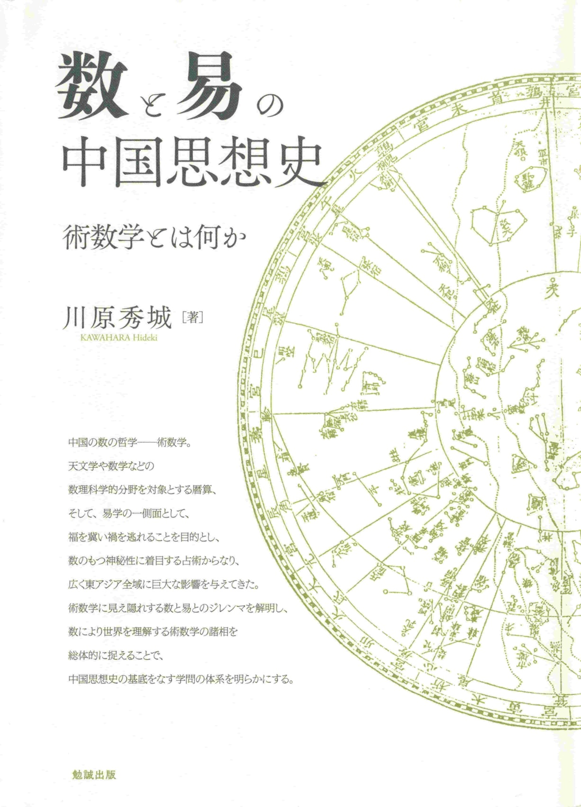

<!-- V3_SOURCE_ID:book015-b000024-p000-a731499ca4 -->

本书以术数学为主题，对其整体内容与特征进行了论述。

查看对应原文

<!-- V3_FOLDBACK_BEGIN:book015-b000024-p000-a731499ca4 -->

本書は術数学をテーマとして，総体的にその内容や特徴について論じたものである。

<!-- V3_FOLDBACK_END:book015-b000024-p000-a731499ca4 -->

<!-- V3_SOURCE_ID:book015-b000025-p000-522759f03c -->

术数学是指中国数术。其学术目的在于揭示“数”所具有的形式关系或秘密信息。大致可分为历算与占术两类。

查看对应原文

<!-- V3_FOLDBACK_BEGIN:book015-b000025-p000-522759f03c -->

術数学とは，中国の数術のこと。学術の目的は「数」のもつ形式的な関係や秘密の情報を明らかにするところにある。大きく暦算と占術にわけることができる。

<!-- V3_FOLDBACK_END:book015-b000025-p000-522759f03c -->

<!-- V3_SOURCE_ID:book015-b000026-p000-dabde6d28e -->

暦算又称暦数，构成了术数学的主流，其含义接近如今的数理科学，以天文学与数学为主要内容。若想了解详细内容，可参考薮内清所著《中国の天文暦法》、钱宝琮所著《中国数学史》等著作。读者应当会被这一不逊色于西欧科学的丰富数理世界所吸引。

> **释读存疑：** 本地硬校验仍未通过，已记录供后续自动处理或人工核对。

查看对应原文

<!-- V3_FOLDBACK_BEGIN:book015-b000026-p000-dabde6d28e -->

暦算は別名，暦数ともいい，術数学の主流を構成した。今日の数理科学の意味に近く，天文学と数学が主な内容である。内容の詳細については，藪内清『中国の天文暦法』(平凡社，1969。増補改訂版，1990)や銭宝琮『中国数学史』(原本：北京·科学出版社，1964。訳本：川原訳，みすず書房，1990)などを参照されたい。西欧科学に劣らぬ豊穣な数理の世界に魅了されるであろう。

<!-- V3_FOLDBACK_END:book015-b000026-p000-dabde6d28e -->

<!-- V3_SOURCE_ID:book015-b000027-p000-6562c2aa39 -->

另一方面，若借用《四库全书总目提要》的定义，占术是混杂了杂说的易学支流。其目的是祈求福运、逃避灾祸，理论依据在于阴阳五行的生克制化。《四库全书总目提要》等中国书籍目录通常将易学的支流归为术数学，而将易学本身尊为经学，不将其算作术数学。但实际上，易学是卜筮之学，就其内容而言，理应列为术数学占术的首位。

查看对应原文

<!-- V3_FOLDBACK_BEGIN:book015-b000027-p000-6562c2aa39 -->

一方，占術は『四庫全書総目提要』の定義を借りれば，雑説を混えた易学の支流のこと。福を冀い禍を逃れることを目的とし，理論根拠を陰陽五行の生剋制化におくという。『四庫全書総目提要』など中国の書籍目録は総じて，易学の支流を術数学としながら，易学自体は経学として貴び，術数学に数えようとしないが，易学は実際のところ，卜筮の学であり，内容に即すれば，ただちに術数学占術の筆頭にあげねばならない。

<!-- V3_FOLDBACK_END:book015-b000027-p000-6562c2aa39 -->

<!-- V3_SOURCE_ID:book015-b000028-p000-48d6f7c3c1 -->

从术数学中数与易不可分割的关系来看，要了解占术的准确内容，易学知识也十分重要。研究易学的著作有很多，可将内容丰富的本田济所著《易》、朱伯崑所著《易学哲学史》等作为参考，按需查阅。这是因为占术的内容极为复杂，以易学知识为前提的论述也不在少数。

> **释读存疑：** 本地硬校验仍未通过，已记录供后续自动处理或人工核对。

查看对应原文

<!-- V3_FOLDBACK_BEGIN:book015-b000028-p000-48d6f7c3c1 -->

術数学における数と易の不可分の関係からすれば，占術の正確な内容を知るには，易学の知識も重要である。易学には研究書は多い。内容に富む本田済『易』(中国古典選，朝日新聞社，1966)
や朱伯崑『易学哲学史』(原本：北京大学出版社，1986-1988。訳本：伊東倫厚監訳・近藤浩之編，朋友書店，2009)などを座右におき，適宜参照されたい。占術の内容は複雑きわまりなく，易学知識を前提とする論述も少なくないからである。

<!-- V3_FOLDBACK_END:book015-b000028-p000-48d6f7c3c1 -->

<!-- V3_SOURCE_ID:book015-b000030-p000-4d38e6071c -->

本书的研究对象是术数学，将跨越暦算与占术两个领域，分析其内容与特征。不过在开展分析研究时，并非没有特意制定方针、集中精力的部分。具体而言，(1)逐一分析暦算与占术的各项技法、理论，在全面论述暦算与占术不可分割的关系的同时，(2)关注《四库全書総目提要》中所谓术数类数学属的内容，并对此进行重点分析。术数类数学属指的是，虽以“数を以て宗と為す”，却被传统上归为“儒家”类别的扬雄《太玄》、邵雍《皇極経世書》一脉。本书之所以关注术数类数学属，是因为其目标之一在于分析阐明术数学中隐约存在的数原理与易原理的困境，即这两个概念的关联、统一、矛盾、对立与调和。换句话说，《四库全書総目提要》虽将术数类数学属视为“易の余緒”，却不打算将其归入“占ト”类，而本书则相反，以阐明术数学与易学，即数与易的微妙关系为直接目的，试图对术数类数学属展开分析，如此这般。

> **释读存疑：** 原文中「術数類数学属」的具体所指未在释读中明确标注，存在歧义未说明；1轮自动修复后核义模型仍建议修订，已保守记录。

查看对应原文

<!-- V3_FOLDBACK_BEGIN:book015-b000030-p000-4d38e6071c -->

本書は研究対象が術数学であり，暦算と占術にまたがってその内容や特徴を分析する。だが分析研究に際して，特別な方針を立て，意識的に精力を集中したところもないわけではない。すなわち，(1)暦算や占術の個々の技法・理論を逐一分析し，暦算と占術の不可分な関係を包括的に論じながら，(2)『四庫全書総目提要』にいわゆる術数類数学属に注目し，それについて重点的に分析した。術数類数学属とは，「数を以て宗と為す」にもかかわらず，「易の余緒」として従来「儒家」(儒家思想)に分類されてきた，揚雄『太玄』や邵雍『皇極経世書』の流れのこと。本書が術数類数学属に着目したのは，その目標の一つが術数学に見え隠れする数原理と易原理のジレンマ，すなわち両概念の連繋・統一・矛盾・対立・和解を分析解明するところにあるからである。言い換えれば，『四庫全書総目提要』は術数類数学属を「易の余緒」ととらえながら「占ト」に分類しようとしないが，本書は逆に，術数学と易学すなわち数と易の微妙な関係を解明することを直接の目的として，術数類数学属の分析を企図した，云々ということができる。

<!-- V3_FOLDBACK_END:book015-b000030-p000-4d38e6071c -->

<!-- V3_SOURCE_ID:book015-b000031-p000-b9bd92221c -->

最后，想就术数学与儒学＝経学的密切关系再补充一句。术数式思维不仅在汉代经学中频繁出现，在宋明朱子学中也同样常见，这是众所周知的。关于汉代经学与术数学的关系，我曾在《中国の科学思想両漢天学考》中论述过。而关于朱子学与术数学的关系，本书的3章与6章与7章中已有具体论述。从术数学的角度来看，汉代学与宋明学的差异不小，但二者都深受术数学的深刻影响，这一点是完全相同的。陸九淵が朱熹論理の術数性を批判する(3章補論)のは当然というべきであろう。

> **释读存疑：** 原文中「漢学」「宋明学」的具体所指未在释读中明确标注，存在歧义未说明；本地硬校验仍未通过，已记录供后续自动处理或人工核对。

查看对应原文

<!-- V3_FOLDBACK_BEGIN:book015-b000031-p000-b9bd92221c -->

最後に術数学と儒学＝経学との密接な関係についても一言したい。術数的思考が漢代経学のみならず宋明朱子学にも頻見することは周知のとおりである。漢代経学と術数学の関係については，かつて『中国の科学思想両漢天学考』(創文社，1996)で論じたことがある。また朱子学と術数学の関係については，本書の3章と6章と7章で具体的に論じた。術数学からみた漢学と宋明学の差異は小さくないが，その深甚な影響をうけていることはまったく等しい。陸九淵が朱熹論理の術数性を批判する(3章補論)のは当然というべきであろう。

<!-- V3_FOLDBACK_END:book015-b000031-p000-b9bd92221c -->

<!-- V3_SOURCE_ID:book015-b000032-p000-c055dae8b4 -->

术数学是能够期待取得有意义成果的研究主题之一。衷心希望相关研究能够不断积累并发展。

查看对应原文

<!-- V3_FOLDBACK_BEGIN:book015-b000032-p000-c055dae8b4 -->

術数学は有意義な成果を期待することができる研究テーマの一つである。研究の蓄積と発展を心から希望する。

<!-- V3_FOLDBACK_END:book015-b000032-p000-c055dae8b4 -->

<!-- V3_SOURCE_ID:book015-b000033-p000-ffea3aaae5 -->

2018年1月11日

查看对应原文

<!-- V3_FOLDBACK_BEGIN:book015-b000033-p000-ffea3aaae5 -->

2018年1月11日

<!-- V3_FOLDBACK_END:book015-b000033-p000-ffea3aaae5 -->

<!-- V3_SOURCE_ID:book015-b000034-p000-d8a06cd1e6 -->

斑竹老人川原秀城

查看对应原文

<!-- V3_FOLDBACK_BEGIN:book015-b000034-p000-d8a06cd1e6 -->

斑竹老人川原秀城

<!-- V3_FOLDBACK_END:book015-b000034-p000-d8a06cd1e6 -->

<!-- V3_SOURCE_ID:book015-b000035-p000-2972e1231f -->

## 目次

查看对应原文

<!-- V3_FOLDBACK_BEGIN:book015-b000035-p000-2972e1231f -->

## 目次

<!-- V3_FOLDBACK_END:book015-b000035-p000-2972e1231f -->

<!-- V3_SOURCE_ID:book015-b000036-p000-c442b57af9 -->

前言………………………………………(1)
1 中国的「計量的」科学
小序……
1 術数学与数的二义性……
1.1 中国科学与術数的思考
1.2 曆算与占術……
1.3 算书中的占法与占书中的数理知识……
1.4 算术与筮法的结合…
2 经学与術数学… · 11
2.1 董仲舒的天人之学… … 11
2.2 劉歆的目录学…… 15
小结…… 20
2 中国的数術… …23
1 術数学的定义… …24
1.1 《漢書》中的用例… 24
1.2 術数概念的外延……… 25
1.3 術数的定义…… 27
1.4 数術与方術… 29
2 術数学的历史… …30
2.1 数理的自律性发展…… …30
2.2 以易说对数字进行统一解释…… ……32
術数学的时代区分 代之以结语… …35
1 術数原论… 30
1.1 術数一论：从科学思想的视角进行分析 40
1.2 術数二论：从历史的视角进行分析…… :41
2 问题的所在……
3 对朱子学的術数学式评价 45
3.1 黃胤錫的《理藪新編》… 47
3.2 阮元的《疇人传》序… 49
4 朱子哲学中出现的術数式思考 ·51
4.1 形而上学与自然学的混淆 51
4.2 伦理与筮的并存…… ·54
4.3 律吕本原与候气的矛盾…… 58
小结… 60
补论…
4 大衍術 6
1 前史 67
1.1 「物不知数」· 67
1.2 中国剩余定理…… 68
2 秦九韶的大衍術 70
2.1 大衍总数術… 70
2.2 大衍求一術……
2.3 一般合同题的解法…
2.4 元数与定母……
2.5 关于解的存在条件……
2.6 上元积年的计算… 83
小结… 85

查看对应原文

<!-- V3_FOLDBACK_BEGIN:book015-b000036-p000-c442b57af9 -->

前言………………………………………(1)  
1 中国の「計量的]科学  
小序……  
1 術数学と数の二義性……  
1.1 中国科学と術数的思考  
1.2 暦算と占術……  
1.3 算書中の占法と占書中の数理知識……  
1.4 算術と筮法の結合…  
2 経学と術数学… · 11  
2.1 董仲舒の天人の学… … 11  
2.2 劉歆の目録学…… 15  
小結…… 20  
2 中国の数術… …23  
1 術数学の定義… …24  
1.1 漢書の用例… 24  
1.2 術数概念の外延……… 25  
1.3 術数の定義…… 27  
1.4 数術と方術… 29  
2 術数学の歴史… …30  
2.1 数理の自律的展開…… …30  
2.2 易説による数の統一的解釈…… ……32  
術数学の時代区分結びにかえて… …35  
1 術数原論… 30  
1.1 術数一論科学思想の視点からの分析 40  
1.2 術数二論歴史的な分析…… :41  
2 問題の所在……  
3 朱子学に対する術数学的な評価 45  
3.1 黃胤錫の理藪新編… 47  
3.2 阮元の疇人伝序… 49  
4 朱子哲学に現れる術数的思考 ·51  
4.1 形而上学と自然学の混淆 51  
4.2倫理とト筮の併存…… ·54  
4.3 律呂本原と候気の矛盾…… 58  
小結… 60  
補論…  
4 大衍術 6  
1 前史 67  
1.1 「物不知数」· 67  
1.2 中国剩余定理…… 68  
2 秦九韶の大衍術 70  
2.1 大衍総数術… 70  
2.2 大衍求一術……  
2.3 一般合同題の解法…  
2.4 元数と定母……  
2.5解の存在条件について……  
2.6 上元積年の計算… 83  
小結… 85

<!-- V3_FOLDBACK_END:book015-b000036-p000-c442b57af9 -->

<!-- V3_SOURCE_ID:book015-b000037-p000-2972e1231f -->

## 目次

查看对应原文

<!-- V3_FOLDBACK_BEGIN:book015-b000037-p000-2972e1231f -->

## 目次

<!-- V3_FOLDBACK_END:book015-b000037-p000-2972e1231f -->

<!-- V3_SOURCE_ID:book015-b000038-p000-a641a6d118 -->

5 秦九韶的易筮法 80
1 多样筮法的存在 89
2 秦九韶的筮法… 90
3 大衍術…… 91
4 筮法与算法的一体化…… 93
小结… 94
6 皇極經世学小史 101
1 邵雍的《皇極經世書》 ·103
1.1 曆年表……… 104
1.2 声音表… ·109
1.3 《觀物外篇》与先天易学…… ·114
1.4 術数与觀物…… 119
2 皇極經世学的发展… ·122
2.1 邵伯温与蔡元定的易说… ·123
2.2 張行成的掛一图与既济图… ·127
2.3 祝泌的起运法与语音分析 ·135
2.4 黄畿的气六变说…… ·144
小结… 149
7 律曆渊源与河圖洛書 ·155
问题的所在 ·155
1 数理本原与《周易》折中 ·157
1.1 河图图与加减法 ·158
1.2 洛书图与乘除法 160
2 数学与道学 164
2.1 数理科学的河图洛书起源说… ·165
2.2 康熙帝与朱子学 169
小结… ·172

查看对应原文

<!-- V3_FOLDBACK_BEGIN:book015-b000038-p000-a641a6d118 -->

5 秦九韶の易筮法 80  
1 多様な筮法の存在 89  
2 秦九韶の筮法… 90  
3 大衍術…… 91  
4 筮法と算法の一体化…… 93  
小結… 94  
6 皇極経世学小史 101  
1 邵雍の『皇極経世書』 ·103  
1.1 歴年表……… 104  
1.2 声音表… ·109  
1.3 観物外篇と先天易学…… ·114  
1.4 術数と観物…… 119  
2 皇極経世学の展開… ·122  
2.1 邵伯温と蔡元定の易説… ·123  
2.2 張行成の掛一図と既済図… ·127  
2.3 祝泌の起運法と語音分析 ·135  
2.4 黄畿の気六変説…… ·144  
小結… 149  
7 律暦淵源と河図洛書 ·155  
問題の所在 ·155  
1 数理本原と周易折中 ·157  
1.1 河図図と加减法 ·158  
1.2 洛書図と乗除法 160  
2 数学と道学 164  
2.1 数理科学の河図洛書起源説… ·165  
2.2 康熙帝と朱子学 169  
小結… ·172

<!-- V3_FOLDBACK_END:book015-b000038-p000-a641a6d118 -->

<!-- V3_SOURCE_ID:book015-b000039-p000-f60ea681eb -->

## 術数学補論

查看对应原文

<!-- V3_FOLDBACK_BEGIN:book015-b000039-p000-f60ea681eb -->

## 術数学補論

<!-- V3_FOLDBACK_END:book015-b000039-p000-f60ea681eb -->

<!-- V3_SOURCE_ID:book015-b000040-p000-5a0828826c -->

8 《孙子》中的天文与地理……177
1 兵家思想中的合理性与神秘性……177
1.1 中国的天文与地理……177
1.2 权谋家的军事思想……178
2 《孙子》中的天文与地理……180
2.1 天文、地理的重要性……180
2.2 天是什么……180
2.3 天文占……181
2.4 寒暑与时制……184
2.5 《孙子》的地理认识……185
小结 以“人”的视角……187
9 中国古来的哲理·五行思想……189
1 天的哲学……189
2 五行思想……190
3 五行灾异……191
4 水与听……193
5 五德终始……195
6 水德的王朝……197
7 对科学理论的影响……199
10 中国的“度量”世界……203
1 中国的统一度量衡制度……204
2 度量衡与声律……206
3 刘歆的三统哲学……209

查看对应原文

<!-- V3_FOLDBACK_BEGIN:book015-b000040-p000-5a0828826c -->

8『孫子』における天文と地理…… …177  
1 兵家思想における合理性と神秘性…… …177  
1.1 中国の天文と地理… …177  
1.2 権謀家の軍事思想… …178  
2 孫子における天文と地理…… …180  
2.1 天文・地理の重要性…… …180  
2.2天とは…… 180  
2.3 天文占…… …181  
2.4 寒暑と時制… 184  
2.5 孫子の地理認識…… …185  
小結「人」の視点…… …187  
9 中国古来の哲理・五行思想 …189  
1 天の哲学 …189  
2 五行思想 …190  
3 五行災異… …191  
4 水と聴…… …193  
5 五徳終始… …195  
6 水徳の王朝…… …197  
7 科学理論への影響 …199  
10中国の「はかり」の世界 …203  
1 中国の統一度量衡制… …204  
2 度量衡と声律…… …206  
3 劉歆の三統哲学… …209

<!-- V3_FOLDBACK_END:book015-b000040-p000-5a0828826c -->

<!-- V3_SOURCE_ID:book015-b000041-p000-2972e1231f -->

## 目次

查看对应原文

<!-- V3_FOLDBACK_BEGIN:book015-b000041-p000-2972e1231f -->

## 目次

<!-- V3_FOLDBACK_END:book015-b000041-p000-2972e1231f -->

<!-- V3_SOURCE_ID:book015-b000042-p000-2c60868b76 -->

11 术数的思考与中国医学……215
1 术数的思考……215
1.1 中国的数术……215
1.2 中国科学的计量特性……218
1.3 数的二重含义……219
1.4 术数学=历算+占术……221
1.5 理数与命数的混淆……224
2 中国医学与术数的思考……227
2.1 方技的二重含义……227
2.2 本草学与三品分类……228
2.3 营五十周……235
后记……239

查看对应原文

<!-- V3_FOLDBACK_BEGIN:book015-b000042-p000-2c60868b76 -->

11 術数的思考と中国医学…… …215  
1 術数的思考…… …215  
1.1 中国の数術…… ………215  
1.2 中国科の計量的性格……218  
1.3数の二義性…… ……219  
1.4 術数学=暦算+占術………… ……221  
1.5 理数と命数の混淆…… …224  
2 中国医学と術数的思考…… ……227  
2.1 方技の二義性…… ……227  
2.2 本草学と三品分類……………… ……228  
2.3 営五十周……… …235  
後言……… …239

<!-- V3_FOLDBACK_END:book015-b000042-p000-2c60868b76 -->

<!-- V3_SOURCE_ID:book015-b000043-p000-bf1af186b4 -->

## 術数学原論

查看对应原文

<!-- V3_FOLDBACK_BEGIN:book015-b000043-p000-bf1af186b4 -->

## 術数学原論

<!-- V3_FOLDBACK_END:book015-b000043-p000-bf1af186b4 -->

<!-- V3_SOURCE_ID:book015-b000044-p000-0be385eda0 -->

## 1 中国の「計量的」科学 — 1 中国的「计量型」科学

查看对应原文

<!-- V3_FOLDBACK_BEGIN:book015-b000044-p000-0be385eda0 -->

## 1 中国の「計量的」科学

<!-- V3_FOLDBACK_END:book015-b000044-p000-0be385eda0 -->

<!-- V3_SOURCE_ID:book015-b000045-p000-3ebaf6b1af -->

## 小序

查看对应原文

<!-- V3_FOLDBACK_BEGIN:book015-b000045-p000-3ebaf6b1af -->

## 小序

<!-- V3_FOLDBACK_END:book015-b000045-p000-3ebaf6b1af -->

<!-- V3_SOURCE_ID:book015-b000046-p000-d87174f0f9 -->

欧洲16至17世纪的科学革命以及近代科学的形成过程中，「毕达哥拉斯的指针」发挥了重大作用，产生了深远影响，这是科学史家都熟知的事实。所谓「毕达哥拉斯的指针」，指的是看待自然的一种视角或方法，其源自古希腊科学哲学家毕达哥拉斯将万物的本原规定为数的观点。信奉这一指针的科学家与科学哲学家认为，自然这部著作是用数学语言写成的，他们致力于发现并解释支配宇宙的数学模式。他们坚信自然界中存在着数学上的和谐，并且确信关于这种数学和谐的知识能够洞悉宇宙的基本结构。在16至17世纪，倘若伽利略等西欧科学家没有这种信念，近代科学是否能够形成就非常值得怀疑，而且当今科学所具有的极强的计量性，归根结底，作为其基本精神与构想，几乎毫无疑问是起源于那个时期。

查看对应原文

<!-- V3_FOLDBACK_BEGIN:book015-b000046-p000-d87174f0f9 -->

ヨーロッパ16～17世紀の科学革命や近代科学の成立において，「ピタゴラスの指針」が大きな働きをし，深甚な影響をおよぼしたことは，科学史家にはよく知られたところである。ピタゴラスの指針とは，自然をみる1つの視点ないし方法のこと。古代ギリシアの科学哲学者のピタゴラスが万物の根元を数と規定したところに因んでいる。この指針を信奉する科学者や科学哲学家は，自然という書物は数学の言語で書かれているととらえ，宇宙を秩序立てている数学的パターンを発見し説明しようとする。自然界に現れる数学的調和が実在すると信じ，その数学的調和についての知識は宇宙の基本構造をみとおすと確信している。16～17世紀当時，ガリレオなど西欧の科学者にこの確信がなかったならば，結果として近代科学が成立しえたか非常に疑わしく，また今日の科学のきわめて計量的な性格も畢竟，基本的な精神や発想としては，その辺りに起源することはほぼ疑いをいれない。

<!-- V3_FOLDBACK_END:book015-b000046-p000-d87174f0f9 -->

<!-- V3_SOURCE_ID:book015-b000047-p000-a926683b07 -->

那么，对于中国的前近代时期，能否依据近代科学并未在自身文明与文化的语境中形成这一点，就推断出不存在拥有类似毕达哥拉斯那样与近代科学直接相关的自然认知方法的科学家或科学哲学家，也不存在赋予计量与数特殊价值的独特自然哲学或数的学术呢？根据我初步的调查，这种推断绝对无法成立。原因非常简单，即存在着与毕达哥拉斯学说类似的广义「数」的学问。

> **释读存疑：** 原文末尾语句不完整，仅能翻译已有的内容

查看对应原文

<!-- V3_FOLDBACK_BEGIN:book015-b000047-p000-a926683b07 -->

しからば中国の前近代に対して，自らの文明・文化のコンテクストのもと近代科学が成立しなかったことを根拠として，ピタゴラスのような，近代科学に直結する要素をもつ自然認識法を採用した科学者や科学哲学家は存在せず，計量や数に特別な価値をみいだす独自の自然哲学や数の学術は存在しなかった，などと推論することは可能か。わたしの初歩的な調査によれば,そのような推論は断じて成立しない。なぜならば，非常に単純なことであるが，ピタゴラスの学説に類似した広義の「数」の学

<!-- V3_FOLDBACK_END:book015-b000047-p000-a926683b07 -->

<!-- V3_SOURCE_ID:book015-b000048-p000-4600549240 -->

这是因为，能够证明该术在古典期的中国存在的历史资料，更直接地说，以“数”的哲学为主题的专业书籍等，数量众多且留存于其他各个领域。

查看对应原文

<!-- V3_FOLDBACK_BEGIN:book015-b000048-p000-4600549240 -->

術が，古典期の中国に存在したことを証明する歴史的資料，より直接的には，「数」の哲学を主題とした専門書などが，多数しかも他方面にのこっているからである。

<!-- V3_FOLDBACK_END:book015-b000048-p000-4600549240 -->

<!-- V3_SOURCE_ID:book015-b000049-p000-88b2439984 -->

就目前而言，我基于这类史料，对“数”的学术的形成与兴衰变迁的历史，大致做出如下推定。

查看对应原文

<!-- V3_FOLDBACK_BEGIN:book015-b000049-p000-88b2439984 -->

わたしは現在のところ,そうした史料にもとづいて,「数」の学術の成立と消長変遷の歴史を大きく以下のように推定している。

<!-- V3_FOLDBACK_END:book015-b000049-p000-88b2439984 -->

<!-- V3_SOURCE_ID:book015-b000050-p000-afb8494cd4 -->

③最晚至汉代，就存在着具备与毕达哥拉斯学派同等或更宏大思想外延的“数”的学术。它作为一个独立的学术领域存在，被统称为“术数学”“数学”等。

查看对应原文

<!-- V3_FOLDBACK_BEGIN:book015-b000050-p000-afb8494cd4 -->

③遅くとも漢代には，ピタゴラスと同等，あるいはそれ以上に壮大な思想的外延をもった「数」の学術が存在した。それは一個の学術領域としても自立しており，「術数学」「数学」などと総称された。

<!-- V3_FOLDBACK_END:book015-b000050-p000-afb8494cd4 -->

<!-- V3_SOURCE_ID:book015-b000051-p000-5b55a40667 -->

④汉代以后，术数学吸收了相邻领域的知识，在深化内容的同时，实现了多方面的发展。

查看对应原文

<!-- V3_FOLDBACK_BEGIN:book015-b000051-p000-5b55a40667 -->

④漢代以降，術数学は隣接領域の知識を吸収し内容を深化しながら，多方面の発展を遂げた。

<!-- V3_FOLDBACK_END:book015-b000051-p000-5b55a40667 -->

<!-- V3_SOURCE_ID:book015-b000052-p000-424aaaa36a -->

到了清朝，随着清学的成立与发展，虽进展缓慢，却逐渐与神秘主义诀别并将其摒弃，开始向近代的方法与视角靠拢。等等。

查看对应原文

<!-- V3_FOLDBACK_BEGIN:book015-b000052-p000-424aaaa36a -->

⑤清朝にいたって，清学の成立や進展と歩調をあわせつつ，わずかずつではあるが，その数神秘主義と訣別しそれを放擲しながら，近代的方法や視点への接近を開始した。云々。

<!-- V3_FOLDBACK_END:book015-b000052-p000-424aaaa36a -->

<!-- V3_SOURCE_ID:book015-b000053-p000-cab148b517 -->

我当前的课题，是对被称为术数学的中国特有的“数”之学术进行整体论述，明确其自然观及若干特征或性质。

查看对应原文

<!-- V3_FOLDBACK_BEGIN:book015-b000053-p000-cab148b517 -->

わたしの現在の課題は，術数学とよばれた中国独自の「数」の学術について総体的に論じ，その自然観や思考のいくつかの特徴ないし性格を明らかにするところにある。

<!-- V3_FOLDBACK_END:book015-b000053-p000-cab148b517 -->

<!-- V3_SOURCE_ID:book015-b000054-p000-dc2748b30a -->

## 1 術数学と数の二義性 — 1 术数学与数的二义性

查看对应原文

<!-- V3_FOLDBACK_BEGIN:book015-b000054-p000-dc2748b30a -->

## 1 術数学と数の二義性

<!-- V3_FOLDBACK_END:book015-b000054-p000-dc2748b30a -->

<!-- V3_SOURCE_ID:book015-b000055-p000-6b5f6b6d9c -->

术数学是广义的“数”的学术，以现代意义上的天文学、数学、地理学等为主要领域，但不仅限于这些领域，还包含天文占、五行占、风水、观相等各类拟科学领域。

查看对应原文

<!-- V3_FOLDBACK_BEGIN:book015-b000055-p000-6b5f6b6d9c -->

術数学とは広義の「数」の学術のこと。現在的意味における天文学・数学・地理学などを主要な分野とするが，それにとどまらず天文占・五行占・風水・観相など擬科学の諸分野も内に含んでいる。

<!-- V3_FOLDBACK_END:book015-b000055-p000-6b5f6b6d9c -->

<!-- V3_SOURCE_ID:book015-b000056-p000-8843846ea5 -->

## 1.1 中国科学と術数的思考 — 1.1 中国科学与术数的思考

查看对应原文

<!-- V3_FOLDBACK_BEGIN:book015-b000056-p000-8843846ea5 -->

## 1.1 中国科学と術数的思考

<!-- V3_FOLDBACK_END:book015-b000056-p000-8843846ea5 -->

<!-- V3_SOURCE_ID:book015-b000057-p000-3cb9bbbb4d -->

中国近代以前的科学，从某一方面来看，是非常注重计量的。换句话说，即便在中国的古典时代，也无法否认数字或数字概念在科学领域中发挥着该领域语言的作用。科学的计量性特征，不仅天文学和数学如此，即便在学术理念上不属于数理科学或术数学的医学领域，也完全没有改变。例如《黄帝内经太素》中的《营五十周·卫五十周》篇，定量记录了营气与卫气在人体内运行的速度；还有《骨度·肠度·脉度》篇，详细记载了骨节、肠胃、经脉的长短1。

查看对应原文

<!-- V3_FOLDBACK_BEGIN:book015-b000057-p000-3cb9bbbb4d -->

中国前近代の科学は一面，非常に計量的である。言い換えれば，中国古典時代にあっても，数ないし数概念が科学領域のなかでその言語として機能していたことは否めない。科学の計量的性格は，天文学や数学はいうにおよばず，学術理念上，数理科学ないし術数学に属さない医学でも，すこしも変わらない。たとえば『黄帝内経太素』営五十周・衛五十周篇。営気や衛気が身体内で動くスピードを定量的に記録している。また骨度・腸度・脈度篇。骨節や胃腸・脈の長短を詳細にあたえている1。

<!-- V3_FOLDBACK_END:book015-b000057-p000-3cb9bbbb4d -->

<!-- V3_SOURCE_ID:book015-b000058-p000-f97b3c2217 -->

中国的科学家们就这样对自然界的各种事物与现象进行计量，积极致力于对其进行量化阐释，但他们的数值解析并非仅仅以构建现代意义上的自然科学理论为目标。同样是这些科学家，在构建自然科学理论的同时，也构建了数字神秘主义的理论，并且以兼具自然科学与神秘主义的方式开展自然研究，这一点毋庸置疑。以《黄帝内经太素》的《营五十周》篇为例，传说中的名医岐伯对黄帝说，人体经脉上下左右前后共二十八条，将其与天上的赤道二十八星宿相对应，同时说明营气在1日内在人体内运行五十周2)。

> **释读存疑：** 本地硬校验仍未通过，已记录供后续自动处理或人工核对。

查看对应原文

<!-- V3_FOLDBACK_BEGIN:book015-b000058-p000-f97b3c2217 -->

中国の科学者はこのように自然界の諸物や現象を計量し，その数量的解明に積極的に従事していたが，その数値解析は単に，現在の意味における自然科学的な理論構築のみを目指していたのではない。同じ科学者が自然科学的な理論と併行して数神秘主義的な理論を築きあげ，自然科学的かつ神秘主義的に自然研究を展開していたことも，疑問の余地すらない。『黄帝内経太素』営五十周篇を例にとれば，伝説上名医の岐伯は黄帝に対して，「人経脈上下左右前後二十八脈」を天の赤道二十八宿と対応させつつ，営気が1日に身体を50周することを説明している2)。

<!-- V3_FOLDBACK_END:book015-b000058-p000-f97b3c2217 -->

<!-- V3_SOURCE_ID:book015-b000059-p000-41e2feed9d -->

中国科学这种围绕数字兼具计量性与神秘主义的特征，若对其思考方式进行归类并探究其根源，就必须说它源自术数的思考。因为在术数的思考中，自然界中，数字在本质上发挥着作用。换句话说，若没有数字，就不存在调和与统一，等等。

查看对应原文

<!-- V3_FOLDBACK_BEGIN:book015-b000059-p000-41e2feed9d -->

中国科学のこうした数をめぐる計量的かつ神秘的主義な性格は，思考様式を類別し，その思考の因るところをさぐれば，術数的思考に由来するといわねばならない。なぜならば，
⑧術数的思考のばあい，自然界(や人間界)について，数(広義)が本質的に機能している。言い換えれば，数がなければ調和や統一は存在しない，云々ととらえる。

<!-- V3_FOLDBACK_END:book015-b000059-p000-41e2feed9d -->

<!-- V3_SOURCE_ID:book015-b000061-p000-6cc7bd4e0f -->

⑥中国的数概念包含两个相互对立的方面，分别是抽象的理数，以及神秘的命数、卜数。

查看对应原文

<!-- V3_FOLDBACK_BEGIN:book015-b000061-p000-6cc7bd4e0f -->

⑥中国の数概念には，相反する二つの側面がある。抽象的な理数と神秘的な命数・卜数である。

<!-- V3_FOLDBACK_END:book015-b000061-p000-6cc7bd4e0f -->

<!-- V3_SOURCE_ID:book015-b000062-p000-f4ce2db59b -->

术数思维或术数学，着眼于数的两面性与歧义性，一方面重视并遵循理数的计量性、客观性特征，另一方面也同等重视命数、卜数的神秘性与人文性特征，力求解读并应用数所蕴含的隐秘信息。

查看对应原文

<!-- V3_FOLDBACK_BEGIN:book015-b000062-p000-f4ce2db59b -->

術数的思考ないし術数学は，数の二面性・二義性に着目して，理数の計量的・客観的な性格を重んじそれに則る一方で，それと等価値的に，命数や卜数の神秘的・人間的な側面にも注意を怠らず，数の語る秘密の情報を解読し応用しようとする。

<!-- V3_FOLDBACK_END:book015-b000062-p000-f4ce2db59b -->

<!-- V3_SOURCE_ID:book015-b000063-p000-883171ad3c -->

这是因为可以如此进行分析。3)

查看对应原文

<!-- V3_FOLDBACK_BEGIN:book015-b000063-p000-883171ad3c -->

このように分析することができるからである3)。

<!-- V3_FOLDBACK_END:book015-b000063-p000-883171ad3c -->

<!-- V3_SOURCE_ID:book015-b000064-p000-3b3344e584 -->

## 1.2 暦算と占術 — 1.2 历算与占术

查看对应原文

<!-- V3_FOLDBACK_BEGIN:book015-b000064-p000-3b3344e584 -->

## 1.2 暦算と占術

<!-- V3_FOLDBACK_END:book015-b000064-p000-3b3344e584 -->

<!-- V3_SOURCE_ID:book015-b000065-p000-afdd7c7f90 -->

就中国的科学与哲学而言，尽管可以说，关于术数性思考的基本且概括性的说明，尽在于上述数字的二重性之中，但在作为该思考之专门且体系性展开的术数学中，大体上偏向于仅追求数字某一侧面的整合性，是一种略显偏向性的学术形式，也就是（1）历数、算数与（2）多种多样的占术，应当说构成了其主流。能够明确表明这一点的，莫过于历代的书籍目录（表1-1）4）。

查看对应原文

<!-- V3_FOLDBACK_BEGIN:book015-b000065-p000-afdd7c7f90 -->

中国の科学や哲学のばあい，術数的思考にかんする基本的かつ総括的な説明は，上記の数の二義性に尽きるということができるとはいえ，そ
の思考の専門的かつ体系的な展開である術数学においては，おおむね数の一面のみに偏ってその整合性を追求していく，やや偏向的な形式の学術，すなわち(1)暦数・算数と(2)多種多様の占術が主流を形成していたというべきであろう。そのことを明示してくれるのは，歴代の書籍目録に勝るものはない(表1-1)4)。

<!-- V3_FOLDBACK_END:book015-b000065-p000-afdd7c7f90 -->

<!-- V3_SOURCE_ID:book015-b000067-p000-9178df553c -->

这是名为《数术分类表》的表格，呈现历代目录著作中数术类书籍的分类情况，具体内容如下：
| 历代目录著作 | 七略 | 七录 | 隋书经籍志 | 新唐书艺文志 | 崇文总目 | 郡斋读书志 | 遂初堂书目 | 直斋书录解题 | 文献通考经籍考 | 宋史艺文志 | 明史艺文志 | 四库全书总目 |
| --- | --- | --- | --- | --- | --- | --- | --- | --- | --- | --- | --- | --- |
| 数术类细分 | 数术略包含历谱、天文、著龟、五行、杂占、形法六类 | 七录未单独列出数术大类，相关内容分属历算部、天文部、卜筮部、五行部、杂占部、形法部 | 隋书经籍志将相关内容归入子部，分为历数、五行两类 | 新唐书艺文志将相关内容归入子部，分为历算类、五行类 | 崇文总目将相关内容归入子部，分为历数类、天文类、五行类 | 郡斋读书志将相关内容归入子部，分为天文历数类、卜筮类、五行类 | 遂初堂书目将相关内容归入子部，分为数术家类，其下细分历议、天文、卜筮、五行阴阳、形势五类 | 直斋书录解题将相关内容归入子部，分为历象类、阴阳家类、卜筮类、形法类 | 文献通考经籍考将相关内容归入子部，分为历算、五行、形法三类 | 宋史艺文志将相关内容归入子部，分为历算类、天文类、著龟类、五行类、形法类 | 明史艺文志将相关内容归入子部，分为五行类 | 四库全书总目将相关内容归入子部，分为天文算法类、占候类、占卜类、五行类、相宅相墓类、命书相书类、数学类 |
注：其中“五行”为木、火、土、金、水五种分类及其关系体系，是历代数术分类中的重要类别之一。

> **释读存疑：** 原文表格中部分单元格的合并情况及对应分类的细分细节存在未完全明确的内容；本地硬校验仍未通过，已记录供后续自动处理或人工核对。

查看对应原文

<!-- V3_FOLDBACK_BEGIN:book015-b000067-p000-9178df553c -->

表1-1 数術分類表
<table><tr><td rowspan=1 colspan=3>七略</td><td rowspan=1 colspan=3>七錄</td><td rowspan=1 colspan=3>隋書経籍志</td><td rowspan=1 colspan=2>新唐書芸文志</td><td rowspan=1 colspan=3>崇文総目</td><td rowspan=1 colspan=3>郡斎読書志</td></tr><tr><td rowspan=8 colspan=1>数術略</td><td rowspan=2 colspan=2>暦譜</td><td rowspan=2 colspan=2></td><td rowspan=2 colspan=1>曆算部</td><td rowspan=2 colspan=2>子</td><td rowspan=2 colspan=1>暦数</td><td rowspan=2 colspan=1>子</td><td rowspan=2 colspan=1>暦算類</td><td rowspan=2 colspan=2></td><td rowspan=1 colspan=1>曆数類</td><td rowspan=7 colspan=1>子部</td><td rowspan=7 colspan=2>天文暦数</td></tr><tr><td rowspan=1 colspan=2></td><td rowspan=1 colspan=1>算術類</td></tr><tr><td rowspan=1 colspan=2>天文</td><td rowspan=1 colspan=1></td><td></td><td rowspan=1 colspan=1>天文部</td><td rowspan=1 colspan=1></td><td></td><td rowspan=1 colspan=1>天文</td><td rowspan=1 colspan=1></td><td rowspan=1 colspan=1>天文類</td><td rowspan=1 colspan=1></td><td></td><td rowspan=1 colspan=1>天文占書類</td></tr><tr><td rowspan=1 colspan=2>著龟</td><td rowspan=1 colspan=1></td><td></td><td rowspan=1 colspan=1>卜筮部</td><td rowspan=4 colspan=2>部</td><td rowspan=4 colspan=1>五行</td><td rowspan=4 colspan=1>部</td><td rowspan=4 colspan=1>五行類</td><td rowspan=4 colspan=2>部</td><td rowspan=1 colspan=1></td><td rowspan=1 colspan=2>卜筮類</td></tr><tr><td rowspan=1 colspan=2>五行</td><td rowspan=1 colspan=2>錄</td><td rowspan=1 colspan=1>五行部</td><td rowspan=3 colspan=1>五行類</td></tr><tr><td rowspan=1 colspan=2>雑占</td><td rowspan=1 colspan=1></td><td></td><td rowspan=1 colspan=1>雑占部</td></tr><tr><td rowspan=1 colspan=2>形法</td><td rowspan=1 colspan=2></td><td rowspan=1 colspan=1>形法部</td></tr><tr><td rowspan=1 colspan=2></td><td rowspan=1 colspan=2></td><td rowspan=1 colspan=1></td><td rowspan=1 colspan=2></td><td rowspan=1 colspan=1></td><td rowspan=1 colspan=1></td><td rowspan=1 colspan=1></td><td rowspan=1 colspan=2></td><td rowspan=1 colspan=1></td><td rowspan=1 colspan=1></td><td rowspan=1 colspan=2></td></tr><tr><td rowspan=1 colspan=3>遂初堂書目</td><td rowspan=1 colspan=3>直斎書錄解題</td><td rowspan=1 colspan=2>文献通</td><td rowspan=1 colspan=1>考経籍考</td><td rowspan=1 colspan=1>宋史</td><td rowspan=1 colspan=1>芸文志</td><td rowspan=1 colspan=3>明史芸文志</td><td rowspan=1 colspan=3>四庫全書総目</td></tr><tr><td rowspan=11 colspan=1>子部</td><td rowspan=11 colspan=1>数術家類</td><td rowspan=1 colspan=1>暦議</td><td rowspan=3 colspan=2>子</td><td rowspan=3 colspan=1>暦象類</td><td rowspan=3 colspan=2>子</td><td rowspan=2 colspan=1>暦算</td><td rowspan=2 colspan=1>子</td><td rowspan=2 colspan=1>暦算類</td><td rowspan=2 colspan=2>子</td><td rowspan=2 colspan=1>暦数類</td><td rowspan=2 colspan=1>子</td><td rowspan=1 colspan=1>天文算法類</td><td rowspan=1 colspan=1>推步</td></tr><tr><td rowspan=2 colspan=1>天文</td><td rowspan=1 colspan=1></td><td rowspan=1 colspan=1>算書</td></tr><tr><td rowspan=1 colspan=2></td><td rowspan=1 colspan=1>天文</td><td></td><td rowspan=1 colspan=1>天文類</td><td rowspan=1 colspan=1></td><td></td><td rowspan=1 colspan=1>天文類</td><td></td><td rowspan=1 colspan=1></td><td rowspan=1 colspan=1>占候</td></tr><tr><td rowspan=1 colspan=1>卜筮</td><td rowspan=1 colspan=1></td><td></td><td rowspan=1 colspan=1>卜筮類</td><td rowspan=1 colspan=1></td><td></td><td rowspan=1 colspan=1>占筮</td><td rowspan=1 colspan=1></td><td rowspan=1 colspan=1>著龟類</td><td rowspan=7 colspan=2>部</td><td rowspan=7 colspan=1>五行類</td><td rowspan=7 colspan=1>部</td><td rowspan=1 colspan=1></td><td rowspan=1 colspan=1>占卜</td></tr><tr><td rowspan=4 colspan=1>五行陰陽</td><td rowspan=4 colspan=2>部</td><td rowspan=4 colspan=1>陰陽家類</td><td rowspan=4 colspan=2>部</td><td rowspan=4 colspan=1>五行</td><td rowspan=6 colspan=1>部</td><td rowspan=6 colspan=1>五行類</td><td></td><td></td></tr><tr><td rowspan=4 colspan=1>術数類</td><td></td></tr><tr><td rowspan=1 colspan=1>陰陽五行</td></tr><tr><td rowspan=1 colspan=1>雑技術</td></tr><tr><td rowspan=2 colspan=1>形势</td><td rowspan=2 colspan=2></td><td rowspan=2 colspan=1>形法類</td><td rowspan=2 colspan=2></td><td rowspan=2 colspan=1>形法</td><td rowspan=1 colspan=1>相宅相墓</td></tr><tr><td rowspan=1 colspan=1></td><td rowspan=1 colspan=1>命密相書</td></tr><tr><td rowspan=1 colspan=1></td><td rowspan=1 colspan=2></td><td rowspan=1 colspan=1></td><td rowspan=1 colspan=2></td><td rowspan=1 colspan=1></td><td rowspan=1 colspan=1></td><td rowspan=1 colspan=1></td><td rowspan=1 colspan=2></td><td rowspan=1 colspan=1></td><td rowspan=1 colspan=1></td><td rowspan=1 colspan=1></td><td rowspan=1 colspan=1>数学</td></tr></table>

<!-- V3_FOLDBACK_END:book015-b000067-p000-9178df553c -->

<!-- V3_SOURCE_ID:book015-b000068-p000-33565defde -->

现存的中国最古书籍目录是《汉书》艺文志，也就是刘歆的《七略》，其中的术数略（あるいは数術略）将“数術”或术数类书籍分为六类记载：①天文、②暦譜、③五行、④蓍亀、⑤雑占、⑥形法。其中暦譜类的内容相当于如今的数理天文学和数学，其余五类大致属于占术。南朝梁阮孝緒的《七録》，将《七略》中方技略的医経・経方与术数略的六类合并为一个学术部门，不过在数术的理解或分类方面，除了設立緯識部之外，与刘歆的分类没有太大差别。南宋尤袤的《遂初書堂書目》将“数術家類”分为六类：①天文、②暦議、③五行、④陰陽、⑤卜筮、⑥形勢。算书不属于数術家類，而是收录在“雑芸類”中，但数理科学的暦书以及“暦経”“暦議”，依然是数術家類的主要构成要素。

> **释读存疑：** 術数略的别名具体所指不详；暦譜的具体所指不详；蓍亀的具体所指不详；雑占的具体所指不详；形法的具体所指不详；形勢的具体所指不详；本地硬校验仍未通过，已记录供后续自动处理或人工核对。

查看对应原文

<!-- V3_FOLDBACK_BEGIN:book015-b000068-p000-33565defde -->

現存する中国最古の書籍目録は『漢書』芸文志，すなわち劉歆の『七略』であるが，その術数略(あるいは数術略)は「数術」ないし術数書を，①天文(占星術)，②暦譜(曆学·算学)，③五行(五行占)，④蓍亀(占筮·亀卜)，⑤雑占(夢占ほか)，⑥形法(風水・観相)に分けて記載しており，暦譜の術が今日の数理天文学や数学にあたり，その他5術はあらまし占術である。梁の阮孝緒の『七録』は，『七略』の方技略の医経・経方と術数略の6術をあわせて1つの学術部門としているものの，数術の理解ないし分類については，緯識部を設けたほかは劉歆と大差ない。南宋の尤袤の『遂初書堂書目』は「数術家類」を，①天文(星占)，②暦議，③五行，④陰陽，⑤卜筮，⑥形勢(地理・観相)の6部門に分類している。算書は数術家類ではなく，「雑芸類」に収められるが，数理科学の暦書や「暦経」「暦議」は依然として，数術家類の主要な構成要素である。

<!-- V3_FOLDBACK_END:book015-b000068-p000-33565defde -->

<!-- doc004 PDF 第 18 页：高风险/复杂版面 OCR 供检索；内容与排版以原页图为准。 -->
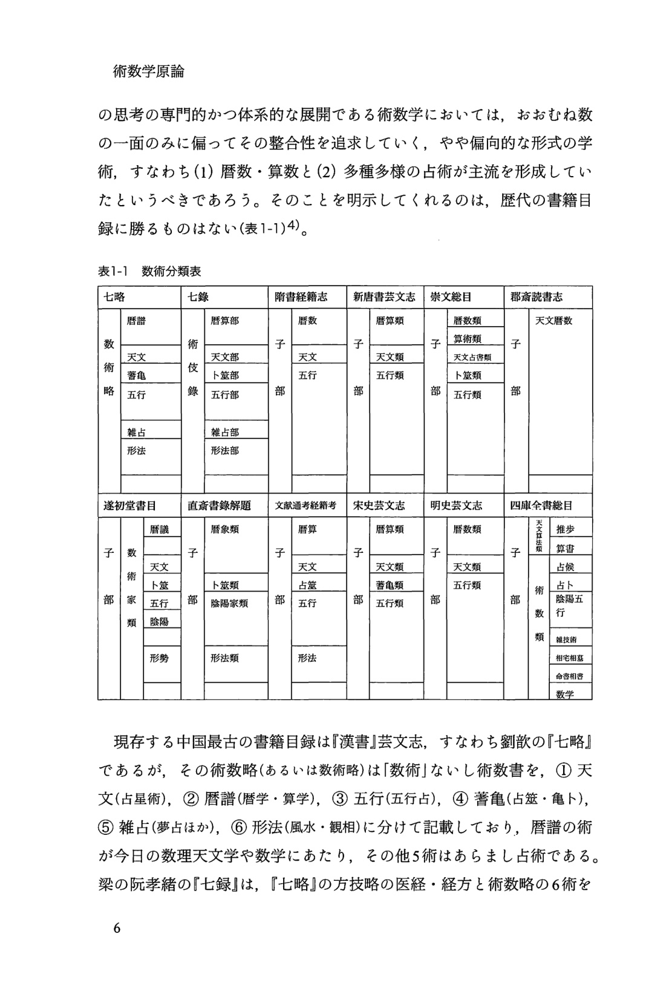

<!-- V3_SOURCE_ID:book015-b000070-p000-c59cb43159 -->

另一方面，《四庫全書総目》在“天文算法類”中列出①推歩和②算书两类书籍，在“術数類”中收录①数学、②占候、③相宅相墓、④占卜、⑤命書相書、⑥陰陽五行、⑦雑技術类书籍。

> **释读存疑：** 推歩的具体所指不详；占候的具体所指不详；相宅相墓的具体所指不详；本地硬校验仍未通过，已记录供后续自动处理或人工核对。

查看对应原文

<!-- V3_FOLDBACK_BEGIN:book015-b000070-p000-c59cb43159 -->

一方，『四庫全書総目』は「天文算法類」に①推歩(数理天文学)と②算書(数学)の書名をあげ，「術数類」に①数学(『太玄』『皇極経世書』など)，②占候(占星術)，③相宅相墓(風水)，④占卜，⑤命書相書，⑥陰陽五行，⑦雑技術の書物を収めている。

<!-- V3_FOLDBACK_END:book015-b000070-p000-c59cb43159 -->

<!-- V3_SOURCE_ID:book015-b000071-p000-82cb333057 -->

清朝的学术分类，仅将“术数”这一名称用于各类占术，并且如同将占星术类书籍归入术数类的占候项中一样，将数理科学的“天文算法”与拟科学的“术数”明确区分，以此构建学术体系。不过这只是《四库全书》及之后出现的稍显近代的观点，与清朝以前的用语法并不完全相同5）。但《四库全书总目》的命名法，也清晰体现出同属“数”之学的历算与占术之间存在深刻分歧，是展现清代学术反神秘主义特质的典型例子。

查看对应原文

<!-- V3_FOLDBACK_BEGIN:book015-b000071-p000-82cb333057 -->

清朝の学術分類は，術数という学名を諸々の占術に対してのみもちい,また占星術書を術数類の占候の属にいれるごとく，数理科学の「天文算法」と擬科学の「術数」を截然と区別して学問体系を組み立てているけれども，これは四庫全書およびそれ以降のやや近代的な見方にすぎず，清朝以前の用語法とは完全に同じではない5)。だが『四庫全書総目』の命名法は，等しく「数」の学術である暦算と占術のあいだにも深い亀裂があることをよく示しており，清学の反神秘主義の性格を示す格好の例でもある。

<!-- V3_FOLDBACK_END:book015-b000071-p000-82cb333057 -->

<!-- V3_SOURCE_ID:book015-b000072-p000-03d512dbe5 -->

## 1.3 算書中の占法と占書中の数理知識 — 1.3 算书中的占法与占书中的数理知识

查看对应原文

<!-- V3_FOLDBACK_BEGIN:book015-b000072-p000-03d512dbe5 -->

## 1.3 算書中の占法と占書中の数理知識

<!-- V3_FOLDBACK_END:book015-b000072-p000-03d512dbe5 -->

<!-- V3_SOURCE_ID:book015-b000073-p000-d622a61a2c -->

可以整理为，術数学或数術大致分为（1）暦算与（2）占術两个部门发展而来，但这两个部门并非各自独立存在，它们之间确实存在紧密关联，且相互产生了深远影响。最简洁地说明这一事实的，正是算书中记载的占法，以及占书中存在的数学知识。

查看对应原文

<!-- V3_FOLDBACK_BEGIN:book015-b000073-p000-d622a61a2c -->

術数学ないし数術は大きく，（1）暦算と（2）占術の二部門に分かれて発展してきた，と整理することができるけれども，その二部門は互いに独立して存在していたのではなく，相互に緊密な関係をもち,深甚な影響を及ぼしあっていたことも確かである。その事実(アンビバレンス)を最も簡潔に説明しているのは，算書中の占法の記述や占書中の数学知識の存在にほかならない。

<!-- V3_FOLDBACK_END:book015-b000073-p000-d622a61a2c -->

<!-- V3_SOURCE_ID:book015-b000074-p000-daae77e609 -->

《孫子算経》是记载了开平方方法、联立一次同余式解法等内容的4至5世纪的纯粹数学书籍，但该书末尾的一道题目与其他问题的风格完全不同。该题内容为：现在有一位孕妇，年龄29岁，受孕月份是9月，问会生下男孩还是女孩。

> **释读存疑：** 本地硬校验仍未通过，已记录供后续自动处理或人工核对。

查看对应原文

<!-- V3_FOLDBACK_BEGIN:book015-b000074-p000-daae77e609 -->

『孫子算経』は，開平方法や連立1次合同式の解法などを記した4～5世紀の純然たる数学書であるが，その巻末の1題はその他の問題とまった
く趣きを異にしている。それは
いま妊婦がある。行年は29歳，産月は9月である。男が生まれるか女が生まれるか。

<!-- V3_FOLDBACK_END:book015-b000074-p000-daae77e609 -->

<!-- V3_SOURCE_ID:book015-b000077-p000-5993de47cd -->

解答说，会生下男孩。

查看对应原文

<!-- V3_FOLDBACK_BEGIN:book015-b000077-p000-5993de47cd -->

答曰，男が生まれる。

<!-- V3_FOLDBACK_END:book015-b000077-p000-5993de47cd -->

<!-- V3_SOURCE_ID:book015-b000078-p000-ea1eac6c4a -->

术法说，先取49，加上孕月的月数，再减去行年的年数。从所得数值中依次减去天的数1、地的数2、人的数3、四時的数4、五行的数5、六律的数6、七星的数7、八風的数8、九州的数9。若所得余数为奇数，则会生下男孩；若为偶数，则会生下女孩。6)

查看对应原文

<!-- V3_FOLDBACK_BEGIN:book015-b000078-p000-ea1eac6c4a -->

術曰，49をおき，孕月の月数を加え，行年の年数を引く。その値から順次天の数の1，地の数の2，人の数の3,四時の4,五行の5,六律の6，七星の7，八風の8，九州の9を引く。余りが奇数であれば男が生まれ，偶数であれば女が生まれる6)。

<!-- V3_FOLDBACK_END:book015-b000078-p000-ea1eac6c4a -->

<!-- V3_SOURCE_ID:book015-b000079-p000-b25d0ebd7b -->

这是因为有人吹嘘，在分娩前就能预先知晓即将出生的孩子的性别。以我们如今的观念来看，这类问题及其解法不过是占卜方法的变体，因此很难理解它曾被算作算术的一种。不过，同样的问答内容也被转载于明代程大位的珠算著作《直指算法统宗》1592年的第十二卷中，仅从这一点就能明确，当时至少将其视为算术的一部分。

> **释读存疑：** 本地硬校验仍未通过，已记录供后续自动处理或人工核对。

查看对应原文

<!-- V3_FOLDBACK_BEGIN:book015-b000079-p000-b25d0ebd7b -->

とみえ，出産前にあらかじめ，生まれてくる子供の性別を知りうるなどと嘯いているからである。われわれの今日のセンスからすれば，このような問題や解法は単なる占法のバリエーションにすぎず，したがってそれが算術の1種に数えられていたと理解することも容易ではない。だが同じ問答は明の程大位の珠算書『直指算法統宗』(1592)の巻12にも転載されており,その点からいっても，当時すくなくとも算術と考えられていたことは明らかである。

<!-- V3_FOLDBACK_END:book015-b000079-p000-b25d0ebd7b -->

<!-- V3_SOURCE_ID:book015-b000080-p000-31367d6176 -->

这种与当今视角的差异，一方面证明了科学与科学知识是随时代发展而进步的，同时也切实展现了算术与占卜术的相似性，无疑是能够很好地说明当时二者之间的交流与交织的证据。

查看对应原文

<!-- V3_FOLDBACK_BEGIN:book015-b000080-p000-31367d6176 -->

こういう今日の視点との齟齬は片や，科学や科学知識が時代をおって進歩していくことを証明しているが，同時に，算術と占術の近似性を如実に示し，当時における二者の交流や錯綜をうまく説明する証拠であることも間違いない。

<!-- V3_FOLDBACK_END:book015-b000080-p000-31367d6176 -->

<!-- V3_SOURCE_ID:book015-b000081-p000-3843c1b1d2 -->

另一方面，《五星占》是1973年从长沙马王堆三号汉墓出土的帛书中，约8000字的天文学相关资料，该汉墓埋葬于汉文帝12年。原书没有标题，根据内容推测被暂定名为《五星占》。该书成书于公元前170年左右，是现存中国最古老的天文书籍。《五星占》的内容前后主题不同，前半部分阐述了用五颗行星进行星占的原理，说明会合周期中顺行、留、逆行等五星运行的大致情况；后半部分则记录了木星、土星、金星自秦始皇元年以后数十年间的晨见状态。

> **释读存疑：** heliacal rising

查看对应原文

<!-- V3_FOLDBACK_BEGIN:book015-b000081-p000-3843c1b1d2 -->

一方，『五星占』は，1973年，長沙馬王堆三号漢墓(漢の文帝12年に埋葬)から出土した帛書のうち，天文学関連資料約8000字のこと。原書に標題はないが，内容から推して「五星占」と仮称される。成書は前170年ごろ，現存する中国最古の天文書である。『五星占』の内容は前後でテーマを異にし，前半部は五惑星による星占の原理をのべ，会合周期中の順行・留・逆行など五星運行の大要を説明する。後半部は木星と土星と金星について秦始皇元年以降数十年にわたる晨見(heliacal rising)の状態を表記している。

<!-- V3_FOLDBACK_END:book015-b000081-p000-3843c1b1d2 -->

<!-- V3_SOURCE_ID:book015-b000082-p000-6560e29b75 -->

《五星占》将星占的原理表述为：“岁星长久停留的分野会有庆事”“岁星停留的国家不可起兵”等，根据某颗星的天文位置来预言或占卜国家与王朝的命运。

查看对应原文

<!-- V3_FOLDBACK_BEGIN:book015-b000082-p000-6560e29b75 -->

『五星占』は星占の原理を「歳星が長いあいだ留まる分野には慶事がある(歳星所久處者有慶)」歳星が留まる国には兵を起こしてならない(受歳之國不可起兵)」などと説明し，或星の天文位置によって国家や王朝の運命を予言ないし占っている。

<!-- V3_FOLDBACK_END:book015-b000082-p000-6560e29b75 -->

<!-- V3_SOURCE_ID:book015-b000083-p000-98571699ef -->

不过从整体来看，《五星占》虽只是一本占星术书籍，但这本书留下了关于五颗行星的详细天象记录，还给出了相当准确的天文常数，它无疑也是能反映当时科学知识水平的宝库。例如关于木星、金星、土星这三颗行星，书中记录了从秦始皇元年到汉文帝三年期间的晨见现象，也就是黎明时分东方天空中开始出现该行星的现象。此外，书中给出木星的会合周期为395.4日，土星的会合周期为377日，金星的会合周期为584.4日。将这些数值与现行值的398.9日、378.1日、583.9日相比，其准确程度令人惊讶。

> **释读存疑：** 本地硬校验仍未通过，已记录供后续自动处理或人工核对。

查看对应原文

<!-- V3_FOLDBACK_BEGIN:book015-b000083-p000-98571699ef -->

だが全体的にみるかぎり，『五星占』は占星術書にすぎないけれども，同じ書が五惑星について詳細な天象記録を残し，かなり正確な天文定数を与えており，当時の科学知識の水準をうかがう，宝庫であることもこれまた疑えない。たとえば木・金・土の三星にかんしては，秦の始皇元年(前246)から漢の文帝三年(前177)にわたる晨見，すなわち明け方に東天に星が見えはじめる現象を記録している。また木星の会合周期を395.4日，土星の会合周期を377日，金星の会合周期を584.4日と与えている。現行値の398.9日，378.1日，583.9日と比較すれば，正確なことは驚くほどである。

<!-- V3_FOLDBACK_END:book015-b000083-p000-98571699ef -->

<!-- V3_SOURCE_ID:book015-b000084-p000-63632af9ab -->

这一事实意味着占星术书籍不可能在其学术基础上缺少精密的天文知识或理论，也很好地说明了某些占卜术之所以既是神秘的又必然是可计量的原因。

查看对应原文

<!-- V3_FOLDBACK_BEGIN:book015-b000084-p000-63632af9ab -->

この事実は，占星術書がその学的基礎に精密な天文知識や理論を欠くことができないことを意味し，ある種の占術が神秘的であると同時に計量的ならざるをえない理由をよく示している。

<!-- V3_FOLDBACK_END:book015-b000084-p000-63632af9ab -->

<!-- V3_SOURCE_ID:book015-b000085-p000-ec2acbe4aa -->

## 1.4 算術と筮法の結合 — 1.4 算术与筮法的结合

查看对应原文

<!-- V3_FOLDBACK_BEGIN:book015-b000085-p000-ec2acbe4aa -->

## 1.4 算術と筮法の結合

<!-- V3_FOLDBACK_END:book015-b000085-p000-ec2acbe4aa -->

<!-- V3_SOURCE_ID:book015-b000086-p000-7f65899f60 -->

在术数学中，理数的思考与卜数的思考相互交织发展，我们可以想象当时的术数家是区分使用这两种思考方式，将思考结果适当组合，像拼木工艺一样构建命题，但很难想象他们同时使用理数的思考与卜数的思考，将其作为一种术数的思考形成连续的逻辑。这或许是因为在当今社会和科学中，理数与卜数完全分离，两者之间存在的鸿沟是无法跨越，或是不应该跨越的。不过对于过去优秀的术数的思考，我们必须理解为两种思考方式超越了我们的想象，复杂交织、紧密结合，仿佛是一种思考方式般发展。能简洁说明这一点的典型例子是

> **释读存疑：** 本地硬校验仍未通过，已记录供后续自动处理或人工核对。

查看对应原文

<!-- V3_FOLDBACK_BEGIN:book015-b000086-p000-7f65899f60 -->

術数学では，理数的思考と卜数的思考は錯綜しながら展開していくが，われわれはその錯綜について，当時の術数家が2種の思考を使いわけ，思考の結果を適宜に組みあわせて，寄木細工的に命題を構築していた，と想像することはできても，かれらが理数的思考と卜数的思考を同時に使用し，1種の術数的思考として連続的な論理を形づくっていたとは，なかなか想像しがたい。それはおそらく,現在の社会や科学では理数とト数は完全に乖離し，その間に横たわる深淵は越えることのできない,あるいは越えてはならないものであるからであろう。だが過去の優れた術数的思考にあっては，2種の思考はわれわれの想像を超えて，複雑に錯綜し緊密に結合しあい，あたかも1種の思考のごとく展開していた，と理解しなければならない。そのことを端的に示す代表的な例が,

<!-- V3_FOLDBACK_END:book015-b000086-p000-7f65899f60 -->

<!-- V3_SOURCE_ID:book015-b000087-p000-3fed34fa2e -->

这是秦九韶的大衍术。

查看对应原文

<!-- V3_FOLDBACK_BEGIN:book015-b000087-p000-3fed34fa2e -->

秦九韶の大衍術である。

<!-- V3_FOLDBACK_END:book015-b000087-p000-3fed34fa2e -->

<!-- V3_SOURCE_ID:book015-b000088-p000-280c6bfd80 -->

南宋的秦九韶所著《数书九章》，是中国数学史上不容忽视的重要算书之一。其中被称为大衍术的联立一次同余式解法，尤其出色。

> **释读存疑：** 本地硬校验仍未通过，已记录供后续自动处理或人工核对。

查看对应原文

<!-- V3_FOLDBACK_BEGIN:book015-b000088-p000-280c6bfd80 -->

南宋の秦九韶の『数書九章』(1247)は，中国数学史上ゆるがせにすべからざる主要な算書の一つである。なかでも大衍術とよばれる連立1次合同式の解法はとりわけ優れているという。

<!-- V3_FOLDBACK_END:book015-b000088-p000-280c6bfd80 -->

<!-- V3_SOURCE_ID:book015-b000089-p000-f1b45781d9 -->

大衍术的联立四元同余式的基本解法，当文中涉及的数学符号及表达式含义不明无法准确解读时，

> **释读存疑：** 原文中包含的数学符号及表达式存在无法识别或含义不明的内容，无法准确翻译；原文中存在无法识别的数学符号、表达式，部分内容含义不明，无法准确翻译；本地硬校验仍未通过，已记录供后续自动处理或人工核对。

查看对应原文

<!-- V3_FOLDBACK_BEGIN:book015-b000089-p000-f1b45781d9 -->

大衍術の連立4元合同式の基本解法は，ガウスの記号 $7 ) z > x _ { 2 } > T$ 整数 $m _ { 1 } , m _ { 2 } , m _ { 3 } , m _ { 4 } x ^ { 3 } = 7 ^ { + } 3 ^ { + } 2 \pi w =$ 素で， $r _ { 1 } , r _ { 2 } , r _ { 3 } , r _ { 4 }$ が任意の整数であるとき，

<!-- V3_FOLDBACK_END:book015-b000089-p000-f1b45781d9 -->

$$
X \equiv r _ { 1 } ( \mathrm { m o d } m _ { 1 } ) \equiv r _ { 2 } ( \mathrm { m o d } m _ { 2 } ) \equiv r _ { 3 } ( \mathrm { m o d } m _ { 3 } ) \equiv r _ { 4 } ( \mathrm { m o d } m _ { 4 } )
$$

<!-- V3_SOURCE_ID:book015-b000091-p000-e0a531ed69 -->

满足该条件的解是，

查看对应原文

<!-- V3_FOLDBACK_BEGIN:book015-b000091-p000-e0a531ed69 -->

を満たす解は,

<!-- V3_FOLDBACK_END:book015-b000091-p000-e0a531ed69 -->

$$
\begin{array} { c c } { { x _ { 1 } m _ { 2 } m _ { 3 } m _ { 4 } \equiv 1 ~ ( \mathrm { m o d } ~ m _ { 1 } ) , } } & { { x _ { 2 } m _ { 1 } m _ { 3 } m _ { 4 } \equiv 1 ~ ( \mathrm { m o d } ~ m _ { 2 } ) } } \\ { { } } & { { } } \\ { { x _ { 3 } m _ { 1 } m _ { 2 } m _ { 4 } \equiv 1 ~ ( \mathrm { m o d } ~ m _ { 3 } ) , } } & { { x _ { 4 } m _ { 1 } m _ { 2 } m _ { 3 } \equiv 1 ~ ( \mathrm { m o d } ~ m _ { 4 } ) } } \end{array}
$$

<!-- V3_SOURCE_ID:book015-b000093-p000-f9e6a4c390 -->

针对$x_1$、$x_2$、$x_3$、$x_4$这些量而言

查看对应原文

<!-- V3_FOLDBACK_BEGIN:book015-b000093-p000-f9e6a4c390 -->

なる $x _ { 1 } , \ x _ { 2 } , \ x _ { 3 } , \ x _ { 4 }$ に対して

<!-- V3_FOLDBACK_END:book015-b000093-p000-f9e6a4c390 -->

$$
\begin{array} { c } { { X \equiv x _ { 1 } m _ { 2 } m _ { 3 } m _ { 4 } r _ { 1 } + x _ { 2 } m _ { 1 } m _ { 3 } m _ { 4 } r _ { 2 } + x _ { 3 } m _ { 1 } m _ { 2 } m _ { 4 } r _ { 3 } } } \\ { { { } } } \\ { { + x _ { 4 } m _ { 1 } m _ { 2 } m _ { 3 } r _ { 4 } ~ ( \mathrm { m o d } ~ m _ { 1 } m _ { 2 } m _ { 3 } m _ { 4 } ) } } \end{array}
$$

<!-- V3_SOURCE_ID:book015-b000095-p000-73006cf06e -->

是被给出的

查看对应原文

<!-- V3_FOLDBACK_BEGIN:book015-b000095-p000-73006cf06e -->

で与えられる。

<!-- V3_FOLDBACK_END:book015-b000095-p000-73006cf06e -->

<!-- V3_SOURCE_ID:book015-b000096-p000-97d3f8f2a6 -->

可以写成8)

查看对应原文

<!-- V3_FOLDBACK_BEGIN:book015-b000096-p000-97d3f8f2a6 -->

と書くことができる8)。

<!-- V3_FOLDBACK_END:book015-b000096-p000-97d3f8f2a6 -->

<!-- V3_SOURCE_ID:book015-b000097-p000-247cc332ac -->

秦九韶将他的大衍术记载在《数书九章》卷1「大衍类」的「蓍卦发微」条目中。虽省略详细内容，但秦九韶的解法奇妙之处在于，它一方面是高度的整数论定理，另一方面又完全是独一无二的、其他地方找不到的易筮法的基本操作。也就是说，在上式中令m₁→1，m₂→1(2)，m₃→3，m₄→4，这就是秦九韶易筮法的要点，相当于进行以下操作：①将四十九根蓍草分成两手两份；②数取左手的蓍草，分别对应相关符号，求出各自的奇数(r₁, r₂, r₃, r₄)后归为扐；③将以上四个扐数分别乘以各自对应的用数，再将得到的数值相加；④从所得的和中减去衍母的倍数；⑤用衍法（三）除以上述得到的数值，根据商和余数的有无确定一爻的四象，等等，与操作筮竹的过程完全相同。正如清代焦循所指出的，秦九韶的筮法与《易·繋辞传》的经文一一对应，作为经义的解释也十分精妙。

> **释读存疑：** 相关符号的具体含义不详；本地硬校验仍未通过，已记录供后续自动处理或人工核对。

查看对应原文

<!-- V3_FOLDBACK_BEGIN:book015-b000097-p000-247cc332ac -->

秦九韶はその大衍術を『数書九章』巻1「大衍類」の「蓍卦発微」という条に記した。詳細は省くが，秦九韶の解法は奇妙にも，一方では高度な整数論の定理(Chinese Remainder Theorem)でありながら，他方ではそのまま，他に例をみない独特な易筮法の基本操作を示している。すなわち，上式においてm1→ 1，m₂→ 1(2)，m₃→ 3，m4→4としたところが秦九韶の易筮法の要点であり，それは①四十九蓍を両手に二分する，②左手の蓍 $\sharp \mathrm { - } \vec { \mathfrak { y } } \supset ( m _ { 1 } ) \ \cdot \ \stackrel { , } { \longrightarrow } \ \gamma _ { { \mathscr { O } } } ( m _ { 2 } ) \ \cdot \ \equiv \vec { \mathfrak { y } } \supset ( m _ { 3 } ) \ \cdot \ \sharp \vec { \mathfrak { y } } \ \gamma _ { { \mathscr { O } } } ( m _ { 4 } )$ 揲え，それぞれの奇 $( r _ { 1 } , \ r _ { 2 } , \ r _ { 3 } , \ r _ { 4 } )$ をもとめ扐に帰する，③以上の4扐数に，それぞれに固有の用数(一揲から順に $x _ { 1 } m _ { 2 } m _ { 3 } m _ { 4 } = 1 2 , x _ { 2 } m _ { 1 } m _ { 3 } m _ { 4 } = 2 4$ $x _ { 3 } m _ { 1 } m _ { 2 } m _ { 4 } = 4 , x _ { 4 } m _ { 1 } m _ { 2 } m _ { 3 } = 9 )$ を掛け，得た値を加えあわせる，④その和から衍母 $( m _ { 1 } m _ { 2 } m _ { 3 } m _ { 4 } = 1 2 )$ の倍数を除く，⑤得た値を衍法(三)で割り，その商と余りの有無から1爻の四象を定める，云々と筮竹を操作することに等しい。秦九韶の筮法は清の焦循が指摘したごとく，『易』繋辞伝の経文と1対1に対応しており，経解釈としてもみごとである。

<!-- V3_FOLDBACK_END:book015-b000097-p000-247cc332ac -->

<!-- V3_SOURCE_ID:book015-b000098-p000-5595ea6c8b -->

可以復原秦九韶發現大衍術的思考路徑如下：他針對④《易經》繫辭上傳中關於卜筮的記載「大衍之數五十，其用四十有九，分而為二以象兩」等內容，進行了詳細的解釋，在探究隱含意義的過程中，受到⑤《易經》所具備的神秘性的啟發，從該記載中發現了理數體系，並⑥與繫辭上傳的每一字每一句相對應，構建出既是筮法又是算術理論的一門「術」。就大衍術而言，不僅具備數理整合性的算術本身就是筮法的基本操作，《易經》繫辭傳中易數的神秘性也刺激了理數，同時理數所具備的徹底性突破了卜數的邏輯界限，理數與卜數的結合引發了新的飛躍。必須說，在大衍術中，理數的思考與卜數的思考是完全一體化的。

> **释读存疑：** 本地硬校验仍未通过，已记录供后续自动处理或人工核对。

查看对应原文

<!-- V3_FOLDBACK_BEGIN:book015-b000098-p000-5595ea6c8b -->

大衍術発見にいたる秦九韶の思考経路は，④『易経』繋辞上伝の卜筮にかんする記載「大衍之數五十，其用四十有九，分而為二以象兩」云々に対して，詳細な解釈をほどこし隠れた意味をさぐるうちに，⑤『易経』のもつ神秘性に触発されて，その記載のなかに理数体系を発見し，⑥繋辞上伝の1字1句と対応させて，筮法でありかつ算術理論である1つの「術」を構築した，等々と復元することができる。大衍術のばあい，数理的整合性を有する算術がそのまま筮法の基本操作であるだけでなく，『易経』繋辞伝の易数の神秘性が理数を刺激し，また理数のもつ徹底性が卜数の論理的限界を突破し，理数と卜数の結合が新たな飛躍を生じさせていたのである。大衍術では理数的思考と卜数的思考は完全に一体化していたといわねばならない。

<!-- V3_FOLDBACK_END:book015-b000098-p000-5595ea6c8b -->

<!-- V3_SOURCE_ID:book015-b000099-p000-62d008de99 -->

秦九韶的大衍術將原本不可能同時存在的算術與筮法不可分地結合起來，將數的合理性與神秘性融合在同一個熔爐中，作為一門「數術」展開。應當認為，它正是術數性思考的發展形態之一。

> **释读存疑：** 本地硬校验仍未通过，已记录供后续自动处理或人工核对。

查看对应原文

<!-- V3_FOLDBACK_BEGIN:book015-b000099-p000-62d008de99 -->

秦九韶の大衍術はほんらい同時には存在しえない算術と筮法を不可分に結合し，数の合理性と神秘性を共通の坩堝に溶かしこみ，1個の「数術」として展開した。まさに術数的思考の発展形態の一つをなしていたととらえるべきであろう。

<!-- V3_FOLDBACK_END:book015-b000099-p000-62d008de99 -->

<!-- V3_SOURCE_ID:book015-b000100-p000-5b42c1d9f1 -->

## 2 経学と術数学 — 2 經學與術數學

查看对应原文

<!-- V3_FOLDBACK_BEGIN:book015-b000100-p000-5b42c1d9f1 -->

## 2 経学と術数学

<!-- V3_FOLDBACK_END:book015-b000100-p000-5b42c1d9f1 -->

<!-- V3_SOURCE_ID:book015-b000101-p000-c28c9cdca7 -->

中國古典時期的核心學術是經學。支撐經學的不可或缺的學術部門之一，正是術數學。

查看对应原文

<!-- V3_FOLDBACK_BEGIN:book015-b000101-p000-c28c9cdca7 -->

中国古典期の中心的な学術は経学である。経学を支える不可欠の学術部門の一つが術数学にほかならない。

<!-- V3_FOLDBACK_END:book015-b000101-p000-c28c9cdca7 -->

<!-- V3_SOURCE_ID:book015-b000102-p000-3db233a9d1 -->

## 2.1 董仲舒の天人の学 — 2.1 董仲舒的天人之学

查看对应原文

<!-- V3_FOLDBACK_BEGIN:book015-b000102-p000-3db233a9d1 -->

## 2.1 董仲舒の天人の学

<!-- V3_FOLDBACK_END:book015-b000102-p000-3db233a9d1 -->

<!-- V3_SOURCE_ID:book015-b000103-p000-5d86e1ad18 -->

董仲舒的天人之学充满了术数式的思考，这是众所周知的。事实上，《四库全书总目提要》经部易类六的按语指出：“伏生的《尚书大传》、董仲舒的《春秋阴阳》这类著作，从文体来看，其实就是纬书”，以此说明其术数性质。此外，同属春秋类的著作

查看对应原文

<!-- V3_FOLDBACK_BEGIN:book015-b000103-p000-5d86e1ad18 -->

董仲舒の天人の学が濃厚な術数的思考に埋め尽くされていたことは，周知のとおりである。事実，『四庫全書総目提要』経部易類六の案語は，「伏生の尚書大伝・董仲舒の春秋陰陽のごときは，その文体を核ぶれば，すなわち是れ緯書なり」と，その術数的性格をのべる。また同じく春秋

<!-- V3_FOLDBACK_END:book015-b000103-p000-5d86e1ad18 -->

<!-- V3_SOURCE_ID:book015-b000104-p000-470ccc8cb4 -->

针对董仲舒的代表作《春秋繁露》，因其术数性质，有人论断道：“向来将其列入经解之中，其实并不恰当”，不将其视为经学著作，而是将其与纬书一同贬为附录或拟经书的地位。以反神秘主义为旗帜的清代经学家们，在董仲舒的经学中发现了绝对无法容忍、或必须彻底排除克服的术数式思考与谶纬式逻辑。然而，对于向来被视为“群儒之首”“儒者之宗”的董仲舒，奉同一经学为宗旨的清代学者们，却以其具有术数性质为由，全面否定或低估其著作。既然如此，我们也应当推定，术数式思考在董仲舒的著作中本质上发挥着作用。换句话说，我们必须这样理解汉代经学的发展：当经学作为天人之学进行学术整理时，术数式思考在方法论上构成了本质且不可或缺的要素；或者说，如果没有术数式思考，天人之学最核心的部分便无法成立。

> **释读存疑：** 原文中“有人论断”未明确具体主体，释读未明确该论断的提出者，存在一定模糊性

查看对应原文

<!-- V3_FOLDBACK_BEGIN:book015-b000104-p000-470ccc8cb4 -->

類は，董仲舒の代表作の『春秋繁露』について，その術数的性格のゆえに「向来これを経解中に列するは，その実にあらず」と論断し，それを経学著作として数えず，緯書ともども附録ないし擬経書の地位に貶めている。反神秘主義を自らの旗印とする清朝の経学者たちは，董仲舒の経学のなかに絶対に容認することのできない，あるいは確実に排除克服すべき術数的思考や讖緯的論理を発見したが，従来「群儒の首」「儒者の宗」などと目されてきた董仲舒に対して，同じ経学を奉じる清儒たちが術数的であることを理由にその著作を全面的に否定ないし低く見積もったからには，われわれも董仲舒の著作に対して，術数的思考が本質的に機能していたと推定すべきであろう。言い換えれば，われわれは漢代経学の展開について，経学が天人の学として学的整備を行う際，術数的思考は方法論上，本質的かつ不可欠な要素を構成した，もしくは，術数的思考がなければ天人の学の最も核心の部分は成立しなかった，等々と理解しなければならない。

<!-- V3_FOLDBACK_END:book015-b000104-p000-470ccc8cb4 -->

<!-- V3_SOURCE_ID:book015-b000105-p000-9c8a098d59 -->

大致而言，董仲舒的天人之学由两大支柱构成：①相当于自然学与存在论的“天的哲学”，以及②相当于人学与伦理学的“春秋学”；其思想结构还包括③“元的思想”与④“灾异说”，二者将前两者联结起来9。也就是说，《春秋》的序辞将即位之年称为“元”年而非“一”年，据董仲舒所言，尊崇这个“元”，也就是端正根本的意义，在于“顺应天地的终始”10。另外，《春秋》每年记事时，最初必定会写“某年春王正月”，《春秋》之所以将“王”字置于“春”与“正”之间来构成年初的语句，是因为“春是天所为”“正是王所为”，所以这意味着“上要承接天所为的事，下要以此端正自己所为的事，从而端正王道的开端”11。另一方面，“国家的过失才刚刚萌芽，天就会降下灾害，以此来谴责告诫君主；如果君主受到谴责告诫后仍不知改变，天就会降下怪异现象，以此来使君主惊骇；如果君主受到惊骇后仍不知畏惧，那么灾祸就会降临”12。王者应当如此，以至善的天的道德性作为行动的依据或规范，同时努力践行《春秋》所主张的人伦之道、德教与德治的宗旨。

查看对应原文

<!-- V3_FOLDBACK_BEGIN:book015-b000105-p000-9c8a098d59 -->

いったい董仲舒の天人の学はその大体を論じれば，①自然学や存在論にあたる「天の哲学」と②人間学や倫理学にあたる「春秋学」の二大柱よりなり，③「元の思想」と④「災異説」が両者を結びつけるという思想構造をもっている9。すなわち，『春秋』の序辞は，即位の年を「一」年といわず「元」年とするが,董仲舒によれば,その「元」を貴ぶ,すなわち，本を正すことの意味は，「以て天地に随いて終始する」ところにある10)(『春秋繁露』玉英篇)。また『春秋』は毎年，記事を始める際に最初にかならず「某年春王正月」と書くが，『春秋』が「王」字を「春」「正」間において年頭の一句を組みたてたのは，「春は天の為す所」「正は王の為す所」ゆえ，「上は天の為す所を承け，下は以てその為す所を正し，王道の端を正す」べきことを意味している(賢良対策一)11)。一方，「国家の失，乃ち始めて萌芽して，天は災害を出し，以てこれを譴告す。これを譴告して，変ずるを知らざれば，乃ち怪異を見わして，以てこれを驚駭す。これを驚駭して,・なお畏恐するを知らざれば，その殃咎乃ち至る」12)(『春秋繁露』必仁且智篇)。王者はかくして(天を畏恐しつつ)，至善の道徳性をもつ天に行動の根拠ないし規範を求めながら，『春秋』の説く人倫の道や德教・徳治の旨を実施すべく，孜孜として奮励しなければならない。

<!-- V3_FOLDBACK_END:book015-b000105-p000-9c8a098d59 -->

<!-- V3_SOURCE_ID:book015-b000106-p000-fb25e02c29 -->

董仲舒的哲学将自然与人为一概而论，不区分天与人，而从理论上使这一点成为可能的，简单来说，正是通过阴阳、五行实现的天人感应或天人合一这一概念工具。

查看对应原文

<!-- V3_FOLDBACK_BEGIN:book015-b000106-p000-fb25e02c29 -->

董仲舒の哲学は，自然と人為を一律に論じ，天人の間に区別を設けなかったが，理論上それを可能にしたのは，簡潔にいえば，陰陽・五行を介する天人感応ないし天人合一という概念装置にほかならない。

<!-- V3_FOLDBACK_END:book015-b000106-p000-fb25e02c29 -->

<!-- V3_SOURCE_ID:book015-b000107-p000-179e4ae9f3 -->

董仲舒将春秋学升华为天的哲学时，运用了元的思想与灾异说，但要让自己的推论有效运作，从逻辑上作为最低限度的条件，必须认可或保证“天”与“人”之间存在某种交流或共通之处。这正是董仲舒构建并大力宣扬天人相类学说的原因。如果认为自然与社会之间存在断裂，那么从逻辑必然来看，既无法将人的行为的“元”归于天，也无法将社会现象与自然现象对应起来，其结果就是人学与自然学相背离，春秋学也不得不脱离天的哲学。董仲舒之所以展开天人相关的学说，强调自然与人为的一体性，其原因确实存在于他自身的天人学体系本身之中。

查看对应原文

<!-- V3_FOLDBACK_BEGIN:book015-b000107-p000-179e4ae9f3 -->

そもそも董仲舒は，春秋学を天の哲学に昇華したとき，元の思想と災異説を使用したが，自らの推論が有効に機能するためには，論理上最低限の条件として，「天」「人」相互間になにがしかの交流や共通項が存在することを是認ないし保証する必要がある。これが，董仲舒が天人相類の学説をつくりあげ大々的に展開したゆえんである。自然と社会の間に断絶を認めれば，論理的必然として，人の当為の「元」(理論的根拠)を天に求めることも，社会現象を自然現象と対応させることも不可能になり，その結果，人間学は自然学と乖離し，春秋学は天の哲学から離脱せざるをえない。董仲舒が天人相関の学説を展開し，自然と人為の一体性を強調したのは実に，自らの天人学の体系自体のなかにその原因が存在していたのである。

<!-- V3_FOLDBACK_END:book015-b000107-p000-179e4ae9f3 -->

<!-- V3_SOURCE_ID:book015-b000108-p000-12d6f6a1be -->

董仲舒将天人感应或天人合一学说作为自己哲学的概念工具，换句话说，他的这种术数理论，正是他所谓的封建神学体系的基础或核心理论。这种术数性的天人感应理论确实有多种多样的变体，思想外延也极为广泛，很难简单说明，但要说最单纯且基本的逻辑，应该是《春秋繁露·人副天数篇》中运用（1）“数”和（2）“类”的类比方法，阐释作为天人感应理论基础的天人合一的论述。

查看对应原文

<!-- V3_FOLDBACK_BEGIN:book015-b000108-p000-12d6f6a1be -->

董仲舒が自己の哲学の概念装置として天人感応ないし天人合一の学説を採用したことは，換言すれば，その術数的な理論がとりもなおさず，かれのいわゆる封建神学体系の基礎ないし中心の理論であったというにほかならない。そういう術数学的な天人感応理論は，実に多種多様のバリエーションをもち，思想的外延もきわめて広く，説明するのはなかなか容易ではないが，最も単純かつ基本的な論理といえば，それは(1)「数」や(2)「類」によるアナロジカルな方法をもちいて，天人感応の理論基礎である天人合一を説明した『春秋繁露』人副天数篇の論述であろう。

<!-- V3_FOLDBACK_END:book015-b000108-p000-12d6f6a1be -->

<!-- V3_SOURCE_ID:book015-b000109-p000-347ed5c7e9 -->

董仲舒遵循典型的术数方法——“於其可數也副數，不可數者副類”，认为相对于天这个宏观宇宙，人是微观宇宙，“身猶天也”。

查看对应原文

<!-- V3_FOLDBACK_BEGIN:book015-b000109-p000-347ed5c7e9 -->

董仲舒は典型的な術数の方法――「その数うべきにおいてや数に副し，数うべからざる者は類に副す(於其可數也副數，不可數者副類)」にのっとって，天のマクロコスモスに対して人がミクロコスモスである(身猶天也)

<!-- V3_FOLDBACK_END:book015-b000109-p000-347ed5c7e9 -->

<!-- V3_SOURCE_ID:book015-b000110-p000-b4ad81c17b -->

我们可以用以下内容来证明这一点：首先依据“数”的类比，推导出“人体的小关节有三百六十六个，对应一年的天数；大关节有十二个，对应一年的月份数；体内有五脏，对应五行的数量；体外有四肢，对应四時的数量”这一结论。接着依据“类”的类比，指出“人刚看东西时眨眼，对应昼夜的交替；人时而刚强、时而柔和，对应冬夏的变化；人时而哀伤、时而快乐，对应阴阳的变化；心中有思虑，对应度数；行为有伦理，对应天地的规律”。在此基础上，由于“天地的符应、阴阳的对应，始终存在于人的身上”，所以主张“人的身体就如同天地一般”13。

> **释读存疑：** 原文中「乍ち視乍ち瞑する」的释读为“人刚看东西时眨眼”，原文未明确说明“乍ち視乍ち瞑”的具体所指，此处释读存在一定不确定性

查看对应原文

<!-- V3_FOLDBACK_BEGIN:book015-b000110-p000-b4ad81c17b -->

ことをこう証明する。すなわち，「数」のアナロジーにもとづいて，人体の「小節三百六十六は日数に副し，大節十二分は月数に副し，内に五臓あるは五行の数に副し，外に四肢あるは四時の数に副す」ことを導きだたちま  
し，また「類」のアナロジーにもとづいて,人が「乍ち視乍ち瞑するは昼夜に副し，乍ち剛し乍ち柔するは冬夏に副し，乍ち哀み乍ち楽しむは陰陽に副し，心に計慮あるは度数に副し，行に倫理あるは天地に副す」ことを指摘し，そのうえに「天地の符，陰陽の副，常に身に設けらる」ゆえ，「身はなお天のごとし」と主張する13)。

<!-- V3_FOLDBACK_END:book015-b000110-p000-b4ad81c17b -->

<!-- V3_SOURCE_ID:book015-b000111-p000-567ddf958a -->

当天人的同质性与同类性得到确认后，依据“同类相互感应”这一普遍命题，天人之间的感应便会自然产生。由此可见，“天人合一”的学说无疑是董仲舒神学体系的核心中的核心。既然如此，理所当然的是，为证明这一学说而提出的“副数”“副类”等带有主观随意性的数术技法，在董仲舒的天人之学中发挥了本质性的作用。这种数术式的思考，是构建经学神学体系时最重要且不可或缺的方法，我们必须作出这样的论断。这样的评价或命题，通过指出董仲舒的灾异说与阴阳五行说具有数术性，能够进一步强化其逻辑上的正当性，并且也能通过前文提及的清代学者对董仲舒的解释得到充分印证。

查看对应原文

<!-- V3_FOLDBACK_BEGIN:book015-b000111-p000-567ddf958a -->

天人の同質性や同類性が保証されたとき，一般命題の「同類相動」によって，天人の感応が自然に導きだされることからすれば，その「天人一也」の学説が，董仲舒の神学体系の核心中の核心であったことは間違いなく，そうであれば理の当然として,それを証明した「副数」や「副類」などの恣意的な数の技法は董仲舒の天人の学で本質的な働きをしており，その術数的思考は経学的神学体系を築きあげるうえで最重要かつ欠くべからざる方法であったと論定しなければならない。かかる評価ないし命題は，董仲舒の災異説や陰陽五行説が術数的であることによって，論理的正当性をより強固にするとともに，先にのべた清儒の董仲舒解釈によっても，十分にうらづけることができる。

<!-- V3_FOLDBACK_END:book015-b000111-p000-567ddf958a -->

<!-- V3_SOURCE_ID:book015-b000112-p000-cfae0543ce -->

众所周知，经学在董仲舒之后也获得了独立的发展，但总体而言，无论处于哪个时代，经学都是天人之学，关于天人之辨的争论始终是经学的主要议题，这一点是确定无疑的。不过，如果经学是天人之学，那么必然的结果就是，完全排除经学内部的数术式思考是不可能的，经学的思考必然带有数术性。从汉代经学的谶纬学说、律历思想，以及宋学的理气论、象数思想都笼罩着浓厚的数术氛围这一点来看，主张这一观点并不困难。即便是在反神秘主义的清代学术中，也很容易指出那些学识渊博的学者虔诚地研习易学，并未揭开易数神秘的面纱。

查看对应原文

<!-- V3_FOLDBACK_BEGIN:book015-b000112-p000-cfae0543ce -->

周知のごとく，経学は董仲舒以降も独自の発展を遂げたが，総じて，何時の時代にあっても経学が天人の学であり，天人の弁が論争の主要議題であったことは確かである。だが経学が天人学であれば，その必然的結果として，経学内部から術数的思考を完全に排除することは不可能であり，経学の思考に術数性がつきまとわざるをえない。漢学の讖緯説や律暦思想，宋学の理気論や象数思想などが濃厚な術数的ムードに掩われていたことからして，同点を主張するのは難しくなく，また反神秘主義の清学においても，碩学が敬虔に易学を修め，易数の神秘的べールを剝ぎとらなかったことを指摘するのも容易である。

<!-- V3_FOLDBACK_END:book015-b000112-p000-cfae0543ce -->

<!-- V3_SOURCE_ID:book015-b000113-p000-deccdbc2bd -->

归根结底，在进行经学研究时，如果完全摒弃数术式的思考，那么关于天人关系的若干重要命题便无法成立，这一点毋庸置疑。这就是我们之所以认为数术式思考在经学中占据本质性地位的原因。

查看对应原文

<!-- V3_FOLDBACK_BEGIN:book015-b000113-p000-deccdbc2bd -->

結局のところ，経学上の考察を行うに際して，完全に術数的思考を捨て去れば，天人にかんする重要なテーゼのいくつかは存在しえなくなることは疑うべくもない。経学においては，術数的思考は本質的な位置を占めていたと総じるゆえんである。

<!-- V3_FOLDBACK_END:book015-b000113-p000-deccdbc2bd -->

<!-- V3_SOURCE_ID:book015-b000114-p000-3629a55e6a -->

## 2.2 劉歆の目録学 — 2.2 劉歆的目录学

查看对应原文

<!-- V3_FOLDBACK_BEGIN:book015-b000114-p000-3629a55e6a -->

## 2.2 劉歆の目録学

<!-- V3_FOLDBACK_END:book015-b000114-p000-3629a55e6a -->

<!-- V3_SOURCE_ID:book015-b000115-p000-e23672c985 -->

就董仲舒的天人学而言，术数式的思考占据了其哲学体系的本质位置，这一点已在前文述及。不过，他是否将术数学视为支撑经学的重要学术部门，目前仍不清楚。依据现存史料来看，将「数术」这一类别定位为支撑经学的不可或缺的部门，必须说始于刘歆的图书目录《七略》。

查看对应原文

<!-- V3_FOLDBACK_BEGIN:book015-b000115-p000-e23672c985 -->

董仲舒の天人学のばあい，術数的思考が哲学体系の本質的な位置を占めていたことは既述したとおりである。だがかれが経学を支える重要な学術部門として，術数学を想定していたかどうかはいまだ詳らかではない。現存する史料にもとづくかぎり,「数術」というジャンルに対して,それを経学を支える不可欠の一部門と位置づけたのは，劉歆の図書目録『七略』に始まるといわねばならない。

<!-- V3_FOLDBACK_END:book015-b000115-p000-e23672c985 -->

<!-- V3_SOURCE_ID:book015-b000116-p000-cc86a3dee6 -->

刘歆的《七略》本身在唐末五代的战乱中散佚，并未流传至今。但在刘歆去世60年后，继承其学术脉络的班固取舍了《七略》的内容，编纂了《汉书·艺文志》，因此即便只是间接的，也能通过该记载窥见《七略》的书籍目录内容，了解其书籍分类法的概要。据班固、阮孝绪等人的记载，《七略》由①辑略、②六艺略、③诸子略、④诗赋略、⑤兵书略、⑥数术略或术数略、⑦方技略构成。不过在七略之中，辑略虽有多种解释，但至少不包含书籍目录，这一点是明确的。此外，六艺略以下以按类别划分的书籍目录为记述核心，这一点也毋庸置疑。因此，依据该目录书的结构来看，不得不推定《七略》作为学术分类采用了六分法，将所有书籍与学术分为6类，分别命名为六艺、诸子、诗赋、兵法、数术、方技。反过来说，《七略》与六艺之学并列，明确将数术或术数学认定为拥有独立学术体系的领域。

查看对应原文

<!-- V3_FOLDBACK_BEGIN:book015-b000116-p000-cc86a3dee6 -->

劉歆の『七略』自体は唐末五代の乱に亡び，現在に伝わっていないが，劉歆の死後60年ばかりのち，かれの学統に連なる班固が『七略』の文章を取捨して『漢書』芸文志を編纂しており，それゆえ間接的にではあるが，その記載をとおして『七略』の書籍目録の内容をうかがい，書籍分類法の概要を知ることができる。班固や阮孝緒などの記載によれば，『七略』は①輯略，②六芸略，③諸子略，④詩賦略，⑤兵書略，⑥数術略ないし術数略，⑦方技略よりなるというが，七略のうち，輯略はさまざまに解釈されるものの,すくなくとも書籍の目録を含まないことは明らかである。また六芸略以下がジャンル別の書籍目録を記述の中心としたことも間違いない。したがってその目録書の構造にもとづくかぎり,『七略』は学術分類として六分法を採用し，あらゆる書籍や学術を6分割し，各ジャンルに対して@六芸，⑥諸子，©詩賦，@兵法，数術，f方技と命名していた，と推定せざるをえない。逆にいえば，『七略』は六芸の学と並んで，数術ないし術数学を一個の学術世界をもつ独立の領域として明白に認定していたわけである。

<!-- V3_FOLDBACK_END:book015-b000116-p000-cc86a3dee6 -->

<!-- V3_SOURCE_ID:book015-b000117-p000-92ba220f46 -->

如前文所述，数术或术数学是广义上与数相关的学术，以历算和占术为主要研究领域，该学术在两汉时期……

> **释读存疑：** 原文在此处存在残缺，内容未完整记述

查看对应原文

<!-- V3_FOLDBACK_BEGIN:book015-b000117-p000-92ba220f46 -->

既述のごとく，数術ないし術数学は広義の数にかんする学術であり，暦算と占術を主要な研究領域としたが，その学術は，両漢の際において

<!-- V3_FOLDBACK_END:book015-b000117-p000-92ba220f46 -->

<!-- V3_SOURCE_ID:book015-b000118-p000-f55c90d918 -->

作为专门领域，它已经拥有悠久的历史，是当时最具正统性的学术之一。历代都有说法称史官掌管这一学术领域，春秋时期涌现出众多著名的术数家，这一点在《春秋左氏传》等典籍中均有记载。另外关于汉代史官与数术之间的紧密关系，从河平三年（前26年）汉成帝命令刘向校勘整理秘书时，曾下诏让太史令尹咸校订数术类书籍这一事件，就足以得到充分证明。刘歆本人也在《数术略》大序中发表了类似的看法，表达了对当时数术现状的不满。

> **释读存疑：** 本地硬校验仍未通过，已记录供后续自动处理或人工核对。

查看对应原文

<!-- V3_FOLDBACK_BEGIN:book015-b000118-p000-f55c90d918 -->

専門領域としてすでに悠久な歴史を有し，当時の最も由緒正しい学術の一つである。歴代，史官がその学術を司ったといわれ，春秋期に著名な術数家が輩出したことは,『春秋左氏伝』などにみえるとおりである。また漢代における史官と数術の緊密な関係については，河平三年(前26)に漢の成帝が劉向に秘書の領校を命じた際，太史令の尹咸に詔して数術書を校訂させたことからして，十分に証明することができる。劉歆自身も数術略大序中，同様なコメントをのべ，数術の現状について不満をのべている。

<!-- V3_FOLDBACK_END:book015-b000118-p000-f55c90d918 -->

<!-- V3_SOURCE_ID:book015-b000119-p000-cda447cc2d -->

数术，全都属于明堂、羲和、史卜的职责范围。史官荒废这一职责已经很久了，相关书籍已经无法完整留存，即便有相关书籍存在，也没有合适的人来传承。《易·繋辞下传》中说：“如果不是合适的人，道就会空虚而无法推行”14。

查看对应原文

<!-- V3_FOLDBACK_BEGIN:book015-b000119-p000-cda447cc2d -->

数術は，みな明堂・羲和・史トの職なり。史官の廃するや久し。その書すでに具うる能わず。その書あるといえども，その人なし。『易』(繋辞下伝)に曰く，「苟もその人にあらざれば，道虚しくは行われず」と14)。

<!-- V3_FOLDBACK_END:book015-b000119-p000-cda447cc2d -->

<!-- V3_SOURCE_ID:book015-b000120-p000-7ab89dc92b -->

对于刘歆而言，数术即便存在诸多不足，也无非是继承了春秋时期著名术数家梓慎、裨灶、卜偃、子韦等人流派的正统学术。

查看对应原文

<!-- V3_FOLDBACK_BEGIN:book015-b000120-p000-7ab89dc92b -->

数術は劉歆にとって，いろいろな不備があるとはいえ，春秋の著名な術数家の梓慎・裨竈・ト偃・子韋などの流れを汲む正統の学術にほかならなかったのである。

<!-- V3_FOLDBACK_END:book015-b000120-p000-7ab89dc92b -->

<!-- V3_SOURCE_ID:book015-b000121-p000-ccafebd1d6 -->

不过《数术略》大序的论述，并不只是强调数术的学术正统性。就拿开头的“数术，全都属于明堂、羲和、史卜的职责范围”这句话来说，结合以下几点就能理解：其一，《诸子略》大序中提到，诸子的学说“若要归结其主旨，也都是六经的分支与流派”，小序中还说“儒家这一流派，大概出自司徒之官”“道家这一流派，大概出自史官”等，将所有诸子学定位为源自道术兴盛的古代圣王朝的官学或六艺之术，同时考察了各家容易陷入的固有缺点；其二，《兵书略》大序中说“兵家，大概出自古代司马之官，是王官的武备”，《方技略》大序中说“方技，全都是养生的工具，是王官的一个职守”，将兵法、医术与“王官”相联系，阐述它们应有的形态，同时指出了现状的不足。综合以上几点来看，《数术略》大序的言辞不应仅仅被视为单纯的事实记录，还应解释为其中包含了与学术应然状态相关的命题。也就是说，开头的这句话，不只是单纯说明数术是正统学术，还意在表明：身为数术家的人，应当像古代的明堂、羲和、史卜那样，将自身的专业知识提升到“参与圣王之政”（天文）和“圣人知命之术”的高度，充分分析数所显示的征兆，毫无保留地阐明其中的隐秘信息，这既是学术应有的状态，也寄托了对专业人士的期望。

> **释读存疑：** 历谱

查看对应原文

<!-- V3_FOLDBACK_BEGIN:book015-b000121-p000-ccafebd1d6 -->

だが数術略の大序の説くところは，数術の学的正統性を強調するのみにとどまらない。冒頭の一句「数術は，みな明堂・羲和・史トの職なり」にしても，(A)諸史略の大序に，諸子の術は「その要帰を合すれば，また六経の支与流裔なり」とみえ，また小序に「儒家者流，けだし司徒の官に出づ」「道家者流，けだし史官に出づ」などとあり，諸子学のすべてを道術が盛んな古代聖王朝の官学ないし六芸の術より派生したものと位置づけながら，各家の陥りやすい固有の欠点を考察したこと，(B)兵書略の大序に「兵家は，けだし古の司馬の職に出づ，王官の武備なり」，方技略の大序に「方技は，みな生生の具，王官の一守なり」と，「王宮」に結びつけて兵法や医術のあるべき姿をのべつつ，現状の不備を指摘したこと，等々をあわせ考えれば，数術略大序の言辞も単なる事実の記録ではなく，学術の当為に関係する命題もそこに含んでいると解釈すべきであろう。すなわち,冒頭の一句は単に数術が正統の学術たることをのべたばかりでなく，数術家たる者は古の明堂・羲和・史トのごとく，自らの専門知識を「聖王の政に参するゆえん」(天文)や「聖人知命の術」(暦譜)の域まで高め，数の示す徴候をよく分析し，その秘密の情報を余すところなく明らかにすべしという，学術としての当為やテクノクラートへの願いをもあわせのべているといわねばなるまい。

<!-- V3_FOLDBACK_END:book015-b000121-p000-ccafebd1d6 -->

<!-- V3_SOURCE_ID:book015-b000122-p000-f537a6cdab -->

我们也不能忽视这一点：他们还引用《易·繋辞传》中的语句作为自己学说的论据。这种依托经典的字句来构建论述的方法，不仅是《七略》的一大特征，也是刘歆所有著作的一大特征，这既体现了他思考方式中形式化、法解释学的侧面，也充分展现了他对经学的深厚情感。反过来说，刘歆之所以将诸子学定位为‘六经的支与流裔’，将诗赋视为《诗经》的末流，将兵法、数术、方技归为儒林的实用学问，还将各类学说与王官相结合，试图从整体上合理地追求学术与政治的事业，其原因就在于刘歆是纯粹的经学家，而且是极具政治性的经学家。

查看对应原文

<!-- V3_FOLDBACK_BEGIN:book015-b000122-p000-f537a6cdab -->

われわれはまた，『易』繋辞伝の語句を引用して自説の論拠とした点にも注意を怠ってはならない。このくどくどしいまでも経書の字句に依拠しながら論理を組み立てていく論述の方法は，『七略』だけでなく劉歆のあらゆる著作にわたる一大特徴をなしており，劉歆の思考法の形式的かつ法解釈的な側面を示す一方で，かれの経学への深い思い入れをよく示しているからである。翻っていえば，劉歆が純然たる経学者，しかも非常に政治的な経学者であったところに，（A）諸子学を「六経の支与流裔」，詩賦を詩経の末流，兵法・数術・方技を儒林の実学と位置づけ，(B）諸学を王官と結びつけながら，全体として合目的的に学術かつ政治の営為を追求していこうとしたゆえんがあるのである。

<!-- V3_FOLDBACK_END:book015-b000122-p000-f537a6cdab -->

<!-- V3_SOURCE_ID:book015-b000123-p000-d0464b81d3 -->

数术或术数学，在两汉时期就已经完全独立成为一个门类，是支撑经学的重要学术部门。对刘歆而言，它不仅是重要的学术领域，更是经学不可或缺的学术部门。这一点，从刘歆对各个数术的评论中，比如‘蓍龟是圣人所用的东西’，历谱是‘圣人知命的方法’，天文是‘圣王参与政事的依据’等，就可以充分推断出来；反过来，用《七略》所体现的学术六分类来解释这一点，也并非难事。

查看对应原文

<!-- V3_FOLDBACK_BEGIN:book015-b000123-p000-d0464b81d3 -->

数術ないし術数学は，両漢の際にはすでに一個のジャンルとして完全に独立し，経術を支える重要な学術部門であったが，劉歆にとってそれはただ重要な学術領域であったのみならず，経学に対する不可欠の学術部門であったことも間違いない。そのことは，劉歆による個々の数術へのコメント，たとえば「蓍亀は,聖人の用いる所なり」,暦譜は「聖人知命の術なり」,天文は「聖王の政に参する所以なり」などから，十分推定することができるけれども，逆に『七略』を特徴づける学術の六部分類をもってそれを説明することもそう難しいことではない。

<!-- V3_FOLDBACK_END:book015-b000123-p000-d0464b81d3 -->

<!-- V3_SOURCE_ID:book015-b000124-p000-95be10523e -->

《七略》的六部分类，一方面为整个学术体系提供了分类的重要指导，另一方面也在《六艺》内部的分类中发挥着有效作用。基于这一点，可以说《七略》是由结构相同的大分类与小分类所构成的双重六分划分。但《六艺》内部的六分划分（小分类）的结构或组织，在《六艺略》的大序中，

> **释读存疑：** 本地硬校验仍未通过，已记录供后续自动处理或人工核对。

查看对应原文

<!-- V3_FOLDBACK_BEGIN:book015-b000124-p000-95be10523e -->

『七略』の六部分類は，一方で学術総体に対して分類の大きな指針を与えながら，他方では六芸(経学)内部の分類にも有効に機能しており，同点に即すれば，『七略』は等しい構造の大分類と小分類の二重(フラクタル)の六分分割からなるとのべることができる。だが六芸内部の六部分割(小分類)の構造ないし組織は，六芸略の大序に,

<!-- V3_FOLDBACK_END:book015-b000124-p000-95be10523e -->

<!-- V3_SOURCE_ID:book015-b000125-p000-0f6105590e -->

六艺的相关内容：乐用来调和心神，是仁的外在表现；诗用来端正言辞，是义的运用；礼用来明确行为规范，明确就是彰显，因此不需要训释；书用来拓宽听闻，是知的方法；春秋用来决断事务，是信的凭证。这五者，大概是五常的准则，相互配合才能完备。而易是它们的本源。所以说：‘如果不能通晓易，那么乾坤或许就会隐息’（《繋辞上传》）。这是说易与天地始终相伴。至于五经，世间有各种变化，就像五行各自发挥作用一样15）。

> **释读存疑：** 本地硬校验仍未通过，已记录供后续自动处理或人工核对。

查看对应原文

<!-- V3_FOLDBACK_BEGIN:book015-b000125-p000-0f6105590e -->

六芸の文，楽は以て神を和ぐ，仁の表なり。詩は以て言を正す，義の用なり。礼は以て体を明らかにす，明らかなるは著見す，ゆえに訓なし。書は以て聴を広む，知の術なり。春秋は以て事を断ず，信の符なり。五者は，けだし五常の道にして，相須ちて備わる。而して易はこれが原たり。ゆえに曰く，「易見るべからざれば，則ち乾坤あるいは息む幾し」（繋辞上伝）と。天地と終始をなすをいうなり。五学に至りては世よ変改あり。なお五行のこもごも用事するがごとし15）。

<!-- V3_FOLDBACK_END:book015-b000125-p000-0f6105590e -->

<!-- V3_SOURCE_ID:book015-b000126-p000-f48e0afa9d -->

不仅如此，相对于不易的易学，它还被赋予了最核心的地位，即作为随时代变迁而变化的五学的源流或统领者16。

查看对应原文

<!-- V3_FOLDBACK_BEGIN:book015-b000126-p000-f48e0afa9d -->

とみえ，不易の易学に対して，時代の変遷にしたがって変化していく五学の源流ないし統括者という最も枢要な地位を与えている16）（図1-1）。

<!-- V3_FOLDBACK_END:book015-b000126-p000-f48e0afa9d -->

<!-- V3_SOURCE_ID:book015-b000128-p000-16c70df5f8 -->

另一方面，关于学术整体的分类，也就是大分类，虽然在《汉书》艺文志中没有必须特意引用的相关表述，但从该书的书籍分类来看，经学的价值极为突出，就像六艺中的易学一样，将经学定位为诸学的源流，这一点是毋庸置疑的。原本不可能有任何关联的《七略》的双重六部分类完全等同，既然它将易学和经学定位为诸学的源流，那么刘歆对于学术整体的六部分类，也必然认为不易的易学……

> **释读存疑：** 1轮自动修复后核义模型仍建议修订，已保守记录。

查看对应原文

<!-- V3_FOLDBACK_BEGIN:book015-b000128-p000-16c70df5f8 -->

一方，学術総体の分類すなわち大分類については，『漢書』芸文志のなかに強いて引用すべき言及もないが，その書籍分類で経学の価値が突出しており，六芸中の易学のごとく，経学を諸学の源流と位置づけ，特別に重要視していたことは疑いをいれない。ほんらい何の関係もあろうはずもない『七略』の二重の六部分類がまったく等しく（フラクタル構造をもち），易学や経学を諸学の源流と位置づけていたからには，劉歆は学術総体の六部分類についても，不易の易学が，

<!-- V3_FOLDBACK_END:book015-b000128-p000-16c70df5f8 -->

<!-- V3_SOURCE_ID:book015-b000129-p000-c5e4379fd1 -->

图1-1 六艺的结构
我们不得不认为，当时存在着与六艺的情况相平行的结构与组织，即统领其他价值上无上下之分的五术。而这个大分类的结构，无疑正是判断数术在学术整体及经学中占据不可或缺地位的依据所在（图1-2）。

> **释读存疑：** 本地硬校验仍未通过，已记录供后续自动处理或人工核对。

查看对应原文

<!-- V3_FOLDBACK_BEGIN:book015-b000129-p000-c5e4379fd1 -->

図1-1 六芸の構造
その他の価値的に上下のない五術を統べるという，六芸のばあいとパラレルな構造や組織を想定していた，と考えざるをえないであろう（図1-2）。そしてこの大分類の構造こそ紛れもなく，数術が学術総体や経学に対して不可欠の地位を占めていたと判断する根拠の所在にほかならない。

<!-- V3_FOLDBACK_END:book015-b000129-p000-c5e4379fd1 -->

<!-- V3_SOURCE_ID:book015-b000131-p000-5789e3437e -->

因为如果认可大小分类的六部分类体系的系统性整合性，从逻辑上就会自动推导出：③经学的不可侵犯性，⑤诸子、诗赋、兵法、数术、方技的并列性，⑥各学术的不可或缺性等。换句话说，既然《七略》的学术分类有其独特的六分体系作为支撑，那么数术就必然被规定为与包含诸子学在内的其他五学相同的、支撑经学的不可或缺的部门。另外，如果这种经学至上主义的体系在中国史上长期维持了结构上的稳定性与强大的影响力，那么将以经学为顶点的学术整体统称为广义的经学也并非不可能，而在这一推测中，历史事实充分证明了该逻辑的妥当性。

查看对应原文

<!-- V3_FOLDBACK_BEGIN:book015-b000131-p000-5789e3437e -->

なぜならば，大小分類の六部分類のシステマチックな整合性（自己相似性）を是認すれば，論理上そこから自動的に，③経学の（易と同様な）不可侵性，⑤諸子・詩賦・兵法・数術・方技の（楽・礼・春秋・詩・書と同様な）並列性，⑥個々の学術の必要不可欠性などが導きだされるからである。言い換えれば，『七略』の学術分類が独自の六分分割のシステムにうらうちされる以上，数術は諸子学を含むその他五学と同じく，経学を支える不可欠の一部門として規定されざるをえない。なお，その経学至上主義的システムが中国史上，長期にわたって構造上の安定性と強い影響力を維持したとすれば，経学を頂点とする学術の総体に対して，広義の経学と総称することも不可能でなくなるであろうが，この推定のばあい，歴史的事実がその論理の妥当性をよく証明している。

<!-- V3_FOLDBACK_END:book015-b000131-p000-5789e3437e -->

<!-- V3_SOURCE_ID:book015-b000132-p001-285eca6fcc -->

图1-2《七略》的分类法

查看对应原文

<!-- V3_FOLDBACK_BEGIN:book015-b000132-p001-285eca6fcc -->

図1-2『七略』の分類法

<!-- V3_FOLDBACK_END:book015-b000132-p001-285eca6fcc -->

<!-- V3_SOURCE_ID:book015-b000133-p000-527e68be42 -->

大致可以说，在中国自西汉以来，被视为大学问家的经学家，大多数都涉足术数之学及与数相关的研究，并且致力于彻底深化这类学问。关于这一点，董仲舒、司马迁、刘向、刘歆、郑玄等人自不必说，扬雄、蔡邕、张衡、郭璞、司马光、邵雍、朱熹、王应麟、江永、戴震、钱大昕等，不胜枚举。

> **释读存疑：** 1轮自动修复后核义模型仍建议修订，已保守记录。

查看对应原文

<!-- V3_FOLDBACK_BEGIN:book015-b000133-p000-527e68be42 -->

およそ中国では西漢以来，碩学と目された経学者であれば大多数の者が，術数学や数術的な研究にも手を染め，精力的かつ徹底的にその学的深化を図っていたとのべることができるであろう。その点については，董仲舒や司馬遷・劉向・劉歆・鄭玄などはいうにおよばず，揚雄(『太玄』)・蔡邕(『律暦意』)・張衡(『霊憲』)・郭璞(『周易洞林』)・司馬光(『潜虚』)・邵雍(『皇極経世書』)・朱熹(『周易参同契考異』『易学啓蒙』)・王応麟(『六経天文編』)・江永(『河洛精蘊』)・戴震(『続天文略』)・銭大昕(『三統術衍』)等々，枚挙にいとまがない。

<!-- V3_FOLDBACK_END:book015-b000133-p000-527e68be42 -->

<!-- V3_SOURCE_ID:book015-b000134-p000-167f5fc190 -->

那么，为什么众多鸿儒会投身于术数相关的思考，并且将①数理科学性质的、②数神秘主义性质的，或是③兼具数理科学与数神秘主义性质的成果公之于世呢？若探寻其学术层面的原因，无非是因为在儒者所信奉的经学内部，存在着容许并推动术数研究的因素。前一节所述的经学思考与术数思考的相似性，或许也是原因之一，但作为积极推动专门研究的动机而言，未免过于消极。其直接且积极的原因，终究是术数之学对整个经学而言具有不可或缺的性质，更根本而言，则是由《七略》所确立的中国特有的经学至上主义。

查看对应原文

<!-- V3_FOLDBACK_BEGIN:book015-b000134-p000-167f5fc190 -->

しからばどうして，多数の鴻儒が術数学的思索に身をゆだね，①数理科学的，もしくは②数神秘主義的，もしくは③数理科学的かつ数神秘主義的な成果を世に問うていたのか。その学術上の原因をさぐれば，儒者の奉じる経学の内部に，術数学の研究を容認し推進する要因があったからにほかならない。前節でのべた経学的思考と術数的思考の近似性などもその原因の一つであろうが，専門研究を精力的に推進する動機としてはやや消極的にすぎる。その直接かつ積極的な原因としてはやはり，術数学のもつ経学総体に対する不可欠の性格，より根底的には，『七略』によって範型を定められた，中国独自の経学至上主義(経学至上主義的な

<!-- V3_FOLDBACK_END:book015-b000134-p000-167f5fc190 -->

<!-- V3_SOURCE_ID:book015-b000135-p000-0e6ff283c0 -->

刘歆在学术上产生的影响，在术数领域也极为深远，称其影响作为规范深入到了术数的根基部分，也绝非过誉。

查看对应原文

<!-- V3_FOLDBACK_BEGIN:book015-b000135-p000-0e6ff283c0 -->

学術観)を想定せざるをえない。劉歆のおよぼした学術上の影響は術数学の分野でも深甚であり，その制約は規範として術数学の基部に達していた，とのべても断じて過ぎた評価ではないのである。

<!-- V3_FOLDBACK_END:book015-b000135-p000-0e6ff283c0 -->

<!-- V3_SOURCE_ID:book015-b000136-p000-c8bb820a16 -->

## 小結

查看对应原文

<!-- V3_FOLDBACK_BEGIN:book015-b000136-p000-c8bb820a16 -->

## 小結

<!-- V3_FOLDBACK_END:book015-b000136-p000-c8bb820a16 -->

<!-- V3_SOURCE_ID:book015-b000137-p000-b9d4f0225a -->

只要稍微涉猎过西洋哲学史的人，都会对毕达哥拉斯学派的数的神秘学说与中国术数学的数的神秘学说极为相似感到惊讶。据说毕达哥拉斯学派一方面真诚地追求纯粹的数学命题，奠定了理论数学的基础，另一方面却又关注宇宙音学，展开秘教式的数的理论，甚至还组织了神秘宗教的教团。另外，该学派能够开展这类兼具自然科学与神秘主义色彩的知性活动，最大的理由在于，其哲学（神学）体系的根本，存在着一个关乎自然解释的理念，即自然的各种现象中存在合理的秩序、调和与合理性，自然法则可通过形态与比例数来表现，这就是数论。毕达哥拉斯的数论与术数学的数论，就思想框架与基本理念而言，应当呈现出如同双胞胎般的样貌。

> **释读存疑：** 本地硬校验仍未通过，已记录供后续自动处理或人工核对。

查看对应原文

<!-- V3_FOLDBACK_BEGIN:book015-b000137-p000-b9d4f0225a -->

西洋の哲学史をすこしでも囓ったことがある者であればだれしも，ピタゴラス学派の数の神秘説と中国術数学の数の神秘説の酷似に喫驚するはずである。ピタゴラス学派はー方で真摯に純粋な数学命題を追求し，理論数学の基礎を定めながら，他方では宇宙音学に耳をかたむけ，秘教的な数の理論を展開し，あまつさえ神秘宗教の教団を組織していたという。また同じ学派がそういう自然科学的かつ神秘主義的な知的活動を展開するのを可能にした最大の理由は，その哲学(神学)体系の根底に，自然解釈にかんする1つのアイデア，すなわち，自然の諸現象のうちには合理的秩序と調和と合理性が存在し，その自然の法則は形と比例数によって表現されるという数論が，存在していたところにあるといわれている。ピタゴラスの数論と術数学の数論は，思想上の枠組みや基本アイデアを問題とするかぎり，あたかも双生児のごとき様相を呈していたというべきであろう。

<!-- V3_FOLDBACK_END:book015-b000137-p000-b9d4f0225a -->

<!-- V3_SOURCE_ID:book015-b000138-p000-9b0a7e0360 -->

但如今，东西方学术所受到的评价却截然相反。据说毕达哥拉斯学派的主张通过埃利亚派对柏拉图、亚里士多德产生了巨大影响，且该理念被视为孕育近代科学的精神基础或原动力；与此相反，人们极少对中国术数学的积极意义作出评价，大多仅将其理解为迷信一类。

查看对应原文

<!-- V3_FOLDBACK_BEGIN:book015-b000138-p000-9b0a7e0360 -->

だが今日，東西二学に対する評価はまったく正反対である。ピタゴラス学派の主張はエレア派を介してプラトンやアリストテレスに甚大な影響を与えたといい，またそのアイデアは近代科学を生みだす精神的基盤ないし原動力になったといわれるのに反して，中国の術数学については積極的な意義を評価するなど，きわめて罕であり，おおかた迷信の類(百偽一真の知識)としてしか理解されていない。

<!-- V3_FOLDBACK_END:book015-b000138-p000-9b0a7e0360 -->

<!-- V3_SOURCE_ID:book015-b000139-p000-7fbb8ae5cf -->

为何会产生这样的评价差异？若思考其原因，或许其一在于，如今的中国学研究者轻易依附于现行的数理学说或清代的术数观念，结果未能对术数学的双重含义作出解释，且未积极从事理数的分析，仅停留在卜数的分析上。虽说是极为遗憾之事，但尽管术数学既标榜理数又兼具卜数属性，且极有可能推动经学的理论水平实现飞跃，如今对其进行虚心坦怀研究的却少之又少，或许称其近乎全无更为恰当。这正是衷心期盼研究得以积累与发展的缘由。

查看对应原文

<!-- V3_FOLDBACK_BEGIN:book015-b000139-p000-7fbb8ae5cf -->

なぜ評価にこうした差異が生じたのか。その原因を考えれば，そのつはおそらく，今日の中国学研究者が現行の数理説や清代の術数観などに安易に便乗し，その結果，術数学の二義性の解釈に失敗し，卜数の分析とならんで,理数の分析に積極的に従事しなかったからであろう。非常に遺憾なことであるが，理数を誇りながら同時にト数的でもある術数学が経学の理論水平を一気に飛躍させた可能性はきわめて高いにもかかわらず，今日，それに対する虚心坦懐な研究はあまりに少ない。あるいは皆無に近いとのべるほうがより適切かもしれない。研究の蓄積と発展を心から冀うゆえんである。

<!-- V3_FOLDBACK_END:book015-b000139-p000-7fbb8ae5cf -->

注

<!-- V3_SOURCE_ID:book015-b000141-p000-11a58a5031 -->

1）详情请参照本书第11章。

查看对应原文

<!-- V3_FOLDBACK_BEGIN:book015-b000141-p000-11a58a5031 -->

1）詳しくは本書11章を参照されたい。

<!-- V3_FOLDBACK_END:book015-b000141-p000-11a58a5031 -->

<!-- V3_SOURCE_ID:book015-b000142-p000-edd242af7c -->

2）原文请参照本书第11章注13。

查看对应原文

<!-- V3_FOLDBACK_BEGIN:book015-b000142-p000-edd242af7c -->

2)原文は本書11章注13を参照されたい。

<!-- V3_FOLDBACK_END:book015-b000142-p000-edd242af7c -->

<!-- V3_SOURCE_ID:book015-b000143-p000-4ec39ae990 -->

3）详情请参照川原所著《中国の科学思想》（创文社，1996）第VI章“后汉的四分历与蔡邕的律历思想”的四节。

> **释读存疑：** 本地硬校验仍未通过，已记录供后续自动处理或人工核对。

查看对应原文

<!-- V3_FOLDBACK_BEGIN:book015-b000143-p000-4ec39ae990 -->

3) 詳しくは，川原『中国の科学思想』（創文社，1996）VI章「後漢の四分暦と蔡邕の律暦思想」の四節を参照されたい。

<!-- V3_FOLDBACK_END:book015-b000143-p000-4ec39ae990 -->

<!-- V3_SOURCE_ID:book015-b000144-p000-b42bd516ed -->

4）本表（数術分類表）是从姚名达所著《中国目录学史》（長沙·商務印書館，1938）的四部分类源流一览表（表11-1）中提取出数术的部分，将竖写改为横写，并进行了若干校订而成的。

查看对应原文

<!-- V3_FOLDBACK_BEGIN:book015-b000144-p000-b42bd516ed -->

4) 本表(数術分類表)は，姚名達『中国目録学史』(長沙·商務印書館，1938)の四部分類源流一覧表(表11-1)から数術の部分をぬきだし，縦書きを横書きに改め，幾分か校訂をくわえたものである。

<!-- V3_FOLDBACK_END:book015-b000144-p000-b42bd516ed -->

<!-- V3_SOURCE_ID:book015-b000145-p000-7304c358a2 -->

5) 南宋郑樵所著《通志》的艺文略中，在“天文类”下列举了天文、历数、算书的书目，在“五行类”下列记了星占、轨革、筮占、龟卜、射覆、占梦、杂占、风角、鸟情、逆刺、遁甲、太乙、九宫、六壬、式经、阴阳、元辰、三命、行年、相法、相笏、相印、相字、堪舆、易图、婚嫁、产乳、登坛、宅经、葬书的书名。郑樵的书籍分类乍看与《四库全书》的分类十分相似，但他将天文进一步分为天文总占、五星占、杂星占、日月占、风云气候占、宝气，其理念必须说与《四库全书》馆臣的精神完全不同。

查看对应原文

<!-- V3_FOLDBACK_BEGIN:book015-b000145-p000-7304c358a2 -->

5) 南宋の鄭樵『通志』芸文略は，「天文類」に天文・暦数・算書の書目をあげ，「五行類」に星占・軌革・筮占・亀卜・射覆・占夢・雑占・風角・鳥倩・逆刺・遯甲・太乙・九宮・六壬・式経・陰陽・元辰・三命・行年・相法・相笏・相印・相字・堪餘・易図・婚嫁・産乳・登壇・宅経・葬書の書名を記している。鄭樵の書籍分類は一見，四庫全書のそれとよく似ているが，天文をさらに天文総占・五星占・雑星占・日月占・風雲気候占・宝気と分類しており，その理念は四庫全書館員の精神とはまったく別物といわねばならない。

<!-- V3_FOLDBACK_END:book015-b000145-p000-7304c358a2 -->

<!-- V3_SOURCE_ID:book015-b000146-p000-51f266fc43 -->

6) 现有一名孕妇，行年二十九岁，怀孕九月。不知会生男孩还是女孩。答案是生男孩。方法是取四十九这个数，加上怀孕的月份，再减去行年的岁数。所得的余数，分别用天除一、地除二、人除三、四时除四、五行除五、六律除六、七星除七、八风除八、九州除九来除。除不尽时，若余数为奇数则生男孩，若余数为偶数则生女孩。

> **释读存疑：** 本地硬校验仍未通过，已记录供后续自动处理或人工核对。

查看对应原文

<!-- V3_FOLDBACK_BEGIN:book015-b000146-p000-51f266fc43 -->

6) 原文「今有孕婦，行年二十九，難九月。未知所生。答曰生男。術曰置四十九，加難月，減行年。所餘以天除一，地除二，人除三，四時除四，五行除五，六律除六，七星除七，八風除八，九州除九。其不盡者奇則為男，耦則為女」。

<!-- V3_FOLDBACK_END:book015-b000146-p000-51f266fc43 -->

<!-- V3_SOURCE_ID:book015-b000147-p000-e05ddf4f1c -->

7) 当整数a与b的差为n的倍数时，就称a与b以n为模数（modulus）彼此同余，

查看对应原文

<!-- V3_FOLDBACK_BEGIN:book015-b000147-p000-e05ddf4f1c -->

7)整数aとbの差がnの倍数であるとき，aとbはnを法modulusとして互いに合同であるといい，

<!-- V3_FOLDBACK_END:book015-b000147-p000-e05ddf4f1c -->

$$
a \equiv b ( \mathbf { m o d } n )
$$

<!-- V3_SOURCE_ID:book015-b000149-p000-3130a219a8 -->

这样书写。

查看对应原文

<!-- V3_FOLDBACK_BEGIN:book015-b000149-p000-3130a219a8 -->

と書く。

<!-- V3_FOLDBACK_END:book015-b000149-p000-3130a219a8 -->

<!-- V3_SOURCE_ID:book015-b000150-p000-e1b08034a6 -->

8) 关于大衍之术，本书在第4章和第5章进行了详细分析。第4章主要以准确理解数理为目标，第5章则主要聚焦于卜理的分析。

查看对应原文

<!-- V3_FOLDBACK_BEGIN:book015-b000150-p000-e1b08034a6 -->

8) 大衍術については，本書4章と5章で詳しく分析した。4章は主に数理の正確な理解を目指し，5章は主に卜理の分析に焦点をおいた。

<!-- V3_FOLDBACK_END:book015-b000150-p000-e1b08034a6 -->

<!-- V3_SOURCE_ID:book015-b000151-p000-61143de5b9 -->

9) 在确立论点时，从徐复观《先秦儒家思想发展中的转折及天的哲学大系统的建立》（《增订两汉思想史》卷2，台湾学生书局，1976）中获得了诸多启发。

> **释读存疑：** 本地硬校验仍未通过，已记录供后续自动处理或人工核对。

查看对应原文

<!-- V3_FOLDBACK_BEGIN:book015-b000151-p000-61143de5b9 -->

9) 立論に際して，徐復観「先秦儒家思想発展中の転折及天の哲学大系統の建立」(『増訂両漢思想史』巻2，台湾・学生書局，1976)に教えられたところが多い。

<!-- V3_FOLDBACK_END:book015-b000151-p000-61143de5b9 -->

<!-- V3_SOURCE_ID:book015-b000152-p000-3f4af8fcb4 -->

10) 《春秋繁露·玉英篇》中有这样的记载：“春秋变一谓之元。元犹原也。其义以随天地终始也。”

查看对应原文

<!-- V3_FOLDBACK_BEGIN:book015-b000152-p000-3f4af8fcb4 -->

10)『春秋繁露』玉英篇に「春秋變一謂之元。元猶原也。其義以隨天地終始也」とある。

<!-- V3_FOLDBACK_END:book015-b000152-p000-3f4af8fcb4 -->

<!-- V3_SOURCE_ID:book015-b000153-p000-e15828e300 -->

11) 《汉书·董仲舒传》中有这样的记载：“臣谨案春秋之文，求王道之端，得之於正，正次王，王次春。春者天之所为也，正者王之所为也。其意曰，上承天之所为而下以正其所為，正王道之端云爾。”

查看对应原文

<!-- V3_FOLDBACK_BEGIN:book015-b000153-p000-e15828e300 -->

11)『漢書』董仲舒伝に「臣謹案春秋之文，求王道之端，得之於正，正次王，王次春。春者天之所為也，正者王之所為也。其意曰，上承天之所為而下以正其所為，正王道之端云爾」という。

<!-- V3_FOLDBACK_END:book015-b000153-p000-e15828e300 -->

<!-- V3_SOURCE_ID:book015-b000154-p000-512d489da8 -->

12) 《春秋繁露》必仁且智篇中记载：“国家出现过失，尚处于萌芽阶段时，上天就会降下灾害来谴责告诫它；经过谴责告诫仍不知改变，就会出现怪异现象来使它感到惊骇；受到惊骇还不知畏惧，那么灾祸就会降临。”

查看对应原文

<!-- V3_FOLDBACK_BEGIN:book015-b000154-p000-512d489da8 -->

12)『春秋繁露』必仁且智篇に「國家之失，乃始萌芽，而天出災害以譴告之。譴告之而不知變，乃見怪異以驚駭之。驚駭之，尚不知畏恐，其殃咎乃至」とある。

<!-- V3_FOLDBACK_END:book015-b000154-p000-512d489da8 -->

<!-- V3_SOURCE_ID:book015-b000155-p000-08f2866c18 -->

13) 《春秋繁露》人副天数篇中记载：“天地的符信，阴阳的对应，常设置在人身，人身就如同天一样。天数与人的身相参验，所以命运与天相连。天用一年的天数来构成人的身体，所以小的关节有三百六十六个，对应日的数量；大的关节有十二个，对应月的数量；体内有五脏，对应五行（木、火、土、金、水五种分类及其关系体系）的数量；体外有四肢，对应四时的数量；眼睛一睁一闭，对应昼夜的交替；时而刚时而柔，对应冬夏的变化；时而哀时而乐，对应阴阳的变化；心有思虑谋划，对应度数；行为有伦理规范，对应天地的法则……对于其中可计数的部分就对应其数，不可计数的部分就对应其类。”

> **释读存疑：** 本地硬校验仍未通过，已记录供后续自动处理或人工核对。

查看对应原文

<!-- V3_FOLDBACK_BEGIN:book015-b000155-p000-08f2866c18 -->

13)『春秋繁露』人副天數篇には，「天地之符，陰陽之副，常設於身，身猶天也。數與之相参，故命與之相連也。天以終歲之數成人之身，故小節三百六十六副日數也。大節十二分副月數也。内有五藏，副五行數也。外有四肢，副四時數也。乍視乍暝，副晝夜也。乍剛乍柔，副冬夏也。乍哀乍樂，副陰陽也。心有計慮，副度數也。行有倫理，副天地也。……於其可數也副數，不可數者副類」とある。

<!-- V3_FOLDBACK_END:book015-b000155-p000-08f2866c18 -->

<!-- V3_SOURCE_ID:book015-b000156-p000-972bf51c9e -->

14) 《汉书》艺文志·数术略大序中记载：“数术这类学问，都是明堂（穴前相对开阔、汇聚的空间）、羲和、史卜这类官职的职责。史官的废弛已经很久了，相关的书籍已经不能完备保存，即使有相关书籍也没有能传承的人。《易》中说：如果不是合适的人，道就不会凭空推行。”

查看对应原文

<!-- V3_FOLDBACK_BEGIN:book015-b000156-p000-972bf51c9e -->

14)『漢書』芸文志·数術略大序に「數術者，皆明堂羲和史卜之職也。史官之廢久矣。其書既不能具。雖有其書而無其人。易曰苟非其人道不虚行」とある。

<!-- V3_FOLDBACK_END:book015-b000156-p000-972bf51c9e -->

<!-- V3_SOURCE_ID:book015-b000157-p000-3b439e1f2c -->

15) 六艺的文献中，乐用来调和精神，是仁的外在表现；诗用来端正言辞，是义的功用；礼用来明确体统，明确的内容会显著显现，所以不需要额外训释；书用来拓宽听闻，是智的方法；春秋用来判断事理，是信的凭证。这五种，就是五常的道理，相互依存而完备，而《易》是它们的本源。所以说：‘易不可见，则乾坤或几乎息矣。’说的是它们与天地共始终。至于这五种学问，世间会有变更修改，就如同五行交替主事一样。

查看对应原文

<!-- V3_FOLDBACK_BEGIN:book015-b000157-p000-3b439e1f2c -->

15) 原文「六藝之文，樂以和神，仁之表也。詩以正言，義之用也。禮以明體，明者著見，故無訓也。書以廣聽，知之術也。春秋以斷事，信之符也。五者，蓋五常之道，相須而備。而易為之原。故曰，易不可見，則乾坤或幾乎息矣。言與天地為終始也。至於五學，世有變改，猶五行之更用事焉」。

<!-- V3_FOLDBACK_END:book015-b000157-p000-3b439e1f2c -->

<!-- V3_SOURCE_ID:book015-b000158-p000-043be8576c -->

16）关于六艺的六分分割结构与三统历的关系，请参考川原所著《中国的科学思想》（创文社，1996年）第四章“刘歆的三统哲学”。

> **释读存疑：** 本地硬校验仍未通过，已记录供后续自动处理或人工核对。

查看对应原文

<!-- V3_FOLDBACK_BEGIN:book015-b000158-p000-043be8576c -->

16)六芸の六分分割構造と三統暦の関係については，川原『中国の科学思想』(創文社，1996)IV章「劉歆の三統哲学」を参照されたい。

<!-- V3_FOLDBACK_END:book015-b000158-p000-043be8576c -->

<!-- V3_SOURCE_ID:book015-b000159-p000-d2e222db71 -->

## 2 中国の数術 — 2 中国的数术

查看对应原文

<!-- V3_FOLDBACK_BEGIN:book015-b000159-p000-d2e222db71 -->

## 2 中国の数術

<!-- V3_FOLDBACK_END:book015-b000159-p000-d2e222db71 -->

<!-- V3_SOURCE_ID:book015-b000160-p000-ea97f528fd -->

西汉哀帝初年，刘歆作为王朝文教政策的一环，接续父亲刘向的工作，完成了宫廷藏书的整理校订，撰写了中国最早的图书目录《七略》。刘歆当时通过《七略》的分类，展示了学术研究应追求的理想。其中之一就是应以经学（六艺）为根本，应当学习五学（诸子、诗赋、兵书、术数、方技）。凭借刘歆对文教制度的整备，术数学被定位为经学之下的一个学科。根据刘歆的规定，术数学由六个细目构成：（1）天文（星占），（2）历谱（算学与历学），（3）五行（五行占），（4）蓍龟（龟卜与占筮），（5）杂占（梦占与象占等），（6）形法（地学与观相学等）。

> **释读存疑：** 本地硬校验仍未通过，已记录供后续自动处理或人工核对。

查看对应原文

<!-- V3_FOLDBACK_BEGIN:book015-b000160-p000-ea97f528fd -->

前漢の哀帝初年(前7年または6年)，劉歆は王朝の文教政策の一環として，父，劉向の作業をついで宮廷の蔵書の整理校訂を完了し，中国最初の図書目録『七略』を著わした。劉歆はそのとき，『七略』の分類をとおして,学術研究の追求すべき理想を呈示した。その一つが，経学(六芸)を根幹として，五学(諸子・詩賦・兵書・術数・方技)を学ぶべきこと，これである。劉歆の文教制度の整備をもって，術数学が経学下の一学科として位置づけられたのである。劉歆の規定によれば，術数学は(1)天文(星占)，(2)暦譜(算学と暦学)，(3)五行(五行占)，(4) 蓍亀(亀卜と占筮)，(5)雑占(夢占や象占など)，(6)形法(地学や観相学など)の6つの細目からなっている。

<!-- V3_FOLDBACK_END:book015-b000160-p000-ea97f528fd -->

<!-- V3_SOURCE_ID:book015-b000161-p000-9df5ba4c78 -->

从汉到清初，术数学作为经学的一个部门，以占卜为主要领域，同时还包含属于精密科学的历学、算学、地学等，指的是广义的数的学术。但到清代中叶《四库全书》编纂完成时，其含义内容发生了很大变化。这是因为受新传入的欧洲学术观念的影响，天文算法类（算书、推步）从术数类中独立了出来。如今所说的“术数”，通常指占卜与数的神秘术，不包含算学、历学。

> **释读存疑：** 本地硬校验仍未通过，已记录供后续自动处理或人工核对。

查看对应原文

<!-- V3_FOLDBACK_BEGIN:book015-b000161-p000-9df5ba4c78 -->

漢唐から清初にかけては，術数学は経学の1部門として，占トを主要な分野としながら，あわせて精密科学に属する暦学・算学・地学などを内に含む広義の数の学術を意味した。だが清の中葉，『四庫全書』の編纂(1782)にいたって，その意味内容を大きく変えた。新たに伝来したヨーロッパの学問観の影響をうけて，天文算法類(算書・推歩)が術数類から独立したからである。今日，術数といえば，普通には占トや数の神秘術をさしており，算学・暦学を意味しない。

<!-- V3_FOLDBACK_END:book015-b000161-p000-9df5ba4c78 -->

<!-- V3_SOURCE_ID:book015-b000162-p000-9d42846639 -->

本章的课题并非探讨术数的各个具体内容，而是要明确术数的整体面貌。具体来说，我打算论述术数概念的内涵与外延，概述术数的历史发展，并在此基础上尝试对术数进行时代划分。

查看对应原文

<!-- V3_FOLDBACK_BEGIN:book015-b000162-p000-9d42846639 -->

本章の課題は，術数学の個々の内容ではなく，術数学の全体像を明らかにするところにある。具体的には，術数概念の内包と外延を論じ，術数学の歴史的展開を概観し，それをとおして術数学の時代区分を試みてみたいと考えている。

<!-- V3_FOLDBACK_END:book015-b000162-p000-9d42846639 -->

<!-- V3_SOURCE_ID:book015-b000163-p000-40b3bc79cd -->

## 1 術数学の定義 — 1 术数的定义

查看对应原文

<!-- V3_FOLDBACK_BEGIN:book015-b000163-p000-40b3bc79cd -->

## 1 術数学の定義

<!-- V3_FOLDBACK_END:book015-b000163-p000-40b3bc79cd -->

<!-- V3_SOURCE_ID:book015-b000164-p000-74ec018836 -->

## 1.1 漢書の用例 — 1.1 《汉书》中的用例

查看对应原文

<!-- V3_FOLDBACK_BEGIN:book015-b000164-p000-74ec018836 -->

## 1.1 漢書の用例

<!-- V3_FOLDBACK_END:book015-b000164-p000-74ec018836 -->

<!-- V3_SOURCE_ID:book015-b000165-p000-4a6bd4092a -->

各类术数活动的起源非常早。通过灼烧龟甲，根据其上出现的裂纹判断吉凶的占卜方式“龟卜”，其起源可以追溯到新石器时代，殷墟的晚商时期是它的鼎盛阶段。另外，通过摆弄筮竹来判断吉凶的“占筮”，似乎在晚商时期也已广泛流行。天文占卜、星象占卜等活动，也可通过殷墟出土的甲骨卜辞证明，在晚商时期就已经出现了。

查看对应原文

<!-- V3_FOLDBACK_BEGIN:book015-b000165-p000-4a6bd4092a -->

術数諸術が行われはじめたのはきわめて早い。亀甲(や獣骨)を焼いて，そこに現われた裂紋で吉凶を判断する占い「亀卜」などは，新石器時代までさかのぼることができ，殷墟晩商期がその全盛時期である。また筮竹を操作して休咎を占う「占筮」も，晩商期には広く行われていたらしい。天文占・星占なども，殷墟から出土した甲骨卜辞が，晩商期すでに始まっていたことを証明している。

<!-- V3_FOLDBACK_END:book015-b000165-p000-4a6bd4092a -->

<!-- V3_SOURCE_ID:book015-b000166-p000-316c2b8ab7 -->

然而，将上述各类方术归为一个学科，并将该学科命名为“術数”的，必须说是时代往后推移至秦汉以后的事情。刘歆（？—23）的《七略》，更准确地说，是《汉书》艺文志的分类，是我们所知的该名称最早的实例。

> **释读存疑：** 本地硬校验仍未通过，已记录供后续自动处理或人工核对。

查看对应原文

<!-- V3_FOLDBACK_BEGIN:book015-b000166-p000-316c2b8ab7 -->

だが上記諸術ほかを1個の学科(学術領域)にくくり，その学科を術数と名づけたのは，時代がかなりさがって秦漢以降のことといわねばならない。劉歆(?-後23)の『七略』，より正確には『漢書』芸文志の分類が，われわれの知っているその最初の実例である。

<!-- V3_FOLDBACK_END:book015-b000166-p000-316c2b8ab7 -->

<!-- V3_SOURCE_ID:book015-b000167-p000-fe00535de5 -->

既然“術数”这一名称始于刘歆的《七略》或班固的《汉书》，那么要明确其含义，就需要以《汉书》艺文志为对象，仔细核查“術数”这一术语出现的上下文。但调查结果显示，令人惊讶的是，“術数”一词仅在班固所写的艺文志序部分出现了一条。也就是，

> **释读存疑：** 本地硬校验仍未通过，已记录供后续自动处理或人工核对。

查看对应原文

<!-- V3_FOLDBACK_BEGIN:book015-b000167-p000-fe00535de5 -->

術数の命名が劉歆『七略』ないし班固『漢書』にはじまっている以上，その含義を明白にするには，『漢書』芸文志を対象にして「術数」というテクニカル・タームの現れる文脈を細かにチェックする必要があるであろう。だが調査の結果，「術数」の用語は驚くことに，班固の筆になる芸文志序の個所にわずか1条あらわれるにすぎない。すなわち，

<!-- V3_FOLDBACK_END:book015-b000167-p000-fe00535de5 -->

<!-- V3_SOURCE_ID:book015-b000168-p000-7b25a6f167 -->

刘歆于是汇总各类书籍，上奏了《七略》。这就是《七略》分为辑略、六艺略、诸子略、诗赋略、兵书略、術数略、方技略的缘由。在编纂《汉书》时，选取了其中的要点，作为艺文志。

查看对应原文

<!-- V3_FOLDBACK_BEGIN:book015-b000168-p000-7b25a6f167 -->

劉歆はそこで群書を総じて『七略』を奏した。輯略と六芸略と諸子略と詩賦略と兵書略と術数略と方技略に分かれるゆえんである。『漢書』を編纂するにあたって指要をとり，芸文志とした。

<!-- V3_FOLDBACK_END:book015-b000168-p000-7b25a6f167 -->

<!-- V3_SOURCE_ID:book015-b000169-p000-f4b9db9061 -->

（刘歆于是汇总各类书籍，上奏了他的《七略》。因此设有辑略，设有六艺略，设有诸子略，设有诗赋略，设有兵书略，设有術数略，设有方技略。如今删去其中的要点，以完备典籍。）

> **释读存疑：** 本地硬校验仍未通过，已记录供后续自动处理或人工核对。

查看对应原文

<!-- V3_FOLDBACK_BEGIN:book015-b000169-p000-f4b9db9061 -->

(歆於是総群書而奏其七略。故有輯略，有六芸略，有諸子略，有詩賦略，有兵書略，有術数略，有方技略。今刪其要，以備篇籍。)

<!-- V3_FOLDBACK_END:book015-b000169-p000-f4b9db9061 -->

<!-- V3_SOURCE_ID:book015-b000170-p000-a6cca5690f -->

仅此而已。

查看对应原文

<!-- V3_FOLDBACK_BEGIN:book015-b000170-p000-a6cca5690f -->

のみである。

<!-- V3_FOLDBACK_END:book015-b000170-p000-a6cca5690f -->

<!-- V3_SOURCE_ID:book015-b000171-p000-a720ffd65f -->

仅从班固《艺文志》的序来看，应当理解《七略》中的一篇原本被命名为“术数略”，但在现存《汉书·艺文志》的记载中，那些被推测依据《七略》的部分，反而没有出现“术数”这个术语，取而代之出现的是“数术”一词。比如术

> **释读存疑：** 本地硬校验仍未通过，已记录供后续自动处理或人工核对。

查看对应原文

<!-- V3_FOLDBACK_BEGIN:book015-b000171-p000-a720ffd65f -->

班固の芸文志序によるかぎり，『七略』の1篇は術数略と名づけられていたと理解すべきであろうが，現存する『漢書』芸文志の記載のなか，『七略』にもとづくと推定される個所にはかえって，「術数」のタームは出てこない。代わってあらわれるのは，「数術」の1語である。たとえば術

<!-- V3_FOLDBACK_END:book015-b000171-p000-a720ffd65f -->

<!-- V3_SOURCE_ID:book015-b000172-p000-2189ec2eff -->

在数术略的大序中，

查看对应原文

<!-- V3_FOLDBACK_BEGIN:book015-b000172-p000-2189ec2eff -->

数略の大序には,

<!-- V3_FOLDBACK_END:book015-b000172-p000-2189ec2eff -->

<!-- V3_SOURCE_ID:book015-b000173-p000-b2f01b15e2 -->

总计数术类共有一百九十家，著作共二千五百二十八卷。数术家，都是掌管明堂、羲和、史卜相关事务的官职人员。……因此依据旧有的书籍，将数术类分为六种。

> **释读存疑：** 原文中“羲和”“史卜”的具体所指未明

查看对应原文

<!-- V3_FOLDBACK_BEGIN:book015-b000173-p000-b2f01b15e2 -->

凡数術百九十家，二千五百二十八巻。数術者，皆明堂羲和史卜之職也。……故因旧書以序数術為六種。

<!-- V3_FOLDBACK_END:book015-b000173-p000-b2f01b15e2 -->

<!-- V3_SOURCE_ID:book015-b000174-p000-b862d1a356 -->

正如班固所说，当时若将略的名称定为术数略，学科名定为术数学，那么在书籍的体例上，就难免会出现些许不协调之处。其他五略的情况，

> **释读存疑：** 原文中「略」的具体所指未明

查看对应原文

<!-- V3_FOLDBACK_BEGIN:book015-b000174-p000-b862d1a356 -->

とある。また班固ののべるごとく，当時，略の名称を術数略とさだめ，学科名を術数学としていたとすれば，書の体例上，わずかながら齟齬が生じざるをえない。他の五略のばあい，

<!-- V3_FOLDBACK_END:book015-b000174-p000-b862d1a356 -->

<!-- V3_SOURCE_ID:book015-b000175-p000-a799b380b3 -->

六艺略——总计六艺类共一百零三家，……。六艺的相关文献，……，将六艺类分为九种。

查看对应原文

<!-- V3_FOLDBACK_BEGIN:book015-b000175-p000-a799b380b3 -->

六芸略—凡六芸一百三家，……。六芸之文，……，序六芸為九種。

<!-- V3_FOLDBACK_END:book015-b000175-p000-a799b380b3 -->

<!-- V3_SOURCE_ID:book015-b000176-p000-9b3017a960 -->

诸子略——总计诸子类共一百八十九家，……。诸子共有十家，其中值得称道的只有九家而已。

查看对应原文

<!-- V3_FOLDBACK_BEGIN:book015-b000176-p000-9b3017a960 -->

諸子略—凡諸子百八十九家，……。諸子十家，其可観者九家而已。

<!-- V3_FOLDBACK_END:book015-b000176-p000-9b3017a960 -->

<!-- V3_SOURCE_ID:book015-b000177-p000-8f5681b06b -->

诗赋略——总计诗赋类共一百零六家，……。……赋……诗……，将诗赋类分为五种。

查看对应原文

<!-- V3_FOLDBACK_BEGIN:book015-b000177-p000-8f5681b06b -->

詩賦略—凡詩賦百六家，……。……賦……詩……，序詩賦為五種。

<!-- V3_FOLDBACK_END:book015-b000177-p000-8f5681b06b -->

<!-- V3_SOURCE_ID:book015-b000178-p000-a79ea8f6de -->

兵书略——共收录兵书五十三家，……。兵家这一学派，……，将论定编排的兵书分为四种。

查看对应原文

<!-- V3_FOLDBACK_BEGIN:book015-b000178-p000-a79ea8f6de -->

兵書略—凡兵書五十三家，……。兵家者，……，論次兵書為四種。

<!-- V3_FOLDBACK_END:book015-b000178-p000-a79ea8f6de -->

<!-- V3_SOURCE_ID:book015-b000179-p000-c5925168c0 -->

方技略——共收录方技三十六家，……。方技这一学派，……，将方技分为四种。之所以如此，是因为略的名称与“凡”以下的学科名称记载一致。

查看对应原文

<!-- V3_FOLDBACK_BEGIN:book015-b000179-p000-c5925168c0 -->

方技略—凡方技三十六家，……。方技者，……，以序方技為四種。とあり，略の名称と「凡」以下の学科名は表記が一致しているからである。

<!-- V3_FOLDBACK_END:book015-b000179-p000-c5925168c0 -->

<!-- V3_SOURCE_ID:book015-b000180-p000-a2c3a0211c -->

此外，梁朝的阮孝绪（479-536）在《七录》的序言中，提及《七略》并逐一列举其篇名，这些篇名虽与《汉书》的记载大致相同，但术数略被记作数术略，与班固所定的名称并不相同。

查看对应原文

<!-- V3_FOLDBACK_BEGIN:book015-b000180-p000-a2c3a0211c -->

くわえて梁の阮孝緒(479-536)は『七録』序のなかで，『七略』に言及しその篇名を逐一あげているが，篇名は『漢書』の記載とおおむね等しいものの，術数略は数術略と記されており，班固のそれと同じではない。

<!-- V3_FOLDBACK_END:book015-b000180-p000-a2c3a0211c -->

<!-- V3_SOURCE_ID:book015-b000181-p000-eb9cee0cde -->

诚然，从后世“术数”这一用语已固定下来的情况来看，应当信任承袭刘歆学术传统的班固的说法。但就学术内容而言，“数术”这一用语也同样难以舍弃。由于缺乏确凿证据，暂且不做最终判断，但不得不说，术数这一概念从一开始就存在诸多不明之处，难以厘清。

查看对应原文

<!-- V3_FOLDBACK_BEGIN:book015-b000181-p000-eb9cee0cde -->

確かに後世，「術数」の用語法が定着したことからいえば，劉歆の学統に連なる班固の言を信用しなければならないであろう。だが学術の内容に即するかぎり，数術の用語法もこれまた棄てがたい。確実な証拠がないため，最終的な判断はさしひかえたいが，術数概念には当初より不明白な点がつきまとってはなれない，といわざるをえない。

<!-- V3_FOLDBACK_END:book015-b000181-p000-eb9cee0cde -->

<!-- V3_SOURCE_ID:book015-b000182-p000-2280b33faf -->

## 1.2 術数概念の外延 — 1.2 术数概念的外延

查看对应原文

<!-- V3_FOLDBACK_BEGIN:book015-b000182-p000-2280b33faf -->

## 1.2 術数概念の外延

<!-- V3_FOLDBACK_END:book015-b000182-p000-2280b33faf -->

<!-- V3_SOURCE_ID:book015-b000183-p000-d80317f950 -->

若要明确术数学的含义，终究还是应当考察中国历代图书目录的分类。因为图书分类即便未明确记载术数概念的内涵，也会准确记录其外延。

查看对应原文

<!-- V3_FOLDBACK_BEGIN:book015-b000183-p000-d80317f950 -->

術数学の含義を明らかにしようと思えば，やはり中国歴代の図書目録の分類を調べるべきであろう。図書分類には術数概念の内包はともかく，外延は正確に記されているからである。

<!-- V3_FOLDBACK_END:book015-b000183-p000-d80317f950 -->

<!-- V3_SOURCE_ID:book015-b000184-p000-6695ed24cd -->

数术分类表1）是从姚名达《中国目录学史》的四部分类源流一览表2）中提取出数术部分并加以修正而成。该表的特点在于，除了明确记载数术各门类名称的变化外，还会标注各部门的合并与独立情况。只需大致浏览该一览表，中国术数概念的历年变化便一目了然。

查看对应原文

<!-- V3_FOLDBACK_BEGIN:book015-b000184-p000-6695ed24cd -->

数術分類表1)は姚名達『中国目録学史』の四部分類源流一覧表2)から数術の部分をぬきだし，修正をくわえたものである。表記の特徴は，数術各ジャンルの名称の変化にくわえて，各部門の統合や独立を明記する
ところにある。その一覧表を一瞥するだけでも，中国の術数概念の経年変化は一目瞭然であろう。

<!-- V3_FOLDBACK_END:book015-b000184-p000-6695ed24cd -->

<!-- V3_SOURCE_ID:book015-b000186-p000-f6c7b4eda5 -->

首先请将《四库全书总目》的分类与《七略》的分类进行比较。虽说术数概念的内涵有所不同，但《七略》中的天文、蓍龟、五行、杂占、形法，在清代依然被视为可归为同类的相邻领域。具体来说，就是《四库全书总目》中的占候、占卜、阴阳五行、杂技术、相宅相墓、命书相书。

查看对应原文

<!-- V3_FOLDBACK_BEGIN:book015-b000186-p000-f6c7b4eda5 -->

まず『四庫全書総目』の分類を『七略』のそれと比較していただきたい。術数概念の内包は異なっているとはいえ，『七略』の天文・蓍亀・五行・雑占・形法は清代でも相変わらず，同類にグルーピング可能な隣接分野として考えられている。すなわち，『四庫全書総目』の占候・占ト・陰陽五行・雑技術・相宅相墓・命書相書がそれである。

<!-- V3_FOLDBACK_END:book015-b000186-p000-f6c7b4eda5 -->

<!-- V3_SOURCE_ID:book015-b000187-p000-49b16699fc -->

接下来是南宋尤袤的《遂初堂书目》，需要注意的是，和《七略》一样，它将历书与前述的天文、形法归为一类，统称为数术家类。《隋书·经籍志》《新唐书·艺文志》《明史·艺文志》的分类同样是分为历数、天文、五行，由此可以判断，清代以前数术观没有根本性的变化，这一点的意义不小。因为可以说，《七略》将占卜书与历算书归为同一类的分类方法，在清代以前没有大的变化。另外，《遂初堂书目》将算书归入杂艺类，数术家类中没有算书应处的位置，但从其他书目可以明确看出，历学与算学的结合非常紧密，将历书与算书分开，应当说是尤袤的过失3)。

查看对应原文

<!-- V3_FOLDBACK_BEGIN:book015-b000187-p000-49b16699fc -->

つぎに南宋の尤袤の『遂初堂書目』であるが，注意すべきは『七略』と同じく，暦書と上記の天文～形法を一括りにし，数術家類と総称していることである。『隋書』経籍志と『新唐書』芸文志と『明史』芸文志の分類が同様に，暦数(暦算)と天文と五行に分けており，清以前，数術観に根本的な変化はなかったと判断すべきことをみるとき，その意義は少なくない。『七略』の占ト書と暦算書を同一ジャンルにおく分類法には清以前，大きな変化はなかったとのべることができるからである。なお『遂初堂書目』では算書は雑芸類に収められており，数術家類には算書の占めるべき位置はないが，他の書目をみれば明らかなごとく，暦学と算学の結びつきは非常に強く，暦書と算書を分離するのは尤袤の過失とのべるべきであろう3)。

<!-- V3_FOLDBACK_END:book015-b000187-p000-49b16699fc -->

<!-- V3_SOURCE_ID:book015-b000188-p000-686c917406 -->

以上分析了数术分类表，不得不得出这样的结论：在《四库全书》之前，历算书是归属于术数的，这一结论也可以通过《四库全书总目提要》与《书前提要》的用词差异来明确。例如梅文鼎的《勿庵历算书记》是优秀的数理科学书籍，《四库全书总目提要》对《勿庵历算书记》予以表彰，

查看对应原文

<!-- V3_FOLDBACK_BEGIN:book015-b000188-p000-686c917406 -->

以上，数術分類表を分析したところ，『四庫全書』以前にあっては暦算書を術数に分属させていた，と結論せざるをえないが，この命題は『四庫全書』の総目提要と書前提要の用語の違いによっても明らかにすることができる。たとえば梅文鼎の『勿庵暦算書記』は優れた数理科学書であり，『勿庵暦算書記』の総目提要はそれを顕彰して，

<!-- V3_FOLDBACK_END:book015-b000188-p000-686c917406 -->

<!-- V3_SOURCE_ID:book015-b000189-p000-1e0890ca49 -->

《勿庵历算书记》融会贯通了中西所有方法，每一点都抓住了要领，完全没有门户之见。因此，虽然它只有论述而没有具体方法，仍被归入《四库全书》的天文算法类，作为各类方法的纲领。

查看对应原文

<!-- V3_FOLDBACK_BEGIN:book015-b000189-p000-1e0890ca49 -->

『勿庵暦算書記』は中西諸法をすべて融会貫通し，逐一要領を得ており，門戸の見を争うところなどまったくない。それゆえ，論のみで法がない(概説書である)けれども，四庫全書の天文算法類に分属し，諸法の綱領とした。

<!-- V3_FOLDBACK_END:book015-b000189-p000-1e0890ca49 -->

<!-- V3_SOURCE_ID:book015-b000190-p000-1a7028f31e -->

这都是因为它融会贯通了中西各类方法，每一点都抓住了要领，完全没有门户之争的偏见。所以虽然只有论述而没有具体方法，

查看对应原文

<!-- V3_FOLDBACK_BEGIN:book015-b000190-p000-1a7028f31e -->

(是皆於中西諸法，融会貫通，一一得其要領，絶無争競門戸之見。故雖有論無

<!-- V3_FOLDBACK_END:book015-b000190-p000-1a7028f31e -->

<!-- V3_SOURCE_ID:book015-b000191-p000-4fe1fbbb29 -->

这部著作，仍然被收录在天文算法类中，作为各类方法的纲领。

查看对应原文

<!-- V3_FOLDBACK_BEGIN:book015-b000191-p000-4fe1fbbb29 -->

法，仍録之天文算法類中，為諸法之綱領焉。)

<!-- V3_FOLDBACK_END:book015-b000191-p000-4fe1fbbb29 -->

<!-- V3_SOURCE_ID:book015-b000192-p000-5deaef7597 -->

虽说如此，《四库全书》的提要仍将其判定为术数类书籍。也就是说，《勿庵历算书记》融会贯通了中西各类方法，逐一掌握了其要领，完全没有门户之见的争执。因此，虽然只有论述而没有具体方法，却被归入《四库全书》的术数类，作为各类方法的纲领。

> **释读存疑：** 原文「とつくっているが」的具体所指未明确，候选句以「虽说如此」概括，存在一定模糊性；1轮自动修复后核义模型仍建议修订，已保守记录。

查看对应原文

<!-- V3_FOLDBACK_BEGIN:book015-b000192-p000-5deaef7597 -->

とつくっているが，書前提要はそれを術数書と断じてやまない。すなわち，
『勿庵暦算書記』は中西諸法をすべて融会貫通し，逐一要領を得ており，門戸の見を争うところなどまったくない。それゆえ，論のみで法がない（概説書である）けれども，四庫全書の術数類に分属し，諸法の綱領とした。

<!-- V3_FOLDBACK_END:book015-b000192-p000-5deaef7597 -->

<!-- V3_SOURCE_ID:book015-b000194-p000-2c4d03d02f -->

这是因为该书对于中西各类方法，融会贯通，一一掌握了其要领，完全没有门户之见的争执。所以虽然只有论述而没有具体方法，仍然被收录在术数类中，作为测算的纲领。

查看对应原文

<!-- V3_FOLDBACK_BEGIN:book015-b000194-p000-2c4d03d02f -->

（是皆於中西諸法，融会貫通，一一得其要領，絶無争競門戸之見。故雖有論無法，仍録之術数類中，為測算之綱領焉。）

<!-- V3_FOLDBACK_END:book015-b000194-p000-2c4d03d02f -->

<!-- V3_SOURCE_ID:book015-b000195-p000-d1696dd822 -->

这样看来，在编纂《四库全书》时，即便在初期，将数理科学书籍称为术数也绝非蔑称。

查看对应原文

<!-- V3_FOLDBACK_BEGIN:book015-b000195-p000-d1696dd822 -->

という。『四庫全書』編纂時にあっても，初期には数理科学書を術数と称しても決して蔑称ではなかったのである。

<!-- V3_FOLDBACK_END:book015-b000195-p000-d1696dd822 -->

<!-- V3_SOURCE_ID:book015-b000196-p000-5e563f99dd -->

## 1.3 術数の定義 — 1.3 术数的定义

查看对应原文

<!-- V3_FOLDBACK_BEGIN:book015-b000196-p000-5e563f99dd -->

## 1.3 術数の定義

<!-- V3_FOLDBACK_END:book015-b000196-p000-5e563f99dd -->

<!-- V3_SOURCE_ID:book015-b000197-p000-9a421fd4e4 -->

术数概念以《四库全书》的编纂为界，发生了根本性变化，这一点从数术分类表等资料中就能明确看出。如此一来，术数的定义就必须以《四库全书》为界来划分时代。

查看对应原文

<!-- V3_FOLDBACK_BEGIN:book015-b000197-p000-9a421fd4e4 -->

術数概念が『四庫全書』の編纂を境として根本的な変化をこうむったことは，数術分類表などから明らかであろう。とすれば，術数の定義は『四庫全書』をもって時代を区切り，それを行わねばならない。

<!-- V3_FOLDBACK_END:book015-b000197-p000-9a421fd4e4 -->

<!-- V3_SOURCE_ID:book015-b000198-p000-03ca7102f9 -->

若以《四库全书》之后的情况来定义术数，其与现在的用法并无太大差异，无需想得过于复杂。《四库全书总目提要》术数类的大序中记载：术数学兴起多在秦汉以后，其要旨在于阴阳、五行（木、火、土、金、水五种分类及其关系体系）的生克制化，实际上不过是易学的支派，只是附会了各种杂说而已。

查看对应原文

<!-- V3_FOLDBACK_BEGIN:book015-b000198-p000-03ca7102f9 -->

術数の定義は『四庫全書』以降のばあい，現在の用法と大差がないため，複雑に考える必要はない。『四庫全書総目提要』の術数類の大序に
術数学が興ったのは，多く秦漢以後にある。その要旨は陰陽五行生剋制化であり，実に易学の支派にすぎない。雑説を傅会するのが異なるところである。

<!-- V3_FOLDBACK_END:book015-b000198-p000-03ca7102f9 -->

<!-- V3_SOURCE_ID:book015-b000200-p000-4600ca5895 -->

术数的兴起，多在秦汉以后。其要旨并未超出阴阳、五行（木、火、土、金、水五种分类及其关系体系）的生克制化，实际上都是易学的支派，只是附会了各种杂说罢了。

查看对应原文

<!-- V3_FOLDBACK_BEGIN:book015-b000200-p000-4600ca5895 -->

(術数之興，多在秦漢以後。要其旨不出乎陰陽五行生剋制化，実皆易之支派， 傅以雑說耳。)

<!-- V3_FOLDBACK_END:book015-b000200-p000-4600ca5895 -->

<!-- V3_SOURCE_ID:book015-b000201-p000-fd66dff81a -->

按照这类说法去做就可以了。也就是说，术数是混杂了各种杂说的易学支流，以祈求福运、躲避灾祸为目的，理论依据建立在阴阳五行生克制化之上，等等。

查看对应原文

<!-- V3_FOLDBACK_BEGIN:book015-b000201-p000-fd66dff81a -->

などとあるのにしたがえばいいであろう。すなわち，術数学とは雑説を混えた易学の支流のこと。福を冀い禍を逃れることを目的とし，理論根拠を陰陽五行生剋制化におく，云々と。

<!-- V3_FOLDBACK_END:book015-b000201-p000-fd66dff81a -->

<!-- V3_SOURCE_ID:book015-b000202-p000-b55b467891 -->

但在《四库全书》之前，人们将以五行术、星占为主要内容的易学支派称为术数，而在这之后不久，又将以无比精确的思考为首要的数理科学也称为术数，事物并非如此简单。要定义术数，必须设想一个与现在不同的概念，这个概念兼具方技流派的占术与天文算法类精密科学的属性。

> **释读存疑：** 本地硬校验仍未通过，已记录供后续自动处理或人工核对。

查看对应原文

<!-- V3_FOLDBACK_BEGIN:book015-b000202-p000-b55b467891 -->

だが『四庫全書』以前のばあい，五行術や星占を主な内容とする易学支派を術数とよびながら，その舌の根の乾かぬうちに，また正確無比な思
考を第一義とする数理科学をさして術数ともよんでおり，物事はそう単純ではない。術数の定義には，方技者流の占術と天文算法類の精密科学を共有する，現在とは異なった概念を想定しなければならない。

<!-- V3_FOLDBACK_END:book015-b000202-p000-b55b467891 -->

<!-- V3_SOURCE_ID:book015-b000204-p000-48ad08809b -->

若要定义《四库全书》之前的术数概念，应当从探究术数最初出现于《汉书·艺文志》中的术数概念的内涵，也就是术数六术共同具备的性质入手。而要了解其内涵，最有效的方法是核查术数六术的小序中共同出现的概念与字句。核查小序的结果虽简单却富有启发性。除蓍龟之外，术数五术的小序中，

查看对应原文

<!-- V3_FOLDBACK_BEGIN:book015-b000204-p000-48ad08809b -->

『四庫全書』以前における術数概念の定義をしようと思えば，術数の初出である『漢書』芸文志にみえる術数概念の内包，すなわち術数六術の共通に有する性質を調べることから着手すべきであろう。また内包を知るには，術数六術の小序に共通にあらわれる概念や字句をチェックするに如くはない。小序チェックの結果は簡単ではあるが示唆に富んでいる。蓍亀をのぞく術数五術の小序には，

<!-- V3_FOLDBACK_END:book015-b000204-p000-48ad08809b -->

<!-- V3_SOURCE_ID:book015-b000205-p000-cd769ec3b6 -->

天文官的职责，是按次序排列二十八宿，推算金、木、水、火、土五星及日月的运行，以此记录吉凶的征象，这是圣明的君王用来辅助处理政务的依据。

查看对应原文

<!-- V3_FOLDBACK_BEGIN:book015-b000205-p000-cd769ec3b6 -->

天文者，序二十八宿，歩五星日月，以紀吉凶之象，聖王所以参政也。

<!-- V3_FOLDBACK_END:book015-b000205-p000-cd769ec3b6 -->

<!-- V3_SOURCE_ID:book015-b000206-p000-e8c08f012d -->

历谱的作用，是依次排列四時的位置……圣明的君主必须校正历数，以此确定三统服色的制度……

查看对应原文

<!-- V3_FOLDBACK_BEGIN:book015-b000206-p000-e8c08f012d -->

暦譜者，序四時之位，…聖王必正暦数，以定三統服色之制，……

<!-- V3_FOLDBACK_END:book015-b000206-p000-e8c08f012d -->

<!-- V3_SOURCE_ID:book015-b000207-p000-805c277305 -->

五行，是五常的形气……都出自律历之数，而分为一者。它的法则也始于五德终始……

查看对应原文

<!-- V3_FOLDBACK_BEGIN:book015-b000207-p000-805c277305 -->

五行者，五常之形気也。…皆出於律暦之数而分為一者也。其法亦起五徳終始……

<!-- V3_FOLDBACK_END:book015-b000207-p000-805c277305 -->

<!-- V3_SOURCE_ID:book015-b000208-p000-fa7011cf68 -->

杂占的作用，是记录各类事物的征象，预判善恶的征兆……

查看对应原文

<!-- V3_FOLDBACK_BEGIN:book015-b000208-p000-fa7011cf68 -->

雑占者，紀百事之象，候善悪之徵。……

<!-- V3_FOLDBACK_END:book015-b000208-p000-fa7011cf68 -->

<!-- V3_SOURCE_ID:book015-b000209-p000-fb3440c6cc -->

形法的作用，是广泛列举九州的地势，以此确定城郭、房屋的形制，以及人、六畜的骨法度数，还有器物的形状，来推求它们的声气对应的贵贱吉凶。

查看对应原文

<!-- V3_FOLDBACK_BEGIN:book015-b000209-p000-fb3440c6cc -->

形法者，大挙九州之勢以立城郭室舎形，人及六畜骨法之度数，器物之形容以求其声気貴賤吉凶。

<!-- V3_FOLDBACK_END:book015-b000209-p000-fb3440c6cc -->

<!-- V3_SOURCE_ID:book015-b000210-p000-c1baa57ba5 -->

可以确认，文中频繁出现“数”“象”二字。另外，虽然蓍龟类的小序中没有出现“数”“象”的字句，但既然龟卜是观察象、占筮是观察数是不言而喻的，那么这类内容也必然与数和象有深刻关联。

查看对应原文

<!-- V3_FOLDBACK_BEGIN:book015-b000210-p000-c1baa57ba5 -->

とあり,「数」「象」が頻出することを確認することができる。また蓍亀類の小序のばあい,「数」「象」の字句はみえないけれども,亀卜が象を観察し，占筮が数を観察することは自明である以上，これまた数と象に深く関係することは間違いない。

<!-- V3_FOLDBACK_END:book015-b000210-p000-c1baa57ba5 -->

<!-- V3_SOURCE_ID:book015-b000211-p000-f6ca89abde -->

已经确认各类术数之术都与数和象有深刻关联，由此可知，数和象构成了术数概念的共通要素，术数概念的内涵与数和象相关这一点是不容否定的。数与象的关系不仅在逻辑上不可分割，而且可以确定，这种不可分割性自古以来就被人们所认识。术数书中有《春秋左伝》僖公十五年的

查看对应原文

<!-- V3_FOLDBACK_BEGIN:book015-b000211-p000-f6ca89abde -->

術数諸術は数と象に深く関係していることが確認されたわけであるが,そのことからいえば，数と象が術数概念の共通項をなし，術数概念の内包が数と象に関係することは否定すべくもない。数と象の関係は論理的に不可分であるだけでなく，その不可分性が古くから認識されていたことも確かである。術数書には，『春秋左伝』僖公十五年の

<!-- V3_FOLDBACK_END:book015-b000211-p000-f6ca89abde -->

<!-- V3_SOURCE_ID:book015-b000212-p000-77318e999f -->

万物产生之后便有了象，有了象之后便有了滋生繁衍，有了滋生繁衍之后便有了数。

查看对应原文

<!-- V3_FOLDBACK_BEGIN:book015-b000212-p000-77318e999f -->

物生じてのち象あり，象よりしてのち滋あり，滋よりしてのち数あり。

<!-- V3_FOLDBACK_END:book015-b000212-p000-77318e999f -->

<!-- V3_SOURCE_ID:book015-b000213-p000-7f8a0a903d -->

万物产生之后便有了象，有了象之后便有了滋生繁衍，有了滋生繁衍之后便有了数。

查看对应原文

<!-- V3_FOLDBACK_BEGIN:book015-b000213-p000-7f8a0a903d -->

(物生而後有象，象而後有滋，滋而後有数。)

<!-- V3_FOLDBACK_END:book015-b000213-p000-7f8a0a903d -->

<!-- V3_SOURCE_ID:book015-b000214-p000-e0d9f10eb5 -->

这类条目也常被引用。

查看对应原文

<!-- V3_FOLDBACK_BEGIN:book015-b000214-p000-e0d9f10eb5 -->

の条が引かれることも多い。

<!-- V3_FOLDBACK_END:book015-b000214-p000-e0d9f10eb5 -->

<!-- V3_SOURCE_ID:book015-b000215-p000-8722a0afa3 -->

术数概念的内涵与数、象相关，且数与象不可分割，再结合前文所述的术数大序将六术归为一类并称之为数术的情况来看，术数概念的内涵就是数术，也就是关于数的术；若要给术数下定义，可以说它是研究广义的「数」的结构的学问。

查看对应原文

<!-- V3_FOLDBACK_BEGIN:book015-b000215-p000-8722a0afa3 -->

術数概念の内包が数と象に関係し，その数と象が不可分であることにくわえて，先にみたごとく，術数大序が六術をくくって数術とよんでいたことを考えれば，術数概念の内包は数術，すなわち数の術であることであり，術数の定義としては，広義の「数」についてその構造を研究する学問のこととのべることができる。

<!-- V3_FOLDBACK_END:book015-b000215-p000-8722a0afa3 -->

<!-- V3_SOURCE_ID:book015-b000216-p000-b1696a0ca6 -->

## 1.4 数術と方術 — 1.4 数术与方术

查看对应原文

<!-- V3_FOLDBACK_BEGIN:book015-b000216-p000-b1696a0ca6 -->

## 1.4 数術と方術

<!-- V3_FOLDBACK_END:book015-b000216-p000-b1696a0ca6 -->

<!-- V3_SOURCE_ID:book015-b000217-p000-424d69a703 -->

可以将术数学定义为数术，但需要注意的是，广义上的医学即方技与术数合在一起，也常被称为方术。例如梁朝阮孝绪的《七录》，将《七略》方技略中的医经、经方，与术数略中的六术合并为一个学术领域，称之为术伎录。另外南朝宋范晔（398-445）所著的《后汉书》设立了方术传，除了医药学、养生术之外，还记载了通晓天文、占卜、观相、风水等内容的人。《新唐书》《宋史》《明史》等的方技传（方伎传）中可见医、卜、星、相之术者的传记，这一点与《后汉书》相同。

> **释读存疑：** 本地硬校验仍未通过，已记录供后续自动处理或人工核对。

查看对应原文

<!-- V3_FOLDBACK_BEGIN:book015-b000217-p000-424d69a703 -->

術数学とは数術のことと定義することができるわけであるが，注意すべきは，広義の医学である方技と術数をあわせて，方術と称することも多いことである。たとえば梁の阮孝緒『七録』は，『七略』の方技略の医経・経方に術数略の六術をあわせて1つの学術領域とし，術伎録とよんでいる。また南朝宋の范曄(398-445)の『後漢書』は方術伝をたて，医薬学・養生術のほか，天文・占ト・観相・風水などに通じた者について記している。『新唐書』『宋史』『明史』などの方技伝(方伎伝)に医・ト・星・相の術者の伝記がみえることは，『後漢書』と等しい。

<!-- V3_FOLDBACK_END:book015-b000217-p000-424d69a703 -->

<!-- V3_SOURCE_ID:book015-b000218-p000-365db0efd8 -->

为什么可以把术数和方技合称为方术？要解答这个问题并不难。因为术数和方技都存在真正的知识被百伪一真的知识所埋没的情况，愚昧的大众常常被虚假的说法蒙骗，却还在徒劳地信奉它们，祈求福气、祛除灾祸，从社会现象来看，二者乍一看是一样的。就像术数由精密科学的历数和超自然的占术构成一样，方技也由经验科学的医药学和神秘学的神秘术组成，二者结构相同。或许正是术数与方技所具有的这种共同特性，才使得将二者归为一类的“方术”这一名称得以出现。不过，术数和方技原本是性质不同的知识体系4。术数以数的逻辑为根本，而方技则是医方、药方等与人体相关的各种方法的集合体，二者的知识结构并不相同。从社会现象层面的相似性出发，将二者整合起来的就是方术这一概念，但是

查看对应原文

<!-- V3_FOLDBACK_BEGIN:book015-b000218-p000-365db0efd8 -->

なぜ術数と方技をあわせて方術と称することができるのか。この問題に解答することはそう難しいことではない。術数と方技はいずれも真の知識が百偽一真の知識に埋没しており，愚昧な大衆は詐称されることが多いにもかかわらず,福を冀い禍を払おうといたずらにそれらを信じつづけており，社会現象においては一見，同じようにみえるからである。術数が精密科学の暦数と超自然的な占術から構成されているのと同様に，方技も経験科学の医薬学(医経・経方)とオカルト的な神秘術(房中・神仙)からなり,構造を等しくしている。術数と方技のもつそのような共通の性格が，おそらく両者をくくる方術という名称を可能にしたのであろう。だが術数と方技はほんらい質を異にした知識体系である4。術数が数の論理を根幹におくのに対して，方技は医方・薬方など，人体にかんするさまざまな方(テクニック)の集合体であり，知の構造が同じでない。社会現象面における類似から両者を統合したのが，方術概念であるが，

<!-- V3_FOLDBACK_END:book015-b000218-p000-365db0efd8 -->

<!-- V3_SOURCE_ID:book015-b000219-p000-41cbab48d2 -->

从内容和知识结构来看，正如算术和医术是性质不同的知识体系这一点所典型表现的那样，术数和方技处于互不相容的关系之中。占术与超能力或未来预知术，和人体神秘术之间的差异就体现了这一点。一方以未来为研究对象，另一方则企图改变当下的状况。就内容而言，必须说二者的性质差异极为巨大。

查看对应原文

<!-- V3_FOLDBACK_BEGIN:book015-b000219-p000-41cbab48d2 -->

内容や知の構造からいえば，算術と医術が異質の知識体系であることに典型的にあらわれるように，術数と方技は相容れない関係にある。占術と超能力ないし未来の予知術と人体の神秘術の違いがそれである。一方は未来を問題とし，他方は現在の状況を変えることをもくろんでいる。内容に即すれば,両者の質的相違はあまりに大きいといわねばならない。

<!-- V3_FOLDBACK_END:book015-b000219-p000-41cbab48d2 -->

<!-- V3_SOURCE_ID:book015-b000220-p000-a75baf856e -->

## 2 術数学の歴史 — 2 术数学的历史

查看对应原文

<!-- V3_FOLDBACK_BEGIN:book015-b000220-p000-a75baf856e -->

## 2 術数学の歴史

<!-- V3_FOLDBACK_END:book015-b000220-p000-a75baf856e -->

<!-- V3_SOURCE_ID:book015-b000221-p000-f7b9d4ccb1 -->

## 2.1 数理の自律的展開 — 2.1 数理的自主发展

查看对应原文

<!-- V3_FOLDBACK_BEGIN:book015-b000221-p000-f7b9d4ccb1 -->

## 2.1 数理の自律的展開

<!-- V3_FOLDBACK_END:book015-b000221-p000-f7b9d4ccb1 -->

<!-- V3_SOURCE_ID:book015-b000222-p000-40ae14fccc -->

术数之学以数理科学与数的神秘术为主要内容，二者各自发挥着不同的社会功能，对东亚社会产生了巨大影响。但就其对一般社会表层的影响关系而言，不得不将数的神秘术认定为其中的主流。无论在哪个时代，都有“众人所趋之事，即使是圣人也无法禁止”的情况，这是因为一般社会所欢迎的，是儒者那些迂腐不实、百伪一真的知识，绝非真正的知识。

> **释读存疑：** 原文中“衆志の趨くところ,聖人といえども禁ずる能たわざるところあり”出自《四库全书总目提要》术数类大序，释读准确，无歧义标注需求

查看对应原文

<!-- V3_FOLDBACK_BEGIN:book015-b000222-p000-40ae14fccc -->

術数学は数理科学と数の神秘術を主な内容とし，それぞれ異なった社会的機能を果たしながら，東アジア社会に巨大な影響を及ぼしてきたが，こと一般社会の表層的な影響関係を問題とするかぎり，数の神秘術の方を主流と認定せざるをえない。何時の世にあっても，「衆志の趨くところ,聖人といえども禁ずる能たわざるところあり」(『四庫全書総目提要』術数類・大序)，一般社会の人気を博するのは，儒者の迂談たる百偽一真の知識であって，決して真の知識ではないからである。

<!-- V3_FOLDBACK_END:book015-b000222-p000-40ae14fccc -->

<!-- V3_SOURCE_ID:book015-b000223-p000-6eb18ae8fd -->

接下来，我想简要介绍一下《四库全书总目提要》给予“虽不切近事务却仍接近事理”这一正面评价的所谓数学所属的内容。据四库馆臣所言，“数学”是指万物产生时便有了象，象产生时便有了数，通过乘除推演，力求探究造化本源的学问。

> **释读存疑：** 原文中“数理科学”“数学”的定义为四库馆臣新定的学术分类，释读准确，无歧义标注需求

查看对应原文

<!-- V3_FOLDBACK_BEGIN:book015-b000223-p000-6eb18ae8fd -->

以下，『四庫全書総目提要』が「事に切ならざれどもなお理に近し」とプラス評価をくだしたいわゆる数学の属について，簡単にその内容を紹介したい。四庫館員によれば,「数学」とは
万物が生じるや象があり，象が生ずるや数がある。乗除推闡や務究
造化(数理科学)の源がすなわち数学(四庫全書が新たに定義した学術分類)にほかならない。

<!-- V3_FOLDBACK_END:book015-b000223-p000-6eb18ae8fd -->

<!-- V3_SOURCE_ID:book015-b000226-p000-aafcfa5810 -->

万物产生时便有了象，象产生时便有了数，通过乘除推演，力求探究造化本源的，就是数学。

查看对应原文

<!-- V3_FOLDBACK_BEGIN:book015-b000226-p000-aafcfa5810 -->

(物生有象，象生有数。乗除推闡，務究造化之源者，是為数学。)

<!-- V3_FOLDBACK_END:book015-b000226-p000-aafcfa5810 -->

<!-- V3_SOURCE_ID:book015-b000227-p000-e5311e525e -->

因此，数学书籍在众多煽惑人心的书籍中，是例外的、具有较强“易外别传”性质的，也有值得评价之处。

> **释读存疑：** 原文中“易外別伝”为古籍术语，释读准确，无歧义标注需求

查看对应原文

<!-- V3_FOLDBACK_BEGIN:book015-b000227-p000-e5311e525e -->

であり，数学書は夥しい煽動書中，例外的に「易外別伝」の性格が強く，評価に値するところもあるという。

<!-- V3_FOLDBACK_END:book015-b000227-p000-e5311e525e -->

<!-- V3_SOURCE_ID:book015-b000228-p000-de2dfabbea -->

众所周知，汉代是术数发展的鼎盛时期之一。不过在当时，若要说哪本术数书以阐明深奥的数理、穷尽造化的本源而闻名，就只有扬雄的《太玄》了。

> **释读存疑：** 本地硬校验仍未通过，已记录供后续自动处理或人工核对。

查看对应原文

<!-- V3_FOLDBACK_BEGIN:book015-b000228-p000-de2dfabbea -->

周知のごとく，漢代は術数学の高揚期の1つである。だが当時，数の奥深い理を解き明かし，造化の本源を究め尽くした，と令名をはせた術数書といえば，揚雄(前53-後18)の『太玄』をおいてほかにない。

<!-- V3_FOLDBACK_END:book015-b000228-p000-de2dfabbea -->

<!-- V3_SOURCE_ID:book015-b000229-p000-a65a4f7e0f -->

《太玄》是仿照《易经》创作的兼具哲学与占筮功能的书籍。它最主要的特征是采用三进制，与《易》的二进制相对应。与《易》的六十四卦相对，《太玄》设有八十一首；《易》的体系是（阳）、（阴）二爻，通过三画重叠生成八卦，再将八卦上下重叠生成六十四卦，而《太玄》则改为（一）、（二）、（三）三种符号，通过四重位的组合生成八十一首，采用的是三进制结构。关于八十一首，其重点在于阐明道的恒常性与时的不变性；而设置在各首中、表示首的九个位相的七百二十九赞，则相反地聚焦于变化不止的时的特性，这也是占筮被必然化的原因。《太玄》的筮法使用三十六策，与《易》的五十策不同。

> **释读存疑：** 本地硬校验仍未通过，已记录供后续自动处理或人工核对。

查看对应原文

<!-- V3_FOLDBACK_BEGIN:book015-b000229-p000-a65a4f7e0f -->

『太玄』は『易経』に擬えて作られた哲学兼占筮書である。『易』の二進法に対し，三進法を採用するところに最も大きな特徴がある。『易』の六十四卦(2の6乗)に相当するのが八十一首(3の4乗)であり，『易』のもつ(陽)--(陰)が三画を重ねて八卦を生じ，八卦を上下に重ねて六十四卦を生じるという二進のシステムに変えて，(ー)--(二)---(三)が四重の位をめぐることによって，八十一首を生成するという三進の構造を採用している。その八十一首のばあい，道の恒常性や時の不変性を明らかにするところに重点があるが，各首に設けられた首の9つの位相を示す七百二十九賛(81×9=729)のばあい，逆に変化して止まぬ時の性格にスポットをあてている。占筮が必然化されるゆえんである。『太玄』の筮法は『易』の五十策に対し，三十六策を使用している。

<!-- V3_FOLDBACK_END:book015-b000229-p000-a65a4f7e0f -->

<!-- V3_SOURCE_ID:book015-b000230-p000-0c6dae4fcb -->

《太玄》对后世术数的影响极为深远。这不仅是因为晋代的范望、宋代的司马光等人都为《太玄》撰写了优秀的注释书，还因为有许多术数书效仿扬雄的拟经之作《太玄》，模仿《易》进行创作。在这类模仿之作中，北周卫元嵩的《元包》与宋代司马光的《潜虚》尤为知名，二者各自拥有独特的体系。《元包》与《易经》一样以阴阳二爻为基础，但与《周易》不同，其卦的顺序以坤为首，接着是乾、兑、艮、离、坎、巽、震；且经过七变后与本卦相合，完成了八八六十四卦的体系。另一方面，《潜虚》以五行为基础，将五行重叠组合成二十五种搭配，再将其加倍为五十章，可称之为五进制。现存的文本中多有后人改动的痕迹，但就基本体系而言，可认为其源自司马光的构想。

查看对应原文

<!-- V3_FOLDBACK_BEGIN:book015-b000230-p000-0c6dae4fcb -->

『太玄』が後世の数術におよぼした影響はきわめて大きい。『太玄』に対して晋の范望や宋の司馬光などの優れた注釈書が書かれたのみならず，揚雄の擬経『太玄』のひそみにならって，『易』を模倣する術数書が数多く作られたからである。後者のばあい，北周の衛元嵩の『元包』と宋の司馬光の『潜虚』がとりわけ名高く，それぞれ独自のメカニズムを誇っている。『元包』は『易経』と同じく陰陽二爻にもとづいているが，周易とは異なり，卦の順序は坤が最初にあり，つづいて乾・兌・艮・離・坎・巽・震である。また七変を経て本卦に合し，八八六十四卦のシステムを完成している。一方，『潜虚』は五行を基本におきながら，五行を重ねて二十五の組み合わせを作り，それを二倍して五十章としており，五進法とのべることができる。現行のテキストには後人の手がはいっているところも多いが，基本的メカニズムについては，司馬光のアイデアに出ているとみてよいであろう。

<!-- V3_FOLDBACK_END:book015-b000230-p000-0c6dae4fcb -->

<!-- V3_SOURCE_ID:book015-b000231-p000-66fb569467 -->

从《太玄》以下的术数书，都是模仿《易》创作的，但它们并未像宋易那样废弃象数、仅论述义理，反而彻底拘泥于象数。具体而言，这类书籍通过支撑易理的易数、易象来接近抽象的数概念，受到数本身逻辑的影响，并以此为依据弥补易说的不足。

查看对应原文

<!-- V3_FOLDBACK_BEGIN:book015-b000231-p000-66fb569467 -->

『太玄』以下の術数書は『易』を模倣したものであるが，宋易のように象数を廃して義理をのべてはいない。むしろ徹底して象数に拘泥する。すなわち，易理をささえる易数や易象を介して抽象的な数概念に近づき，数自体の論理の影響をうけ，それを根拠として易説の不足を補っている。

<!-- V3_FOLDBACK_END:book015-b000231-p000-66fb569467 -->

<!-- V3_SOURCE_ID:book015-b000232-p000-c4cc152446 -->

《太玄》的三进制体系、《潜虚》的五进制法就是这类情况，《太玄》将律历节候附会于太初历也是如此。这些数字的逻辑虽都受到《易》体系的启发，但属于《易》之外的逻辑，基于数理的援用重构易学的性质极为强烈。

查看对应原文

<!-- V3_FOLDBACK_BEGIN:book015-b000232-p000-c4cc152446 -->

『太玄』の三進のシステムや『潜虚』の五進法がそれであり，『太玄』が律暦節候(太初暦)に附会するのがそれである。いずれの数の論理も易のシステムに啓発されてはいるが，易外の論理であり，数理の援用にもとづく易学の再構築(数→易)の性格がきわめて強い。

<!-- V3_FOLDBACK_END:book015-b000232-p000-c4cc152446 -->

<!-- V3_SOURCE_ID:book015-b000233-p000-ef953c71b1 -->

这一点在优秀的术数类三统历、后汉四分历中也同样适用。首先存在基于长期观测的精密天文常数，之后用外在的经传对这些数值进行润色，经传主要是《周易》的字句。例如三统历的朔望月天数为29又43/81日，据刘歆所说，该基本常数的计算完全依据《易·系辞传》。最初的逻辑属于数字范畴，受此启发易理开始发展，易学的新进展也随之而来。

查看对应原文

<!-- V3_FOLDBACK_BEGIN:book015-b000233-p000-ef953c71b1 -->

このことは優れて術数的な三統暦や後漢四分暦においても同様である。長期にわたる観測にもとづく精緻な天文定数が最初にあり，その数値を外在の経伝(主に『周易』の字句)によって潤色している。たとえば三統暦の朔望月の日数は29と43/81日であるが，劉歆によれば，その基本定数の計算は『易』繋辞伝に正確にもとづいているという。初動の論理は数のそれであり，それに啓発されて易理が動きだし，易学の新たな展開がそれに付随するのである。

<!-- V3_FOLDBACK_END:book015-b000233-p000-ef953c71b1 -->

<!-- V3_SOURCE_ID:book015-b000234-p000-59747f6583 -->

## 2.2 易説による数の統一的解釈 — 2.2 以易说对数字进行的统一解释

查看对应原文

<!-- V3_FOLDBACK_BEGIN:book015-b000234-p000-59747f6583 -->

## 2.2 易説による数の統一的解釈

<!-- V3_FOLDBACK_END:book015-b000234-p000-59747f6583 -->

<!-- V3_SOURCE_ID:book015-b000235-p000-9ca6adac29 -->

说到宋代以后术数学的主流，必须提及皇极经世学，也就是受邵雍（1011-1077）的《皇极经世书》启发而开展的诸多数字研究。这是术数学的第二次高揚期，术数类研究的兴盛程度远超汉唐时期，在数理理论的完成度上也不逊于汉唐。

> **释读存疑：** 本地硬校验仍未通过，已记录供后续自动处理或人工核对。

查看对应原文

<!-- V3_FOLDBACK_BEGIN:book015-b000235-p000-9ca6adac29 -->

宋以降の術数学の本流といえば，皇極経世学，すなわち邵雍(1011-1077)の『皇極経世書』に触発されて行われた数多くの数研究をあげねばならない。術数学の二度目の高揚期がこれであり，術数的研究が盛んに行われたことは漢唐をはるかに凌駕する。また数理論の完成度においても漢唐に勝るとも劣らない。

<!-- V3_FOLDBACK_END:book015-b000235-p000-9ca6adac29 -->

<!-- V3_SOURCE_ID:book015-b000236-p000-6a25c4ee2b -->

首先是《皇极经世书》，它由两部分构成：一部分是邵雍亲自撰写的62篇观物篇，另一部分是他的弟子记录邵雍平生论说的1篇观物外篇。其中观物篇又分为三个部分：34篇历年表、16篇声音表，以及12篇论说。这部书最大的特点在于，涉及历年与声音的数表占全书的80%以上，这也是它被称为“物理学”的原因。

查看对应原文

<!-- V3_FOLDBACK_BEGIN:book015-b000236-p000-6a25c4ee2b -->

まず『皇極経世書』であるが，それは邵雍自身が書いた観物篇62篇と，門弟子が邵雍の平生の論説を記した観物外篇1篇の二つの部分からなり，また観物篇は，34篇の歴年表と16篇の声音表と12篇の論説(観物内篇)の三つの部分に分かれている。同書の最大の特徴は，歴年と声音にかんする数表が書全体の80％以上を占めているところにある。「物理学」と称せられるゆえんである。

<!-- V3_FOLDBACK_END:book015-b000236-p000-6a25c4ee2b -->

<!-- V3_SOURCE_ID:book015-b000237-p000-4d0d437e40 -->

《皇极经世书》的历年表，以元、会、运、世这四个时间单位，记录了从气的生成到消亡，宇宙、地球与人类的宏大历史。例如尧的即位，根据邵雍的推算，发生在第一元第六会第三十运第八世的第十一年（经世历）。

> **释读存疑：** 经世历的具体所指不详；本地硬校验仍未通过，已记录供后续自动处理或人工核对。

查看对应原文

<!-- V3_FOLDBACK_BEGIN:book015-b000237-p000-4d0d437e40 -->

『皇極経世書』の歴年表は，元(129,600年)と会(10,800年)と運(360年)と世(30年)の4つの時間の単位をもって，気の生成から消滅にいたる宇宙と地球と人類の壮大な歴史を記している。たとえば堯の即位は，邵雍の推定によれば，第一元の第六会の第三十運の第八世の第十一年(経世暦

<!-- V3_FOLDBACK_END:book015-b000237-p000-4d0d437e40 -->

<!-- V3_SOURCE_ID:book015-b000238-p000-1ce0a9ba5d -->

该事件发生在64661年，即公元前2357年。元、会、运、世，分别是依据日、月、星、辰的运行确定的时间计量单位，由十二与十的简单组合构成。另一方面，声音表依据邵雍自己制定的汉字字音的两个要素——112个天声和152个地音，列出了所有存在的汉字字音（反切法）。数表体系遵循数字本身的逻辑，并非以易的理论为依据。

> **释读存疑：** 反切法的具体所指不详；1轮自动修复后核义模型仍建议修订，已保守记录。

查看对应原文

<!-- V3_FOLDBACK_BEGIN:book015-b000238-p000-1ce0a9ba5d -->

64661年=西暦前2357年)に起こった事件である。元会運世はそれぞれ，日(太陽)・月(太陰)・星(少陽)・辰(少陰)の運行をみてさだめられた時の計量単位であり，十二(十二支)と十(十干)の単純な組み合わせにより構成されている。一方，声音表は，自らの策定した漢字音の二つの要素である112の天声(韻母と声調)と152の地音(声母と等位)にもとづいて，存在するかぎりの漢字音を示している(反切法に類似)。数表のシステムは数自体の論理にしたがっており，易の理論を根拠としてはいない。

<!-- V3_FOLDBACK_END:book015-b000238-p000-1ce0a9ba5d -->

<!-- V3_SOURCE_ID:book015-b000239-p000-4c0d15dc57 -->

朱熹、蔡元定等人将邵雍列为北宋六子之一，提升了他在道学上的重要地位，但这并非因为邵雍的历年学或音声学，而是因为他们高度评价了观物外篇中体现的先天易学。不过先天易学最大的特征，在于易卦按照太极（1）→两仪（2）→四象（4）→八卦（8）→16→32→六十四卦（64）的顺序发展，也就是2的等比数列，而这一看似明显的规律，实则不过是数字本身的自主展开，并非直接以易的法则为依据。因此可以说，邵雍对易的解读，与汉、唐时期的术数学一样，是基于运用数理对易学进行的重构（数→易）。

查看对应原文

<!-- V3_FOLDBACK_BEGIN:book015-b000239-p000-4c0d15dc57 -->

朱熹や蔡元定などは，邵雍を北宋六子の一人に数えて道学上の重要な地位にまつりあげたが，それは邵雍の歴年学や音声学のためではなく，観物外篇にみえる先天易学を高く評価したためである。だが先天易学の最大の特徴は，易卦が太極(1)→ 両儀(2)→ 四象(4)→ 八卦(8)→ 16 → 32→六十四卦(64)と発展するところ，すなわち2の等比数列にあるが，それは一見して明らかなごとく数自体の自律的展開にすぎず，易法則には直接もとづいていない。邵雍の易解釈についても，漢唐の術数学と同じく，数理の援用にもとづく易学の再構築(数→易)とのべることができるゆえんである。

<!-- V3_FOLDBACK_END:book015-b000239-p000-4c0d15dc57 -->

<!-- V3_SOURCE_ID:book015-b000240-p000-d1f8195db1 -->

但皇極經世學在邵雍去世後，研究方向大幅轉向對易學說所衍生的數的統一解釋。邵雍完成的先天易說，以及朱熹等人對先天易說的推崇，反而逆轉了易與數之間應有的關聯。邵雍之子邵伯溫將十二消息卦與一元十二會一一對應，以此為基礎展開了數論研究，相關成果見於《皇極經世內外篇解》。蔡元定受朱熹思想影響，進一步深化了邵伯溫的解釋，依據先天易說對邵雍的所有術數理論進行了定位，相關成果見於《皇極經世指要》。繼朱熹、蔡元定之後，完成道學公認的數解釋體系的，正是明代胡廣等人編撰的《性理大全》。

> **释读存疑：** 本地硬校验仍未通过，已记录供后续自动处理或人工核对。

查看对应原文

<!-- V3_FOLDBACK_BEGIN:book015-b000240-p000-d1f8195db1 -->

だが皇極経世学は，邵雍の没後，易説にもとづく数の統一的な解釈(易→数)へと，研究方向を大きく転換した。邵雍による先天易説の完成と朱熹などによる先天易説の顕彰が逆に，易と数のあいだに存在するべクトルを逆転させたのである。邵雍の子の伯温は十二消息卦と一元十二会を1対1に対応させることによって，易学の基礎のもと数論を展開した(『皇極経世内外篇解』)。蔡元定は朱熹の思想的影響をうけながら邵伯温の解釈をより深化し，先天易学にもとづいて邵雍の術数理論すべてを位置づけた(『皇極経世指要』)。朱熹・蔡元定の後をついで道学公認の数解釈を完成させたのが,ほかならぬ明の胡広などの『性理大全』(1415)である。

<!-- V3_FOLDBACK_END:book015-b000240-p000-d1f8195db1 -->

<!-- V3_SOURCE_ID:book015-b000241-p000-b59aff5731 -->

《性理大全》所代表的學術脈絡，與道學的親和性很強，以依據先天易說對數理進行整理與重構為主要研究課題，並未過於拘泥於探究歷史法則、解明自然的理數。皇極經世學中，除了上述脈絡外，還有另一種傾向：在摸索對易學說所衍生的數進行統一解釋的同時，以探究易與數內在的邏輯為最大目標，並強化了歷史主義或自然學的傾向。南宋的張行成、祝泌，以及明代的黃畿等人的研究即屬於此類。他們的解釋中不少偏離了邵雍的原意，但極具創新性。

查看对应原文

<!-- V3_FOLDBACK_BEGIN:book015-b000241-p000-b59aff5731 -->

『性理大全』にいたる流れは，道学との親和性が強く，先天易説による数理の整理再構成を主要な研究課題とし，歴史の法則を究め自然の理数を解き明かすことについてはさほど拘泥していない。皇極経世学には，
易説による数の統一的な解釈(易→数)を模索しながらも，易と数に内在する論理を究めることを最大の目標とし，歴史主義的あるいは自然学的な傾向を強めた別の流れもある。南宋の張行成や祝泌や明の黄畿ほかの研究がそれである。かれらの解釈には邵雍の原意から離れたところも少なくないけれども，きわめて斬新である。

<!-- V3_FOLDBACK_END:book015-b000241-p000-b59aff5731 -->

<!-- V3_SOURCE_ID:book015-b000243-p000-75d7811dcb -->

張行成依據記載二百五十六卦與一元十二會對應關係的掛一圖，考察歷史事件的運數；利用記載易卦與天聲地音對應關係的既濟圖，以天聲與地音的組合對應各漢字音，並確定易卦的配置。此外，他還依據上述兩種圖式創製了占筮法，相關成果見於《皇極通變》。祝泌與張行成同樣依據邵雍的歷年表，以易卦的配置填補時間的流動，確定各歷史年代起運的卦，但他對卦一圖進行了根本修正，與張行成的卦象配置方式不同。聲音律呂之學也利用等韻學的理論解釋邵雍的體系，分析自然界的各種音聲以占卜世間的吉凶，呈現出獨特的發展，相關成果見於《皇極經世觀物篇解》。另一方面，明代的黃畿依據邵雍的先天圓圖的卦序，在除去四閏卦的六十卦中，分別將每卦的初爻起依次逆轉陰陽，形成變體，合計三百六十卦；他反覆進行這種「六をもって変ず」る過程，以易卦填滿一元十二會，完成了時間與易卦的對應關係。此外，他還利用卦象分析歷史事件，並給予價值評價，相關成果見於《皇極經世書傳》。

> **释读存疑：** 「六をもって変ず」る的具體含義未明；本地硬校验仍未通过，已记录供后续自动处理或人工核对。

查看对应原文

<!-- V3_FOLDBACK_BEGIN:book015-b000243-p000-75d7811dcb -->

張行成は，二百五十六卦と一元十二会の対応関係を記した掛一図にもとづいて，歴史事件の運数を考察し，易卦と天声地音の対応関係をあたえた既済図を利用して，天声と地音の組み合わせである各漢字音(反切音)に対し易卦の配当をさだめた。また上の二図にのっとる占筮法をも考案している(『皇極通変』)。祝泌は張行成と同じく，邵雍の歴年表にのっとりながら易卦の配当をもって時間の流れを埋めつくし，各歴史年代の起運の卦をさだめたが，卦一図に根本的な修正をくわえており，張行成と配当のしかたが同じでない。声音律呂の学も，等韻学の理論を利用して邵雍のシステムを説明し，自然界のさまざまな音声を分析して世の吉凶を占っており，独自の展開をみせている(『皇極経世観物篇解』)。一方，明の黄畿は，邵雍の先天円図の卦序にしたがいながら，四閏卦(離・乾・坎・坤)をのぞく六十卦について，それぞれ初爻から一爻ずつ陰陽を逆にしたバリェーションをつくり，三百六十卦とし，この「六をもって変ず」る過程をくりかえして一元十二会を易卦で埋め尽くし，時間と易卦の配当を完成した。また卦象を利用して歴史事件を分析し価値的な評価もあたえている(『皇極経世書伝』)。

<!-- V3_FOLDBACK_END:book015-b000243-p000-75d7811dcb -->

<!-- V3_SOURCE_ID:book015-b000244-p000-1c630089b9 -->

《皇極經世書》作為優秀的術數書，對數術的發展有很大貢獻。《四庫全書總目提要》卷111記載：「宋以後，術數家們，大多假託邵子將其學說神化」。此外，南宋蔡沈的《洪範皇極內外篇》、鮑雲龍的《天原發微》，元代張理的《易象圖說內外篇》，明代黃道周的《三易洞璣》等著作中，也能明顯看到該書的影響。

查看对应原文

<!-- V3_FOLDBACK_BEGIN:book015-b000244-p000-1c630089b9 -->

『皇極経世書』は優れた術数書として，数術の発展に大きく寄与した。「宋以後，術数家(狭義)たちは，たいてい邵子に託してその説を神にした」(『四庫全書総目提要』巻111)からである。また南宋の蔡沈の『洪範皇極内外篇』や鮑雲龍の『天原発微』，元の張理の『易象図説内外篇』，明の黄道周の『三易洞機』などにも，その顕著な影響を認めることができる。

<!-- V3_FOLDBACK_END:book015-b000244-p000-1c630089b9 -->

<!-- V3_SOURCE_ID:book015-b000245-p000-038aa51e9a -->

南宋至明代的术数学整体上朝着朱熹、蔡元定等人所指明的方向，开启了自身的发展。朱熹等人高度评价邵雍，（原文后续关于术数学的内容未完整呈现）

> **释读存疑：** 原文后续关于术数学的内容未完整呈现

查看对应原文

<!-- V3_FOLDBACK_BEGIN:book015-b000245-p000-038aa51e9a -->

南宋元明の術数学は総じて，朱熹や蔡元定などの示唆した方向へ向かって自らの発展を開始した。それは朱熹などが邵雍を高く評価し，術

<!-- V3_FOLDBACK_END:book015-b000245-p000-038aa51e9a -->

<!-- V3_SOURCE_ID:book015-b000246-p000-d2e222db71 -->

## 2 中国の数術 — 2 中国的数术

查看对应原文

<!-- V3_FOLDBACK_BEGIN:book015-b000246-p000-d2e222db71 -->

## 2 中国の数術

<!-- V3_FOLDBACK_END:book015-b000246-p000-d2e222db71 -->

<!-- V3_SOURCE_ID:book015-b000247-p000-1e8a8bddec -->

这正是易学或图学对数字的解读。蔡元定的《皇极经世指要》是皇极经世学著作中最倾向于从属于易学的一部，不过在构建数理时，它始终执着于先天易说，极端情况下甚至会以易理为依据，抑制数理的自由发展。此外，张行成、祝泌、黄畿等人对数字的新颖解读，虽将解决易卦与历年、音律的对应问题作为最大课题，却也在积极推动与易学的同化，其以易说为基础重构数理的特征十分显著。若将邵雍的先天学比作以数理扩展易理（数→易），那么蔡元定以后的皇极经世学，整体上可以说是以易理深化或控制数理（易→数）。元明清的术数学正如朱熹、蔡元定等人所期望的那样，以从属于易学的形态，作为象数学发展了起来。

查看对应原文

<!-- V3_FOLDBACK_BEGIN:book015-b000247-p000-1e8a8bddec -->

数学に存在価値を認めた結果にほかならない。易学的ないし図学的な数の解釈がそれである。蔡元定の『皇極経世指要』は易学に従属する傾向が最も強い皇極経世学書であるが，数理を構築する際，先天易説にあくまで固執し，極端なばあい易理を根拠に数理の自由な展開を抑えこむところもある。また張行成や祝泌や黄畿の斬新な数の解釈も，歴年や音声への易卦の配当を解決すべき最大の課題としながらも，易学との同化を積極的に推し進めており，易説に基礎づけられた数理の再構築という性格が顕著である。邵雍の先天学が数理による易理の拡張(数→易)にたとえられるとすれば，蔡元定以降の皇極経世学は総じて易理による数理の深化ないし制御(易→数)とのべることができる。元明清の術数学は朱熹や蔡元定などの思惑どおり，易学に隷属する形で象数学として発展したのである。

<!-- V3_FOLDBACK_END:book015-b000247-p000-1e8a8bddec -->

<!-- V3_SOURCE_ID:book015-b000248-p000-b2cd85c7fc -->

## 術数学の時代区分結びにかえて — 术数学的时代划分——代结语

查看对应原文

<!-- V3_FOLDBACK_BEGIN:book015-b000248-p000-b2cd85c7fc -->

## 術数学の時代区分結びにかえて

<!-- V3_FOLDBACK_END:book015-b000248-p000-b2cd85c7fc -->

<!-- V3_SOURCE_ID:book015-b000249-p000-e95ad9bcdd -->

从收录于《四库全书总目提要》术数类数学属的术数书籍来看，汉唐术数家与邵雍的思想，和蔡元定之后术数家的思想，应当存在很大差异。汉唐术数家与邵雍，始终以数为根本宗旨；而蔡元定之后的术数家，在数的展开之前，就已经存在先天易的逻辑。简单来说，这就是物理与筮占的差异。时代的发展已从数理的自主状态，大幅转向与易理的融合。

查看对应原文

<!-- V3_FOLDBACK_BEGIN:book015-b000249-p000-e95ad9bcdd -->

『四庫全書総目提要』術数類数学属に収められた術数書をみるかぎり，漢唐術数家や邵雍の精神と蔡元定以降の術数家のそれには，大きな相違があるというべきであろう。漢唐術数家や邵雍のばあい，あくまで数をもって宗とするのに対して，蔡元定以降のばあい，数の展開以前にすでに先天易の論理が存在しているからである。簡単にいえば，物理とト筮の違いがそれである。時代は数理の自律から易理との同化へと大きく変化したのである。

<!-- V3_FOLDBACK_END:book015-b000249-p000-e95ad9bcdd -->

<!-- V3_SOURCE_ID:book015-b000250-p000-5856ae8f3d -->

关于术数类数学属，即便不及《四库全书》编纂时的根本变化，在朱熹、蔡元定前后，术数观念发生了重大变化，这一点毋庸置疑。但术数类整体是否也能如此，目前尚不明确。接下来想稍微探讨一下这个问题。不过，正如对比《明史·艺文志》与《四库全书总目提要》就能清楚看到的，清代中叶术数的定义确实发生了很大变化。

查看对应原文

<!-- V3_FOLDBACK_BEGIN:book015-b000250-p000-5856ae8f3d -->

術数類数学属については，『四庫全書』編纂のころの根本的な変化ほどではないにしろ，朱熹・蔡元定を前後して術数観が大きく変化したことは間違いのないところである。だが術数類全体についても同じことがいえるか否かはいまだ審らかではない。以下すこしばかり，そのことについて考えてみたい。ただし『明史』芸文志と『四庫全書総目提要』を比較すれば明らかなごとく，清中葉には確実に術数の定義が大きく変化してい

<!-- V3_FOLDBACK_END:book015-b000250-p000-5856ae8f3d -->

<!-- V3_SOURCE_ID:book015-b000251-p000-55c8dc29ca -->

因此，关于清代的变革，我们省略分析，决定将注意力集中到南宋，乃至唐宋元时期。

查看对应原文

<!-- V3_FOLDBACK_BEGIN:book015-b000251-p000-55c8dc29ca -->

るので，清代の変革については分析を省略し，南宋ひいては唐宋元ごろに注意を集中することにしたい。

<!-- V3_FOLDBACK_END:book015-b000251-p000-55c8dc29ca -->

<!-- V3_SOURCE_ID:book015-b000252-p000-a39cf7b77a -->

首先是历算学，大致可分为汉学、宋学、清学三个时期。其中，处理抽象数的算学，其时代变化十分显著。具体来说，可分为三类：（1）使用算筹、处于文字代数层面的汉唐数学；（2）由符号代数与实用数学构成的宋元明数学；（3）受欧洲笔算影响的清代数学。另外，就历学而言，汉代的《三统历》确定了中国历法的基本框架，该框架在民国之前几乎未被改动，时代变化不及算学那般显著；但需注意，元明时期曾设立遵循伊斯兰历法的回回司天监，清代也曾依据欧洲天文学颁布历法，因此也并非不能分为三个时期。

查看对应原文

<!-- V3_FOLDBACK_BEGIN:book015-b000252-p000-a39cf7b77a -->

まず暦算学であるが，大きく漢学・宋学・清学の三期にわけることができる。なかでも抽象数をあつかう算学のばあい，その時代的な変化は顕著である。すなわち，(1）算籌をもちいた文字代数レべルの漢唐数学，(2)略号代数と実用数学からなる宋元明数学，（3)ヨーロッパ筆算の影響をうけた清数学，と三分することができる。また暦学のばあい，漢の三統暦をもって中国暦法の基本デザインがさだまり，そのフレイムワークは民国以前ほとんど改変をこうむっておらず，時代的な変化は算学のそれほど顕著ではないが，元明期，イスラム暦法にのっとる回回司天監が併設され，清代，ョーロッパ天文学にもとづいて頒暦が行われていたことを思い起こせば，三分割も不可能ではない。

<!-- V3_FOLDBACK_END:book015-b000252-p000-a39cf7b77a -->

<!-- V3_SOURCE_ID:book015-b000253-p000-4b8d29af34 -->

不过关于数的神秘术，相关研究积累并不多，要给出大致的推定也并非易事。只是天文占和地理占这类内容，似乎在唐宋时期发生过变革或有过集成5)。之所以这么说，是因为作为引领时代的书籍，天文占方面可以举出唐代瞿曇悉達的《開元占經》，地理占方面可以举出唐代楊筠松的《撼龍經》以及南宋蔡元定的《發微論》等。目前还无法确定确切的情况，或许在唐宋时期曾发生过某种决定学术走向的事件。

查看对应原文

<!-- V3_FOLDBACK_BEGIN:book015-b000253-p000-4b8d29af34 -->

だが数の神秘術については，研究の蓄積はあまり多くなく，大まかな推定を提示することも容易ではない。ただ天文占や地理占のばあい，唐宋期に変革あるいは集成があったらしい5)。時代をリードした書籍として，天文占において唐の瞿曇悉達の『開元占経』，地理占において唐の楊筠松『撼龍経』や南宋の蔡元定の『発微論』などをあげることができるからである。現時点では確かなことはいえないが，あるいは唐宋期に何か学術の方向を決定づける事件があったのかもしれない。

<!-- V3_FOLDBACK_END:book015-b000253-p000-4b8d29af34 -->

<!-- V3_SOURCE_ID:book015-b000254-p000-c3d396ad36 -->

另外，从相邻领域的方术来看，南宋时期发生过急剧变化是毋庸置疑的。这就是金元医学的兴起。此外，道教的金丹术在宋元左右，重点也从外丹转移到了内丹，这也是广为人知的。

查看对应原文

<!-- V3_FOLDBACK_BEGIN:book015-b000254-p000-c3d396ad36 -->

また隣接分野の方術をみれば，南宋あたりに急激な変化がおこったことは疑えない。すなわち，金元医学の勃興がそれである。また道教の金丹術も宋元ごろ，外丹から内丹へ重点を移動したこともよく知られている。

<!-- V3_FOLDBACK_END:book015-b000254-p000-c3d396ad36 -->

<!-- V3_SOURCE_ID:book015-b000255-p000-5860bf1876 -->

综上，术数学也就是中国的数术，成立于汉代，大致可以分为南宋时期和清代中期这三个大的阶段，其间存在汉学、宋学、清学的差异。关于这种术数学的时代划分与作为上位概念的经学的时代划分相一致这一点，无需多言。

查看对应原文

<!-- V3_FOLDBACK_BEGIN:book015-b000255-p000-5860bf1876 -->

以上を総じて，術数学すなわち中国の数術は，
漢代に成立，
南宋ごろと清の中ごろをもって大きく三期に分けることができる，
漢学と宋学と清学の相違がある，
と結論したい。なおこの術数学の時代区分が上位概念にあたる経学のそれと轍を等しくしていることについては，贅言を弄する必要はないであ

<!-- V3_FOLDBACK_END:book015-b000255-p000-5860bf1876 -->

<!-- V3_SOURCE_ID:book015-b000260-p000-3ce5c62aad -->

## ろう。 — 文中此处仅为不完整的日文假名「ろう」，具体所指不详

> **释读存疑：** 原文仅为不完整的日文假名「ろう」，无法确定其对应内容

查看对应原文

<!-- V3_FOLDBACK_BEGIN:book015-b000260-p000-3ce5c62aad -->

## ろう。

<!-- V3_FOLDBACK_END:book015-b000260-p000-3ce5c62aad -->

注

<!-- V3_SOURCE_ID:book015-b000262-p000-206c8b55c3 -->

1) 请参照本书第1章的表1-1。

查看对应原文

<!-- V3_FOLDBACK_BEGIN:book015-b000262-p000-206c8b55c3 -->

1)本書1章表1-1を参照されたい。

<!-- V3_FOLDBACK_END:book015-b000262-p000-206c8b55c3 -->

<!-- V3_SOURCE_ID:book015-b000263-p000-7e9ec8280d -->

2) 本书第11章的表11-1就是该内容。

查看对应原文

<!-- V3_FOLDBACK_BEGIN:book015-b000263-p000-7e9ec8280d -->

2)本書11章表11-1がそれである。

<!-- V3_FOLDBACK_END:book015-b000263-p000-7e9ec8280d -->

<!-- V3_SOURCE_ID:book015-b000264-p000-ff94fe60cd -->

3) 補注：宇佐美文理所著「術数類小考」，該文收錄於武田時昌編「陰陽五行のサイエンス思想編」，京都大学人文科学研究所，2011年，文中認為尤袤的分類是有依據的，尤袤決非「誤った」。不過，即便存在一定依據，從曆學與算學的密切關聯來看，諸如共通內容、錯綜複雜的發展等方面，也不能認為該分類不存在問題。

查看对应原文

<!-- V3_FOLDBACK_BEGIN:book015-b000264-p000-ff94fe60cd -->

3) 補注：宇佐美文理「術数類小考(武田時昌編『陰陽五行のサイエンス思想編』，京都大学人文科学研究所，2011)は，尤袤の分類には根拠があるとし，尤袤は決して「誤った」わけではないという。だが,定の根拠があろうとも，共通した内容や錯綜した発展など，暦学と算学の密接な関係からすれば，その分類に問題がないとすることはできない。

<!-- V3_FOLDBACK_END:book015-b000264-p000-ff94fe60cd -->

<!-- V3_SOURCE_ID:book015-b000265-p000-1a824b75db -->

4) 补注：这一命题与术数类思考在医学中频繁出现的情况并不矛盾。

查看对应原文

<!-- V3_FOLDBACK_BEGIN:book015-b000265-p000-1a824b75db -->

4)補注:この命題は術数的思考が医学に頻見することと矛盾しない。

<!-- V3_FOLDBACK_END:book015-b000265-p000-1a824b75db -->

<!-- V3_SOURCE_ID:book015-b000266-p000-91365cf267 -->

5) 补注：水口拓寿所著《从儒学视角看风水》，详细分析了风水的发展脉络，最终得出可将其分为三个阶段的结论。

> **释读存疑：** 本地硬校验仍未通过，已记录供后续自动处理或人工核对。

查看对应原文

<!-- V3_FOLDBACK_BEGIN:book015-b000266-p000-91365cf267 -->

5)補注：水口拓寿『儒学から見た風水』(風響社，2016)は，風水の展開を詳細に分析して，三期に分けることができると結論する。

<!-- V3_FOLDBACK_END:book015-b000266-p000-91365cf267 -->

<!-- V3_SOURCE_ID:book015-b000267-p000-e99fcd7cab -->

## 3 朱子学は術数学か — 3 朱子学是术数学吗

查看对应原文

<!-- V3_FOLDBACK_BEGIN:book015-b000267-p000-e99fcd7cab -->

## 3 朱子学は術数学か

<!-- V3_FOLDBACK_END:book015-b000267-p000-e99fcd7cab -->

<!-- V3_SOURCE_ID:book015-b000268-p000-14ccd1dd88 -->

支撑朱子学根本的，是阐释自然与心性的理气论，也就是理与气的哲学。不过朱子的理气论在说明自然之理时，大致是用连贯的语言进行哲学层面的阐释；而现行自然科学在说明同类事项、自然法则时，通常会使用一系列公式。这一事实表明，只要理意味着法则，那么无论是过去的理，还是本质上都无法忽视与数的关联。因为理在某一层面上是可以被置换为数的概念。另一方面，中国研究者一听到“性即理”，恐怕不少人会立刻联想到数的哲学，也就是术数学。所谓性即理，即人所具有的本性、小宇宙，在某一层面上直接等同于天理——大宇宙，这不过是充满术数性的汉代天人感应说的哲学式表述而已。

查看对应原文

<!-- V3_FOLDBACK_BEGIN:book015-b000268-p000-14ccd1dd88 -->

朱子学を根底で支えたのは，自然と心性を説く理気論すなわち理と気の哲学ということができる。だが朱子の理気論は自然の理について説明するとき概略，言語を連ねて哲学的に説明するが，現行の自然科学は類似の事項，自然法則について説明するとき通常，一連の数式を使用する。この事実は理が法則を意味するかぎり，過去の理であれ，本質的に数との関係を無視することができないことを示している。理とは一面，数に置換可能な概念だからである。一方，中国研究者は「性即理」と聞けば，ただちに数の哲学すなわち術数学を想起する者も少なくないであろう。性即理すなわち，人のもつ本性，ミクロコスモスがただちに天理——マクロコスモスであるとは一面，術数性に富む漢代天人相関説の哲学的な言い換えにすぎないからである。

<!-- V3_FOLDBACK_END:book015-b000268-p000-14ccd1dd88 -->

<!-- V3_SOURCE_ID:book015-b000269-p000-a8b22b36e2 -->

乍一看，朱子学与术数学关联紧密，仿佛朱子学是术数学的一个变体。本章的课题，是从术数学的视角分析朱子学所具有的浓厚术数性。

查看对应原文

<!-- V3_FOLDBACK_BEGIN:book015-b000269-p000-a8b22b36e2 -->

一見したところ，朱子学と術数学は密接な関係にあり，あたかも朱子学は術数学の一つのバリエーションのごとくである。本章の課題は，術数学の視点から朱子学のもつ濃厚な術数性について分析するところにある。

<!-- V3_FOLDBACK_END:book015-b000269-p000-a8b22b36e2 -->

<!-- V3_SOURCE_ID:book015-b000270-p000-8be7be61c0 -->

## 1 術数原論 — 1 术数原论

查看对应原文

<!-- V3_FOLDBACK_BEGIN:book015-b000270-p000-8be7be61c0 -->

## 1 術数原論

<!-- V3_FOLDBACK_END:book015-b000270-p000-8be7be61c0 -->

<!-- V3_SOURCE_ID:book015-b000271-p000-746993031f -->

要分析考察朱子学的术数性质，必须在此之前先明确术数学的定义、性质等基本事项。因为基础工作决定分析的质量，基本命题构成考察的前提并左右结论。本次为保证讨论的质量，首先将笔者过去关于术数学的分析结果作为命题提出，作为讨论的前提。

查看对应原文

<!-- V3_FOLDBACK_BEGIN:book015-b000271-p000-746993031f -->

朱子学の術数性について分析考察するには，それに先だって術数学の定義や性格など基本事項を明白にしておかねばならない。基礎作業こそが分析の質を決定し，基本命題こそが考察の前提を構成し結論を左右するからである。今回は議論の質を保証すべく，最初に議論の前提として，術数学にかんする筆者の過去の分析結果を命題化して呈示する。

<!-- V3_FOLDBACK_END:book015-b000271-p000-746993031f -->

<!-- V3_SOURCE_ID:book015-b000272-p000-ffe6fde8ae -->

## 1.1 術数一論——科学思想の視点からの分析 — 1.1 术数一论——从科学思想视角的分析

查看对应原文

<!-- V3_FOLDBACK_BEGIN:book015-b000272-p000-ffe6fde8ae -->

## 1.1 術数一論——科学思想の視点からの分析

<!-- V3_FOLDBACK_END:book015-b000272-p000-ffe6fde8ae -->

<!-- V3_SOURCE_ID:book015-b000273-p000-c8467012a8 -->

笔者最初的分析是《术数学——中国的“计量的”科学》，载于《中国——社会与文化》第8号，1993年1)。截至目前，笔者对该分析结果并无特别异议，因此将尝试直接进行命题化的工作2)。

查看对应原文

<!-- V3_FOLDBACK_BEGIN:book015-b000273-p000-c8467012a8 -->

筆者の最初の分析は「術数学——中国の「計量的」科学」『中国——社会と文化』第8号，1993)である1)。現時点でも分析結果に別段，異論はないので，ただちに命題化の作業を試みる2)。

<!-- V3_FOLDBACK_END:book015-b000273-p000-c8467012a8 -->

<!-- V3_SOURCE_ID:book015-b000274-p000-d786ab1a8a -->

## 定義 — 定义

查看对应原文

<!-- V3_FOLDBACK_BEGIN:book015-b000274-p000-d786ab1a8a -->

## 定義

<!-- V3_FOLDBACK_END:book015-b000274-p000-d786ab1a8a -->

<!-- V3_SOURCE_ID:book015-b000275-p000-66e28ab836 -->

「術数学とは，広義の数の学問のこと。自然をみる一つの視点／方法である」。

> **释读存疑：** 数の哲学；原文中「数の哲学」的具体所指未明确；本地硬校验仍未通过，已记录供后续自动处理或人工核对。

查看对应原文

<!-- V3_FOLDBACK_BEGIN:book015-b000275-p000-66e28ab836 -->

「術数学とは，広義の数の学問(数の哲学)のこと。自然をみる一つの視点／方法である」。

<!-- V3_FOLDBACK_END:book015-b000275-p000-66e28ab836 -->

<!-- V3_SOURCE_ID:book015-b000276-p000-034a41d6cf -->

(a) 认为广义的数对自然界和人类社会具有本质性的作用，这意味着人们认为如果没有数，就不会存在和谐与统一，或者认为数学上的和谐确实存在。

查看对应原文

<!-- V3_FOLDBACK_BEGIN:book015-b000276-p000-034a41d6cf -->

(a)自然界や人間界に対して，数(広義)が本質的に機能していると把握。このことは数がなければ調和や統一は存在しない，あるいは数学的調和が確実に存在すると考えたことを意味している。

<!-- V3_FOLDBACK_END:book015-b000276-p000-034a41d6cf -->

<!-- V3_SOURCE_ID:book015-b000277-p000-c346d4c3cb -->

(b) 构建了独特的数概念，认为数包含纯粹抽象的理数，以及神秘的命数、ト数。此处「ト数」具体所指不详。

> **释读存疑：** ト数的具体所指不详；「ト数」具体所指不详

查看对应原文

<!-- V3_FOLDBACK_BEGIN:book015-b000277-p000-c346d4c3cb -->

(b)独特な数概念を構築しては，数には純抽象的な理数と神秘的な命数・ト数があるとする。

<!-- V3_FOLDBACK_END:book015-b000277-p000-c346d4c3cb -->

<!-- V3_SOURCE_ID:book015-b000278-p000-7ef94ef6ec -->

着眼于数字的两面性与歧义性，在重视理数所具备的计量性、客观性特征的同时，也同样留意命数、卜数所具有的神秘性、人性层面，力求解读并应用数字所蕴含的秘密信息。

查看对应原文

<!-- V3_FOLDBACK_BEGIN:book015-b000278-p000-7ef94ef6ec -->

(c)数の二面性二義性に着目して，理数の計量的客観的な性格を重んじる一方で，それと同等に，命数卜数の神秘的人間的な側面に注意を怠らず，数の語る秘密の情報を解読し応用しようとする。

<!-- V3_FOLDBACK_END:book015-b000278-p000-7ef94ef6ec -->

<!-- V3_SOURCE_ID:book015-b000279-p000-d7b11ef7ba -->

## 命題1.1 — 命题1.1

查看对应原文

<!-- V3_FOLDBACK_BEGIN:book015-b000279-p000-d7b11ef7ba -->

## 命題1.1

<!-- V3_FOLDBACK_END:book015-b000279-p000-d7b11ef7ba -->

<!-- V3_SOURCE_ID:book015-b000280-p000-7d1a7e4f85 -->

“术数大致可分为三类：（1）阐释理数的数理科学；（2）基于神秘数字的占卜术；（3）科学与占卜术完全融为一体的、兼具计量性与秘数性的知识技法。”

查看对应原文

<!-- V3_FOLDBACK_BEGIN:book015-b000280-p000-7d1a7e4f85 -->

「術数学は大きく，(1)理数を説く数理科学と，(2)神秘数にもとづく占術と，(3)科学と占術が完全に一体化した計量的かつ秘数的な知の技法にわけることができる」。

<!-- V3_FOLDBACK_END:book015-b000280-p000-7d1a7e4f85 -->

<!-- V3_SOURCE_ID:book015-b000281-p000-bb865aa946 -->

毫无疑问，构成术数主流的是：（1）精密科学中的历谱（历数、算术）；（2）易学支流中的天文（星占）、蓍龟、五行、杂占（梦占）、形法（地理占、观相）。不过，更能体现术数特征的是（3）科学命题与非科学命题（人文命题）的混杂。例如“天圆地方说”，既是阐释天地形状的科学命题，同时也蕴含“天德为圆、地德为方”的道德命题／非科学命题。另外，秦九韶《数书九章》（1247）中的大衍术，虽是联立一次同余式的解法，同时也展现了其独特的占卜方法的一举一动。

> **释读存疑：** 历数、算术的具体所指不详；梦占的具体所指不详；地理占、观相的具体所指不详；人文命题的具体所指不详；本地硬校验仍未通过，已记录供后续自动处理或人工核对。

查看对应原文

<!-- V3_FOLDBACK_BEGIN:book015-b000281-p000-bb865aa946 -->

術数学の主流を形成したのは間違いなく，(1)精密科学の暦譜(暦数・算術)と(2)易学支流の天文(星占)・蓍亀・五行・雑占(夢占など)・形法(地理占・観相など)であるが，術数学をより特徴づけているのは(3)の科学的命題と非科学的命題(人文的命題)の混淆である。たとえば「天円地方説」は，天地の形状を説く科学命題であると同時に天徳は円，地徳は方という道徳命題／非科学的命題を意味している。また秦九韶『数書九章』(1247)の大衍術は，連立1次合同式の解法(現在，Chinese Remainder Theoremという)でありながら同時に独自の占筮法の一挙一動を示している。

<!-- V3_FOLDBACK_END:book015-b000281-p000-bb865aa946 -->

<!-- V3_SOURCE_ID:book015-b000282-p000-faa84b3227 -->

## 命題1.2

查看对应原文

<!-- V3_FOLDBACK_BEGIN:book015-b000282-p000-faa84b3227 -->

## 命題1.2

<!-- V3_FOLDBACK_END:book015-b000282-p000-faa84b3227 -->

<!-- V3_SOURCE_ID:book015-b000283-p000-1b0566c2aa -->

「术数学是支撑经学=儒学（天人の学）的不可或缺的学术部门之一。」

查看对应原文

<!-- V3_FOLDBACK_BEGIN:book015-b000283-p000-1b0566c2aa -->

「術数学は，経学=儒学(天人の学)を支える不可欠の学術部門の一つである」。

<!-- V3_FOLDBACK_END:book015-b000283-p000-1b0566c2aa -->

<!-- V3_SOURCE_ID:book015-b000284-p000-abcb3492d6 -->

就东亚的思想而言，无论何时何地，经学都是天人の学，天人の弁是争论的主要课题。不过，如果经学是天人の学，那么就必须以通过五行（木、火、土、金、水五种分类及其关系体系）为媒介的天人合一为依据，统一论述自然与人为。对这种天人合一的证明，只能依靠数与象的类比。

> **释读存疑：** 1轮自动修复后核义模型仍建议修订，已保守记录。

查看对应原文

<!-- V3_FOLDBACK_BEGIN:book015-b000284-p000-abcb3492d6 -->

東アジアの思想のばあい，いつどこにあっても経学は天人の学であり，天人の弁が論争の主要課題である。だが経学が天人の学であれば，陰陽五行を介する天人合一（天人の同質性）を根拠として，自然と人為を一律に論じる必要がある。その天人合一の証明は，数や象のアナロジー（数の哲学）によるほかない。

<!-- V3_FOLDBACK_END:book015-b000284-p000-abcb3492d6 -->

<!-- V3_SOURCE_ID:book015-b000285-p000-8e7ec8b52e -->

术数学在两汉之际就已经作为一个独立的门类存在，是从根本上支撑经学的重要学术部门。刘歆将经学（六芸）定位为各学术门类的本源，是不易の学術，把术数学／数术置于经学的下属，将其定位为经学不可或缺的部门3)。这一分析大致基于对《汉书》芸文志即《七略》的六分分类结构的分析。

> **释读存疑：** 不易の学術具体所指不详；「不易の学術」具体所指不详

查看对应原文

<!-- V3_FOLDBACK_BEGIN:book015-b000285-p000-8e7ec8b52e -->

術数学は両漢の際すでに一つのジャンルとして独立し，経学を根底から支える重要な学術部門であったが，劉歆は経学（六芸）をもって諸学の源流である不易の学術と位置づけ，術数学／数術を経学の下部におき，経学に対する不可欠の部門として位置づけた3)。この分析はおおむね『漢書』芸文志すなわち『七略』の六分分類構造の分析にもとづいている。

<!-- V3_FOLDBACK_END:book015-b000285-p000-8e7ec8b52e -->

<!-- V3_SOURCE_ID:book015-b000286-p000-347ee1c0aa -->

从定义和命题1.1来看，如果将术数学视为数的命题的集合，那么最具术数学特征或术数性的，当属数同时作为理数和神秘数发挥作用（3）的技法，以及理数与神秘数一体运作（3）的逻辑。笔者目前认为，阐明术数学的最大关键，在于其科学命题与人文命题的结合，以及合理思考与神秘思考的混淆。

查看对应原文

<!-- V3_FOLDBACK_BEGIN:book015-b000286-p000-347ee1c0aa -->

定義および命題1.1からすれば，術数学を数の命題の集合とみたとき，最も術数学的ないし術数性が高いのは，数が理数かつ神秘数として働く（3）の技法，理数と神秘数が一体に機能する（3）の論理ということができるであろう。筆者は現在のところ，術数学を解明する最大の鍵は，その科学的命題と人文的命題の結合や合理的思考と神秘的思考の混淆にあると考えている。

<!-- V3_FOLDBACK_END:book015-b000286-p000-347ee1c0aa -->

<!-- V3_SOURCE_ID:book015-b000287-p000-1cf46fd9cd -->

## 1.2 術数二論歴史的な分析 — 1.2 术数二论 历史的分析

查看对应原文

<!-- V3_FOLDBACK_BEGIN:book015-b000287-p000-1cf46fd9cd -->

## 1.2 術数二論歴史的な分析

<!-- V3_FOLDBACK_END:book015-b000287-p000-1cf46fd9cd -->

<!-- V3_SOURCE_ID:book015-b000288-p000-414a92be4c -->

笔者关于术数学的考察/研究出现转机，是在2005年国际研讨会“易与术数研究的现阶段”上发表研究成果之时。为撰写发表原稿，笔者转换视角进行了历史性分析，结果自身对术数的理解也有了一定进展。《术数学一中国的数术》（渡边义浩编《两汉的易与三礼》汲古书院，2006）就是此次成果4)。与前述论述一样，若进行命题化整理，内容如下。

> **释读存疑：** 本地硬校验仍未通过，已记录供后续自动处理或人工核对。

查看对应原文

<!-- V3_FOLDBACK_BEGIN:book015-b000288-p000-414a92be4c -->

術数学にかんする筆者の考察／研究に転機が生じたのは，2005年の国際シンポジウム「易と術数研究の現段階」における研究発表のときである。発表原稿を作成すべく，一論とは視点を換えて歴史的に分析を行った結果，筆者の術数理解にもいくぶん進展がみられた。「術数学一中国の数術」（渡辺義浩編『両漢における易と三礼』汲古書院，2006）がそれである4)。一論と同様に，命題化の作業を行えば，つぎのとおりである。

<!-- V3_FOLDBACK_END:book015-b000288-p000-414a92be4c -->

<!-- V3_SOURCE_ID:book015-b000289-p000-11618b3655 -->

## 定義(再考察) — 定义（再考察）

查看对应原文

<!-- V3_FOLDBACK_BEGIN:book015-b000289-p000-11618b3655 -->

## 定義(再考察)

<!-- V3_FOLDBACK_END:book015-b000289-p000-11618b3655 -->

<!-- V3_SOURCE_ID:book015-b000290-p000-e00575d809 -->

所谓术数，指的是数术，也就是研究广义的「数」的结构的学问，主要内容包括数理科学与数的神秘术。

查看对应原文

<!-- V3_FOLDBACK_BEGIN:book015-b000290-p000-e00575d809 -->

「術数学とは，数術(数の哲学)，すなわち広義の「数」についてその構造を研究する学問のこと。数理科学(精密科学)と数の神秘術(百偽一真の知識)を主な内容とする」。

<!-- V3_FOLDBACK_END:book015-b000290-p000-e00575d809 -->

<!-- V3_SOURCE_ID:book015-b000291-p000-362e085f0b -->

据《汉书·艺文志》记载，术数概念的内涵与「数」和「象」相关，且数与象不可分割。另外，术数大序将术数六术归为一类，称之为「数术」。由此来看，术数概念的内涵就是数术，作为术数的定义，只能认为是研究广义的数的结构的学问。

查看对应原文

<!-- V3_FOLDBACK_BEGIN:book015-b000291-p000-362e085f0b -->

『漢書』芸文志によれば，術数概念は内包が「数」と「象」に関係し，
その数と象が不可分である。また術数大序は術数六術をくくって
「数術」とよんでいる。そのことからすれば，術数概念の内包は数術
すなわち数の術(数の哲学)であり，術数の定義としては,広義の数
についてその構造を研究する学問のことと考えざるをえない。

<!-- V3_FOLDBACK_END:book015-b000291-p000-362e085f0b -->

<!-- V3_SOURCE_ID:book015-b000296-p000-303fa63232 -->

## 命題2.1 — 命题2.1

查看对应原文

<!-- V3_FOLDBACK_BEGIN:book015-b000296-p000-303fa63232 -->

## 命題2.1

<!-- V3_FOLDBACK_END:book015-b000296-p000-303fa63232 -->

<!-- V3_SOURCE_ID:book015-b000297-p000-54f200dc19 -->

「中国的数术在汉代完成了其框架，汉代以后，吸收相邻领域的知识并深化内容，实现了多方面的发展。大约在南宋时期与清代中期，顺应时代的要求，其含义内容发生了重大变化。汉学、宋学与清学的差异就体现在这一点上5」。

查看对应原文

<!-- V3_FOLDBACK_BEGIN:book015-b000297-p000-54f200dc19 -->

「中国の数術は，漢代にそのフレイムワークを完成し，漢代以降，隣接分野の知識を吸収し内容を深化しながら，多方面の発展をとげた。南宋ごろと清の中ごろ，時代の要請に応じて意味内容を大きく変えた。漢学と宋学と清学の相違がそれである5」。

<!-- V3_FOLDBACK_END:book015-b000297-p000-54f200dc19 -->

<!-- V3_SOURCE_ID:book015-b000298-p000-29f854a363 -->

从收录于《四库全书总目提要》术数类数学属的术数书籍来看，汉唐术数家与邵雍的思想，和蔡元定以后术数家的思想存在很大差异。汉唐术数家与邵雍始终以数为根本，而蔡元定以后的术数家，在数的展开之前就已经存在先天易的逻辑。必须说，南宋前后，数术的基本性质从数理的自律转向与易理的同化，发生了重大变化。从汉唐到清初，术数学作为经学的一个分支，以占卜为主要领域，同时也包含属于精密科学的历法、算学、地学等广义的数的学术。但到清代中叶编纂《四库全书》的1782年，其含义发生了重大变化。这是因为受西欧学术观的影响，天文算法类从术数类中独立出来。如今所说的术数，通常指占卜和数的神秘术，不包含算学、历学。

查看对应原文

<!-- V3_FOLDBACK_BEGIN:book015-b000298-p000-29f854a363 -->

『四庫全書総目提要』術数類数学属に収められた術数書をみるかぎり，漢唐術数家・邵雍の精神と蔡元定以降の術数家のそれには，大きな相違がある。漢唐術数家や邵雍のばあい，あくまで数をもって宗とするのに対して，蔡元定以降のばあい，数の展開以前にすでに先天易の論理が存在している。南宋ごろ，数術は数理の自律から易理との同化へと基本性格を大きく変化させたといわねばならない。漢唐から清初にかけては，術数学は経学の一部門として，占トを主要な分野としながら，あわせて精密科学に属する暦学・算学・地学などを内に含む広義の数の学術を意味した。だが清の中葉，『四庫全書』の編纂(1782)にいたって，その意味内容を大きく変えた。西欧の学問観の影響をうけて，天文算法類(算書・推歩)が術数類から独立したからである。今日，術数といえば，普通には占トや数の神秘術をさしており，算学・暦学を意味しない。

<!-- V3_FOLDBACK_END:book015-b000298-p000-29f854a363 -->

<!-- V3_SOURCE_ID:book015-b000299-p000-ed67fca167 -->

## 命題2.2 — 命题2.2

查看对应原文

<!-- V3_FOLDBACK_BEGIN:book015-b000299-p000-ed67fca167 -->

## 命題2.2

<!-- V3_FOLDBACK_END:book015-b000299-p000-ed67fca167 -->

<!-- V3_SOURCE_ID:book015-b000300-p000-4a57423e87 -->

“从汉到北宋的数术，彻底拘泥于象数，也常将逻辑展开到易之外。数理具有自律性，比易理更受重视，其本质是‘物理’之学。”

查看对应原文

<!-- V3_FOLDBACK_BEGIN:book015-b000300-p000-4a57423e87 -->

「漢から北宋の数術は徹底して象数に拘泥し，論理を易外に展開することも多い。数理は自律し易理より重く，本質は「物理」の学である」。

<!-- V3_FOLDBACK_END:book015-b000300-p000-4a57423e87 -->

<!-- V3_SOURCE_ID:book015-b000301-p000-c6657d3286 -->

《太玄》《潜虚》等都是模仿《易》的著作，不像程颐的《易传》那样废弃象数而论述义理，反而彻底拘泥于象数的逻辑。也就是通过支撑易理的易数、易象，接近抽象的数概念，受到数本身逻辑的影响，并以此为依据弥补易说的不足。所有数的逻辑虽都受到《易》体系的启发，但都是易之外的逻辑，基于援用数理来重构易学的性质极为强烈。

查看对应原文

<!-- V3_FOLDBACK_BEGIN:book015-b000301-p000-c6657d3286 -->

『太玄』『潜虚』などは『易』を模倣したものであるが，程頤『易伝』の
ように象数を廃して義理をのべてはいない。むしろ徹底して象数の
論理に拘泥する。すなわち，易理を支える易数や易象を介して抽象
的な数概念に近づき，数自体の論理の影響をうけ，それを根拠とし
て易説の不足を補っている。いずれの数の論理も易のシステムに啓
発されてはいるが，易外の論理であり，数理の援用にもとづく易学
の再構築(数→易)の性格がきわめて強い。

<!-- V3_FOLDBACK_END:book015-b000301-p000-c6657d3286 -->

<!-- V3_SOURCE_ID:book015-b000308-p000-9e2f72523b -->

邵雍《皇极经世书》观物篇的数表体系遵循的是数本身的逻辑，并非以《易》的理论为依据。另外，观物外篇中先天易学的最大特征，在于易卦按照太极→两仪→四象→八卦→16→32→六十四卦的顺序发展，也就是2的等比数列，不过这仅仅是数本身的自律性展开，并非直接基于《易》的法则。邵雍的数术也和汉唐的数术一样，必须称之为基于数理的援用对易学进行的重构。

查看对应原文

<!-- V3_FOLDBACK_BEGIN:book015-b000308-p000-9e2f72523b -->

邵雍『皇極経世書』観物篇の数表(歴年表と声音表)のシステムは数自
体の論理にしたがっており，易の理論を根拠としてはいない。また
観物外篇の先天易学の最大の特徴は，易卦が太極→両儀→四象
→八卦→16→ 32→六十四卦と発展するところ，すなわち2の等
比数列にあるが，それは数自体の自律的展開にすぎず，易法則には
直接もとづいていない。邵雍の数術も漢唐の数術と同じく，数理の
援用にもとづく易学の再構築(数→易)とのべなければならない。

<!-- V3_FOLDBACK_END:book015-b000308-p000-9e2f72523b -->

<!-- V3_SOURCE_ID:book015-b000315-p000-008223676e -->

## 命題2.3 — 命题2.3

查看对应原文

<!-- V3_FOLDBACK_BEGIN:book015-b000315-p000-008223676e -->

## 命題2.3

<!-- V3_FOLDBACK_END:book015-b000315-p000-008223676e -->

<!-- V3_SOURCE_ID:book015-b000316-p000-d22e76e5d4 -->

「南宋到《四库全书》编纂之前的术数学，在朱子学的影响下，将数理转换为易理，使数学从属于易学。‘ト筮’学的性质极为强烈」。

> **释读存疑：** 「ト筮」具体所指不详

查看对应原文

<!-- V3_FOLDBACK_BEGIN:book015-b000316-p000-d22e76e5d4 -->

「南宋から四庫全書編纂以前の術数学は朱子学の影響のもと，数理を易
理に変換し，数学を易学に隷属させた。「ト筮」学の性格がきわめて強い」。

<!-- V3_FOLDBACK_END:book015-b000316-p000-d22e76e5d4 -->

<!-- V3_SOURCE_ID:book015-b000318-p000-33ee5bdd0e -->

皇极经世学在邵雍去世后，研究方向从通过理数对神秘数进行合理化，大幅转向基于易说对数进行统一解释。朱熹等人对邵雍先天易说的推崇，反而逆转了应当存在于易与数之间的方向。邵雍之子邵伯温通过将十二消息卦与一元十二会一一对应，在易学的基础上展开了数论。蔡元定在受到朱熹思想影响的同时，进一步深化了邵伯温的解释，基于先天易学对邵雍的所有术数理论进行了定位。

> **释读存疑：** 本地硬校验仍未通过，已记录供后续自动处理或人工核对。

查看对应原文

<!-- V3_FOLDBACK_BEGIN:book015-b000318-p000-33ee5bdd0e -->

皇極経世学は邵雍の没後，理数による神秘数の合理化(数→易)か
ら易説にもとづく数の統一的な解釈(易→数)へと，研究方向を大き
く転換した。朱熹などによる邵雍の先天易説の顕彰が逆に，易と数
のあいだに存在するべクトルを逆転させたのである。邵雍の子の
伯温は十二消息卦と一元十二会を1対1に対応させることによって，
易学の基礎のもと数論を展開した(『皇極経世内外篇解』)。蔡元定は朱
熹の思想的影響をうけながら邵伯温の解釈をより深化し，先天易
学にもとづいて邵雍の術数理論すべてを位置づけた(『皇極経世指要』)。

<!-- V3_FOLDBACK_END:book015-b000318-p000-33ee5bdd0e -->

<!-- V3_SOURCE_ID:book015-b000326-p000-95812724ea -->

继承朱熹、蔡元定的学说，完成道学公认的数理解释的，是明代的《性理大全》。

> **释读存疑：** 本地硬校验仍未通过，已记录供后续自动处理或人工核对。

查看对应原文

<!-- V3_FOLDBACK_BEGIN:book015-b000326-p000-95812724ea -->

朱熹・蔡元定の後をついで道学公認の数解釈を完成させたのが，明の『性理大全』(1415)である。

<!-- V3_FOLDBACK_END:book015-b000326-p000-95812724ea -->

<!-- V3_SOURCE_ID:book015-b000327-p000-240f84a583 -->

以上就是笔者所认为的术数学的定义与基本命题。这些定义和基本命题，将成为接下来论述朱子学中术数性时的逻辑依据6)。

查看对应原文

<!-- V3_FOLDBACK_BEGIN:book015-b000327-p000-240f84a583 -->

以上が筆者の考える術数学の定義と基本命題である。定義や基本命題は以下の朱子学の術数性を論じる際の論理的根拠となるであろう6)。

<!-- V3_FOLDBACK_END:book015-b000327-p000-240f84a583 -->

<!-- V3_SOURCE_ID:book015-b000328-p000-7232929f1e -->

## 2 問題の所在 — 2 问题的所在

查看对应原文

<!-- V3_FOLDBACK_BEGIN:book015-b000328-p000-7232929f1e -->

## 2 問題の所在

<!-- V3_FOLDBACK_END:book015-b000328-p000-7232929f1e -->

<!-- V3_SOURCE_ID:book015-b000329-p000-61942423b4 -->

论述术数学时，最大的难题当属《易》与“数”的关系，也就是易学与数术的关系。在之前的术数一论与术数二论中，频繁出现关于易与数关系的提及与分析，正是与此相关。不过，若从目录学或古典时期东亚知识分子的意识来看，易学属于经学，并非术数学层面的杂学；但从本质与内容来看，卦爻属于象数的一种，无疑是术数学的一个分支。关于易与数，存在两种相互矛盾的学问体系并存：按照前者的说法，术数学只是易之外的别传或易学的支流；按照后者的说法，术数学则包含易学在内。

查看对应原文

<!-- V3_FOLDBACK_BEGIN:book015-b000329-p000-61942423b4 -->

術数学について論じる際の最大の難問といえば,「易」と「数」,すなわち易学と数術の関係であろう。先の術数一論と術数二論を通して易と数の関係にかんする言及/分析が頻出するのはまさにそのことと関連している。だが易学は，目録学ないし古典期東アジア知識人の意識に即していえば，経学に属し，術数学レべルの雑学ではないが，本質や内容に即すれば，卦爻が象数の一種であり，間違いなく術数学の一部門である。易と数には，矛盾する二種の学問地図が併存するのである。前者によれば，術数学は易外別伝ないし易学支流にすぎないが，後者によれば，術数学は易学を内に含んでいる。

<!-- V3_FOLDBACK_END:book015-b000329-p000-61942423b4 -->

<!-- V3_SOURCE_ID:book015-b000330-p000-288323291a -->

关于易与数的两种学问体系，作为不同维度的类别，会在同一时期并存，也会根据时代的需求，在特定时期内偏向其中一方出现。汉唐北宋时期的术数之学，特征是基于对理数的运用来重构易数，术数之学涵盖的学术范围比易学更广。在这两种学问体系中，它明显偏向于非目录学的后者。另一方面，南宋元明时期的术数之学受到朱子哲学的影响，向易学靠拢，且不试图超出易学的范畴。易数以义理为名义，自始至终都以经学，也就是两种学问体系中的前者为目标，束缚了理数的自由发展。可以说这一时期的术数之学始终是易外别传。

查看对应原文

<!-- V3_FOLDBACK_BEGIN:book015-b000330-p000-288323291a -->

易と数にかんする二種の学問地図は，別次元のカテゴリーとして，時を同じくして併存するが，また時代の要請に応じて特定期間，一方に強く偏って出現することもある。漢唐北宋の術数学は理数の援用にもとづく易数の再構築(数→易)を特徴とし，術数学のカバーする学的範囲は易学のそれより広い。二種の学問地図のうち，明らかに非目録学的な後者に近づいている。他方，南宋元明の術数学は朱子哲学の影響をうけて易学に収斂し，その範疇を超えようとしない。易数は義理の名目のもと，徹頭徹尾，経学(易学)すなわち二種の学問地図の前者を志向し，理数の自由な活動を束縛する。易外別伝に終始したとのべることができる。

<!-- V3_FOLDBACK_END:book015-b000330-p000-288323291a -->

<!-- V3_SOURCE_ID:book015-b000331-p000-ffffa7e0e3 -->

可以说，南宋元明时期的术数之学受到朱子学的影响，易外别传的倾向很强；同样，南宋元明时期的经学即儒学，也必须说易学或易学支流构成了其哲学的基础命题。众所周知，南宋元明时期的经学即儒学以朱子学为中心，归根结底，朱子学也是天人之学。如果朱子学是天人之学，那么根据上述命题1.2，与之对应的术数之学或术数思维，应当会从根本上支撑朱子学及其理论。因为在中国的文化传统中，气也就是阴阳五行的自然学，是完成天人之学不可或缺的部分。此外，对于命题1.2中“术数之学是支撑朱子学的重要学术部门之一”，结合命题2.3中“当时的术数之学从属于易学”这一历史事实来考虑，朱子学的基础理论深受易学影响是显而易见的。简单来说，带有强烈术数性质的易说，对朱子哲学的构建起到了重要作用。

查看对应原文

<!-- V3_FOLDBACK_BEGIN:book015-b000331-p000-ffffa7e0e3 -->

南宋元明の術数学は，朱子学の影響をうけて易外別伝の傾向が強いということができるが，同じく南宋元明の経学＝儒学も，易学ないし易学支流が哲学の基礎命題を構成したといわねばならない。周知のごとく，南宋元明の経学＝儒学は朱子学を中心とし，結局のところ朱子学も天人の学である。朱子学が天人の学であれば，上記命題1.2をもって，それに見合う術数学ないし術数的思考が朱子学とその論理を根底から支えるであろう。中国の文化伝統にあっては，気すなわち陰陽五行の自然学がなければ天人の学を完成することができないからである。くわえて命題1.2による「術数学は朱子学を支える不可欠の学術部門の一つである」に対して，命題2.3による「当時の術数学は易学に隷属した」歴史的事実をあわせ考えれば，朱子学の基礎理論に易学の影響が深いことは自明である。単純にいえば，術数性の強い易説が朱子哲学を構築するのに大きな働きをしたのである。

<!-- V3_FOLDBACK_END:book015-b000331-p000-ffffa7e0e3 -->

<!-- V3_SOURCE_ID:book015-b000332-p000-1b210f2c83 -->

不过，朱子学与术数之学的关系不止于此。众所周知，朱子学是富有哲学体系性的、以理气心性论为逻辑基础的修身治人之学。构成其哲学体系基础理论，也就是理气心性论第一命题的，正是基于易学的独特自然学、宇宙生成论《太极图说》以及《周易·系辞上传》中的相关论述。如果朱子学是理与气的哲学，且该哲学以易说为根本，那么由于其体系性，这必然意味着朱子学会立刻将基本逻辑托付给易学，并将术数命题作为自身的第一命题。如果朱子学是哲学体系，且术数命题是其第一命题，那么从逻辑必然性来看，朱子学本身本质上是术数之学的可能性也无法被排除。

> **释读存疑：** 本地硬校验仍未通过，已记录供后续自动处理或人工核对。

查看对应原文

<!-- V3_FOLDBACK_BEGIN:book015-b000332-p000-1b210f2c83 -->

だが朱子学と術数学の関係はわずかそれにとどまらない。朱子学は周知のごとく，哲学的体系性に富む，理気心性論を論理の基礎におく修己治人の学である。その哲学体系の基礎理論，理気心性論の第一命題を構成したのは，易学(本質的には術数学)にもとづく独特の自然学，宇宙生成論『太極図説』や『周易』繋辞上伝などの言説にほかならない。だが朱子学が理(=数)と気(=陰陽五行)の哲学であり，理と気の哲学の根底に易説をおくとすれば，体系的性格ゆえ，それはただちに基本論理を易学に委ねて術数的命題を自らの第一命題とすることを意味する。朱子学が哲学体系であり，術数的命題が第一命題であれば，論理的必然として，朱子学自体が本質的に術数学である可能性も排除できなくなるにちがいない。

<!-- V3_FOLDBACK_END:book015-b000332-p000-1b210f2c83 -->

<!-- V3_SOURCE_ID:book015-b000333-p000-b09cbca00f -->

本章要探讨的问题正是这一点。朱子学的本质，也就是其理论基础，是否在于术数之学？只要时间允许，我想就这一点进行探讨。

查看对应原文

<!-- V3_FOLDBACK_BEGIN:book015-b000333-p000-b09cbca00f -->

本章の問題とするところはまさにその点である。朱子学の本質すなわち理論基層は術数学にあるか否か，時間の許すかぎりこの点について考えてみたい。

<!-- V3_FOLDBACK_END:book015-b000333-p000-b09cbca00f -->

<!-- V3_SOURCE_ID:book015-b000334-p000-a75cffdc45 -->

## 3 朱子学に対する術数学的な評価 — 3 对朱子学的术数学评价

查看对应原文

<!-- V3_FOLDBACK_BEGIN:book015-b000334-p000-a75cffdc45 -->

## 3 朱子学に対する術数学的な評価

<!-- V3_FOLDBACK_END:book015-b000334-p000-a75cffdc45 -->

<!-- V3_SOURCE_ID:book015-b000335-p000-5aa518dc62 -->

中国历代的图书目录，也就是书籍分类，分为经学以及除此之外的史部、子部。

> **释读存疑：** 原文未明确提及集部相关内容，释读未添加额外信息，符合要求

查看对应原文

<!-- V3_FOLDBACK_BEGIN:book015-b000335-p000-5aa518dc62 -->

中国歴代の図書目録すなわち書籍分類は，経学とそれ以外の史部子部

<!-- V3_FOLDBACK_END:book015-b000335-p000-5aa518dc62 -->

<!-- V3_SOURCE_ID:book015-b000336-p000-7bd5caf8e0 -->

经部书籍以是否为圣王遗训、文明古典作为时间轴上的判断基准，而史部、子部、集部的分类则与此相反，是依据各书籍所阐述的主题、内容本身来划分的。例如，经部春秋类收录的书籍是历史书的古典，却不被归入史部；经部诗类收录的书籍是文学书的古典，却不被归入集部。另外，经部易类实质上是术数学的古典，但中国的读书人并未强烈意识到它与术数学的关联，也不打算将易学视为与术数学同范畴的学术。经部分类的特殊性需要特别留意。

查看对应原文

<!-- V3_FOLDBACK_BEGIN:book015-b000336-p000-7bd5caf8e0 -->

集部の学術に対して分類や評価の基準ないし基本原理を異にしている。経部書籍は時間軸聖王の遺訓や文明の古典か否かを基準とするが，史部子部集部の分類はそれに反して，各書の説く主題・内容自体にもとづいている。たとえば経部春秋類所収書は歴史書の古典であるが史部には収められず，経部詩類所収書は文学書の古典であるが集部には収められない。また経部易類は実質的には術数学の古典であるけれども，中国の読書人は術数学との関連を強く意識せず，易学を術数学と同範疇の学術とは考えようとしない。経部分類の特殊性については特別の注意が必要である。

<!-- V3_FOLDBACK_END:book015-b000336-p000-7bd5caf8e0 -->

<!-- V3_SOURCE_ID:book015-b000337-p000-c90344f5c4 -->

朱子学或称性理学的情况也与此相同。根据历代图书目录，朱子的《周易本義》《四書章句集注》等被归入经部，《朱子語類》《近思録》等被归入子部儒家类。但如前所述，朱子的著作属于经部书籍，且其哲学体系本身以术数类的易说为第一命题，因此由于经部分类的特殊性，无法依据过去的图书目录来单一确定其学术定位，因为分类时并未充分考量其主题与内容。

查看对应原文

<!-- V3_FOLDBACK_BEGIN:book015-b000337-p000-c90344f5c4 -->

朱子学ないし性理学のばあいも同様である。歴代の図書目録によれば，朱子の『周易本義』『四書章句集注』などは経部に分類され，『朱子語類』『近思録』などは子部儒家類に分類される。だが上にのべたごとく朱子書が経部書籍であり，哲学体系自体が術数的な易説を第一命題とするからには，経部分類の特殊性のため，過去の図書目録にしたがってその学問地図を一義的に確定することはできない。主題・内容がさほど勘案されていないからである。

<!-- V3_FOLDBACK_END:book015-b000337-p000-c90344f5c4 -->

<!-- V3_SOURCE_ID:book015-b000338-p000-fcad0219a0 -->

另一方面，朱子学体系本身与术数学关系深厚这一点，是历代图书目录都无法否定的。例如《宋史·艺文志》将收录于《性理大全》的《皇极经世书》归入经类中的易类，而《四库全书总目》则将同一部书收入子部的术数类。

查看对应原文

<!-- V3_FOLDBACK_BEGIN:book015-b000338-p000-fcad0219a0 -->

一方，朱子学体系が術数学と関係が深いこと自体は歴代の図書目録によっても否定することはできない。たとえば『宋史』芸文志は『性理大全』所収の『皇極経世書』を経類易類に分類するが，『四庫全書総目』は同じ書を子部術数類に収めている。

<!-- V3_FOLDBACK_END:book015-b000338-p000-fcad0219a0 -->

<!-- V3_SOURCE_ID:book015-b000339-p000-1b411df49a -->

本章要探讨的问题，是朱子学的本质是否在于术数学，而非表面上的目录学分类。本章的课题并非分析古典时期东亚知识分子的意识与评价，而是分析朱子学的主题及思考方式本身的性质，换句话说，就是要绘制出关于朱子学的实质性学术地图。

查看对应原文

<!-- V3_FOLDBACK_BEGIN:book015-b000339-p000-1b411df49a -->

本章が問題にするのは朱子学の本質が術数学にあるか否かであり，表面的な目録学上の分類ではない。古典期東アジア知識人の意識や評価ではなく，朱子学の主題や思考法それ自体の性格分析，いいかえれば朱子学に対する実質的な学問地図の作成をその課題としている。

<!-- V3_FOLDBACK_END:book015-b000339-p000-1b411df49a -->

<!-- V3_SOURCE_ID:book015-b000340-p000-ce4d6589af -->

本次考察将从介绍历史上对朱子学的非目录学式解释与评价实例入手，以绘制实质性学术地图为目的。之所以这样做，是因为基于历代目录绘制的学术地图，大多将朱子定位为道统传承的集大成者，即便能让人联想到当时朱子学者的高度自我评价，也无法阐明学术本身的实质。

查看对应原文

<!-- V3_FOLDBACK_BEGIN:book015-b000340-p000-ce4d6589af -->

朱子学に対する非目録学的な解釈・評価の歴史上の実例を紹介することから，実質的な学問地図の作成を目的とする，今回の考察を始めたい。歴代目録にもとづく学問地図はおおむね道統の伝の集大成者として朱子を位置づけており，当時の朱子学者の高い自己評価を彷彿とすることができても学術自体の実質を明らかにすることはできないからである。

<!-- V3_FOLDBACK_END:book015-b000340-p000-ce4d6589af -->

<!-- V3_SOURCE_ID:book015-b000341-p000-eac8485397 -->

## 3.1 黃胤錫の理藪新編 — 3.1 黄胤锡的《理藪新编》

查看对应原文

<!-- V3_FOLDBACK_BEGIN:book015-b000341-p000-eac8485397 -->

## 3.1 黃胤錫の理藪新編

<!-- V3_FOLDBACK_END:book015-b000341-p000-eac8485397 -->

<!-- V3_SOURCE_ID:book015-b000342-p000-a50253d3ac -->

黄胤锡是朝鲜王朝后期的朱子学者，生于1729年，卒于1791年，《理藪新编》共23卷，于1744年作序，是他的代表作。

查看对应原文

<!-- V3_FOLDBACK_BEGIN:book015-b000342-p000-a50253d3ac -->

黄胤錫(1729-1791)は朝鮮朝後期の朱子学者。『理藪新編』23巻(1744自序)はその代表作である。

<!-- V3_FOLDBACK_END:book015-b000342-p000-a50253d3ac -->

<!-- V3_SOURCE_ID:book015-b000343-p000-7c24ec4fec -->

《理藪新编》是广泛引用各类典籍的性理学入门书籍，可视为《性理大全》70卷的补充本。《理藪新编》卷2《太极图》转录了《性理大全》卷1中所载宋元儒者太极图说的重要部分，并添加了补遗；《理藪新编》卷26《理气》基本以《性理大全》卷26《理气一》为依据。如上所述，各卷多转录自《性理大全》，虽也附有案文等内容，但总体上较少提出自己的学说。若要说明《理藪新编》与《性理大全》的对应关系，可参考图3-1。

> **释读存疑：** 1轮自动修复后核义模型仍建议修订，已保守记录。

查看对应原文

<!-- V3_FOLDBACK_BEGIN:book015-b000343-p000-7c24ec4fec -->

『理藪新編』は「群書を博援」した性理学の入門書であり，『性理大全』70巻の補完本ということができる。『理藪新編』巻1「太極図」は『性理大全』巻1にみえる宋元儒者の太極図説の重要部分を転写し，補遺をつけくわえたものであり，『理藪新編』巻2「理気」は『性理大全』巻26「理気一」に基本的にもとづいている。以上のように各巻とも『性理大全』からの転写が多く，案文なども付されているが自説の提示は総じて控えめである。『理藪新編』と『性理大全』の対応関係を示せば，図3-1のとおりになるであろう。

<!-- V3_FOLDBACK_END:book015-b000343-p000-7c24ec4fec -->

<!-- V3_SOURCE_ID:book015-b000344-p000-a67b1c5972 -->

从两书的对应关系来看，《理藪新编》引用了《性理大全》中富含术数性的《太极图说》《易学启蒙》《皇极经世书》《洪范皇极内篇》《律吕新书》等内容，涉及理气、性理、学、君道、治道等方面，但表面上并未收录术数学性质较弱的家礼、鬼神、道统、诸儒、诸子、历代相关内容。反之，《理藪新编》设置了《性理大全》所没有的“汉书”（卷8）、“韵学”（卷20）、“算学”（卷21～23）三个项目，用以补充《性理大全》所讲性理学的不足。“汉书”是从属于术数学的律历志、天文志、五行志转录而来。“韵学”部分绘制了讲解等韵的李世泽《韵法横图》与梅膺祚《韵法直图》，之后讲解《训民正音》的音韵体系，最终以杂录收尾。联想到《皇极经世书》声音表，韵学的术数学性质应当十分显著。“算学”分析了传统算术，也就是术数学的数理层面。

> **释读存疑：** 本地硬校验仍未通过，已记录供后续自动处理或人工核对。

查看对应原文

<!-- V3_FOLDBACK_BEGIN:book015-b000344-p000-a67b1c5972 -->

二書の対応関係をみれば明らかなごとく，『理藪新編』は『性理大全』にみえる術数性に富む『太極図説』『易学啓蒙』『皇極経世書』『洪範皇極内篇』『律呂新書』などを引用し，理気・性理・学・君道・治道などに言及してはいるけれども，表面上，術数学的性格の乏しい家礼・鬼神・道統・諸儒・諸子・歴代については収録していない。逆に『性理大全』にはない「漢書」(巻8)と「韻学」(巻20)と「算学」(巻21～23)の項目をたて，『性理大全』の説く性理学の不足を補っている。「漢書」は術数学に属する律暦志と天文志と五行志からの転写である。「韻学」は等韻を説く李世沢の「韻法横図」と梅膺祚の「韻法直図」を描き，つぎに『訓民正音』の音韻システムを説き，雑録に終わっている。『皇極経世書』声音表のことを想起するとき，韻学の術数学的性格は顕著であろう。「算学」は伝統算術，すなわち術数学の理数の側面を分析している。

<!-- V3_FOLDBACK_END:book015-b000344-p000-a67b1c5972 -->

<!-- V3_SOURCE_ID:book015-b000345-p000-d6f65879ae -->

可以说，黄胤锡的性理学不重视其社会思想层面，反而明显呈现出术数学的倾向。事实上，《理藪新编》的序文在说明性理学整体时，提到了（1）“总括天地万理”的太极理气之说。

> **释读存疑：** 原文此处内容未完整呈现

查看对应原文

<!-- V3_FOLDBACK_BEGIN:book015-b000345-p000-d6f65879ae -->

黄胤錫の性理学はその社会思想の側面を重んぜず，術数学的な傾向を顕著に示していたとのべることができるであろう。事実，理藪新編序は性理学の総体を説明して，(1)「天地の万理を総べる」太極理気の説

<!-- V3_FOLDBACK_END:book015-b000345-p000-d6f65879ae -->

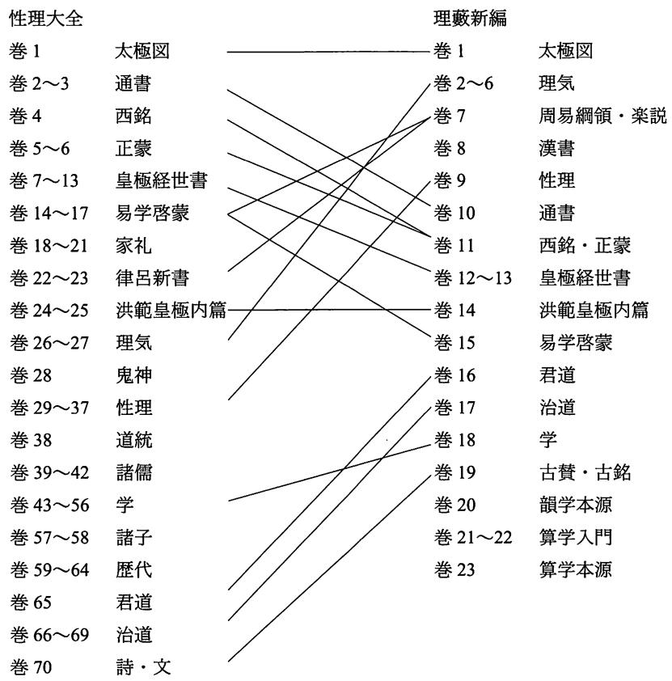

<!-- V3_SOURCE_ID:book015-b000345-p002-54ea1a00a4 -->

图3-1《性理大全》与《理藪新编》

查看对应原文

<!-- V3_FOLDBACK_BEGIN:book015-b000345-p002-54ea1a00a4 -->

図3-1『性理大全』と『理藪新編』

<!-- V3_FOLDBACK_END:book015-b000345-p002-54ea1a00a4 -->

<!-- V3_SOURCE_ID:book015-b000347-p000-bbab37e079 -->

还列举了(2)“括河洛的妙机”的洪范经世之学，以及(3)“古人知来之学”的启蒙历闰之法。另外引用了朱熹的“易之象数，初甚简易。今人不得其说，反遂诋以为淫巫瞽史之学，其亦误矣”（朱熹别集・巻6），以此说明自己依据性理学书籍编纂理数书籍的理由。

> **释读存疑：** 本地硬校验仍未通过，已记录供后续自动处理或人工核对。

查看对应原文

<!-- V3_FOLDBACK_BEGIN:book015-b000347-p000-bbab37e079 -->

と，(2)「河洛の妙機を括る」洪範経世の学と，(3)「古人知来の学」の啓蒙暦閏の法をあげている。また朱子の「易の象数は，初めははなはだ簡易であった。今人はその意味するところを悟らず，反って淫巫瞽史の学と誹るが，それもまた誤りである（易之象数，初甚簡易。今人不得其説，反遂詆以為淫巫瞽史之学，其亦誤矣）」（朱熹別集・巻6）を引いて，自らが性理学書にもとづいて理数書を編纂した理由を説明している。

<!-- V3_FOLDBACK_END:book015-b000347-p000-bbab37e079 -->

<!-- V3_SOURCE_ID:book015-b000348-p000-25acd4a403 -->

由此来看，黄胤锡的情况中，性理学与术数学的学术距离非常近。黄胤锡试图将性理学理解为术数学，这一点毋庸置疑。

查看对应原文

<!-- V3_FOLDBACK_BEGIN:book015-b000348-p000-25acd4a403 -->

以上からみて，黄胤錫のばあい性理学と術数学の学的距離は非常に近い。黄胤錫が性理学を術数学として理解しようとしていたことは疑えないであろう。

<!-- V3_FOLDBACK_END:book015-b000348-p000-25acd4a403 -->

<!-- V3_SOURCE_ID:book015-b000349-p000-4e246fa4dc -->

## 3.2 阮元の疇人伝序 — 3.2 阮元的畴人传序

查看对应原文

<!-- V3_FOLDBACK_BEGIN:book015-b000349-p000-4e246fa4dc -->

## 3.2 阮元の疇人伝序

<!-- V3_FOLDBACK_END:book015-b000349-p000-4e246fa4dc -->

<!-- V3_SOURCE_ID:book015-b000350-p000-9a8b0e3b92 -->

阮元（1764-1849）是乾嘉时期具有代表性的清代学者。《畴人传》共46卷，于1799年刊行，是一部题为“阮元撰”的历代天文、数学家列传，该书将“象数之学”视为“儒者应当切实致力于的实事求是的儒学学问”，为从黄帝到当时的243位畴人以及“西洋三十七人”立传。

查看对应原文

<!-- V3_FOLDBACK_BEGIN:book015-b000350-p000-9a8b0e3b92 -->

阮元(1764-1849)は乾嘉期を代表する清学者。『疇人伝』46巻(1799刊)は「阮元撰」になる歴代の天文・数学者の列伝であり，「象数の学」をもって「儒流実事求是の学儒者のまさに務むべきところ」ととらえ，黄帝より当時にいたる疇人(暦算学者)243人と「西洋三十七人」について立伝している。

<!-- V3_FOLDBACK_END:book015-b000350-p000-9a8b0e3b92 -->

<!-- V3_SOURCE_ID:book015-b000351-p000-ca9b2262cb -->

《畴人传》的特征之一，在于其以“推算历法的方法由疏渐密，到本朝已极为完备”（凡例）的进步史观为前提，梳理中国术数学史。从阮元的《畴人传序》来看，其独特的历算学进步史观无疑直接解释并体现了经学的历史发展。

> **释读存疑：** 原文中“術数学”的具体所指未明确，释读为“术数学史”可能存在歧义；1轮自动修复后核义模型仍建议修订，已保守记录。

查看对应原文

<!-- V3_FOLDBACK_BEGIN:book015-b000351-p000-ca9b2262cb -->

『疇人伝』の特徴の一つは暦算学の進歩史観，すなわち「推歩の法は疎すすより密に漸み，国朝に至り大いに備わる」(凡例)を前提として中国術数学史をあとづけるところにある。阮元の疇人伝序をみれば，その個性的な暦算学の進歩史観がただちに経学の歴史的発展を説明し意味していることは疑えない。

<!-- V3_FOLDBACK_END:book015-b000351-p000-ca9b2262cb -->

<!-- V3_SOURCE_ID:book015-b000352-p000-5a31073617 -->

从前，“黄帝迎接太阳，推演历法”（《史记·五帝本纪》），由此推算历法的术数、历算之学便产生了。之后，“尧帝命令羲和”（《书经·尧典》），“舜帝观察璿玑”（《书经·舜典》）。到了夏、殷、周时期，帝王相继更替，正朔也随之改变。这是因为遵循“乾”象天道来建立各项功绩，正是帝王的重要职责。因此，周公制定礼制，设置了冯相之官（《周礼·春官》），孔子编纂《春秋》，在书中谴责了天文官的过失。古代的圣人都极为重视天文历算。

> **释读存疑：** 原文中“乾象天”的“乾”依allowed_glossary释为八卦之一，卦象及五行、方位依原文语境确定，此处释读符合要求；本地硬校验仍未通过，已记录供后续自动处理或人工核对。

查看对应原文

<!-- V3_FOLDBACK_BEGIN:book015-b000352-p000-5a31073617 -->

むかし，「黄帝は日を迎え策を推し」(『史記』五帝本紀)，かくして推歩の術暦算の学が起こった。そののち，「堯帝は羲和に命じ(天象観測や頒暦を実施し)」(『書経』堯典)，「舜帝は璿璣をみ(日月五星の運行を斉え)た」(『書経』舜典)。夏殷周になると帝王がつぎつぎに入れ替わり，正朔もそれに応じて改まった。それは乾象天にのっとって百般の功績をあげることが，帝王の要道重要な職務にほかならないためである。それゆえ，周公は礼を制定し，(天文暦数のことを管轄する)馮相の官を設け(『周礼』春官)，孔子は『春秋』を編み，書中，天文官の過失をとがめた。古の聖人たちはみな天文暦算のことをきわめて重視したのである。

<!-- V3_FOLDBACK_END:book015-b000352-p000-5a31073617 -->

<!-- V3_SOURCE_ID:book015-b000353-p000-57119c2c2b -->

到了两汉时期，博学多才的大儒刘向、刘歆、张衡、郑玄等人继承了前代圣人的精微言论，考察相关典籍。他们都通晓象数，也熟知周天星官。有人制定历法，使日月星辰有序；有人撰写历法论，阐明五纪。由此，数术穷尽了天地的奥秘，其成就可与天地的造化相媲美。“儒者之学”在汉代大为兴盛。

查看对应原文

<!-- V3_FOLDBACK_BEGIN:book015-b000353-p000-57119c2c2b -->

両漢になると，通才大儒の劉向・劉歆・張衡・鄭玄たちが，前聖の微言を継承し，その典籍を考察した。かれらはみな象数に通暁し，周天の星官にも詳しかった。ある者は暦法を定めて三光を秩序づけ，別の者は暦論をたてて五紀を明らかにした。かくして数術は天地を極め尽くし，その制作は天地の造化にも肩を並べた。「儒者の学」は漢代，大いに奮ったのである。

<!-- V3_FOLDBACK_END:book015-b000353-p000-57119c2c2b -->

<!-- V3_SOURCE_ID:book015-b000354-p000-1bc510fee6 -->

但是自汉代以后，社会风气逐渐衰落，末学变得支离破碎。世俗的儒者们轻视“九九之术”，不肯讲授。负责观测灵台、掌管天文的人，全都固守旧闻，不明白法则的本意；研究推演、撰述、算造的人，只是变换法则中数字的子母，（原文此处未完整表述）

> **释读存疑：** 原文最后一句未完整表述

查看对应原文

<!-- V3_FOLDBACK_BEGIN:book015-b000354-p000-1bc510fee6 -->

だが漢以降，世風はしだいに降り，末学は支離した。俗儒どもは「九九の術」を賎しみて講じない。観台を履み司天を領する者はみな旧聞を株守し，法意を知ることもなく，演譔算造の家はただ法数の子母を換易

<!-- V3_FOLDBACK_END:book015-b000354-p000-1bc510fee6 -->

<!-- V3_SOURCE_ID:book015-b000355-p000-4d9e0d08f9 -->

（相关人员）仅做表面功夫，不肯用圭表精密观测天象，验证天象的工作因此越来越荒废。推算历法的学问也因此日渐衰落，台官的选拔也比以前更不被重视。“六艺之道”就这样湮没了，实在令人叹息。更过分的是，有人高谈内学，狂妄地占测星气，摘取图纬的浅陋言论，去测量深奥微妙的天象……有人随心所欲地空谈，肆无忌惮地做虚妄荒诞之事。“河图洛书之数”“元会运世之篇”之类的内容，违背真实、毫无根据，实在不得不称之为“数学之异端”“艺术之杨墨”7。等等。

> **释读存疑：** 星气；内学；图纬；台官；星气、内学、图纬、台官的具体所指，原文未明；本地硬校验仍未通过，已记录供后续自动处理或人工核对。

查看对应原文

<!-- V3_FOLDBACK_BEGIN:book015-b000355-p000-4d9e0d08f9 -->

するのみであり,精密に圭表によりて天象を観測しようとはしない。験天はこれを失することがいよいよ遠い。歩算の道はこれによりて日々衰え，台官の選も前にもまして軽い。「六芸の道」はかくして湮没した。まことに嘆くべきである。甚だしきは，あるいは内学を高言して，妄りに星気(老人の星など)を占い，図緯の小言をとりて，淵微の天象(発斂の節など)を測る。……あるいは思いのまま空談し，虚誕をなしてはばからない。「河図洛書の数」や「元会運世の篇」などは真実に反し根拠もなく，実に「数学の異端」「芸術の楊墨」といわざるをえない7。云々。

<!-- V3_FOLDBACK_END:book015-b000355-p000-4d9e0d08f9 -->

<!-- V3_SOURCE_ID:book015-b000356-p000-2c4f68df84 -->

《畴人传》的序言中特别值得重视的，是第三段落的主张。阮元说：“有人随心所欲地空谈，肆无忌惮地做虚妄荒诞之事。‘河图洛书之数’‘元会运世之篇’之类的内容，违背真实、毫无根据，实在不得不称之为‘数学之异端’‘艺术之杨墨’”，痛斥那些背离六艺之道的世俗儒者的虚妄荒诞学说。

> **释读存疑：** 此处“畴人传”的具体所指，原文未明确说明

查看对应原文

<!-- V3_FOLDBACK_BEGIN:book015-b000356-p000-2c4f68df84 -->

疇人伝序で特に重視すべきは，第三段落の主張である。阮元は「あるいは思いのまま空談し，虚誕をなしてはばからない。“河図洛書の数”や“元会運世の篇”などは真実に反し根拠もなく，実に“数学の異端”“芸術の楊墨”といわざるをえない」とのべて,六芸の道を逸脱した俗儒の虚誕の学説を痛罵している。

<!-- V3_FOLDBACK_END:book015-b000356-p000-2c4f68df84 -->

<!-- V3_SOURCE_ID:book015-b000357-p000-f33a2987f2 -->

阮元所厌恶并排斥的，是儒学即经学传统中轻视理数、随意从事卜筮和占候的流派。这个流派的方向，与贯通天地人的汉代经学中“数术穷尽天地，制作与造化相等”的主张完全相反。在阮元看来，应当追求的数术即天文算法的衰落，直接意味着经学的湮没，这不过是“实在值得叹息”的经学危机而已。“河图洛书之数”“元会运世之篇”之类的内容，很好地象征了经学的衰落，也很好地暗示了导致经学衰落之人的主张与对象。

> **释读存疑：** 此处“造化”的具体所指，原文未明确说明

查看对应原文

<!-- V3_FOLDBACK_BEGIN:book015-b000357-p000-f33a2987f2 -->

阮元が嫌悪し排斥するのは儒学＝経学の伝統における，理数を賤しみ卜筮や占候をほしいままにした流れのことである。その流れは天地人に通じる漢代経学が「数術は天地を窮め，制作は造化に侔しい」のとまさに逆のべクトルをもっている。阮元によれば，追求すべき数術すなわち天文算法の衰微はとりもなおさず経学の湮滅を意味し，「良に嗟歎すべき」経学の危機以外の何物でもない。「河図洛書の数」や「元会運世の篇」などはその経学の衰微をよく象徴し，経学の衰微をもたらした者の主張や対象をよく暗示している。

<!-- V3_FOLDBACK_END:book015-b000357-p000-f33a2987f2 -->

<!-- V3_SOURCE_ID:book015-b000358-p000-a74914fa4e -->

但「河図洛書の数」由朱熹在《易学啓蒙》中详细论述，「元会運世の篇」是性理学所重视的《皇極経世書》観物内篇的内容。特别是元会運世，不过是皇極経世学中用来标识历年记载特征的独特术语用法。此外，朱子学将「玩物喪志」与天文算法视为低贱之事，重视《易学啓蒙》《皇極経世書》《洪範皇極内篇》等典籍，且确实有喜好从事卜筮、占候之事，这是不容置疑的史实。阮元所说的「儒者の学」「六芸の道」所违背的「数学の異端」「芸術の楊墨」，必须理解为直接指向朱子学性理学。

> **释读存疑：** 本地硬校验仍未通过，已记录供后续自动处理或人工核对。

查看对应原文

<!-- V3_FOLDBACK_BEGIN:book015-b000358-p000-a74914fa4e -->

だが「河図洛書の数」は朱熹『易学啓蒙』が詳論し，「元会運世の篇」は性理学が重んじた『皇極経世書』観物内篇のことである。特に元会運世のばあい，皇極経世学の歴年記載を特徴づける個性的な用語法にほかならない。くわえて朱子学が「玩物喪志」と天文算法を賤しみ，『易学啓蒙』皇極経世書』洪範皇極内篇』などを重んじて好んで卜筮や占候に従事したことは史実として間違いないところである(命題2.3)。阮元が「儒者の学」「六芸の道」に背く「数学の異端」「芸術の楊墨」というのは，直接に朱子学性理学のことをさすと解さなければならない。

<!-- V3_FOLDBACK_END:book015-b000358-p000-a74914fa4e -->

<!-- V3_SOURCE_ID:book015-b000359-p000-4c45482a85 -->

《疇人伝》是《四庫全書》修改了汉代以来延续千数百年的传统分类法，将「天文算法類」从「術数類」中独立出来成为一个领域之后的著作，具有强烈的反神秘、反術数的性质。阮元所说的「数学の異端」「芸術の楊墨」，指的是除了数的神秘术即天文算法类之外，《四庫全書》術数类的内容。直截了当地说，对于阮元及清代儒者而言，朱子学不过是数的神秘术，或是与之极为相近的術数之学。

> **释读存疑：** 本地硬校验仍未通过，已记录供后续自动处理或人工核对。

查看对应原文

<!-- V3_FOLDBACK_BEGIN:book015-b000359-p000-4c45482a85 -->

『疇人伝』は『四庫全書』が漢以来千数百年継続した伝統の分類法を改変し，「天文算法類」を「術数類」から独立させて一個の領域とした(1793年，『総目提要』印行)以降の著述であり，反神秘や反術数の性格を強くもっている。阮元が「数学の異端」「芸術の楊墨」とよぶのは，数の神秘術すなわち天文算法類をのぞく『四庫全書』の術数類のことである。直裁にいえば，阮元や清儒にとって朱子学は数の神秘術，あるいはそれに限りなく近い術数的な学術にすぎなかったのである。

<!-- V3_FOLDBACK_END:book015-b000359-p000-4c45482a85 -->

<!-- V3_SOURCE_ID:book015-b000360-p000-1c7328de3a -->

## 4 朱子哲学に現れる術数的思考——朱子哲学中显现的术数式思考

查看对应原文

<!-- V3_FOLDBACK_BEGIN:book015-b000360-p000-1c7328de3a -->

## 4 朱子哲学に現れる術数的思考

<!-- V3_FOLDBACK_END:book015-b000360-p000-1c7328de3a -->

<!-- V3_SOURCE_ID:book015-b000361-p000-3473002b39 -->

朱子学／性理学以基于独特《周易》的命题为第一原理，构建了包含理気（数与五行）的哲学体系。理気的哲学命题在理论上贯穿朱子学的全部内容。若将其命题化，朱子学的逻辑特征在于：（1）基于易说；（2）具有体系性。另一方面，无论《周易》拥有多么悠久的历史、多么丰富的形而上学主题，其本质是卜筮之书，属于术数学。易说作为基础理论确定了朱子哲学体系的框架，重视神秘数的术数式思考必然会在朱子学的逻辑中随处显现。朱子学的理気论本身就是术数学，这一点无需另行说明，因此接下来针对朱子学中显现的术数学性质，除体系性特征外，指出几个重要方面。

> **释读存疑：** 数与五行的具体所指未在术语表中明确说明；本地硬校验仍未通过，已记录供后续自动处理或人工核对。

查看对应原文

<!-- V3_FOLDBACK_BEGIN:book015-b000361-p000-3473002b39 -->

朱子学／性理学は，独特の『周易』にもとづく命題を第一原理として理気(数と陰陽五行)の哲学体系を構築したものである。理気の哲学命題が朱子学のすべてを理論的に貫通する。命題化していえば，朱子学の論理の特徴は(1)易説にもとづき，(2)体系性をもつところにある。一方，『周易』がいかに悠久の歴史を誇り形而上学的テーマに富んでいようとも，実質は卜筮書であり術数学である。易説が基礎理論として朱子哲学体系のフレイムワークを定め，神秘数を重んずる術数的思考が朱子学の論理のあちこちに現れざるをえないことは明らかであろう。朱子学の理気論が術数学であること自体は改めて説明するまでもない8)からには，朱子学に現れた術数学的性格について以下，体系的特徴をのぞいて重要なところをいくつか指摘する。

<!-- V3_FOLDBACK_END:book015-b000361-p000-3473002b39 -->

<!-- V3_SOURCE_ID:book015-b000362-p000-0e7e971de3 -->

## 4.1 形而上学と自然学の混淆 — 4.1 形而上学与自然学的混淆

查看对应原文

<!-- V3_FOLDBACK_BEGIN:book015-b000362-p000-0e7e971de3 -->

## 4.1 形而上学と自然学の混淆

<!-- V3_FOLDBACK_END:book015-b000362-p000-0e7e971de3 -->

<!-- V3_SOURCE_ID:book015-b000363-p000-80909b0f63 -->

《宋史》道学传的序言明确指出，朱子学的源流之一，是周敦颐的论题“阴阳五行之理，命於天而性於人者”9)。朱子理气哲学中，周敦颐“明确天理的根源，探究万物的始终”这一带有术数性质的命题设定，其意义是显而易见的。另外，周敦颐将自己的论题

查看对应原文

<!-- V3_FOLDBACK_BEGIN:book015-b000363-p000-80909b0f63 -->

『宋史』道学伝の序言は，朱子学の源流の一つが周敦頤のテーゼ「陰陽五行之理，命於天而性於人者」にあることを明言している9)。朱子理気哲学における「天理の根源を明らかにし，万物の終始を究める」周子の術数的な命題設定の意義は明らかであろう。また周敦頤が自己のテーゼを

<!-- V3_FOLDBACK_END:book015-b000363-p000-80909b0f63 -->

<!-- V3_SOURCE_ID:book015-b000364-p000-fcab9e6872 -->

全面展开的，正是《太极图说》。《太极图说》经朱子修改与注释后，作为朱子理气哲学的基本命题，在东亚产生了重大的思想影响。

查看对应原文

<!-- V3_FOLDBACK_BEGIN:book015-b000364-p000-fcab9e6872 -->

全面的に展開したのがほかならぬ『太極図説』である。『太極図説』は朱子による修改と注釈を経て，朱子理気哲学の基本命題として東アジアに大きな思想的な影響をおよぼした。

<!-- V3_FOLDBACK_END:book015-b000364-p000-fcab9e6872 -->

<!-- V3_SOURCE_ID:book015-b000365-p000-94af4df182 -->

可以说，《太极图说》是一部简要阐述宇宙万物的生成与道德渊源的哲学著作，其中的宇宙生成论原本属于术数学的范畴，是术数类天文所属领域专门研究的主题10)。但《太极图说》的逻辑，却彻头彻尾地执着于易学的用语与思考，在此基础上详尽阐述了关乎道德根本的天地万物的生成。也就是说，虽然各个具体的解释本身略有变化，但它与《周易·系辞上传》的“易有太極，是生両儀。両義生四象，四象生八卦”、“一陰一陽之謂道，繼之者善也，成之者性也。仁者見之謂之仁，知者見之謂之知。百姓日用而不知，故君子之道鮮矣”、“是故形而上者謂之道，形而下者謂之器。化而裁之謂之變，推而行之謂之通。舉而錯之，天下之民謂之事業”等内容，有着相同的基本思路与术语。可以说，《太极图说》的事例显著体现了两宋时期术数学向易学转变的过程。

> **释读存疑：** 本地硬校验仍未通过，已记录供后续自动处理或人工核对。

查看对应原文

<!-- V3_FOLDBACK_BEGIN:book015-b000365-p000-94af4df182 -->

『太極図説』は簡潔に，宇宙万物の生成と道徳の淵源を説いた哲学書とのべることができるが，そのうち宇宙生成論はもともと術数学の範疇に属し，術数類天文の属が専門的に研究してきたテーマである10)。だが『太極図説』の論理といえば，むしろ徹頭徹尾，易学の用語／思考に固執し，それにもとづいて道徳の根本におよぶ天地万物の生成をのべつくすところにある。すなわち，個別の解釈自体にはやや変化がみられるが，『周易』繋辞上伝の「易有太極，是生両儀。両義生四象，四象生八卦」(11章)や「一陰一陽之謂道，繼之者善也，成之者性也。仁者見之謂之仁，知者見之謂之知。百姓日用而不知，故君子之道鮮矣」(5章)，「是故形而上者謂之道，形而下者謂之器。化而裁之謂之變，推而行之謂之通。舉而錯之，天下之民謂之事業」(12章)などと基本的な発想とターミノロジィを同じくしている。『太極図説』の事例は両宋期における術数学の数→易の変化を顕著に示しているといってよいであろう(命題2.3参照)。

<!-- V3_FOLDBACK_END:book015-b000365-p000-94af4df182 -->

<!-- V3_SOURCE_ID:book015-b000366-p000-104982e882 -->

《太极图说》是构建朱子学理论基础的重要论文，其易学宇宙生成论的内容本身属于术数学，这一点毋庸置疑。在论述宋元思想史时，理应首先将其术数性置于批判的焦点之上。不过，即便对于朱子学的专业研究者而言，也未必广为人知的是，《太极图说》除此之外，在哲学体系上还包含着重大的逻辑缺陷。正如命题1.1所指出的，在术数命题中，形而上学命题与自然学命题会出现奇妙且不自然的混淆。简单来说，朱子学对《太极图说》的易学宇宙生成论展开了如下论述。

查看对应原文

<!-- V3_FOLDBACK_BEGIN:book015-b000366-p000-104982e882 -->

『太極図説』は朱子学の理論基礎を構築した重要な論文であり，その易学的な宇宙生成論の内容自体が術数学であることには疑問の余地がない。宋元思想史を論じる際，当然として最初にその術数性を批判の俎上に載せるべきであろう。だが朱子学の専門研究者にもあまり知られていないが，『太極図説』はそれ以外にも哲学体系上，重大な論理的欠点を内包する。命題1.1の指摘するごとく，術数命題においては，形而上学的命題(人文的命題)と自然学的命題(科学的命題)が奇妙に／不自然に混淆するからである。簡潔に説明すれば，朱子学(『性理大全』)は『太極図説』の易学的宇宙生成論を以下のように展開している。

<!-- V3_FOLDBACK_END:book015-b000366-p000-104982e882 -->

<!-- V3_SOURCE_ID:book015-b000367-p000-c73a06e64e -->

(a) 有无极便有太极。太极运动便生出阳，运动到极致便转为静止；静止便生出阴，静止到极致又会转为运动。时而运动时而静止，二者互为根本；分化出阴与阳，两仪便确立了。

查看对应原文

<!-- V3_FOLDBACK_BEGIN:book015-b000367-p000-c73a06e64e -->

(a)無極にして太極あり。太極は動いて陽を生じ，動くこと極まって静かに，静かにして陰を生ず。静かなること極まってまた動く。あるいは動きあるいは静かにして，互いにその根となり，陰に分か
れ陽に分かれて，両儀立つ。

<!-- V3_FOLDBACK_END:book015-b000367-p000-c73a06e64e -->

<!-- V3_SOURCE_ID:book015-b000369-p000-5a323ec2e8 -->

无极而太极。太极动而生阳，动极而静。静而生阴，静极复动。一动一静，互为其根。分阴分阳，两仪立焉。

查看对应原文

<!-- V3_FOLDBACK_BEGIN:book015-b000369-p000-5a323ec2e8 -->

(無極而太極。太極動而生陽，動極而静。静而生陰，静極復動。一動一静，互 為其根。分陰分陽，兩儀立焉。)

<!-- V3_FOLDBACK_END:book015-b000369-p000-5a323ec2e8 -->

<!-- V3_SOURCE_ID:book015-b000370-p000-0cfee28156 -->

(b) 阳变阴合，便生出五行，五气依次分布，四时循环运转。五行是一阴一阳的体现，阴阳是太极的体现，太极原本就是无极。五行产生之时，各自的本性是统一的。无极的真义与二五的精，奇妙地交融凝聚。乾之道构成男性，坤之道构成女性。阴阳二气交感，化生万物，万物不断衍生变化，永无止境。唯有人获得了其中的灵秀，最为灵动。形体已经生成，精神便会萌发并产生知觉，五感受到触动便会分出善恶，万事由此产生。

> **释读存疑：** 二五的精具体所指不详；本地硬校验仍未通过，已记录供后续自动处理或人工核对。

查看对应原文

<!-- V3_FOLDBACK_BEGIN:book015-b000370-p000-0cfee28156 -->

(b)陽変じ陰合して水火木金土を生じ，五気順布して，四時めぐる。五行は一陰陽なり，陰陽は一太極なり，太極はもと無極なり。五行の生ずるや，各おのその性を一にす。無極の真と二五の精，妙合して凝る。乾道は男をなし，坤道は女をなす。二気交感して万物を化生し，万物は生生して変化窮まることなし。ただ人のみはその秀を得て，最も霊なり。形すでに生じ，神発して知り，五性感動して善悪分かれ，万事出づ。

<!-- V3_FOLDBACK_END:book015-b000370-p000-0cfee28156 -->

<!-- V3_SOURCE_ID:book015-b000371-p000-3b5b48e71c -->

阳气变动、阴气相合，便产生了水、火、木、金、土五种气。这五种气顺着规律分布，四时便由此运行。五行，本质上就是一阴一阳的变化；阴阳，本质上就是一个太极的运转；太极，原本就是无极的状态。五行产生之时，各自具备自身的特性。无极的真性，与阴阳二气、五行之气的精华，巧妙结合凝聚。乾对应生成男性，坤对应生成女性。阴阳二气相互交感，化育出世间万物。万物不断繁衍生长，变化也就无穷无尽了。只有人，得到了其中的精华，最为灵动。人的形体已经形成，精神便会产生知觉。五种感官受到外物触动，善恶便会区分开来，世间万事也就由此产生了。

> **释读存疑：** 原文未明确提及“阳气变动、阴气相合”的具体所指，仅为对“陽變陰合”的合理释读；本地硬校验仍未通过，已记录供后续自动处理或人工核对。

查看对应原文

<!-- V3_FOLDBACK_BEGIN:book015-b000371-p000-3b5b48e71c -->

陽變陰合而生水火木金土。五氣順布，四時行焉。五行，一陰陽也。陰陽，一太極也。太極，本無極也。五行之生也，各一其性。無極之真，二五之精，妙合而凝。乾道成男，坤道成女。二氣交感，化生萬物。萬物生生而變化無窮焉。惟人也，得其秀而最靈。形既生矣，神發知矣。五性感動而善惡分，萬事出矣。)

<!-- V3_FOLDBACK_END:book015-b000371-p000-3b5b48e71c -->

<!-- V3_SOURCE_ID:book015-b000372-p000-22f9f87279 -->

但段落(a)与段落(b)的逻辑和含义明显不同，前者必须被称为形而上学命题，后者则必须被称为自然学命题。关于段落(a)中形而上学的“太极动而生阳”“静而生阴”，若将其视为自然学命题，即认为太极独自先于阴阳存在，太极运动之后产生阳，太极静止之后产生阴，那么阴阳作为物理现象便会从无中产生，这与程子“道静无端，阴阳无始”的基本原则相矛盾。因此必须将其作为形而上学命题来解读，不能将其理解为概念层面之外的内容。

查看对应原文

<!-- V3_FOLDBACK_BEGIN:book015-b000372-p000-22f9f87279 -->

だが段落(a)と段落(b)は明らかに論理や意味を異にしており，前者は形而上学的命題，後者は自然学的命題といわねばならない。段落(a)の形而上学的な「太極動而生陽」「静而生陰」であるが，仮に自然学的命題として，太極が独り陰陽に先んじて存在し，太極が動いたのち陽が生まれ，太極が静かになったのち陰が生まれることを意味するとすれば，物理現象として陰陽は無から生じ，程子の「道静無端，陰陽無始」の基本原則(『易説』繋辞)と矛盾をいたすからである。かならず形而上学的命題として読み,概念上のことと解さなければならない。

<!-- V3_FOLDBACK_END:book015-b000372-p000-22f9f87279 -->

<!-- V3_SOURCE_ID:book015-b000373-p000-d6be27ea51 -->

李珥（1536-1584）准确理解了这一点，据我所知，动静的契机没有驱使它的存在，理和气也不存在先后之分。只是因为气的动静以理为根本，所以周敦颐才将其命题化为“太极动而生阳，静而生阴”。但如果依据这句话认为太极独自先于阴阳存在，阴阳是从无中产生的，那就与“阴阳无始”的基本原则相矛盾。关于这一点，必须最为妥善地灵活看待、深入体会。

查看对应原文

<!-- V3_FOLDBACK_BEGIN:book015-b000373-p000-d6be27ea51 -->

李珥(1536-1584)は正確にそのことを理解し，
わたしの理解するところ，動静の機には使役する者はなく，また理気にも先後があるわけではない。ただ気の動静は理が根底をなすため，周敦頤は「太極が動いて陽を生じ，静かになって陰を生ず」と命題化するのである。だがこの言をとって，太極は独り陰陽に先んじて存在し，陰陽は無(太極)から生まれたとすれば，それは「陰陽無
始」の大原則と矛盾する。この点については最もよろしく活看し深玩しなければならない。

<!-- V3_FOLDBACK_END:book015-b000373-p000-d6be27ea51 -->

<!-- V3_SOURCE_ID:book015-b000376-p000-97255e79ca -->

臣按：动静的契机，没有什么东西在驱使它。理和气，也不存在可以说有先后的情况。只是因为气的动静，必须以理为根本。所以说“太极动而生阳，静而生阴”。如果执着于这句话，认为太极独立存在于阴阳之前，阴阳从无到有产生，那就不符合所谓的“阴阳无始”了。最应当灵活看待、深入体会。

查看对应原文

<!-- V3_FOLDBACK_BEGIN:book015-b000376-p000-97255e79ca -->

（臣按，動靜之機，非有以使之也。理氣，亦非有先後之可言也。第以氣之動靜也，須是理爲根柢。故曰「太極動而生陽，靜而生陰」。若執此言，以爲太極獨立於陰陽之前，陰陽自無而有，則非所謂「陰陽無始」也。最宜活看而深玩也。）

<!-- V3_FOLDBACK_END:book015-b000376-p000-97255e79ca -->

<!-- V3_SOURCE_ID:book015-b000377-p000-105a305033 -->

文中是这样论述的，出自《圣学辑要》修己第二、穷理章第四。但如果必须灵活领会、深入钻研才能理解其含义，那就说明这是论述不够充分、表达存在疏漏，意味着在逻辑展开上存在重大缺陷。就《太极图说》乃至理气说而言，其逻辑上的缺陷，终究应当理解为是源于易学的术数式思考所导致的。

查看对应原文

<!-- V3_FOLDBACK_BEGIN:book015-b000377-p000-105a305033 -->

とのべている(『聖学輯要』修己第二・窮理章第四)。だが活看深玩しなければ意味が通じないのであれば，それは考察の不足や表現の不備のためであり，論理展開上，大きな欠点があることを意味している。『太極図説』ひいては理気説のばあい，論理上の欠点は結局のところ，易学に起因する術数的思考がそれをもたらしたと解すべきであろう。

<!-- V3_FOLDBACK_END:book015-b000377-p000-105a305033 -->

<!-- V3_SOURCE_ID:book015-b000378-p000-815af49c87 -->

## 4.2倫理と卜筮の併存 — 4.2 伦理与卜筮的并存

查看对应原文

<!-- V3_FOLDBACK_BEGIN:book015-b000378-p000-815af49c87 -->

## 4.2倫理と卜筮の併存

<!-- V3_FOLDBACK_END:book015-b000378-p000-815af49c87 -->

<!-- V3_SOURCE_ID:book015-b000379-p000-fda8549a58 -->

《四库全书总目提要》经部易类的大序，将历代易学大致分为“两派六宗”，并记载了它们相互攻讦的情况。“两派”指的是象数派与义理派，其学说分别被称为象数易、义理易。象数易的代表有：①“距离古代尚未久远”的经古文学派的易学；②“陷入灾异迷信”、带有灾异学倾向的京房与焦延寿的易学；③开创图书之学、试图探究天地万物造化的陈抟与邵雍的易学。另一方面，义理易的代表有：④“完全摒弃象数，以老庄学说进行阐释”的王弼的易学；⑤“首次阐明儒理”的胡瑗与程颐的易学；⑥“还会参证史事”的李光与杨万里的易学。以上便是“六宗”。《四库全书总目提要》的两派六宗说，大致可以概括易学的发展历程。

查看对应原文

<!-- V3_FOLDBACK_BEGIN:book015-b000379-p000-fda8549a58 -->

『四庫全書総目提要』経部易類大序は歴代の易学を大きく「両派六宗」に分類して，それらが相互に攻駁したことを伝えている。「両派」とは象数派と義理派のこと。その内容を称しては象数易・義理易という。象数易は，①「古を去ることいまだ遠からざる」経古文学派の易学，②「磯祥に入り」，災異学的傾向を示す京房や焦延寿の易学，③図書の学を創始し，天地万物の造化を究明せんとする陳摶や邵雍の易学を代表とする。一方，義理易は，④「象数を尽黜し，説くに老荘を以てする」王弼の易学，⑤「始めて儒理を闡明する」胡援や程頤の易学，⑥「また史事に参証する」李光や楊万里の易学を代表とする。「六宗」である。『総目提要』の両派六宗説はよく易学の発展を総括しているということができるであろう。

<!-- V3_FOLDBACK_END:book015-b000379-p000-fda8549a58 -->

<!-- V3_SOURCE_ID:book015-b000380-p000-925d051ea4 -->

若简要总结两派易学的学说特征，象数易首先重视卦爻的象数，试图凭借象数本身的逻辑来解释卦辞、爻辞等的含义。象数本身的逻辑，也就是象数的相互关联性，除了依据易内的数结构——如应、正、中、当、反等，通过升降、消息、互体、旁通等方式来解释外，还会频繁运用易外的数学定理、天文常数等来解释字句。另一方面，义理易最重视卦爻的义理，试图凭借义理本身的逻辑来解释卦辞、爻辞等的含义。义理本身的逻辑，也就是易哲学与自然观，除了通过组合易内的卦辞、爻辞与十翼的语句来解释外，还常见以易外的道德律、心性论进行阐释的情况。

查看对应原文

<!-- V3_FOLDBACK_BEGIN:book015-b000380-p000-925d051ea4 -->

特に両派易学の学説上の特徴を簡単にまとめれば，象数易は第一に卦爻の象数を重んじ，象数固有の論理をもって卦辞爻辞などの意味を説明しようとする。象数固有の論理すなわち象数の相互関係性は易内の数構造――応・正・中・当・反などにもとづき升降・消息・互体・旁通などによって説明されるほか，易外の数学定理や天文定数なども字句の解釈に頻繁に利用される。一方，義理易は最も卦爻の義理を重んじ，義理固有の論理をもって卦辞爻辞などの意味を説明せんとする。義理固有の論理すなわち易哲学や自然観は易内の卦辞爻辞や十翼の語句を組み合わせることによって説明されるほか，易外の道徳律・心性論による解釈もよくみられるところである。

<!-- V3_FOLDBACK_END:book015-b000380-p000-925d051ea4 -->

<!-- V3_SOURCE_ID:book015-b000381-p000-9ce443b5fb -->

象数易这类事物，根据前面的说明，无需多言就可知其属于术数学的范畴，没有特别需要讨论的地方。正如之前提到的周敦颐《太极图说》、邵雍《皇极经世书》等著作中所明确呈现的那样，象数是其核心内容，切实发挥着作用。但对于义理易，若简单认为它完全摒弃象数，因此不属于术数学的范畴，或是因为格外重视义理，所以术数属性极低，这种说法并不正确。从另一方面来看，应当说它的术数属性反而更高。

查看对应原文

<!-- V3_FOLDBACK_BEGIN:book015-b000381-p000-9ce443b5fb -->

そもそも象数易のばあい，術数学の範疇に分類されることは上記の説明によるまでもなく自明である。ことさら議論すべきところはないであろう。既述した周敦頤『太極図説』や邵雍『皇極経世書』などに明らかなごとく，象数が主旋律を構成しありのままに機能している。だが義理易については，象数を尽黜する，云々というゆえ術数学のカテゴリーに属さない，あるいは義理をことのほか重んじるため術数性はきわめて低いなどと単純にいうことができるかといえば，そうではない。一面において，術数性はより高まっているというべきであろう。

<!-- V3_FOLDBACK_END:book015-b000381-p000-9ce443b5fb -->

<!-- V3_SOURCE_ID:book015-b000382-p000-87dc10b443 -->

接下来，我想以朱子哲学体系中易学研究的代表——程颐《易传》为例，探讨义理易的术数属性。之所以选择这部著作，是因为朱子《周易本义》是义理易与象数易的折中之作，其术数属性明确可辨，并不适合作为义理易的分析对象。

查看对应原文

<!-- V3_FOLDBACK_BEGIN:book015-b000382-p000-87dc10b443 -->

以下，朱子哲学体系の易研究の代表として程頤『易伝』をとりあげ，義理易の術数性について考えてみたい。朱子『周易本義』は義理易と象数易の折衷であり術数性が確実に認められ，義理易としての分析には適さないからである。

<!-- V3_FOLDBACK_END:book015-b000382-p000-87dc10b443 -->

<!-- V3_SOURCE_ID:book015-b000383-p000-2a01c02069 -->

程颐《易传》乍看之下充满了性理学风格的道德教训，仿佛是一部伦理学著作。《易传》自序中对此说道：“易就是变易，随时间的变化而变易，以此顺应道。这部书广大而完备，将用来顺应性命之理，通晓幽明的缘由，穷尽事物的实情，昭示开启物质、成就事务的道理。”此外，《四库全书总目提要》中记载：“程子不相信邵子的术数。因此邵子用术数来阐释易，而程子的这部传则论述理，有时阐明天道，有时切近人事。”引文中的“理”和“道”，无疑是指人所固有的道德性。

查看对应原文

<!-- V3_FOLDBACK_BEGIN:book015-b000383-p000-2a01c02069 -->

程頤『易伝』は一見したところ，性理学風の道徳教訓に溢れ，あたかも倫理学書のようである。易伝自序はそれについて，「易は変易なり，時に随いて変易して以て道に従うなり。その書たるや，広大にして悉く備わる。将に以て性命の理に順い，幽明の故に通じ，事物の情を尽くして，開物成務の道を示さんとす(易變易也。隨時變易，以從道也。其為書也廣大悉備。將以順性命之理，通幽明之故，盡事物之情，而示開物成務之道也)」という。また『四庫全書総目提要』は「程子は邵子の数を信ぜず。故に邵子は数を以てあらわ易を言うも，程子の此の伝は則ち理を言い，あるいは天道を闡し，あるいは人事を切る(程子不信邵子之數。故邵子以數言易，而程子此傳則言理，一闡天道，一切人事)」とのべている。引用中の「理」や「道」は人に固有の道徳性を意味するにちがいない。

<!-- V3_FOLDBACK_END:book015-b000383-p000-2a01c02069 -->

<!-- V3_SOURCE_ID:book015-b000384-p000-0326c2b32b -->

程颐《易传》的伦理属性，要阐明它并不十分困难。这次我想通过对比郑玄对艮卦卦辞的注释与程颐的注释，来尝试说明这一点。艮卦是艮下艮上的纯卦，上卦和下卦都是一阳爻位于二阴爻之上。它的卦辞是“艮其背，不獲其身”等内容。

查看对应原文

<!-- V3_FOLDBACK_BEGIN:book015-b000384-p000-0326c2b32b -->

程頤『易伝』の倫理的性格については，それを明らかにすることはさほ
ど難しいことではない。今回は艮卦卦辞に対する鄭玄注(①の解釈)と程頤注(⑤の解釈)の比較を通して，それを試みたい。艮卦は艮下艮上の純卦，上卦も下卦も一陽爻が二陰爻の上にある。その卦辞は「艮其背，不獲其身」云々という。

<!-- V3_FOLDBACK_END:book015-b000384-p000-0326c2b32b -->

<!-- V3_SOURCE_ID:book015-b000386-p000-76e9c6c6e4 -->

郑玄针对艮卦的卦辞注释道：“艮之言很也”，该内容见《释文》；艮的意思是很，即违逆、相背。“艮为山。山峙立各处，没有相互顺从的时候，就如同君主在上、臣下在下，恩敬无法相通，因此称之为艮”，该内容见《集解》；艮就是山，山各自耸立，不会相互顺从，这就如同君主在上、臣下在下，恩敬无法相通，所以注释为艮，该内容出自《通德遗书诸见录》。其训读应读作“逆其背，恶其身”，它的含义是君主（一阳爻）与臣下（二阴爻）对峙，恩敬无法相通，与其说是伦理命题，不如说是冷酷的社会描写。

> **释读存疑：** 本地硬校验仍未通过，已记录供后续自动处理或人工核对。

查看对应原文

<!-- V3_FOLDBACK_BEGIN:book015-b000386-p000-76e9c6c6e4 -->

鄭玄は艮卦卦辞に対して，「艮之言很也」(見釈文) —— 艮の意味は很，さからう，たがうこと。「艮為山。山立峙，各於其所，无相順之時。猶君在上臣在下，恩敬不相与通。故謂之艮也」(見集解) —— 艮は山。山は各おのそびえ立ち，相互に順うことなどない。これは君が上にあり臣が下にあって，恩敬が相通じないのと同様である。それゆえ艮という，と注する(『通徳遺書諸見録』)。訓読は「その背にさからいて，その身をえず」と読むべきであろう。その意味するところは，君(一陽爻)と臣(二陰爻)が対峙して恩敬が通じあわないことである。倫理命題というより冷徹な社会描写といってよいであろう。

<!-- V3_FOLDBACK_END:book015-b000386-p000-76e9c6c6e4 -->

<!-- V3_SOURCE_ID:book015-b000387-p000-78d6bf895a -->

另一方面，程颐注释道：“人之所以不能安于应当止的地方，是因为被欲望驱使。欲望在前牵引，即便想要寻求正确的止，也无法得到。因此艮的道理，正如卦辞所说，必须做到‘艮其背’。人所看见的是前方，而背与前方相背，无法看见。若在看不见的地方止，欲望就不会扰乱内心，便能安于止。另外，卦辞所说的‘不获其身’，是指不执着于自身，忘却自我。若能无我，便能正确地止；反之，若不能无我，便没有应当止的道路。……若在背的位置，即便极近也看不见，这就是不与外物相交。不接触外物，内心的欲望便不会萌生，若能如此止，便能得到止的道理，在止的过程中没有过错”11)。按照程颐的解释，训读应读作“艮其背，不获其身”，正如卦辞所说，若能彻底无欲、不与外物相交，安于应当止的地方，便能达到无我的境界，没有过错。艮卦在程颐看来，是阐述天理与人欲的关系，属于《大学》三纲领中的内容。

> **释读存疑：** ‘艮其背’‘不获其身’为卦辞原文，训读内容为‘艮其背，不获其身’，二者表述不同，需注意区分；原文未提及‘止于至善’，相关内容为无依据添加；原文未提及‘属于《大学》三纲领中的内容’，相关内容为无依据添加；‘艮其背’‘不获其身’为卦辞原文，训读内容为‘艮其背，不获其身’，二者表述不同，需注意区分；1轮自动修复后核义模型仍建议修订，已保守记录。

查看对应原文

<!-- V3_FOLDBACK_BEGIN:book015-b000387-p000-78d6bf895a -->

一方，程頤は「人が止まるべきところに安んじることができないのは，欲に動かされるからである。欲が前に牽けば，正しい止を求めてもそれを得ることはできない。それゆえ艮の道は,まさに卦辞のいうごととど  
く“その背に良まら(艮其背)”なければならない。人の見るところは(人体の構造上)前方にあるが,背はそれにそむき,見ることができない。その見ざるところに止まれば，欲が心を乱すこともなく，止まりて安んじる。一方，卦辞の“その身を獲ず(不獲其身)”とは，その身を見ない，我を忘れることである。無我であれば正しく止まり，逆に無我でなければ止まるべき道はそこにない。……背にあれば,至近といえども見えない。物と交わらないということである。外物に接しなければ内欲は萌さず，かくのごとく止まれば,すなわち止の道を得，止において咎はない」11),と注する。程頤の解釈にしたがえば，訓読は「その背にとどまりて,その身をえず」と読み，卦辞がのべるごとく，無欲に徹して物と交わらず，止まるべきところに止まれば，無我の境地にいたり，咎はないとなる。艮卦は程頤によれば，天理と人欲の関係を説き，『大学』の三綱領の一つ

<!-- V3_FOLDBACK_END:book015-b000387-p000-78d6bf895a -->

<!-- V3_SOURCE_ID:book015-b000388-p000-882937fdb9 -->

这无非是依据“至善而止”的道理，阐释“止”的法则。若与郑玄的解释相比，程颐的伦理志向，也就是动机主义、心情伦理，引导人们向“向”靠拢的倾向，是无法隐藏的吧12。

> **释读存疑：** 1轮自动修复后核义模型仍建议修订，已保守记录。

查看对应原文

<!-- V3_FOLDBACK_BEGIN:book015-b000388-p000-882937fdb9 -->

「至善に止まる」をもとづいて止の道を説いたものにほかならない。鄭玄の解釈と比較すれば，程頤の倫理志向すなわち動機主義／心情倫理に向かって人を誘掖しようとする傾向性は隠しようがないであろう12)。

<!-- V3_FOLDBACK_END:book015-b000388-p000-882937fdb9 -->

<!-- V3_SOURCE_ID:book015-b000389-p000-769fa08038 -->

不過程頤的《易傳》總體上屬於倫理學著作，他在闡釋倫理的同時，也沒有忘記提及卜筮之事。《易傳》自序中所說的「易有聖人之道四焉。以言者尚其辭，以動者尚其變，以制器者尚其象，以卜筮者尚其占」，「吉凶消長之理，進退存亡之道，備於辭」，「君子居則觀其象而玩其辭，動則觀其變而玩其占」等，就是這方面的體現。在程頤的《易傳》中，卜筮與倫理並存，還包含著超出倫理學的意義，也就是對天道秘密的認知。

查看对应原文

<!-- V3_FOLDBACK_BEGIN:book015-b000389-p000-769fa08038 -->

だが程頤『易伝』は総じて倫理学書的であるが，倫理を説くと同時に卜筮のことに言及することも忘れない。易伝自序にいわゆる「易に聖人の徳四あり。以て言う者はその辞を尚び，以て動く者はその変を尚び，以て器を制する者はその象を尚び，以て卜筮する者はその占を尚ぶ(易有聖人之道四焉。以言者尚其辭，以動者尚其變，以制器者尚其象，以卜筮者尚其占)」，「吉凶消長の理，進退存亡の道，辞に備わる(吉凶消長之理，進退存亡之道，備於辭)」，「君子，居れば則ちその象を観てその辞を玩び，動けば則ちその変を観てその占を玩ぶ(君子居則觀其象而玩其辭，動則觀其變而玩其占)」などがそれである。程頤『易伝』にあっては卜筮が倫理と併存し，倫理学以上の意味(天道の秘密を知ること)も含んでいるのである。

<!-- V3_FOLDBACK_END:book015-b000389-p000-769fa08038 -->

<!-- V3_SOURCE_ID:book015-b000390-p000-e74245be69 -->

伦理与卜筮并存，也就是“推天道以明人事”的这种特性，无论是义理易还是象数易，只要是易学著作，都必然无法脱离这一点。“圣人觉世牖民，大抵因事以寓教”，《易》“寓于卜筮”。但如果关注术数学的思考结构，也就是术数性，那么义理易相比象数易，对伦理的要求更高，因此伦理与卜筮的矛盾也会更加明显。就算拼上性命也要坚守伦理，可如果能在事情发生前就严密且广泛地知晓命运或事情的结局，那么行为的选择，乃至道德行为本身的意义都会发生巨大变化。后世看来毫无价值的死亡，之所以具有伦理意义，是因为人无法提前知晓未来。伦理与卜筮，原本作为应当做到的事，根本无法并存，二者本质上的矛盾是不言而喻的。但如果像义理易那样对伦理的要求不断提高，那么它与卜筮的矛盾，也就是人文学命题与自然学命题的混淆所产生的矛盾，必然会比之前更加增大。

> **释读存疑：** 《四库全书总目提要》经部易类大序；伦理与卜筮在原理上的抵触；命题1.1；本地硬校验仍未通过，已记录供后续自动处理或人工核对。

查看对应原文

<!-- V3_FOLDBACK_BEGIN:book015-b000390-p000-e74245be69 -->

倫理とト筮の併存すなわち「天道を推して以て人事を明らかにする(推天道以明人事)」，この性格は，義理易であれ象数易であれ，易学書であれさと みちび  
ばどうしても免れないところである。「聖人は世を覚し民を牖くに，大抵，事に因りて以て教えを寓し(聖人覺世牖民，大抵因事以寓教)」，易は「卜筮に寓する(寓於卜筮)」からである(『四庫全書総目提要』経部易類大序)。だが術数学の思考構造すなわち術数性に注目すれば，義理易は象数易に比して要求する倫理の質が高く，したがって倫理と卜筮の矛盾がより顕在化している。いくら死を賭して倫理に固執しようとも，事件に先んじて厳密かつ広範に運命ないし事件の結末を知れば，行為の選択ひいては道徳的行為自体の意味するところは大きく変化する。後世からみた犬死，無駄死に倫理的意味があるのは，人は前もって未来がわからないからである。倫理とト筮は本来，当為として両立すべくもなく，両者が本質的に矛盾することは自明である。だが義理易のごとく倫理への要求が高まれば，ト筮との矛盾(倫理と卜筮の原理的な齟齬)すなわち人文学的命題と自然学的命題の混淆(命題1.1)に生じる矛盾は前にも増して増大するにちがい

<!-- V3_FOLDBACK_END:book015-b000390-p000-e74245be69 -->

<!-- V3_SOURCE_ID:book015-b000391-p000-117c71143e -->

既然并存的伦理与卜筮在学术上的距离不断拉大，蕴含着矛盾，那么就不得不说，义理易相比象数易，在术数层面更为优越。

查看对应原文

<!-- V3_FOLDBACK_BEGIN:book015-b000391-p000-117c71143e -->

ない。併存する倫理と卜筮の学的距離が離れ矛盾を孕む以上，義理易のほうが象数易より優れて術数的であるといわざるをえない。

<!-- V3_FOLDBACK_END:book015-b000391-p000-117c71143e -->

<!-- V3_SOURCE_ID:book015-b000392-p000-e0d7068d8d -->

无论是义理易还是象数易，以易学为根基的哲学都具有术数学的特性，朱子哲学也不例外。就朱子学而言，第一命题中的卜筮或术数学的特性，也在很大程度上规定了其作为哲学的发展方向。

查看对应原文

<!-- V3_FOLDBACK_BEGIN:book015-b000392-p000-e0d7068d8d -->

義理易であれ象数易であれ，易学を根幹におく哲学は術数学的である。朱子哲学もその例外ではない。朱子学のばあいも，第一命題の卜筮ないし術数学の性格が大きく哲学としての発展の方向性を規定したのである。

<!-- V3_FOLDBACK_END:book015-b000392-p000-e0d7068d8d -->

<!-- V3_SOURCE_ID:book015-b000393-p000-bf8626a055 -->

## 4.3 律呂本原と候気の矛盾 — 4.3 律吕本原与候气的矛盾

查看对应原文

<!-- V3_FOLDBACK_BEGIN:book015-b000393-p000-bf8626a055 -->

## 4.3 律呂本原と候気の矛盾

<!-- V3_FOLDBACK_END:book015-b000393-p000-bf8626a055 -->

<!-- V3_SOURCE_ID:book015-b000394-p000-e9583307fb -->

中国的音律理论，到蔡元定（1135-1198）的十八律体系时，才大致趋于稳定。所谓十八律，是蔡元定在《律吕新书》中提出的，将三分损益律与旋宫相调和的体系。该体系将旋宫限定为十二均，在十二正律之外又增加了六变律。虽然其声学方面的考量尚不充分，但在理论层面有重视次善的合理性。此外，朱子及其追随者将其加以表彰，使其成为音律理论的正统地位，这也是后世朱子学的音律研究以《律吕新书》为中心的原因。

查看对应原文

<!-- V3_FOLDBACK_BEGIN:book015-b000394-p000-e9583307fb -->

中国の音律理論は，蔡元定(1135-1198)の十八律のシステムにいたって一応の安定をみた。十八律とは蔡元定『律呂新書』にみえる，三分損益律(ピタゴラス律)と旋宮(転調)の妥協のシステムのこと。旋宮を十二均に限定し，十二正律に六変律をくわえた。音響学的な考察はいまだ十分でないが，理論上次善を重んじる合理性がある。また朱子とそのエピゴーネンたちがそれを顕彰して音律理論の正統の地位にかつぎあげた。後世の朱子学の音律研究が『律呂新書』を中心とするゆえんである。

<!-- V3_FOLDBACK_END:book015-b000394-p000-e9583307fb -->

<!-- V3_SOURCE_ID:book015-b000395-p000-c2d725c509 -->

可以说《律吕新书》决定了南宋以后音律研究的框架，其内容上最大的特征，在于确立了“寻求声气之本原”的《律吕本原》。朱子本人虽称蔡元定的学说“无一字不本于古人已试之成法”，但又在《律吕新书序》中极力称赞其新颖之处：“至于先求声气之元而因律以生尺，则尤所谓卓然者”。元代彭丝所说的蔡氏多截管候气之说，指的就是这一点。

查看对应原文

<!-- V3_FOLDBACK_BEGIN:book015-b000395-p000-c2d725c509 -->

『律呂新書』は南宋以降の音律研究のフレイムワークを決定したということができるが，その内容上の最大の特徴といえば，「声気の元を求め(求聲氣之元)」『律呂本原』を定めるところである。朱子自身も蔡元定法が「一字も古人已に試みるの成法に本づかざるなし(無一字不本於古人巳試之成法)」とのべながら，斬新な点として「先に声気の元を求め，律に因りて以て尺を生じるに至りては，則ち尤も所謂卓然たる者なり(至於先求聲氣之元而因律以生尺，則尤所謂卓然者)」と絶賛している(律呂新書序)。元の彭絲のいう蔡氏多截管候気の説がそれである。

<!-- V3_FOLDBACK_END:book015-b000395-p000-c2d725c509 -->

<!-- V3_SOURCE_ID:book015-b000396-p000-3edc99bef9 -->

蔡氏多截管候气之说，是指“以声音的清浊、气的先后来求取黄钟”的方法（《律吕新书》律吕证弁·造律第一）。据彭丝所言，该方法分为三步：（1）制作黄钟管的候选管——为制作黄钟管，截取大量竹子。这些候选竹管长度不完全相同，但各管之间的长度差异极为细微。（2）确定黄钟管——将所有竹管埋入地下，等待冬至到来后进行检验。若候选管中有与气相应的，便认为“此管合于造化自然，非人力可为”，将其定为真正的黄钟管。（3）确定度量衡——测量被认定为真正的黄钟管，以其长度为九寸、空围为九分、积为八百一十分，以此确定度量衡。其中，第（1）步是截管，第（2）步是候气。

> **释读存疑：** 本地硬校验仍未通过，已记录供后续自动处理或人工核对。

查看对应原文

<!-- V3_FOLDBACK_BEGIN:book015-b000396-p000-3edc99bef9 -->

蔡氏多截管候気の説とは，「声の清濁・気の先後を以て黄鐘(の規格)を求める者」のことである(『律呂新書』律呂証弁・造律第一)。彭絲によれば，(1)黄鐘管の候補の作成――黄鐘管を作るべく，多数，竹を截る。選択候補の竹管は長短が同じでないが，管ごとの長短の差は繊微である。(2)黄鐘管の決定――諸管をみな地中に埋め，冬至時を俟ってこれを験する。候補の諸管のなかで気の応ずる者があれば，「この管，造化自然に合い，人力の為すべきにあらざる(此管合於造化自然，非人力可為)」ため，取って真正の黄鐘管とする。(3)度量衡の決定――真正と認定された黄鐘管を計り，長さを九寸，空囲を九分，積を八百一十分として，度量衡を定める，という。第(1)のステップが截管，第(2)のステップが候気である。

<!-- V3_FOLDBACK_END:book015-b000396-p000-3edc99bef9 -->

<!-- V3_SOURCE_ID:book015-b000397-p000-b6f9befebc -->

蔡元定和朱子似乎认为“律吕本原”在于通过截管→候气来制作黄钟管，但正如李汉（1682-1763）在《乐律跋》和《跋乐律书》中指出的那样，“古今言律者，毕竟不合，则诿之于竹管候气，殊不知候气亦有所不符也”，或者“如候气之论，未尝经验而知其合否”——这种说法违背了经验法则（《星湖全集》卷54）。此外，《四库全书总目提要》律吕新书提要也对蔡氏多截管候气之说进行了批判，认为该学说以候气为基本原理，“候气之说，最为荒渺”。

> **释读存疑：** 本地硬校验仍未通过，已记录供后续自动处理或人工核对。

查看对应原文

<!-- V3_FOLDBACK_BEGIN:book015-b000397-p000-b6f9befebc -->

蔡元定や朱子は「律呂本原」が截管→候気による黄鐘管の作成にあると考えたようであるが，李漢(1682-1763)の「楽律跋」や「跋楽律書」が指摘するごとく，「古今律を言う者，畢竟合わざれば，則ちこれを竹管候気に諉わす。殊に候気にもまた符せざるところあるを知らず(古今言律者,畢竟不合，則諉之於竹管候氣，殊不知候氣亦有所不符也)」，あるいは「候気の論のごときは」「いまだかつて経験してその合否を知らず(如候氣之論，未嘗經驗而知其合否)」――経験則に反するところがある(『星湖全集』巻54)。また『四庫全書総目提要』律呂新書提要も，蔡氏多截管候気の説は候気を基本原理とし，「候気の説は最も荒渺となす(候氣之説，最為荒渺)」と批判してやまない。

<!-- V3_FOLDBACK_END:book015-b000397-p000-b6f9befebc -->

<!-- V3_SOURCE_ID:book015-b000398-p000-bf127c1484 -->

候气之说，是指当太阳到达黄经270度的瞬间，冬至之气会遍布全球所有地点，且该气会吹动黄钟的葭灰，也就是玄室的诸管中，唯有黄钟管内所填的葭灰会飞散。该学说源自京房（前77-前37），依据的是他的占候理论13。无需再次强调，候气说充满术数色彩，违背经验法则，实际上不可能发生。蔡元定称：“律者阳气之动，阳声之始，必声和气应，然后可以见天地之心”，其朱子学主张巧妙地论述了天人之际，充分展现了术数学的特征。

> **释读存疑：** 原文中“世界中のすべての地点に”“黄鐘の”“玄室(実験室)の”等表述的具体所指未明确，释读未对这些含混内容做确定性认定，符合要求

查看对应原文

<!-- V3_FOLDBACK_BEGIN:book015-b000398-p000-bf127c1484 -->

候気の論とは，太陽が黄経270度に達した瞬間，冬至の気が(世界中のすべての地点に)いたり，気が(黄鐘の)灰を動かす，すなわち玄室(実験室)の諸管のうち,黄鐘管内につめた灰のみが飛び散る,というものである。源流は京房(前77-前37)にあり，その占候理論にもとづいている13)。改めて強調するまでもなく，候気説は術数性に富み，経験則に反し，実際に起こるべくもない。蔡元定は「律は陽気の動，陽声の始なり。かならず声和し気応じ，しかるのち以て天地の心を見るべし(律者陽氣之動，陽聲之始，必聲和氣應，然後可以見天地之心)」という(『律呂新書』律呂証弁·候気第九・按語)が，その朱子学的な主張はよく天人の際を論じみごとに術数学の特徴を示している。

<!-- V3_FOLDBACK_END:book015-b000398-p000-bf127c1484 -->

<!-- V3_SOURCE_ID:book015-b000399-p000-36d24d0e08 -->

据《四库全书总目提要》经部乐类著录案语记载：“天文乐律，皆积数之学也”。然而“宋儒”在论及乐律时，会论述“乐理”、提及“乐本”来为自己辩护，但这终究不过是为掩饰自己未能彻底通晓理数的遁辞14。

查看对应原文

<!-- V3_FOLDBACK_BEGIN:book015-b000399-p000-36d24d0e08 -->

『四庫全書総目提要』経部楽類・著録案語によれば，「天文楽律は，みな積数の学なり(天文樂律，皆積數之學也)」。だが「宋儒」は楽律のばあい，「楽理」を論じ「楽本」に言及して自らを正当化するが，それは結局のところ,理数に徹するあたわざることを糊塗する遁辞にすぎない14)。四庫

<!-- V3_FOLDBACK_END:book015-b000399-p000-36d24d0e08 -->

<!-- V3_SOURCE_ID:book015-b000400-p000-6f7f72160e -->

四库全书馆馆员针对自诩阐明了乐理、乐本的《律吕新书》乃至朱子学，依据其内在固有的术数本质，指出并批判其理论的不合理之处。

查看对应原文

<!-- V3_FOLDBACK_BEGIN:book015-b000400-p000-6f7f72160e -->

全書館員は楽理・楽本を明らめたと自画自賛する『律呂新書』ひいては朱子学に対して，内在する本質的な術数性を根拠にその論理の不合理を指摘し批判するのである。

<!-- V3_FOLDBACK_END:book015-b000400-p000-6f7f72160e -->

<!-- V3_SOURCE_ID:book015-b000401-p000-c8bb820a16 -->

## 小結 — 小结

查看对应原文

<!-- V3_FOLDBACK_BEGIN:book015-b000401-p000-c8bb820a16 -->

## 小結

<!-- V3_FOLDBACK_END:book015-b000401-p000-c8bb820a16 -->

<!-- V3_SOURCE_ID:book015-b000402-p000-6dcc7b266d -->

朱子哲学富有体系性，具备以易学为根基的逻辑结构，且偏好展开带有浓厚术数性质的逻辑推演。从第4節的内容来看，有一种评价认为，不能将朱子学的本质规定为数的哲学、术数学，这种说法并非没有道理。不仅实际存在过提及朱子学这一性质的读书人（第3節），还因为朱子学除了贯穿整个体系的理气论之外，各个具体理论也过于带有术数性质。

> **释读存疑：** 本地硬校验仍未通过，已记录供后续自动处理或人工核对。

查看对应原文

<!-- V3_FOLDBACK_BEGIN:book015-b000402-p000-6dcc7b266d -->

朱子哲学が体系性に富み，易学を根幹におく論理構造をもち，術数性の濃厚な論理展開を好むこと(4節)からいえば，一つの評価として,朱子学の本質を数の哲学，術数学と規定することができないことはないであろう15)。その性格に言及した読書人が実際に存在する(3節)だけでなく，体系全体を貫く理気論にくわえて個別の理論もあまりに術数的だからである。

<!-- V3_FOLDBACK_END:book015-b000402-p000-6dcc7b266d -->

<!-- V3_SOURCE_ID:book015-b000403-p000-0a86ff6e9b -->

如果说本次将朱子学判定为术数学的分析存在逻辑上的问题或弱点，那或许就出在将朱子学作为哲学体系展开讨论这一点上。原本，严格意义上的体系性哲学，必须由作为普遍原理的少数基本命题（第一原理）及其结合所构成的、逻辑秩序清晰的思想命题群组成。知识被高度系统化，体系内的各个命题有机地相互关联。否定一个基本命题，就直接意味着该哲学体系的崩溃；对细微命题的修改，也会影响整体的结论。在哲学体系中，各个命题的可证伪性是不可或缺的，命题之间必须具备牢固的逻辑一致性。但就朱子学而言，哲学内部的矛盾较多，给人一种尚未完成的体系的强烈印象。本次研究将朱子学作为体系性哲学展开论述，但严格来说，其体系性本身不过是一种假说。即便只是假说，也不能否定其具有重大的思想倾向，不过也无法否认，从中推导出来的结论会让人感到一丝不安。因为既然假说尚未得到证明，严格来说就只是盖然性的命题。由此来看，关于朱子学体系性的评价本身，成为了划分其是否属于术数学的分水岭，虽然表述不够明确，但这可以说是本次发表的结论。

> **释读存疑：** 本地硬校验仍未通过，已记录供后续自动处理或人工核对。

查看对应原文

<!-- V3_FOLDBACK_BEGIN:book015-b000403-p000-0a86ff6e9b -->

今回の朱子学即術数学と断ずる分析にかりに論理上の問題点ないし弱点があるとすれば16)，それは朱子学を哲学体系として議論を展開したところであろう。そもそも厳格な意味における体系的な哲学は，普遍的な原理を示す少数の基本命題第一原理とその結合である論理的秩序の明白な思想命題群から構成されなければならない。知識は強くシステム化され，体系内の個々の命題は有機的に結びつく。一個の基本命題の否認不成立は，ただちに哲学体系の破綻を意味し，些少な命題の改変も，全体の結論に影響する。哲学体系にあっては各命題の反証可能性が不可欠であり，命題相互は強固な論理的な整合性を有さなければならない。だが朱子学のばあい，哲学内部の矛盾も多く，いまだ未完成の体系の印象が強い。今回は朱子学を体系的哲学として論を立てたが，厳密にいえば，その体系性自体が一種の仮説にすぎない。たとえ仮説であろうとも，大きな思想上の傾向性を否定することはできないとはいえ，そこから導き出される結論に一抹の不安がのこることも否めない。仮説が証明されない以上，厳格には蓋然的な命題だからである。そのことからすれば，朱子学の体系性に対する評価自体が術数学か否かをわける分水嶺になるというのが,歯切れが悪いが今回の発表の結論ということができるであろう。

<!-- V3_FOLDBACK_END:book015-b000403-p000-0a86ff6e9b -->

<!-- V3_SOURCE_ID:book015-b000404-p000-b5675de0af -->

另外，围绕朱子学的术数性质，四库全书馆官员对经部乐类的论述颇具启发性。这就是前文所引用的“宋儒因未能掌握其器”，所以始终停留在对乐理、乐本的分析上。清代经学厌恶朱子学的繁琐，通过呈现新的学术方法论，否定了朱子学的术数性质，将术数学贬低为仅具百分之一真实性的数的神秘术，同时又从术数学中拯救出关乎理数的天文数学，将天文数学的古典视为经书而加以重视。从宋学到清学的范式转变，也与如何看待术数、如何应对术数有着重大关联。

查看对应原文

<!-- V3_FOLDBACK_BEGIN:book015-b000404-p000-b5675de0af -->

また朱子学の術数性をめぐっては，四庫全書館員が経部楽類についてのべたことが示唆に富んでいる。先に引いた「宋儒はその器を得ざる」ため，楽理・楽本の分析に終始したというのがそれである。清朝経学は朱子学の饒舌を嫌い，新たな学術の方法論を呈示することを通して，朱子学の術数性を否定し，術数学を単なる百偽一信の数の神秘術に貶め，それと同時に術数学から理数の天文数学を救い出し，天文数学の古典を経書として重んじた。宋学から清学へのパラダイム・シフトは，術数をどうとらえそれにどう対処したかにも大きく関係している。

<!-- V3_FOLDBACK_END:book015-b000404-p000-b5675de0af -->

<!-- V3_SOURCE_ID:book015-b000405-p000-7a901ccb59 -->

术数学研究十分重要。研究的目的不仅限于阐明文化史和科学史。在思想史上，术数学也是重要的研究主题之一，这一点同样毋庸置疑。这正是我衷心希望术数学研究能够进一步发展的原因。

查看对应原文

<!-- V3_FOLDBACK_BEGIN:book015-b000405-p000-7a901ccb59 -->

術数学研究は重要である。研究の目的は，わずか文化史や科学史上の解明にとどまらない。思想史上，術数学が重要な研究テーマの一つであることも，これまた間違いない。術数学研究の一層の発展を心から冀うゆえんである。

<!-- V3_FOLDBACK_END:book015-b000405-p000-7a901ccb59 -->

<!-- V3_SOURCE_ID:book015-b000406-p000-39abd864f0 -->

## 補論

查看对应原文

<!-- V3_FOLDBACK_BEGIN:book015-b000406-p000-39abd864f0 -->

## 補論

<!-- V3_FOLDBACK_END:book015-b000406-p000-39abd864f0 -->

<!-- V3_SOURCE_ID:book015-b000407-p000-1be4ec04e5 -->

脱稿后，读到陆九渊（1139-1193）写给朱熹、批判其《太极图说》解释的书信，偶然发现了“術数”这个词。《陸九淵集》与朱元晦二中有这样的内容：“老子以無為天地之始，以有為萬物之母，以常無觀妙，以常有觀竅。直將無字搭在上面，正是老氏之學，豈可諱也。惟其所蔽在此，故其流為任術數，為無忌憚”云云，就是这一点17）。

查看对应原文

<!-- V3_FOLDBACK_BEGIN:book015-b000407-p000-1be4ec04e5 -->

脱稿後，陸九淵(1139-1193)が朱熹に宛ててその太極図説解釈を批判した手紙を読み，偶然「術数」の語を発見した。すなわち『陸九淵集』与朱元晦二に，「老子は無を天地の始とし，有を万物の母とし，常無で妙をみ，常有で竅をみるが，周敦頤“無極而太極”がただちに無字を上面におくのは，まさに老子の学である。諱むべきであろう。かかる道理に暗いゆえ，その流は術数に任じ，忌憚がない(老氏以無為天地之始，以有爲萬物之母，以常無觀妙，以常有觀竅。直將無字搭在上面，正是老氏之學，豈可諱也。惟其所蔽在此，故其流為任術數，為無忌憚)云々というのがそれである17)。

<!-- V3_FOLDBACK_END:book015-b000407-p000-1be4ec04e5 -->

<!-- V3_SOURCE_ID:book015-b000408-p000-65d7e07baa -->

朱熹针对陆九渊的批判，反驳说老子的“有”“无”是两种事物，而周敦颐的“有”“无”是同一种事物，但朱熹的理气论是从那同一种事物的“無極而太極（無）”中生成万物（有），其反驳犯了逻辑矛盾，没有说服力。针对朱熹理气论的“術数”批判不绝于耳，或许反倒可以说是理所当然的。

> **释读存疑：** 针对朱熹理气论的“術数”批判不绝于耳，原文未明确该批判的具体指向，仅保留原表述

查看对应原文

<!-- V3_FOLDBACK_BEGIN:book015-b000408-p000-65d7e07baa -->

朱熹は陸九淵の批判に対して，老子の有無は二物であるが，周子の有無は一物だと反論するが，朱熹理気論はその一物の無極而太極(無)
から万物(有)が生成しており，反論は論理矛盾を犯し説得力がない。朱熹理気論に術数学との批判が絶えないのは，むしろ当然というべきかもしれない。

<!-- V3_FOLDBACK_END:book015-b000408-p000-65d7e07baa -->

注

<!-- V3_SOURCE_ID:book015-b000411-p000-c5e3946807 -->

1）本书第1章就是这一点。

查看对应原文

<!-- V3_FOLDBACK_BEGIN:book015-b000411-p000-c5e3946807 -->

1）本書1章がそれである。

<!-- V3_FOLDBACK_END:book015-b000411-p000-c5e3946807 -->

<!-- V3_SOURCE_ID:book015-b000412-p000-258af3c4ec -->

2)以下的论述内容完全没有变化，但并非在表达和用语上没有改进的地方。

查看对应原文

<!-- V3_FOLDBACK_BEGIN:book015-b000412-p000-258af3c4ec -->

2)以下，論述の内容にはまったく変化はないが，表現や用語には改善したところがないわけではない。

<!-- V3_FOLDBACK_END:book015-b000412-p000-258af3c4ec -->

<!-- V3_SOURCE_ID:book015-b000413-p000-c5fabc6d64 -->

3)请参照本书第1章的图1-2。

查看对应原文

<!-- V3_FOLDBACK_BEGIN:book015-b000413-p000-c5fabc6d64 -->

3)本書1章図1-2を参照されたい。

<!-- V3_FOLDBACK_END:book015-b000413-p000-c5fabc6d64 -->

<!-- V3_SOURCE_ID:book015-b000414-p000-5f552b0907 -->

4)本书第2章就是相关内容。

查看对应原文

<!-- V3_FOLDBACK_BEGIN:book015-b000414-p000-5f552b0907 -->

4)本書2章がそれである。

<!-- V3_FOLDBACK_END:book015-b000414-p000-5f552b0907 -->

<!-- V3_SOURCE_ID:book015-b000415-p000-fa76ab953f -->

5) 据安大玉所著《蔡元定与西学——围绕〈性理精义〉中对风水和蔡元定的评价》记载，在《四库全书》编纂时期的变化之前，术数学曾一度回归汉北宋时期“数→易”的性质，之后又全面否定了神秘术。考虑到明末的朱载堉和清初的梅文鼎，这应当是正确的历史解释。

> **释读存疑：** 本地硬校验仍未通过，已记录供后续自动处理或人工核对。

查看对应原文

<!-- V3_FOLDBACK_BEGIN:book015-b000415-p000-fa76ab953f -->

5) 安大玉「蔡元定と西学——『性理精義』における風水と蔡元定に対する評価をめぐって——」(『術数学の射程——東アジア世界の「知」の伝統』武田時昌編，京都大学人文科学研究所，2014)によれば，『四庫全書』期における変化に先んじて，術数学は一度，漢北宋の数→易の性格に戻り，しかるのち神秘術を全面的に否定したという。明末の朱載堉や清初の梅文鼎のことを考えれば，正しい史的解釈というべきであろう。

<!-- V3_FOLDBACK_END:book015-b000415-p000-fa76ab953f -->

<!-- V3_SOURCE_ID:book015-b000416-p000-d092eea9f5 -->

6) 本章中关于术数学的定义与基本命题，并非是为了将自己的朱子学论述导向有利局面而使用的工具。根据笔者的意图，这完全是为了对术数学进行客观且合理的说明。

查看对应原文

<!-- V3_FOLDBACK_BEGIN:book015-b000416-p000-d092eea9f5 -->

6)本章の術数学にかんする定義と基本命題はだからといって，自己の朱子学論を有利に導くための道具立てではない。筆者によれば，あくまで術数学に対する客観的かつ合理的な説明を意図したものである。

<!-- V3_FOLDBACK_END:book015-b000416-p000-d092eea9f5 -->

<!-- V3_SOURCE_ID:book015-b000417-p000-4e83cbaba2 -->

7) 从前黄帝推算日影、制定策数，步算之术由此成为典制。此后，尧命令羲氏、和氏掌管天文历法，舜观测璇玑玉衡以定天象，夏、商、周三代帝王更迭，历法也依次更改。这是因为帝王需效法乾象，合理安排各项事务，这是帝王的重要准则。因此周公制礼，设立冯相氏的官职，孔子作《春秋》，讥讽司历官的过失。古代圣人都重视这件事。两汉的通才大儒，如刘向父子、张衡、郑玄等人，接续阐发精微的道理，考证典籍，大多能明确象数，通晓天官，有的制定法则来记述日月星，有的立论阐明五纪。数术能穷尽天地的奥秘，制作可与造化相比，儒者的学问，这是最重要的。世风日渐衰落，末学支离破碎。九九之术被俗儒鄙弃不讲，而掌管观象台、司天事务的官员，都固守旧闻，不了解法则的意旨。推演、撰述、算造的人，只变换术语，不依据圭表校验，观测天象的偏差越来越大。步算的方法因此日渐衰落，台官的选拔也越来越轻，六艺之道湮没，实在可叹。甚至有人高谈内学，妄占星气，依据图纬的细碎言论，来测度深远的天象。老人星在江南常见，太史却以它多寿来谄媚君主。日月运行的度数，始终没有差错，宠臣却以日长来献祥瑞。这类情况大多是错误的。又有人空谈，流于虚诞。河图洛书的数，流传的并非真本。元会运世的篇章，所说没有依据。这些都是数学的异端，艺术中的杨墨。

> **释读存疑：** 原文中「馮相」「璿璣」「五紀」「九九之術」「圭表」「圖緯」「元會運世」等专名的具体所指未明确，候选句未标注相关风险；1轮自动修复后核义模型仍建议修订，已保守记录。

查看对应原文

<!-- V3_FOLDBACK_BEGIN:book015-b000417-p000-4e83cbaba2 -->

7)原文「昔者，黄帝迎日推策，而步術典焉。自時厥後，堯命羲和，舜在璿璣，三代迭王，正朔遞改。蓋效法乾象，布宜庶績，帝王之要道也。是故周公制禮，設馮相之官，孔子作春秋，譏司術之過。先古聖人，咸重其事。兩漢通才大儒，若劉向父子張衡鄭玄之徒，纂續微言，鉤稽典籍，類皆甄明象數，洞曉天官，或作法以敘三光，或立論以明五紀。數術窮天地，制作侔造化，儒者之學，斯為大矣。世風遞降，末學支離。九九之術，俗儒鄙不之講，而履觀臺領司天者，皆株守舊聞，罔知法意。演撰算造之家，徒換易子母，弗憑圭表為合，驗天失之彌遠。步算之道，由是日衰，臺官之選，因而愈輕，六藝道湮，良可嗟歎。甚或高言内學，妄占星氣，執圖緯之小言，測淵微之懸象，老人之星，江南常見，而太史以多壽貢諛。發斂之節，終古不差，而倖臣以日長獻瑞。若此之等，率多錯謬。又或稱意空談，流為虛誕。河圖洛書之數，傳者非真。元會運世之篇，言之無據。此皆數學之異端，藝術之楊墨也」。

<!-- V3_FOLDBACK_END:book015-b000417-p000-4e83cbaba2 -->

<!-- V3_SOURCE_ID:book015-b000418-p000-3cbee7b445 -->

8) 无需反复强调，朱子学的理氣论本身就属于术数学范畴。这是因为它以易学为基础，将天人合一作为理论依据。而且，由于理氣论贯穿了朱子学从基础到表层的所有内容（没有理氣论，朱子学就无法成立），所以无法否定术数学为朱子学奠定了基础。朱子学中看似存在与术数学并不契合的命题，但从根本上来说，这些命题都通过理氣论和易学理论与术数学存在深刻关联。《伊川易传》等就是典型的例子。

查看对应原文

<!-- V3_FOLDBACK_BEGIN:book015-b000418-p000-3cbee7b445 -->

8) 朱子学の理気論が術数学であること自体は重ねてのべるまでもない。易学にもとづき，天人合一を理論根拠としているからである。また理気論が朱子学の基層から表層まですべてを貫通している（理気論がなければ朱子学は成立しない）以上，術数学が朱子学を基礎づけていることを否定することはできない。朱子学中には一見，術数学と整合的でない命題もあるようにみえるが，根本的には理気論や易説を介して術数学と深く関係している。伊川易伝などがその典型的な例である。

<!-- V3_FOLDBACK_END:book015-b000418-p000-3cbee7b445 -->

<!-- V3_SOURCE_ID:book015-b000419-p000-03fee394b0 -->

9) 笔者所说的，构成朱子哲学体系基础理论——理氣心性论第一命题的，正是以易学为基础的独特自然学、宇宙生成论。

查看对应原文

<!-- V3_FOLDBACK_BEGIN:book015-b000419-p000-03fee394b0 -->

9) 筆者のいわゆる朱子の哲学体系の基礎理論，理気心性論の第一命題を構成したのは，易学（本質的には術数学）にもとづく独特の自然学，宇宙生成論であるとは，まさにこのことにほかならない。

<!-- V3_FOLDBACK_END:book015-b000419-p000-03fee394b0 -->

<!-- V3_SOURCE_ID:book015-b000420-p000-f628d0b0b8 -->

10) 可以列举出作为先行的宇宙生成论代表著作的，有《晋书》天文志、张衡的《灵宪》等。

查看对应原文

<!-- V3_FOLDBACK_BEGIN:book015-b000420-p000-f628d0b0b8 -->

10)先行する宇宙生成論の代表著作としては，『晋書』天文志や張衡『霊憲』などをあげることができる。

<!-- V3_FOLDBACK_END:book015-b000420-p000-f628d0b0b8 -->

<!-- V3_SOURCE_ID:book015-b000421-p000-8f35b2ac2c -->

11) 人之所以不能安于止，是因为被欲望所驱动。欲望在前方牵引着，此时想要求得安定，是不可能的。所以艮之道，应当“艮其背”。所见的是前方，而背背对前方，这样就等于没有看到前方的事物。在自己看不到的地方安守，就不会有欲望扰乱内心，这样安定才能稳固。“不获其身”，是说看不到自身，也就是忘我。没有自我，就能安定了。不能做到忘我，就没有可以安定的方法。……在背，即使是极近的事物也看不到，这是说不与外物接触。不接触外物，内心的欲望就不会萌生，像这样做到安定，才是得到了安定的方法，在安定的状态下就不会有过错。

查看对应原文

<!-- V3_FOLDBACK_BEGIN:book015-b000421-p000-8f35b2ac2c -->

11) 原文「人之所以不能安於止者，動於欲也。欲牽於前而求其止，不可得也。故艮之道，當“艮其背”。所見者在前，而背乃背之，是所不見也。止於其所不見，則無欲以亂其心，而止乃安。“不獲其身”，不見其身也，謂忘我也。無我則止矣。不能無我，無可止之道。……在背，則雖至近不見，謂不交於物也。外物不接，內欲不萌，如是而止，乃得止之道，於止為無咎也」。

<!-- V3_FOLDBACK_END:book015-b000421-p000-8f35b2ac2c -->

<!-- V3_SOURCE_ID:book015-b000422-p000-2e462bbc0a -->

12) 请参考本田济所著《易学——成立与展开——》（平楽寺書店，1960）第二章·第四節。

查看对应原文

<!-- V3_FOLDBACK_BEGIN:book015-b000422-p000-2e462bbc0a -->

12) 本田済『易学—成立と展開—』(平楽寺書店，1960)第二章·第四節，参照。

<!-- V3_FOLDBACK_END:book015-b000422-p000-2e462bbc0a -->

<!-- V3_SOURCE_ID:book015-b000423-p000-7ee82a6ad8 -->

13) 关于京房的候气之说，请参考川原所著《中国の科学思想——両漢天学考》（創文社，1996）VI章・二節。

查看对应原文

<!-- V3_FOLDBACK_BEGIN:book015-b000423-p000-7ee82a6ad8 -->

13) 京房の候気については，川原『中国の科学思想——両漢天学考』（創文社，1996）VI章・二節を参照。

<!-- V3_FOLDBACK_END:book015-b000423-p000-7ee82a6ad8 -->

<!-- V3_SOURCE_ID:book015-b000424-p000-665897c0b6 -->

14) 原文为：“遁辞於言楽理，又遁辞於言楽本”。

查看对应原文

<!-- V3_FOLDBACK_BEGIN:book015-b000424-p000-665897c0b6 -->

14) 原文「遁辞於言楽理，又遁辞於言楽本」。

<!-- V3_FOLDBACK_END:book015-b000424-p000-665897c0b6 -->

<!-- V3_SOURCE_ID:book015-b000425-p000-617d7204d2 -->

15) 虽擅长术数学，却轻视理数，因“玩物丧志”而排斥精密科学的研究，这类表现恰好体现了朱子学式术数学的前近代性，这也是清代学者厌恶朱子学的缘由。

查看对应原文

<!-- V3_FOLDBACK_BEGIN:book015-b000425-p000-617d7204d2 -->

15)優れて術数学でありながら，理数を軽視し，「玩物喪志」と精密科学の研究を退けるところなどは，朱子学的術数学の前近代性をよく示している。清学者が朱子学を忌み嫌うゆえんである。

<!-- V3_FOLDBACK_END:book015-b000425-p000-617d7204d2 -->

<!-- V3_SOURCE_ID:book015-b000426-p000-10b7691463 -->

16) 这是基于逻辑要求的假设性言辞。笔者本人并不认为此次论述存在弱点。

查看对应原文

<!-- V3_FOLDBACK_BEGIN:book015-b000426-p000-10b7691463 -->

16)論理的要請にもとづく仮定的言辞である。筆者自身は今回の論理に弱点があると思っているわけではない。

<!-- V3_FOLDBACK_END:book015-b000426-p000-10b7691463 -->

<!-- V3_SOURCE_ID:book015-b000427-p000-724f6b71fa -->

17) 朱熹在回信中也写道：“近见国史濂溪传载此图说，乃云‘自无极而为太极’。若使濂溪本书实有自为两字，则信如老兄所言，不敢辨矣”。

查看对应原文

<!-- V3_FOLDBACK_BEGIN:book015-b000427-p000-724f6b71fa -->

17)朱熹も答書で「近見國史濂溪傳載此圖說，乃云“自無極而爲太極”。若使濂溪本書實有自爲兩字，則信如老兄所言，不敢辨矣」とのべている。

<!-- V3_FOLDBACK_END:book015-b000427-p000-724f6b71fa -->

<!-- V3_SOURCE_ID:book015-b000428-p000-465d28c491 -->

## 術数学専論 — 术数学专论

查看对应原文

<!-- V3_FOLDBACK_BEGIN:book015-b000428-p000-465d28c491 -->

## 術数学専論

<!-- V3_FOLDBACK_END:book015-b000428-p000-465d28c491 -->

<!-- V3_SOURCE_ID:book015-b000429-p000-0d7df19245 -->

## 4 大衍術 — 4 大衍术

查看对应原文

<!-- V3_FOLDBACK_BEGIN:book015-b000429-p000-0d7df19245 -->

## 4 大衍術

<!-- V3_FOLDBACK_END:book015-b000429-p000-0d7df19245 -->

<!-- V3_SOURCE_ID:book015-b000430-p000-dcef96b89f -->

南宋时期的数学著作《数书九章》由秦九韶撰写，成书于1247年。该书大致分为九类，各类的名称分别对应所包含的计算方法的内容，即大衍、天时、田域、测望、赋役、钱谷、营建、军旅、市易。在数学史上尤其重要的是大衍类，其中的联立一次同余式解法与现代数学整数论的定理及方法几乎一致。这就是大衍术，该术被视为宋元数学的伟大成果之一。

查看对应原文

<!-- V3_FOLDBACK_BEGIN:book015-b000430-p000-dcef96b89f -->

南宋の数学書『数書九章』は秦九韶撰(1247)。大きく九類からなる。類名はそれぞれ含まれる計算法の内容を示しており，大衍・天時・田域・測望・賦役・銭穀・営建・軍旅・市易という。数学史上とりわけ重要であるのは，大衍類であり，その連立1次合同式の解法は現代数学の整数論の定理や方法(中国剰余定理)とほぼ一致している。大衍術である。同術は宋元数学の偉大な成果の一つに数えられている。

<!-- V3_FOLDBACK_END:book015-b000430-p000-dcef96b89f -->

<!-- V3_SOURCE_ID:book015-b000431-p000-008943a5bf -->

## 1 前史

查看对应原文

<!-- V3_FOLDBACK_BEGIN:book015-b000431-p000-008943a5bf -->

## 1 前史

<!-- V3_FOLDBACK_END:book015-b000431-p000-008943a5bf -->

<!-- V3_SOURCE_ID:book015-b000432-p000-04f98cc8dc -->

## 1.1 「物不知数」

查看对应原文

<!-- V3_FOLDBACK_BEGIN:book015-b000432-p000-04f98cc8dc -->

## 1.1 「物不知数」

<!-- V3_FOLDBACK_END:book015-b000432-p000-04f98cc8dc -->

<!-- V3_SOURCE_ID:book015-b000433-p000-b360ad9c47 -->

六朝时期的数学著作《孙子算经》卷下，记载了一道名为「物不知数」的题目。现有一些物品，不知道它们的数量。若三个三个地数，会余下两个；五个五个地数，会余下三个；七个七个地数，会余下两个。问这些物品的数量是多少。

查看对应原文

<!-- V3_FOLDBACK_BEGIN:book015-b000433-p000-b360ad9c47 -->

六朝の数学書『孫子算経』巻下には，「物不知数」の一題が記されている。今有物不知其數。三三數之賸二，五五數之賸三，七七數之賸二。問物幾何。

<!-- V3_FOLDBACK_END:book015-b000433-p000-b360ad9c47 -->

<!-- V3_SOURCE_ID:book015-b000434-p000-db51911b08 -->

现在有一些物品，它们的数量未知。若三个三个地数，会余下2个；五个五个地数，会余下3个；七个七个地数，会余下2个。问这些物品的数量是多少。

> **释读存疑：** 本地硬校验仍未通过，已记录供后续自动处理或人工核对。

查看对应原文

<!-- V3_FOLDBACK_BEGIN:book015-b000434-p000-db51911b08 -->

(いま物があり,その数はわからない。これを3ずつ数えると2余り,5ずつ数えると3余り，7ずつ数えると2余る。問う,物の数はいくらか。)

<!-- V3_FOLDBACK_END:book015-b000434-p000-db51911b08 -->

<!-- V3_SOURCE_ID:book015-b000435-p000-132d6baf20 -->

答案是：二十三。

查看对应原文

<!-- V3_FOLDBACK_BEGIN:book015-b000435-p000-132d6baf20 -->

答曰，二十三。

<!-- V3_FOLDBACK_END:book015-b000435-p000-132d6baf20 -->

<!-- V3_SOURCE_ID:book015-b000436-p000-645c7f9e78 -->

算法如下：若按3个一组计数余2，就取140；若按5个一组计数余3，就取63；若按7个一组计数余2，就取30。将这些数相加得到233，用这个数减去210，所得结果就是要求的数值。

查看对应原文

<!-- V3_FOLDBACK_BEGIN:book015-b000436-p000-645c7f9e78 -->

〈術曰〉3ずつ数えると2余るのに対しては140をおき，5ずつ数えると3余るのに対しては63をおき，7ずつ数えると2余るのに対しては30をおく。これらを加えあわせて233を得，この値から210を引くと，求める値である。

<!-- V3_FOLDBACK_END:book015-b000436-p000-645c7f9e78 -->

<!-- V3_SOURCE_ID:book015-b000437-p000-bc5d1fe28b -->

若按3个一组计数余1，就取70；若按5个一组计数余1，就取21；若按7个一组计数余1，就取15。若这些数的和在106以上，就减去105的倍数，所得结果就是要求的数值。

查看对应原文

<!-- V3_FOLDBACK_BEGIN:book015-b000437-p000-bc5d1fe28b -->

およそ3ずつ数えて1余るのに対しては70をおき，5ずつ数えて1余るのに対しては21をおき，7ずつ数えて1余るのに対しては15を
おく。それらの和が106以上であれば，105(の倍数)を引いて，求める値を得る1)。

<!-- V3_FOLDBACK_END:book015-b000437-p000-bc5d1fe28b -->

<!-- V3_SOURCE_ID:book015-b000439-p000-9a4ba23895 -->

这类不定方程问题现在被称为联立1次合同式，用高斯的记号2)来表示的话，对于物的数量X来说，

查看对应原文

<!-- V3_FOLDBACK_BEGIN:book015-b000439-p000-9a4ba23895 -->

このようなタイプの不定方程問題は現在，連立1次合同式の名でよばれており，ガウスの記号2)をもってあらわすと，物の数Xに対して

<!-- V3_FOLDBACK_END:book015-b000439-p000-9a4ba23895 -->

$$
X \equiv 2 ( { \mathrm { m o d } } \ 3 ) \equiv 3 ( { \mathrm { m o d } } \ 5 ) \equiv 2 ( { \mathrm { m o d } } \ 7 )
$$

<!-- V3_SOURCE_ID:book015-b000441-p000-bbbb31b4ff -->

可以写成如下形式。

查看对应原文

<!-- V3_FOLDBACK_BEGIN:book015-b000441-p000-bbbb31b4ff -->

と書くことができる。

<!-- V3_FOLDBACK_END:book015-b000441-p000-bbbb31b4ff -->

<!-- V3_SOURCE_ID:book015-b000442-p000-77e8e909f1 -->

该方法的前半部分，是计算满足上述式子的最小数值。

查看对应原文

<!-- V3_FOLDBACK_BEGIN:book015-b000442-p000-77e8e909f1 -->

その術日の前半は，上式を満たす最小の値を

<!-- V3_FOLDBACK_END:book015-b000442-p000-77e8e909f1 -->

$$
X = 7 0 \times 2 + 2 1 \times 3 + 1 5 \times 2 - 1 0 5 \times 2 = 2 3
$$

<!-- V3_SOURCE_ID:book015-b000444-p000-fd6275949b -->

并得出了该数值，但这不过是将一般解设为

查看对应原文

<!-- V3_FOLDBACK_BEGIN:book015-b000444-p000-fd6275949b -->

と計算したが，それは一般解を

<!-- V3_FOLDBACK_END:book015-b000444-p000-fd6275949b -->

$$
X \equiv 2 3 ( \mathrm { m o d } ~ 1 0 5 )
$$

<!-- V3_SOURCE_ID:book015-b000446-p000-fc32ba705d -->

无非如此。另外后半部分的解法，是针对余数r₁、r₂、r₃以及名为$oldsymbol{oldsymbol{
ho}_5}$的联立同余式

> **释读存疑：** r₁、r₂、r₃的具体限定条件原文未明确说明；本地硬校验仍未通过，已记录供后续自动处理或人工核对。

查看对应原文

<!-- V3_FOLDBACK_BEGIN:book015-b000446-p000-fc32ba705d -->

とすることにほかな $\zeta$ ない。また後半の解法は余り $r _ { 1 } ( < 3 ) , r _ { 2 } ( < 5 ) , r _ { 3 } ( < 7 )$ か$\boldsymbol { \hat { \mathbf { \rho } } } _ { 5 }$ なる連立合同式

<!-- V3_FOLDBACK_END:book015-b000446-p000-fc32ba705d -->

$$
X \equiv r _ { 1 } ( { \mathrm { m o d } } \ 3 ) \equiv r _ { 2 } ( { \mathrm { m o d } } \ 5 ) \equiv r _ { 3 } ( { \mathrm { m o d } } \ 7 )
$$

<!-- V3_SOURCE_ID:book015-b000448-p000-5dedefe773 -->

而言的。

查看对应原文

<!-- V3_FOLDBACK_BEGIN:book015-b000448-p000-5dedefe773 -->

に対して

<!-- V3_FOLDBACK_END:book015-b000448-p000-5dedefe773 -->

$$
X = 7 0 r _ { 1 } + 2 1 r _ { 2 } + 1 5 r _ { 3 } - 1 0 5 k \qquad ( k \in { \bf Z } )
$$

<!-- V3_SOURCE_ID:book015-b000450-p000-5db9682ad8 -->

也就是

查看对应原文

<!-- V3_FOLDBACK_BEGIN:book015-b000450-p000-5db9682ad8 -->

すなわち

<!-- V3_FOLDBACK_END:book015-b000450-p000-5db9682ad8 -->

$$
X \equiv 7 0 r _ { 1 } + 2 1 r _ { 2 } + 1 5 r _ { 3 } { \pmod { \ 1 0 5 } }
$$

<!-- V3_SOURCE_ID:book015-b000452-p000-9b8c5723aa -->

意味着做出了这样的解释。

查看对应原文

<!-- V3_FOLDBACK_BEGIN:book015-b000452-p000-9b8c5723aa -->

と解いたことを意味している。

<!-- V3_FOLDBACK_END:book015-b000452-p000-9b8c5723aa -->

<!-- V3_SOURCE_ID:book015-b000453-p000-a630a95c41 -->

## 1.2 中国剩余定理

查看对应原文

<!-- V3_FOLDBACK_BEGIN:book015-b000453-p000-a630a95c41 -->

## 1.2 中国剩余定理

<!-- V3_FOLDBACK_END:book015-b000453-p000-a630a95c41 -->

<!-- V3_SOURCE_ID:book015-b000454-p000-c7cbd01ca9 -->

若将《孙子算经》中“物不知数”的解法进行一般化，并将条件适当严密化，可表述如下。

查看对应原文

<!-- V3_FOLDBACK_BEGIN:book015-b000454-p000-c7cbd01ca9 -->

『孫子算経』「物不知数」の解法を一般化し，条件をいくぶん厳密にして示せば，次のようになる。

<!-- V3_FOLDBACK_END:book015-b000454-p000-c7cbd01ca9 -->

<!-- V3_SOURCE_ID:book015-b000455-p000-ecd69413ca -->

整数 $m _ { 1 } , m _ { 2 } , \dots , m _ { k }$，$x ^ { s } = \supset \vec { \uparrow } \supset \vec { \underline { { U } } } \lor \bar { \downarrow } =$ 为素数，当 $r _ { 1 } , r _ { 2 } , \dots , r _ { k }$ 是任意整数且 $r _ { 1 } , r _ { 2 } , \dots , r _ { k } \not \to \bar { \mathfrak { s } }$ 时，

> **释读存疑：** 无法识别的公式符号 $\supset \vec { \uparrow } \supset \vec { \underline { { U } } } \lor \bar { \downarrow } =$ 含义不明；无法识别的符号 $\bar { \mathfrak { s } }$ 含义不明

查看对应原文

<!-- V3_FOLDBACK_BEGIN:book015-b000455-p000-ecd69413ca -->

整数 $m _ { 1 } , m _ { 2 } , . . . , m _ { k } x ^ { s } = \supset \vec { \uparrow } \supset \vec { \underline { { { U } } } } \lor \bar { \downarrow } =$ 素で， $r _ { 1 } , r _ { 2 } , \cdots , r _ { k } \not \to \bar { \mathfrak { s } }$ 任意の整数であるとき，

<!-- V3_FOLDBACK_END:book015-b000455-p000-ecd69413ca -->

$$
\left\{ \begin{array} { l } { X \equiv r _ { 1 } ( \bmod \ m _ { 1 } ) } \\ { X \equiv r _ { 2 } ( \bmod \ m _ { 2 } ) } \\ { ~ \quad \cdots \cdots \cdots \cdots } \\ { X \equiv r _ { k } ( \bmod \ m _ { k } ) } \end{array} \right.
$$

<!-- V3_SOURCE_ID:book015-b000457-p000-4050a3dfd2 -->

满足该条件的解必定存在，且该解

> **释读存疑：** 本地硬校验仍未通过，已记录供后续自动处理或人工核对。

查看对应原文

<!-- V3_FOLDBACK_BEGIN:book015-b000457-p000-4050a3dfd2 -->

を満たす解はかな $\boldsymbol { \mathring { 5 } }$ ず存在し，その解は

<!-- V3_FOLDBACK_END:book015-b000457-p000-4050a3dfd2 -->

$$
x _ { i } m _ { 1 } m _ { 2 } \cdots m _ { i - 1 } m _ { i + 1 } \cdots m _ { k } \equiv 1 { \pmod { m _ { i } } }
$$

<!-- V3_SOURCE_ID:book015-b000459-p000-bce9dc90df -->

对于如下的 $x _ { 1 } , x _ { 2 } , \dots , x _ { k }$，

查看对应原文

<!-- V3_FOLDBACK_BEGIN:book015-b000459-p000-bce9dc90df -->

なるx1,x2,…，xkに対して

<!-- V3_FOLDBACK_END:book015-b000459-p000-bce9dc90df -->

$$
\begin{array} { c } { { X \equiv x _ { 1 } m _ { 2 } m _ { 3 } \cdots m _ { k } r _ { 1 } + x _ { 2 } m _ { 1 } m _ { 3 } \cdots m _ { k } r _ { 2 } + \cdots \cdots } } \\ { { \ } } \\ { { \ + x _ { i } m _ { 1 } \cdots m _ { i - 1 } m _ { i + 1 } \cdots m _ { k } r _ { i } + \cdots \cdots } } \\ { { \ } } \\ { { \ + \ x _ { k } m _ { 1 } m _ { 2 } \cdots m _ { k - 1 } r _ { k } \ ( \mathrm { m o d } \quad m _ { 1 } m _ { 2 } \cdots m _ { k } ) } } \end{array}
$$

<!-- V3_SOURCE_ID:book015-b000461-p000-73a7df8da0 -->

由 $\boldsymbol { \dot { \varsigma } }$ 给出。

> **释读存疑：** 无法确认字符 $\boldsymbol { \dot { \varsigma } }$ 的具体所指

查看对应原文

<!-- V3_FOLDBACK_BEGIN:book015-b000461-p000-73a7df8da0 -->

で与え $\boldsymbol { \dot { \varsigma } }$ れる。

<!-- V3_FOLDBACK_END:book015-b000461-p000-73a7df8da0 -->

<!-- V3_SOURCE_ID:book015-b000462-p000-df5726695d -->

中国剩余定理就是这个定理。中国剩余定理这个名称的由来，是因为18、19世纪时欧拉（1707-1783）、高斯（1777-1855）等人重新发现了上述定理，之后传教士将其与《孙子算经》中的解法相符的情况传到了西方，于是该定理开始被称为中国剩余定理，或是中国人的剩余定理、孙子定理等。

> **释读存疑：** 原文中存在无法识别的特殊符号“$\dot { \xi } \dot { \eta } \dot { \bar { \mathbf { \xi } } } .$”，具体所指不详

查看对应原文

<!-- V3_FOLDBACK_BEGIN:book015-b000462-p000-df5726695d -->

中国剩余定理Chinese Remainder Theoremがこれである。中国剩余定理の名称があるのは，18・19世紀にオイラー(1707-1783)やガウス(1777-1855)な $\dot { \xi } \dot { \eta } \dot { \bar { \mathbf { \xi } } } .$ 上記の定理を再発見し，やや遅れて『孫子算経』の解法との符合が宣教師を介して西洋に知られ，中国剰余定理あるいは中国人の剰余定理や孫子の定理などと称されるようになったからである。

<!-- V3_FOLDBACK_END:book015-b000462-p000-df5726695d -->

<!-- V3_SOURCE_ID:book015-b000463-p000-f008d5350c -->

另一方面，中国剩余定理与秦九韶的大衍术极为相似。若要说明两者在术语用法上的对应关系，

查看对应原文

<!-- V3_FOLDBACK_BEGIN:book015-b000463-p000-f008d5350c -->

一方，中国剰余定理は秦九韶の大衍術に酷似している。用語法の対応を示せば，

<!-- V3_FOLDBACK_END:book015-b000463-p000-f008d5350c -->

$$
\begin{array} { l } { m _ { i } : \frac { \dddot { \psi } _ { \mathbb { E } } ( \dot { \psi } _ { \mathbb { E } } ^ { k } ) } { \lambda \mathbb { E } ( \dot { \mathbb { E } } \otimes \lambda ) } } \\ { \prod m _ { i } = m _ { 1 } m _ { 2 } \cdots m _ { k } : \mathfrak { H } \ddot { \mathfrak { H } } } \\ { m _ { 1 } \cdots m _ { i - 1 } m _ { i + 1 } \cdots m _ { k } : \mathfrak { H } \ddot { \mathfrak { H } } } \\ { x _ { i } : \frac { \dddot { \mathfrak { H } } \ddot { \mathfrak { H } } } { \mathfrak { H } } } \\ { x _ { i } m _ { 1 } \cdots m _ { i - 1 } m _ { i + 1 } \cdots m _ { k } : \mathfrak { H } \ddot { \mathfrak { H } } } \\ { \sum x _ { i } m _ { 1 } \cdots m _ { i - 1 } m _ { i + 1 } \cdots m _ { k } r _ { i } : \frac { \mathfrak { H } \dot { \mathfrak { H } } } { \mathfrak { H } \mathfrak { H } } } \end{array}
$$

<!-- V3_SOURCE_ID:book015-b000465-p000-5a118d0f96 -->

可以这样表述。顺便说一下，大衍术主要由两种计算方法构成，分别名为总数术和求一术；其中大衍求一术是确定乘率$x_i$的计算方法，大衍总数术是计算总和$\begin{array} { r } { \sum x _ { i } m _ { 1 } \cdots m _ { i - 1 } m _ { i + 1 } \cdots m _ { k } r _ { i } } \end{array}$的方法。另外，解的存在条件是“法が二つずつ互いに素”，这是因为必须求出乘率；文中还出现了无法识别的特殊符号“$\boldsymbol { \dot { \zeta } }$”“$\boldsymbol { \dot { \mathsf { L } } }$”“$z$ o”，具体所指不详。

> **释读存疑：** 无法识别的特殊符号“$\boldsymbol { \dot { \zeta } }$”“$\boldsymbol { \dot { \mathsf { L } } }$”“$z$ o”具体所指不详

查看对应原文

<!-- V3_FOLDBACK_BEGIN:book015-b000465-p000-5a118d0f96 -->

などと書くことができる。ちなみに大衍術は大きく二つの計算術からなり，総数術と求一術の名称があるが，大衍求一術は乗率 $x _ { i }$ を定める計算法をいい，大衍総数術は総数 $\begin{array} { r } { \sum x _ { i } m _ { 1 } \cdots m _ { i - 1 } m _ { i + 1 } \cdots m _ { k } r _ { i } } \end{array}$ を計算する方法をいう。また「法が二つずつ互いに素」であることが解の存在条件となるのは，乗率が求め $\boldsymbol { \dot { \zeta } }$ れなければな $\boldsymbol { \dot { \mathsf { L } } }$ ないからであ $z$ o

<!-- V3_FOLDBACK_END:book015-b000465-p000-5a118d0f96 -->

<!-- V3_SOURCE_ID:book015-b000466-p000-77e85e6fa3 -->

## 2 秦九韶の大衍術 — 2 秦九韶的大衍术

查看对应原文

<!-- V3_FOLDBACK_BEGIN:book015-b000466-p000-77e85e6fa3 -->

## 2 秦九韶の大衍術

<!-- V3_FOLDBACK_END:book015-b000466-p000-77e85e6fa3 -->

<!-- V3_SOURCE_ID:book015-b000467-p000-2c783deac4 -->

## 2.1 大衍総数術 — 2.1 大衍总数术

查看对应原文

<!-- V3_FOLDBACK_BEGIN:book015-b000467-p000-2c783deac4 -->

## 2.1 大衍総数術

<!-- V3_FOLDBACK_END:book015-b000467-p000-2c783deac4 -->

<!-- V3_SOURCE_ID:book015-b000468-p000-84c5adfefe -->

中国剩余定理中的x₁、x₂……xₖ，在《孙子算经》“物不知数”这类简单问题中，即便通过试错法也能求得；但对于复杂问题，却没有求解的方法。另外，模数m₁、m₂……mₖ也必须两两互素。能够突破这些局限，带来新发展的，是13世纪南宋的秦九韶。他在《数书九章》十八卷（1247）的第一、第二卷“大衍类”中，系统记述了联立一次同余式的解法。

查看对应原文

<!-- V3_FOLDBACK_BEGIN:book015-b000468-p000-84c5adfefe -->

中国剰余定理のx1， $x _ { 2 } ,$ …，xkは，『孫子算経』「物不知数」のような簡単な問題のばあい，試行錯誤によっても求めることができるが，複雑な問題については求める手段がない。また法の $m _ { 1 }$ $m _ { 2 } ,$ … $m _ { k }$ も，二つずつ互いに素でなければならない。このような限界や制限をのりこえて,新しい展開をもたらしたのが,13世紀南宋の秦九韶である。かれは『数書九章』十八巻(1247)の第一と第二巻「大衍類」において，連立1次合同式の解法を系統的に記した3)。

<!-- V3_FOLDBACK_END:book015-b000468-p000-84c5adfefe -->

<!-- V3_SOURCE_ID:book015-b000469-p000-321e873642 -->

不过在“大衍类”的同余9问题4中，m₁、m₂……mₖ两两互素的情况，仅出现在最后记载的“余米推数”这1道题中。因此为了便于说明，我想先讲解这道题的解法，之后再论述复杂的事例。关于“余米推数”的问题和答案，

查看对应原文

<!-- V3_FOLDBACK_BEGIN:book015-b000469-p000-321e873642 -->

だが大衍類の合同9問題4)のうち，m₁，m₂，…，mₖが二つずつ互いに素であるのは，最後に記された「余米推数」の1題のみである。それゆえ説明の便宜上，最初にこの問題の解法を説明し，以下，複雑な事例へと論を進めることにしたい。その「余米推数」の問題と答えであるが，

<!-- V3_FOLDBACK_END:book015-b000469-p000-321e873642 -->

<!-- V3_SOURCE_ID:book015-b000470-p000-16ee42e07d -->

问：有米店老板向官府报案，称有盗贼从三个相同的米仓中盗走了米。据说三个米仓里都装满了米，但具体数量不明。官府核查现状后发现，左侧米仓剩下1合米，中间米仓剩下1升4合米，右侧米仓剩下1合米。不久后，盗贼甲乙丙三名被抓获。据甲供述，当晚他摸索着找到马杓，用它从左侧米仓舀米装进布袋；据乙供述，他踩着木履，用它从中间米仓把米装进袋子；据丙供述，他摸索着找到漆椀，用它从右侧米仓把米装进袋子。不过被盗的米已被食用，且过了些日子，所以被盗米的总数不明。查找作案工具后得知，马杓的容量为1升9合，木履的容量为1升7合，漆椀的容量为1升2合。请问被盗的总米数，以及三名盗贼各自盗走的米数分别是多少5？

查看对应原文

<!-- V3_FOLDBACK_BEGIN:book015-b000470-p000-16ee42e07d -->

問う。米屋が三個の同様な籬から米を盗まれたと役所に訴え出た。籬の中にはみな一杯に米が容っていたというが，その具体的な数量はわからない。現状を確認したところ，左壁の籬には米が1合残り，中間の籬には1升4合残り，右壁の籬には1合残っていた。程なくして盗賊甲乙丙三名が捕らえられた。甲の供述によれば，その夜，手探りで馬杓(ひしゃくの一種)を得，それで左壁の籬から米をかきだして布袋にいれたといい，乙の供述によれば，木履(木製のくつ)を踏みつけ，それで中間の籬から米を袋にいれたといい，丙の供述によれば，手探りで漆椀を得，それをつかって右の籬から袋にいれたという。だが盗米は食用に供され，日数も経ったので，米数はわからない。盗みにもちいた三器をさがすと，馬杓の容量は1升9合からなり，木履は1升7合容り，漆椀は1升2合容った。盗まれた総米数と，三賊が盗んだ米数は，それぞれいくらか5)。

<!-- V3_FOLDBACK_END:book015-b000470-p000-16ee42e07d -->

<!-- V3_SOURCE_ID:book015-b000471-p000-133df09e80 -->

答：总米数为9石5斗6升3合。

查看对应原文

<!-- V3_FOLDBACK_BEGIN:book015-b000471-p000-133df09e80 -->

答，総米数は9石5斗6升3合。

<!-- V3_FOLDBACK_END:book015-b000471-p000-133df09e80 -->

<!-- V3_SOURCE_ID:book015-b000472-p000-84a703efd0 -->

甲米为3石1斗9升2合。

查看对应原文

<!-- V3_FOLDBACK_BEGIN:book015-b000472-p000-84a703efd0 -->

甲米は3石1斗9升2合。

<!-- V3_FOLDBACK_END:book015-b000472-p000-84a703efd0 -->

<!-- V3_SOURCE_ID:book015-b000473-p000-d7a088899f -->

乙米为3石1斗7升9合。

查看对应原文

<!-- V3_FOLDBACK_BEGIN:book015-b000473-p000-d7a088899f -->

乙米は3石1斗7升9合。

<!-- V3_FOLDBACK_END:book015-b000473-p000-d7a088899f -->

<!-- V3_SOURCE_ID:book015-b000474-p000-b8b01ac80a -->

丙米为3石1斗9升2合。

查看对应原文

<!-- V3_FOLDBACK_BEGIN:book015-b000474-p000-b8b01ac80a -->

丙米は3石1斗9升2合。

<!-- V3_FOLDBACK_END:book015-b000474-p000-b8b01ac80a -->

<!-- V3_SOURCE_ID:book015-b000475-p000-e7b36aa3ee -->

秦九韶针对上述问题，将篱的容量X设为未知数，把马杓、木屐、漆碗各自的容量分别设为元数，也就是

查看对应原文

<!-- V3_FOLDBACK_BEGIN:book015-b000475-p000-e7b36aa3ee -->

秦九韶は上の問題に対して，籬の容量Xを未知数とし，馬杓と木履と漆椀の所容をそれぞれ元数，すなわち

<!-- V3_FOLDBACK_END:book015-b000475-p000-e7b36aa3ee -->

$$
X \equiv 1 ( { \bmod { \ 1 9 } } ) \equiv 1 4 ( { \bmod { \ 1 7 } } ) \equiv 1 ( { \bmod { \ 1 2 } } )
$$

<!-- V3_SOURCE_ID:book015-b000477-p000-321dca634f -->

据此，展开了如下计算。

查看对应原文

<!-- V3_FOLDBACK_BEGIN:book015-b000477-p000-321dca634f -->

として，次のように計算を展開した。

<!-- V3_FOLDBACK_END:book015-b000477-p000-321dca634f -->

<!-- V3_SOURCE_ID:book015-b000478-p000-71a81e08ba -->

〈术曰〉使用大衍术。③将三个容器的容量称为“元数”，依次连接各容器求取等数，约分后得到“定母”。⑤将各“定母”互相相乘，得到“衍母”。用各自的“定母”分别去除“衍母”，得到“衍数”。⑥若“衍数”大于“定母”，则从“衍数”中减去“定母”，得到“奇数”。⑦将该“奇数”与“定母”应用大衍术，得到“乘率”。⑧将“乘率”与“衍数”相乘，得到“用数”。⑨接下来将各余米数与“用数”相乘，相加后得到“总数”。⑩若“总数”大于“衍母”，则从“总数”中减去“衍母”，所得结果即为篱的容量。⑪分别减去各余米数，得到甲、乙、丙的盗米数；将盗米数相加，即为被盗的总米数6）。

查看对应原文

<!-- V3_FOLDBACK_BEGIN:book015-b000478-p000-71a81e08ba -->

〈術曰〉大衍(総数)術をもちいる。③三器の所容を「元数」とし，環を連ねて等数(最大公約数)を求め，約して「定母(定数)」とする。⑤「定母」を互いに掛けて，「衍母」とする。それぞれ「定母」で「衍母」を割り，「衍数」を得る。⑥「衍数」が「定母」より大きいときは，「衍数」から「定母」を去り，「奇数」を得る。⑦その「奇数」と「定母」を大衍(求一)術に施して，「乗率」を得る。⑧「乗率」を「衍数」に掛けて，「用数」を得る。⑨つぎに各余米数を「用数」に掛け，加えあわせて「総数」とする。⑩「総数」が「衍母」より大きいときは，「総数」から「衍母」を去ると，それが籬の容量である。⑪それぞれ余米数を引くと，甲乙丙の盗米数となり，盗米数を加えあわせると，盗まれた総米数である6)。

<!-- V3_FOLDBACK_END:book015-b000478-p000-71a81e08ba -->

<!-- V3_SOURCE_ID:book015-b000479-p000-5e389f1638 -->

大衍总数术是指联立1次同余问题的通用解法。即使在两个模数并非互素的情况下，其解法也包含在该总数术之中。

查看对应原文

<!-- V3_FOLDBACK_BEGIN:book015-b000479-p000-5e389f1638 -->

大衍総数術とは，連立1次合同問題の総解法のこと。法が二つずつ互いに素でないばあいの解法も，その総数術の中に含まれている。

<!-- V3_FOLDBACK_END:book015-b000479-p000-5e389f1638 -->

<!-- V3_SOURCE_ID:book015-b000480-p000-f65ea73f01 -->

大衍总数术的各计算步骤分别与中国剩余定理的对应步骤十分吻合。首先来说该计算步骤，「余米推数」这一问题中，元数即法（19,17,12）每两个之间互为素数，因此不需要从元数求定母的计算。换言之，大衍术的定母直接对应中国剩余定理的 $\mathcal { O } m _ { i }$。

查看对应原文

<!-- V3_FOLDBACK_BEGIN:book015-b000480-p000-f65ea73f01 -->

大衍総数術の各計算プロセス@⑥@f⑧はそれぞれ，中国剰余定理のそれとよく合致している。まずプロセス@であるが，「余米推数]題は元数すなわち法(19,17,12)が二つずつ互いに素であるため，元数から定母を求める計算は必要がない。換言すれば，大衍術の定母がただちに中国剩余定理 $\mathcal { O } m _ { i }$ にあたっている。

<!-- V3_FOLDBACK_END:book015-b000480-p000-f65ea73f01 -->

<!-- V3_SOURCE_ID:book015-b000481-p000-285dedadeb -->

大衍総数術在確定定母之後，將各定母相乘得到衍母$( m _ { 1 } m _ { 2 } \cdots m _ { k } )$，再用衍母分別除以各定母，得到衍數 $( m _ { 1 } \cdots m _ { i - 1 } m _ { i + 1 } \cdots m _ { k } )$。在本問題中，19、17、12即為定母，它們的乘積3876即為衍母，204與

> **释读存疑：** 原文末尾「204と」的具体内容未完整呈现，释读仅为部分内容

查看对应原文

<!-- V3_FOLDBACK_BEGIN:book015-b000481-p000-285dedadeb -->

大衍総数術は定母が確定したのち，⑥各定母を掛けあわせて，衍母$( m _ { 1 } m _ { 2 } \cdots m _ { k } )$ とし，各定母で衍母を割って，衍数 $( m _ { 1 } \cdots m _ { i - 1 } m _ { i + 1 } \cdots m _ { k } )$ を得る。同題のばあい，19と17と12が定母，その積の3876が衍母，204と

<!-- V3_FOLDBACK_END:book015-b000481-p000-285dedadeb -->

<!-- V3_SOURCE_ID:book015-b000482-p000-39526c62c3 -->

228與323即為衍數。

查看对应原文

<!-- V3_FOLDBACK_BEGIN:book015-b000482-p000-39526c62c3 -->

228と323が衍数である。

<!-- V3_FOLDBACK_END:book015-b000482-p000-39526c62c3 -->

<!-- V3_SOURCE_ID:book015-b000483-p000-0ce538ce1f -->

此時若得知中國剩餘定理中的x₁即乘率，將其代入該定理即可輕鬆求出X。因此 $x ^ { 5 } > \tau$

> **释读存疑：** 原文末尾的 $x ^ { 5 } > \tau$ 含義不明，無法確定其具體所指

查看对应原文

<!-- V3_FOLDBACK_BEGIN:book015-b000483-p000-0ce538ce1f -->

そのとき中国剰余定理のx₁すなわち乗率がわかれば，それを同定理に代入して簡単にXを求めることができる。したがって $x ^ { 5 } > \tau$

<!-- V3_FOLDBACK_END:book015-b000483-p000-0ce538ce1f -->

$$
x _ { i } m _ { 1 } m _ { 2 } \cdots m _ { i - 1 } m _ { i + 1 } \cdots m _ { k } \equiv 1 { \pmod { m _ { i } } }
$$

<!-- V3_SOURCE_ID:book015-b000485-p000-8e338566af -->

求解的方法，在同一问题的情况下

查看对应原文

<!-- V3_FOLDBACK_BEGIN:book015-b000485-p000-8e338566af -->

を解くこと，同題のばあい

<!-- V3_FOLDBACK_END:book015-b000485-p000-8e338566af -->

$$
2 0 4 x _ { 1 } \equiv 1 { \pmod { \ 1 9 } } , 2 2 8 x _ { 1 } \equiv 1 { \pmod { \ 1 7 } } , 3 2 3 x _ { 1 } \equiv 1 { \pmod { \ 1 2 } }
$$

<!-- V3_SOURCE_ID:book015-b000487-p000-38db697864 -->

求解是大衍术的关键。这种乘率的计算方法被称为大衍求一术。

查看对应原文

<!-- V3_FOLDBACK_BEGIN:book015-b000487-p000-38db697864 -->

を解くことが大衍術の要となる。この乗率の計算法を大衍求一術という。

<!-- V3_FOLDBACK_END:book015-b000487-p000-38db697864 -->

<!-- V3_SOURCE_ID:book015-b000488-p000-fe66811720 -->

另外，在大衍求一术中，衍数大于定母，也就是如同同一问题的情况

查看对应原文

<!-- V3_FOLDBACK_BEGIN:book015-b000488-p000-fe66811720 -->

なお大衍求一術で衍数が定母より大きい，すなわち同題のごとく

<!-- V3_FOLDBACK_END:book015-b000488-p000-fe66811720 -->

$$
2 0 4 = 1 9 \times 1 0 + 1 4 , 2 2 8 = 1 7 \times 1 3 + 7 , 3 2 3 = 1 2 \times 2 6 + 1 1
$$

<!-- V3_SOURCE_ID:book015-b000490-p000-02b8588325 -->

的话，上述式子就会是

查看对应原文

<!-- V3_FOLDBACK_BEGIN:book015-b000490-p000-02b8588325 -->

であれば，上式は

<!-- V3_FOLDBACK_END:book015-b000490-p000-02b8588325 -->

$$
1 4 x _ { 1 } \equiv 1 ( { \bmod { \ } } 1 9 ) , 7 x _ { 1 } \equiv 1 ( { \bmod { \ } } 1 7 ) , 1 1 x _ { 1 } \equiv 1 ( { \bmod { \ } } 1 2 )
$$

<!-- V3_SOURCE_ID:book015-b000492-p000-f82d3c4fd5 -->

其结果与该值相等，因此，不必用大衍求一术从衍数和定母中求出乘率，而是可以从衍数中减去定母的倍数，用所得的余奇数和定母求出乘率。这就是过程©。

查看对应原文

<!-- V3_FOLDBACK_BEGIN:book015-b000492-p000-f82d3c4fd5 -->

と同値になり，そのため，大衍求一術をもって衍数と定母から乗率を求めるかわりに，衍数から定母の倍数をのぞき，その余りの奇数と定母から乗率を求めることができる。これがプロセス©である。

<!-- V3_FOLDBACK_END:book015-b000492-p000-f82d3c4fd5 -->

<!-- V3_SOURCE_ID:book015-b000493-p000-d3a215df89 -->

为方便起见，暂且延后详细说明大衍求一术，现在假设通过@求一术，已经由奇数和定母确定了乘率的值。在「余米推数」题中，乘率分别为x₁=15、x₂=5、x₃=11。此时，将乘率乘以衍数，得到用数，再将该值乘以已知的余米数，相加后得到总数。从这个总数中减去衍母的倍数，所得结果就是要求的篱的容量（X=3193）。简单来说，大衍总数术以「所求数≡总数(mod衍母)」的形式，

> **释读存疑：** 衍数的具体数值及对应表达式、用数的具体数值及对应表达式、余米数的具体数值及对应表达式、总数的具体数值及对应表达式、衍母的具体数值及对应表达式；本地硬校验仍未通过，已记录供后续自动处理或人工核对。

查看对应原文

<!-- V3_FOLDBACK_BEGIN:book015-b000493-p000-d3a215df89 -->

便宜上，大衍求一術の詳細な説明は後回しにして，いま@求一術によって奇数と定母から乗率の値が定まったとしよう。「余米推数」題のばあい，乗率はそれぞれ $x _ { 1 } = 1 5$ $x _ { 2 } = 5 ,$ $x _ { 3 } = 1 1$ である。そのとき，乗率を衍数(204，228，323すなわち $m _ { 1 } \cdots m _ { i - 1 } m _ { i + 1 } \cdots m _ { k } )$ に掛けて，用数(3060=15×204，1140 = 5×228，3553 = 11×323すなわち $x _ { i } m _ { 1 } \cdots m _ { i - 1 } m _ { i + 1 } \cdots m _ { k } )$ を得，その値に既知の余米数(1，14,1すなわちr)を掛け，加えあわせて，総数 $( 2 2 5 7 3 = 3 0 6 0 \times 1 + 1 1 4 0 \times 1 4 + 3 5 5 3 \times 1$ すなわち $\sum x _ { i } m _ { 1 } \cdots m _ { i - 1 } m _ { i + 1 } \cdots m _ { k } r _ { i } \ \mathrm { ) }$ を得る。⑧この総数から衍母(3876すなわち $m _ { 1 } m _ { 2 } \cdots m _ { k } ) \textcircled { j }$ 倍数を引くと，それが求めべき籬の容量(X=3193)にほかならない。簡潔にいえば，大衍総数術は「所求数≡総数(mod衍母)」として，

<!-- V3_FOLDBACK_END:book015-b000493-p000-d3a215df89 -->

$$
X \equiv 3 0 6 0 \times 1 + 1 1 4 0 \times 1 4 + 3 5 5 3 \times 1 { \pmod { 3 8 7 6 } }
$$

<!-- V3_SOURCE_ID:book015-b000495-p000-16af4de18d -->

文中提到「𝒪Σ*κ」，该特殊符号组合的具体含义不详；还提到「篱」，其具体所指也不详，原文是求了总数并计算了篱的容量。

> **释读存疑：** 「𝒪Σ*κ」的具体含义不详；「篱」的具体所指不详

查看对应原文

<!-- V3_FOLDBACK_BEGIN:book015-b000495-p000-16af4de18d -->

$\mathcal { O } \mathcal { \Sigma } ^ { \ast } \mathcal { k }$ く総数を求め籬の容量を計算したのである。

<!-- V3_FOLDBACK_END:book015-b000495-p000-16af4de18d -->

<!-- V3_SOURCE_ID:book015-b000496-p000-3c9a313108 -->

从以上分析来看，大衍总数术与中国剩余定理1对1对应，这是毋庸置疑的。

查看对应原文

<!-- V3_FOLDBACK_BEGIN:book015-b000496-p000-3c9a313108 -->

以上の分析からして，大衍総数術が中国剰余定理と1対1に対応していることは疑うべくもない。

<!-- V3_FOLDBACK_END:book015-b000496-p000-3c9a313108 -->

<!-- V3_SOURCE_ID:book015-b000497-p000-b017475094 -->

## 2.2 大衍求一術 — 2.2 大衍求一术

查看对应原文

<!-- V3_FOLDBACK_BEGIN:book015-b000497-p000-b017475094 -->

## 2.2 大衍求一術

<!-- V3_FOLDBACK_END:book015-b000497-p000-b017475094 -->

<!-- V3_SOURCE_ID:book015-b000498-p000-99f9e63622 -->

既然已经讲完了大衍总数术的概要，接下来想探讨大衍术的核心求术，也就是确定乘率 $x_i$ 的计算方法。为了简化论述，首先对要施行求一术的合同式

查看对应原文

<!-- V3_FOLDBACK_BEGIN:book015-b000498-p000-99f9e63622 -->

大衍総数術の概略を説きおわったからには，つぎに大衍術の要の求術，すなわち乗率 $x _ { i }$ を定める計算法について考えてみたい。論述の簡便化のため，まず求一術を施す合同式

<!-- V3_FOLDBACK_END:book015-b000498-p000-99f9e63622 -->

$$
x _ { i } m _ { 1 } m _ { 2 } \cdots m _ { i - 1 } m _ { i + 1 } \cdots m _ { k } \equiv 1 { \pmod { m _ { i } } }
$$

<!-- V3_SOURCE_ID:book015-b000500-p000-43577e218d -->

该表述的相关内容为：乘率 $x_i \to x$，衍数 $m_1 \cdots m_{i-1} m_{i+1} \cdots m_k N$，定母 $m_i m \geq$，后续内容无法明确含义。

> **释读存疑：** 原文中"$\ngeq$"及后续内容无法明确含义

查看对应原文

<!-- V3_FOLDBACK_BEGIN:book015-b000500-p000-43577e218d -->

の表記を，乗率 $x _ { i } \to x ,$ 衍数 $m _ { 1 } \cdots m _ { i - 1 } m _ { i + 1 } \cdots m _ { k }  N$ ，定母 $m _ { i }  m \ngeq$ して,

<!-- V3_FOLDBACK_END:book015-b000500-p000-43577e218d -->

$$
N x \equiv 1 ( { \bmod { \ m } } ) , \qquad ( N , m ) = 1 \qquad \cdots \cdots ( 1 )
$$

<!-- V3_SOURCE_ID:book015-b000502-p000-98e1880d7f -->

简化为 $\Xi ^ { \ 7 ) }$。另外，当 $N > m$ 时，用 $m$ 除 $6、4、5$ 对应的 $N$，求得满足 $N \equiv n (\bmod m)$ 的余数 $n$，将①式

> **释读存疑：** \bmod m；原句中"6 4 5"的具体所指未明，"\Xi ^ { \ 7 ) }"的含义未明；本地硬校验仍未通过，已记录供后续自动处理或人工核对。

查看对应原文

<!-- V3_FOLDBACK_BEGIN:book015-b000502-p000-98e1880d7f -->

と簡略化す $\Xi ^ { \ 7 ) }$ 。なお $N > m$ な $6 4 5$ Nをmで割って， $N \equiv n ( { \bmod { \ m } } )$ なる余りnを求め，①式を

<!-- V3_FOLDBACK_END:book015-b000502-p000-98e1880d7f -->

$$
n x \equiv 1 ( { \bmod { \ m } } ) , ( n , \ m ) = 1 , 0 < \ n < m \cdots { \textcircled { 2 } }
$$

<!-- V3_SOURCE_ID:book015-b000504-p000-e46db76dab -->

变形为。$= \textcircled { \scriptsize { 1 } } \textcircled { \scriptsize { 2 } }$ 式是

> **释读存疑：** 本地硬校验仍未通过，已记录供后续自动处理或人工核对。

查看对应原文

<!-- V3_FOLDBACK_BEGIN:book015-b000504-p000-e46db76dab -->

と変形する。 $= \textcircled { \scriptsize { 1 } } \textcircled { \scriptsize { 2 } }$ 式は

<!-- V3_FOLDBACK_END:book015-b000504-p000-e46db76dab -->

$$
n x - m y = 1 , \qquad ( n , \ m ) = 1 , \qquad 0 < \ n < m \quad . . . . . ( 3 )
$$

<!-- V3_SOURCE_ID:book015-b000506-p000-ba8516289e -->

与……等价。

查看对应原文

<!-- V3_FOLDBACK_BEGIN:book015-b000506-p000-ba8516289e -->

と同値である。

<!-- V3_FOLDBACK_END:book015-b000506-p000-ba8516289e -->

<!-- V3_SOURCE_ID:book015-b000507-p000-f3283038ba -->

现在用欧几里得算法将$\oslash m / n$展开为连分数，

> **释读存疑：** 本地硬校验仍未通过，已记录供后续自动处理或人工核对。

查看对应原文

<!-- V3_FOLDBACK_BEGIN:book015-b000507-p000-f3283038ba -->

いまそ $\oslash m / n$ をユークリッドの互除法(図4-1)によって連分数に展開し,

<!-- V3_FOLDBACK_END:book015-b000507-p000-f3283038ba -->

$$
{ \frac { m } { n } } = q _ { 1 } + { \frac { 1 } { q _ { 2 } } } + { \frac { 1 } { q _ { 3 } } } + \cdots + { \frac { 1 } { q _ { k } } }
$$

<!-- V3_SOURCE_ID:book015-b000509-p000-e00a5b8091 -->

假设我们已经得到了它8)。

查看对应原文

<!-- V3_FOLDBACK_BEGIN:book015-b000509-p000-e00a5b8091 -->

を得たとしよう8)。

<!-- V3_FOLDBACK_END:book015-b000509-p000-e00a5b8091 -->

<!-- V3_SOURCE_ID:book015-b000510-p000-4ad715c350 -->

这个正则连分数（整连分数）

> **释读存疑：** 本地硬校验仍未通过，已记录供后续自动处理或人工核对。

查看对应原文

<!-- V3_FOLDBACK_BEGIN:book015-b000510-p000-4ad715c350 -->

この正則なる連分数(整連分数)で

<!-- V3_FOLDBACK_END:book015-b000510-p000-4ad715c350 -->

$$
\begin{array} { r } { x _ { i } = q _ { 1 } + \frac { 1 } { q _ { 2 } } + \frac { 1 } { q _ { 3 } } + \cdots + \frac { 1 } { q _ { i } } } \end{array}
$$

<!-- V3_SOURCE_ID:book015-b000512-p000-905346d34f -->

并由此构造出的数列

查看对应原文

<!-- V3_FOLDBACK_BEGIN:book015-b000512-p000-905346d34f -->

と置いてつくられた数列

<!-- V3_FOLDBACK_END:book015-b000512-p000-905346d34f -->

$$
x _ { 1 } , x _ { 2 } , \cdots , x _ { k } = \frac { m } { n }
$$

<!-- V3_SOURCE_ID:book015-b000514-p000-626be63349 -->

中，若将各 $x_i$ 化为既约分数 $P_i/Q_i$ 后

> **释读存疑：** 原文中存在未明确的符号标记（如原文的\(\bar{\iota}\bar{~}\)），释读未涉及该部分，具体所指不详

查看对应原文

<!-- V3_FOLDBACK_BEGIN:book015-b000514-p000-626be63349 -->

において，各 $x _ { i }$ を既約分数 $P _ { i } / Q _ { i } \mathrm { ~ } \mathrm { ~ \bar { \iota } \bar { ~ } }$ なお

<!-- V3_FOLDBACK_END:book015-b000514-p000-626be63349 -->

$$
\begin{array} { r l } & { \eta _ { 1 } ^ { \mathrm { ~ \tiny ~ q _ 1 } } } \\ & { = \sqrt { \frac { \pi q _ { 1 } } { \tau _ { 1 } } } \frac { q _ { 2 } } { \tau _ { 1 } } } \\ & { \qquad \frac { \pi q _ { 2 } } { \tau _ { 2 } } \frac { q _ { 3 } } { \tau _ { 1 } } } \\ & { \qquad \frac { \tau _ { 1 } q _ { 2 } } { \tau _ { 2 } } \frac { q _ { 3 } } { \tau _ { 2 } } } \\ & { \qquad \frac { \tau _ { 2 } q _ { 3 } } { \tau _ { 3 } } \frac { q _ { 4 } } { \tau _ { 2 } } . } \\ & { \qquad \vdots \qquad } \\ & { \qquad \tau _ { k - 1 } \frac { q _ { k } } { \tau _ { k - 2 } } } \\ & { \qquad \tau _ { k - 1 } \frac { \tau _ { k - 1 } q _ { k } } { \tau _ { k } } } \\ & { \qquad \frac { \tau _ { k - 1 } q _ { k } } { \tau _ { k } } } \end{array}
$$

<!-- V3_SOURCE_ID:book015-b000516-p000-d0cd0207fc -->

，可从该数列中得到2个数列

查看对应原文

<!-- V3_FOLDBACK_BEGIN:book015-b000516-p000-d0cd0207fc -->

すと，この数列から2つの数列

<!-- V3_FOLDBACK_END:book015-b000516-p000-d0cd0207fc -->

$$
\begin{array} { r l } { { P _ { 1 } , \ P _ { 2 } , \ \cdots , \ P _ { k } = m } } & { { { } } } \\ { { } } & { { { } } } \\ { { Q _ { 1 } , Q _ { 2 } , \ \cdots , \ Q _ { k } = n } } & { { { } } } \end{array}
$$

<!-- V3_SOURCE_ID:book015-b000518-p000-308f4eef4b -->

图4-1 互除法

查看对应原文

<!-- V3_FOLDBACK_BEGIN:book015-b000518-p000-308f4eef4b -->

図4-1 互除法

<!-- V3_FOLDBACK_END:book015-b000518-p000-308f4eef4b -->

<!-- V3_SOURCE_ID:book015-b000519-p000-72b52c201e -->

能够制作。

查看对应原文

<!-- V3_FOLDBACK_BEGIN:book015-b000519-p000-72b52c201e -->

をつくることができる。

<!-- V3_FOLDBACK_END:book015-b000519-p000-72b52c201e -->

<!-- V3_SOURCE_ID:book015-b000520-p000-1f84a2ccec -->

如此求得的各个数值，存在以下的相互关系 $\ldots -$ o

> **释读存疑：** 原文末尾的公式符号及后续内容残缺，无法完整译出

查看对应原文

<!-- V3_FOLDBACK_BEGIN:book015-b000520-p000-1f84a2ccec -->

かくのごとくして求められた諸値は,以下の相互関係を $\ldots -$ o

<!-- V3_FOLDBACK_END:book015-b000520-p000-1f84a2ccec -->

$$
i = 1 ) \qquad m = q _ { 1 } n + r _ { 1 } , \qquad \quad P _ { 1 } = q _ { 1 } , \qquad \quad Q _ { 1 } = 1
$$

$$
i = 2 ) \qquad n = q _ { 2 } r _ { 1 } + r _ { 2 } , \qquad P _ { 2 } = q _ { 2 } P _ { 1 } + 1 , \qquad Q _ { 2 } = q _ { 2 }
$$

$$
\begin{array} { c c c c c c c c c c c c c c c c c c c c c c c c c c c c c } { { i = 3 } } & { { } } & { { } } & { { } } & { { r _ { 1 } = q _ { 3 } r _ { 2 } + r _ { 3 } , } } & { { } } & { { } } & { { P _ { 3 } = q _ { 3 } P _ { 2 } + P _ { 1 } , } } & { { } } & { { } } & { { } } & { { Q _ { 3 } = q _ { 3 } Q _ { 2 } + Q _ { 1 } } } & { { } } & { { } } & { { } } & { { } } & { { } } & { { } } & { { } } & { { } } & { { } } & { { } } & { { } } \\ { { } } & { { } } & { { } } & { { } } & { { . . . . . . . . . . . . . . . . . . . . . . . . . . . . . . . . . . . . . . . . . . . . . . . . } }  & { { } } & { { } } & { { } } & { { } } & { { } } & { { } } & { { } } & { { } } & { { } } & { { } } & { { } } & { { } } \end{array}
$$

$$
i = k - 1 ) r _ { k - 3 } = q _ { k - 1 } r _ { k - 2 } + r _ { k - 1 } , P _ { k - 1 } = q _ { k - 1 } P _ { k - 2 } + P _ { k - 3 } , Q _ { k - 1 } = q _ { k - 1 } Q _ { k - 2 } + Q _ { k - 3 } ,
$$

$$
\begin{array} { r l r l r l r l r l r l } { i = k ) } & { { } } & { \boldsymbol { r } _ { k - 2 } = q _ { k } \boldsymbol { r } _ { k - 1 } + 0 , } & { } & { \boldsymbol { P } _ { k } = q _ { k } \boldsymbol { P } _ { k - 1 } + \boldsymbol { P } _ { k - 2 } , } & { } & { \boldsymbol { Q } _ { k } = q _ { k } \boldsymbol { Q } _ { k - 1 } + \boldsymbol { Q } _ { k - 2 } , } \end{array}
$$

<!-- V3_SOURCE_ID:book015-b000526-p000-16a88df16f -->

上述各个数值，一般来说，存在关系

> **释读存疑：** 原文内容残缺，无法完整译出

查看对应原文

<!-- V3_FOLDBACK_BEGIN:book015-b000526-p000-16a88df16f -->

上記諸値には一般的に，関係

<!-- V3_FOLDBACK_END:book015-b000526-p000-16a88df16f -->

$$
P _ { i } = q _ { i } P _ { i - 1 } + P _ { i - 2 } , \qquad Q _ { i } = q _ { i } Q _ { i - 1 } + Q _ { i - 2 }
$$

<!-- V3_SOURCE_ID:book015-b000528-p000-37ca301de0 -->

因为存在着……

> **释读存疑：** 原文省略后续内容，释读保留了省略的部分

查看对应原文

<!-- V3_FOLDBACK_BEGIN:book015-b000528-p000-37ca301de0 -->

が存在するから，

<!-- V3_FOLDBACK_END:book015-b000528-p000-37ca301de0 -->

$$
\begin{array} { l } { { P _ { k } Q _ { k - 1 } - P _ { k - 1 } Q _ { k } = ( q _ { k } P _ { k - 1 } + P _ { k - 2 } ) Q _ { k - 1 } - P _ { k - 1 } ( q _ { k } Q _ { k - 1 } + Q _ { k - 2 } ) } } \\ { { \ \qquad = - ( P _ { k - 1 } Q _ { k - 2 } - P _ { k - 2 } Q _ { k - 1 } ) } } \\ { { \ \qquad \dots \dots \dots \dots \dots } } \\ { { \ \qquad = ( - 1 ) ^ { k - 2 } ( P _ { 2 } Q _ { 1 } - P _ { 1 } Q _ { 2 } ) \ . } } \end{array}
$$

<!-- V3_SOURCE_ID:book015-b000530-p000-e6804690dc -->

然而

查看对应原文

<!-- V3_FOLDBACK_BEGIN:book015-b000530-p000-e6804690dc -->

ところが

<!-- V3_FOLDBACK_END:book015-b000530-p000-e6804690dc -->

$$
P _ { 2 } Q _ { 1 } - P _ { 1 } Q _ { 2 } = ( q _ { 1 } q _ { 2 } + 1 ) - q _ { 1 } q _ { 2 } = 1 _ { . }
$$

<!-- V3_SOURCE_ID:book015-b000532-p000-6053aa9455 -->

因此

查看对应原文

<!-- V3_FOLDBACK_BEGIN:book015-b000532-p000-6053aa9455 -->

したがって

<!-- V3_FOLDBACK_END:book015-b000532-p000-6053aa9455 -->

$$
P _ { k } Q _ { k - 1 } - P _ { k - 1 } Q _ { k } = ( - 1 ) ^ { k - 2 } = ( - 1 ) ^ { k } \qquad ( k \geq 3 ) .
$$

<!-- V3_SOURCE_ID:book015-b000534-p000-3ed69d75ec -->

又因为Pk = m，Qk = n，

查看对应原文

<!-- V3_FOLDBACK_BEGIN:book015-b000534-p000-3ed69d75ec -->

また Pk = m，Qk = nであるから，

<!-- V3_FOLDBACK_END:book015-b000534-p000-3ed69d75ec -->

$$
\begin{array} { l } { { m Q _ { k - 1 } - n P _ { k - 1 } = ( - 1 ) ^ { k } } } \\ { { n ( - 1 ) ^ { k - 1 } P _ { k - 1 } - m ( - 1 ) ^ { k - 1 } Q _ { k - 1 } = 1 . } } \end{array}
$$

<!-- V3_SOURCE_ID:book015-b000536-p000-cf565a5ab5 -->

将上述式子与③对比，可知③的一组解为

> **释读存疑：** 本地硬校验仍未通过，已记录供后续自动处理或人工核对。

查看对应原文

<!-- V3_FOLDBACK_BEGIN:book015-b000536-p000-cf565a5ab5 -->

上の式を③とくらべると，③の1組の解は

<!-- V3_FOLDBACK_END:book015-b000536-p000-cf565a5ab5 -->

$$
x = ( - 1 ) ^ { k - 1 } P _ { k - 1 } y = ( - 1 ) ^ { k - 1 } Q _ { k - 1 }
$$

<!-- V3_SOURCE_ID:book015-b000538-p000-73f562a4b7 -->

由此可知，①和②的解为

查看对应原文

<!-- V3_FOLDBACK_BEGIN:book015-b000538-p000-73f562a4b7 -->

となることがわかり，①および②の解は

<!-- V3_FOLDBACK_END:book015-b000538-p000-73f562a4b7 -->

$$
x \equiv ( - 1 ) ^ { k - 1 } P _ { k - 1 } ( \mathrm { m o d } m )
$$

<!-- V3_SOURCE_ID:book015-b000540-p000-5a45a3b302 -->

可求得。

查看对应原文

<!-- V3_FOLDBACK_BEGIN:book015-b000540-p000-5a45a3b302 -->

と求まるのである。

<!-- V3_FOLDBACK_END:book015-b000540-p000-5a45a3b302 -->

<!-- V3_SOURCE_ID:book015-b000541-p000-ac4ca404f8 -->

顺便说一下，现在如果用图表来进行上述计算，按以下方法操作会比较方便。

查看对应原文

<!-- V3_FOLDBACK_BEGIN:book015-b000541-p000-ac4ca404f8 -->

ちなみに現在，図表によって上記計算を行うとすれば，次のようにす
るのが便利であろう。

<!-- V3_FOLDBACK_END:book015-b000541-p000-ac4ca404f8 -->

<!-- V3_SOURCE_ID:book015-b000543-p000-96ef43fc0a -->

以下为相关计算表格：<table><tr><td>i</td><td>1</td><td>2</td><td>3</td><td>…</td><td>k−2</td><td>k-1</td><td>k</td></tr><tr><td>被除数 除数</td><td>m</td><td>n</td><td>r₁</td><td>…</td><td>r_{k-4}</td><td>r_{k-3}</td><td>r_{k-2}</td></tr><tr><td rowspan="3">商 余数</td><td>n</td><td>r₁</td><td>r₂</td><td></td><td>r_{k-3}</td><td>r_{k-2}</td><td>r_{k-1}</td></tr><tr><td>q₁</td><td>q₂</td><td>q₃</td><td>…</td><td>q_{k-2}</td><td>q_{k-1}</td><td>q_k</td></tr><tr><td>r₁</td><td>r₂</td><td>r₃</td><td>…</td><td>r_{k-2}</td><td>r_{k-1}=1</td><td>0</td></tr><tr><td>P_i</td><td>P₁=q₁</td><td>P₂=q₁q₂+1</td><td>P₃=(q₁q₂+1)q₃+q₁</td><td>…</td><td>P_{k-2}</td><td>P_{k-1}</td><td>P_k=q_kP_{k-1}+P_{k-2}</td></tr><tr><td>Q_i</td><td>Q₁=1</td><td>Q₂=q₂</td><td>Q₃=q₂q₃+1</td><td>…</td><td>Q_{k-2}</td><td>Q_{k-1}</td><td>Q_k=q_kQ_{k-1}+Q_{k-2}</td></tr></table>

> **释读存疑：** 本地硬校验仍未通过，已记录供后续自动处理或人工核对。

查看对应原文

<!-- V3_FOLDBACK_BEGIN:book015-b000543-p000-96ef43fc0a -->

<table><tr><td>i</td><td>1</td><td>2</td><td>3</td><td>…</td><td>k−2</td><td>k-1</td><td>k</td></tr><tr><td>被除数 除数</td><td>m</td><td>n</td><td> $r _ { 1 }$ </td><td>…</td><td> $r _ { k - 4 }$ </td><td> $r _ { k - 3 }$ </td><td> $r _ { k - 2 }$ </td></tr><tr><td rowspan="3">商 余り</td><td>n</td><td> $r _ { 1 }$ </td><td> $r _ { 2 }$ </td><td></td><td> $r _ { k - 3 }$ </td><td> $r _ { k - 2 }$ </td><td> $\pmb { r } _ { k - 1 }$ </td></tr><tr><td> $\pmb { q _ { 1 } }$ </td><td> $\pmb { q } _ { 2 }$ </td><td> $q _ { 3 }$ </td><td>…</td><td> $\scriptstyle q _ { k - 2 }$ </td><td> $\pmb { q } _ { k - 1 }$ </td><td> $q _ { k }$ </td></tr><tr><td> $r _ { 1 }$ </td><td> $r _ { 2 }$ </td><td> $r _ { 3 }$ </td><td>…</td><td> $r _ { k - 2 }$ </td><td> $r _ { k - 1 } = 1$ </td><td>0</td></tr><tr><td> $P _ { i }$ </td><td> $\pmb { P _ { 1 } } = \pmb { q _ { 1 } }$ </td><td> $P _ { 2 } = q _ { 1 } q _ { 2 } + 1$ </td><td> $P _ { 3 } = ( q _ { 1 } q _ { 2 } + 1 ) q _ { 3 } + q _ { 1 }$ </td><td>…</td><td> $P _ { k - 2 }$ </td><td> $P _ { k - 1 }$ </td><td> $P _ { k } = q _ { k } P _ { k - 1 } + P _ { k - 2 }$ </td></tr><tr><td> $Q _ { i }$ </td><td> $Q _ { 1 } = 1$ </td><td> $Q _ { 2 } = q _ { 2 }$ </td><td> $Q _ { 3 } = q _ { 2 } q _ { 3 } + 1$ </td><td>…</td><td> $Q _ { k - 2 }$ </td><td> $Q _ { k - 1 }$ </td><td> $Q _ { k } = q _ { k } Q _ { k - 1 } + Q _ { k - 2 }$ </td></tr></table>

<!-- V3_FOLDBACK_END:book015-b000543-p000-96ef43fc0a -->

<!-- doc004 PDF 第 86 页：高风险/复杂版面 OCR 供检索；内容与排版以原页图为准。 -->
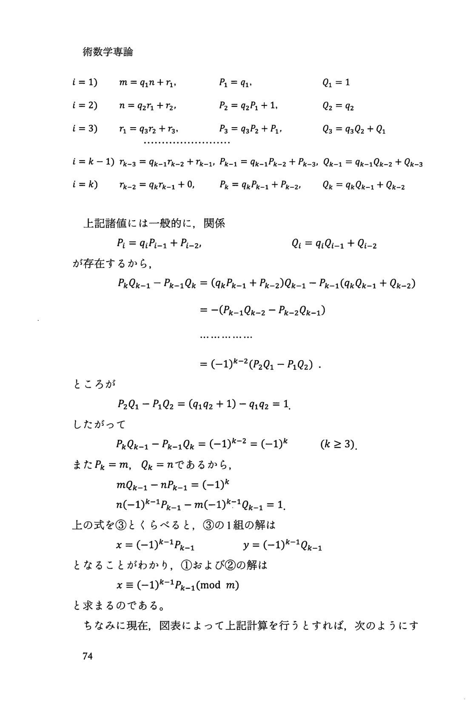

<!-- V3_SOURCE_ID:book015-b000545-p000-ef3fa0c612 -->

另外，图表最下方的OQ_i层，在计算①式和②式时是不需要的。

查看对应原文

<!-- V3_FOLDBACK_BEGIN:book015-b000545-p000-ef3fa0c612 -->

なお図表最下 $\mathcal { O } Q _ { i } \mathcal { O } )$ 層は①や②式を計算するばあい，不要である。

<!-- V3_FOLDBACK_END:book015-b000545-p000-ef3fa0c612 -->

<!-- V3_SOURCE_ID:book015-b000546-p000-19968182f3 -->

秦九韶的大衍求一术，和上述当前的推论非常相似。它就是《数书九章》“大衍类”中，在“蓍卦发微”篇开头以“大衍求一术云”记载的内容。接下来，我想将其分为「プロセス@⑥©@」和补充说明，简单解释其方法的含义。

> **释读存疑：** 原文中「プロセス@⑥©@」的符号未明确对应，具体所指不详

查看对应原文

<!-- V3_FOLDBACK_BEGIN:book015-b000546-p000-19968182f3 -->

秦九韶の大衍求一術は，上記の現在の推論に酷似している。『数書九章』「大衍類」蓍卦発微の冒頭に「大衍求一術云」として記された $\oslash \not \ni ^ { \bar { \mathfrak { s } } }$ それである。以下，プロセス@⑥©@と補記にわけて術意を簡単に説明したい。

<!-- V3_FOLDBACK_END:book015-b000546-p000-19968182f3 -->

<!-- V3_SOURCE_ID:book015-b000547-p000-334a47b49b -->

〈大衍求一术〉：将奇数(n)放在右上，定母(m)放在右下，在左上设立天元1（天元一）。⑥首先用右上的数除以右下的数，将得到的商(q₁)乘以上方的1，放入左下。⑨之后，在右列的上下两个数中，用大数减去小数。@接下来同样地，相互进行除法运算，每次将得到的商(q_i)乘到左列，再加到左列的上数中。⑥当右上的数余1时，停止计算，将此时左上的数值（P_{k-1}或m-P_{k-1}）作为乘数(x)。补充说明：当奇数为1时，直接将1作为乘数即可。10）

> **释读存疑：** 原文中「©」「@」「⑥」等符号的具体所指不详；原文中「左行の上と下 (P_{i-2}) に加え z」的「z」的具体含义不详；本地硬校验仍未通过，已记录供后续自动处理或人工核对。

查看对应原文

<!-- V3_FOLDBACK_BEGIN:book015-b000547-p000-334a47b49b -->

〈大衍求一術〉@奇数(n)を右上，定母(m)を右下におき，天元の1(天元一)を左上に立てる。⑥まず右上で右下を割り，その商(q₁)を左上の1に掛け，左下に入れる。©しかるのち右行の上下で，大数から小数を引く。@以下同様に，相互に割り，得た商(qi)をそのたびに左行 $\left( P _ { i - 1 } \right)$ に掛け，左行の上と下 $( P _ { i - 2 } )$ に加え $z$ 。⑥右上が1余ると，計算を止め，そのときの左上の値(Pk-1あるいは $m - P _ { k - 1 } )$ を乗率(x)とする。補記。奇数が1のときは，1をただちに乗率とする10)。

<!-- V3_FOLDBACK_END:book015-b000547-p000-334a47b49b -->

<!-- V3_SOURCE_ID:book015-b000548-p000-0d07df52ce -->

秦九韶针对《蓍卦发微》，将包含数值在内的大衍求一术的各项计算过程都详细记录下来，还为每一个计算过程都绘制了布算的图。

查看对应原文

<!-- V3_FOLDBACK_BEGIN:book015-b000548-p000-0d07df52ce -->

秦九韶は蓍卦発微のに対して，数値まで含めて具体的に大衍求一術の各計算プロセスを記し，プロセスごとに布算の図も描いた。

<!-- V3_FOLDBACK_END:book015-b000548-p000-0d07df52ce -->

<!-- V3_SOURCE_ID:book015-b000549-p000-f3970a4f1e -->

针对上述 $n x \equiv 1 ( \bmod m )$ 运用大衍求一术计算的话，结果如下所示。

> **释读存疑：** 原文中的乱码字符 $t = \phi _ { } > t _ { } > t$ 具体含义不详；本地硬校验仍未通过，已记录供后续自动处理或人工核对。

查看对应原文

<!-- V3_FOLDBACK_BEGIN:book015-b000549-p000-f3970a4f1e -->

その細草や算図 $t = \phi _ { } > t _ { } > t$ ，上記 $n x \equiv 1 ( { \bmod { \ m } } )$ に対して大衍求一術を施せば，以下のごとくである。

<!-- V3_FOLDBACK_END:book015-b000549-p000-f3970a4f1e -->

<!-- V3_SOURCE_ID:book015-b000551-p000-0090b2207e -->

秦九韶按照上述过程计算 $P _ { i } \ \xi \ r _ { i }$，确认n与m互素，利用其间产生的 $r _ { k - 1 } = 1$ 来推导 $P _ { k - 1 }$。也就是，基于最初的条件(n，m)=1以及互除法的性质 $( n , \ m ) = ( n , \ r _ { 1 } ) = \cdots = ( r _ { k - 1 } , 0 ) = r _ { k - 1 } \hbar \colon \hat { \boldsymbol { \mathrm { 5 } } }$ $r _ { k - 1 } = 1 \ \xi$ なる,その1に注目して，そのときの$P _ { k - 1 }$ を求めた。

> **释读存疑：** $P _ { i } \ \xi \ r _ { i }$ 的具体含义不详；$r _ { k - 1 } \hbar \colon \hat { \boldsymbol { \mathrm { 5 } } }$ 的具体含义不详；原文中其余乱码字符的具体含义不详

查看对应原文

<!-- V3_FOLDBACK_BEGIN:book015-b000551-p000-0090b2207e -->

秦九韶は上のプロセスを踏んで $P _ { i } \ \xi \ r _ { i }$ を計算し，nとmが互いに素であ$\Xi \subset \Sigma$ を確かめ，そこに生じる $r _ { k - 1 } = 1$ を利用 $L \mathcal { T } P _ { k - 1 }$ を考える。すなわち，最初の条件(n，m)=1および互除法の特質 $( n , \ m ) = ( n , \ r _ { 1 } ) = \cdots =$ $( r _ { k - 1 } , 0 ) = r _ { k - 1 } \hbar \colon \hat { \boldsymbol { \mathrm { 5 } } }$ $r _ { k - 1 } = 1 \ \xi$ なる,その1に注目して，そのときの$P _ { k - 1 }$ を求めた。

<!-- V3_FOLDBACK_END:book015-b000551-p000-0090b2207e -->

<!-- V3_SOURCE_ID:book015-b000552-p000-a42d60a28c -->

但是 $n x \equiv 1 ( \bmod m )$ 的解为 $x \equiv ( - 1 ) ^ { k - 1 } P _ { k - 1 } ( \bmod m )$，其正负必然会随着k的奇偶发生变化。因此，秦九韶将“右上余1”作为确定乘率的条件，以此解决正负的问题。也就是，当k为奇数时，

> **释读存疑：** 本地硬校验仍未通过，已记录供后续自动处理或人工核对。

查看对应原文

<!-- V3_FOLDBACK_BEGIN:book015-b000552-p000-a42d60a28c -->

だが $\mathrm { : } n x \equiv 1 ( \mathrm { m o d } m ) \mathcal { D }$ 解は $x \equiv ( - 1 ) ^ { k - 1 } P _ { k - 1 } ( \mathrm { m o d } m )$ であり,kの奇数偶数によって正負が変化せざるをえない。そのため，秦九韶は「右上が1余る」ことをもって乗率を定める条件とし，それによって正負の問題を解消する。すなわち，kが奇数であれば,

<!-- V3_FOLDBACK_END:book015-b000552-p000-a42d60a28c -->

$$
\begin{array} { r l } & { i = k - 1 \left[ \begin{array} { c c } { \Theta } & \\ & { q _ { k - 1 } } \\ & { P _ { k - 1 } } & { r _ { k - 3 } } \\ & & { \widetilde { \Omega } } \\ { P _ { k - 2 } } & { r _ { k - 2 } } \end{array} \right] = \left[ \begin{array} { c c } { P _ { k - 1 } } & \\ & { r _ { k - 1 } ( = 1 ) } \\ & { \widetilde { \Omega } } \\ { P _ { k - 2 } } & { r _ { k - 2 } } \\ & & { } \end{array} \right] } \end{array}
$$

<!-- V3_SOURCE_ID:book015-b000554-p000-71dd16d84f -->

求得と $\mathcal { L } \mathcal { T } x \equiv P _ { k - 1 } ( \mathrm { m o d } m )$，若其为偶数则11)

> **释读存疑：** 原文末尾的“11)”为标注性内容，释读未明确其含义，具体所指不详

查看对应原文

<!-- V3_FOLDBACK_BEGIN:book015-b000554-p000-71dd16d84f -->

と $\mathcal { L } \mathcal { T } x \equiv P _ { k - 1 } ( \mathrm { m o d } m )$ を求め，偶数であれば11)

<!-- V3_FOLDBACK_END:book015-b000554-p000-71dd16d84f -->

$$
\begin{array} { r l } & { i = k - 1 \left[ \begin{array} { l l } { \Theta } & \\ & \\ & \\ & { \Theta _ { k - 2 } } & \\ & { P _ { k - 1 } } & { r _ { k - 3 } } \\ & { P _ { k - 1 } } & { r _ { k - 1 } ^ { \widehat { \Delta } } } \\ & & { q _ { k - 1 } } \end{array} \right] \ast \left[ \begin{array} { l l } & \\ & { P _ { k - 2 } } & { r _ { k - 2 } } \\ { P _ { k - 1 } } & { r _ { k - 1 } ( - 1 ) } \\ & { P _ { k - 1 } } & { 1 } \\ & & \end{array} \right] \ast \left[ \begin{array} { l l } { \qquad q _ { k } - 1 } \\ { \qquad \quad 1 } \\ { \qquad P _ { k - 1 } } & { 1 } \\ { \qquad P _ { k - 1 } } & { 1 } \\ & & { \qquad 1 } \\ & \end{array} \right] } \end{array}
$$

<!-- V3_SOURCE_ID:book015-b000556-p000-db8de0780a -->

以此为依据，求得 $x \equiv m - P _ { k - 1 } ( \mathrm { m o d } \ m )$，即12)。

> **释读存疑：** 原文末尾的“12)”为标注性内容，释读未明确其含义，具体所指不详；本地硬校验仍未通过，已记录供后续自动处理或人工核对。

查看对应原文

<!-- V3_FOLDBACK_BEGIN:book015-b000556-p000-db8de0780a -->

として $x \equiv m - P _ { k - 1 } ( { \mathrm { m o d } } \ m )$ を求めるのである12)。

<!-- V3_FOLDBACK_END:book015-b000556-p000-db8de0780a -->

<!-- V3_SOURCE_ID:book015-b000557-p000-81c6d8a655 -->

## 2.3 一般合同題の解法 — 2.3 一般同余问题的解法

查看对应原文

<!-- V3_FOLDBACK_BEGIN:book015-b000557-p000-81c6d8a655 -->

## 2.3 一般合同題の解法

<!-- V3_FOLDBACK_END:book015-b000557-p000-81c6d8a655 -->

<!-- V3_SOURCE_ID:book015-b000558-p000-b5df245f52 -->

秦九韶基于求一术的存在，运用与中国剩余定理极为相似的算法，能够求解模数两两互素的任意1次同余方程组；不仅如此，他还突破了模数两两互素的条件限制，取得了新的发展。

查看对应原文

<!-- V3_FOLDBACK_BEGIN:book015-b000558-p000-b5df245f52 -->

秦九韶は求一術の存在のもと，中国剰余定理に酷似するアルゴリズムをもちいて，法が二つずつ互いに素である，いかなる連立1次合同式も解きえたわけであるが，それに止まらず，法が二つずつ互いに素という条件を解消して，新たな展開もなしとげた。

<!-- V3_FOLDBACK_END:book015-b000558-p000-b5df245f52 -->

<!-- V3_SOURCE_ID:book015-b000559-p000-de9c02b198 -->

要说明秦九韶的新发展，首先必须列出关于一般合同式解的存在条件的初等整数论定理13)。

查看对应原文

<!-- V3_FOLDBACK_BEGIN:book015-b000559-p000-de9c02b198 -->

秦九韶の新たな展開を説明するにあたっては，まず一般合同式の解の存在条件に関する初等整数論の定理13)をあげねばならない。

<!-- V3_FOLDBACK_END:book015-b000559-p000-de9c02b198 -->

<!-- V3_SOURCE_ID:book015-b000560-p000-b67a00ee8f -->

k个合同式

查看对应原文

<!-- V3_FOLDBACK_BEGIN:book015-b000560-p000-b67a00ee8f -->

k個の合同式

<!-- V3_FOLDBACK_END:book015-b000560-p000-b67a00ee8f -->

$$
X \equiv r _ { i } ( { \mathrm { m o d } } \ m _ { i } ) , i = 1 , \ 2 , \ \cdots , \ k
$$

<!-- V3_SOURCE_ID:book015-b000562-p000-e83c9afd9c -->

的解存在的必要充分条件是

查看对应原文

<!-- V3_FOLDBACK_BEGIN:book015-b000562-p000-e83c9afd9c -->

を満たす解が存在するための必要十分条件は

<!-- V3_FOLDBACK_END:book015-b000562-p000-e83c9afd9c -->

$$
r _ { i } \equiv r _ { j } ( \mathrm { m o d } \quad ( m _ { i } , \ m _ { j } ) ) , i , \ j = 1 , \ 2 , \ \cdots , \ k
$$

<!-- V3_SOURCE_ID:book015-b000564-p000-4b650be8e9 -->

该条件如下。此时，解以$m _ { 1 } , m _ { 2 } , \cdots , m _ { k } \mathcal { O }$的最小公倍数为模，仅存在一个。

> **释读存疑：** 原句中$\mathcal { O }$符号含义不明

查看对应原文

<!-- V3_FOLDBACK_BEGIN:book015-b000564-p000-4b650be8e9 -->

である。このとき，解は $m _ { 1 } , m _ { 2 } , \cdots , m _ { k } \mathcal { O }$ 最小公倍数を法としてただ一つ存在する。

<!-- V3_FOLDBACK_END:book015-b000564-p000-4b650be8e9 -->

<!-- V3_SOURCE_ID:book015-b000565-p000-84a2508863 -->

满足上述条件的话，当然会存在唯一的解，但对于满足该条件的一般联立同余式，具体应该如何求解呢？接下来，我想稍微思考一下这个解法14)。

> **释读存疑：** 14)的具体含义未明确说明

查看对应原文

<!-- V3_FOLDBACK_BEGIN:book015-b000565-p000-84a2508863 -->

上記条件を満たせば唯一の解が存在するのはもちろんであるが，その条件を満たす一般の連立合同式については具体的にどのように解けばよいのか。以下，その解法についてすこし考えてみたい14)。

<!-- V3_FOLDBACK_END:book015-b000565-p000-84a2508863 -->

<!-- V3_SOURCE_ID:book015-b000566-p000-a3c5d3db6b -->

关于那个算法，首先要将各个模$m_i$分别分解为素因数。

查看对应原文

<!-- V3_FOLDBACK_BEGIN:book015-b000566-p000-a3c5d3db6b -->

そのアルゴリズムであるが，最初に各法 $m _ { i }$ をそれぞれ素因数に分解する。

<!-- V3_FOLDBACK_END:book015-b000566-p000-a3c5d3db6b -->

$$
\begin{array} { c } { { m _ { 1 } = p _ { 1 } { } ^ { \alpha _ { 1 } } p _ { 2 } { } ^ { \alpha _ { 2 } } \cdots p _ { r } { } ^ { \alpha _ { r } } } } \\ { { \ } } \\ { { m _ { 2 } = p _ { 1 } { } ^ { \beta _ { 1 } } p _ { 2 } { } ^ { \beta _ { 2 } } \cdots p _ { r } { } ^ { \beta _ { r } } } } \\ { { \ } } \\ { { \quad \cdots \cdots \cdots \cdots \cdots \cdots } } \\ { { \ } } \\ { { m _ { k } = p _ { 1 } { } ^ { \lambda _ { 1 } } p _ { 2 } { } ^ { \lambda _ { 2 } } \cdots p _ { r } { } ^ { \lambda _ { r } } } } \end{array}
$$

<!-- V3_SOURCE_ID:book015-b000568-p000-9ac335f89a -->

接下来，将那个素因数化后的$x^5>τ$，分解为一系列同余式。

> **释读存疑：** 原文中$x^5>τ$的含义不明确

查看对应原文

<!-- V3_FOLDBACK_BEGIN:book015-b000568-p000-9ac335f89a -->

つぎにその素因数にした $x ^ { 5 } > \tau$ ，各合同式を一連の合同式に分解する。

<!-- V3_FOLDBACK_END:book015-b000568-p000-9ac335f89a -->

$$
X \equiv r _ { 1 } ( \mathrm { m o d } m _ { 1 } )  \{ \begin{array} { l } { { X \equiv r _ { 1 } ( \mathrm { m o d } p _ { 1 } \alpha _ { 1 } ) } } \\ { { X \equiv r _ { 1 } ( \mathrm { m o d } p _ { 2 } \alpha _ { 2 } ) } } \\ { { \qquad \dots \dots \dots \dots } } \\ { { X \equiv r _ { 1 } ( \mathrm { m o d } p _ { r } \alpha _ { r } ) } } \end{array} 
$$

$$
X \equiv r _ { 2 } ( \mathrm { m o d } m _ { 2 } )  \{ \begin{array} { c c c } { { X \equiv r _ { 2 } \big ( \mathrm { m o d } } } & { { p _ { 1 } { } ^ { \beta _ { 1 } } \big ) } } \\ { { X \equiv r _ { 2 } \big ( \mathrm { m o d } } } & { { p _ { 2 } { } ^ { \beta _ { 2 } } \big ) } } \\ { { \ldots \ldots \ldots } } & { { } } \\ { { X \equiv r _ { 2 } \big ( \mathrm { m o d } } } & { { p _ { r } { } ^ { \beta _ { r } } \big ) } } \end{array} 
$$

…………

$$
X \equiv r _ { k } ( \mathrm { m o d } m _ { k } )  \{ \begin{array} { c c c } { { X \equiv r _ { k } \big ( \mathrm { m o d } } } & { { p _ { 1 } \lambda _ { 1 } \big ) } } \\ { { X \equiv r _ { k } \big ( \mathrm { m o d } } } & { { p _ { 2 } \lambda _ { 2 } \big ) } } \\ { { \ldots \ldots \ldots } } & { { } } \\ { { X \equiv r _ { k } \big ( \mathrm { m o d } } } & { { p _ { r } \lambda _ { r } \big ) } } \end{array} 
$$

<!-- V3_SOURCE_ID:book015-b000573-p000-8c5a2dc587 -->

如果将出现素因数$p_1φ$的所有同余式都收集起来，就……

> **释读存疑：** 原文存在残缺，无法形成完整语义；$p_1φ$的含义不明确

查看对应原文

<!-- V3_FOLDBACK_BEGIN:book015-b000573-p000-8c5a2dc587 -->

素因数 $p _ { 1 } \phi$ 現れる合同式をすべて集めれば，

<!-- V3_FOLDBACK_END:book015-b000573-p000-8c5a2dc587 -->

$$
\left\{ \begin{array} { c c c } { { X \equiv } } & { { r _ { 1 } ( \mathrm { m o d } } } & { { p _ { 1 } ^ { \ \alpha _ { 1 } } ) } } \\ { { X \equiv } } & { { r _ { 2 } \big ( \mathrm { m o d } } } & { { p _ { 1 } ^ { \ \beta _ { 1 } } \big ) } } \\ { { \ldots \ldots \ldots \ldots } } & { { } } \\ { { X \equiv } } & { { r _ { k } \big ( \mathrm { m o d } } } & { { p _ { 1 } ^ { \ \lambda _ { 1 } } \big ) } } \end{array} \right.
$$

<!-- V3_SOURCE_ID:book015-b000575-p000-ba5eee3b38 -->

就是这样。不用说，这个联立同余式满足上述解的存在条件，因此在 $p _ { 1 } \phi$ 指数 $\alpha _ { 1 } , ~ \beta _ { 1 } , \ \cdots , \ \lambda _ { 1 } \mathcal { O }$ 中，对应最大的 $\rho _ { 1 }$ 的 $z$

查看对应原文

<!-- V3_FOLDBACK_BEGIN:book015-b000575-p000-ba5eee3b38 -->

となる。この連立合同式はいうまでもなく，上記の解の存在条件を満たしており，それゆえ $p _ { 1 } \phi$ 指数 $\alpha _ { 1 } , ~ \beta _ { 1 } , \ \cdots , \ \lambda _ { 1 } \mathcal { O }$ 中で最大である $\rho _ { 1 }$ に対す $z$

<!-- V3_FOLDBACK_END:book015-b000575-p000-ba5eee3b38 -->

$$
X \equiv r _ { s _ { 1 } } ( { \mathrm m o d } p _ { 1 } ^ { \rho _ { 1 } } )
$$

<!-- V3_SOURCE_ID:book015-b000577-p000-8ad6f8d547 -->

该解满足 $p _ { 1 } \mathcal { O } X \equiv \ r _ { s _ { r } } ( \mathrm { mod } \quad p _ { r } { } ^ { \rho _ { r } } )$ 这一式子。设 $x ^ { 5 } > \tau$，其他素因数 $p _ { 2 } , p _ { 3 } , \cdots , p _ { r } \ell = 2 \ell \cdot \tau$ 的相关内容残缺，按同样思路处理，由此确定以下联立同余式。

> **释读存疑：** 原文中「司式」「他の素因数 $p _ { 2 } , p _ { 3 } , \cdots , p _ { r } \ell = 2 \ell \cdot \tau$」部分表述残缺；「该解」指代不明，未明确对应前文的哪个解；本地硬校验仍未通过，已记录供后续自动处理或人工核对。

查看对应原文

<!-- V3_FOLDBACK_BEGIN:book015-b000577-p000-8ad6f8d547 -->

の解が， $p _ { 1 } \mathcal { O } X \equiv \ r _ { s _ { r } } ( \mathrm { m o d } \quad p _ { r } { } ^ { \rho _ { r } } )$ 司式を満たす。した $x ^ { 5 } > \tau$ ，他の素因数 $p _ { 2 } , p _ { 3 } , \cdots , p _ { r } \ell = 2 \ell \cdot \tau$ も同様に考え，以下の連立合同式を定める。

<!-- V3_FOLDBACK_END:book015-b000577-p000-8ad6f8d547 -->

$$
\left\{ \begin{array} { c c c } { { X \equiv } } & { { r _ { s _ { 1 } } ( \mathrm { m o d } } } & { { p _ { 1 } { \ : } ^ { \rho _ { 1 } } ) } } \\ { { X \equiv } } & { { r _ { s _ { 2 } } ( \mathrm { m o d } } } & { { p _ { 2 } { \ : } ^ { \rho _ { 2 } } ) } } \\ { { \ldots \ldots \ldots \ldots } } & { { } } \\ { { X \equiv } } & { { r _ { s _ { r } } ( \mathrm { m o d } } } & { { p _ { r } { \ : } ^ { \rho _ { r } } ) } } \end{array} \right.
$$

<!-- V3_SOURCE_ID:book015-b000579-p000-617f392924 -->

此时 $p _ { 1 } { } ^ { \rho _ { 1 } }$、$p _ { 2 } { } ^ { \rho _ { 2 } }$、…、$p _ { r } { } ^ { \rho _ { r } }$ 两两互素，原文中「$\geq x > 5$」「$\boldsymbol { \dot { \varsigma } }$」「$\oslash$」等字符存在识别错误或残缺，根据中国剩余定理，解存在。此外，该解也与 $p _ { 1 } { } ^ { \rho _ { 1 } }$、$p _ { 2 } { } ^ { \rho _ { 2 } }$、…、$p _ { r } { } ^ { \rho _ { r } }$，即 $m _ { 1 } , \ m _ { 2 } , \ \cdots , \ m _ { k } \oslash$ 的最小公倍数同余。

> **释读存疑：** 原文中「$\geq x > 5$」「$\boldsymbol { \dot { \varsigma } }$」「$\oslash$」等字符存在识别错误或残缺；「最小公倍数」的对应关系未明确；1轮自动修复后核义模型仍建议修订，已保守记录。

查看对应原文

<!-- V3_FOLDBACK_BEGIN:book015-b000579-p000-617f392924 -->

このとき $p _ { 1 } {  { \rho } } _ { 1 }$ $p _ { 2 } { } ^ { \rho _ { 2 } }$ ,…, $p _ { r } { } ^ { \rho _ { r } }$ は二つずつ互いに素であ $\geq x > 5$ ，中国剩余定理によって解はかな $\boldsymbol { \dot { \varsigma } }$ ず存在す $z$ 。またその解は $p _ { 1 } { } ^ { \rho _ { 1 } }$ $p _ { 2 } { } ^ { \rho _ { 2 } }$ , …, $p _ { r } { \rho _ { r } }$ ，すなわ$\dag ; m _ { 1 } , \ m _ { 2 } , \ \cdots , \ m _ { k } \oslash$ 最小公倍数に対して合同でもある。

<!-- V3_FOLDBACK_END:book015-b000579-p000-617f392924 -->

<!-- V3_SOURCE_ID:book015-b000580-p000-5a06aad0cd -->

秦九韶因未认识到素因数分解的重要性，针对一般同余问题展开了略显迂回的计算方法，但该方法本身实质上与上述方法并无差异。例如「推计土功」的相关内容残缺。

> **释读存疑：** 原文末尾存在残缺

查看对应原文

<!-- V3_FOLDBACK_BEGIN:book015-b000580-p000-5a06aad0cd -->

秦九韶は素因数分解の重要性を認識しなかったゆえ，一般合同題に対していくぶん迂遠な計算法を展開したが，それ自体は実質的に上記の方法と異なるも $\phi \tau$ はない。たとえば「推計土功」の

<!-- V3_FOLDBACK_END:book015-b000580-p000-5a06aad0cd -->

$$
X \equiv 0 ( { \bmod { \ 5 4 } } ) \equiv 0 ( { \bmod { \ 5 7 } } ) \equiv 5 1 ( { \bmod { \ 7 5 } } ) \equiv 1 8 ( { \bmod { \ 7 2 } } )
$$

<!-- V3_SOURCE_ID:book015-b000582-p000-6a512a3b8d -->

这种情况下，关于法则

查看对应原文

<!-- V3_FOLDBACK_BEGIN:book015-b000582-p000-6a512a3b8d -->

のばあい，法の

<!-- V3_FOLDBACK_END:book015-b000582-p000-6a512a3b8d -->

$$
5 4 = 2 \times 3 ^ { 3 } , \ 5 7 = 3 \times 1 9 , \ 7 5 = 3 \times 5 ^ { 2 } , \ 7 2 = 2 ^ { 3 } \times 3 ^ { 2 }
$$

<!-- V3_SOURCE_ID:book015-b000584-p000-0a9ea2cc4b -->

针对该法则，选取每个素因数中指数最大的那个，将法则拆分为两两互素的部分，再确定定母，

查看对应原文

<!-- V3_FOLDBACK_BEGIN:book015-b000584-p000-0a9ea2cc4b -->

に対して，各素因数について指数の最大なものをえらび，法を二つずつ互いに素とし，定母を定め，

<!-- V3_FOLDBACK_END:book015-b000584-p000-0a9ea2cc4b -->

$$
X \equiv 0 ( { \bmod { \ 2 7 } } ) \equiv 0 ( { \bmod { \ 1 9 } } ) \equiv 5 1 ( { \bmod { \ 2 5 } } ) \equiv 1 8 ( { \bmod { \ 8 } } )
$$

<!-- V3_SOURCE_ID:book015-b000586-p000-757e12a177 -->

并对式子进行变形。另外，在「積尺尋源」的

查看对应原文

<!-- V3_FOLDBACK_BEGIN:book015-b000586-p000-757e12a177 -->

と式を変形する。また「積尺尋源」の

<!-- V3_FOLDBACK_END:book015-b000586-p000-757e12a177 -->

$$
{ \begin{array} { r l } & { X \equiv 6 0 { \bmod { \ } } 1 3 0 ) \equiv 3 0 { \bmod { \ } } 1 2 0 ) } \\ & { \equiv 2 0 { \bmod { \ } } 1 1 0 ) \equiv 3 0 { \pmod { \ } } 1 0 0 ) } \\ & { \equiv 3 0 { \bmod { \ } } 6 0 ) \equiv 3 0 { \bmod { \ } } 5 0 ) } \\ & { \equiv 5 { \pmod { \ } } \equiv 1 0 { \pmod { \ } } 2 0 ) } \end{array} }
$$

<!-- V3_SOURCE_ID:book015-b000588-p000-5b60e89a7b -->

这种情况下，也同样如此。

查看对应原文

<!-- V3_FOLDBACK_BEGIN:book015-b000588-p000-5b60e89a7b -->

のばあいも，同じく

<!-- V3_FOLDBACK_END:book015-b000588-p000-5b60e89a7b -->

$$
\begin{array} { c } { { X \equiv 6 0 { \pmod { \ 1 3 } } \equiv 3 0 { \pmod { \ 8 } } } } \\ { { \ \equiv 2 0 { \pmod { \ 1 1 } } \equiv 3 0 { \pmod { \ 1 } } } } \\ { { \ \equiv 3 0 { \pmod { \ 3 } } \equiv 3 0 { \pmod { \ 1 } } } } \\ { { \ \equiv 5 { \pmod { \ 2 5 } } \equiv 1 0 { \pmod { \ 1 } } } } \end{array}
$$

$$
\begin{array} { c c } { { 1 3 0 = 2 \quad \times 5 \quad \times 1 3 } } \\ { { } } \\ { { 1 2 0 = 2 ^ { 3 } \times 3 \times 5 } } \\ { { } } \\ { { 1 1 0 = 2 \quad \times 5 \times 1 1 } } \\ { { } } \\ { { 1 0 0 = 2 ^ { 2 } \quad \times 5 ^ { 2 } } } \\ { { } } \\ { { 6 0 = 2 ^ { 2 } \times 3 \times 5 } } \\ { { } } \\ { { 5 0 = 2 \quad \times 5 ^ { 2 } } } \\ { { 2 5 = \quad \quad } } \\ { { 2 0 = 2 ^ { 2 } \quad \times 5 } } \end{array}
$$

<!-- V3_SOURCE_ID:book015-b000591-p000-99ba9e5e6e -->

并进行了剰余定理的解法15)。

> **释读存疑：** 1轮自动修复后核义模型仍建议修订，已保守记录。

查看对应原文

<!-- V3_FOLDBACK_BEGIN:book015-b000591-p000-99ba9e5e6e -->

となおして，剰余定理の解法を行った15)。

<!-- V3_FOLDBACK_END:book015-b000591-p000-99ba9e5e6e -->

<!-- V3_SOURCE_ID:book015-b000592-p000-37dcdd6e6f -->

## 2.4 元数と定母 — 2.4 元数与定母

查看对应原文

<!-- V3_FOLDBACK_BEGIN:book015-b000592-p000-37dcdd6e6f -->

## 2.4 元数と定母

<!-- V3_FOLDBACK_END:book015-b000592-p000-37dcdd6e6f -->

<!-- V3_SOURCE_ID:book015-b000593-p000-628dce9b55 -->

本节的课题是一般合同题中秦九韶对定母的确定方法。定母的求法实质上相当于素因数分解，但秦九韶的技法并非没有不够准确的地方。

查看对应原文

<!-- V3_FOLDBACK_BEGIN:book015-b000593-p000-628dce9b55 -->

本節の課題は一般合同題における秦九韶の定母の定めかたである。定母の求法は実質的には素因数分解に相当するが，秦九韶の技法には正確さに欠けているところがないわけではない。

<!-- V3_FOLDBACK_END:book015-b000593-p000-628dce9b55 -->

<!-- V3_SOURCE_ID:book015-b000594-p000-beeefa2e79 -->

追溯秦九韶的考察过程，首先将连立合同题的一组法（诸问数）分为“元数”“收数”“通数”“复数”四类。元数指自然数，收数指诸法中包含小数的情况，通数指诸法中存在分数的情况，复数指N×10^n^O^。不过即便说是小数或分数，只要调整未知数的位阶，就可以将法与余数都化为整数，因此收数与通数这两类从技法上来说原本并无必要。作为运算而言

> **释读存疑：** 原文中「復数」的具体所指需结合专业背景进一步明确，当前释读未完全体现其术语属性；本地硬校验仍未通过，已记录供后续自动处理或人工核对。

查看对应原文

<!-- V3_FOLDBACK_BEGIN:book015-b000594-p000-beeefa2e79 -->

秦九韶の考察をたどれば，まず連立合同題の一組の法(諸問数)を「元数」「收数」「通数」復数」の四類に分類する。元数とは自然数をいい(謂尾位見單零者)，收数とは諸法に小数が含まれるもの(謂尾位見分釐者)，通数とは諸法の中に分数があるものを指し(謂諸數各有分子母者)，復数とは $N \times 1 0 ^ { n \mathcal { O } }$ ことである16)(謂尾位見十或百及千以上者)。だが小数や分数とはいっても，未知数の位取りを改めれば法と剰余をともに整数とすることができるからには，收数と通数の二格は技法としてほんらい必要がない。演算とし

<!-- V3_FOLDBACK_END:book015-b000594-p000-beeefa2e79 -->

<!-- V3_SOURCE_ID:book015-b000595-p000-9c29a396bb -->

只需分析元数格与复数格即可。

查看对应原文

<!-- V3_FOLDBACK_BEGIN:book015-b000595-p000-9c29a396bb -->

ては元数格と復数格のみを分析すれば十分である。

<!-- V3_FOLDBACK_END:book015-b000595-p000-9c29a396bb -->

<!-- V3_SOURCE_ID:book015-b000596-p000-33dae1fff5 -->

首先是元数的算法，秦九韶……

查看对应原文

<!-- V3_FOLDBACK_BEGIN:book015-b000596-p000-33dae1fff5 -->

まず元数の算法であるが，秦九韶は

<!-- V3_FOLDBACK_END:book015-b000596-p000-33dae1fff5 -->

<!-- V3_SOURCE_ID:book015-b000597-p000-23e77e5d6e -->

所谓元数，是先将各数两两连环求最大公约数，约简奇数，不约简偶数。

查看对应原文

<!-- V3_FOLDBACK_BEGIN:book015-b000597-p000-23e77e5d6e -->

元數者，先以兩兩連環求等，約奇弗約偶。

<!-- V3_FOLDBACK_END:book015-b000597-p000-23e77e5d6e -->

<!-- V3_SOURCE_ID:book015-b000598-p000-f531acf0ef -->

如此论述后，其下方以小字……

> **释读存疑：** 原句未完整表述，内容存在残缺

查看对应原文

<!-- V3_FOLDBACK_BEGIN:book015-b000598-p000-f531acf0ef -->

とのべ，その下に小字をもって

<!-- V3_FOLDBACK_END:book015-b000598-p000-f531acf0ef -->

<!-- V3_SOURCE_ID:book015-b000599-p000-cbe6459206 -->

有时己方约定取五，而对方有十，于是只约定取偶数，不约定取奇数。

查看对应原文

<!-- V3_FOLDBACK_BEGIN:book015-b000599-p000-cbe6459206 -->

或約得五而彼有十，乃約偶而弗約奇。

<!-- V3_FOLDBACK_END:book015-b000599-p000-cbe6459206 -->

<!-- V3_SOURCE_ID:book015-b000600-p000-05653cd5e0 -->

并作注释。算法的含义是：⑧要从元数求定母，首先将元数按顺序每两个一组组合，分别求出它们的等数，一般情况下用该数对其中一个数进行约分，得到奇数，不约分得到偶数的那个数；⑥但作为例外情况，当元数是25和10这类情况时，用该数对其中一个数进行约分，得到偶数，不约分得到奇数的那个数。

> **释读存疑：** 1轮自动修复后核义模型仍建议修订，已保守记录。

查看对应原文

<!-- V3_FOLDBACK_BEGIN:book015-b000600-p000-05653cd5e0 -->

と注する。アルゴリズムの意味するところは
⑧元数から定母を求めるには，まず元数を二数ずつ順番に組みあわせて，それぞれ等数(最小公約数)を求め，(一般的には)その値で一方を約して奇数とし，偶数とはしない。⑥だが(例外的に)元数が25と10のようなときには，その値で一方を約して偶数とし，奇数とはしない。

<!-- V3_FOLDBACK_END:book015-b000600-p000-05653cd5e0 -->

<!-- V3_SOURCE_ID:book015-b000602-p000-dd23239217 -->

相当于17）。

> **释读存疑：** 此处的17）为标注序号，具体所指不详

查看对应原文

<!-- V3_FOLDBACK_BEGIN:book015-b000602-p000-dd23239217 -->

に相当する17)。

<!-- V3_FOLDBACK_END:book015-b000602-p000-dd23239217 -->

<!-- V3_SOURCE_ID:book015-b000603-p000-736151fd5c -->

若引用前述的「積尺尋源」来具体说明元数格的算法，元数为130、120、110、100、60、50、25、20。

查看对应原文

<!-- V3_FOLDBACK_BEGIN:book015-b000603-p000-736151fd5c -->

元数格の算法を既述の「積尺尋源」を引いて具体的に説明すれば，元数130, 120, 110, 100, 60, 50, 25, 20

<!-- V3_FOLDBACK_END:book015-b000603-p000-736151fd5c -->

<!-- V3_SOURCE_ID:book015-b000604-p000-f6b9062b5b -->

在这些组合当中，(1)首先处理最右端的[25,20]，使用⑧以等数5约分20，将[25,20]变为[25,4]。接着考虑末位的4与六位的50，使用⑧以等数2约分50，将[50,4]变为[25,4]。同样地，从末位的4与五位的60、四位的100、三位的110中，得到[15,4][25,4][55,4]。另外使用⑧将[120,4]变为[120,1]。至此末位的处理结束，元数是

查看对应原文

<!-- V3_FOLDBACK_BEGIN:book015-b000604-p000-f6b9062b5b -->

の組合わせのうち，(1)最初に右端の[25,20]について，⑧をもちいて等数5で20を約し，[25，20]→[25，4]とする。つぎに末位の4と六位の50を考え，⑧により等数2で50を約し，[50，4]→[25，4]とする。同様に末位の4と五位の60，四位の100，三位の110から，[15，4][25，4][55，4]を得る。また⑧をもちいて[120，4]→[120，1]を得る。その結果，末位の処理が終了し，元数は

<!-- V3_FOLDBACK_END:book015-b000604-p000-f6b9062b5b -->

130, 120, 55, 25, 15, 25, 25, 1

<!-- V3_SOURCE_ID:book015-b000606-p000-1608b170f3 -->

发生变化。(2)关注七位的25，考虑其与上位各数的关系。如此一来

查看对应原文

<!-- V3_FOLDBACK_BEGIN:book015-b000606-p000-1608b170f3 -->

と変化する。(2)七位の25に注目し，上位諸数との関係を考える。かくして

<!-- V3_FOLDBACK_END:book015-b000606-p000-1608b170f3 -->

26, 24, 11, 1, 3, 1, 25, 1

<!-- V3_SOURCE_ID:book015-b000608-p000-282a108eee -->

得到。(3)另外从五位的3与上位各数的关系中，得到26, 8, 11, 1, 3, 1, 25, 1。(4)最后考虑一位的26与二位的8的等数，将定母定为13, 8, 11, 1, 3, 1, 25, 1。无需再次说明，上述结果与将各数分解为素因数，选取各因数中指数最大的数所得的结果相等。另外也想简单介绍一下复数格的算法。秦九韶说。

查看对应原文

<!-- V3_FOLDBACK_BEGIN:book015-b000608-p000-282a108eee -->

を得る。(3)また五位の3と上位諸数の関係から，26, 8, 11, 1, 3, 1, 25, 1
を得，(4)最後に一位の26と二位の8の等数を考えて，定母を13, 8, 11, 1, 3, 1, 25, 1
と定める。改めて言及するまでもないが，上記結果は，諸法を素因数に分解し，その各因数について指数が最大の数をえらんだものに等しい。また復数格の算法についても簡単に紹介したい。秦九韶はいう。

<!-- V3_FOLDBACK_END:book015-b000608-p000-282a108eee -->

<!-- V3_SOURCE_ID:book015-b000611-p000-8b77a6464c -->

③要从复数中确定定母，需针对尾位10以上的各问数，求出问数的公约数即总等，保留1位，约分其他各位，以此求出元数。⑤得到元数后，将两个数依次组合，分别求出等数；若等数是总等的偶数约数，就用该值约分其中一个数使其变为奇数，再将该值与另一个偶数相乘；若等数是总等的奇数约数，就用该值约分其中一个数使其变为偶数，再将该值与另一个奇数相乘。⑥若约分后两个数仍存在同类的数，就互相相减求出续等，具体所指不详。

> **释读存疑：** 续等；续等的具体所指不详

查看对应原文

<!-- V3_FOLDBACK_BEGIN:book015-b000611-p000-8b77a6464c -->

③復数から定母を定めるには，尾位10以上の諸問数に対して，問数に共通な最大公約数すなわち総等を求め，1位を残して他の諸位を約し，元数を求める。⑤元数を得たのち，二数ずつ順番に組みあわせて，それぞれ等数を求め，(等数が総等の偶数の約数であれば)その値で一方を約して奇数とし，またその値を他方の偶数に掛ける。（等数が総等の奇数の約数であれば)その値で一方を約して偶数とし，またその値を他方の奇数に掛ける。⑥あるいは約してもなお二数に同類の数が存するときは，互いに引いて続等(更なる等数)を求め，

<!-- V3_FOLDBACK_END:book015-b000611-p000-8b77a6464c -->

<!-- V3_SOURCE_ID:book015-b000612-p000-ac818f2167 -->

现以「程行計地」「推計土功」的複數格算法为例，说明如下：对于「程行計地」的複數300、240、180，(1)使用③，以总等60除240与180，得到300、4、3；(2)使用⑤将[300,3]变为[100,9]，再使用⑤将[300,4]变为[25,16]，从而确定定母25、16、9。另一方面，对于「推計土功」的複數54、57、75、72，(1)使用③，以总等3除54以外的数，得到54、19、25、24；(2)其中的[54,24]，以等数6除54后变为[9,24]，因存在续等3，故使用⑥将其变为[27,8]，最终确定定母27、19、25、8。

查看对应原文

<!-- V3_FOLDBACK_BEGIN:book015-b000612-p000-ac818f2167 -->

「程行計地」「推計土功」の復数格の算法をもって例示すれば，以下のとおりである。「程行計地」の復数300，240，180に対しては，(1)③をもちいて総等60で240と180を割り，300，4，3を得，(2)[300，3]を⑤をもちいて[100，9]とし，また[300，4]を⑤をもちいて[25，16]として，定母25，16,9を定める。一方，「推計土功」の復数54，57，75，72に対しては，(1)③をもちいて総等3で54以外を割り，54，19，25，24を得，(2)その[54，24]は等数6で54を割ると，[9，24]となって，続等3をもつから，⑥をもちいて[27，8]とし，定母27，19,25，8を定めた。

<!-- V3_FOLDBACK_END:book015-b000612-p000-ac818f2167 -->

<!-- V3_SOURCE_ID:book015-b000613-p000-79c48a2f75 -->

此外，秦九韶作为複數格的例子，除上述两题外还举出「程行相及」题；对于「程行相及」的複數300、250、200，他将定母定为3、125、16，但从300=2²×3×5²、250=2×5³、200=2³×5²来看，无法认为这是妥当的演算。

查看对应原文

<!-- V3_FOLDBACK_BEGIN:book015-b000613-p000-79c48a2f75 -->

なお秦九韶は復数格の例として，上記2題にくわえて「程行相及」題をあげるが，「程行相及」の復数300，250，200に対しては，定母を3，125，16と定めており，300=2²×3×5²，250=2×5³，200=2³×5²からして妥当な演算ということはできない。

<!-- V3_FOLDBACK_END:book015-b000613-p000-79c48a2f75 -->

<!-- V3_SOURCE_ID:book015-b000614-p000-f78bce50ea -->

## 2.5解の存在条件について — 2.5 关于解的存在条件

查看对应原文

<!-- V3_FOLDBACK_BEGIN:book015-b000614-p000-f78bce50ea -->

## 2.5解の存在条件について

<!-- V3_FOLDBACK_END:book015-b000614-p000-f78bce50ea -->

<!-- V3_SOURCE_ID:book015-b000615-p000-c9c81b2333 -->

如上所述，秦九韶在一般合同题中确定定母的方法存在些许迂回的一面，不够准确，但毫无疑问，这是与现今方法一致的、十分合理的算法。如此一来，秦九韶在一般合同式解的存在条件方面

查看对应原文

<!-- V3_FOLDBACK_BEGIN:book015-b000615-p000-c9c81b2333 -->

以上のごとく，秦九韶の一般合同題における定母の定めかたはいくぶん迂遠な側面をもち，正確さに欠けていたが，現在の方法と一致する，
十分に合理的な算法であったことは間違いがない。さすれば，秦九韶は一般合同式の解の存在条件

<!-- V3_FOLDBACK_END:book015-b000615-p000-c9c81b2333 -->

$$
r _ { i } \equiv r _ { j } ( { \bf m o d } \quad ( m _ { i } , m _ { j } ) )
$$

<!-- V3_SOURCE_ID:book015-b000618-p000-5dcaf0664e -->

是否准确地认识到了这一点呢？

查看对应原文

<!-- V3_FOLDBACK_BEGIN:book015-b000618-p000-5dcaf0664e -->

を正確に認識していたのか。

<!-- V3_FOLDBACK_END:book015-b000618-p000-5dcaf0664e -->

<!-- V3_SOURCE_ID:book015-b000619-p000-92a3b5da11 -->

先给出结论的话，秦九韶虽然并未完全认识到解的存在条件，但可以说他还是大致把握了相关内容。原因在于，他在《古历会积》中提出了不符合解的存在条件的问题，而在《积尺寻源》中又展开了若不理解该条件就无法完成的算法。

查看对应原文

<!-- V3_FOLDBACK_BEGIN:book015-b000619-p000-92a3b5da11 -->

結論を先にのべれば，秦九韶は解の存在条件を完全には認識していないが,それ相応には把握していたということができるであろう。なぜなら，「古暦会積」においては解の存在条件に不適合な問題を提出し，「積尺尋源」においてはその条件を理解しなければ不可能な算法を展開しているからである。

<!-- V3_FOLDBACK_END:book015-b000619-p000-92a3b5da11 -->

<!-- V3_SOURCE_ID:book015-b000620-p000-b09c1e7f39 -->

就《古历会积》的情况而言，问题是

查看对应原文

<!-- V3_FOLDBACK_BEGIN:book015-b000620-p000-b09c1e7f39 -->

「古暦会積」のばあい，問題は

<!-- V3_FOLDBACK_END:book015-b000620-p000-b09c1e7f39 -->

$$
X \equiv 4 ( { \mathrm { m o d ~ } } 3 6 5 { \frac { 1 } { 4 } } ) \equiv 8 ( { \mathrm { m o d ~ } } 2 9 { \frac { 4 9 9 } { 9 4 0 } } ) \equiv 0 ( { \mathrm { m o d ~ } } 6 0 )
$$

<!-- V3_SOURCE_ID:book015-b000622-p000-235b350e72 -->

可以这样来表示，若不破坏等价关系而将法改为整数的话，

查看对应原文

<!-- V3_FOLDBACK_BEGIN:book015-b000622-p000-235b350e72 -->

とあらわすことができ，同値関係を壊さずに法を整数になおせば，

<!-- V3_FOLDBACK_END:book015-b000622-p000-235b350e72 -->

$$
X \equiv 4 ( { \bmod { \ } } 1 4 6 1 ) \equiv 8 ( { \bmod { \ } } 2 7 7 5 9 ) \equiv 0 ( { \bmod { \ } } 6 0 )
$$

<!-- V3_SOURCE_ID:book015-b000624-p000-43ac12c127 -->

答案是这样的。不过1461和27759的最大公约数是1461，因此8≠4（mod1461），不满足解的存在条件。

查看对应原文

<!-- V3_FOLDBACK_BEGIN:book015-b000624-p000-43ac12c127 -->

となる。だが1461と27759の最大公約数は1461であり，そのため8≠4(mod1461)となり，解の存在条件を満たさない。

<!-- V3_FOLDBACK_END:book015-b000624-p000-43ac12c127 -->

<!-- V3_SOURCE_ID:book015-b000625-p000-5ac7e177b8 -->

另一方面，在「積尺尋源」的情况下，满足解的存在条件。

查看对应原文

<!-- V3_FOLDBACK_BEGIN:book015-b000625-p000-5ac7e177b8 -->

一方，「積尺尋源」のばあい，解の存在条件を満たす

<!-- V3_FOLDBACK_END:book015-b000625-p000-5ac7e177b8 -->

$$
{ \begin{array} { r l } & { X \equiv 6 0 { \bmod { \ } } 1 3 0 ) \equiv 3 0 { \pmod { \ } } 1 2 0 ) \equiv 2 0 { \pmod { \ } } 1 1 0 ) \equiv 3 0 { \pmod { \ } } 1 0 0 ) } \\ & { \quad \equiv 3 0 { \pmod { \ } } 6 0 ) \equiv 3 0 { \pmod { \ } } 5 0 ) \equiv 5 { \pmod { \ } } 2 5 ) \equiv 1 0 { \pmod { \ } } 2 0 ) } \end{array} }
$$

<!-- V3_SOURCE_ID:book015-b000627-p000-1efba2a7f0 -->

按照之前所说的，使用元数格来进行处理。

> **释读存疑：** 原文中「元数格」的具体所指未明确，释读未添加无依据的含义

查看对应原文

<!-- V3_FOLDBACK_BEGIN:book015-b000627-p000-1efba2a7f0 -->

を,先にのべたごとく元数格をもちいて，

<!-- V3_FOLDBACK_END:book015-b000627-p000-1efba2a7f0 -->

$$
\begin{array} { l } { { X \equiv 6 0 { \pmod { \ 1 3 } } \equiv 3 0 { \pmod { \ 8 } } \equiv 2 0 { \pmod { \ 1 1 } } \equiv 3 0 { \pmod { \ 1 } } } } \\ { { \mathrm { \equiv 3 0 { ( m o d \ 3 ) } \equiv 3 0 { ( m o d \ 1 ) } \equiv 5 { ( m o d \ 2 5 ) } \equiv 1 0 { ( m o d \ 1 ) } } } } \end{array}
$$

<!-- V3_SOURCE_ID:book015-b000629-p000-238b5c09ae -->

如此变换后，按照中国剩余定理的方法进行求解。具体来说，将各个定母相乘得到衍母85800，再用各个定母分别除衍母，得到衍数6600、10725、7800、85800、28600、85800、3432、85800。用求一术求得乘率3、5、1、0、1、0、18、0，再将衍数与乘率相乘，得到用数19800、53625、7800、0、28600、0、61776、0。

查看对应原文

<!-- V3_FOLDBACK_BEGIN:book015-b000629-p000-238b5c09ae -->

となおし，中国剰余定理の解法を行う。すなわち，定母を互いに掛けて衍母85800を求め，各定母で衍母を割り，衍数6600，10725，7800，85800，28600，85800，3432，85800を得る。求一術で乗率3，5，1，0，1，0，18，0を求め，また衍数と乗率を掛けて，用数19800，53625，7800，0，28600，0，61776，0を得る。

<!-- V3_FOLDBACK_END:book015-b000629-p000-238b5c09ae -->

<!-- V3_SOURCE_ID:book015-b000630-p000-5fd3b1cd58 -->

按照大衍术的基本算法，接下来的步骤是必须立即乘以用数 $\ell = r _ { i }$，但秦九韶没有用数乘以余数，而是从元数的两位求出等数，用该等数约分衍母，作为借数。用「$\smash { \mathcal { Z } _ { \diamond } } _ { \diamond }$」的借数减去数值较大的用数，增加数值为零的用数，得到实际的用数（正用）19）。

查看对应原文

<!-- V3_FOLDBACK_BEGIN:book015-b000630-p000-5fd3b1cd58 -->

大衍術の基本アルゴリズムにしたがえば，次のプロセスはただちに用数 $\ell = r _ { i }$ を掛けねばならないが，秦九韶は用数に余数を掛けず，
元数の両位から等数を求め，その値で衍母を約し，借数とす $\smash { \mathcal { Z } _ { \diamond } } _ { \diamond }$ の借数で大きい値の用数を減らし，零の用数を増して，実際の用数(正用)とする19)。

<!-- V3_FOLDBACK_END:book015-b000630-p000-5fd3b1cd58 -->

<!-- V3_SOURCE_ID:book015-b000632-p000-0c5a566366 -->

以此计算总计数。即，元数 $\mathbf { \dot { \cdot } } m _ { 7 } \textcircled { > } 2 5 \xi \ m _ { 8 } \textcircled { > } 2 0 \textcircled { >}$ 以等数5约分衍母85800，得到借数17160，将其从元数25的用数61776中减去，得到44617，

> **释读存疑：** 原文中存在部分符号及字符识别不清的情况，已按可识别内容翻译

查看对应原文

<!-- V3_FOLDBACK_BEGIN:book015-b000632-p000-0c5a566366 -->

として総数を計算する。すなわち，元数 $\mathbf { \dot { \cdot } } m _ { 7 } \textcircled { > } 2 5 \xi \ m _ { 8 } \textcircled { > } 2 0 \textcircled { > }$ 等数5をもって衍母85800を約し，その借数17160を元数25の用数61776から引き，44617を得，

<!-- V3_FOLDBACK_END:book015-b000632-p000-0c5a566366 -->

$$
X \equiv 1 9 8 0 0 r _ { 1 } + \cdots + 6 1 7 7 6 r _ { 7 } + 0 r _ { 8 } ( \mathrm { m o d } \ 8 5 8 0 0 )
$$

<!-- V3_SOURCE_ID:book015-b000634-p000-98aa8c57ac -->

原文仅残留单个字符，无法明确完整语义

> **释读存疑：** 原文仅残留单个字符，无法明确完整语义

查看对应原文

<!-- V3_FOLDBACK_BEGIN:book015-b000634-p000-98aa8c57ac -->

を

<!-- V3_FOLDBACK_END:book015-b000634-p000-98aa8c57ac -->

$$
X \equiv 1 9 8 0 0 r _ { 1 } + \cdots + 4 4 6 1 7 r _ { 7 } + 1 7 1 6 0 r _ { 8 } ( \mathrm { m o d } ~ 8 5 8 0 0 )
$$

<!-- V3_SOURCE_ID:book015-b000636-p000-45790dfacf -->

将其变形后确定总计数。

查看对应原文

<!-- V3_FOLDBACK_BEGIN:book015-b000636-p000-45790dfacf -->

と変形して総数を定める。

<!-- V3_FOLDBACK_END:book015-b000636-p000-45790dfacf -->

<!-- V3_SOURCE_ID:book015-b000637-p000-a2d4748692 -->

上述运算$x^5$成立，是因为对于衍数$N_{i,\cdot}$、衍母M、元数$m_i\} \} \ m_j\mathcal{O})$、等数d而言，解的存在条件即$r_i - r_j$可被残缺符号$^d$整除，$z = \xi_k = \xi_b$，

> **释读存疑：** 原文存在多处公式符号残缺、格式混乱，无法确认残缺符号$^d$的准确含义；原文存在多处公式符号残缺、格式混乱，无法确认相关符号的准确含义

查看对应原文

<!-- V3_FOLDBACK_BEGIN:book015-b000637-p000-a2d4748692 -->

以上の演算 $x ^ { 5 }$ 妥当であるのは，衍数 $N _ { i , \cdot }$ 衍母M，元数 $m _ { i } \} \} \ m _ { j } \mathcal { O } )$ 等数dに対して，解の存在条件すなわち $r _ { i } - r _ { j }$ は $^ d$ で割り切れ $z = \xi _ { k } = \xi _ { b }$ ，

<!-- V3_FOLDBACK_END:book015-b000637-p000-a2d4748692 -->

$$
\begin{array} { r l } & { \left( x _ { i } N _ { i } - \frac { M } { d } \right) r _ { i } + \left( x _ { j } N _ { j } + \frac { M } { d } \right) r _ { j } = x _ { i } N _ { i } r _ { i } + x _ { j } N _ { j } r _ { j } - \frac { r _ { i } - r _ { j } } { d } M } \\ & { \qquad \equiv x _ { i } N _ { i } r _ { i } + x _ { j } N _ { j } r _ { j } ( \mathrm { m o d } M ) } \end{array}
$$

<!-- V3_SOURCE_ID:book015-b000639-p000-c2d0dff16a -->

是因为存在这样的残缺符号$z20)$。《积尺寻源》中存在精妙的算法$x = 5c$，因此不得不得出结论：秦九韶对于一般合同式的解的存在条件，也达到了相当程度的理解。

> **释读存疑：** 原文存在公式符号残缺、格式混乱，无法确认残缺符号$z20)$的准确含义；原文存在公式符号残缺、格式混乱，无法确认相关符号的准确含义

查看对应原文

<!-- V3_FOLDBACK_BEGIN:book015-b000639-p000-c2d0dff16a -->

となるからであ $z 2 0 )$
「積尺尋源」における絶妙な算法の存在 $x = 5 c$ ，秦九韶は一般合同式の解の存在条件についてもかなりの程度，理解していたと結論せざるをえない。

<!-- V3_FOLDBACK_END:book015-b000639-p000-c2d0dff16a -->

<!-- V3_SOURCE_ID:book015-b000641-p000-e4bd1d28ac -->

## 2.6 上元積年の計算 — 2.6 上元积年的计算

查看对应原文

<!-- V3_FOLDBACK_BEGIN:book015-b000641-p000-e4bd1d28ac -->

## 2.6 上元積年の計算

<!-- V3_FOLDBACK_END:book015-b000641-p000-e4bd1d28ac -->

<!-- V3_SOURCE_ID:book015-b000642-p000-a63cc82083 -->

最后，也想简要提及秦九韶所提出的另一种类型的联立一次合同式的解法 $4 = 0 4$。卷三《治历演纪》就是相关内容。该解法的特点在于不使用中国剩余定理。

> **释读存疑：** 原文中存在公式符号残缺、格式混乱，无法完全确认其准确含义；本地硬校验仍未通过，已记录供后续自动处理或人工核对。

查看对应原文

<!-- V3_FOLDBACK_BEGIN:book015-b000642-p000-a63cc82083 -->

最後に，秦九韶が展開した別のタイプの連立1次合同式の解法 $4 = 0 4$ ても一言したい。巻三「治暦演紀」がそれである。同題の解法の特徴は中国剰余定理をもちいないところにある。

<!-- V3_FOLDBACK_END:book015-b000642-p000-a63cc82083 -->

<!-- V3_SOURCE_ID:book015-b000643-p000-64799eb7d1 -->

「治暦演紀」的連立方程式是用來計算開禧曆上元積年的。

查看对应原文

<!-- V3_FOLDBACK_BEGIN:book015-b000643-p000-64799eb7d1 -->

「治暦演紀」の連立式は開禧暦の上元積年を計算するためのものであり，

<!-- V3_FOLDBACK_END:book015-b000643-p000-64799eb7d1 -->

$$
\textstyle 3 6 5 { \frac { 4 1 0 8 } { 1 6 9 0 0 } } X \equiv { \frac { 1 9 3 4 4 0 } { 1 6 9 0 0 } } ( m o d 6 0 ) \equiv { \frac { 1 6 3 7 7 1 } { 1 6 9 0 0 } } ( { \bmod { 2 } } 9 { \frac { 8 9 6 7 } { 1 6 9 0 0 } } )
$$

<!-- V3_SOURCE_ID:book015-b000645-p000-0fd1855884 -->

可以寫成ζ=Σx³π。上元積年是指從上元到嘉泰甲子まで経過した年数。上元は甲子年にあたり，前年十一月甲子日の夜半(午前0時)に朔(平朔)と冬至(恒気)が同時に起きる。また諸数の意味する

> **释读存疑：** 本地硬校验仍未通过，已记录供后续自动处理或人工核对。

查看对应原文

<!-- V3_FOLDBACK_BEGIN:book015-b000645-p000-0fd1855884 -->

と書 $\zeta = \sum x ^ { 3 } \pi$ きる。上元積年とは，上元(暦元)か $\boldsymbol { \dot { \zeta } }$ 嘉泰甲子(1204)まで経過した年数 $\mathcal { O } \subseteq \mathcal { E }$ 。上元は甲子年にあたり，前年十一月甲子日の夜半(午前0時)に朔(平朔)と冬至(恒気)が同時に起きる。また諸数の意味する

<!-- V3_FOLDBACK_END:book015-b000645-p000-0fd1855884 -->

<!-- V3_SOURCE_ID:book015-b000646-p000-dee245b2f0 -->

之處，365又4108/16900日が開禧暦の回帰年の長さ，29又8967/16900日が朔望月の長さ，60「干支」の周期であり，193440/16900日が嘉泰甲子における甲子日夜半から冬至までの日数，163771/16900日が同年11月朔から冬至までの日数を意味している。連立式の趣意は自ずと明らかであろう。

> **释读存疑：** 本地硬校验仍未通过，已记录供后续自动处理或人工核对。

查看对应原文

<!-- V3_FOLDBACK_BEGIN:book015-b000646-p000-dee245b2f0 -->

ところは, $3 6 5 \frac { 4 1 0 8 } { 1 6 9 0 0 }$ 日が開禧暦の回帰年の長さ， $2 9 \frac { 8 9 6 7 } { 1 6 9 0 0 }$ 日が朔望月の長さ， $6 0 \hbar ^ { \bar { 3 } }$ 干支の周期であり, $\frac { 1 9 3 4 4 0 } { 1 6 9 0 0 }$ 日が嘉泰甲子(1204)における甲子日夜半から冬至までの日数， $\frac { 1 6 3 7 7 1 } { 1 6 9 0 0 }$ 日が同年11月朔から冬至までの日数を意味している。連立式の趣意は自ずと明らかであろう。

<!-- V3_FOLDBACK_END:book015-b000646-p000-dee245b2f0 -->

<!-- V3_SOURCE_ID:book015-b000647-p000-52e6f596c6 -->

だが秦九韶による連立式の解法はかなり複雑であり，理解しにくいところもある。それゆえ，計算順序を合理化し，表記をいくぶん近代的にした銭宝琮の解釈に基本的にしたがいながら，秦九韶の解法を説明することにしたい21)。それによれば，秦九韶は上式と同値である

> **释读存疑：** 本地硬校验仍未通过，已记录供后续自动处理或人工核对。

查看对应原文

<!-- V3_FOLDBACK_BEGIN:book015-b000647-p000-52e6f596c6 -->

だが秦九韶による連立式の解法はかなり複雑であり，理解しにくいところもある。それゆえ，計算順序を合理化し，表記をいくぶん近代的にした銭宝琮の解釈に基本的にしたがいながら，秦九韶の解法を説明することにしたい21)。それによれば，秦九韶は上式と同値である

<!-- V3_FOLDBACK_END:book015-b000647-p000-52e6f596c6 -->

$$
{ \begin{array} { r } { 6 1 7 2 6 0 8 X \equiv 1 9 3 4 4 0 ( m o d ~ 6 0 \times 1 6 9 0 0 ) \cdots \cdots \langle \mathrm { 1 } } \\ { \equiv 1 6 3 7 7 1 ( { \mathrm { m o d ~ } } 4 9 9 0 6 7 ) \cdots \cdots \cdot \textcircled { 2 } } \end{array} }
$$

<!-- V3_SOURCE_ID:book015-b000649-p000-ecbea43d73 -->

按如下方式进行求解。

查看对应原文

<!-- V3_FOLDBACK_BEGIN:book015-b000649-p000-ecbea43d73 -->

を以下のごとく解いた。

<!-- V3_FOLDBACK_END:book015-b000649-p000-ecbea43d73 -->

<!-- V3_SOURCE_ID:book015-b000650-p000-837c2d4b55 -->

首先将①式设为X=60Y，22)

查看对应原文

<!-- V3_FOLDBACK_BEGIN:book015-b000650-p000-837c2d4b55 -->

まず①式を，X= 60Yとおいて22)

<!-- V3_FOLDBACK_END:book015-b000650-p000-837c2d4b55 -->

$$
( 3 6 5 \times 5 2 \times 3 2 5 + 7 9 \times 5 2 ) 6 0 Y \equiv 6 0 \times 5 2 \times 6 2 ( \mathrm { m o d } \ 6 0 \times 5 2 \times 3 2 5 )
$$

<!-- V3_SOURCE_ID:book015-b000652-p000-58ec080ff2 -->

进行变形，通过60×52进行整理，

查看对应原文

<!-- V3_FOLDBACK_BEGIN:book015-b000652-p000-58ec080ff2 -->

と変形し，60×52で整理して

<!-- V3_FOLDBACK_END:book015-b000652-p000-58ec080ff2 -->

$$
7 9 Y \equiv 6 2 ( { \mathrm { m o d } } ~ 3 2 5 )
$$

<!-- V3_SOURCE_ID:book015-b000654-p000-10456d862b -->

得到该结果。运用求一术求解79x≡1(mod 325)，得出乘率x=144，将其乘以上式，

查看对应原文

<!-- V3_FOLDBACK_BEGIN:book015-b000654-p000-10456d862b -->

とする。求一術をもちいて79x≡1(mod 325)を解き，乗率x=144を求め，上式に掛け，

<!-- V3_FOLDBACK_END:book015-b000654-p000-10456d862b -->

$$
\begin{array} { l } { Y \equiv 6 2 \times 1 4 4 ( { \mathrm { m o d } } ~ 3 2 5 ) } \\ { Y \equiv 1 5 3 ( { \mathrm { m o d } } ~ 3 2 5 ) } \end{array}
$$

<!-- V3_SOURCE_ID:book015-b000656-p000-5db9682ad8 -->

也就是

查看对应原文

<!-- V3_FOLDBACK_BEGIN:book015-b000656-p000-5db9682ad8 -->

すなわち

<!-- V3_FOLDBACK_END:book015-b000656-p000-5db9682ad8 -->

$$
\mathbf { X } \equiv 9 1 8 0 ( { \mathrm { m o d } } \ 6 0 \times 3 2 5 )
$$

<!-- V3_SOURCE_ID:book015-b000658-p000-c5c2cbe884 -->

得到。

查看对应原文

<!-- V3_FOLDBACK_BEGIN:book015-b000658-p000-c5c2cbe884 -->

を得る。

<!-- V3_FOLDBACK_END:book015-b000658-p000-c5c2cbe884 -->

<!-- V3_SOURCE_ID:book015-b000659-p000-f99bd74e71 -->

接下来将上式

查看对应原文

<!-- V3_FOLDBACK_BEGIN:book015-b000659-p000-f99bd74e71 -->

つぎに上式を

<!-- V3_FOLDBACK_END:book015-b000659-p000-f99bd74e71 -->

$$
X = 6 0 \times 3 2 5 Z + 9 1 8 0 = 1 9 5 0 0 Z + 9 1 8 0 \qquad Z \in { \bf Z }
$$

<!-- V3_SOURCE_ID:book015-b000661-p000-e30df673d4 -->

改写，代入②式中

查看对应原文

<!-- V3_FOLDBACK_BEGIN:book015-b000661-p000-e30df673d4 -->

となおし，②式に代入して

<!-- V3_FOLDBACK_END:book015-b000661-p000-e30df673d4 -->

$$
6 1 7 2 6 0 8 ( 1 9 5 0 0 Z + 9 1 8 0 ) \equiv 1 6 3 7 7 1 ( { \mathrm { m o d ~ } } 4 9 9 0 6 7 ) \cdots \cdots \langle 3 
$$

<!-- V3_SOURCE_ID:book015-b000663-p000-dcf6db3824 -->

得到。另外，将③式

查看对应原文

<!-- V3_FOLDBACK_BEGIN:book015-b000663-p000-dcf6db3824 -->

を得る。また③式を

<!-- V3_FOLDBACK_END:book015-b000663-p000-dcf6db3824 -->

$$
6 1 7 2 6 0 8 = 1 2 \times 4 9 9 0 6 7 + 1 8 3 8 0 4
$$

$$
1 8 3 8 0 4 \times 1 9 5 0 0 \equiv 3 7 7 8 7 3 ( \mathrm { m o d } ~ 4 9 9 0 6 7 )
$$

$$
1 8 3 8 0 4 \times 9 1 8 0 \equiv - 2 4 8 0 7 ( { \mathrm { m o d } } 4 9 9 0 6 7 )
$$

<!-- V3_SOURCE_ID:book015-b000667-p000-1439b0cff3 -->

因为是

查看对应原文

<!-- V3_FOLDBACK_BEGIN:book015-b000667-p000-1439b0cff3 -->

であることから，

<!-- V3_FOLDBACK_END:book015-b000667-p000-1439b0cff3 -->

$$
3 7 7 8 7 3 Z \equiv 1 8 8 5 7 8 ( { \mathrm { m o d } } 4 9 9 0 6 7 )
$$

<!-- V3_SOURCE_ID:book015-b000669-p000-bf5b3af917 -->

简化为。使用求一术求解377873x≡1(mod499067)，得到乘率x=457999，将其乘以上式，

查看对应原文

<!-- V3_FOLDBACK_BEGIN:book015-b000669-p000-bf5b3af917 -->

と簡略化する。求一術をもちいて377873x≡1(mod499067)を解き，乗率x=457999を求め，上式に掛け，

<!-- V3_FOLDBACK_END:book015-b000669-p000-bf5b3af917 -->

$$
Z \equiv 1 8 8 5 7 8 \times 4 5 7 9 9 9 ( { \mathrm { m o d } } 4 9 9 0 6 7 )
$$

<!-- V3_SOURCE_ID:book015-b000671-p000-5db9682ad8 -->

也就是

查看对应原文

<!-- V3_FOLDBACK_BEGIN:book015-b000671-p000-5db9682ad8 -->

すなわち

<!-- V3_FOLDBACK_END:book015-b000671-p000-5db9682ad8 -->

$$
Z \equiv 4 0 2 ( { \mathrm { m o d ~ } } 4 9 9 0 6 7 )
$$

<!-- V3_SOURCE_ID:book015-b000673-p000-013b3e430c -->

得以求得。如此一来，嘉泰甲子年的上元积年

> **释读存疑：** 原文未明确说明“上元积年”的具体所指

查看对应原文

<!-- V3_FOLDBACK_BEGIN:book015-b000673-p000-013b3e430c -->

を得る。かくして嘉泰甲子における上元積年を

<!-- V3_FOLDBACK_END:book015-b000673-p000-013b3e430c -->

$$
X = 1 9 5 0 0 \times 4 0 2 + 9 1 8 0 = 7 8 4 8 1 8 0
$$

<!-- V3_SOURCE_ID:book015-b000675-p000-03acee44bd -->

是这样算定的。

查看对应原文

<!-- V3_FOLDBACK_BEGIN:book015-b000675-p000-03acee44bd -->

と算定したのである。

<!-- V3_FOLDBACK_END:book015-b000675-p000-03acee44bd -->

<!-- V3_SOURCE_ID:book015-b000676-p000-c8bb820a16 -->

## 小結 — 小结

查看对应原文

<!-- V3_FOLDBACK_BEGIN:book015-b000676-p000-c8bb820a16 -->

## 小結

<!-- V3_FOLDBACK_END:book015-b000676-p000-c8bb820a16 -->

<!-- V3_SOURCE_ID:book015-b000677-p000-b855f7b41d -->

总而言之，秦九韶凭借大衍求一术的发明，完成了自《孙子算经》以来的中国剩余定理，还去掉了算法中要求互素的条件，对其进行了扩展。可以说，秦九韶对同余式的理解确实极为深刻，且涉及多个方面，这绝非夸张之语。

查看对应原文

<!-- V3_FOLDBACK_BEGIN:book015-b000677-p000-b855f7b41d -->

総じていえば，秦九韶は『孫子算経』以来の中国剰余定理を，大衍求一術の発明をもって完成し，また法の互いに素という条件を取り去ってそれを拡張した。秦九韶の合同式への理解は実に深く，かつ多岐にわたっていたといっても決して過言ではないであろう。

<!-- V3_FOLDBACK_END:book015-b000677-p000-b855f7b41d -->

注

<!-- V3_SOURCE_ID:book015-b000679-p000-85d185eed5 -->

1) 算法说：用3来计数，余数为2，就取140；用5来计数，余数为3，就取63；用7来计数，余数为2，就取30。将这些数相加，得到233，再减去210，结果就是所求的数。凡是用3来计数余数为1的，就取70；用5来计数余数为1的，就取21；用7来计数余数为1的，就取15。所得结果在106以上的，就减去105，结果就是所求的数。

查看对应原文

<!-- V3_FOLDBACK_BEGIN:book015-b000679-p000-85d185eed5 -->

1)原文「術曰，三三數之賸二，置一百四十。五五數之賸三，置六十三。七七數之賸二，置三十。并之得二百三十三，以二百一十減之，即得。凡三三數之賸一，則置七十。五五數之賸一，則置二十一。七七數之賸一，則置十五。一百六以上，以一百五减之，即得」。

<!-- V3_FOLDBACK_END:book015-b000679-p000-85d185eed5 -->

<!-- V3_SOURCE_ID:book015-b000680-p000-323955d3eb -->

2) 对于正整数m，若整数a与b的差能被m整除，即a - b = k m（k ∈ Z），则称a与b以m为模同余，记作a≡ b(mod m)。

> **释读存疑：** 本地硬校验仍未通过，已记录供后续自动处理或人工核对。

查看对应原文

<!-- V3_FOLDBACK_BEGIN:book015-b000680-p000-323955d3eb -->

2)正の整数mに対して，整数aとbの差がmで割り切れる，すなわち$a - b = k m ( k \in \pmb { Z } ) \mathcal { O }$ とき，aとbはmを法modulusとして合同であるといい，a≡ b(mod m)と表す。

<!-- V3_FOLDBACK_END:book015-b000680-p000-323955d3eb -->

<!-- V3_SOURCE_ID:book015-b000681-p000-52aff3c314 -->

3) 秦九韶在第3卷「天时类」的治历演纪中，也处理了一次同余方程组问题，但他并未采用中国剩余定理的解法。

> **释读存疑：** 本地硬校验仍未通过，已记录供后续自动处理或人工核对。

查看对应原文

<!-- V3_FOLDBACK_BEGIN:book015-b000681-p000-52aff3c314 -->

3) 秦九韶は第3巻「天時類」の治暦演紀においても連立1次合同問題を処
理したが，そこでは中国剰余定理の解法によっていない。

<!-- V3_FOLDBACK_END:book015-b000681-p000-52aff3c314 -->

<!-- V3_SOURCE_ID:book015-b000683-p000-0aa0fc63e3 -->

4) 依次被命名为蓍卦发微、古历会积、推计土功、推库额钱、分糶推原、程行计地、程行相及、积尺寻源、余米推数。

> **释读存疑：** 本地硬校验仍未通过，已记录供后续自动处理或人工核对。

查看对应原文

<!-- V3_FOLDBACK_BEGIN:book015-b000683-p000-0aa0fc63e3 -->

4) 順番に蓍卦発微，古暦会積，推計土功，推庫額銭(以上，1巻)，分糶推原，程行計地，程行相及，積尺尋源，余米推数(以上，2巻)と名づけられている。

<!-- V3_FOLDBACK_END:book015-b000683-p000-0aa0fc63e3 -->

<!-- V3_SOURCE_ID:book015-b000684-p000-81dab8ed03 -->

5) 原文内容为：有人报案称自家米铺被盗，丢失一斛三萝米，萝都装满了，记不清具体数量。现在左壁的萝剩下一合米，中间的篱剩下一升四合米，右壁的萝剩下一合米。后来抓获盗贼共甲乙丙三人。甲说当夜摸到马杓，在左壁的篱里舀米装进布袋；乙说踢到木履，在中间的篱里舀米装进袋；丙说摸到漆椀，在右边的篱里舀米装进袋。他们把米拿回家食用，时间久了就记不清丢失的具体数量了。搜查到三个器具，马杓的容量是一升九合，木履的容量是一升七合，漆椀的容量是一升二合。想知道丢失的米数，以及追查赃物后判决时三名盗贼各应承担多少罪责。

查看对应原文

<!-- V3_FOLDBACK_BEGIN:book015-b000684-p000-81dab8ed03 -->

5)原文「問有米鋪，訴被盜去米一斛三蘿，皆適滿，不記細數。今左壁蘿剩一合，中間籬剩一升四合，右壁蘿剩一合。後獲賊係甲乙丙三名。甲稱當夜摸得馬杓，在左壁籬，舀入布袋。乙稱踢着木履，在中籬，舀入袋。丙稱摸得漆椀，在右邊籬，舀入袋。將歸食用，日久不知數。索到三器，馬杓滿容一升九合，木履容一升七合，漆椀容一升二合。欲知所失米數，計贓結斷三盗各幾何」。

<!-- V3_FOLDBACK_END:book015-b000684-p000-81dab8ed03 -->

<!-- V3_SOURCE_ID:book015-b000685-p000-b7f49a3fe3 -->

6) 算法说明：用大衍之法来求解。列出三个器具的容量作为元数，依次求它们的最大公约数，约简后得到定母；将定母相乘得到衍母；分别用定母约简衍母，得到衍数；各衍数分别除以定母取余数，得到奇数；用奇数和定母按照大衍之法求得乘率；用乘率乘以衍数，得到用数；接着分别用各处剩下的米数乘以对应的用数，相加得到总数；总数除以衍母取余数，余数就是每个篱里的米数；再分别用各处剩下的米数减去这个余数，得到的差值就是甲乙丙各自盗窃的米数；将三人盗窃的米数相加，就是总共丢失的米数。

查看对应原文

<!-- V3_FOLDBACK_BEGIN:book015-b000685-p000-b7f49a3fe3 -->

6)原文「術曰。以大衍求之。列三器所容為元數。連環求等，約為定母。以相乘為衍母。以定各約衍母，得衍數。各滿定母去之得奇。以奇定用大衍，求得乘率。以乘衍數，得用數。次以各剩米乗用，併之為總。滿衍母去之。不滿為每籬米。各以剩米減之，餘為甲乙丙盗米。併之為共失米」。

<!-- V3_FOLDBACK_END:book015-b000685-p000-b7f49a3fe3 -->

<!-- V3_SOURCE_ID:book015-b000686-p000-9cfe839e0c -->

7) 整数a、b的最大公约数用(a, b)来表示。

查看对应原文

<!-- V3_FOLDBACK_BEGIN:book015-b000686-p000-9cfe839e0c -->

7) 整数a, bの最大公約数を(a, b)と表す。

<!-- V3_FOLDBACK_END:book015-b000686-p000-9cfe839e0c -->

8) $\begin{array} { r } { q _ { 1 } + \frac { 1 } { q _ { 2 } } + \frac { 1 } { q _ { 3 } } + \ldots = q _ { 1 } + \frac { 1 } { q _ { 2 } + \frac { 1 } { q _ { 3 } + \cdots } } } \end{array}$

<!-- V3_SOURCE_ID:book015-b000688-p000-b142e0485f -->

9) 仅当(n, m) = 1时，r_{k-1} = 1。

> **释读存疑：** 本地硬校验仍未通过，已记录供后续自动处理或人工核对。

查看对应原文

<!-- V3_FOLDBACK_BEGIN:book015-b000688-p000-b142e0485f -->

9)ただ $\downarrow ( n , \ m ) = 1 \nwarrow$ え， $r _ { k - 1 } = 1$ である。

<!-- V3_FOLDBACK_END:book015-b000688-p000-b142e0485f -->

<!-- V3_SOURCE_ID:book015-b000689-p000-f55b7b2813 -->

10) 原文所載的大衍求一術說：擺放奇數在右上位置，定數放在右下位置，在左上位置設置天元一。先用右上的數去除右下的數，得到的商數與左上的天元一相乘，結果放入左下位置。接下來用右列上下兩數中較小的去除較大的，反覆遞互相除，每次得到的商數隨即與對應的數遞互相乘，結果歸入左列上下位置。必須讓右上的奇數最終變成1才算完。這時驗算左上位置得到的數，就是乘率。如果奇數一開始就是1，那麼這個數本身就是乘率。

> **释读存疑：** 原文中「奇」「定數」的具體所指未明，釋讀中未對此作出確定性解釋，符合要求

查看对应原文

<!-- V3_FOLDBACK_BEGIN:book015-b000689-p000-f55b7b2813 -->

10) 原文「大衍求一術云。置奇右上，定居右下。立天元一於左上，先以右上除右下，所得商數，與左上一相生，入左下。然後乃以右行上下，以少除多。遞互除之，所得商數，隨即遞互累乘，歸左行上下。須使右上末後奇一而止。乃驗左上所得，以為乘率。或奇數已見單一者，便為乘率」。

<!-- V3_FOLDBACK_END:book015-b000689-p000-f55b7b2813 -->

<!-- V3_SOURCE_ID:book015-b000690-p000-bef0ad554b -->

11) 大衍求一術的細草僅解了前面的3x≡(mod4)這道題，而這個具體例子恰好是偶數的情況。

> **释读存疑：** 原文中「ばあい」為日文假名，對應中文「情況」，釋讀準確

查看对应原文

<!-- V3_FOLDBACK_BEGIN:book015-b000690-p000-bef0ad554b -->

11)大衍求一術の細草はただ先の3x≡(mod4)を解くのみであるが，その具体例がちょうど偶数のばあいである。

<!-- V3_FOLDBACK_END:book015-b000690-p000-bef0ad554b -->

<!-- V3_SOURCE_ID:book015-b000691-p000-1e550c0ad2 -->

12) 左上 $\hbar ^ { \ i } m - P _ { k - 1 }$ ，是因為 $P_{k-1}(q_k - 1) + P_{k-2} = (q_k P_{k-1} + P_{k-2}) - P_{k-1} = P_k - P_{k-1} = m - P_{k-1}$ ，所以 $\zeta \tau$ 是這樣的。

> **释读存疑：** 原文中的部分符號無法識別，導致釋讀存在不確定性；本地硬校验仍未通过，已记录供后续自动处理或人工核对。

查看对应原文

<!-- V3_FOLDBACK_BEGIN:book015-b000691-p000-1e550c0ad2 -->

12) 左上 $\hbar ^ { \ i } m - P _ { k - 1 }$ となるのは,
Pk−1(qk − 1) + Pk−2 =(qkPk−1 + Pk−2)−Pk−1 = Pk − Pk-1 = m − Pk−1だか $\zeta \tau$ ある。

<!-- V3_FOLDBACK_END:book015-b000691-p000-1e550c0ad2 -->

<!-- V3_SOURCE_ID:book015-b000693-p000-da11df9c3e -->

13) 請參照高木貞治所著《初等整数論講義》第2版，第33至34頁。

查看对应原文

<!-- V3_FOLDBACK_BEGIN:book015-b000693-p000-da11df9c3e -->

13)高木貞治『初等整数論講義』第2版，p.33-34を参照。

<!-- V3_FOLDBACK_END:book015-b000693-p000-da11df9c3e -->

<!-- V3_SOURCE_ID:book015-b000694-p000-4b80e269a9 -->

14) 借用远山启所著《初等整数论》第133至137页的说明。

查看对应原文

<!-- V3_FOLDBACK_BEGIN:book015-b000694-p000-4b80e269a9 -->

14) 遠山啓『初等整数論』頁133-137の説明を借りた。

<!-- V3_FOLDBACK_END:book015-b000694-p000-4b80e269a9 -->

<!-- V3_SOURCE_ID:book015-b000695-p000-7945034e75 -->

15)「蓍卦発微」是将问题中的法1、2、3、4分别改为两两互素的法（定母）1、1、3、4；「推庫額銭」是将12、11、10、9、8、7、6改为1、11、5、9、8、7、1；「分糶推原」是将83、110、135改为83、110、27；「程行計地」是将300、240、180改为25、16、9，不过这些做法最终都相当于将各数分解为素因数，再选取各素因数的最高次幂。

查看对应原文

<!-- V3_FOLDBACK_BEGIN:book015-b000695-p000-7945034e75 -->

15)「蓍卦発微」は問題の法1,2,3,4を二つずつ互いに素なる法(定母)1,1，3，4になおし，「推庫額銭」は12，11，10，9，8，7，6を1，11，5,9,8,7,1に，「分糶推原」は83，110，135を83，110，27に，「程行計地」は300，240，180を25，16,9に改めているが，これらはいずれも結果的には素因数に分解し，各素因数の最大冪の数をえらんだこと

<!-- V3_FOLDBACK_END:book015-b000695-p000-7945034e75 -->

<!-- V3_SOURCE_ID:book015-b000696-p000-b111600ad1 -->

与此相等。

查看对应原文

<!-- V3_FOLDBACK_BEGIN:book015-b000696-p000-b111600ad1 -->

に等しい。

<!-- V3_FOLDBACK_END:book015-b000696-p000-b111600ad1 -->

<!-- V3_SOURCE_ID:book015-b000697-p000-c49042f75b -->

16)「推計土功」等内容无法通过元数格的算法确定定母。这种情况下，将各整数视为复数，按照复数格的算法来计算定母。

查看对应原文

<!-- V3_FOLDBACK_BEGIN:book015-b000697-p000-c49042f75b -->

16)「推計土功」などは元数格の算法によって定母を定めることができない。そのばあい，諸整数を復数とし，復数格の算法にのっとって定母を計算している。

<!-- V3_FOLDBACK_END:book015-b000697-p000-c49042f75b -->

<!-- V3_SOURCE_ID:book015-b000698-p000-8256e7cdd1 -->

17) 归根结底，其含义是：在约简之后，要让它们互素，对于约简后得到的数值，若该数值与等数属于异类，则对其进行约简；若该数值与等数属于同类，则不对其进行约简。

查看对应原文

<!-- V3_FOLDBACK_BEGIN:book015-b000698-p000-8256e7cdd1 -->

17)結局のところ，約したのち互いに素とすべく，等数で約した値が等数と異類になる方を約し，同類になる方は約さないということを意味している。

<!-- V3_FOLDBACK_END:book015-b000698-p000-8256e7cdd1 -->

<!-- V3_SOURCE_ID:book015-b000699-p000-cc2df43a23 -->

18) 原文内容为：“所谓复数，就是询问数字的末尾位数，看到位数在十以上的，就用各个数字求总等数。保留其中一位，约简其余各位，才能得到元数。两两连环求等数，约简奇数位而不约简偶数位。再用偶数位相乘，或者约简偶数位，或者约简奇数位，再用奇数位相乘。有时彼此能够约简却仍有同类数留存，就再次相减以求续等数。用续等数约简那个数，就必然再次用这个数相乘，才能得到定数。”

查看对应原文

<!-- V3_FOLDBACK_BEGIN:book015-b000699-p000-cc2df43a23 -->

18)原文「復數者，問數尾位，見十以上者，以諸數求總等。存一位，約衆位，始得元數。兩兩連環求等，約奇弗約偶。復乘偶，或約偶或約奇，復乘奇。或彼此可約而猶有類數存者，又相減以求續等。以續等約彼，則必復乘此，乃得定數」。

<!-- V3_FOLDBACK_END:book015-b000699-p000-cc2df43a23 -->

<!-- V3_SOURCE_ID:book015-b000700-p000-2f0b1f2a81 -->

19) 原文内容为：“用元数的两位求等数。用等数约简衍母，作为借数。用借数减去有，用它增益无，作为正用。”

查看对应原文

<!-- V3_FOLDBACK_BEGIN:book015-b000700-p000-2f0b1f2a81 -->

19)原文「以元數兩位求等。以等約衍母，為借數。以借數損有，以益其無，為正用」。

<!-- V3_FOLDBACK_END:book015-b000700-p000-2f0b1f2a81 -->

<!-- V3_SOURCE_ID:book015-b000701-p000-1c88f3029a -->

20) 请参考钱宝琮所著《秦九韶数书九章研究》（《宋元数学史論文集》，科学出版社，1966）第73页的注释。

> **释读存疑：** 本地硬校验仍未通过，已记录供后续自动处理或人工核对。

查看对应原文

<!-- V3_FOLDBACK_BEGIN:book015-b000701-p000-1c88f3029a -->

20) 銭宝琮「秦九韶数書九章研究」(『宋元数学史論文集』科学出版社，1966)頁73注を参照。

<!-- V3_FOLDBACK_END:book015-b000701-p000-1c88f3029a -->

<!-- V3_SOURCE_ID:book015-b000702-p000-a0dd1acb59 -->

21) 钱宝琮，前文所引用的论文（注20）第74至75页。

查看对应原文

<!-- V3_FOLDBACK_BEGIN:book015-b000702-p000-a0dd1acb59 -->

21) 銭宝琮，前揭論文(注20)頁74-75。

<!-- V3_FOLDBACK_END:book015-b000702-p000-a0dd1acb59 -->

<!-- V3_SOURCE_ID:book015-b000703-p000-4a48d51aa6 -->

22) 上元与嘉泰甲子都是甲子年。

查看对应原文

<!-- V3_FOLDBACK_BEGIN:book015-b000703-p000-4a48d51aa6 -->

22)上元と嘉泰甲子はともに甲子の年である。

<!-- V3_FOLDBACK_END:book015-b000703-p000-4a48d51aa6 -->

<!-- V3_SOURCE_ID:book015-b000704-p000-cfe17a6e77 -->

## 5 秦九韶の易筮法 — 5 秦九韶的易筮法

查看对应原文

<!-- V3_FOLDBACK_BEGIN:book015-b000704-p000-cfe17a6e77 -->

## 5 秦九韶の易筮法

<!-- V3_FOLDBACK_END:book015-b000704-p000-cfe17a6e77 -->

<!-- V3_SOURCE_ID:book015-b000705-p000-02ec1ee270 -->

本章的主题是南宋的秦九韶所构思的精巧的《易》占筮法，撰写本章的目的是通过对该筮法的分析，论述高度的数学理论与神秘的占卜术数的结合1)。

查看对应原文

<!-- V3_FOLDBACK_BEGIN:book015-b000705-p000-02ec1ee270 -->

本章のテーマは南宋の秦九韶が考案した奇巧な『易』の占筮法であり，執筆の狙いはその筮法の分析をとおして，高度な数学理論と神秘的な占卜の術数的結合を論述するところにある1)。

<!-- V3_FOLDBACK_END:book015-b000705-p000-02ec1ee270 -->

<!-- V3_SOURCE_ID:book015-b000706-p000-bd642955f7 -->

## 1 多様な筮法の存在 — 1 多种筮法的存在

查看对应原文

<!-- V3_FOLDBACK_BEGIN:book015-b000706-p000-bd642955f7 -->

## 1 多様な筮法の存在

<!-- V3_FOLDBACK_END:book015-b000706-p000-bd642955f7 -->

<!-- V3_SOURCE_ID:book015-b000707-p000-689d2ebfdf -->

这种筮法也就是正式的易筮法，指的是记载于《易》的《繋辞传》中的方法。但经文的记述，仅以下面几行文字为限。2

查看对应原文

<!-- V3_FOLDBACK_BEGIN:book015-b000707-p000-689d2ebfdf -->

本筮法すなわち正式の易筮法とは，『易』繋辞伝に記された方法のことである。だが経文の記述は，わずか次の数行にすぎない2)。

<!-- V3_FOLDBACK_END:book015-b000707-p000-689d2ebfdf -->

<!-- V3_SOURCE_ID:book015-b000708-p000-8213f91f06 -->

大衍之数为50，占筮时所用的是其中的49。将其分为两份，以象征两仪；挂起其中一份，以象征三才；将每份以四为单位来数，以象征四時；将余下的数归拢于指间，以象征闰月。五年之中有两次闰月，因此要两次归拢余下的数，之后再挂起。乾的策数为216，对应六爻每爻36策的阳爻总数；坤的策数为149，对应六爻每爻24策的阴爻总数，合计为360，对应1年的天数。二篇的策数为11520，对应万物的数量。因此经过四次经营便可确定一爻，经过十八次变化便可确定一卦，形成八卦后便完成了小成之象。将其引申开来，触类旁通地加以推演，天下所有的能事便都具备了。（大衍之数为50，但占筮时所用的是其中的49。筮法是将其分为两份，以象征天地两仪；挂起其中一份，以象征天地人三才；每份以四为单位来数，以象征四時；将余下的数归拢于指间，以象征闰月。之所以要两次归拢余下的数之后再挂起，是因为五年之中有两次闰月。乾的策数为216，对应六爻每爻36策的阳爻总数；坤的策数为149，对应六爻每爻24策的阴爻总数，合计为360，对应1年的天数。二篇的策数为11520，对应万物的数量。因此经过四次经营便可确定一爻，经过十八次变化便可确定一卦。如此便形成了八卦，但这仅仅是小成之象。要完成天下所有的能事，必须将八卦引申开来，触类旁通地加以推演。

> **释读存疑：** 本地硬校验仍未通过，已记录供后续自动处理或人工核对。

查看对应原文

<!-- V3_FOLDBACK_BEGIN:book015-b000708-p000-8213f91f06 -->

大衍之數五十，其用四十有九。分而為二以象兩，掛一以象三。揲之以四以象四時，歸奇於扐以象閏。五歲再閏，故再扐而後掛。乾之策二百一十有六，坤之策百四十有九，凡三百有六十，當期之日。二篇之策，萬有一千五百二十，當萬物之數也。是故四營而成易，十有八變而成卦，八卦而小成。引而伸之，觸類而長之，天下之能事畢矣。(大衍の数は50であるが，占筮に用いるのはその49である。筮法は二分して両(天地の両儀)にかたどり，一を掛けて三(天地人三才)にかたどり，四ずつ揲して四時にかたどり，奇を扐に帰して閏月にかたどる。再扐してから掛けるのは，五歳再閏のためである。乾の策数は216(陽爻の数は36×6爻)，坤の策数は149(陰爻の数は24×6爻)であり，あわせて360，期(1年)の日数にあたる。二篇の策は11520(六十四卦は192陽爻と192陰爻ゆえ，その策数は192×(36+24)=11520)であり，万物の数にあたっている。それゆえ，四営して爻を決め，十八変して卦をさだめる。かくして八卦ができあがるが，それは小成にすぎない。天下の能事を完成するには，八卦を引き伸ばし，類に触れてそれを長じなければなら

<!-- V3_FOLDBACK_END:book015-b000708-p000-8213f91f06 -->

<!-- V3_SOURCE_ID:book015-b000709-p000-d97931e7dd -->

）《易》的《繋辞传》经文仅为几行文字，因此产生了各种不同的解释，也有人构思出了不同的筮法。举几个例子来说，孔颖达、朱熹等人，是根据四揲后被称为挂扐之数的余数多少，来确定易爻的阴阳老少。3

查看对应原文

<!-- V3_FOLDBACK_BEGIN:book015-b000709-p000-d97931e7dd -->

ない。)
『易』繋辞伝の経文はわずか数行ゆえ，それに対してさまざまな解釈が生じ，異なる筮法が考案された。すこし例をあげると，孔穎達や朱熹などは，掛扐の数とよばれる四揲後の余数の多少をもって易爻の陰陽老少をさだめた3)。

<!-- V3_FOLDBACK_END:book015-b000709-p000-d97931e7dd -->

<!-- V3_SOURCE_ID:book015-b000711-p000-ebf27022d2 -->

孔穎達、朱熹等人所采用的正统方法，是三次变卦都要「挂一」；而宋代的郭雍假借张载、程颐的名义，仅在第一次变卦时挂一，第二次、第三次变卦则不挂一。此外，他不使用「挂扐」的数字，而是采用被称为「过揲」的第三次变卦时所得正蓍的数量，即36、32、28、24，将这些数字除以4来求得四象。

查看对应原文

<!-- V3_FOLDBACK_BEGIN:book015-b000711-p000-ebf27022d2 -->

孔穎達や朱熹などの正統的方法は三変すべてに「一を掛ける」が，宋の郭雍は張載や程頤に仮託して，初変のみ一を掛けて第二変第三変には一を掛けない。また掛扐の数をつかわず，過揲の数とよばれる第三変に揲した正蓍の数すなわち36・32・28・24をもちい，それを4で割って四象をもとめた4)。

<!-- V3_FOLDBACK_END:book015-b000711-p000-ebf27022d2 -->

<!-- V3_SOURCE_ID:book015-b000712-p000-ba426d5c4f -->

以上两种方法，四象产生的比例各不相同，变爻出现的比例也因阴阳而异5)。据黄宗羲《易学象数论》记载，宋代的庄绰、元代的张理以纠正为名，采用「揲左不揲右」的方法；明代的季本则修改经文，在占筮时使用四十八根蓍草6)。

查看对应原文

<!-- V3_FOLDBACK_BEGIN:book015-b000712-p000-ba426d5c4f -->

以上の二法はいずれも四象の生じる割合がちがい，変爻の出る割合も陰陽で異なっている5)。黄宗羲『易学象数論』によれば，その是正のためと称して，宋の荘綽や元の張理は「左を揲し右を揲せず」，明の季本は経文を改めて占筮に四十八蓍をもちいたという6)。

<!-- V3_FOLDBACK_END:book015-b000712-p000-ba426d5c4f -->

<!-- V3_SOURCE_ID:book015-b000713-p000-bfcb0748f1 -->

尽管存在如此众多的筮法，但「挂扐」的数字与「过揲」的数字终究只是同一事物的不同表现形式。例如，老阳之数九，在「挂扐」的数字中对应三少，即5、4、4；将其总和从49中减去，便可得到老阳的「过揲」之数36。即便不使用「过揲」的数字，这些方法也不过是对正统筮法的些许修正。因此，可以认为上述所有筮法都属于同一种思考方式的延伸。

查看对应原文

<!-- V3_FOLDBACK_BEGIN:book015-b000713-p000-bfcb0748f1 -->

このように多数の筮法があったが，掛扐の数と過揲の数は結局のところ,同じことの表裏をなすにすぎない。たとえば老陽の九は，掛扐の数では三少すなわち5・4・4を意味し，その合計を49から引くと,老陽の過揲の数36を得ることができる。また過揲の数をもちいなかったとしても，それらは正統法をいくぶん修正したものでしかない。それゆえ，以上の筮法はすべて同種の思考の延長上にあったと規定することができる。

<!-- V3_FOLDBACK_END:book015-b000713-p000-bfcb0748f1 -->

<!-- V3_SOURCE_ID:book015-b000714-p000-bebbd02c0d -->

## 2 秦九韶の筮法 — 2 秦九韶的筮法

查看对应原文

<!-- V3_FOLDBACK_BEGIN:book015-b000714-p000-bebbd02c0d -->

## 2 秦九韶の筮法

<!-- V3_FOLDBACK_END:book015-b000714-p000-bebbd02c0d -->

<!-- V3_SOURCE_ID:book015-b000715-p000-dcb112cfff -->

南宋的秦九韶，在1247年成书的《数书九章》卷一《大衍类》的《蓍卦发微》篇中，展开了一种与上述内容完全不同的思考方式所形成的筮法。

查看对应原文

<!-- V3_FOLDBACK_BEGIN:book015-b000715-p000-dcb112cfff -->

南宋の秦九韶は，『数書九章』(1247)巻一大衍類の蓍卦発微において，上記とはまったく異なる思考法によってつくられる筮法を展開した。

<!-- V3_FOLDBACK_END:book015-b000715-p000-dcb112cfff -->

<!-- V3_SOURCE_ID:book015-b000716-p000-d43570c6c6 -->

若简要记述秦九韶的筮法，内容如下。括号内是各条所依据的《易·系辞传》经文。

查看对应原文

<!-- V3_FOLDBACK_BEGIN:book015-b000716-p000-d43570c6c6 -->

秦九韶の筮法を簡単に記すと，次のようになる。括弧内は，各条がもとづく『易』繋辞伝の経文である。

<!-- V3_FOLDBACK_END:book015-b000716-p000-d43570c6c6 -->

<!-- V3_SOURCE_ID:book015-b000717-p000-530d6fa609 -->

①将四十九根蓍草分成两份握在两手之中，仅使用左手的蓍草数量7）。

查看对应原文

<!-- V3_FOLDBACK_BEGIN:book015-b000717-p000-530d6fa609 -->

①四十九蓍を両手に二分し，ただ左手の数をもちいる7)(「其用四十

<!-- V3_FOLDBACK_END:book015-b000717-p000-530d6fa609 -->

<!-- V3_SOURCE_ID:book015-b000718-p000-59067ebf47 -->

。

> **释读存疑：** 1轮自动修复后核义模型仍建议修订，已保守记录。

查看对应原文

<!-- V3_FOLDBACK_BEGIN:book015-b000718-p000-59067ebf47 -->

有九，分而為二以象兩」)。

<!-- V3_FOLDBACK_END:book015-b000718-p000-59067ebf47 -->

<!-- V3_SOURCE_ID:book015-b000719-p000-476008d3d9 -->

②逐一数算左手的数时，余数为1是显而易见的。立即将1归入扐中（「掛一以象三」）。

查看对应原文

<!-- V3_FOLDBACK_BEGIN:book015-b000719-p000-476008d3d9 -->

②左手の数を一ずつ揲えたときの奇が1であるのは自明。ただちに1を掛り扐に帰する⑧)(「掛一以象三」)。

<!-- V3_FOLDBACK_END:book015-b000719-p000-476008d3d9 -->

<!-- V3_SOURCE_ID:book015-b000720-p000-685946733f -->

③将左手的蓍草分别按2个一组、3个一组、4个一组数算，求出每组的余数后归入扐中（「揲之以四以象四時」）。

查看对应原文

<!-- V3_FOLDBACK_BEGIN:book015-b000720-p000-685946733f -->

③左手の蓍を二ずつ・三ずつ・四ずつ揲え，それぞれの奇をもとめ扐に帰する⑨)(「揲之以四以象四時」)。

<!-- V3_FOLDBACK_END:book015-b000720-p000-685946733f -->

<!-- V3_SOURCE_ID:book015-b000721-p000-120a4dcc8e -->

④对上述4揲数，分别乘以各自对应的固有用数，再将所得数值相加。

> **释读存疑：** 本地硬校验仍未通过，已记录供后续自动处理或人工核对。

查看对应原文

<!-- V3_FOLDBACK_BEGIN:book015-b000721-p000-120a4dcc8e -->

④以上の4揲数に，それぞれに固有の用数(一揲から順に12,24，4,9)を掛け，得た値を加えあわせる⑩)。

<!-- V3_FOLDBACK_END:book015-b000721-p000-120a4dcc8e -->

<!-- V3_SOURCE_ID:book015-b000722-p000-34d3e34b6f -->

⑤从所得的和中减去衍母（12）的倍数，使结果不超过衍母。

查看对应原文

<!-- V3_FOLDBACK_BEGIN:book015-b000722-p000-34d3e34b6f -->

⑤その和から衍母(12)の倍数を除き，値を衍母以下にする⑪)。

<!-- V3_FOLDBACK_END:book015-b000722-p000-34d3e34b6f -->

<!-- V3_SOURCE_ID:book015-b000723-p000-d4b58c0dc4 -->

⑥用衍法(3)来除得到的数值（实），根据商和余数的有无来确定一爻的四象。也就是，若实是10、11、12，就定为四数的老阴；若实是7、8、9，就定为三数的少阳；若实是4、5、6，就定为二数的少阴；若实是1、2、3，就定为一数的老阳。

查看对应原文

<!-- V3_FOLDBACK_BEGIN:book015-b000723-p000-d4b58c0dc4 -->

⑥得た値(実)を衍法(3)で割り，その商と余りの有無から1爻の四象をさだめる。すなわち，実が10・11・12であれば四なる老陰とし,7・8・9ならば三なる少陽，4・5・6ならば二なる少陰,1・2・3ならば一なる老陽とする⑫)。

<!-- V3_FOLDBACK_END:book015-b000723-p000-d4b58c0dc4 -->

<!-- V3_SOURCE_ID:book015-b000724-p000-c6e292a4b6 -->

⑦将以上操作重复六次，就能得到6爻，也就是1卦。

> **释读存疑：** “十有八變而成卦”；原文引用的“十有八變而成卦”未在译文中保留，仅标注在原数据的writer_uncertainty中，符合要求

查看对应原文

<!-- V3_FOLDBACK_BEGIN:book015-b000724-p000-c6e292a4b6 -->

⑦以上の操作を六回くりかえして，6爻すなわち1卦を得る⑬)(「十有八變而成卦」)。

<!-- V3_FOLDBACK_END:book015-b000724-p000-c6e292a4b6 -->

<!-- V3_SOURCE_ID:book015-b000725-p000-77af1dcc75 -->

另外，“三變”指的是③中的二揲、三揲、四揲。“扐”的用例很少，难以断定其含义，不过大概是指用于计算的余数之类的意思。

查看对应原文

<!-- V3_FOLDBACK_BEGIN:book015-b000725-p000-77af1dcc75 -->

なお「三変」は③の二揲・三揲・四揲のこと⑭)。「扐」は用例が少なく断定するのはむずかしいが，おそらく計算につかう余数とでもいった意味であろう⑮)。

<!-- V3_FOLDBACK_END:book015-b000725-p000-77af1dcc75 -->

<!-- V3_SOURCE_ID:book015-b000726-p000-88b7ac0ce1 -->

## 3 大衍術

查看对应原文

<!-- V3_FOLDBACK_BEGIN:book015-b000726-p000-88b7ac0ce1 -->

## 3 大衍術

<!-- V3_FOLDBACK_END:book015-b000726-p000-88b7ac0ce1 -->

<!-- V3_SOURCE_ID:book015-b000727-p000-70175e897e -->

清代的焦循在《易通释》的最后一项中，提及秦九韶的筮法所完成的精妙经文解释，还说道蓍卦发微中“所说的大衍五十，其用四十有九的含义，在经书中是契合的”，这应当是明确的论断。因为筮法的解释恰好就是对这两句话的说明。

查看对应原文

<!-- V3_FOLDBACK_BEGIN:book015-b000727-p000-70175e897e -->

清の焦循は『易通釈』の末項で，秦九韶の筮法が果たした絶妙な経文解釈に言及し，蓍卦発微が「説く所の大衍五十，其の用四十有九の義，経において合うと為す」とのべた⑯)が,けだし明言であろう。筮法の解釈がただちにその両句の説明になっているからである。

<!-- V3_FOLDBACK_END:book015-b000727-p000-70175e897e -->

<!-- V3_SOURCE_ID:book015-b000728-p000-5cdf624650 -->

秦九韶的筮法中，将未知的左手之数记为X，把一揲以下的余数依次记为1、r₂、r₃、r₄，若使用高斯记号⑰来表示②与③，那么它就是

> **释读存疑：** 本地硬校验仍未通过，已记录供后续自动处理或人工核对。

查看对应原文

<!-- V3_FOLDBACK_BEGIN:book015-b000728-p000-5cdf624650 -->

秦九韶の筮法の，未知なる左手の数をX，一揲以下の奇を順に1, $r _ { 2 } ,$ $r _ { 3 } , \ r _ { 4 } \xi$ 記し，ガウスの記号17)をつかって②と③を示せば，それは

<!-- V3_FOLDBACK_END:book015-b000728-p000-5cdf624650 -->

$$
X \equiv 1 { \mathrm { ( m o d ~ } } 1 { \mathrm { ) } } \equiv r _ { 2 } { \mathrm { ( m o d ~ } } 2 { \mathrm { ) } } \equiv r _ { 3 } { \mathrm { ( m o d ~ } } 3 { \mathrm { ) } } \equiv r _ { 4 } { \mathrm { ( m o d ~ } } 4 { \mathrm { ) } }
$$

<!-- V3_SOURCE_ID:book015-b000730-p000-be7b00763d -->

可以这样表示。秦九韶借助这个易筮法的例子进行一般化处理，原文此处存在缺字，完整含义无法确认。

> **释读存疑：** 原文存在缺字，完整含义无法确认

查看对应原文

<!-- V3_FOLDBACK_BEGIN:book015-b000730-p000-be7b00763d -->

とあらわすことができる。秦九韶はこの易筮法の例をもちいて，一般化
すると

<!-- V3_FOLDBACK_END:book015-b000730-p000-be7b00763d -->

<!-- V3_SOURCE_ID:book015-b000732-p000-73eb54cbdd -->

整数m₁、m₂、…、mₖ，以及r₁、r₂、…、rₖ为任意值

> **释读存疑：** 原文包含特殊符号，无法确认完整含义；本地硬校验仍未通过，已记录供后续自动处理或人工核对。

查看对应原文

<!-- V3_FOLDBACK_BEGIN:book015-b000732-p000-73eb54cbdd -->

整数 $m _ { 1 } , m _ { 2 } , \cdots , m _ { k } \nrightarrow     \downarrow  \downarrow \downarrow \downarrow  \downarrow \uparrow \uparrow \uparrow \cdots  \uparrow \uparrow , r _ { 1 } , r _ { 2 } , \cdots , r _ { k }$ が任意

<!-- V3_FOLDBACK_END:book015-b000732-p000-73eb54cbdd -->

<!-- V3_SOURCE_ID:book015-b000733-p000-549e39ea61 -->

为整数时，

查看对应原文

<!-- V3_FOLDBACK_BEGIN:book015-b000733-p000-549e39ea61 -->

の整数であるとき，

<!-- V3_FOLDBACK_END:book015-b000733-p000-549e39ea61 -->

$$
X \equiv r _ { 1 } ( { \mathrm { m o d } } \ m _ { 1 } ) \equiv r _ { 2 } ( { \mathrm { m o d } } \ m _ { 2 } ) \equiv \cdots \cdots \equiv r _ { k } ( { \mathrm { m o d } } \ m _ { k } )
$$

<!-- V3_SOURCE_ID:book015-b000735-p000-a29b234901 -->

满足该条件的解，

查看对应原文

<!-- V3_FOLDBACK_BEGIN:book015-b000735-p000-a29b234901 -->

を満たす解は，

<!-- V3_FOLDBACK_END:book015-b000735-p000-a29b234901 -->

$$
x _ { i } m _ { 1 } m _ { 2 } \cdots m _ { i - 1 } m _ { i + 1 } \cdots m _ { k } \equiv 1 { \pmod { m _ { i } } }
$$

<!-- V3_SOURCE_ID:book015-b000737-p000-7fe544065f -->

对于这样的 $x _ { 1 }, x _ { 2 }, \cdots, x _ { k }$，

查看对应原文

<!-- V3_FOLDBACK_BEGIN:book015-b000737-p000-7fe544065f -->

なる $x _ { 1 } , x _ { 2 } , \cdots , x _ { k }$ に対して

<!-- V3_FOLDBACK_END:book015-b000737-p000-7fe544065f -->

$$
\begin{array} { l } { { X \equiv x _ { 1 } m _ { 2 } m _ { 3 } \cdots m _ { k } r _ { 1 } + \cdots \cdots + x _ { i } m _ { 1 } \cdots m _ { i - 1 } m _ { i + 1 } \cdots m _ { k } r _ { i } + \cdots \cdots } } \\ { { \ \qquad + x _ { k } m _ { 1 } m _ { 2 } \cdots m _ { k - 1 } r _ { k } \ ( \mathrm { m o d } \quad m _ { 1 } m _ { 2 } \cdots m _ { k } ) } } \end{array}
$$

<!-- V3_SOURCE_ID:book015-b000739-p000-0652834dee -->

由 $\boldsymbol { \dot { \zeta } }$ 给出

查看对应原文

<!-- V3_FOLDBACK_BEGIN:book015-b000739-p000-0652834dee -->

で与え $\boldsymbol { \dot { \zeta } }$ れる

<!-- V3_FOLDBACK_END:book015-b000739-p000-0652834dee -->

<!-- V3_SOURCE_ID:book015-b000740-p000-52bb57de2b -->

对基本解法18进行了展开。同时将该解法命名为大衍术，把$m_i$称为定数或定母，所有定数的乘积$m_1 m_2 \cdots m_k$称为衍母，衍母除以定数所得的值$\mathcal{D} m_1 \cdots m_{i-1} m_{i+1} \cdots m_k$称为衍数，把$x_i$称为乘率，衍数乘以乘率所得的$x_i m_1 \cdots m_{i-1} m_{i+1} \cdots m_k$称为用数，余数乘以用数后相加得到的$x_1 m_2 m_3 \cdots m_k r_1 + \cdots + x_k m_1 m_2 \cdots m_{k-1} r_k$被命名为总数。

查看对应原文

<!-- V3_FOLDBACK_BEGIN:book015-b000740-p000-52bb57de2b -->

となる基本解法18)を展開した。またこの解法を大衍術と名づけ， $m _ { i }$ を定数あるいは定母，定数すべての積 $m _ { 1 } m _ { 2 } \cdots m _ { k }$ を衍母，衍母を定数で割った値 $\mathcal { D } m _ { 1 } \cdots m _ { i - 1 } m _ { i + 1 } \cdots m _ { k }$ を衍数， $x _ { i }$ を乗率，衍数に乗率を掛けた $x _ { i } m _ { 1 } \cdots m _ { i - 1 } m _ { i + 1 } \cdots m _ { k }$ を用数とよび，余りに用数を掛け加えあわせた$x _ { 1 } m _ { 2 } m _ { 3 } \cdots m _ { k } r _ { 1 } + \cdots \cdots + x _ { k } m _ { 1 } m _ { 2 } \cdots m _ { k - 1 } r _ { k }$ を総数と命名した。

<!-- V3_FOLDBACK_END:book015-b000740-p000-52bb57de2b -->

<!-- V3_SOURCE_ID:book015-b000741-p000-252e883e5e -->

然而大衍术实际的揲数由1、2、3、4组成，不满足“两两互素”的基本条件。这种情况下，秦九韶将mi称为元数，把各元数分解为素因数，将各式在保持ri不变的前提下拆分为多个由素因数组成的式子，选取每个素因数中指数最大的式子，元数就会两两互素，符合条件。因此秦九韶几乎就是这样处理筮法的联立方程式的19），原文中存在OCR识别错误的字符“$\grave { \mu } _ { \rho }$”，无法确认原义。

> **释读存疑：** $\grave { \mu } _ { \rho }$；OCR识别错误的字符“$\grave { \mu } _ { \rho }$”原义无法确认

查看对应原文

<!-- V3_FOLDBACK_BEGIN:book015-b000741-p000-252e883e5e -->

ところが大衍術の実際の揲数は1・2・3・4からなり，“二つずつ互いに素”という基本条件を満たさな $\grave { \mu } _ { \rho }$ そうしたばあい，秦九韶は $m _ { i }$ を元数とよぶが，各元数を素因数に分解し，各式を $r _ { i }$ をそのままに素因数からなる複数の式にわけ，素因数ごとに指数が最大な式をえらぶと，元数は二つずつ互いに素となり，条件に合致する。そこで秦九韶は，筮法の連立式をほぼそのように処置し19),

<!-- V3_FOLDBACK_END:book015-b000741-p000-252e883e5e -->

$$
X \equiv 1 { \mathrm { ( m o d ~ } } 1 { \mathrm { ) } } \equiv r _ { 2 } ( { \mathrm { m o d ~ } } 2 ) \equiv r _ { 3 } ( { \mathrm { m o d ~ } } 3 ) \equiv r _ { 4 } ( { \mathrm { m o d ~ } } 4 )
$$

<!-- V3_SOURCE_ID:book015-b000743-p000-cc5466b3ec -->

求出相关数值后，进行了基本解法的运算。即依次求出衍母为12，衍数为12、12、4、3，再从满足$12 x_1 \equiv 1 (\mathrm{mod}\ 1)$、$12 x_2 \equiv 1 (\mathrm{mod}\ 1)$、$4 x_3 \equiv 1 (\mathrm{mod}\ 3)$、$3 x_4 \equiv 1 (\mathrm{mod}\ 4)$的乘率1、1、1、3与衍数中，求出用数12、12、4、9，

> **释读存疑：** 本地硬校验仍未通过，已记录供后续自动处理或人工核对。

查看对应原文

<!-- V3_FOLDBACK_BEGIN:book015-b000743-p000-cc5466b3ec -->

をもとめ，基本解法をおこなった。すなわち順番に，衍母12，衍数12・12・4・3をもとめ，式 $1 2 x _ { 1 } \equiv 1 ( \mathrm { m o d \ 1 } )$ $1 2 x _ { 2 } \equiv 1 ( { \mathrm { m o d } } \ 1 )$ $4 x _ { 3 } \equiv$ 1(mod 3), $3 x _ { 4 } \equiv 1 ( \mathrm { { m o d } ~ 4 ) }$ を満たす乗率1・1・1・3と衍数から，用数12・12・4・9をもとめ，

<!-- V3_FOLDBACK_END:book015-b000743-p000-cc5466b3ec -->

$$
X \equiv 1 2 \cdot 1 + 1 2 r _ { 2 } + 4 r _ { 3 } + 9 r _ { 4 } ( \mathrm { m o d } 1 2 )
$$

<!-- V3_SOURCE_ID:book015-b000745-p000-a2f90256e8 -->

最终得到了结果。

查看对应原文

<!-- V3_FOLDBACK_BEGIN:book015-b000745-p000-a2f90256e8 -->

を得たのである。

<!-- V3_FOLDBACK_END:book015-b000745-p000-a2f90256e8 -->

<!-- V3_SOURCE_ID:book015-b000746-p000-0a2a5d77d7 -->

## 4 筮法と算法の一体化 — 4 筮法与算法的一体化

查看对应原文

<!-- V3_FOLDBACK_BEGIN:book015-b000746-p000-0a2a5d77d7 -->

## 4 筮法と算法の一体化

<!-- V3_FOLDBACK_END:book015-b000746-p000-0a2a5d77d7 -->

<!-- V3_SOURCE_ID:book015-b000747-p000-273b3ac85a -->

如上所述，秦九韶展开了大衍术，最后他声称将二揲的元数2改为了定数1，于是将之前的算式

查看对应原文

<!-- V3_FOLDBACK_BEGIN:book015-b000747-p000-273b3ac85a -->

以上のように秦九韶は大衍術を展開したが，最後に，二揲の元数2を定数1に改めたからと称して，前式を

<!-- V3_FOLDBACK_END:book015-b000747-p000-273b3ac85a -->

$$
X \equiv 1 2 \cdot 1 + 2 4 r _ { 2 } + 4 r _ { 3 } + 9 r _ { 4 } ( \mathrm { m o d } 1 2 )
$$

<!-- V3_SOURCE_ID:book015-b000749-p000-f432e5b609 -->

变形为该式20)。而这个算式正是筮法④⑤所指的内容。

查看对应原文

<!-- V3_FOLDBACK_BEGIN:book015-b000749-p000-f432e5b609 -->

と変形する20)。そしてこの式こそが，筮法④⑤の意味するところにほかならない。

<!-- V3_FOLDBACK_END:book015-b000749-p000-f432e5b609 -->

<!-- V3_SOURCE_ID:book015-b000750-p000-b0e6230af9 -->

秦九韶认为，该式同时也是《繋辞传》中“其用四十有九”所指的内容。蓍卦发微的问题与解答，

> **释读存疑：** 原文末尾存在残缺，内容不完整

查看对应原文

<!-- V3_FOLDBACK_BEGIN:book015-b000750-p000-b0e6230af9 -->

秦九韶によれば，同式はまた同時に，繋辞伝の「其用四十有九」の意味するところでもある。蓍卦発微の問題と解答は，

<!-- V3_FOLDBACK_END:book015-b000750-p000-b0e6230af9 -->

<!-- V3_SOURCE_ID:book015-b000751-p000-b43c1350de -->

有人問道：《周易》中說「大衍之數五十，其用四十有九」，又說「分而為二以象兩，掛一以象三，揲之以四以象四時，三變而成爻，十有八變而成卦」，想知道所推演的方法及其數值各是多少。

查看对应原文

<!-- V3_FOLDBACK_BEGIN:book015-b000751-p000-b43c1350de -->

問。易曰「大衍之數五十，其用四十有九」。又曰「分而為二以象兩，掛一以象三，揲之以四以象四時，三變而成爻，十有八變而成卦。欲知所衍之術及其數各幾何。

<!-- V3_FOLDBACK_END:book015-b000751-p000-b43c1350de -->

<!-- V3_SOURCE_ID:book015-b000752-p000-1f06a66456 -->

回答說：衍母為十二，衍法為三。

查看对应原文

<!-- V3_FOLDBACK_BEGIN:book015-b000752-p000-1f06a66456 -->

答曰。衍母一十二，衍法三。

<!-- V3_FOLDBACK_END:book015-b000752-p000-1f06a66456 -->

<!-- V3_SOURCE_ID:book015-b000753-p000-5f04ad2d66 -->

一元衍數是二十四，二元衍數是一十二，三元衍數是八，四元衍數是六。

> **释读存疑：** 本地硬校验仍未通过，已记录供后续自动处理或人工核对。

查看对应原文

<!-- V3_FOLDBACK_BEGIN:book015-b000753-p000-5f04ad2d66 -->

一元衍數二十四，二元衍數一十二，三元衍數八，四元衍數六。

<!-- V3_FOLDBACK_END:book015-b000753-p000-5f04ad2d66 -->

<!-- V3_SOURCE_ID:book015-b000754-p000-12accb7e63 -->

以上四位的衍數，合計為五十。

查看对应原文

<!-- V3_FOLDBACK_BEGIN:book015-b000754-p000-12accb7e63 -->

已上四位衍數，計五十。

<!-- V3_FOLDBACK_END:book015-b000754-p000-12accb7e63 -->

<!-- V3_SOURCE_ID:book015-b000755-p000-929131758a -->

第一次揲蓍所用的數是十二，第二次揲蓍所用的數是二十四，第三次揲蓍所用的數是四，第四次揲蓍所用的數是九。以上這四位所用的數，加起來一共是四十九。

查看对应原文

<!-- V3_FOLDBACK_BEGIN:book015-b000755-p000-929131758a -->

一揲用數一十二，二揲用數二十四，三揲用數四，四揲用數九。已上四位用數，計四十九。

<!-- V3_FOLDBACK_END:book015-b000755-p000-929131758a -->

<!-- V3_SOURCE_ID:book015-b000756-p000-ea0bd5485f -->

雖有這樣的記載，但答語末尾所用數的合計49，已明確表明了這一點21)。

查看对应原文

<!-- V3_FOLDBACK_BEGIN:book015-b000756-p000-ea0bd5485f -->

と記されるが，答日の末尾にある用数の合計49が端的にそれを示している21)。

<!-- V3_FOLDBACK_END:book015-b000756-p000-ea0bd5485f -->

<!-- V3_SOURCE_ID:book015-b000757-p000-3dbe5b6c8f -->

另外，答語中所說的衍數及其和50，是對「大衍之數五十」的解釋。只是衍數，是針對“二つずつ互いに素”ではない元数1・2・3・4に対しており，それぞれ揲数の積を各揲数で割った値を示している22)。

> **释读存疑：** 1轮自动修复后核义模型仍建议修订，已保守记录。

查看对应原文

<!-- V3_FOLDBACK_BEGIN:book015-b000757-p000-3dbe5b6c8f -->

また答日にいう衍数とその和50は，「大衍之數五十」を解釈したものである。ただ衍数は，“二つずつ互いに素”ではない元数1・2・3・4に対しており，それぞれ揲数の積を各揲数で割った値を示している22)。

<!-- V3_FOLDBACK_END:book015-b000757-p000-3dbe5b6c8f -->

<!-- V3_SOURCE_ID:book015-b000758-p000-81e964d056 -->

若關注這50的含義來推測秦九韶的想法，他應是認為，在50與49的對立之中，隱藏著解開筮法深奧秘密的鑰匙。也就是說，他認為其中闡明了一揲、二揲、三揲、四揲這4種揲法的必要性，以及以從元數整理為定數為前提的衍數與用數的計算方法。若要使這種術數性的思考具有意義，也就是說若要從中看出不僅是附會之說，那麼對筮法與大衍之數的解釋……23)。

> **释读存疑：** 原文未完整表述，释读保留了原文的省略状态

查看对应原文

<!-- V3_FOLDBACK_BEGIN:book015-b000758-p000-81e964d056 -->

この50の意味に注目して秦九韶の胸中を忖度すれば，かれは，50と49の対峙のなかに筮法の深遠なる秘密を解く鍵がある。すなわち，そのなかに一揲・二揲・三揲・四揲という4種の揲法の必要性と，元数から定数への整理を前提としたうえでの衍数と用数の計算法がのべられているとみた，となるであろう23)。かかる術数的思考を意味あるものとすれば，すなわちそこに傅会以上をみれば，筮法と大衍の数の解釈が

<!-- V3_FOLDBACK_END:book015-b000758-p000-81e964d056 -->

<!-- V3_SOURCE_ID:book015-b000759-p000-5fedd234f8 -->

正因如此，焦循的高度赞誉不得不被认为是恰当的。而且秦九韶的筮法，成为了展现术数思维的优秀历史遗产。

查看对应原文

<!-- V3_FOLDBACK_BEGIN:book015-b000759-p000-5fedd234f8 -->

体であるゆえ，焦循の絶讃は妥当とみなさざるをえない。そして秦九韶の筮法は，術数的思考を示す優れた歴史遺産となるのである。

<!-- V3_FOLDBACK_END:book015-b000759-p000-5fedd234f8 -->

<!-- V3_SOURCE_ID:book015-b000760-p000-c8bb820a16 -->

## 小結 — 小结

查看对应原文

<!-- V3_FOLDBACK_BEGIN:book015-b000760-p000-c8bb820a16 -->

## 小結

<!-- V3_FOLDBACK_END:book015-b000760-p000-c8bb820a16 -->

<!-- V3_SOURCE_ID:book015-b000761-p000-93049b46ef -->

如上所述，秦九韶将其思考收敛于蓍卦发微的算术问答之中，以与当今数学定理极为相似的大衍术，精妙地解释了《易·系辞传》所讲的筮法。同时，他通过运用数学理论解释筮法，将数理与占卜紧密结合，把数的合理性与神秘性作为表里一体的内容展开。不得不说，秦九韶的筮法在与数理的一体化中，确实展现了术数思维的一种发展形态。

查看对应原文

<!-- V3_FOLDBACK_BEGIN:book015-b000761-p000-93049b46ef -->

秦九韶は以上のごとく，思考を蓍卦発微の算術問答に収斂させ，今日の数学定理と酷似する大衍術をもって『易』繋辞伝の説く筮法を絶妙に解釈した。またその数学理論による筮法の解釈をとおして数理と占トを不可分に結びつけ，数の合理性と神秘性を表裏一体に展開した。秦九韶の筮法は数理との一体化において，まさに術数的思考の一つの発展形態を示しているといわねばならない。

<!-- V3_FOLDBACK_END:book015-b000761-p000-93049b46ef -->

<!-- V3_SOURCE_ID:book015-b000762-p000-8635761a3f -->

## 附記朱熹の易筮法 — 附记 朱熹的易筮法

查看对应原文

<!-- V3_FOLDBACK_BEGIN:book015-b000762-p000-8635761a3f -->

## 附記朱熹の易筮法

<!-- V3_FOLDBACK_END:book015-b000762-p000-8635761a3f -->

<!-- V3_SOURCE_ID:book015-b000763-p000-6f633a7f87 -->

为了与各类《易》占筮方法进行对比，现将朱熹的《易》占筮法依据《易学启蒙》中的明蓍策附记于此。本章所说的正统方法之一就是这种方法。

查看对应原文

<!-- V3_FOLDBACK_BEGIN:book015-b000763-p000-6f633a7f87 -->

諸易筮法との比較に供するため、『易学啓蒙』明蓍策にもとづいて朱熹の易筮法を附記する。本章にいう正統的方法の一つがこれである。

<!-- V3_FOLDBACK_END:book015-b000763-p000-6f633a7f87 -->

<!-- V3_SOURCE_ID:book015-b000764-p000-f15c8f4f08 -->

①取五十根蓍草，握成一把，将其中一根单独放置，全程不再使用。这一根是模仿太極的。

查看对应原文

<!-- V3_FOLDBACK_BEGIN:book015-b000764-p000-f15c8f4f08 -->

①五十蓍(大衍の数)をとり一握とし、その一を別置し終始もちいな い。一是太極にかたどる。

<!-- V3_FOLDBACK_END:book015-b000764-p000-f15c8f4f08 -->

<!-- V3_SOURCE_ID:book015-b000765-p000-1981f0a904 -->

②将四十九根蓍草随意分成两份，分别放在两只手中，这是模仿兩儀的。

查看对应原文

<!-- V3_FOLDBACK_BEGIN:book015-b000765-p000-1981f0a904 -->

②四十九蓍(用数)を手を信じて二分し、それぞれ一手におき、両儀(天と地)にかたどる。

<!-- V3_FOLDBACK_END:book015-b000765-p000-1981f0a904 -->

<!-- V3_SOURCE_ID:book015-b000766-p000-2d84b2f6da -->

③将右手的一根蓍草挂在左手小指与无名指之间，这是模仿三才的。

查看对应原文

<!-- V3_FOLDBACK_BEGIN:book015-b000766-p000-2d84b2f6da -->

③右手一蓍を左手小指と薬指の間に掛け(掛一という)、三才(天と地と人)にかたどる。

<!-- V3_FOLDBACK_END:book015-b000766-p000-2d84b2f6da -->

<!-- V3_SOURCE_ID:book015-b000767-p000-13eb98d2f6 -->

④将左手的蓍草数目每四个一组分开，对应四時。把分完后剩下的蓍草放在左手无名指与中指之间，对应闰月。

> **释读存疑：** 原文中“四時”“扐”“閏月”的具体所指未明确，释读仅保留字面对应关系

查看对应原文

<!-- V3_FOLDBACK_BEGIN:book015-b000767-p000-13eb98d2f6 -->

④左手の蓍数を四ずつ揲え(四揲という)、四時にかたどる。その余数を左手薬指と中指の間(扐)に帰し、閏月にかたどる。

<!-- V3_FOLDBACK_END:book015-b000767-p000-13eb98d2f6 -->

<!-- V3_SOURCE_ID:book015-b000768-p000-d146c98a49 -->

⑤再将右手的蓍草数目每四个一组分开，把分完后剩下的蓍草放在左手中指与食指之间，对应再闰。这就是一変。

> **释读存疑：** 原文中“再闰”的具体所指未明确，释读仅保留字面对应关系

查看对应原文

<!-- V3_FOLDBACK_BEGIN:book015-b000768-p000-d146c98a49 -->

⑤また右手の蓍数を四ずつ揲え、その余数を左手中指と人差し指の間(扐)に帰し、再閏にかたどる。一変(初変)である。

<!-- V3_FOLDBACK_END:book015-b000768-p000-d146c98a49 -->

<!-- V3_SOURCE_ID:book015-b000769-p000-a836af4343 -->

⑥一変之后，去掉之前的余数，将现存的蓍草归为一把，作为下一次筮的用数。此时蓍草数目为四十蓍或四十四蓍。按照之前的方法进行分・掛・揲・帰的操作。这就是再変。

> **释读存疑：** 原文中“分・掛・揲・帰”的具体操作未明确，释读仅保留字面对应关系

查看对应原文

<!-- V3_FOLDBACK_BEGIN:book015-b000769-p000-a836af4343 -->

⑥一変ののち、前の余数をのぞき、見存の数を一握にまとめて次筮の用数とする。あるいは四十蓍あるいは四十四蓍。前法と同様に分・掛・揲・帰する。再変(第二変)という。

<!-- V3_FOLDBACK_END:book015-b000769-p000-a836af4343 -->

<!-- V3_SOURCE_ID:book015-b000770-p000-1e175d2170 -->

⑦再変之后，去掉前两次的余数，将现存的蓍草归为一把，作为下一次筮的用数。此时蓍草数目为四十蓍、三十六蓍或三十二蓍。按照前法进行分・掛・揲・帰的操作。这就是三変。

> **释读存疑：** 原文中“前法(再変例)”的具体所指未明确，释读仅保留字面对应关系

查看对应原文

<!-- V3_FOLDBACK_BEGIN:book015-b000770-p000-1e175d2170 -->

⑦再変ののち、前両次の余数をのぞき、見存の数を一握にまとめて次筮の用数とする。あるいは四十蓍あるいは三十六蓍あるいは三十二蓍。前法(再変例)と同様に分・掛・揲・帰する。三変(第三変)という。

<!-- V3_FOLDBACK_END:book015-b000770-p000-1e175d2170 -->

<!-- V3_SOURCE_ID:book015-b000771-p000-83910941c6 -->

⑧三次变算完成后，将一变、二变、三变的结果合在一起，查看挂扐数的奇偶情况，以此确定阴阳老少的属性。这就是一爻的确定方法。

查看对应原文

<!-- V3_FOLDBACK_BEGIN:book015-b000771-p000-83910941c6 -->

⑧三変が畢われば、一変再変三変をあわせて掛扐の数の奇(少)偶(多)をみ、陰陽老少をさだめる(三奇を老陽、両奇一偶を少陰、両偶一奇を少陽、三偶を老陰とする)。一爻である。

<!-- V3_FOLDBACK_END:book015-b000771-p000-83910941c6 -->

<!-- V3_SOURCE_ID:book015-b000772-p000-fbdc5a3bc1 -->

⑨确定一爻后，再次使用四十九根蓍草，进行分、挂、揲、归的操作。每三次变算确定一爻，重复六次三次变算，就能得到六爻，也就是一卦。

> **释读存疑：** 1轮自动修复后核义模型仍建议修订，已保守记录。

查看对应原文

<!-- V3_FOLDBACK_BEGIN:book015-b000772-p000-fbdc5a3bc1 -->

⑨一爻が成れば、ふたたび四十九蓍をもちいて、分・掛・揲・帰する。三変ごとに一爻をさだめ、三変を六回くりかえして(十八変という)，六爻すなわち一卦を得る。

<!-- V3_FOLDBACK_END:book015-b000772-p000-fbdc5a3bc1 -->

<!-- V3_SOURCE_ID:book015-b000773-p000-20ddce3e5c -->

## 注

查看对应原文

<!-- V3_FOLDBACK_BEGIN:book015-b000773-p000-20ddce3e5c -->

## 注

<!-- V3_FOLDBACK_END:book015-b000773-p000-20ddce3e5c -->

<!-- V3_SOURCE_ID:book015-b000774-p000-684f364cbe -->

1) 以往的研究即便提及了该内容中数学与易学的结合，也仅停留在原理层面或字面层面的指出，并未对其实际情况进行具体分析。主要的先行研究有：Wylie.A所著《Chinese Researches》，ニーダム所著《中国の科学と分明(数学)》，U. Libbrecht所著《Chinese Mathematics in the Thirteenth Century》，銭宝琮所著《宋元時期数学与道学的関係」（『宋元数学論文集』）などがそれである。

> **释读存疑：** ニーダム所著《中国の科学と分明(数学)》的中文译名未明确，具体所指不详；本地硬校验仍未通过，已记录供后续自动处理或人工核对。

查看对应原文

<!-- V3_FOLDBACK_BEGIN:book015-b000774-p000-684f364cbe -->

1)従来の研究は，その数学と易学の結合に言及したとしても原理的あるいは字義上で指摘するだけであり，その実相を具体的に分析していない。主な先行研究をあげれば，Wylie.AのChinese Researches(1987)頁175-178，ニーダム『中国の科学と分明(数学)』(1959)第四巻頁 132(邦訳1975),U.Libbrecht の Chinese Mathematics in the ThirteenthCentury(1973)頁388-391，銭宝琮[宋元時期数学与道学的関係」(『宋元数学論文集』1966)頁234-235などがそれである。

<!-- V3_FOLDBACK_END:book015-b000774-p000-684f364cbe -->

<!-- V3_SOURCE_ID:book015-b000775-p000-5f76d4b9b0 -->

2) 所引用的文字依據朱熹的校訂。順帶一提，《周易正義》中，在「再扐而後掛」之後，有「天數五，地數五。五位相得而各有合，天數二十有五，地數三十，凡天地之數五十有五，此所以成變化而行鬼神也」這44個字。

查看对应原文

<!-- V3_FOLDBACK_BEGIN:book015-b000775-p000-5f76d4b9b0 -->

2)引用文は朱熹の校訂によった。ちなみに『周易正義』のばあい，「再扐而後掛」の後ろに「天數五，地數五。五位相得而各有合，天數二十有五，地數三十，凡天地之數五十有五，此所以成變化而行鬼神也」の44字がある。

<!-- V3_FOLDBACK_END:book015-b000775-p000-5f76d4b9b0 -->

<!-- V3_SOURCE_ID:book015-b000776-p000-144f872ec7 -->

3) 不過，孔穎達是從左手取出一根蓍草，朱熹則是從右手取出一根蓍草。

查看对应原文

<!-- V3_FOLDBACK_BEGIN:book015-b000776-p000-144f872ec7 -->

3)ただし孔穎達は左手から一蓍をぬき，朱熹は右手から一蓍をぬく。

<!-- V3_FOLDBACK_END:book015-b000776-p000-144f872ec7 -->

<!-- V3_SOURCE_ID:book015-b000777-p000-617e672ceb -->

4) 郭雍依據其先人郭忠孝的學說，撰寫了《蓍卦辨疑》，批判朱熹的學說。朱熹針對此，撰寫了《蓍卦考誤》進行反駁。若依據該反駁來重構郭雍的學說，其與正統方法的不同之處主要有兩點。第一點是在第二變和第三變時不掛一；第二點是使用了過操之數。

查看对应原文

<!-- V3_FOLDBACK_BEGIN:book015-b000777-p000-617e672ceb -->

4)郭雍はその先人郭忠孝の説にもとづいて『蓍卦辨疑』をあらわし，朱熹の説を批判した。朱熹はこれに対して，『蓍卦考誤』をかき反論した。その反論により郭雍の説を再構成すれば，正統法と異なるところが大きく二点ある。第一は第二変と第三変に一を掛けないこと。第二は過操の数をもちいたことである。

<!-- V3_FOLDBACK_END:book015-b000777-p000-617e672ceb -->

<!-- V3_SOURCE_ID:book015-b000778-p000-6d5dab84ee -->

將兩者對比解釋，正統方法是將左右兩部分的揲餘數視為奇數，第一變的掛一、揲左、扐左、揲右、扐右這5個步驟中包含再扐，被認為象徵「五歲再閏」。與此相對，郭雍的筮法是將初變時所掛的一視為奇數，第二變和第三變時不掛一，要等到三變結束後才掛一，也就是說超過二變後才歸奇，這被認為意味著「五歲再閏」所表示的相隔兩年的閏月的存在。

查看对应原文

<!-- V3_FOLDBACK_BEGIN:book015-b000778-p000-6d5dab84ee -->

第一点について解釈を対比すれば，正統法は左右の揲余を奇とし，一変の掛一・揲左・扐左・揲右・扐右なる5段階の操作に再扐があることが，「五歳再閏」を象徴すると考える。一方，郭雍の筮法は初変に掛ける一を奇とし，第二第三変には一を掛けず，三変が終わって始めて一を掛けること，つまり二変を超えて帰奇をなすことが，「五歳再閏」が示す二歳を隔てる閏月の存在を意味するという。

<!-- V3_FOLDBACK_END:book015-b000778-p000-6d5dab84ee -->

<!-- V3_SOURCE_ID:book015-b000779-p000-3cde9b60ba -->

关于第二点，郭雍认为，将过揲的数除以4，就能直接得到四象的九、八、七、六，要根据挂扐的多少来确定爻象，并非必须使用49根蓍草，因此想要废除挂扐的方法。对此朱熹反驳道，挂扐的多少关乎奇偶的含义，分别对应二与三，因此三个少的情况会得到老阳九，两个多一个少的情况会得到少阳七。而且过揲的数与挂扐的数本就是表里一体的关系，根据经文的记载，是先得到挂扐的数，因此没有必要废除挂扐的方法。

查看对应原文

<!-- V3_FOLDBACK_BEGIN:book015-b000779-p000-3cde9b60ba -->

第二点については，郭雍は過揲の数を4で割るとただちに四象の九・八・七・六を得ることができ，掛扐の多少で爻象を決めるにはかならずしも49策が必要なわけではないとして，掛扐の法を廃せんとする。朱熹はこれに対して，掛扐の多少は偶奇の意味で，それぞれ二と三に応じ，そのため三少の老陽は九を得，二多一少の少陽は七を得ることができる。また過揲の数と掛扐の数は表裏一体のものでしかなく，経文によれば先に掛扐の数を得ている。したがって廃する必要はないと反論した。

<!-- V3_FOLDBACK_END:book015-b000779-p000-3cde9b60ba -->

<!-- V3_SOURCE_ID:book015-b000780-p000-a7f35fd183 -->

正如朱熹所说，挂扐的数与过揲的数只是表述上的差异。因此将过揲的数作为正策的方法，也被称为正统法，黄宗羲等人主张这一说法。其依据是，“乾之策二百一十有六，坤之策百四十有九，凡三百有六十，當期之日，二篇之策，萬有一千五百二十”，这是将阳爻定为36，阴爻定为24，也就是使用过揲的数。

查看对应原文

<!-- V3_FOLDBACK_BEGIN:book015-b000780-p000-a7f35fd183 -->

朱熹がのべたように掛扐の数と過揲の数は単なる表現の違いでしかない。そこで過揲の数を正策とする方法はいわゆる正統法にももちいられ，黄宗羲などがその説を主張した。その論拠は，「乾之策二百一十有六，坤之策百四十有九，凡三百有六十，當期之日，二篇之策，萬有一千五百二十」が陽爻を36，陰爻を24とすること，すなわち過揲の数をもちいるところにある。

<!-- V3_FOLDBACK_END:book015-b000780-p000-a7f35fd183 -->

<!-- V3_SOURCE_ID:book015-b000781-p000-1765ec976e -->

5) 本章所说的比例，并非在严格的概率论意义上使用。按照《易学启蒙》的思路，认为通过四揲得到的各类现象会以大致相同的比例出现，初变中少与多的比例为3比1，二变、三变中少与多的比例为1比1。按照这一说法，正统法中老阳出现的比例为3/16，少阴为7/16，少阳为5/16，老阴为1/16；郭雍的筮法中老阳为27/64，少阴为27/64，少阳为9/64，老阴为1/64。

查看对应原文

<!-- V3_FOLDBACK_BEGIN:book015-b000781-p000-1765ec976e -->

5)本章にいう割合は，厳密に確率論的な意味でもちいていない。『易学啓蒙』の考えかたにしたがって，四揲の結果もとめられる事象が同程度の割合で生じるとみなし，初変における少多を3対1，二変三変の少多を1対1としたものである。これによれば，正統法は老陽の出る割合が3/16，少陰が7/16，少陽が5/16，老陰が1/16であり，郭雍の筮法は老陽が27/64，少陰が27/64，少陽が9/64，老陰が1/64となる。

<!-- V3_FOLDBACK_END:book015-b000781-p000-1765ec976e -->

<!-- V3_SOURCE_ID:book015-b000782-p000-a28c392106 -->

6) 根据《易学象数论》的记载，庄绰撰写了《揲蓍新谱》，引用了唐代张辕的方法。该筮法是将49根蓍草分为两份，取出1根挂起，只对左手的蓍草进行四揲。若余数为1、2则为少，余数为3、4则为多，这就是第一变，第二变、第三变也同样确定少、多。此外和正统法一样，根据少、多的组合确定阴阳老少。不过宋代赵汝楳的《筮宗》明确区分了张辕法与庄绰法。据赵汝楳所说，对张辕法的解释是“初揲挂一，次两揲不挂”，只是比黄宗羲的解释多了这一点；但关于庄绰法则称“三揲皆用四十九數，掛一不在奇偶數中”，与黄宗羲的解释完全不同。

查看对应原文

<!-- V3_FOLDBACK_BEGIN:book015-b000782-p000-a28c392106 -->

6)『易学象数論』によれば，荘綽は『揲蓍新譜』をあらわし，唐の張轅の法を引用した。その筮法は，49蓍を二分し，一を掛け，左手の策だけを四揲する。その余りが一・二のとき少，三・四のとき多とする。これが第一変であり，第二第三変も同様にして多少を決める。また正統法と同じく，多少の組み合わせで陰陽老少をさだめた。ただし宋の趙汝楳『筮宗』は，張轅法と荘綽法を明白に区別する。趙汝楳によれば，張轅法への説明は「初揲掛一，次兩揲不掛」が黄宗羲のそれに増えるだけだが，荘綽法については「三揲皆用四十九數，掛一不在奇偶數中」といい，まったく黄宗羲の説明と異なっている。

<!-- V3_FOLDBACK_END:book015-b000782-p000-a28c392106 -->

<!-- V3_SOURCE_ID:book015-b000783-p000-607122f83e -->

元代张理所创制的筮法，见于他自己所著的《易象图说内篇》卷下，这部书收录在《通志堂经解》中，很容易查阅。若用该书中的记载来补充黄宗羲的说明，张理的筮法如下：①将49根蓍草分为两部分，从右手的蓍草中取出一根，放在中间，全程不再使用；②将左手的蓍草每四根一组来数，若余数为1或3，就从右手的蓍草中取出3根或1根，合计为4根，作为奇数；若余数为2或4，就从右手的蓍草中取出6根或4根，合计为8根，作为偶数；这就是第一变；③第二变、第三变不再取出一根，直接数左手的蓍草，和之前一样区分奇偶；④根据三变得到的奇偶组合，确定四象。

查看对应原文

<!-- V3_FOLDBACK_BEGIN:book015-b000783-p000-607122f83e -->

元の張理が考案した筮法は自著『易象図説内篇』下にみえ，その書は『通志堂経解』に収められ容易に参照することができる。その記述によって黄宗羲の説明を補えば，張理の筮法は次のようである。①
49蓍を二分し，右手の策から一をぬき，中において終始もちいない。②左手の策を四揲し，余りが一・三のときは右手から三・一をとって合計四とし，奇とする。二・四のときは右手から六・四をとって合計八とし，偶とする。第一変がこれである。③第二変第三変は一を掛けず，ただちに左手の策を揲し，前と同様に奇偶をわける。④三変で得た奇偶の組み合わせを根拠にして，四象をさだめる。

<!-- V3_FOLDBACK_END:book015-b000783-p000-607122f83e -->

<!-- V3_SOURCE_ID:book015-b000785-p000-cf02a8f26c -->

季本的筮法，仅在使用48根蓍草、去掉挂一这一点上与正统筮法不同，其余内容全部相同；此时去掉挂一之后，若左边的蓍草余数为1，右边的余数就是2；左边余数为2，右边余数为1；左边余数为3，右边余数为4；右边余数为4，左边余数为3，这样一来，就和正统筮法的第二、第三变一样，各种情况出现的比例彼此相等。

查看对应原文

<!-- V3_FOLDBACK_BEGIN:book015-b000785-p000-cf02a8f26c -->

季本の筮法は，経文を改め48蓍を使用するところが正統法と異なるだけで，他はすべて同じである。そのとき掛一をのぞくと，余りは左が1ならば右は2，左が2ならば右は1，左が3ならば右は4，右が4ならば左は3となり，正統法の第二第三変のように多少の生じる割合が互いに等しくなる。

<!-- V3_FOLDBACK_END:book015-b000785-p000-cf02a8f26c -->

<!-- V3_SOURCE_ID:book015-b000786-p000-1426df0cbc -->

以上三种筮法，老阳和老阴出现的比例均为1/8，少阳和少阴出现的比例均为3/8，这充分说明，这些改良的目的在于让阴阳出现的比例趋于均等。

查看对应原文

<!-- V3_FOLDBACK_BEGIN:book015-b000786-p000-1426df0cbc -->

以上三法はすべて老陽と老陰の出る割合が1/8，少陽と少陰が3/8となるが，これは改良の目的が陰陽の出る割合を均等にするところにあったことをよく示している。

<!-- V3_FOLDBACK_END:book015-b000786-p000-1426df0cbc -->

<!-- V3_SOURCE_ID:book015-b000787-p000-f35d0bbdda -->

7) 原文为：“故以四十九蓍，分之為二，只用左手之數”。

查看对应原文

<!-- V3_FOLDBACK_BEGIN:book015-b000787-p000-f35d0bbdda -->

7) 原文「故以四十九蓍，分之為二，只用左手之數」。

<!-- V3_FOLDBACK_END:book015-b000787-p000-f35d0bbdda -->

<!-- V3_SOURCE_ID:book015-b000788-p000-529a2de2d7 -->

8) 原文为「假令左手分得三十三，自一一揲之，必奇一。故不繁揲乃徑掛一」。此处之所以认为归扐是必要的，是因为后文出现了「四扐」这样的表述。

> **释读存疑：** 原文中「帰扐」「四扐」的具体所指未明

查看对应原文

<!-- V3_FOLDBACK_BEGIN:book015-b000788-p000-529a2de2d7 -->

8) 原文「假令左手分得三十三，自一一揲之，必奇一。故不繁揲乃徑掛一」。ここにも帰扐が必要と考えたのは，後文に「四扐」などとみえるからである。

<!-- V3_FOLDBACK_END:book015-b000788-p000-529a2de2d7 -->

<!-- V3_SOURCE_ID:book015-b000789-p000-8b18c5909b -->

9) 文中记载，之后又让筮人用二二揲的方式演算，得到三十三，也出现了奇一的情况，因此要将归奇的部分归入扐中；接着又让筮人用三三揲的方式演算，得到三十三，必然会出现奇三的情况，因此又要将归奇的部分归入扐中；之后又让筮人用四四揲的方式演算，又出现了奇一的情况，同样要将归奇的部分归入扐中。

> **释读存疑：** 原文中「歸奇於扐」的具体所指未明

查看对应原文

<!-- V3_FOLDBACK_BEGIN:book015-b000789-p000-8b18c5909b -->

9) 原文「次後又令筮人以二二揲之。其三十三，亦奇一。故歸奇於扐。又令之三三揲之。其三十三，必奇三。故又歸奇於扐。又令之四四揲之，又奇一。亦歸奇於扐」。

<!-- V3_FOLDBACK_END:book015-b000789-p000-8b18c5909b -->

<!-- V3_SOURCE_ID:book015-b000790-p000-96319f4c36 -->

10) 文中提到，要检验每次揲算后剩余的数量，用这个剩余数乘以各类用数，再将所得结果合并，这个合并后的数值就叫做总数；还有一种说法是，将之前的挂一并同进行三度揲算，总共得到四个扐，最终得到一一三一的结果，其中挂一的部分乘以用数图左上的用数一十二，二揲时扐一的部分乘以左副的用数二十四，三揲时扐三的部分乘以左次的用数四，得到一十二，四揲时扐一的部分乘以左下的用数九，将挂一得到的一十二、扐一得到的二十四、扐三得到的一十二以及扐一得到的九合并，就得到了总数。

> **释读存疑：** 原文中「用數圖」的具体所指未明

查看对应原文

<!-- V3_FOLDBACK_BEGIN:book015-b000790-p000-96319f4c36 -->

10)原文「驗次所揲餘幾何，以其餘數乘諸用數，併。名之曰總數」あるいは「與前掛一并三度揲，通有四扐，乃得一一三一。其掛一者，乘用數圖左上用數一十二。其二揲扐一者，乘左副用數二十四。其三揲扐三者，乘左次用數四。得一十二。其四揲(扐)一者，乘左下用數九。掛一得一十二，扐一得二十四，扐三得一十二，又扐一得九，並為總數」。

<!-- V3_FOLDBACK_END:book015-b000790-p000-96319f4c36 -->

<!-- V3_SOURCE_ID:book015-b000791-p000-b6a191eedf -->

11) 文中记载，用衍母的数值减去后，剩余的不满部分就是所求的数，将其作为实；还有一种说法是，将这四个总数合并得到五十七，不管原本握有多少，用衍母一十二减去后，得到的不满部分是九，将其作为实。

> **释读存疑：** 原文中「衍母」「實」的具体所指未明

查看对应原文

<!-- V3_FOLDBACK_BEGIN:book015-b000791-p000-b6a191eedf -->

11)原文「滿衍母去之，不滿為所求數，以為實」あるいは「併此四總得五十七，不問所握幾何。乃滿衍母一十二去之，得不滿者九，以為實」。

<!-- V3_FOLDBACK_END:book015-b000791-p000-b6a191eedf -->

<!-- V3_SOURCE_ID:book015-b000792-p000-c8ba81d825 -->

12) 原文内容为：“易以三才為衍法，以法除實，所得為象數。如實有餘，或一或二，皆命作一，同為象數。其象數，得一為老陽，得二為少陰，得三為少陽，得四為老陰。得老陽畫重爻，得少陰畫拆爻，得少陽畫單爻，得老陰畫交爻”，另有原文为：“用三才衍法約之，得三。乃畫少陽單爻(或不滿得八得七為實，皆命為三)。他皆倣此”。括号内的文字原本为小字。

查看对应原文

<!-- V3_FOLDBACK_BEGIN:book015-b000792-p000-c8ba81d825 -->

12)原文「易以三才為衍法，以法除實，所得為象數。如實有餘，或一或二，皆命作一，同為象數。其象數，得一為老陽，得二為少陰，得三為少陽，得四為老陰。得老陽畫重爻，得少陰畫拆爻，得少陽畫單爻，得老陰畫交爻」あるいは「用三才衍法約之，得三。乃畫少陽單爻(或不滿得八得七為實，皆命為三)。他皆倣此」。括弧内はもと小字。

<!-- V3_FOLDBACK_END:book015-b000792-p000-c8ba81d825 -->

<!-- V3_SOURCE_ID:book015-b000793-p000-a87ffaa3e2 -->

13) 原文内容为：“凡六畫乃成卦”，另有原文为：“術意，謂揲二揲三揲四者，凡三度，復以三十三從頭數揲之，故曰三變而成爻。既卦有六爻，必一十八變，故曰十有八變而成卦”。

查看对应原文

<!-- V3_FOLDBACK_BEGIN:book015-b000793-p000-a87ffaa3e2 -->

13) 原文「凡六畫乃成卦」あるいは「術意，謂揲二揲三揲四者，凡三度，復以三十三從頭數揲之，故曰三變而成爻。既卦有六爻，必一十八變，故曰十有八變而成卦」。

<!-- V3_FOLDBACK_END:book015-b000793-p000-a87ffaa3e2 -->

<!-- V3_SOURCE_ID:book015-b000794-p000-f4542302a0 -->

14) 请参照注13。

查看对应原文

<!-- V3_FOLDBACK_BEGIN:book015-b000794-p000-f4542302a0 -->

14)注13を参照せよ。

<!-- V3_FOLDBACK_END:book015-b000794-p000-f4542302a0 -->

<!-- V3_SOURCE_ID:book015-b000795-p000-d028352382 -->

15) 《玉篇》中记载：“扐。凡數之餘，謂之扐”。

查看对应原文

<!-- V3_FOLDBACK_BEGIN:book015-b000795-p000-d028352382 -->

15)『玉篇』「扐。凡數之餘，謂之扐」。

<!-- V3_FOLDBACK_END:book015-b000795-p000-d028352382 -->

<!-- V3_SOURCE_ID:book015-b000796-p000-7d85870f56 -->

16)焦循在《易通释》的末尾，论述了“天地之数五十有五”“大衍之数五十”“其用四十有九”这三个数字。

查看对应原文

<!-- V3_FOLDBACK_BEGIN:book015-b000796-p000-7d85870f56 -->

16)焦循は『易通釈』の末尾で，「天地之數五十有五」と「大衍之數五十」と「其用四十有九」の三数について論じた。

<!-- V3_FOLDBACK_END:book015-b000796-p000-7d85870f56 -->

<!-- V3_SOURCE_ID:book015-b000797-p000-2af766e67c -->

若将该论述简单总结，天地之数55是“天一地二，天三地四，天五地六，天七地八，天九地十”的总和，其内部包含将生数一、二、三、四推演，从而得到成数六、七、八、九的结构或原则。接着将生数一、二、三、四分别相乘，

查看对应原文

<!-- V3_FOLDBACK_BEGIN:book015-b000797-p000-2af766e67c -->

その論を簡単にまとめれば，天地の数55は「天一地二，天三地四，天五地六，天七地八，天九地十」の和であり，生数の一・二・三・四を衍らして成数の六・七・八・九を得るという構造ないし原則を内包している。そこで生数の一・二・三・四を互乗し，

<!-- V3_FOLDBACK_END:book015-b000797-p000-2af766e67c -->

$$
5 0 = 1 \cdot 2 \cdot 3 + 2 \cdot 3 \cdot 4 + 3 \cdot 4 \cdot 1 + 4 \cdot 1 \cdot 2
$$

<!-- V3_SOURCE_ID:book015-b000799-p000-51c5198112 -->

由此得到的50，即为大衍之数。但大衍之数50若直接使用，无法通过揲筮得到六、七、八、九。这是因为赵汝楳在《筮宗》中所说的“儻用五十策，則初變(掛扐數)惟有六，策數得九得七者各十六，得八者三十二，得六者闕”。另一方面，李觏在《易图叙论》中解释六、七、八、九的名称来自过揲之数，该解释是妥当的，既然如此，就必须像郭雍所主张的那样，将49策作为用数。这个用数49是一揲、二揲、三揲、四揲的余数均为1的数字，其中体现了“三变皆挂一”的缘由。即：(1)初变挂一，若不用48策，揲筮就会产生条件分歧。(2)另外，初变使用了48这个偶数，若二变、三变也挂一，使其成为奇数，就必须实现奇偶相生，才能“成就变化，施行鬼神之道”。换言之，初变挂一是为了二变、三变挂一，揲筮使用49是为了进行三次挂一。如上所述，49是变化无穷的数字，同时49又是大衍之数50的用数，因此必须通过“约”生数一、二、三、四得到50。如此，便引出了秦九韶的大衍术。

查看对应原文

<!-- V3_FOLDBACK_BEGIN:book015-b000799-p000-51c5198112 -->

として得た50を，大衍の数という。だが大衍の数50はそのままでは揲筮して六・七・八・九を得ることができない。それは趙汝楳がいう「儻用五十策，則初變(掛扐數)惟有六，策數得九得七者各十六，得八者三十二，得六者闕」(筮宗)ためである。一方，李覯は六・七・八・九の名称は過揲の数から得られたと説く(易図叙論)が，解釈は妥当であり，そうである以上，郭雍の主張するごとく49策を用数とせざるをえない。この用数49は一揲・二揲・三揲・四揲の奇がすべて1となる数であるが,三変に「一を掛ける」ゆえんがそこには示されている。すなわち，(1)初変に一を掛けるのは，48策でなければ揲筮に条件分けが生じない。(2)また初変に48なる偶数をもちいたが，第二第三変にも一を掛け，奇数とするのは，奇偶相生を得て始めて「変化を成し鬼神を行う」ことができるからである。換言すれば,初変の掛一は第二第三変に一を掛けるためであり，揲筮に49をもちいるのは三回掛一を行うためである。以上のごとく変化きわまりない49であるが,49は同時に大衍の数50の用数でもあるからには，50すなわちー・二・三・四たる生数を「約」して得られなければならない。かくしてその生数の約法として，秦九韶の大衍術にいたりつくのである。

<!-- V3_FOLDBACK_END:book015-b000799-p000-51c5198112 -->

<!-- V3_SOURCE_ID:book015-b000800-p000-4ff9f7b2de -->

17)当整数a与b的差为n的倍数时，称a与b以n为模（modulus）彼此合同，

查看对应原文

<!-- V3_FOLDBACK_BEGIN:book015-b000800-p000-4ff9f7b2de -->

17)整数aとbの差がnの倍数であるとき，aとbはnを法modulusとして互いに合同であるといい，

<!-- V3_FOLDBACK_END:book015-b000800-p000-4ff9f7b2de -->

$$
a \equiv b ( \mathbf { m o d } n )
$$

<!-- V3_SOURCE_ID:book015-b000802-p000-3130a219a8 -->

写作。

查看对应原文

<!-- V3_FOLDBACK_BEGIN:book015-b000802-p000-3130a219a8 -->

と書く。

<!-- V3_FOLDBACK_END:book015-b000802-p000-3130a219a8 -->

<!-- V3_SOURCE_ID:book015-b000803-p000-8a59dc8d7f -->

18) 这个解法现在被称为中国剩余定理。

查看对应原文

<!-- V3_FOLDBACK_BEGIN:book015-b000803-p000-8a59dc8d7f -->

18)この解法は現在，中国剰余定理とよばれている。

<!-- V3_FOLDBACK_END:book015-b000803-p000-8a59dc8d7f -->

<!-- V3_SOURCE_ID:book015-b000804-p000-bf076d1e4a -->

19) 实际上并没有进行素因数分解。

查看对应原文

<!-- V3_FOLDBACK_BEGIN:book015-b000804-p000-bf076d1e4a -->

19)実際に素因数分解を行ったわけではない。

<!-- V3_FOLDBACK_END:book015-b000804-p000-bf076d1e4a -->

<!-- V3_SOURCE_ID:book015-b000805-p000-8791b3e015 -->

20) 原文为：“又推算元，用等数二，约副母二为一。如今却又将其归为二，于是用衍母一十二，加在左副一十二之内，总共为二十四。”

查看对应原文

<!-- V3_FOLDBACK_BEGIN:book015-b000805-p000-8791b3e015 -->

20) 原文「復推元，用等數二，約副母二為一。今乃復歸之為二，遂用衍母一十二益於左副一十二内，共為二十四」。

<!-- V3_FOLDBACK_END:book015-b000805-p000-8791b3e015 -->

<!-- V3_SOURCE_ID:book015-b000806-p000-67a3479614 -->

21)也就是说，该式中出现的一揲用数12、二揲用数24、三揲用数4、四揲用数9的总和，意为《繋辞传》中“大衍之數五十，其用四十有九”的数值49。

查看对应原文

<!-- V3_FOLDBACK_BEGIN:book015-b000806-p000-67a3479614 -->

21)すなわち，同式にみえる一揲用数12と二揲用数24と三揲用数4と
四揲用数9の和が，繋辞伝の「大衍之數五十，其用四十有九」の49であることを意味している。

<!-- V3_FOLDBACK_END:book015-b000806-p000-67a3479614 -->

<!-- V3_SOURCE_ID:book015-b000808-p000-329e158f58 -->

22)也就是说，一元衍数24、二元衍数12、三元衍数8、四元衍数6，分别是元数与揲数1、2、3、4的乘积。

查看对应原文

<!-- V3_FOLDBACK_BEGIN:book015-b000808-p000-329e158f58 -->

22) すなわち，一元衍数24，二元衍数12，三元衍数8，四元衍数6はそれぞれ元数＝揲数1，2，3，4の積

<!-- V3_FOLDBACK_END:book015-b000808-p000-329e158f58 -->

$$
2 4 = 2 \cdot 3 \cdot 4 , 1 2 = 1 \cdot 3 \cdot 4 , 8 = 1 \cdot 2 \cdot 4 , 6 = 1 \cdot 2 \cdot 3
$$

<!-- V3_SOURCE_ID:book015-b000810-p000-8f353c297f -->

它们的总和为50。一元、二元、三元、四元的衍数之和，恰好与《易》繋辞传中的“大衍之數五十”相对应。

查看对应原文

<!-- V3_FOLDBACK_BEGIN:book015-b000810-p000-8f353c297f -->

からなり，その和は50である。一元と二元と三元と四元の衍数の和はみごとに『易』繋辞伝の「大衍之數五十」と対応している。

<!-- V3_FOLDBACK_END:book015-b000810-p000-8f353c297f -->

<!-- V3_SOURCE_ID:book015-b000811-p000-430c9c9aa9 -->

23)请参照注16。

查看对应原文

<!-- V3_FOLDBACK_BEGIN:book015-b000811-p000-430c9c9aa9 -->

23)注16を参照せよ。

<!-- V3_FOLDBACK_END:book015-b000811-p000-430c9c9aa9 -->

<!-- V3_SOURCE_ID:book015-b000812-p000-f09c5f0150 -->

## 6 皇極経世学小史 — 6 皇極經世學小史

查看对应原文

<!-- V3_FOLDBACK_BEGIN:book015-b000812-p000-f09c5f0150 -->

## 6 皇極経世学小史

<!-- V3_FOLDBACK_END:book015-b000812-p000-f09c5f0150 -->

<!-- V3_SOURCE_ID:book015-b000813-p000-c7fdd0d61d -->

邵雍（1011－1077），字堯夫，謚號康節，是「北宋六子」之一。朱熹曾在談及「道統」時，將①周惇頤、②程顥、③程頤置於正統地位，對於④邵雍、⑤張載、⑥司馬光，則說「學問雖各走不同的路，道的歸宿卻是相同的」，給予他們僅次於正統的崇高地位。這就是「北宋六子」這一尊稱的由來。另外，《宋史》的道學傳也從周惇頤、程顥、程頤、張載、邵雍開始記述，將邵雍列為北宋道學的代表人物之一。經過朱熹等人的推崇，邵雍在道學中不可動搖的地位就此確立。邵雍最重要的著作，不用說就是《皇極經世書》。朱熹也說過「康節的學問，核心在於皇極經世」。但同一位朱熹卻評論道「康節的數學源自道士陳希夷（陳搏）。康節天資極其高聳，不過他的學問只不過是術數之學」，可見邵雍學問的本質在於術數之學，《皇極經世書》是以闡明「數」為首要任務的術數之書，這一點也毋庸置疑。

> **释读存疑：** 本地硬校验仍未通过，已记录供后续自动处理或人工核对。

查看对应原文

<!-- V3_FOLDBACK_BEGIN:book015-b000813-p000-c7fdd0d61d -->

邵雍(1011-1077)，字は堯夫，謚は康節，「北宋六子」の一人である。朱熹はかつて「道統」に言及した際，①周惇頤と②程顥と③程頤を正統の地位におき，④邵雍と⑤張載と⑥司馬光については「学は轍を殊にすと雖も，道は帰を同じうす」とのべ，正統に次ぐ高い地位をあたえた(『朱子文集』巻八十六，滄洲精舎告先聖文)。北宋六子の尊称が存在するゆえんである。また『宋史』道学伝も，周惇頤・程顥・程頤・張載・邵雍から記載を始め，邵雍を北宋道学の第一人者の一人に数えている。朱熹などの顕彰をへて，邵雍の道学における揺るぎない地位が確定したのである。邵雍の最大の著作はいうまでもなく，『皇極経世書』である。朱熹も「康節の学，その骨髄は皇極経世にあり」とのべている(『朱子語類』巻百)。だが同じ朱熹が，「康節の数学は(道士の)陳希夷(陳搏)に源流す。康節は天資きわめて高きも，その学はただこれ術数学なり」と評しており(『朱子語類』巻百)，邵学の本質が術数学にあり，『皇極経世書』が数」の解明を至上命題とする術数学書であることもこれまた疑いない。

<!-- V3_FOLDBACK_END:book015-b000813-p000-c7fdd0d61d -->

<!-- V3_SOURCE_ID:book015-b000814-p000-9e6beaa8ea -->

《皇極經世書》作為一部優秀的術數之書，對數神秘主義思想的理論發展作出了重大貢獻。這是因為「宋代以後，狹義的術數家大多假託邵子來神化自己的學說」。事實上，不僅有大量以闡明皇極經世學為目的的專門著作問世，其他數學書籍也能看到其顯著影響，例如南宋蔡沈的《洪範皇極內外篇》、鮑雲龍的《天原發微》，元代張理的《易象圖說內外篇》，明代黃道周的《三易洞璣》等。

查看对应原文

<!-- V3_FOLDBACK_BEGIN:book015-b000814-p000-9e6beaa8ea -->

『皇極経世書』は優れた術数学書として，数神秘主義思想の理論的な発展に大きく寄与した。「宋以後，術数(狭義)家は，たいてい邵子に託して以てその説を神にした」(『四庫全書総目提要』巻百十一，皇極大定道数得一論)からである。事実，皇極経世学の解明を目的とした専門書が数多く書かれただけでなく，その他の数学書(術数類数学属の研究書)南宋の蔡沈の『洪範皇極内外篇』や鮑雲龍の『天原発微』，元の張理の『易象図説内外篇』，明の黄道周の『三易洞機』などにもその顕著な影響を認めることができる。

<!-- V3_FOLDBACK_END:book015-b000814-p000-9e6beaa8ea -->

<!-- V3_SOURCE_ID:book015-b000815-p000-4345dae952 -->

《皇極經世書》對編年學和曆學的影響也極為深遠。例如，南宋張拭依據邵雍的曆術，考慮從堯帝甲辰年到乾道改元之年的歷史事件，撰寫了《經世紀年》，元代金履祥也依據皇極經世曆，「以年為綱，繫以史事」，編成了從唐堯開始、到《資治通鑑》記載的前一年為止的年表《通鑑前編》20卷。另外，《明史》的曆志記載，成化十七年，俞正己僅依據皇極經世曆以及歷代的天文、曆志推算節氣朔日，又以自己的創見創立了八十七年約法，請求憲宗推行改曆。

> **释读存疑：** 甲辰年的具體所指未明確對應公元年份；本地硬校验仍未通过，已记录供后续自动处理或人工核对。

查看对应原文

<!-- V3_FOLDBACK_BEGIN:book015-b000815-p000-4345dae952 -->

編年学や暦学に対する『皇極経世書』の影響も，甚大である。たとえば，南宋の張拭は邵雍の暦術にもとづいて，堯の甲辰より乾道改元の歳(1032)にいたる歴史事件を考え，『経世紀年』を著し(経世紀年自序，『経義考』巻二百七十一引)，元の金履祥も皇極経世暦に則って「年を表し事を繋ぎ」，唐堯に始まり『資治通鑑』の記載の前年に終わる年表，『通鑑前編』20巻を編んだという(『元史』巻百八十九)。また『明史』暦志には，成化十七年(1481)，俞正己がただ皇極経世暦および歴代の天文・暦志に拠りて気朔を推算し，また已意を以て八十七年約法を創為し」，憲宗に改暦の実施を求めたことが記されている。

<!-- V3_FOLDBACK_END:book015-b000815-p000-4345dae952 -->

<!-- V3_SOURCE_ID:book015-b000816-p000-3732110540 -->

《皇極經世書》的影響不僅局限於曆術與數神秘主義思想領域，還對音韻學的發展產生了不小的影響。明代趙撝謙所著《聲音文字通》，想要在邵子的經世圖之外增補新的義理；陳藎謨所著《皇極圖韻》，依據邵子皇極經世中聲音倡和的學說加以推演，專門以經緯子母來闡釋學說。清代李光地所著《等韻弁疑》、江永所著《音學弁微》中，都有關於《皇極經世書》152個聲母的詳細分析。江永在《音學弁微》中批判潘耒的《類音》，認為其大致只是以經世學說為宗的作品。

查看对应原文

<!-- V3_FOLDBACK_BEGIN:book015-b000816-p000-3732110540 -->

『皇極経世書』の影響は，わずかに暦術や数神秘主義思想の領域のみにとどまらない。音韻学の発展にも少なからざる影響をおよぼした。すなわち，明の趙撝謙『声音文字通』は「邵子経世図の外において新義を増成せんと欲した」ものであり，陳藎謨『皇極図韻』は「邵子皇極経世の声音倡和の説に本づいてこれを推衍し，専ら経緯子母を以て説をなした」ものである(『四庫全書総目提要』巻四十四)。清の李光地『等韻弁疑』や江永『音学弁微』には，『皇極経世書』の152声母にかんする詳細な分析がある。また江永『音学弁微』は潘耒の『類音』について「大率，経世を祖した」ものにすぎないと批判している。

<!-- V3_FOLDBACK_END:book015-b000816-p000-3732110540 -->

<!-- V3_SOURCE_ID:book015-b000817-p000-934bbba1dd -->

眾所周知，《皇極經世書》對道學的形成與發展也有很大的貢獻1。例如清代康熙帝親自編撰的《性理精義》凡例中，關於「道術」，提到朱子是在紹述周程、參取張邵的基礎上形成了道術，強調《皇極經世書》是能夠窮究天地萬物之理的有用著作。

> **释读存疑：** 1 原文中此處有腳註標記，未見腳註內容

查看对应原文

<!-- V3_FOLDBACK_BEGIN:book015-b000817-p000-934bbba1dd -->

『皇極経世書』は周知のとおり，道学の成立発展にも大きく寄与した1。たとえば清の康熙帝御製の『性理精義』凡例は「道術」について，朱子が「周程を紹述し，張邵を参取して」成立したとのべ，『皇極経世書』が「天地万物の理を窮極する」有用な書であることを強調している。

<!-- V3_FOLDBACK_END:book015-b000817-p000-934bbba1dd -->

<!-- V3_SOURCE_ID:book015-b000818-p000-1e88f9e201 -->

然而，《皇極經世書》雖是對道學形成產生了影響的優秀術數書，但就我所知，目前的思想史家並未對該書核心的「數的結構與邏輯」展開專門研究2。「邵子撰寫此書，其主旨以推算曆數為主。朱隠老雖講述了許多義理，但在數學方面少有創見，因此仍未能掌握其綱領」，這是清代乾隆時期《四庫全書提要》的作者指責明代朱隠老所著《皇極經世書說》的言論，同樣的批判也適用於當今的邵雍研究。每當想到皇極經世學那絢爛的「數」之邏輯及其在整個東亞地區的巨大影響，對於當今思想史研究忽視邵雍獨特的「數」論分析的狀況，我或許是唯一感到不自然的人吧。本章的課題在於闡明邵雍《皇極經世書》數論中「數」的結構3，同時也計劃概述元明清時期皇極經世學的發展狀況。

查看对应原文

<!-- V3_FOLDBACK_BEGIN:book015-b000818-p000-1e88f9e201 -->

だが『皇極経世書』は道学の成立にも影響をおよぼした優れた術数書であるにもかかわらず、わたしの知るかぎり，同書の核心を占める「数の構造や論理については，現在の思想史家に専門的な研究はない2)。「邵子のこの書を作るは，その大旨は推歩(暦数)を主とす。隠老は乃ち多く義理を講ずるも，数学において発明するところ罕なれば，則ちなお未だその綱領を得る能わざるなり」とは，清の乾隆期，四庫全書提要の作者が明の朱隠老の『皇極経世書説』を謗った語である(『四庫全書総目提要』巻百十)が，同じ批判はそのまま今日の邵雍研究にもあてはまる。皇極経世学の絢爛な「数」の論理とその東アジア全域への巨大な影響に思いをいたすとき，邵子の個性的な「数」論の分析をないがしろにする現在の思想史研究になにがしの不自然さを感じるのはおそらくわたしのみではあるまい。本章の課題は，邵雍『皇極経世書』の数論「数」の構造の解明にある3。あわせて元明清期における皇極経世学の発展について，その概略を紹介することも企図している。

<!-- V3_FOLDBACK_END:book015-b000818-p000-1e88f9e201 -->

<!-- V3_SOURCE_ID:book015-b000819-p000-e341c71f65 -->

## 1 邵雍の『皇極経世書』 — 1 邵雍的《皇極經世書》

查看对应原文

<!-- V3_FOLDBACK_BEGIN:book015-b000819-p000-e341c71f65 -->

## 1 邵雍の『皇極経世書』

<!-- V3_FOLDBACK_END:book015-b000819-p000-e341c71f65 -->

<!-- V3_SOURCE_ID:book015-b000820-p000-493cfdcc7a -->

《皇極經世書》大致由兩部分構成：①邵雍親自撰寫的62篇觀物篇，以及②門人弟子記錄邵雍生平言論的觀物外篇；其中觀物篇又分為③34篇歷年表、④16篇聲音表、⑤12篇論說。

查看对应原文

<!-- V3_FOLDBACK_BEGIN:book015-b000820-p000-493cfdcc7a -->

『皇極経世書』は大きく，①邵雍自身が著した62篇の観物篇と②門弟子たちが邵雍の平生の言を記した観物外篇からなり，また観物篇は，③34篇の歴年表と④16篇の声音表と⑤12篇の論説に分かれている(表6-1)。

<!-- V3_FOLDBACK_END:book015-b000820-p000-493cfdcc7a -->

<!-- V3_SOURCE_ID:book015-b000821-p000-45da9c4afc -->

論說內容僅出現在觀物篇末尾的12篇與觀物外篇中，而關於歷年、聲音的數表占了全書近80％的篇幅。不過明代胡廣等人奉敕編撰的《性理大全》所引用的《皇極經世書》，並未引用觀物內外篇也就是論說部分。

> **释读存疑：** 具體所指詳情未明；本地硬校验仍未通过，已记录供后续自动处理或人工核对。

查看对应原文

<!-- V3_FOLDBACK_BEGIN:book015-b000821-p000-45da9c4afc -->

論説が展開されるのはわずかに観物篇末尾の12篇(観物内篇)と観物外篇のみであり，歴年と声音にかんする数表が書全体の80％近くを占めている。だが明の胡広等奉勅撰『性理大全』(1415)に引く『皇極経世書』のばあい，観物内外篇すなわち論説部分をのぞいて引用されて

<!-- V3_FOLDBACK_END:book015-b000821-p000-45da9c4afc -->

<!-- V3_SOURCE_ID:book015-b000822-p000-c17951fa01 -->

表6-1 《皇極經世書》的結構
| 篇號範圍 | 類別 | 內容 |
| --- | --- | --- |
| 篇1~12 | 歷年表 | 「以元經會」 |
| 篇13~24 | 歷年表 | 「以會經運」 |
| 篇25～34 | 聲音表 | 「以運經世」 |
| 篇35~38 | 聲音表 | 平聲與開音 |
| 篇39～42 | 聲音表 | 上聲與發音 |
| 篇43～46 | 聲音表 | 去聲與收音 |
| 篇47~50 | 聲音表 | 入聲與閉音 |
| 篇51〜62 | 論說 | — |
| 觀物外篇 | — | — |

查看对应原文

<!-- V3_FOLDBACK_BEGIN:book015-b000822-p000-c17951fa01 -->

表6-1『皇極経世書』の構造
<table><tr><td colspan="3">観物篇</td></tr><tr><td>篇1~12</td><td>歴年表</td><td>「以元経会」</td></tr><tr><td>篇13~24</td><td></td><td>「以会経運」</td></tr><tr><td>篇25～34</td><td>声音表</td><td>「以運経世」</td></tr><tr><td>篇35~38</td><td></td><td>平声と開音</td></tr><tr><td>篇39～42</td><td></td><td>上声と発音</td></tr><tr><td>篇43～46</td><td></td><td>去声と收音</td></tr><tr><td>篇47~50</td><td></td><td>入声と閉音</td></tr><tr><td>篇51〜62</td><td>論説</td><td></td></tr><tr><td>観物外篇</td><td></td><td></td></tr></table>

<!-- V3_FOLDBACK_END:book015-b000822-p000-c17951fa01 -->

<!-- V3_SOURCE_ID:book015-b000823-p000-f889d94969 -->

這一點是很明顯的：《性理大全》本經歷了依據蔡元定《纂圖指要》的解釋進行的有意改編。蔡元定是朱熹的高徒，作為確定宋明象數學框架的大學者而聞名。蔡元定的《皇極經世指要》以邵雍之子邵伯温的家傳解釋《皇極經世內外篇解》為基礎，不過

> **释读存疑：** 具體所指詳情未明；本地硬校验仍未通过，已记录供后续自动处理或人工核对。

查看对应原文

<!-- V3_FOLDBACK_BEGIN:book015-b000823-p000-f889d94969 -->

いない(表6-2)。性理大全本が蔡元定『纂図指要(皇極経世指要)』の解釈にもとづく意図的な改編を経ていることはみやすいところである4)。蔡元定(1135-1198)は朱熹の高弟であり，宋明象数学のフレームワークを定めた大学者として名高い。蔡元定の『皇極経世指要』は邵雍の子，邵伯温(1057-1134)の家伝の解釈(『皇極経世内外篇解』)を基礎にしているけれど

<!-- V3_FOLDBACK_END:book015-b000823-p000-f889d94969 -->

<!-- V3_SOURCE_ID:book015-b000824-p000-a9bc1324cd -->

表6-2出自《性理大全》中的《皇極経世書》，其卷次与对应内容如下：<table><tr><td>巻1~2</td><td>纂図指要 上,下</td></tr><tr><td>巻3~4</td><td>観物内篇 1~12</td></tr><tr><td>巻5~6</td><td>観物外篇 上,下</td></tr><tr><td>巻7</td><td>外書(漁樵問対・無名公伝ほか)</td></tr></table>

查看对应原文

<!-- V3_FOLDBACK_BEGIN:book015-b000824-p000-a9bc1324cd -->

表6-2『性理大全』皇極経世書
<table><tr><td>巻1~2</td><td>纂図指要 上,下</td></tr><tr><td>巻3~4</td><td>観物内篇 1~12</td></tr><tr><td>巻5~6</td><td>観物外篇 上,下</td></tr><tr><td>巻7</td><td>外書(漁樵問対・無名公伝ほか)</td></tr></table>

<!-- V3_FOLDBACK_END:book015-b000824-p000-a9bc1324cd -->

<!-- doc004 PDF 第 115 页：高风险/复杂版面 OCR 供检索；内容与排版以原页图为准。 -->
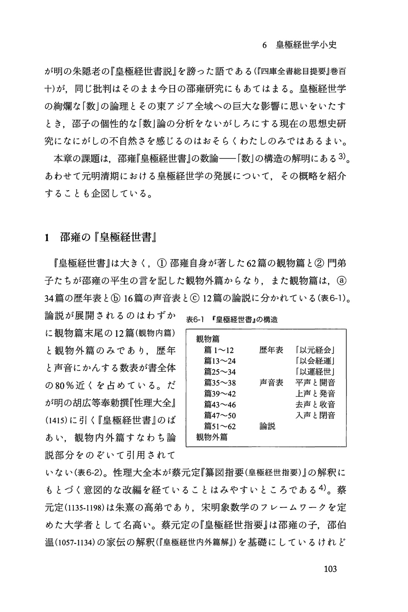

<!-- V3_SOURCE_ID:book015-b000826-p000-54a86da84c -->

也，专门以易学（伏羲卦图）来定位皇極経世学，与邵雍的数论存在齟齬之处。

> **释读存疑：** 该书；本地硬校验仍未通过，已记录供后续自动处理或人工核对。

查看对应原文

<!-- V3_FOLDBACK_BEGIN:book015-b000826-p000-54a86da84c -->

も，もっぱら易学(伏羲卦図)をもって皇極経世学を位置づけており，邵雍の数論とは齟齬するところがある。

<!-- V3_FOLDBACK_END:book015-b000826-p000-54a86da84c -->

<!-- V3_SOURCE_ID:book015-b000827-p000-d5e7e87a64 -->

现存的《皇極経世書》均缺少准确理解其内容所必需的说明图5），或许并非完本，但就数表而言，其记述并无矛盾，很有可能相当忠实地保留了原书的形态。

> **释读存疑：** 5）

查看对应原文

<!-- V3_FOLDBACK_BEGIN:book015-b000827-p000-d5e7e87a64 -->

現存の『皇極経世書』はいず
れも内容を正確に理解するのに不可欠の説明図が欠けており5)，おそらく完本ではないであろうけれども，こと数表にいたっては記述に矛盾もなく，原書の形態をかなり忠実に守っている可能性が高い。

<!-- V3_FOLDBACK_END:book015-b000827-p000-d5e7e87a64 -->

<!-- V3_SOURCE_ID:book015-b000829-p000-f371cc467b -->

## 1.1 歴年表

查看对应原文

<!-- V3_FOLDBACK_BEGIN:book015-b000829-p000-f371cc467b -->

## 1.1 歴年表

<!-- V3_FOLDBACK_END:book015-b000829-p000-f371cc467b -->

<!-- V3_SOURCE_ID:book015-b000830-p000-ab7e4b4fdc -->

《皇極経世書》中占比近一半的历年表大致分为三个部分，分别命名为①「以元経会」、②「以会経運」、③「以運経世」。第三个部分「以運経世」是与人类活动相关的历史年表，而第一个部分「以元経会」是从「气」的生成到消亡、周期为129600年的宇宙年表，第二个部分「以会経運」是从「开物」到「闭物」的地球年表。帝尧即位以来的人类悠久历史，与天地的「物」的历史相比，仅占约2.3%。

查看对应原文

<!-- V3_FOLDBACK_BEGIN:book015-b000830-p000-ab7e4b4fdc -->

『皇極経世書』の半分近くを占める歴年表は大きく三つの部分に分かれ，それぞれ①「以元経会」，②「以会経運」，③「以運経世」と名づけられている。第3の以運経世が人の活動にかかわる歴史年表であるに対して，第1の以元経会は「気」の生成から消滅にいたる1周期129,600年の宇宙年表であり，第2の以会経運は「開物」から「閉物」にいたる地球年表である。帝堯の即位以来の人類の悠久な歴史も，「物」――天地の歴史にくらべれば，わずか2,3％程度を占めるにすぎない。

<!-- V3_FOLDBACK_END:book015-b000830-p000-ab7e4b4fdc -->

<!-- V3_SOURCE_ID:book015-b000831-p000-91601ab647 -->

最初的宇宙年表「以元経会」，对应《皇極経世書》的《観物篇》第一至第十二篇，各篇名称分别为以元経会一、以元経会二……以元経会十二。该年表从历元的「日甲一・月子一・星甲一・辰子一」开始，记录了日甲第一元的12会，即129600年的年表。「日」的单位是元，「月」的单位是会，「星」的单位是运，「辰」的单位是世，《観物篇》第六十篇记载：「日は天の元を経め、月は天の会を経め、星は天の運を経め、辰は天の世を経めている」。1元等于12会，1会等于30运，1运等于12世，1世等于30年，即1元=12会=360运=4320世=129600年，1会=30运=360世=10800年，1运=12世=360年，1世=30年。此外对于年以下的单位，还记载1年=12月，1月=30日，1日=12時，1時=30分，1分=12

> **释读存疑：** 原文此处存在缺漏，后续内容未完整呈现

查看对应原文

<!-- V3_FOLDBACK_BEGIN:book015-b000831-p000-91601ab647 -->

最初の宇宙年表「以元経会」であるが，『皇極経世書』観物篇一から十二がそれにあたり，篇名はおのおの以元経会一，以元経会二，……，以元経会十二という。暦元の「日甲一・月子一・星甲一・辰子一」から始まり(図6-1)，日甲第1元の12会=129,600年の年表を記している。「日(太陽)」の単位は元，「月」の単位は会，「星」の単位は運，「辰(十二辰)」の単位は世といい，「日は天の元(天行の始)を経め，月は天の会(日月交会=合朔)を経め，星は天の運(運行)を経め，辰は天の世(交代)を経めている」(観物篇六十)。1元は12会，1会は30運，1運は12世，1世は30年にあたり，1元=12会=360運=4,320世=129,600年，1会=30運=360世=10,800年，1運=12世=360年，1世=30年である。また年以下についても，1年=12月，1月=30日，1日=12時，1時=30分，1分=12

<!-- V3_FOLDBACK_END:book015-b000831-p000-91601ab647 -->

<!-- doc004 PDF 第 116 页：高风险/复杂版面 OCR 供检索；内容与排版以原页图为准。 -->
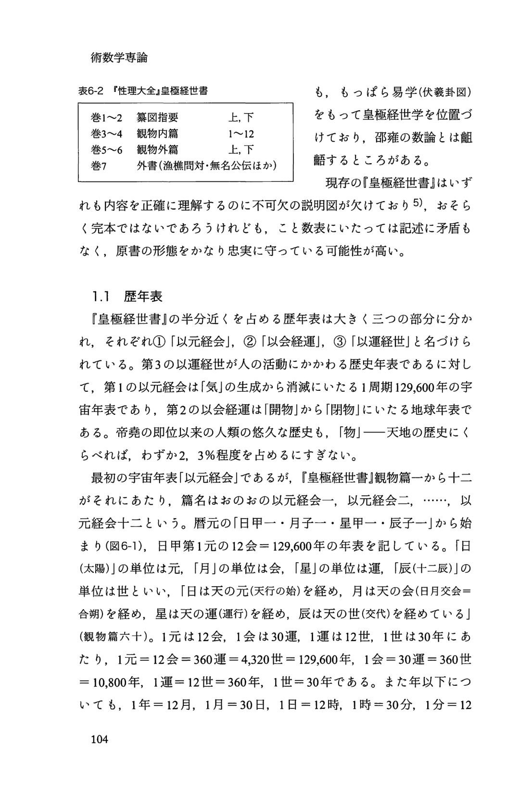

<!-- V3_SOURCE_ID:book015-b000833-p000-f57aab1d4b -->

秒等内容。皇極経世暦的体系使用十二支与十干来记录从历元开始的累计数值，以此确定历史事件发生的年份，这是因为各单位的周期均为12或30，且12与30反复相承

> **释读存疑：** 原文此处存在缺漏，后续内容未完整呈现

查看对应原文

<!-- V3_FOLDBACK_BEGIN:book015-b000833-p000-f57aab1d4b -->

秒，云々としている。皇極経世暦のシステムは十二支と十干をもちいて暦元からの積数を記し歴史事件の生じた年を特定しているが，それは各単位がすべて12ないし30を周期とし，12と30が反覆相承しているためであ

<!-- V3_FOLDBACK_END:book015-b000833-p000-f57aab1d4b -->

<!-- V3_SOURCE_ID:book015-b000834-p001-b30b4cb2a5 -->

图6-1 《皇極経世書》観物篇一

查看对应原文

<!-- V3_FOLDBACK_BEGIN:book015-b000834-p001-b30b4cb2a5 -->

図6-1 『皇極経世書』観物篇一

<!-- V3_FOLDBACK_END:book015-b000834-p001-b30b4cb2a5 -->

<!-- V3_SOURCE_ID:book015-b000835-p000-c031da1926 -->

另外，干支之后出现的数字，是以历法纪元为起点、按各单位划分的连续编号。例如《观物篇》第十四中记载，唐尧在日甲1、月巳6、星癸180、辰未2156的第11年甲辰即位，而根据邵雍的年代推算，唐尧即位这一中国史上最重要的事件，发生在从历法纪元算起的2155×30+11=64661年，也就是《皇极经世历》的64661年。

> **释读存疑：** 原文中“唐堯は即位したとある6)”的上标6)未在译文中体现，属于注释遗漏

查看对应原文

<!-- V3_FOLDBACK_BEGIN:book015-b000835-p000-c031da1926 -->

る。また干支の後にみえる数字は，暦元を起点とした単位ごとの通し番号である。たとえば観物篇十四には，日甲1・月巳6・星癸180・辰未2,156の第11年甲辰に，唐堯は即位したとある6)が，邵雍の年代推定によれば，唐堯の即位という中国史上最も重要な事件は，暦元から数えて2,155×30+11=64,661年，すなわち皇極経世暦の64,661年に起こっている。

<!-- V3_FOLDBACK_END:book015-b000835-p000-c031da1926 -->

<!-- V3_SOURCE_ID:book015-b000836-p000-0d2bde2db0 -->

元、会、运、世是根据天空中太阳、月亮、星辰与十二辰的运行规律所确定的时间计量单位，而天的四象——日、月、星、辰，并不只是指代具体的天体，还象征着《皇极经世书》的基本范畴：太阳、太阴、少阳、少阴本身。《观物篇》第五十一中记载：“运动幅度大的称为太阳，运动幅度小的称为少阳，静止幅度大的称为太阴，静止幅度小的称为少阴。太阳对应日，太阴对应月，少阳对应星，少阴对应辰。”这种对应关系，与地的范畴中火、水、石、土分别象征太刚、太柔、少刚、少柔的情况完全相同。天与地的四象除上述对应关系外，还各自确定了紧密对应的要素（表6-3）。邵雍思维方式的一大特征，在于他会将众多4项概念——春、夏、秋、冬，生、长、收、藏，皇、帝、王、伯（霸），意、言、象、数，士、农、工、商，易、书、诗、春秋等，进行适当组合，以此构建理论。

> **释读存疑：** 本地硬校验仍未通过，已记录供后续自动处理或人工核对。

查看对应原文

<!-- V3_FOLDBACK_BEGIN:book015-b000836-p000-0d2bde2db0 -->

元・会・運・世は，天空にかかる日(太陽)と月と星と辰(十二辰)の運行をみて定められた時の計量単位であるが，天の四象——日・月・星・辰は，具体的な天体を意味するにとどまらない。『皇極経世書』の基本的なカテゴリー，太陽・太陰・少陽・少陰自体をも象徴している。「動の大なる者これを太陽といい，動の小なる者これを少陽といい，静の大なる者これを太陰といい，静の小なる者これを少陰という。太陽は日をなし，太陰は月をなし，少陽は星をなし，少陰は辰をなす」という（観物篇五十ー）のがそれである。これらの配当は地のカテゴリーである火・水・石・土(地の四象)が，太剛・太柔・少剛・少柔の象徴であるのとまさに等しい。天と地の四象には上記以外にも，それぞれ緊密に対応するエレメントが定まっている7)（表6-3）。邵雍の思考法の大きな特徴は，数多くの4項概念——春・夏・秋・冬や生・長・収・蔵や皇・帝・王・伯(覇)や意・言・象・数や士・農・工・商や易・書・詩・春秋などを，適宜組み合わせて理論を創りあげるところにある。

<!-- V3_FOLDBACK_END:book015-b000836-p000-0d2bde2db0 -->

<!-- V3_SOURCE_ID:book015-b000837-p000-165e4112ef -->

表6-3 经世四象对应表
| 太阳 | 太阴 少阳 | 少阴 | 少刚 | 少柔 | 太刚 | 太柔 |
| ---- | --------- | ---- | ---- | ---- | ---- | ---- |
| 日 | 月 星 | 辰 | 石 | 土 | 火 | 水 |
| 暑 | 寒 昼 | 夜 | 雷 | 露 | 风 | 雨 |
| 性 | 情 形 | 体 | 木 | 草 | 飞 | 走 |
| 色 | 声 気 | 味 | 鼻 | 口 | 目 | 耳 |

查看对应原文

<!-- V3_FOLDBACK_BEGIN:book015-b000837-p000-165e4112ef -->

表 6-3 経世四象対応表
<table><tr><td>太陽</td><td>太陰 少陽</td><td>少陰</td><td>少剛</td><td>少柔</td><td>太剛</td><td>太柔</td></tr><tr><td>日</td><td>月 星</td><td>辰</td><td>石</td><td>土</td><td>火</td><td>水</td></tr><tr><td>暑</td><td>寒 昼</td><td>夜</td><td>雷</td><td>露</td><td>風</td><td>雨</td></tr><tr><td>性</td><td>情 形</td><td>体</td><td>木</td><td>草</td><td>飛</td><td>走</td></tr><tr><td>色</td><td>声 気</td><td>味</td><td>鼻</td><td>口</td><td>目</td><td>耳</td></tr></table>

<!-- V3_FOLDBACK_END:book015-b000837-p000-165e4112ef -->

<!-- V3_SOURCE_ID:book015-b000838-p000-7731401dee -->

宇宙年表《以元经会》的12篇，以“月子一”“月丑二”……的形式，由12个各为10800年的“会”构成，结构规整；而地球年表《以会经运》的12篇，每篇所涵盖的时间并不固定。《观物篇》第十三的《以会经运一》，从万物诞生的“经日之甲一、经月之寅三”的“月寅之中”所对应的“经星之己七十六”开始，依次经过“经月之卯四”“经月之辰五”，最终结束于“经月之巳六”的“经星之壬一百七十九”。该篇涵盖的时间跨度很长，但除“开物”外没有其他记述，也未标注岁名。而《观物篇》第十四的《以会经运二》，始于“经月之巳六”的最后一运“经星之癸一百八十”中最初的“世”——“经辰之子二千一百四十九”的第1年“甲子”，结束于“经辰之亥二千一百六十”的最后一年“癸亥”，是关于星癸第180运的年表。该年表中记载了类似“夏禹五”的内容，即帝王纪年——对应当时统治者的在位年份。此后的《以会经运》第三、第四……第十一篇也同样，是关于“经月之午七”的第1运到第9运、每360年记录一次的统治者变迁表。对于战国时期、南北朝时期等，还同时记载了多个王朝统治者的在位情况。最后《观物篇》第二十四的《以会经运十二》，在记载了“经月之午七”的第10运的“经星之癸一百九十”的年表后，对于第11运的星甲191及之后的内容，仅像“经星之甲一百九十一”这样标注星（运）名，接着依次是“经月之未八”“经月之申九”“经月之酉十”，直至“经月之戌十一”中央位置的“经星之戊三百十五”。

> **释读存疑：** 原文末尾“経世暦113,400年=”后续内容缺失，无法确认完整信息；本地硬校验仍未通过，已记录供后续自动处理或人工核对。

查看对应原文

<!-- V3_FOLDBACK_BEGIN:book015-b000838-p000-7731401dee -->

宇宙年表「以元経会」の12篇は，「月子一」「月丑二」……と，1会=10,800年が12つづくという整然とした構成からなっているが，地球年表「以会経運」の12篇は，各篇の扱う期間が一定ではない。観物篇十三の以会経運一は，万物が誕生した「経日之甲一・経月之寅三」の「月寅之中(中央)」に位置する「経星之己七十六」(経世暦27,001年=B.C.40,017)から始まり，「経月之卯四」「経月之辰五」とつづき，「経月之巳六」の「経星之壬一百七十九」(経世暦64,440年=B.C.2,578)に終わっている。扱う時間はかなり長いが，「開物」以外の記述はなく歳名もあたえられていない。一方，観物篇十四の以会経運二は，「経月之巳六」の最後の運「経星之癸一百八十」の，最初の世「経辰之子二千一百四十九」の第1年「甲子」(経世暦64,441年=B.C.2,577)に始まり，「経辰之亥二千一百六十」の最後の年「癸亥」(経世暦64,800年=B.C.2,217)に終わっており，星癸第180運にかんする年表である。年表には「夏禹五(年)」のごとく，帝王紀年——当時の為政者の何年にあたるかが記されている。以下，以会経運の三，四，……，十一も同様に，「経月之午七」の第1運から第9運にかんするそれぞれ360年ごとの為政者の変遷表である。戦国期や南北朝期などについては，複数の王朝の為政者の在位などが併記されている。最後の観物篇二十四の以会経運十二は，「経月之午七」の第10運の「経星之癸一百九十」(経世暦68,041年=A.D.1,024から経世暦68,400年=A.D.1,383)にかんする年表を記したあと，第11運の星甲191以下について，「経星之甲一百九十一」のごとく星(運)名のみを記し，「経月之未八」「経月之申九」「経月之酉十」とつづき，「経月之戌十一」の中央に位置する「経星之戊三百十五」(経世暦113,400年=

<!-- V3_FOLDBACK_END:book015-b000838-p000-7731401dee -->

<!-- V3_SOURCE_ID:book015-b000839-p000-9ce66c0f31 -->

公元46384年的「閉物」篇至此结束。

> **释读存疑：** 原文中「A.D.46,384」的逗号为千位分隔符，并非公元年份的一部分，候选译法将其误译为公元46384年，属于数字误译；原文中「A.D.46,384」的逗号为千位分隔符，并非公元年份的一部分，具体所指原文未明；1轮自动修复后核义模型仍建议修订，已保守记录。

查看对应原文

<!-- V3_FOLDBACK_BEGIN:book015-b000839-p000-9ce66c0f31 -->

A.D.46,384)の「閉物」に終わっている。

<!-- V3_FOLDBACK_END:book015-b000839-p000-9ce66c0f31 -->

<!-- V3_SOURCE_ID:book015-b000840-p000-2e10b622ea -->

历史年表「以運経世」由观物篇第二十五至第三十四共10篇组成，每篇定一运为360年的岁名，岁名之下记载该年内发生的重大事件。阐明人类历史是「以運経世」的目标。例如观物篇第二十五的「以運経世一」中，记载了经世历64661年即公元前2357年的「甲辰年。唐帝尧在平阳即位，号陶唐氏。羲……

> **释读存疑：** 原文中「甲辰(の年)」的「の年」为日文助词，译文中已合理处理；原文末尾「羲」字未完整，译文中保留省略状态

查看对应原文

<!-- V3_FOLDBACK_BEGIN:book015-b000840-p000-2e10b622ea -->

一方，歴史年表「以運経世」は観物篇二十五から三十四の10篇からなり，篇ごとに1運=360年の歳名を定め，歳名の下に年内に起きた重大事件を記している。人間の歴史を明らかにするのが以運経世の目指しているところである。たとえば観物篇二十五の以運経世一には，経世暦64,661年=B.C.2,357の「甲辰(の年)。唐帝堯，平陽に肇位し，陶唐氏と号す。羲

<!-- V3_FOLDBACK_END:book015-b000840-p000-2e10b622ea -->

<!-- V3_SOURCE_ID:book015-b000841-p000-f418ccf03a -->

| 欽定四庫全書 |  |  | 丙申 |
| 皇極經世書卷五上 | 宋邵雍撰 |  | 丁酉 |
| 親抄二十五 |  |  | 戊戌 |
| 元之甲Ley |  |  | 己亥 |
| 經會之巳1E028 |  |  | 庚子 |
| 經運之於一百八 |  |  | 辛丑 |
| 經世之十日百四十九 |  |  | 壬寅 |
| 經世之丑二千十百五十 |  |  | 癸卯 |
| 經世之寅二千一百五十一 |  | 甲辰唐帝堯肇位于平陽號陶唐氏命羲和欽若昊天 |
| 經世之卯二千一百五十二 |  | 歷象日月星辰敬授人時朞三百六旬有六日以 |
| 經世之辰二千一百五十三 |  | 閏月定四時成歲曰載建寅月為始允釐百工庚 |
| 經世之巳二千一百五十四 |  | 績咸熙 |
| 經世之午二千一百五十五 |  | 乙巳 |
| 經世之未二千一百五十六 |  | 丙午 |
| 甲午 |  | 丁来 |
| 乙未 |  | 戊申 |

> **释读存疑：** 表格中存在「Ley」「1E028」等无法确认含义的字符，「丁来」疑为「丁未」的讹误，「二千十百五十」疑为「二千一百五十」的讹误；表格中部分字符及讹误内容的具体含义无法确定

查看对应原文

<!-- V3_FOLDBACK_BEGIN:book015-b000841-p000-f418ccf03a -->

<table><tr><td rowspan=1 colspan=3>欽定四庫全書</td><td rowspan=1 colspan=1>丙申</td></tr><tr><td rowspan=1 colspan=2>皇極經世書卷五上</td><td rowspan=1 colspan=1>宋邵雍撰</td><td rowspan=1 colspan=1>丁酉</td></tr><tr><td rowspan=1 colspan=1>親抄二十五</td><td rowspan=1 colspan=1></td><td rowspan=1 colspan=1></td><td rowspan=1 colspan=1>戊戌</td></tr><tr><td rowspan=1 colspan=1>元之甲Ley</td><td rowspan=1 colspan=1></td><td rowspan=1 colspan=1></td><td rowspan=1 colspan=1>已亥</td></tr><tr><td rowspan=1 colspan=3>經會之巳1E028</td><td rowspan=1 colspan=1>庚子</td></tr><tr><td rowspan=1 colspan=3>經運之於一百八</td><td rowspan=1 colspan=1>辛丑</td></tr><tr><td rowspan=1 colspan=3>經世之十日百四十九</td><td rowspan=1 colspan=1>壬寅</td></tr><tr><td rowspan=1 colspan=3>經世之丑二千十百五十</td><td rowspan=1 colspan=1>癸卯</td></tr><tr><td rowspan=1 colspan=3>經世之寅二千一百五十一</td><td rowspan=1 colspan=1>甲辰唐帝堯肇位于平陽號陶唐氏命羲和欽若昊天</td></tr><tr><td rowspan=1 colspan=3>經世之卯二千一百五十二</td><td rowspan=1 colspan=1>歷象日月星辰敬授人時朞三百六旬有六日以</td></tr><tr><td rowspan=1 colspan=3>經世之辰二千一百五十三</td><td rowspan=1 colspan=1>閏月定四時成歲曰載建寅月為始允釐百工庚</td></tr><tr><td rowspan=1 colspan=3>經世之巳二千一百五十四</td><td rowspan=1 colspan=1>績咸熙</td></tr><tr><td rowspan=1 colspan=3>經世之午二千一百五十五</td><td rowspan=1 colspan=1>乙巳</td></tr><tr><td rowspan=1 colspan=3>經世之未二千一百五十六</td><td rowspan=1 colspan=1>丙午</td></tr><tr><td rowspan=1 colspan=3>甲午</td><td rowspan=1 colspan=1>丁来</td></tr><tr><td rowspan=1 colspan=3>乙未</td><td rowspan=1 colspan=1>戊申</td></tr></table>

<!-- V3_FOLDBACK_END:book015-b000841-p000-f418ccf03a -->

<!-- V3_SOURCE_ID:book015-b000842-p000-9b5cc451cd -->

图6-2《皇极经世书·观物篇二十五》

查看对应原文

<!-- V3_FOLDBACK_BEGIN:book015-b000842-p000-9b5cc451cd -->

図6-2『皇極経世書』観物篇二十五

<!-- V3_FOLDBACK_END:book015-b000842-p000-9b5cc451cd -->

<!-- V3_SOURCE_ID:book015-b000843-p000-8f6cd2350a -->

文中可见有“帝尧命人恭敬地顺应昊天，观测日月星辰制定历法，恭敬地将时令授予民众。一年为三百六十六日，设置闰月来确定四时，形成一岁，称为‘载’，以建寅之月为岁首。确实整顿了百官，各项事务都兴盛起来”这类内容。一眼就能看出，这段文字大半是引自《尚书·尧典》。另外，帝尧甲辰年即位的说法，最早的例子是晋代皇甫谧所说的“尧以甲申年出生，甲辰年即帝位”，引自《史记集解·五帝本义》，但邵雍所处的时代，这种说法不太可能是当时的通行观点8)。

> **释读存疑：** 原文提及的“図6-2”未在译文中体现，但属于标注性内容，不影响核心释读；“邵雍所处的时代，这种说法不太可能是当时的通行观点”的译法准确传达了原文的推测语气，未将推测转为事实；本地硬校验仍未通过，已记录供后续自动处理或人工核对。

查看对应原文

<!-- V3_FOLDBACK_BEGIN:book015-b000843-p000-8f6cd2350a -->

和に命じて，欽みて昊天に若わしめ，日月星辰を暦象して，敬みて人に時を授けしむ。期は三百六旬有六日，閏月を以て四時を定め歳を成し，載と日い，建寅月を始と為す。允に百工を釐め，庶績みな煕し」などとみえる(図6-2)。一見して明らかなごとく，文章の大半は『尚書』堯典からの引用である。また帝堯の甲辰即位説は，晋の皇甫謐が「堯は甲申の歳を以て生まれ，甲辰，帝位に即く」云々とのべた(『史記集解』五帝本義引)のが早い例であるが，邵雍当時，通説であった可能性は高くない8)。

<!-- V3_FOLDBACK_END:book015-b000843-p000-8f6cd2350a -->

<!-- V3_SOURCE_ID:book015-b000844-p000-7cd6c4db82 -->

以运经世的各篇，年表从“经元之甲一、经会之巳六、经运之癸一百八十、经世之子二千一百四十九”开始，纪年从“经世之未二千一百五十六的元年甲午”开始，但关于历史事件的记载仅到“经世之未二千

> **释读存疑：** 原文“歴史事件にかんする記載は「経世之未二千”未完整呈现，译文中保留了原文的截断状态，符合要求；本地硬校验仍未通过，已记录供后续自动处理或人工核对。

查看对应原文

<!-- V3_FOLDBACK_BEGIN:book015-b000844-p000-7cd6c4db82 -->

以運経世の諸篇は，「経元之甲一・経会之巳六・経運之癸一百八十・経世之子二千一百四十九」(経世暦64,441年=B.C.2,577)に年表が始まり，「経世之未二千一百五十六の元年の甲午(経世暦64,651年=B.C.2,367)に紀年が始まっているけれども，歴史事件にかんする記載は「経世之未二千

<!-- V3_FOLDBACK_END:book015-b000844-p000-7cd6c4db82 -->

<!-- V3_SOURCE_ID:book015-b000845-p000-ac52fe236e -->

……一百五十六的第十一年甲辰——尧的即位是最早的，而观物篇三十四以运经世十的“经元之甲一、经会之午七、经运之壬一百八十九”的第二百九十六年己未——后周恭帝的即位是最晚的。另外，年代的标记方式与以元经会、以会经运不同，没有写日、月、星、辰或者经日、经月、经星、经辰，而是直接写经元、经会、经运、经世等。历史年表的年代标记不像宇宙年表、地球年表那样使用日、月、星、辰，这可以推测是因为邵雍认为用天的四象来标记不适合记录人类的事件。

> **释读存疑：** 原文“……一百五十六の第11年の甲辰”前的截断内容未在译文中体现，但属于原文残缺部分，不影响核心释读；“天の四象”未明确具体所指，译文中未强行确定含义，符合要求；本地硬校验仍未通过，已记录供后续自动处理或人工核对。

查看对应原文

<!-- V3_FOLDBACK_BEGIN:book015-b000845-p000-ac52fe236e -->

一百五十六の第11年の甲辰(経世暦64,661年=B.C.2,357)——堯の即位が最初であり，観物篇三十四の以運経世十の「経元之甲一・経会之午七・経運之壬一百八十九」第296年己未(経世暦67,976年=A.D.959)——後周恭帝の即位が最後である。また年代の表記は以元経会や以会経運とは異なり，日・月・星・辰あるいは経日・経月・経星・経辰などと書かず，ただちに経元・経会・経運・経世などと記している。歴史年表の年代表記に宇宙年表や地球年表のごとく日・月・星・辰を用いないのは，天の四象による表記は人間の事件を記すのに適当でない，と邵雍が判断したからであろうと推定することができる。

<!-- V3_FOLDBACK_END:book015-b000845-p000-ac52fe236e -->

<!-- V3_SOURCE_ID:book015-b000846-p000-b5d2eff8a1 -->

《皇极经世书》历年表，不乏有人称赞它确定了经书中记载的历史事件的准确年代，完美解决了经学上的若干重要问题。例如观物篇二十七中有“经元之甲一、经会之午七、经运之乙一百八十二、经世之卯二千一百七十六”的第十四年“丁未。商王成汤去世，嫡长子太甲即位”的内容，而张拭（1132-1180）针对这一点，纠正了《史记》以来流传的谬误，称赞其为“万世不可更改的定论”，引自《经世纪年自序》。《史记·殷本纪》记载，成汤去世后，太子太丁的弟弟外丙、仲壬先后即位，之后太丁之子太甲才即位，按照司马迁的说法，这与《尚书·伊训》中“成汤既没，太甲元年”的记述存在矛盾。另外观物篇二十九中有“经元之甲一、经会之午七、经运之丁一百八十四、经世之子二千一百九十七”的第十六年“己卯。吕尚辅佐武王，讨伐商”的内容。据张拭所说，邵雍的年代推定是以《尚书·泰誓》序中“惟十有一年，武王伐殷”为依据，将经文中“惟十有三年春，大会於孟津”中的“三”订正为“一”，仅此而已，引自《经世纪年自序》。

> **释读存疑：** “嫡长子”是对“元子”的合理释义，未改变原文含义；“万世不可更改的定论”准确传达了原文“万世改むべからざる者”的含义，未出现误译；本地硬校验仍未通过，已记录供后续自动处理或人工核对。

查看对应原文

<!-- V3_FOLDBACK_BEGIN:book015-b000846-p000-b5d2eff8a1 -->

『皇極経世書』歴年表については，経書にみえる歴史事件の正確な年代を定め，経学上のいくつかの重要問題をみごとに解決した，等々と称賛する者に事欠かない。たとえば観物篇二十七には，「経元之甲一・経会之午七・経運之乙一百八十二・経世之卯二千一百七十六」の第14年「丁未(経世暦65,264年=B.C.1,754)。商王成湯，崩ず。元子太甲，位に践く」とみえるが，張拭(1132-1180)はこれについて，『史記』以来の伝習の謬りを正しており，「万世改むべからざる者」であると絶賛している(経世紀年自序)。『史記』殷本紀には，湯が崩じたあと，太子の太丁の弟の外丙と仲壬が立ち，そののち太丁の子の太甲が立ったとあり，司馬遷の説にしたがえば，『尚書』伊訓の「成湯既没，太甲元年」の記述と矛盾をいたすからである。また観物篇二十九には，「経元之甲一・経会之午七・経運之丁一百八十四・経世之子二千一百九十七」の第16年「己卯(経世暦65,896年=B.C.1,122)。呂尚，武王に相し，商を伐つ」とみえる。張拭によれば，邵雍の年代推定は『尚書』泰誓の序に「惟十有一年，武王伐殷」とあることを根拠として，経文中の「惟十有三年春，大会於孟津」の「三」を「一」に訂正したものにほかならない(経世紀年自序)。

<!-- V3_FOLDBACK_END:book015-b000846-p000-b5d2eff8a1 -->

<!-- V3_SOURCE_ID:book015-b000847-p000-ed1e631311 -->

《皇極經世書》中提到了元、會、運、世這四種時代劃分，但實際上最應該重視的，正如書名所暗示的，是1世等於30年。古時候把三十年稱作一世，難道是隨便說的嗎？要等到教化普遍普及、民眾的情緒才會開始發生一次變化。如果有治世之才，能接續前代興起，那麼即使民眾像夷狄一樣，經過三次變化也能建立帝道。王者有三次變化，以30年乘以3的時間來算，要實現理想社會並非不可能。另外，正如孔子感慨道「善人治理國家需要一百年，還要以此戰勝殘餘、消除殺戮。這句話是真的啊」，伯的政治經過三十年會發生一次變化，成為王的政治；王的政治經過三十年會發生一次變化，成為帝的政治；帝的政治經過三十年會發生一次變化，成為皇的政治。邵雍把年表全部劃分為30年，無非是遵循中國文化傳統，認識到歷史發展中一世一變的重要性的結果。

> **释读存疑：** 1轮自动修复后核义模型仍建议修订，已保守记录。

查看对应原文

<!-- V3_FOLDBACK_BEGIN:book015-b000847-p000-ed1e631311 -->

『皇極経世書』には元・会・運・世とよばれる四つの時代区分があるが，実際上最も重視すべきは，書名の暗示するごとく1世＝30年である。「古は三十年を謂いて一世となす，豈に徒然ならんや。化の必ず洽く教の必ず浹きを俟ちて，民の情，始めて一変すべし。苟くも命世の人，世を継ぎて興るあらば，則ち民，夷狄のごとしと雖も，三変して帝道挙ぐべし」王者に三変，30年×3の時間があれば，理想社会を実現することも不可能ではない(観物篇六十)。また孔子が「善人，邦を為めること百年(=30年×3)，また以て残に勝ち殺を去るべし。誠なるかな，是の言や」と述懐した(『論語』子路)ごとく，伯の政治は30年をへて一変して王の政治になり，王の政治は30年をへて一変して帝の政治になり，帝の政治は30年をへて一変して皇の政治にいたることができる(観物篇五十九)。邵雍が歴年表をことごとく30年に分割するのは，中国の文化伝統に則って歴史発展における一世一変の重要性を認識した結果にほかならないのである。

<!-- V3_FOLDBACK_END:book015-b000847-p000-ed1e631311 -->

<!-- V3_SOURCE_ID:book015-b000848-p000-dc727e51b0 -->

邵雍的歷史觀以巨大的循環為其主要特徵。《皇極經世書》的年表確實記載了包含當世在內的129600年，而這129600年被稱為「日甲一」「經日之甲一」「經元之甲一」等，從命名來看，是以存在日乙第2元、日丙第3元……為前提的。宇宙即使在萬物滅亡、氣息消散之後，也會隨即開始新的再生。不過邵雍的循環史觀，正如「三皇是春，五帝是夏，三王是秋，五伯是冬」所說，只不過是將基於陰陽二氣消長的季節循環展現在歷史之中罷了9）。

> **释读存疑：** 原文中“129,600年”的千分位分隔符在译文中改为“129600年”，属于不影响含义的格式调整

查看对应原文

<!-- V3_FOLDBACK_BEGIN:book015-b000848-p000-dc727e51b0 -->

邵雍の歴史観は巨大な循環をその大きな特徴としている。『皇極経世書』の年表は確かに，現世を含む129,600年のことを記したものであるが，その129,600年は「日甲一」「経日之甲一」「経元之甲一」などとのべられており，命名からして日乙第2元・日丙第3元・……の存在を前提としている。宇宙は万物の死滅から気の消滅にいたろうとも，消滅後にはただちに新たな再生がつづくのである。だが邵雍の循環史観は，「三皇は春なり。五帝は夏なり。三王は秋なり。五伯は冬なり」(観物篇六十)とあるごとく，陰陽二気の消長にもとづく季節の循環を歴史上に展開したものにすぎない9)。

<!-- V3_FOLDBACK_END:book015-b000848-p000-dc727e51b0 -->

<!-- V3_SOURCE_ID:book015-b000849-p000-493040916a -->

## 1.2 声音表

查看对应原文

<!-- V3_FOLDBACK_BEGIN:book015-b000849-p000-493040916a -->

## 1.2 声音表

<!-- V3_FOLDBACK_END:book015-b000849-p000-493040916a -->

<!-- V3_SOURCE_ID:book015-b000850-p000-2ce57eee11 -->

邵雍的律呂聲音之學也極具個性。他依據自己制定的漢語字音的兩種音素——112個天聲和152個地音，記錄了所有存在的漢語字音。正因如此，它被視為瞭解宋代語音不可忽視的資料之一。

> **释读存疑：** 原文中“112”“152”的具体所指未明确，译文中直接保留数字，未添加额外解释

查看对应原文

<!-- V3_FOLDBACK_BEGIN:book015-b000850-p000-2ce57eee11 -->

邵雍の律呂声音の学もきわめて個性的である。自らの策定した漢字音の二つの音素112の天声(韻母と声調)と152の地音(声母と等位)にもとづいて，存在するかぎりの漢字音を表示している。宋代語音を知る上で疎かにすべからざる資料の一つに数えられるゆえんである。

<!-- V3_FOLDBACK_END:book015-b000850-p000-2ce57eee11 -->

<!-- V3_SOURCE_ID:book015-b000851-p000-b7ffa85359 -->

《皇極經世書》觀物篇的第三十五到第五十篇這共16篇中，能看到邵雍研究聲音的各種成果，即各種聲音表。每篇開頭記載的是天聲與地音的一覽表，也就是天聲表與地音表，接在其後的是天聲與地音的反切表、聲唱呂的10個表，以及音和律的12個表。

> **释读存疑：** 本地硬校验仍未通过，已记录供后续自动处理或人工核对。

查看对应原文

<!-- V3_FOLDBACK_BEGIN:book015-b000851-p000-b7ffa85359 -->

『皇極経世書』観物篇の三十五から五十の16篇には，邵雍の声音研究の成果を示す各種の声音表がみえる(図6-3)。各篇の冒頭に記されたのが天声と地音の一覧表(天声表と地音表)であり，それにつづくのが天声と地音の反切表声唱呂の10表と音和律の12表である10)。

<!-- V3_FOLDBACK_END:book015-b000851-p000-b7ffa85359 -->

<!-- V3_SOURCE_ID:book015-b000852-p000-43bfc531d8 -->

<table><tr><td>欽定四庫全書</td></tr><tr><td>下皇極經世書卷七上 宋邵雍撰</td></tr><tr><td>觀物為三十五 a2H4</td></tr><tr><td>日日聲平聞SLZ2O A水水音開清</td></tr><tr><td>多良十刀 3 古黑安夫卜東</td></tr><tr><td>2I 乃走思t 6</td></tr><tr><td>日日聲七下唱地之 水水音九上和天之</td></tr><tr><td>用音一百五十二是 用聲一百一十二是</td></tr><tr><td>欽定四庫全書 はまよ</td></tr><tr><td>謂平聲聞音平聲開 謂開音清聲開音清</td></tr><tr><td>音一千六十四 聲一千八</td></tr><tr><td></td></tr><tr><td>日日聲平之一聞 水水音開之一清</td></tr><tr><td></td></tr><tr><td>平聲聞唱吕一之一開音清和律一之一</td></tr><tr><td>古甲九癸 古古古古多多多多 多可个舌</td></tr><tr><td>一音 口口近揆 一音 古古古古多多多多未大化八</td></tr><tr><td>一聲坤巧邱弃 一奉 古古古古多多多多聞辛衆</td></tr><tr><td>口口州 古古古古多多多多 四每退</td></tr><tr><td>黑花香血 古古古古生多多多 良面向</td></tr><tr><td>二音 黃華雄賢 一音 古古古古多多多多光廣况</td></tr><tr><td>一峰五九仰口 二聲古古古古多多多多丁井豆C</td></tr><tr><td>吾牙月先 古古古古多多多多 兄未莹</td></tr></table>

> **释读存疑：** 表格中存在大量无法识别的字符，具体含义不详

查看对应原文

<!-- V3_FOLDBACK_BEGIN:book015-b000852-p000-43bfc531d8 -->

<table><tr><td rowspan=1 colspan=1>欽定四庫全書</td></tr><tr><td rowspan=1 colspan=1>下皇極經世書卷七上     宋卻雍撰</td></tr><tr><td rowspan=1 colspan=1>觀物為三十五  a2H4</td></tr><tr><td rowspan=1 colspan=1>日日聲平聞SLZ2O A水水音開清</td></tr><tr><td rowspan=1 colspan=1>多良十刀   3    古黑安夫卜東</td></tr><tr><td rowspan=1 colspan=1>2I    乃走思t           6</td></tr><tr><td rowspan=1 colspan=1>日日聲七下唱地之    水水音九上和天之</td></tr><tr><td rowspan=1 colspan=1>用音一百五十二是    用聲一百一十二是</td></tr><tr><td rowspan=1 colspan=1>欽定四庫全書     はまよ</td></tr><tr><td rowspan=1 colspan=1>謂平聲聞音平聲開   謂開音清聲開音清</td></tr><tr><td rowspan=1 colspan=1>音一千六十四       聲一千八</td></tr><tr><td rowspan=1 colspan=1></td></tr><tr><td rowspan=1 colspan=1>日日聲平之一聞      水水音開之一清</td></tr><tr><td rowspan=1 colspan=1></td></tr><tr><td rowspan=1 colspan=1>平聲聞唱吕一之一開音清和律一之一</td></tr><tr><td rowspan=1 colspan=1>古甲九癸           古古古古多多多多           多可个舌</td></tr><tr><td rowspan=1 colspan=1>一音 口口近揆      一音 古古古古多多多多未大化八</td></tr><tr><td rowspan=1 colspan=1>一聲坤巧邱弃      一奉 古古古古多多多多聞辛衆</td></tr><tr><td rowspan=1 colspan=1>口口州           古古古古多多多多           四每退</td></tr><tr><td rowspan=1 colspan=1>黑花香血           古古古古生多多多           良面向</td></tr><tr><td rowspan=1 colspan=1>二音 黃華雄賢      一音 古古古古多多多多光廣况</td></tr><tr><td rowspan=1 colspan=1>一峰五九仰口      二聲古古古古多多多多丁井豆C</td></tr><tr><td rowspan=1 colspan=1>吾牙月先           古古古古多多多多           兄未莹</td></tr></table>

<!-- V3_FOLDBACK_END:book015-b000852-p000-43bfc531d8 -->

<!-- V3_SOURCE_ID:book015-b000853-p000-7072eb64f8 -->

圖6-3 聲音表

查看对应原文

<!-- V3_FOLDBACK_BEGIN:book015-b000853-p000-7072eb64f8 -->

図6-3 声音表

<!-- V3_FOLDBACK_END:book015-b000853-p000-7072eb64f8 -->

<!-- V3_SOURCE_ID:book015-b000854-p000-cb95198cab -->

天聲表與地音表，每篇上下各一個，合計16×2個，構成極其整齊。「天之用聲一百十二」表，是根據①韻頭的闢、翕與②平上去入的聲調的原理，將112個韻母分為16類的韻部表；「地之用音一百五十二」表，是根據①聲母的清、濁與②開發収閉的原理，將152個聲母分為16類的子音表。表中的記號「有声無字」表示有聲音但無對應的字，□表示有音但無對應的字。另外，天聲與地音的各類，各自對應天的四

> **释读存疑：** 原文未完整表述，仅提及天的四相关内容；本地硬校验仍未通过，已记录供后续自动处理或人工核对。

查看对应原文

<!-- V3_FOLDBACK_BEGIN:book015-b000854-p000-cb95198cab -->

天声表と地音表は，篇ごとに上下に一つずつ合計16×2あり，構成はきわめて整然としている(表6-4)。「天之用声一百十二」表は，①韻頭の闢(開口呼)翕(合口呼)と②平上去入の声調(四声)の原理にもとづいて，112の韻母を16に分類した(7×16=112)韻部表であり，「地之用音一百五十二」表は，①声母の清(無声)濁(有声)と②開発収閉(等韻の1等・2等・3等・4等に近い)の原理にもとづいて，152の声母を16に分類した(9×4+12×8+5×4=152)子音表である(表6-5)。表中の記号は有声無字を示し，□は有音無字を示している。また天声と地音の各類はおのおの，天の四

<!-- V3_FOLDBACK_END:book015-b000854-p000-cb95198cab -->

<!-- V3_SOURCE_ID:book015-b000855-p000-90c2a7933c -->

表6-4 律吕声音表，对应内容如下：第一行的篇35、篇36、篇37、篇38，分别对应日日声平闢、日月声平翕、日星声平闢、日辰声平翕，以及水水音開清、水火音開濁、水土音開清、水石音開濁，还有篇43、篇44、篇45、篇46，分别对应星日声去闢、星月声去翕、星星声去闢、星辰声去翕，以及土水音収清、土火音収濁、土土音収清、土石音収濁；第二行的篇39、篇40、篇41，分别对应月日声上闢、月月声上翕、月星声上闢，以及火水音発清、火火音発濁，还有篇47、篇48，分别对应辰日声入闢、辰月声入翕，以及石水音閉清、石火音閉濁。

> **释读存疑：** 本地硬校验仍未通过，已记录供后续自动处理或人工核对。

查看对应原文

<!-- V3_FOLDBACK_BEGIN:book015-b000855-p000-90c2a7933c -->

表6-4 律呂声音表
<table><tr><td>篇35 篇36 篇37 篇38</td><td>日日声平闢 日月声平翕 日星声平闢 日辰声平翕</td><td>水水音開清 水火音開濁 水土音開清 水石音開濁</td><td>篇43 篇44 篇45 篇46</td><td>星日声去闢 星月声去翕 星星声去闢 星辰声去翕</td><td>土水音収清 土火音収濁 土土音収清 土石音収濁</td></tr><tr><td>篇39 篇40 篇41</td><td>月日声上闢 月月声上翕 月星声上闢</td><td>火水音発清 火火音発濁</td><td>篇47 篇48</td><td>辰日声入闢 辰月声入翕</td><td>石水音閉清 石火音閉濁</td></tr></table>

<!-- V3_FOLDBACK_END:book015-b000855-p000-90c2a7933c -->

<!-- V3_SOURCE_ID:book015-b000856-p000-74457dc95a -->

表6-5 天声地音一览表，表格分为天声、地音两大栏，各栏对应内容如下：天声的日日声平闢对应文字为多良千刀妻宮心●●●，地音的水水音開清对应文字为古黒安夫卜東乃走思■；天声的日月声平翕对应文字为禾光元毛衰龍●●●，地音的水火音開濁对应文字为□黄□父歩兌内自寺■；天声的日星声平闢对应文字为開丁臣牛魚男●●●，地音的水土音開清对应文字为坤五母武普土老草；天声的日辰声平翕对应文字为回兄君○亀烏○●●●，地音的水石音開濁对应文字为□吾目文旁同鹿曹□；天声的月日声上闢对应文字为可両典早子孔審●●●，地音的火水音発清对应文字为甲花亜法丹百孀哉三山荘卓；天声的月月声上翕对应文字为火広犬宝○甬○●●●，地音的火火音発濁对应文字为□華爻凡白大南在□士乍宅；天声的月星声上闢对应文字为宰井引斗○鼠坎●●●，地音的火土音発清对应文字为巧瓦馬晚朴貪冷采□□叉坼；天声的月辰声上翕对应文字为每永允○水虎○●●●，地音的火石音発濁对应文字为□牙児万排覃榮才□□崇茶；天声的星日声去闢对应文字为个向旦孝四衆禁●●●，地音的土水音収清对应文字为九香乙丙帝女足星手震中；天声的星月声去翕对应文字为化況半報帥用●●●，地音的土火音収濁对应文字为近雄王□備弟年匠象石□直；天声的星星声去闢对应文字为愛亘艮奏○去欠●●●，地音的土土音収清对应文字为丘仰美□品天呂七□耳赤丑；天声的星辰声去翕对应文字为退瑩巽○貴兎○●●●，地音的土石音収濁对应文字为乾月眉□平田離全□二辰星；天声的辰日声入闢对应文字为舌○○岳日○○●●●，地音的石水音閉清对应文字为癸血一飛必；天声的辰月声入翕对应文字为八〇○霍骨○十●●●，地音的石火音閉濁对应文字为揆賢寅吠鼻；天声的辰星声入闢对应文字为○○○六徳○○●●●，地音的石土音閉清对应文字为弃米尾匹；天声的辰辰声入翕对应文字为○○○玉北○妾●●●，地音的石石音閉濁对应文字为蚪堯民未瓶。

查看对应原文

<!-- V3_FOLDBACK_BEGIN:book015-b000856-p000-74457dc95a -->

表6-5 天声地音一覧表
<table><tr><td colspan="2">天声</td><td colspan="2">地音</td></tr><tr><td>日日声平闢</td><td>多良千刀妻宮心●●●</td><td>水水音開清</td><td>古黒安夫卜東乃走思■</td></tr><tr><td>日月声平翕</td><td>禾光元毛衰龍●●●</td><td>水火音開濁</td><td>□黄□父歩兌内自寺■</td></tr><tr><td>日星声平闢</td><td>開丁臣牛魚男●●●</td><td>水土音開清</td><td>坤五母武普土老草</td></tr><tr><td>日辰声平翕</td><td>回兄君○亀烏○●●●</td><td>水石音開濁</td><td>□吾目文旁同鹿曹□</td></tr><tr><td>月日声上闢</td><td>可両典早子孔審●●●</td><td>火水音発清</td><td>甲花亜法丹百孀哉三山荘卓</td></tr><tr><td>月月声上翕</td><td>火広犬宝○甬○●●●</td><td>火火音発濁</td><td>□華爻凡白大南在□士乍宅</td></tr><tr><td>月星声上闢</td><td>宰井引斗○鼠坎●●●</td><td>火土音発清</td><td>巧瓦馬晚朴貪冷采□□叉坼</td></tr><tr><td>月辰声上翕</td><td>每永允○水虎○●●●</td><td>火石音発濁</td><td>□牙児万排覃榮才□□崇茶</td></tr><tr><td>星日声去關</td><td>个向旦孝四衆禁●●●</td><td>土水音収清</td><td>九香乙丙帝女足星手震中</td></tr><tr><td>星月声去翕</td><td>化況半報帥用●●●</td><td>土火音収濁</td><td>近雄王□備弟年匠象石□直</td></tr><tr><td>星星声去闢</td><td>愛亘艮奏○去欠●●●</td><td>土土音収清</td><td>丘仰美□品天呂七□耳赤丑</td></tr><tr><td>星辰声去翕</td><td>退瑩巽○貴兎○●●●</td><td>土石音収濁</td><td>乾月眉□平田離全□二辰星</td></tr><tr><td>辰日声入闢</td><td>舌○○岳日○○●●●</td><td>石水音閉清</td><td>癸血一飛必</td></tr><tr><td>辰月声入翕</td><td>八〇○霍骨○十●●●</td><td>石火音閉濁</td><td>揆賢寅吠鼻</td></tr><tr><td>辰星声入闢</td><td>○○○六徳○○●●●</td><td>石土音閉清</td><td>弃米尾匹</td></tr><tr><td>辰辰声入翕</td><td>○○○玉北○妾●●●</td><td>石石音閉濁</td><td>蚪堯民未瓶</td></tr></table>

<!-- V3_FOLDBACK_END:book015-b000856-p000-74457dc95a -->

<!-- doc004 PDF 第 122 页：高风险/复杂版面 OCR 供检索；内容与排版以原页图为准。 -->
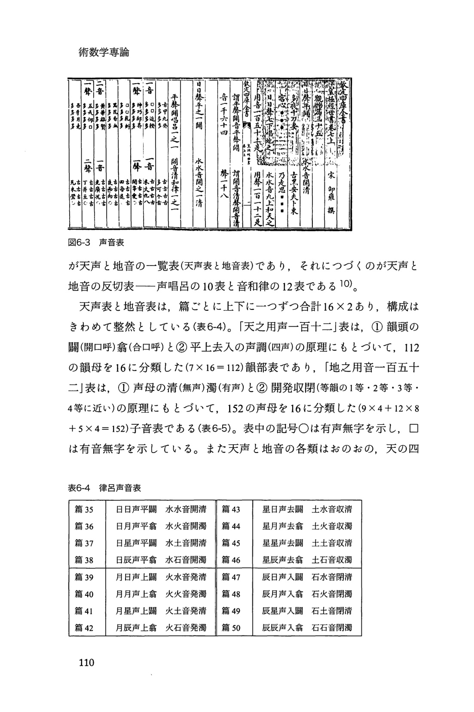

<!-- V3_SOURCE_ID:book015-b000858-p000-7eaa37b55d -->

其命名是将象的日、月、星、辰与地的四象水、火、土、石相叠加而来，这种以4进制为特征的命名法，与历年表基本一致。在天声的16类中，最先提及的日代表平声，月代表上声，星代表去声，辰代表入声；第2个提及的日与星代表开口呼的闢声，月与辰代表合口呼的翕声。

查看对应原文

<!-- V3_FOLDBACK_BEGIN:book015-b000858-p000-7eaa37b55d -->

象の日・月・星・辰と地の四象の水・火・土・石を重ねて名づけられており，4進を特徴とする命名法は歴年表と基本的に等しい。天声16類のばあい，最初に唱える日が平声，月が上声，星が去声，辰が入声を表し，第2の日と星が開口呼の闢声，月と辰が合口呼の翕声を表わす。ま

<!-- V3_FOLDBACK_END:book015-b000858-p000-7eaa37b55d -->

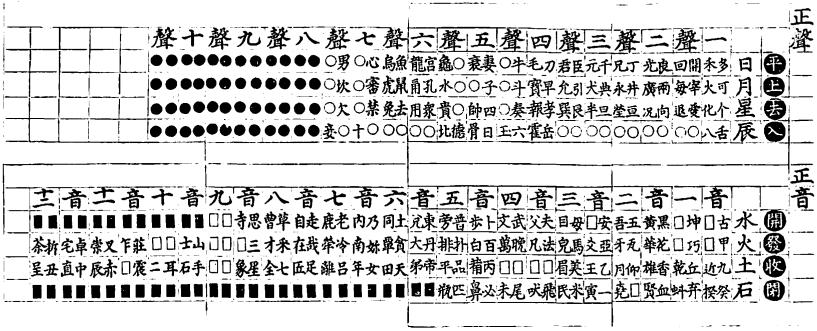

<!-- V3_SOURCE_ID:book015-b000859-p001-06168362b0 -->

图6-4 经世声音图

查看对应原文

<!-- V3_FOLDBACK_BEGIN:book015-b000859-p001-06168362b0 -->

図6-4 経世声音図

<!-- V3_FOLDBACK_END:book015-b000859-p001-06168362b0 -->

<!-- doc004 PDF 第 123 页：高风险/复杂版面 OCR 供检索；内容与排版以原页图为准。 -->
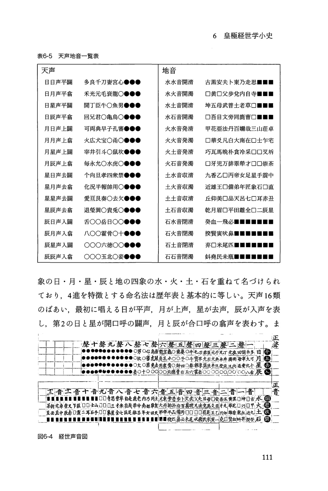

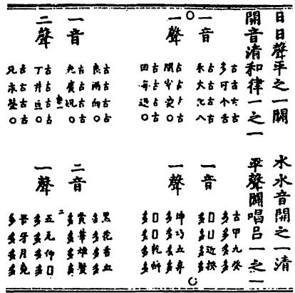

<!-- V3_SOURCE_ID:book015-b000861-p001-45264d9494 -->

图6-5 声音表（道藏本）

> **释读存疑：** 本地硬校验仍未通过，已记录供后续自动处理或人工核对。

查看对应原文

<!-- V3_FOLDBACK_BEGIN:book015-b000861-p001-45264d9494 -->

図6-5 声音表(道蔵本)

<!-- V3_FOLDBACK_END:book015-b000861-p001-45264d9494 -->

<!-- V3_SOURCE_ID:book015-b000862-p000-bc834b8c2c -->

在地音的16类情况中，第一种「水」对应开口音，「火」对应发音，「土」对应收口音，「石」对应闭口音；第二种「水」与「土」对应清音，「火」与「石」对应浊音（图6-4）11）。

> **释读存疑：** 本地硬校验仍未通过，已记录供后续自动处理或人工核对。

查看对应原文

<!-- V3_FOLDBACK_BEGIN:book015-b000862-p000-bc834b8c2c -->

た地音16類のばあい，最初の水が開音，火が発音，土が収音，石が閉音を表し，第2の水と土が清音，火と石が濁音を表している(図6-4)11)。

<!-- V3_FOLDBACK_END:book015-b000862-p000-bc834b8c2c -->

<!-- V3_SOURCE_ID:book015-b000863-p000-eb3776945b -->

例如《观物篇》第三十五中的「日日声平闢」与「水水音開清」，分别指平声开口呼的韵母与开口音清音的声母，包含「多(a)、良(ang)、千(an)、刀(au)、妻(i)、宮

> **释读存疑：** 原文末尾未完整表述，释读保留了原文未完成的内容

查看对应原文

<!-- V3_FOLDBACK_BEGIN:book015-b000863-p000-eb3776945b -->

たとえば観物篇三十五の「日日声平闢」と「水水音開清」は，それぞれ平声開口呼の韻母と開音清音の声母を意味し，「多(a)・良(ang)・千(an)・刀(au)・妻(i)・宮

<!-- V3_FOLDBACK_END:book015-b000863-p000-eb3776945b -->

<!-- V3_SOURCE_ID:book015-b000864-p000-238d77294c -->

(ung)、心(im)、●、●、●」这10种声，以及「古(k)、黒(x)、安(0)、夫(f)、卜(p)、東(t)、乃(n)、走(ts)、思(s)、■、■、■」这12种音。各类声音按记载顺序称为「一声」「二声」或「一音」「二音」……天的全部声由10种声组成，地的全部音为12种音。符号●表示无声无字，■表示无音无字12）。之所以可以省略计数无声无字、无音无字的部分，称「日日声七」「水水音九」等，是因为除了与数值的整合性相关外，无声无字的48种声与无音无字的40种音并无特别意义。

查看对应原文

<!-- V3_FOLDBACK_BEGIN:book015-b000864-p000-238d77294c -->

(ung)・心(im)・●・●・●」の10声と「古(k)・黒(x)・安(0)・夫(f)・卜(p)・東(t)・乃(n)・走(ts)・思(s)・■・■・■」の12音を含んでいる。各声音は記載の順に「一声」「二声」あるいは「一音」「二音」……という。天の全声は10声からなり，地の全音は12音である。記号●は無声無字を示し，■は無音無字を示している12)。無声無字や無音無字を数えるのを省略して「日日声七」「水水音九」などということができるのは，無声無字の48声と無音無字の40音には数的整合性に関わることをのぞいて特別の意味がないからである。

<!-- V3_FOLDBACK_END:book015-b000864-p000-238d77294c -->

<!-- V3_SOURCE_ID:book015-b000865-p000-e95b8b8668 -->

一方是声唱吕的160（=10×16）表与音和律的192（=12×16）表，同时用天声112与地音152的反切来涵盖所有存在的汉字读音。例如在《观物篇》第三十五的平声辟唱吕第1表中，将日日声的“一声”之“多（a）”与16种“一音”相组合，分别给出①水水音的第1音“古（k）”、②火水音的第1音“甲（k）”、③土水音的第1音“九（k）”、④石水音的第1音“癸（k）”、⑤水火音的第1音“□（g）”、⑥火火音的第1音“□（g）”、⑦土火音的第1音“近（g）”、⑧石火音的第1音“揆（g）”、⑨水土音的第1音“坤（k）”、⑩火土音的第1音“巧（k）”、⑪土土音的第1音“丘（k）”、⑫石土音的第1音“弃（k）”、⑬水石音的第1音“□（k）”、⑭火石音的第1音“□（k）”、⑮土石音的第1音“乾（k）”、⑯石石音的第1音“蚪（k）”的反切，以此涵盖“多”对应的“一音”组合。这就是对“一音一声”的考察，纵向排列的古多（ka）、甲多（ka）、九多（ka）、癸多（ka）、□多（ga）……共16种反切，正是该考察的结果。

> **释读存疑：** 本地硬校验仍未通过，已记录供后续自动处理或人工核对。

查看对应原文

<!-- V3_FOLDBACK_BEGIN:book015-b000865-p000-e95b8b8668 -->

一方，声唱呂の160(=10×16)表と音和律の192(=12×16)表であるが，天声112と地音152の反切をもって，存在するあらゆる漢字音を示している。たとえば観物篇三十五の平声闢唱呂の第1表(図6-3)のばあい，日日声の「一声」の「多(a)」に16の「一音」を組み合わせ，①水水音の第1音「古(k)」，②火水音の第1音「甲(k)]，③土水音の第1音[九(k)]，④石水音の第1音[癸(k)」，⑤水火音の第1音[□(g)」，⑥ 火火音の第1音[□(g)」，⑦土火音の第1音「近(g)]，⑧石火音の第1音[揆(g)]，⑨水土音の第1音[坤(k')]，⑩火土音の第1音[巧(k)」，⑩土土音の第1音[丘(k)]，②石土音の第1音[弃(k)」，③水石音の第1音[□(k)」，④ 火石音の第1音「□(k)」，⑤土石音の第1音「乾(k)」，⑩⑥石石音の第1音「蚪k)」との反切をあたえており，「多」に対する「一音」の組み合わせを網羅している。これが[一音一声」の考察であり，縦に古多(ka)・甲多(ka)・九多(ka)・癸多(ka)・□多(ga)……と列記された16の反切がその結果にほかならない。

<!-- V3_FOLDBACK_END:book015-b000865-p000-e95b8b8668 -->

<!-- V3_SOURCE_ID:book015-b000866-p000-8ed2d6c5c0 -->

“一音一声”之后，还依次有“二音一声”“三音一声”……直至“十二音一声”的组合，记录与第12音的反切，便完成了对第1声“多”的考察。日日声的一声“多”字的“唱吕”就是如此，该部分被命名为“平声辟唱吕一之一”。同理，“平声辟唱吕一之二”记录的是日日声第2声“良（ang）”与地的152所用音的反切，“平声辟唱吕一之三”记录第3声“千（an）”……“平声辟唱吕一之十”记录与第10声“●”的反切。平声辟唱吕表总计有10表。

> **释读存疑：** 原文中第10声的用字存在缺漏，无法确认具体所指

查看对应原文

<!-- V3_FOLDBACK_BEGIN:book015-b000866-p000-8ed2d6c5c0 -->

「一音一声」には「二音一声」「三音一声」……「十二音一声」の組み合わせがつづき，第12音との反切の記載をもって第1声「多」にかんする考察が終わる。日日声の一声「多」字の「唱呂」がこれである。「平声闢唱呂一之一」と名づけられている。以下同様に，「平声闢唱呂一之二」は日日声の第2声「良(ang)」と地の152の用音との反切を記し，「平声闢唱呂一之三」は第3声「千(an)」……，「平声闢唱呂一之十」は第10声「●」との反切をあたえている。平声闢唱呂表はあわせて10表である。

<!-- V3_FOLDBACK_END:book015-b000866-p000-8ed2d6c5c0 -->

<!-- V3_SOURCE_ID:book015-b000867-p000-95140de224 -->

《皇极经世书》的音和律表体系，与声唱吕表完全相反，是在固定地音的前提下，考察其与天声的组合。例如在《观物篇》第三十五的开音清和律一之一中，将水水音的“一音”之“古（k）”与所有“一声”相组合，用古多（ka）、古可（ka）、古个（ka）、古舌（ka）、古禾（kua）、古火（kua）、古化（kua）、古八（kua）……等反切来标注发音。开音清和律表总计有12表，这是因为水水音包含12种音。

> **释读存疑：** 本地硬校验仍未通过，已记录供后续自动处理或人工核对。

查看对应原文

<!-- V3_FOLDBACK_BEGIN:book015-b000867-p000-95140de224 -->

『皇極経世書』の音和律表のシステムは，声唱呂表とまったく反対である。地音を固定しながら天声との組み合わせを考察している。すなわち，観物篇三十五の開音清和律一之一(図6-3)のばあい，水水音の「一音」である「古(k)」に「一声」すべてを組み合わせ，古多(ka)・古可(ka)・古个(ka)・古舌(ka)，古禾(kua)・古火(kua)・古化(kua)・古八(kua)，……云々と反切によって発音を表示している。開音清和律表はあわせて12表からなるが，それは水水音が12音を含んでいるためである。

<!-- V3_FOLDBACK_END:book015-b000867-p000-95140de224 -->

<!-- V3_SOURCE_ID:book015-b000868-p000-4a09d982dc -->

但声音表的上下配置，不同版本间存在些许差异。《四库全书》本的上层是声唱吕表，下层是音和律表；《道藏》本则与此相反，上下层颠倒。此外《性理大全》本未收录反切表，却和《道藏》本一样，将音和律表置于上层、声唱吕表置于下层，以此说明反切体系。不过仅从关于天声与地音的说明文字来看，不得不判断《四库全书》本的结构更为妥当。例如日日声平辟的相关内容中记载：“日日声七。下，地的用音一百五十二，以此唱诵。此称为平声辟音。平声辟音，一千六十四”，而“日日声平之一辟”即平声辟音为1064，只能是因为将10表平声辟唱吕表置于对应位置，因此必须像《四库全书》本那样，将日日声平之一辟与平声辟唱吕表置于同一层。

> **释读存疑：** 本地硬校验仍未通过，已记录供后续自动处理或人工核对。

查看对应原文

<!-- V3_FOLDBACK_BEGIN:book015-b000868-p000-4a09d982dc -->

だが声音表の上下の配置については，版本ごとに少し異なるところがある。四庫全書本(図6-3)は上層が声唱呂表，下層が音和律表からなり，道蔵本(図6-5)はこれに対して上下が逆である。また性理大全本は反切表を録していないが，道蔵本と同じく上に音和律，下に声唱呂をおいて反切のシステムを説明している(経世四象体用之数図)。だが天声と地音にかんする説明文を読むかぎり，四庫全書本の構成の方が妥当と判断せざるをえない。たとえば日日声平闢のばあい，「日日声七。下，地の用音一百五十二を唱す。これを平声闢音という。平声闢音，一千六十四」とあるが，「日日声平之一闢」すなわち平声闢音が1064になるのは平声闢唱呂の10表をおいてほかになく，したがって四庫全書本のごとく日日声平之一闢と平声闢唱呂表を同じ層におかねばならないからである。

<!-- V3_FOLDBACK_END:book015-b000868-p000-4a09d982dc -->

<!-- V3_SOURCE_ID:book015-b000869-p000-f09fea0d79 -->

根据邵雍的术数理论《观物篇六十》，天声由112个声构成、地音由152个音构成，这其中存在必然的理由。也就是说，阳数与刚数原本为10，阴数与柔数原本为12，因此同类相加的太阳、少阳、太刚、少刚的本数，以及太阴、少阴、太柔、少柔的本数，分别为40与48；本数的4倍，即太阳、少阳、太刚、少刚的体数，以及太阴、少阴、太柔、少柔的体数，分别为160与192，这是必然的结果。另外，阴阳刚柔相互进退，从太阳、少阳、太刚、少刚的体数中减去太阴、少阴、太柔、少柔的本数，便得到“太阳少阳太刚少刚之用数一百十二”；从太阴、少阴、太柔、少柔的体数中减去太阳、少阳、太刚、少刚的本数，便得到“太阴少阴太柔少柔之用数一百五十二”。因此，太阳、少阳、太刚、少刚的用数象征“天之用声”，太阴、少阴、太柔、少柔的用数象征“地之用音”，这是理所当然的。此外，同样的理论也能说明，真正的天声包含无声无字，真正的地音包含无音无字。

查看对应原文

<!-- V3_FOLDBACK_BEGIN:book015-b000869-p000-f09fea0d79 -->

邵雍の術数理論(観物篇六十ー)によれば，天声が112声からなり地音が152音からなることにも必然的な理由がある。すなわち，陽数と剛数はほんらい10であり陰数と柔数は12であるため，同類の和である太陽少陽太剛少剛の本数と太陰少陰太柔少柔の本数は40(10+10+10+10=40)と48(12+12+12+12=48)になり，本数の4倍にあたる太陽少陽太剛少剛の体数と太陰少陰太柔少柔の体数は160(40×4=160)と192(48×4=192)にならざるをえない。また陰陽剛柔が相互に進退し，太陽少陽太剛少剛の体数(無声無字を含む天声の総数，10声×16類)の内から太陰少陰太柔少柔の本数(無声無字の数)を退けたとき，「太陽少陽太剛少剛之用数一百十二」が生じ(160-48=112)，太陰少陰太柔少柔の体数(無音無字を含む地音の総数，12音×16類)の内から太陽少陽太剛少剛の本数(無音無字の数)を退けたとき，「太陰少陰太柔少柔之用数一百五十二」が生じる(192-40=152)。それゆえ太陽少陽太剛少剛の用数が「天之用声」を象徴し，太陰少陰太柔少柔の用数が「地之用音」を象徴するのは当然である，云々という。また同じ理論は，真の天声(天の全声)が無声無字を含み，真の地音(地の全音)が無音無字を含む理由についても説明している。

<!-- V3_FOLDBACK_END:book015-b000869-p000-f09fea0d79 -->

<!-- V3_SOURCE_ID:book015-b000870-p000-8a2cfbb605 -->

《观物篇六十一》接着论述，用太阳、少阳、太刚、少刚的用数来“唱”太阴、少阴、太柔、少柔的用数，从而得出“日月星辰之变数”或“动数”为17024；用太阴、少阴、太柔、少柔的用数来“和”太阳、少阳、太刚、少刚的用数，从而算出“水火土石之化数”或“植数”为17024。还进行了“再唱和”，得出对应万物数量的“日月星辰水火土石之变化通数”或“动植通数”为289816576。“唱和”的含义，当然是声音律吕学中的概念，即“声唱吕、音和律”。

> **释读存疑：** 本地硬校验仍未通过，已记录供后续自动处理或人工核对。

查看对应原文

<!-- V3_FOLDBACK_BEGIN:book015-b000870-p000-8a2cfbb605 -->

観物篇六十一はつづけて，太陽少陽太剛少剛の用数をもって太陰少陰太柔少柔の用数を「唱」し，「日月星辰之変数」ないし「動数(動物の数)」の一万七千二十四を導きだし(112×152=17,024)，太陰少陰太柔少柔の用数をもって太陽少陽太剛少剛の用数を「和」し，「水火土石之化数」ないし「植数(植物の数)」の一万七千二十四を算出する $( 1 1 2 \times 1 5 2 = 1 7 , 0 2 4 )$ 。また「再唱和」して，万物の数にあたる「日月星辰水火土石之変化通数」ないし「動植通数」の二万八千九百八十一万六千五百七十六を導きだしている(17,024×17,024=289,816,576)。唱和の意味はむろん，声音律呂学の概念，声唱呂・音和律のことにほかならない。

<!-- V3_FOLDBACK_END:book015-b000870-p000-8a2cfbb605 -->

<!-- V3_SOURCE_ID:book015-b000871-p000-3075f1c1d6 -->

## 1.3 観物外篇と先天易学 — 1.3 《观物外篇》与先天易学

查看对应原文

<!-- V3_FOLDBACK_BEGIN:book015-b000871-p000-3075f1c1d6 -->

## 1.3 観物外篇と先天易学

<!-- V3_FOLDBACK_END:book015-b000871-p000-3075f1c1d6 -->

<!-- V3_SOURCE_ID:book015-b000872-p000-6ca994830c -->

朱熹及其追随者将邵雍列为北宋六子之一，把他尊崇为道学中的重要人物，但众所周知，这并非因为他们高度评价了《皇极经世书》所体现的术数理论、推歩歴年学以及声音律吕学。清代学术的代表人物之一全祖望也断言：“邵康節被列入圣门的理由，并非因为《皇极经世》”。道学家不重视邵雍的术数理论，从后世代表性道学著作之一《性理大全》所收录的《皇极经世书》并未收录歴年表与声音表这一点，便可一目了然。事实上，朱熹的高徒蔡元定曾说：“《皇极经世》一书，设定数、确定象，自成一家，是古人未曾有过、学者未曾见过的。不过，它也都出自伏羲卦画的奇偶次序，其道与太極相同”，他还说明自己所著的邵雍研究著作《皇极经世指要》之所以删去歴年表与音声表，是因为要依据伏羲卦图对《观物内外篇》的内容进行注释，这是他站在道学立场上对邵雍术数著作进行重大篡改后所做的正当化说明。另外，朱熹在《易学启蒙》原卦画中说：“邵子所说的‘画前有易’，应当看到它是真实不虚的”，他还在《周易本义》中引用了邵雍的易图，众所周知，朱熹完全依据邵雍的先天易说来解释八卦与六十四卦的画卦法。通过朱熹、蔡元定对邵雍易学的表彰，邵雍在道学中的决定性地位得以确立。

> **释读存疑：** 本地硬校验仍未通过，已记录供后续自动处理或人工核对。

查看对应原文

<!-- V3_FOLDBACK_BEGIN:book015-b000872-p000-6ca994830c -->

朱熹とそのエピゴーネンたちは邵雍を北宋六子の1人に数えて道学上重要な地位にまつりあげたが，周知のごとく，それは『皇極経世書』を特徴づける術数学推歩歴年学や声音律呂学を高く評価したためではない。清学のイデオローグの1人，全祖望も「邵康節が聖門に列された理由は，皇極経世のためではない」と断じている（黄宗羲『宋元学案』百源学案)。道学者が邵雍の術数学を重視しなかったことは，後世の代表的な道学書の一つ『性理大全』所収の皇極経世書が，歴年表と声音表を収録していないことを思い起こせば一目瞭然であろう13)。事実，朱熹の高弟の蔡元定は「皇極経世の書は，数を命じ象を定め，自ら一家をなす。古の未だ有らざる所，学者の未だ見ざる所なり。然れどもまたみな伏羲卦画奇偶の序に出で，その道たるやまた太極に同一す」とのべ，①自らの邵雍研究書『皇極経世指要』から歴年表と音声表をのぞき，②伏羲卦図を根拠として観物内外篇の内容に注釈を加えたことについてその理由を明らかにし，道学の観点に立脚して邵雍の術数書に決定的な改竄を加えたことを正当化している(『性理大全』巻七)。また朱熹は『易学啓蒙』原卦画において「邵子のいわゆる画前に易ある者は，またその真にして不妄なるを見るべし」とのべ，『周易本義』にも邵雍の易図を引用しており，朱熹が邵雍の先天易説に全面的に依拠して八卦と六十四卦の画卦法を説明したことはよく知られているとおりである。朱熹や蔡元定による邵雍の易学の顕彰をとおして，邵雍の道学上の決定的な地位が確定したのである。

<!-- V3_FOLDBACK_END:book015-b000872-p000-6ca994830c -->

<!-- V3_SOURCE_ID:book015-b000873-p000-2b139e42e5 -->

邵雍的先天易学，记载于其弟子编纂的《皇极经世书》观物外篇之中；《易学启蒙》与《周易本义》中所记载的“邵子曰”的易学观点，也全部都是引自观物外篇。另一方面，邵雍本人所著的历年表与音声表中，首要体现的是术数的逻辑；而“数”的精妙展开，正如前文所述，并非拘泥于易学的逻辑，而是多有遵循数理的要求、无视易理之处。此外，邵雍亲笔撰写的观物内篇中虽也可见易学观点，但作为易学本身而言，缺乏独创性，也并未试图阐明易数本身。易学理论的新发展，意外地出现在其弟子编纂的、被称为“小失なき能たわず”的著作中，具体所指不详。

> **释读存疑：** “小失なき能たわず”的具体所指不详

查看对应原文

<!-- V3_FOLDBACK_BEGIN:book015-b000873-p000-2b139e42e5 -->

だが邵雍の先天易学が記されたのは，弟子たちの編纂になる『皇極経世書』観物外篇であり，『易学啓蒙』や『周易本義』が記す「邵子曰」の易説もすべて，観物外篇からの引用にほかならない。一方，邵雍自身が著述した歴年表と音声表に第一義的に現われるのは術数の論理であり，「数」の華麗な展開は既述のごとく，易の論理に逐一拘泥したものではなく，数理の命じるままにしたがい易理を無視したところも多い。また邵雍自身の筆になる観物内篇にも易説はみられるが，易学自体としては独創性に乏しく易数自体の解明も企図していない。易学理論の新たな展開は意外なことに，門弟子の編纂になり「小失なき能たわず」と称された(『性理

<!-- V3_FOLDBACK_END:book015-b000873-p000-2b139e42e5 -->

<!-- V3_SOURCE_ID:book015-b000875-p000-4b258029c7 -->

図6-6 伏羲八卦方位図  
図6-7 伏羲六十四卦方位図  
図6-8 伏羲八卦次序図

查看对应原文

<!-- V3_FOLDBACK_BEGIN:book015-b000875-p000-4b258029c7 -->

図6-6 伏羲八卦方位図  
図6-7 伏羲六十四卦方位図  
図6-8 伏羲八卦次序図

<!-- V3_FOLDBACK_END:book015-b000875-p000-4b258029c7 -->

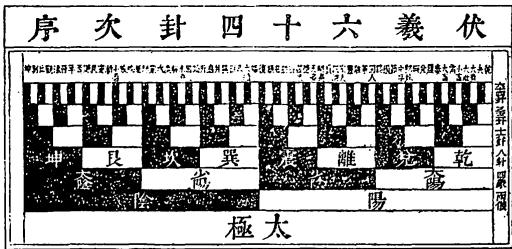

<!-- V3_SOURCE_ID:book015-b000875-p002-1c80edbc8e -->

図6-9 伏羲六十四卦次序図

查看对应原文

<!-- V3_FOLDBACK_BEGIN:book015-b000875-p002-1c80edbc8e -->

図6-9 伏羲六十四卦次序図

<!-- V3_FOLDBACK_END:book015-b000875-p002-1c80edbc8e -->

<!-- V3_SOURCE_ID:book015-b000876-p000-ed828322b1 -->

该著作仅存在于观物外篇之中。正如乾隆时期的四库馆臣所评价的那样，不得不解释为“邵子は必ずしも尽くは易を用いざるなり”，具体所指不详。

> **释读存疑：** “邵子は必ずしも尽くは易を用いざるなり”的具体所指不详

查看对应原文

<!-- V3_FOLDBACK_BEGIN:book015-b000876-p000-ed828322b1 -->

大全』巻十一，邵伯温曰)観物外篇にしか存在しないのである。乾隆の四庫館員が評したごとく，「邵子は必ずしも尽くは易を用いざるなり」(『四庫全書総目提要』巻百八，観物篇解)と解釈せざるをえない。

<!-- V3_FOLDBACK_END:book015-b000876-p000-ed828322b1 -->

<!-- V3_SOURCE_ID:book015-b000877-p000-508229d111 -->

邵雍的易学虽受到朱熹等人的推崇，但现存的《皇极经世书》观物外篇中，没有一张对说明来说本应必不可少的易图。不过虽算不上完整，仍可依据朱熹的《周易本义》《易学启蒙》以及张行成的《易通变》等复原出原有的图。邵雍的易学原本分为先天之学与后天之学，《周易本义》中所载的伏羲四图与文王二图，简洁且准确地体现了两种易学的差异。不过即便可以确定朱熹绘制的六张图准确传达了邵雍的易说，也无法确定其是否为邵雍的原图。伏羲八卦方位图与伏羲六十四卦方位图虽名称不同，却也见于《易学启蒙》《性理大全》《皇极经世书》，虽有可能是原图，但伏羲八卦次序图与伏羲六十四卦次序图未见于上述书籍，是否为原图极为可疑。不过《皇极经世书》观物外篇中记载邵雍曾说：“图虽无文字，我终日言说却从未脱离它。大概天地万物的道理，尽在其中。”只要相信这段文字，就没有理由怀疑邵雍为说明先天易而绘制了“先天图”。另外关于先天图，《易学启蒙》引用这段文字来解说伏羲八卦方位图与伏羲六十四卦方位图，可推测指的是这两张图或其中某一张。不过不可忘记的是，《性理大全》《皇极经世书》中绘有与伏羲方位图截然不同的图经世六十四卦数图，并记载“即先天图也”。南宋的张行成在《易通变》原序中引用前述“图虽无文字，……道理尽在其中”之后，立刻说“这就是先天图。先生的学，以象与数两张图为根本”，又在卷九的先天象数二图节中说明“先天象图，从乾的六画开始，到坤的十二画结束”“先天数图，从乾一一开始，到坤八八结束”云云，解说象数二图的内容14）。张行成绘制的先天象图基本与伏羲六十四卦方位图相同，《性理大全》的经世六十四卦数图的结构与张行成

> **释读存疑：** 伏羲八卦次序图；伏羲八卦方位图；伏羲六十四卦次序图；伏羲六十四卦方位图；文王八卦方位图；文王八卦次序图；图6-6；图6-7；图6-8；图6-9；原注：先天图也；图6-10；图6-11；本地硬校验仍未通过，已记录供后续自动处理或人工核对。

查看对应原文

<!-- V3_FOLDBACK_BEGIN:book015-b000877-p000-508229d111 -->

邵雍の易学は朱熹などの顕彰をうけたけれども，現行の『皇極経世書』観物外篇には，説明にほんらい不可欠の易図は一つも残っていない。だが完全とはいかないが，朱熹『周易本義』『易学啓蒙』や張行成『易通変』などにもとづいて原図を復元することができる。そもそも邵雍の易学は先天の学と後天の学にわかれ，『周易本義』にみえる伏羲四図(伏羲八卦次序図·伏羲八卦方位図·伏羲六十四卦次序図·伏羲六十四卦方位図)と文王二図(文王八卦方位図・文王八卦次序図)が，二つの易学の異なる点を簡潔かつ的確に表している。だが朱熹の描いた6図が邵雍の易説を正確に伝えていることは確かであるとしても，邵雍の原図そのものであるか否かは定かでない。伏羲八卦方位図(図6-6)と伏羲六十四卦方位図(図6-7)は，図の名称は異なっているものの『易学啓蒙』や『性理大全』『皇極経世書』にも描かれており，原図の可能性が高いけれども，伏羲八卦次序図(図6-8)と伏羲六十四卦次序図(図6-9)は，同じ書にみえず,原図であるかどうかきわめて疑わしい。だが『皇極経世書』観物外篇には，邵雍が「図(原注：先天図也)に文なしと雖も，吾，終日言いて未だ嘗てこれを離れず。蓋し天地万物の理，尽くその中にあり」とのべたことが記されている。同文を信ずるかぎり，邵雍が先天易の説明を目的として「先天図」を描いたことに疑問の余地はない。また先天図については，『易学啓蒙』が伏羲八卦方位図と伏羲六十四卦方位図の解説に同文を引用しており，両図ないしそのいずれかを指すと推定することができる。だが忘れてならないのは，『性理大全』『皇極経世書』に伏羲方位図とは似ても似つかぬ図経世六十四卦数図(図6-10)が描かれ，「即ち先天図なり」と記されていることである。南宋の張行成は『易通変』原序において先の「図に文なしと雖も，……理，尽くその中にあり」を引いたあと,ただちに「先天図を謂うなり。先生の学は,象と数の二図に祖る」とのべ，また巻九の先天象数二図節において「先天象図は，乾の六画より始まり，坤の十二画に至りて終わる」(先天)数図は，乾一一より始まり，坤八八に至りて終わる」云々と象数2図の内容を説明している14)。張行成の描く先天象図(図6-11)が伏羲六十四卦方位図に基本的に等しく，『性理大全』の経世六十四卦数図の構造が張行成

<!-- V3_FOLDBACK_END:book015-b000877-p000-508229d111 -->

<!-- V3_SOURCE_ID:book015-b000878-p001-c61ec61e44 -->

图6-10 经世六十四卦数图

查看对应原文

<!-- V3_FOLDBACK_BEGIN:book015-b000878-p001-c61ec61e44 -->

図6-10 経世六十四卦数図

<!-- V3_FOLDBACK_END:book015-b000878-p001-c61ec61e44 -->

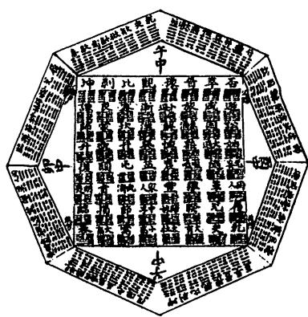

<!-- V3_SOURCE_ID:book015-b000879-p001-f2ee9e4676 -->

图6-11 先天象图

查看对应原文

<!-- V3_FOLDBACK_BEGIN:book015-b000879-p001-f2ee9e4676 -->

図6-11 先天象図

<!-- V3_FOLDBACK_END:book015-b000879-p001-f2ee9e4676 -->

<!-- V3_SOURCE_ID:book015-b000880-p000-047f6b417a -->

的说明完全一致，就不得不断定邵雍绘制了2种先天图，将伏羲六十四卦方位图与经世六十四卦数图或与其类似的易图称为先天象图、先天数图。

查看对应原文

<!-- V3_FOLDBACK_BEGIN:book015-b000880-p000-047f6b417a -->

の説明とまったく一致しているからには，邵雍が2種類の先天図を描き，伏羲六十四卦方位図と経世六十四卦数図あるいはそれらに類似した易図を先天象図・先天数図と称していたと論定せざるをえないであろう。

<!-- V3_FOLDBACK_END:book015-b000880-p000-047f6b417a -->

<!-- V3_SOURCE_ID:book015-b000881-p000-257f75c117 -->

邵雍的先天易学最具特色之处，无需多言，是基于加一倍法，对《周易·系辞传》中“易有太极，是生两仪。两仪生四象，四象生八卦”所作的全新解释。邵雍对此解释道：“太极既分，两仪立矣。阳下交於阴，阴上交於阳，四象生矣。阳交於阴，阴交於阳，而生天之四象，刚交於柔，柔交於刚，而生地之四象，於是八卦成矣。八卦相错，然后万物生矣。是故一分为二，二分为四，四分为八，八分为十六，十六分为三十二，三十二分为六十四。故曰分阴分阳，迭用柔刚，易六位而成章矣”，他还说明阴阳二气相交，太极→两仪→四象→八卦→16→32→六十四卦这样发展而来。太极的展开，显而易见，相当于数学中的加一倍法这一等比数列或二进制。邵雍画卦所依据的是汉唐易学中未曾见到的数学方法，在当时确实是极为新颖的解释，正如《周易本义》对伏羲六十四卦次序图的解说所言“尤也法象自然之妙”。若与后汉虞翻（164-233）对“两仪生四象”“四象生八卦”的解释等进行比较，邵雍解释的新颖性与开创性自然就会明了。虞翻在《周易集解》中说道：“两仪生四象”“四象生八卦”的解释为“四象是四时。两仪指乾坤。乾二五之坤，则生成坎离震兑。震是春，兑是秋，坎是冬，离是夏，所以两仪生四象。乾二五之坤，则生成震坎艮，坤二五之乾，则生成巽离兑。所以四象生八卦”云云。关于“乾二五之坤”和“坤二五之乾”，当然必须依照宋代朱震（1072-1138）《汉上易卦图》中《坎离天地之中图》的解释。

> **释读存疑：** 2°、21、22、24、25、15的具体含义未明确，保留原符号形式；2°、2¹、2²、2⁴、2⁵、15的具体含义未明确，保留原符号形式；本地硬校验仍未通过，已记录供后续自动处理或人工核对。

查看对应原文

<!-- V3_FOLDBACK_BEGIN:book015-b000881-p000-257f75c117 -->

邵雍の先天易学を最も特徴づけているのは改めていうまでもなく，加一倍法(『河南程氏外書』巻十二，明道による邵雍の易数の総括)にもとづく『周易』繋辞伝の「易に太極あり，これ両儀を生ず。両儀，四象を生じ，四象，八卦を生ず」に対する新たな解釈である。邵雍はこれについて，「太極既分，両儀立矣。陽下交於陰，陰上交於陽，四象生矣。陽交於陰，陰交於陽，而生天之四象，剛交於柔，柔交於剛，而生地之四象，於是八卦成矣。八卦相錯，然後万物生矣。是故一分為二，二分為四，四分為八，八分為十六，十六分為三十二，三十二分為六十四。故曰分陰分陽，迭用柔剛，易六位而成章矣」陰陽2気が交わって，太極(2°)→両儀(21)→四象(22)→八卦(23)→ 16(24)→ 32(25)→ 六十四卦(2⁶)と発達していくと説明している(観物外篇)。太極の展開は一見して明らかなごとく,算学の加一倍法2の等比数列ないし2進法に等しい。邵雍の画卦は漢唐易学にはみられない数学(術数学)的方法にもとづいており，当時にあっては「尤も法象自然の妙を見す」『周易本義』伏羲六十四卦次序図の解説)きわめて斬新な解釈であったことは確かである。後漢の虞翻(164-233)の「両儀生四象」「四象生八卦」に対する解釈などと比較すれば，邵雍の解釈の斬新性や画期性は自ずと明らかであろう。虞翻は卦変説をもって「四象は四時なり。両儀は乾坤を謂う。乾二五，坤に之けば，坎離震兌を成す。震は春兌は秋，坎は冬離は夏，故に両儀，四象を生ず」乾二五，坤に之けば，則ち震坎艮を生じ，坤二五，乾に之けば，則ち巽離兌を生ず。故に四象，八卦を生ずるなり」云々とのべている(『周易集解』)。「乾二五之坤」や「坤二五之乾」については当然，宋の朱震(1072-1138)『漢上易卦図』坎離天地之中図(図6-12)の解釈にしたがわねばならない15)。

<!-- V3_FOLDBACK_END:book015-b000881-p000-257f75c117 -->

<!-- V3_SOURCE_ID:book015-b000882-p000-27920f1b16 -->

邵雍的易学以加一倍法为理论基础，极具术数学特征，这一点在先天图中也同样体现。先天数图依据的是“顺数”的数“八卦的乾一、兑二、离三、震四，巽五、坎六、艮七、坤八”；先天象图依据的是“逆数”的象“震一、离兑二、乾三，巽四、坎艮五、坤六”。所谓顺数，是指关注卦的位置，将伏羲八卦方位图从上到下依次数为乾、兑、离、震，再数巽、坎、艮、坤。

> **释读存疑：** 图6-10、图6-7、图6-6的具体所指不详；本地硬校验仍未通过，已记录供后续自动处理或人工核对。

查看对应原文

<!-- V3_FOLDBACK_BEGIN:book015-b000882-p000-27920f1b16 -->

邵雍の易学は加一倍法を理論の根底におき，きわめて術数学的であるが，そのことは先天図においても同様である。先天数図(図6-10)は数(卦数ないし位数)「順数」の「(八卦の)乾一·兌二·離三·震四，巽五·坎六・艮七・坤八」にもとづき，先天象図(図6-7)は象(爻数)「逆数」の「震一·離兌二·乾三，巽四·坎艮五·坤六」を根拠としている(観物外篇)。順数とは卦の位置に注目して，伏羲八卦方位図(図6-6)を上から下に乾・兌・離・震，また巽・坎・艮・坤と数えること

<!-- V3_FOLDBACK_END:book015-b000882-p000-27920f1b16 -->

<!-- V3_SOURCE_ID:book015-b000883-p001-49b22ec018 -->

图6-12 坎離天地之中圖

查看对应原文

<!-- V3_FOLDBACK_BEGIN:book015-b000883-p001-49b22ec018 -->

図6-12 坎離天地之中図

<!-- V3_FOLDBACK_END:book015-b000883-p001-49b22ec018 -->

<!-- V3_SOURCE_ID:book015-b000884-p000-c959a58153 -->

所谓逆数，是指关注爻的阴阳，从下往上依次数为1阳（震）、2阳（离与兑）、3阳（乾），3阴（坤）、2阴1阳（坎与艮）、1阴2阳（巽）。先天数图与先天象图分别遵循不同位相的“数”的逻辑，但二者完全一一对应，含义几乎没有差别。

> **释读存疑：** 16的具体含义未明确，保留原数字形式；本地硬校验仍未通过，已记录供后续自动处理或人工核对。

查看对应原文

<!-- V3_FOLDBACK_BEGIN:book015-b000884-p000-c959a58153 -->

であり，逆数とは爻の陰陽(陽爻=1,陰爻=2)に注目して，下から上に1陽(震)・2陽(離と兌)・3陽(乾)，3陰(坤)・2陰1陽(坎と艮)・1陰2陽(巽)と数えることである。先天の数図も象図もそれぞれ別の位相の「数」の論理にしたがっているが，完全に1対1に対応しており意味するところはほとんど変わらない16)。

<!-- V3_FOLDBACK_END:book015-b000884-p000-c959a58153 -->

<!-- V3_SOURCE_ID:book015-b000885-p000-efd64bd252 -->

## 1.4 術数と観物 — 1.4 术数与观物

查看对应原文

<!-- V3_FOLDBACK_BEGIN:book015-b000885-p000-efd64bd252 -->

## 1.4 術数と観物

<!-- V3_FOLDBACK_END:book015-b000885-p000-efd64bd252 -->

<!-- V3_SOURCE_ID:book015-b000886-p000-60dc22e99e -->

《皇極經世書》充滿了數的理論，以數作為根本宗旨，是典型的術數類著作。邵雍的易學中，數也發揮著首要作用，「雖說是《易經》的餘緒，實際上並非闡明《易經》的本義」，這是說它雖是《易經》的餘緒，卻並未闡明《易經》的本義，出自《四庫全書總目提要》卷一百八，術數類數學之屬的案文。這就是不能簡單地將《皇極經世書》視為易學著作的原因17。

查看对应原文

<!-- V3_FOLDBACK_BEGIN:book015-b000886-p000-60dc22e99e -->

『皇極経世書』は数の論理が満ち溢れ「数を以て宗とし」ており，典型的な術数学書である。邵雍の易学においても数が第一義的に機能しており，「また易の余緒と雖も，実に易の本義を作すにあらず」——易の余緒(易外別伝)ではあっても，易の本義を明らかにしているわけではない(『四庫全書総目提要』巻百八，術数類数学之属の案文)。『皇極経世書』を単純に易学書ととらえることができないゆえんである17)。

<!-- V3_FOLDBACK_END:book015-b000886-p000-60dc22e99e -->

<!-- V3_SOURCE_ID:book015-b000887-p000-4e35ef5bb4 -->

事實上，邵雍的陰陽剛柔說雖依據《周易·說卦傳》中「立天之道稱為陰與陽，立地之道稱為柔與剛」的說法，但如前所述，《皇極經世書》並未以易學理論本身為依據來解釋歷年、聲音之數。另外，六十四卦的數值分配為：（1）一一的乾卦=1，（2）二一的夬卦=12，（3）三一的大有卦=360=12×30，（4）四一的大壮卦=$4,320=12^2×30$，（5）五一的小畜卦=$129,600=12^2×30^2$，……，（8）八一

> **释读存疑：** 原文數值計算部分存在格式混亂，後續內容殘缺

查看对应原文

<!-- V3_FOLDBACK_BEGIN:book015-b000887-p000-4e35ef5bb4 -->

事実，邵雍の陰陽剛柔は『周易』説卦伝の「天の道を立てて陰と陽といい，地の道を立てて柔と剛という」にもとづいているものの，『皇極経世書』は既述のごとく，易の理論そのものを根拠にして歴年や声音の数を解釈してはいない。また六十四卦の数の配当は，(1）一一の乾卦=1,(2)二一の夬卦=12，(3)三一の大有卦=360=12×30，(4)四一の大壮卦=$4 , 3 2 0 = 1 2 ^ { 2 } \times 3 0$ (5)五一の小畜卦 $= 1 2 9 , 6 0 0 = 1 2 ^ { 2 } \times 3 0 ^ { 2 } ,$ ……，(8)八一

<!-- V3_FOLDBACK_END:book015-b000887-p000-4e35ef5bb4 -->

<!-- V3_SOURCE_ID:book015-b000888-p000-79ae341770 -->

## 術数学專論 — 術數學專論

查看对应原文

<!-- V3_FOLDBACK_BEGIN:book015-b000888-p000-79ae341770 -->

## 術数学專論

<!-- V3_FOLDBACK_END:book015-b000888-p000-79ae341770 -->

<!-- V3_SOURCE_ID:book015-b000889-p000-b1a9f88a1a -->

泰卦对应的数值为559872000，等于12的4次方乘以30的3次方；(9) 一二的履卦对应的数值为167961600000，等于12的4次方乘以30的4次方；(10) 二二的兌卦对应的数值为2015539200000，等于12的5次方乘以30的4次方；……(16) 八二的臨卦对应的数值为943699691520000000，等于12的8次方乘以30的7次方；(17) 三三的同人卦对应的数值为28310990745600000000，等于12的8次方乘以30的8次方；……(32) 八四的復卦对应的数值为2652887036648800294797312000000000，等于12的16次方乘以30的15次方；……(64) 八八的坤卦被当作无极之数，等于12的32次方乘以30的31次方，这一说法出自《观物外篇》。基于该卦画的数列，显而易见，与历数的相关内容如下：(1) 元的元为1；(2) 元的会为12；(3) 元的运为360，等于12乘以30；(4) 元的世为4320，等于12的2次方乘以30；(5) 元的岁为129600，等于12的2次方乘以30的2次方；……(8) 元的世为559872000，等于12的4次方乘以30的3次方；(9) 会的元为12；(10) 会的会为144，等于12的2次方；(11) 会的运为4320，等于12的2次方乘以30；(12) 会的世为51840，等于12的3次方乘以30；……(17) 运的元为360，等于12乘以30；……(25) 世的元为4320，等于12的2次方乘以30；……(64) 辰的辰为313456656384000000，等于12的8次方乘以30的6次方，该数列与《观物篇六十》的数列并不相同。另外，《性理大全》所引的《皇极经世书》中邵伯温的《经世天地始终之数图》，将易数与历数整合为一个数列，这是对上述《观物外篇》的算法与数值进行修改后的结果，是从易学角度出发的刻意篡改。

> **释读存疑：** 原文中部分符号如“$oldsymbol{	ext{の}}$”“$oldsymbol{	ext{O}}$”“$oldsymbol{	ext{立}}$”“$oldsymbol{	ext{の}}$”“$oldsymbol{	ext{辰}}$”等含义不明，已按上下文语境保守处理；原文中部分符号如“の”“O”“立”等含义不明，已按上下文语境保守处理

查看对应原文

<!-- V3_FOLDBACK_BEGIN:book015-b000889-p000-b1a9f88a1a -->

の泰卦 $= 5 5 9 , 8 7 2 , 0 0 0 = 1 2 ^ { 4 } \times 3 0 ^ { 3 } ,$ (9)一二の履卦 $= 1 6 , 7 9 6 , 1 6 0 , 0 0 0 \ =$ $1 2 ^ { 4 } \times 3 0 ^ { 4 } ,$ (10)二二の兌卦 $= 2 0 1 , 5 5 3 , 9 2 0 , 0 0 0 = 1 2 ^ { 5 } \times 3 0 ^ { 4 } ,$ ……,(16)八二の臨卦 $= 9 4 3 , 6 9 9 , 6 9 1 , 5 2 0 , 0 0 0 , 0 0 0 \ = 1 2 ^ { 8 } \times 3 0 ^ { 7 } , ( 1 7 ) \ \equiv \mathrm { - } \varpi$ 同人卦=$2 8 , 3 1 0 , 9 9 0 , 7 4 5 , 6 0 0 , 0 0 0 , 0 0 0 = 1 2 ^ { 8 } \times 3 0 ^ { 8 } , ~ \cdots .$ (32)八四の復卦=2,652,887，$0 3 6 , 6 4 8 , 8 0 0 , 2 9 4 , 7 9 7 , 3 1 2 , 0 0 0 , 0 0 0 , 0 0 0 , 0 0 0 , 0 0 0 = \ 1 2 ^ { 1 6 } \times 3 0 ^ { 1 5 }$ ……,(64)八八の坤卦＝無極の数 $\left( = 1 2 ^ { 3 2 } \times 3 0 ^ { 3 1 } \right)$ としている(観物外篇)が,その卦画にもとづく数列は一見して明らかなごとく，暦数の(1)元の元=1,(2)元の会=12，(3)元の運=360=12×30，(4)元の世 $= 4 { , } 3 2 0 { = } 1 2 ^ { 2 } \times 3 0 ,$ (5) 元の歳$= 1 2 9 , 6 0 0 = 1 2 ^ { 2 } \times 3 0 ^ { 2 }$ ……，(8)元 $\mathcal { O } ) \overline { { \vert \overrightarrow { \mathrm { x } } } } = 5 5 9 , 8 7 2 , 0 0 0 = 1 2 ^ { 4 } \times 3 0 ^ { 3 } ,$ (9) 会の元=12，（10)会の会=144=12²，（11）会の運 $= 4 { , } 3 2 0 { = } 1 2 ^ { 2 } \times 3 0 ,$ (12) 会の世=51,840=12³×30，……，(17)運の元=360=12×30，……，(25)世の元 $= 4 , 3 2 0 = 1 2 ^ { 2 } \times 3 0 .$ ……，(64)辰の辰=313,456,656,384,000,000$= 1 2 ^ { 8 } \times 3 0 ^ { 6 } \textcircled { \mathcal { D } }$ 数列(観物篇六十)と同じでない。なお『性理大全』皇極経世書に引く邵伯温の経世天地始終之数図は易数と暦数を一つの数列にまとめあげているが，それは上の観物外篇のアルゴリズムと数値を改めた結果であり，易学の観点にもとづく意図的な改竄である。

<!-- V3_FOLDBACK_END:book015-b000889-p000-b1a9f88a1a -->

<!-- V3_SOURCE_ID:book015-b000890-p000-0611f0b385 -->

《皇極經世書》是典型的術數類著作，與數理科學存在理論層面的關聯。不過其歷年表雖是與天體現象密切相關的一種曆書，卻採用了精度極低的天文常數——1年等於360日18)，另外其音聲表雖具備闡明人類語言行動的經驗科學側面，卻也考慮了無法發音的「無聲無字」「無音無字」等情況。這一事實清楚表明，邵雍當時的意圖並非精密科學式地解明自然現象，而是追求人類社會中的數值整合性與歷史法則性。但不能僅因其在精密科學層面的考察較為粗糙，就武斷地將邵雍的術數學視為毫無意義的研究，並將其斥為知識上的墮落。這是因為邵雍試圖闡明的，是人類歷史與語言中潛藏的根本法則性與整合性，是以數為核心的歷史主義或構成主義命題的證明。我們在面臨多種條件複雜交織、難以輕易得出高蓋然性結論的難題時，往往會對事物進行變形、還原為多個要素，通過抽象化、一般化，針對現實中不存在的簡化整體或理念化要素展開研究與考察，而邵雍的數分析也可說是與我們同樣的變形或要素還原式研究方法的產物。邵雍以1年等於360日為依據，梳理了中國三千年的歷史事件，即便1年嚴格來說並非360日，但若沒有以陰數12與陽數30為依據的簡化，其闡述巨大歷史循環的獨特學說便會缺乏說服力，無法作為專門研究取得成功。此外，邵雍在考慮無法發音的聲母與韻母的基礎上，構建了包含120個天聲與152個地音的嚴謹體系，若沒有著眼於發音整體整合性的抽象化，他恐怕無法解明漢語音聲所具備的某種結構。從當時的歷史背景進行綜合判斷，邵雍的變形與過於簡單的抽象化也具備相應的意義，不得不說《皇極經世書》的術數學存在諸多值得評價之處。

> **释读存疑：** 本地硬校验仍未通过，已记录供后续自动处理或人工核对。

查看对应原文

<!-- V3_FOLDBACK_BEGIN:book015-b000890-p000-0611f0b385 -->

『皇極経世書』は典型的な術数書であり数理科学と理論的な接点がある。だが歴年表は天体現象と密接な関係のある一種の暦書でありながら，極端に精度の低い天文定数1年=360日を採用し18)，また音声表も人類の言語行動を明らかにする経験科学の側面をもちながら，発音不能な「無声無字」や「無音無字」などをも考慮している。この事実は，邵雍の企図したのが自然現象の精密科学的な解明ではなく，人間社会における数的整合性や歴史的法則性の追求であることを如実に示している。だが精密科学的に粗雑な考察だからといって，邵雍の術数学をそくざに無意味な研究ととらえ知的退廃として退けてはならない。邵雍が明らかにしようとしたのは，人類の歴史や言語のなかに潜む根元的な法則性・整合性であり，数をキーワードとした歴史主義的ないし構成主義的な命題の証明だからである。われわれは多数の条件が複雑に入り交じるため蓋然性の高い結論を容易に下すことができない難問に直面したとき，事象をデフォルメしたり複数の要素に還元し，抽象化し一般化して，現実には存在しない単純化された全体あるいは理念化された要素に対して研究や考察を展開していくが，邵雍の数の分析もわれわれと同様なデフォルマシオンないし要素還元的な研究法の産物とのべることができる。邵雍は1年=360日として中国3,000年の歴史事件をあとづけているが，1年は厳密には360日ではないにしても，陰数12と陽数30を根拠とした単純化がなければ，巨大な歴史の循環を説く独自の学説は説得力を欠き専門研究として成功しなかったはずである。また発音することができない声母や韻母を考慮にいれて120の天声と152の地音の整然とした体系を構築しているが，発音全体の整合性に着目した抽象がなければ，中国語の音声のもつある種の構造を解明することにはおそらく失敗したに違いない。当時の歴史的コンテクストを根拠として総合的に判断するかぎり，邵雍のデフォルマシオンや単純すぎる抽象化にもそれなりの意味があり，『皇極経世書』の術数学には評価すべきところも数多く存在しているといわざるをえない。

<!-- V3_FOLDBACK_END:book015-b000890-p000-0611f0b385 -->

<!-- V3_SOURCE_ID:book015-b000891-p000-88bd03e3a0 -->

《皇極經世書》的顯著特徵之一，是全篇將篇名統一命名為「觀物」19)。邵雍著作的這種統一構成，充分體現了他對「觀物」的特殊重視。基於這一點，邵雍術數學的核心應是「觀物」，即基於「反觀」對自然物進行類型化、直觀性的把握，同時也必須認為「觀物」的概念與數的定性、定量緊密相關。對邵雍而言，所有自然物都是物，天地僅是「最大的物」，「我與他人皆為物」。邵雍的「觀物」大致分為兩個階段：①低層次的「以我觀物」階段，②高層次的「以物觀物」階段。將天地人物等同視為物，是捨棄自我執念、「以物觀物」，依據事物本身「統一萬物之情」的結果。對邵雍而言，天地人為一體的原因，在於依據事物本身、與事物保持同等次元時，森羅萬象皆以陰陽剛柔為共同屬性而生成；反之，萬象彼此差異，「有一物之『物』，有十物之『物』，有百物之『物』，有千物之『物』，有萬物之『物』，有億物之『物』，有兆物之『物』」，這是由事物內在的數，即形相因所導致的。若沒有作為概念裝置的數，便無法存在作為事物總體的同一性，也無法存在作為個體的差別性，「觀物」——對自然物的類型化、層次化把握也不可能實現。「數」在「觀物」中發揮著首要作用。

> **释读存疑：** 反觀的具體所指未明；1轮自动修复后核义模型仍建议修订，已保守记录。

查看对应原文

<!-- V3_FOLDBACK_BEGIN:book015-b000891-p000-88bd03e3a0 -->

『皇極経世書』の顕著な特徴の一つは，全篇を通じて篇名を「観物」と名づけていることである19)。邵雍の書のこうした統一的な構成は，かれの観物に対する特別な思い入れをよく示している。この点にもとづけば，邵雍の術数学の中心に位置するのは観物，すなわち「反観(内観)」にもとづく自然物の類型的かつ直感的な把握であり，観物の概念も数定性定量と緊密に関係しているととらえざるをえない。そもそも邵雍にとって自然物(客観存在)はすべて物であり，天地は「物の大なる者」にすぎず(観物篇五十一)，「我と人とみな物」である(観物篇六十二)。邵雍の観物には大きく，①低次の「我を以て物を観る」段階と②高次の「物を以て物を観る」段階がある(観物篇六十二)が，天地人物を物として同一視するのは，我執を捨て「物を以て物を観」，物自体に即して「万物の情を一にした」結果にほかならない。邵雍にとって天地人が一体であるのは，物自

<!-- V3_FOLDBACK_END:book015-b000891-p000-88bd03e3a0 -->

<!-- V3_SOURCE_ID:book015-b000892-p000-3c8430b802 -->

體現事物本身、與事物保持同等次元時，森羅萬象皆以陰陽剛柔為共同屬性而生成；反之，萬象彼此差異，「有一物之『物』，有十物之『物』，有百物之『物』，有千物之『物』，有萬物之『物』，有億物之『物』，有兆物之『物』」，這是由事物內在的數，即形相因所導致的。若沒有作為概念裝置的數，便無法存在作為事物總體的同一性，也無法存在作為個體的差別性，「觀物」——對自然物的類型化、層次化把握也不可能實現。「數」在「觀物」中發揮著首要作用。

> **释读存疑：** 形相因的具體所指未明

查看对应原文

<!-- V3_FOLDBACK_BEGIN:book015-b000892-p000-3c8430b802 -->

体に即し物と次元を等しくしたとき，森羅万象がいずれも陰陽剛柔を共通の質量として創られているところにあり，逆に万象がたがいに相違し「一物の物あり，十物の物あり，百物の物あり，千物の物あり，万物の物あり，億物の物あり，兆物の物ある」(観物篇五十二)のは，物に内在する数すなわち形相因がそれをもたらしている。概念装置としての数がなければ，物の総体としての同一性も個々としての差別性も存在することができず，観物——自然物の類型的階層的な把握も不可能である。「数」は観物において第一義的に機能していたのである。

<!-- V3_FOLDBACK_END:book015-b000892-p000-3c8430b802 -->

<!-- V3_SOURCE_ID:book015-b000893-p000-e2d7240d26 -->

## 2 皇極経世学の展開 — 2 皇極經世學的展開

查看对应原文

<!-- V3_FOLDBACK_BEGIN:book015-b000893-p000-e2d7240d26 -->

## 2 皇極経世学の展開

<!-- V3_FOLDBACK_END:book015-b000893-p000-e2d7240d26 -->

<!-- V3_SOURCE_ID:book015-b000894-p000-17063fe70c -->

正如此前分析的那样，《皇极经世书》是一部优秀的术数学著作，它不仅围绕历术、音声学展开数的逻辑论述，还通过引入数理，大胆尝试重构易学图学的学问。邵雍的思考可以表述为数→易。但邵雍之后的皇极经世学却相反，是依据易学来解释历数、音声的理论，其学术上最显著的特征是将易学作为数论的基础。若说明其逻辑结构，可表述为易→数。这就是宋明时期的皇极经世学被称为象数学的缘由。

> **释读存疑：** 本地硬校验仍未通过，已记录供后续自动处理或人工核对。

查看对应原文

<!-- V3_FOLDBACK_BEGIN:book015-b000894-p000-17063fe70c -->

先に分析したごとく，『皇極経世書』は優れた術数学書であり，暦術や音声学について数の論理を展開するのみならず，数理(2進法)の援用をとおして大胆にも易図の学の再構築を企図している(邵雍の思考は，数→易と表現することができる)。だが邵雍以降の皇極経世学は逆に，易学にもとづいて暦数や音声の理論を解釈しており，数論の基礎に易学をおくことを学術上の最も大きな特徴としている(論理構造を説けば，易→数ということができる)。宋明の皇極経世学を称して象数学とのべることができるゆえんである。

<!-- V3_FOLDBACK_END:book015-b000894-p000-17063fe70c -->

<!-- V3_SOURCE_ID:book015-b000895-p000-e043312cce -->

皇极经世学在邵雍去世后仍有发展，先后出现邵伯温的《皇极经世内外篇解》、蔡元定的《皇极经世指要》，到明代胡广等人奉敕编撰的《性理大全》时，完成了道学公认的术数解释。这是皇极经世学的主流。作为术数学的理论，它虽略显缺乏趣味，但大多是不与道学理论产生矛盾的稳妥解释。另一方面，南宋张行成的《易通变》《皇极经世索隐》《皇极经世观物外篇衍义》、祝泌的《观物篇解》《皇极经世解起数诀》、明代黄畿的《皇极经世书传》等，虽与邵雍的原意有所偏离，存在不少枝蔓之处，但也有很多新颖的解释，大幅提升了皇极经世学的理论水平。

> **释读存疑：** 本地硬校验仍未通过，已记录供后续自动处理或人工核对。

查看对应原文

<!-- V3_FOLDBACK_BEGIN:book015-b000895-p000-e043312cce -->

皇極経世学は邵雍の没後も，邵伯温(1057-1134)の『皇極経世内外篇解』→蔡元定(1135-1198)の『皇極経世指要』と発展をみ，明の胡広らの奉勅撰になる『性理大全』(1415)にいたって道学公認の術数解釈を完成した。皇極経世学の主流がこれである。術数学の理論としてはいくぶん面白味に欠けるものの，道学の理論と矛盾をきたさず無難な解釈が多い。一方，南宋の張行成の『易通変(皇極経世通変)』『皇極経世索隠』『皇極経世観物外篇衍義』(いずれも1166年，孝宗に進献)→祝泌の『観物篇解』(1235序)『皇極経世解起数訣』(1241序)→明の黄畿の『皇極経世書伝』(1504序)などは，邵雍の原意とは離れ支蔓なところも少なくないけれども，斬新な解釈もはなはだ多く，皇極経世学の理論レベルを一挙に飛躍させている。

<!-- V3_FOLDBACK_END:book015-b000895-p000-e043312cce -->

<!-- V3_SOURCE_ID:book015-b000896-p000-8343ad71bd -->

## 2.1 邵伯温と蔡元定の易説 — 2.1 邵伯温与蔡元定的易学观点

查看对应原文

<!-- V3_FOLDBACK_BEGIN:book015-b000896-p000-8343ad71bd -->

## 2.1 邵伯温と蔡元定の易説

<!-- V3_FOLDBACK_END:book015-b000896-p000-8343ad71bd -->

<!-- V3_SOURCE_ID:book015-b000897-p000-68a12df254 -->

目前尚未发现邵伯温的《皇极经世内外篇解》与蔡元定的《皇极经世指要》的传本。但根据《性理大全》中《皇极经世书》卷首的按语记载：“西山蔡氏（蔡元定）依据邵伯温《皇极经世内外篇解》所收录的诸图，推演其义理，著成《皇极经世指要》一书”，“今又未完整收录邵雍的全部著作，仅选取蔡氏《指要》中的诸图，增补诸家的注释体例，编纂为二卷，列于内外十四篇之首”。20）尽管没有传本，我们仍能了解邵伯温与蔡元定学说的大致情况，是因为《性理大全》中的《皇极经世书》大量引用了二人的图论。

> **释读存疑：** 1轮自动修复后核义模型仍建议修订，已保守记录。

查看对应原文

<!-- V3_FOLDBACK_BEGIN:book015-b000897-p000-68a12df254 -->

邵伯温の『皇極経世内外篇解』と蔡元定の『皇極経世指要』については現在のところ，伝本は発見されていない。だが『性理大全』皇極経世書の巻頭の按語によれば，「西山の蔡氏(蔡元定)，その図(邵伯温『皇極経世内外篇解』所収の諸図)に因りてこれを推衍し，著して『皇極経世指要』一書となす」，「今(性理大全を編むに際して)また具に康節の全書(皇極経世書の全文)を載せず，ただ蔡氏指要の諸図を取り，増すに諸家の釈例を以てし，纂して二巻となし，内外十四篇の首に列す」という20)。伝本が存在しないにもかかわらず邵伯温と蔡元定の学説の概略を知ることができるのは，『性理大全』皇極経世書に両氏の図説が数多く引用されているためである。

<!-- V3_FOLDBACK_END:book015-b000897-p000-68a12df254 -->

<!-- V3_SOURCE_ID:book015-b000898-p000-1e6817dd75 -->

皇極経世学的最初发展，或许也可以称之为变质，是由邵雍之子邵伯温带来的。邵伯温所作的《経世一元消長之数図》、《経世天地始終之数図》等作品中，基于易说的统一解释便是如此。21）上述诸图出自邵伯温之手，可从两点得到确认：①该图的解说中可见“邵伯温曰”的文字，②《性理大全》皇極経世書的卷

> **释读存疑：** 本地硬校验仍未通过，已记录供后续自动处理或人工核对。

查看对应原文

<!-- V3_FOLDBACK_BEGIN:book015-b000898-p000-1e6817dd75 -->

皇極経世学の最初の発展(あるいは変質とよぶべきかもしれない)は，邵雍の子の邵伯温によってもたらされた。邵伯温の経世一元消長之数図(図6-13)や経世天地始終之数図(既述)などにみえる，易説にもとづく統一的な解釈がそれである21)。上記諸図が邵伯温の手に出たことは，①該当図の解説に「邵伯温曰」の文章がみえ，②『性理大全』皇極経世書の巻

<!-- V3_FOLDBACK_END:book015-b000898-p000-1e6817dd75 -->

<!-- V3_SOURCE_ID:book015-b000899-p000-8622431b9c -->

头的按语中有“邵伯温氏，曾著一元消長等图，用以概括其要旨”的记载，这一点毋庸置疑。

查看对应原文

<!-- V3_FOLDBACK_BEGIN:book015-b000899-p000-8622431b9c -->

頭の按語に「邵伯温氏，かつて一元消長などの図を著し，以てその要約を括る」とあり，疑問の余地はない。

<!-- V3_FOLDBACK_END:book015-b000899-p000-8622431b9c -->

<!-- V3_SOURCE_ID:book015-b000900-p000-0878d57b18 -->

邵伯温绘制了众多数图，试图阐明《皇極経世書》中数理的隐秘含义，然而

查看对应原文

<!-- V3_FOLDBACK_BEGIN:book015-b000900-p000-0878d57b18 -->

邵伯温は数多くの数図(ないし易図)を描いて，『皇極経世書』の数理の隠された意味を明らかにしようとしたが，

<!-- V3_FOLDBACK_END:book015-b000900-p000-0878d57b18 -->

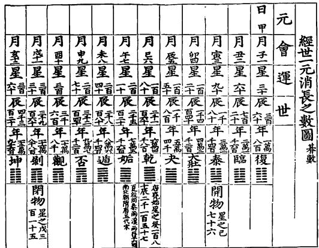

<!-- V3_SOURCE_ID:book015-b000901-p001-1b3c6a3b1d -->

图6-13 経世一元消長之数図

> **释读存疑：** 本地硬校验仍未通过，已记录供后续自动处理或人工核对。

查看对应原文

<!-- V3_FOLDBACK_BEGIN:book015-b000901-p001-1b3c6a3b1d -->

図6-13 経世一元消長之数図

<!-- V3_FOLDBACK_END:book015-b000901-p001-1b3c6a3b1d -->

<!-- V3_SOURCE_ID:book015-b000902-p000-b1b30610a4 -->

其中尤其重要的是《经世一元消长之数图》。该图将汉代以来的十二消息卦与《皇极经世书》的十二会一一对应，把复卦配在子月，接着将临卦配在丑月、泰卦配在寅月、大壮卦配在卯月、夬卦配在辰月、乾卦配在巳月、姤卦配在午月、遁卦配在未月、否卦配在申月、观卦配在酉月、剥卦配在戌月、坤卦配在亥月，利用说明气之消长的十二消息卦，精妙地阐释了皇极经世学核心的元会运世基本结构。22) 该易卦与历数的相配，鲜明地凸显了邵伯温术数学中对皇极经世学进行易学式再阐释或赋予权威的侧面。《经世一元消长之数图》自南宋以后，被认为是对皇极经世学整体的简洁概括，正如元代黄瑞节所说“以本书来概括它”，因此邵伯温的阐释所起的意义极为重大。事实上，朱熹也依据该图称“《经世》以十二辟卦统摄十二会，确定时节，转而向内推求吉凶消长。尧时正相当于此乾卦的九五爻”，出自《朱子语类》卷一百。

> **释读存疑：** 本地硬校验仍未通过，已记录供后续自动处理或人工核对。

查看对应原文

<!-- V3_FOLDBACK_BEGIN:book015-b000902-p000-b1b30610a4 -->

とりわけ重要であるのは経世一元消長之数図である。同図は漢以来の十二消息卦と皇極経世書の十二会を1対1に対応させ，復卦を子月に配当し，以下，臨一丑，泰一寅，大壮一卯，夬一辰，乾一巳，姤一午，遁一未，否一申，観一酉，剝一戌，坤一亥とし，気の消長を説く十二消息卦を利用して，皇極経世学の中心に位置する元会運世の基本構造をみごとに説明している22)。その易卦の暦数への配当は，邵伯温の術数学のもつ，易学による皇極経世学の再解釈ないし権威づけの側面をあざやかに浮かびあがらせている。経世一元消長之数図は南宋以降，「本書(皇極経世書)を以てこれを約す」(元の黄瑞節)——皇極経世学の全体を簡潔に要約していると考えられおり，したがって邵伯温の解釈がはたした意味はいたって重い。事実，朱熹も同図にもとづいて「経世(皇極経世書)は十二辟卦(消息卦)を以て十二会を管し，時節を繃定し，却って中に就いて吉凶消長を推す。堯時はまさにこれ乾卦の九五なり」とのべている(『朱子語類』巻百)。

<!-- V3_FOLDBACK_END:book015-b000902-p000-b1b30610a4 -->

<!-- V3_SOURCE_ID:book015-b000903-p000-e70dcef00d -->

朱熹编纂《易学启蒙》，试图将术数学纳入道学体系时，曾委托蔡元定撰写书稿，此事广为人知，出自《宋史·儒林传四》。这就是不能将《易学启蒙》视为朱熹一人之作的原因。事实上，朱熹通过直接引用蔡元定的说法，明确了依据蔡元定的观点，将十数图配给河图、九数图配给洛书，出自本图书第一。此外，朱熹阐释《皇极经世书》的体系时称“尧时正相当于此乾卦的九五爻”，将尧时配给乾卦的九五爻，已见前述，但唐尧即位的时间对应巳月6、星癸180，正如黄宗羲《易学象数论》皇极三所指出的，“九五”应为“上九”之误。关于术数学与象数学，可推定蔡元定的学识与钻研胜过朱熹。既然已确认二者在术数学、象数学领域存在协作，那么蔡元定的术数阐释受到朱熹的强烈影响，这一推测也合情合理。

> **释读存疑：** 本地硬校验仍未通过，已记录供后续自动处理或人工核对。

查看对应原文

<!-- V3_FOLDBACK_BEGIN:book015-b000903-p000-e70dcef00d -->

朱熹が『易学啓蒙』を編み，術数学を道学のなかに組みこもうとしたとき，蔡元定に原稿の執筆を依頼したことはよく知られている(『宋史』儒林伝四)。『易学啓蒙』をもって朱熹1人の作と解すべからざるゆえんである。事実，朱熹は蔡元定の説を直接に引用することによって，蔡元定にもとづき10数図を河図にあて9数図を洛書にあてたことを明らかにしている(本図書第一)。また朱熹は『皇極経世書』のシステムを解して「堯時はまさにこれ乾卦の九五なり」とのべ，乾卦の九五に堯時を配当している(既述)が，唐堯の即位は月巳6の星癸180にあり，黄宗羲(『易学象数論』皇極三)の指摘するごとく，「九五」は「上九」の誤りである。術数学や象数学については，蔡元定の学識や研鑽の方が朱熹より勝っていたと推定することができる。逆に術数学や象数学における両者の協力が確認されている以上，蔡元定の術数解釈に朱熹の強い影響がみられることも想像してあまりある。

<!-- V3_FOLDBACK_END:book015-b000903-p000-e70dcef00d -->

<!-- V3_SOURCE_ID:book015-b000904-p000-3608e84962 -->

蔡元定皇极经世学的首要特征，在于他完全依据先天易学，阐释了邵雍的所有数与象。蔡元定曾公开宣称：“《皇极经世》一书，康节先生将其归为先天之学。其道完全以伏羲卦图为根本”，“康节之学，虽作用有所不同，但其本质实为伏羲所画之卦”，“《皇极经世》一书，设定数、确定象，自成一家之说。这是古代未曾有过、学者未曾见过的。然而其全部都出自伏羲卦画奇偶之序，其道又与太極相同”，出自《性理大全》皇极经世书一。此外，他还坚定地确定了《皇极经世指要》的体例，将伏羲卦图置于卷首，以先天易说为依据尝试阐释观物篇。据蔡元定所言，《皇极经世书》的本质在于先天易学，“运用文字、确立文辞，自成一家之说，引述经典、援引义理，别成一说”而已。“易”原本完美无缺，没有任何需要添加的东西，出自《性理大全》皇极经世书一。

> **释读存疑：** 本地硬校验仍未通过，已记录供后续自动处理或人工核对。

查看对应原文

<!-- V3_FOLDBACK_BEGIN:book015-b000904-p000-3608e84962 -->

蔡元定の皇極経世学の第1の特徴をあげれば，先天易学に完全にもとづきながら邵雍のあらゆる数と象を解釈したところにある。蔡元定は声高く宣言する。「皇極経世の書，康節先生は以て先天の学となす。その道はもっぱら伏羲卦図に本づく」，「康節の学は，作用，同じからざると雖も，その実は則ち伏羲の画するところの卦なり」，「皇極経世の書，数を命じ象を定め，自ら一家をなす。古のいまだ有せざるところ，学者のいまだ見ざるところなり。然れどもまたみな伏羲卦画奇偶の序に出で，その道たるやまた太極に同一するなり」(『性理大全』皇極経世書一)。また確信に導くままに『皇極経世指要』の構成を定め，伏羲卦図を書前におき先天易説を根拠として観物篇の解釈を試みている。蔡元定によれば，『皇極経世書』の本質は先天易学にあり，「用字立文，自ら一家をなし，引経引義，別に一説をなす」にすぎない。「易」はほんらい完全無欠であり，それに加うべきなにものも存在しないのである(『性理大全』皇極経世書一)。

<!-- V3_FOLDBACK_END:book015-b000904-p000-3608e84962 -->

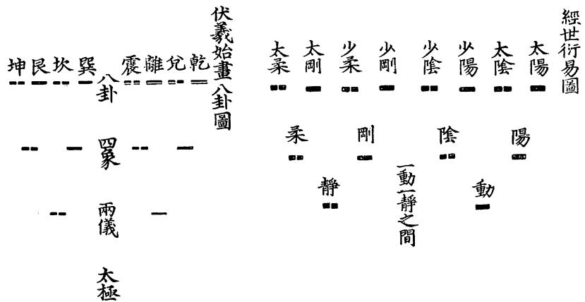

<!-- V3_SOURCE_ID:book015-b000905-p001-58d59105f8 -->

图6-14 伏羲始画八卦图 图6-15 经世衍易图

查看对应原文

<!-- V3_FOLDBACK_BEGIN:book015-b000905-p001-58d59105f8 -->

図6-14 伏羲始画八卦図  
図6-15 経世衍易図

<!-- V3_FOLDBACK_END:book015-b000905-p001-58d59105f8 -->

<!-- V3_SOURCE_ID:book015-b000906-p000-449084a20f -->

《性理大全》所引用的蔡元定的《易图》，总共由11幅图组成，其中6幅是从邵伯温的数幅图中引用而来。源自邵伯温的图有：②八卦正位图、④六十四卦方圆图、⑧经世天地始终之数图、⑨经世六十四卦数图、⑩经世一元消长之数图、⑪经世四

> **释读存疑：** 原文中第⑪图的名称“経世四”未完整呈现，具体所指不详；本地硬校验仍未通过，已记录供后续自动处理或人工核对。

查看对应原文

<!-- V3_FOLDBACK_BEGIN:book015-b000906-p000-449084a20f -->

『性理大全』皇極経世書に引く蔡元定の易図は合計11図からなり，そのうち6図は邵伯温の数図からの引用である。邵伯温に由来するのは，②八卦正位図，④六十四卦方円図(図6-9)，⑧経世天地始終之数図，⑨経世六十四卦数図(図6-10)，⑩経世一元消長之数図(図6-13)，⑪経世四

<!-- V3_FOLDBACK_END:book015-b000906-p000-449084a20f -->

<!-- V3_SOURCE_ID:book015-b000907-p000-122a78913a -->

象体用之数图，该图旨在依据数的结构本身来阐明《皇极经世书》的数理，而蔡元定新补充的图则是：①伏羲始画八卦图、③八卦重为六十四卦、⑤阳九阴六用数图、⑥经世衍易图、⑦经世天地四象图，与邵伯温不同，蔡元定是从易学的角度来阐明数的含义及其象征意义。其中易学特征最为显著的是伏羲始画八卦图与经世衍易图。前者阐释《易》的画卦，后者阐释《皇极经世》的四象，二者含义虽不相同，但图的结构本身是相同的，均依据先天易学中所谓的加一倍法。蔡元定通过直接诉诸视觉的图，向世人表明《皇极经世》之学无非是推演《易》学而来的。

> **释读存疑：** 本地硬校验仍未通过，已记录供后续自动处理或人工核对。

查看对应原文

<!-- V3_FOLDBACK_BEGIN:book015-b000907-p000-122a78913a -->

象体用之数図であり，数の構造自体に即して『皇極経世書』の数理の解明を企図しているが，蔡元定が新たに補足したのは，①伏羲始画八卦図(図6-14)，③八卦重為六十四卦，⑤陽九陰六用数図，⑥経世衍易図(図6-15)，⑦経世天地四象図であり，邵伯温とは違って易学の観点から数の意味や象徴するところを明らかにしようとしている。なかでも易学的性格づけが顕著であるのは，伏羲始画八卦図と経世衍易図である。前図は易の画卦，後図は皇極経世の四象を説明し，意味するところは同じでないけれども，図の構造自体は等しく，いずれも先天易学にいわゆる加一倍法にもとづいている。蔡元定は視覚に直接に訴える図をとおして，皇極経世学が「易を衍」したものにほかならぬことを世にアピールしたのである。

<!-- V3_FOLDBACK_END:book015-b000907-p000-122a78913a -->

<!-- V3_SOURCE_ID:book015-b000908-p000-e8e62dfe75 -->

蔡元定试图依据易学的观点来定位所有数的结构，这种情况在阐明“洪范之数”时也是如此。据《宋史·蔡沈传》记载：“洪范之数，学者久已失传，唯独蔡元定通晓其学，但尚未著书立说。他说：‘完成我这部书的人是蔡沈。’蔡沈接受父亲的嘱托，潜心钻研反复推敲达数十年之久，之后才完成此书，阐发了前代儒者所未涉及的内容。”蔡元定之子蔡沈（1167-1230）所完成的《洪范皇极内外篇》就是这部书。《洪范皇极内外篇》附会刘歆所说的八卦与《书》洪范传的九章，相互经纬配合，将一至九的九个数叠加起来，创造出八十一数的体系，不过作为著作而言，“其大意是《太玄》《元包》《潜虚》已经模拟《易》，不足以显示新奇，因此变换其学说，将其归属于洪范”（《四库全书总目提要》卷百八，洪范皇极内外篇）。蔡元定父子的术数学，无论是《皇极经世》还是《洪范皇极》，学术的根基始终都有易学深深扎根其中。

> **释读存疑：** 本地硬校验仍未通过，已记录供后续自动处理或人工核对。

查看对应原文

<!-- V3_FOLDBACK_BEGIN:book015-b000908-p000-e8e62dfe75 -->

蔡元定は易学の観点にもとづいて，あらゆる数の構造を位置づけようとしたが,そのことは「洪範の数」の解明においても同様である。『宋史』蔡沈伝によれば，「洪範の数，学者久しくその伝を失い，元定独りこれを心得す，然れどもいまだ論著に及ばず。日く，吾が書を成すは沈なりと。沈，父師の託を受け，沈潜反覆すること数十年，然る後に書を成し，先儒のいまだ及ばざるところを発明す」という。蔡元定の子の蔡沈(1167-1230)の完成した『洪範皇極内外篇』(別名，『洪範皇極内篇』)がそれである。『洪範皇極内外篇』は「(『易』の)八卦(と『書』洪範伝の)九章，相経緯をなす」という劉歆の説に附会して，一から九の九数を重ねて八十一数のシステムを創りあげたものであるが，書としての「大意は『太玄』元包』『潜虚』既に已に易に擬え，以て新奇を見わすに足らざるを以て，故にその説を変幻にし，これを洪範に帰」したものにすぎない(『四庫全書総目提要』巻百八，洪範皇極内外篇)。蔡元定父子の術数学のばあい，皇極経世・洪範皇極を問わず，学術の根幹にはつねに易学が大きく横たわっていたのである。

<!-- V3_FOLDBACK_END:book015-b000908-p000-e8e62dfe75 -->

<!-- V3_SOURCE_ID:book015-b000909-p000-252d9303e3 -->

## 2.2 張行成の掛一図と既済図 — 2.2 张行成的挂一图与既济图

查看对应原文

<!-- V3_FOLDBACK_BEGIN:book015-b000909-p000-252d9303e3 -->

## 2.2 張行成の掛一図と既済図

<!-- V3_FOLDBACK_END:book015-b000909-p000-252d9303e3 -->

<!-- V3_SOURCE_ID:book015-b000910-p000-6d855e27f2 -->

张行成，字文饶，是蜀地临邛人。他的详细传记已不可考，据《玉海》卷三十六的艺文部分记载，南宋乾道二年6月4日，因张行成所进献的《易》学著作值得采纳，他被授予直徽猷阁一职。据《经义考》卷二十六所引张行成的进《易》书状记载，张行成进献的《易》学著作共有七种：一是论述三易的《述衍》18卷；二是阐释汉代扬雄《太玄》的《翼玄》12卷；三是为北周卫元嵩《元包》所作的注释书《元包数义》3卷；四是阐释司马光《潜虚》的《潜虚衍义》2卷；五是《皇极经世索隐》2卷；六是《观物外篇衍义》9卷；七是《通变》40卷。其中最后三种著作，从书名即可看出，是研究邵雍《皇极经世书》的著作。如今，只有属于皇极经世学的这三种著作有传本留存。

> **释读存疑：** 本地硬校验仍未通过，已记录供后续自动处理或人工核对。

查看对应原文

<!-- V3_FOLDBACK_BEGIN:book015-b000910-p000-6d855e27f2 -->

張行成は，字を文饒といい，蜀の臨邛の人。詳細な伝記は明らかではないが，『玉海』巻三十六，芸文によれば，南宋の乾道二年(1166)6月4日，「行成の進易，采るべきを以て，直徽猷閣に除せらる」という。『経義考』巻二十六に引く張行成の進易書状によれば，張行成の進奉した易説とは，①三易について論じた『述衍』18巻，②漢の揚雄『太玄』を明らかにした『翼玄』12巻，③北周の衛元嵩『元包』の注釈書『元包数義』3巻，④司馬光の『潜虚』を明らかにした『潜虚衍義』16巻，および⑤『皇極経世索隠』2巻，⑥『観物外篇衍義』9巻，⑦『通変』(別名，『易通変』『皇極通変』)40巻のことであり，後の3書は書名から明らかなごとく，邵雍の『皇極経世書』にかんする研究書である。現在，皇極経世学の3書にのみ伝本が残っている。

<!-- V3_FOLDBACK_END:book015-b000910-p000-6d855e27f2 -->

<!-- V3_SOURCE_ID:book015-b000911-p000-82303ed5fe -->

首先是《皇极经世索隐》2卷，这部著作不过是对《皇极经世书》观物内篇的注释书。不过，邵伯温绘制的十二消息卦《经世一元消长之数图》，被标注为“皇极经世机要图”转录在该卷上册的开头，这充分体现了张行成的术数学以易学为基础。另外，《皇极经世观物外篇衍义》9卷也如其书名所示，是对观物外篇的注释书，清代乾隆期的《四库全书》馆的史官将这部著作的内容总结为：“上三篇皆论数，中三篇皆论象，下三篇皆论理”（《四库全书总目提要》卷百八，皇极经世观物外篇衍义）。不过，在张行成的象数学著作中，最重要的无疑是《通变》40卷。据《经义考》卷二十六所引进《易》书状记载，这部著作“选取从陈抟传到邵雍的十四幅先天卦数等图，加以推演解释，用以贯通诸易的变化。起初虽途径不同，最终却归于一致”，也就是以《易》图和《易》说为理论依据，将象数学的各类变体统一起来。

> **释读存疑：** 图6-13的具体所指不详；本地硬校验仍未通过，已记录供后续自动处理或人工核对。

查看对应原文

<!-- V3_FOLDBACK_BEGIN:book015-b000911-p000-82303ed5fe -->

まず『皇極経世索隠』2巻であるが，同書は『皇極経世書』観物内篇の単なる注釈書にすぎない。だが十二消息卦を描いた邵伯温の経世一元消長之数図(図6-13)が巻上の最初に「皇極経世機要図」と銘打って転写されており，張行成の術数学が易学に基礎づけられていることをよく示している。また『皇極経世観物外篇衍義』9巻も書名のごとく観物外篇に対する注釈書であり，清代乾隆期の四庫全書館の史臣は同書の内容について「上三篇はみな数をいい，中三篇はみな象をいい，下三篇はみな理をいう」と総括している(『四庫全書総目提要』巻百八，皇極経世観物外篇衍義)。だが張行成の象数学書のうち重要性が最も高いのは，ほかならぬ『通変』40巻である。「陳搏より邵雍に至りて伝うる所の先天卦数などの十四図を取りて，敷演解釈し，以て諸易の変を通ず。始めは塗を殊にするが若きも，終には致を一にするに帰す」—易図や易説を理論的根拠にして象数学の雑多のバリエーション(諸易の変)を一つに統一している(『経義考』巻二十六，進易書状)からである。

<!-- V3_FOLDBACK_END:book015-b000911-p000-82303ed5fe -->

<!-- V3_SOURCE_ID:book015-b000912-p000-2083ea2750 -->

张行成在《通变》的自序中说：“邵康节先生的学问，以‘先天’的象、数二图为根本，其作用皆起于交，有交则会发生变化”，并指出：①象征天的图中，先天象图会变为交泰图，进而发展为四象运行图；

> **释读存疑：** 图6-11的具体所指不详；本地硬校验仍未通过，已记录供后续自动处理或人工核对。

查看对应原文

<!-- V3_FOLDBACK_BEGIN:book015-b000912-p000-2083ea2750 -->

張行成は『通変』自序のなかで，「(邵康節)先生の学は，(先天の)象と数二図に祖る。その用はみな交に起こり，交あれば則ち変ず」とのべ，①天を象徴する図のばあい，先天象図(図6-11)が交泰図に変じ四象運行図

<!-- V3_FOLDBACK_END:book015-b000912-p000-2083ea2750 -->

<!-- V3_SOURCE_ID:book015-b000913-p000-6c66a642a3 -->

②象征物的图中，先天数图会变为既济图，进而发展为八卦变化图，以此说明“天数与物数二者的作用，完全集中在卦气图中”，强调天的运行与物的变化都不会超出这个范围。《通变》的自序预先阐明了张行成术数学的整体结构，从这个意义上来说极为重要。此外，自序中还说：“先生的著作大致将主旨藏于内，以象数示人，实则寓于十四幅图中”，这十四幅图分别是：①有极图（先天图）；②分两图；③交泰图；④既济图；⑤挂一图（卦气图）；⑥四象运行图；⑦～⑭八卦变化图。据张行成的进《易》书状记载，这十四幅图都是前代人传下来的。事实上，张行成在谈到挂一图时说：“近代，牛无邪传承邵雍的学问，在卦气图中记载了尧、贲的六五所对应的内容，却没有相关的解说”（《通变》卷十一）。张行成的先天象图→交泰图→四象运行图→挂一图的发展脉络中，第二幅交泰图是将先天象图的圆图旋转，使左右变为上下而成，坤与复二卦在左侧，乾与姤二卦在右侧。先天图代表冬至之时，象征万物在寅时之后萌生，元会运世的作用从春分开始；而四象运行图是四层同心圆……

> **释读存疑：** 图6-10的具体所指不详；本地硬校验仍未通过，已记录供后续自动处理或人工核对。

查看对应原文

<!-- V3_FOLDBACK_BEGIN:book015-b000913-p000-6c66a642a3 -->

に発展し，物を象徴する図のばあい，先天数図(図6-10)が既済図に変じ八卦変化図に発展することを示し，②天数と物数の「二者の用は，全く卦気の一図(別名，掛一図)にあり」，天の運行と物の変化はそれを外れることがないことを強調している。『通変』の自序は張行成の術数学の全体の構造をまえもって明らかにしており，その意味できわめて重要である。また「先生の書はおおむね用を蔵し，人に示すに象数を以てす。実に十四図に寓す」とものべているが，十四図とは，①有極図(先天図。図6-10と図6-11)，②分両図，③交泰図，④既済図，⑤掛一図(卦気図)，⑥四象運行図，⑦～⑭八卦変化図のことである。張行成の進易書状によれば，十四図はいずれも先人から伝えられたものであるという。事実，張行成は掛一図について「近世，牛無邪(牛思純)，康節の学を伝う。卦気図に堯，賁の六五に当たるを載せてその説なし」云々とのべている(『通変』巻十一)。まず張行成の先天象図→ 交泰図→四象運行図→掛一図の展開であるが，第2の交泰図は先天象図の円図を回転して左右を上下に変えたものであり，坤と復の2卦が左，乾と姤の2卦が右にある。先天図が冬至の時を表わすのに対して，万物が寅の後(復卦)に開き元会運世の用が春分から起こることを象徴している。一方，四象運行図は4層の同心円か

<!-- V3_FOLDBACK_END:book015-b000913-p000-6c66a642a3 -->

<!-- V3_SOURCE_ID:book015-b000914-p001-c76692dbca -->

图6-16 挂一图

查看对应原文

<!-- V3_FOLDBACK_BEGIN:book015-b000914-p001-c76692dbca -->

図6-16 掛一図

<!-- V3_FOLDBACK_END:book015-b000914-p001-c76692dbca -->

<!-- V3_SOURCE_ID:book015-b000915-p000-ec038512ae -->

此处记载了“元日甲”12会的运数与世数。例如位于子的方位的“月会子”，关于“星运”记载为“甲一至癸十，甲十一至癸二十，甲二十一至癸三十”，关于“辰世”记载为“子一至亥一百二十，子一百二十一至亥二百四十，子二百四十一至亥三百六十”，皇

> **释读存疑：** 原文末尾的“皇”字未释读，具体所指不详

查看对应原文

<!-- V3_FOLDBACK_BEGIN:book015-b000915-p000-ec038512ae -->

らなり，「元日甲」の12会の運と世の数を記している。たとえば子の方向にある「月会子」は，「星運」について「甲一至癸十，甲十一至癸二十，甲二十一至癸三十」，「辰世」について「子一至亥一百二十，子一百二十一至亥二百四十，子二百四十一至亥三百六十」と記し，皇

<!-- V3_FOLDBACK_END:book015-b000915-p000-ec038512ae -->

<!-- V3_SOURCE_ID:book015-b000916-p000-8a822081c5 -->

表6-6 張行成《掛一图》的二百五十六卦
<table><tr><td>世之元</td><td>(001) 升</td><td>(002)</td><td>蒙</td><td>(003) 益</td><td></td><td>(004) 井</td><td></td><td>(005) 坎</td><td>(006) 巽</td><td></td><td>(007) 渙</td><td></td><td>(008) 解</td></tr><tr><td></td><td>(009) 恒</td><td></td><td>(010)</td><td>未济 (011)</td><td>鼎</td><td>(012) 困</td><td></td><td>(013)</td><td>大過 (014) 姤</td><td></td><td>(015) 訟</td><td>(016)</td><td>随</td></tr><tr><td>世之会</td><td>(017) 兌</td><td></td><td>(018) 乾</td><td>(019)</td><td>苯</td><td>(020)</td><td>噬嗑</td><td>(021) 夬</td><td>(022) 否</td><td></td><td>(023) 无妄</td><td>(024) 睽</td><td></td></tr><tr><td></td><td>(025) 咸</td><td></td><td>(026) 革</td><td>(027)</td><td>遯</td><td>(028)</td><td>大有</td><td>(029) 履</td><td>(030) 泰</td><td></td><td>(031) 剥</td><td>(032)</td><td>頤</td></tr><tr><td>世之運</td><td>(033) 益</td><td></td><td>(034) 豊</td><td>(035)</td><td>帰妹</td><td>(036)</td><td>大壮</td><td>(037) 小過</td><td>(038)</td><td>臨</td><td>(039) 贲</td><td>(040)</td><td>中孚</td></tr><tr><td></td><td>(041)</td><td>既済</td><td>(042) 晋</td><td>(043)</td><td>报</td><td>(044) 節</td><td></td><td>(045) 家人</td><td>(046) 需</td><td></td><td>(047) 大畜</td><td>(048)</td><td>小畜</td></tr><tr><td>世之世</td><td>(049) 坤</td><td></td><td>(050) 謙</td><td>(051)</td><td>漸</td><td>(052) 艮</td><td></td><td>(053) 離</td><td>(054) 比</td><td></td><td>(055) 蹇</td><td>(056)</td><td>豫</td></tr><tr><td></td><td>(057)</td><td>師</td><td>(058)</td><td>同人 (059)</td><td>旅</td><td>(060) 屯</td><td></td><td>(061) 観</td><td>(062) 解</td><td></td><td>(063) 復</td><td>(064)</td><td>明夷</td></tr><tr><td>元之元</td><td>(065) 泰</td><td></td><td>(066) 損</td><td>(067)</td><td>大畜</td><td>(068) 節</td><td></td><td>(069) 需</td><td></td><td>(070) 中孚</td><td>(071) 小畜</td><td>(072)</td><td>帰妹</td></tr><tr><td></td><td></td><td>(073) 大壮(074)</td><td>睽</td><td>(075)</td><td>大有</td><td>(076) 兌</td><td></td><td>(077) 夬</td><td>(078) 履</td><td></td><td>(079) 乾</td><td>(080)</td><td>困</td></tr><tr><td>元之会</td><td>(081)</td><td>咸</td><td>(082)</td><td>未済 (083)</td><td>旅</td><td>(084) 解</td><td></td><td>(085) 小過</td><td>(086) 渙</td><td></td><td>(087) 漸</td><td>(088) 坎</td><td></td></tr><tr><td></td><td>(089) 蹇</td><td></td><td>(090) 蒙</td><td>(091)</td><td>良</td><td>(092) 師</td><td></td><td>(093) 臨</td><td>(094) 謙</td><td></td><td>(095) 坤</td><td>(096)</td><td>遯</td></tr><tr><td>元之運</td><td>(097)</td><td>晋</td><td>(098) 観</td><td>(099)</td><td>比</td><td>(100) 剥</td><td></td><td>(101) 巽</td><td>(102) 升</td><td></td><td>(103) 否</td><td>(104) 豫</td><td></td></tr><tr><td></td><td>(105)</td><td>井</td><td>(106) 豊</td><td>(107)</td><td>屯</td><td>(108) 革</td><td></td><td>(109) 恒</td><td>(110)</td><td>舜</td><td>(111) 訟</td><td>(112)</td><td>益</td></tr><tr><td>元之世</td><td>(113)</td><td>雕</td><td>(114) 大過</td><td>(115)</td><td>姤</td><td>(116) 随</td><td>(117)</td><td>家人</td><td>(118)</td><td>震</td><td>(119) 鼎</td><td>(120)</td><td>噬嗑</td></tr><tr><td></td><td>(121)</td><td>既済</td><td>(122) 頤</td><td>(123)</td><td>萃</td><td>(124)</td><td>明夷 (125)</td><td>復</td><td>(126)</td><td>同人</td><td>(127) 无妄</td><td>(128)</td><td>賁</td></tr><tr><td>会之元</td><td>(129) 損</td><td></td><td>(130) 大畜</td><td>(131)</td><td>節</td><td>(132) 需</td><td>(133)</td><td>中孚</td><td>(134)</td><td>小畜</td><td>(135) 大壮</td><td>(136)</td><td>睽</td></tr><tr><td></td><td></td><td>（137）大有（138)兌</td><td></td><td>(139)</td><td>决</td><td>(140) 履</td><td>(141)</td><td>乾</td><td>(142)</td><td>困</td><td>(143) 咸</td><td>(144)</td><td>未済</td></tr><tr><td>会之会</td><td>(145)</td><td>旅</td><td>(146) 解</td><td>(147)</td><td>帰妹</td><td>(148) 渙</td><td></td><td>(149) 漸</td><td>(150) 坎</td><td></td><td>(151) 蹇</td><td>(152)</td><td>蒙</td></tr><tr><td></td><td>(153)</td><td>艮</td><td>(154) 師</td><td>(155)</td><td>泰</td><td>(156) 屈</td><td></td><td>(157) 謙</td><td>(158)</td><td>小逼</td><td>(159) 観</td><td>(160)</td><td>剥</td></tr><tr><td>会之運</td><td>(161) 蠱</td><td></td><td>(162) 井</td><td>(163)</td><td>屯</td><td>(164) 遯</td><td></td><td>(165) 姤</td><td>(166)</td><td>訟</td><td>(167) 无妄</td><td>(168)</td><td>大過</td></tr><tr><td></td><td>(169) 豫</td><td></td><td>(170) 鼎</td><td>(171)</td><td>比</td><td>(172) 巽</td><td></td><td>(173) 坤</td><td>(174) 升</td><td></td><td>(175) 萃</td><td>(176)</td><td>随</td></tr><tr><td>会之世</td><td>(177)</td><td>晋</td><td>(178) 噬嗑</td><td>(179)</td><td>否</td><td>(180) 離</td><td></td><td>(181) 革</td><td>(182)</td><td>頤</td><td>(183) 復</td><td>(184)</td><td>恒</td></tr><tr><td></td><td>(185) 豊</td><td></td><td>(186) 震</td><td>(187)</td><td>家人</td><td>(188) 益</td><td></td><td>(189) 既済</td><td>(190) 贲</td><td></td><td>(191) 明夷</td><td>(192)</td><td>同人</td></tr><tr><td>運之元</td><td>(193) 大畜</td><td></td><td>(194) 節</td><td>(195)</td><td>需</td><td>(196)</td><td>中孚</td><td>(197) 小畜</td><td>(198)</td><td>帰妹</td><td>(199) 睽</td><td>(200)</td><td>大有</td></tr><tr><td></td><td>(201) 兌</td><td></td><td>(202) 夬</td><td>(203)</td><td>履</td><td>(204) 乾</td><td></td><td>(205) 困</td><td>(206)</td><td>未済</td><td>(207) 解</td><td>(208)</td><td>大壮</td></tr><tr><td>運之会</td><td>(209)</td><td>恒</td><td>(210) 鼎</td><td>(211)</td><td>大過</td><td>(212) 訟</td><td>(213)</td><td>姤</td><td>(214) 随</td><td></td><td>(215) 旅</td><td>(216) 噬嗑</td><td></td></tr><tr><td></td><td>(217) 小過</td><td></td><td>(218) 展</td><td>(219)</td><td>澳</td><td>(220) 巽</td><td></td><td>(221) 益</td><td>(222) 井</td><td></td><td>(223) 屯</td><td>(224) 坎</td><td></td></tr><tr><td>運之運</td><td>(225) 渐</td><td></td><td>(226) 晋</td><td>(227)</td><td>茶</td><td>(228) 泰</td><td>(229)</td><td>蹇</td><td>(230) 豫</td><td></td><td>(231) 遯</td><td>(232)</td><td>咸</td></tr><tr><td></td><td>(233) 師</td><td></td><td>(234) 艮</td><td>(235)</td><td>剥</td><td>(236) 観</td><td>(237)</td><td>无妄</td><td>(238) 離</td><td></td><td>(239)豊</td><td>(240)</td><td>復</td></tr><tr><td>運之世</td><td>(241) </td><td>(242) 革</td><td>(243) (251) 坤</td><td>家人 (244) (252)</td><td>否</td><td>(245) 同人(253)</td><td>比 明夷</td><td>(246) 升 (254) 臨</td><td>(247) 頤 (255) 损</td><td>(248) 贲 (256) 既済</td></tr><tr><td></td><td>(249) 蒙</td><td>(250) 謙</td></tr>

> **释读存疑：** 原文中‘苯’‘报’‘舜’‘雕’‘决’‘屈’‘小逼’‘展’‘澳’‘茶’等内容无法辨识，‘運之世’部分卦象排版混乱，无法确定具体卦象

查看对应原文

<!-- V3_FOLDBACK_BEGIN:book015-b000916-p000-8a822081c5 -->

表6-6 張行成の掛一図の二百五十六卦
<table><tr><td>世之元</td><td>(001) 升</td><td>(002)</td><td>蒙</td><td>(003) 益</td><td></td><td>(004) 井</td><td></td><td>(005) 坎</td><td>(006) 巽</td><td></td><td>(007) 渙</td><td></td><td>(008) 解</td></tr><tr><td></td><td>(009) 恒</td><td></td><td>(010)</td><td>未济 (011)</td><td>鼎</td><td>(012) 困</td><td></td><td>(013)</td><td>大過 (014) 姤</td><td></td><td>(015) 訟</td><td>(016)</td><td>随</td></tr><tr><td>世之会</td><td>(017) 兌</td><td></td><td>(018) 乾</td><td>(019)</td><td>苯</td><td>(020)</td><td>噬嗑</td><td>(021) 夬</td><td>(022) 否</td><td></td><td>(023) 无妄</td><td>(024) 睽</td><td></td></tr><tr><td></td><td>(025) 咸</td><td></td><td>(026) 革</td><td>(027)</td><td>遯</td><td>(028)</td><td>大有</td><td>(029) 履</td><td>(030) 泰</td><td></td><td>(031) 剥</td><td>(032)</td><td>頤</td></tr><tr><td>世之運</td><td>(033) 益</td><td></td><td>(034) 豊</td><td>(035)</td><td>帰妹</td><td>(036)</td><td>大壮</td><td>(037) 小過</td><td>(038)</td><td>臨</td><td>(039) 贲</td><td>(040)</td><td>中孚</td></tr><tr><td></td><td>(041)</td><td>既済</td><td>(042) 晋</td><td>(043)</td><td>报</td><td>(044) 節</td><td></td><td>(045) 家人</td><td>(046) 需</td><td></td><td>(047) 大畜</td><td>(048)</td><td>小畜</td></tr><tr><td>世之世</td><td>(049) 坤</td><td></td><td>(050) 謙</td><td>(051)</td><td>漸</td><td>(052) 艮</td><td></td><td>(053) 離</td><td>(054) 比</td><td></td><td>(055) 蹇</td><td>(056)</td><td>豫</td></tr><tr><td></td><td>(057)</td><td>師</td><td>(058)</td><td>同人 (059)</td><td>旅</td><td>(060) 屯</td><td></td><td>(061) 観</td><td>(062) 解</td><td></td><td>(063) 復</td><td>(064)</td><td>明夷</td></tr><tr><td>元之元</td><td>(065) 泰</td><td></td><td>(066) 損</td><td>(067)</td><td>大畜</td><td>(068) 節</td><td></td><td>(069) 需</td><td></td><td>(070) 中孚</td><td>(071) 小畜</td><td>(072)</td><td>帰妹</td></tr><tr><td></td><td></td><td>(073) 大壮(074)</td><td>睽</td><td>(075)</td><td>大有</td><td>(076) 兌</td><td></td><td>(077) 夬</td><td>(078) 履</td><td></td><td>(079) 乾</td><td>(080)</td><td>困</td></tr><tr><td>元之会</td><td>(081)</td><td>咸</td><td>(082)</td><td>未済 (083)</td><td>旅</td><td>(084) 解</td><td></td><td>(085) 小過</td><td>(086) 渙</td><td></td><td>(087) 漸</td><td>(088) 坎</td><td></td></tr><tr><td></td><td>(089) 蹇</td><td></td><td>(090) 蒙</td><td>(091)</td><td>良</td><td>(092) 師</td><td></td><td>(093) 臨</td><td>(094) 謙</td><td></td><td>(095) 坤</td><td>(096)</td><td>遯</td></tr><tr><td>元之運</td><td>(097)</td><td>晋</td><td>(098) 観</td><td>(099)</td><td>比</td><td>(100) 剥</td><td></td><td>(101) 巽</td><td>(102) 升</td><td></td><td>(103) 否</td><td>(104) 豫</td><td></td></tr><tr><td></td><td>(105)</td><td>井</td><td>(106) 豊</td><td>(107)</td><td>屯</td><td>(108) 革</td><td></td><td>(109) 恒</td><td>(110)</td><td>舜</td><td>(111) 訟</td><td>(112)</td><td>益</td></tr><tr><td>元之世</td><td>(113)</td><td>雕</td><td>(114) 大過</td><td>(115)</td><td>姤</td><td>(116) 随</td><td>(117)</td><td>家人</td><td>(118)</td><td>震</td><td>(119) 鼎</td><td>(120)</td><td>噬嗑</td></tr><tr><td></td><td>(121)</td><td>既済</td><td>(122) 頤</td><td>(123)</td><td>萃</td><td>(124)</td><td>明夷 (125)</td><td>復</td><td>(126)</td><td>同人</td><td>(127) 无妄</td><td>(128)</td><td>賁</td></tr><tr><td>会之元</td><td>(129) 損</td><td></td><td>(130) 大畜</td><td>(131)</td><td>節</td><td>(132) 需</td><td>(133)</td><td>中孚</td><td>(134)</td><td>小畜</td><td>(135) 大壮</td><td>(136)</td><td>睽</td></tr><tr><td></td><td></td><td>（137）大有（138)兌</td><td></td><td>(139)</td><td>决</td><td>(140) 履</td><td>(141)</td><td>乾</td><td>(142)</td><td>困</td><td>(143) 咸</td><td>(144)</td><td>未済</td></tr><tr><td>会之会</td><td>(145)</td><td>旅</td><td>(146) 解</td><td>(147)</td><td>帰妹</td><td>(148) 渙</td><td></td><td>(149) 漸</td><td>(150) 坎</td><td></td><td>(151) 蹇</td><td>(152)</td><td>蒙</td></tr><tr><td></td><td>(153)</td><td>艮</td><td>(154) 師</td><td>(155)</td><td>泰</td><td>(156) 屈</td><td></td><td>(157) 謙</td><td>(158)</td><td>小逼</td><td>(159) 観</td><td>(160)</td><td>剥</td></tr><tr><td>会之運</td><td>(161) 蠱</td><td></td><td>(162) 井</td><td>(163)</td><td>屯</td><td>(164) 遯</td><td></td><td>(165) 姤</td><td>(166)</td><td>訟</td><td>(167) 无妄</td><td>(168)</td><td>大過</td></tr><tr><td></td><td>(169) 豫</td><td></td><td>(170) 鼎</td><td>(171)</td><td>比</td><td>(172) 巽</td><td></td><td>(173) 坤</td><td>(174) 升</td><td></td><td>(175) 萃</td><td>(176)</td><td>随</td></tr><tr><td>会之世</td><td>(177)</td><td>晋</td><td>(178) 噬嗑</td><td>(179)</td><td>否</td><td>(180) 離</td><td></td><td>(181) 革</td><td>(182)</td><td>頤</td><td>(183) 復</td><td>(184)</td><td>恒</td></tr><tr><td></td><td>(185) 豊</td><td></td><td>(186) 震</td><td>(187)</td><td>家人</td><td>(188) 益</td><td></td><td>(189) 既済</td><td>(190) 贲</td><td></td><td>(191) 明夷</td><td>(192)</td><td>同人</td></tr><tr><td>運之元</td><td>(193) 大畜</td><td></td><td>(194) 節</td><td>(195)</td><td>需</td><td>(196)</td><td>中孚</td><td>(197) 小畜</td><td>(198)</td><td>帰妹</td><td>(199) 睽</td><td>(200)</td><td>大有</td></tr><tr><td></td><td>(201) 兌</td><td></td><td>(202) 夬</td><td>(203)</td><td>履</td><td>(204) 乾</td><td></td><td>(205) 困</td><td>(206)</td><td>未済</td><td>(207) 解</td><td>(208)</td><td>大壮</td></tr><tr><td>運之会</td><td>(209)</td><td>恒</td><td>(210) 鼎</td><td>(211)</td><td>大過</td><td>(212) 訟</td><td>(213)</td><td>姤</td><td>(214) 随</td><td></td><td>(215) 旅</td><td>(216) 噬嗑</td><td></td></tr><tr><td></td><td>(217) 小過</td><td></td><td>(218) 展</td><td>(219)</td><td>澳</td><td>(220) 巽</td><td></td><td>(221) 益</td><td>(222) 井</td><td></td><td>(223) 屯</td><td>(224) 坎</td><td></td></tr><tr><td>運之運</td><td>(225) 渐</td><td></td><td>(226) 晋</td><td>(227)</td><td>茶</td><td>(228) 泰</td><td>(229)</td><td>蹇</td><td>(230) 豫</td><td></td><td>(231) 遯</td><td>(232)</td><td>咸</td></tr><tr><td></td><td>(233) 師</td><td></td><td>(234) 艮</td><td>(235)</td><td>剥</td><td>(236) 観</td><td>(237)</td><td>无妄</td><td>(238) 離</td><td></td><td>(239)豊</td><td>(240)</td><td>復</td></tr><tr><td>運之世</td><td>(241) </td><td>(242) 革</td><td></td><td>(243) (251) 坤</td><td>家人 (244) (252)</td><td>否</td><td>(245) 同人(253)</td><td>比 明夷</td><td>(246) 升 (254) 臨</td><td></td><td>(247) 頤 (255) 损</td><td>(248) 贲 (256) 既済</td><td></td></tr><tr><td></td><td>(249) 蒙</td><td>(250) 謙</td></table>

<!-- V3_FOLDBACK_END:book015-b000916-p000-8a822081c5 -->

<!-- V3_SOURCE_ID:book015-b000917-p000-9c3c45193b -->

它简洁地呈现了《皇极经世》中元、会、运、世的体系。交泰图和四象运行图并非特别引人注目的图，不过最后的挂一图极具独创性，蕴含着推动皇极经世学进一步发展的契机。

查看对应原文

<!-- V3_FOLDBACK_BEGIN:book015-b000917-p000-9c3c45193b -->

極経世の元・会・運・世のシステムを簡潔に表示している。交泰図と四象運行図はさほど刺激的な図ではないけれども，最後の掛一図はきわめて独創性に富み，皇極経世学を新たに発展させる契機を含んでいる。

<!-- V3_FOLDBACK_END:book015-b000917-p000-9c3c45193b -->

<!-- V3_SOURCE_ID:book015-b000918-p000-dc46fe8963 -->

张行成的挂一图（図6-16）总计由256卦（表6-6）构成，会根据起运的次元，将各卦的爻分别对应到元、会、运、世、年、月、日、时中的某一项，23。其对应规则为“二百四十卦は正数をなし，十六卦は閏数(二十四節気)をなし”，4爻为一个单位。

> **释读存疑：** 23；二十四節気；23为原文标注的注释序号，二十四節気即二十四节气

查看对应原文

<!-- V3_FOLDBACK_BEGIN:book015-b000918-p000-dc46fe8963 -->

張行成の掛一図(図6-16)はあわせて256卦(表6-6)からなり，起運の次元に応じて各卦の爻を元・会・運・世・年・月・日・時のいずれかに配当している23)。配当法は「二百四十卦は正数をなし，十六卦は閏数(二十四節気)をなし」,4爻が1単位に相当している。

<!-- V3_FOLDBACK_END:book015-b000918-p000-dc46fe8963 -->

<!-- doc004 PDF 第 141 页：高风险/复杂版面 OCR 供检索；内容与排版以原页图为准。 -->
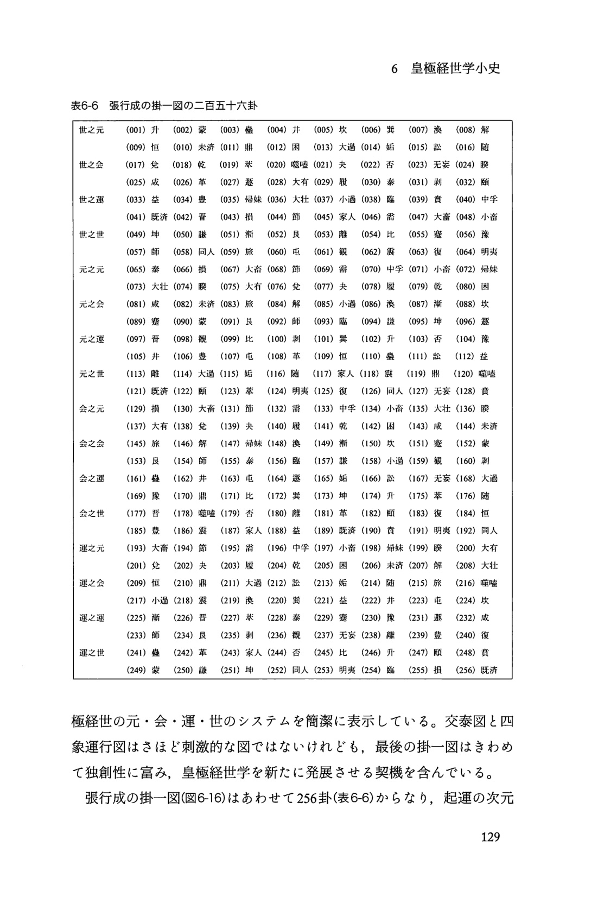

<!-- V3_SOURCE_ID:book015-b000920-p000-fca81a0fbe -->

例如，若256卦对应1年12月，4爻对应1日，那么“月会子”中，升(1)的六五、上六与蒙(2)的初六、九二这4爻对应朔日(一日)，蒙(2)的六三、六四、六五、上九对应二日，……，鼎(11)的初六、九二、九三、九四对应十五日。但对应十六日的是困(12)的六四、九四、九五、上六，并非十五日的爻之后鼎(11)的六五、上九与困(12)的初六、九二这4爻。十六日之后的对应规则回归到十五日之前的方式，依次将4爻对应1日。月会子就这样以三十日——夬(21)的九五、上六与否(22)的初六、六二收尾，总爻数为4×30=120爻。另外，月会丑对应从无妄(23)的初九开始的120爻，月会寅对应从节(44)的六三开始的120爻，一个周期的12个月会总计为120×12=1,440爻=240卦。张行成将这称为“正数”。另一方面，“閏数”指的是与暦日无直接关联的、每日4爻的増分，位于前后の節気が「相接」する朔ないし十六日。具体而言，③子月の初・冬至——升(1)的初六、九二、九三、六四，⑤子月の中・小寒——鼎(11)的六五、上九与困(12)的初六、九二，②丑月の初・大寒——否(22)的六三、九四、九五、上九，④丑月の中・立春——益(33)的初九、六二、六三、六四，⑤寅月の初・雨水——損(43)的六五、上九与節(44)的初九、九二，⑥寅月の中・啓蟄——比(54)的六三、六四、九五、上六，⑧卯月の初・春分——泰(65)的初九、九二、九三、六四，⑤卯月の中・清明——大有(75)的六五、上九与兌(76)的初九、九二，①辰月の初・穀雨——渙(86)的六三、六四、九五、上九，①辰月の中・立夏——晋(97)的初六、六二、六三、九四，⑥巳月の初・小満——屯(107)的九五、上六与革(108)的初九、六二，①巳月の中・芒種——震(118)的六三、九四、六五、上六，⑩午月の初・夏至——損(129)的初九、九二、六三、六四，⑪午月の中・小暑——夬(139)

> **释读存疑：** 1年；12月；1年、12月为释读时的假设，原文未明确对应关系；1轮自动修复后核义模型仍建议修订，已保守记录。

查看对应原文

<!-- V3_FOLDBACK_BEGIN:book015-b000920-p000-fca81a0fbe -->

たとえば256卦が1年12月，4爻が1日を象徴するばあい，「月会子」は，升(1)の六五・上六と蒙(2)の初六・九二の4爻が朔日(一日)にあたり，蒙(2)の六三・六四・六五・上九が二日，……，鼎(11)の初六・九二・九三・九四が十五日を示している。だが十六日に対応するのは困(12)の六四・九四・九五・上六であり，十五日の爻につづく鼎(11)の六五・上九と困(12)の初六・九二の4爻ではない。十六日以降の配当法は十五日以前に復帰し，順番に4爻を1日に対応させていく。月会子はかくして三十日—夬(21)の九五・上六と否(22)の初六・六二に終わり，総爻数は4×30=120爻である。また月会丑は无妄(23)の初九に始まる120爻，月会寅は節(44)の六三に始まる120爻を配当しており，1周期の12月会はあわせて120×12=1,440爻=240卦である。張行成はこれを「正数」とよんでいる。一方，「閏数」とは，暦日と直接の関係のない1日4爻の増分のことである。前後の節気が「相接」する朔ないし十六日に位置している。すなわち，③子月の初・冬至—升(1)の初六・九二・九三・六四，⑤子月の中・小寒—鼎(11)の六五・上九と困(12)の初六・九二，②丑月の初・大寒—否(22)の六三・九四・九五・上九，④丑月の中・立春—益(33)の初九・六二・六三・六四，⑤寅月の初・雨水—損(43)の六五・上九と節(44)の初九・九二，⑥寅月の中・啓蟄—比(54)の六三・六四・九五・上六，⑧卯月の初・春分—泰(65)の初九・九二・九三・六四，⑤卯月の中・清明—大有(75)の六五・上九と兌(76)の初九・九二，①辰月の初・穀雨—渙(86)の六三・六四・九五・上九，①辰月の中・立夏—晋(97)の初六・六二・六三・九四，⑥巳月の初・小満—屯(107)の九五・上六と革(108)の初九・六二，①巳月の中・芒種—震(118)の六三・九四・六五・上六，⑩午月の初・夏至—損(129)の初九・九二・六三・六四，⑪午月の中・小暑—夬(139)

<!-- V3_FOLDBACK_END:book015-b000920-p000-fca81a0fbe -->

<!-- V3_SOURCE_ID:book015-b000921-p000-c8d02e1a7f -->

（某卦）的九五、上六与履（140）的初九、九二，未月之初对应大暑、坎（150）的六三、六四、九五、上六，未月之中对应立秋、蛊（161）的初六、九二、九三、六四，⑨申月之初对应处暑、比（171）的九五、上六与巽（172）的初六、九二，申月之中对应白露、颐（182）的六三、六四、六五、上九，⑤酉月之初对应秋分、大畜（193）的初九、九二、九三、六四，①酉月之中对应寒露、履（207）的九五、上九与乾（204）的初九、九二，@戌月之初对应霜降、随（214）的六三、九四、九五、上六，戌月之中对应立冬、渐（225）的初六、六二、九三、六四，亥月之初对应小雪、剥（235）的六五、上九与观（236）的初六、六二，亥月之中对应大雪、升（246）的九三、六四、六五、上六，就是这些内容。

> **释读存疑：** 某卦；原文开头的「の九五・上六」所对应的卦名未明确，具体所指不详；本地硬校验仍未通过，已记录供后续自动处理或人工核对。

查看对应原文

<!-- V3_FOLDBACK_BEGIN:book015-b000921-p000-c8d02e1a7f -->

の九五・上六と履(140)の初九・九二，未月の初・大暑坎(150)の六三・六四・九五・上六，未月の中・立秋蠱(161)の初六・九二・九三・六四，⑨申月の初・処暑比(171)の九五・上六と巽(172)の初六・九二，申月の中・白露頤(182)の六三・六四・六五・上九，⑤酉月の初・秋分大畜(193)の初九・九二・九三・六四，①酉月の中・寒露履(207)の九五・上九と乾(204)の初九・九二，@戌月の初・霜降随(214)の六三・九四・九五・上六，戌月の中・立冬漸(225)の初六・六二・九三・六四，亥月の初・小雪剝(235)の六五・上九と観(236)の初六・六二，亥月の中・大雪升(246)の九三・六四・六五・上六がそれである。

<!-- V3_FOLDBACK_END:book015-b000921-p000-c8d02e1a7f -->

<!-- V3_SOURCE_ID:book015-b000922-p000-09458fa436 -->

张行成利用《挂一图》来考察历史事件的“运数”，相关内容见于《通变》卷十一。所谓大运，指的是①元经会的运卦与②会经运的世卦；所谓小运，指的是③运经会的年卦与④世经年的月卦，24。

查看对应原文

<!-- V3_FOLDBACK_BEGIN:book015-b000922-p000-09458fa436 -->

張行成は掛一図を利用して歴史事件の「運数」を考察している(『通変』巻十一)。大運とよばれた①元経会の運卦と②会経運の世卦，小運とよばれた③運経会の年卦と④世経年の月卦がそれである24)。

<!-- V3_FOLDBACK_END:book015-b000922-p000-09458fa436 -->

<!-- V3_SOURCE_ID:book015-b000923-p000-b9dd56c4a2 -->

首先是对运卦的考察，张行成将《挂一图》的256卦对应1元，4爻对应1运，以第1运升卦（1）的六五爻到蒙卦（2）的九二爻为起点，计算对应特定星运的卦爻（正数）。例如，日甲为1、月巳为6、星癸为180，从辰未2156到辰申2157的尧的治世，第180运对应贲卦（128）的九三、六四、六五、上九爻，由于1爻对应3世，因此第2156世与2157世对应的是贲卦的六五爻。张行成将贲卦定为尧的运卦，正是他在《挂一图》中寻求易卦与星运一一对应关系的结果。不过对于世卦，他提出“随大运的变化而消长”，并说“遇到奇卦就取后卦，遇到偶卦就取前卦，将两卦合并对应十二世，一奇一偶交替使用”。就上述例子而言，贲卦是第128卦，属于偶数位，因此取前卦无妄卦（127）的6爻，再与贲卦的6爻合并，对应第180运的12世的世卦。

> **释读存疑：** “随大运的变化而消长”中“大运”的具体所指需结合原文进一步确认；本地硬校验仍未通过，已记录供后续自动处理或人工核对。

查看对应原文

<!-- V3_FOLDBACK_BEGIN:book015-b000923-p000-b9dd56c4a2 -->

まず運卦の考察であるが，張行成は掛一図の256卦を1元，4爻を1運にあて，第1運升卦(1)の六五～蒙(2)の九二を起点として，特定の星運に対する卦爻(正数)を計算する。たとえば日甲1・月巳6・星癸180の辰未2,156から辰申2,157にいたる堯の治世のばあい，第180運(=第2,149～2,160世)は賁卦(128)の九三・六四・六五・上九にあたり，1爻=3世(=90年)のため，第2,156と2,157世に相当するのは賁の六五である。張行成が賁卦を堯の運卦と定めたのは，掛一図において易卦と星運の1対1対応を求めた結果にほかならない。だが世卦については，「大運(運卦)に随って消長す」とし，「奇卦に遇えば則ち後卦を取り，偶卦に遇えば則ち前卦を取り，二卦を併せて以て十二世に当て，一奇一偶これを用いる」。同じ例についていえば，賁卦は第128卦であり，偶数位にあるので，前卦の无妄(127)の6爻をとり，賁卦の6爻と合わせて第180運の12世の世卦に配当している。

<!-- V3_FOLDBACK_END:book015-b000923-p000-b9dd56c4a2 -->

<!-- V3_SOURCE_ID:book015-b000924-p000-d3dea3875f -->

关于小运的年卦，需将1世换算为1月，1年换算为1日，升（1）的六五至蒙（2）的九二对应子月的己巳日（6日），无妄（23）的初九至九四对应丑（内容缺漏）

> **释读存疑：** source末尾内容缺漏；本地硬校验仍未通过，已记录供后续自动处理或人工核对。

查看对应原文

<!-- V3_FOLDBACK_BEGIN:book015-b000924-p000-d3dea3875f -->

一方，小運の年卦については，1世を1月，1年を1日と換算し，升(1)の六五～蒙(2)の九二を子月の己巳日(6日)，无妄(23)の初九～九四を丑

<!-- V3_FOLDBACK_END:book015-b000924-p000-d3dea3875f -->

<!-- V3_SOURCE_ID:book015-b000925-p001-fcab3a28d6 -->

图6-17 既济原理图

查看对应原文

<!-- V3_FOLDBACK_BEGIN:book015-b000925-p001-fcab3a28d6 -->

図6-17 既済原理図

<!-- V3_FOLDBACK_END:book015-b000925-p001-fcab3a28d6 -->

<!-- V3_SOURCE_ID:book015-b000926-p000-474c0f5ca3 -->

针对当月的己亥日，求取该年的年卦。具体而言，对应日甲1、月巳6、星癸180、辰未2156的第11年甲辰年的尧即位之时，对应未世甲辰年——未月11日的月会未的第5卦师卦（154）即为年卦，其六三、六四、六五、上六爻为对应当月的爻。另外关于月卦，如同世卦一样，有“小運に随って進退”的说法。

> **释读存疑：** 原文中“辰未2,156”的具体含义未明；本地硬校验仍未通过，已记录供后续自动处理或人工核对。

查看对应原文

<!-- V3_FOLDBACK_BEGIN:book015-b000926-p000-474c0f5ca3 -->

月の己亥日(6日)にあて，当該年の年卦を求める。すなわち，日甲1・月巳6・星癸180・辰未2,156の第11年甲辰にある堯の即位のばあい，未世甲辰年—未月11日に対応する月会未の第5卦の師(154)が年卦であり，その六三・六四・六五・上六が直月の爻である。また月卦については，世卦のごとく「小運(年卦)に随って進退

<!-- V3_FOLDBACK_END:book015-b000926-p000-474c0f5ca3 -->

<!-- V3_SOURCE_ID:book015-b000927-p000-43f24c7785 -->

尧之时，年卦师卦为偶卦，因此将前卦艮的六爻与师卦的六爻相配，对应甲辰年的12月。

> **释读存疑：** 本地硬校验仍未通过，已记录供后续自动处理或人工核对。

查看对应原文

<!-- V3_FOLDBACK_BEGIN:book015-b000927-p000-43f24c7785 -->

す」。堯時のばあい，年卦の師は偶卦であるので，前卦の艮(153)の6爻と師の6爻をもって甲辰年の12月に配している。

<!-- V3_FOLDBACK_END:book015-b000927-p000-43f24c7785 -->

<!-- V3_SOURCE_ID:book015-b000928-p000-ad4ada9964 -->

张行成的先天数图→既济图→八卦变化图的展开，与先天象图的展开一样，极具独创性。他为八卦确定了固有之数，由此为邵雍的声音学带来了新的进展。

> **释读存疑：** 术语“八卦”“先天”保留原词并按 allowed_glossary 标注；原文“邵雍”为专名保留原词；原文“声音学”为专名保留原词；原文“きわめて独創的である”译为“极具独创性”。；术语“八卦”“先天”保留原词并按 allowed_glossary 标注；原文“邵雍”为专名保留原词；原文“声音学”为专名保留原词；原文“きわめて独創的である”译为“极具独创性”

查看对应原文

<!-- V3_FOLDBACK_BEGIN:book015-b000928-p000-ad4ada9964 -->

張行成の先天数図→既済図→八卦変化図の展開も，先天象図の展開と同じくきわめて独創的である。八卦に固有の数を定め，それによって邵雍の声音学に新たな進展をもたらした。

<!-- V3_FOLDBACK_END:book015-b000928-p000-ad4ada9964 -->

<!-- V3_SOURCE_ID:book015-b000929-p000-170562baba -->

既済図は3図——原理図と陽図と陰図からなり，原理図が律声と呂音の唱和の原理を説明し，陽図と陰図が唱和した結果を示している。既済原理図の構造は単純明快である。八卦の数の配当——乾一・兌二・離三・震四・巽五・坎六・艮七・坤八を根拠として，「天地みな内宮の十六数を外宮の十六数に遍く交えて，各々十六の十六を得，共に五百一十有二」となることを明らかにしている。「天の十六数」とは，①日日声の乾一，②日月声の履一二，③日星声の同人一三，④日辰声の无妄一四，⑤月日声の夬二一，⑥月月声の兌二二，⑦月星声の革二三，⑧月辰声の随二四，⑨星日声の大有三一，⑩星月声の睽三二，⑪星星声の離三三，⑫星辰声の噬嗑三四，⑬辰日声の大壮四一，⑭辰月声の帰妹四二，⑮辰星声の豊四三，⑯辰辰声の震四四である。

> **释读存疑：** 既済図の具体所指不详；原理図の具体所指不详；陽図の具体所指不详；陰図の具体所指不详；律声の具体所指不详；呂音の具体所指不详；唱和の具体所指不详；既済原理図の具体所指不详；内宮の具体所指不详；外宮の具体所指不详；原文末尾“辰辰声の震四四(5”残缺，具体内容不详；原文中“乾一(八)”“兌二(七)”等括号内数字的具体含义未明；“既済図”“原理図”“陽図”“陰図”“律声”“呂音”“唱和”“既済原理図”“内宮”“外宮”的具体所指均不详；本地硬校验仍未通过，已记录供后续自动处理或人工核对。

查看对应原文

<!-- V3_FOLDBACK_BEGIN:book015-b000929-p000-170562baba -->

既済図は3図——原理図(仮称)と陽図と陰図からなり，原理図が律声と呂音の唱和の原理を説明し，陽図と陰図が唱和した結果を示している(『通変』巻十六)。既済原理図(図6-17)の構造は単純明快である。八卦の数の配当——乾一(八)・兌二(七)・離三(六)・震四(五)・巽五(四)・坎六(三)・艮七(二)・坤八(一)を根拠として，「天地みな内宮の十六数を外宮の十六数に遍く交えて，各々十六の十六(256=16×16)を得，共に五百一十有二」となることを明らかにしている。「天の十六数」とは，①日日声の乾一(八八)，②日月声の履一二(八七)，③日星声の同人一三(八六)，④日辰声の无妄一四(八五)，⑤月日声の夬二一(七八)，⑥月月声の兌二二(七七)，⑦月星声の革二三(七六)，⑧月辰声の随二四(七五)，⑨星日声の大有三一(六八)，⑩星月声の睽三二(六七)，⑪星星声の離三三(六六)，⑫星辰声の噬嗑三四(六五)，⑬辰日声の大壮四一(五八)，⑭辰月声の帰妹四二(五七)，⑮辰星声の豊四三(五六)，⑯辰辰声の震四四(五

<!-- V3_FOLDBACK_END:book015-b000929-p000-170562baba -->

<!-- V3_SOURCE_ID:book015-b000930-p000-61a46daf3b -->

陰圖：此圓以地之十六卦和天之十六卦，加上植數十六卦、天地一卦，各取十六卦、植數一卦，變成三十二卦，合計共成一千二十四卦。文中所列卦名與數字對應關係混亂，具體所指不詳，其中包含「二坤、一二坤一、坤二、坤二、坤一、坤二、坤一、坤八、乾七、尖六、有五、莊父、履七、兌、交暌五七、歸泰、泰臨、泰夷、泰復、泰泰、臨臨、夷臨、復臨、二坤、二坤、二坤、二坤、二坤、二坤、二坤、二坤、六同七、六輩六、離五、豐八、金七、五隨五、五震、泰夷、臨夷、夷夷、夷復、泰復、臨復、夷復、復復」等內容。

> **释读存疑：** 卦名與數字對應關係混亂，具體所指不詳

查看对应原文

<!-- V3_FOLDBACK_BEGIN:book015-b000930-p000-61a46daf3b -->

陰圖 此圓以地之十六卦和天之十六卦將植數十六卦天地一卦各叟十六卦植數一卦變三十二卦共成一十二十四卦二坤一二坤一坤二坤二坤一坤二坤一坤八乾七尖六有五莊父履七兌 交暌五七歸泰泰臨泰 夷泰復泰泰臨 臨臨 夷臨復臨二坤二坤二坤二坤 二坤二坤二坤二坤六同七六輩六離五豐八金七五隨五五震泰夷臨夷夷夷復夷 泰復 臨復 夷復復復

<!-- V3_FOLDBACK_END:book015-b000930-p000-61a46daf3b -->

<!-- V3_SOURCE_ID:book015-b000931-p000-aa2423d297 -->

陽圖：此圖以天之十六卦引導地之十六卦，得到動數。十六卦、天地、卦，變成三十二卦，合計共成一千二十四卦。文中所列卦名與數字對應關係混亂，具體所指不詳，其中包含「否否、遯否、訟否、姤否、否遯、遯遯、遯訟、遯姤、遯、八坤、七六、八剩六、比五、八觀、八七、謙七、七艮、六蹇、五七、漸、一乾、一乾、一乾、一乾、一乾、一乾、一乾、一乾、否訟、遯訟、訟訟、訟始、訟否、姤遯、姤訟、姤姤、姤、八公師、六蒙、六六、坎五、渙八、五升、七五、蠱六、五井、五五、巽、一乾、一乾、一乾、一乾、一乾、一乾、一乾、一乾」等內容。

> **释读存疑：** 卦名與數字對應關係混亂，具體所指不詳

查看对应原文

<!-- V3_FOLDBACK_BEGIN:book015-b000931-p000-aa2423d297 -->

陽圗 此圖以天之十六卦唱地之十六卦得動數 十六卦天地 卦 變三十二卦共成 一千二十四卦 否否遯否訟否姤否否遯遯遯訟遯姤遯 八坤七六八剩六比五八觀八七謙七七艮六蹇五七漸 一乾一乾一乾一乾 一乾一乾一乾一乾 否訟遯訟訟訟始訟否姤遯姤訟姤姤姤 八公師六蒙六六坎五渙八五升七五蠱六五井五五巽 一乾一乾一乾 一乾 一乾一乾一乾一乾

<!-- V3_FOLDBACK_END:book015-b000931-p000-aa2423d297 -->

<!-- V3_SOURCE_ID:book015-b000932-p000-3c247b4e4a -->

圖6-18 既濟陽圖

查看对应原文

<!-- V3_FOLDBACK_BEGIN:book015-b000932-p000-3c247b4e4a -->

図6-18 既済陽図

<!-- V3_FOLDBACK_END:book015-b000932-p000-3c247b4e4a -->

<!-- V3_SOURCE_ID:book015-b000933-p000-9195af67bc -->

圖6-19 既濟陰圖

查看对应原文

<!-- V3_FOLDBACK_BEGIN:book015-b000933-p000-9195af67bc -->

図6-19 既済陰図

<!-- V3_FOLDBACK_END:book015-b000933-p000-9195af67bc -->

<!-- V3_SOURCE_ID:book015-b000934-p000-72582dbb11 -->

以下是「地の十六数」的内容：①水水音对应的坤卦八八（一一），②水火音对应的谦卦八七（一二），③水土音对应的师卦八六（一三），④水石音对应的升卦八五（一四），⑤火水音对应的剥卦七八（二一），⑥火火音对应的艮卦七七（二二），⑦火土音对应的蒙卦七六（二三），⑧火石音对应的蛊卦七五（二四），⑨土水音对应的比卦六八（三一），⑩土火音对应的蹇卦六七（三二），⑪土土音对应的坎卦六六（三三），⑫土石音对应的井卦六五（三四），⑬石水音对应的观卦五八（四一），⑭石火音对应的渐卦五七（四二），⑮石土音对应的涣卦五六（四三），⑯石石音对应的巽卦五五（四四）。另外，易卦数字后面的数是阳数，括号内的数是阴数；两位数的情况下，十位的数对应上卦为八卦中的哪一卦，个位的数对应下卦为八卦中的哪一卦。

> **释读存疑：** 本地硬校验仍未通过，已记录供后续自动处理或人工核对。

查看对应原文

<!-- V3_FOLDBACK_BEGIN:book015-b000934-p000-72582dbb11 -->

五)のこと。「地の十六数」とは，①水水音の坤八八(一一)，②水火音の謙八七(一二)，③水土音の師八六(一三)，④水石音の升八五(一四)，⑤火水音の剥七八(二一)，⑥ 火火音の艮七七(二二)，⑦ 火土音の蒙七六(二三)，⑧火石音の蠱七五(二四)，⑨土水音の比六八(三一)，⑩土火音の蹇六七(三二)，⑪土土音の坎六六(三三)，⑫土石音の井六五(三四)，⑬石水音の観五八(四一)，⑭石火音の漸五七(四二)，⑮石土音の渙五六(四三)，⑯石石音の巽五五(四四)のことである。なお易卦の直後の数は陽数(順数),括弧内の数は陰数(逆数)を示しており,2桁の数のばあい，10位の数は上卦が八卦の何にあたるか，1位の数は下卦が何にあたるかを示している。

<!-- V3_FOLDBACK_END:book015-b000934-p000-72582dbb11 -->

<!-- V3_SOURCE_ID:book015-b000935-p000-ecb91e4451 -->

既济阳图（図6-18）是「以天之十六卦对应地之十六卦」的内容。例如最初的「否否」矩阵，是将天的日日声「一一乾」置于左侧，地的水水音「八八坤」置于右侧，组成3行2列的矩阵，二者组合后，从右向左方向的「一八」会产生乾上坤下的否卦，这就是阳数的含义。另外，既济阴图（図6-19）是「以地の十六卦对应天之十六卦」的内容。

> **释读存疑：** 図6-18；図6-19；1轮自动修复后核义模型仍建议修订，已保守记录。

查看对应原文

<!-- V3_FOLDBACK_BEGIN:book015-b000935-p000-ecb91e4451 -->

既済陽図(図6-18)は「天の十六卦を以て地の十六卦を唱えた」ものである。たとえば最初の「否否」のマトリックスは，天の日日声の「ー一乾」を左，地の水水音の「八八坤」を右にならべて3行2列の行列を作り両者を組み合わせたとき，右→左の方向の「一八」から乾上坤下の否卦が(二重に)生じることを示している(陽数)。また既済陰図(図6-19)は「地の十

<!-- V3_FOLDBACK_END:book015-b000935-p000-ecb91e4451 -->

<!-- V3_SOURCE_ID:book015-b000936-p000-da927f3a01 -->

「六卦对应天之十六卦」的内容。「泰泰」矩阵，是将天的日日声「八八乾」置于左侧，地的水水音「一一坤」置于右侧，组成3行2列的矩阵，二者组合后，从左向右方向的「一八」会产生坤上乾下的泰卦，这就是阴数的含义。

查看对应原文

<!-- V3_FOLDBACK_BEGIN:book015-b000936-p000-da927f3a01 -->

六卦を以て天の十六卦を和し」たものである。「泰泰」のマトリックスは、天の日日声の「八八乾」を左，地の水水音の「一一坤」を右にならべて3行2列の行列を作り両者を組み合わせたとき，左→右の方向の「一八」から坤上乾下の泰卦が作られることを表している(陰数)。

<!-- V3_FOLDBACK_END:book015-b000936-p000-da927f3a01 -->

<!-- V3_SOURCE_ID:book015-b000937-p000-5054141b91 -->

八卦変化図由两部分组成：一是（1）乾、（3）兑、（5）离、（7）震的声图，二是（2）坤、（4）艮、（6）坎、（8）巽的音图，针对具体的声音组合（反切音），对应了易卦的配属。例如「声図一乾卦」的音声表中，出现的是与既济阳图的易卦组合（否否～姤恒）对应的汉字读音。关于否否，记载为「古多・黒多・安多・夫多・卜多・東多・乃多・走多・思多・■多・■多・█多，良・千・刀・妻・宮・心・●・●・●」。回想一下，日日声由「多・良・千・刀・妻・宮・心・●・●・●」这10个声组成，水水音由「古・黒・安・夫・ト・東・乃・走・思・・・」这12个音组成，那么该表的含义就很明确了。另外，「音図二坤卦」的音声表中，出现的是与既济阴图的易卦组合（泰泰～復益）对应的汉字读音。关于泰泰，记载为「古多・古良・古千・古刀・古妻・古宮・古心・古●・古●・古●，黒・安・夫・卜・東・乃・走・思・■・■・■」。音声表中区分声图、音图以及阳图、阴图，是为了明确易卦的组合是着眼于反切的声还是音。

> **释读存疑：** 否否～姤恒；泰泰～復益；本地硬校验仍未通过，已记录供后续自动处理或人工核对。

查看对应原文

<!-- V3_FOLDBACK_BEGIN:book015-b000937-p000-5054141b91 -->

八卦変化図は，(1)乾(3)兌(5)離(7)震の声図と(2)坤(4)艮(6)坎(8)巽の音図からなり，具体的な声音の組み合わせ(反切音)について易卦の配当をあたえている(『通変』巻十七・十八)。たとえば「声図一乾卦」の音声表にみえるのは，既済陽図の易卦の組み合わせ(否否\~姤恒)に対応した漢字音である。否否については，「古多・黒多・安多・夫多・卜多・東多·乃多·走多·思多·■多·■多·█多，良·千·刀·妻·宮·心·●・●・●」という。日日声が[多・良・千・刀・妻・宮・心・●・●·●」の10声(韻母)からなり，水水音が[古・黒・安・夫・ト・東・乃・走・思・・・」の12音(字母)からなることを思い起こせば，表の意味するところは明白であろう。また「音図二坤卦」の音声表にみえるのは，既済陰図の易卦の組み合わせ(泰泰～復益)に対応した漢字音である。泰泰については，「古多・古良・古千・古刀・古妻・古宮・古心・古●·古●·古●，黒·安・夫·卜·東·乃·走・思・■·■·■」と記されている。音声表に声図・音図や陽図・陰図の区別があるのは，易卦の組み合わせが反切の韻母と字母のいずれに注目したものであるかを明らかにするためである。

<!-- V3_FOLDBACK_END:book015-b000937-p000-5054141b91 -->

<!-- V3_SOURCE_ID:book015-b000938-p000-9dade9fc44 -->

张行成作为皇极经世学占筮法的设计者而闻名。据《通变》卷二十九记载，张行成的“经世揲蓍法”如下：①初揲——将72根蓍草分成两份拿在两手，用右手的筮竹每4根一数。若余数为1则对应“元”，为2则对应“会”，为3则对应“运”，为4则对应“世”。这就是直事的四象。②再揲——再次将72根蓍草分成两份拿在两手，从左手移4根蓍草到右手。将右手的筮竹每8根一数，“根据其余数确定上卦的体”。③三揲——再次将蓍草合为一份分成两份，从右手移4根蓍草到左手。将左手的筮竹每8根一数，“根据其余数确定下卦的体”。从上卦体与下卦体可求出直事的六十四卦。④终揲——再次将蓍草合为一份分成两份，将左手的筮竹每6根一数。若余数为1则作为初爻，为2则作为二爻……为6则作为上爻。这就是直事的爻。张行成还通过筮法，对由“初揲余一”→四象之元、“再揲余五”→上卦之巽、“三揲余七”→下卦之艮、“终揲余六”→上爻推得的元之渐卦上九（直事的象与卦与爻），说明占法的基本规则（仮令法）。具体而言：①物数占：查找卦气图的“元”部，查看直事的渐卦对应元的哪一位。渐卦是元之会之会之运（第87位）的卦。查阅律吕图中元之会之会之运的位置，从履、蒙两卦中确定“物数”的遯、困两卦。以遯、困两卦“观察物之象”。②本占：渐卦的直事上九不在正确的爻位，因此将九改为六，变为蹇卦；又因包含直事之爻的上体“不当位”，故需将巽改为震，变为小过卦。根据爻的变与不变随时占断，根据卦的变与不变判断大定，这就是本占的规则。③杂占：渐卦是“艮归魂之卦”，九三对应世爻，上九对应应爻。由于上九是当世直事之爻，因此也是世爻之正。故而“不得不与本爻相敌”，等等。以上就是张行成占筮法的概要。张行成违背邵雍原意引入占筮法，恰好契合当时皇极经世学易学发展的趋势，可被视为学术史上极为重要的事件之一。

> **释读存疑：** 原文中「仮令法」「物数占」「本占」「雑占」等术语未明确对应固定概念，释读保留原标注未作臆断，符合要求；本地硬校验仍未通过，已记录供后续自动处理或人工核对。

查看对应原文

<!-- V3_FOLDBACK_BEGIN:book015-b000938-p000-9dade9fc44 -->

張行成は，皇極経世学の占筮法の考案者として名高い。『通変』巻二十九によれば，張行成の「経世揲蓍法」は次のとおりである。すなわち，①初揲——72蓍を両手に二分し，右手の筮竹を4本ずつ数える。余数が1であれば元にあて，2であれば会，3であれば運，4であれば世にあてる。直事の四象がそれである。②再揲——また72蓍を両手に分け，4蓍を左手から右手に移す。右手の筮竹を8本ずつ数え，「その余数を視て上卦の体となす」。③三揲——また合わせて二分し，4蓍を右手から左手に移す。左手の筮竹を8本ずつ数え，「その余数を視て下卦の体となす」。上下体から直事の六十四卦が求められる。④終揲——また合わせて二分し，左手の筮竹を6本ずつ数える。余数が1のとき初爻とし，2のとき二爻，……，6のとき上爻とする。これが直事の爻である。張行成はまた，筮法をとおして「初揲余一」→四象の元，「再揲余五」→上卦の巽，「三揲余七」→下卦の艮，「終揲余六」→上爻と求められた元の漸卦の上九(直事の象と卦と爻)に対して，占法の基本を説明している(仮令法)。すなわち，①物数占(仮称)卦気図(掛一図)の「元」部を検索して，直事の漸卦が元の何位にあたるかをみる。漸卦は元の会の会の運(第87位)の卦である。律呂図(既済陽図)の元の会の会の運の位を調べ，履と蒙の2卦から「物数」の遯と困の2卦を定める。遯・困をもって「物の象を観る」。②本占(仮称)漸卦は，直事の上九が正しい位にないので九→六と改めて蹇卦とし，また直事の爻を含む上体が「位に当たらざる」ため巽を震に改めて小過卦としなければならない。爻の変不変を根拠にして随時(時用)を占い，卦の変不変をもって大定(定体)を判断するのがこれである。③雑占(仮称)漸は「艮帰魂の卦」であり，九三が世爻，上九が応爻にあたっている。上九は当世直事の爻であるため，世爻の正でもある。したがって「本爻と相敵」せざるをえない，云々。以上が張行成の占筮法の概略である。張行成が邵雍の原意に反して占筮法を導入したことは，当時の皇極経世学の易学的発展の趨勢ともみごとに合致しており，学説史上きわめて重要な事件の一つに数えることができる。

<!-- V3_FOLDBACK_END:book015-b000938-p000-9dade9fc44 -->

<!-- V3_SOURCE_ID:book015-b000939-p000-a6b50cea2f -->

《宋元学案》记载，张行成的门人中有吕凝之，淳熙八年，吕凝之向朝廷奏陈经世之学，宋孝宗“大喜”，将他提拔为太府丞。

> **释读存疑：** 本地硬校验仍未通过，已记录供后续自动处理或人工核对。

查看对应原文

<!-- V3_FOLDBACK_BEGIN:book015-b000939-p000-a6b50cea2f -->

『宋元学案』は，張行成の門人として呂凝之(字，沢父)をあげ，淳熙八年(1181)，呂凝之が経世の学を奏陳し，孝宗が「大喜」し，太府丞に抜擢したことを記している(張祝諸儒学案)。

<!-- V3_FOLDBACK_END:book015-b000939-p000-a6b50cea2f -->

<!-- V3_SOURCE_ID:book015-b000940-p000-baa143a212 -->

## 2.3 祝泌の起運法と語音分析 — 2.3 祝泌的起运法与语音分析

查看对应原文

<!-- V3_FOLDBACK_BEGIN:book015-b000940-p000-baa143a212 -->

## 2.3 祝泌の起運法と語音分析

<!-- V3_FOLDBACK_END:book015-b000940-p000-baa143a212 -->

<!-- V3_SOURCE_ID:book015-b000941-p000-b50a8fb4cd -->

祝泌，字子泾，号观物老人，是南宋中晚期的人物。他的著作有《皇极经世观物篇解》11卷、《皇极经世起数诀》1卷、《皇极经世钤》1卷、《皇极起数例》1卷、《康节先生观物篇断诀》1卷等。至元十六年，元朝世祖忽必烈派遣使者寻访以“通晓皇极数”闻名的祝泌的子孙。

> **释读存疑：** 本地硬校验仍未通过，已记录供后续自动处理或人工核对。

查看对应原文

<!-- V3_FOLDBACK_BEGIN:book015-b000941-p000-b50a8fb4cd -->

祝泌は，字を子涇といい，観物老人と号した。南宋の中晩期の人である。著書には『皇極経世観物篇解』11巻(1239跋)『皇極経世起数訣』1巻(1241序)『皇極経世鈐』1巻『皇極起数例』1巻(1235序)『康節先生観物篇断
訣』1巻(1238発題)ほかがある。至元十六年(1279)，元の世祖フビライは使者を派遣して，「皇極数に通ず」との名声の高かった祝泌の子孫を訪求させたという(『元史』巻十)。

<!-- V3_FOLDBACK_END:book015-b000941-p000-b50a8fb4cd -->

<!-- V3_SOURCE_ID:book015-b000943-p000-77c91b44c6 -->

祝泌是对张行成的皇极经世学展开激烈批判的人。他在《皇极起数例》中评价张行成的《通变》说："阐明的地方很多，繁杂冗余的地方也很多"之类的话。不过不得不说，祝泌自身的基本想法大多是遵循张行成的。

查看对应原文

<!-- V3_FOLDBACK_BEGIN:book015-b000943-p000-77c91b44c6 -->

祝泌は，張行成の皇極経世学への激しい批判者である。張行成『通変』について「発明する処は甚だ多きも，支蔓する処もまた多し」云々と評している(『皇極起数例』)。だが祝泌の基本的な発想自体は張行成に則るところが多いといわざるをえない。

<!-- V3_FOLDBACK_END:book015-b000943-p000-77c91b44c6 -->

<!-- V3_SOURCE_ID:book015-b000944-p000-5f52c79c6e -->

祝泌也和张行成一样，遵循邵雍的历年表，用易卦的配属来填满时间的流转，确定了各历史年代的起运卦：①元経会の運卦，②会経運の世卦，③運経世の年卦等，但配属的方法和张行成完全不同。祝泌认为必须修改张行成的方法，原因有二：①「大小運の数は，みな掛一図の二百五十六卦に帰宿すといえども，然れどもその断法は，専ら卦に在らずして四象に在り」（『皇極起数例』）；②因此，不考虑正确的四象循环的张行成的起算点设定是错误的，张行成的运数与邵雍的本义存在矛盾。

查看对应原文

<!-- V3_FOLDBACK_BEGIN:book015-b000944-p000-5f52c79c6e -->

祝泌も張行成と同じく，邵雍の歴年表に則りながら易卦の配当をもって時間の流れを埋め尽くし，各歴史年代の起運の卦——①元経会の運卦，②会経運の世卦，③運経世の年卦などを定めたが，配当の方法は張行成とまったく異なっている。祝泌によれば，張行成の方法を改めなければならないのは，①「大小運の数は，みな掛一図の二百五十六卦に帰宿すといえども，然れどもその断法は，専ら卦に在らずして四象に在り」(『皇極起数例』)，②したがって正しい四象の巡りを考慮しない張行成の起算点の設定は誤りであり，張行成の運数は邵雍の本義と矛盾をいたすからである。

<!-- V3_FOLDBACK_END:book015-b000944-p000-5f52c79c6e -->

<!-- V3_SOURCE_ID:book015-b000945-p000-072b70b2e2 -->

祝泌关于大运说：「元会運は天地の未合をなし，未然の数を用う。元(元経会の運卦)は冬至の子に起こり，会(会経運の世卦)は開物の寅に起こり，運(運経世の年卦)は地建の丑に起こる」，关于小运说：「年月日のごときは，天地の已合をなし，已然の数を用う」（『皇極経世観物篇解』巻二）。「未然の数」とは「元の元」の泰卦に起こる掛一図（表6-7）のことであり，「已然の数」とは「世の元」の升卦に起こる卦気図（表6-6）のことである。また卦気図は張行成の掛一図とまったく等しく，掛一図も張行成の掛一図の原点を，卦順を動かさずに世の元から元の元に移動したものであり，ほんらい異なった図ではない。祝泌の掛一図の二十四節気との対応を記せば，③冬至——泰(1)の初六・九二・九三・六四，④小寒——大有(11)の六五・上九と兌(12)の初六・九二，⑤大寒——渙(22)の六三・九四・九五・上九，⑥立春——晋(33)の初九・六二・六

> **释读存疑：** 二十四節；原文提及的「二十四節」具体所指未明确说明；本地硬校验仍未通过，已记录供后续自动处理或人工核对。

查看对应原文

<!-- V3_FOLDBACK_BEGIN:book015-b000945-p000-072b70b2e2 -->

祝泌は大運について「元会運は天地の未合をなし，未然の数を用う。元(元経会の運卦)は冬至の子に起こり，会(会経運の世卦)は開物の寅に起こり，運(運経世の年卦)は地建の丑に起こる」とのべ，小運について「年月日のごときは，天地の已合をなし，已然の数を用う」とのべている(『皇極経世観物篇解』巻二)。「未然の数」とは「元の元」の泰卦に起こる掛一図(表6-7)のことであり，「已然の数」とは「世の元」の升卦に起こる卦気図(表6-6)のことである。また卦気図は張行成の掛一図とまったく等しく，掛一図も張行成の掛一図の原点を，卦順を動かさずに世の元から元の元に移動したものであり，ほんらい異なった図ではない。祝泌の掛一図の二十四節気との対応を記せば，③冬至——泰(1)の初六・九二・九三・六四，④小寒——大有(11)の六五・上九と兌(12)の初六・九二，⑤大寒——渙(22)の六三・九四・九五・上九，⑥立春——晋(33)の初九・六二・六

<!-- V3_FOLDBACK_END:book015-b000945-p000-072b70b2e2 -->

<!-- V3_SOURCE_ID:book015-b000946-p000-7997c023c9 -->

表6-7 祝泌的《掛一图》中的二百五十六卦，相关内容如下：
元之元：(001)泰、(002)损、(003)、大畜、(004)节、(005)需、(006)、中孚、(007)小畜、(008)归妹
元之元对应行：(009)大壮、(010)睽、(011)大有、(012)兑、(013)夬、(014)履、(015)乾、(016)困
元之会：(017)咸、(018)未济、(019)旅、(020)解、(021)小过、(022)涣、(023)渐、(024)坎
元之会对应行：(025)蹇、(026)蒙、(027)艮、(028)师、(029)临、(030)谦、(031)坤、(032)遁
元之运：(033)晋、(034)观、(035)比、(036)剥、(037)巽、(038)升、(039)否、(040)豫
元之运对应行：(041)井、(042)丰、(043)屯、(044)革、(045)恒、(046)蛊、(047)讼、(048)益
元之世：(049)离、(050)大过、(051)姤、(052)随、(053)、家人、(054)震、(055)鼎、(056)噬嗑
元之世对应行：(057)既济、(058)颐、(059)萃、(060)、明夷、(061)复、(062)同人、(063)无妄、(064)贲
会之元：(065)损、(066)大畜、(067)节、(068)需、(069)、中孚、(070)小畜、(071)大壮、(072)睽
会之元对应行：(073)大有、(074)兑、(075)夬、(076)、股、(077)乾、(078)困、(079)咸、(080)未济
会之会：(081)旅、(082)解、(083)归妹、(084)涣、(085)渐、(086)坎、(087)蹇、(088)蒙
会之会对应行：(089)艮、(090)师、(091)泰、(092)临、(093)、议、(094)小过、(095)观、(096)剥
会之运：(097)蛊、(098)井、(099)屯、(100)遁、(101)姤、(102)讼、(103)无妄、(104)大过
会之运对应行：(105)豫、(106)鼎、(107)比、(108)、巽、(109)坤、(110)升、(111)萃、(112)随
会之世：(113)晋、(114)噬嗑、(115)否、(116)离、(117)革、(118)颐、(119)复、(120)恒
会之世对应行：(121)丰、(122)震、(123)家人、(124)益、(125)既济、(126)贲、(127)明夷、(128)同人
运之元：(129)、大畜、(130)节、(131)需、(132)、中孚、(133)小畜、(134)归妹、(135)睽、(136)大有
运之元对应行：(137)兑、(138)夬、(139)履、(140)乾、(141)困、(142)未济、(143)解、(144)大壮
运之会：(145)恒、(146)鼎、(147)大过、(148)讼、(149)姤、(150)随、(151)旅、(152)噬嗑
运之会对应行：(153)小过、(154)震、(155)涣、(156)巽、(157)益、(158)井、(159)屯、(160)坎
运之运：(161)渐、(162)晋、(163)萃、(164)泰、(165)蹇、(166)豫、(167)遁、(168)咸
运之运对应行：(169)师、(170)艮、(171)剥、(172)观、(173)无妄、(174)离、(175)丰、(176)复
运之世：(177)蛊、(178)革、(179)家人、(180)否、(181)比、(182)升、(183)颐、(184)贲
运之世对应行：(185)蒙、(186)谦、(187)坤、(188)同人、(189)明夷、(190)临、(191)损、(192)既济
世之元：(193)升、(194)蒙、(195)蛊、(196)井、(197)坎、(198)巽、(199)涣、(200)解
世之元对应行：(201)恒、(202)未济、(203)鼎、(204)困、(205)大过、(206)姤、(207)讼、(208)随
世之会：(209)兑、(210)乾、(211)、苯、(212)噬嗑、(213)夬、(214)否、(215)无妄、(216)睽
世之会对应行：(217)咸、(218)革、(219)遁、(220)大有、(221)履、(222)泰、(223)剥、(224)颐
世之运：(225)益、(226)丰、(227)归妹、大壮、(228)、(229)小过、(230)临、(231)贲、中孚、(232)、(236)节、(237)、(238)需、(239)大畜、(240)小畜
世之运对应行：(233)既济、(234)晋、(235)损、(241)坤、(242)谦、(243)渐

> **释读存疑：** 003、006、053、060、069、076、093、108、129、132、211、228、236、237、238、232这些数字对应的卦位内容原文未明确记载，具体所指不详；1轮自动修复后核义模型仍建议修订，已保守记录。

查看对应原文

<!-- V3_FOLDBACK_BEGIN:book015-b000946-p000-7997c023c9 -->

表6-7祝泌の掛一図の二百五十六卦
<table><tr><td>元之元</td><td>(001) 泰</td><td></td><td>(002) 損</td><td>(003)</td><td>大畜</td><td>(004) 節</td><td></td><td>(005) 需</td><td></td><td>(006)</td><td>中孚</td><td></td><td>(007) 小畜</td><td>(008) 帰妹</td></tr><tr><td></td><td>(009) 大壮</td><td></td><td>(010) 睽</td><td></td><td>(011) 大有</td><td>(012) 兌</td><td></td><td>(013) 夬</td><td></td><td>(014) 履</td><td>(015)</td><td>乾</td><td>(016)</td><td>困</td></tr><tr><td>元之会</td><td>(017) 咸</td><td></td><td>(018) 未济</td><td></td><td>(019) 旅</td><td>(020) 解</td><td></td><td>(021) 小過</td><td></td><td>(022) 渙</td><td></td><td>(023) 漸</td><td>(024) 坎</td><td></td></tr><tr><td></td><td>(025) 蹇</td><td></td><td>(026) 蒙</td><td></td><td>(027) 艮</td><td>(028) 師</td><td></td><td>(029) 臨</td><td></td><td>(030) 謙</td><td></td><td>(031) 坤</td><td>(032)</td><td>遯</td></tr><tr><td>元之運</td><td>(033) 晋</td><td></td><td>(034) 観</td><td></td><td>(035) 比</td><td>(036) 剥</td><td></td><td>(037) 巽</td><td></td><td>(038) 升</td><td>(039)</td><td>否</td><td>(040) 豫</td><td></td></tr><tr><td></td><td>(041) 井</td><td></td><td>(042) 豊</td><td></td><td>(043) 屯</td><td>(044) 革</td><td></td><td>(045) 恒</td><td></td><td>(046) 蠱</td><td>(047)</td><td>訟</td><td>(048)</td><td>益</td></tr><tr><td>元之世</td><td>(049) 離</td><td></td><td>(050) 大過</td><td></td><td>(051) 姤</td><td>(052) 随</td><td></td><td>(053)</td><td>家人</td><td>(054) 震</td><td></td><td>(055) 鼎</td><td>(056)</td><td>噬嗑</td></tr><tr><td></td><td></td><td>(057) 既済</td><td>(058) 頤</td><td></td><td>(059) 萃</td><td>(060)</td><td>明夷</td><td>(061)</td><td>復</td><td>(062) 同人</td><td>(063)</td><td>无妄</td><td>(064)</td><td>賁</td></tr><tr><td>会之元</td><td>(065) 損</td><td></td><td>(066) 大畜</td><td></td><td>(067) 節</td><td>(068) 需</td><td></td><td>(069)</td><td>中孚</td><td>(070) 小畜</td><td></td><td>(071) 大壮</td><td>(072)</td><td>睽</td></tr><tr><td></td><td></td><td>(073) 大有</td><td>(074)兌</td><td></td><td>(075) 夬</td><td>(076) 股</td><td></td><td>(077)</td><td>乾</td><td>(078) 困</td><td>(079)</td><td>咸</td><td>(080)</td><td>未済</td></tr><tr><td>会之会</td><td>(081) 旅</td><td></td><td>(082) 解</td><td></td><td>(083) 帰妹</td><td>(084) 渙</td><td></td><td>(085) 漸</td><td></td><td>(086) 坎</td><td></td><td>(087) 蹇</td><td>(088)</td><td>蒙</td></tr><tr><td></td><td>(089) 艮</td><td></td><td>(090)師</td><td></td><td>(091) 泰</td><td>(092) 臨</td><td></td><td>(093) 議</td><td></td><td>(094) 小過</td><td>(095)</td><td>観</td><td>(096)</td><td>剥</td></tr><tr><td>会之運</td><td>(097) 蠱</td><td></td><td>(098) 井</td><td></td><td>(099) 屯</td><td>(100) 遯</td><td></td><td>(101) 姤</td><td></td><td>(102) 訟</td><td>(103)</td><td>无妄</td><td>(104) 大過</td><td></td></tr><tr><td></td><td>(105) 豫</td><td></td><td>(106)鼎</td><td></td><td>(107) 比</td><td>(108)</td><td>巽</td><td>(109) 坤</td><td></td><td>(110) 升</td><td>(111)</td><td>萃</td><td>(112)</td><td>随</td></tr><tr><td>会之世</td><td>(113) 晋</td><td></td><td>(114) 噬嗑</td><td></td><td>(115) 否</td><td>(116) 離</td><td></td><td>(117) 革</td><td></td><td>(118) 頤</td><td></td><td>(119) 復</td><td>(120) 恒</td><td></td></tr><tr><td></td><td>(121) 豊</td><td></td><td>(122) 震</td><td></td><td>(123) 家人</td><td>(124)</td><td>益</td><td>(125)</td><td>既济</td><td>(126) 賁</td><td>(127)</td><td>明夷</td><td>(128)</td><td>同人</td></tr><tr><td>運之元</td><td></td><td>(129) 大畜</td><td>（130)節</td><td></td><td>(131) 需</td><td>(132)</td><td>中孚</td><td>(133)</td><td>小畜</td><td>(134) 帰妹</td><td>(135)</td><td>睽</td><td>(136)</td><td>大有</td></tr><tr><td></td><td>(137)兌</td><td></td><td>(138) 央</td><td></td><td>(139) 履</td><td>(140)</td><td>乾</td><td>(141)</td><td>困</td><td>(142) 未済</td><td>(143)</td><td>解</td><td>(144)</td><td>大壮</td></tr><tr><td>運之会</td><td>(145) 恒</td><td></td><td>(146) 鼎</td><td></td><td>(147) 大過</td><td>(148)</td><td>訟</td><td>(149) 姤</td><td></td><td>(150) 随</td><td></td><td>(151) 旅</td><td>(152)</td><td>噬嗑</td></tr><tr><td></td><td>(153) 小過</td><td></td><td>(154) 震</td><td></td><td>(155) 渙</td><td>(156) 巽</td><td></td><td>(157) 益</td><td></td><td>(158) 井</td><td></td><td>(159) 屯</td><td>(160) 坎</td><td></td></tr><tr><td>運之運</td><td>(161) 漸</td><td></td><td>(162) 晋</td><td></td><td>(163) 萃</td><td>(164)</td><td>泰</td><td>(165) 蹇</td><td></td><td>(166) 豫</td><td></td><td>(167) 遯</td><td>(168) 咸</td><td></td></tr><tr><td></td><td>(169) 師</td><td></td><td>(170) 艮</td><td></td><td>(171) 剥</td><td>(172)</td><td>観</td><td>(173)</td><td>无妄</td><td>(174) 離</td><td></td><td>(175) 豊</td><td>(176)</td><td>復</td></tr><tr><td>運之世</td><td>(177) 蠱</td><td></td><td>(178) 革</td><td></td><td>(179) 家人</td><td>(180)</td><td>否</td><td>(181)</td><td>比</td><td>(182) 升</td><td></td><td>(183) 頤</td><td>(184)</td><td>賁</td></tr><tr><td></td><td>(185) 蒙</td><td></td><td>(186) 謙</td><td></td><td>(187) 坤</td><td>(188)</td><td>同人</td><td>(189)</td><td>明夷</td><td>(190) 臨</td><td></td><td>(191) 損</td><td>(192)</td><td>既济</td></tr><tr><td>世之元</td><td>(193) 升</td><td></td><td>(194) 蒙</td><td></td><td>(195) 蠱</td><td>(196)</td><td>井</td><td>(197) 坎</td><td></td><td>(198) 巽</td><td></td><td>(199) 渙</td><td>(200) 解</td><td></td></tr><tr><td></td><td>(201) 恒</td><td></td><td>(202) 未済</td><td></td><td>(203) 鼎</td><td>(204) 困</td><td></td><td>(205)</td><td>大過</td><td>(206) 姤</td><td></td><td>(207) 訟</td><td>(208)</td><td>随</td></tr><tr><td>世之会</td><td>(209) 兌</td><td></td><td>(210) 乾</td><td></td><td>(211) 苯</td><td>(212)</td><td>噬嗑</td><td>(213)</td><td>夬</td><td>(214) 否</td><td></td><td>(215) 无妄</td><td>(216) 睽</td><td></td></tr><tr><td></td><td>(217) 咸</td><td></td><td>(218) 革</td><td></td><td>(219) 遯</td><td>(220)</td><td>大有</td><td>(221)</td><td>履</td><td>(222) 泰</td><td></td><td>(223) 剥</td><td>(224) 頤</td><td></td></tr><tr><td>世之運</td><td>(225) 益</td><td></td><td>(226)豊</td><td></td><td>(227) 帰妹</td><td>(228) (236)節</td><td>大壮</td><td>(229) (237)</td><td>小過 家人</td><td>(230) 臨 (238) 需</td><td></td><td>(231) 贲 (239) 大畜</td><td>(232) (240)</td><td>中孚 小畜</td></tr><tr><td>世之世</td><td></td><td>(233) 既済 (241) 坤</td><td>(234) 晋 (242) 謙</td><td></td><td>(235) 損 (243) 漸</td></table>

<!-- V3_FOLDBACK_END:book015-b000946-p000-7997c023c9 -->

<!-- V3_SOURCE_ID:book015-b000947-p000-a325fd2541 -->

三・六四，雨水对应屯(43)的六五、上九，革(44)的初九、九二；启蛰对应震(54)的六三、六四、九五、上六；①春分对应损(65)的初九、九二、九三、六四；⑥清明对应夬(75)的六五、上九，履(76)的初九、九二；①谷雨对应坎(86)的六三、六四、九五、上九；①立夏对应蛊(97)的初

查看对应原文

<!-- V3_FOLDBACK_BEGIN:book015-b000947-p000-a325fd2541 -->

三・六四，雨水屯(43)の六五・上九と革(44)の初九・九二，啓 蟄震(54)の六三・六四・九五・上六，⑧春分損(65)の初九・九 二・九三・六四，⑥清明夬(75)の六五・上九と履(76)の初九・九二， ①穀雨坎(86) の六三・六四・九五・上九，①立夏蠱(97) の初

<!-- V3_FOLDBACK_END:book015-b000947-p000-a325fd2541 -->

<!-- doc004 PDF 第 149 页：高风险/复杂版面 OCR 供检索；内容与排版以原页图为准。 -->
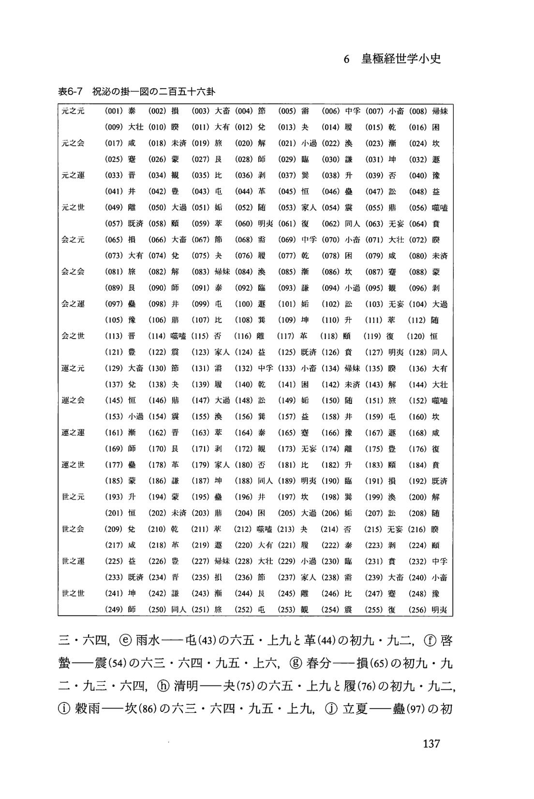

<!-- V3_SOURCE_ID:book015-b000949-p000-d557388ce2 -->

六・六二、六三、九四；小满对应巽(107)的九五、上六，坤(108)的初九、六二；①芒种对应颐(118)的六三、九四、六五、上六；夏至对应大畜(129)的初九、九二、六三、六四；小暑对应履(139)的九五、上六，乾(140)的初九、九二；大暑对应随(150)的六三、六四、九五、上六；⑨立秋对应渐(161)的初六、九二、九三、六四；⑨处暑对应剥(171)的九五、上六，观(172)的初六、九二；白露对应升(182)的六三、六四、六五、上九；⑤秋分对应升(193)的初九、九二、九三、六四；①寒露对应鼎(207)的九五、上九，困(204)的初九、九二；@霜降对应否(214)的六三、九四、九五、上六；立冬对应益(225)的初六、六二、九三、六四；小雪对应损(235)的六五、上九，节(236)的初六、六二；大雪对应比(246)的九三、六四、六五、上六，情况就是如此。张行成的卦一图与该图的相位偏差仅涉及64卦，但由于与十二月及二十四节气的对应关系发生了变化，起运的结果会产生根本性的差异。

> **释读存疑：** 本地硬校验仍未通过，已记录供后续自动处理或人工核对。

查看对应原文

<!-- V3_FOLDBACK_BEGIN:book015-b000949-p000-d557388ce2 -->

六・六二・六三・九四，小満巽(107)の九五・上六と坤(108)の初九・六二，①芒種頤(118)の六三・九四・六五・上六，夏至大畜(129)の初九・九二・六三・六四，小暑履(139)の九五・上六と乾(140)の初九・九二，大暑随(150)の六三・六四・九五・上六，⑨立秋漸(161)の初六・九二・九三・六四，⑨処暑剝(171)の九五・上六と観(172)の初六・九二，白露升(182)の六三・六四・六五・上九，⑤秋分升(193)の初九・九二・九三・六四，①寒露鼎(207)の九五・上九と困(204)の初九・九二，@霜降否(214)の六三·九四・九五・上六，立冬益(225)の初六・六二・九三・六四，小雪損(235)の六五・上九と節(236)の初六・六二，大雪比(246)の九三・六四・六五・上六のごとくである。張行成の掛一図との位相のずれはわずか64卦にすぎないが，十二月や二十四節気との対応が変わる以上，起運の結果には根本的な差異が生じている。

<!-- V3_FOLDBACK_END:book015-b000949-p000-d557388ce2 -->

<!-- V3_SOURCE_ID:book015-b000950-p000-d59896209e -->

祝泌的运数与张行成的数值不同，配当完全不同25)。首先是“经日的甲一、经月的巳六、经星的癸一百八十、经辰的未二千一百五十六”的尧时元经会的运卦，张行成将日元（甲1）对应卦一图的年，月会（巳6）对应月，星运（癸180）对应日，将尧的运卦定为起升的世之元卦图（表6-6）的第128卦贲；而祝泌则依据《观物篇解》卷六的记载“天数起于会的子的冬至甲子（星甲1），卦从泰开始”，将起泰的元之元卦图（表6-7）的第128卦同人（九五）定为运卦并加以论定。由于二者基于同一系统的图，仅历元不同，却都确定了同一第180运的易卦，因此与张行成一样，必须将第128卦定为运卦，这是事理必然如此的。另外关于会经运的世卦，张行成将月会（巳6）对应卦一图的年，星运（癸180）对应月，辰世（未2,156）对应日，依据《观物篇解》卷六的记载“地数起于运的甲的惊蛰己卯（星己76），同时起于泰卦”，来求第2,156世对应何种卦。“地数起于运的甲的惊蛰己卯”，是指预先除去“开物”之前的75运900世，以月寅3、星己76、辰子901作为新的计算起点（《皇极起数例》大运小运起例）。在起泰的元之元卦图上，将开物的月寅3、星己76、辰子901作为地数的起算点，配当泰卦的六五、上六与蒙卦的初六、九二时，尧即位的月巳6、星癸180、辰未2,156对应第1080+176（=1,256=2,156-900）世，既济（125）的九五、上六与贲（126）的初九、六二“与事相应”。祝泌最后根据尧即位在第2,156世的第11年，计算与事相应的爻，得出结论：“会的世的世的元的既济卦（上六）”对应世卦（1世=30年）。祝泌对运经世的年卦的计算也极具独创性。年卦（尧即位的未世甲辰年）的计算，是将星运（癸180）对应卦一图的年，辰世（未2,156）对应月，年（甲辰11）对应日，以起泰的元之元卦图的“世的子的大寒（第22卦涣卦）”作为计算起点。“入元的初年（子世甲子年），对应世的运的运的运的损（235）六五”（《皇极起数例》大运小运起例）。对于未世甲辰年，将大寒的涣卦之后的渐（23）的初六、六二、九三、六四配当寅世甲子年，从那里起算卦数，从未世（月）夏至的大畜（129）开始数到第11年（日）对应的易卦即可，大有卦（136）就是该卦。

> **释读存疑：** “启蛰”未列入术语表，保留原词“惊蛰”；“《皇极起数例》大运小运起例”“尧即位的未世甲辰年”“第22卦涣卦”未列入术语表，保留原短语；本地硬校验仍未通过，已记录供后续自动处理或人工核对。

查看对应原文

<!-- V3_FOLDBACK_BEGIN:book015-b000950-p000-d59896209e -->

祝泌の運数は張行成の値と異なり，配当がまったく違っている25)。まず「経日の甲一・経月の巳六・経星の癸一百八十・経辰の未二千一百五十六」の堯時元経会の運卦であるが，張行成が日元(甲1)を掛一図の年，月会(巳6)を月，星運(癸180)を日にあて，堯の運卦を起升の世之元卦図(表6-6)の第128卦の賁とするのに対して，祝泌は「天数は会の子の冬至甲子(星甲1)に起こり，卦は泰より行く」(『観物篇解』巻六)として，起泰の元之元卦図(表6-7)の第128卦の同人(九五)を運卦に論定している。暦元のみが異なる同じシステムの図にもとづいて同じ第180運の易卦を決定しているからには，張行成と同様に第128番目の卦を運卦にとらねばならないのは理の然らしめるところである。また会経運の世卦については，月会(巳6)を掛一図の年，星運(癸180)を月，辰世(未2,156)を日にあて，「地数は運の甲の驚蟄(啓蟄)己卯(星己76)に起こり，ならびに泰卦に起こる」(『観物篇解』巻六)として，第2,156世が何の卦にあたるかを求めている。「地数は運の甲の驚蟄己卯に起こる」とは，「開物」以前の75運900世をあらかじめ除いて月寅3・星己76・辰子901を新たな計算の起点とすることである(『皇極起数例』大運小運起例)。起泰の元之元卦図上，開物の月寅3・星己76・辰子901を地数の起算点として泰卦の六五・上六と蒙卦の初六・九二に配当したとき，堯が即位した月巳6・星癸180・辰未2,156は第1080+176(=1,256=2,156-900)世にあたり，既済(125)の九五・上六と賁(126)の初九・六二が「事に直る」。祝泌は最後に，堯の即位が第2,156世の第11年にあることから直事の爻を計算し，「会の世の世の元の既済卦(上六)」が世卦にあたると結論している(1世=30年)。祝泌による運経世の年卦の計算もきわめて独創的である。年卦(堯即位の未世甲辰年)の計算は星運(癸180)が掛一図の年，辰世(未2,156)が月，年(甲辰11)が日にあたり，起泰の元之元卦図の「世の子の大寒(第22卦の渙卦)」が計算の起点である。「入元の初年(子世甲子年)は，世の運の運の運の損(235)六五に起こる」(『皇極起数例』大運小運起例)。未世甲辰年については，大寒の渙卦につづく漸(23)の初六・六二・九三・六四に寅世甲子年を配当してそこから卦数を起こし，未世(月)夏至の大畜(129)から数えて第11年(日)目にある易卦を求めればよい。大有卦(136)がそれである。

<!-- V3_FOLDBACK_END:book015-b000950-p000-d59896209e -->

<!-- V3_SOURCE_ID:book015-b000951-p000-2793a50363 -->

祝泌的声音律吕之学，也利用①等韵学的理论来阐释邵雍的系统，②分析动植物发出的各种声音以占断吉凶，呈现出独特的发展26)。

查看对应原文

<!-- V3_FOLDBACK_BEGIN:book015-b000951-p000-2793a50363 -->

祝泌の声音律呂の学も，①等韻学の理論を利用して邵雍のシステムを説明し，②動植物の発するさまざまな音声を分析して吉凶を占っており，独自の展開をみせている26)。

<!-- V3_FOLDBACK_END:book015-b000951-p000-2793a50363 -->

<!-- V3_SOURCE_ID:book015-b000952-p000-71cf3fc792 -->

关于第1点，声母的确定最能体现祝泌学术的特色。祝泌本人在列举当时的韵图——方淑《韵心》、杨倓《韵谱》等书名时，还颇为自豪地说“相互参照来校定四十八音”。所谓“四十八音”，是基于发音部位和清浊的地音（声母）分类。其特点在于不考虑开合，比等韵三十六字母多12个音。以“一音”为例，分别是①古、甲、九、癸，②□、□、近、揆，③坤、巧、丘、弃，④□、□、乾、蚪这四个音，各自对应三十六字母的①见的清（k）、②南音群的浊（g'）、③溪的清（k）、④北音群的浊（g）。地的全音各自包含12个辅音，因此声纽的总数为48。

查看对应原文

<!-- V3_FOLDBACK_BEGIN:book015-b000952-p000-71cf3fc792 -->

第1点については，声母の同定が最も祝泌の学術らしい色彩に溢れている。祝泌自身も当時の韻図―方淑『韻心』や楊倓『韻譜』などの書名をあげながら「相参合して四十八音を較定す」と誇らしげにのべている(『皇極経世起数訣』声音韻譜序)。「四十八音」とは調音部位と清濁にもとづく地音(声母)の分類のこと。開発収閉を無視するところに特徴があり，等韻三十六字母より12音多い。「一音」を例にとれば，①古・甲・九・癸，②□・□・近・揆，③坤・巧・丘・弃，④□・□・乾・蚪の4音がそれであり，それぞれ三十六字母の①見の清(k)，②南音群の濁(g')，③渓の清(k)，④北音群の濁(g)に相当している(李光地『等韻弁疑』)。地の全音はそれぞれ12の子音を含んでおり，したがって声紐の総数は48と

<!-- V3_FOLDBACK_END:book015-b000952-p000-71cf3fc792 -->

<!-- V3_SOURCE_ID:book015-b000953-p000-003ea0e3b0 -->

<table><tr><td rowspan="1" colspan="1">地之用音一百五十二舉要：坤師卦主開音清，剥蒙卦主發音清，比坎卦主收音清，觀渙卦主閉音清</td></tr><tr><td rowspan="1" colspan="1">唇音四</td></tr><tr><td rowspan="1" colspan="1">夫坤四、法剥、□比、飛觀普師五、朴蒙、品坎、匹渙</td></tr><tr><td rowspan="1" colspan="1">旁升五、手&quot;</td></tr><tr><td rowspan="1" colspan="1">母師二、馬蒙、美抹、米渙</td></tr><tr><td rowspan="1" colspan="1">舌音四：東坤六、丹剥、帝比</td></tr><tr><td rowspan="1" colspan="1">土師六、貪蒙、天坎</td></tr><tr><td rowspan="1" colspan="1">升六、回乃坤七、始剥、女比牙音四</td></tr></table>

> **释读存疑：** 原表格中存在残缺字符，未标注说明

查看对应原文

<!-- V3_FOLDBACK_BEGIN:book015-b000953-p000-003ea0e3b0 -->

<table><tr><td rowspan=1 colspan=1>地之用音一百五十二舉要坤師卦主開音清剥蒙卦主發音清比坎卦主收音清觀渙卦主閉音清</td></tr><tr><td rowspan=1 colspan=1>唇音四</td></tr><tr><td rowspan=1 colspan=1>夫坤四       法剥       □比      飛觀普師五       朴蒙      品坎      匹渙</td></tr><tr><td rowspan=1 colspan=1>旁升五            手&quot;      </td></tr><tr><td rowspan=1 colspan=1>母師二       馬蒙      美抹      米渙</td></tr><tr><td rowspan=1 colspan=1>舌音四東坤六       丹剥      帝比</td></tr><tr><td rowspan=1 colspan=1>土師六       貪蒙      天坎</td></tr><tr><td rowspan=1 colspan=1>升六           回乃坤七       始剥      女比牙音四</td></tr></table>

<!-- V3_FOLDBACK_END:book015-b000953-p000-003ea0e3b0 -->

<!-- V3_SOURCE_ID:book015-b000954-p000-22bb70d653 -->

4×12=48，因此总数只能是48。另外“相互参照来校定四十八音”这句话，很好地体现了祝泌利用等韵学的成果来解释邵雍的四十八音。《皇极起数例》的地之用音一百五十二举要及《皇极经世起数诀》的壹百五十二音八卦，都是祝泌校定四十八音的结果。以发音部位区分出唇4音、舌4音、牙4音、齿5音、喉4音、半舌音与半齿音3音共24音，还以清浊来区分这24音母的“轻重”。

> **释读存疑：** 本地硬校验仍未通过，已记录供后续自动处理或人工核对。

查看对应原文

<!-- V3_FOLDBACK_BEGIN:book015-b000954-p000-22bb70d653 -->

ならざるをえない(4×12=48)。また「相参合して四十八音を較定す」の1句は，祝泌が等韻学の成果を利用して邵雍の四十八音を解釈したことをよく示している。『皇極起数例』の地之用音一百五十二挙要(図6-20)や『皇極経世起数訣』の壱百五十二音八卦が，祝泌の四十八音の「較定」の結果である。調音部位をもって唇4音·舌4音·牙4音·歯5音・喉4音・半(半舌音と半図6-20 地之用音一百五十二挙要

<!-- V3_FOLDBACK_END:book015-b000954-p000-22bb70d653 -->

<!-- V3_SOURCE_ID:book015-b000955-p000-49e8d255cf -->

比如对应三十六字母的端（t）的六音东、丹、帝、（此处原文残缺），它们各自对应的易卦是坤、剥、比，祝泌以等韵学中舌音的清来说明其音值。

> **释读存疑：** 原文中“六音の東・丹・帝・”后存在字符残缺，无法确认具体所指；本地硬校验仍未通过，已记录供后续自动处理或人工核对。

查看对应原文

<!-- V3_FOLDBACK_BEGIN:book015-b000955-p000-49e8d255cf -->

歯音)3音の24音を区別し，また清濁をもって24音母の「軽重を分けている」。たとえば三十六字母の端(t)に同定される六音の東・丹・帝・については，易卦の配当がそれぞれ坤・剝・比であり，等韻学の舌音の清をもって音価を説明している。

<!-- V3_FOLDBACK_END:book015-b000955-p000-49e8d255cf -->

<!-- V3_SOURCE_ID:book015-b000956-p000-2597317662 -->

在研究祝泌的声母时，需要注意的是，尽管他认为邵雍对辅音的推定存在错误，但并未修改从辅音分析确定的易卦配属。被圆圈圈起的同、覃、田、“■(d)”，具体所指不详，配属于升、蛊、井卦，而升卦是依据风水语境中的河流、水系及其来去形态的水石音开浊、蛊卦是依据火石音发浊、井卦是依据土石音收浊来命名的，本不应属于清音。祝泌对此说道：“坤师主张开音清，但其中有升谦卦，是浊音重复出现的情况。”

> **释读存疑：** ■(d)的具体所指不详；1轮自动修复后核义模型仍建议修订，已保守记录。

查看对应原文

<!-- V3_FOLDBACK_BEGIN:book015-b000956-p000-2597317662 -->

祝泌の声母研究において注意すべきは，邵雍の子音の推定に誤りがあると考えていたにもかかわらず，子音の分析から定められた易卦の配当を改めていないことである。円圏で囲まれた同・覃・田・■(d)は,升・蠱・井に配当されているが，升卦は水石音開濁，蠱卦は火石音発濁，井卦は土石音収濁を根拠として命名されたものであり，ほんらい清音に属すべきではない。祝泌はそれについて「坤師は開音清を主るも，その中に升謙卦あるは，濁音を重出する者なり」とのべている。

<!-- V3_FOLDBACK_END:book015-b000956-p000-2597317662 -->

<!-- V3_SOURCE_ID:book015-b000957-p000-1b73887109 -->

祝泌关于韵母的考察，与关于声母的考察几乎没有差别。他以《广韵》的206韵为基准来推定邵雍112声的音值，其确定方法仅为“以平上去入四声来归摄韵部”，适用于包含有声无字（O）在内的各声。其结果见于《皇极起数例》的天之用声一百一十二举要（图）

查看对应原文

<!-- V3_FOLDBACK_BEGIN:book015-b000957-p000-1b73887109 -->

祝泌の韻母にかんする考察も，声母のそれとほとんど変わらない。『広韻』の206韻を基準にして邵雍の112声の音価を推定しており，同定法は有声無字(O)を含む各声に対して「平上去入の四声を以て帰韻を摂る」にすぎない。その結果が『皇極起数例』の天之用声一百一十二挙要(図

<!-- V3_FOLDBACK_END:book015-b000957-p000-1b73887109 -->

<!-- V3_SOURCE_ID:book015-b000958-p000-5a6a3cce30 -->

6-21）和《皇极经世起数诀》的一百一十二声目录并八卦等内容。只要大致看一下韵母的配置，祝泌的意图自然就会明了。

查看对应原文

<!-- V3_FOLDBACK_BEGIN:book015-b000958-p000-5a6a3cce30 -->

6-21)や『皇極経世起数訣』の一百一十二声目録併八卦などである。韻母の配置を一瞥すれば，祝泌の企図するところは自ずと明らかであろう。

<!-- V3_FOLDBACK_END:book015-b000958-p000-5a6a3cce30 -->

<!-- V3_SOURCE_ID:book015-b000959-p000-e187a1e2ff -->

《皇极经世起数诀》中，除了上述两个表之外，还记载有80个等韵图。祝泌的等韵图的特征在于，他考虑声母的清浊与开合收闭来分别绘制。例如，“开音清”的韵图是……

> **释读存疑：** 本地硬校验仍未通过，已记录供后续自动处理或人工核对。

查看对应原文

<!-- V3_FOLDBACK_BEGIN:book015-b000959-p000-e187a1e2ff -->

『皇極経世起数訣』には上記の2表のほか，80の等韻図が記されている。祝泌の等韻図の特徴は，声母の清濁と開発収閉を案じて分けて描いているところにある。たとえば「開音清」の韻図は,

<!-- V3_FOLDBACK_END:book015-b000959-p000-e187a1e2ff -->

<!-- V3_SOURCE_ID:book015-b000960-p000-7ef6c126c7 -->

<table><tr><td></td><td>天之用聲一百一十二舉要 乾日聲平聞尖月日聲上聞大有日皇聲去聞大壯辰日聲入聞</td></tr><tr><td>可二十三街</td><td>舌十七薛</td></tr><tr><td>甲一多七歌</td><td>个三十七箇 向四十一沫 ()十集</td></tr><tr><td>乙二良十陽 丙三千一先</td><td>旦二十八翰 十</td></tr><tr><td>二仙</td><td>三十三線 十七年</td></tr><tr><td>四刀三簫</td><td>孝三十六效 岳四覺</td></tr><tr><td>四</td><td>三十四 三十五癸</td></tr><tr><td>戊五妻十二齊</td><td>四六至 日五質</td></tr><tr><td>孔一世</td><td>衆一送 一屋</td></tr><tr><td>巳六宫一束 二冬</td><td>二宋 二沃</td></tr><tr><td>庚七二十一侵</td><td>禁五十二 三十六年</td></tr></table>

> **释读存疑：** 部分条目如「可二十三街」「舌十七薛」「甲一多七歌」「乙二良十陽 丙三千一先」「二仙」「四刀三簫」「四」「戊五妻十二齊」「孔一世」等内容含义未明，原文未明确具体所指

查看对应原文

<!-- V3_FOLDBACK_BEGIN:book015-b000960-p000-7ef6c126c7 -->

<table><tr><td></td><td>天之用聲一百一十二舉要 乾日聲平聞尖月日聲上聞大有日皇聲去聞大壯辰日聲入聞</td></tr><tr><td>可二十三街</td><td>舌十七薛</td></tr><tr><td>甲一多七歌</td><td>个三十七箇 向四十一沫 ()十集</td></tr><tr><td>乙二良十陽 丙三千一先</td><td>旦二十八翰 十</td></tr><tr><td>二仙</td><td>三十三線 十七年</td></tr><tr><td>四刀三簫</td><td>孝三十六效 岳四覺</td></tr><tr><td>四</td><td>三十四 三十五癸</td></tr><tr><td>戊五妻十二齊</td><td>四六至 日五質</td></tr><tr><td>孔一世</td><td>衆一送 一屋</td></tr><tr><td>巳六宫一束 二冬</td><td>二宋 二沃</td></tr><tr><td>庚七二十一侵</td><td>禁五十二 三十六年</td></tr></table>

<!-- V3_FOLDBACK_END:book015-b000960-p000-7ef6c126c7 -->

<!-- V3_SOURCE_ID:book015-b000961-p000-46a20df60a -->

図6-21 天之用声一百十二挙要

查看对应原文

<!-- V3_FOLDBACK_BEGIN:book015-b000961-p000-46a20df60a -->

図6-21 天之用声一百十二挙要

<!-- V3_FOLDBACK_END:book015-b000961-p000-46a20df60a -->

<!-- V3_SOURCE_ID:book015-b000962-p000-30b710a322 -->

从右往左依次排列着「夫・普・旁・母・東・土・同・乃……」这些开音清的24个声母，从上往下依次排列着「東東東・董・送送送送・屋屋屋屋」这些韵母；「收音清」的韵图，横向依次排列着「□・品・平・美・帝・天・田・女……」这些收音清的声母，纵向依次排列着「冬鐘鐘・董腫腫・宋用用・沃燭燭燭」这些韵母。「東・董・送・屋」这些

> **释读存疑：** 原文末尾「「東・董・送・屋」这些」未完整表述，存在内容缺失；本地硬校验仍未通过，已记录供后续自动处理或人工核对。

查看对应原文

<!-- V3_FOLDBACK_BEGIN:book015-b000962-p000-30b710a322 -->

右から左へ[夫・普・旁・母・東・土・同・乃……」と開音清の24声母をならべ，上から下に「東東東・董 ·送送送送・屋屋屋屋」と韻母をならべており(図6-22)，「収音清」の韻図は，横に「□・品・平・美・帝・天・田・女……」と収音清の声母をならべ，縦に「冬鐘鐘・董腫腫・宋用用・沃燭燭燭」と韻母をならべている。「東・董・送・屋」な

<!-- V3_FOLDBACK_END:book015-b000962-p000-30b710a322 -->

<!-- V3_SOURCE_ID:book015-b000963-p000-c28dd7bb33 -->

分别是《广韵》的平声、上声、去声、入声的韵目，用4×4的小区画来表示韵母的一等、二等、三等、四等。等韵图的结构本身和《韵镜》《七音略》极为相似，独創

> **释读存疑：** 独創的具体含义未明确说明；1轮自动修复后核义模型仍建议修订，已保守记录。

查看对应原文

<!-- V3_FOLDBACK_BEGIN:book015-b000963-p000-c28dd7bb33 -->

どはそれぞれ『広韻』の平声・上声・去声・入声の韻目であり，韻母の一等・二等・三等・四等を示すのが4×4の小区画である。等韻図の構造自体は『韻鏡』や『七音略』にきわめてよく似ており，独創

<!-- V3_FOLDBACK_END:book015-b000963-p000-c28dd7bb33 -->

<!-- V3_SOURCE_ID:book015-b000964-p001-01498ac30e -->

图6-22 韵图(开音清)

> **释读存疑：** 本地硬校验仍未通过，已记录供后续自动处理或人工核对。

查看对应原文

<!-- V3_FOLDBACK_BEGIN:book015-b000964-p001-01498ac30e -->

図6-22 韻図(開音清)

<!-- V3_FOLDBACK_END:book015-b000964-p001-01498ac30e -->

<!-- V3_SOURCE_ID:book015-b000965-p000-f67fd8db24 -->

（该事物）并不太具备。

> **释读存疑：** 本地硬校验仍未通过，已记录供后续自动处理或人工核对。

查看对应原文

<!-- V3_FOLDBACK_BEGIN:book015-b000965-p000-f67fd8db24 -->

性はあまりない。

<!-- V3_FOLDBACK_END:book015-b000965-p000-f67fd8db24 -->

<!-- doc004 PDF 第 153 页：高风险/复杂版面 OCR 供检索；内容与排版以原页图为准。 -->
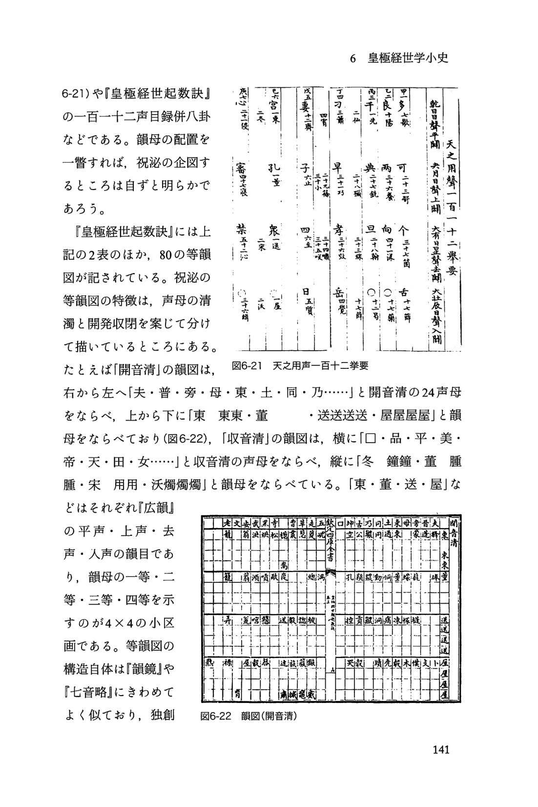

<!-- V3_SOURCE_ID:book015-b000967-p000-d6227523be -->

祝泌在声音学上最具意义的，是依据“天机自动，朕兆先孚”的自然声音来占卜，即“以声音起数，以数配合卦象”。祝泌听到牛发出“吽”的叫声后，进行了如下占卜。具体步骤为：①分析声音，确定韵母与声母。“吽”的韵母属于上声的十八吻——月辰声第3声的允，声母属于唇音的闭清——石水音第4音的飞。②检索《皇极经世起数诀》中收录的一百一十二声目录及八卦、一百五十二音八卦等内容，确定与天声、地音对应的声音正卦。天卦为随，地卦为观。“随卦以居左，观卦以居右”，确定既济阴阳卦。从右方向横向看随、观两卦，由上卦的兑与巽推导出大过，由下卦的震与坤推导出豫。大过与豫即为该既济阴阳卦。③参照《声音入既济四象并挂一卦总括阳图》，确定声音正卦、既济阴阳卦的矩阵所处位置，以及挂卦对应的内容。第125位的会之世的世元，是所求四象的数，也是既济卦所求的挂一卦。④以挂一卦进行易占判断。既济卦的占断结果为“其事已成，在季秋时尤为吉利”。以下祝泌利用会之世的世元数及吽的声音固有数等，进行更详细的易断，此处省略相关说明。另外，在占卜悬而未决的事项时，祝泌不仅会利用人发出的语音，还会积极利用人的咳嗽声、物体的响动声等，展开同样的声音分析。

> **释读存疑：** “允”“飞”的具体所指不详；“闭清”的具体所指不详；“月辰声”“石水音”的具体所指不详；“挂卦”的具体所指不详；“会之世”“世元”的具体所指不详；本地硬校验仍未通过，已记录供后续自动处理或人工核对。

查看对应原文

<!-- V3_FOLDBACK_BEGIN:book015-b000967-p000-d6227523be -->

祝泌の声音学上最も意義が深いのは，「天機の自動，朕兆の先孚」である自然の音声をもって事を占い(『皇極経世起数訣』辨槁物及馨咳之音法)，「声を以て数を起こし，数を以て卦に合わす」(『四庫全書総目提要』巻百八)ところである。祝泌は牛が「吽」と鳴いたのをうけて，次のごとく占っている(『観物篇解』巻十)。すなわち，①声音を分析して，韻母(天声)と声母(地音)を確定する。「吽」のばあい，韻母は上声の十八吻——月辰声第3声の允，声母は唇音の閉清——石水音第4音の飛に属している。②『皇極経世起数訣』に収められた一百一十二声目録併八卦や壱百五十二音八卦などを検索して，天声と地音に対応する声音正卦(天卦・地卦)を定める。天卦は随であり，地卦は観である。「随卦(二四)を以て左に居き，観卦(五八)を右に居き」，既済陰陽卦を定める。右方向から横に随・観2卦をみて，上卦の兌(二)と巽(五)から大過(二五)を導きだし，下卦の震(四)と坤(八)から豫(四八)を導きだす。大過と豫がその既済陰陽卦である。③声音入既済四象并掛一卦総括陽図(『皇極経世観物篇解』巻十，図6-23)を参照して，声音正卦・既済陰陽卦(月辰声二四随と石水音五八観と大過・豫)のマトリックスが何の位にあり，掛卦が何にあたるかを決定する。第125位の会の世の世の元が求める四象の数であり，既済卦が求める掛一卦である。④掛一卦をもって易占を断行する。既済卦による占断の結果は，「その事すでに成る。季秋にありて尤も吉」である。以下，祝泌は会の世の世の元の数(10,800×30×30×129,600=1,259,712,000,000)や吽の声音に固有の数(丙・巳)などを利用して，より詳しい易断を実行しているが，それについては説明を省略したい。なお懸案の事象を占う際，祝泌は人の発する語音はいうにおよばず，人の咳声や物の響喚なども積極的に利用して同様な声音分析を展開している。

<!-- V3_FOLDBACK_END:book015-b000967-p000-d6227523be -->

<!-- V3_SOURCE_ID:book015-b000968-p000-f4f8eae00f -->

祝泌的声音入既济四象幷掛一卦総括陽図，结构和内容与张行成《通変》的既済陽図相同，但各声音正卦、既済陰陽卦旁都添加了元会運世的位数、掛一卦等内容，在这一点上二者存在差异。

> **释读存疑：** “幷”“総括”的具体所指不详；本地硬校验仍未通过，已记录供后续自动处理或人工核对。

查看对应原文

<!-- V3_FOLDBACK_BEGIN:book015-b000968-p000-f4f8eae00f -->

祝泌の声音入既済四象幷掛一卦総括陽図(図6-23)は，構造や内容は張行成『通変』の既済陽図(図6-18)と等しいが，各声音正卦・既済陰陽卦ごとに元会運世の位数や掛一卦などが書き加えられており，その点で同

<!-- V3_FOLDBACK_END:book015-b000968-p000-f4f8eae00f -->

<!-- V3_SOURCE_ID:book015-b000969-p000-9e040b8d7e -->

并非如此。祝泌对张行成的图进行增补，是因为“张文饶以既济卦总括声音，分为二百五十六类，自称为简。然而又没有四象，也没有阴卦”，出自《皇极经世观物篇解》卷十，归根结底，这不过是为了在进行声音占时，能够简单确定挂一卦而添加的修正罢了。但现存的《声音入既济四象并挂一卦总括阳图》中记载的挂一卦，与挂一图（表6-7）中的挂一卦存在抵触，明显产生了矛盾。

查看对应原文

<!-- V3_FOLDBACK_BEGIN:book015-b000969-p000-9e040b8d7e -->

じでない。祝泌が張行成の図に加筆したのは，「張文饒は既済卦を以て声音を総じ二百五十六類となし，自ら簡と謂う。しかるにまた四象なく，陰卦なき」がためであり（『皇極経世観物篇解』巻十），結局のところ，声音占を行う際に必要な掛一卦の決定を簡単に行うために加えられた修正にほかならない。だが現存する声音入既済四象幷掛一卦総括陽図の掛一卦の記載は，掛一図（表6-7）の掛一卦と齟齬し明らかに矛盾を来たしている。

<!-- V3_FOLDBACK_END:book015-b000969-p000-9e040b8d7e -->

<!-- V3_SOURCE_ID:book015-b000970-p000-8d8c073d53 -->

<table><tr><td></td><td>聲音入既濟四象并掛一卦總括陽圗</td><td></td><td></td></tr><tr><td></td><td></td><td></td><td>元之元卷會之元四損運之元烈畜世之元四節</td></tr><tr><td></td><td></td><td></td><td>水水音八八坤火水音七八剥土水音六八比石水音五八観</td></tr><tr><td>元</td><td></td><td></td><td>日日聲一一乾日日聲一一乾日日聲一一乾日日聲一一乾</td></tr><tr><td>之</td><td></td><td></td><td>元之會知儒會之會四四孚運之會名圗世之會四妹</td></tr><tr><td>元</td><td></td><td></td><td>水火音八七謙火火音七七艮土火音六七蹇石火音五七漸</td></tr><tr><td>N</td><td>元之運壯會之運四睽運之運有世之運曰名兌</td><td></td><td>日日聲一一乾日日聲二乾日日聲一一乾日日聲一一乾</td></tr><tr><td>0</td><td></td><td>水土音八六師火土音七六蒙土土音六六坎石土音五六渙</td><td></td></tr><tr><td>N</td><td></td><td>日日聲一一乾日日聲二乾日日聲一一乾日日聲一一乾</td><td></td></tr><tr><td></td><td></td><td>元之世夬會之世履運之世皇四乾世之世曰国</td><td></td></tr><tr><td></td><td>水石音八五升火石音七五蠱土石音六五井石石音五五巽</td><td></td><td></td></tr><tr><td></td><td>日日聲一一乾日日聲一一乾日日聲一一乾日日聲一一乾</td><td></td><td></td></tr></table>

查看对应原文

<!-- V3_FOLDBACK_BEGIN:book015-b000970-p000-8d8c073d53 -->

<table><tr><td></td><td>聲音入既濟四象并掛一卦總括陽圗</td><td></td><td></td></tr><tr><td></td><td></td><td></td><td>元之元卷會之元四損運之元烈畜世之元四節</td></tr><tr><td></td><td></td><td></td><td>水水音八八坤火水音七八剥土水音六八比石水音五八観</td></tr><tr><td>元</td><td></td><td></td><td>日日聲一一乾日日聲一一乾日日聲一一乾日日聲一一乾</td></tr><tr><td>之</td><td></td><td></td><td>元之會知儒會之會四四孚運之會名圗世之會四妹</td></tr><tr><td>元</td><td></td><td></td><td>水火音八七謙火火音七七艮土火音六七蹇石火音五七漸</td></tr><tr><td>N</td><td>元之運壯會之運四睽運之運有世之運曰名兌</td><td></td><td>日日聲一一乾日日聲二乾日日聲一一乾日日聲一一乾</td></tr><tr><td>0</td><td></td><td>水土音八六師火土音七六蒙土土音六六坎石土音五六渙</td><td></td></tr><tr><td>N</td><td></td><td>日日聲一一乾日日聲二乾日日聲一一乾日日聲一一乾</td><td></td></tr><tr><td></td><td></td><td>元之世夬會之世履運之世皇四乾世之世曰国</td><td></td></tr><tr><td></td><td>水石音八五升火石音七五蠱土石音六五井石石音五五巽</td><td></td><td></td></tr><tr><td></td><td>日日聲一一乾日日聲一一乾日日聲一一乾日日聲一一乾</td><td></td><td></td></tr></table>

<!-- V3_FOLDBACK_END:book015-b000970-p000-8d8c073d53 -->

<!-- V3_SOURCE_ID:book015-b000971-p000-96f31e5fc7 -->

图6-23 声音入既四象并挂一卦总括阳图

查看对应原文

<!-- V3_FOLDBACK_BEGIN:book015-b000971-p000-96f31e5fc7 -->

図6-23 声音入既四象并掛一卦総括陽図

<!-- V3_FOLDBACK_END:book015-b000971-p000-96f31e5fc7 -->

<!-- V3_SOURCE_ID:book015-b000972-p000-f628cf0fca -->

也就是说，若依照挂一图的结构，挂一卦本应是①元之元之元之元泰，②元之元之元之会损，③元之元之元之运大畜……，但既济图中②元之元之元之会的卦是需，③元之元之元之运的卦是大壮……。或许是印刷或抄写时产生的错误，但不得不说这实在是荒唐之事。

查看对应原文

<!-- V3_FOLDBACK_BEGIN:book015-b000972-p000-f628cf0fca -->

すなわち，掛一図の構造にしたがえば，掛一卦はほんらい①元の元の元の元泰，②元の元の元の会損，③元の元の元の運大畜……とならなければならないのもかかわらず，既済図の②元の元の元の会の卦は需，③元の元の元の運の卦は大壮……である。おそらく印刷ないし筆写の際に生じた誤りであろうが，実に言語道断の事といわねばならない。

<!-- V3_FOLDBACK_END:book015-b000972-p000-f628cf0fca -->

<!-- V3_SOURCE_ID:book015-b000973-p000-32a314fa81 -->

据《宋元学案》的《张祝诸儒学案》记载，祝泌的弟子中有廖应准，其后续传承者有傅立、程直方等人。傅立在元朝出仕，官至集贤院大学士，著有《皇极续元元集》。另外《元史》卷十记载，傅立是祝泌的外甥，至元十六年，傅立将祝泌的著作进献给元世祖忽必烈。现存的皇极经世学研究著作中，明代杨向春所著《皇极经世心易发微》，是依照祝泌的体系推算洪武十七年以后的“运之年卦”。

> **释读存疑：** 字学海；字权甫；字道大；1279；1568邓世芳序；本地硬校验仍未通过，已记录供后续自动处理或人工核对。

查看对应原文

<!-- V3_FOLDBACK_BEGIN:book015-b000973-p000-32a314fa81 -->

『宋元学案』張祝諸儒学案によれば，祝泌の門人に廖応准（字，学海）があり，続伝の者に傅立（字，権甫）や程直方（字，道大）などがある。傅立は元朝に仕えて集賢院大学士になり，『皇極続元元集』を著したという。また『元史』巻十は，傅立を祝泌の甥と記し，至元十六年（1279），傅立が祝泌の書を世祖フビライに奉ったことをのべている。現存する皇極経世学の研究書においては，明の楊向春『皇極経世心易発微』（1568鄧世芳序）が祝泌のシステムに則って洪武十七年以降の「運の年卦」を計算している。

<!-- V3_FOLDBACK_END:book015-b000973-p000-32a314fa81 -->

<!-- V3_SOURCE_ID:book015-b000974-p000-6d8941b9c5 -->

## 2.4 黄畿の気六変説 — 2.4 黄畿的气六变说

查看对应原文

<!-- V3_FOLDBACK_BEGIN:book015-b000974-p000-6d8941b9c5 -->

## 2.4 黄畿の気六変説

<!-- V3_FOLDBACK_END:book015-b000974-p000-6d8941b9c5 -->

<!-- V3_SOURCE_ID:book015-b000975-p000-b78f35b3a8 -->

黄畿，字宗大，号粤洲，是广东省香山人。他是明代代表性的朱子学者黄佐的父亲。黄畿对皇极经世学造诣深厚，以著有《皇极经世书传》8卷的作者身份闻名。《皇极经世书传》大致分为三个部分：一是卷1的以元经会、卷2的以会经运、卷3的以运经世；二是卷4的声音唱和；三是卷5～8的观物内外篇注释。声音篇中对易卦的配当与张行成、祝泌基本相同，但对运卦、世卦、年卦等的配当与此前的解释思路不同，极具创新性。

> **释读存疑：** 1490-1566；1504自序；本地硬校验仍未通过，已记录供后续自动处理或人工核对。

查看对应原文

<!-- V3_FOLDBACK_BEGIN:book015-b000975-p000-b78f35b3a8 -->

黄畿は，字を宗大，号を粤洲といい，広東省香山の人。明代の代表的な朱子学者，黄佐(1490-1566。字は才伯，号は泰泉)の父親である。黄畿は皇極経世学に造詣が深く，『皇極経世書伝』8巻(1504自序)の作者として名高い。『皇極経世書伝』は大きく，①巻1の以元経会・巻2の以会経運・巻3の以運経世，②巻4の声音唱和，③巻5～8の観物内外篇の注釈の三つの部分に分かれている。声音篇における易卦の配当は張行成や祝泌と基本的に同じであるが，運卦・世卦・年卦などの配当は先行の解釈と発想を異にしており，きわめて斬新である。

<!-- V3_FOLDBACK_END:book015-b000975-p000-b78f35b3a8 -->

<!-- V3_SOURCE_ID:book015-b000976-p000-cb92067749 -->

张行成与祝泌的起运方法，如前文所述，所配当的易卦各不相同，乍看之下似乎是不同方向的研究，但实际上二者都基于同一卦气图，同样采用4爻对应1日的原则，思路上并无太大差异。另外，卦气图本身是否为邵雍所绘制尚存疑问，且256卦的顺序极为混乱，其中不存在任何规律性。“数学”本是阐明数字所具有的严密规律性、建立在其整齐结构之上的学问，因此黄畿作为皇极经世学者，发明新的起运原理并试图以此解释邵雍的历年，反而是理所当然的尝试。

> **释读存疑：** 掛一图

查看对应原文

<!-- V3_FOLDBACK_BEGIN:book015-b000976-p000-cb92067749 -->

張行成と祝泌の起運は既述のごとく，配当の易卦が一つ一つたがいに違い，一見したところ位相を異にした研究のようであるが，実は同じ卦気図(掛一図)にもとづき等しく4爻1日の原則を採用しており，発想法には大した差異はない。また卦気図自体も，邵雍の描いた図かどうか疑わしいのみならず,256卦の順序も錯雑をきわめ,そこにはいかなる規則性も存在しない。「数学」とはほんらい数のもつ強固な規則性を明らかにし，その整然とした構造の上に成立する学術であるからには，黄畿が新たな起運の原理を発明しそれによって邵雍の歴年を説明しようとしたのは，皇極経世学者としてはむしろ当然の試みということができる。

<!-- V3_FOLDBACK_END:book015-b000976-p000-cb92067749 -->

<!-- V3_SOURCE_ID:book015-b000977-p000-eaa9720b44 -->

黄畿的起运法虽蕴含无限的应用可能性，但其原则本身极为简单。具体而言，仅有三条基本原则：①依照邵雍的先天圆图；②将乾坤坎离四卦定为闰卦，其余六十卦定为正卦；③遵循黄佐序中所言的“气以六为变”，来确定所有易卦的配属。依据黄畿的配卦体系，闰卦中的离、乾、坎、坤分别主管四时二十四气。例如离卦，初九变为阴爻（初六），便会产生旅卦，这就是一变。二变时，由第二爻的爻变产生大有卦；三变时，由第三爻产生噬嗑卦，以此类推，四变产生贲卦，五变产生同人卦，六变产生丰卦。所谓“气以六为变”，无非是指通过爻变从基本卦中派生六子卦。离卦作为闰卦，主管一元的四分之一，即子会、丑会、寅会共三万二千四百年；而从离卦派生的旅、大有等六变爻对应的卦，分别掌管冬至、小寒、大寒、立春、雨水、惊蛰对应的节序。至于离卦与坎卦被定为“阴阳之限”，分别对应冬至与夏至，这不过是因为黄畿遵循了先天图的易卦方位而已。

> **释读存疑：** 本地硬校验仍未通过，已记录供后续自动处理或人工核对。

查看对应原文

<!-- V3_FOLDBACK_BEGIN:book015-b000977-p000-eaa9720b44 -->

黄畿の起運法は無限の応用力を秘めていながら，原則自体はきわめて単純である。すなわち，わずか3条の基本原則，①邵雍の先天円図にしたがう，②乾坤坎離の4卦を閏卦とし，残り60卦を正卦とする，③「気は六を以て変ず」(黄佐序)に則って，すべての易卦の配当を定めている。黄畿の配卦システムによれば，閏卦の離・乾・坎・坤はそれぞれ四時二十四気を分主している(図6-24)。たとえば離卦のばあい，初九が陰爻(初六)に変じ，旅卦が生じる。これが一変である。二変のとき二爻の爻変から大有卦，三変のとき三爻から噬嗑卦が生じ，以下同様にして四変に賁卦，五変に同人卦，六変に豊卦が生じる。「気は六を以て変ず」とは，爻変によって基本卦から6子卦が派生することにほかならない。離卦は閏卦として1元の1/4，すなわち子会・丑会・寅会の32,400年を主っており，また旅や大有など離卦から生じた六変爻直の卦はおのおの冬至・小寒・大寒・立春・雨水・驚蟄に比定される節序を掌っている。なお離卦と坎卦が「陰陽の限」として冬至と夏至に配当されているのは，黄畿が先天図の易卦方位に則ったからにすぎない。

<!-- V3_FOLDBACK_END:book015-b000977-p000-eaa9720b44 -->

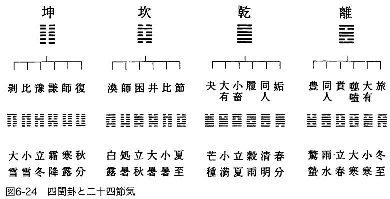

<!-- V3_SOURCE_ID:book015-b000979-p000-80e8bd7ff2 -->

六十卦的展开也与闰卦极为相似。所谓六十卦，是指从先天图的六十四卦中，除去位于四正之位的乾坤坎离后余下的六十个易卦。从表面看，卦序本身虽与先天图相同，但并未将乾卦定为第一卦，而是以复卦作为起卦。六十卦以复为起卦，是因为乾卦是“生生之本”，而复卦则对应“生生之始”。

> **释读存疑：** “生生之始”的具体所指不详；本地硬校验仍未通过，已记录供后续自动处理或人工核对。

查看对应原文

<!-- V3_FOLDBACK_BEGIN:book015-b000979-p000-80e8bd7ff2 -->

六十卦の展開も閏卦ときわめてよく似ている(図6-25)。六十卦とは，先天図の六十四卦から四正の位にある乾坤坎離(邵雍の四正卦)をのぞいた60の易卦のことである。一見すれば明らかなごとく，卦序自体は先天図と等しいにもかかわらず，乾卦を第1卦とせず復卦を起卦としている。六十卦が復に起こるのは，乾卦が「生生の本」であるのに対して，復卦は

<!-- V3_FOLDBACK_END:book015-b000979-p000-80e8bd7ff2 -->

<!-- V3_SOURCE_ID:book015-b000980-p000-557ba69991 -->

六十卦是用以元经会的目卦，也称为会卦。六十卦如同闰卦一般，依照卦序“以六为变”，得到三百六十卦。三百六十卦是用以会经运的目卦，也称为运卦。复卦六变爻对应的卦，分别是一变的坤、二变的临、三变的明夷、四变的震、五变的屯、六变的颐。此外，三百六十卦“以六为变”时，会得到二千一百六十卦，这是用以运经世的目卦，称为世卦。同样，二千一百六十卦“以六为变”时，会产生一万二千九百六十个世卦。

> **释读存疑：** 本地硬校验仍未通过，已记录供后续自动处理或人工核对。

查看对应原文

<!-- V3_FOLDBACK_BEGIN:book015-b000980-p000-557ba69991 -->

「生生の始」にあたり，冬至子半に一陽の気が始めて生じることを象徴しているからである(王植『皇極経世書解』巻首)。六十卦は以元経会の目卦であり，会卦などという。六十卦は閏卦のごとく，卦序にしたがいながら「六を以て変じ」る(60×6=360)。三百六十卦である。三百六十卦は以会経運の目卦にあたり，運卦などという。復卦の六変爻直の卦は，一変の坤・二変の臨・三変の明夷・四変の震・五変の屯・六変の頤である。また三百六十卦が「六を以て変じ」たとき，2,160の卦がえられる。以運経世の目卦がそれであり,世卦(経)などとよばれている。同様に二千一百六十卦が「六を以て変じ」たとき生じるのが，12,960の世卦

<!-- V3_FOLDBACK_END:book015-b000980-p000-557ba69991 -->

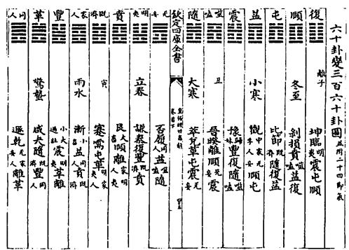

<!-- V3_SOURCE_ID:book015-b000981-p001-de3ed3fb7d -->

图6-25 六十卦变三百六十卦图

查看对应原文

<!-- V3_FOLDBACK_BEGIN:book015-b000981-p001-de3ed3fb7d -->

図6-25 六十卦変三百六十卦図

<!-- V3_FOLDBACK_END:book015-b000981-p001-de3ed3fb7d -->

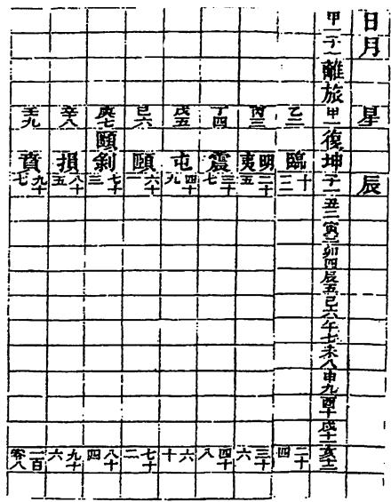

<!-- V3_SOURCE_ID:book015-b000982-p001-2858b054cd -->

图6-26 月子第一会的闰卦、会卦、运卦（纬）。其中会卦每6运对应2160年，运卦每1运对应360年，世卦（经）对应60年，世卦（纬）对应10年，分别掌管相应时段。

查看对应原文

<!-- V3_FOLDBACK_BEGIN:book015-b000982-p001-2858b054cd -->

図6-26 月子第一会の閏卦・会卦・運卦
(緯)である。会卦はそれぞれ6運＝2,160年，運卦は1運＝360年，世卦(経)は60年，世卦(緯)は10年を分治している。

<!-- V3_FOLDBACK_END:book015-b000982-p001-2858b054cd -->

<!-- V3_SOURCE_ID:book015-b000984-p000-1c982a0242 -->

这是黄畿所作的具体配卦，针对月子第一会的情况，如图6-26所示，出自《皇极经世易知》卷一。“日甲一、月子一”对应的会，其会初处于1阳初次发动的“天开之始”阶段。闰卦为离卦，旅卦是掌管冬至的卦象。会卦中的复卦掌管星甲一、乙二、丙三、丁四、戊五、己六共6运，从复卦衍生出的坤、临、明夷、震、屯、颐各掌管1运。每运包含12世，辰之子至亥为世的支名与顺位标识。

查看对应原文

<!-- V3_FOLDBACK_BEGIN:book015-b000984-p000-1c982a0242 -->

黄畿による具体的な配卦であるが，月子第一会のばあい，図6-26のとおりである(『皇極経世易知』巻一)。「日甲一・月子一」会は，会初が1陽の初めて動く「天開の始」にあたっている。閏卦は離であり，旅が冬至を主る卦である。会卦の復が星甲一・乙二・丙三・丁四・戊五・己六の6運を主り，復卦から生じた坤・臨・明夷・震・屯・頤がそれぞれ1運を主っている。各運は12世からなり，辰の子～亥が世の支名と順位を示している。

<!-- V3_FOLDBACK_END:book015-b000984-p000-1c982a0242 -->

<!-- V3_SOURCE_ID:book015-b000985-p000-0964d33d5f -->

以经日之甲一、经月之巳六、经星之癸一百八十为例，会卦是巳会的第5卦，即先天图中从复卦开始数的第30位，该位置若包含离卦则为第31位，对应的是夬卦；会卦夬的上六爻变为阳后生成的乾卦，正是180运的运卦。另外，运卦乾（夬之乾）的六变卦即为世卦（经），其中姤卦对应初九爻变，同人卦对应九二爻变，履卦对应九三爻变，小畜卦对应九四爻变，大有卦对应九五爻变，夬卦对应上九爻变。姤卦掌管经辰之子2149世与经辰之丑2150世共60年，同人卦掌管寅、卯2世，履卦掌管辰、巳2世，小畜卦掌管午、未2世，大有卦掌管申、酉2世，夬卦掌管戌、亥2世。此外，每世的30年中，由世卦（纬）掌管其中的10年，详见表6-8。

查看对应原文

<!-- V3_FOLDBACK_BEGIN:book015-b000985-p000-0964d33d5f -->

経日之甲一・経月之巳六・経星之癸一百八十を例とすれば，会卦は巳会の第5卦，すなわち先天図で復卦から数えて第30位(離卦を含めれば31位)にある夬卦であり，会卦の夬の上六が陽に変じて生じる乾卦が180運の運卦にほかならない。また運卦の乾(夬之乾)の六変卦が世卦(経)であり，姤卦は初九の爻変，同人卦は九二，履卦は九三，小畜卦は九四，大有卦は九五，夬卦は上九の卦変である。姤卦は経辰之子2,149世と経辰之丑2,150世の60年を主り，同人卦は寅卯2世，履卦は辰巳2世，小畜卦は午未2世，大有卦は申酉2世，夬卦は戌亥2世を主っている。また各世の30年のうち10年を分治するのが世卦(緯)である(表6-8)。

<!-- V3_FOLDBACK_END:book015-b000985-p000-0964d33d5f -->

<!-- V3_SOURCE_ID:book015-b000986-p000-e5ba0f57ea -->

表6-8 日甲・月巳・星癸的世卦
<table><tr><td>经辰之子</td><td>2149</td><td>姤</td><td>乾</td><td>遯</td><td>訟</td></tr><tr><td>经辰之丑</td><td>2150</td><td>姤</td><td>巽</td><td>鼎</td><td>大過</td></tr><tr><td>经辰之寅</td><td>2151</td><td>同人</td><td>遯</td><td>乾</td><td>无妄</td></tr><tr><td>经辰之卯</td><td>2152</td><td>同人</td><td>家人</td><td>離</td><td>革</td></tr><tr><td>经辰之辰</td><td>2153</td><td>履</td><td>訟</td><td>无妄</td><td>乾</td></tr><tr><td>经辰之巳</td><td>2154</td><td>履</td><td>中孚</td><td>睽</td><td>兌</td></tr><tr><td>经辰之午</td><td>2155</td><td>小畜</td><td>巽</td><td>家人</td><td>中孚</td></tr><tr><td>经辰之未</td><td>2156</td><td>小畜</td><td>乾</td><td>大畜</td><td>需</td></tr><tr><td>经辰之申</td><td>2157</td><td>大有</td><td>鼎</td><td>離</td><td>睽</td></tr><tr><td>经辰之酉</td><td>2158</td><td>大有</td><td>大畜</td><td>乾</td><td>大壮</td></tr><tr><td>经辰之戌</td><td>2159</td><td>夬</td><td>大過</td><td>革</td><td>兌</td></tr><tr><td>经辰之亥</td><td>2160</td><td>夬</td><td>需</td><td>大壮</td><td>乾</td></tr></table>

查看对应原文

<!-- V3_FOLDBACK_BEGIN:book015-b000986-p000-e5ba0f57ea -->

表6-8 日甲・月巳・星癸の世卦
<table><tr><td>経辰の子</td><td>2149</td><td>姤</td><td>乾</td><td>遯</td><td>訟</td></tr><tr><td>経辰の丑</td><td>2150</td><td>姤</td><td>巽</td><td>鼎</td><td>大過</td></tr><tr><td>経辰の寅</td><td>2151</td><td>同人</td><td>遯</td><td>乾</td><td>无妄</td></tr><tr><td>経辰の卯</td><td>2152</td><td>同人</td><td>家人</td><td>離</td><td>革</td></tr><tr><td>経辰の辰</td><td>2153</td><td>履</td><td>訟</td><td>无妄</td><td>乾</td></tr><tr><td>経辰の巳</td><td>2154</td><td>履</td><td>中孚</td><td>睽</td><td>兌</td></tr><tr><td>経辰の午</td><td>2155</td><td>小畜</td><td>巽</td><td>家人</td><td>中孚</td></tr><tr><td>経辰の未</td><td>2156</td><td>小畜</td><td>乾</td><td>大畜</td><td>需</td></tr><tr><td>経辰の申</td><td>2157</td><td>大有</td><td>鼎</td><td>離</td><td>睽</td></tr><tr><td>経辰の酉</td><td>2158</td><td>大有</td><td>大畜</td><td>乾</td><td>大壮</td></tr><tr><td>経辰の戌</td><td>2159</td><td>夬</td><td>大過</td><td>革</td><td>兌</td></tr><tr><td>経辰の亥</td><td>2160</td><td>夬</td><td>需</td><td>大壮</td><td>乾</td></tr></table>

<!-- V3_FOLDBACK_END:book015-b000986-p000-e5ba0f57ea -->

<!-- V3_SOURCE_ID:book015-b000987-p000-9b705f0e98 -->

黄畿的起运理论中，年卦极为重要。但年卦的配卦方式与运卦、世卦的配卦方式不同，奇数世的甲子年（初年），配卦与世卦（经）相同；接下来的60年，从世卦（经）为起点排列易卦，按照先天圆图的卦序（右旋），配卦时除去乾坤坎离的闰卦，其余60卦依次相配。例如包含尧治世的巳会第30运，经世之午2155年至经世之亥2160年的配卦情况：第2155世的甲子年，年卦与世卦（经）同为小畜；乙丑年的年卦是先天圆图中小畜右侧相邻的大壮；第2156世的甲午年，年卦为豫，而豫在先天圆图上，与前世末年的年卦晋相连。

> **释读存疑：** 图6-27；本地硬校验仍未通过，已记录供后续自动处理或人工核对。

查看对应原文

<!-- V3_FOLDBACK_BEGIN:book015-b000987-p000-9b705f0e98 -->

黄畿の起運においては年卦もきわめて重要である。だが年卦の配卦は運卦や世卦のそれとは異なっており，奇数世の甲子年(初年)については世卦(経)と同じ卦を配し，以下の60年については世卦(経)を起点として易卦をならべ，先天円図の卦序(右旋)にしたがって乾坤坎離の閏卦をのぞく60卦を配している。たとえば堯の治世が含まれる巳会第30運の経世之午2,155～経世之亥2,160の配卦のばあい，第2,155世の甲子年の年卦は世卦(経)と同じく小畜であり，乙丑年の年卦は先天円図の小畜の右隣にある大壮である。第2,156世の甲午年の年卦は豫であり，豫は先天円図上，前世の末年の年卦である晋に連続している(図6-27)。

<!-- V3_FOLDBACK_END:book015-b000987-p000-9b705f0e98 -->

<!-- V3_SOURCE_ID:book015-b000988-p000-d375550f42 -->

黄畿的皇极经世学中，利用年卦的卦象来确定历史事件的先后关系并作出价值评判，这一点也值得特别提及。例如尧在星癸180运的第11年甲辰年即位，年卦为随，黄畿却

> **释读存疑：** 原文此处内容未完整呈现

查看对应原文

<!-- V3_FOLDBACK_BEGIN:book015-b000988-p000-d375550f42 -->

黄畿の皇極経世学においては，年卦の卦象を利用して歴史事件の先後関係を定め価値的評価を下したことも特筆に値するところである。たとえば堯は星癸180運の第11年甲辰に即位し，年卦は随であるが，黄畿は

<!-- V3_FOLDBACK_END:book015-b000988-p000-d375550f42 -->

<!-- V3_SOURCE_ID:book015-b000989-p000-44196dac54 -->

文中称“年卦的随是泰的先导”，从随卦所象征的含义，说明尧的治世后来会达到太平（泰）的状态。另外，第18年辛亥年的革卦对应尧“修订历法、明确时节”；第69年壬子年的损卦对应“鲧治理水，未能成功”；第70年癸丑年的节卦对应“帝寻求禅让，征召舜”；第72年乙卯年的归妹卦对应“（二女）下嫁”“将舜举荐于天，命其登上帝位”等内容。损卦→未能成功、归妹卦→下嫁这类年卦与历史事件的

> **释读存疑：** 《易》革卦·大象

查看对应原文

<!-- V3_FOLDBACK_BEGIN:book015-b000989-p000-44196dac54 -->

「年卦の随は泰の先なり」とのべ,随卦の象徴するところから堯の治世がのちに太平(泰)にいたることを説明している。また第18年辛亥の革のとき堯は「暦を治め時を明らかにし」(『易』革卦・大象)，第69年壬子の損のとき「鯀，水を治め，績用成らず」，第70年癸丑の節のとき「帝，禅を求め舜を徴し」，第72年乙卯の帰妹のとき「(二女)釐降し」「舜を天に薦め，位に之るを命ず」云々とのべている。損卦→績用不成や帰妹卦 → 釐降(王女下嫁)などの年卦と歴史事件の

<!-- V3_FOLDBACK_END:book015-b000989-p000-44196dac54 -->

<!-- V3_SOURCE_ID:book015-b000990-p000-ba626e3c19 -->

经元之甲一，经会之己六，经运之癸百八十乾，经世之午二千一百五十五。

查看对应原文

<!-- V3_FOLDBACK_BEGIN:book015-b000990-p000-ba626e3c19 -->

經元之甲一 經會之己六 經運之癸百八十乾 經世之午二千一百五十五

<!-- V3_FOLDBACK_END:book015-b000990-p000-ba626e3c19 -->

<!-- V3_SOURCE_ID:book015-b000991-p000-3e8267bb1b -->

甲子、乙丑、丙寅、丁卯、戊辰、己巳、庚午、辛未、壬申、癸酉，姤、大過、鼎一、恆，與井；甲戌、乙亥、丙子、丁丑、戊寅、己卯、庚辰、辛巳、壬午、癸未，鹽一升，訟、師；甲申、乙酉、丙戌、丁亥、戊子、己丑、庚寅、辛卯、壬辰、癸巳，旅、小過、漸、艮（八卦之一）、否、萃、晉，經世之未二千一百五十六。

查看对应原文

<!-- V3_FOLDBACK_BEGIN:book015-b000991-p000-3e8267bb1b -->

甲子乙丑丙寅丁卯戊辰己巳庚午辛未壬申癸酉 姤大過鼎一恆 與 井 甲戌乙亥丙子丁丑戊寅己卯庚辰辛巳壬午癸未 鹽一升 訟 師 甲申乙酉 丙戌 丁亥戊子己丑庚寅辛卯壬辰癸巳 旅 小過 漸 艮 否 萃 晉 經世之未二千一百五十六

<!-- V3_FOLDBACK_END:book015-b000991-p000-3e8267bb1b -->

<!-- V3_SOURCE_ID:book015-b000992-p000-940d72d275 -->

甲午、乙未、丙申、丁酉、戊戌、己亥、庚子、辛丑、壬寅、癸卯，豫、觀、比、剝、復、頤、屯、益、震（八卦之一）、噬嗑；甲辰、隨、乙巳、丙午、丁未、戊巾、己酉、庚戌、辛亥、壬子、癸丑；甲寅、乙卯、丙辰、丁巳、戊午、己未、庚申、辛酉、壬戌、癸亥，損、節、中字、歸妹、睽一、兌、履、一、泰、大畜、需。

> **释读存疑：** 戊巾二字原義不明

查看对应原文

<!-- V3_FOLDBACK_BEGIN:book015-b000992-p000-940d72d275 -->

甲午乙未丙申丁酉戊戌己亥庚子辛丑壬寅癸卯 豫觀比剝復頤屯 益震噬嗑 甲辰隨乙巳丙午丁未戊巾己酉庚戌辛亥壬子癸丑 甲寅乙卯丙辰丁巳戊午己未庚申辛酉壬戌癸亥 損節中字歸妹睽一兌 履 一泰大畜需

<!-- V3_FOLDBACK_END:book015-b000992-p000-940d72d275 -->

<!-- V3_SOURCE_ID:book015-b000993-p000-c0d0e4ed70 -->

图6-27中，经世之午2155与经世之未2156的配卦对应关系极为精妙，黄畿的功力由此尽显。

查看对应原文

<!-- V3_FOLDBACK_BEGIN:book015-b000993-p000-c0d0e4ed70 -->

図6-27経世之午2155と経世之未2156の配卦
対応づけは実にみごとである。黄畿の面目躍如たるところであろう。

<!-- V3_FOLDBACK_END:book015-b000993-p000-c0d0e4ed70 -->

<!-- V3_SOURCE_ID:book015-b000995-p000-fae87e946b -->

关于声音唱和之学，黄畿几乎完全承袭了祝泌的配卦，写成“元之元。日日声多乾，水水音古坤。上天地否，下天地否”等内容（配卦图），几乎没有新的发展。

> **释读存疑：** 本地硬校验仍未通过，已记录供后续自动处理或人工核对。

查看对应原文

<!-- V3_FOLDBACK_BEGIN:book015-b000995-p000-fae87e946b -->

声音唱和の学については，黄畿は祝泌の配卦をほとんどそのまま踏襲して「元之元。日日声多乾，水水音古坤。上天地否，下天地否」などとしており(配卦図),新たな展開はほとんどないに等しい。

<!-- V3_FOLDBACK_END:book015-b000995-p000-fae87e946b -->

<!-- V3_SOURCE_ID:book015-b000996-p000-c0d010a7d2 -->

据1552年黄佐为《皇极经世书传》所作的序记载：“凡是（黄畿）注释的内容，若有尚未完备之处，黄佐就用自己肤浅的见解补充进去。”《皇极经世书传》经过黄佐的增补修订后出版，对读书人群体产生了重大影响。事实上，现存的王植《皇极经世书解》、刘斯组《皇极经世书绪言》、何梦瑶《皇极经世易知》等著作，全都以黄畿的气六变说为依据来计算年卦的运势。清朝的皇极经世学“各图解说一概以西山为主”，但关于“起运”的问题，不得不说受到了黄畿配卦法的深刻影响。

> **释读存疑：** 本地硬校验仍未通过，已记录供后续自动处理或人工核对。

查看对应原文

<!-- V3_FOLDBACK_BEGIN:book015-b000996-p000-c0d010a7d2 -->

『皇極経世書伝』の黄佐序(1552)によれば，「凡そ(黄畿の)注釈する所，いまだ備わらざる者あれば，佐，附すに膚見を以てし」たという。『皇極経世書伝』は黄佐の続成をへて出版され，読書人層に大きな影響をおよぼした。事実，現存する王植『皇極経世書解』(1756自序)や劉斯組『皇極経世書緒言』や何夢瑤『皇極経世易知』(1763自序)などはいずれも，黄畿の気六変説を根拠として運の年卦を計算している。清朝の皇極経世学は「各図説はもっぱら西山(蔡元定)を以て主となす」(『皇極経世書解』例言)けれども，こと起運については，黄畿の配卦法の深甚な影響をうけていたといわざるをえないのである。

<!-- V3_FOLDBACK_END:book015-b000996-p000-c0d010a7d2 -->

<!-- V3_SOURCE_ID:book015-b000997-p000-c8bb820a16 -->

## 小結 — 小结

查看对应原文

<!-- V3_FOLDBACK_BEGIN:book015-b000997-p000-c8bb820a16 -->

## 小結

<!-- V3_FOLDBACK_END:book015-b000997-p000-c8bb820a16 -->

<!-- V3_SOURCE_ID:book015-b000998-p000-3639b50556 -->

朱熹与蔡元定将作为术数分支的先天学融入自己的《易》学解释中，以基于加一倍法的画卦理论为基础，将《易》学推向了新的高度。以《周易本义》《易学启蒙》为代表的象数《易》学就是如此。但朱熹将先天学作为《易》学的基础理论，意味着道学认可了邵雍式的数的哲学或术数类数学属性的数理思考，同时也指明了术数学应有的理想与位置。不仅数理科学，就连包含在内的各类占卜术的术数学的必要性，也正是通过朱熹本人之手，以邵雍的先天学为核心得到了强烈肯定。

> **释读存疑：** 本地硬校验仍未通过，已记录供后续自动处理或人工核对。

查看对应原文

<!-- V3_FOLDBACK_BEGIN:book015-b000998-p000-3639b50556 -->

朱熹と蔡元定は術数学の一翼をになう先天学を自らの易解釈にとりこみ，加一倍法(2進法)にもとづく画卦理論を基礎として易学を新たな高みにおしあげた。『周易本義』や『易学啓蒙』に代表される象数易学がそれである。だが朱熹が先天学を易学の基礎理論にすえたことは，道学が邵雍的な数の哲学ないし術数類数学属的な数理思考を是認し，術数学のあるべき理想や位置を示したことを意味している。数理科学のみならず雑多な占術をも内に含む術数学の必要不可欠性が，ほかならぬ朱熹自身の手によって，邵雍の先天学を軸に強く肯定されたのである。

<!-- V3_FOLDBACK_END:book015-b000998-p000-3639b50556 -->

<!-- V3_SOURCE_ID:book015-b000999-p000-dffd4f8bde -->

朱熹高度评价邵雍，并认可了术数学的存在价值，其结果是，皇极经世学虽有部分例外，但整体上朝着朱熹所指示的方向开始了自身的发展。对《易》学式或图学式的数的解释就是如此。蔡元定的《皇极经世指要》是皇极经世学著作中最倾向于从属于《易》学的一部，但其在构建数理时，始终执着于先天易学的理论，极端情况下甚至会以《易》理为依据，抑制数理的自由展开。此外，张行成、祝泌、黄畿等人的新颖的数的解释，总体上以解决将《易》卦分配到历年与音律的问题作为最大课题，同时积极推进与《易》学的同化，具有以《易》说为基础重构数理的显著特征。若将邵雍的先天学比作以数理扩展《易》理，那么朱熹以后的皇极经世学总体上可以说是以《易》理深化数理。南宋、元、明、清时期的皇极经世学正如朱熹所期望的那样，以从属于《易》学的形式作为象数学发展了。

查看对应原文

<!-- V3_FOLDBACK_BEGIN:book015-b000999-p000-dffd4f8bde -->

朱熹が邵雍を高く評価し術数学に存在価値を認めた結果，皇極経世学は一部の例外はあるにせよ，全体としては朱熹の示唆した方向へ向かって自らの発展を開始した。易学的ないし図学的な数の解釈がそれである。蔡元定の『皇極経世指要』は易学に従属する傾向が最も強い皇極経世学書であるが，数理を構築する際，先天易学の理論に飽くまで固執し，極端なばあい易理を根拠に数理の自由な展開を抑えこむところもある。また張行成や祝泌や黄畿の斬新な数の解釈も，総じて歴年や音声への易卦の配当を解決すべき最大の課題としながら易学との同化を積極的に推し進めており，易説に基礎づけられた数理の再構築という性格が顕著である。邵雍の先天学が数理による易理の拡張(数→易)にたとえられるとすれば，朱熹以降の皇極経世学は総じて易理による数理の深化(易→数)とのべることができるであろう。南宋元明清の皇極経世学は朱熹の思惑どおり，易学に隷属する形で象数学として発展したのである。

<!-- V3_FOLDBACK_END:book015-b000999-p000-dffd4f8bde -->

<!-- V3_SOURCE_ID:book015-b001000-p000-a068169c51 -->

但是皇极经世学与易学的同化或结合，给双方带来了意想不到的结果。其一，皇极经世学被迫从义理、物理、性命之学转向或接近卜筮之术；其二，宋明易学则肆意依据伪象进行穿凿附会，在未寻求经文本身确切证据的情况下，偏向重视独创与逻辑的解释方向。

查看对应原文

<!-- V3_FOLDBACK_BEGIN:book015-b001000-p000-a068169c51 -->

だが皇極経世学と易学の同化ないし結合は，双方に思わぬ結果をもたらした。一つは皇極経世学が，義理物理性命の学から卜筮の術への転換ないし接近を余儀なくされたことであり，他の一つは宋明易学が，偽象を根拠とした穿鑿をほしいままにし，経文自体に正確な証拠を求めぬまま独創や論理を重んじる解釈へと流れたことである。

<!-- V3_FOLDBACK_END:book015-b001000-p000-a068169c51 -->

<!-- V3_SOURCE_ID:book015-b001001-p000-804a8a8296 -->

正如前文所述，《皇极经世书》与《易》不同，《易》是“卜筮之书”，而《皇极经世书》属于术数学的一个分支，是“推步之书”。邵雍撰写数理书籍的目的，本就是为了阐明自然的理数、探究历史的法则，从一开始就未打算将其应用于占卜，根本未曾考虑过判定吉凶、决断疑惑之事。另一方面，张行成之后的皇极经世学者，想出了邵雍未曾预料到的繁琐配卦法，并以此为依据推断治乱、占卜悬而未决的事物。既然从理论上保障了皇极经世学用于占卜的效用的是易卦的配当，那么它接近占术便是易学解释所带来的必然结果，这一点自然是显而易见的。

> **释读存疑：** 本地硬校验仍未通过，已记录供后续自动处理或人工核对。

查看对应原文

<!-- V3_FOLDBACK_BEGIN:book015-b001001-p000-804a8a8296 -->

『皇極経世書』は既述のごとく，『易』が「ト筮の書」であるのに対して,術数学の1分野に属する「推歩の書」である(『朱子語類』巻百)。邵雍が数理書を著した目的はまさに自然の理数を解き明かし歴史の法則を究めるところにあり，占トへの応用など最初から意図しておらず，吉凶を定め疑惑を決することなどまったく眼中にない。一方，張行成以下の皇極経世学者は，邵雍が予想だにしなかった煩瑣な配卦法を考案し，それを根拠として治乱を推し懸案の事物を占っている27)。皇極経世学の占トによる致用を理論的に保証したのは易卦の配当であるからには，占術への接近が易学的な解釈のもたらした必然的な結果であることは自ずと明らかであろう。

<!-- V3_FOLDBACK_END:book015-b001001-p000-804a8a8296 -->

<!-- V3_SOURCE_ID:book015-b001002-p000-b0dac7325d -->

此外，正如黄宗羲所指出的，朱熹之后易学的变质也十分显著。朱熹及宋明易学以邵雍的先天学为基础，试图依据与经义原本无关的象数逻辑来确定易学的“统体”，构建整合性的系统。例如，尽管“先天的方位明显与《说卦传》中‘震出而巽齐’的说法相悖”，朱熹却对其大加赞赏，称“反而怀疑经文的卦位”。另外，关于六十四卦的生成，只要严格遵循经文，《易·系辞下传》明确记载“因而重之”，六十四卦由此作成，那么以爻画的“积累”为结构原理的八卦→16→32→六十四卦的解释本不应成立。但朱熹却仍采用邵雍的加一倍法进行解释。朱熹的易解倾向于顺应数理的自然与逻辑的必然，并未过于执着于经文的一字一句。这便是清代考据学者对朱子学的批判并非无的放矢的原因。

> **释读存疑：** 《说卦传》中‘震出而巽齐’的具体所指不详；《易·系辞下传》中‘因而重之’的具体所指不详

查看对应原文

<!-- V3_FOLDBACK_BEGIN:book015-b001002-p000-b0dac7325d -->

また黄宗羲の指摘するとおり，朱熹以降における易学の変質も顕著である。朱熹や宋明易学には邵雍の先天学を基礎におき，経義とはほんらい関係のない象や数の論理にもとづいて易学の「統体」を位置づけ整合的なシステムを構築しようとするところがある。たとえば「先天の方位は,明らかに(説卦伝の)震に出で巽に斉うと相背く」にもかかわらず，朱熹はそれを絶賛し，「反って経文の卦位に疑いを致している」『易学象数論』自序)。また六十四卦の生成については，経文に厳密にしたがうかぎり，『易』繋辞下伝に「(八卦の象に)因りてこれを重ね」六十四卦が作られたと明言される以上，爻画の「積累」を構造原理とした八卦→16→32→六十四卦の解釈がなりたつはずもない。だが朱熹はそれにもかかわらず，邵雍の加一倍法による解釈を採用している(『易学象数論』先天図)。朱熹の易解釈には数理の自然や論理の必然に身をまかせるところがあり，経文の1字1句にはさほど固執していない。清朝考証学者の朱子学批判も的はずれとはしないゆえんである。

<!-- V3_FOLDBACK_END:book015-b001002-p000-b0dac7325d -->

注

<!-- V3_SOURCE_ID:book015-b001004-p000-1ee0ba2413 -->

1）确实，清代学术的代表人物之一全祖望称“邵康节被列入圣门的理由，并非因为皇极经世”。不过，对于尊崇清代学术的学者而言，既然标榜“实事求是”、否定术数学中的数神秘主义，那么想要贬低术数学书籍《皇极经世书》，也是无可厚非的。

查看对应原文

<!-- V3_FOLDBACK_BEGIN:book015-b001004-p000-1ee0ba2413 -->

1）確かに，清学のイデオローグの1人，全祖望は「邵康節が聖門に列される理由は，皇極経世のためではない」とのべている(黄宗羲『宋元学案』百源学案)。だが清学を奉ずる学者のばあい，「実事求是」を標榜し術数学中の数神秘主義を否定している以上，術数学書の『皇極経世書』を低く位置づけたく思うのは無理からぬところであろう。

<!-- V3_FOLDBACK_END:book015-b001004-p000-1ee0ba2413 -->

<!-- V3_SOURCE_ID:book015-b001005-p000-e5fb9db9ed -->

2）《皇极经世书》的先行研究已有很多，其中关于易学的研究尤其兴盛。但在我看来，所有先行研究都在忽视术数结构的阐明的情况下，对邵雍的哲学进行了解释，虽然部分研究取得了成功，但整体上并未达到准确的理解。

查看对应原文

<!-- V3_FOLDBACK_BEGIN:book015-b001005-p000-e5fb9db9ed -->

2)『皇極経世書』には，先行研究も多い。とりわけ易学にかんする研究は盛んである。だがわたしのみるところ，先行研究はいずれも術数構造の解明を蔑ろにしたまま邵雍の哲学を解釈しており，部分的には成功しているものの，全体としては正確な理解に達していない。

<!-- V3_FOLDBACK_END:book015-b001005-p000-e5fb9db9ed -->

<!-- V3_SOURCE_ID:book015-b001006-p000-49998b0635 -->

3）换句话说，本章是试图阐明《皇极经世书》的术数理论或技法的尝试，目前并未将阐明数的哲学本身作为核心问题。

查看对应原文

<!-- V3_FOLDBACK_BEGIN:book015-b001006-p000-49998b0635 -->

3)言い換えれば，本章は『皇極経世書』の術数の理論ないし技法を明らかにしようとした試みであり，数の哲学自体の解明をいまだその中心問題にはしていない。

<!-- V3_FOLDBACK_END:book015-b001006-p000-49998b0635 -->

<!-- V3_SOURCE_ID:book015-b001007-p000-6e49e94760 -->

4）详细内容将在后述（2.1節）说明。

查看对应原文

<!-- V3_FOLDBACK_BEGIN:book015-b001007-p000-6e49e94760 -->

4)詳しくは，後述(2.1節)。

<!-- V3_FOLDBACK_END:book015-b001007-p000-6e49e94760 -->

<!-- V3_SOURCE_ID:book015-b001008-p000-ff3b8ca23d -->

5）先天易图也是如此。

查看对应原文

<!-- V3_FOLDBACK_BEGIN:book015-b001008-p000-ff3b8ca23d -->

5)先天易図も同様である。

<!-- V3_FOLDBACK_END:book015-b001008-p000-ff3b8ca23d -->

<!-- V3_SOURCE_ID:book015-b001009-p000-3c0875410f -->

6) 邵雍对于唐尧即位一事，推定其发生在甲第1元所包含的巳第6会中，癸第180运的未第2,156世的第11年甲辰之时。所谓癸第180运，是巳第6会的最后一运，从历元开始数是第180个。另外，未第2,156世，是癸第180运的第8世，从历元开始数是第2,156个。干支之后的数字，表示各单位从历元开始的时间间隔，这对明确历史事件在时间轴上的位置很有帮助。

> **释读存疑：** 原文未明确说明甲第1元、巳第6会、癸第180运、未第2156世的具体所指；本地硬校验仍未通过，已记录供后续自动处理或人工核对。

查看对应原文

<!-- V3_FOLDBACK_BEGIN:book015-b001009-p000-3c0875410f -->

6) 邵雍は唐堯の即位について，甲第1元に含まれる巳第6会の，癸第180運の未第2,156世の第11年甲辰に起こった事件と推定している。癸第180運とは，巳第6会の最後の運(第30運)のこと。暦元から数えて第180番目にある。また未第2,156世とは，癸第180運の第8世のこと。暦元から数えて第2,156番目にある。干支の後の数字は単位ごとの暦元からの時間的隔たりを示しており，歴史事件の時間軸上の位置を明らかにするのに便利である。

<!-- V3_FOLDBACK_END:book015-b001009-p000-3c0875410f -->

<!-- V3_SOURCE_ID:book015-b001010-p000-92700efe6b -->

7) 《性理大全》将太阳与目、太阴与耳、少阳与鼻、少阴与口、少刚与色、少柔与声、太刚与气、太柔与味一一对应，这与邵雍的解释并不相同。

查看对应原文

<!-- V3_FOLDBACK_BEGIN:book015-b001010-p000-92700efe6b -->

7)『性理大全』は太陽と目，太陰と耳，少陽と鼻，少陰と口，少剛と色，少柔と声，太剛と気，太柔と味を対応させており，邵雍の解釈と同じではない。

<!-- V3_FOLDBACK_END:book015-b001010-p000-92700efe6b -->

<!-- V3_SOURCE_ID:book015-b001011-p000-e0aebef609 -->

8) 祝泌谈及邵雍与张行成的纪年时，称“反而采用皇甫谧以尧在戊辰年即位的说法”，该说法出自《皇极起数例》；还说“《世纪》《古史》《竹书》都记载尧在戊辰年即位”，该说法出自《观物篇解》卷二。

查看对应原文

<!-- V3_FOLDBACK_BEGIN:book015-b001011-p000-e0aebef609 -->

8)祝泌は邵雍や張行成の紀年について「却ってこれ皇甫謐の堯，戊辰の年を以て即位するの説を用う」といい(『皇極起数例』)，また「世紀・古史・竹書，みな堯，戊辰の年を以て帝位に即くと言う」とのべている(『観物篇解』巻二)。

<!-- V3_FOLDBACK_END:book015-b001011-p000-e0aebef609 -->

<!-- V3_SOURCE_ID:book015-b001012-p000-a3eb1797b5 -->

9) 关于邵雍的史学论，请参考三浦国雄所著《皇极经世书》，该书收录于川胜义雄编《史学论集》，朝日新闻社，1973年。不过，无法赞同该书作者基于《经世一元消长之数图》对邵雍的理解。详细内容将在后文2.1节说明。

> **释读存疑：** 本地硬校验仍未通过，已记录供后续自动处理或人工核对。

查看对应原文

<!-- V3_FOLDBACK_BEGIN:book015-b001012-p000-a3eb1797b5 -->

9) 邵雍の史学論については，三浦国雄「皇極経世書」(川勝義雄『史学論集』，朝日新聞社，1973)を参照。ただし経世一元消長之数図にもとづく氏の邵雍理解には，賛成することはできない。詳しくは，後述(2.1節)。

<!-- V3_FOLDBACK_END:book015-b001012-p000-a3eb1797b5 -->

<!-- V3_SOURCE_ID:book015-b001013-p000-9007337d3e -->

10) 邵雍の声音表の音韻学上の意味については，主に陸志韋「記邵雍皇極経世的天声地音」と周祖謨「宋代汴洛語音考」を参照。

> **释读存疑：** 本地硬校验仍未通过，已记录供后续自动处理或人工核对。

查看对应原文

<!-- V3_FOLDBACK_BEGIN:book015-b001013-p000-9007337d3e -->

10) 邵雍の声音表の音韻学上の意味については，主に陸志韋「記邵雍皇極経世的天声地音'」(『燕京学報』第31期，1946)と周祖謨「宋代汴洛語音考」(『問学集』下冊，中華書局，1966)を参照。

<!-- V3_FOLDBACK_END:book015-b001013-p000-9007337d3e -->

<!-- V3_SOURCE_ID:book015-b001014-p000-0f3d248e01 -->

11）经世声音图引自《性理大全》皇极经世书。尽管它并非邵雍的原图，仍特意刊载，是因为它能清晰易懂地展现邵雍声音学的结构。具体来说，若说声图与韵摄的对应关系，多可个舌大致对应果摄的开口呼，禾火化八大致对应果假摄的合口呼，……；若说音图与三十六字母的对应关系，古甲九癸大致对应见母的清音，□口近揆大致对应南方群母的浊音，……。

> **释读存疑：** 原文中存在缺字，以□标记，具体所指不详

查看对应原文

<!-- V3_FOLDBACK_BEGIN:book015-b001014-p000-0f3d248e01 -->

11）経世声音図は，『性理大全』皇極経世書から引用。邵雍の原図ではないにもかかわらずあえて掲載したのは，邵雍の声音学の構造をわかりやすく示しているからである。すなわち，声図と韻摂の対応関係をいえば，多可个舌が果摂の開口呼，禾火化八が果仮摂の合口呼，……にほぼ対応し，また音図と三十六字母の対応関係をいえば，古甲九癸が見母の清音，□口近揆が南方の群母の濁音，……にほば対応している。

<!-- V3_FOLDBACK_END:book015-b001014-p000-0f3d248e01 -->

<!-- V3_SOURCE_ID:book015-b001015-p000-b6221521e2 -->

12) 关于各声音的评价，参考周祖谟前述论文（注10）。

查看对应原文

<!-- V3_FOLDBACK_BEGIN:book015-b001015-p000-b6221521e2 -->

12)各音声の評価については，周祖謨前掲論文(注10)を参照。

<!-- V3_FOLDBACK_END:book015-b001015-p000-b6221521e2 -->

<!-- V3_SOURCE_ID:book015-b001016-p000-9896d5e14d -->

13）请参照表6-2。

查看对应原文

<!-- V3_FOLDBACK_BEGIN:book015-b001016-p000-9896d5e14d -->

13）表6-2を参照せよ。

<!-- V3_FOLDBACK_END:book015-b001016-p000-9896d5e14d -->

<!-- V3_SOURCE_ID:book015-b001017-p000-b588bc3b53 -->

14）现存的张行成《易通变》中，并未留存先天数图。

查看对应原文

<!-- V3_FOLDBACK_BEGIN:book015-b001017-p000-b588bc3b53 -->

14）現存する張行成『易通変』には，先天数図は残っていない。

<!-- V3_FOLDBACK_END:book015-b001017-p000-b588bc3b53 -->

<!-- V3_SOURCE_ID:book015-b001018-p000-d337b3c494 -->

图6-2引自朱伯崑所著《易学哲学史》第一卷（北京·华东出版社，1995）第212页。笔者对朱伯崑的原图仅做了少量补充。

> **释读存疑：** 本地硬校验仍未通过，已记录供后续自动处理或人工核对。

查看对应原文

<!-- V3_FOLDBACK_BEGIN:book015-b001018-p000-d337b3c494 -->

15）図6-2は，朱伯崑『易学哲学史』巻一（北京·華東出版社，1995）頁212より引用。朱伯崑の図にはわずかであるが，原図に加筆したところがある。

<!-- V3_FOLDBACK_END:book015-b001018-p000-d337b3c494 -->

<!-- V3_SOURCE_ID:book015-b001019-p000-ca51d77c21 -->

16）数图常被省略，恐怕是因为其本身的性质所致。

查看对应原文

<!-- V3_FOLDBACK_BEGIN:book015-b001019-p000-ca51d77c21 -->

16）数図がしばしば省略されるのは，おそらくこの性格のためであろう。

<!-- V3_FOLDBACK_END:book015-b001019-p000-ca51d77c21 -->

<!-- V3_SOURCE_ID:book015-b001020-p000-937dd46cb4 -->

17）虽然有很多研究者认为邵雍的皇极经世学以易学为根本，但这种误解极为严重。对于蔡元定等人的解释，必须将其视为带有特殊意图、周密实施的术数学的去势行为。

> **释读存疑：** 原文中「術数学の去勢」的具体所指未明确说明

查看对应原文

<!-- V3_FOLDBACK_BEGIN:book015-b001020-p000-937dd46cb4 -->

17）邵雍の皇極経世学の根底には易学がある，などと論ずる研究者も多いが，誤解もはなはだしい。蔡元定などの解釈については，特別な意図をもって周到に行われた術数学の去勢ととらえなければならない。

<!-- V3_FOLDBACK_END:book015-b001020-p000-937dd46cb4 -->

<!-- V3_SOURCE_ID:book015-b001021-p000-bbf390a9d8 -->

18）既然实际1年的长度并非360日，邵雍的年表就无法对应现实中的历史。本章记录《皇极经世书》的纪年与公元前、公元纪年的对应关系，只是为了明确邵雍的变形所采用的权宜之计。

查看对应原文

<!-- V3_FOLDBACK_BEGIN:book015-b001021-p000-bbf390a9d8 -->

18）実際の1年の長さが360日でない以上，邵雍の年表は現実の歴史に対応しない。本章で皇極経世書の紀年とB.C.やA.D.の紀年の対応関係を記したのは，邵雍のデフォルマシオンを明らかにするための方便にすぎない。

<!-- V3_FOLDBACK_END:book015-b001021-p000-bbf390a9d8 -->

<!-- V3_SOURCE_ID:book015-b001022-p000-9cdb455e6f -->

19）关于这一段落，笔者从大岛晃所著《邵康节的〈观物〉》（《东方学》52，1975）中获得了诸多启发。

> **释读存疑：** 本地硬校验仍未通过，已记录供后续自动处理或人工核对。

查看对应原文

<!-- V3_FOLDBACK_BEGIN:book015-b001022-p000-9cdb455e6f -->

19）この段落については，大島晃「邵康節の〈観物〉」（『東方学』52，1975）に教えられたところが多い。

<!-- V3_FOLDBACK_END:book015-b001022-p000-9cdb455e6f -->

<!-- V3_SOURCE_ID:book015-b001023-p000-0a2fe503a5 -->

20）关于《性理大全》本的构成，请参照表6-2。

查看对应原文

<!-- V3_FOLDBACK_BEGIN:book015-b001023-p000-0a2fe503a5 -->

20）性理大全本の構成については，表6-2を参照せよ。

<!-- V3_FOLDBACK_END:book015-b001023-p000-0a2fe503a5 -->

<!-- V3_SOURCE_ID:book015-b001024-p000-56a9d89006 -->

21）邵雍并不存在基于易学的统一解释这类思路或指向性。具体事例请参照1.4节。

> **释读存疑：** 本地硬校验仍未通过，已记录供后续自动处理或人工核对。

查看对应原文

<!-- V3_FOLDBACK_BEGIN:book015-b001024-p000-56a9d89006 -->

21）邵雍には，易学にもとづく統一的な解釈などという発想法や指向性が存在していない。具体例については，1.4節を参照せよ。

<!-- V3_FOLDBACK_END:book015-b001024-p000-56a9d89006 -->

<!-- V3_SOURCE_ID:book015-b001025-p000-84e7fb654c -->

22）《皇极经世书》中，没有论述十二会与十二消息卦的对应关系。

查看对应原文

<!-- V3_FOLDBACK_BEGIN:book015-b001025-p000-84e7fb654c -->

22）『皇極経世書』には，十二会と十二消息卦の対応をのべたところはない。

<!-- V3_FOLDBACK_END:book015-b001025-p000-84e7fb654c -->

<!-- V3_SOURCE_ID:book015-b001026-p000-fb6b030689 -->

23）张行成在关于《挂一图》的起卦法中，解释道“设置通数，用元会运世的总数来除它”，该内容出自《通变》卷十二《起卦例》，但按照该方法无法推导出全部256卦。例如元之元的泰卦，①设置“动植通数”的289816576，将万位以下的6576排除在计算之外；②“除去卦身的八千”，再减去元之元的极数1，余数为289801999；③用万位左侧的8确定外卦，用右侧的1确定内卦。八之泰正是对应元之元的卦。

查看对应原文

<!-- V3_FOLDBACK_BEGIN:book015-b001026-p000-fb6b030689 -->

23）張行成は掛一図の起卦法について，「通数を置き，元会運世の総数を以てこれを除す」と説明している（『通変』巻十二，起卦例）が，その方法によって256卦すべてを導き出すことはできない。たとえば元の元の泰卦のばあい，①「動植通数」の289,816,576をおく。万下の6,576については計算から除外する。②「卦身の八千を除き」，また元の元の極数の1を引く。余りは289,801,999である。③万位の左の8をもって外卦を定め，右の1をもって内卦を定める。八の泰が元の元に対応する卦にほかならない。

<!-- V3_FOLDBACK_END:book015-b001026-p000-fb6b030689 -->

<!-- V3_SOURCE_ID:book015-b001027-p000-da360d8d06 -->

24）关于张行成的起运法，黄宗羲在《易学象数论》卷五中有简要介绍。

查看对应原文

<!-- V3_FOLDBACK_BEGIN:book015-b001027-p000-da360d8d06 -->

24）張行成の起運法については，黄宗羲『易学象数論』巻五に簡潔な紹介
がある。

<!-- V3_FOLDBACK_END:book015-b001027-p000-da360d8d06 -->

<!-- V3_SOURCE_ID:book015-b001029-p000-83f942d062 -->

25）“天的经会运用运卦，地的经运用世卦，人的经世运用年卦。”

查看对应原文

<!-- V3_FOLDBACK_BEGIN:book015-b001029-p000-83f942d062 -->

25)「天の経会は運卦を用い，地の経運は世卦を用い，人の経世は年卦 を用いる」。

<!-- V3_FOLDBACK_END:book015-b001029-p000-83f942d062 -->

<!-- V3_SOURCE_ID:book015-b001030-p000-2043bd4830 -->

26) 关于祝泌的声音律吕之学，我从平田昌司所著《皇极经世声音唱和图》与《切韵指掌图——试论语言神秘思想对宋代等韵学的影响》（《东方学報》京都，56冊，1984）中获得了诸多启发。

> **释读存疑：** 本地硬校验仍未通过，已记录供后续自动处理或人工核对。

查看对应原文

<!-- V3_FOLDBACK_BEGIN:book015-b001030-p000-2043bd4830 -->

26) 祝泌の声音律呂の学については，平田昌司『皇極経世声音唱和図』与『切韻指掌図』—試論語言神秘思想対宋代等韻学的影響—(『東方学報』京都，56冊，1984)に教えられたところが多い。

<!-- V3_FOLDBACK_END:book015-b001030-p000-2043bd4830 -->

<!-- V3_SOURCE_ID:book015-b001031-p000-5d98d59dcb -->

27) 就宋明时期的术数学而言，邵雍数学所具有的自由豁达的特质并不十分显著。阮元在《畴人传》的序言中写道：“河图洛书之数，所传并非真实可信；元会运世诸篇，也没有可靠的依据。这些都是数学中的异端，如同技艺领域的杨墨。”他指责宋明时期术数学的堕落，并非没有理由。

查看对应原文

<!-- V3_FOLDBACK_BEGIN:book015-b001031-p000-5d98d59dcb -->

27)宋明の術数学のばあい，邵雍の数学を特徴づける自由闊達な性格はあまり顕著ではない。阮元が『疇人伝』序において，「河図洛書の数は，伝うるもの真にあらず,元会運世の篇は，これを言うこと拠るなし。これみな数学の異端，芸術の楊墨なり」と，宋明の術数学の堕落を非難するのも理由がないわけではない。

<!-- V3_FOLDBACK_END:book015-b001031-p000-5d98d59dcb -->

<!-- V3_SOURCE_ID:book015-b001032-p000-23c6db1511 -->

## 7 律暦淵源と河図洛書 — 7 律历渊源与河图洛书

查看对应原文

<!-- V3_FOLDBACK_BEGIN:book015-b001032-p000-23c6db1511 -->

## 7 律暦淵源と河図洛書

<!-- V3_FOLDBACK_END:book015-b001032-p000-23c6db1511 -->

<!-- V3_SOURCE_ID:book015-b001033-p000-8bd4f651f6 -->

## 問題の所在 — 问题的所在

查看对应原文

<!-- V3_FOLDBACK_BEGIN:book015-b001033-p000-8bd4f651f6 -->

## 問題の所在

<!-- V3_FOLDBACK_END:book015-b001033-p000-8bd4f651f6 -->

<!-- V3_SOURCE_ID:book015-b001034-p000-0d70f33427 -->

《御製律暦淵原》共100巻，是清朝康熙帝下令編定的科学宝典。該書大致分為三個部分，匯集了當時關於（1）天文学、（2）音樂、（3）数学的最高水平的理論與知識。這三部分分別是《暦象考成》42巻、《律呂正義》5巻、《数理精蘊》53巻。

> **释读存疑：** 本地硬校验仍未通过，已记录供后续自动处理或人工核对。

查看对应原文

<!-- V3_FOLDBACK_BEGIN:book015-b001034-p000-0d70f33427 -->

『御製律暦淵原』100巻は，清朝康熙帝(在位，1661-1722)の欽定になる科学宝典である。大きく三部に分かれ，（1）天文学と（2)音楽と（3)数学にかんする当時の最高水準の理論や知識を網羅している。『暦象考成』42巻と『律呂正義』5巻と『数理精蘊』53巻がそれである。

<!-- V3_FOLDBACK_END:book015-b001034-p000-0d70f33427 -->

<!-- V3_SOURCE_ID:book015-b001035-p000-fbabfa9380 -->

《律暦淵源》的編纂既然是聖祖康熙帝下令編定的，那麼它必然深深依賴於康熙帝本人振興數理科學的意願，這一點毋庸置疑。編纂的經過如下：（1）康熙五十一年，向聖祖學習過數理科學的陳厚耀，向自己的老師聖祖上奏請求「歩算諸書を定め，以て天下に恵むを請う」（阮元『疇人伝』巻41）。（2）康熙五十二年九月，聖祖命令和碩誠親王的允祉等人編輯「律呂算法諸書」。（3）康熙五十三年十一月，允祉等人進呈《律呂正義》。（4）康熙六十一年六月，《数理精蘊》與《暦象考成》完成。（5）雍正二年，世宗雍正帝將這三部書合併刊行。根據雍正帝為《律暦淵源》所作的序，康熙帝對這部科學寶典的完成極為執著，據說他「毎日」都親自對詞臣們的記述進行改正。

> **释读存疑：** 本地硬校验仍未通过，已记录供后续自动处理或人工核对。

查看对应原文

<!-- V3_FOLDBACK_BEGIN:book015-b001035-p000-fbabfa9380 -->

『律暦淵源』の編纂は，聖祖康熙帝の欽定である以上，数理科学の振興を冀求するかれ自身の意志に強く依存していたことは疑うべくもない。編纂の経緯はこうである。(1)康熙五十一年(1712)，数理科学を聖祖に学んだ陳厚耀が師にあたる聖祖に対して，「歩算諸書を定め，以て天下に恵むを請う」(阮元『疇人伝』巻41)。(2)五十二年九月，聖祖が和碩誠親王の允祉などに，「律呂算法諸書」の修輯を命じる。(3）五十三年十一月，允祉などが『律呂正義』を進呈する。(4)六十一年六月，『数理精蘊』と『暦象考成』が告成。(5)雍正二年(1724)，世宗雍正帝が三書を合編して刊行する。雍正帝の律暦淵源序によれば，康熙帝はその科学宝典の完成にいたく執着し，「毎日」，詞臣たちの記述に対して「親ら改正を加えていた」という。

<!-- V3_FOLDBACK_END:book015-b001035-p000-fbabfa9380 -->

<!-- V3_SOURCE_ID:book015-b001036-p000-17b1fc7c33 -->

《律暦淵源》值得關注的不僅僅是它由皇帝下令編定這一點，其條理分明的書籍結構也是它的一大特徵。第一部的《暦象考成》42巻，由上編的「揆天察紀」16巻、下編的「明時正度」10巻以及表16巻組成；第二部的《律呂正義》5巻，分為上編的「正律審音」2巻、下編的「和声定楽」2巻以及續編的「協均度曲」1巻；第三部的《数理精蘊》53巻，由上編的「立綱明体」5巻、下編的「分条致用」40巻以及表8巻組成（表7-1）。這三部的結構作為科學書籍是共通的，上編闡述各學科的淵源與理論，下編記述致用的術。

查看对应原文

<!-- V3_FOLDBACK_BEGIN:book015-b001036-p000-17b1fc7c33 -->

『律暦淵源』で注目すべきは，欽定の点ばかりではない。理路整然とした書の構成もその大きな特徴の一つである。第一部の『暦象考成』42巻は，上編の「揆天察紀」16巻と下編の「明時正度」10巻と表の16巻からなり，また第二部の『律呂正義』5巻は，上編の「正律審音」2巻と下編の「和声定楽」2巻と続編の「協均度曲」1巻にわかれ，第三部の『数理精蘊』53巻は，上編の「立綱明体」5巻と下編の「分条致用」40巻と表の8巻からなっている(表7-1)。三部の構成はいずれも科学書として共通であり，上編で各学問分野の淵源や理論を説き，下編で致用の術を記している。

<!-- V3_FOLDBACK_END:book015-b001036-p000-17b1fc7c33 -->

<!-- V3_SOURCE_ID:book015-b001037-p000-1fa508de7f -->

表7-1 《律曆淵源》的構成
| | 上編 | 下編 | 續編/表 |
| --- | --- | --- | --- |
| 《曆象考成》 | 揆天察紀 | 明時正度 | 天文表 |
| 《律呂正義》 | 正律審音 | 和声定樂 | 協均度曲 |
| 《數理精蘊》 | 立綱明体 | 分條致用 | 数理表 |

查看对应原文

<!-- V3_FOLDBACK_BEGIN:book015-b001037-p000-1fa508de7f -->

表7-1 律暦淵源の構成
<table><tr><td></td><td>上編</td><td>下編</td><td>続編/表</td></tr><tr><td>暦象考成</td><td>揆天察紀</td><td>明時正度</td><td>天文表</td></tr><tr><td>律呂正義</td><td>正律審音</td><td>和声定楽</td><td>協均度曲</td></tr><tr><td>数理精蘊</td><td>立綱明体</td><td>分条致用</td><td>数理表</td></tr></table>

<!-- V3_FOLDBACK_END:book015-b001037-p000-1fa508de7f -->

<!-- V3_SOURCE_ID:book015-b001038-p000-264d655526 -->

以《暦象考成》为例，该书的上编首先以“暦理総論”为题，讲解理解历法所需的天文学基础知识，包括天象、地体、暦元、黄赤道、经纬度、岁差；接着介绍球面三角法，说明关于太阳、月亮、日食、月食、五星、恒星的理论。下编则记录具体的历法计算方法，详细论述日躔历法、月离历法、月食历法、日食历法、土星历法、木星历法、火星历法、金星历法、水星历法、恒星历法。以《律呂正義》为例，该书的上编阐明基于黄鐘的音律及音乐声学学说，“探求律之本源”，下编则是对八音乐器规格的说明1。《数理精蘊》亦是如此，上编记录数学的基础理论，下编提供各类算法。

查看对应原文

<!-- V3_FOLDBACK_BEGIN:book015-b001038-p000-264d655526 -->

『暦象考成』のばあい，上編は最初に「暦理総論」として，暦法を理解するために必要な天文学の基礎知識(天象・地体・暦元・黄赤道・経緯度・歳差)を説き，つぎに球面三角法を紹介し，太陽・月・日食月食・五星・恒星にかんする理論を説明する。下編は具体的な暦計算法を記し，日躔暦法・月離暦法・月食暦法・日食暦法・土星暦法・木星暦法・火星暦法・金星暦法・水星暦法・恒星暦法について詳細にのべている。『律呂正義』のばあい，上編は黄鐘にもとづく音律や音楽音響学の学説を明らかにし，「律本を求め」ており，下編はそれに対して，八音楽器の規格についての説明である1。『数理精蘊』も同様であり，上編で数学の基礎理論を記し，下編で各種算法を与えている。

<!-- V3_FOLDBACK_END:book015-b001038-p000-264d655526 -->

<!-- V3_SOURCE_ID:book015-b001039-p000-69f5c124ff -->

《律暦淵源》作为数理科学书籍，采用条理清晰的结构，学术内容也达到了较高的水平，但令人诧异的是，该书将数理的本源神秘化并加以设定，将数理科学的基础归于易学或术数学中的所谓河图、洛书，这也是事实。这一点在《数理精蘊》上编的“数理本原”篇中有所体现。

查看对应原文

<!-- V3_FOLDBACK_BEGIN:book015-b001039-p000-69f5c124ff -->

『律暦淵源』は数理科学書として理路整然とした構成を採用し，学術内容も高度なレべルに到達していたけれども，奇妙なことに，数理の本源を神秘化して措定し，数理科学の基礎を易学や術数学にいわゆる河図・洛書においていたことも事実である。そのことは，『数理精蘊』上編の「数理本原」篇に，

<!-- V3_FOLDBACK_END:book015-b001039-p000-69f5c124ff -->

<!-- V3_SOURCE_ID:book015-b001040-p000-b4a3d61fb5 -->

若追溯数学的本源，可知加法、减法确实出自河图，乘法、除法出自洛书。河图中奇数与偶数相对，相互作用，不断增减，繁衍无穷。洛书中奇数与偶数各自分开，纵横排列，相互乘除，变化通达毫无阻滞。从实际应用来看，无论是测量天地的大小，明确日月的会合，观察四季的变迁，比较昼夜的长短，还是协调律吕，统一量衡，流通食货，乃至治理各类建筑，无不以数学为依靠、为基础。

查看对应原文

<!-- V3_FOLDBACK_BEGIN:book015-b001040-p000-b4a3d61fb5 -->

数学の本原をさかのぼれば，加減が河図から出，乗除が洛書に出ることは確かである。河図は奇数と偶数が向かい合いながら，加減しており，その繁衍に窮まりがない。洛書は奇数偶数がそれぞれ分かれ，縦横に並びながら，乗除しており，その変通に滞りがない。実用に徴すれば，天地の大きさを測り，日月の会合を明らかにし，四季の移り変わりを察し，昼夜の長さを比べることから，律呂を協し，量衡を同じにし，食貨を通じ，種々の建築物を治めることまで，数学を頼みとし基礎としないものはない。

<!-- V3_FOLDBACK_END:book015-b001040-p000-b4a3d61fb5 -->

<!-- V3_SOURCE_ID:book015-b001041-p000-37e7d799bd -->

若追溯其本源，加法、减法确实出自河图，乘法、除法大致出自洛书。奇数与偶数两两相对、相互辅助，依次相加、依次相减，繁衍无穷。奇数与偶数各自分开，纵横相配，相互乘、相互除，变化通达毫无阻滞。验证其实际应用，无论是测量天地的高深，审察日月的会合，观察四时的节候，比较昼夜的长短，还是协调律度，统一量衡，流通食货，便利营建，无不依赖数学作为统摄的纲纪。

> **释读存疑：** 本地硬校验仍未通过，已记录供后续自动处理或人工核对。

查看对应原文

<!-- V3_FOLDBACK_BEGIN:book015-b001041-p000-37e7d799bd -->

(溯其本原，加減實出於河圖，乘除殆出於洛書。一奇一偶，對待相資，遞加遞減，而繁衍不窮焉。奇偶各分，縱橫相配，互乘互除，而變通不滯焉。徵其實用，測天地之高深，審日月之交會，察四時之節候，較晝夜之短長，以至協律度，同量衡，通食貨，便營作，皆賴之以為統紀焉。)

<!-- V3_FOLDBACK_END:book015-b001041-p000-37e7d799bd -->

<!-- V3_SOURCE_ID:book015-b001042-p000-f542ef54e1 -->

看起来是这样的，既然文中在提及数学的历术、律吕方面的应用时，还断言加减乘除都以河图、洛书为依据，那么就没有提出疑问的余地了。

查看对应原文

<!-- V3_FOLDBACK_BEGIN:book015-b001042-p000-f542ef54e1 -->

云々とみえ，数学の暦術や律呂への応用について言及しながら，加減乗除を河図・洛書にもとづくと断言している以上，疑問をさしはさむ余地はない。

<!-- V3_FOLDBACK_END:book015-b001042-p000-f542ef54e1 -->

<!-- V3_SOURCE_ID:book015-b001043-p000-762597fd1f -->

本章以直接探讨精密科学著作中对河图、洛书的解释为核心，该著作以拥有高度理论水平为傲，同时还附带对清初河图、洛书学说进行思想史层面的分析，并且计划在一定程度上考察当时宫廷官方的历算观念，以及使得数理科学与河图、洛书能够共存的文化或思想背景。

查看对应原文

<!-- V3_FOLDBACK_BEGIN:book015-b001043-p000-762597fd1f -->

本章は，高度な理論レべルを誇る精密科学書における，河図・洛書の解釈を直接の問題とするものであるが，同時に清初の河図・洛書学説にかんする思想史的分析に附随して，当時の宮廷の公式の暦算観や，数理科学と河図洛書の共存を可能にした文化的ないし思想的な背景についても一定程度の考察を企図している。

<!-- V3_FOLDBACK_END:book015-b001043-p000-762597fd1f -->

<!-- V3_SOURCE_ID:book015-b001044-p000-75c913a993 -->

## 1 数理本原と周易折中 — 1 数理本原与周易折中

查看对应原文

<!-- V3_FOLDBACK_BEGIN:book015-b001044-p000-75c913a993 -->

## 1 数理本原と周易折中

<!-- V3_FOLDBACK_END:book015-b001044-p000-75c913a993 -->

<!-- V3_SOURCE_ID:book015-b001045-p000-f5b6e3e466 -->

《数理精蕴》的上编从“数理本原”篇开始，依次是“河图”“洛书”“周髀经解”“几何原本”“算法原本”，而构成“数理本原”篇开篇的是如下这段文字。

查看对应原文

<!-- V3_FOLDBACK_BEGIN:book015-b001045-p000-f5b6e3e466 -->

『数理精蘊』上編は「数理本原」の篇に始まり，「河図」「洛書」「周髀経解」「幾何原本」「算法原本」とつづくが，その数理本原篇の冒頭を飾るのは次の一文である。

<!-- V3_FOLDBACK_END:book015-b001045-p000-f5b6e3e466 -->

<!-- V3_SOURCE_ID:book015-b001046-p000-cc0b879ed8 -->

上古时期，黄河与洛水出现了河图与洛书，由此产生了易的八卦，还整理出了洪范九畴，数学同样是从这些事物开始发展的，这一点毋庸置疑。因为河图洛书对应天地的祥瑞，只有圣人出现时才会显现；数学能够穷尽万物的道理，也是因为圣人的发明才得以明确。

查看对应原文

<!-- V3_FOLDBACK_BEGIN:book015-b001046-p000-cc0b879ed8 -->

上古の時代に，黄河や洛水から河図と洛書が出て，易の八卦が生じ，洪範九疇が叙べられたが，数学も同様にそれらより始まったことは疑えない。けだし河図洛書が天地の瑞祥に応じるのは，聖人の出現によって初めて現れ，数学が万物の理を窮めるのは，聖人の発明によって明らかにすることをえたからである。

<!-- V3_FOLDBACK_END:book015-b001046-p000-cc0b879ed8 -->

<!-- V3_SOURCE_ID:book015-b001047-p000-27dec30856 -->

我考察上古时期，黄河出现河图，洛水出现洛书，八卦由此产生，九畴由此整理，数学也正是从这里开始的。因为图

查看对应原文

<!-- V3_FOLDBACK_BEGIN:book015-b001047-p000-27dec30856 -->

(粤稽上古，河出圖，洛出書，八卦是生，九疇是敘，數學亦於是乎肇焉。蓋圖

<!-- V3_FOLDBACK_END:book015-b001047-p000-27dec30856 -->

<!-- V3_SOURCE_ID:book015-b001048-p000-4f470f6cae -->

对应天地的祥瑞，是因为圣人的缘故才开始出现；数学穷尽万物的道理，是因为圣人的缘故才得以明确。

查看对应原文

<!-- V3_FOLDBACK_BEGIN:book015-b001048-p000-4f470f6cae -->

書應天地之瑞，因聖人而始出，數學窮萬物之理，自聖人而得明也。)

<!-- V3_FOLDBACK_END:book015-b001048-p000-4f470f6cae -->

<!-- V3_SOURCE_ID:book015-b001049-p000-7b576134ff -->

康熙帝及其词臣们对于“数学”2)，也和易的八卦、洪范九畴一样，毫不避讳地指出其源自河图与洛书。

查看对应原文

<!-- V3_FOLDBACK_BEGIN:book015-b001049-p000-7b576134ff -->

康熙帝とその詞臣たちは，「数学」2)についても易の八卦や洪範九疇と同じく，河図と洛書に由来するとのべてはばからない。

<!-- V3_FOLDBACK_END:book015-b001049-p000-7b576134ff -->

<!-- V3_SOURCE_ID:book015-b001050-p000-a58a7be640 -->

但根据同一篇的记述，“算术之学”源自河图、洛书，不过是因为“追溯其本源，加减之法确实出自河图，乘除之法几乎出自洛书”。就河图而言，数字“一为奇数一为偶数，相互依存、相对应”，同时依次增减，繁衍无穷；就洛书而言，也是“奇数与偶数各自分开，纵横相配”，同时相互乘除，变化通畅没有阻滞。从前后文来看，必须说《律历渊源》的作者在以下两篇中绘制河图与洛书的图，试图完整说明图形所包含的数字逻辑，其理由就在于要准确论证关于加减乘除的这两个命题。

查看对应原文

<!-- V3_FOLDBACK_BEGIN:book015-b001050-p000-a58a7be640 -->

だが同じ篇の記述によれば，「算数の学」が河図・洛書に淵源するのは,「その本原を溯れば，加減は実に河図より出で，乗除は殆ど洛書より出づる」からにすぎない。河図のばあい，数は「一奇一偶,対待に相資り」ながら遞加遞減しており，その繁衍に窮まりがないし，洛書のばあいも，「奇偶各おの分かれ，縦横に相配し」つつ互乗互除しており，その変通に滞りがないからである。前後のコンテクストからいえば,『律暦淵源』の作者が以下の二篇において河図と洛書を図示し，図形の内包する数の論理を余すところなく説明しようとした理由は，その加減乗除にかんする二つの命題を正確に論証するところにあるといわねばならない。

<!-- V3_FOLDBACK_END:book015-b001050-p000-a58a7be640 -->

<!-- V3_SOURCE_ID:book015-b001051-p000-da90b6fa7b -->

## 1.1 河図図と加減法 — 1.1 河图图与加减法

查看对应原文

<!-- V3_FOLDBACK_BEGIN:book015-b001051-p000-da90b6fa7b -->

## 1.1 河図図と加減法

<!-- V3_FOLDBACK_END:book015-b001051-p000-da90b6fa7b -->

<!-- V3_SOURCE_ID:book015-b001052-p000-563818c7ad -->

河图篇的论述正如篇名所示，从名为河图的图形或纹样开始。河图图之后，是（1）《易·系辞上传》中的著名语句：“天一地二，天三地四，天五地六，天七地八，天九地十。天数五，地数五，五位相得而各有合”，以及（2）“朱子曰”的

> **释读存疑：** 本地硬校验仍未通过，已记录供后续自动处理或人工核对。

查看对应原文

<!-- V3_FOLDBACK_BEGIN:book015-b001052-p000-563818c7ad -->

河図篇の論述は篇名のごとく，河図と名づけられた図形ないし文様(図7-1)に始まっている。河図図につづくのは，(1)『易』繋辞上伝の有名な一句，「天一地二，天三地四，天五地六，天七地八，天九地十。天數五，地數五，五位相得て各おの合うあり」，および，(2)「朱子曰」の

<!-- V3_FOLDBACK_END:book015-b001052-p000-563818c7ad -->

<!-- V3_SOURCE_ID:book015-b001053-p000-91e448f788 -->

河图中，五生数统摄五成数，排列在相同的方位。10数的全部都被列出，这是为了显示其恒常的侧面。这无非就是数的本体。

查看对应原文

<!-- V3_FOLDBACK_BEGIN:book015-b001053-p000-91e448f788 -->

河図は五生数が五成数を統べつつ，同じ方位(四正の位)に並ぶ。10数のすべてを掲げ，その恒常の側面を示すためである。それこそ数の体にほかならない。

<!-- V3_FOLDBACK_END:book015-b001053-p000-91e448f788 -->

<!-- V3_SOURCE_ID:book015-b001054-p000-61b4201937 -->

（《河图》以五为生数统领五成数，二者同处一方，大概是将其整体展示给人，说明其常规，这是数的本体。）就是这样。后面这句话出自朱熹的《易学启蒙》本图书篇。以上两句作为全篇的公理、公准，确定了论述的基本方向与内容。

> **释读存疑：** 本地硬校验仍未通过，已记录供后续自动处理或人工核对。

查看对应原文

<!-- V3_FOLDBACK_BEGIN:book015-b001054-p000-61b4201937 -->

(河圖以五生數，統五成數，而同處其方。蓋揭其全以示人，而道其常。數之體也。)である。後の一句は朱熹の『易学啓蒙』本図書篇にみえる。以上二句は全篇の公理・公準として，論考の基本的な方向と内容を定めている。

<!-- V3_FOLDBACK_END:book015-b001054-p000-61b4201937 -->

<!-- V3_SOURCE_ID:book015-b001055-p000-957f89ce29 -->

康熙帝及其词臣们首先以《系辞上传》的语句为依据，明确数的增减源自《河图》。也就是《河图》的数按照《系辞上传》记载的顺序为一、二、三、四、五，“依次加一而相生”。五之后也同样依次加一，到十就完备了“天地之数”，之后又回归到一。既然天地之数“始于一，中于五，终于十”，就不得不解释为数的增减源自《河图》所图示的内容。这一解释见于康熙帝御纂的《周易折中》卷21的启蒙附论篇。

> **释读存疑：** 本地硬校验仍未通过，已记录供后续自动处理或人工核对。

查看对应原文

<!-- V3_FOLDBACK_BEGIN:book015-b001055-p000-957f89ce29 -->

康熙帝とその詞臣たちはまず，先の繋辞上伝の語句を根拠として，数の加減が河図より生じたことを明らかにする。すなわち，河図の数は，繋辞上伝の記載の順に一，二，三，四，五と，「遞いに一を加えて以て相生ずる」。五以降も同様に1を増していき，十にいたって「天地の数」を完備し，その後また一に復帰している。天地の数が「一に始まり，五に中し，十に終わる」からには，数の加減は河図の図示するところに由来すると解釈せざるをえない，と。その解釈は，康煕帝御纂の『周易折中』(1715)巻21の啓蒙附論篇にみえる

<!-- V3_FOLDBACK_END:book015-b001055-p000-957f89ce29 -->

<!-- V3_SOURCE_ID:book015-b001056-p001-867dd3bf9f -->

图7-1 河图

查看对应原文

<!-- V3_FOLDBACK_BEGIN:book015-b001056-p001-867dd3bf9f -->

図7-1 河図

<!-- V3_FOLDBACK_END:book015-b001056-p001-867dd3bf9f -->

<!-- V3_SOURCE_ID:book015-b001057-p000-c131b4446a -->

《大传》中有“天一地二，天三地四，天五地六，天七地八，天九地十”的说法，天地之数都是从少数的一开始增多，增多到极致又回归到少数的一。这正是增减的本源。……《河图》以一二为数的本体之开端，原因就在于此。

> **释读存疑：** 《大传》所指具体典籍未明确，《河图》之数的具体所指未明确

查看对应原文

<!-- V3_FOLDBACK_BEGIN:book015-b001057-p000-c131b4446a -->

大伝(『易』繋辞伝)に，天一地二，天
三地四，天五地六，天七地八，天九地十というが，天地の数(河図の数)はみな，少数の一から多くなり，多を極めればまた少数の一に還る。これこそ加減の源にほかならない。……河図が一二を数の体の始めとするゆえんはそこにある。

<!-- V3_FOLDBACK_END:book015-b001057-p000-c131b4446a -->

<!-- V3_SOURCE_ID:book015-b001059-p000-d646bb7820 -->

與《大傳》所說的「天數一、地數二，天數三、地數四，天數五、地數六，天數七、地數八，天數九、地數十。天地之數，都是從少到多，多了之後又回到少，這就是加減的本源。……因此河圖以一、二作為數的本體與開端」完全相同，即「河圖加減之原節」。

查看对应原文

<!-- V3_FOLDBACK_BEGIN:book015-b001059-p000-d646bb7820 -->

(大傳曰，天一地二，天三地四，天五地六，天七地八，天九地十。天地之數，皆自少而多，多而復還於少，此加減之原也。……是故河圖以一二為數之體之始。)とまったく等しい(河図加減之原節)。

<!-- V3_FOLDBACK_END:book015-b001059-p000-d646bb7820 -->

<!-- V3_SOURCE_ID:book015-b001060-p000-5c85939561 -->

河圖篇接下來以朱熹所依據的前述「河圖以五生數統領五成數，方位相同」作為根本原則，闡明河圖所具有的不可思議的含義。對於《易經·繫辭上傳》中的「五位相得而各有合」，基本遵循《易學啓蒙》圖書篇的解釋，同時「以五行的順序確定方位」，論定「陰陽相生之數」的各種關係。也就是說，天一的陽數（1）生成水，位置在北方；地二的陰數（2）生成火，位置在南方；天三的陽數（3）生成木，位置在東方；地四的陰數（4）生成金，位置在西方；天五的陽數（5）生成土，位置在中央。這些一、二、三、四、五被稱為五生數。但六、七、八、九、十這五個成數，各數（n）與減去「中數」五之後的數（n-5）方位相同，雖然與五行的對應關係相同，但數的陰陽奇偶完全相反。例如地六是陰數，卻與陽數的天一方位相同，對應的五行依然屬於水。

查看对应原文

<!-- V3_FOLDBACK_BEGIN:book015-b001060-p000-5c85939561 -->

河図篇は以下，朱熹にもとづく前掲の「河図は五生数を以て五成数を統べ，その方を同じうす」を大原則として，河図のもつ不可思議な意味を闡明にしていく。『易』繋辞上伝の「五位相得而各有合」については，『易学啓蒙』本図書篇の解釈3)に基本的にしたがいながら，「五行の序を以て位を定め」，「陰陽相生の数」の諸関係を論定する。すなわち，天一の陽数(奇数)は水を生じ，北方に位置する。地二の陰数(偶数)は火を生じ南に位し，天三の陽数は木を生じ東に位し，地四の陰数は金を生じ西に位し，天五の陽数は土を生じ中央に位する。これら一・二・三・四・五を五生数という。だが六・七・八・九・十の五成数のばあい，各数(n)は「中数」の五を引いた数(n-5)と位を同じくし，五行の配当を等しくするものの，数の陰陽奇偶がまったく逆である。たとえば地六は，陰数であるにもかかわらず陽数の天一と位を同じくし，五行の配当は依然として水に属している4)。

<!-- V3_FOLDBACK_END:book015-b001060-p000-5c85939561 -->

<!-- V3_SOURCE_ID:book015-b001061-p000-afa9d8ad4d -->

河圖篇還不斷論述陰陽運行的順序以及奇偶相得之數。關於陰陽運行的順序，朱熹不區分陰陽奇偶，考慮東→南→中→西→北這樣統一的轉換，而河圖篇的作者則認為奇數沿著北一→東三→南七→西九的方向左旋，偶數沿著南二→西四→北六→東八的方向順時針運行。這種解釋與《周易折中》卷19《啓蒙上篇》所引用的明代吳日慎的學說相同。吳日慎這樣說道：

> **释读存疑：** 本地硬校验仍未通过，已记录供后续自动处理或人工核对。

查看对应原文

<!-- V3_FOLDBACK_BEGIN:book015-b001061-p000-afa9d8ad4d -->

河図篇はそのほか，陰陽運行の序や奇偶相得の数についても論じてやまない。陰陽運行の序については，朱熹が陰陽奇偶を区別せず，東→南→中→西→北という，一律の転回を考える5)のに対して，河図篇の作者は奇数が北一→東三→南七→西九と左旋し，偶数が南二→西四→北六→東八と時計回りに動くととらえる。この解釈は『周易折中』巻19の啓蒙上篇に引く明の呉日慎の説と同じである。呉日慎はこうのべている。

<!-- V3_FOLDBACK_END:book015-b001061-p000-afa9d8ad4d -->

<!-- V3_SOURCE_ID:book015-b001062-p000-8ecd4c76df -->

陽是從北方開始，在西方完結。一、三是陽氣還很微弱，所以內斂；七、九是陽氣旺盛，所以向外顯露。……陰是從南方開始，在東方完結。二、四是陰氣還很微弱，所以內斂；六、八是陰氣旺盛，所以向外顯露。

查看对应原文

<!-- V3_FOLDBACK_BEGIN:book015-b001062-p000-8ecd4c76df -->

陽(陽気)は北に始まり，西に終わる。一三は陽がまだ微であるため内におり，七九は陽が盛んであるため外につく。……陰(陰気)は南に始まり，東に終わる。二四は陰がなお微であるゆえ内におり，六八は陰が盛んであるゆえ外に立っている。

<!-- V3_FOLDBACK_END:book015-b001062-p000-8ecd4c76df -->

<!-- V3_SOURCE_ID:book015-b001063-p000-dfdc691637 -->

阳气始于北方，最终止于西方。一、三这两个阳数还微弱，所以处于内部；七、九这两个阳数旺盛，所以显现于外部。……阴气始于南方，最终止于东方。二、四这两个阴数还微弱，所以处于内部；六、八这两个阴数旺盛，所以凝聚于外部。

查看对应原文

<!-- V3_FOLDBACK_BEGIN:book015-b001063-p000-dfdc691637 -->

(陽始北而終西。一三陽尚微故居内，七九陽盛而著於外也。……陰始南而終東。 二四陰尚微故居内，六八陰盛而凝於外也。)

<!-- V3_FOLDBACK_END:book015-b001063-p000-dfdc691637 -->

<!-- V3_SOURCE_ID:book015-b001064-p000-f671064d54 -->

此外，《周易折中》的第19卷和第20卷是对《易学启蒙》的解说，其构成是在大字书写的《启蒙》全文上，添加小字的集说与案文。另一方面，所谓奇偶相得之数，是《周易折中》第21卷《启蒙附论篇》中所说的合数，指的是奇数与偶数通过中数五，“相互配合而各自相合”，一与六、二与七、三与八、四与九、五与十就是这样的组合。

> **释读存疑：** 本地硬校验仍未通过，已记录供后续自动处理或人工核对。

查看对应原文

<!-- V3_FOLDBACK_BEGIN:book015-b001064-p000-f671064d54 -->

なお『周易折中』巻19と巻20は易学啓蒙の解説であり，大字の啓蒙の全文に小字の集説と案文を加えた構成からなっている。一方，奇偶相得の数とは，『周易折中』巻21の啓蒙附論篇にいわゆる合数のことである。奇数と偶数が中数の五を介して，「相得て各おの合う有る」ことを指している。一と六，二と七，三と八，四と九，五と十がそれである6)。

<!-- V3_FOLDBACK_END:book015-b001064-p000-f671064d54 -->

<!-- V3_SOURCE_ID:book015-b001065-p000-ef33528dfd -->

《河图篇》接下来引用邵雍的“圆是河图之数”与“历纪之数，肇始于此”，说明河图是“揭示其整体以昭示于人，阐述其常规”，最后以“河图难道不是天地自然生成之数吗”，高调宣告它是“数之体”，从而结束了该篇的论述。

查看对应原文

<!-- V3_FOLDBACK_BEGIN:book015-b001065-p000-ef33528dfd -->

河図篇はつぎに，邵雍の「円は河図の数なり」と「暦紀の数，其れこれに肇まる」を引き，河図が「その全を掲げて以て人に示し，その常を道う」(朱熹の本図書篇)ことを説明し，最後に「河図は，豈に天地自然生成の数にあらざるか」と，それが「数の体」であることを高らかに宣言し，同篇の論考を終えている。

<!-- V3_FOLDBACK_END:book015-b001065-p000-ef33528dfd -->

<!-- V3_SOURCE_ID:book015-b001066-p000-e5e92732ac -->

## 1.2 洛書図と乗除法 — 1.2 洛书图与乘除法

查看对应原文

<!-- V3_FOLDBACK_BEGIN:book015-b001066-p000-e5e92732ac -->

## 1.2 洛書図と乗除法

<!-- V3_FOLDBACK_END:book015-b001066-p000-e5e92732ac -->

<!-- V3_SOURCE_ID:book015-b001067-p000-0d859a2fe2 -->

《数理精蕴》上卷的洛书篇，从洛书图开始，接下来是关于“洛书之数”的最基础说明。那段文字是：洛书之数，以九为顶，以一为底，以三为左，以七为右，以二、四为肩，以八、六为足，五居于中央。

> **释读存疑：** 本地硬校验仍未通过，已记录供后续自动处理或人工核对。

查看对应原文

<!-- V3_FOLDBACK_BEGIN:book015-b001067-p000-0d859a2fe2 -->

『数理精蘊』上巻の洛書篇は，洛書図(図7-2)に始まり，「洛書の数」にかんする最も基本的な説明がそれにつづいている。その一文は
洛書の数は，九を戴き一を履み，三を左し七を右し，二四を肩と為し，
八六を足と為し，五その中に居る。

<!-- V3_FOLDBACK_END:book015-b001067-p000-0d859a2fe2 -->

<!-- V3_SOURCE_ID:book015-b001070-p000-1e6230a23f -->

洛书之数，戴九履一，左三右七，二四为肩，八六为足，五居其中。

查看对应原文

<!-- V3_FOLDBACK_BEGIN:book015-b001070-p000-1e6230a23f -->

（洛書之數，戴九履一，左三右七，二四為肩，八六為足，五居其中。）

<!-- V3_FOLDBACK_END:book015-b001070-p000-1e6230a23f -->

<!-- V3_SOURCE_ID:book015-b001071-p000-d4c144784b -->

由此可见，朱熹所撰《周易本义》卷首的洛书图说明中能看到几乎相同的文字，因此上文必定直接源自朱熹7。在提及洛书的基本结构之后，接下来是以“朱子谓”引出的《易》……

查看对应原文

<!-- V3_FOLDBACK_BEGIN:book015-b001071-p000-d4c144784b -->

である。朱熹撰『周易本義』巻頭の洛書図の説明にほぼ同文がみえることからすれば，上文が朱熹に直接もとづくことは間違いない7。洛書の基本構造にかんする言及につづいては，「朱子謂」として『易

<!-- V3_FOLDBACK_END:book015-b001071-p000-d4c144784b -->

<!-- V3_SOURCE_ID:book015-b001072-p001-b91f87350b -->

图7-2 洛书

查看对应原文

<!-- V3_FOLDBACK_BEGIN:book015-b001072-p001-b91f87350b -->

図 7-2 洛書

<!-- V3_FOLDBACK_END:book015-b001072-p001-b91f87350b -->

<!-- V3_SOURCE_ID:book015-b001073-p000-e5061f8d8d -->

引用了《学启蒙》本图书篇中的一段文字。引用的部分是在前面“河圖以五生數統五成數”这句话之后的一节。

> **释读存疑：** 本地硬校验仍未通过，已记录供后续自动处理或人工核对。

查看对应原文

<!-- V3_FOLDBACK_BEGIN:book015-b001073-p000-e5061f8d8d -->

学啓蒙』本図書篇の一文が引用されている。引用の個所は先の「河図以五生数統五成数」のセンテンスにつづく一節である。

<!-- V3_FOLDBACK_END:book015-b001073-p000-e5061f8d8d -->

<!-- V3_SOURCE_ID:book015-b001074-p000-5f841052ef -->

洛書以五個奇數統攝五個偶數，各自處於不同的方位。這是因為陽數（奇數）統攝陰數（偶數），由此產生變化。這正是數的功用所在。這一節和河圖篇一樣，從根本上規定了洛書篇的考察方向。康熙帝及其詞臣們想要率先證明的，無非是“洛書是數的本源，是乘除產生的緣由”這一術數或數學基礎論的命題。根據他們的認識，應當證明這一論點的理由在於“數學雖多，乘除能涵蓋一切”。但關於乘除這一命題得以成立的理論依據，僅見於《易·說卦傳》中“參天兩地而倚數”一句，即天數以三展開，地數以二展開。也就是說，根據《說卦傳》，三對應天數，二對應地數。天地相合撫育萬物，但因為“是太極之體”，所以無法自行展開。這就是“數”依托二與三產生的緣由。不過三的乘方會以3、9、27、81、243……這樣的序列展開，二則以2、4、8、16、32……這樣的序列展開，若捨去成數（10）並留下餘數，就只會剩下位於洛書四正位的3、9、7、1，以及位於四維位的2、4、8、6，這些基數

> **释读存疑：** “數學雖多，乘除能涵蓋一切”的具體所指未明確出處；1轮自动修复后核义模型仍建议修订，已保守记录。

查看对应原文

<!-- V3_FOLDBACK_BEGIN:book015-b001074-p000-5f841052ef -->

洛書は五奇数が五偶数を統べ，それぞれ違う方位に位置している。  
陽数(奇数)が陰数(偶数)を治め，そこに変化が生まれるからである。  
それこそ数の用にほかならない。((洛書)以五奇數，統五偶數，而各居其所。蓋主於陽以統陰，而肇其變。數之用也。)この一節は河図篇と同じく，洛書篇の考察の方向を根底から規定している。康熙帝とその詞臣たちがすべてに先んじて証明しようとしたのは,「洛書は，数の源なり。乗除の生ずる所以なり」という術数学的ないし数学基礎論的な命題にほかならない。かれらの認識によれば,そのテーゼを証明すべき理由は「数学は多しといえども，乗除これを尽くす」(邵雍)からである。だがその乗除にかんする命題が成立する理論的な根拠は，『易』説卦伝に「参天両地而倚数」とみえ，天数が三をもって展開し，地数が二をもって展開していくところにあるにすぎない。すなわち,説卦伝によれば，三は天数にあたり，二は地数にあたる。天地は相合って万物を扶育するが，「は太極の体」であるため,自ら展開することはできない。「数」が二と三に倚って起こるゆえんである。だが三の累乗は3,9,27，81，243，……と展開し，二は2，4，8，16，32，……と展開していくが，成数(10)を去り余数を残せば，洛書の四正に位置する三・九・七・一と，四維に位置する二・四・八・六のみが残り，それら基数は2

<!-- V3_FOLDBACK_END:book015-b001074-p000-5f841052ef -->

<!-- V3_SOURCE_ID:book015-b001075-p000-dce2eaa0b3 -->

構成了2與3的等比數列。他們《數理精蘊》的作者將洛書判定為“乘除的本原”，理由就在於此。原本主張應將乘除的本源歸於洛書的術數命題，以明確形式被提出，是在《周易折中》卷21的啟蒙附論篇中。此外《大傳》中說：“參天兩地而倚數。”天數以三自行展開，地數以二自行展開，這就是乘除的本源。……洛書以三二作為數的功用之始，緣由就在於此。

查看对应原文

<!-- V3_FOLDBACK_BEGIN:book015-b001075-p000-dce2eaa0b3 -->

と3の等比数列を構成している。かれら『数理精蘊』の作者が洛書をもって「乗除の本原」と論定した理由はそこにある。そもそも乗除の本源を洛書におくべしという術数学的な命題が，明白な形をとって提示されたのは，『周易折中』巻21の啓蒙附論篇にみえる
また大伝(『易』説卦伝)に，参天両地にして数を倚すという。天数は三をもって自ら展開し，地数は二をもって自ら展開している。これが乗除の源である。……洛書が三二を数の用の始めとするゆえんはそこにある。

<!-- V3_FOLDBACK_END:book015-b001075-p000-dce2eaa0b3 -->

<!-- V3_SOURCE_ID:book015-b001077-p000-5989a73ab6 -->

（又《大傳》說：“參天兩地而倚數。”天數以三運行，地數以二運行，這就是乘除的本源。……洛書以三二作為數的功用之始。）

> **释读存疑：** 本地硬校验仍未通过，已记录供后续自动处理或人工核对。

查看对应原文

<!-- V3_FOLDBACK_BEGIN:book015-b001077-p000-5989a73ab6 -->

(又(大傳)曰，参天兩地而倚數。天數以三行，地數以二行，此乘除之原也。……洛書以三二為數之用之始。)

<!-- V3_FOLDBACK_END:book015-b001077-p000-5989a73ab6 -->

<!-- V3_SOURCE_ID:book015-b001078-p000-030b5e4bfd -->

这是最初的情况，而关于洛书中数字的等比展开，可参考同书卷19启蒙上篇的集说中所引用的宋代赵汝楳的说法。

查看对应原文

<!-- V3_FOLDBACK_BEGIN:book015-b001078-p000-030b5e4bfd -->

が最初であるが，洛書における数の等比的展開については，同書巻19の啓蒙上篇の集説に引く宋の趙汝楳の説に

<!-- V3_FOLDBACK_END:book015-b001078-p000-030b5e4bfd -->

<!-- V3_SOURCE_ID:book015-b001079-p000-1da6ad969f -->

即便数字的本体毫无错乱地确立，若不发生变化，就不可能实现其展开。洛书中的阳数以3为基数向左运行，阴数以2为基数向右运行，便是出于这个原因。就阳数而言，1乘以3得到3，3位于东方；3乘以3得到9，9位于南方；9乘以3得到27，7位于西方；27乘以3得到81，1又回到北方。即便如此不断累乘直至亿兆之数，其余数的位置也不会发生变化。另一方面，就阴数而言，2乘以2得到4，4位于东南方；4乘以2得到8，8位于东北方；8乘以2得到16，6位于西北方；16乘以2得到32，2又位于西南方。即便到了亿兆之数，情况也是一样的。八个方位确定后，5位于中央，数字的功用便得以完成。圣人所说的‘参伍以变，错综其数’，指的就是这类情况。

查看对应原文

<!-- V3_FOLDBACK_BEGIN:book015-b001079-p000-1da6ad969f -->

数の体(本体)が乱れなく立っても，変化しなければ，その展開はありえない。洛書の陽数が三をもって左行し，陰数が二をもって右行するのはそのためである。陽数のばあい，一を3倍して三となり，三が東に位置する。三を3倍して九となり，九が南に位する。九を3倍して二十七となり，七が西に位する。二十七を3倍して八十一となり，一がふたたび北に復帰する。そのまま累乗し億兆にいたるも，余数の位に変化はない。一方，陰数のばあい，二を2倍して四となり，四が東南に位置する。四を2倍して八となり，八が東北に位する。八を2倍して十六となり，六が西北に位する。十六を2倍して三十二となり，二がまた西南に居る。そのことは億兆にいたっても同様である。八位が定まり，五が中央に居て，数の用が完成するのである。聖人のいわゆる「参伍以て変じ，その数を錯綜す」とは,その類のことを指している。

<!-- V3_FOLDBACK_END:book015-b001079-p000-1da6ad969f -->

<!-- V3_SOURCE_ID:book015-b001080-p000-a92168afee -->

（本体确立了，若不发生变化，数字就无法运行。所以阳数以3为基数向左运行，阴数以2为基数向右运行。1乘以3得到3，3位于东方；3乘以3得到9，9位于南方；9乘以3得到27，7位于西方；27乘以3得到81，1又回到北方。如此向上累乘，直至亿兆之数，其余数的位置都是如此。2乘以2得到4，4位于东南方；4乘以2得到8，8位于东北方；8乘以2得到16，6位于西北方；16乘以2得到32，2又位于西南方。向上直至亿兆之数，情况也是如此。八个方位

查看对应原文

<!-- V3_FOLDBACK_BEGIN:book015-b001080-p000-a92168afee -->

(體立矣，不變則數不行。故陽以三左行，陰以二右行。三其一為三而居東，三其三為九而居南，三其九為二十七而七居西，三其二十七為八十一而一復居北，等而上之，至於億兆，其餘數之位皆然。二其二為四而居東南，二其四為八而居東北，二其八為十六而六居西北，二其十六為三十二而二復居西南，上而億兆亦然。八位

<!-- V3_FOLDBACK_END:book015-b001080-p000-a92168afee -->

<!-- V3_SOURCE_ID:book015-b001081-p000-cefe5dbe79 -->

已经排列好，5仍位于中央，数字的功用得以贯通。圣人所说的参伍以变，错综其数，指的就是这类情况。）这样记载，从这一点来看，乘除说源自赵汝楳，这是完全不容置疑的。赵汝楳的这段文字出自《易雅》图书释第十八卷。

查看对应原文

<!-- V3_FOLDBACK_BEGIN:book015-b001081-p000-cefe5dbe79 -->

既列，五仍居中，而數之用以通。聖人所謂参伍以變，錯綜其數者，此其類也。)とあり,その点からいえば,乗除説が趙汝楳に由来することはまったく疑えない。趙汝楳の文章は出所が『易雅』図書釈第一八である。

<!-- V3_FOLDBACK_END:book015-b001081-p000-cefe5dbe79 -->

<!-- V3_SOURCE_ID:book015-b001082-p000-0cb1efcb59 -->

《洛書篇》除此之外，還論述了「乘除之數」的運行與序列。該篇的作者說：天數三「從東方發生之地開始」，8)，依次展開為東三→南九→西七→北一，這種「以三為參」的左旋，對應「天道左行」。另外地數二「在西南二陰始生之地立足」，9)，依次展開為西南二→東南四→東北八→西北六，這種「以二為兩」的右旋，呼應「地道右行」。所謂天道左行、地道右行，分別指天球從西向東的運動、地球從東向西的自轉，是中國天道說的常用表述。不過關於洛書的左行右行，《周易折中》卷19的啓蒙上篇中也有與此相同的學說。這是引用宋代鮑雲龍《天原發微》左右篇的內容，其內容如下：從洛書的變數推斷，陽數以三左旋。天圓的規律是直徑1、周長3（π=3），這是因為三屬於天數。一在北方，將一乘以三得到三，三位於東方；將三乘以三得到九，九位於南方；將九乘以三，三九二十七，七位於西方；將二十七乘以三得到八十一，一又回到北方。陽數從北到東、從東到南、從南到西、從西到北循環，永無休止，這與天道左旋的含義相符。另一方面，地圓的規律是直徑1、周長4，等於地數二乘以二的值。陰數因地數起於二，所以以二作為自身的起點，位於西南，從那裡開始右旋。將二乘以二得到四，四位於東南；將四乘以二得到八，八位於東北；將八乘以二得到十六，十六位於西北；將十六乘以二得到三十二，二又回到西南的本位。陰數從西南到東南、從東南到東北、從東北到西北，再從西北回到西南，同樣循環無盡，這與地道右行的學說相符。

> **释读存疑：** 本地硬校验仍未通过，已记录供后续自动处理或人工核对。

查看对应原文

<!-- V3_FOLDBACK_BEGIN:book015-b001082-p000-0cb1efcb59 -->

洛書篇はそのほか，「乗除の数」の運行や序列についても論じている。  
同篇の作者はいう。天数の三は「東方発生の地に始まり」8)，東三→南  
九→西七→北一と展開していくが，その「三を以て参する」左旋は,  
「天道の左行」に対応する。また地数の二は「西南二陰始生の地に立ち」9),  
西南二→東南四→東北八→西北六と展開していくが，その「二を以て  
これを両する」右旋は，「地道の右行」に呼応している。天道の左行・地  
道の右行とは，それぞれ天球の西から東への運動，地球の東から西への  
自転のことを意味し，中国天道説の常套句である。だが洛書の左行右行  
については，『周易折中』巻19の啓蒙上篇に上と同様な学説がみえてい  
る。宋の鮑雲龍『天原発微』左右篇からの引用文がそれであり，こういう。洛書の変数より推せば，陽数は三をもって左行する。天円は径1周3(π=3)からなり，三が天数にあたるからである。一は北にある。一を3倍して，三が東に位置する。三を3倍して九となり，南におる。九を3倍し，三九二十七，七が西におる。二十七を3倍して八十一となり，一がまた北に復帰する。陽数は北から東，東から南，南から西，西から北へと巡り，循環してやまない。そこには天道左旋の義と符合するところがある。一方，地方は径1周4からなり，地数の二を2倍した値に等しい。陰数は，地数が二に起こるため，それをとって自らの始めとし，西南に位し，そこより右行する。二を2倍して四となり，東南におる。四を2倍して八となり，東北に位する。八を2倍して十六となり，西北におる。十六を2倍して三十二となり，二がまた西南の本位に復帰する。陰数は西南から東南，東南から東北，東北から西北と進み，西北からまた西南に還る。これまた循環して窮まりない。そこには地道右行の説と一致すると

<!-- V3_FOLDBACK_END:book015-b001082-p000-0cb1efcb59 -->

<!-- V3_SOURCE_ID:book015-b001083-p000-dbd275d80c -->

一、三、九、七這四個陽數位於四正之位，二、四、八、六這四個陰數位於四隅之位。左右旋轉相互交錯，造化的精妙之處正在於此。

查看对应原文

<!-- V3_FOLDBACK_BEGIN:book015-b001083-p000-dbd275d80c -->

ころがある。一三九七の陽数は四正の位におり，二四八六の陰数は四隅に位置している。左右の旋転は，相互に経緯をなすが，造化の妙はまさにそのようである。

<!-- V3_FOLDBACK_END:book015-b001083-p000-dbd275d80c -->

<!-- V3_SOURCE_ID:book015-b001084-p000-38075ddeec -->

依據洛書的變數推斷，陽數以三左旋。天圓的規律是直徑1、周長3，這是因為三屬於天數。一在北方，將一乘以三得到三，三位於東方；將三乘以三得到九，九位於南方；將九乘以三，三九二十七，七位於西方；將二十七乘以三得到八十一，一又回到北方。陽數從北到東、從東到南、從南到西、從西到北循環，永無休止，這與天道左旋的含義相符。地圓的規律是直徑1、周長4，等於二乘以二的值。這是因為地上的數起於二，陰數以二為起點，位於西南，從那裡開始右旋。將二乘以二得到四，四位於東南；將四乘以二得到八，八位於東北；將八乘以二得到十六，十六位於西北；將十六乘以二得到三十二，二又回到西南的本位。陰數從西南到東南、從東南到東北、從東北到西北，再從西北回到西南，同樣循環無盡，這與地道右行的學說相符。一

查看对应原文

<!-- V3_FOLDBACK_BEGIN:book015-b001084-p000-38075ddeec -->

(以洛書變數推之，陽以三左行。天圓，徑一圍三，三天數也。一在北，一而三之，三在東，三其三為九，而居南，九而三之，三九二十七，而居西，三其二十七，為八十一，而一復居於北。北而東，東而南，南而西，西而復北，循環不窮，有以符天道左旋之義。地方，徑一圍四，兩其二也。蓋以地上之數起於二，而陰資以為始，位在西南而右行。二而二之為四，而居東南，二而四之為八，而居東北，二其八為十六，而居西北，二其十六為三十二，二復居西南本位。西南而東南，東南而東北，東北而西北，西北而復西南，亦循環不窮，有以協地道右行之說。一

<!-- V3_FOLDBACK_END:book015-b001084-p000-38075ddeec -->

<!-- V3_SOURCE_ID:book015-b001085-p000-e0d22236d9 -->

三、九、七這三個陽數位於四正之位，二、四、八、六這四個陰數位於四隅之位。左右旋轉相互交錯，造化的精妙之處正在於此。天數、地數的右行與左行的起始數值和位置，與《洛書篇》不同，其他方面則基本相同。

查看对应原文

<!-- V3_FOLDBACK_BEGIN:book015-b001085-p000-e0d22236d9 -->

三九七，陽居四正，二四八六，陰居四隅。左右旋轉，相為經緯，造化之妙如此。)天数地数の右行左行の始まる数と位は洛書篇と異なっているが，その他の点については基本的に同じである。

<!-- V3_FOLDBACK_END:book015-b001085-p000-e0d22236d9 -->

<!-- V3_SOURCE_ID:book015-b001086-p000-2a23c8e51f -->

洛書篇接下來論述斜向與直向的對應關係，也就是一與九、二與八、三與七、四與六這類關係，並說「斜向與直向的四個方位，數值皆為十五。將這些數值相加，得到四十五。這就是九五之數」，說明洛書構成了幻方。最後又說「乘除的本原，源自洛書」，這句話總結了該篇對數的考察。

查看对应原文

<!-- V3_FOLDBACK_BEGIN:book015-b001086-p000-2a23c8e51f -->

洛書篇はつぎに，斜直の対待，すなわち一と九，二と八，三と七，四と六などの関係についてのべ，「斜直四圍，みな十五を得。これを合わせば，四十有五を得。九五の数たり」と，洛書が魔法陣をなしていることをいう。最後に，「乗除の本原,洛書より生ず」とのべ，その一句によって同篇の数の考察を総括している。

<!-- V3_FOLDBACK_END:book015-b001086-p000-2a23c8e51f -->

<!-- V3_SOURCE_ID:book015-b001087-p000-a1ed52b9fb -->

## 2 数学と道学 — 2 數學與道學

查看对应原文

<!-- V3_FOLDBACK_BEGIN:book015-b001087-p000-a1ed52b9fb -->

## 2 数学と道学

<!-- V3_FOLDBACK_END:book015-b001087-p000-a1ed52b9fb -->

<!-- V3_SOURCE_ID:book015-b001088-p000-f0d7cec3dd -->

《数理精蕴》的数理本原篇、河图篇、洛书篇，将加减乘除的起源归于河图与洛书，通过筹算来说明河图洛书的道理，不过其数学的图书起源说，因历法、律吕是数的实质性展开，已远远超出了《律历渊源》整体的逻辑基调。另一方面，该篇的论述与《周易折中》卷19的启蒙上篇、卷21的启蒙附论篇中的河图洛书观，在内容上也有诸多一致之处。《周易折中》的学说以朱熹所撰的《周易本义》《易学启蒙》的易解为基础，可将其定位为朱子易学的新发展。本节接下来将稍作探讨：（1）历算学的图书起源说，以及（2）《律历渊源》与朱子学的关系，从文化背景、思想影响等方面展开思考。

> **释读存疑：** 本地硬校验仍未通过，已记录供后续自动处理或人工核对。

查看对应原文

<!-- V3_FOLDBACK_BEGIN:book015-b001088-p000-f0d7cec3dd -->

『数理精蘊』の数理本原篇・河図篇・洛書篇は，加減乗除の起源を河図と洛書におき，籌算によって河図洛書の理を説明しているが，その数学の図書起源説は，暦術や律呂が数の実質的な展開である10以上，『律暦淵原』総体の論理的基調を覆ってあまりある。一方，同じ篇の論述は，『周易折中』巻19の啓蒙上篇や巻21の啓蒙附論篇の河図洛書観と内容的に一致しているところも多い。『周易折中』の学説は朱熹撰の『周易本義』や『易学啓蒙』の易解釈を基本としており，朱子易学の新たな展開と位置づけることができる。本節では以下すこしばかり，(1)暦算学の図書起源説や(2)『律暦淵原』と朱子学の関係について，文化的な背景や思想的な影響などを考えてみたい。

<!-- V3_FOLDBACK_END:book015-b001088-p000-f0d7cec3dd -->

<!-- V3_SOURCE_ID:book015-b001089-p000-f24142ef51 -->

## 2.1 数理科学の河図洛書起源説 — 2.1 数理科学的河图洛书起源说

查看对应原文

<!-- V3_FOLDBACK_BEGIN:book015-b001089-p000-f24142ef51 -->

## 2.1 数理科学の河図洛書起源説

<!-- V3_FOLDBACK_END:book015-b001089-p000-f24142ef51 -->

<!-- V3_SOURCE_ID:book015-b001090-p000-5a362dec07 -->

从我们现在的角度来看，上述以河图洛书为加减乘除来源的命题，在逻辑上并不成熟，不过是虚假的命题而已；但不可否认的是，这类特殊命题的存在本身，也从一个侧面反映出清朝初期知识分子的知识倾向与先验见解。总体而言，中国的科学家、数学家自古以来就极为喜好易学、阴阳学等相关学问。具有代表性的例子有张衡、祖冲之、李淳风、一行、沈括、李冶、秦九韶、杨辉等人，他们都显著具备这类特质。清朝初期的科学家也完全没有改变这一情况。例如梅文鼎的家学是易学，他本人还撰写了《先后天八卦位次辨》等易学专业论文11)。黄宗羲作为《大统历法辨》的作者，不如作为《易学象数论》的作者那样广为人知。李光地著有《周易通论》《周易观象》等易学研究著作。惠栋的父亲惠士奇是易学大家，同时撰写了历算学专业书籍《交食举隅》，论述了“金銭食”。易学与历算学的关系远比人们想象的要深厚。

查看对应原文

<!-- V3_FOLDBACK_BEGIN:book015-b001090-p000-5a362dec07 -->

今日のわれわれからみれば，河図洛書を加減乗除の源とする上記の命題は論理的に未熟であり，偽なる命題にすぎないけれども，その特殊な命題の存在自体が一面，清朝初期の知識人の知的傾向やア・プリオリな見解を示していることも確かである。総じて中国の科学者や数学者には，古来より，易学や陰陽学などを好む者がきわめて多い。代表的な例をあげれば，張衡・祖沖之・李淳風・一行・沈括・李冶・秦九韶・楊輝などはそうした性癖を顕著にもっている。清朝初期の科学者のばあいも，そのことはまったく変わらない。たとえば梅文鼎は家学が易学であり，自ら「先後天八卦位次辨」など易学の専門論文も書いている11)。黄宗羲は『大統暦法辨』の著者としてより，『易学象数論』の著者として名高い。李光地には『周易通論』『周易観象』など易学の研究書がある。恵棟の父，恵士奇は易学の大家であるが，暦算学の専門書『交食挙隅』を書き「金銭食」を論じている。易学と暦算学の関係は，思いのほか深い。

<!-- V3_FOLDBACK_END:book015-b001090-p000-5a362dec07 -->

<!-- V3_SOURCE_ID:book015-b001091-p000-101ab27868 -->

不过，若历算学或数学与易学存在密切关联，那么随着易学的发展与变化，历算学的学术定位发生变化也是理所当然的。最能切实体现这一点的，莫过于宋代以后数学书籍对河图洛书的过度重视。南宋的秦九韶在1247年所著《数书九章》的自序中，提及“河图洛书，秘奥を闓発し，八卦九疇，精微を錯綜す”等内容，论证了“数与道并非二本”的观点。杨辉在1275年所著《续古摘奇算法》的卷首，刊载了河图图与洛书图，并展开了关于纵横图的研究。莫若为朱世杰1303年所著《四元玉鉴》撰写序言，称“自然而然”的数的起源，在于“河洛図書，その秘を泄らし，黄帝九章，これが書を著す”。明代的吴敬在《九章算法比類大全》自

> **释读存疑：** 1轮自动修复后核义模型仍建议修订，已保守记录。

查看对应原文

<!-- V3_FOLDBACK_BEGIN:book015-b001091-p000-101ab27868 -->

だが暦算学ないし数学が易学と密接な関係をもっていたのであれば，易学の発展や変化にともなってその学的位置づけが変化を来すのは当然である。そのことを如実に示しているのが，宋代以降の数学書における河図洛書の過度の重視にほかならない。南宋の秦九韶は『数書九章』自序(1247)中，「河図洛書，秘奥を闓発し，八卦九疇，精微を錯綜す」などとのべ，「数と道，二本に非ざる」ことを証明する。楊輝の『続古摘奇算法』(1275)は，巻頭に河図図と洛書図を載せ，縦横図(魔法陣)にかんする研究を展開する。莫若は朱世傑『四元玉鑑』に対して序を著し(1303)，「自然而然」なる数の起源について「河洛図書，その秘を泄らし，黄帝九章，これが書を著す」とのべている。明の呉敬は『九章算法比類大全』自

<!-- V3_FOLDBACK_END:book015-b001091-p000-101ab27868 -->

<!-- V3_SOURCE_ID:book015-b001092-p000-b794a5234c -->

序中，有“図書，河洛より出で，大衍五十有五の数あり。聖人，これを以て変化を成し，鬼神を行う”等内容。程大位在1592年所著《直指算法统宗》的开篇，提出“数は何より肇まるか。その肇まるや図書よりするか”的疑问，随后绘制了河图图与洛书图。这种重视河图洛书的视角与态度，是宋代以前数学书籍中未曾出现的倾向12)。不过，即便清代以前的数学家重视河图洛书，他们的相关论述也仅止于将河图洛书视为数的起源，尚未具体将河洛二图看作数学或加减乘除的由来。

> **释读存疑：** 本地硬校验仍未通过，已记录供后续自动处理或人工核对。

查看对应原文

<!-- V3_FOLDBACK_BEGIN:book015-b001092-p000-b794a5234c -->

序(1450)において，「図書，河洛より出で，大衍五十有五の数あり。聖人，これを以て変化を成し，鬼神を行う」云々という。程大位の『直指算法統宗』(1592)は書の冒頭，「数は何より肇まるか。その肇まるや図書よりするか」とのべ，つづけて河図図と洛書図を描いている。それら河図洛書を重視する視点や態度は，宋以前の数学書にはみられない傾向である12)。だが清以前の数学者のばあい，河図洛書を重視するとはいっても，いずれの言及もせいぜい河図洛書を数の起源というに止まり，いまだ具体的に，河洛二図をもって数学ないし加減乗除の由来するところなどとは考えていない。

<!-- V3_FOLDBACK_END:book015-b001092-p000-b794a5234c -->

<!-- V3_SOURCE_ID:book015-b001093-p000-ccbffbbe37 -->

据我所知，将河图洛书视为数学起源并展开具体考察的，最早是康熙帝主持编纂的《周易折中》启蒙附论篇。《周易折中》凡例中记载：康熙帝在讲学的空闲时间，多年来潜心钻研历法、天象、九章算术的深奥义理，最终明白这些内容都未超出易道的范围。于是从河图洛书的本原、先天卦与后天卦的配置，到大衍推仰的方法，分别绘制图表、稍作分析，试图阐发其含义，将这些内容附在启蒙篇之后，命名为启蒙附论篇。

查看对应原文

<!-- V3_FOLDBACK_BEGIN:book015-b001093-p000-ccbffbbe37 -->

わたしの知るかぎり，河図洛書に対して数学の起源ととらえて具体的な考察を展開したのは，康熙帝御纂の『周易折中』啓蒙附論篇が最初である。その周易折中凡例には，
朕は講学の暇，暦象九章の奥旨に心を遊ばせること，多年にわたり，渙然としてそれらが易道の範囲を出ないことを悟った。そこで河図洛書の本原・先天後天卦の配置から大衍推仰の法にいたるまで，それぞれについて図を描きいささか分析し，その意味を敷衍することを試み，啓蒙篇の後につけ，啓蒙附論篇と命名した。

<!-- V3_FOLDBACK_END:book015-b001093-p000-ccbffbbe37 -->

<!-- V3_SOURCE_ID:book015-b001095-p000-76fe2495c1 -->

我在讲学之余，用心钻研历象九章的奥秘已有多年，终于明白这些学问都出自易道。因此从河洛的本原、先后天的位置，到大衍推迎的方法，我都稍作摹画分析，阐发其主旨，附在《启蒙》之后，命名为《启蒙附论》。

查看对应原文

<!-- V3_FOLDBACK_BEGIN:book015-b001095-p000-76fe2495c1 -->

(朕講学之外，於曆象九章之奥，遊心有年，渙然知其不出易道。故自河洛本原，先後天位置，以至大衍推迎之法，皆稍為摹畫分析，敷暢厥旨，附於啓蒙之後，目日啓蒙附論。)

<!-- V3_FOLDBACK_END:book015-b001095-p000-76fe2495c1 -->

<!-- V3_SOURCE_ID:book015-b001096-p000-79d28729c2 -->

康熙帝在文中称，“暦象九章”之学“不出易道”，将数学及数理科学的学术地位降至易学应用的范畴。考虑到易道本身渊源于河图洛书，这句话无疑意味着数学以河图洛书为起源。

查看对应原文

<!-- V3_FOLDBACK_BEGIN:book015-b001096-p000-79d28729c2 -->

という。康熙帝は文中，「暦象九章」の学を称して「易道を出でず」といい，数学や数理科学の学術上の地位を易学の応用の位置に引き下ろしている。易道自体が河図洛書に淵源することを考えれば，その一句が数学の河図洛書起源を意味していることは疑うべくもない。

<!-- V3_FOLDBACK_END:book015-b001096-p000-79d28729c2 -->

<!-- V3_SOURCE_ID:book015-b001097-p000-58db07b03a -->

《周易折中》的《启蒙附论》篇所阐述的，绝不仅仅是河图洛书为加减乘除的本源这一点。它将对应河图10数之和的“大衍之数”55，作为“圆方之原”“句股之原”等，不仅推导出圆周率（密率）的数值22/7和毕达哥拉斯定理，还以解释《易》时所用的各类数字来确定历法常数（大衍迎日推策法），并通过乾、坤的数值，解释与薄明持续时间相关的地平线以下的度数18度。表示薄明的18度也见于《暦象考成》卷4的矇影刻分节，是相当准确的数值。此外，该书还提出“成卦之理”这一概念，并据此对帕斯卡三角形进行了说明（加倍变法）。虽然诸历法算法源自图书的论证本身都很浅显，但不得不说，其试图对众多数理科学命题进行解释的做法，还是令人略感惊讶。

> **释读存疑：** ‘圆方之原’‘句股之原’‘成卦之理’‘加倍变法’‘大衍迎日推策法’‘矇影刻分节’这些短语的具体所指不详；本地硬校验仍未通过，已记录供后续自动处理或人工核对。

查看对应原文

<!-- V3_FOLDBACK_BEGIN:book015-b001097-p000-58db07b03a -->

『周易折中』啓蒙附論篇が説明したのは，わずか河図洛書が加減乗除の本源であるという点ばかりではない。河図の10数の和にあたる「大衍の数」の55を「円方の原」や「句股の原」などとし，円周率(密率)の値22/7やピタゴラスの定理(三平方の定理)を導き出すのみならず，易解釈に生じる諸数をもって暦定数を位置づけ(大衍迎日推策法)，乾策坤策の数によって薄明継続時間にかかわる地平線下の度数18度を説明している。薄明を示す18度は『暦象考成』巻4の矇影刻分節にもみえ，かなり正確な値である。また「成卦の理」なる概念をもちだし，それによってパスカルの三角形についても説明を加えている(加倍変法)。諸暦算法の図書起源を説明する論理自体はどれもたわいもないが，多くの数理科学の命題に対して説明を試みた点にはいささか驚かされるところがないわけではない。

<!-- V3_FOLDBACK_END:book015-b001097-p000-58db07b03a -->

<!-- V3_SOURCE_ID:book015-b001098-p000-95c179736c -->

《周易折中》的数学及数理科学源自图书的学说，因钦定等缘故产生了多方面影响，要说其最大的影响，莫过于纯粹的科学著作《律暦淵源》。数学源自图书的学说，在《律暦淵源》中，意味着被神秘面纱深深包裹的河图洛书，为数理科学确定了存在基础或理论根基，统领了整个学说，从根本上规定了其发展的方向。可以说，清代数理科学的学术基础，并非极度重视逻辑的公理体系，而是建立在两组直观且灵活的数群或平面图形之上。

查看对应原文

<!-- V3_FOLDBACK_BEGIN:book015-b001098-p000-95c179736c -->

『周易折中』の数学や数理科学の図書起源説は，欽定などの故をもって多方面に影響をおよぼしたが，その最大の影響といえば，純粋の科学書である『律暦淵源』をおいてほかにない。数学の図書起源説は『律暦淵源』のばあい，神秘のヴェールに深くつつまれた河図洛書が数理科学の存在基盤ないし理論基礎を定め，全体の学説を統べ，その発展の方向を根本から規定することを意味したのである。清代の数理科学の学術上の基礎は,論理をこよなく重んじる公理系ではなく,直感的かつフレキシブルな二組の数群ないし平面図形におかれたということができる。

<!-- V3_FOLDBACK_END:book015-b001098-p000-95c179736c -->

<!-- V3_SOURCE_ID:book015-b001099-p000-f95f0291c4 -->

另一方面，康熙帝采纳了数学图书起源说，完成《律历渊源》理论结构的原因之一，是他试图调和自己所信奉的西洋科学的中国起源说13)，这一点也毋庸置疑。在《数理精蕴》中，继河图篇、洛书篇之后的周髀经解篇里，记载着耶稣会传教士被问及西洋科学的来源时，他们都称西洋科学源自中土流传之物。

查看对应原文

<!-- V3_FOLDBACK_BEGIN:book015-b001099-p000-f95f0291c4 -->

一方，康熙帝が数学の図書起源説を採用して『律暦淵源』の理論構造を完成させた原因の一つは，自らの信奉する西洋科学の中国起源説13)と調和をはかろうとしたところにあることもこれまた間違いない。『数理精蘊』の河図篇・洛書篇につづく周髀経解篇のなかに，イエズス会の宣教師たちが西洋科学の「自る所を詢」われ，「みな中土より流伝する所に本づくという」とみえ，

<!-- V3_FOLDBACK_END:book015-b001099-p000-f95f0291c4 -->

<!-- V3_SOURCE_ID:book015-b001100-p000-ae32926e34 -->

回想上古的圣王，如钦明的尧帝、濬哲的舜帝，他们以历象授时，用闰余定岁，凭借璿璣玉衡来调和七政，推算步算的学问，没有比这更卓越的了。到了夏殷周三代的鼎盛时期，圣王的名声教化遍及四方，四方之人辗转通过翻译来仰望这门学问，由此可知，流传到海外的推算步算学问的书籍想必不少。周末时，畴人的子弟失去官职，分散各地。

> **释读存疑：** 1轮自动修复后核义模型仍建议修订，已保守记录。

查看对应原文

<!-- V3_FOLDBACK_BEGIN:book015-b001100-p000-ae32926e34 -->

上古の聖王のことを考えれば，欽明なる堯帝や濬哲なる舜帝が，暦象をもって時を授け，閏余によって歳を定め，璿璣玉衡(天文儀器)をもって七政(日月五星)をととのえたが，推歩の学(数理天文学)がそれより優れていたときはない。夏殷周三代の盛時になると,聖王の名声教化は四方におよび，四方の人々は通訳をかさねその学を仰望した。そのことからいえば，海外に流伝した推歩学の書籍も少なくないはずである。周末には，疇人(天文暦算学の専門官)の子弟が官

<!-- V3_FOLDBACK_END:book015-b001100-p000-ae32926e34 -->

<!-- V3_SOURCE_ID:book015-b001101-p000-50074fac9b -->

经历秦火之后，中原的典籍大多散失，但海外的支流并未失去真传，反而进一步发展。这就是西洋科学有其本源的原因。

查看对应原文

<!-- V3_FOLDBACK_BEGIN:book015-b001101-p000-50074fac9b -->

職を失い各地に分散した。秦火をへて，中原の典籍は多く失われたけれども,海外の支流はその真伝をなくさず，いっそう発展させた。これが西学(西洋科学)に本原があるゆえんである。

<!-- V3_FOLDBACK_END:book015-b001101-p000-50074fac9b -->

<!-- V3_SOURCE_ID:book015-b001102-p000-e84b7f749e -->

考察古代圣王，尧帝钦明，舜帝濬哲，他们通过观测天象来授予民众时令，用闰余确定岁时，凭借璿玑玉衡来调和日月五星。推算步算的学问，没有比这更伟大的了。到了三代鼎盛之时，圣王的声教遍及四方，四方之人辗转通过翻译来朝向，那么流传到海外的书籍，恐怕不止一种。周末时，畴人子弟失去官职，分散各地。随后经历秦火，中原的典章已有很多缺失，而海外的支流反而得到了真传。这就是西洋科学有其本源的原因。

> **释读存疑：** ‘重譯向風’的具体所指原文未明，‘西學’的具体所指原文未明；1轮自动修复后核义模型仍建议修订，已保守记录。

查看对应原文

<!-- V3_FOLDBACK_BEGIN:book015-b001102-p000-e84b7f749e -->

(粤稽古聖，堯之欽明，舜之濬哲，曆象授時，閏餘定歲，璿璣玉衡，以齊七政。推步之學，孰大於是。至於三代盛時，聲教四訖，重譯向風，則書籍流傳於海外者，殆不一矣。周末，疇人子弟，失官分散。嗣經秦火，中原之典章，既多缺佚，而海外之支流，反得真傳。此西學之所以有本也。)

<!-- V3_FOLDBACK_END:book015-b001102-p000-e84b7f749e -->

<!-- V3_SOURCE_ID:book015-b001103-p000-c6071ae68f -->

之所以会这样说，是因为数学的图书起源说与西洋科学的中国起源说，为了追求自身学说的无矛盾性、实现理论强化，在逻辑上相互依存，在学说上构成了两大基础，这一点从该书的构成中可以清晰地体现出来。

查看对应原文

<!-- V3_FOLDBACK_BEGIN:book015-b001103-p000-c6071ae68f -->

などとのべられているからである。数学の図書起源説と西洋科学の中国起源説が，自説の無矛盾性を追求し理論的強化をはたすべく，論理上互いに依存しあい，学説上二つの基礎をなしていたことは，書の構成がその事実を如実に示している。

<!-- V3_FOLDBACK_END:book015-b001103-p000-c6071ae68f -->

<!-- V3_SOURCE_ID:book015-b001104-p000-de862986f5 -->

重视河图洛书的这种数神秘主义思想，对数理科学彻底追求逻辑性而言，无疑带来了负面遗产。但与此同时，超越理性对数字所蕴含的神秘性与整合性的确信，也确实对数理科学的发展有所助益。最大的实例正是《御制律历渊源》，此外还可以举出康熙帝御制的《音韵阐微》（1715奉勅撰，1726告成）的音韵体系为例。该书的音韵体系基于等韵理论等所体现的追求数字整合性的原理，对自古以来中国语的反切标记法进行了修正，大幅简化了标记体例，还力求与满语的表音法（满书十二字頭）在理论上达成一致，试图通过将本国语言相对化或音韵分类语音学化，来实现中国语音韵体系的理论整备。不过就其革命性的反切法而言，结果并不十分理想，但其仅用支、微、鱼、虞、歌、麻韵的字作为上字母，仅用影母（清音）与喻母（濁音）二母的文字作为下韵母，相较于繁琐的古代方法，无疑是极为先进的尝试。在《音韵阐微》的作者所处的民族主义倾向强烈的中国，其试图超越民族文化传统的框架，扩展汉语的音韵理论，即便失败了，其独创性与先进性也无疑可被列为第一流。数字的整合性，对于数神秘主义者及其支持者而言，是超越时代与民族而永恒存在的。

> **释读存疑：** 14；15；本地硬校验仍未通过，已记录供后续自动处理或人工核对。

查看对应原文

<!-- V3_FOLDBACK_BEGIN:book015-b001104-p000-de862986f5 -->

そうした河図洛書を重んじる数神秘主義思想が，数理科学の徹底的な論理性の追求に対して，負の遺産をもたらしたことは当然ながら疑うことができない。だが同時に，数の内包する神秘性や整合性への理性を超えた確信が，数理科学の発展に対して，寄与したところがあることも事実である14)。最大の実例はほかならぬ『御製律暦淵源』であるが,別の事例として，康煕帝御製の『音韻闡微』(1715奉勅撰，1726告成)の音韻システムをあげることもできる。同書の音韻システムは等韻理論などに顕現する数的整合性追求の原理にもとづいて，古来の中国語の反切表記法に修正を加え，表記の体例を大きく簡略化し，また満州語の表音法(満書十二字頭)との理論的一致をはかり，自国語の相対化ないし音韻分類の音声学化を通して，中国語の音韻体系の理論的整備を企図したものである。だがその革命的な反切法のばあい，結果はあまり芳しくない15)が，上の字母に対しては単に支・微・魚・虞・歌・麻韻の字のみを使い，下の韻母に対してはわずか影母(清音)と喩母(濁音)の二母の文字のみを使うとしており，煩瑣な古来の方法に比してきわめて先進的な試みであったことに疑問をさしはさむ余地はない。『音韻闡微』の作者は民族主義的な傾向が強い中国において，民族の文化伝統の枠をこえて漢語の音韻理論を拡張することを試みており，失敗したとはいえ，その独創性や先進性については間違いなく第一級に数えることができる。数の整合性は，数神秘主義者やそのシンパサイザーにとって，時代や民族をこえ揺るぎなく存在したのである。

<!-- V3_FOLDBACK_END:book015-b001104-p000-de862986f5 -->

<!-- V3_SOURCE_ID:book015-b001105-p000-159d4a84d1 -->

## 2.2 康熙帝と朱子学 — 2.2 康熙帝与朱子学

查看对应原文

<!-- V3_FOLDBACK_BEGIN:book015-b001105-p000-159d4a84d1 -->

## 2.2 康熙帝と朱子学

<!-- V3_FOLDBACK_END:book015-b001105-p000-159d4a84d1 -->

<!-- V3_SOURCE_ID:book015-b001106-p000-fbbc578fb6 -->

《数理精蕴》河图洛书篇与《周易折中》在内容上的一致性，如前所述，涉及诸多方面，远超偶然的一致，而这种内容一致性的直接原因非常简单。即这两部书的编撰，（1）均为康熙帝钦定，（2）康熙帝指定的编撰者阵容几乎完全相同，（3）同一编撰团队超越各书的局限，追求着同一个更高层次的目标。

查看对应原文

<!-- V3_FOLDBACK_BEGIN:book015-b001106-p000-fbbc578fb6 -->

『数理精蘊』河図洛書篇と『周易折中』の内容的一致はすでにのべたとおり，かなり多岐にわたり，偶然の一致の域をはるかにこえているが，その内容的一致の直接の理由は非常に単純なところにある。すなわち二書の編纂のばあい，(1)いずれも康熙帝の欽定になり，(2)康熙帝の命じた編者の顔ぶれがほとんど等しく，(3)同じ編者グループが各書の限界をこえて一つの高次の目標を追求していたからである。

<!-- V3_FOLDBACK_END:book015-b001106-p000-fbbc578fb6 -->

<!-- V3_SOURCE_ID:book015-b001107-p000-96753b9697 -->

首先说康熙帝钦定的相关情况，圣祖本人对两部书都“亲自进行了改正”（《御制律历渊源序》），“每一个字、每一笔都仔细斟酌，不敢懈怠”（《御制周易折中序》），只要相信序中的记载，这一点就不容置疑。拥有绝对权力的皇帝，深入介入书籍内容，细致地发出指示，还亲自传授自己的意图，即便这些意图只是出于个人意愿，也很明显，他自身的想法会先于其他编纂者的思想或哲学，超出书籍的局限，在内容的各处显现出来，关于这一点，完全无法否定。另外，第二点也很容易验证。根据两部书的奉旨诸臣职名表，《周易折中》的编纂，“总裁”是李光地，“御前校对”由魏廷珍、何国宗、梅毂成、王兰生等人担任；《律历渊源》的编纂，“承旨纂修”是允禄与允祉，“汇编”是何国宗与梅毂成，“分校”是魏廷珍、王兰生、方苞。何国宗、梅毂成、魏廷珍、王兰生四人，确实参与了两部书的编纂。由于参与编纂的核心成员是共同的，至少两部书在理论或论调上的基本一致是不可避免的。

> **释读存疑：** 本地硬校验仍未通过，已记录供后续自动处理或人工核对。

查看对应原文

<!-- V3_FOLDBACK_BEGIN:book015-b001107-p000-96753b9697 -->

まず康熙帝の欽定の点についてであるが，聖祖自身が二書に対して「親ら改正を加え」(御製律暦淵源序)，「片字一画，斟酌怠るなき」(御製周易折中序)ことは，序の記載を信じるかぎり疑えない。絶対的な権力を有する皇帝が，書物の内容に立ち入って事細かに指示し，自らの意指を授けていたからには，たとえその意指が恣意にすぎたにしろ，かれ自身の思惑が他の編者の思想ないし哲学に先んじて，書物の限界をこえ内容のここかしこに現れることは明らかであり，その点についてはまったく否定しようがない。また第二の点についても検証は容易である。二書の奉旨諸臣職名表によれば，『周易折中』の編纂(1713-1715)は，「総裁」が李光地であり，「御前校対」が魏廷珍・何国宗・梅毂成・王蘭生などからなり，また『律暦淵原』の編纂(1713-1722)は，「承旨纂修」が允禄と允祉であり，「彙編」が何国宗と梅毂成，「分校」が魏廷珍・王蘭生・方苞からなっている。何国宗・梅毂成・魏廷珍・王蘭生の四人が，二書の編纂のいずれにも参画したことは確かである。編纂に関わった中心メンバーが共通であるからには,少なくとも二書の理論ないし論調の基本的な一致は避けられない。

<!-- V3_FOLDBACK_END:book015-b001107-p000-96753b9697 -->

<!-- V3_SOURCE_ID:book015-b001108-p000-556dbd1de5 -->

既然是康熙帝钦定的，那么他自身的领导对两部书的成书产生了决定性影响，这是不言而喻的，但李光地（1642-1718）在学术上的影响，也不能低估16）。《清史稿》卷290记载，魏廷珍与王兰生“出自（李）光地的门下”，方苞“与李光地的关系处于师友之间”，此外阮元的《畴人传》卷38记载，梅毂成的祖父梅文鼎“凭借李文贞公（李光地）的推荐，受到圣祖皇帝的破格赏识”17）。总体而言，两部书的编纂是由李光地学派的成员以及与他们关系不浅的人完成的。

查看对应原文

<!-- V3_FOLDBACK_BEGIN:book015-b001108-p000-556dbd1de5 -->

康熙帝の欽定である以上，かれ自身のリーダーシップが二書の成立にかんして，決定的な影響を及ぼしたことは自明であるけれども，李光地(1642-1718)の学術上の影響も，低く見積もってはならない16)。『清史稿』巻290は，魏廷珍と王蘭生が「(李)光地の門より出づる」ことや，方苞と「光地の誼，師友の間に在る」ことなどをのべているし，また阮元の『疇人伝』巻38は，梅毂成の祖父の梅文鼎が「李文貞公(李光地)の薦めを以て，聖祖皇帝特達の知を受けた」ことを記している17)。二書の編纂は総じて，李光地スクールの構成員と，かれらと関係の浅からざる者たちによって完成されたということができる。

<!-- V3_FOLDBACK_END:book015-b001108-p000-556dbd1de5 -->

<!-- V3_SOURCE_ID:book015-b001109-p000-b199afdb83 -->

不过，上述李光地学派的学者们奉康熙帝之命编纂的，并不止上述两部书。举有代表性的例子，还有《御纂朱子全书》66卷、《御制性理精义》12卷、《御定星历考原》6卷、《御定音韵阐微》18卷等。在李光地钦定书籍的编纂中，尤其重要的是性理学书籍《朱子全书》《周易折中》《性理精义》的编纂，而关于这些性理学书籍，《律历渊源》编纂的核心成员何国宗、梅毂成、魏廷珍都全部参与了“御前校对”，最终统括了性理学理论的编纂整理，各书的奉旨诸臣职名表都逐一记载了这一点。从书籍内容与其他书籍相互关联、彼此一致的事实来看，必须说康熙帝和李光地等人通过多次编纂书籍想要推进的，并非仅仅是数理科学的振兴，而是广泛推行性理学。

> **释读存疑：** 本地硬校验仍未通过，已记录供后续自动处理或人工核对。

查看对应原文

<!-- V3_FOLDBACK_BEGIN:book015-b001109-p000-b199afdb83 -->

だが上記の李光地スクールの学者たちが康熙帝の命をうけて編纂したのは,単に上記の二書に止まらない。代表的なものをあげれば，『御纂朱子全書』66巻(1713)や『御製性理精義』12巻(1717)や『御定星暦考原』6巻(1713)や『御定音韻闡微』18巻(1715奉勅撰)などもそうである。李光地の欽定書の編纂中とりわけ重要であるのは，性理学書の『朱子全書』と『周易折中』と『性理精義』の編纂をおいてほかにないが，それら性理学書についても，『律暦淵原』編纂の中心メンバーである何国宗・梅毂成・魏廷珍が均しく「御前校対」に与り，性理学理論の編纂整備を最終的に統括していたことは，各書の奉旨諸臣職名表が逐一記しているとおりである。書の内容が他書とリンクし，互いに同じである事実から推せば，康熙帝や李光地たちが度重なる書籍の編纂を通じて推進しようとしたのは，単なる数理科学の振興ではなく，広く性理学の推奨にあるといわねばならない。

<!-- V3_FOLDBACK_END:book015-b001109-p000-b199afdb83 -->

<!-- V3_SOURCE_ID:book015-b001110-p000-4f618adf86 -->

事实上，康熙帝晚年倾心于性理学或朱子学，这是众所周知的。他本人也在《御制朱子全书序》中叙述了自己的治学经历，康熙四十五年左右，他说“终于获得了宋儒的切实依据”，“读书五十年，只是想要认清朱子一生所做的事”等。另一方面，以道学闻名的李光地被授予文渊阁大学士是在康熙四十四年，正好是康熙帝开始“潜心研究理学”的时候。根据《清史稿》卷290的评论，康熙帝得到李光地后，积极推进基于道学的文教政策，“以朱子之学在天下倡导”，参订性理各类书籍，结果“求学之士听闻后受到鼓舞”，朱子学“一時の盛をなす”にいたったという。康熙帝在李光地去世时，谕示说“李光地谨慎清廉勤勉，始终坚守节操，学问渊博。朕最了解他，而了解朕的人也没有超过李光地的”（《清史稿》本传），应当将其理解为是在说两人在文教政策上的紧密配合。

> **释读存疑：** 一時の盛をなす；原文「一時の盛をなす」具体所指不详；本地硬校验仍未通过，已记录供后续自动处理或人工核对。

查看对应原文

<!-- V3_FOLDBACK_BEGIN:book015-b001110-p000-4f618adf86 -->

事実，康熙帝が晩年，性理学ないし朱子学に傾注したことはよく知られている。かれ自身も御製朱子全書序において，自らの学問の遍歴をのべ，康熙四十五年(1706)ごろ，「まさに宋儒の実据を得」とか，「読書五十載，ただ朱子一生の作す所，何事かを認得するのみ」などと述懐している。一方，道学者として名高い李光地が文淵閣大学士を拝したのは康熙四十四年(1705)であり，まさに康熙帝が「心を理学に潜め」始めていたころにあたっている。『清史稿』巻290の論によれば，康熙帝は李光地を得て，道学にもとづく自らの文教政策を積極的に押し進め，「朱子の学を以て天下に倡え」，性理諸書を参訂し，その結果，「承学の士，聞きて興起し」,朱子学が「一時の盛をなす」にいたったという。康熙帝が李光地の死に際して，「李光地，謹慎清勤，終始節を一にし，学問淵博なり。朕これを知ること最も真，朕を知ることまた光地に過ぐる者なし」と諭した(『清史稿』本伝)のは，その文教政策上の二者の緊密なコンビネーションについてのべたものと解すべきである。

<!-- V3_FOLDBACK_END:book015-b001110-p000-4f618adf86 -->

<!-- V3_SOURCE_ID:book015-b001111-p000-ba309fac8e -->

不过从思想的巨大潮流来看，康熙帝与李光地集团的性理学在性质上存在些许特殊之处，不可否认他们拥有独自的理论与特有的学术倾向。康熙帝在《性理精义》的序中提及自己著作的特征，称：“对于图、象、律、历、性、命、理、气的本源，是前人尚未充分阐发之处。我也时常以自己的见解在其间进行折中，将其命名为《性理精义》”云云。若揣测康熙帝的心意，他所信奉的性理学中不乏新颖之处，且其新颖性在“图、象、律、历、性、命、理、气的本源”的分析中最为显著，这一点毋庸置疑18。另一方面，关于李光地的学问，全祖望称：“仅称赞他在律吕、历算、音韵方面颇有心得，其余则不值一提。而以筹算来谈论图书之学，是极为支离破碎的。谈论互体则更为荒谬，与古法不符”云云。据全祖望所言，李光地的经学仅在律吕、历算、音韵方面有少许值得评价之处，总体而言不过是曲学阿世的伪道学19。尽管评价截然相反，但两者都提及钦定性理学格外重视图学与数学，邵康节、朱熹的象数学对钦定之书各处都有强烈影响，这一点是确定无疑的。

> **释读存疑：** 本地硬校验仍未通过，已记录供后续自动处理或人工核对。

查看对应原文

<!-- V3_FOLDBACK_BEGIN:book015-b001111-p000-ba309fac8e -->

だが思想の巨大な流れからいえば，康熙帝や李光地グループの性理学は性格としてやや特殊なところがあり，独自の理論や固有の学的傾向をもっていたことも否めない。康熙帝は性理精義序で自書の特徴に言及し，「図象律暦性命理気の源に至っては，前人のいまだ暢発せざる所の者なり。朕また時に己の意を以てその間を折中し，名づけて性理精義という」云々とのべている。康熙帝の胸中を忖度すれば，自らの奉じる性理学には斬新なところも少なくなく，その斬新性は「図象律暦性命理気の源」の分析で最も顕著である，と自負していたことは疑えない18)。一方，李光地の学問については，全祖望が「ただ律呂暦算音韻，頗る得るあるを称するのみ。その余はまた道うに足らず。而して籌算を以て図書を言うは，則ち支離の甚だしき者なり。互体を言うはさらに謬り，古法と合わず」云々とのべている(『鲒埼亭集』外編巻44，答諸生問榕村学術帖子)。全祖望によれば，李光地の経術は律呂暦算音韻にやや評価に値するところがあるのみであり，総体としては曲学阿世の偽道学にすぎない19。評価は正反対であるけれども，いずれの言及も欽定の性理学が図学や数学をとりわけ重視したことをのべており，邵康節や朱熹の象数学の強い影響が欽定書のここかしこにみられることは確かである。

<!-- V3_FOLDBACK_END:book015-b001111-p000-ba309fac8e -->

<!-- V3_SOURCE_ID:book015-b001112-p000-181f5282a1 -->

不过正如此前分析的那样，若以康熙帝为核心的李光地学派将朱子学宣扬于天下，并将追求其理念视为自身的义务，那么理所当然必须判定《律历渊源》也具有相同的性质。

查看对应原文

<!-- V3_FOLDBACK_BEGIN:book015-b001112-p000-181f5282a1 -->

だが先に分析したごとく，康熙帝を頂く李光地のスクールが朱子学を天下に唱え，その理念の追求を己の義務としていたのであれば，当然ながら『律暦淵源』についても同じ性格をもつと論定しなければならない。

<!-- V3_FOLDBACK_END:book015-b001112-p000-181f5282a1 -->

<!-- V3_SOURCE_ID:book015-b001113-p000-c6193ff23e -->

事实上，《数理精蕴》的《数理本原篇》明确记载：“算数之学，实为格物致知的要务”。不仅格物致知是朱子学的重要命题，从上述命题极为普遍这一点来看，《律历渊源》以朱子学为前提，并以此设定自身的思想环境，是理所当然的。此外，雍正帝所作的《律历渊源》序中也有：“理与数，契合而不相离。得其数则理不外于此。此为‘図書の易範の先を開くゆえんなり’”。回想《数理精蕴》中《河图·洛书篇》的内容与逻辑，可知“図書学”本身与朱子学相契合，具有极强的性理学倾向，这是不言而喻的。

> **释读存疑：** 図書の易範の先を開くゆえんなり；図書学；「図書の易範の先を開くゆえんなり」的具体所指不详；「図書学」的具体所指不详

查看对应原文

<!-- V3_FOLDBACK_BEGIN:book015-b001113-p000-c6193ff23e -->

事実，『数理精蘊』の数理本原篇は，「算数之学，実に格物致知の要務なり」と明記している。格物致知が朱子学の重要なテーゼであるだけでなく，上記命題がきわめて一般性に富んでいることからすれば,『律暦淵源』が朱子学を前提とし，それをもって自らの思想環境の設定をしていたことは当然である。また雍正帝の御製律暦淵源序にも，「それ理と数，符を合わせて離れず。その数を得れば則ち理，これを外れず。これ図書の易範の先を開くゆえんなり」とある。『数理精蘊』の河図・洛書篇の内容や論理を思い起こせば，図書学自体が朱子学と親和的であり，いたって性理学的な傾向が強いことは自明である。

<!-- V3_FOLDBACK_END:book015-b001113-p000-c6193ff23e -->

<!-- V3_SOURCE_ID:book015-b001114-p000-c8bb820a16 -->

## 小結 — 小结

查看对应原文

<!-- V3_FOLDBACK_BEGIN:book015-b001114-p000-c8bb820a16 -->

## 小結

<!-- V3_FOLDBACK_END:book015-b001114-p000-c8bb820a16 -->

<!-- V3_SOURCE_ID:book015-b001115-p000-584b33151b -->

根据以上各项分析可以得出结论：对于康熙帝、李光地等一系列喜好数理科学的道学者而言，格物致知之学并非仅指性命理氣之学，而是包含律呂、音韻、曆算学等重要构成要素的学术，必须将自然科学纳入自身范畴。清朝初期术数学道学者坚信，性理学本身既然以「格物究理」为直接目的，那么除了人文学的分析之外，自然学的考察也不可或缺，没有自然科学，性理学的存在便不被允许。

查看对应原文

<!-- V3_FOLDBACK_BEGIN:book015-b001115-p000-584b33151b -->

以上の諸分析から論断すれば，康熙帝や李光地など一連の数理科学を嗜好する道学者にとって格物致知の学とは，単なる性命理気の学を意味するのではなく，律呂・音韻・暦算学などを重要な構成要素とする学術のことであり,自然科学を自らの内に含むものでなければならない。清朝初期の術数学的道学者の強く確信するところによれば，性理学自体が「格物究理」を直接の目的とする以上，人文学的な分析に加えて自然学的な考察も欠くことができず，自然科学なしにはその存在も許されないのである。

<!-- V3_FOLDBACK_END:book015-b001115-p000-584b33151b -->

注

<!-- V3_SOURCE_ID:book015-b001117-p000-1067b14942 -->

1)《律呂正義》续编是将17、18世纪欧洲的乐律理论介绍到中国的著作。关于其具体内容，请参考川原《西洋楽典の東漸》。

> **释读存疑：** 本地硬校验仍未通过，已记录供后续自动处理或人工核对。

查看对应原文

<!-- V3_FOLDBACK_BEGIN:book015-b001117-p000-1067b14942 -->

1)『律呂正義』続編は17・18世紀のョーロッパの楽律理論を中国に紹介したものである。その具体的内容については，川原「西洋楽典の東漸」(『西学東漸と東アジア』川原編，岩波書店，2015)を参照されたい。

<!-- V3_FOLDBACK_END:book015-b001117-p000-1067b14942 -->

<!-- V3_SOURCE_ID:book015-b001118-p000-b8499ca21c -->

2) 此处「数学」的含义，与我们现在的用法相当接近。

查看对应原文

<!-- V3_FOLDBACK_BEGIN:book015-b001118-p000-b8499ca21c -->

2)数学の意味するところは，現在のわれわれの用法にかなり近い。

<!-- V3_FOLDBACK_END:book015-b001118-p000-b8499ca21c -->

<!-- V3_SOURCE_ID:book015-b001119-p000-cb5758e5b3 -->

3）本图书篇中记载如下：「陽數為奇，因此一、三、五、七、九皆屬於天，這就是所謂的天數五。陰數為偶，因此二、四、六、八、十皆屬於地，這就是所謂的地數五。天數與地數各自按類相求，這就是所謂的五位相得之狀。天以一生水，而地以六成之；地以二生火，而天以七成之；天以三生成木，而地以八成之；地以四生成金，而天以九成之；天以五生成土，而地以十成之。這就是所謂的各自相合。」

查看对应原文

<!-- V3_FOLDBACK_BEGIN:book015-b001119-p000-cb5758e5b3 -->

3） 本図書篇にはこうある。「陽數奇，故一三五七九皆屬乎天，所謂天數五也。陰數偶，故二四六八十皆屬乎地，所謂地數五也。天數地數，各以類而相求，所謂五位之相得者然也。天以一生水而地以六成之，地以二生火而天以七成之，天以三生木而地以八成之，地以四生金而天以九成之，天以五生土而地以十成之。此又其所謂各有合焉者也」。

<!-- V3_FOLDBACK_END:book015-b001119-p000-cb5758e5b3 -->

<!-- V3_SOURCE_ID:book015-b001120-p000-115ee14932 -->

4) 关于河图中数字与方位的矛盾，也就是阳数的一位于北方，阴数的二位于南方这一点，河图篇的作者在引用邵雍《皇极经世书·观物外篇上》中“天之阳在南而阴在北，地之阴在南而阳在北”的同时，以“五行質具於地”以上的内容为依据，认为与五行对应的方位应当采用邵雍的说法，而非一般意义上天的阴阳，必须使用地的阴阳，以此给出了初步的说明或解答。

查看对应原文

<!-- V3_FOLDBACK_BEGIN:book015-b001120-p000-115ee14932 -->

4) 河図における数と位の齟齬，すなわち陽数の一が北(陰位)に位し，陰数の二が南(陽位)に位することについては，河図篇の作者は邵雍『皇極経世書』観物外篇上の「天之陽在南而陰在北，地之陰在南而陽在北」を引きながら，「五行質具於地」以上，五行に準拠する方位は邵雍の説をもって，一般(天)の陰陽ではなく地の陰陽を用いなければならないとして一応の説明ないし解答をあたえている。

<!-- V3_FOLDBACK_END:book015-b001120-p000-115ee14932 -->

<!-- V3_SOURCE_ID:book015-b001121-p000-bfe32dc7b6 -->

5) 朱熹在本图书篇中说道：“位运行之次言之，则始东次南次中次西次北，左旋一周而又始于东也”。

查看对应原文

<!-- V3_FOLDBACK_BEGIN:book015-b001121-p000-bfe32dc7b6 -->

5) 朱熹は本図書篇において，「位運行之次言之，則始東次南次中次西次北，左旋一周而又始於東也」とのべている。

<!-- V3_FOLDBACK_END:book015-b001121-p000-bfe32dc7b6 -->

<!-- V3_SOURCE_ID:book015-b001122-p000-ed9d2ac6fe -->

6) 虽然河图篇没有明确说明，但由于这两个数以5为模彼此同余，因此必然会出现“合数以共一数相乘，所得之数必定相同”的情况（《周易折中》启蒙附论篇）。

> **释读存疑：** 本地硬校验仍未通过，已记录供后续自动处理或人工核对。

查看对应原文

<!-- V3_FOLDBACK_BEGIN:book015-b001122-p000-ed9d2ac6fe -->

6)河図篇には明言がないけれども，これら2数は5を法として互いに合同であるから，「合数を以て共に一数に乗ずれば，得るところの数は必ず同じ」にならざるをえない(『周易折中』啓蒙附論篇)。

<!-- V3_FOLDBACK_END:book015-b001122-p000-ed9d2ac6fe -->

<!-- V3_SOURCE_ID:book015-b001123-p000-8ac760357f -->

7) 《数术纪遗》的甄鸾注中也有“九宫者，即二四为肩，六八为足，左三右七，戴九履一，五居中央”的记载，但该书在当时是散佚的书籍，完全无法想象洛书篇的作者们知晓这一记载。

查看对应原文

<!-- V3_FOLDBACK_BEGIN:book015-b001123-p000-8ac760357f -->

7)『数術紀遺』の甄鸞注にも「九宮者，即二四為肩，六八為足，左三右七，戴九履一，五居中央」とみえるが，この書は当時逸書であり，洛書篇の作者たちがその記載を知っていたとはとうてい考えられない。

<!-- V3_FOLDBACK_END:book015-b001123-p000-8ac760357f -->

<!-- V3_SOURCE_ID:book015-b001124-p000-ccc0ce4061 -->

8)东方是万物生发之地，是因为《易》说卦传中有“帝出乎震。……万物出乎震，震东方也”的记载。

查看对应原文

<!-- V3_FOLDBACK_BEGIN:book015-b001124-p000-ccc0ce4061 -->

8)東方が万物発生の地であるのは，『易』説卦伝に「帝出乎震。……萬物出乎震，震東方也」とみえるからである。

<!-- V3_FOLDBACK_END:book015-b001124-p000-ccc0ce4061 -->

<!-- V3_SOURCE_ID:book015-b001125-p000-0229759605 -->

9) 之所以可以称西南为二阴初起之地，是因为在十二消息卦中，西南对应遯卦，遯卦的下2爻为阴爻，上4爻为阳爻。

查看对应原文

<!-- V3_FOLDBACK_BEGIN:book015-b001125-p000-0229759605 -->

9) 西南を称して二陰の初めて生じる地などということができるのは，十二消息卦において西南は遯卦にあたり，遯卦は下2爻が陰爻，上4爻が陽爻であるからである。

<!-- V3_FOLDBACK_END:book015-b001125-p000-0229759605 -->

<!-- V3_SOURCE_ID:book015-b001126-p000-0ebdc0ecc7 -->

10) 雍正帝的《律历渊源》序中也有“齐七政正五音，而必通乎九章之义”的表述。

查看对应原文

<!-- V3_FOLDBACK_BEGIN:book015-b001126-p000-0ebdc0ecc7 -->

10)雍正帝の律暦淵源序にも，「齊七政正五音，而必通乎九章之義」とある。

<!-- V3_FOLDBACK_END:book015-b001126-p000-0ebdc0ecc7 -->

<!-- V3_SOURCE_ID:book015-b001127-p000-ee47db1380 -->

11) 关于梅文鼎的易学，可参考张永堂《明末清初理学与科学关系再论》。

> **释读存疑：** 本地硬校验仍未通过，已记录供后续自动处理或人工核对。

查看对应原文

<!-- V3_FOLDBACK_BEGIN:book015-b001127-p000-ee47db1380 -->

11) 梅文鼎の易学については，張永堂『明末清初理学与科学関係再論』(台湾学生書局，1994)を参照。

<!-- V3_FOLDBACK_END:book015-b001127-p000-ee47db1380 -->

<!-- V3_SOURCE_ID:book015-b001128-p000-2fdc4c44a7 -->

12)赵君卿所著的《周髀算经注》中，没有出现“河图洛书”的相关字句。这一点与《数理精蕴》的《周髀经解》篇有所不同。

查看对应原文

<!-- V3_FOLDBACK_BEGIN:book015-b001128-p000-2fdc4c44a7 -->

12)趙君卿の『周髀算経注』には，河図洛書の字句はみえない。『数理精蘊』周髀経解篇と異なるところである。

<!-- V3_FOLDBACK_END:book015-b001128-p000-2fdc4c44a7 -->

<!-- V3_SOURCE_ID:book015-b001129-p000-8f2e125e62 -->

13)关于“西学中源说”，我从刘钝所著的《清初历算大师梅文鼎》（《自然辩证法通讯》，1986）中获得了诸多相关内容。另外，若想了解该学说在思想界产生的影响，请参考川原所著的《戴震与西洋历算学》，该书收录于川原编的《西学东渐与东亚》，岩波书店，2015。

> **释读存疑：** 本地硬校验仍未通过，已记录供后续自动处理或人工核对。

查看对应原文

<!-- V3_FOLDBACK_BEGIN:book015-b001129-p000-8f2e125e62 -->

13)西学中源説については，劉鈍の「清初暦算大師梅文鼎」(『自然辨証法通訊』，1986)に教えられたところが多い。また同説の思想界への影響については，川原「戴震と西洋暦算学」『西学東漸と東アジア』川原編，岩波書店，2015)を参照されたい。

<!-- V3_FOLDBACK_END:book015-b001129-p000-8f2e125e62 -->

<!-- V3_SOURCE_ID:book015-b001130-p000-7b7dd912f9 -->

14)梅文鼎相信“河图洛书”，这一点毋庸置疑。因为梅文鼎在《绩学堂诗钞》卷三的《奇祝少司马李厚庵五十》一诗中，曾吟咏道：“易象肇河洛，理数相为根。京焦诎辅嗣，授受渺专门。卓荦宋诸子，图学承渊源”。请参考张永堂所著的前述书籍（注11）第159页。

查看对应原文

<!-- V3_FOLDBACK_BEGIN:book015-b001130-p000-7b7dd912f9 -->

14)梅文鼎も河図洛書を信じていたことは疑えない。梅文鼎『績学堂詩鈔』巻三の奇祝少司馬李厚庵五十の詩において，「易象肇河洛，理數相為根。京焦詘輔嗣，授受渺専門。卓犖宋諸子，図学承淵源」などと歌っているからである。張永堂前掲書(注11)頁159参照。

<!-- V3_FOLDBACK_END:book015-b001130-p000-7b7dd912f9 -->

<!-- V3_SOURCE_ID:book015-b001131-p000-978c30a8b0 -->

15)罗常培所著的《汉语音韵学导论》（香港太平书局，1970）第96页指出：“例外多于原则，足征其法之不适用矣”。

> **释读存疑：** 本地硬校验仍未通过，已记录供后续自动处理或人工核对。

查看对应原文

<!-- V3_FOLDBACK_BEGIN:book015-b001131-p000-978c30a8b0 -->

15)羅常培『漢語音韻学導論』(香港太平書局，1970)の頁96は，「例外多於
原則，足徴其法之不適用矣」とのべている。

<!-- V3_FOLDBACK_END:book015-b001131-p000-978c30a8b0 -->

<!-- V3_SOURCE_ID:book015-b001133-p000-6ff9bfcbc1 -->

16) 关于康熙帝晚年的文教政策，是因为李光地以文渊阁大学士的身份，参与程度最深。

> **释读存疑：** 本地硬校验仍未通过，已记录供后续自动处理或人工核对。

查看对应原文

<!-- V3_FOLDBACK_BEGIN:book015-b001133-p000-6ff9bfcbc1 -->

16) 康熙帝晚年の文教政策については，李光地が文淵閣大学士(在職，1705-1718)として最も深く関与しているからである。

<!-- V3_FOLDBACK_END:book015-b001133-p000-6ff9bfcbc1 -->

<!-- V3_SOURCE_ID:book015-b001134-p000-072ecfca1c -->

17) 关于梅文鼎的传记，请参照刘钝前述论文（注13）以及李迪、郭世荣编著的《清代著名天文数学家梅文鼎》。

> **释读存疑：** 本地硬校验仍未通过，已记录供后续自动处理或人工核对。

查看对应原文

<!-- V3_FOLDBACK_BEGIN:book015-b001134-p000-072ecfca1c -->

17) 梅文鼎の伝記については，劉鈍前掲論文(注13)や李迪・郭世栄編著『清代著名天文数学家梅文鼎』(上海科学技術文献出版社，1988)を参照。

<!-- V3_FOLDBACK_END:book015-b001134-p000-072ecfca1c -->

<!-- V3_SOURCE_ID:book015-b001135-p000-58c9752f81 -->

18)《周易折中》的《启蒙附论》篇的总说中也有这样的表述：“大概由此可见，《图》《书》是天地的文采与条理，确立卦象、运用蓍草是圣明神灵的创造制作，世间万物的道理都以此为根本，世间万物的法则都以此为起始。”

查看对应原文

<!-- V3_FOLDBACK_BEGIN:book015-b001135-p000-58c9752f81 -->

18)『周易折中』の啓蒙附論篇の総説にも，「蓋所以見圖書為天地之文章，立卦生蓍為聖神之制作，萬理於是乎根本，萬法於是乎權輿」とある。

<!-- V3_FOLDBACK_END:book015-b001135-p000-58c9752f81 -->

<!-- V3_SOURCE_ID:book015-b001136-p000-253e9f71cd -->

19) 方苞在《方望溪先生全集》外文卷六的《安溪李相国逸事》中，正拼命试图为自己的救命恩人李光地辩护。

查看对应原文

<!-- V3_FOLDBACK_BEGIN:book015-b001136-p000-253e9f71cd -->

19)方苞は『方望溪先生全集』外文巻六の「安溪李相国逸事」において，命の恩人たる李光地に対して必死に弁護を試みている。

<!-- V3_FOLDBACK_END:book015-b001136-p000-253e9f71cd -->

<!-- V3_SOURCE_ID:book015-b001137-p000-1ac13f062b -->

## 8 『孫子』における天文と地理 — 8 《孙子》中的天文与地理

查看对应原文

<!-- V3_FOLDBACK_BEGIN:book015-b001137-p000-1ac13f062b -->

## 8 『孫子』における天文と地理

<!-- V3_FOLDBACK_END:book015-b001137-p000-1ac13f062b -->

<!-- V3_SOURCE_ID:book015-b001138-p000-f3c2cb79b9 -->

## 1 兵家思想における合理性と神秘性 — 1 兵家思想中的合理性与神秘性

查看对应原文

<!-- V3_FOLDBACK_BEGIN:book015-b001138-p000-f3c2cb79b9 -->

## 1 兵家思想における合理性と神秘性

<!-- V3_FOLDBACK_END:book015-b001138-p000-f3c2cb79b9 -->

<!-- V3_SOURCE_ID:book015-b001139-p000-f018e14817 -->

## 1.1 中国の天文と地理 — 1.1 中国的天文与地理

查看对应原文

<!-- V3_FOLDBACK_BEGIN:book015-b001139-p000-f018e14817 -->

## 1.1 中国の天文と地理

<!-- V3_FOLDBACK_END:book015-b001139-p000-f018e14817 -->

<!-- V3_SOURCE_ID:book015-b001140-p000-49d99571b5 -->

"天文""地理"这类汉语词汇，源自《易·系辞上传》中"仰いで以て天文を観，6 よ.う すじめ俯して以て地理を察す1"的语句，原本指的是天的纹理与地的脉络。

> **释读存疑：** 原文中「仰いで以て天文を観，6 よ.う すじめ俯して以て地理を察す1」的具体含义及标注内容未明确，释读时未做规范处理；1轮自动修复后核义模型仍建议修订，已保守记录。

查看对应原文

<!-- V3_FOLDBACK_BEGIN:book015-b001140-p000-49d99571b5 -->

「天文」地理」という漢語は，『易』繋辞上伝の「仰いで以て天文を観，6 よ.う すじめ俯して以て地理を察す1」にはじまり，もともとは天の文様や地の文理を意味した。

<!-- V3_FOLDBACK_END:book015-b001140-p000-49d99571b5 -->

<!-- V3_SOURCE_ID:book015-b001141-p000-1da32724f1 -->

中国的天文学或地理学，是指研究这类天文地理的学问，它们兼具合理性与神秘性两个方面。就天文学而言，（1）出于需要向各国及民众颁布符合天象的历法，人们对其数量层面进行了客观分析；（2）同时也强调了占卜术的一面，即从天象中判断国家的吉凶并思考其含义。前者被称为“推歩・暦数の学”，后者被称为“天文・占変の術”，分别对应如今的数理天文学与国家占星术。

查看对应原文

<!-- V3_FOLDBACK_BEGIN:book015-b001141-p000-1da32724f1 -->

中国の天文学または地理学とは，こうした天文地理を研究する学問のことであるが，それらは，合理性と神秘性の二面をもっている。天文学のばあい，(1）天象に合致した暦を国々や人々に頒布する必要から，その数量的側面を客観的に分析したが，同時に，（2）国家の吉凶を天象に見，その意味を考えるというふうに，占術の側面も強調した。前者は「推歩・暦数の学」，後者は「天文・占変の術」といわれ，それぞれ今日の数理天文学や国家占星術にあたっている。

<!-- V3_FOLDBACK_END:book015-b001141-p000-1da32724f1 -->

<!-- V3_SOURCE_ID:book015-b001142-p000-e1e4cd35b5 -->

另外，地理学的情况也大致相同，客观的地志记录与占地术的“堪輿”“风水”并存。因此，“天文”“地理”的含义有时反倒更接近占星术或占地术的含义。

查看对应原文

<!-- V3_FOLDBACK_BEGIN:book015-b001142-p000-e1e4cd35b5 -->

また地理学のばあいもほぼ同様なことがいえ，客観的な地誌記録と占地術の「堪輿」「風水」が併存した。それゆえ「天文」「地理」の意味は，時にはむしろ占星術や占地術のそれに近い。

<!-- V3_FOLDBACK_END:book015-b001142-p000-e1e4cd35b5 -->

<!-- V3_SOURCE_ID:book015-b001143-p000-516f707b72 -->

天文学与地理学的这种两面性，即合理性与神秘性并存，源于“術数学”这一学问的性质。“術数学”是指中国古代特有的、以广义的“数”为研究对象的学问，兼具严谨的数理层面与灵活多变的占卜层面。《汉书·艺文志》将其分为天文、暦谱、五行、蓍亀、雑占、形法六个部门，据此可以在天文、暦谱中找到天文学的相关著作，在五行、形法中找到地理学的相关著作。

> **释读存疑：** 本地硬校验仍未通过，已记录供后续自动处理或人工核对。

查看对应原文

<!-- V3_FOLDBACK_BEGIN:book015-b001143-p000-516f707b72 -->

こうした天文学や地理学の二面性(合理と神秘の併存)は，術数学という学問の性格に原因がある。術数学とは，厳格な数理の方面と変化自在の占卜の方面を共有した，広い意味での「数」について研究する中国古代独自の学問のこと。『漢書』芸文志は，それを天文(星占)・暦譜(暦法と数学)・五行(五行占)・蓍亀(蓍筮と亀卜)・雑占(夢占など)・形法(人相学や風水)の六部門に分けており，それによれば，天文学の書名を天文や暦譜に，地理学の書名を五行や形法に見いだすことができる。

<!-- V3_FOLDBACK_END:book015-b001143-p000-516f707b72 -->

<!-- V3_SOURCE_ID:book015-b001144-p000-063ffddaa7 -->

## 1.2 権謀家の軍事思想 — 1.2 权谋家的军事思想

查看对应原文

<!-- V3_FOLDBACK_BEGIN:book015-b001144-p000-063ffddaa7 -->

## 1.2 権謀家の軍事思想

<!-- V3_FOLDBACK_END:book015-b001144-p000-063ffddaa7 -->

<!-- V3_SOURCE_ID:book015-b001145-p000-554c371819 -->

天文与地理之学，原本基于术数式的思考，而兵家思想也并非与这类思考毫无关联。《四库全书总目提要》的兵家类小序中，有“兵家常与术数相互关联，术数也常与兵家相互关联”2的表述，这一点很好地体现了上述情况。

查看对应原文

<!-- V3_FOLDBACK_BEGIN:book015-b001145-p000-554c371819 -->

天文や地理の学は，ほんらい術数的思考にもとづいていたが，兵家思想もそれと無関係ではなかったのである。『四庫全書総目提要』兵家類小序に，
兵家はつねに術数と相出入し，術数もまたつねに兵家と相出入する2。というのが，そのことをよく示している。

<!-- V3_FOLDBACK_END:book015-b001145-p000-554c371819 -->

<!-- V3_SOURCE_ID:book015-b001147-p000-86e4b03979 -->

《汉书·艺文志》将“兵家”大致分为四类：一是权谋，二是形势，三是阴阳，四是技巧。据此，以《孙子》为代表的“权谋”家，致力于以正道治理国家，以奇谋赢得战争，重视战略与战术，同时也涵盖了形势家、阴阳家、技巧家三家的作用，是“兼具形势、包容阴阳、运用技巧之人”。另外，“形势”家主张通过兵力的分散与集结，顺势而为来决定胜负；“阴阳”家大量运用广义的占星术；“技巧”家则重视兵器与训练。清代学者章学诚针对兵家的四家分类，提出了颇具价值的见解，相关内容见于《校雠通义》卷三。

> **释读存疑：** 本地硬校验仍未通过，已记录供后续自动处理或人工核对。

查看对应原文

<!-- V3_FOLDBACK_BEGIN:book015-b001147-p000-86e4b03979 -->

『漢書』芸文志は，「兵家」を①権謀，②形勢，③陰陽，④技巧の四者(四家)に大別した。それによれば，孫子に代表される「権謀」家は正法によって国をおさめ，奇法によって戦争に勝とうと努め，戦略や戦術を重視する。また他の形勢家・陰陽家・技巧家の三家の働きを内に含み，「形勢を兼ね，陰陽を包み，技巧を用いる者」でもある。一方，「形勢」家は，離合集散し，そこに生じる勢に乗じて勝敗を決することを説く。「陰陽」家は広義の占星術を多用し，「技巧」家は兵器や訓練を重視する。清朝の学者章学誠は，兵家の四家分類について興味深い見解をのべている(『校讎通義』巻3)。

<!-- V3_FOLDBACK_END:book015-b001147-p000-86e4b03979 -->

<!-- V3_SOURCE_ID:book015-b001148-p000-1111ea60e8 -->

权谋关乎人，形势关乎地，阴阳关乎天。孟子说：“天时不如地利，地利不如人和”（《公孙丑下》），这便是上述三家的主次顺序。权谋是根本之道，技巧是具体技艺；应以道为根本，以技艺为末节3。

> **释读存疑：** 本地硬校验仍未通过，已记录供后续自动处理或人工核对。

查看对应原文

<!-- V3_FOLDBACK_BEGIN:book015-b001148-p000-1111ea60e8 -->

権謀は人なり，形勢は地なり，陰陽は天なり。孟子曰く，「天の時は地の利に如かず，地の利は人の和に如かず」(公孫丑下)と。これ三書(家)の次第なり。権謀は道なり，技巧は芸なり。道をもって本となし，芸をもって末となす3)。

<!-- V3_FOLDBACK_END:book015-b001148-p000-1111ea60e8 -->

<!-- V3_SOURCE_ID:book015-b001149-p000-722408d4cd -->

关于这四家分类，需要注意两点：其一，将包含《孙子》的权谋家的军事思想，界定为以人类为核心的思想；其二，指出形势家属于军事中重视地理的流派，阴阳家属于军事中重视天文的流派。

查看对应原文

<!-- V3_FOLDBACK_BEGIN:book015-b001149-p000-722408d4cd -->

この四家分類について注意すべきは，第一に，孫子を含む権謀家の軍事思想を，人間に焦点をあてたものと規定したこと。第二に，形勢家は軍事において地理を重んじる流派に，陰陽家は天文を重んじる流派に属すると指摘したことである。

<!-- V3_FOLDBACK_END:book015-b001149-p000-722408d4cd -->

<!-- V3_SOURCE_ID:book015-b001150-p000-47bc65be55 -->

另外，我们也必须注意章学诚将人类的社会价值置于天文、地理之上，并由此说明权谋家之所以能“兼通形势家、包容阴阳家”的缘由。第一点体现了权谋家的基本立场，第二、三点则体现了权谋家在天文与地理方面的地位，从这个意义上来说，这些内容都十分重要。

查看对应原文

<!-- V3_FOLDBACK_BEGIN:book015-b001150-p000-47bc65be55 -->

また章学誠が人間の社会的価値を天文や地理より上位におき，それによって権謀家が「形勢(家)を兼ね，陰陽(家)を包む」ゆえんを説明したことにも，注意しなければならない。第一点は権謀家の基本姿勢を，第二三点は権謀家における天文と地理の地位を示しており，その意味でいずれも重要である。

<!-- V3_FOLDBACK_END:book015-b001150-p000-47bc65be55 -->

<!-- V3_SOURCE_ID:book015-b001151-p000-a8b190a130 -->

更进一步来说，权谋家与占卜并非毫无关联，这一点也不应被轻视。其理由主要有三点。第一，在术数或天文、地理领域，理性层面与神秘层面并非相互排斥而存在，即便各自形成了独立的领域，也无法在其间划定明确的界限。

查看对应原文

<!-- V3_FOLDBACK_BEGIN:book015-b001151-p000-a8b190a130 -->

さらにいえば,権謀家が占トと無縁ではなかったことも軽視すべきではない。その理由は主として三点ある。第一に，術数あるいは天文・地理では，合理面と神秘面は排他的に存在していないため，各面が独自の領域を形づくるとはいえ，そこに明白な区分を設けることができない。

<!-- V3_FOLDBACK_END:book015-b001151-p000-a8b190a130 -->

<!-- V3_SOURCE_ID:book015-b001152-p000-bd16ac8748 -->

第二，权谋家为了贯彻自身的权谋策略，会利用所有可利用的事物。因此，占卜作为一种在某种意义上极具人文性的活动，有着充分的用武之地。也就是说，如果权谋家的根本思想是以人际关系为焦点的现实主义，那么他们会排除与这一思想相抵触的部分，反而会利用对自身有利的部分。

查看对应原文

<!-- V3_FOLDBACK_BEGIN:book015-b001152-p000-bd16ac8748 -->

第二に，権謀家は権謀術策を貫徹するため，利用可能なものはすべて利用する。したがって占トという，ある意味で非常に人間的な営みは十分な使い道がある。すなわち，権謀家の根本思想が人間関係に焦点をあてた現実主義であれば，それと抵触する部分は除去するが，都合がよい部分は逆に利用することになるであろう。

<!-- V3_FOLDBACK_END:book015-b001152-p000-bd16ac8748 -->

<!-- V3_SOURCE_ID:book015-b001153-p000-97f23c6068 -->

第三项依据来自1972年在山东省临沂县银雀山汉墓出土的一批竹简。罗福颐《临沂汉简概述》刊于《文物》1974年第2期，该文指出，与《孙子兵法》《孙膑兵法》一同出土的涉及阴阳、风角、灾异、杂占的残简，其内容并未超出兵家的范畴，与《太平御览》卷328所引用的“孙子占”十分相似。罗福颐分析认为，这些残简或许是《孙子兵法》中的占卜部分，或是《孙膑兵法》的附录，而现今通行本《孙子》中没有阴阳术数的记载，是因为为《孙子》作注的三国时期魏国的曹操删去了这部分内容。此外，在被判定为《孙膑兵法》的竹简中，确实存在可称为占卜性质的记载，如《月战》《地葆》篇等。只要不将所有占卜相关的内容都视为后世窜入，仅从第三点就足以断定，即便是权谋家也并非完全脱离占卜。

查看对应原文

<!-- V3_FOLDBACK_BEGIN:book015-b001153-p000-97f23c6068 -->

第三の論拠は，1972年に山東省臨沂県の銀雀山漢墓から出土した一群の竹簡によるものである。羅福頤「臨沂漢簡概述」『文物』1974-2)は,『孫子兵法』『孫臏兵法』とともに出土した陰陽・風角・災異・雑占にかんする残簡のばあい，内容は兵家の範疇を越えておらず，『太平御覧』巻328に引く「孫子占」とよく似ている。おそらくそれらは『孫子兵法』の占卜部分か『孫臏兵法』の附録であり，現在通用の『孫子』に陰陽術数の記述がないのは孫子注を書いた三国時代の魏の曹操が，その部分を削ったことに由来するであろうと分析する。くわえて，孫臏の兵法と断定された竹簡のなかにも，占ト的とのべてよい記載が実際に存在する。月戦や地葆篇などがそれである。占トの個所をすべて後世の竄入としないかぎり，第三点からだけでも十分に，権謀家といえども占トから完全に自由ではなかったと論断することができるにちがいない。

<!-- V3_FOLDBACK_END:book015-b001153-p000-97f23c6068 -->

<!-- V3_SOURCE_ID:book015-b001154-p000-bd4af47cb9 -->

当然，权谋家既然将“天之时不如地之利，地之利不如人和”作为基本立场，那么其中必然存在严格限制占卜的因素。甚至可以说，权谋家的占卜相关要素或许十分淡薄。但与此同时，由于其“与术数相互交织”并受到术数的影响，权谋家的军事思想终究未能完全剔除占卜，这也是事实。

查看对应原文

<!-- V3_FOLDBACK_BEGIN:book015-b001154-p000-bd4af47cb9 -->

もちろん，権謀家が基本姿勢として「天の時は地の利に如かず，地の利は人の和に如かず」を採用している以上，そこには占トを規制する要因が厳に存在せざるをえない。あるいはさらに，権謀家では占ト的要素は希薄であったといえるかもしれない。だが同時に,「術数と相出入し」その影響をうける以上，権謀家の軍事思想が完全には占トを除去しえなかったことも，これまた事実である。

<!-- V3_FOLDBACK_END:book015-b001154-p000-bd4af47cb9 -->

<!-- V3_SOURCE_ID:book015-b001155-p000-c019795ccd -->

## 2 孫子における天文と地理 — 2 孙子中的天文与地理

查看对应原文

<!-- V3_FOLDBACK_BEGIN:book015-b001155-p000-c019795ccd -->

## 2 孫子における天文と地理

<!-- V3_FOLDBACK_END:book015-b001155-p000-c019795ccd -->

<!-- V3_SOURCE_ID:book015-b001156-p000-c9ca158bbd -->

## 2.1 天文・地理の重要性 — 2.1 天文与地理的重要性

查看对应原文

<!-- V3_FOLDBACK_BEGIN:book015-b001156-p000-c9ca158bbd -->

## 2.1 天文・地理の重要性

<!-- V3_FOLDBACK_END:book015-b001156-p000-c9ca158bbd -->

<!-- V3_SOURCE_ID:book015-b001157-p000-be511b35c1 -->

权谋家中有商鞅、吴起、范蠡、韩信等众多著名将领，若论其代表人物，当属春秋末期的孙武与战国中期的孙膑。这两位孙氏人物虽有血缘关联，但他们都明确认识到战争中天文与地理的重要性。

查看对应原文

<!-- V3_FOLDBACK_BEGIN:book015-b001157-p000-be511b35c1 -->

権謀家には商鞅・呉起・范蠡・韓信など著名な将軍が多いが，その代表といえば，春秋末期の孫武と戦国中期の孫臏であろう。かれら二人の孫子は血統もつながり，戦争での天文地理の重要性をはっきりと認識していたことも変わらない。

<!-- V3_FOLDBACK_END:book015-b001157-p000-be511b35c1 -->

<!-- V3_SOURCE_ID:book015-b001158-p000-c98fb6e41a -->

如今通行的《孙子》以及近年出土的竹简本《孙子兵法》，开篇都写着“孙子说：战争是国家的大事，是关乎军民生死的地方，是决定国家存亡的途径，不可不认真考察4）”，接着还列出了需要考量的五项要素：①“道”、②“天”、③“地”、④“将”、⑤“法”。另外，竹简本《孙膑兵法》也记载道：“掌握道的人，上能知晓天的规律，下能知晓地的法则，对内能获得民众的人心，对外能知晓敌人的实情5）”。

查看对应原文

<!-- V3_FOLDBACK_BEGIN:book015-b001158-p000-c98fb6e41a -->

現在通用の『孫子』(現行本)ならびに最近発掘された竹簡本『孫子兵法』は，「孫子曰く，兵は国の大事なり。死生の地，存亡の道，察せざるべからず4)」(計篇)にはじまり，つづけて考慮すべき五事として①「道」，②「天」，③「地」，④「将」，⑤「法」をあげる。また竹簡本『孫臏兵法』も「道を知る者は，上は天の道を知り，下は地の理を知り，内はその民の心を得，外は敵の情を知る5)」(八陣篇)と記している。

<!-- V3_FOLDBACK_END:book015-b001158-p000-c98fb6e41a -->

<!-- V3_SOURCE_ID:book015-b001159-p000-f64532f82e -->

根据两位孙子的观点，要在战争中取胜，不仅要掌握敌我双方的实力，还必须将天文与地理因素纳入考量。《孙子》地形篇中说“了解他人也了解自己，取胜就不会有危险；了解天也了解地，取胜就能完整周全”6），《孙膑兵法》月战篇中说“天时、地利、人和这三者，若有一项未能具备，即便取胜也会有灾殃7）”，由此可见，在两位孙子的思想中，天文与地理是通往胜利不可或缺的条件。

查看对应原文

<!-- V3_FOLDBACK_BEGIN:book015-b001159-p000-f64532f82e -->

二孫子によれば，戦争に勝つには，敵味方の力量を把握するだけでなく，天文や地理をも考慮に入れなければならない。「彼を知り己を知れば，勝ちはすなわち殆からず，天を知り地を知れば，勝ちはすなわち全うすべし6)」(『孫子』地形篇)，「天の時・地の利・人の和，三者得ざれば，勝つと雖も央(殃)あり7)」(『孫臏兵法』月戦篇)という二孫子にあっては，天文や地理は勝利にいたるための不可欠の条件であったのである。

<!-- V3_FOLDBACK_END:book015-b001159-p000-f64532f82e -->

<!-- V3_SOURCE_ID:book015-b001160-p000-5c06ee30cf -->

## 2.2天とは…… — 2.2 天是什么……

查看对应原文

<!-- V3_FOLDBACK_BEGIN:book015-b001160-p000-5c06ee30cf -->

## 2.2天とは……

<!-- V3_FOLDBACK_END:book015-b001160-p000-5c06ee30cf -->

<!-- V3_SOURCE_ID:book015-b001161-p000-d90c7db6d3 -->

如上所述，尽管天文与地理在理论上受到重视，但现行本《孙子》中，地理相关的记述暂且不论，天文相关的记述几乎没有，竹简本《孙膑兵法》的情况也大致相同。

查看对应原文

<!-- V3_FOLDBACK_BEGIN:book015-b001161-p000-d90c7db6d3 -->

上記のように，天文や地理が，原理上重視されたのにもかかわらず，現行本『孫子』には，地理はともかく天文にかんする記述は無きにひとしく，竹簡『孫臏兵法』にしても，ほぼ同様である。

<!-- V3_FOLDBACK_END:book015-b001161-p000-d90c7db6d3 -->

<!-- V3_SOURCE_ID:book015-b001162-p000-a4cf33bb9c -->

《孙子》内容存在不足的最大原因，或许正如唐代杜牧所说，是因为“曹操删减了其中繁杂的部分，只选取了精华内容”；而《孙膑兵法》内容存在不足，大概是因为在出土的竹简中，包含阴阳术数的残简无法确定属于哪一部著作。不过无论原因如何，既然现存的记载确实存在不足，要准确把握《孙子》的天文知识几乎是不可能的。

查看对应原文

<!-- V3_FOLDBACK_BEGIN:book015-b001162-p000-a4cf33bb9c -->

『孫子』にそれが不足する最大の理由は，おそらく唐の杜牧がいうように，「曹操がその繁剰を削って，その精粋を筆した」ためであり，また『孫臏兵法』に不足するのは，出土した竹簡のうち，陰陽術数を含む残簡がどの書に属するかを決定することができないためであろう。しかし理由はともあれ，現実に記述が不足する以上，孫子の天文知識を正確に把握するのはほとんど不可能に近い。

<!-- V3_FOLDBACK_END:book015-b001162-p000-a4cf33bb9c -->

<!-- V3_SOURCE_ID:book015-b001163-p000-7cdf71e6ee -->

因此，此处打算利用当今中国天文学史的研究成果以及历代对《孙子》的注释等资料，反过来从春秋战国时期的天文知识水平出发，探究《孙子》和《孙膑兵法》中为数不多的与天文相关的记载的含义。

查看对应原文

<!-- V3_FOLDBACK_BEGIN:book015-b001163-p000-7cdf71e6ee -->

したがってここでは，今日の中国天文学史の研究成果や歴代の孫子注などを利用して，逆に春秋戦国期における天文知識水準から，『孫子』や『孫臏兵法』の天文にかんする数少ない記述の意味をさぐってみたい。

<!-- V3_FOLDBACK_END:book015-b001163-p000-7cdf71e6ee -->

<!-- V3_SOURCE_ID:book015-b001164-p000-75b399e574 -->

在两位孙子所论述的与天文相关的内容中，最具概括性的当属《孙子》计篇中的下一句。该句解释了战争前应当考量的五时中的“天”，称“天，就是阴阳、寒暑、时节”。其中“阴阳”应理解为广义的天文占，“时节”则应当是宋代王皙所说的“根据时节的利弊来制定适宜的措施”。

> **释读存疑：** 本地硬校验仍未通过，已记录供后续自动处理或人工核对。

查看对应原文

<!-- V3_FOLDBACK_BEGIN:book015-b001164-p000-75b399e574 -->

二孫子がのべた天文にかんする言説のなかで，最も総括的なものは『孫子』計篇のつぎの一句であろう。戦争に先立って考慮すべき五時のつ「天」を説明して「天とは,陰陽・寒暑・時制なり8)」とのべている。このうち「陰陽」は広義の天文占と解すべきであり，「時制」は宋の王皙がいう「時の利害に因りて宜しきを制する」ことを意味するであろう。

<!-- V3_FOLDBACK_END:book015-b001164-p000-75b399e574 -->

<!-- V3_SOURCE_ID:book015-b001165-p000-5d1287626f -->

## 2.3 天文占

查看对应原文

<!-- V3_FOLDBACK_BEGIN:book015-b001165-p000-5d1287626f -->

## 2.3 天文占

<!-- V3_FOLDBACK_END:book015-b001165-p000-5d1287626f -->

<!-- V3_SOURCE_ID:book015-b001166-p000-593de86faf -->

首先来思考春秋战国时期的天文占，孙武所处的时代，天体位置的表示基准“二十八宿”与“十二次”就已经存在，这一点毋庸置疑。

查看对应原文

<!-- V3_FOLDBACK_BEGIN:book015-b001166-p000-593de86faf -->

まず春秋戦国期の天文占について考えてみると，孫武のころにはすでに，天体位置の表示基準の「二十八宿」と「十二次」が成立していたことは疑えない。

<!-- V3_FOLDBACK_END:book015-b001166-p000-593de86faf -->

<!-- V3_SOURCE_ID:book015-b001167-p000-eac9c4444a -->

二十八宿是指沿赤道以不等间隔设置的28个星座。汉代以后，人们用它来表示天体的赤道经度。据说它的起源可以追溯到春秋中期，具有自然生成的性质。以角宿为起点，从西向东排列，

查看对应原文

<!-- V3_FOLDBACK_BEGIN:book015-b001167-p000-eac9c4444a -->

二十八宿は，赤道に沿って不等間隔に設けられた28個の星座のこと。漢以降，それによって天体の赤道経度を表示した。その成立は春秋中頃まで遡るといわれ，自然発生的な性格をもっている。角宿を起点として西から東へ，

<!-- V3_FOLDBACK_END:book015-b001167-p000-eac9c4444a -->

<!-- V3_SOURCE_ID:book015-b001168-p000-272ed1d245 -->

角、元、氏、房、心、尾、箕，为东方七宿。

查看对应原文

<!-- V3_FOLDBACK_BEGIN:book015-b001168-p000-272ed1d245 -->

角·元·氏·房·心·尾·箕  東方七宿

<!-- V3_FOLDBACK_END:book015-b001168-p000-272ed1d245 -->

<!-- V3_SOURCE_ID:book015-b001169-p000-412626e7e3 -->

斗、牛、女、虚、危、室、壁，为北方七宿。

查看对应原文

<!-- V3_FOLDBACK_BEGIN:book015-b001169-p000-412626e7e3 -->

斗·牛·女·虚·危·室·壁 北方七宿

<!-- V3_FOLDBACK_END:book015-b001169-p000-412626e7e3 -->

$$
\begin{array}{c} \begin{array} { l l l l l } { \stackrel { t \dagger } { \ I } : \stackrel { \ddots } { \ I } } & { \stackrel { \ddots } { \ I } } & { \stackrel { \boxplus } } & { \bullet } & { \boxed { \ I } } \\ { \not \not \subseteq } & { \bullet } & { \boxplus } & { \bullet } & { \boxed { \ I } } \\ & { \not \subseteq } & { \bullet } & { \boxed { \ I } } \end{array} \bullet \begin{array} { l l l l } { \boxed { \ I } } & { \bullet } & { \boxed { \ I } } \\ { \not \ I \not \subseteq } & { \bullet } & { \stackrel { \iota \not \subseteq } { \ I \not \ni } } \end{array} \quad \longrightarrow \quad \bigoplus \qquad \overbrace { \ I } \not \in \overbrace { \ I \not \Xi }  \end{array} \qquad \begin{array} { l } { \boxed { \ I } } \\ { \boxed { \ I } } \end{array}
$$

<!-- V3_SOURCE_ID:book015-b001171-p000-3d3481aa30 -->

井宿、鬼宿、柳宿、星宿、張宿、翼宿、軫宿，是南方七宿。

查看对应原文

<!-- V3_FOLDBACK_BEGIN:book015-b001171-p000-3d3481aa30 -->

井·鬼·柳·星·張·翼·軫 — 南方七宿

<!-- V3_FOLDBACK_END:book015-b001171-p000-3d3481aa30 -->

<!-- V3_SOURCE_ID:book015-b001172-p000-b2f20213bd -->

這就是相關說法。另外，二十八宿被每7宿一組分為東、南、西、北四方，與四方的獸神相對應的體系，被稱為四象或四陸。東方的蒼龍、北方的玄武、西方的白虎、南方的朱雀就是對應的獸神。它們分別與上述的東方七宿、北方七宿、西方七宿、南方七宿相對應。北方的玄武神，通常以蛇纏繞龜的形態呈現。其中箕、壁、翼、軫的名稱，見於《孫子》火攻篇。

> **释读存疑：** 原文未明确四象的具体所指，仅为二十八宿与四方兽神的对应体系，风水术语定义不适用；1轮自动修复后核义模型仍建议修订，已保守记录。

查看对应原文

<!-- V3_FOLDBACK_BEGIN:book015-b001172-p000-b2f20213bd -->

という。また二十八宿を7宿ずつ東西南北の四方に分け，四方の獣神と関係づけたものを，四象あるいは四陸という。東方の蒼竜，北方の玄武西方の白虎，南方の朱雀がそれである。それぞれ上記の東方七宿，北
方・西方・南方七宿と対応している。北方の玄武神は，蛇が亀に巻きついた形をもって表示されるのが普通である。そのうち箕・壁・翼・軫の名は，『孫子』火攻篇にみえている。

<!-- V3_FOLDBACK_END:book015-b001172-p000-b2f20213bd -->

<!-- V3_SOURCE_ID:book015-b001174-p000-658a81434c -->

與二十八宿相對，將天空與星象無關地劃分為十二等份的，是稍晚形成的十二次。所謂十二次，是依據木星的公轉周期12年，將天空從西向東劃分為星紀、玄枵、娵訾、降婁、大梁、實沈、鶉首、鶉火、鶉尾、寿星、大火、析木這十二等份，並以冬至點作為星紀的中心。太陽運行到各區分的起點時，對應二十四節氣中的節氣；運行到各區分的中點時，對應中氣。因此木星每年大約運行1次，12年繞天空一周。木星被稱為歲星，原因就在這裡。

> **释读存疑：** 本地硬校验仍未通过，已记录供后续自动处理或人工核对。

查看对应原文

<!-- V3_FOLDBACK_BEGIN:book015-b001174-p000-658a81434c -->

二十八宿に対して天空を星象と無関係に12等分したものが，それよりやや遅れて成立した十二次である。十二次とは，木星の公転周期12年にもとづいて,天空を西から東へ,星紀(せいき)・玄枵(げんきょう)・娵訾(しゅし)・降婁(こうろう)・大梁(たいりょう)・実沈(じっちん)・鶉首(じゅんしゅ)・鶉火(じゅんか)・鶉尾(じゅんび)・寿星(じゅせい)・大火(たいか)・析木(せきぼく)と12等分し，冬至点を星紀の中央とさだめたものである。太陽が区分の初点に来れば二十四節気の節気にあたり，中点に来れば中気である。そのため木星は1年にほぼ1次をすすみ，12年で天空を一周する。木星が歳星とよばれるわけはここにある。

<!-- V3_FOLDBACK_END:book015-b001174-p000-658a81434c -->

<!-- V3_SOURCE_ID:book015-b001175-p000-40ef34917c -->

另外，十二次從其形成之初就確實與占星術密切相關。春秋戰國時期的占星術，將天空劃分為若干區域，對應地上的各個地區，依據各區域的星象來占卜各諸侯國的命運，這種方法被稱為分野說。

查看对应原文

<!-- V3_FOLDBACK_BEGIN:book015-b001175-p000-40ef34917c -->

また十二次は，その成立自体から占星術と密接に関係していたことも確かである。春秋戦国の占星術は，天空をいくつかに分割して地上のある地域に配当し，各分野の星象にもとづいて諸国の運命を占った。これを分野説という。

<!-- V3_FOLDBACK_END:book015-b001175-p000-40ef34917c -->

<!-- V3_SOURCE_ID:book015-b001176-p000-e563cfeea8 -->

关于分野说，包括其对应方法在内，曾尝试过各种各样的方式，但总体上是以行星、尤其是木星的占星术为核心的。其结果，天地对应理论的分野说，与木星的12年公转周期相结合，将天空划分为12等分的十二次便成立了。《晋书》天文志中，将二十八宿、十二次与周末各国及汉代各州的对应关系，记载如下页图9所示。例如星纪的分野对应吴、越，玄枵的分野对应齐。

> **释读存疑：** 本地硬校验仍未通过，已记录供后续自动处理或人工核对。

查看对应原文

<!-- V3_FOLDBACK_BEGIN:book015-b001176-p000-e563cfeea8 -->

分野説はその対応法も含めて実にさまざまな方法が試みられたが，総体的には，惑星それも木星による星占いをその中心とした。その結果，天地対応理論の分野説と，木星の公転周期の12年が結びつき，天空を12等分する十二次が成立したのである。『晋書』天文志は，二十八宿・十二次と周末の諸国や漢の州との対応を次頁図9(図8-1)のように記している。たとえば星紀の分野は呉越であり，玄枵の分野は斉である。

<!-- V3_FOLDBACK_END:book015-b001176-p000-e563cfeea8 -->

<!-- V3_SOURCE_ID:book015-b001177-p000-8db330b453 -->

此处举一个以十二次为依据的木星占星术的例子。《春秋左氏传》昭公三十二年的条目，记载如下。

> **释读存疑：** 本地硬校验仍未通过，已记录供后续自动处理或人工核对。

查看对应原文

<!-- V3_FOLDBACK_BEGIN:book015-b001177-p000-8db330b453 -->

ここで十二次による木星占の一例をあげよう。『春秋左氏伝』昭公三十二年(B.C.510)の条は，つぎのように記している。

<!-- V3_FOLDBACK_END:book015-b001177-p000-8db330b453 -->

<!-- V3_SOURCE_ID:book015-b001178-p000-690ad9ed16 -->

夏季，吴国讨伐越国。这是首次将军队用于越国。史穆说：“不出四十年，越国恐怕会占有吴国吧。越国得到了岁星，吴国却去讨伐越国，必定会遭受它的凶祸。”10)

查看对应原文

<!-- V3_FOLDBACK_BEGIN:book015-b001178-p000-690ad9ed16 -->

夏。呉，越を伐つ。始めて師を越に用いるなり。史穆曰く，四十年に及ばずして，越それ呉を有せんか。越，歳(星)を得て，呉これを伐つ。必ずその凶を受けん，と10)。

<!-- V3_FOLDBACK_END:book015-b001178-p000-690ad9ed16 -->

<!-- V3_SOURCE_ID:book015-b001179-p000-ed0216329d -->

这一年，木星停留在对应吴、越分野的星纪11)。吴王阖闾尽管知道，木星停留的越地会施加天恩、降下福气，却仍率领大军攻打越国。如此一来，因为违背天命，吴国不得不承受这场灾祸；而且存亡的定数是三纪，所以不出四十年，吴国必定会被越国灭亡。史穆如此占卜。事实上，三十八年之后，吴国就被越国吞并了。

> **释读存疑：** 原文未明确“天恩”的具体所指，仅为占星术相关的传统表述；本地硬校验仍未通过，已记录供后续自动处理或人工核对。

查看对应原文

<!-- V3_FOLDBACK_BEGIN:book015-b001179-p000-ed0216329d -->

この年，木星は呉越の分野である星紀に留まっていた11)。呉王闔閻は，木星が留まる越には，天恩が施され，福が生じるといわれるにもかかわらず，大軍を率いて越を攻めた。すると天命に逆らうゆえ，呉はその災いを受けざるをえず，また存亡の数は三紀すなわち36年(1紀は12年)であるから，四十年以内に呉は越に滅ぼされるにちがいない。史穆はこう占った。事実，三十八年後に呉は越に併呑されている。

<!-- V3_FOLDBACK_END:book015-b001179-p000-ed0216329d -->

<!-- V3_SOURCE_ID:book015-b001180-p001-eeed28960c -->

图8-1 分野图

查看对应原文

<!-- V3_FOLDBACK_BEGIN:book015-b001180-p001-eeed28960c -->

図8-1 分野図

<!-- V3_FOLDBACK_END:book015-b001180-p001-eeed28960c -->

<!-- V3_SOURCE_ID:book015-b001181-p000-2135b057d4 -->

当然，孙子乃至权谋家，并非完全相信这类天文占验。也存在孙武本人无视木星占验、指挥上述战役的可能。据荻生徂徕所言，天文占验“无论是利用它还是破除它，都应当知晓这是愚弄人的手段”；而唐代杜牧认为，孙子提及天文占验，是因为这类占验本不值得信赖，其目的在于牵制暴君昏君。

查看对应原文

<!-- V3_FOLDBACK_BEGIN:book015-b001181-p000-2135b057d4 -->

もちろん，孫子ひいては権謀家が，こうした天文占をまったく信じていたわけではない。あるいは孫武自身が木星占を無視して上記の戦役を指揮した可能性ものこっている。荻生徂徠によれば，天文占は「用うるも破るも，皆愚を使うの術と知るべき」であり(『孫子国字解』)，唐の杜牧によれば，ほんらい信頼するに足らないのに孫子が天文占に言及したのは，暴君暗主を牽制するためであったという。

<!-- V3_FOLDBACK_END:book015-b001181-p000-2135b057d4 -->

<!-- V3_SOURCE_ID:book015-b001182-p000-8e47d6e429 -->

从前述分析来看，这两种说法都有可能成立。也就是说，对孙子而言，天文不过是人事的延伸，因此孙子运用天文占验，似乎是极为自然的事。“孙子说：打十次仗能六次取胜，是依靠星象；打十次仗能七次取胜，是依靠时日；打十次仗能八次取胜，是依靠月相12）”。

查看对应原文

<!-- V3_FOLDBACK_BEGIN:book015-b001182-p000-8e47d6e429 -->

前項の分析からすれば，この二説はいずれも可能であろう。つまり，孫子にとっては，天文というも人事の延長にすぎず，したがって孫子が天文占を用いるのはごく自然なことであったようである。「孫子曰く，十戦して六勝するは，星を以てするなり。十戦して七勝するは，日を以てする者なり。十戦して八勝するは，月を以てする者なり12)」(『孫臏兵法』月戦篇)。

<!-- V3_FOLDBACK_END:book015-b001182-p000-8e47d6e429 -->

<!-- V3_SOURCE_ID:book015-b001183-p000-7d5c7f2a21 -->

## 2.4 寒暑と時制 — 2.4 寒暑与时制

查看对应原文

<!-- V3_FOLDBACK_BEGIN:book015-b001183-p000-7d5c7f2a21 -->

## 2.4 寒暑と時制

<!-- V3_FOLDBACK_END:book015-b001183-p000-7d5c7f2a21 -->

<!-- V3_SOURCE_ID:book015-b001184-p000-1b108e1d46 -->

接下来要说的是“寒暑”，不必举拿破仑、希特勒远征俄罗斯或苏联的例子，战争中必须考虑寒暑因素是不言而喻的。孙子也明确认识到了它的重要性，用“寒暑”二字，说明春夏秋冬、日夜朝暮、饥荒丰年、风雨、潮汐等都不能忽视。但在春秋战国时期，各国用来记录寒暑的历法其实各不相同，混乱不堪，就连年、月的名称也互不相同。

查看对应原文

<!-- V3_FOLDBACK_BEGIN:book015-b001184-p000-1b108e1d46 -->

つぎに「寒暑」であるが，ナポレオンやヒトラーのロシアないしソ連遠征を例に引くまでもなく，戦争でそれを考慮すべきことはいうまでもない。孫子もその重要性をはっきりと認識し，寒暑の二字にこめて，春夏秋冬・日夜朝暮・飢饉豊年・風雨・潮の干満などを疎かにしてはならないことをのべた。だが春秋戦国期には，そういう寒暑を記すべき暦が実は諸国ごとに異なっていて，乱れに乱れ，年や月の名すら互いに違っていたのである。

<!-- V3_FOLDBACK_END:book015-b001184-p000-1b108e1d46 -->

<!-- V3_SOURCE_ID:book015-b001185-p000-39073b929e -->

比如《诗经》豳风·七月中就有这样的内容，13。

查看对应原文

<!-- V3_FOLDBACK_BEGIN:book015-b001185-p000-39073b929e -->

たとえば『詩経』豳風・七月の詩にはこういう13)。

<!-- V3_FOLDBACK_END:book015-b001185-p000-39073b929e -->

<!-- V3_SOURCE_ID:book015-b001186-p000-e4246bb5c1 -->

七月流火あり(秋，アンタレスが黄昏時に西に沈む。アンタレスは寒暑の候きずひっである)，九月衣を授く(霜が始めて降り，冬衣を準備する)。一の日は觱はっ発たり(十一月，風は寒く)，二の日は栗烈たり(十二月，気は寒し)。衣かつおなく褐なければ，何を以て歳を卒えん。三の日于に耜し(正月，始めあして田器を修め)，四の日趾を挙ぐ(二月，実際に耕作を始める)。我が婦子ともかれいと同に，彼の南畝にす(我＝家長自ら婦女を率いて田地に弁当をもってでんしゅんいく)。田畯(勧農の官)至りて喜ぶ。

> **释读存疑：** 觱はっ発たり；栗烈たり；始めあして田器を修め；でんしゅんいく；本地硬校验仍未通过，已记录供后续自动处理或人工核对。

查看对应原文

<!-- V3_FOLDBACK_BEGIN:book015-b001186-p000-e4246bb5c1 -->

七月流火あり(秋，アンタレスが黄昏時に西に沈む。アンタレスは寒暑の候きず ひっ  
である)，九月衣を授く(霜が始めて降り，冬衣を準備する)。一の日は觱  
はっ  
発たり(十一月，風は寒く)，二の日は栗烈たり(十二月，気は寒し)。衣かつ お  
なく褐なければ，何を以て歳を卒えん。三の日于に耜し(正月，始めあし  
て田器を修め)，四の日趾を挙ぐ(二月，実際に耕作を始める)。我が婦子とも かれい  
と同に，彼の南畝にす(我＝家長自ら婦女を率いて田地に弁当をもってでんしゅん  
いく)。田畯(勧農の官)至りて喜ぶ。

<!-- V3_FOLDBACK_END:book015-b001186-p000-e4246bb5c1 -->

<!-- V3_SOURCE_ID:book015-b001187-p000-1ac05de572 -->

标注为“……某月”的，是采用以立春を含む月（建寅の月）为正月的夏正（夏王朝のこよみ）；标注为“……某日”的，是采用以冬至を含む月（建子の月）为正月的周正（周王朝のこよみ）。前者符合农事规律，后者则基于冬至的天象，两者正月的位置相差近2个月。另外《春秋》中，经与传都依据官暦の周正，但偶尔也会将同一事件记在不同的月份。还可确认魏国不使用官定历法，而是正式采用夏正。

> **释读存疑：** 本地硬校验仍未通过，已记录供后续自动处理或人工核对。

查看对应原文

<!-- V3_FOLDBACK_BEGIN:book015-b001187-p000-1ac05de572 -->

「……某月」と記したのは立春を含む月(建寅の月)を正月とした夏正(夏王朝のこよみ。旧暦の紀月法と基本的に同じ)を使っており，「……某の日」というのは冬至を含む月(建子の月)を正月とした周正(周王朝のこよみ。おおむね旧暦から2月を引くとよい)を使っている。前者が農事に符合するのに対して，後者は冬至の天象にもとづいており，正月の位置は互いに2ヶ月近くずれている。また『春秋』では経と伝がともに官暦の周正によりながら，まれに同じ事件を異なった月に記すこともある。魏では官暦を使わず，夏正を正式に採用していたことも確認されている。

<!-- V3_FOLDBACK_END:book015-b001187-p000-1ac05de572 -->

<!-- V3_SOURCE_ID:book015-b001188-p000-273cdf5b49 -->

在这种历法混乱的状态下，孙子认为应当遵循的标准并非是否契合天象，而是是否契合人事，也就是农业生产。这一点在“天是阴阳、寒暑、时节”的表述中，通过代表人类社会制度的“时节”二字得到了充分体现，曹操也针对这一条引用《司马法》注释道：“不在冬夏两季出兵，是出于兼爱百姓的缘故。”无论是天文占验还是历法，判断的标准都只有对人类而言的价值，除了这种现实主义之外，没有其他应当遵循的准则。孙子似乎是这样想的。

查看对应原文

<!-- V3_FOLDBACK_BEGIN:book015-b001188-p000-273cdf5b49 -->

こうした暦の混乱状態において孫子が則るべきだと考えたのは，天象に合致することではなく，人事すなわち農業に合致するか否かにあった。この点は「天とは陰陽・寒暑・時制なり」の，人間社会の制度を意味する時制の二字によく表れており，曹操もこの条に対して『司馬法』を引用して「冬夏に師を興さざるは，吾民を兼愛するゆえんなり」と注している。天文占であれ，暦であれ，人間にとっての価値しか判断の基準はなく，そうした現実主義以外には則るべきものはない。孫子はこう考えていたようである。

<!-- V3_FOLDBACK_END:book015-b001188-p000-273cdf5b49 -->

<!-- V3_SOURCE_ID:book015-b001189-p000-5e0b1902b3 -->

## 2.5 孫子の地理認識 — 2.5 孙子的地理认识

查看对应原文

<!-- V3_FOLDBACK_BEGIN:book015-b001189-p000-5e0b1902b3 -->

## 2.5 孫子の地理認識

<!-- V3_FOLDBACK_END:book015-b001189-p000-5e0b1902b3 -->

<!-- V3_SOURCE_ID:book015-b001190-p000-1ecdc79a10 -->

《孙子》中关于地理的记述相对较多，其中《行军》《地形》《九地》三篇专门论及地理相关内容。不过要说最具概括性的记述，当属《计篇》中的：
地，就是远近、险易、广狭、死生。14)

查看对应原文

<!-- V3_FOLDBACK_BEGIN:book015-b001190-p000-1ecdc79a10 -->

『孫子』には地理にかんする記述は比較的に多く，行軍・地形・九地の三篇が専門的にそれに言及している。だが最も総括的な記述といえば，計篇の,
地とは，遠近・険易・広狭・死生なり14)。

<!-- V3_FOLDBACK_END:book015-b001190-p000-1ecdc79a10 -->

<!-- V3_SOURCE_ID:book015-b001192-p000-161945f452 -->

应当就是这一句。这句话是对“五事”之一的“地”的解说，其中“远近”指距离、“险易”指险峻程度、“广狭”指范围大小，这三者用于说明地形、地势等自然地理，而“死生”则指《九地篇》中“急速作战就能存活，不急速作战就会灭亡”15)的死地，以及与之相反、便于防守的生地的区分，二者性质略有不同。

查看对应原文

<!-- V3_FOLDBACK_BEGIN:book015-b001192-p000-161945f452 -->

がそれであろう。この句は五事の一つ「地」について解説したものであるが，遠近(距離)・険易(険しさ)・広狭(広さ)の三者が地形や地勢など自然地理を説明するのに対して，死生は「疾く戦えば則ち存し，疾く戦わざれば則ち亡ぶ15)」(九地篇)という死地と，これとは逆に守るに便利な生地との区分を意味し，やや異なっている。

<!-- V3_FOLDBACK_END:book015-b001192-p000-161945f452 -->

<!-- V3_SOURCE_ID:book015-b001193-p000-293d545f84 -->

这两者分别对应孙子地理认知中顺应自然环境的自然地理层面，以及以人文现象为研究对象、重视人类与文化社会价值的人文地理层面。结合前项及上述关于天文的分析结果来看，前者会向后者靠拢，这几乎是确定无疑的。

查看对应原文

<!-- V3_FOLDBACK_BEGIN:book015-b001193-p000-293d545f84 -->

この両者はそれぞれ，孫子の地理認識における自然環境に即する客観的な自然地理の側面と，人文現象を対象とし人間や文化・社会的価値を重んじる人文地理の側面に対応しており，前項および天文にかんする上記の分析結果から考えれば，前者が後者に収斂することは，ほぼ間違いない。

<!-- V3_FOLDBACK_END:book015-b001193-p000-293d545f84 -->

<!-- V3_SOURCE_ID:book015-b001194-p000-bc488ea5b0 -->

若分析《地形篇》的构成与内容，这一点会更加明显。

查看对应原文

<!-- V3_FOLDBACK_BEGIN:book015-b001194-p000-bc488ea5b0 -->

このことは地形篇の構成や内容を分析すれば，さらに明白になるで

<!-- V3_FOLDBACK_END:book015-b001194-p000-bc488ea5b0 -->

<!-- V3_SOURCE_ID:book015-b001195-p000-642b9f73fa -->

《地形篇》首先论述地形分为以下六种：一为“通”，指道路四通八达；二为“挂”，指两军都处于复杂地形的要害之地，易进难退；三为“支”，指敌我双方处于相持之地，隔着险要隘口对阵，各自都坚守坚固，既不利于进攻也不利于防守；四为“隘”，指两山夹一谷那样出入口狭窄的地形；五为“险”，指山川丘陵等险要之地；六为“远”，指位于平地，敌我双方都可自由往来的地形。并论述要根据不同地形制定作战方法。

查看对应原文

<!-- V3_FOLDBACK_BEGIN:book015-b001195-p000-642b9f73fa -->

あろう。地形篇はまず，地形には①「通」道路が四方に通じている，かい  
②「挂」両軍ともに複雑な地形の要害の地にあり，往きやすく返りがたい，③「支」相持の地，両軍が険隘を隔てて対陣しそれぞれ強固に守り，攻撃にも守備にも利便でない，④「隘」両山通谷のように出入口がせまい，⑤「険」山川丘陵など険阻の地，⑥「遠」平陸にあり，彼我ともに往来自由，の区別があると説き，各地形に応じて戦闘法を講じる。

<!-- V3_FOLDBACK_END:book015-b001195-p000-642b9f73fa -->

<!-- V3_SOURCE_ID:book015-b001196-p000-f6c5bfb7fe -->

接着论述这六种地形体现了“地之道”，因此客观把握地形是将军肩负的最重要职责；还列举了导致战争失败的六种原因，指出这些原因“并非天地造成的灾害，而是将军的过错”，冷静地强调将军的责任。最后以“了解敌人也了解自己，取胜就不会有危险；了解天时也了解地利，取胜就可保全全部兵力”作结。

查看对应原文

<!-- V3_FOLDBACK_BEGIN:book015-b001196-p000-f6c5bfb7fe -->

つぎにこの六種の地形は「地の道」を示しており，したがってその客観的な把握は将軍に課せられた最も重大な責務であると論じ，さらに戦争に敗北する六つの原因を数えあげ，それらは「天地の災にあらず，将の過ちなり」と冷徹に将軍の責任をのべる。最後に「彼を知り已を知れば,勝ちはすなわち殆からず，天を知り地を知れば，勝ちはすなわち全うすべし」と結んでいる。

<!-- V3_FOLDBACK_END:book015-b001196-p000-f6c5bfb7fe -->

<!-- V3_SOURCE_ID:book015-b001197-p000-fb1bc7c875 -->

《孙子》地形篇的逻辑结构，意在阐明“地形与人事相互配合，才能掌握胜败的关键”16，这一点充分体现了孙子的基本思想。对孙子而言，即便能客观把握地形，若不具备人类社会层面的现实意义，也毫无用处；唯有具备现实意义，地形才会发挥作用。

查看对应原文

<!-- V3_FOLDBACK_BEGIN:book015-b001197-p000-fb1bc7c875 -->

『孫子』地形篇の論理構成は「地と人と相待って勝敗の機を自得すべき旨を明らかにし16)」ており，孫子の基本思考をよく示している。孫子にとっては，地形の客観的把握といっても，人間社会上の現実的な意味がなければ，それは無用なものにすぎず，現実的意味が生じて初めて有用になるのである。

<!-- V3_FOLDBACK_END:book015-b001197-p000-fb1bc7c875 -->

<!-- V3_SOURCE_ID:book015-b001198-p000-699e9488c4 -->

紧随地形篇之后的九地篇，从用兵的角度对战地进行功能性分析，正如接下来要说明的那样，这一分析是研究孙子现实主义地理观的最佳材料。

查看对应原文

<!-- V3_FOLDBACK_BEGIN:book015-b001198-p000-699e9488c4 -->

地形篇につづく九地篇は，用兵の観点から機能的に戦地を分析しているが，その分析はつぎに示すように，孫子の現実主義的地理観を考えるには最適のものであろう。

<!-- V3_FOLDBACK_END:book015-b001198-p000-699e9488c4 -->

<!-- V3_SOURCE_ID:book015-b001199-p000-86f791be8b -->

孙子根据敌我双方的情况，将战地分为以下九种：①诸侯在本国境内与敌军作战的“散地”；②攻入敌境但未深入的“轻地”；③我方占领则对我方有利、敌军占领则对敌军有利的“争地”；④多条道路可通行、交通不会断绝的“交地”；⑤多国势力相互争夺，率先占据者占据优势的“衢地”；⑥深入敌境的“重地”；⑦山林、险阻、沼泽等行军困难的“圮地”；⑧四周被山川或敌军包围的“围地”；⑨迅速作战就能生存、不迅速作战就会灭亡的“死地”。以上就是所谓的九地，在我们看来，这与其说是地理，不如说是与地理条件相关联的军事情况的说明。不过对孙子而言，地理指的是具备这类人类社会价值的事物，这一点在计篇中“地者，远近、险易、广狭、死生也”的“死生”二字中得到了直接体现。孙子在把握地理时，同样以基于人类视角的现实主义作为自身的立足点。

查看对应原文

<!-- V3_FOLDBACK_BEGIN:book015-b001199-p000-86f791be8b -->

孫子は敵味方の情況に応じて，戦地をつぎの九種に分類する。すなわち，①諸侯が自国領地内で敵と戦う「散地」。②敵地にさほど深く攻め入っていない「軽地」。③味方が占領すれば味方に有利，敵が占領すれば敵に有利となる「争地」。④数道が往来し，交通が絶えることのない「交地」。⑤数国の勢力が鬩ぎあい，最初に把握したものが優位を占める「衢地」。⑥敵地に深く侵入した「重地」。⑦山林・険阻・沼沢など，行軍が困難な「圮地」。⑧四方を山川や敵に囲まれた「囲地」。⑨疾く戦えば存し，疾く戦わざれば亡ぶ「死地」。以上がいわゆる九地であるが,われわれには地理というより，地理的条件と絡みあった軍事情況の説明としかみえない。だが孫子にとっての地理はむしろこうした人間社会的な価値を有するものを意味しており，それは計篇の「地とは，遠近・険易・広狭・死生なり」の死生の二字に端的に表れている。孫子は地理の把握においても，人間的視点にもとづく現実主義を自らの立脚点としていたのである。

<!-- V3_FOLDBACK_END:book015-b001199-p000-86f791be8b -->

<!-- V3_SOURCE_ID:book015-b001200-p000-4972f00dba -->

## 小結「人」の視点 — 小结——“人”的视角

查看对应原文

<!-- V3_FOLDBACK_BEGIN:book015-b001200-p000-4972f00dba -->

## 小結「人」の視点

<!-- V3_FOLDBACK_END:book015-b001200-p000-4972f00dba -->

<!-- V3_SOURCE_ID:book015-b001201-p000-2899d023a3 -->

《孙子兵法》的基本立场，可以用“天的时机比不上地的优势，地的优势比不上人的团结”这句话来概括。孙子通过阴阳家、形势家的主张，将当时带有术数性质的天文、地理之学融入自身，站在从社会层面把握人的视角，对这些内容进行了重新构建。

查看对应原文

<!-- V3_FOLDBACK_BEGIN:book015-b001201-p000-2899d023a3 -->

孫子兵法の基本的立場は「天の時は地の利に如かず，地の利は人の和に如かず」の一句に集約することができる。孫子は陰陽家や形勢家の主張を介して，当時の術数的な天文や地理の学を自らの内部に吸収し，人間を社会的にとらえる視点にたって，それらを再構成した。

<!-- V3_FOLDBACK_END:book015-b001201-p000-2899d023a3 -->

<!-- V3_SOURCE_ID:book015-b001202-p000-6308324703 -->

这种以人作为核心的现实主义，很容易陷入冷酷的人事管理手段，也容易滋生只注重权谋策略的弊端。不过反过来，正因为它没有忽视人的心理层面，所以也无法完全摒弃占卜。但孙子在“人”的视角下构建了军事技术体系，将单纯的技术提升为军事思想。我们不仅要称赞孙子是兵家的代表，还必须高度评价他在中国一般思想史上的贡献。

查看对应原文

<!-- V3_FOLDBACK_BEGIN:book015-b001202-p000-6308324703 -->

人間に焦点をあてたその現実主義は，ややもすれば冷徹な人間管理術に陥りやすく，権謀術策に終始する弊害をもたらしやすい。また逆に，人間心理面を無視しないゆえ，占卜を完全に放逐することもできない。だが「人」の視点のもとに軍事技術を体系づけ，単なる技術から軍事思想へと飛躍させたのである。われわれは孫子を兵家の代表として称賛するだけでなく，一般的な中国思想史上の貢献についても高く評価しなければならない。

<!-- V3_FOLDBACK_END:book015-b001202-p000-6308324703 -->

注

<!-- V3_SOURCE_ID:book015-b001204-p000-f6e86d9b78 -->

1） 原文为“仰以觀於天文，俯以察於地理”。

查看对应原文

<!-- V3_FOLDBACK_BEGIN:book015-b001204-p000-f6e86d9b78 -->

1） 原文「仰以觀於天文，俯以察於地理」。

<!-- V3_FOLDBACK_END:book015-b001204-p000-f6e86d9b78 -->

<!-- V3_SOURCE_ID:book015-b001205-p000-3522982810 -->

2) 原文为“兵家恆與術數相出入，術數亦恆與兵家相出入”。

查看对应原文

<!-- V3_FOLDBACK_BEGIN:book015-b001205-p000-3522982810 -->

2) 原文「兵家恆與術數相出入，術數亦恆與兵家相出入」。

<!-- V3_FOLDBACK_END:book015-b001205-p000-3522982810 -->

<!-- V3_SOURCE_ID:book015-b001206-p000-945b6295a8 -->

3) 原文所说的是：权谋属于人事范畴，形势属于地理范畴，阴阳属于天道范畴。孟子说过：“天时不如地利，地利不如人和。”这就是这三类的先后次序。权谋是根本的原则，技巧是具体的方法。要以根本原则为核心，以具体方法为辅助。

查看对应原文

<!-- V3_FOLDBACK_BEGIN:book015-b001206-p000-945b6295a8 -->

3)原文「權謀人也，形勢地也，陰陽天也。孟子曰，天時不如地利，地利不如人和。此三書之次第也。權謀道也，技巧藝也。以道為本，以藝為末」。

<!-- V3_FOLDBACK_END:book015-b001206-p000-945b6295a8 -->

<!-- V3_SOURCE_ID:book015-b001207-p000-37c3d6ddd3 -->

4) 原文所说的是：孙子说：“战争是国家的大事，关系到军民的生死，国家的存亡，不能不认真研究、仔细考察。”

查看对应原文

<!-- V3_FOLDBACK_BEGIN:book015-b001207-p000-37c3d6ddd3 -->

4) 原文「孫子曰，兵者，國之大事，死生之地，存亡之道，不可不察也」。

<!-- V3_FOLDBACK_END:book015-b001207-p000-37c3d6ddd3 -->

<!-- V3_SOURCE_ID:book015-b001208-p000-7819ea3efe -->

5) 原文所说的是：懂得用兵之道的人，上能知晓天道的运行规律，下能掌握地理的形势特点，对内能得到民众的真心拥护，对外能了解敌方的实际情况。

查看对应原文

<!-- V3_FOLDBACK_BEGIN:book015-b001208-p000-7819ea3efe -->

5) 原文「知道者，上知天之道，下知地之理，内得其民之心，外知敵之情」。

<!-- V3_FOLDBACK_END:book015-b001208-p000-7819ea3efe -->

<!-- V3_SOURCE_ID:book015-b001209-p000-aac8c99e5e -->

6) 原文所说的是：了解敌方也了解自己，作战就不会有危险；了解天道也了解地理，作战就能取得完全的胜利。

查看对应原文

<!-- V3_FOLDBACK_BEGIN:book015-b001209-p000-aac8c99e5e -->

6) 原文「知彼知己，勝乃不殆。知天知地，勝乃可全」。

<!-- V3_FOLDBACK_END:book015-b001209-p000-aac8c99e5e -->

<!-- V3_SOURCE_ID:book015-b001210-p000-d9219f7251 -->

7) 原文为：「天时、地利、人和这三个条件，如果有一项都不具备，就算取得了胜利也会有灾祸。」

查看对应原文

<!-- V3_FOLDBACK_BEGIN:book015-b001210-p000-d9219f7251 -->

7) 原文「天時地利人和，三者不得，雖勝有央」。

<!-- V3_FOLDBACK_END:book015-b001210-p000-d9219f7251 -->

<!-- V3_SOURCE_ID:book015-b001211-p000-84694dd2ff -->

8) 原文为：「天，指的是阴阳、寒暑、时节制度。」

查看对应原文

<!-- V3_FOLDBACK_BEGIN:book015-b001211-p000-84694dd2ff -->

8)原文「天者，陰陽·寒暑·時制也」。

<!-- V3_FOLDBACK_END:book015-b001211-p000-84694dd2ff -->

<!-- V3_SOURCE_ID:book015-b001212-p000-76ebaa5072 -->

9) 该图借用了由薮内清编辑、中央公论社1975年出版的《中国的科学》一书中，山田庆儿、坂出祥伸、薮内清所译《晋书·天文志》第267页的「十二次、二十八宿与分野的关系」相关内容。

查看对应原文

<!-- V3_FOLDBACK_BEGIN:book015-b001212-p000-76ebaa5072 -->

9) 図は藪内清編集『中国の科学』(中央公論社，1975)の山田慶児・坂出祥伸・藪内清訳「晋書天文志」頁267の「十二次，二十八宿と分野の関係」を借りた。

<!-- V3_FOLDBACK_END:book015-b001212-p000-76ebaa5072 -->

<!-- V3_SOURCE_ID:book015-b001213-p000-5e75e1a3ab -->

10) 原文为：「夏季，吴国攻打越国。这是吴国开始对越国用兵。史墨说，不到四十年，越国大概会占有吴国吧。越国得到岁星的照应而吴国攻打它，吴国一定会遭受那个灾祸。」

查看对应原文

<!-- V3_FOLDBACK_BEGIN:book015-b001213-p000-5e75e1a3ab -->

10) 原文「夏，呉伐越。始用師於越也。史墨曰，不及四十年，越其有呉乎。越得崴而呉伐之，必受其凶」。

<!-- V3_FOLDBACK_END:book015-b001213-p000-5e75e1a3ab -->

<!-- V3_SOURCE_ID:book015-b001214-p000-f2092e8d04 -->

11)杜預注中寫道：「這一年歲星位於星紀。星紀是吳越的分野。歲星所在的國度，會有福運。吳國率先用兵，所以承受了災禍。」但實際上木星進入星紀，似乎是在次年或隔年。

查看对应原文

<!-- V3_FOLDBACK_BEGIN:book015-b001214-p000-f2092e8d04 -->

11)杜預注に「此年歲在星紀。星紀呉越之分也。歲星所在，其國有福。呉先用兵，故受其殃」という。だが実際は木星が星紀に進むのは，翌年ないし翌々年のようである。

<!-- V3_FOLDBACK_END:book015-b001214-p000-f2092e8d04 -->

<!-- V3_SOURCE_ID:book015-b001215-p000-aaa3003caf -->

12)原文爲：「孫子說：十次作戰能勝六次，是根據星象判斷的；十次作戰能勝七次，是根據日象判斷的；十次作戰能勝七次，是根據月象判斷的。」

查看对应原文

<!-- V3_FOLDBACK_BEGIN:book015-b001215-p000-aaa3003caf -->

12)原文「孫子曰，十戰而六勝，以星也。十戰而七勝，以日者也。十戰而七勝，以月者也」。

<!-- V3_FOLDBACK_END:book015-b001215-p000-aaa3003caf -->

<!-- V3_SOURCE_ID:book015-b001216-p000-05ea08d325 -->

13) 七月大火星向西移动，九月就该缝制寒衣。十一月寒风呼啸，十二月寒气凛冽。正月要修理农具，二月就迈开脚步去耕作。带上我的妻子和孩子，把饭送到南边的田地里。管农事的官员见了十分欢喜。

查看对应原文

<!-- V3_FOLDBACK_BEGIN:book015-b001216-p000-05ea08d325 -->

13) 原文「七月流火，九月授衣。一之日觱發，二之日栗烈。三之日于耜，四之日舉趾。同我婦子，饁彼南畝。田畯至喜」。

<!-- V3_FOLDBACK_END:book015-b001216-p000-05ea08d325 -->

<!-- V3_SOURCE_ID:book015-b001217-p000-0ae97f3652 -->

14)原文爲：「地，指的是遠近、險易、廣狹、死生的情況。」

查看对应原文

<!-- V3_FOLDBACK_BEGIN:book015-b001217-p000-0ae97f3652 -->

14) 原文「地者，逺近·險易·廣狹·死生也」。

<!-- V3_FOLDBACK_END:book015-b001217-p000-0ae97f3652 -->

<!-- V3_SOURCE_ID:book015-b001218-p000-3917bd04e5 -->

原文第15条：“急速作战就能存活，不急速作战就会灭亡，这种情况属于死地。”

查看对应原文

<!-- V3_FOLDBACK_BEGIN:book015-b001218-p000-3917bd04e5 -->

15)原文「疾戰則存，不疾戰則亡者，為死地」。

<!-- V3_FOLDBACK_END:book015-b001218-p000-3917bd04e5 -->

<!-- V3_SOURCE_ID:book015-b001219-p000-c0da08679f -->

16) 山田準、阿多俊介译注《孙子》（岩波文庫，1935）第149页。

查看对应原文

<!-- V3_FOLDBACK_BEGIN:book015-b001219-p000-c0da08679f -->

16) 山田準·阿多俊介訳注『孫子』(岩波文庫，1935)頁149。

<!-- V3_FOLDBACK_END:book015-b001219-p000-c0da08679f -->

<!-- V3_SOURCE_ID:book015-b001220-p000-b873fe4841 -->

## 9 中国古来の哲理・五行思想 — 9 中国古来的哲理・五行思想

> **释读存疑：** 本地硬校验仍未通过，已记录供后续自动处理或人工核对。

查看对应原文

<!-- V3_FOLDBACK_BEGIN:book015-b001220-p000-b873fe4841 -->

## 9 中国古来の哲理・五行思想

<!-- V3_FOLDBACK_END:book015-b001220-p000-b873fe4841 -->

<!-- V3_SOURCE_ID:book015-b001221-p000-6b33f6a414 -->

中国二千年以来，以经学和儒教为核心的文化模式，在汉代大致完成，五行思想、天文地理学也不例外。这些内容作为经学世界观的一部分，构建了独特的体系。经学是研究经书的学问，经书指相传经孔子删定的中国古典典籍，经书的概念形成于汉代。经学以天人关系为主要研究主题，因此也常被称为天的哲学或天人之学。

查看对应原文

<!-- V3_FOLDBACK_BEGIN:book015-b001221-p000-6b33f6a414 -->

中国二千年を特徴づける経学や儒教を中心とした文化パターンは，漢代に一応の完成をみたが，五行思想や天文地理学もその例外ではない。経学的世界認識の一翼をなして，独特の体系を構築した。経学とは，経書(孔子の刪定を経たとされる中国の古典籍。経書の概念は漢代に成立)を研究する学術のこと。天人の際を主要な研究テーマとするため，天の哲学あるいは天人の学などとよばれることも多い。

<!-- V3_FOLDBACK_END:book015-b001221-p000-6b33f6a414 -->

<!-- V3_SOURCE_ID:book015-b001222-p000-35c1db85eb -->

## 1 天の哲学 — 1 天的哲学

查看对应原文

<!-- V3_FOLDBACK_BEGIN:book015-b001222-p000-35c1db85eb -->

## 1 天の哲学

<!-- V3_FOLDBACK_END:book015-b001222-p000-35c1db85eb -->

<!-- V3_SOURCE_ID:book015-b001223-p000-c133c8a194 -->

根据经学的宇宙观，从幽清玄静、寂寞冥默的“虚无”中，产生了气、形、质尚未分离的“混沌”；从混沌中产生了“元气”。元气不久后分化为清轻之气与浊重之气，由此出现了阴阳刚柔的区别。清轻之气上浮成为天，浊重之气下沉成为地。天之所以呈圆形且常动，是因为以阳为本体；地之所以平坦且静止，是因为以阴为本体。天运动并施予精气，地承受精气并加以养育，万物便由此产生并成长。

查看对应原文

<!-- V3_FOLDBACK_BEGIN:book015-b001223-p000-c133c8a194 -->

経学の世界認識によれば，幽清玄静・寂寞冥黙の「虚無」から，気・形・質のいまだ相離れざる「混沌」が生じ，混沌から「元気」が生まれた。元気はやがて清んだ軽い気と濁った重い気に分かれ，陰陽剛柔の区別がおこる。清軽の気は浮上して天になり，濁重の気は沈下して地になった。天が円くよく動くのは陽を体(本体)とするためであり，地が平らかで静かであるのは陰を体とするためである。天は動いて精気を施しあたえ，地はうけてそれを育み養い，そこに万物が生まれ育つ。

<!-- V3_FOLDBACK_END:book015-b001223-p000-c133c8a194 -->

<!-- V3_SOURCE_ID:book015-b001224-p000-133c67e635 -->

阳中之阳的积阳热气变化成为火，阴中之阴的积阴寒气变化成为水。阴阳二气相互影响、变化凝聚，便形成了木、金、土，这就是五行的气。在天上，火气的精华中，明亮的部分成为太阳（日）；水气的精华中，包含光影的部分成为月亮。另外，从地上山岳中泄漏出来的地气精华上升到天上，发光闪耀，成为星。这就是所谓星“体，地に生ず”的缘由。

查看对应原文

<!-- V3_FOLDBACK_BEGIN:book015-b001224-p000-133c67e635 -->

陽の陽たる積陽の熱気は変化して火になり，陰の陰たる積陰の寒気は変化して水になった。陰陽の二気は相互に影響しあい変化凝合して，木・金・土になった。五行の気である。天にあっては，その火気の精の外に明なるものが太陽(日)になり，水気の精の景を含むものが月になる。また地上の山岳から漏れだした地気の精が天上にのぼって光り輝き，星(経星＝恒星)になった。星の「体，地に生ず」といわれるゆえんである。

<!-- V3_FOLDBACK_END:book015-b001224-p000-133c67e635 -->

<!-- V3_SOURCE_ID:book015-b001225-p000-b50a6b00d0 -->

有一种说法认为，从日月溢出、渗透出来的气（淫気）的精华，成为了星辰。另外，五行中的纯粹之物，就是五惑星（五緯）。

查看对应原文

<!-- V3_FOLDBACK_BEGIN:book015-b001225-p000-b50a6b00d0 -->

一説によれば，日月から溢れ浸みだした気(淫気)の精なるものが星辰になったという。また五行の純粋なものが，五惑星(五緯)である。

<!-- V3_FOLDBACK_END:book015-b001225-p000-b50a6b00d0 -->

<!-- V3_SOURCE_ID:book015-b001226-p000-eb578fbb16 -->

人是由天地间中和之气，或是阴阳五行的精粹之气孕育化生而成的，在万物之中拥有最为灵妙的心智作用，这就是人被称为“万物の霊”的缘由。再者，相对于作为大宇宙的天（地），人构成了模仿天（地）的小宇宙，二者以阴阳与五行作为共通的质料因，相互关联地构成整体，因此被称为“天人一物”，这是因为天（地）与人在共通的原理之下由相同的质料造就。但人既然与天（地）同类，就必然在阴阳与五行的作用下，与天（地）相互感应。天人之间的关联，可分为天（地）→人，以及人→天（地）两个方向。

> **释读存疑：** 万物の霊的具体所指，原文未明；本地硬校验仍未通过，已记录供后续自动处理或人工核对。

查看对应原文

<!-- V3_FOLDBACK_BEGIN:book015-b001226-p000-eb578fbb16 -->

一方，人は天地中和の気ないし陰陽五行の秀気をうけて化生したものであり,万物のなかで最も霊妙な心の働きをもっている。「万物の霊(霊長)」といわれるゆえんである。また大宇宙たる天(地)に対して天(地)を模した小宇宙をなしており，陰陽と五行を共通の質料因として相関的に構成されている。「天人一物」などといわれるが，それは天(地)と人が共通の原理のもと同じ質料で造られているためである。だが人は，天(地)に類する以上，陰陽と五行の介在のもと，天(地)と相互に感応せざるをえない(天人相関説)。天人の相関には，天(地)→人，および，人→天(地)の2つの方向を認めることができる。

<!-- V3_FOLDBACK_END:book015-b001226-p000-eb578fbb16 -->

<!-- V3_SOURCE_ID:book015-b001227-p000-80f09753ff -->

## 2 五行思想

查看对应原文

<!-- V3_FOLDBACK_BEGIN:book015-b001227-p000-80f09753ff -->

## 2 五行思想

<!-- V3_FOLDBACK_END:book015-b001227-p000-80f09753ff -->

<!-- V3_SOURCE_ID:book015-b001228-p000-25cfea4930 -->

支撑天的哲学的根本要素之一，就是五行中的木、火、土、金、水，而考察这些要素的聚散离合的，正是五行思想。

> **释读存疑：** 本地硬校验仍未通过，已记录供后续自动处理或人工核对。

查看对应原文

<!-- V3_FOLDBACK_BEGIN:book015-b001228-p000-25cfea4930 -->

天の哲学を根底からささえた要素の1つが，五行の木・火・土・金・水であり，その離合集散を考察する五行思想にほかならない。

<!-- V3_FOLDBACK_END:book015-b001228-p000-25cfea4930 -->

<!-- V3_SOURCE_ID:book015-b001229-p000-e98f1416af -->

五行思想在西汉末年左右，发展到刘歆提出“河圖、洛書相互经纬，八卦、九章（洪範九疇）相互表里”的学说时，获得了一定的稳定性。《汉书》中的《五行志》等典籍所记载的就是这一学说。

查看对应原文

<!-- V3_FOLDBACK_BEGIN:book015-b001229-p000-e98f1416af -->

五行思想は，前漢末ごろ，劉歆の「河図・洛書，相経緯をなし，八卦・九章(洪範九疇)，相表裏をなす」という説にいたって，一定の安定を獲得した。『漢書』五行志ほかに記されているのがそれである。

<!-- V3_FOLDBACK_END:book015-b001229-p000-e98f1416af -->

<!-- V3_SOURCE_ID:book015-b001230-p000-5dd7624bfa -->

汉代的五行思想，自董仲舒以后，总体上与《春秋》的关联很深，基于天人相应的灾异说倾向十分显著；但依据刘歆学说的《汉书·五行志》，其五行运动思想的依据，与董仲舒等今文经学派不同，并非来自被公认为权威的《春秋》传注，而是来自《书经·洪范篇》中记载的洪范九畴。洪范九畴指的是：（1）作为质料因的五行本身；（2）正确运用五事；（3）重视八政；（4）调整五纪；（5）将皇极用于政治；（6）治理民众时运用三德；（7）遇到疑惑时应使用卜筮；（8）

> **释读存疑：** 原文第（8）项内容未完整呈现，释读保留原文未完成状态；本地硬校验仍未通过，已记录供后续自动处理或人工核对。

查看对应原文

<!-- V3_FOLDBACK_BEGIN:book015-b001230-p000-5dd7624bfa -->

漢代の五行思想は董仲舒以降，総じて『春秋』との関係が深く，天人相関にもとづく災異説的な傾向が顕著であるが，劉歆説に則る『漢書』五行志のばあい，五行の運動の思想的な根拠を，董仲舒などの経今文学派とは違って，『春秋』の伝(権威を認められた公認の注釈)ではなく『書経』洪範篇にみえる洪範九疇(九章の大法)にもとめた。洪範九疇とは，(1）質料因である五行そのもの，(2)五事(貌・言・視・聴・思)を正しく運用すること，(3)八政(農政・財政ほか)を重視すること，(4)五紀(暦数など)を調整すること，(5)皇極(中正の道)を政治に用いること，(6)民を治めるにあたって三徳を用いること,(7)疑わしきことにはト筮を用うべきこと，(8)

<!-- V3_FOLDBACK_END:book015-b001230-p000-5dd7624bfa -->

<!-- V3_SOURCE_ID:book015-b001231-p000-b0efb12986 -->

要留意上天降下的各种征兆；（9）用五福来鼓励，用六极来威慑，而九畴中排在首位的就是五行。另外《洪范篇》对五行是这样说明的：“五行，一为水，二为火，三为木，四为金，五为土。水的本性是润下，火的本性是炎上，木的本性是曲直，金的本性是从革，土的本性是稼穑。”顺便说一下，人们认为最早将五行灾异说用于解释的，是刘歆的父亲刘向。

查看对应原文

<!-- V3_FOLDBACK_BEGIN:book015-b001231-p000-b0efb12986 -->

天のくだす庶徴に注意すること，（9）五福によって奨励し，六極によって畏怖させることであり，九疇の第一にあげられるのが五行である。また洪範篇は五行について，こう説明している。「五行とは，一に水，二に火，三に木，四に金，五に土。水の本性は潤下，火の本性は炎上，木の本性は曲直，金の本性は従革，土の本性は稼穡（農耕）にある」と。ちなみに五行災異を解釈する際，『書経』洪範を最初に利用したのは，劉歆の父親の劉向であるといわれている。

<!-- V3_FOLDBACK_END:book015-b001231-p000-b0efb12986 -->

<!-- V3_SOURCE_ID:book015-b001232-p000-a18010b9f4 -->

但《汉书·五行志》的特征在于，它依据《易经》所讲的阴阳道理，遵循《书经·洪范》中记载的上天的警示征兆，来阐明天人之间的规律。《五行志》的开头写道：

查看对应原文

<!-- V3_FOLDBACK_BEGIN:book015-b001232-p000-a18010b9f4 -->

だが『漢書』五行志の特徴は，『易経』の説く陰陽の道理にしたがい，『書経』洪範に示された天の咎徴にならって，天人の道を明らかにするところにある。五行志の冒頭にはこうある。

<!-- V3_FOLDBACK_END:book015-b001232-p000-a18010b9f4 -->

<!-- V3_SOURCE_ID:book015-b001233-p000-ab004a0035 -->

《易经·系辞传》中说：“上天显现出天象，来预示吉凶。圣人据此制定了象。黄河出现河图，洛水出现洛书。圣人据此制定了法则。”刘歆对这段文字的解释如下：伏羲氏继承天命成为君王，获赐河图，据此将其绘制成图像，这就是八卦。大禹治理洪水时获赐洛书，据此将其整理成文字，这就是洪范。圣人推行其中的道理，尊崇其真理为珍宝。1）

查看对应原文

<!-- V3_FOLDBACK_BEGIN:book015-b001233-p000-ab004a0035 -->

『易経』（繋辞伝）にいう，「天は象を垂れて，吉凶をあらわす。聖人これに象る。河は図（河図）を出だし，洛は書（洛書）を出だす。聖人これに則る」。劉歆はこの文を次のように解釈している。伏羲氏は天を継いで王となり，河図を授けられ，それに則って図象化した。八卦である。禹は洪水を治めて洛書を賜わり，それに法って文章化した。洪範がそれである。聖人はその道を行ない，その真理を宝として尊んだ1）。

<!-- V3_FOLDBACK_END:book015-b001233-p000-ab004a0035 -->

<!-- V3_SOURCE_ID:book015-b001234-p000-23f6f2461f -->

班固在《五行志》开头所说的内容，是河图与洛书形成经纬关系，《易经》的八卦与《书经》的洪范九畴形成表里关系。这个命题以简洁的形式，精妙地阐释了汉代以后五行思想的框架。

查看对应原文

<!-- V3_FOLDBACK_BEGIN:book015-b001234-p000-23f6f2461f -->

班固が五行志の冒頭でのべているのは，河図と洛書が互いに経と緯の関係をなし，『易経』の八卦と『書経』の洪範九疇が互いに表と裏の関係をなしているということである。その命題は，簡潔な形で漢以降の五行思想のフレームワークをみごとに説明している。

<!-- V3_FOLDBACK_END:book015-b001234-p000-23f6f2461f -->

<!-- V3_SOURCE_ID:book015-b001235-p000-4517e93e94 -->

五行思想以《书经·洪范》和《易经》所主张的天人相类学说为基础，在社会理论方面主要发展出2个方向：1个是五行灾异说，另1个是五德终始说。

查看对应原文

<!-- V3_FOLDBACK_BEGIN:book015-b001235-p000-4517e93e94 -->

五行思想は，『書経』洪範や『易経』の説く天人相関説を基礎のもと，社会理論の方面では大きく2つの方向に発展した。1つが五行災異であり，他の1つが五徳終始である。

<!-- V3_FOLDBACK_END:book015-b001235-p000-4517e93e94 -->

<!-- V3_SOURCE_ID:book015-b001236-p000-a59226e1a4 -->

## 3 五行災異 — 3 五行灾异

查看对应原文

<!-- V3_FOLDBACK_BEGIN:book015-b001236-p000-a59226e1a4 -->

## 3 五行災異

<!-- V3_FOLDBACK_END:book015-b001236-p000-a59226e1a4 -->

<!-- V3_SOURCE_ID:book015-b001237-p000-9680213aaa -->

《汉书·五行志》引用伏生的《尚书大传·洪范五行传》，对五行灾异的原因作了如下说明。伏生是秦朝的博士，汉初讲授《书经》，成为今文尚书学派的始祖，对经学的发展产生了重大影响。

查看对应原文

<!-- V3_FOLDBACK_BEGIN:book015-b001237-p000-9680213aaa -->

『漢書』五行志は伏生の『尚書大伝』洪範五行伝を引いて，五行災異の
原因を次のようにのべている。伏生は秦の博士。漢初，『書経(別名，尚書)』を講じて，今文尚書学派の祖となり，経学の発展に大きな影響をおよぼした。

<!-- V3_FOLDBACK_END:book015-b001237-p000-9680213aaa -->

<!-- V3_SOURCE_ID:book015-b001239-p000-c7164d391f -->

①关于木的情况——如果在不适合狩猎的时节进行狩猎，不按礼法劝人饮酒进食，宫殿出入没有节制，用奸诈手段耽误民众的农时，那么木就会失去其曲直的本性。

查看对应原文

<!-- V3_FOLDBACK_BEGIN:book015-b001239-p000-c7164d391f -->

①木については――狩猟するのに適当な時期でなく，酒食を礼法どおりに勧めず，宮殿の出入に節度がなく，姦詐をなして民の農時をうばえば，木は曲直の性格を失う。

<!-- V3_FOLDBACK_END:book015-b001239-p000-c7164d391f -->

<!-- V3_SOURCE_ID:book015-b001240-p000-6f8902b9cf -->

②关于火的情况——如果无视法律，驱逐功臣，杀害太子，将侧室立为正室，那么火就不会向上燃烧。

查看对应原文

<!-- V3_FOLDBACK_BEGIN:book015-b001240-p000-6f8902b9cf -->

②火については――法律を無視し，功臣を追い出し，太子を殺し，側室を正室とすれば，火は炎上しない。

<!-- V3_FOLDBACK_END:book015-b001240-p000-6f8902b9cf -->

<!-- V3_SOURCE_ID:book015-b001241-p000-fb53436e98 -->

③关于土的情况——如果营造宫殿，装饰台阁，在宫内极尽淫乱之事，轻视亲戚与父兄，那么稼穑就不会有收成。

查看对应原文

<!-- V3_FOLDBACK_BEGIN:book015-b001241-p000-fb53436e98 -->

③土については――宮殿を営造し，台閣を飾り立て，内に淫乱をきわめ，親戚父兄をあなどれば，稼穡は成果があがらない。

<!-- V3_FOLDBACK_END:book015-b001241-p000-fb53436e98 -->

<!-- V3_SOURCE_ID:book015-b001242-p000-5809fe925e -->

④关于金的情况——如果喜好战争，轻视百姓，装饰城郭，侵犯边境，那么金就会失去其从革的本性。

查看对应原文

<!-- V3_FOLDBACK_BEGIN:book015-b001242-p000-5809fe925e -->

④金については――戦争を好み，百姓を軽んじ，城郭を飾り立て，辺境を犯せば，金は従革の性格を失う。

<!-- V3_FOLDBACK_END:book015-b001242-p000-5809fe925e -->

<!-- V3_SOURCE_ID:book015-b001243-p000-4a33bd11f3 -->

⑤关于水——如果对宗庙不够敬重，不向天神地祇祈祷，停止祭祀，违背天时，那么水就会失去其润下的特性。

查看对应原文

<!-- V3_FOLDBACK_BEGIN:book015-b001243-p000-4a33bd11f3 -->

⑤水については――宗廟を粗末にあつかい，天神地祇に祈らず，祭祀を取りやめ，天時に逆らえば，水は潤下の性格を失う。

<!-- V3_FOLDBACK_END:book015-b001243-p000-4a33bd11f3 -->

<!-- V3_SOURCE_ID:book015-b001244-p000-f8842a5b21 -->

另外，《尚书大传》中的《洪范五行传》针对五行灾异，列举了如下类别。五行之后等号所连接的貌、言、视、听、思，是被称为五事的概念，与五行存在1对1的对应关系。还有，《汉书·五行志》将五行与五事分别分条目进行说明。

查看对应原文

<!-- V3_FOLDBACK_BEGIN:book015-b001244-p000-f8842a5b21 -->

また『尚書大伝』洪範五行伝は五行災異について，次のようなカテゴリーをあげている。五行の後の等号につづく貌・言・視・聴・思は，五事とよばれる概念であり，五行とは1対1の対応関係がある。なお『漢書』五行志は，五行と五事についてそれぞれ項をわけて説明している。

<!-- V3_FOLDBACK_END:book015-b001244-p000-f8842a5b21 -->

<!-- V3_SOURCE_ID:book015-b001245-p000-996eb86f53 -->

①木——当容貌失去原本应有的状态时，会出现木冻、恒雨、服妖、龟孽、鸡祸、青眚青祥这些现象。

查看对应原文

<!-- V3_FOLDBACK_BEGIN:book015-b001245-p000-996eb86f53 -->

①木＝貌(容貌)が本来あるべき姿を失ったとき――木氷(木が凍りつく)，恒雨(雨がつづく)，服妖(風俗が乱れ，グロテスクな服装が流行する)，亀孽(亀に異変が生じる)，鶏禍(鶏に異変が生じる)，青眚青祥(木類に属する異物が生じる)。

<!-- V3_FOLDBACK_END:book015-b001245-p000-996eb86f53 -->

<!-- V3_SOURCE_ID:book015-b001246-p000-3e6f546d70 -->

②火——当视觉失去原本应有的状态时，会出现滥火妄起、恒奥、草妖、蠃虫之孽、羊祸、赤眚赤祥这些现象。

查看对应原文

<!-- V3_FOLDBACK_BEGIN:book015-b001246-p000-3e6f546d70 -->

②火＝視(目)が本来あるべき姿を失ったとき――濫火妄起(火災が多発する)，恒奥(暑さがつづく)，草妖(草木に異変が生じる)，蠃虫の孽(甲羅や羽毛のない動物に怪異がおきる)，羊禍(羊に怪異が生じる)，赤眚赤祥(火類に属する異物が生じる)。

<!-- V3_FOLDBACK_END:book015-b001246-p000-3e6f546d70 -->

<!-- V3_SOURCE_ID:book015-b001247-p000-fa71e8c26e -->

③土对应思虑，当思虑失去原本应有的状态时，会出现稼穡不成、恒風、脂夜の妖、華孽、牛禍、心腹の痾、黄眚黄祥这些情况。

> **释读存疑：** 原文中对各异常现象的具体解释（如稼穡不成指天災也ないのに農産物が不作になる等）未在译文中体现

查看对应原文

<!-- V3_FOLDBACK_BEGIN:book015-b001247-p000-fa71e8c26e -->

③土＝思(思慮)が本来あるべき姿を失ったとき――稼穡不成(天災もないのに農産物が不作になる)，恒風(風がつづく)，脂夜の妖(雲風が並び起こり真っ暗になる)，華孽(時ならずして花が開く)，牛禍(牛に怪異が生じる)，心腹の痾(心や腹の病気がおこる)，黄眚黄祥(土類に属する異物が生じる)。

<!-- V3_FOLDBACK_END:book015-b001247-p000-fa71e8c26e -->

<!-- V3_SOURCE_ID:book015-b001248-p000-530c9c70e8 -->

④金对应言语，当言语失去原本应有的状态时，会出现恒陽、詩妖、介虫の孽、犬禍、口舌の痾、白眚白祥这些情况。

> **释读存疑：** 原文中对各异常现象的具体解释（如詩妖指時の悪政を嘆く歌謡が流行する等）未在译文中体现

查看对应原文

<!-- V3_FOLDBACK_BEGIN:book015-b001248-p000-530c9c70e8 -->

④ 金＝言(言葉)が本来あるべき姿を失ったとき――恒陽(日照りがつづく)，詩妖(時の悪政を嘆く歌謡が流行する)，介虫の孽(甲のある動物に怪異がおこる)，犬禍(犬に異常が生じる)，口舌の痾(口舌の病気がおこる)，白眚白祥(金類に属する異物が生じる)。

<!-- V3_FOLDBACK_END:book015-b001248-p000-530c9c70e8 -->

<!-- V3_SOURCE_ID:book015-b001249-p000-4fa07d3fcf -->

⑤水对应听觉，当听觉失去原本应有的状态时，会出现大水、恒寒、鼓妖、魚孽、豕禍、耳痾、黒眚黒祥这些情况。此处的水指风水语境中的河流、水系及其来去形态。

> **释读存疑：** 1轮自动修复后核义模型仍建议修订，已保守记录。

查看对应原文

<!-- V3_FOLDBACK_BEGIN:book015-b001249-p000-4fa07d3fcf -->

⑤ 水＝聴(耳)が本来あるべき姿を失ったとき――大水(洪水がある)，恒寒(寒さがつづく)，鼓妖(異様な音がひびく)，魚孽(魚類に異変がおこる)，豕禍(豚の災いがおこる)，耳痾(耳の病気がおこる)，黒眚黒祥(水類に属する異物が生じる)。

<!-- V3_FOLDBACK_END:book015-b001249-p000-4fa07d3fcf -->

<!-- V3_SOURCE_ID:book015-b001250-p000-93ace4adc9 -->

## 4 水と聴 — 4 水与听觉

> **释读存疑：** 原文为日文标题，释读为现代汉语的“水与听觉”，其中“水”按allowed_glossary释义为风水语境中的河流、水系及其来去形态

查看对应原文

<!-- V3_FOLDBACK_BEGIN:book015-b001250-p000-93ace4adc9 -->

## 4 水と聴

<!-- V3_FOLDBACK_END:book015-b001250-p000-93ace4adc9 -->

<!-- V3_SOURCE_ID:book015-b001251-p000-a3447d65ae -->

《汉书·五行志》所记载的五行灾异之说，以如今的眼光来看或许显得愚昧且不值一提，但从五行思想的发展历程来看，它引入了与五事的对应关系，极大地拓展了五行概念的内涵，就此而言具有重要意义。因此，我想以因水＝听的失调所引发的灾异为例，梳理《五行志》的相关逻辑。

查看对应原文

<!-- V3_FOLDBACK_BEGIN:book015-b001251-p000-a3447d65ae -->

『漢書』五行志の説く五行災異は，今日からみれば，愚かしくたわいもないけれども，五行思想の発展史からみれば，五事との配当を導入して五行概念を大きく広げており，その意味で重要である。それゆえ，いささか水＝聴の失調に起因する災異を例として五行志の論理を追っていきたい。

<!-- V3_FOLDBACK_END:book015-b001251-p000-a3447d65ae -->

<!-- V3_SOURCE_ID:book015-b001252-p000-013a3020c6 -->

《汉书·五行志》在引述《尚书·洪范》篇及“传曰”的文字之后，还引用了当时太学所教授的尚书学派的学说，用以解释经与传文的含义。“说曰”以下的文字便是如此。例如，传中提到“若对宗庙不敬，水便会失去其润下的本性”，这是因为水在五行的对应关系中对应北方与冬季，而北方、冬季掌管万物的收藏，人死后，其肉体（魄）正是被收藏于宗庙之中。此外，传中还提到“若不祭祀天地神祇，废止祭祀，违背天时，水便会失去其润下的本性”，这是因为圣王必须顺应时令，侍奉北方、冬季的阴气，调和天人关系。另外，关于“水不润下”的内容，也就是水失去其本性时所引发的灾害，文中还列举了暴起的雾水

查看对应原文

<!-- V3_FOLDBACK_BEGIN:book015-b001252-p000-013a3020c6 -->

『漢書』五行志は『書経』洪範篇と「伝曰」の文章につづいて，当時大学で教授されていた尚書学派の所説を引き，経と伝文の意味を説明する。「説曰」以下の文章がそれである。たとえば，伝に「宗廟を粗末にあつかえば，水は潤下の性格を失う」とみえるのは，水は五行の配当では北方・冬にあたり，北方・冬は万物の収蔵をつかさどり，人が死んだとき，肉体(魄)が収蔵されるのはほかならぬ宗廟であるからであるという。また「天神地祇に祈らず，祭祀を取りやめ，天時に逆らえば，水は潤下の性格を失う」というは，聖王は時令にのっとり，北方・冬の陰の気に仕え，天と人を調和させねばならないからであると。また「水不潤下」の内容，すなわち水がその本性を失ったときの災害についても，霧水が暴出

<!-- V3_FOLDBACK_END:book015-b001252-p000-013a3020c6 -->

<!-- V3_SOURCE_ID:book015-b001253-p000-e68b7473d7 -->

文中提到，百川逆流泛滥，毁坏乡村城邑，使人溺死，连绵大雨摧残农作物等情况。

查看对应原文

<!-- V3_FOLDBACK_BEGIN:book015-b001253-p000-e68b7473d7 -->

し，百川が逆流氾濫し，郷邑を破壊し人を溺死させ，長雨が農作物を痛めつける，などとのべている。

<!-- V3_FOLDBACK_END:book015-b001253-p000-e68b7473d7 -->

<!-- V3_SOURCE_ID:book015-b001254-p000-f6d90c912e -->

但《汉书》五行志所论述的，并不只是直接的水害。它还详细探讨了因君主听觉不聪而产生的恒寒天罚、鼓妖等天灾。《汉书》五行志的说明如下：恒寒天罚、鼓妖等天灾发生的原因是，若君主的听觉有缺陷，政治就会变得苛酷，水的气就会受损；水的气受损，火就会克制它。依据五行配属，听觉的原理也属于与水同类，按照五行相克之说，五行中的水必须克制火。因此圣王的听政若不正确，就会发生属于水类的灾异。其中天罚的恒寒，发生在冬寒使万物枯杀之时；鼓妖则是，若君主严厉凶猛、臣下畏缩，就会产生妄听之气，从而引发鼓妖——即声音的异常。鱼孽、豕祸发生的原因是，鱼属于阴类，坎卦是水的象征，会让人联想到豚；另外，黑色正是水的颜色。

> **释读存疑：** ‘恒寒天罚’具体所指不详；‘鼓妖’具体所指不详；‘鱼孽’具体所指不详；‘豕祸’具体所指不详；‘妄听之气’具体所指不详

查看对应原文

<!-- V3_FOLDBACK_BEGIN:book015-b001254-p000-f6d90c912e -->

だが『漢書』五行志が説いているのは，直接の水災ばかりではない。聴の不聡(耳がよく聞こえないこと)に生じる，恒寒の天罰や鼓妖などの天災についても詳細な考察をのべている。『漢書』五行志の説明はこうである。恒寒の天罰や鼓妖などの天災が生じるのは，君王の耳に傷害があれば，政治は苛酷になり，(苛酷は水・冬の天殺の性格であるため)水の気を病み，水の気が病めば，火がそれを損なうからである。五行配当にもとづけば，聴の原理も水と同じ類に属しており，五行相克説によれば，五行の水は火に勝たねばならない。そのため聖王の聴政が正しくないとき，水類に属する災異が生じるという。そのうち天罰の恒寒は，冬寒が万物を枯殺するところに生じ，鼓妖は，君王が厳猛で臣下が萎縮すれば，妄聞の気がおこり，それが鼓妖＝音声の異変をもたらす。魚孽や豕禍がおこるのは，魚は陰類に属し，坎卦は水の象徴であり豚を連想させるからである。また黒は水の色にほかならない。

<!-- V3_FOLDBACK_END:book015-b001254-p000-f6d90c912e -->

<!-- V3_SOURCE_ID:book015-b001255-p000-722c18a9c6 -->

灾异解释的基本原则大致如上所述，但实际的灾异解释会因解释者的不同而存在较大差异。举具体例子来说，《春秋经》桓公“元年（前711）秋，大水”一事，《汉书》五行志中同时记载了三种解释。

查看对应原文

<!-- V3_FOLDBACK_BEGIN:book015-b001255-p000-722c18a9c6 -->

災異解釈の基本原則は以上のようであるが，実際の災異解釈は解釈者に応じて相当の振れがある。具体例をあげれば，『春秋経』桓公「元年(前711)秋，大水」について，『漢書』五行志は三つの解釈を併記している。

<!-- V3_FOLDBACK_END:book015-b001255-p000-722c18a9c6 -->

<!-- V3_SOURCE_ID:book015-b001256-p000-82df6a2864 -->

根据董仲舒与刘向的解释，鲁国的桓公杀害了自己的兄长隐公。百姓因此为隐公感到悲痛，同时也鄙视桓公。之后（前710），宋国的华父督杀害了自己的君主，诸侯们召开集会，打算讨伐华父督，但桓公接受了贿赂而撤军，还背叛了宋国。诸侯因此攻打鲁国，双方频繁交战，血流成河、尸体堆积，百姓的怨恨不断累积。所以在桓公元年（前711）秋，以及桓公十三年（前699）夏都发生了洪水，如此这般进行说明。

查看对应原文

<!-- V3_FOLDBACK_BEGIN:book015-b001256-p000-82df6a2864 -->

董仲舒と劉向の解釈によれば，魯の桓公は兄の隠公を殺した。民臣はそのため隠公をいたみ，桓公をさげすんだ。その後(前710)，宋の華父督が自らの君主を殺害し，諸侯は会合を開いて，華父督を討伐しようとしたが，桓公は賄賂を受けとって軍をひきあげ，また宋をも裏切った。諸侯はそれで魯を攻撃し，しきりに敵対交戦し，血が流れ屍が折り重なり，百姓の怨みはつのった。それゆえ桓公元年(前711)秋にくわえて十三年(前699)夏にも洪水がおこった，云々と説明する。

<!-- V3_FOLDBACK_END:book015-b001256-p000-82df6a2864 -->

<!-- V3_SOURCE_ID:book015-b001257-p000-a2bb546c64 -->

不过也有一种说法认为，桓公的夫人骄纵淫乱，企图杀害桓公。尽管阴气旺盛，桓公却没有察觉，最终被杀害了。

查看对应原文

<!-- V3_FOLDBACK_BEGIN:book015-b001257-p000-a2bb546c64 -->

だが一説には，桓公の夫人は驕淫で，桓公を殺そうとした。陰の気が盛んであるにもかかわらず，桓公は悟らず，ついに殺されてしまったという。

<!-- V3_FOLDBACK_END:book015-b001257-p000-a2bb546c64 -->

<!-- V3_SOURCE_ID:book015-b001258-p000-7fb2a1c6fd -->

根据刘歆的解释，桓公为了交换许国的土地，停止了对周公的祭祀。大水不过是上天对他废弃祭祀的惩罚罢了。

查看对应原文

<!-- V3_FOLDBACK_BEGIN:book015-b001258-p000-7fb2a1c6fd -->

劉歆の解釈によれば，桓公は許の土地を交換して，周公の祭りをやめた。大水は祭祀を廃したことにたいする天罰にほかならない。

<!-- V3_FOLDBACK_END:book015-b001258-p000-7fb2a1c6fd -->

<!-- V3_SOURCE_ID:book015-b001259-p000-8969ecc93b -->

对五行灾异的解释，自《汉书》以来没有发生大的变化。后世的历史典籍也基本依照《汉书》的体例撰写五行志，详细记录五行传说及其对应的占验。《明史》的五行志虽然指责董仲舒、刘向父子的灾异解释，称“那些刘、董诸儒的学说，颇近于术数禨祥，原本不值得称道”，却依然“大致依照旧史五行的体例，记载其祥瑞与灾异”。

查看对应原文

<!-- V3_FOLDBACK_BEGIN:book015-b001259-p000-8969ecc93b -->

五行災異解釈は『漢書』以降，大きな変化をみせていない。後の歴史書も基本的には『漢書』の義例に則って五行志をつくり，詳しく五行伝説とその占応を記録した。『明史』五行志も，「かの劉董諸儒の学，頗る術数禨祥に近し。もと述ぶるに足るなし」と董仲舒や劉向父子の災異解釈を非難しているにもかかわらず，相も変わらず「略，旧史五行の例に依りて，その祥異を著わしている」。

<!-- V3_FOLDBACK_END:book015-b001259-p000-8969ecc93b -->

<!-- V3_SOURCE_ID:book015-b001260-p000-0ba5c5a8a8 -->

## 5 五徳終始 — 5 五德终始

查看对应原文

<!-- V3_FOLDBACK_BEGIN:book015-b001260-p000-0ba5c5a8a8 -->

## 5 五徳終始

<!-- V3_FOLDBACK_END:book015-b001260-p000-0ba5c5a8a8 -->

<!-- V3_SOURCE_ID:book015-b001261-p000-2263c638c5 -->

五德终始说对后世产生的影响，与五行灾异说相比毫不逊色，极为深远。五德终始说主张，帝王能够统治天下，是因为承受了五行中的一德，它以五行固有的循环法则为依据，试图解释帝德的兴衰更替。不过关于五行的循环，自古以来

查看对应原文

<!-- V3_FOLDBACK_BEGIN:book015-b001261-p000-2263c638c5 -->

五徳終始説が後世におよぼした影響も，五行災異説に負けず劣らず，きわめて大きい。五徳終始説は，帝王が天下に君臨することができるのは五行中の一徳をうけたためだと主張し，五行に固有の循環法則を根拠として帝徳の興廃推移を説明しようとする。だが五行の循環には古来

<!-- V3_FOLDBACK_END:book015-b001261-p000-2263c638c5 -->

<!-- V3_SOURCE_ID:book015-b001262-p000-04f1a2daee -->

存在相克与相生两种情况，因此虽分属不同时代，却依据相克与相生的顺序，被构思出了两种五帝德的循环模式。五帝德的更替依照相克的顺序进行，也就是土不能胜木，木不能胜金之类，时代从拥有不胜之德的王朝，向拥有胜德的王朝推进，这种说法是

> **释读存疑：** 本地硬校验仍未通过，已记录供后续自动处理或人工核对。

查看对应原文

<!-- V3_FOLDBACK_BEGIN:book015-b001262-p000-04f1a2daee -->

相克と相生の二つがある(図9-1)ため，それぞれ別の時代にではあるが,相克と相生の順序に応じて五帝徳の循環に二つのバリエーションが考案された。五帝徳の交代が相克の順序(土→木→金→火→水→…)にしたがう，すなわち土は木に勝たず，木は金に勝たず，云々とし，不勝の徳をもつ王朝から勝の徳をもつ王朝へと時代は進展していくとするのが，

<!-- V3_FOLDBACK_END:book015-b001262-p000-04f1a2daee -->

<!-- V3_SOURCE_ID:book015-b001263-p001-bcf79d86fd -->

图9-1 五行相生相克图

查看对应原文

<!-- V3_FOLDBACK_BEGIN:book015-b001263-p001-bcf79d86fd -->

図9-1 五行相生相克図

<!-- V3_FOLDBACK_END:book015-b001263-p001-bcf79d86fd -->

<!-- V3_SOURCE_ID:book015-b001264-p000-64e8d91b7d -->

战国末期曾风靡一时，最终还从理论上指导了秦朝依据“水”推行的制度改革的，是邹衍的五德终始说（图9-2）。该学说按照相生顺序（木→火→土→金→水→……），认为木德王朝之后是火德王朝，火德王朝之后是土德王朝，等等。从新朝到宋朝，该学说延续千年产生影响，属于刘向、刘歆的五德终始说（图9-3）。接下来的课题是对刘向父子的历史理论进行思想史层面的分析。

> **释读存疑：** 本地硬校验仍未通过，已记录供后续自动处理或人工核对。

查看对应原文

<!-- V3_FOLDBACK_BEGIN:book015-b001264-p000-64e8d91b7d -->

戦国末に一世を風靡し，はては秦朝の水徳による制度改革を理論的に指導した鄒衍の五徳終始説であり(図9-2)，相生の順序(木→ 火→ 土→金→水→…)にしたがって，木徳の王朝につづくのは火徳の王朝であり,火
徳の王朝につづくのは土徳の王朝である，云々とするのが，新(王莽朝)から宋にかけ千年を越えて影響をもちつづけた劉向・劉歆の五徳終始説である(図9-3)。次の課題は，劉向父子の歴史理論の思想史的な分析にある。

<!-- V3_FOLDBACK_END:book015-b001264-p000-64e8d91b7d -->

<!-- V3_SOURCE_ID:book015-b001266-p000-aedea106cc -->

<table><tr><td>五德</td><td>土</td><td>→木→金</td><td>火</td><td>水</td></tr><tr><td>帝王</td><td>黄帝</td><td>夏</td><td>殷</td><td>秦</td></tr><tr><td>符瑞</td><td>黄龙、地蚊</td><td>青龙、草木</td><td>赤乌、银</td><td>黑龙</td></tr></table>

> **释读存疑：** 原表格中“符瑞”行的“地蚊”“银”二词含义不明

查看对应原文

<!-- V3_FOLDBACK_BEGIN:book015-b001266-p000-aedea106cc -->

<table><tr><td>五 徳</td><td>土</td><td>→木 → 金</td><td>火</td><td>水</td></tr><tr><td>帝</td><td>王 黄帝</td><td>夏</td><td>殷</td><td>秦</td></tr><tr><td></td><td>黄竜</td><td>青竜</td><td>周</td><td></td></tr><tr><td>符 瑞</td><td>地蚊</td><td>草木</td><td>銀 赤烏</td><td>黒竜</td></tr></table>

<!-- V3_FOLDBACK_END:book015-b001266-p000-aedea106cc -->

<!-- V3_SOURCE_ID:book015-b001267-p000-8c04e804e1 -->

图9-2 邹衍的五德终始说

查看对应原文

<!-- V3_FOLDBACK_BEGIN:book015-b001267-p000-8c04e804e1 -->

図9-2 鄒衍の五徳終始説

<!-- V3_FOLDBACK_END:book015-b001267-p000-8c04e804e1 -->

<!-- V3_SOURCE_ID:book015-b001268-p000-884fc1c734 -->

五德对应木、水、火、土、金、水。帝王第一组为太昊帝（炮犠氏）、共工氏、炎帝（神農氏）、黄帝（軒轅氏）、少昊帝、顓頊帝（金天氏、高陽氏）；帝王第二组为帝嚳（高辛氏）、帝摯、唐帝（陶唐氏）、虞帝（有虞氏）、伯禹、商（夏后氏、殷）；帝王第三组为周、秦、漢。

> **释读存疑：** 本地硬校验仍未通过，已记录供后续自动处理或人工核对。

查看对应原文

<!-- V3_FOLDBACK_BEGIN:book015-b001268-p000-884fc1c734 -->

<table><tr><td>五徳</td><td></td><td></td><td>木水火土金水</td><td></td><td></td></tr><tr><td>帝王(1)</td><td>太昊帝 (炮犠氏)</td><td>共工氏</td><td>炎帝 (神農氏)</td><td>黄帝 (軒轅氏)</td><td>少昊帝 顓頊帝 (金天氏) (高陽氏)</td></tr><tr><td>帝王(I)</td><td>帝嚳 (高辛氏)</td><td>帝摯</td><td>唐帝 (陶唐氏)</td><td>虞帝 (有虞氏)</td><td>伯禹 商 (夏后氏) (殷)</td></tr><tr><td>帝王(m)</td><td>周</td><td>秦</td><td>漢</td><td></td><td></td></tr></table>

<!-- V3_FOLDBACK_END:book015-b001268-p000-884fc1c734 -->

<!-- V3_SOURCE_ID:book015-b001269-p000-aa337e7121 -->

图9-3 刘向父子的五德终始说
虽然有不少关于刘向父子五德终始说中王朝自身所对应之德的记载，但专门论述其具体理论内容的论文并未留存，仅在《汉书》郊祀志的赞中提及如下内容。

查看对应原文

<!-- V3_FOLDBACK_BEGIN:book015-b001269-p000-aa337e7121 -->

図9-3 劉向父子の五徳終始説
だが劉向父子の五徳終始説にもとづいた王朝の徳自体についてはあちこちに記録はあるが，その具体的な理論内容については専門的に論述した論文は残っておらず，『漢書』郊祀志の賛に次のようにのべられているにすぎない。

<!-- V3_FOLDBACK_END:book015-b001269-p000-aa337e7121 -->

<!-- V3_SOURCE_ID:book015-b001271-p000-7749fec0b6 -->

《易》说卦传中有“帝は震(卦)に出づ”的记载。伏羲氏最初承受木德而统治天下，五帝之德在此之后由母传子，每完成一个循环便会回到初始状态，从神农氏、黄帝以下，历经唐尧、虞舜及夏商周三代，最终到汉代的火德。汉高祖起兵之时，白帝之神的母亲在夜间哭泣，显现赤帝的符瑞，便是出于这个原因。汉代将旗帜、徽章定为赤色，也是因为其自认承接了天统（火德）。只是共工氏的情况，他以水德承接木火之间的天命，与秦代处于同一循环，并非原本的次序，因此其国运短暂2)。

> **释读存疑：** 火德；本地硬校验仍未通过，已记录供后续自动处理或人工核对。

查看对应原文

<!-- V3_FOLDBACK_BEGIN:book015-b001271-p000-7749fec0b6 -->

『易』説卦伝に「帝は震(卦)に出づ」とある。伏羲氏が初めて木徳をうけて天下に君臨したゆえんである。五帝徳はそのあと母から子に伝わり，一終すればふたたび始めにもどり，神農・黄帝以下，唐虞三代をへて，漢の火徳にいたった。高祖が決起したとき，白帝の神母が夜に号泣し，赤帝の符を著わしたのは，そのためである。漢が旗章を赤としたのも，自ら天統(火徳)を得たところに原因がある。ただ共工氏のばあい，水徳をもって木火のあいだに受命したが，秦の同じ巡りであり，本来の次序ではない。それゆえ命数は短い2)。

<!-- V3_FOLDBACK_END:book015-b001271-p000-7749fec0b6 -->

<!-- doc004 PDF 第 208 页：高风险/复杂版面 OCR 供检索；内容与排版以原页图为准。 -->
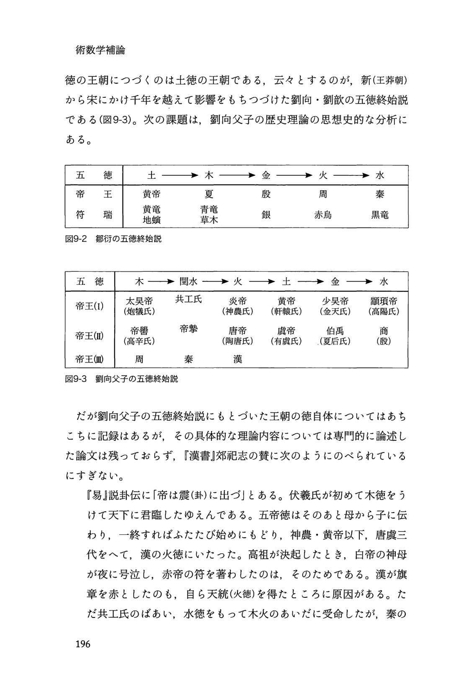

<!-- V3_SOURCE_ID:book015-b001273-p000-9c05657a85 -->

刘向父子之后，闰水位即共工氏、秦代所对应之德的循环被视为不必要而被删除，除了这一微小修正外，五德终始说一直延续到宋代（図9-4）3)。汉代以后的王朝始祖在建立新国家时，对于承接前哪一王朝的问题有诸多考量，各自以自身的理论主张革命的正当性，但唯独在五德的循环次序上，都遵循木→火→土→金→水→…的相生次序。例如，王莽的新朝自认承接汉代的禅让，自称土德；三国的魏也认为自己承接汉代之后，宣称自己是土德王朝。晋王朝承接魏的土德，自称金德；此后南朝的宋、齐、梁、陈分别将帝德定为水、木、火、土。另外北魏承接晋的金德，自称水德王朝；后周承接北魏的水德，自称木德。此后隋代的火→唐代的土的循环、唐代的土→后梁的金的循环、唐代的土→后唐的土→后晋的金→后汉的水→后周的木→宋代的火的循环，基本都遵循刘向父子的五德终始说。

> **释读存疑：** 図9-4

查看对应原文

<!-- V3_FOLDBACK_BEGIN:book015-b001273-p000-9c05657a85 -->

劉向父子以後，閏水位すなわち共工氏や秦の徳がおかれた運次は不必要なものとして削られたが，その微少な修正をのぞけば，五徳終始説は宋の世まで生命を長らえつづけた(図9-4)3)。漢以後の王朝の始祖は新たに国を興こすに際して，前のどの王朝をうけたかについてはさまざまな考えをめぐらし，自らの論理をもって革命の正当性を主張したが，こと五徳の運次についてはみな，木→火→土→金→水→…の相生の順位にしたがうことを常とした。たとえば，王莽の新は漢の禅譲をうけたとして自ら土徳を称し，三国の魏も漢の後をとったと考え，土徳の王朝たることを宣言した。晋王朝は魏の土をうけて金徳を称し，以下，南朝の宋・斉・梁・陳は帝徳をそれぞれ水・木・火・土とした。また北魏は晋の金を継いで自ら水徳の王朝と称し，後周は魏の水を継いで木と称した。以下，隋の火→唐の土の巡りも，唐の土→後梁の金の巡りも，唐の土→後唐の土→後晋の金→後漢の水→後周の木→宋の火の巡りも，基本的には劉向父子の五徳終始説に則っている。

<!-- V3_FOLDBACK_END:book015-b001273-p000-9c05657a85 -->

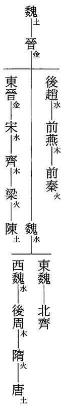

<!-- V3_SOURCE_ID:book015-b001274-p001-377cb26187 -->

图9-4 五德运次图

查看对应原文

<!-- V3_FOLDBACK_BEGIN:book015-b001274-p001-377cb26187 -->

図9-4 五徳運次図

<!-- V3_FOLDBACK_END:book015-b001274-p001-377cb26187 -->

<!-- V3_SOURCE_ID:book015-b001275-p000-bada791707 -->

## 6 水徳の王朝 — 6 水德的王朝

查看对应原文

<!-- V3_FOLDBACK_BEGIN:book015-b001275-p000-bada791707 -->

## 6 水徳の王朝

<!-- V3_FOLDBACK_END:book015-b001275-p000-bada791707 -->

<!-- V3_SOURCE_ID:book015-b001276-p000-b975d33e5e -->

汉代以后的帝王在建国之时，依据刘向父子的五德终始说，各自将五行中的一种作为自己的帝德，更改前代的德运，向天下宣告本朝的帝德。不过在宣告时，大多数开国帝王都依照古来的惯例，形式上或礼仪性地提及禅让之事，涉及牺牲、服饰等相关内容。

> **释读存疑：** 原文未完整表述，仅提及涉及牺牲、服饰等相关内容，未说明后续具体内容

查看对应原文

<!-- V3_FOLDBACK_BEGIN:book015-b001276-p000-b975d33e5e -->

漢以降の帝王は興国の際，劉向父子の五徳終始説にもとづいて，それぞれ五行の一を自らの帝徳として採用し，前代の徳運を改め，自朝の帝徳を天下に宣言したが，宣言の際には，開国の帝王の大多数は古来の慣習に則って形式的あるいは儀礼的に禅譲のことをのべ，犠牲や服飾など

<!-- V3_FOLDBACK_END:book015-b001276-p000-b975d33e5e -->

<!-- V3_SOURCE_ID:book015-b001277-p000-5cb09a670b -->

尽管有人主张更改颜色，但并未亲自阐述继承的帝德理念与内容，也没有宣示开展具有实质意义的制度改革的意志。只是说木德王朝用青色、火德用赤色、土德用黄色、金德用白色、水德用黑色这类内容。但由于明确记载刘向父子五德终始理论的著作并未流传至今，既没有受天命的帝王亲自对帝德作出说明，王朝更替时也没有伴随明确依据五德理念开展的制度改革，因此无法明确帝王对五帝德抱有何种印象，以及将五德的差异置于何处。不过中国历史上也存在若干依据明确宣示革命理念的五德终始说开展的制度改革。接下来想看看这类受天命进行改革的实例，借此稍微思考一下五帝德的含义。

查看对应原文

<!-- V3_FOLDBACK_BEGIN:book015-b001277-p000-5cb09a670b -->

の色を変更することは唱えるものの，継承した帝徳の理念や内容について自ら語ることはなく，実質的に意味のある制度改革の意志を宣べることもなかった。たかだか木徳の王朝であれば青色を用いるといい，火であれば赤，土であれば黄，金であれば白，水であれば黒を用いる，云々というのみである。だが劉向父子の五徳終始理論を明記した著述が今日に伝わっていない以上，天命をうけた帝王自身による帝徳の説明がなく，五徳理念によることが明らかな制度改革が王朝の交代に付随しないのであれば，帝王が五帝徳に何をイメージし，五徳の相違をどこにおいていたのか，などを明らかにすることはできない。だが中国史上には,革命の理念を明言した五徳終始説に則る制度改革もいくつか存在する。つぎにはそうした受命改制の実例をみ，それをとおして五帝徳の意味するところをすこし考えてみたい。

<!-- V3_FOLDBACK_END:book015-b001277-p000-5cb09a670b -->

<!-- V3_SOURCE_ID:book015-b001278-p000-14bac79cb3 -->

要准确了解五帝德中关于水德的理念与含义，最便捷的方式是参考秦始皇所推行的、历史上规模最大的受命改制实例。严格来说，秦朝的制度改革依托于邹衍的五德终始说，虽与刘向父子的五德终始说在循环方式上有所不同，但刘向父子的五德终始理论基本继承了邹衍学说中的五行理论，仅对循环方式进行了修正，对于五德本身的定位，两种学说并无重大差异。五德本身所代表的含义不会因相生与相克的差异而改变，其原因与五行的含义不会随转换方式变化而改变完全相同。

查看对应原文

<!-- V3_FOLDBACK_BEGIN:book015-b001278-p000-14bac79cb3 -->

五帝徳とくに水徳の理念や意味を正確に知るには，秦始皇帝による歴史上最も巨大な受命改制の実例をみるのが最も便利であろう。秦の制度改革は厳密にいえば，鄒衍の五徳終始説に依拠しており，劉向父子のそれとは循環の方式が異なっているけれども，劉向父子の五徳終始理論は鄒衍説の五行理論を基本的にうけつぎながら循環方式のみを修正したものにすぎず，五徳自体にたいする二説の位置づけには大きな変化はない。五徳自体の意味するところは相生と相克の相違に応じて変化しないということができるのは，五行の意味が変換方式に応じて変わることがないのとまさに同じ理由にもとづいている。

<!-- V3_FOLDBACK_END:book015-b001278-p000-14bac79cb3 -->

<!-- V3_SOURCE_ID:book015-b001279-p000-3809f41b82 -->

秦朝依据水德推行的制度改革如下：秦王政在位第二十六年，完成统一中国的大业后，将王的称号改为皇帝，自称始皇帝。同时依照邹衍的五德终始说，规定秦王朝的德运为水，推行一系列符合水德的改制措施。具体包括：以水德对应的季节冬季的十月初一作为一年的开端；衣服、旌旗使用水对应的黑色；数字以水对应的六为基准；将黄河改名为德水，作为水德的象征；彻底推行法治主义，处理事务以符合水德的刚毅严苛为宗旨；音律尊崇阴律之首的大吕等。以水对应的六为基准，具体体现为：规定符节、法冠的长度为六寸，马车的车辕间距为六尺，将步定为六尺作为长度单位，规定书写文字的简策长度为六寸的倍数，将行政区域划分为三十六个郡等。

> **释读存疑：** 本地硬校验仍未通过，已记录供后续自动处理或人工核对。

查看对应原文

<!-- V3_FOLDBACK_BEGIN:book015-b001279-p000-3809f41b82 -->

秦の水徳による制度改革は次のようである。秦王政は在位の第二十六年(前221)，中国統一を成しとげると，王の称号を皇帝と改め，自ら始皇帝と称した。また鄒衍の五徳終始説にしたがって秦王朝の徳を水と規定し，一連の水徳に則る改制を断行した。すなわち，水徳の季節である冬の十月朔日を年首とする，衣服や旌旗には水の色の黒を使用する，数は水徳のそれである六を基準とする，黄河の名を徳水と改め，水徳の象徴とする，法治主義を徹底し，事に当たって水徳にかなう剛毅戻深を旨とする，音律は陰律の始めにある大呂を尊ぶ，などがそれである。数は水徳の六を基準とするとは，具体的には，符節や法冠の長さを六寸，馬車のゲージを六尺と定め，尺度の単位の歩を六尺とし，文字を記した簡策の長さ(書物の規格にあたる)を六寸の倍数と定め，行政区分を三六郡に分けることなどをさしている。

<!-- V3_FOLDBACK_END:book015-b001279-p000-3809f41b82 -->

<!-- V3_SOURCE_ID:book015-b001280-p000-bc031629c2 -->

研究秦朝的制度改革时需要注意，水德与冬季、法治主义等存在对应关系。水与冬季的对应，与邹衍以来的阴阳主运说完全一致。阴阳主运说的特点在于论述顺应四时流转的时令，认为人应当按照自然的节奏生活，以天道的根本规律——春生、夏长、秋收、冬藏为标准制定政令，试图让所有人事活动都顺应天道的运行。时令中存在诸多宜忌，正是出于这个原因。此外，水德与法治主义的对应，也源于阴阳主运说中水与冬季的关联。《史记·秦始皇本纪》中记载，水德对应的政治是“刚毅严苛，凡事都依法决断，刻薄寡恩，毫无仁爱道义，之后才符合五德的规律”，这是因为其以春木、夏火、中央土、秋金、冬水的对应关系为根本，以冬季的天罚为范本。自邹衍以来，在五德终始说中，五帝德便与四季的特性和意象相关联，从这一点来看，经过刘向父子修正后，主张木→火→土→金→水相生循环的五德终始说成为主流，不得不说这是理所当然的。

> **释读存疑：** 本地硬校验仍未通过，已记录供后续自动处理或人工核对。

查看对应原文

<!-- V3_FOLDBACK_BEGIN:book015-b001280-p000-bc031629c2 -->

秦の制度改革において注意すべきは，水徳が冬や法治主義などと対応関係があることである。水が冬と対応しているのは，鄒衍以来の陰陽主運説とまったく等しい。陰陽主運説は，四時の大順(季節の巡り)を勘案した時令を説くところに特徴があり，人は自然のリズムに合った生活をしなければならないとし,天道の大経である春の生・夏の長・秋の収・冬の蔵を基準として政令をつくり，あらゆる人事を天の運行に順応させようとする。時令に用事宜忌が数多くみえるのはそのためである。また水徳が法治主義と対応しているのも，陰陽主運説の水と冬の関連づけに起因している。すなわち，水徳の政治が「剛毅戻深にして，事みな法に決し，刻削にして仁恩和義なく，然る後に五徳の数に合う」『史記』秦始皇本紀)としたのは，春一木，夏一火，中央一土，秋一金，冬一水の対応を根幹におき，冬の天誅をモデルとしたためである。五徳終始説においては鄒衍以来，五帝徳は四季の性格やイメージに連なっており，その点からいえば，劉向父子の修正をへたのち，木(春)→火(夏)→土(中央)→金(秋)→水(冬)の相生の循環を説く，五徳終始説が主流となっていくのは理の然るところといわねばならない。

<!-- V3_FOLDBACK_END:book015-b001280-p000-bc031629c2 -->

<!-- V3_SOURCE_ID:book015-b001281-p000-5c36821bb8 -->

## 7 科学理論への影響 — 7 对科学理论的影响

查看对应原文

<!-- V3_FOLDBACK_BEGIN:book015-b001281-p000-5c36821bb8 -->

## 7 科学理論への影響

<!-- V3_FOLDBACK_END:book015-b001281-p000-5c36821bb8 -->

<!-- V3_SOURCE_ID:book015-b001282-p000-392474bede -->

五行思想在汉代，与河图、洛书相互经纬，八卦、九章相互表里，同时作为社会理论，朝着五行灾异与五德终始2个方向发展，但并非仅此而已。它还对中国科学理论的范式形成产生了重大影响。

查看对应原文

<!-- V3_FOLDBACK_BEGIN:book015-b001282-p000-392474bede -->

五行思想は漢代，「河図・洛書，相経緯をなし，八卦・九章，相表裏をなし」ながら，社会理論としては五行災異と五徳終始の2方向に発展したが,ただそれだけではない。中国の科学理論のパラダイム形成にも大きな影響をおよぼした。

<!-- V3_FOLDBACK_END:book015-b001282-p000-392474bede -->

<!-- V3_SOURCE_ID:book015-b001283-p001-10febfa722 -->

图9-5 膀胱诸穴图

查看对应原文

<!-- V3_FOLDBACK_BEGIN:book015-b001283-p001-10febfa722 -->

図9-5 膀胱諸穴図

<!-- V3_FOLDBACK_END:book015-b001283-p001-10febfa722 -->

<!-- V3_SOURCE_ID:book015-b001284-p000-db68739461 -->

中国历法到了刘歆的三统历，被认为具备了天体历（almanac）的规模，而天体历指的就是阴阳五行历，它依据太阳与太阴的运行确定年月日的组合，同时计算对应五行的五星的天文位置。另外，如今我们对五颗行星使用木星、火星、土星、金星、水星的名称，究其本源，始于中国天文学吸纳五行学说构建天文理论。水星的含义是水之星，这里的水是五行中的水。

查看对应原文

<!-- V3_FOLDBACK_BEGIN:book015-b001284-p000-db68739461 -->

中国暦は劉歆の三統暦にいたって，天体暦almanacの規模をそなえたといわれるが，天体暦とは陰陽五行暦のことであり，太陽と太陰の運行に則って年月日の組み合わせをさだめながら，五行に対応する五星の天文位置を計算している。また今日われわれが五惑星に対して木星・火星・土星・金星・水星の名を使用するのも，本を正せば，中国天文学が五行説を取り込んで天文理論を構築したことに始まっている。水星の意味は水の星ということであるが，その水は五行の水である。

<!-- V3_FOLDBACK_END:book015-b001284-p000-db68739461 -->

<!-- V3_SOURCE_ID:book015-b001285-p000-cb82fa052b -->

此外，它对中国医学的影响也很大。

查看对应原文

<!-- V3_FOLDBACK_BEGIN:book015-b001285-p000-cb82fa052b -->

また中国医学への影響も大き

<!-- V3_FOLDBACK_END:book015-b001285-p000-cb82fa052b -->

<!-- V3_SOURCE_ID:book015-b001286-p000-48d18fcbbb -->

中国的医学理论，将五脏、六腑、十二经脉等归属于五行，用相生与相克来解释人体生理及病理上的关系。具体而言：①木对应肝、胆、足厥阴肝经、足少阳胆经；②火（君火）对应心、小肠、手少阴心经、手太阳小肠经；③相火对应心包、三焦、手厥阴心包经、手少阳三焦经；④土对应脾、胃、足太阴脾经、足阳明胃经；⑤金对应肺、大肠、手太阴肺经、手阳明大肠经；⑥水对应肾、膀胱、足少阴肾经、足太阳膀胱经(図9-5)4)，以上就是其基本的归属关系。另外，疾病的转移分为相生类传变与相克类传变，相生类传变中，病变有从母脏传到子脏的情况，也有相反的情况；相克类传变中，相克太过的情况，也有相克向相反方向发展的情况。据说如果没有五行学说，中国医学就无法成立，可见其影响之广泛且深远。

> **释读存疑：** 原文中“図9-5”的标注未在译文中体现，具体所指不详

查看对应原文

<!-- V3_FOLDBACK_BEGIN:book015-b001286-p000-48d18fcbbb -->

い。中国の医学理論は，五臓や六腑や十二経脈などを五行に配し，相生と相克をもって人体の生理や病理上の関係を説明する。すなわち，①木—肝·胆·足厥陰肝経脈·足少陽胆経脈，②火(君火) —心·小腸・手少陰心経脈・手太陽小腸経脈，③相火 —心包·三焦・手厥陰心包経脈·手少陽三焦経脈，④土 —脾·胃·足太陰脾経脈·足陽明胃経脈，⑤金 —肺·大腸·手太陰肺経脈·手陽明大腸経脈，⑥水 —腎・膀胱・足少陰腎経脈・足太陽膀胱経脈(図9-5)4)，云々というのがその基本配当である。また病気の転移(伝変)は相生と相克にわかれており，相生の伝変には，病変が母臓から子臓に伝わるとき(母病及子)とその逆(子病犯母)の区別があり，相克の伝変にも，相克が甚だしいとき(相乗)と相克と逆方向に向かうとき(相侮)の区別がある。五行説がなければ中国医学は成立しないといわれるほど，その影響は広くかつ深い。

<!-- V3_FOLDBACK_END:book015-b001286-p000-48d18fcbbb -->

注

<!-- V3_SOURCE_ID:book015-b001288-p000-717a6a6d39 -->

1) 文中引用《易》的内容：上天显现出天象，预示吉凶，圣人取法天象创制了八卦；黄河出现河图，洛水出现洛书，圣人取法它们。刘歆认为，虙羲氏承天命称王，接受河图，取法它画出八卦；禹治理洪水，被赐予洛书，取法它排布为《洪范》。圣人推行其中的道，珍视其真义。

查看对应原文

<!-- V3_FOLDBACK_BEGIN:book015-b001288-p000-717a6a6d39 -->

1)原文「易曰，天垂象，見吉凶，聖人象之。河出圖，雒出書，聖人則之。劉歆以為虙羲氏繼天而王，受河圖，則而畫之，八卦是也。禹治洪水，賜雒書，法而陳之，洪範是也。聖人行其道而寶其真」。

<!-- V3_FOLDBACK_END:book015-b001288-p000-717a6a6d39 -->

<!-- V3_SOURCE_ID:book015-b001289-p000-e09365d7e7 -->

2)原文「劉向父子以為帝出于震，故包羲氏始受木徳，其後以母傳子，終而復始，自神農黄帝下歴唐虞三代而漢得火焉。故高祖始起，神母夜號，著赤帝之符，旗章遂赤，自得天統矣。昔共工氏以水徳間于木火，與秦同運，非其次序，故皆不永」。

> **释读存疑：** 本地硬校验仍未通过，已记录供后续自动处理或人工核对。

查看对应原文

<!-- V3_FOLDBACK_BEGIN:book015-b001289-p000-e09365d7e7 -->

2)原文「劉向父子以為帝出于震，故包羲氏始受木徳，其後以母傳子，終而復始，自神農黄帝下歴唐虞三代而漢得火焉。故高祖始起，神母夜號，著赤帝之符，旗章遂赤，自得天統矣。昔共工氏以水徳間于木火，與秦同運，非其次序，故皆不永」。

<!-- V3_FOLDBACK_END:book015-b001289-p000-e09365d7e7 -->

<!-- V3_SOURCE_ID:book015-b001290-p000-52d67395e5 -->

3) 引自狩野直喜『読書饕餘』(みすず書房，1980)より引用。

> **释读存疑：** 本地硬校验仍未通过，已记录供后续自动处理或人工核对。

查看对应原文

<!-- V3_FOLDBACK_BEGIN:book015-b001290-p000-52d67395e5 -->

3) 狩野直喜『読書饕餘』(みすず書房，1980)より引用。

<!-- V3_FOLDBACK_END:book015-b001290-p000-52d67395e5 -->

<!-- V3_SOURCE_ID:book015-b001291-p000-1e613497b7 -->

4)出自明代王圻所著《三才图会》身体一卷。

查看对应原文

<!-- V3_FOLDBACK_BEGIN:book015-b001291-p000-1e613497b7 -->

4)明の王圻『三才図会』身体一巻より。

<!-- V3_FOLDBACK_END:book015-b001291-p000-1e613497b7 -->

<!-- V3_SOURCE_ID:book015-b001292-p000-8e7fe41936 -->

## 10中国の「はかり」の世界 — 10 中国的“度量衡”世界

查看对应原文

<!-- V3_FOLDBACK_BEGIN:book015-b001292-p000-8e7fe41936 -->

## 10中国の「はかり」の世界

<!-- V3_FOLDBACK_END:book015-b001292-p000-8e7fe41936 -->

<!-- V3_SOURCE_ID:book015-b001293-p000-6ec05c177c -->

上溯至今约二千年，西汉末年初始元年十一月戊辰日，即公元9年1月10日，王莽自称承受天命，登上帝位，定国号为新。又过五日，在建丑之月的十二月初一癸酉日，强行改定历法，将该日改称为始建国元年正月初一，颁布以十二月为岁首的新历法。同年，新的度量衡标准器被颁发，以此谋求对制度进行改革与统一。按照这样的政治日程推进的王莽度量衡改革，堪称中国有史以来规模最大的一次，其影响直至清代乃至现代，还波及整个亚洲。即便只是大致而言，到王莽的制度确立时，中国度量衡的定型也已完成。当时，王莽的智囊团中有一位以博学闻名的经学家刘歆。经学是指将诸子学的成果纳入自身体系、于汉代形成的新型孔子学派哲学，是关于作为民族基本古典的经书的学问的总称。

查看对应原文

<!-- V3_FOLDBACK_BEGIN:book015-b001293-p000-6ec05c177c -->

今を遡ること約二千年まえ，前漢末の初始元年十一月戊辰の日西暦(ユリゥス暦)のA.D.9年1月10日に，王莽は天命をうけたと称して，天子の位につき，国号を新とさだめた。また五日後の建丑の月十二月の朔，癸酉の日に，改暦を断行し，その日を始建国元年正月朔とあらため，十二月を歳首とする新暦を頒行した。同年，新たな度量衡の標準器を交付し，その制度の改変統一をはかった。こうした政治日程を踏んで行われた王莽の度量衡改革は，中国有史以来最大のものといってよく，その影響は清代あるいは現代までもおよび，アジア全域にまたがっている。一応とはいえ，王莽の制にいたって中国度量衡の定型化が完成したのである。当時，王莽のブレーンの一人に，博学で聞こえる経学者の劉歆がいた経学とは，諸子学の成果を自らの内部にとりこんで漢代に成立した，新しい孔子流哲学のこと。民族の基本的古典である，経書にかんする学問を総称する。

<!-- V3_FOLDBACK_END:book015-b001293-p000-6ec05c177c -->

<!-- V3_SOURCE_ID:book015-b001294-p000-bb3ef9992f -->

刘歆在西汉元始年间，受王莽之命，与一百多位学者一同对音律与度量衡进行研讨，并将结果上奏。继承刘歆学术传统的班固，在东汉中期将这份上奏文几乎原封不动地收录进《汉书·律历志》，由此诞生了中国最古老的关于度量衡的专门著作。从成书经过可以充分推断，《律历志》的记载与王莽的实际制度完全对应，因此可以通过该书内容详细分析当时度量衡的组织与功能。

> **释读存疑：** 本地硬校验仍未通过，已记录供后续自动处理或人工核对。

查看对应原文

<!-- V3_FOLDBACK_BEGIN:book015-b001294-p000-bb3ef9992f -->

劉歆は前漢の元始年間(A.D.1-5)に王莽の命をうけて，学者百余人とともに，音律と度量衡について検討し，その結果を上奏した。劉歆の学統をつぐ班固が，後漢の中頃に，その上奏文をほぼそのまま『漢書』律暦志に収録し，中国最古の度量衡にかんする専著が成立した。律暦志の記載は，成立の経緯から十分推測されるように，実際の王莽の制と完全に対応しており，したがって書の内容をとおして当時の度量衡の組織や機能を詳しく分析することができる。

<!-- V3_FOLDBACK_END:book015-b001294-p000-bb3ef9992f -->

<!-- V3_SOURCE_ID:book015-b001295-p000-59bfac3a0f -->

关于王莽的度量衡，我们除了文献资料之外，还拥有考古资料，其中包括台湾故宫博物院所收藏的「新莽銅嘉量」。

查看对应原文

<!-- V3_FOLDBACK_BEGIN:book015-b001295-p000-59bfac3a0f -->

王莽の度量衡については，われわれは文献資料にくわえて，考古資料をももっている。台湾の故宮博物館に所蔵される「新莽銅嘉量」(新の王莽

<!-- V3_FOLDBACK_END:book015-b001295-p000-59bfac3a0f -->

<!-- V3_SOURCE_ID:book015-b001296-p000-3fa6acc5ad -->

不过最近，在考古资料的收集整理方面发生了一件具有划时代意义的事件，那就是由中国国家计量总局编辑出版的《中国古代度量衡图集》。《中国古代度量衡图集》精选了240件具有高资料价值的度量衡古器，每件器物都收录了照片图版、铭文拓本、科学数据、图版说明等内容，凭借此书无需花费大量时间进行调查，就能够完成基本的古器检索与调查。这对于我们这些对度量衡史感兴趣的人而言，无异于福音。该书中收录的王莽时期的度器有铜制的一丈长尺1件，量器除前述的「新莽銅嘉量」之外还有6件，衡器有秤杆与砝码2件，涵盖了现存所有王莽时期的古器。

> **释读存疑：** 本地硬校验仍未通过，已记录供后续自动处理或人工核对。

查看对应原文

<!-- V3_FOLDBACK_BEGIN:book015-b001296-p000-3fa6acc5ad -->

の銅製枡原器)などがそれであるが，最近，考古資料の収集整理にかんして画期的な事件が起こった。中国の国家計量総局による『中国古代度量衡図集』の編輯出版がそれである(文物出版社，1981。邦訳：山田慶司・浅原達郎訳，みすず書房，1985)。『中国古代度量衡図集』は資料的価値の高い度量衡古器240点を精選し，各器に対して写真図版・銘文拓本・科学的データ・図版説明などを収めており，それによって調査に長い時間をかけることなく，基本的な古器の検索調査が可能になった。これはわれわれ度量衡史に興味を覚える者にとって，まさに福音に等しい。同書に収録される王莽の度器は銅製の一丈物差し1点，量器は既述の「新莽銅嘉量」ほか6点，衡器は秤ざおと分銅の2点であり，現存する王莽期の古器を網羅している。

<!-- V3_FOLDBACK_END:book015-b001296-p000-3fa6acc5ad -->

<!-- V3_SOURCE_ID:book015-b001297-p000-2269164502 -->

接下来，我想稍微以刘歆、班固所著《汉书》律历志的记载，以及图集中所载王莽标准器的铭文为主要材料，简单介绍其度量衡制度的各个方面。具体而言，包括以下三点：（1）度量衡的单位体系拥有共同的基准；（2）度量衡与声律的关系；（3）度量衡制度与革命思想。

查看对应原文

<!-- V3_FOLDBACK_BEGIN:book015-b001297-p000-2269164502 -->

以下すこしばかり，劉歆・班固の『漢書』律暦志の記載と図集にみえる王莽の標準器の銘文を主な材料として，その度量衡制の諸相を簡単に紹介したい。すなわち，(1）度量衡の単位系が共通の基準をもつこと，(2)度量衡と声律の関係，(3)度量衡制と革命思想——がそれである。

<!-- V3_FOLDBACK_END:book015-b001297-p000-2269164502 -->

<!-- V3_SOURCE_ID:book015-b001298-p000-c6e43f3528 -->

## 1 中国の統一度量衡制 — 1 中国的统一度量衡制

查看对应原文

<!-- V3_FOLDBACK_BEGIN:book015-b001298-p000-c6e43f3528 -->

## 1 中国の統一度量衡制

<!-- V3_FOLDBACK_END:book015-b001298-p000-c6e43f3528 -->

<!-- V3_SOURCE_ID:book015-b001299-p000-a1af43587e -->

中国历代的度量衡学者大体上都将《汉书》中王莽、刘歆的体系视为最为完备的制度，基本都遵循该体系。所谓“黄钟柜黍”的学说，是以黄钟律管作为原器，以秬黍作为辅助媒介，来统一构建度量衡单位体系的定型化理论。

查看对应原文

<!-- V3_FOLDBACK_BEGIN:book015-b001299-p000-a1af43587e -->

中国歴代の度量衡学者は大体において，『漢書』の王莽・劉歆のシステムを最も完備した制度とみなし，基本的にそれにしたがった。いわゆるこうしょうまよしいよ くろきび黄鐘柜黍の説黄鐘の律管(ピッチパイプ)を原器とし，秬黍を補助媒介として，度量衡の単位系を統一的に組み立てるが，その定型化された理論である。

<!-- V3_FOLDBACK_END:book015-b001299-p000-a1af43587e -->

<!-- V3_SOURCE_ID:book015-b001300-p000-21865d3113 -->

《汉书·律历志》对度制的组织作了如下记述：“度即分、寸、尺、丈、引，是测量长短的工具，源自黄钟的长度。取北方计算用的标准大秬黍，测量90粒黍的总长度，即为黄钟的长度。以一粒黍为一分，十分为一寸，十寸为一尺，十尺为一丈，十丈为一引，由此确定五度。”以黄钟管长为9寸，由此确定了五个长度单位。

查看对应原文

<!-- V3_FOLDBACK_BEGIN:book015-b001300-p000-21865d3113 -->

『漢書』律暦志は度制について，その組織をこうのべている。「度とは分・寸・尺・丈・引のこと。長短をはかる手段である。もと黄鐘の長さに起こる。北方に算する標準大の秬黍をとって，一黍の横幅の九十分(90粒の合計長)をはかると，それが黄鐘の長さである(90分=9寸)。一黍を一分(分の単位)とし，十分を一寸，十寸を一尺，十尺を一丈，十丈を一引として，ここに五度がさだまる」と。黄鐘の管長を九寸として，五度五つの長さの単位が求められている。

<!-- V3_FOLDBACK_END:book015-b001300-p000-21865d3113 -->

<!-- V3_SOURCE_ID:book015-b001301-p000-e44185842b -->

五量——五个容量单位，是以黄钟管的容积810立方分为一龠来制定的。“量即龠、合、升、斗、斛，是测量多少的工具，源自黄钟律管（龠）。其容积由度的数值确定，相当于装满1200粒北方计算用的标准大秬黍至黄钟律管上部，再以井戸水将上部调至水平时的容积。将该龠的容量作为一合，十合为一升，十升为一斗，十斗为一斛，由此形成五量。”

> **释读存疑：** 1轮自动修复后核义模型仍建议修订，已保守记录。

查看对应原文

<!-- V3_FOLDBACK_BEGIN:book015-b001301-p000-e44185842b -->

五量——五つの容量単位は，黄鐘管の容積810立方分を1龠として制定された。「量とは龠・合・升・斗・斛のこと。多少をはかる手段である。もと黄鐘の律管(龠)に起こる。その容量は度の数値によって定められるが(1龠=810立方分)，それは北方に算する標準大の秬黍千二百を黄鐘の律管に満たし，井戸水で上部を水平にしたときの容量にひとしい。その龠を合わせて一合とし，十合を一升，十升を一斗，十斗を一斛として，五量がそなわる」。

<!-- V3_FOLDBACK_END:book015-b001301-p000-e44185842b -->

<!-- V3_SOURCE_ID:book015-b001302-p000-6041cf2772 -->

刘歆从黄钟的重量，也就是同一律管中装入的1200粒秬黍的重量，推导出五权——五个重量单位。“权即铢、两、斤、钧、石，是使秤的衡保持水平以知晓轻重的工具，源自黄钟的重量。一龠装入1200粒黍，这些秬黍的重量为十二铢。将其加倍为一两，也就是二十四铢为一两，十六两为一斤，三十斤为一钧，四钧为一石。……由此形成五权。”另外，权指的是秤的砝码。

> **释读存疑：** 1轮自动修复后核义模型仍建议修订，已保守记录。

查看对应原文

<!-- V3_FOLDBACK_BEGIN:book015-b001302-p000-6041cf2772 -->

劉歆は黄鐘の重さ，すなわち同律管に入る1200秬黍の重さから，五権——五つの重量単位を導きだした。「権とは銖・両・斤・鈞・石のこと。物をかける衡(秤ざお)を水平にし，軽重を知るためのものである。もと黄鐘の重さに起こる。一龠は千二百黍を入れ，その秬黍の重さは十二銖である。これを二倍して一両，つまり二十四銖を一両とし，十六両を一斤，三十斤を一鈞，四鈞を一石とする。……かくして五権がなりたつ」。なお権とは，秤の分銅のことである。

<!-- V3_FOLDBACK_END:book015-b001302-p000-6041cf2772 -->

<!-- V3_SOURCE_ID:book015-b001303-p000-aefc4bf400 -->

后世的度量衡学者虽对相关表述做过些许修正，但都几乎引用相同的文字，遵循“以律管确定度量衡”的思路构建并阐发自己的学说。另外，作为日本度量衡制度原点的大宝令之杂令也遵循这一学说，其影响不可估量。

查看对应原文

<!-- V3_FOLDBACK_BEGIN:book015-b001303-p000-aefc4bf400 -->

後世の度量衡学者は，表現にやや修正をくわえたりもしたが，だれしもほぼ同文を引用し，その管律から度量衡を定義するという考えかたに則って，自説を構築し展開した。また日本の度量衡制度の原点にあたる大宝令の雑令も同説に則っており，その影響ははかりしれない。

<!-- V3_FOLDBACK_END:book015-b001303-p000-aefc4bf400 -->

<!-- V3_SOURCE_ID:book015-b001304-p000-f001f99fc3 -->

如上文所述，刘歆从黄钟管长9寸、容量810立方分推导出度制与量制，又依据黄钟管可容纳1200粒黍、这些秬黍的重量为12铢确定衡制，但他以什么为理论依据，认为必须基于同一基准统一构建度量衡呢？据《汉书·律历志》记载，刘歆将统一声律与度量衡的解释依据，归于《尚书·虞书》中的“乃同律度量衡”。也就是说，他将该句的含义解释为“并非统一颁行声律与度量衡，而是使声律与度量衡的基准相一致”，主张原本性质不同的声律与度量衡应属于同一体系

查看对应原文

<!-- V3_FOLDBACK_BEGIN:book015-b001304-p000-f001f99fc3 -->

劉歆は上記のごとく，黄鐘管の長さ9寸・容量810立方分から度制や量制を導きだし，黄鐘管に1200黍が入り，その秬黍の重さが12銖であることから衡制をさだめたが，かれは何を理論的根拠として，同一の基準にもとづいて度量衡を統一的に組み立てねばならぬとしたのか。『漢書』律暦志の記すところ，劉歆は統一的な声律度量衡解釈の根拠を『尚書』虞書の「乃ち律度量衡を同しうす(乃同律度量衡)」においた。すなわち，同句の意味を(声律度量衡の統一頒行ではなく)声律と度量衡の基準を等しくすることと解釈して，本来異質の声律と度量衡が共通の体系に属

<!-- V3_FOLDBACK_END:book015-b001304-p000-f001f99fc3 -->

<!-- V3_SOURCE_ID:book015-b001305-p000-5b0b789800 -->

的理论正当性。

查看对应原文

<!-- V3_FOLDBACK_BEGIN:book015-b001305-p000-5b0b789800 -->

することの理論的正当性を主張した。

<!-- V3_FOLDBACK_END:book015-b001305-p000-5b0b789800 -->

<!-- V3_SOURCE_ID:book015-b001306-p000-1d95845b8a -->

我们还应注意到，刘歆是引用经书的语句作为其学说的立论依据的。因为从这里可以看到刘歆乃至古典时期中国读书人的基本思维模式。

查看对应原文

<!-- V3_FOLDBACK_BEGIN:book015-b001306-p000-1d95845b8a -->

われわれは劉歆が経書の語句をひいて，立説の根拠としたことにも注意すべきであろう。ここには劉歆，ひいては古典期中国読書人の基本的思考パターンをみることができるからである。

<!-- V3_FOLDBACK_END:book015-b001306-p000-1d95845b8a -->

<!-- V3_SOURCE_ID:book015-b001307-p000-72728a3ad3 -->

劉歆提出的以同一基准推导出度量衡单位的思路，必然会让人联想到法国大革命时期创立近代米制的思想。1799年完成的这套单位体系，以地球子午线的4000万分之一为基准，确定了长度单位米，再由米推导出容量单位升，最后定义1升水的重量为1千克；除了理论的基本结构中以地球取代黄鐘、以水取代秬黍之外，这套体系与劉歆的制度完全相同。薮内清将这套制度称为「中国的米制」，理由就在于此。薮内的解说虽简洁，却切实精准地阐述了黄鐘秬黍之说的特质。

> **释读存疑：** 「中国的米制」具体所指不详；本地硬校验仍未通过，已记录供后续自动处理或人工核对。

查看对应原文

<!-- V3_FOLDBACK_BEGIN:book015-b001307-p000-72728a3ad3 -->

劉歆の同一の基準から度量衡の単位を導きだすという考えかた(黄鐘秬黍の説)は，フランス革命における近代的なメートル法の創立思想を思いおこさせるにちがいない。1799年に完成したこの単位体系は，地球子午線の4000万分の1を基準として，長さの単位メートルをさだめ，そのメートルから容量の単位リットルを導きだし，最後に1リットルの水の重さを1キログラムと定義するが，その理論の基本構造は地球が黄鐘，水が秬黍に代わっていることをのぞけば，劉歆の制度とまったく同じである。藪内清がこの制度を「中国におけるメートル法」とよぶ(「中国科学の伝統と特色」，『中国の科学』，中央公論社，1975，頁46)理由はそこにある。藪内の解説は簡単ながら実にうまく黄鐘秬黍の説の特質をのべているように思う。

<!-- V3_FOLDBACK_END:book015-b001307-p000-72728a3ad3 -->

<!-- V3_SOURCE_ID:book015-b001308-p000-9ec8534051 -->

## 2 度量衡と声律 — 2 度量衡与声律

查看对应原文

<!-- V3_FOLDBACK_BEGIN:book015-b001308-p000-9ec8534051 -->

## 2 度量衡と声律

<!-- V3_FOLDBACK_END:book015-b001308-p000-9ec8534051 -->

<!-- V3_SOURCE_ID:book015-b001309-p000-4c189975cc -->

中国音乐的音体系由三部分构成：（1）确定相对音高的「声」，（2）标示绝对音高的「律」，（3）其结合方式的「旋宫・转调」；黄鐘是该音律的基础音。在制度上一度获得稳定发展的汉代体系，以五声十二律为基本结构。

> **释读存疑：** 「声」「律」「旋宫・转调」具体所指不详

查看对应原文

<!-- V3_FOLDBACK_BEGIN:book015-b001309-p000-4c189975cc -->

中国音楽の音組織は，（1）相対音高を定める「声」(音階)，(2）絶対音高を示す「律」(音律)，(3)その結合法の「旋宮・転調」(調)からなっており，黄鐘はその律の基礎音である。制度的に一応の安定をみた漢代のシステムは，五声十二律をその基本的構造としている。

<!-- V3_FOLDBACK_END:book015-b001309-p000-4c189975cc -->

<!-- V3_SOURCE_ID:book015-b001310-p000-e3fb0ab303 -->

五声指的是宫、商、角、徴、羽，由五音音階构成；它将1オクターブすなわち振動数比が2対1の絶対協和音程1200セントを，完全協和関係を示す振動数比3対2と4対3によって分割したものである。「五声の本は，黄鐘の律に生ず」といい，その計算方法は(1）相対音高を示すのに律長を借り，黄鐘管の9寸を基準とし，(2)前の管長を2/3あるいは4/3して各管長を定めた。三分損益法といわれるのがそれである。一方，

> **释读存疑：** 五音音階具体所指不详；1オクターブ具体所指不详；1200セント具体所指不详；3対2具体所指不详；4対3具体所指不详；三分損益法具体所指不详；本地硬校验仍未通过，已记录供后续自动处理或人工核对。

查看对应原文

<!-- V3_FOLDBACK_BEGIN:book015-b001310-p000-e3fb0ab303 -->

五声は宮・商・角・徴・羽のこと。五音音階(ペンタトーニク)からなり，1オクターブすなわち振動数比が2対1の絶対協和音程(1200セント)1)を，完全協和関係を示す振動数比3対2(完全5度，702セン卜)と4対3(完全4度，498セント)によって分割したものである。「五声の本は，黄鐘の律に生ず」といい，その計算方法は(1）相対音高を示すのに律長を借り，黄鐘管の9寸(t)を基準とし，(2)前の管長を2/3(三分損一)あるいは4/3(三分益一)して各管長を定めた。三分損益法といわれるのがそれである(表10-1)。一方，

<!-- V3_FOLDBACK_END:book015-b001310-p000-e3fb0ab303 -->

<!-- V3_SOURCE_ID:book015-b001311-p000-f9337f913a -->

十二律从低音开始，依次为黄钟、大吕、太族、夹钟、姑洗、中吕、蕤宾、林钟、南吕、夷则、无射、应钟。与五声相同，以管长9寸的黄钟为基准，通过三分损益法，在五声音阶的八度范围内确定了这12律的管长及绝对音高（表10-2）。

> **释读存疑：** 原文中“1オ表10-1”的表述未明确，释读时未涉及该部分内容

查看对应原文

<!-- V3_FOLDBACK_BEGIN:book015-b001311-p000-f9337f913a -->

たいそう こせん ずいひん  
十二律は低音から黄鐘・大呂・太族・夾鐘・姑洗・中呂・蕤賓・林鐘·なんりょ ぶえき  
夷則・南呂・無射・応鐘といい，五声と同じく管長9寸の黄鐘から，三分
損益法によって1オ表10-1 五声クターブ内にその12の管長絶対音高をさだめた(表10-2)。

<!-- V3_FOLDBACK_END:book015-b001311-p000-f9337f913a -->

<!-- V3_SOURCE_ID:book015-b001313-p000-c2e1757fc6 -->

| 音名 | 律長 | 相生関係 | 振動数 | セント値 |
| ---- | ---- | -------- | ------ | -------- |
| 宮 | 1 | 基音 | n | 0 |
| 商 | $2^3/3^2$ l | ①① | $3^2/2^3$n | 203.9 |
| 角 | $2^6/3^4$ l | ㊉×4/3 | $3^4/2^6$n | 407.8 |
| 徵 | 2/3 l | ㊣×2/3 | 3/2 n | 702.0 |
| 羽 | $2^4/3^3$ l | 商×2/3 | $3^3/2^4$n | 905.9 |

> **释读存疑：** 原文中“相生関係”列的部分符号（如①①、㊉、㊣）未明确含义，释读时保留了原符号；本地硬校验仍未通过，已记录供后续自动处理或人工核对。

查看对应原文

<!-- V3_FOLDBACK_BEGIN:book015-b001313-p000-c2e1757fc6 -->

<table><tr><td></td><td>律長</td><td>相生関係</td><td>振動数</td><td>セント値</td></tr><tr><td>宮</td><td>1</td><td>基音</td><td>n</td><td>0</td></tr><tr><td>商</td><td> $2 ^ { 3 } / 3 ^ { 2 }$  1</td><td> $\textcircled { 1 } \textcircled { 1 }$ </td><td>3²/2³n</td><td>203.9</td></tr><tr><td>角</td><td> $2 ^ { 6 } / 3 ^ { 4 }$  l</td><td> $\mathbb { H } \times 4 / 3$ </td><td>3⁴/2⁶ n</td><td>407.8</td></tr><tr><td>徵</td><td>2/3 l</td><td> $\overleftrightarrow { \Xi } { \times } 2 / 3$ </td><td>3/2 n</td><td>702.0</td></tr><tr><td>羽</td><td> $2 ^ { 4 } / 3 ^ { 3 }$  l</td><td>商×2/3</td><td>3³/2⁴n</td><td>905.9</td></tr></table>

<!-- V3_FOLDBACK_END:book015-b001313-p000-c2e1757fc6 -->

<!-- V3_SOURCE_ID:book015-b001314-p000-33aae8edaa -->

表10-2 十二律
<table><tr><td>律名</td><td>長</td><td>律長比例</td><td>相生関係</td><td>セント値</td><td>十二辰</td></tr><tr><td>黄鐘</td><td>9寸</td><td>l</td><td>律の首</td><td>0</td><td>子</td></tr><tr><td>大呂</td><td>8 104 243</td><td>2¹¹/3⁷ l</td><td>1/3 ≥ 2/3 ≥ 4/3</td><td>113.7</td><td>丑</td></tr><tr><td>太族</td><td>8</td><td>2³/3² l</td><td>1/1 × 4×5/12 × 4/3</td><td>203.9</td><td>寅</td></tr><tr><td>夾鐘</td><td>7 1075 2187</td><td>2¹⁴/3⁹ l</td><td>1/2 AL | × 4/3</td><td>317.6</td><td>卯</td></tr><tr><td>姑洗</td><td>7 1/9</td><td>2⁶/3⁴ l</td><td>1/ℙ ℰ × 4/3</td><td>407.8</td><td>辰</td></tr><tr><td>中呂</td><td>6 12974 19683</td><td>2¹⁷/3¹¹ l</td><td>4/3 ≥ 4/3 > 4/3</td><td>521.5</td><td>巳</td></tr><tr><td>蕤賓</td><td>6 26/81</td><td>2⁹/3⁶ l</td><td>1/10 ＜ 4/3</td><td>610.7</td><td>午</td></tr><tr><td>林鐘</td><td>6</td><td>2/3 l</td><td>4/5 ＋ 4/5 × 2/3</td><td>702.0</td><td>未</td></tr><tr><td>夷則</td><td>5 451/729</td><td>2¹²/3⁸ l</td><td>tan xseax π/3</td><td>815.6</td><td>申</td></tr><tr><td>南呂</td><td>5 1/3</td><td>2⁴/3³ l</td><td>∴14/15 × 2/3</td><td>905.9</td><td>酉</td></tr><tr><td>無射</td><td>4 6524/6561</td><td>2¹⁵/3¹⁰ l</td><td>x ≤ ∧x/2 × 2/3</td><td>1019.5</td><td>戌</td></tr><tr><td>応鐘</td><td>4 20/27</td><td>2⁷/3⁵ l</td><td>‡‡ψ∉ × 2/3</td><td>1109.8</td><td>亥</td></tr></table>

> **释读存疑：** 部分相生关系的表达式存在乱码，无法识别具体含义；本地硬校验仍未通过，已记录供后续自动处理或人工核对。

查看对应原文

<!-- V3_FOLDBACK_BEGIN:book015-b001314-p000-33aae8edaa -->

表10-2 十二律
<table><tr><td></td><td>律</td><td>長</td><td></td><td>相生関係</td><td>セント値</td><td>十二辰</td></tr><tr><td>黄鐘</td><td>9 寸</td><td></td><td>l</td><td>律の首</td><td>0</td><td>子</td></tr><tr><td>大呂</td><td>8</td><td>104 243</td><td> $\frac { 2 ^ { 1 1 } } { 3 ^ { 7 } } l$ </td><td> $\frac { 1 } { 3 } \geq \frac { 2 } { 3 } \geq \frac { 4 } { 3 }$ </td><td>113.7</td><td>丑</td></tr><tr><td>太族</td><td></td><td>8</td><td> $\frac { 2 ^ { 3 } } { 3 ^ { 2 } } l$ </td><td> $\frac { 1 } { 1 } \times \frac { 4 \times 5 } { 1 2 } \times \frac { 4 } { 3 }$ </td><td>203.9</td><td>寅</td></tr><tr><td>夾鐘</td><td>7</td><td>1075 2187</td><td> $\frac { 2 ^ { 1 4 } } { 3 ^ { 9 } } l$ </td><td> $\frac { 1 } { 2 } A L \vert \times \frac { 4 } { 3 }$ </td><td>317.6</td><td>卯</td></tr><tr><td>姑洗</td><td></td><td> $7 \ \frac { 1 } { 9 }$ </td><td> $\textstyle { \frac { 2 ^ { 6 } } { 3 ^ { 4 } } } l$ </td><td> $\frac { 1 } { \mathbb { P } } \mathbb { E } \times \frac { 4 } { 3 }$ </td><td>407.8</td><td>辰</td></tr><tr><td>中呂</td><td>6</td><td>12974 19683</td><td> $\textstyle { \frac { 2 ^ { 1 7 } } { 3 ^ { 1 1 } } } l$ </td><td> $\frac { 4 } { 3 } \geq \frac { 4 } { 3 } > \frac { 4 } { 3 }$ </td><td>521.5</td><td>巳</td></tr><tr><td>蕤賓</td><td></td><td> $6 ~ \frac { 2 6 } { 8 1 }$ </td><td> $\frac { 2 ^ { 9 } } { 3 ^ { 6 } } l$ </td><td> $\frac { 1 } { 1 0 } \textcircled { < } \frac { 4 } { 3 }$ </td><td>610.7</td><td>午</td></tr><tr><td>林鐘</td><td></td><td>6</td><td> $\scriptstyle { \frac { 2 } { 3 } } l$ </td><td> $\frac { 4 } { 5 } \textcircled { + } \frac { 4 } { 5 } \times \frac { 2 } { 3 }$ </td><td>702.0</td><td>未</td></tr><tr><td>夷則</td><td> $5 \ \frac { 4 5 1 } { 7 2 9 }$ </td><td></td><td> $\frac { 2 ^ { 1 2 } } { 3 ^ { 8 } } l$ </td><td> $\tan \tt { x s e a x } \frac { \pi } { 3 }$ </td><td>815.6</td><td>申</td></tr><tr><td>南呂</td><td></td><td> $5 \frac { 1 } { 3 }$ </td><td> $\textstyle { \frac { 2 ^ { 4 } } { 3 ^ { 3 } } } l$ </td><td> $\therefore \frac { 1 4 } { 1 5 } \times \frac { 2 } { 3 }$ </td><td>905.9</td><td>酉</td></tr><tr><td>無射</td><td> $4 \ \frac { 6 5 2 4 } { 6 5 6 1 }$ </td><td></td><td> $\frac { 2 ^ { 1 5 } } { 3 ^ { 1 0 } } l$ </td><td> $x \leq \frac { \land x } { 2 } \times \frac { 2 } { 3 }$ </td><td>1019.5</td><td>戌</td></tr><tr><td>応鐘</td><td> $4 \ \frac { 2 0 } { 2 7 }$ </td><td></td><td> $\textstyle { \frac { 2 ^ { 7 } } { 3 ^ { 5 } } } l$ </td><td> $\ddagger \ddagger { \ddot { \psi } } \notin \times \frac { 2 } { 3 }$ </td><td>1109.8</td><td>亥</td></tr></table>

<!-- V3_FOLDBACK_END:book015-b001314-p000-33aae8edaa -->

<!-- doc004 PDF 第 219 页：高风险/复杂版面 OCR 供检索；内容与排版以原页图为准。 -->
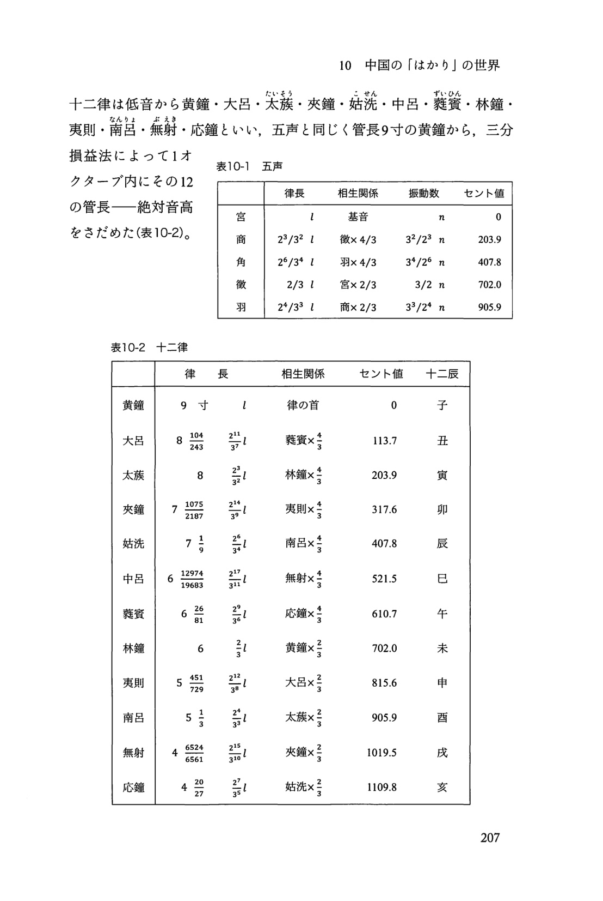

<!-- V3_SOURCE_ID:book015-b001316-p000-c6068b0178 -->

五声与十二律，只要确定黄钟这一个基准，也就是确定黄钟管的长度、容积等规格，就能轻易确定整个音组织。这正是《汉书·律历志》引用伶伦取解谷之竹，制作孔的大小与管壁厚度均匀的黄钟律管这一故事的原因，更进一步说，也是该书将律制与度量衡制结合起来论述的原因。

查看对应原文

<!-- V3_FOLDBACK_BEGIN:book015-b001316-p000-c6068b0178 -->

五声十二律はどちらも黄鐘ただ一つを確定すれば，すなわち黄鐘管の長さや容積などの規格を決めれば，簡単に音組織全体を定めることができる。これこそ『漢書』律暦志が，黄帝の命令をうけて，伶倫が解谷の竹をとり，孔の大きさと肉の厚さの均一なもの（竅厚均者）で黄鐘の律管をつくったという故事を引く理由であり，さらにいえば，同書が律制と度量衡制を結びつけて論じる理由でもある。

<!-- V3_FOLDBACK_END:book015-b001316-p000-c6068b0178 -->

<!-- V3_SOURCE_ID:book015-b001317-p000-77a061dfb2 -->

但上述以黄钟与9寸为关键词的声律与度量衡的相互依存关系，即黄钟以9寸的律长来确定，而寸则由黄钟的长度来决定，作为将两种制度结合起来的理论，不仅过于脆弱，而且仅依据两者的关系，无法很好地解释《汉书·律历志》在声律与度量衡之外，还统一论述历法系统的原因。要了解其确切原因，我们除了度量衡史与声律史之外，还必须将分析的范围扩展到历法史与思想史领域。

查看对应原文

<!-- V3_FOLDBACK_BEGIN:book015-b001317-p000-77a061dfb2 -->

だが上記の黄鐘と九寸をキーワードとした声律と度量衡の相互依存関係(黄鐘は律長9寸で定め，寸は黄鐘の長さで決める)は，両制度を結合する理論として，すこし脆弱すぎるだけでなく，たかだか両者の関係にしたがうだけでは『漢書』律暦志が声律と度量衡にくわえて暦法のシステムを統一的に論述した理由をうまく説明することができない。その正確な理由を知るには，われわれは度量衡史や声律史にくわえて，暦法史や思想史の領域にも分析の矛先を広げなければならない。

<!-- V3_FOLDBACK_END:book015-b001317-p000-77a061dfb2 -->

<!-- V3_SOURCE_ID:book015-b001318-p000-9de476e360 -->

根据中国的传统思想，天地万物都是由阴阳二气的离合聚散生成的。因此，作为大宇宙的天与作为小宇宙的人会相互感应，甚至人的社会制度与社会现象也必须顺应天。此外，春夏秋冬的变化是阴阳二气引发的最显著作用，而管律是吹奏气的，因此与历法一样，能够观测季节的变化。如此一来，在气的思想的影响下，声律与历法被关联起来，最终律制与历法也结合在了一起。

查看对应原文

<!-- V3_FOLDBACK_BEGIN:book015-b001318-p000-9de476e360 -->

中国の伝統思想によれば，天地万物は等しく，陰陽二気の離合集散によって生成される。そのため，大宇宙たる天と小宇宙たる人は相互感応が起こり，人の社会制度や社会現象さえも天にしたがわなければならない。また春夏秋冬の変化は陰陽二気が引き起こす最も顕著な作用であり，管律は気を吹くゆえ，暦法ともどもその季節の変化をうかがいうる。かくして気の思想の存在のもとに声律と暦法が関係づけられ，ついには律制と暦制が結合されるのである。

<!-- V3_FOLDBACK_END:book015-b001318-p000-9de476e360 -->

<!-- V3_SOURCE_ID:book015-b001319-p000-4dcb60769e -->

气的思想的影响，当然也能在度量衡制度中发现。例如五权的情况，1两等于24铢象征二十四气，1斤等于384铢对应《易》上下篇中爻的总数，《易》的爻是组成卦的基础，分为阴爻与阳爻两种，象征阴阳二气的变动。此外，关于“钧”的名义，也有将其与气联系起来的解释，称“钧就是均。阳施予元气，阴承受元气而化育万物，万物的生成物各自保持均衡”。

查看对应原文

<!-- V3_FOLDBACK_BEGIN:book015-b001319-p000-4dcb60769e -->

気の思想の影響は当然ながら，度量衡の制度のなかにも発見することができる。たとえば五権のばあい，1両＝24銖は二十四気を象徴し，1斤＝384銖は『易』上下篇の爻――易卦を組み立てるもと。陰爻と陽爻の二種がある――の総数にあたり，陰陽二気の変動を象徴する。また鈞の名義についても，「鈞は均である。陽は元気に施し，陰はそれをうけて万物を化成し，その完成物はそれぞれに均衡を得ている」と，気に結びつけて説明している。

<!-- V3_FOLDBACK_END:book015-b001319-p000-4dcb60769e -->

<!-- V3_SOURCE_ID:book015-b001320-p000-f8600bde1d -->

从上述分析来看，《汉书·律历志》之所以能将律历、度量衡乃至五数有机且统一地加以说明，其原因之一在于中国传统的气的思想，这一点毋庸置疑。但若将刘歆的律历哲学单纯归结为气的思想，作为包含人文学的世纪大体系的理论而言就过于模糊；反之，仅用气的思想也无法充分说明刘歆哲学丰富的内涵。正因如此，我们有必要进一步深入分析，探讨刘歆经学理论中的三统说。

查看对应原文

<!-- V3_FOLDBACK_BEGIN:book015-b001320-p000-f8600bde1d -->

『漢書』律暦志が律暦や度量衡，ひいては五数(一・十・百・千・万)までも有機的，統一的に説明した理由の一つが，中国伝統の気の思想にあることは，上記の分析からして疑問の余地はない。だが劉歆の律暦哲学を気の思想と単純化すれば，人文学を内包する世紀の一大体系の理論としてはあまりに漠然としすぎ，逆に気の思想によるのみでは劉歆哲学の豊穣な内実を十分に説明しつくすことはできない。一歩分析を進めて，劉歆の経学理論の三統説をとりあげる必要があるゆえんである。

<!-- V3_FOLDBACK_END:book015-b001320-p000-f8600bde1d -->

<!-- V3_SOURCE_ID:book015-b001321-p000-a8bcace90f -->

## 3 劉歆の三統哲学 — 3 刘歆的三统哲学

查看对应原文

<!-- V3_FOLDBACK_BEGIN:book015-b001321-p000-a8bcace90f -->

## 3 劉歆の三統哲学

<!-- V3_FOLDBACK_END:book015-b001321-p000-a8bcace90f -->

<!-- V3_SOURCE_ID:book015-b001322-p000-5f909f3ce1 -->

刘歆的三统说与《汉书·律历志》中记载的他的三统历有着密不可分的关系。因此，我们打算先简要叙述三统历之前的历法史，再进而分析三统说。

查看对应原文

<!-- V3_FOLDBACK_BEGIN:book015-b001322-p000-5f909f3ce1 -->

劉歆の三統説は，『漢書』律暦志に記された，かれの三統暦と密接不可分な関係にある。それゆえまず，三統暦にいたる暦法史を略述し，つぎに三統説の分析に進むことにしたい。

<!-- V3_FOLDBACK_END:book015-b001322-p000-5f909f3ce1 -->

<!-- V3_SOURCE_ID:book015-b001323-p000-e061e3d6cc -->

公元前221年，秦始皇统一天下后，立即依据五德终始说，将秦规定为对应火德的周之后的水德王朝，并按照五行之水的要求，强行改定岁首为冬季十月，这就是颛顼历，由此开启了传统的受天命改定岁首的制度。

> **释读存疑：** 建亥之月具体所指不详；本地硬校验仍未通过，已记录供后续自动处理或人工核对。

查看对应原文

<!-- V3_FOLDBACK_BEGIN:book015-b001323-p000-e061e3d6cc -->

西暦前221年，秦の始皇帝は天下を統一するやただちに，五徳終始説2)にもとづいて，火徳の周に対して秦を水徳の王朝と規定し，その五行の水に応じて冬十月(建亥の月)を歳首とする改正朔(改暦)を断行した。これせんぎ上くが顓頊暦 $( 1 \overleftrightarrow { \mathbf { f } } \mathbf { \overline { { * } } } = 3 6 5 \frac { 1 } { 4 }$ 日，1月 $= 2 9 \frac { 4 9 9 } { 9 4 0 }$ 日)であり，ここに伝統の受命改正朔が開始される。

<!-- V3_FOLDBACK_END:book015-b001323-p000-e061e3d6cc -->

<!-- V3_SOURCE_ID:book015-b001324-p000-bdea4f9192 -->

顓頊曆在漢朝初年也曾被使用，武帝在太初元年，根據兒寬等人提出的三統說，將歲首從十月改為正月，還採用鄧平的八十一分法，以黃鐘管的容積810立方分為基礎，定一個月的日數為29又43/81日，隨後確定一年的日數為365又385/1539日，並頒行太初曆。歷代正史中的律曆志之所以會將聲律與曆法結合起來撰述，正是源於武帝時期的太初改曆。

> **释读存疑：** 本地硬校验仍未通过，已记录供后续自动处理或人工核对。

查看对应原文

<!-- V3_FOLDBACK_BEGIN:book015-b001324-p000-bdea4f9192 -->

顓頊暦は漢初にも行われたが，武帝は太初元年，（1）兒寛らの三統説にした $x ^ { 5 } > \tau$ ，その歳首を十月から正月(建寅の月)にあらため，(2)また鄧平の八十一分法を採用して，黄鐘管の容積810立方分から1月の日数を $2 9 \frac { 4 3 } { 8 1 }$ 日と定め，ついで1年の日数を $3 6 5 \frac { 3 8 5 } { 1 5 3 9 }$ 日と決定し，太初暦を頒行した。歴代正史律暦志が声律と暦法を結びつけて著述するのは，武帝の太初改暦に起因している。

<!-- V3_FOLDBACK_END:book015-b001324-p000-bdea4f9192 -->

<!-- V3_SOURCE_ID:book015-b001325-p000-e6c53f6607 -->

劉歆在平帝元始五年，保留了太初曆的天文定數等內容，補充了日食計算與五大行星運動的相關論述，創製了三統曆，至此中國曆法具備了天文曆的性質。他還設立了三統上元與超辰紀年法，對經書中記載的天象進行逆算解釋。這個上元也被後世的曆法所採用。

> **释读存疑：** 世經；原文中「世経」具体所指未明；本地硬校验仍未通过，已记录供后续自动处理或人工核对。

查看对应原文

<!-- V3_FOLDBACK_BEGIN:book015-b001325-p000-e6c53f6607 -->

劉歆は平帝の元始五年(A.D.5)，(1)太初暦の天文定数などをそのままに，食計算や五惑星運動論を補充して三統暦をつくり，ここに中国暦は天体暦almanacの内実を備えた。(2)また三統上元や超辰紀年法をもうけ，経書の天象記事を逆算解釈した(世経)。この上元(日月五惑星共通の暦計算の起点)も後世の暦法が採用したところである。

<!-- V3_FOLDBACK_END:book015-b001325-p000-e6c53f6607 -->

<!-- V3_SOURCE_ID:book015-b001326-p000-d97e5ee19e -->

總的來說，中國曆法與聲律、度量衡一樣，到劉歆創製三統曆時，才完成了其基本框架。

查看对应原文

<!-- V3_FOLDBACK_BEGIN:book015-b001326-p000-d97e5ee19e -->

総じていえば，中国暦は，声律や度量衡と同様に，劉歆の三統暦にいたって，その基本的なフレイムワークを完成させたのである。

<!-- V3_FOLDBACK_END:book015-b001326-p000-d97e5ee19e -->

<!-- V3_SOURCE_ID:book015-b001327-p000-6d95f48dbc -->

古來人們認為，中國的王者承受天命成為天子，代替天帝統治天下。這種經學理論被稱為受命說，據說早在殷周之際就已形成。到了戰國末期，受命說發展為受命改制說，即新承受天命的王者應革新制度，向天下宣告自己承受天命，而改制的核心是改變統一曆法（改制朔）與改革衣服、車馬的顏色（易服色）。不過，既然有受命，就必然存在天命變更的革命。與受命說互為表裡的中國革命思想，其特點是闡述歷史的巨大循環，大致可分為五行說與三統說兩大系列。

查看对应原文

<!-- V3_FOLDBACK_BEGIN:book015-b001327-p000-6d95f48dbc -->

古来，中国の王者は天命をうけて天子の位につき，天帝にかわって天下を統治すると考えた。この経学理論は受命説とよばれるが，早くも殷周の際に成立したという。受命説は戦国末期になると，新たに天命をうけた王者は制度を一新して天下に受命のことを告知すべきだとする受命改制説にまで発展し，その改制の中心を暦法の改変統一(改制朔)と衣服や車馬の色の改革(易服色)においた。だが受命があれば当然，その反面として天命が改まること革命も存在せざるをえない。こうした受命説と表裏の関係にある中国の革命思想は，歴史の巨大な循環を説くことをその特徴としており，大きく五行説と三統説の二系列にわけることができる。

<!-- V3_FOLDBACK_END:book015-b001327-p000-6d95f48dbc -->

<!-- V3_SOURCE_ID:book015-b001328-p000-390b0f7fd4 -->

属于五行学说系列的革命思想中，有战国前4世纪末邹衍提出的五德终始说。邹衍将五行，即木、火、土、金、水的属性称为五德，认为历代王朝依据自身所具备的五德，按照相胜（相克）的顺序更替，具体为黄帝→夏→殷→周；又因为能够战胜火德的是水，所以继承周王朝而成为王者的，必定是获得水德的人。秦始皇采用了邹衍的五德终始说，将秦定为水德的王朝，并实行改历，这一点已在前文提及。必须指出，邹衍的学说对秦汉时期的思想影响极为巨大。

查看对应原文

<!-- V3_FOLDBACK_BEGIN:book015-b001328-p000-390b0f7fd4 -->

五行説の系列に属する革命思想には，戦国前4世紀末の鄒衍の唱えた五徳終始説がある。鄒衍は五行，すなわち木・火・土・金・水の属性を五徳と称し，歴代の王朝は自らが有する五徳によって，相勝(相克)の順序に，黄帝(土)→夏(火)→殷(金)→周(火)と交代してきたとし，火に勝つのは水であるから，周を継いで王者となるのは，かならず水徳をうけた者であろう，と主張した。秦の始皇帝が鄒衍の五徳終始説を採用して，秦を水徳の王朝と定め，改暦を行ったことはすでにのべたとおりである。鄒衍の学説が秦漢の思想におよぼした影響はきわめて大きいといわねばならない。

<!-- V3_FOLDBACK_END:book015-b001328-p000-390b0f7fd4 -->

<!-- V3_SOURCE_ID:book015-b001329-p000-dedb08c46b -->

另一方面，三统说是秦汉时期方士们所倡导，由伏生、兒宽等人所属的今文尚书学派，以及董仲舒等人所属的春秋公羊学派加以阐发，最终由刘歆提升其思想内涵的社会理论。到了刘歆时期，该学说突破了历史循环论的框架，成为了一个庞大的思想体系。

查看对应原文

<!-- V3_FOLDBACK_BEGIN:book015-b001329-p000-dedb08c46b -->

一方，三統説は，秦漢の際の術士たちが提唱し，伏生や兒寛などの今文尚書学派と董仲舒などの春秋公羊学派が発揮し，最後に劉歆がその思想内容を飛躍させた社会理論である。劉歆になって歴史循環論の枠を飛び出し，一大思想体系となった。

<!-- V3_FOLDBACK_END:book015-b001329-p000-dedb08c46b -->

<!-- V3_SOURCE_ID:book015-b001330-p000-f95a1eb76f -->

在刘歆之前的历史循环论认为，相继兴起的王朝各自属于不同的统，按照人统→地统→天统的顺序兴衰更替。人统的王朝必须以建寅之月为正月，地统的王朝必须以建丑之月为正月，天统的王朝必须以建子之月为正月，这就是该理论的大致内容。但刘歆将三统定义为“元”，即支配自然界与人类社会的根本原理的三种位相，并将其解释为“上天施予、大地培育、人类经营的根本之事”。此外，他还依据《易》说卦传中的“参天两地”，推演三统的3，推导出黄钟管的长度为9寸，如前文所述，从该黄钟出发，将律历、度量衡的体系全部统一起来。

查看对应原文

<!-- V3_FOLDBACK_BEGIN:book015-b001330-p000-f95a1eb76f -->

その劉歆前の歴史循環論であるが，継続して起こる王朝はそれぞれ統を異にし，人統→地統→天統の順序に興廃する。人統の王朝は建寅の月(夏正)を正月とし，地統の王朝は建丑の月(殷正)を，天統の王朝は建子の月(周正)を正月としなければならないこれが理論の概略である。だが劉歆は三統をもって，「元」自然界と人類社会を共通に支配する根本原理の三種の位相と定義し，「天が施しあたえ，地がつくりそだて，人が営みおこなう大本のこと」と説明する。また『易』説卦伝の「参天両地」にもとづいて，三統の3を展開し(参天＝天を参することによって)，黄鐘管の長さ9寸を導きだし，既述のごとく，その黄鐘から律暦や度量衡のシステムをもれなく統一的に位置づけた。

<!-- V3_FOLDBACK_END:book015-b001330-p000-f95a1eb76f -->

<!-- V3_SOURCE_ID:book015-b001331-p000-e889b05baa -->

总而言之，刘歆扩展了社会理论层面的三统说，将属于术数学范畴的历法、音律、度量衡等学说纳入其中，借此构建起了一个庞大的思想体系。

> **释读存疑：** 本地硬校验仍未通过，已记录供后续自动处理或人工核对。

查看对应原文

<!-- V3_FOLDBACK_BEGIN:book015-b001331-p000-e889b05baa -->

総じていえば，劉歆は社会理論の三統説を拡張して，自然学(術数学)に属する暦法・音律・度量衡の諸学説をその内部に組みこみ，それをとおして一大思想体系を築きあげたのである(図10-1)。

<!-- V3_FOLDBACK_END:book015-b001331-p000-e889b05baa -->

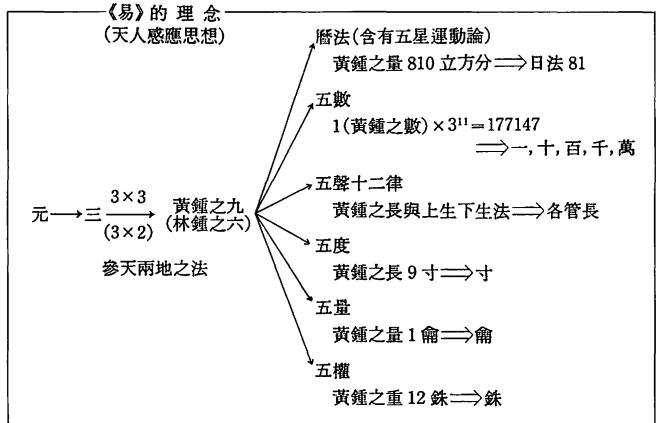

<!-- V3_SOURCE_ID:book015-b001332-p001-748c24e74d -->

图10-1 三统说的整体结构

查看对应原文

<!-- V3_FOLDBACK_BEGIN:book015-b001332-p001-748c24e74d -->

図10-1 三統説の全体構造

<!-- V3_FOLDBACK_END:book015-b001332-p001-748c24e74d -->

<!-- V3_SOURCE_ID:book015-b001333-p000-61c70a332a -->

刘歆不仅摆脱了以往的历史循环论，还以三统与五行的本原存在性为依据，也就是在作为太极或元气、皇极而自行发动的「元」的统辖之下，以「三统与五行相互包容」或「三统与五行由『元』派生」为理论依据，将五行作为三统的另一种表现形式，把原本分属不同系列的五行说与三统说融合到了同一个体系中。因此，阐述五德运行次序的历史学说，必然要采用三统说「母传子」的生成法则——五行相生说，由此形成了新的历史

查看对应原文

<!-- V3_FOLDBACK_BEGIN:book015-b001333-p000-61c70a332a -->

劉歆は旧来の歴史循環論を脱しただけでなく，三統と五行の始原的存在性，すなわち太極または元気・皇極として自らを発動する「元」の統轄のもと，「三統と五行は相互に包摂する」，あるいは「元」から三統と五行が派生することを理論的な根拠として，五行を三統の別表現とし，もと異系列に属する五行説と三統説を共通のるつぼに流しこんだ。それゆえ，五徳の運次を説く歴史学説は否応なく，三統説の「母を以て子に伝える」生成法——五行相生説を採用せざるをえなくなり，かくして新たな歴史

<!-- V3_FOLDBACK_END:book015-b001333-p000-61c70a332a -->

<!-- V3_SOURCE_ID:book015-b001334-p000-3086cd2118 -->

循环论。刘歆所主张的五德运行次序从木德开始，依次为木→火→土→金→水，循环往复，没有尽头。本书第九章图9-3就是其基本图示。就土德而言，第一个循环对应黄帝轩辕氏，第二个循环对应虞帝有虞氏。

查看对应原文

<!-- V3_FOLDBACK_BEGIN:book015-b001334-p000-3086cd2118 -->

循環論が形成された。劉歆による五徳の運次は木徳に始まって，木→火→土→金→水とつづき，終わればまた始まり，窮まるところがない。本書九章図9-3がその基本図式である。土徳のばあい，第一の巡りに黄帝軒轅氏を配し，第二の巡りに虞帝有虞氏を配している。

<!-- V3_FOLDBACK_END:book015-b001334-p000-3086cd2118 -->

<!-- V3_SOURCE_ID:book015-b001335-p000-2fbe1e86fe -->

令人惊讶的是，刘歆这一阐述历史循环的革命理论，被铭刻在王莽颁发的度量衡标准器上，每件器物都刻有相关内容3)。

查看对应原文

<!-- V3_FOLDBACK_BEGIN:book015-b001335-p000-2fbe1e86fe -->

驚くべきは，劉歆のこの歴史循環を説く革命理論が王莽の交付した度量衡標準器のうえに，器ごとに銘記されていることである3)。

<!-- V3_FOLDBACK_END:book015-b001335-p000-2fbe1e86fe -->

<!-- V3_SOURCE_ID:book015-b001336-p000-6673856604 -->

这段铭文共有81字，开头写道：“黄帝は初祖，徳は虞にめぐる。虞帝は始祖，徳は新に币る”——意思是黄帝是我的祖先，他的美德传到了虞；虞帝舜是我的祖先，他的美德传到了我的新朝。接着写道，初始元年十一月戊辰日，“天は命じて民を有せしむ。土徳に拠りて受け，号を正し真に即く。正を改めて建丑とし，長寿にして隆崇たり”——意思是这一天，天命降下让我拥有天下。我王莽凭借土德承受天命，定国号为新，登上真天子之位，还改定岁首以建丑之月为正月。我的新朝也将因此长久繁荣。

> **释读存疑：** 本地硬校验仍未通过，已记录供后续自动处理或人工核对。

查看对应原文

<!-- V3_FOLDBACK_BEGIN:book015-b001336-p000-6673856604 -->

その銘文は81字からなり，冒頭にこういう。「黄帝は初祖，徳は虞にめぐる。虞帝は始祖，徳は新に币る」——黄帝はわが祖先であり，かれの美徳は虞に伝わった。虞帝舜はわが祖先であり，その美徳はわが新に伝わっている，と。つづけて，初始元年十一月戊辰の日に「天は命じて民を有せしむ。土徳に拠りて受け，号を正し真に即く。正を改めて建丑とし，長寿にして隆崇たり」——この日に天下を保有せよとの天命がくだった。わたし(王莽の自称)は土徳によってこれを受け，国号を新とさだめ真天子の位についた。また歳首を建丑の月(十二月)にあらためた。わが新はこれによって末永く繁栄するであろう，と。

<!-- V3_FOLDBACK_END:book015-b001336-p000-6673856604 -->

<!-- V3_SOURCE_ID:book015-b001337-p000-320810b9e7 -->

王莽借助刘歆提出的新历史观，以禅让的形式为自己篡夺汉朝政权、建立新朝的行为正名，并将这一正当性明确记载在度量衡器物上。顺便一提，这一理论此后被沿用，直至宋代，前后使用了1000年以上。这一事实真切体现了刘歆理论的思想影响力与社会影响力之大。

> **释读存疑：** 本地硬校验仍未通过，已记录供后续自动处理或人工核对。

查看对应原文

<!-- V3_FOLDBACK_BEGIN:book015-b001337-p000-320810b9e7 -->

王莽は劉歆の新しい歴史観によって，禅譲の形式をとる自らの漢新革命漢の篡奪を正当化し，度量衡器のうえに，その正当性を明記したのである。ちなみに同理論は以後踏襲され，宋代にいたるまで1000年以上にわたって使用された4)。この事実は劉歆理論の思想的社会的影響がいかに大きかったかを如実に示している。

<!-- V3_FOLDBACK_END:book015-b001337-p000-320810b9e7 -->

<!-- V3_SOURCE_ID:book015-b001338-p000-9c5a190cac -->

最后，我想简要说明，包含刘歆五行的三统说结构，其构成要素与经学的学术结构1对1对应。

查看对应原文

<!-- V3_FOLDBACK_BEGIN:book015-b001338-p000-9c5a190cac -->

最後に，劉歆の五行説を内に含む三統説の構造が構成要素を含めて，経学の学問構造と1対1に対応していることについて一言したい。

<!-- V3_FOLDBACK_END:book015-b001338-p000-9c5a190cac -->

<!-- V3_SOURCE_ID:book015-b001339-p000-e8f5e06d67 -->

说到中国最古老的书籍分类目录，便是刘歆所撰的《七略》。其主张独尊经学的学术观，简言之就是：六经即易・書・詩・春秋・礼・楽的学问，由无矛盾的统一思想构成，理应统辖所有学问。不过可以总结为：易学是不变的，而从它派生出来的其余五学则会随时代变化。这种不变的易学统摄五学的经学结构5，与“不变的‘元’生出三统即五行（元→五）”的三统说结构完全一致。

查看对应原文

<!-- V3_FOLDBACK_BEGIN:book015-b001339-p000-e8f5e06d67 -->

中国最古の書籍分類目録といえば，これまた劉歆撰の『七略』である。その経学一尊を主張する学問観は一言でいえば，六経すなわち易・書・詩・春秋・礼・楽の学は矛盾なき一つの思想からなり，当為として学問すべて(諸子・詩賦・兵法・数術・方技)を統轄することを要請する。だが易学が不変であるのに対して，そこから派生した他の五学(書・詩・春秋・礼・楽)は世代ごとに変化する，とまとめることができる。その不変の易学が五学を統轄する経学の構造5)は，不変の「元」から三統すなわち五行が生起する(元→五)という三統説の構造とまったく一致している。

<!-- V3_FOLDBACK_END:book015-b001339-p000-e8f5e06d67 -->

<!-- V3_SOURCE_ID:book015-b001340-p000-fc8b8d49a8 -->

若结合经学的结构与三统说的组织相互呼应，以及刘歆大量使用六经的文句作为立论依据这两点来考虑，其含义自然就会明了。因为在刘歆看来，三统说本就是经学理论的一种，用于解释经书的文句，进而阐发经学的精神或理想。换句话说，刘歆作为经学家，为了证明并彰显经学的优秀与益处，便援引三统说等相关理论构建起经学的庞大思想体系；而王莽作为政治家，为了践行理想，将经学理论作为自己的意识形态，构建出全新的律历与度量衡制度，试图完成变革。

查看对应原文

<!-- V3_FOLDBACK_BEGIN:book015-b001340-p000-fc8b8d49a8 -->

経学の構造と三統説の組織が呼応することを，劉歆が六経の語句を多用して立論の根拠としたこととあわせ考えれば，その意味はおのずと明らかであろう。劉歆のみるところ，三統説とは経書の語句を解釈し，それによって経学の精神ないし理想を説く経学理論の一つであったからである。言い換えれば，劉歆は経学者として経学の優秀さと有益さを証明し明示するため，その個々の理論を援用して経学の一大思想体系をつくりあげ，一方，王莽は政治家として理想に殉じ，経学理論を自らのイデオロギーとして斬新な律暦・度量衡制を構築し，革命の遂行をはかったのである。

<!-- V3_FOLDBACK_END:book015-b001340-p000-fc8b8d49a8 -->

<!-- V3_SOURCE_ID:book015-b001341-p000-f7fbcc5b30 -->

## 追記 — 追记

查看对应原文

<!-- V3_FOLDBACK_BEGIN:book015-b001341-p000-f7fbcc5b30 -->

## 追記

<!-- V3_FOLDBACK_END:book015-b001341-p000-f7fbcc5b30 -->

<!-- V3_SOURCE_ID:book015-b001342-p000-4dea48eab5 -->

王莽与刘歆的度量衡器具，看起来古色苍然，仿佛随时都会消失一般。然而，王莽、刘歆那个时代的炽热情感，难道不会透过这些古器物，跨越时间的壁垒向我们诉说着什么吗？我们应当静静地侧耳倾听这份声音，为之动容。

查看对应原文

<!-- V3_FOLDBACK_BEGIN:book015-b001342-p000-4dea48eab5 -->

王莽・劉歆の度量衡器はいかにも古色蒼然とし，いまにも消滅しそうである。だが王莽や劉歆の当時の熱い情念が古器をとおして，時間の壁をこえ，われわれに何かを訴えてくるではないか。われわれは静かにその声に耳をかたむけ，それに涙しなければならない。

<!-- V3_FOLDBACK_END:book015-b001342-p000-4dea48eab5 -->

注

<!-- V3_SOURCE_ID:book015-b001344-p000-edf8374f20 -->

1) 亚历山大·约翰·埃利斯（1814-1890）所提出的音程数量表示法。费希纳定律即“感觉的强度与刺激量的对数成正比”，也适用于音程关系，振动数n与n'之间的音程值I，

> **释读存疑：** 原文此处未完整表述音程值I的计算方式，存在缺漏

查看对应原文

<!-- V3_FOLDBACK_BEGIN:book015-b001344-p000-edf8374f20 -->

1)アレクサンダー・ジョン・エリス(1814-1890)が提唱した音程の数量的表示法。フェヒネルの法則すなわち「感覚の強さの量は刺激の量の対数に比例する」は，音程関係についてもあてはまり，振動数nとn'のあいだの音程値Iを，

<!-- V3_FOLDBACK_END:book015-b001344-p000-edf8374f20 -->

$$
I = k \log { \frac { n ^ { \prime } } { n } }
$$

<!-- V3_SOURCE_ID:book015-b001346-p000-ca1e873f21 -->

可以写成。此处

> **释读存疑：** k为比例常数；1轮自动修复后核义模型仍建议修订，已保守记录。

查看对应原文

<!-- V3_FOLDBACK_BEGIN:book015-b001346-p000-ca1e873f21 -->

と書くことができる(kは比例定数)。ここで

<!-- V3_FOLDBACK_END:book015-b001346-p000-ca1e873f21 -->

$$
\begin{array} { r } { k = \frac { 1 2 0 0 } { \log 2 } = 3 9 8 6 . 3 1 3 } \end{array}
$$

<!-- V3_SOURCE_ID:book015-b001348-p000-3313ebd590 -->

将八度的值定为1200，十二平均律的全音定为200，半音定为100，这就是这里所说的音分。它非常便于将各种律制的音程值与平均律进行比较，现已成为现代中国古代声律研究的重要工具之一。详细内容请参考田边尚雄所著《音乐音响学》以及同作者的《音乐理论》等著作。

> **释读存疑：** 音乐之友社，1951年；共立出版，1951年；本地硬校验仍未通过，已记录供后续自动处理或人工核对。

查看对应原文

<!-- V3_FOLDBACK_BEGIN:book015-b001348-p000-3313ebd590 -->

とおき，オクターブの値を1200，十二平均律の全音を200，半音を100としたのが，このセントである。諸律の音程値を平均律と比較
するのに非常に便利であり，現代中国の古代声律研究の一つの強力な武器になっている。詳しくは田辺尚雄『音楽音響学』(音楽之友社，1951)や同『音楽理論』(共立出版，1951)などを参照のこと。

<!-- V3_FOLDBACK_END:book015-b001348-p000-3313ebd590 -->

<!-- V3_SOURCE_ID:book015-b001350-p000-2d69d14d38 -->

2) 请参考本书第9章的图9-2。

查看对应原文

<!-- V3_FOLDBACK_BEGIN:book015-b001350-p000-2d69d14d38 -->

2)本書9章の図9-2を参照されたい。

<!-- V3_FOLDBACK_END:book015-b001350-p000-2d69d14d38 -->

<!-- V3_SOURCE_ID:book015-b001351-p000-84ad7e2e5c -->

3) 若要记录铭文的全文，内容为：「黄帝初祖、德币于虞。虞帝始祖、德币于新。岁在大梁、龙集戊辰。戊辰直定、天命有民。据土德受、正号即真。改正建丑、长寿隆崇。同律度量衡、稽当前人。龙在己巳、岁次实沈。初班天下、万国永遵。子子孙孙、亨传亿年」。

查看对应原文

<!-- V3_FOLDBACK_BEGIN:book015-b001351-p000-84ad7e2e5c -->

3)銘文の全文を記せば、「黄帝初祖、德币于虞。虞帝始祖、德币于新。歳在大梁、龍集戊辰。戊辰直定、天命有民。拠土德受、正號卽真。改正建丑、長壽隆崇。同律度量衡、稽當前人。龍在己巳、歲次實沈。初班天下、萬國永遵。子子孫孫、亨傳億年」という。

<!-- V3_FOLDBACK_END:book015-b001351-p000-84ad7e2e5c -->

<!-- V3_SOURCE_ID:book015-b001352-p000-f0f474e41c -->

4) 请参照本书第9章的图9-4。

查看对应原文

<!-- V3_FOLDBACK_BEGIN:book015-b001352-p000-f0f474e41c -->

4) 本書9章図9-4を参照せよ。

<!-- V3_FOLDBACK_END:book015-b001352-p000-f0f474e41c -->

<!-- V3_SOURCE_ID:book015-b001353-p000-61e99ab026 -->

5) 请参照本书第1章的图1-1。另外，经学的结构与六艺的结构完全相同，是因为其从“元”到“五”的结构直接依据三统说的结构。

> **释读存疑：** 本地硬校验仍未通过，已记录供后续自动处理或人工核对。

查看对应原文

<!-- V3_FOLDBACK_BEGIN:book015-b001353-p000-61e99ab026 -->

5)本書1章図1-1を参照せよ。なお経学の構造がそのまま六芸の構造(図1-2)に等しいのは，その元→五の構造が直接に三統説のそれにもとづいているからである。

<!-- V3_FOLDBACK_END:book015-b001353-p000-61e99ab026 -->

<!-- V3_SOURCE_ID:book015-b001354-p000-b4db407741 -->

## 11 術数的思考と中国医学 — 11 术数的思考与中国医学

查看对应原文

<!-- V3_FOLDBACK_BEGIN:book015-b001354-p000-b4db407741 -->

## 11 術数的思考と中国医学

<!-- V3_FOLDBACK_END:book015-b001354-p000-b4db407741 -->

<!-- V3_SOURCE_ID:book015-b001355-p000-d5d97f67b3 -->

今天我想稍微论述一下关于“术数的思考与中国医学”的内容。内容大致分为前后两个部分。第一部分将说明什么是术数的思考，第二部分是关于中国医学与术数的思考之间的关系，目前正在进行相关考察，我将在此简单报告相关情况。

查看对应原文

<!-- V3_FOLDBACK_BEGIN:book015-b001355-p000-d5d97f67b3 -->

今日は「術数的思考と中国医学」について，すこしばかり論じたいと思います。内容は大きく前後二つの部分に分かれます。第一部は術数的思考とは何かを説明し，第二部は中国医学と術数的思考の関係，現在考察中のことですが，それについて簡単に報告いたします。

<!-- V3_FOLDBACK_END:book015-b001355-p000-d5d97f67b3 -->

<!-- V3_SOURCE_ID:book015-b001356-p000-fb8eec5521 -->

## 1 術数的思考 — 1 术数的思考

查看对应原文

<!-- V3_FOLDBACK_BEGIN:book015-b001356-p000-fb8eec5521 -->

## 1 術数的思考

<!-- V3_FOLDBACK_END:book015-b001356-p000-fb8eec5521 -->

<!-- V3_SOURCE_ID:book015-b001357-p000-e69aff405f -->

## 1.1 中国の数術 — 1.1 中国的数术

查看对应原文

<!-- V3_FOLDBACK_BEGIN:book015-b001357-p000-e69aff405f -->

## 1.1 中国の数術

<!-- V3_FOLDBACK_END:book015-b001357-p000-e69aff405f -->

<!-- V3_SOURCE_ID:book015-b001358-p000-40fa884361 -->

术数学，即便说是术数的思考，初次听闻的人或许也很多。首先请看表11-1中的姚名达《四部分类源流一览表》1）。姚名达的《四部分类源流一览表》，是整理了中国历代代表性目录书的学术分类的表格，想必右列最上方有《七略》的记载。这是右列目录书中最上方的书名。顺着《七略》这一行向左看，能看到Ⅰ辑略、Ⅱ六艺略、Ⅲ诸子略、Ⅴ兵书略的项目，接着还有Ⅵ术数略，之后是Ⅶ方技略、Ⅳ诗赋略，其中第五个的Ⅵ术数略，就是与今天的主题相关的部分。必须说明的是，术数学或者说术数的思考，是符合《七略》用语规范的概念。

查看对应原文

<!-- V3_FOLDBACK_BEGIN:book015-b001358-p000-40fa884361 -->

術数学，術数的思考とはいっても，初めて聞かれた方も多いかもしれません。まずは表11-1の姚名達の四部分類源流一覧表1）を御覧ください。姚名達の四部分類源流一覧表は，中国歴代の代表的目録書の学術分類を整理したものですが，右列最上段に『七略』という記載があろうかと思います。右列の目録書中，一番上に記された書名です。その『七略』の行を左にたどれば，Ⅰ輯略，Ⅱ六芸略，Ⅲ諸子略，Ⅴ兵書略の項目がみえ，さらにⅥ術数略とあり，Ⅶ方技略，Ⅳ詩賦略とつづきますが，第五番目のⅥ術数略が今日のテーマに関係するところです。術数学あるいは術数的思考とはすなわち，『七略』の用語法に準ずる概念といわねばなりません。

<!-- V3_FOLDBACK_END:book015-b001358-p000-40fa884361 -->

<!-- V3_SOURCE_ID:book015-b001359-p000-15bbb91c10 -->

《七略》的Ⅵ术数略之下，细分有天文、历谱、五行、蓍龟、杂占、形法等学术名称，若要大致理解术数学的概念，可将其视为广义的数之学问，即广义的数术。术数学以现行意义上的天文学、数学、地理学等为主要研究领域，同时也包含各类占卜术——如天文占卜、五行占卜、观相、命名学等。提前给出结论的话，术数学不过是由历算与占卜术构成的数之学问。

查看对应原文

<!-- V3_FOLDBACK_BEGIN:book015-b001359-p000-15bbb91c10 -->

『七略』のⅥ術数略の下には，細目として天文・暦譜・五行・蓍亀・雑占・形法などの学術名がありますが，術数学の大まかなイメージとしては，広義の数の学問と理解してください。広い意味での数術のことです。術数学は現行の意味における天文学・数学・地理学などを主要な研究分野としますが，同時に雑多な占術――天文占・五行占・観相・命名学などの疑似科学を内に含みます。結論を前もっていえば，術数学とは暦算と占術からなる数の学術のことにほかなりません。

<!-- V3_FOLDBACK_END:book015-b001359-p000-15bbb91c10 -->

<!-- V3_SOURCE_ID:book015-b001360-p000-aa5f4a2927 -->

表11-1 四部分类源流一览表，该表格存在大量OCR识别错误、文字缺漏错乱、行列对应关系不明确的问题，无法梳理四部分类源流脉络，具体内容暂无法准确释读。

> **释读存疑：** 原文表格存在大量OCR识别错误、文字缺漏错乱、行列对应关系不明确的问题，无法梳理四部分类源流脉络；本地硬校验仍未通过，已记录供后续自动处理或人工核对。

查看对应原文

<!-- V3_FOLDBACK_BEGIN:book015-b001360-p000-aa5f4a2927 -->

表11-1 四部分類源流一覧表
<table><tr><td></td><td>1 2道</td><td>信引 </td><td>2 2近</td><td>2 公道家</td><td>2 道家類</td><td>2道家類</td><td>2道家 t</td><td>3道家額</td><td>2道家新</td><td>2道家</td><td></td><td>2 道家類</td><td>道家類</td><td>以道家潁道吉附</td></tr><tr><td></td><td>陰陽</td><td>法部</td><td></td><td></td><td></td><td>3法家頻</td><td>3法家</td><td></td><td>山陰陽家類 3法家類</td><td>3法家</td><td>3法家類</td><td></td><td></td></tr><tr><td>4法 5名</td><td></td><td>3法 名</td><td>3法家 名家</td><td>3法家頼 名家額</td><td></td><td></td><td></td><td></td><td></td><td></td><td></td><td></td><td>3法家類</td></tr><tr><td>0</td><td>5名部 墨部</td><td></td><td></td><td>5墨寡</td><td>五墨家類</td><td>名家類 5墨家類</td><td>+名家 5足家</td><td></td><td>名家穎 墨家類</td><td>名家 5墨家</td><td>4名家類 5墨家 縱橫家頭</td><td></td><td></td></tr><tr><td>者 7纸横 士如</td><td></td><td>不縱橫部</td><td>縱積</td><td>日縱橫家</td><td>日袋橫家類</td><td>6縱續家類</td><td>縱橫家</td><td></td><td>6縱橫家類</td><td>縱橫家</td><td></td><td></td><td></td></tr><tr><td>8雅</td><td>梦姿</td><td>维</td><td>一</td><td>7雜家</td><td>雅家頭</td><td>雜家類</td><td>？推家</td><td>王雜家類</td><td>B雅家U 辨幼</td><td>報家</td><td>8雜冢類</td><td>2雜家類</td><td>1</td></tr><tr><td>日農 10小號</td><td></td><td>日農部 小說部</td><td>8農 小說</td><td>8農家 日小說家</td><td>日農家類 小說類</td><td>8農家類 小說類上</td><td>8農冢 8小说</td><td>5農家類 8小说</td><td>農家類 小說家類</td><td>日農家 8小說家</td><td>農家類 小說家類</td><td>農家類 小说家類</td><td>轮 農家類 </td></tr><tr><td>人共写 3金陽</td><td></td><td>三兵冢部</td><td>10兵</td><td>0兵法</td><td>以2兵書類</td><td>1兵吉類</td><td>川兵家</td><td>兵吉類</td><td>2兵書領</td><td>1兵书</td><td>兵吉颂</td><td>5兵吉類</td><td>2兵家類</td></tr><tr><td></td><td>兵 P 1天文</td><td>天文部</td><td>日天文</td><td></td><td>10天文類</td><td>16夭文占書類</td><td>天文曆數</td><td></td><td>天文</td><td>1天文</td><td>10天文额</td><td>天文</td><td></td></tr><tr><td></td><td>日曆譜</td><td>3曆算部</td><td>2居秋</td><td></td><td>曆算類</td><td>口曆最損</td><td></td><td>四士</td><td>月象</td><td>厚真 二月耳</td><td>B曆算類</td><td>7曆數類</td><td>一推步</td></tr><tr><td></td><td></td><td>四士昭</td><td></td><td></td><td>日</td><td>12耳街類</td><td></td><td></td><td></td><td></td><td>田士班</td><td></td><td>味如</td></tr><tr><td>M</td><td></td><td></td><td>田士時</td><td>四去时</td><td></td><td></td><td></td><td></td><td></td><td>特</td><td></td><td>日士路</td><td>士年 一數事</td></tr><tr><td></td><td></td><td>五行部</td><td>五行</td><td>13五行</td><td>6五行類</td><td></td><td></td><td>五行</td><td></td><td></td><td></td><td></td><td>候</td></tr><tr><td>4著晦</td><td>五行 批 </td><td>卜筮部</td><td></td><td></td><td></td><td>旧五行须秋 15卜類</td><td></td><td>卜区</td><td></td><td>2玉行 132卜</td><td>三五行線 止著龜類</td><td>8五行類</td><td>陰陽五行</td></tr><tr><td></td><td>5雜占</td><td>雜占部</td><td></td><td></td><td></td><td></td><td></td><td></td><td>15卜五類</td><td></td><td></td><td></td><td>よ 雜技術</td></tr><tr><td></td><td>形法</td><td>7形法部</td><td></td><td></td><td></td><td></td><td></td><td>形势</td><td>4</td><td>日形法</td><td></td><td></td><td>相宅相集</td></tr><tr><td></td><td></td><td>日晉姪</td><td></td><td></td><td></td><td></td><td></td><td></td><td>形法 和</td><td></td><td></td><td></td><td>5今吉相書</td></tr><tr><td></td><td>香姓 經方</td><td>日煙方部</td><td>醫方</td><td>册方</td><td>日明堂經脈類 口替術頓</td><td>誓書損</td><td>8吉</td><td>醫書類</td><td>口醫吉類</td><td>1醫家</td><td>醫書類</td><td></td><td>5吾家類</td></tr><tr><td></td><td>神仙</td><td>經戒部 V 服餌部 </td><td>一經式 2餌服</td><td></td><td></td><td>道書額一</td><td>神仕</td><td></td><td>B8樂類</td><td>口神仙家</td><td></td><td></td><td></td></tr><tr><td></td><td>房中</td><td>符圖部 3房中部 戒律柳 年定</td><td>五行錄 3.房中 恭达</td><td></td><td></td><td></td><td></td><td></td><td>1日神仙頡</td><td></td><td></td><td></td><td></td></tr><tr><td></td><td></td><td></td><td>3論救海化</td><td></td><td></td><td>日釋書類 41</td><td>釋吉</td><td>《釋家類</td><td>日輝家類</td><td>旧釋氏</td><td></td><td>2釋家類</td><td>1家域</td></tr><tr><td></td><td></td><td></td><td></td><td></td><td>雜藝類</td><td>20藝街類</td><td>16雜</td><td>雜拉類</td><td>1日龍琴類</td><td>2術</td><td>雜藝術類</td><td>藝術</td><td>8</td></tr><tr><td></td><td></td><td></td><td></td><td></td><td>1巧穎書颂</td><td>日類書類社</td><td>12類家</td><td>日類書期</td><td>2坂書</td><td>1日類書</td><td>旧须事颂</td><td>1類書類</td><td>10坂書 or</td></tr><tr><td></td><td></td><td></td><td></td><td></td><td></td><td></td><td></td><td>10錄類</td><td></td><td></td><td></td><td></td><td>路 中</td></tr><tr><td></td><td></td><td></td><td></td><td></td><td></td><td></td><td></td><td>樂曲類</td><td></td><td>4</td><td></td><td></td><td></td></tr><tr><td></td><td></td><td></td><td></td><td></td><td></td><td></td><td></td><td></td><td>歌詞類</td><td>歌词</td><td></td><td></td><td>69</td></tr><tr><td></td><td>致讨</td><td></td><td></td><td></td><td></td><td></td><td></td><td></td><td></td><td></td><td></td><td></td><td>北</td></tr><tr><td>N#</td><td>賦屈原臣</td><td>楚辭部</td><td>楚辭</td><td>楚醉</td><td>是词段</td><td></td><td>一楚辭</td><td></td><td>是辞類</td><td>一威讨</td><td>楚辭類</td><td></td><td>是辭類</td></tr><tr><td></td><td>2賦陵賈董</td><td></td><td></td><td>N上實数</td><td></td><td></td><td></td><td></td><td></td><td>N肯</td><td></td><td></td><td>N</td></tr><tr><td></td><td>賦孫那等 </td><td>N</td><td></td><td></td><td>警业</td><td></td><td>N.</td><td>N步非</td><td>世路</td><td></td><td></td><td>N</td><td></td></tr><tr><td></td><td>胶</td><td></td><td></td><td></td><td></td><td></td><td></td><td></td><td>5詩集顛</td><td></td><td></td><td></td><td></td></tr><tr><td></td><td></td></tr><tr><td>4</td><td>略</td><td>七 錄</td><td>隋書經籍志</td><td>古今書錄</td><td>祈唐書藝文志索文總目</td><td></td><td></td><td>郡齋讀書志逆初堂書目</td><td></td><td>直齋書錄解題文獻通考姪籍孝宋史藝文志</td><td></td><td>明史藝文志</td><td>四庫全書總目</td><td></td></tr><tr><td>1E</td><td></td><td></td><td></td><td></td><td></td><td></td><td></td><td></td><td></td><td></td><td></td><td></td><td></td><td></td></tr><tr><td></td><td></td><td>一易部</td><td>1</td><td></td><td>1易類</td><td>一易紙</td><td>1易</td><td>2周易</td><td>1易類</td><td></td><td>1易類</td><td></td><td></td><td></td></tr><tr><td>24钟 3诗</td><td>数</td><td>2尚書部 3詩部</td><td>2 吉</td><td>一品 4 3诗</td><td>2合紙 3詩額</td><td>2.如额 3持類</td><td>24 n.</td><td>3尚書頭 詩類</td><td>2書级 t</td><td>1易 0143</td><td>2書频</td><td>1另類 書级</td><td></td><td>一易紙 04名折</td></tr><tr><td></td><td></td><td></td><td></td><td></td><td></td><td></td><td></td><td></td><td></td><td>3詩</td><td>3詩類</td><td>3許魏</td><td></td><td>3诗類</td></tr><tr><td>社</td><td></td><td>程部</td><td>推</td><td>禮</td><td>禮類</td><td>證須</td><td>祖</td><td>5禮類</td><td>禮類</td><td>禮</td><td>禮類</td><td>禮類</td><td></td><td>K</td></tr><tr><td>六 口安 城</td><td>春伏</td><td>6樂部 日春秋部</td><td>d8 日 春秋</td><td>P</td><td>與煩 带 春秋煩</td><td>5典類 春秋期</td><td>5樂 春伏</td><td>甜 樂颂 了春秋坂</td><td>春秋頡</td><td>号 5春秋</td><td>5轿板 春秋</td><td>5樂须 6春秋類</td><td></td><td></td></tr></table>

<!-- V3_FOLDBACK_END:book015-b001360-p000-aa5f4a2927 -->

<!-- V3_SOURCE_ID:book015-b001360-p001-8b60800c63 -->

以下为古籍分类表的内容，各行列依次为对应项，具体内容如下：第一行：白、（空）、论语部、（空）、树8论语、论语类、（空）、短解、（空）、日钟研、（空）、烟解、8诸经类、（空）、春秋类 五经巡义类；第二行：（空）、7语、（空）、日论语、（空）、（空）、论语类、8论语、论语、论孟类、论海 イ玉子、8论论类、四书类、（空）、8四书类；第三行：8孝经、（空）、日孝经部、7孝经、孝经、孝经类、7孝经类、7孝埋、（空）、6孝经类、8孝经、7孝经类、7孝经类、（空）、孝经类；第四行：（空）、（空）、（空）、（空）、（空）、（空）、（空）、（空）、（空）、（空）、（空）、（空）、（空）、（空）、训诂；第五行：（空）、学、日小学部、10小学、（空）、小学类、小学类上、10÷学、（空）、1小学类、小学、10小学版、（空）、0小学类10、（空）；第六行：（空）、（空）、（空）、（空）、（空）、（空）、（空）、（空）、（空）、（空）、（空）、（空）、（空）、（空）、一如；第七行：（空）、（空）、V孩絲部、日號緯、日國峰、日城緯領 正史類、（空）、（空）、（空）、識肆類、1議緯、（空）、（空）、（空）、一正史類；第八行：（空）、（空）、國史部 注曆部、1正史 古史、1正史 2古史、2編年期、1正史頌 2編年類、一正史 2編年、正史類 編年穎、一正史額 3編年類、一正史、正史頓 編年類、（空）、正史額、2 編年額；第九行：（空）、（空）、a舊事部、售事、日福事、故事類、（空）、（空）、《故事類、8典故須、2編年、（空）、（空）、4故事類、（空）；第十行：（空）、（空）、（空）、（空）、（空）、（空）、（空）、（空）、（空）、日本朝故事、（空）、8故事、5故事類、（空）、（空）；第十一行：（空）、（空）、4職官部、職官、7職官、7 縣言類、6職官類、7#官、1職官類、職官類、部 日職官、（空）、職官類、5毓官頡、2は；第十二行：（空）、（空）、（空）、（空）、（空）、（空）、（空）、（空）、（空）、（空）、（空）、（空）、（空）、（空）、3紀事本木類；第十三行：（空）、（空）、（空）、（空）、（空）、（空）、（空）、（空）、（空）、（空）、（空）、（空）、（空）、（空）、通制；第十四行：（空）、（空）、儀典如、儀注、成注、儀注須、儀注頭、8氣注、儀注額、0禮注類、便注、（空）、儀注頓、6儀注類、生；第十五行：（空）、（空）、（空）、（空）、（空）、（空）、（空）、（空）、（空）、本、（空）、（空）、（空）、（空）、拜计；第十六行：（空）、（空）、6法制部、日刑法、刑法、10刑法額、8刑法額、日刑法、BE 山刑法類、部 法今類、四刑法、（空）、日刑法類、刑法頓、順 軍政 法今；第十七行：（空）、（空）、（空）、（空）、（空）、（空）、（空）、（空）、（空）、（空）、（空）、（空）、（空）、（空）、考工；第十八行：（空）、（空）、偽史部、4霸史、《霸史、3偽史類、偽史類、“偽史、偽史類、日偽史類、（空）、僞史霸史、霸史類、（空）、載 板；第十九行：（空）、（空）、8雜傳部、雜将丸中附、10雜傳、8雜俾紀類、2傳北類上、偉記、5雜傳類、2傳記類、傳記、（空）、傳記類、8傳記類、（空）；第二十行：（空）、（空）、（空）、（空）、（空）、（空）、（空）、（空）、（空）、（空）、（空）、（空）、（空）、（空）、机势年；第二十一行：（空）、（空）、鬼神部、日2转、（空）、（空）、（空）、（空）、日本、10本朝雜傳、（空）、（空）、（空）、史、（空）；第二十二行：（空）、（空）、（空）、（空）、（空）、（空）、（空）、（空）、（空）、≥2章奏類、5詔今類 N 奏議頌、≥6章奏、日本1、（空）、部 6招通詔令 奏城；第二十三行：（空）、（空）、（空）、（空）、122、（空）。

> **释读存疑：** V孩絲部、號緯、國峰、城緯領、識肆類、議緯、售事、福事、典故須、毓官頡、2は、紀事本木類、儀典如、氣注、禮注類、法今、偽史、雜将丸中附、傳北類、傳記類、本朝雜傳、詔今類、奏議頌、招通詔令、奏城等内容因OCR识别误差，具体所指无法明确；1轮自动修复后核义模型仍建议修订，已保守记录。

查看对应原文

<!-- V3_FOLDBACK_BEGIN:book015-b001360-p001-8b60800c63 -->

<table><tr><td>白</td><td></td><td>論語部</td><td></td><td>树 8論語</td><td>論語類</td><td></td><td>短解</td><td></td><td>日鐘研</td><td></td><td>煙解</td><td>8諸經類</td><td></td><td>春秋類 五經巡義類</td></tr><tr><td></td><td>7语</td><td></td><td>日論語</td><td></td><td></td><td>論語領</td><td>8論语</td><td>論語</td><td>論孟類</td><td>論海 イ玉子</td><td>8論论额</td><td>四書類</td><td></td><td>8四書領</td></tr><tr><td>8孝經</td><td></td><td>日孝經部</td><td>7孝經</td><td>孝經</td><td>孝經類</td><td>7孝經類</td><td>7孝埋</td><td></td><td>6孝經類</td><td>8孝經</td><td>7孝經類</td><td>7孝經類</td><td></td><td>孝經類</td></tr><tr><td></td><td></td><td></td><td></td><td></td><td></td><td></td><td></td><td></td><td></td><td></td><td></td><td></td><td></td><td>訓站</td></tr><tr><td></td><td>学</td><td>日小学部</td><td>10小学</td><td></td><td>小學額</td><td>小學類上</td><td>10÷学</td><td></td><td>1小學頓</td><td>小学</td><td>10小学版</td><td></td><td>0小學煩 10</td><td></td></tr><tr><td></td><td></td><td></td><td></td><td></td><td></td><td></td><td></td><td></td><td></td><td></td><td></td><td></td><td></td><td>一如</td></tr><tr><td></td><td></td><td>V孩絲部</td><td>日號緯</td><td>日國峰</td><td>日城緯領 正史類</td><td></td><td></td><td></td><td>識肆類</td><td>1議緯</td><td></td><td></td><td></td><td>一正史類</td></tr><tr><td></td><td></td><td>國史部 注曆部</td><td>1正史 古史</td><td>1正史 2古史</td><td>2編年期</td><td>1正史颂 2編年類</td><td>一正史 2編年</td><td>正史類 编年穎</td><td>一正史額 3編年類</td><td>一正史</td><td>正史頓 編年類</td><td></td><td>正史額</td><td>2 编年額</td></tr><tr><td></td><td></td><td>a舊事部</td><td>售事</td><td>日福事</td><td>故事類</td><td></td><td></td><td>《故事類</td><td>8典故須</td><td>2编年</td><td></td><td></td><td>4故事類</td><td></td></tr><tr><td></td><td></td><td></td><td></td><td></td><td></td><td></td><td></td><td>日本朝故事</td><td></td><td>8故事</td><td>5故事類</td><td></td><td></td><td></td></tr><tr><td></td><td></td><td>4職官部</td><td>職官</td><td>7職官</td><td>7 縣言類</td><td>6職官類</td><td>7#官</td><td>1職官類</td><td>職官類</td><td>部 日職官</td><td></td><td>職官類</td><td>5毓官頡</td><td>2は</td></tr><tr><td></td><td></td><td></td><td></td><td></td><td></td><td></td><td></td><td></td><td></td><td></td><td></td><td></td><td></td><td>3紀事本木類</td></tr><tr><td></td><td></td><td></td><td></td><td></td><td></td><td></td><td></td><td></td><td></td><td></td><td></td><td></td><td></td><td>通制</td></tr><tr><td></td><td></td><td>儀典如</td><td>儀注</td><td>成注</td><td>儀注須</td><td>儀注頭</td><td>8氣注</td><td>儀注額</td><td>0禮注類</td><td>便注</td><td></td><td>儀注頓</td><td>6儀注類</td><td>生 </td></tr><tr><td></td><td></td><td></td><td></td><td></td><td></td><td></td><td></td><td></td><td>本</td><td></td><td></td><td></td><td></td><td>拜计</td></tr><tr><td></td><td></td><td>6法制部</td><td>日刑法</td><td>刑法</td><td>10刑法額</td><td>8刑法額</td><td>日刑法</td><td>BE 山刑法類</td><td>部 法今類</td><td>四刑法</td><td></td><td>日刑法類</td><td>刑法頓</td><td>顺 军政 法今</td></tr><tr><td></td><td></td><td></td><td></td><td></td><td></td><td></td><td></td><td></td><td></td><td></td><td></td><td></td><td></td><td>考工</td></tr><tr><td></td><td></td><td>偽史部</td><td>4霸史</td><td>《霸史</td><td>3偽史類</td><td>偽史類</td><td>“偽史</td><td>偽史類</td><td>日偽史類</td><td></td><td>僞史霸史</td><td>霸史類</td><td></td><td>载 板</td></tr><tr><td></td><td></td><td>8雜傳部</td><td>雜将丸中附</td><td>10雜傳</td><td>8雜俾紀類</td><td>2傳北類上</td><td>偉記</td><td>5雜傳類</td><td>2傳記類</td><td>傳記</td><td></td><td>傳記領</td><td>8傳記類</td><td></td></tr><tr><td></td><td></td><td></td><td></td><td></td><td></td><td></td><td></td><td></td><td></td><td></td><td></td><td></td><td></td><td>机势年</td></tr><tr><td></td><td></td><td>鬼神部</td><td>日2转</td><td></td><td></td><td></td><td></td><td>10本朝雜傳</td><td></td><td></td><td></td><td></td><td>史</td><td></td></tr><tr><td></td><td></td><td></td><td></td><td></td><td></td><td></td><td>日本</td><td>≥2章奏類</td><td>5詔今類 N 奏議颂</td><td>≥6章奏</td><td>日本1</td><td></td><td>部</td><td>6招通詔令 奏城</td></tr><tr><td></td><td></td><td></td><td></td><td>122</td><td></td></tr></table>

<!-- V3_FOLDBACK_END:book015-b001360-p001-8b60800c63 -->

<!-- V3_SOURCE_ID:book015-b001361-p000-1427a342d2 -->

## <!-- doc004 PDF 第 228 页：高风险/复杂版面 OCR 供检索；内容与排版以原页图为准。 -->

查看对应原文

<!-- V3_FOLDBACK_BEGIN:book015-b001361-p000-1427a342d2 -->

## <!-- doc004 PDF 第 228 页：高风险/复杂版面 OCR 供检索；内容与排版以原页图为准。 -->

<!-- V3_FOLDBACK_END:book015-b001361-p000-1427a342d2 -->

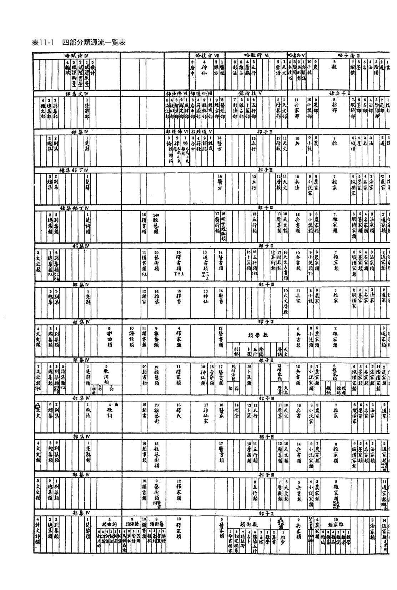

<!-- doc004 PDF 第 229 页：高风险/复杂版面 OCR 供检索；内容与排版以原页图为准。 -->
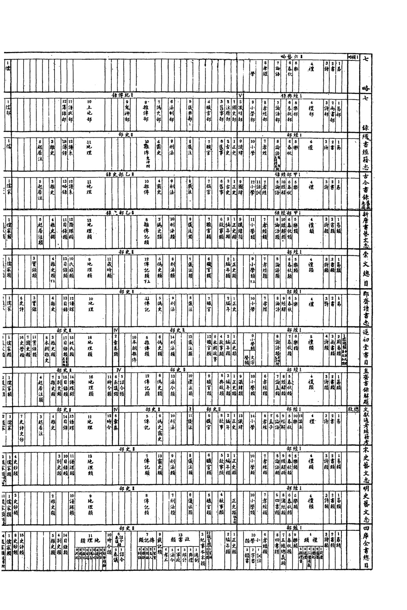

<!-- V3_SOURCE_ID:book015-b001363-p000-d572073dc2 -->

1.2 中国科学的计量性特征

查看对应原文

<!-- V3_FOLDBACK_BEGIN:book015-b001363-p000-d572073dc2 -->

1.2 中国科学の計量的性格

<!-- V3_FOLDBACK_END:book015-b001363-p000-d572073dc2 -->

<!-- V3_SOURCE_ID:book015-b001364-p000-59ee8403b5 -->

要准确了解术数学和术数式思考是什么，首先需要理解中国科学的整体特征。原本，中国清代以前的科学，一方面具有很强的计量性特征，非常注重计量。换句话说，就中国的情况而言，即便在古典时代，也必须说数概念在科学领域充分发挥了作为其语言的作用。我所说的清代以前，指的是清代以前的时期，而清代以前的代表性科学，就是天文学、数学、医学，通常将这三者称为中国的三大科学。另外如果加上农学，就是中国的四大科学

> **释读存疑：** 原文提及‘中国の四大科’未完整表述，candidate保留了未完整内容，需注意原文未明的部分；1轮自动修复后核义模型仍建议修订，已保守记录。

查看对应原文

<!-- V3_FOLDBACK_BEGIN:book015-b001364-p000-59ee8403b5 -->

術数学や術数的思考が何かを正確に知るには，まず中国科学の総体的性格について理解する必要があります。そもそも中国前近代の科学は一面，計量的な性格を強くもっています。非常に計量的です。言い換えれば中国のばあい，古典時代でも，数概念が科学領域でその言語として十分に機能していたといわねばなりません。わたしが前近代もしくは古典時代などというときは清代以前を意味しますが，清代以前の代表的な科学といえば，すなわち天文学と数学と医学がそれです。普通はそれらを称して，中国の三大科学といいます。また農学を加えて，中国の四大科

<!-- V3_FOLDBACK_END:book015-b001364-p000-59ee8403b5 -->

<!-- V3_SOURCE_ID:book015-b001365-p000-0c09eb6714 -->

表11-2 人体测量值
| 分类 | 测量部位 | 尺寸 | 厘米 |
| ---- | -------- | ---- | ---- |
| 基本 | 身长、头围、胸围、腰围 | 7.50、2.60、4.50、4.20 | 172.80、59.90、103.70、96.77 |
| 正面上半身 | 额头发际线~后颈发际线、额头发际线~下颌下端、喉结~胸骨上窝、胸骨上窝~心窝、心窝~肚脐、肚脐~耻骨上缘 | 2.00、1.00、0.40、0.90、0.80、0.65 | 46.08、23.04、9.22、20.74、18.43、14.98 |
| 正面下半身 | 耻骨长度、耻骨上缘~股骨内侧上髁上缘、股骨内侧上髁上缘~胫骨内侧髁下缘、胫骨内侧髁下缘~胫骨内髁、胫骨内髁~地面、膝盖窝~坐骨结节 | 0.65、1.80、0.35、1.30、0.30、1.60 | 14.98、41.47、8.06、29.95、6.91、36.86 |
| 侧面 | 头顶骨上部侧面结节~第7颈椎下端、锁骨外侧上端~腋窝、腋窝~最下位浮肋前端、最下位浮肋前端~髋关节、髋关节~膝关节、膝关节~腓骨下端外髁、腓骨下端外髁~第五跖骨底突起、第五跖骨底突起~地面 | 1.00、0.40、1.20、0.60、1.90、1.60、0.30、0.10 | 23.04、9.22、27.65、13.82、43.78、36.86、6.91、2.30 |
| 各部分宽度 | 左右侧头骨乳突间宽度、左右颧弓间宽度、左右颧骨间宽度、左右乳头外端间宽度、两大腿中央间宽度、足长、足宽 | 0.90、1.30、0.70、0.95、0.65、1.20、0.45 | 20.74、29.95、16.13、21.89、14.98、27.65、10.37 |

> **释读存疑：** 原文中「ひたいの髪の生え際」「うなじの髪の生え際」「へモ」「船」等表述为日文医学术语，候选译文中的对应释义是否准确需结合专业医学知识确认；本地硬校验仍未通过，已记录供后续自动处理或人工核对。

查看对应原文

<!-- V3_FOLDBACK_BEGIN:book015-b001365-p000-0c09eb6714 -->

表11-2 人体計測值
<table><tr><td rowspan=1 colspan=1></td><td rowspan=1 colspan=1>計测部位</td><td rowspan=1 colspan=1>尺寸</td><td rowspan=1 colspan=1>センチメートル</td></tr><tr><td rowspan=1 colspan=1>基本</td><td rowspan=1 colspan=1>身長頭圈胸图腰圍</td><td rowspan=1 colspan=1>7.502.604.504.20</td><td rowspan=1 colspan=1>em172.8059.90103.7096.77</td></tr><tr><td rowspan=1 colspan=1>正面上半身</td><td rowspan=1 colspan=1>ひたいの髪の生え際~うなじの髪の生え際ひたいの髪の生え際～下あご下端のどほとけ～胸骨上繰のくほみ胸骨上緑のくぽみ～みぞおちみぞおち~へモへそ～恥骨上称</td><td rowspan=1 colspan=1>2.001.000.400.900.800.65</td><td rowspan=1 colspan=1>46.0823.049.2220.7418.4314.98</td></tr><tr><td rowspan=1 colspan=1>正面下半身</td><td rowspan=1 colspan=1>恥骨の長さ恥骨上綠～大腿骨内侧上穎上緣大腿骨内侧上顆上称~脛骨内侧霜下絲脛骨內側顆下綠～脛骨内顆脛骨内顆～地面ひざの張のくぽみ〜睡骨突起</td><td rowspan=1 colspan=1>0.651.800.351.300.301.60</td><td rowspan=1 colspan=1>14.9841.478.0629.956.9136.86</td></tr><tr><td rowspan=1 colspan=1>側面</td><td rowspan=1 colspan=1>頭頂骨上部側面の結節～頓椎下端鎖骨外側上端～わきわき～最下位の浮肋の先端最下位の浮肋の先端～股翻節股關節～膝關節膝醐節～腓骨下端の外顆腓骨下端の外顆～第五中足骨底の突起第五中足骨底の突起～地面</td><td rowspan=1 colspan=1>1.000.401.200.601.901.600.300.10</td><td rowspan=1 colspan=1>23.049.2227.6513.8243.7836.866.912.30</td></tr><tr><td rowspan=1 colspan=1>各部分の船</td><td rowspan=1 colspan=1>左右側頭骨乳様突起間の幅左右顕弓間の幅左右顕骨間の幅左右乳頭外端間の幅雨ふとももの中央間の幅足の長さ足の幅</td><td rowspan=1 colspan=1>0.901.300.700.950.651.200.45</td><td rowspan=1 colspan=1>20.7429.9516.1321.8914.9827.6510.37</td></tr></table>

<!-- V3_FOLDBACK_END:book015-b001365-p000-0c09eb6714 -->

<!-- V3_SOURCE_ID:book015-b001366-p000-5fce957b29 -->

也可以说，中国科学具有计量性的特征。无论是天文学还是数学，都不必多说，就连原本不属于数理科学的医学、农学，也可以说同样具备这种特征。

查看对应原文

<!-- V3_FOLDBACK_BEGIN:book015-b001366-p000-5fce957b29 -->

学ということもあります。中国科学の計量的性格は天文学や数学はいうにおよばず，ほんらい数理科学に属さない医学や農学でも同様ということができます。

<!-- V3_FOLDBACK_END:book015-b001366-p000-5fce957b29 -->

<!-- V3_SOURCE_ID:book015-b001367-p000-e9a1f612e0 -->

比如以中国医学为例，如表11-2所示，人体的各类器官都有计量性的记载。该表与下一个表，是从山田庆儿先生的《伯高派的计量解剖学与人体测量学的思想》2)中引用而来，各器官都记载了长度、面积、深度、重量等详细数值。对中国医学抱有偏见的人，得知这一事实后定会感到惊讶，但中国古代医学具有强烈的计量性特征，这一点毋庸置疑。

查看对应原文

<!-- V3_FOLDBACK_BEGIN:book015-b001367-p000-e9a1f612e0 -->

たとえば中国医学のばあい，表11-2のごとく，人体のさまざまな器官が計量的に記されています。同表と次表は，山田慶児先生の「伯高派の計量解剖学と人体計測学の思想」2)から引用したものですが，各器官について長さ・広さ・深さ・重さなどの細かな数値の記載があります。中国医学に偏見をもつ者はその事実を知って喫驚するでしょうが，中国の古代医学に強い計量的な性格がみられることは疑うべくもありません。

<!-- V3_FOLDBACK_END:book015-b001367-p000-e9a1f612e0 -->

<!-- doc004 PDF 第 230 页：高风险/复杂版面 OCR 供检索；内容与排版以原页图为准。 -->
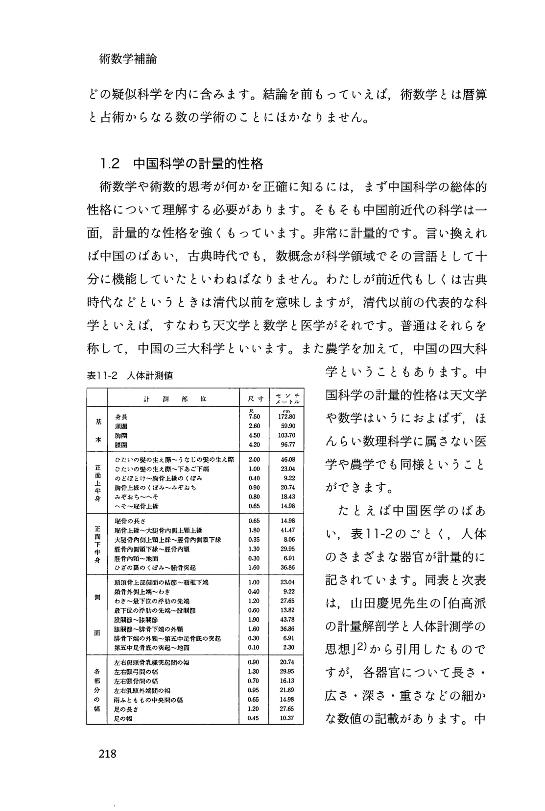

<!-- V3_SOURCE_ID:book015-b001369-p000-4cc9637a98 -->

无论提及人体的哪个部位都可以，不过由于之后计划要论述脉的相关内容，出于论述的关联，接下来要讲脉。

> **释读存疑：** 原文末尾不完整，仅保留可确认的内容

查看对应原文

<!-- V3_FOLDBACK_BEGIN:book015-b001369-p000-4cc9637a98 -->

人体のどの部位に言及しても構わないのですが，後で脈について論じる予定ですので，講論の関係上，脈

<!-- V3_FOLDBACK_END:book015-b001369-p000-4cc9637a98 -->

<!-- V3_SOURCE_ID:book015-b001370-p000-c06ca7c847 -->

表11-3 脉长一览
|脉的名称|1脉的长度（尺）|合计（丈）|
|---|---|---|
|手六阳脉|5.0|3.0|
|手六阴脉|3.5|2.1|
|足六阳脉|8.0|4.8|
|足六阴脉|6.5|3.9|
|阴阳乔脉|7.5|1.5|
|督脉·任脉|4.5|0.9|
|合计|—|16.2|

> **释读存疑：** 本地硬校验仍未通过，已记录供后续自动处理或人工核对。

查看对应原文

<!-- V3_FOLDBACK_BEGIN:book015-b001370-p000-c06ca7c847 -->

表11-3 脈長一覧
<table><tr><td rowspan=1 colspan=1>脈の名称</td><td rowspan=1 colspan=1>1脈の長さ(尺)</td><td rowspan=1 colspan=1>計(丈)</td></tr><tr><td rowspan=1 colspan=1>手六陽脈</td><td rowspan=1 colspan=1>5.0</td><td rowspan=1 colspan=1>3.0</td></tr><tr><td rowspan=1 colspan=1>手六陰脈</td><td rowspan=1 colspan=1>3.5</td><td rowspan=1 colspan=1>2.1</td></tr><tr><td rowspan=1 colspan=1>足六陽脈</td><td rowspan=1 colspan=1>8.0</td><td rowspan=1 colspan=1>4.8</td></tr><tr><td rowspan=1 colspan=1>足六陰脈</td><td rowspan=1 colspan=1>6.5</td><td rowspan=1 colspan=1>3.9</td></tr><tr><td rowspan=1 colspan=1>陰陽喬脈</td><td rowspan=1 colspan=1>7.5</td><td rowspan=1 colspan=1>1.5</td></tr><tr><td rowspan=1 colspan=1>督脈·任脈</td><td rowspan=1 colspan=1>4.5</td><td rowspan=1 colspan=1>0.9</td></tr><tr><td rowspan=1 colspan=1></td><td rowspan=1 colspan=1>計</td><td rowspan=1 colspan=1>16.2</td></tr></table>

<!-- V3_FOLDBACK_END:book015-b001370-p000-c06ca7c847 -->

<!-- V3_SOURCE_ID:book015-b001371-p000-1c19292d8e -->

接下来我们来探讨脉的长度。请看表11-3。人体的主要脉络总共有28条，其中手部的六条阳脉，每条脉长5尺，6条合计为3丈。手部的六条阴脉，每条脉长3.5尺，6条合计为2丈1尺。足部的六条阳脉，每条脉长8尺，合计为4丈8尺。足部的六条阴脉，每条脉长6.5尺，合计为3丈9尺。阴阳的跷脉，长度为7.5尺的2倍，合计1丈5尺。督脉、任脉各长9尺。6条脉乘以4等于24条脉，再加上剩余的4条脉，总共就是28条脉。人体28条脉的总长度为16丈2尺。关于脉的长度，虽说属于计量范畴，但相比其他器官，有些部位的脉更难精确测量，不过其他部位的数值大致是准确的。当时想必存在着以精度著称的解剖学。众所周知，在中国，除了中国医学的经典名著外，几乎看不到人体解剖的相关记录，但从上述例子来看，中国医学的计量特性是完全可以得到确认的。

> **释读存疑：** 原文中“営五十周”的释读未明确标注，属于保留原短语未说明具体所指的情况

查看对应原文

<!-- V3_FOLDBACK_BEGIN:book015-b001371-p000-1c19292d8e -->

の長さをとりあげます。表11-3を御覧ください。人体の主要な脈は全部で28ありますが,手の六陽脈のばあい,1脈の長さが5尺,5×6あわせて3丈です。手の六陰脈は1脈の長さが3.5尺，3.5×6あわせて2丈1尺。足の六陽脈は8尺，全部で4丈8尺。足の六陰脈は6.5尺，全部で3丈9尺。陰陽の喬脈は7.5の2倍で，1丈5尺。督脈・任脈は9尺。6脈×4=24脈と残りの4脈で28脈。人体28脈の総脈長は16丈2尺となります(この値は記憶しておいてください。営五十周を論じるとき,ふたたび論及します)。脈長のばあい，計量的とはいっても若干他の器官より正確に計るのが難しいところもありますが，他の部位のばあい，数値はおおむね正確です。当時，精度を誇る解剖学が存在していたに相違ありません。中国では周知のごとく，人体の解剖結果は中国医学の古典的名著をのぞいてほとんどみえませんが，中国医学の計量的性格は上例からして十分確認することができると思います。

<!-- V3_FOLDBACK_END:book015-b001371-p000-1c19292d8e -->

<!-- V3_SOURCE_ID:book015-b001372-p000-0b464fd44a -->

此外，计量特性在农学领域也几乎相同。农书中详细记载了农具长度等各类数值，计量性，换句话说就是与数字紧密结合的特性，在农学中也明确存在。农学和天文学、数学一样，与数字有着深厚的关联。

查看对应原文

<!-- V3_FOLDBACK_BEGIN:book015-b001372-p000-0b464fd44a -->

また計量的性格は農学でもほとんど同様です。農学書には，農具の長さなどの数値が細かに記されており，計量的，言い換えれば数と絡み合う性格は，農学にも厳然と存在しています。農学も天文学や数学と同じく，数と深い関係を有しているわけです。

<!-- V3_FOLDBACK_END:book015-b001372-p000-0b464fd44a -->

<!-- V3_SOURCE_ID:book015-b001373-p000-8f6cdfc001 -->

## 1.3 数の二義性 — 1.3 数的二义性

查看对应原文

<!-- V3_FOLDBACK_BEGIN:book015-b001373-p000-8f6cdfc001 -->

## 1.3 数の二義性

<!-- V3_FOLDBACK_END:book015-b001373-p000-8f6cdfc001 -->

<!-- V3_SOURCE_ID:book015-b001374-p000-9ba74c5f87 -->

中国的科学家重视“数”，他们测量自然界的各类事物与现象，积极致力于从数量层面进行阐释，但数值解析的目的并不仅仅局限于自然科学领域的……

> **释读存疑：** 原文末尾存在残缺，内容不完整

查看对应原文

<!-- V3_FOLDBACK_BEGIN:book015-b001374-p000-9ba74c5f87 -->

中国の科学者は「数」を重んじ，自然界の諸物や現象を計測し，数量的な解明に積極的に従事しましたが，数値解析の目的は単に自然科学的な

<!-- V3_FOLDBACK_END:book015-b001374-p000-9ba74c5f87 -->

<!-- doc004 PDF 第 231 页：高风险/复杂版面 OCR 供检索；内容与排版以原页图为准。 -->
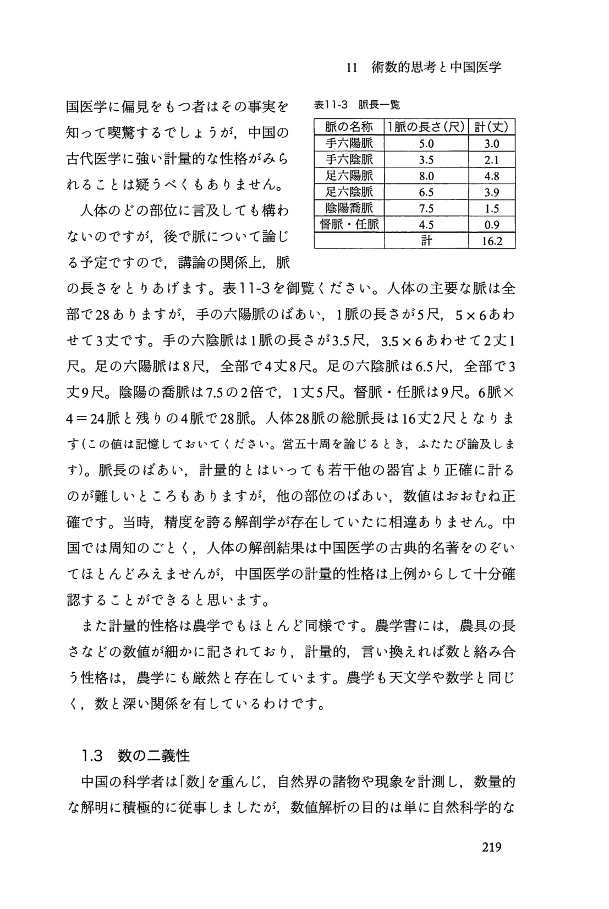

<!-- V3_SOURCE_ID:book015-b001376-p000-7a24842865 -->

这并非仅停留在理论构建层面。同一位科学家在追求数理科学目标的同时，也构建了数神秘主义的理论，并且以数理科学与数神秘主义相结合的方式开展自然研究，这一点是毋庸置疑的。

查看对应原文

<!-- V3_FOLDBACK_BEGIN:book015-b001376-p000-7a24842865 -->

理論の構築のみにあるのではありません。同じ科学者が、数理科学的な目的を追求しながら，同時に数神秘主義的な理論を築きあげ，数理科学的かつ数神秘主義的に自然研究を展開してきたことも議論の余地がありません。

<!-- V3_FOLDBACK_END:book015-b001376-p000-7a24842865 -->

<!-- V3_SOURCE_ID:book015-b001377-p000-7ff340efca -->

例如《黄帝内经太素·营五十周篇》的情况，详细内容后续会说明，该篇提到28脉与天上的28宿相对应，同时营气在人体中运行50周。也就是说，人体的28脉对应天上的28宿，被视为需要证明的命题。诚然，关于这一点是否能从医学角度进行理论构建尚存疑问，但论述天人相互对应的这一命题，从思想史的语境来看，必须认为它继承了天人相关思想的脉络。毫无疑问，这是术数学的命题。

查看对应原文

<!-- V3_FOLDBACK_BEGIN:book015-b001377-p000-7ff340efca -->

たとえば『黄帝内経太素』営五十周篇のばあい，詳細は後で説明しますが，28脈が天の28宿と対応しつつ，営気が身体を50周するとのべています。すなわち人体の28脈が天の28宿に対応することが，証明すべき命題と考えられております。確かにそれについては医学的な理論づけが可能なのか疑わしいですが，天人の相互対応を説くこのテーゼは，思想史のコンテクストからいえば,天人相関思想の流れを汲むと考えなければなりません。間違いなく術数学の命題です。

<!-- V3_FOLDBACK_END:book015-b001377-p000-7ff340efca -->

<!-- V3_SOURCE_ID:book015-b001378-p000-b53da70331 -->

中国科学围绕数字所呈现的兼具计量性与神秘主义的特质，若对其思考方式进行分类并探究其依据，就必须认为它源自术数式思考。因为在术数式思考中，对于自然界和人类社会的所有现象，都认为广义的数字在本质上发挥着作用。

> **释读存疑：** 原文中出现的标记“⑧”未明确对应具体内容

查看对应原文

<!-- V3_FOLDBACK_BEGIN:book015-b001378-p000-b53da70331 -->

中国科学の数をめぐる計量的かつ神秘的主義な性格は，思考様式を類別し，その思考の依拠するところをさぐれば，術数的思考に由来しているといわねばなりません。なぜなら,術数的思考のばあい，
⑧あらゆる自然界や人間界の事象について，広義の数が本質的に機能しているととらえる。

<!-- V3_FOLDBACK_END:book015-b001378-p000-b53da70331 -->

<!-- V3_SOURCE_ID:book015-b001380-p000-2c484594cf -->

①构建了独特的数字概念，认为数字包含抽象的理数与神秘的命数、卜数两个方面。

> **释读存疑：** 原文中出现的标记“①”未明确对应具体内容

查看对应原文

<!-- V3_FOLDBACK_BEGIN:book015-b001380-p000-2c484594cf -->

①独特な数概念を構築し，数には抽象的な理数と神秘的な命数卜数の二つの側面があるとする。

<!-- V3_FOLDBACK_END:book015-b001380-p000-2c484594cf -->

<!-- V3_SOURCE_ID:book015-b001381-p000-874cb50df6 -->

②着眼于数字的两面性与双重含义，在重视理数所具备的计量性、客观性特征的同时，也同样留意命数、卜数所具有的神秘性、人性层面的特征，这是因为可以这样进行分析。此前所说的28脉与28宿的对应之类，是术数学的典型命题，毫无疑问该命题源自术数式的思考。

查看对应原文

<!-- V3_FOLDBACK_BEGIN:book015-b001381-p000-874cb50df6 -->

②数の二面性二義性に着目して，理数の計量的客観的な性格を重んじる一方で，それと同等に，命数卜数の神秘的人間的な側面に注意
このように分析することができるからです。先の28脈と28宿の対応などは術数学の典型的命題であり，それが術数的思考に由来することは間違いありません。

<!-- V3_FOLDBACK_END:book015-b001381-p000-874cb50df6 -->

<!-- V3_SOURCE_ID:book015-b001383-p000-6bcb6b0c2e -->

上述条目中的「命数」的「命」，指的是命运的命。而「ト数」的「ト」，指的是占卜。在数字概念中，并存着标榜合理性的「理数」，以及与之完全相反的「命数」「ト数」等虽不合理却极具人性的要素，这是毋庸置疑的。所谓「数のマジック」，或许是指当人们深入探究数字的合理性时，往往会遭遇其非合理性的命题。可以将其视为一种表述：对于无情且绝对的数字合理性，世间也常见数字的非合理性与之并存。

查看对应原文

<!-- V3_FOLDBACK_BEGIN:book015-b001383-p000-6bcb6b0c2e -->

一方，上条の「命数」の命ですが，それは運命の命を意味します。また「ト数」のトは，占いのことです。数概念の中には，合理性を誇る「理数」と,それとはまったく逆の「命数」「ト数」など,合理的とはいえないがきわめて人間的な要素が併存していることは疑うべくもありません。「数のマジック」などといわれますが,それは数の合理性を突きつめたとき，往々にして非合理性にぶつかることをのべた命題ではなかろうかと思います。情け容赦ない絶対的な数の合理(の猛威)に対して数の非合理も世に常見することをのべた標語とみてよいでしょう。

<!-- V3_FOLDBACK_END:book015-b001383-p000-6bcb6b0c2e -->

<!-- V3_SOURCE_ID:book015-b001384-p000-5de9e0e83b -->

## 1.4 術数学=暦算+占術 — 1.4 术数学=历算+占术

查看对应原文

<!-- V3_FOLDBACK_BEGIN:book015-b001384-p000-5de9e0e83b -->

## 1.4 術数学=暦算+占術

<!-- V3_FOLDBACK_END:book015-b001384-p000-5de9e0e83b -->

<!-- V3_SOURCE_ID:book015-b001385-p000-3966ea3ea7 -->

就中国的科学（哲学）而言，关于术数式思考的基本说明，可归结为刚才所说的数字的双重含义。即便如此，术数式思考的体系性展开——在术数学中，只执着于数字的双重含义中的某一种含义，以此追求其整合性，这类专门学术曾占据主流，这也是不容混淆的事实。也就是说，必须说（1）历算与（2）占术各自独立，形成了术数学的两大主流。

查看对应原文

<!-- V3_FOLDBACK_BEGIN:book015-b001385-p000-3966ea3ea7 -->

中国の科学(哲学)のばあい，術数的思考についての基本的な説明は，今のべた数の二義性に尽きるということができます。そうはいっても，術数的思考の体系的な展開——術数学では，数の二義性，二義の中の一義のみに偏ってその整合性を追求していく，専門的な学術が主流となっていたことも，これまた紛れもない事実です。すなわち，(1)暦算と(2)占術がそれぞれ独立して術数学の二つの主流を形成していたといわねばなりません。

<!-- V3_FOLDBACK_END:book015-b001385-p000-3966ea3ea7 -->

<!-- V3_SOURCE_ID:book015-b001386-p000-7b268ca0f1 -->

要清晰地说明术数学的二义二面，没有比历代书籍目录更合适的了。表11-1的四部分类源流一览表就是这样的资料。该表右列所列出的，是从汉代到清代的代表性图书目录，依次为《七略》以下，还有《七录》《隋书经籍志》《古今书录》《新唐书艺文志》《崇文总目》《群斋读书志》《遂初堂书目》《直斋书录解题》《文献通考经籍考》《宋史艺文志》《明史艺文志》《四库全书总目》。

查看对应原文

<!-- V3_FOLDBACK_BEGIN:book015-b001386-p000-7b268ca0f1 -->

術数学の二義二面を単純ながら明白に示してくれるのは，歴代の書籍目録に勝るものはありません。表11-1の四部分類源流一覧表がそれです。四部分類源流一覧表の右列に示されるのが，漢代から清代にいたる代表的な図書目録です。『七略』以下，『七録』『隋書経籍志』『古今書録』『新唐書芸文志』『崇文総目』『群斎読書志』『遂初堂書目』『直斎書録解題』『文献通考経籍考』『宋史芸文志』『明史芸文志』『四庫全書総目』とつづきます。

<!-- V3_FOLDBACK_END:book015-b001386-p000-7b268ca0f1 -->

<!-- V3_SOURCE_ID:book015-b001387-p000-c4e876af79 -->

最上方的《七略》，是现存中国最古老的书籍目录。严格来说，《七略》后来改名为《汉书》艺文志。《汉书》是东汉班固所撰写的汉王朝历史著作。《汉书》艺文志实际上几乎原封不动地收录了西汉末年到王莽时期的经学家刘歆编纂的《七略》。这就是中国最古老的图书目录，准确来说是汉代秘府，也就是宫中图书馆的书籍目录。刘歆将西汉末年宫中的藏书分为六类。《七略》的书名源自于将学术的六个门类——六略（六艺略、诸子略、诗赋略、术数略、兵书略、方技略），再加上统领全体的“辑略”，作为学术分类采用了六分法。

> **释读存疑：** 本地硬校验仍未通过，已记录供后续自动处理或人工核对。

查看对应原文

<!-- V3_FOLDBACK_BEGIN:book015-b001387-p000-c4e876af79 -->

最上にある『七略』は，現存する中国最古の書籍目録にほかなりません。厳密にいえば，『七略』は『漢書』芸文志と名を変えています。『漢書』とは，後漢の班固が作った漢王朝の歴史書のこと。『漢書』芸文志は実は，前漢末から王莽のころに活躍した経学者，劉歆が編纂した『七略』をほとんどそのまま写しとっています。これが中国最古の図書目録，正確にいえば漢の秘府，宮中の図書館の書籍目録です。劉歆は前漢末の宮中の書籍(秘書)を六つに分類しました。『七略』の書名は学術の六つのジャンル——六略(六芸略・諸子略・詩賦略・術数略・兵書略・方技略)に，全体を統括する「輯略」を冠したことにもとづいており，学術分類としては六部分類

<!-- V3_FOLDBACK_END:book015-b001387-p000-c4e876af79 -->

<!-- V3_SOURCE_ID:book015-b001388-p000-efc730a8fd -->

采用了六分法。

查看对应原文

<!-- V3_FOLDBACK_BEGIN:book015-b001388-p000-efc730a8fd -->

を採用しております。

<!-- V3_FOLDBACK_END:book015-b001388-p000-efc730a8fd -->

<!-- V3_SOURCE_ID:book015-b001389-p000-281607baea -->

根据四部分类源流一览表，刘歆的六艺略中，可见经书《易》《书》《诗》《礼》《春秋》《乐》《论语》《孝经》等。这就是经书的学问。六艺略之后依次是诸子略、兵书略、术数略、方技略，而方技指的是医学。最后以诗赋略的小说和赋作收尾。四部分类源流一览表清晰地展现了四部分类的源流，将同一门类的学问按纵向的相同位置排列，从其特征来看，只要查看术数略下方的纵向一列，就能一目了然地知晓术数学在《七录》中采用了怎样的结构、如何分类，在《隋书经籍志》中又是如何分类的等信息。

查看对应原文

<!-- V3_FOLDBACK_BEGIN:book015-b001389-p000-281607baea -->

四部分類源流一覧表によれば，劉歆の六芸略には，経書易・書・詩・礼・春秋・楽・論語・孝経などがみえます。経書の学問(経学)がこれです。六芸略には諸子略・兵書略・術数略・方技略がつづきますが，方技とは医学のことです。最後は詩賦略小説や賦に終わっています。四部分類源流一覧表はよく四部分類の源流を示し，同じジャンルの学問を縦方向の同じ位値に並べており，その特徴からして，術数略下の縦の一列をみれば,術数学は『七録』ではどんな構成をとり，どう分類されたのか，『隋書経籍志』ではどのように分類されたのかなどを，一見して知ることができます。

<!-- V3_FOLDBACK_END:book015-b001389-p000-281607baea -->

<!-- V3_SOURCE_ID:book015-b001390-p000-199c0c3092 -->

要了解术数学的内容与结构，查看该表格是最容易理解的。表格最上方的VI术数略下方首先写有「天文」，这里的「天文」指的是现在的天文占、占星术。「暦譜」包含治历的学问与数学。「五行」指五行占及与五行相关的学问。中国思想中若没有阴阳五行学说，理论展开会存在困难，查看源流一览表的分类就能明白，五行学说曾是术数学的重要构成要素之一。中国的学问中术数相关的印象浓厚，从这一点也不难说明。「五行」之后是「蓍亀」，用筮竹进行的占卜是蓍占，灼烧龟甲进行的占卜是龟占，蓍亀指中国的正统占卜。顺便一提，灼烧龟甲或兽骨产生的裂纹呈「ト」形，人们根据该裂纹的形状来推断吉凶。因此「ト」的原意并非指一般的占卜，而是指使用兽骨进行的占卜，后来被广泛使用，「ト」便逐渐用来指代一般的占卜。接下来是「雑占」，杂占中最重要的是梦占。最后是「形法」，现在流行的风水、人相占卜等都属于这一类。

> **释读存疑：** 原文中「ト」的具体所指未明确，释读中保留该符号的原表述并说明其含义，符合要求

查看对应原文

<!-- V3_FOLDBACK_BEGIN:book015-b001390-p000-199c0c3092 -->

術数学の内容や構造を知るには，同表をみるのが最もわかりやすいでしょう。表最上段のVI術数略の下にまず「天文」とありますが，「天文」とは現在の天文占，占星術のこと。「暦譜」は治暦の学や数学を内に含んでいます。「五行」は五行占や五行にかんする学問のこと。中国思想には陰陽五行説がなければ理論展開が難しいところもありますが，源流一覧表の分類をみれば五行説が術数学の重要な構成要素の一つであったことは一目瞭然です。中国の学問に術数的なイメージが濃厚にあることは，同点から説明することも難しくないでしょう。「五行」につづくのは「蓍亀」。筮竹を使った占いが蓍で，亀の甲羅を焼いて占うのが亀です。蓍亀は中国の正統的な占いを意味します。ちなみに，亀の甲羅や獣骨を焼いて生じた割れ目は「ト」の形をしており，その割れ目の形をもって吉凶を推しはかりました。それゆえ「ト」の原義は占い般ではなく,獣骨を使った占いを指しました。広義に用いられた結果，トは占い一般を意味するようになりました。それから「雑占」。雑占の中で最も重要であるのが夢占,夢占いです。最後に「形法」。現在，流行する風水とか，人相占いなどがそれにあたります。

<!-- V3_FOLDBACK_END:book015-b001390-p000-199c0c3092 -->

<!-- V3_SOURCE_ID:book015-b001391-p000-201709d536 -->

《七略》将术数略分为以上六个细目进行记载，在术数略的六类学问中，暦谱学相当于现在的数理科学，其余五类均大致属于占术。

查看对应原文

<!-- V3_FOLDBACK_BEGIN:book015-b001391-p000-201709d536 -->

『七略』は術数略を以上六細目に分けて記載しますが，術数略の六学のうち，暦譜の学が現在の数理科学にあたり，他の五術はあらまし占術です。

<!-- V3_FOLDBACK_END:book015-b001391-p000-201709d536 -->

<!-- V3_SOURCE_ID:book015-b001392-p000-4cf8c8c9e6 -->

接下来我们同样向下查看术数学的相关内容。继《七略》之后的《七录》，是南朝梁阮孝绪所著的图书目录。四部分类源流一览表中写为「技術録」，这是错误的，正确的应为「術技録（術伎録）」。《七录》的术技录，是将《七略》方技略中的医经、医方，与《七略》术数略的内容合并而成3)，医术与术数学的分类本身，与《七略》相比没有任何变化。

查看对应原文

<!-- V3_FOLDBACK_BEGIN:book015-b001392-p000-4cf8c8c9e6 -->

以下同様に術数学の個所を下方向にみていきましょう。『七略』につづく『七録』は，梁の阮孝緒が書いた図書目録です。四部分類源流一覧表では「技術録」となっていますが，誤植であり，正しくは「術技録(術伎録)」としなければなりません。『七録』の術技録は，『七略』方技略の医経・医方と『七略』術数略の内容を合併したものであり3)，医術や術数学の分類自体は『七略』とすこしも変わりません。

<!-- V3_FOLDBACK_END:book015-b001392-p000-4cf8c8c9e6 -->

<!-- V3_SOURCE_ID:book015-b001393-p000-7ea4f1427d -->

《隋书·经籍志》及之后的目录，均采用经、史、子、集四部分类，并未设立术数类项目。但《遂初堂书目》中，虽能看到其位置大致在中间偏下，刘歆《七略》术数略的内容，被原封不动地汇总为「数术家类」4)。《遂初堂书目》是南宋学者尤袤所著的图书目录，该书将数术家类分为天文、暦议、阴阳、五行、卜筮、形势六类。《遂初堂书目》中，数学书籍并未归入数术家类，而是归入雑芸类，但属于数理科学的暦议、暦经，依然是数术家类的主要构成要素。由此可见，南宋的《遂初堂书目》对术数学的理解，与《七略》并无不同。

查看对应原文

<!-- V3_FOLDBACK_BEGIN:book015-b001393-p000-7ea4f1427d -->

『隋書経籍志』以下は経・史・子・集の四部分類を採用し，術数類の項目を立ててはいません。だが『遂初堂書目』では，真中よりやや下にみえますが，劉歆の術数略の内容がそのまま「数術家類」としてまとめられています4)。『遂初堂書目』は南宋の尤袤という学者が書いた図書目録です。その『遂初堂書目』は数術家類を天文・暦議・陰陽・五行・卜筮・形勢の六つに分類しています。『遂初堂書目』のばあい，数学書は数術家類ではなく雑芸類に収められますが，数理科学の暦議・暦経は依然として数術家類の主要な構成要素です。南宋の『遂初堂書目』も術数学の理解は『七略』と変わらないということができます。

<!-- V3_FOLDBACK_END:book015-b001393-p000-7ea4f1427d -->

<!-- V3_SOURCE_ID:book015-b001394-p000-55200f07ce -->

最下方的《四庫全書總目》是清代的圖書目錄。《四庫全書》共收錄3458種、79582卷書籍，僅製作了7套，卻作為中國最大的叢書而聞名，被收藏在文淵閣等七處皇家圖書館中。《四庫全書總目》正是《四庫全書》的目錄。《四庫全書總目》將自《七略》以來的術數類典籍進一步分為兩大類，設立了（1）天文算法類與（2）術數類5）的類目，還將天文算法類分為推步類與算書類，將術數類分為數學、占候、陰陽五行、占卜、雜技術、相宅相墓、命書相書。此處將術數的學名僅用於各種占術，並將占星術書歸入術數類的占候類，明確區分了具備數理性質的天文算法與具備神秘主義性質的術數。清代的學術分類改變了以往的術數類，大致分為天文算法與術數（占術）兩大類。

> **释读存疑：** 原文中「術数類5）」的上標數字「5」含義不明

查看对应原文

<!-- V3_FOLDBACK_BEGIN:book015-b001394-p000-55200f07ce -->

最下の『四庫全書総目』は清代の図書書目です。四庫全書3458種79582巻はわずか7セットのみ作成されましたが，中国最大の叢書として名高く，文淵閣など七処の王立図書館に収められました。『四庫全書総目』が四庫全書の目録にほかなりません。『四庫全書総目』は『七略』以来の術数学をさらに二つに分け，(1）天文算法類と（2）術数類5)の類目をつくり，また天文算法類を推歩と算書に分け，術数類を数学・占候・陰陽五行・占卜・雑技術・相宅相墓・命書相書に分類しました。術数の学名を諸々の占術のみに使い，また占星術書を術数類の占候の属にいれ，数理的な天文算法と神秘主義的な術数を截然と区別しました。清代の学術分類は従来の術数学を改め，大きく二類，天文算法と術数学(占術)に分けたわけです。

<!-- V3_FOLDBACK_END:book015-b001394-p000-55200f07ce -->

<!-- V3_SOURCE_ID:book015-b001395-p000-0b1405a61a -->

但將天文算法從術數中獨立，是《四庫全書》及之後的新見解。清代以前，從相關表中可明確看出，《四庫全書》的天文算法類與術數類合在一起被視為術數。至於清代為何對術數的看法發生變化，是因為清代學者厭惡神秘主義（非合理主義），試圖對整個學術體系進行徹底的合理化改造。學問是不斷發展的，在學術分類方面也可以指出同樣的情況。

查看对应原文

<!-- V3_FOLDBACK_BEGIN:book015-b001395-p000-0b1405a61a -->

だが天文算法の術数学からの独立は，四庫全書およびそれ以降の新しい見解にすぎません。清代以前では同表から明らかなごとく，四庫全書
の天文算法類と術数類を合わせたものが術数学と考えられていました。なぜ清代になって術数観に変化が生じたのかといえば，清代の学者たちが神秘主義(非合理主義)を嫌い，学術総体に対して徹底的に合理化を加えようとしたからです。学問は発達していくものですが，学問分類でも同様なことを指摘することができます。

<!-- V3_FOLDBACK_END:book015-b001395-p000-0b1405a61a -->

<!-- V3_SOURCE_ID:book015-b001397-p000-0255bd9f94 -->

總而言之，在《四庫全書》之前，重視因果必然性的數理科學與重視超自然神秘性的占術渾然一體，被理解為術數，這一點毋庸置疑。但實際上，術數學者大致分為兩大群體，一方專門從事占卜，另一方則專門致力於數理研究，這也是毋庸置疑的。

查看对应原文

<!-- V3_FOLDBACK_BEGIN:book015-b001397-p000-0255bd9f94 -->

総じていえば，四庫全書前では，因果的必然性を重んじる数理科学と超自然的な神秘を重んじる占術が渾然一体となって存在し，術数学として理解されていたことは間違いありません。だが実際のばあい，術数学者は大きく二つのグループに分れ，一方は専ら占いを行い，一方は専門的に数理の研究に従事していたことも疑えないようです。

<!-- V3_FOLDBACK_END:book015-b001397-p000-0255bd9f94 -->

<!-- V3_SOURCE_ID:book015-b001398-p000-f279e84093 -->

## 1.5 理数と命数の混淆 — 1.5 理數與命數的混淆

查看对应原文

<!-- V3_FOLDBACK_BEGIN:book015-b001398-p000-f279e84093 -->

## 1.5 理数と命数の混淆

<!-- V3_FOLDBACK_END:book015-b001398-p000-f279e84093 -->

<!-- V3_SOURCE_ID:book015-b001399-p000-2fa456884b -->

当前的术数学，一方面虽主张理数与命数相互对立，却也一直在阐释术数学的整体面貌；但不可否认的是，理数性思考与命数性思考并非在术数学内部毫无关联地存在，而是相互间有着紧密的关系，且产生了深远的影响。术数学确实作为广义的数术，兼具强烈的理数与命数这两种对立的思考倾向，且大多时候是各自独立发展的。不过与此同时，术数学中的理数性思考与命数性思考，在广义的数的范畴内，相互间也确实产生着深远的影响。要简洁说明理数与命数的这种混杂状态，没有什么能比得上算书中存在占术、占书中存在数理知识这一情况了。

查看对应原文

<!-- V3_FOLDBACK_BEGIN:book015-b001399-p000-2fa456884b -->

いま術数学は一面，理数と命数が相反するとしながら全体像を説明してきましたが，理数的思考と命数的思考は術数学の内部で無関係に存在したのではなく，相互に緊密な関係をもち，深甚な影響を与えたことも間違いありません。術数学は確かに，広義の数術として，強烈な理数と命数の相反的な思考傾向をもち，多くのばあい独立して発展してきました。だが同時に，術数学の理数的思考と命数的思考は広義の数の範疇において，相互に深い影響を及ぼしていたことも事実です。その理数と命数の混淆を簡潔に説明してくれるのは，算書中の占術の存在と占書の中の數理知識の存在に勝るものはないでしょう。

<!-- V3_FOLDBACK_END:book015-b001399-p000-2fa456884b -->

<!-- V3_SOURCE_ID:book015-b001400-p000-b1d6bb0294 -->

首先请看《算法统宗》的例题。《算法统宗》是中国最普及的算书之一，由明代的程大位于1592年完成。有研究认为其出版量堪比《圣经》以上。但其中一道名为“孕推男女法”的题目，与其他算题的旨趣截然不同。也就是，

> **释读存疑：** “孕推男女法”的具体所指不详

查看对应原文

<!-- V3_FOLDBACK_BEGIN:book015-b001400-p000-b1d6bb0294 -->

最初に『算法統宗』の例題を御覧ください。『算法統宗』は中国で最も普及した算書の一つで，明の程大位が1592年に完成しました。出版部数はバイブル以上とする研究もあります。だがその孕推男女法と名づけられた一題は他の算題とまったく趣を異にしています。すなわち，

<!-- V3_FOLDBACK_END:book015-b001400-p000-b1d6bb0294 -->

<!-- V3_SOURCE_ID:book015-b001401-p000-96a2558655 -->

现有一名孕妇，年龄为28岁，预计在8月生产。请问会生下男孩还是女孩？

查看对应原文

<!-- V3_FOLDBACK_BEGIN:book015-b001401-p000-96a2558655 -->

いま孕婦がある。行年は28歳，8月に出産予定である。男が生まれるか女が生まれるか。

<!-- V3_FOLDBACK_END:book015-b001401-p000-96a2558655 -->

<!-- V3_SOURCE_ID:book015-b001402-p000-5993de47cd -->

解答：会生下男孩。

查看对应原文

<!-- V3_FOLDBACK_BEGIN:book015-b001402-p000-5993de47cd -->

答曰，男が生まれる。

<!-- V3_FOLDBACK_END:book015-b001402-p000-5993de47cd -->

<!-- V3_SOURCE_ID:book015-b001403-p000-ae0db7c475 -->

方法是：取49，加上「難月」的8月，再減去「行年」的28，所得餘數為29。接著從這個數值中依次減去天的數1、地的數2、人的數3、「四時」的4、五行的5、六律的6、七星的7。若最後所得餘數為奇數，則會生男孩；若為偶數，則會生女孩。按照該方法計算：49+8-28-1-2-3-4-5-6-7=1。首先取49，加上「難月」的8月，再減去「行年」的28，之後依次減去1、2、3、4，直到餘數為1或2為止。

> **释读存疑：** 原文中「難月」的所指未明，释读时保留了原表述

查看对应原文

<!-- V3_FOLDBACK_BEGIN:book015-b001403-p000-ae0db7c475 -->

法曰，49をおき，孕月の8を加え，行年の28を引く。余りは29。その値から順次，天の数の1，地の数の2，人の数の3，四時の4，五行の5，六律の6，七星の7を引く。余りが奇数であれば男が生まれ，偶数であれば女が生まれる6)。法日にしたがえば，
49+8-28-1-2-3-4-5-6-7=1と計算します。第一に49をおき，「難月」の8月を加え，「行年」の28を減じ，以下，1，2，3，4と順に引き，余りが1か2になるまで

<!-- V3_FOLDBACK_END:book015-b001403-p000-ae0db7c475 -->

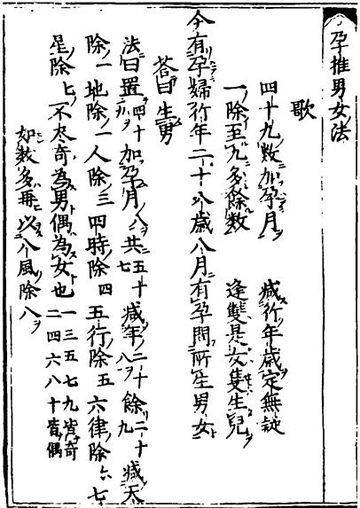

<!-- V3_SOURCE_ID:book015-b001405-p001-78428e3524 -->

图11-1《算法统宗》孕推男女法

查看对应原文

<!-- V3_FOLDBACK_BEGIN:book015-b001405-p001-78428e3524 -->

図11-1『算法統宗』孕推男女法

<!-- V3_FOLDBACK_END:book015-b001405-p001-78428e3524 -->

<!-- V3_SOURCE_ID:book015-b001406-p000-7cb190079e -->

继续进行减法运算。在此情况下，余数为1，属于奇数，因此会生男孩。

查看对应原文

<!-- V3_FOLDBACK_BEGIN:book015-b001406-p000-7cb190079e -->

引き算をつづけます。このばあい，余りは1になり，奇数ですので男子が誕生します。

<!-- V3_FOLDBACK_END:book015-b001406-p000-7cb190079e -->

<!-- V3_SOURCE_ID:book015-b001407-p000-a202952fbe -->

《算法統宗》的孕推男女法，作為源自4至5世紀《孫子算經》的算術題廣為人知，其對日本文化產生了相當大的影響，這一點毋庸置疑。本次引用了《算法統宗》孕推男女法的和刻本，和刻本的存在充分證明了這一點。

> **释读存疑：** 本地硬校验仍未通过，已记录供后续自动处理或人工核对。

查看对应原文

<!-- V3_FOLDBACK_BEGIN:book015-b001407-p000-a202952fbe -->

『算法統宗』の孕推男女法は，4～5世紀の『孫子算経』に由来する算題として名高く，日本の文化に相当の影響を与えたことも疑えません。『算法統宗』孕推男女法は和刻本(図11-1)を引用しましたが，和刻文の存在がそのことをよく示しています。

<!-- V3_FOLDBACK_END:book015-b001407-p000-a202952fbe -->

<!-- V3_SOURCE_ID:book015-b001408-p000-4cc89c9fc3 -->

我想探讨的是，自《孙子算经》以来的推算胎儿性别之法，被记载于算书之中这一点。这显然表明，数理类命题与占卜类命题并非完全互不相干。当然，在中国的算书里，除了推算胎儿性别之法外，没有其他类似的内容。但同时，也必须承认，该内容并未从算书中删除，这是确凿的事实。算书中存在占卜之法，这本身就直接提供了命数理念与数理理念相互混淆的证据。

查看对应原文

<!-- V3_FOLDBACK_BEGIN:book015-b001408-p000-4cc89c9fc3 -->

『孫子算経』以来の孕推男女法でわたしが問題にしたいのは，それが算書中に記載されていたということです。同点は明らかに，理数的な命題と占ト的な命題が完全に二物ではなかったことを示しております。当然ながら，中国の算書の中には孕推男女法をのぞいて，類似題は一つもありません。だが同時に，それが算書の中から削除されなかったことも厳然とした事実といわねばなりません。算書における占法の存在がこれであり，それはそのまま命数的な理念と理数的な理念の混淆を示す証拠を提供しております。

<!-- V3_FOLDBACK_END:book015-b001408-p000-4cc89c9fc3 -->

<!-- V3_SOURCE_ID:book015-b001409-p000-0e3e5d53ae -->

再举一个混淆的实例。1973年从马王堆三号汉墓出土的《五星占》就是这样的例子，正如书名所示，《五星占》是一部关于木星、土星、水、金星、火星的占星术书籍，推测成书于西汉初期。

> **释读存疑：** 1轮自动修复后核义模型仍建议修订，已保守记录。

查看对应原文

<!-- V3_FOLDBACK_BEGIN:book015-b001409-p000-0e3e5d53ae -->

もう一つ混淆の実例をのべます。1973年に馬王堆三号漢墓から出土した『五星占』がそれですが，『五星占』は書名のごとく，木星・土星・水星・金星・火星にかんする占星術書です。前漢初期に書かれたと推定されています。

<!-- V3_FOLDBACK_END:book015-b001409-p000-0e3e5d53ae -->

<!-- V3_SOURCE_ID:book015-b001410-p000-d7870131a9 -->

东方对应木，其帝为大皞，其丞相为句芒，其神在天上对应岁星，也就是木星。岁星每年会停留于一个国家，掌管该年的事务。……岁星长时间停留的分野，会有喜事发生。

查看对应原文

<!-- V3_FOLDBACK_BEGIN:book015-b001410-p000-d7870131a9 -->

東方は木であり，その帝は大皞，その丞相は句芒で，その神は天上
にあっては歳星すなわち木星である。歳ごとにある一国におり，歳
をつかさどる。……歳星が長いあいだとどまる分野には慶事がある。

<!-- V3_FOLDBACK_END:book015-b001410-p000-d7870131a9 -->

<!-- V3_SOURCE_ID:book015-b001413-p000-edc9e3b445 -->

正月里与营室一同在黎明时分出现在东方天空的现象被命名为益隐，其形态呈青亮闪烁之状。若对应的国家有德政，就会有黍稷的储备；若该国失德，就会发生战乱。木星应停留的次位延迟1舍、2舍或3舍，这种情况被称为天缩、纽，对应的下方国家会有忧患之事发生，将军会死去，国运会衰败。木星应停留的次位前进1舍、2舍或3舍，这种情况被称为天赢，该年天下会发生洪水，否则就会出现天裂、地动等灾异7。等内容。

> **释读存疑：** 原文中部分内容因排版换行导致的断句，释读时已按文意整合，未改变原意

查看对应原文

<!-- V3_FOLDBACK_BEGIN:book015-b001413-p000-edc9e3b445 -->

[正月に営室とともに明けがた東天にあらわれるのを益隠と名づけ
る。そのありさまは青くきらきらと光り,その国に]徳があれば,
黍稷のたくわえがあり，その国が徳を失えば，戦乱がおこる。木星
がおるべき次より1舎または2舎または3舎遅れるのを天縮・紐と
いい，その下の[国では憂事があり，将軍が死に，国運が傾く。お
るべき次より1舎または2舎または3舎進むのを天]贏といい，その
年には天下に洪水があるか，そうでなければ天が裂けるか，そうで
なければ地が動くかする7。云々。

<!-- V3_FOLDBACK_END:book015-b001413-p000-edc9e3b445 -->

<!-- V3_SOURCE_ID:book015-b001421-p000-783550295e -->

《五星占》从引用的内容来看，是一部用于占卜国家命运的占星术书籍。

查看对应原文

<!-- V3_FOLDBACK_BEGIN:book015-b001421-p000-783550295e -->

『五星占』は引用文から明らかなごとく，国家の運命を占う占星術書です。

<!-- V3_FOLDBACK_END:book015-b001421-p000-783550295e -->

<!-- V3_SOURCE_ID:book015-b001422-p000-d14fed695f -->

它通过五星的天文位置来预言或占卜国家与王朝的命运。

查看对应原文

<!-- V3_FOLDBACK_BEGIN:book015-b001422-p000-d14fed695f -->

五星の天文位置によって国家や王朝の運命を予言ないし占っています。

<!-- V3_FOLDBACK_END:book015-b001422-p000-d14fed695f -->

<!-- V3_SOURCE_ID:book015-b001423-p000-5638580747 -->

总体来看，《五星占》不过是一部占星术书籍。但同一部书籍留下了关于行星运动的详细天象记录，还给出了准确的天文常数，这也是事实。例如，关于木星、金星、土星这三颗星，它记录了从秦始皇元年到汉文帝三年，长达百年以上的“ヒライアカル・ライジング”——即黎明时分星星开始出现在东方天空的现象。此外，它还准确记录了木星的会合周期等数据。

> **释读存疑：** ヒライアカル・ライジング；本地硬校验仍未通过，已记录供后续自动处理或人工核对。

查看对应原文

<!-- V3_FOLDBACK_BEGIN:book015-b001423-p000-5638580747 -->

全体的にみるかぎり，『五星占』は占星術書にすぎません。ところが同じ
書物が惑星の運動について詳細な天象記録を残し，正確な天文定数を与
えていること，これもまた事実です。たとえば木星・金星・土星の三星
については，秦の始皇元年(B.C.246)から漢の文帝三年(B.C.177)，百年以
上にわたってヒライアカル・ライジング，明け方に東天に星がみえ始め
る現象を記録しています。また木星の会合周期なども正確に記録しています。

<!-- V3_FOLDBACK_END:book015-b001423-p000-5638580747 -->

<!-- V3_SOURCE_ID:book015-b001429-p000-2efa203933 -->

这意味着什么呢？这既意味着占星术的学术基础离不开精密的天文知识，也说明了某些占卜方法既是神秘主义的，又不得不具备量化特征的原因。同时，它还具体且详细地展现了理数与命数的混淆。我主张“数具有双重含义”，理由就在于此。

查看对应原文

<!-- V3_FOLDBACK_BEGIN:book015-b001429-p000-2efa203933 -->

これは何を意味するのか。占星術がその学的基礎に精密な天文知識を
欠くことができないことを意味すると同時に，ある種の占いの術が神秘
主義であると同時に計量的にならざるをえない理由を示しています。ま
た理数と命数の混淆も具体的かつ詳細に示しております。数の二義性，
云々とわたしが主張するのは，こうしたところに理由があります。

<!-- V3_FOLDBACK_END:book015-b001429-p000-2efa203933 -->

<!-- V3_SOURCE_ID:book015-b001434-p000-6f9b05b4f5 -->

术数学的发展过程中，理数的思考与命数的思考时常相互交错。我们可以设想，术数家会交替使用这两种思考方式，再将两种思考的结果适当组合，以此构建出所需的命题；但很难想象术数家会同时使用理数与卜数，将其整合成一种连续的逻辑思考。关于术数的思考，我们往往会认为，占卜时用的是命数的思考，数理方面用的是理数的思考，有时还会像拼接拼图一样将两者组合起来。不过，对于过去优秀的术数思考，我们必须理解，两种思考方式的交错远比我们想象的复杂，它们紧密结合，仿佛是作为一种思考方式展开的。

查看对应原文

<!-- V3_FOLDBACK_BEGIN:book015-b001434-p000-6f9b05b4f5 -->

術数学は理数的思考と命数的思考が以上のごとく時として錯綜しながら展開してきましたが，われわれはその錯綜について術数家が二種の思考を交互に使い分け，両種思考の結果を適宜に組み合わせて，求められる命題を構築していたと想像することはできても，術数家が理数と卜数を同時に使用し，一種の思考として連続的な論理を形づくっていたとはなかなか想像しがたい。術数的思考については，われわれは占卜には命数的思考を用い，数理には理数的思考を使いながら，時として寄木細工的に両者を組み合わせていたと想像しがちです。だが過去の優れた術数的思考にあっては，二種の思考はわれわれの想像をはるかに超えて複雑に錯綜し，緊密に結合しあい，あたかも一種の思考のごとく展開していたと理解しなければなりません。

<!-- V3_FOLDBACK_END:book015-b001434-p000-6f9b05b4f5 -->

<!-- V3_SOURCE_ID:book015-b001435-p000-16f02c8e57 -->

以上是第一部内容。若简要总结要点，优秀的术数思考中，理数与卜数有时会完全融为一体，将原本并非同时存在的理数思考与卜数思考紧密结合，在同一个熔炉中融合数的合理性与神秘性，最终作为一种“数”的技艺展开。因此，术数的思考必须被称为兼具科学性与神秘性，或是兼具理性与人性的思考。我认为，不能以现代人的傲慢，轻易将其评价为精密科学发展之前的前近代学问形态。

查看对应原文

<!-- V3_FOLDBACK_BEGIN:book015-b001435-p000-16f02c8e57 -->

以上が第一部です。簡潔に要点をのべれば，優れた術数的思考のばあい，理数と卜数は時として完全に一体化し，ほんらい時を同じくして存在しない理数的思考と卜数的思考を不可分に結合し，数の合理性と神秘性を共通の坩堝にとかしこみながら，一つの「数」の術として展開していたとまとめることができます。それゆえ，術数的思考とは，科学的かつ神秘的，あるいは理性的かつ人間的な思考といわねばなりません。(現代人の傲慢をもって)精密科学に発展する以前の前近代的な学問形態などと安易に評価してはならない，そんな気がいたします。

<!-- V3_FOLDBACK_END:book015-b001435-p000-16f02c8e57 -->

<!-- V3_SOURCE_ID:book015-b001436-p000-0a88c1763e -->

我还认为，属于与术数学不同的学问领域（方技）的中国医学与本草学，即便只是少量内容，也存在基于术数思考的部分。接下来我将就此展开论述。

查看对应原文

<!-- V3_FOLDBACK_BEGIN:book015-b001436-p000-0a88c1763e -->

わたしはまた，術数学とは異なる学問分野(方技)に属する中国の医学や本草学にも，若干とはいえ，術数的思考にもとづくところがあると考えています。つぎにその点に論を進めてまいります。

<!-- V3_FOLDBACK_END:book015-b001436-p000-0a88c1763e -->

<!-- V3_SOURCE_ID:book015-b001437-p000-e8e987df30 -->

## 2 中国医学と術数的思考 — 2 中国医学与术数的思考

查看对应原文

<!-- V3_FOLDBACK_BEGIN:book015-b001437-p000-e8e987df30 -->

## 2 中国医学と術数的思考

<!-- V3_FOLDBACK_END:book015-b001437-p000-e8e987df30 -->

<!-- V3_SOURCE_ID:book015-b001438-p000-401542e889 -->

## 2.1 方技の二義性 — 2.1 方技的二重性

查看对应原文

<!-- V3_FOLDBACK_BEGIN:book015-b001438-p000-401542e889 -->

## 2.1 方技の二義性

<!-- V3_FOLDBACK_END:book015-b001438-p000-401542e889 -->

<!-- V3_SOURCE_ID:book015-b001439-p000-b89673f31c -->

请再次查看之前的书籍目录表——四部分类源流一览表。

查看对应原文

<!-- V3_FOLDBACK_BEGIN:book015-b001439-p000-b89673f31c -->

ふたたび先の書籍目録表――四部分類源流一覧表を御覧ください。

<!-- V3_FOLDBACK_END:book015-b001439-p000-b89673f31c -->

<!-- V3_SOURCE_ID:book015-b001440-p000-0e836d81a1 -->

若问《七略》将医学归入何处，正如前文所述，是归入「方技略」。「方技」换一种说法，也可称为「方术」。

查看对应原文

<!-- V3_FOLDBACK_BEGIN:book015-b001440-p000-0e836d81a1 -->

『七略』は医学をどこに分属したのかといえば,既述のごとく「方技略」です。「方技」は別様にいえば「方術」と称することもできます。

<!-- V3_FOLDBACK_END:book015-b001440-p000-0e836d81a1 -->

<!-- V3_SOURCE_ID:book015-b001441-p000-611fbce15b -->

《七略》的「方技略」分为医经、经方、神仙、房中四类。神仙与房中属于何种学问，只要纵向查看表格就足够清楚了。所谓神仙，指的是神仙术，无非是追求超自然能力的技法，金丹术等就属于这类内容。而房中，指的是通过男女之事来追求长寿的技法。

查看对应原文

<!-- V3_FOLDBACK_BEGIN:book015-b001441-p000-611fbce15b -->

『七略』の「方技略」は医経・経方，神仙・房中と分かれています。神仙と房中がどんか学問かは，表を縦にみれば十分明らかでしょう。神仙とは，神仙術のこと。超能力を求める技法にほかなりません。金丹術などがその内容です。また房中とは，男女の営みを通じて長寿を求める術のことです。

<!-- V3_FOLDBACK_END:book015-b001441-p000-611fbce15b -->

<!-- V3_SOURCE_ID:book015-b001442-p000-9c1b5b777a -->

在「方技略」当中，除了医经、医方这类属于今日医学范畴的内容之外，还包含神仙、房中相关的内容。那些如今理应归属于医学范畴的技法，并未从「方技略」中被剔除，当时人们并不将医学与其他类别的技术区分开来。虽说两者之间确实存在明确的区别，但也确实不能认为它们是完全无关的门类。

查看对应原文

<!-- V3_FOLDBACK_BEGIN:book015-b001442-p000-9c1b5b777a -->

「方技略」の中には医経や医方，今日の医学の内容に加えて，神仙や房中が含まれています。現在では医学に属すべくもない技法がそこから排除されていない，医学と別種の技術とは考えられていないのです。両者間に区別はしっかりありますが，まったく関係のないジャンルとは考えられていないことも確かです。

<!-- V3_FOLDBACK_END:book015-b001442-p000-9c1b5b777a -->

<!-- V3_SOURCE_ID:book015-b001443-p000-4f95cf06aa -->

## 2.2 本草学と三品分類 — 2.2 本草学与三品分类

查看对应原文

<!-- V3_FOLDBACK_BEGIN:book015-b001443-p000-4f95cf06aa -->

## 2.2 本草学と三品分類

<!-- V3_FOLDBACK_END:book015-b001443-p000-4f95cf06aa -->

<!-- V3_SOURCE_ID:book015-b001444-p000-705cec22b3 -->

中国的医学与术数类的思考整体上并未完全割裂，不过这一点也可以从其他角度进行说明。今天我想以相对容易分析的本草学为例，来论述医学领域中术数类思考的存在。

查看对应原文

<!-- V3_FOLDBACK_BEGIN:book015-b001444-p000-705cec22b3 -->

中国の医学と術数的思考は総体として完全に切り離されてはいませんが，そのことはまた，別様に説明することもできます。今日は比較的分析しやすい本草学を例にして，医学領域における術数的思考の存在をのべてみたいと思います。

<!-- V3_FOLDBACK_END:book015-b001444-p000-705cec22b3 -->

<!-- V3_SOURCE_ID:book015-b001445-p000-9390ae4177 -->

首先请查看「主要本草系统表」（表11-4）。该表引自冈西为人先生所著的《本草概説》8）。表11-4清晰地展现了中国本草学从《神農本草》起步，依次发展出《神農本草経》《神農本草経集注》《新修本草》《開宝本草》《嘉祐本草》《証類本草》《大観本草》《政和本草》的脉络。中国本草学最为重要的特点之一，就是它以《神農本草》《集注本草》为核心，像滚雪球一样不断发展。

查看对应原文

<!-- V3_FOLDBACK_BEGIN:book015-b001445-p000-9390ae4177 -->

まず「主要本草系統表」(表11-4)を御覧ください。岡西為人先生の『本草概説』8)から引用したものです。表11-4は中国の本草学が『神農本草』に始まり，『神農本草経』『神農本草経集注』『新修本草』『開宝本草』『嘉祐本草』『証類本草』『大観本草』『政和本草』と発展してきたことをわかりやすく図示しております。中国本草学で最も重要なことの一つは，それが『神農本草』『集注本草』を中核にして雪ダルマ式に発展してきたということです。

<!-- V3_FOLDBACK_END:book015-b001445-p000-9390ae4177 -->

<!-- V3_SOURCE_ID:book015-b001446-p000-dc48738b1b -->

另外，请查看《重修政和经史证类备用本草》中水银的条目。在主要本草系统表中，蒙古张存惠刊刻的《重修政和经史证类备用本草》被标注为“晦明轩本政和本草”。本次引用的是该书的

> **释读存疑：** 图11-2；1249年；本地硬校验仍未通过，已记录供后续自动处理或人工核对。

查看对应原文

<!-- V3_FOLDBACK_BEGIN:book015-b001446-p000-dc48738b1b -->

また『重修政和経史証類備用本草』の水銀の条(図11-2)を御覧ください。主要本草系統表では，蒙古張存恵刊の『重修政和経史証類備用本草』(1249)は「晦明軒本政和本草」と記されています。引用したのは，同書の

<!-- V3_FOLDBACK_END:book015-b001446-p000-dc48738b1b -->

<!-- V3_SOURCE_ID:book015-b001447-p000-b4db407741 -->

## 11 術数的思考と中国医学 — 11 术数的思考与中国医学

查看对应原文

<!-- V3_FOLDBACK_BEGIN:book015-b001447-p000-b4db407741 -->

## 11 術数的思考と中国医学

<!-- V3_FOLDBACK_END:book015-b001447-p000-b4db407741 -->

<!-- V3_SOURCE_ID:book015-b001448-p000-7c806a646d -->

表11-4 主要本草系統表

查看对应原文

<!-- V3_FOLDBACK_BEGIN:book015-b001448-p000-7c806a646d -->

表11-4 主要本草系統表

<!-- V3_FOLDBACK_END:book015-b001448-p000-7c806a646d -->

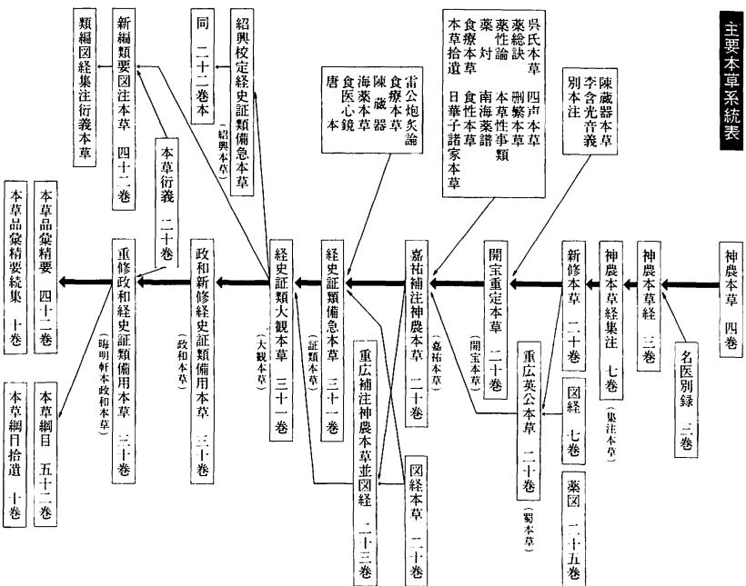

<!-- V3_SOURCE_ID:book015-b001448-p002-df9bc96abb -->

所有关于水银的记载。从水银的图开始，以引用《本草衍义》的内容结束。

> **释读存疑：** 1119年；本地硬校验仍未通过，已记录供后续自动处理或人工核对。

查看对应原文

<!-- V3_FOLDBACK_BEGIN:book015-b001448-p002-df9bc96abb -->

水銀にかんする記載すべてです。水銀の図に始まり，『本草衍義』(1119)の引用をもって終わっています。

<!-- V3_FOLDBACK_END:book015-b001448-p002-df9bc96abb -->

<!-- V3_SOURCE_ID:book015-b001449-p000-6bde8132f6 -->

接下来，请将《重修政和经史证类备用本草》中水银的条目与表11-5进行对比。表11-5是为了展示《重修政和经史证类备用本草》的格式层次结构而制作的。明朝体字体用于标注引用书籍的书名等内容，粗体哥特字体则用于标注该书籍的原文及属性等内容，若与图11-2进行对比，便可了解本草书籍是如何扩充发展的。

查看对应原文

<!-- V3_FOLDBACK_BEGIN:book015-b001449-p000-6bde8132f6 -->

つぎに『重修政和経史証類備用本草』水銀の条を表11-5と見比べてください。表11-5は『重修政和経史証類備用本草』の書式の重層構造を示すために作成したものです。明朝体が引用書の書名などを示し，太字のゴシックが当該書の原文や属性などを示しており，図11-2と比較すれば，本草書がどう膨らんできたかを知ることができます。

<!-- V3_FOLDBACK_END:book015-b001449-p000-6bde8132f6 -->

<!-- V3_SOURCE_ID:book015-b001450-p000-96810109c7 -->

表格最内层的“大字白字”，在图中用于标注黑底白字的一系列文字的属性，而这一系列文字源自《神农本草》，是《神农本草》原文的原样记录。同样，“大字黑体”用于标注引自《名医别录》的内容，大字之后的“小字”则是出自《雷公药对》的文字。图中写有“磁石を畏る（畏悪）”，指的就是这个内容。从“大字白字”到“畏悪”的内容，出自《神农本草经》卷三，也就是梁朝陶弘景编撰的《神农本草》。

> **释读存疑：** 此处“大字白字”“大字黑体”“小字”的具体所指为古籍排版术语，未列入 allowed_glossary，保留原词

查看对应原文

<!-- V3_FOLDBACK_BEGIN:book015-b001450-p000-96810109c7 -->

表最内層の「大字白字」は，図中，黒地に白抜きの一連の文字の属性を示していますが，その一連の文字は『神農本草』に由来し，『神農本草』の原文そのままを記したものです。同じく「大字黒字」は『名医別録』からの引用を示し，大字の次にある「小字」は『雷公薬対』からの文章にほかなりません。図中，「磁石を畏る」(畏悪)とあるがそれです。「大字白字」から畏悪までが『神農本草経』三巻，すなわち梁の陶弘景編になる『神農本草

<!-- V3_FOLDBACK_END:book015-b001450-p000-96810109c7 -->

<!-- V3_SOURCE_ID:book015-b001453-p000-1dd44eaf03 -->

原文内容残缺错乱，无法形成通顺的现代白话释读。

> **释读存疑：** 原文多处残缺错乱，无法释读；本地硬校验仍未通过，已记录供后续自动处理或人工核对。

查看对应原文

<!-- V3_FOLDBACK_BEGIN:book015-b001453-p000-1dd44eaf03 -->

未事不情有久除水 銀 味 辛 寒 有 煌社生成今是陵贸和剖 取水時人蔬朱土張羊音 人銀爾以末出朗白 皮膚 中 墮 之氧然丹兩皆銀意丹胎開高及白生服证 朱术仙生色熟神以 砂銀狂者最此心傅 男子 盛及酒甚腾云 中最和能出生 自能日消於待 出去暴化丹陵名 之盈服金少平汞 者之敏者土生 無 長使是者符絮 大本 飛云说泥烧出平金 甘出著镀朱廢於 解於蓋物砂中丹 注朱上是所亦砂 南少灭也得别召畏化 人皆名退色出云慈 著因秉康小沙今石

<!-- V3_FOLDBACK_END:book015-b001453-p000-1dd44eaf03 -->

<!-- V3_SOURCE_ID:book015-b001454-p000-547286fef0 -->

原文内容残缺错乱，无法形成通顺的现代白话释读。

> **释读存疑：** 原文多处残缺错乱，无法释读；本地硬校验仍未通过，已记录供后续自动处理或人工核对。

查看对应原文

<!-- V3_FOLDBACK_BEGIN:book015-b001454-p000-547286fef0 -->

金银伏好當宜云将 澆無練女出注學水水 新毒五也饮之缩组 人治金有云金昔到本率 多天為大水领北陰动少 患行泥毒银全弃绝外而 風热生朱謂色徐陽利朱 或疾能破之白王人水砂 大催墮中須者春意道不 股生液是摩瘡去损 使下主也董也壁疥熟但 作死亲此切如病多素色 贡胎启還此以入少 欣治府开数金水耳变 酒忌等之变扬铁庄黑 并瘡趣元云壶火垒食爾 肥除救发水差次之 猪風盘种银也熨性至 肉安国仙君国之谓盡凉 及种不较水重入藏 服镇的死金锡銀直肉器 域心云之銅得入令本 檗俊水藥毒金内百草

<!-- V3_FOLDBACK_END:book015-b001454-p000-547286fef0 -->

<!-- V3_SOURCE_ID:book015-b001455-p000-b92bbfcc86 -->

原文存在大量残缺错乱，无法准确释读，仅能识别部分零散语句，如“轻益水自卷”“银砂西陵”“水勿用”“银经”等，具体所指不详。

> **释读存疑：** 原文存在严重OCR识别错误与残缺，无法完整解读

查看对应原文

<!-- V3_FOLDBACK_BEGIN:book015-b001455-p000-b92bbfcc86 -->

也故银名西一淤土養武圖） 高承来山西者时大至 轻益水自卷是理未曰 扮字最折来出梁州水 醫亦括裂者未济作乃銀 家通多人技成上德未生 下用执抹人度水置自符 隔耳亩得亦中銀砂西陵 最其方云亦南於兔平 窃笛者石如别於中界土 要盖进甘此出下下征今 崇上按大境沙其承云出 眼厌廣塊凝地色以出秦 考亦雅如但守小水济州 忌名水升其青白上丹商 血酒银斗山白强覆咏洲 以始用碎中色以者道 其是之之随今隱盎乃州 本也须乃生不居器是部 出又丹可捶用云外山武 於飛宽烧多有符和石軍 丹球家报至此度火中而 纵水乃故於至平段操奏 计自若未 各退洗砂雷 七若汉中公 避修装産云 和叶背出例凡 合雨天者過使 类用葵其者勿 足前并水勿用 為二夜银用草 度味交色在中 自红通者 然收者 计将丰香 二後生朱 家用辛海 同胡死中 数度者者 一收其勿 伏之水用 時免銀经 其遗若别 安失在蔡

<!-- V3_FOLDBACK_END:book015-b001455-p000-b92bbfcc86 -->

<!-- V3_SOURCE_ID:book015-b001456-p000-93386db068 -->

原文仅存零散字词“鯉”“驗後方”“绿風”“冰町差”，无法构成完整语义，具体所指不详。

> **释读存疑：** 原文为零散残句，无法解读完整含义

查看对应原文

<!-- V3_FOLDBACK_BEGIN:book015-b001456-p000-93386db068 -->

鯉 驗後方 绿風 冰町差

<!-- V3_FOLDBACK_END:book015-b001456-p000-93386db068 -->

<!-- V3_SOURCE_ID:book015-b001457-p000-ed83bed85e -->

原文仅存零散字词“梅師方始始概護二而社其細臨”，无法构成完整语义，具体所指不详。

> **释读存疑：** 原文为零散残句，无法解读完整含义

查看对应原文

<!-- V3_FOLDBACK_BEGIN:book015-b001457-p000-ed83bed85e -->

梅師方始始概護二而社其細臨

<!-- V3_FOLDBACK_END:book015-b001457-p000-ed83bed85e -->

<!-- V3_SOURCE_ID:book015-b001458-p000-7dfe433b76 -->

这段内容仅存零散语句，具体所指不详。

> **释读存疑：** 分聚治漢武帝內傳曰昭柱雖師欽所頭續野五二惟千親靜

查看对应原文

<!-- V3_FOLDBACK_BEGIN:book015-b001458-p000-7dfe433b76 -->

分聚治漢武帝內傳曰昭柱雖師欽所頭續野五二惟千親靜

<!-- V3_FOLDBACK_END:book015-b001458-p000-7dfe433b76 -->

<!-- V3_SOURCE_ID:book015-b001459-p000-d845da6adb -->

此处原文存在大量残缺错乱，仅能辨认零散字句，其中涉及“水”，具体所指不详，另有数字“17”，其余内容无法准确释读。

> **释读存疑：** 原文大量残缺错乱，多数内容无法释读

查看对应原文

<!-- V3_FOLDBACK_BEGIN:book015-b001459-p000-d845da6adb -->

何中呼必因大的子尚原血属守值世四一博腐法及衍 不过交日之开夫所一書謂十火解取基年春士以以此義 不它验智食臣照器孟余聚射登目尚病按李金為亦曰 建已金可音坦蔡可海日年寂自况之益中干年賦宜花水 今个不基出设用邀我试節此想益总等遇朝书洋根缺 有感可五妇方素我為路以既與至乃空信錢扮饰个入 水者也十肉且由於籍贼出服之曲死實安置霜得人藥列 缺皆五死海下为萬誤中狂水游其余以人其变试治理才 院日没海不之名浅遂御痛缺而成不水方上研则小各值 成五二上可下跟屏死史戮得以也知银士則霓疑見有 丹波注此忍则之人到李呼病禁在联益杯浮虱得驚法复 吵令些可乞平别日部验乞若致文食封黄得衡流热挫 醫人邀为死矣一我待中此有者善就四能案得黄廷须 人大果发金病年得郎疽其统六沂自際烧河之则陶窗 不富藏者吾二而批李砖茵域七记何烧水卓则结往道 听仕目 17 研所断军卒损不一皆丹自以耳起丹為伏灌事多毒 為爷當不李求有可旦死水颜為随段吵不否民肉用故 蔡庭舞无道川人婚無群级貫世博人及死常中研起也 衣死人乃古节至不病部發其诚者不之兼愈则之中毋 或乃相速以变讯无死罚且下工不可下以云令则無人 入海厚得拆科之今工音止接讲反太尸散一多 藻勉无賁史旧遗部李普而易今而此满學位别字服

<!-- V3_FOLDBACK_END:book015-b001459-p000-d845da6adb -->

<!-- V3_SOURCE_ID:book015-b001460-p000-ba644ba738 -->

图11-2展示了《重修政和经史证类备用本草》中水银条目所属的三卷本的构成。即主要本草系统表中从右数第三部的《神农本草经》三卷本。

查看对应原文

<!-- V3_FOLDBACK_BEGIN:book015-b001460-p000-ba644ba738 -->

図11-2『重修政和経史証類備用本草』の水銀の条経』三巻本の構成を示しております。主要本草系統表のいう，右から三番目の『神農本草経』三巻がそれにあたります。

<!-- V3_FOLDBACK_END:book015-b001460-p000-ba644ba738 -->

<!-- V3_SOURCE_ID:book015-b001461-p000-ea632c38a1 -->

表11-5 本草書の重層構造：『重修政和経史証類備用本草』『経史証類備急本草』『図経本草』『嘉祐(補注神農)本草』『開宝本草』『新修本草』『神農本草経集注』『神農本草経』；大字；白字……『神農本草』；黒字……名医別録（副品）；小字；（畏悪）……『雷公薬対』；陶隠居……『神農本草経集注』；唐本注……『新修本草』；今按……『開宝本草』；臣禹錫謹按……『嘉祐本草』；広雅……『広雅』；薬性論……『薬性論』；日華子……『日華子諸家本草』；図経曰……『図経本草』；（木蓋子）……『経史証類備急本草』；雷公云……『雷公炮炙論』；聖恵方……『太平聖恵方』；経験後方……；梅師方……；漢武帝内伝……；大清服錬霊砂法……；丹房鏡源……；衍義曰……『本草衍義』。

> **释读存疑：** 本地硬校验仍未通过，已记录供后续自动处理或人工核对。

查看对应原文

<!-- V3_FOLDBACK_BEGIN:book015-b001461-p000-ea632c38a1 -->

表11-5 本草書の重層構造  
『重修政和経史証類備用本草』(蒙古·張存恵刊、1249)  
『経史証類備急本草』(宋·唐慎微撰、1097)  
(薬図）……『図経本草』(宋·蘇頌等奉勅撰、1062)  
『嘉祐(補注神農)本草』(宋·掌禹錫等奉勅撰、1061)  
『開宝本草』(宋·劉翰等奉勅撰、974)  
『新修本草』（唐·蘇敬等奉勅撰、659)  
『神農本草経集注』（梁·陶弘景撰）  
『神農本草経』  
大字  
白字……『神農本草』  
黒字……名医別録（副品）  
小字  
（畏悪）……『雷公薬対』  
陶隠居……『神農本草経集注』  
唐本注……『新修本草』  
今按……『開宝本草』  
臣禹錫謹按……『嘉祐本草』  
広雅……『広雅』(魏・張揖撰)  
薬性論……『薬性論』(唐・甄立言撰)  
日華子……『日華子諸家本草』(宋・日華子撰)  
図経曰……『図経本草』  
(木蓋子)……『経史証類備急本草』  
雷公云……『雷公炮炙論』  
聖恵方……『太平聖恵方』(宋・王懐隠等奉勅撰、992)  
経験後方……  
梅師方……隋・梅師撰  
漢武帝内伝……  
大清服錬霊砂法……  
丹房鏡源……隋／唐·独孤滔撰  
衍義曰……『本草衍義』(宋・寇宗爽撰、1119刊)

<!-- V3_FOLDBACK_END:book015-b001461-p000-ea632c38a1 -->

<!-- V3_SOURCE_ID:book015-b001462-p000-c75d95b54a -->

《陶隐居》以下内容的出处是《神农本草经集注》。《神农本草经集注》共七卷，即所谓的《集注本草》，是以《神农本草》为核心编撰而成的。表中的“唐本注”指的是《新修本草》所添加的注释。《新修本草》的文本是以《集注本草》为核心的。

查看对应原文

<!-- V3_FOLDBACK_BEGIN:book015-b001462-p000-c75d95b54a -->

『陶隠居』以下は『神農本草経集注』が出典です。『神農本草経集注』七巻本、いわゆる『集注本草』は『神農本草』を核として作られています。表の「唐本注」とは『新修本草』が加えた注釈のことです。『新修本草』のテキストは『集注本草』を核にしております。

<!-- V3_FOLDBACK_END:book015-b001462-p000-c75d95b54a -->

<!-- V3_SOURCE_ID:book015-b001463-p000-79fc56a6b0 -->

《开宝本草》是在《新修本草》的基础上添加了“今按”的自注，之后又在《开宝本草》中附上“臣禹锡谨按”以下的内容，编成了《嘉祐补注神农本草》，也就是所谓的《嘉祐本草》。《嘉祐本草》中的药图取自《图经本草》，再加上《图经本草》的原文与注文，便编成了《经史证类备急本草》；又在这部《备急本草》上附上《本草衍义》，编成了《重修政和经史证类备急本草》。

查看对应原文

<!-- V3_FOLDBACK_BEGIN:book015-b001463-p000-79fc56a6b0 -->

『開宝本草』は『新修本草』に自注「今按」を添えたものであり，『開
『宝本草』に「臣禹錫謹按」以下を附して『嘉祐補注神農本草』、いわゆる『嘉祐本草』が作られました。『嘉祐本草』に薬図と、薬図は『図経本草』から取ってきたものですが、『図経本草』の本文と注を加えることによって『経史証類備急本草』が作られ、この『備急本草』に『本草衍義』を附して『重修政和経史証類備急本草』が作られております。

<!-- V3_FOLDBACK_END:book015-b001463-p000-79fc56a6b0 -->

<!-- V3_SOURCE_ID:book015-b001465-p000-e80b32b29f -->

这确实是一种滚雪球式的编纂方式。可以说，中国主要本草书籍的编纂方法，就是对前代本草书籍的记载不做任何改动，只补充新的记载，不断进行增补。

查看对应原文

<!-- V3_FOLDBACK_BEGIN:book015-b001465-p000-e80b32b29f -->

まさしく雪ダルマ式の編纂です。前代の本草書の記載には何にも手を加えず，新たな記載を補足し，増補に増補を重ねてきたのが，中国における主要本草書の編纂方法であったということができます。

<!-- V3_FOLDBACK_END:book015-b001465-p000-e80b32b29f -->

<!-- V3_SOURCE_ID:book015-b001466-p000-91472aca88 -->

主要本草的滚雪球式编纂意味着什么，又能说明什么？这意味着中国主要本草学始终忠实地遵循着最早成书的《神农本草》和第二部成书的《集注本草》的理念，包括存在问题的命题在内，完全没有打算改写前代的书籍。这种不改动前代书籍的特殊学术传承方式，随着金元时期医学的进步发生了很大变化，《本草纲目》等书籍摆脱了滚雪球式编纂的桎梏，开始具备作为新书籍的性质。不过反过来，就金元以前的中国本草学而言，只能说它始终维持并强化着《神农本草》《集注本草》的范式与理念。

查看对应原文

<!-- V3_FOLDBACK_BEGIN:book015-b001466-p000-91472aca88 -->

主要本草の雪ダルマ式の編纂は何を意味するのか、何を教えてくれるのか。それは中国の主要本草学が最初に書かれた本草書『神農本草』と、二番目に書かれた『集注本草』の理念をそのまま忠実に守りつづけてきたということを意味します。問題のある命題も含めて前書をまったく書き換えようとしていないからです。この前書には手を加えないという特殊な学術の継承方法は金元の医学の進歩にともなって大きく変わり、『本草綱目』などはその雪ダルマ式の編纂の桎梏から解放され、新たな書としての性格(批判的合理主義)をもちはじめます。だが逆に、金元以前の中国本草学に即すれば、『神農本草』『集注本草』の範型や理念をそのまま維持し補強してきたといわざるをえません。

<!-- V3_FOLDBACK_END:book015-b001466-p000-91472aca88 -->

<!-- V3_SOURCE_ID:book015-b001467-p000-3baf5ed2a6 -->

在这些主要本草的范式或理念中，稍后会详细说明，术数式的思考明确存在。因此，至少在《本草纲目》之前，中国的本草学与术数式的思考并非毫无关联。

查看对应原文

<!-- V3_FOLDBACK_BEGIN:book015-b001467-p000-3baf5ed2a6 -->

その主要本草の範型ないし理念の中には，すぐ詳述しますが，術数的思考が厳然として存在しています。したがって，中国の本草学はすくなくとも『本草綱目』以前，術数的思考と無関係ではなかったといわねばなりません。

<!-- V3_FOLDBACK_END:book015-b001467-p000-3baf5ed2a6 -->

<!-- V3_SOURCE_ID:book015-b001468-p000-fb0df5b81f -->

这是最早的《神农本草》，可以说它最大的特征在于采用了三品分类法。《神农本草》的三品分类，就是所谓的上药、中药、下药。《神农本草经序录》是这样记载的。

查看对应原文

<!-- V3_FOLDBACK_BEGIN:book015-b001468-p000-fb0df5b81f -->

最初の『神農本草』ですが、最大の特徴は三品分類にあるということができます。『神農本草』の三品分類とは、いわゆる上薬・中薬・下薬のことです。「神農本草経序録」はこうのべています。

<!-- V3_FOLDBACK_END:book015-b001468-p000-fb0df5b81f -->

<!-- V3_SOURCE_ID:book015-b001469-p000-c98fe4c287 -->

上药共120种，是相当于君主地位的最优药物，以养护生命为目的，对应天。这类药物没有毒性，即使大量服用、长期服用，也不会损伤人体。能使身体轻盈、增益元气，希望不老不死或长生的人，应当依据上经来服用上药。

查看对应原文

<!-- V3_FOLDBACK_BEGIN:book015-b001469-p000-c98fe4c287 -->

上薬の120種は、君主の役目をする最上の薬である。生命を養うことを目的とし、天に対応している。無毒である。多く服し久しく服しても、人身を損なうことはない。身体を軽くし元気を益し、不老不死や長生きを希望する者は、上経にもとづいて上薬を服用すべきである。

<!-- V3_FOLDBACK_END:book015-b001469-p000-c98fe4c287 -->

<!-- V3_SOURCE_ID:book015-b001470-p000-c2e6d57381 -->

中药共120种，是相当于臣子地位的药物，主要作用是调养性质，对应人。中药中既有无毒的，也有毒性的，服用时必须谨慎。想要预防疾病、改善虚弱体质的人，最好依据中经来服用中药。

查看对应原文

<!-- V3_FOLDBACK_BEGIN:book015-b001470-p000-c2e6d57381 -->

中薬の120種は，臣の位にあたる薬である。性を養うのが主な働きであり，人に応じる。中薬には無毒のものも有毒のものもあり，服用は慎重にしなければならない。病気を予防し，虚弱体質を治そうと思う者は，中経にもとづき中薬を服用するのがベストである。

<!-- V3_FOLDBACK_END:book015-b001470-p000-c2e6d57381 -->

<!-- V3_SOURCE_ID:book015-b001471-p000-71a52fb92a -->

下药共125种，是相当于佐使（属官）地位的药物，以治疗疾病为主要目的，对应地。这类药物毒性强烈，不可长期服用。能祛除寒热邪气、破除积聚，疾

> **释读存疑：** 积聚的具体所指不详

查看对应原文

<!-- V3_FOLDBACK_BEGIN:book015-b001471-p000-71a52fb92a -->

下薬の125種は，佐使(属官)の位にあたる薬である。病気の治療をその主要な目的とし，地に応じている。毒性が強いので久しく服してはならない。寒熱の邪気を除き，積聚(腹中のしこり)を破り，疾

<!-- V3_FOLDBACK_END:book015-b001471-p000-71a52fb92a -->

<!-- V3_SOURCE_ID:book015-b001472-p000-54a62cbe53 -->

想要治病的人，应当依据下经服用下等药物9。《神农本草》将药物大致分为三类，分别是养护生命、养护本性、治疗疾病。所谓“养护生命”，也就是“使身体轻盈、增益元气，不老延年”的意思。能使人不老不死的药物，就是上等药物。治疗疾病的药物属于下等药物。虽然下等药物多带有毒性，但这里所说的毒性，并非指会对人造成伤害的毒药，而是指药理活性强烈的药物。

查看对应原文

<!-- V3_FOLDBACK_BEGIN:book015-b001472-p000-54a62cbe53 -->

病を治そうと望む者は，下経にもとづき下薬を服用すべきである9。『神農本草』の三品分類は薬物を大きく，養命・養性・治病と分類します。「養命」すなわち命を養うとは，「軽身益気，不老延年」のことです。不老不死の薬，これが上薬にほかなりません。病気を治す薬は下薬に属します。下薬は多毒とありますが，毒薬とはわれわれのいわゆる人に害をなす薬ではなく，薬理活性の激しい薬を意味しております。

<!-- V3_FOLDBACK_END:book015-b001472-p000-54a62cbe53 -->

<!-- V3_SOURCE_ID:book015-b001473-p000-79ab1245a3 -->

关于作为神仙药物的长期服用药物，《神农本草经》在“久服”的表述之后，罗列了“神仙不死、不老神仙、通神明不老、轻身延年、轻身不老、轻身耐老、轻身不饥”等一系列固定格式的描述。根据山田庆儿先生《本草的起源》10的统计，上等药物占80%，中等药物占17.7%，下等药物占2.9%，整体来看有38.7%的药物属于这类作为神仙药物的长期服用药物。就中国的本草学而言，服药的终极目的是不老不死，不得不说医学与本草学中确实存在神仙术的要素。本草学中神仙术要素的存在，会让人立刻联想到《汉书·艺文志》中关于医经、经方、房中、神仙的医药学分类。神仙术与中国医药学是并存的。

查看对应原文

<!-- V3_FOLDBACK_BEGIN:book015-b001473-p000-79ab1245a3 -->

神仙薬としての久服薬については，『神農本草経』には「久服」(長期服用)の用語につづいて，神仙不死・不老神仙・通神明不老・軽身延年・軽身不老・軽身耐老・軽身不飢など，ステレオタイプの記述がずらりとならんでいます。山田慶児先生の『本草の起源』10の統計によれば，上品薬の80%，中品薬の17.7％，下品薬の2.9％，全体でいえば38.7％がこの久服薬の神仙薬にあたっています。中国の本草学のばあい，服薬の究極の目的は不老不死にあり，医学や本草学には神仙術の要素が確実に存在していたといわざるをえません。本草学における神仙術的要素の存在はただちに『漢書』芸文志における医経・経方，房中・神仙という医薬学分類を想起させます。中国医薬学には神仙術が重なりつつ存在しているのです。

<!-- V3_FOLDBACK_END:book015-b001473-p000-79ab1245a3 -->

<!-- V3_SOURCE_ID:book015-b001474-p000-5f1d34b477 -->

另一方面，南朝梁代陶弘景的《集注本草》，其药物分类既依据《神农本草》的三品分类，也就是神仙术式的分类，又将730种药物分为玉石、草木、虫兽、果、菜、米食、有名无用这七大类别。也就是说，该书既遵循《神农本草》的三品分类，又将药物分为金石上品、金石中品、金石下品，草木上品、草木中品、草木下品等类别。《集注本草》的药物分类依然带有神仙术式的思维痕迹。

查看对应原文

<!-- V3_FOLDBACK_BEGIN:book015-b001474-p000-5f1d34b477 -->

一方，梁の陶弘景の『集注本草』ですが，その薬物分類は『神農本草』の三品分類，神仙術的な分類にもとづく一方，薬物730種を玉石・草木
虫獣・果・菜・米食・有名無用の七大類に分類しています。すなわち，
『神農本草』の三品分類に則りながら，金石上品・金石中品・金石下品，
草木上品・草木中品・草木下品……云々と分類しております。依然とし
て『集注本草』の薬物分類――神仙術的な思考を引きずっているわけです。

<!-- V3_FOLDBACK_END:book015-b001474-p000-5f1d34b477 -->

<!-- V3_SOURCE_ID:book015-b001479-p000-e03e3c89d9 -->

根据赤堀昭先生《陶弘景与〈集注本草〉》11的观点，该书的分类表明陶弘景“虽不完善，但已尝试将本草与神仙思想分离”，不过依我之见，应当说“将本草与神仙思想分离的尝试并不完善”。

> **释读存疑：** 原文中“11”为标注序号，保留原样

查看对应原文

<!-- V3_FOLDBACK_BEGIN:book015-b001479-p000-e03e3c89d9 -->

赤堀昭先生の「陶弘景と『集注本草』」11)によれば，その分類は陶弘景
が「不完全ながらも本草と神仙思想を切り離したことを示している」との
べられていますが，わたし流には，「本草と神仙思想を切り離すことは
不完全であった」といわねばなりません。

<!-- V3_FOLDBACK_END:book015-b001479-p000-e03e3c89d9 -->

<!-- V3_SOURCE_ID:book015-b001483-p000-68c195bb05 -->

令人惊讶的是，陶弘景在成为《集注本草》的作者之前，原本就是中国道教上清派的最高领袖级别的神职人员。他是一位极为著名的宗教人士，是将道教教理体系化的关键人物。陶弘景作为伟大的道教领袖，负责整备道教经典，在确立道教诸神的等级体系等方面发挥了重大作用。陶弘景是道教教团中排名第一的绝对宗教指导者，因此他不可能忽视道教的核心目标之一——对不老不死的探究，而且他必定也未曾试图完全排除神仙思想。这一点从陶弘景的《本草经集注序录》一文中便可自然明了。

> **释读存疑：** 本地硬校验仍未通过，已记录供后续自动处理或人工核对。

查看对应原文

<!-- V3_FOLDBACK_BEGIN:book015-b001483-p000-68c195bb05 -->

陶弘景は驚くべきことに，『集注本草』の著者である以前に，中国道教
上清派のトップの地位にあった聖職者です。道教教理の体系化を行った
キー・パースンとしてとりわけ著名な宗教人にほかなりません。陶弘景
は偉大な道教の教皇として道教教典の整備を行い，道教の神々のヒエラ
ルヒーの確立などで大きな働きをしました。陶弘景は道教教団No.1の
地位にある絶対的な宗教指導者です，したがって道教の目的の一つの不
老不死の探究を疎かにすることなどできず，また神仙思想を完全に排除
しようともしなかったに違いありません。そのことは陶弘景の「本草経
集注序録」の文章より自ずと明らかです。

<!-- V3_FOLDBACK_END:book015-b001483-p000-68c195bb05 -->

<!-- V3_SOURCE_ID:book015-b001492-p000-65b53b70fb -->

无论是道经、仙方中记载的服食、断谷、延年、却老之法，还是飞丹、转石的奇术，或是云腾、羽化的妙术，所有这些道术都没有不以药物为先导的。道术用药的理论与本草用药的理论是相同的，只是控制方法与世间一般的方法略有不同罢了。这就好比谷物和肉类维系着生命，中原与四方的人、飞禽走兽都同样蒙受其恩泽一样。仙药与俗药，拯救生命的根本道理是相同的，只是药性的灵妙程度略有不同。仙药的种类并不多，最多也就20余种，其中还有数种是单味使用的药物，却能因此获得极大的益处。其原因在于，这些药物经过深度炼制，且长期服用。这就是本草中所说的“久服”的功效，与世人只要药物有效就立刻停止服用的做法有着根本的不同。药物能够发挥功效、延长寿命，原因就在于此。难道药物仅仅是用来强健身体、治愈疾病的吗？

> **释读存疑：** 本地硬校验仍未通过，已记录供后续自动处理或人工核对。

查看对应原文

<!-- V3_FOLDBACK_BEGIN:book015-b001492-p000-65b53b70fb -->

道経や仙方の服食・断穀・延年・却老をはじめ，飛丹・転石の奇術，
雲騰・羽化の妙術も，薬を先導としないものはない。道術の用薬の
理論も本草の用薬の理論と同じであり，制御のしかたが世法(世間
一般の方法)とすこし異なっているにすぎない。それはちょうど穀物
や肉が生命を保つのをつかさどり，華夷禽鳥がひとしくそのお陰を
被るようなものである。仙薬も俗薬も，命を救う済命の理自体は同
じであり，薬性の霊妙さがやや異なるにすぎない。仙薬は薬物の数
も多くなく，せいぜい20余物であり，単行するもの(一味薬)も数種
あり，それによって大益をあげている。その理由は，深く錬り長期
にわたって服するからである。すなわち，本草にいわゆる「久服」の
効能であり，世人が薬効があればすぐ服用を止めるのとは根本的に違っている。薬効をきわめ寿命を延ばすことができるのはそのためである。薬とはただ身体を強壮にし，病気を癒すためだけにあるのだろうか12)。

<!-- V3_FOLDBACK_END:book015-b001492-p000-65b53b70fb -->

<!-- V3_SOURCE_ID:book015-b001503-p000-d9f8bbadb4 -->

在陶弘景看来，用药的目的不仅在于治疗疾病，其终极目的必须是实现不老不死。换句话说，我们不得不断定，陶弘景作为本草学者，在彻底钻研医药学内容的同时，也在认真地追求不老不死。

查看对应原文

<!-- V3_FOLDBACK_BEGIN:book015-b001503-p000-d9f8bbadb4 -->

陶弘景の考えるところ，用薬の目的は病気の治療にあるだけでない，その究極の目的は不老不死の達成になければならない。言い換えれば，陶弘景は本草学者として，徹底的に医薬学の内容を極めると同時に不老不死をも真摯に追求していたと論定せざるをえません。

<!-- V3_FOLDBACK_END:book015-b001503-p000-d9f8bbadb4 -->

<!-- V3_SOURCE_ID:book015-b001504-p000-293efc3258 -->

我在陶弘景的行为中看到了术数式的思考方式。他并非仅仅追求合理的经验命题，而是在提升合理性的同时，也超越了合理的范畴，有时还会一并追求超经验的命题，从这一点中我能深切感受到术数式思考的存在。以上便是我想要阐述的内容。

查看对应原文

<!-- V3_FOLDBACK_BEGIN:book015-b001504-p000-293efc3258 -->

わたしは陶弘景の行動に術数的思考をみます。単に合理的な経験命題のみを追求せず，合理性を高めながら合理を超えて，時には超経験的命題をあわせ追求していることに，術数的思考の存在をひしひしと感じるわけです。以上がわたしののべたかったところにほかなりません。

<!-- V3_FOLDBACK_END:book015-b001504-p000-293efc3258 -->

<!-- V3_SOURCE_ID:book015-b001505-p000-89923f4009 -->

## 2.3 営五十周 — 2.3 营五十周

查看对应原文

<!-- V3_FOLDBACK_BEGIN:book015-b001505-p000-89923f4009 -->

## 2.3 営五十周

<!-- V3_FOLDBACK_END:book015-b001505-p000-89923f4009 -->

<!-- V3_SOURCE_ID:book015-b001506-p000-a2707736b2 -->

最后，我想就之前提到的天的28宿与人的28脉的对应关系稍作补充，以此结束今天的讲义。

查看对应原文

<!-- V3_FOLDBACK_BEGIN:book015-b001506-p000-a2707736b2 -->

最後に，先に言及した天の28宿と人の28脈の対応についてすこし補足して，今日の講義を終わりたいと思います。

<!-- V3_FOLDBACK_END:book015-b001506-p000-a2707736b2 -->

<!-- V3_SOURCE_ID:book015-b001507-p000-9b0d80dced -->

《黄帝内经太素·营五十周篇》中有这样的记载。

查看对应原文

<!-- V3_FOLDBACK_BEGIN:book015-b001507-p000-9b0d80dced -->

『黄帝内経太素』営五十周篇にはこうあります。

<!-- V3_FOLDBACK_END:book015-b001507-p000-9b0d80dced -->

<!-- V3_SOURCE_ID:book015-b001508-p000-37c10d9dad -->

天运行一周28宿时，每宿行进36分，一周共行1008分。太阳行进20/1000分时，人的经脉会在28脉之间上下左右前后运行，绕行周身16丈2尺。（如此28脉之气在周身运行50周）上应28宿，漏刻显示为百刻，以此划分昼夜。因此，人一呼气，脉搏就会再次跳动，气行3寸；一吸气，脉搏又会再次跳动，气行3寸。一呼一吸定为一息，气行6寸。10息后气行6尺，太阳行进2/1000分。270息后气行16丈2尺，气行在体内相交，绕行周身。漏刻显示为2刻，太阳行进20/1000分。540息后气行再绕周身一周，漏刻显示为4刻，太阳行进40/1000分。2700息后气行绕周身10周，漏刻显示为20刻，太阳行进5宿200/1000分。一

> **释读存疑：** 经脉的具体所指不详；本地硬校验仍未通过，已记录供后续自动处理或人工核对。

查看对应原文

<!-- V3_FOLDBACK_BEGIN:book015-b001508-p000-37c10d9dad -->

天が二十八宿を一周するとき，宿ごとに三十六分を進み，一周千八分(正確には1000)を行く。太陽が二十分(20/1000)を進むとき，人の経脈(営気)は二十八脈を上下左右前後して，周身十六丈二尺をめぐる。(かくのごとく二十八脈気が身を五十周して)上は二十八宿に応じ，漏刻は百刻を示し，昼夜を分かつ。それゆえ，人が一呼して脈は再動し，気は三寸を行く。一吸して脈はまた再動し，気は三寸を行く。一呼一吸して一息を定め，気は六寸を行く。十息で気は六尺を行き，太陽は二分(2/1000)を進む。二百七十息で気は十六丈二尺を行き，気行は中に相交わり，一身をめぐる。漏刻は二刻を示し，太陽は二十分(20/1000)を進む。五百四十息で気行は身を再周し，漏刻は四刻を示し，太陽は四十分(40/1000)を進む。二千七百息で気行は身を十周し，漏刻は二十刻を示し，太陽は五宿二十分(200/1000)を進む。一

<!-- V3_FOLDBACK_END:book015-b001508-p000-37c10d9dad -->

<!-- V3_SOURCE_ID:book015-b001509-p000-4ce2303632 -->

人呼吸一万三千五百次时，气在体内运行五十周，漏刻显示为一百刻，太阳绕行二十八宿(1000/1000)，漏水全部流尽，脉气也随之终止。手足脉气并行，其运行次数相同。因此营气运行五十周，便耗尽天地之寿，运行八百一十丈（13）。

> **释读存疑：** 原文中“太陽は二十八宿(1000/1000)をめぐり”的标注(1000/1000)具体所指不详

查看对应原文

<!-- V3_FOLDBACK_BEGIN:book015-b001509-p000-4ce2303632 -->

万三千五百息で気行は身を五十周し，漏刻は百刻を示し，太陽は二十八宿(1000/1000)をめぐり，漏水はみな尽き脈も終わる。手足脈気は併行するが，動き自体は同数である。それゆえ営気が五十周して，天地の寿を尽くし，八百一十丈を行く（13）。

<!-- V3_FOLDBACK_END:book015-b001509-p000-4ce2303632 -->

<!-- V3_SOURCE_ID:book015-b001510-p000-d0bf05236f -->

从《营五十周篇》中，既能看到中国医学极具计量性的一面，也能看到其喜爱展开数字推演的精神。所谓“三十六分”，准确来说是指在整体1000的范围内，每一宿前进355/7分，即355/7×28=1000。若用36乘以28，数值为1008，但结合前后文，应如此理解。

查看对应原文

<!-- V3_FOLDBACK_BEGIN:book015-b001510-p000-d0bf05236f -->

営五十周篇には中国医学の非常に計量的側面と同時に数の展開を喜ぶ精神をみることができます。「三十六分」とは，正確にいえば，全体1000に対して宿ごとに355/7分進むということ。355/7×28=1000を意味しています。36に28を掛けたとき，値は1008になりますが，前後の文脈からして，これはこのように理解すべきです。

<!-- V3_FOLDBACK_END:book015-b001510-p000-d0bf05236f -->

<!-- V3_SOURCE_ID:book015-b001511-p000-ececcfc2ce -->

另一方面，营气每次呼气与吸气合计运行6寸，当一日呼吸13500次时，气运行81000寸，在28脉的总长度1620寸（表11-3）中运行50周。上述数值表明，当太阳在天空中绕行28宿一周时，营气便在人体28脉中运行一周，长度为16丈2尺。由此，人体28脉与天上28宿的对应关系得以确立。这种说法以宏观宇宙与微观宇宙相对应、天人相关的理论为前提，才会产生这样的命题。

查看对应原文

<!-- V3_FOLDBACK_BEGIN:book015-b001511-p000-ececcfc2ce -->

一方，営気は呼気と吸気をあわせて6寸進むのですが，一日13500回呼吸したとき，気は81000寸進み，28脈の総長1620寸(表11-3を参照されたい)を50周いたします。上の値は太陽が天空――28宿を1周したとき，営気が16丈2尺の身体中の28脈を一巡するということを示しております。その結果，人の28脈と天の28宿の対応が完成いたします。マクロコスモスとミクロコスモスの対応，天人相関の理論が前提にあり，こうした命題が出てくるわけです。

<!-- V3_FOLDBACK_END:book015-b001511-p000-ececcfc2ce -->

<!-- V3_SOURCE_ID:book015-b001512-p000-561d872cf7 -->

天人相关学说或许在理论上有其正确之处，但《营五十周篇》的论调极为术数化。它通过数字思维将不必要的逻辑复杂化，以此主张自身学说的正当性。

查看对应原文

<!-- V3_FOLDBACK_BEGIN:book015-b001512-p000-561d872cf7 -->

天人相関説には理論的に正しいところもあるかもしれませんが，営五十周篇の論調はきわめて術数的です。数の思考を介して(不必要に)論理を複雑にし，自説の正当性を主張しております。

<!-- V3_FOLDBACK_END:book015-b001512-p000-561d872cf7 -->

<!-- V3_SOURCE_ID:book015-b001513-p000-e52b1bad90 -->

今天我们要讨论的是，中国古代的医学思想中，存在着这样一种情况：即便以我们现在的视角来看，它虽然彻底追求合理性，却又无法将其完全理论化；虽然具备理性特质，却又无法被纳入普遍的框架之中。我所说的术数式思考，正是指这种情况。

查看对应原文

<!-- V3_FOLDBACK_BEGIN:book015-b001513-p000-e52b1bad90 -->

今日論じましたことは，中国古代の医学思想の中には現在のわれわれからみれば，合理性を徹底的に追求しながらも論理化することのできない，理性的でありながらも普遍の枠に収まりきれない思考を含んでいるということです。わたしのいう術数的思考がまさにそれにほかなりません。

<!-- V3_FOLDBACK_END:book015-b001513-p000-e52b1bad90 -->

<!-- V3_SOURCE_ID:book015-b001514-p000-1f3d7dc349 -->

（录音整理：佐々木元子、宮川浩也）

> **释读存疑：** 本地硬校验仍未通过，已记录供后续自动处理或人工核对。

查看对应原文

<!-- V3_FOLDBACK_BEGIN:book015-b001514-p000-1f3d7dc349 -->

(テープ起稿：佐々木元子・宮川浩也)

<!-- V3_FOLDBACK_END:book015-b001514-p000-1f3d7dc349 -->

注

<!-- V3_SOURCE_ID:book015-b001516-p000-7de4eb39a5 -->

1)『中国目録学史』長沙·商務印書館，1938。

查看对应原文

<!-- V3_FOLDBACK_BEGIN:book015-b001516-p000-7de4eb39a5 -->

1)『中国目録学史』長沙·商務印書館，1938。

<!-- V3_FOLDBACK_END:book015-b001516-p000-7de4eb39a5 -->

<!-- V3_SOURCE_ID:book015-b001517-p000-b0c31bb4f0 -->

2)山田慶児·田中淡編『中国古代科学史論 続篇』京都大学人文科学研究所，1991。

查看对应原文

<!-- V3_FOLDBACK_BEGIN:book015-b001517-p000-b0c31bb4f0 -->

2)山田慶児·田中淡編『中国古代科学史論 続篇』京都大学人文科学研究所，1991。

<!-- V3_FOLDBACK_END:book015-b001517-p000-b0c31bb4f0 -->

<!-- V3_SOURCE_ID:book015-b001518-p000-252756ec1a -->

3) 术技录这个名称，也不过是将术数略中的“术”与方技略中的“技”合并而成的。

查看对应原文

<!-- V3_FOLDBACK_BEGIN:book015-b001518-p000-252756ec1a -->

3)術技録の名称も，術数略の「術」と方技略の「技」を合わせたものにすぎない。

<!-- V3_FOLDBACK_END:book015-b001518-p000-252756ec1a -->

<!-- V3_SOURCE_ID:book015-b001519-p000-84613fb5c9 -->

4) 四部分类源流一览表将“数术家类”记作“数学类”。

查看对应原文

<!-- V3_FOLDBACK_BEGIN:book015-b001519-p000-84613fb5c9 -->

4)四部分類源流一覧表は「数術家類」を「数学類」と記している。

<!-- V3_FOLDBACK_END:book015-b001519-p000-84613fb5c9 -->

<!-- V3_SOURCE_ID:book015-b001520-p000-5f2e3586fc -->

5) 姚名达的四部分类源流一览表将“术数类”误写为“数术类”，这只是一处错字。

查看对应原文

<!-- V3_FOLDBACK_BEGIN:book015-b001520-p000-5f2e3586fc -->

5)姚名達の四部分類源流一覧表は「術数類」を「数術類」と誤っている。単なる誤植である。

<!-- V3_FOLDBACK_END:book015-b001520-p000-5f2e3586fc -->

<!-- V3_SOURCE_ID:book015-b001521-p000-30d01c98d7 -->

6) 《孙子算经》的原文请参照本书1章注6。《孙子算经》与《算法统宗》的行年与难月并不相同，但计算本身完全没有差别。

查看对应原文

<!-- V3_FOLDBACK_BEGIN:book015-b001521-p000-30d01c98d7 -->

6)『孫子算経』の原文は本書1章注6を参照されたい。『孫子算経』と『算法統宗』は、行年と難月は等しくないが、計算自体はまったく変わらない。

<!-- V3_FOLDBACK_END:book015-b001521-p000-30d01c98d7 -->

<!-- V3_SOURCE_ID:book015-b001522-p000-55cb93208e -->

7) 原文：东方对应木，它的帝是大浩，辅佐之臣是句芒。对应的神在上为岁星，岁星每年运行到一个分野，主管该年的吉凶。……岁星长久停留的分野会有吉庆。[在正月与营室一同清晨出现在东方，名为益隐。它的形态苍青色，仿佛有光芒。对应的国家有德行，黍稷这类谷物会繁茂生长；对应的国家失德，就会有兵甲匮乏的情况。岁星运行失次，落后一舍、二舍或三舍，这叫做天缩、纽，对应的分野下方的国家会有忧患，将有灭亡、国家倾败的情况。岁星运行失次，超前一舍、二舍或三舍，这叫做天赢，对应这一年天下会发大水，不然就会有天裂的异象。]

> **释读存疑：** 原文中「大浩」「句芒」「營室」「益隱」「天縮」「天贏」等专名的具体所指未明，释读未作确定化处理，符合要求

查看对应原文

<!-- V3_FOLDBACK_BEGIN:book015-b001522-p000-55cb93208e -->

7)原文「東方木。其帝大浩，其丞句芒。其神上為歲星，歲處一國，是司歲。……歲星所久處者有慶。[以正月與營室晨出東方，名曰益隱。其狀蒼蒼若有光。其國有]德，黍稷之匿。其國失德，兵甲嗇嗇。其失次以下一若二若三舍，是胃天縮，紐。其下[國有憂，將亡，國傾敗。其失次以上一舍二舍三舍，是謂天]贏。于是歲天下大水，不乃天列。

<!-- V3_FOLDBACK_END:book015-b001522-p000-55cb93208e -->

<!-- V3_SOURCE_ID:book015-b001523-p000-cc0133bd14 -->

8） 創元社，1977。

查看对应原文

<!-- V3_FOLDBACK_BEGIN:book015-b001523-p000-cc0133bd14 -->

8） 創元社，1977。

<!-- V3_FOLDBACK_END:book015-b001523-p000-cc0133bd14 -->

<!-- V3_SOURCE_ID:book015-b001524-p000-135be07182 -->

9) 原文：上等药物共一百二十种，作为君药，主要用来养护生命以对应天，没有毒性，多服、久服都不会伤害人体。想要轻身益气、不老延年的，以《上经》为根本。中等药物共一百二十种，作为臣药，主要用来养护本性以对应人，毒性或有无毒性，需斟酌使用。想要遏制病邪、补益虚损的，以《中经》为根本。下等药物共一百二十五种，作为佐使药，主要用来主治疾病以对应地，大多有毒，不可久服。想要祛除寒热邪气、破除积聚、治愈疾病的，以《下经》为根本。

查看对应原文

<!-- V3_FOLDBACK_BEGIN:book015-b001524-p000-135be07182 -->

9) 原文「上藥一百二十種為君，主養命以應天。無毒。多服久服，不傷人。欲輕身益氣不老延年者，本上經。中藥一百二十種為臣，主養性以應人。無毒有毒，斟酌其宜。欲遏病補虚羸者，本中經。下藥一百二十五種為佐使，主治病以應地。多毒不可久服。欲除寒熱邪氣破積聚愈疾者，本下經」。

<!-- V3_FOLDBACK_END:book015-b001524-p000-135be07182 -->

<!-- V3_SOURCE_ID:book015-b001525-p000-e71d983f84 -->

10)『中国古代科学史論』，京都大学人文科学研究所，1989。

查看对应原文

<!-- V3_FOLDBACK_BEGIN:book015-b001525-p000-e71d983f84 -->

10)『中国古代科学史論』，京都大学人文科学研究所，1989。

<!-- V3_FOLDBACK_END:book015-b001525-p000-e71d983f84 -->

<!-- V3_SOURCE_ID:book015-b001526-p000-7f0f2fe067 -->

11)《中国的科学与科学家》，京都大学人文科学研究所，1978年。

查看对应原文

<!-- V3_FOLDBACK_BEGIN:book015-b001526-p000-7f0f2fe067 -->

11)『中国の科学と科学者』，京都大学人文科学研究所，1978。

<!-- V3_FOLDBACK_END:book015-b001526-p000-7f0f2fe067 -->

<!-- V3_SOURCE_ID:book015-b001527-p000-38a68c4539 -->

12) 原文内容为：“道经中记载的仙方，服食可断绝谷物、延长寿命、抵御衰老，乃至飞炼丹药、点石成金的奇异功效，乘云飞升、羽化成仙的玄妙境界，无不以药道为首要。用药的道理，又与《本草》的原则完全一致。只是调配运用的方法，与世间普通法则略有不同。好比精美的主食与肉食，主要用于维系生命，无论中原还是边远地区、飞禽走兽都共同依赖它们。它们作为维持生命的物质是相同的，但作为赋予灵性的本质则有区别。大致所用药物不多，最多用到二十余种，有时单用数种，便能获得极大益处，这是因为服食修炼的年岁积累。也就是《本草》所说的长期服用的效果，不像世俗之人稍有察觉便停止。因此能够达到它的极致，以求得长寿。难道只是充实身体、治愈疾病而已吗”

查看对应原文

<!-- V3_FOLDBACK_BEGIN:book015-b001527-p000-38a68c4539 -->

12) 原文「道經仙方服食斷穀延年却老，乃至飛丹轉石之奇，雲騰羽化之妙，莫不以藥道為先。用藥之理，又一同本草。但制御之途，小異世法。猶如梁肉主於濟命，華夷禽獸皆共仰資。其為生理則同，其為性靈則異耳。大畧所用不多，逺至二十餘物，或單行數種，便致大益，是其服練歲積。即本草所云，久服之效，不如俗人後覺便止。故能臻其所極，以致遐齢。豈但充體愈疾而已哉」。

<!-- V3_FOLDBACK_END:book015-b001527-p000-38a68c4539 -->

<!-- V3_SOURCE_ID:book015-b001528-p000-634ccfd7fe -->

13)文中提到：天周环绕二十八宿，每宿对应三十六分，人体的气运行一周为一千八分。太阳运行二十分，人体经脉上下左右前后共二十八条，周身长度为十六丈二尺，以此对应二十八宿，漏下的水达到一百刻，以此划分昼夜。所以人一次呼气，脉搏跳动两次，气运行三寸。一次吸气，脉搏也跳动两次，气运行三寸。一呼一吸构成一次呼吸，气运行六寸。十次呼吸气运行六尺，太阳运行二分。二百七十次呼吸，气运行十六丈二尺。气在体内周流贯通，环绕周身一周。漏下的水达到二刻，

查看对应原文

<!-- V3_FOLDBACK_BEGIN:book015-b001528-p000-634ccfd7fe -->

13)原文「天周二十八宿，宿三十六分，人氣行一周一千八分。日行二十分，人經脈上下左右前後二十八脈，周身十六丈二尺，以應二十八宿，漏水下百刻，以分晝夜。故人一呼，脈再動，氣行三寸。一吸脈亦再動，氣行三寸。呼吸定息，氣行六寸。十息氣行六尺，日行二分。二百七十息，氣行十六丈二尺。氣行交通于中，一周于身。下水二刻，

<!-- V3_FOLDBACK_END:book015-b001528-p000-634ccfd7fe -->

<!-- V3_SOURCE_ID:book015-b001529-p000-121dc044be -->

太阳运行二十五分。五百四十次呼吸，气环绕周身两周，漏下的水达到四刻，太阳运行四十分。二千七百次呼吸，气环绕周身十周，漏下的水达到二十刻，太阳运行五宿二十分。一万三千五百次呼吸，气在周身运行五十周次，漏下的水达到一百刻，太阳运行环绕二十八宿，漏下的水全部流尽，此时脉气运行终止。所说的周流贯通，是指气并行一个周次，所以五十周次完备，便能享尽天地的寿命，总共运行八百一十丈。

查看对应原文

<!-- V3_FOLDBACK_BEGIN:book015-b001529-p000-121dc044be -->

日行二十五分。五百四十息，氣行再周于身，下水四刻，日行四十分。二千七百息，氣行十周于身，下水二十刻，日行五宿二十分。一萬三千五百息，氣行五十營于身，水下百刻，日行二十八宿，漏水皆盡脈終矣。所謂交通者，并行一數也，故五十營備，得盡天地之壽矣，凡行八百一十丈也」。

<!-- V3_FOLDBACK_END:book015-b001529-p000-121dc044be -->

<!-- V3_SOURCE_ID:book015-b001530-p000-17e00fc5f4 -->

古今東西，厭惡空虛思考的人不在少數，姑且不論空虛思考究竟嚴格來說指的是什麼，我也同樣厭惡這種思考。每當見聞到沒有實證的單純可能性的提示、無休止的同義反覆，或是缺乏邏輯一致性的概念連鎖時，我都感到十分厭煩。我不僅不想看、不想聽，就算認真思考，也根本不明白那些話在說什麼，更無法想像其中有什麼深層含義。我身上起蕁麻疹，並非單純的比喻。儘管我有這樣令人困擾的體質，我長期有意識地從事包含占術在內的術數學分析，是有其相應理由的。我並非出於單純的研究上的應當或必要，才選擇了術數學的分析。

> **释读存疑：** 原文中“トートロジー”未在allowed_glossary中，释为“同義反覆”符合常见译法，无依据扩写

查看对应原文

<!-- V3_FOLDBACK_BEGIN:book015-b001530-p000-17e00fc5f4 -->

空虚な思考を嫌う者は古今東西を問わず多いが，（空虚な思考が厳密に何を意味するかはさておき)わたしもそれが嫌いである。実証のない単なる可能性の提示や，際限もなくつづくトートロジー，あるいは論理的整合性の希薄な概念の連鎖などを見聞きすると，ほとほと辟易する。見たくない聞きたくないだけでなく，真剣に考えてみても何をいっているかわからず，まして深い意味があるなどと想像することもできない。蕁麻疹が出るとは，個人的には単なる比喩ではない。そうした困った体質にもかかわらず，わたしが長期にわたって占術(超自然的な力の存在を信じる百偽一真の知識)をふくむ術数学の分析に意識的に従事したのには，それなりの理由がある。単なる研究上の当為や必要から術数学の分析を選択したわけではない。

<!-- V3_FOLDBACK_END:book015-b001530-p000-17e00fc5f4 -->

<!-- V3_SOURCE_ID:book015-b001531-p000-2bd55d29a6 -->

簡單說明其中一個理由，是因為邏輯與非邏輯、科學與偽科學、理數與神秘數等的界限曖昧不清，無法在兩者之間劃出一條線，將兩者截然區分。舉例來說，具有科學價值的命題會從非科學的脈絡中顯現出來，非科學的命題也會從科學的脈絡中顯現出來；當追根究底邏輯時，會陷入非邏輯的深淵，神秘主義的命題往往具有非常合乎邏輯的一面，這是我們常見的情況。此外，創新需要邏輯上的飛躍，而邏輯上的飛躍離不開直覺＝非邏輯。邏輯上的整合與無矛盾性並不具備太高的創造性，更何況，作為邏輯極致的實驗，即使能夠反駁邏輯，也無法證明它，這樣說也不為過吧。

查看对应原文

<!-- V3_FOLDBACK_BEGIN:book015-b001531-p000-2bd55d29a6 -->

簡単にその理由の一つを説明すれば，それは論理と非論理あるいは科学と疑似科学あるいは理数と神秘数などの境界は曖昧であり，両者間に線を引き，両者を截然と区別することができないからである。実例をあげれば，科学的に価値のある命題が非科学的な文脈からその姿を現し(また逆に，非科学的な命題が科学的な文脈からその姿を現し)，論理を突きつめたとき非論理の深淵に陥る（また逆に，神秘主義の命題には非常に論理的なところがある)，などはよく目にするところである。またイノべーションには論理的飛躍が必要であるが，論理的飛躍には直感＝非論理を欠くことができない。論理的な整合や無矛盾はさほど創造的でなく，まして論理の極致である実験は論理(仮説)を反駁することはできてもそれを証明することはできない，などとのべても過言でないであろう。

<!-- V3_FOLDBACK_END:book015-b001531-p000-2bd55d29a6 -->

<!-- V3_SOURCE_ID:book015-b001532-p000-a227c68985 -->

术数学中的历算与占术的混淆、对立，虽然语境不同，却包含与上述哲学问题直接相关的内容。就本研究而言，我作为一名东亚思想研究者，有想要了解东亚、阐明其文化现象的愿望与动机，这也是事实，它促使我去分析术数学中数的二重性；但同时，我恐怕也无法否认，上述对哲学上的困境的关心也在背后推动了这一点。也就是说，本书以术数学研究为主题，归根结底，或许可以说是因为能够分析逻辑与直觉之间的缝隙。

> **释读存疑：** 原文中“ばあい”为“場合”的笔误，释读时已按正确语义处理，不影响核心含义

查看对应原文

<!-- V3_FOLDBACK_BEGIN:book015-b001532-p000-a227c68985 -->

術数学における暦算と占術の混淆・対立は，文脈は異なるが，上記の哲学問題に直結する内容を含んでいる。本研究のばあい，東アジアを知りたい，その文化事象を明らかにしたいという東アジア思想研究者としての願望や動機があり，それが術数学における数の二義性の分析に向かわせたことも事実であるが，同時に，上記哲学上のアポリアへの関心がそれを後押ししたこともおそらく否定することはできないように思う。すなわち，本書が術数学研究をテーマとするのは，結局のところ，論理と直感のはざまを分析することができるからといってよいであろう。

<!-- V3_FOLDBACK_END:book015-b001532-p000-a227c68985 -->

<!-- V3_SOURCE_ID:book015-b001533-p000-122de834ac -->

本書是將陸續發表的論文彙編而成的，若列出原載刊物，則如下所示。

查看对应原文

<!-- V3_FOLDBACK_BEGIN:book015-b001533-p000-122de834ac -->

本書は折にふれて発表した論文をまとめたものであり，原載書を示せば，以下のとおりである。

<!-- V3_FOLDBACK_END:book015-b001533-p000-122de834ac -->

<!-- V3_SOURCE_ID:book015-b001534-p000-73fb6db015 -->

## 1章 中国の「計量的]科学 — 第1章 中国的“计量性”科学

查看对应原文

<!-- V3_FOLDBACK_BEGIN:book015-b001534-p000-73fb6db015 -->

## 1章 中国の「計量的]科学

<!-- V3_FOLDBACK_END:book015-b001534-p000-73fb6db015 -->

<!-- V3_SOURCE_ID:book015-b001535-p000-fdf502e880 -->

原题为《术数学——中国的“计量性”科学》，刊载于中国社会文化学会《中国——社会与文化》第8号，1993年6月

查看对应原文

<!-- V3_FOLDBACK_BEGIN:book015-b001535-p000-fdf502e880 -->

原題「術数学――中国の「計量的」科学」，中国社会文化学会『中国――社会と文化』8号，1993年6月

<!-- V3_FOLDBACK_END:book015-b001535-p000-fdf502e880 -->

<!-- V3_SOURCE_ID:book015-b001536-p000-4edfcc4581 -->

## 2章 中国の数術 — 第2章 中国的数术

查看对应原文

<!-- V3_FOLDBACK_BEGIN:book015-b001536-p000-4edfcc4581 -->

## 2章 中国の数術

<!-- V3_FOLDBACK_END:book015-b001536-p000-4edfcc4581 -->

<!-- V3_SOURCE_ID:book015-b001537-p000-142448fd99 -->

原题为《术数学——中国的数术》，收录于渡边义浩编《两汉的易与三礼》，汲古书院出版，2006年9月

查看对应原文

<!-- V3_FOLDBACK_BEGIN:book015-b001537-p000-142448fd99 -->

原題「術数学――中国の数術」，渡邊義浩編『両漢における易と三礼』汲古書院，2006年9月

<!-- V3_FOLDBACK_END:book015-b001537-p000-142448fd99 -->

<!-- V3_SOURCE_ID:book015-b001538-p000-4756f12179 -->

## 3章 朱子学は術数学か — 第3章 朱子学是术数学吗

查看对应原文

<!-- V3_FOLDBACK_BEGIN:book015-b001538-p000-4756f12179 -->

## 3章 朱子学は術数学か

<!-- V3_FOLDBACK_END:book015-b001538-p000-4756f12179 -->

<!-- V3_SOURCE_ID:book015-b001539-p000-bbbaba4b15 -->

原题为《术数三论——朱子学是术数学吗》，池田知久、水口拓寿编《中国传统社会中的术数与思想》，汲古书店，2016年12月

查看对应原文

<!-- V3_FOLDBACK_BEGIN:book015-b001539-p000-bbbaba4b15 -->

原題「術数三論――朱子学は術数学か」，池田知久・水口拓寿編『中国伝統社会における術数と思想』，汲古書店，2016年12月

<!-- V3_FOLDBACK_END:book015-b001539-p000-bbbaba4b15 -->

<!-- V3_SOURCE_ID:book015-b001540-p000-f7506f4724 -->

## 4章 大衍術 — 第4章 大衍术

查看对应原文

<!-- V3_FOLDBACK_BEGIN:book015-b001540-p000-f7506f4724 -->

## 4章 大衍術

<!-- V3_FOLDBACK_END:book015-b001540-p000-f7506f4724 -->

<!-- V3_SOURCE_ID:book015-b001541-p000-fbc4824a97 -->

原题为《中国的数学，3.联立一次同余式的解法》，伊东俊太郎编《数学的历史Ⅱ 中世纪的数学》，共立出版社，1987年9月

查看对应原文

<!-- V3_FOLDBACK_BEGIN:book015-b001541-p000-fbc4824a97 -->

原題「中国の数学，3.連立1次合同式の解法」，伊東俊太郎編『数学の歴史Ⅱ 中世の数学』，共立出版社，1987年9月

<!-- V3_FOLDBACK_END:book015-b001541-p000-fbc4824a97 -->

<!-- V3_SOURCE_ID:book015-b001542-p000-aa7e5cce1b -->

## 5章 秦九韶の易筮法 — 第5章 秦九韶的易筮法

查看对应原文

<!-- V3_FOLDBACK_BEGIN:book015-b001542-p000-aa7e5cce1b -->

## 5章 秦九韶の易筮法

<!-- V3_FOLDBACK_END:book015-b001542-p000-aa7e5cce1b -->

<!-- V3_SOURCE_ID:book015-b001543-p000-23b952be0e -->

原题为《另一种易筮法》，刊载于京都大学中国哲学史研究室编《中国思想史研究》第6号，1984年3月出版。

查看对应原文

<!-- V3_FOLDBACK_BEGIN:book015-b001543-p000-23b952be0e -->

原題「もう一つの易筮法」，京都大学中国哲学史研究室『中国思想史研究』6号，1984年3月

<!-- V3_FOLDBACK_END:book015-b001543-p000-23b952be0e -->

<!-- V3_SOURCE_ID:book015-b001544-p000-5666886f1e -->

## 6章 皇極経世学小史 — 第6章 皇极经世学小史

查看对应原文

<!-- V3_FOLDBACK_BEGIN:book015-b001544-p000-5666886f1e -->

## 6章 皇極経世学小史

<!-- V3_FOLDBACK_END:book015-b001544-p000-5666886f1e -->

<!-- V3_SOURCE_ID:book015-b001545-p000-7c7c50f575 -->

原题为《数与象征——皇极经世学小史》，载于《中国——社会与文化》第12号，1997年6月。第7章 律历渊源与河图洛书，原题为《律历渊源与河图洛书》，载于大阪大学中国学会《中国研究集刊》，1995年4月。第8章 孙子中的天文与地理，原题为《孙子中的天文与地理》，收录于加地伸行编《孙子的世界》，新人物往来社1984年11月。第10章 中国的“はかり”的世界，原题为《中国的“はかり”的世界——王莽的度量衡制》，载于《みすず》第302号，みすず书房1986年1月。第11章 术数思维与中国医学，原题为《术数思维与中国医学》，载于日本内经医学会《内经》第86号，1996年3月。整理已发表的论文，我想到的是，自己长期以来一直在与术数学打交道，也并非不觉得这是件有意思的事。

> **释读存疑：** 「はかり」的具体所指不详

查看对应原文

<!-- V3_FOLDBACK_BEGIN:book015-b001545-p000-7c7c50f575 -->

原題「数と象徴――皇極経世学小史」，『中国――社会と文化』12号，1997年6月
7章 律暦淵源と河図洛書原題「律暦淵源と河図洛書」，大阪大学中国学会『中国研究集刊』列号，1995年4月
8章孫子における天文と地理原題「孫子における天文と地理」，加地伸行編『孫子の世界』，新人物往来社，1984年11月
10章 中国の「はかり」の世界
原題「中国の「はかり」の世界——王莽の度量衡制」，『みすず』第302号，みすず書房，1986年1月
11章 術数的思考と中国医学
原題「術数的思考と中国医学」，日本内経医学会『内経』86，1996年3月
既発表論文を整理して思うのは，長期にわたって術数学と格闘してきたなあということである。物好きとの思いもないわけではない。

<!-- V3_FOLDBACK_END:book015-b001545-p000-7c7c50f575 -->

<!-- V3_SOURCE_ID:book015-b001552-p000-3cdbb67ff1 -->

关于术数学的研究，除了历法计算与易学之外，目前才刚刚起步；虽然有不少优秀的单项研究，但整体上的积累还不够充分。另外，相关研究书籍属于特殊出版物，有些很难获取。以下仅列出我个人能够获取到的、以术数学为主题或对其整体进行过分析的研究类单行本，供未来的研究者参考。

查看对应原文

<!-- V3_FOLDBACK_BEGIN:book015-b001552-p000-3cdbb67ff1 -->

術数学の研究は，暦算（と易学）をのぞいて，いまだ途に就いたばかりであり，個々の優れた研究はあっても，総体として蓄積が十分でない。また研究書は特殊な出版物からなり，入手がむずかしいものもある。個人的に手にいれることができたものにかぎるが，未来の研究者の参考に供するため，術数学を主題としたもしくはそれを総体として分析したところのある研究書（単行本）をあげておく。

<!-- V3_FOLDBACK_END:book015-b001552-p000-3cdbb67ff1 -->

<!-- V3_SOURCE_ID:book015-b001553-p000-4dcf3609ba -->

三浦国雄《术数书的基础文献学研究——主要术数文献解题》、武田时昌编《阴阳五行的科学思想编》、大野祐司《战国秦汉出土术数文献的基础研究》、水口拓寿《从儒学视角看风水宋至清的言说史》、池田知久与水口拓寿编《中国传统社会中的术数与思想》

> **释读存疑：** 本地硬校验仍未通过，已记录供后续自动处理或人工核对。

查看对应原文

<!-- V3_FOLDBACK_BEGIN:book015-b001553-p000-4dcf3609ba -->

三浦国雄『術数書の基礎的文献学的研究——主要術数文献解題』（科学研究費補助金研究成果報告書，正編，2007。続編，2009）
武田時昌編『陰陽五行のサイエンス思想編』（京都大学人文科学研究所，2011）
大野祐司『戦国秦漢出土術数文献の基礎的研究』(北海道大学出版会，2014)水口拓寿『儒学から見た風水宋から清に至る言説史』(風響社，2016)池田知久・水口拓寿編『中国伝統社会における術数と思想』(汲古書院2016)

<!-- V3_FOLDBACK_END:book015-b001553-p000-4dcf3609ba -->

<!-- V3_SOURCE_ID:book015-b001555-p000-28cbba5b3a -->

张永堂编纂《馆藏中国术数书目初编》

> **释读存疑：** 本地硬校验仍未通过，已记录供后续自动处理或人工核对。

查看对应原文

<!-- V3_FOLDBACK_BEGIN:book015-b001555-p000-28cbba5b3a -->

張永堂編『館蔵中国術数書目初編』(国立精華大学歴史研究所，1992)

<!-- V3_FOLDBACK_END:book015-b001555-p000-28cbba5b3a -->

<!-- V3_SOURCE_ID:book015-b001556-p000-31940aadd0 -->

赵益《古典术数文献述论稿》

> **释读存疑：** 本地硬校验仍未通过，已记录供后续自动处理或人工核对。

查看对应原文

<!-- V3_FOLDBACK_BEGIN:book015-b001556-p000-31940aadd0 -->

趙益『古典術数文献述論稿』(中華書局，2005)

<!-- V3_FOLDBACK_END:book015-b001556-p000-31940aadd0 -->

<!-- V3_SOURCE_ID:book015-b001557-p000-a325155f8d -->

郭志城、李郅高、劉英傑編《中国術数概観卜筮巻》（中国書籍出版社，1991）

查看对应原文

<!-- V3_FOLDBACK_BEGIN:book015-b001557-p000-a325155f8d -->

郭志城·李郅高·劉英傑編『中国術数概観卜筮巻』(中国書籍出版社，1991)

<!-- V3_FOLDBACK_END:book015-b001557-p000-a325155f8d -->

<!-- V3_SOURCE_ID:book015-b001558-p000-961f6e948f -->

只是最近的術数研究中，有些地方让人在意。从学术分类来看，術数类包含方技，或者方術类包含術数，这类情况使得術数与方技的界限变得模糊，但在我看来，这不能算是正确的研究视角。确实，从历史来看，有将術数与方技合称为術技或方術的事例，而且術数式的思考给方技带来了深刻影响，这也是不容置疑的事实。但从学问的性质来看，不能将方技的本质归于数。即便方技的概念装置之一是「五行」思想，从其学科来看，方技绝不是数術。因此严格来说，以数为本质的術数，与以方为本质的方技，不能归为同一范畴，術数包含方技、方術包含術数，在逻辑上都是不被允许的。因为術数与方技的原理原则不同，学术内容也不相近。

> **释读存疑：** 術技；方術；1轮自动修复后核义模型仍建议修订，已保守记录。

查看对应原文

<!-- V3_FOLDBACK_BEGIN:book015-b001558-p000-961f6e948f -->

ただ最近の術数研究にはやや気になるところがある。学術分類上，術数類は方技を含む(術数類=『七略』の数術+『七略』の方技)，あるいは方術(方技)類は術数を含む(方術類=『七略』の方技+『七略』の数術)などとして，術数と方技の境界を曖昧ならしめることがみられるが，私見によれば正しい研究視座ということはできない。確かに，歴史的にみて術数と方技をあわせて術技や方術などと称する事例があり(『七録』や『後漢書』方術伝など)，また術数的思考が方技に深い影響をあたえたことも紛れもない事実であるが，学問の性格上，方技の本質を数におくことはできない(方技の本質は方にあり,術数と質を同じくするとみることはできない)。たとえ方技の概念装置のーつが五行思想にあるにしても，そのディシプリンからすれば方技は断じて数術ではない。それゆえ厳格にいえば，数を本質とする術数と，方を本質とする方技は同じ範疇に分類することはできず，術数が方技を含むことも方術が術数を含むことも論理上許されない。術数と方技は原理原則が同じでなく，学術内容が親和的ではないからである。

<!-- V3_FOLDBACK_END:book015-b001558-p000-961f6e948f -->

<!-- V3_SOURCE_ID:book015-b001559-p000-e23dd7638e -->

另外，汉代以后，術数的主流数理科学（暦算）与方技的主流生命科学（医経・経方）关系并不紧密，它们分别以儒家、道家为指导思想，各自实现了独立发展。也就是说，清代学者阮元的《疇人伝》记载的是有史以来的数理科学家的传记，但这些数理科学家当中，没有一个人兼通医学；相反，在取得伟大业绩的医学家当中，也没有已知的对数理科学造诣深厚的人。确实，如果術数仅由神秘术构成，与以理性为根本的科学无关，那么或许可以将其与方技放在一起论述。但汉代以后的学术发展表明，術数确实包含数理科学，方技确实包含生命科学，因此从贯穿历史的全称命题来看，不能将除学科外学术发展不同的術数与方技混为一谈。只关注神秘术的分类，只能有限地说明術数与方技的周边情况，无法对包含其主流在内的所有知识作出全面说明。

> **释读存疑：** 神秘术；技・芸；1轮自动修复后核义模型仍建议修订，已保守记录。

查看对应原文

<!-- V3_FOLDBACK_BEGIN:book015-b001559-p000-e23dd7638e -->

また漢代以降，術数の主流の数理科学(暦算)と方技の主流の生命科学(医経・経方)は関係が緊密でなく，儒家(社会整備)・道家(不老長生)と指導思想を異にしながら，それぞれ独自の発展を遂げた。すなわち清儒阮元の『疇人伝』が記したのは有史以来の数理科学者の伝記であるが，数理科学者のなかには誰一人として医学に兼通した者はおらず，逆に偉大な業績をあげた医学者のなかには数理科学に造詣が深い者の存在は知られていない。確かに術数(数術)が神秘術のみからなり，理知を身上とする科学と無関係であれば(あるいは神秘術のほうが真の知識以上に重要性が高ければ),あるいは方技(方術)と一体に論じてもよいかもしれない(『後漢書』方術伝は術数から暦算をのぞいて，術数の占術と方技の医学・疑似医学をあわせて方術と称し，また『新唐書』方技伝は天文と暦算を兼修した李淳風の伝記を記し，術数と巫・医の術をあわせて方技と称している)。だが漢以降の学術発展は術数が確実に数理科学，方技が生命科学を内に含む(あるいは術数と方技の主流は占術神秘術ではない)からには，歴史を通じた全称命題としては，ディシプリンにくわえて学的発展を異にする術数と方技を混じてはならない。神秘術(あるいは技・芸)のみに注目した分類は術数と方技の周辺情況の限定的な説明にすぎず，その主流を含む全ての知識についての包括的な説明にはなっていないからである。

<!-- V3_FOLDBACK_END:book015-b001559-p000-e23dd7638e -->

<!-- V3_SOURCE_ID:book015-b001560-p000-ff8a7d0545 -->

仅从上述两点来看，在论述術数时，应当将方技与術数理解为属于不同范畴的学术，绝不能将二者当作同一事物来论述，这一点自然是明确的。对于主张術数包含方技，或者方術包含術数的论者，建议他们在参考历代图书目录的同时，阅读比较暦算书与方技书。只要读上几册，就一定会认同这两门学问具有不同的理念，属于不同领域的学术。

> **释读存疑：** 大分类；小分类；1轮自动修复后核义模型仍建议修订，已保守记录。

查看对应原文

<!-- V3_FOLDBACK_BEGIN:book015-b001560-p000-ff8a7d0545 -->

わずか二条からしても，術数学を論じるにあたっては，方技と術数を異なる範疇に属する学術と解すべきであり，断じて一物として論じるべきでないことはおのずと明らかであろう。術数(大分類)が方技(小分類)を包みこむないしは方術(大分類)が術数(小分類)を含むとする論者には歴代の図書目録にくわえて，暦算書と方技書を読みくらべることをお薦めする（術数概念の内包と外延からいって，科学哲学ないし科学史的な分析なしには術数の学術的な位置をみさだめることはできないからである)。数冊読めばかならず二学は異なる理念をもち異なる分野の学術であることを納得されるにちがいない。

<!-- V3_FOLDBACK_END:book015-b001560-p000-ff8a7d0545 -->

<!-- V3_SOURCE_ID:book015-b001561-p000-84ad923a78 -->

本书的编纂与出版，直接源于旧识勉诚出版的吉田祐辅先生的委托，但并非没有一段曲折的试错过程。正如前言中所提及的，本书一方面是《中国的科学思想——两汉天学考》（创文社，1996）的续篇。前书出版后，我虽只是模糊地想要完成其续篇，便将研究对象扩展至两汉以后，持续开展以搭建科学与思想之间桥梁为目标的分析考察，但未曾料到，随着分析时代的推移与研究对象的扩大，论述内容也发生了很大变化。在维持科学史问题意识的同时，我将重点转向纯粹思想史上问题的阐明，对皇极经世学（6章）与朱子学（3章、6章）进行了术数分析，便是出于这一转变。恰逢此时，我感受到术数研究在世界范围内兴起，受此刺激，我开始想要以术数学为主题整理旧稿。若要简单总结本书出版前的试错过程，便可如此表述。若说通过研究使论述内容变得丰富，那归根结底，我认为这很大程度上源于分析对象的扩大与学术上的刺激。

> **释读存疑：** 本地硬校验仍未通过，已记录供后续自动处理或人工核对。

查看对应原文

<!-- V3_FOLDBACK_BEGIN:book015-b001561-p000-84ad923a78 -->

本書の編纂・出版は直接には，旧知の勉誠出版の吉田祐輔氏からの依頼にはじまるが，ジグザグした試行錯誤の前史がないわけではない。本書は一面，前言で触れたごとく『中国の科学思想――両漢天学考』(創文社，1996)の続編である。前書出版後，漠然とであるがその続編を物にしたいと考え，研究対象を両漢以降にも広げて科学と思想の架橋をめざす分析考察を継続してきたが，思いもかけず，分析時代の推移や研究対象の拡大に応じて論述内容も大きく変化した。科学史的な問題意識を維持しながらも純粋思想史上の問題の解明に重点を移して，皇極経世学(6章)や朱子学(3章・6章)の術数分析をしたのがそれである。折も折，術数研究の世界的な高まりに接し，それに刺激されて，術数学をテーマとして旧稿をまとめたいと考えはじめた。本書に先んじた試行錯誤の内容を簡単にまとめればこうのべることができる。研究を通じて論述内容に豊富になったところがあるとすれば，それは結局のところ，分析対象の拡大と学問上の刺激に起因するところが大きいように思う。

<!-- V3_FOLDBACK_END:book015-b001561-p000-84ad923a78 -->

<!-- V3_SOURCE_ID:book015-b001562-p000-5e30960e28 -->

本书的内容涉及中国学中较为特殊的易学、皇极经世学、音韵学，以及被称为数学女王的数论等领域，还包含大量独特的图表与冗长的注释，我推测这是令编辑头疼的书籍。此外，完成专业书籍的过程中，繁杂的校订工作自然也不可避免。我由衷感谢作为编辑的吉田祐辅先生所展现出的耐心与包容。

查看对应原文

<!-- V3_FOLDBACK_BEGIN:book015-b001562-p000-5e30960e28 -->

本書の内容は中国学でも特殊な易学・皇極経世学・音韻学から数学の女王に位置づけられる数論などにおよび，独特な図表や長大な注も多く，編集子泣かせの書であったと拝察する。また専門書の完成には当然として，煩雑な校正も避けられない。吉田祐輔氏の編集子としての忍耐と寛容には心から感謝している。

<!-- V3_FOLDBACK_END:book015-b001562-p000-5e30960e28 -->

<!-- V3_SOURCE_ID:book015-b001563-p000-d847f69523 -->

2018年3月13日，父亲的忌日
川原秀城 谨志

查看对应原文

<!-- V3_FOLDBACK_BEGIN:book015-b001563-p000-d847f69523 -->

2018年3月13日父の命日に
川原秀城 謹んで記す

<!-- V3_FOLDBACK_END:book015-b001563-p000-d847f69523 -->

<!-- V3_SOURCE_ID:book015-b001565-p000-a6717390b6 -->

著者略历

查看对应原文

<!-- V3_FOLDBACK_BEGIN:book015-b001565-p000-a6717390b6 -->

著者略歴

<!-- V3_FOLDBACK_END:book015-b001565-p000-a6717390b6 -->

<!-- V3_SOURCE_ID:book015-b001566-p000-531d5876b4 -->

川原秀城，1950年出生于福冈县，是东京大学名誉教授。

查看对应原文

<!-- V3_FOLDBACK_BEGIN:book015-b001566-p000-531d5876b4 -->

川原秀城（かわはら・ひでき）
1950年福岡県に生まれる。東京大学名誉教授。

<!-- V3_FOLDBACK_END:book015-b001566-p000-531d5876b4 -->

<!-- V3_SOURCE_ID:book015-b001568-p000-492b88a7da -->

其研究领域为中国、朝鲜思想史及东亚科学史。

查看对应原文

<!-- V3_FOLDBACK_BEGIN:book015-b001568-p000-492b88a7da -->

専門は中国朝鮮思想史・東アジア科学史。

<!-- V3_FOLDBACK_END:book015-b001568-p000-492b88a7da -->

<!-- V3_SOURCE_ID:book015-b001569-p000-f25fb26375 -->

著作有《中国の科学思想一両漢天学考》、《関流和算書大成—関算四伝書》1-3期、《西学東漸と東アジア》等。

> **释读存疑：** 本地硬校验仍未通过，已记录供后续自动处理或人工核对。

查看对应原文

<!-- V3_FOLDBACK_BEGIN:book015-b001569-p000-f25fb26375 -->

著書に『中国の科学思想一両漢天学考』(創文社，1996)，『関流和算書大成—関算四伝書』1-3期(共編，勉誠出版，2008-2011)，『西学東漸と東アジア』(岩波書店，2015)などがある。

<!-- V3_FOLDBACK_END:book015-b001569-p000-f25fb26375 -->

<!-- V3_SOURCE_ID:book015-b001570-p000-08a396e007 -->

## 数と易の中国思想史 — 数与易的中国思想史

查看对应原文

<!-- V3_FOLDBACK_BEGIN:book015-b001570-p000-08a396e007 -->

## 数と易の中国思想史

<!-- V3_FOLDBACK_END:book015-b001570-p000-08a396e007 -->

<!-- V3_SOURCE_ID:book015-b001571-p000-950e06a5ff -->

所谓术数，究竟是什么？

查看对应原文

<!-- V3_FOLDBACK_BEGIN:book015-b001571-p000-950e06a5ff -->

術数学とは何か

<!-- V3_FOLDBACK_END:book015-b001571-p000-950e06a5ff -->

<!-- V3_SOURCE_ID:book015-b001572-p000-7b524eaeb3 -->

2018年 5月25日 初版発行

查看对应原文

<!-- V3_FOLDBACK_BEGIN:book015-b001572-p000-7b524eaeb3 -->

2018年 5月25日 初版発行

<!-- V3_FOLDBACK_END:book015-b001572-p000-7b524eaeb3 -->

<!-- V3_SOURCE_ID:book015-b001573-p000-85b73ad186 -->

著者 川原秀城

查看对应原文

<!-- V3_FOLDBACK_BEGIN:book015-b001573-p000-85b73ad186 -->

著者 川原秀城

<!-- V3_FOLDBACK_END:book015-b001573-p000-85b73ad186 -->

<!-- V3_SOURCE_ID:book015-b001574-p000-845979f237 -->

発行者池嶋洋次

查看对应原文

<!-- V3_FOLDBACK_BEGIN:book015-b001574-p000-845979f237 -->

発行者池嶋洋次

<!-- V3_FOLDBACK_END:book015-b001574-p000-845979f237 -->

<!-- V3_SOURCE_ID:book015-b001575-p000-e7c4daf6f1 -->

发行所 勉诚出版株式会社

查看对应原文

<!-- V3_FOLDBACK_BEGIN:book015-b001575-p000-e7c4daf6f1 -->

発行所 勉誠出版株式会社

<!-- V3_FOLDBACK_END:book015-b001575-p000-e7c4daf6f1 -->

<!-- V3_SOURCE_ID:book015-b001576-p000-38c12bfc5c -->

邮编101-0051 东京都千代田区神田神保町3-10-2

查看对应原文

<!-- V3_FOLDBACK_BEGIN:book015-b001576-p000-38c12bfc5c -->

〒101-0051 東京都千代田区神田神保町 3-10-2

<!-- V3_FOLDBACK_END:book015-b001576-p000-38c12bfc5c -->

TEL:(03)5215-9021(代) FAX:(03)5215-9025

<!-- V3_SOURCE_ID:book015-b001578-p000-78276ac85c -->

〈出版详细信息〉http://bensei.jp

查看对应原文

<!-- V3_FOLDBACK_BEGIN:book015-b001578-p000-78276ac85c -->

〈出版詳細情報〉http://bensei.jp

<!-- V3_FOLDBACK_END:book015-b001578-p000-78276ac85c -->

<!-- V3_SOURCE_ID:book015-b001579-p000-f2ca1ee826 -->

印制 刷本 太平印刷社

> **释读存疑：** 原文中"刷本"含义不明，暂保留原词

查看对应原文

<!-- V3_FOLDBACK_BEGIN:book015-b001579-p000-f2ca1ee826 -->

印製 刷本 太平印刷社

<!-- V3_FOLDBACK_END:book015-b001579-p000-f2ca1ee826 -->

© KAWAHARA Hideki 2018, Printed in Japan

ISBN978-4-585-21045-0 C3010

<!-- V3_SOURCE_ID:book015-b001582-p000-6b0f6ae06f -->

## 中国の音楽文化三千年の歴史と理論 — 中国音乐文化三千年的历史与理论

查看对应原文

<!-- V3_FOLDBACK_BEGIN:book015-b001582-p000-6b0f6ae06f -->

## 中国の音楽文化三千年の歴史と理論

<!-- V3_FOLDBACK_END:book015-b001582-p000-6b0f6ae06f -->

<!-- V3_SOURCE_ID:book015-b001583-p000-b2b230c150 -->

从考古时代以来，历经音乐理论在制度上趋于稳定的汉代、吸收并消化了西洋音乐的明清代，直至近现代，我们将以最新的研究成果，阐明中国3000年来与政治、思想一同发展的音乐文化轨迹。

查看对应原文

<!-- V3_FOLDBACK_BEGIN:book015-b001583-p000-b2b230c150 -->

考古時代以来、音楽理論が制度的に安定をみた漢代、西洋音楽を受容し咀嚼した明清代を経て、近現代に至る、政治や思想とともに展開していった中国3000年の音楽文化の軌跡を、最新の知見より明らかにする。

<!-- V3_FOLDBACK_END:book015-b001583-p000-b2b230c150 -->

<!-- V3_SOURCE_ID:book015-b001584-p000-5a2c052b57 -->

川原秀城編本体2,000円（+税）

查看对应原文

<!-- V3_FOLDBACK_BEGIN:book015-b001584-p000-5a2c052b57 -->

川原秀城編本体2,000円（+税）

<!-- V3_FOLDBACK_END:book015-b001584-p000-5a2c052b57 -->

<!-- V3_SOURCE_ID:book015-b001585-p000-79e4372618 -->

## 関流和算書大成関算四伝書全三期 — 关流和算书大成 关算四传书 全三期

查看对应原文

<!-- V3_FOLDBACK_BEGIN:book015-b001585-p000-79e4372618 -->

## 関流和算書大成関算四伝書全三期

<!-- V3_FOLDBACK_END:book015-b001585-p000-79e4372618 -->

<!-- V3_SOURCE_ID:book015-b001586-p000-a11b647291 -->

藤原松三郎 著／川原秀城 解说
本体3,500円（+税）

> **释读存疑：** 本地硬校验仍未通过，已记录供后续自动处理或人工核对。

查看对应原文

<!-- V3_FOLDBACK_BEGIN:book015-b001586-p000-a11b647291 -->

藤原松三郎 著／川原秀城 解説
本体3,500円（+税）

<!-- V3_FOLDBACK_END:book015-b001586-p000-a11b647291 -->

<!-- V3_SOURCE_ID:book015-b001587-p000-7e85654cbe -->

关孝和的数学被认为曾达到世界最高水准。本次首次公开影印《关算四传书》的全貌，该书是“关流”和算书籍的集大成之作，共511册。是数理科学史研究、日本文化史研究的必备基础资料。

查看对应原文

<!-- V3_FOLDBACK_BEGIN:book015-b001587-p000-7e85654cbe -->

世界最高水準であったとされる関孝和の数学。「関流」和算書の集大成である関算四伝書（全511冊）の全貌を影印初公開。数理科学史研究、日本文化史研究に必備の基礎資料。

<!-- V3_FOLDBACK_END:book015-b001587-p000-7e85654cbe -->

<!-- V3_SOURCE_ID:book015-b001588-p000-20c98651dc -->

## 日本数学史要

查看对应原文

<!-- V3_FOLDBACK_BEGIN:book015-b001588-p000-20c98651dc -->

## 日本数学史要

<!-- V3_FOLDBACK_END:book015-b001588-p000-20c98651dc -->

<!-- V3_SOURCE_ID:book015-b001589-p000-d2018ccd85 -->

东亚数学史研究会 编
冈本和夫 代表
川原秀城／渡边纯成／佐藤贤一／安大玉
全11卷揃 本体363,000円（+税）
近代日本の純粋数学研究の基礎を築いた藤原松三郎による、日本数学史の概要書。日本数学の発生から明治期に至る、「和算」の全貌を俯瞰する名著。

> **释读存疑：** 本地硬校验仍未通过，已记录供后续自动处理或人工核对。

查看对应原文

<!-- V3_FOLDBACK_BEGIN:book015-b001589-p000-d2018ccd85 -->

東アジア数学史研究会 編
岡本和夫 代表
川原秀城／渡辺純成／佐藤賢一／安大玉
全11巻揃 本体363,000円（+税）
近代日本の純粋数学研究の基礎を築いた藤原松三郎による、日本数学史の概要書。日本数学の発生から明治期に至る、「和算」の全貌を俯瞰する名著。

<!-- V3_FOLDBACK_END:book015-b001589-p000-d2018ccd85 -->

<!-- V3_SOURCE_ID:book015-b001591-p000-8ae248d2d7 -->

## 清代学術と言語学古音学の思想と系譜 — 清代学术与语言学古音学的思想与谱系

查看对应原文

<!-- V3_FOLDBACK_BEGIN:book015-b001591-p000-8ae248d2d7 -->

## 清代学術と言語学古音学の思想と系譜

<!-- V3_FOLDBACK_END:book015-b001591-p000-8ae248d2d7 -->

<!-- V3_SOURCE_ID:book015-b001592-p000-c439c9fbc0 -->

这是一部划时代的成果，它从把握古代音韵体系的角度出发，旨在刷新对经书文本的解读，细致论述了戴震、段玉裁、王念孙等人所开创的“古音学”的历史与方法。

> **释读存疑：** 原文中“震”为戴震的名字，allowed_glossary中“震”的定义为八卦之一，此处未采用该定义，符合要求

查看对应原文

<!-- V3_FOLDBACK_BEGIN:book015-b001592-p000-c439c9fbc0 -->

古代における音韻体系の把握から経書テクストの読みの刷新を目指した、戴震・段玉裁・王念孫らによる「古音学」の歴史と方法を精緻に論じる画期的成果。

<!-- V3_FOLDBACK_END:book015-b001592-p000-c439c9fbc0 -->

<!-- V3_SOURCE_ID:book015-b001593-p000-e4f031c15d -->

木下鉄矢著  
池田秀三序川原秀城後記  
本体7,000円（+税）

查看对应原文

<!-- V3_FOLDBACK_BEGIN:book015-b001593-p000-e4f031c15d -->

木下鉄矢著  
池田秀三序川原秀城後記  
本体7,000円（+税）

<!-- V3_FOLDBACK_END:book015-b001593-p000-e4f031c15d -->

<!-- V3_SOURCE_ID:book015-b001594-p000-b186bdcb5b -->

術数学原论

查看对应原文

<!-- V3_FOLDBACK_BEGIN:book015-b001594-p000-b186bdcb5b -->

術数学原论

<!-- V3_FOLDBACK_END:book015-b001594-p000-b186bdcb5b -->

<!-- V3_SOURCE_ID:book015-b001595-p000-ffd1230296 -->

中国的“计量”科学
中国的数术
朱子学是术数学吗

查看对应原文

<!-- V3_FOLDBACK_BEGIN:book015-b001595-p000-ffd1230296 -->

中国の「計量的」科学
中国の数術
朱子学は術数学か

<!-- V3_FOLDBACK_END:book015-b001595-p000-ffd1230296 -->

<!-- V3_SOURCE_ID:book015-b001598-p000-72b67aafbb -->

大衍術

查看对应原文

<!-- V3_FOLDBACK_BEGIN:book015-b001598-p000-72b67aafbb -->

大衍術

<!-- V3_FOLDBACK_END:book015-b001598-p000-72b67aafbb -->

<!-- V3_SOURCE_ID:book015-b001599-p000-bc98aa5a2d -->

秦九韶的易筮法

查看对应原文

<!-- V3_FOLDBACK_BEGIN:book015-b001599-p000-bc98aa5a2d -->

秦九韶の易筮法

<!-- V3_FOLDBACK_END:book015-b001599-p000-bc98aa5a2d -->

<!-- V3_SOURCE_ID:book015-b001600-p000-20a75bef62 -->

皇極経世学小史

查看对应原文

<!-- V3_FOLDBACK_BEGIN:book015-b001600-p000-20a75bef62 -->

皇極経世学小史

<!-- V3_FOLDBACK_END:book015-b001600-p000-20a75bef62 -->

<!-- V3_SOURCE_ID:book015-b001601-p000-31c683af64 -->

律历的渊源与河图洛书、《孙子》中记载的天文与地理、中国自古以来的哲理与五行思想、中国的度量衡体系、术数式的思考方式与中国医学。

查看对应原文

<!-- V3_FOLDBACK_BEGIN:book015-b001601-p000-31c683af64 -->

律暦淵源と河図洛書
『孫子』における天文と地理
中国古来の哲理・五行思想
中国の「はかり」の世界
術数的思考と中国医学

<!-- V3_FOLDBACK_END:book015-b001601-p000-31c683af64 -->

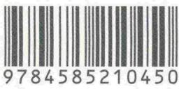

1923010070001

ISBN978-4-585-21045-0

C3010¥7000E

<!-- V3_SOURCE_ID:book015-b001611-p000-83dbe610dd -->

定価[本体7,000円+税]勉誠出版

查看对应原文

<!-- V3_FOLDBACK_BEGIN:book015-b001611-p000-83dbe610dd -->

定価[本体7,000円+税]勉誠出版

<!-- V3_FOLDBACK_END:book015-b001611-p000-83dbe610dd -->

<!-- V3_SOURCE_ID:book015-b001612-p000-c5e9ef5c6d -->

## 数易中国思想史

查看对应原文

<!-- V3_FOLDBACK_BEGIN:book015-b001612-p000-c5e9ef5c6d -->

## 数易中国思想史

<!-- V3_FOLDBACK_END:book015-b001612-p000-c5e9ef5c6d -->

