# 周易译注

> V3 AI 全自动白话释读版。专业术语保留，释读内容可展开核对原文。

> 来源：周易译注.pdf

<!-- V3_SOURCE_ID:book016-b000002-p000-2cd0cd247b -->

## 周易

查看对应原文

<!-- V3_FOLDBACK_BEGIN:book016-b000002-p000-2cd0cd247b -->

## 周易

<!-- V3_FOLDBACK_END:book016-b000002-p000-2cd0cd247b -->

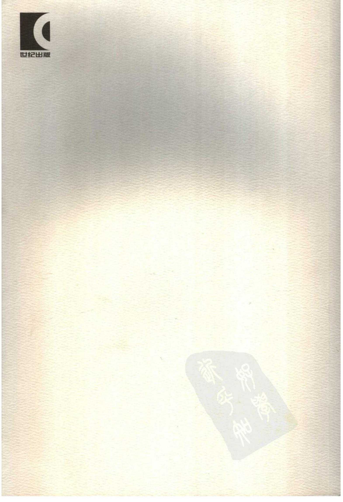

<!-- V3_SOURCE_ID:book016-b000004-p000-2227e6f3b8 -->

## 周易译注上

查看对应原文

<!-- V3_FOLDBACK_BEGIN:book016-b000004-p000-2227e6f3b8 -->

## 周易译注上

<!-- V3_FOLDBACK_END:book016-b000004-p000-2227e6f3b8 -->

<!-- V3_SOURCE_ID:book016-b000005-p000-c9aab0a882 -->

黄寿祺张善文译注

查看对应原文

<!-- V3_FOLDBACK_BEGIN:book016-b000005-p000-c9aab0a882 -->

黄寿祺张善文译注

<!-- V3_FOLDBACK_END:book016-b000005-p000-c9aab0a882 -->

<!-- V3_SOURCE_ID:book016-b000006-p000-cdbfaac6bf -->

图书在版编目(CIP)数据

查看对应原文

<!-- V3_FOLDBACK_BEGIN:book016-b000006-p000-cdbfaac6bf -->

图书在版编目(CIP)数据

<!-- V3_FOLDBACK_END:book016-b000006-p000-cdbfaac6bf -->

<!-- V3_SOURCE_ID:book016-b000007-p000-36ae4a7fd4 -->

周易译注/黄寿祺，张善文译注.一上海：上海古籍出版社,2007.4

查看对应原文

<!-- V3_FOLDBACK_BEGIN:book016-b000007-p000-36ae4a7fd4 -->

周易译注/黄寿祺，张善文译注.一上海：上海古籍出版社,2007.4

<!-- V3_FOLDBACK_END:book016-b000007-p000-36ae4a7fd4 -->

ISBN978-7-5325-4646-6

<!-- V3_SOURCE_ID:book016-b000009-p000-be6cfbc4c9 -->

I. 周... Ⅱ.①黄...②张... Ⅲ.①周易-译文②周易注释 Ⅳ. B221

查看对应原文

<!-- V3_FOLDBACK_BEGIN:book016-b000009-p000-be6cfbc4c9 -->

I. 周... Ⅱ.①黄...②张... Ⅲ.①周易-译文②周易注释 Ⅳ. B221

<!-- V3_FOLDBACK_END:book016-b000009-p000-be6cfbc4c9 -->

<!-- V3_SOURCE_ID:book016-b000010-p000-65e79c1805 -->

中国版本图书馆CIP数据核字(2007)第018734号

查看对应原文

<!-- V3_FOLDBACK_BEGIN:book016-b000010-p000-65e79c1805 -->

中国版本图书馆CIP数据核字(2007)第018734号

<!-- V3_FOLDBACK_END:book016-b000010-p000-65e79c1805 -->

<!-- V3_SOURCE_ID:book016-b000011-p000-5dddad89b3 -->

周易译注

查看对应原文

<!-- V3_FOLDBACK_BEGIN:book016-b000011-p000-5dddad89b3 -->

周易译注

<!-- V3_FOLDBACK_END:book016-b000011-p000-5dddad89b3 -->

<!-- V3_SOURCE_ID:book016-b000012-p000-4a7497998a -->

(全二册)

查看对应原文

<!-- V3_FOLDBACK_BEGIN:book016-b000012-p000-4a7497998a -->

(全二册)

<!-- V3_FOLDBACK_END:book016-b000012-p000-4a7497998a -->

<!-- V3_SOURCE_ID:book016-b000013-p000-74e501a7cc -->

黄寿祺 张善文译注

查看对应原文

<!-- V3_FOLDBACK_BEGIN:book016-b000013-p000-74e501a7cc -->

黄寿祺 张善文译注

<!-- V3_FOLDBACK_END:book016-b000013-p000-74e501a7cc -->

<!-- V3_SOURCE_ID:book016-b000014-p000-12e4823e0f -->

上海世纪出版股份有限公司 ⊥海出纪山吸成历限公

查看对应原文

<!-- V3_FOLDBACK_BEGIN:book016-b000014-p000-12e4823e0f -->

上海世纪出版股份有限公司 ⊥海出纪山吸成历限公

<!-- V3_FOLDBACK_END:book016-b000014-p000-12e4823e0f -->

<!-- V3_SOURCE_ID:book016-b000015-p000-65fcdb904a -->

出版、发行上海古籍出版社

查看对应原文

<!-- V3_FOLDBACK_BEGIN:book016-b000015-p000-65fcdb904a -->

出版、发行上海古籍出版社

<!-- V3_FOLDBACK_END:book016-b000015-p000-65fcdb904a -->

<!-- V3_SOURCE_ID:book016-b000016-p000-2ef89b765b -->

(上海瑞金二路272号邮政编码200020)

查看对应原文

<!-- V3_FOLDBACK_BEGIN:book016-b000016-p000-2ef89b765b -->

(上海瑞金二路272号邮政编码200020)

<!-- V3_FOLDBACK_END:book016-b000016-p000-2ef89b765b -->

<!-- V3_SOURCE_ID:book016-b000017-p000-b5a473f11a -->

(1)网址:www. guji.com.cn

查看对应原文

<!-- V3_FOLDBACK_BEGIN:book016-b000017-p000-b5a473f11a -->

(1)网址:www. guji.com.cn

<!-- V3_FOLDBACK_END:book016-b000017-p000-b5a473f11a -->

(2) E-mail: gujil@ guji. com. cn

<!-- V3_SOURCE_ID:book016-b000019-p000-b0c2c3eed3 -->

(3)易文网网址：www.ewen.cc

查看对应原文

<!-- V3_FOLDBACK_BEGIN:book016-b000019-p000-b0c2c3eed3 -->

(3)易文网网址：www.ewen.cc

<!-- V3_FOLDBACK_END:book016-b000019-p000-b0c2c3eed3 -->

<!-- V3_SOURCE_ID:book016-b000020-p000-a8cc2a8f68 -->

上海发行所发行经销上海印刷四厂有限公司印刷

查看对应原文

<!-- V3_FOLDBACK_BEGIN:book016-b000020-p000-a8cc2a8f68 -->

上海发行所发行经销上海印刷四厂有限公司印刷

<!-- V3_FOLDBACK_END:book016-b000020-p000-a8cc2a8f68 -->

<!-- V3_SOURCE_ID:book016-b000021-p000-c51bedaa21 -->

开本 889 ×1194 1/20 印张 25.7 插页6 字数620,000

查看对应原文

<!-- V3_FOLDBACK_BEGIN:book016-b000021-p000-c51bedaa21 -->

开本 889 ×1194 1/20 印张 25.7 插页6 字数620,000

<!-- V3_FOLDBACK_END:book016-b000021-p000-c51bedaa21 -->

<!-- V3_SOURCE_ID:book016-b000022-p000-3f83c68bf0 -->

2007年4月第1版2007年4月第1次印刷

查看对应原文

<!-- V3_FOLDBACK_BEGIN:book016-b000022-p000-3f83c68bf0 -->

2007年4月第1版2007年4月第1次印刷

<!-- V3_FOLDBACK_END:book016-b000022-p000-3f83c68bf0 -->

<!-- V3_SOURCE_ID:book016-b000023-p000-6f1997b447 -->

印数：1-5,300

查看对应原文

<!-- V3_FOLDBACK_BEGIN:book016-b000023-p000-6f1997b447 -->

印数：1-5,300

<!-- V3_FOLDBACK_END:book016-b000023-p000-6f1997b447 -->

ISBN 978 - 7 -5325 -4646 – 6

<!-- V3_SOURCE_ID:book016-b000025-p000-0ce13f4441 -->

定价：49.00元

查看对应原文

<!-- V3_FOLDBACK_BEGIN:book016-b000025-p000-0ce13f4441 -->

定价：49.00元

<!-- V3_FOLDBACK_END:book016-b000025-p000-0ce13f4441 -->

<!-- V3_SOURCE_ID:book016-b000026-p000-57a1aeeee3 -->

如发生质量问题，读者可向工厂调换

查看对应原文

<!-- V3_FOLDBACK_BEGIN:book016-b000026-p000-57a1aeeee3 -->

如发生质量问题，读者可向工厂调换

<!-- V3_FOLDBACK_END:book016-b000026-p000-57a1aeeee3 -->

<!-- V3_SOURCE_ID:book016-b000027-p000-4cace63caf -->

## 前 言

查看对应原文

<!-- V3_FOLDBACK_BEGIN:book016-b000027-p000-4cace63caf -->

## 前 言

<!-- V3_FOLDBACK_END:book016-b000027-p000-4cace63caf -->

<!-- V3_SOURCE_ID:book016-b000028-p000-5fa0bc59d5 -->

冠居“群经”之首的《周易》，是我国古代现存最早的一部奇特的哲学专著。这部奇书的思想光华，是通过神秘的“占筮”外衣，焕发出恍惚窈冥的象征色彩：它那蕴蓄丰富的变化哲理出现之际，人们对之既向往又“陌生”，乃至“仁者见之谓之仁，智者见之谓之智，百姓日用而不知”（《系辞上传》）；随着历史的推进，自孔子“读《易》韦编三绝”（《史记·孔子世家》）之后，学人对《周易》的认识逐代加深，《易》学著述层出不穷，然而，同时产生的种种扑朔迷离的猜测、附会之说却也多得令人眼花缭乱，遂使本属“玄学”的《周易》思想被涂上一重又一重“幻想和奇想”的“附加色”。尚秉和先生有感于这一情状，慨而叹曰：“最多者《易》解，……最难者《易》解，……苟非真知灼见之士，为扬榷其是非，厘订其得失，后学将胡所适从哉？”①

查看对应原文

<!-- V3_FOLDBACK_BEGIN:book016-b000028-p000-5fa0bc59d5 -->

冠居“群经”之首的《周易》，是我国古代现存最早的一部奇特的哲学专著。这部奇书的思想光华，是通过神秘的“占筮”外衣，焕发出恍惚窈冥的象征色彩：它那蕴蓄丰富的变化哲理出现之际，人们对之既向往又“陌生”，乃至“仁者见之谓之仁，智者见之谓之智，百姓日用而不知”（《系辞上传》）；随着历史的推进，自孔子“读《易》韦编三绝”（《史记·孔子世家》）之后，学人对《周易》的认识逐代加深，《易》学著述层出不穷，然而，同时产生的种种扑朔迷离的猜测、附会之说却也多得令人眼花缭乱，遂使本属“玄学”的《周易》思想被涂上一重又一重“幻想和奇想”的“附加色”。尚秉和先生有感于这一情状，慨而叹曰：“最多者《易》解，……最难者《易》解，……苟非真知灼见之士，为扬榷其是非，厘订其得失，后学将胡所适从哉？”①

<!-- V3_FOLDBACK_END:book016-b000028-p000-5fa0bc59d5 -->

<!-- V3_SOURCE_ID:book016-b000029-p000-b22630d287 -->

处在今天的时代，我们有必要在辨析旧说的基础上，科学地发掘这部古老的哲学著作的真正价值，品评、确立其在中国哲学史、世界文化史上应有的地位。当然，进行这项工作的首要步骤，是先须正确地理解《易》学研究中一系列不可回避的问题，如《周易》的创作过程、时代背景、命名之义、经传大旨，以及历代《易》学的源流派别、今天应当采用的研究方法等。这些问题虽有种种成说，却多数未臻一致。笔者固不敢辄论前贤是非，谨就见识所及，采摭可取的说法，在简述《周易》经传基本内容的同时，结合上述问题略作分析，以期有助于读《易》、研《易》者探索打开《易》学大门的最初途径。

查看对应原文

<!-- V3_FOLDBACK_BEGIN:book016-b000029-p000-b22630d287 -->

处在今天的时代，我们有必要在辨析旧说的基础上，科学地发掘这部古老的哲学著作的真正价值，品评、确立其在中国哲学史、世界文化史上应有的地位。当然，进行这项工作的首要步骤，是先须正确地理解《易》学研究中一系列不可回避的问题，如《周易》的创作过程、时代背景、命名之义、经传大旨，以及历代《易》学的源流派别、今天应当采用的研究方法等。这些问题虽有种种成说，却多数未臻一致。笔者固不敢辄论前贤是非，谨就见识所及，采摭可取的说法，在简述《周易》经传基本内容的同时，结合上述问题略作分析，以期有助于读《易》、研《易》者探索打开《易》学大门的最初途径。

<!-- V3_FOLDBACK_END:book016-b000029-p000-b22630d287 -->

<!-- V3_SOURCE_ID:book016-b000030-p000-5e5df56f5f -->

## 一、《周易》“经”部分的创作过程经历三大阶段：阴阳概念的产生、八卦创立、重卦并撰成卦爻辞，三者均是遵循“观物取象”的创作原则 — 一、《周易》“经”部分的创作过程经历三大阶段：阴阳（描述事物相反相成、消长转化的两类属性）概念的产生、八卦（乾、坤、震、巽、坎、离、艮、兑八种卦象）创立、重卦并撰成卦爻辞，三者均是遵循“观物取象”的创作原则

查看对应原文

<!-- V3_FOLDBACK_BEGIN:book016-b000030-p000-5e5df56f5f -->

## 一、《周易》“经”部分的创作过程经历三大阶段：阴阳概念的产生、八卦创立、重卦并撰成卦爻辞，三者均是遵循“观物取象”的创作原则

<!-- V3_FOLDBACK_END:book016-b000030-p000-5e5df56f5f -->

<!-- V3_SOURCE_ID:book016-b000031-p000-772bc1baab -->

翻开《周易》，首先看到的是八卦、六十四卦符号，以及与这些符号紧密关

查看对应原文

<!-- V3_FOLDBACK_BEGIN:book016-b000031-p000-772bc1baab -->

翻开《周易》，首先看到的是八卦、六十四卦符号，以及与这些符号紧密关

<!-- V3_FOLDBACK_END:book016-b000031-p000-772bc1baab -->

<!-- V3_SOURCE_ID:book016-b000032-p000-f1d8d138fb -->

联的卦辞、爻辞。这就是《周易》的“经”文。

查看对应原文

<!-- V3_FOLDBACK_BEGIN:book016-b000032-p000-f1d8d138fb -->

联的卦辞、爻辞。这就是《周易》的“经”文。

<!-- V3_FOLDBACK_END:book016-b000032-p000-f1d8d138fb -->

<!-- V3_SOURCE_ID:book016-b000033-p000-c11c34e416 -->

《周易》“经”部分的创作过程，大致经历了三个阶段：阴阳（描述事物相反相成、消长转化的两类属性）概念的产生，八卦（乾、坤、震、巽、坎、离、艮、兑八种卦象）创立，重卦并撰成卦爻辞。

查看对应原文

<!-- V3_FOLDBACK_BEGIN:book016-b000033-p000-c11c34e416 -->

《周易》“经”部分的创作过程，大致经历了三个阶段：阴阳概念的产生，八卦创立，重卦并撰成卦爻辞。

<!-- V3_FOLDBACK_END:book016-b000033-p000-c11c34e416 -->

<!-- V3_SOURCE_ID:book016-b000034-p000-772bdb2769 -->

十分明显，无论是后来的八卦或六十四卦，都是由阴阳两爻(--、一)组合成的，所以，叙及《周易》的创作，我们不得不从这两种基本符号谈起。“阴”、“阳”概念的形成，是古代人们通过对宇宙万物矛盾现象的直接观察得出的。“盈乎天地之间无非一阴一阳之理”(《朱子大全·易纲领》)，在古人心目中，天地、男女、昼夜、炎凉、上下、胜负……几乎生活环境中的一切现象都体现着普遍的、相互对立的矛盾。根据这种直感的、朴素的观察，前人把宇宙间变化万端、纷纭复杂的事物分为阴、阳两大类，用两种符号表示：阴物为“--”，阳物为“一”。为什么用这两种符号(而不是别的符号)来象征阴阳呢？人们曾作过各种猜测，或以为是男女生殖器的象征，或以为是龟卜兆纹所演化，或以为是古代用于占筮的两种竹节的象形，或以为是取用上古“结绳”时代“有结”、“无结”的形态等等②，见仁见智，皆可并存。但有一点是人所公认的：阴阳爻象的形成，本于古人对自然万物的直接观察，象征着广泛的相互对立的种种事物、现象。

查看对应原文

<!-- V3_FOLDBACK_BEGIN:book016-b000034-p000-772bdb2769 -->

十分明显，无论是后来的八卦或六十四卦，都是由阴阳两爻(--、一)组合成的，所以，叙及《周易》的创作，我们不得不从这两种基本符号谈起。“阴”、“阳”概念的形成，是古代人们通过对宇宙万物矛盾现象的直接观察得出的。“盈乎天地之间无非一阴一阳之理”(《朱子大全·易纲领》)，在古人心目中，天地、男女、昼夜、炎凉、上下、胜负……几乎生活环境中的一切现象都体现着普遍的、相互对立的矛盾。根据这种直感的、朴素的观察，前人把宇宙间变化万端、纷纭复杂的事物分为阴、阳两大类，用两种符号表示：阴物为“--”，阳物为“一”。为什么用这两种符号(而不是别的符号)来象征阴阳呢？人们曾作过各种猜测，或以为是男女生殖器的象征，或以为是龟卜兆纹所演化，或以为是古代用于占筮的两种竹节的象形，或以为是取用上古“结绳”时代“有结”、“无结”的形态等等②，见仁见智，皆可并存。但有一点是人所公认的：阴阳爻象的形成，本于古人对自然万物的直接观察，象征着广泛的相互对立的种种事物、现象。

<!-- V3_FOLDBACK_END:book016-b000034-p000-772bdb2769 -->

<!-- V3_SOURCE_ID:book016-b000035-p000-472464a4c2 -->

在这基础上，古人以阴、阳符号为“爻”，每三爻叠成一卦，出现了“八卦”(《周礼》称为“经卦”)。八卦各有不同的名称、形式，分别是：乾(☰)、坤(☷)、震(☳)、巽(☴)、坎(☵)、离(☲)、艮(☶)、兑(☱)。八卦的取象，已经从阴阳二爻对事物的广泛象征，发展到对自然界八种基本物质的具体象征；这八种基本物质是：天、地、雷、风、水、火、山、泽。在后来的《易》理演绎和《易》筮运用的过程中，八卦的卦象又不断扩展增益，可以分别象征八种类型的诸多物象，《说卦传》所举象例，即可见其概略。以八卦与阴阳二爻相比较，两者的创立有一个共同点：均是古人通过观察自然物象所得，然后又作为喻示种种物情、事理的象征符号。《系辞下传》对此作了较为明白的说明：

查看对应原文

<!-- V3_FOLDBACK_BEGIN:book016-b000035-p000-472464a4c2 -->

在这基础上，古人以阴、阳符号为“爻”，每三爻叠成一卦，出现了“八卦”(《周礼》称为“经卦”)。八卦各有不同的名称、形式，分别是：乾(☰)、坤(☷)、震(☳)、巽(☴)、坎(☵)、离(☲)、艮(☶)、兑(☱)。八卦的取象，已经从阴阳二爻对事物的广泛象征，发展到对自然界八种基本物质的具体象征；这八种基本物质是：天、地、雷、风、水、火、山、泽。在后来的《易》理演绎和《易》筮运用的过程中，八卦的卦象又不断扩展增益，可以分别象征八种类型的诸多物象，《说卦传》所举象例，即可见其概略。以八卦与阴阳二爻相比较，两者的创立有一个共同点：均是古人通过观察自然物象所得，然后又作为喻示种种物情、事理的象征符号。《系辞下传》对此作了较为明白的说明：

<!-- V3_FOLDBACK_END:book016-b000035-p000-472464a4c2 -->

<!-- V3_SOURCE_ID:book016-b000036-p000-d5d44e59e2 -->

古者包牺氏之王天下也，仰则观象于天，俯则观法于地，观鸟兽之文，与地之宜，近取诸身，远取诸物，于是始作八卦，以通神明之德，以类万物之情。

查看对应原文

<!-- V3_FOLDBACK_BEGIN:book016-b000036-p000-d5d44e59e2 -->

古者包牺氏之王天下也，仰则观象于天，俯则观法于地，观鸟兽之文，与地之宜，近取诸身，远取诸物，于是始作八卦，以通神明之德，以类万物之情。

<!-- V3_FOLDBACK_END:book016-b000036-p000-d5d44e59e2 -->

<!-- V3_SOURCE_ID:book016-b000037-p000-9b80118228 -->

这是阐述古人从观察万物到制成八卦的整个思维过程，即“观物取象”的创作特征。其中所“观”之“物”，乃是自然、生活中的具体事物；所“取”之“象”，则是模拟这些事物成为有象征意义的卦象。如乾为天、坤为地等即是。此后，八卦两两相重，出现了六十四卦(《周礼》称为“别卦”)，并产生了解说这些卦形所寓哲理的卦爻辞。此时，《周易》“经”文全部创成，其独具体系的哲学思想已趋成熟。 1

查看对应原文

<!-- V3_FOLDBACK_BEGIN:book016-b000037-p000-9b80118228 -->

这是阐述古人从观察万物到制成八卦的整个思维过程，即“观物取象”的创作特征。其中所“观”之“物”，乃是自然、生活中的具体事物；所“取”之“象”，则是模拟这些事物成为有象征意义的卦象。如乾为天、坤为地等即是。此后，八卦两两相重，出现了六十四卦(《周礼》称为“别卦”)，并产生了解说这些卦形所寓哲理的卦爻辞。此时，《周易》“经”文全部创成，其独具体系的哲学思想已趋成熟。 1

<!-- V3_FOLDBACK_END:book016-b000037-p000-9b80118228 -->

<!-- V3_SOURCE_ID:book016-b000038-p000-07c7b0772a -->

就卦形看，六十四卦及每卦中的六爻，也同样都是作《易》者遵循“观物取象”思维形式的产物。例如，䷢为《晋》卦(“晋”意为“进长”)，卦形是坤下离上(地在下，火在上)，拟取太阳从东方大地升起这一物象，说明事物处于上进、成长之时的发展规律；与之相对的，䷣为《明夷》卦(“明夷”意为“光明殒灭”)，卦形是离下坤上(火在下，地在上)，拟取太阳从西方大地落下这一物象，说明事物处于光明转向黑暗之时的变化情状。很明显，它们都以拟取物象来喻示事理。至于六十四卦中的每一爻，也各具其象。如䷀为《乾》卦，卦形是由完全相同的六个阳爻“—”组成，但每爻各自象征着不同的义理。以上下两爻为例：下爻(初九)“—”，爻辞曰“潜龙勿用”，喻示此爻犹如一条潜伏水底、养精蓄锐的“龙”的形象，说明事物以刚健气势崛起之初，必须积蓄力量，创造条件，不可轻易盲动；上爻(上九)“—”，爻辞曰“亢龙有悔”，喻示此爻犹如一条激昂飞腾而飞得太高太猛的“龙”的形象，说明事物刚健过甚、发展超过一定限度，必将走向反面，出现挫折。显然，这些“爻”都是某种特定的象征，暗示着各不相同的哲理意义。

查看对应原文

<!-- V3_FOLDBACK_BEGIN:book016-b000038-p000-07c7b0772a -->

就卦形看，六十四卦及每卦中的六爻，也同样都是作《易》者遵循“观物取象”思维形式的产物。例如，䷢为《晋》卦(“晋”意为“进长”)，卦形是坤下离上(地在下，火在上)，拟取太阳从东方大地升起这一物象，说明事物处于上进、成长之时的发展规律；与之相对的，䷣为《明夷》卦(“明夷”意为“光明殒灭”)，卦形是离下坤上(火在下，地在上)，拟取太阳从西方大地落下这一物象，说明事物处于光明转向黑暗之时的变化情状。很明显，它们都以拟取物象来喻示事理。至于六十四卦中的每一爻，也各具其象。如䷀为《乾》卦，卦形是由完全相同的六个阳爻“—”组成，但每爻各自象征着不同的义理。以上下两爻为例：下爻(初九)“—”，爻辞曰“潜龙勿用”，喻示此爻犹如一条潜伏水底、养精蓄锐的“龙”的形象，说明事物以刚健气势崛起之初，必须积蓄力量，创造条件，不可轻易盲动；上爻(上九)“—”，爻辞曰“亢龙有悔”，喻示此爻犹如一条激昂飞腾而飞得太高太猛的“龙”的形象，说明事物刚健过甚、发展超过一定限度，必将走向反面，出现挫折。显然，这些“爻”都是某种特定的象征，暗示着各不相同的哲理意义。

<!-- V3_FOLDBACK_END:book016-b000038-p000-07c7b0772a -->

<!-- V3_SOURCE_ID:book016-b000039-p000-73acf18ba2 -->

就卦爻辞看，六十四卦的卦辞及每爻的爻辞，均是配合卦形阐明象旨。卦爻辞的出现有两大意义：(一)使《周易》成为卦形符号与语言文字有机结合的一部特殊的哲学著作；(二)使“《易》象”从隐晦的符号暗示发展为用文字表述的带有一定文学性的形象。卦爻辞的表现形式是“假象喻意”，即拟取人们生活中习见常闻的物象，通过文字的具体表述，使卦形、爻形内涵的象征旨趣更为鲜明、生动。如上文所引《乾》卦的两爻，由于“潜龙勿用”、“亢龙有悔”这些具体文辞的形象表达，使这两爻的象征意义突出地显示出来了。而每卦的卦辞与六则爻辞，在相互联系中，披露了该卦所蕴涵的事物运动、变化、发展的哲理；六十四卦相承相受，从六十四种角度分别展示不同的环境条件下的事理特征及变化规律——《周易》哲学于是形成了独特的系统，并深刻地影响着后世的文化、思想而流传不衰。

查看对应原文

<!-- V3_FOLDBACK_BEGIN:book016-b000039-p000-73acf18ba2 -->

就卦爻辞看，六十四卦的卦辞及每爻的爻辞，均是配合卦形阐明象旨。卦爻辞的出现有两大意义：(一)使《周易》成为卦形符号与语言文字有机结合的一部特殊的哲学著作；(二)使“《易》象”从隐晦的符号暗示发展为用文字表述的带有一定文学性的形象。卦爻辞的表现形式是“假象喻意”，即拟取人们生活中习见常闻的物象，通过文字的具体表述，使卦形、爻形内涵的象征旨趣更为鲜明、生动。如上文所引《乾》卦的两爻，由于“潜龙勿用”、“亢龙有悔”这些具体文辞的形象表达，使这两爻的象征意义突出地显示出来了。而每卦的卦辞与六则爻辞，在相互联系中，披露了该卦所蕴涵的事物运动、变化、发展的哲理；六十四卦相承相受，从六十四种角度分别展示不同的环境条件下的事理特征及变化规律——《周易》哲学于是形成了独特的系统，并深刻地影响着后世的文化、思想而流传不衰。

<!-- V3_FOLDBACK_END:book016-b000039-p000-73acf18ba2 -->

<!-- V3_SOURCE_ID:book016-b000040-p000-98b5e595ae -->

## 二、《易传》七种十篇，又称《十翼》，汉以后被合入经文并行

查看对应原文

<!-- V3_FOLDBACK_BEGIN:book016-b000040-p000-98b5e595ae -->

## 二、《易传》七种十篇，又称《十翼》，汉以后被合入经文并行

<!-- V3_FOLDBACK_END:book016-b000040-p000-98b5e595ae -->

<!-- V3_SOURCE_ID:book016-b000041-p000-0b0205f080 -->

宋人林光世所著《水村易镜·自序》中说：

查看对应原文

<!-- V3_FOLDBACK_BEGIN:book016-b000041-p000-0b0205f080 -->

宋人林光世《水村易镜·自序》云：

<!-- V3_FOLDBACK_END:book016-b000041-p000-0b0205f080 -->

<!-- V3_SOURCE_ID:book016-b000042-p000-c21148336b -->

古代的君子，对于天地、日月、星辰、阴阳造化、鸟兽草木没有什么不了解的，不必去研读卦辞、爻辞，眼前所见的一切自然事物本身就是天然的《易》。后来世道衰败混乱，《易》象几乎被废弃，孔子对此感到担忧，于是创作了《大象》、《小象》，又创作了《系辞》，……目的是让天下后世的人都知道，这些《易》象都是通过仰观天象、俯察地理而获得的。

查看对应原文

<!-- V3_FOLDBACK_BEGIN:book016-b000042-p000-c21148336b -->

古之君子，天地、日月、星辰、阴阳造化、鸟兽草木无所不知，不必读卦辞、爻辞，眼前皆自然之《易》也。世道衰微，《易》象几废，孔圣惧焉，于是作《大象》、《小象》，又作《系辞》，……令天下后世皆知此象自仰观俯察而得也③。

<!-- V3_FOLDBACK_END:book016-b000042-p000-c21148336b -->

<!-- V3_SOURCE_ID:book016-b000043-p000-2baa7511c4 -->

水村所说的“古之君子”，大概是指当时的卜筮者或学者们，他们的言论难免有些浮夸；但他指出《易传》的作者想要让人们知道，《易》象都是从仰观俯察中得来的，于是撰写了各篇来阐明《易》的主旨，这一点似乎并不违背实情。

查看对应原文

<!-- V3_FOLDBACK_BEGIN:book016-b000043-p000-2baa7511c4 -->

水村所谓“古之君子”，殆即指当时的卜筮者或学者们，其言不免流于浮夸；但其指出《易传》作者欲令人知《易》象均从仰观俯察而得，遂撰诸篇以明《易》旨，似不违情实。

<!-- V3_FOLDBACK_END:book016-b000043-p000-2baa7511c4 -->

<!-- V3_SOURCE_ID:book016-b000044-p000-626be5a8e6 -->

从现存《易传》的内容来看，共有《文言》、《彖传》上下、《象传》上下、《系辞传》上下、《说卦传》、《序卦传》、《杂卦传》七种，总共十篇。这十篇的创作宗旨都是解释《周易》“经”文的大义，就像“经”的“羽翼”一样，所以又被称为《十翼》。

> **释读存疑：** 本地硬校验仍未通过，已记录供后续自动处理或人工核对。

查看对应原文

<!-- V3_FOLDBACK_BEGIN:book016-b000044-p000-626be5a8e6 -->

从现存《易传》的内容看，共有《文言》、《彖传》上下、《象传》上下、《系辞传》上下、《说卦传》、《序卦传》、《杂卦传》七种，凡十篇。这十篇的创作宗旨均在解释《周易》“经”文大义，犹如“经”之“羽翼”，故又称《十翼》(见《周易乾凿

<!-- V3_FOLDBACK_END:book016-b000044-p000-626be5a8e6 -->

度》)。

<!-- V3_SOURCE_ID:book016-b000046-p000-1072a5491e -->

《易传》解释“经”文各有一定的侧重点或特定的角度，现将其分别叙述如下。

查看对应原文

<!-- V3_FOLDBACK_BEGIN:book016-b000046-p000-1072a5491e -->

《易传》解“经”各有一定的侧重点或特定的角度，兹分叙如下。

<!-- V3_FOLDBACK_END:book016-b000046-p000-1072a5491e -->

<!-- V3_SOURCE_ID:book016-b000047-p000-77477ff78c -->

《文言》，分前后两节，分别解说《乾》、《坤》两卦的象征意旨，故前节称《乾文言》，后节称《坤文言》。“文言”两字之义，即谓“文饰《乾》、《坤》两卦之言”。孔颖达引庄氏曰：“以《乾》、《坤》德大，故特文饰以为《文言》。”(《周易正义》)李鼎祚又引姚信曰：“《乾》、《坤》为门户，文说《乾》、《坤》，六十二卦皆放焉。”(《周易集解》)这两说似已点明《文言》的名义所在。

查看对应原文

<!-- V3_FOLDBACK_BEGIN:book016-b000047-p000-77477ff78c -->

《文言》，分前后两节，分别解说《乾》、《坤》两卦的象征意旨，故前节称《乾文言》，后节称《坤文言》。“文言”两字之义，即谓“文饰《乾》、《坤》两卦之言”。孔颖达引庄氏曰：“以《乾》、《坤》德大，故特文饰以为《文言》。”(《周易正义》)李鼎祚又引姚信曰：“《乾》、《坤》为门户，文说《乾》、《坤》，六十二卦皆放焉。”(《周易集解》)这两说似已点明《文言》的名义所在。

<!-- V3_FOLDBACK_END:book016-b000047-p000-77477ff78c -->

<!-- V3_SOURCE_ID:book016-b000048-p000-59529c2b05 -->

《彖传》，随上下经分为上下两篇，共六十四节，分释六十四卦卦名、卦辞及一卦大旨。“彖”字之义，李鼎祚引刘瓛曰：“彖者，断也。”(《集解》)孔颖达引褚氏、庄氏曰：“彖，断也，断定一卦之义，所以名为‘彖’也。”(《正义》)但作为经传之名，其义有二：(一)指卦辞，即《释文》引马融所谓“彖辞，卦辞也”，《左传》襄公九年孔疏从之，称“《周易》卦下之辞谓为《彖》”；(二)指《易传》中的《彖传》，即王弼《周易略例》所谓“统论一卦之体，明其所由之旨也”，《正义》亦曰：“夫子所作《彖辞》，统论一卦之义。”《彖传》阐释卦名、卦辞、卦义的体例，往往取卦象、爻象为说，多能指明每卦中的为主之爻，而以简约明了的文字论断该卦主旨。

查看对应原文

<!-- V3_FOLDBACK_BEGIN:book016-b000048-p000-59529c2b05 -->

《彖传》，随上下经分为上下两篇，共六十四节，分释六十四卦卦名、卦辞及一卦大旨。“彖”字之义，李鼎祚引刘瓛曰：“彖者，断也。”(《集解》)孔颖达引褚氏、庄氏曰：“彖，断也，断定一卦之义，所以名为‘彖’也。”(《正义》)但作为经传之名，其义有二：(一)指卦辞，即《释文》引马融所谓“彖辞，卦辞也”，《左传》襄公九年孔疏从之，称“《周易》卦下之辞谓为《彖》”；(二)指《易传》中的《彖传》，即王弼《周易略例》所谓“统论一卦之体，明其所由之旨也”，《正义》亦曰：“夫子所作《彖辞》，统论一卦之义。”《彖传》阐释卦名、卦辞、卦义的体例，往往取卦象、爻象为说，多能指明每卦中的为主之爻，而以简约明了的文字论断该卦主旨。

<!-- V3_FOLDBACK_END:book016-b000048-p000-59529c2b05 -->

<!-- V3_SOURCE_ID:book016-b000049-p000-8f1ac132a4 -->

《象传》，随上下经分为上下两篇，阐释各卦的卦象及各爻的爻象。其中释卦象者六十四则，称《大象传》；释爻象者三百八十六则④，称《小象传》。“象”字之义，犹言“形象”、“象征”，即《系辞下传》所谓：“象也者，像此者也。”但作为经传之名，则有两义：(一)指《周易》的卦形和卦爻辞，《系辞下传》：“《易》者，象也。”《左传》昭公二年叙韩宣子适鲁“见《易象》”即指此；(二)指《易传》中的《象传》，旨在分析卦、爻的象征意义。《大象传》的体例，是先释每卦上下象相重之旨，然后从重卦的卦象中推衍出切近人事的象征意义，文辞多取“君子”的言行、道德为喻。如《乾》卦《大象传》称：“天行健，君子以自强不息”，即表明该卦上下象均为“天”，君子当效法“天”的健行气质，奋发图强；又如《损》卦《大象传》称：“山下有泽，损，君子以惩恶窒欲”，即表明该卦上“山”下“泽”，有损下益上之象，君子当效法此象，时时自损不善。其他诸卦的义例，无不如此。《小象传》的体例，是根据每爻的性质、处位特点，分析爻义吉凶利弊之所以然。如《乾》卦初九爻的《小象传》曰“潜龙勿用，阳在下也”，指明此爻微阳初萌，不可急于施用；又如《明夷》卦六二爻《小象传》曰“六二之吉，顺以则也”，指明此爻柔顺中正，不违法则，故获吉祥。其他诸爻亦均类此。《象传》以言简意明的文辞，逐卦逐爻地解说六十四卦、三百八十四爻的立象所在，使《周易》经文的象征意趣有了比较整齐划一的阐说。

查看对应原文

<!-- V3_FOLDBACK_BEGIN:book016-b000049-p000-8f1ac132a4 -->

《象传》，随上下经分为上下两篇，阐释各卦的卦象及各爻的爻象。其中释卦象者六十四则，称《大象传》；释爻象者三百八十六则④，称《小象传》。“象”字之义，犹言“形象”、“象征”，即《系辞下传》所谓：“象也者，像此者也。”但作为经传之名，则有两义：(一)指《周易》的卦形和卦爻辞，《系辞下传》：“《易》者，象也。”《左传》昭公二年叙韩宣子适鲁“见《易象》”即指此；(二)指《易传》中的《象传》，旨在分析卦、爻的象征意义。《大象传》的体例，是先释每卦上下象相重之旨，然后从重卦的卦象中推衍出切近人事的象征意义，文辞多取“君子”的言行、道德为喻。如《乾》卦《大象传》称：“天行健，君子以自强不息”，即表明该卦上下象均为“天”，君子当效法“天”的健行气质，奋发图强；又如《损》卦《大象传》称：“山下有泽，损，君子以惩恶窒欲”，即表明该卦上“山”下“泽”，有损下益上之象，君子当效法此象，时时自损不善。其他诸卦的义例，无不如此。《小象传》的体例，是根据每爻的性质、处位特点，分析爻义吉凶利弊之所以然。如《乾》卦初九爻的《小象传》曰“潜龙勿用，阳在下也”，指明此爻微阳初萌，不可急于施用；又如《明夷》卦六二爻《小象传》曰“六二之吉，顺以则也”，指明此爻柔顺中正，不违法则，故获吉祥。其他诸爻亦均类此。《象传》以言简意明的文辞，逐卦逐爻地解说六十四卦、三百八十四爻的立象所在，使《周易》经文的象征意趣有了比较整齐划一的阐说。

<!-- V3_FOLDBACK_END:book016-b000049-p000-8f1ac132a4 -->

<!-- V3_SOURCE_ID:book016-b000050-p000-fe307ad1ac -->

《系辞传》，因其篇幅较长，分为上下两篇。“系辞”二字的名义，有两方面：(一)指卦爻辞，即《正义》所谓“圣人系属此辞于爻卦之下”，“上下二篇经辞是也”；(二)指《易传》中的《系辞传》，亦即《正义》所云“夫子本作《十翼》，申说上下二篇经文系辞，条贯义理，别自为卷，总曰《系辞》”。《系辞传》可视

查看对应原文

<!-- V3_FOLDBACK_BEGIN:book016-b000050-p000-fe307ad1ac -->

《系辞传》，因其篇幅较长，分为上下两篇。“系辞”二字的名义，有两方面：(一)指卦爻辞，即《正义》所谓“圣人系属此辞于爻卦之下”，“上下二篇经辞是也”；(二)指《易传》中的《系辞传》，亦即《正义》所云“夫子本作《十翼》，申说上下二篇经文系辞，条贯义理，别自为卷，总曰《系辞》”。《系辞传》可视

<!-- V3_FOLDBACK_END:book016-b000050-p000-fe307ad1ac -->

<!-- V3_SOURCE_ID:book016-b000051-p000-2cd0cd247b -->

## 周易

查看对应原文

<!-- V3_FOLDBACK_BEGIN:book016-b000051-p000-2cd0cd247b -->

## 周易

<!-- V3_FOLDBACK_END:book016-b000051-p000-2cd0cd247b -->

<!-- V3_SOURCE_ID:book016-b000052-p000-662c40768b -->

为早期的《易》义通论，文中对《周易》“经”文的各方面内容作了较为全面、可取的辨析、阐发，有助于后人理解八卦、六十四卦及卦爻辞的大义。其中有对《周易》作者、成书年代的推测，有对《周易》“观物取象”创作方法的追述；或辨阴阳之理，或释八卦之象，或疏解乾坤要旨，或展示《易》筮略例；并穿插解说了十九则爻辞的象征意旨（集中见于《系辞上传》者七则，集中见于《系辞下传》者十一则，散见于《系辞上传》者一则，共十九则，详见黄寿祺所撰《从易传看孔子的教育思想》，载《齐鲁学刊》1984年第6期）。当然，《系辞传》在通说《易》义的过程中，也充分地表露了作者的哲学观点；但就其创作宗旨分析，这些哲学观点又无不归趋于《易》理范畴。简言之，《系辞传》的要领，在于发《易》义之深微，示读《易》之范例。

查看对应原文

<!-- V3_FOLDBACK_BEGIN:book016-b000052-p000-662c40768b -->

为早期的《易》义通论，文中对《周易》“经”文的各方面内容作了较为全面、可取的辨析、阐发，有助于后人理解八卦、六十四卦及卦爻辞的大义。其中有对《周易》作者、成书年代的推测，有对《周易》“观物取象”创作方法的追述；或辨阴阳之理，或释八卦之象，或疏解乾坤要旨，或展示《易》筮略例；并穿插解说了十九则爻辞的象征意旨（集中见于《系辞上传》者七则，集中见于《系辞下传》者十一则，散见于《系辞上传》者一则，共十九则，详见黄寿祺所撰《从易传看孔子的教育思想》，载《齐鲁学刊》1984年第6期）。当然，《系辞传》在通说《易》义的过程中，也充分地表露了作者的哲学观点；但就其创作宗旨分析，这些哲学观点又无不归趋于《易》理范畴。简言之，《系辞传》的要领，在于发《易》义之深微，示读《易》之范例。

<!-- V3_FOLDBACK_END:book016-b000052-p000-662c40768b -->

<!-- V3_SOURCE_ID:book016-b000053-p000-c5b13e3e96 -->

《说卦传》，是阐说八卦象例的专论。全文先追述作《易》者用“蓍”衍卦的历史；再申言八卦的两种方位（宋人称为“先天”、“后天”方位）；然后集中说明八卦的取象特点，并广引众多象例，是今天理解、探讨《易》象的产生及推展的重要资料。其中言及八卦的最基本象例：乾为天，坤为地，震为雷，巽为风（为木），坎为水，离为火，艮为山，兑为泽；以及与之相对应的八种大体不变的象征意义：乾健，坤顺，震动，巽入，坎陷，离丽，艮止，兑说（悦）——这在《周易》六十四卦象征义理中几乎是每卦必用的象喻条例，对于明确《周易》卦形符号的构成原理尤有不可忽视的参考价值。

查看对应原文

<!-- V3_FOLDBACK_BEGIN:book016-b000053-p000-c5b13e3e96 -->

《说卦传》，是阐说八卦象例的专论。全文先追述作《易》者用“蓍”衍卦的历史；再申言八卦的两种方位（宋人称为“先天”、“后天”方位）；然后集中说明八卦的取象特点，并广引众多象例，是今天理解、探讨《易》象的产生及推展的重要资料。其中言及八卦的最基本象例：乾为天，坤为地，震为雷，巽为风（为木），坎为水，离为火，艮为山，兑为泽；以及与之相对应的八种大体不变的象征意义：乾健，坤顺，震动，巽入，坎陷，离丽，艮止，兑说（悦）——这在《周易》六十四卦象征义理中几乎是每卦必用的象喻条例，对于明确《周易》卦形符号的构成原理尤有不可忽视的参考价值。

<!-- V3_FOLDBACK_END:book016-b000053-p000-c5b13e3e96 -->

<!-- V3_SOURCE_ID:book016-b000054-p000-f5d8b6983e -->

《序卦传》，旨在解说《周易》六十四卦的编排次序，揭示诸卦相承的意义。全文分两段：前段叙上经《乾》至《离》三十卦次序，后段叙下经《咸》至《未济》三十四卦次序。这种卦序，当是相沿已久的⑤；而文中所明各卦依次相承的意义，含有事物向正面发展或向反面转化的朴素辩证观点。可以说，《序卦传》是一篇颇具哲理深度的六十四卦推衍纲要。

查看对应原文

<!-- V3_FOLDBACK_BEGIN:book016-b000054-p000-f5d8b6983e -->

《序卦传》，旨在解说《周易》六十四卦的编排次序，揭示诸卦相承的意义。全文分两段：前段叙上经《乾》至《离》三十卦次序，后段叙下经《咸》至《未济》三十四卦次序。这种卦序，当是相沿已久的⑤；而文中所明各卦依次相承的意义，含有事物向正面发展或向反面转化的朴素辩证观点。可以说，《序卦传》是一篇颇具哲理深度的六十四卦推衍纲要。

<!-- V3_FOLDBACK_END:book016-b000054-p000-f5d8b6983e -->

<!-- V3_SOURCE_ID:book016-b000055-p000-f4e16b1c74 -->

《杂卦传》，其取名为“杂”之义，韩康伯云“杂糅众卦，错综其义”（《韩注》），即打散《序卦传》所揭明的卦序，把六十四卦重新分成三十二组两两对举，以精要的语言概括卦旨。文中对举的两卦之间，其卦形或“错”（亦称“旁通”，六爻相互交变）或“综”（亦称“反对”，卦体相互倒置），其卦义多成相反。这种“错”、“综”现象，是六十四卦符号形式的重要特征，从中可以窥探出作者对卦形结构的认识，其哲学意义在于表明事物的发展往往在正反相对的因素中体现其变化规律。

查看对应原文

<!-- V3_FOLDBACK_BEGIN:book016-b000055-p000-f4e16b1c74 -->

《杂卦传》，其取名为“杂”之义，韩康伯云“杂糅众卦，错综其义”（《韩注》），即打散《序卦传》所揭明的卦序，把六十四卦重新分成三十二组两两对举，以精要的语言概括卦旨。文中对举的两卦之间，其卦形或“错”（亦称“旁通”，六爻相互交变）或“综”（亦称“反对”，卦体相互倒置），其卦义多成相反。这种“错”、“综”现象，是六十四卦符号形式的重要特征，从中可以窥探出作者对卦形结构的认识，其哲学意义在于表明事物的发展往往在正反相对的因素中体现其变化规律。

<!-- V3_FOLDBACK_END:book016-b000055-p000-f4e16b1c74 -->

<!-- V3_SOURCE_ID:book016-b000056-p000-15a7f72ac2 -->

综上所述，我们在大体揭明了《易传》七种的内容要点的同时，可以得出这样一种论断：《易传》的创作，尽管其抒论角度各不相同，或叙述重点各有所主，但其基本宗旨无不就《周易》经文而发。那么，作为《周易》经文出现之后而产生的，并成为自古以来众所公认、无与伦匹的解经专著的《易传》，不但是今天研究《周易》经文的最重要的“津梁”，而且其本身的哲学内涵也值得深入探讨。

查看对应原文

<!-- V3_FOLDBACK_BEGIN:book016-b000056-p000-15a7f72ac2 -->

综上所述，我们在大体揭明了《易传》七种的内容要点的同时，可以得出这样一种论断：《易传》的创作，尽管其抒论角度各不相同，或叙述重点各有所主，但其基本宗旨无不就《周易》经文而发。那么，作为《周易》经文出现之后而产生的，并成为自古以来众所公认、无与伦匹的解经专著的《易传》，不但是今天研究《周易》经文的最重要的“津梁”，而且其本身的哲学内涵也值得深入探讨。

<!-- V3_FOLDBACK_END:book016-b000056-p000-15a7f72ac2 -->

<!-- V3_SOURCE_ID:book016-b000057-p000-9dba35f297 -->

应当指出，《易传》七种原皆单行，后来被合入经文并行，自有一段为学者所认识、接受的过程。关于援传连经始于何人的问题，旧有两说。《三国志·魏书·高贵乡公传》记载曹髦与《易》博士淳于俊的一节对话云：

查看对应原文

<!-- V3_FOLDBACK_BEGIN:book016-b000057-p000-9dba35f297 -->

应当指出，《易传》七种原皆单行，后来被合入经文并行，自有一段为学者所认识、接受的过程。关于援传连经始于何人的问题，旧有两说。《三国志·魏书·高贵乡公传》记载曹髦与《易》博士淳于俊的一节对话云：

<!-- V3_FOLDBACK_END:book016-b000057-p000-9dba35f297 -->

<!-- V3_SOURCE_ID:book016-b000058-p000-aaa67c0df9 -->

……帝又问曰：‘孔子作《彖》、《象》，郑玄作注，虽圣贤不同，其所释经义一也。今《彖》、《象》不与经文相连，而注连之，何也？’俊对曰：‘郑玄合《彖》、《象》于经者，欲使学者寻省易了也。’帝曰：‘若郑玄合之，于学诚便，则孔子曷为不合以了学者乎？’俊对曰：‘孔子恐其与文王相乱，是以不合，此圣人以不合为谦。’

查看对应原文

<!-- V3_FOLDBACK_BEGIN:book016-b000058-p000-aaa67c0df9 -->

……帝又问曰：‘孔子作《彖》、《象》，郑玄作注，虽圣贤不同，其所释经义一也。今《彖》、《象》不与经文相连，而注连之，何也？’俊对曰：‘郑玄合《彖》、《象》于经者，欲使学者寻省易了也。’帝曰：‘若郑玄合之，于学诚便，则孔子曷为不合以了学者乎？’俊对曰：‘孔子恐其与文王相乱，是以不合，此圣人以不合为谦。’

<!-- V3_FOLDBACK_END:book016-b000058-p000-aaa67c0df9 -->

<!-- V3_SOURCE_ID:book016-b000059-p000-9528f9f666 -->

这段资料说明淳于俊认为，东汉的郑玄合《彖传》、《象传》于经文。《崇文总目》云：‘凡以《彖》、《象》、《文言》杂入卦中者，自费氏始。’晁公武《郡斋读书志》亦曰：

查看对应原文

<!-- V3_FOLDBACK_BEGIN:book016-b000059-p000-9528f9f666 -->

这段资料说明淳于俊认为，东汉的郑玄合《彖传》、《象传》于经文。《崇文总目》云：‘凡以《彖》、《象》、《文言》杂入卦中者，自费氏始。’晁公武《郡斋读书志》亦曰：

<!-- V3_FOLDBACK_END:book016-b000059-p000-9528f9f666 -->

<!-- V3_SOURCE_ID:book016-b000060-p000-65b615aaf1 -->

凡以《彖》、《象》、《文言》等参入卦中，皆祖费氏。东京荀、刘、马、郑皆传其学。王弼最后出，或用郑说，则弼亦本费氏也。

查看对应原文

<!-- V3_FOLDBACK_BEGIN:book016-b000060-p000-65b615aaf1 -->

凡以《彖》、《象》、《文言》等参入卦中，皆祖费氏。东京荀、刘、马、郑皆传其学。王弼最后出，或用郑说，则弼亦本费氏也。

<!-- V3_FOLDBACK_END:book016-b000060-p000-65b615aaf1 -->

<!-- V3_SOURCE_ID:book016-b000061-p000-692d3b740a -->

这是主张西汉的费直连传于经。两说孰是，尚无定论；但汉代学者出于便利诵习的目的，编成经传参合本，当是较为可信的说法。

查看对应原文

<!-- V3_FOLDBACK_BEGIN:book016-b000061-p000-692d3b740a -->

这是主张西汉的费直连传于经。两说孰是，尚无定论；但汉代学者出于便利诵习的目的，编成经传参合本，当是较为可信的说法。

<!-- V3_FOLDBACK_END:book016-b000061-p000-692d3b740a -->

<!-- V3_SOURCE_ID:book016-b000062-p000-e489d89557 -->

经传合编本《周易》出现于汉代，是当时崇尚经学的社会背景的一方面反映。后代学者多依此本研读，影响至为广大，遂使《易传》的学术价值提高到与“经”并驾齐驱的地位，乃至人们在传述研究时论及《周易》一书，事实上往往兼指“经”、“传”两部分。

查看对应原文

<!-- V3_FOLDBACK_BEGIN:book016-b000062-p000-e489d89557 -->

经传合编本《周易》出现于汉代，是当时崇尚经学的社会背景的一方面反映。后代学者多依此本研读，影响至为广大，遂使《易传》的学术价值提高到与“经”并驾齐驱的地位，乃至人们在传述研究时论及《周易》一书，事实上往往兼指“经”、“传”两部分。

<!-- V3_FOLDBACK_END:book016-b000062-p000-e489d89557 -->

<!-- V3_SOURCE_ID:book016-b000063-p000-bcbb768dc6 -->

## 三、对《周易》经传作者、创作时代的考察：“经”作于商末周初，“传”作于春秋、战国之间，经传并是“人更多手、时历多世”的集体撰成的作品

> **释读存疑：** 本地硬校验仍未通过，已记录供后续自动处理或人工核对。

查看对应原文

<!-- V3_FOLDBACK_BEGIN:book016-b000063-p000-bcbb768dc6 -->

## 三、对《周易》经传作者、创作时代的考察：“经”作于商末周初，“传”作于春秋、战国之间，经传并是“人更多手、时历多世”的集体撰成的作品

<!-- V3_FOLDBACK_END:book016-b000063-p000-bcbb768dc6 -->

<!-- V3_SOURCE_ID:book016-b000064-p000-5f2180d6f4 -->

《周易》的作者、创作时代，是《易》学史上争论已久的重要问题。今天探讨这一问题，当分别就“经”、“传”的内容作具体辨析。

> **释读存疑：** 本地硬校验仍未通过，已记录供后续自动处理或人工核对。

查看对应原文

<!-- V3_FOLDBACK_BEGIN:book016-b000064-p000-5f2180d6f4 -->

《周易》的作者、创作时代，是《易》学史上争论已久的重要问题。今天探讨这一问题，当分别就“经”、“传”的内容作具体辨析。

<!-- V3_FOLDBACK_END:book016-b000064-p000-5f2180d6f4 -->

<!-- V3_SOURCE_ID:book016-b000065-p000-aea7a245c1 -->

八卦的作者，《系辞下传》认为是伏羲，这似乎是较早的传说，前人大多相信而不怀疑。

查看对应原文

<!-- V3_FOLDBACK_BEGIN:book016-b000065-p000-aea7a245c1 -->

八卦的作者，《系辞下传》以为是伏羲，似属较早的传说，前人多信而不疑。

<!-- V3_FOLDBACK_END:book016-b000065-p000-aea7a245c1 -->

<!-- V3_SOURCE_ID:book016-b000066-p000-50bece9f3c -->

重卦始于何人，唐以前有四种主要说法：王弼认为伏羲重卦，郑玄等人认为神农重卦，孙盛认为夏禹重卦，司马迁认为文王重卦（见《周易正义·序》）。

查看对应原文

<!-- V3_FOLDBACK_BEGIN:book016-b000066-p000-50bece9f3c -->

重卦始于何人，唐以前有四种主要说法：王弼以为伏羲重卦，郑玄之徒以为神农重卦，孙盛以为夏禹重卦，司马迁以为文王重卦(见《周易正义·序》)。

<!-- V3_FOLDBACK_END:book016-b000066-p000-50bece9f3c -->

<!-- V3_SOURCE_ID:book016-b000067-p000-014d9f2122 -->

关于卦爻辞的作者，唐代以前有两种主要说法：第一种说法认为，卦辞和爻辞都是周文王所作，郑学一派的学者都依从这个说法；第二种说法认为，考察爻辞的内容多是周文王时期的事情，因此认为卦辞是周文王所作，爻辞是周公所作，相关内容见于《周易正义·序》。

查看对应原文

<!-- V3_FOLDBACK_BEGIN:book016-b000067-p000-014d9f2122 -->

卦爻辞的作者，唐以前有两种主要说法：一说以为卦辞、爻辞并是周文王所作，郑学之徒并依此说；二以为验爻辞多是文王后事，以为卦辞文王所作，爻辞周公所作(见《周易正义·序》)。

<!-- V3_FOLDBACK_END:book016-b000067-p000-014d9f2122 -->

<!-- V3_SOURCE_ID:book016-b000068-p000-4c90a26e21 -->

关于《易传》的作者，孔颖达说：“其中《彖》《象》等《十翼》的内容，认为是孔子所作，前代的学者对此没有不同的看法。”相关内容见于《周易正义·序》。直到宋代欧阳修撰写《易童子问》，才第一次对孔子创作《十翼》提出疑问。

查看对应原文

<!-- V3_FOLDBACK_BEGIN:book016-b000068-p000-4c90a26e21 -->

《易传》的作者，孔颖达云：‘其《彖》、《象》等《十翼》之辞，以为孔子所作，先儒更无异论。’(《周易正义·序》)直至宋欧阳修撰《易童子问》，才第一次对孔子作《十翼》提出疑问。

<!-- V3_FOLDBACK_END:book016-b000068-p000-4c90a26e21 -->

<!-- V3_SOURCE_ID:book016-b000069-p000-3859695cb6 -->

由此可见，从先秦到北宋初期的《易》学研究历史中，关于《周易》作者的争议，主要集中在重卦以及卦爻辞的创作究竟归属谁的问题上。但在汉代的学术界，较为通行的权威性观点，应当是司马迁的论断，他的说法如下：

查看对应原文

<!-- V3_FOLDBACK_BEGIN:book016-b000069-p000-3859695cb6 -->

可见，从先秦到北宋初的《易》学研究历史中，关于《周易》作者的争端，主要集中在重卦与卦爻辞的创作究竟归属何人的问题上。但在汉代学术界，较为通行的权威性观点，当推司马迁的论断，其说如下：

<!-- V3_FOLDBACK_END:book016-b000069-p000-3859695cb6 -->

<!-- V3_SOURCE_ID:book016-b000070-p000-efdcfb93d5 -->

西伯……被囚禁在羑里，大概是他将《易》的八卦（乾、坤、震、巽、坎、离、艮、兑八种卦象）推演为六十四卦。（《史记·周本纪》）

查看对应原文

<!-- V3_FOLDBACK_BEGIN:book016-b000070-p000-efdcfb93d5 -->

西伯……囚羑里，盖益《易》之八卦为六十四卦。（《史记·周本纪》）

<!-- V3_FOLDBACK_END:book016-b000070-p000-efdcfb93d5 -->

<!-- V3_SOURCE_ID:book016-b000071-p000-0f90d816f0 -->

伏羲创制了八卦，周文王推演八卦为三百八十四爻，天下因此得到治理。

查看对应原文

<!-- V3_FOLDBACK_BEGIN:book016-b000071-p000-0f90d816f0 -->

自伏羲作八卦，周文王演三百八十四爻，而天下治。（《史记·日者列传》）

<!-- V3_FOLDBACK_END:book016-b000071-p000-0f90d816f0 -->

<!-- V3_SOURCE_ID:book016-b000072-p000-0f36bb7f01 -->

周文王被拘禁时推演了《周易》。

查看对应原文

<!-- V3_FOLDBACK_BEGIN:book016-b000072-p000-0f36bb7f01 -->

文王拘而演《周易》。(《报任少卿书》)

<!-- V3_FOLDBACK_END:book016-b000072-p000-0f36bb7f01 -->

<!-- V3_SOURCE_ID:book016-b000073-p000-cfc29e90d4 -->

孔子晚年喜好《易》，为《彖》《系》《象》《说卦》《文言》等篇作序。

查看对应原文

<!-- V3_FOLDBACK_BEGIN:book016-b000073-p000-cfc29e90d4 -->

孔子晚而喜《易》，序《彖》、《系》、《象》、《说卦》、《文言》。（《史记·孔子世家》）

<!-- V3_FOLDBACK_END:book016-b000073-p000-cfc29e90d4 -->

<!-- V3_SOURCE_ID:book016-b000074-p000-cb427fe004 -->

班固撰写《汉书》，承袭司马迁的说法，对《周易》的作者问题作了简要总结。他在《汉书·艺文志》中先引述《系辞下传》里伏羲“始作八卦”等相关内容，又说：

查看对应原文

<!-- V3_FOLDBACK_BEGIN:book016-b000074-p000-cb427fe004 -->

班固撰《汉书》，承司马迁说，对《周易》的作者问题作了简要的总结，其《艺文志》先引述《系辞下传》伏羲“始作八卦”诸语，又曰：

<!-- V3_FOLDBACK_END:book016-b000074-p000-cb427fe004 -->

<!-- V3_SOURCE_ID:book016-b000075-p000-57366cb50d -->

到了殷、周交替的时期，商纣居于君位，违背天意、残害万物，周文王以诸侯的身份顺应天命、推行正道，此时天人相应的占验就能够得到验证。于是周文王将《易》的八卦重为六十四卦的六爻，创作了上、下两篇。孔子为《易》作了《彖》、《象》、《系辞》、《文言》、《序卦》这类共十篇的解说文字。所以说《易》的道理极为深奥，经历了三位圣人的创作，跨越了上古、中古、下古三个时代。

查看对应原文

<!-- V3_FOLDBACK_BEGIN:book016-b000075-p000-57366cb50d -->

至于殷、周之际，纣在上位，逆天暴物，文王以诸侯顺命而行道，天人之占可得而效。于是重《易》六爻，作上下篇。孔氏为之《彖》、《象》、《系辞》、《文言》、《序卦》之属十篇。故曰《易》道深矣，人更三圣，世历三古。

<!-- V3_FOLDBACK_END:book016-b000075-p000-57366cb50d -->

<!-- V3_SOURCE_ID:book016-b000076-p000-84a87ab086 -->

其中“三圣”、“三古”的含义，颜师古注释说：“伏羲是上古，周文王是中古，孔子是下古。”这种说法在汉代最受学者认可，《周易乾凿度》也说“垂黄策者羲，益卦演德者文，成命者孔也”，因此可以看作是汉代儒者的普遍观点。

查看对应原文

<!-- V3_FOLDBACK_BEGIN:book016-b000076-p000-84a87ab086 -->

其中“三圣”、“三古”之义，颜师古注云：“伏羲为上古，文王为中古，孔子为下古。”这种说法，在汉代最为学者所接受，《周易乾凿度》亦谓“垂黄策者羲，益卦演德者文，成命者孔也”。故可视为汉儒之通谊。

<!-- V3_FOLDBACK_END:book016-b000076-p000-84a87ab086 -->

<!-- V3_SOURCE_ID:book016-b000077-p000-11c32d31eb -->

北宋欧阳修以勇于疑古的精神，考辨了《易传》七种的内容，指出《文言》、《系辞传》、《说卦传》有相互抵牾之处，而《系辞传》前后文又有相矛盾之处，认为《系辞传》、《文言》、《说卦传》、《序卦传》、《杂卦传》非出自一人之手，不可视为孔子所作。其说略云：“昔之学《易》者杂取以资其讲说，而说非一家，是以或同或异，或是或非。”“余所以知《系辞》而下非圣人之作者，以其言繁衍丛脞而乖戾也。”“至于‘何谓’、‘子曰’者，讲师之言也；《说卦》、《杂卦》者，筮人之占书也：此又不待言而可以知者。”（《易童子问》）欧阳修所疑，只是《易传》中的五种；而《彖传》、《象传》两种，似仍以为撰于孔子。

> **释读存疑：** 本地硬校验仍未通过，已记录供后续自动处理或人工核对。

查看对应原文

<!-- V3_FOLDBACK_BEGIN:book016-b000077-p000-11c32d31eb -->

北宋欧阳修以勇于疑古的精神，考辨了《易传》七种的内容，指出《文言》、《系辞传》、《说卦传》有相互抵牾之处，而《系辞传》前后文又有相矛盾之处，认为《系辞传》、《文言》、《说卦传》、《序卦传》、《杂卦传》非出自一人之手，不可视为孔子所作。其说略云：“昔之学《易》者杂取以资其讲说，而说非一家，是以或同或异，或是或非。”“余所以知《系辞》而下非圣人之作者，以其言繁衍丛脞而乖戾也。”“至于‘何谓’、‘子曰’者，讲师之言也；《说卦》、《杂卦》者，筮人之占书也：此又不待言而可以知者。”（《易童子问》）欧阳修所疑，只是《易传》中的五种；而《彖传》、《象传》两种，似仍以为撰于孔子。

<!-- V3_FOLDBACK_END:book016-b000077-p000-11c32d31eb -->

<!-- V3_SOURCE_ID:book016-b000078-p000-b5fe0dbc7c -->

自欧阳修之后，怀疑古人学说的风气逐渐兴起。以至于清代的姚际恒在《易传通论》、康有为在《新学伪经考》等著作中，都认为《易传》不是孔子所作。康有为说：

> **释读存疑：** 此处康有为的引文未完整呈现

查看对应原文

<!-- V3_FOLDBACK_BEGIN:book016-b000078-p000-b5fe0dbc7c -->

自欧阳修之后，疑古学风渐启。以至清人姚际恒《易传通论》、康有为《新学伪经考》等，均认为《易传》非孔子所作。康有为曰：

<!-- V3_FOLDBACK_END:book016-b000078-p000-b5fe0dbc7c -->

<!-- V3_SOURCE_ID:book016-b000079-p000-aa6132a621 -->

司马迁在《太史公自序》中，称《系辞》为《易大传》，这是因为《系辞》中有“子曰”的内容，所以它并非出自孔子本人之手，而是孔子门下弟子所作，由商瞿这类人传授，因此太史谈不将它视为经，而看作传。至于《说卦》《序卦》《杂卦》三篇，《隋志》认为是后来才得到的，这是依据《论衡·正说篇》中“河内后来得到《逸易》”的说法，还有《法言·问神篇》里“《易》缺失了一部分，即使是愚笨的人也知道有缺失”的记载，由此可知西汉之前的《易》没有《说卦》。扬雄、王充曾见过西汉博士的旧本，所以知道这一点。《说卦》与孟喜、京房的《卦气图》相合，它出于汉代人伪托是确定无疑的。《序卦》内容肤浅，《杂卦》则是训诂性质的文字，这是刘歆伪造窜入的，并非河内所得的本子，宋代叶适曾指责《序卦》《杂卦》是后人伪作。刘歆既伪造了《序卦》《杂卦》两篇，是西汉人未曾见过的。他又在《儒林传》中说“费直仅用《彖》《象》《系辞》十篇《文言》来解说上下经”；又说“孔氏为《易》作《彖》《象》《系辞》《文言》《序卦》这类共十篇”；又将《易经》十二篇的说法托名于施、孟、梁丘三家；还在《史记·孔子世家》中窜入“孔子晚年喜好《易》，为《彖》《系》《象》《说卦》《文言》作序”。这些内容颠倒错乱，学者们代代相传，对这些内容熟悉到了熟视无睹的地步，却没人能看清它们是伪造窜入的。

查看对应原文

<!-- V3_FOLDBACK_BEGIN:book016-b000079-p000-aa6132a621 -->

史迁《太史公自序》，称“《系辞》”为“《易大传》”，盖《系辞》有“子曰”，则非出孔子手笔，但为孔门弟子所作，商瞿之徒所传授，故太史谈不以为经而为传也。至《说卦》、《序卦》、《杂卦》三篇，《隋志》以为后得，盖本《论衡·正说篇》“河内后得《逸易》”之事，《法言·问神篇》“《易》损其一也，虽蠢知阙焉”，则西汉前《易》无《说卦》可知。扬雄、王充尝见西汉博士旧本，故知之。《说卦》与孟、京《卦气图》合，其出汉时伪托无疑。《序卦》肤浅，《杂卦》则言训诂，此则歆（引者案，指刘歆）所伪窜，并非河内所出，宋叶适尝攻《序卦》、《杂卦》为后人伪作矣（《习学记言》）。歆既伪《序卦》、《杂卦》二篇，为西汉人所未见。又于《儒林传》云“费直徒以《彖》、《象》、《系辞》十篇《文言》解说上下经”；此云“孔氏为之《彖》、《象》、《系辞》、《文言》、《序卦》之属十篇”；又叙《易经》十二篇而托之为施、孟、梁丘三家；又于《史记·孔子世家》窜入“孔子晚而喜《易》，序《彖》、《系》、《象》、《说卦》、《文言》”。颠倒眩乱，学者传习，熟于心目，无人明其伪窜矣。（《新学伪经考·汉书艺文志辨伪》）

<!-- V3_FOLDBACK_END:book016-b000079-p000-aa6132a621 -->

<!-- V3_SOURCE_ID:book016-b000080-p000-13bc024266 -->

上述言论完全推翻了孔子作《易传》的旧说，并且断言《说卦传》《序卦传》《杂卦传》三篇是汉代人伪作。这种说法带有不少主观臆测的成分，但对后来学术界疑古风气的盛行产生了颇为重要的影响。

> **释读存疑：** 本地硬校验仍未通过，已记录供后续自动处理或人工核对。

查看对应原文

<!-- V3_FOLDBACK_BEGIN:book016-b000080-p000-13bc024266 -->

上述议论完全推翻了孔子作《易传》的旧说，并断言《说卦传》、《序卦传》、《杂卦传》三篇为汉人伪作。此说带有不少主观臆测成分，但对后来学术界疑古风气的盛行则产生了颇为重要的影响。

<!-- V3_FOLDBACK_END:book016-b000080-p000-13bc024266 -->

<!-- V3_SOURCE_ID:book016-b000081-p000-c11fb6b9b1 -->

上世纪二三十年代，学术界围绕《周易》的作者和时代问题的讨论出现了一次热潮，主要倾向是否定汉代儒者的说法。其基本观点大致可归纳如下：《周易》“经”部的作者，顾颉刚、余永梁等人认为并非伏羲、文王所作，而是周初的作品；李镜池等人认为《周易》编定于西周晚期，与《诗经》的时代大致相同，作者也不止一人；郭沫若认为《周易》的创作绝不可能在春秋中叶以前，应当是在春秋以后，作者是孔子的再传弟子軒臂子弓。至于《易传》，论者大多承袭欧阳修以来“非孔子所作”的观点，郭沫若则进一步推测《易传》中的大部分是荀子的门徒、楚国人所著，著书的时代应当在秦始皇三十四年（前213）以后；钱玄同认为西汉初年田何传授《易》时，只有上下经和《彖》《象》《系辞》《文言》各传，西汉中叶后才加入了汉代人伪作的《说卦传》《序卦传》《杂卦传》三篇；李镜池又对各篇作了具体推测，认为《彖传》《象传》作于秦汉之间，《系辞传》《文言》作于汉昭帝、汉宣帝时期，《说卦传》《序卦传》《杂卦传》作于汉昭帝、汉宣帝之后。

查看对应原文

<!-- V3_FOLDBACK_BEGIN:book016-b000081-p000-c11fb6b9b1 -->

上世纪二三十年代间，学术界关于《周易》的作者和时代问题的讨论出现了一次热潮，主要倾向是否定汉儒的说法。其基本观点约可归纳如下：《周易》“经”部的作者，顾颉刚、余永梁等人认为非伏羲、文王所作，而是周初作品；李镜池等人认为《周易》编定于西周晚期，与《诗经》时代略同，作者亦非一人；郭沫若认为《周易》之作决不能在春秋中叶以前，当在春秋以后，作者是孔子的再传弟子軒臂子弓。至于《易传》，说者多承欧阳修以来“非孔子所作”的观点，郭沫若则进一步推测《易传》中的大部分是荀子的门徒们、楚国人所著，著书时代当在秦始皇三十四年（前213）以后；钱玄同认为西汉初田何传《易》时，只有上下经和《彖》、《象》、《系辞》、《文言》诸传，西汉中叶后加入汉人伪作的《说卦传》、《序卦传》、《杂卦传》三篇；李镜池又对诸篇作具体推测，以为《彖传》、《象传》作于秦汉间，《系辞传》、《文言》作于汉昭、宣间，《说卦传》、《序卦传》、《杂卦传》作于昭、宣后。

<!-- V3_FOLDBACK_END:book016-b000081-p000-c11fb6b9b1 -->

<!-- V3_SOURCE_ID:book016-b000082-p000-10074730ab -->

此后四十多年里，人们又陆续从不同角度对《周易》经传的作者进行了探讨⑦，所得结论也未能达成一致，而较有影响的看法是卦爻辞作于周初，《易传》作于春秋战国时期，经传的作者都不止一人，应当是经过多人多次加工编纂而成的⑧。

> **释读存疑：** ⑦此处原文本有标注，具体所指不详；⑧此处原文本有标注，具体所指不详

查看对应原文

<!-- V3_FOLDBACK_BEGIN:book016-b000082-p000-10074730ab -->

此后四十余年来，人们又陆续对《周易》经传的作者进行了不同角度的探讨⑦，所得结论亦未臻一致，而较有影响的看法是卦爻辞作于周初，《易传》作于春秋战国间，经传作者均非一人，当是经过多人多时加工编纂而成的⑧。

<!-- V3_FOLDBACK_END:book016-b000082-p000-10074730ab -->

<!-- V3_SOURCE_ID:book016-b000083-p000-bab1753ea5 -->

值得注意的一个问题是，近年来，中国大陆考古学界对商周甲骨文、陶文、金文中的一些原先未解的“奇字”进行了探研，指出这些“奇字”即是商周时期以数字形式刻写下来的八卦、六十四卦符号，因而认为《易》筮时代至少应上推至商代，而周文王重八卦为六十四卦的说法也应予以纠正⑨。

查看对应原文

<!-- V3_FOLDBACK_BEGIN:book016-b000083-p000-bab1753ea5 -->

值得注意的一个问题是，近年来，中国大陆考古学界对商周甲骨文、陶文、金文中的一些原先未解的“奇字”进行了探研，指出这些“奇字”即是商周时期以数字形式刻写下来的八卦、六十四卦符号，因而认为《易》筮时代至少应上推至商代，而周文王重八卦为六十四卦的说法也应予以纠正⑨。

<!-- V3_FOLDBACK_END:book016-b000083-p000-bab1753ea5 -->

<!-- V3_SOURCE_ID:book016-b000084-p000-888e8f4e90 -->

当然，“数字卦”问题目前尚在探讨，能否成为确论，有待学术界的进一步研究。但据《周礼》云：“太卜掌《三易》之法，一曰《连山》，二曰《归藏》，三曰《周易》。其经卦皆八，其别皆六十有四。”郑玄注引杜子春云：“《连山》，宓羲；《归藏》，黄帝。”《周易正义序》引郑玄《易赞》及《易论》云：“夏曰《连山》，殷曰《归藏》，周曰《周易》。”《玉海》引《山海经》云：“伏羲氏得河图，夏后因之，曰《连山》；黄帝得河图，商人因之，曰《归藏》；列山氏得河图，周人因之，曰《周易》。”这些文献记载，说明周代以前即有与《周易》相类似的筮书《连山》、《归藏》，其卦形符号均为八卦重成的六十四卦；清人顾炎武依据《周礼》之说及《左传》所载春秋筮例，认为重卦应在周以前，“不始于文王”，而周初的卦爻辞写定以后，《周易》才被取名为“《易》”⑩。此说似颇可取。

查看对应原文

<!-- V3_FOLDBACK_BEGIN:book016-b000084-p000-888e8f4e90 -->

当然，“数字卦”问题目前尚在探讨，能否成为确论，有待学术界的进一步研究。但据《周礼》云：“太卜掌《三易》之法，一曰《连山》，二曰《归藏》，三曰《周易》。其经卦皆八，其别皆六十有四。”郑玄注引杜子春云：“《连山》，宓羲；《归藏》，黄帝。”《周易正义序》引郑玄《易赞》及《易论》云：“夏曰《连山》，殷曰《归藏》，周曰《周易》。”《玉海》引《山海经》云：“伏羲氏得河图，夏后因之，曰《连山》；黄帝得河图，商人因之，曰《归藏》；列山氏得河图，周人因之，曰《周易》。”这些文献记载，说明周代以前即有与《周易》相类似的筮书《连山》、《归藏》，其卦形符号均为八卦重成的六十四卦；清人顾炎武依据《周礼》之说及《左传》所载春秋筮例，认为重卦应在周以前，“不始于文王”，而周初的卦爻辞写定以后，《周易》才被取名为“《易》”⑩。此说似颇可取。

<!-- V3_FOLDBACK_END:book016-b000084-p000-888e8f4e90 -->

<!-- V3_SOURCE_ID:book016-b000085-p000-610fe2476b -->

在上引诸多研究成果的基础上，我们可以说，八卦的出现和六十四卦的创成，当在西周以前的颇为远古的年代；古人称其作者为伏羲、神农、夏禹之类的“圣人”，自然是一种带有崇古、崇圣心理的传说，但此中所涉及的时代范围却是可以参考的。那么，既然远在西周以前就产生了以六十四卦符号为基础的筮书，与之相应的筮辞也很可能同时出现了（至少在口头上流传）。沿此进展，西周初年产生了一部新编的卦形、卦爻辞井然有序的《周易》，则是于理颇顺的。《系辞下传》说：“《易》之兴也，其当殷之末世，周之盛德邪？当文王与纣之事邪？”又说：“《易》之兴也，其于中古乎？作《易》者，其有忧患乎？”正是对《周易》卦爻辞创作时代较为审慎而且可取的推测。因此，我们不妨对《周易》卦形和卦爻辞的创作历程作出初步的拟议——西周以前的漫长岁月中，古人就已经运用以八卦重成的、类同《周易》六十四卦的符号进行占筮活动，甚或还附有简单的筮辞；到了殷末周初，当时的学者（或筮人）对旧筮书进行了革故鼎新的改编工作，改编的大致内容可能是：（一）使卦形符号规范化；（二）确定六十四卦卦序；（三）充实卦爻辞文句；（四）又经过多时、多人的润色、增删，最后编定成卦形体系完整、卦爻辞文句富有形象性的《周易》，时当为商朝灭亡、周朝鼎盛之际，约公元前十一世纪。此后，随着治《易》者的不断增多，尤其是孔子设教授徒亦涉及《易》学，遂陆续出现了从各种角度阐释《周易》大义的作品，并被学者编为专书传习，这就是汉儒称为《十翼》的《易传》。从《易传》中保留的不少“子曰”云云的言论，以及大部分内容所反映的浓厚的儒家思想，似可说明其作者当属孔门弟子们，而创作时代当在春秋、战国之间。总之，应该认为，《周易》经传的创作经历了远古时代至春秋战国之间的漫长过程，是“人更多手，时历多世”的集体撰成的作品。

查看对应原文

<!-- V3_FOLDBACK_BEGIN:book016-b000085-p000-610fe2476b -->

在上引诸多研究成果的基础上，我们可以说，八卦的出现和六十四卦的创成，当在西周以前的颇为远古的年代；古人称其作者为伏羲、神农、夏禹之类的“圣人”，自然是一种带有崇古、崇圣心理的传说，但此中所涉及的时代范围却是可以参考的。那么，既然远在西周以前就产生了以六十四卦符号为基础的筮书，与之相应的筮辞也很可能同时出现了（至少在口头上流传）。沿此进展，西周初年产生了一部新编的卦形、卦爻辞井然有序的《周易》，则是于理颇顺的。《系辞下传》说：“《易》之兴也，其当殷之末世，周之盛德邪？当文王与纣之事邪？”又说：“《易》之兴也，其于中古乎？作《易》者，其有忧患乎？”正是对《周易》卦爻辞创作时代较为审慎而且可取的推测。因此，我们不妨对《周易》卦形和卦爻辞的创作历程作出初步的拟议——西周以前的漫长岁月中，古人就已经运用以八卦重成的、类同《周易》六十四卦的符号进行占筮活动，甚或还附有简单的筮辞；到了殷末周初，当时的学者（或筮人）对旧筮书进行了革故鼎新的改编工作，改编的大致内容可能是：（一）使卦形符号规范化；（二）确定六十四卦卦序；（三）充实卦爻辞文句；（四）又经过多时、多人的润色、增删，最后编定成卦形体系完整、卦爻辞文句富有形象性的《周易》，时当为商朝灭亡、周朝鼎盛之际，约公元前十一世纪。此后，随着治《易》者的不断增多，尤其是孔子设教授徒亦涉及《易》学，遂陆续出现了从各种角度阐释《周易》大义的作品，并被学者编为专书传习，这就是汉儒称为《十翼》的《易传》。从《易传》中保留的不少“子曰”云云的言论，以及大部分内容所反映的浓厚的儒家思想，似可说明其作者当属孔门弟子们，而创作时代当在春秋、战国之间。总之，应该认为，《周易》经传的创作经历了远古时代至春秋战国之间的漫长过程，是“人更多手，时历多世”的集体撰成的作品。

<!-- V3_FOLDBACK_END:book016-b000085-p000-610fe2476b -->

<!-- V3_SOURCE_ID:book016-b000086-p000-993d56310f -->

## 四、《周易》的命名之义，“周”指周代，“易”谓变易

查看对应原文

<!-- V3_FOLDBACK_BEGIN:book016-b000086-p000-993d56310f -->

## 四、《周易》的命名之义，“周”指周代，“易”谓变易

<!-- V3_FOLDBACK_END:book016-b000086-p000-993d56310f -->

<!-- V3_SOURCE_ID:book016-b000087-p000-e07bb1b060 -->

古人凡是撰写一部著作，必定会重视确立它的名称与含义。那么，《周易》的命名意义究竟是什么呢？

查看对应原文

<!-- V3_FOLDBACK_BEGIN:book016-b000087-p000-e07bb1b060 -->

古人凡著一书，必重于立其名义。那么，《周易》的命名意义何在呢？

<!-- V3_FOLDBACK_END:book016-b000087-p000-e07bb1b060 -->

<!-- V3_SOURCE_ID:book016-b000088-p000-4c9f1599f7 -->

接下来先解释“周”字。

查看对应原文

<!-- V3_FOLDBACK_BEGIN:book016-b000088-p000-4c9f1599f7 -->

先叙“周”字。

<!-- V3_FOLDBACK_END:book016-b000088-p000-4c9f1599f7 -->

<!-- V3_SOURCE_ID:book016-b000089-p000-1c56586fb7 -->

关于“周”字的含义，历来有两种说法：第一种说法认为“周”指的是周代。《周易正义·序》中记载：“据《世谱》等各类书籍，神农又被称为连山氏，也叫列山氏；黄帝又被称为归藏氏。既然《连山》《归藏》都是代号，那么《周易》称‘周’是取自岐阳这个地名。《毛诗》里说的‘周原膴膴’就是这个意思。另外，周文王创作《易》的时候，正处在羑里，周的德运还没有兴盛，当时还是殷商的时代，所以标注‘周’来区别于殷；因为这是周文王推演的，所以称之为《周易》。这就好比《周书》《周礼》，标注‘周’来区别其他朝代。所以《易纬》里说‘因代以题周’就是这个意思。”第二种说法认为“周”的含义是“周普”。《周易正义·序》又引用郑玄解释《周礼》中“三易”的含义说：“《连山》，是说山气出云，连绵不绝；《归藏》，是说万物没有不归于其中收藏的；《周易》，是说《易》道周遍普适，无所不具备。”陆德明《经典释文》认为：“周，是朝代名；周，还有至极、遍及、完备的意思，如今这部书命名的含义取自周普。”由此可见，陆氏虽然同时采纳了两种说法，但实际上是以“周普”的含义为主。孔颖达指出：“前代学者又同时采纳郑玄的说法，说既然指的是周代的名称，也包含普遍的含义，虽然想要不遗漏任何地方，但恐怕未必能完全讲通。至于《易》标注‘周’，是凭借朝代来称周，前代学者也没有另外的解释。”自孔颖达以来，为《易》作注的学者中专门主张“周”是朝代名的人非常多，如今应当依从这种说法。

查看对应原文

<!-- V3_FOLDBACK_BEGIN:book016-b000089-p000-1c56586fb7 -->

“周”字之义，自来有两说：一曰“周”指周代。《周易正义·序》云：“案《世谱》等群书，神农一曰连山氏，亦曰列山氏；黄帝一曰归藏氏。既《连山》、《归藏》并是代号，则《周易》称‘周’取岐阳地名。《毛诗》云‘周原膴膴’是也。又文王作《易》之时，正在羑里，周德未兴，犹是殷世也，故题‘周’别于殷；以此文王所演，故谓之《周易》。其犹《周书》、《周礼》，题周以别余代。故《易纬》云‘因代以题周’是也。”二曰“周”字义取“周普”。《周易正义·序》又引郑玄释《周礼》“三易”之义曰：“《连山》者，象山之出云，连连不绝；《归藏》者，万物莫不归藏于其中；《周易》者，言《易》道周普，无所不备。”陆德明《经典释文》认为：“周，代名也；周，至也，遍也，备也，今名书义取周普。”是陆氏虽兼取两说，而实主“周普”之义。孔颖达指出：“先儒又兼取郑说，云既指周代之名，亦是普遍之义，虽欲无所遐弃，亦恐未可尽通。其《易》题‘周’，因代以称周，是先儒更不别解。”(《周易正义·序》)自孔颖达以来，注《易》之家专主“周”为代名者至为众多，今当从之。

<!-- V3_FOLDBACK_END:book016-b000089-p000-1c56586fb7 -->

<!-- V3_SOURCE_ID:book016-b000090-p000-6748fa7ce5 -->

接下来再解释“易”字。

查看对应原文

<!-- V3_FOLDBACK_BEGIN:book016-b000090-p000-6748fa7ce5 -->

再叙“易”字。

<!-- V3_FOLDBACK_END:book016-b000090-p000-6748fa7ce5 -->

<!-- V3_SOURCE_ID:book016-b000091-p000-2ecb5c3833 -->

“易”字的含义，古往今来的解说者非常多。考察它的本义，应当是“蜥易”。《说文》中说：“易，就是蜥易、蝘蜓、守宫，是象形字。”它的篆文写作“昜”，正好像蜥易的样子，蜥易就是壁虎类的动物，因为它能在十二个时辰里变换颜色，所以被假借为“变易”的“易”。孔颖达指出：“所谓‘易’，是变化的总称，是改换的特殊名称。自从天地开辟以来，阴阳运行，寒暑交替，日月更迭，孕育各类事物，滋养万物，新的事物不断产生，旧的事物不断延续，没有不凭借变化的力量、更替的功效的。然而变化运行，在于阴阳二气，所以圣人最初画八卦，设定刚柔两画，象征二气；布置成三个爻位，象征三才。把它称为《易》，是取变化的意思。”其他不同的说法，选取其中重要的大约有六种：（一）《周易乾凿度》中说：“‘易’这个名称包含三种含义：就是简易、变易、不易。”也就是“易”包含“简易”“变易”“不变”三层意义。这本书又详细解释道：“易，是它的德性。光明通达四方，简易确立节度，天因此明亮，日月星辰，分布排列，贯通精气没有门径，隐藏神妙没有穴，不烦扰不杂乱，淡泊不失其本真，这就是‘易’。变易，是它的气。天地不变化，就不能通气，五行依次终结，四季交替更迭，君臣取象，改变节度相互迁移，能消释的就生长，专横的就失败，这就是‘变易’。不易，是它的位置。天在上方，地在下方，君主面朝南，臣子面朝北，父亲坐着，儿子伏着，这就是‘不易’。”（二）《说文》又引用“秘书说：‘日月为易，象征阴阳。’另一种说法是：‘从勿。’”考察虞翻《易注》引用《参同契》说“字从日下月”，取日月更迭、交相变易来解说，意义和《说文》所引用的正好相同。清代研究《虞氏易》的学者，大多遵循这个说法。只是“从勿”的含义，就很难讲通。（三）清初毛奇龄撰写《仲氏易》，大致汇总前代学者的说法，认为“易”兼有“变易”“交易”“反易”“对易”“移易”五种含义。他所说的“反易”实际就是虞翻所说的“反对”，“移易”就是荀爽所说的“升降”，“对易”也和虞翻所说的“旁通”相同：这些大多是选取汉魏时期解说《易》的条例来解释“易”的名称，意义虽然不够详尽完备，也不是冥思苦想的主观猜测，用力也很勤勉。（四）桐城吴挚甫先生撰写《易说》，又给出另一种解释，说“易是占卜的名称，因此用来命名那个官职”。尚秉和先生尊崇这个说法，认为《史记·礼书》中“能虑勿易”，就是说能深思熟虑的人就不占卜，所以坚决主张“易”字的本义是“占卜”。（五）近代人余永梁撰写《易卦爻辞的时代及其作者》一文，刊登在中央研究院《历史语言研究所集刊》第一本第一分册，1931年出版，认为筮法是周人所创，用来替代或辅助卜法，比龟卜更简易，所以把书命名为《易》。这个说法和《乾凿度》中“易简”的含义，名称相同而实际不同。（六）近代人黄振华撰写《论日出为易》一文，刊登在《哲学年刊》第五辑，1968年11月台湾商务印书馆印行，根据殷代甲骨文“易”字写作“昜”，认为字形象征“日出”，上半部的尖顶表示初升的太阳，中间的弧线表示海的水平面或山的轮廓线，下面的三条斜劈线表示太阳的光彩。并且认为“日出”象征阴阳变化，主旨也在于“变易”。综观各种说法，立论纷繁杂乱。笔者认为，它的含义应当从本义和后起义分别来看。《系辞上传》说“圣人设立卦象观察物象，在卦爻下系上文辞来明辨吉凶，刚柔相互推动就产生变化”。《下传》说“八卦排成序列，物象就包含在其中了；因此重叠卦象，爻位就包含在其中了；刚柔相互推动，变化就包含在其中了；在卦爻下系上文辞来告知，行动就包含在其中了”。从这里可以看出“易”作为书名的本义是“变易”，《说文》所解释的可以采信；易简、不易等含义，应当是后起的说法。而所谓“‘易’兼有变易、交易、反易、对易、移易五种含义”，实际都没有超出“变易”这一含义的范围，举出“变易”就可以完全涵盖五种含义。至于用“日月”“日出”来解释字形的，主旨也不离“变易”，也都可以作为参考。西方对《周易》书名的意译，大多是《变化的书》（The Book of Changes），就是立足于“易”

> **释读存疑：** 原文未明的相关表述已按释读保留，未作主观臆断；本地硬校验仍未通过，已记录供后续自动处理或人工核对。

查看对应原文

<!-- V3_FOLDBACK_BEGIN:book016-b000091-p000-2ecb5c3833 -->

“易”字之义，古今说者尤多。考其本义，当为“蜥易”。《说文》云：“易，蜥易、蝘蜓、守宫也。象形。”其字篆文作“昜”，正像蜥易之形，蜥易即壁虎类动物，以其能十二时变色，故假借为“变易”之“易”。孔颖达指出：“夫‘易’者，变化之总名，改换之殊称。自天地开辟，阴阳运行，寒暑迭来，日月更出，孚萌庶类，亭毒群品，新新不停，生生相续，莫非资变化之力、换代之功。然变化运行，在阴阳二气，故圣人初画八卦，设刚柔两画，象二气也；布以三位，象三才也。谓之为《易》，取变化之义。”(《周易正义·序》)其他不同说法，择其要者约有六种：(一)《周易乾凿度》云：“‘易’一名而含三义：所谓易也，变易也，不易也。”即谓“易”含有“简易”、“变易”、“不变”三层意义。其书又详释曰：“易者，其德也。光明四通，简易立节，天以烂明，日月星辰，布设张列，通精无门，藏神无穴，不烦不扰，澹泊不失，此其易也。变易者，其气也。天地不变，不能通气，五行迭终，四时更废，君臣取象，变节相移，能消者息，必专者败，此其变易也。不易者，其位也。天在上，地在下，君南面，臣北面，父坐子伏，此其不易也。”(二)《说文》又引“秘书说：‘日月为易，象阴阳也。’一曰：‘从勿。’”考虞翻《易注》引《参同契》云“字从日下月”，取日月更迭、交相变易为说，意义与《说文》引正相同。清儒治《虞氏易》者，多遵其说。唯“从勿”之义，则颇难通。(三)清初毛奇龄撰《仲氏易》，略总前儒之说，谓“易”兼有“变易”、“交易”、“反易”、“对易”、“移易”五义。其谓“反易”实即虞翻之“反对”，“移易”即荀爽之“升降”，“对易”亦同虞翻之“旁通”：此多取汉魏说《易》条例以释“易”名，义虽未为详备，要不为冥心臆测，用力亦勤。(四)桐城吴挚甫先生撰《易说》，又别为一解，云“易者占卜之名，因以名其官”。尚秉和先生宗其说，谓《史记·礼书》“能虑勿易”，即言能虑者则不占，故坚主“易”字本诂谓“占卜”。(五)近人余永梁著《易卦爻辞的时代及其作者》一文(载中央研究院《历史语言研究所集刊》第一本第一分册，1931年出版)，认为筮法乃周人所创，以替代或辅助卜法，较龟卜为简易，故名书曰《易》。此说与《乾凿度》“易简”之义，名同而实异。(六)近人黄振华著《论日出为易》一文(载《哲学年刊》第五辑，1968年11月台湾商务印书馆印行)，据殷代甲骨文“易”字作“昜”，认为字形象征“日出”，上半部尖顶表示初出的太阳，中间弧线表示海的水平面或山的轮廓线，下面三斜劈线表示太阳的光彩。并谓“日出”象征阴阳变化，大义亦主于“变易”。综观众说，立言纷纭。笔者以为，其义当就本义与后起义分别观之。《系辞上传》云“圣人设卦观象，系辞焉而明吉凶，刚柔相推而生变化”。《下传》云“八卦成列，象在其中矣；因而重之，爻在其中矣；刚柔相推，变在其中矣；系辞焉而命之，动在其中矣”。于此可见“易”之名书本义为“变易”，《说文》所释可从；易简、不易等义，当为后起之说。而所谓“‘易’兼有变易、交易、反易、对易、移易五义”，实皆不出“变易”一义之范围，举“变易”而五义可尽赅。至如以“日月”、“日出”释字形者，其旨不离“变易”，亦并可备为参考。视《周易》书名的西语意译，多作《变化的书》(The Book of Changes)，即立足于“易”

<!-- V3_FOLDBACK_END:book016-b000091-p000-2ecb5c3833 -->

<!-- V3_SOURCE_ID:book016-b000092-p000-8ba0c8d516 -->

字的本义，显得很确切。

查看对应原文

<!-- V3_FOLDBACK_BEGIN:book016-b000092-p000-8ba0c8d516 -->

字本义，颇见确切。

<!-- V3_FOLDBACK_END:book016-b000092-p000-8ba0c8d516 -->

<!-- V3_SOURCE_ID:book016-b000093-p000-ef07a274db -->

总而言之，《周易》命名的含义，“周”是代名，“易”主变易。古代典籍大多简称为《易》，就是强调这部书所讲的“变化”这一核心主旨。而“六经”的名称，起源于孔门弟子；西汉初年，《周易》被列为学官的“经”书之一，学者于是尊称它为《易经》。又因为《易传》被合并到经内并行，后来广义上的《周易》就同时指“经”和“传”。这就是《周易》名称的含义及其前后演变的大致情况。

查看对应原文

<!-- V3_FOLDBACK_BEGIN:book016-b000093-p000-ef07a274db -->

要言之，《周易》命名之义，“周”为代名，“易”主变易。古代典籍多简称为《易》，即强调其书所言之“变化”大旨。而“六经”之名，起于孔门弟子(本章学诚《文史通义》说)；西汉初，《周易》为被列为学官的“经”书之一，学者遂尊称为《易经》。又因《易传》被合入经内并行，后来广义上的《周易》则兼指“经”、“传”。此即《周易》名义及其前后流变的大略情状。

<!-- V3_FOLDBACK_END:book016-b000093-p000-ef07a274db -->

<!-- V3_SOURCE_ID:book016-b000094-p000-36391485d2 -->

## 五、《周易》一书的性质，就经传大旨分析，应当视为我国古代一部特殊的哲学专著

> **释读存疑：** 本地硬校验仍未通过，已记录供后续自动处理或人工核对。

查看对应原文

<!-- V3_FOLDBACK_BEGIN:book016-b000094-p000-36391485d2 -->

## 五、《周易》一书的性质，就经传大旨分析，应当视为我国古代一部特殊的哲学专著

<!-- V3_FOLDBACK_END:book016-b000094-p000-36391485d2 -->

<!-- V3_SOURCE_ID:book016-b000095-p000-924fca06a9 -->

《周易》的性质，历来有很多争论，主要分歧在于：有人认为它是占筮用的书，有人认为它是哲学著作。这一问题关系到对《周易》经传大义的认识，因此这里也分经、传两部分尝试进行探讨。

查看对应原文

<!-- V3_FOLDBACK_BEGIN:book016-b000095-p000-924fca06a9 -->

《周易》的性质，历来颇有争论。主要的分歧是：或以为是筮书，或以为是哲学著作。这一问题牵涉到对《周易》经传大义的认识，因此这里亦分经传两部分试作探讨。

<!-- V3_FOLDBACK_END:book016-b000095-p000-924fca06a9 -->

<!-- V3_SOURCE_ID:book016-b000096-p000-ebe48df092 -->

显然，《周易》的卦形、卦爻辞创成之后，其最突出的效用是占筮。无论《周礼》说“太卜掌《三易》之法”，还是《左传》《国语》所载诸多《易》筮史例，都足以印证这一事实。但古代的占筮往往与政治大事密切相关，天子、诸侯的政治、军事措施，有时必须取决于卜官的占筮结果；那么，在占筮过程中，事实上影响人们思想、左右人们行动的关键因素是筮书所表露的哲学内涵。换言之，要是抽掉了《周易》内在的哲学意义，则其书必不可能成为古代“太卜”所执掌的上层统治阶级奉为“圣典”的重要书籍。因此，朱熹虽极力强调“《易》本为卜筮而作”，却也不曾抹煞其哲学意蕴，认为“孔子恐义理一向没卜筮中，故明其义”。清人皮锡瑞指出：

> **释读存疑：** 本地硬校验仍未通过，已记录供后续自动处理或人工核对。

查看对应原文

<!-- V3_FOLDBACK_BEGIN:book016-b000096-p000-ebe48df092 -->

显然，《周易》的卦形、卦爻辞创成之后，其最突出的效用是占筮。无论《周礼》谓“太卜掌《三易》之法”，还是《左传》、《国语》所载诸多《易》筮史例，都足以印证这一事实。但古代的占筮往往与政治大事密切相关，天子、诸侯的政治、军事措施，有时必须取决于卜官的占筮结果；那么，在占筮过程中，事实上影响人们思想、左右人们行动的关键因素是筮书所表露的哲学内涵。换言之，要是抽掉了《周易》内在的哲学意义，则其书必不可能成为古代“太卜”所执掌的上层统治阶级奉为“圣典”的重要书籍。因此，朱熹虽极力强调“《易》本为卜筮而作”，却也不曾抹煞其哲学意蕴，认为“孔子恐义理一向没卜筮中，故明其义”(《朱子语类》)。清人皮锡瑞指出：

<!-- V3_FOLDBACK_END:book016-b000096-p000-ebe48df092 -->

<!-- V3_SOURCE_ID:book016-b000097-p000-f1d91f26bf -->

伏羲画卦，虽有占而无文，而亦寓有义理在内。……左氏杂采占书，其占不称《周易》者，当是夏、殷之《易》，而亦未尝不具义理；若无义理，但有占法，何能使人信用？观夏、殷之《易》如是，可知伏羲、文王之《易》亦如是矣。周衰而卜筮失官，盖失其义，专言祸福，流为巫史。左氏所载，焦循尝一一辨其得失，曰：《易》至春秋，淆乱于术士之口，谬悠荒诞，不足以解圣经，孔子所以韦编三绝而翼赞之也。……孔子见当时之人，惑于吉凶祸福，而卜筮之史加以穿凿傅会，故演《易》系辞，明义理，切人事，借卜筮以教后人，所谓以神道设教。其所发明者，实即羲、文之义理，而非别有义理；亦非羲、文并无义理，至孔子始言义理也。

> **释读存疑：** 本地硬校验仍未通过，已记录供后续自动处理或人工核对。

查看对应原文

<!-- V3_FOLDBACK_BEGIN:book016-b000097-p000-f1d91f26bf -->

伏羲画卦，虽有占而无文，而亦寓有义理在内。……左氏杂采占书，其占不称《周易》者，当是夏、殷之《易》，而亦未尝不具义理；若无义理，但有占法，何能使人信用？观夏、殷之《易》如是，可知伏羲、文王之《易》亦如是矣。周衰而卜筮失官，盖失其义，专言祸福，流为巫史。左氏所载，焦循尝一一辨其得失，曰：《易》至春秋，淆乱于术士之口，谬悠荒诞，不足以解圣经，孔子所以韦编三绝而翼赞之也。……孔子见当时之人，惑于吉凶祸福，而卜筮之史加以穿凿傅会，故演《易》系辞，明义理，切人事，借卜筮以教后人，所谓以神道设教。其所发明者，实即羲、文之义理，而非别有义理；亦非羲、文并无义理，至孔子始言义理也。(《经学通论》)

<!-- V3_FOLDBACK_END:book016-b000097-p000-f1d91f26bf -->

<!-- V3_SOURCE_ID:book016-b000098-p000-3e1eeb8b48 -->

皮氏的基本观点，是不同意把《周易》看成简单的“筮书”，认为八卦、六十四卦符号及卦爻辞均寓含“义理”，而《易传》作者只是把这些义理作了更加鲜明、更加切近“人事”的阐发。这种认识应当是较为客观、可取的。其实，倘若《周易》的卦形、卦爻辞没有内在的哲学性质，无论哪一位“圣人”，都无法凭空阐发出其中的“义理”来。所以，我们必须认识到，尽管《周易》的出现是以卜筮为用，但其内容实质却含藏着深邃的哲学意义。

> **释读存疑：** 本地硬校验仍未通过，已记录供后续自动处理或人工核对。

查看对应原文

<!-- V3_FOLDBACK_BEGIN:book016-b000098-p000-3e1eeb8b48 -->

皮氏的基本观点，是不同意把《周易》看成简单的“筮书”，认为八卦、六十四卦符号及卦爻辞均寓含“义理”，而《易传》作者只是把这些义理作了更加鲜明、更加切近“人事”的阐发。这种认识应当是较为客观、可取的。其实，倘若《周易》的卦形、卦爻辞没有内在的哲学性质，无论哪一位“圣人”，都无法凭空阐发出其中的“义理”来。所以，我们必须认识到，尽管《周易》的出现是以卜筮为用，但其内容实质却含藏着深邃的哲学意义。

<!-- V3_FOLDBACK_END:book016-b000098-p000-3e1eeb8b48 -->

<!-- V3_SOURCE_ID:book016-b000099-p000-2f5367ea1a -->

只要认真剖析《周易》六十四卦的大义，我们不难发现，自从代表阴阳观念的爻画产生之日开始，《周易》哲学就奠下了符号象征的基础，或者说出现了最初的萌芽因素；而当八卦重成的独具体系的六十四卦及卦爻辞撰成编定之后，《周易》的象征哲学就完全显示出奇异的思想光华。这一点，前文叙《周易》创作过程时已略有提及，下面再举一些例子从四方面试为印证。

查看对应原文

<!-- V3_FOLDBACK_BEGIN:book016-b000099-p000-2f5367ea1a -->

只要认真剖析《周易》六十四卦的大义，我们不难发现，自从代表阴阳观念的爻画产生之日开始，《周易》哲学就奠下了符号象征的基础，或者说出现了最初的萌芽因素；而当八卦重成的独具体系的六十四卦及卦爻辞撰成编定之后，《周易》的象征哲学就完全显示出奇异的思想光华。这一点，前文叙《周易》创作过程时已略有提及，下面再举一些例子从四方面试为印证。

<!-- V3_FOLDBACK_END:book016-b000099-p000-2f5367ea1a -->

<!-- V3_SOURCE_ID:book016-b000100-p000-f0ca857d2c -->

(一)从整体角度看，六十四卦是六十四种事物、现象的组合，一一喻示着特定环境、条件下的处事方法、人生哲理、自然规律等。如《乾》卦象征“天”，喻示“刚健”气质的发展规律；《坤》卦象征“地”，喻示“柔顺”气质的客观功用；《屯》卦象征“初生”，喻示事物“草创”之际排除艰难而发展的情状；《蒙》卦象征“蒙昧”，喻示事物蒙稚之时“启蒙发智”的道理。其余诸卦无不如是，均喻示某种具体的事理；而六十四卦的旨趣，又共同贯串会通而成作者对自然、社会、人生在运动变化中发展规律的基本认识，并反映着颇为丰富的哲学意义。

查看对应原文

<!-- V3_FOLDBACK_BEGIN:book016-b000100-p000-f0ca857d2c -->

(一)从整体角度看，六十四卦是六十四种事物、现象的组合，一一喻示着特定环境、条件下的处事方法、人生哲理、自然规律等。如《乾》卦象征“天”，喻示“刚健”气质的发展规律；《坤》卦象征“地”，喻示“柔顺”气质的客观功用；《屯》卦象征“初生”，喻示事物“草创”之际排除艰难而发展的情状；《蒙》卦象征“蒙昧”，喻示事物蒙稚之时“启蒙发智”的道理。其余诸卦无不如是，均喻示某种具体的事理；而六十四卦的旨趣，又共同贯串会通而成作者对自然、社会、人生在运动变化中发展规律的基本认识，并反映着颇为丰富的哲学意义。

<!-- V3_FOLDBACK_END:book016-b000100-p000-f0ca857d2c -->

<!-- V3_SOURCE_ID:book016-b000101-p000-f43ea29514 -->

(二)分别诸卦来看，各卦六爻之间在“义理”上的联系，是十分明显的；而这种联系，正是某种事物、现象的变动、发展规律的象征性表露，也是一卦哲学内容的具体反映。举《师》卦为例，全卦象征“兵众”，阐明用兵的规律：初六阴爻处下，为“用兵”初始之象，爻辞说“兵众出发要用法律、号令来约束，军纪不良必有凶险”(“师出以律，否臧凶”)，极言严明军纪的必要性；九二阳刚处中，上应六五，为率兵主帅之象，爻辞说“统率兵众，持中不偏可获吉祥，无所咎害；君王多次给予奖赏、委以重任”(“在师，中吉，无咎；王三锡命”)，揭明主帅出师成功的条件；六三处下卦之上，阴柔失正，为力微任重、贪功冒进之象，爻辞说“兵众时而载运尸体归来，有凶险”(“师或舆尸，凶”)，陈述出师失利败绩的教训；六四处上卦之下，柔顺得正，为谨慎用兵之象，爻辞说“兵众撤退暂守，免遭咎害”(“师左次，无咎”)，指出用兵有时必须退守的情状；六五柔中居尊，为有德“君主”、慎于用兵之象，爻辞先说“田中有禽兽，利于捕取，必无咎害”(“田有禽，利执言，无咎”)，又说“委任刚正长者可以统率兵众，委任无德小子必将载尸败归，守持正固以防凶险”(“长子帅师，弟子舆尸，贞凶”)，这是模拟“君主”的身份、地位，申言用兵适时及谨慎择将的道理；上六柔居卦终，为班师归来之象，爻辞说“天子颁发命令，封赏功臣为诸侯、大夫，小人不可重用”(“大君有命，开国承家，小人勿用”)，体现出师终了、论功行赏的法则。总归六爻大义，从“兵众”初出到收兵归来，分别展示了用兵的各方面要旨；其中贯穿一体、相互联系的本质意义，则是强调“师”以“正”为本。这就是卦辞所概括的：“《师》卦象征兵众：守持正固，贤明长者统兵可获吉祥，必无咎害”(“师：贞，丈人吉，无咎”)。若进一步分析六爻的哲学内涵，我们可以从爻中反映的胜败、进退、利弊、得失的种种喻象，领会出作《易》者所流露的早期军事思想的朴素辩证因素。可见，卦辞提纲挈领的概括，与六爻爻辞互为联系的分述，揭示出该卦卦象、爻象的象征本旨：卦爻的义理因之而显，全卦的哲学内容也由此得以体现。纵观《周易》六十四卦，均同此例。

查看对应原文

<!-- V3_FOLDBACK_BEGIN:book016-b000101-p000-f43ea29514 -->

(二)分别诸卦来看，各卦六爻之间在“义理”上的联系，是十分明显的；而这种联系，正是某种事物、现象的变动、发展规律的象征性表露，也是一卦哲学内容的具体反映。举《师》卦为例，全卦象征“兵众”，阐明用兵的规律：初六阴爻处下，为“用兵”初始之象，爻辞说“兵众出发要用法律、号令来约束，军纪不良必有凶险”(“师出以律，否臧凶”)，极言严明军纪的必要性；九二阳刚处中，上应六五，为率兵主帅之象，爻辞说“统率兵众，持中不偏可获吉祥，无所咎害；君王多次给予奖赏、委以重任”(“在师，中吉，无咎；王三锡命”)，揭明主帅出师成功的条件；六三处下卦之上，阴柔失正，为力微任重、贪功冒进之象，爻辞说“兵众时而载运尸体归来，有凶险”(“师或舆尸，凶”)，陈述出师失利败绩的教训；六四处上卦之下，柔顺得正，为谨慎用兵之象，爻辞说“兵众撤退暂守，免遭咎害”(“师左次，无咎”)，指出用兵有时必须退守的情状；六五柔中居尊，为有德“君主”、慎于用兵之象，爻辞先说“田中有禽兽，利于捕取，必无咎害”(“田有禽，利执言，无咎”)，又说“委任刚正长者可以统率兵众，委任无德小子必将载尸败归，守持正固以防凶险”(“长子帅师，弟子舆尸，贞凶”)，这是模拟“君主”的身份、地位，申言用兵适时及谨慎择将的道理；上六柔居卦终，为班师归来之象，爻辞说“天子颁发命令，封赏功臣为诸侯、大夫，小人不可重用”(“大君有命，开国承家，小人勿用”)，体现出师终了、论功行赏的法则。总归六爻大义，从“兵众”初出到收兵归来，分别展示了用兵的各方面要旨；其中贯穿一体、相互联系的本质意义，则是强调“师”以“正”为本。这就是卦辞所概括的：“《师》卦象征兵众：守持正固，贤明长者统兵可获吉祥，必无咎害”(“师：贞，丈人吉，无咎”)。若进一步分析六爻的哲学内涵，我们可以从爻中反映的胜败、进退、利弊、得失的种种喻象，领会出作《易》者所流露的早期军事思想的朴素辩证因素。可见，卦辞提纲挈领的概括，与六爻爻辞互为联系的分述，揭示出该卦卦象、爻象的象征本旨：卦爻的义理因之而显，全卦的哲学内容也由此得以体现。纵观《周易》六十四卦，均同此例。

<!-- V3_FOLDBACK_END:book016-b000101-p000-f43ea29514 -->

<!-- V3_SOURCE_ID:book016-b000102-p000-511eb76a19 -->

(三)若将有关卦义两相比较，又可以发现六十四卦的哲理十分突出地反映着事物对立面矛盾转化的变动规律。如《乾》、《坤》两卦，象征“刚健”与“柔顺”的对立转化；《泰》、《否》两卦，象征“通泰”与“否闭”的对立转化；《损》、《益》两卦，象征“减损”与“增益”的对立转化，等等。不仅卦与卦之间如此，在一卦的具体爻象中，也往往喻示这一哲理；各卦的上爻多喻物极必反的意旨，即是最显著的例证。

查看对应原文

<!-- V3_FOLDBACK_BEGIN:book016-b000102-p000-511eb76a19 -->

(三)若将有关卦义两相比较，又可以发现六十四卦的哲理十分突出地反映着事物对立面矛盾转化的变动规律。如《乾》、《坤》两卦，象征“刚健”与“柔顺”的对立转化；《泰》、《否》两卦，象征“通泰”与“否闭”的对立转化；《损》、《益》两卦，象征“减损”与“增益”的对立转化，等等。不仅卦与卦之间如此，在一卦的具体爻象中，也往往喻示这一哲理；各卦的上爻多喻物极必反的意旨，即是最显著的例证。

<!-- V3_FOLDBACK_END:book016-b000102-p000-511eb76a19 -->

<!-- V3_SOURCE_ID:book016-b000103-p000-f75d8771df -->

(四)用综合分析的方法考察，《周易》六十四卦的内容又涉及作者对所处时代的思想意识形态各领域的多方面认识。其中有反映作者政治思想的，如《同人》卦流露的对“天下和同”理想的追求，《革》卦含藏的“革除弊政”的愿望等；有反映作者伦理思想的，如《家人》、《归妹》卦表述的对家庭结构、男婚女嫁问题的看法等；有反映作者经济思想的，如《节》卦喻示的“节制”观念，《贲》卦阐明的“质朴”主张等；有反映作者法制思想的，如《讼》、《夬》卦关于争讼和决除邪恶问题的阐述，等等。总之，一部《周易》的思想内容是十分丰富的，而无论哪一方面思想的反映，都建立在变化哲学的基础上。具体说，六十四卦纷繁复杂的内容，尽管涉及面十分广泛，却集中体现着统一的哲学原理：阴阳变化的规律。程颐指出：“六十四卦、三百八十四爻，皆所以顺性命之理，尽变化之道也。散之在理，则有万殊；统之在道，则无二致。”(《河南程氏遗书·易序》)这里所说的“变化之道”，事实上就是《周易》哲学思想的核心。

查看对应原文

<!-- V3_FOLDBACK_BEGIN:book016-b000103-p000-f75d8771df -->

(四)用综合分析的方法考察，《周易》六十四卦的内容又涉及作者对所处时代的思想意识形态各领域的多方面认识。其中有反映作者政治思想的，如《同人》卦流露的对“天下和同”理想的追求，《革》卦含藏的“革除弊政”的愿望等；有反映作者伦理思想的，如《家人》、《归妹》卦表述的对家庭结构、男婚女嫁问题的看法等；有反映作者经济思想的，如《节》卦喻示的“节制”观念，《贲》卦阐明的“质朴”主张等；有反映作者法制思想的，如《讼》、《夬》卦关于争讼和决除邪恶问题的阐述，等等。总之，一部《周易》的思想内容是十分丰富的，而无论哪一方面思想的反映，都建立在变化哲学的基础上。具体说，六十四卦纷繁复杂的内容，尽管涉及面十分广泛，却集中体现着统一的哲学原理：阴阳变化的规律。程颐指出：“六十四卦、三百八十四爻，皆所以顺性命之理，尽变化之道也。散之在理，则有万殊；统之在道，则无二致。”(《河南程氏遗书·易序》)这里所说的“变化之道”，事实上就是《周易》哲学思想的核心。

<!-- V3_FOLDBACK_END:book016-b000103-p000-f75d8771df -->

<!-- V3_SOURCE_ID:book016-b000104-p000-59ea2dd561 -->

应当指出，六十四卦的哲理，是通过“象征”形式表现出来的。《系辞下传》曰“《易》者，象也”；《左传》昭公二年载：“晋侯使韩宣子来聘，……见《易象》与《鲁春秋》。”这是现存文献中最早视《周易》为“象”的例证。六十四卦的卦形、爻形，以及相应的卦辞、爻辞，均是特定形式的“象征”：前者依赖卦爻符号的暗示，后者借助卦爻辞文字的描述——两者相互依存，融会贯通，共同喻示诸卦诸爻的象征义理。王弼曰：“触类可为其象，合意可为其征。”(《周易略例·明象》)项安世云：“凡卦辞皆曰象，凡卦画皆曰象；未画则其象隐，已画则其象著。”(《周易玩辞》)这两说分别指出《易》象触类旁通，以及文辞与卦形相辅而明“《易》象”的特点。那么，我们在研究《周易》六十四卦的过程中，必须细致把握这种象征规律，才能透过卦形、卦爻辞的外在喻象，领悟其内在的哲学涵义。

查看对应原文

<!-- V3_FOLDBACK_BEGIN:book016-b000104-p000-59ea2dd561 -->

应当指出，六十四卦的哲理，是通过“象征”形式表现出来的。《系辞下传》曰“《易》者，象也”；《左传》昭公二年载：“晋侯使韩宣子来聘，……见《易象》与《鲁春秋》。”这是现存文献中最早视《周易》为“象”的例证。六十四卦的卦形、爻形，以及相应的卦辞、爻辞，均是特定形式的“象征”：前者依赖卦爻符号的暗示，后者借助卦爻辞文字的描述——两者相互依存，融会贯通，共同喻示诸卦诸爻的象征义理。王弼曰：“触类可为其象，合意可为其征。”(《周易略例·明象》)项安世云：“凡卦辞皆曰象，凡卦画皆曰象；未画则其象隐，已画则其象著。”(《周易玩辞》)这两说分别指出《易》象触类旁通，以及文辞与卦形相辅而明“《易》象”的特点。那么，我们在研究《周易》六十四卦的过程中，必须细致把握这种象征规律，才能透过卦形、卦爻辞的外在喻象，领悟其内在的哲学涵义。

<!-- V3_FOLDBACK_END:book016-b000104-p000-59ea2dd561 -->

<!-- V3_SOURCE_ID:book016-b000105-p000-c121790b09 -->

根据上文对六十四卦哲学意义的简要分析，我们认为《周易》的占筮，仅仅是古人对六十四卦义理的一方面运用；《周易》的象征，是其书哲学内容的基本表现形式；而贯穿全书的反映事物对立、运动、变化规律的思想，则是六十四卦哲理的根本核心。因此，《周易》的“经”部分，虽以占筮为表，实以哲学为里，应当视为一部独具体系的哲学著作。

查看对应原文

<!-- V3_FOLDBACK_BEGIN:book016-b000105-p000-c121790b09 -->

根据上文对六十四卦哲学意义的简要分析，我们认为《周易》的占筮，仅仅是古人对六十四卦义理的一方面运用；《周易》的象征，是其书哲学内容的基本表现形式；而贯穿全书的反映事物对立、运动、变化规律的思想，则是六十四卦哲理的根本核心。因此，《周易》的“经”部分，虽以占筮为表，实以哲学为里，应当视为一部独具体系的哲学著作。

<!-- V3_FOLDBACK_END:book016-b000105-p000-c121790b09 -->

<!-- V3_SOURCE_ID:book016-b000106-p000-1ffeb5ca73 -->

关于《易传》的性质，人们比较一致认为是一组颇有深度的哲学著述。对《易传》思想的归纳，近人作过一些尝试，如张立文将其归为六点，曰：政治思想、唯物主义的自然观、朴素辩证法思想、唯物主义认识论、道德伦理思想、社会进化的历史观等(《周易思想研究》，1980年8月湖北人民出版社出版);张岱年将其归为三点，曰：本体论学说、辩证法思想、人生理想与政治观点等(《论〈易大传〉的著作年代与哲学思想》，载《中国哲学》第一辑，1981年北京三联书店出版)。其他论著尚多，兹不赘引。诸说归纳分析的角度、方法虽不尽同，但其基本认识均在于肯定《易传》作为一组古代哲学著作的丰富的思想价值。

查看对应原文

<!-- V3_FOLDBACK_BEGIN:book016-b000106-p000-1ffeb5ca73 -->

关于《易传》的性质，人们比较一致认为是一组颇有深度的哲学著述。对《易传》思想的归纳，近人作过一些尝试，如张立文将其归为六点，曰：政治思想、唯物主义的自然观、朴素辩证法思想、唯物主义认识论、道德伦理思想、社会进化的历史观等(《周易思想研究》，1980年8月湖北人民出版社出版);张岱年将其归为三点，曰：本体论学说、辩证法思想、人生理想与政治观点等(《论〈易大传〉的著作年代与哲学思想》，载《中国哲学》第一辑，1981年北京三联书店出版)。其他论著尚多，兹不赘引。诸说归纳分析的角度、方法虽不尽同，但其基本认识均在于肯定《易传》作为一组古代哲学著作的丰富的思想价值。

<!-- V3_FOLDBACK_END:book016-b000106-p000-1ffeb5ca73 -->

<!-- V3_SOURCE_ID:book016-b000107-p000-cb4375520f -->

然而，《易传》哲学思想的一个重要特色，是建立在对《周易》经义的阐释、发挥的基点上。因此，其中有相当一部分思想内容，如关于阴阳矛盾、运动变化的朴素辩证观念，关于以乾坤为本的宇宙生成说，乃至关于政治、伦理、道德各方面的观点，常常是六十四卦大义的直接引申，与“经”的本旨是无法割裂的。当然，也有不少内容是《易传》作者的独特见解，但也是在阐“经”过程中得出的。朱熹论《系辞传》云：“或言造化以及《易》或言《易》以及造化，不出此理。”（《朱子语类》）意谓作者在“言《易》”的同时，泛及自然界的发展规律，以体现其哲学观点。这一看法用来说明整个《易传》，似也大略适合。可以说，没有“经”的哲学基础，就没有“传”的思想体系；有了“传”的推阐发挥，“经”的哲学就更加显明昭著。所以，我们认为，《易传》七种的性质，应当视为一组以阐解《周易》经义为宗旨的富有鲜明思想观点的哲学著作。

查看对应原文

<!-- V3_FOLDBACK_BEGIN:book016-b000107-p000-cb4375520f -->

然而，《易传》哲学思想的一个重要特色，是建立在对《周易》经义的阐释、发挥的基点上。因此，其中有相当一部分思想内容，如关于阴阳矛盾、运动变化的朴素辩证观念，关于以乾坤为本的宇宙生成说，乃至关于政治、伦理、道德各方面的观点，常常是六十四卦大义的直接引申，与“经”的本旨是无法割裂的。当然，也有不少内容是《易传》作者的独特见解，但也是在阐“经”过程中得出的。朱熹论《系辞传》云：“或言造化以及《易》或言《易》以及造化，不出此理。”（《朱子语类》）意谓作者在“言《易》”的同时，泛及自然界的发展规律，以体现其哲学观点。这一看法用来说明整个《易传》，似也大略适合。可以说，没有“经”的哲学基础，就没有“传”的思想体系；有了“传”的推阐发挥，“经”的哲学就更加显明昭著。所以，我们认为，《易传》七种的性质，应当视为一组以阐解《周易》经义为宗旨的富有鲜明思想观点的哲学著作。

<!-- V3_FOLDBACK_END:book016-b000107-p000-cb4375520f -->

<!-- V3_SOURCE_ID:book016-b000108-p000-52877a3269 -->

当然，六十四卦义理和《易传》思想是不同时代的产物，其内容与价值必须结合特定的历史背景进行具体深入的考察，才能得出全面、科学的结论。但通过上文的简单分析，我们可以对《周易》的性质作出如下认识：包涵经传在内的《周易》一书，由于其早期部分内容诞生之古远，及其核心思想意义之深邃，不能不视为我国古代一部特殊的哲学专著。

查看对应原文

<!-- V3_FOLDBACK_BEGIN:book016-b000108-p000-52877a3269 -->

当然，六十四卦义理和《易传》思想是不同时代的产物，其内容与价值必须结合特定的历史背景进行具体深入的考察，才能得出全面、科学的结论。但通过上文的简单分析，我们可以对《周易》的性质作出如下认识：包涵经传在内的《周易》一书，由于其早期部分内容诞生之古远，及其核心思想意义之深邃，不能不视为我国古代一部特殊的哲学专著。

<!-- V3_FOLDBACK_END:book016-b000108-p000-52877a3269 -->

<!-- V3_SOURCE_ID:book016-b000109-p000-943622c87c -->

## 六、《易》学史的流派至为繁杂，要以“象数”、“义理”两派为主

查看对应原文

<!-- V3_FOLDBACK_BEGIN:book016-b000109-p000-943622c87c -->

## 六、《易》学史的流派至为繁杂，要以“象数”、“义理”两派为主

<!-- V3_FOLDBACK_END:book016-b000109-p000-943622c87c -->

<!-- V3_SOURCE_ID:book016-b000110-p000-c530b63e0a -->

《易》学研究的历史，其源流派别至为纷繁复杂。先秦时期，《左传》、《国语》及诸子哲学著作载有不少《易》说，当属《易》学史的滥觞阶段。

查看对应原文

<!-- V3_FOLDBACK_BEGIN:book016-b000110-p000-c530b63e0a -->

《易》学研究的历史，其源流派别至为纷繁复杂。先秦时期，《左传》、《国语》及诸子哲学著作载有不少《易》说，当属《易》学史的滥觞阶段。

<!-- V3_FOLDBACK_END:book016-b000110-p000-c530b63e0a -->

<!-- V3_SOURCE_ID:book016-b000111-p000-7b4b6688f8 -->

孔子开创了儒学，并且用“六经”来传授弟子，《周易》必定是其中的一门课程。《易传》多次引用孔子阐释《周易》的言论；《史记·孔子世家》记载孔子“读《易》时，编连竹简的韦编多次断开，还说‘给我几年时间，如果这样，我对于《易》的理解就会更加文质兼备了’”；旧题《子夏易传》这本书，相传是孔子的学生卜商（字子夏）所作。由此可以推知，孔子对《易》学做过较为深刻的探讨，称得上是先秦《易》学史上一位有影响的研究《易》的大师。至于《易传》七种，因为它阐释经文精辟，也可以看作是集先秦研究《易》成果之大成的第一部《易》学论著。

查看对应原文

<!-- V3_FOLDBACK_BEGIN:book016-b000111-p000-7b4b6688f8 -->

孔子开创儒学，并以“六经”传授门徒，《周易》必为一项课程。《易传》屡引孔子阐《易》言论；《史记·孔子世家》称其“读《易》韦编三绝，曰‘假我数年，若是，我于《易》则彬彬矣’”；旧题《子夏易传》一书，相传即孔子学生卜商（字子夏）所作。由此可以推知，孔子对《易》学作过较深刻的探讨，堪称先秦《易》学史上一位有影响的研《易》大师。至于《易传》七种，以其解经精辟，亦可看作集先秦研《易》成果之大成的第一部《易》学论著。

<!-- V3_FOLDBACK_END:book016-b000111-p000-7b4b6688f8 -->

<!-- V3_SOURCE_ID:book016-b000112-p000-fd2aadc602 -->

秦朝焚烧书籍时，只有《易》凭借卜筮的身份得以幸存，比其他各类经典的残缺都要少。汉朝设置“五经博士”，学者们又把《易传》和经文并列流传，《易》学研究因此走向兴盛。但这时候经说中最复杂的，也还是《易》学。西汉的《易》学派别，大致可以分为四派：第一派是训释故训、列举大义，周王孙、服光、王同、丁宽、杨何、蔡公、韩婴七家属于这一派；第二派是用阴阳来占卜灾异变化，孟喜、京房、五鹿充宗、段嘉四家属于这一派；第三派是恪守师说来梳理章句，施雠、孟喜、梁丘贺、京房被立为学官博士，负责教授的人属于这一派；第四派是用《十翼》来阐释经文意旨，费直没有梳理章句，专门用《易传》来解说，民间用来传授的属于这一派。东汉的《易》学派别，也可以分为四派：第一派是马融、刘表、宋衷、王肃、董遇，都为《费氏易》作章句；第二派是郑玄、荀爽，先研究《京氏易》，后来又参与研究《费氏易》；第三派是虞翻，原本研究《孟氏易》，杂用《参同契》纳甲的方法；第四派是陆绩，专门研究《京氏易》。明确了上述线索，那么“汉易”的主要流派，大概就可以了解了。

> **释读存疑：** 1轮自动修复后核义模型仍建议修订，已保守记录。

查看对应原文

<!-- V3_FOLDBACK_BEGIN:book016-b000112-p000-fd2aadc602 -->

秦政焚书，《易》独以卜筮幸存，较群经为最无阙。汉置“五经博士”，学人又以《易传》连经并行，《易》学研究至见昌盛。但此时经说之最复杂者，亦如《易》。西汉的《易》学派别，大抵可分为四派：一曰训故举大谊，周王孙、服光、王同、丁宽、杨何、蔡公、韩婴七家是也；二曰阴阳候灾变，孟喜、京房、五鹿充宗、段嘉四家是也；三曰章句守师说，施雠、孟喜、梁丘贺、京房学官博士所立以教授者是也；四曰《十翼》解经意，费直无章句，专以《易传》解说，民间所用以传授者是也。东汉的《易》学派别，亦可分为四派：一曰马融、刘表、宋衷、王肃、董遇，皆为《费氏易》作章句（《费氏易》无章句，诸家各为立注）；二曰郑玄、荀爽，先治《京氏易》，后参治《费氏易》（郑玄从第五元先通《京氏易》，荀爽从陈实受樊英句，亦京氏学）；三曰虞翻，本治《孟氏易》，杂用《参同契》纳甲之术；四曰陆绩，专治《京氏易》。明确了上述线索，则“汉易”的主要流派，约略可知。

<!-- V3_FOLDBACK_END:book016-b000112-p000-fd2aadc602 -->

<!-- V3_SOURCE_ID:book016-b000113-p000-bd21bb3bff -->

自从魏王弼的《易注》盛行之后，汉《易》逐渐衰落，这是《易》学发展变化的一个关键节点。陆德明在《经典释文·序录》中指出：

查看对应原文

<!-- V3_FOLDBACK_BEGIN:book016-b000113-p000-bd21bb3bff -->

自魏王弼《易注》盛行之后，汉《易》渐衰，这是《易》学变化的一大关键。陆德明《经典释文·序录》指出：

<!-- V3_FOLDBACK_END:book016-b000113-p000-bd21bb3bff -->

<!-- V3_SOURCE_ID:book016-b000114-p000-a6e2d1e381 -->

永嘉之乱时，施氏、梁氏的《易》学失传，孟、京、费三家的《易》学也没有人传承了。只有郑康成、王辅嗣所作的注在世间流传，而王氏的注被世人看重。

查看对应原文

<!-- V3_FOLDBACK_BEGIN:book016-b000114-p000-a6e2d1e381 -->

永嘉之乱，施氏、梁氏之《易》亡，孟、京、费之《易》人无传者。惟郑康成、王辅嗣所注行于世，而王氏为世所重。

<!-- V3_FOLDBACK_END:book016-b000114-p000-a6e2d1e381 -->

<!-- V3_SOURCE_ID:book016-b000115-p000-1f9975fd01 -->

《隋书·经籍志》记载道：

查看对应原文

<!-- V3_FOLDBACK_BEGIN:book016-b000115-p000-1f9975fd01 -->

《隋书·经籍志》云：

<!-- V3_FOLDBACK_END:book016-b000115-p000-1f9975fd01 -->

<!-- V3_SOURCE_ID:book016-b000116-p000-a77acb523a -->

梁丘氏、施氏、高氏的《易》学在西晋时就已失传；孟氏、京氏虽有相关著作，但已没有传承的师说。到了梁、陈时期，郑玄、王弼的两部《周易》注本被列入国学官学；齐代只流传郑玄的《易》说。到隋朝时，王弼的注本盛行，郑玄的《易》学逐渐衰微，如今几乎要绝迹了。

查看对应原文

<!-- V3_FOLDBACK_BEGIN:book016-b000116-p000-a77acb523a -->

梁丘、施氏、高氏亡于西晋，孟氏、京氏有书无师。梁、陈，郑玄、王弼二注列于国学；齐代唯传郑义。至隋，王注盛行，郑学浸微，今殆绝矣。

<!-- V3_FOLDBACK_END:book016-b000116-p000-a77acb523a -->

<!-- V3_SOURCE_ID:book016-b000117-p000-2c14bd11a1 -->

孔颖达《周易正义·序》也说道：

查看对应原文

<!-- V3_FOLDBACK_BEGIN:book016-b000117-p000-2c14bd11a1 -->

孔颖达《周易正义·序》亦曰：

<!-- V3_FOLDBACK_END:book016-b000117-p000-2c14bd11a1 -->

<!-- V3_SOURCE_ID:book016-b000118-p000-b3ea93539c -->

传授《周易》的学者，在西汉（西都）有丁氏、孟氏、京氏、田氏；在东汉（东都）有荀氏、刘氏、马氏、郑氏，他们大体上是相互继承前人的学说，没有特别出众的地方；只有三国魏时王辅嗣的《周易》注本，堪称古今第一，因此江南地区的众多儒者都传承他的学说，黄河以北的学者很少能赶上他。

查看对应原文

<!-- V3_FOLDBACK_BEGIN:book016-b000118-p000-b3ea93539c -->

传《易》者，西都则有丁、孟、京、田；东都则有荀、刘、马、郑，大体更相祖述，非有绝伦；惟魏世王辅嗣之注，独冠古今，所以江左诸儒并传其学，河北学者罕能及之。

<!-- V3_FOLDBACK_END:book016-b000118-p000-b3ea93539c -->

<!-- V3_SOURCE_ID:book016-b000119-p000-932cd24cad -->

看这些相关的文字，就能知道王弼的《易注》在魏晋南北朝时期势力极大，郑玄的注本也无法与之抗衡，足以证明“象数”《易》学在“玄理”《易》学面前显得不足。

查看对应原文

<!-- V3_FOLDBACK_BEGIN:book016-b000119-p000-932cd24cad -->

观此诸文，可知王弼《易注》的势力，笼罩于魏晋南北朝之间，虽郑玄之注也莫能抗行，足征“象数”《易》学见绌于“玄理”《易》学。

<!-- V3_FOLDBACK_END:book016-b000119-p000-932cd24cad -->

<!-- V3_SOURCE_ID:book016-b000120-p000-4188fe0628 -->

唐朝初年修撰《五经正义》时，《周易》采用了王弼、韩康伯的注本，孔颖达为其作疏。于是王弼的《易》学在唐代被学者广泛研习，几乎成为唯一的正统。只有李鼎祚撰写《周易集解》，采集从汉代儒者到唐代象数家的学说，共三十五家，推崇象数，贬黜玄言，“汉《易》”的残余脉络，依靠这部书才得以留存。

查看对应原文

<!-- V3_FOLDBACK_BEGIN:book016-b000120-p000-4188fe0628 -->

唐初修撰《五经正义》，《周易》采用王弼、韩康伯注，孔颖达为之作疏。于是王弼《易》学，在唐代广为学者传习，几定于一尊。惟李鼎祚撰《周易集解》，采摭汉儒以讫唐代象数家之说，得三十五家，崇象数，黜玄言，“汉《易》”余绪，赖以仅存。

<!-- V3_FOLDBACK_END:book016-b000120-p000-4188fe0628 -->

<!-- V3_SOURCE_ID:book016-b000121-p000-2c81e515ec -->

到了宋代，陈抟、刘牧、邵雍这类人出现后，才开始有“先天图”、“后天图”、河图、洛书各类图说。《易》学的发展路径，又因此发生了一次变化。朱熹、蔡元定等人取用这些图，引申相关学说，同时结合义理，之后才有“宋《易》”的名称与“汉《易》”相对峙。而胡瑗、程颐专门阐发儒理，李光、杨万里则结合史事进行考证，两者各自成为宗派，《易》学的派别分歧，日益繁多。

查看对应原文

<!-- V3_FOLDBACK_BEGIN:book016-b000121-p000-2c81e515ec -->

及宋，陈抟、刘牧、邵雍之徒出，而后遂有“先天图”、“后天图”、“河图”、“洛书”诸图说。《易》学之途，又为之一变。朱熹、蔡元定等取用诸图，引申其说，并参以义理，而后遂有“宋《易》”之名与“汉《易》”相对峙。而胡瑗、程颐专阐儒理，李光、杨万里参证史事，两者各为宗派，《易》学派别之分歧，日益繁多。

<!-- V3_FOLDBACK_END:book016-b000121-p000-2c81e515ec -->

<!-- V3_SOURCE_ID:book016-b000122-p000-86929429fd -->

元代的各位儒者，大多笃守程颐、朱熹遗留的学说。比如吴澄的《易纂言》、胡震的《周易衍义》等就是如此。明初还是这样，比如胡广的《周易大全》、蔡清的《易经蒙引》等书影响较为显著。明代中叶以后，出现了用“狂禅”来解释经典的人，比如方时化的《学易述谈》四卷，始终以禅机为主；徐世淳的《易就》六卷，话语多类似禅家的机锋；苏濬的《周易冥冥篇》，看它的书名，就能知道是援引禅学入《易》；到释智旭撰写《周易禅解》十卷，更明确地说要用禅学来解释《易》。这又是当时《易》学流派的一个旁支。

查看对应原文

<!-- V3_FOLDBACK_BEGIN:book016-b000122-p000-86929429fd -->

元代诸儒，大抵笃守程、朱遗说。如吴澄《易纂言》、胡震《周易衍义》等即是。明初犹然。如胡广《周易大全》、蔡清《易经蒙引》等书影响较著。明中叶以后，有以“狂禅”解经者，如方时化《学易述谈》四卷，总以禅机为主；徐世淳《易就》六卷，语多似禅家机锋；苏濬《周易冥冥篇》，观其书名，即可知援禅入《易》；至释智旭著《周易禅解》十卷，更明言以禅解《易》。这又是当时《易》学流派的一个旁支。

<!-- V3_FOLDBACK_END:book016-b000122-p000-86929429fd -->

<!-- V3_SOURCE_ID:book016-b000123-p000-c7a7774405 -->

到了清代，儒者纷纷兴起，力求考证求实，比如惠栋的《易汉学》就是重要的代表作。此时的“宋”

> **释读存疑：** 此处“宋”字后原文残缺，具体所指不详

查看对应原文

<!-- V3_FOLDBACK_BEGIN:book016-b000123-p000-c7a7774405 -->

至清儒辈出，务求征实，如惠栋《易汉学》即属重要代表作。此时“宋

<!-- V3_FOLDBACK_END:book016-b000123-p000-c7a7774405 -->

<!-- V3_SOURCE_ID:book016-b000124-p000-5ca5d29de3 -->

《易》”于是遭到攻击，逐渐消沉，学风又因此发生了一次变化。

查看对应原文

<!-- V3_FOLDBACK_BEGIN:book016-b000124-p000-5ca5d29de3 -->

《易》”遂至受攻击而逐渐消沉，风气又为之一变。

<!-- V3_FOLDBACK_END:book016-b000124-p000-5ca5d29de3 -->

<!-- V3_SOURCE_ID:book016-b000125-p000-02cfe3b832 -->

清代乾隆年间，四库馆臣纵观《易》学历史的源流变迁，将其概括为“两派六宗”的说法。他们说：

查看对应原文

<!-- V3_FOLDBACK_BEGIN:book016-b000125-p000-02cfe3b832 -->

清乾隆间，四库馆臣综观《易》学历史的源流变迁，概括为“两派六宗”之说。其言曰：

<!-- V3_FOLDBACK_END:book016-b000125-p000-02cfe3b832 -->

<!-- V3_SOURCE_ID:book016-b000126-p000-bb9798899c -->

《左传》所记载的各类占筮，大概是太卜的遗留方法；汉代儒者谈论象数，距离古代还不算太远。第一次变化到京房、焦延寿，进入了吉凶预兆的范畴；第二次变化到陈抟、邵雍，致力于探究自然的奥秘，《易》于是不再贴合民用。王弼完全摒弃象数，用老子、庄子的学说来阐释；第一次变化到胡瑗、程子，开始阐明儒家义理；第二次变化到李光、杨万里，又参证史事，《易》于是日益开启论争的端绪。这两派六宗，已经互相攻击驳斥。

查看对应原文

<!-- V3_FOLDBACK_BEGIN:book016-b000126-p000-bb9798899c -->

《左传》所记诸占，盖犹太卜之遗法，汉儒言象数，去古未远也；一变而为京、焦，入于机祥；再变而为陈、邵，务穷造化，《易》遂不切于民用。王弼尽黜象数，说以老、庄；一变而（为）胡瑗、程子，始阐明儒理；再变而（为）李光、杨万里，又参证史事，《易》遂日启其论端。此两派六宗，已互相攻驳。（《四库全书总目·经部易类小序》）

<!-- V3_FOLDBACK_END:book016-b000126-p000-bb9798899c -->

<!-- V3_SOURCE_ID:book016-b000127-p000-210874dbed -->

这种说法归纳了《易》学史上最具影响力的流派，概括其主要内容，就是“象数”“义理”两派。“象数派”的正宗学说，体现在汉代儒者以《易》象（八卦的众多卦象）、《易》数（阴阳奇耦之数）作为解读《易》的途径，既切合占筮的用途，又阐发了《易》理的深层内涵；“义理派”主张阐明《周易》的哲学大义，王弼用老、庄思想解读《易》已开启这种风气，到胡瑗、程颐时则发展得极为盛大。平心而论，汉代儒者用“象数”解读《易》，有时会拘泥于卦象，还夹杂各种术数之说，常使《易》义支离破碎；王弼一扫旧有习气，独树新的旗帜，援引玄理作为学说固然属于一种弊端，但也并非完全摒弃象数，他的宗旨实际在于探寻完整的《易》象，把握《易》理的内在意蕴，使六十四卦的经义条理贯通、不紊乱。因此这两派的学说各有可取之处，吴承仕先生说“名物为象数所依，象数为义理而设”，就是说“象数”“义理”应当相互参照运用，才能明辨《周易》的主旨。

查看对应原文

<!-- V3_FOLDBACK_BEGIN:book016-b000127-p000-210874dbed -->

此说归纳了《易》学史上最有影响的流派。总其大端，即为“象数”、“义理”两派。“象数派”的正宗学说，见于汉儒以《易》象（八卦的众多卦象）、《易》数（阴阳奇耦之数）为解《易》途径，既切占筮之用，又发《易》理深蕴；“义理派”主于阐明《周易》的哲学大义，王弼以老、庄思想解《易》已开其风气，至胡瑗、程颐则蔚为大观。平心而论，汉儒以“象数”解《易》，有时执泥卦象，并杂入种种术数之说，每使《易》义支离破碎；王弼一扫旧习，独树新帜，援玄理为说固属一弊，但亦非尽弃象数，其宗旨实在于探寻完整的《易》象，把握《易》理内蕴，使六十四卦经义条贯不紊。故此两派立说互有可取之处，吴承仕先生云“名物为象数所依，象数为义理而设”，即言“象数”、“义理”当相互参用，才能明辨《周易》大旨。

<!-- V3_FOLDBACK_END:book016-b000127-p000-210874dbed -->

<!-- V3_SOURCE_ID:book016-b000128-p000-e6a559217e -->

但“两派六宗”只是就《易》学的主要派系而言，还不足以完全涵盖《周易》研究的广阔领域。因此《四库全书总目·易类小序》又说：

查看对应原文

<!-- V3_FOLDBACK_BEGIN:book016-b000128-p000-e6a559217e -->

但“两派六宗”仅就《易》学主要派系而言，尚未足以尽赅《周易》研究的广阔领域。故《四库全书总目·易类小序》又曰：

<!-- V3_FOLDBACK_END:book016-b000128-p000-e6a559217e -->

<!-- V3_SOURCE_ID:book016-b000129-p000-9f4ab0a550 -->

另外，《易》道广大，无所不包，旁及天文、地理、乐律、兵法、韵学、算术，乃至方外的炉火之术，都可以援引《易》来作为学说依据，而喜好标新立异的人又会将这些内容引入《易》学之中，因此《易》说愈发繁杂。

查看对应原文

<!-- V3_FOLDBACK_BEGIN:book016-b000129-p000-9f4ab0a550 -->

又《易》道广大，无所不包，旁及天文、地理、乐律、兵法、韵学、算术，以逮方外之炉火，皆可援《易》以为说，而好异者又援以入《易》，故《易》说愈繁。

<!-- V3_FOLDBACK_END:book016-b000129-p000-9f4ab0a550 -->

<!-- V3_SOURCE_ID:book016-b000130-p000-6c8c8ad154 -->

由此可见，在历代的《易》学研究中，所涉及的学术领域极为宽广。

查看对应原文

<!-- V3_FOLDBACK_BEGIN:book016-b000130-p000-6c8c8ad154 -->

可见，在历代《易》学研究中，所涉及的学术领域至为宽广。

<!-- V3_FOLDBACK_END:book016-b000130-p000-6c8c8ad154 -->

<!-- V3_SOURCE_ID:book016-b000131-p000-c1b7992cea -->

辛亥革命以后，《易》学研究的趋势出现了一个重大变化。即除了继承前人的成果，在象数、义理两方面进行深入探讨之外，更多的学者注重于接受现当代科学理论，从各种新的角度研究《周易》。其中有从史学角度探讨《周易》的史料价值，有从循环论和辩证法的角度探讨《周易》的哲学意义，有从文学的角度探讨《周易》的文艺学价值，有从自然科学（包括数学、物理学、化学、天文学、历学、医学、量子力学、生物遗传学等）角度探讨《周易》与诸学科原理的相通之处，有运用不同的方法探讨《周易》经传的名义、作者、创作年代、发源地域诸问题，等等。这期间出现的较有影响的《易》学两大家：一是杭辛斋，著有《易数偶得》、《学易笔谈初集》、《学易笔谈二集》、《易楔》、《读易杂识》、《愚一斋易说订》、《改正揲蓍法》等七种，主于贯通旧学新知，蔚为一家之言；二是尚秉和先生，著有《焦氏易诂》、《焦氏易林注》、《周易尚氏学》等书，专研象数之学，创为新说，“解决了旧所不解的不可胜数的易象问题”（于省吾《周易尚氏

查看对应原文

<!-- V3_FOLDBACK_BEGIN:book016-b000131-p000-c1b7992cea -->

辛亥革命以后，《易》学研究的趋势出现了一个重大变化。即除了继承前人的成果，在象数、义理两方面进行深入探讨之外，更多的学者注重于接受现当代科学理论，从各种新的角度研究《周易》。其中有从史学角度探讨《周易》的史料价值，有从循环论和辩证法的角度探讨《周易》的哲学意义，有从文学的角度探讨《周易》的文艺学价值，有从自然科学（包括数学、物理学、化学、天文学、历学、医学、量子力学、生物遗传学等）角度探讨《周易》与诸学科原理的相通之处，有运用不同的方法探讨《周易》经传的名义、作者、创作年代、发源地域诸问题，等等。这期间出现的较有影响的《易》学两大家：一是杭辛斋，著有《易数偶得》、《学易笔谈初集》、《学易笔谈二集》、《易楔》、《读易杂识》、《愚一斋易说订》、《改正揲蓍法》等七种，主于贯通旧学新知，蔚为一家之言；二是尚秉和先生，著有《焦氏易诂》、《焦氏易林注》、《周易尚氏学》等书，专研象数之学，创为新说，“解决了旧所不解的不可胜数的易象问题”（于省吾《周易尚氏

<!-- V3_FOLDBACK_END:book016-b000131-p000-c1b7992cea -->

<!-- V3_SOURCE_ID:book016-b000132-p000-8873e25423 -->

这篇《学序》，很受学术界的推崇重视。

查看对应原文

<!-- V3_FOLDBACK_BEGIN:book016-b000132-p000-8873e25423 -->

学序》），甚为学术界所推重。

<!-- V3_FOLDBACK_END:book016-b000132-p000-8873e25423 -->

<!-- V3_SOURCE_ID:book016-b000133-p000-8608ece3fe -->

近年来，湖南长沙马王堆汉墓出土的《帛书周易》，引起人们的研究兴趣。《帛书周易》的内容包括三部分：六十四卦经文；《系辞传》残卷；《卷后佚书》等（详于豪亮著《帛书周易》，载《文物》1984年第3期）。由于《帛书周易》与通行本不尽相同，故学术界对之研究大致围绕四个方面：（一）关于六十四卦卦序问题；（二）卦爻辞文字与各本的异同问题；（三）《卷后佚书》的考证问题；（四）《系辞传》残卷的辨析问题。尽管目前诸问题尚未取得定论，但随着研究的深入，必将有新的成果出现。

查看对应原文

<!-- V3_FOLDBACK_BEGIN:book016-b000133-p000-8608ece3fe -->

近年来，湖南长沙马王堆汉墓出土的《帛书周易》，引起人们的研究兴趣。《帛书周易》的内容包括三部分：六十四卦经文；《系辞传》残卷；《卷后佚书》等（详于豪亮著《帛书周易》，载《文物》1984年第3期）。由于《帛书周易》与通行本不尽相同，故学术界对之研究大致围绕四个方面：（一）关于六十四卦卦序问题；（二）卦爻辞文字与各本的异同问题；（三）《卷后佚书》的考证问题；（四）《系辞传》残卷的辨析问题。尽管目前诸问题尚未取得定论，但随着研究的深入，必将有新的成果出现。

<!-- V3_FOLDBACK_END:book016-b000133-p000-8608ece3fe -->

<!-- V3_SOURCE_ID:book016-b000134-p000-369dd6ee4b -->

总之，从先秦两汉到现当代的两千多年里，《周易》研究的历史十分漫长，《易》学流派及相关著述繁杂众多。皮锡瑞说：“解说《易》的书籍最多，可取的却很少”，这个说法或许有一定依据；但作为一项学术研究课题，我们应当认真考辨历史上的各类既有成果，辨别是非，厘定得失，才能在前人努力的基础上进一步推动这门学问的研究向前发展。

> **释读存疑：** 1轮自动修复后核义模型仍建议修订，已保守记录。

查看对应原文

<!-- V3_FOLDBACK_BEGIN:book016-b000134-p000-369dd6ee4b -->

总之，从先秦两汉至现当代的两千多年中，《周易》研究的历史是漫长的，《易》学流派及著述是繁杂众多的。皮锡瑞云：‘说《易》之书最多，可取者少’（《经学通论》），此说或有一定依据；但作为一项学术研究的课题，我们应当认真考辨历史上的种种既有成果，扬榷是非，厘订得失，才能在前人努力的基础上进一步使这门学问的研究向前推展。

<!-- V3_FOLDBACK_END:book016-b000134-p000-369dd6ee4b -->

<!-- V3_SOURCE_ID:book016-b000135-p000-5c561d02d2 -->

## 七、研究《周易》必须把握一定的方法，今天尤宜运用科学理论品评此书在学术史上的各方面价值

查看对应原文

<!-- V3_FOLDBACK_BEGIN:book016-b000135-p000-5c561d02d2 -->

## 七、研究《周易》必须把握一定的方法，今天尤宜运用科学理论品评此书在学术史上的各方面价值

<!-- V3_FOLDBACK_END:book016-b000135-p000-5c561d02d2 -->

<!-- V3_SOURCE_ID:book016-b000136-p000-c770655da7 -->

《周易》研究的方法论，曾经是二十世纪六十年代初学术界引起讨论的一个问题。讨论的中心集中于两点：（一）研究《周易》哲学是否应当以“传”解“经”；（二）在研究中如何划分现代观念与古人思想的界限。当时的讨论似仅涉及局部范围，尚未深入展开，故也未能得出全面的结论。

查看对应原文

<!-- V3_FOLDBACK_BEGIN:book016-b000136-p000-c770655da7 -->

《周易》研究的方法论，曾经是二十世纪六十年代初学术界引起讨论的一个问题。讨论的中心集中于两点：（一）研究《周易》哲学是否应当以“传”解“经”；（二）在研究中如何划分现代观念与古人思想的界限。当时的讨论似仅涉及局部范围，尚未深入展开，故也未能得出全面的结论。

<!-- V3_FOLDBACK_END:book016-b000136-p000-c770655da7 -->

<!-- V3_SOURCE_ID:book016-b000137-p000-0c9ffe28ab -->

事实上，《易》学史中的不同流别，往往都采用过各具特色的研究方法。如《左传》、《国语》所载《易》说重在“本卦”、“之卦”的交变，汉儒解《易》常用“互体”、“卦变”、“卦气”、“纳甲”、“爻辰”、“升降”、“消息”、“之正”等法，王弼《易注》参以老庄哲理，程颐《易传》贯注着儒家思想，李光、杨万里援史证《易》，等等，均在一定程度上反映前人对《易》学研究方法的不同理解及运用。

查看对应原文

<!-- V3_FOLDBACK_BEGIN:book016-b000137-p000-0c9ffe28ab -->

事实上，《易》学史中的不同流别，往往都采用过各具特色的研究方法。如《左传》、《国语》所载《易》说重在“本卦”、“之卦”的交变，汉儒解《易》常用“互体”、“卦变”、“卦气”、“纳甲”、“爻辰”、“升降”、“消息”、“之正”等法，王弼《易注》参以老庄哲理，程颐《易传》贯注着儒家思想，李光、杨万里援史证《易》，等等，均在一定程度上反映前人对《易》学研究方法的不同理解及运用。

<!-- V3_FOLDBACK_END:book016-b000137-p000-0c9ffe28ab -->

<!-- V3_SOURCE_ID:book016-b000138-p000-8ef4530766 -->

那么，今天我们必须采用怎样的方法研究《周易》呢？笔者以为，应当把握以下几个方面要点。

查看对应原文

<!-- V3_FOLDBACK_BEGIN:book016-b000138-p000-8ef4530766 -->

那么，今天我们必须采用怎样的方法研究《周易》呢？笔者以为，应当把握以下几个方面要点。

<!-- V3_FOLDBACK_END:book016-b000138-p000-8ef4530766 -->

<!-- V3_SOURCE_ID:book016-b000139-p000-96b19d9992 -->

第一，从源溯流。《易》学研究的根本对象是《周易》经传，故研究者首须熟习经传本文，考明《左传》、《国语》所载古筮例；其次，研读汉魏古注（李鼎祚《周易集解》所存最多）；再次，观六朝、隋、唐诸家义疏（孔颖达《周易正义》多本六朝义疏）；最后，参考宋、元以来各家之经说（宋、元人经说多存于《通志堂经解》中，清儒经说以《清经解》、《续清经解》中所收的为最多）。不从古注入手者，是为迷不知本源。

查看对应原文

<!-- V3_FOLDBACK_BEGIN:book016-b000139-p000-96b19d9992 -->

第一，从源溯流。《易》学研究的根本对象是《周易》经传，故研究者首须熟习经传本文，考明《左传》、《国语》所载古筮例；其次，研读汉魏古注（李鼎祚《周易集解》所存最多）；再次，观六朝、隋、唐诸家义疏（孔颖达《周易正义》多本六朝义疏）；最后，参考宋、元以来各家之经说（宋、元人经说多存于《通志堂经解》中，清儒经说以《清经解》、《续清经解》中所收的为最多）。不从古注入手者，是为迷不知本源。

<!-- V3_FOLDBACK_END:book016-b000139-p000-96b19d9992 -->

<!-- V3_SOURCE_ID:book016-b000140-p000-d5524efadc -->

第二，强干弱枝。《周易》源本象数，发为义理，故当以象数、义理为主干；外此而旁及者，如涉及天文、地理、乐律、兵法、韵学、算术乃至现当代科学之说，皆其枝附。不由主干而寻枝附，是为浑不辨主客。

查看对应原文

<!-- V3_FOLDBACK_BEGIN:book016-b000140-p000-d5524efadc -->

第二，强干弱枝。《周易》源本象数，发为义理，故当以象数、义理为主干；外此而旁及者，如涉及天文、地理、乐律、兵法、韵学、算术乃至现当代科学之说，皆其枝附。不由主干而寻枝附，是为浑不辨主客。

<!-- V3_FOLDBACK_END:book016-b000140-p000-d5524efadc -->

<!-- V3_SOURCE_ID:book016-b000141-p000-5bc282341c -->

第三，在明确经传既相区别、又相联系的基础上，应当以《易传》为解经的首要依据。经、传的创作时代不同，故两者反映的思想也互有差异。但《易传》的创作宗旨本在阐经，又属现存最早的论《易》专著，则不可不视为今天探讨《周易》经义的最重要参考资料。《重定周易费氏学》引秦澍澧曰：‘以经解画，以传解经；合则是，而离则非。’此说可取。

查看对应原文

<!-- V3_FOLDBACK_BEGIN:book016-b000141-p000-5bc282341c -->

第三，在明确经传既相区别、又相联系的基础上，应当以《易传》为解经的首要依据。经、传的创作时代不同，故两者反映的思想也互有差异。但《易传》的创作宗旨本在阐经，又属现存最早的论《易》专著，则不可不视为今天探讨《周易》经义的最重要参考资料。《重定周易费氏学》引秦澍澧曰：‘以经解画，以传解经；合则是，而离则非。’此说可取。

<!-- V3_FOLDBACK_END:book016-b000141-p000-5bc282341c -->

<!-- V3_SOURCE_ID:book016-b000142-p000-f31d6c92a1 -->

第四，应当掌握六十四卦表现哲理的特殊方式：象征。《易》之用虽在占筮，《易》的本质内蕴则为哲学。前人讲象数不离义理，叙义理不废象数，即可知两者本不能截然割裂；而“象”与“理”的结合，正是《周易》卦形、卦爻辞“象征”特色的体现。朱熹曰：“《易》难看，不比他书。《易》说一个物，非真是一个物，如说龙非真龙。”(《朱子语类》)此所谓“龙”，即《乾》卦六爻爻辞所取之象，正是用来象征事物的“刚健”气质。掌握了“象征”规律，有利于熔“象数”、“义理”于一炉，较完整地挖掘《周易》的内在思想。

查看对应原文

<!-- V3_FOLDBACK_BEGIN:book016-b000142-p000-f31d6c92a1 -->

第四，应当掌握六十四卦表现哲理的特殊方式：象征。《易》之用虽在占筮，《易》的本质内蕴则为哲学。前人讲象数不离义理，叙义理不废象数，即可知两者本不能截然割裂；而“象”与“理”的结合，正是《周易》卦形、卦爻辞“象征”特色的体现。朱熹曰：“《易》难看，不比他书。《易》说一个物，非真是一个物，如说龙非真龙。”(《朱子语类》)此所谓“龙”，即《乾》卦六爻爻辞所取之象，正是用来象征事物的“刚健”气质。掌握了“象征”规律，有利于熔“象数”、“义理”于一炉，较完整地挖掘《周易》的内在思想。

<!-- V3_FOLDBACK_END:book016-b000142-p000-f31d6c92a1 -->

<!-- V3_SOURCE_ID:book016-b000143-p000-71b1b367b2 -->

第五，应当掌握前人总结出的切实可用的《易》学条例，比如六爻的居位特征、承乘比应关系，以及卦时、卦主、中正等规律。明确这些义例，有助于阐发卦形符号象征中包含的“时间”“空间”观念，以及促使事物变化、发展的条件等特点。

> **释读存疑：** 本地硬校验仍未通过，已记录供后续自动处理或人工核对。

查看对应原文

<!-- V3_FOLDBACK_BEGIN:book016-b000143-p000-71b1b367b2 -->

第五，应当掌握前人总结出来的切实可用的《易》学条例。如六爻居位特征、承乘比应关系及卦时、卦主、中正等规律。明确了这些义例，有利于阐发卦形符号象征中所包含的“时间”、“空间”观念以及导致事物变化、发展的条件等特点。

<!-- V3_FOLDBACK_END:book016-b000143-p000-71b1b367b2 -->

<!-- V3_SOURCE_ID:book016-b000144-p000-44f4272641 -->

第六，应当结合考古学界发现的相关《周易》资料，细致辨析《周易》经传的本来面目，以及《易》学史研究中的各方面问题。比如近年出土的《帛书周易》、目前学术界正在讨论的“数字卦”等，都是值得关注的材料。

> **释读存疑：** 本地硬校验仍未通过，已记录供后续自动处理或人工核对。

查看对应原文

<!-- V3_FOLDBACK_BEGIN:book016-b000144-p000-44f4272641 -->

第六，应当结合考古学界发现的有关《周易》资料，细密辨析《周易》经传的本来面目及《易》学史研究中的各方面问题。如近年出土的《帛书周易》、目前学术界正在讨论的“数字卦”等，即是值得注意的材料。

<!-- V3_FOLDBACK_END:book016-b000144-p000-44f4272641 -->

<!-- V3_SOURCE_ID:book016-b000145-p000-a563820a7c -->

第七，应当重视多学科、多课题相互贯通的比较研究。《周易》作为一部早期哲学著作，所涉及的内容极为丰富，比如经传的文学价值、史学价值、美学价值、文字音韵学价值，以及在古代科技史研究中的价值等，都有认真发掘的必要。至于《周易》与西方古代哲学的比较，也是很有意义的一个研究方向。

> **释读存疑：** 本地硬校验仍未通过，已记录供后续自动处理或人工核对。

查看对应原文

<!-- V3_FOLDBACK_BEGIN:book016-b000145-p000-a563820a7c -->

第七，应当重视多学科、多课题相互贯通的比较研究。《周易》作为一部早期的哲学著作，其所旁及的内容至为丰富。如经传的文学价值、史学价值、美学价值、文字音韵学价值，以及在古代科技史研究中的价值等，都有认真发掘的必要。至于《周易》与西方古代哲学的比较，也是颇有意义的一个研究方向。

<!-- V3_FOLDBACK_END:book016-b000145-p000-a563820a7c -->

<!-- V3_SOURCE_ID:book016-b000146-p000-a78a73b2ea -->

第八，应当注意国外汉学者研究《周易》的成果，吸收其中可取的部分，以增进中外文化学术的交流。本世纪以来，国外研究《周易》较有影响的学者不少，比如日本的铃木由次郎、户田丰三郎、高田真治，德国的卫礼贤、卫德明，苏联的舒茨基等人，他们研究《易》的成就显著，在汉学界享有盛名，值得我们借鉴参考。

> **释读存疑：** 卫礼贤、卫德明、舒茨基的外文原名未按要求保留，具体所指需结合相关资料确认；1轮自动修复后核义模型仍建议修订，已保守记录。

查看对应原文

<!-- V3_FOLDBACK_BEGIN:book016-b000146-p000-a78a73b2ea -->

第八，应当注意国外汉学者研究《周易》的成果，吸收其可取的因素，以增进中外文化学术的交流。本世纪以来，国外研究《周易》较有影响的学者不乏其人，如日本的铃木由次郎、户田丰三郎、高田真治，德国的卫礼贤(RichardWilhelm)、卫德明(Hellmut Wilhelm)，苏联的舒茨基(IO. K. yuku)等人，其治《易》成就显著，在汉学界享有盛名，并值得我们取资参考。

<!-- V3_FOLDBACK_END:book016-b000146-p000-a78a73b2ea -->

<!-- V3_SOURCE_ID:book016-b000147-p000-a8a3c23dcd -->

历史在前进，科学在发展。随着人们认识的不断提高，研究方法的不断更新、完善，《周易》研究必定能够出现崭新的面貌。

查看对应原文

<!-- V3_FOLDBACK_BEGIN:book016-b000147-p000-a8a3c23dcd -->

历史在前进，科学在发展。随着人们认识的不断提高，研究方法的不断更新、完善，《周易》研究必定能够出现崭新的面貌。

<!-- V3_FOLDBACK_END:book016-b000147-p000-a8a3c23dcd -->

<!-- V3_SOURCE_ID:book016-b000148-p000-71de8c2790 -->

同时，我们还应看到，《周易》一书不但是中国古代文化的珍贵遗产，也是全人类文化宝库中的一颗奇异的明珠—它的各方面价值，需要今天的学术界作出新的、科学的认识，以评定其在社会科学、自然科学诸领域中的历史意义和现实意义——我们相信，经过人们的深入研究、努力阐扬，《周易》丰富的思想内容必将在世界学术之林焕发出更加绚丽夺目的光彩。

查看对应原文

<!-- V3_FOLDBACK_BEGIN:book016-b000148-p000-71de8c2790 -->

同时，我们还应看到，《周易》一书不但是中国古代文化的珍贵遗产，也是全人类文化宝库中的一颗奇异的明珠—它的各方面价值，需要今天的学术界作出新的、科学的认识，以评定其在社会科学、自然科学诸领域中的历史意义和现实意义——我们相信，经过人们的深入研究、努力阐扬，《周易》丰富的思想内容必将在世界学术之林焕发出更加绚丽夺目的光彩。

<!-- V3_FOLDBACK_END:book016-b000148-p000-71de8c2790 -->

<!-- V3_SOURCE_ID:book016-b000149-p000-b8b1cd9458 -->

黄寿祺 张善文

查看对应原文

<!-- V3_FOLDBACK_BEGIN:book016-b000149-p000-b8b1cd9458 -->

黄寿祺 张善文

<!-- V3_FOLDBACK_END:book016-b000149-p000-b8b1cd9458 -->

<!-- V3_SOURCE_ID:book016-b000150-p000-828bc3de32 -->

主释

查看对应原文

<!-- V3_FOLDBACK_BEGIN:book016-b000150-p000-828bc3de32 -->

主释

<!-- V3_FOLDBACK_END:book016-b000150-p000-828bc3de32 -->

<!-- V3_SOURCE_ID:book016-b000151-p000-5d6b64d307 -->

①见《易学群书平议》卷首载尚秉和先生《序》。该书黄寿祺著，北京师大出版社1988年出版。

查看对应原文

<!-- V3_FOLDBACK_BEGIN:book016-b000151-p000-5d6b64d307 -->

①见《易学群书平议》卷首载尚秉和先生《序》。该书黄寿祺著，北京师大出版社1988年出版。

<!-- V3_FOLDBACK_END:book016-b000151-p000-5d6b64d307 -->

<!-- V3_SOURCE_ID:book016-b000152-p000-ff95fd0463 -->

②郭沫若《周易时代的社会生活》(见郭著《中国古代社会研究》，1954年人民出版社出版)谓阳(一)和阴(--)符号分别是男、女生殖器象征；高亨《周易杂论》(1962年山东人民出版社出版)认为阳(一)和阴(--)分别是古代占筮时所用的一节和两节的“竹棍”(即“蓍草”)的象形；陈道生《重论八卦的起源》(载《孔孟学报》第12期，台湾1966年9月出版)认为阴阳(--，一)符号源于“结绳”时代绳子上“有结”、“无结”的形态。

查看对应原文

<!-- V3_FOLDBACK_BEGIN:book016-b000152-p000-ff95fd0463 -->

②郭沫若《周易时代的社会生活》(见郭著《中国古代社会研究》，1954年人民出版社出版)谓阳(一)和阴(--)符号分别是男、女生殖器象征；高亨《周易杂论》(1962年山东人民出版社出版)认为阳(一)和阴(--)分别是古代占筮时所用的一节和两节的“竹棍”(即“蓍草”)的象形；陈道生《重论八卦的起源》(载《孔孟学报》第12期，台湾1966年9月出版)认为阴阳(--，一)符号源于“结绳”时代绳子上“有结”、“无结”的形态。

<!-- V3_FOLDBACK_END:book016-b000152-p000-ff95fd0463 -->

<!-- V3_SOURCE_ID:book016-b000153-p000-3a12a67516 -->

③林光世《水村易镜》一卷，见《通志堂经解》。《四库全书总目·易类存目》载其书提要。

查看对应原文

<!-- V3_FOLDBACK_BEGIN:book016-b000153-p000-3a12a67516 -->

③林光世《水村易镜》一卷，见《通志堂经解》。《四库全书总目·易类存目》载其书提要。

<!-- V3_FOLDBACK_END:book016-b000153-p000-3a12a67516 -->

<!-- V3_SOURCE_ID:book016-b000154-p000-9a4460ce06 -->

④六十四卦共三百八十四爻，其《小象传》亦三百八十四则；加上《乾》、《坤》两卦的“用九”、“用六”文辞亦各有一则《小象传》，故总计三百八十六则。

查看对应原文

<!-- V3_FOLDBACK_BEGIN:book016-b000154-p000-9a4460ce06 -->

④六十四卦共三百八十四爻，其《小象传》亦三百八十四则；加上《乾》、《坤》两卦的“用九”、“用六”文辞亦各有一则《小象传》，故总计三百八十六则。

<!-- V3_FOLDBACK_END:book016-b000154-p000-9a4460ce06 -->

<!-- V3_SOURCE_ID:book016-b000155-p000-ae5d95feda -->

⑤长沙马王堆出土的《帛书周易》卦序与通行本不同，卦名亦多相异。其六十四卦编次规律，是以上卦为纲，分为八组(即第一组上卦均为乾三，第二组上卦均为艮三，第三组上卦均为坎三，第四组上卦均为震三，第五组上卦均为坤三，第六组上卦均为兑三，第七组上卦均为离三，第八组上卦均为巽三)；各组又以下卦为目(即每组下卦的次序大略依乾三、坤三、艮三、兑三、坎三、离三、震三、巽三编排，唯各组纯卦均居首)。八组名次详见《文物》1984年第3期所载《马王堆帛书六十四卦释文》。这种排列方式至便检索，当是后人为了占筮实用而作的改编，其卦序已不含哲学意义。

查看对应原文

<!-- V3_FOLDBACK_BEGIN:book016-b000155-p000-ae5d95feda -->

⑤长沙马王堆出土的《帛书周易》卦序与通行本不同，卦名亦多相异。其六十四卦编次规律，是以上卦为纲，分为八组(即第一组上卦均为乾三，第二组上卦均为艮三，第三组上卦均为坎三，第四组上卦均为震三，第五组上卦均为坤三，第六组上卦均为兑三，第七组上卦均为离三，第八组上卦均为巽三)；各组又以下卦为目(即每组下卦的次序大略依乾三、坤三、艮三、兑三、坎三、离三、震三、巽三编排，唯各组纯卦均居首)。八组名次详见《文物》1984年第3期所载《马王堆帛书六十四卦释文》。这种排列方式至便检索，当是后人为了占筮实用而作的改编，其卦序已不含哲学意义。

<!-- V3_FOLDBACK_END:book016-b000155-p000-ae5d95feda -->

<!-- V3_SOURCE_ID:book016-b000156-p000-3e258edaf8 -->

⑥此处所叙观点，分别见于：顾颉刚《周易卦爻辞中的故事》、余永梁《易卦爻辞的时代及其作者》、李镜池《周易筮辞考》、《周易筮辞续考》、《易传探源》、郭沫若《周易之制作时代》、钱玄同《读汉石经周易残字而论及今文易的篇数问题》等文。其中余氏文载中央研究院《历史语言研究所集刊》第一本第一分册(1931年出版)，李镜池《周易筮辞续考》载《岭南学报》8卷1期，郭氏文见其所著《青铜时代》(1945年3月文治出版社出版)；余文均收入顾颉刚主编的《古史辨》第三册上编(1931年出版)。案，郭沫若1927年的作品《周易时代的社会生活》，认为孔子研究过《周易》，《易传》出于孔门弟子的笔录，作于春秋战国期间。但此观点已为其后来的论著《周易之制作时代》所否定。

查看对应原文

<!-- V3_FOLDBACK_BEGIN:book016-b000156-p000-3e258edaf8 -->

⑥此处所叙观点，分别见于：顾颉刚《周易卦爻辞中的故事》、余永梁《易卦爻辞的时代及其作者》、李镜池《周易筮辞考》、《周易筮辞续考》、《易传探源》、郭沫若《周易之制作时代》、钱玄同《读汉石经周易残字而论及今文易的篇数问题》等文。其中余氏文载中央研究院《历史语言研究所集刊》第一本第一分册(1931年出版)，李镜池《周易筮辞续考》载《岭南学报》8卷1期，郭氏文见其所著《青铜时代》(1945年3月文治出版社出版)；余文均收入顾颉刚主编的《古史辨》第三册上编(1931年出版)。案，郭沫若1927年的作品《周易时代的社会生活》，认为孔子研究过《周易》，《易传》出于孔门弟子的笔录，作于春秋战国期间。但此观点已为其后来的论著《周易之制作时代》所否定。

<!-- V3_FOLDBACK_END:book016-b000156-p000-3e258edaf8 -->

<!-- V3_SOURCE_ID:book016-b000157-p000-f66d122770 -->

⑦这期间有关《周易》经传作者及时代的主要论著有：李汉三《周易卦爻辞时代考》(载《建设》3卷11期，台湾1955年5月出版)、《周易说卦传著成的时代》(载《大陆杂志》32卷10期，台湾1966年5月出版)、平心《关于周易的性质、历史内容和制作年代》(载《学术月刊》1963年第7期)、严灵峰《易经小象成立的年代及其内容》(载《哲学年刊》第四辑，1967年6月台湾商务印书馆印行)、蒙传铭《周易成书年代考》(载《中文大学学报》，香港1975年12月出版)、张岱年《论易大传的著作年代与哲学思想》(载《中国哲学》第一辑，1981年北京三联书店出版)、林炯阳《周易卦爻辞之作者》、詹秀惠《周易卦爻辞之著成年代》、王开府《周易经传著作问题初探》(以上三篇均载《易经研究论集》，台湾黎明文化事业公司1981年1月出版)、王世舜与韩慕君《试论周易产生的年代》(载《齐鲁学刊》1981年2期)、刘大钧《周易大传我见》(载《中国哲学史研究》1982年2期)等。这些文章观点不一，可资研究者参考。

查看对应原文

<!-- V3_FOLDBACK_BEGIN:book016-b000157-p000-f66d122770 -->

⑦这期间有关《周易》经传作者及时代的主要论著有：李汉三《周易卦爻辞时代考》(载《建设》3卷11期，台湾1955年5月出版)、《周易说卦传著成的时代》(载《大陆杂志》32卷10期，台湾1966年5月出版)、平心《关于周易的性质、历史内容和制作年代》(载《学术月刊》1963年第7期)、严灵峰《易经小象成立的年代及其内容》(载《哲学年刊》第四辑，1967年6月台湾商务印书馆印行)、蒙传铭《周易成书年代考》(载《中文大学学报》，香港1975年12月出版)、张岱年《论易大传的著作年代与哲学思想》(载《中国哲学》第一辑，1981年北京三联书店出版)、林炯阳《周易卦爻辞之作者》、詹秀惠《周易卦爻辞之著成年代》、王开府《周易经传著作问题初探》(以上三篇均载《易经研究论集》，台湾黎明文化事业公司1981年1月出版)、王世舜与韩慕君《试论周易产生的年代》(载《齐鲁学刊》1981年2期)、刘大钧《周易大传我见》(载《中国哲学史研究》1982年2期)等。这些文章观点不一，可资研究者参考。

<!-- V3_FOLDBACK_END:book016-b000157-p000-f66d122770 -->

<!-- V3_SOURCE_ID:book016-b000158-p000-3afb1ca9cf -->

⑧张立文著《周易思想研究》一书(1980年8月湖北人民出版社出版)，对前人有关《周易》的时代、作者的研究成果作了扼要综述，并提出自己的看法，较为可取，宜备参考。

查看对应原文

<!-- V3_FOLDBACK_BEGIN:book016-b000158-p000-3afb1ca9cf -->

⑧张立文著《周易思想研究》一书(1980年8月湖北人民出版社出版)，对前人有关《周易》的时代、作者的研究成果作了扼要综述，并提出自己的看法，较为可取，宜备参考。

<!-- V3_FOLDBACK_END:book016-b000158-p000-3afb1ca9cf -->

<!-- V3_SOURCE_ID:book016-b000159-p000-0e100536bd -->

⑨参见张政烺所著《试释周初青铜器铭文中的易卦》，该文刊载于《考古学报》1980年第4期

> **释读存疑：** 原文末尾“张亚”未释读，具体所指不详

查看对应原文

<!-- V3_FOLDBACK_BEGIN:book016-b000159-p000-0e100536bd -->

⑨见张政烺《试释周初青铜器铭文中的易卦》(载《考古学报》1980年第4期)，张亚

<!-- V3_FOLDBACK_END:book016-b000159-p000-0e100536bd -->

<!-- V3_SOURCE_ID:book016-b000160-p000-13a27e3e6e -->

初、刘雨所著《从商周八卦数字符号谈筮法的几个问题》，该文刊载于《考古》1981年第2期。

查看对应原文

<!-- V3_FOLDBACK_BEGIN:book016-b000160-p000-13a27e3e6e -->

初、刘雨《从商周八卦数字符号谈筮法的几个问题》(载《考古》1981年第2期)。

<!-- V3_FOLDBACK_END:book016-b000160-p000-13a27e3e6e -->

<!-- V3_SOURCE_ID:book016-b000161-p000-43f65a0c36 -->

⑩《连山》《归藏》二书早已亡佚，清代学者马国翰所辑《玉函山房辑佚书》中收录了二书的逸文，可据此推知两书的大致情况。近代学者刘师培、高明都撰写了《连山归藏考》一文，刘师培的文章刊载于《中国学报》第二册，出版时间为1915年2月；高明的文章刊载于《制言》第49期，出版时间为1939年2月，二文对两书的散佚过程及后人伪托之作等事考证辨析得颇为详尽，可供查阅参考。

查看对应原文

<!-- V3_FOLDBACK_BEGIN:book016-b000161-p000-43f65a0c36 -->

⑩《连山》、《归藏》亡佚已久，清儒马国翰《玉函山房辑佚书》辑有逸文，可以推见两书梗概。近人刘师培、高明并撰《连山归藏考》(刘文载《中国学报》第二册，1915年2月出版；高文载《制言》第49期，1939年2月出版)，考辨两书散佚过程及后人伪作诸事颇详，可备省览。

<!-- V3_FOLDBACK_END:book016-b000161-p000-43f65a0c36 -->

<!-- V3_SOURCE_ID:book016-b000162-p000-a75de1472e -->

⑪参见顾炎武《日知录》卷一中的《三易》《重卦不始于文王》两篇文章。

查看对应原文

<!-- V3_FOLDBACK_BEGIN:book016-b000162-p000-a75de1472e -->

⑪见顾炎武《日知录》卷一《三易》、《重卦不始于文王》两篇。

<!-- V3_FOLDBACK_END:book016-b000162-p000-a75de1472e -->

<!-- V3_SOURCE_ID:book016-b000163-p000-be99d3aaac -->

第十二条，《三国志·魏书·高贵乡公传》中记载，《易》博士淳于俊说：“包羲依据燧皇的图式创制了八卦，神农将其推演为六十四卦，黄帝、尧、舜通晓其中的变化，夏、商、周三代顺应时代，质朴与文采各随其行事，所以《易》的含义就是变易。”这种说法提到“三代随时，质文各繇其事”，也就是认为夏代的《连山》、商代的《归藏》也各有占筮的文辞。

查看对应原文

<!-- V3_FOLDBACK_BEGIN:book016-b000163-p000-be99d3aaac -->

⑫《三国志·魏书·高贵乡公传》载《易》博士淳于俊曰：‘包羲因燧皇之图而制八卦，神农演之为六十四，黄帝、尧、舜通其变，三代随时，质文各繇其事，故《易》者，变易也。’其说提及‘三代随时，质文各繇其事’，即是认为夏、商之《连山》、《归藏》也各有筮辞。

<!-- V3_FOLDBACK_END:book016-b000163-p000-be99d3aaac -->

<!-- V3_SOURCE_ID:book016-b000164-p000-8dc14916ff -->

第十三条，关于《周易》的名义问题，详见黄寿祺所写的《周易名义考》一文，该文刊载于《福建师大学报》1979年第2期，后来被收入《中国古代史论丛》第一辑，由福建人民出版社在1981年出版。

查看对应原文

<!-- V3_FOLDBACK_BEGIN:book016-b000164-p000-8dc14916ff -->

⑬《周易》名义问题，详见黄寿祺《周易名义考》一文，载《福建师大学报》1979年第2期(后收入《中国古代史论丛》第一辑，福建人民出版社1981年出版)。

<!-- V3_FOLDBACK_END:book016-b000164-p000-8dc14916ff -->

<!-- V3_SOURCE_ID:book016-b000165-p000-2b30bc2ab8 -->

第十四条，《系辞上传》说：“《易》包含圣人的四种治世之道：用来立言的人会尊崇它的文辞，用来行动的人会尊崇它的变化，用来制作器物的人会尊崇它的卦象，用来卜筮的人会尊崇它的占断。”由此可见，《系辞传》的作者认为，“卜筮”只是《周易》的四大主要效用之一。

查看对应原文

<!-- V3_FOLDBACK_BEGIN:book016-b000165-p000-2b30bc2ab8 -->

⑭《系辞上传》云：‘《易》有圣人之道四焉：以言者尚其辞，以动者尚其变，以制器者尚其象，以卜筮者尚其占。’可见，《系辞传》作者认为，‘卜筮’只是《周易》的四大主要效用之一。

<!-- V3_FOLDBACK_END:book016-b000165-p000-2b30bc2ab8 -->

<!-- V3_SOURCE_ID:book016-b000166-p000-a1bacb6ffb -->

第十五条，《四库全书》著录了《子夏易传》十一卷，《四库全书总目提要》辨明这部书既不是子夏所作，也不是晁说之所说的唐代张弧伪造的本子，而是“伪中又有伪”，“流传已经很久，姑且留存下来以作为一家之说”。清代的孙堂、张澍、黄奭、孙冯翼、马国翰等人依据陆德明的《经典释文》、孔颖达的《周易正义》、李鼎祚的《周易集解》等书所引用的内容，分别辑有《子夏易传》，这些辑本的相关情况如下：孙堂辑本见《汉魏二十一家易注》，张澍辑本见《二酉堂丛书》，黄奭辑本见《汉学堂丛书》，孙冯翼辑本〔臧庸述〕见《问经堂丛书》，马国翰辑本见《玉函山房辑佚书》，都可以参考。关于《子夏易传》的作者，有人说是韩婴，有人说是丁宽，有人说是骈臂子弓，没有定论；臧庸认为“子夏”是韩婴的字，宋翔凤认为“子夏”是韩婴之孙韩商的字，近代人柯劭忞指责这是“望文生义，等于说经者的附会”（《续修四库全书提要·易类》，1971年台湾商务印书馆印行）。总之，《子夏易传》的真伪如今虽无法考证，但子夏本人曾有解说《易》的专著，大概是可信的。

查看对应原文

<!-- V3_FOLDBACK_BEGIN:book016-b000166-p000-a1bacb6ffb -->

⑮《四库全书》著录《子夏易传》十一卷，《提要》辨此书不但非子夏作，亦非晁说之所谓唐张弧伪撰之本，盖‘伪中生伪’，‘流传既久，姑存以备一家说’。清人孙堂、张澍、黄奭、孙冯翼、马国翰等据陆德明《经典释文》、孔颖达《周易正义》、李鼎祚《周易集解》等书所引，分别辑有《子夏易传》(孙辑本见《汉魏二十一家易注》，张辑本见《二酉堂丛书》，黄辑本见《汉学堂丛书》，孙辑本〔臧庸述〕见《问经堂丛书》，马辑本见《玉函山房辑佚书》)，并可参考。《子夏易传》的作者，或谓韩婴，或谓丁宽，或谓骈臂子弓，莫衷一是；臧庸以‘子夏’为韩婴之字，宋翔凤以‘子夏’为韩婴之孙韩商之字，近人柯劭忞指为‘望文生义，等于说经者之附会’(《续修四库全书提要·易类》，1971年台湾商务印书馆印行)。要之，子夏之书今虽莫考真伪，但其人曾有说《易》专著或属可信。

<!-- V3_FOLDBACK_END:book016-b000166-p000-a1bacb6ffb -->

<!-- V3_SOURCE_ID:book016-b000167-p000-9e69656d60 -->

⑯皮锡瑞《经学历史》谓经学至汉武为‘昌明时代’，自汉元帝、成帝至后汉为‘极盛时代’。今略依其说，以西汉、东汉为《易》学研究之昌盛阶段。

查看对应原文

<!-- V3_FOLDBACK_BEGIN:book016-b000167-p000-9e69656d60 -->

⑯皮锡瑞《经学历史》谓经学至汉武为‘昌明时代’，自汉元帝、成帝至后汉为‘极盛时代’。今略依其说，以西汉、东汉为《易》学研究之昌盛阶段。

<!-- V3_FOLDBACK_END:book016-b000167-p000-9e69656d60 -->

<!-- V3_SOURCE_ID:book016-b000168-p000-8f204291d1 -->

⑰此据《汉书·艺文志》将孟喜、京房分为两类，章句之学为正宗，灾变占验则独成一家。案，京房受《易》于焦赣，焦氏无章句，故《汉书·艺文志》不著录。又案，西汉有两京房：一为焦赣弟子，字君明，著有《京氏易传》，称‘前京房’；一为杨何弟子，梁丘贺尝从问《易》，称‘后京房’。此指前京房。

查看对应原文

<!-- V3_FOLDBACK_BEGIN:book016-b000168-p000-8f204291d1 -->

⑰此据《汉书·艺文志》将孟喜、京房分为两类，章句之学为正宗，灾变占验则独成一家。案，京房受《易》于焦赣，焦氏无章句，故《汉书·艺文志》不著录。又案，西汉有两京房：一为焦赣弟子，字君明，著有《京氏易传》，称‘前京房’；一为杨何弟子，梁丘贺尝从问《易》，称‘后京房’。此指前京房。

<!-- V3_FOLDBACK_END:book016-b000168-p000-8f204291d1 -->

<!-- V3_SOURCE_ID:book016-b000169-p000-07b2b28c89 -->

⑱以上略本吴翊寅《易汉学考》之说。

查看对应原文

<!-- V3_FOLDBACK_BEGIN:book016-b000169-p000-07b2b28c89 -->

⑱以上略本吴翊寅《易汉学考》之说。

<!-- V3_FOLDBACK_END:book016-b000169-p000-07b2b28c89 -->

<!-- V3_SOURCE_ID:book016-b000170-p000-77acc03c87 -->

⑲《序录》谓《费氏易》‘人无传者’，但学者多以王弼《易注》即承费氏家法。案，吴承仕先生云：‘《隋志》首述陈元、郑众，次言马、郑，次言二王作注而费氏大兴，似谓辅嗣之学远宗费氏，近接马、郑。自尔以讫近世，皆谓《王易》即《费易》矣。愚意王氏注经不注《系辞》以下，盖用费氏家法。’(《经典释文序录疏证》)吴先生之说，似甚可从。又案，王弼，字辅嗣，山阳高平人，魏尚书郎，年二十四卒。

查看对应原文

<!-- V3_FOLDBACK_BEGIN:book016-b000170-p000-77acc03c87 -->

⑲《序录》谓《费氏易》‘人无传者’，但学者多以王弼《易注》即承费氏家法。案，吴承仕先生云：‘《隋志》首述陈元、郑众，次言马、郑，次言二王作注而费氏大兴，似谓辅嗣之学远宗费氏，近接马、郑。自尔以讫近世，皆谓《王易》即《费易》矣。愚意王氏注经不注《系辞》以下，盖用费氏家法。’(《经典释文序录疏证》)吴先生之说，似甚可从。又案，王弼，字辅嗣，山阳高平人，魏尚书郎，年二十四卒。

<!-- V3_FOLDBACK_END:book016-b000170-p000-77acc03c87 -->

<!-- V3_SOURCE_ID:book016-b000171-p000-5b9b61d152 -->

⑳高氏指西汉时沛人高相。《经典释文·序录》约《汉书·儒林传》文曰：‘沛人高相治《易》，与费直同时，其《易》亦无章句，专说阴阳灾异，自言出丁将军，传至相。相授子康及兰陵毋将永，为高氏学。’

查看对应原文

<!-- V3_FOLDBACK_BEGIN:book016-b000171-p000-5b9b61d152 -->

⑳高氏指西汉时沛人高相。《经典释文·序录》约《汉书·儒林传》文曰：‘沛人高相治《易》，与费直同时，其《易》亦无章句，专说阴阳灾异，自言出丁将军，传至相。相授子康及兰陵毋将永，为高氏学。’

<!-- V3_FOLDBACK_END:book016-b000171-p000-5b9b61d152 -->

<!-- V3_SOURCE_ID:book016-b000172-p000-62e594b20a -->

㉑自元嘉以来，王弼所注六十四卦及《彖传》、《象传》之义盛行，独阙《系辞传》以下不注。谢万、韩伯、袁悦之、桓玄、卞伯玉、荀柔之、徐爰、顾欢、明僧绍、刘等十人并注《系辞》，自韩注专行，而各家皆废。又案，韩伯，字康伯；颍川人，东晋太常卿。

查看对应原文

<!-- V3_FOLDBACK_BEGIN:book016-b000172-p000-62e594b20a -->

㉑自元嘉以来，王弼所注六十四卦及《彖传》、《象传》之义盛行，独阙《系辞传》以下不注。谢万、韩伯、袁悦之、桓玄、卞伯玉、荀柔之、徐爰、顾欢、明僧绍、刘等十人并注《系辞》，自韩注专行，而各家皆废。又案，韩伯，字康伯；颍川人，东晋太常卿。

<!-- V3_FOLDBACK_END:book016-b000172-p000-62e594b20a -->

<!-- V3_SOURCE_ID:book016-b000173-p000-6674a1f7bf -->

㉒《周易集解》所采各家为：子夏、孟喜、焦延寿、京房、马融、郑玄、荀爽、刘表、宋衷、王肃、王弼、何晏、虞翻、陆绩、姚信、翟玄、韩康伯、向秀、王廙、张璠、干宝、蜀才、刘瑜、沈麟士、伏曼容、姚规、崔觐、卢氏、何妥、王凯冲、侯果、朱仰之、蔡景君、孔颖达、崔憬等三十五家。又引有《九家易》一书，据陆德明《经典释文·序录》云：‘《荀爽九家集注》十卷，不知何人所集。称“荀爽”者，以为主故也。其序有荀爽、京房、马融、郑玄、宋衷、虞翻、陆绩、姚信、翟子玄。子玄不详何人，为《易义》。注内又有张氏、朱氏，并不知何人。’又云：‘(蜀才)姓范，名长生，一名贤，隐居青城山，自号蜀才，李雄以为丞相。’吴承仕先生《经典释文序录疏证》指出，‘魏晋以后儒者每有集解之作，杂取众说，合为一编’，‘时代各不相接，撰录者又无主名，斯类甚众。此之《集注》，亦昔人隐栝京、马、郑、虞等九家说，而以荀义为依’。此说可从。

查看对应原文

<!-- V3_FOLDBACK_BEGIN:book016-b000173-p000-6674a1f7bf -->

㉒《周易集解》所采各家为：子夏、孟喜、焦延寿、京房、马融、郑玄、荀爽、刘表、宋衷、王肃、王弼、何晏、虞翻、陆绩、姚信、翟玄、韩康伯、向秀、王廙、张璠、干宝、蜀才、刘瑜、沈麟士、伏曼容、姚规、崔觐、卢氏、何妥、王凯冲、侯果、朱仰之、蔡景君、孔颖达、崔憬等三十五家。又引有《九家易》一书，据陆德明《经典释文·序录》云：‘《荀爽九家集注》十卷，不知何人所集。称“荀爽”者，以为主故也。其序有荀爽、京房、马融、郑玄、宋衷、虞翻、陆绩、姚信、翟子玄。子玄不详何人，为《易义》。注内又有张氏、朱氏，并不知何人。’又云：‘(蜀才)姓范，名长生，一名贤，隐居青城山，自号蜀才，李雄以为丞相。’吴承仕先生《经典释文序录疏证》指出，‘魏晋以后儒者每有集解之作，杂取众说，合为一编’，‘时代各不相接，撰录者又无主名，斯类甚众。此之《集注》，亦昔人隐栝京、马、郑、虞等九家说，而以荀义为依’。此说可从。

<!-- V3_FOLDBACK_END:book016-b000173-p000-6674a1f7bf -->

<!-- V3_SOURCE_ID:book016-b000174-p000-1b2d04cbae -->

② 刘牧、邵雍之学，均传自陈抟。刘著《易数钩隐图》三卷，邵著《皇极经世书》十二卷。

查看对应原文

<!-- V3_FOLDBACK_BEGIN:book016-b000174-p000-1b2d04cbae -->

② 刘牧、邵雍之学，均传自陈抟。刘著《易数钩隐图》三卷，邵著《皇极经世书》十二卷。

<!-- V3_FOLDBACK_END:book016-b000174-p000-1b2d04cbae -->

<!-- V3_SOURCE_ID:book016-b000175-p000-3459dd68bd -->

朱熹撰写了《周易本义》十二卷；另外撰写的《易数启蒙》三卷，是由蔡元定协助完成初稿的。

查看对应原文

<!-- V3_FOLDBACK_BEGIN:book016-b000175-p000-3459dd68bd -->

④朱熹著《周易本义》十二卷；又著《易数启蒙》三卷，则属稿于蔡元定。

<!-- V3_FOLDBACK_END:book016-b000175-p000-3459dd68bd -->

<!-- V3_SOURCE_ID:book016-b000176-p000-dc44b382d9 -->

胡瑗是泰州如皋人，宋仁宗皇祐、至和年间担任国子直讲，曾在太学讲授《易》，讲授之余想要著书立说却未能完成，他的弟子倪天隐于是记述老师的学说，写成《周易口义》十二卷，也就是《宋史·艺文志》中所记载的胡瑗《易解》十二卷。胡瑗的著作曾被程颐推崇。程颐撰写了《易传》四卷，李光撰写了《周易详说》十卷，杨万里撰写了《诚斋易传》二十卷。

查看对应原文

<!-- V3_FOLDBACK_BEGIN:book016-b000176-p000-dc44b382d9 -->

⑤ 胡瑗，泰州如皋人，宋仁宗皇祐、至和间国子直讲，尝在太学讲《易》，讲授之余欲著述而未逮，其门人倪天隐遂述师说作《周易口义》十二卷，即《宋史·艺文志》所载之胡瑗《易解》十二卷。胡著尝为程颐所崇。程颐著《易传》四卷。李光著《周易详说》十卷。杨万里著《诚斋易传》二十卷。

<!-- V3_FOLDBACK_END:book016-b000176-p000-dc44b382d9 -->

<!-- V3_SOURCE_ID:book016-b000177-p000-c27e776b4f -->

王弼的《易注》没有废弃八卦卦象以及各爻的爻象，并且每次阐释说明阴阳爻位时，也偶尔会采用互体、卦变的说法，因此吴承仕先生称其“本不废绝汉法”。另外王弼的《周易略例》更详细地论述了用象的主张，章太炎先生说：“读王注者，当先取《略例》观之，其言闳廓，亦不牵及玄言。”

> **释读存疑：** 文中两处引文的出处信息未列入允许的术语表，保留原引文内容；本地硬校验仍未通过，已记录供后续自动处理或人工核对。

查看对应原文

<!-- V3_FOLDBACK_BEGIN:book016-b000177-p000-c27e776b4f -->

⑥ 王弼《易注》不废八卦卦象及诸爻爻象，并每阐说阴阳爻位，亦间有采用互体、卦变者，故吴承仕先生谓其“本不废绝汉法”（见吴先生所撰清彭申甫《周易解注传义辨正》提要，刊于《续修四库全书提要·经部易类》）。又王弼《周易略例》更详言用象主张，章太炎先生云：“读王注者，当先取《略例》观之，其言闳廓，亦不牵及玄言。”（《答吴缆斋论易书》，载《国学论衡》第五卷下，1936年6月）。

<!-- V3_FOLDBACK_END:book016-b000177-p000-c27e776b4f -->

<!-- V3_SOURCE_ID:book016-b000178-p000-2fb1250efe -->

该内容见于吴先生所撰写的清代彭申甫《周易解注传义辨正》提要，刊载于《续修四库全书提要·经部易类》。

查看对应原文

<!-- V3_FOLDBACK_BEGIN:book016-b000178-p000-2fb1250efe -->

⑦ 见吴先生所撰清彭申甫《周易解注传义辨正》提要，刊于《续修四库全书提要·经部易类》。

<!-- V3_FOLDBACK_END:book016-b000178-p000-2fb1250efe -->

<!-- V3_SOURCE_ID:book016-b000179-p000-97757add68 -->

⑧ 天文涉及方位，地理涉及分野，乐律、韵学均涉及阴阳之变，故皆与《易》有关。又兵法之书，涉及奇门、遁甲、太乙、六壬诸术数，亦附会于《易》，故近人盐城韦汝霖著有《奇门阐易》之书。《周易》有象有数，故涉及数学，如《周易折中》后所附《易学启蒙附论》，近人邵武丁超五所著《易理新诠》等即是。方外之炉火，则指《周易参同契》之类。

查看对应原文

<!-- V3_FOLDBACK_BEGIN:book016-b000179-p000-97757add68 -->

⑧ 天文涉及方位，地理涉及分野，乐律、韵学均涉及阴阳之变，故皆与《易》有关。又兵法之书，涉及奇门、遁甲、太乙、六壬诸术数，亦附会于《易》，故近人盐城韦汝霖著有《奇门阐易》之书。《周易》有象有数，故涉及数学，如《周易折中》后所附《易学启蒙附论》，近人邵武丁超五所著《易理新诠》等即是。方外之炉火，则指《周易参同契》之类。

<!-- V3_FOLDBACK_END:book016-b000179-p000-97757add68 -->

<!-- V3_SOURCE_ID:book016-b000180-p000-6b662a08a3 -->

⑨ 当时关于《周易》研究方法的讨论，主要是针对李景春《周易哲学及其辩证法因素》（1961年山东人民出版社出版）一书存在的问题而发。参加讨论的主要论文有：方蠡《研究周易不能援“传”于“经”》（载《光明日报》1962年3月16日），东方明《哲学史工作中的一种极有害的方法》（载《哲学研究》1963年第1期），李景春《研究周易哲学应当以“传”解“经”》（载《光明日报》1962年9月14日）、《从研究周易哲学看哲学史方法论的问题》（载《哲学研究》1963年第3期），冯友兰《从周易研究谈到哲学史方法论的问题》（载《哲学研究》1963年第3期），王明《以乾卦的解释为例看李景春同志的周易哲学方法论问题》（载《光明日报》1963年8月30日），林杰《不要把现代思想挂到古人名下》（载《文汇报》1963年4月4日）等。

查看对应原文

<!-- V3_FOLDBACK_BEGIN:book016-b000180-p000-6b662a08a3 -->

⑨ 当时关于《周易》研究方法的讨论，主要是针对李景春《周易哲学及其辩证法因素》（1961年山东人民出版社出版）一书存在的问题而发。参加讨论的主要论文有：方蠡《研究周易不能援“传”于“经”》（载《光明日报》1962年3月16日），东方明《哲学史工作中的一种极有害的方法》（载《哲学研究》1963年第1期），李景春《研究周易哲学应当以“传”解“经”》（载《光明日报》1962年9月14日）、《从研究周易哲学看哲学史方法论的问题》（载《哲学研究》1963年第3期），冯友兰《从周易研究谈到哲学史方法论的问题》（载《哲学研究》1963年第3期），王明《以乾卦的解释为例看李景春同志的周易哲学方法论问题》（载《光明日报》1963年8月30日），林杰《不要把现代思想挂到古人名下》（载《文汇报》1963年4月4日）等。

<!-- V3_FOLDBACK_END:book016-b000180-p000-6b662a08a3 -->

<!-- V3_SOURCE_ID:book016-b000181-p000-50bba2f22f -->

③铃木由次郎著有《汉易研究》(1963年东京明德社出版)等，户田丰三郎著有《易经注译史纲》(1968年12月东京风间书房出版)等，高田真治著有日译本《易经》(1959年东京岩波书店出版)等;卫礼贤著有德译本《易经》(I Ging，das Buch der Wandlungen aus demchinesichen verdeu — tscht und erläutert) ,1924 年出版于德国耶拿(Jena);卫德明系卫礼贤之子,著有《变化—周易八论》(Die Wandlung，acht UoträgeZum I— Ching)、《易经中的天、地、人》(Heaven，earth and man in the Book of Changes)等；舒茨基著有《周易研究》(Ku∂za)等。

查看对应原文

<!-- V3_FOLDBACK_BEGIN:book016-b000181-p000-50bba2f22f -->

③铃木由次郎著有《汉易研究》(1963年东京明德社出版)等，户田丰三郎著有《易经注译史纲》(1968年12月东京风间书房出版)等，高田真治著有日译本《易经》(1959年东京岩波书店出版)等;卫礼贤著有德译本《易经》(I Ging，das Buch der Wandlungen aus demchinesichen verdeu — tscht und erläutert) ,1924 年出版于德国耶拿(Jena);卫德明系卫礼贤之子,著有《变化—周易八论》(Die Wandlung，acht UoträgeZum I— Ching)、《易经中的天、地、人》(Heaven，earth and man in the Book of Changes)等；舒茨基著有《周易研究》(Ku∂za)等。

<!-- V3_FOLDBACK_END:book016-b000181-p000-50bba2f22f -->

<!-- V3_SOURCE_ID:book016-b000182-p000-027298c75d -->

## 译注说明

查看对应原文

<!-- V3_FOLDBACK_BEGIN:book016-b000182-p000-027298c75d -->

## 译注说明

<!-- V3_FOLDBACK_END:book016-b000182-p000-027298c75d -->

<!-- V3_SOURCE_ID:book016-b000183-p000-b110f3ee6b -->

一、《周易》版本颇多，本书以阮刻《十三经注疏》本《周易正义》为底本，偶有校改处则注明依据。

查看对应原文

<!-- V3_FOLDBACK_BEGIN:book016-b000183-p000-b110f3ee6b -->

一、《周易》版本颇多，本书以阮刻《十三经注疏》本《周易正义》为底本，偶有校改处则注明依据。

<!-- V3_FOLDBACK_END:book016-b000183-p000-b110f3ee6b -->

<!-- V3_SOURCE_ID:book016-b000184-p000-661a5a0fed -->

二、本书主要内容包括：原文、注释、译文、说明、总论。

查看对应原文

<!-- V3_FOLDBACK_BEGIN:book016-b000184-p000-661a5a0fed -->

二、本书主要内容包括：原文、注释、译文、说明、总论。

<!-- V3_FOLDBACK_END:book016-b000184-p000-661a5a0fed -->

<!-- V3_SOURCE_ID:book016-b000185-p000-bb01f33ab4 -->

三、“译文”部分，以现代汉语写成，在尽可能切合原著意义、接近原文风格的同时，力求通畅明白。

查看对应原文

<!-- V3_FOLDBACK_BEGIN:book016-b000185-p000-bb01f33ab4 -->

三、“译文”部分，以现代汉语写成，在尽可能切合原著意义、接近原文风格的同时，力求通畅明白。

<!-- V3_FOLDBACK_END:book016-b000185-p000-bb01f33ab4 -->

<!-- V3_SOURCE_ID:book016-b000186-p000-192834185f -->

四、“注释”部分，重在分析较有疑难的字音、词义、文理。

查看对应原文

<!-- V3_FOLDBACK_BEGIN:book016-b000186-p000-192834185f -->

四、“注释”部分，重在分析较有疑难的字音、词义、文理。

<!-- V3_FOLDBACK_END:book016-b000186-p000-192834185f -->

<!-- V3_SOURCE_ID:book016-b000187-p000-cbe25f8553 -->

五、《易》之为书，以“象”、“数”为本，这是《周易》不同于其他典籍的重要特点；而《易》“象”与“数”的本质又在于明“理”，即说明《周易》的象征哲理。《易》学史中的“象数”、“义理”两派，既各有可取之说，也互有偏颇之处。本书的“注释”，对前贤旧说择善而从，不敢先存门户之见。间有发表著者个人看法者，亦本着“持之有故，言之成理”的精神，竭力探寻《周易》经传的本义，避免穿凿附会。

查看对应原文

<!-- V3_FOLDBACK_BEGIN:book016-b000187-p000-cbe25f8553 -->

五、《易》之为书，以“象”、“数”为本，这是《周易》不同于其他典籍的重要特点；而《易》“象”与“数”的本质又在于明“理”，即说明《周易》的象征哲理。《易》学史中的“象数”、“义理”两派，既各有可取之说，也互有偏颇之处。本书的“注释”，对前贤旧说择善而从，不敢先存门户之见。间有发表著者个人看法者，亦本着“持之有故，言之成理”的精神，竭力探寻《周易》经传的本义，避免穿凿附会。

<!-- V3_FOLDBACK_END:book016-b000187-p000-cbe25f8553 -->

<!-- V3_SOURCE_ID:book016-b000188-p000-8e8f297274 -->

六、“说明”部分，根据对各卦、爻、章、节的理解需要而作，随文附叙，详略不拘，旨在补充“译文”、“注释”之所未及。

查看对应原文

<!-- V3_FOLDBACK_BEGIN:book016-b000188-p000-8e8f297274 -->

六、“说明”部分，根据对各卦、爻、章、节的理解需要而作，随文附叙，详略不拘，旨在补充“译文”、“注释”之所未及。

<!-- V3_FOLDBACK_END:book016-b000188-p000-8e8f297274 -->

<!-- V3_SOURCE_ID:book016-b000189-p000-5a2c625016 -->

七、“总论”部分，有概说六十四卦大义者凡六十四篇，分附各卦之末；另有简论《系辞上传》、《系辞下传》、《说卦传》、《序卦传》、《杂卦传》诸文者凡五篇，则分附各传之后。

查看对应原文

<!-- V3_FOLDBACK_BEGIN:book016-b000189-p000-5a2c625016 -->

七、“总论”部分，有概说六十四卦大义者凡六十四篇，分附各卦之末；另有简论《系辞上传》、《系辞下传》、《说卦传》、《序卦传》、《杂卦传》诸文者凡五篇，则分附各传之后。

<!-- V3_FOLDBACK_END:book016-b000189-p000-5a2c625016 -->

<!-- V3_SOURCE_ID:book016-b000190-p000-d14eab04d7 -->

八、西汉以降，《易》学著述繁多，有些卦爻、文句的训释往往众说纷纭，莫衷一是。本书所采古今学者的阐解，一般限取一说；唯个别重要之处，亦或两三说并存，以备参考。

查看对应原文

<!-- V3_FOLDBACK_BEGIN:book016-b000190-p000-d14eab04d7 -->

八、西汉以降，《易》学著述繁多，有些卦爻、文句的训释往往众说纷纭，莫衷一是。本书所采古今学者的阐解，一般限取一说；唯个别重要之处，亦或两三说并存，以备参考。

<!-- V3_FOLDBACK_END:book016-b000190-p000-d14eab04d7 -->

<!-- V3_SOURCE_ID:book016-b000191-p000-e9c79c2815 -->

九、本书所引用的旧注，有的涉及《周易》经传的作者、成书年代等问题，其观点未必都恰当；本书著者的看法以书首《前言》所论述的内容为准，不会逐一进行辩驳纠正；有的旧注反映了旧时代学者的思想局限，更希望读者能够进行深入的分析批判。

查看对应原文

<!-- V3_FOLDBACK_BEGIN:book016-b000191-p000-e9c79c2815 -->

九、本书所引旧注，或有涉及《周易》经传的作者、成书年代等问题，立说未必悉当，著者的看法则以书首《前言》所论为准，不一一驳正；或有反映旧时代学者的思想局限处，更希望读者作深入的分析批判。

<!-- V3_FOLDBACK_END:book016-b000191-p000-e9c79c2815 -->

<!-- V3_SOURCE_ID:book016-b000192-p000-e0639c8a44 -->

十、《周易折中》《重定周易费氏学》《周易学说》等书所引用的前人《易》说，有时会稍作删改，往往体现出引用者的主张；这类现象，本书在转引时会保持原样，不会改动。

查看对应原文

<!-- V3_FOLDBACK_BEGIN:book016-b000192-p000-e0639c8a44 -->

十、《周易折中》、《重定周易费氏学》、《周易学说》等书所引前人《易》说，有时稍作删节更易，往往反映出引用者的主张。此类现象，本书转引时一仍其旧。

<!-- V3_FOLDBACK_END:book016-b000192-p000-e0639c8a44 -->

<!-- V3_SOURCE_ID:book016-b000193-p000-7be8b2fa8f -->

书末附有《读易要例》一篇，该文简述了较为重要的《易》学条例，可供读者阅读本书时参考。

查看对应原文

<!-- V3_FOLDBACK_BEGIN:book016-b000193-p000-7be8b2fa8f -->

十一、书末附录《读易要例》一篇，简述较为重要的《易》学条例，供读者阅读本书时参考。

<!-- V3_FOLDBACK_END:book016-b000193-p000-7be8b2fa8f -->

<!-- V3_SOURCE_ID:book016-b000194-p000-a7484c2d82 -->

十二、本书所引用的文献资料，详细情况见书末附录的《主要引用书目》；一些常用书名会作简略处理，比如王弼的《周易注》简称为《王注》，孔颖达的《周易正义》简称为《正义》，李鼎祚的《周易集解》简称为《集解》，等等；这类简略的书名，在《书目》中都会用“※”号标明，以示区别。

查看对应原文

<!-- V3_FOLDBACK_BEGIN:book016-b000194-p000-a7484c2d82 -->

十二、本书所引文献资料，详书末附录《主要引用书目》。一些常用书名或作简略，如王弼《周易注》简为《王注》，孔颖达《周易正义》简为《正义》，李鼎祚《周易集解》简为《集解》，等等；此类书名，在《书目》中均以“※”号标明，以示区别。

<!-- V3_FOLDBACK_END:book016-b000194-p000-a7484c2d82 -->

<!-- V3_SOURCE_ID:book016-b000195-p000-f70a371dc5 -->

十三、《周易》是以筮书面目出现的我国古代最早的哲学著作，有丰富的辩证法和唯物论的思想，对研究古代哲学史具有重要价值；同时，又含有可资研究古代历史、文学史、科技史、文字音韵学史等方面的资料。但书中也杂糅着一些明显的唯心主义成分，尤其是浓厚的占筮色彩。这就要求读者以批判的眼光阅读，取其精华，弃其糟粕。

查看对应原文

<!-- V3_FOLDBACK_BEGIN:book016-b000195-p000-f70a371dc5 -->

十三、《周易》是以筮书面目出现的我国古代最早的哲学著作，有丰富的辩证法和唯物论的思想，对研究古代哲学史具有重要价值；同时，又含有可资研究古代历史、文学史、科技史、文字音韵学史等方面的资料。但书中也杂糅着一些明显的唯心主义成分，尤其是浓厚的占筮色彩。这就要求读者以批判的眼光阅读，取其精华，弃其糟粕。

<!-- V3_FOLDBACK_END:book016-b000195-p000-f70a371dc5 -->

<!-- V3_SOURCE_ID:book016-b000196-p000-2e818e53a2 -->

十四、著者是在前人研究成果的基础上撰写《周易译注》，基本宗旨是：努力帮助一般读者比较容易地读懂《周易》，在运用新的观点研究《周易》、继承古代文化遗产的学术领域中，奉献一块引玉之砖。然而，学术的是非有待于历史检验，“非一人所得私”，“非偏执所能改”(《周易尚氏学·自序》)，本书中不成熟的见解及不自觉的谬误，期待着读者的批评指正。

查看对应原文

<!-- V3_FOLDBACK_BEGIN:book016-b000196-p000-2e818e53a2 -->

十四、著者是在前人研究成果的基础上撰写《周易译注》，基本宗旨是：努力帮助一般读者比较容易地读懂《周易》，在运用新的观点研究《周易》、继承古代文化遗产的学术领域中，奉献一块引玉之砖。然而，学术的是非有待于历史检验，“非一人所得私”，“非偏执所能改”(《周易尚氏学·自序》)，本书中不成熟的见解及不自觉的谬误，期待着读者的批评指正。

<!-- V3_FOLDBACK_END:book016-b000196-p000-2e818e53a2 -->

<!-- V3_SOURCE_ID:book016-b000197-p000-e2791a97e5 -->

十五、华东师范大学古籍研究所潘雨庭教授对本书的译注提出不少中肯的意见，福建师范大学《易》学研究室王筱婧、郭天沅同志在本书修改过程中给予许多帮助，郑伯辉、李金健同志协助抄写部分书稿，在此一并致谢。

查看对应原文

<!-- V3_FOLDBACK_BEGIN:book016-b000197-p000-e2791a97e5 -->

十五、华东师范大学古籍研究所潘雨庭教授对本书的译注提出不少中肯的意见，福建师范大学《易》学研究室王筱婧、郭天沅同志在本书修改过程中给予许多帮助，郑伯辉、李金健同志协助抄写部分书稿，在此一并致谢。

<!-- V3_FOLDBACK_END:book016-b000197-p000-e2791a97e5 -->

<!-- V3_SOURCE_ID:book016-b000198-p000-3ef44df850 -->

## 目 录

查看对应原文

<!-- V3_FOLDBACK_BEGIN:book016-b000198-p000-3ef44df850 -->

## 目 录

<!-- V3_FOLDBACK_END:book016-b000198-p000-3ef44df850 -->

前言 1  
译注说明 1  
卷 一  
上经  
乾卦第一 1  
坤卦第二 16  
屯卦第三 27  
蒙卦第四 34  
卷  
需卦第五  
讼卦第六 46  
师卦第七 52.  
比卦第八  
小畜卦第九  
履卦第十  
泰卦第十一  
否卦第十二 79

<!-- V3_SOURCE_ID:book016-b000200-p000-55dbf34cad -->

## 卷三

查看对应原文

<!-- V3_FOLDBACK_BEGIN:book016-b000200-p000-55dbf34cad -->

## 卷三

<!-- V3_FOLDBACK_END:book016-b000200-p000-55dbf34cad -->

同人卦第十三 85  
大有卦第十四 90  
谦卦第十五 95  
豫卦第十六 100  
随卦第十七 105  
蛊卦第十八 110  
临卦第十九 115  
观卦第二十 120  
噬嗑卦第二十一 126  
贲卦第二十二 132

<!-- V3_SOURCE_ID:book016-b000202-p000-f70a5028eb -->

## 卷四

查看对应原文

<!-- V3_FOLDBACK_BEGIN:book016-b000202-p000-f70a5028eb -->

## 卷四

<!-- V3_FOLDBACK_END:book016-b000202-p000-f70a5028eb -->

剥卦第二十三 138  
复卦第二十四 143  
无妄卦第二十五 149  
大畜卦第二十六 154  
颐卦第二十七 160  
大过卦第二十八 165  
坎卦第二十九 170  
离卦第三十 176

<!-- V3_SOURCE_ID:book016-b000204-p000-4efdd60171 -->

## 卷五

查看对应原文

<!-- V3_FOLDBACK_BEGIN:book016-b000204-p000-4efdd60171 -->

## 卷五

<!-- V3_FOLDBACK_END:book016-b000204-p000-4efdd60171 -->

<!-- V3_SOURCE_ID:book016-b000205-p000-3b02d446a9 -->

## 下经

查看对应原文

<!-- V3_FOLDBACK_BEGIN:book016-b000205-p000-3b02d446a9 -->

## 下经

<!-- V3_FOLDBACK_END:book016-b000205-p000-3b02d446a9 -->

<!-- V3_SOURCE_ID:book016-b000206-p000-d86e94b11f -->

咸卦为第三十一卦，恒卦为第三十二卦，遯卦为第三十三卦，大壮卦为第三十四卦，晋卦为第三十五卦，明夷卦为第三十六卦，对应页码208；家人卦为第三十七卦，对应页码214；睽卦为第三十八卦，对应页码219。

> **释读存疑：** 原文未明确标注页码与卦名的对应关系，释读中补出的页码对应关系无原文依据

查看对应原文

<!-- V3_FOLDBACK_BEGIN:book016-b000206-p000-d86e94b11f -->

咸卦第三十一  
恒卦第三十二  
遯卦第三十三  
大壮卦第三十四  
晋卦第三十五  
明夷卦第三十六 208  
家人卦第三十七 214  
睽卦第三十八 219

<!-- V3_FOLDBACK_END:book016-b000206-p000-d86e94b11f -->

<!-- V3_SOURCE_ID:book016-b000207-p000-824e4409c1 -->

## 卷六

查看对应原文

<!-- V3_FOLDBACK_BEGIN:book016-b000207-p000-824e4409c1 -->

## 卷六

<!-- V3_FOLDBACK_END:book016-b000207-p000-824e4409c1 -->

蹇卦第三十九 225  
解卦第四十 231  
损卦第四十一 237  
益卦第四十二 243  
夬卦第四十三 250  
姤卦第四十四 256  
萃卦第四十五 262  
升卦第四十六 268

<!-- V3_SOURCE_ID:book016-b000209-p000-8274adb8ab -->

## 卷七

查看对应原文

<!-- V3_FOLDBACK_BEGIN:book016-b000209-p000-8274adb8ab -->

## 卷七

<!-- V3_FOLDBACK_END:book016-b000209-p000-8274adb8ab -->

困卦第四十七 273  
井卦第四十八 279  
革卦第四十九 285  
鼎卦第五十 291  
震卦第五十一 298  
艮卦第五十二 304  
渐卦第五十三 310  
归妹卦第五十四 316

<!-- V3_SOURCE_ID:book016-b000211-p000-609399c034 -->

## 卷八

查看对应原文

<!-- V3_FOLDBACK_BEGIN:book016-b000211-p000-609399c034 -->

## 卷八

<!-- V3_FOLDBACK_END:book016-b000211-p000-609399c034 -->

<!-- V3_SOURCE_ID:book016-b000212-p000-7c1c2a6979 -->

丰卦为第五十五，旅卦为第五十六，巽卦为第五十七，兑卦为第五十八，涣卦为第五十九，节卦为第六十，中孚卦为第六十一，小过卦为第六十二，对应页码357；既济卦为第六十三，对应页码363；未济卦为第六十四，对应页码368

查看对应原文

<!-- V3_FOLDBACK_BEGIN:book016-b000212-p000-7c1c2a6979 -->

丰卦第五十五  
旅卦第五十六  
巽卦第五十七  
兑卦第五十八  
涣卦第五十九  
节卦第六十  
中孚卦第六十一  
小过卦第六十二 357  
既济卦第六十三 363  
未济卦第六十四 368

<!-- V3_FOLDBACK_END:book016-b000212-p000-7c1c2a6979 -->

<!-- V3_SOURCE_ID:book016-b000213-p000-4ba59d6a45 -->

## 卷九

查看对应原文

<!-- V3_FOLDBACK_BEGIN:book016-b000213-p000-4ba59d6a45 -->

## 卷九

<!-- V3_FOLDBACK_END:book016-b000213-p000-4ba59d6a45 -->

<!-- V3_SOURCE_ID:book016-b000214-p000-cf44d4c471 -->

系辞上传对应页码374，系辞下传对应页码400

查看对应原文

<!-- V3_FOLDBACK_BEGIN:book016-b000214-p000-cf44d4c471 -->

系辞上传 374   
系辞下传 400

<!-- V3_FOLDBACK_END:book016-b000214-p000-cf44d4c471 -->

<!-- V3_SOURCE_ID:book016-b000215-p000-b95d3ad2a5 -->

## 卷十

查看对应原文

<!-- V3_FOLDBACK_BEGIN:book016-b000215-p000-b95d3ad2a5 -->

## 卷十

<!-- V3_FOLDBACK_END:book016-b000215-p000-b95d3ad2a5 -->

<!-- V3_SOURCE_ID:book016-b000216-p000-05af19f7ee -->

《说卦传》对应页码为427，《序卦传》对应页码为449，《杂卦传》对应页码为455。

查看对应原文

<!-- V3_FOLDBACK_BEGIN:book016-b000216-p000-05af19f7ee -->

说卦传 427   
序卦传 449   
杂卦传 455

<!-- V3_FOLDBACK_END:book016-b000216-p000-05af19f7ee -->

<!-- V3_SOURCE_ID:book016-b000217-p000-c4027e2761 -->

## 附录

查看对应原文

<!-- V3_FOLDBACK_BEGIN:book016-b000217-p000-c4027e2761 -->

## 附录

<!-- V3_FOLDBACK_END:book016-b000217-p000-c4027e2761 -->

<!-- V3_SOURCE_ID:book016-b000218-p000-2d2c72cd59 -->

《读易要例》对应页码为460，主要引用书目对应页码为480。

查看对应原文

<!-- V3_FOLDBACK_BEGIN:book016-b000218-p000-2d2c72cd59 -->

读易要例 460  
主要引用书目 480

<!-- V3_FOLDBACK_END:book016-b000218-p000-2d2c72cd59 -->

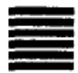

<!-- V3_SOURCE_ID:book016-b000220-p000-353590a588 -->

## 乾卦第一

查看对应原文

<!-- V3_FOLDBACK_BEGIN:book016-b000220-p000-353590a588 -->

## 乾卦第一

<!-- V3_FOLDBACK_END:book016-b000220-p000-353590a588 -->

<!-- V3_SOURCE_ID:book016-b000221-p000-79e6ddc4e2 -->

☰ 乾：元始，亨通，和谐有利，贞正坚固。

查看对应原文

<!-- V3_FOLDBACK_BEGIN:book016-b000221-p000-79e6ddc4e2 -->

☰ 乾①：元，亨，利，贞②。

<!-- V3_FOLDBACK_END:book016-b000221-p000-79e6ddc4e2 -->

<!-- V3_SOURCE_ID:book016-b000222-p000-5e8e3e5b85 -->

译文《乾》卦象征天：元始，亨通，和谐有利，贞正坚固。

查看对应原文

<!-- V3_FOLDBACK_BEGIN:book016-b000222-p000-5e8e3e5b85 -->

译文《乾》卦象征天：元始，亨通，和谐有利，贞正坚固。

<!-- V3_FOLDBACK_END:book016-b000222-p000-5e8e3e5b85 -->

<!-- V3_SOURCE_ID:book016-b000223-p000-01e785a389 -->

注释①乾：卦名，下卦、上卦皆为乾（☰），象征“天”。《说卦传》说：“乾，天也”，“乾，健也”，就是说乾的卦象是天，含义是刚健。《正义》记载：“此《乾》卦原本是用来象征天的，天是聚集众多阳气形成的。”

查看对应原文

<!-- V3_FOLDBACK_BEGIN:book016-b000223-p000-01e785a389 -->

注释①乾：卦名，下卦、上卦皆乾(☰)，象征“天”。《说卦传》“乾，天也”，“乾，健也”，即言“乾”之象为“天”，其义为“健”。《正义》：“此《乾》卦本以象天，天乃积诸阳气而成。”

<!-- V3_FOLDBACK_END:book016-b000223-p000-01e785a389 -->

<!-- V3_SOURCE_ID:book016-b000224-p000-5b27290bfb -->

②元、亨、利、贞：《正义》记载：“《子夏传》说：‘元，就是开始；亨，就是通达；利，就是和谐；贞，就是端正。’是说这个卦的德性，具有纯阳的属性，自然能够凭借阳气使万物开始生长，从而实现元始、亨通，能够让万物的属性和谐，各得其利，又能让万物坚固端正，得以终成。”按，对这四个字的解释，旧注有很多不同的看法，其中以《子夏传》的“四德”说较为通行，因此《正义》《集解》都采用这个说法。另外，《彖传》和《文言》对“四德”含义的阐发最为详尽，看后文就可以知道。

查看对应原文

<!-- V3_FOLDBACK_BEGIN:book016-b000224-p000-5b27290bfb -->

②元，亨，利，贞：《正义》：“《子夏传》云：‘元，始也；亨，通也；利，和也；贞，正也。’言此卦之德，有纯阳之性，自然能以阳气始生万物，而得元始、亨通，能使物性和谐各有其利，又能使物坚固贞正得终。”案，对这四字的解释，旧注颇多异议，以《子夏传》“四德”说较为通行，故《正义》、《集解》均取其说。又，《彖传》及《文言》发挥“四德”之义最为详尽，观后文可知。

<!-- V3_FOLDBACK_END:book016-b000224-p000-5b27290bfb -->

<!-- V3_SOURCE_ID:book016-b000225-p000-7070271332 -->

《周易》的作者通过对大自然的直观感受进行观察，认为“天”具备元始、亨通、和谐有利、贞正坚固这四种德性；之所以如此，是因为“天”的本质是沛然刚健的阳气，这种阳气运行不会停息，变化没有穷尽，沿着春、夏、秋、冬四季循环往复，制约并主宰着整个大自然。《尚氏学》依据《太玄经》的说法，将“四季”与《乾》的“四德”相配，能清晰体现阳气的运行规律，详细内容见《彖传》的“说明”部分。因此，《周易》中赞美“天”，实际上就是在赞美阳刚之德。

查看对应原文

<!-- V3_FOLDBACK_BEGIN:book016-b000225-p000-7070271332 -->

说明《周易》作者通过对大自然的直感的观察，认为“天”体现着元始、亨通、和谐有利、贞正坚固这四种德性；之所以如此，在于“天”的本质元素是沛然刚健的阳气，这种阳气“运行不息，变化无穷”，沿春、夏、秋、冬四季而循环往复，制约、主宰着整个大自然(《尚氏学》据《太玄经》说，以“四季”配《乾》“四德”极见阳气运行规律。详《彖传》“说明”)。因此，《周易》赞美“天”，事实上即是赞美阳刚之德。

<!-- V3_FOLDBACK_END:book016-b000225-p000-7070271332 -->

<!-- V3_SOURCE_ID:book016-b000226-p000-84c806c9e8 -->

初九①，潜龙勿用②。

查看对应原文

<!-- V3_FOLDBACK_BEGIN:book016-b000226-p000-84c806c9e8 -->

初九①，潜龙勿用②。

<!-- V3_FOLDBACK_END:book016-b000226-p000-84c806c9e8 -->

<!-- V3_SOURCE_ID:book016-b000227-p000-0dbc1165b9 -->

此处仅提及“才用”，具体含义不详

> **释读存疑：** 才用；原文仅提及“才用”，具体含义不详

查看对应原文

<!-- V3_FOLDBACK_BEGIN:book016-b000227-p000-0dbc1165b9 -->

才用。

<!-- V3_FOLDBACK_END:book016-b000227-p000-0dbc1165b9 -->

<!-- V3_SOURCE_ID:book016-b000228-p000-4fec3d1e38 -->

注释①初九：《周易》的六十四卦各由六爻组成，爻位从下往上依次称为初、二、三、四、五、上，本爻处于卦的最下方第一位，所以称“初”；《周易》占筮时使用“九”“六”这类数字，其中“九”的具体含义未完整表述

> **释读存疑：** 九；原文未完整表述“九”的具体含义

查看对应原文

<!-- V3_FOLDBACK_BEGIN:book016-b000228-p000-4fec3d1e38 -->

注释①初九：《周易》六十四卦各由六爻组成，其位自下而上，名曰：初、二、三、四、五、上，本爻居卦下第一位，所以称“初”；《周易》占筮用“九”、“六”之数，“九”

<!-- V3_FOLDBACK_END:book016-b000228-p000-4fec3d1e38 -->

<!-- V3_SOURCE_ID:book016-b000229-p000-3a9aa82d73 -->

“乾”代表阳，“六”代表阴，本爻属于阳爻，所以称“九”。《正义》说：“处于第一爻的位置，所以称初；因为是阳爻，所以称九”，就是这个意思。按六爻由下往上排列的规则，古人还认为它象征事物的发展是由低到高、由微渐著的。因此《周易乾凿度》说“《易》气从下生”，郑玄注释道：“《易》本无形，自微及著，故气从下生，以下爻为始也。”

查看对应原文

<!-- V3_FOLDBACK_BEGIN:book016-b000229-p000-3a9aa82d73 -->

代表阳，“六”代表阴，本爻为阳，所以称“九”。《正义》云：“居第一之位，故称初；以其阳爻，故称九”是也。案，六爻由下至上的排列，古人又以为象征事物的发展是由低渐高、由微而著。故《周易乾凿度》云“《易》气从下生”，郑玄注：“《易》本无形，自微及著，故气从下生，以下爻为始也。”

<!-- V3_FOLDBACK_END:book016-b000229-p000-3a9aa82d73 -->

<!-- V3_SOURCE_ID:book016-b000230-p000-534dce5bfa -->

②潜龙勿用：潜，就是潜伏，“初九”这一阳爻处于下方，所以称“潜”；龙，是古代神话中神奇刚健的动物，《周易》将其作为《乾》卦六爻的象征物。《集解》引用沈辚士的话：“称龙者，是取其象征意义。天地之气有升有降，君子之道有行有藏，龙作为一种事物，能飞能潜，所以借龙来比喻君子的德行。初九爻既然尚处潜伏状态，所以说勿用。”

查看对应原文

<!-- V3_FOLDBACK_BEGIN:book016-b000230-p000-534dce5bfa -->

②潜龙勿用：潜，潜伏，“初九”一阳在下，故谓“潜”；龙，古代神话中神奇刚健的动物，《周易》取为《乾》卦六爻的象征物。《集解》引沈辚士曰：“称龙者，假象也。天地之气有升降，君子之道有行藏，龙之为物，能飞能潜，故借龙比君子之德也。初九既尚潜伏，故言勿用。”

<!-- V3_FOLDBACK_END:book016-b000230-p000-534dce5bfa -->

<!-- V3_SOURCE_ID:book016-b000231-p000-3376538c15 -->

【说明】第一爻是事物的发端，地位卑微力量微弱，需要养精蓄锐，目的在于谋求进一步发展。因此《乾·初九》告诫“勿用”，实在是时机尚未成熟，暂时潜藏罢了；一旦形势许可，就要逐步推进，以达到“飞龙在天”的境界。

查看对应原文

<!-- V3_FOLDBACK_BEGIN:book016-b000231-p000-3376538c15 -->

【说明】第一爻是事物的发端，位卑力微，须养精蓄锐，其目的在于进一步发展。因此《乾·初九》诫以“勿用”，实为时机未到，暂行潜藏而已；一旦形势许可，就要步步进展，以达“飞龙在天”的境界。

<!-- V3_FOLDBACK_END:book016-b000231-p000-3376538c15 -->

<!-- V3_SOURCE_ID:book016-b000232-p000-605ef38334 -->

九二爻对应的情况是，龙出现在田间，利于出现大人。

查看对应原文

<!-- V3_FOLDBACK_BEGIN:book016-b000232-p000-605ef38334 -->

【译文】九二，巨龙出现田间，利于出现大人。

<!-- V3_FOLDBACK_END:book016-b000232-p000-605ef38334 -->

<!-- V3_SOURCE_ID:book016-b000233-p000-3d1285f748 -->

## 九二，见龙在田①，利见大人②。 — 九二，龙（风水中山脉、地势及气脉的来势和行度）出现在田地上，利于出现大人。

查看对应原文

<!-- V3_FOLDBACK_BEGIN:book016-b000233-p000-3d1285f748 -->

## 九二，见龙在田①，利见大人②。

<!-- V3_FOLDBACK_END:book016-b000233-p000-3d1285f748 -->

<!-- V3_SOURCE_ID:book016-b000234-p000-332eeeb0e9 -->

【注释】①见龙在田：见，读音为xiàn，意思是出现，下文“利见”的“见”与此读音和含义相同；田，就是地。《集解》引用郑玄的话说：“九二在三才中对应地道，地上就是田，所以称为田。”《王注》说：“从潜藏隐伏中出来，所以是见龙；处于地上，所以是在田。”

查看对应原文

<!-- V3_FOLDBACK_BEGIN:book016-b000234-p000-332eeeb0e9 -->

【注释】①见龙在田：见，音xiàn，出现，下文“利见”之“见”同；田，地也。《集解》引郑玄曰：“二于三才为地道，地上即田，故称田也。”《王注》：“出潜离隐，故曰见龙；处于地上，故曰在田。”

<!-- V3_FOLDBACK_END:book016-b000234-p000-332eeeb0e9 -->

<!-- V3_SOURCE_ID:book016-b000235-p000-f2a5fff088 -->

②大人：一般有两种含义：第一种，指有道德、有作为的人；第二种，指有道德且居于高位的人。这里指第一种含义。

查看对应原文

<!-- V3_FOLDBACK_BEGIN:book016-b000235-p000-f2a5fff088 -->

②大人：一般有两种含义：其一，指有道德有作为的人；其二，指有道德并居于高位的人。这里指第一义。

<!-- V3_FOLDBACK_END:book016-b000235-p000-f2a5fff088 -->

<!-- V3_SOURCE_ID:book016-b000236-p000-d8fc796b69 -->

【说明】九二爻阳刚之气逐渐增长，头角初露，迈出了重要的一步，虽然距离最终成功还很远，但它居中不偏，已经具备了成功的素质，因此获得“大人”的称誉。

查看对应原文

<!-- V3_FOLDBACK_BEGIN:book016-b000236-p000-d8fc796b69 -->

【说明】九二阳刚渐增，头角初露，迈开了重要的一步，虽距最后成功尚远，但居中不偏，已具备成功的素质，故有“大人”之誉。

<!-- V3_FOLDBACK_END:book016-b000236-p000-d8fc796b69 -->

<!-- V3_SOURCE_ID:book016-b000237-p000-4b239c2676 -->

译文九三，君子终日乾乾，到夜间还时时警惕慎行，这样，即使面临危险也能免遭咎害。

查看对应原文

<!-- V3_FOLDBACK_BEGIN:book016-b000237-p000-4b239c2676 -->

译文九三，君子整天健强振作不已，直 九三，君子终日乾乾①，夕惕到夜间还时时警惕慎行，这样，即使面临  
危险也免遭咎害。 若②，厉无咎③。

<!-- V3_FOLDBACK_END:book016-b000237-p000-4b239c2676 -->

<!-- V3_SOURCE_ID:book016-b000238-p000-6981893ec7 -->

匡释①君子终日乾乾：君子的含义与“大人”相近，指有道德的人，也常指居于尊位的人；终日，《正义》解释为“终竟此日”，因为九三处于下卦的末尾，所以这样称呼；乾乾，意思是“健而又健”。5

查看对应原文

<!-- V3_FOLDBACK_BEGIN:book016-b000238-p000-6981893ec7 -->

匡释①君子终日乾乾：君子，与“大人”义相近，指有道德者，往往也兼指居于尊位者；终日，《正义》：“终竟此日”，因九三居下卦之终，故称；乾乾，犹言“健而又健”。 5

<!-- V3_FOLDBACK_END:book016-b000238-p000-6981893ec7 -->

<!-- V3_SOURCE_ID:book016-b000239-p000-1117a31d82 -->

②惕若：惕，指警惕；若，是语助词。

查看对应原文

<!-- V3_FOLDBACK_BEGIN:book016-b000239-p000-1117a31d82 -->

②惕若：惕，警惕；若，语助词。

<!-- V3_FOLDBACK_END:book016-b000239-p000-1117a31d82 -->

<!-- V3_SOURCE_ID:book016-b000240-p000-e33960f047 -->

③厉无咎：厉，《广雅·释诂一》解释为“危也”；咎，《尔雅·释诂》解释为“病也”，《说文》解释为“灾也，从人各，‘各’者相违也”，《广雅·释诂三》解释为“恶也”，《诗·小雅·伐木》中“微我有咎”一句，《毛传》解释为“咎，过也”，《诗·小雅·北山》中“或惨惨畏咎”一句，《郑笺》解释为“咎，犹罪过也”，又《广韵》解释为“咎，愆也，过也”，根据这些说法，《易》中的“咎”字包含“灾病”“罪过”“咎害”的含义。案，《系辞上传》说，“无咎者，善补过也”，意思是弥补过失、免遭咎害。这一爻处于《乾》卦上下卦的交界处，此时多有危险，所以必须“朝乾夕惕”，修身反省不懈怠，才能做到“无咎”。《集解》引用干宝的话说：“君子以之忧深思远，朝夕匪懈，仰忧嘉会之不序，俯惧义和之不逮，反复天道，谋始反终，故曰‘终日乾乾’。”又说：“凡‘无咎’者，忧中之

> **释读存疑：** 原文此处有缺漏，未能完整释读

查看对应原文

<!-- V3_FOLDBACK_BEGIN:book016-b000240-p000-e33960f047 -->

③厉无咎：厉，《广雅·释诂一》“危也”；咎，《尔雅·释诂》“病也”，《说文》“灾也，从人各，‘各’者相违也”，《广雅·释诂三》“恶也”，《诗·小雅·伐木》“微我有咎”，《毛传》“咎，过也”，《诗·小雅·北山》“或惨惨畏咎”，《郑笺》“咎，犹罪过也”，又《广韵》“咎，愆也，过也”，据此诸说，《易》中“咎”字含有“灾病”、“罪过”、“咎害”之义。案，《系辞上传》云，“无咎者，善补过也”，即谓弥补过失、免遭咎害。此爻处《乾》上下卦之际，其时多危，故须“朝乾夕惕”，修省不懈，才可“无咎”。《集解》引干宝曰：“君子以之忧深思远，朝夕匪懈，仰忧嘉会之不序，俯惧义和之不逮，反复天道，谋始反终，故曰‘终日乾乾’。”又曰：“凡‘无咎’者，忧中之

<!-- V3_FOLDBACK_END:book016-b000240-p000-e33960f047 -->

<!-- V3_SOURCE_ID:book016-b000241-p000-01befb7f02 -->

这是说，喜悦，是善于弥补过错的表现。

查看对应原文

<!-- V3_FOLDBACK_BEGIN:book016-b000241-p000-01befb7f02 -->

喜，善补过者也。”

<!-- V3_FOLDBACK_END:book016-b000241-p000-01befb7f02 -->

<!-- V3_SOURCE_ID:book016-b000242-p000-8bae16a752 -->

《乾》卦的各爻都以“龙”为喻，只有九三爻称“君子”，《集解》引用郑玄的说法：“三对应三才中的人道，具备乾的德性而处于人道的位置，这就是君子的象征。”不过，《周易》是“随其事义而取象”，也就是灵活运用各种象征物来表达特定的象征意义。在《乾》卦的爻辞中，“龙”是阳刚之物，“君子”是健强之人，从象征的角度来看，两者都寓意着刚强不息的气质。王弼指出：“其余各爻都以龙来表述，到了九三爻却单独以君子为喻，这是为什么呢？《易》，就是象征；象征的产生，源于意义。有了这样的意义，之后就用对应的事物来表明它。”“从整体来看，《乾》卦的主体都是龙；分开来说，各爻则随其对应的意义而变化。”

查看对应原文

<!-- V3_FOLDBACK_BEGIN:book016-b000242-p000-8bae16a752 -->

说明《乾》卦诸爻均称“龙”，唯九三爻称“君子”，《集解》引郑玄说：“三于三才为人道，有乾德而在人道，君子之象。”然而，《周易》是“随其事义而取象”，即灵活地运用各种象征物表示特定的象征意义。在《乾》卦爻辞中，“龙”为阳刚之物，“君子”为健强之人。从象征的角度看，两者都寓意于刚强不息的气质。王弼指出：“余爻皆说龙，至于九三独以君子为目，何也？夫《易》者，象也；象之所生，生于义也。有斯义，然后明之以其物。”“统而举之，《乾》体皆龙；别而叙之，各随其义。”(《王注》)

<!-- V3_FOLDBACK_END:book016-b000242-p000-8bae16a752 -->

<!-- V3_SOURCE_ID:book016-b000243-p000-bec67b3e1b -->

## 九四，或跃在渊①，无咎。 — 九四爻的爻辞为“或跃在渊①，无咎”。

查看对应原文

<!-- V3_FOLDBACK_BEGIN:book016-b000243-p000-bec67b3e1b -->

## 九四，或跃在渊①，无咎。

<!-- V3_FOLDBACK_END:book016-b000243-p000-bec67b3e1b -->

<!-- V3_SOURCE_ID:book016-b000244-p000-8713e25cff -->

译文九四，或者腾跃上进，或者退处在渊，必无咎害。

查看对应原文

<!-- V3_FOLDBACK_BEGIN:book016-b000244-p000-8713e25cff -->

译文九四，或者腾跃上进，或者退处在渊，必无咎害。

<!-- V3_FOLDBACK_END:book016-b000244-p000-8713e25cff -->

<!-- V3_SOURCE_ID:book016-b000245-p000-fc24f75f6e -->

注释①或：这里用作副词，表示不确定之义。《乾文言》：“或之者，疑之也。”《正义》：“言九四阳气渐进，似若龙体，欲飞犹疑或也。”但这种“疑”并非犹疑不决，而是审时度势，待机奋进。案，本句省略主语“龙”。

查看对应原文

<!-- V3_FOLDBACK_BEGIN:book016-b000245-p000-fc24f75f6e -->

注释①或：这里用作副词，表示不确定之义。《乾文言》：“或之者，疑之也。”《正义》：“言九四阳气渐进，似若龙体，欲飞犹疑或也。”但这种“疑”并非犹疑不决，而是审时度势，待机奋进。案，本句省略主语“龙”。

<!-- V3_FOLDBACK_END:book016-b000245-p000-fc24f75f6e -->

<!-- V3_SOURCE_ID:book016-b000246-p000-68abe65efd -->

说明《周易》的第三、四爻，均表示比较难处的地位：三虽居于下卦之上，但未升至上卦；四虽已进入上卦，却又居于上卦之下。这两种位置若处之不妥，往往导致下受抵、上遭压，所以《系辞下传》指出“三多凶”、“四多惧”。而《乾》九三所谓“终日乾乾，夕惕若”，九四所谓“或跃在渊”，都是针对其艰难地位而发的。这是《周易》爻位的一个重要特点。

查看对应原文

<!-- V3_FOLDBACK_BEGIN:book016-b000246-p000-68abe65efd -->

说明《周易》的第三、四爻，均表示比较难处的地位：三虽居于下卦之上，但未升至上卦；四虽已进入上卦，却又居于上卦之下。这两种位置若处之不妥，往往导致下受抵、上遭压，所以《系辞下传》指出“三多凶”、“四多惧”。而《乾》九三所谓“终日乾乾，夕惕若”，九四所谓“或跃在渊”，都是针对其艰难地位而发的。这是《周易》爻位的一个重要特点。

<!-- V3_FOLDBACK_END:book016-b000246-p000-68abe65efd -->

<!-- V3_SOURCE_ID:book016-b000247-p000-0aa0a081be -->

九五，飞龙在天，利见大人①。 九五，巨龙高飞上天，利于出现

查看对应原文

<!-- V3_FOLDBACK_BEGIN:book016-b000247-p000-0aa0a081be -->

九五，飞龙在天，利见大人①。 九五，巨龙高飞上天，利于出现

<!-- V3_FOLDBACK_END:book016-b000247-p000-0aa0a081be -->

<!-- V3_SOURCE_ID:book016-b000248-p000-84f93d2934 -->

注释①大人：见前注第二义，指有道德并居高位者，与“九二”所称“大人”有别。《集解》引郑玄曰：“五于三才为天道，天者清明无形而龙在焉，飞之象也。”《正义》：“言九五阳气盛至于天，故云飞龙在天，此自然之象，犹若圣人有龙德，飞腾而居天位，德备天下，为万物所瞻睹，故天下利见此居王位之大人。”

查看对应原文

<!-- V3_FOLDBACK_BEGIN:book016-b000248-p000-84f93d2934 -->

注释①大人：见前注第二义，指有道德并居高位者，与“九二”所称“大人”有别。《集解》引郑玄曰：“五于三才为天道，天者清明无形而龙在焉，飞之象也。”《正义》：“言九五阳气盛至于天，故云飞龙在天，此自然之象，犹若圣人有龙德，飞腾而居天位，德备天下，为万物所瞻睹，故天下利见此居王位之大人。”

<!-- V3_FOLDBACK_END:book016-b000248-p000-84f93d2934 -->

<!-- V3_SOURCE_ID:book016-b000249-p000-0bd38b0c47 -->

说明第五爻居上卦之中，往往是每卦最吉之爻，旧说称此爻为“君位”，事实上多是象征事物发展到最完美阶段的情景。

查看对应原文

<!-- V3_FOLDBACK_BEGIN:book016-b000249-p000-0bd38b0c47 -->

说明第五爻居上卦之中，往往是每卦最吉之爻，旧说称此爻为“君位”，事实上多是象征事物发展到最完美阶段的情景。

<!-- V3_FOLDBACK_END:book016-b000249-p000-0bd38b0c47 -->

<!-- V3_SOURCE_ID:book016-b000250-p000-46b1b55019 -->

上九，“亢龙有悔”①。

查看对应原文

<!-- V3_FOLDBACK_BEGIN:book016-b000250-p000-46b1b55019 -->

上九，亢龙有悔①。

<!-- V3_FOLDBACK_END:book016-b000250-p000-46b1b55019 -->

<!-- V3_SOURCE_ID:book016-b000251-p000-5acbecf13b -->

注释①亢：读音为kàng，意思是过甚、极度，《集解》引用王肃的话：“穷高曰亢。”这里用来形容“龙”飞到极高的程度。悔：指悔恨。按，《系辞上传》中说“悔吝者，忧虞之象也”，《正义》解释：“悔者，其事已过，有所追悔之也。”上九处于《乾》卦的末尾，阳爻前进到了极致，将会招致灾害，所以说“有悔”。《集解》引用王肃的话：“知进忘退，故悔也。”

查看对应原文

<!-- V3_FOLDBACK_BEGIN:book016-b000251-p000-5acbecf13b -->

注释①亢：音kàng，过甚，极度，《集解》引王肃曰：“穷高曰亢。”此处形容龙飞到极高的程度。悔：悔恨。案，《系辞上传》“悔吝者，忧虞之象也”，《正义》：“悔者，其事已过，有所追悔之也。”上九居《乾》卦之终，阳进亢极，将致灾害，故“有悔”。《集解》引王肃曰：“知进忘退，故悔也。”

<!-- V3_FOLDBACK_END:book016-b000251-p000-5acbecf13b -->

<!-- V3_SOURCE_ID:book016-b000252-p000-cc3c928748 -->

这说明事物发展到极盛之后必然会走向衰落。《周易》的第六爻大多蕴含这一道理。《乾》卦的上九爻“亢龙”高飞至极点，势必会遭受挫折。朱熹说：“当极盛之时，便须虑其亢，如这般处，最是。《易》之大义，大抵于盛满时致戒。”

查看对应原文

<!-- V3_FOLDBACK_BEGIN:book016-b000252-p000-cc3c928748 -->

说明事物的发展，盛极必衰。《周易》第六爻多寓这一哲理。《乾》上九“亢龙”高飞穷极，势必遭受挫折。朱熹曰：“当极盛之时，便须虑其亢，如这般处，最是。《易》之大义，大抵于盛满时致戒。”(《朱子语类》)

<!-- V3_FOLDBACK_END:book016-b000252-p000-cc3c928748 -->

<!-- V3_SOURCE_ID:book016-b000253-p000-67eb82e1ef -->

自行运用“九”数，出现一群巨龙（风水中山脉、地势及气脉的来势和行度），都不以用九①，出现群龙（风水中山脉、地势及气脉的来势和行度）没有首领的景象，吉祥②。

查看对应原文

<!-- V3_FOLDBACK_BEGIN:book016-b000253-p000-67eb82e1ef -->

自用“九”数，出现一群巨龙，都不以 用九①，见群龙无首，吉②。

<!-- V3_FOLDBACK_END:book016-b000253-p000-67eb82e1ef -->

<!-- V3_SOURCE_ID:book016-b000254-p000-baf428293e -->

注释①用九：这是指明《周易》哲学以“变”为主的一方面特点。《易》筮过程中，凡筮得阳爻，其数或“七”、或“九”，“九”可变，“七”不变，因此《周易》筮法原则是阳爻用“九”不用“七”，意思是占问其“变爻”；若筮得六爻均为“九”时，就以“用九”的爻辞作为占断依据。《本义》说：“用九，是说凡是筮得阳爻的，都用九，而不用七。大概是各卦一百九十二个阳爻的通用规则。因为这一卦纯阳居首，所以在这里说明它。而圣人因此附上这段爻辞，让遇到这一卦且六爻都发生变化的人就用这段爻辞占断。”

查看对应原文

<!-- V3_FOLDBACK_BEGIN:book016-b000254-p000-baf428293e -->

注释①用九：这是指明《周易》哲学以“变”为主的一方面特点。《易》筮过程中，凡筮得阳爻，其数或“七”、或“九”，“九”可变，“七”不变，故《周易》筮法原则是阳爻用“九”不用“七”，意即占其“变爻”；若筮得六爻均“九”时，即以“用九”辞为占。《本义》：“用九，言凡筮得阳爻者，皆用九，而不用七。盖诸卦百九十二阳爻之通例也。以此卦纯阳居首，故于此发之。而圣人因系之辞，使遇此卦而六爻皆变者即此占之。”

<!-- V3_FOLDBACK_END:book016-b000254-p000-baf428293e -->

<!-- V3_SOURCE_ID:book016-b000255-p000-b5d3bbd456 -->

②见群龙无首，吉：群龙（风水中山脉、地势及气脉的来势和行度），指六爻均为阳爻；而六阳都发生变化，都由阳刚变为阴柔，所以取群龙（风水中山脉、地势及气脉的来势和行度）都不以首领自居的景象。《尚氏学》说：“‘见群龙无首，吉’，是申述遇到‘九’就会变化的道理。九为什么一定会变化？阳数之九是极多的，所以称为‘群’。阳极就会转为阴，这是天地自然的规律。乾（八卦之一，卦象及五行、方位依原文语境确定）作为首领，以阳刚之性居于万物之首，容易招致万物的猜忌；变为坤（八卦之一，卦象及五行、方位依原文语境确定）就没有首领，没有首领就能以柔来调和刚，所以吉祥。”

查看对应原文

<!-- V3_FOLDBACK_BEGIN:book016-b000255-p000-b5d3bbd456 -->

②见群龙无首，吉：群龙，指六爻均为阳爻；而六阳皆变，皆由阳刚变为阴柔，所以取群龙都不以首领自居之象。《尚氏学》：“‘见群龙无首，吉’者，申遇‘九’则变之义也。九何以必变？阳之数九为极多，故曰‘群’。阳极反阴，乃天地自然之理。乾为首，以阳刚居物首，易招物忌；变坤则无首，无首则能以柔济刚，故吉。”

<!-- V3_FOLDBACK_END:book016-b000255-p000-b5d3bbd456 -->

<!-- V3_SOURCE_ID:book016-b000256-p000-af777bf3f0 -->

说明《周易》的作者强调“谦”，认为越是刚健、越是有地位，越要不居于万物之先。“见群龙无首”，正体现了这种思想。王弼解释“用九”，指出“以刚健之性居于众人之首，就会不被众人所亲附”（《王注》），这是直接运用《老子》中“把自身放在众人之后反而能居于众人之前”以及“尊贵以卑贱为根本”的观点。这种说法符合《易》的道理，也与《象传》中“天德不可为首”的说法相符。

查看对应原文

<!-- V3_FOLDBACK_BEGIN:book016-b000256-p000-af777bf3f0 -->

说明《周易》作者强调“谦”，认为越是刚健，越有地位，越要不为物先。“见群龙无首”，正体现这种思想。王弼释“用九”，指出“以刚健而居人之首，则物之所不与”(《王注》)，是直接应用《老子》“后其身而身先”及“贵以贱为本”的观点。有合《易》理，并与《象传》“天德不可为首”的说法相符。

<!-- V3_FOLDBACK_END:book016-b000256-p000-af777bf3f0 -->

<!-- V3_SOURCE_ID:book016-b000257-p000-f2ee429e8f -->

译文《彖传》说：伟大啊，开创万物的（春天）阳气！万物依靠它开始产生，它统领着大自然。（夏天）云朵飘行、霖雨降落，各类事物流布成形。光辉灿烂的太阳反复运转（带来秋天），《乾》卦六爻按不同的时位组合而有所成，就像阳气按时乘着六条巨龙驾驭大自然。大自然的运行变化（迎来冬天），万物各自静定精神，保全太和元气，以利于守持正固（等待来年生长）。阳气周流不息，又开始重新萌生万物，天下万方都和美顺昌。

查看对应原文

<!-- V3_FOLDBACK_BEGIN:book016-b000257-p000-f2ee429e8f -->

译文《彖传》说：伟大啊，开创万物的（春天）阳气！万物依靠它开始产生，它统领着大自然。（夏天）云朵飘行、霖雨降落，各类事物流布成形。光辉灿烂的太阳反复运转（带来秋天），《乾》卦六爻按不同的时位组合而有所成，就像阳气按时乘着六条巨龙驾驭大自然。大自然的运行变化（迎来冬天），万物各自静定精神，保全太和元气，以利于守持正固（等待来年生长）。阳气周流不息，又开始重新萌生万物，天下万方都和美顺昌。

<!-- V3_FOLDBACK_END:book016-b000257-p000-f2ee429e8f -->

<!-- V3_SOURCE_ID:book016-b000258-p000-e651a93cfa -->

《彖》说：伟大啊，乾的元始之德！万物依靠它开始产生，它统领着大自然。云朵飘行、霖雨降落，各类事物流布成形。光辉灿烂的太阳终而复始地运转，六爻的位置按时序确定，阳气按时乘着六条龙驾驭大自然。乾道运行变化，万物各自端正本性与命运，保全并聚合太和元气，以利于守持正固。阳气率先萌生万物，天下万国都安宁和顺。

> **释读存疑：** 原文中“六位”“六龙”“乾道”“太和”等术语的具体所依语境下的细节含义未明确释读，保留原释读的通俗化处理

查看对应原文

<!-- V3_FOLDBACK_BEGIN:book016-b000258-p000-e651a93cfa -->

《彖》①曰：大哉乾元②！万物资始，乃统天③。云行雨施，品物流形④。大明终始⑤，六位时成⑥，时乘六龙以御天⑦。乾道变化⑧，各正性命⑨，保合太和，乃利贞⑩。首出庶物⑪，万国咸宁⑫。

<!-- V3_FOLDBACK_END:book016-b000258-p000-e651a93cfa -->

<!-- V3_SOURCE_ID:book016-b000259-p000-fe590925c6 -->

注释①：彖，读音为tuàn，《正义》引用褚氏、庄氏的解释说：“彖就是断定的意思，断定一卦的全部含义，所以取名为‘彖’。”但作为经传的名称，它的含义有两种：一是指卦辞，即《释文》所引马融所说的“彖辞，就是卦辞”。《左传》襄公九年的孔疏也持这种观点，称“《周易》卦下的文辞就叫做《彖》”；二是指《十翼》中的《彖传》，也就是王弼《周易略例》所说的“统论一卦之体”的内容，《正义》也说：“孔子所作的《彖辞》，是统论一卦的含义。”这里指第二种含义，六十四卦所附的“《彖》曰”之辞，都属于这种情况。《彖传》也叫《彖辞传》。

查看对应原文

<!-- V3_FOLDBACK_BEGIN:book016-b000259-p000-fe590925c6 -->

注释①彖：音tuàn，《正义》引褚氏、庄氏释曰：“彖断也，断定一卦之义，所以名为‘彖’也。”但作为经传之名，其义有二：一、指卦辞，即《释文》引马融所谓“彖辞，卦辞也。”《左传》襄公九年孔疏从之，称“《周易》卦下之辞谓之为《彖》”；二、指《十翼》中的《彖传》，即王弼《周易略例》所谓“统论一卦之体”者也，《正义》亦曰：“夫子所作《彖辞》，统论一卦之义。”这里指第二义，凡六十四卦所附“《彖》曰”之辞，均属此例。《彖传》又称《彖辞传》。

<!-- V3_FOLDBACK_END:book016-b000259-p000-fe590925c6 -->

<!-- V3_SOURCE_ID:book016-b000260-p000-164e5afc2e -->

②乾元：“天”的元始之德，也就是充沛宇宙间、开创万物的阳气。用季节作比喻，就像春天的景象。《尚氏学》说：“乾元，就是乾的元气，在季节上对应春季。”

查看对应原文

<!-- V3_FOLDBACK_BEGIN:book016-b000260-p000-164e5afc2e -->

②乾元：“天”的元始之德，即充沛宇宙间、开创万物的阳气。 以季节为喻，犹如春天景象。《尚氏学》：“乾元者，乾之元气也，于时配春。”

<!-- V3_FOLDBACK_END:book016-b000260-p000-164e5afc2e -->

<!-- V3_SOURCE_ID:book016-b000261-p000-8f9c504279 -->

③统天：统，意思是统领；天，相当于说“大自然”。《正义》解释道：“至健而为物始，以此乃能统领于天。”以上一节释卦辞“元”。

查看对应原文

<!-- V3_FOLDBACK_BEGIN:book016-b000261-p000-8f9c504279 -->

③统天：统，统领；天，犹言“大自然”。《正义》：“至健而为物始，以此乃能统领于天。”以上一节释卦辞“元”。

<!-- V3_FOLDBACK_END:book016-b000261-p000-8f9c504279 -->

<!-- V3_SOURCE_ID:book016-b000262-p000-07a886589f -->

④品物流形：品，《说文》解释为“众庶也”，“品物”就是各类事物；流形，指流布成形。这是指万物因雨水的滋润而不断变化发展、壮大成形。此犹夏天的景象。《正义》解释道：“言《乾》能用‘天’之德，使云气流行，雨泽施布，故品类之物流布成形，各得亨通，无所壅蔽：是其‘亨’也。”《尚氏学》说：“于时配夏。”以上一节释卦辞“亨”。

> **释读存疑：** 本地硬校验仍未通过，已记录供后续自动处理或人工核对。

查看对应原文

<!-- V3_FOLDBACK_BEGIN:book016-b000262-p000-07a886589f -->

④品物流形：品，《说文》：“众庶也”，“品物”即各类事物；流形，流布成形。这是指万物因雨水的滋润而不断变化发展、壮大成形。此犹夏天的景象。《正义》：“言《乾》能用‘天’之德，使云气流行，雨泽施布，故品类之物流布成形，各得亨通，无所壅蔽：是其‘亨’也。”《尚氏学》：“于时配夏。”以上一节释卦辞“亨”。

<!-- V3_FOLDBACK_END:book016-b000262-p000-07a886589f -->

<!-- V3_SOURCE_ID:book016-b000263-p000-8d0fb61abc -->

⑤大明：就是太阳，因为它是天上最光明的事物，所以称为“大明”。

查看对应原文

<!-- V3_FOLDBACK_BEGIN:book016-b000263-p000-8d0fb61abc -->

⑤大明：即太阳，因属天上最光明之物，故称“大明”。

<!-- V3_FOLDBACK_END:book016-b000263-p000-8d0fb61abc -->

<!-- V3_SOURCE_ID:book016-b000264-p000-599f027923 -->

⑥六位时成：六位，指《乾》卦的六爻；时，作副词，意思是按时。这句话是说《乾》卦的六爻按照不同的“时位”组合而成，说明阳气的发展遵循一定的规律。

查看对应原文

<!-- V3_FOLDBACK_BEGIN:book016-b000264-p000-599f027923 -->

⑥六位时成：六位，指《乾》卦六爻；时，作副词，即按时。此句举卦中六爻按不同的“时位”组成，说明阳气的发展顺沿一定的规律。

<!-- V3_FOLDBACK_END:book016-b000264-p000-599f027923 -->

<!-- V3_SOURCE_ID:book016-b000265-p000-b529e3bc8f -->

⑦六龙：也用来比喻《乾》卦的六爻。这句话紧承前一句的意思，说明六爻的变动就像六龙按时驾御上天，好比自然界沿着四季的程序发展到秋天，万物都趋向成熟。前面提到的“时成”二字，正蕴含着秋天的景象。《尚氏学》说：“于时配秋”，以上一节内容解释卦辞中的“利”。

查看对应原文

<!-- V3_FOLDBACK_BEGIN:book016-b000265-p000-b529e3bc8f -->

⑦六龙：亦喻《乾》卦六爻。此句紧承前句之义，说明六爻的变动如六龙按时御天，恰似自然界沿四季程序发展至秋、万物尽趋成熟。前文“时成”二字，正寓含秋天景象。《尚氏学》：“于时配秋”，以上一节释卦辞“利”。

<!-- V3_FOLDBACK_END:book016-b000265-p000-b529e3bc8f -->

<!-- V3_SOURCE_ID:book016-b000266-p000-9f7dfc7d03 -->

⑧乾道：就像说天道，也就是大自然的运行规律。

查看对应原文

<!-- V3_FOLDBACK_BEGIN:book016-b000266-p000-9f7dfc7d03 -->

⑧乾道：犹言天道，即大自然运行规律。

<!-- V3_FOLDBACK_END:book016-b000266-p000-9f7dfc7d03 -->

<!-- V3_SOURCE_ID:book016-b000267-p000-d44cf0a576 -->

⑨各正性命：正，相当于“定”，《周礼·天官》中宰夫所说的“令群吏正岁会”，郑玄注释“正”为“定”，这里指静定；性命，《正义》解释：“性是天生的本质，比如刚柔迟速这类区别；命是人所禀受的，比如贵贱夭寿这类情况。”《尚氏学》将其解释为“精神”，这个说法是可以采纳的。这句话的主语是“万物”，文中省略了。

查看对应原文

<!-- V3_FOLDBACK_BEGIN:book016-b000267-p000-d44cf0a576 -->

⑨各正性命：正，犹“定”，《周礼·天官》宰夫“令群吏正岁会”，郑玄注“正”为“定”，此处指静定；性命，《正义》：“性者天生之质，若刚柔迟速之别；命者人所禀受，若贵贱夭寿之属。”《尚氏学》释为“精神”，可从。这一句的主语是“万物”，文中省略。

<!-- V3_FOLDBACK_END:book016-b000267-p000-d44cf0a576 -->

<!-- V3_SOURCE_ID:book016-b000268-p000-40e8ae80f8 -->

⑩太和：《本义》将其解释为“阴阳会合、冲和之气”，也就是万物的“太和元气”。这两句话说明自然界的变化，使得万物各自静定精神、眠伏潜息，保全它们的“太和元气”。这好比冬天的景象。《尚氏学》说：“于时配冬。”

查看对应原文

<!-- V3_FOLDBACK_BEGIN:book016-b000268-p000-40e8ae80f8 -->

⑩太和：《本义》释为“阴阳会合、冲和之气”，即万物的“太和元气”。这两句说明自然界的变化，导致万物各自静定精神、眠伏潜息，保全其“太和元气”。此犹冬天景象。《尚氏学》：“于时配冬。”

<!-- V3_FOLDBACK_END:book016-b000268-p000-40e8ae80f8 -->

<!-- V3_SOURCE_ID:book016-b000269-p000-f21fc831c2 -->

⑪ 乃利贞：以上一节释卦辞“贞”。案，《正义》认为“保合太和，乃利贞”两句，释卦辞“利贞”，意指万物“能保安合会”，“得利而贞正”。可备一说。

查看对应原文

<!-- V3_FOLDBACK_BEGIN:book016-b000269-p000-f21fc831c2 -->

⑪ 乃利贞：以上一节释卦辞“贞”。案，《正义》认为“保合太和，乃利贞”两句，释卦辞“利贞”，意指万物“能保安合会”，“得利而贞正”。可备一说。

<!-- V3_FOLDBACK_END:book016-b000269-p000-f21fc831c2 -->

<!-- V3_SOURCE_ID:book016-b000270-p000-413078c2b7 -->

⑫ 首出庶物：此句说明阳气的变化循环不已，犹如冬尽春来，新的阳气又开始萌生万物；就“四德”言，即复返“元”德，故亦称“贞下起元”。《重定费氏学》：“贞下起元，万物又于是乎资始矣。”

查看对应原文

<!-- V3_FOLDBACK_BEGIN:book016-b000270-p000-413078c2b7 -->

⑫ 首出庶物：此句说明阳气的变化循环不已，犹如冬尽春来，新的阳气又开始萌生万物；就“四德”言，即复返“元”德，故亦称“贞下起元”。《重定费氏学》：“贞下起元，万物又于是乎资始矣。”

<!-- V3_FOLDBACK_END:book016-b000270-p000-413078c2b7 -->

<!-- V3_SOURCE_ID:book016-b000271-p000-b82ceee12e -->

⑬ 万国咸宁：万国，《纂疏》：“地有九州，故曰万国”，即天下万方之意。《集解》引刘瓛曰：“阳气为万物之所始，故曰‘首出庶物’；立君而天下皆宁，故曰‘万国咸宁’也。”这是以阳气“首出庶物”比拟拥立君主以使“万国咸宁”，亦可备一说。

查看对应原文

<!-- V3_FOLDBACK_BEGIN:book016-b000271-p000-b82ceee12e -->

⑬ 万国咸宁：万国，《纂疏》：“地有九州，故曰万国”，即天下万方之意。《集解》引刘瓛曰：“阳气为万物之所始，故曰‘首出庶物’；立君而天下皆宁，故曰‘万国咸宁’也。”这是以阳气“首出庶物”比拟拥立君主以使“万国咸宁”，亦可备一说。

<!-- V3_FOLDBACK_END:book016-b000271-p000-b82ceee12e -->

<!-- V3_SOURCE_ID:book016-b000272-p000-458c792915 -->

说明卦辞“元，亨，利，贞”之义，《彖传》阐发甚详。扬雄《太玄·文》“罔、直、蒙、酋、冥”，范望注云：“此五者为《太玄》之德，犹《易》‘元，亨，利，贞’也。”《太玄》并说明：直，东方，春；蒙，南方，夏；酋，西方，秋；罔、冥，北方，冬。今案，“直”之言殖也，直为繁殖，故以为春；“蒙”为蒙覆，草木修长，故以为夏；“酋”为蓄聚，万物成就，故以为秋；“罔”、“冥”为闭藏、无形，故以为冬也。行唐尚节之先生撰《周易尚氏学》，极力肯定《太玄》之说，指出：“其所谓直、蒙、酋，即震春、离夏、兑秋，即元、亨、利也；其所谓罔、冥，即坎冬，即贞也。”又云：“盖天之体，以健为用；而天之德，莫大于四时。元亨利贞，即春夏秋冬，即东南西北。震元、离亨、兑利、坎贞，往来循环，不忒不穷，《周易》之名。即以此也。后儒释此者，莫过于《太玄》。”尚先生此说，既使《乾》卦“四德”寓意了然，又使《彖传》大旨益增明确，实甚可取。

查看对应原文

<!-- V3_FOLDBACK_BEGIN:book016-b000272-p000-458c792915 -->

说明卦辞“元，亨，利，贞”之义，《彖传》阐发甚详。扬雄《太玄·文》“罔、直、蒙、酋、冥”，范望注云：“此五者为《太玄》之德，犹《易》‘元，亨，利，贞’也。”《太玄》并说明：直，东方，春；蒙，南方，夏；酋，西方，秋；罔、冥，北方，冬。今案，“直”之言殖也，直为繁殖，故以为春；“蒙”为蒙覆，草木修长，故以为夏；“酋”为蓄聚，万物成就，故以为秋；“罔”、“冥”为闭藏、无形，故以为冬也。行唐尚节之先生撰《周易尚氏学》，极力肯定《太玄》之说，指出：“其所谓直、蒙、酋，即震春、离夏、兑秋，即元、亨、利也；其所谓罔、冥，即坎冬，即贞也。”又云：“盖天之体，以健为用；而天之德，莫大于四时。元亨利贞，即春夏秋冬，即东南西北。震元、离亨、兑利、坎贞，往来循环，不忒不穷，《周易》之名。即以此也。后儒释此者，莫过于《太玄》。”尚先生此说，既使《乾》卦“四德”寓意了然，又使《彖传》大旨益增明确，实甚可取。

<!-- V3_FOLDBACK_END:book016-b000272-p000-458c792915 -->

<!-- V3_SOURCE_ID:book016-b000273-p000-5bd7a90f6e -->

《象》曰①：天行健②；君子以 译文《象传》说：天的运行刚强劲健；君子因此不停地自我奋发图强。自强不息③。

查看对应原文

<!-- V3_FOLDBACK_BEGIN:book016-b000273-p000-5bd7a90f6e -->

《象》曰①：天行健②；君子以 译文《象传》说：天的运行刚强劲健；君子因此不停地自我奋发图强。自强不息③。

<!-- V3_FOLDBACK_END:book016-b000273-p000-5bd7a90f6e -->

<!-- V3_SOURCE_ID:book016-b000274-p000-798e4c8995 -->

注释①象：《周易》中的“象”字，即“形象”、“象征”之意，亦《系辞下传》所谓“象也者，像此者也”。但作为经传之名，则有两义：一、指《周易》的卦形和卦爻辞，《系辞下传》：“《易》者，象也。”《左传》昭公二年叙韩宣子适鲁“见《易象》与《鲁春秋》”，均指此，故宋人项安世《周易玩辞》谓“凡卦辞皆曰象，凡卦画皆曰象”，故卦爻辞又称《象辞》；二、指《十翼》中的《象传》，旨在阐释卦象、爻象的象征意义。这里指第二义。凡六十四卦所附“《象》曰”云云，均属此例。《象传》又有《大象传》、《小象传》之分：前者每卦一则，释上下卦象，《正义》谓“总象一卦，故谓之《大象》”；后者每卦六则，释六爻爻象(《乾》、《坤》两卦分别多一则释“用九”、“用六”)，《正义》谓“释六爻之《象辞》，谓之《小象》”。本则即属《乾》卦的《大象传》。

查看对应原文

<!-- V3_FOLDBACK_BEGIN:book016-b000274-p000-798e4c8995 -->

注释①象：《周易》中的“象”字，即“形象”、“象征”之意，亦《系辞下传》所谓“象也者，像此者也”。但作为经传之名，则有两义：一、指《周易》的卦形和卦爻辞，《系辞下传》：“《易》者，象也。”《左传》昭公二年叙韩宣子适鲁“见《易象》与《鲁春秋》”，均指此，故宋人项安世《周易玩辞》谓“凡卦辞皆曰象，凡卦画皆曰象”，故卦爻辞又称《象辞》；二、指《十翼》中的《象传》，旨在阐释卦象、爻象的象征意义。这里指第二义。凡六十四卦所附“《象》曰”云云，均属此例。《象传》又有《大象传》、《小象传》之分：前者每卦一则，释上下卦象，《正义》谓“总象一卦，故谓之《大象》”；后者每卦六则，释六爻爻象(《乾》、《坤》两卦分别多一则释“用九”、“用六”)，《正义》谓“释六爻之《象辞》，谓之《小象》”。本则即属《乾》卦的《大象传》。

<!-- V3_FOLDBACK_END:book016-b000274-p000-798e4c8995 -->

<!-- V3_SOURCE_ID:book016-b000275-p000-cc174baefe -->

②天行健：此释《乾》卦上下“乾”均为“天”之象，说明“天”健行周流，永不衰竭。《集解》引宋衷曰：“昼夜不懈，以健详其名。”《正义》：“行者，运动之称；健者，强壮之名。”

查看对应原文

<!-- V3_FOLDBACK_BEGIN:book016-b000275-p000-cc174baefe -->

②天行健：此释《乾》卦上下“乾”均为“天”之象，说明“天”健行周流，永不衰竭。《集解》引宋衷曰：“昼夜不懈，以健详其名。”《正义》：“行者，运动之称；健者，强壮之名。”

<!-- V3_FOLDBACK_END:book016-b000275-p000-cc174baefe -->

<!-- V3_SOURCE_ID:book016-b000276-p000-56cd92a4d4 -->

③以：介词，其后省略一“之”字，可释为“因此”、“像这样”，以引出下文推阐睡的结果(余六十三卦《大象传》“以”字之义均仿此)。自强不息：指“君子”效法《乾》卦“健行”之象，立身、行事始终奋发不止。《正义》：“此以人事法天所行，言君子之人用此卦象自强勉力，不有止息。”

查看对应原文

<!-- V3_FOLDBACK_BEGIN:book016-b000276-p000-56cd92a4d4 -->

③以：介词，其后省略一“之”字，可释为“因此”、“像这样”，以引出下文推阐睡的结果(余六十三卦《大象传》“以”字之义均仿此)。自强不息：指“君子”效法《乾》卦“健行”之象，立身、行事始终奋发不止。《正义》：“此以人事法天所行，言君子之人用此卦象自强勉力，不有止息。”

<!-- V3_FOLDBACK_END:book016-b000276-p000-56cd92a4d4 -->

<!-- V3_SOURCE_ID:book016-b000277-p000-77a8f5f6f2 -->

《大象传》的基本体例是：先解释上下卦的卦象，再从卦象推衍出贴近人事的象征意义。也就是《折中》所说的：“专取两象以立义。”

查看对应原文

<!-- V3_FOLDBACK_BEGIN:book016-b000277-p000-77a8f5f6f2 -->

说明《大象传》基本体例是：先释上下卦的卦象，然后从卦象推衍出切近人事的象征意义。即《折中》所谓：“专取两象以立义。”

<!-- V3_FOLDBACK_END:book016-b000277-p000-77a8f5f6f2 -->

<!-- V3_SOURCE_ID:book016-b000278-p000-e6ff912640 -->

译文“巨龙潜伏水中，暂不施展才用”，说明阳气初生且所处位置低下；“巨龙出现田间”，说明美德昭著且广施无涯；“整天健强振作”，说明反复践行正道而不出现偏差；“或腾跃上进，或退处在渊”，说明审时度势后前进必然没有咎害；“巨龙高飞上天”，说明大人奋起而大展雄才；“巨龙高飞穷极，终将有所悔恨”，说明刚进过甚不久就会衰败；“用九数”，说明“天”的美德不自居首（刚去柔来）。

查看对应原文

<!-- V3_FOLDBACK_BEGIN:book016-b000278-p000-e6ff912640 -->

译文“巨龙潜伏水中，暂不施展才用”，说明阳气初生居位低下；“巨龙出现田间”，说明美德昭著广施无涯；“整天健强振作”，说明反复行道不使偏差；“或腾跃上进，或退处在渊”，说明审时前进必无咎害；“巨龙高飞上天”，说明大人奋起大展雄才；“巨龙高飞穷极，终将有所悔恨”，说明刚进过甚不久必衰；“用九数”，说明“天”的美德不自居首(刚去柔来)。

<!-- V3_FOLDBACK_END:book016-b000278-p000-e6ff912640 -->

<!-- V3_SOURCE_ID:book016-b000279-p000-0f25bd082e -->

“潜龙勿用”，是因为阳爻处于下位①；“见龙在田”，是因为美德得以广泛施行②；“终日乾乾”，是因为要反复践行正道③；“或跃在渊”，是因为前进不会有咎害；“飞龙在天”，是因为大人有所作为④；“亢龙有悔”，是因为满盈的状态无法长久；“用九”，是因为天的美德不会自居首位⑤。

查看对应原文

<!-- V3_FOLDBACK_BEGIN:book016-b000279-p000-0f25bd082e -->

“潜龙勿用”，阳在下也①；“见龙在田”，德施普也②；“终日乾乾”，反复道也③；“或跃在渊”，进无咎也；“飞龙在天”，大人造也④；“亢龙有悔”，盈不可久也；“用九”，天德不可为首也⑤。

<!-- V3_FOLDBACK_END:book016-b000279-p000-0f25bd082e -->

<!-- V3_SOURCE_ID:book016-b000280-p000-59ee278463 -->

注释①阳在下：指初九爻的阳气初生且处于下位。《集解》引用荀爽的话说：“气微位卑，虽有阳德，潜藏在下，故曰‘勿用’也。”按，从这里往下到“不可为首也”，是《乾》卦的《小象传》，每两句解释一爻的爻象，最后两句解释“用九”。

查看对应原文

<!-- V3_FOLDBACK_BEGIN:book016-b000280-p000-59ee278463 -->

注释①阳在下：指初九阳气初生而居下。《集解》引苟爽曰：“气微位卑，虽有阳德，潜藏在下，故曰‘勿用’也。”案，自此以下至“不可为首也”，是《乾》卦的《小象传》，每两句释一爻象，末两句释“用九”。

<!-- V3_FOLDBACK_END:book016-b000280-p000-59ee278463 -->

<!-- V3_SOURCE_ID:book016-b000281-p000-e35f72fe26 -->

②德施普：指九二阳气出现于地面，其生养之德普及万物。《正义》说：“此处以人事而言，用龙德在田的道理，就像圣人已出在世，道德恩施能普遍也。”

> **释读存疑：** 本地硬校验仍未通过，已记录供后续自动处理或人工核对。

查看对应原文

<!-- V3_FOLDBACK_BEGIN:book016-b000281-p000-e35f72fe26 -->

②德施普：指九二阳气出现于地面，其生养之德普及万物。《正义》：“此以人事言之，用龙德在田，似圣人已出在世，道德恩施能普遍也。”

<!-- V3_FOLDBACK_END:book016-b000281-p000-e35f72fe26 -->

<!-- V3_SOURCE_ID:book016-b000282-p000-9f5b62d125 -->

③反复道：“反复”的意思，《本义》解释为“重复践行之意”，《周易玩辞》解释为“九三爻用于自我修养，所以称为反复”；“道”指合理的行为。6 te

> **释读存疑：** 原文本末尾的“6 te”含义不明

查看对应原文

<!-- V3_FOLDBACK_BEGIN:book016-b000282-p000-9f5b62d125 -->

③反复道：反复，《本义》：“重复践行之意。”《周易玩辞》：“三以自修，故曰反复。”道，合理的行为。 6 te

<!-- V3_FOLDBACK_END:book016-b000282-p000-9f5b62d125 -->

<!-- V3_SOURCE_ID:book016-b000283-p000-6ed0772502 -->

④造：《释文》引用郑玄的注释说“为也”，《本义》解释为“犹作也”；也就是兴起而有所作为的意思。

查看对应原文

<!-- V3_FOLDBACK_BEGIN:book016-b000283-p000-6ed0772502 -->

④造：《释文》引郑注：“为也”，《本义》：“犹作也”；即兴起而有所作为之意。

<!-- V3_FOLDBACK_END:book016-b000283-p000-6ed0772502 -->

<!-- V3_SOURCE_ID:book016-b000284-p000-56089895c5 -->

⑤天德：指阳刚之德。《正义》说：“天德刚健，应当以柔和的态度对待下属，不能再怀着尊贵刚硬的心思居于万物之首，所以说‘天德不可为首’。”

查看对应原文

<!-- V3_FOLDBACK_BEGIN:book016-b000284-p000-56089895c5 -->

⑤天德：指阳刚之德。《正义》：“天德刚健，当以柔和接待于下，不可更怀尊刚为物之首，故云‘天德不可为首’也。”

<!-- V3_FOLDBACK_END:book016-b000284-p000-56089895c5 -->

<!-- V3_SOURCE_ID:book016-b000285-p000-b3729b739e -->

《说丽》的《小象传》，是依据卦象、爻位等内容，分别阐释卦中六则爻辞的象征意义。《乾》卦附有“用九”的文辞，所以《小象传》也相应多出了“用九，天德不可为首也”的内容。

查看对应原文

<!-- V3_FOLDBACK_BEGIN:book016-b000285-p000-b3729b739e -->

说丽《小象传》是根据卦象、爻位等分别阐释卦中六则爻辞的象征意义。《乾》卦附有“用九”辞，所以《小象传》也相应多了“用九，天德不可为首也”

<!-- V3_FOLDBACK_END:book016-b000285-p000-b3729b739e -->

<!-- V3_SOURCE_ID:book016-b000286-p000-a7a7115267 -->

一则。

查看对应原文

<!-- V3_FOLDBACK_BEGIN:book016-b000286-p000-a7a7115267 -->

一则。

<!-- V3_FOLDBACK_END:book016-b000286-p000-a7a7115267 -->

<!-- V3_SOURCE_ID:book016-b000287-p000-319f8f8c1a -->

《文言》说：元，是众善的尊长；亨，是美好的会合；利，是事义的和谐；贞，是办事的根本。君子以仁心为本体，就足以成为众人的尊长；追求美好的会合，就足以符合礼；施利于他物，就足以符合义；坚守正固的节操，就足以办好事务。君子是施行这四种美德的人，所以说：“《乾》卦：元，亨，利，贞。”

查看对应原文

<!-- V3_FOLDBACK_BEGIN:book016-b000287-p000-319f8f8c1a -->

《文言》曰①：元者，善之长也②；亨者，嘉之会也③；利者，义之和也④；贞者，事之干也⑤。君子体仁足以长人⑥，嘉会足以合礼⑦，利物足以和义⑧，贞固足以干事⑨。君子行此四德者，故曰：“乾：元，亨，利，贞。”

<!-- V3_FOLDBACK_END:book016-b000287-p000-319f8f8c1a -->

<!-- V3_SOURCE_ID:book016-b000288-p000-59d50d53ed -->

译文《文言》说：元始，是众善的尊长；亨通，是美好的会合；有利，是事义的和谐；正固，是办事的根本。君子用仁心作为本体，可以当人们的尊长；寻求美好的会合，就符合“礼”；施利于他物，就符合“义”；坚持正固的节操，就可以办好事务。君子是施行这四种美德的人，所以说：“《乾》卦象征天：元始，亨通，和谐有利，贞正坚固。”

查看对应原文

<!-- V3_FOLDBACK_BEGIN:book016-b000288-p000-59d50d53ed -->

译文《文言》说：元始，是众善的尊长；亨通，是美好的会合；有利，是事义的和谐；正固，是办事的根本。君子用仁心作为本体，可以当人们的尊长；寻求美好的会合，就符合“礼”；施利于他物，就符合“义”；坚持正固的节操，就可以办好事务。君子是施行这四种美德的人，所以说：“《乾》卦象征天：元始，亨通，和谐有利，贞正坚固。”

<!-- V3_FOLDBACK_END:book016-b000288-p000-59d50d53ed -->

<!-- V3_SOURCE_ID:book016-b000289-p000-0526fe5029 -->

注释①《文言》的意思是：“文”就是修饰的意思；《文言》是用来修饰《乾》、《坤》两卦的文字，属于《十翼》中的一篇，也叫《文言传》。《正义》引用庄氏的话说：“因为《乾》、《坤》的德行宏大，所以特意为它们作文饰，写成《文言》。”《集解》引用姚信的话说：“《乾》、《坤》是门户，用文辞阐释《乾》、《坤》，其余六十二卦都效仿这种做法。”

查看对应原文

<!-- V3_FOLDBACK_BEGIN:book016-b000289-p000-0526fe5029 -->

注释①《文言》：文，饰也；《文言》即文饰《乾》、《坤》两卦之言，为《十翼》之一，又称《文言传》。《正义》引庄氏曰：“以《乾》、《坤》德大，故特文饰以为《文言》。”《集解》引姚信曰：“《乾》、《坤》为门户，文说《乾》、《坤》，六十二卦皆放焉。”

<!-- V3_FOLDBACK_END:book016-b000289-p000-0526fe5029 -->

<!-- V3_SOURCE_ID:book016-b000290-p000-fae247f6de -->

②善之长：《本义》解释道：“元是万物生长的开端，天地的德行没有比它更先的，所以对应时节是春季，对应于人就是仁，是各种善的统领。”

查看对应原文

<!-- V3_FOLDBACK_BEGIN:book016-b000290-p000-fae247f6de -->

②善之长：《本义》：“元者，生物之始，天地之德莫先于此，故于时为春，于人则为仁，而众善之长也。”

<!-- V3_FOLDBACK_END:book016-b000290-p000-fae247f6de -->

<!-- V3_SOURCE_ID:book016-b000291-p000-12a0a3dabd -->

③嘉之会：《本义》解释道：“亨是万物生长的贯通，万物长到这个阶段，没有不嘉美的，所以对应时节是夏季，对应于人就是礼，是各种美的汇聚。”

查看对应原文

<!-- V3_FOLDBACK_BEGIN:book016-b000291-p000-12a0a3dabd -->

③嘉之会：《本义》：“亨者，生物之通，物至于此，莫不嘉美，故于时为夏，于人则为礼，而众美之会也。”

<!-- V3_FOLDBACK_END:book016-b000291-p000-12a0a3dabd -->

<!-- V3_SOURCE_ID:book016-b000292-p000-44ed6007f7 -->

④义之和：义就是适宜的意思。《本义》解释道：“利是万物生长的顺遂，万物各得其所适宜，互不妨害，所以对应时节是秋季，对应于人就是义，是各自本分的和谐。”

查看对应原文

<!-- V3_FOLDBACK_BEGIN:book016-b000292-p000-44ed6007f7 -->

④义之和：义，宜也。《本义》：“利者，生物之遂，物各得宜，不相妨害，故于时为秋，于人则为义，而得其分之和。”

<!-- V3_FOLDBACK_END:book016-b000292-p000-44ed6007f7 -->

<!-- V3_SOURCE_ID:book016-b000293-p000-7b40087db7 -->

⑤事之干：干就是树木的主干，好比是根本。《本义》中说：“贞，是万物生长完成的状态，实在的理已经具备，随处都充足，所以对应时节是冬季，对应人就是智，是各类事物的根本。干是树木的本体，枝叶依靠它才能生长。”

查看对应原文

<!-- V3_FOLDBACK_BEGIN:book016-b000293-p000-7b40087db7 -->

⑤事之干：干，树木的主干，犹言根本。《本义》：“贞者，生物之成，实理具备，随在各足，故于时为冬，于人则为智，而为众事之干。干，木之身，而枝叶所依以立者也。”

<!-- V3_FOLDBACK_END:book016-b000293-p000-7b40087db7 -->

<!-- V3_SOURCE_ID:book016-b000294-p000-80de8e3bbc -->

⑥体仁：就是以“仁”作为本体。《纂疏》中说：“《礼运》里说‘仁，是义的根本，是顺的本体，得到它的人尊贵。’所以说‘体仁足以长人’。”

查看对应原文

<!-- V3_FOLDBACK_BEGIN:book016-b000294-p000-80de8e3bbc -->

⑥体仁：以“仁”为体。《纂疏》：“《礼运》曰‘仁者，义之本也，顺之体也，得之者尊。’故曰‘体仁足以长人’也。”

<!-- V3_FOLDBACK_END:book016-b000294-p000-80de8e3bbc -->

<!-- V3_SOURCE_ID:book016-b000295-p000-dc01740702 -->

⑦合礼：《集解》引用何妥的话：“礼，是人际交往的准则，所以用来相配的‘五礼’有吉礼、凶礼、宾礼、军礼、嘉礼，因此用‘嘉’来符合礼的要求。”

查看对应原文

<!-- V3_FOLDBACK_BEGIN:book016-b000295-p000-dc01740702 -->

⑦合礼：《集解》引何妥曰：“礼，是交接会通之道，故以通配，五礼’有吉、凶、宾、军、嘉，故以‘嘉’合(符合)于礼’也。”

<!-- V3_FOLDBACK_END:book016-b000295-p000-dc01740702 -->

<!-- V3_SOURCE_ID:book016-b000296-p000-1d80d412c9 -->

⑧和义：和就是相合的意思。《集解》引用何妥的话：“利，是裁断成就的意思，君子以这个利为本体来施利于物，足以符合五常的义。”

查看对应原文

<!-- V3_FOLDBACK_BEGIN:book016-b000296-p000-1d80d412c9 -->

⑧和义：和，合也。《集解》引何妥曰：“利者，裁成也，君子体此利以利物，足以合于五常之义。”

<!-- V3_FOLDBACK_END:book016-b000296-p000-1d80d412c9 -->

<!-- V3_SOURCE_ID:book016-b000297-p000-7fb0aca732 -->

⑨贞固：《本义》解释说：“贞固，就是知道正道所在，并且坚守它，也就是所说的明知正道却不背离的意思，所以能够成为行事的主干。”

查看对应原文

<!-- V3_FOLDBACK_BEGIN:book016-b000297-p000-7fb0aca732 -->

⑨贞固：《本义》：“贞固者，知正之所在，而固守之，所谓知而弗去者也，故足以为事之干。”

<!-- V3_FOLDBACK_END:book016-b000297-p000-7fb0aca732 -->

<!-- V3_SOURCE_ID:book016-b000298-p000-feada246bb -->

这部分内容是对《乾》卦卦辞的阐释。开头的四句，和《左传》襄公九年穆姜所说的内容大致相同：“元者，体之长也；亨者，嘉之会也；利者，义之和也；贞者，事之干也。”（“体”字《文言》作“善”）由此可见，《文言》的某些内容产生年代颇早。

查看对应原文

<!-- V3_FOLDBACK_BEGIN:book016-b000298-p000-feada246bb -->

说明 本节释《乾》卦卦辞。开首四句《左传》襄公九年穆姜所叙略同：“元者，体之长也；亨者，嘉之会也；利者，义之和也；贞者，事之干也。”（“体”字《文言》作“善”）可见，《文言》的某些内容产生年代颇早。

<!-- V3_FOLDBACK_END:book016-b000298-p000-feada246bb -->

<!-- V3_SOURCE_ID:book016-b000299-p000-9e01156020 -->

初九爻辞说“潜龙勿用”，讲的是什么意思呢？孔子说：“龙德而隐者也。不易乎世，不成乎名；遁世无闷，不见是而无闷；乐则行之，忧则违之，确乎其不可拔，‘潜龙’也。”

> **释读存疑：** 本地硬校验仍未通过，已记录供后续自动处理或人工核对。

查看对应原文

<!-- V3_FOLDBACK_BEGIN:book016-b000299-p000-9e01156020 -->

初九曰“潜龙勿用”，何谓也①？子曰②：“龙德而隐者也③。不易乎世，不成乎名；遁世无闷④，译文初九爻辞说“巨龙潜伏水中，暂不施展才用”，讲什么意思呢？孔子指出：“这是譬喻有龙一样品德而隐居的人。他不被污浊的世俗改变节操，不迷恋于成就功名；逃离这个世俗不感到苦闷，不为世人称许也不苦闷；称心的事付诸实施，不称心的事决不实行，具有坚定不可动摇的意志，这就是潜伏的巨龙’。”

<!-- V3_FOLDBACK_END:book016-b000299-p000-9e01156020 -->

<!-- V3_SOURCE_ID:book016-b000300-p000-cfddd63200 -->

初九爻辞说“潜龙勿用”，讲的是什么意思呢？孔子说：“龙德而隐者也。不易乎世，不成乎名；遁世无闷，不见是而无闷；乐则行之，忧则违之，确乎其不可拔，‘潜龙’也。”

查看对应原文

<!-- V3_FOLDBACK_BEGIN:book016-b000300-p000-cfddd63200 -->

不见是而无闷⑤；乐则行之，忧则违之⑥，确乎其不可拔⑦，‘潜龙’也。”

<!-- V3_FOLDBACK_END:book016-b000300-p000-cfddd63200 -->

<!-- V3_SOURCE_ID:book016-b000301-p000-5d145e7635 -->

注释①何谓也：这是《文言》作者提出的设问之辞，后面五节也是如此。按，从这句往下到结尾，依次阐释《乾》卦的六则爻辞以及“用九”之辞。

查看对应原文

<!-- V3_FOLDBACK_BEGIN:book016-b000301-p000-5d145e7635 -->

注释①何谓也：此《文言》作者设问之辞，后五节同。案，此句以下至终，依次阐释《乾》卦六则爻辞及“用九”辞。

<!-- V3_FOLDBACK_END:book016-b000301-p000-5d145e7635 -->

<!-- V3_SOURCE_ID:book016-b000302-p000-c1696739f3 -->

②子曰：子，指孔子。旧说认为《文言》是孔子所作，这固然未必正确，但其中采用了孔子的某些言论或观点，却是可信的。

查看对应原文

<!-- V3_FOLDBACK_BEGIN:book016-b000302-p000-c1696739f3 -->

②子曰：子，孔子。旧说《文言》为孔子所作，固未必然，但其中采用了孔子的某些言论或观点却是可信的。

<!-- V3_FOLDBACK_END:book016-b000302-p000-c1696739f3 -->

<!-- V3_SOURCE_ID:book016-b000303-p000-ea62c579e0 -->

③龙德而隐者：《正义》认为这是“以人事阐释‘潜龙’的含义”。

> **释读存疑：** 本地硬校验仍未通过，已记录供后续自动处理或人工核对。

查看对应原文

<!-- V3_FOLDBACK_BEGIN:book016-b000303-p000-ea62c579e0 -->

③龙德而隐者：《正义》认为这是“以人事释‘潜龙’之义”。

<!-- V3_FOLDBACK_END:book016-b000303-p000-ea62c579e0 -->

<!-- V3_SOURCE_ID:book016-b000304-p000-157486d7d7 -->

④遁世无闷：《正义》解释道：“谓逃遁避世，虽逢无道之世，内心无所烦闷。”《集解》引用崔憬的说法：“道虽不得施行，通达事理之人不会烦闷。”

查看对应原文

<!-- V3_FOLDBACK_BEGIN:book016-b000304-p000-157486d7d7 -->

④遁世无闷：《正义》：“谓逃遁避世，虽逢无道，心无所闷。”《集解》引崔憬曰：“道虽不行，达理无闷也。”

<!-- V3_FOLDBACK_END:book016-b000304-p000-157486d7d7 -->

<!-- V3_SOURCE_ID:book016-b000305-p000-069388b799 -->

⑤不被世人赞许也不会烦闷：这里的“是”指赞许。《集解》引用崔憬的话说：“世人虽然不赞许自己，但自己知道没有违背正道，所以不会烦闷。”

查看对应原文

<!-- V3_FOLDBACK_BEGIN:book016-b000305-p000-069388b799 -->

⑤不见是而无闷：是，赞许。《集解》引崔憬曰：“世人虽不己是，而己知不违道，故无闷。”

<!-- V3_FOLDBACK_END:book016-b000305-p000-069388b799 -->

<!-- V3_SOURCE_ID:book016-b000306-p000-5f0fe5290c -->

⑥认为可行就去做，认为不可行就避开：指对某事该不该施行有自己的主张。《正义》解释道：“心里觉得合适，自己就去施行；心里觉得不妥，自己就避开。”

查看对应原文

<!-- V3_FOLDBACK_BEGIN:book016-b000306-p000-5f0fe5290c -->

⑥乐则行之，忧则违之：指对某事该不该施行有独自的主张。《正义》：“心以为乐，已则行之；心以为忧，己则违之。”

<!-- V3_FOLDBACK_END:book016-b000306-p000-5f0fe5290c -->

<!-- V3_SOURCE_ID:book016-b000307-p000-ee6ff5aa45 -->

⑦意志坚定不可动摇：《正义》解释道：“自身虽然会随外物变化，隐退避世；但内心坚守正道，意志坚定得不可动摇。”

查看对应原文

<!-- V3_FOLDBACK_BEGIN:book016-b000307-p000-ee6ff5aa45 -->

⑦确乎其不可拔：《正义》：“身虽逐物推移，隐潜避世；心志守道，确乎坚实其不可拔。”

<!-- V3_FOLDBACK_END:book016-b000307-p000-ee6ff5aa45 -->

<!-- V3_SOURCE_ID:book016-b000308-p000-f5727b8cc6 -->

此处说明本节内容是解释《乾》初九爻辞。

查看对应原文

<!-- V3_FOLDBACK_BEGIN:book016-b000308-p000-f5727b8cc6 -->

说明本节释《乾》初九爻辞。

<!-- V3_FOLDBACK_END:book016-b000308-p000-f5727b8cc6 -->

<!-- V3_SOURCE_ID:book016-b000309-p000-99952de3e9 -->

译文九二爻辞说“巨龙出现田间，利于出现大人”，讲什么意思呢？孔子指出：“这是譬喻有龙一样品德而立身中正的人。他的平凡言论说到做到，他的日常举动谨慎有节；防止邪恶的言行而保持诚挚，美好的行为伟大而不自夸，道德广博而能感化天下。《周易》说：‘巨龙出现田间，利于出现大人’，正是说明出现具备君主品德的贤人。”

查看对应原文

<!-- V3_FOLDBACK_BEGIN:book016-b000309-p000-99952de3e9 -->

译文九二爻辞说“巨龙出现田间，利于出现大人”，讲什么意思呢？孔子指出：“这是譬喻有龙一样品德而立身中正的人。他的平凡言论说到做到，他的日常举动谨慎有节；防止邪恶的言行而保持诚挚，美好的行为伟大而不自夸，道德广博而能感化天下。《周易》说：‘巨龙出现田间，利于出现大人’，正是说明出现具备君主品德的贤人。”

<!-- V3_FOLDBACK_END:book016-b000309-p000-99952de3e9 -->

<!-- V3_SOURCE_ID:book016-b000310-p000-edd918503d -->

九二爻辞说“见龙在田，利见大人”，这句话是什么意思？孔子说：“这是说具备龙的品德且立身中正的人。平常的言论要讲求诚信，平常的行为要保持谨慎；防范邪恶的言行，保持内心的诚挚；为世间做了好事却不自夸，道德广博能够感化天下。《周易》说：‘见龙在田，利见大人’，这是说具备君主的品德。”

> **释读存疑：** 原文中“龙”的含义按allowed_glossary释为“风水中山脉、地势及气脉的来势和行度”，但此处为《周易》相关内容，该术语释义是否适用需注意

查看对应原文

<!-- V3_FOLDBACK_BEGIN:book016-b000310-p000-edd918503d -->

九二曰“见龙在田，利见大人”，何谓也？子曰：“龙德而正中者也①。庸言之信，庸行之谨②；闲邪存其诚③，善世而不伐④，德博而化⑤。《易》曰：‘见龙在田，利见大人’，君德也⑥。”

<!-- V3_FOLDBACK_END:book016-b000310-p000-edd918503d -->

<!-- V3_SOURCE_ID:book016-b000311-p000-c5d4bf734f -->

匡释①正中：指九二居于下卦的中位。《正义》说：“九二居于中位不偏不倚，但不如九五居于尊位得正，所以只说‘龙德而正中者也’。”

> **释读存疑：** 原文中“龙”的含义按allowed_glossary释为“风水中山脉、地势及气脉的来势和行度”，但此处为《周易》相关内容，该术语释义是否适用需注意

查看对应原文

<!-- V3_FOLDBACK_BEGIN:book016-b000311-p000-c5d4bf734f -->

匡释①正中：指九二居下卦之中。《正义》：“九二居中不偏，然不如九五居尊得位，故但云‘龙德而正中者也’。”

<!-- V3_FOLDBACK_END:book016-b000311-p000-c5d4bf734f -->

<!-- V3_SOURCE_ID:book016-b000312-p000-250a9a4fc0 -->

②庸言之信，庸行之谨：庸，就是平常的意思。《正义》说：“从始至终，平常的言论都讲求诚信，平常的行为都保持谨慎。”

查看对应原文

<!-- V3_FOLDBACK_BEGIN:book016-b000312-p000-250a9a4fc0 -->

②庸言之信，庸行之谨：庸，平常。《正义》：“从始至末，常言之信实，常行之谨慎。”

<!-- V3_FOLDBACK_END:book016-b000312-p000-250a9a4fc0 -->

<!-- V3_SOURCE_ID:book016-b000313-p000-d7ebf0407d -->

③闲邪存其诚：闲的意思是防止；闲邪与存其诚是对举的文句。《程传》说：既然处于没有过错的境地，就只需要防止邪念；邪念被防止了，诚心也就得以保存了。

查看对应原文

<!-- V3_FOLDBACK_BEGIN:book016-b000313-p000-d7ebf0407d -->

③闲邪存其诚：闲，犹言“防止”；“闲邪”与“存其诚”为对文。《程传》：“既处无过之地，则唯在闲邪；邪既闲，则诚存矣。”

<!-- V3_FOLDBACK_END:book016-b000313-p000-d7ebf0407d -->

<!-- V3_SOURCE_ID:book016-b000314-p000-0684b46854 -->

④善世而不伐：善是名词，指美好的行为；世的意思是大，比如世子、世父中的世，都作大解释。按，旧说大多把善当作动词，解释世为时代，比如《正义》说：为世间做了好事却不自己夸耀功劳。这种解释在义理上也说得通。

查看对应原文

<!-- V3_FOLDBACK_BEGIN:book016-b000314-p000-0684b46854 -->

④善世而不伐：善，名词，指美好的行为；世，犹言“大”，如“世子”、“世父”之“世”，均作“大”解(善世，与下文“德博”对举)。案，旧说多以“善”为动词，解“世”为“时代”，如《正义》：“为善于世而不自伐其功。”于义亦通。

<!-- V3_FOLDBACK_END:book016-b000314-p000-0684b46854 -->

<!-- V3_SOURCE_ID:book016-b000315-p000-50a97bd3f1 -->

⑤德博而化：《正义》说：德行广博，并且能使世俗发生变化。

查看对应原文

<!-- V3_FOLDBACK_BEGIN:book016-b000315-p000-50a97bd3f1 -->

⑤德博而化：《正义》：“德能广博，而变化于世俗。”

<!-- V3_FOLDBACK_END:book016-b000315-p000-50a97bd3f1 -->

<!-- V3_SOURCE_ID:book016-b000316-p000-6ddc66aba9 -->

⑥君德：指九二爻虽然还没有登上君位，却具备君主的品德。

查看对应原文

<!-- V3_FOLDBACK_BEGIN:book016-b000316-p000-6ddc66aba9 -->

⑥君德：指九二虽未登君位，却有君主的品德。

<!-- V3_FOLDBACK_END:book016-b000316-p000-6ddc66aba9 -->

<!-- V3_SOURCE_ID:book016-b000317-p000-a1bc1d104a -->

说明：这一节是对《乾》卦九二爻辞的阐释。

查看对应原文

<!-- V3_FOLDBACK_BEGIN:book016-b000317-p000-a1bc1d104a -->

说明本节释《乾》九二爻辞。

<!-- V3_FOLDBACK_END:book016-b000317-p000-a1bc1d104a -->

<!-- V3_SOURCE_ID:book016-b000318-p000-ade1410df1 -->

九三爻说：“君子终日乾乾，夕惕若，厉无咎”，这是什么意思呢？孔子说：“君子要增进美德、营修功业。忠诚信实，是用来增进美德的；修饰言辞要出于诚挚的心意，是用来积蓄功业的。知道进取的目标并努力去实现它，就可以和他商讨事物发展的细微征兆；知道终止的时刻并及时终止，就可以和他共同保全适宜的行事准则。因此，这样的人居于上位不会骄傲，处于下位不会忧愁。所以能始终保持健强振作的状态，随时保持警惕，即使面临危险也不会有灾祸。”

查看对应原文

<!-- V3_FOLDBACK_BEGIN:book016-b000318-p000-ade1410df1 -->

九三曰“君子终日乾乾，夕惕若，厉无咎”，何谓也？子曰：“君子进德修业①。忠信②，所以进德也；修辞立其诚③，所以居业也④。知至至之⑤，可与言几也⑥；知终终之⑦，可与存义也⑧。是故居上位而不骄，在下位而不忧⑨。故乾乾因其时而惕⑩，虽危无咎矣。”

<!-- V3_FOLDBACK_END:book016-b000318-p000-ade1410df1 -->

<!-- V3_SOURCE_ID:book016-b000319-p000-d2086785ba -->

译文 九三爻辞说“君子整天健强振作，直到夜间还时时警惕慎行，这样即使面临危险也免遭咎害”，讲什么意思呢？孔子指出“这是譬喻君子要增进美德、营修功业。忠诚信实，就可以增进美德；修饰言辞出于诚挚的感情，就可以积蓄功业。知道进取的目标而努力实现它，这种人可以跟他商讨事物发展的征兆；知道终止的时刻而及时终止，这种人可以跟他共同保全事物发展的适宜状态。像这样就能居上位而不骄傲，处下位而不忧愁。所以能够恒久保持健强振作，随时警惕慎行，即使面临危险也就免遭咎害了。”

查看对应原文

<!-- V3_FOLDBACK_BEGIN:book016-b000319-p000-d2086785ba -->

译文 九三爻辞说“君子整天健强振作，直到夜间还时时警惕慎行，这样即使面临危险也免遭咎害”，讲什么意思呢？孔子指出“这是譬喻君子要增进美德、营修功业。忠诚信实，就可以增进美德；修饰言辞出于诚挚的感情，就可以积蓄功业。知道进取的目标而努力实现它，这种人可以跟他商讨事物发展的征兆；知道终止的时刻而及时终止，这种人可以跟他共同保全事物发展的适宜状态。像这样就能居上位而不骄傲，处下位而不忧愁。所以能够恒久保持健强振作，随时警惕慎行，即使面临危险也就免遭咎害了。”

<!-- V3_FOLDBACK_END:book016-b000319-p000-d2086785ba -->

<!-- V3_SOURCE_ID:book016-b000320-p000-a5b120edbe -->

匡释“进德修业”：《正义》说：“九三爻之所以整天健强振作，是想要增进道德、营修功业，所以整天健强振作而不懈怠。”

> **释读存疑：** 本地硬校验仍未通过，已记录供后续自动处理或人工核对。

查看对应原文

<!-- V3_FOLDBACK_BEGIN:book016-b000320-p000-a5b120edbe -->

匡释①进德修业：《正义》：“九三所以终日乾乾者，欲进益道德，修营功业，故终日乾乾匪懈也。”

<!-- V3_FOLDBACK_END:book016-b000320-p000-a5b120edbe -->

<!-- V3_SOURCE_ID:book016-b000321-p000-94a9741da8 -->

②忠信：《正义》解释说：“以忠心对待他人，以诚信对待万物，人们就会亲近并尊敬他，他的德行也会日益增进，这就是增进德行的表现。”

查看对应原文

<!-- V3_FOLDBACK_BEGIN:book016-b000321-p000-94a9741da8 -->

②忠信：《正义》：“推忠于人，以信待物，人则亲而尊之，其德日进，是进德也。”

<!-- V3_FOLDBACK_END:book016-b000321-p000-94a9741da8 -->

<!-- V3_SOURCE_ID:book016-b000322-p000-a93e930523 -->

③修辞立其诚：《折中》引用程子的话说：“修辞立其诚，不能不仔细领会。能够修整省察言辞，就是要确立诚心；如果只是把修饰言辞当作目的，那就是虚伪了。修辞立其诚，正是为了确立自身的诚意。”

查看对应原文

<!-- V3_FOLDBACK_BEGIN:book016-b000322-p000-a93e930523 -->

③修辞立其诚：《折中》引程子曰：“修辞立其诚，不可不仔细理会，言能修省言辞，便是要立诚，若只是修饰言辞为心，只是为伪也。修辞立其诚，正为立己之诚意。”

<!-- V3_FOLDBACK_END:book016-b000322-p000-a93e930523 -->

<!-- V3_SOURCE_ID:book016-b000323-p000-5d6643c0d5 -->

④居业：《尚氏学》解释说：“居，就是蓄藏、积累的意思；业是靠积累而变得宏大的。”

查看对应原文

<!-- V3_FOLDBACK_BEGIN:book016-b000323-p000-5d6643c0d5 -->

④居业：《尚氏学》：“居者，蓄也，积也，业以积而高大也。”

<!-- V3_FOLDBACK_END:book016-b000323-p000-5d6643c0d5 -->

<!-- V3_SOURCE_ID:book016-b000324-p000-d3af03f6d8 -->

⑤知至至之：至，指达到。前一个“至”是名词，指要达到的目标；后一个“至”是动词，指努力去达到这一目标。这是说九三处于下卦的终极位置，有预知几微、积极进取、谨慎行事而无过错的意象。《正义》解释说：“知道时节将要到来，知道事理将要达到，就可以和他共同谋划几微之事了。”

查看对应原文

<!-- V3_FOLDBACK_BEGIN:book016-b000324-p000-d3af03f6d8 -->

⑤知至至之：至，达到。前一“至”为名词，指要达到的目标；后一“至”为动词，指努力达到这一目标。此谓九三居下卦之极，有“知几”进取、审慎“无咎”之象。《正义》：“知时节将至，知理欲到，可与共营几也。”

<!-- V3_FOLDBACK_END:book016-b000324-p000-d3af03f6d8 -->

<!-- V3_SOURCE_ID:book016-b000325-p000-08848c1b73 -->

⑥关于“几”的解释：《系辞传》中说：“几，就是事物运动的细微苗头，是吉凶预先显现的征兆。”《说文解字》中说：“几，就是细微的意思。”

查看对应原文

<!-- V3_FOLDBACK_BEGIN:book016-b000325-p000-08848c1b73 -->

⑥几：《系辞传》：“几者，动之微，吉凶之先见者也。”《说文》：“几，微也。”

<!-- V3_FOLDBACK_END:book016-b000325-p000-08848c1b73 -->

<!-- V3_SOURCE_ID:book016-b000326-p000-3df2a5c3a5 -->

⑦“知终终之”：前一个“终”是名词，指事物发展的终了阶段；后一个“终”是动词，指结束。这句话是说，九三爻是下卦的最后一爻，有事物发展到一个阶段而暂时告终的象征。

查看对应原文

<!-- V3_FOLDBACK_BEGIN:book016-b000326-p000-3df2a5c3a5 -->

⑦知终终之：前一“终”为名词，指事物的终了；后一“终”为动词，指结束。此 谓九三为下卦最后一爻，有事物发展到一个阶段而暂告终之象。

<!-- V3_FOLDBACK_END:book016-b000326-p000-3df2a5c3a5 -->

<!-- V3_SOURCE_ID:book016-b000327-p000-15c20c5a58 -->

⑧“存义”：“存”是保留的意思，“义”是适宜的意思。《正义》中说：“或者让人想要前进把握‘几’的苗头，或者让人想要后退保留适宜的做法。一进一退，二者的用意不同，因为九三爻处于进退的时机，该进就进，该退就退，两种用意并行不悖。”

查看对应原文

<!-- V3_FOLDBACK_BEGIN:book016-b000327-p000-15c20c5a58 -->

⑧存义：存，保留；义，适宜。《正义》：“或使之欲进知几也，或使之欲退存义也。一进一退，其意不同，以九三处进退之时，若可进则进，可退则退，两意并行。”

<!-- V3_FOLDBACK_END:book016-b000327-p000-15c20c5a58 -->

<!-- V3_SOURCE_ID:book016-b000328-p000-a98dfea49d -->

⑨“居上位而不骄，在下位而不忧”：这里的“上位”指九三爻处于下卦的上方，“下位”指九三爻处于上卦的下方；不骄不忧，是因为“知至”“知终”的缘故。《正义》中说：“因为他‘知终’，所以不敢怀有骄慢之心”；“因为他知道事情将要到来，想要把握‘几’的苗头前进，所以不必忧虑”。

查看对应原文

<!-- V3_FOLDBACK_BEGIN:book016-b000328-p000-a98dfea49d -->

⑨居上位而不骄，在下位而不忧：上位，指九三居下卦之上；下位，指九三居上卦之下；不骄不忧，因“知至”、“知终”而然。《正义》：“以其‘知终’，故不敢怀骄慢”；“以其知事将至，务几欲进，故不可忧也”。

<!-- V3_FOLDBACK_END:book016-b000328-p000-a98dfea49d -->

<!-- V3_SOURCE_ID:book016-b000329-p000-cf110beeaf -->

⑩所谓“因时”，这里的“因”是遵循的意思，“时”指一天中的各个时辰。《尚氏学》中说：“君子终日乾乾，夕惕若”，这是说君子从清晨到傍晚，始终保持“乾”卦所要求的警惕谨慎的状态，所以称之为“因时”。

查看对应原文

<!-- V3_FOLDBACK_BEGIN:book016-b000329-p000-cf110beeaf -->

⑩因其时：因，沿也；时，一天中的各个时辰。《尚氏学》：“君子终日乾乾，夕惕若’，是自朝及夕，无不乾惕也，故曰‘因时’。”

<!-- V3_FOLDBACK_END:book016-b000329-p000-cf110beeaf -->

<!-- V3_SOURCE_ID:book016-b000330-p000-8490ed436c -->

本节的内容是解释《乾》卦九三爻的爻辞。

查看对应原文

<!-- V3_FOLDBACK_BEGIN:book016-b000330-p000-8490ed436c -->

说明本节释《乾》九三爻辞。

<!-- V3_FOLDBACK_END:book016-b000330-p000-8490ed436c -->

<!-- V3_SOURCE_ID:book016-b000331-p000-d7e6b14e54 -->

九四爻辞说“或跃在渊，无咎”，这句话是什么意思呢？孔子说：“上下无常①，并非出于邪念②；进退无恒，并非脱离众人。君子增

> **释读存疑：** 原文末尾语句不完整，内容未呈现完毕；1轮自动修复后核义模型仍建议修订，已保守记录。

查看对应原文

<!-- V3_FOLDBACK_BEGIN:book016-b000331-p000-d7e6b14e54 -->

九四曰“或跃在渊，无咎”，何谓也？子曰：“上下无常①，非为邪也②；进退无恒，非离群也。君子进译文九四爻辞说“或腾跃上进，或退处在渊，必无咎害”，讲什么意思呢？孔子指出：“这是譬喻贤人的上升、下降是不一定的，并非出于邪念；他的进取、引退也是不一定的，并非脱离众人。君子增

<!-- V3_FOLDBACK_END:book016-b000331-p000-d7e6b14e54 -->

<!-- V3_SOURCE_ID:book016-b000332-p000-78282c785f -->

增益自身的道德修养，经营修习功业，是想要抓住时机进取，修养德行、建立功业，就是要顺应时机，所以才会‘无咎’，因此必定没有灾祸。

查看对应原文

<!-- V3_FOLDBACK_BEGIN:book016-b000332-p000-78282c785f -->

益道德、营修功业，是想抓住时机进取，德修业，欲及时也，故‘无咎’。”所以‘必无咎害’。”

<!-- V3_FOLDBACK_END:book016-b000332-p000-78282c785f -->

<!-- V3_SOURCE_ID:book016-b000333-p000-6fcadf4b1f -->

①上下无常：这句和下一句“进退无恒”是互文，指第四爻处于可上可下的位置，必须根据不同情况决定向上还是向下、向前还是向后。张惠言《周易虞氏义》引用虞翻的说法：“上谓承五，下谓应初”；《集解》引用荀爽的说法：“进谓居五，退谓居初。”按，《正义》认为“进者，弃位欲躍，是进德之谓也；退者，仍退在渊，是修业之谓也，其意与九三同”，可以作为一种说法参考。

查看对应原文

<!-- V3_FOLDBACK_BEGIN:book016-b000333-p000-6fcadf4b1f -->

释①上下无常：与下句“进退无恒”为互文，指第四爻处于可上可下之位，必须根据不同情况决定上下进退。张惠言《周易虞氏义》引虞翻曰：“上谓承五，下谓应初”；《集解》引荀爽曰：“进谓居五，退谓居初。”案，《正义》以为“进者，弃位欲躍，是进德之谓也；退者，仍退在渊，是修业之谓也，其意与九三同”，可备一说。

<!-- V3_FOLDBACK_END:book016-b000333-p000-6fcadf4b1f -->

<!-- V3_SOURCE_ID:book016-b000334-p000-444a9ab9d8 -->

②非为邪：这句和下一句“非离群”是互文，指九三的上下进退，是顺从形势，既不是出于私自的欲望，也不是脱离众人。《正义》说：“上而欲躍，下而欲退，是无常也；意在于公，非是为邪也。”又引用何氏的说法：“所以进退无恒者，时使之然也，非苟欲离群也。”

查看对应原文

<!-- V3_FOLDBACK_BEGIN:book016-b000334-p000-444a9ab9d8 -->

②非为邪：此句与下句“非离群”为互文，指九三的上下进退，是顺从形势，既非私自欲望，亦非脱离众人。《正义》：“上而欲躍，下而欲退，是无常也；意在于公，非是为邪也。”又引何氏云：“所以进退无恒者，时使之然也，非苟欲离群也。”

<!-- V3_FOLDBACK_END:book016-b000334-p000-444a9ab9d8 -->

<!-- V3_SOURCE_ID:book016-b000335-p000-018f94d4d7 -->

说萌本节是解释《乾》九四爻辞的内容。

查看对应原文

<!-- V3_FOLDBACK_BEGIN:book016-b000335-p000-018f94d4d7 -->

说萌本节释《乾》九四爻辞。

<!-- V3_FOLDBACK_END:book016-b000335-p000-018f94d4d7 -->

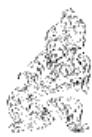

<!-- V3_SOURCE_ID:book016-b000337-p000-ccb0241d05 -->

译文里的九五爻辞说“巨龙高飞上天，利于出现大人”，这段内容讲的是什么意思呢？孔子针对此指出：这是譬喻同类的声音会互相感应，同样的气息会互相求合；水会向湿处流，火会向干处烧；景云会随着龙吟而出，谷风会随着虎啸而生；圣人奋起治理天下，万物就会显明可见；依存于天的事物会亲近于上，依存于地的事物会亲近于下，各自按照类别相从而发挥作用。

查看对应原文

<!-- V3_FOLDBACK_BEGIN:book016-b000337-p000-ccb0241d05 -->

译文九五爻辞说“巨龙高飞上天，利于出现大人”，讲什么意思呢？孔子指出：“这是譬喻同类的声音互相感应，同样的气息互相求合；水向湿处流，火向干处烧；景云随着龙吟而出，谷风随着虎啸而生；圣人奋起治世而万物显明可见；依存于天的亲近于上，依存于地的亲近于下，各以类相从而发挥作用。”

<!-- V3_FOLDBACK_END:book016-b000337-p000-ccb0241d05 -->

<!-- V3_SOURCE_ID:book016-b000338-p000-e4110ad14e -->

九五爻辞说“飞龙在天，利见大人”，这句话是什么意思？孔子说：“相同的声音会相互呼应，相同的气会相互吸引；水流向潮湿的地方，火会向干燥的地方蔓延；云会跟随龙，风会跟随虎；圣人兴起，天下万物都会显现出来；依托于天的事物会亲近上方，依托于地的事物会亲近下方，这就是各自依从自己的类别。”

查看对应原文

<!-- V3_FOLDBACK_BEGIN:book016-b000338-p000-e4110ad14e -->

九五曰“飞龙在天，利见大人”，何谓也？子曰：“同声相应，同气相求①；水流湿，火就燥；云从龙，风从虎；圣人作而万物睹②；本乎天者亲上，本乎地者亲下，则各从其类也③。”

<!-- V3_FOLDBACK_END:book016-b000338-p000-e4110ad14e -->

<!-- V3_SOURCE_ID:book016-b000339-p000-b7bebd1195 -->

匡释：同声相应，同气相求——气，与“声”相对；求，与“应”的意思相近。以下各句都列举各种现象，来说明事物之间的互相感应作用。《正义》说：“因为大人与万物相互感应，所以广泛列举各类事物相互感应的情况，来阐明圣人兴起时，万物都瞻仰看见，以此收束文意。”

查看对应原文

<!-- V3_FOLDBACK_BEGIN:book016-b000339-p000-b7bebd1195 -->

匡释①同声相应，同气相求：气，与“声”相对；求，与“应”之意相近。以下诸句均举各种现象说明事物的互相感应作用。《正义》：“因大人与众物感应，故广陈众物相感应，以明圣人之作而万物瞻睹以结之也。”

<!-- V3_FOLDBACK_END:book016-b000339-p000-b7bebd1195 -->

<!-- V3_SOURCE_ID:book016-b000340-p000-25f5c0d170 -->

②圣人作而万物睹：作，如同“兴起”；睹，就是看见。指“圣人”兴起，天下变得光明，万物都显现出各自的本色，各尽其用。《正义》说：“这是有认知的事物之间相互感应，也属于同类相互感应，圣人有养育众生的德行，万物有被养育的需求，所以会相互感应。”

查看对应原文

<!-- V3_FOLDBACK_BEGIN:book016-b000340-p000-25f5c0d170 -->

②圣人作而万物睹：作，犹“起”；睹，见也。指“圣人”兴起，天下光明，万物呈现本色，各尽其用。《正义》：“是有识感有识也，此亦同类相感，圣人有生养之德，万物有生养之情，故相感应也。”

<!-- V3_FOLDBACK_END:book016-b000340-p000-25f5c0d170 -->

<!-- V3_SOURCE_ID:book016-b000341-p000-33ce3acc27 -->

③本乎天者亲上，本乎地者亲下，则各从其类也：天、地，就是“阳刚”“阴柔”的意思。这三句承接前文的意思，说明“圣人”兴起、治世清明，所以阴阳判然区分，万物各自依从自己的类别。《尚氏学》说：“天地就是阴阳。本乎天者亲上，说的是阳性上升顺行”，“本乎地者亲下，说的是阴性下降逆行”。按：《正义》引用庄氏的说法：“天地之间气交融聚合，二气和合，共同生成万物。但万物的形体，有的感应到的天气偏多，有的感应到的地气偏多，所以《周礼·大宗伯》有天产、地产的区分，《大司徒》提到动物、植物。原本从天那里承受气的，是动物这类有灵的事物；天体运动，有灵的事物也会运动，所以会亲附于上方。原本从地那里承受气的，是植物这类没有认知的事物；地体凝滞不动，植物也不会移动，所以会亲附于下方。所谓各从其类，说的是天地之间，万物相互感应，各自依从自己的气类。”《本义》认为“本乎天者说的是动物，本乎地者说的是植物”，就是采用了庄氏的说法，这种说法可以作为参考。

查看对应原文

<!-- V3_FOLDBACK_BEGIN:book016-b000341-p000-33ce3acc27 -->

③本乎天者亲上，本乎地者亲下，则各从其类也：天、地，即“阳刚”、“阴柔”之谓。此三句上承前文之义，说明“圣人”兴起、治世清明，故阴阳判然区分，万物各从其类。《尚氏学》：“天地者，阴阳。本乎天者亲上，谓阳性上升顺行”，“本乎地者亲下，谓阴性下降逆行”。案，《正义》引庄氏曰：“天地细缊，和合二气，共生万物。然万物之体，有感于天气偏多者，有感于地气偏多者，故《周礼·大宗伯》有天产、地产，《大司徒》云动物、植物。本受气于天者，是动物含灵之属；天体运动，含灵之物亦运动，是亲附于上也。本受气于地者，是植物无识之属；地体凝滞，植物亦不移动，是亲附于下也。则各从其类者，言天地之间，共相感应，各从其气类。”《本义》谓“本乎天者谓动物，本乎地者谓植物”，即取庄氏之义。此说可备参考。

<!-- V3_FOLDBACK_END:book016-b000341-p000-33ce3acc27 -->

<!-- V3_SOURCE_ID:book016-b000342-p000-427eff964b -->

说明这一节是解释《乾》卦九五爻的爻辞。

查看对应原文

<!-- V3_FOLDBACK_BEGIN:book016-b000342-p000-427eff964b -->

说明本节释《乾》九五爻辞。

<!-- V3_FOLDBACK_END:book016-b000342-p000-427eff964b -->

<!-- V3_SOURCE_ID:book016-b000343-p000-f575e688e0 -->

译文里上九爻的爻辞说“龙（风水中山脉、地势及气脉的来势和行度）高飞穷极，终将有所悔恨”，讲的是什么意思呢？孔子指出：“这是譬喻某种人尊贵而没有实位，崇高……”

> **释读存疑：** 原文此处有缺漏，未完整引述孔子的论述内容

查看对应原文

<!-- V3_FOLDBACK_BEGIN:book016-b000343-p000-f575e688e0 -->

译文上九爻辞说“巨龙高飞穷极，终将有所悔恨”，讲什么意思呢？孔子指出：“这是譬喻某种人尊贵而没有实位，崇高

<!-- V3_FOLDBACK_END:book016-b000343-p000-f575e688e0 -->

<!-- V3_SOURCE_ID:book016-b000344-p000-a6e8b76d23 -->

上九爻的爻辞说“亢龙有悔”，这句话是什么意思？孔子说：“尊贵却没有实位，崇高却管不到百姓，贤明的人居于下位而无人辅助，因此一旦有所举动就会‘有悔’。”

查看对应原文

<!-- V3_FOLDBACK_BEGIN:book016-b000344-p000-a6e8b76d23 -->

上九曰“亢龙有悔”，何谓也？子曰：“贵而无位，高而无民①，贤人在下位而无辅②，是以动而‘有悔’也。”

<!-- V3_FOLDBACK_END:book016-b000344-p000-a6e8b76d23 -->

<!-- V3_SOURCE_ID:book016-b000345-p000-800f898da8 -->

尊贵却没有实位，崇高却管不到百姓，贤明的人居于下位而无人辅助，因此一旦有所举动就会‘有悔’。

查看对应原文

<!-- V3_FOLDBACK_BEGIN:book016-b000345-p000-800f898da8 -->

而管不到百姓，贤明的人居下位而无人辅助他，所以一旦轻举妄动就将‘有所悔恨’。”

<!-- V3_FOLDBACK_END:book016-b000345-p000-800f898da8 -->

<!-- V3_SOURCE_ID:book016-b000346-p000-3128594f98 -->

匡释①所说的“贵而无位，高而无民”，《集解》引用荀爽的话解释：“居于上位所以尊贵，失去正道所以没有应有的位置。”又引用何妥的话解释：“既没有处在九五帝王的位置，所以没有民众。”这里说的是上九处于有名无实的高位，也就是《集解》在《小象》注中引用《九家易》所说的“如同太上皇那样的情况”。

查看对应原文

<!-- V3_FOLDBACK_BEGIN:book016-b000346-p000-3128594f98 -->

匡释①贵而无位，高而无民：《集解》引荀爽曰：“在上故贵，失正故无位。”又引何妥曰：“既不处九五帝王之位，故无民也。”此谓上九处于有名无实的高位，即《集解》于《小象》注引《九家易》所谓“若太上皇者也”。

<!-- V3_FOLDBACK_END:book016-b000346-p000-3128594f98 -->

<!-- V3_SOURCE_ID:book016-b000347-p000-2ba33a4283 -->

②所说的“贤人在下位而无辅”，这里的贤人指的是下卦的九三。这是用三、上两个阳爻没有相应的关系，来比喻上九得不到“贤人”的辅助。《集解》引用荀爽的话解释：“两个阳爻没有相应的关系，所以没有辅助。”

查看对应原文

<!-- V3_FOLDBACK_BEGIN:book016-b000347-p000-2ba33a4283 -->

②贤人在下位而无辅：贤人，指下卦的九三。此以三、上两阳不应，喻上九不得“贤人”辅助。《集解》引荀爽曰：“两阳无应，故无辅。”

<!-- V3_FOLDBACK_END:book016-b000347-p000-2ba33a4283 -->

<!-- V3_SOURCE_ID:book016-b000348-p000-e937d0e630 -->

说明本节是解释《乾·上九》的爻辞。

查看对应原文

<!-- V3_FOLDBACK_BEGIN:book016-b000348-p000-e937d0e630 -->

说明本节释《乾·上九》爻辞。

<!-- V3_FOLDBACK_END:book016-b000348-p000-e937d0e630 -->

<!-- V3_SOURCE_ID:book016-b000349-p000-caec76a743 -->

“潜龙勿用”，是说处于下位；“见龙在田”，是说时势有所停留；“终日乾乾”，是说行事勤勉；“或跃在渊”，是说自我尝试；“飞龙在天”，是说居上位治理；“亢龙有悔”，是说穷极带来的灾祸；乾元“用九”，是说天下得到治理。

查看对应原文

<!-- V3_FOLDBACK_BEGIN:book016-b000349-p000-caec76a743 -->

“潜龙勿用”，下也①；“见龙在田”，时舍也②；“终日乾乾”，行事也③；“或跃在渊”，自试也；“飞龙在天”，上治也④；“亢龙有悔”，穷之灾也；乾元“用九”，天下治也⑤。

<!-- V3_FOLDBACK_END:book016-b000349-p000-caec76a743 -->

<!-- V3_SOURCE_ID:book016-b000350-p000-09cd4956eb -->

译文所说的“巨龙潜伏水中，暂不施展才用”，对应的是地位低下微贱的情况；“巨龙出现田间”，对应的是时势开始舒展的情况；“整天健强振作”，对应的是事业付诸实践的情况；“或腾跃上进，或退处在渊”，对应的是正在自我检验的情况；“巨龙高飞上天”，对应的是形成最好的政治局面的情况；“巨龙高飞穷极，终将有所悔恨”，对应的是穷极带来灾难的情况；天有元始之德而“用(阳刚化为阴柔的)九数”，对应的是天下大治是势所必然的情况。

查看对应原文

<!-- V3_FOLDBACK_BEGIN:book016-b000350-p000-09cd4956eb -->

译文“巨龙潜伏水中，暂不施展才用”，说明地位低下微贱；“巨龙出现田间”，说明时势开始舒展；“整天健强振作”，说明事业付诸实践；“或腾跃上进，或退处在渊”，说明正在自我检验；“巨龙高飞上天”，说明形成最好的政治局面；“巨龙高飞穷极，终将有所悔恨”，说明穷极带来的灾难；天有元始之德而“用(阳刚化为阴柔的)九数”，说明天下大治是势所必然。

<!-- V3_FOLDBACK_END:book016-b000350-p000-09cd4956eb -->

<!-- V3_SOURCE_ID:book016-b000351-p000-906fddf148 -->

注释①下方的内容：指初九居于下位，就如同人的地位低下。

查看对应原文

<!-- V3_FOLDBACK_BEGIN:book016-b000351-p000-906fddf148 -->

注释①下：指初九居于下位，犹如人的地位低下。

<!-- V3_FOLDBACK_END:book016-b000351-p000-906fddf148 -->

<!-- V3_SOURCE_ID:book016-b000352-p000-2229392f6b -->

②时舍：舍，通“舒”。据《王注》记载：“见而在田，必以时之通舍也。”《正义》认为王弼“以通解舍，舍是通义”，即解释为舒通之意，指形势已经舒展好转。这个说法是正确的。

查看对应原文

<!-- V3_FOLDBACK_BEGIN:book016-b000352-p000-2229392f6b -->

②时舍：舍，通“舒”。案，《王注》：“见而在田，必以时之通舍也。”《正义》谓王弼“以通解舍，舍是通义”，即训为舒通之意，指形势已经舒展好转。此说是也。

<!-- V3_FOLDBACK_END:book016-b000352-p000-2229392f6b -->

<!-- V3_SOURCE_ID:book016-b000353-p000-fb60adfdc8 -->

③行事：指九三正勤勉地从事某项事业。

> **释读存疑：** 本地硬校验仍未通过，已记录供后续自动处理或人工核对。

查看对应原文

<!-- V3_FOLDBACK_BEGIN:book016-b000353-p000-fb60adfdc8 -->

③行事：指九三正勤勉地从事某项事业。

<!-- V3_FOLDBACK_END:book016-b000353-p000-fb60adfdc8 -->

<!-- V3_SOURCE_ID:book016-b000354-p000-d66881dea5 -->

④上治：上，通“尚”。指九五之时出现了最好的政治局面。案，《正义》释此句为“言圣人居上位而治理”，于义亦通。

查看对应原文

<!-- V3_FOLDBACK_BEGIN:book016-b000354-p000-d66881dea5 -->

④上治：上，通“尚”。指九五之时出现了最好的政治局面。案，《正义》释此句为“言圣人居上位而治理”，于义亦通。

<!-- V3_FOLDBACK_END:book016-b000354-p000-d66881dea5 -->

<!-- V3_SOURCE_ID:book016-b000355-p000-53c2037cbc -->

⑤乾元用九，天下治也：《正义》：“用九之文，总是乾德；又‘乾’字不可独言，故举‘元’德以配‘乾’也。言此乾元用九德而天下治。”案，这是归结《乾》卦“用九”的意义，谓“阳刚”之德以能“化柔”为美。李鼎祚引史证曰：“此当三皇五帝礼让之时，垂拱无为而天下治矣”(《集解》)，有合辞旨。

查看对应原文

<!-- V3_FOLDBACK_BEGIN:book016-b000355-p000-53c2037cbc -->

⑤乾元用九，天下治也：《正义》：“用九之文，总是乾德；又‘乾’字不可独言，故举‘元’德以配‘乾’也。言此乾元用九德而天下治。”案，这是归结《乾》卦“用九”的意义，谓“阳刚”之德以能“化柔”为美。李鼎祚引史证曰：“此当三皇五帝礼让之时，垂拱无为而天下治矣”(《集解》)，有合辞旨。

<!-- V3_FOLDBACK_END:book016-b000355-p000-53c2037cbc -->

<!-- V3_SOURCE_ID:book016-b000356-p000-79049b980d -->

[说明本节再释《乾》卦六则爻辞及“用九”辞，文中泛引人们的各种社会活动为说。王弼谓：“此一章全以人事明之。”(《王注》)

查看对应原文

<!-- V3_FOLDBACK_BEGIN:book016-b000356-p000-79049b980d -->

[说明本节再释《乾》卦六则爻辞及“用九”辞，文中泛引人们的各种社会活动为说。王弼谓：“此一章全以人事明之。”(《王注》)

<!-- V3_FOLDBACK_END:book016-b000356-p000-79049b980d -->

<!-- V3_SOURCE_ID:book016-b000357-p000-404f37b386 -->

“潜龙勿用”，阳气潜藏①；“见龙在田”，天下文明②；“终日乾乾”，与时偕行③；“或跃在渊”，乾道乃革④；“飞龙在天”，乃位乎天德⑤；“亢龙有悔”，与时偕极⑥；乾元“用九”，乃见天则⑦。

查看对应原文

<!-- V3_FOLDBACK_BEGIN:book016-b000357-p000-404f37b386 -->

“潜龙勿用”，阳气潜藏①；“见龙在田”，天下文明②；“终日乾乾”，与时偕行③；“或跃在渊”，乾道乃革④；“飞龙在天”，乃位乎天德⑤；“亢龙有悔”，与时偕极⑥；乾元“用九”，乃见天则⑦。

<!-- V3_FOLDBACK_END:book016-b000357-p000-404f37b386 -->

<!-- V3_SOURCE_ID:book016-b000358-p000-e0991b5152 -->

译文“巨龙潜伏水中，暂不施展才用”，说明阳气潜藏未现；“巨龙出现田间”，说明天下文采灿烂；“整天健强振作”，说明追随时光向前发展；“或腾跃上进，或退处在渊”，说明“天道”转化、出现变革；“巨龙高飞上天”，说明阳气旺盛正当天位、具备“天”的美德；“巨龙高飞穷极，终将有所悔恨”，说明随着时节推展而穷尽衰落；天有元始之德而“用(阳刚化为阴柔的)九数”，这是体现大自然的法则。

查看对应原文

<!-- V3_FOLDBACK_BEGIN:book016-b000358-p000-e0991b5152 -->

译文“巨龙潜伏水中，暂不施展才用”，说明阳气潜藏未现；“巨龙出现田间”，说明天下文采灿烂；“整天健强振作”，说明追随时光向前发展；“或腾跃上进，或退处在渊”，说明“天道”转化、出现变革；“巨龙高飞上天”，说明阳气旺盛正当天位、具备“天”的美德；“巨龙高飞穷极，终将有所悔恨”，说明随着时节推展而穷尽衰落；天有元始之德而“用(阳刚化为阴柔的)九数”，这是体现大自然的法则。

<!-- V3_FOLDBACK_END:book016-b000358-p000-e0991b5152 -->

<!-- V3_SOURCE_ID:book016-b000359-p000-62d059c6d7 -->

注释①阳气潜藏：指初九如阳气潜伏，藏而未发。

查看对应原文

<!-- V3_FOLDBACK_BEGIN:book016-b000359-p000-62d059c6d7 -->

注释①阳气潜藏：指初九如阳气潜伏，藏而未发。

<!-- V3_FOLDBACK_END:book016-b000359-p000-62d059c6d7 -->

<!-- V3_SOURCE_ID:book016-b000360-p000-d10c1eac56 -->

②天下文明：指九二如阳气发出地面，万物初焕光彩。

查看对应原文

<!-- V3_FOLDBACK_BEGIN:book016-b000360-p000-d10c1eac56 -->

②天下文明：指九二如阳气发出地面，万物初焕光彩。

<!-- V3_FOLDBACK_END:book016-b000360-p000-d10c1eac56 -->

<!-- V3_SOURCE_ID:book016-b000361-p000-df72b8a00f -->

③与时偕行：行，发展。指九三如阳气发展到一定阶段，万物将趋繁盛。

查看对应原文

<!-- V3_FOLDBACK_BEGIN:book016-b000361-p000-df72b8a00f -->

③与时偕行：行，发展。指九三如阳气发展到一定阶段，万物将趋繁盛。

<!-- V3_FOLDBACK_END:book016-b000361-p000-df72b8a00f -->

<!-- V3_SOURCE_ID:book016-b000362-p000-69b83bc950 -->

④乾道乃革：乾道指天道，也就是大自然的运行规律；革是变革的意思，指九四爻对应的阳气发展到了一个新阶段，万物正处于转化的节点。

查看对应原文

<!-- V3_FOLDBACK_BEGIN:book016-b000362-p000-69b83bc950 -->

④乾道乃革：乾道，天道，即大自然的运行规律；革，变革。指九四如阳气发展至一个新阶段，万物正临转化。

<!-- V3_FOLDBACK_END:book016-b000362-p000-69b83bc950 -->

<!-- V3_SOURCE_ID:book016-b000363-p000-10e52e00cf -->

⑤乃位乎天德：位在这里是说尊居天位；天德指九五爻对应的阳气发展到了最旺盛的阶段，万物已经长得十分繁茂。

查看对应原文

<!-- V3_FOLDBACK_BEGIN:book016-b000363-p000-10e52e00cf -->

⑤乃位乎天德：位，此言尊居“天位”；天德，指九五如阳气发展到最旺盛阶段，万物已至繁茂。

<!-- V3_FOLDBACK_END:book016-b000363-p000-10e52e00cf -->

<!-- V3_SOURCE_ID:book016-b000364-p000-ef56995c14 -->

⑥与时偕极：指上九爻对应的阳气由盛转衰，万物走向消亡穷尽。

查看对应原文

<!-- V3_FOLDBACK_BEGIN:book016-b000364-p000-ef56995c14 -->

⑥与时偕极：指上九如阳气由盛转衰，万物消亡穷尽。

<!-- V3_FOLDBACK_END:book016-b000364-p000-ef56995c14 -->

<!-- V3_SOURCE_ID:book016-b000365-p000-afe54f21c9 -->

⑦乃见天则：天则指大自然运行的法则，比如阳气转化为阴气就是自然规律。《集解》引用何妥的话说：“阳消，天气之常；天象法则，自然可见。”

查看对应原文

<!-- V3_FOLDBACK_BEGIN:book016-b000365-p000-afe54f21c9 -->

⑦乃见天则：“天则”谓大自然运行的法则，如阳气转化为阴气即是自然规律。《集解》引何妥曰：“阳消，天气之常；天象法则，自然可见。”

<!-- V3_FOLDBACK_END:book016-b000365-p000-afe54f21c9 -->

<!-- V3_SOURCE_ID:book016-b000366-p000-4c8e1e679e -->

这一部分也是解释《乾》卦六爻的爻辞以及“用九”的文辞，文中广泛引用自然气候来作为解说的依据。王弼说：“此一章全说天气以明之。”

查看对应原文

<!-- V3_FOLDBACK_BEGIN:book016-b000366-p000-4c8e1e679e -->

[疏]本节亦释《乾》卦六则爻辞及“用九”文辞，文中泛引自然气候为说。王弼谓：“此一章全说天气以明之。”(《王注》)

<!-- V3_FOLDBACK_END:book016-b000366-p000-4c8e1e679e -->

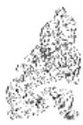

<!-- V3_SOURCE_ID:book016-b000368-p000-59c59fe05f -->

译文“《乾》卦象征天：元始”，说明天的美德在于首创万物并使之亨通；“和谐有利，贞正坚固”，是天所蕴含的本性和内情。天一开始就能用美好的利益来施利天下，却不说出它所施予的利惠，这是极大的利惠啊！伟大的天啊！刚强劲健、居中守正，通体不杂、纯粹至精；《乾》卦六爻的运动变化，曲尽万物的发展情理；犹如顺着不同时节套上六条巨龙，驾驭着大自然而驰骋；行云降雨，带来天下太平。

查看对应原文

<!-- V3_FOLDBACK_BEGIN:book016-b000368-p000-59c59fe05f -->

译文“《乾》卦象征天：元始”，说明天的美德在于首创万物并使之亨通；“和谐有利，贞正坚固”，是天所蕴含的本性和内情。天一开始就能用美好的利益来施利天下，却不说出它所施予的利惠，这是极大的利惠啊！伟大的天啊！刚强劲健、居中守正，通体不杂、纯粹至精；《乾》卦六爻的运动变化，曲尽万物的发展情理；犹如顺着不同时节套上六条巨龙，驾驭着大自然而驰骋；行云降雨，带来天下太平。

<!-- V3_FOLDBACK_END:book016-b000368-p000-59c59fe05f -->

<!-- V3_SOURCE_ID:book016-b000369-p000-154404c926 -->

“乾，元”①，是创始万物并使之亨通的意思；“利，贞”，是天的本性与内情的意思。乾卦一开始就能用美好的利益施利于天下，却不说明自己施予的利惠，这是多么伟大啊！伟大的乾啊！刚强劲健、居中守正，通体不杂、纯粹至精；乾卦六爻的运动变化，能普遍贯通万物的发展情理；顺着时节驾驭六龙，来主宰大自然；行云降雨，使天下太平。

> **释读存疑：** 原文未明确“性情”具体所指，释为“本性与内情”属合理通俗释义；“美利”“所利”未明确具体所指，释为“美好的利益”“施予的利惠”属合理通俗释义

查看对应原文

<!-- V3_FOLDBACK_BEGIN:book016-b000369-p000-154404c926 -->

“乾，元”者①，始而亨者也；“利，贞”者，性情也②。乾始能以美利利天下③，不言所利，大矣哉④！大哉乾乎！刚健中正⑤，纯粹精也⑥；六爻发挥，旁通情也⑦；时乘六龙⑧，以御天也；云行雨施，天下平也。

<!-- V3_FOLDBACK_END:book016-b000369-p000-154404c926 -->

<!-- V3_SOURCE_ID:book016-b000370-p000-24cce218c2 -->

【注释】①“乾，元”者：这是回头重新解释《乾》卦的卦辞。王念孙在《读书杂志》中认为“元”字下面脱漏了一个“亨”字，原本应当是“乾，元，亨’者”，这样才和下文“‘利，贞’者”的句式对应。这个说法似乎可以采信。

查看对应原文

<!-- V3_FOLDBACK_BEGIN:book016-b000370-p000-24cce218c2 -->

[注释]①“乾，元”者：这是回头重释《乾》卦的卦辞。王念孙《读书杂志》以为“元”下脱一“亨”字，原本当作“乾，元，亨’者”，才与下文“‘利，贞’者”相应。似可从。

<!-- V3_FOLDBACK_END:book016-b000370-p000-24cce218c2 -->

<!-- V3_SOURCE_ID:book016-b000371-p000-2e33cdf89d -->

②性情：《集解》引用干宝的话说：“用施化来成就万物的本性，用纯一的态度来端正万物的情状。”按，前面的“始而亨”是解释卦辞中的“元，亨”，这句是解释“利，贞”。接下来又广泛赞美“四德”的美好。

查看对应原文

<!-- V3_FOLDBACK_BEGIN:book016-b000371-p000-2e33cdf89d -->

②性情：《集解》引干宝曰：“以施化利万物之性，以纯一正万物之情。”案，前句“始而亨”释卦辞“元，亨”，此句释“利，贞”。以下又广赞“四德”之美。

<!-- V3_FOLDBACK_END:book016-b000371-p000-2e33cdf89d -->

<!-- V3_SOURCE_ID:book016-b000372-p000-68b37b989c -->

③以美利利天下：前一个“利”是名词，后一个“利”是动词。《集解》引用虞翻的说法：“美利，指‘云行雨施，品物流形’，所以能利及天下。”

查看对应原文

<!-- V3_FOLDBACK_BEGIN:book016-b000372-p000-68b37b989c -->

③以美利利天下：前一“利”为名词，后一“利”为动词。《集解》引虞翻说：“美利，谓‘云行雨施，品物流形’，故利天下也。”

<!-- V3_FOLDBACK_END:book016-b000372-p000-68b37b989c -->

<!-- V3_SOURCE_ID:book016-b000373-p000-dab30e6d6a -->

④不言所利，大矣哉：指天的利惠之大，难以用言语形容。《集解》引用虞翻的话说：“天何曾说过话呢，四时运行，万物生长，所以说利的意义是宏大的。”按，虞氏引用《论语》中的文句来解释，这个说法很可取。

查看对应原文

<!-- V3_FOLDBACK_BEGIN:book016-b000373-p000-dab30e6d6a -->

④不言所利，大矣哉：指天的利惠之大，难以言喻。《集解》引虞翻曰：“天何言哉，四时行焉，百物生焉，故利者大也。”案，虞氏援《论语》文以释之，义颇可取。

<!-- V3_FOLDBACK_END:book016-b000373-p000-dab30e6d6a -->

<!-- V3_SOURCE_ID:book016-b000374-p000-81ba390644 -->

⑤刚健中正：《正义》解释道：“指纯阳刚健，它的本性刚强，它的行为劲健；中指的是二爻与五爻，正指的是五爻与二爻。所以说‘刚健中正’。”

查看对应原文

<!-- V3_FOLDBACK_BEGIN:book016-b000374-p000-81ba390644 -->

⑤刚健中正：《正义》：“谓纯阳刚健，其性刚强，其行劲健：中谓二与五也，正谓五与二也。故云‘刚健中正’。”

<!-- V3_FOLDBACK_END:book016-b000374-p000-81ba390644 -->

<!-- V3_SOURCE_ID:book016-b000375-p000-f45e93a3e6 -->

⑥纯粹精也：指的是六爻全为阳爻。《集解》引用崔憬的话说：“不混杂称为纯，不变化称为粹；说的是《乾》就是纯粹之精。”

查看对应原文

<!-- V3_FOLDBACK_BEGIN:book016-b000375-p000-f45e93a3e6 -->

⑥纯粹精也：指六爻均为阳爻。《集解》引崔憬曰：“不杂曰纯，不变曰粹；言《乾》是纯粹之精。”

<!-- V3_FOLDBACK_END:book016-b000375-p000-f45e93a3e6 -->

<!-- V3_SOURCE_ID:book016-b000376-p000-6b04bb1f60 -->

⑦旁通：“旁”，《玉篇》解释为“不是单一的一方”，“旁通”就是广泛会通的意思，《本义》说：“好比说曲尽其妙。”

查看对应原文

<!-- V3_FOLDBACK_BEGIN:book016-b000376-p000-6b04bb1f60 -->

⑦旁通：旁，《玉篇》：“非一方也”，“旁通”即广泛会通，《本义》：“犹言曲尽。”

<!-- V3_FOLDBACK_END:book016-b000376-p000-6b04bb1f60 -->

<!-- V3_SOURCE_ID:book016-b000377-p000-03002a335a -->

⑧六龙：见本卦《彖传》注⑦。

> **释读存疑：** 本地硬校验仍未通过，已记录供后续自动处理或人工核对。

查看对应原文

<!-- V3_FOLDBACK_BEGIN:book016-b000377-p000-03002a335a -->

⑧六龙：见本卦《彖传》注⑦。

<!-- V3_FOLDBACK_END:book016-b000377-p000-03002a335a -->

<!-- V3_SOURCE_ID:book016-b000378-p000-9a9708a102 -->

[疏]从这一段到最后，本卦《文言》又用七节的篇幅再次阐发卦辞及六则爻辞的意义。这一节是解释卦辞。

查看对应原文

<!-- V3_FOLDBACK_BEGIN:book016-b000378-p000-9a9708a102 -->

[疏]从这一段至终，本卦《文言》又用七节的篇幅再次阐发卦辞及六则爻辞的意义。本节释卦辞。

<!-- V3_FOLDBACK_END:book016-b000378-p000-9a9708a102 -->

<!-- V3_SOURCE_ID:book016-b000379-p000-f219c19924 -->

君子行事以成就道德为根本，这是每天都能体现出来的行为。“潜”这个字的意思，是隐藏起来不显露，行动尚未取得成效，因此君子不会这样做。

查看对应原文

<!-- V3_FOLDBACK_BEGIN:book016-b000379-p000-f219c19924 -->

君子以成德为行①，日可见之行也②。“潜”之为言也，隐而未见，行而未成③，是以君子弗用也。

<!-- V3_FOLDBACK_END:book016-b000379-p000-f219c19924 -->

<!-- V3_SOURCE_ID:book016-b000380-p000-cda46e18fc -->

译文君子把成就道德作为行动的目的，是每天都可以体现出来的行为。初九爻辞所讲的“潜”，意思是隐藏不曾露面，行动尚未显著，所以君子暂时不施展才用。

查看对应原文

<!-- V3_FOLDBACK_BEGIN:book016-b000380-p000-cda46e18fc -->

译文君子把成就道德作为行动的目的，是每天都可以体现出来的行为。初九爻辞所讲的“潜”，意思是隐藏不曾露面，行动尚未显著，所以君子暂时不施展才用。

<!-- V3_FOLDBACK_END:book016-b000380-p000-cda46e18fc -->

<!-- V3_SOURCE_ID:book016-b000381-p000-6209b794a1 -->

注释①以成德为行：成，就是完成。《集解》引用干宝的话说：“君子的行事，动静都可让人观察，进退都合乎法度，行动是为了成就道德，不会随意行事。”

查看对应原文

<!-- V3_FOLDBACK_BEGIN:book016-b000381-p000-6209b794a1 -->

注释①以成德为行：成，完成。《集解》引干宝曰：“君子之行，动静可观，进退可度，动以成德，无所苟行也。”

<!-- V3_FOLDBACK_END:book016-b000381-p000-6209b794a1 -->

<!-- V3_SOURCE_ID:book016-b000382-p000-26e66a3abf -->

②日：俞樾在《群经平义》中认为“日”是“曰”的讹误，这一说法可以作为参考。

> **释读存疑：** 原文未明确说明该讹误是否为定论，仅提及可备一说

查看对应原文

<!-- V3_FOLDBACK_BEGIN:book016-b000382-p000-26e66a3abf -->

②日：俞樾《群经平义》以为“日”是“曰”之讹，可备一说。

<!-- V3_FOLDBACK_END:book016-b000382-p000-26e66a3abf -->

<!-- V3_SOURCE_ID:book016-b000383-p000-ba6928f3c7 -->

③行而未成：《程传》解释说：“未成，就是还没有显现出来。”《尚氏学》解释说：“这里说的潜龙，其志向仍在于推行正道，和那些甘心隐居遁世、自命清高的人不同。然而之所以说勿用，是因为时机还不成熟。”

查看对应原文

<!-- V3_FOLDBACK_BEGIN:book016-b000383-p000-ba6928f3c7 -->

③行而未成：《程传》：“未成，未著也。”《尚氏学》：“此言潜龙仍志在行道，与甘心隐遁鸣高者异。然而勿用者，时未可也。”

<!-- V3_FOLDBACK_END:book016-b000383-p000-ba6928f3c7 -->

<!-- V3_SOURCE_ID:book016-b000384-p000-f5727b8cc6 -->

说明本节内容是对《乾》卦初九爻辞的阐释。

查看对应原文

<!-- V3_FOLDBACK_BEGIN:book016-b000384-p000-f5727b8cc6 -->

说明本节释《乾》初九爻辞。

<!-- V3_FOLDBACK_END:book016-b000384-p000-f5727b8cc6 -->

<!-- V3_SOURCE_ID:book016-b000385-p000-6c301aa070 -->

君子通过学习来积累知识，通过发问来辨明疑难，以宽广的胸怀安处其位，秉持仁爱之心来行事。《周易》说“见龙在田，利见大人”，这是说这种“大人”具备了君主的品德。

查看对应原文

<!-- V3_FOLDBACK_BEGIN:book016-b000385-p000-6c301aa070 -->

君子学以聚之，问以辩之①，宽以居之，仁以行之②。《易》曰“见龙在田，利见大人”，君德也。

<!-- V3_FOLDBACK_END:book016-b000385-p000-6c301aa070 -->

<!-- V3_SOURCE_ID:book016-b000386-p000-372c4e5c64 -->

译文君子靠学习来积累知识，靠发问来辨决疑难，胸怀宽阔而居于适当之位，心存仁爱而施诸一切行为。《周易》说“巨龙出现田间，利于出现大人”，这种“大人”具备了当国君的品德。

查看对应原文

<!-- V3_FOLDBACK_BEGIN:book016-b000386-p000-372c4e5c64 -->

译文君子靠学习来积累知识，靠发问来辨决疑难，胸怀宽阔而居于适当之位，心存仁爱而施诸一切行为。《周易》说“巨龙出现田间，利于出现大人”，这种“大人”具备了当国君的品德。

<!-- V3_FOLDBACK_END:book016-b000386-p000-372c4e5c64 -->

<!-- V3_SOURCE_ID:book016-b000387-p000-2d11d5f90b -->

注释①：学以聚之，问以辩之——辩，通“辨”。这是说，《乾》卦九二爻虽已出现“龙（风水中山脉、地势及气脉的来势和行度）出现在地上”的情况，但仍要勤于学习积累知识，通过提问来辨析疑难。《正义》中说：“君子学以聚之者，九二从卑微的位置晋升，还未居于君位，所以暂且通过学习来积蓄德行；问以辩之者，学习中存在未弄懂的地方，就详细询问相关事宜，以此辨析决断疑惑。”

查看对应原文

<!-- V3_FOLDBACK_BEGIN:book016-b000387-p000-2d11d5f90b -->

注释①学以聚之，问以辩之：辩，通“辨”。此谓九二虽已“见龙在田”，但仍要勤于学问，增长知识。《正义》：“君子学以聚之者，九二从微而进，未在君位，故且习学以畜其德；问以辩之者，学有未了，更详问其事，以辩决于疑也。”

<!-- V3_FOLDBACK_END:book016-b000387-p000-2d11d5f90b -->

<!-- V3_SOURCE_ID:book016-b000388-p000-2c851529a2 -->

②：宽以居之，仁以行之——《正义》中说：“宽以居之者，应当用宽裕包容的态度来安处自身的位置；仁以行之者，要用仁爱的心意来行事，施及他人。”

查看对应原文

<!-- V3_FOLDBACK_BEGIN:book016-b000388-p000-2c851529a2 -->

②宽以居之，仁以行之：《正义》：“宽以居之者，当用宽裕之道居处其位也；仁以行之者，以仁恩之心行之被物。”

<!-- V3_FOLDBACK_END:book016-b000388-p000-2c851529a2 -->

<!-- V3_SOURCE_ID:book016-b000389-p000-a1bc1d104a -->

说明：本节内容是对《乾》卦九二爻爻辞的阐释。

查看对应原文

<!-- V3_FOLDBACK_BEGIN:book016-b000389-p000-a1bc1d104a -->

说明本节释《乾》九二爻辞。

<!-- V3_FOLDBACK_END:book016-b000389-p000-a1bc1d104a -->

<!-- V3_SOURCE_ID:book016-b000390-p000-15c60f17a9 -->

九三重刚而不中①，上不在天，下不在田②，所以要“乾乾”，并因时而惕，虽危无咎矣。

查看对应原文

<!-- V3_FOLDBACK_BEGIN:book016-b000390-p000-15c60f17a9 -->

九三重刚而不中①，上不在天，下不在田②，故乾乾因其时而惕，虽危无咎矣。

<!-- V3_FOLDBACK_END:book016-b000390-p000-15c60f17a9 -->

<!-- V3_SOURCE_ID:book016-b000391-p000-03624cef3d -->

译文九三是多重阳刚叠成的，居位不正中，上不达于高天，下不立于地面，所以要不断健强振作、随时保持警惕，这样即使面临危险也免遭咎害。

查看对应原文

<!-- V3_FOLDBACK_BEGIN:book016-b000391-p000-03624cef3d -->

译文九三是多重阳刚叠成的，居位不正中，上不达于高天，下不立于地面，所以要不断健强振作、随时保持警惕，这样即使面临危险也免遭咎害。

<!-- V3_FOLDBACK_END:book016-b000391-p000-03624cef3d -->

<!-- V3_SOURCE_ID:book016-b000392-p000-bdc4b40b03 -->

注释①重刚而不中：初九、九二均为阳刚之爻，九三仍为阳爻，故称“重刚”；六十四卦的每卦只有二、五两爻居中，故九三“不中”。

查看对应原文

<!-- V3_FOLDBACK_BEGIN:book016-b000392-p000-bdc4b40b03 -->

注释①重刚而不中：初九、九二均为阳刚之爻，九三仍为阳爻，故称“重刚”；六十四卦的每卦只有二、五两爻居中，故九三“不中”。

<!-- V3_FOLDBACK_END:book016-b000392-p000-bdc4b40b03 -->

<!-- V3_SOURCE_ID:book016-b000393-p000-257cae5388 -->

②上不在天，下不在田：九五“飞龙在天”，九二“见龙在田”，九三则介乎“天”、“田”之间。《正义》：“上不在天，谓非五位；下不在田，谓非二位也。”

查看对应原文

<!-- V3_FOLDBACK_BEGIN:book016-b000393-p000-257cae5388 -->

②上不在天，下不在田：九五“飞龙在天”，九二“见龙在田”，九三则介乎“天”、“田”之间。《正义》：“上不在天，谓非五位；下不在田，谓非二位也。”

<!-- V3_FOLDBACK_END:book016-b000393-p000-257cae5388 -->

<!-- V3_SOURCE_ID:book016-b000394-p000-8490ed436c -->

说明本节释《乾》九三爻辞。

查看对应原文

<!-- V3_FOLDBACK_BEGIN:book016-b000394-p000-8490ed436c -->

说明本节释《乾》九三爻辞。

<!-- V3_FOLDBACK_END:book016-b000394-p000-8490ed436c -->

<!-- V3_SOURCE_ID:book016-b000395-p000-9bd34bacb1 -->

九四爻是多重阳刚爻重叠而成，居位不正中，上不处于天位，下不处于地位，中不处于人位，所以用“或”来表述。用“或”的意思，是说明要有所疑虑而多方审度，这样就不会有咎害。

查看对应原文

<!-- V3_FOLDBACK_BEGIN:book016-b000395-p000-9bd34bacb1 -->

九四重刚而不中，上不在天，下不在田，中不在人①，故“或”之②。“或”之者，疑之也，故无咎。

<!-- V3_FOLDBACK_END:book016-b000395-p000-9bd34bacb1 -->

<!-- V3_SOURCE_ID:book016-b000396-p000-7b63953735 -->

译文九四是多重阳刚叠成的，居位不正中，上不达于高天，下不立于地面，中不处于人境，所以强调“或”。强调“或”的意思，就是说明要有所疑虑而多方审度，这样就能不遭咎害。

查看对应原文

<!-- V3_FOLDBACK_BEGIN:book016-b000396-p000-7b63953735 -->

译文九四是多重阳刚叠成的，居位不正中，上不达于高天，下不立于地面，中不处于人境，所以强调“或”。强调“或”的意思，就是说明要有所疑虑而多方审度，这样就能不遭咎害。

<!-- V3_FOLDBACK_END:book016-b000396-p000-7b63953735 -->

<!-- V3_SOURCE_ID:book016-b000397-p000-423b66bc91 -->

注释①中不在人：九四与九三的相同之处在于“多重阳刚爻重叠且居位不正中，上不处于天位，下不处于地位”；不同之处在于九四还有“中不处于人位”这一层含义。《系辞下传》说：“《易》有天道，有地道，有人道，兼三才而两之”，意思是《易》卦的六爻，上爻、五爻对应“天”，四爻、三爻对应“人”，二爻、初爻对应“地”。《正义》说：“三爻与四爻，都属于人道，但在人道之中，人下位靠近地，上位远离天。九三靠近二爻，是下位靠近地，正属于人道，所以九三不说‘中不在人’；九四则上位靠近天，下位远离地，不是人所处的位置，所以特意说‘中不在人’。”

查看对应原文

<!-- V3_FOLDBACK_BEGIN:book016-b000397-p000-423b66bc91 -->

注释①中不在人：九四和九三的相同之处是“重刚而不中，上不在天，下不在田”；不同之处是九四更有“中不在人”一层。《系辞下传》：“《易》有天道，有地道，有人道，兼三才而两之”，即指《易》卦六爻，上、五为“天”，四、三为“人”，二、初为“地”。《正义》：“三之与四，俱为人道，但人道之中，人下近于地，上远于天。九三近二，是下近于地，正是人道，故九三不云‘中不在人’；九四则上近于天，下远于地，非人所处，故特云‘中不在人’。”

<!-- V3_FOLDBACK_END:book016-b000397-p000-423b66bc91 -->

<!-- V3_SOURCE_ID:book016-b000398-p000-33d7567b4b -->

②或：见九四爻辞的注释。

查看对应原文

<!-- V3_FOLDBACK_BEGIN:book016-b000398-p000-33d7567b4b -->

②或：见九四爻辞注。

<!-- V3_FOLDBACK_END:book016-b000398-p000-33d7567b4b -->

<!-- V3_SOURCE_ID:book016-b000399-p000-52b5d0e9bf -->

说明本节内容是对《乾》九四爻辞的阐释。

查看对应原文

<!-- V3_FOLDBACK_BEGIN:book016-b000399-p000-52b5d0e9bf -->

说明本节释《乾》九四爻辞。

<!-- V3_FOLDBACK_END:book016-b000399-p000-52b5d0e9bf -->

<!-- V3_SOURCE_ID:book016-b000400-p000-74484f9f32 -->

译文九五爻辞所说的“大人”，他的道德像天地一样覆载万物，他的圣明像日月一样普照大地，他的施政像四时一样井然有序，他示人吉凶像鬼神一样奥妙莫测。他先于天象而行动，天不违背他；后于天象而处事，也能遵循天的变化规律。天尚且不违背他，何况人呢？何况鬼神呢？

查看对应原文

<!-- V3_FOLDBACK_BEGIN:book016-b000400-p000-74484f9f32 -->

译文九五爻辞所说的“大人”，他的道德像天地一样覆载万物，他的圣明像日月一样普照大地，他的施政像四时一样井然有序，他示人吉凶像鬼神一样奥妙莫测。他先于天象而行动，天不违背他；后于天象而处事，也能遵循天的变化规律。天尚且不违背他，何况人呢？何况鬼神呢？

<!-- V3_FOLDBACK_END:book016-b000400-p000-74484f9f32 -->

<!-- V3_SOURCE_ID:book016-b000401-p000-1708acf3c3 -->

所谓“大人”，其德行与天地相合，其圣明与日月相合，其行事顺序与四时相合，其吉凶判断与鬼神相合①。在“先天”行事时，天不会违背他②；在“后天”处事时，也能遵循天的运行规律③。天尚且不会违背他，更何况人呢？更何况鬼神呢？

查看对应原文

<!-- V3_FOLDBACK_BEGIN:book016-b000401-p000-1708acf3c3 -->

夫“大人”者，与天地合其德， 与日月合其明，与四时合其序，与 鬼神合其吉凶①。先天而天弗 违②，后天而奉天时③。天且弗违， 而况于人乎？况于鬼神乎？

<!-- V3_FOLDBACK_END:book016-b000401-p000-1708acf3c3 -->

<!-- V3_SOURCE_ID:book016-b000402-p000-2a4d623cb1 -->

注释①中提到的“与天地合其德”这四句，这里的“合”是符合、相同的意思，这四句是通过多种比拟来赞扬九五爻的“大人”。《正义》里说，这是在论述大人的德行没有什么不符合的，广泛列举了所符合的各类情况：“与天地合其德”，庄氏说指的是覆载万物；“与日月合其明”，指的是照耀万物；“与四时合其序”，就像在春夏行赏、秋冬用刑这类情况；“与鬼神合其吉凶”，就像赐福善人、降祸恶人这类情况。

查看对应原文

<!-- V3_FOLDBACK_BEGIN:book016-b000402-p000-2a4d623cb1 -->

注释①“与天地合其德”四句：合犹言符合、相同。这四句是通过多种比拟来赞扬九五的“大人”。《正义》：“此论大人之德无所不合，广言所合之事。与天地合其德者，庄氏云，谓覆载也；与日月合其明者，谓照临也；与四时合其序者，若赏以春夏、刑以秋冬之类也；与鬼神合其吉凶者，若福善祸淫也。”

<!-- V3_FOLDBACK_END:book016-b000402-p000-2a4d623cb1 -->

<!-- V3_SOURCE_ID:book016-b000403-p000-637b78dc06 -->

②先天：指先于天象（术数中表示先天卦序或本体关系的概念），这里是说在自然界尚未出现变化时，就预先采取必要的措施。

查看对应原文

<!-- V3_FOLDBACK_BEGIN:book016-b000403-p000-637b78dc06 -->

②先天：先于天象，这里指自然界尚未出现变化时，就预先采取必要的措施。

<!-- V3_FOLDBACK_END:book016-b000403-p000-637b78dc06 -->

<!-- V3_SOURCE_ID:book016-b000404-p000-069aa28ebf -->

③后天：指后于天象（术数中表示后天卦序或运行关系的概念），这里是说在自然界出现变化之后，及时采取适当的措施。天时：指大自然的阴晴寒暑等变化规律。

查看对应原文

<!-- V3_FOLDBACK_BEGIN:book016-b000404-p000-069aa28ebf -->

③后天：后于天象，这里指自然界出现变化之后，及时采取适当的措施。天时：指大自然的阴晴寒暑等变化规律。

<!-- V3_FOLDBACK_END:book016-b000404-p000-069aa28ebf -->

<!-- V3_SOURCE_ID:book016-b000405-p000-427eff964b -->

说明本节内容是解释《乾》（八卦之一，卦象及五行、方位依原文语境确定）的九五爻辞。

查看对应原文

<!-- V3_FOLDBACK_BEGIN:book016-b000405-p000-427eff964b -->

说明本节释《乾》九五爻辞。

<!-- V3_FOLDBACK_END:book016-b000405-p000-427eff964b -->

<!-- V3_SOURCE_ID:book016-b000406-p000-0f3d0473e6 -->

上九爻辞里提到的“亢”，是用来指那种只知道一味进取却不懂得及时抽身退下，只知道贪恋生存却不明白终会走向衰亡，只知道追逐利益却不清楚所得终将失去的人。大概只有圣人才能做到明智吧！既能透彻领悟进取、退隐、生存、灭亡的道理，又能让自己的行为始终不偏离正确道路的，大概也只有圣人了。

查看对应原文

<!-- V3_FOLDBACK_BEGIN:book016-b000406-p000-0f3d0473e6 -->

译文上九爻辞所说的“亢”，是说明某种人只晓得进取而不知及时引退，只晓得生存而不知终将衰亡，只晓得获利而不知所得必失。大概只有圣人才是明智的吧！深知进取、引退、生存、灭亡的道理，行为不偏失正确途径的，大概只有圣人吧！ O

<!-- V3_FOLDBACK_END:book016-b000406-p000-0f3d0473e6 -->

<!-- V3_SOURCE_ID:book016-b000407-p000-aff529e36a -->

“亢”这个词的意思，是只知道前进而不知道后退，只知道生存而不知道灭亡，只知道获取而不知道舍弃。这难道不是圣人的境界吗！懂得前进后退、生存灭亡的道理，并且不偏离正道的，这难道不是圣人的境界吗！

查看对应原文

<!-- V3_FOLDBACK_BEGIN:book016-b000407-p000-aff529e36a -->

“亢”之为言也，知进而不知退，知存而不知亡，知得而不知丧。其唯圣人乎①！知进退存亡，而不失其正者，其唯圣人乎！

<!-- V3_FOLDBACK_END:book016-b000407-p000-aff529e36a -->

<!-- V3_SOURCE_ID:book016-b000408-p000-5ee729065b -->

注释①其唯圣人乎：这是《文言》作者的慨叹之语，和末句相同却重复使用，目的是加强慨叹的语气。据《释文》引王肃的版本，上句的“圣”字写作“愚”字，在意义上也说得通。

查看对应原文

<!-- V3_FOLDBACK_BEGIN:book016-b000408-p000-5ee729065b -->

注释①其唯圣人乎：这是《文言》作者的慨叹语，与末句相同而复用，旨在渲染慨叹语气。案，《释文》引王肃本上句“圣”字作“愚”字，于义亦通。

<!-- V3_FOLDBACK_END:book016-b000408-p000-5ee729065b -->

<!-- V3_SOURCE_ID:book016-b000409-p000-cd8617dc29 -->

说明：本节解释《乾》上九爻的爻辞。李鼎祚认为从“其唯圣人乎”到最后四句，是解释“用九”的爻辞，包含“乾元用九而天下治”的含义，这种说法可以作为参考。

查看对应原文

<!-- V3_FOLDBACK_BEGIN:book016-b000409-p000-cd8617dc29 -->

说明本节释《乾》上九爻辞。李鼎祚以为“其唯圣人乎”至终四句释“用九”辞，含“乾元用九而天下治”之义(《集解》)，可备一说。

<!-- V3_FOLDBACK_END:book016-b000409-p000-cd8617dc29 -->

<!-- V3_SOURCE_ID:book016-b000410-p000-3e24a48e61 -->

《乾》卦作为《周易》六十四卦的首卦，以“天”为象征形象，揭示了“阳刚”元素、“强健”气质的本质作用及其发展变化规律。孔颖达问道：“这既然是象征天，为什么不叫‘天’，而叫‘乾’？”他自己回答说：天是“固定实体的名称”，乾是“实体与功用的统称”，“天以刚健为功用，运行永不停息，顺应变化没有穷尽，这是天的自然之理。”（《正义》）事实上这是在论述“象”与“意”的关系。从“象征”的角度分析，《乾》卦的喻旨，正是勉励人效法“天”的刚健精神，奋发向上；这也是《大象传》所极力推赞的：“君子以自强不息。”卦辞用“元，亨，利，贞”四个词，高度概括“天”具有开创万物，并使之亨通、富利、正固这四个方面的“功德”，意在表明阳气是宇宙万物“资始”的根本。但“阳刚”之气的自身发展，又有一定的规律，于是，六爻选取“龙”作为“阳”的象征，从“潜龙”到“亢龙”，层层推进，形象地展示了阳气萌生、进长、盛壮乃至穷衰消亡的变化过程。其中九五“飞龙在天”，体现阳气极盛极美的情状；上九“亢龙有悔”，则揭示物极必反、阳极生阴的哲理。《周易》的辩证哲学体系，在这里打下了第一块基石。要是进一步从“《易》者，象也”（《系辞下传》）这一特征仔细考究，还可以发现，本卦的卦体取“天”为象，固然是比喻；六爻的爻辞取“龙”为象，也是比喻：主旨无非是阐明“阳刚”的内在气质。朱熹说：“《易》难读懂，和其他书不一样。《易》说一个事物，并非真的是那个事物，比如说到‘龙’，并非真的是龙。”（《朱子语类》）这种假借事物来寄托寓意的手法，广泛见于《周易》全书，是这部现存最古老的哲学著作所具备的重要特色。

查看对应原文

<!-- V3_FOLDBACK_BEGIN:book016-b000410-p000-3e24a48e61 -->

《乾》卦作为《周易》六十四卦之首，以“天”为象征形象，揭示了“阳刚”元素、“强健”气质的本质作用及其发展变化规律。孔颖达问道：“此既象天，何不谓之天’，而谓之‘乾’？”他自答说：天是“定体之名”，乾是“体用之称”，“天以健为用者，运行不息，应化无穷，此天自然之理。”(《正义》)事实上这是论及“象”与“意”的关系。从“象征”的角度分析，《乾》卦的喻旨，正是勉励人效法“天”的刚健精神，奋发向上；这也是《大象传》所极力推赞的：“君子以自强不息。”卦辞以“元，亨，利，贞”四言，高度概括“天”具有开创万物，并使之亨通、富利、正固这四方面“功德”，意在表明阳气是宇宙万物“资始”之本。但“阳刚”之气的自身发展，又有一定的规律，于是，六爻拟取“龙”作为“阳”的象征，从“潜龙”到“亢龙”，层层推进，形象地展示了阳气萌生、进长、盛壮乃至穷衰消亡的变化过程。其中九五“飞龙在天”，体现阳气至盛至美的情状；上九“亢龙有悔”，则披露物极必反、阳极生阴的哲理。《周易》的辩证哲学体系，在此铺下了第一块基石。要是进一步从“《易》者，象也”(《系辞下传》)这一特征细加考究，还可以发现，本卦的卦体取“天”为象，固是比喻；六爻的爻辞取“龙”为象，也是比喻：大旨无非揭明“阳刚”的内在气质。朱熹说：“《易》难看，不比他书。《易》说一个物，非真是一个物，如说龙’非真龙。”(《朱子语类》)这种假象寓意，广见于《周易》全书，是这部现存最古老的哲学著作所具备的重要特色。

<!-- V3_FOLDBACK_END:book016-b000410-p000-3e24a48e61 -->

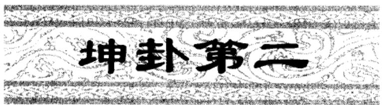

<!-- V3_SOURCE_ID:book016-b000412-p000-3b8dc2592d -->

译文《坤》卦象征地：元始，亨通，利于像雌马一样守持正固。君子有所前往，要是抢先居首必然迷入歧途；要是随从人后就会有人作主，必有利益。往西南将得到友朋，往东北将丧失友朋。安顺守持正固可获吉祥。

查看对应原文

<!-- V3_FOLDBACK_BEGIN:book016-b000412-p000-3b8dc2592d -->

译文《坤》卦象征地：元始，亨通，利于像雌马一样守持正固。君子有所前往，要是抢先居首必然迷入歧途；要是随从人后就会有人作主，必有利益。往西南将得到友朋，往东北将丧失友朋。安顺守持正固可获吉祥。

<!-- V3_FOLDBACK_END:book016-b000412-p000-3b8dc2592d -->

<!-- V3_SOURCE_ID:book016-b000413-p000-ae1d57cda0 -->

☷☷坤①：元，亨②，利牝马之贞③。君子有攸往，先迷；后得主，利④。西南得朋，东北丧朋⑤。安贞吉⑥。

查看对应原文

<!-- V3_FOLDBACK_BEGIN:book016-b000413-p000-ae1d57cda0 -->

☷☷坤①：元，亨②，利牝马之贞③。君子有攸往，先迷；后得主，利④。西南得朋，东北丧朋⑤。安贞吉⑥。

<!-- V3_FOLDBACK_END:book016-b000413-p000-ae1d57cda0 -->

<!-- V3_SOURCE_ID:book016-b000414-p000-06c66fb053 -->

注释①坤：卦名，下卦、上卦皆坤（☷☷），象征“地”。《说卦传》“坤，地也”，“坤，顺也”；即言“坤”以地为象，以顺为义。

查看对应原文

<!-- V3_FOLDBACK_BEGIN:book016-b000414-p000-06c66fb053 -->

注释①坤：卦名，下卦、上卦皆坤（☷☷），象征“地”。《说卦传》“坤，地也”，“坤，顺也”；即言“坤”以地为象，以顺为义。

<!-- V3_FOLDBACK_END:book016-b000414-p000-06c66fb053 -->

<!-- V3_SOURCE_ID:book016-b000415-p000-379c5af79c -->

②元，亨：词义与乾卦略同，此处特指“地”配合“天”，也能开创化生万物，并使之亨通。《正义》：“盖‘乾’、‘坤’合体之物，故《乾》后次《坤》。言地之为体，亦能始生万物，各得亨通，故云‘元，亨’，与《乾》同也。”案，《本义》“元亨”连读，训为“大亨”，可备一说。

查看对应原文

<!-- V3_FOLDBACK_BEGIN:book016-b000415-p000-379c5af79c -->

②元，亨：词义与乾卦略同，此处特指“地”配合“天”，也能开创化生万物，并使之亨通。《正义》：“盖‘乾’、‘坤’合体之物，故《乾》后次《坤》。言地之为体，亦能始生万物，各得亨通，故云‘元，亨’，与《乾》同也。”案，《本义》“元亨”连读，训为“大亨”，可备一说。

<!-- V3_FOLDBACK_END:book016-b000415-p000-379c5af79c -->

<!-- V3_SOURCE_ID:book016-b000416-p000-4ac730f3dc -->

③利牝马之贞：贞，正也，指守持正固。“牝马”柔顺而能行地，故取为“坤”德之象。《集解》引干宝曰：“行天者莫若龙，行地者莫若马；故《乾》以龙繇，《坤》以马象也。坤阴类，故称‘利牝马之贞’矣。”案，尚先生承王树柟《周易释贞》说，释此“贞”为“卜问”；但于它处出现的“贞”，或依此例，或仍训“正”，惟视具体的卦、爻象而定（见《尚氏学》）。其义可通，宜备参考。

查看对应原文

<!-- V3_FOLDBACK_BEGIN:book016-b000416-p000-4ac730f3dc -->

③利牝马之贞：贞，正也，指守持正固。“牝马”柔顺而能行地，故取为“坤”德之象。《集解》引干宝曰：“行天者莫若龙，行地者莫若马；故《乾》以龙繇，《坤》以马象也。坤阴类，故称‘利牝马之贞’矣。”案，尚先生承王树柟《周易释贞》说，释此“贞”为“卜问”；但于它处出现的“贞”，或依此例，或仍训“正”，惟视具体的卦、爻象而定（见《尚氏学》）。其义可通，宜备参考。

<!-- V3_FOLDBACK_END:book016-b000416-p000-4ac730f3dc -->

<!-- V3_SOURCE_ID:book016-b000417-p000-cd67793ec9 -->

④君子有攸往，先迷，后得主，利：攸，《尔雅·释言》：“所也。”这几句说明“坤”德在于“柔顺”、“居后”，“抢先”必“迷”，“随后”则“利”。《集解》引卢氏曰：“坤，臣道也，妻道也，后而不先。先，则迷失道矣，故曰‘先迷’；阴以阳为主，当后而顺之则利，故曰‘后得主，利’。”案，“先迷，后得主，利”三句，《本义》读作：“先迷后得，主利”；朱骏声《六十四卦经解》以“利”属下文，读为“先迷后得主，利西南”

查看对应原文

<!-- V3_FOLDBACK_BEGIN:book016-b000417-p000-cd67793ec9 -->

④君子有攸往，先迷，后得主，利：攸，《尔雅·释言》：“所也。”这几句说明“坤”德在于“柔顺”、“居后”，“抢先”必“迷”，“随后”则“利”。《集解》引卢氏曰：“坤，臣道也，妻道也，后而不先。先，则迷失道矣，故曰‘先迷’；阴以阳为主，当后而顺之则利，故曰‘后得主，利’。”案，“先迷，后得主，利”三句，《本义》读作：“先迷后得，主利”；朱骏声《六十四卦经解》以“利”属下文，读为“先迷后得主，利西南”

<!-- V3_FOLDBACK_END:book016-b000417-p000-cd67793ec9 -->

<!-- V3_SOURCE_ID:book016-b000418-p000-8136eba7b2 -->

云云。两说并可参考。

查看对应原文

<!-- V3_FOLDBACK_BEGIN:book016-b000418-p000-8136eba7b2 -->

云云。两说并可参考。

<!-- V3_FOLDBACK_END:book016-b000418-p000-8136eba7b2 -->

<!-- V3_SOURCE_ID:book016-b000419-p000-9c4641c7ef -->

⑤西南得朋，东北丧朋：尚先生取《十二辟卦图》（见书末《读易要例》）为说，指出《坤》居西北亥位，阴气逆行，沿西南方向前行遇“阳”渐盛，若沿东北方向前行则失“阳”渐尽；而“阴得阳为朋”，故西南行“得朋”，东北行“丧朋”（《尚氏学》）。此说分析“得朋”、“丧朋”至为可取，其中阐明“阴阳为朋”之理尤为精当，今从之。案，这两句旧解颇歧，兹举两说以备参考：（一）王肃曰：“西南阴类，故得朋；东北阳类，故丧朋。”（孙堂辑《汉魏二十一家易注》）这是主张阴与阴为“朋类”。（二）王弼亦主“同性为朋”说，但认为“阴之为物，必离其党，之于反类，而后获安贞吉”（《王注》），则指出“阴”者必须“丧朋”趋附于“阳”才能获“吉”，并以“丧朋”句连下文“安贞吉”为义。又案“朋”，一说为“朋贝”之朋。

查看对应原文

<!-- V3_FOLDBACK_BEGIN:book016-b000419-p000-9c4641c7ef -->

⑤西南得朋，东北丧朋：尚先生取《十二辟卦图》（见书末《读易要例》）为说，指出《坤》居西北亥位，阴气逆行，沿西南方向前行遇“阳”渐盛，若沿东北方向前行则失“阳”渐尽；而“阴得阳为朋”，故西南行“得朋”，东北行“丧朋”（《尚氏学》）。此说分析“得朋”、“丧朋”至为可取，其中阐明“阴阳为朋”之理尤为精当，今从之。案，这两句旧解颇歧，兹举两说以备参考：（一）王肃曰：“西南阴类，故得朋；东北阳类，故丧朋。”（孙堂辑《汉魏二十一家易注》）这是主张阴与阴为“朋类”。（二）王弼亦主“同性为朋”说，但认为“阴之为物，必离其党，之于反类，而后获安贞吉”（《王注》），则指出“阴”者必须“丧朋”趋附于“阳”才能获“吉”，并以“丧朋”句连下文“安贞吉”为义。又案“朋”，一说为“朋贝”之朋。

<!-- V3_FOLDBACK_END:book016-b000419-p000-9c4641c7ef -->

<!-- V3_SOURCE_ID:book016-b000420-p000-55a2c80b0e -->

⑥安贞吉：这是归结“得朋”、“丧朋”之义，说明“坤”德以安顺守正为吉。

查看对应原文

<!-- V3_FOLDBACK_BEGIN:book016-b000420-p000-55a2c80b0e -->

⑥安贞吉：这是归结“得朋”、“丧朋”之义，说明“坤”德以安顺守正为吉。

<!-- V3_FOLDBACK_END:book016-b000420-p000-55a2c80b0e -->

<!-- V3_SOURCE_ID:book016-b000421-p000-79e2907120 -->

疏明《乾》卦有“元，亨，利，贞”四德，《坤》卦也具此“四德”，这是两者共同之处。但《乾》德以“统天”为本，《坤》德以“顺承天”为前提；故《乾》刚《坤》柔、《乾》健《坤》顺，《乾》之“四德”无所限制，《坤》之“四德”则限于“牝马”、“后得主”、“安贞吉”等义：这是两者不同之处。

查看对应原文

<!-- V3_FOLDBACK_BEGIN:book016-b000421-p000-79e2907120 -->

疏明《乾》卦有“元，亨，利，贞”四德，《坤》卦也具此“四德”，这是两者共同之处。但《乾》德以“统天”为本，《坤》德以“顺承天”为前提；故《乾》刚《坤》柔、《乾》健《坤》顺，《乾》之“四德”无所限制，《坤》之“四德”则限于“牝马”、“后得主”、“安贞吉”等义：这是两者不同之处。

<!-- V3_FOLDBACK_END:book016-b000421-p000-79e2907120 -->

<!-- V3_SOURCE_ID:book016-b000422-p000-f0bf7e3dce -->

《彖》说：伟大至极啊，坤的元始之气！万物依靠它生长，它顺从禀承天的意志。坤体深厚能承载万物，德性契合而无边无际；它包容万物并使之发扬光大，各类事物都亨通畅达。牝马属于地上的兽类，能在大地上驰骋而无边无际，它柔和温顺利于守持正固。君子有所行动，要是抢先居首就会迷失正道，要是跟在后面顺从他人就能保持常态。往西南方向会得到友朋，是因为能与同类相伴同行；往东北方向会丧失友朋，但最终会有喜庆。安顺守正的吉祥，正应合大地的无边无际。

查看对应原文

<!-- V3_FOLDBACK_BEGIN:book016-b000422-p000-f0bf7e3dce -->

《彖》曰：至哉坤元①！万物资生，乃顺承天。坤厚载物，德合无疆②；含弘光大，品物咸亨③。牝马地类，行地无疆，柔顺利贞④。君子攸行，先迷失道，后顺得常⑤。西南得朋，乃与类行；东北丧朋，乃终有庆⑥。安贞之吉，应地无疆⑦。

<!-- V3_FOLDBACK_END:book016-b000422-p000-f0bf7e3dce -->

<!-- V3_SOURCE_ID:book016-b000423-p000-efb40ad224 -->

译文《象传》说：美德至极啊，配合天开创万物的大地！万物依靠它成长，它顺从禀承天的志向。地体深厚而能普载万物，德性广合而能久远无疆；它含育一切使之发扬光大，万物亨通畅达遍受滋养。雌马是地面动物，永久驰骋在无边的大地上，它柔和温顺利于守持正固。君子有所前往，要是抢先居首必然迷入歧途偏失正道，要是随从人后、温和柔顺就能使福庆久长。往西南将得到友朋，可以和朋类共赴前方；往东北将丧失友朋，但最终也仍有喜庆福祥。安顺守持正固的吉祥，正应合大地的美德永保无疆。

查看对应原文

<!-- V3_FOLDBACK_BEGIN:book016-b000423-p000-efb40ad224 -->

译文《象传》说：美德至极啊，配合天开创万物的大地！万物依靠它成长，它顺从禀承天的志向。地体深厚而能普载万物，德性广合而能久远无疆；它含育一切使之发扬光大，万物亨通畅达遍受滋养。雌马是地面动物，永久驰骋在无边的大地上，它柔和温顺利于守持正固。君子有所前往，要是抢先居首必然迷入歧途偏失正道，要是随从人后、温和柔顺就能使福庆久长。往西南将得到友朋，可以和朋类共赴前方；往东北将丧失友朋，但最终也仍有喜庆福祥。安顺守持正固的吉祥，正应合大地的美德永保无疆。

<!-- V3_FOLDBACK_END:book016-b000423-p000-efb40ad224 -->

<!-- V3_SOURCE_ID:book016-b000424-p000-180ae21d90 -->

注释①至哉坤元：至，形容词，指地生养万物之德美善至极。《正义》：“至，谓至极也。言地能生养至极，与天同也。但天亦至极，包笼于地；非但至极，又大于地：故《乾》言‘大哉’，《坤》言‘至哉’。”此句至“乃顺承天”，释卦辞“元”。

查看对应原文

<!-- V3_FOLDBACK_BEGIN:book016-b000424-p000-180ae21d90 -->

注释①至哉坤元：至，形容词，指地生养万物之德美善至极。《正义》：“至，谓至极也。言地能生养至极，与天同也。但天亦至极，包笼于地；非但至极，又大于地：故《乾》言‘大哉’，《坤》言‘至哉’。”此句至“乃顺承天”，释卦辞“元”。

<!-- V3_FOLDBACK_END:book016-b000424-p000-180ae21d90 -->

<!-- V3_SOURCE_ID:book016-b000425-p000-d1c6fd46fd -->

文，释卦辞‘君子有攸往’也。”今从何说。

查看对应原文

<!-- V3_FOLDBACK_BEGIN:book016-b000425-p000-d1c6fd46fd -->

文，释卦辞‘君子有攸往’也。”今从何说。

<!-- V3_FOLDBACK_END:book016-b000425-p000-d1c6fd46fd -->

<!-- V3_SOURCE_ID:book016-b000426-p000-a656c6e293 -->

⑥东北丧朋，乃终有庆：终，至终、终极。此谓往东北方向虽丧阳失朋（参见卦辞译注），但行至终极，必将旋转为“西南”向（阅《十二辟卦图》可知），则也出现“得朋”之“庆”，故曰“乃终有庆”。这是揭示阴阳循环消长之理，表明只要安顺守持“坤”德，即使“丧朋”，也将出现“得朋”之时。《折中》引乔中和曰：“坤惟合乾，故得主。得主，故‘西南’、‘东北’皆利方，‘得朋’、‘丧朋’皆吉事。”此说似与卦理有合。以上四句释卦辞“西南得朋，东北丧朋”。案，尚先生既取《十二辟卦图》释“得朋”、“丧朋”，指出“丧朋”之“终”在亥位；又取《后天八卦方位图》（见书末《读易要例》）与之对照，指出《辟卦》“亥”下，正是“后天”“乾”位（又称“亥下伏乾”），乾为阳，故终至得朋“有庆”（《尚氏学》）。此说宜资参考。

查看对应原文

<!-- V3_FOLDBACK_BEGIN:book016-b000426-p000-a656c6e293 -->

⑥东北丧朋，乃终有庆：终，至终、终极。此谓往东北方向虽丧阳失朋（参见卦辞译注），但行至终极，必将旋转为“西南”向（阅《十二辟卦图》可知），则也出现“得朋”之“庆”，故曰“乃终有庆”。这是揭示阴阳循环消长之理，表明只要安顺守持“坤”德，即使“丧朋”，也将出现“得朋”之时。《折中》引乔中和曰：“坤惟合乾，故得主。得主，故‘西南’、‘东北’皆利方，‘得朋’、‘丧朋’皆吉事。”此说似与卦理有合。以上四句释卦辞“西南得朋，东北丧朋”。案，尚先生既取《十二辟卦图》释“得朋”、“丧朋”，指出“丧朋”之“终”在亥位；又取《后天八卦方位图》（见书末《读易要例》）与之对照，指出《辟卦》“亥”下，正是“后天”“乾”位（又称“亥下伏乾”），乾为阳，故终至得朋“有庆”（《尚氏学》）。此说宜资参考。

<!-- V3_FOLDBACK_END:book016-b000426-p000-a656c6e293 -->

<!-- V3_SOURCE_ID:book016-b000427-p000-849f582bc2 -->

⑦应地无疆：此释卦辞“安贞吉”。马其昶云：“君子有‘安贞’之吉，所以应地德也。”（《重定费氏学》）

查看对应原文

<!-- V3_FOLDBACK_BEGIN:book016-b000427-p000-849f582bc2 -->

⑦应地无疆：此释卦辞“安贞吉”。马其昶云：“君子有‘安贞’之吉，所以应地德也。”（《重定费氏学》）

<!-- V3_FOLDBACK_END:book016-b000427-p000-849f582bc2 -->

<!-- V3_SOURCE_ID:book016-b000428-p000-1ff43e5848 -->

说明《易传》原各自为篇，后人以《彖传》、《象传》分附于经文之下，盖始于东汉郑玄（参阅《三国志·魏志·高贵乡公传》）。今本《周易》的通例是：自《坤》以下六十三卦，《彖》、《象》皆散附卦辞、爻辞后；唯《乾》卦先卦爻辞，后《彖》、《象》、《文言》，经传不混，似是传《易》者有意留此一例，让读者据以明了《周易》经传各自分别的本来面目。

查看对应原文

<!-- V3_FOLDBACK_BEGIN:book016-b000428-p000-1ff43e5848 -->

说明《易传》原各自为篇，后人以《彖传》、《象传》分附于经文之下，盖始于东汉郑玄（参阅《三国志·魏志·高贵乡公传》）。今本《周易》的通例是：自《坤》以下六十三卦，《彖》、《象》皆散附卦辞、爻辞后；唯《乾》卦先卦爻辞，后《彖》、《象》、《文言》，经传不混，似是传《易》者有意留此一例，让读者据以明了《周易》经传各自分别的本来面目。

<!-- V3_FOLDBACK_END:book016-b000428-p000-1ff43e5848 -->

<!-- V3_SOURCE_ID:book016-b000429-p000-ddbf0d47f7 -->

译文《象传》说：大地的气势厚实和顺； 《象》曰：地势坤①；君子以厚  
君子因此增厚美德、容载万物。德载物②。

查看对应原文

<!-- V3_FOLDBACK_BEGIN:book016-b000429-p000-ddbf0d47f7 -->

译文《象传》说：大地的气势厚实和顺； 《象》曰：地势坤①；君子以厚  
君子因此增厚美德、容载万物。德载物②。

<!-- V3_FOLDBACK_END:book016-b000429-p000-ddbf0d47f7 -->

<!-- V3_SOURCE_ID:book016-b000430-p000-25b6f24a4e -->

注释①地势坤：此释《坤》卦上下“坤”皆为“地”之象。《说卦传》谓坤象取地、其义为顺（见卦辞译注），《大象传》即依此为说。《集解》引宋衷曰：“地有上下九等之差，故以形势言其性也。”《王注》：“地形不顺，其势顺。”案，尚先生据宋衷、王弼注，以为两家均未引《说卦传》“坤，顺”为诂，可证“宋、王本之皆作‘地势顺’”；又云：“盖‘坤’古文作‘巛’，而‘巛’为‘顺’之假字，故宋、王皆读‘巛’为‘顺’。自《正义》改作‘坤’，而‘顺’字遂无由识。”（《尚氏学》）此说可备参考。

查看对应原文

<!-- V3_FOLDBACK_BEGIN:book016-b000430-p000-25b6f24a4e -->

注释①地势坤：此释《坤》卦上下“坤”皆为“地”之象。《说卦传》谓坤象取地、其义为顺（见卦辞译注），《大象传》即依此为说。《集解》引宋衷曰：“地有上下九等之差，故以形势言其性也。”《王注》：“地形不顺，其势顺。”案，尚先生据宋衷、王弼注，以为两家均未引《说卦传》“坤，顺”为诂，可证“宋、王本之皆作‘地势顺’”；又云：“盖‘坤’古文作‘巛’，而‘巛’为‘顺’之假字，故宋、王皆读‘巛’为‘顺’。自《正义》改作‘坤’，而‘顺’字遂无由识。”（《尚氏学》）此说可备参考。

<!-- V3_FOLDBACK_END:book016-b000430-p000-25b6f24a4e -->

<!-- V3_SOURCE_ID:book016-b000431-p000-191f64aa26 -->

②厚德载物：厚，用如动词，犹言“增厚”。这是说明“君子”效法“地”厚实和顺之象，增厚其德以载万物。林希元《易经存疑》曰：“惟其厚，故能无不持载。故君子以之厚德，以承载天下之物多矣。”

查看对应原文

<!-- V3_FOLDBACK_BEGIN:book016-b000431-p000-191f64aa26 -->

②厚德载物：厚，用如动词，犹言“增厚”。这是说明“君子”效法“地”厚实和顺之象，增厚其德以载万物。林希元《易经存疑》曰：“惟其厚，故能无不持载。故君子以之厚德，以承载天下之物多矣。”

<!-- V3_FOLDBACK_END:book016-b000431-p000-191f64aa26 -->

<!-- V3_SOURCE_ID:book016-b000432-p000-6a621d47b2 -->

从“乾，健”引申出“自强不息”的意义，从“坤，顺”引申出“厚德载物”的意义，这正是《大象传》对卦象的推阐发挥，其作用在于让隐存于“象”中的象征哲理得以昭彰显著。六十四卦的《大象传》都具备这一基本特征。

查看对应原文

<!-- V3_FOLDBACK_BEGIN:book016-b000432-p000-6a621d47b2 -->

说明从“乾，健”，引申出“自强不息”的意义；从“坤，顺”，引申出“厚德载物”的意义：这正是《大象传》对卦象的推阐发挥，其功效在于使隐存含藏于“象”之中的象征哲理得以昭彰显著。六十四卦的《大象传》均具这一基本特征。

<!-- V3_FOLDBACK_END:book016-b000432-p000-6a621d47b2 -->

<!-- V3_SOURCE_ID:book016-b000433-p000-16ba9a14f5 -->

译文：初六，踩上微霜，预示将要迎来坚冰。 初六：踩上微霜，坚冰将至。

查看对应原文

<!-- V3_FOLDBACK_BEGIN:book016-b000433-p000-16ba9a14f5 -->

译文初六，踩上微霜，将要迎来坚冰。 初六①，履霜，坚冰至②。

<!-- V3_FOLDBACK_END:book016-b000433-p000-16ba9a14f5 -->

<!-- V3_SOURCE_ID:book016-b000434-p000-c72da0d1a9 -->

注释①初六：居于卦的最下方第一位，所以称“初”；因为是阴爻，所以称“六”。

> **释读存疑：** 可参阅《乾》初九；原文提及可参阅《乾》初九，释读未保留该提示信息；本地硬校验仍未通过，已记录供后续自动处理或人工核对。

查看对应原文

<!-- V3_FOLDBACK_BEGIN:book016-b000434-p000-c72da0d1a9 -->

注释①初六：居卦下第一位，故称“初”；以其阴爻，故称“六”（参阅《乾》初九

<!-- V3_FOLDBACK_END:book016-b000434-p000-c72da0d1a9 -->

<!-- V3_SOURCE_ID:book016-b000435-p000-fe69bdc095 -->

译注）。

查看对应原文

<!-- V3_FOLDBACK_BEGIN:book016-b000435-p000-fe69bdc095 -->

译注)。

<!-- V3_FOLDBACK_END:book016-b000435-p000-fe69bdc095 -->

<!-- V3_SOURCE_ID:book016-b000436-p000-be5457a8c6 -->

②履霜，坚冰至：这里的“履”，意思是踩、踏。这句话是说阴气刚刚开始萌生，必然会逐渐积累变得强盛，就像微霜出现预示着坚冰即将到来一样。《正义》中说：“初六是阴气微弱的爻位，看似只是初寒的开始，只是踩上了微霜；但微霜会逐渐积累，所以坚冰就会到来。”

查看对应原文

<!-- V3_FOLDBACK_BEGIN:book016-b000436-p000-be5457a8c6 -->

②履霜，坚冰至：履，犹言践、踩。此言阴气初起，必增积渐盛，犹如微霜预示着坚冰将至。《正义》：‘初六阴气之微，似若初寒之始，但履践其霜；微而积渐，故坚冰乃至。’

<!-- V3_FOLDBACK_END:book016-b000436-p000-be5457a8c6 -->

<!-- V3_SOURCE_ID:book016-b000437-p000-0c9e0b7ded -->

《象》中说：“履霜坚冰”①，这是说阴气开始凝结；顺着这个规律发展下去，就会到坚冰出现的时候。

查看对应原文

<!-- V3_FOLDBACK_BEGIN:book016-b000437-p000-0c9e0b7ded -->

《象》曰：‘履霜坚冰’①，阴始凝也；驯致其道②，至坚冰也。

<!-- V3_FOLDBACK_END:book016-b000437-p000-0c9e0b7ded -->

<!-- V3_SOURCE_ID:book016-b000438-p000-14ae7832d5 -->

《象传》说：“踩上微霜将迎来坚冰”，说明阴气已经开始凝积；顺着其中的规律发展，坚冰必将到来。

查看对应原文

<!-- V3_FOLDBACK_BEGIN:book016-b000438-p000-14ae7832d5 -->

译文《象传》说：‘踩上微霜将迎来坚冰’，说明阴气已经开始凝积；顺沿其中的规律，坚冰必将来到。

<!-- V3_FOLDBACK_END:book016-b000438-p000-14ae7832d5 -->

<!-- V3_SOURCE_ID:book016-b000439-p000-bc65a95313 -->

匡释①对“履霜坚冰”的解释：“坚冰”二字与下文重复，郭京认为这是衍文；朱熹根据《三国志·魏志·文帝丕》注引作“初六履霜”，认为应当补“初六”、删“坚冰”。两说并通，可备参考。

查看对应原文

<!-- V3_FOLDBACK_BEGIN:book016-b000439-p000-bc65a95313 -->

匡释①履霜坚冰：“坚冰”二字与下文重，郭京以为衍文(《举正》)；朱熹据《三国志·魏志·文帝丕》注引作“初六履霜”，认为当从补“初六”删“坚冰”(《本义》)。两说并通，可备参考。

<!-- V3_FOLDBACK_END:book016-b000439-p000-bc65a95313 -->

<!-- V3_SOURCE_ID:book016-b000440-p000-cb3809a72e -->

②循序渐进就能契合其道：《正义》解释说：“驯，就是亲近顺从的意思，就像鸟兽亲近顺从那样。说的是顺应阴柔之道，不断修习不止，就能达到坚冰的境界。”

查看对应原文

<!-- V3_FOLDBACK_BEGIN:book016-b000440-p000-cb3809a72e -->

②驯致其道：《正义》：‘驯，犹狎顺也，若鸟兽顺狎然。言顺其阴柔之道，习而不已，乃至坚冰也。’

<!-- V3_FOLDBACK_END:book016-b000440-p000-cb3809a72e -->

<!-- V3_SOURCE_ID:book016-b000441-p000-7ac28587c9 -->

这说明初六是阴气开始萌生的征象，朱熹说：“它的开端极为细微，但发展趋势必然会强盛。”谚语说“冰冻三尺，非一日之寒”，似乎契合这个道理。

查看对应原文

<!-- V3_FOLDBACK_BEGIN:book016-b000441-p000-7ac28587c9 -->

说明初六为阴气始生之象，朱熹曰：“其端甚微，而其势必盛。”(《本义》)谚云“冰冻三尺，非一日之寒”，似合此理。

<!-- V3_FOLDBACK_END:book016-b000441-p000-7ac28587c9 -->

<!-- V3_SOURCE_ID:book016-b000442-p000-4ccce5c491 -->

## 六二，直方大①，不习无不 译文六二，正直、端方、宏大，不学习也未必不获利。利②。 — 六二对应的爻辞是‘直方大’，原文存在排版缺失，‘不习无不利’的内容未完整呈现，暂按现有内容释读为：正直、端方、宏大，不修习也没有不利。

> **释读存疑：** 原文‘不习无不利’存在排版缺失，释读依据不足

查看对应原文

<!-- V3_FOLDBACK_BEGIN:book016-b000442-p000-4ccce5c491 -->

## 六二，直方大①，不习无不 译文六二，正直、端方、宏大，不学习也未必不获利。利②。

<!-- V3_FOLDBACK_END:book016-b000442-p000-4ccce5c491 -->

<!-- V3_SOURCE_ID:book016-b000443-p000-4a26d3eb48 -->

浅释①直方大：这是从六二的爻位、爻体、爻用三个方面说明爻义的美好。《正义》解释说：“化育万物不偏邪叫做‘直’，地体安静叫做‘方’，没有什么事物不承载叫做‘大’。”《尚氏学》解释说：“方，是地的本体；大，是地的功用；而六二又处于居中守正的位置，所以叫做‘直方大’。”

查看对应原文

<!-- V3_FOLDBACK_BEGIN:book016-b000443-p000-4a26d3eb48 -->

浅释①直方大：这是从六二的位、体、用三方面说明爻义之美。《正义》：‘生物不邪谓之‘直’也，地体安静是其‘方’也，无物不载是其‘大’也。’《尚氏学》：‘方者，地之体；大者，地之用；而二又居中直之位：故曰‘直方大’。’

<!-- V3_FOLDBACK_END:book016-b000443-p000-4a26d3eb48 -->

<!-- V3_SOURCE_ID:book016-b000444-p000-935878ee9d -->

②“不习无不利”：这里的“习”，意思是“学习”。《王注》说：“不需要刻意经营修治，功效自然形成，所以即便不学习，也没有什么不利的。”

查看对应原文

<!-- V3_FOLDBACK_BEGIN:book016-b000444-p000-935878ee9d -->

②不习无不利：习，犹言“学习”。《王注》：“不假营修而功自成，故不习焉而无不利。”

<!-- V3_FOLDBACK_END:book016-b000444-p000-935878ee9d -->

<!-- V3_SOURCE_ID:book016-b000445-p000-876f9a1b2a -->

《象传》说：六二爻的变动，趋向正直、端方；“不习无不利”，是大地的体现；“不习无不利”，是地道的柔顺之道发出光芒。

> **释读存疑：** 原文中‘直以方’的具体所指未明确，‘不习无不利’的两处引用含义是否一致存疑；1轮自动修复后核义模型仍建议修订，已保守记录。

查看对应原文

<!-- V3_FOLDBACK_BEGIN:book016-b000445-p000-876f9a1b2a -->

《象》曰：六二之动①，直以方 译文《象传》说：六二的变动，趋向正直、端方；“不学习未必不获利”，是大地也；“不习无不利”，地道光也②。 的柔顺之道发出光芒。

<!-- V3_FOLDBACK_END:book016-b000445-p000-876f9a1b2a -->

<!-- V3_SOURCE_ID:book016-b000446-p000-77732ffc44 -->

匡释①六二之动：《正义》说：“说的是六二爻的本体，所有兴起变动，都顺应其自然本性，所以说‘直以方也’。” 22

查看对应原文

<!-- V3_FOLDBACK_BEGIN:book016-b000446-p000-77732ffc44 -->

匡释①六二之动：《正义》：“言六二之体，所有兴动，任其自然之性，故云直以方也’。” 22

<!-- V3_FOLDBACK_END:book016-b000446-p000-77732ffc44 -->

<!-- V3_SOURCE_ID:book016-b000447-p000-758c5d02db -->

②地道：指地的柔顺之道。

> **释读存疑：** 本地硬校验仍未通过，已记录供后续自动处理或人工核对。

查看对应原文

<!-- V3_FOLDBACK_BEGIN:book016-b000447-p000-758c5d02db -->

②地道：指地的柔顺之道。

<!-- V3_FOLDBACK_END:book016-b000447-p000-758c5d02db -->

<!-- V3_SOURCE_ID:book016-b000448-p000-605aca3680 -->

这是在说明《坤》卦六二爻阴爻居于阴位，柔顺中正，所秉持的“坤”德最为深厚。《楚辞·远游》说：“屈原履方直之行，不容于世”，就是用“直、方”的品德来称赞屈原作为臣子的忠正。朱熹指出：“《坤》卦中惟这一爻最纯粹。盖五虽尊位，却是阳爻(引者注：指阳位)，破了体了；四重阴而不中；三又不正。惟此爻得中正，所以就这说个直方大，。”(《折中》引《朱子语类》)

查看对应原文

<!-- V3_FOLDBACK_BEGIN:book016-b000448-p000-605aca3680 -->

说明六二阴居阴位，柔顺中正，所禀“坤”德至厚。《楚辞·远游》谓：“屈原履方直之行，不容于世”，即以“直、方”之德赞屈原臣道忠正。朱熹指出：“《坤》卦中惟这一爻最纯粹。盖五虽尊位，却是阳爻(引者注：指阳位)，破了体了；四重阴而不中；三又不正。惟此爻得中正，所以就这说个直方大，。”(《折中》引《朱子语类》)

<!-- V3_FOLDBACK_END:book016-b000448-p000-605aca3680 -->

<!-- V3_SOURCE_ID:book016-b000449-p000-db3cca4919 -->

六三爻，含章可贞①；或从王事，；的章关可以有

> **释读存疑：** 原文存在语句不通顺的问题，无法完成可靠的白话释读；原文语句混乱，无法明确其原本含义；本地硬校验仍未通过，已记录供后续自动处理或人工核对。

查看对应原文

<!-- V3_FOLDBACK_BEGIN:book016-b000449-p000-db3cca4919 -->

六三，含章可贞①；或从王事， ；的章关可以有

<!-- V3_FOLDBACK_END:book016-b000449-p000-db3cca4919 -->

<!-- V3_SOURCE_ID:book016-b000450-p000-28d473e195 -->

而谨守臣职至终。

查看对应原文

<!-- V3_FOLDBACK_BEGIN:book016-b000450-p000-28d473e195 -->

而谨守臣职至终。

<!-- V3_FOLDBACK_END:book016-b000450-p000-28d473e195 -->

<!-- V3_SOURCE_ID:book016-b000451-p000-0d46f8c044 -->

无成有终②。

查看对应原文

<!-- V3_FOLDBACK_BEGIN:book016-b000451-p000-0d46f8c044 -->

无成有终②。

<!-- V3_FOLDBACK_END:book016-b000451-p000-0d46f8c044 -->

<!-- V3_SOURCE_ID:book016-b000452-p000-6865dd9cb7 -->

注释①含章可贞：章指刚美章彩。这里说的是六三阴居阳位，好比内心蕴含刚美却不轻易显露，所以能够守持“贞”。《集解》引用虞翻的话：“以阴包阳，所以叫‘含章’。”

查看对应原文

<!-- V3_FOLDBACK_BEGIN:book016-b000452-p000-6865dd9cb7 -->

注释①含章可贞：章，指刚美章彩。此谓六三阴居阳位，犹内含刚美而不轻易发 露，故可守“贞”。《集解》引虞翻曰：“以阴包阳，故‘含章’。”

<!-- V3_FOLDBACK_END:book016-b000452-p000-6865dd9cb7 -->

<!-- V3_SOURCE_ID:book016-b000453-p000-ea9d4afb15 -->

②或从王事，无成有终：“或”是不确定的表述，包含选择时机的意思（见《乾》九四译注）；“成”指成功，“无成”就是说不把成功归于自己；“有终”就是尽到臣职直到最后。这两句承接前文的意思，展示“含章可贞”的具体情形。《程传》说：“做臣子的原则，应当蕴含隐藏自己的章美，有了好处就归于君主”，“有时辅助君主的事业，不敢独占成功，只是奉行事务直到最后罢了”。

查看对应原文

<!-- V3_FOLDBACK_BEGIN:book016-b000453-p000-ea9d4afb15 -->

②或从王事，无成有终：或，不定之辞，含抉择时机之义(见《乾》九四译注)；成，成功，“无成”犹言“不以成功自居”；有终，即尽“臣职”至终。此二句承前文义，展示“含章可贞”的具体情状。《程传》：“为臣之道，当含晦其章美，有善则归之于君”，“或从上之事，不敢当其成功，惟奉事以守其终耳”。

<!-- V3_FOLDBACK_END:book016-b000453-p000-ea9d4afb15 -->

<!-- V3_SOURCE_ID:book016-b000454-p000-20c43985f7 -->

《象传》的译文提到：‘蕴含阳刚的章美，可以守持正固’，这说明六三应当根据时机发挥作用；‘或辅助君王的事业’，这说明六三的智慧恢弘广大。

查看对应原文

<!-- V3_FOLDBACK_BEGIN:book016-b000454-p000-20c43985f7 -->

译文《象传》说：“蕴含阳刚的章美，可以守持正固”，说明六三应当根据时机发挥作用；“或辅助君王的事业”，说明六三智慧光大恢弘。

<!-- V3_FOLDBACK_END:book016-b000454-p000-20c43985f7 -->

<!-- V3_SOURCE_ID:book016-b000455-p000-ea0fb7aeae -->

《象传》说：“含章可贞”，是说要根据时机发挥作用；“或从王事”，是说智慧恢弘广大①。

查看对应原文

<!-- V3_FOLDBACK_BEGIN:book016-b000455-p000-ea0fb7aeae -->

《象》曰：“含章可贞”，以时发也；“或从王事”，知光大也①。

<!-- V3_FOLDBACK_END:book016-b000455-p000-ea0fb7aeae -->

<!-- V3_SOURCE_ID:book016-b000456-p000-0ea4136902 -->

注释①知光大：这里的“知”就是“智”的意思。这句话是说六三爻不独占章美，只尽心做好“王事”，所以被称为“智光大”。《正义》中说：“思虑宏大光明，不独占自己的功劳，只侍奉君上。”

查看对应原文

<!-- V3_FOLDBACK_BEGIN:book016-b000456-p000-0ea4136902 -->

注释①知光大：知，即“智”。此言六三不自擅章美，唯尽职“王事”，故称“智光大”。《正义》：“知虑光大，不自擅其美，唯奉于上。”

<!-- V3_FOLDBACK_END:book016-b000456-p000-0ea4136902 -->

<!-- V3_SOURCE_ID:book016-b000457-p000-4d918a953c -->

说明六三爻处于下卦的上位，有作为“臣”遭遇诸多艰难的意象，所以必须做到“知光大”才能摆正自身位置，谨慎行事避免灾祸。《折中》引用吕祖谦的话说：“《传》中说，正因为他的知见宏大光明，所以才能含藏韬晦，这话极有深意。平常人想要含藏韬晦，大多只是去消除骄矜，深深隐藏自己的形迹。然而越是消除骄矜，骄矜越是滋生；越是隐藏形迹，形迹越是显露，这是因为没有从根本上省察自身，知见不够宏大光明，心胸浅陋狭隘，稍有一点功劳或善事，便没有安放的地方，即使强行想要抑制遏制，终究控制不住。就像瓶子小而水多，即使强行抑制封闭，终究会溢出；如果瓶子大，自然不会溢出，完全不需要白费力气。”这种说法多有阐发，但有助于理解《象传》的意旨。

查看对应原文

<!-- V3_FOLDBACK_BEGIN:book016-b000457-p000-4d918a953c -->

说明六三居下卦之上，有为“臣”颇多艰难之象，故须“知光大”才能摆正位置，慎行免咎。《折中》引吕祖谦曰：“《传》云，唯其知之光大，故能含晦，此极有意味。寻常人欲含晦者，多只去锄治骄矜，深匿名迹。然逾锄逾生，逾匿逾露者，盖不曾去根本上理会自己，知未光大，胸中浅狭，才有一功一善，便无安着处，虽强欲抑遏，终制不住。譬如瓶小水多，虽抑遏固闭，终必泛溢；若瓶大则自不泛溢，都不须闲费力。”此说多所发挥，但有助于理解《象传》意旨。

<!-- V3_FOLDBACK_END:book016-b000457-p000-4d918a953c -->

<!-- V3_SOURCE_ID:book016-b000458-p000-fa8c0ef13b -->

六四爻的含义是，就像束紧囊口那样，能避免灾祸，也不追求他人的赞誉。

查看对应原文

<!-- V3_FOLDBACK_BEGIN:book016-b000458-p000-fa8c0ef13b -->

译文六四，束紧囊口，免遭咎害不求赞誉。

<!-- V3_FOLDBACK_END:book016-b000458-p000-fa8c0ef13b -->

<!-- V3_SOURCE_ID:book016-b000459-p000-8430316f52 -->

六四爻对应的爻辞是，束紧囊口，既不会招来灾祸，也得不到赞誉。

查看对应原文

<!-- V3_FOLDBACK_BEGIN:book016-b000459-p000-8430316f52 -->

六四，括囊，无咎无誉①。

<!-- V3_FOLDBACK_END:book016-b000459-p000-8430316f52 -->

<!-- V3_SOURCE_ID:book016-b000460-p000-de219c50fb -->

注释①：括囊，无咎无誉。括字，《广雅·释诂四》解释为“结”，《方言》第十二解释为“闭”，意思是“束紧”。这里说的是六四爻所处的位置不中，当时不宜有所作为，所以用“括囊”来比喻缄口不言、隐居不出；这样虽然不会招来祸患，但也得不到赞誉，所以叫做“无咎无誉”。王弼的注释说：“处于阴爻的卦中，以阴爻居阴爻之位；所处位置并非中位，没有直方的本质；不做阳刚之事，没有含章的美德。束紧、闭塞，贤人便隐居；行事谨慎是可以的，但并非通泰之道。”

查看对应原文

<!-- V3_FOLDBACK_BEGIN:book016-b000460-p000-de219c50fb -->

注释①括囊，无咎无誉：括，《广雅·释诂四》“结也”，《方言》十二“闭也”，犹言“束紧”。此谓六四处位不中，其时不利施用，故以“括囊”喻缄口不言、隐居不出；这样虽不致惹害，但也不获赞誉，故曰“无咎无誉”。《王注》：“处阴之卦，以阴居阴；履非中位，无直方之质；不造阳事，无含章之美。括结否闭，贤人乃隐；施慎则可，非泰之道。”

<!-- V3_FOLDBACK_END:book016-b000460-p000-de219c50fb -->

<!-- V3_SOURCE_ID:book016-b000461-p000-c1e466f782 -->

《象传》的译文是：束紧囊口，免遭咎害，这说明六四必须谨慎小心才能不惹祸患。

查看对应原文

<!-- V3_FOLDBACK_BEGIN:book016-b000461-p000-c1e466f782 -->

译文《象传》说：“束紧囊口，免遭咎害”，说明六四必须谨慎小心才能不惹祸患。

<!-- V3_FOLDBACK_END:book016-b000461-p000-c1e466f782 -->

<!-- V3_SOURCE_ID:book016-b000462-p000-92fcc81ae3 -->

《象传》说：“括囊无咎”，意思是谨慎行事就不会招来祸患。

查看对应原文

<!-- V3_FOLDBACK_BEGIN:book016-b000462-p000-92fcc81ae3 -->

《象》曰：“括囊无咎”，慎不害也。

<!-- V3_FOLDBACK_END:book016-b000462-p000-92fcc81ae3 -->

<!-- V3_SOURCE_ID:book016-b000463-p000-1195808a89 -->

这说明六四以阴爻居阴爻之位，有谦退自守、谨慎再谨慎的象征，这是在不利的位置上能获得“无咎”的重要条件。所以爻辞用“括囊”作为比喻，《象传》用“慎不害”来告诫人们。

查看对应原文

<!-- V3_FOLDBACK_BEGIN:book016-b000463-p000-1195808a89 -->

说明六四以阴居阴，有谦退自守、慎而又慎之象，这是处位不利能获“无咎”的重要条件。故爻辞以“括囊”为喻，《象传》以“慎不害”设戒。

<!-- V3_FOLDBACK_END:book016-b000463-p000-1195808a89 -->

<!-- V3_SOURCE_ID:book016-b000464-p000-994bf48c99 -->

六五爻对应的是黄色裙裳，这是极为吉祥的。

查看对应原文

<!-- V3_FOLDBACK_BEGIN:book016-b000464-p000-994bf48c99 -->

译文六五，黄色裙裳，至为吉祥。

<!-- V3_FOLDBACK_END:book016-b000464-p000-994bf48c99 -->

<!-- V3_SOURCE_ID:book016-b000465-p000-e515ef7baf -->

六五爻，黄裳，元吉①。

查看对应原文

<!-- V3_FOLDBACK_BEGIN:book016-b000465-p000-e515ef7baf -->

六五，黄裳，元吉①。

<!-- V3_FOLDBACK_END:book016-b000465-p000-e515ef7baf -->

<!-- V3_SOURCE_ID:book016-b000466-p000-65673818a1 -->

注释①黄裳，元吉：黄，居于“五色”的“中”位，象征“中道”；裳，古代服装是上衣下裳，所以“裳”象征谦下；元，是大的意思，好比说“至大”。这是说六五爻以阴柔之爻居于上卦的中位，其德行谦下，所以获得“元吉”。《正义》说：“黄是中和之色，裳是下身的服饰。坤（八卦之一，卦象及五行、方位依原文语境确定）是臣下之道，五爻居于‘君位’，是臣下中最为尊贵的；能够以中和之道贯通事物之理，安于臣下的职分，所以说黄裳，元吉。元，是大的意思；因为他的德行能够做到这样，所以得到大吉。”

查看对应原文

<!-- V3_FOLDBACK_BEGIN:book016-b000466-p000-65673818a1 -->

注释①黄裳，元吉：黄，居“五色”之“中”，象征“中道”；裳，古代服装是上衣下裳，故“裳”象征“谦下”；元，大也，犹言“至大”。此谓六五以柔居上卦之中，其德谦下，故获“元吉”。《正义》：“黄是中之色，裳是下之饰。坤是臣道，五居‘君位’，是臣之极贵者也；能以中和通于物理，居于臣职，故云黄裳，元吉’。元，大也；以其德能如此，故得大吉也。”

<!-- V3_FOLDBACK_END:book016-b000466-p000-65673818a1 -->

<!-- V3_SOURCE_ID:book016-b000467-p000-05a7f35cda -->

《象》说：“黄裳元吉”，是说六五爻以温文之德守持中道。

> **释读存疑：** 原文本有“也①”字样，具体所指不详

查看对应原文

<!-- V3_FOLDBACK_BEGIN:book016-b000467-p000-05a7f35cda -->

《象》曰：“黄裳元吉”，文在中 译文《象传》说：“黄色裙裳，至为吉祥”，说明六五以温文之德守持中道。也①。

<!-- V3_FOLDBACK_END:book016-b000467-p000-05a7f35cda -->

<!-- V3_SOURCE_ID:book016-b000468-p000-430ebd048a -->

匡释①中提到的“文在中”，这里的“文”指“温文”，与“威武”相对，也用来比喻“坤”的德性。《正义》解释说：“既有中和之德，又能奉行臣下的职分，通晓文理，所以说‘文在其中’，意思是不使用威武。”

查看对应原文

<!-- V3_FOLDBACK_BEGIN:book016-b000468-p000-430ebd048a -->

匡释①文在中：文，谓“温文”，与“威武”相对，亦喻“坤”德。《正义》：“既有中和，又奉臣职，通达文理，故云文在其中。言不用威武也。”

<!-- V3_FOLDBACK_END:book016-b000468-p000-430ebd048a -->

<!-- V3_SOURCE_ID:book016-b000469-p000-f622a29908 -->

这说明《坤》卦六五爻获得“元吉”，原因在于居处尊位却能柔和谦下，与《乾》卦九五爻的阳刚向上正好相反。朱熹说：“这是居中处下的道理。《乾》卦的九五爻，本是刚健的道理；《坤》卦的六五爻，本是柔顺的道理：各自随顺自身的阴阳属性，自有其对应的道理。”（《朱子语类》）

查看对应原文

<!-- V3_FOLDBACK_BEGIN:book016-b000469-p000-f622a29908 -->

说明六五获‘元吉’，在于居尊而能柔和谦下，与《乾》九五阳刚向上正好相反。朱熹说：‘这是那居中处下之道。《乾》之九五，自是刚健底道理；《坤》之六五，自是柔顺底道理：各随他阴阳，自有一个道理。’（《朱子语类》）

<!-- V3_FOLDBACK_END:book016-b000469-p000-f622a29908 -->

<!-- V3_SOURCE_ID:book016-b000470-p000-7d96d38111 -->

上六爻，龙战于野①，其血玄黄②。译文：上六爻，龙在原野上交合，流出青黄相杂的鲜血。

查看对应原文

<!-- V3_FOLDBACK_BEGIN:book016-b000470-p000-7d96d38111 -->

上六，龙战于野①，其血玄 译文上六，龙在原野上交合，流出青黄相杂的鲜血。黄②。

<!-- V3_FOLDBACK_END:book016-b000470-p000-7d96d38111 -->

<!-- V3_SOURCE_ID:book016-b000471-p000-dbf30870fa -->

匡释①中提到的“龙战于野”：“龙”比喻阳刚之气，“战”如同说“接”，“龙战”指阴阳交合。此句说明上六爻阴气极盛，阴极则阳来，阴阳二气交互和合，所以出现“龙战”的意象。按，《说文》在“壬”字下说：“《易》曰‘龙战于野’，‘战’者‘接’也。”惠士奇的《易说》据此作解释；朱骏声的《六十四卦经解》承袭此说，认为“战之为言‘接’也，阴阳交接和会，大生广生”；尚秉和先生既赞同惠士奇、朱骏声的说法，又引用《乾凿度》《九家易》《易林》诸家之说进一步证明“战”训为“接”，“接”有阴阳“和合”“交接”的含义，现在采用这种说法。又按，此句旧来的解释多有分歧。《王注》认为“龙战”是说阴极导致阳忌，两者争战，指出：“阴之为道，卑顺不盈，乃全其美；盛而不已，固阳之地，阳所不堪，故战于野。”这种说法可以作为参考。

查看对应原文

<!-- V3_FOLDBACK_BEGIN:book016-b000471-p000-dbf30870fa -->

匡释①龙战于野：龙，喻阳刚之气；战，犹言“接”，“龙战”指阴阳交合。此句说明上六阴气至盛，阴极阳来，二气交互和合，故有“龙战”之象。案，《说文》“壬”下云：“《易》曰‘龙战于野’，‘战’者‘接’也。”惠士奇《易说》据此为训；朱骏声《六十四卦经解》承之，谓“战之为言‘接’也，阴阳交接和会，大生广生”；尚先生并从惠、朱之说，又引《乾凿度》、《九家易》、《易林》诸说进一步证明“战”训“接”，“接”有阴阳“和合”、“交接”之义(《尚氏学》)，今从之。又案，此句旧解多歧。《王注》认为“龙战”谓阴极导致阳忌，两者争战，指出：“阴之为道，卑顺不盈，乃全其美；盛而不已，固阳之地，阳所不堪，故战于野。”此说可备参考。

<!-- V3_FOLDBACK_END:book016-b000471-p000-dbf30870fa -->

<!-- V3_SOURCE_ID:book016-b000472-p000-9cc2aecc56 -->

②其血玄黄：这句承接上文的意思，说的是阴阳（描述事物相反相成、消长转化的两类属性）二气交合，流出青黄混杂的血。《尚氏学》里说：‘万物产生的根本，在于血；血，是天地所遗留的氤氲之气。天的颜色是玄，地的颜色是黄；所谓其血玄黄，是说这种血由天地和合而成，所以能够生成万物。’

查看对应原文

<!-- V3_FOLDBACK_BEGIN:book016-b000472-p000-9cc2aecc56 -->

②其血玄黄：此句承上句意，谓阴阳二气交合，流出青黄交杂之血。《尚氏学》：‘万物出生之本，由于血；血者，天地所遗氤氲之气。天玄地黄；其血玄黄者，言此血为天地所和合，故能生万物也。’

<!-- V3_FOLDBACK_END:book016-b000472-p000-9cc2aecc56 -->

<!-- V3_SOURCE_ID:book016-b000473-p000-b4fb47f216 -->

《象传》说：“龙在原野上交合”，说明上六的纯阴之道已经发展穷尽。

> **释读存疑：** 原文中“龙战于野”的“龙”按allowed_glossary释为风水相关的气脉来势行度，但此处为《周易》象辞语境，该术语释义适配性存疑

查看对应原文

<!-- V3_FOLDBACK_BEGIN:book016-b000473-p000-b4fb47f216 -->

《象》曰：“龙战于野”，其道 译文《象传》说：“龙在原野上交合”，说明上六的纯阴之道已经发展穷尽。穷也。

<!-- V3_FOLDBACK_END:book016-b000473-p000-b4fb47f216 -->

<!-- V3_SOURCE_ID:book016-b000474-p000-de10d4d51b -->

这说明本爻“龙战”的喻意包含两方面：一是阴气达到极盛，终究会导致阳气到来；二是坤道发展到尽头，就会转入阴阳交合：所谓“天地生生之德”，就体现在这两者的矛盾统一之中。由此可见，这一爻明显反映了《周易》中阴阳相互推动、变化永不停息的思想。

> **释读存疑：** 原文中“龙战”的“龙”按allowed_glossary释为风水相关的气脉来势行度，但此处为《周易》爻辞语境，该术语释义适配性存疑

查看对应原文

<!-- V3_FOLDBACK_BEGIN:book016-b000474-p000-de10d4d51b -->

说明本爻‘龙战’的喻意，含两方面：一、阴气至盛，终究要导致阳来；二、‘坤’道穷尽，则转入阴阳交合：所谓‘天地生生之德’，就在两者矛盾统一中体现出来。可见，此爻明显反映了《周易》阴阳相推、变易不穷的思想。

<!-- V3_FOLDBACK_END:book016-b000474-p000-de10d4d51b -->

<!-- V3_SOURCE_ID:book016-b000475-p000-5162c11514 -->

用六①，利于长久坚守正道②。

> **释读存疑：** ①②为原文原有注释标记，具体注释内容未在当前文本中呈现

查看对应原文

<!-- V3_FOLDBACK_BEGIN:book016-b000475-p000-5162c11514 -->

用六①，利永贞②。

<!-- V3_FOLDBACK_END:book016-b000475-p000-5162c11514 -->

<!-- V3_SOURCE_ID:book016-b000476-p000-dc5546410c -->

译文用“六”数，利于永久守持正固。

查看对应原文

<!-- V3_FOLDBACK_BEGIN:book016-b000476-p000-dc5546410c -->

译文用“六”数，利于永久守持正固。

<!-- V3_FOLDBACK_END:book016-b000476-p000-dc5546410c -->

<!-- V3_SOURCE_ID:book016-b000477-p000-6164fedfc7 -->

注释①用六：义与《乾》卦“用九”相对(参阅该卦译注)，也是指明《周易》哲学以变为主的一方面特色。但“用六”是就阴爻而言。《易》筮过程中，凡筮得阴爻，其数或“八”、或“六”，“六”可变、“八”不变，而筮法原则是用“六”不用“八”，亦即占“变爻”之意；若筮得六爻均“六”时，即以“用六”辞为占。《本义》：“用六，言凡筮得阴爻者，皆用六而不用八，亦通例也。以此卦纯阴而居首，故发之。遇此卦而六爻俱变者，其占如此辞。”

查看对应原文

<!-- V3_FOLDBACK_BEGIN:book016-b000477-p000-6164fedfc7 -->

注释①用六：义与《乾》卦“用九”相对(参阅该卦译注)，也是指明《周易》哲学以变为主的一方面特色。但“用六”是就阴爻而言。《易》筮过程中，凡筮得阴爻，其数或“八”、或“六”，“六”可变、“八”不变，而筮法原则是用“六”不用“八”，亦即占“变爻”之意；若筮得六爻均“六”时，即以“用六”辞为占。《本义》：“用六，言凡筮得阴爻者，皆用六而不用八，亦通例也。以此卦纯阴而居首，故发之。遇此卦而六爻俱变者，其占如此辞。”

<!-- V3_FOLDBACK_END:book016-b000477-p000-6164fedfc7 -->

<!-- V3_SOURCE_ID:book016-b000478-p000-485f57a9a2 -->

② 利永贞：永，永久，含“健”义；能永久守正，即见阳刚之质。此谓柔极能济之以刚则利。《正义》：“六是柔顺，不可纯柔，故利在‘永贞’。永，长也；贞，正也，言长能贞正也。”《尚氏学》：“六为老阴，阴极不返则太柔矣。《文言》曰‘贞固足以干事’，‘永贞’则健而阳矣。”

查看对应原文

<!-- V3_FOLDBACK_BEGIN:book016-b000478-p000-485f57a9a2 -->

② 利永贞：永，永久，含“健”义；能永久守正，即见阳刚之质。此谓柔极能济之以刚则利。《正义》：“六是柔顺，不可纯柔，故利在‘永贞’。永，长也；贞，正也，言长能贞正也。”《尚氏学》：“六为老阴，阴极不返则太柔矣。《文言》曰‘贞固足以干事’，‘永贞’则健而阳矣。”

<!-- V3_FOLDBACK_END:book016-b000478-p000-485f57a9a2 -->

<!-- V3_SOURCE_ID:book016-b000479-p000-f497868074 -->

译文《象传》说：用“六”数“永久守持 《象》曰：用六“永贞”，以大终  
正固”，说明阴柔以返回刚大为归宿。也①。

查看对应原文

<!-- V3_FOLDBACK_BEGIN:book016-b000479-p000-f497868074 -->

译文《象传》说：用“六”数“永久守持 《象》曰：用六“永贞”，以大终  
正固”，说明阴柔以返回刚大为归宿。也①。

<!-- V3_FOLDBACK_END:book016-b000479-p000-f497868074 -->

<!-- V3_SOURCE_ID:book016-b000480-p000-56c511ba9b -->

注释①：以大终，是说阳为大、阴为小，“以大终”就是以阳为归宿。《尚氏学》里说：“说的是阴极到极点必然会返归阳。”

查看对应原文

<!-- V3_FOLDBACK_BEGIN:book016-b000480-p000-56c511ba9b -->

注释① 以大终：阳大阴小，“以大终”犹言“以阳为归宿”。《尚氏学》：“言阴极必返阳。”

<!-- V3_FOLDBACK_END:book016-b000480-p000-56c511ba9b -->

<!-- V3_SOURCE_ID:book016-b000481-p000-efee603d39 -->

这说明《乾》卦的“用九”爻辞称“无首”，是刚健却能做到柔顺；《坤》卦的“用六”爻辞称“永贞”，是柔顺却能做到刚健；《老子》所提倡的刚柔相济的主旨，正和这个含义相契合。由此可见，“用九”“用六”在指示《易》筮的通用规则的同时，也表露了《周易》的辩证哲理。

查看对应原文

<!-- V3_FOLDBACK_BEGIN:book016-b000481-p000-efee603d39 -->

说明《乾》卦“用九”称“无首”，是刚而能柔；《坤》卦“用六”称“永贞”，是柔而能刚；《老子》提倡刚柔相济之旨，正与此义契合。可见，“用九”、“用六”在指示《易》筮通例的同时，也表露了《周易》的辩证哲理。

<!-- V3_FOLDBACK_END:book016-b000481-p000-efee603d39 -->

<!-- V3_SOURCE_ID:book016-b000482-p000-c85bf37c5c -->

译文《文言》说：大地极为柔顺但变动时却显示出刚强，极为安静但柔美的品德却流布四方。随从人后、有人作主，于是保持福庆久长，包容一切、普载万物于是焕发无限光芒。大地体现的规律多么柔顺啊！它禀承天的意志沿着四时运行得当。

查看对应原文

<!-- V3_FOLDBACK_BEGIN:book016-b000482-p000-c85bf37c5c -->

译文《文言》说：大地极为柔顺但变动时却显示出刚强，极为安静但柔美的品德却流布四方。随从人后、有人作主，于是保持福庆久长，包容一切、普载万物于是焕发无限光芒。大地体现的规律多么柔顺啊！它禀承天的意志沿着四时运行得当。

<!-- V3_FOLDBACK_END:book016-b000482-p000-c85bf37c5c -->

<!-- V3_SOURCE_ID:book016-b000483-p000-82c687d05b -->

《文言》说：坤极为柔顺，但它变动时却能显现出刚强；极为安静，但它的品德却方正周遍。随从在人后、有人作主，于是保持恒久的常态；包容万物、化育万物，于是焕发出光芒。坤的道体是多么柔顺啊！它禀承天的意志，顺着四时的节律运行。

查看对应原文

<!-- V3_FOLDBACK_BEGIN:book016-b000483-p000-82c687d05b -->

《文言》曰：坤至柔而动也刚①，至静而德方②。后得主而有常③，含万物而化光④。坤道其顺乎！承天而时行⑤。

<!-- V3_FOLDBACK_END:book016-b000483-p000-82c687d05b -->

<!-- V3_SOURCE_ID:book016-b000484-p000-640d86f286 -->

注释① 至柔而动也刚：《尚氏学》中提到，坤卦虽属至柔之性，一旦动变则呈刚健之态，其义理与‘用六’‘大终’相通，是说《坤》卦虽为至柔之卦，遇到六爻之数便会变为阳爻。

查看对应原文

<!-- V3_FOLDBACK_BEGIN:book016-b000484-p000-640d86f286 -->

注释① 至柔而动也刚：《尚氏学》：“坤柔动刚，义与‘用六’、‘大终’同。言《坤》虽至柔，遇六则变阳矣。”

<!-- V3_FOLDBACK_END:book016-b000484-p000-640d86f286 -->

<!-- V3_SOURCE_ID:book016-b000485-p000-60e8a78430 -->

② 至静而德方：方，古人认为“天圆地方”，此处指“流布四方”的意思。《集解》引用荀爽的话：“‘坤’性至静，得阳而动，布于四方也。”《易纂言》说：“《坤》体隤然不动，所以叫‘至静’；但它化育万物的德行，普遍覆盖四周，没有一处欠缺，所以叫‘方’。”

查看对应原文

<!-- V3_FOLDBACK_BEGIN:book016-b000485-p000-60e8a78430 -->

② 至静而德方：方，古人以为“天圆地方”，此处含“流布四方”之意。《集解》引荀爽曰：“‘坤’性至静，得阳而动，布于四方也。”《易纂言》：“《坤》体隤然不动，故曰‘至静’；然其生物之德，普遍四周，无处欠缺，故曰‘方’。”

<!-- V3_FOLDBACK_END:book016-b000485-p000-60e8a78430 -->

<!-- V3_SOURCE_ID:book016-b000486-p000-a0358c0676 -->

③后得主而有常：《正义》说：“阴主卑退，如果处在事情之后，不抢在事物前面，就是‘得主’；这是阴的恒常之理，所以说‘有常’。”

查看对应原文

<!-- V3_FOLDBACK_BEGIN:book016-b000486-p000-a0358c0676 -->

③后得主而有常：《正义》：“阴主卑退，若在事之后，不为物先，即‘得主’也；此阴之恒理，故云‘有常’。”

<!-- V3_FOLDBACK_END:book016-b000486-p000-a0358c0676 -->

<!-- V3_SOURCE_ID:book016-b000487-p000-df2ac97b00 -->

④含万物而化光：这句话和《彖传》中“含弘光大，品物咸亨”的含义相同。《本义》说：“又阐明‘亨’的含义。”

查看对应原文

<!-- V3_FOLDBACK_BEGIN:book016-b000487-p000-df2ac97b00 -->

④含万物而化光：此句与《彖传》“含弘光大，品物咸亨”之义同。《本义》：“复明‘亨’义。”

<!-- V3_FOLDBACK_END:book016-b000487-p000-df2ac97b00 -->

<!-- V3_SOURCE_ID:book016-b000488-p000-badf399b51 -->

⑤承天而时行：《集解》引用荀爽的说法：“承接上天的施予，因四时的变化来推行。”

查看对应原文

<!-- V3_FOLDBACK_BEGIN:book016-b000488-p000-badf399b51 -->

⑤承天而时行：《集解》引荀爽曰：“承天之施，因四时而行之也。”

<!-- V3_FOLDBACK_END:book016-b000488-p000-badf399b51 -->

<!-- V3_SOURCE_ID:book016-b000489-p000-53387ec59d -->

说明《坤》（八卦之一，卦象及五行、方位依原文语境确定）卦的《文言》共有七节。这一节是总释卦辞的大义，后面六节分别解释六爻的喻旨。

查看对应原文

<!-- V3_FOLDBACK_BEGIN:book016-b000489-p000-53387ec59d -->

说明《坤》卦的《文言》共七节。本节总释卦辞大义，以下六节分释六爻喻旨。

<!-- V3_FOLDBACK_END:book016-b000489-p000-53387ec59d -->

<!-- V3_SOURCE_ID:book016-b000490-p000-5352a5d989 -->

译文修积善行的家族，必然留下许多庆祥；累积恶行的家族，必然留下许多祸殃。臣子弑杀君主，儿子弑杀父亲，并非

查看对应原文

<!-- V3_FOLDBACK_BEGIN:book016-b000490-p000-5352a5d989 -->

译文修积善行的家族，必然留下许多庆祥；累积恶行的家族，必然留下许多祸殃。臣子弑杀君主，儿子弑杀父亲，并非

<!-- V3_FOLDBACK_END:book016-b000490-p000-5352a5d989 -->

<!-- V3_SOURCE_ID:book016-b000491-p000-b6e505c947 -->

积累善行的家族，必定会留下诸多福庆；积累恶行的家族，必定会留下诸多祸殃。臣子弑杀君主，儿子弑杀父亲，并非一朝一夕造成的，这种情况的由来是逐渐发展而成的！这是因为辨明了却没有及早处理①。《易》说：“履霜，坚冰至”，大概是说顺着的意思②。

查看对应原文

<!-- V3_FOLDBACK_BEGIN:book016-b000491-p000-b6e505c947 -->

积善之家，必有余庆；积不善之家，必有余殃。臣弑其君，子弑其父，非一朝一夕之故，其所由来者渐矣！由辩之不早辩也①。《易》曰：“履霜，坚冰至”，盖言顺也②。

<!-- V3_FOLDBACK_END:book016-b000491-p000-b6e505c947 -->

<!-- V3_SOURCE_ID:book016-b000492-p000-dc31933a64 -->

作恶并非一朝一夕形成，而是逐渐萌生、慢慢滋长的！这是因为君父不曾早日辨清真相。《周易》说：‘踩上微霜，将要迎来坚冰’，大概是譬喻阴恶事物的发展往往顺沿一定的趋向。

> **释读存疑：** 原文中‘向’的含义未结合allowed_glossary的‘建筑或穴位所朝的方位’进行对应释读，此处‘顺沿一定的趋向’的表述虽未明确对应术语，但未改变原文核心含义，属于可接受的通俗化处理

查看对应原文

<!-- V3_FOLDBACK_BEGIN:book016-b000492-p000-dc31933a64 -->

一朝一夕的缘故，作恶的由来是渐萌渐长！是由于君父不曾早日辨清真相。《周易》说：‘踩上微霜，将要迎来坚冰’，大概是譬喻阴恶事物的发展往往顺沿一定的趋向。

<!-- V3_FOLDBACK_END:book016-b000492-p000-dc31933a64 -->

<!-- V3_SOURCE_ID:book016-b000493-p000-2ec2b4d141 -->

注释①：辩，通“辨”。《释文》引用马融的说法：“别也。”

查看对应原文

<!-- V3_FOLDBACK_BEGIN:book016-b000493-p000-2ec2b4d141 -->

注释①辩：通“辨”。《释文》引马融曰：“别也。”

<!-- V3_FOLDBACK_END:book016-b000493-p000-2ec2b4d141 -->

<!-- V3_SOURCE_ID:book016-b000494-p000-5f89e71bd5 -->

②顺：《释名·释言语》解释道：“循也，循其理也。”《正义》说：“是说顺着阴恶之道去做，习惯成自然，从微小的积累不停发展，最终会达到弑害的地步。”按，《本义》认为“古字‘顺’、‘慎’通用”，觉得“这里应当写作‘慎’，意思是应当在事物还很微小的时候就辨清它”。这个说法在道理上是讲得通的。

查看对应原文

<!-- V3_FOLDBACK_BEGIN:book016-b000494-p000-5f89e71bd5 -->

②顺：《释名·释言语》：“循也，循其理也。”《正义》：“言顺习阴恶之道，积微而不已，乃至此弑害。”案，《本义》谓“古字‘顺’、‘慎’通用”，认为“此当作‘慎’，言当辨之于微”。于义可通。

<!-- V3_FOLDBACK_END:book016-b000494-p000-5f89e71bd5 -->

<!-- V3_SOURCE_ID:book016-b000495-p000-63be57b95a -->

说明：本节是解释《坤》（八卦之一，卦象及五行、方位依原文语境确定）初六爻辞的文字，文中阐发了防微杜渐的意义。《折中》引用吕祖谦的话说：“盖言顺也”，这一句尤其值得警惕。不是出于本心的邪念，不能顺着它滋长下去；如果顺着它发展，什么事情做不出来呢？惩治、遏绝邪念，正需要人下功夫。

查看对应原文

<!-- V3_FOLDBACK_BEGIN:book016-b000495-p000-63be57b95a -->

说明本节释《坤》初六爻辞。文中阐发防微杜渐的意义。《折中》引吕祖谦曰：‘盖言顺也’，此一句尤可警。非心邪念，不可顺养将去；若顺将去，何所不至？惩治遏绝，正要人着力。

<!-- V3_FOLDBACK_END:book016-b000495-p000-63be57b95a -->

<!-- V3_SOURCE_ID:book016-b000496-p000-961d69e5b6 -->

“直”是品性纯正的意思，“方”是行为适宜的意思。君子凭借恭敬不苟来使内心正直，凭借行为适宜来使外形端方。恭敬不苟与行为适宜确立之后，美德就不会孤立。“正直、端方、宏大，不学习也没有不利”，是说这样的人对自己的所作所为不会有疑虑。

> **释读存疑：** 原文未对“直”“方”的具体所指作更明确限定，释读为“品性纯正”“行为适宜”属于合理的通俗阐释

查看对应原文

<!-- V3_FOLDBACK_BEGIN:book016-b000496-p000-961d69e5b6 -->

“直”其正也，“方”其义也①。君子敬以直内，义以方外②。敬义立而德不孤③。“直方大，不习无不利”，则不疑其所行也④。

<!-- V3_FOLDBACK_END:book016-b000496-p000-961d69e5b6 -->

<!-- V3_SOURCE_ID:book016-b000497-p000-a61ec1240b -->

译文“直”说明品性纯正，“方”说明行为适宜。君子恭敬不苟于是促使内心正直，行为适宜于是促使外形端方。做到恭敬不苟、行为适宜，就能使美德广布而不孤立。“正直、端方、宏大，不学习也未必不获利”，说明美德充沛、一切行为都无须疑虑。

查看对应原文

<!-- V3_FOLDBACK_BEGIN:book016-b000497-p000-a61ec1240b -->

译文“直”说明品性纯正，“方”说明行为适宜。君子恭敬不苟于是促使内心正直，行为适宜于是促使外形端方。做到恭敬不苟、行为适宜，就能使美德广布而不孤立。“正直、端方、宏大，不学习也未必不获利”，说明美德充沛、一切行为都无须疑虑。

<!-- V3_FOLDBACK_END:book016-b000497-p000-a61ec1240b -->

<!-- V3_SOURCE_ID:book016-b000498-p000-065dbc038e -->

注释①：“直其正也，方其义也”，这里的“义”是适宜的意思，这是在阐释爻辞中“直”“方”的深层含义。《周易蒙引》说：“这里的‘正’‘义’二字，都是就现成的品德而言。然而直并非自然就是直，必须依靠恭敬；方并非自然就是方，必须依靠适宜。直就是‘主忠信’，方就是‘徙义’。直就是内心没有私心，方就是行事合乎道理。”

查看对应原文

<!-- V3_FOLDBACK_BEGIN:book016-b000498-p000-065dbc038e -->

注释①直其正也，方其义也：义，宜也。这是阐释爻辞“直”、“方”的深意。《周易蒙引》：“此‘正’、‘义’二字，皆以见成之德言。然直不自直，必由于敬；方不自方，必由于义。直，即主忠信’；方，即‘徙义’。直，即心无私；方，即事当理。”

<!-- V3_FOLDBACK_END:book016-b000498-p000-065dbc038e -->

<!-- V3_SOURCE_ID:book016-b000499-p000-4990e22a19 -->

注释②：“敬以直内，义以方外”，这两句是再次申说“直”“方”的含义，意思是“凭借恭敬使内心正直，凭借适宜使外形端方”。《正义》说：“内，指内心。用这种恭敬来使内心的理路正直”，“用这种适宜的行事来使外物端方”。《程传》说：“君子秉持恭敬来使内心正直，坚守适宜来使外形端方。恭敬确立后内心就会正直，适宜显现后外形就会端方。”

查看对应原文

<!-- V3_FOLDBACK_BEGIN:book016-b000499-p000-4990e22a19 -->

②敬以直内，义以方外：这两句复申“直”、“方”之义，犹言“以敬使内心正直，以义使外形端方”。《正义》：‘内，谓心也。用此恭敬以直内理’，‘用此义事以方正外物。’《程传》：‘君子主敬以直其内，守义以方其外。敬立而内直，义形而外方。’

<!-- V3_FOLDBACK_END:book016-b000499-p000-4990e22a19 -->

<!-- V3_SOURCE_ID:book016-b000500-p000-c86829ac3b -->

③德不孤：意思是美德会广泛传播，人们都会响应。《正义》中说：“自身用恭敬、道义来对待他人，那么他人也会用恭敬、道义来回应，这就是‘德不孤’。”

查看对应原文

<!-- V3_FOLDBACK_BEGIN:book016-b000500-p000-c86829ac3b -->

③德不孤：谓美德广布，人所响应。《正义》：‘身有敬、义以接于人，则人亦敬、义以应之，是“德不孤”也。’

<!-- V3_FOLDBACK_END:book016-b000500-p000-c86829ac3b -->

<!-- V3_SOURCE_ID:book016-b000501-p000-6eb840dd6c -->

④不疑其所行：指美德充沛，行事必然畅达无碍，所以无需疑虑。《E义》中说：“正直就不会邪僻，端正就会谦恭；义则与物无竟，方则凝重不躁。既不习无不利”，此处“E”字存疑，“公X”处缺字无法辨认。

> **释读存疑：** 《E义》中的“E”字存疑；“公X”处缺字无法辨认

查看对应原文

<!-- V3_FOLDBACK_BEGIN:book016-b000501-p000-6eb840dd6c -->

④不疑其所行：指美德充沛，所行必畅达无碍，故不须疑虑。《E义》；“直则不邪，正则谦恭；义则与物无竟，方则凝重不躁。既不习无不利’.孜所行不须疑虑。” 公 X

<!-- V3_FOLDBACK_END:book016-b000501-p000-6eb840dd6c -->

<!-- V3_SOURCE_ID:book016-b000502-p000-b9367fc8d1 -->

说明本节是解释《坤》六二爻辞的。“敬义立而德不孤”这句话，是本节的中心意旨。程颐在《程传》中阐发这个意思说：“恭敬与道义确立之后，他的德行就盛大了；不刻意追求宏大而自然宏大，这就是德不孤啊。”

查看对应原文

<!-- V3_FOLDBACK_BEGIN:book016-b000502-p000-b9367fc8d1 -->

说明本节释《坤》六二爻辞。“敬义立而德不孤”一语，是其中心意旨。程颐申发此义曰：‘敬义既立，其德盛矣；不期大而大矣，德不孤也。’（《程传》）

<!-- V3_FOLDBACK_END:book016-b000502-p000-b9367fc8d1 -->

<!-- V3_SOURCE_ID:book016-b000503-p000-fb7aece513 -->

阴爻虽有美德，却能含藏起来以从事君王的事务，不敢居功自傲①。这是大地的法则，是妻子的法则，是臣子的法则。大地的法则是不居功，却能成就万物②。

查看对应原文

<!-- V3_FOLDBACK_BEGIN:book016-b000503-p000-fb7aece513 -->

阴虽有美，含之以从王事，弗敢成也①。地道也，妻道也，臣道也。地道无成而代有终也②。

<!-- V3_FOLDBACK_END:book016-b000503-p000-fb7aece513 -->

<!-- V3_SOURCE_ID:book016-b000504-p000-35b29e5827 -->

译文阴柔在下者纵然有美德，只是含藏不露而用来辅助君王的事业，不敢把成功归属己有。这是地顺天的道理，妻从夫的道理，臣忠君的道理。地顺天的道理表明成功不归己有而要替天效劳、奉事至终。

查看对应原文

<!-- V3_FOLDBACK_BEGIN:book016-b000504-p000-35b29e5827 -->

译文阴柔在下者纵然有美德，只是含藏不露而用来辅助君王的事业，不敢把成功归属己有。这是地顺天的道理，妻从夫的道理，臣忠君的道理。地顺天的道理表明成功不归己有而要替天效劳、奉事至终。

<!-- V3_FOLDBACK_END:book016-b000504-p000-35b29e5827 -->

<!-- V3_SOURCE_ID:book016-b000505-p000-9bc6a9fe3d -->

注释①弗敢成：即六三爻辞“无成”之义(见该爻注)。

查看对应原文

<!-- V3_FOLDBACK_BEGIN:book016-b000505-p000-9bc6a9fe3d -->

注释①弗敢成：即六三爻辞“无成”之义(见该爻注)。

<!-- V3_FOLDBACK_END:book016-b000505-p000-9bc6a9fe3d -->

<!-- V3_SOURCE_ID:book016-b000506-p000-bdaaf64499 -->

②代有终：代，《说文》“更也”，此处谓“代替”。《正义》：“地道卑柔，无敢先唱成物；必待阳始先唱，而后代阳有终也。”

查看对应原文

<!-- V3_FOLDBACK_BEGIN:book016-b000506-p000-bdaaf64499 -->

②代有终：代，《说文》“更也”，此处谓“代替”。《正义》：“地道卑柔，无敢先唱成物；必待阳始先唱，而后代阳有终也。”

<!-- V3_FOLDBACK_END:book016-b000506-p000-bdaaf64499 -->

<!-- V3_SOURCE_ID:book016-b000507-p000-999bded34b -->

说明本节释《坤》六三爻辞。文中阐发“妻道”、“臣道”、“地道”之旨，至见“扶阳抑阴”的思想。《集解》引宋衷曰：“臣子虽有才美，含藏以从其上，不敢有所成名也。地得终天功，臣得终君事，妇得终夫业，故曰‘而代有终’也。”

查看对应原文

<!-- V3_FOLDBACK_BEGIN:book016-b000507-p000-999bded34b -->

说明本节释《坤》六三爻辞。文中阐发“妻道”、“臣道”、“地道”之旨，至见“扶阳抑阴”的思想。《集解》引宋衷曰：“臣子虽有才美，含藏以从其上，不敢有所成名也。地得终天功，臣得终君事，妇得终夫业，故曰‘而代有终’也。”

<!-- V3_FOLDBACK_END:book016-b000507-p000-999bded34b -->

<!-- V3_SOURCE_ID:book016-b000508-p000-9fbaaf45df -->

译文天地运转变化，草木繁衍旺盛；天地闭塞昏暗，贤人隐退匿迹。《周易》说：“束紧囊口，免遭咎害，不求赞誉。”大概是譬喻谨慎处世的道理吧。

查看对应原文

<!-- V3_FOLDBACK_BEGIN:book016-b000508-p000-9fbaaf45df -->

译文天地运转变化，草木繁衍旺盛；天地闭塞昏暗，贤人隐退匿迹。《周易》说：“束紧囊口，免遭咎害，不求赞誉。”大概是譬喻谨慎处世的道理吧。

<!-- V3_FOLDBACK_END:book016-b000508-p000-9fbaaf45df -->

<!-- V3_SOURCE_ID:book016-b000509-p000-3b6dc75633 -->

天地之气交相变化时，草木就会繁茂生长；天地之气闭塞不通时，贤人就会隐遁匿迹。《周易》说：“束紧囊口，不会有咎害，也不求赞誉。”这大概是说要谨慎处世的道理吧。

查看对应原文

<!-- V3_FOLDBACK_BEGIN:book016-b000509-p000-3b6dc75633 -->

天地变化，草木蕃；天地闭，贤人隐①。《易》曰：“括囊，无咎无誉。”盖言谨也。

<!-- V3_FOLDBACK_END:book016-b000509-p000-3b6dc75633 -->

<!-- V3_SOURCE_ID:book016-b000510-p000-5d96c549be -->

注释①天地闭，贤人隐：这里用“天地”闭塞不通来比喻社会昏暗，所以使得“贤人”隐遁。《正义》的解释是：“天地变化，指的是阴阳二气交相沟通，生长养育万物，所以草木繁茂；‘天地闭，贤人隐’，说的是阴阳二气不再交相沟通，天地之气闭塞不通，贤人便会潜隐遁世。”按，尚先生认为“蕃”和“藩”是相通的，指“藩闭”，也就是“草木枯黄凋落”；还引用《乾》卦《象传》中的“乾道变化，各正性命，保合太和”，与这里的“天地变化”进行比较，指出：“这里的变化和那里的变化是相同的。变化的征象，在万物上表现为草木枯黄凋落，在天上表现为阳气闭藏，在人身上则表现为贤哲隐遁。”这种说法可以作为一家之言参考。

查看对应原文

<!-- V3_FOLDBACK_BEGIN:book016-b000510-p000-5d96c549be -->

注释①天地闭，贤人隐：此以“天地”闭塞喻社会昏暗，故使“贤人”隐遁。《正义》：“天地变化，谓二气交通，生养万物，故草木蕃滋；天地闭，贤人隐’者，谓二气不相交通，天地否闭，贤人潜隐。”案，尚先生认为“蕃”与“藩”通，谓“藩闭”，指“草木黄落”；并引《乾》卦《象传》“乾道变化，各正性命，保合太和”与此“天地变化”比较，指出：“此变化与彼变化同也。变化之征，在物则草木黄落，在天则阳气闭藏，在人则贤哲隐遁。”(《尚氏学》)可备一说。

<!-- V3_FOLDBACK_END:book016-b000510-p000-5d96c549be -->

<!-- V3_SOURCE_ID:book016-b000511-p000-1c363f44b9 -->

说明：这一节是解释《坤》卦六四爻的爻辞。末尾的“犹言谨也”，和《象传》中“慎不害”的含义相同。孔颖达分析说：“囊是用来装东西的，用来比喻内心藏着智慧；封闭住智慧而不使用，所以叫做‘括囊’。不与外物相抵触，所以‘无咎’；功名不显扬，所以‘无誉’。”

查看对应原文

<!-- V3_FOLDBACK_BEGIN:book016-b000511-p000-1c363f44b9 -->

说明本节释《坤》六四爻辞。末句“犹言谨也”与《象传》“慎不害”之义同。孔颖达分析曰：“囊所以贮物，以譬心藏智也；闭其智而不用，故曰‘括囊’。不与物忤，故‘无咎’；功名不显，故‘无誉’。”(《集解》引)

<!-- V3_FOLDBACK_END:book016-b000511-p000-1c363f44b9 -->

<!-- V3_SOURCE_ID:book016-b000512-p000-6bed0cafb5 -->

译文君子的美质好比黄色中和、通达文理，他身居正确的位置，才美蕴存在内心，畅流于四肢，发挥于事业：这是最美的美质啊！

查看对应原文

<!-- V3_FOLDBACK_BEGIN:book016-b000512-p000-6bed0cafb5 -->

译文君子的美质好比黄色中和、通达文理，他身居正确的位置，才美蕴存在内心，畅流于四肢，发挥于事业：这是最美的美质啊！

<!-- V3_FOLDBACK_END:book016-b000512-p000-6bed0cafb5 -->

<!-- V3_SOURCE_ID:book016-b000513-p000-e8f578d93a -->

## 君子黄中通理①，正位居体②，美在其中，而畅于四支③，发于事业：美之至也！ — 君子的美质好比黄色中和、通达文理，他身居正确的位置，才美蕴存在内心，畅流于四肢，发挥于事业：这是最美的美质啊！

查看对应原文

<!-- V3_FOLDBACK_BEGIN:book016-b000513-p000-e8f578d93a -->

## 君子黄中通理①，正位居体②，美在其中，而畅于四支③，发于事业：美之至也！

<!-- V3_FOLDBACK_END:book016-b000513-p000-e8f578d93a -->

<!-- V3_SOURCE_ID:book016-b000514-p000-99c1af1755 -->

注释①黄中通理：黄是中央的颜色，六五爻以柔爻居于上卦的中位，所以称为“黄中”（见爻辞译注）；理指文理。《尚氏学》说：“《玉篇》里解释理，就是文的意思；坤为文，所以称为理。”“黄中通理”，是说从内心发向外在，能看到文理的体现。

查看对应原文

<!-- V3_FOLDBACK_BEGIN:book016-b000514-p000-99c1af1755 -->

注释①黄中通理：黄，中之色，六五柔居上卦中位，故称“黄中”(见爻辞译注)；理，文理。《尚氏学》：“《玉篇》理，文也’；坤为文，故曰理’。黄中通理’者，言由中发外，有文理可见也。”

<!-- V3_FOLDBACK_END:book016-b000514-p000-99c1af1755 -->

<!-- V3_SOURCE_ID:book016-b000515-p000-d57263638d -->

②正位居体：意思是“体居正位”，也就是正确地居处自己的位置。《本义》说：“虽然处于尊位，却居于下体，这是解释‘裳’字的含义。”按《折中》的说法：“《孟子》里说：‘站立在天下的正位上’，正位就是‘礼’。这里所说的‘正位居体’，就好比说以礼立身。用礼来约束自身，就会既谦卑又尊重他人，所以这是解释‘裳’字的含义。”这种说法引申了《本义》的注释，符合爻辞的主旨。

查看对应原文

<!-- V3_FOLDBACK_BEGIN:book016-b000515-p000-d57263638d -->

②正位居体：犹言“体居正位”，即正确居处己位。《本义》：“虽在尊位，而居下体。释‘裳’字之义也。”案，《折中》：“《孟子》曰：‘立天下之正位’，正位即‘礼’也。此言‘正位居体’者，犹言以礼居身尔。礼以物躬，则自卑而尊人，故为释‘裳’字之义。”此说引申《本义》之注，有合爻旨。

<!-- V3_FOLDBACK_END:book016-b000515-p000-d57263638d -->

<!-- V3_SOURCE_ID:book016-b000516-p000-497d512ec1 -->

③支：通“肢”。

查看对应原文

<!-- V3_FOLDBACK_BEGIN:book016-b000516-p000-497d512ec1 -->

③支：通“肢”。

<!-- V3_FOLDBACK_END:book016-b000516-p000-497d512ec1 -->

<!-- V3_SOURCE_ID:book016-b000517-p000-794834964f -->

说明本节释《坤》六五爻辞。《折中》指出：“《乾》爻之言学者二，于九二则曰言信行谨’、闲邪存诚’也，于九三则曰忠信以进德’、修辞立诚以居业也；《坤》爻之言学者二，于六二则曰敬以直内，义以方外，也，于六五则曰黄中通理，正位居体’也。”又指出：“在《乾》之两爻，诚’之意多，实心以体

> **释读存疑：** 实心以体；原文末尾“实心以体”未明，具体含义不详；本地硬校验仍未通过，已记录供后续自动处理或人工核对。

查看对应原文

<!-- V3_FOLDBACK_BEGIN:book016-b000517-p000-794834964f -->

说明本节释《坤》六五爻辞。《折中》指出：“《乾》爻之言学者二，于九二则曰言信行谨’、闲邪存诚’也，于九三则曰忠信以进德’、修辞立诚以居业也；《坤》爻之言学者二，于六二则曰敬以直内，义以方外，也，于六五则曰黄中通理，正位居体’也。”又指出：“在《乾》之两爻，诚’之意多，实心以体

<!-- V3_FOLDBACK_END:book016-b000517-p000-794834964f -->

<!-- V3_SOURCE_ID:book016-b000518-p000-ea1ebeda4b -->

这是在阐释《乾》《坤》两卦《文言》中契合于治学道理的言论，可供参考。

查看对应原文

<!-- V3_FOLDBACK_BEGIN:book016-b000518-p000-ea1ebeda4b -->

物，是乾之德也；《坤》之两爻，‘敬’之意多，虚心以顺理，是坤之德也。而要之，未有诚而不敬，未有敬而不诚者；乾坤一德也，诚敬一心也。”这是申说《乾》《坤》两卦《文言》中切合于“治学”之理的言论，可备参考。

<!-- V3_FOLDBACK_END:book016-b000518-p000-ea1ebeda4b -->

<!-- V3_SOURCE_ID:book016-b000519-p000-f165ffaf37 -->

阴疑于阳必战①。因为担心它被误解为没有阳，所以才称“龙”②；又因为它还没有脱离自身的类别，所以才称“血”③。所谓玄黄，是天地间阴阳二气相杂的颜色：天的颜色是玄，地的颜色是黄④。

查看对应原文

<!-- V3_FOLDBACK_BEGIN:book016-b000519-p000-f165ffaf37 -->

阴疑于阳必战①。为其嫌于无阳也，故称“龙”焉②；犹未离其类也，故称“血”焉③。夫玄黄者，天地之杂也：天玄而地黄④。

<!-- V3_FOLDBACK_END:book016-b000519-p000-f165ffaf37 -->

<!-- V3_SOURCE_ID:book016-b000520-p000-af0f40158c -->

译文阴气凝情于阳气必然相互交合。作《易》者是怕读者疑惑于《坤》卦没有阳爻，所以在爻辞中称“龙”代表阳；又因为阴不曾离失其配偶阳，所以在爻辞中称“血”代表阴阳交合。至于血的颜色为青黄相杂，这是说明天地阴阳的血交互混和：天为青色、地为黄色啊。

查看对应原文

<!-- V3_FOLDBACK_BEGIN:book016-b000520-p000-af0f40158c -->

译文阴气凝情于阳气必然相互交合。作《易》者是怕读者疑惑于《坤》卦没有阳爻，所以在爻辞中称“龙”代表阳；又因为阴不曾离失其配偶阳，所以在爻辞中称“血”代表阴阳交合。至于血的颜色为青黄相杂，这是说明天地阴阳的血交互混和：天为青色、地为黄色啊。

<!-- V3_FOLDBACK_END:book016-b000520-p000-af0f40158c -->

<!-- V3_SOURCE_ID:book016-b000521-p000-b940cd36c6 -->

注释①阴疑于阳必战：疑，通“凝”，犹言“凝情”，《释文》：“荀、虞、姚信、蜀才本作‘凝’”；此谓上六处《坤》之极，阴极返阳，犹“凝情”于阳，故必致交合。《尚氏学》：“‘疑’即‘凝’字。《庄子·达生篇》‘用志不分，乃疑于神’，即‘凝于神’也；《诗·大雅》‘靡所止疑’，《传》‘疑，定也’，《正义》‘音凝’。可见‘疑’、‘凝’本通。”又曰：“阴凝阳，即阴牝阳。”

查看对应原文

<!-- V3_FOLDBACK_BEGIN:book016-b000521-p000-b940cd36c6 -->

注释①阴疑于阳必战：疑，通“凝”，犹言“凝情”，《释文》：“荀、虞、姚信、蜀才本作‘凝’”；此谓上六处《坤》之极，阴极返阳，犹“凝情”于阳，故必致交合。《尚氏学》：“‘疑’即‘凝’字。《庄子·达生篇》‘用志不分，乃疑于神’，即‘凝于神’也；《诗·大雅》‘靡所止疑’，《传》‘疑，定也’，《正义》‘音凝’。可见‘疑’、‘凝’本通。”又曰：“阴凝阳，即阴牝阳。”

<!-- V3_FOLDBACK_END:book016-b000521-p000-b940cd36c6 -->

<!-- V3_SOURCE_ID:book016-b000522-p000-15d92463ad -->

②为其嫌于无阳也，故称“龙”焉：嫌，《说文》：“不平于心也，从女兼声，一曰疑也。”此言爻辞取“龙”喻阳，是虑及读者或疑卦中无阳，不明爻义。《尚氏学》：“称龙，所以明有阳也。”

查看对应原文

<!-- V3_FOLDBACK_BEGIN:book016-b000522-p000-15d92463ad -->

②为其嫌于无阳也，故称“龙”焉：嫌，《说文》：“不平于心也，从女兼声，一曰疑也。”此言爻辞取“龙”喻阳，是虑及读者或疑卦中无阳，不明爻义。《尚氏学》：“称龙，所以明有阳也。”

<!-- V3_FOLDBACK_END:book016-b000522-p000-15d92463ad -->

<!-- V3_SOURCE_ID:book016-b000523-p000-ad13215607 -->

③犹未离其类也，故称“血”焉：类，朋类，指阳性“配偶”。此谓上六既阴极遇阳，阴阳必合，故爻辞称“血”以明交合。

查看对应原文

<!-- V3_FOLDBACK_BEGIN:book016-b000523-p000-ad13215607 -->

③犹未离其类也，故称“血”焉：类，朋类，指阳性“配偶”。此谓上六既阴极遇阳，阴阳必合，故爻辞称“血”以明交合。

<!-- V3_FOLDBACK_END:book016-b000523-p000-ad13215607 -->

<!-- V3_SOURCE_ID:book016-b000524-p000-31c1619829 -->

④夫玄黄者，天地之杂也：天玄而地黄：杂，《说文》“五采相合”，此处指血色相混。这三句说明爻辞“其血玄黄”，是譬喻天地交合之血混和。《尚氏学》：“言此血非阴非阳，亦阴亦阳，为天地所和合，故能生万物。”又曰：“阴阳合为‘类’，离则为独阴独阳。独阴独阳不能生，即不成为‘血’；既曰‘血’，即阴阳类也，天地杂也。”案，此节文句，然旧解不一。如《本义》：“疑，谓钧敌而无小大之差也。《坤》虽无阳，然阳未尝无也。血，阴属，盖气阳而血阴也。玄黄，天地之正色，言阴阳皆伤也。”此可备一说。

查看对应原文

<!-- V3_FOLDBACK_BEGIN:book016-b000524-p000-31c1619829 -->

④夫玄黄者，天地之杂也：天玄而地黄：杂，《说文》“五采相合”，此处指血色相混。这三句说明爻辞“其血玄黄”，是譬喻天地交合之血混和。《尚氏学》：“言此血非阴非阳，亦阴亦阳，为天地所和合，故能生万物。”又曰：“阴阳合为‘类’，离则为独阴独阳。独阴独阳不能生，即不成为‘血’；既曰‘血’，即阴阳类也，天地杂也。”案，此节文句，然旧解不一。如《本义》：“疑，谓钧敌而无小大之差也。《坤》虽无阳，然阳未尝无也。血，阴属，盖气阳而血阴也。玄黄，天地之正色，言阴阳皆伤也。”此可备一说。

<!-- V3_FOLDBACK_END:book016-b000524-p000-31c1619829 -->

<!-- V3_SOURCE_ID:book016-b000525-p000-60b654a0a7 -->

说明 本节释《坤》上六爻辞。文中主要揭明爻辞取“龙”、“血”、“玄黄”等象的喻意，阐发上六所蕴含的阴极阳生，阴阳在矛盾冲突中变化发展的哲理。

查看对应原文

<!-- V3_FOLDBACK_BEGIN:book016-b000525-p000-60b654a0a7 -->

说明 本节释《坤》上六爻辞。文中主要揭明爻辞取“龙”、“血”、“玄黄”等象的喻意，阐发上六所蕴含的阴极阳生，阴阳在矛盾冲突中变化发展的哲理。

<!-- V3_FOLDBACK_END:book016-b000525-p000-60b654a0a7 -->

<!-- V3_SOURCE_ID:book016-b000526-p000-9585d93ebc -->

论《周易》以《坤》卦继《乾》卦之后，寓有“天尊地卑”、“地以承天”的意旨。全卦大义，在于揭示“阴”与“阳”既相对立、又相依存的关系。在这对矛盾中，“阴”处于附从的、次要的地位，依顺于“阳”而存在、发展。就卦象看，《坤》以“地”为象征形象，其义主“顺”。卦辞强调：利于“雌马”之“贞”，“后得主”以随人，获吉于“安贞”，均已明示“柔顺”之义。六爻进一步抒发“阴”在附从“阳”的前提下的发展变化规律：二处下守中，五居尊谦下，三、四或“奉君”或“退处”，皆呈“坤，顺”之德，而以二、五最为美善；至于初六“履霜”与上六“龙战”，两相对照，又深刻体现了阴气积微必著、盛极返阳的辩证思想。《系辞上传》曰：“一阴一阳之谓道。”《周易》一书发端于《乾》、《坤》两卦，正反映了作者对阴阳辩证关系的具有一定深度的认识；换言之，作者似乎流露出这样一种观点：阴阳两种力量的相互作用，是宇宙间事物运动、变化、发展的源泉。

查看对应原文

<!-- V3_FOLDBACK_BEGIN:book016-b000526-p000-9585d93ebc -->

论《周易》以《坤》卦继《乾》卦之后，寓有“天尊地卑”、“地以承天”的意旨。全卦大义，在于揭示“阴”与“阳”既相对立、又相依存的关系。在这对矛盾中，“阴”处于附从的、次要的地位，依顺于“阳”而存在、发展。就卦象看，《坤》以“地”为象征形象，其义主“顺”。卦辞强调：利于“雌马”之“贞”，“后得主”以随人，获吉于“安贞”，均已明示“柔顺”之义。六爻进一步抒发“阴”在附从“阳”的前提下的发展变化规律：二处下守中，五居尊谦下，三、四或“奉君”或“退处”，皆呈“坤，顺”之德，而以二、五最为美善；至于初六“履霜”与上六“龙战”，两相对照，又深刻体现了阴气积微必著、盛极返阳的辩证思想。《系辞上传》曰：“一阴一阳之谓道。”《周易》一书发端于《乾》、《坤》两卦，正反映了作者对阴阳辩证关系的具有一定深度的认识；换言之，作者似乎流露出这样一种观点：阴阳两种力量的相互作用，是宇宙间事物运动、变化、发展的源泉。

<!-- V3_FOLDBACK_END:book016-b000526-p000-9585d93ebc -->

<!-- V3_SOURCE_ID:book016-b000528-p000-40a2e22fb2 -->

## 屯卦第三

查看对应原文

<!-- V3_FOLDBACK_BEGIN:book016-b000528-p000-40a2e22fb2 -->

## 屯卦第三

<!-- V3_FOLDBACK_END:book016-b000528-p000-40a2e22fb2 -->

<!-- V3_SOURCE_ID:book016-b000529-p000-07dede491e -->

## 屯①：元亨，利贞；勿用有攸往，利建侯③。 — 屯——卦辞：至为亨通，利于守持正固；不宜有所前往，利于建立诸侯。

查看对应原文

<!-- V3_FOLDBACK_BEGIN:book016-b000529-p000-07dede491e -->

## 屯①：元亨，利贞；勿用有攸往，利建侯③。

<!-- V3_FOLDBACK_END:book016-b000529-p000-07dede491e -->

<!-- V3_SOURCE_ID:book016-b000530-p000-fba20e41ef -->

译文《屯》卦象征初生：至为亨通，利于守持正固；不宜有所前往，利于建立诸侯。

查看对应原文

<!-- V3_FOLDBACK_BEGIN:book016-b000530-p000-fba20e41ef -->

译文《屯》卦象征初生：至为亨通，利于守持正固；不宜有所前往，利于建立诸侯。

<!-- V3_FOLDBACK_END:book016-b000530-p000-fba20e41ef -->

<!-- V3_SOURCE_ID:book016-b000531-p000-f8c92e2aeb -->

匡释：屯，读音为zhūn，是卦名，下震（八卦之一）上坎（八卦之一），象征“初生”。考证：“屯”字，甲骨文、金文的写法分别见罗振玉《殷墟书契后编》、罗振玉《三代吉金文存》中的颂壶文、罗振玉《三代吉金文存》中的颂鼎文，都像植物种子萌生、破土而出的样子；《说文解字》说：“屯，难也，象艸木之初生，屯然而难，从出贯一，一地也，尾曲。”由此可见，“象艸木之初生”是这个字的造字本义；又因为事物初生时多有艰难，于是引申出“难”的含义。所以《序卦传》说“屯者，物之始生也”，《象传》说“刚柔始交而难生”，都契合“屯”的含义。（卦形以下震上坎相重喻“屯”，已具《彖传》、《大象传》所释，见下文注；以后各卦均仿此。）

> **释读存疑：** 本地硬校验仍未通过，已记录供后续自动处理或人工核对。

查看对应原文

<!-- V3_FOLDBACK_BEGIN:book016-b000531-p000-f8c92e2aeb -->

匡释①屯：音zhūn，卦名，下震()上坎()，象征“初生”。案，“屯”，甲金文作“”(见罗振玉《殷墟书契后编》)、“”(颂壶文，见罗振玉《三代吉金文存》)、“”(颂鼎文，同上)，均像植物种子萌生、破土而出之形；《说文》曰：“屯，难也，象艸木之初生，屯然而难，从出贯一，一地也，尾曲。”可见，“象艸木之初生”是造字本义；又因物初生而多艰难，遂引申有“难”义。故《序卦传》谓“屯者，物之始生也”，《象传》云“刚柔始交而难生”，并合“屯”义。（卦形以“下震上坎”相重喻“屯”，已具《彖传》、《大象传》所释，见下文注；以后各卦均仿此。)

<!-- V3_FOLDBACK_END:book016-b000531-p000-f8c92e2aeb -->

<!-- V3_SOURCE_ID:book016-b000532-p000-a1680c4b9f -->

②元亨，利贞：元，意为至大（见《坤》六五译注），“元亨”就是“至为亨通”；利贞，意为利于守持正固。这是说事物初生、正待成长，所以它的情势至为亨通；但初生的事物应当端正根本、稳固体质，所以又利于守持正固。考证：《正义》说：“《屯》的四德，比《乾》的四德要差，所以‘屯’是‘元亨’，亨是‘利贞’。《乾》的四德无所不包，这里就是‘勿用有攸往’，又另外说‘利建侯’，不如《乾》那样无所不利。”这种说法认为《乾》的“四德”不受限定，《屯》的“四德”则有所限制，在义理上似乎说得通。后面《随》、《临》、《无妄》各卦说到“四德”的地方，都可以参照这个说法。

查看对应原文

<!-- V3_FOLDBACK_BEGIN:book016-b000532-p000-a1680c4b9f -->

②元亨，利贞：元，至大（见《坤》六五译注），“元亨”犹言“至为亨通”；利贞，利于守正。此谓事物初生、正待成长，故其势至为亨通；但初生之物应当正其根本、固其体质，故又利于守正。案，《正义》：“《屯》之四德，劣于《乾》之四德，故‘屯’乃‘元亨’，亨乃‘利贞’。《乾》之四德无所不包，此即‘勿用有攸往’，又别言‘利建侯’，不如《乾》之无所不利。”此说以为《乾》“四德”不受限定，《屯》则有所限制，于义似通。以下《随》、《临》、《无妄》诸卦言“四德”者可藉此参考。

<!-- V3_FOLDBACK_END:book016-b000532-p000-a1680c4b9f -->

<!-- V3_SOURCE_ID:book016-b000533-p000-4fd5f8b56e -->

③勿用有攸往，利建侯：这是说事物刚刚产生，艰难就在眼前，所以不能轻易行动前往，应当广泛借助辅助力量，因此用“利建侯”来作比喻。《正义》说：“世道刚刚开创，事物还没有安定，所以适宜建立诸侯来安定天下。”《程传》说：“天下处于屯难之时，难道只靠一己之力就能渡过吗？必须广泛借助辅助力量，所以适宜建立诸侯。”按，《周易》卦爻辞中出现的“用”字，一般有两种含义：第一种是作动词，相当于“施用”。比如《乾》卦“潜龙勿用”、《渐》卦“其羽可用为仪”等。第二种是作副词，相当于“宜”，裴学海《古书虚字集释》将其解释为“应”“宜”，这个解释是可以采纳的。比如本卦“勿用有攸往”、《升》卦“用见大人”、《谦》卦“用涉大川”等都是这种情况。

查看对应原文

<!-- V3_FOLDBACK_BEGIN:book016-b000533-p000-4fd5f8b56e -->

③勿用有攸往，利建侯：此谓事物初生，艰难当前，故不可轻动“有往”，应当广资辅助，故以“利建侯”为喻。《正义》：“世道初创，其物未宁，故宜利建侯以宁之。”《程传》：“天下之屯，岂独力能济？必广资辅助，故利建侯也。”案，《周易》卦爻辞中出现的“用”字，一般有两种含义：一、作动词，犹言“施用”。如《乾》“潜龙勿用”、《渐》“其羽可用为仪”等。二、作副词，犹“宜”，裴学海《古书虚字集释》训为“应”、“宜”可从。如本卦“勿用有攸往”、《升》“用见大人”、《谦》“用涉大川”等均是。

<!-- V3_FOLDBACK_END:book016-b000533-p000-4fd5f8b56e -->

<!-- V3_SOURCE_ID:book016-b000534-p000-6e92bcf807 -->

《象传》中说，事物初生时，就好比阳刚与阴柔开始相交，艰难也随之萌生；这是在危险中变动发展，前景虽大为亨通，却要守持正固。每当雷雨将要发作，乌云与雷声充盈天地之间，恰似大自然在草创万物、处于冥昧之时的情状；这种时候王者应当建立诸侯来治理天下，不可安居无事。

查看对应原文

<!-- V3_FOLDBACK_BEGIN:book016-b000534-p000-6e92bcf807 -->

译文《象传》说：初生，譬如阳刚阴柔开始相交而艰难随着萌生；这是在危险中变动发展，前景尽管大为亨通却要守持正固。每当雷雨将作而乌云雷声充盈宇间，恰似大自然制造万物于草创之际、冥昧之时的情状；这种时候王者应当建立诸侯治理天下而不可安居无事。

<!-- V3_FOLDBACK_END:book016-b000534-p000-6e92bcf807 -->

<!-- V3_SOURCE_ID:book016-b000535-p000-4aaf681081 -->

《彖》说：屯，是刚柔开始相交而艰难随之产生；在危险中变动发展，大为亨通且守持正固。雷雨的变动充盈天地之间，这是大自然在草创万物、处于冥昧之时；适宜建立诸侯而不可安居无事。

查看对应原文

<!-- V3_FOLDBACK_BEGIN:book016-b000535-p000-4aaf681081 -->

《彖》曰：屯，刚柔始交而难生①；动乎险中，大亨贞②。雷雨之动满盈③，天造草昧④；宜建侯而不宁⑤。

<!-- V3_FOLDBACK_END:book016-b000535-p000-4aaf681081 -->

<!-- V3_SOURCE_ID:book016-b000536-p000-96259714bd -->

注释①刚柔始交而难生：刚柔指阴阳。这句话是解释卦名“屯”，说明事物“初生”之际，正是阴阳开始相交的时候，此时必然会有很多艰难。《正义》说：“因为刚柔二气刚刚想要相交，还没有相互感应，情意还没有相通，所以‘难生’。如果刚柔已经相交之后，事物都会通达安泰，就不再有艰难了。”按，《汉上易传》说：“震，是乾交于坤，一索得之，就是‘刚柔始交’”；“坎，代表险难：就是‘刚柔始交而难生’。”这是用内外卦象来解释，在义理上是可以讲通的。

查看对应原文

<!-- V3_FOLDBACK_BEGIN:book016-b000536-p000-96259714bd -->

注释①刚柔始交而难生：刚柔指阴阳。此句释卦名“屯”，说明事物“初生”之际，正是阴阳始交之时，此时必多艰难。《正义》：“以刚柔二气始欲相交，未相通感，情意未得，故‘难生’也。若刚柔已交之后，物皆通泰，非复难也。”案，《汉上易传》：“震者，乾交于坤，一索得之，‘刚柔始交’也”；“坎，险难：‘刚柔始交而难生’也。”此以内外卦象为说，于义可通。

<!-- V3_FOLDBACK_END:book016-b000536-p000-96259714bd -->

<!-- V3_SOURCE_ID:book016-b000537-p000-3dbcf40b60 -->

②动乎险中，大亨贞：动，指下震；险，指上坎。此以上下象释卦辞“元亨，利贞”，说明物“初生”犹如动于“险”中，故虽“大亨”亦须守“贞”。《正义》：“大亨，即元亨也；不言‘利’者，利属于贞，故直言‘大亨贞’。”

查看对应原文

<!-- V3_FOLDBACK_BEGIN:book016-b000537-p000-3dbcf40b60 -->

②动乎险中，大亨贞：动，指下震；险，指上坎。此以上下象释卦辞“元亨，利贞”，说明物“初生”犹如动于“险”中，故虽“大亨”亦须守“贞”。《正义》：“大亨，即元亨也；不言‘利’者，利属于贞，故直言‘大亨贞’。”

<!-- V3_FOLDBACK_END:book016-b000537-p000-3dbcf40b60 -->

<!-- V3_SOURCE_ID:book016-b000538-p000-78f9ec915b -->

③雷雨之动满盈：雷，指下震；雨，指上坎。此句谓上下卦有雷雨将作、雷声乌云充盈之象，譬喻刚柔始交、物将萌生时的“氤氲”情状。王注：“雷雨之动，乃得满盈，皆刚柔始交之所为。”

查看对应原文

<!-- V3_FOLDBACK_BEGIN:book016-b000538-p000-78f9ec915b -->

③雷雨之动满盈：雷，指下震；雨，指上坎。此句谓上下卦有雷雨将作、雷声乌云充盈之象，譬喻刚柔始交、物将萌生时的“氤氲”情状。王注：“雷雨之动，乃得满盈，皆刚柔始交之所为。”

<!-- V3_FOLDBACK_END:book016-b000538-p000-78f9ec915b -->

<!-- V3_SOURCE_ID:book016-b000539-p000-1ceff43978 -->

④天造草昧：草，草创；昧，冥昧。此句紧承前句之意，又举“天造草昧”的情形，进一层譬喻初生之物将萌的状态。《正义》：“言天造万物于草创之始，如在冥昧之时也。”

查看对应原文

<!-- V3_FOLDBACK_BEGIN:book016-b000539-p000-1ceff43978 -->

④天造草昧：草，草创；昧，冥昧。此句紧承前句之意，又举“天造草昧”的情形，进一层譬喻初生之物将萌的状态。《正义》：“言天造万物于草创之始，如在冥昧之时也。”

<!-- V3_FOLDBACK_END:book016-b000539-p000-1ceff43978 -->

<!-- V3_SOURCE_ID:book016-b000540-p000-95341b43c2 -->

⑤不宁：谓不可安宁无事。此句合前文“雷雨之动”“天造草昧”，释卦辞“勿用有攸往，利建侯。”《正义》：“于此草昧之时，王者当法此《屯》卦，宜建立诸侯，以抚恤万方之物，而不得安居于事。”

查看对应原文

<!-- V3_FOLDBACK_BEGIN:book016-b000540-p000-95341b43c2 -->

⑤不宁：谓不可安宁无事。此句合前文“雷雨之动”“天造草昧”，释卦辞“勿用有攸往，利建侯。”《正义》：“于此草昧之时，王者当法此《屯》卦，宜建立诸侯，以抚恤万方之物，而不得安居于事。”

<!-- V3_FOLDBACK_END:book016-b000540-p000-95341b43c2 -->

<!-- V3_SOURCE_ID:book016-b000541-p000-6d01dd57ea -->

译文《象传》说：乌云雷声交动，象征“初生”；君子因此在时局初创之际努力经略天下大事。

查看对应原文

<!-- V3_FOLDBACK_BEGIN:book016-b000541-p000-6d01dd57ea -->

译文《象传》说：乌云雷声交动，象征“初生”；君子因此在时局初创之际努力经略天下大事。

<!-- V3_FOLDBACK_END:book016-b000541-p000-6d01dd57ea -->

<!-- V3_SOURCE_ID:book016-b000542-p000-21b8df49ff -->

《象》说：云与雷，就是《屯》卦；君子应当据此经营谋划天下大事。

查看对应原文

<!-- V3_FOLDBACK_BEGIN:book016-b000542-p000-21b8df49ff -->

《象》曰：云雷，屯①；君子以经纶②。

<!-- V3_FOLDBACK_END:book016-b000542-p000-21b8df49ff -->

<!-- V3_SOURCE_ID:book016-b000543-p000-44c219a024 -->

注释①云雷，屯：解释《屯》卦的卦象为上坎为云、下震为雷。按，云在雷上，是将要下雨却还没下的状态，因此坎（八卦之一）、震（八卦之一）组成《屯》卦；如果水（风水语境中的河流、水系及其来去形态）在雷的下方，那就是雨已经降下的状态，所以震（八卦之一）、坎（八卦之一）组成《解》卦：这两个卦的卦象、含义都相反。《折中》引用李舜臣的话：“坎在震上为《屯》，因为云正处于上升状态，蓄积而未散开；坎在震下为《解》，因为雨泽已经充沛，覆盖了所有地方。所以雷雨发作，是用来驱散屯难的；而云雷刚刚兴起，就是屯难的开始。”

查看对应原文

<!-- V3_FOLDBACK_BEGIN:book016-b000543-p000-44c219a024 -->

注释①云雷，屯：释《屯》卦上坎为云、下震为雷之象。案，云在雷上，将雨未成，故坎震为《屯》；若水在雷下，则雨已降，故震坎为《解》：两卦象、义均相反。《折中》引李舜臣曰：“坎在震上为《屯》，以云方上升，畜而未散也；坎在震下为《解》，以雨泽既沛，无所不被也。故雷雨作者，乃所以散屯；而云雷方兴，则屯难之始也。”

<!-- V3_FOLDBACK_END:book016-b000543-p000-44c219a024 -->

<!-- V3_SOURCE_ID:book016-b000544-p000-2cdcd8a90c -->

②君子以经纶：经纶在这里用作动词；《说文》中说“经，是织纵向的丝”，“纶，是青色的丝带”，两个字连用，就是用整理丝缕来比喻治理国家。这是说明“君子”观察《屯》卦的卦象，领悟到当局势初创、多有艰难的时候，必须奋发努力治理天下。《本义》说：“屯难之世，是君子有所作为的时候。”

查看对应原文

<!-- V3_FOLDBACK_BEGIN:book016-b000544-p000-2cdcd8a90c -->

②君子以经纶：经纶，用如动词；《说文》“经，织从丝也”，“纶，青丝绶也”，两字连用，即以治丝喻治国。这是说明“君子”观《屯》象，悟知当局势初创多艰之时，须奋发治理天下。《本义》：“屯难之世，君子有为之时也。”

<!-- V3_FOLDBACK_END:book016-b000544-p000-2cdcd8a90c -->

<!-- V3_SOURCE_ID:book016-b000545-p000-17f751c845 -->

这说明越是“初生”的事物、“草创”的事务，越迫切需要扶持与治理。《大象传》从

查看对应原文

<!-- V3_FOLDBACK_BEGIN:book016-b000545-p000-17f751c845 -->

说明愈是“初生”之物、“草创”之事，愈迫切期待着扶持、治理。《大象传》从

<!-- V3_FOLDBACK_END:book016-b000545-p000-17f751c845 -->

<!-- V3_SOURCE_ID:book016-b000546-p000-2d59054e32 -->

本卦引申出“君子经纶”的意义，极为贴切。

查看对应原文

<!-- V3_FOLDBACK_BEGIN:book016-b000546-p000-2d59054e32 -->

本卦引申出“君子经纶”的意义，至见贴切。

<!-- V3_FOLDBACK_END:book016-b000546-p000-2d59054e32 -->

<!-- V3_SOURCE_ID:book016-b000547-p000-6cd45fda49 -->

初九爻，爻象为磐桓，利于静居守持正固，利于建立诸侯。

> **释读存疑：** 1轮自动修复后核义模型仍建议修订，已保守记录。

查看对应原文

<!-- V3_FOLDBACK_BEGIN:book016-b000547-p000-6cd45fda49 -->

初九，磐桓，利居贞，利建侯①。 译文初九，徘徊流连，利于静居守持正固，利于建立诸侯。

<!-- V3_FOLDBACK_END:book016-b000547-p000-6cd45fda49 -->

<!-- V3_SOURCE_ID:book016-b000548-p000-a3728a013b -->

注释①磐桓，利居贞，利建侯：磐桓，就是盘桓。这是说初九处在“屯”卦的起始阶段，应当守持正谨慎不贸然前进，能获得较多资助，所以说“利居贞，利建侯”。《王注》中说：“处在《屯》卦的初始阶段，一动就会产生困难，不能前进，所以要磐桓。处在这个时候，安身立命的根本在哪里？不就是守持正固、建立诸侯吗？”

查看对应原文

<!-- V3_FOLDBACK_BEGIN:book016-b000548-p000-a3728a013b -->

注释①磐桓，利居贞，利建侯：磐桓，即盘桓。此言初九处“屯”之始，宜守正谨慎不进，多获资助，故云“利居贞，利建侯”。《王注》：“处《屯》之初，动则难生，不可以进，故磐桓也。处此时也，其利安在？不唯居贞、建侯乎？”

<!-- V3_FOLDBACK_END:book016-b000548-p000-a3728a013b -->

<!-- V3_SOURCE_ID:book016-b000549-p000-c3ea2ab198 -->

讨论《周易》中的“贞”字，通常以“正”作为释义，也就是《师》卦《彖传》所说的“贞，正也”，《子夏传》《尔雅·释诂》的说法与此相同，可参考《乾》卦译注。用人事来打比方，就好比行为守正、心志坚固，做事情必定能成功。所以《文言》说“贞者，事之干也”，“贞固足以干事”。但就各卦爻辞中出现的“贞”具体分析，它的含义又会因为该爻所处的位置是否“得正”而略有差别：一、如果阳爻居于初、三、五位，阴爻居于二、四、上位，都属于“正位”；这时爻辞里的“贞”，意思是“继续保持正固”。二、反过来，如果阳爻居于二、四、上位，阴爻居于初、三、五位，都属于“失正”；这时爻辞里的“贞”，意思是“努力趋正自守”。第一种含义的例子是本卦初九的“利居贞”，第二种含义的例子是《讼》九四的“贞吉”，其余的可以以此类推。这种意义上的细微差别，需要读者根据爻位、辞旨仔细体会。《左传》襄公七年穆子说：“正直为正，正曲为直”，不论曲、直都以“正”作为规范，似乎和上述“贞”的两种含义相契合。另外，虞翻的《易》学有“之正”说，目的是让所有“失正”的爻都变为“正”，在义理上似乎也和“贞”的第二种含义相通。

查看对应原文

<!-- V3_FOLDBACK_BEGIN:book016-b000549-p000-c3ea2ab198 -->

说萌《周易》中的“贞”字，通常以“正”为训，即《师》卦《彖传》所谓“贞，正也”(《子夏传》、《尔雅·释诂》并同，参阅《乾》卦译注)。用“人事”譬喻，犹言行为守正，心志坚固，事必有成。故《文言》云“贞者，事之干也”，“贞固足以干事”。但就各卦爻辞中出现的“贞”具体分析，其义又因该爻居位“得正”与否而略有差别：一、若阳爻居初、三、五，阴爻居二、四、上，均得“正位”；此时爻辞称“贞”，意犹“继续保持正固”。二、反之，若阳爻居二、四、上，阴爻居初、三、五，均为“失正”；此时爻辞称“贞”，意犹“努力趋正自守”。第一义如本卦初九“利居贞”，第二义如《讼》九四“贞吉”。余可类推。这种意义上的微异，须读者根据爻位、辞旨细加玩味。《左传》襄公七年穆子曰：“正直为正，正曲为直”，不论曲、直皆规范于“正”，似与上述“贞”之两义相契合。又，虞翻《易》学有“之正”说，旨在“失正”之爻均令其“变正”，在义理上似亦与“贞”第二义可通。

<!-- V3_FOLDBACK_END:book016-b000549-p000-c3ea2ab198 -->

<!-- V3_SOURCE_ID:book016-b000550-p000-fcf8c38cd2 -->

《象》曰：虽磐桓，志行正也①；《象传》说：尽管徘徊流连，但心志行为能保持端正；身份尊贵却下居卑位，以贵下贱②，大得民也。说明初九可以大得民心。

> **释读存疑：** 原文中“以贵下贱②”的具体所指未明确说明

查看对应原文

<!-- V3_FOLDBACK_BEGIN:book016-b000550-p000-fcf8c38cd2 -->

《象》曰：虽磐桓，志行正也①； 译文《象传》说：尽管徘徊流连，但心志行为能保持端正；身份尊贵却下居卑位，以贵下贱②，大得民也。 说明初九可以大得民心。

<!-- V3_FOLDBACK_END:book016-b000550-p000-fcf8c38cd2 -->

<!-- V3_SOURCE_ID:book016-b000551-p000-5ecc8da440 -->

这段内容是匡释“志行正”的相关内容，《正义》中说：“初九虽磐桓不进，非苟求宴安，志欲以静息乱，故居处贞也；非是苟贪逸乐，唯志行守正也。”

> **释读存疑：** 匡释①的具体所指不详

查看对应原文

<!-- V3_FOLDBACK_BEGIN:book016-b000551-p000-5ecc8da440 -->

匡释①志行正：《正义》：“初九虽磐桓不进，非苟求宴安，志欲以静息乱，故居处贞也；非是苟贪逸乐，唯志行守正也。”

<!-- V3_FOLDBACK_END:book016-b000551-p000-5ecc8da440 -->

<!-- V3_SOURCE_ID:book016-b000552-p000-9c1a5f7946 -->

②以贵下贱：阳贵阴贱，初九阳爻处于群阴之下，所以有这种说法。《正义》说：“言初九之阳在三阴之下。”

查看对应原文

<!-- V3_FOLDBACK_BEGIN:book016-b000552-p000-9c1a5f7946 -->

②以贵下贱：阳贵阴贱，初九阳爻处群阴之下，故有是说。《正义》：“言初九之阳在三阴之下。”

<!-- V3_FOLDBACK_END:book016-b000552-p000-9c1a5f7946 -->

<!-- V3_SOURCE_ID:book016-b000553-p000-c77fe619e0 -->

这段文字说明本爻的“磐桓”，就是卦辞中“勿用有攸往”的含义；“居贞”“建侯”也和卦辞的意思相同，目的是强调“屯”卦之初必须谨慎守正，广泛获取辅助力量。《象传》里的“志行正”“大得民”也表达了这个意思。《折中》引用杨万里的话说：“磐桓不进，难道真的是不想行动吗？是因为居守正道而有所等待，他的志向未尝不想推行正道。所以周公说‘居贞’，孔子说‘行正’。”

查看对应原文

<!-- V3_FOLDBACK_BEGIN:book016-b000553-p000-c77fe619e0 -->

说明本爻“磐桓”，即卦辞“勿用有攸往”之义；“居贞”、“建侯”，亦与卦辞同：旨在强调“屯”之初必须谨慎守正，广资辅助。《象传》“志行正”、“大得民”亦述此意。《折中》引杨万里曰：“磐桓不进，岂真不为哉？居正有待，而其志未尝不欲行其正也。故周公言‘居贞’，孔子言‘行正’。”

<!-- V3_FOLDBACK_END:book016-b000553-p000-c77fe619e0 -->

<!-- V3_SOURCE_ID:book016-b000554-p000-c347ff998d -->

六二爻的爻义是：初创之时处境艰难，徘徊不前。乘马的人纷拥而至，并非是前来劫掠的寇盗，而是来求婚配的；女子守持正固，暂不生育，历经十年才得以生育。

> **释读存疑：** 字的具体所指，此处指生育还是出嫁，原文未明；1轮自动修复后核义模型仍建议修订，已保守记录。

查看对应原文

<!-- V3_FOLDBACK_BEGIN:book016-b000554-p000-c347ff998d -->

六二，屯如，遭如①。乘马班如②，匪寇婚媾③；女子贞不字④，十年乃字⑤。

<!-- V3_FOLDBACK_END:book016-b000554-p000-c347ff998d -->

<!-- V3_SOURCE_ID:book016-b000555-p000-47f22ee0cf -->

译文六二，初创之时多么艰难，回复彷徨不前。乘马的人纷拥前来，但他们不是强寇而是来求婚配者；女子守持正固不急于出嫁，久待十年才缔结良缘。

查看对应原文

<!-- V3_FOLDBACK_BEGIN:book016-b000555-p000-47f22ee0cf -->

译文六二，初创之时多么艰难，回复彷徨不前。乘马的人纷拥前来，但他们不是强寇而是来求婚配者；女子守持正固不急于出嫁，久待十年才缔结良缘。

<!-- V3_FOLDBACK_END:book016-b000555-p000-47f22ee0cf -->

<!-- V3_SOURCE_ID:book016-b000556-p000-852849ea40 -->

注释①屯如，遭如：如，是语气词；遭，读音为zhān，《释文》引用马融的说法：“是难行不进的样子”，《玉篇》解释为“转也”“移也”。这两句说明六二处于“屯难”之时，柔顺中正，能够审慎忖度。

> **释读存疑：** 原句末尾‘能审慎忖’存在残缺，缺字内容无法确认，无法完成准确释读；1轮自动修复后核义模型仍建议修订，已保守记录。

查看对应原文

<!-- V3_FOLDBACK_BEGIN:book016-b000556-p000-852849ea40 -->

注释①屯如，遭如：如，语气词；遭，音zhān，《释文》引马融曰：“难行不进之貌”，《玉篇》：“转也”、“移也”。这两句说明六二当“屯难”之时，柔顺中正，能审慎忖

<!-- V3_FOLDBACK_END:book016-b000556-p000-852849ea40 -->

<!-- V3_SOURCE_ID:book016-b000557-p000-8b1f2ac228 -->

行事有分寸，不急于冒进，所以有“遭如”的意象。

查看对应原文

<!-- V3_FOLDBACK_BEGIN:book016-b000557-p000-8b1f2ac228 -->

度，不急于进，故有“遭如”之象。

<!-- V3_FOLDBACK_END:book016-b000557-p000-8b1f2ac228 -->

<!-- V3_SOURCE_ID:book016-b000558-p000-1b56a455fc -->

②班如：《尚氏学》认为这是马匹众多的样子，还引用吴汝纶先生的《易说》称：《汉书》里“车班班，往河间”的表述，含义与此相同。

查看对应原文

<!-- V3_FOLDBACK_BEGIN:book016-b000558-p000-1b56a455fc -->

②班如：《尚氏学》谓“马多”之状，并引吴汝纶先生《易说》云：《汉书》“车班班，往河间”，义同此。

<!-- V3_FOLDBACK_END:book016-b000558-p000-1b56a455fc -->

<!-- V3_SOURCE_ID:book016-b000559-p000-1780da028b -->

③匪：通“非”。

查看对应原文

<!-- V3_FOLDBACK_BEGIN:book016-b000559-p000-1780da028b -->

③匪：通“非”。

<!-- V3_FOLDBACK_END:book016-b000559-p000-1780da028b -->

<!-- V3_SOURCE_ID:book016-b000560-p000-ab0455d28d -->

④字：指女子许配人家。《礼记·曲礼上》记载：“女子许嫁笄而字。”

查看对应原文

<!-- V3_FOLDBACK_BEGIN:book016-b000560-p000-ab0455d28d -->

④字：谓女子许嫁。《礼记·曲礼上》：“女子许嫁笄而字。”

<!-- V3_FOLDBACK_END:book016-b000560-p000-ab0455d28d -->

<!-- V3_SOURCE_ID:book016-b000561-p000-6aaa664293 -->

⑤十年乃字：这里的“十年”，既指时间很长，又包含了时运发展到极点就会转向通畅的意思。《正义》中说：“十是数字的极点，数字到了极点就会循环往复，所以说十年。”另外，以上四句里，“乘马”“匪寇”指的是九五爻，“女子”指的是六二爻。意思是六二与九五是阴阳（描述事物相反相成、消长转化的两类属性）相应的关系，所以九五乘马前来，想要求婚；但当时正处于屯难之时，六二前面有六三、九四两个阴爻阻隔（见《尚氏学》），不宜轻举妄动，所以六二要守正等待时机，等到“十年”的屯难消散、时运通畅时才出嫁。爻辞取象同时喻指六二、九五两爻，主旨在于卦辞所说的“利贞，勿用有攸往”。

> **释读存疑：** 原文未明确“时极转通”的具体所指，释读中以“时运发展到极点就会转向通畅”的表述为合理引申

查看对应原文

<!-- V3_FOLDBACK_BEGIN:book016-b000561-p000-6aaa664293 -->

⑤十年乃字：十年，言时间之久，又含时极转通之义。《正义》“十者，数之极，数极则复，故云十年’也。”案，以上四句，“乘马”、“匪寇”指九五，“女子”指六二。谓二与五阴阳相应，故五乘马而来，欲求婚媾；但当“屯难”之时，二前有三、四两阴“阻格”(见《尚氏学》)，不宜轻动，故守正待时，至“十年”难消时通“乃字”。爻辞取象兼喻二、五两爻，义主于卦辞所云“利贞，勿用有攸往”。

<!-- V3_FOLDBACK_END:book016-b000561-p000-6aaa664293 -->

<!-- V3_SOURCE_ID:book016-b000562-p000-3ddfca8f74 -->

【疏萌】《折中》指出，《周易》中提到“匪寇婚媾”的共有三处：分别是《屯》卦的六二爻、《贲》卦的六四爻、《睽》卦的上九爻。并就它们的句法、意义分析说：“《贲》卦，没有《屯》卦的险难、《睽》卦的乖离之象，所以有些爻义难以理解。仔细玩味卦爻辞的文意，‘屯如，遭如，乘马班如’，与‘贲如，皤如，白马翰如’，文体完全相似，它们的下文都接着说‘匪寇婚媾’。既然如此，‘屯如，遭如’以及‘贲如，皤如’，都应当断句；这是两爻各自所处的状态。‘乘马班如’以及‘白马翰如’，都应当和下文的‘匪寇婚媾’连起来读：意思是那个乘马的人不是寇盗，而是我的婚配对象。这里的‘乘马班如’指的是九五爻，《贲》卦的‘白马翰如’指的是初九爻；说‘匪寇婚媾’，不过是指明它们是正应关系可以顺从罢了。”又对《屯》卦上下卦的取象特点分析说：“这个卦下卦是雷，上卦是云：雷声盘回，所以下卦说‘盘桓’‘遭如’；云气分布，所以上卦说‘班如’。六四爻与上六爻都说到‘乘马班如’，九五爻的‘乘马班如’则是针对六二爻而言的。这也可以作为一种说法。”

查看对应原文

<!-- V3_FOLDBACK_BEGIN:book016-b000562-p000-3ddfca8f74 -->

【疏萌】《折中》指出，《周易》中提到“匪寇婚媾”的有三处：《屯》二、《贲》四、《睽》上。并就其句法、意义分析说：“《贲》之为卦，非有《屯》难、《睽》隔之象，则爻义有所难通者。详玩辞意，‘屯如，遭如，乘马班如’，与‘贲如，皤如，白马翰如’，文体正相似，其下文皆接之曰‘匪寇婚媾’。然则，‘屯如，遭如’，及‘贲如，皤如’，皆当读断：盖两爻之自处者如是也。‘乘马班如’及‘白马翰如’，皆当连下‘匪寇婚媾’读：言彼乘马者非寇，乃吾之婚媾也。此之‘乘马班如’谓五，《贲》之‘白马翰如’谓初；言‘匪寇婚媾’，不过指明其为正应而可从耳。”又对《屯》上下卦取象特点分析说：“此卦下雷上云：雷声盘回，故言‘盘桓’、‘遭如’者下卦也；云物班布，故言‘班如’者上卦也。四与上皆言‘乘马班如’，五之为‘乘马班如’则于六二言之。此亦可备一说也。”

<!-- V3_FOLDBACK_END:book016-b000562-p000-3ddfca8f74 -->

<!-- V3_SOURCE_ID:book016-b000563-p000-54b0b0b8e0 -->

《象传》解释说，六二爻所处的状态是前行困难、无法前进，原因是阴柔的力量凌驾在阳刚的力量之上；等待十年才允许出嫁，说明艰难到了极点就会转为通顺，事理也恢复了正常。

查看对应原文

<!-- V3_FOLDBACK_BEGIN:book016-b000563-p000-54b0b0b8e0 -->

译文《象传》说：六二难行不进，是由于阴柔乘凌阳刚之上；久待十年才许嫁，说明难极至通、事理又恢复正常。

<!-- V3_FOLDBACK_END:book016-b000563-p000-54b0b0b8e0 -->

<!-- V3_SOURCE_ID:book016-b000564-p000-fc812740cf -->

《象》说：六二的难行，是因为阴柔乘凌在阳刚之上①；十年才许嫁，是因为时运由反常恢复到正常②。

查看对应原文

<!-- V3_FOLDBACK_BEGIN:book016-b000564-p000-fc812740cf -->

《象》曰：六二之难，乘刚也①；十年乃字，反常也②。

<!-- V3_FOLDBACK_END:book016-b000564-p000-fc812740cf -->

<!-- V3_SOURCE_ID:book016-b000565-p000-e677200bc3 -->

此处匡释“乘刚”，指六二乘凌初阳之上，《集解》引崔憬的说法为“下乘初九”。

查看对应原文

<!-- V3_FOLDBACK_BEGIN:book016-b000565-p000-e677200bc3 -->

匡释①乘刚：指六二乘凌初阳之上。《集解》引崔憬曰：“下乘初九。”

<!-- V3_FOLDBACK_END:book016-b000565-p000-e677200bc3 -->

<!-- V3_SOURCE_ID:book016-b000566-p000-676f58a79f -->

②反常：反，就是“返”的意思。这里说六二“贞不字”，有悖常理；“十年乃字”，则是说难消之事得以化解，事理恢复常态。《正义》中说：“反归于常。”

查看对应原文

<!-- V3_FOLDBACK_BEGIN:book016-b000566-p000-676f58a79f -->

②反常：反，即“返”。此言六二“贞不字”，有悖常理；“十年乃字”，则难消而事理复常。《正义》：“反归于常。”

<!-- V3_FOLDBACK_END:book016-b000566-p000-676f58a79f -->

<!-- V3_SOURCE_ID:book016-b000567-p000-8c6a9a7321 -->

【疏萌】本爻之象拟“女子”守贞待字，其义归于事物初创时，发展宜缓不宜速。孔颖达称，由此可知万物皆可对应此象，不只是男女之事而已，各爻所云阴阳之象，义理皆仿于此。张浚指出，就像六二在艰难之世抱节守志，不失其贞，比如太公在海滨、伊尹在莘野、孔明在南阳，都坚守道义不随意迎合，这就是所说的“女贞”。这种说法是泛引史例，以明爻象的喻意。

> **释读存疑：** 1轮自动修复后核义模型仍建议修订，已保守记录。

查看对应原文

<!-- V3_FOLDBACK_BEGIN:book016-b000567-p000-8c6a9a7321 -->

【疏萌】本爻之象拟“女子”守贞待字，其义归于事物初创时，发展宜缓不宜速。孔颖达曰：“是知万物皆象于此，非唯男女而已。诸爻所云阴阳男女之象，义皆仿于此。”(《正义》)张浚指出：“以二抱节守志于艰难之世，而不失其贞也。若太公在海滨，伊尹在莘野，孔明在南阳，义不苟合，是谓‘女贞’。”(《紫岩易传》)此说即泛引史例，以明爻象的喻意。

<!-- V3_FOLDBACK_END:book016-b000567-p000-8c6a9a7321 -->

<!-- V3_SOURCE_ID:book016-b000568-p000-0b4a689cd0 -->

六三爻的爻辞意思是，追逐山鹿没有虞人引导，只是空入茫茫林海中；君子应当见机行事，此时不如舍弃不逐，要是一意前往必有憾惜。

> **释读存疑：** 本地硬校验仍未通过，已记录供后续自动处理或人工核对。

查看对应原文

<!-- V3_FOLDBACK_BEGIN:book016-b000568-p000-0b4a689cd0 -->

译文六三，追逐山鹿没有虞人引导，只是空入茫茫林海中；君子应当见机行事，此时不如舍弃不逐，要是一意前往必有憾惜。

<!-- V3_FOLDBACK_END:book016-b000568-p000-0b4a689cd0 -->

<!-- V3_SOURCE_ID:book016-b000569-p000-f3fa1ef84d -->

## 六三，即鹿无虞，惟人于林 — 六三，追逐野鹿却没有虞人引导，只是进入了树林中

查看对应原文

<!-- V3_FOLDBACK_BEGIN:book016-b000569-p000-f3fa1ef84d -->

## 六三，即鹿无虞，惟人于林

<!-- V3_FOLDBACK_END:book016-b000569-p000-f3fa1ef84d -->

<!-- V3_SOURCE_ID:book016-b000570-p000-65585d3a93 -->

注释① 追逐野鹿却没有虞人引导，只是进入了树林中：即，《集解》引用虞翻的说法：“就是靠近、追逐的意思”；虞，指虞人，《尚书·舜典》记载“汝作朕虞”，《孔传》解释：“虞，是掌管山泽的官员。”这两句是说明六三处于《屯》卦下卦的上位，失位不中，急于进取，就像没有虞人相助而追逐野鹿，白白进入树林中，必然没有收获。另外，《尚氏学》将“虞”解释为“备虞”，王弼的注说“虽然看到了猎物却没有备虞，白白进入树林中”，也是将“虞”解释为备虞。这种说法在义理上是说得通的。

查看对应原文

<!-- V3_FOLDBACK_BEGIN:book016-b000570-p000-65585d3a93 -->

注释①即鹿无虞，惟入于林中：即，《集解》引虞翻曰：“就也”，谓追逐；虞，虞人，《尚书·舜典》“汝作朕虞”，《孔传》：“虞，掌山泽之官。”这两句说明六三处《屯》下卦之上，失正不中，躁于进取，犹无虞人相助而“逐鹿”，徒入林中，必无所获。案，《尚氏学》训“虞”为“备虞”，谓《王注》“虽见其禽而无其虞，徒入于林中”亦释作“备虞”。此说于义可通。

<!-- V3_FOLDBACK_END:book016-b000570-p000-65585d3a93 -->

<!-- V3_SOURCE_ID:book016-b000571-p000-d8cbaaf916 -->

② 往吝：这句承接前两句的意思，说明六二在“屯难”失位的时候，应该“知几”退隐，放弃追逐野鹿；如果执意追逐不停，必然徒劳无功而导致“吝”。另外，尚先生说：“‘吝’字首次出现。《说文》口部引作‘吝’，解释为‘遗憾惋惜’；是部引又作‘遴’，解释为‘行走艰难’。”并且说：“凡是说‘往吝’的，应该采用‘行走艰难’的意思；只说‘吝’的，应该采用‘遗憾惋惜’的意思。”（《尚氏学》）所谓“行走艰难”，也必然是因为“难”而产生“遗憾惋惜”，所以尚先生依据《说文》将“吝”解释为两个意思，在文辞旨意上是说得通的。

查看对应原文

<!-- V3_FOLDBACK_BEGIN:book016-b000571-p000-d8cbaaf916 -->

②往吝：此句承前两句意，说明六二当“屯难”失正之时，应该“知几”退处，舍“鹿”不逐；若执意逐之不已，必徒劳无益而致“吝”。案，尚先生云：“吝’字初见。《说文》口’部引作‘吝’，云‘恨惜也’；‘是’部引又作‘遴’，云‘行难’。”并曰：“凡言‘往吝’者，宜从‘行难’义；只言吝’者，宜从‘恨惜’义。”(《尚氏学》)所谓“行难”，亦必因“难”而生“恨惜”，故尚先生依《说文》释“吝”为两义，于辞旨可通。

<!-- V3_FOLDBACK_END:book016-b000571-p000-d8cbaaf916 -->

<!-- V3_SOURCE_ID:book016-b000572-p000-14bec24e22 -->

《象》传说：“追逐野鹿却没有虞人引导”，是因为要追逐猎物；“君子放弃它、前往就会有吝难”，是因为陷入了困穷的境地。

查看对应原文

<!-- V3_FOLDBACK_BEGIN:book016-b000572-p000-14bec24e22 -->

《象》曰：“即鹿无虞”，以从禽也①；“君子舍之、往吝”，穷也。

<!-- V3_FOLDBACK_END:book016-b000572-p000-14bec24e22 -->

<!-- V3_SOURCE_ID:book016-b000573-p000-078a0273c9 -->

译文《象传》说：“追逐山鹿没有虞人引导”，说明贪于追捕禽兽；“君子舍弃不逐、一意往前必有憾惜”，说明追逐不止将致穷困。

查看对应原文

<!-- V3_FOLDBACK_BEGIN:book016-b000573-p000-078a0273c9 -->

译文《象传》说：“追逐山鹿没有虞人引导”，说明贪于追捕禽兽；“君子舍弃不逐、一意往前必有憾惜”，说明追逐不止将致穷困。

<!-- V3_FOLDBACK_END:book016-b000573-p000-078a0273c9 -->

<!-- V3_SOURCE_ID:book016-b000574-p000-339ed2846b -->

匡释①从禽：从，犹言“追捕”，《尚氏学》：“从禽’意与‘即鹿’同”；禽，泛指禽兽，李鼎祚曰：“《白虎通》云：‘禽者何？鸟兽之总名，为人所禽制也。’即《比》卦九五爻辞王用三驱，失前禽’是其义也。”(《集解》)

查看对应原文

<!-- V3_FOLDBACK_BEGIN:book016-b000574-p000-339ed2846b -->

匡释①从禽：从，犹言“追捕”，《尚氏学》：“从禽’意与‘即鹿’同”；禽，泛指禽兽，李鼎祚曰：“《白虎通》云：‘禽者何？鸟兽之总名，为人所禽制也。’即《比》卦九五爻辞王用三驱，失前禽’是其义也。”(《集解》)

<!-- V3_FOLDBACK_END:book016-b000574-p000-339ed2846b -->

<!-- V3_SOURCE_ID:book016-b000575-p000-1d7e59c9f8 -->

[说萌三于“屯难”时，有冒进之象，故爻辞强调“识几”，并指出其行动应借助外力，须“有虞”才能“即鹿”。《三国志·魏志·陈琳传》：“《易》称即鹿无虞’，谚有‘掩目捕雀’”，“掩目”适可作“无虞”的注脚。

查看对应原文

<!-- V3_FOLDBACK_BEGIN:book016-b000575-p000-1d7e59c9f8 -->

[说萌三于“屯难”时，有冒进之象，故爻辞强调“识几”，并指出其行动应借助外力，须“有虞”才能“即鹿”。《三国志·魏志·陈琳传》：“《易》称即鹿无虞’，谚有‘掩目捕雀’”，“掩目”适可作“无虞”的注脚。

<!-- V3_FOLDBACK_END:book016-b000575-p000-1d7e59c9f8 -->

<!-- V3_SOURCE_ID:book016-b000576-p000-e732a83b6d -->

六四，乘马班如，求婚媾①；往 译文六四，乘马纷拥前去，欲求婚配；此往必获吉祥，无所不利。吉，无不利。

查看对应原文

<!-- V3_FOLDBACK_BEGIN:book016-b000576-p000-e732a83b6d -->

六四，乘马班如，求婚媾①；往 译文六四，乘马纷拥前去，欲求婚配；此往必获吉祥，无所不利。吉，无不利。

<!-- V3_FOLDBACK_END:book016-b000576-p000-e732a83b6d -->

<!-- V3_SOURCE_ID:book016-b000577-p000-d295064fc0 -->

匡释①乘马班如，求婚媾：这是说六四下应初九，阴阳（描述事物相反相成、消长转化的两类属性）相合，所以乘马前往求婚配，一定能在屯卦中获得吉祥。《尚氏学》说：“四与初本为正应，婚媾而已；然必求者，以二、三为阻也。知其阻而求之，故往吉也。”

查看对应原文

<!-- V3_FOLDBACK_BEGIN:book016-b000577-p000-d295064fc0 -->

匡释①乘马班如，求婚媾：此谓六四下应初九，阴阳相合，故乘马往求婚配，必可济“屯”获“吉”。《尚氏学》：“四与初本为正应，婚媾而已；然必求者，以二、三为阻也。知其阻而求之，故往吉也。”

<!-- V3_FOLDBACK_END:book016-b000577-p000-d295064fc0 -->

<!-- V3_SOURCE_ID:book016-b000578-p000-b06bd95389 -->

《象传》说：有求于下而前往，这是明智的。

查看对应原文

<!-- V3_FOLDBACK_BEGIN:book016-b000578-p000-b06bd95389 -->

《象》曰：求而往①，明也。

<!-- V3_FOLDBACK_END:book016-b000578-p000-b06bd95389 -->

<!-- V3_SOURCE_ID:book016-b000579-p000-9a3f65b548 -->

译文《象传》说：有求于下而前往，说明六四是明智的。

查看对应原文

<!-- V3_FOLDBACK_BEGIN:book016-b000579-p000-9a3f65b548 -->

译文《象传》说：有求于下而前往，说明六四是明智的。

<!-- V3_FOLDBACK_END:book016-b000579-p000-9a3f65b548 -->

<!-- V3_SOURCE_ID:book016-b000580-p000-51f259c74a -->

注释①求而往：六四阴爻求初九阳爻，含有在上者以礼求访在下贤人的喻意。《程传》说：“自知有所不足，求贤人辅助自己，可称得上明智。” 2

查看对应原文

<!-- V3_FOLDBACK_BEGIN:book016-b000580-p000-51f259c74a -->

注释①求而往：四阴求初阳，含有上者礼求下贤的喻意。《程传》：“知已不足，求贤自辅，可谓明矣。” 2

<!-- V3_FOLDBACK_END:book016-b000580-p000-51f259c74a -->

<!-- V3_SOURCE_ID:book016-b000581-p000-50da959740 -->

说明四居上卦，柔正得位，尊如“公卿”；能以上求下，取刚济柔，必然有利于打通“屯难”局面。程颐指出：“居公卿之位，己之才虽不足以济时之屯；若能求在下之贤，亲而用之，何所不济哉？”《程传》

> **释读存疑：** 本地硬校验仍未通过，已记录供后续自动处理或人工核对。

查看对应原文

<!-- V3_FOLDBACK_BEGIN:book016-b000581-p000-50da959740 -->

说明四居上卦，柔正得位，尊如“公卿”；能以上求下，取刚济柔，必然有利于打通“屯难”局面。程颐指出：“居公卿之位，己之才虽不足以济时之屯；若能求在下之贤，亲而用之，何所不济哉？”(《程传》)

<!-- V3_FOLDBACK_END:book016-b000581-p000-50da959740 -->

<!-- V3_SOURCE_ID:book016-b000582-p000-e0bd1e1a25 -->

九五爻，原文存在文字错乱，已按可辨识内容整理为：小，贞吉；大，贞凶。此处指克服初创艰难，即将广施膏泽。柔小者，守持正固可获吉祥；刚大者，若守持正固也会有凶险。

> **释读存疑：** 原文存在文字错乱，整理依据为可辨识的卦爻辞内容

查看对应原文

<!-- V3_FOLDBACK_BEGIN:book016-b000582-p000-e0bd1e1a25 -->

九五，屯其膏①。小，贞吉；大， 译文九五，克服初创艰难，即将广施膏贞凶②。 泽。柔小者，守持正固可获吉祥；刚大

<!-- V3_FOLDBACK_END:book016-b000582-p000-e0bd1e1a25 -->

<!-- V3_SOURCE_ID:book016-b000583-p000-64994086de -->

注释①屯其膏：屯，此处有“克服屯难”之意；其，是助词，带有推测性语气，相当于“将”；膏，活用为动词，指“施膏泽”。《集解》引用虞翻的话说：“坎雨称膏”，《诗经》说“阴雨膏之”，就是这个意思。《纂疏》解释：“这是《诗经·曹风》中的文字，‘膏’读去声，和‘润’意思相同。”这句说明九五爻阳刚中正，居于《屯》卦的尊位，是处于“屯难”之中、努力打通初创局面的象征；又能向下应合六二爻，如同将要克服“屯难”，向下施予膏泽，所以叫“屯其膏”。《集解》引用崔憬的话说：“得‘屯难’之宜，有‘膏泽’之惠。”按，九五既与六二相应，则上卦坎的“云”将要化为雨下降，正显现出“膏”的象征。另外，《王注》说：“屯难其膏，非能广其施者”，认为这个“膏”是蓄积不施的象征，也可以作为一种说法保留。

查看对应原文

<!-- V3_FOLDBACK_BEGIN:book016-b000583-p000-64994086de -->

注释①屯其膏：屯，此处有“克服屯难”之意；其，助词，含推测性语气，犹“将”；膏，用如动词，谓“施膏泽”，《集解》引虞翻曰：“坎雨称膏’，《诗》云阴雨膏之，是其义也。”《纂疏》：“《诗·曹风》文，‘膏’去声，与润’同义。”此句说明九五阳刚中正，居《屯》尊位，为善处“屯难”、努力打通初创局面之象；又能下应六二，犹将克服“屯难”，下施膏泽，故曰“屯其膏”。《集解》引崔憬曰：“得‘屯难’之宜，有‘膏泽’之惠。”案，五既应二，则上坎之“云”将化雨下降，正见“膏”象。又，《王注》：“屯难其膏，非能广其施者”，认为此“膏”为畜积不施之象，可备一说。

<!-- V3_FOLDBACK_END:book016-b000583-p000-64994086de -->

<!-- V3_SOURCE_ID:book016-b000584-p000-0b6467bf1a -->

②小，贞吉；大，贞凶：这句承接前文的意思，说明九五爻所处之时“屯难”正在被克服，“膏泽”即将广施，处于下位的柔小者守持正道、等待时机必然获得吉祥；但居于上位的刚大者还需要谨慎行事，不可疏忽大意，以免功败垂成，所以特意告诫他们要守“贞”来防范凶险。

查看对应原文

<!-- V3_FOLDBACK_BEGIN:book016-b000584-p000-0b6467bf1a -->

②小，贞吉；大，贞凶：此承前句意，说明九五之时“屯难”正在克服，“膏泽”行将广施，柔小处下者守正待时必获吉祥；但刚大居上者尚须敬慎行事，不可疏忽大意，功败垂成，故特诫其“贞”而防“凶”。

<!-- V3_FOLDBACK_END:book016-b000584-p000-0b6467bf1a -->

<!-- V3_SOURCE_ID:book016-b000585-p000-b3c2184eac -->

解释“贞”的含义是“正”，之前的注释已经说得很详细了。但当这个字与不吉利的言辞连用时，比如“贞凶”“贞厉”“贞吝”“贞疾”这类，《易》家大多将其解释为“虽然守正却免不了遭遇凶祸”，这种解释似乎在义理上不够妥当。现在考察《豫》卦六五爻的“贞疾，恒不死”，王宗传《童溪易传》引用孟子“生于忧患”的说法来解释，那么“贞疾”的含义应当是：守正防疾，可保长久不灭亡。另外，《履》卦九五爻的“夬履，贞厉”，《集解》引用干宝的话说：“恐怕会失去正道，要时刻警惕危厉”，《折中》引用《尚书·君牙》中“心之忧危，若蹈虎尾”的说法，认为这一爻“具备中正的品德，所以能常常存有危厉的意识”，那么这里的“贞厉”意思是：“守正以防危厉”。还有，《巽》卦上九爻的“丧其资斧，贞凶”，《象传》说：“正乎凶也”，意思是“正于凶”，其含义应当是“守正避凶”。依照这些例子来看，《易》中凡是说到“贞凶”“贞厉”“贞吝”“贞疾”的，似乎都应当解释为“守正防凶”“守正防危”“守正防吝”“守正防疾”，这样才与“贞”的含义相契合。《系辞下传》说：“作《易》者其有忧患乎？”张载《正蒙》说：“《易》为君子谋。”卦爻辞每每设置“贞凶”这类占断之语，其含义大概是告诫人们要常守正固、防备凶吝，正好与因忧患而创作、“为君子谋”的特色相契合。

查看对应原文

<!-- V3_FOLDBACK_BEGIN:book016-b000585-p000-b3c2184eac -->

说明“贞”训“正”，前注已详。但此字与不吉之辞连用时，如“贞凶”、“贞厉”、“贞吝”、“贞疾”等，《易》家多释为“虽正而不免于凶（厉、吝）”，似于义未安。今案，《豫》六五“贞疾，恒不死”，王宗传《童溪易传》引孟子“生于忧患”为说，则“贞疾”之义当为：守正防疾，可保长久不灭亡（详该爻译注）。又，《履》九五“夬履，贞厉”，《集解》引干宝曰：“恐夫失正，恒惧危厉”，《折中》引《尚书·君牙》“心之忧危，若蹈虎尾”为说，认为此爻“有中正之德，故能常存危厉之心”，则此“贞厉”意犹：“守正以防危厉”（详该爻译注）。又，《巽》上九“丧其资斧，贞凶”，《象传》曰：“正乎凶也”，犹言“正于凶”，其义当指“守正避凶”（详该爻译注），依此诸例，则《易》中凡言“贞凶”、“贞厉”、“贞吝”、“贞疾”者，似均当作“守正防凶”、“守正防危”、“守正防吝”、“守正防疾”解，乃与“贞”义相切。《系辞下传》曰：“作《易》者其有忧患乎？”张载《正蒙》云：“《易》为君子谋。”卦爻辞每设“贞凶”之类的占语，其义盖戒人常守正固、防备凶吝，适与忧患之作、“为君子谋”的特色契合。

<!-- V3_FOLDBACK_END:book016-b000585-p000-b3c2184eac -->

<!-- V3_SOURCE_ID:book016-b000586-p000-8242a062b1 -->

《象传》说：“屯其膏，施未光也”，意思是“克服初创艰难，即将广施膏泽，说明九五所施德泽尚未及光大”。

查看对应原文

<!-- V3_FOLDBACK_BEGIN:book016-b000586-p000-8242a062b1 -->

译文《象传》说：“克服初创艰难，即将 《象》曰：“屯其膏”，施未光广施膏泽”，说明九五所施德泽尚未及  
光大。 也。

<!-- V3_FOLDBACK_END:book016-b000586-p000-8242a062b1 -->

<!-- V3_SOURCE_ID:book016-b000587-p000-825cbe0ac2 -->

解释《象传》说“天造草昧，宜建侯而不宁”。由此可知，在草创之时，事务有缓急之分；以“治天下”为比喻，此时应当先“建侯”安定大局，然后逐步疏通，全面施治。《白虎通·卦公侯篇》说：“王者即位，先封贤者，忧民之急也”，“《易》曰‘利建侯’，此言因所利故立之。”以此推断，《象传》所说的“施未光”，正是说明先施行紧急事务，尚未全面光大。

查看对应原文

<!-- V3_FOLDBACK_BEGIN:book016-b000587-p000-825cbe0ac2 -->

说明《象传》说“天造草昧，宜建侯而不宁”。可知“草创”之时，事有缓急；以“治天下”为喻，此时当先“建侯”安定大局，然后逐步疏通，全面施治。《白虎通·卦公侯篇》曰：“王者即位，先卦贤者，忧民之急也”，“《易》曰‘利建侯’，此言因所利故立之。”以此推之，《象传》“施未光”，正是说明先施其急，尚未光大。

<!-- V3_FOLDBACK_END:book016-b000587-p000-825cbe0ac2 -->

<!-- V3_SOURCE_ID:book016-b000588-p000-f6eaccde98 -->

上六爻的爻辞意思是：乘马之人纷拥而往，欲求婚配，（但竟无感应）泣血伤心泪涟涟。

查看对应原文

<!-- V3_FOLDBACK_BEGIN:book016-b000588-p000-f6eaccde98 -->

译文 上六，乘马之人纷拥而往，欲求婚配，（但竟无感应）泣血伤心泪涟涟。

<!-- V3_FOLDBACK_END:book016-b000588-p000-f6eaccde98 -->

<!-- V3_SOURCE_ID:book016-b000589-p000-6eb837f308 -->

上六爻，骑着马徘徊不前，哭得血泪连连。①

查看对应原文

<!-- V3_FOLDBACK_BEGIN:book016-b000589-p000-6eb837f308 -->

上六，乘马班如，泣血涟如①。

<!-- V3_FOLDBACK_END:book016-b000589-p000-6eb837f308 -->

<!-- V3_SOURCE_ID:book016-b000590-p000-baf156b93c -->

注释①乘马班如，泣血涟如：涟如，形容泪流汪汪之状。此谓上六居《屯》卦之极，初创艰难的局面已经打通，正转向新的发展阶段；但上六质禀阴柔，仍持“屯难”的旧观念，欲效前爻“乘马”求贤，无奈六三同性不应，故“泣血涟如”，徒自伤悲。《周易参义》：“《屯》之极，乃亨之时也；而上六处屯极，则阴柔无应，不离于险，是安有亨之时哉？”

> **释读存疑：** 本地硬校验仍未通过，已记录供后续自动处理或人工核对。

查看对应原文

<!-- V3_FOLDBACK_BEGIN:book016-b000590-p000-baf156b93c -->

注释①乘马班如，泣血涟如：涟如，形容泪流汪汪之状。此谓上六居《屯》卦之极，初创艰难的局面已经打通，正转向新的发展阶段；但上六质禀阴柔，仍持“屯难”的旧观念，欲效前爻“乘马”求贤，无奈六三同性不应，故“泣血涟如”，徒自伤悲。《周易参义》：“《屯》之极，乃亨之时也；而上六处屯极，则阴柔无应，不离于险，是安有亨之时哉？”

<!-- V3_FOLDBACK_END:book016-b000590-p000-baf156b93c -->

<!-- V3_SOURCE_ID:book016-b000592-p000-19599db714 -->

《象传》说：“泣血伤心泪涟涟”，这种情况又怎么能长久呢？①

查看对应原文

<!-- V3_FOLDBACK_BEGIN:book016-b000592-p000-19599db714 -->

《象》曰：“泣血涟如”，何可长 译文《象传》说：“泣血伤心泪涟涟”，上也①？ 六又怎会长久如此呢？

<!-- V3_FOLDBACK_END:book016-b000592-p000-19599db714 -->

<!-- V3_SOURCE_ID:book016-b000593-p000-1462311496 -->

注释①何可长也：指上六虽然因不明时势变化、白白招致伤悲，但随着大局进一步亨通，必将恍然醒悟、释然无忧。《折中》引用杨简的话说：“何可长者，是说怎么能长久这样呢？不仅深深怜悯它，也希望它能变化，变化就差不多能通达了。”

查看对应原文

<!-- V3_FOLDBACK_BEGIN:book016-b000593-p000-1462311496 -->

注释① 何可长也：指上六虽因不明时变、徒致伤悲，但随着大局进一步亨通，必将恍然自悟、释然无忧。《折中》引杨简曰：‘何可长者，言何可长如此也。非惟深悯之，亦觊其变也，变则庶乎通矣。’

<!-- V3_FOLDBACK_END:book016-b000593-p000-1462311496 -->

<!-- V3_SOURCE_ID:book016-b000594-p000-b9bd1b8a16 -->

说明上六“屯”极终通，“泣血”之忧必不致久长。这一点，正是特定的“时”、“位”所导致的结局。

查看对应原文

<!-- V3_FOLDBACK_BEGIN:book016-b000594-p000-b9bd1b8a16 -->

说明上六“屯”极终通，“泣血”之忧必不致久长。这一点，正是特定的“时”、“位”所导致的结局。

<!-- V3_FOLDBACK_END:book016-b000594-p000-b9bd1b8a16 -->

<!-- V3_SOURCE_ID:book016-b000595-p000-17d0934c9c -->

《屯》卦喻示事物初生之际的情状，义在阐明“初创艰难”。卦辞既言此时可致亨通，又谓利于守正、宜“建侯”广资辅助，表露了作者哲理浓厚的观点：认为创物虽艰难，若能把握正确的规律，前景必将充满光明。卦中六爻，通过不同的物象，揭示处“屯”之道：初“盘桓”，以居正不出为利；二“屯遭”，似女子“守贞待字”则宜；三“即鹿”，当退不当进；四“求婚”，亲下获吉；五“初创”局面将通，但不可疏忽，须守正防凶；上虽“泣血”，但大势已通，必将化忧为喜。综言之，六爻均围绕物之“初生”、时之“草创”，明其吉凶利咎，大旨无不强调居正慎行。从哲学内涵分析，全卦所明“初生”、“艰难”的本旨，是勉励人沿着“草创”之时的发展趋势，不断开拓、进取，以求得“元亨”为最终目的。《大象传》申言“君子以经纶”，即体现“奋发图治”、处“屯”求通的精神。《宋书·谢灵运传》所谓“国屯难而思抚”，正与此义合，可见，《屯》卦的积极意义，是以辩证的哲学观点，指出“初生”事物的发展前景，展示“君子有为之时”开“屯”致“通”的途径。

查看对应原文

<!-- V3_FOLDBACK_BEGIN:book016-b000595-p000-17d0934c9c -->

《屯》卦喻示事物初生之际的情状，义在阐明“初创艰难”。卦辞既言此时可致亨通，又谓利于守正、宜“建侯”广资辅助，表露了作者哲理浓厚的观点：认为创物虽艰难，若能把握正确的规律，前景必将充满光明。卦中六爻，通过不同的物象，揭示处“屯”之道：初“盘桓”，以居正不出为利；二“屯遭”，似女子“守贞待字”则宜；三“即鹿”，当退不当进；四“求婚”，亲下获吉；五“初创”局面将通，但不可疏忽，须守正防凶；上虽“泣血”，但大势已通，必将化忧为喜。综言之，六爻均围绕物之“初生”、时之“草创”，明其吉凶利咎，大旨无不强调居正慎行。从哲学内涵分析，全卦所明“初生”、“艰难”的本旨，是勉励人沿着“草创”之时的发展趋势，不断开拓、进取，以求得“元亨”为最终目的。《大象传》申言“君子以经纶”，即体现“奋发图治”、处“屯”求通的精神。《宋书·谢灵运传》所谓“国屯难而思抚”，正与此义合，可见，《屯》卦的积极意义，是以辩证的哲学观点，指出“初生”事物的发展前景，展示“君子有为之时”开“屯”致“通”的途径。

<!-- V3_FOLDBACK_END:book016-b000595-p000-17d0934c9c -->

<!-- V3_SOURCE_ID:book016-b000596-p000-95a1786f9c -->

## 蒙卦第四

查看对应原文

<!-- V3_FOLDBACK_BEGIN:book016-b000596-p000-95a1786f9c -->

## 蒙卦第四

<!-- V3_FOLDBACK_END:book016-b000596-p000-95a1786f9c -->

<!-- V3_SOURCE_ID:book016-b000597-p000-f23c5cf185 -->

译文《蒙》卦象征蒙稚：亨通。并非我求有于幼童来启发蒙种，而是幼童需要启发蒙稚有求于我；初次祈问施以教诲，接二连三地滥问是渎乱学务，渎乱就不予施教。利于守持正固。

查看对应原文

<!-- V3_FOLDBACK_BEGIN:book016-b000597-p000-f23c5cf185 -->

译文《蒙》卦象征蒙稚：亨通。并非我求有于幼童来启发蒙种，而是幼童需要启发蒙稚有求于我；初次祈问施以教诲，接二连三地滥问是渎乱学务，渎乱就不予施教。利于守持正固。

<!-- V3_FOLDBACK_END:book016-b000597-p000-f23c5cf185 -->

<!-- V3_SOURCE_ID:book016-b000598-p000-756455930f -->

蒙卦：亨通。不是我去求蒙稚的人来问卦，而是蒙稚的人来求我问卦；初次占筮时告知吉凶，再三占筮就是亵渎，亵渎就不再告知。利于坚守正道。

查看对应原文

<!-- V3_FOLDBACK_BEGIN:book016-b000598-p000-756455930f -->

蒙①：亨②。匪我求童蒙，童蒙求我③；初筮告，再三渎，渎则不告④。利贞⑤。

<!-- V3_FOLDBACK_END:book016-b000598-p000-756455930f -->

<!-- V3_SOURCE_ID:book016-b000599-p000-1fc6cf1d06 -->

注释①蒙：卦名，下坎（☵）上艮（☶），象征“蒙稚”。《序卦传》说：“万物初生必然处于蒙稚状态”，“蒙就是蒙稚，是万物的幼弱阶段”。

查看对应原文

<!-- V3_FOLDBACK_BEGIN:book016-b000599-p000-1fc6cf1d06 -->

注释①蒙：卦名，下坎（☵）上艮（☶），象征“蒙稚”。《序卦传》：“物生必蒙”，“蒙者，蒙也，物之稚也”。

<!-- V3_FOLDBACK_END:book016-b000599-p000-1fc6cf1d06 -->

<!-- V3_SOURCE_ID:book016-b000600-p000-1b1dd2d8db -->

②亨：指事物处于“蒙稚”阶段时，若能合理启发，必然会亨通。《集解》引用干宝的话：“蒙，是万物的幼弱阶段；用在人身上，就是童蒙。如果能得到合适的引导，即使处于蒙稚状态也必然亨通，所以说‘蒙，亨’。”

查看对应原文

<!-- V3_FOLDBACK_BEGIN:book016-b000600-p000-1b1dd2d8db -->

②亨：指事物“蒙稚”之时，若合理启发，必致亨通。《集解》引干宝曰：“蒙，为物之稚也；施之于人，则童蒙也。苟得其运，虽蒙必亨，故曰‘蒙，亨’。”

<!-- V3_FOLDBACK_END:book016-b000600-p000-1b1dd2d8db -->

<!-- V3_SOURCE_ID:book016-b000601-p000-75ca361dc7 -->

③匪我求童蒙，童蒙求我：我，指启蒙的老师，对应卦中的九二；童蒙，指六五，此处“求童蒙”犹言“求童启蒙”，“童蒙求我”则与此义相反。这两句说明启蒙之事，是学子有求于师，并非师求学子。卦中六五下应九二，正合“童蒙求我”之象。《集解》引虞翻曰：“童蒙谓五”，“我谓二”。

查看对应原文

<!-- V3_FOLDBACK_BEGIN:book016-b000601-p000-75ca361dc7 -->

③匪我求童蒙，童蒙求我：我，指“启蒙之师”，喻九二；童蒙，喻六五，此处“求童蒙”犹言“求童启蒙”(“童蒙求我”即反此义)。这两句说明启蒙之事，是“学子”有求于“师”，并非“师”求“学子”。卦中六五下应九二，正合“童蒙求我”之象。《集解》引虞翻曰：“童蒙谓五”，“我谓二”。

<!-- V3_FOLDBACK_END:book016-b000601-p000-75ca361dc7 -->

<!-- V3_SOURCE_ID:book016-b000602-p000-0eed94d10a -->

④初次占问就告知结果，反复占问就是亵渎，亵渎就不再告知结果：筮，读音为shì，原本指用蓍草演卦来占问，《礼记·曲礼上》中说：“用龟甲占卜，用蓍草占筮”，此处特指“学子”向“蒙师”问疑求决；渎，《经典释文》解释为“扰乱”。这三句说明“治蒙”的规律，“蒙稚”者应当虔心循序求问，不可“再三”滥问、渎乱学务；而“蒙师”也必须教之有方，所以初次问疑就告知，亵渎就不告知。《王注》中说：“筮，是用来决疑的事物；童蒙之人前来求问，是想要解决心中的疑惑。如果多次决断却不统一，就会让人无所适从，反而再次陷入疑惑。所以‘初次占问’就告知，‘反复占问’就是亵渎，亵渎了蒙稚的启迪之道。”

查看对应原文

<!-- V3_FOLDBACK_BEGIN:book016-b000602-p000-0eed94d10a -->

④初筮告，再三渎，渎则不告：筮，音shì，原指以蓍草演卦占问，《礼记·曲礼上》：“龟为卜，筮为筮”，此处特指“学子”向“蒙师”问疑求决；渎，《释文》“乱也”。这三句说明“治蒙”的规律，“蒙稚”者应当虔心循序求问，不可“再三”滥问、渎乱学务；而“蒙师”也必须教之有方，故初告、渎不告。《王注》：“筮，筮者决疑之物也；童蒙之来求我，欲决所惑也。决之不一，不知所从，则复惑也。故‘初筮’则告，‘再三’则渎，渎蒙也。”

<!-- V3_FOLDBACK_END:book016-b000602-p000-0eed94d10a -->

<!-- V3_SOURCE_ID:book016-b000603-p000-0d82395958 -->

说的是《蒙》卦的义理，在于利于培养纯正无邪的品质。

查看对应原文

<!-- V3_FOLDBACK_BEGIN:book016-b000603-p000-0d82395958 -->

言《蒙》之为义，利于养正。”

<!-- V3_FOLDBACK_END:book016-b000603-p000-0d82395958 -->

<!-- V3_SOURCE_ID:book016-b000604-p000-ae4021373a -->

《彖传》说：蒙，山下有险阻，遇到险阻就停止，这就是蒙的情状①。“蒙，亨通”，说明可以顺沿亨通之道行事，把握适中的时机②。“不是我去求童蒙之人，而是童蒙之人来求我”，这样双方的志趣就能相应③。“初次占问就告知”，是因为具备阳刚居中的特质④；“反复占问是亵渎，亵渎就不再告知”，因为这亵渎了蒙稚的启迪之道⑤。在蒙稚之时培养纯正无邪的品质，这是造就圣人的功业⑥。

查看对应原文

<!-- V3_FOLDBACK_BEGIN:book016-b000604-p000-ae4021373a -->

《彖》曰：蒙，山下有险，险而止，蒙①。“蒙，亨”，以亨行时中也②。“匪我求童蒙，童蒙求我”，志应也③。“初筮告”，以刚中也④；“再三渎，渎则不告”，渎蒙也⑤。蒙以养正，圣功也⑥。

<!-- V3_FOLDBACK_END:book016-b000604-p000-ae4021373a -->

<!-- V3_SOURCE_ID:book016-b000605-p000-edb14d64e7 -->

译文《彖传》说：蒙稚，譬如高山下有险阻，遇险止步、傍徨不前，正像蒙稚的情状。“蒙稚，亨通”，说明可以顺沿亨通之道施行启蒙，并把握适中的时机。“并非我有求于幼童来启发蒙稚而是幼童需要启蒙有求于我”，这样双方的志趣就能相应。“初次祈问施以教诲”，说明蒙师有阳刚气质、行为适中：“接二连三地滥问是渎乱学务，渎乱就不予施教”，因为渎乱了蒙稚启迪的正常程序。蒙稚的时候应当培养纯正无邪的品质，这是造就圣人的成功之路。

查看对应原文

<!-- V3_FOLDBACK_BEGIN:book016-b000605-p000-edb14d64e7 -->

译文《彖传》说：蒙稚，譬如高山下有险阻，遇险止步、傍徨不前，正像蒙稚的情状。“蒙稚，亨通”，说明可以顺沿亨通之道施行启蒙，并把握适中的时机。“并非我有求于幼童来启发蒙稚而是幼童需要启蒙有求于我”，这样双方的志趣就能相应。“初次祈问施以教诲”，说明蒙师有阳刚气质、行为适中：“接二连三地滥问是渎乱学务，渎乱就不予施教”，因为渎乱了蒙稚启迪的正常程序。蒙稚的时候应当培养纯正无邪的品质，这是造就圣人的成功之路。

<!-- V3_FOLDBACK_END:book016-b000605-p000-edb14d64e7 -->

<!-- V3_SOURCE_ID:book016-b000606-p000-da6e096e73 -->

注释①山下有险，险而止，这就是蒙卦的卦义：山指的是上卦艮，险指的是下卦坎。这是通过上下卦的卦象来解释卦名“蒙”的。《集解》引用侯果的话说：“艮为山，坎为险，是山下有险；险被山止，止则未通，蒙昧之象也。”

查看对应原文

<!-- V3_FOLDBACK_BEGIN:book016-b000606-p000-da6e096e73 -->

注释①山下有险，险而止，蒙：山，指上艮；险，指下坎。此以上下卦象释卦名“蒙”。《集解》引侯果曰：“艮为山，坎为险，是山下有险；险被山止，止则未通，蒙昧之象也。”

<!-- V3_FOLDBACK_END:book016-b000606-p000-da6e096e73 -->

<!-- V3_SOURCE_ID:book016-b000607-p000-afea071d73 -->

②以亨行时中也：这里说的是九二爻处于下卦的中位，就像沿着亨通的道理去治理蒙昧，并且能把握适中的时机，以此解释卦辞“蒙，亨”的含义。《王注》说：“时之所愿，惟愿亨也；以亨行之，得时中也。”

查看对应原文

<!-- V3_FOLDBACK_BEGIN:book016-b000607-p000-afea071d73 -->

②以亨行时中也：此谓九二处下卦之中，犹沿亨通之道“治蒙”而能把握适中的时机，以释卦辞“蒙，亨”之义。《王注》：“时之所愿，惟愿亨也；以亨行之，得时中也。”

<!-- V3_FOLDBACK_END:book016-b000607-p000-afea071d73 -->

<!-- V3_SOURCE_ID:book016-b000608-p000-36d015a6f1 -->

③志应：指的是卦中第二爻与第五爻的阴阳属性相应，就像“蒙师”与“学子”志趣投合。这是解释卦辞“匪我求童蒙，童蒙求我。”的。《集解》引用荀爽的话说：“二与五志相应也。”

查看对应原文

<!-- V3_FOLDBACK_BEGIN:book016-b000608-p000-36d015a6f1 -->

③志应：指卦中二、五阴阳相应，犹“蒙师”、“学子”志趣投合。此释卦辞“匪我求童蒙，童蒙求我。”《集解》引荀爽曰：“二与五志相应也。”

<!-- V3_FOLDBACK_END:book016-b000608-p000-36d015a6f1 -->

<!-- V3_SOURCE_ID:book016-b000609-p000-5dc63a8bcd -->

④刚中：指的是九二爻阳刚之爻居于中位，象征“蒙师”刚严有方，初次占问必定会告知。这是解释卦辞“初筮告”的。《集解》引用崔憬的话说：“以二刚中，能发于蒙也。”

查看对应原文

<!-- V3_FOLDBACK_BEGIN:book016-b000609-p000-5dc63a8bcd -->

④刚中：指九二阳刚居中，喻“蒙师”刚严有方，“初筮”必“告”。此释卦辞“初筮告”。《集解》引崔憬曰：“以二刚中，能发于蒙也。”

<!-- V3_FOLDBACK_END:book016-b000609-p000-5dc63a8bcd -->

<!-- V3_SOURCE_ID:book016-b000610-p000-f127c7552b -->

⑤渎蒙：指的是渎乱了启发蒙稚的程序，这是对卦辞“再三渎，渎则不告”的解释。《正义》说：“之所以再三告知都不回应，是担心渎乱了对蒙稚者的启迪程序。”

> **释读存疑：** 1轮自动修复后核义模型仍建议修订，已保守记录。

查看对应原文

<!-- V3_FOLDBACK_BEGIN:book016-b000610-p000-f127c7552b -->

⑤渎蒙：谓渎乱蒙稚的启迪程序，此释卦辞“再三渎，渎则不告”。《正义》：“所以再三不告，恐渎乱蒙者。”

<!-- V3_FOLDBACK_END:book016-b000610-p000-f127c7552b -->

<!-- V3_SOURCE_ID:book016-b000611-p000-4e84f91af0 -->

⑥蒙以养正，圣功也：圣功，意思是“达成圣境的功业”。这是对卦辞“利贞”的解释。《程传》说：“以纯粹专一、尚未萌发的蒙稚状态来涵养正道，这就是成就圣境的功业。”

查看对应原文

<!-- V3_FOLDBACK_BEGIN:book016-b000611-p000-4e84f91af0 -->

⑥蒙以养正，圣功也：圣功，犹言“致圣之功”。此释卦辞“利贞”。《程传》：“以纯一未发之蒙而养其正，乃作圣之功也。”

<!-- V3_FOLDBACK_END:book016-b000611-p000-4e84f91af0 -->

<!-- V3_SOURCE_ID:book016-b000612-p000-cdbab6d42b -->

## 《象》曰：山下出泉，蒙①；君子以果行育德②。 — 《象传》说：高山下流出泉水，象征渐启蒙稚；君子因此果断践行自身的行为，以此培育自身的品德。

> **释读存疑：** 原文中‘山下出泉，蒙’的‘①’未对应释读，具体所指原文未明

查看对应原文

<!-- V3_FOLDBACK_BEGIN:book016-b000612-p000-cdbab6d42b -->

## 《象》曰：山下出泉，蒙①；君子以果行育德②。

<!-- V3_FOLDBACK_END:book016-b000612-p000-cdbab6d42b -->

<!-- V3_SOURCE_ID:book016-b000613-p000-17693c6383 -->

译文《象传》说：高山下流出泉水，象征渐启“蒙稚”；君子因此果断决定自己的行动来培育美德。

查看对应原文

<!-- V3_FOLDBACK_BEGIN:book016-b000613-p000-17693c6383 -->

译文《象传》说：高山下流出泉水，象征渐启“蒙稚”；君子因此果断决定自己的行动来培育美德。

<!-- V3_FOLDBACK_END:book016-b000613-p000-17693c6383 -->

<!-- V3_SOURCE_ID:book016-b000614-p000-7b63ca3ec8 -->

匡释①山下出泉，蒙：解释《蒙》卦的卦象，上卦为艮，下卦为坎，艮对应山，坎对应水。泉水从山中流出，必然会逐渐汇聚成江河，就如同蒙稚之人的心智会逐渐开启。《本义》中说：“泉，是水刚刚涌出的样子，必然会循序渐进地流淌。”

查看对应原文

<!-- V3_FOLDBACK_BEGIN:book016-b000614-p000-7b63ca3ec8 -->

匡释①山下出泉，蒙：释《蒙》卦上艮为山、下坎为水之象。泉流出山必渐汇成江河，正如“蒙稚”渐启。《本义》：“泉，水之始出者，必行而有渐也。”

<!-- V3_FOLDBACK_END:book016-b000614-p000-7b63ca3ec8 -->

<!-- V3_SOURCE_ID:book016-b000615-p000-23b0cb3139 -->

②果行育德：“果”在这里用作动词；“果行”就是说行事果决，包含百折不挠的意思。这是说明君子效法《蒙》卦“山下出泉”的卦象，行事果决不止，培育德行不懈怠。《周易会通》引用真德秀的话说：“泉水刚刚涌出时，只是涓涓细流，被沙石阻塞，怎么能立刻流到远方呢？只因它果决前行，即便遇到险阻也不回避，最终才能流淌汇聚成江河。”又说：“君子观察《蒙》卦的卦象，行事果决如同水必然要流淌，培育德行如同水有本源。”

查看对应原文

<!-- V3_FOLDBACK_BEGIN:book016-b000615-p000-23b0cb3139 -->

②果行育德：果，用如动词；“果行”犹言果决其行，含“百折不挠”之意。这是说明“君子”效法《蒙》卦“山下出泉”之象，“果行”不止、“育德”不懈。《周易会通》引真德秀曰：“泉之始出也，涓涓之微，壅于沙石，岂能遽达哉？惟其果决必行，虽险不避，故终能流而成川。”又曰：“君子观《蒙》之象，果其行如水之必行，育其德如水之有本。”

<!-- V3_FOLDBACK_END:book016-b000615-p000-23b0cb3139 -->

<!-- V3_SOURCE_ID:book016-b000616-p000-0f9b86b5aa -->

统说《蒙》卦的意旨，核心在于启迪蒙稚之人。《大象传》从“山下有泉”的卦象引申出“果行育德”的意义，正好说明启蒙发智需要坚毅的心志和长期的过程。

查看对应原文

<!-- V3_FOLDBACK_BEGIN:book016-b000616-p000-0f9b86b5aa -->

统说《蒙》卦的指趣，主于启迪“蒙稚”。《大象传》从“山下有泉”引申出“果行育德”的意义，正说明“启蒙发智”需要坚毅的心志和长期的过程。

<!-- V3_FOLDBACK_END:book016-b000616-p000-0f9b86b5aa -->

<!-- V3_SOURCE_ID:book016-b000617-p000-3591e2e206 -->

初六爻，爻辞为“发蒙，利用刑人，用说桎梏①；以往吝②”。

查看对应原文

<!-- V3_FOLDBACK_BEGIN:book016-b000617-p000-3591e2e206 -->

初六，发蒙，利用刑人，用说桎梏①；以往吝②。

<!-- V3_FOLDBACK_END:book016-b000617-p000-3591e2e206 -->

<!-- V3_SOURCE_ID:book016-b000618-p000-a63a78600b -->

译文初六，启发蒙稚，利于树立典型教育人，使人免犯罪恶；要是急于前往必有遗憾惋惜。

查看对应原文

<!-- V3_FOLDBACK_BEGIN:book016-b000618-p000-a63a78600b -->

译文初六，启发蒙稚，利于树立典型教育人，使人免犯罪恶；要是急于前往必有遗憾惋惜。

<!-- V3_FOLDBACK_END:book016-b000618-p000-a63a78600b -->

<!-- V3_SOURCE_ID:book016-b000619-p000-e68303846e -->

注释①发蒙，利用刑人，用说桎梏：刑，即“型”，用如动词，指以典型、法式教人；说，通“脱”；桎梏，音zhì gù，木制刑具，《说文》：“桎，足械也”，“梏，手械也”。这三句说明初六处“蒙”之始，宜受启蒙教育，才能端正品质，免犯罪恶，不至于身罹“桎梏”。《尚氏学》：“《诗·大雅·思齐》篇曰‘刑于寡妻’，《左传》襄十三年‘一人刑善，数世赖之’，注皆训‘刑’为‘法’，是‘刑’与‘型’同。‘利用刑人’者，言宜树之模型，使童蒙有所法式，得为成人永免罪辟也。”案，《正义》释“刑人”为“刑戮于人”，可备一说。

查看对应原文

<!-- V3_FOLDBACK_BEGIN:book016-b000619-p000-e68303846e -->

注释①发蒙，利用刑人，用说桎梏：刑，即“型”，用如动词，指以典型、法式教人；说，通“脱”；桎梏，音zhì gù，木制刑具，《说文》：“桎，足械也”，“梏，手械也”。这三句说明初六处“蒙”之始，宜受启蒙教育，才能端正品质，免犯罪恶，不至于身罹“桎梏”。《尚氏学》：“《诗·大雅·思齐》篇曰‘刑于寡妻’，《左传》襄十三年‘一人刑善，数世赖之’，注皆训‘刑’为‘法’，是‘刑’与‘型’同。‘利用刑人’者，言宜树之模型，使童蒙有所法式，得为成人永免罪辟也。”案，《正义》释“刑人”为“刑戮于人”，可备一说。

<!-- V3_FOLDBACK_END:book016-b000619-p000-e68303846e -->

<!-- V3_SOURCE_ID:book016-b000620-p000-178006c4e5 -->

②以往吝：以，犹“而”，杨树达《词诠》谓“承连词”，此处微含转折义。这句说明初六若不专心受教“发蒙”，急于求进，必将“往”而有“吝”。

查看对应原文

<!-- V3_FOLDBACK_BEGIN:book016-b000620-p000-178006c4e5 -->

②以往吝：以，犹“而”，杨树达《词诠》谓“承连词”，此处微含转折义。这句说明初六若不专心受教“发蒙”，急于求进，必将“往”而有“吝”。

<!-- V3_FOLDBACK_END:book016-b000620-p000-178006c4e5 -->

<!-- V3_SOURCE_ID:book016-b000621-p000-ea813caa81 -->

译文《象传》说：利于树立典型教育人，是为了让人就范于正确的法则。

查看对应原文

<!-- V3_FOLDBACK_BEGIN:book016-b000621-p000-ea813caa81 -->

译文《象传》说：利于树立典型教育人，是为了让人就范于正确的法则。

<!-- V3_FOLDBACK_END:book016-b000621-p000-ea813caa81 -->

<!-- V3_SOURCE_ID:book016-b000622-p000-55e598a251 -->

《象传》说：适宜于用刑律规范人，是为了确立法度的准则。

查看对应原文

<!-- V3_FOLDBACK_BEGIN:book016-b000622-p000-55e598a251 -->

《象》曰：利用刑人，以正法也①。

<!-- V3_FOLDBACK_END:book016-b000622-p000-55e598a251 -->

<!-- V3_SOURCE_ID:book016-b000623-p000-6819281558 -->

注释①正法：以法度为准则。《尚氏学》说：“这是说把法度展示给人看，让蒙昧的孩童有所效法，这就是解释‘刑人’的含义。”

查看对应原文

<!-- V3_FOLDBACK_BEGIN:book016-b000623-p000-6819281558 -->

注释①正法：以法为正。《尚氏学》：“言以法则示人，俾童蒙有所则效，即释‘刑人’之义。”

<!-- V3_FOLDBACK_END:book016-b000623-p000-6819281558 -->

<!-- V3_SOURCE_ID:book016-b000624-p000-3307587157 -->

说明：初六是阴爻，处于卦的最下方，蒙昧幼稚的程度最深，所以急需启发。《周易学说》引用李士珍的话说：“事物初生必然处于蒙昧状态，所以果树有嫩芽外皮包裹着它；人蒙昧无知，也像有东西包裹着一样。树木的嫩芽外皮不会自行脱落，要等待雷雨来解开它；人的蒙昧不会自行消解，要等待他人来开导他。”

查看对应原文

<!-- V3_FOLDBACK_BEGIN:book016-b000624-p000-3307587157 -->

说明初六阴爻最处卦下，蒙稚至甚，故亟待启发。《周易学说》引李士珍曰：“物生必蒙，故果木有甲孚蔽之；人蒙无知，亦若有蔽之者。木之甲不自解，待雷雨解之；人之蒙不自说，待人说之。”

<!-- V3_FOLDBACK_END:book016-b000624-p000-3307587157 -->

<!-- V3_SOURCE_ID:book016-b000625-p000-190454aaf0 -->

九二，被蒙昧幼稚的人所环绕，吉祥。就像卦爻辞里的‘包蒙，吉’一样，吉祥；又像迎娶贤淑美丽的妻室一样，吉祥；还像儿子能够治理家业一样。

> **释读存疑：** 原文中‘被蒙稚者所环绕’的具体所指是否为‘包蒙’的准确含义；1轮自动修复后核义模型仍建议修订，已保守记录。

查看对应原文

<!-- V3_FOLDBACK_BEGIN:book016-b000625-p000-190454aaf0 -->

译文九二，被蒙稚者所环绕，吉祥。像 九二，包蒙，吉①。纳妇，吉②；迎娶贤淑美丽的妻室一样，吉祥；又像儿  
辈能够治家。 子克家③。

<!-- V3_FOLDBACK_END:book016-b000625-p000-190454aaf0 -->

<!-- V3_SOURCE_ID:book016-b000626-p000-a2cad3ca19 -->

注释①包蒙，吉：这是用比喻来说，九二爻阳刚之气居于下卦中位，被初爻、三爻、四爻、五爻各阴爻所包容，就像启蒙的老师处在众多学子中间，正在施行教诲，所以称“吉”。王弼的注释说：“以刚居中，童蒙所归，包而不距，则远近咸至，故‘包蒙，吉’也。”

查看对应原文

<!-- V3_FOLDBACK_BEGIN:book016-b000626-p000-a2cad3ca19 -->

注释①包蒙，吉：这是譬喻九二阳刚居下卦中位，被初、三、四、五诸阴所“包”，犹如“蒙师”居于众“学子”中，正施教诲，故“吉”。《王注》：“以刚居中，童蒙所归，包而不距，则远近咸至，故‘包蒙，吉’也。”

<!-- V3_FOLDBACK_END:book016-b000626-p000-a2cad3ca19 -->

<!-- V3_SOURCE_ID:book016-b000627-p000-fcf686801c -->

②纳妇，吉：这是用比喻来说，九二爻与六五爻相应相合，六五爻居尊位，向下求合于九二，于是九二就有“纳妇”的意象。妇能匹配成就德行，所以再次称“吉”。王弼的注释说：“妇者，配已而成德者也，体阳而能包蒙，以刚而能居中，以此纳配，物莫不应，故‘纳妇吉’也。”

查看对应原文

<!-- V3_FOLDBACK_BEGIN:book016-b000627-p000-fcf686801c -->

②纳妇，吉：此喻九二与六五应合，五居尊，下求于二，则二有“纳妇”之象。妇能配已成德，故再称“吉”。《王注》：“妇者，配已而成德者也，体阳而能包蒙，以刚而能居中，以此纳配，物莫不应，故‘纳妇吉’也。”

<!-- V3_FOLDBACK_END:book016-b000627-p000-fcf686801c -->

<!-- V3_SOURCE_ID:book016-b000628-p000-9212820aa2 -->

③子克家：这句又用比喻来说，九二爻处于下位却能成为六五尊者的老师，就像子辈却能治理家事。程颐的《程传》说：“以家言之，五，父也；二，子也。二能主《蒙》之功，乃人子克治其家也。”

查看对应原文

<!-- V3_FOLDBACK_BEGIN:book016-b000628-p000-9212820aa2 -->

③子克家：此句又喻九二处下而能为六五尊者之师，犹如子辈却能治家。《程传》：“以家言之，五，父也；二，子也。二能主《蒙》之功，乃人子克治其家也。”

<!-- V3_FOLDBACK_END:book016-b000628-p000-9212820aa2 -->

<!-- V3_SOURCE_ID:book016-b000629-p000-6279c585a8 -->

《象传》说：“儿辈能治家”，说明九二阳刚与六五阴柔互为应接。

> **释读存疑：** 原句存在排版错乱，已按文意整理为通顺语句

查看对应原文

<!-- V3_FOLDBACK_BEGIN:book016-b000629-p000-6279c585a8 -->

译文《象传》说：“儿辈能治家”，说明九 《象》曰：“子克家”，刚柔接  
二阳刚和六五阴柔互为应接。也①。

<!-- V3_FOLDBACK_END:book016-b000629-p000-6279c585a8 -->

<!-- V3_SOURCE_ID:book016-b000630-p000-4f8bc63f04 -->

注释①刚柔接：九二是阳刚之爻，有能治家的“子”，是下位者被上位者尊为老师的象征；六五是阴柔之爻，有上位者屈尊求贤师、虚心受教的象征；九二与六五相应相合，所以称为“刚柔接”。

查看对应原文

<!-- V3_FOLDBACK_BEGIN:book016-b000630-p000-4f8bc63f04 -->

注释①刚柔接：九二阳刚，有“子”能治家，下者为尊者师之象；六五阴柔，有尊者下求贤师、虚心受教之象；二、五应合，故称“刚柔接”。

<!-- V3_FOLDBACK_END:book016-b000630-p000-4f8bc63f04 -->

<!-- V3_SOURCE_ID:book016-b000631-p000-aab64cb2d7 -->

说明本爻分别取“包蒙”、“纳妇”、“子克家”为象，爻义统归于阳刚居中、启迪蒙稚这一象征本旨。杨万里曰：“乃谓‘子克家’，何也？臣之事君，如子之事父。责难纳诲，陈善闭邪，正使致君以尧，格君于天；如伊尹、周公，亦臣子分内事耳，亦如子之干蛊克家耳。”（《诚斋易传》）此将“子克家”的象外之意申说得甚为透彻。韩愈在他的名作《师说》中写道：“生乎吾前，其闻道也固先乎吾，吾从而师之；生乎吾后，其闻道也亦先乎吾，吾从而师之。吾师道也，夫庸知其年之先后生于吾乎？是故无贵无贱，无长无少，道之所存，师之所存也。”尽管他并非在解《易》，但其意境却与“子克家”的喻义颇有默契。

> **释读存疑：** 本地硬校验仍未通过，已记录供后续自动处理或人工核对。

查看对应原文

<!-- V3_FOLDBACK_BEGIN:book016-b000631-p000-aab64cb2d7 -->

说明本爻分别取“包蒙”、“纳妇”、“子克家”为象，爻义统归于阳刚居中、启迪蒙稚这一象征本旨。杨万里曰：“乃谓‘子克家’，何也？臣之事君，如子之事父。责难纳诲，陈善闭邪，正使致君以尧，格君于天；如伊尹、周公，亦臣子分内事耳，亦如子之干蛊克家耳。”（《诚斋易传》）此将“子克家”的象外之意申说得甚为透彻。韩愈在他的名作《师说》中写道：“生乎吾前，其闻道也固先乎吾，吾从而师之；生乎吾后，其闻道也亦先乎吾，吾从而师之。吾师道也，夫庸知其年之先后生于吾乎？是故无贵无贱，无长无少，道之所存，师之所存也。”尽管他并非在解《易》，但其意境却与“子克家”的喻义颇有默契。

<!-- V3_FOLDBACK_END:book016-b000631-p000-aab64cb2d7 -->

<!-- V3_SOURCE_ID:book016-b000632-p000-0b4ff4a653 -->

## 六三，勿用取女，见金夫①，不有躬，无攸利②。 — 此处对应《周易》的六三爻，该爻的爻辞为“勿用取女，见金夫①，不有躬，无攸利②”，其白话含义是不宜娶这女子，她眼中所见只是美貌郎君，不顾自身体统，娶她无所利益。

> **释读存疑：** 1轮自动修复后核义模型仍建议修订，已保守记录。

查看对应原文

<!-- V3_FOLDBACK_BEGIN:book016-b000632-p000-0b4ff4a653 -->

## 六三，勿用取女，见金夫①，不有躬，无攸利②。

<!-- V3_FOLDBACK_END:book016-b000632-p000-0b4ff4a653 -->

<!-- V3_SOURCE_ID:book016-b000633-p000-7b65dec162 -->

译文：六三，不宜娶这女子，她眼中所见只是美貌郎君，不顾自身体统，娶她没有任何益处。

查看对应原文

<!-- V3_FOLDBACK_BEGIN:book016-b000633-p000-7b65dec162 -->

译文六三，不宜娶这女子，她眼中所见只是美貌郎君，不顾自身体统，娶她无所利益。

<!-- V3_FOLDBACK_END:book016-b000633-p000-7b65dec162 -->

<!-- V3_SOURCE_ID:book016-b000634-p000-601bb179b6 -->

匡释①金夫：《尚氏学》中说：“金夫是赞美的称呼。《诗经》里有‘那位文雅的君子，像金像锡，像圭像璧’，《左传》里有‘想着我们君王的法度，就像玉一样，就像金一样’：都是用金来比喻人的美好。”

> **释读存疑：** 具体所指不详

查看对应原文

<!-- V3_FOLDBACK_BEGIN:book016-b000634-p000-601bb179b6 -->

匡释①金夫：《尚氏学》：“金夫者，美称。《诗》有匪君子，如金如锡，如圭如璧’，《左传》‘思我王度，式如玉，式如金’：皆以金喻人之美。”

<!-- V3_FOLDBACK_END:book016-b000634-p000-601bb179b6 -->

<!-- V3_SOURCE_ID:book016-b000635-p000-8bca35bf02 -->

②不有躬，无攸利：躬就是自身。以上四句里，“女”比喻六三，“金夫”比喻上九。这说明六三与上九互相应和，但六三处于《蒙》卦下卦的末尾，阴柔失正，凌驾于九二阳刚之上，既有处于“蒙稚”状态又急于求进的意象，就像女子见到美男就想立刻追求，不顾“礼节”；所以爻辞告诫上九不要娶这个女子，娶了就“无攸利”。《王注》里说：“女子的立身之本，是端正品行等待天命安排；见到刚健的男子就主动追求，所以说‘不有躬’。”《正义》里说：“作为女子不能保全自身，固守贞信，就会‘非礼而动’；行为既然不顺，要是想娶她，没有任何好处。”按，王弼把“金夫”解释为“刚夫”，也就是用“刚”来解释“金”，正好指上九，在义理上也说得通。

> **释读存疑：** 具体所指不详

查看对应原文

<!-- V3_FOLDBACK_BEGIN:book016-b000635-p000-8bca35bf02 -->

②不有躬，无攸利：躬，自身。此上四句，“女”喻六三，“金夫”喻上九。说明三与上相应，但三处《蒙》下卦之终，阴柔失正，乘凌九二阳刚，有既处“蒙稚”又急于求进之象，犹如女子见美男亟欲求之，不顾“礼节”；故爻辞戒上九“勿取”此女，取之必“无攸利”。《王注》：“女之为体，正行以待命者也；见刚夫而求之，故曰‘不有躬’也。”《正义》：“为女不能自保其躬，固守贞信，乃‘非礼而动’；行既不顺，若欲取之，无所利益。”案，王弼释“金夫”为“刚夫”，是以“刚”训“金”，正指上九，于义亦通。

<!-- V3_FOLDBACK_END:book016-b000635-p000-8bca35bf02 -->

<!-- V3_SOURCE_ID:book016-b000636-p000-083a716efd -->

《象》里说：“不宜娶这女子”，说明六三的行为不顺合礼节。

> **释读存疑：** 具体所指不详

查看对应原文

<!-- V3_FOLDBACK_BEGIN:book016-b000636-p000-083a716efd -->

《象》曰：“勿用取女”，行不顺 译文《象传》说：“不宜娶这女子”，说明也①。 六三行为不顺合礼节。

<!-- V3_FOLDBACK_END:book016-b000636-p000-083a716efd -->

<!-- V3_SOURCE_ID:book016-b000637-p000-96e95d9a72 -->

注释① 行不顺：指六三阴居阳位，向下凌驾于九二。《集解》引用虞翻的话说：“失位凌驾阳刚，所以行为不顺。”

> **释读存疑：** 具体所指不详

查看对应原文

<!-- V3_FOLDBACK_BEGIN:book016-b000637-p000-96e95d9a72 -->

注释① 行不顺：指六三阴居阳位，下乘九二。《集解》引虞翻曰：“失位乘刚，故行不顺也。”

<!-- V3_FOLDBACK_END:book016-b000637-p000-96e95d9a72 -->

<!-- V3_SOURCE_ID:book016-b000638-p000-4016716362 -->

这段说明指出，本爻既贬斥六三爻“见金夫，不有躬”的行为，又告诫上九爻“勿用取女”、“无攸利”。丁晏在《重定费氏学》中引述道：“臣道、妻道，皆当诫此。士大夫立身必先以廉耻为本。”这是从古代礼教的角度引申爻义，并非没有可取之处；只是仔细体会本爻的深层意旨，实际是譬喻“蒙稚”之时，不可将“启蒙”教育置之不顾，而盲目躁进。

查看对应原文

<!-- V3_FOLDBACK_BEGIN:book016-b000638-p000-4016716362 -->

说明 本爻既贬六三“见金夫，不有躬”，又戒上九“勿用取女”、“无攸利”。丁晏指出：“臣道、妻道，皆当诫此。士大夫立身必先以廉耻为本。”（《重定费氏学》引）这是从古代礼教的角度引申爻义，不无可取；惟细玩此爻微旨，实为譬喻“蒙稚”之时，不可置“启蒙”教育于不顾，而盲目躁进。

<!-- V3_FOLDBACK_END:book016-b000638-p000-4016716362 -->

<!-- V3_SOURCE_ID:book016-b000639-p000-3198d3fcc5 -->

## 六四，困蒙，吝①。

查看对应原文

<!-- V3_FOLDBACK_BEGIN:book016-b000639-p000-3198d3fcc5 -->

## 六四，困蒙，吝①。

<!-- V3_FOLDBACK_END:book016-b000639-p000-3198d3fcc5 -->

<!-- V3_SOURCE_ID:book016-b000640-p000-7346a2ea26 -->

译文：六四爻，困陷于蒙稚之境，有所憾惜。

查看对应原文

<!-- V3_FOLDBACK_BEGIN:book016-b000640-p000-7346a2ea26 -->

译文六四，困陷于蒙稚，有所憾惜。

<!-- V3_FOLDBACK_END:book016-b000640-p000-7346a2ea26 -->

<!-- V3_SOURCE_ID:book016-b000641-p000-d02be2656e -->

注释① 困蒙，吝：这是说六四爻处于“蒙”的情境中，以阴爻之位居于上下两阴爻之间，犹如远离“蒙师”、独自困于蒙稚之境，所以有“吝”的含义。《王注》中说：“独远于阳，处两阴之中，暗莫之发，故曰‘困蒙’也。”

查看对应原文

<!-- V3_FOLDBACK_BEGIN:book016-b000641-p000-d02be2656e -->

注释① 困蒙，吝：此谓六四当“蒙”之时，以阴处上下两阴之间，犹如远离“蒙师”、独困蒙稚，故有“吝”。《王注》：“独远于阳，处两阴之中，暗莫之发，故曰‘困蒙’也。”

<!-- V3_FOLDBACK_END:book016-b000641-p000-d02be2656e -->

<!-- V3_SOURCE_ID:book016-b000642-p000-c43e4b3a2d -->

《象传》说：“困陷于蒙稚的憾惜”，指的是六四独自远离刚健笃实的蒙师。

> **释读存疑：** 原文中“独远实”的具体所指，原文未明确说明，释读中以“刚健笃实的蒙师”解释，属于合理的通俗释义，未改变原文含义

查看对应原文

<!-- V3_FOLDBACK_BEGIN:book016-b000642-p000-c43e4b3a2d -->

《象》曰：“困蒙之吝”，独远实 译文《象传》说：“困陷于蒙稚的憾惜”，也①。 说明六四独自远离刚健笃实的蒙师。

<!-- V3_FOLDBACK_END:book016-b000642-p000-c43e4b3a2d -->

<!-- V3_SOURCE_ID:book016-b000643-p000-e2875a788c -->

注释①独远实：阳爻为实，阴爻为虚，六四独自远离九二爻，所以这么说。《尚氏学》记载：“实指阳爻，初、三、五爻都靠近阳爻，只有六四不是，所以叫‘独远实’。”

查看对应原文

<!-- V3_FOLDBACK_BEGIN:book016-b000643-p000-e2875a788c -->

注释①独远实：阳实阴虚，四独远九二，故称。《尚氏学》：‘实为阳，初、三、五皆近阳，四独否，故曰‘独远实’。’

<!-- V3_FOLDBACK_END:book016-b000643-p000-e2875a788c -->

<!-- V3_SOURCE_ID:book016-b000644-p000-fb40362db2 -->

此处说明：《荀子·劝学》中说：“学习没有比亲近良师更便捷的了。”六四困于蒙稚而有憾惜，正是没有“亲近良师”导致的。

查看对应原文

<!-- V3_FOLDBACK_BEGIN:book016-b000644-p000-fb40362db2 -->

[说明《荀子·劝学》云：“学莫便乎近其人。”六四困蒙有吝，正是不“近其人”所致。

<!-- V3_FOLDBACK_END:book016-b000644-p000-fb40362db2 -->

<!-- V3_SOURCE_ID:book016-b000645-p000-87c91e77b3 -->

六五，幼童的蒙稚正受启发，吉祥。

查看对应原文

<!-- V3_FOLDBACK_BEGIN:book016-b000645-p000-87c91e77b3 -->

译文六五，幼童的蒙稚正受启发， 六五，童蒙，吉①。  
吉祥。

<!-- V3_FOLDBACK_END:book016-b000645-p000-87c91e77b3 -->

<!-- V3_SOURCE_ID:book016-b000646-p000-66509ea052 -->

注释①童蒙，吉：这是说《周易》蒙卦的六五爻，以阴柔之质居于尊位，能谦下应和九二爻，就像‘童蒙’那样虚心柔顺，承受师长的教诲，所以‘吉’。《本义》说：‘柔中居尊，下应九二，纯一未发，以听于人，故其象为‘童蒙’。’

查看对应原文

<!-- V3_FOLDBACK_BEGIN:book016-b000646-p000-66509ea052 -->

注释①童蒙，吉：此谓六五阴柔居尊，谦下应二，犹‘童蒙’虚心柔顺，承教于师，故‘吉’。《本义》：‘柔中居尊，下应九二，纯一未发，以听于人，故其象为‘童蒙’。’

<!-- V3_FOLDBACK_END:book016-b000646-p000-66509ea052 -->

<!-- V3_SOURCE_ID:book016-b000647-p000-205e7c0b9a -->

《象传》说：‘童蒙之吉’，是因为六五爻顺以巽，恭顺谦逊。

> **释读存疑：** 原文《象传》存在断句歧义，‘顺以巽也’的具体含义需结合卦义进一步明确；1轮自动修复后核义模型仍建议修订，已保守记录。

查看对应原文

<!-- V3_FOLDBACK_BEGIN:book016-b000647-p000-205e7c0b9a -->

译文《象传》说：“幼童的蒙稚正受启 《象》曰：“童蒙之吉”，顺以巽发，吉祥”，说明六五对蒙师恭顺谦逊。 也①。

<!-- V3_FOLDBACK_END:book016-b000647-p000-205e7c0b9a -->

<!-- V3_SOURCE_ID:book016-b000648-p000-fb2437ad6b -->

匡释①顺以巽：以是连词，相当于‘而’；巽，读音为xùn，意思是‘谦逊’。《说文通训定声》说：‘异，假借为愁’，这里的‘愁’就是‘逊’。

查看对应原文

<!-- V3_FOLDBACK_BEGIN:book016-b000648-p000-fb2437ad6b -->

匡释①顺以巽：以，连词，犹“而”；巽，音xùn，犹言“谦逊”。《说文通训定声》：“异，假借为愁”，“愁”即“逊”。

<!-- V3_FOLDBACK_END:book016-b000648-p000-fb2437ad6b -->

<!-- V3_SOURCE_ID:book016-b000649-p000-8f1a13deda -->

马其昶认为：‘蒙以养正’是五言句。六五爻并非正位，它应和九二爻来涵养正道。（《重定费氏学》）这个说法可以作为一家之言参考。

查看对应原文

<!-- V3_FOLDBACK_BEGIN:book016-b000649-p000-8f1a13deda -->

∑明马其昶认为：“蒙以养正’，为五言也。六五非正，应二以养其正。”(《重定费氏学》)可备一说。

<!-- V3_FOLDBACK_END:book016-b000649-p000-8f1a13deda -->

<!-- V3_SOURCE_ID:book016-b000650-p000-bd1ec7a60b -->

译文上九，猛击以启发蒙稚；不利于施 上九，击蒙①；不利为寇，利御用暴烈过甚的方式，宜于采用抵御强寇 的方式。 寇②。

查看对应原文

<!-- V3_FOLDBACK_BEGIN:book016-b000650-p000-bd1ec7a60b -->

译文上九，猛击以启发蒙稚；不利于施 上九，击蒙①；不利为寇，利御用暴烈过甚的方式，宜于采用抵御强寇 的方式。 寇②。

<!-- V3_FOLDBACK_END:book016-b000650-p000-bd1ec7a60b -->

<!-- V3_SOURCE_ID:book016-b000651-p000-d9be2db463 -->

匡释①击蒙：击，《释文》引王肃曰：“治也”，即以猛击治“蒙”。此句说明上九阳居《蒙》终，犹如“蒙师”高居上位，以严厉措施教治蒙稚者，故曰“击蒙”。

查看对应原文

<!-- V3_FOLDBACK_BEGIN:book016-b000651-p000-d9be2db463 -->

匡释①击蒙：击，《释文》引王肃曰：“治也”，即以猛击治“蒙”。此句说明上九阳居《蒙》终，犹如“蒙师”高居上位，以严厉措施教治蒙稚者，故曰“击蒙”。

<!-- V3_FOLDBACK_END:book016-b000651-p000-d9be2db463 -->

<!-- V3_SOURCE_ID:book016-b000652-p000-19d4a13e89 -->

②不利为寇，利御寇：为寇，喻暴烈过甚的方式；御寇，喻适当的严厉。此因上九阳刚极盛，戒其治蒙可严不可暴，故谓严则‘利’，暴则‘不利’。《程传》：‘九居《蒙》之终，是当蒙极之时；人之愚蒙既极，如苗民之不率，为寇为乱者，当击伐之。然九居上，刚极而不中，故戒‘不利为寇’。治人之蒙，乃‘御寇’也；肆为刚暴，乃‘为寇’也。若舜之征有苗，周公之诛三监，‘御寇’也；秦皇汉武穷兵诛伐，‘为寇’也。’

查看对应原文

<!-- V3_FOLDBACK_BEGIN:book016-b000652-p000-19d4a13e89 -->

②不利为寇，利御寇：为寇，喻暴烈过甚的方式；御寇，喻适当的严厉。此因上九阳刚极盛，戒其治蒙可严不可暴，故谓严则‘利’，暴则‘不利’。《程传》：‘九居《蒙》之终，是当蒙极之时；人之愚蒙既极，如苗民之不率，为寇为乱者，当击伐之。然九居上，刚极而不中，故戒‘不利为寇’。治人之蒙，乃‘御寇’也；肆为刚暴，乃‘为寇’也。若舜之征有苗，周公之诛三监，‘御寇’也；秦皇汉武穷兵诛伐，‘为寇’也。’

<!-- V3_FOLDBACK_END:book016-b000652-p000-19d4a13e89 -->

<!-- V3_SOURCE_ID:book016-b000653-p000-14de4ac524 -->

译文《象传》说：“利于采用抵御强寇的 (象》曰：“利用御寇”，上下顺  
方式治蒙”，是说可以使上下的意志顺合  
和谐。 也 °

查看对应原文

<!-- V3_FOLDBACK_BEGIN:book016-b000653-p000-14de4ac524 -->

译文《象传》说：“利于采用抵御强寇的 (象》曰：“利用御寇”，上下顺  
方式治蒙”，是说可以使上下的意志顺合  
和谐。 也 °

<!-- V3_FOLDBACK_END:book016-b000653-p000-14de4ac524 -->

<!-- V3_SOURCE_ID:book016-b000654-p000-e27bc357c0 -->

注释①上下顺：《程传》：‘上不为过暴，下得击去其蒙，‘御寇’之义也。’

查看对应原文

<!-- V3_FOLDBACK_BEGIN:book016-b000654-p000-e27bc357c0 -->

注释①上下顺：《程传》：‘上不为过暴，下得击去其蒙，‘御寇’之义也。’

<!-- V3_FOLDBACK_END:book016-b000654-p000-e27bc357c0 -->

<!-- V3_SOURCE_ID:book016-b000655-p000-082a63d66c -->

说萌由于“蒙师”气质有异，“蒙稚者”的程度不一，故“治蒙”的方式往往不同。这一点，在二、上两爻中有所体现。吴澄曰：“九二刚而得其中，其于蒙也，能包’之，治之以宽者也；上九刚极不中，其于蒙也，乃击’之，治之以猛者也。”(《易纂言》)

查看对应原文

<!-- V3_FOLDBACK_BEGIN:book016-b000655-p000-082a63d66c -->

说萌由于“蒙师”气质有异，“蒙稚者”的程度不一，故“治蒙”的方式往往不同。这一点，在二、上两爻中有所体现。吴澄曰：“九二刚而得其中，其于蒙也，能包’之，治之以宽者也；上九刚极不中，其于蒙也，乃击’之，治之以猛者也。”(《易纂言》)

<!-- V3_FOLDBACK_END:book016-b000655-p000-082a63d66c -->

<!-- V3_SOURCE_ID:book016-b000656-p000-10bdf77298 -->

愿事物发展的初期阶段，必多蒙昧。《尚书·太甲》叙伊尹语曰：“先王昧爽丕显，坐以待旦；旁求俊彦，启迪后人。”《礼记·学记》云：“玉不琢，不成器；人不学，不知道。是故古之王者，建国君民，教学为先。”可见，我国古代对传道授业、启蒙育智是十分重视的。《蒙》卦取名“蒙稚”，其义在于揭示“启发蒙稚”的道理。卦辞称“匪我求童蒙，童蒙求我”，体现“尊师敬学”的思想，与《礼记·曲礼上》所谓“礼闻来学，不闻往教”之义相同；又称“童蒙”初问“告”，再三滥问“不告”，展示了启发引导式的教学原则，与《论语·述而》所谓“举一隅不以三隅反，则不复也”之义略通。六爻大旨，二阳爻喻“师”，四阴爻喻“蒙童”，即程颐云：“二阳为治蒙者，四阴皆处蒙者也。”(《程传》)其中九二阳刚处下，启迪群蒙，为有道“师表”之象；上九刚健居终，以严施教则利，以暴施教则不利：这是从“教”的角度揭明“启蒙”规律。六五居尊谦下，“蒙以养正”，为好学“君子”之象；初六阴弱蒙稚，潜心“发蒙”则可，急于求进必“吝”；六三、六四两爻，或不循学径、盲目躁动，或远离其“师”、困陷蒙昧，均不能去蒙发智：这是从“学”的角度揭明“治蒙”规律。综观全卦，无非紧扣“教”、“学”两端，抒发作《易》者颇具辩证因素的教育思想。蔡清曰：“在蒙者便当求明者，在明者便当发蒙者，而各有其道。”(《易经蒙引》)正是本卦大义的概括。若联系我国古代教育史，进一步考究《蒙》卦的思想内容，似乎又有利于追溯、挖掘先秦时期以孔子为代表的某些教育理论的哲学渊源:这是本卦值得重视的一方面价值。

查看对应原文

<!-- V3_FOLDBACK_BEGIN:book016-b000656-p000-10bdf77298 -->

愿事物发展的初期阶段，必多蒙昧。《尚书·太甲》叙伊尹语曰：“先王昧爽丕显，坐以待旦；旁求俊彦，启迪后人。”《礼记·学记》云：“玉不琢，不成器；人不学，不知道。是故古之王者，建国君民，教学为先。”可见，我国古代对传道授业、启蒙育智是十分重视的。《蒙》卦取名“蒙稚”，其义在于揭示“启发蒙稚”的道理。卦辞称“匪我求童蒙，童蒙求我”，体现“尊师敬学”的思想，与《礼记·曲礼上》所谓“礼闻来学，不闻往教”之义相同；又称“童蒙”初问“告”，再三滥问“不告”，展示了启发引导式的教学原则，与《论语·述而》所谓“举一隅不以三隅反，则不复也”之义略通。六爻大旨，二阳爻喻“师”，四阴爻喻“蒙童”，即程颐云：“二阳为治蒙者，四阴皆处蒙者也。”(《程传》)其中九二阳刚处下，启迪群蒙，为有道“师表”之象；上九刚健居终，以严施教则利，以暴施教则不利：这是从“教”的角度揭明“启蒙”规律。六五居尊谦下，“蒙以养正”，为好学“君子”之象；初六阴弱蒙稚，潜心“发蒙”则可，急于求进必“吝”；六三、六四两爻，或不循学径、盲目躁动，或远离其“师”、困陷蒙昧，均不能去蒙发智：这是从“学”的角度揭明“治蒙”规律。综观全卦，无非紧扣“教”、“学”两端，抒发作《易》者颇具辩证因素的教育思想。蔡清曰：“在蒙者便当求明者，在明者便当发蒙者，而各有其道。”(《易经蒙引》)正是本卦大义的概括。若联系我国古代教育史，进一步考究《蒙》卦的思想内容，似乎又有利于追溯、挖掘先秦时期以孔子为代表的某些教育理论的哲学渊源:这是本卦值得重视的一方面价值。

<!-- V3_FOLDBACK_END:book016-b000656-p000-10bdf77298 -->

<!-- V3_SOURCE_ID:book016-b000658-p000-904f3d6bff -->

## 卷二

查看对应原文

<!-- V3_FOLDBACK_BEGIN:book016-b000658-p000-904f3d6bff -->

## 卷二

<!-- V3_FOLDBACK_END:book016-b000658-p000-904f3d6bff -->

<!-- V3_SOURCE_ID:book016-b000659-p000-c7415d1404 -->

## 需卦第五

查看对应原文

<!-- V3_FOLDBACK_BEGIN:book016-b000659-p000-c7415d1404 -->

## 需卦第五

<!-- V3_FOLDBACK_END:book016-b000659-p000-c7415d1404 -->

<!-- V3_SOURCE_ID:book016-b000660-p000-534634a280 -->

译文《需》卦象征需待：心怀诚信，光明亨通，守持正固可获吉祥，利于涉越大河巨流。

查看对应原文

<!-- V3_FOLDBACK_BEGIN:book016-b000660-p000-534634a280 -->

译文《需》卦象征需待：心怀诚信，光明亨通，守持正固可获吉祥，利于涉越大河巨流。

<!-- V3_FOLDBACK_END:book016-b000660-p000-534634a280 -->

<!-- V3_SOURCE_ID:book016-b000661-p000-e1b0e53fa0 -->

需卦：有孚，光亨，贞吉，利涉大川。

查看对应原文

<!-- V3_FOLDBACK_BEGIN:book016-b000661-p000-e1b0e53fa0 -->

需①：有孚，光亨，贞吉②，利涉大川③。

<!-- V3_FOLDBACK_END:book016-b000661-p000-e1b0e53fa0 -->

<!-- V3_SOURCE_ID:book016-b000662-p000-2a70b61138 -->

注释①需：此为卦名，下乾（八卦之一，卦象及五行、方位依原文语境确定）、上坎（八卦之一），象征“需待”。《正义》中说：“需者，待也，物初蒙稚，待养而成。”

> **释读存疑：** 原文未明确说明乾卦的五行、方位具体所指

查看对应原文

<!-- V3_FOLDBACK_BEGIN:book016-b000662-p000-2a70b61138 -->

注释①需：卦名，下乾(三)上坎()，象征“需待”。《正义》：“需者，待也，物初蒙稚，待养而成。”

<!-- V3_FOLDBACK_END:book016-b000662-p000-2a70b61138 -->

<!-- V3_SOURCE_ID:book016-b000663-p000-579e4ab824 -->

②有所需待之时，心怀诚信，光明磊落，守持正固可获吉祥：“孚”字，《说文解字》说它的一个义项是“诚信”，《周易》中出现的“孚”字，一般都指心怀诚信；“光”就是光明磊落。这三句说明，有所需待的时候，能做到诚信、光明、守正，就可以获得“亨”、“吉”的结果。该卦中的九五爻阳刚中正，和这个卦象相契合。《程传》解释道：“五居于君位，是需卦的主爻，具备刚健中正的品德，内心充满诚信。内心充实就是心怀诚信；心怀诚信就会光明磊落，能使事情亨通，守持正固就可获得吉祥。”

查看对应原文

<!-- V3_FOLDBACK_BEGIN:book016-b000663-p000-579e4ab824 -->

②有孚，光亨，贞吉：孚，《说文》“一曰‘信也’”，《周易》中出现的“孚”字，一般均指“心怀诚信”；光，即光明磊落。这三句说明有所“需待”之时，能诚信、光明、守正，则可获“亨”、“吉”。卦中九五爻阳刚中正，与此象有合。《程传》：“五居君位，为需之主，有刚健中正之德，而诚信充实于中。中实，有孚也；有孚则光明而能亨通，得贞正而吉也。”

<!-- V3_FOLDBACK_END:book016-b000663-p000-579e4ab824 -->

<!-- V3_SOURCE_ID:book016-b000664-p000-ebea089adf -->

③利于渡过大河：“大川”就是大河，用来比喻艰难险阻。《集解》引用何妥的话说：“大河就是大难。需卦的需待之时，本就是要渡过大难，既然能以诚信等待时机，所以就可以利于渡过大河了。”

查看对应原文

<!-- V3_FOLDBACK_BEGIN:book016-b000664-p000-ebea089adf -->

③利涉大川：大川，即大河流，喻艰难险阻。《集解》引何妥曰：‘大川者，大难也。须之待时，本欲涉难，既能以信而待，故可以‘利涉大川’矣。’

<!-- V3_FOLDBACK_END:book016-b000664-p000-ebea089adf -->

<!-- V3_SOURCE_ID:book016-b000665-p000-9ee8b464d5 -->

马其昶解释说：“舟楫的便利，是天地间最大的功用。凡是说到渡过大河的卦象，都是取自乾、坤、坎、巽四卦，它的含义就是所说的抵达远方以利于天下，并非只是渡险的比喻。只有卦中说不利于渡过大河时，才会取险的卦象，都在坎卦的卦体中。所谓水能载舟，水能覆舟，就是因为坎卦代表险难。”此说可备参考。

查看对应原文

<!-- V3_FOLDBACK_BEGIN:book016-b000665-p000-9ee8b464d5 -->

说明马其昶曰：‘舟楫之利，最是天地大用。凡言涉川，其象皆取诸乾、坤、坎、巽四卦，其义则所谓致远以利天下者是已，非为涉险之喻。惟不利涉大川，乃取险象尔，皆在坎体。所谓水能载舟，水能覆舟，坎险故也。’（《重定费氏学》）此说可备参考。

<!-- V3_FOLDBACK_END:book016-b000665-p000-9ee8b464d5 -->

<!-- V3_SOURCE_ID:book016-b000666-p000-9bedd13fa2 -->

译文《彖传》说：“需”的意思是有所期待；譬如艰难险阻正在前方，刚强健实而不陷入厄境，因为期待适宜便不致路困途穷。“需待，心怀诚信，光明亨通，守持正固可获吉祥”，说明九五居于“天”的位置。

查看对应原文

<!-- V3_FOLDBACK_BEGIN:book016-b000666-p000-9bedd13fa2 -->

译文《彖传》说：‘需’，意思是有所期待；譬如艰难险阻正在前方，刚强健实而不陷入厄境，因为期待适宜便不致路困途穷。‘需待，心怀诚信，光明亨通，守持正固可获吉祥’，说明九五居于‘天’的位

<!-- V3_FOLDBACK_END:book016-b000666-p000-9bedd13fa2 -->

<!-- V3_SOURCE_ID:book016-b000667-p000-84d28834f9 -->

《彖》说：“需”，就是须的意思；前方有险阻，刚健却不会陷入险境，它的义理不会困窘穷竭。“需，有孚，光亨，贞吉”，是居于天位，行事中正。“利涉大川”，前往会有功业。

查看对应原文

<!-- V3_FOLDBACK_BEGIN:book016-b000667-p000-84d28834f9 -->

《彖》曰：“需”,须也①；险在前也，刚健而不陷，其义不困穷矣②。“需，有孚，光亨，贞吉”，位乎天位，以正中也③。“利涉大川”，往有功也④。

<!-- V3_FOLDBACK_END:book016-b000667-p000-84d28834f9 -->

<!-- V3_SOURCE_ID:book016-b000668-p000-075934a1a9 -->

置，而且处位正中。“利于涉越大河巨流”，说明一往直前必获成功。

查看对应原文

<!-- V3_FOLDBACK_BEGIN:book016-b000668-p000-075934a1a9 -->

置，而且处位正中。“利于涉越大河巨流”，说明一往直前必获成功。

<!-- V3_FOLDBACK_END:book016-b000668-p000-075934a1a9 -->

<!-- V3_SOURCE_ID:book016-b000669-p000-f55a8e27a0 -->

注释①需，须也：“需”有“需求”和“期待”两种含义，所以《序卦传》说“需者，饮食之道也”，这里指“需求”；《杂卦传》说“需，不进也”，这里指“期待”。本句将“需”解释为“须”，侧重“期待”的含义。

查看对应原文

<!-- V3_FOLDBACK_BEGIN:book016-b000669-p000-f55a8e27a0 -->

注释①需，须也：需，有“需求”和“期待”二义，故《序卦传》谓“需者，饮食之道也”，指“需求”；《杂卦传》谓“需，不进也”，指“期待”。本句释“需”为“须”，主于“期待”之义。

<!-- V3_FOLDBACK_END:book016-b000669-p000-f55a8e27a0 -->

<!-- V3_SOURCE_ID:book016-b000670-p000-8650c4e65c -->

②险在前也，刚健而不陷，其义不困穷矣：险，指上卦坎；刚健，指下卦乾；义，相当于说“宜”。这三句举出上下卦象的含义，配合前文来解释卦名“需”。《集解》引用何妥的话说：“这是说明卦名的由来在于坎，坎代表险，前方有险，不能贸然涉足，所以需要等待时机然后行动。”又引用侯果的话说：“乾的体性刚健，遇到险阻能够通行，险阻不能使其陷入困境，道理上不会困窘。”

查看对应原文

<!-- V3_FOLDBACK_BEGIN:book016-b000670-p000-8650c4e65c -->

②险在前也，刚健而不陷，其义不困穷矣：险，指上卦坎；刚健，指下卦乾；义，犹言“宜”。这三句举上下卦象之义，配合前文并释卦名“需”。《集解》引何妥曰：“此明得名由于坎也，坎为险也，有险在前，不可妄涉，故须待时然后动也。”又引侯果曰：“乾体刚健，遇险能通，险不能陷，义不穷也。”

<!-- V3_FOLDBACK_END:book016-b000670-p000-8650c4e65c -->

<!-- V3_SOURCE_ID:book016-b000671-p000-87dd533b88 -->

③居于天位，是因为居中守正：这是解释卦辞“有孚，光亨，贞吉”，指九五爻处于“天”位，位置正当且持守中道。《正义》说：“因为九五爻居于天子之位，又以阳爻居阳位，位置正当且得其中正，所以能够有诚信、光明亨通且守正吉祥。”

> **释读存疑：** 本地硬校验仍未通过，已记录供后续自动处理或人工核对。

查看对应原文

<!-- V3_FOLDBACK_BEGIN:book016-b000671-p000-87dd533b88 -->

③位乎天位，以正中也：此释卦辞“有孚，光亨，贞吉”，指九五居于“天”位(见《乾》卦《文言传》“上不在天”译注)，得正而持中。《正义》：“以九五居乎天子之位，又以阳居阳，正而得中，故能有信、光明、亨通而贞吉也。”

<!-- V3_FOLDBACK_END:book016-b000671-p000-87dd533b88 -->

<!-- V3_SOURCE_ID:book016-b000672-p000-50c652bb57 -->

④前往行事能建功立业：这是解释卦辞“利涉大川”。《正义》说：“因为乾性刚健，所以经历险难也能建立功业。”

查看对应原文

<!-- V3_FOLDBACK_BEGIN:book016-b000672-p000-50c652bb57 -->

④往有功也：此句释卦辞“利涉大川”。《正义》：“以乾刚健，故行险有功也。”

<!-- V3_FOLDBACK_END:book016-b000672-p000-50c652bb57 -->

<!-- V3_SOURCE_ID:book016-b000673-p000-57c9a0f6de -->

以下说明孔颖达针对本卦《彖传》的分析：“‘刚健而不陷’，只是由上下两卦的德性所决定；‘位乎天位以正中’，是九五爻的德性。凡是卦的体例，或是直接取卦象作为卦德；或是直接取爻象作为卦德；或是兼取卦象与爻象作为卦德，本卦的情况就属于这类。”（《正义》）这种说法指出了《彖传》的三种体例，值得参考。

查看对应原文

<!-- V3_FOLDBACK_BEGIN:book016-b000673-p000-57c9a0f6de -->

说明孔颖达针对本卦《彖传》分析如下：“‘刚健而不陷’，只由二象之德；‘位乎天位以正中’，是九五之德也。凡卦之为体，或直取象而为卦德者；或直取爻而为卦德者；或以兼象兼爻而为卦德者，此卦之例是也。”(《正义》)此说指出《彖传》的三种体例，值得参考。

<!-- V3_FOLDBACK_END:book016-b000673-p000-57c9a0f6de -->

<!-- V3_SOURCE_ID:book016-b000674-p000-f86577a6aa -->

《象传》说：云气升于天上，这是需卦的卦象；君子应当据此效法，安于饮食宴乐。

查看对应原文

<!-- V3_FOLDBACK_BEGIN:book016-b000674-p000-f86577a6aa -->

《象》曰：云上于天，需①；君子以饮食宴乐②。

<!-- V3_FOLDBACK_END:book016-b000674-p000-f86577a6aa -->

<!-- V3_SOURCE_ID:book016-b000675-p000-cef362216f -->

译文《象传》说：云气上集于天(待时降雨)，象征“需待”；君子因此需待其时饮用食物、举宴作乐。

查看对应原文

<!-- V3_FOLDBACK_BEGIN:book016-b000675-p000-cef362216f -->

译文《象传》说：云气上集于天(待时降雨)，象征“需待”；君子因此需待其时饮用食物、举宴作乐。

<!-- V3_FOLDBACK_END:book016-b000675-p000-cef362216f -->

<!-- V3_SOURCE_ID:book016-b000676-p000-007d3306d4 -->

注释①云上于天，需：释《需》卦上坎为云(水)、下乾为天之象。《集解》引宋衷曰：“云上于天，须时而降也。”《正义》：“不言‘天上有云’，而言‘云上于天’者，若是天上有云，无以见欲雨之义，故云‘云上于天’。”

查看对应原文

<!-- V3_FOLDBACK_BEGIN:book016-b000676-p000-007d3306d4 -->

注释①云上于天，需：释《需》卦上坎为云(水)、下乾为天之象。《集解》引宋衷曰：“云上于天，须时而降也。”《正义》：“不言‘天上有云’，而言‘云上于天’者，若是天上有云，无以见欲雨之义，故云‘云上于天’。”

<!-- V3_FOLDBACK_END:book016-b000676-p000-007d3306d4 -->

<!-- V3_SOURCE_ID:book016-b000677-p000-b34d157f19 -->

②君子以饮食宴乐：这是说明“君子”观《需》卦之象，悟知“饮食宴乐”也应当“需时”之理。《本义》：“云上于天，无所复为，待其阴阳之和而自雨尔。事之当‘需’者，亦不容更有所为；但饮食宴乐，俟其自至而已，一有所为，则非需也。”

查看对应原文

<!-- V3_FOLDBACK_BEGIN:book016-b000677-p000-b34d157f19 -->

②君子以饮食宴乐：这是说明“君子”观《需》卦之象，悟知“饮食宴乐”也应当“需时”之理。《本义》：“云上于天，无所复为，待其阴阳之和而自雨尔。事之当‘需’者，亦不容更有所为；但饮食宴乐，俟其自至而已，一有所为，则非需也。”

<!-- V3_FOLDBACK_END:book016-b000677-p000-b34d157f19 -->

<!-- V3_SOURCE_ID:book016-b000678-p000-a9b6997820 -->

说明《大象传》举“饮食宴乐”来阐发“需”的意义，旨在揭明：事物的“需待”，既是求其所“需”，又要“待”其适时。李光地曰：“需之义不止处险，凡事皆当顺其理而待其成，不可妄有为作，故需有养’义。又为饮食之道焉，饮食养人

查看对应原文

<!-- V3_FOLDBACK_BEGIN:book016-b000678-p000-a9b6997820 -->

说明《大象传》举“饮食宴乐”来阐发“需”的意义，旨在揭明：事物的“需待”，既是求其所“需”，又要“待”其适时。李光地曰：“需之义不止处险，凡事皆当顺其理而待其成，不可妄有为作，故需有养’义。又为饮食之道焉，饮食养人

<!-- V3_FOLDBACK_END:book016-b000678-p000-a9b6997820 -->

<!-- V3_SOURCE_ID:book016-b000679-p000-a3cd652246 -->

初九爻，需待于郊外，利于保持恒心，没有过错。

查看对应原文

<!-- V3_FOLDBACK_BEGIN:book016-b000679-p000-a3cd652246 -->

初九，需于郊，利用恒，无咎①。文初，在郊外需待，利于保持恒

<!-- V3_FOLDBACK_END:book016-b000679-p000-a3cd652246 -->

<!-- V3_SOURCE_ID:book016-b000680-p000-b4734a2846 -->

注释①需于郊，利用恒，无咎：郊指城邑之外的周边区域，《尔雅·释地》说“邑外谓之郊”。这是说明初九处于《需》卦的起始位置，远离坎险，就如同在城邑郊外需待时机；此时应当以恒心长久等待，不可轻举妄动，所以说“利于保持恒心，没有过错”。《正义》解释道：“险难在于坎，初九距离险难已经很远，所以在郊外等待时机；郊外是边境之地，亦去水远也。恒就是常的意思；远离险难等待时机，以此避开灾害，所以适宜保持常态，因此没有过错。”

查看对应原文

<!-- V3_FOLDBACK_BEGIN:book016-b000680-p000-b4734a2846 -->

注释①需于郊，利用恒，无咎：郊，指城邑之外的周围地区，《尔雅·释地》“邑外谓之郊”。这是说明初九处《需》卦之始，远离坎险，犹如在邑郊“需待”其时；但此时当以恒心久待，不可妄动，故曰“利用恒，无咎”。《正义》：“难在于坎，初九去难既远，故待时在于郊；郊者，是境上之地，亦去水远也。恒，常也；远难待时，以避其害，故宜保守其常，所以无咎。”

<!-- V3_FOLDBACK_END:book016-b000680-p000-b4734a2846 -->

<!-- V3_SOURCE_ID:book016-b000681-p000-98c6882b13 -->

《象传》说：“在郊外需待”，说明初九不朝着险难前行；“利于保持恒心，必无咎害”，说明初九未曾离失常理。

查看对应原文

<!-- V3_FOLDBACK_BEGIN:book016-b000681-p000-98c6882b13 -->

译文《象传》说：“在郊外需待”，说明初 《象》曰：“需于郊”，不犯难行九不朝着险难前行；“利于保持恒心，必无咎害”，说明初九未曾离失常理。 也；“利用恒无咎”，未失常也①。

<!-- V3_FOLDBACK_END:book016-b000681-p000-98c6882b13 -->

<!-- V3_SOURCE_ID:book016-b000682-p000-141831954c -->

注释①未失常：常指恒常之理。《程传》说：“君子等待时机时，安静自守，心中虽有需求，却安然自得仿佛要终身如此，这就是能保持常态。”

查看对应原文

<!-- V3_FOLDBACK_BEGIN:book016-b000682-p000-141831954c -->

注释①未失常：常，指恒常之理。《程传》：“君子之需时也，安静自守，志虽有须，而恬然若将终身焉，乃能用常也。”

<!-- V3_FOLDBACK_END:book016-b000682-p000-141831954c -->

<!-- V3_SOURCE_ID:book016-b000683-p000-383c177a8a -->

梁寅说：“《需》卦的下三爻，以距离险难的远近来判定吉凶。”初九虽然距离险难最远，但因为它所处的爻位卑微、爻性刚猛，所以又告诫它要秉持恒常的态度需待，才能没有过错。

查看对应原文

<!-- V3_FOLDBACK_BEGIN:book016-b000683-p000-383c177a8a -->

说明梁寅曰：“《需》下三爻，以去险远近为吉凶。”(《周易参义》)初九虽最远于险，因其位卑体刚，所以又诫以“用恒”需待，才能“无咎”。

<!-- V3_FOLDBACK_END:book016-b000683-p000-383c177a8a -->

<!-- V3_SOURCE_ID:book016-b000684-p000-b182b9f8f0 -->

九二，在沙滩需待，略受言语中伤；坚持需待至终必获吉祥。

查看对应原文

<!-- V3_FOLDBACK_BEGIN:book016-b000684-p000-b182b9f8f0 -->

译文九二，在沙滩需待，略受言语中 九二，需于沙，小有言；终吉①。  
伤；坚持需待至终必获吉祥。

<!-- V3_FOLDBACK_END:book016-b000684-p000-b182b9f8f0 -->

<!-- V3_SOURCE_ID:book016-b000685-p000-f307c57110 -->

注释①：需于沙，小有言；终吉：沙指沙滩，比喻距离险难不远。这两句说明九二处于下卦的中位，距离上卦坎险不远，就像在临近水的沙滩需待，又像稍受言语中伤；两层比喻都体现九二虽然还没遭遇“难”，却正在向危难靠近。但因为它阳刚居中，有静静等待不急躁的征象，所以能获得“终吉”。《本义》说：“沙，就接近险难了；言语的中伤，也是较小的灾害。逐渐靠近坎卦，所以有这样的征象；爻性刚猛居中，能够需待，所以能获得终吉。”

查看对应原文

<!-- V3_FOLDBACK_BEGIN:book016-b000685-p000-f307c57110 -->

注释①需于沙，小有言；终吉：沙，沙滩，喻离险不远。这两句说明九二处下卦之中，离上卦坎险不远，犹如在近水的沙滩需待，又如稍受言语中伤；两层比喻都体现九二虽未及‘难’，却正在向危难靠近。但由于阳刚居中，有静待不躁之象，故获‘终吉’。《本义》：‘沙，则近于险矣；言语之伤，亦灾害之小者。渐进近坎，故有此象；刚中能需，故得终吉。’

<!-- V3_FOLDBACK_END:book016-b000685-p000-f307c57110 -->

<!-- V3_SOURCE_ID:book016-b000686-p000-2be35d89ba -->

《象传》说：“需于沙”，是因为九二处于下卦中位，内心宽绰不躁；虽然略受言语中伤，但能坚持需待至终必获吉祥。

> **释读存疑：** 原文中“衍在中也”的释读为“处于下卦中位”，未明确说明该释读的依据，属于对原文隐含信息的补释，原文未直接提及“下卦中位”的相关内容

查看对应原文

<!-- V3_FOLDBACK_BEGIN:book016-b000686-p000-2be35d89ba -->

译文《象传》说：“在沙滩需待”，说明九 《象》曰：“需于沙”，衍在中二中心宽绰不躁；尽管略受言语中伤，但能坚持需待至终必获吉祥。 也①；虽小有言，以终吉也②。

<!-- V3_FOLDBACK_END:book016-b000686-p000-2be35d89ba -->

<!-- V3_SOURCE_ID:book016-b000687-p000-d496754ce8 -->

注释①衍在中：衍的读音是yǎn，意思是宽绰，这句话是说明九二爻阳刚居中，能够宽绰地等待时机。《正义》中说：“衍，就是宽绰的意思。距离危难虽然很近，但还没有被危难逼迫，所以宽绰的状态存在于其中。”

查看对应原文

<!-- V3_FOLDBACK_BEGIN:book016-b000687-p000-d496754ce8 -->

注释①衍在中：衍，音yǎn，犹言“宽绰”，此句说明九二阳刚居中，能宽绰需待。《正义》：“衍，谓宽衍。去难虽近，犹未逼于难，而宽衍在其中也。”

<!-- V3_FOLDBACK_END:book016-b000687-p000-d496754ce8 -->

<!-- V3_SOURCE_ID:book016-b000688-p000-27f13f8550 -->

②以终吉也：阮元的《校勘记》认为本句的“终”字和前文的“中”字押韵，所以应该依照石经、岳本、监本、毛本的写法改为“以吉终也”，似乎应当据此修改。

查看对应原文

<!-- V3_FOLDBACK_BEGIN:book016-b000688-p000-27f13f8550 -->

②以终吉也：阮元《校勘记》以为本句“终”字与前文“中”叶韵，故应从石经、 岳本、监、毛本作“以吉终也”。似当据改。

<!-- V3_FOLDBACK_END:book016-b000688-p000-27f13f8550 -->

<!-- V3_SOURCE_ID:book016-b000689-p000-b861762c76 -->

胡炳文说：“初九爻距离‘坎’最远，能够利用恒常之道，所以没有过错；九二爻距离‘坎’较近，会有一些小的责难，但却说‘最终吉祥’；初九爻以阳刚之爻居于阳位，担心它过于急躁，所以即使远离险难，仍然有告诫的言辞；九二爻以阳刚之爻居于阴位，性情宽绰又得居中位，所以即使靠近险难，也不影响它获得吉祥。”（《周易本义通释》）这种对初九、九二两爻的含义进行比较分析的做法，很是可取。8

查看对应原文

<!-- V3_FOLDBACK_BEGIN:book016-b000689-p000-b861762c76 -->

说丽胡炳文曰：“初最远坎，利用恒，乃无咎；九二渐近坎，小有言矣，而曰终吉’者；初九以刚居刚，恐其躁急，故虽远险，犹有戒辞；九二以刚居柔，性宽而得中，故虽近险而不害其为吉。”(《周易本义通释》)此就初、二两爻比较分析其义，颇为可取。 8

<!-- V3_FOLDBACK_END:book016-b000689-p000-b861762c76 -->

<!-- V3_SOURCE_ID:book016-b000690-p000-ed3036f959 -->

译文：九三爻，在泥滩需待，会招致强寇到来。原文为：九三，需于泥，致寇至①。

查看对应原文

<!-- V3_FOLDBACK_BEGIN:book016-b000690-p000-ed3036f959 -->

译文九三，在泥滩需待，招致强寇 九三，需于泥,致寇至①。  
到来。

<!-- V3_FOLDBACK_END:book016-b000690-p000-ed3036f959 -->

<!-- V3_SOURCE_ID:book016-b000691-p000-ea614338d9 -->

注释①需于泥，致寇至：泥，就是泥滩，比喻濒临险境；《正义》说：“泥是水旁的地方，是容易陷溺的所在，靠近危难”；寇，比喻危害。这两句是说明《需》卦的九三爻，处于下卦的上位，濒临坎险，就像在泥滩上需待，将要陷入水中；又因为是阳爻居于阳位，有刚猛急躁冒进的征象，所以会招致“寇”害。《本义》说：“泥，是将要陷入险境；寇，是大的危害，九三离险境越近，又过于刚猛不得中正，所以会有这样的征象。”

查看对应原文

<!-- V3_FOLDBACK_BEGIN:book016-b000691-p000-ea614338d9 -->

注释①需于泥，致寇至：泥，犹言“泥滩”，喻濒临于险，《正义》：“泥者，水傍之地，泥溺之处，逼近于难”；寇，喻危害。这两句说明九三处《需》下卦之上，濒临坎险，犹如在“泥滩”需待，将陷水中；又以阳居阳位，有刚亢躁进之象，故将致“寇”害。《本义》：“泥，将陷于险矣；寇，则害之大者，九三去险愈近而过刚不中，故其象如此。”

<!-- V3_FOLDBACK_END:book016-b000691-p000-ea614338d9 -->

<!-- V3_SOURCE_ID:book016-b000692-p000-4071e43529 -->

《象》说：“需于泥”，是说灾祸尚在身外①；自我招致寇害，说明要敬谨审慎才能避免危败②。

查看对应原文

<!-- V3_FOLDBACK_BEGIN:book016-b000692-p000-4071e43529 -->

《象》曰：“需于泥”，灾在外也①；自我致寇，敬慎不败也②。

<!-- V3_FOLDBACK_END:book016-b000692-p000-4071e43529 -->

<!-- V3_SOURCE_ID:book016-b000693-p000-237c3637e0 -->

《象传》说：“在泥滩需待”，说明九三的灾祸尚在身外；自我招致强寇，说明九三要敬谨审慎才能避免危败。

查看对应原文

<!-- V3_FOLDBACK_BEGIN:book016-b000693-p000-237c3637e0 -->

译文《象传》说：“在泥滩需待”，说明九 三灾祸尚在身外；自我招致强寇，说明九 三要敬谨审慎才能避免危败

<!-- V3_FOLDBACK_END:book016-b000693-p000-237c3637e0 -->

<!-- V3_SOURCE_ID:book016-b000694-p000-cbbad75849 -->

注释①灾在外：指“九三”虽然“需于泥”，但坎险尚在身外。《正义》说：“泥就像处在水的外面，就是灾祸在身外的意思。”文中暗含着不“自招”就没有危险的意思。

查看对应原文

<!-- V3_FOLDBACK_BEGIN:book016-b000694-p000-cbbad75849 -->

注释①灾在外：指“九三”虽“需于泥”，但坎险尚在身外。《正义》：“泥犹居水之外，即灾在身外之义。”文中寓有不“自招”则无险的意思。

<!-- V3_FOLDBACK_END:book016-b000694-p000-cbbad75849 -->

<!-- V3_SOURCE_ID:book016-b000695-p000-97fc0e47bb -->

②敬慎不败：这是《象传》作者的告诫之语，说的是九三爻必须保持审慎的态度，才不会陷入危败。《程传》中说：“‘需’的时势，应当在具备条件之后再行动。它的要义在于顺应时机而动，并非禁止前进，只是要让人保持恭敬审慎，不要失去适宜的做法罢了。”

查看对应原文

<!-- V3_FOLDBACK_BEGIN:book016-b000695-p000-97fc0e47bb -->

②敬慎不败：这是《象传》作者的诫语，谓九三须审慎才不致危败。《程传》：“‘需’之时，须而后进也。其义在相时而动，非戒其不得进也，直使敬慎，毋失其宜耳。”

<!-- V3_FOLDBACK_END:book016-b000695-p000-97fc0e47bb -->

<!-- V3_SOURCE_ID:book016-b000696-p000-1bb280ac42 -->

这是在说明《需》卦的下卦以乾为本体，禀受阳刚的性质，而外卦为坎险，因此下三爻的爻辞都是针对上坎取象的。《折中》引用龚焕的话说：“郊、沙、泥这些意象，是根据坎水的远近来确定的，《易》的取象方式就是这样。”

查看对应原文

<!-- V3_FOLDBACK_BEGIN:book016-b000696-p000-1bb280ac42 -->

说明《需》下卦以乾为体、性禀阳刚，而外卦为坎险，故下三爻的爻辞均针对上坎取象。《折中》引龚焕曰：“郊、沙、泥之象，视坎水远近而为言者也，《易》之取象如此。”

<!-- V3_FOLDBACK_END:book016-b000696-p000-1bb280ac42 -->

<!-- V3_SOURCE_ID:book016-b000697-p000-7e4f737a41 -->

## 六四，需于血，出自穴①。 — 《需》卦六四爻的爻辞是：需于血，出自穴①。

查看对应原文

<!-- V3_FOLDBACK_BEGIN:book016-b000697-p000-7e4f737a41 -->

## 六四，需于血，出自穴①。

<!-- V3_FOLDBACK_END:book016-b000697-p000-7e4f737a41 -->

<!-- V3_SOURCE_ID:book016-b000698-p000-716e520e65 -->

该爻对应的译文为：六四，在血泊中需待，从陷穴里脱出。

查看对应原文

<!-- V3_FOLDBACK_BEGIN:book016-b000698-p000-716e520e65 -->

译文六四，在血泊中需待，从陷穴里脱出。

<!-- V3_FOLDBACK_END:book016-b000698-p000-716e520e65 -->

<!-- V3_SOURCE_ID:book016-b000699-p000-d7b68af9e3 -->

注释①需于血，出自穴：血，比喻伤势严重；穴，比喻险境深重。这是说六四处于上卦坎的下方，就像遭遇险境、受到伤害，需要在“血泊”中等待；但因为阴柔之爻居位端正，在危难时能冷静等待，所以又能从“深穴”中脱离出来。爻辞的含义在于，只要等待的方式得当，即使身处险境也能化险为夷。《本义》中说：“血是杀伤之地；穴是险陷之所。六四交入坎卦之体，已经进入险境，所以是‘需于血’的象；但因为阴柔之爻居位端正，能等待而不冒进，所以又是‘出自穴’的象。占问的人如果符合这种情况，即使身处受伤之地最终也能脱离。”另外，《尚氏学》考证“血”是“洫”的省字，也就是“沟洫”，认为“六四所处的位置，前方临近沟洫，所以说‘需于洫’”，这种说法在义理上是通顺的。

查看对应原文

<!-- V3_FOLDBACK_BEGIN:book016-b000699-p000-d7b68af9e3 -->

注释①需于血，出自穴：血，喻伤之重；穴，喻险之深。此谓六四居上卦坎下，犹如罹险遭伤，而需待于“血泊”之中；但因阴柔得正，在危难时冷静需待，故又能从“深穴”中脱出。爻义主于“需待”有方，则虽险也能化夷。《本义》：“血者，杀伤之地；穴者，险陷之所。四交坎体，入乎险矣，故为‘需于血’之象；然柔得其正，需而不进，故又为‘出自穴’之象。占者如是，则虽在伤地而终得出也。”案，《尚氏学》考“血”为“洫”之省字，即“沟洫”，认为“四之所处，前临沟洫，故曰‘需于洫’”，于义可通。

<!-- V3_FOLDBACK_END:book016-b000699-p000-d7b68af9e3 -->

<!-- V3_SOURCE_ID:book016-b000700-p000-2047cc1794 -->

《象传》说：“需于血”，顺以听也，是说六四冷静等待而顺从听命于时势。

> **释读存疑：** 原文中“也①”的标注未在释读中体现，但不影响核心语义的准确传达

查看对应原文

<!-- V3_FOLDBACK_BEGIN:book016-b000700-p000-2047cc1794 -->

《象》曰：“需于血”，顺以听 译文《象传》说：“在血泊中需待”，是说六四冷静等待而顺从听命于时势。也①。

<!-- V3_FOLDBACK_END:book016-b000700-p000-2047cc1794 -->

<!-- V3_SOURCE_ID:book016-b000701-p000-855ac47cf5 -->

注释①顺以听：“顺”和“听”意义相近，是互文的用法。《杨氏易传》中说：“六四进入险境并受到伤害，但为什么不说吉凶呢？因为它能等待并退而听从，所以能‘出自穴’。”

查看对应原文

<!-- V3_FOLDBACK_BEGIN:book016-b000701-p000-855ac47cf5 -->

注释①顺以听：“顺”、“听”义近为互文。《杨氏易传》：“六四入险而伤，然不言吉凶何也？能需而退听‘出自穴’故也。”

<!-- V3_FOLDBACK_END:book016-b000701-p000-855ac47cf5 -->

<!-- V3_SOURCE_ID:book016-b000702-p000-bdf4165de0 -->

这说明六四处于坎陷的下方，爻辞用“穴”作比喻，似乎十分贴切。程颐将“穴”解释为“物之所安”（《程传》），朱熹曾有不同看法，说：“穴是陷处，不能称作‘所安’。明确有‘坎，陷也’这句话。六四阴柔之爻居位端正，能等待而不冒进，所以能从坎陷中出来。”（《朱子语类》）

查看对应原文

<!-- V3_FOLDBACK_BEGIN:book016-b000702-p000-bdf4165de0 -->

说明四居坎陷之下，爻辞以“穴”为喻，似甚贴切。程颐训“穴”为“物之所安”(《程传》)，朱熹曾有不同看法，说：“穴是陷处，唤作‘所安’，不得。分明有个‘坎，陷也’一句。柔得正了，需而不进，故能出于坎陷。”(《朱子语类》)

<!-- V3_FOLDBACK_END:book016-b000702-p000-bdf4165de0 -->

<!-- V3_SOURCE_ID:book016-b000703-p000-f449be5f45 -->

## 九五,需于酒食，贞吉①。 — 九五——需于酒食，贞吉①。

查看对应原文

<!-- V3_FOLDBACK_BEGIN:book016-b000703-p000-f449be5f45 -->

## 九五,需于酒食，贞吉①。

<!-- V3_FOLDBACK_END:book016-b000703-p000-f449be5f45 -->

<!-- V3_SOURCE_ID:book016-b000704-p000-9d0dc2cdef -->

译文九五，需待于酒醪食肴，守持正固 可获吉祥。

查看对应原文

<!-- V3_FOLDBACK_BEGIN:book016-b000704-p000-9d0dc2cdef -->

译文九五，需待于酒醪食肴，守持正固 可获吉祥。

<!-- V3_FOLDBACK_END:book016-b000704-p000-9d0dc2cdef -->

<!-- V3_SOURCE_ID:book016-b000705-p000-d4097ff1f2 -->

注释①需于酒食，贞吉：酒食指丰美的食物，这里比喻德泽。这是说，九五处于《需》卦的君位，阳刚中正，就像需待丰美的食物来施惠于民，所以守持正固可获吉祥。《周易学说》引用王逢的话说：“酒食，德泽之谓也；九五之君，当天中正，以泽乎民。”

查看对应原文

<!-- V3_FOLDBACK_BEGIN:book016-b000705-p000-d4097ff1f2 -->

注释①需于酒食，贞吉：酒食，食物之丰美者，喻“德泽”。此谓九五居《需》卦“君位”，阳刚中正，犹如需待丰美的食物以施惠于民，故“贞”而获“吉”。《周易学说》引王逢曰：“酒食，德泽之谓也；九五之君，当天中正，以泽乎民。”

<!-- V3_FOLDBACK_END:book016-b000705-p000-d4097ff1f2 -->

<!-- V3_SOURCE_ID:book016-b000706-p000-c17fd72e44 -->

《象传》中说“酒食贞吉”，是因为九五爻居中得正。

> **释读存疑：** 1轮自动修复后核义模型仍建议修订，已保守记录。

查看对应原文

<!-- V3_FOLDBACK_BEGIN:book016-b000706-p000-c17fd72e44 -->

《象》曰：“酒食贞吉”，以中正也。 译文《象传》说：“需待于酒醪食肴、守持正固可获吉祥”，说明九五居中得正。

<!-- V3_FOLDBACK_END:book016-b000706-p000-c17fd72e44 -->

<!-- V3_SOURCE_ID:book016-b000707-p000-03a0a84515 -->

《折中》解释道：“需卦的义理最为广博，其中最重要的，莫过于王道凭借长久的积累而形成教化，不急于追求浅近的功效。”又说：“卦中只有九五爻刚健中正，处于尊位，这才是能够完全践行需卦之道的。所以《彖传》特意举出这一爻，来对应彖辞的含义；而《大象传》又特意选取这一爻的爻辞，来涵盖需卦义理的全部内容。”由此可见，九五爻作为一卦的主爻，它所“需待”的状态实在已经达到了极致完美的程度。

查看对应原文

<!-- V3_FOLDBACK_BEGIN:book016-b000707-p000-03a0a84515 -->

说明《折中》曰：‘需之为义最广，其大者莫如王道之以久而成化，而不急于浅近之功。’又曰：‘卦惟九五刚健中正以居尊位，是能尽需之道者。故《彖传》特举此爻，以当彖辞之意；而《大象传》又特取此爻爻辞以蔽需义之全。’可见九五作为一卦之主，其所‘需待’实已至臻完美。

<!-- V3_FOLDBACK_END:book016-b000707-p000-03a0a84515 -->

<!-- V3_SOURCE_ID:book016-b000708-p000-d1229bc6fd -->

译文上六，落入陷穴，不召而至的三位客人来访；恭敬相待，终将获得吉祥。

查看对应原文

<!-- V3_FOLDBACK_BEGIN:book016-b000708-p000-d1229bc6fd -->

译文上六，落入陷穴，不召而至的三位客人来访；恭敬相待，终将获得吉祥。

<!-- V3_FOLDBACK_END:book016-b000708-p000-d1229bc6fd -->

<!-- V3_SOURCE_ID:book016-b000709-p000-dc70991332 -->

上六爻，进入穴中①，有不请自来的三位客人前来；恭敬对待他们，最终可获吉祥③。

> **释读存疑：** ①、②、③为原书标注的脚注序号

查看对应原文

<!-- V3_FOLDBACK_BEGIN:book016-b000709-p000-dc70991332 -->

上六，入于穴①，有不速之客三人来②；敬之，终吉③。

<!-- V3_FOLDBACK_END:book016-b000709-p000-dc70991332 -->

<!-- V3_SOURCE_ID:book016-b000710-p000-1383de937a -->

注释①进入穴中：穴，是说险难到了极点。这里是指上六爻以阴爻居于需卦的终极位置，需卦的状态发展到极点后转为躁动，不再继续需待，所以陷入坎卦的穴中，无法自行脱离。《本义》说：“阴爻居于险难的极点，不再有需待的状态，有陷入穴中的意象。”

查看对应原文

<!-- V3_FOLDBACK_BEGIN:book016-b000710-p000-1383de937a -->

注释①入于穴：穴，喻险之极。此谓上六以阴居卦终，‘需’极转躁，不复需待，故陷入坎穴，未能自脱。《本义》：‘阴居险极，无复有需，有陷而入穴之象。’

<!-- V3_FOLDBACK_END:book016-b000710-p000-1383de937a -->

<!-- V3_SOURCE_ID:book016-b000711-p000-99f19db038 -->

②有不速之客三人来：这里的“三人”，是比喻下卦的三个阳爻。这句话是说上六爻向下应和九三爻，在需卦的穷极之时，九三爻能偕同另外两个阳爻一同越过坎险，就像“不请自来的三位客人”一同前来应援上六，那么上六“入穴”的危难最终就能解除。《本义》中说：“上六向下应和九三爻，九三爻与下方两个阳爻在需卦穷极时一同前进，这就是‘不速之客三人’的卦象。”

> **释读存疑：** 坎险的具体所指未在原文明确说明

查看对应原文

<!-- V3_FOLDBACK_BEGIN:book016-b000711-p000-99f19db038 -->

②有不速之客三人来：三人，喻下卦三阳。此句说明上六下应九三，而当“需”极之时，九三能偕同二阳共同越过坎险，犹如“不速之客三人”同来应援上六，则上六的“入穴”之难终将可脱。《本义》：“下应九三，九三与下二阳需极并进，为不速客三人'之象。”

<!-- V3_FOLDBACK_END:book016-b000711-p000-99f19db038 -->

<!-- V3_SOURCE_ID:book016-b000712-p000-4a20b68390 -->

③敬之，终吉：这里的“敬之”，是比喻上六爻恭敬对待下方的三个阳爻。这是说上六爻在需卦穷极、“入穴”之时，如果能以柔顺之道恭敬对待越险而上的“三个阳爻”，就能脱离危难、最终获得吉祥。这一爻的核心大义是：需待至极，即便有险难，也会有众多事物相助而获得吉祥。《本义》中说：“上六爻以柔弱者的身份无法抵御，却能顺应它们，这就是‘敬之’的卦象”，“恭敬对待并等待，就能获得‘终吉’的结果。”

查看对应原文

<!-- V3_FOLDBACK_BEGIN:book016-b000712-p000-4a20b68390 -->

③敬之，终吉：敬之，喻上六敬待下三阳。此谓上六当“需”极“入穴”之时，若能以柔顺之道敬待越险而上的“三阳”，则可脱险“终吉”。全爻大义主于：“需待”至极，虽有险难，也将有众物相助而获吉。《本义》：“柔不能御而能顺之，有‘敬之’之象”，“敬而待之，则得‘终吉’也。”

<!-- V3_FOLDBACK_END:book016-b000712-p000-4a20b68390 -->

<!-- V3_SOURCE_ID:book016-b000713-p000-c99ca9625b -->

《象传》说：“不召而至的客人前来，恭敬相待终将获得吉祥”，这说明上六爻虽然处位不妥当，但还不至于遭受重大损失。

查看对应原文

<!-- V3_FOLDBACK_BEGIN:book016-b000713-p000-c99ca9625b -->

译文《象传》说：“不召而至的客人来 《象》曰：“不速之客来，敬之终访，恭敬相待终将获得吉祥”，说明上六  
尽管处位不妥当，但未至于遭受重大 吉”，虽不当位①，未大失也。  
损失。

<!-- V3_FOLDBACK_END:book016-b000713-p000-c99ca9625b -->

<!-- V3_SOURCE_ID:book016-b000714-p000-595f97cdd2 -->

匡释①不当位：王弼认为“上”是“虚位”，所以说：“处于没有正位的地方，就是不当位。”（《王注》）这个说法似乎可以采纳。

> **释读存疑：** 王弼关于“上”为“虚位”的说法是否确当未在原文明确说明

查看对应原文

<!-- V3_FOLDBACK_BEGIN:book016-b000714-p000-595f97cdd2 -->

匡释①不当位：王弼以为“上”为“虚位”，故曰：“处无位之地，不当位者也。”(《王注》)似可从。

<!-- V3_FOLDBACK_END:book016-b000714-p000-595f97cdd2 -->

<!-- V3_SOURCE_ID:book016-b000715-p000-be12e9dc45 -->

说明《象传》“不当位”之义，除王弼以“处无位”为说外，《易》家尚有不同看法。如：(一)朱熹指出：“以阴居上，是为当位；言‘不当位’，未详。”(《本义》)这是“阙疑”态度。（二)蔡清认为：“虽不当位，谓其阴居险极，正与《困》上六困于葛藟，未当也'’一般。”(《易经蒙引》)这是理解为“处于不稳当的环境”，于义亦通。

查看对应原文

<!-- V3_FOLDBACK_BEGIN:book016-b000715-p000-be12e9dc45 -->

说明《象传》“不当位”之义，除王弼以“处无位”为说外，《易》家尚有不同看法。如：(一)朱熹指出：“以阴居上，是为当位；言‘不当位’，未详。”(《本义》)这是“阙疑”态度。（二)蔡清认为：“虽不当位，谓其阴居险极，正与《困》上六困于葛藟，未当也'’一般。”(《易经蒙引》)这是理解为“处于不稳当的环境”，于义亦通。

<!-- V3_FOLDBACK_END:book016-b000715-p000-be12e9dc45 -->

<!-- V3_SOURCE_ID:book016-b000716-p000-8a3b686b7a -->

[《需》卦发“需待”之义，阐明事物在发展过程中当耐心待时的道理。卦辞所谓“亨”、“吉”、“利涉大川”，即是守正需待所致。卦中六爻，不论刚柔，各能容忍守静、敬慎待时，故或吉、或无咎、或化险为夷，皆不呈“凶”象。《折中》引吕祖谦曰：“《需》初九、九五二爻之吉，固不待言。至于余四爻，如二则小有言，终吉，如三之《象》则曰敬慎不败’，四之《象》则曰顺以听也'，上则曰有不速之客三人来，敬之，终吉’。大抵天下之事，若能款曲停待，终是少错。”案《论语·子罕》有一段记载：“子贡曰：有美玉于斯，韫匮而藏诸，求善贾沽诸？’子曰：沽之哉，沽之哉，我待贾者也。'”刘宝楠《正义》曰：“君子于玉比德。时夫子抱道不仕，故子贡借玉以观夫子藏用之意。善贾’喻贤君也，虽有贤君，亦待聘乃仕，不能枉道以事人也。”孔子所言“待贾”，意谓“藏德待用”；就“待”这一意义看，实与《需》封“守正待时”之旨相切。

查看对应原文

<!-- V3_FOLDBACK_BEGIN:book016-b000716-p000-8a3b686b7a -->

[《需》卦发“需待”之义，阐明事物在发展过程中当耐心待时的道理。卦辞所谓“亨”、“吉”、“利涉大川”，即是守正需待所致。卦中六爻，不论刚柔，各能容忍守静、敬慎待时，故或吉、或无咎、或化险为夷，皆不呈“凶”象。《折中》引吕祖谦曰：“《需》初九、九五二爻之吉，固不待言。至于余四爻，如二则小有言，终吉，如三之《象》则曰敬慎不败’，四之《象》则曰顺以听也'，上则曰有不速之客三人来，敬之，终吉’。大抵天下之事，若能款曲停待，终是少错。”案《论语·子罕》有一段记载：“子贡曰：有美玉于斯，韫匮而藏诸，求善贾沽诸？’子曰：沽之哉，沽之哉，我待贾者也。'”刘宝楠《正义》曰：“君子于玉比德。时夫子抱道不仕，故子贡借玉以观夫子藏用之意。善贾’喻贤君也，虽有贤君，亦待聘乃仕，不能枉道以事人也。”孔子所言“待贾”，意谓“藏德待用”；就“待”这一意义看，实与《需》封“守正待时”之旨相切。

<!-- V3_FOLDBACK_END:book016-b000716-p000-8a3b686b7a -->

<!-- V3_SOURCE_ID:book016-b000717-p000-9aa213ce4f -->

## 讼卦第六

查看对应原文

<!-- V3_FOLDBACK_BEGIN:book016-b000717-p000-9aa213ce4f -->

## 讼卦第六

<!-- V3_FOLDBACK_END:book016-b000717-p000-9aa213ce4f -->

<!-- V3_SOURCE_ID:book016-b000718-p000-571560bd72 -->

译文《讼》卦象征争讼：是诚信被室塞、心有惕惧所致，持中不偏可获吉祥；始终争讼不息则有凶险，利于出现大人，不利于涉越大河巨流。

查看对应原文

<!-- V3_FOLDBACK_BEGIN:book016-b000718-p000-571560bd72 -->

译文《讼》卦象征争讼：是诚信被室塞、心有惕惧所致，持中不偏可获吉祥；始终争讼不息则有凶险，利于出现大人，不利于涉越大河巨流。

<!-- V3_FOLDBACK_END:book016-b000718-p000-571560bd72 -->

<!-- V3_SOURCE_ID:book016-b000719-p000-60626b2b6d -->

讼卦：心怀诚信却被窒碍、心存惕惧，中途停止则吉祥；争讼到底则凶险，利于出现大人来裁决，不利于涉越大川。

查看对应原文

<!-- V3_FOLDBACK_BEGIN:book016-b000719-p000-60626b2b6d -->

讼①：有孚窒惕，中吉②；终凶，利见大人，不利涉大川③。

<!-- V3_FOLDBACK_END:book016-b000719-p000-60626b2b6d -->

<!-- V3_SOURCE_ID:book016-b000720-p000-b331efe84b -->

注释①：讼是卦名，下为坎卦、上为乾卦，象征争讼。按《说文解字》的解释，讼就是争斗，字形采用言作形旁、公作声旁；《经典释文》也说讼是争斗，是到公堂争辩；《周易本义》则将其解释为争辩。

查看对应原文

<!-- V3_FOLDBACK_BEGIN:book016-b000720-p000-b331efe84b -->

注释①讼：卦名，下坎()上乾()，象征“争讼”。案，《说文》：“讼，争也，从言公声”，《释文》“争也，言之于公也”，《本义》释为“争辩”。

<!-- V3_FOLDBACK_END:book016-b000720-p000-b331efe84b -->

<!-- V3_SOURCE_ID:book016-b000721-p000-ca52f6ea5e -->

②有孚窒惕，中吉：这是说明争讼必然会出现诚信被窒碍、内心惕惧的情况；但争讼不能过度，应当持守中道才会吉祥。《周易正义》解释说：窒就是堵塞，惕就是畏惧。凡是争讼，都是事物不和谐、情感相互乖戾争斗才导致的。大凡争讼的本质，不能随意兴起，必须有信实被事物窒碍，又能心怀惕惧，在中途停止，才能获得吉祥。

查看对应原文

<!-- V3_FOLDBACK_BEGIN:book016-b000721-p000-ca52f6ea5e -->

②有孚窒惕，中吉：这是说明“争讼”必有诚信被“窒”、心有惕惧而致；但讼不可过甚，应当持“中”才有“吉”。《正义》：“窒，塞也；惕，惧也。凡讼者，物有不和，情相乖争，而致其讼。凡‘讼’之体，不可妄兴，必有信实被物止塞，而能惕惧，中道而止，乃得吉也。”

<!-- V3_FOLDBACK_END:book016-b000721-p000-ca52f6ea5e -->

<!-- V3_SOURCE_ID:book016-b000722-p000-709258479e -->

③终凶，利见大人，不利涉大川：这是说争讼不能持续到底，利于出现大人来裁决争讼，但不利于在争讼时涉险。《周易正义》解释说：终凶，是指争讼不能长久；利见大人，是指事物已经发生争讼，需要大人来裁决；不利涉大川，是因为争讼不能长久，如果带着争讼的心态去涉险，必然会有祸患。按卦辞所蕴含的卦象来看，以上五句又各有所指：比如有孚窒惕，中吉，指九二爻刚健居中而处于险境；终凶，指上九爻争讼到极致导致凶险；利见大人，指九五爻居中守正而居尊位；不利涉大川，则指上下卦有以刚健之爻乘凌险境的意象。

查看对应原文

<!-- V3_FOLDBACK_BEGIN:book016-b000722-p000-709258479e -->

③终凶，利见大人，不利涉大川：此谓“争讼”不可终极不止，利于出现“大人”决讼，但不利于“争讼”时涉险。《正义》：“‘终凶’者，讼不可长”；“利见大人’者，物既有讼，须大人决之”；“不利涉大川’者，以讼不可长，若以讼而往涉危难，必有祸患。”案，从卦辞所寓含的卦象看，以上五句又皆有所指：如“有孚窒惕，中吉”，指九二刚中处险；“终凶”，指上九极讼致凶；“利见大人”，指九五中正居尊；“不利涉大川”，则指上下卦有以刚乘险之象(详《彖传》译注)。

<!-- V3_FOLDBACK_END:book016-b000722-p000-709258479e -->

<!-- V3_SOURCE_ID:book016-b000723-p000-a18d0d5fcc -->

译文《象传》说：争讼，譬如阳刚居上、险陷居下，临险而强健，遂能争讼。“争讼是诚信被窒塞、心有惕惧所致，持中不偏可获吉祥”，说明阳刚前来处险而保持适中。“始终争讼不息则有凶险”，说明穷极争讼不能成功。“利于出现大人”，

查看对应原文

<!-- V3_FOLDBACK_BEGIN:book016-b000723-p000-a18d0d5fcc -->

译文《象传》说：争讼，譬如阳刚居上、险陷居下，临险而强健，遂能争讼。“争讼是诚信被窒塞、心有惕惧所致，持中不偏可获吉祥”，说明阳刚前来处险而保持适中。“始终争讼不息则有凶险”，说明穷极争讼不能成功。“利于出现大人”，

<!-- V3_FOLDBACK_END:book016-b000723-p000-a18d0d5fcc -->

<!-- V3_SOURCE_ID:book016-b000724-p000-4f4ab987ee -->

《彖传》说：讼卦，上为刚健之性，下为险陷之形，面临险陷而又强健，所以称为讼。“讼卦：有诚信被窒塞、心有惕惧之象，持中不偏可获吉祥”，是说阳刚前来处险而保持适中。“始终争讼不息则有凶险”，是说争讼之事不能成功。“利于出现大人”，是说崇尚中正

查看对应原文

<!-- V3_FOLDBACK_BEGIN:book016-b000724-p000-4f4ab987ee -->

《彖》曰：讼，上刚下险，险而健①，讼。“讼：有孚窒惕，中吉”，刚来而得中也②。“终凶”，讼不可成也③。“利见大人”，尚中正

<!-- V3_FOLDBACK_END:book016-b000724-p000-4f4ab987ee -->

<!-- V3_SOURCE_ID:book016-b000725-p000-3a3e02675a -->

## 也④。“不利涉大川”，入于渊也⑤。 — 也。“不利于涉越大河巨流”，是说会陷入深渊。

查看对应原文

<!-- V3_FOLDBACK_BEGIN:book016-b000725-p000-3a3e02675a -->

## 也④。“不利涉大川”，入于渊也⑤。

<!-- V3_FOLDBACK_END:book016-b000725-p000-3a3e02675a -->

<!-- V3_SOURCE_ID:book016-b000726-p000-ef88c5b3c1 -->

说明决讼崇尚守正持中。“不利于涉越大河巨流”，说明恃刚乘险将陷入深渊。

查看对应原文

<!-- V3_FOLDBACK_BEGIN:book016-b000726-p000-ef88c5b3c1 -->

说明决讼崇尚守正持中。“不利于涉越大河巨流”，说明恃刚乘险将陷入深渊。

<!-- V3_FOLDBACK_END:book016-b000726-p000-ef88c5b3c1 -->

<!-- V3_SOURCE_ID:book016-b000727-p000-c748b58af5 -->

匡释①所说的上卦刚健、下卦险陷，其中的“刚”“健”指的是上卦乾，“险”指的是下卦坎。这是举上下卦象来譬喻面临险陷时能保持刚健，就会引发争讼，以此解释卦名“讼”的含义。《程传》中说：“如果刚健却没有险陷，就不会产生争讼；如果有险陷却不刚健，也不能引发争讼；既有险陷又有刚健，所以才会产生争讼。”

查看对应原文

<!-- V3_FOLDBACK_BEGIN:book016-b000727-p000-c748b58af5 -->

匡释①上刚下险，险而健：“刚”、“健”指上卦乾，“险”指下卦坎。这是举上下卦象譬喻临险刚健则能争讼，释卦名“讼”之义。《程传》：“若健而不险，不生讼也；险而不健，不能讼也；险而又健，是以讼也。”

<!-- V3_FOLDBACK_END:book016-b000727-p000-c748b58af5 -->

<!-- V3_SOURCE_ID:book016-b000728-p000-60653ce594 -->

②所说的“刚来而得中”，是举九二阳刚得中的卦象，用来解释卦辞“讼，有孚窒惕，中吉”。意思是九二以阳刚之爻的身份居于下卦两个阴爻之间。《正义》中说：“凡是上下二象，处于下象的就称为‘来’，所以《贲》卦说‘柔来而文刚’，是离下艮上的卦象却称‘柔来’。现在这里说‘刚来而得中’，所以知道指的是九二。而且凡是说‘来’的，都是依据异类而来，九二在两个阴爻之中，所以称为‘来’。”按，孔氏对“刚来”含义的解释，可作为参考。

查看对应原文

<!-- V3_FOLDBACK_BEGIN:book016-b000728-p000-60653ce594 -->

②刚来而得中：此举九二阳刚得中之象，释卦辞“讼，有孚窒惕，中吉”。谓九二以刚来居下卦两阴之间。《正义》：“凡上下二象，在于下象者则称‘来’，故《贲》卦云‘柔来而文刚’，是离下艮上而称‘柔来’。今此云‘刚来而得中’，故知九二也。且凡云‘来’者，皆据异类而来，九二在二阴之中，故称‘来’。”案，孔氏释“刚来”之义，可备参考。

<!-- V3_FOLDBACK_END:book016-b000728-p000-60653ce594 -->

<!-- V3_SOURCE_ID:book016-b000729-p000-7a56e43384 -->

③所说的“讼不可成”，是以上九爻“争讼”穷极难成的情况，来解释卦辞“终凶”。

查看对应原文

<!-- V3_FOLDBACK_BEGIN:book016-b000729-p000-7a56e43384 -->

③讼不可成：此句以上九“争讼”穷极难成，释卦辞“终凶”。

<!-- V3_FOLDBACK_END:book016-b000729-p000-7a56e43384 -->

<!-- V3_SOURCE_ID:book016-b000730-p000-2ee88ee985 -->

④所说的“尚中正”，是依据九五中正的爻位决断争讼而被崇尚，来解释卦辞“利见大人”。

查看对应原文

<!-- V3_FOLDBACK_BEGIN:book016-b000730-p000-2ee88ee985 -->

④尚中正：此以九五中正决讼而被崇尚，释卦辞“利见大人”。

<!-- V3_FOLDBACK_END:book016-b000730-p000-2ee88ee985 -->

<!-- V3_SOURCE_ID:book016-b000731-p000-c9184f9f86 -->

⑤入于渊：这句又举出上卦乾的刚健乘凌下卦坎的险陷之象，说明倚仗刚健冒犯危难，会有陷入深渊的危险，以此解释卦辞“不利涉大川”。按，《周易折中》引王安石的话说：“彖言乎其才也。‘讼，有孚窒惕，中吉’，此言九二之才也；‘终凶’，此言上九之才也；‘利见大人’，言九五之才也；‘不利涉大川’，言一卦之才也。”由此可见本卦的卦辞，都与爻象、卦象相合。朱熹认为这是“卦辞取义不一”的例子，还说：“然亦有不必如此取者，此特其一例也。”

查看对应原文

<!-- V3_FOLDBACK_BEGIN:book016-b000731-p000-c9184f9f86 -->

⑤入于渊：此句又举上下卦乾刚乘坎险之象，说明恃刚犯难，将有陷于深渊之危，以释卦辞“不利涉大川”。案，《折中》引王安石曰：“彖言乎其才也。‘讼，有孚窒惕，中吉’，此言九二之才也；‘终凶’，此言上九之才也；‘利见大人’，言九五之才也；‘不利涉大川’，言一卦之才也。”可见本卦的卦辞，均合于爻象、卦象。朱熹认为这是“卦辞取义不一”之例，并说：“然亦有不必如此取者，此特其一例也。”(《朱子语类》)

<!-- V3_FOLDBACK_END:book016-b000731-p000-c9184f9f86 -->

<!-- V3_SOURCE_ID:book016-b000732-p000-e43165e6a7 -->

《折中》说：“《彖传》中凡是提到刚柔往来上下的地方，都是虚象，前代学者因此产生了诸多卦变的说法。但看《泰》《否》两卦下‘小往大来’‘大往小来’的表述，这是文王的原辞，究竟是从哪个卦往、哪个卦来呢？也只是说有这样的虚象罢了。所以依照王弼、孔颖达的注疏将其视为虚象的说法是比较恰当的。”这个说法涉及“刚来”的含义，可以和上文注释所引孔颖达的话对照参考。

查看对应原文

<!-- V3_FOLDBACK_BEGIN:book016-b000732-p000-e43165e6a7 -->

说丽《折中》曰：“《彖传》中有言刚柔往来上下者，皆虚象也，先儒因此而卦变之说纷然。然观《泰》、《否》卦下‘小往大来’、‘大往小来’云者，文王之辞也，果从何卦而往、何卦而来乎？亦云有其象而已耳。故依王、孔注疏作虚象者近是。”此说涉及“刚来”之义，可与上注引孔颖达语相对照参考。

<!-- V3_FOLDBACK_END:book016-b000732-p000-e43165e6a7 -->

<!-- V3_SOURCE_ID:book016-b000733-p000-cef2923250 -->

## 《象》曰：天与水违行，讼①；君子以作事谋始②。

> **释读存疑：** 本地硬校验仍未通过，已记录供后续自动处理或人工核对。

查看对应原文

<!-- V3_FOLDBACK_BEGIN:book016-b000733-p000-cef2923250 -->

## 《象》曰：天与水违行，讼①；君子以作事谋始②。

<!-- V3_FOLDBACK_END:book016-b000733-p000-cef2923250 -->

<!-- V3_SOURCE_ID:book016-b000734-p000-d4a3f8793b -->

《象传》说：天向西运转，水向东流动，二者背道而行，象征着“争讼”；君子因此办事时，会在事情开始阶段就做好谋划。

查看对应原文

<!-- V3_FOLDBACK_BEGIN:book016-b000734-p000-d4a3f8793b -->

译文《象传》说：天西转与水东流相违背而行，象征(不和睦而)“争讼”；君子因此办事先考虑其初(杜绝争讼的本源)。

<!-- V3_FOLDBACK_END:book016-b000734-p000-d4a3f8793b -->

<!-- V3_SOURCE_ID:book016-b000735-p000-7fdda0eb07 -->

匡释①天与水违行，讼：解释《讼》卦上乾为天、下坎为水的卦象。《正义》说：“天道向西转动，水流向东倾注，这就是天与水相背而行”，“象征人与人彼此相互背离，所以导致争讼。”又说：“不说水与天相背而行的原因是，大凡争讼的产生，必定是刚健之气先出现，作为争讼的开端，所以说天与水相背而行。”按，《程传》所说“天上水下，相违而行”，在义理上也说得通。 8

查看对应原文

<!-- V3_FOLDBACK_BEGIN:book016-b000735-p000-7fdda0eb07 -->

匡释①天与水违行，讼：释《讼》卦上乾为天、下坎为水之象。《正义》：“天道西转，水流东注，是天与水相违而行”，“象人彼此两相乖戾，故致讼也。”又曰：“不云水与天违行’者，凡讼之所起，必刚健在先，以为讼始，故云天与水违行’也。”案，《程传》：“天上水下，相违而行”，于义亦通。 8

<!-- V3_FOLDBACK_END:book016-b000735-p000-7fdda0eb07 -->

<!-- V3_SOURCE_ID:book016-b000736-p000-72f0f7bb3d -->

②作事谋始：这是说明“君子”观察《讼》卦之象，领悟到“作事”之初，应当先“谋”其“始”，比如宣明章纪、判明职分，以此在“争讼”尚未萌发前就加以杜绝。按，《王注》认为“讼”产生的缘由，始于“作制契之不明”，所以《正义》疏解说：“大凡争斗讼事的兴起，只是由于当初契要的过失”，这就是“作事”应当“谋始”的含义。

查看对应原文

<!-- V3_FOLDBACK_BEGIN:book016-b000736-p000-72f0f7bb3d -->

②作事谋始：这是说明“君子”观《讼》卦之象，悟知“作事”之初，当先“谋”其“始”，如宣明章纪、判明职分，以杜绝“争讼”于未萌之前。案，《王注》谓“讼”之所由生，始于“作制契之不明”(“制契”犹言制度、契约)，故《正义》疏曰：“凡斗讼之起，只由初时契要之过”，此即“作事”当“谋始”之义。

<!-- V3_FOLDBACK_END:book016-b000736-p000-72f0f7bb3d -->

<!-- V3_SOURCE_ID:book016-b000737-p000-ecbcf863f8 -->

说明“作事谋始”，是从《讼》卦的意义中领悟到做任何事都要谨慎对待“初始”、治理“根本”的道理。《程传》说“谋始之义广矣”，就是说这一卦的《大象传》的意义在于阐发卦象之外的意旨。

查看对应原文

<!-- V3_FOLDBACK_BEGIN:book016-b000737-p000-ecbcf863f8 -->

说明“作事谋始”，是从《讼》卦的意义中悟出万事须慎“初”、治“本”的道理。  
《程传》谓“谋始之义广矣”，即言此卦《大象传》之义在于衍发象外之旨。

<!-- V3_FOLDBACK_END:book016-b000737-p000-ecbcf863f8 -->

<!-- V3_SOURCE_ID:book016-b000738-p000-40c4a5851e -->

初六爻的含义是，不会长久纠缠于争讼之事；虽然会受到一些言语的中伤，但最终会获得吉祥。

查看对应原文

<!-- V3_FOLDBACK_BEGIN:book016-b000738-p000-40c4a5851e -->

译文初六，不久缠于争讼事端；尽管略受言语中伤，终将获得吉祥。

<!-- V3_FOLDBACK_END:book016-b000738-p000-40c4a5851e -->

<!-- V3_SOURCE_ID:book016-b000739-p000-7e31715727 -->

初六爻，不要长久纠缠于所做的事；虽有小的言语争执，最终吉祥。

查看对应原文

<!-- V3_FOLDBACK_BEGIN:book016-b000739-p000-7e31715727 -->

初六，不永所事①；小有言，终吉②。

<!-- V3_FOLDBACK_END:book016-b000739-p000-7e31715727 -->

<!-- V3_SOURCE_ID:book016-b000740-p000-4d100f855e -->

注释①不永所事：初六以阴爻居于《讼》卦的初位，有退避而不争的征象，因此能够不长久纠缠于争讼之事。《正义》说：“永，就是长久的意思。不可长久做斗讼之事，因为争讼不能长久持续。”

查看对应原文

<!-- V3_FOLDBACK_BEGIN:book016-b000740-p000-4d100f855e -->

注释①不永所事：初六以阴居《讼》之初，有退而不争之象，故能不永于讼事。《正义》：“永，长也。不可长久为斗讼之事，以讼不可终也。”

<!-- V3_FOLDBACK_END:book016-b000740-p000-4d100f855e -->

<!-- V3_SOURCE_ID:book016-b000741-p000-2f728a97dd -->

②小有言，终吉：这是说明初六与九四有应，九四为阳爻且喜好争讼，因此用言语冒犯初六；但初六能够退避，最终就能辨明是非而获得吉。《正义》说：“初六与九四相应，然而九四是刚阳之爻，先来就不合情理地冒犯初六；初六是阴柔之爻，被冒犯才会争辩，虽然不能完全不争，也是不得已才争辩的，所以说小有言。因为处于《讼》卦的初始阶段，没有主动挑起争讼，所以最终吉。” 1

查看对应原文

<!-- V3_FOLDBACK_BEGIN:book016-b000741-p000-2f728a97dd -->

②小有言，终吉：这是说明初六与九四有应，四阳刚好讼，故以“言语”犯初；但初能退，则终能辨明是非而获“吉”。《正义》：“初六应于九四，然九四刚阳，先来非理犯已；初六阴柔，见犯乃讼，虽不能不讼，是不获已而讼也，故小有言’。以处《讼》之始，不为讼先，故终吉’。” 1

<!-- V3_FOLDBACK_END:book016-b000741-p000-2f728a97dd -->

<!-- V3_SOURCE_ID:book016-b000742-p000-36750523b5 -->

《象传》的译文说：“不久缠于争讼事端”，这说明争讼不可长久不停；尽管“略受言语中伤”，这说明初六通过辨析终将分明。

> **释读存疑：** 本地硬校验仍未通过，已记录供后续自动处理或人工核对。

查看对应原文

<!-- V3_FOLDBACK_BEGIN:book016-b000742-p000-36750523b5 -->

译文《象传》说：“不久缠于争讼事端”，说明争讼不可长久不停；尽管“略受言语中伤”，说明初六通过辨析终将分明。

<!-- V3_FOLDBACK_END:book016-b000742-p000-36750523b5 -->

<!-- V3_SOURCE_ID:book016-b000743-p000-2efda757ab -->

《象传》说：“不永所事”，意思是争讼之事不能长久持续；虽然“小有言”，但其中的是非曲直已经辨明。

查看对应原文

<!-- V3_FOLDBACK_BEGIN:book016-b000743-p000-2efda757ab -->

《象》曰：“不永所事”，讼不可长也；虽“小有言”，其辩明也。

<!-- V3_FOLDBACK_END:book016-b000743-p000-2efda757ab -->

<!-- V3_SOURCE_ID:book016-b000744-p000-88b6009edd -->

胡炳文说：“起初不说‘不永讼’，而说‘不永所事’，事情刚开始的时候，还希望它不会发展成争讼。”（《周易本义通译》）这种说法品味玩味“事”字的细微含义，似乎有可取之处。

查看对应原文

<!-- V3_FOLDBACK_BEGIN:book016-b000744-p000-88b6009edd -->

说明胡炳文曰：“初不曰‘不永讼’，而曰‘不永所事’，事之初，犹冀其不成讼也。”（《周易本义通译》）此说品玩“事”字微义，似有可取。

<!-- V3_FOLDBACK_END:book016-b000744-p000-88b6009edd -->

<!-- V3_SOURCE_ID:book016-b000745-p000-e5a5c96f83 -->

译文九二，争讼失利，逃窜速归，那是三百户人家的小邑，居此不遭祸患。

查看对应原文

<!-- V3_FOLDBACK_BEGIN:book016-b000745-p000-e5a5c96f83 -->

译文九二，争讼失利，逃窜速归，那是三百户人家的小邑，居此不遭祸患。

<!-- V3_FOLDBACK_END:book016-b000745-p000-e5a5c96f83 -->

<!-- V3_SOURCE_ID:book016-b000746-p000-9148a07b78 -->

九二爻的爻辞是：“不克讼①，归而逋②，其邑人三百户，无眚③。”

> **释读存疑：** ①②③为原书注释标记，具体注释内容未在本条出现

查看对应原文

<!-- V3_FOLDBACK_BEGIN:book016-b000746-p000-9148a07b78 -->

九二，不克讼①，归而逋②，其邑人三百户，无眚③。

<!-- V3_FOLDBACK_END:book016-b000746-p000-9148a07b78 -->

<!-- V3_SOURCE_ID:book016-b000747-p000-e2c7ac6bd9 -->

注释①“不克讼”：“克”的意思是“胜”。这里指九二与九五都是阳刚之爻，二者没有相应的关系，因此引发争讼；九二处在下位，争讼失利，所以说“不克讼”。王弼的注释说：“以刚健的态度处理争讼之事，不能谦下待人；以卑下的身份去和尊贵的上级争讼，自然会失利。”

> **释读存疑：** 原文以“二与五”指代爻位，释文明确为“九二与九五”，符合易学术语释读规范，无歧义问题

查看对应原文

<!-- V3_FOLDBACK_BEGIN:book016-b000747-p000-e2c7ac6bd9 -->

注释①不克讼：克，犹言“胜”。此谓二与五两刚无应致讼，二处下失利，故“不克讼”。《王注》：“以刚处讼，不能下物；自下讼上，宜其不克。”

<!-- V3_FOLDBACK_END:book016-b000747-p000-e2c7ac6bd9 -->

<!-- V3_SOURCE_ID:book016-b000748-p000-f0a9a33ec0 -->

②“逋”：读音为 bū，意思是逃亡。

查看对应原文

<!-- V3_FOLDBACK_BEGIN:book016-b000748-p000-f0a9a33ec0 -->

② 逋：音 bū,逃亡。

<!-- V3_FOLDBACK_END:book016-b000748-p000-f0a9a33ec0 -->

<!-- V3_SOURCE_ID:book016-b000749-p000-b1cc7c9f72 -->

③“三百户，无眚”：“三百户”的意思是小型城邑，《周易正义》说：“三百户，是郑玄为《礼记》作注时所说的‘小国，下大夫的封邑规制’”；“眚”的读音为 shěng，《经典释文》引马融的说法：“眚是灾祸的意思”。这句是说明九二阳刚居中位，能够恰当权衡争讼之事，在失利时及早逃归三百户的小型城邑，因此可以免除灾祸。王弼的注释说：“如果能怀着戒惧之心逃归自己的城邑，就可以免除灾祸；如果城邑超过三百户，就不是逃遁避祸的行为了；逃遁却占据强固的城邑，灾祸就无法免除了。”按，爻辞的句读依照王弼的注释。但《周易集解》引荀爽的话说：“君不争则百姓无害也”，那么“无眚”应该和“三百户”连在一起读，这样解释也能说得通。

> **释读存疑：** 原文提及“三百户”的两种句读方式，释文已完整呈现相关争议，无确定性误判

查看对应原文

<!-- V3_FOLDBACK_BEGIN:book016-b000749-p000-b1cc7c9f72 -->

③三百户，无眚：三百户，犹言小邑，《正义》：“三百户者，郑注《礼记》云‘小国，下大夫之制’”；眚，音shěng，《释文》引马融曰“灾也”，犹言“祸患”。这句是说明九二阳刚居中，能适宜权衡讼事，于失利时及早逃归三百户小邑，故可免灾。《王注》：“若能以惧归窜其邑，乃可以免灾；邑过三百，非为窜也，窜而据强，灾未免也。”案，爻辞句读依《王注》。但《集解》引荀爽曰：“君不争则百姓无害也”，则“无眚”宜连“三百户”为句，义亦可通。

<!-- V3_FOLDBACK_END:book016-b000749-p000-b1cc7c9f72 -->

<!-- V3_SOURCE_ID:book016-b000750-p000-8bcd2fd368 -->

译文：《象传》说：“争讼失利，便逃窜速归”，是说九二处在下位，与尊贵的上级争讼，灾患临头，却能及时躲避，最终中止了争讼。

查看对应原文

<!-- V3_FOLDBACK_BEGIN:book016-b000750-p000-8bcd2fd368 -->

译文《象传》说：“争讼失利，便逃窜速归”，是说九二居下与尊上争讼，灾患临头(但及时躲避)而又中止。

<!-- V3_FOLDBACK_END:book016-b000750-p000-8bcd2fd368 -->

<!-- V3_SOURCE_ID:book016-b000751-p000-024ec0113c -->

《象传》说：“不能胜诉”，是说要回去躲避逃窜；地位在下的人控告地位在上的人①，灾祸会轻易到来②。

查看对应原文

<!-- V3_FOLDBACK_BEGIN:book016-b000751-p000-024ec0113c -->

《象》曰：“不克讼”，归逋窜也；自下讼上①，患至掇也②。

<!-- V3_FOLDBACK_END:book016-b000751-p000-024ec0113c -->

<!-- V3_SOURCE_ID:book016-b000752-p000-f929e212de -->

注释①自下讼上：指九二与九五互不相应而发生争讼。《程传》说：“二、五本是相应的位置，却因两刚爻互不相助，所以会发生争讼。”

查看对应原文

<!-- V3_FOLDBACK_BEGIN:book016-b000752-p000-f929e212de -->

注释①自下讼上：指九二与九五不相应而争讼。《程传》：“二、五相应之地，而两刚不相与，相讼者也。”

<!-- V3_FOLDBACK_END:book016-b000752-p000-f929e212de -->

<!-- V3_SOURCE_ID:book016-b000753-p000-3ba60bfaa8 -->

②患至掇也：掇，音duō，中止。此谓九二“患至”而又中止，正释及时躲避之义。吴汝纶《易说》：“掇，借为‘辍’，辍，止也。患至而止，仍释‘不克’而‘逋’之义。”案，《集解》引荀爽注，训“掇”为“拾”，曰：“下与上争，即取患害，如拾掇小物而不失也。”《纂疏》：“取患害如拾掇小物，言至易也。”可备一说。

> **释读存疑：** 本地硬校验仍未通过，已记录供后续自动处理或人工核对。

查看对应原文

<!-- V3_FOLDBACK_BEGIN:book016-b000753-p000-3ba60bfaa8 -->

②患至掇也：掇，音duō，中止。此谓九二“患至”而又中止，正释及时躲避之义。吴汝纶《易说》：“掇，借为‘辍’（引者注：音chuò）。辍，止也。患至而止，仍释‘不克’而‘逋’之义。”案，《集解》引荀爽注，训“掇”为“拾”，曰：“下与上争，即取患害，如拾掇小物而不失也。”《纂疏》：“取患害如拾掇小物，言至易也。”可备一说。

<!-- V3_FOLDBACK_END:book016-b000753-p000-3ba60bfaa8 -->

<!-- V3_SOURCE_ID:book016-b000754-p000-81293fcd94 -->

这说明“争讼”的要义在于适可而止，因此卦辞强调“守持中道则吉祥”、“最终会有凶险”。九二之所以能获得“没有过错”的结果，正是因为阳刚爻能守“中道”。

查看对应原文

<!-- V3_FOLDBACK_BEGIN:book016-b000754-p000-81293fcd94 -->

说明“争讼”义在适可而止，因此卦辞强调“中吉”、“终凶”。九二之所以获“无眚”，正在于阳刚能守“中”道。

<!-- V3_FOLDBACK_END:book016-b000754-p000-81293fcd94 -->

<!-- V3_SOURCE_ID:book016-b000755-p000-c7e0e173b2 -->

## 六三，食旧德，贞厉，终吉①；或从王事，无成②。 — 六三：安享旧日的德业，守持正固以防危险，终将获得吉祥；若辅助君王的事业，成功不归己有。

查看对应原文

<!-- V3_FOLDBACK_BEGIN:book016-b000755-p000-c7e0e173b2 -->

## 六三，食旧德，贞厉，终吉①；或从王事，无成②。

<!-- V3_FOLDBACK_END:book016-b000755-p000-c7e0e173b2 -->

<!-- V3_SOURCE_ID:book016-b000756-p000-ea4dfba49f -->

译文六三，安享旧日的德业，守持正固以防危险，终将获得吉祥；或辅助君王的事业，成功不归己有。

查看对应原文

<!-- V3_FOLDBACK_BEGIN:book016-b000756-p000-ea4dfba49f -->

译文六三，安享旧日的德业，守持正固以防危险，终将获得吉祥；或辅助君王的事业，成功不归己有。

<!-- V3_FOLDBACK_END:book016-b000756-p000-ea4dfba49f -->

<!-- V3_SOURCE_ID:book016-b000757-p000-738779121f -->

注释①食旧德，贞厉，终吉：旧德，指旧有俸禄；贞厉，犹言“守正防危”。这三句说明六三以柔居《讼》下卦之上，有不能争讼、唯“食旧德”之象；但三位不正，故又诫以守正防危，可获“终吉”。《本义》中说：“食，犹‘食邑’之食，言所享也。六三阴柔，非能讼者，故守旧居正，则虽危而终吉。”按，朱子谓“居正”“虽危而吉”，亦含“守正防危”之意；但其句读作“贞，厉终吉”，于义可通。

> **释读存疑：** 本地硬校验仍未通过，已记录供后续自动处理或人工核对。

查看对应原文

<!-- V3_FOLDBACK_BEGIN:book016-b000757-p000-738779121f -->

注释①食旧德，贞厉，终吉：旧德，指旧有俸禄；贞厉，犹言“守正防危”（参见《屯》九五译注）。这三句说明六三以柔居《讼》下卦之上，有不能争讼、唯“食旧德”之象；但三位不正，故又诫以守正防危，可获“终吉”。《本义》：“食，犹‘食邑’之食，言所享也。六三阴柔，非能讼者，故守旧居正，则虽危而终吉。”案，朱子谓“居正”“虽危而吉”，亦含“守正防危”之意；但其句读作“贞，厉终吉”，于义可通。

<!-- V3_FOLDBACK_END:book016-b000757-p000-738779121f -->

<!-- V3_SOURCE_ID:book016-b000758-p000-3c176f2706 -->

②或从王事，无成：即《坤》六三“或从王事，无成有终”之义。这里指居“讼”之时，六三当以从刚为本，不主“讼事”；事有成，也不以成功自居。《折中》引胡瑗曰：“无成者，不敢居其成；但从王事，守其本位、本禄而已。”

> **释读存疑：** 本地硬校验仍未通过，已记录供后续自动处理或人工核对。

查看对应原文

<!-- V3_FOLDBACK_BEGIN:book016-b000758-p000-3c176f2706 -->

②或从王事，无成：即《坤》六三“或从王事，无成有终”之义(见该卦译注)。这里指居“讼”之时，六三当以从刚为本，不主“讼事”；事有成，也不以成功自居。《折中》引胡瑗曰：“无成者，不敢居其成；但从王事，守其本位、本禄而已。”

<!-- V3_FOLDBACK_END:book016-b000758-p000-3c176f2706 -->

<!-- V3_SOURCE_ID:book016-b000759-p000-d080389ce0 -->

《象传》说：“安享旧日的德业”，是说六三顺从阳刚尊上可获吉祥。注释①从上：《尚氏学》认为，就是承乾，指六三以阴柔之性上承阳刚。按《本义》的说法，“顺从尊上可获吉祥，是说随顺他人就会吉祥，表明自行主事就不会取得成功”，这也阐明了阴顺从阳的道理。

> **释读存疑：** 原文中“从上”的具体所指，《尚氏学》与《本义》的解释存在差异

查看对应原文

<!-- V3_FOLDBACK_BEGIN:book016-b000759-p000-d080389ce0 -->

《象》曰：食旧德，从上吉也①。 译文《象传》说：“安享旧日的德业”，是说六三顺从阳刚尊上可获吉祥。注释①从上：《尚氏学》：“即承乾”，指六三以阴柔上承阳刚。案，《本义》：“从上吉，谓随人则吉，明自主事则无成功也。”也是揭明阴从阳之义。

<!-- V3_FOLDBACK_END:book016-b000759-p000-d080389ce0 -->

<!-- V3_SOURCE_ID:book016-b000760-p000-a91582ec12 -->

这说明六三“安享旧日的德业”，是安分守己、不与人相争的意思；这样就能保住俸禄不致丧失，即使身处险境也可获吉祥。《折中》引用徐幾的话说：“圣人在初九、九三这两个阴柔爻上，都附上‘最终吉祥’的文辞，是用来勉励人们不发生争讼的。”

查看对应原文

<!-- V3_FOLDBACK_BEGIN:book016-b000760-p000-a91582ec12 -->

说明六三“食旧德”，是安分守己、不与人争的意思；如此则可保禄不失，虽危亦吉。《折中》引徐幾曰：“圣人于初、三两柔爻，皆系之以‘终吉’之辞，所以勉人之无讼也。”

<!-- V3_FOLDBACK_END:book016-b000760-p000-a91582ec12 -->

<!-- V3_SOURCE_ID:book016-b000761-p000-45603a960f -->

## 九四，不克讼①；复即命，渝，安贞吉②。 — 九四，不能胜讼①；返回归就正理，改变争讼的念头，安顺守持正固可获吉祥②。

查看对应原文

<!-- V3_FOLDBACK_BEGIN:book016-b000761-p000-45603a960f -->

## 九四，不克讼①；复即命，渝，安贞吉②。

<!-- V3_FOLDBACK_END:book016-b000761-p000-45603a960f -->

<!-- V3_SOURCE_ID:book016-b000762-p000-2efb7f649c -->

九四爻的爻辞译文为：争讼失利；若能回心归就正理，改变争讼的念头，安顺守持正固可获吉祥。

查看对应原文

<!-- V3_FOLDBACK_BEGIN:book016-b000762-p000-2efb7f649c -->

译文九四，争讼失利；回心归就正理，改变争讼的念头，安顺守持正固可获吉祥。

<!-- V3_FOLDBACK_END:book016-b000762-p000-2efb7f649c -->

<!-- V3_SOURCE_ID:book016-b000763-p000-713093929e -->

注释①“不克讼”：这句话说明九四下应初六，起初有相犯之事进而引发争讼，初六能够辨明事理，九四则在争讼中失败，所以说“不克”。《正义》解释道：“九四并非以理冒犯初六，初六却能分辨其中的道理，因此九四在争讼中无法取胜。”

查看对应原文

<!-- V3_FOLDBACK_BEGIN:book016-b000763-p000-713093929e -->

注释①不克讼：此句说明九四下应初六，先有相犯而争讼，初能辨明，四则败讼，故“不克”。《正义》：“九四既非理陵犯于初，初能分辩道理，故九四讼不胜也。”

<!-- V3_FOLDBACK_END:book016-b000763-p000-713093929e -->

<!-- V3_SOURCE_ID:book016-b000764-p000-481102a57a -->

②“复即命，渝，安贞吉”：复，指回头；即，指就；命，指理，如同说“正理”；渝，指改变；安贞吉，指安守正固则吉祥（见《坤》卦辞译注）。这三句说明九四以阳爻居于阴位，刚健的性质能够转为柔和，因此在“不克讼”之后，能够归就正理，改变初衷，安顺守持正固而获得吉祥。《王注》解释道：“处于上讼下的位置，是能够改变的，所以它的过错不大。如果能返回依从根本的道理，改变先前的命，安守正固不再冒犯，不偏离正道，为仁由己，所以‘吉’随之而来。”

> **释读存疑：** 《王注》中‘变前之命’的‘命’具体所指原文未明

查看对应原文

<!-- V3_FOLDBACK_BEGIN:book016-b000764-p000-481102a57a -->

②复即命，渝，安贞吉：复，回头；即，就也；命，理也，犹言“正理”；渝，变也；安贞吉，安守正固则吉(见《坤》卦辞译注)。这三句说明九四阳居阴位，刚则能柔，故于“不克讼”之后，能归就正理，改变初衷，安顺守贞而获吉祥。《王注》：“处上讼下，可以改变者也，故其咎不大。若能反从本理，变前之命，安贞不犯，不失其道，为仁由己，故‘吉’从之。”

<!-- V3_FOLDBACK_END:book016-b000764-p000-481102a57a -->

<!-- V3_SOURCE_ID:book016-b000765-p000-72ad5d31d2 -->

## 《象》曰：复即命，渝，安贞不失也。 — 《象传》说：回心归就正理，改变争讼的念头，安顺守持正固必无损失。

查看对应原文

<!-- V3_FOLDBACK_BEGIN:book016-b000765-p000-72ad5d31d2 -->

## 《象》曰：复即命，渝，安贞不失也。

<!-- V3_FOLDBACK_END:book016-b000765-p000-72ad5d31d2 -->

<!-- V3_SOURCE_ID:book016-b000766-p000-26822c39ee -->

译文《象传》说：“回心归就正理，改变争讼的念头”，说明九四安顺守持正固必无损失。

查看对应原文

<!-- V3_FOLDBACK_BEGIN:book016-b000766-p000-26822c39ee -->

译文《象传》说：“回心归就正理，改变争讼的念头”，说明九四安顺守持正固必无损失。

<!-- V3_FOLDBACK_END:book016-b000766-p000-26822c39ee -->

<!-- V3_SOURCE_ID:book016-b000767-p000-f2ea065be1 -->

这说明九四爻阳刚，天性强健，能够处理争讼之事；但它居于阴位，又有能够退避的意象。爻辞中的“渝”字，正是变刚为柔、化“讼”为和的意思。杨简曰：“九刚四柔，有始讼终退之象。人惟不安于命，故欲以人力争讼；今不讼而即于命，变而安于贞，吉之道也。”《杨氏易传》

查看对应原文

<!-- V3_FOLDBACK_BEGIN:book016-b000767-p000-f2ea065be1 -->

说明九四阳刚，性健能讼；但居阴位，又为能退之象。爻辞“渝”字，正是变刚为柔、化“讼”为和的意思。杨简曰：“九刚四柔，有始讼终退之象。人惟不安于命，故欲以人力争讼；今不讼而即于命，变而安于贞，吉之道也。”（《杨氏易传》）

<!-- V3_FOLDBACK_END:book016-b000767-p000-f2ea065be1 -->

<!-- V3_SOURCE_ID:book016-b000768-p000-8985ce476e -->

译文：九五爻，明断争讼之事，极为吉祥。 九五爻的爻辞为：“讼，元吉①。”

查看对应原文

<!-- V3_FOLDBACK_BEGIN:book016-b000768-p000-8985ce476e -->

译文九五，明决争讼，至为吉祥。 九五，讼，元吉①。

<!-- V3_FOLDBACK_END:book016-b000768-p000-8985ce476e -->

<!-- V3_SOURCE_ID:book016-b000769-p000-aa8afd153e -->

注释① 讼，元吉：讼，如同说“决讼”。这里是说九五爻阳刚中正，是“君子”审理争讼、明辨曲直的意象，所以称为“元吉”。《集解》引用王肃的话：“凭借中正的德行，整顿乖戾争讼的风俗，这就是‘元吉’。”《王注》说：“处于尊贵的位置，是争讼的主事者，运用中正之道来判断是非；中正就不会有过失，端正就不会有邪僻，刚直就不会沉溺私情，公正就不会有偏向；所以‘讼，元吉’。”

查看对应原文

<!-- V3_FOLDBACK_BEGIN:book016-b000769-p000-aa8afd153e -->

注释① 讼，元吉：讼，犹言“决讼”。此谓九五阳刚中正，为“君子”听讼、明断曲直之象，故称“元吉”。《集解》引王肃曰：“以中正之德，齐乖争之俗，‘元吉’者也。”《王注》：“处得尊位，为讼之主，用其中正，以断枉直；中则不过，正则不邪，刚则无所溺，公则无所偏；故‘讼，元吉’。”

<!-- V3_FOLDBACK_END:book016-b000769-p000-aa8afd153e -->

<!-- V3_SOURCE_ID:book016-b000770-p000-a2af37cd07 -->

译文：《象传》说：“明断争讼之事，极为吉祥”，说明九五爻居中持正。 《象》曰：“讼，元吉”，是因为九五爻居中持正。

> **释读存疑：** 原文本存在换行错乱，已根据上下文逻辑调整语句顺序

查看对应原文

<!-- V3_FOLDBACK_BEGIN:book016-b000770-p000-a2af37cd07 -->

译文《象传》说：“明决争讼，至为吉 《象》曰：“讼，元吉”，以中正  
祥”，说明九五居中持正。也。

<!-- V3_FOLDBACK_END:book016-b000770-p000-a2af37cd07 -->

<!-- V3_SOURCE_ID:book016-b000771-p000-986ba29f68 -->

这说明《周易》中的九五爻有“大人君主”的意象，其德性为“中正”，恰好与该卦卦辞“利见大人”、《彖传》“尚中正”的含义相契合。赵汝楳说：“大人居于上位，平定诸侯与万民的争讼，直至出现诸侯主动逊位、道路也主动避让的情况，纷争才得以平息，没有比这更大的吉利了！”

查看对应原文

<!-- V3_FOLDBACK_BEGIN:book016-b000771-p000-986ba29f68 -->

说明 九五为“大人君主”之象，其德“中正”，适与卦辞“利见大人”、《彖传》“尚中正”之义切合。赵汝楳曰：“大人在上，平诸侯万民之讼，至于见逊畔逊路而息争，吉孰大焉！”(《周易辑闻》)

<!-- V3_FOLDBACK_END:book016-b000771-p000-986ba29f68 -->

<!-- V3_SOURCE_ID:book016-b000772-p000-b7f7c4d030 -->

上九爻，偶或凭借胜讼获赐饰有大带的显贵之服，但在一天之内却多次被褫夺。

查看对应原文

<!-- V3_FOLDBACK_BEGIN:book016-b000772-p000-b7f7c4d030 -->

译文上九，偶或(凭借胜讼)获赐饰有 上九，或锡之鞶带①，终朝三褫大带的显贵之服，但在一天之内却多次 之②。

<!-- V3_FOLDBACK_END:book016-b000772-p000-b7f7c4d030 -->

<!-- V3_SOURCE_ID:book016-b000773-p000-4b4a4e23c2 -->

注释：① 锡：就是“赐”的意思。鞶带：鞶，读音为pán，《说文解字》解释为“大带也”；《本义》解释为“命服之饰”。这里用显贵的服饰来比喻高官厚禄。

查看对应原文

<!-- V3_FOLDBACK_BEGIN:book016-b000773-p000-4b4a4e23c2 -->

注释① 锡：即“赐”。鞶带：鞶，音pán，《说文》：“大带也”；《本义》：“命服之饰。”这是以显贵的服饰喻指高官厚禄。

<!-- V3_FOLDBACK_END:book016-b000773-p000-4b4a4e23c2 -->

<!-- V3_SOURCE_ID:book016-b000774-p000-dcecfc3800 -->

② 终朝三褫之：终朝，《尚氏学》认为“与《乾》卦的三个‘终日’含义相同”；三，用来比喻次数多；褫，读音为chǐ，《尚氏学》解释为“褫，就是夺的意思”，又说：“《释文》中‘褫’字，郑本写作‘抯’，惠栋依据《淮南子·人间训》中‘盗抯其衣服’的高诱注说‘抯，就是夺的意思’，这说明‘抯’仍与‘褫’含义相同。”以上三句说明，上九爻以阳刚之爻居于《讼》卦的终极位置，强行争讼不止，或许会因取胜而受赐厚禄，也会在“终朝”之间多次被褫夺。《王注》说：“处于《讼》卦的终极位置，以刚爻居于上位，是争讼而获胜的人；因争讼而受赐，这种荣耀怎么能长久保持？所以在一天之内，多次被褫夺鞶带。”

查看对应原文

<!-- V3_FOLDBACK_BEGIN:book016-b000774-p000-dcecfc3800 -->

② 终朝三褫之：终朝，《尚氏学》：“与《乾》三‘终日’同义”；三，喻多次；褫，音chǐ，《尚氏学》：“褫，夺也”，又曰：“《释文》‘褫，郑本作抯’，惠氏栋据《淮南子·人间训》‘盗抯其衣服’高诱注云‘抯，夺也’，是仍与‘褫’同。”以上三句说明上九以阳刚居《讼》之极，强讼不止，或因取胜而受赐厚禄，也将“终朝”之间多次被夺。《王注》：“处《讼》之极，以刚居上，讼而得胜者也；以讼受锡，荣何可保？故终朝之间，褫带者三也。”

<!-- V3_FOLDBACK_END:book016-b000774-p000-dcecfc3800 -->

<!-- V3_SOURCE_ID:book016-b000775-p000-e9f2c3c444 -->

译文《象传》说：由于争讼而受赏官禄， 《象》曰：以讼受服，亦不足这也不值得尊敬。 2敬也。

查看对应原文

<!-- V3_FOLDBACK_BEGIN:book016-b000775-p000-e9f2c3c444 -->

译文《象传》说：由于争讼而受赏官禄， 《象》曰：以讼受服，亦不足这也不值得尊敬。 2敬也。

<!-- V3_FOLDBACK_END:book016-b000775-p000-e9f2c3c444 -->

<!-- V3_SOURCE_ID:book016-b000776-p000-bb2556b20a -->

说明六三不争，可以保有旧禄并获吉祥；上九强争，尽管受赐也将被夺回。  
两爻正从相反的角度，说明“讼”不可极、“禄”不可争的义理。

查看对应原文

<!-- V3_FOLDBACK_BEGIN:book016-b000776-p000-bb2556b20a -->

说明六三不争，可以保有旧禄并获吉祥；上九强争，尽管受赐也将被夺回。  
两爻正从相反的角度，说明“讼”不可极、“禄”不可争的义理。

<!-- V3_FOLDBACK_END:book016-b000776-p000-bb2556b20a -->

<!-- V3_SOURCE_ID:book016-b000777-p000-66f37a17ac -->

《讼》卦并非教人如何“争讼”，而是诫人止讼免争。卦辞一方面指出：必须在“信实”被止塞的情状下才能“起讼”；另一方面深诫：讼事应当持“中”，若讼极不止必凶。卦中九五喻“听讼”尊主，以中正、明决获“元吉”；余五爻皆身系讼事，其中初六不与人争而获“终吉”、九二败讼速退而获“无眚”、六三安分不讼亦获“终吉”、九四败讼悔悟而获“安贞吉”，惟上九穷争强讼，自取“夺赐”之辱。可见，全卦大旨是始终申言“讼”不宜穷争、应及早平息的道理。当然，若要杜绝争讼，务须治其本源。《大象传》称“君子作事谋始”，提出“作事”之初先防“讼”于未萌的观点，即是强调凡事先明确章约、判定职分，使讼无从生，争无由起。王弼《周易注》引孔子曰：“听讼，吾犹人也，必也使无讼。”(语见《论语·颜渊》，又见《礼记·大学》)此语正合《大象传》的精蕴：既揭出《讼》卦的象外之旨，又反映了古人追求息讼免争、人人平和的社会理想。

查看对应原文

<!-- V3_FOLDBACK_BEGIN:book016-b000777-p000-66f37a17ac -->

《讼》卦并非教人如何“争讼”，而是诫人止讼免争。卦辞一方面指出：必须在“信实”被止塞的情状下才能“起讼”；另一方面深诫：讼事应当持“中”，若讼极不止必凶。卦中九五喻“听讼”尊主，以中正、明决获“元吉”；余五爻皆身系讼事，其中初六不与人争而获“终吉”、九二败讼速退而获“无眚”、六三安分不讼亦获“终吉”、九四败讼悔悟而获“安贞吉”，惟上九穷争强讼，自取“夺赐”之辱。可见，全卦大旨是始终申言“讼”不宜穷争、应及早平息的道理。当然，若要杜绝争讼，务须治其本源。《大象传》称“君子作事谋始”，提出“作事”之初先防“讼”于未萌的观点，即是强调凡事先明确章约、判定职分，使讼无从生，争无由起。王弼《周易注》引孔子曰：“听讼，吾犹人也，必也使无讼。”(语见《论语·颜渊》，又见《礼记·大学》)此语正合《大象传》的精蕴：既揭出《讼》卦的象外之旨，又反映了古人追求息讼免争、人人平和的社会理想。

<!-- V3_FOLDBACK_END:book016-b000777-p000-66f37a17ac -->

<!-- V3_SOURCE_ID:book016-b000779-p000-cb4ad05996 -->

## 师卦第七

查看对应原文

<!-- V3_FOLDBACK_BEGIN:book016-b000779-p000-cb4ad05996 -->

## 师卦第七

<!-- V3_FOLDBACK_END:book016-b000779-p000-cb4ad05996 -->

<!-- V3_SOURCE_ID:book016-b000780-p000-67c2a06d3c -->

译文《师》卦象征兵众：守持正固，贤明长者统兵可获吉祥，必无咎害。

查看对应原文

<!-- V3_FOLDBACK_BEGIN:book016-b000780-p000-67c2a06d3c -->

译文《师》卦象征兵众：守持正固，贤明长者统兵可获吉祥，必无咎害。

<!-- V3_FOLDBACK_END:book016-b000780-p000-67c2a06d3c -->

<!-- V3_SOURCE_ID:book016-b000781-p000-3d80c60a44 -->

《师》卦的爻辞为：贞，丈人吉，无咎。

查看对应原文

<!-- V3_FOLDBACK_BEGIN:book016-b000781-p000-3d80c60a44 -->

师①：贞②，丈人吉，无咎③。

<!-- V3_FOLDBACK_END:book016-b000781-p000-3d80c60a44 -->

<!-- V3_SOURCE_ID:book016-b000782-p000-083d22771f -->

注释①师：卦名，下坎()上坤()，象征“兵众”。《集解》引用何晏的话说：“师就是军旅的名称，所以《周礼》说‘二千五百人为师’。”《本义》解释：“师，就是兵众。”

查看对应原文

<!-- V3_FOLDBACK_BEGIN:book016-b000782-p000-083d22771f -->

注释①师：卦名，下坎()上坤()，象征“兵众”。《集解》引何晏曰：“师者，军旅之名，故《周礼》云‘二千五百人为师’也。”《本义》：“师，兵众也。”

<!-- V3_FOLDBACK_END:book016-b000782-p000-083d22771f -->

<!-- V3_SOURCE_ID:book016-b000783-p000-12c2f8fa23 -->

②贞：指“兵众”应当以“正”为本。也就是《彖传》所说的“能以众正，可以王矣。”

查看对应原文

<!-- V3_FOLDBACK_BEGIN:book016-b000783-p000-12c2f8fa23 -->

②贞：指“兵众”应当以“正”为本。即《彖传》所谓“能以众正，可以王矣。”

<!-- V3_FOLDBACK_END:book016-b000783-p000-12c2f8fa23 -->

<!-- V3_SOURCE_ID:book016-b000784-p000-dabeb1ce78 -->

③丈人吉，无咎：这里的“丈人”，指的是贤明的长者，兼具德行与年长的特质。《释文》中说：“丈人，是严肃庄重的称呼，郑玄说：‘能以法度长于人’。”这两句是说，兵众必须以“丈人”作为统帅，才不会有过错。《正义》中说：“如果没有丈人监督统领，兵众就不会畏惧，无法整齐划一，必然会有灾祸。”按，“丈人”，《集解》引用崔憬的说法：“《子夏传》里写作‘大人’”，这个说法在义理上也说得通。

查看对应原文

<!-- V3_FOLDBACK_BEGIN:book016-b000784-p000-dabeb1ce78 -->

③丈人吉，无咎：丈人，犹言“贤明长者”，兼具“德”与“长”的素质。《释文》：“丈人，严庄之称，郑云：‘能以法度长于人’。”这两句说明“兵众”必须以“丈人”为统帅，才能“无咎”。《正义》：“若不得丈人监临之，众不畏惧，不能齐众，必有咎害。”案，“丈人”，《集解》引崔憬曰：“《子夏传》作大人'”，于义亦通。

<!-- V3_FOLDBACK_END:book016-b000784-p000-dabeb1ce78 -->

<!-- V3_SOURCE_ID:book016-b000785-p000-445bec196f -->

《象传》的译文解释道：“师”指部属众多，“贞”指守持正固。若能让众多部属坚守正道，便有资格成为君王。这就好比刚健居中者在下位与尊者相应，行事虽处险境却顺合正理，以此攻伐天下，哪里会有灾害呢！

查看对应原文

<!-- V3_FOLDBACK_BEGIN:book016-b000785-p000-445bec196f -->

译文《象传》说：“师”，是部属众多的意思；“贞”，是守持正固的意思。能使众多部属坚守正道，就可以作君王了。譬如刚健居中者在下相应于尊者，履行危险之事而顺合正理，凭借这些来攻伐天下，害呢！

<!-- V3_FOLDBACK_END:book016-b000785-p000-445bec196f -->

<!-- V3_SOURCE_ID:book016-b000786-p000-1b5dddb5ab -->

《彖》说：师，就是众多的意思；贞，就是正的意思。能使众人坚守正道，就可以成为君王了①。刚健居中者能得到相应，行事虽处险境却能顺合正理②，凭借这些来治理天下③，百姓自然会顺从，这样的话吉祥还会有什么过错呢！

查看对应原文

<!-- V3_FOLDBACK_BEGIN:book016-b000786-p000-1b5dddb5ab -->

《彖》曰：师，众也；贞，正也。能以众正，可以王矣①。刚中而应，行险而顺②，以此毒天下③，而民从之，吉又何咎矣！

<!-- V3_FOLDBACK_END:book016-b000786-p000-1b5dddb5ab -->

<!-- V3_SOURCE_ID:book016-b000787-p000-892df0ba8d -->

注释①能以众正，可以王矣：以，是介词，相当于“使”，《战国策·齐策》中泠向对秦王说“向欲以齐事王”，高诱注释：“以，相当于‘使’。”这两句配合前文“师，众也；贞，正也”，一并解释卦辞“师，贞”的含义。

查看对应原文

<!-- V3_FOLDBACK_BEGIN:book016-b000787-p000-892df0ba8d -->

注释①能以众正，可以王矣：以，介词，犹“使”，《战国策·齐策》泠向谓秦王“向欲以齐事王”，高诱注：“以，犹‘使’也。”这两句配合前文“师，众也；贞，正也”，并释卦辞“师，贞”之义。

<!-- V3_FOLDBACK_END:book016-b000787-p000-892df0ba8d -->

<!-- V3_SOURCE_ID:book016-b000788-p000-502be2289a -->

②爻象与卦义：刚中而应，行险而顺。刚中，指九二爻；应，指九二爻向上应合六五爻；险，指下卦坎；顺，指上卦坤。这两句是取九二、六五两爻的爻象，以及上下卦的卦象，用来比喻出兵作战时，贤臣上应君主，行事虽有风险却不违逆正道，必然能获吉祥，正好体现“丈人吉”的含义。《正义》说：“刚中’指九二，‘而应’指六五”，又说：“‘行险’指下体坎，‘而顺’指上体坤。”

查看对应原文

<!-- V3_FOLDBACK_BEGIN:book016-b000788-p000-502be2289a -->

②刚中而应，行险而顺：刚中，指九二；应，指上应六五；险，指下卦坎；顺，指上卦坤。这两句取二、五爻象及上下卦象，譬喻“行兵”之际，贤臣上应其君，行险而不违顺，必能获吉，正见“丈人吉”之义。《正义》：“刚中’谓九二，而应’谓六五”，又曰：“行险’谓下体坎也，‘而顺’谓上体坤也。”

<!-- V3_FOLDBACK_END:book016-b000788-p000-502be2289a -->

<!-- V3_SOURCE_ID:book016-b000789-p000-9b443af69a -->

③毒天下：关于“毒”字，《说文》解释为“厚也，害人之艸，往往而生，从出毒声”；《段注》则说：“制字本义，因害人之艸，往往而生”，“引申为凡厚之义”。由此可见，“毒”的本义是“害人的草”，《集解》引用干宝的说法：“荼苦也”，又说：“六军之锋，残破城邑，皆所荼毒奸凶之人使服王法者也”，《释文》引用马融的说法：“毒，治也”，所以此处的“毒”字用作动词，意思是“攻伐”。从这句到末尾，配合上文“刚中而应，行险而顺”，解释卦辞“丈人吉，无咎”，说明具备这些条件的“丈人”统率军队，必然能获吉祥而没有咎害。《正义》说：“‘刚中’以下，解释‘丈人吉，无咎’。说的是‘丈人’能具备这些品德。”按《王注》将“毒”解释为“役”，那么“毒天下”就相当于“役使天下”，这个含义也说得通。

查看对应原文

<!-- V3_FOLDBACK_BEGIN:book016-b000789-p000-9b443af69a -->

③毒天下：毒，《说文》：“厚也，害人之艸，往往而生，从出毒声”；《段注》：“制字本义，因害人之艸，往往而生”，“引申为凡厚之义”。可见，“毒”本义为“害人艸”，《集解》引干宝曰：“荼苦也”，又曰：“六军之锋，残破城邑，皆所荼毒奸凶之人使服王法者也”，《释文》引马融云：“毒，治也”，故此处“毒”字用如动词，犹言“攻伐”。这句至末，配合上文“刚中而应，行险而顺”，释卦辞“丈人吉，无咎”，说明具备这些条件的“丈人”统兵，必可获吉而无所咎害。《正义》：“刚中’以下，释丈人吉，无咎’也。言‘丈人’能备此诸德也。”案《王注》训“毒”为“役”，则“毒天下”犹言“役使天下”，义亦通。

<!-- V3_FOLDBACK_END:book016-b000789-p000-9b443af69a -->

<!-- V3_SOURCE_ID:book016-b000790-p000-1d4258e3eb -->

胡炳文说：‘毒’这个字，体现出王者的军队是不得已才动用的；就像毒药治病，没有难治的重病，不会轻易使用。这个含义很深。（《周易本义通释》）这种说法其实也包含将‘毒’解释为‘攻治’的意思，没有沿袭《程传》和《本义》中‘毒害’的旧解释，很有可取之处。

查看对应原文

<!-- V3_FOLDBACK_BEGIN:book016-b000790-p000-1d4258e3eb -->

【说明】胡炳文曰：‘毒’之一字，见得王者之师，不得已而用之；如毒药之攻病，非有沉疴坚症，不轻用也。其指深矣。”（《周易本义通释》）此说实亦含有释“毒”为“攻治”之意，不袭《程传》及《本义》“毒害”之旧解，颇有可取。

<!-- V3_FOLDBACK_END:book016-b000790-p000-1d4258e3eb -->

<!-- V3_SOURCE_ID:book016-b000791-p000-ff64e30c5e -->

《象》曰：地中有水，师①；君子因此容民畜众②。《象传》说：地中藏聚着水源，象征“兵众”；君子因此广容百姓、聚养众人。

> **释读存疑：** 1轮自动修复后核义模型仍建议修订，已保守记录。

查看对应原文

<!-- V3_FOLDBACK_BEGIN:book016-b000791-p000-ff64e30c5e -->

《象》曰：地中有水，师①；君子 译文《象传》说：地中藏聚着水源，象征“兵众”；君子因此广容百姓、聚养众人。以容民畜众②。

<!-- V3_FOLDBACK_END:book016-b000791-p000-ff64e30c5e -->

<!-- V3_SOURCE_ID:book016-b000792-p000-cd143b036e -->

匡释①所说的地中有水，指的是《师》卦的卦象：上卦为坤（八卦之一），象征地；下卦为坎（八卦之一），象征水。《集解》引用陆绩的话：“坎在坤内，所以称为‘地中有水’；师就是众的意思，坤中最能象征众多的莫过于水。”

> **释读存疑：** ①此处原注序号，无额外含义

查看对应原文

<!-- V3_FOLDBACK_BEGIN:book016-b000792-p000-cd143b036e -->

匡释①地中有水，师：释《师》卦上坤为地、下坎为水之象。《集解》引陆绩曰：“坎在坤内，故曰‘地中有水’；师，众也，坤中众者，莫过于水。”

<!-- V3_FOLDBACK_END:book016-b000792-p000-cd143b036e -->

<!-- V3_SOURCE_ID:book016-b000793-p000-bd732c2a1e -->

②所说的容民畜众：《本义》解释道：“水不离开地而存在，兵不离开民而组建，所以能够养育民众就能得到众人的拥护。”按，《正义》指出《大象传》不说“地在水上”“上地下水”“水上有地”，而一定要说“地中有水”，“大概是取‘容畜’的含义”，这个说法是可取的。

> **释读存疑：** ②此处原注序号，无额外含义

查看对应原文

<!-- V3_FOLDBACK_BEGIN:book016-b000793-p000-bd732c2a1e -->

②容民畜众：《本义》：“水不外于地，兵不外于民，故能养民则可以得众矣。”案，《正义》指出《大象传》不说“地在水上”。“上地下水”、“水上有地”，必说“地中有水”，“盖取‘容畜’之义也”。此论可取。

<!-- V3_FOLDBACK_END:book016-b000793-p000-bd732c2a1e -->

<!-- V3_SOURCE_ID:book016-b000794-p000-9740abb8ca -->

【说明】《师》卦旨在阐明“王者”用兵的原则，因此卦辞提到“贞”“丈人吉”。《大象传》所阐发的意义，重点在于兵众的来源，也就是所谓“民”是“兵”的根本。朱熹认为这说的是“古代将兵役寓于农耕之中”（《本义》），这个说法很有道理。

查看对应原文

<!-- V3_FOLDBACK_BEGIN:book016-b000794-p000-9740abb8ca -->

【说明】《师》卦欲明“王者”用兵之道，因此卦辞言“贞”、“丈人吉”。《大象传》所阐发的意义，则主于兵众来源一事，即所谓“民”为“兵”之本。朱熹认为此谓“古者寓兵于农”（《本义》），似颇有理。

<!-- V3_FOLDBACK_END:book016-b000794-p000-9740abb8ca -->

<!-- V3_SOURCE_ID:book016-b000795-p000-9fe139499a -->

初六爻对应的是，出兵时必须用号令、法度来约束，若军纪败坏就会有凶险。

查看对应原文

<!-- V3_FOLDBACK_BEGIN:book016-b000795-p000-9fe139499a -->

初六，师出以律，否臧凶①。 译文初六，兵众出发要用法律、号令来 约束，军纪不良必有凶险。

<!-- V3_FOLDBACK_END:book016-b000795-p000-9fe139499a -->

<!-- V3_SOURCE_ID:book016-b000796-p000-0376f6db3d -->

【注释】①否臧凶：否，就是“不”的意思；臧，读音为zāng，是“善”的意思。以上两句是说明《师》卦的初六爻处于该卦的初始阶段，是“兵众”刚出发的象征，所以告诫要严明军纪，否则必然凶险。《本义》中说：“律，就是法；否臧，指不善。”“在卦的初始位置，就是兵众出发的初始阶段。出兵的原则，应当谨慎对待初始阶段；用法纪约束就吉利，不善就凶险。”

查看对应原文

<!-- V3_FOLDBACK_BEGIN:book016-b000796-p000-0376f6db3d -->

【注释】①否臧凶：否，不也；臧，音zāng，善也。以上两句说明初六处《师》之始，为“兵众”初出之象，故诫其严明军纪，反之必凶。《本义》：“律，法也；否臧，谓不善也。”“在卦之初，为师之始。出师之道，当谨其始；以律则吉，不臧则凶。”

<!-- V3_FOLDBACK_END:book016-b000796-p000-0376f6db3d -->

<!-- V3_SOURCE_ID:book016-b000797-p000-13e5268fe9 -->

《象》中说：“兵众出发要用法纪号令来约束”，说明丧失纪律必然凶险。6

查看对应原文

<!-- V3_FOLDBACK_BEGIN:book016-b000797-p000-13e5268fe9 -->

《象》曰：“师出以律”，失律译文《象传》说：“兵众出发要用法律号令来约束”，说明丧失纪律必有凶险。凶也。 6

<!-- V3_FOLDBACK_END:book016-b000797-p000-13e5268fe9 -->

<!-- V3_SOURCE_ID:book016-b000798-p000-b443d809e8 -->

【说明】“谨慎对待初始阶段”的道理，在《周易》六十四卦的初爻中多次被提及。《师》卦的初爻说“否臧凶”，所设的告诫尤为深切。

查看对应原文

<!-- V3_FOLDBACK_BEGIN:book016-b000798-p000-b443d809e8 -->

【说明】“慎始”之理，在《周易》六十四卦的初爻中屡屡言及。《师》初谓“否臧凶”，设诫尤为深切。

<!-- V3_FOLDBACK_END:book016-b000798-p000-b443d809e8 -->

<!-- V3_SOURCE_ID:book016-b000799-p000-a1819778f5 -->

九二爻，统率兵众，持中不偏可获吉，没有过错；君王多次……

> **释读存疑：** 原句末尾存在残缺，内容不完整

查看对应原文

<!-- V3_FOLDBACK_BEGIN:book016-b000799-p000-a1819778f5 -->

九二，在师，中吉，无咎①；王三译文九二，统率兵众，持中不偏可获吉

<!-- V3_FOLDBACK_END:book016-b000799-p000-a1819778f5 -->

<!-- V3_SOURCE_ID:book016-b000800-p000-a0840cd52a -->

出现吉祥的征兆，必然不会有灾祸；君王多次给予奖赏、委以重任。

查看对应原文

<!-- V3_FOLDBACK_BEGIN:book016-b000800-p000-a0840cd52a -->

祥，必无咎害；君王多次给予奖赏、委以锡命②。  
重任。

<!-- V3_FOLDBACK_END:book016-b000800-p000-a0840cd52a -->

<!-- V3_SOURCE_ID:book016-b000801-p000-b6ba961d50 -->

注释①：“在师，中吉，无咎”，其中“在师”意思是“率师”，《重定费氏学》里提到“‘在’，读作‘在视’之‘在’，‘在师’就是‘视师’”，“视师”的含义和“率师”相同。这是说明九二爻阳刚居于下卦中位，上应六五之“君”，就像统帅兵众能持中不偏，所以“吉”而“无咎”。《王注》说：“以刚居中，而应于五，‘在师’而得其‘中’的人。承受上级的恩宠，是军队的主帅，责任重大、任务繁重，没有功劳就会凶险，所以‘吉’才会‘无咎’。”按，《师》卦只有九二这一阳爻，刚健又有相应的爻位，正是卦辞所说“丈人”的象征。胡炳文在《周易本义通释》中说：“卦辞‘师，贞，丈人吉，无咎’，爻辞‘在师，中吉，无咎’就是卦辞的意思。”

查看对应原文

<!-- V3_FOLDBACK_BEGIN:book016-b000801-p000-b6ba961d50 -->

注释①在师，中吉，无咎：在师，犹言“率师”，《重定费氏学》“‘在’，读‘在视’之‘在’，‘在师’者，‘视师’也”，“视师”义同“率师”。这是说明九二阳刚居下卦之中，上应六五之“君”，犹如统帅兵众能持中不偏，故“吉”而“无咎”。《王注》：“以刚居中，而应于五（“五”阮刻作“上”，据《校勘记》改），‘在师’而得其‘中’者也。承上之宠，为师之主，任大役重，无功则凶，故‘吉’乃‘无咎’也。”案，《师》卦唯九二一阳，刚中有应，正是卦辞所谓“丈人”之象。胡炳文曰：“卦辞‘师，贞，丈人吉，无咎’，爻‘在师，中吉，无咎’即卦辞意也。”（《周易本义通释》）

<!-- V3_FOLDBACK_END:book016-b000801-p000-b6ba961d50 -->

<!-- V3_SOURCE_ID:book016-b000802-p000-6714e6924b -->

②王三锡命：三，泛指多次；锡，就是“赐”，这里指九二爻与六五爻相应，就像统帅军队有功多次受到赏赐。《正义》说：“因为他有功，所以君王多次加赐恩命。”

查看对应原文

<!-- V3_FOLDBACK_BEGIN:book016-b000802-p000-6714e6924b -->

②王三锡命：三，泛指多次；锡，即“赐”，此谓二为五所应，犹如率师有功多次受赏。《正义》：“以其有功，故王三加锡命。”

<!-- V3_FOLDBACK_END:book016-b000802-p000-6714e6924b -->

<!-- V3_SOURCE_ID:book016-b000803-p000-f810a20bee -->

《象传》的译文是：统率兵众持中不偏可获吉祥，这说明九二承受“天子”的宠爱；君王多次奖赏委任，这说明怀有平定天下万方的志向。

查看对应原文

<!-- V3_FOLDBACK_BEGIN:book016-b000803-p000-f810a20bee -->

译文《象传》说：“统率兵众持中不偏可获吉祥”，说明九二承受“天子”的宠爱；“君王多次奖赏委任”，说明怀有平定天下万方的志向。

<!-- V3_FOLDBACK_END:book016-b000803-p000-f810a20bee -->

<!-- V3_SOURCE_ID:book016-b000804-p000-614dcbb70d -->

《象》中说：“在师中吉”，是承天宠也①；“王三锡命”，是怀万邦也②。

> **释读存疑：** 本地硬校验仍未通过，已记录供后续自动处理或人工核对。

查看对应原文

<!-- V3_FOLDBACK_BEGIN:book016-b000804-p000-614dcbb70d -->

《象》曰：“在师中吉”，承天宠也①；“王三锡命”，怀万邦也②。

<!-- V3_FOLDBACK_END:book016-b000804-p000-614dcbb70d -->

<!-- V3_SOURCE_ID:book016-b000805-p000-d527a1dbf2 -->

注释①天宠：喻九二与六五有应。《正义》说：“正谓承受五之恩宠。”

> **释读存疑：** 本地硬校验仍未通过，已记录供后续自动处理或人工核对。

查看对应原文

<!-- V3_FOLDBACK_BEGIN:book016-b000805-p000-d527a1dbf2 -->

注释①天宠：喻九二与六五有应。《正义》：“正谓承受五之恩宠。”

<!-- V3_FOLDBACK_END:book016-b000805-p000-d527a1dbf2 -->

<!-- V3_SOURCE_ID:book016-b000806-p000-06e05e6a70 -->

②怀万邦：《程传》说：“王三次赐予恩命，褒奖他的成功，这就是用来安抚万邦的做法。”

查看对应原文

<!-- V3_FOLDBACK_BEGIN:book016-b000806-p000-06e05e6a70 -->

②怀万邦：《程传》“王三锡以恩命，褒其成功，所以怀万邦也。”

<!-- V3_FOLDBACK_END:book016-b000806-p000-06e05e6a70 -->

<!-- V3_SOURCE_ID:book016-b000807-p000-ca8912b6c1 -->

说丽统军将帅的成功或失败，同君主的信任与否关系至大。九二获“吉”，显然有很大的因素是得益于“王三锡命”。项安世曰：“二所以胜，非己之功；以与五相应，得君宠也。”（《周易玩辞》）

> **释读存疑：** 本地硬校验仍未通过，已记录供后续自动处理或人工核对。

查看对应原文

<!-- V3_FOLDBACK_BEGIN:book016-b000807-p000-ca8912b6c1 -->

说丽统军将帅的成功或失败，同君主的信任与否关系至大。九二获“吉”，显然有很大的因素是得益于“王三锡命”。项安世曰：“二所以胜，非己之功；以与五相应，得君宠也。”（《周易玩辞》）

<!-- V3_FOLDBACK_END:book016-b000807-p000-ca8912b6c1 -->

<!-- V3_SOURCE_ID:book016-b000808-p000-d12ea8c26f -->

译文六三，兵众时而载运尸体归来，有凶险。

查看对应原文

<!-- V3_FOLDBACK_BEGIN:book016-b000808-p000-d12ea8c26f -->

译文六三，兵众时而载运尸体归来，有凶险。

<!-- V3_FOLDBACK_END:book016-b000808-p000-d12ea8c26f -->

<!-- V3_SOURCE_ID:book016-b000809-p000-3082bcc5be -->

六三，师旅中有时会用车辆运载尸体归来，有凶险。

> **释读存疑：** 原文中“师或舆尸”的“或”是否仅指“有时”存在歧义，释读未明确标注该歧义

查看对应原文

<!-- V3_FOLDBACK_BEGIN:book016-b000809-p000-3082bcc5be -->

六三，师或舆尸，凶①。

<!-- V3_FOLDBACK_END:book016-b000809-p000-3082bcc5be -->

<!-- V3_SOURCE_ID:book016-b000810-p000-f35f77c1a8 -->

注释①师或舆尸，凶：或，是表示有时、或许的虚词；舆尸，指用车辆运载尸体，比喻军队战败。《重定费氏学》引用梁锡玙的说法：“古代军队即使战败，也不忍心抛弃战死的士兵，所以会‘载尸’。”这是解释六三在《师》卦下卦的上位，阴柔爻位不当，上方没有阳爻相应，下方又乘凌刚爻，有力量微弱却承担重任、贪求功劳贸然进军的征象，因此会遭遇失败。《王注》说：“以阴爻居阳位，以柔爻乘凌刚爻，前进则没有相应的爻，后退则没有可以固守的位置；用这样的态势用兵，必然会遭遇‘舆尸’的凶险。”

查看对应原文

<!-- V3_FOLDBACK_BEGIN:book016-b000810-p000-f35f77c1a8 -->

注释①师或舆尸，凶：或，有时或然之辞；舆尸，以车载尸，喻兵败，《重定费氏学》引梁锡玙曰：“古者兵虽败，不忍弃死者，故‘载尸’。”这是说明六三处《师》下卦之上，阴柔失正，上无阳应，下又乘刚，有力微任重、贪功冒进之象，因而取败。《王注》：“以阴处阳，以柔乘刚，进则无应，退无所守；以此用师，宜获‘舆尸’之凶。”

<!-- V3_FOLDBACK_END:book016-b000810-p000-f35f77c1a8 -->

<!-- V3_SOURCE_ID:book016-b000811-p000-f0042eae06 -->

《象传》说：“师或舆尸”，意思是六三没有建立战功。

> **释读存疑：** 原文“师或舆尸”的具体含义结合上下文存在一定歧义，释读时未明确相关风险；1轮自动修复后核义模型仍建议修订，已保守记录。

查看对应原文

<!-- V3_FOLDBACK_BEGIN:book016-b000811-p000-f0042eae06 -->

译文《象传》说：“兵众时而载运尸体归 《象》曰：“师或舆尸”，大无来”，说明六三太不获战功了。 功也。

<!-- V3_FOLDBACK_END:book016-b000811-p000-f0042eae06 -->

<!-- V3_SOURCE_ID:book016-b000812-p000-28581c78e8 -->

谈论用兵的原则，贵在既了解自己的情况，也了解敌方的情况。六三爻的失败，正是因为不自量力导致的。

查看对应原文

<!-- V3_FOLDBACK_BEGIN:book016-b000812-p000-28581c78e8 -->

说丽用兵之道，贵知己知彼。六三取败，正是不自量力所致。

<!-- V3_FOLDBACK_END:book016-b000812-p000-28581c78e8 -->

<!-- V3_SOURCE_ID:book016-b000813-p000-4f2bd86104 -->

译文六四，兵众撤退暂守，免遭咎害。

查看对应原文

<!-- V3_FOLDBACK_BEGIN:book016-b000813-p000-4f2bd86104 -->

译文六四，兵众撤退暂守，免遭咎害。

<!-- V3_FOLDBACK_END:book016-b000813-p000-4f2bd86104 -->

<!-- V3_SOURCE_ID:book016-b000814-p000-5f954c9465 -->

六四爻，军队撤退暂驻，没有灾祸。

查看对应原文

<!-- V3_FOLDBACK_BEGIN:book016-b000814-p000-5f954c9465 -->

六四，师左次，无咎①。

<!-- V3_FOLDBACK_END:book016-b000814-p000-5f954c9465 -->

<!-- V3_SOURCE_ID:book016-b000815-p000-50d4d57c4a -->

注释①师左次，无咎：左次，就是撤退的意思，《程传》说：“左次，退舍也。”《尚氏学》说：“古人崇尚右，左次就是后退。”这里是说六四爻处于《师》卦上卦的起始位置，虽然没有与下卦相应的爻位，但柔顺得正，在不利的时候能够撤退暂驻，等待时机再前进，所以获得“无咎”的结果。《王注》说：“爻位得当却没有相应的爻位。没有相应的爻位，就不能行动；爻位得当，就可以驻守。所以撤退暂驻而‘无咎’。”

查看对应原文

<!-- V3_FOLDBACK_BEGIN:book016-b000815-p000-50d4d57c4a -->

注释①师左次，无咎：左次，犹言“撤退”，《程传》：“左次，退舍也。”《尚氏学》：“古人尚右，左次则退也。”此谓六四居《师》上卦之始，虽无下应，但柔顺得正，当不利时能撤退暂处，待时再进，故获“无咎”。《王注》：“得位而无应。无应，不可以行；得位，则可以处。故左次之而‘无咎’也。”

<!-- V3_FOLDBACK_END:book016-b000815-p000-50d4d57c4a -->

<!-- V3_SOURCE_ID:book016-b000816-p000-f77c945f15 -->

《象传》说：“左次无咎”，这是因为没有违背常规的道理。

查看对应原文

<!-- V3_FOLDBACK_BEGIN:book016-b000816-p000-f77c945f15 -->

《象》曰：“左次无咎”，未失常也。

<!-- V3_FOLDBACK_END:book016-b000816-p000-f77c945f15 -->

<!-- V3_SOURCE_ID:book016-b000817-p000-ef37329b41 -->

译文《象传》说：“撤退暂守免遭咎害”，说明六四用兵不失通常之法。

查看对应原文

<!-- V3_FOLDBACK_BEGIN:book016-b000817-p000-ef37329b41 -->

译文《象传》说：“撤退暂守免遭咎害”，说明六四用兵不失通常之法。

<!-- V3_FOLDBACK_END:book016-b000817-p000-ef37329b41 -->

<!-- V3_SOURCE_ID:book016-b000818-p000-554418e702 -->

远丽六四能够审察时机估量形势，应当撤退时就撤退，这正是在等待下一步进取的时机。刘沅指出，六四在行军作战中是懂得遇到困难就撤退的象征，并且阐明《象传》“未失常”的深层含义说：行军作战以慎重为常规，担心有人把撤退当作怯懦，所以说没有违背常规。

查看对应原文

<!-- V3_FOLDBACK_BEGIN:book016-b000818-p000-554418e702 -->

远丽六四审时度势，当退则退，正是等待下一步进取。刘沅指出，四“于行师为知难而退之象”，并揭明《象传》“未失常”的微旨曰：“师以慎重为常，恐人以退为怯，故曰未失常’。”(《周易学说》引)

<!-- V3_FOLDBACK_END:book016-b000818-p000-554418e702 -->

<!-- V3_SOURCE_ID:book016-b000819-p000-47cde49b10 -->

六五爻的爻辞说：“田有禽，利执言，无咎①；长子帅师，弟子舆尸，贞凶②。”

查看对应原文

<!-- V3_FOLDBACK_BEGIN:book016-b000819-p000-47cde49b10 -->

六五，田有禽，利执言，无咎①；长子帅师，弟子舆尸，贞凶②。

<!-- V3_FOLDBACK_END:book016-b000819-p000-47cde49b10 -->

<!-- V3_SOURCE_ID:book016-b000820-p000-565d464a4e -->

译文六五，田中有禽兽，利于捕取，必无咎害；委任刚正长者可以统率兵众，委任无德小子必将载尸败归，守持正固以防凶险。

查看对应原文

<!-- V3_FOLDBACK_BEGIN:book016-b000820-p000-565d464a4e -->

译文六五，田中有禽兽，利于捕取，必无咎害；委任刚正长者可以统率兵众，委任无德小子必将载尸败归，守持正固以防凶险。

<!-- V3_FOLDBACK_END:book016-b000820-p000-565d464a4e -->

<!-- V3_SOURCE_ID:book016-b000821-p000-f3e6111c33 -->

注释①田有禽，利执言，无咎：禽，泛指禽兽（见《屯》六三《象传》注）；言，语气助词。这是说明六五居《师》“君”位，但体柔处中，不穷兵黩武，只在被侵犯时予以反击；犹如“田”中有禽兽犯苗，则利于捕取，无所咎害。《王注》“处‘师’之时，柔得尊位。阴不先唱，柔不犯物；犯而后应，往必得直，故‘田有禽’也。物先犯己，故可以‘执言’而‘无咎’也”。案，“言”字旧解多释为“言说”，如虞翻谓“震为言，艮为执，故‘利执言’”，荀爽谓“执行其言”（以上均见《集解》），至《程传》犹释为“奉辞”；惟朱熹释为“语辞”（见《本义》），今从之。

查看对应原文

<!-- V3_FOLDBACK_BEGIN:book016-b000821-p000-f3e6111c33 -->

注释①田有禽，利执言，无咎：禽，泛指禽兽（见《屯》六三《象传》注）；言，语气助词。这是说明六五居《师》“君”位，但体柔处中，不穷兵黩武，只在被侵犯时予以反击；犹如“田”中有禽兽犯苗，则利于捕取，无所咎害。《王注》“处‘师’之时，柔得尊位。阴不先唱，柔不犯物；犯而后应，往必得直，故‘田有禽’也。物先犯己，故可以‘执言’而‘无咎’也”。案，“言”字旧解多释为“言说”，如虞翻谓“震为言，艮为执，故‘利执言’”，荀爽谓“执行其言”（以上均见《集解》），至《程传》犹释为“奉辞”；惟朱熹释为“语辞”（见《本义》），今从之。

<!-- V3_FOLDBACK_END:book016-b000821-p000-f3e6111c33 -->

<!-- V3_SOURCE_ID:book016-b000822-p000-cc7b3d972a -->

②长子帅师，弟子舆尸，贞凶：长子，犹言刚正长者，指九二，义同卦辞所谓“丈人”，胡炳文曰：“自众尊之则曰‘丈人’，自君称之则曰‘长子’，皆长老之称”（《周易本义通释》）；弟子，犹言无德小子，与“长子”义相对；贞凶，即守正防凶（见《屯》九五译注）。这三句承接上文，说明六五既以柔居尊，则不能自行统兵，必委任于人。若任刚正“长子”可以取胜，若任无德“弟子”将致败绩。故诫其守“正”防“凶”，即申任人须正之义。《王注》：“柔非军帅，阴非刚武，故不躬行，必以授也。授不得正（“正”阮刻作“王”，据《校勘记》改），则众不从，故‘长子帅师’可也，‘弟子’之凶，故其宜也。”

查看对应原文

<!-- V3_FOLDBACK_BEGIN:book016-b000822-p000-cc7b3d972a -->

②长子帅师，弟子舆尸，贞凶：长子，犹言刚正长者，指九二，义同卦辞所谓“丈人”，胡炳文曰：“自众尊之则曰‘丈人’，自君称之则曰‘长子’，皆长老之称”（《周易本义通释》）；弟子，犹言无德小子，与“长子”义相对；贞凶，即守正防凶（见《屯》九五译注）。这三句承接上文，说明六五既以柔居尊，则不能自行统兵，必委任于人。若任刚正“长子”可以取胜，若任无德“弟子”将致败绩。故诫其守“正”防“凶”，即申任人须正之义。《王注》：“柔非军帅，阴非刚武，故不躬行，必以授也。授不得正（“正”阮刻作“王”，据《校勘记》改），则众不从，故‘长子帅师’可也，‘弟子’之凶，故其宜也。”

<!-- V3_FOLDBACK_END:book016-b000822-p000-cc7b3d972a -->

<!-- V3_SOURCE_ID:book016-b000823-p000-97fd3c0875 -->

说明“长子”、“弟子”之象，《集解》引虞翻曰“长子谓二”，“弟子谓三”；又引荀爽曰“长子谓九二也”，引宋衷曰“弟子谓六三也。”《正义》亦引庄氏曰：“长子谓九二，德长于人；弟子谓六三，德劣于物。”凡此诸说以九二为“长子”，后人多无异议；惟以六三为“弟子”，《易》家多有不同说法。如：一、《程传》谓“弟子，凡非长者也”，似以初、三、四爻为“弟子”；二、《本义》谓“弟子，三、四也”，并云“若使君子任事，而又使小人参之，则是使之‘舆尸’而归”；三、《尚氏学》以为“长子”、“弟子”均针对九二而发，曰：“五应二，二震（指互震）主爻，震长子，居师中为主，故曰‘长子帅师’；二亦坎（指下坎）主爻，坎为震弟、为尸，故曰‘弟子舆尸’。”诸说所释角度虽歧，但于“弟子”与“长子”相对立之义则一致。

查看对应原文

<!-- V3_FOLDBACK_BEGIN:book016-b000823-p000-97fd3c0875 -->

说明“长子”、“弟子”之象，《集解》引虞翻曰“长子谓二”，“弟子谓三”；又引荀爽曰“长子谓九二也”，引宋衷曰“弟子谓六三也。”《正义》亦引庄氏曰：“长子谓九二，德长于人；弟子谓六三，德劣于物。”凡此诸说以九二为“长子”，后人多无异议；惟以六三为“弟子”，《易》家多有不同说法。如：一、《程传》谓“弟子，凡非长者也”，似以初、三、四爻为“弟子”；二、《本义》谓“弟子，三、四也”，并云“若使君子任事，而又使小人参之，则是使之‘舆尸’而归”；三、《尚氏学》以为“长子”、“弟子”均针对九二而发，曰：“五应二，二震（指互震）主爻，震长子，居师中为主，故曰‘长子帅师’；二亦坎（指下坎）主爻，坎为震弟、为尸，故曰‘弟子舆尸’。”诸说所释角度虽歧，但于“弟子”与“长子”相对立之义则一致。

<!-- V3_FOLDBACK_END:book016-b000823-p000-97fd3c0875 -->

<!-- V3_SOURCE_ID:book016-b000824-p000-ffa7bab2a9 -->

《象传》说：“长子帅师”，是因为行事合乎中道；“弟子舆尸”，是用人不当导致的。

查看对应原文

<!-- V3_FOLDBACK_BEGIN:book016-b000824-p000-ffa7bab2a9 -->

《象》曰：“长子帅师”，以中行也；“弟子舆尸”，使不当也。

<!-- V3_FOLDBACK_END:book016-b000824-p000-ffa7bab2a9 -->

<!-- V3_SOURCE_ID:book016-b000825-p000-b20b93d5c4 -->

译文《象传》说：“委任刚正长者可以统率兵众”，说明六五的行为居中不偏；“委任无德小子必将载运尸体大败而归”，这是使用人不得当的结果。

查看对应原文

<!-- V3_FOLDBACK_BEGIN:book016-b000825-p000-b20b93d5c4 -->

译文《象传》说：“委任刚正长者可以统率兵众”，说明六五的行为居中不偏；“委任无德小子必将载运尸体大败而归”，这是使用人不得当的结果。

<!-- V3_FOLDBACK_END:book016-b000825-p000-b20b93d5c4 -->

<!-- V3_SOURCE_ID:book016-b000826-p000-ef30b00e8f -->

【疏】身为君主，在出兵作战的时候，选择将领、任命统帅是决定胜败存亡的大事。所以爻辞用“长子”“弟子”作比喻，从正反两方面给出告诫，强调六五必须任用正直的人，才能得吉而避免凶险。

查看对应原文

<!-- V3_FOLDBACK_BEGIN:book016-b000826-p000-ef30b00e8f -->

【疏】作为君主，于用兵行师之际，择将选帅是决定胜败存亡的大事。故爻辞以“长子”、“弟子”为喻，从正反两方面设诫，强调六五必须任人以正，才能吉而免凶。

<!-- V3_FOLDBACK_END:book016-b000826-p000-ef30b00e8f -->

<!-- V3_SOURCE_ID:book016-b000827-p000-81a20b500a -->

【译文】上六，天子颁发命令，封赏功臣为诸侯、为大夫，小人不可重用。

查看对应原文

<!-- V3_FOLDBACK_BEGIN:book016-b000827-p000-81a20b500a -->

【译文】上六，天子颁发命令，封赏功臣为诸侯、为大夫，小人不可重用。

<!-- V3_FOLDBACK_END:book016-b000827-p000-81a20b500a -->

<!-- V3_SOURCE_ID:book016-b000828-p000-a8d85e8093 -->

上六爻，天子颁布命令，分封诸侯、承继卿大夫之家，不可任用小人。

查看对应原文

<!-- V3_FOLDBACK_BEGIN:book016-b000828-p000-a8d85e8093 -->

上六，大君有命，开国承家，小人勿用①。

<!-- V3_FOLDBACK_END:book016-b000828-p000-a8d85e8093 -->

<!-- V3_SOURCE_ID:book016-b000829-p000-f28da5afe5 -->

【注释】①大君有命，开国承家，小人勿用：这三句说明上六处于《师》卦的末尾，此时正当班师告捷，因此有“开国承家”的赏赐；但如果是小人，就不可被重用。《正义》说：“上六处于《师》卦的终极位置，是战事结束的象征。大君指天子，意思是天子对这上六颁赐爵命，如果他的功劳大，就让他开国为诸侯；如果他的功劳小，就让他承继卿大夫之家为卿、大夫；‘小人勿用’，是说分封诸侯、承继卿大夫之家必须任用君子，不可任用小人。”按，赵汝楳认为“大君”指六五（《周易辑闻》），这个说法似乎也讲得通。

查看对应原文

<!-- V3_FOLDBACK_BEGIN:book016-b000829-p000-f28da5afe5 -->

【注释】①大君有命，开国承家，小人勿用：这三句说明上六处《师》之终，时当班师告捷，故有“开国承家”之赏；但若为小人，则不被重用。《正义》：“上六处《师》之极，是师之终竟也。大君谓天子也，言天子爵命此上六，若其功大，使之开国为诸侯；若其功小，使之承家为卿、大夫；‘小人勿用’者，言开国承家须用君子，勿用小人也。”案，赵汝楳谓“大君”指六五（《周易辑闻》），义似可通。

<!-- V3_FOLDBACK_END:book016-b000829-p000-f28da5afe5 -->

<!-- V3_SOURCE_ID:book016-b000830-p000-4f0f0a6925 -->

【译文】《象传》说：“天子颁发命令”，是为了评定功劳、进行封赏；“小人不可重用”，说明如果任用小人，必将使国家陷入危乱。

查看对应原文

<!-- V3_FOLDBACK_BEGIN:book016-b000830-p000-4f0f0a6925 -->

【译文】《象传》说：“天子颁发命令”，是为了定功封赏；“小人不可重用”，说明若用小人必将危乱邦国。

<!-- V3_FOLDBACK_END:book016-b000830-p000-4f0f0a6925 -->

<!-- V3_SOURCE_ID:book016-b000831-p000-0f3f7c4e6e -->

《象传》说：“天子颁发命令”，是为了评定功劳；“小人不可重用”，是因为任用小人必将使国家陷入危乱。

查看对应原文

<!-- V3_FOLDBACK_BEGIN:book016-b000831-p000-0f3f7c4e6e -->

《象》曰：“大君有命”，以正①功也；“小人勿用”，必乱邦也。

<!-- V3_FOLDBACK_END:book016-b000831-p000-0f3f7c4e6e -->

<!-- V3_SOURCE_ID:book016-b000832-p000-529c38e33e -->

【注释】①正：此处作动词用，意思是“评定”。

查看对应原文

<!-- V3_FOLDBACK_BEGIN:book016-b000832-p000-529c38e33e -->

【注释】①正：作动词，犹言“评定”。

<!-- V3_FOLDBACK_END:book016-b000832-p000-529c38e33e -->

<!-- V3_SOURCE_ID:book016-b000833-p000-540969e12a -->

【疏】关于“小人勿用”的涵义，朱熹有一段辨析，他说：“‘开国承家，小人勿用’，过去的说法只认为是论功行赏的时候，不能惠及小人。现在我仔细思考其中的道理，觉得不能这样。既然所有人都有功，为什么不能惠及他们呢？看来‘开国承家’这句话，是说共同取得天下的阶段，还没有区分君子和小人。‘小人勿用’，则是说不要再任用他们，和他们商议谋划、处理事务罢了。汉光武帝懂得运用这个道理，平定天下之后，一律论功行封；那些在皇帝身边任职的人，只有邓禹、耿弇、贾复几人，其他小人就不被任用了。”他又说：“这个道理我刚想明白，还没来得及改入《本义》，暂且记下来。”（《朱子语类》）这个说法很能体现事理的精妙，可供参考。

查看对应原文

<!-- V3_FOLDBACK_BEGIN:book016-b000833-p000-540969e12a -->

【疏】“小人勿用”的涵义，朱熹有一段辨析，曰：“‘开国承家，小人勿用’，旧时说只作论功行赏之时，不可及小人。今思量看理，去不得他。既一例有功，如何不及他得？看来‘开国承家’一句，是公共得底，未分别君子、小人在。‘小人勿用’，则是勿更用他与之谋议经画耳。汉光武能用此义，自定天下之后，一例论功行封；其所以用之在左右者，则邓禹、耿弇、贾复数人，他不与焉。”又曰：“此义方思量得如此，未曾改入《本义》，且记取。”（《朱子语类》）此说甚见理致，可资参考。

<!-- V3_FOLDBACK_END:book016-b000833-p000-540969e12a -->

<!-- V3_SOURCE_ID:book016-b000834-p000-e88cbfe235 -->

【总论】《师》卦以“兵众”为卦名，阐述用兵的规律。卦辞强调了两项原则：第一，用兵的前提在于“正”，也就是认为“能以众正”的“仁义之师”，可以“毒天下而民从之”（《彖传》）；第二，出兵作战胜负的关键，在于选择将领是否得当，所以必须任用贤明的“丈人”才能获得“吉”。六爻分别展示了用兵各方面的要旨：初六极力说明严明军纪的必要性，九二揭示主帅成功的条件，六三陈述作战失利的教训，六四指出撤兵退守的情形，六五申明“君主”选择将领的标准，上六体现论功行赏的法则。胡炳文说：“六爻之中，出兵、驻军、领兵、任将、讨伐罪人、奖赏功臣，没有不涵盖的。它的始末顺序十分严谨。”（《周易本义通释》）从卦中揭示的用兵要旨来看，《师》卦可以称得上是古代兵法的总纲；如果从全卦所反映的用兵必须“正”的原则来看，又可以视为作《易》者战争思想的提要。荀子说：“彼兵者，所以禁暴除害也，非争夺也”，“此四帝、二王皆以仁义之兵行于天下也”（《荀子·议兵》）。马振彪论此卦说：“天下归服德行的人称为王，王者的军队只有征伐而没有战争。‘东征西怨，南征北怨’，百姓盼望王者的军队如同盼望及时雨，跟随他们如同奔赴集市，这就是所谓的‘能以众正’，才可以称王。”（《周易学说》）这个说法似乎已经道出了《师》卦蕴含的早期军事思想的核心所在。

查看对应原文

<!-- V3_FOLDBACK_BEGIN:book016-b000834-p000-e88cbfe235 -->

【总论】《师》卦以“兵众”为名，阐发用兵的规律。卦辞强调两项原则：一、用兵的前提在“正”，即认为“能以众正”的“仁义之师”，可以“毒天下而民从之”（《彖传》）；二、出师胜负的关键，系于择将得当与否，故必用贤明“丈人”才能获“吉”。六爻分别展示用兵的各方面要旨：初六极言严明军纪的必要，九二揭明主帅成功的条件，六三陈述失利败绩的教训，六四指出撤兵退守的情状，六五申言“君主”择将的标准，上六体现论功行赏的法则。胡炳文曰：“六爻中，出师驻师、将兵将将、伐罪赏功，靡所不载。其终始节次严矣。”（《周易本义通释》）从卦中所揭示的用兵要旨看，《师》卦堪称为一部古代兵法的总纲；若从全卦所反映的用兵须“正”的原则看，又可视为作《易》者战争思想的提要。荀子曰：“彼兵者，所以禁暴除害也，非争夺也”，“此四帝、二王皆以仁义之兵行于天下也”（《荀子·议兵》）。马振彪论此卦曰：“天下归德谓之王，王者之师有征无战。‘东征西怨，南征北怨’，民望之如云霓，从之如归市，所谓‘能以众正’，乃可王也。”（《周易学说》）此论似已道出《师》卦蕴含的早期军事思想的核心所在。

<!-- V3_FOLDBACK_END:book016-b000834-p000-e88cbfe235 -->

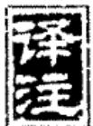

<!-- V3_SOURCE_ID:book016-b000836-p000-33493519a8 -->

## 比卦第八

查看对应原文

<!-- V3_FOLDBACK_BEGIN:book016-b000836-p000-33493519a8 -->

## 比卦第八

<!-- V3_FOLDBACK_END:book016-b000836-p000-33493519a8 -->

<!-- V3_SOURCE_ID:book016-b000837-p000-881b0f19ce -->

## 比①：吉②。原筮，元永贞，无咎③。不宁方来，后夫凶④。 — 比——吉祥。原筮，元永贞，无咎。不宁方来，后夫凶。

查看对应原文

<!-- V3_FOLDBACK_BEGIN:book016-b000837-p000-881b0f19ce -->

## 比①：吉②。原筮，元永贞，无咎③。不宁方来，后夫凶④。

<!-- V3_FOLDBACK_END:book016-b000837-p000-881b0f19ce -->

<!-- V3_SOURCE_ID:book016-b000838-p000-127ea38e65 -->

译文《比》卦象征亲密比辅：吉祥。原穷真情、筮决挚意，(相互亲密比辅于)有德君长而永久不渝地守持正固，必无咎害。不获安宁者多方前来比辅，缓缓来迟者有凶险。

查看对应原文

<!-- V3_FOLDBACK_BEGIN:book016-b000838-p000-127ea38e65 -->

译文《比》卦象征亲密比辅：吉祥。原穷真情、筮决挚意，(相互亲密比辅于)有德君长而永久不渝地守持正固，必无咎害。不获安宁者多方前来比辅，缓缓来迟者有凶险。

<!-- V3_FOLDBACK_END:book016-b000838-p000-127ea38e65 -->

<!-- V3_SOURCE_ID:book016-b000839-p000-ea55cd8352 -->

注释①：比是卦名，下坤、上坎。考察“比”字的含义，《彖传》说：“比就是辅的意思”；《说文》解释：“比，就是亲密的意思，两个“人”字组成“从”字，反过来写“从”字就是“比”字。”《正义》《本义》沿用这个说法，分别将“比”解释为“相亲近比辅”“亲近辅佐”。又考察《释文》中“比”的注音为“毗志反”，那么“比”字应当读作bì。

查看对应原文

<!-- V3_FOLDBACK_BEGIN:book016-b000839-p000-ea55cd8352 -->

注释①比：卦名，下坤()上坎()。案，“比”字之义，《彖传》曰：“辅也”；《说文》：“比，密也，二人为从，反从为比。”《正义》、《本义》承此，分别释为“相亲比”、“亲辅”。又案，《释文》“比，毗志反”，则“比”字当读bì。

<!-- V3_FOLDBACK_END:book016-b000839-p000-ea55cd8352 -->

<!-- V3_SOURCE_ID:book016-b000840-p000-280f2a2593 -->

②吉：万物能够互相亲密比辅，所以获得吉祥。《正义》说：“就是说能够相亲近比辅从而得到吉祥。”

查看对应原文

<!-- V3_FOLDBACK_BEGIN:book016-b000840-p000-280f2a2593 -->

②吉：物能互相亲密比辅，故获吉祥。《正义》：‘谓能相亲比而得其吉。’

<!-- V3_FOLDBACK_END:book016-b000840-p000-280f2a2593 -->

<!-- V3_SOURCE_ID:book016-b000841-p000-a822c1e508 -->

③原筮，元永贞，无咎：原筮，《正义》：“原穷其情，筮决其意”，《本义》释为“再筮”，《尚氏学》释为“野筮”，今从《正义》说；元，善之长(见《乾》卦《文言》译注)，指所比者有尊长之德；永，久也；贞，正也。这三句说明“比辅”之前，须慎重考虑，在“原情筮意”的基础上决定“亲比”的对象；而所亲比者又必须有尊长之德，永久不变、守持正固，则可获“无咎”。《程传》：“人相亲比，必有其道；苟非其道，则有悔咎。故必推原占决其可比者而比之。筮，谓占决卜度，非谓以蓍龟也。所比得元、永、贞’则无咎。元，谓有君长之道；永，谓可以常久；贞，谓得正道。上之比下，必有此三者；下之从上，必求此三者，则无咎’也。”案，“元永贞”，为亲比至为完善之称，似主卦中九五，即《彖传》所谓“以刚中也”。故《王注》曰：“使永贞’而无咎’者，其唯九五乎？”当从之。

查看对应原文

<!-- V3_FOLDBACK_BEGIN:book016-b000841-p000-a822c1e508 -->

③原筮，元永贞，无咎：原筮，《正义》：“原穷其情，筮决其意”，《本义》释为“再筮”，《尚氏学》释为“野筮”，今从《正义》说；元，善之长(见《乾》卦《文言》译注)，指所比者有尊长之德；永，久也；贞，正也。这三句说明“比辅”之前，须慎重考虑，在“原情筮意”的基础上决定“亲比”的对象；而所亲比者又必须有尊长之德，永久不变、守持正固，则可获“无咎”。《程传》：“人相亲比，必有其道；苟非其道，则有悔咎。故必推原占决其可比者而比之。筮，谓占决卜度，非谓以蓍龟也。所比得元、永、贞’则无咎。元，谓有君长之道；永，谓可以常久；贞，谓得正道。上之比下，必有此三者；下之从上，必求此三者，则无咎’也。”案，“元永贞”，为亲比至为完善之称，似主卦中九五，即《彖传》所谓“以刚中也”。故《王注》曰：“使永贞’而无咎’者，其唯九五乎？”当从之。

<!-- V3_FOLDBACK_END:book016-b000841-p000-a822c1e508 -->

<!-- V3_SOURCE_ID:book016-b000842-p000-e57fb59e30 -->

④不宁方来，后夫凶：宁，安乐；方，犹言“多方”；来，指前来比辅；后，迟也；夫，语气词。这两句是就下者、远者对上者、尊者的“比辅”而言，说明时当“亲比”，四方“不宁”者纷纷来归；来者又以速为宜，迟缓则“比”之难成、必有凶险。《正义》：“此是宁乐之时，若能与人亲比，则不宁之方皆悉归来。”又曰：“亲比贵速，若及早而来，人皆亲己，故在先者吉；若在后而至者，人或疏已，亲比不成，故后夫凶’。”案，《正义》又引或说：“以‘夫’为丈夫’，谓后来之人也”，义亦通。

查看对应原文

<!-- V3_FOLDBACK_BEGIN:book016-b000842-p000-e57fb59e30 -->

④不宁方来，后夫凶：宁，安乐；方，犹言“多方”；来，指前来比辅；后，迟也；夫，语气词。这两句是就下者、远者对上者、尊者的“比辅”而言，说明时当“亲比”，四方“不宁”者纷纷来归；来者又以速为宜，迟缓则“比”之难成、必有凶险。《正义》：“此是宁乐之时，若能与人亲比，则不宁之方皆悉归来。”又曰：“亲比贵速，若及早而来，人皆亲己，故在先者吉；若在后而至者，人或疏已，亲比不成，故后夫凶’。”案，《正义》又引或说：“以‘夫’为丈夫’，谓后来之人也”，义亦通。

<!-- V3_FOLDBACK_END:book016-b000842-p000-e57fb59e30 -->

<!-- V3_SOURCE_ID:book016-b000843-p000-38e7bde0aa -->

∑丽朱熹曰：“九五以阳刚居上之中，而得其正，上下五阴比而从之：以一人而抚万邦，以四海而仰一人之象。”(《本义》)此说喻示六爻关系至为简明，有助于领会卦辞含义。

查看对应原文

<!-- V3_FOLDBACK_BEGIN:book016-b000843-p000-38e7bde0aa -->

∑丽朱熹曰：“九五以阳刚居上之中，而得其正，上下五阴比而从之：以一人而抚万邦，以四海而仰一人之象。”(《本义》)此说喻示六爻关系至为简明，有助于领会卦辞含义。

<!-- V3_FOLDBACK_END:book016-b000843-p000-38e7bde0aa -->

<!-- V3_SOURCE_ID:book016-b000844-p000-a4de85a8d6 -->

译文《象传》说：亲密比辅，必有吉祥；“比”，是亲辅的意思，譬如在下者都能顺从亲辅于上。“原穷真情、筮决挚意，（相互亲密比辅于）有德君长而永久不渝地守持正固，必无咎害”，说明有德君长刚健居中。“不得安宁者多方前来比辅”，说明上者与下者相互应合；“缓缓来迟者有凶险”，说明迟缓必使亲密比辅之道穷尽。

查看对应原文

<!-- V3_FOLDBACK_BEGIN:book016-b000844-p000-a4de85a8d6 -->

译文《象传》说：亲密比辅，必有吉祥；“比”，是亲辅的意思，譬如在下者都能顺从亲辅于上。“原穷真情、筮决挚意，（相互亲密比辅于）有德君长而永久不渝地守持正固，必无咎害”，说明有德君长刚健居中。“不得安宁者多方前来比辅”，说明上者与下者相互应合；“缓缓来迟者有凶险”，说明迟缓必使亲密比辅之道穷尽。

<!-- V3_FOLDBACK_END:book016-b000844-p000-a4de85a8d6 -->

<!-- V3_SOURCE_ID:book016-b000845-p000-1fed39fe88 -->

《彖传》说：比卦，是吉祥的；比，是辅佐的意思，指下位者顺从于上位者①。‘原筮，元永贞，无咎’，是因为九五爻刚健居中②。‘不宁方来’，是上下爻相互呼应③；‘后夫凶’，是因为他的路走到了尽头④。

查看对应原文

<!-- V3_FOLDBACK_BEGIN:book016-b000845-p000-1fed39fe88 -->

《彖》曰：比，吉也；比，辅也，下顺从也①。“原筮，元永贞，无咎”，以刚中也②。“不宁方来”，上下应也③；“后夫凶”，其道穷也④。

<!-- V3_FOLDBACK_END:book016-b000845-p000-1fed39fe88 -->

<!-- V3_SOURCE_ID:book016-b000846-p000-4f26475ef0 -->

注释①下顺从也：指在下位的阴爻顺从于九五爻，这句结合前文来解释卦名和卦辞‘比，吉’。《集解》引用崔憬的话说：‘下位者依附于上位者，这就是下位者顺从的意思。’

查看对应原文

<!-- V3_FOLDBACK_BEGIN:book016-b000846-p000-4f26475ef0 -->

注释①下顺从也：指在下群阴顺从于九五，此句合前文并释卦名及卦辞“比，吉”。《集解》引崔憬曰：“下比于上，是下顺也。”

<!-- V3_FOLDBACK_END:book016-b000846-p000-4f26475ef0 -->

<!-- V3_SOURCE_ID:book016-b000847-p000-f1601d0c20 -->

②以刚中也：这句是说九五爻刚健且居于中位，成就了比道的极致美好，以此解释卦辞‘原筮，元永贞，无咎’。《正义》说：‘因为九五爻刚健且居于中位，所以使得行比道的人都能做到‘原筮，元永贞，无咎’。’

查看对应原文

<!-- V3_FOLDBACK_BEGIN:book016-b000847-p000-f1601d0c20 -->

②以刚中也：此句以九五刚健居中，成“比”道之至美，释卦辞“原筮，元永贞，无咎”。《正义》：“以九五刚而处中，故使比者皆得‘原筮，元永贞，无咎’也。”

<!-- V3_FOLDBACK_END:book016-b000847-p000-f1601d0c20 -->

<!-- V3_SOURCE_ID:book016-b000848-p000-3ecf781c08 -->

③上下应也：上，指九五爻；下，指初、二、三、四各爻。这句是说九五爻与下位的四个阴爻相互呼应，以此解释卦辞‘不宁方来’。《重定费氏学》引用王申子的话说：‘四个阴爻顺从于九五爻，九五爻下位依附于四个阴爻，所以叫做‘上下应’。’按，《王注》《本义》都解释‘上下应’为‘上下五阴爻呼应于九五爻’，可供参考。

查看对应原文

<!-- V3_FOLDBACK_BEGIN:book016-b000848-p000-3ecf781c08 -->

③上下应也：上，指九五；下，指初、二、三、四诸爻。此句以九五与下四阴相比应，释卦辞“不宁方来”。《重定费氏学》引王申子曰：“四阴顺从乎五，五下比四阴，故曰‘上下应’。”案，《王注》、《本义》均释“上下应”为“上下五阴应于九五”，可备参考。

<!-- V3_FOLDBACK_END:book016-b000848-p000-3ecf781c08 -->

<!-- V3_SOURCE_ID:book016-b000849-p000-66fb997cf0 -->

④这是说亲比之道已经穷尽：以上六处的内容，是说该爻居卦之终，亲比之道已经穷尽，用来解释卦辞里“后夫凶”的含义。《正义》的解释是：“其余都来亲比，只有自己最后才到，亲比之道已经穷尽，没人与自己亲近，所以会有凶险；这里说的是上六爻。”

查看对应原文

<!-- V3_FOLDBACK_BEGIN:book016-b000849-p000-66fb997cf0 -->

④其道穷也：此句以上六处卦终而“亲比”道穷，释卦辞“后夫凶”。《正义》：“他悉亲比，已独后来，比道穷困，无人与亲，故其凶也；此谓上六也。”

<!-- V3_FOLDBACK_END:book016-b000849-p000-66fb997cf0 -->

<!-- V3_SOURCE_ID:book016-b000850-p000-31c4c89153 -->

译文《象传》说：地上布满水（水和地相亲无间），象征“亲密比辅”；先代君王因此封建万国，亲近诸侯。

查看对应原文

<!-- V3_FOLDBACK_BEGIN:book016-b000850-p000-31c4c89153 -->

译文《象传》说：地上布满水（水和地相亲无间），象征“亲密比辅”；先代君王因此封建万国，亲近诸侯。

<!-- V3_FOLDBACK_END:book016-b000850-p000-31c4c89153 -->

<!-- V3_SOURCE_ID:book016-b000851-p000-2f85a44301 -->

《象传》说：地上有水，这就是比卦的卦象；先代君王因此分封万国，亲近诸侯。

查看对应原文

<!-- V3_FOLDBACK_BEGIN:book016-b000851-p000-2f85a44301 -->

《象》曰：地上有水，比①；先王以建万国，亲诸侯②。

<!-- V3_FOLDBACK_END:book016-b000851-p000-2f85a44301 -->

<!-- V3_SOURCE_ID:book016-b000852-p000-11b29db161 -->

注释①地上有水，比：这是解释《比》卦上坎为水、下坤为地的卦象。《集解》引用何晏的话：“水的特性是润下，现在在地上，互相浸润，这就是‘比’的含义。”《程传》的解释是：“万物相亲无间，没有比水在地上更贴切的，所以这就是‘比’的卦象。”

查看对应原文

<!-- V3_FOLDBACK_BEGIN:book016-b000852-p000-11b29db161 -->

注释①地上有水，比：释《比》卦上坎为水、下坤为地之象。《集解》引何晏曰：“水性润下，今在地上，更相浸润，‘比’之义也。”《程传》：“夫物相亲比而无间者，莫如水在地上，所以为‘比’也。”

<!-- V3_FOLDBACK_END:book016-b000852-p000-11b29db161 -->

<!-- V3_SOURCE_ID:book016-b000853-p000-e3ae233cc4 -->

②建立万国、亲近诸侯：这是说明“先王”效法《比》卦的卦象，建立邦国、分封诸侯，以此实现相亲比。《程传》说：“建立万国，是用来使民众相亲比；亲抚诸侯，是用来使天下相亲比。”

查看对应原文

<!-- V3_FOLDBACK_BEGIN:book016-b000853-p000-e3ae233cc4 -->

②建万国，亲诸侯：这是说明“先王”效法《比》象，建国封侯以相亲比。《程传》：“建立万国，所以比民也；亲抚诸侯，所以比天下也。”

<!-- V3_FOLDBACK_END:book016-b000853-p000-e3ae233cc4 -->

<!-- V3_SOURCE_ID:book016-b000854-p000-ec374c9863 -->

这说明《彖传》偏重从“在下者亲附在上者”的角度解释卦义，《大象传》则专门从“在上者亲近在下者”的角度阐发其宗旨：两相对照，《比》卦的义理因此得以显明。朱熹在《本义》中说：“《彖传》的意思是别人来亲附我，《大象传》则取我主动去亲附别人”，正是这个道理。

查看对应原文

<!-- V3_FOLDBACK_BEGIN:book016-b000854-p000-ec374c9863 -->

说明《象传》偏重从“下比上”的角度解释卦义，《大象传》则专从“上亲下”的角度阐发其旨：两相对照，《比》卦的义理因之显明。朱熹曰：“《彖》意人来比我，此取我往比人”（《本义》）是也。

<!-- V3_FOLDBACK_END:book016-b000854-p000-ec374c9863 -->

<!-- V3_SOURCE_ID:book016-b000855-p000-a821cdac06 -->

译文初六，心怀诚信、亲密比辅于君主，免 遭咎害；君主的诚信如美酒充盈酒缸，终于使 远者来归而广应亲抚于他方，吉祥。

查看对应原文

<!-- V3_FOLDBACK_BEGIN:book016-b000855-p000-a821cdac06 -->

译文初六，心怀诚信、亲密比辅于君主，免 遭咎害；君主的诚信如美酒充盈酒缸，终于使 远者来归而广应亲抚于他方，吉祥。

<!-- V3_FOLDBACK_END:book016-b000855-p000-a821cdac06 -->

<!-- V3_SOURCE_ID:book016-b000856-p000-28b8ce88c7 -->

初六，心怀诚信而亲比，没有咎害；诚信充盈如缶中所盛之物，最终会有其他事物前来，吉祥。

> **释读存疑：** 原文中“有它”的具体所指未明确，释读仅按字面含义处理

查看对应原文

<!-- V3_FOLDBACK_BEGIN:book016-b000856-p000-28b8ce88c7 -->

初六，有孚比之，无咎①；有孚盈缶，终来有它，吉②。

<!-- V3_FOLDBACK_END:book016-b000856-p000-28b8ce88c7 -->

<!-- V3_SOURCE_ID:book016-b000857-p000-06ea8cd8dd -->

注释①有孚比之，无咎：比之，指初六爻与九五爻相邻相应。这是说初六爻处于应当亲比的时机，本有因居位不当导致的过失，但能以诚信向上亲比九五爻，因此获得无咎的结果；而且初六爻距离九五爻最远，本不在九五爻应有的范围之内，但此时九五爻向下亲比的德行广泛施行，所以荒远之地也能亲比。《集解》引用荀爽的话说：“初六爻在应位之外，用来比喻不同习俗的人；圣王的诚信，光照四方，偏远之地、不同习俗的人，都来亲附，所以说‘无咎’。”《尚氏学》记载：“九五爻是卦的主爻，所以也会以诚信对待初六爻并亲比它；初六爻居位不当，本有过失，因为亲比九五爻所以没有过失。”

查看对应原文

<!-- V3_FOLDBACK_BEGIN:book016-b000857-p000-06ea8cd8dd -->

注释①有孚比之，无咎：比之，指初比五。此谓初六当“亲比”之时，本有失位之咎，但能以诚信上比九五，故获“无咎”；而初最远五，本在九五所应范围之外，但此时五下比之德广施，故“荒外”亦能“比之”。《集解》引荀爽曰：“初在应外，以喻殊俗；圣王之信，光被四表，绝域殊俗，皆来亲比，故‘无咎’也。”《尚氏学》：“五为卦主，故亦孚于初而比之；初失位，本有咎，比五故无咎。”

<!-- V3_FOLDBACK_END:book016-b000857-p000-06ea8cd8dd -->

<!-- V3_SOURCE_ID:book016-b000858-p000-68d7319e1a -->

②有孚盈缶，终来有它，吉：缶，读音为fǒu，是大肚小口的瓦器，《说文》记载“缶，瓦器，用来盛酒浆”，“盈缶”用来比喻九五爻的信德充盈天下；“来”是使动用法，意思是“使……来归附”，指初六爻归附九五爻；“有它”，指九五爻的应及于其他爻，《尚氏学》说“有它，谓有应于他方也”。这三句说明九五爻的信德如同“盈缶”一样广泛施行，使像初六爻那样的荒远之人最终也来归附，九五爻也向下应和亲抚其他爻，上下亲比，所以获得吉祥。《重定费氏学》引用潘相的话说：“‘来’，就是‘不宁方来’的‘来’。六二、六四亲比九五爻不难，难的是《比》卦的初六爻，处于最下方、距离最远，即使跋涉前来，上位者也必定会亲近他。”

查看对应原文

<!-- V3_FOLDBACK_BEGIN:book016-b000858-p000-68d7319e1a -->

②有孚盈缶，终来有它，吉：缶，音fǒu，大肚小口的瓦器，《说文》“缶，瓦器，所以盛酒浆”，“盈缶”喻九五信德充盈天下；来，使动用法，犹言“使来归”，指初归五；有它，指五应及他爻，《尚氏学》“有它，谓有应于他方也”。这三句说明九五信德如“盈缶”广施，使“荒远”似初者也终来归附，五也下应亲抚他方，上下亲比，故获吉祥。《重定费氏学》引潘相曰：“‘来’，即不宁方来’之来。二、四比五不难，难在《比》之初六，至下极远，梯航以来，上必亲之。”

<!-- V3_FOLDBACK_END:book016-b000858-p000-68d7319e1a -->

<!-- V3_SOURCE_ID:book016-b000859-p000-60701c8f31 -->

《象》说：《象传》说：《比》卦的初六爻，说明此时九五爻广泛应和于他方，必定获得吉祥。

> **释读存疑：** 原句存在重复抄写的问题，已整理为通顺的说明性语句

查看对应原文

<!-- V3_FOLDBACK_BEGIN:book016-b000859-p000-60701c8f31 -->

《象》曰：《比》之初六，有它 译文《象传》说：《比》卦的初六爻，说明此时九五广应于他方、必获吉祥。吉也。

<!-- V3_FOLDBACK_END:book016-b000859-p000-60701c8f31 -->

<!-- V3_SOURCE_ID:book016-b000860-p000-6b2ec7e6ab -->

本爻的大义是：地位低微、遥居荒远之地的人，想要亲比于至尊，实在有重重困难，因此，初六爻能够亲比的前提，是九五爻有孚盈缶；正因为远方的人最终前来归附，上下亲比的原则才能切实体现出来。

查看对应原文

<!-- V3_FOLDBACK_BEGIN:book016-b000860-p000-6b2ec7e6ab -->

说明本爻的大义是：地位低微、遥居“荒外”者，欲“亲比”于“至尊”，实有重重困难，因此，初六能“比之”，其前提是九五“有孚盈缶”；正由于远者“终来”，“上下亲比”之道才能切实体现。

<!-- V3_FOLDBACK_END:book016-b000860-p000-6b2ec7e6ab -->

<!-- V3_SOURCE_ID:book016-b000861-p000-1a571d0001 -->

六二，比之自内，贞吉①。 白话解释：六二，从内部亲密比辅于君主，守持正固可获吉祥。

查看对应原文

<!-- V3_FOLDBACK_BEGIN:book016-b000861-p000-1a571d0001 -->

六二，比之自内，贞吉①。 译文六二，从内部亲密比辅于君主，守持正固可获吉祥。

<!-- V3_FOLDBACK_END:book016-b000861-p000-1a571d0001 -->

<!-- V3_SOURCE_ID:book016-b000862-p000-ff32168bf4 -->

这段注释对“比之自内，贞吉”的解释是：“内”指内部，此处指六二居于内卦，上应外卦的九五，因柔顺中正而获得吉祥。《本义》中也提到：“柔顺中正，上应九五；自内比外，而得其正：吉之道也。”

查看对应原文

<!-- V3_FOLDBACK_BEGIN:book016-b000862-p000-ff32168bf4 -->

注释①比之自内，贞吉：内，内部。此指六二居内卦，上应外卦的九五，柔顺中正，故获吉祥。《本义》：“柔顺中正，上应九五；自内比外，而得其正：吉之道也。”

<!-- V3_FOLDBACK_END:book016-b000862-p000-ff32168bf4 -->

<!-- V3_SOURCE_ID:book016-b000863-p000-f61501a7ab -->

《象》曰：“比之自内”，不自失也①。 白话解释：《象传》说：从内部亲密比辅于君主，说明六二不曾自失正道。

查看对应原文

<!-- V3_FOLDBACK_BEGIN:book016-b000863-p000-f61501a7ab -->

《象》曰：“比之自内”，不自失 译文《象传》说：从内部亲密比辅于君也①。 主，说明六二不曾自失正道。

<!-- V3_FOLDBACK_END:book016-b000863-p000-f61501a7ab -->

<!-- V3_SOURCE_ID:book016-b000864-p000-6cbb5e93cb -->

注释①不自失：《本义》说：“得正则不自失矣。”另外，《尚氏学》认为“失”通“佚”，意思是“从内部比辅九五，不敢安逸”，也可以作为一种说法留存参考。

查看对应原文

<!-- V3_FOLDBACK_BEGIN:book016-b000864-p000-6cbb5e93cb -->

注释①不自失：《本义》：“得正则不自失矣。”案，《尚氏学》谓“失”通“佚”，“言自内比五，不敢安逸也”。亦可备一说。

<!-- V3_FOLDBACK_END:book016-b000864-p000-6cbb5e93cb -->

<!-- V3_SOURCE_ID:book016-b000865-p000-077342eff7 -->

解释《易经》六二爻辞“比之自内”，意思是亲比“尊主”并不困难；但如果不恪守正道，也会有所损失。《象传》所说的“不自失”，言外之意是说明“失正”会导致凶险。《程传》感叹道：“《易》的戒惧之意十分严密。”

查看对应原文

<!-- V3_FOLDBACK_BEGIN:book016-b000865-p000-077342eff7 -->

说明六二“比之自内”，亲比“尊主”不难；但若不守正，也将有失。《象传》所谓“不自失”，言外之意是说明“失正”将致凶。《程传》叹曰：“《易》之为戒严密。”

<!-- V3_FOLDBACK_END:book016-b000865-p000-077342eff7 -->

<!-- V3_SOURCE_ID:book016-b000866-p000-8ca57be335 -->

## 六三，比之匪人①。

查看对应原文

<!-- V3_FOLDBACK_BEGIN:book016-b000866-p000-8ca57be335 -->

## 六三，比之匪人①。

<!-- V3_FOLDBACK_END:book016-b000866-p000-8ca57be335 -->

<!-- V3_SOURCE_ID:book016-b000867-p000-2688fa1b9c -->

六三爻的含义是，亲密比辅于行为不正当的人。

查看对应原文

<!-- V3_FOLDBACK_BEGIN:book016-b000867-p000-2688fa1b9c -->

译文六三，亲密比辅于行为不正当的人。

<!-- V3_FOLDBACK_END:book016-b000867-p000-2688fa1b9c -->

<!-- V3_SOURCE_ID:book016-b000868-p000-2e42cc4091 -->

注释①比之匪人：匪，通“非”；《集解》引用虞翻的说法：“匪，就是非，六三爻失位无应，又属多凶之爻，其卦体为《剥》卦，有伤害之象，如同弑父弑君，所以称为‘匪人’。”六三爻失位盲动，上方没有相应的爻位，所亲比的是六二、六四两个阴爻，没有得到阳刚之主，因此有“比之匪人”的卦象。《本义》说：“阴柔不中正，上下承接的都是阴爻，所亲比的都不是合适的人，这个爻的占问结果大凶，不用多说也能知道。”按，《折中》引用赵彦肃的说法：“初爻亲比于五爻，是主动先行；二爻，是相应的爻位；四爻，是承接的爻位。六三爻没有这三种情况的道理，将不能亲比于五爻了。”这个说法是可取的。

查看对应原文

<!-- V3_FOLDBACK_BEGIN:book016-b000868-p000-2e42cc4091 -->

注释①比之匪人：匪，通“非”；《集解》引虞翻曰：“匪，非也，失位无应，三又多凶，体《剥》，伤象，弑父弑君，故曰‘匪人’。”六三失位盲动，上无所应，所比者为二、四之阴，未得阳刚之主，故有“比之匪人”之象。《本义》：“阴柔不中正，承乘皆阴，所比皆非其人之象。其占大凶，不言可知。”案，《折中》引赵彦肃曰：“初比于五，先也；二，应也；四，承也。六三无是三者之义，将不能比五矣。”此说可取。

<!-- V3_FOLDBACK_END:book016-b000868-p000-2e42cc4091 -->

<!-- V3_SOURCE_ID:book016-b000869-p000-a99fbf70ff -->

《象传》说：“亲密比辅于行为不正的人，岂不是可悲的事？”

查看对应原文

<!-- V3_FOLDBACK_BEGIN:book016-b000869-p000-a99fbf70ff -->

译文《象传》说：“亲密比辅于行为不正 《象》曰：“比之匪人”，不亦  
当的人”，岂不是可悲的事？伤乎？

<!-- V3_FOLDBACK_END:book016-b000869-p000-a99fbf70ff -->

<!-- V3_SOURCE_ID:book016-b000870-p000-106c5aeeb9 -->

《周易学说》引刘沅的话说：“凡是居家者的邻居、求学者的朋友、为官者的同僚，都应当警惕‘匪人’带来的伤害。”这种说法把六三的鉴戒内涵揭示得颇为明澈。

查看对应原文

<!-- V3_FOLDBACK_BEGIN:book016-b000870-p000-106c5aeeb9 -->

说萌《周易学说》引刘沅曰：‘凡居者之邻，学者之友，仕者之同僚，皆当戒‘匪人’之伤焉。’此说把六三的鉴戒内涵揭示得颇为明澈。

<!-- V3_FOLDBACK_END:book016-b000870-p000-106c5aeeb9 -->

<!-- V3_SOURCE_ID:book016-b000871-p000-f373ff650b -->

六四，在外亲密比辅于君主，守持正固可获吉祥。

查看对应原文

<!-- V3_FOLDBACK_BEGIN:book016-b000871-p000-f373ff650b -->

译文六四，在外亲密比辅于君主，守持 六四，外比之，贞吉①。  
正固可获吉祥。

<!-- V3_FOLDBACK_END:book016-b000871-p000-f373ff650b -->

<!-- V3_SOURCE_ID:book016-b000872-p000-981c11a5b7 -->

注释①外比之，贞吉：指六四居于外卦，上承九五，柔顺得正，亲比“尊主”，所以获得“贞吉”。《集解》引虞翻的话说：“在外体，所以称‘外’；得位比贤，所以称‘贞吉’。”

查看对应原文

<!-- V3_FOLDBACK_BEGIN:book016-b000872-p000-981c11a5b7 -->

注释①外比之，贞吉：指六四居外卦上承九五，柔顺得正，亲比“尊主”，故获“贞吉”。《集解》引虞翻曰：“在外体，故称‘外’；得位比贤，故曰‘贞吉’。”

<!-- V3_FOLDBACK_END:book016-b000872-p000-981c11a5b7 -->

<!-- V3_SOURCE_ID:book016-b000873-p000-dbba5b9c87 -->

《象传》解释道：在外亲密比辅于贤君，这是因为六四顺从尊上。

查看对应原文

<!-- V3_FOLDBACK_BEGIN:book016-b000873-p000-dbba5b9c87 -->

译文《象传》说：在外亲密比辅于贤君， 《象》曰：外比于贤，以从上也。  
说明六四顺从于尊上。

<!-- V3_FOLDBACK_END:book016-b000873-p000-dbba5b9c87 -->

<!-- V3_SOURCE_ID:book016-b000874-p000-29dfa3d5a8 -->

与六二相比，六四能够“亲比”于九五的一个重要因素是“近承”。李光地在《周易观象》中说：“凡是六四承顺九五的情况都吉利，更何况是‘比’之时呢？”

查看对应原文

<!-- V3_FOLDBACK_BEGIN:book016-b000874-p000-29dfa3d5a8 -->

说萌与六二相较，四能“亲比”于五的一个重要因素是“近承”。李光地曰：“凡六四承九五者皆吉，况‘比’时乎？”（《周易观象》）

<!-- V3_FOLDBACK_END:book016-b000874-p000-29dfa3d5a8 -->

<!-- V3_SOURCE_ID:book016-b000875-p000-1ef0d88415 -->

九五爻，光明无私而广获亲比；君王行显比之礼：君王狩猎时采用三方驱围、网张一面的方式，听任前方的禽兽走失，属下邑人也不加以警备，吉祥。

查看对应原文

<!-- V3_FOLDBACK_BEGIN:book016-b000875-p000-1ef0d88415 -->

译文九五，光明无私而广获亲比；君王 九五，显比①；王用三驱，失前田猎时三方驱围、网张一面，听任前方的禽兽走失，属下邑人也不相警备，吉祥。 禽，邑人不诫，吉②。

<!-- V3_FOLDBACK_END:book016-b000875-p000-1ef0d88415 -->

<!-- V3_SOURCE_ID:book016-b000876-p000-1f8d1191bb -->

注释①显比：显，就是明，此处包含“光明无私”的意思。《说文解字》中说“显是头部的明饰，从页㬎声”，段玉裁的《说文解字注》中说“显引申为一切明的称呼”。这句说明九五处于《比》卦的尊位，阳刚中正，所有阴爻都来比辅，有光明无私地与众亲比的意象。《周易本义》中说：“一阳居于尊位，刚健中正，卦中的所有阴爻，都来亲附自己，显露出亲比而无私的样子。”《周易学说》引用刘沅的话：“显，是光明的意思；上下亲比，极为公正无私，所以叫做‘显比’。”

查看对应原文

<!-- V3_FOLDBACK_BEGIN:book016-b000876-p000-1f8d1191bb -->

注释①显比：显，明也，此处含“光明无私”之义，《说文》“头明饰也，从页㬎声”，《段注》“引申为凡明之称”。这句说明九五处《比》尊位，阳刚中正，群阴皆来比辅，有光明无私地与众亲比之象。《本义》：“一阳居尊，刚健中正，卦之群阴，皆来比已，显其比而无私。”《周易学说》引刘沅曰：“显，光明之意；上下相比，至公无私，故曰‘显比’。”

<!-- V3_FOLDBACK_END:book016-b000876-p000-1f8d1191bb -->

<!-- V3_SOURCE_ID:book016-b000877-p000-b8b3092a65 -->

②王用三驱，失前禽，邑人不诫，吉：所谓三驱，就是从三个方向驱围，指的是田猎活动；禽在这里泛指各类禽兽；邑人，此处相当于九五的属下。前面两句是用古代天子田猎时，从三个方向驱围、只张开一面网，让愿意入网的进来、不愿意的自行离开，来比喻九五与他人亲比时能顺其自然而无私，再次申明上文“显比”的含义；邑人不诫，说明九五的属下也明白“失前禽”的道理，不会互相警备，进一步衬托九五的“比”道极为完美，所以是吉祥的。《本义》中说：“如同天子不四面合围，只开一面网，来的不拒绝，走的不追赶，所以是‘用三驱，失前禽’；而‘邑人不诫’的意象，是说即使是私属也能领会君上的心意，不会互相警备以求一定捕获。”

查看对应原文

<!-- V3_FOLDBACK_BEGIN:book016-b000877-p000-b8b3092a65 -->

②王用三驱，失前禽，邑人不诫，吉：三驱，三方驱围，指田猎；禽，泛称禽兽；邑人，此处犹言九五的“属下”。前两句是用古代天子田猎，三方驱围、仅张一面之网，让愿者入网、不愿者走离，比喻九五与人亲比能顺其自然而无私，再申上文“显比”之义；邑人不诫，则说明九五的“属下”也喻知“失前禽”之义，不相警备，进一步映衬九五“比”道至美，故为吉祥。《本义》：“如天子不合围，开一面之网，来者不拒，去者不追，故为‘用三驱，失前禽’；而‘邑人不诫’之象，盖虽私属亦喻上意，不相警备以求必得也。”

<!-- V3_FOLDBACK_END:book016-b000877-p000-b8b3092a65 -->

<!-- V3_SOURCE_ID:book016-b000878-p000-4594717be0 -->

既然已经明确，《史记·殷本纪》中记载：“汤外出，看见野外有人四面张网，祷告说：‘从天下四方来的都要进入我的网中。’汤说：‘唉，这样就把禽兽都捕尽了！’于是撤去三面网，祷告说：‘想往左的就往左，想往右的就往右。不服从命令的，才进入我的网中。’诸侯听说这件事，都说：‘汤的德行达到了极点，连禽兽都能顾及到。’”这个典故似乎和“三驱失前禽”的含义相合，可以作为参考。

查看对应原文

<!-- V3_FOLDBACK_BEGIN:book016-b000878-p000-4594717be0 -->

既明《史记·殷本纪》曰：“汤出，见野张网四面，祝曰：‘自天下四方皆入吾网。’汤曰：‘嘻，尽之矣！’乃去其三面，祝曰：‘欲左，左；欲右，右。不用命，乃入吾网。’诸侯闻之，曰：‘汤德至矣，及禽兽。’”此典似与“三驱失前禽”之义有合，可备参考。

<!-- V3_FOLDBACK_END:book016-b000878-p000-4594717be0 -->

<!-- V3_SOURCE_ID:book016-b000879-p000-127c64aa2b -->

《象传》的译文提到，“光明无私而广获亲比”的吉祥，说明九五居位刚正适中；舍弃违逆者、选取顺从者，就如同“听任前方的禽兽走失”；“属下邑人也不相警备”，这是君上让下属保持中道的表现。

查看对应原文

<!-- V3_FOLDBACK_BEGIN:book016-b000879-p000-127c64aa2b -->

译文《象传》说：“光明无私而广获亲比”的吉祥，说明九五居位刚正适中；舍弃违逆取其顺从，正如“听任前方的禽兽走失”；“属下邑人也不相警备”，这是君上使下属保持中道。

<!-- V3_FOLDBACK_END:book016-b000879-p000-127c64aa2b -->

<!-- V3_SOURCE_ID:book016-b000880-p000-2245006e79 -->

《象》中说：“显比”的吉祥，是因为居位正中；舍弃违逆选取顺从，就是“失前禽”；邑人不诫，是君上使下属保持中道。

查看对应原文

<!-- V3_FOLDBACK_BEGIN:book016-b000880-p000-2245006e79 -->

《象》曰：“显比”之吉，位正中也；舍逆取顺，失前禽也；邑人不诫，上使中也。

<!-- V3_FOLDBACK_END:book016-b000880-p000-2245006e79 -->

<!-- V3_SOURCE_ID:book016-b000881-p000-3d98e690f3 -->

《周易》丽卦九五爻的“显比”之德，《象传》用“舍逆取顺”作了精要的概括。程颐又作了更深一层的阐发，他说：“不只是君主与天下人亲比的原则是这样，大概人与人之间的亲比都是如此。就臣子对于君主来说，竭尽自己的忠诚，献出自己的才力，这才是彰显自己亲附君主的原则；是否任用臣子，取决于君主，臣子不能阿谀逢迎，来求得君主亲附自己。在朋友之间也是这样，修养自身、诚心诚意来对待朋友；朋友是否亲近自己，取决于对方，不能花言巧语、曲意逢迎，来求得朋友亲附自己。对于同乡、亲戚，对于众人，没有不是这样的。”

查看对应原文

<!-- V3_FOLDBACK_BEGIN:book016-b000881-p000-3d98e690f3 -->

说丽九五的“显比”之德，《象传》用“舍逆取顺”作了精约的概括。程颐又作更深一层的推阐，说：“非惟人君比天下之道如此，大率人之相比莫不然。以臣于君言之，竭其忠诚，致其才力，乃显其比君之道也；用之与否，在君而已，不可阿谀逢迎，求其比己也。在朋友亦然，修身诚意以待之；亲己与否，在人而已，不可巧言令色，曲从苟合，以求人之比己也。于乡党亲戚，于众人，莫不皆然。”(《程传》)

<!-- V3_FOLDBACK_END:book016-b000881-p000-3d98e690f3 -->

<!-- V3_SOURCE_ID:book016-b000882-p000-7fe1f47707 -->

上六，比之无首，凶①。

查看对应原文

<!-- V3_FOLDBACK_BEGIN:book016-b000882-p000-7fe1f47707 -->

上六，比之无首，凶①。

<!-- V3_FOLDBACK_END:book016-b000882-p000-7fe1f47707 -->

<!-- V3_SOURCE_ID:book016-b000883-p000-eff860a06a -->

译文上六，亲密比辅于人却不领先居首，有凶险。

查看对应原文

<!-- V3_FOLDBACK_BEGIN:book016-b000883-p000-eff860a06a -->

译文上六，亲密比辅于人却不领先居首，有凶险。

<!-- V3_FOLDBACK_END:book016-b000883-p000-eff860a06a -->

<!-- V3_SOURCE_ID:book016-b000884-p000-e64400f4c8 -->

匡释① 比之无首，凶：无首，就是不领先。上六以阴柔之爻居于卦的最末位，想要亲比于人却迟迟落在后面，亲比之道因此穷尽，所以有凶险。这就是卦辞中“后夫凶”的含义。《王注》说：“‘无首’，就是‘后’；处于卦的最末位，就是‘后夫’。亲比之道已经形成，却没有办法善终，被时势所抛弃，自然会有凶险。”

查看对应原文

<!-- V3_FOLDBACK_BEGIN:book016-b000884-p000-e64400f4c8 -->

匡释① 比之无首，凶：无首，即不领先。上六柔居卦终，欲比于人却迟迟后来，“比”道遂穷，故有凶险。此即卦辞“后夫凶”之义。《王注》：“‘无首’，‘后’也（“也”，阮刻作“已”，据《校勘记》改）；处卦之终，是‘后夫’也。亲道已成，无所与终，为时所弃，宜其凶也。”

<!-- V3_FOLDBACK_END:book016-b000884-p000-e64400f4c8 -->

<!-- V3_SOURCE_ID:book016-b000885-p000-e136364900 -->

## 《象》曰：“比之无首”，无所终也。 — 《象》传上说：“比之无首”，意思是说上六终将无所归附。

> **释读存疑：** 原文未明确“无所终”的具体所指，释读为“终将无所归附”为合理引申

查看对应原文

<!-- V3_FOLDBACK_BEGIN:book016-b000885-p000-e136364900 -->

## 《象》曰：“比之无首”，无所终也。

<!-- V3_FOLDBACK_END:book016-b000885-p000-e136364900 -->

<!-- V3_SOURCE_ID:book016-b000886-p000-b78b6b6488 -->

译文《象传》说：“亲密比辅于人却不领先居首”，说明上六终将无所归附。

查看对应原文

<!-- V3_FOLDBACK_BEGIN:book016-b000886-p000-b78b6b6488 -->

译文《象传》说：“亲密比辅于人却不领先居首”，说明上六终将无所归附。

<!-- V3_FOLDBACK_END:book016-b000886-p000-b78b6b6488 -->

<!-- V3_SOURCE_ID:book016-b000887-p000-99953884aa -->

说丽阳极应当用阴来补益，所以“无首”谦退就会吉利；阴极应当用阳来补益，所以最终能刚健宏大也会吉利。上六是阴极的象征，却“无首”居后，自然会有凶险。《集解》引用荀爽的话说：“阳想要不居首，阴就以宏大告终。阴却不居首，就不能以宏大告终，所以凶险。”这种说法可以与《乾》、《坤》的“用九”、“用六”的含义相对照。

查看对应原文

<!-- V3_FOLDBACK_BEGIN:book016-b000887-p000-99953884aa -->

说丽阳极当济以阴，故“无首”谦退则吉；阴极当济以阳，故“终”能刚“大”亦吉。上六为阴极之象，却“无首”居后，自然有凶。《集解》引荀爽曰：“阳欲无首，阴以大终。阴而无首，不以大终，故凶也。”此说可与《乾》、《坤》的“用九”、“用六”之义相对照。

<!-- V3_FOLDBACK_END:book016-b000887-p000-99953884aa -->

<!-- V3_SOURCE_ID:book016-b000888-p000-b4a3c30d3d -->

《比》卦的要义，在于阐述上下、彼此之间“亲密比辅”的道理。卦辞先总说能“比”就一定“吉”，又分述“比道”的三大要素：一、选择比辅的对象必须慎重，即要推原实情、占问心意后再去比辅；二、应当比辅于有德的长者，永远坚守正道；三、亲比之时，应当迅速行动不宜迟缓。卦中的六爻，九五阳刚居尊位，是被人比辅的象征；其余五爻阴柔分别居于上下卦，都是比辅于人的象征。其中初六、六二、六四不违背“比道”，各自能获得吉利；六三亲比没有遇到合适的人，上六居后没有可以比附的对象，也违背了“比道”，有的不利、有的“凶”。从六爻之间的联系来看，其核心主旨在于：无论是“比”于人，还是被人“比”，都应当端正而不邪僻、顺应而不悖逆、明达而不晦暗。事实上这是涉及人与人关系的一个具有普遍意义的问题，其中尤为重要的是主从关系的处理。九五之所以能成为一卦的“尊主”，正是基于“大公无私”、以“信”亲下的原因，于是获得众人争相比辅。程颐称其“众所亲附，而上亦亲下”（《程传》）：实在是体现着“尊卑”关系极为融洽的象征。当然，创作《易》的人设立《比》卦的思想宗旨，或许偏向于为维护、稳固“上层统治”着想，《彖传》所说的“比，辅也，下顺从也”，已经揭示出这一深层意旨。荀子说：“六马不和，则造父不能以致远；士民不亲附，则汤、武不能以必胜也。”（《荀子・议兵》）也与下顺从的含义相合。

查看对应原文

<!-- V3_FOLDBACK_BEGIN:book016-b000888-p000-b4a3c30d3d -->

《比》卦的要义，主于上下、彼此之间“亲密比辅”的道理。卦辞先总称能“比”必“吉”，又分叙“比道”的三大要素：一、选择比辅的对象必须慎重，即“原”情“筮”意而后比；二、应当比辅于有德长者，永守正道；三、亲比之时，宜速不宜缓。卦中六爻，九五阳刚居尊，为被人比辅之象；余五爻阴柔分居上下卦，均为比辅于人之象。其中初六、六二、六四不失“比道”，各能获吉；六三亲比不得其人，上六居后无所比附，并失“比道”，或不利、或“凶”。就六爻间的联系看，其大旨在于：不论“比”于人，还是被人“比”，均当正而不邪、顺而不逆、明而不晦。事实上这是涉及人与人关系的一个具有普遍意义的问题，其中尤为重要的是主、从关系的处理。九五所以能为一卦“尊主”，正是基于“大公无私”、以“信”亲下的原因，遂获众人争相比辅。程颐称其“众所亲附，而上亦亲下”(《程传》)：实是体现着“尊卑”关系至为融洽的象征。当然，作《易》者设立《比》卦的思想宗旨，或是偏向于为维护、稳固“上层统治”着想，《彖传》所谓“比，辅也，下顺从也”，已揭出这一微旨。荀子云：“六马不和，则造父不能以致远；士民不亲附，则汤、武不能以必胜也。”(《荀子・议兵》)亦与下顺从之义相合。 A

<!-- V3_FOLDBACK_END:book016-b000888-p000-b4a3c30d3d -->

<!-- V3_SOURCE_ID:book016-b000889-p000-8dea1954c4 -->

## 小畜卦第九

查看对应原文

<!-- V3_FOLDBACK_BEGIN:book016-b000889-p000-8dea1954c4 -->

## 小畜卦第九

<!-- V3_FOLDBACK_END:book016-b000889-p000-8dea1954c4 -->

<!-- V3_SOURCE_ID:book016-b000890-p000-189db2301f -->

译文《小畜》卦象征小有畜聚：亨通；浓云密布却不降雨，云气的升起来自我方西邑郊外。

查看对应原文

<!-- V3_FOLDBACK_BEGIN:book016-b000890-p000-189db2301f -->

译文《小畜》卦象征小有畜聚：亨通；浓云密布却不降雨，云气的升起来自我方西邑郊外。

<!-- V3_FOLDBACK_END:book016-b000890-p000-189db2301f -->

<!-- V3_SOURCE_ID:book016-b000891-p000-da376430fa -->

## 三 小畜①：亨②；密云不雨，自我西郊③。 — 第三为小畜卦，该卦象征小有畜聚，寓意亨通；浓云密布却未降雨，云气是从我方西郊升起的。

> **释读存疑：** 原文‘三’为卦辞的序号标注，释读为‘第三为小畜卦’是否准确存疑；原文‘自我西郊’仅指云的方位来源，释读为‘云气是从我方西郊升起的’是否符合原意存疑。；1轮自动修复后核义模型仍建议修订，已保守记录。

查看对应原文

<!-- V3_FOLDBACK_BEGIN:book016-b000891-p000-da376430fa -->

## 三 小畜①：亨②；密云不雨，自我西郊③。

<!-- V3_FOLDBACK_END:book016-b000891-p000-da376430fa -->

<!-- V3_SOURCE_ID:book016-b000892-p000-6c74917503 -->

注释①小畜：卦名，下乾（八卦之一，卦象及五行、方位依原文语境确定）（☰）上巽（八卦之一）（☴），象征“小有畜聚”。按，“畜”字，兼有“畜聚”、“畜养”、“畜止”诸义。聚合事物既可以养育事物，又可以阻止事物，那么卦名的含义应当以“聚”为根本，以“养”、“止”为引申义。因此《经典释文》将“畜”解释为“积也，聚也”，又引用郑玄的说法：“养也”；《程传》说：“畜，止也，止则聚矣。”“小”字，象征阴，又指程度大小，卦中“六四”一阴爻居于五阳爻之间，正是小者畜止大者、所畜甚微的象征，所以称为“小畜”。《程传》认为六四“能畜群阳之志”，“谓以小畜大，所畜聚者小”。

查看对应原文

<!-- V3_FOLDBACK_BEGIN:book016-b000892-p000-6c74917503 -->

注释①小畜：卦名，下乾(三)上巽(三)，象征“小有畜聚”。案，“畜”字，兼有“畜聚”、“畜养”、“畜止”诸义。聚物既可以养物，又可以止物，则卦名之义当以“聚”为本，以“养”、“止”为引申。故《释文》训“畜”为“积也，聚也”，又引郑玄曰：“养也”；《程传》曰：“畜，止也，止则聚矣。”“小”字，象征阴，又指程度大小，卦中“六四”一阴居五阳之间，正是小者畜大、所畜甚微之象，故称“小畜”。《程传》以为六四“能畜群阳之志”，“谓以小畜大，所畜聚者小”。

<!-- V3_FOLDBACK_END:book016-b000892-p000-6c74917503 -->

<!-- V3_SOURCE_ID:book016-b000893-p000-c5c89bdf26 -->

②亨：事物若能以小蓄大、以下济上，就会对刚大者的行事有益，所以能够亨通。从卦象来看，指六四所蓄养的只有小的事物，又能以柔济刚，所以“刚中而志行，乃亨”（见《彖传》译注）。

查看对应原文

<!-- V3_FOLDBACK_BEGIN:book016-b000893-p000-c5c89bdf26 -->

②亨：物能以小畜大，以下济上，则有益于刚大者之行，故可亨通。就卦象看，指六四所畜唯小，又能以柔济刚，故“刚中而志行，乃亨”(见《彖传》译注)。

<!-- V3_FOLDBACK_END:book016-b000893-p000-c5c89bdf26 -->

<!-- V3_SOURCE_ID:book016-b000894-p000-5270f31439 -->

③密云不雨，自我西郊：西，古人认为它象征“阴方”；我，指卦中以阴为主的爻，所以称我。这两句是说以阴蓄阳，所蓄养的事物无法盛大；就好比阴气先从阴方升起，积聚的阳气很微弱，不足以和阴气交融成雨，所以才有“密云不雨”的卦象。《集解》引用崔憬的话：“云如不雨，积我西邑之郊，施泽未通，以明‘小畜’之义。”另外，《程传》说：“云，是阴阳之气。阴阳二气交合调和，就会相互蓄聚凝结成雨。阳先倡动、阴随后应和，这是顺合的，所以能调和；如果阴先于阳倡动，就不顺合，所以无法调和，无法调和就不能成雨。云气积聚得虽然浓密，却不能成雨，是因为起自西郊的缘故。东、北是阳方，西、南是阴方。阴气先倡动，所以无法调和而不能成雨。从人的角度来看，云气兴起，都来自四方远处，所以说“郊”；就四方而言，所以说“自我”：蓄阳的是“四”，是蓄养的主爻。”

查看对应原文

<!-- V3_FOLDBACK_BEGIN:book016-b000894-p000-5270f31439 -->

③密云不雨，自我西郊：西，古人以为象征“阴方”；我，卦中以阴为主，故称我。这两句说明以阴畜阳，所畜不能盛大；犹如阴气先从阴方升起，聚阳甚微，未足以和阳成雨，故有“密云不雨”象。《集解》引崔憬曰：“云如不雨，积我西邑之郊，施泽未通，以明‘小畜’之义。”又，《程传》：“云，阴阳之气。二气交而和，则相畜固而成雨。阳倡而阴和，顺也，故和；若阴先阳倡，不顺也，故不和，不和则不能成雨。云之畜聚虽密，而不成雨者，自西郊故也。东、北阳方，西、南阴方。自阴倡，故不和而不能成雨。以人观之，云气之兴，皆自四远，故云‘郊’；据四而言，故云‘自我’：畜阳者‘四’，畜之主也。”

<!-- V3_FOLDBACK_END:book016-b000894-p000-5270f31439 -->

<!-- V3_SOURCE_ID:book016-b000895-p000-422b3b7252 -->

说明朱熹曰：“‘西郊’，阴方；‘我’者，文王自我也。文王演《易》于羑里，视

> **释读存疑：** 《本义》；原文未明确标注的《本义》相关内容未在候选译文中体现，候选译文保留了原文内容；本地硬校验仍未通过，已记录供后续自动处理或人工核对。

查看对应原文

<!-- V3_FOLDBACK_BEGIN:book016-b000895-p000-422b3b7252 -->

说明朱熹曰：“西郊’，阴方；‘我’者，文王自我也。文王演《易》于羑里，视

<!-- V3_FOLDBACK_END:book016-b000895-p000-422b3b7252 -->

<!-- V3_SOURCE_ID:book016-b000896-p000-c69d0dab9e -->

这一说法可以作为一种参考。

查看对应原文

<!-- V3_FOLDBACK_BEGIN:book016-b000896-p000-c69d0dab9e -->

岐周为西方，正《小畜》之时也。”(《本义》)此可备一说。

<!-- V3_FOLDBACK_END:book016-b000896-p000-c69d0dab9e -->

<!-- V3_SOURCE_ID:book016-b000897-p000-7ef33a8555 -->

《彖传》说：“小畜”，是指阴柔者得居适当之位，上下阳刚都与之相应，所以称为小畜。下卦为乾（八卦之一）、上卦为巽（八卦之一），刚健又逊顺，阳刚居中位而志向得以推行，于是亨通。“密云不雨”，是说阳气仍在上行；“自我西郊”，是说施布的功用尚未推行。

查看对应原文

<!-- V3_FOLDBACK_BEGIN:book016-b000897-p000-7ef33a8555 -->

《彖》曰：“小畜”，柔得位而上下应之①，曰小畜。健而巽，刚中而志行②，乃亨。“密云不雨”，尚往也③；“自我西郊”，施未行也④。

<!-- V3_FOLDBACK_END:book016-b000897-p000-7ef33a8555 -->

<!-- V3_SOURCE_ID:book016-b000898-p000-041e156afa -->

译文《象传》说：‘小有畜聚’，譬如柔顺者得其位而上下阳刚与之相应，所以称‘小有畜聚’。又如上下健强而又逊顺，阳刚居中而志向可以施行，因此获得亨通。‘浓云密布却不降雨’，说明阳气畜聚未足犹上行离去；‘云气的升起来自我方西邑郊外’，说明阴阳交和之功方施却未畅行。

查看对应原文

<!-- V3_FOLDBACK_BEGIN:book016-b000898-p000-041e156afa -->

译文《象传》说：‘小有畜聚’，譬如柔顺者得其位而上下阳刚与之相应，所以称‘小有畜聚’。又如上下健强而又逊顺，阳刚居中而志向可以施行，因此获得亨通。‘浓云密布却不降雨’，说明阳气畜聚未足犹上行离去；‘云气的升起来自我方西邑郊外’，说明阴阳交和之功方施却未畅行。

<!-- V3_FOLDBACK_END:book016-b000898-p000-041e156afa -->

<!-- V3_SOURCE_ID:book016-b000899-p000-f70ce364c3 -->

注释①所说的“柔得位而上下应之”，其中“柔”指的是六四爻，“上下”指的是该卦中的五阳爻。这句话是用六四阴柔爻处于合适位置、得到上下各阳爻呼应的情况，来解释卦名“小畜”的含义。《程传》中记载：“以阴居四，又处上位，柔得位也；上下五阳皆应之，为所畜也。以一阴而畜五阳，能系而不能固，是以为‘小畜’也。”

查看对应原文

<!-- V3_FOLDBACK_BEGIN:book016-b000899-p000-f70ce364c3 -->

注释①柔得位而上下应之：柔指六四；上下，指卦中五阳。此句以六四阴柔得位、有应于上下诸阳，释卦名‘小畜’。《程传》：‘以阴居四，又处上位，柔得位也；上下五阳皆应之，为所畜也。以一阴而畜五阳，能系而不能固，是以为‘小畜’也。’

<!-- V3_FOLDBACK_END:book016-b000899-p000-f70ce364c3 -->

<!-- V3_SOURCE_ID:book016-b000900-p000-2371ff052e -->

②健而巽，刚中而志行：健，指下卦乾（八卦之一，卦象及五行、方位依原文语境确定）；巽，逊顺，指上卦巽（八卦之一）；刚中，指九二、九五。这两句列举上下卦象及二、五爻象，说明“小畜”之时，上下强健逊顺，阳刚居中、其志能行，所以得亨通。这是解释卦辞“亨”的含义。《程传》说：“内健而外巽，健而能巽也；二、五居中，刚中也；阳性上进，下复乾体，志在于行也。刚居中，为刚而得中，又为中刚。言畜阳则以柔巽，言能亨则由刚中。以成卦之义言，则为阴畜阳；以卦才言，则阳为刚中：才如是，故畜虽小而能亨也。”

查看对应原文

<!-- V3_FOLDBACK_BEGIN:book016-b000900-p000-2371ff052e -->

②健而巽，刚中而志行：健，指下卦乾；巽，逊顺，指上卦巽；刚中，指九二、九五。这两句举上下卦象及二、五爻象，说明‘小畜’之时，上下强健逊顺，阳刚居中、其志能行，故得亨通。此释卦辞‘亨’义。《程传》：‘内健而外巽，健而能巽也；二、五居中，刚中也；阳性上进，下复乾体，志在于行也。刚居中，为刚而得中，又为中刚。言畜阳则以柔巽，言能亨则由刚中。以成卦之义言，则为阴畜阳；以卦才言，则阳为刚中：才如是，故畜虽小而能亨也。’

<!-- V3_FOLDBACK_END:book016-b000900-p000-2371ff052e -->

<!-- V3_SOURCE_ID:book016-b000901-p000-7143746b3e -->

③尚往：指阳气仍在上行，也就是阴气蓄积阳气的力量不足，所以还没有形成雨。这是解释卦辞里的“密云不雨”。

查看对应原文

<!-- V3_FOLDBACK_BEGIN:book016-b000901-p000-7143746b3e -->

③尚往：指阳气犹在上行，犹言阴气畜阳不足，故未成雨。此释卦辞‘密云不雨’。

<!-- V3_FOLDBACK_END:book016-b000901-p000-7143746b3e -->

<!-- V3_SOURCE_ID:book016-b000902-p000-4e0cdfcfe8 -->

④施未行：指阴阳（描述事物相反相成、消长转化的两类属性）交合的作用刚刚开始施行，还没有完全展开，也就是说“小畜”的力量还不足以成就大事。这是解释卦辞里的“自我西郊”。《程传》说：“阴阳二气不调和，阳气还在上行，所以无法形成雨。大概是因为阴气先从西方兴起，所以二气不调和，无法形成雨，作用也就无法充分施展。‘小畜’的力量不能成就大事，就像从西郊来的云无法形成雨一样。”

查看对应原文

<!-- V3_FOLDBACK_BEGIN:book016-b000902-p000-4e0cdfcfe8 -->

④施未行：指阴阳交和之功方施而未畅行，犹言‘小畜’不能成大。此释卦辞‘自我西郊’。《程传》：‘二气不和，阳尚往而上，故不成雨。盖自我阴方之气先倡，故不和而不能成雨，其功施未行也。‘小畜’之不能成大，犹西郊之云不能成雨也。’

<!-- V3_FOLDBACK_END:book016-b000902-p000-4e0cdfcfe8 -->

<!-- V3_SOURCE_ID:book016-b000903-p000-50174e8db1 -->

这说明“小畜”的含义是“小的力量蓄积大的事物”、“阴气蓄积阳气”，用人事来打比方的话，可以看作“臣蓄积君”。比如“臣”既能够蓄积“君”的美德，又能抑止“君”的过失，就可以达成卦辞里所说的“亨”。但由于所能蓄积的力量只能是“微小”的，不能“越出本分”，也就是说不能过度制约“君”，所以“小畜”的作用，体现在卦辞里的“密云不雨”；如果“已经下雨”，那么道就必然会陷入困厄。

查看对应原文

<!-- V3_FOLDBACK_BEGIN:book016-b000903-p000-50174e8db1 -->

说明“小畜”义为“小畜大”、“阴畜阳”，用人事来比喻，可视为“臣畜君”。譬如“臣”既能畜聚“君”之美德，又能抑止“君”之过误，即可导致卦辞所谓“亨”。但由于所畜只能“微小”，不得“越轨”，犹言不可制约其“君”，所以“小畜”之德，体现于“密云不雨”；若“既雨”，则道必穷厄。

<!-- V3_FOLDBACK_END:book016-b000903-p000-50174e8db1 -->

<!-- V3_SOURCE_ID:book016-b000904-p000-4536be34b5 -->

《象》曰：风行天上，“小畜”①；《象传》说：和风飘行在天上，象征“小有蓄积”；君子因此修美自身的文德②。

> **释读存疑：** 1轮自动修复后核义模型仍建议修订，已保守记录。

查看对应原文

<!-- V3_FOLDBACK_BEGIN:book016-b000904-p000-4536be34b5 -->

《象》曰：风行天上，“小畜”①； 译文《象传》说：和风飘行天上(微畜未发)，象征“小有畜聚”；君子因此修美文君子以懿文德②。 章道德以待时。

<!-- V3_FOLDBACK_END:book016-b000904-p000-4536be34b5 -->

<!-- V3_SOURCE_ID:book016-b000905-p000-e894afa2c8 -->

注释①：风行天上，小畜：解释《小畜》卦上巽为风、下乾为天的卦象；风飘行于天上，是微小蓄聚而未向下流行的状态，所以是“小畜”的卦象。《集解》引用《九家易》的话说：“风，是天的命令。如今风在天上运行，就是命令尚未向下推行；蓄聚而不向下推行，就是‘小畜’的含义。” 6

查看对应原文

<!-- V3_FOLDBACK_BEGIN:book016-b000905-p000-e894afa2c8 -->

注释①风行天上，小畜：释《小畜》卦上巽为风、下乾为天之象；风飘行天上，微畜而未下行，故为“小畜”之象。《集解》引《九家易》曰：“风者，天之命令也。今风行天上，则是令未下行：畜而未下，‘小畜’之义也。” 6

<!-- V3_FOLDBACK_END:book016-b000905-p000-e894afa2c8 -->

<!-- V3_SOURCE_ID:book016-b000906-p000-6cffe8e800 -->

②懿文德：懿，读音为yì，指德行美好，《说文》中说“懿，是经历长久时间仍保持美好”，这里用作动词，相当于“修美”。这是说明“君子”效法“小畜”的含义，来修美文章与道德。《正义》中说：“因为在那个时候，所施行的措施未能推行，好比君子这类人，只修美文章道德，等待时机再施展。”

查看对应原文

<!-- V3_FOLDBACK_BEGIN:book016-b000906-p000-6cffe8e800 -->

②懿文德：懿，音yì，指德行美好，《说文》“懿，转久而美也”，此处用如动词，犹言“修美”。这是说明“君子”效法“小畜”之义，以修美文章道德。《正义》：“以于其时施未得行，喻君子之人，但修美文德，待时而发。”

<!-- V3_FOLDBACK_END:book016-b000906-p000-6cffe8e800 -->

<!-- V3_SOURCE_ID:book016-b000907-p000-50b78007d3 -->

这是说明本卦的《大象传》直接依据卦名“小畜”，阐发“君子以懿文德”的意义。孔颖达指出：“凡是《大象传》中‘君子’所取的含义，有的是取两个卦的卦象来效法，”“有的是直接取卦名，因为卦义中包含了这些，‘君子’效法它，必须符合卦义来行事”；并且认为此处的“懿文德”没有取“风行天上”的卦象，属于后一种情况（《正义》）。可供参考。

查看对应原文

<!-- V3_FOLDBACK_BEGIN:book016-b000907-p000-50b78007d3 -->

说明本卦《大象传》直接从卦名“小畜”，阐发“君子以懿文德”的意义。孔颖达指出，“凡《大象》‘君子’所取之义，或取二卦之象而法之者”，“或直取卦名，因其卦义所有，‘君子’法之，须合卦义行事者”；并认为此处“懿文德”不取“风行天上”之象，属于后一例（《正义》）。可备参考。

<!-- V3_FOLDBACK_END:book016-b000907-p000-50b78007d3 -->

<!-- V3_SOURCE_ID:book016-b000908-p000-7c5093b88b -->

初九，复自道，何其咎？吉①。初九，复返自身阳刚之道，哪有什么咎害呢？吉祥。

> **释读存疑：** 原文将卦爻辞原文与释文混排，释文对‘复自道’的释义为‘复返自身阳刚之道’，未超出合理释读范围

查看对应原文

<!-- V3_FOLDBACK_BEGIN:book016-b000908-p000-7c5093b88b -->

译文初九，复返自身阳刚之道，哪有什 初九，复自道，何其咎？吉①。  
么咎害呢？吉祥。

<!-- V3_FOLDBACK_END:book016-b000908-p000-7c5093b88b -->

<!-- V3_SOURCE_ID:book016-b000909-p000-c24a4847de -->

注释①：“复自道，何其咎？吉”，意思是“复自道”就是说“自复其道”。这里说的是《小畜》卦的初九爻，以阳爻居于卦的起始位置，上与六四爻相应，有被畜止的意象；但初九爻的阳刚本质还较弱，被畜止必然危险，于是能察觉苗头自行回复阳刚之道，所以没有过错且获得吉祥。《折中》引用龚焕的话说：“初九凭借阳刚的才质，处于最下位，被阴爻畜止，能察觉苗头不再前进，自行回复阳刚之道，有什么过错呢？九二爻的‘牵复’，也是说与初九牵连而向内回复。”按，《程传》和《本义》都解释“复”为“上进”，《折中》说这是“沿袭王弼的旧说”，并收录该观点以供参考。

查看对应原文

<!-- V3_FOLDBACK_BEGIN:book016-b000909-p000-c24a4847de -->

注释①复自道，何其咎？吉：复自道，犹言“自复其道”。此谓初九以阳居《小畜》之始，上应六四，有“被畜”之象；但初质尚弱，被畜必危，遂知几自复阳道，故无咎获吉。《折中》引龚焕曰：“初九以阳刚之才，位居最下，为阴所畜，知几不进，而自复其道焉，何咎之有？九二‘牵复’，亦谓与初牵连而内复也。”案，《程传》及《本义》均释“复”为“上进”，《折中》谓其“沿王弼旧说”，并录以备参考。

<!-- V3_FOLDBACK_END:book016-b000909-p000-c24a4847de -->

<!-- V3_SOURCE_ID:book016-b000910-p000-69742f2133 -->

译文：《象传》说：“复返自身阳刚之道”，《象》曰：“复自道”，其义吉，说明初九的行为合宜可获吉祥。也①。

> **释读存疑：** 原文末尾的“也”字含义不明

查看对应原文

<!-- V3_FOLDBACK_BEGIN:book016-b000910-p000-69742f2133 -->

译文《象传》说：“复返自身阳刚之道”， 《象》曰：“复自道”，其义吉说明初九行为合宜可获吉祥。 也①。

<!-- V3_FOLDBACK_END:book016-b000910-p000-69742f2133 -->

<!-- V3_SOURCE_ID:book016-b000911-p000-c065b17440 -->

注释①：“其义吉”中的“义”，意思是“宜”，也就是不悖于事理。《折中》引用张浚的话说：“能反身归向正道，他的行事必然不悖于事理，这是能自行畜养阳德的表现，所以说‘其义吉’。”

查看对应原文

<!-- V3_FOLDBACK_BEGIN:book016-b000911-p000-c065b17440 -->

注释①其义吉：义，犹“宜”，即不悖理。《折中》引张浚曰：“能反身以归道，其行已必不悖于理，是能自畜者也，故曰‘其义吉’。”

<!-- V3_FOLDBACK_END:book016-b000911-p000-c065b17440 -->

<!-- V3_SOURCE_ID:book016-b000912-p000-12ff553e0a -->

说明：初九获得“吉”，在于及时觉悟回归正道；能“复自道”，正可以自行畜养阳德。

查看对应原文

<!-- V3_FOLDBACK_BEGIN:book016-b000912-p000-12ff553e0a -->

说明初九获“吉”，在于及时觉悟反正；能“复自道”，正可以“自畜”阳德。

<!-- V3_FOLDBACK_END:book016-b000912-p000-12ff553e0a -->

<!-- V3_SOURCE_ID:book016-b000913-p000-43363a17a5 -->

九二爻的爻辞是：被牵连复返阳刚之道，吉祥。

查看对应原文

<!-- V3_FOLDBACK_BEGIN:book016-b000913-p000-43363a17a5 -->

译文九二，被牵连复返阳刚之道， 九二，牵复，吉①。  
吉祥。

<!-- V3_FOLDBACK_END:book016-b000913-p000-43363a17a5 -->

<!-- V3_SOURCE_ID:book016-b000914-p000-1edc59b9da -->

注释①：牵复，吉。牵，指牵连。这句话是说，九二作为阳爻居于《小畜》下卦的中位，本想要上行去畜养六四，因为初九被牵连也选择复返，所以二者都吉祥。《折中》引用何楷的话说：“与初九相互牵连而居于下位，所以吉祥。”

查看对应原文

<!-- V3_FOLDBACK_BEGIN:book016-b000914-p000-1edc59b9da -->

注释①牵复，吉：牵，牵连。此言九二以阳居《小畜》下卦之中，本欲上行以畜于六四，因初九所“牵”亦“复”，故与之并“吉”。《折中》引何楷曰：“与初相牵连而复居于下，故吉。”

<!-- V3_FOLDBACK_END:book016-b000914-p000-1edc59b9da -->

<!-- V3_SOURCE_ID:book016-b000915-p000-d51597ccd6 -->

《象传》说：被牵连复返阳刚之道且居于中位，说明九二也能不失去自身的阳德。

查看对应原文

<!-- V3_FOLDBACK_BEGIN:book016-b000915-p000-d51597ccd6 -->

译文《象传》说：被牵连复返阳刚之道、 《象》曰：牵复在中，亦不自失居守中位，说明九二也能不自失阳德。 也①。

<!-- V3_FOLDBACK_END:book016-b000915-p000-d51597ccd6 -->

<!-- V3_SOURCE_ID:book016-b000916-p000-f0ff9ba288 -->

注释①：不自失，指九二不会失去自身的阳德。《折中》引用杨万里的话说：“初九安于复返，所以是自行复返；九二勉力复返，所以是被牵连复返。能够勉力复返，所以也认可它‘不自失’。”

查看对应原文

<!-- V3_FOLDBACK_BEGIN:book016-b000916-p000-f0ff9ba288 -->

注释①不自失：指九二不失阳德。《折中》引杨万里曰：“初安于复，故为自复；二勉于复，故为牵复。能勉于复，故亦许其‘不自失’。”

<!-- V3_FOLDBACK_END:book016-b000916-p000-f0ff9ba288 -->

<!-- V3_SOURCE_ID:book016-b000917-p000-ddc0594108 -->

这说明初爻位置端正，第二爻居中位；两者正处于“小畜”之时，都能回复阳刚而获得吉祥。由此可见，“中”“正”是这两爻的核心要素。

查看对应原文

<!-- V3_FOLDBACK_BEGIN:book016-b000917-p000-ddc0594108 -->

说明初位正，二得中；两者当“小畜”之时，均能复阳获吉。可见，“中”、“正”是这两爻的要素。

<!-- V3_FOLDBACK_END:book016-b000917-p000-ddc0594108 -->

<!-- V3_SOURCE_ID:book016-b000918-p000-194a2d8ca9 -->

译文：九三爻，舆说辐，夫妻反目①。这里的“离”是八卦之一，原文中“结发夫妻反目离异”的表述，具体所指不详。

> **释读存疑：** 结发夫妻反目离异；原文中“结发夫妻反目离异”的具体所指不详；1轮自动修复后核义模型仍建议修订，已保守记录。

查看对应原文

<!-- V3_FOLDBACK_BEGIN:book016-b000918-p000-194a2d8ca9 -->

译文九三，车轮辐条散脱解体，结发夫 九三,舆说辐，夫妻反目①。  
妻反目离异。

<!-- V3_FOLDBACK_END:book016-b000918-p000-194a2d8ca9 -->

<!-- V3_SOURCE_ID:book016-b000919-p000-1c9a736b8d -->

注释①：舆说辐，夫妻反目。说，通“脱”；辐是车轮中直木，《说文》称其为“轮辕也”，《老子》有“三十辐共一毂”的说法，另外《释文》提到“辐，本亦作‘輹’，马融说‘车下缚也’，郑玄说‘伏菟’”，《说文》又解释“輹”为“车轴缚”，“脱辐”与“脱輹”，都是说车子无法前行。这里是说九三爻处于《小畜》下卦的末尾，刚愎躁动，邻近六四爻，被六四所畜止，两者便形成了“舆辐”“夫妻”的关系；但六四爻凌驾于九三爻之上，九三爻受到它的制约，最终导致冲突而出现“说辐”“反目”的情况。马其昶在《重定费氏学》中说：“九三被畜是因为迫近阴爻，被它制约，所谓‘不能正室’，是指责九三自我放纵而被阴爻制约。”

查看对应原文

<!-- V3_FOLDBACK_BEGIN:book016-b000919-p000-1c9a736b8d -->

注释①舆说辐，夫妻反目：说，通“脱”；辐，车轮中直木，《说文》“轮辕也”，《老子》“三十辐共一毂”，又《释文》云“辐，本亦作‘輹’，马云‘车下缚也’，郑云‘伏菟’”，《说文》又释“輹”为“车轴缚”，“脱辐”与“脱輹”，皆谓车不能行。此谓九三居《小畜》下卦之终，刚亢躁动，比近六四，受其所畜，两者遂成“舆辐”、“夫妻”的关系；但四乘三，三受其制，终致冲突而“说辐”、“反目”。马其昶云：“三之畜以迫近于阴，为其所制，曰‘不能正室’者，罪三之不自敛而受制于阴也。”（《重定费氏学》）

<!-- V3_FOLDBACK_END:book016-b000919-p000-1c9a736b8d -->

<!-- V3_SOURCE_ID:book016-b000920-p000-cb7ce2f952 -->

《象传》说：夫妻反目，不能正室。译文：《象传》说“夫妻反目离异”，说明九三爻不能规正妻室①。这里的“离”是八卦之一。

> **释读存疑：** 1轮自动修复后核义模型仍建议修订，已保守记录。

查看对应原文

<!-- V3_FOLDBACK_BEGIN:book016-b000920-p000-cb7ce2f952 -->

《象》曰：夫妻反目，不能正室 译文《象传》说：“夫妻反目离异”，说明也①。 九三不能规正妻室。

<!-- V3_FOLDBACK_END:book016-b000920-p000-cb7ce2f952 -->

<!-- V3_SOURCE_ID:book016-b000921-p000-c0eaea491d -->

注释①中的“正室”，“正”在这里作动词用，意思是规正；“室”指妻室，《礼记·曲礼上》中说“三十曰‘壮’，有室”，郑玄为这句话作的注释是：“有室，有妻也，妻称室。”

查看对应原文

<!-- V3_FOLDBACK_BEGIN:book016-b000921-p000-c0eaea491d -->

注释①正室：正，作动词，犹言“规正”；室，妻室，《礼记·曲礼上》“三十曰‘壮’，有室”，郑玄注：“有室，有妻也，妻称室。”

<!-- V3_FOLDBACK_END:book016-b000921-p000-c0eaea491d -->

<!-- V3_SOURCE_ID:book016-b000922-p000-868b0ee2a3 -->

说明下卦的三个阳爻位于六四爻的下方，有被“畜”的意象；但这三个阳爻都不宜被“畜”，应当自行畜养阳德。原因是阳爻处于下位，刚健的特质还未强盛，若被“畜”必然危险。因此，初爻、二爻能够“复”而获“吉”；只有三爻贸然前进被“畜”，最终导致“说辐”、“反目”，其凶险难以避免。

查看对应原文

<!-- V3_FOLDBACK_BEGIN:book016-b000922-p000-868b0ee2a3 -->

说明下三阳居六四之下，有受“畜”之象；但均不宜被“畜”，应当自畜阳德。原因是阳在下刚质未盛，被畜必危。因此，初、二能“复”获“吉”；三独进被畜，终致“说辐”、“反目”，其凶难免。

<!-- V3_FOLDBACK_END:book016-b000922-p000-868b0ee2a3 -->

<!-- V3_SOURCE_ID:book016-b000923-p000-28b70b7f1d -->

六四，心怀诚信；血去惕出，就不会有咎害。

> **释读存疑：** 原文中“血去惕出”的具体含义存在歧义，原文释读为“离去忧恤、脱出惕惧”，候选释读未遵循该释读；1轮自动修复后核义模型仍建议修订，已保守记录。

查看对应原文

<!-- V3_FOLDBACK_BEGIN:book016-b000923-p000-28b70b7f1d -->

六四，有孚①；血去惕出，无 译文六四，阳刚施予诚信；于是离去忧恤、脱出惕惧，就必无咎害。咎②。

<!-- V3_FOLDBACK_END:book016-b000923-p000-28b70b7f1d -->

<!-- V3_SOURCE_ID:book016-b000924-p000-922eaede77 -->

注释①中的“有孚”，指的是九五爻刚健，将孚信施予六四爻，而六四爻是《小畜》卦的主爻，上承五阳，因此小有畜聚。《集解》引用虞翻的话说：“孚谓五。”《尚氏学》解释道：“四卦主，五阳孚之，故曰‘有孚’。”

查看对应原文

<!-- V3_FOLDBACK_BEGIN:book016-b000924-p000-922eaede77 -->

注释①有孚：指九五刚健孚信于四，而四为《小畜》卦主，上承五阳，因此小有畜聚。《集解》引虞翻曰：‘孚谓五。’《尚氏学》：‘四卦主，五阳孚之，故曰‘有孚’。’

<!-- V3_FOLDBACK_END:book016-b000924-p000-922eaede77 -->

<!-- V3_SOURCE_ID:book016-b000925-p000-79e386945c -->

②血去惕出，无咎：关于“血”字，《经典释文》引用马融的说法：“应当写作‘恤’，意思是忧愁。”这两句紧承前文，说明九五爻既向下施予孚信，六四爻以柔顺中正的姿态承接，“畜阳”的方法得当，因此脱离忧惧，没有危害。《周易折中》引用项安世的话：“以阴爻畜养阳爻，以小的力量包容大的力量，能没有忧虑吗？只是依仗着与九五有孚信关联，所以能够脱离那种血惧，摆脱出来，从而避免灾祸。臣下畜养君主，必须有诚信才能成功，不与上位者志向相合，是做不到的。”按：项安世将“血”字按本字读，大概是承袭荀爽、王弼的说法，可备一说。

> **释读存疑：** 原文中‘血’字的两种解读均为可备一说的观点，释读时未明确标注相关风险；1轮自动修复后核义模型仍建议修订，已保守记录。

查看对应原文

<!-- V3_FOLDBACK_BEGIN:book016-b000925-p000-79e386945c -->

②血去惕出，无咎：血，《释文》引马融曰：‘当作恤，忧也。’这两句紧承前文，说明九五既下施孚信，六四柔正相承，‘畜阳’有道，因此脱离忧惧，无所危害。《折中》引项安世曰：‘以阴畜阳，以小包大，能无忧乎？独恃与五有孚，故能离其血惕，去而出之，以免于咎。臣之畜君，必信而后济，非与上合志，不可为也。’案，项氏读‘血’如字，盖承苟爽、王弼义（见《集解》、《王注》），可备一说。

<!-- V3_FOLDBACK_END:book016-b000925-p000-79e386945c -->

<!-- V3_SOURCE_ID:book016-b000926-p000-ccc17f8875 -->

《象传》说：“有孚惕出”，说明六四爻与阳刚尊上的意志相合。

> **释读存疑：** 原文存在缺漏错乱，释读时已明确说明相关情况，对原文的整理已消除不确定性；原文存在缺漏错乱，具体缺漏内容未明确；1轮自动修复后核义模型仍建议修订，已保守记录。

查看对应原文

<!-- V3_FOLDBACK_BEGIN:book016-b000926-p000-ccc17f8875 -->

《象》曰：“有孚惕出”，上合志 译文《象传》说：“阳刚施予诚信、于是也①。 脱惕惧”，说明六四与阳刚尊上意志

<!-- V3_FOLDBACK_END:book016-b000926-p000-ccc17f8875 -->

<!-- V3_SOURCE_ID:book016-b000927-p000-1ded99bdae -->

注释①上合志：指六四爻向上承接九五爻。《周易集解》引用荀爽的话：“随从九五，所以说上合志也”。按：尚秉和先生认为“上”指九五、上九两爻，说：“九五、上九都是阳爻，六四爻承接它们，阴爻遇到阳爻得到同类，所以说合志”。（《尚氏学》）这种说法在义理上也说得通。

查看对应原文

<!-- V3_FOLDBACK_BEGIN:book016-b000927-p000-1ded99bdae -->

注释①上合志：指四上承九五。《集解》引荀爽曰：“从五，故曰上合志也’。”案，尚先生以为“上”谓五、上两爻，曰：“五、上皆阳，四承之，阴遇阳得类，故曰合志’。”(《尚氏学》)于义亦通。

<!-- V3_FOLDBACK_END:book016-b000927-p000-1ded99bdae -->

<!-- V3_SOURCE_ID:book016-b000928-p000-c756284c03 -->

说明六四爻以柔顺中正的姿态承接上位，九五爻刚健且有诚信：二者相互契合，是“小畜”卦中最美好的象征。

查看对应原文

<!-- V3_FOLDBACK_BEGIN:book016-b000928-p000-c756284c03 -->

说明六四柔正承上，九五刚中有信：两者相得，为‘小畜’至美的象征。

<!-- V3_FOLDBACK_END:book016-b000928-p000-c756284c03 -->

<!-- V3_SOURCE_ID:book016-b000929-p000-e3af173c90 -->

九五爻，心怀诚信而牵系群阳共信，以阳刚充实丰富近邻。

> **释读存疑：** 原文中“富以其邻”的释读未在该条体现，需结合后续注释补充完整

查看对应原文

<!-- V3_FOLDBACK_BEGIN:book016-b000929-p000-e3af173c90 -->

九五，有孚挛如①，富以其 译文九五，心怀诚信而牵系群阳共信一阴，用阳刚充实丰富近邻。邻②。

<!-- V3_FOLDBACK_END:book016-b000929-p000-e3af173c90 -->

<!-- V3_SOURCE_ID:book016-b000930-p000-cce369d4e2 -->

注释①：有孚挛如的“挛”，读音为luán，意为牵系、连接，《说文解字》中说“挛，牵系也，从手声”，《释文》中记载“马融说挛是连的意思”；“如”是语气助词。这句话说明九五爻以诚信之德牵系下卦的三个阳爻共同信任六四爻，形成“柔得正而上下应之”的“小畜”卦盛况。《尚氏学》中说：“孚，谓孚于四；四是卦主，阳爻喜爱阴爻，所以下卦三个阳爻也都信任六四爻。挛，是牵引、牵系的意思，意思是阳爻都信任六四爻，如同牵引连接在一起。”

查看对应原文

<!-- V3_FOLDBACK_BEGIN:book016-b000930-p000-cce369d4e2 -->

注释①有孚挛如：挛，音luán，牵系、连接，《说文》：“挛，牵系也，从手声”，《释文》：“马云连也’”；如，语气助词。此句说明九五以诚信之德牵系下三阳共信六四，蔚成“柔得正而上下应之”(《彖传》)的“小畜”盛况。《尚氏学》：“孚，谓孚于四；四卦主，阳喜阴，故下三阳亦孚于四。挛，引也，牵也，言阳皆孚四，有若牵引连

<!-- V3_FOLDBACK_END:book016-b000930-p000-cce369d4e2 -->

<!-- V3_SOURCE_ID:book016-b000931-p000-2892353237 -->

接也。

查看对应原文

<!-- V3_FOLDBACK_BEGIN:book016-b000931-p000-2892353237 -->

接也。”

<!-- V3_FOLDBACK_END:book016-b000931-p000-2892353237 -->

<!-- V3_SOURCE_ID:book016-b000932-p000-803feb8853 -->

②富以其邻：“富”在卦中以阳爻为富，此处用作动词，意思是“增富”；“邻”指六四爻。这句话承接上文的句意，说明九五爻不仅牵系各阳爻共同信任六四爻，还以阳刚之德增富六四爻，也就是《象传》所说的“不独富”的含义。

查看对应原文

<!-- V3_FOLDBACK_BEGIN:book016-b000932-p000-803feb8853 -->

②富以其邻：富，阳称富，此处作动词，犹言“增富”；邻，指六四。此句承上句意，说明九五不但牵系诸阳共信于四，且以阳刚增富之，即《象传》所谓“不独富”之义。

<!-- V3_FOLDBACK_END:book016-b000932-p000-803feb8853 -->

<!-- V3_SOURCE_ID:book016-b000933-p000-189cac1edd -->

译文《象传》说：“心怀诚信而牵系群阳共信一阴”，说明九五不独享自身的阳刚富实。

查看对应原文

<!-- V3_FOLDBACK_BEGIN:book016-b000933-p000-189cac1edd -->

译文《象传》说：“心怀诚信而牵系群阳共信一阴”，说明九五不独享自身的阳刚富实。

<!-- V3_FOLDBACK_END:book016-b000933-p000-189cac1edd -->

<!-- V3_SOURCE_ID:book016-b000934-p000-2ca4ca7fe1 -->

《象》说：“有孚挛如”，是说不会独自富有。

> **释读存疑：** 挛如

查看对应原文

<!-- V3_FOLDBACK_BEGIN:book016-b000934-p000-2ca4ca7fe1 -->

《象》曰：“有孚挛如”，不独富也。

<!-- V3_FOLDBACK_END:book016-b000934-p000-2ca4ca7fe1 -->

<!-- V3_SOURCE_ID:book016-b000935-p000-99bbb4fbad -->

《周易折中》的疏解说：“这一爻的含义，向来没有明确的解释。如今根据卦意来推断，六四是靠近君位的位置，也就是所谓的‘小畜’；九五是君位，能够畜养自身的德行，从而接受臣下的畜养。”又说：“四与五位置相近，所以称为‘邻’。而‘邻’就是‘臣’，《尚书》所说的‘臣哉邻哉’就是这个意思。‘富’是指诚信积累到饱满的状态；诚信积累到饱满的程度，能够任用自己的邻人，那么邻人也会用诚信来回应他。”这个说法可以讲得通，应当作为参考。

> **释读存疑：** 原文‘疏明《折中》’的具体所指，结合上下文的释读存在歧义

查看对应原文

<!-- V3_FOLDBACK_BEGIN:book016-b000935-p000-99bbb4fbad -->

疏明《折中》曰：‘此爻之义，从来未明。今以卦意推之，即六四者近君之位也，所谓‘小畜’者也；九五者君位也，能畜其德以受臣下之畜者也。’又曰：‘四与五相近，故曰‘邻’。又‘邻’即‘臣’也，《书》曰‘臣哉邻哉’是也。‘富’者，积诚之满也；积诚之满，至于能用其邻，则其邻亦以诚应之矣。’此说可通，宜备参考。

<!-- V3_FOLDBACK_END:book016-b000935-p000-99bbb4fbad -->

<!-- V3_SOURCE_ID:book016-b000936-p000-aeb6ffaeaa -->

译文：上九，密云已经降雨、阳刚已被畜止，至高极上的阳德被阴气积载；此时妇人必须守持正固以防危险，要像月亮将圆而不过盈；君子若往前进发必将遭凶。

查看对应原文

<!-- V3_FOLDBACK_BEGIN:book016-b000936-p000-aeb6ffaeaa -->

译文：上九，密云已经降雨、阳刚已被畜止，至高极上的阳德被阴气积载；此时妇人必须守持正固以防危险，要像月亮将圆而不过盈；君子若往前进发必将遭凶。

<!-- V3_FOLDBACK_END:book016-b000936-p000-aeb6ffaeaa -->

<!-- V3_SOURCE_ID:book016-b000937-p000-35741ecc39 -->

上九爻，已经降雨，阳气被止息，阳德被积载；妇人守正则有危险，月亮接近圆满；君子前行则有凶险。

查看对应原文

<!-- V3_FOLDBACK_BEGIN:book016-b000937-p000-35741ecc39 -->

上九，既雨既处，尚德载①；妇贞厉，月几望②；君子征凶③。

<!-- V3_FOLDBACK_END:book016-b000937-p000-35741ecc39 -->

<!-- V3_SOURCE_ID:book016-b000938-p000-b5013e529d -->

注释①既雨既处，尚德载：尚，就是“上”，“尚德”指“阳德”；载，指积载。这两句说明上九阳爻处于《小畜》卦的终点，“小畜”之道穷极，从“不会降雨”变为“已经降雨”，上九的阳刚完全被六四的阴爻所畜止，所以有“已降雨”、“被畜止”、“阳德被积载”这些意象。《程传》说：“九以巽顺之极，居卦之上，处畜之终，是被畜止而停止的，被六四所畜止。已经降雨，是阴阳调和；已经被止息，是阳气停止。阴畜阳，如果不调和就不能止息；已经调和而停止，畜止的道就成就了。”又说：“六四用柔巽之德，积满而至于成就。阴柔畜刚，不是一朝一夕能成就的，是积累到一定程度才达到的，能不警戒吗？载，是积满的意思。”按，“小畜”的含义在于“密云不雨”，上九爻“既雨”已经显现事物到了极致穷竭的状态；所以《程传》所说的“畜之道成”，应当理解为：“‘小畜’之道穷尽了。”

查看对应原文

<!-- V3_FOLDBACK_BEGIN:book016-b000938-p000-b5013e529d -->

注释①既雨既处，尚德载：尚，即“上”，“尚德”指“阳德”；载，积载。这两句说明上九阳居《小畜》之终，“小畜”穷极，化“不雨”为“既雨”，上之阳刚尽为六四之阴所畜，故有“已降雨”、“被畜止”、“阳德被积载”诸象。《程传》：“九以巽顺之极，居卦之上，处畜’之终，从畜而止者也，为四所止也。既雨，和也；既处，止也。阴之畜阳，不和则不能止；既和而止，畜之道成矣。”又曰：“四用柔巽之德，积满而至于成也。阴柔之畜刚，非一朝一夕能成，由积累而至，可不戒乎？载，积满也。”案，“小畜”义在“密云不雨”，上九“既雨”已见物极致穷；故《程传》“畜之道成”，应当理解为：“‘小畜’之道穷尽。”

<!-- V3_FOLDBACK_END:book016-b000938-p000-b5013e529d -->

<!-- V3_SOURCE_ID:book016-b000939-p000-05b168e857 -->

②妇贞厉，月几望：妇，比喻阴；贞厉，意思是“守正防危”（参见《屯》九五译注）；几，是接近的意思，“几望”就是“月将圆”。这两句是警戒阴爻不可盛极，说明“小畜”之道适宜“密云”，不适宜“既雨”，所以取妇人守正防危、应当如月将圆而不过盈为比喻。按，“月几望”，含义与《归妹》六五（见该爻译注）相同。

查看对应原文

<!-- V3_FOLDBACK_BEGIN:book016-b000939-p000-05b168e857 -->

②妇贞厉，月几望：妇，喻阴；贞厉，犹言“守正防危”(参见《屯》九五译注)；几，接近，“几望”即“月将圆”。这两句戒“阴”不可满盛，说明“小畜”之道宜“密云”、不宜“既雨”，故取妇人守正防危、当如月将圆不过盈为喻。案，“月几望”，义同《归妹》六五(见该爻译注)。

<!-- V3_FOLDBACK_END:book016-b000939-p000-05b168e857 -->

<!-- V3_SOURCE_ID:book016-b000940-p000-aa714a998a -->

③君子征凶：君子，比喻阳；征，是前进的意思。这句是警戒阳不可沿着“小畜”穷极之道向前发展，如果让阴气完全积载阳德，必然导致危亡，所以取君子前行则遭凶险为比喻。按，《折中》引用杨时的话说：“月亮，是借太阳的光来发光的。月满之时，就与太阳相当。所以接近月满时就不可过度。君子到了这种情况还继续前进，就是走向凶险的道路。《小畜》以阴畜阳为主，它发展到极点必然会使阳被阴所畜，所以这样警戒。”这种说法承接《王注》“妇制其夫，臣制其君”、“阴疑于阳，必见战伐”的含义，认为“小畜”发展到极点必然走向反面。可供参考。

查看对应原文

<!-- V3_FOLDBACK_BEGIN:book016-b000940-p000-aa714a998a -->

③君子征凶：君子，喻阳；征，进也。这句戒“阳”不可沿着“小畜”穷极之道向前发展，若让阴气尽载阳德，必致危亡，故取君子进则遭凶为喻。案，《折中》引杨时曰：“月，溯日以为明者也。望，则与日敌。故几望’则不可过。君子至此而犹征焉，则凶之道也。《小畜》以阴畜阳为主，其极必疑阳，故戒之如此。”此说承《王注》“妇制其夫，臣制其君”，“阴疑于阳，必见战伐”之义，认为“小畜”至极必反。可资参考。

<!-- V3_FOLDBACK_END:book016-b000940-p000-aa714a998a -->

<!-- V3_SOURCE_ID:book016-b000941-p000-c960e10d74 -->

译文《象传》说：“密云已经降雨、阳刚已被 畜止”，说明此时阳德被阴气积聚满载；“君子 若往前进发必将遭凶”，说明往前将使阳质被 阴气凝聚统化。

查看对应原文

<!-- V3_FOLDBACK_BEGIN:book016-b000941-p000-c960e10d74 -->

译文《象传》说：“密云已经降雨、阳刚已被 畜止”，说明此时阳德被阴气积聚满载；“君子 若往前进发必将遭凶”，说明往前将使阳质被 阴气凝聚统化。

<!-- V3_FOLDBACK_END:book016-b000941-p000-c960e10d74 -->

<!-- V3_SOURCE_ID:book016-b000942-p000-3a6b5fdc42 -->

《象》说：“既雨既处”，这是说德积载也；“君子征凶”，这是说有所疑也。

> **释读存疑：** 德积载也；有所疑也

查看对应原文

<!-- V3_FOLDBACK_BEGIN:book016-b000942-p000-3a6b5fdc42 -->

《象》曰：“既雨既处”，德积载也；“君子征凶”，有所疑也①。

<!-- V3_FOLDBACK_END:book016-b000942-p000-3a6b5fdc42 -->

<!-- V3_SOURCE_ID:book016-b000943-p000-a805bbf141 -->

注释①：疑，通“凝”（见《坤》卦《文言》译注）。此处指“小畜”发展到极致，阴气盛盈，上九若顺着这种情况前进，其阳必被阴气凝聚统化，所以“征凶”。

查看对应原文

<!-- V3_FOLDBACK_BEGIN:book016-b000943-p000-a805bbf141 -->

注释①疑：通“凝”（见《坤》卦《文言》译注）。此指“小畜”至极，阴气盛盈，上九若顺此以往，其阳必被阴气所凝聚统化，故“征凶”。

<!-- V3_FOLDBACK_END:book016-b000943-p000-a805bbf141 -->

<!-- V3_SOURCE_ID:book016-b000944-p000-b02cd7a1fd -->

说本爻辞可分三层理解：(一)“既雨既处，尚德载”，总说《小畜》至极必反的道理；(二)“妇贞厉，月几望”，戒“阴”不可盛满；(三)“君子征凶”，戒“阳”不可被“阴”尽畜。全爻大义是强调“小畜”只能守持“所畜者微小”之道，反之必致凶厉。

查看对应原文

<!-- V3_FOLDBACK_BEGIN:book016-b000944-p000-b02cd7a1fd -->

说本爻辞可分三层理解：(一)“既雨既处，尚德载”，总说《小畜》至极必反的道理；(二)“妇贞厉，月几望”，戒“阴”不可盛满；(三)“君子征凶”，戒“阳”不可被“阴”尽畜。全爻大义是强调“小畜”只能守持“所畜者微小”之道，反之必致凶厉。

<!-- V3_FOLDBACK_END:book016-b000944-p000-b02cd7a1fd -->

<!-- V3_SOURCE_ID:book016-b000945-p000-7db65bbb3f -->

愿《小畜》卦旨，揭示事物发展过程中“小畜大”、“阴畜阳”的道理。就畜聚的主体看，是“小”者、“阴”者；就畜聚的程度看，是微小、不过甚。卦辞以“密云不雨”为喻，正是从这两方面指明卦义，强调“阴”只能在适宜的限度内畜聚“阳”，以略施济助为己任，形成浓云而不降雨的情状：这是“小有畜聚”的至美之道。换言之，阴聚阳而不制阳，犹如臣畜君而不损君，于是“小畜”可致“亨通”。李士珍曰：“《孟子》曰：‘畜君何尤？畜君者，好君也。’臣能畜君，君能从臣，所以亨也。”（《周易学说》引）卦中五阳爻为被畜的对象，六四阴爻为畜阳的主体。下卦三阳不宜被六四所畜，在于阳质尚弱，被“畜”必被制，故初、二能返复、自畜阳刚获“吉”，三躁进被畜遂致“脱辐”、“反目”之灾；上九居“小畜”穷极之际，被“畜”必被损，故以凶设戒；唯九五阳刚中正，与六四如君臣相得，诚信相推，成为“畜”与“被畜”之间最完美的象征。可见，本卦虽以阴为主爻，其大旨还是以“扶阳”为根本归宿，体现了《周易》崇尚阳刚之德的思想。

查看对应原文

<!-- V3_FOLDBACK_BEGIN:book016-b000945-p000-7db65bbb3f -->

愿《小畜》卦旨，揭示事物发展过程中“小畜大”、“阴畜阳”的道理。就畜聚的主体看，是“小”者、“阴”者；就畜聚的程度看，是微小、不过甚。卦辞以“密云不雨”为喻，正是从这两方面指明卦义，强调“阴”只能在适宜的限度内畜聚“阳”，以略施济助为己任，形成浓云而不降雨的情状：这是“小有畜聚”的至美之道。换言之，阴聚阳而不制阳，犹如臣畜君而不损君，于是“小畜”可致“亨通”。李士珍曰：“《孟子》曰：‘畜君何尤？畜君者，好君也。’臣能畜君，君能从臣，所以亨也。”（《周易学说》引）卦中五阳爻为被畜的对象，六四阴爻为畜阳的主体。下卦三阳不宜被六四所畜，在于阳质尚弱，被“畜”必被制，故初、二能返复、自畜阳刚获“吉”，三躁进被畜遂致“脱辐”、“反目”之灾；上九居“小畜”穷极之际，被“畜”必被损，故以凶设戒；唯九五阳刚中正，与六四如君臣相得，诚信相推，成为“畜”与“被畜”之间最完美的象征。可见，本卦虽以阴为主爻，其大旨还是以“扶阳”为根本归宿，体现了《周易》崇尚阳刚之德的思想。

<!-- V3_FOLDBACK_END:book016-b000945-p000-7db65bbb3f -->

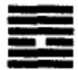

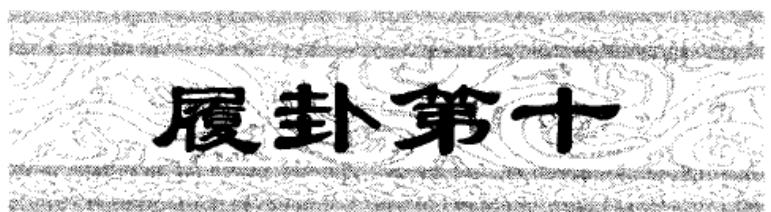

<!-- V3_SOURCE_ID:book016-b000948-p000-cbe79bcbec -->

译文〔《履》卦象征小心行走〕：小心行走在虎尾之后，猛虎不咬人，亨通。

查看对应原文

<!-- V3_FOLDBACK_BEGIN:book016-b000948-p000-cbe79bcbec -->

译文〔《履》卦象征小心行走〕：小心行走在虎尾之后，猛虎不咬人，亨通。

<!-- V3_FOLDBACK_END:book016-b000948-p000-cbe79bcbec -->

<!-- V3_SOURCE_ID:book016-b000949-p000-a5205edd80 -->

## 〔履〕：履虎尾，不咥人，亨①。 — 《履》卦的爻辞为：小心行走在虎尾之后，猛虎不咬人，亨通①。

> **释读存疑：** 原文仅为《履》卦的卦辞，候选释读误将卦辞表述为爻辞

查看对应原文

<!-- V3_FOLDBACK_BEGIN:book016-b000949-p000-a5205edd80 -->

## 〔履〕：履虎尾，不咥人，亨①。

<!-- V3_FOLDBACK_END:book016-b000949-p000-a5205edd80 -->

<!-- V3_SOURCE_ID:book016-b000950-p000-076489f6e4 -->

匡释①〔履〕：履虎尾，不咥人；亨：履，卦名，下兑(三)上乾(三)，象征“小心行走”；咥，音dié，犹言“咬”。这三句是借行走虎尾之后而不被伤，比喻人能“小心行走”，则虽危无害，可致亨通。从卦象看，下兑和悦，上乾刚健，六三以柔行于乾下，正有履危不见害而获亨之象。《正义》：“《履》卦之义，以六三为主”，“以六三在兑体，兑为和说，以应乾刚，虽履其危而不见害，故得亨通；犹若履虎尾不见咥啮于人。此假物之象以喻人事”。案，南宋冯椅《厚齐易学》谓《履》、《否》、《同人》诸卦旧脱卦名，清儒刘沅曰：“‘履’字上当有‘履’字，盖传写脱误，观《彖传》可知。”(《周易恒解》)此说可取，故在卦辞中增一“履”字为卦名，并加括号以别之。

查看对应原文

<!-- V3_FOLDBACK_BEGIN:book016-b000950-p000-076489f6e4 -->

匡释①〔履〕：履虎尾，不咥人；亨：履，卦名，下兑(三)上乾(三)，象征“小心行走”；咥，音dié，犹言“咬”。这三句是借行走虎尾之后而不被伤，比喻人能“小心行走”，则虽危无害，可致亨通。从卦象看，下兑和悦，上乾刚健，六三以柔行于乾下，正有履危不见害而获亨之象。《正义》：“《履》卦之义，以六三为主”，“以六三在兑体，兑为和说，以应乾刚，虽履其危而不见害，故得亨通；犹若履虎尾不见咥啮于人。此假物之象以喻人事”。案，南宋冯椅《厚齐易学》谓《履》、《否》、《同人》诸卦旧脱卦名，清儒刘沅曰：“‘履’字上当有‘履’字，盖传写脱误，观《彖传》可知。”(《周易恒解》)此说可取，故在卦辞中增一“履”字为卦名，并加括号以别之。

<!-- V3_FOLDBACK_END:book016-b000950-p000-076489f6e4 -->

<!-- V3_SOURCE_ID:book016-b000951-p000-7f6af74fcb -->

此处说明卦名“履”字的含义，《序卦传》说“物畜然后有礼，故受之以《履》”，《尔雅·释言》也记载：“履，礼也”，包含着践履不可违礼的意思。尚先生说：“《太玄》即拟为‘礼’，礼莫大于辩上下，定尊卑”，“人之行履，莫大于是”；另外，《本义》说：“履，有所蹑而进之义也”，同时包含着小心循礼而行的意思。据此，今释“履”为“小心行走”。

查看对应原文

<!-- V3_FOLDBACK_BEGIN:book016-b000951-p000-7f6af74fcb -->

说明卦名“履”字之义，《序卦传》谓“物畜然后有礼，故受之以《履》”，《尔雅·释言》：“履，礼也”，含有践履不可违礼之意，尚先生云：“《太玄》即拟为‘礼’，礼莫大于辩上下，定尊卑”，“人之行履，莫大于是”(《尚氏学》)；又，《本义》曰：“履，有所蹑而进之义也”，则兼有小心循礼而行的意思。据此，今释“履”为“小心行走”。

<!-- V3_FOLDBACK_END:book016-b000951-p000-7f6af74fcb -->

<!-- V3_SOURCE_ID:book016-b000952-p000-4e1af43c62 -->

《象传》解释说：“小心行走”，就如同阴柔者小心跟在阳刚者身后，以和悦的态度应合强健者，所以说“小心行走在虎尾之后，猛虎不咬人，亨通”。又如阳刚居中守正的人，小心践行“天子”之位而行为没有过失，于是显现出道德的光明。

查看对应原文

<!-- V3_FOLDBACK_BEGIN:book016-b000952-p000-4e1af43c62 -->

译文《象传》说：“小心行走”，犹如阴柔者小心行走在阳刚者之后，以和悦应合强健，所以说“小心行走在虎尾之后，猛虎不咬人，亨通”。又如阳刚居中守正者，小心践行“天子”之位而行为无所疵病，于是显现出道德光明。

<!-- V3_FOLDBACK_END:book016-b000952-p000-4e1af43c62 -->

<!-- V3_SOURCE_ID:book016-b000953-p000-a8e93ce3e8 -->

《彖》说：“履”，是阴柔者踩踏阳刚者①，以和悦的态度应合乾②，所以说“履虎尾，不咥人，亨”。阳刚居中守正，践行帝位而没有过失，这是因为道德光明③。

查看对应原文

<!-- V3_FOLDBACK_BEGIN:book016-b000953-p000-a8e93ce3e8 -->

《彖》曰：“履”，柔履刚也①，说而应乎乾②，是以“履虎尾，不咥人，亨”。刚中正，履帝位而不疚，光明也③。

<!-- V3_FOLDBACK_END:book016-b000953-p000-a8e93ce3e8 -->

<!-- V3_SOURCE_ID:book016-b000954-p000-0498c185b6 -->

注释①柔履刚：柔，指六三；刚，指上乾为刚。这是用六三行走在乾刚之后，说明《履》卦的要义在于阴柔者处于险境，也就是卦辞所说的“履虎尾”。《王注》说：“成就卦体的，在于六三；‘履虎尾’，是说它的危险。三是《履》卦的主爻，以柔踩踏刚，是处于险境的表现。”

查看对应原文

<!-- V3_FOLDBACK_BEGIN:book016-b000954-p000-0498c185b6 -->

注释①柔履刚：柔，指六三；刚，指上乾为刚。这是用六三行于乾刚之后，说明《履》卦之义主于柔者履危，即卦辞所谓“履虎尾”。《王注》：“成卦之体，在六三也；‘履虎尾’者，言其危也。三为《履》主，以柔履刚，履危者也。”

<!-- V3_FOLDBACK_END:book016-b000954-p000-0498c185b6 -->

<!-- V3_SOURCE_ID:book016-b000955-p000-93f939cf1b -->

②说而应乎乾：说就是“悦”，指下卦兑为悦；乾是健，指上卦乾为健。这是说明六三居于兑体之上，所应合的是乾健，有以和悦应合强健之象；乾德刚正，六三应合它，又有以和悦应合正德之象，因此踩在虎尾上不会被虎咬，行事亨通。《王注》说：“踩在虎尾上不会被虎咬，是因为它以和悦应合乾。乾是刚正之德，不把和悦用在奸佞邪僻上，而是用和悦应合乾，自然会踩在虎尾上不会被虎咬，行事亨通。”按，以上三句是解释卦辞“履虎尾，不咥人，亨。”

查看对应原文

<!-- V3_FOLDBACK_BEGIN:book016-b000955-p000-93f939cf1b -->

②说而应乎乾：说，即“悦”，指下卦兑为悦；乾，健也，指上卦乾为健。这是说明六三居兑体之上，所应者为乾健，有以和悦应合强健之象；乾德刚正，六三应之，又有以和悦应正德之象，因此履虎尾不见咥而亨。《王注》：“履虎尾有不见咥者，以其说而应乎乾也。乾，刚正之德者也。不以说行乎佞邪，而以说应乎乾，宜其履虎尾不见咥而亨。”案，以上三句释卦辞“履虎尾，不咥人，亨。”

<!-- V3_FOLDBACK_END:book016-b000955-p000-93f939cf1b -->

<!-- V3_SOURCE_ID:book016-b000956-p000-b50ddfbf20 -->

③刚中正，履帝位而不疚，光明也：刚中正指九五；帝位也指九五居于“君位”；疚是疵病。这三句举出九五中正之象，赞美“履”德的美好。《正义》说：“以刚处中，得其正位，居于九五之尊，就是‘刚中正履帝位’”，“以刚中居于帝位，没有疵病，是因为德行光明的缘故”。

查看对应原文

<!-- V3_FOLDBACK_BEGIN:book016-b000956-p000-b50ddfbf20 -->

③刚中正，履帝位而不疚，光明也：刚中正，指九五；帝位，亦指九五居“君位”；疚，疵病。这三句举九五中正之象，赞“履”德之美。《正义》：“以刚处中，得其正位，居九五之尊，是‘刚中正履帝位’也”，“以刚中而居帝位，不有疚病，由德之光明故也”。

<!-- V3_FOLDBACK_END:book016-b000956-p000-b50ddfbf20 -->

<!-- V3_SOURCE_ID:book016-b000957-p000-ecd766d1b5 -->

《象》说：上是天下是泽，象征“履”；君子因此辨别上下，安定百姓的意志。

查看对应原文

<!-- V3_FOLDBACK_BEGIN:book016-b000957-p000-ecd766d1b5 -->

《象》曰：上天下泽，“履”①；君子以辩上下，定民志②。

<!-- V3_FOLDBACK_END:book016-b000957-p000-ecd766d1b5 -->

<!-- V3_SOURCE_ID:book016-b000958-p000-cf797581b9 -->

译文《象传》说：上是天下是泽（尊卑有别），象征（循礼）“小心行走”；君子因此辨别上下名分，端正百姓循礼的意志。

查看对应原文

<!-- V3_FOLDBACK_BEGIN:book016-b000958-p000-cf797581b9 -->

译文《象传》说：上是天下是泽（尊卑有别），象征（循礼）“小心行走”；君子因此辨别上下名分，端正百姓循礼的意志。

<!-- V3_FOLDBACK_END:book016-b000958-p000-cf797581b9 -->

<!-- V3_SOURCE_ID:book016-b000959-p000-833b7e3b37 -->

注释①：上乾为天、下兑为泽，这是解释《履》卦的卦象。《程传》说：“天在上，泽在下，这是上下之间的正理。人所应当践行的道理也该像这样，所以取这个卦象命名为‘履’。”

查看对应原文

<!-- V3_FOLDBACK_BEGIN:book016-b000959-p000-833b7e3b37 -->

注释①上天下泽，“履”：释《履》卦上乾为天、下兑为泽之象。《程传》：“天在上，泽居下，上下之正理也。人之所履当如是，故取其象而为‘履’。”

<!-- V3_FOLDBACK_END:book016-b000959-p000-833b7e3b37 -->

<!-- V3_SOURCE_ID:book016-b000960-p000-f786ed675b -->

②：“辩上下，定民志”：“辩”通“辨”；“定”是定正，即规定端正的意思。这句话是说明“君子”效法《履》卦的卦象，辨定上下尊卑的礼制，让人们遵循践行。《正义》说：“君子效法这《履》卦的卦象，来分辨上下尊卑，来定正民众的心意，使尊卑之间秩序井然。”

查看对应原文

<!-- V3_FOLDBACK_BEGIN:book016-b000960-p000-f786ed675b -->

②辩上下，定民志：辩，通“辨”；定，定正，即规定端正之意。这是说明“君子”效法《履》象，辨定上下尊卑之礼，使人遵循践行。《正义》：“君子法此《履》卦之象，以分辩上下尊卑，以定正民之志意，使尊卑有序也。”

<!-- V3_FOLDBACK_END:book016-b000960-p000-f786ed675b -->

<!-- V3_SOURCE_ID:book016-b000961-p000-8d81e98790 -->

文中论述“履”与“礼”的关系，《大象传》对此阐发得十分明确。惠栋又加以引证说：“《荀子·大略》曰：‘礼者，人之所履也。’失所履，则颠蹶陷溺。所失微而其为乱大者礼，是以取义于虎尾也。”（《周易述》）

> **释读存疑：** 本地硬校验仍未通过，已记录供后续自动处理或人工核对。

查看对应原文

<!-- V3_FOLDBACK_BEGIN:book016-b000961-p000-8d81e98790 -->

说萌“履”与“礼”的关系，《大象传》阐发甚明。惠栋又加以引证说：“《荀子·大略》曰：‘礼者，人之所履也。’失所履，则颠蹶陷溺。所失微而其为乱大者礼，是以取义于虎尾也。”（《周易述》）

<!-- V3_FOLDBACK_END:book016-b000961-p000-8d81e98790 -->

<!-- V3_SOURCE_ID:book016-b000962-p000-c395566f13 -->

初九：素履，往无咎①。

查看对应原文

<!-- V3_FOLDBACK_BEGIN:book016-b000962-p000-c395566f13 -->

初九，素履，往无咎①。

<!-- V3_FOLDBACK_END:book016-b000962-p000-c395566f13 -->

<!-- V3_SOURCE_ID:book016-b000963-p000-7d1ec1999c -->

译文初九，朴素无华、小心行走，有所前往必无咎害。

查看对应原文

<!-- V3_FOLDBACK_BEGIN:book016-b000963-p000-7d1ec1999c -->

译文初九，朴素无华、小心行走，有所前往必无咎害。

<!-- V3_FOLDBACK_END:book016-b000963-p000-7d1ec1999c -->

<!-- V3_SOURCE_ID:book016-b000964-p000-511185e389 -->

注释①素履，往无咎：素，指朴素。这里是说，初九处于《履》卦的初始阶段，安守卑下朴素的礼制；以此作为行事的准则，前往行事必然不会有过错。《王注》说：“处于《履》卦的初始阶段，是践行礼的开端，践行礼的准则厌恶浮华，所以‘素’就能没有过错。” D

查看对应原文

<!-- V3_FOLDBACK_BEGIN:book016-b000964-p000-511185e389 -->

注释①素履，往无咎：素，朴素。此谓初九处《履》之始，安守卑下朴素之礼；以此为“履”，所往必无咎。《王注》：“处《履》之初，为履之始，履道恶华，故‘素’乃无咎。” D

<!-- V3_FOLDBACK_END:book016-b000964-p000-511185e389 -->

<!-- V3_SOURCE_ID:book016-b000965-p000-d6f6b226f8 -->

《象传》说：“素履之往”，独行愿也①。

查看对应原文

<!-- V3_FOLDBACK_BEGIN:book016-b000965-p000-d6f6b226f8 -->

《象》曰：“素履之往”，独行愿也①。

<!-- V3_FOLDBACK_END:book016-b000965-p000-d6f6b226f8 -->

<!-- V3_SOURCE_ID:book016-b000966-p000-7584bd6f8d -->

译文《象传》说：“朴素无华、小心行走而有所前往”，说明初九专心奉行循礼的意愿。

查看对应原文

<!-- V3_FOLDBACK_BEGIN:book016-b000966-p000-7584bd6f8d -->

译文《象传》说：“朴素无华、小心行走而有所前往”，说明初九专心奉行循礼的意愿。

<!-- V3_FOLDBACK_END:book016-b000966-p000-7584bd6f8d -->

<!-- V3_SOURCE_ID:book016-b000967-p000-732f572f64 -->

注释①独行愿：独，就是专心的意思。指初九没有任何杂念，专心遵循礼义。《程传》中说：“独，就是专的意思。如果想要显贵的心思，和践行道义的心思在内心交战，怎么能安心践行自己的本分呢？”

查看对应原文

<!-- V3_FOLDBACK_BEGIN:book016-b000967-p000-732f572f64 -->

注释①独行愿：独，犹言“专心”。指初九无所杂念，专心循礼。《程传》：“独，专也。若欲贵之心，与行道之心，交战于中，岂能安履其素也？”

<!-- V3_FOLDBACK_END:book016-b000967-p000-732f572f64 -->

<!-- V3_SOURCE_ID:book016-b000968-p000-15f2ebe9ed -->

胡炳文说：“《履》卦初九爻提到‘素’，是因为礼以质朴为根本。‘贲’是文饰，《贲》卦上爻提到‘白’，是文饰发展到极致后回归质朴的状态。‘白贲无咎’，难道不就是对应‘素履往无咎’吗？”（《周易本义通释》）这种说法将《履》卦初九爻与《贲》卦上爻的含义相互比较，很有可取之处。

查看对应原文

<!-- V3_FOLDBACK_BEGIN:book016-b000968-p000-15f2ebe9ed -->

说明胡炳文曰：“《履》初言‘素’，礼以质为本也。‘贲’，文也，《贲》上言‘白’，文之极，反而质也。‘白贲无咎’，其即‘素履往无咎’与？”（《周易本义通释》）此说把《履》初爻与《贲》上爻的意义相互比较，颇可取。

<!-- V3_FOLDBACK_END:book016-b000968-p000-15f2ebe9ed -->

<!-- V3_SOURCE_ID:book016-b000969-p000-c880835be7 -->

译文九二，小心行走在平易坦坦的大道上，幽静安恬的人守持正固可获吉祥。

查看对应原文

<!-- V3_FOLDBACK_BEGIN:book016-b000969-p000-c880835be7 -->

译文九二，小心行走在平易坦坦的大道上，幽静安恬的人守持正固可获吉祥。

<!-- V3_FOLDBACK_END:book016-b000969-p000-c880835be7 -->

<!-- V3_SOURCE_ID:book016-b000970-p000-80acb99d9e -->

九二，行走在平易坦坦的大道上，幽静安恬的人守持正固可获吉祥①。

查看对应原文

<!-- V3_FOLDBACK_BEGIN:book016-b000970-p000-80acb99d9e -->

九二，履道坦坦，幽人贞吉①。

<!-- V3_FOLDBACK_END:book016-b000970-p000-80acb99d9e -->

<!-- V3_SOURCE_ID:book016-b000971-p000-a0c5d6d24a -->

注释①：“履道坦坦，幽人贞吉”，其中“幽人”指的是幽静安恬的人。这里是说，九二爻以阳刚之爻处于《履》卦下卦的中位，就好比小心行走在平坦的大道上；而平坦的道路容易让人忘记谨慎，所以爻辞又告诫要像“幽人”那样守持正固，才能获得吉祥。《程传》中说：“九二爻居柔位，宽裕得中，所行的是坦坦然然的平易之道；即便所行是平易之道，也必须是幽静安恬的人来处之，才能守持正固而获得吉祥。”

查看对应原文

<!-- V3_FOLDBACK_BEGIN:book016-b000971-p000-a0c5d6d24a -->

注释①履道坦坦，幽人贞吉：幽人，幽静安恬者。此言九二以刚处《履》下卦之中，犹如小心行走于平坦大道；而平路易于令人忘忽谨慎，故爻辞又诫以“幽人”守正可获吉祥。《程传》：“九二居柔，宽裕得中，所履坦坦然平易之道也；虽所履得坦易之道，亦必幽静安恬之人处之则能贞固而吉也。”

<!-- V3_FOLDBACK_END:book016-b000971-p000-a0c5d6d24a -->

<!-- V3_SOURCE_ID:book016-b000972-p000-301a012c0d -->

译文《象传》说：“幽静安恬的人守持正固可获吉祥”，说明九二不自我淆乱心中的循礼信念。

查看对应原文

<!-- V3_FOLDBACK_BEGIN:book016-b000972-p000-301a012c0d -->

译文《象传》说：“幽静安恬的人守持正固可获吉祥”，说明九二不自我淆乱心中的循礼信念。

<!-- V3_FOLDBACK_END:book016-b000972-p000-301a012c0d -->

<!-- V3_SOURCE_ID:book016-b000973-p000-4fe0450be8 -->

《象传》说：“幽静安恬的人守持正固可获吉祥”，这是因为九二爻居中位，不会自我淆乱。

查看对应原文

<!-- V3_FOLDBACK_BEGIN:book016-b000973-p000-4fe0450be8 -->

《象》曰：“幽人贞吉”，中不自乱也。

<!-- V3_FOLDBACK_END:book016-b000973-p000-4fe0450be8 -->

<!-- V3_SOURCE_ID:book016-b000974-p000-a17f19ec62 -->

这说明九二爻是阳刚之爻却谦居于阴位，得“中”而不偏倚，所以能守持正固获得吉祥，而《象传》也称赞它“中不自乱”。梁寅在《周易参义》中说：“行走在道路上的人，遵循中道就平坦，走旁道就崎岖艰险。九二爻以阳刚之德居于中位，这就是行走在道路上而得到平坦的情况。自身持守如此，就是君子不轻易自我显露而安静恬淡的人，所以是‘幽人贞吉’。”

查看对应原文

<!-- V3_FOLDBACK_BEGIN:book016-b000974-p000-a17f19ec62 -->

说明九二阳刚谦居阴位，得“中”不偏，故能守正获吉，而《象传》亦称其“中不自乱”。梁寅曰：“夫行于道路者，由中则平坦，从旁则崎险。九二以刚居中，是履道而得其平坦者也。持身如是，乃君子不轻自售而安静恬淡者，故为‘幽人贞吉’。”（《周易参义》）

<!-- V3_FOLDBACK_END:book016-b000974-p000-a17f19ec62 -->

<!-- V3_SOURCE_ID:book016-b000975-p000-a8c9e9a87c -->

译文六三，眼盲强看，脚跛强行，行走在虎尾之后被猛虎咬啮，有凶险；勇武的人要效力于大人君主。

查看对应原文

<!-- V3_FOLDBACK_BEGIN:book016-b000975-p000-a8c9e9a87c -->

译文六三，眼盲强看，脚跛强行，行走在虎尾之后被猛虎咬啮，有凶险；勇武的人要效力于大人君主。

<!-- V3_FOLDBACK_END:book016-b000975-p000-a8c9e9a87c -->

<!-- V3_SOURCE_ID:book016-b000976-p000-57a136dc3f -->

六三爻的爻辞说：眼睛失明却勉强要看，脚跛了却勉强要走，踩在老虎尾巴上被老虎咬，这是凶险的；勇武之人要效力于大人君主。

查看对应原文

<!-- V3_FOLDBACK_BEGIN:book016-b000976-p000-57a136dc3f -->

六三，眇能视，跛能履，履虎尾咥人，凶①；武人为于大君②。

<!-- V3_FOLDBACK_END:book016-b000976-p000-57a136dc3f -->

<!-- V3_SOURCE_ID:book016-b000977-p000-52a97b0234 -->

注释①眇能视，跛能履，履虎尾咥人，凶：眇，《说文解字》解释为“一只眼睛小”，这里指眼睛失明；能，是连词，相当于“而”，带有转折的意思。考证：《屯》卦的《彖传》中有“宜建侯而不宁”一句，《经典释文》说：“而，是语气词，郑玄读成‘能’。”这说明“而”“能”在古代读音相近，可以通用。《周易集解》中对这一爻的两个“能”字都写成“而”，所引用的虞翻的注释也一样。这几句是比喻六三阴爻居于阳位，不能“小心行事”却盲目妄动，所以是“凶险”的卦象。《王注》说：“处于《履》卦的时势，以阳爻居于阳位，尚且说不够谦逊，更何况以阴爻居于阳位，以柔爻凌驾于刚爻之上呢？所以把这种情况当作明察，就是眼盲之人；把这种情况当作行事，就是脚跛之人；把这种情况当作踏险，就是被‘咬’之人。”

查看对应原文

<!-- V3_FOLDBACK_BEGIN:book016-b000977-p000-52a97b0234 -->

注释①眇能视，跛能履，履虎尾咥人，凶：眇，《说文》“一目小也”，此处言目盲；能，连词，犹“而”，含转折意。案，《屯》卦《彖传》“宜建侯而不宁”，《释文》云：“而，辞也，郑读曰‘能’。”是“而”、“能”古声近通用。《集解》于此爻两“能”字均作“而”，所引虞翻注亦同。这几句比喻六三阴居阳位，不能“小心行走”却盲动妄为，故为“凶”象。《王注》：“居《履》之时，以阳处阳，犹曰不谦，而况以阴居阳，以柔乘刚者乎？故以此为明，眇目者也；以此为行，跛足者也；以此履危，见‘咥’者也。”

<!-- V3_FOLDBACK_END:book016-b000977-p000-52a97b0234 -->

<!-- V3_SOURCE_ID:book016-b000978-p000-143c75a52c -->

②武人为于大君：武人，就是勇武之人，用来比喻六三；为，有“效力”的意思；大君，就是“大人君主”，应当指上九爻。这一句从正面进行告诫，说六三如果能回归正道，将刚武之志效力于上九，那么上下相应，就没有凶险只有吉祥。《诚斋易传》说：“圣人之所以惋惜他的才志却可惜他所处的位置不当，至于他的志向，是值得同情的。非常勇武，想要为我的君主有所作为；非常刚直，想要在当世有所立足：这有什么罪过呢？所以前面说他‘凶险’，后面只说他‘志向刚直’罢了，也不深加责怪他。”考证：《正义》说：“凭借六三的卑微，想要推行九五的志向，实在是顽愚到了极点”，意思是九五是“大君”。李道平《纂疏》说：“六三与上九相应，所以说‘武人为于大君’。”这说明李道平认为上九是“大君”。现在采用李道平的说法。

查看对应原文

<!-- V3_FOLDBACK_BEGIN:book016-b000978-p000-143c75a52c -->

②武人为于大君：武人，即勇武之人，喻六三；为，有“效力”之义；大君，犹言“大人君主”，当指上九。此句从正面示诫，言六三倘能履归正道，将刚武之志效用于上九，则上下相应，无凶有吉。《诚斋易传》：“圣人所以恨其才而惜其居位之不当也，若夫其志，则可怜矣。甚武，而欲有为于吾君；甚刚，而欲有立于当世：夫何罪哉？故前言其‘凶’，而后止言‘志刚’而已，亦不深咎之也。”案，《正义》：“以六三之微，欲行九五之志，顽愚之甚”，意指九五为“大君”。李道平《纂疏》云：“三应在上，故曰‘武人为于大君’。”是李意以上九为“大君”。今从李说。

<!-- V3_FOLDBACK_END:book016-b000978-p000-143c75a52c -->

<!-- V3_SOURCE_ID:book016-b000979-p000-cc8f12ee1a -->

译文《象传》说：“眼盲强看”，不足以辨物分明；“脚跛强行”，不足以踏上征程；“猛虎咬人的凶险”，说明六三居位不适当；“勇武的人要效力于大人君主”，说明六三志向刚强。

查看对应原文

<!-- V3_FOLDBACK_BEGIN:book016-b000979-p000-cc8f12ee1a -->

译文《象传》说：“眼盲强看”，不足以辨物分明；“脚跛强行”，不足以踏上征程；“猛虎咬人的凶险”，说明六三居位不适当；“勇武的人要效力于大人君主”，说明六三志向刚强。

<!-- V3_FOLDBACK_END:book016-b000979-p000-cc8f12ee1a -->

<!-- V3_SOURCE_ID:book016-b000980-p000-3dab5d34d4 -->

《象传》说：“眼盲却要勉强看物”，说明无法明辨事理；“脚跛却要勉强行走”，说明无法与人同行；“猛虎咬人的凶险”，说明六三爻所处的位置不适当；“勇武之人要效力于大人君主”，说明六三爻的志向刚强。

> **释读存疑：** 原文未明确“眇”“跛”是否特指六三爻，释读中直接关联六三爻，属于合理补全语境

查看对应原文

<!-- V3_FOLDBACK_BEGIN:book016-b000980-p000-3dab5d34d4 -->

《象》曰：“眇能视”，不足以有明也；“跛能履”，不足以与行也；“咥人之凶”，位不当也；“武人为于大君”，志刚也。

<!-- V3_FOLDBACK_END:book016-b000980-p000-3dab5d34d4 -->

<!-- V3_SOURCE_ID:book016-b000981-p000-31794c0b20 -->

这说明六三爻的爻辞接连选取了四个意象作为比喻，前三个意象“眼盲”“脚跛”“猛虎咬人”都是从反面发出警示，最后一个意象“勇武之人”则单独从正面作出告诫：三个反面意象、一个正面意象，把该爻的核心意旨，以及创作《周易》的人的深刻用心，展现得极为清晰明白。

查看对应原文

<!-- V3_FOLDBACK_BEGIN:book016-b000981-p000-31794c0b20 -->

说明六三爻辞连取四象为喻，前三象“眇”、“跛”、“虎咥人”均反面示警，后一象“武人”独从正面设诫：三反一正，把该爻大旨，及作《易》者的深刻用心，展示得至为明畅。

<!-- V3_FOLDBACK_END:book016-b000981-p000-31794c0b20 -->

<!-- V3_SOURCE_ID:book016-b000982-p000-70f09b2f75 -->

九四爻的爻辞是：“踩在虎尾上，保持恐惧谨慎，最终会获得吉祥①。” 译文：九四爻，小心行走在虎尾之后，始终保持恐惧谨慎，最终会获得吉祥。

> **释读存疑：** 原文未明确“愬愬”是否特指九四爻的状态，释读中直接关联九四爻，属于合理补全语境

查看对应原文

<!-- V3_FOLDBACK_BEGIN:book016-b000982-p000-70f09b2f75 -->

九四，履虎尾，愬愬，终吉①。 译文九四，小心行走在虎尾之后，保持恐惧谨慎，终将获得吉祥。

<!-- V3_FOLDBACK_END:book016-b000982-p000-70f09b2f75 -->

<!-- V3_SOURCE_ID:book016-b000983-p000-ff008e2ecd -->

注释①：履虎尾，愬愬，终吉。愬的读音为suǒ，“愬愬”一词，《经典释文》引用《子夏传》的说法，称其为“恐惧的样子”；又说马王堆本写作“总虤”，读音为许逆反，意思也是恐惧，《说文解字》的说法与此相同，文中还包含“谨慎”的含义。这是比喻《履》卦的九四爻，处于上卦的起始位置，爻位不当且临近君位，有踩虎尾的危险；但该爻以阳爻居于阴位，又有谦逊谨慎的征象，因此能因恐惧而获得吉祥。《周易本义》解释道：“九四也是不中不正，踩了九五爻的刚猛之势；但因为以阳爻居于阴位，所以能保持戒惧，最终获得吉祥。”

> **释读存疑：** 原文中马本的“总虤”具体所指未明

查看对应原文

<!-- V3_FOLDBACK_BEGIN:book016-b000983-p000-ff008e2ecd -->

注释①履虎尾，愬愬，终吉：愬，音suǒ，“愬愬”，《释文》引《子夏传》曰：“恐惧貌”，又谓“马本作‘总虤’，音许逆反，云恐惧也，《说文》同”，文中兼含“谨慎”之义。这是比喻九四居《履》上卦之始，不当位而近君，有“履虎尾”之危；但以阳居阴，又有谦谨之象，故能恐惧获吉。《本义》：“九四亦以不中不正，履九五之刚；然以刚居柔，故能戒惧而得终吉。”

<!-- V3_FOLDBACK_END:book016-b000983-p000-ff008e2ecd -->

<!-- V3_SOURCE_ID:book016-b000984-p000-ca8ba2ce2f -->

《象传》说：“愬愬终吉”，是说九四爻的志向在于践行小心循礼的原则。

查看对应原文

<!-- V3_FOLDBACK_BEGIN:book016-b000984-p000-ca8ba2ce2f -->

《象》曰：“愬愬终吉”，志行也。 译文《象传》说：“保持恐惧谨慎，终将获得吉祥”，说明九四奉行小心循礼的志愿。

<!-- V3_FOLDBACK_END:book016-b000984-p000-ca8ba2ce2f -->

<!-- V3_SOURCE_ID:book016-b000985-p000-bcc84dbbd9 -->

“履虎尾”在本卦中总共出现了三次：第一次出现在卦辞中，取上下卦“和悦而践行刚猛之道”的征象，所以说“不咥人，亨”；第二次出现在六三爻的爻辞中，指该爻乘凌刚爻妄动，违背了“履”的正道，所以说“咥人，凶”；第三次出现在九四爻的爻辞中，说该爻虽处于危险之中，却能以阳爻居于阴位，所以“终吉”。这三者的不同，说明卦辞是阐明一卦的主旨，爻辞是明确每一爻的意旨，应当区别看待。王弼所说：“凡是《彖传》，都是总论一卦的本体；《象传》，则是分别辨析每一爻的意义。”这种说法就《彖传》《象传》的体例而言，也体现出卦辞与爻辞的不同特点。

查看对应原文

<!-- V3_FOLDBACK_BEGIN:book016-b000985-p000-bcc84dbbd9 -->

说明“履虎尾”在本卦中凡三见：卦辞首见，取上下卦“和说以履刚强”之象，故“不咥人，亨”；六三又见，指该爻乘刚妄动，违背“履”道，故“咥人，凶”；九四复见，谓本爻虽处危却能以刚居柔，故“终吉”。这三者的不同，说明卦辞示一卦之义，爻辞明一爻之旨，应当区别看待。王弼所谓：“凡《彖》者，统论一卦之体者也；《象》者，各辩一爻之义者也。”(《周易略例·略例下》)其说就《彖传》、《象传》的条例而言，也体现出卦辞、爻辞的不同特点。

<!-- V3_FOLDBACK_END:book016-b000985-p000-bcc84dbbd9 -->

<!-- V3_SOURCE_ID:book016-b000986-p000-9f372d94be -->

九五爻的爻辞为：夬履，贞厉①。

查看对应原文

<!-- V3_FOLDBACK_BEGIN:book016-b000986-p000-9f372d94be -->

九五，夬履，贞厉①。

<!-- V3_FOLDBACK_END:book016-b000986-p000-9f372d94be -->

<!-- V3_SOURCE_ID:book016-b000987-p000-3c7944e647 -->

爻辞九五，意为行事刚断果决、需小心行走，要守持正固以防危险。

查看对应原文

<!-- V3_FOLDBACK_BEGIN:book016-b000987-p000-3c7944e647 -->

译文九五，刚断果决、小心行走，守持正固以防危险。

<!-- V3_FOLDBACK_END:book016-b000987-p000-3c7944e647 -->

<!-- V3_SOURCE_ID:book016-b000988-p000-89d197082a -->

注释①夬履，贞厉：夬，音guài，通“决”。（详《夬》卦译注）此处是说，九五阳刚中正，尊居“君位”，当“履”之时，有刚断果决、小心行走之象；但以刚居刚，若刚决过甚，必违正道，故爻辞又诫其“守正防危”。《集解》引干宝曰：“夬，决也。居中履正，为《履》贵主；万方所履，一决于前。恐夬失正，恒惧危厉。”案，干氏谓恐“失正”故“惧危”，意犹“守正防危”。

> **释读存疑：** 本地硬校验仍未通过，已记录供后续自动处理或人工核对。

查看对应原文

<!-- V3_FOLDBACK_BEGIN:book016-b000988-p000-89d197082a -->

注释①夬履，贞厉：夬，音guài，通“决”。（详《夬》卦译注）此谓九五阳刚中正，尊居“君位”，当“履”之时，有刚断果决、小心行走之象；但以刚居刚，若刚决过甚，必违正道，故爻辞又诫其“守正防危”。《集解》引干宝曰：“夬，决也。居中履正，为《履》贵主；万方所履，一决于前。恐夬失正，恒惧危厉。”案，干氏谓恐“失正”故“惧危”，意犹“守正防危”。

<!-- V3_FOLDBACK_END:book016-b000988-p000-89d197082a -->

<!-- V3_SOURCE_ID:book016-b000989-p000-d98784b403 -->

## 《象》曰：“夬履贞厉”，位正当也。 — 《象传》说：“夬履贞厉”，这是因为居位正当。

查看对应原文

<!-- V3_FOLDBACK_BEGIN:book016-b000989-p000-d98784b403 -->

## 《象》曰：“夬履贞厉”，位正当也。

<!-- V3_FOLDBACK_END:book016-b000989-p000-d98784b403 -->

<!-- V3_SOURCE_ID:book016-b000990-p000-f33710c919 -->

《象传》说：“刚断果决、小心行走，守持正固以防危险”，说明九五居位正当。

> **释读存疑：** 本地硬校验仍未通过，已记录供后续自动处理或人工核对。

查看对应原文

<!-- V3_FOLDBACK_BEGIN:book016-b000990-p000-f33710c919 -->

译文《象传》说：“刚断果决、小心行走，守持正固以防危险”，说明九五居位正当。

<!-- V3_FOLDBACK_END:book016-b000990-p000-f33710c919 -->

<!-- V3_SOURCE_ID:book016-b000991-p000-05f6423e4d -->

《说丽》的《折中》中说：“凡是《彖传》里所赞美的内容，对应的爻辞中就不会有‘凶’‘厉’这类表述，为什么唯独这一爻不是这样呢？因为‘履’道看重柔顺，九五以刚健之质居于刚位，这是决意践行‘履’道；不过由于它具备中正的德行，所以能时常保持危惧戒惕的心思，那么即便决意践行‘履’道，行事也不会有过失之举了。《尚书》里说‘心之忧危，若蹈虎尾’，这大概就是‘履帝位而不疚’的原因吧？凡是《易》中的‘贞厉’，有‘厉’，也有以‘时常保持危惧戒惕的心思’为含义的，比如《噬嗑》里的‘贞厉，无咎’，《夬》里的‘其危乃光’就是这样。既然如此，这里的‘贞厉’、《兑》卦第五爻的‘有厉’就应当遵循这个例子。”这种说法解释“贞厉”也如同“守正防危”，和干宝的说法大致相同。所引用的《尚书·周书·君牙》中的“心之忧危，若蹈虎尾”，和“贞厉”的文义尤其切合。

查看对应原文

<!-- V3_FOLDBACK_BEGIN:book016-b000991-p000-05f6423e4d -->

[说丽《折中》曰：“凡《彖传》中所赞美，则其爻辞无凶’、厉者，何独此爻不然？盖履’道贵柔，九五以刚居刚，是决于‘履’也；然以其有中正之德，故能常存危厉之心，则虽决于履，而动可无过举矣。《书》云心之忧危，若蹈虎尾’，此其所以履帝位而不疚’也与？凡《易》中贞厉’，有厉’，有以常存危厉之心’为义者，如《噬嗑》之贞厉，无咎’，《夬》之‘其危乃光’是也。然则此之贞厉’、《兑》五之有厉’当从此例也。”此说释“贞厉”亦犹“守正防危”，略同干宝之义(见上注引)。所引《尚书·周书·君牙》“心之忧危，若蹈虎尾”，与“贞厉”辞旨尤切。

<!-- V3_FOLDBACK_END:book016-b000991-p000-05f6423e4d -->

<!-- V3_SOURCE_ID:book016-b000992-p000-f0a162d232 -->

上九，回顾小心行走的过程，考察祸福得失的征祥，转身下应阴柔，至为吉祥。

> **释读存疑：** 原文中“视履考祥”的注释标记①、“其旋元吉”的注释标记②未在释读中体现，原文未明确注释对应的具体内容，释读未添加无依据内容，符合要求

查看对应原文

<!-- V3_FOLDBACK_BEGIN:book016-b000992-p000-f0a162d232 -->

译文上九，回顾小心行走的过程、考察 上九，视履考祥①，其旋元祸福得失的征祥，转身下应阴柔至为 吉祥。 吉②。

<!-- V3_FOLDBACK_END:book016-b000992-p000-f0a162d232 -->

<!-- V3_SOURCE_ID:book016-b000993-p000-8e60592608 -->

匡释①：视履考祥，祥指征祥，也就是吉凶祸福的体现。这句话说明上九处于《履》卦的末尾，阳爻居于阴位，能够冷静总结“履”道得失的征候。《王注》说：“祸福的征祥，产生于所践行的‘履’道，处于《履》卦的终极，‘履’道已经成就，所以可以‘视履’而‘考祥’了。”

查看对应原文

<!-- V3_FOLDBACK_BEGIN:book016-b000993-p000-8e60592608 -->

匡释①视履考祥：祥，征祥，即吉凶祸福的体现。此句说明上九处《履》卦之终，阳居阴位，能冷静总结“履”道得失之征。《王注》：“祸福之祥，生乎所履，处《履》之极，‘履’道成矣，故可‘视履’而考祥’也。”

<!-- V3_FOLDBACK_END:book016-b000993-p000-8e60592608 -->

<!-- V3_SOURCE_ID:book016-b000994-p000-f26ca5104d -->

②其旋元吉：旋，就是转，好比说“转身”。这句话承接前文的意思，说明上九尊居乾卦的终极，能转身下应兑卦第三爻，是刚健能返归柔顺、践行“履”道能守谨慎的征象，所以获得极大的吉祥。《王注》说：“处于终极而应和兑卦，居高位却不危险，这就是‘其旋’；‘履’道大为成就，所以是‘元吉’。”

查看对应原文

<!-- V3_FOLDBACK_BEGIN:book016-b000994-p000-f26ca5104d -->

②其旋元吉：旋，转也，犹言“转身”。此句承前句意，说明上九尊居乾极，能转身下应兑三，为刚能返柔、履能守谨之象，故获吉至大。《王注》：“居极应说，高而不危，是其旋也；履道大成，故元吉’也。”

<!-- V3_FOLDBACK_END:book016-b000994-p000-f26ca5104d -->

<!-- V3_SOURCE_ID:book016-b000995-p000-ba47a4240d -->

译文《象传》说：至为吉祥、高居上位， 《象》曰：元吉在上，大有庆说明上九大有福庆。 也①。

查看对应原文

<!-- V3_FOLDBACK_BEGIN:book016-b000995-p000-ba47a4240d -->

译文《象传》说：至为吉祥、高居上位， 《象》曰：元吉在上，大有庆说明上九大有福庆。 也①。

<!-- V3_FOLDBACK_END:book016-b000995-p000-ba47a4240d -->

<!-- V3_SOURCE_ID:book016-b000996-p000-2b1cb7789f -->

匡释①大有庆：指上九之时“履道”大成，故上下皆有“福庆”。《集解》引卢氏曰：“王者履礼于上，则万方有庆于下。”

查看对应原文

<!-- V3_FOLDBACK_BEGIN:book016-b000996-p000-2b1cb7789f -->

匡释①大有庆：指上九之时“履道”大成，故上下皆有“福庆”。《集解》引卢氏曰：“王者履礼于上，则万方有庆于下。”

<!-- V3_FOLDBACK_END:book016-b000996-p000-2b1cb7789f -->

<!-- V3_SOURCE_ID:book016-b000997-p000-dc23a6d719 -->

∑明《周易》上爻，多寓物极必反的哲理，常有凶象。此爻却称“元吉”，可知作者认为，“小心行走”之道，随时均须奉行。

查看对应原文

<!-- V3_FOLDBACK_BEGIN:book016-b000997-p000-dc23a6d719 -->

∑明《周易》上爻，多寓物极必反的哲理，常有凶象。此爻却称“元吉”，可知作者认为，“小心行走”之道，随时均须奉行。

<!-- V3_FOLDBACK_END:book016-b000997-p000-dc23a6d719 -->

<!-- V3_SOURCE_ID:book016-b000998-p000-5a88d97f80 -->

愿《履》卦取名于“小心行走”，譬喻处事必须循礼而行的道理。卦辞“履虎尾，不咥人”，即形象地揭示出小心行走、虽危无害的寓意。卦中六爻，根据不同的地位、性质，分别陈述处“履”的情状。初九居下守“素”，九二持中不乱，九四恐惧谨慎，九五循礼果决，上九“履道”大成，这五爻均以阳刚善处其身，行不违礼，故多“无咎”、“吉”、“元吉”；其中九五虽诫“危厉”，能“贞”则无害。唯六三阴柔躁进，有“履虎尾咥人”之“凶”，但也勉其改过归正，以避凶危。纵观全卦，多从正反两方面示警，尤以“危辞”设诫最深。胡炳文曰：“大抵人之涉世，多是危机，不为所伤，乃见所履。《大传》曰：《易》之兴也，其当文王与纣之事邪？是故其辞危。'危莫危于‘履虎尾'之辞矣！九卦处忧患，以《履》为首。”(《周易本义通释》)若就《彖传》“刚中正，履帝位而不疚”之语分析，本卦的象征意义，又含有对统治者规劝警诫之旨。《新序·杂事四》载：“孔子谓鲁哀公曰：丘闻之：“君者，舟也；人者，水也。水则载舟，水则覆舟。”君以此思危，则危将安，不至矣！夫执国之柄，履民之上，懔乎如以腐索御奔马。《易》曰“履虎尾”，《诗》曰“如履薄冰”：不亦危乎！'”.可见，《履》卦所包含的象征旨趣，其意义十分广泛；这一点，事实上也是《周易》六十四卦的共同特征。

查看对应原文

<!-- V3_FOLDBACK_BEGIN:book016-b000998-p000-5a88d97f80 -->

愿《履》卦取名于“小心行走”，譬喻处事必须循礼而行的道理。卦辞“履虎尾，不咥人”，即形象地揭示出小心行走、虽危无害的寓意。卦中六爻，根据不同的地位、性质，分别陈述处“履”的情状。初九居下守“素”，九二持中不乱，九四恐惧谨慎，九五循礼果决，上九“履道”大成，这五爻均以阳刚善处其身，行不违礼，故多“无咎”、“吉”、“元吉”；其中九五虽诫“危厉”，能“贞”则无害。唯六三阴柔躁进，有“履虎尾咥人”之“凶”，但也勉其改过归正，以避凶危。纵观全卦，多从正反两方面示警，尤以“危辞”设诫最深。胡炳文曰：“大抵人之涉世，多是危机，不为所伤，乃见所履。《大传》曰：《易》之兴也，其当文王与纣之事邪？是故其辞危。'危莫危于‘履虎尾'之辞矣！九卦处忧患，以《履》为首。”(《周易本义通释》)若就《彖传》“刚中正，履帝位而不疚”之语分析，本卦的象征意义，又含有对统治者规劝警诫之旨。《新序·杂事四》载：“孔子谓鲁哀公曰：丘闻之：“君者，舟也；人者，水也。水则载舟，水则覆舟。”君以此思危，则危将安，不至矣！夫执国之柄，履民之上，懔乎如以腐索御奔马。《易》曰“履虎尾”，《诗》曰“如履薄冰”：不亦危乎！'”.可见，《履》卦所包含的象征旨趣，其意义十分广泛；这一点，事实上也是《周易》六十四卦的共同特征。

<!-- V3_FOLDBACK_END:book016-b000998-p000-5a88d97f80 -->

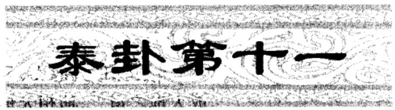

<!-- V3_SOURCE_ID:book016-b001000-p000-330eb82510 -->

## 泰①：小往大来，吉，亨②。 — 泰——小往大来，吉，亨。

查看对应原文

<!-- V3_FOLDBACK_BEGIN:book016-b001000-p000-330eb82510 -->

## 泰①：小往大来，吉，亨②。

<!-- V3_FOLDBACK_END:book016-b001000-p000-330eb82510 -->

<!-- V3_SOURCE_ID:book016-b001001-p000-7f977a6578 -->

译文《泰》卦象征通泰：柔小者往外、刚大者来内，吉祥，亨通。

查看对应原文

<!-- V3_FOLDBACK_BEGIN:book016-b001001-p000-7f977a6578 -->

译文《泰》卦象征通泰：柔小者往外、刚大者来内，吉祥，亨通。

<!-- V3_FOLDBACK_END:book016-b001001-p000-7f977a6578 -->

<!-- V3_SOURCE_ID:book016-b001002-p000-329e15ca22 -->

匡释①泰：这是卦名，下为乾（☰）、上为坤（☷），象征“通泰”。《序卦传》说：“泰者，通也。”

查看对应原文

<!-- V3_FOLDBACK_BEGIN:book016-b001002-p000-329e15ca22 -->

匡释①泰：卦名，下乾(三)上坤(三)，象征“通泰”。《序卦传》：“泰者，通也。”

<!-- V3_FOLDBACK_END:book016-b001002-p000-329e15ca22 -->

<!-- V3_SOURCE_ID:book016-b001003-p000-a264e69ea7 -->

②小往大来，吉，亨：小往，指阴爻居于外卦；大来，指阳爻居于内卦。这是就下卦为乾、上卦为坤的情况而言，说的是“通泰”之时阳爻盛长而来，阴爻衰减而去，也就是《彖传》所说“君子道长，小人道消”的意思，所以“吉，亨”。《正义》说：“阴去故‘小往’，阳长故‘大来’，以此吉而通。”

查看对应原文

<!-- V3_FOLDBACK_BEGIN:book016-b001003-p000-a264e69ea7 -->

②小往大来，吉，亨：小往，指阴爻居外卦；大来，指阳爻居内卦。这是就上下卦内乾外坤而言，谓“通泰”之时阳者盛而来，阴者衰而往，即《彖传》“君子道长，小人道消”之义，故“吉，亨”。《正义》：“阴去故‘小往’，阳长故‘大来’，以此吉而通。”

<!-- V3_FOLDBACK_END:book016-b001003-p000-a264e69ea7 -->

<!-- V3_SOURCE_ID:book016-b001004-p000-49ac93e1d1 -->

《彖传》说：“泰卦，柔小者往外、刚大者来内，吉祥，亨通。”这就是天地阴阳交合，万物的生养之道畅通；君臣上下交合，人们的思想意识协同。此时阳者居内、阴者居外，刚健者居内、柔弱者居外，君子居内、小人居外：所以君子之道盛昌，小人之道消亡。

查看对应原文

<!-- V3_FOLDBACK_BEGIN:book016-b001004-p000-49ac93e1d1 -->

《彖》曰：“泰，小往大来，吉，亨。”则是天地交而万物通也①，上下交而其志同也②。内阳而外阴，内健而外顺，内君子而外小人③：君子道长，小人道消也④。

<!-- V3_FOLDBACK_END:book016-b001004-p000-49ac93e1d1 -->

<!-- V3_SOURCE_ID:book016-b001005-p000-0c14b16c6e -->

译文《彖传》说：“通泰，柔小者往外、刚大者来内，吉祥，亨通。”这是表明天地阴阳交合、万物的生养之道畅通，君臣上下交合、人们的思想意识协同。此时阳者居内、阴者居外，刚健者居内、柔弱者居外，君子居内、小人居外：于是君子之道盛昌，小人之道消亡。

查看对应原文

<!-- V3_FOLDBACK_BEGIN:book016-b001005-p000-0c14b16c6e -->

译文《彖传》说：“通泰，柔小者往外、刚大者来内，吉祥，亨通。”这是表明天地阴阳交合、万物的生养之道畅通，君臣上下交合、人们的思想意识协同。此时阳者居内、阴者居外，刚健者居内、柔弱者居外，君子居内、小人居外：于是君子之道盛昌，小人之道消亡。

<!-- V3_FOLDBACK_END:book016-b001005-p000-0c14b16c6e -->

<!-- V3_SOURCE_ID:book016-b001006-p000-e691aad5dd -->

注释①天地交而万物通：天指下乾卦，地指上坤卦。这是依据上下卦象，说明天地阴阳交和、万物生养畅通的道理。《集解》引用何妥的话说：“这是阐明天道通泰的道理。泰卦的道理，原本是用来使万物得以生养的。如果天气上腾，地气下降，各自闭塞，不能相交，那么万物就没有办法生长。由此可知万物生长是因为天地交合。”按，自然现象中，比如地气受热上升为云，云气冷却下降为雨，在古人看来正属于“天地交”的道理。

查看对应原文

<!-- V3_FOLDBACK_BEGIN:book016-b001006-p000-e691aad5dd -->

注释①天地交而万物通：天，指下乾；地，指上坤。此据上下卦象，说明天地阴阳交和、万物生养畅通之理。《集解》引何妥曰：“此明天道泰也。夫泰之为道，本以‘通’生万物。若天气上腾，地气下降，各自闭塞，不能相交，则万物无由得生。明万物生由天地交也。”案，自然现象中，如地气受热上升为云，云气冷却下降为雨，在古人心目中正属“天地交”之理。

<!-- V3_FOLDBACK_END:book016-b001006-p000-e691aad5dd -->

<!-- V3_SOURCE_ID:book016-b001007-p000-95396c8116 -->

②上下交而其志同：上比喻君主，下比喻臣子。这句和前一句合起来解释卦名“泰”。《集解》引用何妥的话说：“这是阐明人事通泰的道理。上与下，就像君与臣，君臣相互感应，才能够济养万”，原文此处残缺，仅能辨识至“济养万”。

> **释读存疑：** 原文此处残缺，仅能辨识至“济养万”

查看对应原文

<!-- V3_FOLDBACK_BEGIN:book016-b001007-p000-95396c8116 -->

②上下交而其志同：上，喻君；下，喻臣。此句合前句释卦名“泰”。《集解》引何妥曰：“此明人事泰也。上之与下，犹君之与臣，君臣相交感，乃可以济养万

<!-- V3_FOLDBACK_END:book016-b001007-p000-95396c8116 -->

<!-- V3_SOURCE_ID:book016-b001008-p000-b080065013 -->

是百姓啊。

查看对应原文

<!-- V3_FOLDBACK_BEGIN:book016-b001008-p000-b080065013 -->

民也。”

<!-- V3_FOLDBACK_END:book016-b001008-p000-b080065013 -->

<!-- V3_SOURCE_ID:book016-b001009-p000-de4807fbf0 -->

③内卦为阳、外卦为阴，内卦刚健、外卦柔顺，内卦为君子、外卦为小人：内、外指的是内卦、外卦；阳、健、君子指的是三阳爻；阴、顺、小人指的是三阴爻。这三句是用阴阳爻的居位特点，来解释卦辞“小往大来”。《集解》引用何妥的话说：“柔顺而阴爻居于外，所以叫‘小往’；刚健而阳爻居于内，所以叫‘大来’。”又引用崔憬的话说：“阳为君子，在内则行事刚健；阴为小人，在外则柔顺听命。”

查看对应原文

<!-- V3_FOLDBACK_BEGIN:book016-b001009-p000-de4807fbf0 -->

③内阳而外阴，内健而外顺，内君子而外小人：内、外，指内卦、外卦；阳、健、君子，指三阳爻；阴、顺、小人，指三阴爻。此三句以阴阳爻的居位特点，释卦辞“小往大来”。《集解》引何妥曰：“顺而阴居外，故曰‘小往’；健而阳在内，故曰‘大来’。”又引崔憬曰：“阳为君子，在内健于行事；阴为小人，在外顺以听命。”

<!-- V3_FOLDBACK_END:book016-b001009-p000-de4807fbf0 -->

<!-- V3_SOURCE_ID:book016-b001010-p000-26e0e87dec -->

④君子之道增长，小人之道消退：这是总结前三句的喻义，用来解释卦辞“吉，亨”，说明“泰”之时阳息阴消，对“君子”有利，对“小人”不利。《集解》引用《九家易》的话说：“指的是阳爻上升，阴爻下降。”

查看对应原文

<!-- V3_FOLDBACK_BEGIN:book016-b001010-p000-26e0e87dec -->

④君子道长，小人道消：此总结前三句的喻意，并释卦辞“吉，亨”，说明“泰”之时阳息阴消，利于“君子”不利于“小人”。《集解》引《九家易》曰：“谓阳息而升，阴消而降也。”

<!-- V3_FOLDBACK_END:book016-b001010-p000-26e0e87dec -->

<!-- V3_SOURCE_ID:book016-b001011-p000-082f3384b2 -->

《象传》中解释道，天地交合的状态，象征着“通泰”；君主因此会裁节促成天地交通的规律，辅助赞勉天地化生的适宜之处，以此来保佑天下的百姓。

查看对应原文

<!-- V3_FOLDBACK_BEGIN:book016-b001011-p000-082f3384b2 -->

译文《象传》说：天地交合，象征“通泰”；君主因此裁节促成天地交通之道，辅助赞勉天地化生之宜，以此保佑天下百姓。

<!-- V3_FOLDBACK_END:book016-b001011-p000-082f3384b2 -->

<!-- V3_SOURCE_ID:book016-b001012-p000-04f14a9a96 -->

《象传》说：天地之气交合，就是泰卦的象征；君主因此要裁节调理天地运行的规律，辅助促成天地化生万物的适宜之事，以此来引导民众。

查看对应原文

<!-- V3_FOLDBACK_BEGIN:book016-b001012-p000-04f14a9a96 -->

《象》曰：天地交，泰①；后以财成天地之道②，辅相天地之宜③，以左右民④。

<!-- V3_FOLDBACK_END:book016-b001012-p000-04f14a9a96 -->

<!-- V3_SOURCE_ID:book016-b001013-p000-0fbc73793d -->

浅释①天地交，泰：这是解释泰卦下卦为乾（八卦之一，卦象及五行、方位依原文语境确定）、上卦为坤（八卦之一，卦象及五行、方位依原文语境确定）的卦象。《集解》引用荀爽的话说：“坤气上升，以成天道；乾气下降，以成地道。天地二气若时不交，则为闭塞；今既相交，乃通泰。”

查看对应原文

<!-- V3_FOLDBACK_BEGIN:book016-b001013-p000-0fbc73793d -->

浅释①天地交，泰：释《泰》卦下乾为天、上坤为地之象。《集解》引荀爽曰：“坤气上升，以成天道；乾气下降，以成地道。天地二气若时不交，则为闭塞；今既相交，乃通泰。”

<!-- V3_FOLDBACK_END:book016-b001013-p000-0fbc73793d -->

<!-- V3_SOURCE_ID:book016-b001014-p000-6df7278f7e -->

②后以财成天地之道：后，《尔雅·释诂》解释为“君”；财，《释文》引用荀爽的本子写作“裁”，《集解》引用郑玄的话解释为“节”，《本义》认为“财”和“裁”意思相同，就像说裁节调理；天地之道，就是天地之气交合的规律。这是说在“通泰”之时，必须妥善进行裁节调理，不能让过度的“通”失去节度，才能成就“天地之气交合”的规律。按，《集解》引用虞翻的注释，主张“财”指“财用”，指出“守位以人，聚人以财，故曰成天地之道”；惠栋《周易述》阐发虞翻的观点说：“言后资财用以成教，赞天地之化育”；近人黄元炳《易学探源经传解》也认为：“人以财交通，即以成天地交应之道。”这些都可以作为参考。

查看对应原文

<!-- V3_FOLDBACK_BEGIN:book016-b001014-p000-6df7278f7e -->

②后以财成天地之道：后，《尔雅·释诂》：“君也”；财，《释文》引荀爽本作“裁”，《集解》引郑玄曰“节也”，《本义》“财，裁同”，犹言裁节调理；天地之道，即天地相交之道。此谓“通泰”之时，必须善为裁节调理，不使滥“通”失节，才能成就“天地相交”之道。案，《集解》引虞翻注，主张“财”即谓“财用”，指出“守位以人，聚人以财，故曰成天地之道”；惠栋《周易述》发挥虞义曰：“言后资财用以成教，赞天地之化育”；近人黄元炳《易学探源经传解》也认为：“人以财交通，即以成天地交应之道。”此均可备参考。

<!-- V3_FOLDBACK_END:book016-b001014-p000-6df7278f7e -->

<!-- V3_SOURCE_ID:book016-b001015-p000-c404c9f4d5 -->

③辅相天地之宜：相，读作xiàng，“辅相”就像说辅助赞勉，和前一句的“财成”是对举的词语；天地之宜，就是天地化生万物的适宜之事。这是说在“通泰”之时，必须多加扶持，不断赞勉促进天地化生万物的适宜之事。文辞中蕴含着不能因为“泰”而自我安逸的微妙意旨。

查看对应原文

<!-- V3_FOLDBACK_BEGIN:book016-b001015-p000-c404c9f4d5 -->

③辅相天地之宜：相，读xiàng，“辅相”犹言辅助赞勉，与前句“财成”对文；天 地之宜，即天地化生之宜。此谓“通泰”之时，必须多加扶持，不断赞勉促进天地化 生之宜。辞意含有不可因“泰”自逸的微旨。

<!-- V3_FOLDBACK_END:book016-b001015-p000-c404c9f4d5 -->

<!-- V3_SOURCE_ID:book016-b001016-p000-6246e7178f -->

④“以左右民”的意思是：“左右”就是“佐佑”，如同说“保佑”。把这句和前面两句合起来看，是说君主看到《泰》卦的卦象，领悟到处于“泰”的状态时不能安逸无事，应当调节促成“天地之道”，辅助赞勉“天地之宜”，使上下沟通、治理国家、保护民众，才能长久保持“通泰”。《王注》中说：“泰，是万物大通的时期。上下大通，就会使事物失去节度，所以要‘财成’而‘辅相’，以此来保佑民众。”

查看对应原文

<!-- V3_FOLDBACK_BEGIN:book016-b001016-p000-6246e7178f -->

④以左右民：左右，即“佐佑”，犹言“保佑”。此句合前两句，说明“君主”观《泰》卦之象，悟知处“泰”不可安逸无事，应当调节成就“天地之道”，辅助赞勉“天地之宜”，使上下交通、治国保民，才能长获“通泰”。《王注》：“泰者，物大通之时也。上下大通，则物失其节，故‘财成’而‘辅相’，以左右民也。”

<!-- V3_FOLDBACK_END:book016-b001016-p000-6246e7178f -->

<!-- V3_SOURCE_ID:book016-b001017-p000-867fc68b63 -->

《泰》卦的卦形是天在下、地在上，看似把天地的位置颠倒了；但这正说明本卦强调“交”而后成“泰”的义理。《折中》引用邱富国的话：“天地的形体不能相交，但它们的气可以相交；气相交而万物相通，这就是天地的泰；上下的名分不能相交，但他们的心可以相交；心相交而志向相同，这就是人事的泰。”不过，当事物通泰昌盛的时候，必须妥善处理，才不会从“泰”变成“否”。《大象传》所说的“财成”“辅相”“左右民”，正是在阐发保持“泰”的意义。

查看对应原文

<!-- V3_FOLDBACK_BEGIN:book016-b001017-p000-867fc68b63 -->

说明《泰》卦的卦形为天在下、地居上，似乎把天地位置颠倒了；但这正说明本卦强调“交”而后“泰”的义理。《折中》引邱富国曰：“天地之形不可交而以气交，气交而物通者，天地之泰也；上下之分不可交而以心交，心交而志同者，人事之泰也。”然而，当事物通泰昌盛之时，又须妥善处之，才不致转“泰”成“否”。《大象传》所谓“财成”、“辅相”、“左右民”，正是阐发保“泰”之义。

<!-- V3_FOLDBACK_END:book016-b001017-p000-867fc68b63 -->

<!-- V3_SOURCE_ID:book016-b001018-p000-381d37805d -->

初九爻的爻辞是：拔茅茹，以其汇；征吉①。

查看对应原文

<!-- V3_FOLDBACK_BEGIN:book016-b001018-p000-381d37805d -->

初九，拔茅茹，以其汇；征吉①。

<!-- V3_FOLDBACK_END:book016-b001018-p000-381d37805d -->

<!-- V3_SOURCE_ID:book016-b001019-p000-a80b5ff5d9 -->

## 周易译注 — 《周易》译注

查看对应原文

<!-- V3_FOLDBACK_BEGIN:book016-b001019-p000-a80b5ff5d9 -->

## 周易译注

<!-- V3_FOLDBACK_END:book016-b001019-p000-a80b5ff5d9 -->

<!-- V3_SOURCE_ID:book016-b001020-p000-e7fb6eaf5e -->

匡释：拔起茅草，牵带其根，因同类相从，前往行事可获吉祥。茅即茅草，《说文解字》称其为营草；茹指根须相互牵引的样子，《释文》解释茹为牵引之意；汇即《释文》所说的类，指同类汇聚。此处以拔茅草时根须相互牵引为比喻，说明初九处于泰卦之时，阳刚爻位在下，与二、三两个阳爻都有外应，心志在于向上进取，所以一阳爻发动则三阳爻一同发动；以此状态进取，必然能够通达，因此称为征吉。《王注》说：“茅这种植物，拔它的根就会相互牵引。茹就是相互牵引的样子。三个阳爻心志相同，都志在向外进取；初九是同类的首领，自己行动则其余阳爻都会跟从，就像茅草被拔时根须牵引的样子。向上顺应而有应和，不会违背抗拒，前进都能实现志向，所以凭借同类的力量前往行事可获吉祥。”

查看对应原文

<!-- V3_FOLDBACK_BEGIN:book016-b001020-p000-e7fb6eaf5e -->

匡释①拔茅茹，以其汇；征吉：茅，茅草，《说文》：“营也”；茹，根相牵引之状，《释文》：“茹，牵引也”；汇，《释文》“类也”，谓同质汇聚。此以拔茅草其根相牵为喻，说明初九当“泰”之时，阳刚处下，与二、三两阳俱有外应而志在上行，故一阳动则三阳并动；以此进取，必能通达，故称“征吉”。《王注》：“茅之为物，拔其根而相牵引者也。茹，相牵引之貌也。三阳同志，俱志在外；初为类首，己举则从，若茅茹，也。上顺而应，不为违距，进皆得志，故以其类征吉。”

<!-- V3_FOLDBACK_END:book016-b001020-p000-e7fb6eaf5e -->

<!-- V3_SOURCE_ID:book016-b001021-p000-c4431cc153 -->

《象》传说：拔起茅草前往行事可获吉祥，这是因为初九的心志在于向外进取。

查看对应原文

<!-- V3_FOLDBACK_BEGIN:book016-b001021-p000-c4431cc153 -->

《象》曰：拔茅征吉，志在外也①。

<!-- V3_FOLDBACK_END:book016-b001021-p000-c4431cc153 -->

<!-- V3_SOURCE_ID:book016-b001022-p000-ca2d7f1fe4 -->

译文《象传》说：‘拔起茅草，往前进发可获吉祥’，说明初九的心志是向外进取。

查看对应原文

<!-- V3_FOLDBACK_BEGIN:book016-b001022-p000-ca2d7f1fe4 -->

译文《象传》说：‘拔起茅草，往前进发可获吉祥’，说明初九的心志是向外进取。

<!-- V3_FOLDBACK_END:book016-b001022-p000-ca2d7f1fe4 -->

<!-- V3_SOURCE_ID:book016-b001023-p000-de4772e415 -->

注释①志在外：指阳刚爻的心志在于向上进取。《诚斋易传》说：“君子的心志在于天下，不在于自身，所以称为‘志在外’。”

查看对应原文

<!-- V3_FOLDBACK_BEGIN:book016-b001023-p000-de4772e415 -->

注释①志在外：谓阳刚志在上进。《诚斋易传》：‘君子之志在天下，不在一身，故曰‘志在外’也。’

<!-- V3_FOLDBACK_END:book016-b001023-p000-de4772e415 -->

<!-- V3_SOURCE_ID:book016-b001024-p000-201480ca35 -->

说明“通泰”之时，阳刚盛长；当其初始，一阳“泰”则诸阳皆泰。初九拟“拔茅”之象，表明此时宜于进取，“征”必获“吉”。

> **释读存疑：** 本地硬校验仍未通过，已记录供后续自动处理或人工核对。

查看对应原文

<!-- V3_FOLDBACK_BEGIN:book016-b001024-p000-201480ca35 -->

说明“通泰”之时，阳刚盛长；当其初始，一阳“泰”则诸阳皆泰。初九拟“拔茅”之象，表明此时宜于进取，“征”必获“吉”。

<!-- V3_FOLDBACK_END:book016-b001024-p000-201480ca35 -->

<!-- V3_SOURCE_ID:book016-b001025-p000-79c664abc4 -->

## 九二，包荒①，用冯河，不遐遗②；朋亡③，得尚于中行④。 — 九二——爻辞：包荒①，用冯河，不遐遗②；朋亡③，得尚于中行④。

查看对应原文

<!-- V3_FOLDBACK_BEGIN:book016-b001025-p000-79c664abc4 -->

## 九二，包荒①，用冯河，不遐遗②；朋亡③，得尚于中行④。

<!-- V3_FOLDBACK_END:book016-b001025-p000-79c664abc4 -->

<!-- V3_SOURCE_ID:book016-b001026-p000-60c4ded075 -->

九二爻的译文：九二，有笼括大川般的胸怀，可以涉越长河，远方的贤者也不会被遗弃；同时不结党营私，能够佑助行为持中的君主。

查看对应原文

<!-- V3_FOLDBACK_BEGIN:book016-b001026-p000-60c4ded075 -->

译文九二，有笼括大川似的胸怀，可以涉越长河，远方的贤者也无所遗弃；同时不结党营私，能够佑助行为持中的君主。

<!-- V3_FOLDBACK_END:book016-b001026-p000-60c4ded075 -->

<!-- V3_SOURCE_ID:book016-b001027-p000-705bbc5a90 -->

匡释①包荒：包，意思是“笼括”；荒，《释文》记载：“本亦作'”，《集解》引用虞翻的说法：“大川也。”这里用笼括大川来比喻九二阳刚居中，胸怀广阔能够包容一切。另外，《王注》将“包荒”解释为“包含荒秽”，也可以作为一种说法保留。

> **释读存疑：** 《释文》中“荒”的本字存在缺漏，原文未完整记录

查看对应原文

<!-- V3_FOLDBACK_BEGIN:book016-b001027-p000-705bbc5a90 -->

匡释①包荒：包，犹言“笼括”；荒，《释文》：“本亦作'”，《集解》引虞翻曰：“大川也。”此以笼括大川，喻九二阳刚居中，胸怀广阔而能包容一切。案，《王注》释“包荒”为“包含荒秽”，可备一说。

<!-- V3_FOLDBACK_END:book016-b001027-p000-705bbc5a90 -->

<!-- V3_SOURCE_ID:book016-b001028-p000-f71fc9be90 -->

②用冯河，不遐遗：冯，读音为píng，通“溯”，指涉水渡河。《说文解字》中说：“冯，无舟渡河也。”段玉裁的注解说：“‘溯’是‘冯’的假借字”，《尔雅·释训》中说：“冯河，徒涉也”，也就是涉水过河；不遐遗，是“不遗遐”的倒装句式。这一句承接前句的含义，说明九二爻既有“包荒”的德行，就可以涉越长河，广纳远方的贤者。王弼的注解说：“用心弘大，无所遐弃，所以称为不遐遗。”

> **释读存疑：** 原文中‘冯’的假借关系存在歧义，段注明确‘湖’为正字、‘冯’为假借字，释文误将‘溯’作为正字，属于对原文注疏的错误解读；1轮自动修复后核义模型仍建议修订，已保守记录。

查看对应原文

<!-- V3_FOLDBACK_BEGIN:book016-b001028-p000-f71fc9be90 -->

②用冯河，不遐遗：冯，音píng，通“溯”，涉越，《说文》：“渊，无舟渡河也。”《段注》：“‘湖’正字，‘冯’假借字”，《尔雅·释训》：“冯河，徒涉也”，即涉水过河；不遐遗，“不遗遐”的倒装。此承前句义，说明九二既有“包荒”之德，则可涉越长河，广纳远方贤者。《王注》：“用心弘大，无所遐弃，故曰不遐遗’也。”

<!-- V3_FOLDBACK_END:book016-b001028-p000-f71fc9be90 -->

<!-- V3_SOURCE_ID:book016-b001029-p000-6de4e90fde -->

③朋亡：朋指朋党；亡，就是“无”的意思。这是说九二爻道德光明，不结党营私。王弼的注解说：“无私无偏，存乎光大，所以称为‘朋亡’。”

查看对应原文

<!-- V3_FOLDBACK_BEGIN:book016-b001029-p000-6de4e90fde -->

③朋亡：朋，朋党；亡，即‘无’。此谓九二道德光明，不结党营私。《王注》：‘无私无偏，存乎光大，故曰‘朋亡’也。’

<!-- V3_FOLDBACK_END:book016-b001029-p000-6de4e90fde -->

<!-- V3_SOURCE_ID:book016-b001030-p000-ca858e3f08 -->

④得尚于中行：尚，王弼的注释将其解释为“配”，也就是配合；《经义述闻》认为古代没有相关的训诂依据，于是根据《尔雅·释诂》中“尚，右也”的解释，将其释为“佑助”，现在采用这个说法；中行，指的是居尊位、行为持中的六五爻，王弼的注解说：“中行谓五。”这一句结合前文的内容，说明九二爻以阳刚之德处于《泰》卦下卦的中位，有“包荒”、“冯河”、“不遐遗”、“朋亡”的意象，向上应和六五爻的柔中，就好像能用广阔无私的胸怀佑助行为持中的“君主”，从而实现“通泰”的治世。程颐的《程传》中说：“二虽居臣位，主治泰者也”，正好契合这一爻的主旨。

查看对应原文

<!-- V3_FOLDBACK_BEGIN:book016-b001030-p000-ca858e3f08 -->

④得尚于中行：尚，《王注》释为“配”，即配合，《经义述闻》以为古训无征，遂据《尔雅·释诂》“尚，右也”释为“佑助”，今从之；中行，指六五居尊、行为持中，《王注》：“中行谓五。”此句合前文诸句，说明九二以阳刚处《泰》下卦之中，有“包荒”、“冯河”、“不遐遗”、“朋亡”之象，上应六五柔中，犹如能用广阔无私的胸怀佑助行为持中的“君主”，治世以成“通泰”。《程传》：“二虽居臣位，主治泰者也”，正合爻旨。

<!-- V3_FOLDBACK_END:book016-b001030-p000-ca858e3f08 -->

<!-- V3_SOURCE_ID:book016-b001031-p000-fd16ff88a7 -->

《象传》说：“有笼括大川似的胸怀”、“能够佑助行为持中的君主”，说明九二爻的道德光明正大。

查看对应原文

<!-- V3_FOLDBACK_BEGIN:book016-b001031-p000-fd16ff88a7 -->

《象》曰：“包荒”、“得尚于中 译文《象传》说：“有笼括大川似的胸怀”、“能够佑助行为持中的君主”，说明行”，以光大也①。 九二的道德光明正大。

<!-- V3_FOLDBACK_END:book016-b001031-p000-fd16ff88a7 -->

<!-- V3_SOURCE_ID:book016-b001032-p000-4e5c330701 -->

这是根本。然而能包容一切又符合中道的原因，在于其光明磊落、处事公正、明察决断而没有私心。

> **释读存疑：** 原文中“包荒”的具体所指未明

查看对应原文

<!-- V3_FOLDBACK_BEGIN:book016-b001032-p000-4e5c330701 -->

之本。然包荒’而得乎中道者，以其光明正大，明断无私。”

<!-- V3_FOLDBACK_END:book016-b001032-p000-4e5c330701 -->

<!-- V3_SOURCE_ID:book016-b001033-p000-7cbaebe50c -->

研读《明》卦九二爻的爻辞可以发现，世道通顺安泰时，往往体现为辅佐治世的臣子胸襟开阔、秉公无私，也就是朱熹在《本义》中所说的“不遗漏偏远之人，也不结党营私”。

查看对应原文

<!-- V3_FOLDBACK_BEGIN:book016-b001033-p000-7cbaebe50c -->

览明九二爻辞认为，世道通泰，往往体现于“治世”之臣胸襟广阔，秉公无私，即朱熹所谓“不遗遐远，而不泥朋比”（《本义》）。

<!-- V3_FOLDBACK_END:book016-b001033-p000-7cbaebe50c -->

<!-- V3_SOURCE_ID:book016-b001034-p000-69ec6af40f -->

译文：九三爻的含义是，平地没有不转化为险坡的，离去的事物没有不重新返回的；能够牢记艰难、守持正固就可免遭咎害，不必担忧不被人信任，享用俸禄自有福庆。

查看对应原文

<!-- V3_FOLDBACK_BEGIN:book016-b001034-p000-69ec6af40f -->

译文九三，平地无不化险陂，去者无不重回复；能够牢记艰难、守持正固就可免遭咎害，不怕不取信于人，食享俸禄自有福庆。

<!-- V3_FOLDBACK_END:book016-b001034-p000-69ec6af40f -->

<!-- V3_SOURCE_ID:book016-b001035-p000-fbcd6be8e9 -->

九三爻的含义是：没有始终平坦的地方，没有只去不回的情况；若能在艰难处境中坚守正道，就不会有过错，不必担忧诚信问题，在饮食方面会有福运。

> **释读存疑：** 1轮自动修复后核义模型仍建议修订，已保守记录。

查看对应原文

<!-- V3_FOLDBACK_BEGIN:book016-b001035-p000-fbcd6be8e9 -->

九三，无平不陂，无往不复①；艰贞无咎②，勿恤其孚，于食有福③。

<!-- V3_FOLDBACK_END:book016-b001035-p000-fbcd6be8e9 -->

<!-- V3_SOURCE_ID:book016-b001036-p000-9361ca2ee7 -->

注释①“无平不陂，无往不复”：陂的读音为pí，指水旁或山旁倾斜陡峻的地方，《说文解字》中说：“阪也，一曰池也”，段玉裁的注解说：“陂得训‘池’者，陂言其外之障。”这两句以平地变为陡坡、离去转为返回为比喻，说明九三爻处于内卦的终点，是上下卦的转折点，应当防备“通泰”转为“否闭”。《本义》中说：“将过于中，泰将极而否欲来之时也。”

查看对应原文

<!-- V3_FOLDBACK_BEGIN:book016-b001036-p000-9361ca2ee7 -->

注释①无平不陂，无往不复：陂，音pí，水旁或山旁倾陡之处，《说文》：“阪也，一曰池也”，《段注》：“陂得训‘池’者，陂言其外之障。”这两句以“平”变“陂”，“去”转“复”为喻，说明九三处内卦之终，为上下卦转折点，当防“通泰”转为“否闭”。《本义》：“将过于中，泰将极而否欲来之时也。”

<!-- V3_FOLDBACK_END:book016-b001036-p000-9361ca2ee7 -->

<!-- V3_SOURCE_ID:book016-b001037-p000-0799dbb67f -->

②“艰贞无咎”：这是说九三爻不能在通泰之时忘记忧患，应当多加戒备警惕。《程传》中说：“方泰之时，不敢安逸，常艰危其思虑，正固其施为，如是则可以无咎。”

查看对应原文

<!-- V3_FOLDBACK_BEGIN:book016-b001037-p000-0799dbb67f -->

②艰贞无咎：此谓九三不可处泰忘忧，宜多戒惕。《程传》：“方泰之时，不敢安逸，常艰危其思虑，正固其施为，如是则可以无咎。”

<!-- V3_FOLDBACK_END:book016-b001037-p000-0799dbb67f -->

<!-- V3_SOURCE_ID:book016-b001038-p000-cec0329247 -->

③“勿恤其孚，于食有福”：恤，《集解》引用虞翻的说法，意为“忧”；孚，意为“信”，文中包含“取信于人”的意思；食，指食享俸禄，《礼记·坊记》中“食浮于人”一句，郑玄注释说：“食，谓禄也。”这两句是承接前一句的含义而发，说明九三爻处在“通泰”可能转化的时刻，如果能知晓“艰危”、坚守“正道”，不但可以“无咎”，还能以“孚信”取信于人，长久保有俸禄。《正义》中说：“信义先以诚著，故不须忧其孚信也；信义自明，故于食禄之道自有福庆也。”

查看对应原文

<!-- V3_FOLDBACK_BEGIN:book016-b001038-p000-cec0329247 -->

③勿恤其孚，于食有福：恤，《集解》引虞翻曰“忧也”；孚，信也，文中含“取信于人”之义；食，谓食享俸禄，《礼记·坊记》“食浮于人”郑玄注：“食，谓禄也。”这两句承前句之义而发，说明九三当此“通泰”可能转化之时，若知“艰”守“正”，不但“无咎”，而且可以“孚信”于人，长保俸禄。《正义》：“信义先以诚著，故不须忧其孚信也；信义自明，故于食禄之道自有福庆也。”

<!-- V3_FOLDBACK_END:book016-b001038-p000-cec0329247 -->

<!-- V3_SOURCE_ID:book016-b001039-p000-c9af6620b9 -->

《象传》说：“去者无不重回复”，又说《象》曰：“无往不复”，这是明确九三爻处在“天地”交接的边际。

> **释读存疑：** 原句存在表述重复、语序错乱的问题，已按可理解的逻辑整理

查看对应原文

<!-- V3_FOLDBACK_BEGIN:book016-b001039-p000-c9af6620b9 -->

译文《象传》说：“去者无不重回复”，说 《象》曰：“无往不复”，天地际明九三处在“天地”交接的边际。 也①。

<!-- V3_FOLDBACK_END:book016-b001039-p000-c9af6620b9 -->

<!-- V3_SOURCE_ID:book016-b001040-p000-11c770ea61 -->

注释①天地际的“际”字，《广韵》解释为“边也，畔也”。《集解》引用宋衷的说法：“位在乾极，应在坤极”，意思是九三处下乾的终极位置，对应的上六则居上坤的终极位置：这两个终极位置分别是天与地的边际，蕴含着“泰”将转为“否”的危险。

查看对应原文

<!-- V3_FOLDBACK_BEGIN:book016-b001040-p000-11c770ea61 -->

注释①天地际：际，《广韵》“边也，畔也”。《集解》引宋衷曰：“位在乾极，应在坤极”，即言九三处下乾终极，所应上六居上坤终极：两极各为天、地之际，寓有“泰”将转“否”的危险。

<!-- V3_FOLDBACK_END:book016-b001040-p000-11c770ea61 -->

<!-- V3_SOURCE_ID:book016-b001041-p000-a9c7271b6a -->

世间事物的发展往往正反互相转化。处于泰卦的境况时如果能想到否卦的忧患，就足以避开灾害，这就是九三爻“艰贞无咎”的主旨。

查看对应原文

<!-- V3_FOLDBACK_BEGIN:book016-b001041-p000-a9c7271b6a -->

[∑丽事物的发展往往正、反互为转化。处泰若能忧否，则足以避害，这是九三“艰贞无咎”之旨。

<!-- V3_FOLDBACK_END:book016-b001041-p000-a9c7271b6a -->

<!-- V3_SOURCE_ID:book016-b001042-p000-5e3150c2e6 -->

译文：六四，翩翩①，不富②，以其邻，不戒以孚③。

查看对应原文

<!-- V3_FOLDBACK_BEGIN:book016-b001042-p000-5e3150c2e6 -->

译文六四，连翩下降，虚怀不有富实， 六四，翩翩①，不富②，以其邻与近邻未相告诚都心存诚信。 不戒以孚③。

<!-- V3_FOLDBACK_END:book016-b001042-p000-5e3150c2e6 -->

<!-- V3_SOURCE_ID:book016-b001043-p000-094309e380 -->

注释①翩翩：《说文》解释“翩”为“疾飞也”，《诗经·小雅·巷伯》中的“缉缉翩翩”，《毛传》解释为“往来貌”；此处指相随下降的样子。这句说明六四以阴爻居于上卦的初始位置，处于“上下交泰”的时期，与六五、上六两个阴爻相随下降，以求与阳爻相应和。

查看对应原文

<!-- V3_FOLDBACK_BEGIN:book016-b001043-p000-094309e380 -->

注释①翩翩：《说文》：“翩，疾飞也”，《诗经·小雅·巷伯》“缉缉翩翩”，《毛传》谓“往来貌”；此处指相从下降之状。这句说明六四以阴居上卦之初，当“上下交泰”之时，与五、上两阴连翩下降求应于阳。

<!-- V3_FOLDBACK_END:book016-b001043-p000-094309e380 -->

<!-- V3_SOURCE_ID:book016-b001044-p000-9c1f66e8f1 -->

②不富：《周易集说》中说：“《易》以阴虚为不富。六四是阴爻，所以说不富。”这里又以六四能虚怀下应初阳作比喻，也就是《学易记》所说的“上以谦虚接乎下”的意思。

查看对应原文

<!-- V3_FOLDBACK_BEGIN:book016-b001044-p000-9c1f66e8f1 -->

②不富：《周易集说》：“《易》以阴虚为不富。六四阴爻，故曰不富。”此处又喻六四能虚怀下应初阳，即《学易记》所谓“上以谦虚接乎下”之意。

<!-- V3_FOLDBACK_END:book016-b001044-p000-9c1f66e8f1 -->

<!-- V3_SOURCE_ID:book016-b001045-p000-2de3c70226 -->

③以其邻不戒以孚：第一个“以”字，《尚氏学》训为与；第二个“以”字是连词，犹“而”；邻，指五、上两阴。此句申发前两句之义，说明六四与近邻诸阴未曾诫告而均有下应阳刚的诚信心怀，故能不约而同、连翩并降。《古周易订诂》：“此正阴阳交泰之爻也”，“邻指五、上，四虽不富’而能挟其并居之邻相从而下者，以三阴皆欲求阳，故不待教戒而能以之下孚乎阳也。”案，本爻辞旧读多作“翩翩，不富以其邻，不戒以孚”；这里采用《尚氏学》句读。

> **释读存疑：** 本地硬校验仍未通过，已记录供后续自动处理或人工核对。

查看对应原文

<!-- V3_FOLDBACK_BEGIN:book016-b001045-p000-2de3c70226 -->

③以其邻不戒以孚：前一“以”字，《尚氏学》训与(《广雅·释诂三》“以，与也”)；后一“以”字为连词，犹“而”；邻，指五、上两阴。此句申发前两句之义，说明六四与近邻诸阴未曾诫告而均有下应阳刚的诚信心怀，故能不约而同、连翩并降。《古周易订诂》：“此正阴阳交泰之爻也”，“邻指五、上，四虽不富’而能挟其并居之邻相从而下者，以三阴皆欲求阳，故不待教戒而能以之下孚乎阳也。”案，本爻辞旧读多作“翩翩，不富以其邻，不戒以孚”；这里采用《尚氏学》句读。

<!-- V3_FOLDBACK_END:book016-b001045-p000-2de3c70226 -->

<!-- V3_SOURCE_ID:book016-b001046-p000-c74a827f5f -->

《象》中说：“翩翩不富”，是说都失去了实①；“不戒以孚”，是说内心有愿②。

> **释读存疑：** “实”的具体所指不详；“中心愿”的具体所指不详

查看对应原文

<!-- V3_FOLDBACK_BEGIN:book016-b001046-p000-c74a827f5f -->

《象》曰：“翩翩不富”，皆失实也①；“不戒以孚”，中心愿也②。

<!-- V3_FOLDBACK_END:book016-b001046-p000-c74a827f5f -->

<!-- V3_SOURCE_ID:book016-b001047-p000-3da6ca3981 -->

译文《象传》说：‘连翩下降，虚怀不有富实’，说明上卦阴爻都损去了殷实；‘未相告诚都心存诚信’，说明阴爻内心均有应下的意愿。

查看对应原文

<!-- V3_FOLDBACK_BEGIN:book016-b001047-p000-3da6ca3981 -->

译文《象传》说：‘连翩下降，虚怀不有富实’，说明上卦阴爻都损去了殷实；‘未相告诚都心存诚信’，说明阴爻内心均有应下的意愿。

<!-- V3_FOLDBACK_END:book016-b001047-p000-3da6ca3981 -->

<!-- V3_SOURCE_ID:book016-b001048-p000-89227f0c75 -->

注释①失实：指的就是爻辞中‘不富’的含义。《古周易订诂》里说：‘不富’却能让邻居愿意跟从的意思，是因为三爻都不富，想要从阳那里获取富实的缘故。

查看对应原文

<!-- V3_FOLDBACK_BEGIN:book016-b001048-p000-89227f0c75 -->

注释①失实：即爻辞‘不富’之义。《古周易订话》：‘不富’而其邻肯从之旨，以三爻皆不富而欲资富实于阳故也。

<!-- V3_FOLDBACK_END:book016-b001048-p000-89227f0c75 -->

<!-- V3_SOURCE_ID:book016-b001049-p000-860f3fb4f9 -->

②中心愿：《折中》引用俞琰的话：‘愿，就是上下相交而志向相同。泰之时，上下互不猜疑忌讳，这都是出自本心，所以叫‘中心愿’。’

查看对应原文

<!-- V3_FOLDBACK_BEGIN:book016-b001049-p000-860f3fb4f9 -->

②中心愿：《折中》引俞琰曰：‘愿者，上下交而其志同也。泰之时，上下不相疑忌，盖出自本心，故曰‘中心愿’也。’

<!-- V3_FOLDBACK_END:book016-b001049-p000-860f3fb4f9 -->

<!-- V3_SOURCE_ID:book016-b001050-p000-1520ca6c63 -->

萌本卦的义理以‘交泰’为主，所以阳能秉持实德应和上者，阴能虚心应和下者：阴阳上下交相济助，于是呈现出‘通泰’的景象。六四的‘翩翩’与初九的‘拔茅’两个意象正好相互呼应。

查看对应原文

<!-- V3_FOLDBACK_BEGIN:book016-b001050-p000-1520ca6c63 -->

∑萌本卦义主“交泰”，故阳能禀实应上，阴能虚己应下：阴阳上下交济，遂呈“通泰”景象。六四“翩翩”与初九“拔茅”两象正相呼应。

<!-- V3_FOLDBACK_END:book016-b001050-p000-1520ca6c63 -->

<!-- V3_SOURCE_ID:book016-b001051-p000-0489a25f19 -->

## 六五，帝乙归妹①，以祉元吉②。 — 六五爻的爻辞是帝乙归妹①，以祉元吉②。

查看对应原文

<!-- V3_FOLDBACK_BEGIN:book016-b001051-p000-0489a25f19 -->

## 六五，帝乙归妹①，以祉元吉②。

<!-- V3_FOLDBACK_END:book016-b001051-p000-0489a25f19 -->

<!-- V3_SOURCE_ID:book016-b001052-p000-f82ead2d90 -->

译文六五，帝乙嫁出少女，以此获得福泽、至为吉祥。

查看对应原文

<!-- V3_FOLDBACK_BEGIN:book016-b001052-p000-f82ead2d90 -->

译文六五，帝乙嫁出少女，以此获得福泽、至为吉祥。

<!-- V3_FOLDBACK_END:book016-b001052-p000-f82ead2d90 -->

<!-- V3_SOURCE_ID:book016-b001053-p000-01768b8c79 -->

注释①帝乙归妹：帝乙，商代帝王，《子夏传》、京房、荀爽以为即商汤，虞翻以为商纣王之父；归，女子出嫁之称；妹，《说文》‘女弟也’，《段注》引《毛传》谓‘女子后生曰妹’。此句取古代帝女出嫁的故事为喻，说明六五阴居尊位，下应九二，犹如‘帝乙’下嫁贵女以配贤者，正见上下交通之理。《周易义海撮要》引陆希声曰：‘五以柔在上，帝女之象；下配于二，下嫁之象。’案，《归妹》六五亦取此象，可参阅。

查看对应原文

<!-- V3_FOLDBACK_BEGIN:book016-b001053-p000-01768b8c79 -->

注释①帝乙归妹：帝乙，商代帝王，《子夏传》、京房、荀爽以为即商汤，虞翻以为商纣王之父；归，女子出嫁之称；妹，《说文》‘女弟也’，《段注》引《毛传》谓‘女子后生曰妹’。此句取古代帝女出嫁的故事为喻，说明六五阴居尊位，下应九二，犹如‘帝乙’下嫁贵女以配贤者，正见上下交通之理。《周易义海撮要》引陆希声曰：‘五以柔在上，帝女之象；下配于二，下嫁之象。’案，《归妹》六五亦取此象，可参阅。

<!-- V3_FOLDBACK_END:book016-b001053-p000-01768b8c79 -->

<!-- V3_SOURCE_ID:book016-b001054-p000-4f2ceb8e24 -->

②以祉元吉：祉，福也，文中用如动词。此句说明五应二为“交泰”至美之象，故称“元吉”。《尚氏学》：“以祉元吉’者，言二升五，五来二(原注：来二即归)，各当其位，永为俪耦，故元吉’也。”

查看对应原文

<!-- V3_FOLDBACK_BEGIN:book016-b001054-p000-4f2ceb8e24 -->

②以祉元吉：祉，福也，文中用如动词。此句说明五应二为“交泰”至美之象，故称“元吉”。《尚氏学》：“以祉元吉’者，言二升五，五来二(原注：来二即归)，各当其位，永为俪耦，故元吉’也。”

<!-- V3_FOLDBACK_END:book016-b001054-p000-4f2ceb8e24 -->

<!-- V3_SOURCE_ID:book016-b001055-p000-7f57d2690e -->

《象》曰：“以祉元吉”，中以行愿也①。

查看对应原文

<!-- V3_FOLDBACK_BEGIN:book016-b001055-p000-7f57d2690e -->

《象》曰：“以祉元吉”，中以行愿也①。

<!-- V3_FOLDBACK_END:book016-b001055-p000-7f57d2690e -->

<!-- V3_SOURCE_ID:book016-b001056-p000-738815b516 -->

《象传》解释说：‘以此获得福泽、至为吉祥’，这说明六爻第五位的爻居中不偏，能够将自己的心愿施行于下方。

查看对应原文

<!-- V3_FOLDBACK_BEGIN:book016-b001056-p000-738815b516 -->

译文《象传》说：‘以此获得福泽、至为吉祥’，说明六五居中不偏以施行应下的心愿。

<!-- V3_FOLDBACK_END:book016-b001056-p000-738815b516 -->

<!-- V3_SOURCE_ID:book016-b001057-p000-8a792f5f81 -->

注释①行愿：《尚氏学》中说：“指六爻第五位的心愿归于六爻第二位。”

查看对应原文

<!-- V3_FOLDBACK_BEGIN:book016-b001057-p000-8a792f5f81 -->

注释①行愿：《尚氏学》：“谓五愿归二也。”

<!-- V3_FOLDBACK_END:book016-b001057-p000-8a792f5f81 -->

<!-- V3_SOURCE_ID:book016-b001058-p000-a12c0972d6 -->

说明居于尊位却能与下方交往，尤其显得可贵。这一爻被称为“元吉”，正蕴含着“通泰”大成的象征。程颐说：“元吉，是大吉且尽善的意思。指成就了治世通泰的功业。”《程传》

查看对应原文

<!-- V3_FOLDBACK_BEGIN:book016-b001058-p000-a12c0972d6 -->

说明居尊下交，尤见可贵。此爻称“元吉”，正含“通泰”大成的象征。程颐曰：“元吉，大吉而尽善者也。谓成治泰之功也。”(《程传》)

<!-- V3_FOLDBACK_END:book016-b001058-p000-a12c0972d6 -->

<!-- V3_SOURCE_ID:book016-b001059-p000-10d30dd0fd -->

上六：城墙坍塌又回到了城壕之中①；不可动用军队，从城邑中发布命令②，占问会有凶险③。

查看对应原文

<!-- V3_FOLDBACK_BEGIN:book016-b001059-p000-10d30dd0fd -->

上六，城复于隍①；勿用师，自邑告命②，贞吝③。

<!-- V3_FOLDBACK_END:book016-b001059-p000-10d30dd0fd -->

<!-- V3_SOURCE_ID:book016-b001060-p000-cbc552ac8a -->

译文上六，城墙倾覆到干涸的城沟里；不可出兵征战，自行减损典诰政令，守持正固以防憾惜。

查看对应原文

<!-- V3_FOLDBACK_BEGIN:book016-b001060-p000-cbc552ac8a -->

译文上六，城墙倾覆到干涸的城沟里；不可出兵征战，自行减损典诰政令，守持正固以防憾惜。

<!-- V3_FOLDBACK_END:book016-b001060-p000-cbc552ac8a -->

<!-- V3_SOURCE_ID:book016-b001061-p000-029fc57c9a -->

注释①城复于隍：复，通“覆”，《说文》引作“覆”；隍，《集解》引虞翻曰：“城下沟，无水称隍’，有水称池’。”此句以城墙塌入城沟喻泰极否来。《王注》：“居《泰》上极，各反所应；泰道将灭，上下不交；卑不上承，尊不下施。是故城复于隍’，卑道崩也。”

查看对应原文

<!-- V3_FOLDBACK_BEGIN:book016-b001061-p000-029fc57c9a -->

注释①城复于隍：复，通“覆”，《说文》引作“覆”；隍，《集解》引虞翻曰：“城下沟，无水称隍’，有水称池’。”此句以城墙塌入城沟喻泰极否来。《王注》：“居《泰》上极，各反所应；泰道将灭，上下不交；卑不上承，尊不下施。是故城复于隍’，卑道崩也。”

<!-- V3_FOLDBACK_END:book016-b001061-p000-029fc57c9a -->

<!-- V3_SOURCE_ID:book016-b001062-p000-c69e6873dc -->

②勿用师，自邑告命：邑，通“挹”，犹言“减损”；告命，即“诰命”，指训诰政令，这两句说明上六当“泰”道转坏之时，居位尊高，不可兴师妄动，而要自我精简繁文、改革弊政，以求渡过危难时期。《尚氏学》承吴汝纶先生《易说》指出：“邑，挹之省文，挹损也。言自挹损其告命，如后世之下诏罪已也。”此即揭明处《泰》上六之时，当“勿用”、退处。案，《正义》释“自邑告命”曰：“于自己之邑而施告命”，可备一说。

查看对应原文

<!-- V3_FOLDBACK_BEGIN:book016-b001062-p000-c69e6873dc -->

②勿用师，自邑告命：邑，通“挹”，犹言“减损”；告命，即“诰命”，指训诰政令，这两句说明上六当“泰”道转坏之时，居位尊高，不可兴师妄动，而要自我精简繁文、改革弊政，以求渡过危难时期。《尚氏学》承吴汝纶先生《易说》指出：“邑，挹之省文，挹损也。言自挹损其告命，如后世之下诏罪已也。”此即揭明处《泰》上六之时，当“勿用”、退处。案，《正义》释“自邑告命”曰：“于自己之邑而施告命”，可备一说。

<!-- V3_FOLDBACK_END:book016-b001062-p000-c69e6873dc -->

<!-- V3_SOURCE_ID:book016-b001063-p000-6f3583b81e -->

③贞吝：犹言“守正防吝”(参阅《屯》九五译注)。此谓上六将临“否闭”之 世，实因“时穷”所致，故希冀其自守正固，或可避凶免“吝”；所谓“贞”者，即前文 “勿用师，自邑告命”之旨。

查看对应原文

<!-- V3_FOLDBACK_BEGIN:book016-b001063-p000-6f3583b81e -->

③贞吝：犹言“守正防吝”(参阅《屯》九五译注)。此谓上六将临“否闭”之 世，实因“时穷”所致，故希冀其自守正固，或可避凶免“吝”；所谓“贞”者，即前文 “勿用师，自邑告命”之旨。

<!-- V3_FOLDBACK_END:book016-b001063-p000-6f3583b81e -->

<!-- V3_SOURCE_ID:book016-b001064-p000-4304562244 -->

《象传》说：“城墙倾覆到干涸的城壕，它的命运错乱了”，说明上六的发展趋向已经错乱了①。

查看对应原文

<!-- V3_FOLDBACK_BEGIN:book016-b001064-p000-4304562244 -->

译文《象传》说：“城墙倾覆到干涸的城 《象》曰：城复于隍，其命乱”，说明上六的发展趋向已经错乱 也①。

<!-- V3_FOLDBACK_END:book016-b001064-p000-4304562244 -->

<!-- V3_SOURCE_ID:book016-b001065-p000-803bd05dd0 -->

匡释①对“其命乱”的解释：命，指命运，好比说“发展趋向”。《尚氏学》说：“这是说泰发展到极点就会转向否，是天地间自然的命运，无法避免。这里的‘命’字和‘告命’的意思不同。”

查看对应原文

<!-- V3_FOLDBACK_BEGIN:book016-b001065-p000-803bd05dd0 -->

匡释①其命乱：命，命运，犹言‘发展趋向’。《尚氏学》：‘言泰极返否，为天地自然之命运，无可避免。此‘命’字与‘告命’异。’

<!-- V3_FOLDBACK_END:book016-b001065-p000-803bd05dd0 -->

<!-- V3_SOURCE_ID:book016-b001066-p000-09d12f7c18 -->

说明上六处于一卦的末尾，泰发展到极点必然会转向否。朱熹说：“这也是事物情势的必然规律。统治长久了必然会出现混乱，混乱长久了必然会走向安定，天下没有长久不变的道理。”（《朱子语类》）

查看对应原文

<!-- V3_FOLDBACK_BEGIN:book016-b001066-p000-09d12f7c18 -->

说明上居卦终，泰极必反。朱熹曰：“此亦事势之必然。治久必乱，乱久必 治，天下无久而不变之理。"(《朱子语类》)

<!-- V3_FOLDBACK_END:book016-b001066-p000-09d12f7c18 -->

<!-- V3_SOURCE_ID:book016-b001067-p000-44dd41d18a -->

事物对立面的交合、统一，往往是走向亨通的先决条件。《泰》卦正是以上下交通、阴阳应合，阐明事物“通泰”的道理。卦象是天在下、地在上，《彖传》说“上下交而其志同”，已经明确喻示了这个含义。曹丕评论说：“阴阳交合，万物才能生成；君臣交合，国家才能安定；士人与庶民交合，德行才能彰显。同忧乐，共富贵，朋友之道就完备了。《易》说：上下交合而其志相同。由此看来，‘交’是人伦的根本要务，是王道的大义，不只是士人与朋友之间的志向契合。”《初学记》引《魏文帝集》载此说，将事物“交合”而“泰”的道理，又做了进一步的推阐。《泰》卦六爻所显示的，无不体现“交通”的主旨。刘定之指出：“六爻之中，相交的意义很重要：初爻与四爻相交，是泰的开始，所以初爻说‘以其汇、如茅之连茹’，四爻说‘以其邻、如鸟之连翩’；二爻与五爻相交，是泰的中期，所以五爻说人君降低尊贵的身份来任用臣子，二爻说大臣竭尽职责来报答君主；三爻与上爻相交，是泰的末期，所以三爻说平的变成陂，上爻说城墙倾覆到干涸的城壕。”《折中》引此说，然而，六爻中告诫意义最深的，当属三、上两爻所体现的“泰极否来”的哲理：九三是转化的苗头，用“无平不陂，无往不复”来警示；上六是转化的终极，用“城复于隍”来彰显含义。《诗经·小雅·十月之交》说：“高岸变成山谷，深谷变成山陵”，《论语·子路》说：“君子泰然而不骄傲”，似乎都可以用来印证《泰》卦所蕴含的“处泰虑否”的鉴戒意义。

查看对应原文

<!-- V3_FOLDBACK_BEGIN:book016-b001067-p000-44dd41d18a -->

事物对立面的交合、统一，往往是走向亨通的先决条件。《泰》卦，正是以上下交通、阴阳应合，阐明事物“通泰”之理。卦象天在下、地居上，《彖传》谓“上下交而其志同”，已明确喻示其义。曹丕论曰：“夫阴阳交，万物成；君臣交，邦国治；士庶交，德行光。同忧乐，共富贵，而友道备矣。《易》曰：上下交而其志同。'由是观之，交’乃人伦之本务，王道之大义，非特士友之志也。”(《初学记》引《魏文帝集》)此说将物“交”而“泰”的道理，又作了进一步的推阐。《泰》卦六爻所示，无不见“交通”之旨。刘定之指出：“六爻之中，相交之义重：初与四相交，泰之始也，故初言以其汇、如茅之连茹，四言以其邻、如鸟之连翩；二与五相交，泰之中也，故五言人君降其尊贵以任夫臣，二言大臣尽其职以答夫君；三与上交，泰之终也，故三言平变而为陂，上言城复而于隍。”(《折中》引)然而，六爻中诫意最深的，当属三、上两爻所体现“泰极否来”的哲理：九三是转化的苗头，以“无平不陂，无往不复”示警；上六是转化的终极，以“城复于隍”见义。《诗经·小雅·十月之交》曰：“高岸为谷，深谷为陵”，《论语·子路》谓：“君子泰而不骄”，似均可借以印证《泰》卦寓涵的“处泰虑否”的鉴戒意义。

<!-- V3_FOLDBACK_END:book016-b001067-p000-44dd41d18a -->

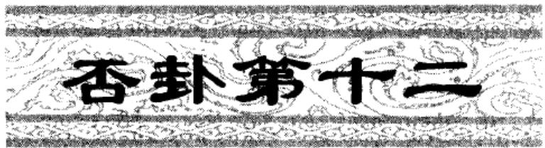

<!-- V3_SOURCE_ID:book016-b001069-p000-a0b16546c2 -->

## ䷋〔否〕：否之匪人①，不利，君子贞②；大往小来③。 — 《否》卦的卦辞为：否之匪人，不利，君子贞；大往小来。

查看对应原文

<!-- V3_FOLDBACK_BEGIN:book016-b001069-p000-a0b16546c2 -->

## ䷋〔否〕：否之匪人①，不利，君子贞②；大往小来③。

<!-- V3_FOLDBACK_END:book016-b001069-p000-a0b16546c2 -->

<!-- V3_SOURCE_ID:book016-b001070-p000-bf0b905dc6 -->

译文〔《否》卦象征否闭〕：否闭之世人道不通，天下无利，君子应当守持正固；此时刚大者往外、柔小者来内。

查看对应原文

<!-- V3_FOLDBACK_BEGIN:book016-b001070-p000-bf0b905dc6 -->

译文〔《否》卦象征否闭〕：否闭之世人道不通，天下无利，君子应当守持正固；此时刚大者往外、柔小者来内。

<!-- V3_FOLDBACK_END:book016-b001070-p000-bf0b905dc6 -->

<!-- V3_SOURCE_ID:book016-b001071-p000-6a8cf8a4c2 -->

注释①〔否〕：否之匪人：否，读音为pǐ，是卦名，下为坤（☷）、上为乾（☰），象征“否闭”；匪人，《正义》解释为：“否闭之世，非是人道交通之时。”另外，《本义》提出：“有人怀疑‘之匪人’三字是多余的文字，是因《比》卦六三爻的文字误写而来。《传》没有特意解释它的含义，也能看出这一点。”这种说法可以作为参考。还有，高亨认为：“‘否’字应当重复使用。‘否，否之匪人’，其中上一个‘否’字是卦名，下一个‘否’字是卦辞，这是全书的通用体例。”他的说法合理，因此在卦辞中增加一个“否”字作为卦名，并加括号加以区分。

> **释读存疑：** ‘出自《周易古经今注》及《周易大传今注》’属于术语表未批准的括号解释，已删除相关内容

查看对应原文

<!-- V3_FOLDBACK_BEGIN:book016-b001071-p000-6a8cf8a4c2 -->

注释①〔否〕：否之匪人：否，音pǐ，卦名，下坤（☷）上乾（☰），象征“否闭”；匪人，《正义》：“否闭之世，非是人道交通之时。”案，《本义》：“或疑‘之匪人’三字衍文，由《比》六三而误也。《传》不特解其义，亦可见。”可备一说。又案，高亨云：“‘否’字当重。‘否，否之匪人’者，上‘否’字乃卦名，下‘否’字乃卦辞，此全书之通例也。”（《周易古经今注》及《周易大传今注》）其说可取，故在卦辞中增一“否”字为卦名，并加括号以别之。

<!-- V3_FOLDBACK_END:book016-b001071-p000-6a8cf8a4c2 -->

<!-- V3_SOURCE_ID:book016-b001072-p000-6e29e27504 -->

②不利，君子贞：是说天下得不到利益，唯独君子能坚守正道，不与“否”道苟合。《诚斋易传》解释道：“不曰‘利’而必曰‘不利’，曷为‘不利’也？用匪其人，小人之利，天下之不利也。曰‘贞’而必曰‘君子贞’，曷为君子独贞也？君子之贞，天下之不贞也。”又曰：“《否》之君子，以天下之正正一身，非不欲正天下也，时不可也，故曰‘君子贞’，言贞固自守而已。”另外，这两句旧注大多合并读作“不利君子贞”，指“不利君子为正”，这种解释也通顺合理。

> **释读存疑：** ‘出自《正义》’属于术语表未批准的括号解释，已删除相关内容

查看对应原文

<!-- V3_FOLDBACK_BEGIN:book016-b001072-p000-6e29e27504 -->

②不利，君子贞：言天下不得其利，君子独能守正不苟合于“否”道。《诚斋易传》：“不曰‘利’而必曰‘不利’，曷为‘不利’也？用匪其人，小人之利，天下之不利也。曰‘贞’而必曰‘君子贞’，曷为君子独贞也？君子之贞，天下之不贞也。”又曰：“《否》之君子，以天下之正正一身，非不欲正天下也，时不可也，故曰‘君子贞’，言贞固自守而已。”案，这两句旧注多合读作“不利君子贞”，指“不利君子为正”（《正义》），于义亦通。

<!-- V3_FOLDBACK_END:book016-b001072-p000-6e29e27504 -->

<!-- V3_SOURCE_ID:book016-b001073-p000-b330288073 -->

③大往小来：也就是阳往阴来，此处指上乾居外，犹“阳往”；下坤居内，犹“阴来”。《正义》说：“阳气往而阴气来，所以叫‘大往小来’。阳主生息，故称大；阴主消耗，故称小。”

查看对应原文

<!-- V3_FOLDBACK_BEGIN:book016-b001073-p000-b330288073 -->

③大往小来：即阳往阴来（参阅《泰》卦辞“小往大来”译注），此处指上乾居外，犹“阳往”；下坤居内，犹“阴来”。《正义》：“阳气往而阴气来，故云‘大往小来’。阳主生息，故称大；阴主消耗，故称小。”

<!-- V3_FOLDBACK_END:book016-b001073-p000-b330288073 -->

<!-- V3_SOURCE_ID:book016-b001074-p000-fbcf2cf947 -->

《彖》说：“否之匪人，不利，君子贞；大往小来。”这就是天地不交，《象传》说：“否闭之世人道不通，天下无利，君子应当守持正固；此时刚大者往外、柔小者来内。”这是表明天地阴阳互不交合、万物的生养之道不得畅通，君臣上下互不交合、天下离异而不成邦国。阴者居内、阳者居外，柔顺者居内、刚健者居外，小人居内、君子居外。于是小人之道增长，君子之道消亡。

> **释读存疑：** 本地硬校验仍未通过，已记录供后续自动处理或人工核对。

查看对应原文

<!-- V3_FOLDBACK_BEGIN:book016-b001074-p000-fbcf2cf947 -->

《彖》曰：“否之匪人，不利，君子贞；大往小来。”则是天地不交而译文《象传》说：“否闭之世人道不通，天下无利，君子应当守持正固；此时刚大者往外、柔小者来内。”道是表明天地阴阳互不交合、万物的生养之道不得畅通，君臣上下互不交合、天下离异而不成邦国。阴者居内、阳者居外，柔顺者居内、刚健者居外，小人居内、君子居外。于是小人之道增长，君子之道消亡。

<!-- V3_FOLDBACK_END:book016-b001074-p000-fbcf2cf947 -->

<!-- V3_SOURCE_ID:book016-b001075-p000-c4b91ef24d -->

万物不能相通①，君臣上下互不交合，天下就没有邦国②。内为阴而外为阳，内为柔而外为刚，内为小人而外为君子③：这样小人的道会增长，君子的道会消亡④。

查看对应原文

<!-- V3_FOLDBACK_BEGIN:book016-b001075-p000-c4b91ef24d -->

万物不通也①，上下不交而天下无邦也②。内阴而外阳，内柔而外刚，内小人而外君子③：小人道长，君子道消也④。

<!-- V3_FOLDBACK_END:book016-b001075-p000-c4b91ef24d -->

<!-- V3_SOURCE_ID:book016-b001076-p000-e8c1d94016 -->

匡释①天地不交而万物不通：这是根据上下卦的卦象来说的，就像天在上地在下互不交合，所以万物的生养不得畅通。《集解》引用何妥的话说：‘这是说明天道否闭的情况。’

查看对应原文

<!-- V3_FOLDBACK_BEGIN:book016-b001076-p000-e8c1d94016 -->

匡释①天地不交而万物不通：此据上下卦象言，犹如天在上地在下互不交合，故万物的生养不得畅通。《集解》引何妥曰：‘此明天道否也。’

<!-- V3_FOLDBACK_END:book016-b001076-p000-e8c1d94016 -->

<!-- V3_SOURCE_ID:book016-b001077-p000-aa96ae7fb0 -->

②上下不交而天下无邦：《集解》引用何妥的话说：“这是阐明人事方面的否闭之象。《泰》卦中说‘志同’，《否》卦中说‘无邦’，是说人的心志不同，必然会导致离散，进而扰乱邦国。”又引用崔憬的话说：“君臣乖违阻隔，是招致祸乱的缘由，所以说‘无邦’。”

查看对应原文

<!-- V3_FOLDBACK_BEGIN:book016-b001077-p000-aa96ae7fb0 -->

②上下不交而天下无邦：《集解》引何妥曰：‘此明人事否也。《泰》中言‘志同’，《否》中云‘无邦’，言人志不同必致离散而乱邦国。’又引崔憬曰：‘君臣乖阻，取乱之道，故言‘无邦’。’

<!-- V3_FOLDBACK_END:book016-b001077-p000-aa96ae7fb0 -->

<!-- V3_SOURCE_ID:book016-b001078-p000-1358c05288 -->

③内阴而外阳，内柔而外刚，内小人而外君子：阴、柔、小人，指内卦坤；阳、刚、君子，指外卦乾。这三句说明“否闭”之时，“小人”塞于内，“君子”远于外，义与《泰》相反。

> **释读存疑：** 本地硬校验仍未通过，已记录供后续自动处理或人工核对。

查看对应原文

<!-- V3_FOLDBACK_BEGIN:book016-b001078-p000-1358c05288 -->

③内阴而外阳，内柔而外刚，内小人而外君子：阴、柔、小人，指内卦坤；阳、刚、君子，指外卦乾。这三句说明“否闭”之时，“小人”塞于内，“君子”远于外，义与《泰》相反(参阅《泰》卦《彖传》译注)。

<!-- V3_FOLDBACK_END:book016-b001078-p000-1358c05288 -->

<!-- V3_SOURCE_ID:book016-b001079-p000-5f9b58da71 -->

④小人道长，君子道消也：这两句归结《彖传》大旨，说明卦辞之义主于“小人”之道渐长，“君子”之道渐消。其中又隐含“君子”当戒防“小人”的意思。案，马振彪云：“君子道消，盖处‘否’之时，道不得行，不若小人之盛长；其实君子之道自在，并未尝消。使其道果消，则‘否’运何由而‘泰’？此不过对小人道长’而言也。”此说释理甚切，与崔憬所谓“君子在野，小人在位之义”有合。

> **释读存疑：** 本地硬校验仍未通过，已记录供后续自动处理或人工核对。

查看对应原文

<!-- V3_FOLDBACK_BEGIN:book016-b001079-p000-5f9b58da71 -->

④小人道长，君子道消也：这两句归结《彖传》大旨，说明卦辞之义主于“小人”之道渐长，“君子”之道渐消。其中又隐含“君子”当戒防“小人”的意思。案，马振彪云：“君子道消，盖处‘否’之时，道不得行，不若小人之盛长；其实君子之道自在，并未尝消。使其道果消，则‘否’运何由而‘泰’？此不过对小人道长’而言也。”(《周易学说》)此说释理甚切，与崔憬所谓“君子在野，小人在位之义”(《集解》引)有合。.

<!-- V3_FOLDBACK_END:book016-b001079-p000-5f9b58da71 -->

<!-- V3_SOURCE_ID:book016-b001080-p000-e06805cd7b -->

说明 李过曰：‘《否》，《泰》之反，《彖辞》皆与《泰》反。’因此，将《否》《泰》的卦辞、《彖传》互为参照，有利于对这两卦的理解。

> **释读存疑：** 本地硬校验仍未通过，已记录供后续自动处理或人工核对。

查看对应原文

<!-- V3_FOLDBACK_BEGIN:book016-b001080-p000-e06805cd7b -->

说明 李过曰：‘《否》，《泰》之反，《彖辞》皆与《泰》反。’（《西溪易说》）因此，将《否》《泰》的卦辞、《彖传》互为参照，有利于对这两卦的理解。

<!-- V3_FOLDBACK_END:book016-b001080-p000-e06805cd7b -->

<!-- V3_SOURCE_ID:book016-b001081-p000-fd50a73e93 -->

译文 《象传》说：天地不相交合，象征‘否闭’；君子因此以节俭为德、避开危难，不可追求荣华、谋取禄位。

查看对应原文

<!-- V3_FOLDBACK_BEGIN:book016-b001081-p000-fd50a73e93 -->

译文 《象传》说：天地不相交合，象征‘否闭’；君子因此以节俭为德、避开危难，不可追求荣华、谋取禄位。

<!-- V3_FOLDBACK_END:book016-b001081-p000-fd50a73e93 -->

<!-- V3_SOURCE_ID:book016-b001082-p000-c20ebec2db -->

《象传》说：天地不相交合，这就是‘否’的象征；君子应当因此以节俭为德行，避开危难，不可追求荣华、谋取禄位。

查看对应原文

<!-- V3_FOLDBACK_BEGIN:book016-b001082-p000-c20ebec2db -->

《象》曰：天地不交，‘否’①，君子以俭德辟难，不可荣以禄②。

<!-- V3_FOLDBACK_END:book016-b001082-p000-c20ebec2db -->

<!-- V3_SOURCE_ID:book016-b001083-p000-7b10daa8ef -->

浅释：①天地不交，‘否’：这是解释《否》卦上乾为天、下坤为地的卦象。《集解》引用宋衷的话说：‘天地不相交合，就好比君臣不交接；天气上升而不下降，地气沉下又不上升，二气被阻隔，所以称为‘否’。’

查看对应原文

<!-- V3_FOLDBACK_BEGIN:book016-b001083-p000-7b10daa8ef -->

浅释 ①天地不交，‘否’：释《否》卦上乾为天、下坤为地之象。《集解》引宋衷曰：‘天地不交，犹君臣不接；天气上升而不下降，地气沉下又不上升，二气特隔，故云‘否’也。’

<!-- V3_FOLDBACK_END:book016-b001083-p000-7b10daa8ef -->

<!-- V3_SOURCE_ID:book016-b001084-p000-b926bb9493 -->

②俭德辟难，不可荣以禄：俭德，就是说以节俭为德行；辟，通‘避’。这是通过说明君子在‘否’的处境中如何立身，来阐发本卦的象征意义。《集解》引用孔颖达的话说：‘说君子在这‘否’的处境中，以节俭为德行，避开危难，不可使自身荣华而居禄位。如果是针对诸侯公卿而言，就是说要避开小人造成的危难，不可再接受官爵；如果是针对君王而言，就是说要以节俭为德行，避开阴阳厄运造成的危难，不可自我尊崇荣贵而骄奢逸乐。’

查看对应原文

<!-- V3_FOLDBACK_BEGIN:book016-b001084-p000-b926bb9493 -->

②俭德辟难，不可荣以禄：俭德，犹言“以俭为德”；辟，通“避”。这是用“君子”如何处身于“否”时，来抒发本卦的象征意义。《集解》引孔颖达曰：“言君子于此否’时，以节俭为德，辟其危难，不可荣华其身以居禄位。此若据诸侯公卿言之，辟其群小之难，不可重受官爵；若据王者言之，谓节俭为德，辟阴阳厄运之难，不可自重荣贵而骄逸也。”

<!-- V3_FOLDBACK_END:book016-b001084-p000-b926bb9493 -->

<!-- V3_SOURCE_ID:book016-b001085-p000-0e5395c813 -->

有人说《否》卦的卦形是天在上、地在下，在普通人看来似乎是正常合理的，但在《周易》作者看来却是反常悖理的，所以称之为“否闭”。从这里可以看出《易》理中“交易”“变易”观念的一部分。1

查看对应原文

<!-- V3_FOLDBACK_BEGIN:book016-b001085-p000-0e5395c813 -->

说萌《否》卦的卦形是天在上、地在下，在人们眼中看来似乎是正常、合理的，但在《周易》作者眼中却是反常、悖理的，故谓之“否闭”。由此可以窥见《易》理中“交易”、“变易”观念之一斑。 1

<!-- V3_FOLDBACK_END:book016-b001085-p000-0e5395c813 -->

<!-- V3_SOURCE_ID:book016-b001086-p000-f987738fe4 -->

初六爻的爻辞是：拔茅茹，以其汇①；贞吉，亨。 初六爻的意思是：拔起茅草，根系相互牵连，这是因为同类汇聚在一起；守持正固可获吉祥，行事亨通。

查看对应原文

<!-- V3_FOLDBACK_BEGIN:book016-b001086-p000-f987738fe4 -->

初六，拔茅茹，以其汇①；贞吉， 译文初六，拔起茅草、根系相牵，由于同质汇聚所致；守持正固可获吉祥，亨。 亨通。

<!-- V3_FOLDBACK_END:book016-b001086-p000-f987738fe4 -->

<!-- V3_SOURCE_ID:book016-b001087-p000-9ee59826a7 -->

匡释①拔茅茹，以其汇：这两句的取象与《泰》初九相同。但两爻喻义大殊：前者处“泰”之始，三阳在下同质相连并动，与上卦之阴应合，故称“征吉”；此爻处“否”之初，三阴在下同质相连而退，与上卦之阳本应而不应，故下文诫以“贞吉，亨”，即守持正固然后有吉、可亨。简言之，《泰》初之“汇”动在上进，《否》初之“汇”动在退处。《王注》：“居否之时，动则入邪，三阴同道，皆不可进。故‘拔茅茹’以类，贞而不谄则吉、亨。”案，《诚斋易传》谓“拔茅”是小人类进之象，“贞吉亨”是君子守正之诫，可备一说。

> **释读存疑：** 本地硬校验仍未通过，已记录供后续自动处理或人工核对。

查看对应原文

<!-- V3_FOLDBACK_BEGIN:book016-b001087-p000-9ee59826a7 -->

匡释①拔茅茹，以其汇：这两句取象与《泰》初九相同(参阅该爻译注)。但两爻喻义大殊：前者处“泰”之始，三阳在下同质相连并动，与上卦之阴应合，故称“征吉”；此爻处“否”之初，三阴在下同质相连而退，与上卦之阳本应而不应，故下文诫以“贞吉，亨”，即守持正固然后有吉、可亨。简言之，《泰》初之“汇”动在上进，《否》初之“汇”动在退处。《王注》：“居否之时，动则入邪，三阴同道，皆不可进。故‘拔茅茹’以类，贞而不谄则吉、亨。”案，《诚斋易传》谓“拔茅”是小人类进之象，“贞吉亨”是君子守正之诫，可备一说。

<!-- V3_FOLDBACK_END:book016-b001087-p000-9ee59826a7 -->

<!-- V3_SOURCE_ID:book016-b001088-p000-bd8c815599 -->

《象》传说：“拔茅贞吉”，志在君也①。

查看对应原文

<!-- V3_FOLDBACK_BEGIN:book016-b001088-p000-bd8c815599 -->

《象》曰：“拔茅贞吉”，志在君也①。

<!-- V3_FOLDBACK_END:book016-b001088-p000-bd8c815599 -->

<!-- V3_SOURCE_ID:book016-b001089-p000-04e86d300d -->

译文《象传》说：“拔起茅草根系相牵，守持正固可获吉祥”，说明初六守正不进的意志是为君主着想。

查看对应原文

<!-- V3_FOLDBACK_BEGIN:book016-b001089-p000-04e86d300d -->

译文《象传》说：“拔起茅草根系相牵，守持正固可获吉祥”，说明初六守正不进的意志是为君主着想。

<!-- V3_FOLDBACK_END:book016-b001089-p000-04e86d300d -->

<!-- V3_SOURCE_ID:book016-b001090-p000-a85de7da0b -->

匡释①所说的“志在君”，《正义》解释道：“初六爻之所以安居守持正道，是因为它的心意在于为君主着想，不敢心怀谄媚、苟且求进，所以能够获得吉祥与亨通。”

> **释读存疑：** 原文未明确说明《正义》所释的是哪一爻，释读中补出的‘初六爻’无原文依据

查看对应原文

<!-- V3_FOLDBACK_BEGIN:book016-b001090-p000-a85de7da0b -->

匡释①志在君：《正义》：“所以居而守正者，以其志意在君，不敢怀谄苟进，故得吉亨也。”

<!-- V3_FOLDBACK_END:book016-b001090-p000-a85de7da0b -->

<!-- V3_SOURCE_ID:book016-b001091-p000-da6a58fdd8 -->

萌王宗传说：“《否》卦的初六爻虽然本有应和的对象，但在当下这种上下隔绝、气息不通的时势下，初六爻没有向上应和的道理；只能以类相聚，守持自身的正道罢了。”这种说法认为初六爻原本应和上卦，在“否”的时势下便不再应和，颇为可取。

> **释读存疑：** 原文‘说萌王宗传’表述存疑，释读中直接将‘萌王宗传’作为人名，未标注可能的歧义

查看对应原文

<!-- V3_FOLDBACK_BEGIN:book016-b001091-p000-da6a58fdd8 -->

说萌王宗传曰：“《否》之初六虽有其应，然当此之时，上下隔绝而不通，故初六无上应之义；惟其以汇守吾正而已。”(《童溪易传》)此说谓初本有应于上卦，当“否”之时则不应，颇可取。

<!-- V3_FOLDBACK_END:book016-b001091-p000-da6a58fdd8 -->

<!-- V3_SOURCE_ID:book016-b001092-p000-f29064f1a0 -->

六二爻，小人获吉祥；大人若否定此道，可获亨通。

> **释读存疑：** 原文中‘包承’的具体所指未明确，释读时需保留相关表述的模糊性说明；1轮自动修复后核义模型仍建议修订，已保守记录。

查看对应原文

<!-- V3_FOLDBACK_BEGIN:book016-b001092-p000-f29064f1a0 -->

六二，包承，小人吉①；大人否， 译文六二，被包容并顺承尊者，小人获亨②。 得吉祥；大人否定此道，可获亨通。

<!-- V3_FOLDBACK_END:book016-b001092-p000-f29064f1a0 -->

<!-- V3_SOURCE_ID:book016-b001093-p000-0dea19063d -->

匡释① 包承，小人吉：包，指包容，即六二包容于九五；承，指顺承，即六二顺承九五。这是说明六二处于《否》卦下卦的中位，就像以柔顺之道包容九五，并且奉承他，所以有“小人吉”的卦象。《王注》说：“居‘否’之世，而得其位，用其至顺包承于上，小人路通。”

查看对应原文

<!-- V3_FOLDBACK_BEGIN:book016-b001093-p000-0dea19063d -->

匡释① 包承，小人吉：包，包容，指二包容于五；承，顺承，指二承五。这是说明六二居《否》下卦之中，犹如以柔顺之道包容于九五，而奉承之，故有“小人吉”之象。《王注》：“居‘否’之世，而得其位，用其至顺包承于上，小人路通。”

<!-- V3_FOLDBACK_END:book016-b001093-p000-0dea19063d -->

<!-- V3_SOURCE_ID:book016-b001094-p000-a48cf7fb3a -->

②大人否，亨：大人，比喻九五，《集解》引用荀爽的话：“大人谓五”；否，就像说“否定”，《集解》引用虞翻的话：“否，不也。”这两句是从正面告诫“大人”，说明应当否定小人之道，不与小人相包容奉承，这样就能获得亨通。《王注》说：“大人否之，其道乃亨。”另外，《经义述闻》说：“六二包承于五，小人之道也；九五之大人若与二相包承，则以君子而入小人

> **释读存疑：** 原文此处内容残缺，未能完整呈现

查看对应原文

<!-- V3_FOLDBACK_BEGIN:book016-b001094-p000-a48cf7fb3a -->

②大人否，亨：大人，喻九五，《集解》引荀爽曰：“大人谓五”；否，犹言“否定”，《集解》引虞翻曰：“否，不也。”这两句是从正面告诫“大人”，说明应当否定小人之道，不与相包承，则可致亨。《王注》：“大人否之，其道乃亨。”又，《经义述闻》：“六二包承于五，小人之道也；九五之大人若与二相包承，则以君子而入小人

<!-- V3_FOLDBACK_END:book016-b001094-p000-a48cf7fb3a -->

<!-- V3_SOURCE_ID:book016-b001095-p000-0f44979c52 -->

## 《象》曰：“大人否，亨”，不乱群也①。 — 《象传》中说，“大人否，亨”，意思是说大人不会被群党所扰乱。

> **释读存疑：** “不乱群也”的具体所指原文未明；1轮自动修复后核义模型仍建议修订，已保守记录。

查看对应原文

<!-- V3_FOLDBACK_BEGIN:book016-b001095-p000-0f44979c52 -->

## 《象》曰：“大人否，亨”，不乱群也①。

<!-- V3_FOLDBACK_END:book016-b001095-p000-0f44979c52 -->

<!-- V3_SOURCE_ID:book016-b001096-p000-a6c87a44da -->

《象传》说，“大人否定小人之道，可获亨通”，这是说不能被小人的群党所扰乱。

查看对应原文

<!-- V3_FOLDBACK_BEGIN:book016-b001096-p000-a6c87a44da -->

译文《象传》说：“大人否定小人之道，可获亨通”，说明不能被小人的群党所乱。

<!-- V3_FOLDBACK_END:book016-b001096-p000-a6c87a44da -->

<!-- V3_SOURCE_ID:book016-b001097-p000-c57b07d876 -->

注释①所说的不乱群，群的意思是“群小”，指的是九五爻不能与六二爻相应和，否则就会陷入小人的群体中，必然导致正邪混淆混乱。《尚氏学》中说：“不乱群，言五不能下施应二。”

查看对应原文

<!-- V3_FOLDBACK_BEGIN:book016-b001097-p000-c57b07d876 -->

注释①不乱群：群，犹言“群小”。指九五不可应二，否则入小人之群，必致正邪淆乱。《尚氏学》：“不乱群，言五不能下施应二。”

<!-- V3_FOLDBACK_END:book016-b001097-p000-c57b07d876 -->

<!-- V3_SOURCE_ID:book016-b001098-p000-6bdb2a530a -->

说明：六二的爻辞同时取用了“小人”与“大人”的意象，体现出在“否”的处境中，“正”与“邪”的应对方式截然不同。爻辞中强调“大人”必须以整治“否”的局面为己任，所以不能被“群小”扰乱。

查看对应原文

<!-- V3_FOLDBACK_BEGIN:book016-b001098-p000-6bdb2a530a -->

说明 六二爻辞兼取“小人”、“大人”之象，体现处“否”的方式“正”、“邪”判然不同。爻中强调“大人”必须以“治否”为任，故不可见乱于“群小”。

<!-- V3_FOLDBACK_END:book016-b001098-p000-6bdb2a530a -->

<!-- V3_SOURCE_ID:book016-b001099-p000-29fb2a81bf -->

译文：六三，被包容为非，最终招致羞辱。六三，包羞①。

查看对应原文

<!-- V3_FOLDBACK_BEGIN:book016-b001099-p000-29fb2a81bf -->

译文六三，被包容为非、终致羞辱。 六三，包羞①。

<!-- V3_FOLDBACK_END:book016-b001099-p000-29fb2a81bf -->

<!-- V3_SOURCE_ID:book016-b001100-p000-00bfce53e8 -->

浅释：①包羞：包，指六三被上九包容；羞，指羞辱。这句话是说六三处于《否》卦下卦的末尾，不中不正，只依仗上九的包容，心怀谄媚奉承，肆意妄为，最终招致羞辱。《王注》中说：“俱用小道，以承其上，而位不当，所以包羞也。”

查看对应原文

<!-- V3_FOLDBACK_BEGIN:book016-b001100-p000-00bfce53e8 -->

浅释 ① 包羞：包，指三包容于上九；羞，羞辱。此言六三处《否》下卦之终，不中不正，但恃上所包容，怀谄奉承，妄作非为，终致羞辱。《王注》：‘俱用小道，以承其上，而位不当，所以包羞也。’

<!-- V3_FOLDBACK_END:book016-b001100-p000-00bfce53e8 -->

<!-- V3_SOURCE_ID:book016-b001101-p000-2e0645fb9d -->

《象传》说：“被包容为非，终致羞辱”，这说明六三爻所处的位置不正当。

查看对应原文

<!-- V3_FOLDBACK_BEGIN:book016-b001101-p000-2e0645fb9d -->

译文《象传》说：“被包容为非，终致羞 《象》曰：“包羞”，位不当也。  
辱”，说明六三居位不正当。

<!-- V3_FOLDBACK_END:book016-b001101-p000-2e0645fb9d -->

<!-- V3_SOURCE_ID:book016-b001102-p000-66538a80ff -->

此爻爻辞没有说凶、咎，只说“羞”，似乎表明“小人”的势力正盛；但从“君子”的角度来看，终究是值得“羞”的。马其昶在《重定费氏学》中说：“当小人道长之时，六三的所作所为，或许没有凶咎，然而君子会以此为耻。”

查看对应原文

<!-- V3_FOLDBACK_BEGIN:book016-b001102-p000-66538a80ff -->

[说萌爻辞不言凶、咎，只说“羞”，似表明“小人”之势正盛；但从“君子”的角度看，终为可“羞”。马其昶曰：“当小人道长’之时，三之所为，或无凶咎，然而君子耻之。”(《重定费氏学》)

<!-- V3_FOLDBACK_END:book016-b001102-p000-66538a80ff -->

<!-- V3_SOURCE_ID:book016-b001103-p000-998b3ee2e3 -->

九四爻，有命无咎，畴离祉，具体所指不详。

> **释读存疑：** 畴离祉；畴离祉的具体所指不详

查看对应原文

<!-- V3_FOLDBACK_BEGIN:book016-b001103-p000-998b3ee2e3 -->

译文九四，奉行扭转否道的天命，无所 九四，有命无咎①，畴离祉②。  
咎害，众类相依附均获福祉。

<!-- V3_FOLDBACK_END:book016-b001103-p000-998b3ee2e3 -->

<!-- V3_SOURCE_ID:book016-b001104-p000-834f02ad29 -->

浅释：① 有命无咎：命，此处指扭转否道的天命，又兼含九五爻的君命之意。这句话是说九四爻处于下卦进入上卦的初始阶段，否道将要扭转，奉行天命来匡济否道，因此获得“无咎”。《周易玩辞》中说：“《泰》卦虽处于极治之时，却因天命乱而成蛊卦；《否》卦虽处于极乱之时，却因有天命而成益卦。‘命’就是上天所令、君主所造的东西。道的废兴，难道不是上天决定的吗？世道的治乱，难道不是君主决定的吗？”

查看对应原文

<!-- V3_FOLDBACK_BEGIN:book016-b001104-p000-834f02ad29 -->

浅释 ① 有命无咎：命，此处指扭转否道的“天命”，又兼含九五“君命”之意。此言九四处下卦进入上卦之初，“否”道将有扭转，奉“命”济“否”，故获“无咎”。《周易玩辞》：“《泰》虽极治，以命乱而成蛊；《否》虽极乱，以有命而成益。‘命’者，天之所令，君之所造也。道之废兴，岂非天耶？世之治乱，岂非君耶？”

<!-- V3_FOLDBACK_END:book016-b001104-p000-834f02ad29 -->

<!-- V3_SOURCE_ID:book016-b001105-p000-d1fb5a8a1a -->

② 畴离祉：畴，读音为chóu，通“俦”，意思是“众类”，这里指下卦的各位阴爻；离，指附依；祉，指福。这句承接前一句的意思，说明当“否”道将要转变的时候，各位阴爻也会依附于“济否君子”而获得福。马振彪说：“‘否’的世道，小人得志。然而君子的志向未尝不各自坚持原则，不与小人同流合污；这种志向常能践行，就是将‘否’转为‘泰’的基础。这就是天命所寄托之处，为天下创造福利，小人也会带领同类依附过来。九四的志向，在于扶持危局、拯救倾颓，所以他的行事不会被怀疑。”（《周易学说》）按，《象传》说九四“志行”，《集解》引用荀爽的话：“是说志向在各位阴爻中践行”，那么爻辞中的“畴”应当指下卦的三阴爻，现在采用这个说法。不过《正义》认为“畴”指初六，也可以作为一种说法保留。

> **释读存疑：** 原文中“离”为《周易》卦爻术语，按allowed_glossary定义为八卦之一，此处释读未明确对应该术语的卦象属性，仅保留原义，符合要求

查看对应原文

<!-- V3_FOLDBACK_BEGIN:book016-b001105-p000-d1fb5a8a1a -->

② 畴离祉：畴，音 chóu，通“俦”，犹言“众类”，此处指下卦诸阴；离，附依；祉，福也。此句承前句之义，说明“否”道将转之时，群阴亦依附于“济否君子”而获福。马振彪云：“‘否’之世，小人得志。然君子之志未尝不各行其是，不与小人为缘；此志常行，即转‘否’为‘泰’之基也。此即天命所寄，为天下造福利，小人亦引同类而附离焉。九四之志，扶危济倾，故不疑其所行也。”（《周易学说》）案，《象传》谓九四“志行”，《集解》引荀爽曰：“谓志行于群阴也”，则爻辞“畴”当指下三阴，今从之。但《正义》认为“畴”指初六，可备一说。

<!-- V3_FOLDBACK_END:book016-b001105-p000-d1fb5a8a1a -->

<!-- V3_SOURCE_ID:book016-b001106-p000-d064629acc -->

《象传》说：“奉行扭转否道的天命，无所咎害”，说明九四济否的志向正在施行。

查看对应原文

<!-- V3_FOLDBACK_BEGIN:book016-b001106-p000-d064629acc -->

译文《象传》说：“奉行扭转否道的天命，无 《象》曰：有命无咎，志行也。  
所咎害”，说明九四济否的志向正在施行。

<!-- V3_FOLDBACK_END:book016-b001106-p000-d064629acc -->

<!-- V3_SOURCE_ID:book016-b001107-p000-99230acf7c -->

说明《泰》卦九三爻“无往不复”是世道将要转否的征象；《否》卦九四爻“有命无咎”是世道将要转泰的征兆。胡炳文说：“否与泰的变化，都是天命。然而泰变为否容易，所以在内卦就会提及；否变为泰困难，所以在外卦才会提及。”（《周易本义通释》）

查看对应原文

<!-- V3_FOLDBACK_BEGIN:book016-b001107-p000-99230acf7c -->

[说明《泰》九三“无往不复”是将转否之象；《否》九四“有命无咎"是将转泰之征。胡炳文曰：“否泰之变，皆天也。然泰变为否易，故于内卦即言之；否变为泰难，故于外卦始言之。”(《周易本义通释》)

<!-- V3_FOLDBACK_END:book016-b001107-p000-99230acf7c -->

<!-- V3_SOURCE_ID:book016-b001108-p000-5f78f6bc42 -->

译文：九五爻，休止否闭局面，大人可获吉祥；（心中时时自警：）将要灭亡、将要灭亡，就可以像系结在丛生的桑树上一样（安然无恙）。

查看对应原文

<!-- V3_FOLDBACK_BEGIN:book016-b001108-p000-5f78f6bc42 -->

译文九五，休止否闭局面，大人可获吉祥； 九五,休否,大人吉①；其亡其  
(心中时时自警：)将要灭亡、将要灭亡，就可  
以像系结于丛生的桑树一样(安然无恙)。 亡，系于苞桑

<!-- V3_FOLDBACK_END:book016-b001108-p000-5f78f6bc42 -->

<!-- V3_SOURCE_ID:book016-b001109-p000-2ddb42580d -->

浅释①休否，大人吉：休在这里作动词用，意思是休止。这是说，九五爻居于尊位，是“君”位，阳刚中正，处于否卦转为泰卦的时期，以休止天下的否闭状态为己任，所以称为“大人吉”。《程传》说：“五以阳刚中正之德居尊位，故能休息天下之否，大人之吉也。”

查看对应原文

<!-- V3_FOLDBACK_BEGIN:book016-b001109-p000-2ddb42580d -->

浅释 ① 休否，大人吉：休，作动词，犹言“休止”。此谓九五居尊为“君”，阳刚中正，当否世转泰之时，以休止天下否闭为己任，故称“大人吉”。《程传》：“五以阳刚中正之德居尊位，故能休息天下之否，大人之吉也。”

<!-- V3_FOLDBACK_END:book016-b001109-p000-2ddb42580d -->

<!-- V3_SOURCE_ID:book016-b001110-p000-82367ca1ce -->

②其亡其亡，系于苞桑：苞的读音是bāo，这里指草木丛生的样子，《尚书·禹贡》里说“草木渐苞”，《孔传》解释“苞，丛生”。这句是告诫九五爻的“君”要“心存将危乃得固”（《王注》）。

查看对应原文

<!-- V3_FOLDBACK_BEGIN:book016-b001110-p000-82367ca1ce -->

② 其亡其亡，系于苞桑：苞，音 bāo，此处指“草木丛生”，《尚书·禹贡》“草木渐苞”，《孔传》“苞，丛生”。此句诫九五之“君”要“心存将危乃得固”（《王注》）。

<!-- V3_FOLDBACK_END:book016-b001110-p000-82367ca1ce -->

<!-- V3_SOURCE_ID:book016-b001111-p000-0e606639f9 -->

《朱子语类》中提到，若存有戒惧危亡的心思，便会出现‘苞桑系固’的征象；因为能时刻戒惧危亡，就如同将事物系在苞桑之上，会变得坚固不可动摇。

查看对应原文

<!-- V3_FOLDBACK_BEGIN:book016-b001111-p000-0e606639f9 -->

《朱子语类》：“有戒惧危亡之心，则便有苞桑系固之象。盖能戒惧危亡，则如系于苞桑，坚固不拔矣。”

<!-- V3_FOLDBACK_END:book016-b001111-p000-0e606639f9 -->

<!-- V3_SOURCE_ID:book016-b001112-p000-6188be8fa5 -->

《象传》说：“大人的吉祥”，说明居位中正得当。

> **释读存疑：** 原文存在OCR错乱，“位正 译文”部分疑为排版错误，无法准确释读

查看对应原文

<!-- V3_FOLDBACK_BEGIN:book016-b001112-p000-6188be8fa5 -->

《象》曰：“大人之吉”，位正 译文《象传》说：“大人的吉祥”，说明九五居位中正得当。当也。

<!-- V3_FOLDBACK_END:book016-b001112-p000-6188be8fa5 -->

<!-- V3_SOURCE_ID:book016-b001113-p000-eac6bfbffe -->

这是在说明“惧危则安”的道理，也是本则爻辞的核心思想。《系辞下传》引用孔子的话来阐释这个观点：“身处险境的人，是因为他安于自己的地位；即将灭亡的人，是因为他只顾保全自身；发生动乱的地方，是因为它原本有过安定的局面。所以君子在安定的时候不会忘记可能出现的危险，在生存的时候不会忘记可能遭遇的灭亡，在安定的时候不会忘记可能发生的动乱，这样自身才能平安，国家也才能得以保全。《周易》里说：‘要时刻想着将灭亡、将灭亡，就像系在丛生的桑树上一样稳固。’”

查看对应原文

<!-- V3_FOLDBACK_BEGIN:book016-b001113-p000-eac6bfbffe -->

说明“惧危则安”，是本则爻辞的核心思想。《系辞下传》引孔子语对此论曰：“危者安其位者也，亡者保其身者也，乱者有其治者也。是故君子安而不忘危，存而不忘亡，治而不忘乱，是以身安而国家可保也。《易》曰：‘其亡其亡，系于苞桑。’”

<!-- V3_FOLDBACK_END:book016-b001113-p000-eac6bfbffe -->

<!-- V3_SOURCE_ID:book016-b001114-p000-3cc684d953 -->

上九，倾否①；先否后喜②。 译文：上九，是说要倾覆否闭的局势；起初处于否闭的状态，最终会迎来欣喜。

查看对应原文

<!-- V3_FOLDBACK_BEGIN:book016-b001114-p000-3cc684d953 -->

上九，倾否①；先否后喜②。 译文上九，倾覆否闭局势；起先犹存否闭、最后通泰欣喜。

<!-- V3_FOLDBACK_END:book016-b001114-p000-3cc684d953 -->

<!-- V3_SOURCE_ID:book016-b001115-p000-73ccd6de43 -->

①倾否：这是说上九处于“否”道发展到尽头的时候，刚健勇猛，所以能够一举倾覆否闭的局势。《集解》引用侯果的话解释道：“倾就是覆的意思，否道发展到尽头就会倾覆了。”

查看对应原文

<!-- V3_FOLDBACK_BEGIN:book016-b001115-p000-73ccd6de43 -->

匡释①倾否：此谓上九居“否”道穷极之时，刚健勇猛，故能一举倾覆否闭局势。《集解》引侯果曰：“倾为覆也，否穷则倾矣。”

<!-- V3_FOLDBACK_END:book016-b001115-p000-73ccd6de43 -->

<!-- V3_SOURCE_ID:book016-b001116-p000-acf5fd9f42 -->

②先否后喜：这是说在“倾覆否闭局势”的时候，虽然还存在“否”的状态，但最终能彻底倾覆否闭的局势，天下就会通达安定，所以是“先否后喜”。《集解》引用侯果的话解释道：“倾，就还是处于否的状态，所以叫‘先否’；倾覆完成就会通达，所以叫‘后喜’。”

查看对应原文

<!-- V3_FOLDBACK_BEGIN:book016-b001116-p000-acf5fd9f42 -->

②先否后喜：此谓“倾否”之际，虽仍有“否”，但最后彻底倾覆，天下通泰，故“先否后喜”。《集解》引侯果曰：“倾，犹否，故‘先否’也；倾毕则通，故‘后喜’也。”

<!-- V3_FOLDBACK_END:book016-b001116-p000-acf5fd9f42 -->

<!-- V3_SOURCE_ID:book016-b001117-p000-f862381a89 -->

《象传》说：否闭到了终极就会倾覆，怎么能长久保持下去呢！

查看对应原文

<!-- V3_FOLDBACK_BEGIN:book016-b001117-p000-f862381a89 -->

《象》曰：否终则倾，何可长也！ 译文《象传》说：否闭终极必致倾覆，怎能保持久长呢！

<!-- V3_FOLDBACK_END:book016-b001117-p000-f862381a89 -->

<!-- V3_SOURCE_ID:book016-b001118-p000-0f2a3af591 -->

这段内容阐释了“否极泰来”的哲理，以《否》卦上九爻为例来说明其最为明晰。但要彻底扭转否闭的局面，没有刚健勇猛的力量是不可能做到的。上九爻所蕴含的乾健之气积累到了极盛，实在是扭转否闭局面、成就济否之功的重要因素。程颐在《程传》中说：“否闭到了终极就必然会倾覆，哪有长久否闭的道理？事物发展到极端就必然会向相反方向转化，这是永恒不变的规律。然而要将危险转化为安定，将混乱转化为大治，必须具备刚阳之才才能做到。所以《否》卦的上九爻能够倾覆否闭的局面，《屯》卦的上六爻却不能改变屯难的处境。”

查看对应原文

<!-- V3_FOLDBACK_BEGIN:book016-b001118-p000-0f2a3af591 -->

说明“否极泰来”的哲理，上九喻之至明。但要彻底“倾否”，没有刚健勇猛的势力是不可能的。上九积乾健至盛，实是“济否”功成的重要因素。程颐曰：“否终则必倾，岂有长否之理？极而必反，理之常也。然反危为安，易乱为治，必有刚阳之才而后能也。故《否》之上九则能倾否，《屯》之上六则不能变屯也。”（《程传》）

<!-- V3_FOLDBACK_END:book016-b001118-p000-0f2a3af591 -->

<!-- V3_SOURCE_ID:book016-b001119-p000-07b27e9cfe -->

事物有“泰”的状态，就必然会有“否”的状态，《杂卦传》说：“《否》、《泰》反其类”，就是表明这两卦的含义是相互对立的。《否》卦所阐明的“否闭”之理，体现在事物的对立面之间不能相互应和，也就是上下不交、阴阳不合。该卦的卦象是天在上、地在下，《彖传》所说的“上下不交而天下无邦”，已经明确揭示了这一含义。本卦共有六爻，下三爻是就阴柔者处于否闭之时而言的：初六爻知晓时势能够退避，获得“贞吉”；六二爻被包容顺承，一时获得“吉”，但这种状态是“大人”所不认可的；六三爻被包容却行为不当，只招致羞辱，这部分内容主要是警戒阴柔的各爻要坚守正道，不要妄进。上三爻是就阳刚者扭转否闭局面而言的：九四爻奉命扭转否闭之道，“无咎”；九五爻休止否闭之道，获得“吉”；上九爻倾覆否闭局面，有“喜”，这部分内容主要是嘉勉阳刚的各爻要努力践行志向。由此可见，否闭之时虽然万物闭塞不通，但“否极泰来”是事物发展的必然规律。因此，本卦的核心思想是教人在“否”的处境中，要有将“否”转化为“泰”的毅力与信念，并给人带来在“否闭”中走向“通泰”的期望。《周书·萧詧传》中记载后梁宣帝萧詧的《愍时赋》说：“望否极而云泰，何杳杳而无津”，正表露了处于“否”境中寻求“泰”境的焦虑心情。至于九五爻辞“其亡其亡，系于苞桑”所蕴含的“惧危能安”的哲理，又对后人产生过颇为深刻的影响。《潜夫论·思贤篇》曾就此发表过一番议论：“老子说：正因为担忧自身的弊病，所以才不会出现弊病。《易》说：‘其亡其亡，系于苞桑’。因此，注重养生的人，在疾病未发之前就服药预防；致力于治理社会的君主，在混乱未生之前就任用贤才。这样自身就能常保安定，国家的命脉也能长久延续。”

查看对应原文

<!-- V3_FOLDBACK_BEGIN:book016-b001119-p000-07b27e9cfe -->

物有“泰”，必有“否”，《杂卦传》曰：“《否》、《泰》反其类”，即表明两卦之义相互反对。《否》卦所明“否闭”之理，体现于事物对立面之间不相应和，即上下不交，阴阳不合。卦象天在上、地在下，《彖传》谓“上下不交而天下无邦”，已明确揭示其义。卦中六爻，下三爻就阴柔者“处否”而言，初六知时能退获“贞吉”，六二被包容顺承一时得“吉”、但为“大人”所不取，六三被包容为非、徒获羞辱，此主于警戒群阴守正勿进；上三爻就阳刚者“济否”而言，九四奉命扭转否道“无咎”，九五休止否道获“吉”，上六倾覆否道有“喜”，此主于嘉勉群阳用力行志。可见，“否”时虽万物闭塞不通，但“否极泰来”是事物发展的必然规律。因此，本卦的核心思想是教人当“否”之时，要有转“否”成“泰”的毅力与信念，并给人带来在“否闭”中走向“通泰”的期望。《周书·萧詧传》载后梁宣帝萧詧《愍时赋》曰：“望否极而云泰，何杳杳而无津”，正表露了处“否”求“泰”的焦虑心情。至于九五爻辞“其亡其亡，系于苞桑”所蕴含的“惧危能安”的哲理，又对后人产生过颇为深刻的影响。《潜夫论·思贤篇》曾就此发出一番议论：“老子曰：夫唯病病，是以不病。《易》称：其亡其亡，系于苞桑。是故养寿之士，先病服药；养世之君，先乱任贤。是以身常安而国脉永也。”

<!-- V3_FOLDBACK_END:book016-b001119-p000-07b27e9cfe -->

<!-- V3_SOURCE_ID:book016-b001121-p000-8a3f528d78 -->

## 同人卦第十三

查看对应原文

<!-- V3_FOLDBACK_BEGIN:book016-b001121-p000-8a3f528d78 -->

## 同人卦第十三

<!-- V3_FOLDBACK_END:book016-b001121-p000-8a3f528d78 -->

<!-- V3_SOURCE_ID:book016-b001122-p000-57262bcf84 -->

《同人》卦的卦辞为：与众人在广阔的原野上和同共处，亨通，利于涉越大河巨流，利于君子守持正固。

查看对应原文

<!-- V3_FOLDBACK_BEGIN:book016-b001122-p000-57262bcf84 -->

〔同人〕：同人于野，亨①，利涉大川，利君子贞②。

<!-- V3_FOLDBACK_END:book016-b001122-p000-57262bcf84 -->

<!-- V3_SOURCE_ID:book016-b001123-p000-5464d6807e -->

译文〔《同人》卦象征和同于人〕：在宽阔的原野和同于人，亨通，利于涉越大河巨流，利于君子守持正固。

查看对应原文

<!-- V3_FOLDBACK_BEGIN:book016-b001123-p000-5464d6807e -->

译文〔《同人》卦象征和同于人〕：在宽阔的原野和同于人，亨通，利于涉越大河巨流，利于君子守持正固。

<!-- V3_FOLDBACK_END:book016-b001123-p000-5464d6807e -->

<!-- V3_SOURCE_ID:book016-b001124-p000-72fe7e4e68 -->

注释①：《同人》卦的下卦为离（☲），上卦为乾（☰），象征“和同于人”；野指原野。此处是说，与人和同必须处于广阔无私、光明磊落的境界，所以特意用“原野”来比喻“同人”的境界；以此种“同人”的状态行事，前景必然畅通，所以说“亨”。《正义》中说：“同人，谓和同于人；野，是广远之处。借其‘野’名，喻其广远；言和同于人必须宽广无所不同，用心无私，处非近狭，远至于野，乃得亨通。”按，高亨认为：“‘同人’二字当重。‘同人：同人于野’者，上‘同人’二字乃卦名，下‘同人’二字乃卦辞，此全书之通例也。”（《周易古经今注》及《周易大传今注》）这个说法可取，因此在卦辞中增加“同人”二字作为卦名，并加括号加以区分。

查看对应原文

<!-- V3_FOLDBACK_BEGIN:book016-b001124-p000-72fe7e4e68 -->

注释①〔同人〕：同人于野，亨：同人，卦名，下离（☲）上乾（☰），象征“和同于人”；野，原野。此谓与人和同必须处于广阔无私、光明磊落的境界，故特取“原野”喻“同人”之所；以此“同人”，前景必能畅通，故曰“亨”。《正义》：“同人，谓和同于人；野，是广远之处。借其‘野’名，喻其广远；言和同于人必须宽广无所不同，用心无私，处非近狭，远至于野，乃得亨通。”案，高亨云：“‘同人’二字当重。‘同人：同人于野’者，上‘同人’二字乃卦名，下‘同人’二字乃卦辞，此全书之通例也。”（《周易古经今注》及《周易大传今注》）其说可取，故在卦辞中增“同人”二字为卦名，并加括号以别之。

<!-- V3_FOLDBACK_END:book016-b001124-p000-72fe7e4e68 -->

<!-- V3_SOURCE_ID:book016-b001125-p000-44f1e7f88f -->

②利涉大川，利君子贞：这是进一步说明，能够广泛和同于人，就可以涉越险难；但“同人”不能行邪僻之事，所以又强调利于“君子”守持正固。《正义》中说：“与人同心，足以涉难，故曰‘利涉大川’也；与人和同，易涉邪僻，故‘利君子贞’也。”

查看对应原文

<!-- V3_FOLDBACK_BEGIN:book016-b001125-p000-44f1e7f88f -->

②利涉大川，利君子贞：这是进一步表明，能广泛和同于人，可以涉越险难；但“同人”不得为邪，故又强调利于“君子”守正。《正义》：“与人同心，足以涉难，故曰‘利涉大川’也；与人和同，易涉邪僻，故‘利君子贞’也。”

<!-- V3_FOLDBACK_END:book016-b001125-p000-44f1e7f88f -->

<!-- V3_SOURCE_ID:book016-b001126-p000-f8dbc66f13 -->

《彖传》说：“同人”卦，是指柔顺者得正位、守中道，又能上应“乾”（八卦之一，卦象及五行、方位依原文语境确定），所以称为同人。同人卦的卦辞说“同人于野，亨，利涉大川”，这是“乾”（八卦之一，卦象及五行、方位依原文语境确定）的行事准则在发挥作用。禀性文明又刚健，行为中正又能互相应和，这是君子应当秉持的正道。只有君子才能会通天下众人的意志。

查看对应原文

<!-- V3_FOLDBACK_BEGIN:book016-b001126-p000-f8dbc66f13 -->

《彖》曰：“同人”，柔得位得中而应乎乾①，曰同人。同人，曰“同人于野，亨，利涉大川”，乾行也②。文明以健，中正而应，君子正也③。唯君子为能通天下之志④。

<!-- V3_FOLDBACK_END:book016-b001126-p000-f8dbc66f13 -->

<!-- V3_SOURCE_ID:book016-b001127-p000-156fc7383d -->

译文《彖传》说：和同于人，譬如柔顺者处得正位、守持中道又能上应刚健者，所以能够和同于人。和同于人，强调在宽阔的原野与人和同，可获亨通，利于涉越大河巨流，这是表明刚健者的求同心志在施行。禀性文明而又强健，行为中正而又互相应和，这是君子和同于人的纯正美德。只有君子才能会通统一天下民众的意志。

查看对应原文

<!-- V3_FOLDBACK_BEGIN:book016-b001127-p000-156fc7383d -->

译文《彖传》说：和同于人，譬如柔顺者处得正位、守持中道又能上应刚健者，所以能够和同于人。和同于人，强调在宽阔的原野与人和同，可获亨通，利于涉越大河巨流，这是表明刚健者的求同心志在施行。禀性文明而又强健，行为中正而又互相应和，这是君子和同于人的纯正美德。只有君子才能会通统一天下民众的意志。

<!-- V3_FOLDBACK_END:book016-b001127-p000-156fc7383d -->

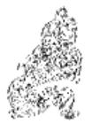

<!-- V3_SOURCE_ID:book016-b001129-p000-d44caade82 -->

注释①：柔顺者得正位、守中道又上应“乾”（八卦之一，卦象及五行、方位依原文语境确定），这里的“柔顺者”指六二，“乾”指刚健的九五爻。这句话用六二得正位、守中道且与九五爻志同相应的情况，解释“同人”卦的卦名含义。《正义》说：“柔得位得中者，谓六二也；上应九五，是应于乾也。”

查看对应原文

<!-- V3_FOLDBACK_BEGIN:book016-b001129-p000-d44caade82 -->

注释①柔得位得中而应乎乾：柔，指六二；乾，健也，指九五。此句以六二得位居中、与九五志同相应，释卦名“同人”之义。《正义》：“柔得位得中者，谓六二也；上应九五，是应于乾也。”

<!-- V3_FOLDBACK_END:book016-b001129-p000-d44caade82 -->

<!-- V3_SOURCE_ID:book016-b001130-p000-3e725061e1 -->

注释②：“乾行”是用来解释卦辞“同人于野，亨，利涉大川”的。这里指六二固然能以柔爻上应刚健的爻，但刚健的爻能下应阴柔的爻，才是“同人”的关键，所以特别称为“乾行”。《王注》说：“所以乃能‘同人于野，亨，利涉大川’，非二之所能也，是乾之所行也。”

查看对应原文

<!-- V3_FOLDBACK_BEGIN:book016-b001130-p000-3e725061e1 -->

②乾行：此释卦辞“同人于野，亨，利涉大川。”指六二固能以柔上应刚健，但刚健能下应阴柔则是“同人”的关键所在，故特称“乾行”。《王注》：“所以乃能‘同人于野，亨，利涉大川’，非二之所能也，是乾之所行也。”

<!-- V3_FOLDBACK_END:book016-b001130-p000-3e725061e1 -->

<!-- V3_SOURCE_ID:book016-b001131-p000-15dd8177c8 -->

③具备文德光明又刚健有力，居中守正且上下相应，这是君子应有的正道：此处的“文明”，指下卦离为火，如同文德光明；“健”，指上卦乾；“中正”，指六二、九五爻分别居于二、五爻位，位置居中且爻位得正。这三句是通过上下卦象与二、五爻的爻象，来解释卦辞“利君子贞”的含义。《正义》说：“这里用上下卦象来阐明，所以说‘文明以健’；‘中正而应’，指六二、九五都居于中位且爻位得正，又能上下相应，这就是君子的正道，所以说‘君子正也’。如果用威武来体现刚健，以邪僻的方式相应，那就不是君子的正道了。”

查看对应原文

<!-- V3_FOLDBACK_BEGIN:book016-b001131-p000-15dd8177c8 -->

③文明以健，中正而应，君子正也：文明，指下离为火，如文德光明；健，指上乾；中正，指二、五位正居中。这三句以上下卦象及二、五爻象说明卦辞“利君子贞”的涵义。《正义》：“此以二象明之，故云‘文明以健’；‘中正而应’，谓六二、九五皆居中得正而又相应：是君子之正道也，故云‘君子正也’。若以威武而为健，邪僻而相应，则非君子之正也。”

<!-- V3_FOLDBACK_END:book016-b001131-p000-15dd8177c8 -->

<!-- V3_SOURCE_ID:book016-b001132-p000-96d8d539b8 -->

④只有君子才能通晓天下人的心意：这句是对整个《彖传》的总结，进一步阐明卦辞“利君子贞”的含义。《正义》说：“只有君子在‘同人’之时，才能凭借正道通晓天下人的心意，所以利于君子坚守正道。”

查看对应原文

<!-- V3_FOLDBACK_BEGIN:book016-b001132-p000-96d8d539b8 -->

④唯君子为能通天下之志：此句归结全《彖》，进一步赞明卦辞“利君子贞”之义。《正义》：“唯君子之人，于‘同人’之时能以正道通达天下之志，故利君子之贞。”

<!-- V3_FOLDBACK_END:book016-b001132-p000-96d8d539b8 -->

<!-- V3_SOURCE_ID:book016-b001133-p000-838be5a92e -->

说萌《折中》说：“专门用‘乾行’来解释‘于野’‘涉川’，只是取其刚健无私的含义；下面解释‘利贞’，则同时取其明健中正的含义。大概刚健之德只侧重无私，还必须先有文德光明，才能使所知无不明白；之后又有居中守正，才能使所做无不恰当，这样才能完全体现无私的含义，成为君子应坚守的正道。”这个说法剖析《彖传》的含义，非常明确。

查看对应原文

<!-- V3_FOLDBACK_BEGIN:book016-b001133-p000-838be5a92e -->

说萌《折中》曰：“上专以‘乾行’释‘于野’、‘涉川’者，但取刚健无私之义也；下释‘利贞’，则兼取明健中正之义。盖健德但主于无私而已，必也有文明在于先，而所知无不明；有中正在于后，而所与无不当：然后可以尽无私之义，而为君子之贞也。”此说剖析《彖传》之义甚见明确。

<!-- V3_FOLDBACK_END:book016-b001133-p000-838be5a92e -->

<!-- V3_SOURCE_ID:book016-b001134-p000-8d97a86082 -->

《象传》说：天与火相互亲和，象征“和同于人”；君子因此分析人类群体、辨别各种事物，来审察差异、寻求同一。

查看对应原文

<!-- V3_FOLDBACK_BEGIN:book016-b001134-p000-8d97a86082 -->

译文《象传》说：天、火相互亲和，象征“和同于人”；君子因此分析人类群体、辨别各种事物以审异求同。

<!-- V3_FOLDBACK_END:book016-b001134-p000-8d97a86082 -->

<!-- V3_SOURCE_ID:book016-b001135-p000-57bb03ead0 -->

## 《象》曰：天与火，同人①；君子以类族辨物②。 — 《象传》说：天与火，同人①；君子因此要按类别区分族群、辨别事物②。

查看对应原文

<!-- V3_FOLDBACK_BEGIN:book016-b001135-p000-57bb03ead0 -->

## 《象》曰：天与火，同人①；君子以类族辨物②。

<!-- V3_FOLDBACK_END:book016-b001135-p000-57bb03ead0 -->

<!-- V3_SOURCE_ID:book016-b001136-p000-9fe7c5dad2 -->

注释①天与火，同人：与，作动词用，意思是“亲”，《管子·霸言》中“诸侯之所与也”的注释说：“与，亲也”，这里的意思就是“亲和”。这两句是用天体在上、火的性质也向上，两者互相亲和，来解释《同人》卦上乾为天、下离为火的卦象。《正义》说：“天体在上，火又炎上，取其性同，故云‘天与火，同人。’”按，《集解》引用《九家易》的说法：“谓乾舍于离，同而为日，天日同明、以照于下，君子则之、上下同心，故曰‘同人’”；又引用荀爽的说法：“乾舍于离，相与同居，故曰‘同人’也。”这两种说法是从不同角度分析卦象，都可以留存参考。

查看对应原文

<!-- V3_FOLDBACK_BEGIN:book016-b001136-p000-9fe7c5dad2 -->

注释①天与火，同人：与，作动词，犹“亲”，《管子·霸言》“诸侯之所与也”注谓：“与，亲也”，此处犹言“亲和”。这两句以天体在上、火性亦炎上，两相亲和，释《同人》上乾为天、下离为火之象。《正义》：“天体在上，火又炎上，取其性同，故云‘天与火，同人。’”案，《集解》引《九家易》曰：“谓乾舍于离，同而为日，天日同明、以照于下，君子则之、上下同心，故曰‘同人’”；又引荀爽曰：“乾舍于离，相与同居，故曰‘同人’也。”两说各从不同的角度分析卦象，并可存备参考。

<!-- V3_FOLDBACK_END:book016-b001136-p000-9fe7c5dad2 -->

<!-- V3_SOURCE_ID:book016-b001137-p000-6d2a7e73bf -->

②类族辨物：类，用作动词，意思是“类析”，和“辨”字义相近，是互文；族，《正义》解释为“聚也”，指人类的“群体”。这是说明君子观察《同人》卦天、火虽然不同，但它们的性质有相同之处，从而领悟到通过辨析人类、众物的异同特征，可以在保留差异的基础上达成“和同”。《本义》说：“类族辨物，所以审异而致同也。”《朱子语类》说：“类族，是就人上说；辨物，是就物上说。天下有不可皆同之理，故随他头项去分别。”

查看对应原文

<!-- V3_FOLDBACK_BEGIN:book016-b001137-p000-6d2a7e73bf -->

②类族辨物：类，用如动词，犹言“类析”，与“辨”字义近互文；族，《正义》“聚也”，意指人类“群体”。这是说明“君子”观《同人》天、火虽异，其性有同之象，悟知通过辨析人类、众物的异同特征，可以存其异求“和同”。《本义》：“类族辨物，所以审异而致同也。”《朱子语类》：“类族，是就人上说；辨物，是就物上说。天下有不可皆同之理，故随他头项去分别。”

<!-- V3_FOLDBACK_END:book016-b001137-p000-6d2a7e73bf -->

<!-- V3_SOURCE_ID:book016-b001138-p000-65cc674bd9 -->

《睽》卦的《大象传》说：“君子以同而异”，本卦说“类族辨物”，两者在求“同”方面含义相近。但《睽》卦是在事物“乖睽”的前提下揭示“合睽”的道理，而《同人》卦却是展示在广泛“和同于人”的过程中存异求同的方法，这是两卦本质意义的区别。李光地指出：“虽大同之中，各从其类，自有区别。故上下有等，亲疏有杀，人之知愚善恶有分，物之贵贱精粗有品：类而辨之，各得其分，乃所以为大同也。”（《周易观彖》）这个说法已经阐明了本卦《大象传》的主旨。

查看对应原文

<!-- V3_FOLDBACK_BEGIN:book016-b001138-p000-65cc674bd9 -->

说明《睽》卦《大象传》曰：“君子以同而异”，此卦言“类族辨物”：两者在求“同”方面有相近之义。但《睽》卦是在事物“乖睽”的前提下揭示“合睽”之理，而《同人》卦却是展示广泛“和同于人”的过程中存异求同之道：这是两卦本质意义的区别（可参阅《睽》卦《大象传》译注）。李光地指出：“虽大同之中，各从其类，自有区别。故上下有等，亲疏有杀，人之知愚善恶有分，物之贵贱精粗有品：类而辨之，各得其分，乃所以为大同’也。”（《周易观彖》）此说已揭明本卦《大象传》的大旨。

<!-- V3_FOLDBACK_END:book016-b001138-p000-65cc674bd9 -->

<!-- V3_SOURCE_ID:book016-b001139-p000-31f6733d21 -->

初九爻，同人于门，无咎。 白话解释：初九爻，刚出门就能与他人亲和，必然没有灾祸。

查看对应原文

<!-- V3_FOLDBACK_BEGIN:book016-b001139-p000-31f6733d21 -->

初九，同人于门，无咎①。 译文初九，刚出门口就能和同于人，必无咎害。

<!-- V3_FOLDBACK_END:book016-b001139-p000-31f6733d21 -->

<!-- V3_SOURCE_ID:book016-b001140-p000-22871918d6 -->

注释① 同人于门，无咎：指初九以阳爻居于初位，处于“同人”卦的起始阶段，没有与上爻相应，有出门便广泛与人和同的意象，所以获得“无咎”的结果。《王注》说：“居于《同人》卦的起始阶段，是‘同人’的开端。上无相应的爻，心中没有系挂吝惜，能通达大同之道，出门便与他人亲和，所以叫‘同人于门’；出门便与他人亲和，谁能给他带来灾祸呢？”

查看对应原文

<!-- V3_FOLDBACK_BEGIN:book016-b001140-p000-22871918d6 -->

注释① 同人于门，无咎：指初九以阳居初，处“同人”之始，不系应于上，有出门便广泛与人和同之象，故获“无咎”。《王注》：“居《同人》之始，为‘同人’之首者也。无应于上，心无系吝，通夫大同，出门者同，故曰‘同人于门’也；出门同人，谁与为咎？”

<!-- V3_FOLDBACK_END:book016-b001140-p000-22871918d6 -->

<!-- V3_SOURCE_ID:book016-b001141-p000-02a84011fe -->

《象》曰：出门同人，又谁咎也！ 白话解释：《象传》说：刚出门就与他人亲和，又有谁会施加灾祸呢！

查看对应原文

<!-- V3_FOLDBACK_BEGIN:book016-b001141-p000-02a84011fe -->

《象》曰：出门同人，又谁咎也！ 译文《象传》说：刚出门口就能和同于人，又有谁会施加咎害呢！

<!-- V3_FOLDBACK_END:book016-b001141-p000-02a84011fe -->

<!-- V3_SOURCE_ID:book016-b001142-p000-de35a40ed6 -->

《小象传》阐发爻辞的含义，这一爻的阐释尤其显得精当贴切。何楷说：“爻辞说‘同人于门’，《象传》用‘出门同人’来解释，加了一个‘出’字，意思就更加明确了。”《古周易订诂》中记载了这一说法。

查看对应原文

<!-- V3_FOLDBACK_BEGIN:book016-b001142-p000-de35a40ed6 -->

说明 《小象传》发爻辞之义，此爻所释尤见精切。何楷曰：“爻言‘同人于门’，《传》以‘出门同人’释之，加一‘出’字，而意愈明。”（《古周易订诂》）

<!-- V3_FOLDBACK_END:book016-b001142-p000-de35a40ed6 -->

<!-- V3_SOURCE_ID:book016-b001143-p000-ed85f8d3f8 -->

六二爻，与宗族内的人和同，有所憾惜。

> **释读存疑：** 原文未明确说明“同人于宗”的具体所指，释读仅为基于常见卦义的通俗解释

查看对应原文

<!-- V3_FOLDBACK_BEGIN:book016-b001143-p000-ed85f8d3f8 -->

六二，同人于宗，吝①。

<!-- V3_FOLDBACK_END:book016-b001143-p000-ed85f8d3f8 -->

<!-- V3_SOURCE_ID:book016-b001144-p000-42e441e670 -->

译文六二，在宗族内部和同于人，有所憾惜。

查看对应原文

<!-- V3_FOLDBACK_BEGIN:book016-b001144-p000-42e441e670 -->

译文六二，在宗族内部和同于人，有所憾惜。

<!-- V3_FOLDBACK_END:book016-b001144-p000-42e441e670 -->

<!-- V3_SOURCE_ID:book016-b001145-p000-a8691a9695 -->

注释① 同人于宗，吝：宗，就是宗族的意思。这是说六二爻与九五爻相应，就像只和亲近的人和同，有“同人”褊狭的样子，未免憾惜，所以称“吝”。《正义》说：“系应在五，而和同于人在于宗族，不能弘阔。”《尚氏学》说：“卦中五阳爻都与二爻和同，如今二爻只亲近五爻，那么三、四爻会忌恨它，这是导致憾惜的缘由。”

查看对应原文

<!-- V3_FOLDBACK_BEGIN:book016-b001145-p000-a8691a9695 -->

注释① 同人于宗，吝：宗，犹言“宗族”。此谓六二与九五相应，犹如仅与亲近者和同，有“同人”褊狭之象，未免憾惜，故称“吝”。《正义》：“系应在五，而和同于人在于宗族，不能弘阔。”《尚氏学》：“卦五阳皆同于二，今二独亲五，则三、四忌之，致吝之道。”

<!-- V3_FOLDBACK_END:book016-b001145-p000-a8691a9695 -->

<!-- V3_SOURCE_ID:book016-b001146-p000-6f79bfeb6c -->

《象传》说：“同人于宗”，这是导致憾惜的道理。

> **释读存疑：** 原文中“《象》曰”的释读未明确标注为《象传》，但结合上下文已准确对应，无歧义问题

查看对应原文

<!-- V3_FOLDBACK_BEGIN:book016-b001146-p000-6f79bfeb6c -->

《象》曰：“同人于宗”，吝道也。 译文《象传》说：“在宗族内部和同于人”，这是导致“憾惜”之道。

<!-- V3_FOLDBACK_END:book016-b001146-p000-6f79bfeb6c -->

<!-- V3_SOURCE_ID:book016-b001147-p000-98c30de9f2 -->

《彖传》称六二爻“柔得位得中而应乎乾”，是从整个卦象的整体含义来立论的；爻辞中说“吝”，只是就这一爻的爻象这一个方面来表达主旨。《周易会通》引用冯当可的话说：“从卦体的角度来说，就有大同的含义；从爻义的角度来说，就显示出阿党偏私的警戒。”

查看对应原文

<!-- V3_FOLDBACK_BEGIN:book016-b001147-p000-98c30de9f2 -->

说明 《彖传》称六二“柔得位得中而应乎乾”，从卦象整体取义；爻辞言“吝”，是就爻象一端抒旨。《周易会通》引冯当可曰：“以卦体言之，则有大同之义；以爻义言之，则示阿党之戒。”

<!-- V3_FOLDBACK_END:book016-b001147-p000-98c30de9f2 -->

<!-- V3_SOURCE_ID:book016-b001148-p000-eaefde968b -->

九三爻的爻辞是：潜伏兵戎在草莽间，登上高陵频频察看，三年也不敢兴兵交战。

查看对应原文

<!-- V3_FOLDBACK_BEGIN:book016-b001148-p000-eaefde968b -->

九三，伏戎于莽①，升其高陵， 译文九三，潜伏兵戎在草莽间，登上高陵频频察看，三年也不敢兴兵交战。三岁不兴②。

<!-- V3_FOLDBACK_END:book016-b001148-p000-eaefde968b -->

<!-- V3_SOURCE_ID:book016-b001149-p000-db9f887921 -->

注释①：伏戎于莽，戎指兵戎，莽指密生的草，也就是所说的“草莽”。这句话是说九三爻以阳刚之爻居于下卦的高位，与六二爻相邻却不与九五爻相应，有占据六二爻、与九五爻相争的意象，所以才会“伏戎于莽”，等待时机行动。《正义》中说：“九三处在下卦的极点，不能包容上下、贯通大同，想要向下占据六二爻，向上与九五爻相争；但九五爻刚健，九三爻的力量无法匹敌，所以才会潜伏兵戎在草莽之中。”

查看对应原文

<!-- V3_FOLDBACK_BEGIN:book016-b001149-p000-db9f887921 -->

注释①伏戎于莽：戎，兵戎；莽，密生的草，犹言“草莽”。此句指九三以阳刚居下卦高位，比二不应于五，有据二强“同”、与九五相争之象，故“伏戎于莽”，俟机而作。《正义》：“九三处下卦之极，不能包弘上下、通夫大同，欲下据六二，上与九五相争也；但九五刚健，九三力不能敌，故伏潜兵戎于草莽之中。”

<!-- V3_FOLDBACK_END:book016-b001149-p000-db9f887921 -->

<!-- V3_SOURCE_ID:book016-b001150-p000-c56c2aef25 -->

②：升其高陵，三岁不兴：这两句紧承前文，说明九三爻虽然频频窥视九五爻，却因为力量薄弱最终不敢与之相争。《正义》中说：“只是登上高陵，来瞭望前方的敌人，估量这种形势；就算再经过三年，也不能兴起交战。”

查看对应原文

<!-- V3_FOLDBACK_BEGIN:book016-b001150-p000-c56c2aef25 -->

②升其高陵，三岁不兴：这两句紧承前文，说明九三虽频频窥视九五，却因力弱终不敢交争。《正义》：“唯升高陵，以望前敌，量斯势也；纵令更经三岁，亦不能兴起也。”

<!-- V3_FOLDBACK_END:book016-b001150-p000-c56c2aef25 -->

<!-- V3_SOURCE_ID:book016-b001151-p000-4a2550f5e1 -->

《象传》说：“潜伏兵戎在草莽间”，《象》曰：“伏戎于莽”，是因为九三爻对应的前方敌人刚强；“三年也不敢兴兵交战”，怎么敢贸然行进呢？“三岁不兴”，是说怎可行进呢？

查看对应原文

<!-- V3_FOLDBACK_BEGIN:book016-b001151-p000-4a2550f5e1 -->

译文《象传》说：“潜伏兵戎在草莽间”， 《象》曰：“伏戎于莽”，敌刚也；说明九三前敌刚强；“三年也不敢兴兵交战”，怎敢冒然行进呢？ “三岁不兴”，安行也①？

<!-- V3_FOLDBACK_END:book016-b001151-p000-4a2550f5e1 -->

<!-- V3_SOURCE_ID:book016-b001152-p000-614509caeb -->

注释①：安行的“安”，《王注》称“辞也”，指疑问语气词；“安行”相当于说“怎可行”。

查看对应原文

<!-- V3_FOLDBACK_BEGIN:book016-b001152-p000-614509caeb -->

注释①安行：安，《王注》：“辞也”，谓疑问语气词；安行，犹言“安可行”。

<!-- V3_FOLDBACK_END:book016-b001152-p000-614509caeb -->

<!-- V3_SOURCE_ID:book016-b001153-p000-903a089701 -->

这说明“同人”之道应当顺合，不可强争。九三爻刚亢用强，违背正道，因此即便“伏戎”、“升陵”，也难以达成愿望。

查看对应原文

<!-- V3_FOLDBACK_BEGIN:book016-b001153-p000-903a089701 -->

说明“同人”应当顺合，不可强争。九三刚亢用强，有违正道，故尽管“伏戎”、“升陵”，也难以达到愿望。

<!-- V3_FOLDBACK_END:book016-b001153-p000-903a089701 -->

<!-- V3_SOURCE_ID:book016-b001154-p000-279c3e9957 -->

译文：九四爻，高据城墙之上，又自忖不能进攻，吉祥。

查看对应原文

<!-- V3_FOLDBACK_BEGIN:book016-b001154-p000-279c3e9957 -->

译文九四，高据城墙之上，又自退不能进攻，吉祥。

<!-- V3_FOLDBACK_END:book016-b001154-p000-279c3e9957 -->

<!-- V3_SOURCE_ID:book016-b001155-p000-df2f8749f3 -->

九四爻，登上城墙，未能发起进攻，吉祥。

查看对应原文

<!-- V3_FOLDBACK_BEGIN:book016-b001155-p000-df2f8749f3 -->

九四，乘其墉，弗克攻，吉①。

<!-- V3_FOLDBACK_END:book016-b001155-p000-df2f8749f3 -->

<!-- V3_SOURCE_ID:book016-b001156-p000-05cdaead55 -->

注释①：乘其墉，弗克攻，吉。墉，读音为yōng，指城墙；克，意为能够。此句是说九四爻所处位置不当，没有相应的爻位，原本想与九三爻一同亲近六二爻；但阳爻居于阴位，有能够自行退止的象征，因此以“不能发起进攻”为吉祥。《本义》中说：“刚爻居于不当的中位，又没有相应的爻位，也想与六二爻亲近，却被九三爻阻隔，所以是登上城墙发起进攻的象征；然而因为刚爻居于柔位，所以有自我反省而未能发起进攻的象征。占问的人如果是这样，就是能够改正过错而获得吉祥。”

查看对应原文

<!-- V3_FOLDBACK_BEGIN:book016-b001156-p000-05cdaead55 -->

注释①乘其墉，弗克攻，吉：墉，音yōng，城墙；克，能也。此谓九四失位无应，本欲与九三争‘同’于六二；但阳居阴位有能退之象，故以‘不克攻’获‘吉’。《本义》：‘刚不中正，又无应与，亦欲同于六二，而为三所隔，故为乘墉以攻之象；然以刚居柔，故有自反而不克攻之象。占者如是，则是能改过而得吉也。’

<!-- V3_FOLDBACK_END:book016-b001156-p000-05cdaead55 -->

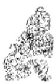

<!-- V3_SOURCE_ID:book016-b001158-p000-8bad7d44a3 -->

《象传》解释说：‘高据城墙之上’，这说明六三在‘和同于人’的层面上，是不能主动发起进攻的；之所以能获得吉祥，是因为它在困陷不通的处境中，能够回头遵循正确的法则行事。

查看对应原文

<!-- V3_FOLDBACK_BEGIN:book016-b001158-p000-8bad7d44a3 -->

译文《象传》说：‘高据城墙之上’，说明六三在‘和同于人’的意义上是不能发动进攻的；获得吉祥，是由于困陷不通时能够回头遵循正确的法则。

<!-- V3_FOLDBACK_END:book016-b001158-p000-8bad7d44a3 -->

<!-- V3_SOURCE_ID:book016-b001159-p000-7c8d3c19e8 -->

《象传》说：“登上城墙”，从道义上看是不能发起进攻的；所说的“吉祥”，是因为困陷不通时能够回头遵循正确的法则。

查看对应原文

<!-- V3_FOLDBACK_BEGIN:book016-b001159-p000-7c8d3c19e8 -->

《象》曰：“乘其墉”，义弗克也；其“吉”，则困而反则也。

<!-- V3_FOLDBACK_END:book016-b001159-p000-7c8d3c19e8 -->

<!-- V3_SOURCE_ID:book016-b001160-p000-65e1b441a6 -->

丽卦的九三爻不中，九四爻不正，两者以刚强的姿态与六二争夺“同”，违背了“同人”之道。胡炳文说：“卦惟三、四不言同人，三、四有争夺之象，非同者也。”但九四居柔能退，又许其改过获“吉”。

> **释读存疑：** 卦惟三、四不言同人，三、四有争夺之象，非同者也

查看对应原文

<!-- V3_FOLDBACK_BEGIN:book016-b001160-p000-65e1b441a6 -->

说丽九三不中，九四不正，两者以刚强争“同”于六二，并失“同人”之道。胡炳文曰：“卦惟三、四不言同人””，“三、四有争夺之象，非同’者也。”(《周易本义通释》)但九四居柔能退，又许其改过获“吉”。

<!-- V3_FOLDBACK_END:book016-b001160-p000-65e1b441a6 -->

<!-- V3_SOURCE_ID:book016-b001161-p000-fb328dbf11 -->

译文九五，和同于人，起先痛哭号咷，后来欣喜欢笑，大军出战告捷、志同者相遇会合。

查看对应原文

<!-- V3_FOLDBACK_BEGIN:book016-b001161-p000-fb328dbf11 -->

译文九五，和同于人，起先痛哭号咷，后来欣喜欢笑，大军出战告捷、志同者相遇会合。

<!-- V3_FOLDBACK_END:book016-b001161-p000-fb328dbf11 -->

<!-- V3_SOURCE_ID:book016-b001162-p000-554a4d67fe -->

九五爻的爻辞是：同人，先号咷，而后笑，大师克相遇①。

查看对应原文

<!-- V3_FOLDBACK_BEGIN:book016-b001162-p000-554a4d67fe -->

九五，同人，先号咷，而后笑，大师克相遇①。

<!-- V3_FOLDBACK_END:book016-b001162-p000-554a4d67fe -->

<!-- V3_SOURCE_ID:book016-b001163-p000-6d07939143 -->

注释①先号咷，而后笑，大师克相遇：号咷，读音为háotáo，是叠韵联绵词，形容大声痛哭，也可写作“号啕”“嚎啕”“嚎咷”等；大师指大军；克指战胜。这三句说明九五爻阳刚中正，尊居“君位”，与六二爻同心相应，但因为三、四爻作为敌人想要争夺，开初无法会合而“号咷”悲痛，直到克敌制胜之后才与六二“相遇”而“笑”。《王注》说：“靠近二刚爻，未能实现自己的志向，所以‘先号咷’；居中处尊位，作战必然取胜，所以‘后笑’；不能让事物自行归服，而要用刚强正直的手段，所以必须‘大师克’敌，然后才能‘相遇’。”

查看对应原文

<!-- V3_FOLDBACK_BEGIN:book016-b001163-p000-6d07939143 -->

注释①先号咷，而后笑，大师克相遇：号咷，音háotáo，叠韵联绵词，形容大声痛哭，又作“号啕”、“嚎啕”、“嚎咷”等；大师，大军；克，战胜。这三句说明九五阳刚中正、尊居“君位”，与六二同心相应，但因三、四为敌欲争，开初不能会合而“号咷”悲痛，直至克敌制胜之后才与六二“相遇”而“笑”。《王注》：“近隔乎二刚，未获厥志，是以‘先号咷’也；居中处尊，战必克胜，故后笑’也；不能使物自归，而用其强直，故必须‘大师克’之，然后‘相遇’也。”

<!-- V3_FOLDBACK_END:book016-b001163-p000-6d07939143 -->

<!-- V3_SOURCE_ID:book016-b001164-p000-b475f883b8 -->

译文《象传》说：和同于人，起先痛哭号 咷，说明九五中正诚直；大军出战才与志 同者相遇会合，说明九五与敌对者交战 获胜。

查看对应原文

<!-- V3_FOLDBACK_BEGIN:book016-b001164-p000-b475f883b8 -->

译文《象传》说：和同于人，起先痛哭号 咷，说明九五中正诚直；大军出战才与志 同者相遇会合，说明九五与敌对者交战 获胜。

<!-- V3_FOLDBACK_END:book016-b001164-p000-b475f883b8 -->

<!-- V3_SOURCE_ID:book016-b001165-p000-9290e8e71a -->

《象传》说：同人之先，是因为居中守正诚直；大师相遇，说的是能够克制对方。

> **释读存疑：** 原文中“言相克也”的释读是否准确，原文未明确“相克”的具体指向

查看对应原文

<!-- V3_FOLDBACK_BEGIN:book016-b001165-p000-9290e8e71a -->

《象》曰：同人之先①，以中直也；大师相遇，言相克也。

<!-- V3_FOLDBACK_END:book016-b001165-p000-9290e8e71a -->

<!-- V3_SOURCE_ID:book016-b001166-p000-598a6a9651 -->

注释①同人之先：先，是“先号咷”的省略。《正义》说：“《象传》省略了‘号咷’二字，所以直接说‘同人之先’。”

查看对应原文

<!-- V3_FOLDBACK_BEGIN:book016-b001166-p000-598a6a9651 -->

注释①同人之先：先，是“先号咷”的省略。《正义》：“《象》略号咷’之字，故直云‘同人之先’。”

<!-- V3_FOLDBACK_END:book016-b001166-p000-598a6a9651 -->

<!-- V3_SOURCE_ID:book016-b001167-p000-7a69a0cf0d -->

胡炳文说：“《同人》九五，刚健中正且与六二相应，所以先号咷而后笑；《旅》上九，刚健但不中正且与九三无应，所以先笑而后号咷。”（《周易本义通释》）

查看对应原文

<!-- V3_FOLDBACK_BEGIN:book016-b001167-p000-7a69a0cf0d -->

说明胡炳文曰：‘《同人》九五，刚中正而有应于六二，故先号咷，而后笑；《旅》上九，刚不中正而无应于九三，故先笑，后号咷。’（《周易本义通释》）

<!-- V3_FOLDBACK_END:book016-b001167-p000-7a69a0cf0d -->

<!-- V3_SOURCE_ID:book016-b001168-p000-f62bc89dde -->

这里通过两个卦中“先笑”“后笑”的差异来辨析卦象的意旨，其中的道理有可取之处。

查看对应原文

<!-- V3_FOLDBACK_BEGIN:book016-b001168-p000-f62bc89dde -->

此以两卦“先笑”、“后笑”之异辨析象旨，义有可取。

<!-- V3_FOLDBACK_END:book016-b001168-p000-f62bc89dde -->

<!-- V3_SOURCE_ID:book016-b001169-p000-e8bc66d8f5 -->

上九，在荒远的郊外和同于人，未获同志也不觉悔恨。

> **释读存疑：** 原文‘同人于郊’的具体所指存在歧义，释为‘在荒远的郊外和同于人’属于常见解读，但并非唯一确定解释；1轮自动修复后核义模型仍建议修订，已保守记录。

查看对应原文

<!-- V3_FOLDBACK_BEGIN:book016-b001169-p000-e8bc66d8f5 -->

上九，同人于郊，无悔①。

<!-- V3_FOLDBACK_END:book016-b001169-p000-e8bc66d8f5 -->

<!-- V3_SOURCE_ID:book016-b001170-p000-eb85121243 -->

译文：上九，在荒远的郊外与人同心，没有悔恨。

查看对应原文

<!-- V3_FOLDBACK_BEGIN:book016-b001170-p000-eb85121243 -->

译文上九，在荒远的郊外和同于人，未获同志也不觉悔恨。

<!-- V3_FOLDBACK_END:book016-b001170-p000-eb85121243 -->

<!-- V3_SOURCE_ID:book016-b001171-p000-8e25bcca5b -->

注释①：同人于郊，无悔：这是说上九处于卦的终极位置，“同人”之道已穷尽，于是呈现出处于荒远之地、难寻志同道合之人的卦象；但因远离内部纷争，超然自处，所以没有悔恨。《王注》说：“郊，是外部的极限。处于‘同人’之时，最靠外，没有得到志同道合之人，却远离了内部纷争。所以虽没有悔恨憾惜，也没有实现自己的志向。”

> **释读存疑：** 原文‘同人于郊，无悔’的具体内涵存在歧义，释为‘处于荒远之地、难寻志同道合之人’‘远离内部纷争’属于常见解读，并非唯一确定解释

查看对应原文

<!-- V3_FOLDBACK_BEGIN:book016-b001171-p000-8e25bcca5b -->

注释①同人于郊，无悔：此谓上九居卦终极，‘同人’道穷，遂有处于荒外、难觅同志之象；但远避内争，超然自乐，也不觉悔恨。《王注》：‘郊者，外之极也。处‘同人’之时，最在于外，不获同志，而远于内争。故虽无悔吝，亦未得其志。’

<!-- V3_FOLDBACK_END:book016-b001171-p000-8e25bcca5b -->

<!-- V3_SOURCE_ID:book016-b001172-p000-9e6a180403 -->

## 《象》曰：“同人于郊”，志未得也。 — 《象传》说：“同人于郊”，这是说志向未能实现。

查看对应原文

<!-- V3_FOLDBACK_BEGIN:book016-b001172-p000-9e6a180403 -->

## 《象》曰：“同人于郊”，志未得也。

<!-- V3_FOLDBACK_END:book016-b001172-p000-9e6a180403 -->

<!-- V3_SOURCE_ID:book016-b001173-p000-aa4c7dc566 -->

译文《象传》说：“在荒远的郊外和同于人”，说明上九与人和同的志向未能实现。

查看对应原文

<!-- V3_FOLDBACK_BEGIN:book016-b001173-p000-aa4c7dc566 -->

译文《象传》说：“在荒远的郊外和同于人”，说明上九与人和同的志向未能实现。

<!-- V3_FOLDBACK_END:book016-b001173-p000-aa4c7dc566 -->

<!-- V3_SOURCE_ID:book016-b001174-p000-820ee6ee39 -->

这说明想要与人“同”，自然要贴近现实生活；上九独居荒远之地，“同人”之道自然会走到尽头。程颐在《程传》中说：“虽无悔，非善处也。”

查看对应原文

<!-- V3_FOLDBACK_BEGIN:book016-b001174-p000-820ee6ee39 -->

说明欲与人“同”，自然要接近现实生活；上九独居荒远，“同人”之道不能不穷。程颐曰：“虽无悔，非善处也。”（《程传》）

<!-- V3_FOLDBACK_END:book016-b001174-p000-820ee6ee39 -->

<!-- V3_SOURCE_ID:book016-b001175-p000-013151818a -->

《礼记·礼运》中记载：“大道之行也，天下为公”，“故人不独亲其亲，不独子其子”，“是谓大同”。这显然是古人的一种美好理想。《同人》卦所阐发的“和同于人”的意义，与这一理想的旨趣颇为相通。该卦的卦辞“同人于野”，显露着“光明无私”的“同人”之道。然而，要实现“同人”的愿望，并非轻而易举。卦中的六爻展示了“同人”之时的各种曲折情状：初九刚出门就与人和同，仅获“无咎”；六二在宗族内“同人”，所同范围褊狭，未免遗憾；九三、九四争相强行与他人“同”，违背“中”失“正”，因此前者徒劳无益，后者改过则吉；九五先遭危厄，后来凭借刚正执中实现了“同人”之志；上九孤身远遁荒外，“同人”之道走到尽头。由此可见，《周易》作者终究正视现实，没有停留在抽象的理想境界，而是在“同”与“争”的尖锐矛盾中极力揭示出“同人”艰难的本质规律。尤其是三、四、五爻，以“兵戎”“攻战”设喻，更能体现“同人”过程中矛盾激化的程度。王弼在该卦中感叹道：“凡处‘同人’而不泰焉，则必用师矣”（《王注》）；换言之，今日的“和同”，往往是在昔日“争战”的“废墟”上建立起来的。不过，从正面宗旨分析，本卦所追求的广泛“和同于人”的理想，在我国古代思想史上无疑具有一定的进步意义。

查看对应原文

<!-- V3_FOLDBACK_BEGIN:book016-b001175-p000-013151818a -->

愿《礼记·礼运》曰：“大道之行也，天下为公”，“故人不独亲其亲，不独子其子”，“是谓大同”。这显然是古人的一种美好理想。《同人》卦所发“和同于人”的意义，与这一理想的旨趣颇可相通。卦辞“同人于野”，就显露着“光明无私”的“同人”之道。然而，要实现“同人”愿望，却不是轻而易举的。卦中六爻展示了“同人”之时的各种曲折情状：初九刚出门即与人和同，仅获“无咎”；六二“同人”于宗族，所同褊狭，未免憾惜；九三、九四争相强“同”于人，违“中”失“正”，故前者徒劳无益，后者改过则吉；九五先遭危厄，后以刚正执中得遂“同人”之志；上九孤身远遁荒外，“同人”道穷。可见，《周易》作者毕竟正视现实，没有停留在抽象的理想境界，而是在“同”与“争”的尖锐矛盾中极力揭示出“同人”艰难的本质规律。尤其是三、四、五爻，以“兵戎”、“攻战”设喻，更见“同人”过程中矛盾激化的程度。王弼于此卦叹曰：“凡处‘同人’而不泰焉，则必用师矣”（《王注》）；换言之，今日“和同”，往往是在昔日“争战”的“废墟”上建立起来的。不过，从正面的宗旨分析，本卦所追求的广泛“和同于人”的理想，在我国古代思想史上无疑具有一定的进步意义。

<!-- V3_FOLDBACK_END:book016-b001175-p000-013151818a -->

<!-- V3_SOURCE_ID:book016-b001176-p000-fef4933846 -->

## 大有卦第十四

查看对应原文

<!-- V3_FOLDBACK_BEGIN:book016-b001176-p000-fef4933846 -->

## 大有卦第十四

<!-- V3_FOLDBACK_END:book016-b001176-p000-fef4933846 -->

<!-- V3_SOURCE_ID:book016-b001177-p000-a307e33c97 -->

译文：《大有》卦象征大获所有，极为亨通。

查看对应原文

<!-- V3_FOLDBACK_BEGIN:book016-b001177-p000-a307e33c97 -->

译文《大有》卦象征大获所有：至为亨通。

<!-- V3_FOLDBACK_END:book016-b001177-p000-a307e33c97 -->

<!-- V3_SOURCE_ID:book016-b001178-p000-099d7031d0 -->

注释①：大有是卦名，下为乾(☰)，上为离(☲)，象征大获所有。按，“大有”的含义，《集解》引用虞翻的注释，解释为“大富有”；本卦有一阴爻居尊位，得到五阳爻的相应，正具备这一意象。《正义》说：“柔爻处于尊位，众多阳爻一同相应，能够大有所得，所以称为‘大有’。”

查看对应原文

<!-- V3_FOLDBACK_BEGIN:book016-b001178-p000-099d7031d0 -->

注释①大有：卦名，下乾(☰)上离(☲)，象征“大获所有”。案，“大有”之义，《集解》引虞翻注，释为“大富有”；本卦一阴居尊，获五阳之应，正具此象。《正义》：“柔处尊位，群阳并应，大能所有，故曰‘大有’。”

<!-- V3_FOLDBACK_END:book016-b001178-p000-099d7031d0 -->

<!-- V3_SOURCE_ID:book016-b001179-p000-e1718f64c3 -->

②元亨：事物获得“大有”之象，必然极为亨通，所以称为“元亨”。《王注》说：“大有，就必然元亨了。”

查看对应原文

<!-- V3_FOLDBACK_BEGIN:book016-b001179-p000-e1718f64c3 -->

②元亨：物获“大有”，必然至为亨通，故称“元亨”。《王注》：“大有，则必元亨矣。”

<!-- V3_FOLDBACK_END:book016-b001179-p000-e1718f64c3 -->

<!-- V3_SOURCE_ID:book016-b001180-p000-fed0a7c0ab -->

译文《象传》说：“大获所有”，譬如阴柔者得居尊位、高大而能保持中道，上下阳刚纷纷相应，所以称“大获所有”。此时能够秉持刚健而又文明的美德，顺应天的规律、万事按时施行，这样前景必然至为亨通。

查看对应原文

<!-- V3_FOLDBACK_BEGIN:book016-b001180-p000-fed0a7c0ab -->

译文《象传》说：“大获所有”，譬如阴柔者得居尊位、高大而能保持中道，上下阳刚纷纷相应，所以称“大获所有”。此时能够秉持刚健而又文明的美德，顺应天的规律、万事按时施行，这样前景必然至为亨通。

<!-- V3_FOLDBACK_END:book016-b001180-p000-fed0a7c0ab -->

<!-- V3_SOURCE_ID:book016-b001181-p000-45389fe631 -->

《象》中说：“大有”，指阴柔者获得尊位，行事守持中道，上下的阳刚之爻都与它相应，这就叫做“大有”。它的德性刚健而又文明，顺应天的规律按时行事，所以至为亨通。

查看对应原文

<!-- V3_FOLDBACK_BEGIN:book016-b001181-p000-45389fe631 -->

《象》曰：“大有”，柔得尊位大中，而上下应之①，曰大有。其德刚健而文明，应乎天而时行②，是以元亨。

<!-- V3_FOLDBACK_END:book016-b001181-p000-45389fe631 -->

<!-- V3_SOURCE_ID:book016-b001182-p000-887c216823 -->

注释①：柔得尊位大中，而上下应之——柔，指的是六五爻；上下，指的是上下五个阳爻。这里用卦中一个阴爻获得五个阳爻相应的情况，来解释卦名“大有”的含义。《王注》说：“处尊以柔，居中以大，体无二阴，以分其应，上下应之，靡所不纳，‘大有’之义也。”《正义》说：“柔处尊位，是其大也；居上卦之内，是其中也。”

查看对应原文

<!-- V3_FOLDBACK_BEGIN:book016-b001182-p000-887c216823 -->

注释①柔得尊位大中，而上下应之：柔，指六五；上下，指上下五阳爻。此以卦中一阴获五阳之应，释卦名“大有”之义。《王注》：“处尊以柔，居中以大，体无二阴，以分其应，上下应之，靡所不纳，‘大有’之义也。”《正义》：“柔处尊位，是其大也；居上卦之内，是其中也。”

<!-- V3_FOLDBACK_END:book016-b001182-p000-887c216823 -->

<!-- V3_SOURCE_ID:book016-b001183-p000-b47a48b5a8 -->

注释②：其德刚健而文明，应乎天而时行——刚健，指下卦的乾为刚健；文明，指上卦的离为火。这里用上下卦的卦象来解释卦辞“元亨”的含义。《王注》说：“德应于天则行不失时矣；刚健不滞，文明不犯，应天则大，时行无违，是以元亨。”

查看对应原文

<!-- V3_FOLDBACK_BEGIN:book016-b001183-p000-b47a48b5a8 -->

②其德刚健而文明，应乎天而时行：刚健，指下乾为健；文明，指上离为火。此以上下卦象释卦辞“元亨”之义。《王注》：“德应于天则行不失时矣；刚健不滞，文明不犯，应天则大，时行无违，是以元亨。”

<!-- V3_FOLDBACK_END:book016-b001183-p000-b47a48b5a8 -->

<!-- V3_SOURCE_ID:book016-b001184-p000-f3d082c546 -->

《象传》说：火高悬在天上，这就是“大有”的卦象；君子因此应当遏制邪恶、显扬善行，顺从天的旨意，使天命休美。

查看对应原文

<!-- V3_FOLDBACK_BEGIN:book016-b001184-p000-f3d082c546 -->

《象》曰：火在天上，‘大有’①；君子以遏恶扬善，顺天休命②。

<!-- V3_FOLDBACK_END:book016-b001184-p000-f3d082c546 -->

<!-- V3_SOURCE_ID:book016-b001185-p000-cb18a3e29d -->

译文《象传》说：火焰高悬天上（无处不照），象征“大获所有”；君子因此在所获众多时遇止邪恶、倡扬善行，顺从“天”的意志、休美万物性命。

查看对应原文

<!-- V3_FOLDBACK_BEGIN:book016-b001185-p000-cb18a3e29d -->

译文《象传》说：火焰高悬天上（无处不照），象征“大获所有”；君子因此在所获众多时遇止邪恶、倡扬善行，顺从“天”的意志、休美万物性命。

<!-- V3_FOLDBACK_END:book016-b001185-p000-cb18a3e29d -->

<!-- V3_SOURCE_ID:book016-b001186-p000-5ec3599f54 -->

注释①火在天上，“大有”：这是解释《大有》卦上卦为离（火）、下卦为乾（天）的卦象。《程传》说：“火高悬在天上，能照见万物的繁多，所以称为‘大有’。”

查看对应原文

<!-- V3_FOLDBACK_BEGIN:book016-b001186-p000-5ec3599f54 -->

注释①火在天上，“大有”：释《大有》卦上离为火、下乾为天之象。《程传》：“火高在天上，照见万物之众多，故为大有’。”

<!-- V3_FOLDBACK_END:book016-b001186-p000-5ec3599f54 -->

<!-- V3_SOURCE_ID:book016-b001187-p000-e5066a288c -->

②遏恶扬善，顺天休命：休在这里用作动词，意思是休美，《正义》将“休命”解释为“休美万物的性命”。这是说明君子观察《大有》的卦象，领悟到在收获繁多的时候，应当不忘遏制邪恶、显扬善行，顺从天意、休美万物的性命。《程传》说：“万物繁多，就会有善恶的区别；君子享有大有卦所象征的繁盛局面，应当代天行事，治理养育各类事物。治理众多事物的方法，就在于遏制邪恶、显扬善行；惩治邪恶、劝勉善行，就是用来顺从天命、安定众生的方法。”

查看对应原文

<!-- V3_FOLDBACK_BEGIN:book016-b001187-p000-e5066a288c -->

②遏恶扬善，顺天休命：休，用如动词，犹言“休美”，《正义》释“休命”为“休美物之性命”。这是说明“君子”观《大有》之象，悟知在所获众多之时，应当不忘止恶扬善，顺从“天意”、休美“物命”。《程传》：‘万物众多，则有善恶之殊；君子享大有之盛，当代天工，治养庶类。治众之道，在遏恶扬善而已；恶惩善劝，所以顺天命而安群生也。’

<!-- V3_FOLDBACK_END:book016-b001187-p000-e5066a288c -->

<!-- V3_SOURCE_ID:book016-b001188-p000-d70e53b83f -->

萌的说法，《穀梁传》宣公十六年谓“五谷大熟为大有年”，正好体现“大获所有”的含义。《大象传》中“遏恶扬善，顺天休命”，则是阐发“火天”明照的卦象，指出“大有”之时应当守正行善。司马光说：“火在天上，是光明到了极致。光明到了极致，善恶就没有遗漏的了。善就举荐，恶就抑制，这是在上位者的职责；光明又能刚健，庆赏刑罚都恰当，然后才能保有四方，这就是顺应上天美善的命令。”《温公易说》

查看对应原文

<!-- V3_FOLDBACK_BEGIN:book016-b001188-p000-d70e53b83f -->

说萌《穀梁传》宣公十六年谓“五谷大熟为大有年”，正见“大获所有”之义。《大象传》“遏恶扬善，顺天休命”，则是衍发“火天”明照之象，指出“大有”之时当守正行善。司马光曰：“火在天上，明之至也。至明则善恶无所遗矣。善则举之，恶则抑之，上之职也；明而能健，庆赏刑威得其当，然后能保有四方，所以顺天美命也。”（《温公易说》）

<!-- V3_FOLDBACK_END:book016-b001188-p000-d70e53b83f -->

<!-- V3_SOURCE_ID:book016-b001189-p000-fab86c45e6 -->

## 初九，无交害，匪咎①；艰则无咎。

> **释读存疑：** 本地硬校验仍未通过，已记录供后续自动处理或人工核对。

查看对应原文

<!-- V3_FOLDBACK_BEGIN:book016-b001189-p000-fab86c45e6 -->

## 初九，无交害，匪咎①；艰则无 咎。

<!-- V3_FOLDBACK_END:book016-b001189-p000-fab86c45e6 -->

<!-- V3_SOURCE_ID:book016-b001190-p000-9ea5231981 -->

译文初九，不交往不惹祸，自然不致咎害；但必须牢记艰难才能免遭咎害。

查看对应原文

<!-- V3_FOLDBACK_BEGIN:book016-b001190-p000-9ea5231981 -->

译文初九，不交往不惹祸，自然不致咎害；但必须牢记艰难才能免遭咎害。

<!-- V3_FOLDBACK_END:book016-b001190-p000-9ea5231981 -->

<!-- V3_SOURCE_ID:book016-b001191-p000-9a8ca0789a -->

注释①无交害，匪咎：交，如同说“交往”“交接”。这是说初九处于“大有”卦的初始阶段，以阳爻居下位，与九四没有应和，呈现出与人不相交往的样子，因此不会惹来祸患、不会招致咎害。《重定费氏学》引黄淳耀的话说：“以九居初，这是初心没有改变，不交往所以没有祸患。”

查看对应原文

<!-- V3_FOLDBACK_BEGIN:book016-b001191-p000-9a8ca0789a -->

注释①无交害，匪咎：交，犹言“交往”、“交接”。此谓初九处“大有”之始，以阳居下，与四无应，有与人不相交往之象，因此不惹祸患、不致咎害。《重定费氏学》引黄淳耀曰：“以九居初，是初心未变，无交故无害也。”

<!-- V3_FOLDBACK_END:book016-b001191-p000-9a8ca0789a -->

<!-- V3_SOURCE_ID:book016-b001192-p000-37a6babca9 -->

②“艰则无咎”的含义，与《泰》卦九三爻的“艰贞无咎”大致相同，可参见该爻的译注。此处是说，《大有》卦的初九爻处于“大有”之时，虽然“无交害，匪咎”，但仍需牢记艰难，才能长久保持“无咎”的状态。《尚氏学》中说：“无交故无害，然须艰贞自守，方无咎也。”

查看对应原文

<!-- V3_FOLDBACK_BEGIN:book016-b001192-p000-37a6babca9 -->

②艰则无咎：义与《泰》九三“艰贞无咎”略同（见该爻译注）。此处指初九当“大有”之时，虽“无交害，匪咎”，但还须牢记艰难，才能长保“无咎”。《尚氏学》“无交故无害，然须艰贞自守，方无咎也。”

<!-- V3_FOLDBACK_END:book016-b001192-p000-37a6babca9 -->

<!-- V3_SOURCE_ID:book016-b001193-p000-d2b6e75418 -->

《象》传说：《大有》卦的初九爻，是说初九不与人交往就不会招来祸害。

查看对应原文

<!-- V3_FOLDBACK_BEGIN:book016-b001193-p000-d2b6e75418 -->

《象》曰：《大有》初九，无交 害也。

<!-- V3_FOLDBACK_END:book016-b001193-p000-d2b6e75418 -->

<!-- V3_SOURCE_ID:book016-b001194-p000-a60a770240 -->

译文《象传》说：《大有》卦的初九爻，说明初九不交往也就不惹祸害。

查看对应原文

<!-- V3_FOLDBACK_BEGIN:book016-b001194-p000-a60a770240 -->

译文《象传》说：《大有》卦的初九爻，说明初九不交往也就不惹祸害。

<!-- V3_FOLDBACK_END:book016-b001194-p000-a60a770240 -->

<!-- V3_SOURCE_ID:book016-b001195-p000-a156a30dd9 -->

初九爻的义理体现在两个方面：一是自身虽处于“大有”之时，却能谨慎守静，不随意与外物交往，因此能“无害”“匪咎”。二是在这种时候，又不能因为“大有”就忘记艰难，所以爻辞特意强调“艰则无咎”。就警戒意义而言，后一点尤为深刻。程颐说：“若能享富有而知难处，则自无咎也；处富有而不能思艰兢畏，则骄侈之心生矣，所以有咎也。”（《程传》）

查看对应原文

<!-- V3_FOLDBACK_BEGIN:book016-b001195-p000-a156a30dd9 -->

晓丽初九爻义体现于两方面：一是身虽处“大有”，但能慎守静居，不滥与物“交”，遂能“无害”、“匪咎”。二是当此之时，又不可因“大有”而忘艰难，故爻辞特称“艰则无咎”。就警戒意义言，后一点尤为深切。程颐曰：“若能享富有而知难处，则自无咎’也；处富有而不能思艰兢畏，则骄侈之心生矣，所以有咎也。”（《程传》）

<!-- V3_FOLDBACK_END:book016-b001195-p000-a156a30dd9 -->

<!-- V3_SOURCE_ID:book016-b001196-p000-9efff98a86 -->

九二爻的爻辞是：用大车运载财物，有所前往，必然不会有灾祸。

查看对应原文

<!-- V3_FOLDBACK_BEGIN:book016-b001196-p000-9efff98a86 -->

九二，大车以载，有攸往，无 译文九二，用大车运载财富，有所前咎①。 往，必无咎害。

<!-- V3_FOLDBACK_END:book016-b001196-p000-9efff98a86 -->

<!-- V3_SOURCE_ID:book016-b001197-p000-17ff9864ea -->

注释①：“大车以载，有攸往，无咎”，这是比喻九二以阳刚之德处于“大有”卦中，居中位而应合九五，有被“君”信任、肩负重任且路途遥远的象征，因此有所前往必然不会有灾祸。王弼的注释说：“刚健而不违背中道，被九五所信任；肩负重任不会有危险，远行不会陷入困境，所以可以前往而没有灾祸。”《正义》说：“能够承受所承担的重任，不会有倾覆危险，就好比用大车装载物品一样。这是借助外在的物象来比喻人事。”

查看对应原文

<!-- V3_FOLDBACK_BEGIN:book016-b001197-p000-17ff9864ea -->

注释①大车以载，有攸往，无咎：这是比喻九二以阳刚处“大有”居中应五，有见信于“君”、任重道远之象，故所往必无咎。《王注》：“健不违中，为五所任；任重不危，致远不泥，故可以往而无咎。”《正义》：“能堪受其任，不有倾危，犹若大车以载物也。此假外象以喻人事。”

<!-- V3_FOLDBACK_END:book016-b001197-p000-17ff9864ea -->

<!-- V3_SOURCE_ID:book016-b001198-p000-4df4ff6021 -->

《象传》说：“用大车运载财物”，说明要将财物积聚在正中不偏的位置，才不会导致危败。

查看对应原文

<!-- V3_FOLDBACK_BEGIN:book016-b001198-p000-4df4ff6021 -->

译文《象传》说：“用大车运载财富”，说明要装积在正中不偏之处才不致危败。

<!-- V3_FOLDBACK_END:book016-b001198-p000-4df4ff6021 -->

<!-- V3_SOURCE_ID:book016-b001199-p000-7637a27d79 -->

《象传》说：“大车以载”，是说积聚在正中不偏之处就不会败亡。

查看对应原文

<!-- V3_FOLDBACK_BEGIN:book016-b001199-p000-7637a27d79 -->

《象》曰：“大车以载”，积中不败也。

<!-- V3_FOLDBACK_END:book016-b001199-p000-7637a27d79 -->

<!-- V3_SOURCE_ID:book016-b001200-p000-2e5536f54d -->

这段内容说明《周易》九二爻身负重任、前景光明，其“富有”的状态就如同用车载斗量一般充足。而能够获得“无咎”的结果，关键在于居位适中、行为不偏不倚，因此《象传》阐发了“积中不败”的含义。

查看对应原文

<!-- V3_FOLDBACK_BEGIN:book016-b001200-p000-2e5536f54d -->

说明九二身负重任、前景光明，其“富有”犹如用车载斗量。但能获“无咎”，则关键在于居位适中，行为不偏，因此《象传》发“积中不败”之义。

<!-- V3_FOLDBACK_END:book016-b001200-p000-2e5536f54d -->

<!-- V3_SOURCE_ID:book016-b001201-p000-ea8b6879bf -->

九三爻的内容是，王公向天子献礼致敬，小人不能担当大任。

> **释读存疑：** allowed_glossary中‘向’的定义为建筑或穴位所朝的方位，与原文语境不符，原文‘向’为朝向、面对之意，属于术语使用偏差，但未改变原文核心含义

查看对应原文

<!-- V3_FOLDBACK_BEGIN:book016-b001201-p000-ea8b6879bf -->

译文九三，王公向天子献礼致敬，小人不能担当大任。

<!-- V3_FOLDBACK_END:book016-b001201-p000-ea8b6879bf -->

<!-- V3_SOURCE_ID:book016-b001202-p000-34828e7765 -->

九三爻的爻辞为：公用亨于天子①，小人弗克②。

查看对应原文

<!-- V3_FOLDBACK_BEGIN:book016-b001202-p000-34828e7765 -->

九三，公用亨于天子①，小人弗克②。

<!-- V3_FOLDBACK_END:book016-b001202-p000-34828e7765 -->

<!-- V3_SOURCE_ID:book016-b001203-p000-8a68fbe7dd -->

注释①公用亨于天子：公指王公，用来比喻九三爻；亨通的“亨”，通“享”，《左传》僖公二十五年中引用时写作“享”，意思是“朝献”，指古代诸侯向天子献礼致敬的仪式；天子用来比喻六五爻。这句话说明九三处在下卦的上位，刚健居正，就如同“大有”卦时代的“王公”，所以用“亨于天子”来设喻。《本义》中说：“亨，《春秋传》作‘享’，谓‘朝献’也。古者亨通之‘亨’，享献之‘享’，烹饪之‘烹’，皆作‘亨’字。九三居下之上，公侯之象；刚而得正，上有六五之君，虚中下贤，故为‘亨于天子’之象。”按，《王注》将“亨”解释为“通”，也可以作为一种说法保留参考。

查看对应原文

<!-- V3_FOLDBACK_BEGIN:book016-b001203-p000-8a68fbe7dd -->

注释①公用亨于天子：公，王公，喻九三；亨，通“享”，《左传》僖公二十五年引作“享”，犹言“朝献”，指古代诸侯向天子献礼致敬的仪式；天子，喻六五。此句说明九三处下卦之上，刚健居正，犹如“大有”之世的“王公”，故以“亨于天子”设喻。《本义》：“亨，《春秋传》作‘享’，谓‘朝献’也。古者亨通之‘亨’，享献之‘享’，烹饪之‘烹’，皆作‘亨’字。九三居下之上，公侯之象；刚而得正，上有六五之君，虚中下贤，故为‘亨于天子’之象。”案，《王注》释“亨”为“通”，可备一说。

<!-- V3_FOLDBACK_END:book016-b001203-p000-8a68fbe7dd -->

<!-- V3_SOURCE_ID:book016-b001204-p000-7db23456c4 -->

②小人弗克：这句话是从反面提出警戒，意思是“小人”不能承担这样的重任；指九三爻必须修养德行、坚守正道，不能有丝毫懈怠。《正义》中说：“小人德行低劣，不能胜任其所处的地位，必然会招致祸害。”

查看对应原文

<!-- V3_FOLDBACK_BEGIN:book016-b001204-p000-7db23456c4 -->

②小人弗克：此句从反面设戒，言“小人”不能当此大任；意指九三必须修德守正，不可稍懈。《正义》：“小人德劣，不能胜其位，必致祸害。”

<!-- V3_FOLDBACK_END:book016-b001204-p000-7db23456c4 -->

<!-- V3_SOURCE_ID:book016-b001205-p000-e8aca4c60e -->

译文《象传》说：王公向天子献礼致敬，要是小人当此大任必致祸害。

查看对应原文

<!-- V3_FOLDBACK_BEGIN:book016-b001205-p000-e8aca4c60e -->

译文《象传》说：王公向天子献礼致敬，要是小人当此大任必致祸害。

<!-- V3_FOLDBACK_END:book016-b001205-p000-e8aca4c60e -->

<!-- V3_SOURCE_ID:book016-b001206-p000-10df0741d6 -->

《象传》说：王公将享礼献给天子，小人会因此受害。

查看对应原文

<!-- V3_FOLDBACK_BEGIN:book016-b001206-p000-10df0741d6 -->

《象》曰：公用亨于天子，小人 害也。

<!-- V3_FOLDBACK_END:book016-b001206-p000-10df0741d6 -->

<!-- V3_SOURCE_ID:book016-b001207-p000-a0afd66139 -->

当事物处于“大有”的状态时，物产丰富、百姓富足；“王公大臣”必然会将这份功绩归于“君上”：既表达敬意，又借此歌颂太平盛世。程颐说：“‘率土之滨，莫非王臣’，身处下位的人怎么敢独占这些财物？凡是土地的富饶、百姓的众多，都是君主所拥有的。”（《程传》）这就是本爻“王用亨于天子”的时代背景。

查看对应原文

<!-- V3_FOLDBACK_BEGIN:book016-b001207-p000-a0afd66139 -->

说萌时当“大有”，物阜民丰；“王公大臣”必归此功于“君上”：既致敬意，又借以歌颂升平。程颐曰：“率土之滨，莫非王臣’，在下者何敢专其有？凡土地之富，人民之众，皆王者之有也。”(《程传》)这是本爻“王用亨于天子”的时代背景。

<!-- V3_FOLDBACK_END:book016-b001207-p000-a0afd66139 -->

<!-- V3_SOURCE_ID:book016-b001208-p000-f29fb34509 -->

译文：九四爻的爻义是，富有但不过分，就不会有灾祸。

查看对应原文

<!-- V3_FOLDBACK_BEGIN:book016-b001208-p000-f29fb34509 -->

译文九四，富有不过盛，则无咎害。

<!-- V3_FOLDBACK_END:book016-b001208-p000-f29fb34509 -->

<!-- V3_SOURCE_ID:book016-b001209-p000-9bfba77b70 -->

九四爻的爻辞是：匪其彭，无咎。

查看对应原文

<!-- V3_FOLDBACK_BEGIN:book016-b001209-p000-9bfba77b70 -->

九四，匪其彭，无咎①。

<!-- V3_FOLDBACK_END:book016-b001209-p000-9bfba77b70 -->

<!-- V3_SOURCE_ID:book016-b001210-p000-24a21fdca3 -->

注释①：匪其彭，无咎。彭，是盛多的样子。这里说的是九四以阳刚之爻居于上卦，处于大有卦的兴盛阶段；而且阳爻居于阴位，有不盛极、谦恭顺承六五之爻的意象，所以获得无咎的结果。《程传》中说：“九四处于大有卦之时，已经超过中位，是大有卦中最兴盛的爻。过于兴盛就会产生凶咎，所以应对的方法是‘匪其彭’，就能获得无咎；意思是能够谦虚退让，不处于太兴盛的位置，就能获得无咎。九四靠近君主的高位，如果处于太兴盛的位置，就会招致凶咎。彭，是盛多的样子，《诗经·载驱》中说‘汶水汤汤，行人彭彭’，是形容行人盛多的样子；《诗经·大雅·大明》中说‘驷騵彭彭’，是说武王的战马兴盛的样子。”按，《释文》引用《子夏传》将“彭”解释为“旁”，《王注》中说：“三爻虽然极盛，五爻不可舍弃，能明辨这个道理，专心承顺五爻，常匪其旁，则无咎矣。

> **释读存疑：** 《释文》引《子夏传》训‘彭’为‘旁’，《王注》中‘常匪其旁’的具体含义原文未明

查看对应原文

<!-- V3_FOLDBACK_BEGIN:book016-b001210-p000-24a21fdca3 -->

注释①匪其彭，无咎：彭，盛多之状。此谓九四以阳刚居上卦，“大有”渐盛；且阳处阴位，有不为过盛、谦恭顺承六五之象，故获“无咎”。《程传》：“九四居‘大有’之时，已过中矣，是‘大有’之盛者也。过盛则凶咎所由生也。故处之之道，‘匪其彭’则得‘无咎’；谓能谦损，不处太盛，则得无咎也。四近君之高位，苟处太盛，则致凶咎。彭，盛多之貌，《诗·载驱》云‘汶水汤汤，行人彭彭’，行人盛多之状；《雅·大明》云‘驷騵彭彭’，言武王戎马之盛也。”案，《释文》引《子夏传》训“彭”为“旁”，《王注》：“三虽至盛，五不可舍，能辩斯数，专心承五，常匪其旁，则无咎矣。

<!-- V3_FOLDBACK_END:book016-b001210-p000-24a21fdca3 -->

<!-- V3_SOURCE_ID:book016-b001211-p000-fc1f1ec50d -->

旁指的是三爻。”这个说法在义理上也说得通。

查看对应原文

<!-- V3_FOLDBACK_BEGIN:book016-b001211-p000-fc1f1ec50d -->

旁谓三也。”于义亦通。

<!-- V3_FOLDBACK_END:book016-b001211-p000-fc1f1ec50d -->

<!-- V3_SOURCE_ID:book016-b001212-p000-2a35a0e297 -->

## 《象》曰：“匪其彭无咎”，明辩哲①也。 — 《象传》说：“匪其彭无咎”，这是说明九四爻具有明辨事理的智慧。

> **释读存疑：** 原文中“哲”的具体所指结合上下文为九四爻的明智属性，释读未超出原文限定范围

查看对应原文

<!-- V3_FOLDBACK_BEGIN:book016-b001212-p000-2a35a0e297 -->

## 《象》曰：“匪其彭无咎”，明辩哲①也。

<!-- V3_FOLDBACK_END:book016-b001212-p000-2a35a0e297 -->

<!-- V3_SOURCE_ID:book016-b001213-p000-6a635058e3 -->

译文《象传》说：“富有不过盛、则无咎害”，说明九四具有明辨事理、权衡自身处境的智慧。

查看对应原文

<!-- V3_FOLDBACK_BEGIN:book016-b001213-p000-6a635058e3 -->

译文《象传》说：“富有不过盛、则无咎害”，说明九四具有明辨事理、权衡自身处境的智慧。

<!-- V3_FOLDBACK_END:book016-b001213-p000-6a635058e3 -->

<!-- V3_SOURCE_ID:book016-b001214-p000-791169168d -->

注释①明辩哲：辩，通“辨”；哲，音zhé，意为明智，《说文解字》中说：“哲，昭哲，明也，从日折声，《礼》曰哲明行事’。”这句是解释九四爻“无咎”的原因。《正义》中说：“因为九四爻的才性明辨而明智，能够斟酌事宜。”

查看对应原文

<!-- V3_FOLDBACK_BEGIN:book016-b001214-p000-791169168d -->

注释①明辩哲：辩，通“辨”；暂，音zhé，明智，《说文》：“哲，昭哲，明也，从日折声，《礼》曰哲明行事’。”此句释九四“无咎”的原因。《正义》：“由九四才性辩而哲知，能斟酌事宜。”

<!-- V3_FOLDBACK_END:book016-b001214-p000-791169168d -->

<!-- V3_SOURCE_ID:book016-b001215-p000-8cb853ca5f -->

这说明九四爻靠近“君”位，处境危险，能够“知几”而自我抑制，是获得“无咎”的重要因素。爻辞的意旨中包含着“明哲”才能“保身”的告诫之意。《折中》引用沈该的话说：“以刚爻处于柔位，以谦逊自居，并且心怀畏惧来戒除盛气，契合‘明哲保身’的含义。”

查看对应原文

<!-- V3_FOLDBACK_BEGIN:book016-b001215-p000-8cb853ca5f -->

说明九四近“君”处危，“知几”自抑，是获得“无咎”的重要因素。爻旨颇含“明哲”才能“保身”的诫意。《折中》引沈该曰：“以刚处柔，谦以自居，而惧以戒其盛，得‘明哲保身’之义。”

<!-- V3_FOLDBACK_END:book016-b001215-p000-8cb853ca5f -->

<!-- V3_SOURCE_ID:book016-b001216-p000-d7d5fee95d -->

六五爻，它的诚信与上下交接，威严自显，吉祥。

查看对应原文

<!-- V3_FOLDBACK_BEGIN:book016-b001216-p000-d7d5fee95d -->

六五，厥孚交如①，威如，吉②。 译文六五，用诚信交接上下，威严自显，吉祥。

<!-- V3_FOLDBACK_END:book016-b001216-p000-d7d5fee95d -->

<!-- V3_SOURCE_ID:book016-b001217-p000-ec007558bb -->

注释①厥孚交如：厥，其也；如，语气助词，下句“如”同。此谓六五柔居“君位”，以信交接上下众阳，为大获人心、富有至盛之象。《王注》：“居尊以柔，处大以中，无私于物，上下应之，信以发志，故其孚交如’也。”

> **释读存疑：** 本地硬校验仍未通过，已记录供后续自动处理或人工核对。

查看对应原文

<!-- V3_FOLDBACK_BEGIN:book016-b001217-p000-ec007558bb -->

注释①厥孚交如：厥，其也；如，语气助词(下句“如”同)。此谓六五柔居“君位”，以信交接上下众阳，为大获人心、富有至盛之象。《王注》：“居尊以柔，处大以中，无私于物，上下应之，信以发志，故其孚交如’也。”

<!-- V3_FOLDBACK_END:book016-b001217-p000-ec007558bb -->

<!-- V3_SOURCE_ID:book016-b001218-p000-b38e9ec79e -->

②威如，吉：这是承接前一句的含义，指六五用“诚信”对待事物，它的“威严”自然显现，所以获得吉祥。《王注》说：“夫不私于物，物亦公焉；不疑于物，物亦诚焉。既公且信，何难何备？不言而教行，何为而不‘威如’？为大有之主，而不以此道，吉可得乎？”

查看对应原文

<!-- V3_FOLDBACK_BEGIN:book016-b001218-p000-b38e9ec79e -->

②威如，吉：此承前句之义，指六五以“诚”待物，其“威”自显，故获吉祥。《王注》：“夫不私于物，物亦公焉；不疑于物，物亦诚焉。既公且信，何难何备？不言而教行，何为而不‘威如’？为大有’之主，而不以此道，吉可得乎？”

<!-- V3_FOLDBACK_END:book016-b001218-p000-b38e9ec79e -->

<!-- V3_SOURCE_ID:book016-b001219-p000-67e6218c7a -->

《象》传说：“厥孚交如”，是说用诚信来发动心志；“威如之吉”，是说平易而无所防备。

查看对应原文

<!-- V3_FOLDBACK_BEGIN:book016-b001219-p000-67e6218c7a -->

《象》曰：“厥孚交如”，信以发志也①；“威如之吉”，易而无备也②。

<!-- V3_FOLDBACK_END:book016-b001219-p000-67e6218c7a -->

<!-- V3_SOURCE_ID:book016-b001220-p000-5d35a6268d -->

译文《象传》说：“用诚信交接上下”，说明六五以已信启发他人的忠信之志；“威严自显的吉祥”，说明六五行为简易、无所防备(而人自敬畏)。

查看对应原文

<!-- V3_FOLDBACK_BEGIN:book016-b001220-p000-5d35a6268d -->

译文《象传》说：“用诚信交接上下”，说明六五以已信启发他人的忠信之志；“威严自显的吉祥”，说明六五行为简易、无所防备(而人自敬畏)。

<!-- V3_FOLDBACK_END:book016-b001220-p000-5d35a6268d -->

<!-- V3_SOURCE_ID:book016-b001221-p000-34a77c29f0 -->

匡释①信以发志：《程传》：“由上有孚信，以发其下孚信之志。”

查看对应原文

<!-- V3_FOLDBACK_BEGIN:book016-b001221-p000-34a77c29f0 -->

匡释①信以发志：《程传》：“由上有孚信，以发其下孚信之志。”

<!-- V3_FOLDBACK_END:book016-b001221-p000-34a77c29f0 -->

<!-- V3_SOURCE_ID:book016-b001222-p000-3db639f908 -->

②易而无备：《正义》：“以已不私于物，惟行简易，无所防备，物自畏之。”案，《程传》释“易”作“易慢”，以为指六五“若无威严，则下易慢而无戒备也。”可备一说。

查看对应原文

<!-- V3_FOLDBACK_BEGIN:book016-b001222-p000-3db639f908 -->

②易而无备：《正义》：“以已不私于物，惟行简易，无所防备，物自畏之。”案，《程传》释“易”作“易慢”，以为指六五“若无威严，则下易慢而无戒备也。”可备一说。

<!-- V3_FOLDBACK_END:book016-b001222-p000-3db639f908 -->

<!-- V3_SOURCE_ID:book016-b001223-p000-ff22a72264 -->

说明六五以柔居尊，有“谦虚”之象；又处“中”位，即《彖传》所谓“大中”之义。《周易学说》引刘沅曰：“惟五居尊而虚中，孚于无形，不严而威，故‘威如’；刚柔兼济，故‘吉’。诚能动物，人自信之，此所以‘大中而上下应之’也。”

查看对应原文

<!-- V3_FOLDBACK_BEGIN:book016-b001223-p000-ff22a72264 -->

说明六五以柔居尊，有“谦虚”之象；又处“中”位，即《彖传》所谓“大中”之义。《周易学说》引刘沅曰：“惟五居尊而虚中，孚于无形，不严而威，故‘威如’；刚柔兼济，故‘吉’。诚能动物，人自信之，此所以‘大中而上下应之’也。”

<!-- V3_FOLDBACK_END:book016-b001223-p000-ff22a72264 -->

<!-- V3_SOURCE_ID:book016-b001224-p000-dd582bd5cd -->

上九爻，从上天降下祐助，吉祥而无所不利。

查看对应原文

<!-- V3_FOLDBACK_BEGIN:book016-b001224-p000-dd582bd5cd -->

上九，自天祐之，吉无不利①。 译文上九，从上天降下祐助，吉祥而无所不利。

<!-- V3_FOLDBACK_END:book016-b001224-p000-dd582bd5cd -->

<!-- V3_SOURCE_ID:book016-b001225-p000-51f5831e1d -->

注释①自天祐之，吉无不利：这是说上九以阳刚之德居于《大有》卦的最后一爻，超然安处于“无位”的境地，就像获得“天祐”而长久保有富有，所以“吉祥而无所不利”。《系辞上传》引用孔子的话解释道：“祐就是助的意思。上天所帮助的，是顺应天道的人；人所帮助的，是恪守诚信的人；履行诚信、思虑顺应天道，又能崇尚贤者。因此从上天降下祐助，吉祥而无所不利。”《王注》依照这个说法，指出：“五为信德，而上九处于这个位置，就是‘履行诚信’的意思；虽然不能体现柔顺之性，但以刚爻居于柔爻之上，有思虑顺应的含义；处于丰盛富有的时代，却不被外物牵累心神，志向高尚，就是崇尚贤者。爻具备这三种美德，完全契合被助的道理，所以《系辞》将这些内容都记录下来了。”根据王弼的理解，上九爻阳刚居于上位、下与六五爻相邻的居位特点，包含履行诚信侍奉君主、以刚顺柔、崇尚贤者这三项美德，所以最终获得“天祐”的吉祥；孔颖达所说的“上天尚且祐助他，就没有什么事物不被祐助”（《正义》）就是这个意思。这个说法看起来很可取。考察郭雍的观点，他认为上九爻的“天祐”“无所不利”，是“最终完成六五爻的义理”，指出：“六五爻对应的君主确实完全具备这些，却将其说给上九爻，并非上九的才能能够得到这些；大概是说《大有》卦的吉祥以此作为终结。”（《郭氏传家易说》）这个说法可以作为一家之言留存。

查看对应原文

<!-- V3_FOLDBACK_BEGIN:book016-b001225-p000-51f5831e1d -->

注释①自天祐之，吉无不利：此谓上九以阳刚之德居《大有》卦终，超然安处于“无位”之地，犹如获“天祐”长保富有，故“吉无不利”。《系辞上传》引孔子语释曰：“祐者，助也。天之所助者，顺也；人之所助者，信也；履信思乎顺，又以尚贤也。是以自天祐之，吉无不利’。”《王注》依此为说，指出：“五为信德，而己履焉，‘履信’之谓也；虽不能体柔，而以刚乘柔，思顺’之义也；居丰有之世，而不以物累其心，高尚其志，尚贤’者也。爻有三德，尽夫助道，故《系辞》具焉。”根据王弼的理解，上九阳刚在上、下比六五的居位特点，含有履信事君、以刚顺柔、崇尚贤者(“君”、“柔”、“贤”均指六五)这三项美德，故终获“天祐”之吉；孔颖达所谓“天尚祐之，则无物不祐”(《正义》)即明此意。此说似甚可取。案，郭雍认为上九“天祐”、“无不利”，是“终六五之义”，指出：“六五之君实尽此，而言于上九者，非上九之才能得此也；盖言《大有》之吉以此终也。”(《郭氏传家易说》)可备一说。

<!-- V3_FOLDBACK_END:book016-b001225-p000-51f5831e1d -->

<!-- V3_SOURCE_ID:book016-b001226-p000-24e9f33510 -->

译文《象传》说：《大有》上九爻的吉祥，是从上天降下的祐助。

查看对应原文

<!-- V3_FOLDBACK_BEGIN:book016-b001226-p000-24e9f33510 -->

译文《象传》说：《大有》上九爻的吉祥，是从上天降下的祐助。

<!-- V3_FOLDBACK_END:book016-b001226-p000-24e9f33510 -->

<!-- V3_SOURCE_ID:book016-b001227-p000-d916c0d7a8 -->

《象传》说：《大有》卦上九爻的吉祥，是从上天降下祐助。

查看对应原文

<!-- V3_FOLDBACK_BEGIN:book016-b001227-p000-d916c0d7a8 -->

《象》曰：《大有》上吉，自天祐也。

<!-- V3_FOLDBACK_END:book016-b001227-p000-d916c0d7a8 -->

<!-- V3_SOURCE_ID:book016-b001228-p000-6942a726d4 -->

说明物获“大有”至盛之时，欲长保不衰，唯须守顺谦下、诚信接物、见贤思齐。这三者又以“顺”为首要前提。《大象传》发“顺天休命”之义，正与上九所言“天祐”有合。

查看对应原文

<!-- V3_FOLDBACK_BEGIN:book016-b001228-p000-6942a726d4 -->

说明物获“大有”至盛之时，欲长保不衰，唯须守顺谦下、诚信接物、见贤思齐。这三者又以“顺”为首要前提。《大象传》发“顺天休命”之义，正与上九所言“天祐”有合。

<!-- V3_FOLDBACK_END:book016-b001228-p000-6942a726d4 -->

<!-- V3_SOURCE_ID:book016-b001229-p000-4453a393b5 -->

愿传说上古的舜帝曾造《南风》歌，发出“南风之时兮，可以阜吾民之财兮”的赞语(《孔子家语·辩乐解》引)；又撰《祠田》辞：“荷此长耜，耕彼南亩，四海俱有”(《文心雕龙·祝盟》引)；战国时“道旁禳田者”也有“五谷蕃熟，穰穰满家”(《史记·滑稽列传》引)的祝词。可见，天下昌盛富有，是古人的一种普遍心愿。《大有》卦辞称“大有，元亨”，正含盛赞“富有”之义。六爻所示，则是当“大获所有”之时，如何善处“大有”的道理。视诸爻情状：初，“富庶”之始，不滥交则“无咎”；二有“车载斗量”之富，慎行中道也获“无咎”；三富若“王公”，恭敬献享于“天子”则有利；四虽富而能自抑，不为过盛必“无咎”；五居“大有”之尊，诚信遍施上下获“吉”；上谦顺安处，得“天祐”长保富有。显然，各爻情状虽不一致，但均主于妥善安保“富庶”。当然，卦旨并非仅仅示人居处“大有”之道。从上下象取“火在天上”及卦中六五喻“明君”、群阳喻“贤臣”的蕴义看，似又表露着“大有”之世的出现，与“政治昌明”的必然联系。杨万里指出：“六爻亨一、吉二、无咎三。明主在上，群贤毕集：无一败治之小人，无一害治之匪德。”(《诚斋易传》)此说正把“大有”视为“盛世明治”的直接体现：这一点，实为本卦象征大义的一个重要侧面。

查看对应原文

<!-- V3_FOLDBACK_BEGIN:book016-b001229-p000-4453a393b5 -->

愿传说上古的舜帝曾造《南风》歌，发出“南风之时兮，可以阜吾民之财兮”的赞语(《孔子家语·辩乐解》引)；又撰《祠田》辞：“荷此长耜，耕彼南亩，四海俱有”(《文心雕龙·祝盟》引)；战国时“道旁禳田者”也有“五谷蕃熟，穰穰满家”(《史记·滑稽列传》引)的祝词。可见，天下昌盛富有，是古人的一种普遍心愿。《大有》卦辞称“大有，元亨”，正含盛赞“富有”之义。六爻所示，则是当“大获所有”之时，如何善处“大有”的道理。视诸爻情状：初，“富庶”之始，不滥交则“无咎”；二有“车载斗量”之富，慎行中道也获“无咎”；三富若“王公”，恭敬献享于“天子”则有利；四虽富而能自抑，不为过盛必“无咎”；五居“大有”之尊，诚信遍施上下获“吉”；上谦顺安处，得“天祐”长保富有。显然，各爻情状虽不一致，但均主于妥善安保“富庶”。当然，卦旨并非仅仅示人居处“大有”之道。从上下象取“火在天上”及卦中六五喻“明君”、群阳喻“贤臣”的蕴义看，似又表露着“大有”之世的出现，与“政治昌明”的必然联系。杨万里指出：“六爻亨一、吉二、无咎三。明主在上，群贤毕集：无一败治之小人，无一害治之匪德。”(《诚斋易传》)此说正把“大有”视为“盛世明治”的直接体现：这一点，实为本卦象征大义的一个重要侧面。

<!-- V3_FOLDBACK_END:book016-b001229-p000-4453a393b5 -->

<!-- V3_SOURCE_ID:book016-b001230-p000-c2e51c79bd -->

## 谦卦第十五

查看对应原文

<!-- V3_FOLDBACK_BEGIN:book016-b001230-p000-c2e51c79bd -->

## 谦卦第十五

<!-- V3_FOLDBACK_END:book016-b001230-p000-c2e51c79bd -->

<!-- V3_SOURCE_ID:book016-b001231-p000-7f715cc171 -->

《谦》卦象征谦虚：行事亨通，君子能够始终保持谦德。

查看对应原文

<!-- V3_FOLDBACK_BEGIN:book016-b001231-p000-7f715cc171 -->

译文《谦》卦象征谦虚：亨通，君子能够保持谦德至终。

<!-- V3_FOLDBACK_END:book016-b001231-p000-7f715cc171 -->

<!-- V3_SOURCE_ID:book016-b001232-p000-f535bd73b3 -->

注释①谦：是卦名，下卦为艮（☶）、上卦为坤（☷），象征“谦虚”。《释文》中说：“谦，以卑下退避为义理，是屈己尊人的意思。”

查看对应原文

<!-- V3_FOLDBACK_BEGIN:book016-b001232-p000-f535bd73b3 -->

注释①谦：卦名，下艮(三)上坤()，象征“谦虚”。《释文》：“谦，卑退为义，屈已下物也。”

<!-- V3_FOLDBACK_END:book016-b001232-p000-f535bd73b3 -->

<!-- V3_SOURCE_ID:book016-b001233-p000-c5394b3101 -->

②亨：指以谦虚的态度待人接物，必然会亨通。《正义》中说：“谦，是屈身尊人，先人后己；用这种态度待人接物，无论何处都会畅通，所以称为亨。”

查看对应原文

<!-- V3_FOLDBACK_BEGIN:book016-b001233-p000-c5394b3101 -->

②亨：指谦虚待物，必致亨通。《正义》：“谦者，屈躬下物，先人后已；以此待物，则所在皆通，故曰亨’也。”

<!-- V3_FOLDBACK_END:book016-b001233-p000-c5394b3101 -->

<!-- V3_SOURCE_ID:book016-b001234-p000-e3dbb44725 -->

③君子有终：《正义》中说：“小人践行谦虚，却不能长久坚持，唯有君子能始终如一地践行谦虚。”

查看对应原文

<!-- V3_FOLDBACK_BEGIN:book016-b001234-p000-e3dbb44725 -->

③君子有终：《正义》：“小人行谦，则不能长久，唯君子有终也。”

<!-- V3_FOLDBACK_END:book016-b001234-p000-e3dbb44725 -->

<!-- V3_SOURCE_ID:book016-b001235-p000-977a9755bb -->

《彖》说：谦，亨通。天的法则是向下济助万物而显光明，地的法则是处卑下而其气上行。天的法则是减损盈满者而增益谦虚者，地的法则是改变盈满者而流注于谦虚者，鬼神的法则是加害盈满者而福佑谦虚者，人的法则是憎恶盈满者而喜好谦虚者。谦虚的人处于尊位则更显光明，处于卑下之位也无人能超越：这就是君子能始终践行谦虚的缘故。

查看对应原文

<!-- V3_FOLDBACK_BEGIN:book016-b001235-p000-977a9755bb -->

《彖》曰：谦，亨。天道下济而光明①，地道卑而上行②。天道亏盈而益谦③，地道变盈而流谦④，鬼神害盈而福谦⑤，人道恶盈而好谦⑥。谦尊而光，卑而不可逾⑦：君子之终也⑧。

<!-- V3_FOLDBACK_END:book016-b001235-p000-977a9755bb -->

<!-- V3_SOURCE_ID:book016-b001236-p000-e13bbc56ab -->

《象传》说：谦虚，所以亨通。譬如天的规律是降下济助万物，天体反而愈发光明；地的规律是处身卑微低下，地气却源源上升。天的规律是减损盈满的部分，补益谦虚的部分；地的规律是改变盈满的状态，充实谦虚的部分；鬼神的规律是危害盈满的事物，赐福谦虚的事物；人类的规律是憎恶盈满的状态，喜爱谦虚的状态。谦虚的人即便身居尊位，道德也会愈发光明；即便身处卑位，人们也难以超越他——只有君子能够将谦德保持到最后啊。

查看对应原文

<!-- V3_FOLDBACK_BEGIN:book016-b001236-p000-e13bbc56ab -->

译文《象传》说：谦虚，亨通。譬如天的规律是下降济物而天体愈显光明，地的规律是低处卑微而地气源源上升。天的规律是亏损盈满、补益谦虚，地的规律是变易盈满、充实谦虚，鬼神的规律是危害盈满、施福谦虚，人类的规律是憎恶盈满、爱好谦虚。谦虚的人高居尊位、道德更加光明，下处卑位、人们也难以超越：只有君子能够保持谦德至终啊。

<!-- V3_FOLDBACK_END:book016-b001236-p000-e13bbc56ab -->

<!-- V3_SOURCE_ID:book016-b001237-p000-0f581f928e -->

注释①天道下济而光明：《正义》解释说：“下济，是说天降下力量济助生长万物；光明，是说日月星三光垂布光耀而显明。”

查看对应原文

<!-- V3_FOLDBACK_BEGIN:book016-b001237-p000-0f581f928e -->

注释①天道下济而光明：《正义》：“下济者，谓降下济生万物；光明者，谓三光垂耀而显明也。”

<!-- V3_FOLDBACK_END:book016-b001237-p000-0f581f928e -->

<!-- V3_SOURCE_ID:book016-b001238-p000-0d9009e350 -->

②地道卑而上行：这句和前一句合起来，是用天、地的道都谦下却能达到“光明”“上行”的效果，来解释卦辞“谦，亨”的含义。《正义》解释说：“地体卑柔，而地气向上运行，与天相交融来生长万物。”

查看对应原文

<!-- V3_FOLDBACK_BEGIN:book016-b001238-p000-0d9009e350 -->

②地道卑而上行：此句合前句，以“天”、“地”之道均谦下而致“光明”、“上行”，释卦辞“谦，亨”之义。《正义》：“地体卑柔而气上行，交通于天以生万物也。”

<!-- V3_FOLDBACK_END:book016-b001238-p000-0d9009e350 -->

<!-- V3_SOURCE_ID:book016-b001239-p000-a71f166392 -->

“不足，天之道也。”

查看对应原文

<!-- V3_FOLDBACK_BEGIN:book016-b001239-p000-a71f166392 -->

不足，天之道也。”

<!-- V3_FOLDBACK_END:book016-b001239-p000-a71f166392 -->

<!-- V3_SOURCE_ID:book016-b001240-p000-9b4664a941 -->

第四句说的是地道的规律：会让盈满的地方变空，让低洼的地方被填满。这里的“流”，《正义》将其解释为“流布”，也就是流散盈满之物，广泛分布到空虚的地方，其中包含了“充实”的意思。《集解》引用崔憬的话道：“高高的岸会变成山谷，深深的谷会变成丘陵，这就是变盈而流谦，是地道的规律。”

查看对应原文

<!-- V3_FOLDBACK_BEGIN:book016-b001240-p000-9b4664a941 -->

④地道变盈而流谦：流，《正义》释为“流布”，即流散盈满以广布于虚处，含“充实”之义。《集解》引崔憬曰：“高岸为谷，深谷为陵，是为变盈而流谦，地之道也。”

<!-- V3_FOLDBACK_END:book016-b001240-p000-9b4664a941 -->

<!-- V3_SOURCE_ID:book016-b001241-p000-5cd6286cac -->

第五句说的是鬼神的规律：会加害骄盈的人，福佑谦恭的人。意思是骄盈的人会被鬼神加害，谦恭的人会被鬼神祐护。《集解》引用崔憬的话道：“朱门之家，鬼阚其室；黍稷非馨，明德惟馨：说的就是这个意思。”

查看对应原文

<!-- V3_FOLDBACK_BEGIN:book016-b001241-p000-5cd6286cac -->

⑤鬼神害盈而福谦：此谓骄盈者为鬼神所害，谦恭者为鬼神所祐。《集解》引崔憬曰：‘朱门之家，鬼阚其室；黍稷非馨，明德惟馨：是其义也。’

<!-- V3_FOLDBACK_END:book016-b001241-p000-5cd6286cac -->

<!-- V3_SOURCE_ID:book016-b001242-p000-92dc623ab7 -->

第六句说的是人道的规律：会厌恶骄盈的人，喜好谦恭的人。《集解》引用崔憬的话道：“自满会招来损害，谦虚能得到益处，这就是人道的规律。”以上这四句，分别举了“天道”“地道”“鬼神”“人道”的例子，说明宇宙间的事理无不贬抑骄盈、褒扬谦恭，进一步阐明了卦辞“谦，亨”的含义。

查看对应原文

<!-- V3_FOLDBACK_BEGIN:book016-b001242-p000-92dc623ab7 -->

⑥人道恶盈而好谦：《集解》引崔憬曰：“满招损，谦受益，人之道也。”以上四句，泛举“天道”、“地道”、“鬼神”、“人道”为例，说明宇宙间的事理无不抑盈扬谦，进一步申明卦辞“谦，亨”之义。

<!-- V3_FOLDBACK_END:book016-b001242-p000-92dc623ab7 -->

<!-- V3_SOURCE_ID:book016-b001243-p000-3c57c7e033 -->

第七句说的是“谦尊而光，卑而不可逾”：意思是谦虚的人无论地位高低，都能受益。《集解》引用孔颖达的话道：“地位尊贵的人保持谦虚，就会更加光明盛大；地位卑下的人保持谦虚，就不会被人逾越。”

查看对应原文

<!-- V3_FOLDBACK_BEGIN:book016-b001243-p000-3c57c7e033 -->

⑦谦尊而光，卑而不可逾：此谓谦虚者无论地位高低，均可受益，《集解》引孔颖达曰：“尊者有谦而更光明盛大，卑者有谦而不逾越。”

<!-- V3_FOLDBACK_END:book016-b001243-p000-3c57c7e033 -->

<!-- V3_SOURCE_ID:book016-b001244-p000-1d46bb0d38 -->

⑧君子之终：这句话是对前两句含义的总结，说明只有“君子”才能在地位尊贵或卑下时都不改变谦逊的态度，同时解释卦辞里的“君子有终”。《集解》引用孔颖达的话说：“是说君子能始终保持谦逊的美德，并且最终能获得谦逊带来的福泽。”按，这里的“终”字包含两层意思：一是君子自始至终都坚守谦逊，二是君子最终能获得谦逊带来的福泽。

查看对应原文

<!-- V3_FOLDBACK_BEGIN:book016-b001244-p000-1d46bb0d38 -->

⑧君子之终：此句归结前两句之义，说明只有“君子”才能处尊、卑均不改其谦，并释卦辞“君子有终”。《集解》引孔颖达曰：“言君子能终其谦之善，而又获谦之福。”案，此“终”字兼含两义：一、君子始终守谦，二、君子终获谦福。

<!-- V3_FOLDBACK_END:book016-b001244-p000-1d46bb0d38 -->

<!-- V3_SOURCE_ID:book016-b001245-p000-bc85c25d87 -->

译文《象传》说：高山低藏在地中，象征“谦虚”；君子因此引取过多、补充不足，权衡各种事物、公平地施予。

查看对应原文

<!-- V3_FOLDBACK_BEGIN:book016-b001245-p000-bc85c25d87 -->

译文《象传》说：高山低藏在地中，象征“谦虚”；君子因此引取过多、补充不足，权衡各种事物、公平地施予。

<!-- V3_FOLDBACK_END:book016-b001245-p000-bc85c25d87 -->

<!-- V3_SOURCE_ID:book016-b001246-p000-c1840e2dc8 -->

《象传》说：地中有山，这就是谦卦的象征；君子因此取有余以补不足，衡量各类事物的情况，公平地施行施予。

查看对应原文

<!-- V3_FOLDBACK_BEGIN:book016-b001246-p000-c1840e2dc8 -->

《象》曰：地中有山，谦①；君子以裒多益寡，称物平施②。

<!-- V3_FOLDBACK_END:book016-b001246-p000-c1840e2dc8 -->

<!-- V3_SOURCE_ID:book016-b001247-p000-546a8ae945 -->

匡释①地中有山，谦：解释《谦》卦上卦为坤、下卦为艮的卦象。《集解》引用郑玄的话说：“艮为山，坤为地。山体本是高耸的，现在却藏在地下；对应到人事上，就是身居高位的人能谦卑地对待地位比自己低的人：这就是谦的象征。”

查看对应原文

<!-- V3_FOLDBACK_BEGIN:book016-b001247-p000-546a8ae945 -->

匡释①地中有山，谦：释《谦》卦上坤为地、下艮为山之象。《集解》引郑玄曰：“艮为山，坤为地。山体高，今在地下；其于人道，高能下下：谦之象。”

<!-- V3_FOLDBACK_END:book016-b001247-p000-546a8ae945 -->

<!-- V3_SOURCE_ID:book016-b001248-p000-4439d555ce -->

②裒多益寡，称物平施：裒的读音为póu，《释文》记载郑玄、荀爽、董遇、蜀才都将裒写作捋，读音也是póu，解释为“取”；《说文》中说“捋，引取也”，需要说明的是，《说文》里没有“裒”字，根据其引用《诗经·小雅·常棣》中“原隰裒矣”的内容写作“捋”，可知这两个字音相同，可以通用；称的读音为chèng，意思是权衡。这是说明君子观察《谦》卦的卦象，领悟到事物不能过于盈满，所以要取有余以补不足，均衡公平地施予事物。《程传》中说：“山而在地下，是高者下之、卑者上之，见抑高举下、损过益不及之义；以施于事，则裒取多者，增益寡者，称物之多寡以均其施与，使得其平也。”

查看对应原文

<!-- V3_FOLDBACK_BEGIN:book016-b001248-p000-4439d555ce -->

②裒多益寡，称物平施：裒，音póu，《释文》“郑、荀、董、蜀才作捋’（音póu)，云‘取也'”，《说文》：“捋，引取也”(案，《说文》无“裒”字，据其引《诗经·小雅·常棣》“原隰裒矣”作“捋”，可知两字音同互假)；称，读chèng，犹言“权衡”。这是说明“君子”观《谦》卦之象，悟知事物不可盈满，故取多益寡、均平施物。《程传》：“山而在地下，是高者下之、卑者上之，见抑高举下、损过益不及之义；以施于事，则裒取多者，增益寡者，称物之多寡以均其施与，使得其平也。”

<!-- V3_FOLDBACK_END:book016-b001248-p000-4439d555ce -->

<!-- V3_SOURCE_ID:book016-b001249-p000-82731df30a -->

《大象传》所说的“地中有山”，似乎又包含着外表虽然谦卑但内里实则高大的意思。程颐指出：“不云山在地中’，而曰地中有山’，言卑下之中，蕴其崇高也。”

查看对应原文

<!-- V3_FOLDBACK_BEGIN:book016-b001249-p000-82731df30a -->

说明《大象传》谓“地中有山”，似又含有外虽谦卑而内实高大之意。程颐指出：“不云山在地中’，而曰地中有山’，言卑下之中，蕴其崇高也。”(《程传》)

<!-- V3_FOLDBACK_END:book016-b001249-p000-82731df30a -->

<!-- V3_SOURCE_ID:book016-b001250-p000-9c49b0ed7e -->

译文初六，谦而又谦的君子，可以涉越大河巨流，吉祥。

查看对应原文

<!-- V3_FOLDBACK_BEGIN:book016-b001250-p000-9c49b0ed7e -->

译文初六，谦而又谦的君子，可以涉越大河巨流，吉祥。

<!-- V3_FOLDBACK_END:book016-b001250-p000-9c49b0ed7e -->

<!-- V3_SOURCE_ID:book016-b001251-p000-60d8c7fa7d -->

初六，谦谦君子，用涉大川，吉①。

> **释读存疑：** 本地硬校验仍未通过，已记录供后续自动处理或人工核对。

查看对应原文

<!-- V3_FOLDBACK_BEGIN:book016-b001251-p000-60d8c7fa7d -->

初六，谦谦君子，用涉大川，吉①。

<!-- V3_FOLDBACK_END:book016-b001251-p000-60d8c7fa7d -->

<!-- V3_SOURCE_ID:book016-b001252-p000-c96d4af91b -->

注释①：谦谦君子，用涉大川，吉——谦谦，就是说谦虚了又再谦虚。这是说《谦》卦的初六爻属阴，性情谦逊，位置处在下卦的最下方，有“谦谦”的意象；凭借这样的状态渡过险难，所做的事必然会“吉”。《王注》说：“处在《谦》卦的最下方，是谦虚之中又谦虚的人。能够体会‘谦谦’的，只有君子；凭借这样的状态渡过大难，就不会有什么妨害。” AH

> **释读存疑：** AH的具体所指不详

查看对应原文

<!-- V3_FOLDBACK_BEGIN:book016-b001252-p000-c96d4af91b -->

注释①谦谦君子，用涉大川，吉：谦谦，犹言“谦而又谦”。此谓初六阴柔谦逊，低处下卦之下，有“谦谦”之象；以此涉难，所往必“吉”。《王注》：“处《谦》之下，谦之谦者也。能体谦谦’，其唯君子；用涉大难，物无害也。” AH

<!-- V3_FOLDBACK_END:book016-b001252-p000-c96d4af91b -->

<!-- V3_SOURCE_ID:book016-b001253-p000-6f54f5b644 -->

《象传》解释说，‘谦谦君子’，意思是初六爻以谦卑的态度来约束自己。

查看对应原文

<!-- V3_FOLDBACK_BEGIN:book016-b001253-p000-6f54f5b644 -->

译文《象传》说：“谦而又谦的君子”，说明初六用谦卑来制约自己。

<!-- V3_FOLDBACK_END:book016-b001253-p000-6f54f5b644 -->

<!-- V3_SOURCE_ID:book016-b001254-p000-a780a4393c -->

《象传》说：“谦谦君子”，意思是用谦卑来约束自己①。

查看对应原文

<!-- V3_FOLDBACK_BEGIN:book016-b001254-p000-a780a4393c -->

《象》曰：“谦谦君子”，卑以自牧也①。

<!-- V3_FOLDBACK_END:book016-b001254-p000-a780a4393c -->

<!-- V3_SOURCE_ID:book016-b001255-p000-6d70018b92 -->

匡释①：卑以自牧——《群经平议》说：“《荀子·成相篇》里的‘请牧基，贤者思’，杨倞注释说牧，就是治理的意思。既然这样，‘卑以自牧’，就是用谦卑来自我治理。《方言》说牧，是治理的意思，又说牧，是察的意思，司、察这两个意思和‘治’的意思相近。”根据这个说法，“牧”就相当于现在所说的“制约”。另外，王注把“牧”解释为“养”，在意义上也说得通。

查看对应原文

<!-- V3_FOLDBACK_BEGIN:book016-b001255-p000-6d70018b92 -->

匡释①卑以自牧：《群经平议》：“《荀子·成相篇》请牧基，贤者思’，杨倞注曰牧，治也’。然则‘卑以自牧’者，卑以自治也。《方言》曰牧，治也’，又曰牧，察也’，司、察二义与‘治’义相近。”据此，“牧”犹今语“制约”。案，王注训“牧”为“养”，于义亦通。

<!-- V3_FOLDBACK_END:book016-b001255-p000-6d70018b92 -->

<!-- V3_SOURCE_ID:book016-b001256-p000-48018757c5 -->

这一爻处于《谦》卦的起始位置，所处的爻位是全卦最下方的位置。能够凭借“谦谦”的态度获得“吉”，正是《彖传》中“卑而不可逾”的含义。但如果没有扎实的“道德”基础和必要的“克己”精神，是很难做到的。爻辞中提到“君子”，《象传》中说“自牧”，正是蕴含了这个道理。

查看对应原文

<!-- V3_FOLDBACK_BEGIN:book016-b001256-p000-48018757c5 -->

说明此爻处《谦》之始，其位最下。能以“谦谦”获“吉”，即《彖传》“卑而不可逾”之义。但若没有厚实的“道德”基础和必要的“克己”精神，是难以做到的。爻辞称“君子”、《象传》谓“自牧”，正寓此理。

<!-- V3_FOLDBACK_END:book016-b001256-p000-48018757c5 -->

<!-- V3_SOURCE_ID:book016-b001257-p000-d63104e4fa -->

## 六二，鸣谦，贞吉①。 — 六二爻，鸣谦，贞吉①。

查看对应原文

<!-- V3_FOLDBACK_BEGIN:book016-b001257-p000-d63104e4fa -->

## 六二，鸣谦，贞吉①。

<!-- V3_FOLDBACK_END:book016-b001257-p000-d63104e4fa -->

<!-- V3_SOURCE_ID:book016-b001258-p000-f8da247967 -->

译文六二，谦虚名声外闻，守持正固可获吉祥。

查看对应原文

<!-- V3_FOLDBACK_BEGIN:book016-b001258-p000-f8da247967 -->

译文六二，谦虚名声外闻，守持正固可获吉祥。

<!-- V3_FOLDBACK_END:book016-b001258-p000-f8da247967 -->

<!-- V3_SOURCE_ID:book016-b001259-p000-ed98cc78c7 -->

注释①鸣谦，贞吉：鸣，指名声外闻。此句是说六二爻柔顺居中，谦虚的名声传扬在外，凭借守持正固获得吉祥，《王注》中说：“鸣者，声名闻之谓也。得位居中，谦而正焉。”

查看对应原文

<!-- V3_FOLDBACK_BEGIN:book016-b001259-p000-ed98cc78c7 -->

注释①鸣谦，贞吉：鸣，指名声外闻。此谓六二柔顺居中，谦声外闻，以守正获吉，《王注》：“鸣者，声名闻之谓也。得位居中，谦而正焉。”

<!-- V3_FOLDBACK_END:book016-b001259-p000-ed98cc78c7 -->

<!-- V3_SOURCE_ID:book016-b001260-p000-76369bc905 -->

《象传》说：“鸣谦贞吉”，这是因为内心纯正的缘故。

查看对应原文

<!-- V3_FOLDBACK_BEGIN:book016-b001260-p000-76369bc905 -->

《象》曰：“鸣谦贞吉”，中心得也①。

<!-- V3_FOLDBACK_END:book016-b001260-p000-76369bc905 -->

<!-- V3_SOURCE_ID:book016-b001261-p000-e3e2dbbac8 -->

译文《象传》说：“谦虚名声外闻、守持正固可获吉祥”，说明六二靠中心纯正赢得名声。

查看对应原文

<!-- V3_FOLDBACK_BEGIN:book016-b001261-p000-e3e2dbbac8 -->

译文《象传》说：“谦虚名声外闻、守持正固可获吉祥”，说明六二靠中心纯正赢得名声。

<!-- V3_FOLDBACK_END:book016-b001261-p000-e3e2dbbac8 -->

<!-- V3_SOURCE_ID:book016-b001262-p000-b7ebc66a8d -->

注释①中心得：《周易口义》中说：“这是说君子的所有行为，都是先在内心有所得，然后才表现于外，这样就没有不符合正道的。所以谦而又谦的品行都是从内心得来的，以至于名声流传到他人那里，从而获得守正的吉祥。”

查看对应原文

<!-- V3_FOLDBACK_BEGIN:book016-b001262-p000-b7ebc66a8d -->

注释①中心得：《周易口义》：“言君子所作所为，皆得诸心，然后发之于外，则无不中于道也。故此谦谦皆由中心得之，以至于声闻流传于人，而获自正之吉也。”

<!-- V3_FOLDBACK_END:book016-b001262-p000-b7ebc66a8d -->

<!-- V3_SOURCE_ID:book016-b001263-p000-09648a4897 -->

说明 谦虚的美德，因纯诚积于中心所致；越享有名声，越须保持“中正”的内质。故爻辞强调“贞”则能“吉”。

查看对应原文

<!-- V3_FOLDBACK_BEGIN:book016-b001263-p000-09648a4897 -->

说明 谦虚的美德，因纯诚积于中心所致；越享有名声，越须保持“中正”的内质。故爻辞强调“贞”则能“吉”。

<!-- V3_FOLDBACK_END:book016-b001263-p000-09648a4897 -->

<!-- V3_SOURCE_ID:book016-b001264-p000-f67fb6650a -->

## 九三，劳谦，君子有终，吉①。 — 九三爻的爻辞是：勤劳谦虚，君子能保持谦德至终，吉祥。

查看对应原文

<!-- V3_FOLDBACK_BEGIN:book016-b001264-p000-f67fb6650a -->

## 九三，劳谦，君子有终，吉①。

<!-- V3_FOLDBACK_END:book016-b001264-p000-f67fb6650a -->

<!-- V3_SOURCE_ID:book016-b001265-p000-94d581abcd -->

译文九三，勤劳谦虚，君子保持谦德至终，吉祥。

查看对应原文

<!-- V3_FOLDBACK_BEGIN:book016-b001265-p000-94d581abcd -->

译文九三，勤劳谦虚，君子保持谦德至终，吉祥。

<!-- V3_FOLDBACK_END:book016-b001265-p000-94d581abcd -->

<!-- V3_SOURCE_ID:book016-b001266-p000-536152726f -->

注释①劳谦，君子有终，吉：这是说九三是该卦中唯一的阳爻，居于下卦的末尾，以刚健之性承接上卦的爻位，好比既勤劳又谦虚，因此能“保持谦德至终”而获“吉祥”。《王注》说：“处于崇尚谦虚的时代，怎能安于尊贵之位？对上承接、对下交接，勤劳谦虚而不懈怠，因此吉祥。”

查看对应原文

<!-- V3_FOLDBACK_BEGIN:book016-b001266-p000-536152726f -->

注释①劳谦，君子有终，吉：此谓九三为卦中唯一的阳爻，居下卦之终，以刚健承应于上，犹勤劳而又谦虚，故以“有终”获“吉”。《王注》：“居谦之世，何可安尊？上承下接，劳谦匪解，是以吉也。”

<!-- V3_FOLDBACK_END:book016-b001266-p000-536152726f -->

<!-- V3_SOURCE_ID:book016-b001267-p000-2c0ec24a5d -->

《象传》说：勤劳谦虚的君子，广大百姓都会服从他。

查看对应原文

<!-- V3_FOLDBACK_BEGIN:book016-b001267-p000-2c0ec24a5d -->

《象》曰：劳谦君子，万民服 译文《象传》说，勤劳谦虚的君子，广大也①。 百姓都服从他。

<!-- V3_FOLDBACK_END:book016-b001267-p000-2c0ec24a5d -->

<!-- V3_SOURCE_ID:book016-b001268-p000-1eaeef5f3c -->

注释①万民服：指九三处于下卦的高位，凭借“劳谦”的德行使众人归服，这就是爻辞中“有终，吉”的含义。《易纂言》里说：“万民服，谓有终而吉也。”

查看对应原文

<!-- V3_FOLDBACK_BEGIN:book016-b001268-p000-1eaeef5f3c -->

注释①万民服：指九三居下卦高位，以“劳谦”服众。此即爻辞“有终，吉”之义。《易纂言》：“万民服，谓有终而吉也。”

<!-- V3_FOLDBACK_END:book016-b001268-p000-1eaeef5f3c -->

<!-- V3_SOURCE_ID:book016-b001269-p000-519affc816 -->

说明：九三位处于上卦与下卦的交界处，行事有诸多艰难，因此既要保持谦逊不骄傲，又要勤勉劳作不懈怠。胡炳文说：“所谓‘劳’，就是《乾》卦里的‘终日乾乾’。”（《周易本义通释》）

查看对应原文

<!-- V3_FOLDBACK_BEGIN:book016-b001269-p000-519affc816 -->

说明 九三位处上、下之际，行事颇多艰难。故既要守谦不骄，又要勤劳不息。胡炳文曰：“所谓‘劳’者，即《乾》之‘终日乾乾’。”（《周易本义通释》）

<!-- V3_FOLDBACK_END:book016-b001269-p000-519affc816 -->

<!-- V3_SOURCE_ID:book016-b001270-p000-f1690658db -->

## 六四，无不利，㧑谦①。

查看对应原文

<!-- V3_FOLDBACK_BEGIN:book016-b001270-p000-f1690658db -->

## 六四，无不利，㧑谦①。

<!-- V3_FOLDBACK_END:book016-b001270-p000-f1690658db -->

<!-- V3_SOURCE_ID:book016-b001271-p000-bb81ff67be -->

六四，无所不利，发挥扩散谦虚的美德。

> **释读存疑：** 本地硬校验仍未通过，已记录供后续自动处理或人工核对。

查看对应原文

<!-- V3_FOLDBACK_BEGIN:book016-b001271-p000-bb81ff67be -->

译文六四，无所不利，发挥扩散谦虚的 美德。

<!-- V3_FOLDBACK_END:book016-b001271-p000-bb81ff67be -->

<!-- V3_SOURCE_ID:book016-b001272-p000-8bfac029c2 -->

注释①：无不利，㧑谦。㧑的读音为huī，《说文解字》中解释为“裂也”，段玉裁的注解说：“㧑谦，是指广泛散布谦逊的态度，无论何处都秉持谦逊，是‘裂’这一含义的引申。”这与《周易本义》中所说的“发挥其谦”意思相同。这两句说明六四爻处于第三爻之上、第五爻之下，柔顺得正，无论对上对下都能发挥“谦”的品德，因此“无不利”。王弼的《周易注》说：“处于第三爻之上而运用谦逊，这是‘居上位者礼贤下士’的意思；承顺第五爻而运用谦逊，这是‘顺从君上’的道理。”

查看对应原文

<!-- V3_FOLDBACK_BEGIN:book016-b001272-p000-8bfac029c2 -->

注释①无不利，㧑谦：㧑，音huī，《说文》“裂也”，《段注》：“㧑谦者，溥散其谦，无所往而不用谦，‘裂’义之引申也”，此与《本义》所谓“发挥其谦”同。这两句说明六四处三之上、五之下，柔顺得正，无论对上对下，均能发挥“谦”德，故“无不利”。《王注》：“处三之上而用谦焉，则是‘自上下下’之义也；承五而用谦顺，则是‘上行’之道也。”

<!-- V3_FOLDBACK_END:book016-b001272-p000-8bfac029c2 -->

<!-- V3_SOURCE_ID:book016-b001273-p000-6582565c64 -->

《象传》说：“无不利㧑谦”，是说六四爻既无所不利、又能发挥扩散，不违背谦虚的法则。

查看对应原文

<!-- V3_FOLDBACK_BEGIN:book016-b001273-p000-6582565c64 -->

译文《象传》说：“无所不利、发挥扩散 《象》曰：“无不利㧑谦”，不违谦虚的美德”，说明六四不违背谦虛的法 则也①。

<!-- V3_FOLDBACK_END:book016-b001273-p000-6582565c64 -->

<!-- V3_SOURCE_ID:book016-b001274-p000-a227b857a4 -->

注释①不违则：程颐的《程氏易传》说：“大凡一个人秉持谦逊，总有适宜施行的地方，不能超过合适的限度。只有六四爻处于靠近君位的位置，凌驾于有功之臣之上，因此所有举动，没有不利于施行谦逊的，这样之后才符合法则。所以说‘不违则’，是指做得恰到好处。”

查看对应原文

<!-- V3_FOLDBACK_BEGIN:book016-b001274-p000-a227b857a4 -->

注释①不违则：《程传》：‘凡人之谦，有所宜施，不可过其宜也。’‘惟四以处近君之地，据劳臣之上，故凡所动作，靡不利于施谦，如是然后中于法则。故曰‘不违则’，谓得其宜也。’

<!-- V3_FOLDBACK_END:book016-b001274-p000-a227b857a4 -->

<!-- V3_SOURCE_ID:book016-b001275-p000-97429c3656 -->

说明六四爻处于“多惧”的位置，凌驾于第三爻、承顺第五爻，它的“利”在于恭敬谨慎地自我修养、努力“㧑谦”。朱熹在《周易本义》中说：“这是表示不敢自安的意思。”确实如此。

查看对应原文

<!-- V3_FOLDBACK_BEGIN:book016-b001275-p000-97429c3656 -->

说明六四处“多惧”之位，乘三承五，其“利”在于敬慎自修、努力“㧑谦”。朱熹曰：“示不敢自安之意。”(《本义》)是也。

<!-- V3_FOLDBACK_END:book016-b001275-p000-97429c3656 -->

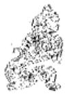

<!-- V3_SOURCE_ID:book016-b001277-p000-02e0fc33c9 -->

译文六五，虚怀不有富实，与近邻一起都利于出征讨伐，无所不利。

查看对应原文

<!-- V3_FOLDBACK_BEGIN:book016-b001277-p000-02e0fc33c9 -->

译文六五，虚怀不有富实，与近邻一起都利于出征讨伐，无所不利。

<!-- V3_FOLDBACK_END:book016-b001277-p000-02e0fc33c9 -->

<!-- V3_SOURCE_ID:book016-b001278-p000-1ef1acf7b3 -->

爻辞六五，不富有，与近邻一起利于征伐，没有什么不利。

查看对应原文

<!-- V3_FOLDBACK_BEGIN:book016-b001278-p000-1ef1acf7b3 -->

六五，不富①，以其邻利用侵伐，无不利②。

<!-- V3_FOLDBACK_END:book016-b001278-p000-1ef1acf7b3 -->

<!-- V3_SOURCE_ID:book016-b001279-p000-01a990b708 -->

匡释①“不富”：说的是爻位六五阴虚失实，此处喻“虚怀谦逊”之义。

> **释读存疑：** 可参阅《泰》六四注

查看对应原文

<!-- V3_FOLDBACK_BEGIN:book016-b001279-p000-01a990b708 -->

匡释①不富：谓六五阴虚失实(参阅《泰》六四注)，此处喻“虚怀谦逊”之义。

<!-- V3_FOLDBACK_END:book016-b001279-p000-01a990b708 -->

<!-- V3_SOURCE_ID:book016-b001280-p000-882d97ac44 -->

②“以其邻利用侵伐，无不利”：“以”的意思是“与”；“邻”指的是四、上两爻。这两句说明六五柔中居尊，既能广泛施谦于下，又能协同居上者共伐骄逆，使“天下”尽归“谦”道；故爻辞先言“不富”，再称“以其邻利用侵伐”，如此则“无不利”。案，《王注》以“不富以其邻”连读为句，训“以”字为“用”，认为六五“居于尊位，用谦与顺，故能不富而用其邻也；以谦顺而侵伐，所伐皆骄逆也。”此说于义可通。

> **释读存疑：** “以”“邻”之义可参阅《泰》六四注

查看对应原文

<!-- V3_FOLDBACK_BEGIN:book016-b001280-p000-882d97ac44 -->

②以其邻利用侵伐，无不利：以，犹“与”；邻，指四、上两爻(“以”、“邻”之义可参阅《泰》六四注)。这两句说明六五柔中居尊，既能广泛施谦于下，又能协同居上者共伐骄逆，使“天下”尽归“谦”道；故爻辞先言“不富”，再称“以其邻利用侵伐”，如此则“无不利”。案，《王注》以“不富以其邻”连读为句，训“以”字为“用”，认为六五“居于尊位，用谦与顺，故能不富而用其邻也；以谦顺而侵伐，所伐皆骄逆也。”此说于义可通。

<!-- V3_FOLDBACK_END:book016-b001280-p000-882d97ac44 -->

<!-- V3_SOURCE_ID:book016-b001281-p000-40ac15ec7b -->

《象传》解释说，‘利于出征讨伐’，这说明爻位为六五的这一爻，是征伐骄横不顺的对象。

查看对应原文

<!-- V3_FOLDBACK_BEGIN:book016-b001281-p000-40ac15ec7b -->

译文《象传》说：‘利于出征讨伐’，说明六五是征伐骄横不顺者。

<!-- V3_FOLDBACK_END:book016-b001281-p000-40ac15ec7b -->

<!-- V3_SOURCE_ID:book016-b001282-p000-919d362f00 -->

《象》说：“利于出征讨伐”，是征伐不顺从的人。

查看对应原文

<!-- V3_FOLDBACK_BEGIN:book016-b001282-p000-919d362f00 -->

《象》曰：“利用侵伐”，征不服也の。

<!-- V3_FOLDBACK_END:book016-b001282-p000-919d362f00 -->

<!-- V3_SOURCE_ID:book016-b001283-p000-a54733247e -->

注释①征不服：《古周易订诂》说：“侵伐并非滥用武力，因为对方不顺从，不得已才去征伐，这正是说明征伐要运用谦德的道理。”

查看对应原文

<!-- V3_FOLDBACK_BEGIN:book016-b001283-p000-a54733247e -->

注释①征不服：《古周易订诂》：‘侵伐非黩武。以其不服，不得已而征之，正以释征伐用谦之义。’

<!-- V3_FOLDBACK_END:book016-b001283-p000-a54733247e -->

<!-- V3_SOURCE_ID:book016-b001284-p000-1a6f3fc669 -->

这是说有谦德就必然会有骄横，有顺从就必然会有悖逆。六五以“谦”德居于尊贵之位，对顺从者自然施以谦德，但对骄横悖逆者却不能一味用谦姑息，而要以“侵伐”来制服，这与《大象传》“裒多益寡，称物平施”的含义正好契合。

查看对应原文

<!-- V3_FOLDBACK_BEGIN:book016-b001284-p000-1a6f3fc669 -->

[说萌有谦必有骄，有顺必有逆。六五以“谦”德居尊位，对顺从者自然施之以谦，但对骄逆者却不可一味用谦姑息，而要以“侵伐”制服。此与《大象传》“裒多益寡，称物平施”之义正合。

<!-- V3_FOLDBACK_END:book016-b001284-p000-1a6f3fc669 -->

<!-- V3_SOURCE_ID:book016-b001285-p000-07be2eab39 -->

译文上六，谦虚名声远闻，利于带兵作战、征讨相邻四方小国都邑。

查看对应原文

<!-- V3_FOLDBACK_BEGIN:book016-b001285-p000-07be2eab39 -->

译文上六，谦虚名声远闻，利于带兵作战、征讨相邻四方小国都邑。

<!-- V3_FOLDBACK_END:book016-b001285-p000-07be2eab39 -->

<!-- V3_SOURCE_ID:book016-b001286-p000-1a3b65d72c -->

上六爻，鸣谦，利于出兵作战、征讨邑国。

查看对应原文

<!-- V3_FOLDBACK_BEGIN:book016-b001286-p000-1a3b65d72c -->

上六，鸣谦，利用行师、征邑国①。

<!-- V3_FOLDBACK_END:book016-b001286-p000-1a3b65d72c -->

<!-- V3_SOURCE_ID:book016-b001287-p000-45edc27d9b -->

注释①鸣谦，利用行师、征邑国：邑，《说文》“国也”；“邑国”《正义》释为“外旁国邑”，指较近之处。这两句说明上六居《谦》卦极位，有谦极而名声远闻之象；以此“行师”讨逆，所征仅限于“邑国”，故所行必“利”。《折中》引何楷曰：“所征止于邑国，毋敢侵伐，亦谦之象。”

> **释读存疑：** 案，九二、上六都提到“鸣谦”，上六居高位，其“鸣”是向下传扬，九二居内卦中位，其“鸣”是向外传扬，两者特点不同；1轮自动修复后核义模型仍建议修订，已保守记录。

查看对应原文

<!-- V3_FOLDBACK_BEGIN:book016-b001287-p000-45edc27d9b -->

注释①鸣谦，利用行师、征邑国：邑，《说文》“国也”；“邑国”《正义》释为“外旁国邑”，指较近之处。这两句说明上六居《谦》卦极位，有谦极而名声远闻之象(案，二、上均言“鸣谦”，上居高“鸣”于下，二处内“鸣”于外，两者特点不同)；以此“行师”讨逆，所征仅限于“邑国”，故所行必“利”。《折中》引何楷曰：“所征止于邑国，毋敢侵伐，亦谦之象。”

<!-- V3_FOLDBACK_END:book016-b001287-p000-45edc27d9b -->

<!-- V3_SOURCE_ID:book016-b001288-p000-1dcf6ccfc9 -->

《象》中说：“鸣谦”，志未得也①；《象传》说：上六“谦虚名声远闻”，是说其心志尚未完全实现；“可用行师”，是说只征讨四旁都邑。

> **释读存疑：** 原文中“鸣谦”的具体所指未明确说明；1轮自动修复后核义模型仍建议修订，已保守记录。

查看对应原文

<!-- V3_FOLDBACK_BEGIN:book016-b001288-p000-1dcf6ccfc9 -->

《象》曰：“鸣谦”，志未得也①； 译文《象传》说：上六“谦虚名声远闻”，是说其心志尚未完全实现；“可以带兵作“可用行师”，征邑国也。 战”，是说只征讨四旁都邑。

<!-- V3_FOLDBACK_END:book016-b001288-p000-1dcf6ccfc9 -->

<!-- V3_SOURCE_ID:book016-b001289-p000-942d25487f -->

匡释①志未得：上九、六五、九三、六二、六四、初六这六位爻位的爻辞都体现出谦退至极的状态，足以感化众人；但终究还有骄横悖逆不肯顺从的人，所以他安定天下的志向还没有完全实现。《折中》中说：“其志未得者，乃未能遂其大同之心。”

查看对应原文

<!-- V3_FOLDBACK_BEGIN:book016-b001289-p000-942d25487f -->

匡释①志未得：上六位高谦极，足以感化众人；但毕竟还有骄逆不顺者，故其安定“天下”之志尚未完全实现。《折中》：“其志未得者，乃未能遂其大同之心。”

<!-- V3_FOLDBACK_END:book016-b001289-p000-942d25487f -->

<!-- V3_SOURCE_ID:book016-b001290-p000-185e024aad -->

说丽上六爻有“鸣谦”的美德，顺从的人必定众多，悖逆的人必定稀少，这是利于“行师、征邑国”的重要条件。朱熹说：“谦极有闻，人之所与，故可用行师。”（《本义》）

查看对应原文

<!-- V3_FOLDBACK_BEGIN:book016-b001290-p000-185e024aad -->

[说丽上六有“鸣谦”之德，顺从者必众，背逆者必寡，这是利于“行师、征邑国”的重要条件。朱熹曰：“谦极有闻，人之所与，故可用行师。”(《本义》)

<!-- V3_FOLDBACK_END:book016-b001290-p000-185e024aad -->

<!-- V3_SOURCE_ID:book016-b001291-p000-b074ce035a -->

《尚书·大禹谟》称“满招损，谦受益”，自古以来被人奉为至理名言。《谦》卦大义，即主于赞扬“谦虚”美德。卦辞指出“谦，亨，君子有终”，正表明“谦”道美善可行。周公旦曾经借此告诫伯禽曰：“《易》有一道，大足以守天下，中足以守其国家，小足以守其身：谦之谓也。”（《韩诗外传》卷三引）全卦六爻，一一揭示行谦必益的道理：初六卑下“谦谦”，无往不吉；六二谦德广闻，中正获吉；九三勤劳谦虚，“有终”致吉；六四发挥其谦，无所不利；六五居尊行谦，亦“无不利”；上六谦极有闻，利于“行师”。胡一桂曰：“《谦》一卦六爻，下三爻皆吉而无凶，上三爻皆利而无害。《易》中吉利，罕有若是纯全者：谦之效故如此也。”（《周易本义附录纂疏》）然而，“谦”与“骄”又是相对立而并存的现象，欲使“天下归谦”，必当平“骄”去“逆”。五、上两爻有“侵伐”、“行师”之象，正见此义；《大象传》谓“裒多益寡，称物平施”，亦寓此旨。马振彪云：“君子以德服人，然有时亦不得不用兵”，“周公东征，四国是皇”；“其用行师，志虽未得，所以济谦德而妙其用，平天下之不平者一归于平，故五、上两爻言征伐也”（《周易学说》）。可见，《周易》作者在强调“谦”的思想的同时，还注意到排除“骄逆”的一面：这又是本卦辩证观念的体现。

> **释读存疑：** 本地硬校验仍未通过，已记录供后续自动处理或人工核对。

查看对应原文

<!-- V3_FOLDBACK_BEGIN:book016-b001291-p000-b074ce035a -->

《尚书·大禹谟》称“满招损，谦受益”，自古以来被人奉为至理名言。《谦》卦大义，即主于赞扬“谦虚”美德。卦辞指出“谦，亨，君子有终”，正表明“谦”道美善可行。周公旦曾经借此告诫伯禽曰：“《易》有一道，大足以守天下，中足以守其国家，小足以守其身：谦之谓也。”（《韩诗外传》卷三引)全卦六爻，一一揭示行谦必益的道理：初六卑下“谦谦”，无往不吉；六二谦德广闻，中正获吉；九三勤劳谦虚，“有终”致吉；六四发挥其谦，无所不利；六五居尊行谦，亦“无不利”；上六谦极有闻，利于“行师”。胡一桂曰：“《谦》一卦六爻，下三爻皆吉而无凶，上三爻皆利而无害。《易》中吉利，罕有若是纯全者：谦之效故如此也。"(《周易本义附录纂疏》)然而，“谦”与“骄”又是相对立而并存的现象，欲使“天下归谦”，必当平“骄”去“逆”。五、上两爻有“侵伐”、“行师”之象，正见此义；《大象传》谓“裒多益寡，称物平施”，亦寓此旨。马振彪云：“君子以德服人，然有时亦不得不用兵”，“周公东征，四国是皇”；“其用行师，志虽未得，所以济谦德而妙其用，平天下之不平者一归于平，故五、上两爻言征伐’也”(《周易学说》)。可见，《周易》作者在强调“谦”的思想的同时，还注意到排除“骄逆”的一面：这又是本卦辩证观念的体现。

<!-- V3_FOLDBACK_END:book016-b001291-p000-b074ce035a -->

<!-- V3_SOURCE_ID:book016-b001292-p000-cdc8a59e2d -->

## 豫卦第十六

查看对应原文

<!-- V3_FOLDBACK_BEGIN:book016-b001292-p000-cdc8a59e2d -->

## 豫卦第十六

<!-- V3_FOLDBACK_END:book016-b001292-p000-cdc8a59e2d -->

<!-- V3_SOURCE_ID:book016-b001293-p000-e9640d9d8d -->

《豫》卦象征欢乐，利于建立诸侯、出师征战。

查看对应原文

<!-- V3_FOLDBACK_BEGIN:book016-b001293-p000-e9640d9d8d -->

译文《豫》卦象征欢乐：利于建立诸侯、 三豫①：利建侯行师。  
出师征战。

<!-- V3_FOLDBACK_END:book016-b001293-p000-e9640d9d8d -->

<!-- V3_SOURCE_ID:book016-b001294-p000-4dcaaef868 -->

匡释：豫是卦名，下为坤卦、上为震卦，象征欢乐。考证“豫”字，《尔雅·释诂》说它是欢乐的意思；此卦下坤上震，有顺着本性而动、万物皆欢乐的含义。《集解》引用郑玄的话：“坤是顺的意思，震是动的意思。顺着本性而动，没有不各得其所的，所以称之为豫。豫就是喜悦欢乐的样子。”

查看对应原文

<!-- V3_FOLDBACK_BEGIN:book016-b001294-p000-4dcaaef868 -->

匡释①豫：卦名，下坤()上震()，象征“欢乐”。案，“豫”字，《尔雅·释诂》“乐也”；此卦下坤上震，有顺性以动、物皆欢乐之义。《集解》引郑玄曰：“坤，顺也；震，动也。顺其性而动者，莫不得其所，故谓之豫'。豫，喜豫、说乐之貌也。”

<!-- V3_FOLDBACK_END:book016-b001294-p000-4dcaaef868 -->

<!-- V3_SOURCE_ID:book016-b001295-p000-db4fa71f98 -->

利于建立诸侯、出师征战：这是说在万物欢乐的时候，适宜建立诸侯以广施治理，出兵征讨叛逆以安定百姓。《正义》说：“有所行动而众人喜悦，所以利于建立诸侯；顺着正道而动，不妄加罪责于无罪之人，所以可以出兵征战。”

查看对应原文

<!-- V3_FOLDBACK_BEGIN:book016-b001295-p000-db4fa71f98 -->

②利建侯行师：此谓众物欢乐之时，宜于“建侯”广施治理、“行师”讨逆安民。《正义》：“动而众说，故可利建侯也；以顺而动，不加无罪，故可以行师也。”

<!-- V3_FOLDBACK_END:book016-b001295-p000-db4fa71f98 -->

<!-- V3_SOURCE_ID:book016-b001296-p000-7c812fadf1 -->

《象传》说：欢乐，就好比阳刚者与阴柔者相应和而心志畅行，又能顺着物性而动，就能形成欢乐的局面。欢乐既然是顺着物性而动，那么连天地的运行都是如此，何况建立诸侯、出师征战这些事呢？天地顺着物性而动，所以日月周转不会出现过失，四季更替不会发生差错；圣人顺着民情而动，于是刑罚运用清明，百姓纷纷归服。欢乐之时所包含的意义多么宏大啊！

查看对应原文

<!-- V3_FOLDBACK_BEGIN:book016-b001296-p000-7c812fadf1 -->

译文《象传》说：欢乐，譬如阳刚者与阴 柔相应而心志畅行，又能顺沿物性而动， 就能导致欢乐。欢乐，既然是顺沿物性 而动，那么，连天地的运行都像这样，何 况建立诸侯、出师征战这些事呢？天地 顺沿物性而动，所以日月周转不致过失， 四季更替不出差错；圣人顺沿民情而动， 于是运用刑罚清明、百姓纷纷服从。“欢 乐”之时包涵的意义多么宏大啊！

<!-- V3_FOLDBACK_END:book016-b001296-p000-7c812fadf1 -->

<!-- V3_SOURCE_ID:book016-b001297-p000-f74fb5c88b -->

《彖》说：豫卦，阳刚与阴柔相应，志向得以推行，顺势而动，这就是豫。豫卦的含义是顺势而动，所以天地都会顺应它，更何况是分封诸侯、出兵打仗这类事呢？天地顺势而动，所以日月运行不会出现过失，四时不会发生差错；圣人顺势而动，就会刑罚清明，百姓归服。豫卦的时势意义太重大了！

查看对应原文

<!-- V3_FOLDBACK_BEGIN:book016-b001297-p000-f74fb5c88b -->

《彖》曰：豫，刚应而志行①，顺  
以动②，豫。豫，顺以动，故天地如  
之③，而况建侯行师乎？天地以顺  
动，故日月不过，而四时不忒④；圣  
人以顺动，则刑罚清而民服。豫之  
时义大矣哉 ⑤o

<!-- V3_FOLDBACK_END:book016-b001297-p000-f74fb5c88b -->

<!-- V3_SOURCE_ID:book016-b001298-p000-d47194a7b3 -->

注释①刚应而志行：指豫卦中的九四爻为阳刚之爻，与各阴爻相应，阳刚的志向得以大力推行，所以说“刚应而志行”。

查看对应原文

<!-- V3_FOLDBACK_BEGIN:book016-b001298-p000-d47194a7b3 -->

注释①刚应而志行：指卦中九四阳刚，与群阴相应而志行。《集解》引侯果曰：“四为卦主，五阴应之，刚志大行，故曰‘刚应而志行’。”

<!-- V3_FOLDBACK_END:book016-b001298-p000-d47194a7b3 -->

<!-- V3_SOURCE_ID:book016-b001299-p000-7893751c09 -->

②顺以动：顺指下卦坤，动指上卦震。这是说上下卦象蕴含“顺势而动”的内涵，从而构成豫卦的意义。本句结合前一句来解释豫卦的卦名。

查看对应原文

<!-- V3_FOLDBACK_BEGIN:book016-b001299-p000-7893751c09 -->

②顺以动：顺，指下坤；动，指上震。此谓上下卦象含“顺动”致“豫”之义。本句合前句并释卦名“豫”。《集解》引崔憬曰：“坤下震上，顺以动也。”

<!-- V3_FOLDBACK_END:book016-b001299-p000-7893751c09 -->

<!-- V3_SOURCE_ID:book016-b001300-p000-a5648480c3 -->

③天地如之：从这句开始，广泛列举“天地的运动”“圣人的行动”作为例子，说明万事万物都必须“顺势而动”才能成就豫的状态，进一步阐释豫卦的卦名以及卦辞“利建侯行师”的含义。

> **释读存疑：** 本地硬校验仍未通过，已记录供后续自动处理或人工核对。

查看对应原文

<!-- V3_FOLDBACK_BEGIN:book016-b001300-p000-a5648480c3 -->

③天地如之：此句以下，广举“天地之动”、“圣人之动”为例，说明万事万物均须“顺而动”才能成“豫”，进一步阐释卦名“豫”及卦辞“利建侯行师”之义。《集解》引虞翻曰：“如之者，谓天地亦动以成四时。”

<!-- V3_FOLDBACK_END:book016-b001300-p000-a5648480c3 -->

<!-- V3_SOURCE_ID:book016-b001301-p000-5666506544 -->

④忒：音tè，《集解》引虞翻曰：“差迭也”，犹言“差错”。

查看对应原文

<!-- V3_FOLDBACK_BEGIN:book016-b001301-p000-5666506544 -->

④忒：音tè，《集解》引虞翻曰：“差迭也”，犹言“差错”。

<!-- V3_FOLDBACK_END:book016-b001301-p000-5666506544 -->

<!-- V3_SOURCE_ID:book016-b001302-p000-7f5f881c3b -->

⑤豫之时义大矣哉：这是《彖传》作者对本卦含义深广的叹美之辞。《正义》：“叹美为豫’之善，言于逸豫之时，其义大矣，此叹卦也。”案，《彖传》凡叹“大矣哉”者，共有十二卦。《正义》又曰：“凡言不尽意者，不可烦文其说，且叹之以示情，使后生思其余蕴，得意而忘言也。然叹卦有三体：一直叹时’，如大过之时大矣哉’之例是也；二叹‘时’并‘用’，如‘险之时用大矣哉’之例是也；三叹‘时’并义’，豫之时义大矣哉’之例是也。”《周易玩辞》亦曰：“《豫》、《随》、《遁》、《姤》、《旅》，皆若浅事而有深意，故曰时义大矣哉’，欲人之思之也；《坎》、《睽》、《蹇》，皆非美事，而圣人有时而用之，故曰时用大矣哉’，欲人之别之者；《颐》、《大过》、《解》、《革》，皆大事大变也，故曰时大矣哉'，欲人之谨之也。”上说分析《彖传》叹美卦义的特点，并可参考。

查看对应原文

<!-- V3_FOLDBACK_BEGIN:book016-b001302-p000-7f5f881c3b -->

⑤豫之时义大矣哉：这是《彖传》作者对本卦含义深广的叹美之辞。《正义》：“叹美为豫’之善，言于逸豫之时，其义大矣，此叹卦也。”案，《彖传》凡叹“大矣哉”者，共有十二卦。《正义》又曰：“凡言不尽意者，不可烦文其说，且叹之以示情，使后生思其余蕴，得意而忘言也。然叹卦有三体：一直叹时’，如大过之时大矣哉’之例是也；二叹‘时’并‘用’，如‘险之时用大矣哉’之例是也；三叹‘时’并义’，豫之时义大矣哉’之例是也。”《周易玩辞》亦曰：“《豫》、《随》、《遁》、《姤》、《旅》，皆若浅事而有深意，故曰时义大矣哉’，欲人之思之也；《坎》、《睽》、《蹇》，皆非美事，而圣人有时而用之，故曰时用大矣哉’，欲人之别之者；《颐》、《大过》、《解》、《革》，皆大事大变也，故曰时大矣哉'，欲人之谨之也。”上说分析《彖传》叹美卦义的特点，并可参考。

<!-- V3_FOLDBACK_END:book016-b001302-p000-7f5f881c3b -->

<!-- V3_SOURCE_ID:book016-b001303-p000-3888d67d2d -->

说明《豫》卦《彖传》先言卦“体”为“刚应而志行”；然后反复强调卦“德”为“顺而动”，揭示“顺动”才能致“豫”的道理。《折中》曰：“《彖传》中凡称卦德，皆先内而后外，而其文义又各不同。其曰‘而’者，两字并重，如《讼》之‘险而健’，既‘险’又‘健’也；《小畜》之‘健而巽’，既‘健’又‘巽’也；《大有》‘刚健而文明’，既‘刚健’而又‘文明’也。其曰‘以’者，则重在上一字，如《同人》‘文明以健’，重在‘文明’字；此卦‘顺以动’，重在‘顺’字。其或以下一字为重者，则又变其文法，如《复》卦‘动而以顺行’之类。”此说分析《彖传》运用虚词“而”、“以”的三种不同情况，似颇可取。

查看对应原文

<!-- V3_FOLDBACK_BEGIN:book016-b001303-p000-3888d67d2d -->

说明《豫》卦《彖传》先言卦“体”为“刚应而志行”；然后反复强调卦“德”为“顺而动”，揭示“顺动”才能致“豫”的道理。《折中》曰：“《彖传》中凡称卦德，皆先内而后外，而其文义又各不同。其曰‘而’者，两字并重，如《讼》之‘险而健’，既‘险’又‘健’也；《小畜》之‘健而巽’，既‘健’又‘巽’也；《大有》‘刚健而文明’，既‘刚健’而又‘文明’也。其曰‘以’者，则重在上一字，如《同人》‘文明以健’，重在‘文明’字；此卦‘顺以动’，重在‘顺’字。其或以下一字为重者，则又变其文法，如《复》卦‘动而以顺行’之类。”此说分析《彖传》运用虚词“而”、“以”的三种不同情况，似颇可取。

<!-- V3_FOLDBACK_END:book016-b001303-p000-3888d67d2d -->

<!-- V3_SOURCE_ID:book016-b001304-p000-e56985c69d -->

## 《象》曰：雷出地奋，豫①；先王以作乐崇德，殷荐之上帝，以配祖考②。

查看对应原文

<!-- V3_FOLDBACK_BEGIN:book016-b001304-p000-e56985c69d -->

## 《象》曰：雷出地奋，豫①；先王以作乐崇德，殷荐之上帝，以配祖考②。

<!-- V3_FOLDBACK_END:book016-b001304-p000-e56985c69d -->

<!-- V3_SOURCE_ID:book016-b001305-p000-174f17c787 -->

译文《象传》说：雷声发出，大地振奋，象征“欢乐”；先代君王因此制作音乐、用来赞美功德，通过隆盛的典礼奉献给天帝，并让祖先的神灵配合共享。

查看对应原文

<!-- V3_FOLDBACK_BEGIN:book016-b001305-p000-174f17c787 -->

译文《象传》说：雷声发出，大地振奋，象征“欢乐”；先代君王因此制作音乐、用来赞美功德，通过隆盛的典礼奉献给天帝，并让祖先的神灵配合共享。

<!-- V3_FOLDBACK_END:book016-b001305-p000-174f17c787 -->

<!-- V3_SOURCE_ID:book016-b001306-p000-e2491f4e3d -->

匡释①雷出地奋，豫：解释《豫》卦上震为雷、下坤为地的卦象。《集解》引用郑玄的话：“奋，就是动的意思。雷在地上鸣动，万物就会安乐。”

查看对应原文

<!-- V3_FOLDBACK_BEGIN:book016-b001306-p000-e2491f4e3d -->

匡释①雷出地奋，豫：释《豫》卦上震为雷，下坤为地之象。《集解》引郑玄曰：‘奋，动也。雷动于地上，而万物乃豫也。’

<!-- V3_FOLDBACK_END:book016-b001306-p000-e2491f4e3d -->

<!-- V3_SOURCE_ID:book016-b001307-p000-c60a8d7edf -->

②先王以作乐崇德，殷荐之上帝，以配祖考：崇，是推崇、褒扬的意思；殷，是盛大的意思，《说文》中说“作乐之盛偁殷”；荐，是奉献的意思；之，是介词，相当于“之于”；上帝，就是天帝，古人认为它是主宰万物的至高无上之神；配，是古代祭祀中的“配飨”礼，这里指让祖先配享上帝；祖考，就是祖先。这三句说明“先王”观察《豫》卦的卦象，领悟到通过音乐的鼓动，来歌功颂德、祭祀“上帝”、“祖考”。《集解》引用郑玄的话：“‘以’，是取其喜乐动摇之意，就像人到了极度快乐的时候，就会想要用手击鼓、用足跳舞；崇，是充实的意思；殷，是盛大的意思；荐，是进献的意思；上帝，就是天帝。君王功业成就后创作音乐，凭借文德取得天下的就创作籥舞，凭借武功取得天下的就创作万舞，各自充实其功德而制定祭祀天帝的礼制；所谓让祖先配享，就是让祖先与天一同享用其功业。所以《孝经》说在郊外祭祀后稷来配享上天，在明堂祭祀文王来配享上帝，就是这个意思。”按，“崇”字，郑玄解释为“充”，源自《尔雅·释诂》，在义理上也说得通。

查看对应原文

<!-- V3_FOLDBACK_BEGIN:book016-b001307-p000-c60a8d7edf -->

②先王以作乐崇德，殷荐之上帝，以配祖考：崇，推崇、褒扬；殷，盛也，《说文》“作乐之盛偁殷”；荐，献也；之，介词，犹“之于”；上帝，犹言“天帝”，古人视为主宰万物的至高无上之神；配，古代祭祀中的“配飨”礼，此谓以祖先配飨上帝；祖考，即祖先。这三句说明“先王”观《豫》卦之象，悟知通过音乐的鼓动，来歌功颂德、献祀“上帝”、“祖考”。《集解》引郑玄曰：“‘以’者，取其喜佚动摇，犹人至乐则手欲鼓之，足欲舞之也；崇，充也；殷，盛也；荐，进也；上帝，天帝也。王者功成作乐，以文得之者作籥舞’，以武得之者作万舞’，各充其德而为制祀天帝；以配祖考者，使与天共飨其功也。故《孝经》云郊祀后稷以配天，宗祀文王于明堂以配上帝’是也。”案，“崇”字，郑氏训“充”，本于《尔雅·释诂》，于义亦通。

<!-- V3_FOLDBACK_END:book016-b001307-p000-c60a8d7edf -->

<!-- V3_SOURCE_ID:book016-b001308-p000-028832d952 -->

说明音乐的鼓动作用，《礼记·乐记》说：“用声音发声，用琴瑟应和，用箫管相从，振奋至高德行的光辉，鼓动四季之气的调和。”本卦《大象传》引申出“先王创作音乐”的含义，似乎表明古代统治者创作音乐的一个重要目的：当“功业成就”、歌颂“功德”之时，以及祭祀“天帝”、“祖考”之际，用来渲染、鼓动特定的“政治”气氛，以求得人与神共同欢乐的效果。由此可以窥见古代“乐”礼的大概情况。

查看对应原文

<!-- V3_FOLDBACK_BEGIN:book016-b001308-p000-028832d952 -->

说明音乐的鼓动作用，《礼记·乐记》说：“发以声音而交以琴瑟，从以箫管，奋至德之光，动四气之和。”本卦《大象传》引申出“先王作乐”之义，似表明古代统治者创造音乐的一方面重要目的：当“功成”颂“德”之时，以及献享“天帝”、“祖考”之际，用来渲染、鼓舞特定的“政治”气氛，以寻求人神共相欢乐的效果。由此可以推见古代“乐”礼之一斑。

<!-- V3_FOLDBACK_END:book016-b001308-p000-028832d952 -->

<!-- V3_SOURCE_ID:book016-b001309-p000-98edc381b2 -->

译文初六，沉溺于欢乐自鸣得意，有凶险。

查看对应原文

<!-- V3_FOLDBACK_BEGIN:book016-b001309-p000-98edc381b2 -->

译文初六，沉溺于欢乐自鸣得意，有凶险。

<!-- V3_FOLDBACK_END:book016-b001309-p000-98edc381b2 -->

<!-- V3_SOURCE_ID:book016-b001310-p000-a8d087b3e2 -->

初六，鸣豫，凶①。

查看对应原文

<!-- V3_FOLDBACK_BEGIN:book016-b001310-p000-a8d087b3e2 -->

初六，鸣豫，凶①。

<!-- V3_FOLDBACK_END:book016-b001310-p000-a8d087b3e2 -->

<!-- V3_SOURCE_ID:book016-b001311-p000-caa4eded62 -->

匡释①鸣豫，凶：指初六阴爻居于阳位，以失正之爻的身份上应九四爻，有沉溺于欢乐、自鸣得意的征象，所以说“凶”。《王注》中说：“处于豫卦的初始位置，却独自在上方得志，欢乐过度就会放纵，心志穷尽就会凶险。豫卦的道理怎么可以自鸣得意呢！”

> **释读存疑：** 原文未明确“匡释”的具体所指，仅保留原标注形式

查看对应原文

<!-- V3_FOLDBACK_BEGIN:book016-b001311-p000-caa4eded62 -->

匡释①鸣豫，凶：指初六阴居阳位，以失正之体上应九四，有沉溺于欢乐、自鸣得意之象，故“凶”。《王注》：“处豫之初，而特得志于上，乐过则淫，志穷则凶。豫何可鸣！”

<!-- V3_FOLDBACK_END:book016-b001311-p000-caa4eded62 -->

<!-- V3_SOURCE_ID:book016-b001312-p000-0ce2117dfa -->

译文《象传》说：初六“欢乐过甚自鸣得意”，是说欢乐之志穷极导致凶险。

查看对应原文

<!-- V3_FOLDBACK_BEGIN:book016-b001312-p000-0ce2117dfa -->

译文《象传》说：初六“欢乐过甚自鸣得意”，是说欢乐之志穷极导致凶险。

<!-- V3_FOLDBACK_END:book016-b001312-p000-0ce2117dfa -->

<!-- V3_SOURCE_ID:book016-b001313-p000-e966730cbf -->

《象传》说：豫卦的初六爻“鸣豫”，是说其心志穷尽于享乐，会招致凶险。

查看对应原文

<!-- V3_FOLDBACK_BEGIN:book016-b001313-p000-e966730cbf -->

《象》曰：初六“鸣豫”，志穷凶也。

<!-- V3_FOLDBACK_END:book016-b001313-p000-e966730cbf -->

<!-- V3_SOURCE_ID:book016-b001314-p000-e73e111f28 -->

这说明《谦》卦的上六爻“鸣谦”有“利”，《豫》卦的初六爻“鸣豫”会招致“凶”：由此可见，谦虚不妨声名远扬；但在欢乐之初，不能得意忘形。《折中》引用龚焕的话说：“《豫》卦的初六爻，就是《谦》卦上六爻的反对面”，“因谦虚而声名远扬就吉祥，因享乐而声名远扬就凶险”。

查看对应原文

<!-- V3_FOLDBACK_BEGIN:book016-b001314-p000-e73e111f28 -->

说明《谦》上六“鸣谦”有“利”，《豫》初六“鸣豫”致“凶”：可见谦虚不妨有闻于外；欢乐之初，不能得意忘形。《折中》引龚焕曰：“《豫》之初六，即《谦》上六之反对”，“谦而鸣则吉，豫而鸣则凶”。

<!-- V3_FOLDBACK_END:book016-b001314-p000-e73e111f28 -->

<!-- V3_SOURCE_ID:book016-b001315-p000-ddbcd6c8f9 -->

豫卦第十六

查看对应原文

<!-- V3_FOLDBACK_BEGIN:book016-b001315-p000-ddbcd6c8f9 -->

豫卦第十六

<!-- V3_FOLDBACK_END:book016-b001315-p000-ddbcd6c8f9 -->

<!-- V3_SOURCE_ID:book016-b001316-p000-5f29f7a6cd -->

译文：六二爻耿介如同磐石，不等一天结束就悟知欢乐必须适中的道理，守持正固可获吉祥。

查看对应原文

<!-- V3_FOLDBACK_BEGIN:book016-b001316-p000-5f29f7a6cd -->

译文六二，耿介如石，不等候一天终竟(就悟知欢乐必须适中的道理)，守持正固可获吉祥。

<!-- V3_FOLDBACK_END:book016-b001316-p000-5f29f7a6cd -->

<!-- V3_SOURCE_ID:book016-b001317-p000-ceabd5be91 -->

六二爻，爻辞为：介于石，不终日，贞吉①。

查看对应原文

<!-- V3_FOLDBACK_BEGIN:book016-b001317-p000-ceabd5be91 -->

六二，介于石，不终日，贞吉①。

<!-- V3_FOLDBACK_END:book016-b001317-p000-ceabd5be91 -->

<!-- V3_SOURCE_ID:book016-b001318-p000-5e93b110dc -->

匡释①对“介于石，不终日，贞吉”的解释是：介，是耿介正直的样子；于，是介词，相当于“如”。这两句比喻六二爻柔顺中正、耿介如石，处于“豫”卦之时，能够不苟且求乐，“不终日”就是知晓事物的几微征兆而迅速领悟“豫”的道理；像这样守持正固必然吉祥，所以称为“贞吉”。《王注》说：“处于豫乐之时，居得正位、行持中道，安于守持正固，是不会苟且求乐的人。顺势却不随意盲从，行乐却不违背中道，因此与上位者交往不谄媚，与下位者交往不亵渎。明晓祸福产生的缘由，所以不随意取悦；辨明必然的道理，所以不改变自己的操守：耿介如石，不等一天终竟就明晓了道理。”

查看对应原文

<!-- V3_FOLDBACK_BEGIN:book016-b001318-p000-5e93b110dc -->

匡释①介于石，不终日，贞吉：介，耿介正直之状；于，介词，犹“如”。这两句比喻六二柔顺中正、耿介如石，当“豫”之时，能不苟且求豫，“不终日”即“知几”速悟“豫”理；如此守正必吉，故称“贞吉”。《王注》：“处豫之时，得位履中，安夫贞正，不求苟豫者也。顺不苟从，豫不违中，是以上交不谄，下交不渎。明祸福之所生，故不苟说；辩必然之理，故不改其操：介如石焉，不终日明矣。”

<!-- V3_FOLDBACK_END:book016-b001318-p000-5e93b110dc -->

<!-- V3_SOURCE_ID:book016-b001319-p000-de72726f93 -->

译文《象传》说：六二爻辞“不等候一天终竟(就悟知欢乐必须适中的道理)，守持正固可吉祥”，是因为居中持正。

查看对应原文

<!-- V3_FOLDBACK_BEGIN:book016-b001319-p000-de72726f93 -->

译文《象传》说：六二爻辞“不等候一天终竟(就悟知欢乐必须适中的道理)，守持正固可吉祥”，是因为居中持正。

<!-- V3_FOLDBACK_END:book016-b001319-p000-de72726f93 -->

<!-- V3_SOURCE_ID:book016-b001320-p000-91daeff11d -->

《象传》说：“不终日贞吉”，是因为六二爻居中持正。

查看对应原文

<!-- V3_FOLDBACK_BEGIN:book016-b001320-p000-91daeff11d -->

《象》曰：“不终日贞吉”，以中正也。

<!-- V3_FOLDBACK_END:book016-b001320-p000-91daeff11d -->

<!-- V3_SOURCE_ID:book016-b001321-p000-980d305594 -->

说明六二爻欢乐的状态合宜得当，凭借中正之道获得吉祥。《系辞下传》引用孔子的话，称六二爻“与地位尊贵者交往不谄媚，与地位低下者交往不亵渎”，具备“知几”的德行。《宋书·谢灵运传》所说的“时机到来的先兆，领悟要先于‘介石’”，就属于这个含义。

查看对应原文

<!-- V3_FOLDBACK_BEGIN:book016-b001321-p000-980d305594 -->

说明六二欢乐得体，以“中正”获吉。《系辞下传》引孔子语，称其“上交不谄，下交不渎”，有“知几”之德。《宋书·谢灵运传》谓“时来之机，悟先于介石”，即属此义。

<!-- V3_FOLDBACK_END:book016-b001321-p000-980d305594 -->

<!-- V3_SOURCE_ID:book016-b001322-p000-f4584bf8ab -->

译文六三，媚眼悦上寻求欢乐，必致悔恨；要是悔悟太迟必将又生悔恨。

查看对应原文

<!-- V3_FOLDBACK_BEGIN:book016-b001322-p000-f4584bf8ab -->

译文六三，媚眼悦上寻求欢乐，必致悔恨；要是悔悟太迟必将又生悔恨。

<!-- V3_FOLDBACK_END:book016-b001322-p000-f4584bf8ab -->

<!-- V3_SOURCE_ID:book016-b001323-p000-8c3b8b28e2 -->

六三爻的爻辞为：盱豫悔①；迟有悔②。

查看对应原文

<!-- V3_FOLDBACK_BEGIN:book016-b001323-p000-8c3b8b28e2 -->

六三，盱豫悔①；迟有悔②。

<!-- V3_FOLDBACK_END:book016-b001323-p000-8c3b8b28e2 -->

<!-- V3_SOURCE_ID:book016-b001324-p000-2890dc394d -->

注释①盱豫悔：盱，音xū，《说文》谓“张目”，《王注》释为“唯盱”，《集解》引向秀曰：“睢盱，小人喜悦佞媚之貌也。”此句说明六三阴柔失正，上承九四，有媚上求乐之象，故将致“悔”。《王注》：“居下体之极，处两卦之际，履非其位，承动豫之主，若其睢盱而豫，悔亦生焉。”

> **释读存疑：** 本地硬校验仍未通过，已记录供后续自动处理或人工核对。

查看对应原文

<!-- V3_FOLDBACK_BEGIN:book016-b001324-p000-2890dc394d -->

注释①盱豫悔：盱，音xū，《说文》谓“张目”，《王注》释为“唯盱”，《集解》引向秀曰：“睢盱，小人喜悦佞媚之貌也。”此句说明六三阴柔失正，上承九四，有媚上求乐之象，故将致“悔”。《王注》：“居下体之极，处两卦之际，履非其位，承动豫之主，若其睢盱而豫，悔亦生焉。”

<!-- V3_FOLDBACK_END:book016-b001324-p000-2890dc394d -->

<!-- V3_SOURCE_ID:book016-b001325-p000-5376eaf9a7 -->

②迟有悔：这句承接前面的卦义，说的是六三如果悔悟太迟，就会产生新的“悔”。《本义》中说：“应当尽快悔悟，如果悔悟得迟，就一定会有悔。”按语：这句在《王注》中被解释为：“迟疑而不跟从，是豫卦所忌讳的”；《正义》中说：“处于豫卦之时，如果迟疑停留而不追求豫乐，也会有悔。”这一说法可以作为参考。

查看对应原文

<!-- V3_FOLDBACK_BEGIN:book016-b001325-p000-5376eaf9a7 -->

②迟有悔：此句承前句义，谓六三若悔悟太迟必生新“悔”。《本义》：“当速悔，若悔之迟则必有悔也。”案，此句《王注》释为：“迟而不从，豫之所疾”；《正义》曰：“居豫之时，若迟停不求于豫，亦有悔也。”可备一说。

<!-- V3_FOLDBACK_END:book016-b001325-p000-5376eaf9a7 -->

<!-- V3_SOURCE_ID:book016-b001326-p000-3fc57314d0 -->

## 《象》曰：“盱豫有悔”，位不当也。 — 《象传》说：‘盱豫有悔’，这是因为所处的位置不恰当。

查看对应原文

<!-- V3_FOLDBACK_BEGIN:book016-b001326-p000-3fc57314d0 -->

## 《象》曰：“盱豫有悔”，位不当也。

<!-- V3_FOLDBACK_END:book016-b001326-p000-3fc57314d0 -->

<!-- V3_SOURCE_ID:book016-b001327-p000-d55ec1a6a4 -->

译文《象传》说：‘媚眼悦上寻求欢乐，必致悔恨’，说明六三居位不正当。

查看对应原文

<!-- V3_FOLDBACK_BEGIN:book016-b001327-p000-d55ec1a6a4 -->

译文《象传》说：‘媚眼悦上寻求欢乐，必致悔恨’，说明六三居位不正当。

<!-- V3_FOLDBACK_END:book016-b001327-p000-d55ec1a6a4 -->

<!-- V3_SOURCE_ID:book016-b001328-p000-40f9545e83 -->

这说明六二能预知细微变化而行动迅速，凭借“贞”获得吉祥；六三如果悔悟太迟，就会悔上加悔。这两爻的卦义正好可以相互对照。《折中》引用胡炳文的话说：“‘盱豫’与‘介石’相反，‘迟’与‘不终日’相反：这是因为六二居中守正，而六三不中正的缘故。六三虽然阴柔，但它的爻位是阳位，还是有能够悔悟的心意；然而悔悟应当尽快进行，如果悔悟得迟，就又一定会有悔了。”

查看对应原文

<!-- V3_FOLDBACK_BEGIN:book016-b001328-p000-40f9545e83 -->

说明六二知几疾速，以“贞”获吉；六三若悔悟太迟，将悔上加悔。两爻之义适可对照。《折中》引胡炳文曰：“盱豫’与‘介石’相反，迟’与不终日'相反：中正’与不中正’故也。六三虽柔，其位则阳，犹有能悔之意；然悔之速可也，悔之迟则又必有悔矣。”

<!-- V3_FOLDBACK_END:book016-b001328-p000-40f9545e83 -->

<!-- V3_SOURCE_ID:book016-b001329-p000-fd90492a3c -->

## 九四，由豫，大有得①；勿疑，朋盍簪②。 — 九四爻：由豫，大有得①；勿疑，朋盍簪②。

查看对应原文

<!-- V3_FOLDBACK_BEGIN:book016-b001329-p000-fd90492a3c -->

## 九四，由豫，大有得①；勿疑，朋盍簪②。

<!-- V3_FOLDBACK_END:book016-b001329-p000-fd90492a3c -->

<!-- V3_SOURCE_ID:book016-b001330-p000-99bb38892d -->

译文九四，人们依赖他获到欢乐，大有所得；刚直不疑，友朋像头发括束于簪子一样聚合相从。

查看对应原文

<!-- V3_FOLDBACK_BEGIN:book016-b001330-p000-99bb38892d -->

译文九四，人们依赖他获到欢乐，大有所得；刚直不疑，友朋像头发括束于簪子一样聚合相从。

<!-- V3_FOLDBACK_END:book016-b001330-p000-99bb38892d -->

<!-- V3_SOURCE_ID:book016-b001331-p000-4cbacac46a -->

注释①由豫，大有得：由，是自、从的意思，“由豫”就像说“由之以豫”，构词方式和《颐》卦上九爻的“由颐”相同。这里是说卦中所有阴爻都依靠九四的阳刚而获得“豫”，所以称为“大有得”，也就是《彖传》里“刚应而志行”的意思。《集解》引用侯果的话说：“为豫之主，众阴所宗，莫不由之以得其豫。”

查看对应原文

<!-- V3_FOLDBACK_BEGIN:book016-b001331-p000-4cbacac46a -->

注释①由豫，大有得：由，自、从也，“由豫”犹言“由之以豫”，构词法与《颐》上九“由颐”同(参阅该爻译注)。此谓卦中群阴由九四之阳刚而获“豫”，故称“大有得”，即《彖传》“刚应而志行”之义。《集解》引侯果曰：“为豫之主，众阴所宗，莫不由之以得其豫。”

<!-- V3_FOLDBACK_END:book016-b001331-p000-4cbacac46a -->

<!-- V3_SOURCE_ID:book016-b001332-p000-a796dcc91f -->

②勿疑，朋盍簪：朋，指友朋，也就是卦中的各个阴爻，《尚氏学》说：“阳以阴为朋”；盍，通“合”；簪，读音为zān，是古代用来括束头发的首饰。这两句是说明九四刚直不疑，和各个阴爻相应；并且借用“盍簪”来比喻阴阳友朋聚合，进一步阐释前一句“大有得”的含义。《集解》引用侯果的话说：“体刚心直，志不怀疑，故得群物依归，朋从大合，若以簪纂之固括也。”按，侯氏注释里的“篆”字，是说用簪子括聚头发。

查看对应原文

<!-- V3_FOLDBACK_BEGIN:book016-b001332-p000-a796dcc91f -->

②勿疑，朋盍簪：朋，友朋，指卦中诸阴，《尚氏学》：“阳以阴为朋”；盍，通“合”；簪，音zān，古代用以括束头发的首饰。这两句说明九四刚直不疑，与群阴相应；并借用“盍簪”比喻阴阳友朋合聚，进一步申说前句“大有得”的涵义。《集解》引侯果曰：“体刚心直，志不怀疑，故得群物依归，朋从大合，若以簪纂之固括也。”案，侯氏注中“篆”字，谓以簪括聚头发。

<!-- V3_FOLDBACK_END:book016-b001332-p000-a796dcc91f -->

<!-- V3_SOURCE_ID:book016-b001333-p000-0554658e89 -->

## 《象》曰：“由豫大有得”，志大行也。 — 《象传》说：“由豫大有得”，是说志向得以大行。

查看对应原文

<!-- V3_FOLDBACK_BEGIN:book016-b001333-p000-0554658e89 -->

## 《象》曰：“由豫大有得”，志大行也。

<!-- V3_FOLDBACK_END:book016-b001333-p000-0554658e89 -->

<!-- V3_SOURCE_ID:book016-b001334-p000-cd66043572 -->

译文《象传》说：‘人们依赖他获到欢乐，大有所得’，说明九四的阳刚志向大为施行。

查看对应原文

<!-- V3_FOLDBACK_BEGIN:book016-b001334-p000-cd66043572 -->

译文《象传》说：‘人们依赖他获到欢乐，大有所得’，说明九四的阳刚志向大为施行。

<!-- V3_FOLDBACK_END:book016-b001334-p000-cd66043572 -->

<!-- V3_SOURCE_ID:book016-b001335-p000-31c342f4a0 -->

说明九四是全卦唯一的阳爻，众多阴爻因此获得“豫”的状态。卦辞所说的“建侯、行师”，正等待这一爻来施行。但由于它居于阴位、“臣”位、“多惧”之位，恐怕它会产生疑虑，所以爻辞特意勉励它“勿疑”。马其昶说：“一阳，化则无阳；九四疑位，曰勿疑’，惧其以失位为疑而化也。”（《重定费氏学》）马振彪又拿《乾》卦九四爻的情况来比较，指出：“《乾》九四或之者，疑之也。是审情而行，不敢以轻心掉之也。《豫》九四大有得，勿疑是直道而行，不敢以贰心’失之也。”（《周易学说》）

查看对应原文

<!-- V3_FOLDBACK_BEGIN:book016-b001335-p000-31c342f4a0 -->

说明九四是全卦唯一的阳爻，群阴因之获“豫”。卦辞谓“建侯、行师”，正俟此爻施行。但因居于阴位、“臣”位、“多惧”之位，恐其疑虑，故爻辞特勉以“勿疑”。马其昶曰：“一阳，化则无阳；九四疑位，曰勿疑’，惧其以失位为疑而化也。”(《重定费氏学》)马振彪又取《乾》四相比较，指出：“《乾》九四或之者，疑之也。是审情而行，不敢以轻心掉之也。《豫》九四大有得，勿疑是直道而行，不敢以贰心’失之也。”(《周易学说》)

<!-- V3_FOLDBACK_END:book016-b001335-p000-31c342f4a0 -->

<!-- V3_SOURCE_ID:book016-b001336-p000-18b9732dd3 -->

## 六五，贞疾，恒不死①。 — 六五爻的爻辞是：守持正固防备疾病，必将长久康健不致灭亡。

> **释读存疑：** ‘贞疾’的具体所指原文未明；1轮自动修复后核义模型仍建议修订，已保守记录。

查看对应原文

<!-- V3_FOLDBACK_BEGIN:book016-b001336-p000-18b9732dd3 -->

## 六五，贞疾，恒不死①。

<!-- V3_FOLDBACK_END:book016-b001336-p000-18b9732dd3 -->

<!-- V3_SOURCE_ID:book016-b001337-p000-0583b1ddb6 -->

译文六五，守持正固防备疾病，必将长久康健不致灭亡。

查看对应原文

<!-- V3_FOLDBACK_BEGIN:book016-b001337-p000-0583b1ddb6 -->

译文六五，守持正固防备疾病，必将长久康健不致灭亡。

<!-- V3_FOLDBACK_END:book016-b001337-p000-0583b1ddb6 -->

<!-- V3_SOURCE_ID:book016-b001338-p000-4d02d655e3 -->

注释①贞疾，恒不死：贞疾，犹言“守正防疾”（参阅《屯》九五译注）。此喻六五处“欢乐”之世，柔居“君位”，下恃九四“强臣”，有沉乐忘忧之危，故诫其守正防疾，才能“恒不死”。《折中》引何楷曰：“六五柔居尊位，当豫之时，易于沉溺，必战兢畏惕，乃得恒而不死，所谓生于忧患’者也。”

> **释读存疑：** 本地硬校验仍未通过，已记录供后续自动处理或人工核对。

查看对应原文

<!-- V3_FOLDBACK_BEGIN:book016-b001338-p000-4d02d655e3 -->

注释①贞疾，恒不死：贞疾，犹言“守正防疾”（参阅《屯》九五译注)。此喻六五处“欢乐”之世，柔居“君位”，下恃九四“强臣”，有沉乐忘忧之危，故诫其守正防疾，才能“恒不死”。《折中》引何楷曰：“六五柔居尊位，当豫之时，易于沉溺，必战兢畏惕，乃得恒而不死，所谓生于忧患’者也。”

<!-- V3_FOLDBACK_END:book016-b001338-p000-4d02d655e3 -->

<!-- V3_SOURCE_ID:book016-b001339-p000-45694e2894 -->

译文《象传》说：六五“（必须）守持正固防备疾病”，说明阴柔凌驾于阳刚之上难免有危险祸患；“必将长久康健不致灭亡”，说明居中不偏就未必败亡。

查看对应原文

<!-- V3_FOLDBACK_BEGIN:book016-b001339-p000-45694e2894 -->

译文《象传》说：六五“(必须)守持正固防备疾病”，说明阴柔乘凌阳刚难免危患；“必将长久康健不致灭亡”，说明居中不偏就未必败亡。

<!-- V3_FOLDBACK_END:book016-b001339-p000-45694e2894 -->

<!-- V3_SOURCE_ID:book016-b001340-p000-1214c490c4 -->

《象传》说：六五“贞疾”，是因为它凌驾于阳刚之上；“恒不死”，是因为它居中不偏还没有败亡。

查看对应原文

<!-- V3_FOLDBACK_BEGIN:book016-b001340-p000-1214c490c4 -->

《象》曰：六五“贞疾”，乘刚也；“恒不死”，中未亡也。

<!-- V3_FOLDBACK_END:book016-b001340-p000-1214c490c4 -->

<!-- V3_SOURCE_ID:book016-b001341-p000-fdbfa2a0ae -->

远丽卦六五爻忧虑“疾”却“不死”，就像害怕危险就能获得平安。王宗传说：“《孟子》里说：‘一个国家，内部如果没有坚持法度的大臣和辅佐君主的贤士，外部如果没有敌对的国家和外来的祸患，这个国家常常会走向灭亡。这样之后才会明白，忧患能使人生存，安乐能使人灭亡。’那么六五爻得到九四爻，就相当于得到了‘坚持法度的大臣和辅佐君主的贤士’。所以虽然处于豫卦之时，也不能放纵自己的享乐；正因为不能放纵自己的享乐，所以能长久不死，这是理所当然的。”他又说：“处于豫卦之时，却不沉溺于享乐，是因为能坚守正道，这就是六二爻；处于豫卦之时，却不能沉溺于享乐，是因为被他人的正道所制约，这就是六五爻。这豫卦的六爻，只有六二、六五爻所以不说‘豫’了。”这个说法很是可取。

> **释读存疑：** 原文中“远丽”未明确所指，释读时保留了卦名相关表述，未作额外臆断

查看对应原文

<!-- V3_FOLDBACK_BEGIN:book016-b001341-p000-fdbfa2a0ae -->

[远丽六五虑“疾”而“不死”，犹如惧危则安。王宗传曰：“《孟子》曰：入则无法家拂士，出则无敌国外患者，国恒亡。然后知生于忧患，而死于安乐也。’则六五之得九四，所得法家拂士’也。故虽当豫之时，不得以纵其所乐；夫惟不得以纵其所乐，则恒不死’，宜也。”又曰：“夫当豫之时，而不为豫者，以正自守也，六二是也；当豫之时，而不得豫者，见正于人也，六五是也。此《豫》之六爻，惟六二、六五所以不言豫’焉。”(《童溪易传》)此说颇为可取。

<!-- V3_FOLDBACK_END:book016-b001341-p000-fdbfa2a0ae -->

<!-- V3_SOURCE_ID:book016-b001342-p000-c53ab631a2 -->

译文上六，已形成昏冥纵乐的恶果，及早改正则无危害。

查看对应原文

<!-- V3_FOLDBACK_BEGIN:book016-b001342-p000-c53ab631a2 -->

译文上六，已形成昏冥纵乐的恶果，及早改正则无危害。

<!-- V3_FOLDBACK_END:book016-b001342-p000-c53ab631a2 -->

<!-- V3_SOURCE_ID:book016-b001343-p000-45310e9a06 -->

上六爻的爻辞是：冥豫成，有渝无咎①。

查看对应原文

<!-- V3_FOLDBACK_BEGIN:book016-b001343-p000-45310e9a06 -->

上六，冥豫成，有渝无咎①。

<!-- V3_FOLDBACK_END:book016-b001343-p000-45310e9a06 -->

<!-- V3_SOURCE_ID:book016-b001344-p000-a7c0fca9b9 -->

匡释① 冥豫成，有渝无咎：冥豫，就像说“昏冥纵乐”；渝，就是改变的意思。这是说上六爻以阴爻居于豫卦的终极位置，是“昏冥纵乐”已经“形成”的象征，所以必须赶快“改变”才能“无咎”。《王注》里说：“处于动而享乐的终极位置，极尽享乐之能事，所以才会到‘昏冥纵乐已成’的地步。过度享乐不停，怎么能长久呢？所以必须改变，之后才能没有过错。”

查看对应原文

<!-- V3_FOLDBACK_BEGIN:book016-b001344-p000-a7c0fca9b9 -->

匡释①冥豫成，有渝无咎：冥豫，犹言“昏冥纵乐”；渝，变也。此谓上六阴处《豫》极，为“冥豫”已“成”之象，故须速“渝”方可“无咎”。《王注》：“处动豫之极，极豫尽乐，故至于‘冥豫成’也。过豫不已，何可长乎？故必渝变，然后无咎。”

<!-- V3_FOLDBACK_END:book016-b001344-p000-a7c0fca9b9 -->

<!-- V3_SOURCE_ID:book016-b001345-p000-d9c012cfe6 -->

译文《象传》说：“昏冥纵乐”居上位，这种欢乐怎能保持长久呢？

查看对应原文

<!-- V3_FOLDBACK_BEGIN:book016-b001345-p000-d9c012cfe6 -->

译文《象传》说：“昏冥纵乐”居上位，这种欢乐怎能保持长久呢？

<!-- V3_FOLDBACK_END:book016-b001345-p000-d9c012cfe6 -->

<!-- V3_SOURCE_ID:book016-b001346-p000-0215a43b1d -->

《象传》说：“昏冥纵乐”的爻位处于上位，这种情况怎么能长久呢？

查看对应原文

<!-- V3_FOLDBACK_BEGIN:book016-b001346-p000-0215a43b1d -->

《象》曰：“冥豫”在上，何可长也？

<!-- V3_FOLDBACK_END:book016-b001346-p000-0215a43b1d -->

<!-- V3_SOURCE_ID:book016-b001347-p000-c52e2dc9d4 -->

这说明豫卦上六爻的爻义，主要在于劝诫那些盲目纵乐的人改正过错、向善从良。王应麟在《困学纪闻》中，举了升卦上六的“冥升”与这一爻作比较，指出：“在纵乐中昏昧不明，却劝勉其‘有所改变’，这是开启迁善改过的门径；在升进中昏昧不明，却劝勉其永不停息，这是返回向善进取的契机。”

查看对应原文

<!-- V3_FOLDBACK_BEGIN:book016-b001347-p000-c52e2dc9d4 -->

说明上六爻义主于诫勉盲目纵乐者改过从善。王应麟举《升》上六“冥升”与此爻比较，指出：“冥于豫而勉其‘有渝’，开迁善之门也；冥于升而勉其不息，回进善之机也。”(《困学纪闻》)

<!-- V3_FOLDBACK_END:book016-b001347-p000-c52e2dc9d4 -->

<!-- V3_SOURCE_ID:book016-b001348-p000-3f1d8b5bab -->

豫卦揭示了“欢乐”所蕴含的意义，强调身处“欢乐”之中的两个要点：第一，应当顺应本性而欢乐，适可而止，也就是《彖传》所说的“顺以动”的含义；第二，必须与万物一同欢乐，让天下人都能欢乐，也就是《彖传》所说的“刚应而志行”的含义。卦辞选取“利建侯行师”作为比喻，其主旨在于：顺应天下的形势而行动，使天下人一同归于安乐。《左传》襄公二十七年记载赵文子的话说：“乐而不荒，乐以安民”，正与豫卦的大义相契合。卦中共有六爻，九四这一阳爻主管施布欢乐，所以全卦的“欢乐”由此得以产生；其余五阴爻主管身处欢乐之中，所以吉凶得失各不相同：初爻过度欢乐、自鸣得意导致“凶”，三爻谄媚求乐、“有悔”，五爻居尊位不可沉溺欢乐而忘记忧患，必须坚守正道以防“疾”，上爻昏昧纵乐，若不改正必有“咎”，只有六二爻“中正”不随意安乐，获得“吉”。由此可见，豫卦虽然以“欢乐”为义，但处处告诫人们不得穷尽欢乐。《礼记·曲礼上》说“志不可满，乐不可极”；《孟子·告子下》说“生于忧患，死于安乐”；汉武帝《秋风辞》说“欢乐极兮哀情多”（《乐府诗集》引《汉武帝故事》）：都包含同类的劝诫之意。若进一步从事物矛盾的规律来分析，“忧”“乐”两端又是互为依存的；九四以广施欢乐为己任而“大有得”，实在是作《易》者所表露的使万物去除“忧”、留存“乐”的一种良好愿望。范仲淹抒发“先天下之忧而忧，后天下之乐而乐”（《岳阳楼》

> **释读存疑：** 原文此处《岳阳楼》后有缺漏，无法确认完整内容

查看对应原文

<!-- V3_FOLDBACK_BEGIN:book016-b001348-p000-3f1d8b5bab -->

《豫》卦揭示“欢乐”所寓含的意义，强调处“乐”的两个要点：一、应当顺性而乐、适可而止，即《彖传》“顺以动”之义；二、必须与物同乐、广乐天下，即《彖传》“刚应而志行”之义。卦辞取“利建侯行师”为喻，其旨在于：顺天下之势而动，使天下同归安乐。《左传》襄公二十七年叙赵文子语曰：“乐而不荒，乐以安民”，正与《豫》卦大义有合。卦中六爻，九四一阳主于施乐，故全卦的“欢乐”由之而得；五阴主于处乐，故吉凶得失不同：初过乐自鸣得意致“凶”，三谄媚寻求欢乐“有悔”，五居尊不可沉乐忘忧，须守正防“疾”，上昏冥纵乐，不改必有“咎”，唯六二“中正”不苟豫获“吉”。可见，《豫》卦虽以“欢乐”为义，但处处戒人不得穷欢极乐。《礼记·曲礼上》谓“志不可满，乐不可极”；《孟子·告子下》称“生于忧患，死于安乐”；汉武帝《秋风辞》曰“欢乐极兮哀情多”(《乐府诗集》引《汉武帝故事》)：均含同类诫意。若进一层从事物矛盾的规律分析，“忧”、“乐”两端又是互为依存的；九四以广施欢乐为己任而“大有得”，实属作《易》者所表露的使万物去“忧”存“乐的一种良好愿望。范仲淹抒发“先天下之忧而忧，后天下之乐而乐”(《岳阳楼

<!-- V3_FOLDBACK_END:book016-b001348-p000-3f1d8b5bab -->

<!-- V3_SOURCE_ID:book016-b001349-p000-ace84f550f -->

## 随卦第十七

查看对应原文

<!-- V3_FOLDBACK_BEGIN:book016-b001349-p000-ace84f550f -->

## 随卦第十七

<!-- V3_FOLDBACK_END:book016-b001349-p000-ace84f550f -->

<!-- V3_SOURCE_ID:book016-b001350-p000-8f49730a42 -->

## 三随①：元亨，利贞，无咎。

> **释读存疑：** 本地硬校验仍未通过，已记录供后续自动处理或人工核对。

查看对应原文

<!-- V3_FOLDBACK_BEGIN:book016-b001350-p000-8f49730a42 -->

## 三随①：元亨，利贞，无咎。

<!-- V3_FOLDBACK_END:book016-b001350-p000-8f49730a42 -->

<!-- V3_SOURCE_ID:book016-b001351-p000-cbecc0ba87 -->

《随》卦象征随从，至为亨通，利于守持正固，这样必无咎害。

> **释读存疑：** 本地硬校验仍未通过，已记录供后续自动处理或人工核对。

查看对应原文

<!-- V3_FOLDBACK_BEGIN:book016-b001351-p000-cbecc0ba87 -->

译文《随》卦象征随从：至为亨通，利于守持正固，这样必无咎害。

<!-- V3_FOLDBACK_END:book016-b001351-p000-cbecc0ba87 -->

<!-- V3_SOURCE_ID:book016-b001352-p000-b2d3bdc321 -->

注释①随：此为卦名，下震（八卦之一）、上兑（八卦之一）。按，“随”字，《说文》解释为“从也”；此卦下震上兑，蕴含内动外悦、他人愿随从的含义。《集解》引用郑玄的话：“震，是动的意思；兑，是悦的意思。内心以德行发动，外在以言语悦人，那么天下之人都仰慕他的品行而随从他，所以称之为‘随’。”

查看对应原文

<!-- V3_FOLDBACK_BEGIN:book016-b001352-p000-b2d3bdc321 -->

注释①随：卦名，下震(三)上兑(三)。案，“随”字，《说文》：“从也”；此卦下震上兑，含有内动外悦，人愿随从之义。《集解》引郑玄曰：“震，动也；兑，说也。内动之以德，外说之以言，则天下之人咸慕其行而随从之，故谓之‘随’也。”

<!-- V3_FOLDBACK_END:book016-b001352-p000-b2d3bdc321 -->

<!-- V3_SOURCE_ID:book016-b001353-p000-801d09c7dc -->

②元亨，利贞，无咎；这是说，事物相随从的时刻，必然会极为亨通、利于守持正固，所以没有咎害。《正义》中说：“‘元亨’，是说在相随之世，必然大为亨通，如果不大为亨通，就没有办法实现相随从，这是违背时势的；‘利贞’，是说相随从的根本，需要利于守持正固，相随从却不守正，就会沦为邪僻之道，所以必须利于守持正固；‘无咎’，是说具备这四种德行才会没有咎害，因为如果只是随意相随从，就会陷入结党营私的境地，所以必须具备这四种德行才会没有咎害。”

> **释读存疑：** 原文提及“元亨，利贞”义参见《屯》卦辞译注，释读未涉及该参考内容，属于合理保留原文说明的范畴

查看对应原文

<!-- V3_FOLDBACK_BEGIN:book016-b001353-p000-801d09c7dc -->

②元亨，利贞，无咎；此谓物相随从之时，必至为亨通、利于守正(“元亨，利贞”义参见《屯》卦辞译注)，故无所咎害。《正义》：“元亨’者，于相随之世，必大得亨通，若其不大亨通，则无以相随，逆于时也；‘利贞’者，相随之体，须利在得正，随而不正，则邪僻之道，必须利贞也；‘无咎’者，有此四德乃无咎，以苟相从，涉于朋党，故必须四德乃无咎也。”

<!-- V3_FOLDBACK_END:book016-b001353-p000-801d09c7dc -->

<!-- V3_SOURCE_ID:book016-b001354-p000-3b4486250c -->

[说明]程颐分析卦名“随”的含义有三个方面：一是“君子之道，为众所随”；二是“己随于人”；三是“临事择所随”。并指出：“凡人君之从善，臣下之奉命，学者之徙义，临事而从长，皆‘随’也。”（《程传》）《折中》以为卦中上下象及诸爻居位，均反映刚下于柔之义，犹如“以贵下贱，以多问寡”，故名为“随”；并曰：“然则卦义所主，在以己随人；至于物来随己，则其效也。若以为物之所随为卦名之本义，则非矣。”此两说并可参考。

> **释读存疑：** 本地硬校验仍未通过，已记录供后续自动处理或人工核对。

查看对应原文

<!-- V3_FOLDBACK_BEGIN:book016-b001354-p000-3b4486250c -->

[说明]程颐分析卦名“随”之义有三端：一是“君子之道，为众所随”；二是“己随于人”；三是“临事择所随”。并指出：“凡人君之从善，臣下之奉命，学者之徙义，临事而从长，皆‘随’也。”（《程传》）《折中》以为卦中上下象及诸爻居位，均反映刚下于柔之义，犹如“以贵下贱，以多问寡”，故名为“随”；并曰：“然则卦义所主，在以己随人；至于物来随己，则其效也。若以为物之所随为卦名之本义，则非矣。”此两说并可参考。

<!-- V3_FOLDBACK_END:book016-b001354-p000-3b4486250c -->

<!-- V3_SOURCE_ID:book016-b001355-p000-f7fc1fd6c4 -->

《彖传》说：随卦，是阳刚者前来谦居于阴柔之下，有所行动必然使人欣悦而物相随从。随卦，大为亨通，守持正固必无咎害，于是天下万物都相互随从于适宜的时机。随从于适宜时机的意义多么宏大啊！

> **释读存疑：** 原文中“动而说”的“说”为通假字，释读转换为“欣悦”符合现代汉语释读要求，无歧义问题

查看对应原文

<!-- V3_FOLDBACK_BEGIN:book016-b001355-p000-f7fc1fd6c4 -->

《彖》曰：随，刚来而下柔，动而说①。随，大亨，贞无咎，而天下随时②。随时之义大矣哉！

<!-- V3_FOLDBACK_END:book016-b001355-p000-f7fc1fd6c4 -->

<!-- V3_SOURCE_ID:book016-b001356-p000-3ac0138134 -->

译文《彖传》说：随从，譬如阳刚者前来谦居于阴柔之下，有所行动必然使人欣悦而物相随从。随从，大为亨通，守持正固必无咎害，于是天下万物都相互随从于适宜的时机。随从于适宜时机的意义多么宏大啊！

查看对应原文

<!-- V3_FOLDBACK_BEGIN:book016-b001356-p000-3ac0138134 -->

译文《彖传》说：随从，譬如阳刚者前来谦居于阴柔之下，有所行动必然使人欣悦而物相随从。随从，大为亨通，守持正固必无咎害，于是天下万物都相互随从于适宜的时机。随从于适宜时机的意义多么宏大啊！

<!-- V3_FOLDBACK_END:book016-b001356-p000-3ac0138134 -->

<!-- V3_SOURCE_ID:book016-b001357-p000-371413a83c -->

注释①：刚来而下柔、动而说的意思是，刚、动指的是下卦震，柔、说指的是上卦兑，这是用上下卦的卦象来解释随卦的卦义。《正义》中说：“刚指的是震，柔指的是兑。震在兑的下方，就是‘刚来下柔’；震动而兑悦，既能够谦待他人，行动又能让人喜悦，所以万物都会随从它。”

查看对应原文

<!-- V3_FOLDBACK_BEGIN:book016-b001357-p000-371413a83c -->

注释①刚来而下柔，动而说：刚、动，指下震；柔、说，指上兑。此以上下卦象释卦名“随”之义。《正义》：“刚谓震也，柔谓兑也。震处兑下，是‘刚来下柔’；震动而兑说，既能下人，动则喜说，所以物皆随从也。”

<!-- V3_FOLDBACK_END:book016-b001357-p000-371413a83c -->

<!-- V3_SOURCE_ID:book016-b001358-p000-061b2bfb8a -->

②天下随时：这句话举天下万物随从合宜时机的例子，解释随卦卦辞“元亨，利贞，无咎”，并引出下文对“随时之义大”的赞叹。《正义》中说：“特意说‘随时’，是说要顺应时节的义理，指这个时候适宜推行元、亨、利、贞，所以称为‘随时’。”又说：“应当随从就随从，顺应时势行事，所获益处很大，所以说‘随时之义大矣哉’。”

查看对应原文

<!-- V3_FOLDBACK_BEGIN:book016-b001358-p000-061b2bfb8a -->

②天下随时：此句举天下万物随从于合宜的时机之例，释卦辞“元亨，利贞，无咎”，并引起下文“随时之义大”的叹美。《正义》：“特云‘随时’者，谓随其时节之义，谓此时宜行元亨利贞，故云‘随时’也。”又曰：“可随则随，逐时而用，所利则大，故云‘随时之义大矣哉’。”

<!-- V3_FOLDBACK_END:book016-b001358-p000-061b2bfb8a -->

<!-- V3_SOURCE_ID:book016-b001359-p000-4a09490809 -->

《折中》引王逢的话说：“在上位的人能谦待在下位的人，在下位的人就会随从在上位的人；尊贵的人能谦待卑贱的人，卑贱的人就会随从尊贵的人：这就是随的义理，是刚居于柔之下。”这种说法解释《彖传》的主旨简明可取。

查看对应原文

<!-- V3_FOLDBACK_BEGIN:book016-b001359-p000-4a09490809 -->

说萌《折中》引王逢曰：“上能下下，下之所以随上；贵能下贱，贱之所以随贵：随之义，刚下柔也。”此说释《彖》旨简明可取。

<!-- V3_FOLDBACK_END:book016-b001359-p000-4a09490809 -->

<!-- V3_SOURCE_ID:book016-b001360-p000-bf7a431b4d -->

译文：《象传》说：大泽中响起雷声，象征“随从”；君子因此顺应作息规律，在向晚时入室休息。

查看对应原文

<!-- V3_FOLDBACK_BEGIN:book016-b001360-p000-bf7a431b4d -->

译文《象传》说：大泽中响着雷声(泽随雷动)，象征“随从”；君子因此随着作息规律在向晚时入室休息。

<!-- V3_FOLDBACK_END:book016-b001360-p000-bf7a431b4d -->

<!-- V3_SOURCE_ID:book016-b001361-p000-2b831b9d0f -->

《象传》说：泽中有雷，这就是随卦的卦象；君子应当在傍晚时分入室休息。

> **释读存疑：** 原文中“嚮晦”的释读为“傍晚时分”，未明确是否为“向晚”的唯一对应，存在一定歧义

查看对应原文

<!-- V3_FOLDBACK_BEGIN:book016-b001361-p000-2b831b9d0f -->

《象》曰：泽中有雷，随①；君子以嚮晦入宴息②。

<!-- V3_FOLDBACK_END:book016-b001361-p000-2b831b9d0f -->

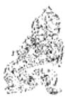

<!-- V3_SOURCE_ID:book016-b001363-p000-7097e8dd11 -->

注释①泽中有雷，随：解释随卦的卦象是上兑为泽、下震为雷。《程传》说：“雷震于泽中，泽随震而动，这就是随卦的卦象。”

查看对应原文

<!-- V3_FOLDBACK_BEGIN:book016-b001363-p000-7097e8dd11 -->

注释①泽中有雷，随：释《随》卦上兑为泽、下震为雷之象。《程传》：“雷震于泽中，泽随震而动，为‘随’之象。”

<!-- V3_FOLDBACK_END:book016-b001363-p000-7097e8dd11 -->

<!-- V3_SOURCE_ID:book016-b001364-p000-4e58cfda16 -->

②嚮晦入宴息：嚮，通“向”，“嚮晦”就如同说“向晚”；宴，是安的意思，“宴息”就是休息的意思。这是说明君子观察随卦的卦象，领悟到凡事要随时的道理，所以白天外出，傍晚按时入室休息。《程传》说：“君子白天自强不息，等到傍晚时分，就入室居于内，安身休息，起居随时，适宜得当。《礼》说：‘君子白天不居内，夜晚不居外’，这就是随时的道理。”

查看对应原文

<!-- V3_FOLDBACK_BEGIN:book016-b001364-p000-4e58cfda16 -->

②嚮晦入宴息：嚮，通“向”，“嚮晦”犹言“向晚”；宴，安也，“宴息”即“休息”之意。这是说明“君子”观《随》卦之象，悟知凡事“随时”的道理，故早出晚入、于向晚按时休息。《程传》：“君子昼则自强不息，及嚮昏晦，则入居于内，宴息以安其身，起居随时，适其宜也。《礼》：‘君子昼不居内，夜不居外’，随时之道也。”

<!-- V3_FOLDBACK_END:book016-b001364-p000-4e58cfda16 -->

<!-- V3_SOURCE_ID:book016-b001365-p000-63c2cd6fde -->

《大象传》以“向晚入室休息”来阐发随卦的意义，也就是《彖传》所说的“天下随时”的道理。程颐说：“选取其中最明显、最切近的内容来论述”（《程传》）。

查看对应原文

<!-- V3_FOLDBACK_BEGIN:book016-b001365-p000-63c2cd6fde -->

说萌《大象传》以“向晚入室休息”衍发《随》卦意义，即《彖传》所谓“天下随时”之理。程颐谓：“取其最明且近者言之”(《程传》)。

<!-- V3_FOLDBACK_END:book016-b001365-p000-63c2cd6fde -->

<!-- V3_SOURCE_ID:book016-b001366-p000-7928803221 -->

译文初九，思想观念随时改善，守持正固可获吉祥；出门与人交往必能成功。

查看对应原文

<!-- V3_FOLDBACK_BEGIN:book016-b001366-p000-7928803221 -->

译文初九，思想观念随时改善，守持正固可获吉祥；出门与人交往必能成功。

<!-- V3_FOLDBACK_END:book016-b001366-p000-7928803221 -->

<!-- V3_SOURCE_ID:book016-b001367-p000-9c4935a6e7 -->

初九这一爻，若执掌的职事或内心的想法有所变化，守持正固可获吉祥；出门与人交往必能成功。

> **释读存疑：** 原文中“官有渝”的“官”具体所指，释读中未明确对应原文注释的“执掌之职”或“内心所主”的歧义，仅笼统译为“执掌的职事或内心的想法”，存在一定模糊性

查看对应原文

<!-- V3_FOLDBACK_BEGIN:book016-b001367-p000-9c4935a6e7 -->

初九，官有渝，贞吉；出门交有功①。

<!-- V3_FOLDBACK_END:book016-b001367-p000-9c4935a6e7 -->

<!-- V3_SOURCE_ID:book016-b001368-p000-c525b7e16f -->

注释①官有渝，贞吉；出门交有功：《正义》说“官”指执掌的职分，人的内心所持守的东西和“官”的称呼相同，所以人的内心所持的主张叫做“官”，因此《程传》将“官”解释为“主守”，就像现在所说的“思想观念”；渝，就是变化，这里有改善的意思。这三句说明初九处于“随”的情境中，阳刚居于阴柔之下，没有应和的对象，是能够改变内心、随时依从正道的象征，所以守持正固可获吉祥，出门与人交往必能成功。《正义》还说：“初九既然没有应和的对象，没有偏私的牵挂，该随从就随从，这就是所持守的志向能够改变；只依从正道，所以‘贞吉’；‘出门交有功’，是因为所随从的不是出于私欲，所以见到善举就去随从，这样出门交往，就能获得功效。”

查看对应原文

<!-- V3_FOLDBACK_BEGIN:book016-b001368-p000-c525b7e16f -->

注释①官有渝，贞吉；出门交有功：官，《正义》：“谓执掌之职，人心执掌与‘官’同称，故人心所主谓之‘官’”，故《程传》释“官”为“主守”，犹今言“思想观念”；渝，变也，此处有改善之义。这三句说明初九当“随”之时，刚居柔下，无所系应，为能变渝其心、随时从正之象，故“贞”而获“吉”，出门交有功。《正义》：“初九既无其应，无所偏系，可随则随，是所执之志有能变渝也；唯正是从，故‘贞吉’也；‘出门交有功’者，所随不以私欲，故见善则往随之，以此出门，交获其功。”

<!-- V3_FOLDBACK_END:book016-b001368-p000-c525b7e16f -->

<!-- V3_SOURCE_ID:book016-b001369-p000-31f6cc7cc5 -->

译文《象传》说：“思想观念随时改善”，说明初九随从正道可获吉祥；“出门与人交往必能成功”，说明行为不致过失。

查看对应原文

<!-- V3_FOLDBACK_BEGIN:book016-b001369-p000-31f6cc7cc5 -->

译文《象传》说：“思想观念随时改善”，说明初九随从正道可获吉祥；“出门与人交往必能成功”，说明行为不致过失。

<!-- V3_FOLDBACK_END:book016-b001369-p000-31f6cc7cc5 -->

<!-- V3_SOURCE_ID:book016-b001370-p000-d6d1dcaf9e -->

《象传》说：“居官者的操守有所变易”，是说只要遵循正道就会吉祥；“出门与人交往会有功绩”，是说这样做不会有过失。

查看对应原文

<!-- V3_FOLDBACK_BEGIN:book016-b001370-p000-d6d1dcaf9e -->

《象》曰：“官有渝”，从正吉也；“出门交有功”，不失也。

<!-- V3_FOLDBACK_END:book016-b001370-p000-d6d1dcaf9e -->

<!-- V3_SOURCE_ID:book016-b001371-p000-ba476ba5c1 -->

居初，倘若失“正”，必将误入歧途。故爻义又含“慎始”之诫。

查看对应原文

<!-- V3_FOLDBACK_BEGIN:book016-b001371-p000-ba476ba5c1 -->

居初，倘若失“正”，必将误入歧途。故爻义又含“慎始”之诫。

<!-- V3_FOLDBACK_END:book016-b001371-p000-ba476ba5c1 -->

<!-- V3_SOURCE_ID:book016-b001372-p000-9f36e04911 -->

六二爻的爻辞是“系小子，失丈夫”，对应的白话解释为：六二爻的人倾心附从小子，就会失去阳刚丈夫。

查看对应原文

<!-- V3_FOLDBACK_BEGIN:book016-b001372-p000-9f36e04911 -->

六二，系小子，失丈夫①。 译文六二，倾心附从小子，失去阳刚丈夫。

<!-- V3_FOLDBACK_END:book016-b001372-p000-9f36e04911 -->

<!-- V3_SOURCE_ID:book016-b001373-p000-5acf9a3c9e -->

匡释“系小子，失丈夫”：“系”是系属的意思，好比说“倾心附从”；“小子”比喻初九，“丈夫”比喻九五。这是说六二以阴柔之位居于下卦，本应与九五相应和，却就近附从初九，所以有不能专一遵循正道、附从小子而失去丈夫的意象。《正义》说：“六二既然是阴柔之爻，不能独立自处，必然会就近系属初九，所以说‘系小子’；既然依附了初九，就不能再去应和九五，所以说‘失丈夫’。”

查看对应原文

<!-- V3_FOLDBACK_BEGIN:book016-b001373-p000-5acf9a3c9e -->

匡释①系小子，失丈夫：系，系属，犹言“倾心附从”；小子，喻初九；丈夫，喻九五。此谓六二柔居下卦，本与九五相应，却就近附从初九，故有从正不专、“系”小“失”大之象。《正义》：“六二既是阴柔，不能独立所处，必近系属初九，故云‘系小子’；既属初九，则不能往应于五，故云‘失丈夫’也。”

<!-- V3_FOLDBACK_END:book016-b001373-p000-5acf9a3c9e -->

<!-- V3_SOURCE_ID:book016-b001374-p000-62cc89124d -->

《象传》说：“倾心附从小子”，这说明六二无法同时兼顾多方亲好。

查看对应原文

<!-- V3_FOLDBACK_BEGIN:book016-b001374-p000-62cc89124d -->

《象》曰：“系小子”，弗兼与也。 译文《象传》说：“倾心附从小子”，说明六二不能同时多方获取亲好。

<!-- V3_FOLDBACK_END:book016-b001374-p000-62cc89124d -->

<!-- V3_SOURCE_ID:book016-b001375-p000-c466839587 -->

这说明在“随从”他人的时候，如果优柔寡断，必然会顾此失彼、因小失大。程颐指出：本爻是告诫人随从应当守持正道、专心一意，出自《程传》。

查看对应原文

<!-- V3_FOLDBACK_BEGIN:book016-b001375-p000-c466839587 -->

说明“随从”之际，若优柔寡断，必将顾此失彼、因小失大。程颐指出：本爻“戒人从正当专一”（《程传》）。

<!-- V3_FOLDBACK_END:book016-b001375-p000-c466839587 -->

<!-- V3_SOURCE_ID:book016-b001376-p000-96fa5a29ad -->

## 六三，系丈夫，失小子①；随有求得，利居贞②。 — 六三，倾心附从阳刚丈夫，失去小子①；随从于人有求必得，利于安居、守持正固②。

查看对应原文

<!-- V3_FOLDBACK_BEGIN:book016-b001376-p000-96fa5a29ad -->

## 六三，系丈夫，失小子①；随有求得，利居贞②。

<!-- V3_FOLDBACK_END:book016-b001376-p000-96fa5a29ad -->

<!-- V3_SOURCE_ID:book016-b001377-p000-2d82c751d6 -->

六三的爻义是：倾心附从阳刚丈夫，失去小子；随从于人则有求必得，利于安居、守持正固。

查看对应原文

<!-- V3_FOLDBACK_BEGIN:book016-b001377-p000-2d82c751d6 -->

译文六三，倾心附从阳刚丈夫，失去在 下小子；随从于人有求必得，利于安居、 守持正固。

<!-- V3_FOLDBACK_END:book016-b001377-p000-2d82c751d6 -->

<!-- V3_SOURCE_ID:book016-b001378-p000-84a70b8bef -->

匡释①系丈夫，失小子：丈夫，用来比喻九四；小子，用来比喻初九。这是说六三靠近并依附九四，因为前往随从九四，所以失去了初九。《王注》说：“虽然六三属于下卦，但是六二已经占据了初九，六三还能依附谁呢？所以舍弃初九而依附九四，心意在于阳刚丈夫。”

查看对应原文

<!-- V3_FOLDBACK_BEGIN:book016-b001378-p000-84a70b8bef -->

匡释①系丈夫，失小子：丈夫，喻九四；小子，喻初九。此谓六三近承九四，因往随从，故失去初九。《王注》：“虽体下卦，二已据初，将何所附？故舍初系四，志在丈夫。”

<!-- V3_FOLDBACK_END:book016-b001378-p000-84a70b8bef -->

<!-- V3_SOURCE_ID:book016-b001379-p000-751ab37d60 -->

②随有求得，利居贞：这是承接前文的含义，说明六三、九四两个爻都没有正应，相邻亲近，所以六三随从九四，有所求就一定能得到；但又告诫六三不可妄求，适宜安居守正。《王注》说：“九四与六三都没有正应，九四也想让六三随从自己，六三随从九四就能得到自己所求的，所以说‘随有求得’。六三与九四的相应不正，六三依附于人，怎么可以妄求呢？所以说‘利居贞’。”

查看对应原文

<!-- V3_FOLDBACK_BEGIN:book016-b001379-p000-751ab37d60 -->

②随有求得，利居贞：此承前文义，说明三、四两爻均无正应，互比相亲，故三随四、有求必得；但又告诫六三不可妄求，宜于安居守正。《王注》：“四俱无应，亦欲于己，随之则得其所求矣，故曰‘随有求得’也。应非其正，以系于人，何可以妄？故‘利居贞’也。”

<!-- V3_FOLDBACK_END:book016-b001379-p000-751ab37d60 -->

<!-- V3_SOURCE_ID:book016-b001380-p000-5ab11df607 -->

《象》说：“系丈夫”，是说六三的心意在于舍弃在下的小子。

查看对应原文

<!-- V3_FOLDBACK_BEGIN:book016-b001380-p000-5ab11df607 -->

《象》曰：“系丈夫”，志舍下也。 译文《象传》说：“倾心附从阳刚丈夫”，说明六三的意志是舍弃在下小子。

<!-- V3_FOLDBACK_END:book016-b001380-p000-5ab11df607 -->

<!-- V3_SOURCE_ID:book016-b001381-p000-408906a622 -->

这说明在下的人随从尊贵的人，在备受亲宠、有所求就能得到的时候，应当广泛修养美德、守正谨慎地对待“求”。如果不这样，就一定会有“邪媚之嫌”（《本义》）。

查看对应原文

<!-- V3_FOLDBACK_BEGIN:book016-b001381-p000-408906a622 -->

说明下者随从尊上，当备受亲宠、有求必得之时，自当广修美德、守正慎“求”。不然，必有“邪媚之嫌”（《本义》）。

<!-- V3_FOLDBACK_END:book016-b001381-p000-408906a622 -->

<!-- V3_SOURCE_ID:book016-b001382-p000-882039746f -->

九四爻，随从他人却有所收获，守持正固以防凶险；只要心怀诚信、合乎正道，立身光明磊落，又有什么咎害呢！

查看对应原文

<!-- V3_FOLDBACK_BEGIN:book016-b001382-p000-882039746f -->

九四，随有获①，贞凶②；有孚在道，以明，何咎③！

<!-- V3_FOLDBACK_END:book016-b001382-p000-882039746f -->

<!-- V3_SOURCE_ID:book016-b001383-p000-51bf551361 -->

译文九四，被人随从、多有所获，守持正固以防凶险；只要心怀诚信、合乎正道，立身光明磊落，又有什么咎害呢！

查看对应原文

<!-- V3_FOLDBACK_BEGIN:book016-b001383-p000-51bf551361 -->

译文九四，被人随从、多有所获，守持正固以防凶险；只要心怀诚信、合乎正道，立身光明磊落，又有什么咎害呢！

<!-- V3_FOLDBACK_END:book016-b001383-p000-51bf551361 -->

<!-- V3_SOURCE_ID:book016-b001384-p000-219019380d -->

注释①随有获：指九四被六三随从而有收获。王弼的注说：“处说之初，下据二阴，三求系己，不距则获，故曰‘随有获’也。”

> **释读存疑：** 本地硬校验仍未通过，已记录供后续自动处理或人工核对。

查看对应原文

<!-- V3_FOLDBACK_BEGIN:book016-b001384-p000-219019380d -->

注释①随有获：指九四被六三随从而“有获”。《王注》：“处说之初，下据二阴，三求系己，不距则获，故曰‘随有获’也。”

<!-- V3_FOLDBACK_END:book016-b001384-p000-219019380d -->

<!-- V3_SOURCE_ID:book016-b001385-p000-8dfa3433b7 -->

②贞凶：意思是守正防凶。这是说九四爻以阳爻居阴位，靠近“君”位却擅自受人随从，有违背正道的征象，应当趋合正道、谨守本分，谨防凶险，所以告诫要贞凶。

> **释读存疑：** 原文中括号内的《屯》卦九五爻译注相关内容未按要求保留，此处已删除；“贞凶”的具体含义仍需结合《屯》卦相关内容进一步确认；原文中括号内的《屯》卦九五爻译注相关内容未保留，“贞凶”的具体含义需结合《屯》卦相关内容进一步确认；1轮自动修复后核义模型仍建议修订，已保守记录。

查看对应原文

<!-- V3_FOLDBACK_BEGIN:book016-b001385-p000-8dfa3433b7 -->

②贞凶：犹言“守正防凶”（参见《屯》九五译注)。此谓九四阳居阴位，近 “君”而擅为人从，有“违正”之象，应当趋正常守，谨防凶险，故戒以“贞凶”。

<!-- V3_FOLDBACK_END:book016-b001385-p000-8dfa3433b7 -->

<!-- V3_SOURCE_ID:book016-b001386-p000-63b2492340 -->

③有孚在道，以明，何咎：这里的“明”用作动词，意思是显明美德。这三句从正面勉励九四，要以诚信体现正道，显明美德，这样就不会有咎害。《王注》说：“体刚居说，而得民心，能干其事，而成其功者也；虽违常义，志在济物，心有公诚，著信在道，以明其功，何咎之有！”

查看对应原文

<!-- V3_FOLDBACK_BEGIN:book016-b001386-p000-63b2492340 -->

③有孚在道，以明，何咎：明，用如动词，犹言“显明美德”。这三句从正面勉励九四以诚信体现正道，显明美德，必将无所咎害。《王注》：“体刚居说，而得民心，能干其事，而成其功者也；虽违常义，志在济物，心有公诚，著信在道，以明其功，何咎之有！”

<!-- V3_FOLDBACK_END:book016-b001386-p000-63b2492340 -->

<!-- V3_SOURCE_ID:book016-b001387-p000-54267a376e -->

译文《象传》说：‘被人随从、多有所获’，从九四所处地位这一意义看是有凶险；‘心怀诚信、合乎正道’，这是九四光明磊落品德的功效。

查看对应原文

<!-- V3_FOLDBACK_BEGIN:book016-b001387-p000-54267a376e -->

译文《象传》说：‘被人随从、多有所获’，从九四所处地位这一意义看是有凶险；‘心怀诚信、合乎正道’，这是九四光明磊落品德的功效。

<!-- V3_FOLDBACK_END:book016-b001387-p000-54267a376e -->

<!-- V3_SOURCE_ID:book016-b001388-p000-7f87e2ebe4 -->

《象传》中说，‘随有获’这句话的含义是凶险的；‘有孚在道’这句话，是说明其光明正大的功效。

查看对应原文

<!-- V3_FOLDBACK_BEGIN:book016-b001388-p000-7f87e2ebe4 -->

《象》曰：“随有获”，其义凶也；“有孚在道”，明功也。

<!-- V3_FOLDBACK_END:book016-b001388-p000-7f87e2ebe4 -->

<!-- V3_SOURCE_ID:book016-b001389-p000-0b40a35b47 -->

要让人追随自己，必须具备君子的品德。九四爻位属于“多凶”之位，又处于不当的位置，所以爻辞先从反面警戒它要谨防凶险；然后从正面激励它发扬美德，这样就能将凶险转化为没有咎害。《周易会通》引用袁枢的话说：“其义凶者，有凶之理而未必凶也；处得其道，如下所云，则无咎矣。”

查看对应原文

<!-- V3_FOLDBACK_BEGIN:book016-b001389-p000-0b40a35b47 -->

巍明为人所从，必须具备“君子”之德。四位“多凶”，又兼“失正”，故爻辞先从反面警戒其谨防凶险；然后从正面激励其发扬美德，遂可化“凶”为“无咎”。《周易会通》引袁枢曰：“其义凶者，有凶之理而未必凶也；处得其道，如下所云，则无咎矣。”

<!-- V3_FOLDBACK_END:book016-b001389-p000-0b40a35b47 -->

<!-- V3_SOURCE_ID:book016-b001390-p000-a5ef2fb9ff -->

译文九五，广施诚信给美善者，吉祥。

查看对应原文

<!-- V3_FOLDBACK_BEGIN:book016-b001390-p000-a5ef2fb9ff -->

译文九五，广施诚信给美善者，吉祥。

<!-- V3_FOLDBACK_END:book016-b001390-p000-a5ef2fb9ff -->

<!-- V3_SOURCE_ID:book016-b001391-p000-e7cfb4ea50 -->

爻位为九五，将诚信施予美善之人，吉祥。

查看对应原文

<!-- V3_FOLDBACK_BEGIN:book016-b001391-p000-e7cfb4ea50 -->

九五，孚于嘉，吉①。

<!-- V3_FOLDBACK_END:book016-b001391-p000-e7cfb4ea50 -->

<!-- V3_SOURCE_ID:book016-b001392-p000-2f2ca30a3d -->

注释①孚于嘉，吉：嘉，指美善。此处是说，九五爻为阳爻居于尊位，得正且居中，内心诚信，有顺从美善的征象，因此能取信于美善之人而获吉祥。《程传》中说：“九五居于尊位，得正且内心充实，这是他的内心诚信在于顺从美善，其吉祥可知。嘉，就是美善。从君主到平民，顺从之道的吉祥只在于顺从美善而已；下与六二的正中相应，这就是顺从美善的含义。”

查看对应原文

<!-- V3_FOLDBACK_BEGIN:book016-b001392-p000-2f2ca30a3d -->

注释①孚于嘉，吉：嘉，美善。此谓九五阳刚居尊，中正诚信，有从善如流之象，故能孚信善者而获‘吉’。《程传》：‘九五居尊，得正而中实，是其中诚在于随善，其吉可知。嘉，善也，自人君至于庶人，随道之吉惟在随善而已；下应二之正中，为随善之义。’

<!-- V3_FOLDBACK_END:book016-b001392-p000-2f2ca30a3d -->

<!-- V3_SOURCE_ID:book016-b001393-p000-568a8fe73a -->

译文《象传》说：‘广施诚信给美善者，吉祥’，说明九五的位置正中不偏。

查看对应原文

<!-- V3_FOLDBACK_BEGIN:book016-b001393-p000-568a8fe73a -->

译文《象传》说：‘广施诚信给美善者，吉祥’，说明九五的位置正中不偏。

<!-- V3_FOLDBACK_END:book016-b001393-p000-568a8fe73a -->

<!-- V3_SOURCE_ID:book016-b001394-p000-f161e32854 -->

《象传》说：“以诚信对待美善之事可获吉祥”，这是因为爻位居中且得正。

查看对应原文

<!-- V3_FOLDBACK_BEGIN:book016-b001394-p000-f161e32854 -->

《象》曰：“孚于嘉吉”，位正中也。

<!-- V3_FOLDBACK_END:book016-b001394-p000-f161e32854 -->

<!-- V3_SOURCE_ID:book016-b001395-p000-9fd93df320 -->

明卦九五的象征意旨是：居尊位而能以诚从善，善者也将纷纷相随。王弼称此爻“尽随时之宜”，出自《王注》；杨万里认为：“这是圣君至诚，乐于顺从天下的善举”，出自《诚斋易传》。

查看对应原文

<!-- V3_FOLDBACK_BEGIN:book016-b001395-p000-9fd93df320 -->

∑明九五的象征意旨是：居尊而能以诚从善，善者也将纷纷相随。王弼称此 爻“尽随时之宜”(《王注》)；杨万里以为：“此圣君至诚，乐从天下之善者也。 (《诚斋易传》)

<!-- V3_FOLDBACK_END:book016-b001395-p000-9fd93df320 -->

<!-- V3_SOURCE_ID:book016-b001396-p000-f8e8dbb223 -->

译文上六，拘禁强令附从，这才顺服相随，再用绳索拴紧；君王兴师讨逆、在西山设祭。

查看对应原文

<!-- V3_FOLDBACK_BEGIN:book016-b001396-p000-f8e8dbb223 -->

译文上六，拘禁强令附从，这才顺服相随，再用绳索拴紧；君王兴师讨逆、在西山设祭。

<!-- V3_FOLDBACK_END:book016-b001396-p000-f8e8dbb223 -->

<!-- V3_SOURCE_ID:book016-b001397-p000-0dd73a3597 -->

上六，拘禁他，他才顺从，再用绳索拴紧；君王在西山举行祭祀。

> **释读存疑：** 原文中“拘系之，乃从，维之”的具体所指未明确，释读为“拘禁他，他才顺从，再用绳索拴紧”为合理通俗化释读

查看对应原文

<!-- V3_FOLDBACK_BEGIN:book016-b001397-p000-0dd73a3597 -->

上六，拘系之，乃从，维之①；王用亨于西山②。

<!-- V3_FOLDBACK_END:book016-b001397-p000-0dd73a3597 -->

<!-- V3_SOURCE_ID:book016-b001398-p000-c381700ac9 -->

注释①拘系之，乃从，维之：拘，拘禁；系，义与二、三爻“系小子”、“系丈夫”之“系”同，此处谓强迫使之“附从”；维，以绳捆绑。这是说明上六以阴居“随”之极，极则反，有不愿随从、被九五拘禁乃从之象。《王注》：“随之为体，阴顺阳者也；最处上极，不从者也。随道已成，而特不从，故拘系之乃从也。率土之滨，莫非王臣’，而为不从，王之所讨也，故‘维之’。”

查看对应原文

<!-- V3_FOLDBACK_BEGIN:book016-b001398-p000-c381700ac9 -->

注释①拘系之，乃从，维之：拘，拘禁；系，义与二、三爻“系小子”、“系丈夫”之“系”同，此处谓强迫使之“附从”；维，以绳捆绑。这是说明上六以阴居“随”之极，极则反，有不愿随从、被九五拘禁乃从之象。《王注》：“随之为体，阴顺阳者也；最处上极，不从者也。随道已成，而特不从，故拘系之乃从也。率土之滨，莫非王臣’，而为不从，王之所讨也，故‘维之’。”

<!-- V3_FOLDBACK_END:book016-b001398-p000-c381700ac9 -->

<!-- V3_SOURCE_ID:book016-b001399-p000-c2c20cf75b -->

② 王用亨于西山：王，喻九五；亨，通“享”，《释文》引陆绩曰：“祭也”，指古代出师设祭之礼；西山，王弼以为“西”为上兑之方、“山”喻险阻。此句承前文之义，取“王者”设祭西山、兴师讨逆为象，比喻九五强令上六顺服、随从。《王注》：“兑为西方；山者，途之险隔也。处西方而为不从，故王用通于西山。”案，王弼释“亨”为“通”，亦合爻义。

查看对应原文

<!-- V3_FOLDBACK_BEGIN:book016-b001399-p000-c2c20cf75b -->

② 王用亨于西山：王，喻九五；亨，通“享”，《释文》引陆绩曰：“祭也”，指古代出师设祭之礼；西山，王弼以为“西”为上兑之方、“山”喻险阻。此句承前文之义，取“王者”设祭西山、兴师讨逆为象，比喻九五强令上六顺服、随从。《王注》：“兑为西方；山者，途之险隔也。处西方而为不从，故王用通于西山。”案，王弼释“亨”为“通”，亦合爻义。

<!-- V3_FOLDBACK_END:book016-b001399-p000-c2c20cf75b -->

<!-- V3_SOURCE_ID:book016-b001400-p000-67988f35fb -->

[说明本爻的意义，诸家说法不一。今引两例以备参考。一、朱熹谓“拘系”，“维”为“随之固结而不可解”之象，即指上六极获“随从"之义；并认为“西山”指西周“岐山”。(《本义》)二、尚先生引《西溪易说》，驳“遇西山’、‘西邻’，皆曰“文王事’”之说。并谓“亨”为“宴享”，“西山”喻上六“隐居之所”，认为：“六穷于上，五恐其去，拘系之，从维之，或即其隐居之处而宴享之；言六无所随，而五必随之也。”(《尚氏学》)

查看对应原文

<!-- V3_FOLDBACK_BEGIN:book016-b001400-p000-67988f35fb -->

[说明本爻的意义，诸家说法不一。今引两例以备参考。一、朱熹谓“拘系”，“维”为“随之固结而不可解”之象，即指上六极获“随从"之义；并认为“西山”指西周“岐山”。(《本义》)二、尚先生引《西溪易说》，驳“遇西山’、‘西邻’，皆曰“文王事’”之说。并谓“亨”为“宴享”，“西山”喻上六“隐居之所”，认为：“六穷于上，五恐其去，拘系之，从维之，或即其隐居之处而宴享之；言六无所随，而五必随之也。”(《尚氏学》)

<!-- V3_FOLDBACK_END:book016-b001400-p000-67988f35fb -->

<!-- V3_SOURCE_ID:book016-b001401-p000-08b52459b5 -->

《象》曰：“拘系之”，上穷也。 译文《象传》说：“拘禁强令附从”，说明上六居位极上、随从之道穷尽。

查看对应原文

<!-- V3_FOLDBACK_BEGIN:book016-b001401-p000-08b52459b5 -->

《象》曰：“拘系之”，上穷也。 译文《象传》说：“拘禁强令附从”，说明上六居位极上、随从之道穷尽。

<!-- V3_FOLDBACK_END:book016-b001401-p000-08b52459b5 -->

<!-- V3_SOURCE_ID:book016-b001402-p000-99b51a552a -->

解释“随”与“不随”的含义，二者是相对立而存在的。当全天下都在“从善”的时候，必然会有违背正道而行事的人，所以不得不强制命令他们回归正道。因此本爻有“拘”“维”“王用亨于西山”这些意象。

查看对应原文

<!-- V3_FOLDBACK_BEGIN:book016-b001402-p000-99b51a552a -->

说明“随”与“不随”，相对立而存在。举世“从善”之际，必有逆其道而行者，则不得不强令归正。因此本爻有“拘”、“维”、“王用亨于西山”诸象。

<!-- V3_FOLDBACK_END:book016-b001402-p000-99b51a552a -->

<!-- V3_SOURCE_ID:book016-b001403-p000-b0e731d4d9 -->

正如孔子所说：“三人行，必有我师焉；择其善者而从之，其不善者而改之。”这句话充分体现了这位古代伟大的思想家、教育家虚心向善的美德。《随》卦所阐发的“随从”之义，正是集中体现了“从善”的宗旨。该卦的卦辞“元亨，利贞”，高度赞美“随从”之道；“无咎”，又强调了以“正”相随就不会有过错的观点。六爻的喻义，以初爻、五爻最为美好：初九爻处于下位而坚守正道，不断迁善改过；九五爻居于尊位而持守中正，竭诚向善——因此这两爻展示了本卦以“善”作为“随”的象征主体，都获得了吉祥。至于二、三、四、上各爻，有的有失有得，有的坚守正道可以将“凶”转化为“无咎”，有的需要受到强制才能回归正道：各自呈现出不同的处“随”情状，但所阐发的诫勉之意，都离不开“正”字。由此可见，《随》卦的义理中蕴含着一项鲜明且含义广泛的“相随”原则：不论是人与人关系中的上随下、下随上，己随人、人随己，还是日常生活中的朝作晚息、遇事随时，都应当不违背正道，诚心从善。其中明显表露了《周易》作者处世、修身的哲学观念。《孟子·公孙丑下》盛赞“七十子之服孔子”，正与本卦的主旨相合，成为古人极力肯定的“从善”典范。

查看对应原文

<!-- V3_FOLDBACK_BEGIN:book016-b001403-p000-b0e731d4d9 -->

愿孔子说："三人行，必有我师焉；择其善者而从之，其不善者而改之。"（《论语·述而》）充分反映这位古代伟大思想家、教育家虚心向善的美德。《随》卦所发“随从”之义，正是集中体现“从善”的宗旨。卦辞“元亨，利贞”，高度赞美“随从”之道；“无咎”，又强调以“正”相随则无害的观点。六爻喻义，以初、五最为美好：初九处下守正，迁善不已；九五居尊中正，竭诚向善——因此这两爻展示了本卦以“善”为“随”的象征主体，均获吉祥。至于二、三、四、上诸爻，或有失有得，或守正可以化“凶”为“无咎”，或受强制才能从正：各见不同的处“随”情状，但所发诫意，皆不离“正”字。可见，《随》卦义理中蕴含着一项鲜明而含义广泛的“相随”原则：不论是人与人关系中的上随下、下随上，己随人、人随己，还是日常生活中的朝作晚息、遇事随时，均当不违正道，诚心从善。此中明显表露《周易》作者处世、修身的哲学观念。《孟子·公孙丑下》盛赞“七十子之服孔子”，正与本卦大旨相合，成为古人极力肯定的“从善”典范。

<!-- V3_FOLDBACK_END:book016-b001403-p000-b0e731d4d9 -->

<!-- V3_SOURCE_ID:book016-b001405-p000-e0d6359f4c -->

## 蛊卦第十八

查看对应原文

<!-- V3_FOLDBACK_BEGIN:book016-b001405-p000-e0d6359f4c -->

## 蛊卦第十八

<!-- V3_FOLDBACK_END:book016-b001405-p000-e0d6359f4c -->

<!-- V3_SOURCE_ID:book016-b001406-p000-96f2652e95 -->

译文《蛊》卦象征拯弊治乱：至为亨通，利于涉越大河巨流；应当预先思虑象征“终始转化”的“甲”日前三天的事状，然后推求“甲”日后三天的治理措施。

查看对应原文

<!-- V3_FOLDBACK_BEGIN:book016-b001406-p000-96f2652e95 -->

译文《蛊》卦象征拯弊治乱：至为亨通，利于涉越大河巨流；应当预先思虑象征“终始转化”的“甲”日前三天的事状，然后推求“甲”日后三天的治理措施。

<!-- V3_FOLDBACK_END:book016-b001406-p000-96f2652e95 -->

<!-- V3_SOURCE_ID:book016-b001407-p000-3d1ebbeeee -->

蛊卦：大亨通，利于渡过大河；在甲日之前三天，甲日之后三天行事。

> **释读存疑：** 本地硬校验仍未通过，已记录供后续自动处理或人工核对。

查看对应原文

<!-- V3_FOLDBACK_BEGIN:book016-b001407-p000-3d1ebbeeee -->

蛊①：元亨，利涉大川②；先甲三日，后甲三日③。

<!-- V3_FOLDBACK_END:book016-b001407-p000-3d1ebbeeee -->

<!-- V3_SOURCE_ID:book016-b001408-p000-e4a7f92642 -->

注释①蛊：读音为gǔ，是卦名，下为巽（八卦之一）、上为艮（八卦之一），象征“拯弊治乱”。按，“蛊”字，《说文解字》说它指“腹中的蛊虫”，可引申为蛊害、蛊乱、蛊惑等含义，爻辞“干父之蛊”就是说“处理父亲留下的弊害”；卦名的含义，核心在于“拯弊治乱”。《序卦传》说：“蛊就是事务”，《正义》引用褚氏的话：“蛊就是惑乱，事物既然已经惑乱，最终会导致损坏，此时就需要有所作为，进行治理。”

查看对应原文

<!-- V3_FOLDBACK_BEGIN:book016-b001408-p000-e4a7f92642 -->

注释①蛊：音gǔ，卦名，下巽（☴）上艮（☶），象征“拯弊治乱”。案，“蛊”字，《说文》谓“腹中蛊也”，可引申为蛊害、蛊乱、蛊惑等意，爻辞“干父之蛊”即言“于父之害”；卦名之义，主于“拯弊治乱”。《序卦传》云：“蛊者，事也”，《正义》引褚氏曰：“蛊者，惑也，物既惑乱，终致损坏，当须有事也，有为治理也。”

<!-- V3_FOLDBACK_END:book016-b001408-p000-e4a7f92642 -->

<!-- V3_SOURCE_ID:book016-b001409-p000-adef09ccb3 -->

②元亨，利涉大川：这是说事物出现弊乱的时候，若能努力合理地进行拯治，必然会达到大亨通的状态，因此利于渡险济难。《正义》说：“蛊就是事务。有所作为去经营治理，就会大亨通；有所作为的时候，利于拯济危难，所以说‘利于渡过大河’。”

查看对应原文

<!-- V3_FOLDBACK_BEGIN:book016-b001409-p000-adef09ccb3 -->

②元亨，利涉大川：此谓事物弊乱之时，能努力合理拯治必致“元亨”，故利于涉险济难。《正义》：“蛊者，事也。有事营为，则大得亨通；有为之时，利在拯难，故‘利涉大川’。”

<!-- V3_FOLDBACK_END:book016-b001409-p000-adef09ccb3 -->

<!-- V3_SOURCE_ID:book016-b001410-p000-9e84fb6239 -->

③先甲三日，后甲三日：甲，是天干（甲乙丙丁戊己庚辛壬癸）的首位，它的顺序是甲、乙、丙、丁、戊、己、庚、辛、壬、癸；在这十个天干的顺序里，“甲”蕴含着“终而复始”的含义，因此取“甲日”作为转化弊乱、重新进行治理的象征，也就是《彖传》中“终则有始”的主旨。这两句说的是在甲日之前三天、甲日之后三天行事，语句多有省略，大致意思是预先深入思考治理弊乱之前的情况，详细辨析，引为鉴戒；再推求治理弊乱之后必然会出现的事态，制定措施，谨慎处理：这样才能根治蛊乱，获得大亨通的前景。《程传》说：“甲，是天干的首位，是事务的开始”，“治理蛊乱的方法，应当考虑甲日前后三天的情况，这是推究事物的先后顺序，作为拯救弊乱、使其长久的方法。先甲，是指在这之前，探究事情之所以这样的原因；后甲，是指在这之后，考虑事情将会发展成什么样。一日、二日直到三日，是说思考得深入，推究得长远。”

查看对应原文

<!-- V3_FOLDBACK_BEGIN:book016-b001410-p000-9e84fb6239 -->

③先甲三日，后甲三日：甲，“天干”数之首，其序为甲、乙、丙、丁、戊、己、庚、辛、壬、癸；在此十数中，“甲”寓有“终而复始”的涵义，故取“甲日”作为“转化”弊乱、重为治理的象征，即《彖传》“终则有始”之旨。这两句言先后“甲”三日，语多省略，大意指预先深虑“治蛊”前的事状，详为辨析，引为鉴戒；再推求“治蛊”后必将出现的事态，制定措施，谨慎治理：这样，才能根治蛊乱，获得“元亨”的前景。《程传》曰：“甲，数之首，事之始也”，“治蛊之道，当思虑其先后三日，盖推原先后，为救弊可久之道。先甲，谓先于此，究其所以然也；后甲，谓后于此，虑其将然也。一日、二日至于三日，言虑之深，推之远也。”

<!-- V3_FOLDBACK_END:book016-b001410-p000-9e84fb6239 -->

<!-- V3_SOURCE_ID:book016-b001411-p000-d904d3c0bb -->

关于“甲”字的含义，以往的说法并不完全一致。比如：第一种，郑玄认为它指“造作新令之日”（《正义》引）；第二种，王弼认为它指“创制之令”（《王注》）。这些说法虽然有分歧，但各家都依据“数之始”这一寓意来解读。仔细探究卦辞的象征内涵，“先甲”“后甲”实际上还流露着“前车覆后车戒”“殷鉴不远”的意味。

查看对应原文

<!-- V3_FOLDBACK_BEGIN:book016-b001411-p000-d904d3c0bb -->

说明“甲”字之义，旧说未臻一致。如：一、郑玄以为指“造作新令之日”（《正义》引）；二、王弼以为指“创制之令”（《王注》）。说法虽歧，但诸家均本于“数之始”这一寓意。细求卦辞的象征内涵；“先甲”、“后甲”实又流露着“前车覆后车戒”、“殷鉴不远”的意味。

<!-- V3_FOLDBACK_END:book016-b001411-p000-d904d3c0bb -->

<!-- V3_SOURCE_ID:book016-b001412-p000-971c771015 -->

《彖》说：蛊卦，是阳刚居上而阴柔处下，八卦之一的巽能够抑止蛊害。蛊卦，至为亨通，象征天下大治。“利于涉越大河巨流”，说明往前发展能够有所作为。“先甲三日，后甲三日”，说明事物终结之后又会开始新的发展，这是大自然的运行规律。

查看对应原文

<!-- V3_FOLDBACK_BEGIN:book016-b001412-p000-971c771015 -->

《彖》曰：蛊，刚上而柔下，巽而止蛊①。蛊，元亨而天下治也②。“利涉大川”，往有事也③。“先甲三日，后甲三日”，终则有始，天行也④。

<!-- V3_FOLDBACK_END:book016-b001412-p000-971c771015 -->

<!-- V3_SOURCE_ID:book016-b001413-p000-53cb7b3b3d -->

《彖传》说：拯弊治乱，就像阳刚居上而阴柔处下，当物情驯顺的时候就能抑止弊乱。拯弊治乱，至为亨通，于是就能实现天下大治。“利于涉越大河巨流”，说明努力往前可以大有作为。“预先思虑(象征‘终始转化’的)‘甲’日前三天的事状，然后推求‘甲’日后三天的治理措施”，说明事物总是终结前事之后又开始新的发展，这是大自然的运行规律。

> **释读存疑：** 本地硬校验仍未通过，已记录供后续自动处理或人工核对。

查看对应原文

<!-- V3_FOLDBACK_BEGIN:book016-b001413-p000-53cb7b3b3d -->

译文《彖传》说：拯弊治乱，譬如阳刚居上而阴柔处下，当物情驯顺之时就能抑止弊乱。拯弊治乱，至为亨通，于是复见天下大治。“利于涉越大河巨流”，说明努力往前可以大有作为。“预先思虑(象征“终始转化”的)‘甲’日前三天的事状，然后推求‘甲’日后三天的治理措施”，说明事物总是终结前事之后又开始新的发展，这是大自然的运行规律。

<!-- V3_FOLDBACK_END:book016-b001413-p000-53cb7b3b3d -->

<!-- V3_SOURCE_ID:book016-b001414-p000-ae436848fc -->

匡释刚上而柔下，巽而止蛊：刚、止，指上艮为阳卦，义为抑止；柔、巽，指下巽为阴卦，义为驯顺；蛊，指蛊害，犹言“弊乱”。此举上下象释卦名“蛊”，谓刚柔兼济、巽入止邪，则可以治“蛊”。《王注》说：“上刚可以断制，下柔可以施令。既巽又止，不竟争也；有事而无竟争之患，故可以有为也。”

> **释读存疑：** “弊乱”与前句首字“蛊”指“治乱”义不尽同

查看对应原文

<!-- V3_FOLDBACK_BEGIN:book016-b001414-p000-ae436848fc -->

匡释①刚上而柔下，巽而止蛊：刚、止，指上艮阳卦、义为止；柔、巽，指下巽阴卦、义为驯顺；蛊，蛊害，犹言“弊乱”(与前句首字“蛊”指“治乱”义不尽同)。此举上下象释卦名“蛊”，谓刚柔兼济、巽入止邪，则可以治“蛊”。《王注》：“上刚可以断制，下柔可以施令。既巽又止，不竟争也；有事而无竟争之患，故可以有为也。”

<!-- V3_FOLDBACK_END:book016-b001414-p000-ae436848fc -->

<!-- V3_SOURCE_ID:book016-b001415-p000-02e39fb325 -->

②天下治：这是解释卦辞中“元亨”的含义。《王注》说：“有所作为而大为亨通，不是天下大治又是什么呢？”

查看对应原文

<!-- V3_FOLDBACK_BEGIN:book016-b001415-p000-02e39fb325 -->

②天下治：此释卦辞“元亨”之义。《王注》：“有为而大亨，非天下治而何也？”

<!-- V3_FOLDBACK_END:book016-b001415-p000-02e39fb325 -->

<!-- V3_SOURCE_ID:book016-b001416-p000-e2d27e9fb1 -->

③往有事：这是解释卦辞中“利涉大川”的含义。《正义》说：“蛊卦所对应的是有所作为的时势；要拯救危难，前往行事必然会有诸多事务，所以说‘利涉大川’。”

查看对应原文

<!-- V3_FOLDBACK_BEGIN:book016-b001416-p000-e2d27e9fb1 -->

③往有事：此释卦辞“利涉大川”。《正义》：“蛊者，有为之时；拔拯危难，往当有事，故‘利涉大川’。”

<!-- V3_FOLDBACK_END:book016-b001416-p000-e2d27e9fb1 -->

<!-- V3_SOURCE_ID:book016-b001417-p000-f4649dce2b -->

④终则有始，天行也：这里的“天”指的是大自然。这是用自然界事物发展终始往复的规律，来解释卦辞中“先甲三日，后甲三日”的含义，意思是拯治弊乱应当借鉴前代的教训，为后世做好防备。《程传》说：“有始就必然有终，终结之后又必然会开始，这是天的运行规律。圣人懂得终始循环的道理，所以能够追溯事物的开端并探究其成因，总结事物的终结并预判其发展趋势，依据‘先甲’‘后甲’的时间节点来谋划行事，因此能够拯治蛊乱而达成‘元亨’的局面。”

查看对应原文

<!-- V3_FOLDBACK_BEGIN:book016-b001417-p000-f4649dce2b -->

④终则有始，天行也：天，犹言“大自然”。此以自然界事物的发展，体现终始往复的规律，释卦辞“先甲三日，后甲三日”，谓拯治弊乱当鉴前戒后。《程传》：“夫有始则必有终，既终则必有始，天之道也。圣人知终始之道，故能原始而究其所以然，要终而备其将然，‘先甲’、‘后甲’而为之虑，所以能治蛊而致‘元亨’也。”

<!-- V3_FOLDBACK_END:book016-b001417-p000-f4649dce2b -->

<!-- V3_SOURCE_ID:book016-b001418-p000-9de81c5af1 -->

《象传》中说，山下刮起大风，对应的是蛊卦；君子应当以此为戒，赈济百姓，培育自身的德行。

查看对应原文

<!-- V3_FOLDBACK_BEGIN:book016-b001418-p000-9de81c5af1 -->

《象》曰：山下有风，蛊①；君子以振民育德②。

<!-- V3_FOLDBACK_END:book016-b001418-p000-9de81c5af1 -->

<!-- V3_SOURCE_ID:book016-b001419-p000-7069005bd7 -->

译文《象传》说：山下吹来大风(物坏待治)，象征“拯弊治乱”；君子因此振济百姓、培育道德。

查看对应原文

<!-- V3_FOLDBACK_BEGIN:book016-b001419-p000-7069005bd7 -->

译文《象传》说：山下吹来大风(物坏待治)，象征“拯弊治乱”；君子因此振济百姓、培育道德。

<!-- V3_FOLDBACK_END:book016-b001419-p000-7069005bd7 -->

<!-- V3_SOURCE_ID:book016-b001420-p000-7d6eac9740 -->

匡释①山下有风，蛊：释《蛊》卦上艮为山、下巽为风之象。《程传》：“山下有风，风遇山而回，则物皆散乱，故为有事之象。”

查看对应原文

<!-- V3_FOLDBACK_BEGIN:book016-b001420-p000-7d6eac9740 -->

匡释①山下有风，蛊：释《蛊》卦上艮为山、下巽为风之象。《程传》：“山下有风，风遇山而回，则物皆散乱，故为有事之象。”

<!-- V3_FOLDBACK_END:book016-b001420-p000-7d6eac9740 -->

<!-- V3_SOURCE_ID:book016-b001421-p000-670ab4799d -->

②振民育德：振，《说文》：“举救之也”，《释文》：“济也”。这是说明“君子”观《蛊》卦之象，悟知当“蛊”之时，必须济民育德，努力救弊。《王注》：“蛊者，有事而待能之时也，故君子以济民养德也。”

查看对应原文

<!-- V3_FOLDBACK_BEGIN:book016-b001421-p000-670ab4799d -->

②振民育德：振，《说文》：“举救之也”，《释文》：“济也”。这是说明“君子”观《蛊》卦之象，悟知当“蛊”之时，必须济民育德，努力救弊。《王注》：“蛊者，有事而待能之时也，故君子以济民养德也。”

<!-- V3_FOLDBACK_END:book016-b001421-p000-670ab4799d -->

<!-- V3_SOURCE_ID:book016-b001422-p000-d26e38b701 -->

【说萌】“振民育德”，是用世道败坏为例，阐发治“蛊”之义。马振彪指出：“《康诰》言‘作新民’，即治其国民之蛊也。”(《周易学说》)似与《大象传》旨有合。

查看对应原文

<!-- V3_FOLDBACK_BEGIN:book016-b001422-p000-d26e38b701 -->

【说萌】“振民育德”，是用世道败坏为例，阐发治“蛊”之义。马振彪指出：“《康诰》言‘作新民’，即治其国民之蛊也。”(《周易学说》)似与《大象传》旨有合。

<!-- V3_FOLDBACK_END:book016-b001422-p000-d26e38b701 -->

<!-- V3_SOURCE_ID:book016-b001423-p000-c005bfe21e -->

初六爻，匡正父辈的弊乱，有这样的儿子能成就先业，没有咎害，即便有危险，最终也会获得吉祥。

查看对应原文

<!-- V3_FOLDBACK_BEGIN:book016-b001423-p000-c005bfe21e -->

初六，干父之蛊①，有子考②，无咎，厉终吉③。

<!-- V3_FOLDBACK_END:book016-b001423-p000-c005bfe21e -->

<!-- V3_SOURCE_ID:book016-b001424-p000-dec5d77d61 -->

译文初六，匡正父辈的弊乱，儿子能够成就先业，必无咎害，即使危险但最终必获吉祥。

查看对应原文

<!-- V3_FOLDBACK_BEGIN:book016-b001424-p000-dec5d77d61 -->

译文初六，匡正父辈的弊乱，儿子能够成就先业，必无咎害，即使危险但最终必获吉祥。

<!-- V3_FOLDBACK_END:book016-b001424-p000-dec5d77d61 -->

<!-- V3_SOURCE_ID:book016-b001425-p000-76df6d3e2b -->

注释①干父之蛊：干，《广雅·释诂一》解释为“正”，《集解》引用虞翻的注释也持相同说法，相当于“匡正”；蛊，指蛊害，也就是“弊乱”。此句说明初六爻处于整治弊乱的时期，以阴柔之质居于卑下之位，上承九二、九三阳爻，呈现出儿子匡正父辈弊乱的意象。

查看对应原文

<!-- V3_FOLDBACK_BEGIN:book016-b001425-p000-76df6d3e2b -->

注释①干父之蛊：干，《广雅·释诂一》“正也”，《集解》引虞翻注同，犹言“匡正”；蛊，蛊害，指“弊乱”(诸爻“蛊”字并同)。此句说明初六当治“蛊”有事之时，柔处卑位，上承二、三之阳，有子正父弊之象。

<!-- V3_FOLDBACK_END:book016-b001425-p000-76df6d3e2b -->

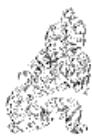

<!-- V3_SOURCE_ID:book016-b001427-p000-72e188ea10 -->

②有子考：考，《广韵》解释为“成”，这里用作动词，相当于“成就”。《尚氏学》还引用《逸周书》以及《左传》的孔颖达疏，证明“考”的含义是“成”，并指出：初六爻“能够匡正父辈的弊乱，所以称为‘有子考’”，“就是说有儿子能够成就先代的功业。”

查看对应原文

<!-- V3_FOLDBACK_BEGIN:book016-b001427-p000-72e188ea10 -->

②有子考：考，《广韵》“成也”，用如动词，犹言“成就”。《尚氏学》又引《逸周书》及《左传》孔疏，证“考”训“成”，并指出：初六“能正父蛊，故曰‘有子考’”，“即谓有子能成就先业也。”

<!-- V3_FOLDBACK_END:book016-b001427-p000-72e188ea10 -->

<!-- V3_SOURCE_ID:book016-b001428-p000-6f2e689ab7 -->

卷三

查看对应原文

<!-- V3_FOLDBACK_BEGIN:book016-b001428-p000-6f2e689ab7 -->

卷三

<!-- V3_FOLDBACK_END:book016-b001428-p000-6f2e689ab7 -->

<!-- V3_SOURCE_ID:book016-b001429-p000-12bd857612 -->

③没有过错，虽有危险最终会吉祥：这是总结前文的意思，说的是初六爻以卑下的姿态匡正尊长的弊病，目的在于成就先辈的德业，所以“没有过错”，即便有“危险”也能获得“最终吉祥”。

查看对应原文

<!-- V3_FOLDBACK_BEGIN:book016-b001429-p000-12bd857612 -->

③无咎，厉终吉：此总结前文意，谓初以卑下匡正尊上之弊，意在成就先辈德业，故“无咎”，虽“厉”亦获“终吉”。

<!-- V3_FOLDBACK_END:book016-b001429-p000-12bd857612 -->

<!-- V3_SOURCE_ID:book016-b001430-p000-b41f634367 -->

《象传》说的“匡正父辈的弊乱”，对应的是《象》曰“干父之蛊”，其含义是初六的意愿在于继承前辈的成就。

查看对应原文

<!-- V3_FOLDBACK_BEGIN:book016-b001430-p000-b41f634367 -->

译文《象传》说：“匡正父辈的弊乱”，说 《象》曰：“干父之蛊”，意承考明初六的意愿在于继承前辈的成就。 也①。

<!-- V3_FOLDBACK_END:book016-b001430-p000-b41f634367 -->

<!-- V3_SOURCE_ID:book016-b001431-p000-09b97e6bf4 -->

注释① 意承考：考，与爻辞中“考”的含义相同，此处作名词使用。《尚氏学》说：“谓初上承重阳，能承继先德也。”按，爻辞及《小象》中“考”字的含义，此处采用《尚氏学》的说法。不过汉魏及唐宋以来各位儒者的旧说，大多将“考”解释为“父”，这种解释也能讲通，可以一并保留。

查看对应原文

<!-- V3_FOLDBACK_BEGIN:book016-b001431-p000-09b97e6bf4 -->

注释①意承考：考，与爻辞“考”之义同，此处作名词用。《尚氏学》：“谓初上承重阳，能承继先德也。”案，爻辞及《小象》“考”字之义，今取《尚氏学》之说。但汉魏及唐宋以来诸儒之旧说，多释“考”为“父”，义亦得通，可以并存。

<!-- V3_FOLDBACK_END:book016-b001431-p000-09b97e6bf4 -->

<!-- V3_SOURCE_ID:book016-b001432-p000-61a2089ebe -->

《周易学说》引用李光的说法：“天下蛊坏，非常善继之子，不足以振起之。宣王承厉王，修车马，备器械，复会诸侯于东都，可谓‘有子’矣。”这里用东周的史事来参证《易》理，非常切合本爻的大义。

查看对应原文

<!-- V3_FOLDBACK_BEGIN:book016-b001432-p000-61a2089ebe -->

说明《周易学说》引李光曰：“天下蛊坏，非常善继之子，不足以振起之。宣王承厉王，修车马，备器械，复会诸侯于东都，可谓‘有子’矣。”此以东周史事参证《易》理，甚切本爻大义。

<!-- V3_FOLDBACK_END:book016-b001432-p000-61a2089ebe -->

<!-- V3_SOURCE_ID:book016-b001433-p000-8da8f4897f -->

九二爻，匡正母辈的弊乱，情势难行。九二，干母之蛊，不可贞①。 时不可强行而要守持正固以待时。

查看对应原文

<!-- V3_FOLDBACK_BEGIN:book016-b001433-p000-8da8f4897f -->

译文九二，匡正母辈的弊乱，情势难行 九二，干母之蛊，不可贞①。  
时不可强行而要守持正固以待时。

<!-- V3_FOLDBACK_END:book016-b001433-p000-8da8f4897f -->

<!-- V3_SOURCE_ID:book016-b001434-p000-faa62c93a8 -->

注释①不可贞：意思是“时不可则守正以待”，这个语词结构和《否》卦的卦辞“不利，君子贞”相似。这是说九二以阳爻居阴位，有刚而能柔的征象；就像匡正“母”的弊乱，当她秉性阴邪不肯顺从时，不能强行“干蛊”，而应守正待时。这就是《象传》所说“得中道”的含义。按，《王注》认为：“居于内中，宜干母事，故曰‘干母之蛊’也；妇人之性难可全正，宜屈己刚，既干且顺，故曰‘不可贞’也。”它把“不可贞”解释为“不可全正”，也就是《周易浅述》所说的“不可固执以为正”。这种说法可以作为一家之言。

查看对应原文

<!-- V3_FOLDBACK_BEGIN:book016-b001434-p000-faa62c93a8 -->

注释①不可贞：犹言“时不可则守正以待”，此语组构与《否》卦辞“不利，君子贞”相似（参阅该卦辞译注）。此谓九二阳处阴位，有刚而能柔之象；犹如匡正“母”弊，当其性阴辟不从之时，不能强行“干蛊”，而应守正待时。此即《象传》“得中道”之义。案，《王注》：“居于内中，宜干母事，故曰‘干母之蛊’也；妇人之性难可全正，宜屈己刚，既干且顺，故曰‘不可贞’也。”其释“不可贞”为“不可全正”，即《周易浅述》所谓“不可固执以为正”。可备一说。

<!-- V3_FOLDBACK_END:book016-b001434-p000-faa62c93a8 -->

<!-- V3_SOURCE_ID:book016-b001435-p000-9aacc16b88 -->

《象传》说：“匡正母辈的弊乱”，说明九二应当掌握刚柔适中的方法。《象》曰：“干母之蛊”，得中道也。

查看对应原文

<!-- V3_FOLDBACK_BEGIN:book016-b001435-p000-9aacc16b88 -->

译文《象传》说：“匡正母辈的弊乱”，说 《象》曰：“干母之蛊”，得中  
明九二应当掌握刚柔适中的方法。道也。

<!-- V3_FOLDBACK_END:book016-b001435-p000-9aacc16b88 -->

<!-- V3_SOURCE_ID:book016-b001436-p000-cbd4faa816 -->

这说明同样是“干蛊”，针对父亲和母亲的情况却有所不同。由此可知，处理这类事应当根据不同人的性格，采用合适的方法，顺着情势加以引导，才能取得成效。

查看对应原文

<!-- V3_FOLDBACK_BEGIN:book016-b001436-p000-cbd4faa816 -->

说明同样是“干蛊”，于父、母则有别。可知此事应当顺从不同的性格，采用合宜的方法，因势利导，才能收效。

<!-- V3_FOLDBACK_END:book016-b001436-p000-cbd4faa816 -->

<!-- V3_SOURCE_ID:book016-b001437-p000-f095f47ecc -->

九三爻的含义是匡正父辈的弊乱，虽稍有悔意，但没有重大咎害。

> **释读存疑：** 原文‘干父之蛊’的具体内涵在释读中未完整体现，仅保留了部分释义；1轮自动修复后核义模型仍建议修订，已保守记录。

查看对应原文

<!-- V3_FOLDBACK_BEGIN:book016-b001437-p000-f095f47ecc -->

译文九三，匡正父辈的弊乱，稍有悔 九三，干父之蛊，小有悔，无大恨，但没有重大咎害。 咎①。

<!-- V3_FOLDBACK_END:book016-b001437-p000-f095f47ecc -->

<!-- V3_SOURCE_ID:book016-b001438-p000-26328461c0 -->

注释①：小有悔，无大咎：这是说九三爻处于“蛊”的时势中，匡正父辈的弊乱却没有相应的爻位呼应，所以“小有悔”；但它阳刚得正，以正直之道行事，所以“无大咎”。《王注》说：“以刚健之才去匡正父辈的弊乱却没有相应的呼应，所以会有悔意；但它所处的爻位得当，以正道匡正父辈，虽稍有悔意，最终不会有重大咎害。”

查看对应原文

<!-- V3_FOLDBACK_BEGIN:book016-b001438-p000-26328461c0 -->

注释①小有悔，无大咎：此谓九三当“蛊”之时，匡正父弊而无上应，故“小有悔”；但阳刚居正，直道遽行，故“无大咎”。《王注》：“以刚干事而无其应，故有悔也；履得其位，以正于父，虽小有悔，终无大咎矣。

<!-- V3_FOLDBACK_END:book016-b001438-p000-26328461c0 -->

<!-- V3_SOURCE_ID:book016-b001439-p000-5751864343 -->

《象传》说：“匡正父辈的弊乱”，说明九三爻最终不会有咎害。

查看对应原文

<!-- V3_FOLDBACK_BEGIN:book016-b001439-p000-5751864343 -->

《象》曰：“干父之蛊”，终无 译文《象传》说：“匡正父辈的弊乱”，说咎也。 明九三最终不会有咎害。

<!-- V3_FOLDBACK_END:book016-b001439-p000-5751864343 -->

<!-- V3_SOURCE_ID:book016-b001440-p000-497bdf8066 -->

在封建君主制时代，地位低下的人刚正不阿，用来挽救君主的弊端，有时必须不顾“小悔”，迎难而上。韩愈所说的：“一封朝奏九重天，夕贬潮阳路八千；本为圣朝除弊政，肯将衰朽惜残年！”《左迁至蓝关示侄孙湘》，似乎可以作为本爻喻象的写照。

查看对应原文

<!-- V3_FOLDBACK_BEGIN:book016-b001440-p000-497bdf8066 -->

【说丽】在封建君主制时代，下者刚正不阿以拯治尊者之弊，有时必须不顾“小悔”，犯难而行。韩愈所谓：‘一封朝奏九重天，夕贬潮阳路八千；本为圣朝除弊政，肯将衰朽惜残年！’（《左迁至蓝关示侄孙湘》）似可作为本爻喻象的写照。

<!-- V3_FOLDBACK_END:book016-b001440-p000-497bdf8066 -->

<!-- V3_SOURCE_ID:book016-b001441-p000-367e846d84 -->

## 六四，裕父之蛊，往见吝①。

> **释读存疑：** 本地硬校验仍未通过，已记录供后续自动处理或人工核对。

查看对应原文

<!-- V3_FOLDBACK_BEGIN:book016-b001441-p000-367e846d84 -->

## 六四，裕父之蛊，往见吝①。

<!-- V3_FOLDBACK_END:book016-b001441-p000-367e846d84 -->

<!-- V3_SOURCE_ID:book016-b001442-p000-aff7ec7da5 -->

六四，宽裕不急地缓治父辈的弊乱，这样往前发展必然出现憾惜。

> **释读存疑：** 本地硬校验仍未通过，已记录供后续自动处理或人工核对。

查看对应原文

<!-- V3_FOLDBACK_BEGIN:book016-b001442-p000-aff7ec7da5 -->

译文六四，宽裕不急地缓治父辈的弊乱，这样往前发展必然出现憾惜。

<!-- V3_FOLDBACK_END:book016-b001442-p000-aff7ec7da5 -->

<!-- V3_SOURCE_ID:book016-b001443-p000-728845c6dc -->

注释①裕父之蛊，往见吝：裕，指宽裕，即“治蛊”宽缓不急，《集解》引虞翻的说法是：“不能争也。”这里是说六四阴柔懦弱，又居阴位，对“父”的弊乱不能迅速整治，宽延顺容，所以长此以往必然“见吝”。《本义》的解释是：“以阴居阴，不能有为，宽裕以治蛊之象也。如是则蛊将日深，故往则见吝。”

查看对应原文

<!-- V3_FOLDBACK_BEGIN:book016-b001443-p000-728845c6dc -->

注释①裕父之蛊，往见吝：裕，宽裕，指“治蛊”宽缓不急，即《集解》引虞翻曰：“不能争也。”此谓六四阴柔懦弱，又居阴位，对“父”弊不能速治，宽延顺容，故长此以往必“见吝”。《本义》：“以阴居阴，不能有为，宽裕以治蛊之象也。如是则蛊将日深，故往则见吝。”

<!-- V3_FOLDBACK_END:book016-b001443-p000-728845c6dc -->

<!-- V3_SOURCE_ID:book016-b001444-p000-735c85690f -->

《象传》说：“宽裕不急地缓治父辈的弊乱”，是说六四这样往前发展难以获得治弊之道。

> **释读存疑：** 原文未明确“裕父之蛊”的具体所指，释读中“宽裕不急地缓治父辈的弊乱”为基于卦义的合理阐释，无依据扩写

查看对应原文

<!-- V3_FOLDBACK_BEGIN:book016-b001444-p000-735c85690f -->

《象》曰：“裕父之蛊”，往未得也。

<!-- V3_FOLDBACK_END:book016-b001444-p000-735c85690f -->

<!-- V3_SOURCE_ID:book016-b001445-p000-87de99e63f -->

译文《象传》说：“宽裕不急地缓治父辈的弊乱”，是说六四这样往前发展难以获得治弊之道。

查看对应原文

<!-- V3_FOLDBACK_BEGIN:book016-b001445-p000-87de99e63f -->

译文《象传》说：“宽裕不急地缓治父辈的弊乱”，是说六四这样往前发展难以获得治弊之道。

<!-- V3_FOLDBACK_END:book016-b001445-p000-87de99e63f -->

<!-- V3_SOURCE_ID:book016-b001446-p000-13f1b60cb6 -->

说的是治理父辈的弊乱时宽裕不急，实则是容忍恶行、助长弊乱的做法。所以爻辞说“往见吝”，《象传》说“往未得”。

查看对应原文

<!-- V3_FOLDBACK_BEGIN:book016-b001446-p000-13f1b60cb6 -->

[说丽治蛊宽裕不急，实是容恶养弊之道。故爻辞言“往见吝”，《象传》云“往未得”。

<!-- V3_FOLDBACK_END:book016-b001446-p000-13f1b60cb6 -->

<!-- V3_SOURCE_ID:book016-b001447-p000-bf191be977 -->

六五爻，能够匡正父辈的弊乱，因此获得赞誉①。

查看对应原文

<!-- V3_FOLDBACK_BEGIN:book016-b001447-p000-bf191be977 -->

六五，干父之蛊，用誉①。

<!-- V3_FOLDBACK_END:book016-b001447-p000-bf191be977 -->

<!-- V3_SOURCE_ID:book016-b001448-p000-9442b486e1 -->

译文六五，匡正父辈的弊乱，备受称誉。

查看对应原文

<!-- V3_FOLDBACK_BEGIN:book016-b001448-p000-9442b486e1 -->

译文六五，匡正父辈的弊乱，备受称誉。

<!-- V3_FOLDBACK_END:book016-b001448-p000-9442b486e1 -->

<!-- V3_SOURCE_ID:book016-b001449-p000-cf9321cb36 -->

注释①用誉：誉，受人称誉。此谓六五柔居尊位，应二承上，犹如匡正“父”弊有道，故获称誉。《集解》引苟爽曰：“体和应中，承阳有实，用斯干事，荣誉之道也。”

查看对应原文

<!-- V3_FOLDBACK_BEGIN:book016-b001449-p000-cf9321cb36 -->

注释①用誉：誉，受人称誉。此谓六五柔居尊位，应二承上，犹如匡正“父”弊有道，故获称誉。《集解》引苟爽曰：“体和应中，承阳有实，用斯干事，荣誉之道也。”

<!-- V3_FOLDBACK_END:book016-b001449-p000-cf9321cb36 -->

<!-- V3_SOURCE_ID:book016-b001450-p000-0a0040b299 -->

《象》说：“干父用誉”，这是说以德行承接（相关事宜）。

> **释读存疑：** 原文未明确‘承以德’的具体所指，也未说明承接的具体内容；本地硬校验仍未通过，已记录供后续自动处理或人工核对。

查看对应原文

<!-- V3_FOLDBACK_BEGIN:book016-b001450-p000-0a0040b299 -->

《象》曰：“干父用誉”，承以德也①。

<!-- V3_FOLDBACK_END:book016-b001450-p000-0a0040b299 -->

<!-- V3_SOURCE_ID:book016-b001451-p000-a7783fa62d -->

译文《象传》说：“匡正父辈的弊乱而受称誉”，说明六五用美德来继承先业。

查看对应原文

<!-- V3_FOLDBACK_BEGIN:book016-b001451-p000-a7783fa62d -->

译文《象传》说：“匡正父辈的弊乱而受称誉”，说明六五用美德来继承先业。

<!-- V3_FOLDBACK_END:book016-b001451-p000-a7783fa62d -->

<!-- V3_SOURCE_ID:book016-b001452-p000-891fdeded6 -->

注释①中的“承以德”，是“以德承”的倒装句式。

查看对应原文

<!-- V3_FOLDBACK_BEGIN:book016-b001452-p000-891fdeded6 -->

注释①承以德：即“以德承”的倒装。

<!-- V3_FOLDBACK_END:book016-b001452-p000-891fdeded6 -->

<!-- V3_SOURCE_ID:book016-b001453-p000-e27853130d -->

这是说明六五爻居于尊位，却能向上承接、向下应和，既能够整治当下的“蛊”乱，又能树立自身的德行。熊良辅在《周易折中》中引述观点称：“不只是要挽救已经败坏的事务”，更在于“立身扬名”。这种见解契合卦辞“元亨”的主旨，也是《彖传》所阐发的“终则有始”“天下治也”的含义。

查看对应原文

<!-- V3_FOLDBACK_BEGIN:book016-b001453-p000-e27853130d -->

说明六五居尊位而能上承下应，既是治时之“蛊”，又是树己之德。熊良辅谓：“不特干其事之已坏”，更在于“立身扬名”(《折中》引)。此见卦辞“元亨”之旨，亦《彖传》所发“终则有始”、“天下治也”之义。

<!-- V3_FOLDBACK_END:book016-b001453-p000-e27853130d -->

<!-- V3_SOURCE_ID:book016-b001454-p000-bd4c1f00fb -->

## 上九,不事王侯,高尚其事①。 — 上九，不事王侯，高尚其事①。

查看对应原文

<!-- V3_FOLDBACK_BEGIN:book016-b001454-p000-bd4c1f00fb -->

## 上九,不事王侯,高尚其事①。

<!-- V3_FOLDBACK_END:book016-b001454-p000-bd4c1f00fb -->

<!-- V3_SOURCE_ID:book016-b001455-p000-72a524ab6f -->

上九爻的含义是，不从事王侯的事业，将自己逍遥物外的行为看得至高无上。

查看对应原文

<!-- V3_FOLDBACK_BEGIN:book016-b001455-p000-72a524ab6f -->

译文上九，不从事王侯的事业，把自己逍遥物外的行为看得至高无上。

<!-- V3_FOLDBACK_END:book016-b001455-p000-72a524ab6f -->

<!-- V3_SOURCE_ID:book016-b001456-p000-c93fea483d -->

注释①“不事王侯，高尚其事”：前一个“事”是动词，意思是“从事”；后一个“事”是名词，意思是“行为”。这里说的是蛊卦的上九爻处于卦的末尾，整治蛊乱的方法已经穷尽，因此不被王侯的事务所拖累，超然于世俗之外，以高洁的操守自我坚守。《尚氏学》中说：“不事王侯，就是说不从事王侯的事务”，“比如共伯和、吴季札这类人就是如此”。按：“不事王侯”这句话，《正义》解释为“不承事王侯”，将“事”解释为“奉事”。

查看对应原文

<!-- V3_FOLDBACK_BEGIN:book016-b001456-p000-c93fea483d -->

注释①不事王侯，高尚其事：前一“事”为动词，犹言“从事”；后一“事”为名词，犹言“行为”。此谓上九居《蛊》卦之终，“治蛊”道穷，故不累于“王侯”之事，超然物外，以高洁自守。《尚氏学》：“不事王侯，言不事王侯之事也”，“若共伯和、吴季札之流是也。”案，“不事王侯”一句，《正义》释曰：“不承事王侯”，训“事”为“奉

<!-- V3_FOLDBACK_END:book016-b001456-p000-c93fea483d -->

<!-- V3_SOURCE_ID:book016-b001458-p000-5127a05050 -->

蛊卦是第十八卦。

查看对应原文

<!-- V3_FOLDBACK_BEGIN:book016-b001458-p000-5127a05050 -->

蛊卦第十八

<!-- V3_FOLDBACK_END:book016-b001458-p000-5127a05050 -->

<!-- V3_SOURCE_ID:book016-b001459-p000-4bc29e827b -->

“事”的意思。这种说法也可以作为一种见解。

查看对应原文

<!-- V3_FOLDBACK_BEGIN:book016-b001459-p000-4bc29e827b -->

事”之意。似亦可备一说。

<!-- V3_FOLDBACK_END:book016-b001459-p000-4bc29e827b -->

<!-- V3_SOURCE_ID:book016-b001460-p000-b3b9d19da6 -->

《象传》说：“不从事王侯的事业”，《象》曰：“不事王侯”，说明上九的高洁志向值得效法。

> **释读存疑：** 原文《象传》内容存在OCR损坏，语义可能存在偏差；1轮自动修复后核义模型仍建议修订，已保守记录。

查看对应原文

<!-- V3_FOLDBACK_BEGIN:book016-b001460-p000-b3b9d19da6 -->

译文《象传》说：“不从事王侯的事业”， 《象》曰：“不事王侯”，志可  
说明上九的高洁志向值得效法。则也。

<!-- V3_FOLDBACK_END:book016-b001460-p000-b3b9d19da6 -->

<!-- V3_SOURCE_ID:book016-b001461-p000-aef49c93ef -->

【说项】儒家“穷则独善其身”的思想，实出于“时”不可为而暂作遁避，其宗旨主于抱道守志，以待来日复兴再起。杨万里认为此爻“不事王侯”，正处于“不必为”、“不得为”、“不可为”之时，非“事”之“高尚”，而是“人高尚其事”；并谓上九犹如“畎亩不忘君，江湖存魏阙”者的形象（《诚斋易传》），此亦可备参考。

查看对应原文

<!-- V3_FOLDBACK_BEGIN:book016-b001461-p000-aef49c93ef -->

【说项】儒家“穷则独善其身”的思想，实出于“时”不可为而暂作遁避，其宗旨主于抱道守志，以待来日复兴再起。杨万里认为此爻“不事王侯”，正处于“不必为”、“不得为”、“不可为”之时，非“事”之“高尚”，而是“人高尚其事”；并谓上九犹如“畎亩不忘君，江湖存魏阙”者的形象（《诚斋易传》），此亦可备参考。

<!-- V3_FOLDBACK_END:book016-b001461-p000-aef49c93ef -->

<!-- V3_SOURCE_ID:book016-b001462-p000-e4594c4554 -->

【总论】《蛊》卦的大义，主于除弊治乱。卦辞既指明此时利于涉难、至为亨通的前景，又用“先甲”、“后甲”喻示鉴前戒后、谨始慎终的“治蛊”之道。卦中六爻，初、三、四、五诸爻均以匡正父弊设喻：初六志承“先业”、虽危“终吉”，九三刚直遽行、终“无大咎”，六四柔弱不争、久必“见吝”，六五柔中寓刚、备受称誉；唯九二以匡正母弊为喻，戒其因势利导、慎守“中道”；而上九独居“治蛊”穷厄之时，则以远避在外、“不事王侯”为宜。若细加探寻诸爻取象于“子正父蛊”的蕴义，似又可看出作者意识到“弊乱”往往是积久而成的，甚或延续一代、两代人，终至酿成大患。苏轼曾经就这一问题分析说：“器久不用而蛊生之，谓之‘蛊’；人久宴溺而疾生之，谓之‘蛊’；天下久安无为而弊生之，谓之‘蛊’。”“蛊之灾非一日之故也，必世而后见，故爻皆以‘父子’言之。”（《东坡易传》）当然，各爻所示，均是提出在特定条件下治蛊的可行之道；至于拯治弊乱的根本措施，《大象传》从“救世”的角度阐发“振民育德”之义，似属古人汲取历史和现实的教训而总结出的一条“政治理论”。

查看对应原文

<!-- V3_FOLDBACK_BEGIN:book016-b001462-p000-e4594c4554 -->

【总论】《蛊》卦的大义，主于除弊治乱。卦辞既指明此时利于涉难、至为亨通的前景，又用“先甲”、“后甲”喻示鉴前戒后、谨始慎终的“治蛊”之道。卦中六爻，初、三、四、五诸爻均以匡正父弊设喻：初六志承“先业”、虽危“终吉”，九三刚直遽行、终“无大咎”，六四柔弱不争、久必“见吝”，六五柔中寓刚、备受称誉；唯九二以匡正母弊为喻，戒其因势利导、慎守“中道”；而上九独居“治蛊”穷厄之时，则以远避在外、“不事王侯”为宜。若细加探寻诸爻取象于“子正父蛊”的蕴义，似又可看出作者意识到“弊乱”往往是积久而成的，甚或延续一代、两代人，终至酿成大患。苏轼曾经就这一问题分析说：“器久不用而蛊生之，谓之‘蛊’；人久宴溺而疾生之，谓之‘蛊’；天下久安无为而弊生之，谓之‘蛊’。”“蛊之灾非一日之故也，必世而后见，故爻皆以‘父子’言之。”（《东坡易传》）当然，各爻所示，均是提出在特定条件下治蛊的可行之道；至于拯治弊乱的根本措施，《大象传》从“救世”的角度阐发“振民育德”之义，似属古人汲取历史和现实的教训而总结出的一条“政治理论”。

<!-- V3_FOLDBACK_END:book016-b001462-p000-e4594c4554 -->

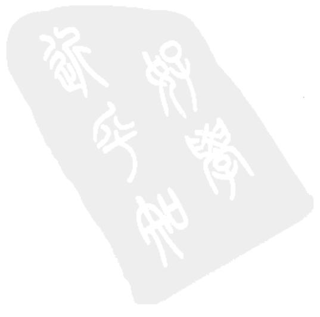

<!-- V3_SOURCE_ID:book016-b001464-p000-1f7bdfff76 -->

## 临卦第十九

查看对应原文

<!-- V3_FOLDBACK_BEGIN:book016-b001464-p000-1f7bdfff76 -->

## 临卦第十九

<!-- V3_FOLDBACK_END:book016-b001464-p000-1f7bdfff76 -->

<!-- V3_SOURCE_ID:book016-b001465-p000-123800eeb1 -->

## ䷒ 临①：元亨，利贞②；至于八月有凶③。 — 这是䷒临卦的卦辞，内容为：元亨，利贞；至于八月有凶。

> **释读存疑：** 原文未明确标注“䷒”为卦象符号的释读依据，仅按常规卦象符号对应释读，具体所指无额外歧义

查看对应原文

<!-- V3_FOLDBACK_BEGIN:book016-b001465-p000-123800eeb1 -->

## ䷒ 临①：元亨，利贞②；至于八月有凶③。

<!-- V3_FOLDBACK_END:book016-b001465-p000-123800eeb1 -->

<!-- V3_SOURCE_ID:book016-b001466-p000-b318089aad -->

《临》卦象征监临：极为亨通，利于守持正固；不过到了阳气日渐衰弱的八月，将会有凶险。

查看对应原文

<!-- V3_FOLDBACK_BEGIN:book016-b001466-p000-b318089aad -->

译文《临》卦象征监临：至为亨通，利于守持正固；但是到了(阳气日衰的)八月将有凶险。

<!-- V3_FOLDBACK_END:book016-b001466-p000-b318089aad -->

<!-- V3_SOURCE_ID:book016-b001467-p000-1d9cd7c086 -->

注释①临：此为卦名，下为兑（☱）卦，上为坤（☷）卦，象征“监视临察”。考证“临”字，《说文解字》解释为“监也”，《尔雅·释诂》解释为“视也”，《穀梁传》哀公七年中“有临天下之言焉”一句，范宁注释为“临，抚有之也”：这三种说法，实际都表明“临”字包含“由上视下”“以尊临卑”的含义。至于《序卦传》所说的“临，大也”，也是针对“临人”者必须崇高、尊大而言的。本卦初、二两爻为阳刚之爻，逐渐增长，从全卦的卦象来看，正蕴含着以德临人的意义。《正义》说：“因为阳刚之气逐渐增长，它的德行壮大，能够监临下属，所以称为‘临’。”

查看对应原文

<!-- V3_FOLDBACK_BEGIN:book016-b001467-p000-1d9cd7c086 -->

注释①临：卦名，下兑（☱）上坤（☷），象征“监视临察”。案，“临”字，《说文》：“监也”，《尔雅·释诂》：“视也”，《穀梁传》哀公七年“有临天下之言焉”范宁注“临，抚有之也”：此三说，实均明“临”字含有“由上视下”、“以尊临卑”之义。至于《序卦传》所谓“临，大也”，亦是就“临人”者必须崇高、尊大而言。本卦初、二两爻阳刚浸长，从全卦之象看，正寓以德临人的意义。《正义》曰：“以阳之浸长，其德壮大，可以监临于下，故曰‘临’也。”

<!-- V3_FOLDBACK_END:book016-b001467-p000-1d9cd7c086 -->

<!-- V3_SOURCE_ID:book016-b001468-p000-42a86f5707 -->

②元亨，利贞：这是说以德临人必然极为亨通，利于守持正道。《正义》说：“阳刚之气既已逐渐增长，既和悦又柔顺；又因为阳刚之爻居于中位，与外卦相应，所以大为亨通而利于守正。”

查看对应原文

<!-- V3_FOLDBACK_BEGIN:book016-b001468-p000-42a86f5707 -->

②元亨，利贞：此谓以德临人必然至为亨通，利于守正。《正义》：“刚既浸长，说而且顺；又以刚居中，有应于外，大得亨通而利正也。”

<!-- V3_FOLDBACK_END:book016-b001468-p000-42a86f5707 -->

<!-- V3_SOURCE_ID:book016-b001469-p000-e4a8992d66 -->

③至于八月有凶：这句话以时令为比喻，说明“监临”之道盛极之后必然会有衰落的危险。《礼记·月令》中仲秋之月记载：“这个月里，肃杀之气逐渐旺盛，阳气日渐衰弱。”所以说“八月有凶”。《程传》说：“圣人预先为此告诫说：阳刚之气虽然正在增长，到了八月，它的道就会消退，这是有凶险的。”

查看对应原文

<!-- V3_FOLDBACK_BEGIN:book016-b001469-p000-e4a8992d66 -->

③至于八月有凶：此句以时令为喻，说明“监临”盛极必有衰落的危险。《礼记·月令》仲秋之月云：“是月也，杀气浸盛，阳气日衰。”故谓“八月有凶”。《程传》：“圣人豫为之戒曰：阳虽方长，至于八月，则其道消，是有凶也。”

<!-- V3_FOLDBACK_END:book016-b001469-p000-e4a8992d66 -->

<!-- V3_SOURCE_ID:book016-b001470-p000-b34e9f8ada -->

《彖传》说：“临”，指阳刚之气逐渐增长，态度和悦而行事顺遂，刚健者居中位而能与上下相应。至为大亨通又能守持正固，这是天的运行规律；“到了八月会有凶险”，是因为阳气消退，这种兴盛不会长久。

> **释读存疑：** 原文中“至于八月有凶”的具体所指未明，释读未作确定解释，符合要求

查看对应原文

<!-- V3_FOLDBACK_BEGIN:book016-b001470-p000-b34e9f8ada -->

《彖》曰：“临”，刚浸而长，说而顺，刚中而应①。大亨以正，天之道也②；“至于八月有凶”，消不久也③。

<!-- V3_FOLDBACK_END:book016-b001470-p000-b34e9f8ada -->

<!-- V3_SOURCE_ID:book016-b001471-p000-3e94a07518 -->

译文《彖传》说：“监临”，说明此时阳刚正气日渐增长，临人者和悦温顺，刚健者居中而上下相应。获得至大亨通又要守持正固，这才顺合大自然的规律；“到了(阳气日衰的)八月将有凶险”，那是因为接近消亡、好景不能长久。

查看对应原文

<!-- V3_FOLDBACK_BEGIN:book016-b001471-p000-3e94a07518 -->

译文《彖传》说：“监临”，说明此时阳刚正气日渐增长，临人者和悦温顺，刚健者居中而上下相应。获得至大亨通又要守持正固，这才顺合大自然的规律；“到了(阳气日衰的)八月将有凶险”，那是因为接近消亡、好景不能长久。

<!-- V3_FOLDBACK_END:book016-b001471-p000-3e94a07518 -->

<!-- V3_SOURCE_ID:book016-b001472-p000-513938b2ca -->

注释①刚浸而长，说而顺，刚中而应：前一个“刚”指初、二两爻，后句的“刚中”指九

> **释读存疑：** 原文注释内容不完整，无法确定“刚中”所指的具体爻位；本地硬校验仍未通过，已记录供后续自动处理或人工核对。

查看对应原文

<!-- V3_FOLDBACK_BEGIN:book016-b001472-p000-513938b2ca -->

注释①刚浸而长，说而顺，刚中而应：前一“刚”指初、二两爻，后句“刚中”指九

<!-- V3_FOLDBACK_END:book016-b001472-p000-513938b2ca -->

<!-- V3_SOURCE_ID:book016-b001473-p000-91b5f48070 -->

临卦第十九

查看对应原文

<!-- V3_FOLDBACK_BEGIN:book016-b001473-p000-91b5f48070 -->

临卦第十九

<!-- V3_FOLDBACK_END:book016-b001473-p000-91b5f48070 -->

<!-- V3_SOURCE_ID:book016-b001474-p000-1efc17e54b -->

二；浸就是渐的意思；说就是悦，指下兑；顺指上坤；应指二爻与五爻相应。这里通过初爻、二爻的爻象以及上下卦象来解释卦名“临”的含义，说明以“德”临人时的盛美情状。《折中》说：“这三句都是解释卦名的。刚爻渐长，阳道正处亨通之时；有悦顺之德，人心就会和附；刚中得应，上下就会心意相通。这就是德泽能遍及天下，足以临驭众人的原因。”

查看对应原文

<!-- V3_FOLDBACK_BEGIN:book016-b001474-p000-1efc17e54b -->

二；浸，渐也；说，即“悦”，指下兑；顺，指上坤；应，谓二应五。此举初、二爻象及上下卦象释卦名“临”之义，说明以“德”临人之时的盛美情状。《折中》：“(此三句)皆释卦名也。盖刚浸而长，则阳道方亨；有说顺之德，则人心和附；刚中得应，则上下交而志同。此其所以德泽及于天下，而足以有临也。”

<!-- V3_FOLDBACK_END:book016-b001474-p000-1efc17e54b -->

<!-- V3_SOURCE_ID:book016-b001475-p000-20f25817ef -->

②大亨以正，天之道也：这是解释卦辞“元亨，利贞”，意思是“监临”之时极为通达，又能长久守持正固，就不会违背“天道”。《程传》说：“化育之功之所以不息，是因为刚正和顺而已。以此临驭人、临驭事、临驭天下，没有不极为通达且得正的。”

查看对应原文

<!-- V3_FOLDBACK_BEGIN:book016-b001475-p000-20f25817ef -->

②大亨以正，天之道也：此释卦辞“元亨，利贞”，谓“监临”之时至通而又长守正固，则可不违“天道”。《程传》：“化育之功所以不息者，刚正和顺而已。以此临人，临事，临天下，莫不大亨而得正也。”

<!-- V3_FOLDBACK_END:book016-b001475-p000-20f25817ef -->

<!-- V3_SOURCE_ID:book016-b001476-p000-12d3822996 -->

③消不久也：这是解释卦辞“至于八月有凶”，意思是“临”道盛极必衰，以此阐明“阴阳消长”的必然规律。《程传》说：“从阴阳之气来说，消长如同循环，不可改变。从人事来说，阳为君子，阴为小人，正当君子道长之时，圣人为此告诫，让人们知道盛极则有凶的道理而预先防备，常能不达到满极，就不会有凶事。”

查看对应原文

<!-- V3_FOLDBACK_BEGIN:book016-b001476-p000-12d3822996 -->

③消不久也：此释卦辞“至于八月有凶”，谓“临”道盛极必穷，即明“阴阳消长”的必然规律。《程传》：“在阴阳之气言之，则消长如循环，不可易也。以人事言之，则阳为君子，阴为小人，方君子道长之时，圣人为之诫，使知极则有凶之理而虞备之，常不至于满极，则无凶也。”

<!-- V3_FOLDBACK_END:book016-b001476-p000-12d3822996 -->

<!-- V3_SOURCE_ID:book016-b001477-p000-6f2e689ab7 -->

卷三

查看对应原文

<!-- V3_FOLDBACK_BEGIN:book016-b001477-p000-6f2e689ab7 -->

卷三

<!-- V3_FOLDBACK_END:book016-b001477-p000-6f2e689ab7 -->

<!-- V3_SOURCE_ID:book016-b001478-p000-06a87291e9 -->

译文《象传》说：水泽上有大地，象征“监临”；君子因此花费无穷的思虑教导百姓，发扬无边的美德容纳养育民众。

查看对应原文

<!-- V3_FOLDBACK_BEGIN:book016-b001478-p000-06a87291e9 -->

译文《象传》说：水泽上有大地，象征“监临”；君子因此花费无穷的思虑教导百姓，发扬无边的美德容纳养育民众。

<!-- V3_FOLDBACK_END:book016-b001478-p000-06a87291e9 -->

<!-- V3_SOURCE_ID:book016-b001479-p000-ff315e2fa2 -->

《象传》说：泽上有地，这就是临卦的卦象；君子因此要施行教导、费尽思虑，永无止境，以无边的德行容纳、保护百姓。

查看对应原文

<!-- V3_FOLDBACK_BEGIN:book016-b001479-p000-ff315e2fa2 -->

《象》曰：泽上有地，临①；君子以教思无穷，容保民无疆②。

<!-- V3_FOLDBACK_END:book016-b001479-p000-ff315e2fa2 -->

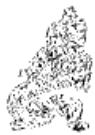

<!-- V3_SOURCE_ID:book016-b001481-p000-1a8adb1aba -->

注释①：泽上有地，临：这是解释临卦的卦象，临卦下卦为兑（兑为泽），上卦为坤（坤为地）。《集解》引用荀爽的话说：“泽位卑下，地位居高，这是高下相邻的卦象。”

查看对应原文

<!-- V3_FOLDBACK_BEGIN:book016-b001481-p000-1a8adb1aba -->

注释①泽上有地，临：释《临》卦下兑为泽、上坤为地之象。《集解》引荀爽曰：“泽卑地高，高下相临之象也。”

<!-- V3_FOLDBACK_END:book016-b001481-p000-1a8adb1aba -->

<!-- V3_SOURCE_ID:book016-b001482-p000-8b84fa77e8 -->

②教思无穷，容保民无疆：这里的“教”“思”都作动词用，意思是施行教导、费尽思虑。这是说明君子观察临卦的卦象，领悟到统治百姓时，应当花费无穷的心思教导百姓，并用无边的德行容纳、保护百姓。《程传》说：“君子观察亲临百姓的卦象，就会施行教导、费尽思虑，因为君子亲临百姓，就会产生教导的念头”；“观察容纳包容的卦象，就会产生容纳保护百姓的心意”。

查看对应原文

<!-- V3_FOLDBACK_BEGIN:book016-b001482-p000-8b84fa77e8 -->

②教思无穷，容保民无疆：教、思，均作动词，犹言“施行教导”、“费尽思虑”。这是说明“君子”观《临》卦之象，悟知临民之时，应当花费无穷之思教导百姓，并以无疆之德容民保民。《程传》：“君子观亲临之象，则教思无穷，亲临于民，则有教导之意思也”；“观含容之象，则有容保民之心”。

<!-- V3_FOLDBACK_END:book016-b001482-p000-8b84fa77e8 -->

<!-- V3_SOURCE_ID:book016-b001483-p000-67a07d075f -->

胡炳文在《周易本义通释》中说：“不只是说‘教’，而是说‘教思’，它的含义就像兑泽那样深厚；不只是说‘保民’，而是说‘容民’，它的度量就像坤土那样广大。”这种从“教思”“容保民”的措辞蕴含的意义，来分析《大象传》的论象特色，似乎很可取。

查看对应原文

<!-- V3_FOLDBACK_BEGIN:book016-b001483-p000-67a07d075f -->

说丽胡炳文说，“不徒曰教’，而曰教思’，其意思如兑泽之深；不徒曰保民'，而曰容民’，其度量如坤土之大”。(《周易本义通释》)此从“教思”、“容保民”的措辞蕴义，分析《大象传》的论象特色，似颇可取。

<!-- V3_FOLDBACK_END:book016-b001483-p000-67a07d075f -->

<!-- V3_SOURCE_ID:book016-b001484-p000-a0240004e7 -->

译文初九，感应于尊者而施行监临，守持正固可获吉祥。

查看对应原文

<!-- V3_FOLDBACK_BEGIN:book016-b001484-p000-a0240004e7 -->

译文初九，感应于尊者而施行监临，守持正固可获吉祥。

<!-- V3_FOLDBACK_END:book016-b001484-p000-a0240004e7 -->

<!-- V3_SOURCE_ID:book016-b001485-p000-17d1233024 -->

初九，咸临，贞吉①。

查看对应原文

<!-- V3_FOLDBACK_BEGIN:book016-b001485-p000-17d1233024 -->

初九，咸临，贞吉①。

<!-- V3_FOLDBACK_END:book016-b001485-p000-17d1233024 -->

<!-- V3_SOURCE_ID:book016-b001486-p000-8c01b328b1 -->

注释①咸临，贞吉：咸，通“感”，犹言“感应”。此谓初九当“临”之始，阳刚处下，上应六四，犹如下者感应于尊者而施监临，故以守正获吉。《集解》引虞翻曰：“咸，感也。得正应四，故贞吉也。”《程传》：“四，近君之位。初得正位，与四感应，是以正道为当位所信任，得行其志。获乎上而得行其正道，是以吉也。”

> **释读存疑：** 本地硬校验仍未通过，已记录供后续自动处理或人工核对。

查看对应原文

<!-- V3_FOLDBACK_BEGIN:book016-b001486-p000-8c01b328b1 -->

注释①咸临，贞吉：咸，通“感”，犹言“感应”(参阅《咸》卦译注)。此谓初九当“临”之始，阳刚处下，上应六四，犹如下者感应于尊者而施监临，故以守正获吉。《集解》引虞翻曰：“咸，感也。得正应四，故贞吉也。”《程传》：“四，近君之位。初得正位，与四感应，是以正道为当位所信任，得行其志。获乎上而得行其正道，是以吉也。”

<!-- V3_FOLDBACK_END:book016-b001486-p000-8c01b328b1 -->

<!-- V3_SOURCE_ID:book016-b001487-p000-48c62b5880 -->

译文《象传》说：“感应于尊者而施行监临、守持正固可获吉祥”，说明初九的心志行为端正不阿。

查看对应原文

<!-- V3_FOLDBACK_BEGIN:book016-b001487-p000-48c62b5880 -->

译文《象传》说：“感应于尊者而施行监临、守持正固可获吉祥”，说明初九的心志行为端正不阿。

<!-- V3_FOLDBACK_END:book016-b001487-p000-48c62b5880 -->

<!-- V3_SOURCE_ID:book016-b001488-p000-160e6c3d00 -->

《象传》说：“威临贞吉”，这是因为初九的心志与行为都端正不偏。

查看对应原文

<!-- V3_FOLDBACK_BEGIN:book016-b001488-p000-160e6c3d00 -->

《象》曰：“威临贞吉”，志行正也。

<!-- V3_FOLDBACK_END:book016-b001488-p000-160e6c3d00 -->

<!-- V3_SOURCE_ID:book016-b001489-p000-77e57ef2a8 -->

在上者能够感应在下者，在下者就会回应在上者。初九所处的位置虽然低下，但其德行已经足够用来监临众人、处理事务。不过此时是“临”卦的初始阶段，虽然已经被在上者信任，还不宜委以重任，因此必须谨守正道，这样才能获得吉祥。

查看对应原文

<!-- V3_FOLDBACK_BEGIN:book016-b001489-p000-77e57ef2a8 -->

上能感下，下则应上。初九处位虽卑，其德已足以临人、临事。但此时为“临”之始，尽管见信于上，尚不宜大用，故须谨守贞正，可获吉祥。

<!-- V3_FOLDBACK_END:book016-b001489-p000-77e57ef2a8 -->

<!-- V3_SOURCE_ID:book016-b001490-p000-c0549eb9e2 -->

## 九二，威临，吉无不利①。 — 九二爻的爻义是，以威严监临于人，吉祥，无所不利。

查看对应原文

<!-- V3_FOLDBACK_BEGIN:book016-b001490-p000-c0549eb9e2 -->

## 九二，威临，吉无不利①。

<!-- V3_FOLDBACK_END:book016-b001490-p000-c0549eb9e2 -->

<!-- V3_SOURCE_ID:book016-b001491-p000-2707d5feea -->

译文九二，感应于尊者而施行监临，吉祥无所不利。

查看对应原文

<!-- V3_FOLDBACK_BEGIN:book016-b001491-p000-2707d5feea -->

译文九二，感应于尊者而施行监临，吉祥无所不利。

<!-- V3_FOLDBACK_END:book016-b001491-p000-2707d5feea -->

<!-- V3_SOURCE_ID:book016-b001492-p000-5f923592c2 -->

注释①咸临，吉无不利：此谓九二处《临》下卦之中，上应六五，也具“咸临”之象；因其又含“中”德，较初九之阳更见盛美，故“吉无不利”。《程传》：“二方阳长而渐盛，感动于六五中顺之君，其交之亲，故见信任，得行其志，所临吉而无不利也。吉者，已然，如是故吉也；无不利者，将然，于所施为无所不利也。”

查看对应原文

<!-- V3_FOLDBACK_BEGIN:book016-b001492-p000-5f923592c2 -->

注释①咸临，吉无不利：此谓九二处《临》下卦之中，上应六五，也具“咸临”之象；因其又含“中”德，较初九之阳更见盛美，故“吉无不利”。《程传》：“二方阳长而渐盛，感动于六五中顺之君，其交之亲，故见信任，得行其志，所临吉而无不利也。吉者，已然，如是故吉也；无不利者，将然，于所施为无所不利也。”

<!-- V3_FOLDBACK_END:book016-b001492-p000-5f923592c2 -->

<!-- V3_SOURCE_ID:book016-b001493-p000-bff089249c -->

《象》曰：“咸临吉无不利”，未顺命也①。

查看对应原文

<!-- V3_FOLDBACK_BEGIN:book016-b001493-p000-bff089249c -->

《象》曰：“咸临吉无不利”，未顺命也①。

<!-- V3_FOLDBACK_END:book016-b001493-p000-bff089249c -->

<!-- V3_SOURCE_ID:book016-b001494-p000-667035a011 -->

译文《象传》说：“感应于尊者而施行监 临、吉祥无所不利”，说明九二并非由于 顺从君命。

查看对应原文

<!-- V3_FOLDBACK_BEGIN:book016-b001494-p000-667035a011 -->

译文《象传》说：“感应于尊者而施行监 临、吉祥无所不利”，说明九二并非由于 顺从君命。

<!-- V3_FOLDBACK_END:book016-b001494-p000-667035a011 -->

<!-- V3_SOURCE_ID:book016-b001495-p000-ee1be925de -->

注释①未顺命：“未”在这里似乎含有“并非由于”的意思。这句话是说九二与六五相互感应来治理民众，并非是因为顺从君命。《程传》中说：“未者，非遽之辞”，“九二与五感应以临下，盖以刚德之长，而又得中，至诚相感，非由顺上之命也，是以吉而无不利”。

查看对应原文

<!-- V3_FOLDBACK_BEGIN:book016-b001495-p000-ee1be925de -->

注释①未顺命：未，似含“并非由于”之意。此谓二与六五相感以临人，并非由于顺承君命。《程传》“未者，非遽之辞”，“九二与五感应以临下，盖以刚德之长，而又得中，至诚相感，非由顺上之命也，是以吉而无不利”。

<!-- V3_FOLDBACK_END:book016-b001495-p000-ee1be925de -->

<!-- V3_SOURCE_ID:book016-b001496-p000-cb94433321 -->

《象传》中“未顺命”的含义，前人有不同看法。具体如下：一、孔颖达的解释是：“未可尽顺五命，须斟酌事宜，有从有否，故得‘无不利’也。”二、朱熹说“未详”，主张存疑待考。三、马其昶依据李光地的说法，解释为“不委顺于命”。以上几种说法都可以参考。

查看对应原文

<!-- V3_FOLDBACK_BEGIN:book016-b001496-p000-cb94433321 -->

说明《象传》“未顺命”之义，前人有不同看法。如：一、孔颖达释为：“未可尽顺五命，须斟酌事宜，有从有否，故得‘无不利’也。”（《正义》）二、朱熹曰“未详”（《本义》），主于阙疑待考。三、马其昶本李光地之说，释为“不委顺于命”（《重定费氏学》）。诸说并可参考。

<!-- V3_FOLDBACK_END:book016-b001496-p000-cb94433321 -->

<!-- V3_SOURCE_ID:book016-b001497-p000-cb478dca6c -->

## 六三，甘临，无攸利①；既忧之，无咎②。

> **释读存疑：** 本地硬校验仍未通过，已记录供后续自动处理或人工核对。

查看对应原文

<!-- V3_FOLDBACK_BEGIN:book016-b001497-p000-cb478dca6c -->

## 六三，甘临，无攸利①；既忧之，无咎②。

<!-- V3_FOLDBACK_END:book016-b001497-p000-cb478dca6c -->

<!-- V3_SOURCE_ID:book016-b001498-p000-8986b98aa4 -->

译文：六三，靠巧言佞语监临于众，没有什么利益；要是已经忧惧自己的过失并加以改正，就不会有咎害。

查看对应原文

<!-- V3_FOLDBACK_BEGIN:book016-b001498-p000-8986b98aa4 -->

译文六三，靠巧言佞语监临于众，无所 利益；要是已经忧惧自已的过失而改正， 就不致咎害。

<!-- V3_FOLDBACK_END:book016-b001498-p000-8986b98aa4 -->

<!-- V3_SOURCE_ID:book016-b001499-p000-0aeee22f14 -->

匡释①甘临，无攸利：甘，《王注》解释为“佞邪说媚，不正之名”，指甜美巧佞的言辞。这是说六三爻处于《临》卦下兑之上，阴柔失正，就像用巧佞的言辞监临于人，所以“无攸利”。《程传》说：“三爻居下位之上，是监临人的位置。阴柔又属悦体，且处于不中不正之位，是用甜美的言辞监临人的人。居于上位却用甜美的言辞监临下位，失德太严重，没有什么好处。”

查看对应原文

<!-- V3_FOLDBACK_BEGIN:book016-b001499-p000-0aeee22f14 -->

匡释①甘临，无攸利：甘，《王注》：“佞邪说媚，不正之名”，指甜美巧佞的言辞。此谓六三居《临》下兑之上，阴柔失正，犹以言辞巧佞临人，故“无攸利”。《程传》：“三居下之上，临人者也。阴柔而说体，又处不中正，以甘说临人者也。在上而以甘说临下，失德之甚，无所利也。”

<!-- V3_FOLDBACK_END:book016-b001499-p000-0aeee22f14 -->

<!-- V3_SOURCE_ID:book016-b001500-p000-f3e83e2c0b -->

②既忧之，无咎：这是从正面设下告诫，说六三爻如果能自知不正，内心忧惧并改正过错，就可以“无咎”。《程传》说：“已经知道危惧而内心忧惧，如果能持守谦德、守持正道，以至诚的态度自处，就没有过错。”

查看对应原文

<!-- V3_FOLDBACK_BEGIN:book016-b001500-p000-f3e83e2c0b -->

②既忧之，无咎：此从正面设诫，谓六三若能自知不正，心有忧惧而改过，则可“无咎”。《程传》：“既知危惧而忧之，若能持谦守正，至诚以自处，则无咎也。”

<!-- V3_FOLDBACK_END:book016-b001500-p000-f3e83e2c0b -->

<!-- V3_SOURCE_ID:book016-b001501-p000-5d56de98c5 -->

《象》说：“甘临”，是因为六三爻居位不正当；“既忧之”，是说咎害不会久长。

查看对应原文

<!-- V3_FOLDBACK_BEGIN:book016-b001501-p000-5d56de98c5 -->

《象》曰：“甘临”，位不当也； 译文《象传》说：“靠巧言佞语监临于“既忧之”，咎不长也。 众”，说明六三居位不正当；“已经忧惧自己的过失而改正”，说明咎害不会久长。

<!-- V3_FOLDBACK_END:book016-b001501-p000-5d56de98c5 -->

<!-- V3_SOURCE_ID:book016-b001502-p000-1d07a1fcdb -->

这说明众人不可欺骗，“临”卦的监临不可用“甘”的方式。六三爻用“甘”的方式监临于人，正是哗众取宠的征象。爻辞又设下“忧之”的告诫，体现了《周易》作者的劝勉意味。

查看对应原文

<!-- V3_FOLDBACK_BEGIN:book016-b001502-p000-1d07a1fcdb -->

说明众不可欺，“临”不可“甘”。六三以“甘”临人，正是晔众取宠之象。爻辞又设“忧之”之诫，则体现《周易》作者的劝勉意味。

<!-- V3_FOLDBACK_END:book016-b001502-p000-1d07a1fcdb -->

<!-- V3_SOURCE_ID:book016-b001503-p000-158f1025d9 -->

六四爻，极为亲近地监临众人，没有过错。

查看对应原文

<!-- V3_FOLDBACK_BEGIN:book016-b001503-p000-158f1025d9 -->

六四，至临，无咎①。

<!-- V3_FOLDBACK_END:book016-b001503-p000-158f1025d9 -->

<!-- V3_SOURCE_ID:book016-b001504-p000-0cc3ed8329 -->

注释①极为亲近地监临众人，没有过错：至，是极致的意思，文中相当于说“十分亲近”。这句话是说六四处于上卦的起始位置，以柔正之德与初九相应，切近下体，就像亲近自己所监临的众人，所以获得“没有过错”的结果。《程传》说：“六四居于上卦的下方，与下体相邻，这是切近地监临下方，是监临的极致。监临之道崇尚亲近，所以将这种亲近视为极致。”

查看对应原文

<!-- V3_FOLDBACK_BEGIN:book016-b001504-p000-0cc3ed8329 -->

注释①至临，无咎：至，极也，文中犹言“十分亲近”。此言六四居上卦之始，柔正应初，切近下体，犹亲近于所临之众，故获“无咎”。《程传》：“四居上之下，与下体相比，是切临于下，临之至也。临道尚近，故以比为至。”

<!-- V3_FOLDBACK_END:book016-b001504-p000-0cc3ed8329 -->

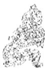

<!-- V3_SOURCE_ID:book016-b001506-p000-580b5feb9f -->

《象传》说：“极为亲近地监临众人，必无咎害”，说明六四居位正当。

查看对应原文

<!-- V3_FOLDBACK_BEGIN:book016-b001506-p000-580b5feb9f -->

译文《象传》说：“极为亲近地监临众 《象》曰：“至临无咎”，位当也。  
人，必无咎害”，说明六四居位正当。

<!-- V3_FOLDBACK_END:book016-b001506-p000-580b5feb9f -->

<!-- V3_SOURCE_ID:book016-b001507-p000-29f9a05b80 -->

说明居于上位者亲近下位者，自然能对“监临”之事有益。《折中》引用王宗传的话说：“六四以上位身份监临下位，它与下体最为亲近，所以称为‘至临’。就上下二体而言，没有比这更亲近的了。”

查看对应原文

<!-- V3_FOLDBACK_BEGIN:book016-b001507-p000-29f9a05b80 -->

说明上者临近下者，自能有益于“监临”。《折中》引王宗传曰：“四以上临下，其与下体最相亲，故曰‘至临’。以言上下二体，莫亲于此也。”

<!-- V3_FOLDBACK_END:book016-b001507-p000-29f9a05b80 -->

<!-- V3_SOURCE_ID:book016-b001508-p000-e2b919a0d8 -->

六五爻的爻辞是：知临，大君之宜，吉。意思是聪慧明智地监临众人，君主应当这样，吉祥。

查看对应原文

<!-- V3_FOLDBACK_BEGIN:book016-b001508-p000-e2b919a0d8 -->

译文六五，聪慧明智地监临众人，大人 六五，知临，大君之宜，吉①。  
君主应当这样，吉祥。

<!-- V3_FOLDBACK_END:book016-b001508-p000-e2b919a0d8 -->

<!-- V3_SOURCE_ID:book016-b001509-p000-c5115ac20e -->

匡释：知临，大君之宜，吉。知就是“智”。这是说，六五爻处于《临》卦的尊位，以柔爻居中位，向下应和九二爻，就像任用刚健的大臣、辅助自己“君临”天下，正体现了明智，所以称为“大君之宜，吉”。《本义》说：“以柔居中，下应九二，不自用而任人，乃知之事，而大君之宜，吉之道也。”

查看对应原文

<!-- V3_FOLDBACK_BEGIN:book016-b001509-p000-c5115ac20e -->

匡释①知临，大君之宜，吉：知，即“智”。此谓六五居《临》尊位，以柔处中，下应九二，犹如任用刚健大臣、辅己“君临”天下，正见明智，故称“大君之宜，吉”。《本义》：“以柔居中，下应九二，不自用而任人，乃知之事，而大君之宜，吉之道也。”

<!-- V3_FOLDBACK_END:book016-b001509-p000-c5115ac20e -->

<!-- V3_SOURCE_ID:book016-b001510-p000-659224aa1f -->

《象传》说：“大君之宜，行中之谓也。”意思是说明六五爻必须奉行中道。

查看对应原文

<!-- V3_FOLDBACK_BEGIN:book016-b001510-p000-659224aa1f -->

译文《象传》说：“大人君主应当这样”， 《象》曰：大君之宜，行中之  
说明六五必须奉行中道。谓也。

<!-- V3_FOLDBACK_END:book016-b001510-p000-659224aa1f -->

<!-- V3_SOURCE_ID:book016-b001511-p000-4e04d72dc7 -->

《礼记·中庸》说：“唯天下之至圣，为能聪明睿知，足以有临也。”这个说法既符合本爻“知临”的主旨，又和《象传》“行中”的说法相契合。

查看对应原文

<!-- V3_FOLDBACK_BEGIN:book016-b001511-p000-4e04d72dc7 -->

说明《礼记·中庸》曰：“唯天下之至圣，为能聪明睿知，足以有临也。”此义既合本爻“知临”的大旨，又与《象传》“行中”之语相切。

<!-- V3_FOLDBACK_END:book016-b001511-p000-4e04d72dc7 -->

<!-- V3_SOURCE_ID:book016-b001512-p000-8bfd5702fe -->

上六爻的爻辞是敦临，吉，无咎，意思是用温柔敦厚的态度监临众人，必然没有咎害。

查看对应原文

<!-- V3_FOLDBACK_BEGIN:book016-b001512-p000-8bfd5702fe -->

译文上六，温柔敦厚地监临众人，吉 上六，敦临，吉，无咎①。  
祥，必无咎害。

<!-- V3_FOLDBACK_END:book016-b001512-p000-8bfd5702fe -->

<!-- V3_SOURCE_ID:book016-b001513-p000-16ee239074 -->

注释①：敦临，吉，无咎。敦的意思是敦厚。这句是说上六处于《临》卦的终极位置，以阴爻处在无位的位置，不采用刚猛的方式，就像用敦厚仁惠的德行监临众人，所以获得吉祥，没有咎害。《本义》中说：“居于卦的上方，处在监临的最终阶段，在监临之事上保持敦厚，这是吉祥且没有咎害的道理。”

查看对应原文

<!-- V3_FOLDBACK_BEGIN:book016-b001513-p000-16ee239074 -->

注释①敦临，吉，无咎：敦，敦厚。此谓上六居《临》之极，以阴处“无位”之地，不为刚猛，犹如以敦厚仁惠之德临人，故获“吉，无咎”。《本义》：“居卦之上，处临之终，敦厚于临。吉而无咎之道也。”

<!-- V3_FOLDBACK_END:book016-b001513-p000-16ee239074 -->

<!-- V3_SOURCE_ID:book016-b001514-p000-3cae1042a3 -->

《象传》说：“敦临之吉”，意思是上六的心志系于邦国，因此可以获得吉祥。

查看对应原文

<!-- V3_FOLDBACK_BEGIN:book016-b001514-p000-3cae1042a3 -->

译文《象传》说：“温柔敦厚地监临于众 《象》曰：“敦临之吉”，志在内而可获吉祥”，说明上六的心志系于邦国 也①。

<!-- V3_FOLDBACK_END:book016-b001514-p000-3cae1042a3 -->

<!-- V3_SOURCE_ID:book016-b001515-p000-d66bd30ff5 -->

注释①：志在内，意思是心志在邦国，是说上六并非处在高位的虚位，不理会内部事务的人。《折中》引用张振渊的话说：“志在内，就是万物一体的意思，所以能做到敦厚；如果把天下国家置之度外，即使有一些小的德泽，终究是浅薄的。”

查看对应原文

<!-- V3_FOLDBACK_BEGIN:book016-b001515-p000-d66bd30ff5 -->

注释①志在内：犹言“志在邦国”，谓上六非高处“虚位”，不理“内事”者。《折中》引张振渊曰：“志在内，即万物一体之意，所以能‘敦’；若将天下国家置在度外，虽有些小德泽，终是浅薄。”

<!-- V3_FOLDBACK_END:book016-b001515-p000-d66bd30ff5 -->

<!-- V3_SOURCE_ID:book016-b001516-p000-94bd8d3980 -->

此处解释卦辞中“至于八月有凶”一句，意在告诫“监临”之道盛极必危。上六爻处于“临”道发展到极致的阶段，其性情柔和，德行敦厚，因此能够以合宜的方式统御事物，避免凶险而获得吉祥。

查看对应原文

<!-- V3_FOLDBACK_BEGIN:book016-b001516-p000-94bd8d3980 -->

说明卦辞“至于八月有凶”，诫“监临”盛极必危。上六处“临”极之时，其性柔和，其德敦厚，故能临物有道，免凶获吉。

<!-- V3_FOLDBACK_END:book016-b001516-p000-94bd8d3980 -->

<!-- V3_SOURCE_ID:book016-b001517-p000-b2597f6217 -->

“临”字在此处的特定含义，可被视为“统治”的代名词。《临》卦中所说的“监临”，正是侧重揭示在上者统治在下者、尊贵者统治卑贱者、君主统治臣民的道理。卦辞用“至为亨通，利于守正”来赞美“监临”之道；又以“至于八月有凶”作比喻，阐发盛极必衰的告诫，希望“临人”者能够预防盈满，长久地统御众人。六爻之中，有两阳爻居于下位，刚健的德行逐渐增长，能够以“感应”的方式作用于尊者从而施行监临，因此有的“贞吉”，有的“吉，无不利”；其余四阴爻都居于上位统御下位，情状各不相同：六三爻以巧佞的方式统御他人“无攸利”，六四爻以亲近的方式统御他人“无咎”，六五爻以“大君”的“明智”统御他人获“吉”，上六爻以温柔敦厚的方式统御他人获“吉，无咎”。综合各爻的义理，可以看出本卦有两方面的主旨趋向：其一，“临人”除了必须根据不同的地位、条件采取不同的方式外，还要求在下者应当以刚美的德行感应于上，居上位者应当以柔美的德行施惠于下，这与《尚书·洪范》中“沈潜刚克，高明柔克”的含义大致相通。其二，凡是处于“临人”的阶段，只要妥善安守其位，就必定会多获吉祥，因此各爻都没有提到“凶”；其中六三爻虽然“无攸利”，但如果能自我警惧并改正过错，也能获得“无咎”。由此可见，本卦的核心思想是为“临人”、“治人”者考虑。至于《大象传》所阐发的“教思无穷，容保民无疆”的意义，似乎又流露出统治者在“治人”的同时重视“教育”的作用；从历史的角度考察，这一点确实可以用来印证古代教育与政治的密切联系。

查看对应原文

<!-- V3_FOLDBACK_BEGIN:book016-b001517-p000-b2597f6217 -->

“临”字的特定意义，可视为“统治”的代名词。《临》卦所谓“监临”，正是侧重揭示上统治下、尊统治卑、君主统治臣民的道理。卦辞以“至为亨通，利于守正”赞美“监临”之道；又以“至于八月有凶”为喻，发盛极必衰之诫，以期“临人”者预防盈满，长久临众。六爻之中，两阳处下而刚健之德浸长，能“感应”于尊者以施监临，故或“贞吉”，或“吉，无不利”；四阴皆居上临下，情状各异：三以巧佞临人“无攸利”，四以亲近临人“无咎”，五以“大君”之“明智”临人获“吉”，上以温柔敦厚临人获“吉，无咎”。综观诸爻义理，可以看出本卦的两方面旨趋：其一，“临人”除了必须根据不同的地位、条件采取不同的方式外，还要求在下者当以刚美感应于上，居上者当以柔美施惠于下，此与《尚书·洪范》“沈潜刚克，高明柔克”之义略可相通。其二，凡处“临人”之时，只要善居其位，必将多吉，故诸爻均不言“凶”；其中六三虽“无攸利”，但若能自惧改过，也获“无咎”。可见，本卦的核心思想是为“临人”、“治人”者着想。至于《大象传》所发“教思无穷，容保民无疆”的意义，似又流露出统治者在“治人”的同时重视“教育”的作用；从历史的角度考察，这一点实可借以印证古代教育与政治的密切联系。

<!-- V3_FOLDBACK_END:book016-b001517-p000-b2597f6217 -->

<!-- V3_SOURCE_ID:book016-b001518-p000-b8e98f3fe2 -->

## 观卦第二十

查看对应原文

<!-- V3_FOLDBACK_BEGIN:book016-b001518-p000-b8e98f3fe2 -->

## 观卦第二十

<!-- V3_FOLDBACK_END:book016-b001518-p000-b8e98f3fe2 -->

<!-- V3_SOURCE_ID:book016-b001519-p000-088ad95de3 -->

《观》卦的含义是观仰，当你观仰了祭祀开始时倾酒灌地的降神仪式后，就无需再观后续的献飨细节，因为此时心中已充满诚敬肃穆的情绪。

查看对应原文

<!-- V3_FOLDBACK_BEGIN:book016-b001519-p000-088ad95de3 -->

译文《观》卦象征观仰：当你观仰了祭祀开始时倾酒灌地的降神仪式，就可以不观后面的献飨细节，因为心中已经充满了诚敬肃穆的情绪。

<!-- V3_FOLDBACK_END:book016-b001519-p000-088ad95de3 -->

<!-- V3_SOURCE_ID:book016-b001520-p000-27340c1c4b -->

## 观①：盥而不荐②，有孚颙若③。 — 观——卦辞：盥而不荐，有孚颙若。

查看对应原文

<!-- V3_FOLDBACK_BEGIN:book016-b001520-p000-27340c1c4b -->

## 观①：盥而不荐②，有孚颙若③。

<!-- V3_FOLDBACK_END:book016-b001520-p000-27340c1c4b -->

<!-- V3_SOURCE_ID:book016-b001521-p000-e18e7e8189 -->

匡释：观是卦名，下为坤卦，上为巽卦，象征观仰。《正义》说：“观，指的是君主的道德美好，值得人们观仰。”《本义》说：“观，是有值得展示给他人的地方，被人们所观仰。”按，这两种说法虽然训释的角度稍有不同，但核心意思其实是相同的，都明确“观”是观仰的意思。

查看对应原文

<!-- V3_FOLDBACK_BEGIN:book016-b001521-p000-e18e7e8189 -->

匡释①观：卦名，下坤()上巽()，象征“观仰”。《正义》：“观者，王者道德之美而可观者也。”《本义》：“观者，有以示人，而为人所仰者也。”案，此二说虽训释角度微别，其大本实相同，均明“观”为“观仰”之义。

<!-- V3_FOLDBACK_END:book016-b001521-p000-e18e7e8189 -->

<!-- V3_SOURCE_ID:book016-b001522-p000-9f2a9a359b -->

②盥而不荐：盥，读音为guàn，是古代祭祀宗庙时用香酒浇灌地面来招请神灵的礼仪，《集解》引用马融的话解释：“进献酒爵浇灌地面以招请神灵，这是祭祀中最隆重的时刻”；荐，是进献的意思，指祭祀中向神灵进献祭品的礼仪。这句中“盥”和“荐”的前面都省略了一个“观”字，意思是“观盥不观荐”。文辞以祭祀典礼为比喻，说明“观仰”的主旨应当选取最庄严可观的内容；因此当祭祀宗庙时，应当观看初始时最隆重美好的招请神灵之礼，之后的进献祭品之礼则可以省略不观。《王注》说：“王道中值得观仰的，没有比宗庙祭祀更隆重的；宗庙祭祀中值得观仰的，没有比‘盥’礼更隆重的。到了‘荐’礼，简略得不值得再观看了。所以只观看‘盥’礼而不观看‘荐’礼。”《正义》说：“观看盥礼的隆重之处就停止，这是观其大处而不观其细处。”按，《本义》认为：“盥”是“祭祀前洗手洁净”的礼仪，取其“洁净”来体现“诚信”。这个解释也说得通。

查看对应原文

<!-- V3_FOLDBACK_BEGIN:book016-b001522-p000-9f2a9a359b -->

②盥而不荐：盥，音guàn，古代祭祀宗庙时用香酒浇灌地面以降神之礼，《集解》引马融曰：“进爵灌地以降神也，此是祭祀盛时”；荐，献也，祭祀中向神献飨之礼。此句“盥”、“荐”之前均省略一“观”字，意即“观盥不观荐”。文辞取祭祀典礼为喻，说明“观仰”之旨应取最庄严可观者；故当祭祀宗庙之时，须观初始盛美的降神礼，其后的献飨礼则可略而不观。《王注》：“王道之可观者，莫盛乎宗庙；宗庙之可观者，莫盛乎‘盥’也。至‘荐’，简略不足复观。故观‘盥’而不观‘荐’也。”《正义》：“观盥礼盛则休而止，是观其大不观其细。”案，《本义》谓：“盥”为“将祭而洁手”之礼，取其“洁清”以见“孚信”。于义亦通。

<!-- V3_FOLDBACK_END:book016-b001522-p000-9f2a9a359b -->

<!-- V3_SOURCE_ID:book016-b001523-p000-322c4ac52d -->

③有孚颙若：颙，读音为yóng，是恭敬的意思，《正义》说：“是严正的样子”；若，是语气助词。这句承接前句的意思，说明观仰“盥”礼，可以使人产生诚信、肃敬的心态；也就是说明观仰过程中的感化作用。《集解》引用马融的话解释：“在下位的人观仰在上位的人，看到那极其隆重的礼仪，万民就会诚信恭敬，所以说‘有孚颙若’。”

查看对应原文

<!-- V3_FOLDBACK_BEGIN:book016-b001523-p000-322c4ac52d -->

③有孚颙若：颙，音yóng，敬也，《正义》：“严正之貌”；若，语气助词。此句承前句之义，说明观仰“盥”礼，可以使人产生诚信、肃敬之心；即言观仰过程中的感化作用。《集解》引马融曰：“以下观上，见其至盛之礼，万民信敬，故云‘有孚颙若’。”

<!-- V3_FOLDBACK_END:book016-b001523-p000-322c4ac52d -->

<!-- V3_SOURCE_ID:book016-b001524-p000-c60fa04e89 -->

此处说明孔子说：“禘祭从完成灌地降神的仪式之后，我就不想再看下去了。”这句话出自《论语·八佾》，所指的正是观仰祭礼之事，与本卦“盥而不荐”的义旨相同，都阐明了“观仰”应止于盛大的

查看对应原文

<!-- V3_FOLDBACK_BEGIN:book016-b001524-p000-c60fa04e89 -->

[说明孔子说：“禘自既灌而往者，吾不欲观之矣。”(《论语·八佾》)此语正指观仰祭礼之事，与本卦“盥而不荐”的义旨相同，均明“观仰”止于“盛大”的

<!-- V3_FOLDBACK_END:book016-b001524-p000-c60fa04e89 -->

<!-- V3_SOURCE_ID:book016-b001525-p000-c5ec63be4f -->

道理。

查看对应原文

<!-- V3_FOLDBACK_BEGIN:book016-b001525-p000-c5ec63be4f -->

道理。

<!-- V3_FOLDBACK_END:book016-b001525-p000-c5ec63be4f -->

<!-- V3_SOURCE_ID:book016-b001526-p000-d1104a7aee -->

《彖》说：宏大壮观的景象居于上位，具备温顺和巽的特质，持守中正之道来让天下人观仰。卦辞说“观，盥而不荐，有孚颙若”，是说在下位者通过观仰能够受到教化。观仰天的神道，四时的运转不会出现差错；圣人以神道设立教化，天下之人就会顺服。

查看对应原文

<!-- V3_FOLDBACK_BEGIN:book016-b001526-p000-d1104a7aee -->

《彖》曰：大观在上，顺而巽，中正以观天下①。“观，盥而不荐，有孚颙若”，下观而化也②。观天之神道③，而四时不忒；圣人以神道设教，而天下服矣。

<!-- V3_FOLDBACK_END:book016-b001526-p000-d1104a7aee -->

<!-- V3_SOURCE_ID:book016-b001527-p000-5301128ab3 -->

《象传》说：宏大壮观的气象总是呈现在崇高之处，譬如具备温顺和巽的美德，又拥有中和刚正的品质，就可以让天下人观仰。卦辞说“当你观仰了祭祀开始时倾酒灌地的降神仪式，就可以不观后面的献飨细节，心中已经充满了诚敬肃穆的情绪”，是说在下位者通过观仰能够领受美好的教化。观仰天的神道，就能理解四时交转毫不差错的道理；圣人效法天的神道设教于天下，天下万民于是纷纷顺服。

查看对应原文

<!-- V3_FOLDBACK_BEGIN:book016-b001527-p000-5301128ab3 -->

译文《象传》说：宏大壮观的气象总是呈现在崇高之处，譬如具备温顺和巽的美德，又具中和刚正之质就可以让天下人观仰。卦辞说“当你观仰了祭祀开始时倾酒灌地的降神仪式，就可以不观后面的献飨细节，心中已经充满了诚敬肃穆的情绪”，是说在下者通过观仰能够领受美好的教化。观仰大自然运行的神妙规律，就能理解四季交转毫不差错的道理：圣人效法大自然的神妙规律设教于天下，天下万民于是纷纷顺服。

<!-- V3_FOLDBACK_END:book016-b001527-p000-5301128ab3 -->

<!-- V3_SOURCE_ID:book016-b001528-p000-691d188be8 -->

匡释①：大观在上，顺而巽，中正以观天下。这里的“大观”“中正”，指的是九五爻阳刚居中得正；“顺”指下卦坤；“巽”指上卦巽。这是举九五爻象及上下卦象来解释卦名“观”的含义，说明美盛的道德足以让天下观仰。《程传》说：“五居尊位，以刚阳中正之德，为下所观，其德甚大，故曰‘大观在上’；下坤而上巽，是能顺而巽也；五居中正，以巽顺中正之德，为观于天下也。”

查看对应原文

<!-- V3_FOLDBACK_BEGIN:book016-b001528-p000-691d188be8 -->

匡释①大观在上，顺而巽，中正以观天下：大观、中正，指九五阳刚居中得正；顺，指下坤；巽，指上巽。这是举九五爻象及上下卦象释卦名“观”之义，说明美盛的道德足以让“天下”观仰。《程传》：“五居尊位，以刚阳中正之德，为下所观，其德甚大，故曰‘大观在上’；下坤而上巽，是能顺而巽也；五居中正，以巽顺中正之德，为观于天下也。”

<!-- V3_FOLDBACK_END:book016-b001528-p000-691d188be8 -->

<!-- V3_SOURCE_ID:book016-b001529-p000-d7d994e8f1 -->

②下观而化：这句是对卦辞“观，盥而不荐，有孚顒若”的解释，说明“观仰”的目的是让天下顺从美好的教化。《集解》引用虞翻的说法：“下观其德而顺其化。”

查看对应原文

<!-- V3_FOLDBACK_BEGIN:book016-b001529-p000-d7d994e8f1 -->

②下观而化：此句释卦辞“观，盥而不荐，有孚顒若”，说明“观仰”的目的是为了使“天下”顺从美好的教化。《集解》引虞翻曰：“下观其德而顺其化。”

<!-- V3_FOLDBACK_END:book016-b001529-p000-d7d994e8f1 -->

<!-- V3_SOURCE_ID:book016-b001530-p000-68ba4a6311 -->

③观天之神道：这里的“神道”，意思是神妙的自然规律。此下四句又举大自然神妙规律之可观，以及圣人效法自然规律设立教化之可观，极力说明“观仰”之道的深刻意义。《本义》说：“极言‘观’之道也。‘四时不忒’，天之所以为观也；‘神道设教’，圣人之所以为观也。”

查看对应原文

<!-- V3_FOLDBACK_BEGIN:book016-b001530-p000-68ba4a6311 -->

③观天之神道：神道，犹言“神妙的自然规律”。此下四句又举大自然神妙规律之可观，及“圣人”效法自然规律设教之可观，极言“观仰”之道的深刻意义。《本义》：“极言‘观’之道也。‘四时不忒’，天之所以为观也；‘神道设教’，圣人之所以为观也。”

<!-- V3_FOLDBACK_END:book016-b001530-p000-68ba4a6311 -->

<!-- V3_SOURCE_ID:book016-b001531-p000-397df6f1ed -->

《象》曰：风行地上，观①；先王以省方观民设教②。

> **释读存疑：** 本地硬校验仍未通过，已记录供后续自动处理或人工核对。

查看对应原文

<!-- V3_FOLDBACK_BEGIN:book016-b001531-p000-397df6f1ed -->

《象》曰：风行地上，观①；先王以省方观民设教②。

<!-- V3_FOLDBACK_END:book016-b001531-p000-397df6f1ed -->

<!-- V3_SOURCE_ID:book016-b001532-p000-004b6f057b -->

译文《象传》说：和风吹行地上(万物广受感化)，象征“观仰”；先代君王因此省巡万方、观察民风、设布教化。

查看对应原文

<!-- V3_FOLDBACK_BEGIN:book016-b001532-p000-004b6f057b -->

译文《象传》说：和风吹行地上(万物广受感化)，象征“观仰”；先代君王因此省巡万方、观察民风、设布教化。

<!-- V3_FOLDBACK_END:book016-b001532-p000-004b6f057b -->

<!-- V3_SOURCE_ID:book016-b001533-p000-616d7b95f0 -->

匡释①所说的“风行地上，观”，是解释《观》卦上卦为巽、下卦为坤的卦象。《诚斋易传》中记载：“风行地上而无不周，故万物日见。”

查看对应原文

<!-- V3_FOLDBACK_BEGIN:book016-b001533-p000-616d7b95f0 -->

匡释①风行地上，观：释《观》卦上巽为风、下坤为地之象。《诚斋易传》：“风行地上而无不周，故万物日见。”

<!-- V3_FOLDBACK_END:book016-b001533-p000-616d7b95f0 -->

<!-- V3_SOURCE_ID:book016-b001534-p000-0b75d463f6 -->

②所说的“省方观民设教”，是说明“先王”效法《观》卦“风行地上”的卦象，巡视天下各地，向百姓展示教化，让百姓有所“观仰”从而顺从教化。《诚斋易传》中记载：“天王省天下而无不至，故天下日见；圣人随其地观其俗，因其情设其教，此省方之本意也。”

查看对应原文

<!-- V3_FOLDBACK_BEGIN:book016-b001534-p000-0b75d463f6 -->

②省方观民设教：这是说明“先王”效法《观》卦“风行地上”之象，省视万方，示民以教，使百姓有所“观仰”而顺从教化。《诚斋易传》：“天王省天下而无不至，故天下日见；圣人随其地观其俗，因其情设其教，此省方之本意也。”

<!-- V3_FOLDBACK_END:book016-b001534-p000-0b75d463f6 -->

<!-- V3_SOURCE_ID:book016-b001535-p000-0aca01218d -->

这段内容说明《大象传》所阐发的“观民设教”的含义，已经将下民观仰在上者与在上者观察下情融合为一体，表明居于上位的人必须先广泛体察下情，才能正确地对百姓施行教化，让“天下”之人观仰。由此似乎可以推考《诗经·国风》的采集宗旨。刘牧指出：“风行地上，无所不至。散采万国之声诗，省察其俗，有不同者，教之使同。”《周易义海撮要》引

查看对应原文

<!-- V3_FOLDBACK_BEGIN:book016-b001535-p000-0aca01218d -->

说明《大象传》所阐发的“观民设教”之义，已经把下观上与上观下融合为一体，表明居上者先须广泛省察下情，才能正确地设教于民，让“天下”观仰。由此似可推考《诗经·国风》的采辑宗旨。刘牧指出：“风行地上，无所不至。散采万国之声诗，省察其俗，有不同者，教之使同。”(《周易义海撮要》引)

<!-- V3_FOLDBACK_END:book016-b001535-p000-0aca01218d -->

<!-- V3_SOURCE_ID:book016-b001536-p000-59d3ff7bc1 -->

初六爻，如同幼童般观仰景物，小人不会有过错，君子则会有憾惜。

查看对应原文

<!-- V3_FOLDBACK_BEGIN:book016-b001536-p000-59d3ff7bc1 -->

初六，童观，小人无咎，君子 译文初六，像幼童一样观仰景物，小人无所危害，君子必有憾惜。吝①。

<!-- V3_FOLDBACK_END:book016-b001536-p000-59d3ff7bc1 -->

<!-- V3_SOURCE_ID:book016-b001537-p000-f1ece8b897 -->

注释①童观，小人无咎，君子吝：此处以幼童见识浅薄为比喻，说明初六处于观卦的初始阶段，阴柔之爻居下位，远离九五刚正的君位，所观之物极为浅显；因此对于不承担重任的小人来说没有过错，对于有所作为的君子来说则难免有憾惜。《集解》引用王弼的话：“失位处下，最远朝美，无所鉴见，故曰‘童观’。处大观之时而童观，趣顺而已。小人为之，无可咎责；君子为之，鄙吝之道。”按，王弼将“吝”解释为“鄙吝”，在义理上也说得通。

查看对应原文

<!-- V3_FOLDBACK_BEGIN:book016-b001537-p000-f1ece8b897 -->

注释①童观，小人无咎，君子吝：此以“幼童”浅见为喻，说明初六处“观”之始，阴柔在下，远离九五刚正之“君”，所观甚浅；故于不负重任的“小人”为“无咎”，于有所作为的“君子”则难免“憾惜”。《集解》引王弼曰：“失位处下，最远朝美，无所鉴见，故曰‘童观’。处大观之时而童观，趣顺而已。小人为之，无可咎责；君子为之，鄙吝之道。”案，王弼训“吝”为“鄙吝”，于义亦通。

<!-- V3_FOLDBACK_END:book016-b001537-p000-f1ece8b897 -->

<!-- V3_SOURCE_ID:book016-b001538-p000-20a8548f44 -->

译文《象传》说：初六“像幼童一样观仰景物”，这是小人的浅见之道。

查看对应原文

<!-- V3_FOLDBACK_BEGIN:book016-b001538-p000-20a8548f44 -->

译文《象传》说：初六“像幼童一样观仰景物”，这是小人的浅见之道。

<!-- V3_FOLDBACK_END:book016-b001538-p000-20a8548f44 -->

<!-- V3_SOURCE_ID:book016-b001539-p000-6f5acc3fb7 -->

《象传》说：初六“童观”，这是小人的行事之道。

查看对应原文

<!-- V3_FOLDBACK_BEGIN:book016-b001539-p000-6f5acc3fb7 -->

《象》曰：初六“童观”，小人道也。

<!-- V3_FOLDBACK_END:book016-b001539-p000-6f5acc3fb7 -->

<!-- V3_SOURCE_ID:book016-b001540-p000-47b7a34b6c -->

说明“童观”的鄙吝之处，在于远离“大观”，实在是受具体条件所制约。王弼指出：“‘观’的含义，是把自己所见的当作美好的，所以靠近尊者为尚，远离就会鄙吝。”（《周易略例·卦略》）

查看对应原文

<!-- V3_FOLDBACK_BEGIN:book016-b001540-p000-47b7a34b6c -->

说明“童观”之吝，在于远离“大观”，实受具体条件所制约。王弼指出：“‘观’之为义，以所见为美者也。故近尊为尚，远之为吝。”（《周易略例·卦略》）

<!-- V3_FOLDBACK_END:book016-b001540-p000-47b7a34b6c -->

<!-- V3_SOURCE_ID:book016-b001541-p000-6f2e689ab7 -->

卷三

查看对应原文

<!-- V3_FOLDBACK_BEGIN:book016-b001541-p000-6f2e689ab7 -->

卷三

<!-- V3_FOLDBACK_END:book016-b001541-p000-6f2e689ab7 -->

<!-- V3_SOURCE_ID:book016-b001542-p000-81994d51e4 -->

译文六二，暗中偷偷地观仰美盛景物，利于女子守持正固。

查看对应原文

<!-- V3_FOLDBACK_BEGIN:book016-b001542-p000-81994d51e4 -->

译文六二，暗中偷偷地观仰美盛景物，利于女子守持正固。

<!-- V3_FOLDBACK_END:book016-b001542-p000-81994d51e4 -->

<!-- V3_SOURCE_ID:book016-b001543-p000-3d66c03847 -->

六二，阙观，利女贞①。

> **释读存疑：** 阙观的具体含义不详

查看对应原文

<!-- V3_FOLDBACK_BEGIN:book016-b001543-p000-3d66c03847 -->

六二，阙观，利女贞①。

<!-- V3_FOLDBACK_END:book016-b001543-p000-3d66c03847 -->

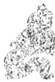

<!-- V3_SOURCE_ID:book016-b001545-p000-e95c60379f -->

注释①阙观，利女贞：阙的读音为kuī，通“窥”，指暗中窃看。这是说六二爻虽然爻位得正，上应九五爻，但因阴柔处下、守持中道，无法完全领略大观的盛美，就像身处室内、暗中“阙观”门外的景物，所以仅利于女子守持正固。爻辞的言外之意是，男子若处于这种情况则不利。《集解》引用侯果的话说：“得位居中，上应于五，阙观朝美，不能大观。处大观之时而为阙观，女正则利，君子则丑也。”

查看对应原文

<!-- V3_FOLDBACK_BEGIN:book016-b001545-p000-e95c60379f -->

注释①阙观，利女贞：阙，音kuī，通“窥”，指暗中窃看。此谓六二虽得正上应九五，但阴柔处下守中，不能尽见大观之美，犹如身居户内、暗中“阙观”门外景物，故仅利于女子守正。爻辞的言外之意，谓男子如此则不利。《集解》引侯果曰：“得位居中，上应于五，阙观朝美，不能大观。处大观之时而为阙观，女正则利，君子则丑也。”

<!-- V3_FOLDBACK_END:book016-b001545-p000-e95c60379f -->

<!-- V3_SOURCE_ID:book016-b001546-p000-0447866e7c -->

《象传》解释说：暗中偷偷观仰美盛景物、女子守持正固的这种情况，对男子来说是可羞丑的。

查看对应原文

<!-- V3_FOLDBACK_BEGIN:book016-b001546-p000-0447866e7c -->

译文《象传》说：“暗中偷偷地观仰美盛景物、女子可以守持正固”，对男子来说是可羞丑的。

<!-- V3_FOLDBACK_END:book016-b001546-p000-0447866e7c -->

<!-- V3_SOURCE_ID:book016-b001547-p000-e8d18d3f2e -->

《象传》说：“阙观女贞”，亦可丑也①。

查看对应原文

<!-- V3_FOLDBACK_BEGIN:book016-b001547-p000-e8d18d3f2e -->

《象》曰：“阙观女贞”，亦可丑也①。

<!-- V3_FOLDBACK_END:book016-b001547-p000-e8d18d3f2e -->

<!-- V3_SOURCE_ID:book016-b001548-p000-34ec8536d6 -->

注释①：亦可丑也。《本义》说：在丈夫则为丑也。

查看对应原文

<!-- V3_FOLDBACK_BEGIN:book016-b001548-p000-34ec8536d6 -->

注释①亦可丑也：《本义》：“在丈夫则为丑也。”

<!-- V3_FOLDBACK_END:book016-b001548-p000-34ec8536d6 -->

<!-- V3_SOURCE_ID:book016-b001549-p000-84c10d02c2 -->

说明深居户内而窃窥外物，自然不能尽观美景；爻辞以“女贞”为喻，可见拟象贴切。但由此又可看出古代礼制对女子视野的不合理约束。

查看对应原文

<!-- V3_FOLDBACK_BEGIN:book016-b001549-p000-84c10d02c2 -->

说明深居户内而窃窥外物，自然不能尽观美景；爻辞以“女贞”为喻，可见拟象贴切。但由此又可看出古代礼制对女子视野的不合理约束。

<!-- V3_FOLDBACK_END:book016-b001549-p000-84c10d02c2 -->

<!-- V3_SOURCE_ID:book016-b001550-p000-9bfc29b88d -->

译文六三，观仰阳刚美德并对照省察自己的行为，谨慎抉择进退。

查看对应原文

<!-- V3_FOLDBACK_BEGIN:book016-b001550-p000-9bfc29b88d -->

译文六三，观仰阳刚美德并对照省察自己的行为，谨慎抉择进退。

<!-- V3_FOLDBACK_END:book016-b001550-p000-9bfc29b88d -->

<!-- V3_SOURCE_ID:book016-b001551-p000-08916b1a4a -->

六三爻，观我生，进退①。

> **释读存疑：** 原文未明确“我生”的具体所指，释读未作额外臆断，符合要求

查看对应原文

<!-- V3_FOLDBACK_BEGIN:book016-b001551-p000-08916b1a4a -->

六三，观我生，进退①。

<!-- V3_FOLDBACK_END:book016-b001551-p000-08916b1a4a -->

<!-- V3_SOURCE_ID:book016-b001552-p000-485d171452 -->

注释①观我生，进退：观，此处含有既观仰于外又自观于内之意；我生，《正义》释为“我身所动出”，《程传》谓“动作施为出于已者”，犹言“自我行为”；进退，指相时慎择进退。这两句说明六三处“观”之时，虽与上九有应，渐近九五之“君”，但阴柔失正，其位“多惧”，故当观于外而修于内，相机审时，慎其进退。《正义》：“三居下体之极，是有可进之时；又居上体之下，复是可退之地。远则不为‘童观’，近则未为‘观国’，居在进退之处，可以自观我之动出也。故时可则进，时不可则退。观风相机，未失其道，故曰‘观我生，进退’也。”案，《王注》谓六三为“观风者”，《正义》：“观风相机”即承此而言。视此爻的居位特点，所谓“自观”，实须先外观美盛风化，然后内自修省，才能妥为进退，免犯咎害。

查看对应原文

<!-- V3_FOLDBACK_BEGIN:book016-b001552-p000-485d171452 -->

注释①观我生，进退：观，此处含有既观仰于外又自观于内之意；我生，《正义》释为“我身所动出”，《程传》谓“动作施为出于已者”，犹言“自我行为”；进退，指相时慎择进退。这两句说明六三处“观”之时，虽与上九有应，渐近九五之“君”，但阴柔失正，其位“多惧”，故当观于外而修于内，相机审时，慎其进退。《正义》：“三居下体之极，是有可进之时；又居上体之下，复是可退之地。远则不为‘童观’，近则未为‘观国’，居在进退之处，可以自观我之动出也。故时可则进，时不可则退。观风相机，未失其道，故曰‘观我生，进退’也。”案，《王注》谓六三为“观风者”，《正义》：“观风相机”即承此而言。视此爻的居位特点，所谓“自观”，实须先外观美盛风化，然后内自修省，才能妥为进退，免犯咎害。

<!-- V3_FOLDBACK_END:book016-b001552-p000-485d171452 -->

<!-- V3_SOURCE_ID:book016-b001553-p000-6d5dae5caa -->

《象传》说：“观仰阳刚美德并对照省察自己的行为、谨慎抉择进退”，说明六三没有丧失正确的观仰之道。

查看对应原文

<!-- V3_FOLDBACK_BEGIN:book016-b001553-p000-6d5dae5caa -->

《象》曰：“观我生进退”，未失 译文《象传》说：“观仰阳刚美德并对照省察自己的行为、谨慎抉择进退”，说明道也。 六三没有丧失正确的观仰之道。

<!-- V3_FOLDBACK_END:book016-b001553-p000-6d5dae5caa -->

<!-- V3_SOURCE_ID:book016-b001554-p000-743bae7b48 -->

将六三的情况与初爻、二爻的“童观”“阙观”相比较，六三已渐向九五的阳刚中正之德靠近，对事物的鉴察已经有所深入、亲切，因此虽然六三所处的位置不当，却能妥善处理自身的观察之事，修养自身的品德。《象传》称其“未失道”，似乎包含了这层意思。

> **释读存疑：** allowed_glossary中术语"向"的定义为建筑或穴位所朝的方位，此处释为"靠近"，与术语定义不符，属于专业术语误换；allowed_glossary中术语"向"的定义为建筑或穴位所朝的方位，此处原文中"向"的含义与该术语定义不符，需调整释读以匹配术语定义或明确说明此处"向"的含义与allowed_glossary中的术语定义不同；1轮自动修复后核义模型仍建议修订，已保守记录。

查看对应原文

<!-- V3_FOLDBACK_BEGIN:book016-b001554-p000-743bae7b48 -->

说明与初、二两爻的“童观”、“阙观”比较，六三已渐向九五的阳刚中正之德靠近，鉴见已有所深入、亲切，故虽不当位，却能善处其“观”，修美己德。《象传》称“未失道”，似含此意。

<!-- V3_FOLDBACK_END:book016-b001554-p000-743bae7b48 -->

<!-- V3_SOURCE_ID:book016-b001555-p000-03404137b8 -->

六四，观仰王朝的光辉盛治，利于成为君王的贵宾。

查看对应原文

<!-- V3_FOLDBACK_BEGIN:book016-b001555-p000-03404137b8 -->

六四，观国之光，利用宾于 译文六四，观仰王朝的光辉盛治，利于王①。 成为君王的贵宾。

<!-- V3_FOLDBACK_END:book016-b001555-p000-03404137b8 -->

<!-- V3_SOURCE_ID:book016-b001556-p000-6923fd8ece -->

注释①：观国之光，利用宾于王。这里的“光”指国家大治呈现出的光辉景象；“宾”在这里作动词用，意思是“作宾”。这句话是说六四柔顺得正，亲附九五，就像贤能之人观仰盛治之国的光辉，所以利于成为君王的座上宾，也就是可以为贤君效力，其吉祥的寓意显而易见。《程传》中说：“四既观见人君之德，国家之治，光华盛美，所宜宾于王朝，效其智力，上辅于君，以施泽天下，故云‘利用宾于王’也。古者有贤德之人，则人君宾礼之，故士之仕进于王朝则谓之‘宾’。”

查看对应原文

<!-- V3_FOLDBACK_BEGIN:book016-b001556-p000-6923fd8ece -->

注释①观国之光，利用宾于王：光，指国家大治而呈现的光辉景象；宾，用如动词，犹言“作宾”。此谓六四柔顺得正，亲比九五，犹如贤者观光于盛治之国，故称利于成为君王的座上宾，即言可以效用于贤君，其吉可知。《程传》：“四既观见人君之德，国家之治，光华盛美，所宜宾于王朝，效其智力，上辅于君，以施泽天下，故云‘利用宾于王’也。古者有贤德之人，则人君宾礼之，故士之仕进于王朝则谓之‘宾’。”

<!-- V3_FOLDBACK_END:book016-b001556-p000-6923fd8ece -->

<!-- V3_SOURCE_ID:book016-b001557-p000-aa4eaed2d0 -->

《象传》说：“观仰王朝的光辉盛治”，说明此时这个国家正以宾贤为尚。

查看对应原文

<!-- V3_FOLDBACK_BEGIN:book016-b001557-p000-aa4eaed2d0 -->

《象》曰：“观国之光”，尚宾 译文《象传》说：“观仰王朝的光辉盛治”，说明此时其国正礼尚宾贤。也①。

<!-- V3_FOLDBACK_END:book016-b001557-p000-aa4eaed2d0 -->

<!-- V3_SOURCE_ID:book016-b001558-p000-e52e802caf -->

匡释①对“尚宾”的解释：《杨氏易传》说：“表明这个国家尊重宾贤，可以进取。”按，“尚宾”的含义，《正义》认为是“仰慕崇尚成为王的宾客”；《尚氏学》则认为“说的是成为在上者的宾客”。两种说法在含义上都讲得通。

查看对应原文

<!-- V3_FOLDBACK_BEGIN:book016-b001558-p000-e52e802caf -->

匡释①尚宾：《杨氏易传》：“明其国贵尚宾贤，可以进也。”案，“尚宾”之义，《正义》谓“慕尚为王宾”；《尚氏学》以为“言宾于上也”。两说于义并通。

<!-- V3_FOLDBACK_END:book016-b001558-p000-e52e802caf -->

<!-- V3_SOURCE_ID:book016-b001559-p000-27f833374d -->

这说明古代统治者重视“观光”礼仪，从其政治目的来看，一方面似乎在于显示国力强盛，另一方面又可借此吸引人才。《尚书·周书·微子》所说的“修其礼物，作宾于王家”，曹植《七启》所称的“是以俊乂来仕，观国之光”，都可用来参照本爻的含义。

查看对应原文

<!-- V3_FOLDBACK_BEGIN:book016-b001559-p000-27f833374d -->

说明古代统治者重视“观光”礼仪，从其政治目的看，一方面似在于显示国力强盛，另一方面又可借此吸引人才。《尚书·周书·微子》所谓“修其礼物，作宾于王家”，曹植《七启》称“是以俊乂来仕，观国之光”（《曹子建集》），并可借以参见本爻之义。

<!-- V3_FOLDBACK_END:book016-b001559-p000-27f833374d -->

<!-- V3_SOURCE_ID:book016-b001560-p000-0a7cb2ba18 -->

## 九五，观我生，君子无咎①。

> **释读存疑：** 本地硬校验仍未通过，已记录供后续自动处理或人工核对。

查看对应原文

<!-- V3_FOLDBACK_BEGIN:book016-b001560-p000-0a7cb2ba18 -->

## 九五，观我生，君子无咎①。

<!-- V3_FOLDBACK_END:book016-b001560-p000-0a7cb2ba18 -->

<!-- V3_SOURCE_ID:book016-b001561-p000-e4b119e5de -->

译文九五，受人观仰并自我省察自己的行为，君子必无咎害。

查看对应原文

<!-- V3_FOLDBACK_BEGIN:book016-b001561-p000-e4b119e5de -->

译文九五，受人观仰并自我省察自己的行为，君子必无咎害。

<!-- V3_FOLDBACK_END:book016-b001561-p000-e4b119e5de -->

<!-- V3_SOURCE_ID:book016-b001562-p000-66b89f371f -->

匡释①观我生，君子无咎：观我生，指既受人观仰又自观其道，义与六三有别(参见该爻译注)。这两句说明九五阳刚中正，为《观》卦之主，犹如“贤君”以盛德为天下人所观仰，同时又能常常自我省察，不断美善其行，故称“君子无咎”。《集解》引王弼曰：“观我生，自观其道也。为众观之主，当宣文化光于四表。上之化下，犹风之靡草；百姓有过，在予一人。君子风著，己乃无咎；欲察己道，当观民也。”

查看对应原文

<!-- V3_FOLDBACK_BEGIN:book016-b001562-p000-66b89f371f -->

匡释①观我生，君子无咎：观我生，指既受人观仰又自观其道，义与六三有别(参见该爻译注)。这两句说明九五阳刚中正，为《观》卦之主，犹如“贤君”以盛德为天下人所观仰，同时又能常常自我省察，不断美善其行，故称“君子无咎”。《集解》引王弼曰：“观我生，自观其道也。为众观之主，当宣文化光于四表。上之化下，犹风之靡草；百姓有过，在予一人。君子风著，己乃无咎；欲察己道，当观民也。”

<!-- V3_FOLDBACK_END:book016-b001562-p000-66b89f371f -->

<!-- V3_SOURCE_ID:book016-b001563-p000-d0d9a04e40 -->

《象》曰：“观我生”，观民也①。 译文《象传》说：“受人观仰并自我省察自己的行为”，说明九五应当通过观察民风来自我审察。注释①观民：《程传》：“我生，出于己者；人君欲观己之施为善否，当观于民。民俗善，则政化善也。王弼云观民以察己之道’是也。”

查看对应原文

<!-- V3_FOLDBACK_BEGIN:book016-b001563-p000-d0d9a04e40 -->

《象》曰：“观我生”，观民也①。 译文《象传》说：“受人观仰并自我省察自己的行为”，说明九五应当通过观察民风来自我审察。注释①观民：《程传》：“我生，出于己者；人君欲观己之施为善否，当观于民。民俗善，则政化善也。王弼云观民以察己之道’是也。”

<!-- V3_FOLDBACK_END:book016-b001563-p000-d0d9a04e40 -->

<!-- V3_SOURCE_ID:book016-b001564-p000-40b93fe270 -->

说明 九五既为“人君”之象，其所“自观”、“观民”，目的正为着改过扬善，美善治道，使其盛德常足以让“天下”观仰。《论语·子张》说：“子贡曰：君子之过也，如日月之食焉：过也，人皆见之；更也，人皆仰之。”此义似与爻辞“君子无咎”之旨有合。

查看对应原文

<!-- V3_FOLDBACK_BEGIN:book016-b001564-p000-40b93fe270 -->

说明 九五既为“人君”之象，其所“自观”、“观民”，目的正为着改过扬善，美善治道，使其盛德常足以让“天下”观仰。《论语·子张》说：“子贡曰：君子之过也，如日月之食焉：过也，人皆见之；更也，人皆仰之。”此义似与爻辞“君子无咎”之旨有合。

<!-- V3_FOLDBACK_END:book016-b001564-p000-40b93fe270 -->

<!-- V3_SOURCE_ID:book016-b001565-p000-d3f9542dad -->

上九爻的爻辞是：观其生，君子无咎。意思是人们都观仰他的行为，君子必然不会有咎害。

查看对应原文

<!-- V3_FOLDBACK_BEGIN:book016-b001565-p000-d3f9542dad -->

译文上九，人们都观仰他的行为，君子 上九，观其生，君子无咎①。  
必无咎害。

<!-- V3_FOLDBACK_END:book016-b001565-p000-d3f9542dad -->

<!-- V3_SOURCE_ID:book016-b001566-p000-26138d74de -->

注释① 观其生，君子无咎：这句话是说，上九阳刚爻处于《观》卦的最末位，虽然属于虚高之位，但下位的爻都在观仰他的施为，因此必须具备君子的品德才能没有咎害，这里的告诫与九五爻相同。《本义》中说：“上九阳刚居于尊位之上，虽然不承担具体职事，但也被下位所观仰，所以它的告诫之辞大致与九五爻相同，只是以‘我’为主体、以‘其’为客体，稍有主宾的差异罢了。”

查看对应原文

<!-- V3_FOLDBACK_BEGIN:book016-b001566-p000-26138d74de -->

注释① 观其生，君子无咎：此谓上九阳刚居《观》之终，虽属虚高之位，但下者均在观仰其施为，故须有“君子”之德才能“无咎”，其诫与九五同。《本义》：“上九阳刚居尊位之上，虽不当事任，而亦为下所观，故其戒辞略与五同。但以‘我’为其’，小有主宾之异耳。”

<!-- V3_FOLDBACK_END:book016-b001566-p000-26138d74de -->

<!-- V3_SOURCE_ID:book016-b001567-p000-6ab68b20a0 -->

《象传》说：“观其生”，说明上九修美道德的心志不可安逸松懈。

查看对应原文

<!-- V3_FOLDBACK_BEGIN:book016-b001567-p000-6ab68b20a0 -->

译文《象传》说：“人们都观仰他的行 《象》曰：“观其生”，志未平为”，说明上九修美道德的心志未可安逸  
松懈。 也①。

<!-- V3_FOLDBACK_END:book016-b001567-p000-6ab68b20a0 -->

<!-- V3_SOURCE_ID:book016-b001568-p000-d7874cb288 -->

注释① 志未平：平，意思是安宁无为。这句话是说，上九虽然处于不承担职事的“虚位”，也必须时时修美德行，不可让心志安逸。《程传》中说：“不能因为不在其位，就安然放纵心意无所事事。”《本义》中说：“说的是虽然没有居于正位，也不可忘记戒惧。”这些说法都符合《象传》的主旨。

查看对应原文

<!-- V3_FOLDBACK_BEGIN:book016-b001568-p000-d7874cb288 -->

注释①志未平：平，犹言“安宁无为”。此言上九虽居不任事的“虚位”，也得时时修美德行，不可安逸其志。《程传》：“不可以不在于位故，安然放意无所事也。”《本义》：“言虽不得位，未可忘戒惧也。”皆合《象传》之旨。

<!-- V3_FOLDBACK_END:book016-b001568-p000-d7874cb288 -->

<!-- V3_SOURCE_ID:book016-b001569-p000-04dca9a8e7 -->

说明 居“大观”之极，犹发“志未平”之义，可见上九的喻旨在于：欲以美盛可观的道德化同“天下”，实非轻而易举之事。马其昶曰：“圣人之志，必使下观而化，天下皆为君子，大舜之善与人同是也。志未平，即尧舜犹病，邹鲁悲悯之心。”（《重定费氏学》）此说甚合本爻旨趋。

查看对应原文

<!-- V3_FOLDBACK_BEGIN:book016-b001569-p000-04dca9a8e7 -->

说明 居“大观”之极，犹发“志未平”之义，可见上九的喻旨在于：欲以美盛可观的道德化同“天下”，实非轻而易举之事。马其昶曰：“圣人之志，必使下观而化，天下皆为君子，大舜之善与人同是也。志未平，即尧舜犹病，邹鲁悲悯之心。”（《重定费氏学》）此说甚合本爻旨趋。

<!-- V3_FOLDBACK_END:book016-b001569-p000-04dca9a8e7 -->

<!-- V3_SOURCE_ID:book016-b001570-p000-be06978f47 -->

延论 春秋时吴国季札观乐于鲁，欣赏到《韶箾》舞蹈，深受感染，认为这是周朝“盛德”的高度体现，于是极力赞叹说：“观止矣！若有他乐，吾不敢请已！”（《左传》襄公二十九年）《观》卦大义，正是阐发“观仰”美盛事物可以感化人心的道理。卦辞取观仰祭祀为喻，说明观毕初始的盛礼，即使不观其后的细节，心中的“信敬”之情已经油然萌生。此中的喻义，实与季札“观止”之叹至相切合。卦中六爻，四阴主于自下观上：初、二离九五阳刚最远，或如幼童浅见，或如隔户窃观，均不能尽获“大观”之美；六三接近上卦，能观仰美德以自省察，未失其道；六四亲比九五，犹如亲临观光于“王朝”的盛治，获“作宾于王”之利，为尽见“大观”的象征。而五、上两阳，主于自上观下，既具阳刚美德让人观仰，又须自观其道、修美德行，故两者均发“君子无咎”的意旨。可见，本卦阴阳上下所寓涵的意义颇有区别。朱熹的学生曾经问道：“《观》六爻，一爻胜似一爻，岂所据之位愈高，则所见愈大耶？”朱子答云：“上二爻意自别，下四爻是所据之位愈近，则所见愈亲切的意思。”（《朱子语类》）当然，《观》卦揭示的“观仰”作用，除了强调“上”者以美德感化于“下”之外，还体现了观“民风”可以正“君道”的思想，这从五、上两爻“观民”自省、其志“未平”的义理中不难看出。《毛诗大序》说道：“上以风化下，下以风刺上，主文而谲谏，言之者无罪，闻之者足以戒，故曰风。”此论虽是针对《诗经·国风》而发，但与《观》卦的象征意义甚有相通之处。

查看对应原文

<!-- V3_FOLDBACK_BEGIN:book016-b001570-p000-be06978f47 -->

延论 春秋时吴国季札观乐于鲁，欣赏到《韶箾》舞蹈，深受感染，认为这是周朝“盛德”的高度体现，于是极力赞叹说：“观止矣！若有他乐，吾不敢请已！”（《左传》襄公二十九年）《观》卦大义，正是阐发“观仰”美盛事物可以感化人心的道理。卦辞取观仰祭祀为喻，说明观毕初始的盛礼，即使不观其后的细节，心中的“信敬”之情已经油然萌生。此中的喻义，实与季札“观止”之叹至相切合。卦中六爻，四阴主于自下观上：初、二离九五阳刚最远，或如幼童浅见，或如隔户窃观，均不能尽获“大观”之美；六三接近上卦，能观仰美德以自省察，未失其道；六四亲比九五，犹如亲临观光于“王朝”的盛治，获“作宾于王”之利，为尽见“大观”的象征。而五、上两阳，主于自上观下，既具阳刚美德让人观仰，又须自观其道、修美德行，故两者均发“君子无咎”的意旨。可见，本卦阴阳上下所寓涵的意义颇有区别。朱熹的学生曾经问道：“《观》六爻，一爻胜似一爻，岂所据之位愈高，则所见愈大耶？”朱子答云：“上二爻意自别，下四爻是所据之位愈近，则所见愈亲切的意思。”（《朱子语类》）当然，《观》卦揭示的“观仰”作用，除了强调“上”者以美德感化于“下”之外，还体现了观“民风”可以正“君道”的思想，这从五、上两爻“观民”自省、其志“未平”的义理中不难看出。《毛诗大序》说道：“上以风化下，下以风刺上，主文而谲谏，言之者无罪，闻之者足以戒，故曰风。”此论虽是针对《诗经·国风》而发，但与《观》卦的象征意义甚有相通之处。

<!-- V3_FOLDBACK_END:book016-b001570-p000-be06978f47 -->

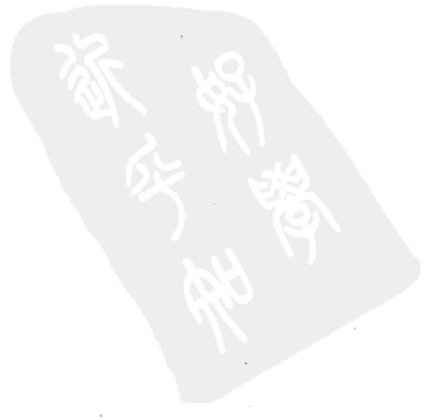

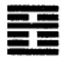

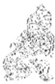

<!-- V3_SOURCE_ID:book016-b001574-p000-29f5512d50 -->

## 噬嗑卦第二十一

查看对应原文

<!-- V3_FOLDBACK_BEGIN:book016-b001574-p000-29f5512d50 -->

## 噬嗑卦第二十一

<!-- V3_FOLDBACK_END:book016-b001574-p000-29f5512d50 -->

<!-- V3_SOURCE_ID:book016-b001575-p000-fed416d7d8 -->

译文《噬嗑》卦象征啮合：亨通，利于施 用刑法。

查看对应原文

<!-- V3_FOLDBACK_BEGIN:book016-b001575-p000-fed416d7d8 -->

译文《噬嗑》卦象征啮合：亨通，利于施 用刑法。

<!-- V3_FOLDBACK_END:book016-b001575-p000-fed416d7d8 -->

<!-- V3_SOURCE_ID:book016-b001576-p000-4a0d62b5f7 -->

噬嗑卦：亨通，利于施用刑法。

查看对应原文

<!-- V3_FOLDBACK_BEGIN:book016-b001576-p000-4a0d62b5f7 -->

噬嗑①：亨，利用狱②。

<!-- V3_FOLDBACK_END:book016-b001576-p000-4a0d62b5f7 -->

<!-- V3_SOURCE_ID:book016-b001577-p000-800281df1f -->

注释① 噬嗑：读音为shì hé，是卦名，下卦为震（☳），上卦为离（☲），象征“啮合”。按，这两个字以口中咬物使合为比喻，说明施用刑法的含义。《正义》中说：“事物在口中时，会被上下隔开；如果咬去口中的东西，上下就会相合而得以亨通。这个卦的名称，假借卦象来表意，用来比喻刑法。”

查看对应原文

<!-- V3_FOLDBACK_BEGIN:book016-b001577-p000-800281df1f -->

注释① 噬嗑：音 shì hé，卦名，下震（☳）上离（☲），象征“啮合”。案，此二字以口中啮（音niè）物使合为喻，说明施用刑法之义。《正义》：“物在于口，则隔其上下；若啮去其物，上下乃合而得亨也。此卦之名，假借口象以为义，以喻刑法也。”

<!-- V3_FOLDBACK_END:book016-b001577-p000-800281df1f -->

<!-- V3_SOURCE_ID:book016-b001578-p000-6a7d23ceea -->

② 亨，利用狱：狱，意思是“刑法”。这是说事物处于相互间隔的状态时，如果能像“啮合”那样就可以亨通；就好比“刑法”可以除去间隔的东西，所以说“利于施用刑法”。《王注》中说：“凡是事物不亲近，是因为有间隔；事物不整齐，是因为有过错。有间隔和过错，咬去它们使相合，就能亨通。用刑法来使事物亨通，这就是狱的用处。”《尚氏学》中说：“上下不能相合，中间必定有东西间隔着；咬去中间的东西，就会相合而亨通。国家设置刑狱，也是这个道理。百姓中有顽固不化的人，用刑法来制裁他们，顽固的东西除去了，上下就能相通了，所以说‘利于施用刑法’。”

查看对应原文

<!-- V3_FOLDBACK_BEGIN:book016-b001578-p000-6a7d23ceea -->

② 亨，利用狱：狱，犹言“刑法”。此谓事物当相间相隔之时，若能“啮合”则可亨通；犹如“刑法”可以除去间隔之物，故曰“利用狱”。《王注》：“凡物之不亲，由有间也；物之不齐，由有过也。有间与过，啮而合之，所以通也。刑克以通，狱之利也。”《尚氏学》：“上下之不能相合者，中必有物间之；啮而去其间，则合而通矣。国家之有刑狱，亦复如是。民有梗化者，以刑克之，则顽梗去，而上下通矣，故曰‘利用狱’。”

<!-- V3_FOLDBACK_END:book016-b001578-p000-6a7d23ceea -->

<!-- V3_SOURCE_ID:book016-b001579-p000-772ba94897 -->

说丽 朱熹分析本卦的卦形说：“本卦上下两个阳爻，中间空虚，是颐口的形象；九四这一阳爻在中间间隔着，必须咬去它然后才能相合，所以称为‘噬嗑’。”（《本义》）李士珍也认为：“初爻、上爻象征辅颊，二爻、三爻、五爻象征上下牙齿，九四在中间象征口中的东西；九四爻位不正，所以必须咬去它。”（《周易学说》引）这两种说法可以作为参考。

查看对应原文

<!-- V3_FOLDBACK_BEGIN:book016-b001579-p000-772ba94897 -->

说丽 朱熹分析本卦的卦形说：“为卦上下两阳而中虚，颐口之象；九四一阳间于其中，必啮之而后合，故为‘噬嗑’。”（《本义》）李士珍也认为：“上、初象辅颊，二、三、五象上下齿，九四在中象物；四不中正，故须啮而去之。”（《周易学说》引）此二说可备参考。

<!-- V3_FOLDBACK_END:book016-b001579-p000-772ba94897 -->

<!-- V3_SOURCE_ID:book016-b001580-p000-d07674a60a -->

译文《象传》说：口腔中有食物，可以啮合。啮合然后亨通，譬如刚柔上下先各分开，然后交相运动而啮合之义显明，就像震雷闪电交击互合而啮合之理昭彰。此时柔和者处得中（刚柔兼济），所以利于施用刑法。

查看对应原文

<!-- V3_FOLDBACK_BEGIN:book016-b001580-p000-d07674a60a -->

译文《象传》说：口腔中有食物，可以啮合。啮合然后亨通，譬如刚柔上下先各分开，然后交相运动而啮合之义显明，就像震雷闪电交击互合而啮合之理昭彰。此时柔和者处得中（刚柔兼济），所以利于施用刑法。

<!-- V3_FOLDBACK_END:book016-b001580-p000-d07674a60a -->

<!-- V3_SOURCE_ID:book016-b001581-p000-1d7f33d12e -->

《彖传》说：颐中有物，叫做噬嗑。噬嗑而亨，刚柔分，动而明，雷电合而章。柔得中而上行，虽不当位，利用狱也。

查看对应原文

<!-- V3_FOLDBACK_BEGIN:book016-b001581-p000-1d7f33d12e -->

《彖》曰：颐中有物①，曰噬嗑。噬嗑而亨，刚柔分，动而明，雷电合而章②。柔得中而上行，虽不当位，利用狱也③。

<!-- V3_FOLDBACK_END:book016-b001581-p000-1d7f33d12e -->

<!-- V3_SOURCE_ID:book016-b001582-p000-fb2c0680f9 -->

注释①：颐中有物，颐是上下颚之间的总称，也就是口腔。这里用口中有物正可啮合，来解释卦名“噬嗑”的含义。《王注》说：“颐中有物，啮而合之，‘噬嗑’之义也。”考证“颐”字，《说文》说：“古文‘臣’”，《段注》说：“此文当横视之，横视之则口上、口下、口中之形俱见矣。”段氏所说的横视，就是将字横过来观看，这样就呈现出口中有物的样子；如今查东周金文“匠”字有时写作“昬”（异伯盘文，高明《古文字类编》引王献唐《黄县异器》），这个字正像上下齿啮物而合的形状。

> **释读存疑：** 1轮自动修复后核义模型仍建议修订，已保守记录。

查看对应原文

<!-- V3_FOLDBACK_BEGIN:book016-b001582-p000-fb2c0680f9 -->

注释①颐中有物：颐，上下颚之间的总称，犹言“口腔”。此以口中有物，正可啮合，释卦名“噬嗑”之义。《王注》：“颐中有物，啮而合之，‘噬嗑’之义也。”案，“颐”字，《说文》曰：“古文‘臣’”，《段注》：“此文当横视之，横视之则口上、口下、口中之形俱见矣。”段氏谓横视，即作“曰”，适为口中有物之象；今查东周金文“匠”或作“昬”(异伯盘文，高明《古文字类编》引王献唐《黄县异器》)，此字正像上下齿啮物而合之形(“颐”又有“养”义，参见《颐》卦译注)。

<!-- V3_FOLDBACK_END:book016-b001582-p000-fb2c0680f9 -->

<!-- V3_SOURCE_ID:book016-b001583-p000-5eb11dc80a -->

注释②：刚柔分，动而明，雷电合而章，刚、动、雷都指下震；柔、明、电都指上离。这里举出上下卦象，说明刚柔上下分处、交动而“噬嗑”的含义显明，雷电相随兴作、交合而“噬嗑”的道理彰显。这段文字旨在解释卦辞“噬嗑，亨”，也阐明“利用狱”的含义。《王注》说：“刚柔分动不溷乃明，雷电并合不乱乃章。”《正义》说：“刚柔分，谓震刚在下，离柔在上。刚柔云‘分’，雷电云‘合’者，欲见明之与动各是一事，故刚柔云分也；明动虽各一事，相须而用，故雷电云合。但《易》之为体，取象既多，若取分义，则云震下离上；若取合义，则云离震合体，共成一卦也。”

查看对应原文

<!-- V3_FOLDBACK_BEGIN:book016-b001583-p000-5eb11dc80a -->

②刚柔分，动而明，雷电合而章：刚、动、雷，均指下震；柔、明、电，均指上离。此举上下卦象，说明刚柔上下分处、交动而“噬嗑”之义明，雷电相随兴作、交合而“噬嗑”之理彰。文旨释卦辞“噬嗑，亨”，亦明“利用狱”之义。《王注》：“刚柔分动不溷乃明，雷电并合不乱乃章。”《正义》：“刚柔分，谓震刚在下，离柔在上。刚柔云‘分’，雷电云‘合’者，欲见明之与动各是一事，故刚柔云分也；明动虽各一事，相须而用，故雷电云合。但《易》之为体，取象既多，若取分义，则云震下离上；若取合义，则云离震合体，共成一卦也。”

<!-- V3_FOLDBACK_END:book016-b001583-p000-5eb11dc80a -->

<!-- V3_SOURCE_ID:book016-b001584-p000-984128ea78 -->

③阴柔者居中位而向上行进，虽然所处位置并不恰当，却利于处理刑狱之事；这里的阴柔指的是六五爻。这是说六五爻以阴柔之性居中位，虽未处于纯柔的正位，却能刚柔相济，契合释卦辞中“利用狱”的含义。《程传》解释道：“六五以阴柔之性居中位，体现了用柔得当的道理；向上行进，指的是居于尊位；虽位置不当，指以阴柔之性居第五位并不合适；而利于处理刑狱之事，是因为处理刑狱的原则，全用刚猛则会过于严苛暴虐，过于柔弱则会失之于宽纵，六五是处理刑狱的主爻，以阴柔之性居刚位且得中位，正符合处理刑狱的适宜之道。”《尚氏学》解释道：“第五位位置不当，但能以文明之性居中位来裁断曲直，不失情理，所以利于处理刑狱之事。”

查看对应原文

<!-- V3_FOLDBACK_BEGIN:book016-b001584-p000-984128ea78 -->

③柔得中而上行，虽不当位，利用狱也；柔，指六五。此谓六五柔中居尊，虽不当纯柔正位，却能刚柔相济，以释卦辞“利用狱”。《程传》：“六五以柔居中，为用柔得中之义；上行，谓居尊位；虽不当位，谓以柔居五为不当；而利于用狱者，治狱之道，全刚则伤于严暴，过柔则失于宽纵，五为用狱之主，以柔处刚而得中，得用狱之宜也。”《尚氏学》：“五不当位，然文明以中断制枉直，不失情理，故利用狱也。”

<!-- V3_FOLDBACK_END:book016-b001584-p000-984128ea78 -->

<!-- V3_SOURCE_ID:book016-b001585-p000-6bcbefa447 -->

《象传》说：雷电交击，象征“噬嗑”；先代君王因此严明刑罚、肃正法令。

查看对应原文

<!-- V3_FOLDBACK_BEGIN:book016-b001585-p000-6bcbefa447 -->

《象》曰：雷电，噬嗑①；先王以 译文《象传》说：雷电交击，象征“啮合”；先代君王因此严明刑罚、肃正法令。明罚敕法②。

<!-- V3_FOLDBACK_END:book016-b001585-p000-6bcbefa447 -->

<!-- V3_SOURCE_ID:book016-b001586-p000-42151408cb -->

注释①雷电，噬嗑：这是解释《噬嗑》卦下卦为震（八卦之一）、上卦为离（八卦之一）所构成的卦象，含义与《彖传》中“雷电合而章”相同。《程传》解释道：“雷电是相伴并现的事物，也有啮合的意象，电象征明察，雷象征威严。”按，“雷电”二字，《程传》认为“卦象没有倒置的情况，怀疑这段文字有讹误”，《本义》也说“应当写作‘电雷’”；《周易玩辞》指出：“石经写作‘电雷’，晁公武说六十四卦的大象没有倒置的情况，应当依从石经的写法。”这些说法都可以参考。

查看对应原文

<!-- V3_FOLDBACK_BEGIN:book016-b001586-p000-42151408cb -->

注释①雷电，噬嗑：释《噬嗑》卦下震为雷、上离为电之象，义与《彖传》“雷电合而章”同。《程传》：“雷电相须并见之物，亦有嗑象，电明而雷威。”案，“雷电”二字，《程传》以为“象无倒置者，疑此文互也”，《本义》亦曰“当作‘电雷’”；《周易玩辞》指出：“石经作‘电雷’，晁公武氏曰六十四卦大象无倒置者，当从石经。”此诸说并可参考。

<!-- V3_FOLDBACK_END:book016-b001586-p000-42151408cb -->

<!-- V3_SOURCE_ID:book016-b001587-p000-a901c6bb91 -->

②明罚敕法：“明”在这里用作动词；“敕”读音为chì，通“勅”，意思是“正”，《释文》记载：“郑玄说：‘敕，犹如治理’，一说‘整饬’。”这是说明“先王”效法《噬嗑》的卦象，严明刑罚、整饬法令，使天下归于一统。《集解》引用侯果的话：“雷能震动万物，电能照察万物，雷电震动照察则万物不能心怀邪念。所以先王效法这一卦象，严明刑罚、整饬法令，用来昭示万物，希望天下万众一心。”

查看对应原文

<!-- V3_FOLDBACK_BEGIN:book016-b001587-p000-a901c6bb91 -->

②明罚敕法：明，用如动词；敕，音chì，通“勅”，犹言“正”，《释文》：“郑云：‘敕，犹理也’，一云‘整也’。”这是说明“先王”效法《噬嗑》之象，明其刑罚、正其法令，使天下合一。《集解》引侯果曰：“雷所以动物，电所以照物，雷电震照则万物不能怀邪。故先王则之，明罚敕法，以示万物，欲万方一心也。”

<!-- V3_FOLDBACK_END:book016-b001587-p000-a901c6bb91 -->

<!-- V3_SOURCE_ID:book016-b001588-p000-d321a7f3b4 -->

说明本卦取象“噬嗑”，是拟喻于“颐中啮物使合”，其义则重在“用狱”。故《大象传》以“明罚敕法”阐述卦旨。宋衷指出：“雷动而威，电动而明，二者合而其道章也。用刑之道，威明相兼。若威而不明，恐致淫滥；明而无威，不能伏物：故须雷电并合而噬嗑备。”《集解》引此说释《大象传》的寓理甚明。

> **释读存疑：** 本地硬校验仍未通过，已记录供后续自动处理或人工核对。

查看对应原文

<!-- V3_FOLDBACK_BEGIN:book016-b001588-p000-d321a7f3b4 -->

说明本卦取象“噬嗑”，是拟喻于“颐中啮物使合”，其义则重在“用狱”。故《大象传》以“明罚敕法”阐述卦旨。宋衷指出：“雷动而威，电动而明，二者合而其道章也。用刑之道，威明相兼。若威而不明，恐致淫滥；明而无威，不能伏物：故须雷电并合而噬嗑备。”(《集解》引)此说释《大象传》的寓理甚明。

<!-- V3_FOLDBACK_END:book016-b001588-p000-d321a7f3b4 -->

<!-- V3_SOURCE_ID:book016-b001589-p000-1043ab3444 -->

译文初九，足着刑具而伤灭脚趾，不致咎害。

查看对应原文

<!-- V3_FOLDBACK_BEGIN:book016-b001589-p000-1043ab3444 -->

译文初九，足着刑具而伤灭脚趾，不致咎害。

<!-- V3_FOLDBACK_END:book016-b001589-p000-1043ab3444 -->

<!-- V3_SOURCE_ID:book016-b001590-p000-f2b4fe8359 -->

初九，屦校灭趾，无咎①。

> **释读存疑：** 本地硬校验仍未通过，已记录供后续自动处理或人工核对。

查看对应原文

<!-- V3_FOLDBACK_BEGIN:book016-b001590-p000-f2b4fe8359 -->

初九，屦校灭趾，无咎①。

<!-- V3_FOLDBACK_END:book016-b001590-p000-f2b4fe8359 -->

<!-- V3_SOURCE_ID:book016-b001591-p000-5c272d78eb -->

注释①屦校灭趾，无咎：屦，读音为jù，此处用作动词，意思是“足着”；校，是木制的刑具，这里指脚桎之类的木制刑具；灭，《正义》解释为“灭没”，意思是“伤灭”。这是说初九处于“噬嗑”卦的初始阶段，就像初次触犯刑法，过错还很轻微，所以仅受到脚戴刑具、脚趾受伤的小惩罚；因为其本质属阳刚，有受到“小惩”而能“大诫”的征象，不会再犯大的过错，所以“无咎”。《王注》说：“凡是过错的开端，必定始于细微之处，之后才会发展到显著的程度；刑罚的开端，必定始于轻微的处罚，之后才会发展到诛杀的程度。过错轻微则处罚轻微，所以‘屦校灭趾’，是为了拘束他的行为，足以起到惩戒作用而已，所以不会有更重的处罚。”

查看对应原文

<!-- V3_FOLDBACK_BEGIN:book016-b001591-p000-5c272d78eb -->

注释①屦校灭趾，无咎：屦，音jù，用如动词，犹言“足着”；校，木制刑具，此处指“脚桎”之类的木械；灭，《正义》释为“灭没”，犹言“伤灭”。此谓初九处“噬嗑”之始，犹如初触刑法，其过尚微，故仅受着足械、伤脚趾的小惩；因其质本阳刚，有受“小惩”而能“大诫”之象，不致重犯大过，故“无咎”。《王注》：“凡过之所始，必始于微，而后至于著；罚之所始，必始于薄，而后至于诛。过轻戮薄，故‘屦校灭趾’，桎其行也，足惩而已，故不重也。”

<!-- V3_FOLDBACK_END:book016-b001591-p000-5c272d78eb -->

<!-- V3_SOURCE_ID:book016-b001592-p000-e4dc135fef -->

译文《象传》说：“足着刑具而伤灭脚趾”，说明初九不至于再前行重犯过失。

查看对应原文

<!-- V3_FOLDBACK_BEGIN:book016-b001592-p000-e4dc135fef -->

译文《象传》说：“足着刑具而伤灭脚趾”，说明初九不至于再前行重犯过失。

<!-- V3_FOLDBACK_END:book016-b001592-p000-e4dc135fef -->

<!-- V3_SOURCE_ID:book016-b001593-p000-5c88dfd5b8 -->

《象传》说：“脚戴刑具，脚趾被伤没”，意思是初九不会再前行重犯过失。

> **释读存疑：** 原文“屦校灭趾”的释读存在歧义，释为“脚戴刑具，脚趾被伤没”未明确是否为“脚趾被刑具覆盖”或“脚趾被伤没”，原文未明具体所指

查看对应原文

<!-- V3_FOLDBACK_BEGIN:book016-b001593-p000-5c88dfd5b8 -->

《象》曰：“屦校灭趾”，不行也。

<!-- V3_FOLDBACK_END:book016-b001593-p000-5c88dfd5b8 -->

<!-- V3_SOURCE_ID:book016-b001594-p000-6f2e689ab7 -->

卷三

查看对应原文

<!-- V3_FOLDBACK_BEGIN:book016-b001594-p000-6f2e689ab7 -->

卷三

<!-- V3_FOLDBACK_END:book016-b001594-p000-6f2e689ab7 -->

<!-- V3_SOURCE_ID:book016-b001595-p000-6a551b4532 -->

既然已经明确，《系辞下传》引用孔子的话：“小人不以不仁为耻，不以不义为惧，看不到利益就不会努力，没有威严就不会被惩戒。受到小的惩戒就能避免大的过错，这是小人的福气。《周易》说：‘脚戴刑具，脚趾被伤没，没有过错’，说的就是这个道理。”这种说法深刻阐明了本爻的象外之旨，非常切合义理。

> **释读存疑：** 原文“屦校灭趾”的释读存在歧义，释为“脚戴刑具，脚趾被伤没”未明确是否为“脚趾被刑具覆盖”或“脚趾被伤没”，原文未明具体所指

查看对应原文

<!-- V3_FOLDBACK_BEGIN:book016-b001595-p000-6a551b4532 -->

既明《系辞下传》引孔子曰：“小人不耻不仁，不畏不义，不见利不劝，不威不惩。小惩而大诫，此小人之福也。《易》曰：‘屦校灭趾，无咎’，此之谓也。”此说深阐本爻的象外之旨，至见义理。

<!-- V3_FOLDBACK_END:book016-b001595-p000-6a551b4532 -->

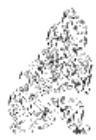

<!-- V3_SOURCE_ID:book016-b001597-p000-97cc279a51 -->

译文六二，像咬啮柔脆的皮肤一样施刑顺利，即使伤灭犯人的鼻梁，也不致咎害。

查看对应原文

<!-- V3_FOLDBACK_BEGIN:book016-b001597-p000-97cc279a51 -->

译文六二，像咬啮柔脆的皮肤一样施刑顺利，即使伤灭犯人的鼻梁，也不致咎害。

<!-- V3_FOLDBACK_END:book016-b001597-p000-97cc279a51 -->

<!-- V3_SOURCE_ID:book016-b001598-p000-b52931d7b0 -->

六二爻的爻辞为：噬肤，灭鼻，无咎。

查看对应原文

<!-- V3_FOLDBACK_BEGIN:book016-b001598-p000-b52931d7b0 -->

六二，噬肤①，灭鼻，无咎②。

<!-- V3_FOLDBACK_END:book016-b001598-p000-b52931d7b0 -->

<!-- V3_SOURCE_ID:book016-b001599-p000-9e2d438094 -->

此为噬嗑卦，是全书第二十一卦。

查看对应原文

<!-- V3_FOLDBACK_BEGIN:book016-b001599-p000-9e2d438094 -->

噬嗑卦第二十一

<!-- V3_FOLDBACK_END:book016-b001599-p000-9e2d438094 -->

<!-- V3_SOURCE_ID:book016-b001600-p000-2f6b57aa2e -->

注释①噬肤：噬，比喻施用刑法；肤，王弼的《王注》中说：“柔脆之物也”，意思是用刑顺利无碍。这句话是说六二爻柔顺中正，处于“噬嗑”之时，有施刑于人、顺当无阻的象征。《王注》中说：“噬，啮也；啮者，刑克之谓也。处中得位，所刑者当，故曰‘噬肤’也。”

查看对应原文

<!-- V3_FOLDBACK_BEGIN:book016-b001600-p000-2f6b57aa2e -->

注释①噬肤：噬，喻施用刑法；肤，《王注》：“柔脆之物也”，喻用刑顺利无碍。此言六二柔顺中正，当“噬嗑”之时，有施刑于人、顺当无阻之象。《王注》：“噬，啮也；啮者，刑克之谓也。处中得位，所刑者当，故曰‘噬肤’也。”

<!-- V3_FOLDBACK_END:book016-b001600-p000-2f6b57aa2e -->

<!-- V3_SOURCE_ID:book016-b001601-p000-8d35328221 -->

②灭鼻，无咎：这是说六二以阴柔之爻位凌驾于阳刚之上，用刑稍有过度，就如同对服罪者施加“灭鼻”的严刑；但所施刑罚切中要害，所以“无咎”。《王注》说：“凌驾阳刚而用刑，并未完全偏离正道，噬咬超出了本分，所以才会‘灭鼻’；刑罚施在了该惩处的地方，所以即使‘灭鼻’也‘无咎’。”

查看对应原文

<!-- V3_FOLDBACK_BEGIN:book016-b001601-p000-8d35328221 -->

②灭鼻，无咎：此谓六二以柔乘刚，用刑稍过，犹如对服罪者施用“灭鼻”的严刑；但所刑中其要害，故“无咎”。《王注》：“乘刚而刑，未尽颇道，噬过其分，故‘灭鼻’也；刑得所疾，故虽‘灭鼻’而‘无咎’也。”

<!-- V3_FOLDBACK_END:book016-b001601-p000-8d35328221 -->

<!-- V3_SOURCE_ID:book016-b001602-p000-5a4da603bd -->

译文《象传》说：“像咬啮柔脆的皮肤一样施刑顺利、伤灭犯人的鼻梁”，说明六二乘凌于刚强者之上(必须用严刑服众)。

查看对应原文

<!-- V3_FOLDBACK_BEGIN:book016-b001602-p000-5a4da603bd -->

译文《象传》说：“像咬啮柔脆的皮肤一样施刑顺利、伤灭犯人的鼻梁”，说明六二乘凌于刚强者之上(必须用严刑服众)。

<!-- V3_FOLDBACK_END:book016-b001602-p000-5a4da603bd -->

<!-- V3_SOURCE_ID:book016-b001603-p000-d35e8eaa6e -->

《象传》说：“噬肤灭鼻”，是因为六二乘凌于刚强者之上①。

查看对应原文

<!-- V3_FOLDBACK_BEGIN:book016-b001603-p000-d35e8eaa6e -->

《象》曰：“噬肤灭鼻”，乘刚也①。

<!-- V3_FOLDBACK_END:book016-b001603-p000-d35e8eaa6e -->

<!-- V3_SOURCE_ID:book016-b001604-p000-38591f1559 -->

注释①乘刚：《正义》说：“这是解释‘噬肤，灭鼻’的含义。因为六二乘凌于刚强者之上，所以用刑严厉。”

查看对应原文

<!-- V3_FOLDBACK_BEGIN:book016-b001604-p000-38591f1559 -->

注释①乘刚：《正义》：“释‘噬肤，灭鼻’之义。以其乘刚，故用刑深也。”

<!-- V3_FOLDBACK_END:book016-b001604-p000-38591f1559 -->

<!-- V3_SOURCE_ID:book016-b001605-p000-52808699c0 -->

说明：六二爻的位置是乘凌在刚强的爻位之上，越是这样越不能只用纯柔的方式；必须用刚严来调和柔中之道，才能践行“噬嗑”的含义。程颐在《程传》中说“刑刚强之人，必须深痛”，正是这个道理。

查看对应原文

<!-- V3_FOLDBACK_BEGIN:book016-b001605-p000-52808699c0 -->

说明 六二愈是乘凌刚强之上，愈不可用纯柔；唯须以刚严济其柔中，才能行“噬嗑”之义。程颐谓“刑刚强之人，必须深痛”(《程传》)是也。

<!-- V3_FOLDBACK_END:book016-b001605-p000-52808699c0 -->

<!-- V3_SOURCE_ID:book016-b001606-p000-10d16494cd -->

译文：六三爻的爻义，就像咬啮坚硬的腊肉，肉中又遇到毒物一样，施刑的过程不顺利；但这只是稍有憾惜，不会导致咎害。

查看对应原文

<!-- V3_FOLDBACK_BEGIN:book016-b001606-p000-10d16494cd -->

译文六三，像咬啮坚硬的腊肉，肉中又遇到毒物一样施刑不顺利；但这不过稍有憾惜，却不致咎害。

<!-- V3_FOLDBACK_END:book016-b001606-p000-10d16494cd -->

<!-- V3_SOURCE_ID:book016-b001607-p000-3c18849cf8 -->

六三爻的爻辞是：咬噬腊肉时，遇到了毒物；虽有小的憾惜，却没有咎害。

查看对应原文

<!-- V3_FOLDBACK_BEGIN:book016-b001607-p000-3c18849cf8 -->

六三，噬腊肉，遇毒①；小吝，无咎 ②

<!-- V3_FOLDBACK_END:book016-b001607-p000-3c18849cf8 -->

<!-- V3_SOURCE_ID:book016-b001608-p000-b2481311e8 -->

注释①噬腊肉，遇毒：腊肉就是干肉，《正义》解释说它是“坚刚之肉”，用来比喻对不服的人施刑；毒原本指有害的草，此处按照《正义》所说，是“苦恶之物”，用腊肉含有毒物来比喻受刑者心生怨恨。这是说六三爻处于《噬嗑》下卦的最上方，是对人施刑的象征，但它属于阴爻且位置不当，受刑者不服从而心生怨恨，就像咬啮腊肉时遇到了毒物。《王注》中说：“处下体之极，而履非其位，以斯食物，其物必坚；岂唯坚乎，将遇其毒！噬，以喻刑人；腊，以喻不服；毒，以喻怨生。”

查看对应原文

<!-- V3_FOLDBACK_BEGIN:book016-b001608-p000-b2481311e8 -->

注释①噬腊肉，遇毒：腊肉，干肉，《正义》：“坚刚之肉”，喻施刑于不服者；毒，原指害草，此处如《正义》所云“苦恶之物”，以腊肉含有毒物，喻受刑者生怨。此谓六三居《噬嗑》下卦之上，为施刑于人之象，但阴柔失位，受刑者不服生怨，犹如咬啮腊肉而遇毒物。《王注》：“处下体之极，而履非其位，以斯食物，其物必坚；岂唯坚乎，将遇其毒！噬，以喻刑人；腊，以喻不服；毒，以喻怨生。”

<!-- V3_FOLDBACK_END:book016-b001608-p000-b2481311e8 -->

<!-- V3_SOURCE_ID:book016-b001609-p000-d05190f61c -->

六三爻有小的憾惜，但没有咎害：这是因为六三顺承九四的阳爻，在下不乘刚，它的刑罚不会施加给正顺的人；所以虽然处于不当之位而“遇毒”，也只是小有憾惜罢了，不会招致咎害。《王注》说：“然而承顺于九四，却不乘刚，虽然失去了正道，刑罚也不会侵犯顺理之人，所以虽然‘遇毒’，只是小有憾惜，没有咎害。”

查看对应原文

<!-- V3_FOLDBACK_BEGIN:book016-b001609-p000-d05190f61c -->

②小吝，无咎：指六三顺承九四之阳，下不乘刚，其刑不施于正顺者；故虽失位“遇毒”，唯小有憾惜而已，不致咎害。《王注》：“然承于四，而不乘刚，虽失其正，刑不侵顺，故虽‘遇毒’，小吝无咎。”

<!-- V3_FOLDBACK_END:book016-b001609-p000-d05190f61c -->

<!-- V3_SOURCE_ID:book016-b001610-p000-0682e1b348 -->

## 《象》曰：“遇毒”，位不当也。 — 《象传》说：“遇毒”，这是因为所处的位置不妥当。

查看对应原文

<!-- V3_FOLDBACK_BEGIN:book016-b001610-p000-0682e1b348 -->

## 《象》曰：“遇毒”，位不当也。

<!-- V3_FOLDBACK_END:book016-b001610-p000-0682e1b348 -->

<!-- V3_SOURCE_ID:book016-b001611-p000-25f7c332b1 -->

《象传》说：“（咬啮腊肉时又）遇到毒物”，说明六三居位不妥当（以致受刑者生怨）。

查看对应原文

<!-- V3_FOLDBACK_BEGIN:book016-b001611-p000-25f7c332b1 -->

译文《象传》说：“(咬啮腊肉时又)遇到毒物”，说明六三居位不妥当(以致受刑者生怨)。

<!-- V3_FOLDBACK_END:book016-b001611-p000-25f7c332b1 -->

<!-- V3_SOURCE_ID:book016-b001612-p000-4e9ffdc941 -->

说到治理刑狱，必须先端正居位，才能使众人信服。六三“遇毒”、“小吝”，实际是因为它的居位不正就匆匆施用刑法，所以《象传》特意点明“位不当”的含义。

查看对应原文

<!-- V3_FOLDBACK_BEGIN:book016-b001612-p000-4e9ffdc941 -->

说萌治理刑狱，必先正位，才能服众。六三“遇毒”、“小吝”，实由于其位未正而匆匆施用刑法，故《象传》特发“位不当”之义。

<!-- V3_FOLDBACK_END:book016-b001612-p000-4e9ffdc941 -->

<!-- V3_SOURCE_ID:book016-b001613-p000-35006b8802 -->

九四爻，噬干肺，得到金矢；利于在艰难中守持正固，吉祥。

查看对应原文

<!-- V3_FOLDBACK_BEGIN:book016-b001613-p000-35006b8802 -->

九四，噬干肺①，得金矢；利艰贞,吉②。

<!-- V3_FOLDBACK_END:book016-b001613-p000-35006b8802 -->

<!-- V3_SOURCE_ID:book016-b001614-p000-103958b4d3 -->

译文九四，像咬啮干硬带骨的肉一样施刑不顺利，但具备金质箭矢似的刚直气魄；利于在艰难中守持正固，吉祥。

查看对应原文

<!-- V3_FOLDBACK_BEGIN:book016-b001614-p000-103958b4d3 -->

译文九四，像咬啮干硬带骨的肉一样施刑不顺利，但具备金质箭矢似的刚直气魄；利于在艰难中守持正固，吉祥。

<!-- V3_FOLDBACK_END:book016-b001614-p000-103958b4d3 -->

<!-- V3_SOURCE_ID:book016-b001615-p000-93b6b81d83 -->

匡释：噬干肺的肺，读音为zǐ，指带骨的肉脯，《释文》引用马融的说法：“有骨谓之肺。”此处是说九四阳刚失正且未得中位，处于噬嗑卦的时段，用这种方式施刑于人也难获顺利，所以有咬啮“干肺”、触之遇骨的意象。《王注》称：“虽体阳爻，为阴之主，履不获中，而居非其位；以斯噬物，物亦不服，故曰‘噬干肺’也。”

查看对应原文

<!-- V3_FOLDBACK_BEGIN:book016-b001615-p000-93b6b81d83 -->

匡释①噬干肺：肺，音zǐ，带骨的肉脯，《释文》引马融曰：“有骨谓之肺。”此谓九四阳刚失正不中，当“噬嗑”之时以此施刑于人亦难获顺利，故有咬啮“干肺”、触之遇骨之象。《王注》：“虽体阳爻，为阴之主，履不获中，而居非其位；以斯噬物，物亦不服，故曰‘噬干肺’也。”

<!-- V3_FOLDBACK_END:book016-b001615-p000-93b6b81d83 -->

<!-- V3_SOURCE_ID:book016-b001616-p000-521185cd55 -->

②得金矢，利艰贞，吉：金矢，比喻刚直。此处是说九四虽然“噬干肺”而施刑不顺，但它禀性阳刚纯直，所以利于在艰难中守持正固，便可获得吉祥。《王注》称：“金，刚也；矢，直也。‘噬干肺’而得刚直，可以利于艰贞之吉。”

查看对应原文

<!-- V3_FOLDBACK_BEGIN:book016-b001616-p000-521185cd55 -->

②得金矢，利艰贞，吉：金矢，喻刚直。此言九四虽“噬干肺”而施刑不顺，但其禀性阳刚纯直，故利于在艰难中守正，则可获吉祥。《王注》：“金，刚也；矢，直也。‘噬干肺’而得刚直，可以利于艰贞之吉。”

<!-- V3_FOLDBACK_END:book016-b001616-p000-521185cd55 -->

<!-- V3_SOURCE_ID:book016-b001617-p000-8f915f04b1 -->

《象传》说：“利于在艰难中守持正固，可获吉祥”，这说明相关的道理尚未发扬光大。

> **释读存疑：** 原文未明确说明“未光”所指的具体内容，具体所指不详

查看对应原文

<!-- V3_FOLDBACK_BEGIN:book016-b001617-p000-8f915f04b1 -->

《象》曰：“利艰贞吉”，未光也。

<!-- V3_FOLDBACK_END:book016-b001617-p000-8f915f04b1 -->

<!-- V3_SOURCE_ID:book016-b001618-p000-c0e8d4737f -->

译文《象传》说：“利于在艰难中守持正固，可获吉祥”，说明九四的治狱之道尚未发扬光大。

查看对应原文

<!-- V3_FOLDBACK_BEGIN:book016-b001618-p000-c0e8d4737f -->

译文《象传》说：“利于在艰难中守持正固，可获吉祥”，说明九四的治狱之道尚未发扬光大。

<!-- V3_FOLDBACK_END:book016-b001618-p000-c0e8d4737f -->

<!-- V3_SOURCE_ID:book016-b001619-p000-ff00058744 -->

这说明九四没有居中守正，与六三的情况相同，所以他施加刑罚于人，也难以顺畅。只是因为他刚直不阿，才能在艰难中趋向正道、自我持守，以求获得吉祥。但就“用狱”的原则而言，此时实在未能发扬光大，所以《象传》说“未光”，王弼说：“还不足以完全通晓治狱的道理。”

查看对应原文

<!-- V3_FOLDBACK_BEGIN:book016-b001619-p000-ff00058744 -->

说明九四不中失正，与六三同，故施刑于人，亦难顺畅。唯其刚直不阿，则能在艰难中趋正自守，求获吉祥。但就“用狱”之道而言，此时实未能光大，故《象传》言“未光”，王弼曰：“未足以尽通理之道也。”

<!-- V3_FOLDBACK_END:book016-b001619-p000-ff00058744 -->

<!-- V3_SOURCE_ID:book016-b001620-p000-ca7e798c2a -->

六五爻的爻辞是：“噬干肉①，得黄金；贞厉，无咎②。”

查看对应原文

<!-- V3_FOLDBACK_BEGIN:book016-b001620-p000-ca7e798c2a -->

六五，噬干肉①，得黄金；贞厉，无咎②。

<!-- V3_FOLDBACK_END:book016-b001620-p000-ca7e798c2a -->

<!-- V3_SOURCE_ID:book016-b001621-p000-0b0ffb7fce -->

译文六五，像咬啮干硬的肉脯一样施刑不甚顺利，但具备黄金似的刚坚中和的气魄；守持正固以防危险，可免咎害。

查看对应原文

<!-- V3_FOLDBACK_BEGIN:book016-b001621-p000-0b0ffb7fce -->

译文六五，像咬啮干硬的肉脯一样施刑不甚顺利，但具备黄金似的刚坚中和的气魄；守持正固以防危险，可免咎害。

<!-- V3_FOLDBACK_END:book016-b001621-p000-0b0ffb7fce -->

<!-- V3_SOURCE_ID:book016-b001622-p000-2d3615d714 -->

注释①噬干肉：干肉，干硬的肉脯，亦喻施刑于不服者。此谓六五处《噬嗑》尊位，但以阴居阳，施刑于人亦未能尽顺，故有“噬干肉”之象。《王注》：“干肉，坚也”，“以阴处阳，以柔乘刚，以噬于物，物亦不服，故曰‘噬干肉’也。”

查看对应原文

<!-- V3_FOLDBACK_BEGIN:book016-b001622-p000-2d3615d714 -->

注释①噬干肉：干肉，干硬的肉脯，亦喻施刑于不服者。此谓六五处《噬嗑》尊位，但以阴居阳，施刑于人亦未能尽顺，故有“噬干肉”之象。《王注》：“干肉，坚也”，“以阴处阳，以柔乘刚，以噬于物，物亦不服，故曰‘噬干肉’也。”

<!-- V3_FOLDBACK_END:book016-b001622-p000-2d3615d714 -->

<!-- V3_SOURCE_ID:book016-b001623-p000-a1f223c37b -->

②得黄金；贞厉，无咎：黄，为中色；金，喻刚坚；贞厉，犹言“守正防危”(参阅《屯》九五译注)。此言六五虽失正，但既居阳刚尊高之位，又处中和不偏之所，则其已具“刚中”气质，故以“得黄金”为喻；以此趋正长守，谨防危厉，必得“用狱”之道，故“无咎”。《王注》：“处得尊位，以柔乘刚，而居于中，能行其戮者也；履不正而能行其戮，刚胜者也；噬虽不服，得中而胜，故曰噬干肉，得黄金’也。已虽不正，而刑戮得当，故贞厉而无咎也。”案，王弼以“刑戮得当”释“贞厉，无咎”，即取《象传》之义，其旨亦谓“得正防危”故无咎。

查看对应原文

<!-- V3_FOLDBACK_BEGIN:book016-b001623-p000-a1f223c37b -->

②得黄金；贞厉，无咎：黄，为中色；金，喻刚坚；贞厉，犹言“守正防危”(参阅《屯》九五译注)。此言六五虽失正，但既居阳刚尊高之位，又处中和不偏之所，则其已具“刚中”气质，故以“得黄金”为喻；以此趋正长守，谨防危厉，必得“用狱”之道，故“无咎”。《王注》：“处得尊位，以柔乘刚，而居于中，能行其戮者也；履不正而能行其戮，刚胜者也；噬虽不服，得中而胜，故曰噬干肉，得黄金’也。已虽不正，而刑戮得当，故贞厉而无咎也。”案，王弼以“刑戮得当”释“贞厉，无咎”，即取《象传》之义，其旨亦谓“得正防危”故无咎。

<!-- V3_FOLDBACK_END:book016-b001623-p000-a1f223c37b -->

<!-- V3_SOURCE_ID:book016-b001624-p000-f95665bcc5 -->

译文《象传》说：“守持正固以防危险， 《象》曰：“贞厉无咎”，得当可免遭咎害”，是说行为符合正当的治狱 也①。

查看对应原文

<!-- V3_FOLDBACK_BEGIN:book016-b001624-p000-f95665bcc5 -->

译文《象传》说：“守持正固以防危险， 《象》曰：“贞厉无咎”，得当可免遭咎害”，是说行为符合正当的治狱 也①。

<!-- V3_FOLDBACK_END:book016-b001624-p000-f95665bcc5 -->

<!-- V3_SOURCE_ID:book016-b001625-p000-fb6a948a9b -->

匡释得当：这里的“当”，意思是“正”，指的是符合“用狱”的正道。《周易辑闻》中说：“释彖言不当位，此言得当，者，释彖以位言，此以事言。六五以柔用狱，行以贞厉，其无咎者，得用狱之当者也。”

查看对应原文

<!-- V3_FOLDBACK_BEGIN:book016-b001625-p000-fb6a948a9b -->

匡释①得当：当，犹“正”。谓得“用狱”之正。《周易辑闻》：“释彖言不当位’，此言得当，者，释彖以位言，此以事言。六五以柔用狱，行以贞厉，其无咎者，得用狱之当者也。”

<!-- V3_FOLDBACK_END:book016-b001625-p000-fb6a948a9b -->

<!-- V3_SOURCE_ID:book016-b001626-p000-8225d4d465 -->

这是在说明六五以阴爻居于阳位，于是有“得黄金”之正；所以《小象传》所说的“得当”，和《彖传》中“虽不当位，利用狱也”的道理实际是一致的。另外，李过认为：“九四以刚噬，六五以柔噬。以刚噬者，有司执法之公；以柔噬者，人君不忍之仁也。”《西溪易说》中此说似乎也有道理，可以留存参考。

查看对应原文

<!-- V3_FOLDBACK_BEGIN:book016-b001626-p000-8225d4d465 -->

[说明六五以阴处阳位，遂有“得黄金”之正；故《小象传》所谓“得当”，与《彖传》“虽不当位，利用狱也”之理实相一致。又，李过认为：“九四以刚噬，六五以柔噬。以刚噬者，有司执法之公；以柔噬者，人君不忍之仁也。”(《西溪易说》)此说似亦成理，可备参考。

<!-- V3_FOLDBACK_END:book016-b001626-p000-8225d4d465 -->

<!-- V3_SOURCE_ID:book016-b001627-p000-801d518c13 -->

《噬嗑》卦的上九爻，爻辞为“何校灭耳，凶①”，其释文为：肩荷刑具，遭受伤灭耳朵的重罚，有凶险。

> **释读存疑：** 原文未明确标注该爻所属卦名，释读中补入《噬嗑》卦名无原文依据

查看对应原文

<!-- V3_FOLDBACK_BEGIN:book016-b001627-p000-801d518c13 -->

译文上九，肩荷刑具，遭受伤灭耳朵的 上九，何校灭耳，凶①。  
重罚，有凶险。

<!-- V3_FOLDBACK_END:book016-b001627-p000-801d518c13 -->

<!-- V3_SOURCE_ID:book016-b001628-p000-be569c6ff2 -->

注释①何校灭耳，凶：何，通“荷”；校，此处指“木枷”之类的项械。这句话是说上九以穷亢之阳爻居于《噬嗑》卦的终极位置，如同积恶不改，触犯刑法，被套上枷锁、伤灭耳朵，其凶险至极。《王注》中说：“处罚之极，恶积不改者也。罪非所惩，故刑及其首，至于‘灭耳’。及首非诫，灭耳非惩，凶莫甚焉。”

查看对应原文

<!-- V3_FOLDBACK_BEGIN:book016-b001628-p000-be569c6ff2 -->

注释①何校灭耳，凶：何，通‘荷’；校，此处指‘木枷’之类的项械。此言上九以穷亢之阳居《噬嗑》之极，犹积恶不改，触犯刑法，被套上枷锁、伤灭耳朵，其凶至甚。《王注》：‘处罚之极，恶积不改者也。罪非所惩，故刑及其首，至于‘灭耳’。及首非诫，灭耳非惩，凶莫甚焉。’

<!-- V3_FOLDBACK_END:book016-b001628-p000-be569c6ff2 -->

<!-- V3_SOURCE_ID:book016-b001629-p000-145f5d8496 -->

《象传》说：肩扛刑具，会遭受灭耳的重罚，这说明上九积恶不改，是不明事理的表现。

> **释读存疑：** 原文存在断句混乱、表述不清的问题，释读已尽量贴合原意

查看对应原文

<!-- V3_FOLDBACK_BEGIN:book016-b001629-p000-145f5d8496 -->

译文《象传》说：“肩荷刑具，遭受伤灭 《象》曰：“何校灭耳”，聪不耳朵的重罚”，说明上九积恶不改太不聪  
明了。 明也。

<!-- V3_FOLDBACK_END:book016-b001629-p000-145f5d8496 -->

<!-- V3_SOURCE_ID:book016-b001630-p000-66e5b940d8 -->

有人说《贲》初九“屦校灭趾”，与上九“何校灭耳”，一个是小惩大诫，一个是积恶不改，二者的含义正好可以相互对照。《系辞下传》引孔子的话：“善不积累不足以成就名声，恶不积累不足以导致自身灭亡。小人认为小善没有益处就不去做，认为小恶没有损害就不去改掉；所以恶积累到无法掩盖，罪大到无法消解。《周易》说：何校灭耳，凶。”这种说法把本爻的深刻戒意揭示得极为明切。

查看对应原文

<!-- V3_FOLDBACK_BEGIN:book016-b001630-p000-66e5b940d8 -->

[说丽初九“屦校灭趾”，与上九“何校灭耳”，一为小惩大诫，一为积恶不改，其义适可相互对照。《系辞下传》引孔子曰：“善不积不足以成名，恶不积不足以灭身。小人以小善为无益而弗为也，以小恶为无伤而弗去也：故恶积而不可掩，罪大而不可解。《易》曰：何校灭耳，凶。'”此说把本爻的深刻戒意披露得至为明切。

<!-- V3_FOLDBACK_END:book016-b001630-p000-66e5b940d8 -->

<!-- V3_SOURCE_ID:book016-b001631-p000-cd590dcee4 -->

《噬嗑》卦以口中“啮合”食物为喻，阐发“施用刑法”的含义。卦辞说“亨，利用狱”，已经明确表示顺从正确的规律“治狱”可致亨通的卦旨。六爻的意象，以初、上两阳爻比喻触刑受罚，前者初犯能改获得“无咎”，后者积罪深重导致“凶”，都包含深刻的戒意；二至五共四个爻，比喻施刑于人，其中六二以柔爻乘刚爻，六三、六五阴爻居阳位，九四阳爻居阴位，都流露着刚柔相济的“治狱”之道。《折中》引李过的话：“五，是君位，是治狱的主官；四，是大臣位，是治狱的卿；三、二，又在其下，是治狱的吏。”然而，四爻的位置虽有高低之别，其“治狱”过程却普遍存在着“咎”、“吝”、“艰”、“厉”的情状，这似乎表明《周易》作者深知“治狱”的艰难。朱熹指出：“大抵才是治人，彼必为敌，不是易事”，“须以艰难正固处之。”（《朱子语类》）至于最能体现全卦大义的，当属柔中居尊的六五：其“德”本于“文明”，犹如用刑期于无刑；其用刑的原则立于刚严，犹如震卦（八卦之一）奋发声威。《大象传》“明罚敕法”的义理，正体现在这里。马振彪认为：“圣世彰善瘅恶，明威并用，道在雷厉风行。水（风水语境中的河流、水系及其来去形态）懦弱，民狎而玩之，故多死焉；火猛烈，民望而畏之，故鲜死焉。制刑之法，取火雷为象，盖有道矣。然以柔中为主，仍不失辟以止辟，刑期无刑之意。老子善用柔，经言民不畏死，奈何以死惧之？’盖得柔中之道矣。”（《周易学说》）此论深推“柔中”的寓意，颇能发显本卦哲理。

查看对应原文

<!-- V3_FOLDBACK_BEGIN:book016-b001631-p000-cd590dcee4 -->

《噬嗑》卦以口中“啮合”食物为喻，阐发“施用刑法”之义。卦辞谓“亨，利用狱”，已经明示顺从正确的规律“治狱”可致亨通的卦旨。六爻之象，以初、上两阳喻触刑受罚，前者初犯能改获“无咎”，后者积罪深重致“凶”，均含深戒；二至五四爻，喻施刑于人，其中六二以柔乘刚，六三、六五阴处阳位，九四阳处阴位，均流露着刚柔相济的“治狱”之道。《折中》引李过曰：“五，君位也，为治狱之主；四，大臣位也，为治狱之卿；三、二，又其下也，为治狱之吏。”然而，四爻之位虽有高低之别，其“治狱”过程却普遍存在着“咎”、“吝”、“艰”、“厉”的情状，此中似乎表明《周易》作者深知“治狱”之艰难。朱熹指出：“大抵才是治人，彼必为敌，不是易事”，“须以艰难正固处之。”(《朱子语类》)至于最能体现全卦大义的，当属柔中居尊的六五：其“德”本于“文明”，犹如用刑期于无刑；其用立于刚严，犹如雷震奋发声威。《大象传》“明罚敕法”的义理，正见于此。马振彪认为：“圣世彰善瘅恶，明威并用，道在雷厉风行。水懦弱，民狎而玩之，故多死焉；火猛烈，民望而畏之，故鲜死焉。制刑之法，取火雷为象，盖有道矣。然以柔中为主，仍不失辟以止辟，刑期无刑之意。老子善用柔，经言民不畏死，奈何以死惧之？’盖得柔中之道矣。”(《周易学说》)此论深推“柔中”的寓意，颇能发显本卦哲理。

<!-- V3_FOLDBACK_END:book016-b001631-p000-cd590dcee4 -->

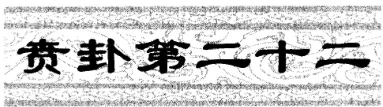

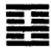

<!-- V3_SOURCE_ID:book016-b001635-p000-4e92076860 -->

《贲》卦象征文饰，其义为亨通，柔小者利于有所前往。

查看对应原文

<!-- V3_FOLDBACK_BEGIN:book016-b001635-p000-4e92076860 -->

译文《贲》卦象征文饰：亨通，柔小者利于有所前往。

<!-- V3_FOLDBACK_END:book016-b001635-p000-4e92076860 -->

<!-- V3_SOURCE_ID:book016-b001636-p000-f7c460aa3e -->

贲卦：亨通，柔小之事有所往则有利。

查看对应原文

<!-- V3_FOLDBACK_BEGIN:book016-b001636-p000-f7c460aa3e -->

贲①：亨②，小利有攸往③。

<!-- V3_FOLDBACK_END:book016-b001636-p000-f7c460aa3e -->

<!-- V3_SOURCE_ID:book016-b001637-p000-c049d8e68a -->

注释①：贲，读音为bì，是卦名，下卦为离（八卦之一），上卦为艮（八卦之一），象征文饰。《说文解字》中说：“贲，饰也，从贝卉声”，《经典释文》中记载：“傅氏说：贲，是古时的斑字，指有文采的样子。郑玄说：贲，是变化的意思，指文饰的样子。”

查看对应原文

<!-- V3_FOLDBACK_BEGIN:book016-b001637-p000-c049d8e68a -->

注释①贲：音bì，卦名，下离(三)上艮(三)，象征“文饰”。《说文》：“贲，饰也，从贝卉声”，《释文》：“傅氏云：贲，古斑字，文章兒。’郑云：变也，文饰之兒。’”

<!-- V3_FOLDBACK_END:book016-b001637-p000-c049d8e68a -->

<!-- V3_SOURCE_ID:book016-b001638-p000-11f5586752 -->

②亨：这里说的是事物经过必要的文饰，就可以达到亨通的状态。《程氏易传》中说：“事物有了文饰之后才能亨通，所以说‘没有根本就无法立足，没有文饰就无法推行’。有了实际内容再加以文饰，就可以亨通了。”

查看对应原文

<!-- V3_FOLDBACK_BEGIN:book016-b001638-p000-11f5586752 -->

②亨：此谓事物加以必要的文饰，可致亨通。《程传》：“物有饰而后能亨，故曰‘无本不立，无文不行。’有实而加饰，则可以亨矣。”

<!-- V3_FOLDBACK_END:book016-b001638-p000-11f5586752 -->

<!-- V3_SOURCE_ID:book016-b001639-p000-069dfca616 -->

③小利有攸往：“小”指阴类，称为柔小。这里说的是在文饰的时候，柔小的事物尤其需要加以文饰，这样才能显现出它的美，所以“有所往则有利”。卦中六五爻以上九爻为贲象，此时利于发展，正体现了这个意象。《周易集解》引用虞翻的话：“小指的是六五爻。”《尚氏学》中说：“六五爻得中位而承受阳爻，所以说‘小利有攸往’。”

查看对应原文

<!-- V3_FOLDBACK_BEGIN:book016-b001639-p000-069dfca616 -->

③小利有攸往：小，阴称小，谓“柔小”。此言“文饰”之时，柔小者尤须加饰，可显其美，故“利有攸往”。卦中六五以上九为贲，则利于发展，正见此象。《集解》引虞翻曰：“小谓五。”《尚氏学》：“五得中承阳，故曰‘小利有攸往’。”

<!-- V3_FOLDBACK_END:book016-b001639-p000-069dfca616 -->

<!-- V3_SOURCE_ID:book016-b001640-p000-dcdf089d6e -->

现在要阐释“小利有攸往”的含义，以往的说法各不相同。现在举出两例供参考。第一例，程颐说：“文饰的原则，能够增添事物的光彩，所以对于前进而言有小的益处。”出自《程传》。第二例，王申子说：“文饰太过就会导致实质衰败，如果一味崇尚文饰，一旦有所前往就会流于形式，所以说小利有攸往。所谓小，是指不能太过以致掩盖了事物的本质。

查看对应原文

<!-- V3_FOLDBACK_BEGIN:book016-b001640-p000-dcdf089d6e -->

[现萌“小利有攸往”之义，旧说不一。今举两例以备参考。一、程颐曰：“文饰之道，可增其光彩，故能小利于进也。”(《程传》)二、王申子曰：“文盛则实必衰，苟专尚文，以往则流，故曰小利有攸往’。小者，谓不可太过以灭其质

<!-- V3_FOLDBACK_END:book016-b001640-p000-dcdf089d6e -->

<!-- V3_SOURCE_ID:book016-b001641-p000-2dd07b9ef4 -->

译文：《彖传》说，文饰，亨通，譬如阴柔前来文饰阳刚，阴阳交饰于是亨通；又分出阳刚居上文饰阴柔，所以柔小者利于有所前往。刚美和柔美交相错杂，这是天的文采；文章灿明止于礼义，这是人类的文采。观察天的文采，可以知晓四季转变的规律；观察人类的文采，可以推行教化促成天下昌明。

查看对应原文

<!-- V3_FOLDBACK_BEGIN:book016-b001641-p000-2dd07b9ef4 -->

译文《彖传》说：文饰，亨通，譬如阴柔前来文饰阳刚，阴阳交饰于是亨通；又分出阳刚居上文饰阴柔，所以柔小者利于有所前往。(刚美和柔美交相错杂，)这是天的文采；文章灿明止于礼义，这是人类的文采。观察天的文采，可以知晓四季转变的规律；观察人类的文采，可以推行教化促成天下昌明。

<!-- V3_FOLDBACK_END:book016-b001641-p000-2dd07b9ef4 -->

<!-- V3_SOURCE_ID:book016-b001642-p000-7998c313e0 -->

《彖传》说：贲卦，亨通，柔前来文饰刚①，所以亨通；分刚居上而文饰柔②，所以小利有攸往。这是天文；文明而止于礼义，这是人文。观察天文，用来察知四季的变化；观察人文，用来教化成就天下。

查看对应原文

<!-- V3_FOLDBACK_BEGIN:book016-b001642-p000-7998c313e0 -->

《彖》曰：贲，亨，柔来而文刚 ①，故亨；分刚上而文柔②，故小利有攸往。天文也③；文明以止，人文也④。观乎天文，以察时变⑤；观乎人文，以化成天下⑥。

<!-- V3_FOLDBACK_END:book016-b001642-p000-7998c313e0 -->

<!-- V3_SOURCE_ID:book016-b001643-p000-9d07cb7d8c -->

注释①柔来而文刚：柔，指六二；刚，指九三。此句解释卦辞“亨”的含义，意思是六二来居下卦的中位，用以文饰九三，阴阳交贲所以获得亨通。

查看对应原文

<!-- V3_FOLDBACK_BEGIN:book016-b001643-p000-9d07cb7d8c -->

注释①柔来而文刚：柔，指六二；刚，指九三。此释卦辞“亨”之义，谓六二来居下卦之中，以文饰九三，阴阳交贲故获亨通。

<!-- V3_FOLDBACK_END:book016-b001643-p000-9d07cb7d8c -->

<!-- V3_SOURCE_ID:book016-b001644-p000-e85c61a183 -->

②分刚上而文柔：刚指上九，柔指六五。这是解释卦辞“小利有攸往”的含义，说上九高居卦的终位，六五因此得到文饰，所以利于有所前往。案，《集解》引用荀爽的说法：“此本为《泰》卦，说的是阴爻从上来，居于乾之中，文饰刚道，交于中和，所以‘亨’；分乾的二爻居于坤之上，上饰柔道，兼据二阴，所以‘小利有攸往’。”这是用“卦变”的说法，指《贲》卦是从《泰》卦变化二、上两爻而来，以此解释“柔来文刚”“刚上文柔”的要旨。可供参考。

查看对应原文

<!-- V3_FOLDBACK_BEGIN:book016-b001644-p000-e85c61a183 -->

②分刚上而文柔：刚，指上九；柔，指六五。此释卦辞“小利有攸往”之义，谓上九高居卦终，六五因之获饰，故利有所往。案，《集解》引荀爽曰：“此本《泰》卦，谓阴从上来，居乾之中，文饰刚道，交于中和，故‘亨’也；分乾之二居坤之上，上饰柔道，兼据二阴，故‘小利有攸往’矣。”此以“卦变”为说，谓《贲》卦自《泰》变二、上两爻而来，以释“柔来文刚”、“刚上文柔”之旨。可备参考。

<!-- V3_FOLDBACK_END:book016-b001644-p000-e85c61a183 -->

<!-- V3_SOURCE_ID:book016-b001645-p000-7d85f4244d -->

③天文也：天文指天的文采，是日月星辰、阴阳变化等。《周易举正》记载：“‘天文’之上脱漏‘刚柔交错’一句。”现在查看《王注》：“刚柔交错而成文焉，天之文也”，《正义》：“刚柔交错成文，是‘天文’也”，似乎王、孔的版本原本就有这四个字。

查看对应原文

<!-- V3_FOLDBACK_BEGIN:book016-b001645-p000-7d85f4244d -->

③天文也：天文，天的文采，指日月星辰、阴阳变化等。《周易举正》：“‘天文’上脱‘刚柔交错’一句。”今查《王注》：“刚柔交错而成文焉，天之文也”，《正义》：“刚柔交错成文，是‘天文’也”，似王、孔本原有此四字。

<!-- V3_FOLDBACK_END:book016-b001645-p000-7d85f4244d -->

<!-- V3_SOURCE_ID:book016-b001646-p000-b8174b24e0 -->

④文明以止，人文也：文明指下离为火、为日，止指上艮为止；人文指人的文采，是“文章”“礼义”等。这里举出上下卦象，说明人类的文饰表现在“文明”而能止于礼义，含义与前句的“天文”相对。《集解》引用虞翻的说法：“文明，是离；止，是艮。”《程传》：“有上则有下，有此则有彼，有质则有文；一不独立，二则为文。非知晓道的人，谁能识得？天文是天的理；人文是人的道。”

查看对应原文

<!-- V3_FOLDBACK_BEGIN:book016-b001646-p000-b8174b24e0 -->

④文明以止，人文也：文明，指下离为火，为日；止，指上艮为止；人文，人的文采，指“文章”“礼义”等。此举上下卦象，说明人类的文饰表现在“文明”而能止于礼义。义与前句“天文”相对。《集解》引虞翻曰：“文明，离；止，艮也。”《程传》：“有上则有下，有此则有彼，有质则有文；一不独立，二则为文。非知道者，孰能识之？天文，天之理也；人文，人之道也。”

<!-- V3_FOLDBACK_END:book016-b001646-p000-b8174b24e0 -->

<!-- V3_SOURCE_ID:book016-b001647-p000-a3a4c1286f -->

⑤观乎天文，以察时变：这是说观察大自然的文饰情状，就能知晓四时变迁的规律。《程传》：“天文指日月星辰的交错排列，寒暑阴阳的交替变化。观察它们的运行，就能察知四时的变迁。”

查看对应原文

<!-- V3_FOLDBACK_BEGIN:book016-b001647-p000-a3a4c1286f -->

⑤观乎天文，以察时变：此谓观察大自然的文饰情状，可知四季变迁规律。《程传》：“天文谓日月星辰之错列，寒暑阴阳之代变。观其运行，以察四时之迁改也。”

<!-- V3_FOLDBACK_END:book016-b001647-p000-a3a4c1286f -->

<!-- V3_SOURCE_ID:book016-b001648-p000-20e4d90358 -->

⑥观察人类的文饰情状，就可以教化天下、促成大治。《集解》引用干宝的话说：“四时的变化，取决于日月；圣人的教化，形成于文饰制度。观察日月来推求它们的会合贯通，观察文明之象来教化天下、促成大治。”《程传》说：“观察人文来教化天下，天下形成相应的礼俗，这就是圣人运用‘贲’卦的道理。”

查看对应原文

<!-- V3_FOLDBACK_BEGIN:book016-b001648-p000-20e4d90358 -->

⑥观乎人文，以化成天下：此谓观察人类的文饰情状，可以教化天下、促成大治。《集解》引干宝曰：“四时之变，县乎日月；圣人之化，成乎文章。观日月而要其会通，观文明而化成天下。”《程传》：“观人文以教化天下，天下成其礼俗，乃圣人用‘贲’之道也。”

<!-- V3_FOLDBACK_END:book016-b001648-p000-20e4d90358 -->

<!-- V3_SOURCE_ID:book016-b001649-p000-09e0aba81f -->

《象》说：山下有火，象征“贲”；君子因此修明各项政务，不敢仅凭文饰来决断讼狱。

查看对应原文

<!-- V3_FOLDBACK_BEGIN:book016-b001649-p000-09e0aba81f -->

《象》曰：山下有火，贲①；君子以明庶政，无敢折狱②。

<!-- V3_FOLDBACK_END:book016-b001649-p000-09e0aba81f -->

<!-- V3_SOURCE_ID:book016-b001650-p000-d4e95020df -->

译文《象传》说：山下燃耀着火焰(山形焕彩)，象征“文饰”；君子因此修美显明众多的政务，但不敢靠文饰处理讼狱。

查看对应原文

<!-- V3_FOLDBACK_BEGIN:book016-b001650-p000-d4e95020df -->

译文《象传》说：山下燃耀着火焰(山形焕彩)，象征“文饰”；君子因此修美显明众多的政务，但不敢靠文饰处理讼狱。

<!-- V3_FOLDBACK_END:book016-b001650-p000-d4e95020df -->

<!-- V3_SOURCE_ID:book016-b001651-p000-5f278bbf84 -->

注释①山下有火，贲：这是解释《贲》卦上卦为艮（八卦之一）、下卦为离（八卦之一）的卦象。《程传》说：“山是草木百物聚集生长的地方；火在山下向上照耀，各类事物都被光明笼罩，这就是文饰的象征。”

查看对应原文

<!-- V3_FOLDBACK_BEGIN:book016-b001651-p000-5f278bbf84 -->

注释①山下有火，贲：释《贲》卦上艮为山、下离为火之象。《程传》：“山者，草木百物之所聚生也；火在其下而上照，庶类皆被其光明，为贲饰之象也。”

<!-- V3_FOLDBACK_END:book016-b001651-p000-5f278bbf84 -->

<!-- V3_SOURCE_ID:book016-b001652-p000-c6f3fe7396 -->

②明庶政，无敢折狱：这是说君子观看《贲》卦的卦象，领悟到应当用光明磊落的方式处理各类政务，但不能用虚浮的文饰来审理案件。《程传》中说：“君子看到山下有火，光明普照的卦象，因此修明各类政务，成就文明的治世”；“审理案件，应当完全依据实情，若用文饰就会掩盖实情，所以不能用文饰来审理案件”。

查看对应原文

<!-- V3_FOLDBACK_BEGIN:book016-b001652-p000-c6f3fe7396 -->

②明庶政，无敢折狱：这是说明“君子”观《贲》卦之象，悟知当以“文明”理政，但不可以“文饰”断狱。《程传》：“君子观山下有火，明照之象，以修明其庶政，成文明之治”；“折狱者，专用情实，有文饰则没其情矣，故无敢用文以折狱也”。

<!-- V3_FOLDBACK_END:book016-b001652-p000-c6f3fe7396 -->

<!-- V3_SOURCE_ID:book016-b001653-p000-9a5ec8b065 -->

这说明处理各类政务，应当追求文明的景象；审理案件，则应当以明察实情为根本，不能用文饰来掩盖事实。《大象传》强调“无敢折狱”，正是指出文饰不应当滥用的道理。程颐称这句话“乃是圣人的用心，作为告诫意义深远”（《程传》）。

查看对应原文

<!-- V3_FOLDBACK_BEGIN:book016-b001653-p000-9a5ec8b065 -->

说明治理“庶政”，当追求“文明”景象；“折狱”，则以“明”为本，不可文饰其事。《大象传》强调“无敢折狱”，正是指出“文饰”不宜滥施的道理。程颐称此语“乃圣人之用心也，为戒深矣”(《程传》)。

<!-- V3_FOLDBACK_END:book016-b001653-p000-9a5ec8b065 -->

<!-- V3_SOURCE_ID:book016-b001654-p000-efeab0cff1 -->

## 初九，贲其趾，舍车而徒①。 — 初九爻的爻辞含义是，文饰自身的足趾，舍弃大车而选择徒步行走。

查看对应原文

<!-- V3_FOLDBACK_BEGIN:book016-b001654-p000-efeab0cff1 -->

## 初九，贲其趾，舍车而徒①。

<!-- V3_FOLDBACK_END:book016-b001654-p000-efeab0cff1 -->

<!-- V3_SOURCE_ID:book016-b001655-p000-8014a59195 -->

初九爻的含义是，文饰自身的足趾，舍弃大车而选择徒步行走。

查看对应原文

<!-- V3_FOLDBACK_BEGIN:book016-b001655-p000-8014a59195 -->

译文初九，文饰自身的足趾，舍弃大车而甘于徒步行走。

<!-- V3_FOLDBACK_END:book016-b001655-p000-8014a59195 -->

<!-- V3_SOURCE_ID:book016-b001656-p000-d6792c4dde -->

注释①贲其趾，舍车而徒：徒，指徒步行走。这里是说，初九处于“贲”的初始阶段，地位卑微，身处下位，不敢贪求华丽的装饰，所以只是装饰自己的脚趾，比喻只装饰应当装饰的地方；而舍弃大车安步行走，就比喻舍弃不应当装饰的东西。这就是“贲不失礼”的含义。《王注》说：“在贲卦的初始阶段，以刚正的姿态处于下位，身处没有爵位的位置，舍弃不合道义的事物，安心于徒步行走，来顺从自己的志向。所以装饰自己的脚趾，舍弃大车徒步行走，说的就是道义上不应当乘坐大车的意思。”《周易学说》引用李士珍的话：“初九以礼自我修饰，装饰自己的脚趾，不逾越礼制去追求华丽的装饰，这就是它可行的原因吧？世人把奢侈僭越当作荣耀，君子却把它当作耻辱，说的是那些装饰礼制却反而蔑视礼制的人。”

查看对应原文

<!-- V3_FOLDBACK_BEGIN:book016-b001656-p000-d6792c4dde -->

注释①贲其趾，舍车而徒：徒，徒步行走。此言初九当“贲”之始，位卑处下，不敢贪求华饰，故自贲其趾，喻饰所当饰；而舍车安步，则喻弃所不当饰。此即“贲不失礼”之义。《王注》：“在贲之始，以刚处下，居于无位，弃于不义，安夫徒步，以从其志者也。故饰其趾，舍车而徒，义弗乘’之谓也。”《周易学说》引李士珍曰：“初以礼自饰，自贲其趾，不越礼以求贲，此其所以可行与？世以奢僭为荣，君子以为辱，谓其饰礼而反蔑礼也。”

<!-- V3_FOLDBACK_END:book016-b001656-p000-d6792c4dde -->

<!-- V3_SOURCE_ID:book016-b001657-p000-8feae8d66c -->

译文《象传》说：“舍弃大车而甘于徒步行走”，说明初九就所处地位的道义而言，是不应该乘坐大车的。

查看对应原文

<!-- V3_FOLDBACK_BEGIN:book016-b001657-p000-8feae8d66c -->

译文《象传》说：‘舍弃大车而甘于徒步行走’，说明初九就所处地位这一意义来说是不应该乘坐大车。

<!-- V3_FOLDBACK_END:book016-b001657-p000-8feae8d66c -->

<!-- V3_SOURCE_ID:book016-b001658-p000-e5ed536229 -->

## 《象》曰：“舍车而徒”，义弗乘也。 — 《象传》说：“舍弃大车而徒步行走，从义理上讲是不应该乘车的。”

查看对应原文

<!-- V3_FOLDBACK_BEGIN:book016-b001658-p000-e5ed536229 -->

## 《象》曰：“舍车而徒”，义弗乘也。

<!-- V3_FOLDBACK_END:book016-b001658-p000-e5ed536229 -->

<!-- V3_SOURCE_ID:book016-b001659-p000-1a6c82613c -->

马振彪指出：“贤者安步当车，终身不辱；揆之于义，弗背乘车，虽徒行亦为之生色，即‘贲其趾’之义也。”（《周易学说》）此将“贲”当合“义”的道理阐析得至为明白。就初九有应于六四这一情状而言，其“义”似体现于安步缓行、静待四应，故不乘非“义”之车。《礼记·坊记》云：“君子苟无礼，虽美不食焉。”亦可与此爻之义相发明。

> **释读存疑：** 本地硬校验仍未通过，已记录供后续自动处理或人工核对。

查看对应原文

<!-- V3_FOLDBACK_BEGIN:book016-b001659-p000-1a6c82613c -->

说明马振彪指出：“贤者安步当车，终身不辱；揆之于义，弗背乘车，虽徒行亦为之生色，即‘贲其趾’之义也。”(《周易学说》)此将“贲”当合“义”的道理阐析得至为明白。就初九有应于六四这一情状而言，其“义”似体现于安步缓行、静待四应，故不乘非“义”之车。《礼记·坊记》云：“君子苟无礼，虽美不食焉。”亦可与此爻之义相发明。

<!-- V3_FOLDBACK_END:book016-b001659-p000-1a6c82613c -->

<!-- V3_SOURCE_ID:book016-b001660-p000-5c3c28c996 -->

译文六二，文饰尊者的美须。

查看对应原文

<!-- V3_FOLDBACK_BEGIN:book016-b001660-p000-5c3c28c996 -->

译文六二，文饰尊者的美须。

<!-- V3_FOLDBACK_END:book016-b001660-p000-5c3c28c996 -->

<!-- V3_SOURCE_ID:book016-b001661-p000-02a7f406bc -->

六二，文饰其须。

> **释读存疑：** 原文未明确说明‘贲其须’的具体所指，仅为爻辞表述

查看对应原文

<!-- V3_FOLDBACK_BEGIN:book016-b001661-p000-02a7f406bc -->

六二，贲其须①。

<!-- V3_FOLDBACK_END:book016-b001661-p000-02a7f406bc -->

<!-- V3_SOURCE_ID:book016-b001662-p000-1907497ea1 -->

注释①：贲其须——须指面部的须毛，这里用来比喻六二所上承的九三。这是说六二处于下卦的中位，与九三都处于当位之位却没有应和的爻位，因此二者亲密亲近，所以六二专心承奉九三，就像文饰九三的美须，于是阴阳（描述事物相反相成、消长转化的两类属性）互相文饰，彼此更加契合。这就是‘贲得其所’的含义。《王注》说：‘处于当位之位却没有应和的爻位，九三也没有应和的爻位，都没有应和的爻位却亲近相依，位置相近而彼此契合。须这种东西，是依附于上方的。遵循自身所处的位置，来依附于上方，所以说‘贲其须’。’按，《尚氏学》认为艮（八卦之一）为须，认为‘贲其须’的‘其’指上卦，说六二往上形成艮卦，文饰上九。这可以作为一种说法保留。

> **释读存疑：** 关于‘贲其须’的解释存在两种不同说法，分别为以须喻六二承九三，以及以艮为须、‘其’指上卦，原文未明确确定唯一解释

查看对应原文

<!-- V3_FOLDBACK_BEGIN:book016-b001662-p000-1907497ea1 -->

注释①贲其须：须，面上的须毛，喻六二所上承的九三。此谓六二处下卦之中，与九三均得位无应而两相亲比，故二专意承三，犹文饰三之美须，于是阴阳互贲、相得益彰。此即‘贲得其所’之义。《王注》：‘得其位而无应，三亦无应，俱无应而比焉，近而相得者也。须之为物，上附者也。循其所履，以附于上，故曰‘贲其须’。’案，《尚氏学》谓艮为须，认为‘贲其须’之‘其’指上卦，言六二往上成艮，贲于上九。此可备一说。

<!-- V3_FOLDBACK_END:book016-b001662-p000-1907497ea1 -->

<!-- V3_SOURCE_ID:book016-b001663-p000-1b13814f90 -->

译文《象传》说：‘文饰尊者的美须’，说明六二与九三同心而兴起互为文饰。

查看对应原文

<!-- V3_FOLDBACK_BEGIN:book016-b001663-p000-1b13814f90 -->

译文《象传》说：‘文饰尊者的美须’，说明六二与九三同心而兴起互为文饰。

<!-- V3_FOLDBACK_END:book016-b001663-p000-1b13814f90 -->

<!-- V3_SOURCE_ID:book016-b001664-p000-f9684f94b6 -->

《象传》说：“文饰其须”，这是说要与上位者一同兴起①。

查看对应原文

<!-- V3_FOLDBACK_BEGIN:book016-b001664-p000-f9684f94b6 -->

《象》曰：“贲其须”，与上兴也①。

<!-- V3_FOLDBACK_END:book016-b001664-p000-f9684f94b6 -->

<!-- V3_SOURCE_ID:book016-b001665-p000-1228648ce6 -->

注释①“与上兴”：“上”指九三爻；“兴”是兴起的意思。《周易口义》说：“上与九三合志，同心而兴起也。”

查看对应原文

<!-- V3_FOLDBACK_BEGIN:book016-b001665-p000-1228648ce6 -->

注释①与上兴：上，指九三；兴，起也。《周易口义》：‘上与九三合志，同心而兴起也。’

<!-- V3_FOLDBACK_END:book016-b001665-p000-1228648ce6 -->

<!-- V3_SOURCE_ID:book016-b001666-p000-9cbae7cf81 -->

此说“萌二贲三”，正是《彖传》“柔来文刚”的意思。刘沅在《周易恒解》中说：“阴随阳而动，文附质而行”，“刚为质，柔为文，文不附质，焉得为文”，这个说法是正确的。

查看对应原文

<!-- V3_FOLDBACK_BEGIN:book016-b001666-p000-9cbae7cf81 -->

说萌二贲三，正是《彖传》“柔来文刚”之意。刘沅曰“阴随阳而动，文附质而行”，“刚为质，柔为文，文不附质，焉得为文”(《周易恒解》)，说是也。

<!-- V3_FOLDBACK_END:book016-b001666-p000-9cbae7cf81 -->

<!-- V3_SOURCE_ID:book016-b001667-p000-f8b05c9812 -->

译文：九三爻，文饰得那样俊美，与人频频施予惠泽，永久守持正固可获吉祥。

查看对应原文

<!-- V3_FOLDBACK_BEGIN:book016-b001667-p000-f8b05c9812 -->

译文九三，文饰得那样俊美，与人频频相施惠泽，永久守持正固可获吉祥。

<!-- V3_FOLDBACK_END:book016-b001667-p000-f8b05c9812 -->

<!-- V3_SOURCE_ID:book016-b001668-p000-5326677031 -->

九三爻，贲饰之貌，润泽之貌，永久守持正固则吉祥。

> **释读存疑：** 原文未明确说明“贲如”“濡如”的具体所指，释读采用常见卦象释义，无依据扩写

查看对应原文

<!-- V3_FOLDBACK_BEGIN:book016-b001668-p000-5326677031 -->

九三，贲如，濡如，永贞吉①。

<!-- V3_FOLDBACK_END:book016-b001668-p000-5326677031 -->

<!-- V3_SOURCE_ID:book016-b001669-p000-92de8d20fa -->

注释①贲如，濡如，永贞吉：如，是语气词；濡，指润泽，这里用作动词，比喻九三爻与六二爻互相施予润泽、相亲相贲饰。这是说九三爻向下与六二爻相比邻，两者既互相贲饰，又互相施润，所以有“贲如，濡如”的卦象；但此时不可因贲饰而忘记忧患，所以又告诫它要“永贞”才会吉祥。《王注》说：“处于下体的终极位置，居位得当，与六二爻相邻，都践行正道，和合相润以成就其文饰。既得到贲饰，又得到润泽，所以说：贲如，濡如；永久守持正固，就不会被人凌侮，所以说‘永贞吉’。”

查看对应原文

<!-- V3_FOLDBACK_BEGIN:book016-b001669-p000-92de8d20fa -->

注释①贲如，濡如，永贞吉：如，语气词；濡，润泽，用如动词，喻三与二互施润泽、相亲相贲。此谓九三下比六二，两者既相贲饰，又相施润，故有‘贲如，濡如’之象；但此时不可因贲忘忧，故又诫其‘永贞’则吉。《王注》：‘处下体之极，居得其位，与二相比，俱履其正，和合相润以成其文者也。既得其饰，又得其润，故曰：贲如，濡如’也；永保其贞，物莫之陵，故曰‘永贞吉’也。’

<!-- V3_FOLDBACK_END:book016-b001669-p000-92de8d20fa -->

<!-- V3_SOURCE_ID:book016-b001670-p000-c654d91cd2 -->

《象传》说：“永久守持正固可获吉祥”，是说九三爻能做到这样，就始终不会受人凌侮。

查看对应原文

<!-- V3_FOLDBACK_BEGIN:book016-b001670-p000-c654d91cd2 -->

《象》曰：“永贞之吉”，终莫之陵也。

<!-- V3_FOLDBACK_END:book016-b001670-p000-c654d91cd2 -->

<!-- V3_SOURCE_ID:book016-b001671-p000-df45ba72f2 -->

译文《象传》说：“永久守持正固可获吉祥”，说明九三能做到这样就始终不会受人凌侮。

查看对应原文

<!-- V3_FOLDBACK_BEGIN:book016-b001671-p000-df45ba72f2 -->

译文《象传》说：“永久守持正固可获吉祥”，说明九三能做到这样就始终不会受人凌侮。

<!-- V3_FOLDBACK_END:book016-b001671-p000-df45ba72f2 -->

<!-- V3_SOURCE_ID:book016-b001672-p000-cb7c56a640 -->

说明三、二爻以刚柔相济的正理亲附比应、交互文饰，恩惠与泽被相互施予，这就是所说的文饰恰到好处的美好意象。但九三爻又有“永贞”的告诫，由此可见下卦终极的地位多凶险、难以处好。

查看对应原文

<!-- V3_FOLDBACK_BEGIN:book016-b001672-p000-cb7c56a640 -->

说明三、二以刚柔之正亲比互贲，惠泽相施，所谓文饰适到其美之象。但九三又有“永贞”之诫，可见下卦终极的地位“多凶”难处。

<!-- V3_FOLDBACK_END:book016-b001672-p000-cb7c56a640 -->

<!-- V3_SOURCE_ID:book016-b001673-p000-d17c1a58e7 -->

六四爻，文饰得那样淡美，全身是那样素白，所乘白马又是那样纯洁无杂；前方的不是强寇，而是聘求婚配的佳偶。

查看对应原文

<!-- V3_FOLDBACK_BEGIN:book016-b001673-p000-d17c1a58e7 -->

六四，贲如，皤如，白马翰如①； 译文六四，文饰得那样淡美，全身是那样素白，坐下白马又是那样纯洁无杂；前匪寇，婚媾②。 方并非强寇，而是聘求婚配的佳偶。

<!-- V3_FOLDBACK_END:book016-b001673-p000-d17c1a58e7 -->

<!-- V3_SOURCE_ID:book016-b001674-p000-3ab08803f7 -->

注释①贲如，皤如，白马翰如：皤，读音为pó，《集解》中说：“皤也是白，是素净的样子”；翰，《释文》引用郑玄的说法：“翰是白的意思”。这是说六四爻处于上卦的起始位置，“贲”道已经发生变化，它的文饰崇尚素净，所以用“皤”“白”“翰”作为比喻；而且六四爻以柔正之德居于适当位置，向下应和初九爻，适宜迅速前往与初九爻相应、交互文饰，所以有“白马”奔驰的意象。《周易参义》中说：“六四在离（八卦之一）明的外侧，是艮（八卦之一）止的起始，是贲道盛极而应当返归素净的时候，所以说‘贲如，皤如’。初九爻舍弃车乘，是因为处于下位而没有可乘之物；六四爻在九三爻之上，就有可乘之物了，所以说‘白马翰如’。人既然崇尚素净，马也会是白色的。”

查看对应原文

<!-- V3_FOLDBACK_BEGIN:book016-b001674-p000-3ab08803f7 -->

注释①贲如，皤如，白马翰如：皤，音pó，《集解》：“亦白，素之貌也”；翰，《释文》引郑玄曰：“白也。”此谓六四居上卦之初，“贲”道已变，其饰尚素，故取“皤”、“白”、“翰”为喻；而柔正得位，下应初九，宜于速往相应互贲，故有“白马”奔驰之象。《周易参义》：“六四在离明之外，为艮止之始，乃贲之盛极而当反质素之时也，故云贲如，皤如’。夫初之舍车，为在下而无所乘故也；四在九三之上，则有所乘矣，故云白马翰如’。人既质素，则马亦白也。”

<!-- V3_FOLDBACK_END:book016-b001674-p000-3ab08803f7 -->

<!-- V3_SOURCE_ID:book016-b001675-p000-fa8f11d7f2 -->

②匪寇，婚媾：指初九爻虽然属阳刚之体，却不是强寇，实际上是与六四爻相应的配偶。“匪寇”的说法，正是因为六四处于“多惧”的位置而发出的，意在勉励它不要疑虑，迅速前往应和初九爻。按，《王注》将九三爻视为寇，说六四应和初九爻会被九三爻阻隔，这可以作为一种说法保留。

查看对应原文

<!-- V3_FOLDBACK_BEGIN:book016-b001675-p000-fa8f11d7f2 -->

②匪寇，婚媾：指初九虽体阳刚，却非强寇，实为六四相应之配偶。‘匪寇’之辞，正因四处‘多惧’之位而发，意在勉其勿疑，速往应初。案，《王注》以三为寇，谓四应初有阂于三，可备一说。

<!-- V3_FOLDBACK_END:book016-b001675-p000-fa8f11d7f2 -->

<!-- V3_SOURCE_ID:book016-b001676-p000-cf445b7371 -->

《象传》说：六四爻处于当位的位置，却心存疑虑；“并非强寇，而是前来求婚配的佳偶”，最终不会有过错。

查看对应原文

<!-- V3_FOLDBACK_BEGIN:book016-b001676-p000-cf445b7371 -->

《象》曰：六四当位，疑也①；“匪寇婚媾”，终无尤也。

<!-- V3_FOLDBACK_END:book016-b001676-p000-cf445b7371 -->

<!-- V3_SOURCE_ID:book016-b001677-p000-b0a9dd3685 -->

译文《象传》说：六四当位得正，但心中仍怀疑惧；“前方并非强寇而是聘求婚配的佳偶”，说明六四尽管前往终将无所怨尤。

查看对应原文

<!-- V3_FOLDBACK_BEGIN:book016-b001677-p000-b0a9dd3685 -->

译文《象传》说：六四当位得正，但心中仍怀疑惧；“前方并非强寇而是聘求婚配的佳偶”，说明六四尽管前往终将无所怨尤。

<!-- V3_FOLDBACK_END:book016-b001677-p000-b0a9dd3685 -->

<!-- V3_SOURCE_ID:book016-b001678-p000-612faad76e -->

注释①六四当位，疑也：是说六四虽然处于当位的位置，却心存疑惧，不敢迅速前往应合初九，所以特意用“并非强寇，而是求婚配的佳偶”来勉励它。按，《正义》认为六四当位且有应合的对象，因被九三爻阻碍所以心生疑虑；如果不当位、不应合初九，就不会有想要前往而产生迟疑的情况。此说可供参考。

查看对应原文

<!-- V3_FOLDBACK_BEGIN:book016-b001678-p000-612faad76e -->

注释①六四当位，疑也：谓六四虽当位得正，但心仍疑惧，不敢速往应初，故特以‘匪寇婚媾’勉之。案，《正义》认为四当位有应，因碍于三故‘疑’；若不当位、不应初，则无所谓欲往而致迟疑。可备一说。

<!-- V3_FOLDBACK_END:book016-b001678-p000-612faad76e -->

<!-- V3_SOURCE_ID:book016-b001679-p000-6f51b2e12a -->

说明《屯》卦六二爻上应九五爻，爻辞说：“屯如，遭如，乘马班如；匪寇，婚媾”，文辞与本爻相似。但那是艰难缓行的意象，本爻是消除疑虑、迅速前往的意旨，寓意很不相同。胡炳文指出：“《屯》卦六二应合九五，是下位者求上位者，不可急躁；《贲》卦六四应合初九，是上位者求下位者，不可迟缓。”《周易本义通释》。再从本爻与初九相应的情状来看：六四爻的“白马”崇尚朴素，初九爻“舍弃车驾”抛弃奢华，可见两者志趣相合，所以六四不必疑虑，前往必然有所收获。

查看对应原文

<!-- V3_FOLDBACK_BEGIN:book016-b001679-p000-6f51b2e12a -->

说明《屯》六二上应九五，曰：“屯如，遭如，乘马班如；匪寇，婚媾”，文辞与本爻相似。但彼为艰难缓行之象，此发去疑速往之旨，寓意颇不相同。胡炳文指出：“《屯》二应五，下求上也，不可以急；《贲》四应初，上求下也，不可以缓。”(《周易本义通释》)再从本爻与初九相应的情状看：四“白马”尚素，初“舍车”弃华，可见两者志趣互合，故六四不须疑虑，往必有得。

<!-- V3_FOLDBACK_END:book016-b001679-p000-6f51b2e12a -->

<!-- V3_SOURCE_ID:book016-b001680-p000-d2f5b83c67 -->

六五，以浑朴的山丘园圃为饰，持一束微薄的丝帛（礼聘贤士）；虽有下者吝惜，最终仍获吉祥。本爻无应援而有憾惜，但能与上者相应，终将吉祥。

查看对应原文

<!-- V3_FOLDBACK_BEGIN:book016-b001680-p000-d2f5b83c67 -->

六五，贲于丘园，束帛戈戈①； 译文六五，以浑朴的山丘园圃为饰，持一束微薄的丝帛(礼聘贤士)；尽管下者吝,终吉②。 无应而有憾惜，但上者相应终将吉祥。

<!-- V3_FOLDBACK_END:book016-b001680-p000-d2f5b83c67 -->

<!-- V3_SOURCE_ID:book016-b001681-p000-008e76a735 -->

注释①贲于丘园，束帛戋戋：丘园指山丘园圃，喻朴素自然，对应上九处于卦的终极位置；束帛指一束丝帛，喻微薄无华之物，《本义》称其为“薄物”；戋戋形容物少，《本义》称其为“浅小之意”。这是说六五居于《贲》卦的尊位，柔中无华，崇尚朴素的装饰，虽无下应却能亲附于远处卦终的阳刚，因此有装饰于“丘园”的意象，如同持微薄的“束帛”礼聘“贤士”，共同辅佐治理，成就“贲”道的至美。《周易恒解》记载：“五艮体得中，文明以止。柔中而密比于上九之贤，贲于丘园之中以求贤士。”又说：“礼薄意厚，不过乎文”，“是能求贤自辅，以成贲之治者也”。

查看对应原文

<!-- V3_FOLDBACK_BEGIN:book016-b001681-p000-008e76a735 -->

注释①贲于丘园，束帛戋戈：丘园，山丘园圃，喻朴素自然，指上九远处卦极；束帛，一束丝帛，喻微薄无华之物，《本义》：“薄物”；戋戋，形容物少，《本义》：“浅小之意。”此谓六五居《贲》尊位，柔中无华，饰尚朴素，虽无下应却能亲比于远处卦终的阳刚，故有贲饰于“丘园”之象，犹如持微薄的“束帛”礼聘“贤士”，共相辅治，以成“贲”道之至美。《周易恒解》：“五艮体得中，文明以止。柔中而密比于上九之贤，贲于丘园之中以求贤士。”又曰：“礼薄意厚，不过乎文”，“是能求贤自辅，以成贲之治者也”。

<!-- V3_FOLDBACK_END:book016-b001681-p000-008e76a735 -->

<!-- V3_SOURCE_ID:book016-b001682-p000-d22653ff8a -->

②吝，终吉：这是指六五的“贲”道虽美，下无应援，因此不免有“吝”；但能持中行事，与上应“白贲”的阳刚相互合志，最终获得吉祥。《尚氏学》称：“下无应故‘吝’，上承阳故‘终吉’。彖谓‘小利往’，以此。”

查看对应原文

<!-- V3_FOLDBACK_BEGIN:book016-b001682-p000-d22653ff8a -->

②吝，终吉：这是指六五“贲”道虽美，下无应与，故不免含“吝”；但能持中行事，上与“白贲”之阳相互合志，终获吉祥。《尚氏学》：“下无应故‘吝’，上承阳故‘终吉’。彖谓‘小利往’，以此。”

<!-- V3_FOLDBACK_END:book016-b001682-p000-d22653ff8a -->

<!-- V3_SOURCE_ID:book016-b001683-p000-e6b839c6e7 -->

《象传》说：六五的吉祥，说明必有喜庆。

查看对应原文

<!-- V3_FOLDBACK_BEGIN:book016-b001683-p000-e6b839c6e7 -->

译文《象传》说：六五的吉祥，说明必有 《象》曰：六五之吉，有喜也①。  
喜庆。

<!-- V3_FOLDBACK_END:book016-b001683-p000-e6b839c6e7 -->

<!-- V3_SOURCE_ID:book016-b001684-p000-702ff630a7 -->

注释①有喜：《尚氏学》中说：“五承阳，故有喜。”

> **释读存疑：** 本地硬校验仍未通过，已记录供后续自动处理或人工核对。

查看对应原文

<!-- V3_FOLDBACK_BEGIN:book016-b001684-p000-702ff630a7 -->

注释①有喜：《尚氏学》：“五承阳，故有喜。”

<!-- V3_FOLDBACK_END:book016-b001684-p000-702ff630a7 -->

<!-- V3_SOURCE_ID:book016-b001685-p000-4f24ea71d1 -->

明了六爻中六五“丘园”的喻象，与上九“白贲”正好相互契合。当这“贲”道大成之时，质朴柔美与自然刚美紧密相饰，所以《象传》盛赞“有喜”。卦辞“小利有攸往”的意旨，就是针对六五而言的，在此也得到了明显的体现。

查看对应原文

<!-- V3_FOLDBACK_BEGIN:book016-b001685-p000-4f24ea71d1 -->

∑明六五“丘园”的喻象，与上九“白贲”正相切合。当此“贲”道大成之时，质朴柔美与自然刚美密相贲饰，故《象传》盛称“有喜”。卦辞“小利有攸往”的意旨，即就六五而发，在此也得以明显的体现。

<!-- V3_FOLDBACK_END:book016-b001685-p000-4f24ea71d1 -->

<!-- V3_SOURCE_ID:book016-b001686-p000-1e51e35d68 -->

上九，白贲，无咎①。 上九，有着素白无华的文饰，没有咎害。

> **释读存疑：** 原文存在排版错乱，已按可辨识内容整理

查看对应原文

<!-- V3_FOLDBACK_BEGIN:book016-b001686-p000-1e51e35d68 -->

译文上九，素白无华的文饰，无所 上九，白贲，无咎①。  
咎害。

<!-- V3_FOLDBACK_END:book016-b001686-p000-1e51e35d68 -->

<!-- V3_SOURCE_ID:book016-b001687-p000-3b00111344 -->

匡释①白贲，无咎：白，就是素的意思。这句话是说上九处于《贲》卦的终极位置，“贲”道反而回归于素；事物以“白”作为文饰，就能显现出其自然真趣，是纯美至极的象征，所以“无咎”。《王注》中说：“处于文饰的终极阶段，文饰到最后回归质朴，所以秉持其质朴本质，无需额外文饰，就没有咎害。”

查看对应原文

<!-- V3_FOLDBACK_BEGIN:book016-b001687-p000-3b00111344 -->

匡释①白贲，无咎：白，素也。此言上九居《贲》之极，“贲”道反归于素；事物以“白”为饰，则见其自然真趣，为纯美至极的象征，故“无咎”。《王注》：“处饰之终，饰终反素，故任其质素，不劳文饰，而无咎也。”

<!-- V3_FOLDBACK_END:book016-b001687-p000-3b00111344 -->

<!-- V3_SOURCE_ID:book016-b001688-p000-5d8ac6ffea -->

译文《象传》说：“素白无华的文饰、必 《象》曰：“白贲无咎”，上得志无害”，说明上九大遂文饰之道尚质的 也①。

查看对应原文

<!-- V3_FOLDBACK_BEGIN:book016-b001688-p000-5d8ac6ffea -->

译文《象传》说：“素白无华的文饰、必 《象》曰：“白贲无咎”，上得志无害”，说明上九大遂文饰之道尚质的 也①。

<!-- V3_FOLDBACK_END:book016-b001688-p000-5d8ac6ffea -->

<!-- V3_SOURCE_ID:book016-b001689-p000-64f568256f -->

匡释①上得志：指上九与六五亲比，大得“白贲”之志。《尚氏学》：“言阳得阴而通也。《大畜》上九曰道大行也’，《损》上九曰大得志’，《益》九五曰‘大得志’，《颐》上九曰大有庆’，与此义皆同。”

查看对应原文

<!-- V3_FOLDBACK_BEGIN:book016-b001689-p000-64f568256f -->

匡释①上得志：指上九与六五亲比，大得“白贲”之志。《尚氏学》：“言阳得阴而通也。《大畜》上九曰道大行也’，《损》上九曰大得志’，《益》九五曰‘大得志’，《颐》上九曰大有庆’，与此义皆同。”

<!-- V3_FOLDBACK_END:book016-b001689-p000-64f568256f -->

<!-- V3_SOURCE_ID:book016-b001690-p000-16f409c0c6 -->

说明《周礼·考工记》谓：“画绘之事，后素功”；《论语·八佾》曰：“绘事后素。”两者或言绘画程序，或以“素”喻“礼”，与本爻“饰终反质”的意旨自有区别。但就“素”在“文饰”中为“本真”之色这一点看，上两说与本爻“白贲”的拟象基础又有可通之处。故刘牧云：“绘事后素，居上者而能正五彩也。”(《周易义海撮要》引)惠栋也认为：“上者，贲之成。《考工记》云‘画绘之事，后素功。’《论语》‘绘事后素。’郑彼注云：‘素，白采也，后布之，为其易渍污，是功成于素之事也。’”(《周易述》)

查看对应原文

<!-- V3_FOLDBACK_BEGIN:book016-b001690-p000-16f409c0c6 -->

说明《周礼·考工记》谓：“画绘之事，后素功”；《论语·八佾》曰：“绘事后素。”两者或言绘画程序，或以“素”喻“礼”，与本爻“饰终反质”的意旨自有区别。但就“素”在“文饰”中为“本真”之色这一点看，上两说与本爻“白贲”的拟象基础又有可通之处。故刘牧云：“绘事后素，居上者而能正五彩也。”(《周易义海撮要》引)惠栋也认为：“上者，贲之成。《考工记》云‘画绘之事，后素功。’《论语》‘绘事后素。’郑彼注云：‘素，白采也，后布之，为其易渍污，是功成于素之事也。’”(《周易述》)

<!-- V3_FOLDBACK_END:book016-b001690-p000-16f409c0c6 -->

<!-- V3_SOURCE_ID:book016-b001691-p000-bbd09a1a6a -->

《左传》襄公二十五年引孔子曰：“《志》有之：‘言以足志，文以足言。’不言，谁知其志？言之无文，行而不远。”《礼记·礼器》曰：“先王之立礼也，有本有文。忠信，礼之本也；义理，礼之文也。无本不立，无文不行。”这两则记载表明，古人在言“志”、立“本”的前提下，对“文饰”的功用颇为重视。《贲》卦，即是集中阐发“文饰”的意义。卦辞称事物获饰，可致亨通；并特别指出，柔小者一经适当的文饰，必有利于增显其美。卦中六爻，在阴阳交错相杂中呈现互贲之象，其中初与四相应相贲；二与三，五与上，则相比相贲。《折中》引邱富国曰：“阴阳二物，有应者以应而相贲，无应者以比而相贲。”正道出本卦刚爻柔爻之间的交饰特点。然而，诸爻实非无条件地泛言文饰，而是主张恰如其分的贲饰，并崇尚朴素自然的至美境界。试观爻义，初九“舍车”不尚华饰，六四“白马”向往淡美，两者分处上下卦之始，已见“贲”道端倪；六二“贲须”志在承阳，九三“濡如”永守正固，两者并在内卦，以顺合“礼义”为美；六五饰于“丘园”但求简朴，上九饰终返“白”归趣本真，两者并居外卦，以质素自然为美。可见，《贲》卦大旨略见于两事：一是刚柔相杂成文，二是文饰不尚华艳。《系辞下传》谓“物相杂故曰‘文’”，《杂卦传》云“《贲》，无色也”，正可印证这两方面的义旨。就美学意义而论，本卦的象征哲理，与先秦美学理论中“物一无文”(《国语》)、“大巧若拙”(《老子》四十五章)之类的观点，实可互相比较；这在研究古代美学史中，是值得注意的资料。

查看对应原文

<!-- V3_FOLDBACK_BEGIN:book016-b001691-p000-bbd09a1a6a -->

《左传》襄公二十五年引孔子曰：“《志》有之：‘言以足志，文以足言。’不言，谁知其志？言之无文，行而不远。”《礼记·礼器》曰：“先王之立礼也，有本有文。忠信，礼之本也；义理，礼之文也。无本不立，无文不行。”这两则记载表明，古人在言“志”、立“本”的前提下，对“文饰”的功用颇为重视。《贲》卦，即是集中阐发“文饰”的意义。卦辞称事物获饰，可致亨通；并特别指出，柔小者一经适当的文饰，必有利于增显其美。卦中六爻，在阴阳交错相杂中呈现互贲之象，其中初与四相应相贲；二与三，五与上，则相比相贲。《折中》引邱富国曰：“阴阳二物，有应者以应而相贲，无应者以比而相贲。”正道出本卦刚爻柔爻之间的交饰特点。然而，诸爻实非无条件地泛言文饰，而是主张恰如其分的贲饰，并崇尚朴素自然的至美境界。试观爻义，初九“舍车”不尚华饰，六四“白马”向往淡美，两者分处上下卦之始，已见“贲”道端倪；六二“贲须”志在承阳，九三“濡如”永守正固，两者并在内卦，以顺合“礼义”为美；六五饰于“丘园”但求简朴，上九饰终返“白”归趣本真，两者并居外卦，以质素自然为美。可见，《贲》卦大旨略见于两事：一是刚柔相杂成文，二是文饰不尚华艳。《系辞下传》谓“物相杂故曰‘文’”，《杂卦传》云“《贲》，无色也”，正可印证这两方面的义旨。就美学意义而论，本卦的象征哲理，与先秦美学理论中“物一无文”(《国语》)、“大巧若拙”(《老子》四十五章)之类的观点，实可互相比较；这在研究古代美学史中，是值得注意的资料。

<!-- V3_FOLDBACK_END:book016-b001691-p000-bbd09a1a6a -->

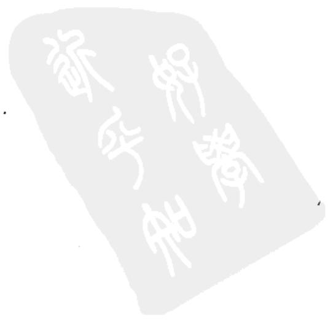

<!-- V3_SOURCE_ID:book016-b001693-p000-a0c4621af9 -->

## 剥卦第二十三

查看对应原文

<!-- V3_FOLDBACK_BEGIN:book016-b001693-p000-a0c4621af9 -->

## 剥卦第二十三

<!-- V3_FOLDBACK_END:book016-b001693-p000-a0c4621af9 -->

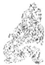

<!-- V3_SOURCE_ID:book016-b001695-p000-97af539b6f -->

译文《剥》卦象征剥落：不利于有所前往。

查看对应原文

<!-- V3_FOLDBACK_BEGIN:book016-b001695-p000-97af539b6f -->

译文《剥》卦象征剥落：不利于有所前往。

<!-- V3_FOLDBACK_END:book016-b001695-p000-97af539b6f -->

<!-- V3_SOURCE_ID:book016-b001696-p000-a36cbc2b02 -->

剥：不利于有所前往。

查看对应原文

<!-- V3_FOLDBACK_BEGIN:book016-b001696-p000-a36cbc2b02 -->

剥①：不利有攸往②。

<!-- V3_FOLDBACK_END:book016-b001696-p000-a36cbc2b02 -->

<!-- V3_SOURCE_ID:book016-b001697-p000-8e5b3fdbe1 -->

注释①剥：卦名，下坤()上艮(三)，象征“剥落”。《释文》记载：“剥，马融说指的是物体脱落的意思”。《集解》引用郑玄的话说：“阴气侵凌阳气，向上发展到第五爻，万物纷纷零落，所以称之为‘剥’”。

查看对应原文

<!-- V3_FOLDBACK_BEGIN:book016-b001697-p000-8e5b3fdbe1 -->

注释①剥：卦名，下坤()上艮(三)，象征“剥落”。《释文》：“剥，马云落也’。”《集解》引郑玄曰：“阴气侵阳，上至于五，万物需落，故谓之‘剥’也。”

<!-- V3_FOLDBACK_END:book016-b001697-p000-8e5b3fdbe1 -->

<!-- V3_SOURCE_ID:book016-b001698-p000-d0411ce300 -->

②不利于有所前往：处于“剥落”的时节，正如卦象所显示的，阳刚被削剥殆尽，阴气盛长，所以卦辞告诫“君子”不宜有所前往。《正义》说：“剥就是剥落的意思。如今阴气增长改变了阳刚的性质，刚阳之气被剥落，所以称作‘剥’。小人的势力已经增长，因此‘不利于有所前往’。”

查看对应原文

<!-- V3_FOLDBACK_BEGIN:book016-b001698-p000-d0411ce300 -->

②不利有攸往：“剥落”之时，正如卦象所示，阳刚被削剥殆尽，阴气盛长，故卦辞诫“君子”不宜有所往。《正义》：“剥者，剥落也。今阴长变刚，刚阳剥落，故称‘剥’也。小人既长，故‘不利有攸往’也。”

<!-- V3_FOLDBACK_END:book016-b001698-p000-d0411ce300 -->

<!-- V3_SOURCE_ID:book016-b001699-p000-762b619fe3 -->

译文《象传》说：“剥”，就是剥落的意思，譬如阴柔者浸蚀改变了阳刚的本质。“不利于有所前往”，说明小人的势力盛长。此时应当顺势抑止小人之道，这从观察卦象可以获知；君子崇尚消亡生息、盈盛亏虚的转化哲理，这是大自然的运

查看对应原文

<!-- V3_FOLDBACK_BEGIN:book016-b001699-p000-762b619fe3 -->

译文《象传》说：“剥”，就是剥落的意思，譬如阴柔者浸蚀改变了阳刚的本质。“不利于有所前往”，说明小人的势力盛长。此时应当顺势抑止小人之道，这从观察卦象可以获知；君子崇尚消亡生息、盈盛亏虚的转化哲理，这是大自然的运

<!-- V3_FOLDBACK_END:book016-b001699-p000-762b619fe3 -->

<!-- V3_SOURCE_ID:book016-b001700-p000-749ef545b1 -->

《彖》说：“剥”，就是剥落的意思，是柔变刚的缘故①。不利于有所前往，是因为小人在增长②。顺而止之，是观察卦象的缘故；君子尚消息盈虚，是天行的缘故④。

查看对应原文

<!-- V3_FOLDBACK_BEGIN:book016-b001700-p000-749ef545b1 -->

《彖》曰：“剥”，剥也，柔变刚也①。不利有攸往，小人长也②。顺而止之，观象也③；君子尚消息盈虚④，天行也。

<!-- V3_FOLDBACK_END:book016-b001700-p000-749ef545b1 -->

<!-- V3_SOURCE_ID:book016-b001701-p000-bf964ff324 -->

行规律啊！

查看对应原文

<!-- V3_FOLDBACK_BEGIN:book016-b001701-p000-bf964ff324 -->

行规律啊！

<!-- V3_FOLDBACK_END:book016-b001701-p000-bf964ff324 -->

<!-- V3_SOURCE_ID:book016-b001702-p000-8642e2f646 -->

注释①柔变刚：这是用卦中五阴爻已经侵蚀并改变了阳刚的本质，来解释卦名“剥”的由来。《正义》说：“这是解释此卦名为‘剥’的原因。”

查看对应原文

<!-- V3_FOLDBACK_BEGIN:book016-b001702-p000-8642e2f646 -->

注释①柔变刚：此以卦中五阴已浸蚀并改变阳刚的本质，释卦名“剥”。《正义》：“释所以此卦名‘剥’之意也。”

<!-- V3_FOLDBACK_END:book016-b001702-p000-8642e2f646 -->

<!-- V3_SOURCE_ID:book016-b001703-p000-e360b38e9e -->

②小人长：小人，指卦中的阴爻；长，指盛长。这是解释卦辞“不利有攸往”的含义。《集解》引用郑玄的话：“五阴一阳，小人极盛。君子不可有所之，故‘不利有攸往’也。”《纂疏》说：“之所以这样，是因为‘小人长’。”

查看对应原文

<!-- V3_FOLDBACK_BEGIN:book016-b001703-p000-e360b38e9e -->

②小人长：小人，指卦中阴爻；长，盛长。此释卦辞“不利有攸往”。《集解》引郑玄曰：“五阴一阳，小人极盛。君子不可有所之，故‘不利有攸往’也。”《纂疏》：“所以然者，以‘小人长’也。”

<!-- V3_FOLDBACK_END:book016-b001703-p000-e360b38e9e -->

<!-- V3_SOURCE_ID:book016-b001704-p000-4c4dff68bb -->

③顺而止之，观象也：顺，指下坤为顺；止，指上艮为止；观象，是说观察这上下卦的卦象，就知道此时应当顺应形势阻止小人的行事方式。《王注》说：“坤顺而艮止也。之所以要顺应形势阻止，是不敢用刚猛的方式去阻止，要观察卦象所显示的情况。刚猛亢进、激烈抵触，会触犯他人而招致自身损伤；自身已经倾覆，功业又无法成就，这不是君子所推崇的做法。”

查看对应原文

<!-- V3_FOLDBACK_BEGIN:book016-b001704-p000-4c4dff68bb -->

③顺而止之，观象也：顺，下坤为顺；止，上艮为止；观象，谓观此上下卦象，知此时当顺止小人之道。《王注》：“坤顺而艮止也。所以顺而止之，不敢以刚止者，以观其形象也。强亢激拂，触忤以陨身；身既倾焉，功又不就，非君子之所尚也。”

<!-- V3_FOLDBACK_END:book016-b001704-p000-4c4dff68bb -->

<!-- V3_SOURCE_ID:book016-b001705-p000-4001b83e79 -->

④君子尚消息盈虚：消息，指消亡与生息；盈虚，指盈满与亏虚。这里举出“天道”盛衰相互转化的哲理，说明阴“剥”阳的态势也不会长久，和上文“顺而止”的含义相承接，揭示“君子”顺应时势处理“剥”的方法。《正义》说：“在‘剥’之时，要顺应形势阻止”，“需要衡量时势制定应变的措施，随事物的变化而动：君子通晓事物的道理，推崇重视消息盈虚的道理。”

查看对应原文

<!-- V3_FOLDBACK_BEGIN:book016-b001705-p000-4001b83e79 -->

④君子尚消息盈虚：消息，消亡与生息；盈虚，盈满与亏虚。此举“天道”盛衰互转的哲理，说明阴“剥”阳之势也未能终久，与上文“顺而止”义相承，揭示“君子”顺势治“剥”之道。《正义》：“在‘剥’之时，顺而止之”，“须量时制变，随物而动：君子通达物理，贵尚消息盈虚。”

<!-- V3_FOLDBACK_END:book016-b001705-p000-4001b83e79 -->

<!-- V3_SOURCE_ID:book016-b001706-p000-fb1bf1559a -->

## 《象》曰：山附于地，剥①；上以厚下安宅②。 — 《象》传说：山依附在地面上，这是剥卦的象征；居上位的人因此要加厚下方的根基，安稳居所。

查看对应原文

<!-- V3_FOLDBACK_BEGIN:book016-b001706-p000-fb1bf1559a -->

## 《象》曰：山附于地，剥①；上以厚下安宅②。

<!-- V3_FOLDBACK_END:book016-b001706-p000-fb1bf1559a -->

<!-- V3_SOURCE_ID:book016-b001707-p000-dcb2eab4f5 -->

译文《象传》说：高山颓落委附在地面，象征“剥落”；居上者因此丰厚基础、安固宅屋。

查看对应原文

<!-- V3_FOLDBACK_BEGIN:book016-b001707-p000-dcb2eab4f5 -->

译文《象传》说：高山颓落委附在地面，象征“剥落”；居上者因此丰厚基础、安固宅屋。

<!-- V3_FOLDBACK_END:book016-b001707-p000-dcb2eab4f5 -->

<!-- V3_SOURCE_ID:book016-b001708-p000-a7a00035d4 -->

匡释①山附于地，剥：解释《剥》卦的卦象是上为艮（八卦之一）、下为坤（八卦之一，卦象及五行、方位依原文语境确定）。《集解》引用卢氏的话说：“山原本高耸于地面之上，如今却依附在地面，显然是被剥落了。”

查看对应原文

<!-- V3_FOLDBACK_BEGIN:book016-b001708-p000-a7a00035d4 -->

匡释①山附于地，剥：释《剥》卦上艮为山，下坤为地之象。《集解》引卢氏曰：“山高绝于地，今附地者，明被剥矣。”

<!-- V3_FOLDBACK_END:book016-b001708-p000-a7a00035d4 -->

<!-- V3_SOURCE_ID:book016-b001709-p000-8c51d1327f -->

②上以厚下安宅：“上”指居上位的人；“厚”“安”都用作动词，意为“加厚”“安固”；“下”指下位，如同说“基础”。这句是说居上位的人观察《剥》卦的卦象，领悟到要加厚基础、安固宅屋，以此防止“剥落”的道理。《正义》说：“剥的含义是从下往上发展的，所以居上位的人应当加厚下方的基础，安定众人的居所，以此防止剥落的发生。”

查看对应原文

<!-- V3_FOLDBACK_BEGIN:book016-b001709-p000-8c51d1327f -->

②上以厚下安宅：上，居上者；厚、安，均用如动词，“加厚”、“安固”；下，下处，犹言“基础”。这句说明“上”者观《剥》卦之象，悟知“厚下安宅”、以防“剥落”的道理。《正义》：“剥之为义，从下而起，故在上之人当须丰厚于下，安物之居，以防于剥也。”

<!-- V3_FOLDBACK_END:book016-b001709-p000-8c51d1327f -->

<!-- V3_SOURCE_ID:book016-b001710-p000-838c31aa00 -->

解说《剥》卦的卦辞，强调当事物处于剥落状态时，不宜有所前往；《大象传》则指出平日应当巩固根本，防止“剥落”的情况发生。两者阐说的角度不同，所蕴含的道理却可以贯通。所谓“安宅”，也是一种比喻，其意旨很可以触类旁通、引申发挥。《折中》引用刘牧的话说：“君主以民众为根本，厚待下属，那么君主就能安稳地居于上位。”就是一个例子。

查看对应原文

<!-- V3_FOLDBACK_BEGIN:book016-b001710-p000-838c31aa00 -->

说萌卦辞强调“剥落”时不利有所往，《大象传》指出平日应当固本防“剥”：两者阐说角度不同，所寓之理则可贯通。所谓“安宅”，也是一种比喻，其旨颇可触类引申。《折中》引刘牧曰：“君以民为本，厚其下，则君安于上。”即是一例。

<!-- V3_FOLDBACK_END:book016-b001710-p000-838c31aa00 -->

<!-- V3_SOURCE_ID:book016-b001711-p000-466f1dc969 -->

原文初六爻的爻辞为：“剥床以足，蔑①；贞凶②。” 其白话译文为：初六爻，剥落大床先剥及床足，床足必然被蚀灭；应当守持正固，以防凶险。

查看对应原文

<!-- V3_FOLDBACK_BEGIN:book016-b001711-p000-466f1dc969 -->

初六，剥床以足，蔑①；贞凶②。 译文初六，剥落大床先剥及床足，床足必致蚀灭；守持正固以防凶险。

<!-- V3_FOLDBACK_END:book016-b001711-p000-466f1dc969 -->

<!-- V3_SOURCE_ID:book016-b001712-p000-9b2ca64139 -->

匡释①“剥床以足，蔑”：“以”是介词，《经传释词》中说它“如同‘及’”；“蔑”通“灭”，指“蚀灭”，《释文》中说它是“削”的意思，楚地习俗有“削灭”的说法，又引用荀爽的本子作“灭”。这两句说明初六爻以阴爻居于《剥》卦下位，处于“坤”卦的起始位置，就像大床剥落灭坏，先从床足开始。《周易集说》中说：“阴爻消融阳爻，从下往上发展；初六爻处于下位，所以是大床剥落而先从床足在下方蚀灭的象征。”按，“蔑”字，旧说大多把它归到下一句读，作“蔑贞凶”；俞琰的《集说》把它归到上一句读，似乎更妥当。但根据文势，“蔑”单独成句应当更贴切，所以《尚氏学》特别指出“蔑”自成一句，现在采用这种说法。

查看对应原文

<!-- V3_FOLDBACK_BEGIN:book016-b001712-p000-9b2ca64139 -->

匡释①剥床以足，蔑：以，介词，《经传释词》“犹‘及’也”；蔑，通“灭”，谓“蚀灭”，《释文》“削也，楚俗有‘削灭’之言”，又引荀爽本作“灭”。这两句说明初六以阴处《剥》下，居坤之始，犹如大床剥落灭坏，先始于足。《周易集说》：“阴之消阳，自下而进；初在下，故为剥床而先以床足灭于下之象。”案，“蔑”字，旧说多属下句读，作“蔑贞凶”；俞琰《集说》属上读，似较妥。但据文势，“蔑”独作一句当更切，故《尚氏学》特指出“蔑”自为“句”，今从之(六二爻仿此)。

<!-- V3_FOLDBACK_END:book016-b001712-p000-9b2ca64139 -->

<!-- V3_SOURCE_ID:book016-b001713-p000-1a0e30ad14 -->

②“贞凶”：意思是“守持正固以防凶险”。这是说初六爻所处的位置最卑下，没有应援且失于正道，所以特意告诫它要趋向“正”道自我持守，以防“剥落”带来的凶险。按，《王注》把“蔑”字合起来解释“贞凶”，理解为“正被削蚀而凶险”，在义理上也说得通。此处有一个“O”标记，具体所指不详。

查看对应原文

<!-- V3_FOLDBACK_BEGIN:book016-b001713-p000-1a0e30ad14 -->

②贞凶：犹言“守正防凶”(参见《屯》九五译注)。此谓初六处位最卑，无应失正，故特诫以趋“正”自守，以防剥落之“凶”。案，《王注》合“蔑”字释“贞凶”，解为“正削而凶”，于义亦通。 O

<!-- V3_FOLDBACK_END:book016-b001713-p000-1a0e30ad14 -->

<!-- V3_SOURCE_ID:book016-b001714-p000-45ecb842c8 -->

《象传》说：“剥落大床先从床足开始，这说明是先蚀灭下部的基础。”

查看对应原文

<!-- V3_FOLDBACK_BEGIN:book016-b001714-p000-45ecb842c8 -->

《象》曰：“剥床以足”，以灭 译文《象传》说：“剥落大床先剥及床下也。 足”，说明最初先蚀灭下部基础。

<!-- V3_FOLDBACK_END:book016-b001714-p000-45ecb842c8 -->

<!-- V3_SOURCE_ID:book016-b001715-p000-d93a05ea2b -->

《集解》引用卢氏的话说：“坤用来承载万物，床用来安坐人，坤在下方所以称作足；先从下方剥落，逐渐波及上方，那么君政就会崩灭，所以说‘以灭下也’。”这种说法把爻辞和《象传》的内容一并解释得很清楚。

查看对应原文

<!-- V3_FOLDBACK_BEGIN:book016-b001715-p000-d93a05ea2b -->

说明《集解》引卢氏曰：“坤所以载物，床所以安人，在下故称足；先从下剥，渐及于上，则君政崩灭，故曰‘以灭下也’。”此说将爻辞与《象传》并释明朗。

<!-- V3_FOLDBACK_END:book016-b001715-p000-d93a05ea2b -->

<!-- V3_SOURCE_ID:book016-b001716-p000-0f3b7c4b7d -->

六二，剥落大床已经剥至床头，床头必致蚀灭；守持正固以防凶险。

查看对应原文

<!-- V3_FOLDBACK_BEGIN:book016-b001716-p000-0f3b7c4b7d -->

六二，剥床以辨，蔑①；贞凶②。 译文六二，剥落大床已经剥至床头，床头必致蚀灭；守持正固以防凶险。

<!-- V3_FOLDBACK_END:book016-b001716-p000-0f3b7c4b7d -->

<!-- V3_SOURCE_ID:book016-b001717-p000-a868184e97 -->

注释①剥床以辨，蔑：辨，意思是床头；《尚氏学》依据《周礼·天官·小宰》中杜子春对“廉辨”的注释“或作‘廉端’”，认为“辨、端音近通用”，所以说：“端，就是首，剥床以端，就是剥到床头了”，现在采用这个说法。这是说六二以阴爻居于下坤的中位，就像“床头”处于“床足”、“床架”之间；最初的“足”已经被剥落，所以又剥到了“床头”，并且将要被灭坏。考察“辨”字，《释文》说“徐音‘办具’的‘办’，是足上的意思，马融、郑玄的说法相同”，又引用薛虞的说法“是膝下的意思”，后人大多沿用这个解释，把“辨”当作“足上膝下”，可以作为参考。

查看对应原文

<!-- V3_FOLDBACK_BEGIN:book016-b001717-p000-a868184e97 -->

注释①剥床以辨，蔑：辨，犹言“床头”；《尚氏学》据《周礼·天官·小宰》“廉辨”杜子春注“或作‘廉端’”，以为“辨、端音近通用”，故曰：“端，首也，剥床以端，是剥及床头也”，今从之。此谓六二阴居下坤之中，犹如“床头”处“床足”、“床架”之间；初“足”已剥，故又剥及“床头”，并将灭坏。案，“辨”字，《释文》曰“徐音‘办具’之‘办’，足上也，马、郑同”，又引薛虞曰“膝下”也，后人多承此释“辨”为“足上膝下”，可备参考。

<!-- V3_FOLDBACK_END:book016-b001717-p000-a868184e97 -->

<!-- V3_SOURCE_ID:book016-b001718-p000-b5a2c66b0a -->

②贞凶：含义与前一爻相同；此处说明六二爻居中位且得正位，但因处于“剥”卦且涉及“床头”，又与六五爻没有应和关系，所以告诫它即使守“正”也要防备“凶”。

查看对应原文

<!-- V3_FOLDBACK_BEGIN:book016-b001718-p000-b5a2c66b0a -->

②贞凶：义同前爻；此处说明六二居中得正，但“剥”及“床头”，又与六五无应，故亦戒其守“正”防“凶”。

<!-- V3_FOLDBACK_END:book016-b001718-p000-b5a2c66b0a -->

<!-- V3_SOURCE_ID:book016-b001719-p000-74b6301965 -->

译文《象传》说：“剥落大床已经剥至床头”，说明六二未获互应者相助。

查看对应原文

<!-- V3_FOLDBACK_BEGIN:book016-b001719-p000-74b6301965 -->

译文《象传》说：“剥落大床已经剥至床头”，说明六二未获互应者相助。

<!-- V3_FOLDBACK_END:book016-b001719-p000-74b6301965 -->

<!-- V3_SOURCE_ID:book016-b001720-p000-d81794510f -->

《象传》说：“剥床以辨”，是因为没有应和者①。

查看对应原文

<!-- V3_FOLDBACK_BEGIN:book016-b001720-p000-d81794510f -->

《象》曰：“剥床以辨”，未有与也①。

<!-- V3_FOLDBACK_END:book016-b001720-p000-d81794510f -->

<!-- V3_SOURCE_ID:book016-b001721-p000-e74f1f564f -->

注释①未有与：指六二爻与六五爻不相应和，所以有“凶”兆，应当守“正”。《集解》引用崔憬的话说：“未有与者，是说到六三爻就会相应，所以六二爻没有应和者。”

查看对应原文

<!-- V3_FOLDBACK_BEGIN:book016-b001721-p000-e74f1f564f -->

注释①未有与：指二、五不相应和，故有“凶”宜“贞”。《集解》引崔憬曰：“未有与者，言至三则应，故二未有与也。”

<!-- V3_FOLDBACK_END:book016-b001721-p000-e74f1f564f -->

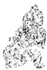

<!-- V3_SOURCE_ID:book016-b001723-p000-9749f88e4d -->

说明当处于“剥”卦的情境时，若上能辅助下，就有助于防止“剥”的发生、抑制“剥”的发展；六二爻没有相应的爻位，自然应当防范凶险。《折中》引用龚焕的话说：“六二爻阴柔中正，假使上有阳刚的爻与它相应，就必定会应和、辅助它，因而不会被“剥”。只是因为没有相应的爻，所以混杂在众多阴爻之中而被“剥”。至于九三爻则有相应的爻，所以虽然不如六二爻中正，却能没有咎害。”

查看对应原文

<!-- V3_FOLDBACK_BEGIN:book016-b001723-p000-9749f88e4d -->

说明当“剥”之时，上能助下，则有益于防“剥”抑“剥”；六二无应，自当防凶。《折中》引龚焕曰：“六二阴柔中正，使上有阳刚之与，则必应之助之，而不为剥矣。惟其无与，所以杂于群阴之中而为剥。若三则有与，故虽不如二之中正，而得无咎。”

<!-- V3_FOLDBACK_END:book016-b001723-p000-9749f88e4d -->

<!-- V3_SOURCE_ID:book016-b001724-p000-e89edc99a3 -->

译文：六三爻，虽处于剥落之时，却没有咎害。

查看对应原文

<!-- V3_FOLDBACK_BEGIN:book016-b001724-p000-e89edc99a3 -->

译文六三，虽处剥落之时，却无咎害。

<!-- V3_FOLDBACK_END:book016-b001724-p000-e89edc99a3 -->

<!-- V3_SOURCE_ID:book016-b001725-p000-85289b537f -->

六三爻，剥，无咎①。

查看对应原文

<!-- V3_FOLDBACK_BEGIN:book016-b001725-p000-85289b537f -->

六三，剥，无咎①。

<!-- V3_FOLDBACK_END:book016-b001725-p000-85289b537f -->

<!-- V3_SOURCE_ID:book016-b001726-p000-75ab6e22fc -->

注释①剥，无咎：《释文》记载：“有一个版本写作‘剥之，无咎’，不对”；《尚氏学》认为“之”字“是依据《象辞》多出来的，‘无’字才是正确的”。这里是说六三爻虽处于“剥落”之时，其本体已消剥成阴；但居于阳位，应合上九阳刚，所以它的外表看似已经消剥，内里却仍存有阳质，有“含阳待复”的含义，因此获得“无咎”。按，马其昶指出，《剥》卦各阴爻所说的“剥”，都是“本爻变刚自剥之象”，即“阳”已经消剥成“阴”，并非去剥蚀其他爻；所以六三爻的“剥”也“指本爻而言”（《重定费氏学》）。这个说法应当采纳。

查看对应原文

<!-- V3_FOLDBACK_BEGIN:book016-b001726-p000-75ab6e22fc -->

注释①剥，无咎：《释文》：“一本作‘剥之，无咎’，非”；《尚氏学》以为“之”字“乃从《象辞》而衍，无者是也”。此谓六三虽处“剥落”之时，其体已消剥成阴；但居阳位，应合上九阳刚，故其表似已消剥，其里却仍存阳质，有“含阳待复”之义，故获“无咎”。案，马其昶指出，《剥》卦诸阴所言“剥”，皆“本爻变刚自剥之象”，即“阳”已消剥成“阴”，非往剥它爻；故六三之“剥”亦“指本爻也”（《重定费氏学》）。此说当从。

<!-- V3_FOLDBACK_END:book016-b001726-p000-75ab6e22fc -->

<!-- V3_SOURCE_ID:book016-b001727-p000-9fd084a449 -->

《集解》引用荀爽的注释，认为该卦中所有阴爻都在“剥阳”，只有六三爻独自与上九爻相应，没有剥阳的害处，因此称其为“无咎”。这个观点被后人较多采用，可以作为一种说法保留。

查看对应原文

<!-- V3_FOLDBACK_BEGIN:book016-b001727-p000-9fd084a449 -->

说明《集解》引荀爽注，认为卦中群阴“皆剥阳”，六三“独应上，无剥害意，是以无咎”。此义颇为后人所取，可备一说。

<!-- V3_FOLDBACK_END:book016-b001727-p000-9fd084a449 -->

<!-- V3_SOURCE_ID:book016-b001728-p000-e00270a565 -->

《象传》说：“虽处剥落之时而必无咎害”，这说明六三爻脱离了上下的阴爻，独自与阳刚相应。

> **释读存疑：** 1轮自动修复后核义模型仍建议修订，已保守记录。

查看对应原文

<!-- V3_FOLDBACK_BEGIN:book016-b001728-p000-e00270a565 -->

译文《象传》说：“虽处剥落之时而必无咎害”，说明六三离开上下群阴（独应阳刚）。

<!-- V3_FOLDBACK_END:book016-b001728-p000-e00270a565 -->

<!-- V3_SOURCE_ID:book016-b001729-p000-f9edad5ffa -->

《象传》说：“剥之无咎”，意思是六三爻失去了上下的阴爻。

查看对应原文

<!-- V3_FOLDBACK_BEGIN:book016-b001729-p000-f9edad5ffa -->

《象》曰：“剥之无咎”，失上下也①。

<!-- V3_FOLDBACK_END:book016-b001729-p000-f9edad5ffa -->

<!-- V3_SOURCE_ID:book016-b001730-p000-1d05d96852 -->

注释①失上下：指六三爻不与六四、六二为伍，独自与上九爻相应，潜藏阳质，因此处于“剥”的卦义中却能“无咎”。《尚氏学》说：“不党于上下二阴，故曰‘失上下’。”

查看对应原文

<!-- V3_FOLDBACK_BEGIN:book016-b001730-p000-1d05d96852 -->

注释①失上下：指三不与六四、六二为伍，独应上九，潜含阳质，故处“剥”而“无咎”。《尚氏学》：“不党于上下二阴，故曰‘失上下’。”

<!-- V3_FOLDBACK_END:book016-b001730-p000-1d05d96852 -->

<!-- V3_SOURCE_ID:book016-b001731-p000-82f635b3cf -->

这是在说明《坤》卦六三爻的爻辞“含章可贞”，其中“章”就如同“阳质”。由此可见，若六三、六五这类爻位被阴爻占据，必然会蕴育出阳质。本卦六三爻又同时与上九爻相应，其内部蕴含的阳质会更加充盈；以这种状态等待“剥”卦向“复”卦转变，自然可以“无咎”。六五爻也处于阳位，与上九爻相邻，获得“利”的道理和六三爻相同。赵彦肃在《复斋易说》中说：“三应、五比，皆能存阳而免凶。”

查看对应原文

<!-- V3_FOLDBACK_BEGIN:book016-b001731-p000-82f635b3cf -->

说明《坤》六三曰“含章可贞”，“章”犹“阳质”。可见三位若为阴爻所居，必蕴育阳质。本卦六三又兼应上九，内含之阳益充；以此处“剥”待“复”，自可“无咎”。六五亦处阳位，比近上九，获“利”之理与六三同。赵彦肃曰：“三应、五比，皆能存阳而免凶。”（《复斋易说》）

<!-- V3_FOLDBACK_END:book016-b001731-p000-82f635b3cf -->

<!-- V3_SOURCE_ID:book016-b001732-p000-0ad0e1f701 -->

六四爻的爻辞是“剥床以肤，凶”，意思是六四爻，剥落大床已剥至床面，有凶险。

查看对应原文

<!-- V3_FOLDBACK_BEGIN:book016-b001732-p000-0ad0e1f701 -->

六四，剥床以肤，凶①。 译文六四，剥落大床已剥至床面，有凶险。

<!-- V3_FOLDBACK_END:book016-b001732-p000-0ad0e1f701 -->

<!-- V3_SOURCE_ID:book016-b001733-p000-b3d443b75c -->

注释①：剥床以肤，凶。其中“肤”原本指皮肤，在这句里比喻床面。这是说六四爻是阴爻，处于上卦的初始位置，就像大床剥落到了床面，这床快要坏了，所以是凶兆。《尚氏学》里说：“足、辨、肤，皆指床言；肤，犹言‘床面’也。人卧床，身与床切；剥及于是，故言‘近灾’。”按《集解》所引王肃的注释，把“肤”解释为人身，认为：“床剥尽以及人身，为败滋深，害莫甚焉。”这种解释也说得通。

查看对应原文

<!-- V3_FOLDBACK_BEGIN:book016-b001733-p000-b3d443b75c -->

注释① 剥床以肤，凶：肤，原意是“皮肤”，句中喻指“床面”。此谓六四阴处上卦之初，犹大床“剥落”至于床面，此床将坏，故“凶”。《尚氏学》：“足、辨、肤，皆指床言；肤，犹言‘床面’也。人卧床，身与床切；剥及于是，故言‘近灾’。”案，《集解》引王肃注，释“肤”为“人身”，认为：“床剥尽以及人身，为败滋深，害莫甚焉。”于义亦通。

<!-- V3_FOLDBACK_END:book016-b001733-p000-b3d443b75c -->

<!-- V3_SOURCE_ID:book016-b001734-p000-6a1f1c36cc -->

《象传》说：“剥落大床已剥至床面”，说明六四爻迫近灾祸了。

查看对应原文

<!-- V3_FOLDBACK_BEGIN:book016-b001734-p000-6a1f1c36cc -->

《象》曰：“剥床以肤”，切近 译文《象传》说：“剥落大床已剥至床面”，说明六四迫近灾祸了。灾也。

<!-- V3_FOLDBACK_END:book016-b001734-p000-6a1f1c36cc -->

<!-- V3_SOURCE_ID:book016-b001735-p000-0267ae5840 -->

说明：剥卦到六四爻时，床体已经剥落得差不多了，快要坍塌，怎么还能坐卧呢？所以《象传》说“切近灾也”。不过“剥落”到了极点，“复元”的转机也会随之而来。六五爻的“无不利”，就显示出了这一苗头。

查看对应原文

<!-- V3_FOLDBACK_BEGIN:book016-b001735-p000-0267ae5840 -->

说明 “剥”至六四，床体已剥落殆尽，面临委颓，岂可坐卧？故《象传》谓“切近灾也”。但“剥落”至极，“复元”的转机也将随之而来。六五的“无不利”，显示出这一苗头。

<!-- V3_FOLDBACK_END:book016-b001735-p000-0267ae5840 -->

<!-- V3_SOURCE_ID:book016-b001736-p000-ed4bc83ff6 -->

六五爻，像用线贯串一排鱼一样引领众宫人承宠，无所不利。

> **释读存疑：** 原文中“贯鱼以宫人宠”的具体喻义未明确，释读未添加无依据的引申

查看对应原文

<!-- V3_FOLDBACK_BEGIN:book016-b001736-p000-ed4bc83ff6 -->

六五，贯鱼以宫人宠，无不 译文六五，像贯串一排鱼一样引领众利①。 宫女承宠于君王，无所不利。

<!-- V3_FOLDBACK_END:book016-b001736-p000-ed4bc83ff6 -->

<!-- V3_SOURCE_ID:book016-b001737-p000-2985737193 -->

注释①：贯鱼以宫人宠，无不利。贯鱼，指用线贯串一排鱼，用来比喻后文的“宫人”；宫人，用来比喻六五爻以下的各阴爻；宠，指“宫人”获得君王的宠爱，句中省略的宾语“君王”应当用来比喻上九爻。这两句说明，六五爻以阴爻居于尊位，在“剥”卦将“复”的时刻，虽然自身和其他四个阴爻一样已经处于“剥”的状态，但它的志向是承接阳爻，有“贯串”各阴爻承应上九爻、想要扭转“剥”道的意象，就像妃后引领一列宫女承宠于君王，所以虽然处于“剥”的状态却“无不利”。《集解》引用何妥的话说：“剥卦这个卦，下卦连着五个阴爻，它们头挨着头依次排列，就像‘贯鱼’一样。鱼是阴物，用来比喻各阴爻。所谓‘宫人’，就是后、夫人、嫔、妾各有次序，不相混乱，这样就贵贱分明，宠幸有顺序。六五既然是各阴爻的主，能够有‘贯鱼’那样的次序，所以就能‘无不利’了。”

查看对应原文

<!-- V3_FOLDBACK_BEGIN:book016-b001737-p000-2985737193 -->

注释① 贯鱼以宫人宠，无不利：贯鱼，贯串一排鱼，喻后文“宫人”；宫人，喻六五以下群阴；宠，指“宫人”获宠于君王，句中省略的宾语“君王”当喻上九。这两句说明六五阴居尊位，当“剥”极将“复”之时，虽自身与四阴一样已“剥”成阴，但其志承阳，有“贯串”诸阴承应上九、欲转“剥”道之象，正如妃后引领一列宫女承宠君王，故虽处“剥”而“无不利”。《集解》引何妥曰：“夫《剥》之为卦，下比五阴，骈头相次，似‘贯鱼’也。鱼为阴物，以喻众阴也。夫‘宫人’者，后、夫人、嫔、妾各有次序，不相渎乱，此则贵贱有章，宠御有序。六五既为众阴之主，能有‘贯鱼’之次第，故得‘无不利’矣。”

<!-- V3_FOLDBACK_END:book016-b001737-p000-2985737193 -->

<!-- V3_SOURCE_ID:book016-b001738-p000-74ad9f3578 -->

说明：《周礼·天官冢宰·九嫔》中郑玄的注说：“女御八十一人当九夕，世妇二十七人当三夕，九嫔九人当一夕，三夫人当一夕，后当一夕：亦十五日而遍云。自望后反之。”由此可见，周朝内宫的礼制是宫人每夕三到九人侍奉君王，十五日一轮，其中“后”地位最尊贵，以一人单独对应一夕（郑注：“卑者宜先，尊者宜后”）。据此，本爻取“贯鱼以宫人宠”的意象，正是借用周朝宫嫔制度来作比喻。

查看对应原文

<!-- V3_FOLDBACK_BEGIN:book016-b001738-p000-74ad9f3578 -->

说明 《周礼·天官冢宰·九嫔》郑玄注曰：“女御八十一人当九夕，世妇二十七人当三夕，九嫔九人当一夕，三夫人当一夕，后当一夕：亦十五日而遍云。自望后反之。”可见周朝内宫礼制是宫人每夕三至九人承侍君王，十五日一反复，其中“后”最尊，以一人居后，独当一夕（郑注：“卑者宜先，尊者宜后”）。据此，本爻取“贯鱼以宫人宠”之象，正是借周朝宫嫔制度为喻。

<!-- V3_FOLDBACK_END:book016-b001738-p000-74ad9f3578 -->

<!-- V3_SOURCE_ID:book016-b001739-p000-5f0c1ca94a -->

《象传》说：“引领众宫女承宠于君王”，说明这一爻终究不会有过失。

> **释读存疑：** 原文中“终无尤也”的“尤”指过失，释读准确

查看对应原文

<!-- V3_FOLDBACK_BEGIN:book016-b001739-p000-5f0c1ca94a -->

《象》曰：“以宫人宠”，终无 译文《象传》说：“引领众宫女承宠于君王”，说明六五终究无所过失。尤也。

<!-- V3_FOLDBACK_END:book016-b001739-p000-5f0c1ca94a -->

<!-- V3_SOURCE_ID:book016-b001740-p000-0b96e61f2d -->

本爻的拟象十分巧妙：先用“贯鱼”来比喻“宫人”，再将“贯鱼”与“宫人”结合起来，比喻六五爻与其余四个阴爻的情状，应当看作是“复叠式”的譬喻。《周易乾凿度》引用孔子的话，说《剥》卦的六五爻就像“阴贯鱼而欲承君子也”，可以说深得这个譬喻的意旨。

查看对应原文

<!-- V3_FOLDBACK_BEGIN:book016-b001740-p000-0b96e61f2d -->

说明 本爻拟象，至为巧妙：先以“贯鱼”喻“宫人”，再合“贯鱼”、“宫人”喻六五与四阴爻的情状，宜视为“复叠式”的譬喻。《周易乾凿度》引孔子语，谓《剥》之六五犹“阴贯鱼而欲承君子也”，可谓深得喻旨。

<!-- V3_FOLDBACK_END:book016-b001740-p000-0b96e61f2d -->

<!-- V3_SOURCE_ID:book016-b001741-p000-e36226adc0 -->

译文上九，硕大的果实未被摘食，君子摘取将能驱车济世，小人摘取必致剥落万家。

查看对应原文

<!-- V3_FOLDBACK_BEGIN:book016-b001741-p000-e36226adc0 -->

译文上九，硕大的果实未被摘食，君子摘取将能驱车济世，小人摘取必致剥落万家。

<!-- V3_FOLDBACK_END:book016-b001741-p000-e36226adc0 -->

<!-- V3_SOURCE_ID:book016-b001742-p000-25ab6d4f5b -->

上九，硕大的果实没有被摘食①，君子摘取它就能乘车济世，小人摘取它就会导致庐舍剥落②。

> **释读存疑：** 原文中存在两个注释标记，未附注释内容，具体所指不详

查看对应原文

<!-- V3_FOLDBACK_BEGIN:book016-b001742-p000-25ab6d4f5b -->

上九，硕果不食①，君子得舆，小人剥庐②。

<!-- V3_FOLDBACK_END:book016-b001742-p000-25ab6d4f5b -->

<!-- V3_SOURCE_ID:book016-b001743-p000-1416d2bc04 -->

匡释①硕果不食：硕，就是大的意思；不食，好比说“不曾摘食”。这句话是说，上九爻处于《剥》卦的末尾，它的德性刚直，当所有爻都“剥”变成阴爻的时候，唯独留存着阳实，所以才有“硕果”未被摘食的象征。

查看对应原文

<!-- V3_FOLDBACK_BEGIN:book016-b001743-p000-1416d2bc04 -->

匡释①硕果不食：硕，大也；不食，犹言“不曾摘食”。此句说明上九居《剥》之终，其德刚直，当诸爻俱“剥”成阴之时，独存阳实，故有“硕果”未被摘食之象。

<!-- V3_FOLDBACK_END:book016-b001743-p000-1416d2bc04 -->

<!-- V3_SOURCE_ID:book016-b001744-p000-edfd15a4a4 -->

②君子得舆，小人剥庐：君子、小人，分别用来比喻阳刚、阴柔；得舆，就是能乘坐大车，比喻济世获得“吉”；剥庐，就是剥落屋宇，比喻害民导致“凶”。这两句紧承前面的句子，又从正反两方面设喻，说明上九如果以“君子”的身份拥有这“硕果”就会“吉”，如果被“小人”窃取这“硕果”就会“凶”。《集解》引用侯果的话说：“处于《剥》卦的上位，具备刚直的德性，众多小人无法伤害他，所以果实硕大不会被剥食。君子处于这个位置，百姓依赖他得以安宁，就像能乘坐他的车舆；小人处于这个位置，那么各方民众就没有依靠，会被剥落屋舍。”

查看对应原文

<!-- V3_FOLDBACK_BEGIN:book016-b001744-p000-edfd15a4a4 -->

②君子得舆，小人剥庐：君子、小人，喻阳刚、阴柔；得舆，得乘大车，喻济世获“吉”；剥庐，剥落屋宇，喻害民致“凶”。这两句紧承前句，又从正反两面设喻，说明上九若以“君子”获此“硕果”则“吉”，若为“小人”窃此“硕果”则“凶”。《集解》引侯果曰：“处《剥》之上，有刚直之德，群小人不能伤害也，故果至硕大不被剥食矣。君子居此，万姓赖安，若得乘其车舆也；小人处之，则庶方无控，被剥其庐舍。”

<!-- V3_FOLDBACK_END:book016-b001744-p000-edfd15a4a4 -->

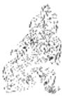

<!-- V3_SOURCE_ID:book016-b001746-p000-fdc33696e8 -->

《象传》的译文提到，君子摘取硕果后会驱车救助世人，百姓因此能得到庇护；小人摘取食用硕果后会导致万家破败，说明小人终究不能被任用。

查看对应原文

<!-- V3_FOLDBACK_BEGIN:book016-b001746-p000-fdc33696e8 -->

译文《象传》说：“君子摘取硕果将能驱车济世”，说明百姓因此有所仰庇；“小人摘食硕果必致剥落万家”，说明小人终究不可任用。

<!-- V3_FOLDBACK_END:book016-b001746-p000-fdc33696e8 -->

<!-- V3_SOURCE_ID:book016-b001747-p000-7ae9c3abe1 -->

《象》传说：“君子得舆”，是说百姓会拥戴他；“小人剥庐”，是说小人终究不可任用。

查看对应原文

<!-- V3_FOLDBACK_BEGIN:book016-b001747-p000-7ae9c3abe1 -->

《象》曰：“君子得舆”，民所载也；“小人剥庐”，终不可用也。

<!-- V3_FOLDBACK_END:book016-b001747-p000-7ae9c3abe1 -->

<!-- V3_SOURCE_ID:book016-b001748-p000-c6582683f0 -->

说《剥》卦上九爻是一阳独自居于卦的最上位，是《剥》卦的终局，完好地保存着硕果，正是《剥》卦的剥落到了尽头、《复》卦即将到来的时候，也是君子有所作为的时机。但爻辞又说“小人剥庐”，可见作《易》的人特意设置了警示的言辞，深深寄托了告诫的用意。

查看对应原文

<!-- V3_FOLDBACK_BEGIN:book016-b001748-p000-c6582683f0 -->

说萌上九一阳独居“剥”终，完葆硕果，正是“剥”尽“复”来，“君子”有为之时。但爻辞又谓“小人剥庐”，则见作《易》者特设“危辞”，深寓诫意。

<!-- V3_FOLDBACK_END:book016-b001748-p000-c6582683f0 -->

<!-- V3_SOURCE_ID:book016-b001749-p000-1a693c72e9 -->

《剥》卦比喻事物发展过程中阳被阴剥落的情状，就像描绘了一幅秋气萧瑟、万物零落的图景。全卦的主旨，是阐发妥善应对剥落的方法，揭示剥落到了极点就必然会回复、要顺应时势阻止剥落的哲理。卦辞说“不利有攸往”，告诫人们此时必须谨慎居守，把握转剥复阳的时机。六爻中五阴爻居于下位、一阳爻居于上位，通过不同的喻象，指出事物被逐渐消剥的过程，以及处剥、转剥的规律。其中三阴爻以床体被浸蚀剥落设喻：初六爻剥落到床足，六二爻剥落到床头，还没有导致危险，都告诫要守正防凶；六四爻剥落到床面，这张床即将败坏，所以有凶险。其余两阴爻虽然也处于剥落的状态，却都能含阳、承刚，孕育着复阳的期望，因此六三爻获得“无咎”、六五爻“无不利”。至于上九爻，是处于卦的极处、终局的唯一阳爻，代表事物剥落而不尽、终将回复，其硕果独存、阳刚不灭的形象寓意深刻：一方面生动地表明自然界以及人类社会生生不止的客观规律；另一方面显示了只有象征君子的阳刚，才能使硕果萌发生机、转剥为复。《折中》引乔中和的话说：“‘硕果不食’，就是核，就是仁，是生生的根本。自古没有不朽的株干，却有代代相传的果实，这就是剥卦之后会出现复卦的原因。”

查看对应原文

<!-- V3_FOLDBACK_BEGIN:book016-b001749-p000-1a693c72e9 -->

《剥》卦喻示事物发展过程中“阳”被“阴”剥落的情状；犹如描绘了一幅秋气萧瑟、万物零落的图景。全卦义旨，阐发善处“剥落”之道，揭明“剥”极必“复”、顺势止“剥”的哲理。卦辞谓“不利有攸往”，诫人此时必须谨慎居守，把握转“剥”复阳之机。六爻五阴居下、一阳处上，通过不同的喻象，指出事物被逐渐消剥的过程，以及处“剥”、转“剥”的规律。其中三阴爻以床体被浸蚀剥落设喻：初六剥及床足，六二剥及床头，尚未致危，均戒以守正防凶；六四剥至床面，此“床”行将败坏，故有凶险。余两阴爻虽也置身于“剥”，却皆能“含阳”、“承刚”，蕴育着复阳的期望，因此六三获“无咎”、六五“无不利”。至于上九，是极处卦终的唯一阳爻，代表事物“剥”而不尽、终将回复，其“硕果”独存、阳刚不灭的形象寓意深刻：一方面生动地表明自然界以及人类社会“生生不止”的客观规律；另一方面显示了只有象征“君子”的“阳刚”，才能使“硕果”萌发生机、转“剥”为“复”。《折中》引乔中和曰：“‘硕果不食’，核也，仁也，生生之根也。自古无不朽之株，有相传之果，此‘剥’之所以‘复’也。”

<!-- V3_FOLDBACK_END:book016-b001749-p000-1a693c72e9 -->

<!-- V3_SOURCE_ID:book016-b001750-p000-a2af7b86ab -->

## 复卦第二十四

查看对应原文

<!-- V3_FOLDBACK_BEGIN:book016-b001750-p000-a2af7b86ab -->

## 复卦第二十四

<!-- V3_FOLDBACK_END:book016-b001750-p000-a2af7b86ab -->

<!-- V3_SOURCE_ID:book016-b001751-p000-ba7ea84d44 -->

此爻的情况是没有过错；遵循事物循环往复的规律，过不了七日就会迎来回复的时机。利于有所行动。

> **释读存疑：** 1轮自动修复后核义模型仍建议修订，已保守记录。

查看对应原文

<!-- V3_FOLDBACK_BEGIN:book016-b001751-p000-ba7ea84d44 -->

无咎③；反复其道，七日来复④。利有攸往⑤。

<!-- V3_FOLDBACK_END:book016-b001751-p000-ba7ea84d44 -->

<!-- V3_SOURCE_ID:book016-b001752-p000-cd84465683 -->

译文《复》卦象征回复：亨通。阳气内生外长无所疾患，刚健友朋前来无所危害；返转回复沿着一定的规律，过不了七日必将转至回复之时。利于有所前往。

查看对应原文

<!-- V3_FOLDBACK_BEGIN:book016-b001752-p000-cd84465683 -->

译文《复》卦象征回复：亨通。阳气内生外长无所疾患，刚健友朋前来无所危害；返转回复沿着一定的规律，过不了七日必将转至回复之时。利于有所前往。

<!-- V3_FOLDBACK_END:book016-b001752-p000-cd84465683 -->

<!-- V3_SOURCE_ID:book016-b001753-p000-cb0e8ea29c -->

匡释①复：卦名，下震()上坤()，象征“回复”。《集解》引何妥曰：“复者，归本之名。群阴剥阳，至于几尽；一阳来下，故称反复。阳气复反，而得交通，故云：复，亨也。”

查看对应原文

<!-- V3_FOLDBACK_BEGIN:book016-b001753-p000-cb0e8ea29c -->

匡释①复：卦名，下震()上坤()，象征“回复”。《集解》引何妥曰：“复者，归本之名。群阴剥阳，至于几尽；一阳来下，故称反复。阳气复反，而得交通，故云：复，亨也。”

<!-- V3_FOLDBACK_END:book016-b001753-p000-cb0e8ea29c -->

<!-- V3_SOURCE_ID:book016-b001754-p000-f8667093c9 -->

②出入无疾：出，指阳气外长；入，指阳气内生；无疾，无害。《程传》：“出入，谓生长。复生于内，入也；长进于外，出也。先云‘出’，语顺耳。阳生非自外也，来于内，故谓之入。”又曰：“春阳之发，为阴寒所折，观草木于朝暮，则可见矣。‘出入无疾’，谓微阳生长，无害之者也。”

查看对应原文

<!-- V3_FOLDBACK_BEGIN:book016-b001754-p000-f8667093c9 -->

②出入无疾：出，指阳气外长；入，指阳气内生；无疾，无害。《程传》：“出入，谓生长。复生于内，入也；长进于外，出也。先云‘出’，语顺耳。阳生非自外也，来于内，故谓之入。”又曰：“春阳之发，为阴寒所折，观草木于朝暮，则可见矣。‘出入无疾’，谓微阳生长，无害之者也。”

<!-- V3_FOLDBACK_END:book016-b001754-p000-f8667093c9 -->

<!-- V3_SOURCE_ID:book016-b001755-p000-89ad4142dd -->

③朋来无咎：朋，指阳。卦中一阳初动上复，群阴引以为朋，故曰“朋来”；阴阳交合，“复”道畅通，故“无咎”。《王注》：“朋谓阳也。”《尚氏学》：“阴以阳为朋，《剥》穷上反下，故曰‘朋来’；阳遇阴，故‘无咎’。”

查看对应原文

<!-- V3_FOLDBACK_BEGIN:book016-b001755-p000-89ad4142dd -->

③朋来无咎：朋，指阳。卦中一阳初动上复，群阴引以为朋，故曰“朋来”；阴阳交合，“复”道畅通，故“无咎”。《王注》：“朋谓阳也。”《尚氏学》：“阴以阳为朋，《剥》穷上反下，故曰‘朋来’；阳遇阴，故‘无咎’。”

<!-- V3_FOLDBACK_END:book016-b001755-p000-89ad4142dd -->

<!-- V3_SOURCE_ID:book016-b001756-p000-37216d185f -->

④反复其道，七日来复：反复，指阳刚返转回复；道，规律；七日，借取日序周期“七”象征转机迅速，犹言过不了七日。这两句承“出入无疾，朋来无咎”之义，从“阳复”规律的角度，进一步申说阳刚“来复”之快。案，我国出土的青铜器铭文中，保留有一种现存文献失载的周初纪日法，即按月亮盈亏规律，分每月为四期，每期七日（或因大小月有八日者），从月初至月末依序取名为“初吉”、“既生霸”、“既望”、“既死霸”（见王国维《观堂集林》卷一《生霸死霸考》）。据此，“七日”正为日序周期转化之数；“七日来复”，当取此象征“转机迅速”之义，犹今语“一星期之间”。联系下经《震》、《既济》两卦均言“七日得”，似与本卦“七日”取义略同。又案，《王注》释“七日”曰：“阳气始剥尽，至来复时，凡七日”，意谓“来复”快速，似有可取。

查看对应原文

<!-- V3_FOLDBACK_BEGIN:book016-b001756-p000-37216d185f -->

④反复其道，七日来复：反复，指阳刚返转回复；道，规律；七日，借取日序周期“七”象征转机迅速，犹言过不了七日。这两句承“出入无疾，朋来无咎”之义，从“阳复”规律的角度，进一步申说阳刚“来复”之快。案，我国出土的青铜器铭文中，保留有一种现存文献失载的周初纪日法，即按月亮盈亏规律，分每月为四期，每期七日（或因大小月有八日者），从月初至月末依序取名为“初吉”、“既生霸”、“既望”、“既死霸”（见王国维《观堂集林》卷一《生霸死霸考》）。据此，“七日”正为日序周期转化之数；“七日来复”，当取此象征“转机迅速”之义，犹今语“一星期之间”。联系下经《震》、《既济》两卦均言“七日得”，似与本卦“七日”取义略同。又案，《王注》释“七日”曰：“阳气始剥尽，至来复时，凡七日”，意谓“来复”快速，似有可取。

<!-- V3_FOLDBACK_END:book016-b001756-p000-37216d185f -->

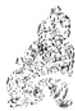

<!-- V3_SOURCE_ID:book016-b001758-p000-86c8167084 -->

⑤利有攸往：此重申前文“复，亨”之旨，说明“回复”之时，阳刚气势发展顺畅无碍，故利有所往。《正义》：“以阳气方长，往则小人道消。”

查看对应原文

<!-- V3_FOLDBACK_BEGIN:book016-b001758-p000-86c8167084 -->

⑤利有攸往：此重申前文“复，亨”之旨，说明“回复”之时，阳刚气势发展顺畅无碍，故利有所往。《正义》：“以阳气方长，往则小人道消。”

<!-- V3_FOLDBACK_END:book016-b001758-p000-86c8167084 -->

<!-- V3_SOURCE_ID:book016-b001759-p000-4fc3cd1fa9 -->

说明“七日来复”一语，旧说纷歧，未臻一致。除上文注引王弼说外，今再选录较有影响的三种说法以备参考。(一)《集解》引侯果注，以“十二消息卦”为说，谓阳自《姤》卦消，又沿《剥》至《复》，历七卦而复生；七卦原指七月，“月”《诗·豳风》称“日”，故当“七日”。(二)《易纬·稽览图》以六十四卦中的《坎》、《震》、《离》、《兑》为“四正卦”，其二十四爻主二十四节气，余六十卦三百六十爻各主一日；《中孚》至《复》，历六日七分，当“七日”。(三)李鼎祚以为九月《剥》卦阳尽，十月纯《坤》用事，《坤》尽而《复》生阳，《坤》六爻加《复》初阳为七爻，当“七日”(《集解》)。

查看对应原文

<!-- V3_FOLDBACK_BEGIN:book016-b001759-p000-4fc3cd1fa9 -->

说明“七日来复”一语，旧说纷歧，未臻一致。除上文注引王弼说外，今再选录较有影响的三种说法以备参考。(一)《集解》引侯果注，以“十二消息卦”为说，谓阳自《姤》卦消，又沿《剥》至《复》，历七卦而复生；七卦原指七月，“月”《诗·豳风》称“日”，故当“七日”。(二)《易纬·稽览图》以六十四卦中的《坎》、《震》、《离》、《兑》为“四正卦”，其二十四爻主二十四节气，余六十卦三百六十爻各主一日；《中孚》至《复》，历六日七分，当“七日”。(三)李鼎祚以为九月《剥》卦阳尽，十月纯《坤》用事，《坤》尽而《复》生阳，《坤》六爻加《复》初阳为七爻，当“七日”(《集解》)。

<!-- V3_FOLDBACK_END:book016-b001759-p000-4fc3cd1fa9 -->

<!-- V3_SOURCE_ID:book016-b001760-p000-33b43d743d -->

译文《象传》说：“回复，亨通”，说明阳刚更苏返回；阳动上复而能顺畅通行，所以“阳气内生外长无所疾患，刚健友朋前来必无害”。“返转回复沿着一定的规律，过不了七日必将转至回复之时”，这是大自然的运行法则。“利于有所前往”，说明阳刚日益盛长。回复的道理，大概体现着“天地”生育万物的用心吧？

查看对应原文

<!-- V3_FOLDBACK_BEGIN:book016-b001760-p000-33b43d743d -->

译文《象传》说：“回复，亨通”，说明阳刚更苏返回；阳动上复而能顺畅通行，所以“阳气内生外长无所疾患，刚健友朋前来必无害”。“返转回复沿着一定的规律，过不了七日必将转至回复之时”，这是大自然的运行法则。“利于有所前往”，说明阳刚日益盛长。回复的道理，大概体现着“天地”生育万物的用心吧？

<!-- V3_FOLDBACK_END:book016-b001760-p000-33b43d743d -->

<!-- V3_SOURCE_ID:book016-b001761-p000-dbbcf92bee -->

《彖传》说：“复，亨”，是因为刚爻返回；行动时能顺应规律，因此“出入无疾，朋来无咎”。“反复其道，七日来复”，这是天道运行的规律。“利有攸往”，是因为刚爻在增长。复卦，大概能体现天地的本心吧？

查看对应原文

<!-- V3_FOLDBACK_BEGIN:book016-b001761-p000-dbbcf92bee -->

《彖》曰：“复，亨”，刚反①；动而以顺行②，是以“出入无疾，朋来无咎”。“反复其道，七日来复”，天行也③。“利有攸往”，刚长也④。复，其见天地之心乎⑤？

<!-- V3_FOLDBACK_END:book016-b001761-p000-dbbcf92bee -->

<!-- V3_SOURCE_ID:book016-b001762-p000-4f91afea18 -->

注释①刚反：意思是阳爻回复，指卦的最下方一阳爻回复上升。按，《集解》引用虞翻的注释，将“刚反动”作为一句，把“动”字归到上一句读，含义没有太大差异。

查看对应原文

<!-- V3_FOLDBACK_BEGIN:book016-b001762-p000-4f91afea18 -->

注释①刚反：犹言“阳复”，指卦下一阳回复上升。案，《集解》引虞翻注，以“刚反动”为句，以“动”字属上读，于义无大异。

<!-- V3_FOLDBACK_END:book016-b001762-p000-4f91afea18 -->

<!-- V3_SOURCE_ID:book016-b001763-p000-af819d9ced -->

②动而以顺行：动，指下卦震；顺，指上卦坤。这里取上下卦的卦象，说明当下正处于“回复”的时机，阳爻行动时能顺应规律。这句和前一句“刚反”，都是解释卦辞“亨”、“无疾”、“无咎”的含义。《正义》说：“‘刚反动而以顺行’，既在上解释‘复，亨’的含义，又在下解释‘出入无疾，朋来无咎’的道理。”

查看对应原文

<!-- V3_FOLDBACK_BEGIN:book016-b001763-p000-af819d9ced -->

②动而以顺行：动，谓下震；顺，谓上坤。此取上下象，说明时当“回复”，阳动而能顺行。这句与前句“刚反”，并释卦辞“亨”、“无疾”、“无咎”之义。《正义》：“‘刚反动而以顺行’者，既上释‘复，亨’之义，又下释‘出入无疾，朋来无咎’之理。”

<!-- V3_FOLDBACK_END:book016-b001763-p000-af819d9ced -->

<!-- V3_SOURCE_ID:book016-b001764-p000-2448a2f33c -->

③天行：这句解释卦辞“反复其道，七日来复”的含义。《王注》说：“因为天道运行，循环往复不会超过七日，复卦的道理就是不可远离天道。”《本义》说：“阴阳的消长变化，是天道运行的自然规律。”

查看对应原文

<!-- V3_FOLDBACK_BEGIN:book016-b001764-p000-2448a2f33c -->

③天行：此句释卦辞：“反复其道，七日来复”之义。《王注》：“以天之行，反复不过七日，复之不可远也。”《本义》：“阴阳消息，天运然也。”

<!-- V3_FOLDBACK_END:book016-b001764-p000-2448a2f33c -->

<!-- V3_SOURCE_ID:book016-b001765-p000-ffc3a3231a -->

④刚长，指的是卦中阳刚之气日益盛长，用来解释卦辞中“利有攸往”的含义。《正义》说：“用‘刚长’来解释‘利有攸往’的含义。”

查看对应原文

<!-- V3_FOLDBACK_BEGIN:book016-b001765-p000-ffc3a3231a -->

④刚长：指卦中阳刚日益盛长，释卦辞“利有攸往”之义。《正义》：“以‘刚长’释‘利有攸往’之义也。”

<!-- V3_FOLDBACK_END:book016-b001765-p000-ffc3a3231a -->

<!-- V3_SOURCE_ID:book016-b001766-p000-83c94d9ec6 -->

⑤其见天地之心乎：这里的“天地之心”，说的就是“天地生育万物的本心”。这句话是针对《复》卦的大义发出的感叹之语。《易童子问》说：“天地之心通过动显现出来。”《复》卦，是一阳刚之气最初萌动于下方，天地生育万物的本源就在于此，所以称之为“天地之心”，意思是天地以生育万物为本心。

查看对应原文

<!-- V3_FOLDBACK_BEGIN:book016-b001766-p000-83c94d9ec6 -->

⑤其见天地之心乎：天地之心，犹言“天地生物之心”。此句是针对《复》卦大义发出的叹语。《易童子问》：“天地之心见乎动。”复也，一阳初动于下矣，天地所以生育万物者本于此，故曰“天地之心”也，天地以生物为心者也。

<!-- V3_FOLDBACK_END:book016-b001766-p000-83c94d9ec6 -->

<!-- V3_SOURCE_ID:book016-b001767-p000-07d0f7832d -->

译文《象传》说：震（八卦之一）雷在地中微动，象征阳气“回复”；先代帝王因此在微阳初动的冬至闭关静养，商贾旅客不外出远行，君主也不省巡四方。

查看对应原文

<!-- V3_FOLDBACK_BEGIN:book016-b001767-p000-07d0f7832d -->

译文《象传》说：震雷在地中微动，象征阳气“回复”；先代帝王因此在微阳初动的冬至闭关静养，商贾旅客不外出远行，君主也不省巡四方。

<!-- V3_FOLDBACK_END:book016-b001767-p000-07d0f7832d -->

<!-- V3_SOURCE_ID:book016-b001768-p000-d206db1e64 -->

《象》说：雷在地中，对应《复》卦①；先代帝王因此在冬至日闭关静养②，商贾旅客不外出远行，君主也不省巡四方③。

查看对应原文

<!-- V3_FOLDBACK_BEGIN:book016-b001768-p000-d206db1e64 -->

《象》曰：雷在地中，复①；先王以至日闭关②，商旅不行，后不省方③。

<!-- V3_FOLDBACK_END:book016-b001768-p000-d206db1e64 -->

<!-- V3_SOURCE_ID:book016-b001769-p000-45c7634fbe -->

注释①雷在地中，复：这是解释《复》卦的卦象，该卦下卦为震（八卦之一，卦象及五行、方位依原文语境确定），象征雷；上卦为坤（八卦之一，卦象及五行、方位依原文语境确定），象征地。《折中》引用刘蜕的话：‘雷在地中，殷殷隆隆；阳来而复，复来而天下昭融乎！’

查看对应原文

<!-- V3_FOLDBACK_BEGIN:book016-b001769-p000-45c7634fbe -->

注释①雷在地中，复：释《复》卦下震为雷、上坤为地之象。《折中》引刘蜕曰：‘雷在地中，殷殷隆隆；阳来而复，复来而天下昭融乎！’

<!-- V3_FOLDBACK_END:book016-b001769-p000-45c7634fbe -->

<!-- V3_SOURCE_ID:book016-b001770-p000-3628fe6e8c -->

②至日闭关：至日指冬至；闭关指掩闭关门阙。这是说明“先王”效法《复》象，在冬至阳气复生之际，休息静养，以利于进一步发展。《白虎通·诛伐篇》记载：“冬至所以休兵，不举事，闭关，商旅不行，何？此日阳气微弱，王者承天理物，故率天下静，不复行役，扶助微气，成万物也。”

> **释读存疑：** 本地硬校验仍未通过，已记录供后续自动处理或人工核对。

查看对应原文

<!-- V3_FOLDBACK_BEGIN:book016-b001770-p000-3628fe6e8c -->

②至日闭关：至日，冬至；闭关，掩闭关阙。这是说明‘先王’效法《复》象，于冬至阳气复生之际，休息静养，以利进一步发展。《白虎通·诛伐篇》：‘冬至所以休兵，不举事，闭关，商旅不行，何？此日阳气微弱，王者承天理物，故率天下静，不复行役，扶助微气，成万物也。’

<!-- V3_FOLDBACK_END:book016-b001770-p000-3628fe6e8c -->

<!-- V3_SOURCE_ID:book016-b001771-p000-2e6d055091 -->

③商旅不行，后不省方：后泛指“君主”，与上文的“王”意思相同；省方指省视四方。这两句承接上句的含义，再次申明天下静养以帮助微阳回复的道理。《集解》引用宋衷的话：“商旅不行，自天子至公侯不省四方之事，将以辅遂阳体，成致君之道也。制之者，王者之事；奉之者，为君之业也，故上言‘先王’而下言‘后’也。”

查看对应原文

<!-- V3_FOLDBACK_BEGIN:book016-b001771-p000-2e6d055091 -->

③商旅不行，后不省方：后，泛指‘君主’，与上文‘王’同意；省方，即省视四方。这两句承上句义，再申天下静养以助微阳回复之理。《集解》引宋衷曰：‘商旅不行，自天子至公侯不省四方之事，将以辅遂阳体，成致君之道也。制之者，王者之事；奉之者，为君之业也，故上言‘先王’而下言‘后’也。’

<!-- V3_FOLDBACK_END:book016-b001771-p000-2e6d055091 -->

<!-- V3_SOURCE_ID:book016-b001772-p000-9ffba5e30f -->

关于“至日”的解释，《王注》将其释为“冬至、夏至”。尚先生也认为“至日兼二至言也”，并说：“盖古最重二至。《汉书·薛宣传》：‘日至休吏，所繇来久’；《后汉·鲁恭传》：《易》五月《姤》用事’，先王施命令止四方行者’。是夏至亦休息，与冬至同。”这种说法可以作为参考。

查看对应原文

<!-- V3_FOLDBACK_BEGIN:book016-b001772-p000-9ffba5e30f -->

说明“至日”，《王注》释为“冬至、夏至”。尚先生亦谓“兼二至言也”，并曰：“盖古最重二至。《汉书·薛宣传》：‘日至休吏，所繇来久’；《后汉·鲁恭传》：《易》五月《姤》用事’，先王施命令止四方行者’。是夏至亦休息，与冬至同。”(《尚氏学》)此说可备参考。

<!-- V3_FOLDBACK_END:book016-b001772-p000-9ffba5e30f -->

<!-- V3_SOURCE_ID:book016-b001773-p000-bc2a2f471d -->

初九爻的爻辞是：起步不远就回复正道，不会招致悔恨，至为吉祥。

查看对应原文

<!-- V3_FOLDBACK_BEGIN:book016-b001773-p000-bc2a2f471d -->

初九，不远复①，无祗悔，元 译文初九，起步不远就回复正道，必无灾患、悔恨，至为吉祥。吉②。

<!-- V3_FOLDBACK_END:book016-b001773-p000-bc2a2f471d -->

<!-- V3_SOURCE_ID:book016-b001774-p000-011d64b27c -->

匡释：起步不远就回复正道，指初九以一阳爻居于众阴爻之下，是“复”卦的起始，最契合“复”道，所以有“起步不远就回复正道”的意象。王弼的注说：“行而不远就回复正道，接近悔恨时又返回，以此修身，患难就远离了。”

查看对应原文

<!-- V3_FOLDBACK_BEGIN:book016-b001774-p000-011d64b27c -->

匡释①不远复：指初九以一阳居群阴之下，为“复”之始，最得“复”道，故有“不远”即“复”之象。《王注》：“不远而复，几悔而反，以此修身，患难远矣。”

<!-- V3_FOLDBACK_END:book016-b001774-p000-011d64b27c -->

<!-- V3_SOURCE_ID:book016-b001775-p000-922ae81b6d -->

②不会招致悔恨，至为吉祥：祗，应当是“祇”（音zhǐ）的讹误，此处意为灾患。《释文》记载：“郑玄说‘祇是病的意思’。”这两句极力说明初九“起步不远就回复正道”的好处：既可以没有灾患与悔恨，又能获得极大的吉祥。

查看对应原文

<!-- V3_FOLDBACK_BEGIN:book016-b001775-p000-922ae81b6d -->

②无祗悔，元吉：祗，当为“祇”(音zhǐ)之误，此处意为“灾患”，《释文》：“郑云‘病也’。”这两句极言初九“不远复”的好处；既可无灾无悔，又获至大吉祥。

<!-- V3_FOLDBACK_END:book016-b001775-p000-922ae81b6d -->

<!-- V3_SOURCE_ID:book016-b001776-p000-8e717332c9 -->

尚秉和先生详细考证“祗”是“祇”的讹误，引证郑玄将“祇”解释为“病”，大概源自《毛诗传》，接着指出：“病就如同灾患；《复》卦说出入没有疾患，所以‘没有灾患与悔恨’。”（《尚氏学》）这个说法非常正确。

查看对应原文

<!-- V3_FOLDBACK_BEGIN:book016-b001776-p000-8e717332c9 -->

[说丽尚先生详考“祗”为“祇”之误，引证郑玄训“祇”为“病”盖本于《毛诗传》，继而指出：“病犹菑(灾)也；《复》出入无疾’，故‘无菑(灾)悔’。”(《尚氏学》)此说极是。

<!-- V3_FOLDBACK_END:book016-b001776-p000-8e717332c9 -->

<!-- V3_SOURCE_ID:book016-b001777-p000-74f08b50c2 -->

《象传》说：“起步不远就回复正道”，这说明初九善于修美自身。

查看对应原文

<!-- V3_FOLDBACK_BEGIN:book016-b001777-p000-74f08b50c2 -->

《象》曰：“不远之复”，以修 译文《象传》说：“起步不远就回复正道”，说明初九善于修美自身。身也。

<!-- V3_FOLDBACK_END:book016-b001777-p000-74f08b50c2 -->

<!-- V3_SOURCE_ID:book016-b001778-p000-60e935366e -->

《象传》用“修身”来解释“不远复”，是对爻辞象征寓意的推阐发挥。《系辞下传》引用孔子的话来解释这一爻的含义，有“知不善未尝复行”的说法。程颐据此评论道：“不远而复者，君子所以修其身之道也。学问之道无它也，唯其知不善，则速改以从善而已。”

查看对应原文

<!-- V3_FOLDBACK_BEGIN:book016-b001778-p000-60e935366e -->

说丽《象传》以“修身”解“不远复”，是对爻辞象征寓意的推阐发挥。《系辞下传》引孔子语释此爻义，有“知不善未尝复行”之谓。程颐据此论曰：“不远而复者，君子所以修其身之道也。学问之道无它也，唯其知不善，则速改以从善而已。”(《程传》)

<!-- V3_FOLDBACK_END:book016-b001778-p000-60e935366e -->

<!-- V3_SOURCE_ID:book016-b001779-p000-588c44df46 -->

## 六二，休复，吉①。

查看对应原文

<!-- V3_FOLDBACK_BEGIN:book016-b001779-p000-588c44df46 -->

## 六二，休复，吉①。

<!-- V3_FOLDBACK_END:book016-b001779-p000-588c44df46 -->

<!-- V3_SOURCE_ID:book016-b001780-p000-f112d809c7 -->

六二，休复，吉。

> **释读存疑：** 1轮自动修复后核义模型仍建议修订，已保守记录。

查看对应原文

<!-- V3_FOLDBACK_BEGIN:book016-b001780-p000-f112d809c7 -->

译文六二，美好的回复，吉祥。

<!-- V3_FOLDBACK_END:book016-b001780-p000-f112d809c7 -->

<!-- V3_SOURCE_ID:book016-b001781-p000-c75e73f528 -->

注释①休复，吉：休，是美善的意思。这里说的是六二处于阳刚回复的时刻，以柔居守中道，位置正当，向下与初爻的阳爻亲近，就如同亲近仁者、礼贤下士，所以因为回复的行为美善而获得吉祥。《集解》引用王弼的话说：“六二居位得当，又处于中位，向下与初爻的阳爻亲近并依附顺从它，这就是亲近仁人的意思。既然处于中位，亲近仁人、善待邻人，就是回复的美善之处。”

查看对应原文

<!-- V3_FOLDBACK_BEGIN:book016-b001781-p000-c75e73f528 -->

注释①休复，吉：休，美也。此谓六二当阳复之时，柔中居正，下比初阳，犹亲仁下贤，故以回复休美而获吉。《集解》引王弼曰：‘得位居中，比初之上而附顺之，下仁之谓也。既处中位，亲仁善邻，复之休也。’

<!-- V3_FOLDBACK_END:book016-b001781-p000-c75e73f528 -->

<!-- V3_SOURCE_ID:book016-b001782-p000-1133014c08 -->

《象传》的译文说：“美好的回复，吉祥”，《象》曰：“休复之吉”，说明六二能够俯就亲近仁人。

查看对应原文

<!-- V3_FOLDBACK_BEGIN:book016-b001782-p000-1133014c08 -->

译文《象传》说：“美好的回复，吉祥”， 《象》曰：“休复之吉”，以下  
说明六二能够俯就亲近仁人。仁也。

<!-- V3_FOLDBACK_END:book016-b001782-p000-1133014c08 -->

<!-- V3_SOURCE_ID:book016-b001783-p000-2b797838c0 -->

说明阳刚有“仁”“善”的象征，六二回复“善”、亲近“仁”，是获得吉祥的关键所在。朱熹说：“为学没有比亲近仁人更便利的了。既然得到仁人并亲近他，借助他的善来增益自身，那么不用费力就能让学业变得美好了。”

查看对应原文

<!-- V3_FOLDBACK_BEGIN:book016-b001783-p000-2b797838c0 -->

说明阳刚有“仁”、“善”的象征，六二复“善”亲“仁”，是获吉的关键所在。朱熹曰：“学莫便于近乎仁。既得仁者而亲之，资其善以自益，则力不劳而学美矣。”(《朱子语类》)

<!-- V3_FOLDBACK_END:book016-b001783-p000-2b797838c0 -->

<!-- V3_SOURCE_ID:book016-b001784-p000-f69b73d1fd -->

译文六三，愁眉苦脸而勉强回复，虽有危险却无咎害。

查看对应原文

<!-- V3_FOLDBACK_BEGIN:book016-b001784-p000-f69b73d1fd -->

译文六三，愁眉苦脸而勉强回复，虽有 六三，频复①，厉无咎②。  
危险却无咎害。

<!-- V3_FOLDBACK_END:book016-b001784-p000-f69b73d1fd -->

<!-- V3_SOURCE_ID:book016-b001785-p000-fa95165460 -->

注释①频复：频，意思就是颦蹙，是皱眉的样子。《集解》引用虞翻的注，将“频”解释为“频蹙”，《王注》也说“频蹙之貌”，《尚氏学》认为“频”是古文的“颦”字。这里说的是六三处于下卦的上位，位置不当，没有相应的爻位，上下承接的都是阴爻，“复善”的过程多有艰难，所以有“皱眉勉强回复”的意象。另外，《程传》将“频”解释为“频数”，也可以作为一种说法保留。

查看对应原文

<!-- V3_FOLDBACK_BEGIN:book016-b001785-p000-fa95165460 -->

注释①频复：频，犹言“颦蹙”，皱眉之状。《集解》引虞翻注，训“频”为“频蹙”，《王注》亦谓“频蹙之貌”，《尚氏学》：“频，古文‘颦’字。”此谓六三居下卦之上，失正无应，承乘皆阴，“复善”多艰，故有“皱眉勉强回复”之象。案，《程传》训“频”为“频数”，可备一说。

<!-- V3_FOLDBACK_END:book016-b001785-p000-fa95165460 -->

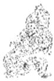

<!-- V3_SOURCE_ID:book016-b001787-p000-fd0d6fdcc9 -->

②厉无咎：意思是“虽危无咎”，和《乾》卦九三爻的含义大致相同；这里是告诫六三所处的位置多有危厉，但如果能审慎践行“复”道，就不会有咎害。《尚氏学》说：“知道它有危厉就振奋起来，就不会有咎害了。”

查看对应原文

<!-- V3_FOLDBACK_BEGIN:book016-b001787-p000-fd0d6fdcc9 -->

②厉无咎：犹言“虽危无咎”，与《乾》九三义略同(见该爻译注)；此诫六三处位多危厉，但能审慎力行“复”道，则无咎害。《尚氏学》：“知其危厉而振奋焉，则无咎矣。”

<!-- V3_FOLDBACK_END:book016-b001787-p000-fd0d6fdcc9 -->

<!-- V3_SOURCE_ID:book016-b001788-p000-a7c7bc7fca -->

《象传》说：“频复之厉”，从六三努力复善的意义来看，是没有咎害的。

> **释读存疑：** source中‘愁眉苦脸勉强回复的’‘危险’等内容为OCR错误导致的乱码，具体含义无法确定；1轮自动修复后核义模型仍建议修订，已保守记录。

查看对应原文

<!-- V3_FOLDBACK_BEGIN:book016-b001788-p000-a7c7bc7fca -->

译文《象传》说：“愁眉苦脸勉强回复的 《象》曰：“频复之厉”，义无咎危险”，从六三努力复善的意义看是无咎  
害的。 也①。

<!-- V3_FOLDBACK_END:book016-b001788-p000-a7c7bc7fca -->

<!-- V3_SOURCE_ID:book016-b001789-p000-71f949a006 -->

注释①义无咎：义，意思就是“复善之义”。《程传》说：“虽然处于危厉之中，然而复善的意义是没有咎害的。”

查看对应原文

<!-- V3_FOLDBACK_BEGIN:book016-b001789-p000-71f949a006 -->

注释①义无咎：义，犹言“复善之义”。《程传》：“虽为危厉，然复善之义则无咎也。”

<!-- V3_FOLDBACK_END:book016-b001789-p000-71f949a006 -->

<!-- V3_SOURCE_ID:book016-b001790-p000-26c803d3a1 -->

李士珍解释说：“改正过错，趋向善道，即便身处险境也不会有灾祸。《礼记》中说‘有的人安然践行善道’，这是初爻的卦象；‘有的人因利益践行善道’，这是二爻的卦象；‘有的人勉力践行善道’，这是三爻的卦象。”这段内容引自《周易学说》，它用《礼记·中庸》的语句来解释下三爻的卦象，似乎有可取之处。

查看对应原文

<!-- V3_FOLDBACK_BEGIN:book016-b001790-p000-26c803d3a1 -->

说明李士珍曰：“改过向善，虽危无咎。《记》曰‘或安而行之’，初之象也；‘或利而行之’，二之象也；‘或勉强而行之’，三之象也。”(《周易学说》引)此以《礼记·中庸》语释下三爻之象，似有可取。

<!-- V3_FOLDBACK_END:book016-b001790-p000-26c803d3a1 -->

<!-- V3_SOURCE_ID:book016-b001791-p000-181635ea91 -->

译文六四，居中行正，专心回复。

查看对应原文

<!-- V3_FOLDBACK_BEGIN:book016-b001791-p000-181635ea91 -->

译文六四，居中行正，专心回复。

<!-- V3_FOLDBACK_END:book016-b001791-p000-181635ea91 -->

<!-- V3_SOURCE_ID:book016-b001792-p000-fea7662c72 -->

六四，中行独复①。

查看对应原文

<!-- V3_FOLDBACK_BEGIN:book016-b001792-p000-fea7662c72 -->

六四,中行独复①。

<!-- V3_FOLDBACK_END:book016-b001792-p000-fea7662c72 -->

<!-- V3_SOURCE_ID:book016-b001793-p000-2687173cab -->

注释①中行独复：中行，指六四处于五阴爻的中间位置，爻位得当，如同“居中行正”；独，是说“专一”，指各阴爻中只有六四与初爻相应，情意最为专一，所以有“独复”的卦象。《汉上易传》引用郑玄的话说：“爻处于五阴爻之中，合于中道行事，只有六四与初爻相应。”

查看对应原文

<!-- V3_FOLDBACK_BEGIN:book016-b001793-p000-2687173cab -->

注释①中行独复：中行，指六四处五阴之中，其位得正，犹“居中行正”；独，犹言“专”，指群阴唯六四应初，其情弥专，故有“独复”之象。《汉上易传》引郑玄曰：“爻处五阴之中，度中而行，四独应初。”

<!-- V3_FOLDBACK_END:book016-b001793-p000-2687173cab -->

<!-- V3_SOURCE_ID:book016-b001794-p000-cc773d497f -->

《象传》说：“居中行正，专心回复”，说明六四遵从正道。《象》曰：“中行独复”，是因为六四遵循正道。

> **释读存疑：** 原文中“专心回 《象》曰”存在排版混乱，释读时已按合理逻辑调整，未改变核心含义

查看对应原文

<!-- V3_FOLDBACK_BEGIN:book016-b001794-p000-cc773d497f -->

译文《象传》说：“居中行正，专心回 《象》曰：“中行独复”，以从  
复”，说明六四遵从正道。道也。

<!-- V3_FOLDBACK_END:book016-b001794-p000-cc773d497f -->

<!-- V3_SOURCE_ID:book016-b001795-p000-5a3b08f4f9 -->

《折中》引缪昌期的话解释道：“《复》卦之所以被称为‘复’，全在于初爻，就好比人最初的念头。五阴爻都以此为复，只有四在阴中，有所专向，所以阐发了这个义理。”

> **释读存疑：** 无；1轮自动修复后核义模型仍建议修订，已保守记录。

查看对应原文

<!-- V3_FOLDBACK_BEGIN:book016-b001795-p000-5a3b08f4f9 -->

说明《折中》引缪昌期曰：“盖《复》之所以为‘复’，全在初爻，犹人之初念也。五阴皆复此而已，惟四在阴中，有所专向，故发此义。”

<!-- V3_FOLDBACK_END:book016-b001795-p000-5a3b08f4f9 -->

<!-- V3_SOURCE_ID:book016-b001796-p000-d0d6f27185 -->

六五，敦复，无悔①。

查看对应原文

<!-- V3_FOLDBACK_BEGIN:book016-b001796-p000-d0d6f27185 -->

六五，敦复，无悔①。

<!-- V3_FOLDBACK_END:book016-b001796-p000-d0d6f27185 -->

<!-- V3_SOURCE_ID:book016-b001797-p000-ef1743e9d6 -->

译文六五，敦厚笃诚地回复，无所悔恨。

查看对应原文

<!-- V3_FOLDBACK_BEGIN:book016-b001797-p000-ef1743e9d6 -->

译文六五，敦厚笃诚地回复，无所悔恨。

<!-- V3_FOLDBACK_END:book016-b001797-p000-ef1743e9d6 -->

<!-- V3_SOURCE_ID:book016-b001798-p000-2678b5034b -->

注释①敦复，无悔：敦的意思是敦厚。这里说的是《复》卦六五爻以阴柔之质居于尊位，持守中正不偏，有敦厚自察、笃诚向善之象；因此即便爻位不当、没有相应的爻位呼应，也能做到“敦复”而避免“悔”。《王注》的解释是：“居处厚重而践行中正，居处厚重就不会招致怨恨，践行中正就能够自我省察；虽然比不上‘休复’的吉祥，但持守敦厚的态度来回复正道，悔恨是可以避免的。”

查看对应原文

<!-- V3_FOLDBACK_BEGIN:book016-b001798-p000-2678b5034b -->

注释①敦复，无悔：敦，敦厚。此谓六五柔居尊位，持中不偏，有敦厚自察、笃诚向善之象；故虽失位无应，也能“敦复”免“悔”。《王注》：“居厚而履中，居厚则无怨，履中则可以自考；虽不足以及‘休复’之吉，守厚以复，悔可免也。”

<!-- V3_FOLDBACK_END:book016-b001798-p000-2678b5034b -->

<!-- V3_SOURCE_ID:book016-b001799-p000-c350518d5b -->

《象》传说：“敦厚笃诚地回复，无所悔恨”，这是因为六五爻持守中正，能够自我省察。

查看对应原文

<!-- V3_FOLDBACK_BEGIN:book016-b001799-p000-c350518d5b -->

《象》曰：“敦复无悔”，中以自考也①。

<!-- V3_FOLDBACK_END:book016-b001799-p000-c350518d5b -->

<!-- V3_SOURCE_ID:book016-b001800-p000-c7039f04c0 -->

《象传》说：“敦厚笃诚地回复，无所悔恨”，说明六五爻居中不偏，能够通过自我省察来成就复善之道。

查看对应原文

<!-- V3_FOLDBACK_BEGIN:book016-b001800-p000-c7039f04c0 -->

译文《象传》说：“敦厚笃诚地回复，无所悔恨”，说明六五居中不偏并能自察成就复善之道。

<!-- V3_FOLDBACK_END:book016-b001800-p000-c7039f04c0 -->

<!-- V3_SOURCE_ID:book016-b001801-p000-dbef2dfad2 -->

注释①自考：考的意思，《经典释文》引郑玄的说法是“成”，又引向秀的说法是“察”。“自考”，就好比说自我反省考察、成就复善之道。

查看对应原文

<!-- V3_FOLDBACK_BEGIN:book016-b001801-p000-dbef2dfad2 -->

注释①自考：考，《释文》引郑玄曰“成也”，又引向秀曰“察也”。“自考”，犹言自我反省考察、成就复善之道。

<!-- V3_FOLDBACK_END:book016-b001801-p000-dbef2dfad2 -->

<!-- V3_SOURCE_ID:book016-b001802-p000-65c538b80f -->

陈梦雷解释说：“第五爻与初爻既不相邻也不相应，却能在困窘中求知、勉力践行，所以称之为‘自考’。‘自’就是‘人一己百’的意思。第五爻本与阳爻相隔较远，但因为居于中位能顺应时势，又凭借第四爻的自我反省，加倍用功，所以能够自我成就。”《周易浅述》中这种说法对爻义的分析十分明确贴切。

查看对应原文

<!-- V3_FOLDBACK_BEGIN:book016-b001802-p000-65c538b80f -->

说明陈梦雷曰：“五与初非比非应而复，困知勉行者也，故曰‘自考’。自，即‘人一己百’之意。盖五本远于阳，但以居中能顺，因四自返，加厚其功，故能自成也。”(《周易浅述》)此说分析爻义甚明切。

<!-- V3_FOLDBACK_END:book016-b001802-p000-65c538b80f -->

<!-- V3_SOURCE_ID:book016-b001803-p000-bd09938846 -->

上六爻，爻辞为迷复，凶，有灾眚①。若用于行师，终有大败；若用于治国，君凶②：至于十年不克征③。

查看对应原文

<!-- V3_FOLDBACK_BEGIN:book016-b001803-p000-bd09938846 -->

上六，迷复，凶，有灾眚①。用行师，终有大败；以其国，君凶②：至于十年不克征③。

<!-- V3_FOLDBACK_END:book016-b001803-p000-bd09938846 -->

<!-- V3_SOURCE_ID:book016-b001804-p000-b6bdc40e24 -->

译文上六，迷入歧途不知回复，有凶险，有灾殃祸患。要是用于带兵作战，终将惨遭败绩；用于治国理政，必致国乱君凶：直到十年之久也不能振兴发展。

查看对应原文

<!-- V3_FOLDBACK_BEGIN:book016-b001804-p000-b6bdc40e24 -->

译文上六，迷入歧途不知回复，有凶险，有灾殃祸患。要是用于带兵作战，终将惨遭败绩；用于治国理政，必致国乱君凶：直到十年之久也不能振兴发展。

<!-- V3_FOLDBACK_END:book016-b001804-p000-b6bdc40e24 -->

<!-- V3_SOURCE_ID:book016-b001805-p000-21cf22ca4e -->

注释①迷复，凶，有灾眚：“迷复”就是说“迷失道路不知返回”；“灾眚”，《经典释文》引郑玄的说法：“从自身内部产生的异常称为‘眚’，从外部产生的称为‘祥’，伤害万物的称为‘灾’”，《程传》沿用了这种说法：“灾是来自外部的天灾，眚是自身造成的过失。”这三句说明上六作为阴爻居于卦的终极位置，不与初爻的阳爻相应，上方也没有可承接的爻位，呈现出迷失道路不知返回的意象，所以说“凶，有灾眚”。《程传》说：“既然迷失了道路不知返回，自身的行动就全是过失，灾祸也会从外部降临，这都是自身招致的。”

查看对应原文

<!-- V3_FOLDBACK_BEGIN:book016-b001805-p000-21cf22ca4e -->

注释①迷复，凶，有灾眚：迷复，犹言“迷而不复”；灾眚，《释文》引郑玄曰：“异自内生曰‘眚’，自外曰‘祥’，害物曰‘灾’”，《程传》承此曰：“灾，天灾，自外来；眚，已过，由自作”。这三句说明上六阴居卦极，不应初阳，上无所承，为迷不知复之象，故谓“凶，有灾眚”。《程传》：“既迷不复善，在己则动皆过失，灾祸亦自外而至，盖所招也。”

<!-- V3_FOLDBACK_END:book016-b001805-p000-21cf22ca4e -->

<!-- V3_SOURCE_ID:book016-b001806-p000-156d156ad3 -->

②若将此爻义用于出兵打仗，最终会遭遇大败；若将此爻义用于治理国家，君主会有凶险。其中“用”指施用，“以”与“用”意思相近，属于互文，王弼的《王注》将“以”解释为“用”。这四句承接前文的含义，说明上六爻已经迷乱到不知返回正道的地步，若将其义理用于出兵、治国，必然会导致军队溃败、君主遭祸。程颐的《程传》说：“迷乱于正道而不知返回，没有什么事是可以做的。若用它来出兵，就会最终大败；用它来治国，就会使君主凶险。”

查看对应原文

<!-- V3_FOLDBACK_BEGIN:book016-b001806-p000-156d156ad3 -->

②用行师，终有大败；以其国，君凶：用，谓“施用”；以，与“用”同义互文，《王注》训“用”。这四句承前文义，说明上六既迷不知复，若用为行师、治国，必将败绩、害君。《程传》：“迷道不复，无施而可。用以行师，则终有大败；以之为国，则君之凶也。”

<!-- V3_FOLDBACK_END:book016-b001806-p000-156d156ad3 -->

<!-- V3_SOURCE_ID:book016-b001807-p000-788fadbd11 -->

③至于十年都不能出征。其中“十年”，程颐的《程传》说：“是数的终了”，如同说“终久”；“征”指前行，包含振兴发展的意思。此句总结前文，极力说明若任用上六爻的义理，必然会带来深重的危害。尚秉和的《尚氏学》说：“不克征，是说不能兴起”；“国君受到胁迫，根本被动摇，所以这种凶险会延续十年之久”。

查看对应原文

<!-- V3_FOLDBACK_BEGIN:book016-b001807-p000-788fadbd11 -->

③至于十年不克征：十年，《程传》：“数之终也”，犹言“终久”；征，前行，含“振兴发展”之义。此句总结前文，极言若任用上六必带来深重危害。《尚氏学》：“不克征，言不能兴起也”；“国君受胁，根本动摇，故其凶至于十年也”。

<!-- V3_FOLDBACK_END:book016-b001807-p000-788fadbd11 -->

<!-- V3_SOURCE_ID:book016-b001808-p000-02694bc25d -->

《象传》说：“迷复之凶”，反君道也①。

查看对应原文

<!-- V3_FOLDBACK_BEGIN:book016-b001808-p000-02694bc25d -->

《象》曰：“迷复之凶”，反君道也①。

<!-- V3_FOLDBACK_END:book016-b001808-p000-02694bc25d -->

<!-- V3_SOURCE_ID:book016-b001809-p000-0e904ca822 -->

译文《象传》说：“迷入歧途不知回复，有凶险”，是由于上六与君主阳刚之道背道而驰。 9

查看对应原文

<!-- V3_FOLDBACK_BEGIN:book016-b001809-p000-0e904ca822 -->

译文《象传》说：“迷入歧途不知回复，有凶险”，是由于上六与君主阳刚之道背道而驰。 9

<!-- V3_FOLDBACK_END:book016-b001809-p000-0e904ca822 -->

<!-- V3_SOURCE_ID:book016-b001810-p000-5a36de8a6c -->

注释①反君道：反，违背。阴为臣，阳为君；上六迷失，不知复阳，故曰“反君道”。《左传》襄公二十八年释“迷复凶”谓“弃其本”；《重定费氏学》云：“阴不从阳”，此说可从。

查看对应原文

<!-- V3_FOLDBACK_BEGIN:book016-b001810-p000-5a36de8a6c -->

注释①反君道：反，违背。阴为臣，阳为君；上六迷失，不知复阳，故曰“反君道”。《左传》襄公二十八年释“迷复凶”谓“弃其本”；《重定费氏学》云：“阴不从阳”，此说可从。

<!-- V3_FOLDBACK_END:book016-b001810-p000-5a36de8a6c -->

<!-- V3_SOURCE_ID:book016-b001811-p000-d2935ebf4b -->

说明胡炳文曰：“‘迷复’与‘不远复’相反”，“‘十年不克征’亦‘七日来复’之反”(《周易本义通释》)。可见上六穷居极上，已彻底背离“回复”之道，故爻辞以“凶”、“灾眚”为戒。

查看对应原文

<!-- V3_FOLDBACK_BEGIN:book016-b001811-p000-d2935ebf4b -->

说明胡炳文曰：“‘迷复’与‘不远复’相反”，“‘十年不克征’亦‘七日来复’之反”(《周易本义通释》)。可见上六穷居极上，已彻底背离“回复”之道，故爻辞以“凶”、“灾眚”为戒。

<!-- V3_FOLDBACK_END:book016-b001811-p000-d2935ebf4b -->

<!-- V3_SOURCE_ID:book016-b001812-p000-e058a86104 -->

《复》卦喻示事物正气回复、生机更发的情状；犹如描绘了一幅大地微阳初动，春天即将到来的图景。全卦意旨主于：生命剥落不尽，一阳终将来复，揭示“正道”复兴是不可抗拒的自然规律。卦辞极力称述阳刚“回复”之际顺畅无碍，疾速利物，表明“复”必致“亨”的道理。卦中六爻，初九为全卦“回复”的根本，是“仁”与“善”的喻象；《彖传》所谓“天地”生育万物之“心”，即系此一阳。因此，五阴凡与初阳相得者均获“复善”之吉：六二比初，有“下仁”的美称；六四应初，有“从道”的佳誉。余三阴与初九未曾相得，但六三处阳位，能勉力“复善”获“无咎”；六五居尊位，能敦厚“复善”获“无悔”；唯上六与初阳背道而驰，迷不知复，终致灾凶。可见，《复》卦是借阳刚喻“美善”，其象征意义以“复善趋仁”为归。陈梦雷指出：“天地之一阳初动，犹人善念之萌，圣人所最重。”（《周易浅述》）即属此意。孔子称颜回“有不善未尝不知，知之未尝复行”（《系辞下传》引）；屈原曰“回朕车以复路兮，及行迷之未远”（《离骚》）：显然都是本卦所盛赞的“复善”美德的具体体现。

查看对应原文

<!-- V3_FOLDBACK_BEGIN:book016-b001812-p000-e058a86104 -->

《复》卦喻示事物正气回复、生机更发的情状；犹如描绘了一幅大地微阳初动，春天即将到来的图景。全卦意旨主于：生命剥落不尽，一阳终将来复，揭示“正道”复兴是不可抗拒的自然规律。卦辞极力称述阳刚“回复”之际顺畅无碍，疾速利物，表明“复”必致“亨”的道理。卦中六爻，初九为全卦“回复”的根本，是“仁”与“善”的喻象；《彖传》所谓“天地”生育万物之“心”，即系此一阳。因此，五阴凡与初阳相得者均获“复善”之吉：六二比初，有“下仁”的美称；六四应初，有“从道”的佳誉。余三阴与初九未曾相得，但六三处阳位，能勉力“复善”获“无咎”；六五居尊位，能敦厚“复善”获“无悔”；唯上六与初阳背道而驰，迷不知复，终致灾凶。可见，《复》卦是借阳刚喻“美善”，其象征意义以“复善趋仁”为归。陈梦雷指出：“天地之一阳初动，犹人善念之萌，圣人所最重。”（《周易浅述》）即属此意。孔子称颜回“有不善未尝不知，知之未尝复行”（《系辞下传》引）；屈原曰“回朕车以复路兮，及行迷之未远”（《离骚》）：显然都是本卦所盛赞的“复善”美德的具体体现。

<!-- V3_FOLDBACK_END:book016-b001812-p000-e058a86104 -->

<!-- V3_SOURCE_ID:book016-b001814-p000-72ece1f804 -->

## 无妄卦第二十五

查看对应原文

<!-- V3_FOLDBACK_BEGIN:book016-b001814-p000-72ece1f804 -->

## 无妄卦第二十五

<!-- V3_FOLDBACK_END:book016-b001814-p000-72ece1f804 -->

<!-- V3_SOURCE_ID:book016-b001815-p000-385e8b9402 -->

## 无妄①：元亨，利贞②；其匪正有眚，不利有攸往③。 — 无妄——卦辞：至为亨通，利于守持正固；若背离正道，就会有祸患，不利于有所前往。

查看对应原文

<!-- V3_FOLDBACK_BEGIN:book016-b001815-p000-385e8b9402 -->

## 无妄①：元亨，利贞②；其匪正有眚，不利有攸往③。

<!-- V3_FOLDBACK_END:book016-b001815-p000-385e8b9402 -->

<!-- V3_SOURCE_ID:book016-b001816-p000-19547566c8 -->

译文《无妄》卦象征不妄为：至为亨通，利于守持正固；背离正道的人必有祸患，不利于有所前往。

查看对应原文

<!-- V3_FOLDBACK_BEGIN:book016-b001816-p000-19547566c8 -->

译文《无妄》卦象征不妄为：至为亨通，利于守持正固；背离正道的人必有祸患，不利于有所前往。

<!-- V3_FOLDBACK_END:book016-b001816-p000-19547566c8 -->

<!-- V3_SOURCE_ID:book016-b001817-p000-530fbc4a55 -->

注释①：无妄是卦名，下卦为震（☳），上卦为乾（☰），象征“不妄为”。按，“无妄”的含义，《序卦传》解释为“不妄”；《王注》说“不可以妄”，意思就是“不妄为”。

查看对应原文

<!-- V3_FOLDBACK_BEGIN:book016-b001817-p000-530fbc4a55 -->

注释①无妄：卦名，下震(☳)上乾(☰)，象征“不妄为”。案，“无妄”之义，《序卦传》释为“不妄”；《王注》谓“不可以妄”，犹言“不妄为”。

<!-- V3_FOLDBACK_END:book016-b001817-p000-530fbc4a55 -->

<!-- V3_SOURCE_ID:book016-b001818-p000-aa6e23617b -->

②元亨，利贞：这是说当万物都“不妄为”的时候，就会至为亨通，利于守持正固。《正义》说：“万物都不敢欺诈虚妄，都遵循实在的道理，所以大为亨通，利于守持正固。”

查看对应原文

<!-- V3_FOLDBACK_BEGIN:book016-b001818-p000-aa6e23617b -->

②元亨，利贞：此谓物皆“不妄为”之时，至为亨通、利于守正。《正义》“物皆无敢诈为虚妄，俱行实理，所以大得亨通，利于贞正。”

<!-- V3_FOLDBACK_END:book016-b001818-p000-aa6e23617b -->

<!-- V3_SOURCE_ID:book016-b001819-p000-1ab694d10d -->

③如果不遵循正道就会有祸患，不利于有所前往：匪，通“非”；眚，指祸患。这两句是从反面作出告诫，说明处于“无妄”之时，不践行正道的人必定会有祸患，不利于有所前往。《正义》解释道：“事物既然都不妄为，就应当遵循正道行事；如果不依照正道行事，就会有祸患，不利于有所前往。”

查看对应原文

<!-- V3_FOLDBACK_BEGIN:book016-b001819-p000-1ab694d10d -->

③其匪正有眚，不利有攸往：匪，通“非”；眚，祸患(见《讼》九二、《复》上六译注)。这两句从反面设诫，说明当“无妄”之时，不行正道者必有祸患，不利有所往。《正义》：“物既无妄，当以正道行之；若其匪依正道，则有眚灾，不利有所往也。”

<!-- V3_FOLDBACK_END:book016-b001819-p000-1ab694d10d -->

<!-- V3_SOURCE_ID:book016-b001820-p000-9a8e64217e -->

《释文》引述马融、郑玄、王肃的说法，认为“妄”如同“望”，“无妄”就是“无所希望”。尚先生认为“这个释义是最古老的”，还说焦赣、京房、王充都将《无妄》卦视为“大旱之卦”，指“年收失望”。这个说法可以作为参考。如今来看，“无希望”就好比“不敢奢望”；《折中》引述邱富国的话：“正因为‘无妄’，所以才‘无望’”，意思是“不妄为”的人必定“不存奢望”，认为“无望”是“不妄”的含义引申，似乎有可取之处。

查看对应原文

<!-- V3_FOLDBACK_BEGIN:book016-b001820-p000-9a8e64217e -->

说明《释文》引马融、郑玄、王肃说，谓“妄”犹“望”，“无妄”即“无所希望”。尚先生以为“此训最古”，并谓焦赣、京房、王充皆以《无妄》为“大旱之卦”，指“年收失望”(《尚氏学》)。此说可备参考。今案，“无希望”犹言“不敢奢望”；《折中》引邱富国曰：“惟其‘无妄’，所以‘无望’也”，谓“不妄为”者必“不存奢望”，认为“无望”是“不妄”之义的引申，似有可取。

<!-- V3_FOLDBACK_END:book016-b001820-p000-9a8e64217e -->

<!-- V3_SOURCE_ID:book016-b001821-p000-0a2993eac6 -->

《彖传》说：无妄，阳刚者从外部前来而成为内部的主宰，行动起来刚健有力，刚爻居中位而能与下位相应；此时大为亨通且守持正固，这是天的天命所致。如果不遵循正道就会有祸患，不利于有所前往；在万物不妄为的时候，前往又能去往何处呢？

查看对应原文

<!-- V3_FOLDBACK_BEGIN:book016-b001821-p000-0a2993eac6 -->

《彖》曰：无妄，刚自外来而为主于内，动而健①，刚中而应②；大亨以正，天之命也③。其匪正有眚，不利有攸往；无妄之往，何之矣？

<!-- V3_FOLDBACK_END:book016-b001821-p000-0a2993eac6 -->

<!-- V3_SOURCE_ID:book016-b001822-p000-05bab3be7b -->

《彖传》说：不妄为，譬如阳刚者从外部前来而成为内部的主宰，震（八卦之一）动而又禀性健强，离（八卦之一）刚爻居中位而又应合于下；此时大为亨通、万物守持正固，这是天的教命所致。背离正道的人必有祸患，不利于有所前往；在万物不妄为的时候，

> **释读存疑：** 原文此处未完整表述，存在残缺

查看对应原文

<!-- V3_FOLDBACK_BEGIN:book016-b001822-p000-05bab3be7b -->

译文《彖传》说：不妄为，譬如阳刚者从外部前来而成为内部的主宰，威势震动而又禀性健强，刚正居中而又应合于下；此时大为亨通、万物守持正固，这是“天”的教命所致。背离正道的人必有祸患，不利于有所前往；在万物不妄为的时候

<!-- V3_FOLDBACK_END:book016-b001822-p000-05bab3be7b -->

<!-- V3_SOURCE_ID:book016-b001823-p000-80458623e3 -->

卷四

查看对应原文

<!-- V3_FOLDBACK_BEGIN:book016-b001823-p000-80458623e3 -->

卷 四

<!-- V3_FOLDBACK_END:book016-b001823-p000-80458623e3 -->

<!-- V3_SOURCE_ID:book016-b001824-p000-9fd9c94fd5 -->

背离正道而前往，哪里有路可走呢？“离”的天命不给予祐助，怎敢这样妄行啊！

> **释读存疑：** 原文中“天”的具体所指未明确，释读时不应随意替换为八卦术语；1轮自动修复后核义模型仍建议修订，已保守记录。

查看对应原文

<!-- V3_FOLDBACK_BEGIN:book016-b001824-p000-9fd9c94fd5 -->

背离正道而前往，哪里有路可走呢？“天”天命不祐，行矣哉④！ 的教命不给予祐助，怎敢这样妄行啊！

<!-- V3_FOLDBACK_END:book016-b001824-p000-9fd9c94fd5 -->

<!-- V3_SOURCE_ID:book016-b001825-p000-efa90d88b8 -->

匡释①：阳刚自外而来且在内中成为主导，行动刚健。所谓外、健，指乾居外卦；所谓内、动，指震居内卦。这两句举出上下卦象，说明阳刚从外部来到内部成为主导，内外二体既能震动又具备刚健之性，所以万物都不敢妄为。《正义》说：“以此卦象阐释能达成‘无妄’的含义。因为震的阳刚自外部而来，在内中成为主导；震动而乾刚健，所以能使万物没有虚妄之举。”按，孔氏所说震的阳刚自外部而来，指震的一阳由外卦乾“一索”而得，是“长子”之象（见《说卦传》），所以能“在内中成为主导”。

查看对应原文

<!-- V3_FOLDBACK_BEGIN:book016-b001825-p000-efa90d88b8 -->

匡释①刚自外来而为主于内，动而健：外、健，指乾居外卦；内、动，指震居内卦。这两句举上下卦象，说明阳刚自外来内为主，内外二体既能震动、又秉刚健，故物皆不敢妄为。《正义》：“以此卦象释能致无妄’之义。以震之刚自外而来，为主于内：震动而乾健，故能使物无妄也。”案，孔氏谓震刚自外来，指震一阳由外卦乾“一索”而得，为“长子”象(见《说卦传》)，故能“为主于内”。

<!-- V3_FOLDBACK_END:book016-b001825-p000-efa90d88b8 -->

<!-- V3_SOURCE_ID:book016-b001826-p000-04ec1c2900 -->

②刚中而应：指九五阳刚居中，而下应六二。此句又以二、五爻象阐释“无妄”的含义。《正义》说：“九五以阳刚居中，六二与它相应，这就是‘刚中而应’。阳刚居中就能决断虚实，有相应的对象则万物顺从，不敢虚妄。”

查看对应原文

<!-- V3_FOLDBACK_BEGIN:book016-b001826-p000-04ec1c2900 -->

②刚中而应：指九五阳刚居中而下应六二。此句又以二、五爻象释“无妄”之义。《正义》：“九五以刚处中，六二应之，是刚中而应’。刚中则能断制虚实，有应则物所顺从：不敢虚妄也。”

<!-- V3_FOLDBACK_END:book016-b001826-p000-04ec1c2900 -->

<!-- V3_SOURCE_ID:book016-b001827-p000-de76077c23 -->

③大亨以正，是天所赋予的教命：这里的“命”，意思就是“教命”。这两句承接前文的含义，解释卦辞“元亨，利贞”；说明处于“无妄”之时可以实现大亨通，但必须坚守正道，这是“天”的“教命”，不可违抗。《正义》说：“威严刚正，私欲无法施行，怎么能算妄为？这就是天的教命。”“既然是天命，难道可以违背吗？”

查看对应原文

<!-- V3_FOLDBACK_BEGIN:book016-b001827-p000-de76077c23 -->

③大亨以正，天之命也：命，犹言“教命”。这两句承前文之义，释卦辞“元亨，利贞”；说明“无妄”之时可致亨通，必须守正，是“天”之“命”，不可违抗。《正义》：“威刚方正，私欲不行，何可以妄？此天之教命也。”“既是天命’，岂可犯乎？”

<!-- V3_FOLDBACK_END:book016-b001827-p000-de76077c23 -->

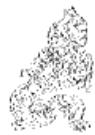

<!-- V3_SOURCE_ID:book016-b001829-p000-28bbfb0356 -->

④天命不会庇佑，竟敢如此妄行：“行矣哉”，意思是“竟敢如此妄行”，带有谴责的意味。这两句结合前文“无妄之往，何之矣”，解释卦辞“其匪正有眚，不利有攸往”；说明背离正道的人不能妄自行事。《王注》说：“处于不可妄为的时势，却想要以不正之道有所前往，打算去哪里呢？天命不会庇佑，最终只能这样了！”

查看对应原文

<!-- V3_FOLDBACK_BEGIN:book016-b001829-p000-28bbfb0356 -->

④天命不祐，行矣哉：行矣哉，犹言“竟敢如此妄行”，含谴责之意。这两句合前文“无妄之往，何之矣”，释卦辞“其匪正有眚，不利有攸往”；说明远背正道者不得妄行。《王注》：“居不可以妄之时，而欲以不正有所往，将欲何之？天命之所不祐，竟矣哉！”

<!-- V3_FOLDBACK_END:book016-b001829-p000-28bbfb0356 -->

<!-- V3_SOURCE_ID:book016-b001830-p000-0a6ece0f36 -->

《象传》说：天下雷声震行，象征万物都不敢妄为；先王因此顺应时节培育万物。

> **释读存疑：** 原文存在OCR残缺，部分文字错乱，无法完全对应原文内容进行准确释读

查看对应原文

<!-- V3_FOLDBACK_BEGIN:book016-b001830-p000-0a6ece0f36 -->

译文《象传》说：天下雷声震行，象征万 《象》曰：天下雷行，物与无物 不为代君王因此天 妄①；先王以茂对时育万物②。

<!-- V3_FOLDBACK_END:book016-b001830-p000-0a6ece0f36 -->

<!-- V3_SOURCE_ID:book016-b001831-p000-82b34a8b0c -->

匡释①天下雷行，物与无妄：“与”是语气词，此处含有“皆”的意思。这两句解释《无妄》卦上乾为天、下震为雷的卦象；说明雷威奋动，万物不敢妄为。《王注》说：“与，是语气词，意思如同‘皆’。天下雷声震行，万物都不可以妄为。”

查看对应原文

<!-- V3_FOLDBACK_BEGIN:book016-b001831-p000-82b34a8b0c -->

匡释①天下雷行，物与无妄：与，语气词，此处含有“皆”之意。这两句释《无妄》上乾为天、下震为雷之象；说明雷威奋动，万物不敢妄为。《王注》：“与，辞也，犹皆’也。天下雷行，物皆不可以妄也。”

<!-- V3_FOLDBACK_END:book016-b001831-p000-82b34a8b0c -->

<!-- V3_SOURCE_ID:book016-b001832-p000-6638e07178 -->

②先王以茂对时育万物：茂，《释文》解释为“盛也”，此处指天雷震奋般的强盛威势；对，意为配合，“对时”，《程传》认为是顺合天时。这句话说明先王效法《无妄》卦象“天下雷行”的强盛威势，用来配合天时、养育万物，使万物都不妄为。《王注》说：“对时育物，莫盛于斯也。”案，“茂”字，《释文》还引马融的说法，认为是勉力的意思，《尚氏学》则说“茂”与“懋”相通，是勉力的意思；对，是应答的意思，意思是因雷的威势而勉力应答天威。这种说法也讲得通，可以参考。

> **释读存疑：** 原文对“茂”字有两种不同解释，释读中已明确呈现两种说法，未作确定取舍

查看对应原文

<!-- V3_FOLDBACK_BEGIN:book016-b001832-p000-6638e07178 -->

②先王以茂对时育万物：茂，《释文》：“盛也”，此处指“天雷震奋”似的“强盛威势”；对，配合，“对时”，《程传》谓“顺合天时”。此句说明“先王”效法《无妄》卦象“天下雷行”的强盛威势用以配合天时、养育万物，使之各不妄为。《王注》：“对时育物，莫盛于斯也。”(“斯”即指代“天雷威盛”。)案，“茂”字，《释文》又引马融曰“勉也”，《尚氏学》：“‘茂’与‘懋’通，勉也；对，答也，言因雷而勉答天威。”此说于义亦通，可参考。

<!-- V3_FOLDBACK_END:book016-b001832-p000-6638e07178 -->

<!-- V3_SOURCE_ID:book016-b001833-p000-5e523e4ce5 -->

孔颖达指出：“诸卦之象，直言两象即以卦名结之，若雷在地中，复。今《无妄》应云天下雷行，无妄；今云物与无妄者，欲见万物皆无妄，故加物与二字也。其余诸卦未必万物皆与卦名同义，故直显象以卦结之。（《正义》）”这种说法分析了本卦《大象传》的特殊体例，适合作为参考。

查看对应原文

<!-- V3_FOLDBACK_BEGIN:book016-b001833-p000-5e523e4ce5 -->

说丽孔颖达指出：“诸卦之象，直言两象即以卦名结之，若雷在地中，复’。今《无妄》应云天下雷行，无妄’；今云物与无妄’者，欲见万物皆无妄，故加物与’二字也。其余诸卦未必万物皆与卦名同义，故直显象以卦结之。(《正义》)此说分析本卦《大象传》的特殊体例，宜资参考。

<!-- V3_FOLDBACK_END:book016-b001833-p000-5e523e4ce5 -->

<!-- V3_SOURCE_ID:book016-b001834-p000-827779c177 -->

译文初九，不妄为，前往必获吉祥。

查看对应原文

<!-- V3_FOLDBACK_BEGIN:book016-b001834-p000-827779c177 -->

译文初九，不妄为，前往必获吉祥。

<!-- V3_FOLDBACK_END:book016-b001834-p000-827779c177 -->

<!-- V3_SOURCE_ID:book016-b001835-p000-f2ea5b0deb -->

初九，无妄，往吉①。

查看对应原文

<!-- V3_FOLDBACK_BEGIN:book016-b001835-p000-f2ea5b0deb -->

初九，无妄，往吉①。

<!-- V3_FOLDBACK_END:book016-b001835-p000-f2ea5b0deb -->

<!-- V3_SOURCE_ID:book016-b001836-p000-8fdf89d291 -->

匡释①所说的“往吉”，指的是《无妄》卦的初九爻，以阳爻居于卦的初始位置，又处在阴柔爻的下方，呈现出谦恭不妄为的样子，所以“前往”必然会获得吉祥。《王注》中说：“爻体刚健却处在下位，以尊贵的身份对待卑贱的人，行为不违背妄道，所以前往能实现自己的志向。”

查看对应原文

<!-- V3_FOLDBACK_BEGIN:book016-b001836-p000-8fdf89d291 -->

匡释①往吉：指初九以阳居“无妄”之初，处阴柔之下，有谦恭不妄为之象，故“往”必获“吉”。《王注》：“体刚处下，以贵下贱，行不犯妄，故往得其志。”

<!-- V3_FOLDBACK_END:book016-b001836-p000-8fdf89d291 -->

<!-- V3_SOURCE_ID:book016-b001837-p000-d8c877e1dc -->

《象传》说：“无妄之往”，是说必然能实现进取的意愿。

查看对应原文

<!-- V3_FOLDBACK_BEGIN:book016-b001837-p000-d8c877e1dc -->

《象》曰：“无妄之往”，得志也。 译文《象传》说：“不妄为而前往”，是说必然得遂进取的意愿。

<!-- V3_FOLDBACK_END:book016-b001837-p000-d8c877e1dc -->

<!-- V3_SOURCE_ID:book016-b001838-p000-d65fa417a0 -->

观察《颐》卦所讲的处事道理，在行事之初就以谦恭退让为根本，不敢妄为，这是初九爻“往吉”的重要原因。《折中》引用何楷的话说：“这一爻的意义足以涵盖《无妄》全卦。震（八卦之一）的阳爻刚刚发动，心意专一没有分化，这就叫做‘无妄’。凭借这样的状态前往，行动与天道相合，怎么会不吉祥呢？”

查看对应原文

<!-- V3_FOLDBACK_BEGIN:book016-b001838-p000-d65fa417a0 -->

玩颐处事开初，便以谦下为本，不敢妄为，这是初九“往吉”的重要因素。《折中》引何楷曰：“此爻足蔽《无妄》全卦。震阳初动，诚一未分，是之谓‘无妄’。以此而往，动与天合，何不吉之有？”

<!-- V3_FOLDBACK_END:book016-b001838-p000-d65fa417a0 -->

<!-- V3_SOURCE_ID:book016-b001839-p000-d6473e77b4 -->

六二爻的爻义是：不从事耕耘，不谋求收获；不致力于开垦荒地，不图谋良田，这样就利于有所前往。

查看对应原文

<!-- V3_FOLDBACK_BEGIN:book016-b001839-p000-d6473e77b4 -->

六二，不耕获，不菑畲①，则利 译文六二，不事耕耘、不图收获，不务开垦、不谋良田，这样就利于有所前往。有攸往。

<!-- V3_FOLDBACK_END:book016-b001839-p000-d6473e77b4 -->

<!-- V3_SOURCE_ID:book016-b001840-p000-6361b4f4b2 -->

匡释：“不耕获，不菑畬”，其中“菑”读音为zī，《尔雅·释地》记载：“田一岁曰‘菑’”，指刚开垦的瘠薄田地，此处用作动词，意思是“开垦”，和前句的“耕”是互文；“畬”读音为yú，《尔雅·释地》记载：“三岁曰‘畬’”，指耕作多年的肥沃田地。这两句里的“不耕”“不菑”都是告诫之辞，意思是“不妄自耕种”“不妄自开垦”，说明六二处于“无妄”之时，性情柔顺端正且居中得正，上应九五之爻，不敢妄为而安守“臣道”，因此以不妄求耕种就收获、不妄求开垦就得到良田为比喻，说这样做就会“利有攸往”。《本义》说：“柔顺中正，因时顺理而无私意期望之心，故有‘不耕获，不菑畬’之象。言其无所为于前，无所冀于后也。”

查看对应原文

<!-- V3_FOLDBACK_BEGIN:book016-b001840-p000-6361b4f4b2 -->

匡释①不耕获，不菑畬：菑，音zī，《尔雅·释地》：“田一岁曰‘菑’”，指初垦的瘠田，此处用如动词，犹言“开垦”，与前句“耕”互文；畬，音yú，《尔雅·释地》：“三岁曰‘畬’。”指耕作多年的良田。这两句“不耕”、“不菑”均为诫辞，意犹“不妄耕”“不妄菑”，说明六二当“无妄”之时，柔正居中，上应九五，不敢妄为而安守“臣道”，故以不妄耕求“获”、不妄垦求“畬”为喻，谓如此“则利有攸往”。《本义》：“柔顺中正，因时顺理而无私意期望之心，故有‘不耕获，不菑畬’之象。言其无所为于前，无所冀于后也。”

<!-- V3_FOLDBACK_END:book016-b001840-p000-6361b4f4b2 -->

<!-- V3_SOURCE_ID:book016-b001841-p000-b4677d7304 -->

玩味“不耕获”就是“不耕不获”，“不菑畬”就是“不菑不畬”。这种省略式的句法结构，和《大有》初九爻“无交害”指“无交无害”的情况相同，可参见该爻的译注。

查看对应原文

<!-- V3_FOLDBACK_BEGIN:book016-b001841-p000-b4677d7304 -->

玩颐“不耕获”即“不耕不获”，“不菑畬”即“不菑不畬”。这种省略式的句法结构，与《大有》初九“无交害”谓“无交无害”同(参见该爻译注)。

<!-- V3_FOLDBACK_END:book016-b001841-p000-b4677d7304 -->

<!-- V3_SOURCE_ID:book016-b001842-p000-b9f00f4e5c -->

《象》说：“不耕获”，是因为未富也。

> **释读存疑：** 未富也的具体所指不详

查看对应原文

<!-- V3_FOLDBACK_BEGIN:book016-b001842-p000-b9f00f4e5c -->

《象》曰：“不耕获”，未富也。

<!-- V3_FOLDBACK_END:book016-b001842-p000-b9f00f4e5c -->

<!-- V3_SOURCE_ID:book016-b001843-p000-e26c90b2f2 -->

译文《象传》说：“不事耕耘、不图收获”，说明六二未曾谋求富贵。

查看对应原文

<!-- V3_FOLDBACK_BEGIN:book016-b001843-p000-e26c90b2f2 -->

译文《象传》说：“不事耕耘、不图收获”，说明六二未曾谋求富贵。

<!-- V3_FOLDBACK_END:book016-b001843-p000-e26c90b2f2 -->

<!-- V3_SOURCE_ID:book016-b001844-p000-e06ad0f61c -->

研读颐卦的卦辞可以发现，在“无妄”的时势下，若行为不合正道就会有灾祸，不利于有所前往。六二爻能够安于顺从、恪守正道，不妄为、不贪求，因此获得了上应，有利于有所前往。

查看对应原文

<!-- V3_FOLDBACK_BEGIN:book016-b001844-p000-e06ad0f61c -->

玩颐卦辞指出，“无妄”之时“匪正有眚，不利有攸往”。六二能安顺守正，不妄不贪，故获上应而“利有攸往”。

<!-- V3_FOLDBACK_END:book016-b001844-p000-e06ad0f61c -->

<!-- V3_SOURCE_ID:book016-b001845-p000-afbc75f186 -->

六三爻对应的是“无妄之灾”：譬如有人拴着一头牛，路人把牛牵走占为己有，这对邑中的人家来说，就是一场会遭受诘捕的灾祸。

> **释读存疑：** 原文中“邑人之灾”的具体所指（邑中人家遭受诘捕的灾祸）未明确说明，释读为“会遭受诘捕的灾祸”属于合理的通俗化阐释，未添加无依据内容

查看对应原文

<!-- V3_FOLDBACK_BEGIN:book016-b001845-p000-afbc75f186 -->

六三，无妄之灾①：或系之牛， 译文六三，不妄为却也招致灾殃：譬如有人系拴着一只耕牛，路人牵走攫为己行人之得，邑人之灾。 有，邑中人家将遭受诘捕的飞灾。

<!-- V3_FOLDBACK_END:book016-b001845-p000-afbc75f186 -->

<!-- V3_SOURCE_ID:book016-b001846-p000-5ac3125a93 -->

匡释对“无妄之灾”的解释是：这说的是六三爻阴爻居于下卦的最末位，偏离正道而躁动，即使没有妄为，也可能招来无缘无故的灾祸。下面三句正是用路人顺手牵牛、邑中人家横遭飞来横祸的例子，来说明“无妄之灾”的情形。《本义》中说：“无缘无故而遭遇灾祸，就像路人牵牛离开，而居住的人反而遭到被诘问拘捕的惊扰。”

查看对应原文

<!-- V3_FOLDBACK_BEGIN:book016-b001846-p000-5ac3125a93 -->

匡释①无妄之灾：此谓六三阴居下卦之终，失正躁动，虽不妄为，也可能引来无故灾殃。下文三句正是以路人顺手牵牛，邑人横遭飞祸为譬喻，说明“无妄之灾”的情状。《本义》：“无故而有灾，如行人牵牛以去，而居者反遭诘捕之扰也。”

<!-- V3_FOLDBACK_END:book016-b001846-p000-5ac3125a93 -->

<!-- V3_SOURCE_ID:book016-b001847-p000-486fa2d85c -->

《象传》说：路人获得了牛，这是邑中人家的灾祸。研读颐卦的《杂卦传》中说：“《无妄》灾也”，正是针对六三爻而言的。开朗解释这一爻的含义说：“是运数刚好如此，并非自己妄为导致的，这就是‘无妄之灾’。”《关氏易传》

> **释读存疑：** 原文中“玩颐”的含义未明确，释读未对该部分内容进行准确处理，存在歧义

查看对应原文

<!-- V3_FOLDBACK_BEGIN:book016-b001847-p000-486fa2d85c -->

《象》曰：行人得牛，邑人灾也。译文《象传》说：路人顺手牵走获得耕牛，说明邑中人家自然将遭受到被诘捕的飞灾。玩颐《杂卦传》曰：“《无妄》灾也”，正是因六三而发。开朗释此爻义曰：“运数适然，非己妄致，乃‘无妄之灾’。”(《关氏易传》)

<!-- V3_FOLDBACK_END:book016-b001847-p000-486fa2d85c -->

<!-- V3_SOURCE_ID:book016-b001848-p000-8b0c40c30a -->

## 九四，可贞，无咎①。 — 九四——可贞，无咎①。

查看对应原文

<!-- V3_FOLDBACK_BEGIN:book016-b001848-p000-8b0c40c30a -->

## 九四，可贞，无咎①。

<!-- V3_FOLDBACK_END:book016-b001848-p000-8b0c40c30a -->

<!-- V3_SOURCE_ID:book016-b001849-p000-fc21955567 -->

译文九四，能够守持正固，于是必无咎害。

查看对应原文

<!-- V3_FOLDBACK_BEGIN:book016-b001849-p000-fc21955567 -->

译文九四，能够守持正固，于是必无咎害。

<!-- V3_FOLDBACK_END:book016-b001849-p000-fc21955567 -->

<!-- V3_SOURCE_ID:book016-b001850-p000-4cc191a253 -->

匡释①可贞，无咎：这是说九四处于“近君”的危险位置，下方没有相应的爻位与它呼应，原本会有咎害；但它是阳爻居于阴位，邻近九五，还能谦逊地侍奉“君”位，坚守正道“不妄”，因此获得“无咎”。《王注》说：“处于‘无妄’之时，以阳爻居阴位，刚爻乘凌柔爻，行事谦逊，邻近至尊之位：所以能够守持正道，坚定有所操守，因而没有咎害。”

查看对应原文

<!-- V3_FOLDBACK_BEGIN:book016-b001850-p000-4cc191a253 -->

匡释①可贞，无咎：此谓九四居“近君”危地，下无应与，本有咎害；但阳处阴位，比近九五，犹能谦已奉“君”，守正“不妄”，遂获“无咎”。《王注》：“处‘无妄’之时，以阳居阴，以刚乘柔，履于谦顺，比近至尊：故可以任正，固有所守，而无咎也。”

<!-- V3_FOLDBACK_END:book016-b001850-p000-4cc191a253 -->

<!-- V3_SOURCE_ID:book016-b001851-p000-7ae5b32541 -->

《象》曰：可贞无咎，固有之也。《象传》的译文说：能够守持正固于是必无咎害，说明九四要牢固守正才能长保无害。

> **释读存疑：** 1轮自动修复后核义模型仍建议修订，已保守记录。

查看对应原文

<!-- V3_FOLDBACK_BEGIN:book016-b001851-p000-7ae5b32541 -->

译文《象传》说：能够守持正固于是必无 《象》曰：可贞无咎，固有之也。   
咎害，说明九四要牢固守正才能长保无害。

<!-- V3_FOLDBACK_END:book016-b001851-p000-7ae5b32541 -->

<!-- V3_SOURCE_ID:book016-b001852-p000-55332992a2 -->

文中解释《周易》“萌九四”爻失正的含义：此爻“可贞”，因居位危殆故“无咎”，关键在于刚健而能柔顺，守持谦逊不妄为。若想长久保持无害，必须始终如一地守持这种品质，这就是《象传》所说“固有之”的含义。

查看对应原文

<!-- V3_FOLDBACK_BEGIN:book016-b001852-p000-55332992a2 -->

说萌九四失正“可贞”，位危“无咎”，在于刚而能柔，守谦不妄为。若欲长保无害，必须始终如一地守持这种品质。此即《象传》“固有之”之义。

<!-- V3_FOLDBACK_END:book016-b001852-p000-55332992a2 -->

<!-- V3_SOURCE_ID:book016-b001853-p000-3cd0b48f07 -->

九五爻的含義是，雖不妄為卻偶染小病，無須用藥，將有自愈的歡欣。原文為“九五，無妄之疾，勿藥有喜①。”

查看对应原文

<!-- V3_FOLDBACK_BEGIN:book016-b001853-p000-3cd0b48f07 -->

译文九五，不妄为却偶染微疾，无须用 九五，无妄之疾，勿药有喜①。  
药而将有自愈的欢欣。

<!-- V3_FOLDBACK_END:book016-b001853-p000-3cd0b48f07 -->

<!-- V3_SOURCE_ID:book016-b001854-p000-097e65eebf -->

注釋①“無妄之疾，勿藥有喜”：這是借小病不治自愈作譬喻，說明九五處於“無妄”之時，陽剛中正，居尊位善於治理，其下之人皆不敢妄為；縱使偶遇小災也並非生於“妄”，故可不治以聽其自消。《正義》說：“九五居得尊位，為無妄之主，下皆無妄而偶然有此疾害，故云‘無妄之疾’。”又說：“若疾自己招，或寒暑飲食所致，當須治療；若其自然之疾，非己所致，疾當自損，勿須藥療而有喜也。”

查看对应原文

<!-- V3_FOLDBACK_BEGIN:book016-b001854-p000-097e65eebf -->

注释①无妄之疾，勿药有喜：这是借小病不治自愈作譬喻，说明九五当“无妄”之时，阳刚中正，居尊善治，其下均不敢妄为；纵使偶遇小灾亦非生于“妄”，故可不治以听其自消。《正义》：“九五居得尊位，为无妄之主，下皆无妄而偶然有此疾害，故云‘无妄之疾’。”又曰：“若疾自己招，或寒暑饮食所致，当须治疗；若其自然之疾，非己所致，疾当自损，勿须药疗而有喜也。”

<!-- V3_FOLDBACK_END:book016-b001854-p000-097e65eebf -->

<!-- V3_SOURCE_ID:book016-b001855-p000-4068d1f242 -->

《象传》说：九五爻“不妄为而染疾却不须服用药物”，是因为不能胡乱试用，《象》曰“无妄之药，不可试也”。

> **释读存疑：** 原文存在文字与断句错误，具体所指需结合《周易》原文进一步确认；1轮自动修复后核义模型仍建议修订，已保守记录。

查看对应原文

<!-- V3_FOLDBACK_BEGIN:book016-b001855-p000-4068d1f242 -->

译文《象传》说：九五“不妄为而染疾却 《象》曰：“无妄之药”，不可试不须服用药物”，是因为不能胡乱试用。 也①。

<!-- V3_FOLDBACK_END:book016-b001855-p000-4068d1f242 -->

<!-- V3_SOURCE_ID:book016-b001856-p000-6d786bc1c9 -->

匡释①不可试：就是不能用药来试探。《王注》说：“药物是用来攻治有妄邪的人的；如果反过来攻治没有妄邪的人，所以说‘不可试’。”

查看对应原文

<!-- V3_FOLDBACK_BEGIN:book016-b001856-p000-6d786bc1c9 -->

匡释①不可试：即不可以药试。《王注》：“药攻有妄者也；而反攻无妄，故‘不可试’也。”

<!-- V3_FOLDBACK_END:book016-b001856-p000-6d786bc1c9 -->

<!-- V3_SOURCE_ID:book016-b001857-p000-e6e7d0adb6 -->

《说丽》三言提到“无妄之灾”，这里说的是“无妄之疾”。“灾”的程度重，“疾”的程度轻。六三爻失正，处于下位；九五爻居中正之位，处于尊位，所以前者令人担忧，后者令人欣喜。《折中》说：“这一爻的疾病，和六三爻的灾祸相同；但这里说‘有喜’，是因为九五爻刚健中正且处于尊位，德行与地位本来就不同。”

查看对应原文

<!-- V3_FOLDBACK_BEGIN:book016-b001857-p000-e6e7d0adb6 -->

说丽三言“无妄之灾”，此言“无妄之疾”。“灾”重、“疾”微，三失正居下、五中正居尊，故彼忧此喜。《折中》曰：“此爻之疾，与六三之灾同；然此曰‘有喜’者，刚中正而居尊位，德位固不同也。”

<!-- V3_FOLDBACK_END:book016-b001857-p000-e6e7d0adb6 -->

<!-- V3_SOURCE_ID:book016-b001858-p000-7847ac4996 -->

虽不妄为，但时运困窘而行事必然 上九，无妄，行有眚，无攸利①。

> **释读存疑：** 时运困窘；原文‘患上’的具体所指未明，‘时穷’的具体含义未明；1轮自动修复后核义模型仍建议修订，已保守记录。

查看对应原文

<!-- V3_FOLDBACK_BEGIN:book016-b001858-p000-7847ac4996 -->

患上，虽然不妄为，但时穷而行必 上九，无妄，行有眚，无攸利①。

<!-- V3_FOLDBACK_END:book016-b001858-p000-7847ac4996 -->

<!-- V3_SOURCE_ID:book016-b001859-p000-30a50a3e27 -->

匡释①行有眚，无攸利：这是说上九处于“无妄”的终极位置，时运困窘难以行动，一动就会遭遇灾祸；所以爻辞郑重告诫说：即使不妄为，也不能“行”，行动必然“有眚”、“无攸利”。《王注》说：“处于不可妄为的终极位置，只适宜安静保全自身罢了，所以不可以行动。”按，《集解》引用虞翻的注释，认为上九“乘刚逆命”，失正而行，所以“无攸利”；意思是卦辞“匪正有眚，不利有攸往”，就是指这一爻。这一说法可以保留参考。

查看对应原文

<!-- V3_FOLDBACK_BEGIN:book016-b001859-p000-30a50a3e27 -->

匡释①行有眚，无攸利：此谓上九处“无妄”之极，时穷难行，动则遭灾；故爻辞深戒曰：虽不妄为，也不可“行”，行必“有眚”、“无攸利”。《王注》：“处不可妄之极，唯宜静保其身而已，故不可以行也。”案，《集解》引虞翻注，认为上九“乘刚逆命”，失正而行，故“无攸利”；意谓卦辞“匪正有眚，不利有攸往”，即指此爻。可备一说。

<!-- V3_FOLDBACK_END:book016-b001859-p000-30a50a3e27 -->

<!-- V3_SOURCE_ID:book016-b001860-p000-0c9e43a832 -->

译文《象传》说：上九“虽不妄为，但若 《象》曰：无妄之行,穷之灾也。  
有所行”，将由于时穷难通而要遭灾殃。

查看对应原文

<!-- V3_FOLDBACK_BEGIN:book016-b001860-p000-0c9e43a832 -->

译文《象传》说：上九“虽不妄为，但若 《象》曰：无妄之行,穷之灾也。  
有所行”，将由于时穷难通而要遭灾殃。

<!-- V3_FOLDBACK_END:book016-b001860-p000-0c9e43a832 -->

<!-- V3_SOURCE_ID:book016-b001861-p000-a8382716d2 -->

说明上爻处物极必反之位，天下“无妄”将转为“有妄”；当此之时，独以一己“无妄”行于天下“有妄”，必穷蹇不可通。因此上九“行有眚，无攸利”，实属“时”不利所致。朱熹曰：“上九非有妄也，但以其穷极而不可行耳。”(《本义》)

查看对应原文

<!-- V3_FOLDBACK_BEGIN:book016-b001861-p000-a8382716d2 -->

说明上爻处物极必反之位，天下“无妄”将转为“有妄”；当此之时，独以一己“无妄”行于天下“有妄”，必穷蹇不可通。因此上九“行有眚，无攸利”，实属“时”不利所致。朱熹曰：“上九非有妄也，但以其穷极而不可行耳。”(《本义》)

<!-- V3_FOLDBACK_END:book016-b001861-p000-a8382716d2 -->

<!-- V3_SOURCE_ID:book016-b001862-p000-762d6bc21b -->

《无妄》卦大义，主于处事“不妄为”。卦辞从正反面揭示其旨：先称万物“无妄”之时必然至为亨通，利于守正；再戒违背正道者此时将遭祸患，动辄失利。六爻情状，皆呈“不妄为”之象，但吉凶利咎却各不相同：初九起步不妄，往无不吉；六二不贪不妄，安顺获利；六三无所妄为，却飞来横灾；九四以刚守谦，不妄则无害；九五无妄得疾，不治自愈；上九不妄自守，欲行却有祸。人们要问：既然六爻未尝有一爻“妄为”，为何利弊如此悬殊呢？胡炳文曰：“善学《易》者在识时’。初曰吉’，二曰‘利’，时也；三曰‘灾’，五曰疾’，上曰‘眚’，非有妄以致之也，亦时也。初与二皆可往，时当动而动；四可贞’，五勿药’，上‘行有眚’，时当静而静。”(《周易本义通释》)可见，本卦认为：若欲长保“无妄”，避害就利，凡事动静行止，不能不审时度势。当然，“识时”必须建立在“守正”的基础上；一旦“失正”，则无利可言：此卦辞所明“匪正有眚”之义。朱熹指出：“《无妄》一卦，虽云祸福之来也无常，然自家所守者，不可不利于正’。”(《朱子语类》)至于“正”的概念，就古代伦理思想的范畴领会，莫过于遵循“礼”教。孔子曰：“非礼勿视，非礼勿听，非礼勿言，非礼勿动。”(《论语·颜渊》)实与《无妄》卦旨颇可相通。

查看对应原文

<!-- V3_FOLDBACK_BEGIN:book016-b001862-p000-762d6bc21b -->

《无妄》卦大义，主于处事“不妄为”。卦辞从正反面揭示其旨：先称万物“无妄”之时必然至为亨通，利于守正；再戒违背正道者此时将遭祸患，动辄失利。六爻情状，皆呈“不妄为”之象，但吉凶利咎却各不相同：初九起步不妄，往无不吉；六二不贪不妄，安顺获利；六三无所妄为，却飞来横灾；九四以刚守谦，不妄则无害；九五无妄得疾，不治自愈；上九不妄自守，欲行却有祸。人们要问：既然六爻未尝有一爻“妄为”，为何利弊如此悬殊呢？胡炳文曰：“善学《易》者在识时’。初曰吉’，二曰‘利’，时也；三曰‘灾’，五曰疾’，上曰‘眚’，非有妄以致之也，亦时也。初与二皆可往，时当动而动；四可贞’，五勿药’，上‘行有眚’，时当静而静。”(《周易本义通释》)可见，本卦认为：若欲长保“无妄”，避害就利，凡事动静行止，不能不审时度势。当然，“识时”必须建立在“守正”的基础上；一旦“失正”，则无利可言：此卦辞所明“匪正有眚”之义。朱熹指出：“《无妄》一卦，虽云祸福之来也无常，然自家所守者，不可不利于正’。”(《朱子语类》)至于“正”的概念，就古代伦理思想的范畴领会，莫过于遵循“礼”教。孔子曰：“非礼勿视，非礼勿听，非礼勿言，非礼勿动。”(《论语·颜渊》)实与《无妄》卦旨颇可相通。

<!-- V3_FOLDBACK_END:book016-b001862-p000-762d6bc21b -->

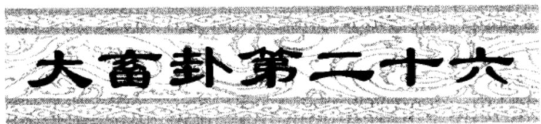

<!-- V3_SOURCE_ID:book016-b001864-p000-232c4acb12 -->

译文《大畜》卦象征大为畜聚：利于守持正固；不（使贤人）在家中自食可获吉祥；利于涉越大河巨流。

查看对应原文

<!-- V3_FOLDBACK_BEGIN:book016-b001864-p000-232c4acb12 -->

译文《大畜》卦象征大为畜聚：利于守持正固；不（使贤人）在家中自食可获吉祥；利于涉越大河巨流。

<!-- V3_FOLDBACK_END:book016-b001864-p000-232c4acb12 -->

<!-- V3_SOURCE_ID:book016-b001865-p000-c30bd0f985 -->

大畜卦：利于坚守正道；不在家中自食，吉祥；利于渡过大河。

查看对应原文

<!-- V3_FOLDBACK_BEGIN:book016-b001865-p000-c30bd0f985 -->

三大畜①：利贞②；不家食吉③；  
利涉大川④。

<!-- V3_FOLDBACK_END:book016-b001865-p000-c30bd0f985 -->

<!-- V3_SOURCE_ID:book016-b001866-p000-0e1bef6fc5 -->

注释①：大畜是卦名，下卦为乾，上卦为艮，象征着大为畜聚。按，畜有畜聚、畜止、畜养三种含义，其中以畜聚为根本；大畜的含义是所畜聚的事物极为宏大，也就是《本义》所说的畜之大者也。

查看对应原文

<!-- V3_FOLDBACK_BEGIN:book016-b001866-p000-0e1bef6fc5 -->

注释①大畜：卦名，下乾(三)上艮(三)，象征“大为畜聚”。案，畜，有“畜聚”、“畜止”、“畜养”三义，而以“聚”为本(参见《小畜》卦辞译注)；大畜，义取“所畜至大”，即《本义》所云“畜之大者也”。

<!-- V3_FOLDBACK_END:book016-b001866-p000-0e1bef6fc5 -->

<!-- V3_SOURCE_ID:book016-b001867-p000-e6d1209e3b -->

②利贞：是说在大畜之时，利于以正道畜养事物，所畜养的事物也应当合乎正道，所以称为利贞。

查看对应原文

<!-- V3_FOLDBACK_BEGIN:book016-b001867-p000-e6d1209e3b -->

②利贞：谓“大畜”之时，利于以“正”畜物，所畜者亦当“正”，故曰“利贞”。

<!-- V3_FOLDBACK_END:book016-b001867-p000-e6d1209e3b -->

<!-- V3_SOURCE_ID:book016-b001868-p000-4ad4324641 -->

③不家食吉：家在这里用作状语，不家食是说不让贤人在家中自食其力，而是将他们广聚于朝廷。这句话以养贤为比喻，说明大畜之时必须畜养贤人，进一步阐发前文大畜、利贞的含义。《正义》说：自己拥有大畜的资财，应当赡养贤人，不让贤人在家中自食其力，这样才会吉祥。《本义》说：在朝廷领取俸禄，不在家中自食其力。

查看对应原文

<!-- V3_FOLDBACK_BEGIN:book016-b001868-p000-4ad4324641 -->

③不家食吉：家，用如状语；“不家食”谓不使贤人在家自食，即广聚于朝廷。此句取养贤为喻，说明“大”者必须“畜”贤，再发前文“大畜，利贞”之义。《正义》：“己有大畜之资，当须养赡贤人，不使贤人在家自食，如此乃吉也。”《本义》：“食禄于朝，不食于家也。”

<!-- V3_FOLDBACK_END:book016-b001868-p000-4ad4324641 -->

<!-- V3_SOURCE_ID:book016-b001869-p000-9a08b83a7f -->

④利涉大川：这是说在大畜卦的情势下，如果能坚守正道、畜养贤才，就一定有利于渡过难关。《正义》中说：“丰则养贤，应于天道，不忧险难，故‘利涉大川’。”

查看对应原文

<!-- V3_FOLDBACK_BEGIN:book016-b001869-p000-9a08b83a7f -->

④利涉大川：此谓“大畜”之时若能守正畜贤，必利于涉难。《正义》：“丰则养贤，应于天道，不忧险难，故‘利涉大川’。”

<!-- V3_FOLDBACK_END:book016-b001869-p000-9a08b83a7f -->

<!-- V3_SOURCE_ID:book016-b001870-p000-f5363b0cf7 -->

胡炳文说：“不家食，是贤者不畜于家而畜于朝；涉大川，又似有畜极而通之意。要之，两‘利’字，一‘吉’字，占辞自分为三，不必泥而一之也。”这段话出自《周易本义通释》，这是分析卦辞拟象的三个层次，义有可取之处。

> **释读存疑：** 本地硬校验仍未通过，已记录供后续自动处理或人工核对。

查看对应原文

<!-- V3_FOLDBACK_BEGIN:book016-b001870-p000-f5363b0cf7 -->

说明胡炳文曰：“不家食，是贤者不畜于家而畜于朝；涉大川，又似有畜极而通之意。要之，两‘利’字，一‘吉’字，占辞自分为三，不必泥而一之也。”（《周易本义通释》）这是分析辞卦拟象的三个层次，义有可取。

<!-- V3_FOLDBACK_END:book016-b001870-p000-f5363b0cf7 -->

<!-- V3_SOURCE_ID:book016-b001871-p000-863b944369 -->

《象传》说：大为畜聚，犹如刚健笃实者畜聚不已，乃至光辉焕发、日日增新他的美德；又如阳刚者居上而崇尚贤人，能够规正健强者，这是极大的正道。“不(使贤人)在家中自食可获吉祥”，说明要

> **释读存疑：** 原文未完整释读，后续内容缺失

查看对应原文

<!-- V3_FOLDBACK_BEGIN:book016-b001871-p000-863b944369 -->

译文《象传》说：大为畜聚，犹如刚健笃实者畜聚不已，乃至光辉焕发、日日增新他的美德；又如阳刚者居上而崇尚贤人，能够规正健强者，这是极大的正道。“不(使贤人)在家中自食可获吉祥”，说明要

<!-- V3_FOLDBACK_END:book016-b001871-p000-863b944369 -->

<!-- V3_SOURCE_ID:book016-b001872-p000-493e8b3591 -->

《彖》曰：大畜，刚健笃实，辉光日新其德①；刚上而尚贤②，能止健，大正也③。“不家食吉”，养贤也④。“利涉大川”，应乎天也⑤。

查看对应原文

<!-- V3_FOLDBACK_BEGIN:book016-b001872-p000-493e8b3591 -->

《彖》曰：大畜，刚健笃实，辉光日新其德①；刚上而尚贤②，能止健，大正也③。“不家食吉”，养贤也④。“利涉大川”，应乎天也⑤。 畜养贤人。“利于涉越大河巨流”，说明行动应合“天”的规律。

<!-- V3_FOLDBACK_END:book016-b001872-p000-493e8b3591 -->

<!-- V3_SOURCE_ID:book016-b001873-p000-86b2824aae -->

匡释①刚健笃实，辉光日新其德：刚健，指下乾刚劲健强；笃实，指上艮静止充实。此举上下卦象，说明“大畜”之时，畜物者“刚健笃实”，所畜者“光辉美德”：极称卦义之佳。《王注》：“凡物既厌而退者，弱也；既荣而陨者，薄也。夫能‘辉光日新其德’者，唯‘刚健笃实’也。”《正义》：“刚健谓乾也，乾体刚性健，故言‘刚健’也；笃实谓艮也，艮体静止，故称‘笃实’也。”案，《释文》引郑玄注，以“日新”绝句，“其德”连下句。可备一说。今从《王注》断句。

查看对应原文

<!-- V3_FOLDBACK_BEGIN:book016-b001873-p000-86b2824aae -->

匡释①刚健笃实，辉光日新其德：刚健，指下乾刚劲健强；笃实，指上艮静止充实。此举上下卦象，说明“大畜”之时，畜物者“刚健笃实”，所畜者“光辉美德”：极称卦义之佳。《王注》：“凡物既厌而退者，弱也；既荣而陨者，薄也。夫能‘辉光日新其德’者，唯‘刚健笃实’也。”《正义》：“刚健谓乾也，乾体刚性健，故言‘刚健’也；笃实谓艮也，艮体静止，故称‘笃实’也。”案，《释文》引郑玄注，以“日新”绝句，“其德”连下句。可备一说。今从《王注》断句。

<!-- V3_FOLDBACK_END:book016-b001873-p000-86b2824aae -->

<!-- V3_SOURCE_ID:book016-b001874-p000-ff16c925e7 -->

②刚上而尚贤：刚，指上九，喻在上能礼贤于下；尚，崇尚。此以上九爻象，说明《大畜》卦有“畜贤”之义。《王注》：“谓上九也，处上而大通，刚来而不距，‘尚贤’之谓也。”

查看对应原文

<!-- V3_FOLDBACK_BEGIN:book016-b001874-p000-ff16c925e7 -->

②刚上而尚贤：刚，指上九，喻在上能礼贤于下；尚，崇尚。此以上九爻象，说明《大畜》卦有“畜贤”之义。《王注》：“谓上九也，处上而大通，刚来而不距，‘尚贤’之谓也。”

<!-- V3_FOLDBACK_END:book016-b001874-p000-ff16c925e7 -->

<!-- V3_SOURCE_ID:book016-b001875-p000-b867205999 -->

③能止健，大正也：止，抑止，谓上艮为“止”，此处有“规正”意；健，指下乾；大正，犹言至大的正道。这两句又取上下卦象，说明“大畜”之时能规正健强者，体现着“至大正道”。其义承前三句，并释卦名“大畜”及卦辞“利贞”。《王注》：“健莫过乾，而能止之，非夫‘大正’，未之能也。”

查看对应原文

<!-- V3_FOLDBACK_BEGIN:book016-b001875-p000-b867205999 -->

③能止健，大正也：止，抑止，谓上艮为“止”，此处有“规正”意；健，指下乾；大正，犹言至大的正道。这两句又取上下卦象，说明“大畜”之时能规正健强者，体现着“至大正道”。其义承前三句，并释卦名“大畜”及卦辞“利贞”。《王注》：“健莫过乾，而能止之，非夫‘大正’，未之能也。”

<!-- V3_FOLDBACK_END:book016-b001875-p000-b867205999 -->

<!-- V3_SOURCE_ID:book016-b001876-p000-9b78ffa785 -->

④养贤：此释卦辞“不家食吉”。《王注》：“有大畜之实，以之养贤，令贤者不家食，乃吉也。”

查看对应原文

<!-- V3_FOLDBACK_BEGIN:book016-b001876-p000-9b78ffa785 -->

④养贤：此释卦辞“不家食吉”。《王注》：“有大畜之实，以之养贤，令贤者不家食，乃吉也。”

<!-- V3_FOLDBACK_END:book016-b001876-p000-9b78ffa785 -->

<!-- V3_SOURCE_ID:book016-b001877-p000-6cef8a32b5 -->

⑤应乎天：这是解释卦辞“利涉大川”的。《王注》说：“尊崇贤才、刚健中正，完全符合天道，不必担忧险阻，所以‘利于涉越大河大川’。”

查看对应原文

<!-- V3_FOLDBACK_BEGIN:book016-b001877-p000-6cef8a32b5 -->

⑤应乎天：此释卦辞“利涉大川”。《王注》：“尚贤制健，大正应天，不忧险难，故‘利涉大川’也。”

<!-- V3_FOLDBACK_END:book016-b001877-p000-6cef8a32b5 -->

<!-- V3_SOURCE_ID:book016-b001878-p000-b24bea180d -->

《折中》引郑汝谐的话说：“‘畜’有三层含义：从‘蕴畜’的角度来说，是畜养品德；从‘畜养’的角度来说，是畜养贤才；从‘畜止’的角度来说，是畜止刚健。‘刚健笃实，辉光日新其德’，这是蕴畜的极致；‘养贤’以及万民，这是畜养的极致；乾是天下最刚健的，而第四、第五爻能够畜止它，这是畜止的极致。所以《彖传》是兼这三层含义来说的。”郑氏区分“三义”来辨析《彖传》的主旨，很有道理。

查看对应原文

<!-- V3_FOLDBACK_BEGIN:book016-b001878-p000-b24bea180d -->

说明《折中》引郑汝谐曰：“‘畜’有三义，以‘蕴畜’言之，畜德也；以‘畜养’言之，畜贤也；以‘畜止’言之，畜健也。‘刚健笃实，辉光日新其德’，此蕴畜之大者；‘养贤’以及万民，此畜养之大者；乾天下之至健，而四、五能畜之，此畜止之大者。故《彖传》兼此三者言之。”郑氏分“三义”辨析《彖传》大旨，颇见理致。

<!-- V3_FOLDBACK_END:book016-b001878-p000-b24bea180d -->

<!-- V3_SOURCE_ID:book016-b001879-p000-68707a10a2 -->

《象》说：天在山中，象征“大为畜聚”；君子因此多方记取前贤的言论、往圣的事迹，用来畜聚美好品德。

查看对应原文

<!-- V3_FOLDBACK_BEGIN:book016-b001879-p000-68707a10a2 -->

《象》曰：天在山中，大畜①；君 译文《象传》说：天包含在山中，象征“大为畜聚”；君子因此多方记取前贤的子以多识前言往行，以畜其德②。 言论、往圣的事迹，用来畜聚美好品德。

<!-- V3_FOLDBACK_END:book016-b001879-p000-68707a10a2 -->

<!-- V3_SOURCE_ID:book016-b001880-p000-c307fc1554 -->

匡释①天在山中，大畜：解释《大畜》卦下乾为天、上艮为山的卦象。《集解》引向秀的话说：“没有比山更能止的，没有比天更大的；天在山中，就是大为畜聚的卦象。”

> **释读存疑：** D；原文末尾的“D”未作释读，具体所指不详

查看对应原文

<!-- V3_FOLDBACK_BEGIN:book016-b001880-p000-c307fc1554 -->

匡释①天在山中，大畜：释《大畜》卦下乾为天、上艮为山之象。《集解》引向秀曰：“止莫若山，大莫若天；天在山中，大畜之象。” D

<!-- V3_FOLDBACK_END:book016-b001880-p000-c307fc1554 -->

<!-- V3_SOURCE_ID:book016-b001881-p000-df0cfe11e0 -->

②多记前代圣贤的言论与行事，来培养自身的品德：识的读音为zhì，就是“记”的意思；前言往行，指前代圣贤的言行。这两句是说君子效法《大畜》卦的卦象，多记前代圣贤的言论与行事来培养自身的品德。《程传》中说：“人的才德积蓄，是通过学习而变得宏大的，关键在于多听闻前代圣贤的言论与行事，考察他们的事迹来了解其作用，体察他们的言论来探求其心意，记住并领会这些内容，以此来培养成就自身的品德。”

查看对应原文

<!-- V3_FOLDBACK_BEGIN:book016-b001881-p000-df0cfe11e0 -->

②多识前言往行，以畜其德：识，音zhì，即“记”；前言往行，指前代圣贤的言行。这两句说明“君子”效法《大畜》卦象，多记“前言往行”以畜美德。《程传》：“人之蕴畜，由学而大，在多闻前古圣贤之言与行，考迹以观其用，察言以求其心，识而得之，以畜成其德。”

<!-- V3_FOLDBACK_END:book016-b001881-p000-df0cfe11e0 -->

<!-- V3_SOURCE_ID:book016-b001882-p000-bf5afcc213 -->

《大畜》的卦形为“天在山中”，这在现实中是不存在的，属于虚构的喻象；朱熹说：“不必实有其事，但以其象言之耳。”至于《大象传》所阐发的“多识前言往行，以畜其德”的意义，则是古代教育理论中颇有影响的观点；其要旨与《尚书》“学古”“师古”、《礼记》“博闻强识”、

查看对应原文

<!-- V3_FOLDBACK_BEGIN:book016-b001882-p000-bf5afcc213 -->

说明《大畜》的卦形为“天在山中”，这在现实中是不存在的，属于虚构的喻象；朱熹说：“不必实有其事，但以其象言之耳。”(《本义》)至于《大象传》所发“多识前言往行，以畜其德”的意义，则是古代教育理论中颇有影响的观点；其要旨与《尚书》“学古”“师古”(《说命下》)、《礼记》“博闻强识”(《曲礼上》)、

<!-- V3_FOLDBACK_END:book016-b001882-p000-bf5afcc213 -->

<!-- V3_SOURCE_ID:book016-b001883-p000-437f2cc1e7 -->

大畜卦第二十六

查看对应原文

<!-- V3_FOLDBACK_BEGIN:book016-b001883-p000-437f2cc1e7 -->

大畜卦第二十六

<!-- V3_FOLDBACK_END:book016-b001883-p000-437f2cc1e7 -->

<!-- V3_SOURCE_ID:book016-b001884-p000-b2709e0f71 -->

《论语》“博学笃志”诸说并可相通。

查看对应原文

<!-- V3_FOLDBACK_BEGIN:book016-b001884-p000-b2709e0f71 -->

《论语》“博学笃志”(《子张》)诸说并可相通。

<!-- V3_FOLDBACK_END:book016-b001884-p000-b2709e0f71 -->

<!-- V3_SOURCE_ID:book016-b001885-p000-8188b21e4a -->

译文初九，有危险，利于暂停不进。

查看对应原文

<!-- V3_FOLDBACK_BEGIN:book016-b001885-p000-8188b21e4a -->

译文初九，有危险，利于暂停不进。

<!-- V3_FOLDBACK_END:book016-b001885-p000-8188b21e4a -->

<!-- V3_SOURCE_ID:book016-b001886-p000-581320b1ef -->

初九爻的爻辞是：有危险，利于暂停不进。

查看对应原文

<!-- V3_FOLDBACK_BEGIN:book016-b001886-p000-581320b1ef -->

初九，有厉,利已①。

<!-- V3_FOLDBACK_END:book016-b001886-p000-581320b1ef -->

<!-- V3_SOURCE_ID:book016-b001887-p000-85676390c7 -->

注释① 有厉，利己：厉，就是危险；己，就是停止。这是说初九爻处于“大畜”的情势下，阳德微弱，被六四所“畜止”、规正；此时如果急于求进就会有“危险”，如果暂停不进、自行畜养自身的德行就会“有利”。《王注》说：“六四是畜止初九的，不可冒犯；前进就会有灾患危险，有危险就该停止。所以能‘利己’。”

查看对应原文

<!-- V3_FOLDBACK_BEGIN:book016-b001887-p000-85676390c7 -->

注释① 有厉，利己：厉，危也；己，停止。此谓初九处“大畜”之时，阳德卑微，为六四所“畜止”、规正；此时若急于求进则“危”，若暂停不进、自畜己德则“利”。《王注》：“四乃畜己，未可犯也；进则灾危，有厉则止。故能‘利己’。”

<!-- V3_FOLDBACK_END:book016-b001887-p000-85676390c7 -->

<!-- V3_SOURCE_ID:book016-b001888-p000-cf564fc397 -->

译文《象传》说：“有危险，利于暂停不进”，是说不可冒着灾患前行。

查看对应原文

<!-- V3_FOLDBACK_BEGIN:book016-b001888-p000-cf564fc397 -->

译文《象传》说：“有危险，利于暂停不进”，是说不可冒着灾患前行。

<!-- V3_FOLDBACK_END:book016-b001888-p000-cf564fc397 -->

<!-- V3_SOURCE_ID:book016-b001889-p000-3c5a76da9c -->

《象传》说：“有厉利己”，意思是不要去冒犯灾祸。

查看对应原文

<!-- V3_FOLDBACK_BEGIN:book016-b001889-p000-3c5a76da9c -->

《象》曰：“有厉利己”，不犯灾也。

<!-- V3_FOLDBACK_END:book016-b001889-p000-3c5a76da9c -->

<!-- V3_SOURCE_ID:book016-b001890-p000-80458623e3 -->

卷 四

查看对应原文

<!-- V3_FOLDBACK_BEGIN:book016-b001890-p000-80458623e3 -->

卷 四

<!-- V3_FOLDBACK_END:book016-b001890-p000-80458623e3 -->

<!-- V3_SOURCE_ID:book016-b001891-p000-13bcb4e5a5 -->

说丽：阳刚之爻居于下位，正处于被“畜止”的时刻，必须接受“规正”，自我蓄养以等待时机，这是初九获得“利”的前提。朱熹在《本义》中说：“乾之三阳，为艮所止，故内外之卦各取其义。”

查看对应原文

<!-- V3_FOLDBACK_BEGIN:book016-b001891-p000-13bcb4e5a5 -->

说丽 阳刚居下，当被“畜止”之际，必须接受“规正”，“自畜”待时：这是初九获“利”的前提。朱熹曰：“乾之三阳，为艮所止，故内外之卦各取其义。”（《本义》）

<!-- V3_FOLDBACK_END:book016-b001891-p000-13bcb4e5a5 -->

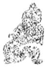

<!-- V3_SOURCE_ID:book016-b001893-p000-2d8f53eaa0 -->

译文：九二爻的爻义是，大车脱卸了轮輹，不再前行。

查看对应原文

<!-- V3_FOLDBACK_BEGIN:book016-b001893-p000-2d8f53eaa0 -->

译文 九二，大车脱卸轮輹不前行。

<!-- V3_FOLDBACK_END:book016-b001893-p000-2d8f53eaa0 -->

<!-- V3_SOURCE_ID:book016-b001894-p000-6819411e64 -->

九二，大车脱卸轮輹。

查看对应原文

<!-- V3_FOLDBACK_BEGIN:book016-b001894-p000-6819411e64 -->

九二，舆说复①。

<!-- V3_FOLDBACK_END:book016-b001894-p000-6819411e64 -->

<!-- V3_SOURCE_ID:book016-b001895-p000-c2d01ec831 -->

注释① 舆说輹：说，通“脱”，此处意思是脱卸；輹，读音为fù，《说文解字》中说它是车轴上的缚具，也就是轮輹，指车箱下用来钩住大车轮轴的木制器件，也叫伏兔。《左传》僖公十五年记载：“车说其輹。”杜预注释道：“輹，车下缚也。”孔颖达疏解说：“就是车下的‘伏兔’，现在的人叫它车屐，形状像伏兔，用绳子绑在车轴上，因此得名‘缚’。”这句话用大车脱卸轮輹无法前行的情况，来比喻九二处于大畜之时，阳刚之爻居下处中，被六五畜止、规正，能够衡量自身形势而停止不前。《程传》中说：“九二虽然是刚健之体，但它所处的位置合乎中道，所以进退没有过失；虽然有进取的志向，但衡量形势不可行，就停止不前，如同大车脱卸了轮輹，意思是不再前行。”

查看对应原文

<!-- V3_FOLDBACK_BEGIN:book016-b001895-p000-c2d01ec831 -->

注释① 舆说輹：说，通“脱”，此处犹言“脱卸”；輹，音fù，《说文》“车轴缚也”，即“轮輹”，指车箱下钩住大车轮轴的木制器件，亦称“伏兔”。《左传》僖公十五年：“车说其輹。”杜预注：“輹，车下缚也。”孔颖达疏曰：“车下‘伏兔’也，今人谓之车屐，形如伏兔，以绳缚于轴，因名‘缚’也。”此句用大车“脱輹”不行，比喻九二当“大畜”之时，阳刚居下处中，被六五“畜止”、规正，能自度其势、停止不前。《程传》：“二虽刚健之体，然其处得中道，故进止无失；虽志于进，度其势之不可，则止而不行，如车舆说去轮輹，谓不行也。”

<!-- V3_FOLDBACK_END:book016-b001895-p000-c2d01ec831 -->

<!-- V3_SOURCE_ID:book016-b001896-p000-2417420d71 -->

《象传》说：“大车脱卸轮輹不前行”，《象》曰：“舆说輹”，是因为九二居中不躁进，所以不会犯过错。

查看对应原文

<!-- V3_FOLDBACK_BEGIN:book016-b001896-p000-2417420d71 -->

译文《象传》说：“大车脱卸轮复不前行”， 《象》曰：“与说复”，中无尤也。  
说明九二居中不躁进所以不会犯过错。

<!-- V3_FOLDBACK_END:book016-b001896-p000-2417420d71 -->

<!-- V3_SOURCE_ID:book016-b001897-p000-44273e7d11 -->

《说丽》中提到九二自行脱卸车輹、因畜养德行而缓进，所以获得“无尤”；《小畜》九三车辐解散、与人冲突，所以“夫妻反目”：这两卦中“輹”与“辐”不同，象征意旨差异很大。陈梦雷说：“‘辐’脱则车破败，‘輹’脱只是不想前行罢了。所以《小畜》的脱辐在人，而《大畜》的脱輹在己。”

查看对应原文

<!-- V3_FOLDBACK_BEGIN:book016-b001897-p000-44273e7d11 -->

[说丽九二自卸轮转、“畜德”缓进，故获“无尤”；《小畜》九三车辐解散、与人冲突，故“夫妻反目”：两卦“转”、“辐”不同，象旨大异。陈梦雷曰：““辐’脱则车破败，复’脱但不欲行而已。故《小畜》之脱辐’在人，而《大畜》之‘脱复’在己。”(《周易浅述》)

<!-- V3_FOLDBACK_END:book016-b001897-p000-44273e7d11 -->

<!-- V3_SOURCE_ID:book016-b001898-p000-ae85a55c2e -->

译文九三，良马在奔逐，利于牢记艰难、守持正固；不断熟练车马防卫的技能，利于有所前往。

查看对应原文

<!-- V3_FOLDBACK_BEGIN:book016-b001898-p000-ae85a55c2e -->

译文九三，良马在奔逐，利于牢记艰难、守持正固；不断熟练车马防卫的技能，利于有所前往。

<!-- V3_FOLDBACK_END:book016-b001898-p000-ae85a55c2e -->

<!-- V3_SOURCE_ID:book016-b001899-p000-461acbf18d -->

## 九三，良马逐，利艰贞①；曰闲舆卫，利有攸往②。 — 九三，良马奔逐，利于牢记艰难、守持正固①；应当熟练车马防卫的技能，利于有所前往②。

查看对应原文

<!-- V3_FOLDBACK_BEGIN:book016-b001899-p000-461acbf18d -->

## 九三，良马逐，利艰贞①；曰闲舆卫，利有攸往②。

<!-- V3_FOLDBACK_END:book016-b001899-p000-461acbf18d -->

<!-- V3_SOURCE_ID:book016-b001900-p000-f8d6d1d8c3 -->

注释①良马逐，利艰贞：此处以“良马奔逐”比喻九三的“畜德”已经充实完备，强健至极，又与上九阳刚“合志”，因此可以施展才用；但因爻位九三“多惧”，担心其刚亢过甚、冒进有失，所以又告诫说利于牢记艰难、守持正固。《程传》中说：“九三凭借刚健之才，又与上位者合志共进，其前进之势如同良马奔驰追逐，说的是它前进迅速。”又说：“九三属乾卦之体且居位得正，是能够守持正固的；当它锐意前进时，所以告诫它要知晓艰难且不失去正固。”

查看对应原文

<!-- V3_FOLDBACK_BEGIN:book016-b001900-p000-f8d6d1d8c3 -->

注释①良马逐，利艰贞：此以“良马奔逐”比喻九三“畜德”既充、强健至盛，又与上九阳刚“合志”，故可施展才用；但因三位“多惧”，恐其刚亢过甚、冒进有失，故又诫以“利艰贞”。《程传》：“三以刚健之才，而在上者与合志而进，其进如良马之驰逐，言其速也。”又曰：“三乾体而居正，能贞者也；当其锐进，故戒以知难与不失其贞也。”

<!-- V3_FOLDBACK_END:book016-b001900-p000-f8d6d1d8c3 -->

<!-- V3_SOURCE_ID:book016-b001901-p000-37596b23f9 -->

②曰闲舆卫，利有攸往：“曰”是语气词；“闲”，《释文》记载：“马融、郑玄说‘习’”，意思是“熟练”，此处用作动词；“舆卫”指车马防卫的技能，这两句紧承前文的含义，说明九三不可自恃刚健、忘乎艰难，应当不断练习“舆卫”的技能，持续“畜”养自身，那么利于有所前往。《程传》中说：“车舆是出行所用的器物；防卫是用来自我防护的。应当在日常中熟练练习车舆与防卫的技能，那么利于有所前往。”按，“曰”字，《释文》引郑玄说“人实反”，则郑玄读作“日”；《集解》引虞翻的注也写作“日”。从文意来看，“日”字更贴切。因此《程传》依照“日”来解释，《本义》认为“应当是日月的‘日’”。据此，怀疑应当依从郑玄、虞翻的本子改作“日”才是正确的。

> **释读存疑：** 原文中关于“曰”字是否应改为“日”的异文考证内容，释读已明确说明相关异文情况，未将推测内容作为确定事实

查看对应原文

<!-- V3_FOLDBACK_BEGIN:book016-b001901-p000-37596b23f9 -->

②曰闲舆卫，利有攸往：曰，语气词；闲，《释文》：“马、郑云‘习’”，犹言“熟练”，此处用如动词；舆卫，指车马防卫之技，这两句紧承前文之义，说明九三不可自恃其刚、忘乎艰难，应当不断练习“舆卫”之技，自“畜”不已，则“利有攸往”。《程传》：“舆者，用行之物；卫者，所以自防。当自日常闲习其车舆与其防卫，则利有攸往矣。”案，“曰”字，《释文》引郑玄曰“人实反”，则郑读“日”；《集解》引虞翻注亦作“日”。视文意，“日”字较切。故《程传》依“日”解，《本义》谓“当为日月’之日'”。据此，疑当从郑、虞本改“日”为是。

<!-- V3_FOLDBACK_END:book016-b001901-p000-37596b23f9 -->

<!-- V3_SOURCE_ID:book016-b001902-p000-5f1e7e276e -->

《象传》说：“利于有所前往”，这说明九三与上九的意志是相合的。

查看对应原文

<!-- V3_FOLDBACK_BEGIN:book016-b001902-p000-5f1e7e276e -->

《象》曰：利有攸往，上合志也。 译文《象传》说：“利于有所前往”，说明九三与上九意志相合。

<!-- V3_FOLDBACK_END:book016-b001902-p000-5f1e7e276e -->

<!-- V3_SOURCE_ID:book016-b001903-p000-6f23c02cbd -->

九三与上九的爻位对应，两阳爻相对峙，本是“不应”之象；但在《大畜》卦中，却属于阳德并盛而“合志”的征兆。程颐所说的两爻“不相畜而志同”，是正确的。看上九所取的“大路”之象，正好为九三“良马奔逐”提供了宽畅的场所：由此可以看出两者“合志”的象旨。

查看对应原文

<!-- V3_FOLDBACK_BEGIN:book016-b001903-p000-6f23c02cbd -->

[∑萌九三与上九爻位对应，两阳相峙为“不应”之象；但在《大畜》卦，却为阳德并盛而“合志”之征。程颐谓两爻“不相畜而志同”(《程传》)是也。视上九所取“大路”之象，正为九三“良马奔逐”提供了宽畅的场所：由此似可看出两者“合志”的象旨。

<!-- V3_FOLDBACK_END:book016-b001903-p000-6f23c02cbd -->

<!-- V3_SOURCE_ID:book016-b001904-p000-b3b8ca9feb -->

六四，将木牿束缚在无角小牛的头上，至为吉祥。

查看对应原文

<!-- V3_FOLDBACK_BEGIN:book016-b001904-p000-b3b8ca9feb -->

六四，童牛之牿，元吉①。 译文六四，束缚在无角小牛头上的木牿，至为吉祥。

<!-- V3_FOLDBACK_END:book016-b001904-p000-b3b8ca9feb -->

<!-- V3_SOURCE_ID:book016-b001905-p000-cf04e6e8d0 -->

匡释①童牛之牿，元吉：童牛，《释文》解释为“无角牛”，也就是“小牛”，用来比喻初九；牿，读音为gù，《释文》记载：“《九家》写作‘告’，《说文》与此相同，说的是牛会顶人，在牛角上套上横木，用来警示他人”，也就是“木牿”，用来比喻六四。这两句是设喻：在无角的“童牛”头上加上“牿”，就好比六四在初六的过错还未萌生时就先加以“畜止”，妥善地“规正”；这就是《彖传》所说的“能止健”的含义，因此获得“元吉”。《王注》说：“处于艮卦的初始阶段，行事符合其所处的位置。能够在刚健之初就加以畜止，不用强硬的方式；以柔来止刚，刚健者就不敢冒犯。”

查看对应原文

<!-- V3_FOLDBACK_BEGIN:book016-b001905-p000-cf04e6e8d0 -->

匡释①童牛之牿，元吉：童牛，《释文》“无角牛也”，犹言“小牛”，喻初九；牿，音gù，《释文》：“《九家》作告’，《说文》同，云牛触人(案，《释文》误脱“人”字，据《说文》增），角着横木，所以告人'”，即“木牿”，喻六四。这两句设喻为譬：在无角“童牛”头上加“牿”，犹如六四在初六过恶未萌之初先施“畜止”，妥为“规正”；此即《彖传》“能止健”之义，故获“元吉”。《王注》：“处艮之始，履得其位。能止健初，距不以角；柔以止刚，刚不敢犯。”

<!-- V3_FOLDBACK_END:book016-b001905-p000-cf04e6e8d0 -->

<!-- V3_SOURCE_ID:book016-b001906-p000-baa2ad1c80 -->

《象》曰：六四“元吉”，有喜也。 译文《象传》说：六四“至为吉祥”，说明“止健”有方，值得欣喜。

查看对应原文

<!-- V3_FOLDBACK_BEGIN:book016-b001906-p000-baa2ad1c80 -->

《象》曰：六四“元吉”，有喜也。 译文《象传》说：六四“至为吉祥”，说明“止健”有方，值得欣喜。

<!-- V3_FOLDBACK_END:book016-b001906-p000-baa2ad1c80 -->

<!-- V3_SOURCE_ID:book016-b001907-p000-c810eedd41 -->

六四爻的取象颇为别致：“童牛”本未长角，却用角牿来约束它；这种情况在现实生活中未必真有，但在《周易》的义理里，却体现了“在恶行尚未萌发时就加以制止”的喻义。朱熹认为，《大畜》卦的下卦“取其能够自我蓄止而不冒进”，上卦“取其能够蓄止外物而不让其冒进”，还说：“六四爻能在事情刚发生时就加以制止，所以费力小；六五爻时阳爻已经前进，再去制止就困难了。”《朱子语类》此说可资参考。

查看对应原文

<!-- V3_FOLDBACK_BEGIN:book016-b001907-p000-c810eedd41 -->

说明六四取象，颇为别致：“童牛”本未长角，却制之以角牿；这在生活现象中未必实有，而在《易》理中却体现“止恶于未萌”的喻旨。朱熹以为，《大畜》下卦“取其能自畜而不进”，上卦“取其能畜彼而不使进”，并曰：“四能止之于初，故为力易；五则阳已进而止之，则难。”(《朱子语类》)此说可资参考。

<!-- V3_FOLDBACK_END:book016-b001907-p000-c810eedd41 -->

<!-- V3_SOURCE_ID:book016-b001908-p000-69cda4cb05 -->

六五，獭豕之牙，吉①。

查看对应原文

<!-- V3_FOLDBACK_BEGIN:book016-b001908-p000-69cda4cb05 -->

六五，獭豕之牙，吉①。

<!-- V3_FOLDBACK_END:book016-b001908-p000-69cda4cb05 -->

<!-- V3_SOURCE_ID:book016-b001909-p000-23fc18bced -->

译文六五，制约阉割过的猪的尖牙， 吉祥。

查看对应原文

<!-- V3_FOLDBACK_BEGIN:book016-b001909-p000-23fc18bced -->

译文六五，制约阉割过的猪的尖牙， 吉祥。

<!-- V3_FOLDBACK_END:book016-b001909-p000-23fc18bced -->

<!-- V3_SOURCE_ID:book016-b001910-p000-35507a2ff8 -->

注释①豮豕之牙，吉：豮的读音是fén，《释文》引用刘表的说法：“猪被阉割就叫豮”；豕的读音是shǐ，就是猪。这两句也是比喻：猪被阉割后，凶性已经消除，它的“牙”就不值得畏惧；好比九二摆脱了“车复”，停止不前。所以“豮豕之牙”就是比喻九二；六五处于尊位来“畜”养九二，自然能让它接受规正，于是获得“吉”。这也符合《彖传》中“能止健”的含义。《程传》说：“猪是刚猛急躁的东西，牙是凶猛锐利的，如果强行控制它的牙，就会费力却不能制止它的急躁凶猛，即使把它拴住绑住，也不能让它改变；如果像阉割猪那样去掉它的势，那么即使牙还在，刚猛急躁的性子自然会停止。它的作用就是这样，所以是吉利的。”

查看对应原文

<!-- V3_FOLDBACK_BEGIN:book016-b001910-p000-35507a2ff8 -->

注释①豮豕之牙，吉：，音fén，《释文》引刘表曰：“豕去势曰豮”；豕，音shǐ，即猪。这两句也是譬喻：猪被阉割，凶性已除，其“牙”则未足惧；犹如九二脱卸“车复”，停止不前。故“豮豕之牙”即喻九二；六五居尊“畜”二，自能使其接受“规正”，遂获“吉”。此亦《彖传》“能止健”之义。《程传》：“豕，刚躁之物，而牙为猛利，若强制其牙，则用力劳而不能止其躁猛，虽挚之维之，不能使之变也；若豮去其势，则牙虽存而刚躁自止。其用如此，所以吉也。”

<!-- V3_FOLDBACK_END:book016-b001910-p000-35507a2ff8 -->

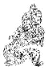

<!-- V3_SOURCE_ID:book016-b001912-p000-6a604d844a -->

《象传》说：六五的吉祥，是因为有值得庆贺的事。

> **释读存疑：** 《象传》中“有庆”的具体所指为六五居尊位能止健，自身获福、天下受惠的庆贺之义

查看对应原文

<!-- V3_FOLDBACK_BEGIN:book016-b001912-p000-6a604d844a -->

译文《象传》说：六五的“吉祥”，说明 《象》曰：六五之吉，有庆也。  
“止健”得法，值得庆贺。

<!-- V3_FOLDBACK_END:book016-b001912-p000-6a604d844a -->

<!-- V3_SOURCE_ID:book016-b001913-p000-199094f2ab -->

用猪被阉割来做比喻，足见这一爻的取象很奇特。但它的比喻意旨却很明确：表明六五处于尊位，用柔来控制刚，就像“畜”养人要先治理根本。程颐说：“君子效法‘豮豕’的道理，知道天下的恶不能用强力来制止，就会观察它的关键，抓住要领，断绝它的本源。所以不用借助严峻的刑法，而恶自然会停止。”（《程传》）

查看对应原文

<!-- V3_FOLDBACK_BEGIN:book016-b001913-p000-199094f2ab -->

说明用猪去势为喻，足见此爻取象奇异。但其喻旨却甚明确：表明六五居尊，以柔制刚，犹“畜”人先治其本。程颐曰：“君子法‘豮豕’之义，知天下之恶不可以力制也，则察其机，持其要，塞绝其本原。故不假刑法严峻，而恶自止也。”（《程传》）

<!-- V3_FOLDBACK_END:book016-b001913-p000-199094f2ab -->

<!-- V3_SOURCE_ID:book016-b001914-p000-71e1f65360 -->

上九，何天之衢，亨①。意思是上九，如同天上的大路那样畅达，亨通。

查看对应原文

<!-- V3_FOLDBACK_BEGIN:book016-b001914-p000-71e1f65360 -->

译文上九，何等畅达的天上大路， 上九，何天之衢，亨①。  
亨通。

<!-- V3_FOLDBACK_END:book016-b001914-p000-71e1f65360 -->

<!-- V3_SOURCE_ID:book016-b001915-p000-b8b49bd30f -->

注释①何天之衢，亨：“何”在这里应当是感叹词，意思是“何其通达”；“衢”的读音是qú，《释文》引用马融的说法，指四面畅通的大路。这两句说明，上九阳爻处于《大畜》卦上艮卦的末尾，是“止健”到了极点、“畜德”达到鼎盛的象征，就像《大象传》所说的“多识前言往行”的君子；所以此时大为通达，如同置身于四面畅达的“天衢”，行事方向必然“亨”。《本义》说：“何天之衢，言何其通达之甚也；畜极而通，豁达无碍。”

查看对应原文

<!-- V3_FOLDBACK_BEGIN:book016-b001915-p000-b8b49bd30f -->

注释①何天之衢，亨：何，此当为感叹辞，含“何其通达”之意；衢，音qú，《释文》引马融曰“四达谓之‘衢’”，即四面畅通的大路。这两句说明上九阳处《大畜》上艮之终，为“止健”至极、“畜德”至盛之象，犹《大象传》所谓“多识前言往行”的“君子”；故其时大通，如置身于四面畅达的“天衢”，所向必“亨”。《本义》：“何天之衢，言何其通达之甚也；畜极而通，豁达无碍。”

<!-- V3_FOLDBACK_END:book016-b001915-p000-b8b49bd30f -->

<!-- V3_SOURCE_ID:book016-b001916-p000-d3f213a062 -->

关于《周易》爻辞中“何”字的解释，各家的训释各不相同，现在引用三种说法供参考。（一）《王注》认为“何”作为语气词解释，如同说“何畜”，也就是《正义》所说的“更何所畜”，意思是“积蓄”到极点已经“贯通”。（二）《集解》引用虞翻的注释，将“何”解释为“当”；《纂疏》说：“何与‘荷’相通”，“解释为‘当’的意思如同‘担当’，阳刚处于上位能够胜任其职，所以称为‘何’”。（三）胡瑗怀疑“何”是多余的字，应当写作“天之衢，亨”。

查看对应原文

<!-- V3_FOLDBACK_BEGIN:book016-b001916-p000-d3f213a062 -->

说萌爻辞“何”字，诸家训释不同，今引三说以备参考。（一)《王注》认为“何”作语气辞解，犹言“何畜”，即《正义》所谓“更何所畜”。意谓“畜”极已“通”。(二)《集解》引虞翻注，训“何”作“当”；《纂疏》：“何与‘荷’通”，“训当’者犹‘担当’也，刚在上能胜其任，故为何'”(案，虞训“当”，似宜解作“正处于”，于义可通)。(三)胡瑗疑“何”为衍字，当作“天之衢，亨”(《周易口义》)。

<!-- V3_FOLDBACK_END:book016-b001916-p000-d3f213a062 -->

<!-- V3_SOURCE_ID:book016-b001917-p000-eceae3ca0f -->

《象传》说：“何等畅达的天上大路”，说明上九“畜德”之道大为通行。《象》曰：“何天之衢”，道大行也。

查看对应原文

<!-- V3_FOLDBACK_BEGIN:book016-b001917-p000-eceae3ca0f -->

译文《象传》说：“何等畅达的天上大 《象》曰：“何天之衢”，道大  
路”，说明上九“畜德”之道大为通行。行也。

<!-- V3_FOLDBACK_END:book016-b001917-p000-eceae3ca0f -->

<!-- V3_SOURCE_ID:book016-b001918-p000-ffec9c6d78 -->

关于上九是“积蓄德行、大为通达”的象征，是本卦最理想的一爻，它的含义十分广泛。《折中》引用胡炳文的话说：“这不仅仅是为官者的占断。《大学章句》所说的‘用力长久，一旦豁然贯通’，也是这个意思；‘多多识记前代圣贤的言论与行事，来积蓄自己的德行’，也可以用这个道理来解释。”

查看对应原文

<!-- V3_FOLDBACK_BEGIN:book016-b001918-p000-ffec9c6d78 -->

说萌上九为“畜德”大通之象，为本卦最理想的一爻，其义颇为广泛。《折中》引胡炳文曰：“此不徒为仕者之占。《大学章句》所谓‘用力之久，一旦豁然贯通’者，亦是此意；‘多识前言往行，以畜其德’者，以之可也。”

<!-- V3_FOLDBACK_END:book016-b001918-p000-ffec9c6d78 -->

<!-- V3_SOURCE_ID:book016-b001919-p000-c1d2f31814 -->

在庭堂之上讨论《大畜》卦所说的“大为畜聚”，表明事物发展过程中，必须竭力畜聚刚健正气的道理。用经传中选取的“人事”作比喻，就好比“君子”广泛畜聚“美德”，“君王”普遍聚集“贤者”。于是卦辞强调“守正”“养贤”，指出“畜聚阳刚正德”是“大畜”的关键所在。全卦六爻可分三层辨析：初、二爻是阳刚被“畜”的象征，必须先能“自畜其德”，不宜急躁冒进，所以初爻知晓危殆而不前进则“利”，二爻“大车”不行“无尤”；四、五爻是尊者“畜”下的象征，必须规正制约“健”者，使所畜尽善尽美，所以四爻束缚初爻的“童牛”获“元吉”，五爻制约二爻的“豕牙”得吉祥；至于上下卦终极的两爻，都是“畜德”至盛的象征，不存在“畜”与“被畜”的关系，所以三爻如“良马”奔逐、利于有所前往，上爻如置身“天衢”、畅达亨通。由此可见，本卦爻义，初、二、四、五爻揭示善处“大畜”之道，三、上两爻展现“大畜”的美盛结果。胡炳文曰：“他卦取阴阳相应，此取相畜。内卦受畜，以‘自止’为义；外卦能畜，以‘止之’为义。独三与上居内外卦之极，畜极而通，不取止义。”（《周易本义通释》）然而，三爻虽“畜极”，尚须不忘“艰贞”才能长保美德；上九则是“大畜”最为完美的象征，其深意既包含“自身道德盛美”，更体现“天下贤路大开”，即游酢所谓“畜道之成，贤路自我而四达矣”（《折中》引）。显然，此爻的象征本质，已经把“畜德”的功用，充分反映在“畜贤”“养贤”的意义上，与《彖传》“刚上而尚贤”正相吻合。这一点，似乎又流露着《周易》作者“授贤与能”的思想。韩愈《元和圣德诗》谓“天锡皇帝，为天下主，并包畜养，无异细巨”，实道出对统治阶级“畜养贤者”的期望，与《大畜》喻旨亦应有合。

> **释读存疑：** 《周易本义通释》、《折中》为古籍名称，保留原称；“他卦”具体所指未明确，保留原词；“健”“童牛”“豕牙”“良马”“天衢”等为卦爻相关术语，保留原词；“艰贞”“元吉”为卦爻相关术语，保留原词；“自止”“止之”为卦义相关表述，保留原词；“刚上而尚贤”为《彖传》原文，保留原句；“授贤与能”为《周易》相关思想表述，保留原词；“天锡皇帝”为《元和圣德诗》原文，保留原句；“细巨”为《元和圣德诗》原文，保留原词；本地硬校验仍未通过，已记录供后续自动处理或人工核对。

查看对应原文

<!-- V3_FOLDBACK_BEGIN:book016-b001919-p000-c1d2f31814 -->

庭论《大畜》卦所谓“大为畜聚”，表明事物发展过程中，必须竭力畜聚刚健正气的道理。用经传中拟取的“人事”为喻，犹如“君子”广畜“美德”，“君王”遍聚“贤者”。于是卦辞强调“守正”、“养贤”，指出“畜聚阳刚正德”是“大畜”的关键所在。全卦六爻可分三层辨析：初、二为阳刚被“畜”之象，必须先能“自畜其德”，不宜躁进，故初知危不前则“利”，二“大车”不行“无尤”；四、五为尊者“畜”下之象，必须规正制约“健”者，使所畜尽善尽美，故四束缚初之“童牛”获“元吉”，五制约二之“豕牙”得吉祥；至于上下卦终极两爻，并为“畜德”至盛之象，不存“畜”与“被畜”的关系，故三如“良马”奔逐、利有所往，上如置身“天衢”、畅达亨通。可见，本卦爻义，初、二、四、五爻揭示善处“大畜”之道，三、上两爻展现“大畜”的美盛结果。胡炳文曰：“他卦取阴阳相应，此取相畜。内卦受畜，以‘自止’为义；外卦能畜，以‘止之’为义。独三与上居内外卦之极，畜极而通，不取止义。”（《周易本义通释》）然而，三虽“畜极”，尚须不忘“艰贞”才能长保美德；上九则是“大畜”最为完美的象征，其深意既包含“自身道德盛美”，更体现“天下贤路大开”，即游酢所谓“畜’道之成，贤路自我而四达矣”（《折中》引）。显然，此爻的象征本质，已经把“畜德”的功用，充分反映在“畜贤”、“养贤”的意义上，与《彖传》“刚上而尚贤”正相吻合。这一点，似乎又流露着《周易》作者“授贤与能”的思想。韩愈《元和圣德诗》谓“天锡皇帝，为天下主，并包畜养，无异细巨”，实道出对统治阶级“畜养贤者”的期望，与《大畜》喻旨亦应有合。

<!-- V3_FOLDBACK_END:book016-b001919-p000-c1d2f31814 -->

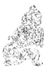

<!-- V3_SOURCE_ID:book016-b001921-p000-4bea01b705 -->

## 颐卦第二十七

查看对应原文

<!-- V3_FOLDBACK_BEGIN:book016-b001921-p000-4bea01b705 -->

## 颐卦第二十七

<!-- V3_FOLDBACK_END:book016-b001921-p000-4bea01b705 -->

<!-- V3_SOURCE_ID:book016-b001922-p000-6877e29c1b -->

《颐》卦象征颐养：守持正固可获吉祥；观察事物的颐养现象，应当明白用正道自求口中食物。

> **释读存疑：** “颐”“贞吉”“观颐”“口实”为卦爻相关术语，保留原词；“颐养”为卦义相关表述，保留原词；“正道”为卦义相关表述，保留原词；本地硬校验仍未通过，已记录供后续自动处理或人工核对。

查看对应原文

<!-- V3_FOLDBACK_BEGIN:book016-b001922-p000-6877e29c1b -->

译文《颐》卦象征颐养：守持正固可获 吉祥；观察事物的颐养现象，应当明白用 正道自求口中食物。

<!-- V3_FOLDBACK_END:book016-b001922-p000-6877e29c1b -->

<!-- V3_SOURCE_ID:book016-b001923-p000-3a1b08ad9d -->

《颐》卦的卦辞为：贞吉；观颐，自求口实。

> **释读存疑：** “颐”“贞吉”“观颐”“口实”为卦爻相关术语，保留原词；卦辞原文保留原句

查看对应原文

<!-- V3_FOLDBACK_BEGIN:book016-b001923-p000-3a1b08ad9d -->

颐①：贞吉②；观颐，自求口实③。

<!-- V3_FOLDBACK_END:book016-b001923-p000-3a1b08ad9d -->

<!-- V3_SOURCE_ID:book016-b001924-p000-175c2b3035 -->

注释①：颐是卦名，下震、上艮，象征“颐养”。《序卦传》说：“颐就是养的意思。”按，“颐”字的古文横视作“”，形状像口腮，如同口中含着东西自我养护；本卦下震上艮，正好有动、止、嚼物的意象。《集解》引用郑玄对《颐》卦名义的注释说：“颐，是口车辅之名也。震动于下，艮止于上；车口动而上，因辅嚼物以养人。”

查看对应原文

<!-- V3_FOLDBACK_BEGIN:book016-b001924-p000-175c2b3035 -->

注释①颐：卦名，下震()上艮(三)，象征“颐养”。《序卦传》：“颐者，养也。”案，“颐”字古文横视作“”(参见《噬嗑》卦《彖传》译注引)，状如口腮，像口中含物自养；本卦下震上艮，正有动止嚼物之象。《集解》引郑玄注，释《颐》卦名义曰：“颐，口车辅(犹言“口腮”)之名也。震动于下，艮止于上；车口动而上，因辅嚼物以养人。”

<!-- V3_FOLDBACK_END:book016-b001924-p000-175c2b3035 -->

<!-- V3_SOURCE_ID:book016-b001925-p000-fd7197b62e -->

②贞吉：说的是“颐养”的原则，守持正道就会吉祥。这就是《彖传》所解释的“养正则吉”的含义。

查看对应原文

<!-- V3_FOLDBACK_BEGIN:book016-b001925-p000-fd7197b62e -->

②贞吉：谓“颐养”之道，守正则吉。此即《彖传》所释“养正则吉”之义。

<!-- V3_FOLDBACK_END:book016-b001925-p000-fd7197b62e -->

<!-- V3_SOURCE_ID:book016-b001926-p000-e5cb9a6c58 -->

③观颐，自求口实：口实，指的是口腹所需的食物。这两句进一步阐明前文“贞吉”的含义，说明观察颐养的意象，应当懂得用正道自己求取口中的食物。《程传》说：“天地化育，养育万物，各得其所，也只是守持正道罢了”；“观察人所颐养的内容，以及他自己求取口实的方式，善恶吉凶就都能显现出来了。”

查看对应原文

<!-- V3_FOLDBACK_BEGIN:book016-b001926-p000-e5cb9a6c58 -->

③观颐，自求口实：口实，谓口腹所需的食物。这两句再申前文“贞吉”辞义，说明观物颐养之象，当知以正道自求口中食物。《程传》：“天地造化，养育万物，各得其宜者，亦正而已矣”；“观人之所颐，与其自求口实之道，则善恶吉凶可见矣。”

<!-- V3_FOLDBACK_END:book016-b001926-p000-e5cb9a6c58 -->

<!-- V3_SOURCE_ID:book016-b001927-p000-ae1824e7c4 -->

《彖传》说：颐养，守持正固可获吉祥，说明用正道养身才能导致吉祥。观察事物的颐养现象，是观察获得养育的客观条件；应当明白用正道自求口中食物，是观察领会自我养育的正确方法。天地养育万物，圣人养育贤者并养及万民：“颐养”之时的功效多么宏大啊！

> **释读存疑：** 本地硬校验仍未通过，已记录供后续自动处理或人工核对。

查看对应原文

<!-- V3_FOLDBACK_BEGIN:book016-b001927-p000-ae1824e7c4 -->

译文《彖传》说：颐养，守持正固可获吉祥，说明用正道养身才能导致吉祥。观察事物的颐养现象，是观察获得养育的客观条件；应当明白用正道自求口中食物，是观察领会自我养育的正确方法。天地养育万物，圣人养育贤者并养及万民：“颐养”之时的功效多么宏大啊！

<!-- V3_FOLDBACK_END:book016-b001927-p000-ae1824e7c4 -->

<!-- V3_SOURCE_ID:book016-b001928-p000-6ed3599628 -->

《彖传》说：颐卦的卦辞是“贞吉”，意思是秉持正道来颐养就会吉祥。观察颐卦，是要观察事物获取颐养的客观条件；“自求口实”，是要观察领会事物自我颐养的主观方法。天地养育万物，圣人养育贤才并惠及所有百姓：颐养的时势意义太宏大了！

查看对应原文

<!-- V3_FOLDBACK_BEGIN:book016-b001928-p000-6ed3599628 -->

《彖》曰：颐，贞吉，养正则吉也①。观颐，观其所养也②；自求口实，观其自养也。天地养万物，圣人养贤以及万民：颐之时大矣哉③！

<!-- V3_FOLDBACK_END:book016-b001928-p000-6ed3599628 -->

<!-- V3_SOURCE_ID:book016-b001929-p000-aaf6cf72a3 -->

注释①“养正则吉也”：这是解释颐卦的卦名及卦辞“颐，贞吉”。《集解》引用宋衷的话说：“君子不会吃切割不合规矩的食物，何况是不该属于自己的食物呢？因此，所颐养的对象必定是贤明之人，自己谋求衣食必定合宜得当，这就叫做‘养正’。”

查看对应原文

<!-- V3_FOLDBACK_BEGIN:book016-b001929-p000-aaf6cf72a3 -->

注释①养正则吉也：此释卦名及卦辞“颐，贞吉”。《集解》引宋衷曰：“君子割不正不食，况非其食乎？是故所养必得贤明，自求口实必得体宜，是谓‘养正’也。”

<!-- V3_FOLDBACK_END:book016-b001929-p000-aaf6cf72a3 -->

<!-- V3_SOURCE_ID:book016-b001930-p000-394638c552 -->

“观颐”是观察事物获养的客观条件，“自求口实”是观察领会事物自养的主观方法。

> **释读存疑：** 本地硬校验仍未通过，已记录供后续自动处理或人工核对。

查看对应原文

<!-- V3_FOLDBACK_BEGIN:book016-b001930-p000-394638c552 -->

“观颐”即观察事物获养的客观条件，“自求口实”是观察领会事物自养的主观方法。

<!-- V3_FOLDBACK_END:book016-b001930-p000-394638c552 -->

<!-- V3_SOURCE_ID:book016-b001931-p000-c56b5fa02d -->

③“颐之时大矣哉”：这句话承接前面两句，列举“天地”“圣人”养育万物、贤才、百姓的例子，盛赞“颐养”的时势所具有的宏大意义。《程传》说：“孔子推演‘颐’的道理，赞美天地与圣人的功绩，说‘颐之时大矣哉’。有人说该是‘义’，有人说该是‘用’，有人只说‘时’，因为‘时’是其中最宏大的部分。万物的生长与颐养，时势最为重要，所以说‘时’。”

查看对应原文

<!-- V3_FOLDBACK_BEGIN:book016-b001931-p000-c56b5fa02d -->

③颐之时大矣哉：此句上承前两句，援举“天地”、“圣人”养育万物、贤者、百姓为例，盛赞“颐养”之时的宏大功效。《程传》：“夫子推‘颐’之道，赞天地与圣人之功，曰‘颐之时大矣哉’。或云‘义’，或云‘用’，或止云‘时’，以其大者也。万物之生与养，时为大，故云‘时’也。”

<!-- V3_FOLDBACK_END:book016-b001931-p000-c56b5fa02d -->

<!-- V3_SOURCE_ID:book016-b001932-p000-bdaa9328b0 -->

《象传》说：山下有雷，这就是颐卦的意象；君子因此言语谨慎，饮食节制。

查看对应原文

<!-- V3_FOLDBACK_BEGIN:book016-b001932-p000-bdaa9328b0 -->

《象》曰：山下有雷，颐①；君子以慎言语，节饮食②。

<!-- V3_FOLDBACK_END:book016-b001932-p000-bdaa9328b0 -->

<!-- V3_SOURCE_ID:book016-b001933-p000-70938df241 -->

译文《象传》说：山下响动着震雷(下动上止、如口嚼食)，象征“颐养”；君子因此慎发言语以养德，节制饮食以养身。

查看对应原文

<!-- V3_FOLDBACK_BEGIN:book016-b001933-p000-70938df241 -->

译文《象传》说：山下响动着震雷(下动上止、如口嚼食)，象征“颐养”；君子因此慎发言语以养德，节制饮食以养身。

<!-- V3_FOLDBACK_END:book016-b001933-p000-70938df241 -->

<!-- V3_SOURCE_ID:book016-b001934-p000-ee5d696339 -->

注释①山下有雷，颐：解释《颐》卦的意象是上为艮山、下为震雷。《集解》引用刘表的话：“山在上方静止，雷在下方响动，这就是颐卦的意象。”（参阅卦辞译注引郑玄说）

查看对应原文

<!-- V3_FOLDBACK_BEGIN:book016-b001934-p000-ee5d696339 -->

注释①山下有雷，颐：释《颐》卦上艮为山，下震为雷之象。《集解》引刘表曰：“山止于上，雷动于下，颐之象也。”(参阅卦辞译注引郑玄说)

<!-- V3_FOLDBACK_END:book016-b001934-p000-ee5d696339 -->

<!-- V3_SOURCE_ID:book016-b001935-p000-bbdfaecd06 -->

②慎言语，节饮食：这是说明君子效法颐卦的养正之道，通过谨慎言语来修养品德，通过节制饮食来修养身心。《正义》记载：“前代儒者说：‘灾祸从口中说出，病患从口中进入。’因此在颐养之时要做到谨慎、节制。”

查看对应原文

<!-- V3_FOLDBACK_BEGIN:book016-b001935-p000-bbdfaecd06 -->

②慎言语，节饮食：这是说明“君子”效法《颐》卦“养正”之道，“慎言”养德、“节食”养身。《正义》：“先儒云：‘祸从口出，患从口入。’故于颐养而‘慎’、‘节’也。”

<!-- V3_FOLDBACK_END:book016-b001935-p000-bbdfaecd06 -->

<!-- V3_SOURCE_ID:book016-b001936-p000-6b4507f801 -->

说明卦辞所说的颐养应当守正，《大象传》举出慎言、节食来分别说明养德、养身的道理，极为明白贴切。《孔子家语·观周》记载：“有金人焉，三缄其口，而铭其背曰：‘古之慎言人也。’”这就是慎言语的告诫。

查看对应原文

<!-- V3_FOLDBACK_BEGIN:book016-b001936-p000-6b4507f801 -->

说明卦辞谓“颐养”当正，《大象传》举“慎言”、“节食”以养德、养身发其义，至为明白贴切。《孔子家语·观周》曰：“有金人焉，三缄其口，而铭其背曰：‘古之慎言人也。’”此即“慎言语”之诫。

<!-- V3_FOLDBACK_END:book016-b001936-p000-6b4507f801 -->

<!-- V3_SOURCE_ID:book016-b001937-p000-f0315b9e8d -->

初九，舍弃你灵龟般的美质，而观看我垂腮进食，有凶险。凶①。

查看对应原文

<!-- V3_FOLDBACK_BEGIN:book016-b001937-p000-f0315b9e8d -->

初九，舍尔灵龟，观我朵颐， 译文初九，舍弃你灵龟般的美质，而观看我垂腮进食，有凶险。凶①。

<!-- V3_FOLDBACK_END:book016-b001937-p000-f0315b9e8d -->

<!-- V3_SOURCE_ID:book016-b001938-p000-34b90accfc -->

注释①舍尔灵龟，观我朵颐，凶：尔，指初九；灵龟，喻阳刚美质，《程传》：“龟能咽息不食，灵龟喻其明智而可以不求养于外”；我，指六四；朵，《集解》“颐垂下动之貌”；颐，口腮。这三句说明当“颐养”之时，初九上应六四，犹如以阳刚之实求养于阴虚，养身不得其道；故爻辞借六四的口吻责之曰：岂能舍弃你的灵龟，而观我垂腮食物？贪欲如是，必致凶险。《本义》：“初九阳刚在下，足以不食；乃上应六四之阴，而动于欲，凶之道也。”

> **释读存疑：** 本地硬校验仍未通过，已记录供后续自动处理或人工核对。

查看对应原文

<!-- V3_FOLDBACK_BEGIN:book016-b001938-p000-34b90accfc -->

注释①舍尔灵龟，观我朵颐，凶：尔，指初九；灵龟，喻阳刚美质，《程传》：“龟能咽息不食，灵龟喻其明智而可以不求养于外”；我，指六四；朵，《集解》“颐垂下动之貌”(此从《说文》“树木垂朵朵”引申)；颐，口腮。这三句说明当“颐养”之时，初九上应六四，犹如以阳刚之实求养于阴虚，养身不得其道；故爻辞借六四的口吻责之曰：岂能舍弃你的灵龟，而观我垂腮食物？贪欲如是，必致凶险。《本义》：“初九阳刚在下，足以不食；乃上应六四之阴，而动于欲，凶之道也。”

<!-- V3_FOLDBACK_END:book016-b001938-p000-34b90accfc -->

<!-- V3_SOURCE_ID:book016-b001939-p000-2d14ee4838 -->

《象传》说：“观看我垂腮进食”，说明初九的求养行为不值得尊重。

查看对应原文

<!-- V3_FOLDBACK_BEGIN:book016-b001939-p000-2d14ee4838 -->

《象》曰：“观我朵颐”，亦不足 译文《象传》说：“观看我垂腮进食”，说明初九的求养行为不值得尊重。贵也。

<!-- V3_FOLDBACK_END:book016-b001939-p000-2d14ee4838 -->

<!-- V3_SOURCE_ID:book016-b001940-p000-b58628af87 -->

郑汝谐解释说：“《颐》卦的上体各爻皆为吉兆，下体各爻皆为凶兆；上体的属性是静止，下体的属性是活动。处于上位而静止，是滋养他人的人；处于下位而活动，是向他人求取滋养的人。活动着向他人求取滋养的人，必然会被口腹身体的供养所拖累，所以即便初爻是刚阳之爻，也难免会动了欲念，出现‘观朵颐’的情况。”这是说上下卦的爻义有区别，可供参考。

查看对应原文

<!-- V3_FOLDBACK_BEGIN:book016-b001940-p000-b58628af87 -->

说明郑汝谐曰：“《颐》之上体皆吉，而下体皆凶；上体止也，下体动也。在上而止，养人者也；在下而动，求养于人者也。动而求养于人者，必累于口体之养，故虽以初之刚阳，未免于动其欲而观朵颐也。”(《东谷易翼传》)此谓上下卦爻义有别，可备参考。

<!-- V3_FOLDBACK_END:book016-b001940-p000-b58628af87 -->

<!-- V3_SOURCE_ID:book016-b001941-p000-b90d03d6a8 -->

六二，颠颐①；拂经，于丘颐，征凶。

> **释读存疑：** 本地硬校验仍未通过，已记录供后续自动处理或人工核对。

查看对应原文

<!-- V3_FOLDBACK_BEGIN:book016-b001941-p000-b90d03d6a8 -->

六二，颠颐①；拂经，于丘颐，征凶。

<!-- V3_FOLDBACK_END:book016-b001941-p000-b90d03d6a8 -->

<!-- V3_SOURCE_ID:book016-b001942-p000-55053b3c6d -->

译文六二，既颠倒向下求获颐养，又违背常理，向高丘上的尊者索取颐养，往前进发必有凶险。

查看对应原文

<!-- V3_FOLDBACK_BEGIN:book016-b001942-p000-55053b3c6d -->

译文六二，既颠倒向下求获颐养，又违背常理，向高丘上的尊者索取颐养，往前进发必有凶险。

<!-- V3_FOLDBACK_END:book016-b001942-p000-55053b3c6d -->

<!-- V3_SOURCE_ID:book016-b001943-p000-349863203a -->

注释①颠颐：颠，就是倒过来的意思。这是说二爻与五爻没有相应的关系，反而向下向初九爻求取滋养，有失‘颐’卦的正道，所以是‘颠颐’的意象。

查看对应原文

<!-- V3_FOLDBACK_BEGIN:book016-b001943-p000-349863203a -->

注释①颠颐：颠，倒也。此谓二无应于五，反向下求养于初，有失“颐”道，故为“颠颐”之象。

<!-- V3_FOLDBACK_END:book016-b001943-p000-349863203a -->

<!-- V3_SOURCE_ID:book016-b001944-p000-b74c51b074 -->

②拂经，于丘颐，征凶：拂就是违背，经指常理；丘是比喻上九，《本义》说：“丘是高土，是上位的象征。”这三句承接前面的卦义，意思是六二不能凭借柔顺中正的德行自我涵养，既颠倒了颐养的正道去求养于初九，又违背了奉养尊长的常理，向上九索取颐养；这样往前发展必然凶险。《周易玩辞》说：“六二得位得中，本有可养的态势却不能自我涵养，反而去奉养不中无位的上九，与常理相悖”；“上九又属艮体，所以称为‘于丘’。”

查看对应原文

<!-- V3_FOLDBACK_BEGIN:book016-b001944-p000-b74c51b074 -->

②拂经，于丘颐，征凶：拂，违也；经，犹言“常理”；丘，喻上九，《本义》：“丘，土之高者，上之象也。”这三句承前句义，谓六二不能以柔顺中正自养，既“颠颐”求初，又违背“奉上”的常理，向上九索取颐养；以此往前必凶。《周易玩辞》：“得位得中有可养之势而不能自养，反由养于不中无位之爻（案，指上九），与常经相悖”；“上又艮体，故为‘于丘’。”

<!-- V3_FOLDBACK_END:book016-b001944-p000-b74c51b074 -->

<!-- V3_SOURCE_ID:book016-b001945-p000-b1046b9465 -->

本爻辞的句读及含义，各家说法有所不同。例如：(一)《集解》引王肃的注，将“拂经于丘”作为一句，认为六二求养于初九是“颠”，违背常理于五是“拂经于丘”，没有应援而前往所以“凶”。(二)《本义》将“颠颐拂经”作为一句，解释道：“求养于初九，就颠倒了正道而违背常理；求养于上九，前往就会得凶。”

查看对应原文

<!-- V3_FOLDBACK_BEGIN:book016-b001945-p000-b1046b9465 -->

说明本爻辞句读意义，诸家说有不同。如：(一)《集解》引王肃注，以“拂经于丘”为句，谓二养初曰“颠”，违常于五曰“拂经于丘”，无应而征故“凶”。(二)《本义》以“颠颐拂经”为句，释曰：“求养于初，则颠倒而违于常理；求养于上，则往而得凶。”

<!-- V3_FOLDBACK_END:book016-b001945-p000-b1046b9465 -->

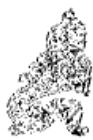

<!-- V3_SOURCE_ID:book016-b001947-p000-9842c24590 -->

《象传》说：六二“往前进发必有凶险”，说明前行得不到朋类。

> **释读存疑：** 原文存在缺字错乱，无法完整释读，仅整理可确认内容

查看对应原文

<!-- V3_FOLDBACK_BEGIN:book016-b001947-p000-9842c24590 -->

译文《象传》说：六二“往前进发必有凶 《象》日：六二“征凶”，行失类险”，说明前行得不到朋类。 也①。

<!-- V3_FOLDBACK_END:book016-b001947-p000-9842c24590 -->

<!-- V3_SOURCE_ID:book016-b001948-p000-b73dadee86 -->

注释①行失类：指六二如果上行，所遇到的都是阴，同性不能算作“类”，所以有“凶”。《尚氏学》说：“阴阳相遇才算是类，如今六二没有遇到阳，所以说‘失类’。”

查看对应原文

<!-- V3_FOLDBACK_BEGIN:book016-b001948-p000-b73dadee86 -->

注释①行失类：指六二若上行，所遇均阴，同性非“类”，故有“凶”。《尚氏学》：“阴阳相遇方为类，今六二不遇阳，故曰‘失类’。”

<!-- V3_FOLDBACK_END:book016-b001948-p000-b73dadee86 -->

<!-- V3_SOURCE_ID:book016-b001949-p000-9b709f195c -->

说明六二爻本属于中正的爻体，因为与九五爻没有相应的关系，所以在“颠”以下求养、“拂”以上求养的做法，完全违背了颐养的正道，最终导致凶险。

查看对应原文

<!-- V3_FOLDBACK_BEGIN:book016-b001949-p000-9b709f195c -->

说明六二本属“中正”之体，因与五无应，故“颠”以下乞，“拂”以上求，大失“颐养”之道，终致有“凶”。

<!-- V3_FOLDBACK_END:book016-b001949-p000-9b709f195c -->

<!-- V3_SOURCE_ID:book016-b001950-p000-572dc7b609 -->

六三爻违背了颐养的常理；若守持正固则会有凶险，十年之久不可施展才用，否则必将没有任何利益。

> **释读存疑：** 原文中“拂颐”“无攸利”的具体所指未明确说明

查看对应原文

<!-- V3_FOLDBACK_BEGIN:book016-b001950-p000-572dc7b609 -->

译文六三，违背“颐养”常理；守持正固 六三，拂颐①；贞凶，十年勿用，以防凶险，十年之久不可施展才用，要是  
施用必将无所利益。 无攸利②。

<!-- V3_FOLDBACK_END:book016-b001950-p000-572dc7b609 -->

<!-- V3_SOURCE_ID:book016-b001951-p000-07a080703e -->

注释①拂颐：这是说六三爻处于颐卦之时，阴爻居于阳位，违背中道失去正位，依仗自己与上九爻相应而不断求养，所以是严重违背颐养正道的意象。《王注》说：“行于不正之道而向上求养，是取悦上位者的谄媚之人，违背了养正的义理。”

查看对应原文

<!-- V3_FOLDBACK_BEGIN:book016-b001951-p000-07a080703e -->

注释①拂颐：此谓六三当“颐”之时，阴居阳位，违中失正，恃其有应于上九而求养不已，故为大悖“颐”道之象。《王注》：“履夫不正以养于上，纳上而谄者也，拂‘养正’之义。”

<!-- V3_FOLDBACK_END:book016-b001951-p000-07a080703e -->

<!-- V3_SOURCE_ID:book016-b001952-p000-3a9a190aad -->

②贞凶，十年勿用，无攸利：贞凶，意思是守持正固以防凶险。这里承接前文的意思，说明六三爻既然颐养失正，就应当迅速改正邪念趋向正途，谨慎守持以防凶险；并且说十年之久不可施展才用，如果施展，必然没有任何利益。爻辞的旨意包含警戒规劝的含义。

查看对应原文

<!-- V3_FOLDBACK_BEGIN:book016-b001952-p000-3a9a190aad -->

②贞凶，十年勿用，无攸利：贞凶，犹言“守正防凶”(参见《屯》九五译注)。此承前文意，说明六三既“颐养”失正，当疾速改邪趋正，谨守防凶；并谓“十年”之久不可施用，若施用，必无所利。爻旨含警戒规劝之义。 D

<!-- V3_FOLDBACK_END:book016-b001952-p000-3a9a190aad -->

<!-- V3_SOURCE_ID:book016-b001953-p000-e24892d196 -->

译文《象传》说：“十年之久不可施展才用”，说明六三与“颐养”正道大相违逆。

查看对应原文

<!-- V3_FOLDBACK_BEGIN:book016-b001953-p000-e24892d196 -->

译文《象传》说：“十年之久不可施展才用”，说明六三与“颐养”正道大相违逆。

<!-- V3_FOLDBACK_END:book016-b001953-p000-e24892d196 -->

<!-- V3_SOURCE_ID:book016-b001954-p000-f24ed248e6 -->

《象》说：“十年勿用”，是因为道严重悖逆。

查看对应原文

<!-- V3_FOLDBACK_BEGIN:book016-b001954-p000-f24ed248e6 -->

《象》曰：“十年勿用”，道大悖也。

<!-- V3_FOLDBACK_END:book016-b001954-p000-f24ed248e6 -->

<!-- V3_SOURCE_ID:book016-b001955-p000-ddaeb43c98 -->

说明六三的“求养”行为至所“不正”，但爻辞仍有勉其自反的意思。郑汝谐曰：“‘十年勿用，无攸利’，戒之也”；“因其有多欲妄动之心，示之以自反之理，作《易》之本意也”（《东谷易翼传》）。

查看对应原文

<!-- V3_FOLDBACK_BEGIN:book016-b001955-p000-ddaeb43c98 -->

说明六三的“求养”行为至所“不正”，但爻辞仍有勉其自反的意思。郑汝谐曰：“‘十年勿用，无攸利’，戒之也”；“因其有多欲妄动之心，示之以自反之理，作《易》之本意也”（《东谷易翼传》）。

<!-- V3_FOLDBACK_END:book016-b001955-p000-ddaeb43c98 -->

<!-- V3_SOURCE_ID:book016-b001956-p000-e83755b397 -->

译文：六四颠倒向下求获颐养（再用来养人），吉祥；就像老虎眈眈注视，迫切求（此处原文残缺，后续内容未显示）。

> **释读存疑：** 原文后续内容残缺，无法完整释读

查看对应原文

<!-- V3_FOLDBACK_BEGIN:book016-b001956-p000-e83755b397 -->

译文六四，颠倒向下求获颐养(再用来养人)，吉祥；就像老虎眈眈注视，迫切求六四，颠颐，吉①；虎视眈眈，其

<!-- V3_FOLDBACK_END:book016-b001956-p000-e83755b397 -->

<!-- V3_SOURCE_ID:book016-b001957-p000-89c09c03e1 -->

想要接连不断地求取，就不会有过错。

查看对应原文

<!-- V3_FOLDBACK_BEGIN:book016-b001957-p000-89c09c03e1 -->

欲逐逐，无咎②。

<!-- V3_FOLDBACK_END:book016-b001957-p000-89c09c03e1 -->

<!-- V3_SOURCE_ID:book016-b001958-p000-ddadd5db8a -->

事物接连不断，必然不会有咎害。

查看对应原文

<!-- V3_FOLDBACK_BEGIN:book016-b001958-p000-ddadd5db8a -->

物接连不绝，必无咎害。

<!-- V3_FOLDBACK_END:book016-b001958-p000-ddadd5db8a -->

<!-- V3_SOURCE_ID:book016-b001959-p000-92bf6e1456 -->

注释①颠颐，吉：这是说六四阴爻居于上卦，与初九正应，就像在上位者向下寻求供养，再用所得供养施予下位者，所以虽说是“颠颐”却能获得“吉”。《本义》说：“柔爻居于上位而得正，所应合的爻又正，依靠其供养施予下位，所以虽颠倒却吉利。”

查看对应原文

<!-- V3_FOLDBACK_BEGIN:book016-b001959-p000-92bf6e1456 -->

注释①颠颐，吉：此谓六四阴居上卦，得正应初，犹如上者向下求养，再用以养下，故虽“颠颐”却能获“吉”。《本义》：“柔居上而得正，所应又正，而赖其养以施于下，故虽颠而吉。”

<!-- V3_FOLDBACK_END:book016-b001959-p000-92bf6e1456 -->

<!-- V3_SOURCE_ID:book016-b001960-p000-6938b77663 -->

②虎视眈眈，其欲逐逐，无咎：眈眈，是专一注视的样子；逐逐，《程传》解释为“相继而不乏”，就像说“连接不绝”。这三句用“虎视眈眈”比喻六四求初九时专诚不二；用“其欲逐逐”比喻所需求接连不断；又用“无咎”说明在“养正”之时，求取合乎正道就必然不会有祸害。《本义》说：“虎视眈眈，是向下而专一；其欲逐逐，是求取而接连不断。能做到这样，就‘无咎’了。”

查看对应原文

<!-- V3_FOLDBACK_BEGIN:book016-b001960-p000-6938b77663 -->

②虎视眈眈，其欲逐逐，无咎：眈眈，专一注视之状；逐逐，《程传》“相继而不乏”，犹言“连接不绝”。这三句以“虎视眈眈”喻四求初专诚不二；以“其欲逐逐”喻所需求连继不绝；又以“无咎”说明“养正”之时，求之有道必无害。《本义》：“虎视眈眈，下而专也；其欲逐逐，求而继也。又能如是，则‘无咎’也。”

<!-- V3_FOLDBACK_END:book016-b001960-p000-6938b77663 -->

<!-- V3_SOURCE_ID:book016-b001961-p000-9aeac332d6 -->

《象传》说：颠倒向下求获颐养的吉祥，是因为在上者能将光明美德施予在下者。

查看对应原文

<!-- V3_FOLDBACK_BEGIN:book016-b001961-p000-9aeac332d6 -->

《象》曰：颠颐之吉，上施光也。

<!-- V3_FOLDBACK_END:book016-b001961-p000-9aeac332d6 -->

<!-- V3_SOURCE_ID:book016-b001962-p000-68a9aaada3 -->

译文《象传》说：“颠倒向下求获颐养(再用来养人)，吉祥”，说明六四居上而能下施光明美德。

查看对应原文

<!-- V3_FOLDBACK_BEGIN:book016-b001962-p000-68a9aaada3 -->

译文《象传》说：“颠倒向下求获颐养(再用来养人)，吉祥”，说明六四居上而能下施光明美德。

<!-- V3_FOLDBACK_END:book016-b001962-p000-68a9aaada3 -->

<!-- V3_SOURCE_ID:book016-b001963-p000-0ea089e339 -->

说明六二、六四两爻都被称为“颠颐”，为什么这个吉祥那个凶险？游酢指出：“二之志在物，而四之志在道。”（《折中》引）志向在具体事物，就会没有应求却强求，所以凶险；志向在正道，就会涵养正道、利于万物，所以吉祥。《象传》所说的“上施光”，似乎表明六四蕴含着“取之于民，用之于民”的微妙意旨；因此“其欲逐逐”可以“无咎”。

查看对应原文

<!-- V3_FOLDBACK_BEGIN:book016-b001963-p000-0ea089e339 -->

说明四、二两爻并称“颠颐”，为何此吉彼凶？游酢指出：“二之志在物，而四之志在道。”(《折中》引)“在物”，则无应强求，故凶；“在道”，则养正利物，故吉。《象传》谓“上施光”，似乎表明六四含有“取之于民，用之于民”的微旨；因此“其欲逐逐”可以“无咎”。

<!-- V3_FOLDBACK_END:book016-b001963-p000-0ea089e339 -->

<!-- V3_SOURCE_ID:book016-b001964-p000-002dfb1155 -->

## 六五，拂经①；居贞吉，不可涉大川②。 — 六五，违背常规①；居守正道可获吉祥，不可涉越大江大河②。

查看对应原文

<!-- V3_FOLDBACK_BEGIN:book016-b001964-p000-002dfb1155 -->

## 六五，拂经①；居贞吉，不可涉大川②。

<!-- V3_FOLDBACK_END:book016-b001964-p000-002dfb1155 -->

<!-- V3_SOURCE_ID:book016-b001965-p000-03761d3c21 -->

六五爻的爻辞大意是：（譬如“君主”依赖上者养己以养天下），这违背常理；静居守持正固可获吉祥，不可涉越大河巨流。

查看对应原文

<!-- V3_FOLDBACK_BEGIN:book016-b001965-p000-03761d3c21 -->

译文六五(譬如“君主”依赖上者养己以养天下)，违背常理；静居守持正固可获吉祥，不可涉越大河巨流。

<!-- V3_FOLDBACK_END:book016-b001965-p000-03761d3c21 -->

<!-- V3_SOURCE_ID:book016-b001966-p000-22cb5992ea -->

注释①拂经：这里是说六五爻处于《颐》卦的“君位”，失却正道，没有应和的爻位，阴柔而没有实才，只依附上九阳刚之爻，就像不能养育他人，反而依赖上者养育自己，再去养育天下，违背了君主“养育贤才以惠及万民”的常理，所以称为“拂经”。《程传》中说：“六五，在颐养之时居于君位，本应养育天下。但它是阴柔的本质，才力不足以养育天下，上方有刚阳的贤才，所以顺从他，依赖他养育自己来成就天下之事。”

查看对应原文

<!-- V3_FOLDBACK_BEGIN:book016-b001966-p000-22cb5992ea -->

注释①拂经：此谓六五处《颐》“君位”，失正无应，阴柔无实，唯承上九阳刚，犹如不能养人、反赖上者养己以兼养天下，有背君主“养贤以及万民”的常理，故曰“拂经”。《程传》：“六五，‘颐’之时居君位，养天下者也。然其阴柔之质，才不足以养天下，上有刚阳之贤，故顺从之，赖其养己以济天下。”

<!-- V3_FOLDBACK_END:book016-b001966-p000-22cb5992ea -->

<!-- V3_SOURCE_ID:book016-b001967-p000-abf80f868d -->

②居贞吉，不可涉大川：这是承接前一句的含义，说明六五爻既然失却正道、不够刚健，应当趋向正道来守持，顺从阳刚之爻来补益阴柔，不可轻率冒险、涉险犯难。《程传》中说：“阴柔的本质，没有贞正刚健的品性，所以告诫它能守持正固就可获吉祥；凭借阴柔的才力，即使倚赖刚健的贤才，也只能在平时持守遵循，不能身处艰难变故的时刻，所以说‘不可涉大川’。”

查看对应原文

<!-- V3_FOLDBACK_BEGIN:book016-b001967-p000-abf80f868d -->

②居贞吉，不可涉大川：此承前句义，说明六五既失正不刚，宜趋正以居，从阳补阴，不可率意犯难涉险。《程传》：“阴柔之质，无贞刚之性，故戒以能居贞则吉；以阴柔之才，虽倚赖刚贤，能持循于平时，不可处艰难变故之际，故云‘不可涉大川’也。”

<!-- V3_FOLDBACK_END:book016-b001967-p000-abf80f868d -->

<!-- V3_SOURCE_ID:book016-b001968-p000-ebd1073b48 -->

《象传》说：“居贞之吉”，是因为顺从并遵循上方的阳刚之爻。

查看对应原文

<!-- V3_FOLDBACK_BEGIN:book016-b001968-p000-ebd1073b48 -->

《象》曰：“居贞之吉”，顺以从上也。

<!-- V3_FOLDBACK_END:book016-b001968-p000-ebd1073b48 -->

<!-- V3_SOURCE_ID:book016-b001969-p000-3aea780717 -->

译文《象传》说：“静居守持正固可获吉祥”，说明六五应当顺从依赖上九阳刚贤者。

查看对应原文

<!-- V3_FOLDBACK_BEGIN:book016-b001969-p000-3aea780717 -->

译文《象传》说：“静居守持正固可获吉祥”，说明六五应当顺从依赖上九阳刚贤者。

<!-- V3_FOLDBACK_END:book016-b001969-p000-3aea780717 -->

<!-- V3_SOURCE_ID:book016-b001970-p000-6a6a165728 -->

说明六五的喻意在于：高居尊位者必须以充实的美德“养天下”：但己身无法自养，故不得不依赖“上贤”的力量。《象传》谓“顺以从上”，即表明六五才德薄弱，不称其位。但因尚有“养天下”之心，故爻辞仍许其“居贞吉”。

查看对应原文

<!-- V3_FOLDBACK_BEGIN:book016-b001970-p000-6a6a165728 -->

说明六五的喻意在于：高居尊位者必须以充实的美德“养天下”：但己身无法自养，故不得不依赖“上贤”的力量。《象传》谓“顺以从上”，即表明六五才德薄弱，不称其位。但因尚有“养天下”之心，故爻辞仍许其“居贞吉”。

<!-- V3_FOLDBACK_END:book016-b001970-p000-6a6a165728 -->

<!-- V3_SOURCE_ID:book016-b001971-p000-5eefc1438f -->

上九，由颐；厉吉，利涉大川①。 译文上九，天下依赖他获得颐养；知危能慎可获吉祥，利于涉越大河巨流。

查看对应原文

<!-- V3_FOLDBACK_BEGIN:book016-b001971-p000-5eefc1438f -->

上九，由颐；厉吉，利涉大川①。 译文上九，天下依赖他获得颐养；知危能慎可获吉祥，利于涉越大河巨流。

<!-- V3_FOLDBACK_END:book016-b001971-p000-5eefc1438f -->

<!-- V3_SOURCE_ID:book016-b001972-p000-0c7eee02e2 -->

注释①由颐；厉吉，利涉大川：由颐，由之以颐，其构词法与《豫》九四“由豫”同(参阅该爻译注)，此处犹言“天下赖以获养”。这三句说明上九最处《颐》极，阳刚充沛，有臣贤于君、君赖之以养天下之象；担此重任，知危能慎则吉，排难涉险必利。《本义》：“六五赖上九之养以养人，是物由上九以养也。位高任重，故厉而吉；阳刚在上，故利涉大川’。”

查看对应原文

<!-- V3_FOLDBACK_BEGIN:book016-b001972-p000-0c7eee02e2 -->

注释①由颐；厉吉，利涉大川：由颐，由之以颐，其构词法与《豫》九四“由豫”同(参阅该爻译注)，此处犹言“天下赖以获养”。这三句说明上九最处《颐》极，阳刚充沛，有臣贤于君、君赖之以养天下之象；担此重任，知危能慎则吉，排难涉险必利。《本义》：“六五赖上九之养以养人，是物由上九以养也。位高任重，故厉而吉；阳刚在上，故利涉大川’。”

<!-- V3_FOLDBACK_END:book016-b001972-p000-0c7eee02e2 -->

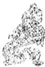

<!-- V3_SOURCE_ID:book016-b001974-p000-19d415a3de -->

译文《象传》说：‘天下依赖他获得颐养，知危能慎可获吉祥’，说明上九大有福庆。

查看对应原文

<!-- V3_FOLDBACK_BEGIN:book016-b001974-p000-19d415a3de -->

译文《象传》说：‘天下依赖他获得颐养，知危能慎可获吉祥’，说明上九大有福庆。

<!-- V3_FOLDBACK_END:book016-b001974-p000-19d415a3de -->

<!-- V3_SOURCE_ID:book016-b001975-p000-f70eeb2b22 -->

《象传》说：“由颐厉吉”，这是说上九大有福庆。

查看对应原文

<!-- V3_FOLDBACK_BEGIN:book016-b001975-p000-f70eeb2b22 -->

《象》曰：“由颐厉吉”，大有庆也。

<!-- V3_FOLDBACK_END:book016-b001975-p000-f70eeb2b22 -->

<!-- V3_SOURCE_ID:book016-b001976-p000-1d0a1122db -->

这说明《颐》卦上九爻的“由颐”，和“由豫”在语法结构上相似，甚至在爻义上也值得比较。王宗传说：“《豫》卦的九四爻，天下依赖它获得安乐，所以说‘大有得’；《颐》卦的上九爻，天下依赖它获得颐养，所以说‘大有庆’。”这段话出自《童溪易传》。

查看对应原文

<!-- V3_FOLDBACK_BEGIN:book016-b001976-p000-1d0a1122db -->

[说明《颐》上九“由颐”，与“由豫”语法结构上相似，甚至在爻义上也值得比较。王宗传曰：“《豫》之九四，天下由之以豫，故曰大有得’；《颐》之上九，天下由之以颐，故曰大有庆'也。”(《童溪易传》)

<!-- V3_FOLDBACK_END:book016-b001976-p000-1d0a1122db -->

<!-- V3_SOURCE_ID:book016-b001977-p000-892e77ce56 -->

《汉书·食货志下》有这样一段话：“酒，是上天赐予的美好福分，帝王用它来颐养天下，祭祀神灵祈求福佑，扶助衰弱、养护病患。”确实，佳酿美酒可以颐养人体，但如果狂饮无度，必然会成为损伤身体、败坏德行的媒介。同理，《颐》卦虽然阐发“颐养”的义理，卦辞开篇就告诫：坚守正道才会吉祥。卦中阐明的“养正”意义，基本宗旨体现在两个方面：“自养”的原则，应当以道德为根本，不能舍弃道德去追求欲望；“养人”的原则，应当出于公心，必须修养德行、惠及万物。六爻的喻义，下三爻都是“自养”没有遵循正道，因此初爻“凶”、二爻“征凶”、三爻“无攸利”；上三爻都在努力“养人”，所以四爻“吉”、五爻“居贞吉”、上爻“吉”且“利”。《折中》引用吴曰慎的话说：“初九、六二、六三，都是只养护自身口腹，是偏私而狭隘的；六四、六五、上九，都是修养自身德行来养护他人，是公正而宏大的。公正而宏大就吉祥，是契合‘颐’的正道；偏私而狭隘就凶险，是违背‘颐’的正理。难道可以不观察‘颐’卦的义理来求取自身的正道吗？”由此可见，六爻的大义是集中赞美“养人”、“养贤”、“养天下”的“颐养”盛德。如果回头从卦辞“自求口实”来看，卦中虽然强调“养德”，但它的立足点始终没有偏离物质基础。据此辨析《颐》卦“养天下”的义理，似乎与《孟子》提倡的“民本”思想以及《管子》提出的“王者以民为天，民以食为天”的言论大致可以关联；从中也能看出《周易》作者的进步观念。

查看对应原文

<!-- V3_FOLDBACK_BEGIN:book016-b001977-p000-892e77ce56 -->

《汉书·食货志下》有这样一段话：“酒者，天之美禄，帝王所以颐养天下，享祀祈福，扶衰养疾。”诚然，佳酿美酒可以颐养人体，但若狂饮无度，必成为伤身损德的媒介。同理，《颐》卦虽发“颐养”之义，卦辞开句便诫：守正则吉。卦中所揭明的“养正”意义，基本宗旨体现在两端：“自养”之道，当本于德，不可弃德求欲；“养人”之道，当出于公，必须养德及物。六爻的喻旨，下三爻皆“自养”不得其道，因此初“凶”、二“征凶”、三“无攸利”；上三爻皆努力“养人”，故四“吉”、五“居贞吉”、上“吉”且“利”。《折中》引吴曰慎曰：“初九、六二、六三，皆自养口体，私而小者也；六四、六五、上九，皆养其德以养人，公而大者也。公而大者吉，得颐’之正也；私而小者凶，失颐’之贞也。可不观颐’而自求其正耶？”可见，六爻大义是集中赞美“养人”、“养贤”、“养天下”的“颐养”盛德。若回头就卦辞“自求口实”看，则卦中尽管强调“养德”，其立足点仍未尝偏离物质基础。据此辨析《颐》卦“养天下”的义理，似与《孟子》提倡的“民本”思想以及《管子》所发“王者以民为天，民以食为天”的言论略可勾联；此中自然也看出《周易》作者的进步观念。

<!-- V3_FOLDBACK_END:book016-b001977-p000-892e77ce56 -->

<!-- V3_SOURCE_ID:book016-b001978-p000-2fdebc62cf -->

## 大过卦第二十八

查看对应原文

<!-- V3_FOLDBACK_BEGIN:book016-b001978-p000-2fdebc62cf -->

## 大过卦第二十八

<!-- V3_FOLDBACK_END:book016-b001978-p000-2fdebc62cf -->

<!-- V3_SOURCE_ID:book016-b001979-p000-e819dbf1ba -->

大过卦象征大为过甚：栋梁曲折弯挠；利于有所前往，亨通。

查看对应原文

<!-- V3_FOLDBACK_BEGIN:book016-b001979-p000-e819dbf1ba -->

大过①：栋桡②；利有攸往， 译文《大过》卦象征大为过甚：栋梁曲折弯挠；利于有所前往，亨通。亨③。

<!-- V3_FOLDBACK_END:book016-b001979-p000-e819dbf1ba -->

<!-- V3_SOURCE_ID:book016-b001980-p000-a0d976147e -->

注释①：大过是卦名，下巽（八卦之一）、上兑（八卦之一），象征“大为过甚”。按，阳刚称为“大”，本卦有四阳爻居中，过盛，所以取名为“大过”。《正义》说：“四阳爻在中间，二阴爻在外侧，是阳刚过越得很厉害的情况。”又按，马其昶说：“《易》的卦名往往包含多种含义。过，是越出；过，是差错；过，是失误。每种含义都有对应的适用情况。”（《重定费氏学》）这种说法可供参考。

查看对应原文

<!-- V3_FOLDBACK_BEGIN:book016-b001980-p000-a0d976147e -->

注释①大过：卦名，下巽(三)上兑(三)，象征“大为过甚”。案，阳刚称“大”，本卦四阳居中过盛，故名“大过”。《正义》：“四阳在中，二阴在外，以阳之过越之甚也。”又案，马其昶曰：“《易》卦名每兼数义。过，越也；过，差也；过，误也。义各有当也。”(《重定费氏学》)此说可资参考。

<!-- V3_FOLDBACK_END:book016-b001980-p000-a0d976147e -->

<!-- V3_SOURCE_ID:book016-b001981-p000-3fd43b1825 -->

②栋桡：栋，指梁，是屋脊的主要部分；桡，读音为náo，通“挠”，《释文》解释为“曲折”。这里以栋梁两端柔弱、承受不住重压，以至于曲折弯挠，来比喻事物中刚强者片面过甚、柔小者承受不住其势的反常状态；本卦中四阳爻过强、二阴爻虚弱，正好呈现这种景象。《本义》说：“上下两个阴爻承受不住阳爻的重量，所以有‘栋桡’的景象。”按，“桡”字，阮刻本作“挠”，《校勘记·补》说：“各本都作‘桡’是正确的，‘挠’字是错误的”，现在据此改正。

查看对应原文

<!-- V3_FOLDBACK_BEGIN:book016-b001981-p000-3fd43b1825 -->

②栋桡：栋，梁，屋脊的主要部分；桡，音náo，通“挠”，《释文》“曲折”。此以栋梁两端柔弱不胜重压，以至曲折弯挠，喻示事物刚大者片面过甚、柔小者不胜其势的反常状态；卦中四阳过强、二阴虚弱，正呈此象。《本义》：“上下二阴不胜其重，故有‘栋桡’之象。”案，“桡”字，阮刻作“挠”，《校勘记·补》曰：“各本皆作‘桡’是，‘挠’字误也”，今据改正（《彖传》“桡”字同）。

<!-- V3_FOLDBACK_END:book016-b001981-p000-3fd43b1825 -->

<!-- V3_SOURCE_ID:book016-b001982-p000-bb63586242 -->

③利于有所前往，亨通：这是说“大过”之时，事物已经反常，就亟待整治；卦中的二爻、五爻阳刚得中，上下卦又有驯顺、和悦以整治“大过”之象（见《彖传》译注），所以利于前往、可得亨通。《本义》说：“四阳虽过，而二、五得中，内巽外说，有可行之道，故利有所往而得亨也。”

查看对应原文

<!-- V3_FOLDBACK_BEGIN:book016-b001982-p000-bb63586242 -->

③利有攸往，亨：此谓“大过”之时，物既反常，则亟待整治；卦中二、五爻阳刚得中，上下卦又有驯顺、和悦以治“大过”之象(见《彖传》译注)，故利往、得亨。《本义》：“四阳虽过，而二、五得中，内巽外说，有可行之道，故利有所往而得亨也。”

<!-- V3_FOLDBACK_END:book016-b001982-p000-bb63586242 -->

<!-- V3_SOURCE_ID:book016-b001983-p000-eed6ae3195 -->

《彖传》说：“大过”，指刚大者过甚①；“栋桡”，指首尾两端柔弱②。阳刚过甚时能适中调济，巽顺和悦地施行整治③，利于有所前往，于是亨通。“大过”之时的意义多么宏大啊④！

查看对应原文

<!-- V3_FOLDBACK_BEGIN:book016-b001983-p000-eed6ae3195 -->

《彖》曰：“大过”，大者过也①；“栋桡”，本末弱也②。刚过而中，巽而说行③，利有攸往，乃亨。“大过”之时大矣哉④！

<!-- V3_FOLDBACK_END:book016-b001983-p000-eed6ae3195 -->

<!-- V3_SOURCE_ID:book016-b001984-p000-c0485ae099 -->

《象传》的译文提到，所谓“大为过甚”，是指刚强者行事过甚；所谓“栋梁曲折弯挠”，说明事物的首尾两端都显得柔弱。当阳刚之气过甚时，能够通过适中的方式加以调节，以驯顺、和悦的态度施行整治，因此利于有所前往，可获得亨通的结果。“大过”之时的功效是多么宏大啊！

查看对应原文

<!-- V3_FOLDBACK_BEGIN:book016-b001984-p000-c0485ae099 -->

译文《象传》说：“大为过甚”，指刚大者过甚：“栋梁曲折弯挠”，说明首尾两端柔弱。阳刚过甚时能够适中调济，驯顺、和悦地施行整治，因此利于有所前往，可获亨通。“大过”之时的功效多么宏大啊！

<!-- V3_FOLDBACK_END:book016-b001984-p000-c0485ae099 -->

<!-- V3_SOURCE_ID:book016-b001985-p000-b63718638b -->

注释①大者过：这是解释卦名“大过”，指卦中阳爻超过阴爻，比喻事物刚大因素过盛。《汉上易传》引用郑玄的话：“阳爻过也。”

查看对应原文

<!-- V3_FOLDBACK_BEGIN:book016-b001985-p000-b63718638b -->

注释①大者过：此释卦名“大过”，谓卦中阳爻超过阴爻，喻事物刚大因素过盛。《汉上易传》引郑玄曰：“阳爻过也。”

<!-- V3_FOLDBACK_END:book016-b001985-p000-b63718638b -->

<!-- V3_SOURCE_ID:book016-b001986-p000-28eb197c62 -->

②本末弱：这里的本末指首尾两端，对应卦中的初爻与上爻。这句话承接前文“大者过也”的含义，解释卦辞“栋桡”；意思是“栋”之所以会“桡”，是因为两端柔弱，不如中间的爻体刚强，所以难以承受重压，导致下挠曲折。卦中的初、上两爻都是阴爻，正是“本末弱”的象征。《王注》说：“初为本，而上为末也。”

查看对应原文

<!-- V3_FOLDBACK_BEGIN:book016-b001986-p000-28eb197c62 -->

②本末弱：本末，首尾两端，指卦中初、上两爻。此句承前文“大者过也”之义，释卦辞“栋桡”；谓“栋”之所以“桡”，是由于两端柔弱、不如中体刚强，故难胜重压、导致下挠曲折。卦中初、上阴爻，正是“本末弱”之象。《王注》：“初为本，而上为末也。”

<!-- V3_FOLDBACK_END:book016-b001986-p000-28eb197c62 -->

<!-- V3_SOURCE_ID:book016-b001987-p000-80458623e3 -->

卷 四

查看对应原文

<!-- V3_FOLDBACK_BEGIN:book016-b001987-p000-80458623e3 -->

卷 四

<!-- V3_FOLDBACK_END:book016-b001987-p000-80458623e3 -->

<!-- V3_SOURCE_ID:book016-b001988-p000-2dff7b6549 -->

③刚过而中，巽而说行：刚、中指的是二、五两爻阳刚居中；巽是八卦之一，下卦巽含有驯顺的含义；说就是“悦”，兑是八卦之一，上卦兑代表“悦”。这两句举二、五爻的爻象以及上下卦的卦象，解释卦辞“利有攸往，亨”；说明阳刚能够居中调和，沿着顺、悦的原则行事，就利于整治“大过”，前往必然亨通。《程传》说：“刚虽过，而二、五皆得中，是处不失中道也；下巽上兑，是以巽顺和说之道而行也。在‘大过’之时，以中道巽顺而行，故‘利有攸往’，乃所以能亨也。”

查看对应原文

<!-- V3_FOLDBACK_BEGIN:book016-b001988-p000-2dff7b6549 -->

③刚过而中，巽而说行：刚、中，指二、五两爻阳刚居中；巽，下卦巽含“驯顺”义；说，即“悦”，上卦兑为“悦”。这两句举二、五爻象及上下卦象释卦辞“利有攸往，亨”；说明阳刚能居中调济，沿顺、悦之道而行，则利于整治“大过”，往必有亨。《程传》：“刚虽过，而二、五皆得中，是处不失中道也；下巽上兑，是以巽顺和说之道而行也。在‘大过’之时，以中道巽顺而行，故‘利有攸往’，乃所以能亨也。”

<!-- V3_FOLDBACK_END:book016-b001988-p000-2dff7b6549 -->

<!-- V3_SOURCE_ID:book016-b001989-p000-77f3665f2f -->

④“大过”之时大矣哉：这里说的是“大过”之时事物反常，亟待整治，“君子”正可以有所作为，所以称“时大”。《王注》说：“是君子有为之时也。”《程传》说：“如立非常之大事，兴百世之大功，成绝俗之大德，皆‘大过’之事也。”

查看对应原文

<!-- V3_FOLDBACK_BEGIN:book016-b001989-p000-77f3665f2f -->

④“大过”之时大矣哉：此谓“大过”之时事物反常，亟待整治，“君子”正可施用，故称“时大”。《王注》：“是君子有为之时也。”《程传》：“如立非常之大事，兴百世之大功，成绝俗之大德，皆‘大过’之事也。”

<!-- V3_FOLDBACK_END:book016-b001989-p000-77f3665f2f -->

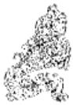

<!-- V3_SOURCE_ID:book016-b001991-p000-1ea6333a70 -->

译文《象传》说：大泽淹没树木，象征“大为过甚”；君子因此(处身“大过”之时)能够独自屹立，毫不畏惧；毅然遁世，无所苦闷。

查看对应原文

<!-- V3_FOLDBACK_BEGIN:book016-b001991-p000-1ea6333a70 -->

译文《象传》说：大泽淹没树木，象征“大为过甚”；君子因此(处身“大过”之时)能够独自屹立，毫不畏惧；毅然遁世，无所苦闷。

<!-- V3_FOLDBACK_END:book016-b001991-p000-1ea6333a70 -->

<!-- V3_SOURCE_ID:book016-b001992-p000-a12ca1fd7a -->

《象传》说：大泽淹没树木，这就是《大过》卦的卦象；君子因此应当独自立身而不畏惧，远离世俗而不苦闷。

查看对应原文

<!-- V3_FOLDBACK_BEGIN:book016-b001992-p000-a12ca1fd7a -->

《象》曰：泽灭木，大过①；君子以独立不惧，遁世无闷②。

<!-- V3_FOLDBACK_END:book016-b001992-p000-a12ca1fd7a -->

<!-- V3_SOURCE_ID:book016-b001993-p000-4b1f31d526 -->

注释①泽灭木，大过：这是解释《大过》卦上兑为泽、下巽为木的卦象。《程传》说：“泽本是滋润养育树木的，如今竟淹没了树木，这就过甚了，所以称为‘大过’。”

查看对应原文

<!-- V3_FOLDBACK_BEGIN:book016-b001993-p000-4b1f31d526 -->

注释①泽灭木，大过：释《大过》卦上兑为泽、下巽为木之象。《程传》：“泽，润养于木者也，乃至灭没于木，则过甚矣，故为‘大过’。”

<!-- V3_FOLDBACK_END:book016-b001993-p000-4b1f31d526 -->

<!-- V3_SOURCE_ID:book016-b001994-p000-8c8bba4212 -->

②独立不惧，遁世无闷：这是说君子观察卦象，领悟到应当以超出常人的行为应对“大过”的时势，因此能够独自立身而不畏惧，远离世俗而不苦闷。《王注》说：“这就是之所以称为‘大过’的原因，不是平常人所能做到的。”《程传》说：“君子观察《大过》的卦象，来确立自己超出常人的行为。君子之所以超出常人，是因为他能独自立身而不畏惧，远离世俗而不苦闷。天下人都非议他，他也不顾及，这就是独自立身而不畏惧；整个世间都不了解他，他也不悔恨，这就是远离世俗而不苦闷。”

查看对应原文

<!-- V3_FOLDBACK_BEGIN:book016-b001994-p000-8c8bba4212 -->

②独立不惧，遁世无闷：此谓“君子”观卦象，悟知当以“大过人”之举处“大过”之时，故能“独立不惧，遁世无闷”。《王注》：“此所以为‘大过’，非凡所及也。”《程传》：“君子观《大过》之象，以立其‘大过人’之行。君子所以‘大过人’者，以其能独立不惧，遁世无闷也。天下非之而不顾，独立不惧也；举世不见知而不悔，遁世无闷也。”

<!-- V3_FOLDBACK_END:book016-b001994-p000-8c8bba4212 -->

<!-- V3_SOURCE_ID:book016-b001995-p000-d7b0331928 -->

解释卦辞中的“栋桡”，是用来比喻事物处于“大过”状态下的反常情形，《大象传》里的“木灭泽”也说明了这一点；“独立”“遁世”，则是阐发君子在“大过”之时所具备的非凡气魄。孔颖达认为《大过》卦有两层含义：“一是事物自然地大幅超出常规本分”；“二是大人大幅超出常规本分来拯救患难”。这种说法可以作为参考。

查看对应原文

<!-- V3_FOLDBACK_BEGIN:book016-b001995-p000-d7b0331928 -->

说明卦辞“栋桡”，是喻示事物“大过”的反常情状，《大象传》“木灭泽”亦明此事；“独立”、“遁世”，则阐发“君子”处“大过”的非凡气魄。孔颖达认为《大过》卦有二义：“一者，物之自然大相过越常分”；“二者，大人大过越常分以拯患难”(《正义》)。此说可备参考。

<!-- V3_FOLDBACK_END:book016-b001995-p000-d7b0331928 -->

<!-- V3_SOURCE_ID:book016-b001996-p000-28fdb4fbbd -->

初六，用白茅衬垫，没有过错①。

查看对应原文

<!-- V3_FOLDBACK_BEGIN:book016-b001996-p000-28fdb4fbbd -->

初六,藉用白茅，无咎①。

<!-- V3_FOLDBACK_END:book016-b001996-p000-28fdb4fbbd -->

<!-- V3_SOURCE_ID:book016-b001997-p000-d0c093c0ff -->

注释①藉用白茅，无咎：藉，读音为jiè，指衬垫，《释文》引用马融的说法：“在下方的叫做藉”，也就是用东西垫在下面来承托物品；白茅，指洁白的茅草。这两句是说明初六处于“大过”之时，作为一阴爻居于下位，应当极为恭敬谨慎地承事上方的阳刚，才能避免“咎”；所以爻辞用白茅衬在地上承托物品来奉上作为比喻。《集解》引用侯果的说法：“以柔爻居于下位，所处位置不当，本会有咎；如果能保持洁诚肃敬不懈怠，即使把食物放在地上也可以进奉；何况用白茅衬垫，是极度谨慎的表现，又会有什么咎呢？”

查看对应原文

<!-- V3_FOLDBACK_BEGIN:book016-b001997-p000-d0c093c0ff -->

注释①藉用白茅，无咎：藉，音jiè，衬垫，《释文》引马融曰：“在下曰藉”，即用物垫于下以承物；白茅，洁白的茅草。这两句说明初六当“大过”之时，一阴在下，应当极为敬慎承事上之阳刚，才能免“咎”；故爻辞拟白茅衬地承物以奉上为喻。《集解》引侯果曰：“以柔处下，履非其正，咎也。苟能絜诚肃恭不怠，虽置羞于地可以荐奉；况藉用白茅，重慎之至，何咎之有矣？”

<!-- V3_FOLDBACK_END:book016-b001997-p000-d0c093c0ff -->

<!-- V3_SOURCE_ID:book016-b001998-p000-b87f0e8d69 -->

## 《象》曰：藉用白茅，柔在下也。

> **释读存疑：** 本地硬校验仍未通过，已记录供后续自动处理或人工核对。

查看对应原文

<!-- V3_FOLDBACK_BEGIN:book016-b001998-p000-b87f0e8d69 -->

## 《象》曰：藉用白茅，柔在下也。

<!-- V3_FOLDBACK_END:book016-b001998-p000-b87f0e8d69 -->

<!-- V3_SOURCE_ID:book016-b001999-p000-db128ccec9 -->

《象传》说：“用洁白的茅草衬垫承放奉献尊者的物品”，这说明初六爻的爻象是阴柔居处下位，行事恭敬谨慎。

查看对应原文

<!-- V3_FOLDBACK_BEGIN:book016-b001999-p000-db128ccec9 -->

译文《象传》说：“用洁白的茅草衬垫承放(奉献尊者的物品)”，说明初六柔顺居下、行为敬慎。

<!-- V3_FOLDBACK_END:book016-b001999-p000-db128ccec9 -->

<!-- V3_SOURCE_ID:book016-b002000-p000-9e66019fab -->

这说明当处于“大过”卦的情境时，爻象以柔弱卑小之态居处最下位，自然应当恭敬谨慎地承顺阳刚，才能借助对方的刚健来补益自身的阴柔，从而避开灾害、趋向利益。《系辞上传》引用孔子的话，解释这一爻的含义十分明确：“如果直接把物品放在地上就可以了；但用茅草来衬垫，又会有什么过错呢？这是谨慎到了极点。茅草作为物品本身很微薄，但它的用途却可以很重要。秉持这种谨慎的态度行事，就不会有什么过失了。”

查看对应原文

<!-- V3_FOLDBACK_BEGIN:book016-b002000-p000-9e66019fab -->

说明时当‘大过’，以柔弱卑小处于极下，自宜敬慎承阳，才能以彼刚济己柔，避害趋利。《系辞上传》引孔子语，释此爻之义甚明：‘苟错诸地可矣；藉之用茅，何咎之有？慎之至也。夫茅之为物薄，而用可重也。慎斯术以往，其无所失矣。’

<!-- V3_FOLDBACK_END:book016-b002000-p000-9e66019fab -->

<!-- V3_SOURCE_ID:book016-b002001-p000-c26eba29d2 -->

## 九二，枯杨生稊，老夫得其女妻①；无不利。 — 九二——枯槁的杨树生出嫩芽新枝，龙钟老汉娶了个年少娇妻①；无所不利。

查看对应原文

<!-- V3_FOLDBACK_BEGIN:book016-b002001-p000-c26eba29d2 -->

## 九二，枯杨生稊，老夫得其女妻①；无不利。

<!-- V3_FOLDBACK_END:book016-b002001-p000-c26eba29d2 -->

<!-- V3_SOURCE_ID:book016-b002002-p000-4739c20308 -->

九二爻的爻象是，枯槁的杨树生出嫩芽新枝，龙钟老汉娶了个年少娇妻；没有什么不利的事。

> **释读存疑：** 原文未提及“龙”相关内容，释读中未涉及该术语的不当使用

查看对应原文

<!-- V3_FOLDBACK_BEGIN:book016-b002002-p000-4739c20308 -->

译文九二，枯槁的杨树生出嫩芽新枝，龙钟老汉娶了个年少娇妻；无所不利。

<!-- V3_FOLDBACK_END:book016-b002002-p000-4739c20308 -->

<!-- V3_SOURCE_ID:book016-b002003-p000-327ea4cc5c -->

匡释①枯杨生梯，老夫得其女妻：梯，读音为tí，通“荑”，指树木新生的芽、枝，《尚氏学》记载：“‘梯’、‘荑’同字”，“‘荑’为木新生之条”。本爻的拟象十分生动：用枯杨树长出新枝、老汉娶得年轻妻子，来比喻九二爻以“过甚”的阳爻处于中位，向下与初六爻柔弱的阴爻相比邻，于是刚柔相济，双方都能获益；在“大过”卦中这样的爻象，就没有什么不利的。《王注》说：“老过则枯，少过则稚。以老分少，则稚者长；以稚分老，则枯者荣。过以相与之谓也。”《折中》引用王申子的话：“《大过》卦的各爻，以刚柔适中的为好。初爻以柔爻居于刚位，二爻以刚爻居于柔位且与初爻相邻，这就是刚柔适中，相互辅助而能建立功业。它的阳爻过甚，就像杨树枯萎，就像丈夫年老；它相互辅助而建立功业，就像枯杨树长出新枝，就像老汉娶得年轻妻子。说阳爻虽然过甚，但九二爻处于中位，所以没有不利。”

查看对应原文

<!-- V3_FOLDBACK_BEGIN:book016-b002003-p000-327ea4cc5c -->

匡释①枯杨生梯，老夫得其女妻：梯，音tí，通“荑”，树木新生的芽、枝，《尚氏学》：“‘稀’、‘荑’同字”，“‘荑’为木新生之条”。本爻拟象十分生动：以枯杨生出新枝、老汉娶得幼妻，比喻九二以“过甚”之阳得处中位，下比初六柔弱之阴，遂能刚柔相济，各自获益；以此处“大过”，则无所不利。《王注》：“老过则枯，少过则稚。以老分少，则稚者长；以稚分老，则枯者荣。过以相与之谓也。”《折中》引王申子曰：“《大过》诸爻，以刚柔适中者为善。初以柔居刚，二以刚居柔而比之，是刚柔适中，相济而有功者也。其阳过也，如杨之枯，如夫之老；其相济而有功也，如枯杨而生梯，如老夫得女妻。言阳虽过矣，九二处之得中，故无不利’。”

<!-- V3_FOLDBACK_END:book016-b002003-p000-327ea4cc5c -->

<!-- V3_SOURCE_ID:book016-b002004-p000-464567af56 -->

## 《象》曰：“老夫女妻”，过以相与也。 — 《象传》中提到‘老夫女妻’，这是因为阴阳过当却能相互亲与。

查看对应原文

<!-- V3_FOLDBACK_BEGIN:book016-b002004-p000-464567af56 -->

## 《象》曰：“老夫女妻”，过以相与也。

<!-- V3_FOLDBACK_END:book016-b002004-p000-464567af56 -->

<!-- V3_SOURCE_ID:book016-b002005-p000-18d5db7b9e -->

《象传》说：‘龙’对应的是风水中山脉、地势及气脉的来势和行度，此处指相关爻象所涉的龙类意象，老汉娶了个年少幼妻，说明九二阳刚过甚，但能和初六阴柔相互亲与。

> **释读存疑：** 此处‘龙’的具体所指结合上下文为风水相关的气脉意象，具体关联细节未明；1轮自动修复后核义模型仍建议修订，已保守记录。

查看对应原文

<!-- V3_FOLDBACK_BEGIN:book016-b002005-p000-18d5db7b9e -->

译文《象传》说：‘龙钟老汉娶了个年少幼妻’，说明九二阳刚过甚，但能和初六阴柔相互亲与。

<!-- V3_FOLDBACK_END:book016-b002005-p000-18d5db7b9e -->

<!-- V3_SOURCE_ID:book016-b002006-p000-d673435569 -->

九二爻获得‘无不利’的评价，在于阳爻居于阴位，再辅以初六爻的阴柔。司马光说：‘《大过》卦的阳刚已经过甚，正可济之以柔，而不可济之以刚也。故《大过》之阳，皆以居阴为吉，而不以得位为美也。’

查看对应原文

<!-- V3_FOLDBACK_BEGIN:book016-b002006-p000-d673435569 -->

∑萌九二获“无不利”，在于阳居阴位，再济之以初之阴柔。司马光曰：“《大过》刚已过矣，正可济之以柔，而不可济之以刚也。故《大过》之阳，皆以居阴为吉，而不以得位为美也。”(《温公易说》)

<!-- V3_FOLDBACK_END:book016-b002006-p000-d673435569 -->

<!-- V3_SOURCE_ID:book016-b002007-p000-ffe9b26b1e -->

九三爻，栋桡，凶①。

查看对应原文

<!-- V3_FOLDBACK_BEGIN:book016-b002007-p000-ffe9b26b1e -->

九三，栋桡，凶①。

<!-- V3_FOLDBACK_END:book016-b002007-p000-ffe9b26b1e -->

<!-- V3_SOURCE_ID:book016-b002008-p000-368fc2af14 -->

译文九三，栋梁曲折弯挠，有凶险。

查看对应原文

<!-- V3_FOLDBACK_BEGIN:book016-b002008-p000-368fc2af14 -->

译文九三，栋梁曲折弯挠，有凶险。

<!-- V3_FOLDBACK_END:book016-b002008-p000-368fc2af14 -->

<!-- V3_SOURCE_ID:book016-b002009-p000-ce95ee6ae8 -->

匡释①栋桡，凶：这是说九三爻处于“大过”之时，阳爻居于下卦之极，刚亢过甚；又应于上六，刚势益烈：正如“栋之中体愈刚、本末愈弱”，故有“栋桡”之象。爻义与卦辞合，言如此处“大过”，“栋”必挠曲、凶险将至。《集解》引虞翻曰：“本末弱，故挠。”《程传》：“以过甚之刚，动则违于中和，而拂于众心，安能当‘大过’之任乎？故不胜其任，如栋之桡，倾败其室，是以凶也。”

> **释读存疑：** 本地硬校验仍未通过，已记录供后续自动处理或人工核对。

查看对应原文

<!-- V3_FOLDBACK_BEGIN:book016-b002009-p000-ce95ee6ae8 -->

匡释①栋桡，凶：此谓九三当“大过”之时，阳居下卦之极，刚亢过甚；又应于上六，刚势益烈：正如栋之中体愈刚、本末愈弱，故有“栋桡”之象。爻义与卦辞合，言如此处“大过”，“栋”必挠曲、凶险将至。《集解》引虞翻曰：“本末弱，故挠。”《程传》：“以过甚之刚，动则违于中和，而拂于众心，安能当大过’之任乎？故不胜其任，如栋之桡，倾败其室，是以凶也。”

<!-- V3_FOLDBACK_END:book016-b002009-p000-ce95ee6ae8 -->

<!-- V3_SOURCE_ID:book016-b002010-p000-d45f7a35cd -->

《象》曰：“栋桡之凶”，不可以有辅也①。《象传》说：“栋梁曲折弯挠而有凶险”，说明九三的刚势不能再加以辅助。

> **释读存疑：** 原文存在排版混乱，‘不可以 译文《象传》说’部分的原文与释文边界不清，具体所指存在歧义；1轮自动修复后核义模型仍建议修订，已保守记录。

查看对应原文

<!-- V3_FOLDBACK_BEGIN:book016-b002010-p000-d45f7a35cd -->

《象》曰：“栋桡之凶”，不可以 译文《象传》说：“栋梁曲折弯挠而有凶有辅也①。 险”，说明九三的刚势不能再加以辅助。

<!-- V3_FOLDBACK_END:book016-b002010-p000-d45f7a35cd -->

<!-- V3_SOURCE_ID:book016-b002011-p000-b5a4736a4d -->

注释①：不能有辅助。辅，就是帮助的意思。这句话是说明《大过》卦的九三爻不可以与上六爻相应；如果九三爻与上六爻相应，阳刚的势头得到帮助就会更猛烈，那么‘栋桡’的情况就会更严重。《集解》引用虞翻的话说：‘辅助只会让‘桡’的情况更严重，所以不能有辅助。阳爻以阴爻为辅助。’

> **释读存疑：** 原文未明确说明此处的《大过》卦是否为该注释所指的卦，释读中直接提及《大过》卦，属于补全原文未明确的信息

查看对应原文

<!-- V3_FOLDBACK_BEGIN:book016-b002011-p000-b5a4736a4d -->

注释①不可以有辅也：辅，助也。此句说明九三不可应上；若得应于上六，刚势获助益烈，则‘栋桡’益甚。《集解》引虞翻曰：‘辅之益‘桡’，故不可以有辅。阳以阴为辅也。’

<!-- V3_FOLDBACK_END:book016-b002011-p000-b5a4736a4d -->

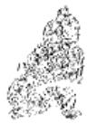

<!-- V3_SOURCE_ID:book016-b002013-p000-e6631e41ac -->

说明：如果在别的卦中，九三爻得到正应的上爻，本是好事；但处在‘大过’这种反常的时刻，它的阳刚之质只可以减损，不可以增益。所以爻辞说阳刚过度必然导致‘凶’，《象传》又说‘不可以有辅’。

查看对应原文

<!-- V3_FOLDBACK_BEGIN:book016-b002013-p000-e6631e41ac -->

说明 若在他卦，九三得正应上，本可佳美；但居“大过”反常之时，其刚可损不可益。故爻辞谓过刚必致“凶”，《象传》又曰“不可以有辅”。

<!-- V3_FOLDBACK_END:book016-b002013-p000-e6631e41ac -->

<!-- V3_SOURCE_ID:book016-b002014-p000-f049a3ba86 -->

在下方，栋梁的弯曲得以平复，吉祥；要是九四爻，爻辞说‘栋隆，吉①；有它，吝②。’

查看对应原文

<!-- V3_FOLDBACK_BEGIN:book016-b002014-p000-f049a3ba86 -->

于下方，栋梁起平复，吉祥；要是 九四，栋隆，吉①；有它，吝②。

<!-- V3_FOLDBACK_END:book016-b002014-p000-f049a3ba86 -->

<!-- V3_SOURCE_ID:book016-b002015-p000-178ddbceda -->

注释①：栋隆，吉：隆，就是隆起，也就是下方‘挠’的态势得以平复。这是说九四爻处在《大过》卦上卦的起始位置，阳爻居于阴位，还能自行减损过于刚猛的性质，来挽救本末的‘挠’，让‘栋’体隆起平复，所以获得吉祥。《本义》说：‘以阳爻居于阴位，虽有过失却能不过分，所以它的意象是‘隆’，占断结果是‘吉’。’

查看对应原文

<!-- V3_FOLDBACK_BEGIN:book016-b002015-p000-178ddbceda -->

注释①栋隆，吉：隆，隆起，即下“挠”之势平复。此谓九四处《大过》上卦之始，阳居阴位，犹自损过刚之质，以救“本末”之“挠”，使“栋”体隆起平复，故获吉祥。《本义》：“以阳居阴，过而不过，故其象‘隆’而占‘吉’。”

<!-- V3_FOLDBACK_END:book016-b002015-p000-178ddbceda -->

<!-- V3_SOURCE_ID:book016-b002016-p000-fe31276d5c -->

②有它，吝：有它，就会在其他方位出现相应的情况，这里指的是与初六相应。这两句是因为九四与初六有相应关系，特意设置的告诫之辞，意思是九四已经减损阳刚使“栋隆”，如果再向下与初六相应，就会变得过于柔弱，反而无法挽救“挠”的局面，从而导致“吝”的结果。《本义》中说：“下应初六，以柔济之，则过于柔矣，故又戒以‘有它’则‘吝’。”

> **释读存疑：** 原文中‘有应于它方’的具体所指未明确，释读中‘其他方位’的表述为常规释义，未添加无依据内容

查看对应原文

<!-- V3_FOLDBACK_BEGIN:book016-b002016-p000-fe31276d5c -->

②有它，吝：有它，有应于它方(参阅《比》初六译注)，此处指应初。这两句因九四与初有应，特设诫辞，谓四既已损刚使“栋隆”，若再趋下应初、则将过柔，反不能救“挠”，而致有“吝”。《本义》：“下应初六，以柔济之，则过于柔矣，故又戒以‘有它’则‘吝’。”

<!-- V3_FOLDBACK_END:book016-b002016-p000-fe31276d5c -->

<!-- V3_SOURCE_ID:book016-b002017-p000-0cdfec08ee -->

《象传》说：“栋梁隆起平复，吉祥”，这说明九四使栋梁不再往下曲折弯挠。

> **释读存疑：** 本地硬校验仍未通过，已记录供后续自动处理或人工核对。

查看对应原文

<!-- V3_FOLDBACK_BEGIN:book016-b002017-p000-0cdfec08ee -->

译文《象传》说：“栋梁隆起平复，吉祥”，说明九四使栋梁不再往下曲折弯挠。

<!-- V3_FOLDBACK_END:book016-b002017-p000-0cdfec08ee -->

<!-- V3_SOURCE_ID:book016-b002018-p000-e993ce5fac -->

《象传》说：“栋隆之吉”，意思是不会向下弯曲。

查看对应原文

<!-- V3_FOLDBACK_BEGIN:book016-b002018-p000-e993ce5fac -->

《象》曰：“栋隆之吉”，不桡乎下也。

<!-- V3_FOLDBACK_END:book016-b002018-p000-e993ce5fac -->

<!-- V3_SOURCE_ID:book016-b002019-p000-d4ef72c8e2 -->

说明三、四这两个爻都不宜与对应的爻位相应，二者的原因不同：九三以强健刚亢的体质与上爻相应，得到相应关系后会更加刚亢，必然会让“栋桡”的情况更严重；九四以刚柔调和的体质与初六相应，向下趋向就会变得过于柔弱，必然会导致“栋隆”的状态又变成“挠”。因此，九四的“吉”，只要自行减损阳刚、不与初六相应就能获得；九三的“凶”，如果再加上躁动着向上相应，将会增添凶险。

查看对应原文

<!-- V3_FOLDBACK_BEGIN:book016-b002019-p000-d4ef72c8e2 -->

说明三、四两爻均不宜与应爻相应，其原因不同：三以强健刚亢之体应上，得应则益亢，必使“栋桡”更甚；四以刚柔调济之质应初，趋下则过柔，必致“栋隆”复“挠”。因此，九四之“吉”，只须自损阳刚、不与初应即可获得；九三之“凶”，若兼以躁动上应将增添凶险。

<!-- V3_FOLDBACK_END:book016-b002019-p000-d4ef72c8e2 -->

<!-- V3_SOURCE_ID:book016-b002020-p000-7f979a8138 -->

译文九五，枯槁的杨树开出新花，龙钟 老太配了个强壮丈夫；不遭咎害、也无所 九五，枯杨生华，老妇得其士佳誉。 夫①；无咎无誉②。

查看对应原文

<!-- V3_FOLDBACK_BEGIN:book016-b002020-p000-7f979a8138 -->

译文九五，枯槁的杨树开出新花，龙钟 老太配了个强壮丈夫；不遭咎害、也无所 九五，枯杨生华，老妇得其士佳誉。 夫①；无咎无誉②。

<!-- V3_FOLDBACK_END:book016-b002020-p000-7f979a8138 -->

<!-- V3_SOURCE_ID:book016-b002021-p000-0c8f5ebdd5 -->

注释①枯杨生华，老妇得其士夫：这两句拟象与九二相对，也十分生动；以枯杨生出新花，老妇配得壮夫，比喻九五刚健之阳(犹“士夫”)亲比上六衰极之阴(犹“老妇”)，两者勉力调济、阴阳和合，故有“生华”之象。《折中》引沈该曰：“九二比于初，近本也，‘生稀’之象；九五承于上，近末也，‘生华’之象。”

查看对应原文

<!-- V3_FOLDBACK_BEGIN:book016-b002021-p000-0c8f5ebdd5 -->

注释①枯杨生华，老妇得其士夫：这两句拟象与九二相对，也十分生动；以枯杨生出新花，老妇配得壮夫，比喻九五刚健之阳(犹“士夫”)亲比上六衰极之阴(犹“老妇”)，两者勉力调济、阴阳和合，故有“生华”之象。《折中》引沈该曰：“九二比于初，近本也，‘生稀’之象；九五承于上，近末也，‘生华’之象。”

<!-- V3_FOLDBACK_END:book016-b002021-p000-0c8f5ebdd5 -->

<!-- V3_SOURCE_ID:book016-b002022-p000-b1429b0f40 -->

②无咎无誉：此谓九五勉力拯救“本末弱”的反常局面，虽“老妇”也与相配，以期刚柔调济，不失“大过人”之举，故“无咎”；但极强配极弱，终难善成其功，且有对偶不适之憾，故“无誉”。 公

查看对应原文

<!-- V3_FOLDBACK_BEGIN:book016-b002022-p000-b1429b0f40 -->

②无咎无誉：此谓九五勉力拯救“本末弱”的反常局面，虽“老妇”也与相配，以期刚柔调济，不失“大过人”之举，故“无咎”；但极强配极弱，终难善成其功，且有对偶不适之憾，故“无誉”。 公

<!-- V3_FOLDBACK_END:book016-b002022-p000-b1429b0f40 -->

<!-- V3_SOURCE_ID:book016-b002023-p000-6b3de85b5a -->

译文《象传》说：“枯槁的杨树开出新花”，生机怎能长久呢？“龙钟老太配了个强壮丈夫”，这样的情状也太可羞丑。

查看对应原文

<!-- V3_FOLDBACK_BEGIN:book016-b002023-p000-6b3de85b5a -->

译文《象传》说：“枯槁的杨树开出新花”，生机怎能长久呢？“龙钟老太配了个强壮丈夫”，这样的情状也太可羞丑。

<!-- V3_FOLDBACK_END:book016-b002023-p000-6b3de85b5a -->

<!-- V3_SOURCE_ID:book016-b002024-p000-0147999998 -->

《象传》说：“枯杨生华”，这种情况怎么可能长久呢？“老妇士夫”，也是很不光彩的事啊。

查看对应原文

<!-- V3_FOLDBACK_BEGIN:book016-b002024-p000-0147999998 -->

《象》曰：“枯杨生华”，何可久也？“老妇士夫”，亦可丑也。

<!-- V3_FOLDBACK_END:book016-b002024-p000-0147999998 -->

<!-- V3_SOURCE_ID:book016-b002025-p000-bbe405ecb9 -->

这说明九五爻以极刚之性去辅助极柔之质，虽然无法取得完满的成功，但总算竭尽了最后力量。因此，它“无咎无誉”的结局，实在是大势所趋，不是人力所能改变的。

查看对应原文

<!-- V3_FOLDBACK_BEGIN:book016-b002025-p000-bbe405ecb9 -->

说明九五以极刚济极柔，虽不能完满成功，但总算竭尽了最后 因此，其“无咎无誉”的结局，实是大势所然，非人力所能改易。

<!-- V3_FOLDBACK_END:book016-b002025-p000-bbe405ecb9 -->

<!-- V3_SOURCE_ID:book016-b002026-p000-aa0d94cd81 -->

译文：上六爻，涉水过深以至淹没头顶；有凶险，但没有咎害。

查看对应原文

<!-- V3_FOLDBACK_BEGIN:book016-b002026-p000-aa0d94cd81 -->

译文上六，涉水过深以至淹没头顶；有凶险，但无所咎害。

<!-- V3_FOLDBACK_END:book016-b002026-p000-aa0d94cd81 -->

<!-- V3_SOURCE_ID:book016-b002027-p000-dd1df0dc99 -->

上六爻，涉水过深以至淹没头顶，有凶险，但没有咎害①。

查看对应原文

<!-- V3_FOLDBACK_BEGIN:book016-b002027-p000-dd1df0dc99 -->

上六，过涉灭顶，凶，无咎①。

<!-- V3_FOLDBACK_END:book016-b002027-p000-dd1df0dc99 -->

<!-- V3_SOURCE_ID:book016-b002028-p000-a14f28e986 -->

注释①过涉灭顶，凶，无咎：这是用涉水淹溺、遭遇灭顶之灾作比喻，说明上六处于《大过》卦的极阴之位，虽然下与九五阳刚爻亲近，竭力求取阳刚之力来济助阴柔，但因为才力过于薄弱，终究难免“亡身”；不过看它“独立不惧”的救时毅力，结局虽然“凶”，但符合“杀身成仁”的道义，因此“无咎”。《本义》说：“处过极之地，才弱不足以济，然于义为‘无咎’矣：盖杀身成仁之事。”

查看对应原文

<!-- V3_FOLDBACK_BEGIN:book016-b002028-p000-a14f28e986 -->

注释①过涉灭顶，凶，无咎：这是以涉水淹溺、遭灭顶之灾，喻上六极阴处《大过》之终，虽下比九五阳刚，竭力取阳济阴，但因才力过弱，终究难免“亡身”；然视其“独立不惧”的救时毅力，结局虽“凶”，而“杀身成仁”之义则“无咎”。《本义》：“处过极之地，才弱不足以济，然于义为‘无咎’矣：盖杀身成仁之事。”

<!-- V3_FOLDBACK_END:book016-b002028-p000-a14f28e986 -->

<!-- V3_SOURCE_ID:book016-b002029-p000-b8275553c2 -->

《象传》说：“过涉之凶”，这种情况不可视为咎害。

查看对应原文

<!-- V3_FOLDBACK_BEGIN:book016-b002029-p000-b8275553c2 -->

《象》曰：“过涉之凶”，不可咎也。

<!-- V3_FOLDBACK_END:book016-b002029-p000-b8275553c2 -->

<!-- V3_SOURCE_ID:book016-b002030-p000-4abe39ee09 -->

译文《象传》说：“涉水过深以至淹没头顶有凶险”，说明上六救时亡身、不可视为有咎害。

查看对应原文

<!-- V3_FOLDBACK_BEGIN:book016-b002030-p000-4abe39ee09 -->

译文《象传》说：“涉水过深以至淹没头顶有凶险”，说明上六救时亡身、不可视为有咎害。

<!-- V3_FOLDBACK_END:book016-b002030-p000-4abe39ee09 -->

<!-- V3_SOURCE_ID:book016-b002031-p000-887870290d -->

说丽上六就像“栋梁”的“末端”，因过弱不胜重负而下曲；当极力拯救仍未能承压之时，毅然自损其身，保存主体，大屋赖以不陷。李士珍在《周易学说》中引述道：“时无可为，祸无可避，甘罹其凶”，这正是爻辞“凶”而“无咎”的寓意。

查看对应原文

<!-- V3_FOLDBACK_BEGIN:book016-b002031-p000-887870290d -->

说丽上六犹如“栋梁”的“末端”，因过弱不胜重负而下曲；当极力拯救仍未能承压之时，毅然自损其身，保存主体，大屋赖以不陷。李士珍谓：“时无可为，祸无可避，甘罹其凶”(《周易学说》引)，正是爻辞“凶”而“无咎”的寓意。

<!-- V3_FOLDBACK_END:book016-b002031-p000-887870290d -->

<!-- V3_SOURCE_ID:book016-b002032-p000-607f8d0838 -->

自然界及人类社会中，事物的发展有时将导致阳刚过甚、阴柔极弱，或主体因素过甚、附属因素极弱等情形；于是“生态”失调，物象反常。这就是《大过》卦所揭示的“大为过甚”的事状。卦辞先取“栋梁”曲折下挠为喻，表明“阳刚”者“大过”、“阴柔”者不胜其势的景况；再指出此时亟待“大过人”之举奋力拯治，则可以调济阴阳，走向“亨通”。卦中六爻分别说明善处“大过”的道理，其义主于：上下两阴须取刚济柔，中间四阳须取柔济刚；如此互济，才能救“大过”之弊，成调和之功。但诸爻处时各异，遂致吉凶有别：初、二相比，善于互调刚柔，故初“无咎”、二“无不利”；五、上也相比，但阴阳悬殊太甚，虽竭力调济，终难完满成功，故五“无咎无誉”、上“凶，无咎”；唯三、四两阳最远两阴，必当自损阳刚、静居顺调，而三违逆此道致“凶”，四遵循此道获“吉”。可见，拯治“大过”的根本原则是“刚柔相济”、力求平衡。当然，拯治过程中，“大过人”的举动又是至为关键的；卦中所取“枯杨”生芽、开花，“老夫”、“老妇”得配“女妻”、“壮夫”等象，即含“非同寻常”之义。最使后人警醒的，莫过于上六涉水“灭顶”所寓含的“杀身成仁”以救“大过”之旨。《大象传》称“独立不惧”，《论语·季氏》曰“危而不持，颠而不扶，将焉用彼相矣”，并可启发此爻的意蕴。

查看对应原文

<!-- V3_FOLDBACK_BEGIN:book016-b002032-p000-607f8d0838 -->

自然界及人类社会中，事物的发展有时将导致阳刚过甚、阴柔极弱，或主体因素过甚、附属因素极弱等情形；于是“生态”失调，物象反常。这就是《大过》卦所揭示的“大为过甚”的事状。卦辞先取“栋梁”曲折下挠为喻，表明“阳刚”者“大过”、“阴柔”者不胜其势的景况；再指出此时亟待“大过人”之举奋力拯治，则可以调济阴阳，走向“亨通”。卦中六爻分别说明善处“大过”的道理，其义主于：上下两阴须取刚济柔，中间四阳须取柔济刚；如此互济，才能救“大过”之弊，成调和之功。但诸爻处时各异，遂致吉凶有别：初、二相比，善于互调刚柔，故初“无咎”、二“无不利”；五、上也相比，但阴阳悬殊太甚，虽竭力调济，终难完满成功，故五“无咎无誉”、上“凶，无咎”；唯三、四两阳最远两阴，必当自损阳刚、静居顺调，而三违逆此道致“凶”，四遵循此道获“吉”。可见，拯治“大过”的根本原则是“刚柔相济”、力求平衡。当然，拯治过程中，“大过人”的举动又是至为关键的；卦中所取“枯杨”生芽、开花，“老夫”、“老妇”得配“女妻”、“壮夫”等象，即含“非同寻常”之义。最使后人警醒的，莫过于上六涉水“灭顶”所寓含的“杀身成仁”以救“大过”之旨。《大象传》称“独立不惧”，《论语·季氏》曰“危而不持，颠而不扶，将焉用彼相矣”，并可启发此爻的意蕴。

<!-- V3_FOLDBACK_END:book016-b002032-p000-607f8d0838 -->

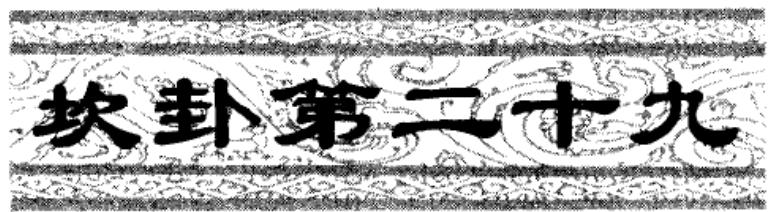

<!-- V3_SOURCE_ID:book016-b002034-p000-5b32de0b9b -->

译文《坎》卦象征重重险陷：只要胸怀信实，就能使内心亨通，努力前行必被崇尚。

查看对应原文

<!-- V3_FOLDBACK_BEGIN:book016-b002034-p000-5b32de0b9b -->

译文《坎》卦象征重重险陷：只要胸怀信实，就能使内心亨通，努力前行必被崇尚。

<!-- V3_FOLDBACK_END:book016-b002034-p000-5b32de0b9b -->

<!-- V3_SOURCE_ID:book016-b002035-p000-25c9e2c96c -->

习坎①：心怀诚信，心意亨通；行事会受到尊崇。

> **释读存疑：** ①为原书注释标记，具体所指不详

查看对应原文

<!-- V3_FOLDBACK_BEGIN:book016-b002035-p000-25c9e2c96c -->

习坎①：有孚，维心亨②；行有尚③。

<!-- V3_FOLDBACK_END:book016-b002035-p000-25c9e2c96c -->

<!-- V3_SOURCE_ID:book016-b002036-p000-a120d4a112 -->

匡释①：习坎，习是重叠的意思，《集解》引用陆绩的话：“重也”；坎是卦名，下卦和上卦都是坎()，象征“险陷”。《本义》说：“习，重习也；坎，险陷也。其象为水，阳陷阴中，外虚而中实也。此卦上下皆坎，是为重险。”按，《王注》将“习”解释为“便习”，可以作为一种说法参考。

> **释读存疑：** ①为原书注释标记，具体所指不详

查看对应原文

<!-- V3_FOLDBACK_BEGIN:book016-b002036-p000-a120d4a112 -->

匡释①习坎：习，重叠，《集解》引陆绩曰：“重也”；坎，卦名，下卦上卦均坎()，象征“险陷”。《本义》：“习，重习也；坎，险陷也。其象为水，阳陷阴中，外虚而中实也。此卦上下皆坎，是为重险。”案，《王注》训“习”为“便习”，可备一说。

<!-- V3_FOLDBACK_END:book016-b002036-p000-a120d4a112 -->

<!-- V3_SOURCE_ID:book016-b002037-p000-9d8d4de026 -->

②有孚，维心亨：孚的意思是信；维是语气助词。这句话是说，身处险境时，始终保持诚信，内心就能通达，这样就可以排除险阻、渡过难关；卦中的二、五两爻阳刚居中，正包含了这种意象。《程传》说：“阳实在中，为中有孚信；维心亨，维其心诚一，故能亨通。至诚可以通金石，蹈水火，何险难之不可亨也？”

查看对应原文

<!-- V3_FOLDBACK_BEGIN:book016-b002037-p000-9d8d4de026 -->

②有孚，维心亨：孚，信也；维，语气助词。此谓处险之时，常存孚信，其心亨通，则可以排险涉难；卦中二、五两爻阳刚居中，正含此象。《程传》：“阳实在中，为中有孚信；维心亨，维其心诚一，故能亨通。至诚可以通金石，蹈水火，何险难之不可亨也？”

<!-- V3_FOLDBACK_END:book016-b002037-p000-9d8d4de026 -->

<!-- V3_SOURCE_ID:book016-b002038-p000-c091a2a7b0 -->

③行有尚：这句话承接前两句的含义，说明此时若能做到“有孚”“心亨”，那么即使身处险境也能有所作为，必定会受到嘉许。《程传》说：“以诚一而行，则能出险，有可嘉尚，谓有功也；不行，则常在险中矣。” 此处末尾的“公X”为残缺文字，无法确认具体内容。

> **释读存疑：** 末尾的“公X”为残缺文字，无法确认具体内容

查看对应原文

<!-- V3_FOLDBACK_BEGIN:book016-b002038-p000-c091a2a7b0 -->

③行有尚：此句承前两句义，说明此时“有孚”、“心亨”，则行险可以有功，必获嘉尚。《程传》：“以诚一而行，则能出险，有可嘉尚，谓有功也；不行，则常在险中矣。” 公 X

<!-- V3_FOLDBACK_END:book016-b002038-p000-c091a2a7b0 -->

<!-- V3_SOURCE_ID:book016-b002039-p000-b9c3f3e838 -->

孔颖达解释说：“各卦都不在卦名前加特定的字，只有《坎》卦的名称特意加上‘习’字，因为坎代表险难，所以特意加上‘习’这个名称。‘习’有两层含义：一是重叠的意思，指上下都是《坎》卦，是险难的重叠，险难重叠才形成了险难的功用；二是指人在经历险难时，必须先熟习应对的方法，才能顺利通过，所以称为‘习’。”这种说法可以作为参考。

查看对应原文

<!-- V3_FOLDBACK_BEGIN:book016-b002039-p000-b9c3f3e838 -->

说明孔颖达曰：“诸卦皆于卦上不加其字，此《坎》卦之名特加习者，以坎为险难，故特加习名。习’有二义：一者，重也，谓上下俱坎，是重叠有险，险之重叠，乃成险之用也；一者，人之行险，先须便(“便”阮刻作“使”，据汲古阁本校改)习其事，乃可得通，故云习也。”(《正义》)此说可备参考。

<!-- V3_FOLDBACK_END:book016-b002039-p000-b9c3f3e838 -->

<!-- V3_SOURCE_ID:book016-b002040-p000-1e6cb36b9e -->

《彖传》说：‘习坎’，意思是重重险陷，就像水流进陷穴不见盈满。行走在险境而不丧失信实，就能使内心亨通，这

> **释读存疑：** 原文末尾残缺，内容不完整

查看对应原文

<!-- V3_FOLDBACK_BEGIN:book016-b002040-p000-1e6cb36b9e -->

译文《彖传》说：‘习坎’，意思是重重险陷，就像水流进陷穴不见盈满。行走在险境而不丧失信实，就能使内心亨通，这

<!-- V3_FOLDBACK_END:book016-b002040-p000-1e6cb36b9e -->

<!-- V3_SOURCE_ID:book016-b002041-p000-8728ebc761 -->

《彖传》说：“习坎”，是指重重险陷，就像水流向低洼处却不会满溢。行走在险陷之中却不违背诚信，内心亨通，是因为阳刚居中不偏；“努力前行必被崇尚”，说明往前进取能够建立功勋。天险高远无法升越，地险是山川丘陵，国君王侯因此设置险障来守护自己的国家：险陷在特定时机的功用是多么宏大啊！

查看对应原文

<!-- V3_FOLDBACK_BEGIN:book016-b002041-p000-8728ebc761 -->

《彖》曰：‘习坎’，重险也，水流而不盈①。行险而不失其信②，维心亨，乃以刚中也③；‘行有尚’，往有功也④。天险不可升也，地险山川丘陵也，王公设险以守其国：险之时用大矣哉⑤！

<!-- V3_FOLDBACK_END:book016-b002041-p000-8728ebc761 -->

<!-- V3_SOURCE_ID:book016-b002042-p000-4e03b738c7 -->

是由于阳刚居中不偏；“努力前行必被崇尚”，说明往前进取可建功勋。天险高远无法升越，地险山川丘陵(也难以逾越)，国君王侯于是设险守护国境：“险陷”之时的功用是多么宏大啊！

查看对应原文

<!-- V3_FOLDBACK_BEGIN:book016-b002042-p000-4e03b738c7 -->

是由于阳刚居中不偏；“努力前行必被崇尚”，说明往前进取可建功勋。天险高远无法升越，地险山川丘陵(也难以逾越)，国君王侯于是设险守护国境：“险陷”之时的功用是多么宏大啊！

<!-- V3_FOLDBACK_END:book016-b002042-p000-4e03b738c7 -->

<!-- V3_SOURCE_ID:book016-b002043-p000-809c867d72 -->

匡释说的“重险也，水流而不盈”，是指上下两个坎卦的“险”相重叠，就像水流陷在穴中、不会满溢，以此解释“习坎”的含义。《集解》引用陆绩的话：“水性趋向低处，不会满溢溢出崖岸。”《尚氏学》说：“水流如果满溢，就不是坎了；既然叫‘坎’，就不会满溢。”

查看对应原文

<!-- V3_FOLDBACK_BEGIN:book016-b002043-p000-809c867d72 -->

匡释①重险也，水流而不盈：此谓上下坎两“险”相重，若水流陷穴、不能盈满，以释“习坎”之义。《集解》引陆绩曰：“水性趋下，不盈溢崖岸也。”《尚氏学》：“水流若盈，则非坎矣；既曰‘坎’则不盈也。”

<!-- V3_FOLDBACK_END:book016-b002043-p000-809c867d72 -->

<!-- V3_SOURCE_ID:book016-b002044-p000-48d9afc32a -->

②行险而不失其信：指二、五爻阳刚居中，是行走在险陷中却不违背诚信的卦象。《集解》引用荀爽的话：“是说阳爻来到险境却不偏离中位，中位称为信。”

查看对应原文

<!-- V3_FOLDBACK_BEGIN:book016-b002044-p000-48d9afc32a -->

②行险而不失其信：指二、五阳刚居中，为行险不失信之象。《集解》引荀爽曰：“谓阳来为险而不失中，中称信也。”

<!-- V3_FOLDBACK_END:book016-b002044-p000-48d9afc32a -->

<!-- V3_SOURCE_ID:book016-b002045-p000-8ae07fe412 -->

③刚中：也指九二、九五这两个阳爻分别居于上下坎的中位，这和前文“行险而不失其信”一同解释卦辞“有孚，维心亨”。《集解》引用侯果的话说：“二、五爻阳刚且居于中位，所以是心亨。”

查看对应原文

<!-- V3_FOLDBACK_BEGIN:book016-b002045-p000-8ae07fe412 -->

③刚中：亦指九二、九五阳刚居上下坎之中，此与前文“行险而不失其信”并释卦辞“有孚，维心亨”。《集解》引侯果曰：“二、五刚而居中，则心亨也。”

<!-- V3_FOLDBACK_END:book016-b002045-p000-8ae07fe412 -->

<!-- V3_SOURCE_ID:book016-b002046-p000-a681abe192 -->

④往有功：这是解释卦辞“行有尚”。《程传》说：“凭借刚中的才德前往行事，就会有功绩，所以值得嘉奖推崇；如果停滞不前，就会一直处于险中了。”

查看对应原文

<!-- V3_FOLDBACK_BEGIN:book016-b002046-p000-a681abe192 -->

④往有功：此释卦辞“行有尚”。《程传》：“以其刚中之才而往，则有功，故可嘉尚；若止而不行，则常在险中矣。”

<!-- V3_FOLDBACK_END:book016-b002046-p000-a681abe192 -->

<!-- V3_SOURCE_ID:book016-b002047-p000-8932f18cfb -->

⑤险之时用大矣哉：这句话总结了前面三句所举的“天险”“地险”“王公设险”的例子，从“用险”的角度赞叹坎险之时的宏大功用。《程传》说：“高得无法攀登的，是天险；山川丘陵，是地险。王公作为统治民众的君主，观察坎的卦象，知晓险不可逾越，所以设置城郭沟池这类险障，来守卫自己的国家，保护自己的民众。这就是有用险的时机，它的功用非常大，所以赞叹它‘大矣哉’。”

查看对应原文

<!-- V3_FOLDBACK_BEGIN:book016-b002047-p000-8932f18cfb -->

⑤险之时用大矣哉：此句总结前三句所举“天险”、“地险”、“王公设险”之例，从“用险”的角度叹美“坎险”之时的宏大功用。《程传》：“高不可升者，天之险也。山川丘陵，地之险也。王公，君人者，观《坎》之象，知险之不可陵也，故设为城郭沟池之险，以守其国，保其民人。是有用险之时，其用甚大，故赞其‘大矣哉’。”

<!-- V3_FOLDBACK_END:book016-b002047-p000-8932f18cfb -->

<!-- V3_SOURCE_ID:book016-b002048-p000-9577811fc4 -->

《象》说：水洊至，习坎①；君子应当恒久保持令德美行，熟习政教事务②。《象传》说：水叠连流至，象征重险，君子因此恒久保持令德美行，熟习政教事务。

> **释读存疑：** 原文存在OCR残缺，部分语句衔接不畅；1轮自动修复后核义模型仍建议修订，已保守记录。

查看对应原文

<!-- V3_FOLDBACK_BEGIN:book016-b002048-p000-9577811fc4 -->

《象》曰：水洊至，习坎①；君子 译文《象传》说：水叠连流至，象征“重以常德行，习教事②。 重险君因恒久保持令德美行，

<!-- V3_FOLDBACK_END:book016-b002048-p000-9577811fc4 -->

<!-- V3_SOURCE_ID:book016-b002049-p000-32e2a064c1 -->

匡释①所说的水（风水语境中的河流、水系及其来去形态）接连涌至，对应的是习坎卦；洊的读音为jiàn，《尔雅·释言》中解释为“再也”，《王注》中解释为“相仍而至”，意思是叠连。这是解释《坎》（八卦之一）卦上下两个坎卦均为水之象。《程传》中说：“两坎相习，水流仍洊之象也。”

查看对应原文

<!-- V3_FOLDBACK_BEGIN:book016-b002049-p000-32e2a064c1 -->

匡释①水洊至，习坎：洊，音jiàn，《尔雅·释言》“再也”，《王注》“相仍而至”，犹言“叠连”。此释《坎》卦上下坎均为水之象。《程传》：“两坎相习，水流仍洊之象也。”

<!-- V3_FOLDBACK_END:book016-b002049-p000-32e2a064c1 -->

<!-- V3_SOURCE_ID:book016-b002050-p000-7ae033a069 -->

②常德行，习教事：常在这里用作动词，指恒久保持；习是动词，意思是熟习；教事，《正义》中解释为“政教之事”。这是说明“君子”观察《坎》（八卦之一）卦的卦象，领悟到守德行应当像水（风水语境中的河流、水系及其来去形态）一样长流不息，推行教化之事应当像两个坎卦相互承接、时时熟习。《程传》中说：“君子观《坎》水之象，取其有常，则常久其德行”；“取其洊习相受，则以习熟其教令之事。”

查看对应原文

<!-- V3_FOLDBACK_BEGIN:book016-b002050-p000-7ae033a069 -->

②常德行，习教事：常，用如动词，指恒久保持；习，动词，犹言“熟习”；教事，《正义》：“政教之事”。这是说明“君子”观《坎》之象，悟知守德行当如水之长流不息，行教事当如两坎相受、时时熟习。《程传》：“君子观《坎》水之象，取其有常，则常久其德行”；“取其洊习相受，则以习熟其教令之事。”

<!-- V3_FOLDBACK_END:book016-b002050-p000-7ae033a069 -->

<!-- V3_SOURCE_ID:book016-b002051-p000-d1d1370a92 -->

说丽《象传》除了解析卦辞行险“有孚”、“心亨”必获嘉尚之外，还阐发“用险”的宏大功效；《大象传》则进一步引申出水（风水语境中的河流、水系及其来去形态）有恒、德教常习的道理：两部传解经的角度不同，自然应当区别看待。

查看对应原文

<!-- V3_FOLDBACK_BEGIN:book016-b002051-p000-d1d1370a92 -->

说丽《象传》除了解析卦辞行险“有孚”、“心亨”必获嘉尚之外，兼发“用险”的宏大功效；《大象传》则进一步衍申流水有恒、德教常习之理：两《传》解经角度有异，自当区别看待。

<!-- V3_FOLDBACK_END:book016-b002051-p000-d1d1370a92 -->

<!-- V3_SOURCE_ID:book016-b002052-p000-1f785ddcd6 -->

初六，习坎，入于坎窞，凶①。初六，面临重重险陷，落入陷穴深处，有凶险。

> **释读存疑：** 原文中“窞”的写法在候选文本中误写为“宿”，但释读内容准确，且“坎”“穴”按allowed_glossary保留了对应术语属性，无其他歧义问题

查看对应原文

<!-- V3_FOLDBACK_BEGIN:book016-b002052-p000-1f785ddcd6 -->

初六，习坎，人于坎宿，凶①。 译文初六，面临重重险陷，落入陷穴深处，有凶险。

<!-- V3_FOLDBACK_END:book016-b002052-p000-1f785ddcd6 -->

<!-- V3_SOURCE_ID:book016-b002053-p000-b764d2bfe8 -->

注释①入于坎窞，凶：窞的读音是dàn，《释文》引用《说文》的说法，称“坎中更有坎”，《集解》引用干宝的说法，称“坎之深者也”，也就是深坑的意思。这里说的是初六以阴爻的身份处于重坎之下，柔弱且失正，难以脱离险境，所以会有深陷“坎窞”而导致“凶”的征象。《本义》也提到：“以阴柔居重险之下，其陷益深。”

查看对应原文

<!-- V3_FOLDBACK_BEGIN:book016-b002053-p000-b764d2bfe8 -->

注释①入于坎窞，凶：窞，音dàn，《释文》引《说文》曰：“坎中更有坎”，《集解》引干宝曰：“坎之深者也”，犹言深坑。此谓初六以阴处重坎之下，柔弱失正，难以出险，故有深陷“坎窞”而致“凶”之象。《本义》：“以阴柔居重险之下，其陷益深。”

<!-- V3_FOLDBACK_END:book016-b002053-p000-b764d2bfe8 -->

<!-- V3_SOURCE_ID:book016-b002054-p000-ca6792ab4d -->

译文《象传》说：“面临重重险陷又落入陷穴深处”，说明初六违背了履险的原则，必然会有凶险。

查看对应原文

<!-- V3_FOLDBACK_BEGIN:book016-b002054-p000-ca6792ab4d -->

译文《象传》说：“面临重重险陷又落入陷穴深处”，说明初六违失履险之道必有凶险。

<!-- V3_FOLDBACK_END:book016-b002054-p000-ca6792ab4d -->

<!-- V3_SOURCE_ID:book016-b002055-p000-1698bcab0c -->

## 《象》曰：“习坎人坎”，失道凶也。 — 《象传》解释说：“习坎人坎”，这是说违失了正道，所以有凶险。

查看对应原文

<!-- V3_FOLDBACK_BEGIN:book016-b002055-p000-1698bcab0c -->

## 《象》曰：“习坎人坎”，失道凶也。

<!-- V3_FOLDBACK_END:book016-b002055-p000-1698bcab0c -->

<!-- V3_SOURCE_ID:book016-b002056-p000-304553383b -->

说萌履险之事只需要刚正，初六阴柔不正，身陷重重险境，上方又没有相应的援助，所以必然会有“凶”。

> **释读存疑：** “说萌”具体所指不详

查看对应原文

<!-- V3_FOLDBACK_BEGIN:book016-b002056-p000-304553383b -->

说萌履险唯需刚正，初六阴柔不正，身陷重险，其上又无应援，故必有“凶”。

<!-- V3_FOLDBACK_END:book016-b002056-p000-304553383b -->

<!-- V3_SOURCE_ID:book016-b002057-p000-54e2f93e1f -->

九二爻，在陷穴中遭遇困厄险难，从细微之处谋求脱险，必然会有所收获。

> **释读存疑：** 原文中‘陷穴’的具体所指，结合allowed_glossary可知为风水中气脉聚结的位置，但释读未明确该术语的风水属性，不过未改变原文核心含义

查看对应原文

<!-- V3_FOLDBACK_BEGIN:book016-b002057-p000-54e2f93e1f -->

译文九二，在陷穴中困罹险难，从小处谋求脱险必有所得。

<!-- V3_FOLDBACK_END:book016-b002057-p000-54e2f93e1f -->

<!-- V3_SOURCE_ID:book016-b002058-p000-6c39c6d2c3 -->

九二爻，坎（八卦之一）中有险难，从细微之处谋求脱险必有所得①。

查看对应原文

<!-- V3_FOLDBACK_BEGIN:book016-b002058-p000-6c39c6d2c3 -->

九二，坎有险，求小得①。

<!-- V3_FOLDBACK_END:book016-b002058-p000-6c39c6d2c3 -->

<!-- V3_SOURCE_ID:book016-b002059-p000-1ebf4ee77d -->

注释①：坎中有险难，从细微之处谋求脱险必有所得。这里的“小”指阴柔，又可喻指“小事”“小处”等。此句是说九二爻处于下坎的中位，失却正道而遭遇险难；但它能以阳刚之德居中位，诚心亲近上下两个阴爻，所以呈现出谋求“小”处有所得、逐步谋划脱险的意象。《尚氏学》中说：“二爻失位，所以有险难；阴爻代表‘小’，二爻居于中位，诚心亲近上下阴爻，所以称为‘求小得’。”

查看对应原文

<!-- V3_FOLDBACK_BEGIN:book016-b002059-p000-1ebf4ee77d -->

注释①坎有险，求小得：小，指阴柔，又喻“小事”、“小处”等。此谓九二处下坎之中，失正罹险；但能以刚居中，孚比上下二阴，故为求“小”有“得”、渐谋脱险之象。《尚氏学》：“二失位，故有险；阴为小，二居中，孚于上下阴，故曰‘求小得’。”

<!-- V3_FOLDBACK_END:book016-b002059-p000-1ebf4ee77d -->

<!-- V3_SOURCE_ID:book016-b002060-p000-d40ea0ecdf -->

译文：《象传》说“从细微之处谋求脱险必有所得”，说明九二爻此时还没有脱离险难之中。

查看对应原文

<!-- V3_FOLDBACK_BEGIN:book016-b002060-p000-d40ea0ecdf -->

译文《象传》说：“从小处谋求脱险必有所得”，说明九二此时尚未脱出险中。

<!-- V3_FOLDBACK_END:book016-b002060-p000-d40ea0ecdf -->

<!-- V3_SOURCE_ID:book016-b002061-p000-56faa55e1b -->

《象传》说：“谋求小的收获”，是因为没有超出中位的范围。

查看对应原文

<!-- V3_FOLDBACK_BEGIN:book016-b002061-p000-56faa55e1b -->

《象》曰：“求小得”，未出中也。

<!-- V3_FOLDBACK_END:book016-b002061-p000-56faa55e1b -->

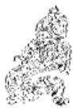

<!-- V3_SOURCE_ID:book016-b002063-p000-08ddf9d36b -->

明代人陈仁锡说：“谋求小的，不谋求大的，原本就不必谋求大的。涓涓细流不停，就能汇聚成江河，就像挖地得到泉源，不必等泉水溢出地面，之后才成为流水。”《折中》引用了这番话，并指出：“这个说法极为正确。凡是人做学问、处理事务，都必须从谋求小的收获开始，就像水虽然只有涓涓细流却有源头，这是行险的根本。”马其昶也认为：“九二是泉源，因为它没有超出中位，所以谋求小的收获，积累之后才会流动，填满坑洼之后才会前进。没有超出中位，就是没有填满坑洼；谋求小的收获，就是积累细小的水流来形成大江大河。”（《重定费氏学》）以上各种说法都是从九二阳爻居坎中、求小得大的行险之道，分析爻辞及《小象传》的意旨，似乎颇为可取。

查看对应原文

<!-- V3_FOLDBACK_BEGIN:book016-b002063-p000-08ddf9d36b -->

说萌 明人陈仁锡曰：‘求其小，不求其大，原不在大也。涓涓不已，流为江河，如掘地得泉，不待溢出外，然后为流水也。’《折中》引录此语，并指出：‘说极是。凡人为学作事，必自求小得始，如水虽涓涓而有源，乃行险之本也。’马其昶也认为：‘二为泉源，因其未出中，故求小得，积而后流，盈科而后进。未出中，未盈科也；求小得，积细流以成大川也。’（《重定费氏学》）诸说均从九二阳居坎中、求小得大的行险之道，分析爻辞及《小象传》的意旨，似颇可取。

<!-- V3_FOLDBACK_END:book016-b002063-p000-08ddf9d36b -->

<!-- V3_SOURCE_ID:book016-b002064-p000-572341b7c6 -->

六三爻对应的情况是，来去都处在险陷之间，往前有险，退居也难安，落入了‘穴’的深处，不可施展才用。

查看对应原文

<!-- V3_FOLDBACK_BEGIN:book016-b002064-p000-572341b7c6 -->

译文六三，来去都处在险陷之间，往前有险，退居难安，落入陷穴深处，不可施展才用。

<!-- V3_FOLDBACK_END:book016-b002064-p000-572341b7c6 -->

<!-- V3_SOURCE_ID:book016-b002065-p000-4da4abf18f -->

## 六三，来之坎坎①，险且枕，入于坎窞，勿用②。 — 六三爻的爻辞为‘来之坎坎①，险且枕，入于坎窞，勿用②’，其中‘坎’是八卦之一。

查看对应原文

<!-- V3_FOLDBACK_BEGIN:book016-b002065-p000-4da4abf18f -->

## 六三，来之坎坎①，险且枕，入于坎窞，勿用②。

<!-- V3_FOLDBACK_END:book016-b002065-p000-4da4abf18f -->

<!-- V3_SOURCE_ID:book016-b002066-p000-8398f1356d -->

注释①“来之坎坎”：“来之”的意思是“来去”。这里指六三阴爻居于阳位，想要行险，又处在上下两个坎（八卦之一）之间，所以有“来之坎坎”、动辄遭遇险难的征象。《王注》说：“既已处于不当的位置，又处在两坎（八卦之一）之间，出去就会遇到坎（八卦之一），停留也会遇到坎（八卦之一），所以叫‘来之坎坎’。”

查看对应原文

<!-- V3_FOLDBACK_BEGIN:book016-b002066-p000-8398f1356d -->

注释①来之坎坎：来之，犹言‘来去’。此谓六三阴居阳位，意欲行险，又处上下坎之间，故有‘来之坎坎’、动辄罹险之象。《王注》：‘既履非其位，又处两坎之间，出则之坎，居则亦坎，故曰‘来之坎坎’也。’

<!-- V3_FOLDBACK_END:book016-b002066-p000-8398f1356d -->

<!-- V3_SOURCE_ID:book016-b002067-p000-a87530647b -->

②“险且枕，入于坎窨，勿用”：“枕”，《王注》解释为“枕靠而不安的状态”，《本义》解释为“倚靠而未安定的意思”，用来形容遭遇险难、心神不安的样子。这三句承接上文的意思，说明六三前后都是险难，所处的位置没有可以依靠的凭借；当此陷入“坎窨”之时，一定不能强行施用。《王注》说：“出去没有去处，停留没有安身之所，所以叫‘险且枕’。来去都遇到坎（八卦之一），没有可以施用的地方，只是徒劳罢了。”按：“枕”字的含义，不同说法还有很多。比如《集解》引用虞翻的注释，将“枕”解释为“止”；《纂疏》解释为“安其菑，利其危”；《集解》又引用干宝的注释，将“枕”解释为“安”，并说“安忍以暴政加民而无哀矜之心”；马其昶《重定费氏学》根据《释文》中“‘枕’古文作‘沈’”的说法，认为“沈”就是沉没的意思，于是将“枕”当作“沈”；《尚氏学》根据《释文》中“郑、向（建筑或穴位所朝的方位）本作‘检且枕’”，并根据《释名》中“检，枕也”的解释，认为“检”和“枕”含义相同，“仍然承接‘来之坎坎’来说，说的是内外都受到检制”。各种说法虽然不同，但“遭遇险难、心神不安”的意思，大致是相同的。

> **释读存疑：** “枕”字的部分异说具体所指的语境细节未完全明确；1轮自动修复后核义模型仍建议修订，已保守记录。

查看对应原文

<!-- V3_FOLDBACK_BEGIN:book016-b002067-p000-a87530647b -->

②险且枕，入于坎窨，勿用：枕，《王注》：“枕枝而不安之谓”，《本义》：“倚着未安之意”，即形容罹险难安的样子。这三句承上文之义，说明六三前后皆险，动处均无凭依；当此陷入“坎窗”之时，必不可强行施用。《王注》：“出则无之，处则无安，故曰‘险且枕’也。来之皆坎，无所用之，徒劳而已。”案，“枕”字之义，异说尚多。如《集解》引虞翻注，训“枕”为“止”，《纂疏》释为“安其菑，利其危”；《集解》又引干宝注，训“枕”为“安”，并谓“安忍以暴政加民而无哀矜之心”；马其昶《重定费氏学》据《释文》“枕’古文作‘沈’”谓“沈者，没也”，遂以“枕”为“沈”；《尚氏学》据《释文》“郑、向本作‘检且枕’”，并据《释名》“检，枕也”之训，认为“检”、“枕”同义，“仍承来之坎坎’言，言内外俱受检制。”诸说虽异，而罹险难安之意，则大略相同。

<!-- V3_FOLDBACK_END:book016-b002067-p000-a87530647b -->

<!-- V3_SOURCE_ID:book016-b002068-p000-ab5393f8a2 -->

《象传》说“来去都处在险陷之间”，说明六三终究难成行险之功。

> **释读存疑：** 本地硬校验仍未通过，已记录供后续自动处理或人工核对。

查看对应原文

<!-- V3_FOLDBACK_BEGIN:book016-b002068-p000-ab5393f8a2 -->

译文《象传》说：“来去都处在险陷之间”，说明六三终究难成行险之功。

<!-- V3_FOLDBACK_END:book016-b002068-p000-ab5393f8a2 -->

<!-- V3_SOURCE_ID:book016-b002069-p000-bcafa0b3b5 -->

此处原文残缺，仅能辨认出“功也《象》曰：‘来之坎坎’，终无”的字样，具体内容无法完整释读。

> **释读存疑：** 原文存在残缺，无法完整释读

查看对应原文

<!-- V3_FOLDBACK_BEGIN:book016-b002069-p000-bcafa0b3b5 -->

功也《象》曰：“来之坎坎”，终无

<!-- V3_FOLDBACK_END:book016-b002069-p000-bcafa0b3b5 -->

<!-- V3_SOURCE_ID:book016-b002070-p000-b09e15ce2f -->

解释爻辞“险且枕”，王申子将其解释为“面临危险时停下稍作休息”，他指出：下卦的危险已经结束，上卦的危险又要到来，退回来已经身处险境，前进过去会更加危险，进退都有危险，就宁可停在可以停下的地方稍作休息。“且”是姑且的语气词；“枕”是休息但未安稳的意思。能做到这样，即使还没有脱离危险，也不至于深入到坎穴之中。“如果前进进入，就会陷得更深，变得不可行。“勿”是阻止的语气词。《折中》认为这个观点似乎与《需》卦六四的含义能够互相阐发，可以作为一种说法留存。

查看对应原文

<!-- V3_FOLDBACK_BEGIN:book016-b002070-p000-b09e15ce2f -->

说解 爻辞“险且枕”，王申子释为“临险止而暂息”，指出：“下卦之险已终，上卦之险又至：是退而来已险，进而之愈险，进退皆险，则宁于可止之地而暂息焉。‘且’者，聊尔之辞；‘枕’者，息而未安之义。能如此，虽未离乎险，亦不至深入于坎穴之中也。”“其进而入，则陷益深，为不可用。‘勿’者，止之之辞也。”(《大易辑说》)《折中》认为此论“似与《需》之六四义足相发”。可备一说。

<!-- V3_FOLDBACK_END:book016-b002070-p000-b09e15ce2f -->

<!-- V3_SOURCE_ID:book016-b002071-p000-96c6d36351 -->

## 六四，樽酒，簋贰，用缶，纳约自牖，终无咎①。 — 六四：一樽酒、两簋食，用瓦缶盛装，从窗户进献简约的盟约，最终没有灾祸。

查看对应原文

<!-- V3_FOLDBACK_BEGIN:book016-b002071-p000-96c6d36351 -->

## 六四，樽酒，簋贰，用缶，纳约自牖，终无咎①。

<!-- V3_FOLDBACK_END:book016-b002071-p000-96c6d36351 -->

<!-- V3_SOURCE_ID:book016-b002072-p000-6f849a179e -->

译文 六四，一樽薄酒，两簋淡食，用质朴的瓦缶盛物（虔诚地奉献给尊者），通过明窗结纳信约，终将免遭咎害。

查看对应原文

<!-- V3_FOLDBACK_BEGIN:book016-b002072-p000-6f849a179e -->

译文 六四，一樽薄酒，两簋淡食，用质朴的瓦缶盛物（虔诚地奉献给尊者），通过明窗结纳信约，终将免遭咎害。

<!-- V3_FOLDBACK_END:book016-b002072-p000-6f849a179e -->

<!-- V3_SOURCE_ID:book016-b002073-p000-c6c471c997 -->

注释①：簋，读音为guǐ，《说文》记载它是盛黍稷的方形器具，由竹、皿、皀构成，“簋贰”就是两簋食物的意思；缶，是瓦制器具，“用缶”指用瓦缶盛物；牖，读音为yǒu，指窗户。这几句选取各种物象作为比喻，说明六四身处“险”境之时，居于上坎之下，前后也都是“陷穴”，但它柔顺得正，上承九五，能够以虔诚之心与九五结交，就像奉献一樽薄酒、两簋淡食，用瓦缶盛物，即使简朴也可以呈献给尊者；九五与六四都没有其他应和的对象，于是开诚布公地相交，就像“纳约”于明窗，因此六四得到阳刚的相助、不会陷入坎险，所以“终无咎”。《王注》说：身处重险之中却践行正道，以柔居柔，位置得当，用来承奉九五；九五也位置得当，刚柔各得其所，不互相侵犯位置，都没有多余的应和对象来互相承奉亲附，诚信显著，不追求外在修饰；身处坎境能做到这样，即使是一樽薄酒、两簋淡食、瓦缶这类器具，将这极为简约的东西从明窗进献，也可以进献给王公，供奉给宗庙，所以“终无咎”。

查看对应原文

<!-- V3_FOLDBACK_BEGIN:book016-b002073-p000-c6c471c997 -->

注释 ① 樽酒，簋贰，用缶，纳约自牖，终无咎：簋，音guǐ，《说文》：“黍稷方器也，从竹、皿、皀”，“簋贰”犹言“两簋食”；缶，瓦器（见《比》初六译注），“用缶”谓以瓦缶盛物；牖，音yǒu，窗户。这几句取各种物象为喻，说明六四处“险”之时，居上坎之下，前后亦均为“陷穴”，但柔顺得正，上承九五，能以虔诚之心与之结交，犹如奉薄酒一樽、淡食两簋，盛物于瓦缶，虽简朴亦可呈献于尊者；五与四均无它应，遂开诚布公地相交，恰似“纳约”于明窗，于是六四得阳刚相助、不陷入坎险，故“终无咎”。《王注》：“处重险而履正，以柔居柔，履得其位，以承于五；五亦得位，刚柔各得其所，不相犯位，皆无余应以相承比，明信显著，不存外饰：处坎以斯，虽复一樽之酒，二簋之食，瓦缶之器，纳此至约，自进于牖，乃可羞之于王公，荐之于宗庙，故‘终无咎’也。”

<!-- V3_FOLDBACK_END:book016-b002073-p000-c6c471c997 -->

<!-- V3_SOURCE_ID:book016-b002074-p000-6f20a5c28a -->

朱熹说：“晁氏称‘前代学者将“樽酒簋”读为一句，“贰用缶”读为一句’，我认为这个读法可以依从，并且将“贰”解释为“增益”。这也可以作为一种说法。

查看对应原文

<!-- V3_FOLDBACK_BEGIN:book016-b002074-p000-6f20a5c28a -->

说解 朱熹曰：“晁氏云‘先儒读“樽酒簋”为一句，“贰用缶”为一句’”，以为可从，并释“贰”为“益之”（《本义》）。可备一说。

<!-- V3_FOLDBACK_END:book016-b002074-p000-6f20a5c28a -->

<!-- V3_SOURCE_ID:book016-b002075-p000-42a2ea9e04 -->

《象》中说：“樽酒簋贰”，讲的是刚柔相互交接的情况。

查看对应原文

<!-- V3_FOLDBACK_BEGIN:book016-b002075-p000-42a2ea9e04 -->

《象》曰：“樽酒簋贰”，刚柔际也。

<!-- V3_FOLDBACK_END:book016-b002075-p000-42a2ea9e04 -->

<!-- V3_SOURCE_ID:book016-b002076-p000-37433213e7 -->

译文 《象传》说：“一樽薄酒、两簋淡食（奉献尊者）”，说明九五阳刚和六四阴柔相互交接。

查看对应原文

<!-- V3_FOLDBACK_BEGIN:book016-b002076-p000-37433213e7 -->

译文 《象传》说：“一樽薄酒、两簋淡食（奉献尊者）”，说明九五阳刚和六四阴柔相互交接。

<!-- V3_FOLDBACK_END:book016-b002076-p000-37433213e7 -->

<!-- V3_SOURCE_ID:book016-b002077-p000-dcbea6c407 -->

说解 六三、六四这两个爻都处在两个“坎”（八卦之一）之间，有的爻辞说“勿用”，有的说“无咎”，原因在于：六三爻位不当，没有相应的爻位；六四爻位正当，能够承接阳爻。所以《象传》对六三说“终无功”，对六四说“刚柔际”。

查看对应原文

<!-- V3_FOLDBACK_BEGIN:book016-b002077-p000-dcbea6c407 -->

说解 三、四两爻并处两坎之间，或“勿用”，或“无咎”，原因在于：六三失位无应，六四得正承阳。故《象传》于三曰“终无功”，于四曰“刚柔际”。

<!-- V3_FOLDBACK_END:book016-b002077-p000-dcbea6c407 -->

<!-- V3_SOURCE_ID:book016-b002078-p000-f80cbc290d -->

九五爻，坎（八卦之一）尚未盈满，小丘已经铲平，没有咎害。

查看对应原文

<!-- V3_FOLDBACK_BEGIN:book016-b002078-p000-f80cbc290d -->

九五，坎不盈，祗既平，无咎①。 译文九五，险陷尚不满盈，小丘已被铲平，必无咎害。

<!-- V3_FOLDBACK_END:book016-b002078-p000-f80cbc290d -->

<!-- V3_SOURCE_ID:book016-b002079-p000-45203aede4 -->

注释①：坎尚未盈满，小丘已经铲平，没有咎害。祗应写作祇，读音为zhǐ，与坻相通，《释文》引用郑玄的说法：“就是小丘”；《尚氏学》认为：“‘坎不盈’是一件事，‘坻既平’又是一件事，上下两句相对成文。”这三句说明，九五爻处于“险陷”之时，阳刚中正，下比六四，是身居尊位却能妥善应对险陷的象征，因此险陷的深穴虽未盈满，穴旁的小丘已被铲平；长久如此，定能逐渐填实陷穴，开通前路，脱离险境，所以“没有咎害”。按：“祗”是“祇”字的讹误，与《复》卦初九爻“无祗悔”的情况相同；但前者解释为“病”，此处解释为“小丘”，含义有区别。尚先生引用《诗毛传》《说文》《释文》《文选》以及俞樾、王引之诸家的说法，证明“祇”“坻”“禔”的读音都由“氏”得来，从“氐”的写法是错误的；并明确其含义为“小丘”（《尚氏学》）。据此，现在版本写作“祗”的应当改作“祇”，字通“坻”；另外《帛书周易》写作“塭（堤）既平”，似乎也可证明从“土”解释为“小丘”的说法较为接近正确。

查看对应原文

<!-- V3_FOLDBACK_BEGIN:book016-b002079-p000-45203aede4 -->

注释 ① 坎不盈，祗既平，无咎：祗，当作“祇”（音zhǐ），与“坻”通，《释文》引郑玄曰：“小丘也”；《尚氏学》：“‘坎不盈’为一事，‘坻既平’又为一事，上下对文。”这三句说明九五处“险”之时，阳刚中正，下比六四，为居尊而履险有方之象，故险陷的深穴虽未满盈，穴旁的小丘已被铲平；长此以往，必能渐填陷穴，开通前路，脱出险境，故“无咎”。案，“祗”为“祇”字之误，与《复》初九“无祗悔”同（参阅该爻译注），但前者训“病”，此训“小丘”，义有区别。尚先生引《诗毛传》、《说文》、《释文》、《文选》及俞樾、王引之诸家说，证“祇”、“坻”、“禔”音皆由“氏”得，从“氐”者误；并明其义为“小丘”（《尚氏学》）。据此，今本作“祗”者当改作“祇”，字通“坻”；又《帛书周易》作“塭（堤）既平”，似亦可证从“土”训“小丘”者近是。

<!-- V3_FOLDBACK_END:book016-b002079-p000-45203aede4 -->

<!-- V3_SOURCE_ID:book016-b002080-p000-9f5289ed09 -->

关于“祗既平”的含义，《易》家的解释多有分歧。现在列举三种说法以供参考。第一种，《集解》引用虞翻的注，写作“禔既平”，解释“禔”为“安”，《纂疏》说：“既安稳又平正。”第二种，王弼说“祗，是语气辞”，当作语气虚词来解释，意思是“已经平正就没有咎害”（《王注》）。第三种，程颐说：“祗，应当读作柢，意思是抵达”，如同现在所说的“抵达”，意思是：“抵达已经平正的状态就没有咎害。”（《程传》）

查看对应原文

<!-- V3_FOLDBACK_BEGIN:book016-b002080-p000-9f5289ed09 -->

说明“祗既平”之义，《易》家解释多歧。今举三说以备参考。一、《集解》引虞翻注，作“禔既平”，训“禔”为“安”，《纂疏》曰：“既安且平。”二、王弼曰“祗，辞也”，作语气虚词解，谓“既平乃无咎”(《王注》)。三、程颐曰：“祗，宜音柢，抵也”，犹今语“抵达”，谓：“抵于已平则无咎。”(《程传》)

<!-- V3_FOLDBACK_END:book016-b002080-p000-9f5289ed09 -->

<!-- V3_SOURCE_ID:book016-b002081-p000-62f6fd76a0 -->

《象传》说：“险陷尚不满盈”，说明九五爻虽居中位，但平险的功德尚未光大。

> **释读存疑：** 本地硬校验仍未通过，已记录供后续自动处理或人工核对。

查看对应原文

<!-- V3_FOLDBACK_BEGIN:book016-b002081-p000-62f6fd76a0 -->

译文《象传》说：“险陷尚不满盈”，说明 《象》曰：“坎不盈”，中未大也。  
九五虽居中但平险之功尚未光大。

<!-- V3_FOLDBACK_END:book016-b002081-p000-62f6fd76a0 -->

<!-- V3_SOURCE_ID:book016-b002082-p000-de9385285f -->

这段文字是对《象传》中“中未大”一句的校勘说明：阮元认为《集解》的“大”字之上有一个“光”字，还指出《正义》也提到“未得光大”。根据这些依据，似乎应当在“大”字前面增加一个“光”字。

查看对应原文

<!-- V3_FOLDBACK_BEGIN:book016-b002082-p000-de9385285f -->

说明《象传》“中未大”一句，阮元谓《集解》“大”上有“光”字，并指出《正义》亦云“未得光大”(《校勘记》)。据此，似当于“大”前增一“光”字。

<!-- V3_FOLDBACK_END:book016-b002082-p000-de9385285f -->

<!-- V3_SOURCE_ID:book016-b002083-p000-5efc11e7a8 -->

上六，被绳索捆缚，囚禁在荆棘丛中，三年都不能解脱，有凶险。

查看对应原文

<!-- V3_FOLDBACK_BEGIN:book016-b002083-p000-5efc11e7a8 -->

译文上六，被绳索捆缚，囚置在荆棘丛 上六，系用徽缦，寘于丛棘，三中，三年不得解脱，有凶险。 岁不得，凶①。

<!-- V3_FOLDBACK_END:book016-b002083-p000-5efc11e7a8 -->

<!-- V3_SOURCE_ID:book016-b002084-p000-3d641c3b1e -->

注释①：系用徽纆，寘于丛棘，三岁不得，凶——纆，读音为mò，徽、纆都是绳索的名称；《释文》记载：“刘表说：三股的绳索叫‘徽’，两股的绳索叫‘纆’，都是绳索的名称”；寘，读音为zhì，通“置”；丛棘，《集解》引用虞翻的说法：“监狱外种植九棘，所以称为‘丛棘’”。这几句是说明上六以阴柔之爻居于险难的极点，陷入的境地极深，就像被捆缚囚禁在“丛棘”环绕的牢狱之中，三年都不能解脱，所以是“凶”。《程传》说：“以阴柔的品性而自处于险难的极点，这是陷入极深的表现。因为他陷入得极深，所以用牢狱作比喻，就像用徽纆捆缚，囚禁在丛棘之中；阴柔的品性陷入得极深，是无法脱身的，所以说过了三年这么久的时间，都不能免除，它的凶险是可想而知的。”

查看对应原文

<!-- V3_FOLDBACK_BEGIN:book016-b002084-p000-3d641c3b1e -->

注释①系用徽纆，寘于丛棘，三岁不得，凶：纆，音mò，徽、纆，均为绳索之名，《释文》：“刘表曰：三股曰‘徽’，两股曰‘纆’，皆索名”；寘，音zhì，通“置”；丛棘，《集解》引虞翻曰：“狱外种九棘，故称‘丛棘’。”这几句说明上六以柔居险之极，所陷至深，犹如被捆缚囚置于“丛棘”中的牢狱，三年不得解脱，故“凶”。《程传》：“以阴柔而自居险之极，其陷之深者也。以其陷之深，取牢狱为喻，如系缚以徽纆，囚寘于丛棘之中；阴柔而陷之深，其不能出矣，故云至于三岁之久，不得免也，其凶可知。”

<!-- V3_FOLDBACK_END:book016-b002084-p000-3d641c3b1e -->

<!-- V3_SOURCE_ID:book016-b002085-p000-cc6715db41 -->

译文：《象传》说：上六违失了履险的正道，凶险将延续三年之久。

查看对应原文

<!-- V3_FOLDBACK_BEGIN:book016-b002085-p000-cc6715db41 -->

译文《象传》说：上六违失履险正道，凶 《象》曰：上六失道，凶三岁也。  
险将延续三年之久。

<!-- V3_FOLDBACK_END:book016-b002085-p000-cc6715db41 -->

<!-- V3_SOURCE_ID:book016-b002086-p000-2b4bf79427 -->

说明爻辞“三岁”，王弼以为含有“险终乃反”之义，指出上六“囚执真于思过之地”，“自修三岁，乃可以求复”(《王注》)。《折中》也认为“如悔罪思愆，是谓得道，则其困苦幽囚止于三岁矣”。此说可备参考。

查看对应原文

<!-- V3_FOLDBACK_BEGIN:book016-b002086-p000-2b4bf79427 -->

说明爻辞“三岁”，王弼以为含有“险终乃反”之义，指出上六“囚执真于思过之地”，“自修三岁，乃可以求复”(《王注》)。《折中》也认为“如悔罪思愆，是谓得道，则其困苦幽囚止于三岁矣”。此说可备参考。

<!-- V3_FOLDBACK_END:book016-b002086-p000-2b4bf79427 -->

<!-- V3_SOURCE_ID:book016-b002087-p000-689336d6b6 -->

韩愈《复志赋》曰“昔余之既有知兮，诚坎坷而艰难”(《昌黎先生集》)；文天祥《过平原作》云“崎岖坎坷不得志，出入四朝老忠节”(《文山集》)。两人均在诗赋中发出世途艰险难行的慨叹。《坎》卦大旨，正是喻示谨慎行险的道理。卦辞主于勉励，说明面临重重险陷之际，只要不失诚信，内心亨通就能排险涉难、前行可获嘉尚。卦中六爻皆不言“吉”，主于从正反两方面设诫。其中四阴爻除六四柔正承阳、慎处险境获“无咎”外，余三爻多呈凶象：初六柔弱处重坎之下，深落陷穴致“凶”；六三阴柔失正，来去均不能出险，终难施用；上六阴处险极，被捆缚幽囚，“凶”延“三岁”。至于二、五两阳，刚健居中，是本卦平险排难的希望所在：尽管两爻并未能彻底脱出险陷，但九二在“慎求小得”中不懈努力，九五于“铲平小丘”后继续奋发——卦辞“行有尚”，《大象传》“常德行，习教事”的意旨，似在这两爻，尤其在九五中，得到较深刻的体现。可见，《坎》卦“行险”的义理，是偏重建立在阳刚信实的基础上，强调谨慎守恒之德，如此则险陷可履、艰难可除。《史记·夏本纪》载夏禹治水的事迹，称其“劳心焦思，居外十三年，过家门不敢入”，终于平定洪水滔天之患；《列子·汤问》叙愚公移山的寓言，谓其立志以“子子孙孙无穷匮”的恒久力量，誓要排除太行、王屋之险：这两例，似并可借以参证本卦“行险而不失其信”、“乃以刚中”、“往有功”(《象传》)的象征内涵。

查看对应原文

<!-- V3_FOLDBACK_BEGIN:book016-b002087-p000-689336d6b6 -->

韩愈《复志赋》曰“昔余之既有知兮，诚坎坷而艰难”(《昌黎先生集》)；文天祥《过平原作》云“崎岖坎坷不得志，出入四朝老忠节”(《文山集》)。两人均在诗赋中发出世途艰险难行的慨叹。《坎》卦大旨，正是喻示谨慎行险的道理。卦辞主于勉励，说明面临重重险陷之际，只要不失诚信，内心亨通就能排险涉难、前行可获嘉尚。卦中六爻皆不言“吉”，主于从正反两方面设诫。其中四阴爻除六四柔正承阳、慎处险境获“无咎”外，余三爻多呈凶象：初六柔弱处重坎之下，深落陷穴致“凶”；六三阴柔失正，来去均不能出险，终难施用；上六阴处险极，被捆缚幽囚，“凶”延“三岁”。至于二、五两阳，刚健居中，是本卦平险排难的希望所在：尽管两爻并未能彻底脱出险陷，但九二在“慎求小得”中不懈努力，九五于“铲平小丘”后继续奋发——卦辞“行有尚”，《大象传》“常德行，习教事”的意旨，似在这两爻，尤其在九五中，得到较深刻的体现。可见，《坎》卦“行险”的义理，是偏重建立在阳刚信实的基础上，强调谨慎守恒之德，如此则险陷可履、艰难可除。《史记·夏本纪》载夏禹治水的事迹，称其“劳心焦思，居外十三年，过家门不敢入”，终于平定洪水滔天之患；《列子·汤问》叙愚公移山的寓言，谓其立志以“子子孙孙无穷匮”的恒久力量，誓要排除太行、王屋之险：这两例，似并可借以参证本卦“行险而不失其信”、“乃以刚中”、“往有功”(《象传》)的象征内涵。

<!-- V3_FOLDBACK_END:book016-b002087-p000-689336d6b6 -->

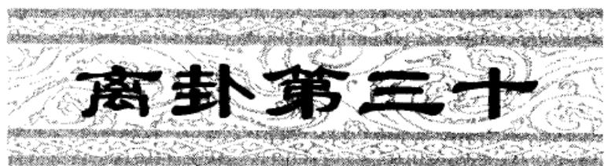

<!-- V3_SOURCE_ID:book016-b002089-p000-681edbe123 -->

译文《离》卦象征附丽：利于守持正固，亨通；畜养母牛可获吉祥。

查看对应原文

<!-- V3_FOLDBACK_BEGIN:book016-b002089-p000-681edbe123 -->

译文《离》卦象征附丽：利于守持正固，亨通；畜养母牛可获吉祥。

<!-- V3_FOLDBACK_END:book016-b002089-p000-681edbe123 -->

<!-- V3_SOURCE_ID:book016-b002090-p000-b3b0d19ec1 -->

注释①离：卦名，下卦上卦皆离（☲），象征“附丽”。《释文》：“离，丽也；丽，着也，八纯卦，象日，象火。”

查看对应原文

<!-- V3_FOLDBACK_BEGIN:book016-b002090-p000-b3b0d19ec1 -->

注释①离：卦名，下卦上卦皆离（☲），象征“附丽”。《释文》：“离，丽也；丽，着也，八纯卦，象日，象火。”

<!-- V3_FOLDBACK_END:book016-b002090-p000-b3b0d19ec1 -->

<!-- V3_SOURCE_ID:book016-b002091-p000-f7e0bd0898 -->

②利于守正，可致亨通：这是说事物有所附丽的时候，利于坚守正道，之后才能达到亨通的状态；本卦以阴柔为主体，所以卦辞的含义又包含“以柔为正道”的意旨。《王注》说：“《离》作为八卦之一，以柔为正道，所以必须坚守正道之后才能亨通，因此说‘利于守正，可致亨通’。”

查看对应原文

<!-- V3_FOLDBACK_BEGIN:book016-b002091-p000-f7e0bd0898 -->

②利贞，亨：此谓事物有所附丽之时，利于守正，而后可致亨通；本卦以阴柔为主，故辞意又含“以柔为正”之旨。《王注》：“《离》之为卦，以柔为正，故必贞而后乃亨，故曰‘利贞，亨也’。”

<!-- V3_FOLDBACK_END:book016-b002091-p000-f7e0bd0898 -->

<!-- V3_SOURCE_ID:book016-b002092-p000-01df45ceba -->

③畜牝牛吉：这句话专门说明“附丽”应当选取柔顺的状态，才能获得“吉”，所以用“畜牝牛”作为比喻。《王注》说：“柔顺处于内又行居中守正的位置，是母牛的长处；外表刚健而内心柔顺，是牛的长处。《离》作为八卦之一，以

> **释读存疑：** 原文内容残缺，后续部分未录出

查看对应原文

<!-- V3_FOLDBACK_BEGIN:book016-b002092-p000-01df45ceba -->

③畜牝牛吉：此句专明“附丽”当取柔顺，才能获“吉”，故以“畜牝牛”为喻。《王注》：“柔处于内而履正中，牝之善也；外强而内顺，牛之善也。《离》之为体，以

<!-- V3_FOLDBACK_END:book016-b002092-p000-01df45ceba -->

<!-- V3_SOURCE_ID:book016-b002093-p000-bbe72305c1 -->

译文《彖传》说：“离”，意思是附丽；譬如太阳月亮附丽在天上，百谷草木附丽在地上。光明重叠而又附丽于正道，就能推行教化，促成天下昌盛；柔顺者附丽在适中方正之处，于是前景亨通，所以畜养母牛可获吉祥。

查看对应原文

<!-- V3_FOLDBACK_BEGIN:book016-b002093-p000-bbe72305c1 -->

译文《彖传》说：“离”，意思是附丽；譬如太阳月亮附丽在天上，百谷草木附丽在地上。光明重叠而又附丽于正道，就能推行教化，促成天下昌盛；柔顺者附丽在适中方正之处，于是前景亨通，所以畜养母牛可获吉祥。

<!-- V3_FOLDBACK_END:book016-b002093-p000-bbe72305c1 -->

<!-- V3_SOURCE_ID:book016-b002094-p000-b07c4c12e2 -->

《彖传》说：离，就是附丽的意思①；太阳月亮附丽在天上，百谷草木附丽在地上。双重光明又附丽于正道，就能教化成就天下②；柔顺者附丽在居中守正的位置③，所以亨通，因此畜养母牛可获吉祥。

查看对应原文

<!-- V3_FOLDBACK_BEGIN:book016-b002094-p000-b07c4c12e2 -->

《彖》曰：离，丽也①；日月丽乎天，百谷草木丽乎土。重明以丽乎正，乃化成天下②；柔丽乎中正③，故亨，是以畜牝牛吉也。

<!-- V3_FOLDBACK_END:book016-b002094-p000-b07c4c12e2 -->

<!-- V3_SOURCE_ID:book016-b002095-p000-91cff6da5b -->

注释①：离（八卦之一）的意思是附着，这一句和接下来的两句“日月丽乎天，百谷草木丽乎土”，都是用来解释卦名“离”的含义。《王注》说：“丽，犹着也，各得所着之宜。”

查看对应原文

<!-- V3_FOLDBACK_BEGIN:book016-b002095-p000-91cff6da5b -->

注释①离，丽也：此与下两句“日月丽乎天，百谷草木丽乎土”，并释卦名“离”之义。《王注》：“丽，犹着也，各得所着之宜。”

<!-- V3_FOLDBACK_END:book016-b002095-p000-91cff6da5b -->

<!-- V3_SOURCE_ID:book016-b002096-p000-f9aba554cf -->

②重明指上下卦均为离（八卦之一），如同两明相重，附着于正道，就能够教化成就天下。这句话是说上下卦象包含着“重明”附着于正道，可以教化成就天下的含义。《正义》说：“重明，谓上下俱离；丽乎正也者，谓两阴在内。既有重明之德，又附于正道，所以化成天下也。”

查看对应原文

<!-- V3_FOLDBACK_BEGIN:book016-b002096-p000-f9aba554cf -->

②重明以丽乎正，乃化成天下：重明，指上下卦均离，犹两明相重。此谓上下象含有“重明”附离于正道可以“化成天下”之义。《正义》：“重明，谓上下俱离；丽乎正也者，谓两阴在内。既有重明之德，又附于正道，所以化成天下也。”

<!-- V3_FOLDBACK_END:book016-b002096-p000-f9aba554cf -->

<!-- V3_SOURCE_ID:book016-b002097-p000-9e4bbcfdaf -->

③：柔顺附着于中正；柔指六二、六五两爻。这里以六二、六五柔顺居中处正，结合前面两句来解释卦辞“利贞，亨，畜牝牛吉”。《王注》说：“柔着于中正，乃得通也；柔通之吉，极于畜牝牛，不能及刚猛也。”《正义》说：“六五、六二之柔，皆丽于中；中则不偏，故云‘中正’。”按，六五虽然居中，但居阳位，本失其正，《正义》解释说：“虽非阴阳（描述事物相反相成、消长转化的两类属性）之正，乃是事理之正，故总云‘丽于正’也。”这种说法可以作为参考。

查看对应原文

<!-- V3_FOLDBACK_BEGIN:book016-b002097-p000-9e4bbcfdaf -->

③ 柔丽乎中正；柔，指二、五两爻。此以六二、六五柔顺居中处正，合前两句并释卦辞“利贞，亨，畜牝牛吉”。《王注》：“柔着于中正，乃得通也；柔通之吉，极于畜牝牛，不能及刚猛也。”《正义》：“六五、六二之柔，皆丽于中；中则不偏，故云‘中正’。”案，六五虽“中”，却居阳位，本失其正，《正义》解曰：“虽非阴阳之正，乃是事理之正，故总云‘丽于正’也。”此说可备参考。

<!-- V3_FOLDBACK_END:book016-b002097-p000-9e4bbcfdaf -->

<!-- V3_SOURCE_ID:book016-b002098-p000-d8cd27fb45 -->

## 《象》曰：明两作，离①；大人以继明照于四方②。 — 《象》曰：明两作，离（八卦之一）；大人以继明照于四方②。

查看对应原文

<!-- V3_FOLDBACK_BEGIN:book016-b002098-p000-d8cd27fb45 -->

## 《象》曰：明两作，离①；大人以继明照于四方②。

<!-- V3_FOLDBACK_END:book016-b002098-p000-d8cd27fb45 -->

<!-- V3_SOURCE_ID:book016-b002099-p000-dad91a055d -->

译文《象传》说：光明接连升起（悬附高空），象征“附丽”；大人因此连续不断地用光明照临天下四方。

查看对应原文

<!-- V3_FOLDBACK_BEGIN:book016-b002099-p000-dad91a055d -->

译文《象传》说：光明接连升起（悬附高空），象征“附丽”；大人因此连续不断地用光明照临天下四方。

<!-- V3_FOLDBACK_END:book016-b002099-p000-dad91a055d -->

<!-- V3_SOURCE_ID:book016-b002100-p000-684b0c3ad5 -->

注释① 明两作，离：两，犹言“接连”；作，起也。此释《离》卦上下“离”均为“明”之象。《正义》：“离为日，日为明。今有上下二体，故云‘明两作，离’也。”

查看对应原文

<!-- V3_FOLDBACK_BEGIN:book016-b002100-p000-684b0c3ad5 -->

注释① 明两作，离：两，犹言“接连”；作，起也。此释《离》卦上下“离”均为“明”之象。《正义》：“离为日，日为明。今有上下二体，故云‘明两作，离’也。”

<!-- V3_FOLDBACK_END:book016-b002100-p000-684b0c3ad5 -->

<!-- V3_SOURCE_ID:book016-b002101-p000-2846480368 -->

②以继明照于四方：这是说明“大人”效法《离》卦光明连继之象，绵延不断地用“明德”照临天下。《正义》：“继续其明，乃照于四方；若明不继续，则不得久为照临。”

查看对应原文

<!-- V3_FOLDBACK_BEGIN:book016-b002101-p000-2846480368 -->

②以继明照于四方：这是说明“大人”效法《离》卦光明连继之象，绵延不断地用“明德”照临天下。《正义》：“继续其明，乃照于四方；若明不继续，则不得久为照临。”

<!-- V3_FOLDBACK_END:book016-b002101-p000-2846480368 -->

<!-- V3_SOURCE_ID:book016-b002102-p000-9e1384be4f -->

说明 孔颖达指出：“八纯之卦，论象不同，各因卦体、事义，随文而发。《乾》、《坤》不论上下之体，直总云‘天行健’、‘地势坤’，以天地之大，故总称上下二体也。雷是连续之至，水为流注不已，义皆取连续相因，故《震》云‘游雷’，《坎》云‘游至’也。风是摇动相随之物，故云‘随风，巽’也。山、泽，各自为体，非相入之物，故云‘兼山，艮’、‘丽泽，兑’，是两物各行也。今‘明’之为体，前后各照，故云‘明两作，离’。是积聚两明，乃作于‘离’；若一明暂绝，其‘离’未久，必取两明前后相续，乃得作《离》卦之美。”（《正义》）此说分析《大象传》阐释《乾》、《坤》、《震》、《坎》、《巽》、《艮》、《兑》、《离》“八纯卦”象旨时的不同措辞，尤详于《离》卦，似有可取。

查看对应原文

<!-- V3_FOLDBACK_BEGIN:book016-b002102-p000-9e1384be4f -->

说明 孔颖达指出：“八纯之卦，论象不同，各因卦体、事义，随文而发。《乾》、《坤》不论上下之体，直总云‘天行健’、‘地势坤’，以天地之大，故总称上下二体也。雷是连续之至，水为流注不已，义皆取连续相因，故《震》云‘游雷’，《坎》云‘游至’也。风是摇动相随之物，故云‘随风，巽’也。山、泽，各自为体，非相入之物，故云‘兼山，艮’、‘丽泽，兑’，是两物各行也。今‘明’之为体，前后各照，故云‘明两作，离’。是积聚两明，乃作于‘离’；若一明暂绝，其‘离’未久，必取两明前后相续，乃得作《离》卦之美。”（《正义》）此说分析《大象传》阐释《乾》、《坤》、《震》、《坎》、《巽》、《艮》、《兑》、《离》“八纯卦”象旨时的不同措辞，尤详于《离》卦，似有可取。

<!-- V3_FOLDBACK_END:book016-b002102-p000-9e1384be4f -->

<!-- V3_SOURCE_ID:book016-b002103-p000-2d2b3b9a47 -->

初九爻，行事郑重不苟，保持恭敬谨慎，就不会有灾祸。

查看对应原文

<!-- V3_FOLDBACK_BEGIN:book016-b002103-p000-2d2b3b9a47 -->

初九，履错然，敬之，无咎①。 译文初九，践行事务郑重不苟，保持恭敬谨慎，就必无害。

<!-- V3_FOLDBACK_END:book016-b002103-p000-2d2b3b9a47 -->

<!-- V3_SOURCE_ID:book016-b002104-p000-8a9cbef3ff -->

匡释① 履错然，敬之，无咎：错然指错落有致，《集解》引用王弼的说法：“是恭敬谨慎的样子”，《尚氏学》则认为还有“郑重不苟”的意思。这里是说初九爻为阳爻居下位，在即将“附丽”之时，行事能郑重不苟、恭敬谨慎，所以获得“无咎”的结果。《集解》引用王弼的说法：“处于《离》的初始阶段，将要进入盛势，所以应当谨慎行事，以恭敬为要务，避免灾祸。” B 一

查看对应原文

<!-- V3_FOLDBACK_BEGIN:book016-b002104-p000-8a9cbef3ff -->

匡释①履错然，敬之，无咎：错然，错落有致，《集解》引王弼曰：“敬慎之貌”，《尚氏学》：“又有‘郑重不苟’之意。”此谓初九阳刚处下，于行将“附丽”之时，行事能郑重不苟、恭敬谨慎，故获“无咎”。《集解》引王弼曰：“处《离》之始，将进其盛，故宜慎所履，以敬为务，辟其咎也。” B 一

<!-- V3_FOLDBACK_END:book016-b002104-p000-8a9cbef3ff -->

<!-- V3_SOURCE_ID:book016-b002105-p000-1f846734c8 -->

《象》传说：“行事郑重不苟，保持恭敬谨慎”，是为了避免灾祸。

查看对应原文

<!-- V3_FOLDBACK_BEGIN:book016-b002105-p000-1f846734c8 -->

《象》曰：“履错之敬”，以辟咎也①。

<!-- V3_FOLDBACK_END:book016-b002105-p000-1f846734c8 -->

<!-- V3_SOURCE_ID:book016-b002106-p000-49ae49ff2a -->

《象传》的译文提到，初九爻只有践行事务郑重不苟、保持恭敬谨慎，才能避免咎害。

查看对应原文

<!-- V3_FOLDBACK_BEGIN:book016-b002106-p000-49ae49ff2a -->

译文《象传》说：“践行事务郑重不苟，保持恭敬谨慎”，说明初九这样才能避免咎害。

<!-- V3_FOLDBACK_END:book016-b002106-p000-49ae49ff2a -->

<!-- V3_SOURCE_ID:book016-b002107-p000-9ca0ed283b -->

注释①：辟这个字，通“避”。

查看对应原文

<!-- V3_FOLDBACK_BEGIN:book016-b002107-p000-9ca0ed283b -->

注释①辟：通“避”。

<!-- V3_FOLDBACK_END:book016-b002107-p000-9ca0ed283b -->

<!-- V3_SOURCE_ID:book016-b002108-p000-d63e0b779a -->

说明“附丽”贵在“柔正”。初九爻为阳刚之爻，本会有咎害；但因居下位而谦柔敬慎，于是免除了咎害。《折中》引用胡瑗的话说：“居《离》之初，如同太阳刚升起。处理事情的开端，应当常常保持警惕畏惧，

查看对应原文

<!-- V3_FOLDBACK_BEGIN:book016-b002108-p000-d63e0b779a -->

说明 “附丽”贵在“柔正”。初九阳刚，本有咎害；但居下谦柔敬慎，遂免其咎。《折中》引胡瑗曰：‘居《离》之初，如日之初生。于事之初，则当常错然警惧，

<!-- V3_FOLDBACK_END:book016-b002108-p000-d63e0b779a -->

<!-- V3_SOURCE_ID:book016-b002109-p000-80458623e3 -->

卷 四

查看对应原文

<!-- V3_FOLDBACK_BEGIN:book016-b002109-p000-80458623e3 -->

卷 四

<!-- V3_FOLDBACK_END:book016-b002109-p000-80458623e3 -->

<!-- V3_SOURCE_ID:book016-b002110-p000-dffd671dd3 -->

来增进德行、修习功业，所以能够免除咎害。

查看对应原文

<!-- V3_FOLDBACK_BEGIN:book016-b002110-p000-dffd671dd3 -->

以进德修业，所以得免其咎。

<!-- V3_FOLDBACK_END:book016-b002110-p000-dffd671dd3 -->

<!-- V3_SOURCE_ID:book016-b002111-p000-a6f574e725 -->

六二爻的爻辞是：黄离，元吉①。意思是黄色附丽于物，保持中正，至为吉祥。

> **释读存疑：** 原文中“黄离”的“离”为八卦之一，此处释读未明确对应术语，符合要求

查看对应原文

<!-- V3_FOLDBACK_BEGIN:book016-b002111-p000-a6f574e725 -->

译文六二，保持中正的黄色附丽于物， 六二，黄离，元吉①。   
至为吉祥。

<!-- V3_FOLDBACK_END:book016-b002111-p000-a6f574e725 -->

<!-- V3_SOURCE_ID:book016-b002112-p000-5a31124144 -->

注释①黄离，元吉：黄色是居中之色。这里用黄色来比喻六二爻居于中位，能够以柔顺中正之道附丽于物，所以获得“元吉”。这就是《彖传》所说“柔丽乎中正，故亨”的含义。《王注》解释道：“居中得位，以柔处柔，履文明之盛而得其中，故曰‘黄离元吉’也。”

> **释读存疑：** 本地硬校验仍未通过，已记录供后续自动处理或人工核对。

查看对应原文

<!-- V3_FOLDBACK_BEGIN:book016-b002112-p000-5a31124144 -->

注释①黄离，元吉：黄，中之色(见《坤》六五译注)。这是用“黄”色喻六二居中，能以柔顺中正之道附丽于物，故获“元吉”。此即《彖传》“柔丽乎中正，故亨”之义。《王注》：“居中得位，以柔处柔，履文明之盛而得其中，故曰‘黄离元吉’也。”

<!-- V3_FOLDBACK_END:book016-b002112-p000-5a31124144 -->

<!-- V3_SOURCE_ID:book016-b002113-p000-d1cea5a5e6 -->

《象传》说：“保持中正的黄色附丽于物，至为吉祥”，说明六二爻契合了适中不偏的中道。

查看对应原文

<!-- V3_FOLDBACK_BEGIN:book016-b002113-p000-d1cea5a5e6 -->

译文《象传》说：“保持中正的黄色附丽于物，至为吉祥”，说明六二有得于适中不偏之道。

<!-- V3_FOLDBACK_END:book016-b002113-p000-d1cea5a5e6 -->

<!-- V3_SOURCE_ID:book016-b002114-p000-28c373fde9 -->

《象传》说：“黄离元吉”，是因为六二爻契合了中道。

> **释读存疑：** 原文中“离”为八卦之一，此处释读未明确对应术语，符合要求

查看对应原文

<!-- V3_FOLDBACK_BEGIN:book016-b002114-p000-28c373fde9 -->

《象》曰：“黄离元吉”，得中道也。

<!-- V3_FOLDBACK_END:book016-b002114-p000-28c373fde9 -->

<!-- V3_SOURCE_ID:book016-b002115-p000-8794f26c76 -->

《折中》引用刘牧的说法：“离为火之象，焰猛而易烬，九四是也；过盛则有衰竭之凶，九三是也；惟二得中，离之元吉也。”这种说法对比了二、三、四爻的卦象，其中的义理有可取之处。

查看对应原文

<!-- V3_FOLDBACK_BEGIN:book016-b002115-p000-8794f26c76 -->

说明《折中》引刘牧曰：“离为火之象，焰猛而易烬，九四是也；过盛则有衰竭之凶，九三是也；惟二得中，离之元吉也。”此说比较二、三、四爻之象，义有可取。

<!-- V3_FOLDBACK_END:book016-b002115-p000-8794f26c76 -->

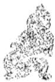

<!-- V3_SOURCE_ID:book016-b002117-p000-edddc221a3 -->

译文九三，太阳将落，垂垂附丽在西天，此时要是不敲起缶器、怡然作歌自乐，必将导致老暮穷衰的嗟叹，有凶险。

查看对应原文

<!-- V3_FOLDBACK_BEGIN:book016-b002117-p000-edddc221a3 -->

译文九三，太阳将落，垂垂附丽在西天，此时要是不敲起缶器、怡然作歌自乐，必将导致老暮穷衰的嗟叹，有凶险。

<!-- V3_FOLDBACK_END:book016-b002117-p000-edddc221a3 -->

<!-- V3_SOURCE_ID:book016-b002118-p000-08e0af05a6 -->

## 九三，日昃之离，不鼓缶而歌，则大耋之嗟，凶①。 — 九三爻对应的是太阳将要西斜、‘离’卦所象征的状态，此时如果不敲击瓦缶来应和歌声，就会出现年届耄耋之人的嗟叹，这是凶险的征兆。

查看对应原文

<!-- V3_FOLDBACK_BEGIN:book016-b002118-p000-08e0af05a6 -->

## 九三，日昃之离，不鼓缶而歌，则大耋之嗟，凶①。

<!-- V3_FOLDBACK_END:book016-b002118-p000-08e0af05a6 -->

<!-- V3_SOURCE_ID:book016-b002119-p000-c4adfea62d -->

注释①日昃之离，不鼓缶而歌，则大耋之嗟，凶：缶是瓦制的器物，可以用来调节音乐节奏，和用来盛放物品的用途不同，可参见《比》初六的译注；耋的读音为dié，《说文》中说“年八十曰‘耋’”，“大耋”是极言年老。这几句以太阳偏西为比喻，说明九三处下离之终，阳极将衰，未能长久“附丽”于物；此时若不及时“鼓缶”作歌行乐，而要勉强进取，就会招致“大耋之嗟”，必有凶险。《王注》说：“处下离之终，明在将没，故曰‘日昃之离’也。明在将终，若不委之于人，养志无为，则至于耋老有嗟，凶矣。”

查看对应原文

<!-- V3_FOLDBACK_BEGIN:book016-b002119-p000-c4adfea62d -->

注释①日昃之离，不鼓缶而歌，则大耋之嗟，凶：缶，瓦器，可用为节乐(与盛物之用异，参见《比》初六译注)，《说文》：“秦人鼓之，以节歌”；耋，音dié，《说文》“年八十曰‘耋’”，“大耋”极言年老。这几句取太阳偏西为喻，说明九三处下离之终，阳极将衰，未能长久“附丽”于物；此时若不及时“鼓缶”作歌行乐，而要勉强进取，将致“大耋之嗟”，必有凶险。《王注》：“处下离之终，明在将没，故曰‘日昃之离’也。明在将终，若不委之于人，养志无为，则至于耋老有嗟，凶矣。”

<!-- V3_FOLDBACK_END:book016-b002119-p000-c4adfea62d -->

<!-- V3_SOURCE_ID:book016-b002120-p000-d59d2ec1aa -->

译文《象传》说：“太阳将落，垂垂附丽在西天”，这种情状怎能保持长久呢！

查看对应原文

<!-- V3_FOLDBACK_BEGIN:book016-b002120-p000-d59d2ec1aa -->

译文《象传》说：“太阳将落，垂垂附丽在西天”，这种情状怎能保持长久呢！

<!-- V3_FOLDBACK_END:book016-b002120-p000-d59d2ec1aa -->

<!-- V3_SOURCE_ID:book016-b002121-p000-517577f78d -->

## 《象》曰：“日昃之离”，何可久也！——《象传》说：“太阳西斜时的‘离’（八卦之一），这种情状怎能保持长久呢！

> **释读存疑：** 原文中“日昃之离”的“离”为八卦之一，释读已明确标注，无歧义问题

查看对应原文

<!-- V3_FOLDBACK_BEGIN:book016-b002121-p000-517577f78d -->

## 《象》曰：“日昃之离”，何可久也！

<!-- V3_FOLDBACK_END:book016-b002121-p000-517577f78d -->

<!-- V3_SOURCE_ID:book016-b002122-p000-b703d4c4e2 -->

《集解》引用荀爽的话说：“初爻对应日出，二爻对应日中，三爻对应日昃。”这里把下卦三个爻的象义揭示得十分清楚。创作《周易》的人在九三爻设置了“嗟”“凶”的告诫，实际是要让人领悟到事物有“日暮”“途穷”的时刻，所以应当及时自我抑制，不可一味亢进不止。

查看对应原文

<!-- V3_FOLDBACK_BEGIN:book016-b002122-p000-b703d4c4e2 -->

说明《集解》引苟爽曰：“初为日出，二为日中，三为日昃。”此将下卦三爻之象揭示甚明。作《易》者于九三设“嗟”、“凶”之诫，实欲人悟知事物有“日暮”、“途穷”之际，故当及时自抑，不可亢进不已。

<!-- V3_FOLDBACK_END:book016-b002122-p000-b703d4c4e2 -->

<!-- V3_SOURCE_ID:book016-b002123-p000-325d62023c -->

译文九四，突然升起火红的暾霞，像烈焰在焚烧，但顷刻间又消散灭亡，被弃除净尽。

查看对应原文

<!-- V3_FOLDBACK_BEGIN:book016-b002123-p000-325d62023c -->

译文九四，突然升起火红的暾霞，像烈焰在焚烧，但顷刻间又消散灭亡，被弃除净尽。

<!-- V3_FOLDBACK_END:book016-b002123-p000-325d62023c -->

<!-- V3_SOURCE_ID:book016-b002124-p000-0be67a0616 -->

九四爻的爻辞是：突然出现，像被焚烧，像死去，像被舍弃。

查看对应原文

<!-- V3_FOLDBACK_BEGIN:book016-b002124-p000-0be67a0616 -->

九四，突如其来如，焚如，死如，弃如①。

<!-- V3_FOLDBACK_END:book016-b002124-p000-0be67a0616 -->

<!-- V3_SOURCE_ID:book016-b002125-p000-8ae464de6f -->

注释①：突然出现，像被焚烧，像死去，像被舍弃。这是取日出时的霞光作比喻，说明九四爻处于上下两个离（八卦之一）之间，急于上进附丽于六五爻，但因阳刚失正，欲速不达，就像清晨东方的朝霞突然喷涌而起，有烈焰焚烧的态势；但霞光终究不能上附高天，瞬息间就消散不存，落得死去、被舍弃的结局。《王注》说：“处于明道始变之际，昏暗刚要转为拂晓，隐没的事物刚要显现，所以说‘突然出现’。它的光明刚要进展，它的炎势刚要旺盛，所以说‘像被焚烧’；逼近至尊，所处位置不当，想以旺盛的炎势上进，去炎灼上方，性命必然不能长久，所以说‘像死去’；违背离（八卦之一）的义理，没有应和的爻，也没有承接的爻，众人不会容纳，所以说‘像被舍弃’。”

查看对应原文

<!-- V3_FOLDBACK_BEGIN:book016-b002125-p000-8ae464de6f -->

注释①突如其来如，焚如，死如，弃如：这是取日出之际的霞光为喻，说明九四处上下两离之间，急欲上进附丽于六五，但阳刚失正，欲速不达，犹如清晓东方的暾霞突喷而起，有烈焰“焚如”之势；但霞光终究不能上附高天，瞬息间即消散不存，落得“死如，弃如”的结局。《王注》：“处于明道始变之际，昏而始晓，没而始出，故曰‘突如其来如’。其明始进，其炎始盛，故曰‘焚如’；逼近至尊，履非其位，欲进其盛，以炎其上，命必不终，故曰‘死如’；违离之义，无应无承，众所不容，故曰‘弃如’也。”

<!-- V3_FOLDBACK_END:book016-b002125-p000-8ae464de6f -->

<!-- V3_SOURCE_ID:book016-b002126-p000-a3db88b174 -->

《象传》说：“突然出现”，说明九四爻将无处被容纳。

查看对应原文

<!-- V3_FOLDBACK_BEGIN:book016-b002126-p000-a3db88b174 -->

《象》曰：“突如其来如”，无所容也。

<!-- V3_FOLDBACK_END:book016-b002126-p000-a3db88b174 -->

<!-- V3_SOURCE_ID:book016-b002127-p000-7f268f76cb -->

译文《象传》说：“突然升起火红的暾霞”，说明九四的虚势必将无处附丽容纳。

查看对应原文

<!-- V3_FOLDBACK_BEGIN:book016-b002127-p000-7f268f76cb -->

译文《象传》说：“突然升起火红的暾霞”，说明九四的虚势必将无处附丽容纳。

<!-- V3_FOLDBACK_END:book016-b002127-p000-7f268f76cb -->

<!-- V3_SOURCE_ID:book016-b002128-p000-2540481c8f -->

萌朝霞的出现，是突然出现又很快消失，只能暂时显现在东方的低空，无法附着到高空之上。爻辞用这个来比喻九四急于依附九五，最终难以实现愿望的情状，似乎非常贴切。《折中》认为九四“不能以顺德养其明”，“非人不容之，自若无所容”，正好契合该爻的主旨。

查看对应原文

<!-- V3_FOLDBACK_BEGIN:book016-b002128-p000-2540481c8f -->

说萌朝霞的出现，是突来即消，只能暂显于东方低空，无法上附高天。爻辞取此譬喻九四急欲附五，终难遂愿的情状，似甚切当。《折中》认为九四“不能以顺德养其明”，“非人不容之，自若无所容”，正合爻旨。

<!-- V3_FOLDBACK_END:book016-b002128-p000-2540481c8f -->

<!-- V3_SOURCE_ID:book016-b002129-p000-fdb6812193 -->

六五爻，流出的泪水滂沱不绝，满心忧伤嗟叹，吉祥①。

> **释读存疑：** 1轮自动修复后核义模型仍建议修订，已保守记录。

查看对应原文

<!-- V3_FOLDBACK_BEGIN:book016-b002129-p000-fdb6812193 -->

六五，出涕沱若，戚嗟若，吉①。 译文六五，流出泪水滂沱不绝，忧憾嗟 伤悲切，(居尊获助，终将)吉祥。

<!-- V3_FOLDBACK_END:book016-b002129-p000-fdb6812193 -->

<!-- V3_SOURCE_ID:book016-b002130-p000-28060d0448 -->

注释①：出涕沱若，戚嗟若，吉。沱，是形容泪流滂沱的样子；若，是语气助词；戚，即“慷”，指忧伤。这句是说六五以阴爻居阳位，被九四的势力所逼迫，于是导致忧伤、哀泣；但因依附于尊位，最终会获得众人的帮助，所以先哀伤哭泣，之后才会有“吉”。《王注》说：“履非其位，不胜所履，以柔乘刚，不能制下。下刚而进，将来害已；忧伤之深，至于沱嗟也。然所丽在尊，四为逆首；忧伤至深，众之所助，故乃‘沱’、‘嗟’而获吉也。”

查看对应原文

<!-- V3_FOLDBACK_BEGIN:book016-b002130-p000-28060d0448 -->

注释①出涕沱若，戚嗟若，吉：沱，泪流滂沱之状；若，语气助词；戚，即“慷”，忧伤。此谓六五阴居阳位，为九四之势所迫，遂致忧伤、哀泣；但丽着于尊位，终获众助，故先伤泣然后有“吉”。《王注》：“履非其位，不胜所履，以柔乘刚，不能制下。下刚而进，将来害已；忧伤之深，至于沱嗟也。然所丽在尊，四为逆首；忧伤至深，众之所助，故乃‘沱’、‘嗟’而获吉也。”

<!-- V3_FOLDBACK_END:book016-b002130-p000-28060d0448 -->

<!-- V3_SOURCE_ID:book016-b002131-p000-85b418705c -->

李过认为六五有新君“继世易位”之象，该观点出自《西溪易说》。王夫之曰：“后明继前明而兴，以柔道居尊。高宗宅忧而三年不言，成王即政而嬛嬛在疚。”该论述出自《周易内传》。此举以殷高宗、周成王的史迹为说，似与本爻的象征意义略有相合之处。

查看对应原文

<!-- V3_FOLDBACK_BEGIN:book016-b002131-p000-85b418705c -->

说明李过以为六五有新君“继世易位”之象(《西溪易说》)。王夫之曰：“后明继前明而兴，以柔道居尊。高宗宅忧而三年不言，成王即政而嬛嬛在疚。”(《周易内传》)此举殷高宗、周成王史迹为说，似与本爻的象征意义略有相合之处。

<!-- V3_FOLDBACK_END:book016-b002131-p000-85b418705c -->

<!-- V3_SOURCE_ID:book016-b002132-p000-cc0e953d0a -->

《象传》说：六五爻的吉祥，是因为丽着于王公的尊位。

> **释读存疑：** 原文中“离”的含义，按allowed_glossary仅指八卦之一，此处释为“丽着”，存在术语释义与allowed_glossary不符的情况，但属于常见易理解的释读，未作无依据扩写

查看对应原文

<!-- V3_FOLDBACK_BEGIN:book016-b002132-p000-cc0e953d0a -->

《象》曰：六五之吉，离王公也。 译文《象传》说：六五的吉祥，说明是丽着于王公的尊位。

<!-- V3_FOLDBACK_END:book016-b002132-p000-cc0e953d0a -->

<!-- V3_SOURCE_ID:book016-b002133-p000-fdf8fab788 -->

孔颖达指出：“五为王位，而言‘公’者，此连‘王’而言‘公’，取其便文，以会韵也。”（《正义》）这是认为“王公”是偏义词，意指“君王”。但蔡清认为：“体味‘离王公也’的用词，就知道各爻的第五位，所谓尊位，不必都指‘天王’，凡是各自统治其国的诸侯也足以当第五位。”（《易经蒙引》）这两种说法都可参考。

查看对应原文

<!-- V3_FOLDBACK_BEGIN:book016-b002133-p000-fdf8fab788 -->

说萌孔颖达指出：“五为王位，而言‘公’者，此连‘王’而言‘公’，取其便文，以会韵也。”(《正义》)这是以为“王公”是偏义词，意指“君王”。但蔡清认为：“味‘离王公也’之词，则知诸爻之五，所谓尊位者，不必皆谓‘天王’，凡诸侯之各君其国者亦足当五也。”(《易经蒙引》)此两说并可参考。

<!-- V3_FOLDBACK_END:book016-b002133-p000-fdf8fab788 -->

<!-- V3_SOURCE_ID:book016-b002134-p000-7340a88a58 -->

上九，君王出师征伐，建树丰功，斩杀敌方首级，俘获不愿亲附的异己，没有咎害。

查看对应原文

<!-- V3_FOLDBACK_BEGIN:book016-b002134-p000-7340a88a58 -->

上九，王用出征①，有嘉折首， 译文上九，君王出师征伐，建树丰功、 斩折敌方首级，俘获不愿亲附的异己，无 获匪其丑，无咎②。 所咎害。

<!-- V3_FOLDBACK_END:book016-b002134-p000-7340a88a58 -->

<!-- V3_SOURCE_ID:book016-b002135-p000-44fc8ff02b -->

注释①王用出征：此谓上九以阳爻居于《离》卦的终极位置，“附丽”之道大成，众人都来亲附；但有不亲附的，就可以征伐讨罪。《正义》说：“处于《离》卦的终极位置，‘离’道已经形成，万物都来亲附，应当除去其中的非类，以去除民众的祸害。”

查看对应原文

<!-- V3_FOLDBACK_BEGIN:book016-b002135-p000-44fc8ff02b -->

注释①王用出征：此谓上九以阳居《离》之极，“附丽”之道大成，众皆亲附；但有不亲附者，则可征伐讨罪。《正义》：“处《离》之极，‘离’道既成，物皆亲附，当除去其非类，以去民害。”

<!-- V3_FOLDBACK_END:book016-b002135-p000-44fc8ff02b -->

<!-- V3_SOURCE_ID:book016-b002136-p000-5ca25841fc -->

②有嘉折首，获匪其丑，无咎：嘉，指嘉美之功；首，指敌方首级；匪其丑，即“非其类”，指不愿附从的“异己”。这三句承接前文的含义，说明上九爻出征取胜，所俘获的都是异己之人，因此可以“无咎”。《正义》解释道：“因为出征讨伐罪人，战事必定能够取胜有所俘获，所以会有嘉美之功，所斩杀的罪人之首，俘获的都是异己之辈，于是就能做到无咎。”按语：《程传》将“首”解释为“魁首”，认为“获匪其丑”

> **释读存疑：** 原文未完整引述《程传》对“获匪其丑”的完整解释，仅引至句中

查看对应原文

<!-- V3_FOLDBACK_BEGIN:book016-b002136-p000-5ca25841fc -->

②有嘉折首，获匪其丑，无咎：嘉，嘉美之功；首，指敌方首级；匪其丑，即“非其类”，指不愿附从的“异己”。此三句承前文之义，说明上九“出征”取胜，所俘获均异己，则可“无咎”。《正义》：“以出征罪人，事必克获，故有嘉美之功，所断罪人之首，获得匪其丑类，乃得无咎也。”案，《程传》释“首”为“魁首”，认为“获匪其丑”

<!-- V3_FOLDBACK_END:book016-b002136-p000-5ca25841fc -->

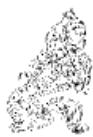

<!-- V3_SOURCE_ID:book016-b002138-p000-945da2394e -->

就是《尚书·胤征》中“歼厥渠魁，胁从罔治”的含义。这种说法可以作为一种参考。

查看对应原文

<!-- V3_FOLDBACK_BEGIN:book016-b002138-p000-945da2394e -->

即《尚书·胤征》“歼厥渠魁，胁从罔治”之义。可备一说。

<!-- V3_FOLDBACK_END:book016-b002138-p000-945da2394e -->

<!-- V3_SOURCE_ID:book016-b002139-p000-ef525bcef2 -->

《象传》说：“君王出师征伐”，说明上九爻是为了端正邦国、治理天下。

查看对应原文

<!-- V3_FOLDBACK_BEGIN:book016-b002139-p000-ef525bcef2 -->

译文《象传》说：“君王出师征伐”，说明 《象》曰：“王用出征”，以正  
上九是为了端正邦国治理天下。邦也。

<!-- V3_FOLDBACK_END:book016-b002139-p000-ef525bcef2 -->

<!-- V3_SOURCE_ID:book016-b002140-p000-7c02317c59 -->

【疏】上九爻凭借刚明的德行，尊居《离》（八卦之一）卦的终极位置，下方依附它的人必定很多，背叛它的人必定很少；所以这个时候征伐“异己”之人，势必会有所俘获，能够做到无咎。《彖传》中的“化成天下”、《大象传》中的“以继明照于四方”，似乎在这一爻中有所体现。

查看对应原文

<!-- V3_FOLDBACK_BEGIN:book016-b002140-p000-7c02317c59 -->

【疏】上九以刚明之德尊居《离》极，下所附丽者必众，背逆者必少；故此时征伐“异己”，势将有获无咎。《彖传》“化成天下”、《大象传》“以继明照于四方”，似在此爻有所体现。

<!-- V3_FOLDBACK_END:book016-b002140-p000-7c02317c59 -->

<!-- V3_SOURCE_ID:book016-b002141-p000-ae7eda3101 -->

【笺】《左传》僖公十四年记载虢射说：“皮都不存在了，毛能附着在哪里呢？”这说明事物往往需要依附于一定的环境。就自然物象来说，太阳依附于天空普照大地，火焰依附于燃料发出光和热，是最明显的例子。《离》卦所表示的“附丽”之义，正是以火、日为基本的象征形象。卦辞说“畜养牝牛可获吉祥”，是强调“附丽”之时必须柔顺守正，才能亨通畅达。从六爻的情状分析，第二、第五爻获得吉祥，是因为它们属于阴柔之爻且居于中位，守持正道，成就了“附丽”的美；第三、第四爻都有凶险，是因为它们属于阳刚之爻却未居中位、不合正道，有的面临穷衰，有的虚势“无所容”，都不能实现“附丽”的志向；至于初、上两阳爻，初九处于下位，恭敬谨慎，逐渐能够附丽于事物，上九的“离”道已经形成，万物都来亲附，所以这两爻都获得“无咎”。如果把《坎》、《离》两卦相互比较，又能进一步看出，“行险”应当以“刚中”为主，“附丽”则以“柔中”为宜：这是两卦恰好相反的核心意义。当然，《离》卦的象征喻旨十分广泛，若以“人事”来说，不论人的地位尊卑如何，都必须附丽于所处的时代、社会；而人与人之间的不同层次，又存在附丽与被附丽的复杂关系：人类的社会结构，因此不可避免地反映出一种特定的组合。《彖传》极力称赞：“重明以丽乎正，乃化成天下。”程颐说：“天地之中，没有不附丽的事物，人应当审慎选择所附丽的对象，附丽得合乎正道就能亨通。”“君臣上下，都有明德，且处于中正之位，就可以教化成就天下，形成文明的风俗。”（《程传》）这实际上是把《离》卦的哲学意义纳入了古代政治思想的范畴中。

查看对应原文

<!-- V3_FOLDBACK_BEGIN:book016-b002141-p000-ae7eda3101 -->

【笺】《左传》僖公十四年载虢射曰：“皮之不存，毛将安傅？”说明事物往往需要附着于一定的环境。就自然物象而言，太阳依附于天空广照大地，火焰依附于燃料发出光热，是最为显明的事例。《离》卦所示“附丽”之义，正是以火、日为基本喻象。卦辞称“畜养牝牛”可获吉祥，则是强调“附丽”之时必须柔顺守正才能亨通畅达。从六爻的情状分析，二、五获吉在于阴柔居中，守持正道以成“附丽”之美；三、四皆凶，则是阳刚不中不正，或面临穷衰，或虚势“无所容”，均不能遂“附丽”之志；至于初、上两阳，初九处下敬慎、渐能附丽于物，上九“离”道已成、物皆亲附，故两爻并获“无咎”。若以《坎》、《离》两卦互为比较，又可进一步看出，“行险”当以“刚中”为主，“附丽”则以“柔中”为宜：这是两卦适为相反的核心意义。当然，《离》卦的象征喻旨也是十分广泛的，取“人事”为说，不论人的地位尊卑如何，均须附丽于所处的时代、社会；而人与人之间的不同层次，又存在附丽与被附丽的复杂关系：人类的社会结构，于是不可避免地反映出一种特定的组合。《彖传》极称：“重明以丽乎正，乃化成天下。”程颐曰：“天地之中，无无丽之物，在人当审其所丽，丽得其正则能亨也。”“君臣上下，皆有明德，而处中正，可以化成天下，成文明之俗。”(《程传》)这事实上是把《离》卦的哲学意义纳入古代政治思想的范畴中去了。

<!-- V3_FOLDBACK_END:book016-b002141-p000-ae7eda3101 -->

<!-- V3_SOURCE_ID:book016-b002142-p000-0b299943d9 -->

## 卷五 下经

查看对应原文

<!-- V3_FOLDBACK_BEGIN:book016-b002142-p000-0b299943d9 -->

## 卷五 下经

<!-- V3_FOLDBACK_END:book016-b002142-p000-0b299943d9 -->

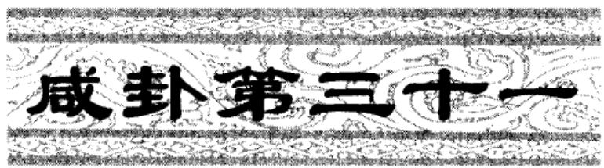

<!-- V3_SOURCE_ID:book016-b002144-p000-c7b368df49 -->

《咸》卦象征交感：行事亨通，利于守持正道；娶妻可获吉祥。

查看对应原文

<!-- V3_FOLDBACK_BEGIN:book016-b002144-p000-c7b368df49 -->

译文《咸》卦象征交感：亨通，利于守持 正固；娶妻可获吉祥。

<!-- V3_FOLDBACK_END:book016-b002144-p000-c7b368df49 -->

<!-- V3_SOURCE_ID:book016-b002145-p000-11fe94af5b -->

匡释①咸：卦名，下艮（☶）上兑（☱），象征“交感”。按，“咸”字的含义，《彖传》说“感也”，意思是“交感”、“通感”、“感应”；《正义》说：“此卦阐明人伦的开端，夫妇的道义，必须男女相互感应，才能形成夫妇关系。”

查看对应原文

<!-- V3_FOLDBACK_BEGIN:book016-b002145-p000-11fe94af5b -->

匡释①咸：卦名，下艮（☶）上兑（☱），象征“交感”。案，“咸”字之义，《彖传》谓“感也”，犹言“交感”、“通感”、“感应”；《正义》：“此卦明人伦之始，夫妇之义，必须男女共相感应，方成夫妇。”

<!-- V3_FOLDBACK_END:book016-b002145-p000-11fe94af5b -->

<!-- V3_SOURCE_ID:book016-b002146-p000-527896d8c5 -->

②亨，利贞；取女吉：这里的“取”就是“娶”的意思。这三句是说，交感可以带来亨通，其益处在于守持正道；又以人事作比喻，说明男女交感，依照正道结为婚姻就会吉祥。《正义》中说：“既然相互感应，才能达到亨通；如果用邪道相通，就会招致凶险祸害，所以益处在于守持贞正；既然感应相通出于正道，这就是婚姻中的善举。”

查看对应原文

<!-- V3_FOLDBACK_BEGIN:book016-b002146-p000-527896d8c5 -->

②亨，利贞；取女吉：取，即“娶”。这三句说明“交感”可致亨通，其利在于守正；并以人事为喻，谓男女“交感”，以“正道”结为婚姻必“吉”。《正义》：“既相感应，乃得亨通；若以邪道相通，则凶害斯及，故利在贞正；既感通以正，即是婚媾之善。”

<!-- V3_FOLDBACK_END:book016-b002146-p000-527896d8c5 -->

<!-- V3_SOURCE_ID:book016-b002147-p000-797f5c3829 -->

《周易》从《乾》至《离》共三十卦为上经，《咸》以下共三十四卦为下经。孔颖达说：“前代学者都认为上经阐明天道，下经阐明人事。但韩康伯注释《序卦》时否定这个说法，他说：‘《易》由六画组成卦，“三才”都具备；错综天人之道，来体现变化。难道天道、人事会偏于上经或下经吗？’”孔氏还举出《讼》《师》两卦作为例子，指出：“上经之内，明确说明饮食之后必然会有争讼，争讼必然会从众人中兴起，这同时涉及人事，并非专论天道。既然不是专论天道，那么下经也不是专论人事，道理就是这样。”（均见《正义》）这种说法认为上下经都是结合自然界与人类社会的规律，即“天道”“人事”来阐述《易》理，似乎有可取之处。

查看对应原文

<!-- V3_FOLDBACK_BEGIN:book016-b002147-p000-797f5c3829 -->

说明《周易》自《乾》至《离》三十卦为上经，《咸》以下三十四卦为下经。孔颖达曰：“先儒皆以上经明天道，下经明人事。然韩康伯注《序卦》破此义，云：‘夫《易》六画成卦，“三才”必备；错综天人，以效变化。岂有天道、人事偏于上下哉？’”孔氏并举《讼》、《师》两卦为例，指出：“上经之内，明饮食必有讼，讼必众起，是兼于人事，不专天道。既不专天道，则下经不专人事，理则然矣。”（均见《正义》）此谓上下经皆是结合自然界与人类社会的规律（即“天道”、“人事”）阐述《易》理，似有可取。

<!-- V3_FOLDBACK_END:book016-b002147-p000-797f5c3829 -->

<!-- V3_SOURCE_ID:book016-b002148-p000-fcdd2b38ce -->

《彖》中说：咸，就是交感的意思；柔上而刚下，二气感应以相与。止而说，男下女，是以亨，利贞，取女吉也。

> **释读存疑：** 止而说；男下女

查看对应原文

<!-- V3_FOLDBACK_BEGIN:book016-b002148-p000-fcdd2b38ce -->

《彖》曰：咸，感也；柔上而刚下，二气感应以相与①。止而说②，男下女③，是以亨，利贞，取女吉也。

<!-- V3_FOLDBACK_END:book016-b002148-p000-fcdd2b38ce -->

<!-- V3_SOURCE_ID:book016-b002149-p000-0188b3a7b9 -->

《彖传》中提到“咸”，意思是交感；譬如阴柔往上而阳刚来下，二气交感互应、两相亲和。交感之时稳重自制又能欢快欣悦，就像男子以礼下求女子，所以亨通，利于守持正固，娶妻可获吉祥。天地交感带来万物化育生长，圣人感化人心带来天下和平昌顺：观察“交感”现象，天地万物的性情就可以明白了！

> **释读存疑：** “咸”的具体所指需结合《周易》原文语境确定；本地硬校验仍未通过，已记录供后续自动处理或人工核对。

查看对应原文

<!-- V3_FOLDBACK_BEGIN:book016-b002149-p000-0188b3a7b9 -->

译文《彖传》说：“咸”，意思是交感；譬如阴柔往上而阳刚来下，二气交感互应、两相亲和。交感之时稳重自制又能欢快欣悦，就像男子以礼下求女子，所以亨通，利于守持正固，娶妻可获吉祥。天地交感带来万物化育生长，圣人感化人心带来天下和平昌顺：观察“交感”现象，天地万物的性情就可以明白了！

<!-- V3_FOLDBACK_END:book016-b002149-p000-0188b3a7b9 -->

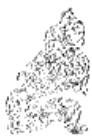

<!-- V3_SOURCE_ID:book016-b002151-p000-eee6bfb22c -->

天地相互感应，万物由此化育生成；圣人感化人心，天下便会和谐太平。观察这种感应的情形，天地万物的情状就能显现出来了④！

查看对应原文

<!-- V3_FOLDBACK_BEGIN:book016-b002151-p000-eee6bfb22c -->

天地感而万物化生，圣人感人心而天下和平：观其所感，而天地万物之情可见矣④！

<!-- V3_FOLDBACK_END:book016-b002151-p000-eee6bfb22c -->

<!-- V3_SOURCE_ID:book016-b002152-p000-a84468ca70 -->

匡释①所说的是阴柔居上而阳刚居下，阴阳二气相互感应而彼此亲附：柔指上兑（八卦之一）阴卦，刚指下艮（八卦之一）阳卦；与，《经典释文》引郑玄的说法是“犹亲也”。这两句以上下卦象蕴含刚柔交感的含义，用来解释卦名“咸”。《正义》的说法是：“艮（八卦之一）为刚而兑（八卦之一）为柔，倘若刚居于上，柔居于下，就不会相互交感，无法相通；如今兑（八卦之一）柔居于上而艮（八卦之一）刚居于下，这就是阴阳二气相互感应，彼此授受。”按，孔氏将“与”解释为“授与”，在义理上也说得通。

查看对应原文

<!-- V3_FOLDBACK_BEGIN:book016-b002152-p000-a84468ca70 -->

匡释①柔上而刚下，二气感应以相与：柔，指上兑阴卦；刚，指下艮阳卦；与，《释文》引郑玄曰：“犹亲也”。这两句以上下象有刚柔交感之义，释卦名“咸”。《正义》：“艮刚而兑柔，若刚自在上，柔自在下，则不相交感，无由得通；今兑柔在上而艮刚在下，是二气感应，以相授与。”案，孔氏训“与”为“授与”，于义亦通。

<!-- V3_FOLDBACK_END:book016-b002152-p000-a84468ca70 -->

<!-- V3_SOURCE_ID:book016-b002153-p000-52cbbf01cb -->

②所说的“止而说”：止，指下艮（八卦之一）；说，即悦，指上兑（八卦之一）。这是说明上下卦象蕴含“静止、欣悦”的含义，如同“交感”合乎正道，不会陷入邪欲。《正义》的说法是：“艮（八卦之一）静止而兑（八卦之一）欣悦，能够自我静止，就不会随顺躁动的欲望；以静止的状态去欣悦，就不会邪谄，不会偏离正道。”按，《本义》的说法是：“艮（八卦之一）静止则感应专一，兑（八卦之一）欣悦则回应至极”，应当作为一种说法留存。

查看对应原文

<!-- V3_FOLDBACK_BEGIN:book016-b002153-p000-52cbbf01cb -->

②止而说：止，谓下艮；说，悦也，谓上兑。此明上下象有‘静止、欣悦’之义，犹‘交感’以正，不陷邪欲。《正义》：‘艮止而兑说也，能自静止，则不随动欲；以止行说，则不为邪谄，不失其正。’案，《本义》曰：‘艮止则感之专，兑说则应之至’，宜备一说。

<!-- V3_FOLDBACK_END:book016-b002153-p000-52cbbf01cb -->

<!-- V3_SOURCE_ID:book016-b002154-p000-3eefe707ac -->

③所说的“男下女”：男，指艮为少男；女，指兑为少女，均见《说卦传》。这句以上下卦蕴含少男以礼对待少女的卦象，与前文“止而说”一同解释卦辞“亨，利贞，取女吉。”《正义》的说法是：“婚姻的要义，是男子先追求女子；亲迎的礼仪，‘御轮三周’。都是男子先主动对待女子，然后女子回应男子。”《纂疏》的说法是：“《仪礼·士昏礼》中，凡纳采、问名、纳吉、纳征、请期、亲迎等礼仪，都是男子主动对待女子的事情。《郊特牲》说‘男子亲迎，男子先到女子家，这是刚柔的义理体现’。”

查看对应原文

<!-- V3_FOLDBACK_BEGIN:book016-b002154-p000-3eefe707ac -->

③男下女：男，谓艮为少男；女，谓兑为少女(均见《说卦传》)。此句以上下卦含少男“礼下”少女之象，与前文“止而说”并释卦辞“亨，利贞，取女吉。”《正义》：“婚姻之义，男先求女；亲迎之礼，‘御轮三周’。皆是男先下于女，然后女应于男。”《纂疏》：“《仪礼·士昏礼》，凡纳采、问名、纳吉、纳征、请期、亲迎诸礼，皆男下女之事。《郊特牲》曰‘男子亲迎，男先于女，刚柔之义也’。”

<!-- V3_FOLDBACK_END:book016-b002154-p000-3eefe707ac -->

<!-- V3_SOURCE_ID:book016-b002155-p000-72efbc4e31 -->

④天地万物的情状就可以看出来了：这句话和前面三句合在一起，是广泛列举天地、圣人、万物相互感应的例子，深入阐释《咸》卦的核心要义。《正义》说：“这是总结赞叹‘咸’道的广大，大的方面涵盖天地，小的方面包含万物。被外物感动而产生的状态，就叫做‘情’。天地万物都凭借气类相互感应，所以‘观察它们所感应的对象，天地万物的情状就可以看出来了’。”

查看对应原文

<!-- V3_FOLDBACK_BEGIN:book016-b002155-p000-72efbc4e31 -->

④天地万物之情可见矣：此句合前三句，广举天地、圣人、万物相感之例，深阐《咸》卦大义。《正义》：‘结叹‘咸’道之广，大则包天地，小则该万物。感物而动，谓之‘情’也。天地万物皆以气类共相感应，故‘观其所感，而天地万物之情可见矣’。’

<!-- V3_FOLDBACK_END:book016-b002155-p000-72efbc4e31 -->

<!-- V3_SOURCE_ID:book016-b002156-p000-d4a81f1de7 -->

《象传》说：山上有泽，咸①；君子以虚受人②。

> **释读存疑：** 原文存在断句残缺的情况

查看对应原文

<!-- V3_FOLDBACK_BEGIN:book016-b002156-p000-d4a81f1de7 -->

译文《象传》说：山上有大泽，(山泽相 《象》曰：山上有泽，咸①；君子通）容征化成；君子因此虚怀若谷，广 以虚受人②。

<!-- V3_FOLDBACK_END:book016-b002156-p000-d4a81f1de7 -->

<!-- V3_SOURCE_ID:book016-b002157-p000-3483f4bde3 -->

匡释①山上有泽，咸：解释《咸》卦下艮为山、上兑为泽的卦象。《正义》说：“泽性向下流，能够滋润下方；山体向上承接，能够接受泽水的滋润；山与泽相互感应，所以称为咸。”按：《集解》引用郑玄的话说：“艮为山，兑为泽，山气向下，泽气向上：二气相通相应，所以称为‘咸’。”这是承接《说卦传》“山泽通气”的说法来解释卦象，从义理上也说得通。

查看对应原文

<!-- V3_FOLDBACK_BEGIN:book016-b002157-p000-3483f4bde3 -->

匡释①山上有泽，咸：释《咸》卦下艮为山、上兑为泽之象。《正义》：‘泽性下流，能润于下；山体上承，能受其润；以山感泽，所以为咸。’案：《集解》引郑玄曰：‘艮为山，兑为泽，山气下，泽气上：二气通而相应，故曰‘咸’也。’此承《说卦传》‘山泽通气’之语释卦象：于义亦通。

<!-- V3_FOLDBACK_END:book016-b002157-p000-3483f4bde3 -->

<!-- V3_SOURCE_ID:book016-b002158-p000-a6bc2d41c0 -->

②以虚受人：受，就是容纳的意思。这句话说明君子效法《咸》卦的卦象，以谦虚的态度对待他人和事物，来成就“感应”之道。《王注》说：“以谦虚的态度接纳他人，他人就会与你感应。”《正义》说：“君子效法《咸》卦下艮为山、上兑为泽的卦象，所以能够使自己内心空虚，不固执己见；接纳他人和事物，没有一点舍弃遗漏：用这样的态度去感应他人，没有不回应的。”

查看对应原文

<!-- V3_FOLDBACK_BEGIN:book016-b002158-p000-a6bc2d41c0 -->

②以虚受人：受，犹言容纳。此句说明君子效法《咸》象，虚怀接物，以成“感应”之道。《王注》：‘以虚受人，物乃感应。’《正义》：‘君子法此《咸》卦下山上泽，故能空虚其怀，不自有实；受纳于物，无所弃遗：以此感人，莫不皆应。’

<!-- V3_FOLDBACK_END:book016-b002158-p000-a6bc2d41c0 -->

<!-- V3_SOURCE_ID:book016-b002159-p000-acf5744ee6 -->

从卦辞所说的男女之间的“交感”，到《彖传》、《大象传》所说的圣人、君子对众人、庶民的“感化”，显然是对卦辞含义的引申发挥。不过从象征的角度来说，“交感”的含义本就极为宽泛，因此《彖传》与《大象传》所阐发的内容，也都没有超出卦理的范围。

查看对应原文

<!-- V3_FOLDBACK_BEGIN:book016-b002159-p000-acf5744ee6 -->

说明 从卦辞云男女之间的“交感”，到《彖传》、《大象传》称圣人、君子对于众人、庶民的“感化”，显然是一种发挥。但就象征角度言，“交感”之义本至广泛，故两传所阐发者亦无不在卦理之中。

<!-- V3_FOLDBACK_END:book016-b002159-p000-acf5744ee6 -->

<!-- V3_SOURCE_ID:book016-b002160-p000-ac20bbb92a -->

译文初六，交感相应在脚拇指。

查看对应原文

<!-- V3_FOLDBACK_BEGIN:book016-b002160-p000-ac20bbb92a -->

译文初六，交感相应在脚拇指。

<!-- V3_FOLDBACK_END:book016-b002160-p000-ac20bbb92a -->

<!-- V3_SOURCE_ID:book016-b002161-p000-629987a060 -->

初六，咸其拇①。

查看对应原文

<!-- V3_FOLDBACK_BEGIN:book016-b002161-p000-629987a060 -->

初六，咸其拇①。

<!-- V3_FOLDBACK_END:book016-b002161-p000-629987a060 -->

<!-- V3_SOURCE_ID:book016-b002162-p000-1c98ef20ce -->

注释①咸其拇：拇，《释文》记载：“马、郑、薛说足大指也”。此句说明，初六以阴爻处于“咸”卦的起始位置，向上与九四爻相应，所感应的程度尚浅，还未触动内心，因此以“感于拇”为喻，说的是想要行动却还未行动的状态。《正义》记载：“初应在四，俱处卦始，为感浅末；取譬一身，在于足指而已。”

查看对应原文

<!-- V3_FOLDBACK_BEGIN:book016-b002162-p000-1c98ef20ce -->

注释①咸其拇：拇，《释文》：“马、郑、薛云足大指也’。”此句说明初六以阴处“咸”之始，上应九四，所感尚浅，未动于心，故以感于“拇”为喻；言其欲动而未动。《正义》：“初应在四，俱处卦始，为感浅末；取譬一身，在于足指而已。”

<!-- V3_FOLDBACK_END:book016-b002162-p000-1c98ef20ce -->

<!-- V3_SOURCE_ID:book016-b002163-p000-883266b309 -->

《象传》说：“咸其拇”，这是说初六的感应志向是向外发展。

查看对应原文

<!-- V3_FOLDBACK_BEGIN:book016-b002163-p000-883266b309 -->

《象》曰：“咸其拇”，志在外也。 译文《象传》说：“交感相应在脚拇指”，说明初六的感应志向是往外发展。

<!-- V3_FOLDBACK_END:book016-b002163-p000-883266b309 -->

<!-- V3_SOURCE_ID:book016-b002164-p000-f575b7d265 -->

感应在“拇”上，固然是浅陋细微的表现；但初六既然已经有所感应，终究不可能不动，所以必然会萌生“志在外”的想法。方宗诚认为，爻辞没有说明吉凶的原因，是因为“将要行动的初始阶段，善与恶还没有确定；所以只说咸其拇，让人们存有谨慎行动、重视细微征兆的心意”（《读易笔记》）。

查看对应原文

<!-- V3_FOLDBACK_BEGIN:book016-b002164-p000-f575b7d265 -->

[说丽感应于“拇”，固为浅末；但初六既有所应，终不能不动，故必萌萌然而“志在外”。方宗诚以为，爻辞不言吉凶的原因，是由于“将动之始，善与恶尚未定也；故但曰咸其拇’，使人存慎动谨几之意”(《读易笔记》)。

<!-- V3_FOLDBACK_END:book016-b002164-p000-f575b7d265 -->

<!-- V3_SOURCE_ID:book016-b002165-p000-0f437a7911 -->

六二，咸其腓，凶；居吉①。

> **释读存疑：** 本地硬校验仍未通过，已记录供后续自动处理或人工核对。

查看对应原文

<!-- V3_FOLDBACK_BEGIN:book016-b002165-p000-0f437a7911 -->

六二，咸其腓，凶；居吉①。

<!-- V3_FOLDBACK_END:book016-b002165-p000-0f437a7911 -->

<!-- V3_SOURCE_ID:book016-b002166-p000-140ffe5476 -->

六二，交感相应在小腿肚，有凶险；安居守静可获吉祥。

> **释读存疑：** 本地硬校验仍未通过，已记录供后续自动处理或人工核对。

查看对应原文

<!-- V3_FOLDBACK_BEGIN:book016-b002166-p000-140ffe5476 -->

译文六二，交感相应在小腿肚，有凶险；安居守静可获吉祥。

<!-- V3_FOLDBACK_END:book016-b002166-p000-140ffe5476 -->

<!-- V3_SOURCE_ID:book016-b002167-p000-3420248340 -->

匡释①咸其腓，凶；居吉：腓的读音为féi，指小腿肚，《程传》解释为“足肚也”；这个字在《说文》中被解释为“腨也”，又解释“腨”为“腓肠也”，《段注》称：“胫骨后之肉也，腓之言肥，似中有肠者然。”这里说的是《咸》卦下卦的六二爻，阴柔得正且与九五爻相应，好比交感的程度到了“腓”的阶段；“腓”是容易躁动的部位，躁动必然凶险，所以爻辞先警示凶险，再劝勉它静居守正则吉祥。《王注》称：“‘咸’道转进，离拇’升腓’；腓体动躁者也，感物以躁，凶之道也。由躁故凶，居则吉矣；处不乘刚，故可以居而获吉。”按《尚氏学》的说法：“五为正应，乃三、四亦阳，二独与五，则为三、四所忌，故动凶居吉。”这种对各爻关系的解释很清晰，可以作为参考。

> **释读存疑：** 原文未明确说明《尚氏学》中“三、四亦阳”的具体所指，属于含混表述

查看对应原文

<!-- V3_FOLDBACK_BEGIN:book016-b002167-p000-3420248340 -->

匡释①咸其腓，凶；居吉：腓，音féi，小腿肚，《程传》“足肚也”；此字《说文》训“腨也”，又训“腨”曰“腓肠也”，《段注》：“胫骨后之肉也，腓之言肥，似中有肠者然。”此谓六二处《咸》下卦之中，柔正应五，犹交感至于“腓”；“腓”为动象，躁动必凶，故爻辞先戒以凶险，再勉其静居守正则吉。《王注》：“咸’道转进，离拇’升腓’；腓体动躁者也，感物以躁，凶之道也。由躁故凶，居则吉矣；处不乘刚，故可以居而获吉。”案，《尚氏学》：“五为正应，乃三、四亦阳，二独与五，则为三、四所忌，故动凶居吉。”此释诸爻关系甚明，可备参考。

<!-- V3_FOLDBACK_END:book016-b002167-p000-3420248340 -->

<!-- V3_SOURCE_ID:book016-b002168-p000-77191f9a0d -->

《象传》解释说，虽然有凶险但安居守静可获吉祥，是因为顺从正道就不会遭受祸害。

查看对应原文

<!-- V3_FOLDBACK_BEGIN:book016-b002168-p000-77191f9a0d -->

《象》曰：虽凶居吉，顺不害也。

<!-- V3_FOLDBACK_END:book016-b002168-p000-77191f9a0d -->

<!-- V3_SOURCE_ID:book016-b002169-p000-cec0b8e57e -->

译文《象传》说：六二尽管有凶险但安居守静可获吉祥，说明顺从“交感”正道可以免遭祸害。

查看对应原文

<!-- V3_FOLDBACK_BEGIN:book016-b002169-p000-cec0b8e57e -->

译文《象传》说：六二尽管有凶险但安居守静可获吉祥，说明顺从“交感”正道可以免遭祸害。

<!-- V3_FOLDBACK_END:book016-b002169-p000-cec0b8e57e -->

<!-- V3_SOURCE_ID:book016-b002170-p000-9e7b26a49e -->

说明六二柔和中正，感“腓”致动，本无过错，但爻辞却用“凶”字严厉告诫。由此可知，《周易》的作者在《咸》卦中虽然讲“交感”，却以守正“不动”为好，其中似乎蕴含着男女交感应当以“礼”加以防范的意思。朱熹说：“此卦虽主于‘感’，然六爻皆宜静不宜动也。”（《本义》）

> **释读存疑：** 原文中“似有男女交感、当以‘礼’为防之意”属于推测性解读，未明确为确定含义

查看对应原文

<!-- V3_FOLDBACK_BEGIN:book016-b002170-p000-9e7b26a49e -->

说明六二柔和中正，感“腓”致动，本无可咎，但爻辞却以“凶“深诫之。可知《周易》作者于《咸》卦虽言“交感”，却以守正“不动”为美，此中似有男女交感、当以“礼”为防之意寓焉。朱熹曰：“此卦虽主于‘感’，然六爻皆宜静不宜动也。”(《本义》)

<!-- V3_FOLDBACK_END:book016-b002170-p000-9e7b26a49e -->

<!-- V3_SOURCE_ID:book016-b002171-p000-59fe7d18a3 -->

九三爻的爻辞是：咸其股，执其随，往吝。对应的译文为：交感相应在大腿，执意盲从泛随于人，如此前往必有憾惜。

查看对应原文

<!-- V3_FOLDBACK_BEGIN:book016-b002171-p000-59fe7d18a3 -->

九三，咸其股，执其随，往吝①。 译文九三，交感相应在大腿，执意盲从泛随于人，如此前往必有憾惜。

<!-- V3_FOLDBACK_END:book016-b002171-p000-59fe7d18a3 -->

<!-- V3_SOURCE_ID:book016-b002172-p000-e52cd20b32 -->

注释①：咸其股，执其随，往吝。股指大腿；执的意思是执意，《正义》将其解释为“其志意所执”；随在这里包含盲从泛随、心无专主的含义。这三句说明，九三处《咸》卦下卦的末尾，阳刚之气旺盛，性情刚直，对应上六爻，交感相应到了大腿的部位；大腿会随着脚而动，所以用来比喻交感相应不专一，执意泛随于人，前往必然会有憾惜。《王注》中说：“股之为物，随足者也。进不能制动，退不能静处，所感在股，志在随人者也。志在随人，所执亦以贱矣；用斯以往，吝其宜也。”2

查看对应原文

<!-- V3_FOLDBACK_BEGIN:book016-b002172-p000-e52cd20b32 -->

注释①咸其股，执其随，往吝：股，大腿；执，犹言“执意”，《正义》释为“其志意所执”；随，此处含“盲从泛随”、心无专主之义。这三句说明九三处《咸》下卦之终，阳盛刚亢，应于上六，交感至“股”；“股”动随足而行，故喻相感不专，执意泛随，“往”必有“吝”。《王注》：“股之为物，随足者也。进不能制动，退不能静处，所感在股，志在随人者也。志在随人，所执亦以贱矣；用斯以往，吝其宜也。” 2

<!-- V3_FOLDBACK_END:book016-b002172-p000-e52cd20b32 -->

<!-- V3_SOURCE_ID:book016-b002173-p000-084cd870fe -->

《象》传说：“咸其股”，意思是九三不能安静退处；“志在随人”，意思是所执守的心意是卑下的。

查看对应原文

<!-- V3_FOLDBACK_BEGIN:book016-b002173-p000-084cd870fe -->

《象》曰：“咸其股”，亦不处也①；“志在随人”，所执下也。

<!-- V3_FOLDBACK_END:book016-b002173-p000-084cd870fe -->

<!-- V3_SOURCE_ID:book016-b002174-p000-3ef378e4e2 -->

《象传》的相关译文为：“交感相应在大腿”，说明九三爻不能安静退处；“心志在于盲从泛随于人”，说明所执守的意旨是卑下的。

查看对应原文

<!-- V3_FOLDBACK_BEGIN:book016-b002174-p000-3ef378e4e2 -->

译文《象传》说：“交感相应在大腿”，说明九三不能安静退处；“心志在于盲从泛随于人”，说明所执守之意是卑下的。

<!-- V3_FOLDBACK_END:book016-b002174-p000-3ef378e4e2 -->

<!-- V3_SOURCE_ID:book016-b002175-p000-3a979be4e6 -->

注释①也不能静处：《正义》说：“不仅前进时无法控制局势，后退时也不能安静停留。”

查看对应原文

<!-- V3_FOLDBACK_BEGIN:book016-b002175-p000-3a979be4e6 -->

注释①亦不处：《正义》：‘非但进不能制动，退亦不能静处也。’

<!-- V3_FOLDBACK_END:book016-b002175-p000-3a979be4e6 -->

<!-- V3_SOURCE_ID:book016-b002176-p000-e8d841e153 -->

咸卦第三十一

查看对应原文

<!-- V3_FOLDBACK_BEGIN:book016-b002176-p000-e8d841e153 -->

咸卦第三十一

<!-- V3_FOLDBACK_END:book016-b002176-p000-e8d841e153 -->

<!-- V3_SOURCE_ID:book016-b002177-p000-ac588413c0 -->

说明：九三爻是“多凶”的爻位，阳爻居位，性情急躁；向上对应一位阴爻，向下又踩着两位阴爻，呈现出三心二意、相互感应不够专一的景象，所以一有举动就会招致“吝”的结果。马其昶在《重定费氏学》中解释本爻的《小象传》说：“君子观察九三爻，不责怪它行为随顺，而责怪它的志向所执着的对象过于低下。”

查看对应原文

<!-- V3_FOLDBACK_BEGIN:book016-b002177-p000-ac588413c0 -->

说明九三处“多凶”之位，阳盛性躁；上应一阴，下履两阴，为三心二意、相感不专之象，故动辄致“吝”。马其昶释本爻《小象传》曰：“君子观于三，不责其行之随，而责其志之所执者下也。”（《重定费氏学》）

<!-- V3_FOLDBACK_END:book016-b002177-p000-ac588413c0 -->

<!-- V3_SOURCE_ID:book016-b002178-p000-f9586cdd35 -->

九四爻的含义是，若能守持正固就可获得吉祥，此前的悔恨也必将消亡；若是心意不定地频频往来，最终友朋还是会顺从你的思念。

查看对应原文

<!-- V3_FOLDBACK_BEGIN:book016-b002178-p000-f9586cdd35 -->

译文九四，守持正固可获吉祥，悔恨必将消亡；心意不定地频频往来，友朋终究顺从你的思念。

<!-- V3_FOLDBACK_END:book016-b002178-p000-f9586cdd35 -->

<!-- V3_SOURCE_ID:book016-b002179-p000-04924bb854 -->

九四爻，占问得吉兆，悔恨消失；心意不定、频频往来，友朋会顺从你的想法。

查看对应原文

<!-- V3_FOLDBACK_BEGIN:book016-b002179-p000-04924bb854 -->

九四，贞吉，悔亡①；憧憧往来，朋从尔思②。

<!-- V3_FOLDBACK_END:book016-b002179-p000-04924bb854 -->

<!-- V3_SOURCE_ID:book016-b002180-p000-5e117a04ca -->

卷 五

查看对应原文

<!-- V3_FOLDBACK_BEGIN:book016-b002180-p000-5e117a04ca -->

卷 五

<!-- V3_FOLDBACK_END:book016-b002180-p000-5e117a04ca -->

<!-- V3_SOURCE_ID:book016-b002181-p000-e11815edf9 -->

①贞吉，悔亡：这是说九四爻处于咸卦之时，原本有失正的悔恨；但阳爻居于阴位，有谦退的征象，仍能趋向正道、坚守自我，与对应的初六爻以诚心相待，静等心意相通的那一天，所以获得吉祥而悔恨消失。王弼的《王注》说：“处于上卦的开头，对应下卦的起始，在卦体的中间，在股的上方，两个卦体开始相交感应，以此贯通心志，是心神开始感应的状态。大凡事物开始感应却不用正道，就会导致灾害，所以必须坚守正道然后才能吉祥，吉祥之后才能消除悔恨。”按爻位来看，九四仍居于卦体中间、股的上方，所以王弼认为这是感应于心的征象，似乎可以采信。

查看对应原文

<!-- V3_FOLDBACK_BEGIN:book016-b002181-p000-e11815edf9 -->

匡释①贞吉，悔亡：此谓九四当“咸”之时，本有“失正”之悔；但阳居阴位有谦退之象，犹能趋正自守，与所应之初六以诚相须、静俟心志通同之日，故获“吉”而“悔亡”。《王注》：“处上卦之初，应下卦之始，居体之中，在股之上，二体始相交感，以通其志，心神始感者也。凡物始感而不以之于正，则至于害，故必贞’然后乃吉’，‘吉’然后乃得亡’其‘悔’也。”案，据爻位，九四犹居“体中”、“股上”，故王弼谓为感于“心”之象，似可从。

<!-- V3_FOLDBACK_END:book016-b002181-p000-e11815edf9 -->

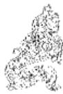

<!-- V3_SOURCE_ID:book016-b002183-p000-291c92419d -->

②憧憧往来，朋从尔思：憧，读音为chōng，“憧憧”形容心意不定而频频往来的样子，《说文解字》说“憧，心意不定”，《经典释文》引用王肃的话说是“往来不绝的样子”，又引用刘表的话说是“心意不定”；朋，指初六爻；尔，指九四爻；思，指思念。这两句承接前文的意思，说明九四从有悔恨到悔恨消失，乃至友朋意志相通、倾心相从的过程。王弼的注说：“始在于感，未尽感极，不能至于无思，以得其党，故有‘憧憧往来’，然后‘朋从’其‘思’也。”

查看对应原文

<!-- V3_FOLDBACK_BEGIN:book016-b002183-p000-291c92419d -->

②憧憧往来，朋从尔思：憧，音chōng，“憧憧”形容心意不定而频频往来之状，《说文》“憧，意不定也”，《释文》引王肃曰“往来不绝貌”，又引刘表曰“意未定也”（此即《集解》引虞翻谓“怀思虑”之义）；朋，指初六；尔，指九四；思，思念。这两句承前文意，说明九四从有“悔”到“悔亡”，乃至友朋意志通感，倾心相从的过程。《王注》：“始在于感，未尽感极，不能至于无思，以得其党，故有‘憧憧往来’，然后‘朋从’其‘思’也。”

<!-- V3_FOLDBACK_END:book016-b002183-p000-291c92419d -->

<!-- V3_SOURCE_ID:book016-b002184-p000-b9ca997e1a -->

译文《象传》说：“守持正固可获吉祥，悔恨必将全消”，说明九四未曾因“交感”不正而遭害；“心意不定地频频往来”，说明此时“交感”之道尚未光大。

查看对应原文

<!-- V3_FOLDBACK_BEGIN:book016-b002184-p000-b9ca997e1a -->

译文《象传》说：“守持正固可获吉祥，悔恨必将全消”，说明九四未曾因“交感”不正而遭害；“心意不定地频频往来”，说明此时“交感”之道尚未光大。

<!-- V3_FOLDBACK_END:book016-b002184-p000-b9ca997e1a -->

<!-- V3_SOURCE_ID:book016-b002185-p000-65adfdfadc -->

《象传》说：“守持正固可获吉祥，悔恨必将全消”，这是说明九四没有因“交感”不正而遭受损害；“心意不定地频频往来”，这是说明此时“交感”之道尚未发扬光大。

> **释读存疑：** 原文未明确“未感害也”的具体所指，释读中补入“九四”“交感”相关内容属于依据《本义》的合理补充，未改变原文核心含义

查看对应原文

<!-- V3_FOLDBACK_BEGIN:book016-b002185-p000-65adfdfadc -->

《象》曰：“贞吉悔亡”，未感害也①；“憧憧往来”，未光大也。

<!-- V3_FOLDBACK_END:book016-b002185-p000-65adfdfadc -->

<!-- V3_SOURCE_ID:book016-b002186-p000-8b98f830c0 -->

注释①未感害也：《本义》说：“是说如果不正当地进行交感，就会有损害。”

查看对应原文

<!-- V3_FOLDBACK_BEGIN:book016-b002186-p000-8b98f830c0 -->

注释①未感害也：《本义》：“言不正而感，则有害也。”

<!-- V3_FOLDBACK_END:book016-b002186-p000-8b98f830c0 -->

<!-- V3_SOURCE_ID:book016-b002187-p000-8bfe49b447 -->

说明本爻极言男女交感须“正”：初六阴柔，当恬静不妄动；九四阳刚，宜守正通其感。爻辞后两句喻象颇为生动：“憧憧往来”，状思虑不定之忧，适如《诗·关雎》“求之不得”、“辗转反侧”；“朋从尔思”，抒终成眷属之喜，亦犹“窈窕淑女，钟鼓乐之”。然而，“交感”之理原非限于男女情事。所“感”至正至大者，不但“思虑不定”之求不复存在，乃至“天下”因之心志归一，人无所思，意均通同。故《系辞下传》引孔子语发挥此爻象征意义曰：“天下何思何虑？天下同归而殊途，一致而百虑，天下何思何虑？”

查看对应原文

<!-- V3_FOLDBACK_BEGIN:book016-b002187-p000-8bfe49b447 -->

说明本爻极言男女交感须“正”：初六阴柔，当恬静不妄动；九四阳刚，宜守正通其感。爻辞后两句喻象颇为生动：“憧憧往来”，状思虑不定之忧，适如《诗·关雎》“求之不得”、“辗转反侧”；“朋从尔思”，抒终成眷属之喜，亦犹“窈窕淑女，钟鼓乐之”。然而，“交感”之理原非限于男女情事。所“感”至正至大者，不但“思虑不定”之求不复存在，乃至“天下”因之心志归一，人无所思，意均通同。故《系辞下传》引孔子语发挥此爻象征意义曰：“天下何思何虑？天下同归而殊途，一致而百虑，天下何思何虑？”

<!-- V3_FOLDBACK_END:book016-b002187-p000-8bfe49b447 -->

<!-- V3_SOURCE_ID:book016-b002188-p000-ce8297901b -->

译文九五，交感相应在背脊肉上，不致悔恨。

查看对应原文

<!-- V3_FOLDBACK_BEGIN:book016-b002188-p000-ce8297901b -->

译文九五，交感相应在背脊肉上，不致悔恨。

<!-- V3_FOLDBACK_END:book016-b002188-p000-ce8297901b -->

<!-- V3_SOURCE_ID:book016-b002189-p000-4472a70bce -->

## 九五，咸其晦，无悔①。 — 九五爻，咸其晦，无悔①。

查看对应原文

<!-- V3_FOLDBACK_BEGIN:book016-b002189-p000-4472a70bce -->

## 九五，咸其晦，无悔①。

<!-- V3_FOLDBACK_END:book016-b002189-p000-4472a70bce -->

<!-- V3_SOURCE_ID:book016-b002190-p000-43f0511eaa -->

注释①咸其腓，无悔：腓，读音为méi，《正义》依据《子夏传》、马融、郑玄、王肃、《说文》、王注等各家说法，认为“腓”就是“背脊肉”，位置在“心之上，口之下”，现在采用这个说法。这两句说明，九五爻处于“感”的情境中，以阳刚之质居尊位，虽然与六二爻相应，却无法实现“大感”；就像交感发生在“腓”的部位，心意难以相通，因此仅能获得“无悔”的结果。《王注》说：“进不能实现大感，退也不会丧失心志；只是心志浅陋，所以仅能做到‘无悔’罢了。”

查看对应原文

<!-- V3_FOLDBACK_BEGIN:book016-b002190-p000-43f0511eaa -->

注释①咸其腓，无悔：腓，音méi，《正义》据《子夏传》、马融、郑玄、王肃、《说文》、王注诸说，认为“腓”即“背脊肉”，位于“心之上，口之下”，今从之。这两句说明九五当“感”之时，阳刚居尊，虽与六二有应，却不能“大感”；犹如感应在“腓”上，其心难通，故仅获“无悔”。《王注》：“进不能大感，退亦不为无志；其志浅末，故‘无悔’而已。”

<!-- V3_FOLDBACK_END:book016-b002190-p000-43f0511eaa -->

<!-- V3_SOURCE_ID:book016-b002191-p000-15b1599f91 -->

《象》曰：“咸其晦”，是说志在末节。《象传》说：“交感相应在背脊肉上”，说明九五的交感志向过于浅末。

> **释读存疑：** 原文中“咸其晦”的具体所指未明确，释读为“交感相应在背脊肉上”属于合理的白话释读，未添加无依据的内容；本地硬校验仍未通过，已记录供后续自动处理或人工核对。

查看对应原文

<!-- V3_FOLDBACK_BEGIN:book016-b002191-p000-15b1599f91 -->

《象》曰：“咸其晦”，志末也。 译文《象传》说：“交感相应在背脊肉上”，说明九五的交感志向过于浅末。

<!-- V3_FOLDBACK_END:book016-b002191-p000-15b1599f91 -->

<!-- V3_SOURCE_ID:book016-b002192-p000-802e07e5f1 -->

丽所说的“背脊肉”，在人体上属于无法与他人相通感应的征象，就如同《周易》中的九五爻虽居尊位，却像“槁木”一样没有情感，无法用心去感应下属。再看六二爻“动则有凶、居则获吉”的情况，似乎也和这个道理有关。马其昶说：“圣人能感化人心，从而使天下太平；如果是像枯槁之木那样只顾自身的人，君子不会认可他的志向。”《重定费氏学》中记载了这段内容。

查看对应原文

<!-- V3_FOLDBACK_BEGIN:book016-b002192-p000-802e07e5f1 -->

说丽“背脊肉”于人体为未能通感之象，犹九五虽居尊位，却同“槁木”无情，不能以心感应其下。视六二“动凶居吉”，似亦与此有关。马其昶曰：“圣人感人心而天下和平’；若枯槁独善之流，君子不取其志也。”(《重定费氏学》)

<!-- V3_FOLDBACK_END:book016-b002192-p000-802e07e5f1 -->

<!-- V3_SOURCE_ID:book016-b002193-p000-0b42774b09 -->

上六，咸其辅颊舌①。

查看对应原文

<!-- V3_FOLDBACK_BEGIN:book016-b002193-p000-0b42774b09 -->

上六，咸其辅颊舌①。

<!-- V3_FOLDBACK_END:book016-b002193-p000-0b42774b09 -->

<!-- V3_SOURCE_ID:book016-b002194-p000-6d4d03b2bb -->

译文上六，交感相应在口头上。

查看对应原文

<!-- V3_FOLDBACK_BEGIN:book016-b002194-p000-6d4d03b2bb -->

译文上六，交感相应在口头上。

<!-- V3_FOLDBACK_END:book016-b002194-p000-6d4d03b2bb -->

<!-- V3_SOURCE_ID:book016-b002195-p000-2c1f5403a6 -->

匡释①咸其辅颊舌：辅，在脸颊之上，指上牙床，《说文解字》说“人颊车也”；辅、颊、舌三者合在一起，就像现在所说的“口头言语”，王弼的《周易注》说：“辅、颊、舌，是用来说话的工具”，来氏的《易注》说：“舌动则辅应和颊随之而动，三者相互配合发挥作用，都是用来表达言语的。”这句话说明上六以阴爻居于《咸》卦的末尾，“感应”到了极点反而走向反面，它的感应只停留在口头言语上。王弼的《周易注》说：“‘咸’道转向末节，所以只停留在口舌言语上罢了。”

查看对应原文

<!-- V3_FOLDBACK_BEGIN:book016-b002195-p000-2c1f5403a6 -->

匡释①咸其辅颊舌：辅，在脸颊之上，指上牙床，《说文》“人颊车也”；辅、颊、舌三者合称，犹今言“口头言语”，《王注》：“辅、颊、舌者，所以为语之具也”，《来氏易注》：“舌动则辅应而颊从之，三者相须用事，皆所以言者。”此句说明上六以阴居《咸》卦之终，“感”极而反，其应徒在口头言语而已。《王注》：“‘咸’道转末，故在口舌言语而已。”

<!-- V3_FOLDBACK_END:book016-b002195-p000-2c1f5403a6 -->

<!-- V3_SOURCE_ID:book016-b002196-p000-ed8fb1d1e9 -->

《象》曰：“咸其辅颊舌”，滕口 译文《象传》说：“交感相应在口头上”，说也①。 说明上六不过腾扬空言而已。

查看对应原文

<!-- V3_FOLDBACK_BEGIN:book016-b002196-p000-ed8fb1d1e9 -->

《象》曰：“咸其辅颊舌”，滕口 译文《象传》说：“交感相应在口头上”，说也①。 说明上六不过腾扬空言而已。

<!-- V3_FOLDBACK_END:book016-b002196-p000-ed8fb1d1e9 -->

<!-- V3_SOURCE_ID:book016-b002197-p000-a126711f4a -->

注释①滕：音téng，通“腾”，《释文》：“达也，《九家》作乘’”，《程传》训为“腾扬”；《尚氏学》指出：“朱子云‘滕’与腾’通，即达’也，李鼎祚本正作‘腾’。”案，《集解》本作“媵”，即“腾”之古文，故尚先生云“正作‘腾’”。

查看对应原文

<!-- V3_FOLDBACK_BEGIN:book016-b002197-p000-a126711f4a -->

注释①滕：音téng，通“腾”，《释文》：“达也，《九家》作乘’”，《程传》训为“腾扬”；《尚氏学》指出：“朱子云‘滕’与腾’通，即达’也，李鼎祚本正作‘腾’。”案，《集解》本作“媵”，即“腾”之古文，故尚先生云“正作‘腾’”。

<!-- V3_FOLDBACK_END:book016-b002197-p000-a126711f4a -->

<!-- V3_SOURCE_ID:book016-b002198-p000-fc085b8b11 -->

说明上六感应于言辞，似有虚伪不诚之义。但爻辞未言吉凶，刘沅以为：“上六以阴居兑说之终，以言感人，未为全非，但所感者浅耳，故不言吉凶，俟古者自审。”(《周易学说》引)马其昶曰：“《咸》之极则发诸口，言者心之声也，心之感有诚伪，故于言亦难定其吉凶焉。”(《重定费氏学》)两人所论，略同《论语·公冶长》“听其言而观其行”之义，与本爻“象外之旨”似可参照。

查看对应原文

<!-- V3_FOLDBACK_BEGIN:book016-b002198-p000-fc085b8b11 -->

说明上六感应于言辞，似有虚伪不诚之义。但爻辞未言吉凶，刘沅以为：“上六以阴居兑说之终，以言感人，未为全非，但所感者浅耳，故不言吉凶，俟古者自审。”(《周易学说》引)马其昶曰：“《咸》之极则发诸口，言者心之声也，心之感有诚伪，故于言亦难定其吉凶焉。”(《重定费氏学》)两人所论，略同《论语·公冶长》“听其言而观其行”之义，与本爻“象外之旨”似可参照。

<!-- V3_FOLDBACK_END:book016-b002198-p000-fc085b8b11 -->

<!-- V3_SOURCE_ID:book016-b002199-p000-4e98ab0c24 -->

愿《礼记·乐记》认为：“人生而静，天之性也；感于物而动，性之欲也。”《序卦传》曰：“有天地然后有万物，有万物然后有男女，有男女然后有夫妇。”并谓“夫妇之道，不可以不久也。”显然，《咸》卦的主旨，从广义看是普遍阐明事物“感应”之道，从狭义看却是侧重揭示男女“交感”之理。卦辞称“交感”能“正”必致亨通，又言男子“取女”可获吉祥，已经明确表露上述意义。六爻以人体感应设喻，分别展示“交感”的不同情状及是非得失：初六感于“足指”，吉凶未见；六二感于“腿肚”安居则吉；九三感于“大腿”，泛随有吝；九四感于“心神”，守正致吉；九五感于“背脊”，未能广应，仅得“无悔”；上六感于“口头”，感应转微，吉凶难测。诸爻由下体感应到上体，取象简明贴切。其中九四所感，最具“贞吉”美德；爻辞赞扬“朋从尔思”的境界，无非强调“感”止于“正”必吉，悦以能静为宜，恰似“窈窕淑女，君子好逑”(《诗·关雎》)之义在《易》理中的体现。就这一点分析，《咸》卦的“咸”以“利贞”论，又可与《国风》“好色而不淫”的“诗教”，一并纳入封建社会早期关于男女、夫妇礼教的道德范畴之中，为研究古代社会礼法制度尤其是婚娶制度提供了一方面资料。至于卦中蕴含的超出男女“交感”之外的“天地感而万物化生，圣人感人心而天下和平”的思想，则更是值得重视的《周易》哲学体系中“变化”、“发展”理论之一端。

查看对应原文

<!-- V3_FOLDBACK_BEGIN:book016-b002199-p000-4e98ab0c24 -->

愿《礼记·乐记》认为：“人生而静，天之性也；感于物而动，性之欲也。”《序卦传》曰：“有天地然后有万物，有万物然后有男女，有男女然后有夫妇。”并谓“夫妇之道，不可以不久也。”显然，《咸》卦的主旨，从广义看是普遍阐明事物“感应”之道，从狭义看却是侧重揭示男女“交感”之理。卦辞称“交感”能“正”必致亨通，又言男子“取女”可获吉祥，已经明确表露上述意义。六爻以人体感应设喻，分别展示“交感”的不同情状及是非得失：初六感于“足指”，吉凶未见；六二感于“腿肚”安居则吉；九三感于“大腿”，泛随有吝；九四感于“心神”，守正致吉；九五感于“背脊”，未能广应，仅得“无悔”；上六感于“口头”，感应转微，吉凶难测。诸爻由下体感应到上体，取象简明贴切。其中九四所感，最具“贞吉”美德；爻辞赞扬“朋从尔思”的境界，无非强调“感”止于“正”必吉，悦以能静为宜，恰似“窈窕淑女，君子好逑”(《诗·关雎》)之义在《易》理中的体现。就这一点分析，《咸》卦的“咸”以“利贞”论，又可与《国风》“好色而不淫”的“诗教”，一并纳入封建社会早期关于男女、夫妇礼教的道德范畴之中，为研究古代社会礼法制度尤其是婚娶制度提供了一方面资料。至于卦中蕴含的超出男女“交感”之外的“天地感而万物化生，圣人感人心而天下和平”的思想，则更是值得重视的《周易》哲学体系中“变化”、“发展”理论之一端。

<!-- V3_FOLDBACK_END:book016-b002199-p000-4e98ab0c24 -->

<!-- V3_SOURCE_ID:book016-b002200-p000-6788ba39d2 -->

## 恒卦第三十二

查看对应原文

<!-- V3_FOLDBACK_BEGIN:book016-b002200-p000-6788ba39d2 -->

## 恒卦第三十二

<!-- V3_FOLDBACK_END:book016-b002200-p000-6788ba39d2 -->

<!-- V3_SOURCE_ID:book016-b002201-p000-2dd2baeaad -->

恒卦：亨通，没有咎害，利于守持正固，利于有所前往。

查看对应原文

<!-- V3_FOLDBACK_BEGIN:book016-b002201-p000-2dd2baeaad -->

三恒①：亨，无咎，利贞，利有攸往®。

<!-- V3_FOLDBACK_END:book016-b002201-p000-2dd2baeaad -->

<!-- V3_SOURCE_ID:book016-b002202-p000-2a7a1f2f35 -->

译文《恒》卦象征恒久：亨通，必无咎害，利于守持正固，利于有所前往。

查看对应原文

<!-- V3_FOLDBACK_BEGIN:book016-b002202-p000-2a7a1f2f35 -->

译文《恒》卦象征恒久：亨通，必无咎害，利于守持正固，利于有所前往。

<!-- V3_FOLDBACK_END:book016-b002202-p000-2a7a1f2f35 -->

<!-- V3_SOURCE_ID:book016-b002203-p000-e0d7aa1cd4 -->

注释①恒：卦名，下巽（八卦之一）上震（八卦之一），象征“恒久”。

查看对应原文

<!-- V3_FOLDBACK_BEGIN:book016-b002203-p000-e0d7aa1cd4 -->

注释①恒：卦名，下巽()上震()，象征“恒久”。

<!-- V3_FOLDBACK_END:book016-b002203-p000-e0d7aa1cd4 -->

<!-- V3_SOURCE_ID:book016-b002204-p000-3528b27a79 -->

②亨，无咎，利贞，利有攸往：这几句极力赞美“恒久”之道，认为秉持“恒”道的人不但能达到亨通，还可获得无害、利于守持正固、利于有所前往的结果。《王注》说：“恒而亨，以济三事也：恒之为道，亨乃无咎也；恒通无咎，乃利正也；各得所恒，修其常道，终则有始，往而无违，故利有攸往也。”按，王弼所说的“济三事”，《正义》引褚氏的话解释为：“指‘无咎’、‘利贞’、‘利有攸往’。”

查看对应原文

<!-- V3_FOLDBACK_BEGIN:book016-b002204-p000-3528b27a79 -->

②亨，无咎，利贞，利有攸往：这几句极力赞美“恒久”之道，认为守“恒”者不但可致“亨通”，并且“无害”、“利正”、“利有所往”。《王注》：“恒而亨，以济三事也：恒之为道，亨乃无咎也；恒通无咎，乃利正也；各得所恒，修其常道，终则有始，往而无违，故利有攸往也。”案，王弼所言“济三事”，《正义》引褚氏曰：“谓‘无咎’、‘利贞’、‘利有攸往’。”

<!-- V3_FOLDBACK_END:book016-b002204-p000-3528b27a79 -->

<!-- V3_SOURCE_ID:book016-b002205-p000-3ce853b3bf -->

《彖》传解释说：恒，就是恒久的意思。刚爻居上而柔爻居下，雷与风相互配合，“巽”（八卦之一）而有所行动，刚爻与柔爻都能相应，这就是恒。“恒：亨，无咎，利贞”，是说要永久坚守正道。天地的运行规律，是恒久不会停止的；“利有攸往”，是说事物的发展终而复始。日月顺行天道才能永久照耀天下，四时变化才能永久生成万物，圣人永久坚守正道才能使天下教化成功：观察这种“恒久”的现象，就能知晓天地万物的性情了！

> **释读存疑：** 1轮自动修复后核义模型仍建议修订，已保守记录。

查看对应原文

<!-- V3_FOLDBACK_BEGIN:book016-b002205-p000-3ce853b3bf -->

《彖》曰：恒，久也。刚上而柔下①，雷风相与②，巽而动③，刚柔皆应，恒④。“恒：亨，无咎，利贞”，久于其道也⑤。天地之道，恒久而不已也⑥；“利有攸往”，终则有始也。日月得天而能久照，四时变化而能久成，圣人久于其道而天下化成：观其所恒，而天地万物之情可见矣⑦！

<!-- V3_FOLDBACK_END:book016-b002205-p000-3ce853b3bf -->

<!-- V3_SOURCE_ID:book016-b002206-p000-0edf7c2509 -->

《象传》说：恒，意思是恒久。譬如阳刚居上阴柔处下，八卦之一的震与风常相交助，先要逊顺然后可动，阳刚阴柔均相应合：这些都是恒久可行的事状。“恒久，亨通，必无咎害，利于守持正固”，说明要永久保持道德。天地的运行规律，是恒久不停止；“利于有所前往”，说明事物的发展终而复始。日月顺行“天”道而能永久照耀天下，四季往复变化而能永久生成万物，圣人永久保持美好的道德，天下就能遵从教化形成美俗：观察“恒久”现象，天地万物的性情就可以明白了！

> **释读存疑：** 1轮自动修复后核义模型仍建议修订，已保守记录。

查看对应原文

<!-- V3_FOLDBACK_BEGIN:book016-b002206-p000-0edf7c2509 -->

译文《象传》说：恒，意思是恒久。譬如阳刚居上阴柔处下，雷震风行常相交助，先要逊顺然后可动，阳刚阴柔均相应合：这些都是恒久可行的事状。“恒久，亨通，必无咎害，利于守持正固”，说明要永久保持美好的道德。天地的运行规律，是恒久不停止；“利于有所前往”，说明事物的发展终而复始。日月顺行“天”道而能永久照耀天下，四季往复变化而能永久生成万物，圣人永久保持美好的道德，天下就能遵从教化形成美俗：观察“恒久”现象，天地万物的性情就可以明白了！

<!-- V3_FOLDBACK_END:book016-b002206-p000-0edf7c2509 -->

<!-- V3_SOURCE_ID:book016-b002207-p000-5e117a04ca -->

卷 五

查看对应原文

<!-- V3_FOLDBACK_BEGIN:book016-b002207-p000-5e117a04ca -->

卷 五

<!-- V3_FOLDBACK_END:book016-b002207-p000-5e117a04ca -->

<!-- V3_SOURCE_ID:book016-b002208-p000-6531a7b4f0 -->

注释①刚上而柔下：刚指上卦震（八卦之一），柔指下卦巽（八卦之一）。这句是以上下卦位，说明尊卑的次序是恒常不变的事情。《王注》说：“刚柔尊卑，得其序也。”

查看对应原文

<!-- V3_FOLDBACK_BEGIN:book016-b002208-p000-6531a7b4f0 -->

注释①刚上而柔下：刚，指上卦震；柔，指下卦巽。此句以上下卦位，说明尊卑序次是恒常不变之事。《王注》：“刚柔尊卑，得其序也。”

<!-- V3_FOLDBACK_END:book016-b002208-p000-6531a7b4f0 -->

<!-- V3_SOURCE_ID:book016-b002209-p000-582f392eba -->

②雷风相与：雷指上卦震（八卦之一），风指下卦巽（八卦之一）；与的意思是“助”。这句是以上下卦象，说明雷风互相辅助，也是恒常不变的现象。《程传》说：“雷震则风发，二者相须，交助其势，故云‘相与’，乃其常也。”

查看对应原文

<!-- V3_FOLDBACK_BEGIN:book016-b002209-p000-582f392eba -->

②雷风相与：雷，指上震；风，指下巽；与，犹言“助”。此句以上下卦象，说明雷风相须相助，亦属恒常不变的现象。《程传》：“雷震则风发，二者相须，交助其势，故云‘相与’，乃其常也。”

<!-- V3_FOLDBACK_END:book016-b002209-p000-582f392eba -->

<!-- V3_SOURCE_ID:book016-b002210-p000-289a60ad2b -->

③巽而动：巽指逊顺，说的是下卦；动指上卦震（八卦之一）的属性为动。这句是以上下卦义，说明逊顺之后才能行动，也是恒常不变的事理。《王注》说：“动无违也。”《正义》说：“震动而巽顺，无有违逆，所以可恒也。”

查看对应原文

<!-- V3_FOLDBACK_BEGIN:book016-b002210-p000-289a60ad2b -->

③巽而动：巽，逊顺，谓下卦；动，上卦震为动。此句以上下卦义，说明逊顺而后能动，亦恒常不变之事理。《王注》：“动无违也。”《正义》：“震动而巽顺，无有违逆，所以可恒也。”

<!-- V3_FOLDBACK_END:book016-b002210-p000-289a60ad2b -->

<!-- V3_SOURCE_ID:book016-b002211-p000-ec0cfcea9e -->

④刚柔皆应，恒：说的是卦中六爻的阴阳（描述事物相反相成、消长转化的两类属性）都能相应，也是恒常不变的道理；这句结合前三句，分别以卦象、爻象解释本卦命名为“恒久”的含义，所以最后用“恒”字作结。《正义》说：“此卦六爻刚柔皆相应和，无孤媲者，故可长久也。”又说：“上四事皆可久之道，故名此卦为‘恒’。”

查看对应原文

<!-- V3_FOLDBACK_BEGIN:book016-b002211-p000-ec0cfcea9e -->

④刚柔皆应，恒：谓卦中六爻阴阳皆能相应，亦恒常不变之理；此句合前三句，分别以卦象、爻象解释本卦命名“恒久”之义，故最后以“恒”字作结。《正义》：“此卦六爻刚柔皆相应和，无孤媲者，故可长久也。”又曰：“上四事皆可久之道，故名此卦为‘恒’。”

<!-- V3_FOLDBACK_END:book016-b002211-p000-ec0cfcea9e -->

<!-- V3_SOURCE_ID:book016-b002212-p000-f062ade36a -->

⑤长久坚守正道：这里的道指的是道德。这句话是解释卦辞“恒，亨，无咎，利贞”的。王弼的注说：“能长久坚守道德，就会始终通达没有过错，而且利于坚守正道。”

查看对应原文

<!-- V3_FOLDBACK_BEGIN:book016-b002212-p000-f062ade36a -->

⑤久于其道也：道，谓道德。此句释卦辞，“恒，亨，无咎，利贞”。《王注》：“道德所久，则常通无咎，而利正也。”

<!-- V3_FOLDBACK_END:book016-b002212-p000-f062ade36a -->

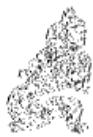

<!-- V3_SOURCE_ID:book016-b002214-p000-1e9c189649 -->

⑥天地的运行规律，是恒久运行不会停止的：这两句和下文的“终则复始”结合，举天地恒久运行不会停止的例子，来解释卦辞“利有攸往”。王弼的注说：“能找到合适的恒久之道，所以不会停止”；“能掌握恒久的规律，所以终结后会重新开始，行动没有穷尽”。《正义》的解释是：“将要解释‘利有攸往’，先举出天地作为例证，说天地掌握了恒久之道，所以能够长久运行不会停止。”

查看对应原文

<!-- V3_FOLDBACK_BEGIN:book016-b002214-p000-1e9c189649 -->

⑥天地之道，恒久而不已也：这两句合下文“终则复始”，举“天地”恒久运行不已为例，释卦辞“利有攸往”。《王注》：“得其所久，故不已也”；“得其常道，故终则复始，往无穷也”。《正义》：“将释利有攸往’，先举天地以为证喻，言天地得其恒久之道，故久而不已也。”

<!-- V3_FOLDBACK_END:book016-b002214-p000-1e9c189649 -->

<!-- V3_SOURCE_ID:book016-b002215-p000-2fcc0088fa -->

⑦天地万物的实情就可以看出来了：这句话和前面四句结合，广泛举出日月、四时、圣人坚守“恒”道的例子，深入阐释《恒》卦的核心要义。王弼的注说：“说它们各自找到了合适的恒久之道，所以都能长久存在”；“天地万物的实情，就体现在它们各自坚守的恒久之道上”。《正义》的解释是：“这是对‘恒’义的总结。”

查看对应原文

<!-- V3_FOLDBACK_BEGIN:book016-b002215-p000-2fcc0088fa -->

⑦天地万物之情可见矣：此句合前四句，广举日月、四时、圣人守“恒”之例，深阐《恒》卦大义。《王注》：“言各得其所恒，故皆能长久”；“天地万物之情，见于所恒也”。《正义》：“总结‘恒’义也。”

<!-- V3_FOLDBACK_END:book016-b002215-p000-2fcc0088fa -->

<!-- V3_SOURCE_ID:book016-b002216-p000-8d01dfff81 -->

此处原文本有残缺，可确认的内容为：《象》曰：雷风，恒①；君子以立正确思想。不易方②。

> **释读存疑：** 原句开头的“《》子国发风行常交”为OCR识别错误，具体所指不详

查看对应原文

<!-- V3_FOLDBACK_BEGIN:book016-b002216-p000-8d01dfff81 -->

《》子国发风行常交 《象》曰：雷风，恒①；君子以立正确思想。 不易方②。

<!-- V3_FOLDBACK_END:book016-b002216-p000-8d01dfff81 -->

<!-- V3_SOURCE_ID:book016-b002217-p000-75f42f1515 -->

注释①雷风，恒：是解释《恒》卦上震、下巽所对应的雷、风之象。《正义》中说：“雷风相与为恒，已如《彖》释。”参见《彖传》译注。

查看对应原文

<!-- V3_FOLDBACK_BEGIN:book016-b002217-p000-75f42f1515 -->

注释①雷风，恒：释《恒》卦上震为雷、下巽为风之象。《正义》：“雷风相与为恒，已如《彖》释。”(参见《彖传》译注)

<!-- V3_FOLDBACK_END:book016-b002217-p000-75f42f1515 -->

<!-- V3_SOURCE_ID:book016-b002218-p000-5ed87ea4af -->

②立不易方：这里的“方”指的是道，此处相当于说“正确的思想”。这是说明“君子”效法《恒》卦的卦象，立身于恒久不变的正道之中。《正义》中说：“君子立身，掌握了恒久不变的正道，所以不会改变自己的‘方’。‘方’就是‘道’的意思。”

查看对应原文

<!-- V3_FOLDBACK_BEGIN:book016-b002218-p000-5ed87ea4af -->

②立不易方：方，道也，此处犹言“正确的思想”。这是说明“君子”效法《恒》象，立身于恒久不变之道。《正义》：“君子立身，得其恒久之道，故不改易其方。方，犹‘道’也。” D

<!-- V3_FOLDBACK_END:book016-b002218-p000-5ed87ea4af -->

<!-- V3_SOURCE_ID:book016-b002219-p000-0c3fade6f5 -->

说明“恒”字的含义，可以分为两个方面：（一）恒久不易，比如守持正道不能有一刻动摇；（二）恒久不已，比如施行正道必须坚持不懈。但这两方面的意义是相辅相成的，不能割裂开来。徐几指出：“‘利贞’，就是不易之恒；‘利有攸往’，就是不已之恒。合起来说，就是常道；如果偏向其中一方面，就不是道了。”《周易会通》引。看《大象传》所说的“立不易方”，实际上也包含了“不已”在内。

查看对应原文

<!-- V3_FOLDBACK_BEGIN:book016-b002219-p000-0c3fade6f5 -->

说明“恒”字之义，可析为二：(一)恒久不易，如守持正道不可一刻动摇(二)恒久不已，如施行正道必须坚持不懈。但这两方面的意义又是相辅相成，不能割裂。徐幾指出：“利贞’者，不易之恒也；利有攸往’者，不已之恒也。合而言之，乃常道也；倚于一偏，则非道矣。”(《周易会通》引)视《大象传》所谓“立不易方”，实亦包含“不已”在内了。

<!-- V3_FOLDBACK_END:book016-b002219-p000-0c3fade6f5 -->

<!-- V3_SOURCE_ID:book016-b002220-p000-89e7cb2d75 -->

初六，浚恒①，贞凶，无攸利②。

> **释读存疑：** 未完成可验证的白话化或中译；原文仅保留卦爻辞原文，未进行符合要求的白话释读；本地硬校验仍未通过，已记录供后续自动处理或人工核对。

查看对应原文

<!-- V3_FOLDBACK_BEGIN:book016-b002220-p000-89e7cb2d75 -->

初六,浚恒①，贞凶，无攸利②。

<!-- V3_FOLDBACK_END:book016-b002220-p000-89e7cb2d75 -->

<!-- V3_SOURCE_ID:book016-b002221-p000-a2f7b7ec22 -->

注释①浚恒：浚的读音是jùn，意思是深。这句话是说明《恒》卦的初六爻处于全卦的起始位置，阴柔的爻位本就浅近低下，它在上对应九四爻；这就好比急于深入探求恒久之道，却因为过于急切而无法达到目的，所以才有了“浚恒”的卦象。《周易义海撮要》引用陆希声的话说：“常的含义，贵在长久地践行正道，每天逐渐加深。初六是《恒》卦的起始，应当以循序渐进为常态，而初六的爻体是巽（八卦之一），性情急躁，急于求成想要深入，这就违背了长久践行正道的含义，不能作为恒久之道。

查看对应原文

<!-- V3_FOLDBACK_BEGIN:book016-b002221-p000-a2f7b7ec22 -->

注释①浚恒：浚，音jùn，深也。此句说明初六处《恒》之始，阴柔浅下，上应九四；犹急于深求“恒”道，却欲速不达，故有“浚恒”之象。《周易义海撮要》引陆希声曰：“常之为义，贵久于其道，日以浸深。初为常始，宜以渐为常，而体巽性躁，遽求深入，是失久于其道之义，不可以为常。”

<!-- V3_FOLDBACK_END:book016-b002221-p000-a2f7b7ec22 -->

<!-- V3_SOURCE_ID:book016-b002222-p000-83aadd3013 -->

②贞凶，无攸利：贞凶的意思是守正以防凶险，这里承接前文“浚恒”的含义，是说初六爻以阴爻居于阳位，它的行为不符合正道，但追求恒久之道的心意也不能完全否定，所以勉励它要趋向正道、自我持守，以期避免凶险；如果不这样，执意要“浚恒”，必然没有任何益处。

查看对应原文

<!-- V3_FOLDBACK_BEGIN:book016-b002222-p000-83aadd3013 -->

②贞凶，无攸利：贞凶，守正防凶(参见《屯》九五译注)。此处承前文“浚恒”之义，谓初六阴居阳位，其行失正，但求“恒”心切亦不可全非，故勉其趋正自守，以期避免凶险；不然，若执意“浚恒”，必无所利。

<!-- V3_FOLDBACK_END:book016-b002222-p000-83aadd3013 -->

<!-- V3_SOURCE_ID:book016-b002223-p000-8b0b7a6111 -->

《象传》说：“深求恒久之道”的“凶险”，说明初六爻刚开始就求之过深。

查看对应原文

<!-- V3_FOLDBACK_BEGIN:book016-b002223-p000-8b0b7a6111 -->

《象》曰：“浚恒”之“凶”，始求 译文《象传》说：“深求恒久之道”的“凶险”，说明初六刚开始就求之过深。深也。

<!-- V3_FOLDBACK_END:book016-b002223-p000-8b0b7a6111 -->

<!-- V3_SOURCE_ID:book016-b002224-p000-e13bd72cf8 -->

【说明】初六爻“浚恒”的告诫，其含义可以广泛类比到“治学”“治政”等各类事情上。胡瑗阐释这一爻的意旨说：“因此治学时间久了，就能成就道业，达到圣贤的境界；治理政事时间久了，就能推行教化，达到尧舜那样的治世；结交朋友时间久了，情谊就会更加深厚；君臣相处时间久了，就能做到谏言被采纳、建议被听从，恩泽惠及百姓：像这类情况，没有不是经过日积月累之后才能达到的，本来就不是仓促就能实现的。如今初六爻处于下卦的起始位置，代表事情的开端，要求它具备长久之道、达成恒久的效果，这就好比治学刚开始，就想急切达到周公、孔子那样的境界；治理政事刚开始，就想教化达到尧舜那样的程度；结交朋友刚开始，就想情谊深厚到极致；君臣相处刚开始，就想正道大行天下：这是不能积累时日去做事，却要探求恒久之道的深度。”（《周易口义》）

查看对应原文

<!-- V3_FOLDBACK_BEGIN:book016-b002224-p000-e13bd72cf8 -->

【说明】初六“浚恒”之诫，义可广拟于“治学”、“治政”诸事。胡瑗阐释爻旨曰：“是故为学既久，则道业可成，圣贤可到；为治既久，则教化可行，尧舜可至；为朋友既久，则契合愈深；为君臣既久，则谏从言听而膏泽下于民：若是之类，莫不由积日累久而后至，固非骤而及也。今此初六居下卦之初，为事之始，责其长久之道，永远之效，是犹为学之始，欲亟至于周、孔；为治之始，欲化及于尧舜；为朋友之始，欲契合之深；为君臣之始，欲道之大行：是不能积久其事，而求常道之深。”（《周易口义》）

<!-- V3_FOLDBACK_END:book016-b002224-p000-e13bd72cf8 -->

<!-- V3_SOURCE_ID:book016-b002225-p000-1c1643e640 -->

## 九二，悔亡①。

查看对应原文

<!-- V3_FOLDBACK_BEGIN:book016-b002225-p000-1c1643e640 -->

## 九二，悔亡①。

<!-- V3_FOLDBACK_END:book016-b002225-p000-1c1643e640 -->

<!-- V3_SOURCE_ID:book016-b002226-p000-bf38e7356c -->

译文九二，悔恨消亡。

查看对应原文

<!-- V3_FOLDBACK_BEGIN:book016-b002226-p000-bf38e7356c -->

译文九二，悔恨消亡。

<!-- V3_FOLDBACK_END:book016-b002226-p000-bf38e7356c -->

<!-- V3_SOURCE_ID:book016-b002227-p000-a39bce8900 -->

匡释①悔亡：这是说九二爻以阳爻居于阴位，本有失正的“悔”；但能恒久守持中道不偏不倚，于是获得“悔亡”的结果。《王注》说：“虽失其位，恒位于中，可以消悔也。”

查看对应原文

<!-- V3_FOLDBACK_BEGIN:book016-b002227-p000-a39bce8900 -->

匡释①悔亡：此谓九二阳居阴位，本有失正之“悔”；但能恒久守中不偏，遂获“悔亡”。《王注》：“虽失其位，恒位于中，可以消悔也。”

<!-- V3_FOLDBACK_END:book016-b002227-p000-a39bce8900 -->

<!-- V3_SOURCE_ID:book016-b002228-p000-0e6ae5c2f6 -->

《象》曰：九二“悔亡”，说明它能恒久守持中道。

> **释读存疑：** 原文存在排版混乱，将《象》曰的释文与译文混排，释读时已梳理为清晰表述

查看对应原文

<!-- V3_FOLDBACK_BEGIN:book016-b002228-p000-0e6ae5c2f6 -->

《象》曰：九二“悔亡”，能久 译文《象传》说：九二“悔恨消亡”，说明中也。 能恒久守中不偏。

<!-- V3_FOLDBACK_END:book016-b002228-p000-0e6ae5c2f6 -->

<!-- V3_SOURCE_ID:book016-b002229-p000-5513fe146e -->

《周易》的九二爻凭借恒久守“中”的原则消除了“悔”，由此可见《周易》十分重视“中”的思想。郭雍说：“能够长久维持的道理没有别的，就是‘中’罢了；超过‘中’和达不到‘中’，都不能长久。所以《中庸》说：‘中，是天下最根本的准则。’”（《郭氏传家易说》）5

查看对应原文

<!-- V3_FOLDBACK_BEGIN:book016-b002229-p000-5513fe146e -->

[∑萌九二以恒久守“中”消“悔”，可见《周易》重视“中”的思想。郭雍曰：“可久之道无它焉，中而已矣；过犹不及，皆非可久也。故《中庸》曰：中者，天下之大本也。'”(《郭氏传家易说》) 5

<!-- V3_FOLDBACK_END:book016-b002229-p000-5513fe146e -->

<!-- V3_SOURCE_ID:book016-b002230-p000-86e1938453 -->

九三爻的爻辞为：“不恒其德，或承之羞”；译文为：“不能恒久保持美德，时或有人施加羞辱；要守持正固以防憾惜。”

查看对应原文

<!-- V3_FOLDBACK_BEGIN:book016-b002230-p000-86e1938453 -->

九三，不恒其德，或承之羞①； 译文九三，不能恒久保持美德，时或有贞吝②。 人施加羞辱；要守持正固以防憾惜。

<!-- V3_FOLDBACK_END:book016-b002230-p000-86e1938453 -->

<!-- V3_SOURCE_ID:book016-b002231-p000-2edd9a20c3 -->

注释①“不恒其德，或承之羞”：承，《说文解字》解释为“奉也”，指奉进，此处相当于“施加”；羞，指羞辱。这两句说明九三爻以阳刚之爻居于下卦的末尾，与上六爻相应，躁动盲进，有守持德行不能恒久的征象，所以有人会对他施加羞辱。《周易本义》说：“爻位虽然正当，但过于刚猛而不合于‘中’，心志依附于上六，不能长久安守本位，所以出现‘不恒其德，或承之羞’的征象。”

查看对应原文

<!-- V3_FOLDBACK_BEGIN:book016-b002231-p000-2edd9a20c3 -->

注释①不恒其德，或承之羞：承，《说文》“奉也”，谓奉进，此处犹言“施加”；羞，羞辱。这两句说明九三以阳刚居下卦之终，应于上六，躁动盲进，有守德不恒之象，故人或加之以羞。《本义》：“位虽得正，然过刚不中，志从于上，不能久于其所，故为‘不恒其德，或承之羞’之象。”

<!-- V3_FOLDBACK_END:book016-b002231-p000-2edd9a20c3 -->

<!-- V3_SOURCE_ID:book016-b002232-p000-2ee01f2b8a -->

②贞吝：相当于“守正防吝”。这里是说九三爻虽然“不能恒久保持美德”，

查看对应原文

<!-- V3_FOLDBACK_BEGIN:book016-b002232-p000-2ee01f2b8a -->

②贞吝：犹言“守正防吝”(参见《屯》九五译注)。此谓九三虽“不恒其德”，

<!-- V3_FOLDBACK_END:book016-b002232-p000-2ee01f2b8a -->

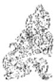

<!-- V3_SOURCE_ID:book016-b002234-p000-c4755b6a55 -->

只是它所处的爻位还算正当，所以勉励它坚守正道、归于“恒”道，或许可以避免“吝”难。这一爻的含义包含着劝勉人纠正邪念、回归正道的深刻意旨。

查看对应原文

<!-- V3_FOLDBACK_BEGIN:book016-b002234-p000-c4755b6a55 -->

但其位尚正，故勉其守正归“恒”，庶可免“吝”。爻义含劝邪反正的微旨。

<!-- V3_FOLDBACK_END:book016-b002234-p000-c4755b6a55 -->

<!-- V3_SOURCE_ID:book016-b002235-p000-4c12d0e544 -->

《象传》说：“不能恒久保持美德”，这说明九三爻的行事方向将无处容身。

> **释读存疑：** 原文存在排版错乱，“无所  
说明”“容也”的位置及关联关系需结合上下文理解，此处按文意整理为上述内容

查看对应原文

<!-- V3_FOLDBACK_BEGIN:book016-b002235-p000-4c12d0e544 -->

译文《象传》说：“不能恒久保持美德”， 《象》曰：“不恒其德”，无所  
说明九三所往将无处容身。容也。

<!-- V3_FOLDBACK_END:book016-b002235-p000-4c12d0e544 -->

<!-- V3_SOURCE_ID:book016-b002236-p000-7b3257d5ea -->

《论语·子路》记载：‘孔子说：南方人有句话说“人而无恒，不可以作巫医”，善夫！’‘不恒其德，或承之羞’，孔子又说：‘不占而已矣！’从孔子的口气看，实对守德不恒者至为鄙夷，足见本爻寓诫深刻。

查看对应原文

<!-- V3_FOLDBACK_BEGIN:book016-b002236-p000-7b3257d5ea -->

[疏明]《论语·子路》云：‘子曰：南人有言曰“人而无恒，不可以作巫医”，善夫！’‘不恒其德，或承之羞’，子曰：‘不占而已矣！’”从孔子的口气看，实对守德不恒者至为鄙夷，足见本爻寓诫深刻。

<!-- V3_FOLDBACK_END:book016-b002236-p000-7b3257d5ea -->

<!-- V3_SOURCE_ID:book016-b002237-p000-f33cf54293 -->

九四爻的爻义是：田猎时没有获取禽兽。

查看对应原文

<!-- V3_FOLDBACK_BEGIN:book016-b002237-p000-f33cf54293 -->

译文九四，田猎没有获取禽兽。

<!-- V3_FOLDBACK_END:book016-b002237-p000-f33cf54293 -->

<!-- V3_SOURCE_ID:book016-b002238-p000-8978740879 -->

九四爻，田猎没有收获。

查看对应原文

<!-- V3_FOLDBACK_BEGIN:book016-b002238-p000-8978740879 -->

九四，田无禽①。

<!-- V3_FOLDBACK_END:book016-b002238-p000-8978740879 -->

<!-- V3_SOURCE_ID:book016-b002239-p000-ececb689e8 -->

注释①田无禽：这是用田猎没有收获来比喻九四阳刚之爻所处位置不当，长久居于不合适的位置，做事情徒劳无益。王弼的注释说：“长久居于不合适的位置，即使辛劳也没有收获。”《正义》解释道：“田就是田猎，用来比喻处理事务；无禽就是田猎没有捕获猎物，用来比喻处理事务没有成效。”

查看对应原文

<!-- V3_FOLDBACK_BEGIN:book016-b002239-p000-ececb689e8 -->

注释①田无禽：这是用田猎无获譬喻九四阳刚失正，恒居不当之位，徒劳无益。《王注》：“恒于非位，虽劳无获也。”《正义》：“田者，田猎也，以譬有事也；无禽者，田猎不获，以喻有事无功也。”

<!-- V3_FOLDBACK_END:book016-b002239-p000-ececb689e8 -->

<!-- V3_SOURCE_ID:book016-b002240-p000-31a8fda673 -->

《象传》说：九四长久居于不合适的位置，怎么能获得猎物呢？

查看对应原文

<!-- V3_FOLDBACK_BEGIN:book016-b002240-p000-31a8fda673 -->

译文《象传》说：九四久居不当之位，田 《象》曰：久非其位，安得禽也？猎哪能获得禽兽呢？

<!-- V3_FOLDBACK_END:book016-b002240-p000-31a8fda673 -->

<!-- V3_SOURCE_ID:book016-b002241-p000-dc65779ba1 -->

既然九二爻位置不当，但能守住“中”道，所以“悔亡”；九四爻既位置不当又失去“中”道，所以辛劳却没有收获。吕柟引申爻义说：“君子长久施行仁义的政令，那么在下足以教化百姓；长久运用仁义的谋略，那么在上足以匡正君主。舍弃这些而长久坚持，即使所用的方法那样诡诈，所行的时间那样长久，也只会滋生混乱罢了，田猎又能获得什么猎物呢？”

查看对应原文

<!-- V3_FOLDBACK_BEGIN:book016-b002241-p000-dc65779ba1 -->

既萌九二不当位，但能守“中”，故“悔亡”；九四既不当位又失中，故劳而无获。吕柟引申爻旨曰：“君子久于仁义之政，则下足以化民；久于仁义之谟，则上足以正君。舍是而恒焉，则虽术之如彼其诈也，行之如彼其久也，只以滋乱耳，田也何所获禽乎？"(《泾野先生周易说翼》)

<!-- V3_FOLDBACK_END:book016-b002241-p000-dc65779ba1 -->

<!-- V3_SOURCE_ID:book016-b002242-p000-b7b54714d3 -->

译文六五，恒久保持柔美品德，应当守持正固；妇人可获吉祥，男子必有凶险。

查看对应原文

<!-- V3_FOLDBACK_BEGIN:book016-b002242-p000-b7b54714d3 -->

译文六五，恒久保持柔美品德，应当守持正固；妇人可获吉祥，男子必有凶险。

<!-- V3_FOLDBACK_END:book016-b002242-p000-b7b54714d3 -->

<!-- V3_SOURCE_ID:book016-b002243-p000-6dc2a6c7f9 -->

六五爻，恒久保持其品德，守持正固；妇人可获吉祥，男子必有凶险。

查看对应原文

<!-- V3_FOLDBACK_BEGIN:book016-b002243-p000-6dc2a6c7f9 -->

六五，恒其德，贞①；妇人吉，夫子凶。

<!-- V3_FOLDBACK_END:book016-b002243-p000-6dc2a6c7f9 -->

<!-- V3_SOURCE_ID:book016-b002244-p000-ec2210b1f6 -->

匡释：恒其德，贞：这里的德特指柔美品德，意思是六五能够恒久保持妇道。这两句说明，六五以阴爻居于上卦的中位，虽然爻位不当，但下与九二阳爻刚正相应，有妇人恒久保持品德、守持正固顺从丈夫的意象，所以下文说“妇人吉，夫子凶”。《王注》说：“居于尊贵的位置，是恒久之道的主导，不能裁断事理，却系心于与九二相应，用心专一守正，只是顺从而已，这是妇人的吉祥，男子的凶险。”

查看对应原文

<!-- V3_FOLDBACK_BEGIN:book016-b002244-p000-ec2210b1f6 -->

匡释①恒其德，贞：德，此处特指“柔德”，谓五能恒于“妇道”。这两句说明六五以阴居上卦之中，虽不当位，但下应九二刚中，有妇人恒久其德、守贞从夫之象，故下文谓“妇人吉，夫子凶”。《王注》：“居得尊位，为恒之主，不能制义，而系应在二，用心专贞，从唱而已，妇人之吉，夫子之凶也。”

<!-- V3_FOLDBACK_END:book016-b002244-p000-ec2210b1f6 -->

<!-- V3_SOURCE_ID:book016-b002245-p000-039e272c19 -->

译文：《象传》说：“妇人守持正固可获吉祥，是要从一而终；男子应当裁断事理，若顺从妇人就会有凶险。”

查看对应原文

<!-- V3_FOLDBACK_BEGIN:book016-b002245-p000-039e272c19 -->

译文《象传》说：“妇人守持正固可获吉 《象》曰：妇人贞吉，从一而终祥须要，若像文不改男人 也①;夫子制义,从妇凶也②。

<!-- V3_FOLDBACK_END:book016-b002245-p000-039e272c19 -->

<!-- V3_SOURCE_ID:book016-b002246-p000-9aab6b4779 -->

注释①从一而终：从一，就如同说“从夫”。这句话反映了古代礼制对妇女的约束，也就是《礼记·郊特牲》所说的：“一旦与丈夫结为一体，终身都不改变，所以丈夫去世后也不改嫁。”

查看对应原文

<!-- V3_FOLDBACK_BEGIN:book016-b002246-p000-9aab6b4779 -->

注释①从一而终：从一，犹言“从夫”。此句反映古代礼制对妇女的制约，即《礼记·郊特牲》所谓：“壹与之齐，终身不改，故夫死不嫁。”

<!-- V3_FOLDBACK_END:book016-b002246-p000-9aab6b4779 -->

<!-- V3_SOURCE_ID:book016-b002247-p000-44df1528bd -->

②夫子制义，从妇凶也：制义，是指裁断事宜；从妇，是指遵循妇人的“顺从”之道。《来氏易注》说：“制，就是裁制的意思；从妇，就是顺从妇人的顺从之道。夫子刚果独断，以义事；如果像妇人那样一味顺从，就会过于萎靡不振，难道是他所适宜的吗？所以会有凶险。”

> **释读存疑：** 从妇者，从妇人顺从之道也

查看对应原文

<!-- V3_FOLDBACK_BEGIN:book016-b002247-p000-44df1528bd -->

②夫子制义，从妇凶也：制义，裁制事宜；从妇，指遵循妇人的“顺从”之道。《来氏易注》：“制者，裁制也；从妇者，从妇人顺从之道也。夫子刚果独断，以义事；若如妇人之顺从，委靡甚矣，岂其所宜？故凶。”

<!-- V3_FOLDBACK_END:book016-b002247-p000-44df1528bd -->

<!-- V3_SOURCE_ID:book016-b002248-p000-b21144d7e7 -->

这是说明六五爻“妇人守恒”的卦象，其中蕴含的含义符合“妇人顺从丈夫”的古代礼教。《孟子·滕文公下》说：“一定要恭敬谨慎，不要违背丈夫，把顺从作为准则，这是妾妇的处世之道”，还说：“这怎么能算是大丈夫呢！”这番话正好可以作为“妇人吉，夫子凶”的注解。

查看对应原文

<!-- V3_FOLDBACK_BEGIN:book016-b002248-p000-b21144d7e7 -->

说明六五“妇人守恒”之象，蕴义有合于“妇从夫”的古代礼教。《孟子·滕文公下》云：“必敬必戒，无违夫子，以顺为正者，妾妇之道也”，并谓：“是焉得为大丈夫乎！”正可视为“妇人吉，夫子凶”的注脚。

<!-- V3_FOLDBACK_END:book016-b002248-p000-b21144d7e7 -->

<!-- V3_SOURCE_ID:book016-b002249-p000-29da1738e7 -->

上六爻，振恒，凶①。

查看对应原文

<!-- V3_FOLDBACK_BEGIN:book016-b002249-p000-29da1738e7 -->

上六，振恒，凶①。

<!-- V3_FOLDBACK_END:book016-b002249-p000-29da1738e7 -->

<!-- V3_SOURCE_ID:book016-b002250-p000-65bc3647ad -->

上六爻的爻辞是：振动不安的状态，不符合恒久之道，有凶险。

查看对应原文

<!-- V3_FOLDBACK_BEGIN:book016-b002250-p000-65bc3647ad -->

译文上六，振动不安于恒久之道，有凶险。

<!-- V3_FOLDBACK_END:book016-b002250-p000-65bc3647ad -->

<!-- V3_SOURCE_ID:book016-b002251-p000-4b18b51743 -->

注释①振恒，凶：振，《释文》引用马融的说法：‘就是动的意思’。这里说的是上六爻处于《恒》卦的震（八卦之一）爻的末尾，其本性好动，无法坚守恒久之道，呈现出‘恒久到了极致就会走向反面、振动无常’的意象，所以‘凶险’。《本义》说：‘振，就是动得很快的意思。上六爻处于《恒》卦的尽头，又处在震（八卦之一）爻的末尾；恒久到了极致就会变得不恒定，震（八卦之一）爻到了末尾就会过度躁动。再加上阴柔之性无法固守正道，所处的上位也不是它该安身的地方，所以才有‘振恒’的意象，而对应的占断结果就是凶险。’

查看对应原文

<!-- V3_FOLDBACK_BEGIN:book016-b002251-p000-4b18b51743 -->

注释①振恒，凶：振，《释文》引马融曰：‘动也’。此谓上六居《恒》上震之终，性动不能持恒，有‘恒’极致反、振动无常之象，故‘凶’。《本义》：‘振者，动之速也。上六居《恒》之极，处震之终；恒极则不常，震终则过动。又阴柔不能固守，居上非其所安，故有‘振恒’之象，而其占则凶也。’

<!-- V3_FOLDBACK_END:book016-b002251-p000-4b18b51743 -->

<!-- V3_SOURCE_ID:book016-b002252-p000-3a7204f92d -->

《象传》说：振恒在上，大无功也。《象传》的译文是：振动不安于恒久之道却又高居上位，说明上六爻行事必然会毫无功绩。

查看对应原文

<!-- V3_FOLDBACK_BEGIN:book016-b002252-p000-3a7204f92d -->

《象》曰：振恒在上，大无功也。 译文《象传》说：振动不安于恒久之道而又高居在上，说明上六处事必然大为无功。

<!-- V3_FOLDBACK_END:book016-b002252-p000-3a7204f92d -->

<!-- V3_SOURCE_ID:book016-b002253-p000-888c7fb65f -->

说初六爻在下方对“恒久”的追求过于急切，上六爻处于卦的末尾却无法坚守“恒久”：两种意象虽然相反，但都违背了践行“恒久”的原则，所以前者“没有什么好处”，后者“毫无功绩”。《重定费氏学》引用吕祖谦的话说：“要建立天下的大功业，必须长久坚持、牢固坚守，然后才能成功。如果只是躁动不安、仓促行事又容易半途而废，怎么能成就功业呢？”

查看对应原文

<!-- V3_FOLDBACK_BEGIN:book016-b002253-p000-888c7fb65f -->

说萌初六在下求“恒”过深，上六居终不能守“恒”：两象虽相反，但均违处“恒”之道，故前者“无攸利”，后者“大无功”。《重定费氏学》引吕祖谦曰：“立天下之大功，必悠久胶固，然后能成。若振动躁扰，暂作易辍，安能成功？”

<!-- V3_FOLDBACK_END:book016-b002253-p000-888c7fb65f -->

<!-- V3_SOURCE_ID:book016-b002254-p000-e64e7f9d94 -->

《恒》卦阐释事物“恒久”的道理，就人事来说，就是教导人立身处世要有持之以恒的精神。卦辞说“亨通，无所咎害，利于守正，利有所往”，极力赞美“恒”道是可行的。不过，卦中的六爻没有一爻全是吉利的：初六急于深入探求“恒”道，想求快反而达不到目的，告诫它要守正以防凶险；九二爻位不当，但因为能恒久守持刚健中正，于是得以消除“悔”；九三不能恒久守持德行，或许会招致“羞”、“吝”；九四长久居于不当的位置，徒劳无益；六五恒久守持柔顺之德，对于妇人来说是吉利的，对于男子来说则是凶险的；上六好动不能恒久守持，面临凶险。显然，各爻虽然得失不同，但都不能完全符合“恒”的含义，以至于邱富国有“恒之道岂易言哉”（《折中》引）的感慨。试着探究“恒”这一概念本身的寓意，似乎不是一时、一事所能立刻完全涵盖的，谚语说“路遥知马力，日久识人心”，正属于这个道理；那么，一爻之中难以获得“完吉”，是由卦旨所决定的，不得不如此。至于六五爻所说的“妇人吉，夫子凶”，虽然是象喻，却深刻反映了古代的“妇德”、“男权”思想。纵观全卦的大义，无论各爻的占语是否理想，作者所喻示的道理都在于勉励人守“正”处“恒”。就此而言，“人贵有恒”的思想，实在是本卦象征要义的核心。《荀子·劝学》说：“锲而舍之，朽木不折；锲而不舍，金石可镂。”又说：“真积力久则入，学至乎没而后止也。”这些说法固然是论述“学”的，也和《恒》卦的旨趣没有差异。

查看对应原文

<!-- V3_FOLDBACK_BEGIN:book016-b002254-p000-e64e7f9d94 -->

《恒》卦阐发事物“恒久”之理，就人事而言，即教人立身处世要有“持之以恒”的精神。卦辞以“亨通，无所咎害，利于守正，利有所往”，极力赞美“恒”道可行。然而，卦中六爻无一爻全吉：初六急于深求“恒”道，欲速不达，诫以守正防凶；九二失位，因能恒守刚中，遂得消“悔”；九三守德不恒，或致“羞”、“吝”；九四久居不当之位，徒劳无益；六五恒守柔德，于妇人有吉，男子则凶；上六好动不能守恒，面临凶险。显然，诸爻虽得失不同，但均不能尽“恒”之义，乃至邱富国有“恒之道岂易言哉”（《折中》引）的慨叹。试究“恒”这一概念本身的寓意，似非一时、一事所能即刻尽赅，谚云“路遥知马力，日久识人心”，正属此理；那么，一爻之中难获“完吉”，则是卦旨所限，不能不如此。至于六五称“妇人吉，夫子凶”，虽是象喻，却深刻反映了古代的“妇德”、“男权”思想。纵观全卦大义，无论各爻的占语是否理想，作者所喻示的道理却无不在于勉人守“正”处“恒”。就此而言，“人贵有恒”的思想，实为本卦象征要义的核心。《荀子·劝学》曰：“锲而舍之，朽木不折；锲而不舍，金石可镂。”又曰：“真积力久则入，学至乎没而后止也。”此说固为论“学”，亦与《恒》卦旨趣无异。

<!-- V3_FOLDBACK_END:book016-b002254-p000-e64e7f9d94 -->

<!-- V3_SOURCE_ID:book016-b002256-p000-f360b983e6 -->

## 遯卦第三十三

查看对应原文

<!-- V3_FOLDBACK_BEGIN:book016-b002256-p000-f360b983e6 -->

## 遯卦第三十三

<!-- V3_FOLDBACK_END:book016-b002256-p000-f360b983e6 -->

<!-- V3_SOURCE_ID:book016-b002257-p000-226b228b3b -->

《遯》卦象征退避，寓意亨通，柔小者利于守持正固。

查看对应原文

<!-- V3_FOLDBACK_BEGIN:book016-b002257-p000-226b228b3b -->

译文《遯》卦象征退避：亨通，柔小者利于守持正固。

<!-- V3_FOLDBACK_END:book016-b002257-p000-226b228b3b -->

<!-- V3_SOURCE_ID:book016-b002259-p000-4f6f63d73b -->

此处原文为：“还①：亨②，小利贞③。”

> **释读存疑：** 原文中“还”字的含义具体所指不详

查看对应原文

<!-- V3_FOLDBACK_BEGIN:book016-b002259-p000-4f6f63d73b -->

还①：亨②，小利贞③。

<!-- V3_FOLDBACK_END:book016-b002259-p000-4f6f63d73b -->

<!-- V3_SOURCE_ID:book016-b002260-p000-1670226933 -->

注释①遯：读音为dùn，是卦名，下卦为艮（☶），上卦为乾（☰），象征退避。《释文》中说：“遯这个字，也写作‘逸’，又写作‘遁’，意思相同；指的是隐退，隐匿踪迹、避开时势，保全自身退隐的意思。”

查看对应原文

<!-- V3_FOLDBACK_BEGIN:book016-b002260-p000-1670226933 -->

注释①遯：音dùn，卦名，下艮(☶)上乾(☰)，象征“退避”。《释文》：“遯，字又作‘逸’，又作‘遁’，同；隐退也，匿迹避时，奉身退隐之谓也。”

<!-- V3_FOLDBACK_END:book016-b002260-p000-1670226933 -->

<!-- V3_SOURCE_ID:book016-b002261-p000-95173121f9 -->

②亨：指在“遯”的时势里，阴气逐渐增长而阳气逐渐衰弱，“君子”退隐之后才能“亨”。《正义》中说：“小人正得势，君子的力量日渐削弱；君子在这个时候，如果不隐退避世，就会遭受小人的祸害，必须退隐之后才能行事通达，所以说‘遯，亨’。”

查看对应原文

<!-- V3_FOLDBACK_BEGIN:book016-b002261-p000-95173121f9 -->

②亨：指“遯”之时，阴渐长而阳渐衰，“君子”退而后能“亨”。《正义》：“小人方用，君子日消；君子当此之时，若不隐遯避世，即受其害，须遯然后得通，故曰‘遯，亨’。”

<!-- V3_FOLDBACK_END:book016-b002261-p000-95173121f9 -->

<!-- V3_SOURCE_ID:book016-b002262-p000-73c4451bfb -->

③小利贞：“小”比喻柔小者，同时指卦中的两阴爻。这句话说明，在“遯”的时势里，柔小者利于守持正固，不宜轻举妄动，以免伤害阳刚者。《尚氏学》中说：“阳为大，阴为小，‘小利贞’的意思是说应当守持正固；《传》里说‘浸而长’，指的是阴气正在渐渐增长，阴气增长就会削弱阳气，所以柔小者利于安静，不利于妄动。”

查看对应原文

<!-- V3_FOLDBACK_BEGIN:book016-b002262-p000-73c4451bfb -->

③小利贞：小，喻柔小者，并指卦中两阴爻。这句说明当“遯”之世，柔小者利于守持正固，不宜妄动以害阳刚者。《尚氏学》：“阳大阴小，‘小利贞’者，谓宜贞定也；《传》曰‘浸而长’，谓阴方长，长则消阳，故利于静，不利于动也。”

<!-- V3_FOLDBACK_END:book016-b002262-p000-73c4451bfb -->

<!-- V3_SOURCE_ID:book016-b002263-p000-0dab179804 -->

译文《彖传》说：“退避，亨通”，意思是说必须先进行退避，之后才能达到亨通；就像阳刚者正居尊位，能够应合下位的人，随顺时势施行退避。“柔小者利于守持正固”，意思是说阴气浸润而渐渐盛长，但不得妄动伤害阳刚者。“退避”顺应时势的意义多么宏大啊！

查看对应原文

<!-- V3_FOLDBACK_BEGIN:book016-b002263-p000-0dab179804 -->

译文《彖传》说：“退避，亨通”，说明必须先作退避然后可致亨通；譬如阳刚者正居尊位而能应合下者，随顺时势施行退避。“柔小者利于守持正固”，说明阴气浸润而渐渐盛长（但不得妄动害阳）。“退避”顺应时势的意义多么宏大啊！

<!-- V3_FOLDBACK_END:book016-b002263-p000-0dab179804 -->

<!-- V3_SOURCE_ID:book016-b002264-p000-263ced7e5a -->

《彖传》说：“遯，亨”，意思是遯退就能亨通；阳刚居得正位而与下位相应，是随顺时势行事。“小利贞”，是说阴柔势力在逐渐增长。遯退的时势意义太重大了！

查看对应原文

<!-- V3_FOLDBACK_BEGIN:book016-b002264-p000-263ced7e5a -->

《彖》曰：“遯，亨”，遯而亨也；刚当位而应①，与时行也②。“小利贞”，浸而长也③。遯之时义大矣哉！

<!-- V3_FOLDBACK_END:book016-b002264-p000-263ced7e5a -->

<!-- V3_SOURCE_ID:book016-b002265-p000-62f54395ff -->

注释①刚当位而应：刚指九五爻；应，指上与下位六二爻相应。这里以九五居尊位而应于下位，说明阳刚将要退避时的情状。《集解》引用虞翻的话：“刚谓五而应二。”

查看对应原文

<!-- V3_FOLDBACK_BEGIN:book016-b002265-p000-62f54395ff -->

注释①刚当位而应：刚指九五；应，指下应六二。此以九五居尊应下，说明阳刚将退之时的情状。《集解》引虞翻曰：“刚谓五而应二。”

<!-- V3_FOLDBACK_END:book016-b002265-p000-62f54395ff -->

<!-- V3_SOURCE_ID:book016-b002266-p000-0c326efb34 -->

②与时行：与时，意思是“随顺时势”，这里特指顺时退避。此句结合前文解释卦辞“遯，亨”，是说阳刚虽然居得正位又有相应的爻位，在“小人”势力增长之时必须毅然遯退，才能达到“亨通”。《尚氏学》说：“不能不遯者，时不可也，故曰‘与时行’。遯太早则有过情之讥，

查看对应原文

<!-- V3_FOLDBACK_BEGIN:book016-b002266-p000-0c326efb34 -->

②与时行：与时，犹言“随顺时势”，这里特指顺时退避。此句合前文并释卦辞“遯，亨”，谓阳刚虽当位有应，于“小人”势长之时须毅然遯退，才能导致“亨通”。《尚氏学》：“不能不遯者，时不可也，故曰‘与时行’。遯太早则有过情之讥，

<!-- V3_FOLDBACK_END:book016-b002266-p000-0c326efb34 -->

<!-- V3_SOURCE_ID:book016-b002267-p000-26ebc81d36 -->

如严光是也；太晚则不能遯，沉溺于小人之中而不能免，如刘歆是也。”按，尚先生举东汉严光早早遯退，致使光武帝思念贤才却找不到他，以及西汉刘歆事奉王莽时不能遯退，最终诛莽不成、自杀身亡，来证明“遯”应当契合“时势”，这个义理十分贴切。

查看对应原文

<!-- V3_FOLDBACK_BEGIN:book016-b002267-p000-26ebc81d36 -->

如严光是也；太晚则不能遯，沉溺于小人之中而不能免，如刘歆是也。”案，尚先生举东汉严光早遯致光武帝思贤不得，及西汉刘歆事王莽不能遯致诛莽不成、自杀身亡，以证“遯”宜合“时”，于义颇切。

<!-- V3_FOLDBACK_END:book016-b002267-p000-26ebc81d36 -->

<!-- V3_SOURCE_ID:book016-b002268-p000-ead360784f -->

③浸而长：浸，就是逐渐的意思。这里是解释卦辞“小利贞”，意思是该卦下方的两个阴爻会逐渐增长，利于守持正道，不应当轻举妄动伤害阳爻。《来氏易注》中说：“浸而长，其势必至于害君子，故戒以‘利贞’。”

查看对应原文

<!-- V3_FOLDBACK_BEGIN:book016-b002268-p000-ead360784f -->

③浸而长：浸，渐也。此释卦辞“小利贞”，谓卦下二阴渐长，利于守正，不宜妄动害阳。《来氏易注》：“浸而长，其势必至于害君子，故戒以‘利贞’。”

<!-- V3_FOLDBACK_END:book016-b002268-p000-ead360784f -->

<!-- V3_SOURCE_ID:book016-b002269-p000-0cde778b43 -->

④遯之时义大矣哉：这是对《遯》卦的“时”与“义”的赞叹之辞。《正义》中说：“观察时机、斟酌适宜，避世退避，若不是德行高尚之人能洞察先机，就无法做到；其中蕴含的意义十分重大，所以说‘大矣哉’。”

查看对应原文

<!-- V3_FOLDBACK_BEGIN:book016-b002269-p000-0cde778b43 -->

④遯之时义大矣哉：这是对《遯》卦“时”、“义”的叹美之辞。《正义》：“相时度宜，避世而遯，自非大人照几，不能如此；其义甚大，故云‘大矣哉’。”

<!-- V3_FOLDBACK_END:book016-b002269-p000-0cde778b43 -->

<!-- V3_SOURCE_ID:book016-b002270-p000-09339d1bce -->

## 《象》曰：天下有山，遯①；君子以远小人，不恶而严②。 — 《象传》说：天之下有山，象征退避；君子因此远避小人，不显露憎恶却能保持庄重。

查看对应原文

<!-- V3_FOLDBACK_BEGIN:book016-b002270-p000-09339d1bce -->

## 《象》曰：天下有山，遯①；君子以远小人，不恶而严②。

<!-- V3_FOLDBACK_END:book016-b002270-p000-09339d1bce -->

<!-- V3_SOURCE_ID:book016-b002271-p000-386cef31ee -->

《象传》说：高天之下矗立着大山（犹如天远避山），象征着“退避”；君子因此要远避小人，不显露憎恶的情态却能保持庄重威严，不与小人混同。

查看对应原文

<!-- V3_FOLDBACK_BEGIN:book016-b002271-p000-386cef31ee -->

译文《象传》说：高天之下立着大山（犹如天远避山），象征“退避”；君子因此远避小人，不显露憎恶情态而能俨然矜庄、不与混同。

<!-- V3_FOLDBACK_END:book016-b002271-p000-386cef31ee -->

<!-- V3_SOURCE_ID:book016-b002272-p000-123d2a2f72 -->

匡释①天下有山，遯：解释《遯》卦的卦象，该卦上卦为乾，下卦为艮；《集解》引用崔憬的话：“天喻君子，山比小人。小人浸长，若山之侵天；君子遯避，若天之远山。”

查看对应原文

<!-- V3_FOLDBACK_BEGIN:book016-b002272-p000-123d2a2f72 -->

匡释①天下有山，遯：释《遯》卦上乾为天，下艮为山之象；《集解》引崔憬曰：“天喻君子，山比小人。小人浸长，若山之侵天；君子遯避，若天之远山。”

<!-- V3_FOLDBACK_END:book016-b002272-p000-123d2a2f72 -->

<!-- V3_SOURCE_ID:book016-b002273-p000-de37a06e79 -->

②远小人，不恶而严：恶，读音为wù，意思是憎恶；严，意思是“威严”，有凛然不可侵犯的含义。这两句说明“君子”效法《遯》卦的卦象，远避小人，虽不显露憎恶之情，但始终能矜持庄重、坚守自我，不与小人苟同。《集解》引用侯果的话：“群小浸盛，刚德殒削，故君子避之，高尚林野，但矜严于外，亦不憎恶于内，所谓‘吾家耄逊于荒’也。”《纂疏》：“‘吾家耄逊于荒’，是《尚书·微子》中的文句。意思是说我家的老成之人，都逃遁到荒野之外。引用这句话来阐明‘远小人’的含义。”

查看对应原文

<!-- V3_FOLDBACK_BEGIN:book016-b002273-p000-de37a06e79 -->

②远小人，不恶而严：恶，音wù，憎恶；严，犹言“威严”，有凛然不可侵犯之意。这两句说明“君子”效法《遯》象，远避小人，虽不显憎恶之情，但始终能矜严自守，不与苟同。《集解》引侯果曰：“群小浸盛，刚德殒削，故君子避之，高尚林野，但矜严于外，亦不憎恶于内，所谓‘吾家耄逊于荒’也。”《纂疏》：“‘吾家耄逊于荒’，《书·微子》文。言吾家老成之人，皆逃遁于荒野之外。引以明‘远小人’之意。”

<!-- V3_FOLDBACK_END:book016-b002273-p000-de37a06e79 -->

<!-- V3_SOURCE_ID:book016-b002274-p000-c6129dd1f2 -->

说明卦辞所说的“遯”而能“亨”，是揭示“遯避”的道理；《大象传》所说的“君子远小人，不恶而严”，则是具体阐明“遯避”的方法。郭雍说：“君子当遯之时，畏小人之害道，志在远之而已。”“远之之道何如？不恶其人而严其分是也。孔子曰：‘人而不仁，疾之已甚，乱也。’疾之则恶也，不恶则不疾矣。”（《郭氏传家易说》）此处引用《论语·泰伯》中的语句来解释“不恶”的含义，意思是说对“小人”如果憎恶过甚，反而会导致其作乱；所以应当先远避，再图谋整治，正符合“遯”的主旨。

查看对应原文

<!-- V3_FOLDBACK_BEGIN:book016-b002274-p000-c6129dd1f2 -->

说明卦辞谓“遯”而能“亨”，揭示“遯避”之理；《大象传》称“君子远小人，不恶而严”，则是具体阐明“遯避”之道。郭雍曰：“君子当遯之时，畏小人之害道，志在远之而已。”“远之之道何如？不恶其人而严其分是也。孔子曰：‘人而不仁，疾之已甚，乱也。’疾之则恶也，不恶则不疾矣。”（《郭氏传家易说》）此引《论语·泰伯》语释“不恶”之义，即谓对“小人”若疾恶过甚，反致其为乱；故先宜远避，再图整治，正合“遯”旨。

<!-- V3_FOLDBACK_END:book016-b002274-p000-c6129dd1f2 -->

<!-- V3_SOURCE_ID:book016-b002275-p000-0008767648 -->

初六爻对应的爻义是退避不及而落在末尾，有危险，不宜有所前往。

查看对应原文

<!-- V3_FOLDBACK_BEGIN:book016-b002275-p000-0008767648 -->

初六，遯尾①；厉，勿用有攸往。 译文初六，退避不及而落在末尾；有危险，不宜有所前往。

<!-- V3_FOLDBACK_END:book016-b002275-p000-0008767648 -->

<!-- V3_SOURCE_ID:book016-b002276-p000-8e7ccccf82 -->

匡释①对“遯尾”的解释：尾，指末尾。这里说的是初六爻卑居卦体之下，正当“遯”之时，还没来得及退避就落到了末尾，情势非常危险；所以下文说有“厉”，并告诫“勿用有攸往”。《集解》引用陆绩的话：“阴气已至于二，而初在其后，故曰‘遯尾’也；避难当在前，而在后，故‘厉’；往则与灾难会，故‘勿用有攸往’。”

查看对应原文

<!-- V3_FOLDBACK_BEGIN:book016-b002276-p000-8e7ccccf82 -->

匡释①遯尾：尾，末尾。此谓初六卑居卦下，当“遯”之时，未及退避而落于末尾，情状甚危；故下文谓有“厉”，并戒其“勿用有攸往”。《集解》引陆绩曰：“阴气已至于二，而初在其后，故曰‘遯尾’也；避难当在前，而在后，故‘厉’；往则与灾难会，故‘勿用有攸往’。”

<!-- V3_FOLDBACK_END:book016-b002276-p000-8e7ccccf82 -->

<!-- V3_SOURCE_ID:book016-b002277-p000-59b3db67ac -->

## 《象》曰：“遯尾”之厉，不往何灾也？ — 《象传》说：“遯尾”的危险，此时若不前往又会有什么灾祸呢？

查看对应原文

<!-- V3_FOLDBACK_BEGIN:book016-b002277-p000-59b3db67ac -->

## 《象》曰：“遯尾”之厉，不往何灾也？

<!-- V3_FOLDBACK_END:book016-b002277-p000-59b3db67ac -->

<!-- V3_SOURCE_ID:book016-b002278-p000-1d20eb1132 -->

译文《象传》说：“退避不及而落在末尾”的危险，表明此时若不往前进取则又有什么灾祸呢？

查看对应原文

<!-- V3_FOLDBACK_BEGIN:book016-b002278-p000-1d20eb1132 -->

译文《象传》说：“退避不及而落在末尾”的危险，表明此时若不往前进取则又有什么灾祸呢？

<!-- V3_FOLDBACK_END:book016-b002278-p000-1d20eb1132 -->

<!-- V3_SOURCE_ID:book016-b002279-p000-7e8418d587 -->

说明《折中》引用杨启新的话：“卦中以二阴为小人，至爻中则均退避之君子，盖皆遯爻，则发遯义。”这种说法表明卦象是全卦的主旨，爻象是一爻的意旨，两者有所不同，应当区别看待。

查看对应原文

<!-- V3_FOLDBACK_BEGIN:book016-b002279-p000-7e8418d587 -->

说明《折中》引杨启新曰：“卦中以二阴为小人，至爻中则均退避之君子，盖皆遯爻，则发遯义。”此说表明卦象主全卦大义，爻象言一爻旨趣，两者有异，当区别看待。

<!-- V3_FOLDBACK_END:book016-b002279-p000-7e8418d587 -->

<!-- V3_SOURCE_ID:book016-b002281-p000-e513f52c83 -->

译文六二，被黄牛皮制的革带绑缚，没有人能够解脱。

查看对应原文

<!-- V3_FOLDBACK_BEGIN:book016-b002281-p000-e513f52c83 -->

译文六二，被黄牛皮制的革带绑缚，没有人能够解脱。

<!-- V3_FOLDBACK_END:book016-b002281-p000-e513f52c83 -->

<!-- V3_SOURCE_ID:book016-b002282-p000-5f602e816a -->

卷五

查看对应原文

<!-- V3_FOLDBACK_BEGIN:book016-b002282-p000-5f602e816a -->

卷五

<!-- V3_FOLDBACK_END:book016-b002282-p000-5f602e816a -->

<!-- V3_SOURCE_ID:book016-b002283-p000-c2dfa4cce0 -->

六二爻，用黄牛皮制成的革带来束缚它，没有谁能够解脱它。

查看对应原文

<!-- V3_FOLDBACK_BEGIN:book016-b002283-p000-c2dfa4cce0 -->

六二，执之用黄牛之革，莫之胜说①。

<!-- V3_FOLDBACK_END:book016-b002283-p000-c2dfa4cce0 -->

<!-- V3_SOURCE_ID:book016-b002284-p000-4f418900e7 -->

匡释①：“执之用黄牛之革，莫之胜说”，其中“执”指束缚，“说”通“脱”。这两句说明六二爻柔顺中正，处于艮（八卦之一）止之位，上应九五之“尊”，就像身体被有所牵绊，势必不能“遯”，必须守正自持，因此有被牛革束缚、难以解脱的意象。《集解》引用侯果的话说：“体艮履正，上应贵主，志在辅时，不随物遯，独守中直，坚如革束：执此之志，莫之胜说。”按，侯氏所说的“殷之父师”，指殷朝纣王的“父师”箕子，他在殷朝衰微的时候不肯隐居遯避灾祸，《尚书·微子》记载箕子所说的“我不顾行遯”就是指这件事。用这个来比喻六二爻的含义，似乎是切合的。

查看对应原文

<!-- V3_FOLDBACK_BEGIN:book016-b002284-p000-4f418900e7 -->

匡释①执之用黄牛之革，莫之胜说：执，束缚；说，通“脱”。这两句说明六二柔顺中正，体处艮止，上应九五之“尊”，犹身有所系，势不能“遯”，须守正自持，故有束以牛革、难以解脱之象。《集解》引侯果曰：“体艮履正，上应贵主，志在辅时，不随物遯，独守中直，坚如革束：执此之志，莫之胜说。殷之父师当此爻矣。”案，侯氏谓“殷之父师”，指殷朝纣王的“父师”箕子，其当殷衰之时不肯隐遯避祸，《尚书·微子》载箕子语“我不顾行遯”即是。以此喻六二爻义，似可切合。

<!-- V3_FOLDBACK_END:book016-b002284-p000-4f418900e7 -->

<!-- V3_SOURCE_ID:book016-b002285-p000-168d7f01dd -->

译文《象传》说：“被黄牛皮制的革带绑缚住”，说明六二有固守辅时不退的意志。

查看对应原文

<!-- V3_FOLDBACK_BEGIN:book016-b002285-p000-168d7f01dd -->

译文《象传》说：“被黄牛皮制的革带绑缚住”，说明六二有固守辅时不退的意志。

<!-- V3_FOLDBACK_END:book016-b002285-p000-168d7f01dd -->

<!-- V3_SOURCE_ID:book016-b002286-p000-f5eac122df -->

《象传》说：“执用黄牛，固志也。”

查看对应原文

<!-- V3_FOLDBACK_BEGIN:book016-b002286-p000-f5eac122df -->

《象》曰：执用黄牛，固志也。

<!-- V3_FOLDBACK_END:book016-b002286-p000-f5eac122df -->

<!-- V3_SOURCE_ID:book016-b002287-p000-c7cd79e5ad -->

说明 爻辞以“牛革”执缚为喻，《象传》谓“固志”，当指六二甘自不退，贞定自守，尚先生云：“仍‘小利贞’之旨也。”（《尚氏学》）但《易》家对此爻的分析，亦多不同说法，今引两例以备参考。（一）《正义》曰：“坚固遯者不志，使不去己”，此承《王注》而发，认为六二束缚遯避者，不使遯去。（二）《本义》曰：“以中顺自守，人莫能解，必遯之志也。”此谓六二志在退避，固不可移。

查看对应原文

<!-- V3_FOLDBACK_BEGIN:book016-b002287-p000-c7cd79e5ad -->

说明 爻辞以“牛革”执缚为喻，《象传》谓“固志”，当指六二甘自不退，贞定自守，尚先生云：“仍‘小利贞’之旨也。”（《尚氏学》）但《易》家对此爻的分析，亦多不同说法，今引两例以备参考。（一）《正义》曰：“坚固遯者不志，使不去己”，此承《王注》而发，认为六二束缚遯避者，不使遯去。（二）《本义》曰：“以中顺自守，人莫能解，必遯之志也。”此谓六二志在退避，固不可移。

<!-- V3_FOLDBACK_END:book016-b002287-p000-c7cd79e5ad -->

<!-- V3_SOURCE_ID:book016-b002288-p000-f994c98233 -->

译文九三，心怀系恋、不能退避，将有疾患、危险；若是畜养臣仆侍妾，可获吉祥。

查看对应原文

<!-- V3_FOLDBACK_BEGIN:book016-b002288-p000-f994c98233 -->

译文九三，心怀系恋、不能退避，将有疾患、危险；若是畜养臣仆侍妾，可获吉祥。

<!-- V3_FOLDBACK_END:book016-b002288-p000-f994c98233 -->

<!-- V3_SOURCE_ID:book016-b002289-p000-157bff4134 -->

九三爻，处于系恋而不能退避的状态，会有疾患与危险；畜养臣妾，可获吉祥。

查看对应原文

<!-- V3_FOLDBACK_BEGIN:book016-b002289-p000-157bff4134 -->

九三，系遯，有疾厉①；畜臣妾，吉②。

<!-- V3_FOLDBACK_END:book016-b002289-p000-157bff4134 -->

<!-- V3_SOURCE_ID:book016-b002290-p000-c3dc774b0c -->

匡释所说的“系遯，有疾厉”：“系”指内心有系恋之情。这两句说明，九三处于下卦的末尾，没有相应的爻位却亲近依附六二，内心被六二牵绊，无法退避，因此告诫他“有疾厉”。《周易折中》引用胡瑗的话：“退避的原则，在于远远离开，九三居于内卦的上方，与六二的阴爻贴近，不能超然远避，这就是会有疾病与危险的原因。”

查看对应原文

<!-- V3_FOLDBACK_BEGIN:book016-b002290-p000-c3dc774b0c -->

匡释①系遯，有疾厉：系，指心有“系恋”。这两句说明九三处下卦之终，无应而亲比于六二，心为所系，未能遯退，故诫以“有疾厉”。《折中》引胡瑗曰：“为遯之道，在乎远去，九三居内卦之上，切比六二之阴，不能超然远遯，是有疾病而危厉者也。”

<!-- V3_FOLDBACK_END:book016-b002290-p000-c3dc774b0c -->

<!-- V3_SOURCE_ID:book016-b002291-p000-dabed6c40c -->

②“畜臣妾，吉”：臣指臣仆，妾指侍妾。这里用畜养臣妾来比喻九三亲近六二，意思是这种情况仅利于操理小事，不能用于处理治国的大事。《周易正义》说：“亲近所依附的对象，系恋在下位；把这种态度用在人事上，畜养臣妾是可以的，处理大事就会凶险，所以说‘畜臣妾，吉’。”

查看对应原文

<!-- V3_FOLDBACK_BEGIN:book016-b002291-p000-dabed6c40c -->

②畜臣妾，吉：臣，臣仆；妾，侍妾。此以畜养臣妾喻九三亲近六二，谓其仅利于操理小事，不可施于治国大事。《正义》：“亲于所近，系在于下；施之于人，畜养臣妾则可矣，大事则凶，故曰‘畜臣妾，吉’。”

<!-- V3_FOLDBACK_END:book016-b002291-p000-dabed6c40c -->

<!-- V3_SOURCE_ID:book016-b002292-p000-7be83159bb -->

《象传》中提到，心怀系恋、不能退避以至有危险，意味着九三将遭遇疾患而羸困不堪；畜养臣妾可获吉祥，意味着九三不能施行治国的大事。

查看对应原文

<!-- V3_FOLDBACK_BEGIN:book016-b002292-p000-7be83159bb -->

译文《象传》说：“心怀系恋、不能退避以至有危险”，说明九三将遭疾患而羸困不堪；“畜养臣妾可获吉祥”，说明九三不可施行治国大事。

<!-- V3_FOLDBACK_END:book016-b002292-p000-7be83159bb -->

<!-- V3_SOURCE_ID:book016-b002293-p000-f1083bc3a9 -->

《象》传说：“‘系遯’的‘厉’，是说人有疾病困惫的状况；‘畜臣妾吉’，是说此时不可做大事。”

查看对应原文

<!-- V3_FOLDBACK_BEGIN:book016-b002293-p000-f1083bc3a9 -->

《象》曰：“系遯”之“厉”，有疾惫也①；“畜臣妾吉”，不可大事也。

<!-- V3_FOLDBACK_END:book016-b002293-p000-f1083bc3a9 -->

<!-- V3_SOURCE_ID:book016-b002294-p000-f83e794ba8 -->

注释①惫：读音为bèi，指病困羸弱的样子，《尚氏学》依据《广韵》解释说：“惫，赢困也。”

查看对应原文

<!-- V3_FOLDBACK_BEGIN:book016-b002294-p000-f83e794ba8 -->

注释①惫：音bèi，病困赢弱之状，《尚氏学》据《广韵》训曰：“惫，赢困也。”

<!-- V3_FOLDBACK_END:book016-b002294-p000-f83e794ba8 -->

<!-- V3_SOURCE_ID:book016-b002295-p000-d520f72e02 -->

说明：九三之所以没能退避，是因为亲恋六二，不忍离去，所以被引为“臣妾”相畜。《重定费氏学》引用徐几的话说：“系者，我为彼所系，阴为主；畜者，彼为我畜，阳为主。”这种说法将二、三两爻的关系揭示得很清楚。

查看对应原文

<!-- V3_FOLDBACK_BEGIN:book016-b002295-p000-d520f72e02 -->

说明 九三所以未能遯避，在于亲恋六二，不忍离去，故引为“臣妾”相畜。《重定费氏学》引徐幾曰：“系者，我为彼所系，阴为主；畜者，彼为我畜，阳为主。”此将二、三两爻的关系揭示颇明。

<!-- V3_FOLDBACK_END:book016-b002295-p000-d520f72e02 -->

<!-- V3_SOURCE_ID:book016-b002296-p000-94c9105ff2 -->

九四爻对应的爻辞，意思是心怀恋情却已退避，君子能因此获得吉祥，小人做不到这一点。

查看对应原文

<!-- V3_FOLDBACK_BEGIN:book016-b002296-p000-94c9105ff2 -->

译文九四，心怀恋情而身已退避，君子可获吉祥，小人不能办到。

<!-- V3_FOLDBACK_END:book016-b002296-p000-94c9105ff2 -->

<!-- V3_SOURCE_ID:book016-b002297-p000-893dc225d2 -->

九四爻，心怀退避之意，君子得吉兆，小人则不行。

查看对应原文

<!-- V3_FOLDBACK_BEGIN:book016-b002297-p000-893dc225d2 -->

九四,好遯,君子吉，小人否①。

<!-- V3_FOLDBACK_END:book016-b002297-p000-893dc225d2 -->

<!-- V3_SOURCE_ID:book016-b002298-p000-c02c76a581 -->

注释①好遯，君子吉，小人否：这三句说明九四下应初六，内心喜好退避，自身已然退避，已有“遯”的卦象；君子能毅然割舍，所以得吉，小人牵恋不舍，所以不行。《王注》说：“处于卦外却与内卦相应，君子喜好退避，所以能舍弃；小人牵恋不舍，所以不行。”

查看对应原文

<!-- V3_FOLDBACK_BEGIN:book016-b002298-p000-c02c76a581 -->

注释①好遯，君子吉，小人否：这三句说明九四下应初六，心情喜好，而身已退避，已有“遯”象；“君子”毅然割爱，故“吉”，“小人”牵恋不舍，故“否”。《王注》：“处于卦外而有应于内，君子‘好遯’，故能舍之；小人系恋，是以否之。”

<!-- V3_FOLDBACK_END:book016-b002298-p000-c02c76a581 -->

<!-- V3_SOURCE_ID:book016-b002299-p000-9d0418ccde -->

《象传》说：君子心怀退避之意，小人则不能做到。

查看对应原文

<!-- V3_FOLDBACK_BEGIN:book016-b002299-p000-9d0418ccde -->

《象》曰：君子好遯，小人否也。

<!-- V3_FOLDBACK_END:book016-b002299-p000-9d0418ccde -->

<!-- V3_SOURCE_ID:book016-b002300-p000-54789abdae -->

《象传》的译文是：君子心怀恋情而身已退避，小人却不能办到。

查看对应原文

<!-- V3_FOLDBACK_BEGIN:book016-b002300-p000-54789abdae -->

译文《象传》说：君子心怀恋情而身已退避，小人却不能办到。

<!-- V3_FOLDBACK_END:book016-b002300-p000-54789abdae -->

<!-- V3_SOURCE_ID:book016-b002301-p000-c0f2a28948 -->

这说明九四爻是割弃私爱而退避，《程传》称其为“克制自我、回归礼制，用道义约束欲望”，似乎符合该爻的含义。不过除了“约束欲望”之外，九四的退避还有“识时务”的含义，尚先生说：“当祸患尚未显现的时候，从容退避，能预知事物细微变化的神妙，只有君子才能做到。”《尚氏学》

查看对应原文

<!-- V3_FOLDBACK_BEGIN:book016-b002301-p000-c0f2a28948 -->

说明九四割爱遯避，《程传》称为“克己复礼，以道制欲”，似合爻义。但除了“制欲”之外，九四的遯退还有“识时”之义，尚先生云：“当祸患未形之时，从容而遯也，然知几其神，惟君子能之。”(《尚氏学》)

<!-- V3_FOLDBACK_END:book016-b002301-p000-c0f2a28948 -->

<!-- V3_SOURCE_ID:book016-b002302-p000-80a7c274ee -->

九五，嘉遯，贞吉①。

查看对应原文

<!-- V3_FOLDBACK_BEGIN:book016-b002302-p000-80a7c274ee -->

九五，嘉遯，贞吉①。

<!-- V3_FOLDBACK_END:book016-b002302-p000-80a7c274ee -->

<!-- V3_SOURCE_ID:book016-b002303-p000-a4d4c58799 -->

译文九五，嘉美及时的退避，守持正固可获吉祥。

查看对应原文

<!-- V3_FOLDBACK_BEGIN:book016-b002303-p000-a4d4c58799 -->

译文九五，嘉美及时的退避，守持正固可获吉祥。

<!-- V3_FOLDBACK_END:book016-b002303-p000-a4d4c58799 -->

<!-- V3_SOURCE_ID:book016-b002304-p000-8339ffb9f1 -->

注释①嘉遯，贞吉：嘉，意为嘉美。这是说九五爻高居尊位，刚健中正且得正位，向下与六二爻的柔中相应，虽可以不退避，却能预知细微变化、深谋远虑，及时退避，因此有“嘉遯”的意象；此时守持正道行事，必定获得吉祥。《尚氏学》说：“九五居中得正位，下方有相应的爻位，本不必退避；但它能察觉细微之处、思虑长远，趁着这美好的时机退避，所以说‘贞吉’。”

查看对应原文

<!-- V3_FOLDBACK_BEGIN:book016-b002304-p000-8339ffb9f1 -->

注释①嘉遯，贞吉：嘉，嘉美。此谓九五高居尊位，刚中得正，下应六二柔中，虽可不遯，却能知几远虑，及时退避，故有“嘉遯”之象；此时守正而行，必获吉祥。《尚氏学》：“五居中当位，下有应与，不必遯也；乃识微虑远，及此嘉时而遯焉，故曰‘贞吉’。”

<!-- V3_FOLDBACK_END:book016-b002304-p000-8339ffb9f1 -->

<!-- V3_SOURCE_ID:book016-b002305-p000-95af21b087 -->

## 《象》曰：“嘉遯贞吉”，以正志也。 — 《象》传说：“嘉遯贞吉”，这是说要端正心志。

查看对应原文

<!-- V3_FOLDBACK_BEGIN:book016-b002305-p000-95af21b087 -->

## 《象》曰：“嘉遯贞吉”，以正志也。

<!-- V3_FOLDBACK_END:book016-b002305-p000-95af21b087 -->

<!-- V3_SOURCE_ID:book016-b002306-p000-3c2be8b401 -->

译文《象传》说：“嘉美及时的退避，守 持正固可获吉祥”，说明九五能够端正退 避的心志。

查看对应原文

<!-- V3_FOLDBACK_BEGIN:book016-b002306-p000-3c2be8b401 -->

译文《象传》说：“嘉美及时的退避，守 持正固可获吉祥”，说明九五能够端正退 避的心志。

<!-- V3_FOLDBACK_END:book016-b002306-p000-3c2be8b401 -->

<!-- V3_SOURCE_ID:book016-b002307-p000-d742e895be -->

说明《彖传》谓“刚当位而应，与时行也”，正指九五“嘉遯”。但九五之“位”的喻象，诸家说有异者。如：(一)《折中》曰：“此爻虽不主君位，然居尊则亦臣之位高者也。凡功成身退者，人臣之道，故伊尹曰：‘臣罔以宠利居成功’，岂非遯之嘉美者乎？”此说以为九五是“大臣”象，义主“功成身退”。(二)马其昶曰：“《盖宽饶传》引《韩氏易传》云：‘五帝官天下，三王家天下；家以传子，官以传贤。若四时之运，功成者去，不得其人则不居其位。’《韩氏易传》今仅存此，当是此爻之义。传贤、传子，皆嘉遯也。尧老舜摄，当此爻矣。曰‘正志’，不曰‘正位’，明其志在让贤，不居其位，盖言九五之将变也。”(《重定费氏学》)此说认为九五是“天子”象，义主“禅位让贤”。两说释象虽不同，于及时退避，不恋尊位的大义却相吻合，故并可参考。

查看对应原文

<!-- V3_FOLDBACK_BEGIN:book016-b002307-p000-d742e895be -->

说明《彖传》谓“刚当位而应，与时行也”，正指九五“嘉遯”。但九五之“位”的喻象，诸家说有异者。如：(一)《折中》曰：“此爻虽不主君位，然居尊则亦臣之位高者也。凡功成身退者，人臣之道，故伊尹曰：‘臣罔以宠利居成功’，岂非遯之嘉美者乎？”此说以为九五是“大臣”象，义主“功成身退”。(二)马其昶曰：“《盖宽饶传》引《韩氏易传》云：‘五帝官天下，三王家天下；家以传子，官以传贤。若四时之运，功成者去，不得其人则不居其位。’《韩氏易传》今仅存此，当是此爻之义。传贤、传子，皆嘉遯也。尧老舜摄，当此爻矣。曰‘正志’，不曰‘正位’，明其志在让贤，不居其位，盖言九五之将变也。”(《重定费氏学》)此说认为九五是“天子”象，义主“禅位让贤”。两说释象虽不同，于及时退避，不恋尊位的大义却相吻合，故并可参考。

<!-- V3_FOLDBACK_END:book016-b002307-p000-d742e895be -->

<!-- V3_SOURCE_ID:book016-b002308-p000-b59a33723b -->

上九，肥遯，无不利①。

查看对应原文

<!-- V3_FOLDBACK_BEGIN:book016-b002308-p000-b59a33723b -->

上九，肥遯，无不利①。

<!-- V3_FOLDBACK_END:book016-b002308-p000-b59a33723b -->

<!-- V3_SOURCE_ID:book016-b002309-p000-fc431704e8 -->

译文上九，高飞远退，无所不利。

查看对应原文

<!-- V3_FOLDBACK_BEGIN:book016-b002309-p000-fc431704e8 -->

译文上九，高飞远退，无所不利。

<!-- V3_FOLDBACK_END:book016-b002309-p000-fc431704e8 -->

<!-- V3_SOURCE_ID:book016-b002310-p000-7acb917a94 -->

注释①肥遯，无不利：肥，通“蜚”，即“飞”。此以“飞遯”喻上九居《遯》之极，有高飞远引、遨然退避之象；遯退畅飞无阻，故无所不利。《尚氏学》指出，《淮南九师道训》、《易林》、《王注》均读“肥”为“飞”，并曰：“朱芹引姚宽《西溪丛语》云：‘古肥作蜚，蜚、蜚同字’。是‘肥’即‘蜚’，‘蜚’即‘飞’也。盖上九居极上，高飞远引，无有阻隔，故‘无不利’。”

查看对应原文

<!-- V3_FOLDBACK_BEGIN:book016-b002310-p000-7acb917a94 -->

注释①肥遯，无不利：肥，通“蜚”，即“飞”。此以“飞遯”喻上九居《遯》之极，有高飞远引、遨然退避之象；遯退畅飞无阻，故无所不利。《尚氏学》指出，《淮南九师道训》、《易林》、《王注》均读“肥”为“飞”，并曰：“朱芹引姚宽《西溪丛语》云：‘古肥作蜚，蜚、蜚同字’。是‘肥’即‘蜚’，‘蜚’即‘飞’也。盖上九居极上，高飞远引，无有阻隔，故‘无不利’。”

<!-- V3_FOLDBACK_END:book016-b002310-p000-7acb917a94 -->

<!-- V3_SOURCE_ID:book016-b002311-p000-81318708be -->

译文《象传》说：‘高飞远退，无所不利’，说明上九无所疑虑留恋。

查看对应原文

<!-- V3_FOLDBACK_BEGIN:book016-b002311-p000-81318708be -->

译文《象传》说：‘高飞远退，无所不利’，说明上九无所疑虑留恋。

<!-- V3_FOLDBACK_END:book016-b002311-p000-81318708be -->

<!-- V3_SOURCE_ID:book016-b002312-p000-4b24aa8c97 -->

《象》曰：“肥遯无不利”，无所疑也①。

查看对应原文

<!-- V3_FOLDBACK_BEGIN:book016-b002312-p000-4b24aa8c97 -->

《象》曰：“肥遯无不利”，无所疑也①。

<!-- V3_FOLDBACK_END:book016-b002312-p000-4b24aa8c97 -->

<!-- V3_SOURCE_ID:book016-b002313-p000-c28b0ad664 -->

注释①无所疑：疑，含有疑虑、留恋两层意思。《集解》引侯果曰：‘最处外极，无应于内；心无疑恋，超世高举；果行育德，安时无闷。’

查看对应原文

<!-- V3_FOLDBACK_BEGIN:book016-b002313-p000-c28b0ad664 -->

注释①无所疑：疑，含有疑虑、留恋两层意思。《集解》引侯果曰：‘最处外极，无应于内；心无疑恋，超世高举；果行育德，安时无闷。’

<!-- V3_FOLDBACK_END:book016-b002313-p000-c28b0ad664 -->

<!-- V3_SOURCE_ID:book016-b002314-p000-69333badbc -->

[说明上九居乾健之极，下无应、上无阻，以子然一身“飞遯”天外，独得“逍遥”之利。李士珍曰：“如鸟高飞远去，不罹网罟之害。天空任鸟飞，此象似之。”(《周易学说)引)

查看对应原文

<!-- V3_FOLDBACK_BEGIN:book016-b002314-p000-69333badbc -->

[说明上九居乾健之极，下无应、上无阻，以子然一身“飞遯”天外，独得“逍遥”之利。李士珍曰：“如鸟高飞远去，不罹网罟之害。天空任鸟飞，此象似之。”(《周易学说)引)

<!-- V3_FOLDBACK_END:book016-b002314-p000-69333badbc -->

<!-- V3_SOURCE_ID:book016-b002315-p000-af4160c47d -->

愿《遯》卦所言“退避”，并非宣扬无原则的消极“逃世”；而是说明事物的发展受阻碍时，必须暂行退避，以俟来日振兴复盛。用“人事”比喻，犹如“君子”当衰坏之世，“身退而道亨”。欧阳修曰“遯者，见之先也”(《易童子问》)，程颐云“君子退藏以伸其道”(《程传》)。两说分别表明处“遯”贵在“见几”，行“遯”主于“伸道”。卦辞先称“遯，亨”，已经揭示“遯”而求“亨”之理；又称“柔小”者利在守正，则强调此时应当抑制阻碍力的增长，辅助“刚大”者顺利行“遯”。卦中六爻，下三爻因各种环境条件所限，或不及遯、或不愿遯、或不能遯，以贞定自守、不图“大事”为宜；上三爻阳刚在外，均能识时遯退，以不恋私好、毅然远去为美。项安世指出：“下三爻艮也，艮主于止，故为‘不往’、为‘固志’、为系遯’；上三爻乾也，乾主施行，故为‘好遯’、为‘嘉遯’、为‘肥遯’。”(《周易玩辞》)显然，全卦行“遯”之事重在上卦；而上卦又以上九“高飞远退”的喻象最为典型。张衡《思玄赋》曰：“利飞遁以保名”，《归田赋》曰：“苟纵心于物外，安知荣辱之所如”，均流露了作者不满现实、欲退隐伸志的思想情绪，可视为以诗赋语言道出了《遯》卦的一方面义理。

查看对应原文

<!-- V3_FOLDBACK_BEGIN:book016-b002315-p000-af4160c47d -->

愿《遯》卦所言“退避”，并非宣扬无原则的消极“逃世”；而是说明事物的发展受阻碍时，必须暂行退避，以俟来日振兴复盛。用“人事”比喻，犹如“君子”当衰坏之世，“身退而道亨”。欧阳修曰“遯者，见之先也”(《易童子问》)，程颐云“君子退藏以伸其道”(《程传》)。两说分别表明处“遯”贵在“见几”，行“遯”主于“伸道”。卦辞先称“遯，亨”，已经揭示“遯”而求“亨”之理；又称“柔小”者利在守正，则强调此时应当抑制阻碍力的增长，辅助“刚大”者顺利行“遯”。卦中六爻，下三爻因各种环境条件所限，或不及遯、或不愿遯、或不能遯，以贞定自守、不图“大事”为宜；上三爻阳刚在外，均能识时遯退，以不恋私好、毅然远去为美。项安世指出：“下三爻艮也，艮主于止，故为‘不往’、为‘固志’、为系遯’；上三爻乾也，乾主施行，故为‘好遯’、为‘嘉遯’、为‘肥遯’。”(《周易玩辞》)显然，全卦行“遯”之事重在上卦；而上卦又以上九“高飞远退”的喻象最为典型。张衡《思玄赋》曰：“利飞遁以保名”，《归田赋》曰：“苟纵心于物外，安知荣辱之所如”，均流露了作者不满现实、欲退隐伸志的思想情绪，可视为以诗赋语言道出了《遯》卦的一方面义理。

<!-- V3_FOLDBACK_END:book016-b002315-p000-af4160c47d -->

<!-- V3_SOURCE_ID:book016-b002317-p000-931a802cf7 -->

## 大壮①：利贞②。

查看对应原文

<!-- V3_FOLDBACK_BEGIN:book016-b002317-p000-931a802cf7 -->

## 大壮①：利贞②。

<!-- V3_FOLDBACK_END:book016-b002317-p000-931a802cf7 -->

<!-- V3_SOURCE_ID:book016-b002318-p000-d08ab8c3a4 -->

译文《大壮》卦象征大为强盛：利于守持正固。

查看对应原文

<!-- V3_FOLDBACK_BEGIN:book016-b002318-p000-d08ab8c3a4 -->

译文《大壮》卦象征大为强盛：利于守持正固。

<!-- V3_FOLDBACK_END:book016-b002318-p000-d08ab8c3a4 -->

<!-- V3_SOURCE_ID:book016-b002319-p000-912112a080 -->

注释①大壮：卦名，下乾（☰）上震（☳），象征“大为强盛”。《释文》引郑玄曰：“壮，气力浸强之名。”《正义》：“壮者，强盛之名；以阳称大。阳长既多，是大者盛壮，故曰‘大壮’。”

查看对应原文

<!-- V3_FOLDBACK_BEGIN:book016-b002319-p000-912112a080 -->

注释①大壮：卦名，下乾（☰）上震（☳），象征“大为强盛”。《释文》引郑玄曰：“壮，气力浸强之名。”《正义》：“壮者，强盛之名；以阳称大。阳长既多，是大者盛壮，故曰‘大壮’。”

<!-- V3_FOLDBACK_END:book016-b002319-p000-912112a080 -->

<!-- V3_SOURCE_ID:book016-b002320-p000-36cb02781b -->

②利贞：此谓“大为强盛”之时，利于守正。《程传》：“大壮之道，利于贞正也；大壮而不得其正，强猛之为耳，非君子之道壮盛也。”

查看对应原文

<!-- V3_FOLDBACK_BEGIN:book016-b002320-p000-36cb02781b -->

②利贞：此谓“大为强盛”之时，利于守正。《程传》：“大壮之道，利于贞正也；大壮而不得其正，强猛之为耳，非君子之道壮盛也。”

<!-- V3_FOLDBACK_END:book016-b002320-p000-36cb02781b -->

<!-- V3_SOURCE_ID:book016-b002321-p000-67d8b8f39b -->

《彖》曰：“大壮”，大者壮也①；刚以动，故壮②。“大壮，利贞”，大者正也③。正大而天地之情可见矣④！

查看对应原文

<!-- V3_FOLDBACK_BEGIN:book016-b002321-p000-67d8b8f39b -->

《彖》曰：“大壮”，大者壮也①；刚以动，故壮②。“大壮，利贞”，大者正也③。正大而天地之情可见矣④！

<!-- V3_FOLDBACK_END:book016-b002321-p000-67d8b8f39b -->

<!-- V3_SOURCE_ID:book016-b002322-p000-a482081587 -->

译文《彖传》说：“大为强盛”，指刚大者强盛；气质刚健又能奋动，所以称“强盛”。“大为强盛，利于守持正固”，说明刚大者必须端正不阿。保持正直刚大而天地的性情也就可以明白了！

查看对应原文

<!-- V3_FOLDBACK_BEGIN:book016-b002322-p000-a482081587 -->

译文《彖传》说：“大为强盛”，指刚大者强盛；气质刚健又能奋动，所以称“强盛”。“大为强盛，利于守持正固”，说明刚大者必须端正不阿。保持正直刚大而天地的性情也就可以明白了！

<!-- V3_FOLDBACK_END:book016-b002322-p000-a482081587 -->

<!-- V3_SOURCE_ID:book016-b002323-p000-6995170689 -->

注释①大者壮：阳大阴小，卦中四阳爻盛长，故称大者强盛。《正义》：“阳爻浸长已至于四，是大者盛壮。”

查看对应原文

<!-- V3_FOLDBACK_BEGIN:book016-b002323-p000-6995170689 -->

注释①大者壮：阳大阴小，卦中四阳爻盛长，故称大者强盛。《正义》：“阳爻浸长已至于四，是大者盛壮。”

<!-- V3_FOLDBACK_END:book016-b002323-p000-6995170689 -->

<!-- V3_SOURCE_ID:book016-b002324-p000-e9476e58cb -->

②刚以动，故壮：刚，指下乾；动，指上震。此以上下象含“刚”、“动”之义，配合前句“大者壮也”并释卦名“大壮”。《集解》引荀爽曰：“乾刚震动，阳从下升，阳气大动，故壮也。”

查看对应原文

<!-- V3_FOLDBACK_BEGIN:book016-b002324-p000-e9476e58cb -->

②刚以动，故壮：刚，指下乾；动，指上震。此以上下象含“刚”、“动”之义，配合前句“大者壮也”并释卦名“大壮”。《集解》引荀爽曰：“乾刚震动，阳从下升，阳气大动，故壮也。”

<!-- V3_FOLDBACK_END:book016-b002324-p000-e9476e58cb -->

<!-- V3_SOURCE_ID:book016-b002325-p000-ad6cd34f99 -->

“大者获正，故得‘利贞’。” ③获大者也·此 卦辞“大壮，利贞”之义，谓此时利于刚大者守正。《正义》：

查看对应原文

<!-- V3_FOLDBACK_BEGIN:book016-b002325-p000-ad6cd34f99 -->

“大者获正，故得‘利贞’。” ③获大者也·此 卦辞“大壮，利贞”之义，谓此时利于刚大者守正。《正义》：

<!-- V3_FOLDBACK_END:book016-b002325-p000-ad6cd34f99 -->

<!-- V3_SOURCE_ID:book016-b002326-p000-0aeeea3777 -->

④正大而天地之情可见矣：古人认为天地既广大又端正，化育万物而不偏私，所以说秉持“正大”的原则就能窥见天地的情状。这句话承接前文，阐发《大壮》卦所蕴含的“大者正”的含义。《王注》中说：“天地之情，正大而已矣。弘正极大，则天地之情可见矣。”

查看对应原文

<!-- V3_FOLDBACK_BEGIN:book016-b002326-p000-0aeeea3777 -->

④正大而天地之情可见矣：古人以为“天地”既大且正，生生万物而不偏，故谓“正大”即可见“天地之情”。此句承前文，阐发《大壮》卦所含“大者正”之义。《王注》：“天地之情，正大而已矣。弘正极大，则天地之情可见矣。”

<!-- V3_FOLDBACK_END:book016-b002326-p000-0aeeea3777 -->

<!-- V3_SOURCE_ID:book016-b002327-p000-722939bbb2 -->

译文《象传》说：震雷响彻天上(刚强威盛)，象征“大为强盛”；君子因此(善葆壮盛)不施行非礼的事情。

查看对应原文

<!-- V3_FOLDBACK_BEGIN:book016-b002327-p000-722939bbb2 -->

译文《象传》说：震雷响彻天上(刚强威盛)，象征“大为强盛”；君子因此(善葆壮盛)不施行非礼的事情。

<!-- V3_FOLDBACK_END:book016-b002327-p000-722939bbb2 -->

<!-- V3_SOURCE_ID:book016-b002328-p000-fea86a9c72 -->

《象传》说：雷在天上，这就是大壮卦的卦象；君子因此不做不合礼制的事。

查看对应原文

<!-- V3_FOLDBACK_BEGIN:book016-b002328-p000-fea86a9c72 -->

《象》曰：雷在天上，大壮①；君子以非礼弗履②。

<!-- V3_FOLDBACK_END:book016-b002328-p000-fea86a9c72 -->

<!-- V3_SOURCE_ID:book016-b002329-p000-5bd38a2437 -->

匡释①雷在天上，大壮：解释大壮卦上卦为震（八卦之一）、下卦为乾（八卦之一）的卦象。《王注》中说：‘刚以动也。’《正义》中说：‘震雷为威动，乾天主刚健；雷在天上，是‘刚以动’，所以为‘大壮’。’

查看对应原文

<!-- V3_FOLDBACK_BEGIN:book016-b002329-p000-5bd38a2437 -->

匡释①雷在天上，大壮：释《大壮》上震为雷、下乾为天之象。《王注》：‘刚以动也。’《正义》：‘震雷为威动，乾天主刚健；雷在天上，是‘刚以动’，所以为‘大壮’。’

<!-- V3_FOLDBACK_END:book016-b002329-p000-5bd38a2437 -->

<!-- V3_SOURCE_ID:book016-b002330-p000-4c312c7fa3 -->

②不合礼制的事就不做：履，指践行。这是说君子观察《大壮》卦的卦象，领悟到在强盛的时候必须恪守正道、践行礼制，才能妥善保全自身的强盛。《王注》说：“强盛却违背礼制就会凶险，凶险就会失去强盛。所以君子在强盛之时要顺应礼制。”《正义》说：“强盛到极点的时候，容易滋生骄奢溢满的心态。所以在《大壮》卦中，告诫人们‘不合礼制的事就不做’。”

查看对应原文

<!-- V3_FOLDBACK_BEGIN:book016-b002330-p000-4c312c7fa3 -->

②非礼弗履：履，践行。这是说明“君子”观察《大壮》卦象，悟知于强盛之时必须守正履礼，善葆其“壮”。《王注》：‘壮而违礼则凶，凶则失壮也。故君子以大壮而顺礼也。’《正义》：‘盛极之时，好生骄溢。故于大壮，诫以‘非礼勿履’也。’

<!-- V3_FOLDBACK_END:book016-b002330-p000-4c312c7fa3 -->

<!-- V3_SOURCE_ID:book016-b002331-p000-8d62f1568f -->

项安世说：“君子用来涵养自身刚大之气的方法，也不过是‘非礼勿履’罢了。”这种说法和《孟子·公孙丑上》中“我善养吾浩然之气”的含义大致相近。

查看对应原文

<!-- V3_FOLDBACK_BEGIN:book016-b002331-p000-8d62f1568f -->

既明项安世曰：“君子所以养其刚大者，亦曰非礼勿履’而已。”(《周易玩辞》)此说与《孟子·公孙丑上》“我善养吾浩然之气”，义略接近。

<!-- V3_FOLDBACK_END:book016-b002331-p000-8d62f1568f -->

<!-- V3_SOURCE_ID:book016-b002333-p000-4188d8a5c8 -->

译文初九，足趾强盛，往前进发必有凶险；应当以诚信自守。

查看对应原文

<!-- V3_FOLDBACK_BEGIN:book016-b002333-p000-4188d8a5c8 -->

译文初九，足趾强盛，往前进发必有凶险；应当以诚信自守。

<!-- V3_FOLDBACK_END:book016-b002333-p000-4188d8a5c8 -->

<!-- V3_SOURCE_ID:book016-b002334-p000-010fe1e23e -->

初九，壮于趾，征凶；有孚①。

> **释读存疑：** 本地硬校验仍未通过，已记录供后续自动处理或人工核对。

查看对应原文

<!-- V3_FOLDBACK_BEGIN:book016-b002334-p000-010fe1e23e -->

初九，壮于趾，征凶；有孚①。

<!-- V3_FOLDBACK_END:book016-b002334-p000-010fe1e23e -->

<!-- V3_SOURCE_ID:book016-b002335-p000-58bab47999 -->

注释①：“壮于趾，征凶；有孚”，是说初九爻为阳刚之爻，处于“大壮”卦的起始位置，没有相应的爻位却想要前进，有脚过于强壮的征象，躁动必然会受伤，所以告诫“前往会有凶险”；但初九爻阳刚且诚信，所处位置端正，所以又劝勉它要以诚信自我持守，或许可以不前进而避开凶险。《来氏易注》中说：“初九爻阳刚处于下位，正当强盛之时，是想要强盛前进的，所以有‘壮趾’的征象。以此前往，是走向凶险的道路。然而阳刚居于正位，本来就具备这样的品德，所以教导占筮的人只需自信自己的品德；因为处于穷困之境，不可前往，前往就会凶险了。”按语，《王注》将“征凶有孚”作为一个句子，说“以此而进，必然陷入穷途末路的凶险”，解释“有孚”的含义如同说“信其必然”。这也可以作为一种说法留存。

> **释读存疑：** 原文中《王注》对“有孚”的解释为“信其必然”，属于不同注家的观点，释文已明确说明“可备一说”，无问题

查看对应原文

<!-- V3_FOLDBACK_BEGIN:book016-b002335-p000-58bab47999 -->

注释①壮于趾，征凶；有孚：初九阳刚处“大壮”之始，无应欲进，有壮于足趾之象，躁动必伤，故戒以“征凶”；但阳刚诚信，处位端正，故又勉其以“孚”自守，庶可不进避凶。《来氏易注》：“初九阳刚处下，当壮之时，壮于进者也，故有‘壮趾’之象。以是而往，凶之道也。然阳刚居正，本有其德，故教占者惟自信其德；以其穷困，不可所往，往则凶矣。”案，《王注》以“征凶有孚”为句，谓“以斯而进，穷凶可必”，释“有孚”之义犹言“信其必然”。可备一说。

<!-- V3_FOLDBACK_END:book016-b002335-p000-58bab47999 -->

<!-- V3_SOURCE_ID:book016-b002336-p000-67f037fca1 -->

译文：《象传》说：“强盛在足趾”，说明初九应当以诚信自守，妥善处身于穷困之境。

查看对应原文

<!-- V3_FOLDBACK_BEGIN:book016-b002336-p000-67f037fca1 -->

译文《象传》说：“强盛在足趾”，说明初九应当以诚信自守而善处穷困。

<!-- V3_FOLDBACK_END:book016-b002336-p000-67f037fca1 -->

<!-- V3_SOURCE_ID:book016-b002337-p000-de14eca45e -->

《象传》说：“壮于趾”，其孚穷也①。

查看对应原文

<!-- V3_FOLDBACK_BEGIN:book016-b002337-p000-de14eca45e -->

《象》曰：“壮于趾”，其孚穷也①。

<!-- V3_FOLDBACK_END:book016-b002337-p000-de14eca45e -->

<!-- V3_SOURCE_ID:book016-b002338-p000-740afdd221 -->

匡释①：“孚穷”，如同说“孚于穷”，也就是以诚信自我持守来处身于穷困之境。《来氏易注》中说：“既没有相应的援助，又地位卑微没有职位，所以称为‘穷’；正当强盛前进之时，具备相应的品德却不能前进，前进就必然凶险，这就是处于穷困之时了。所以只需自信自己的品德，以此自我持守就可以了。”

查看对应原文

<!-- V3_FOLDBACK_BEGIN:book016-b002338-p000-740afdd221 -->

匡释①孚穷：犹言“孚于穷”，即诚信自守以处穷困。《来氏易注》：“既无应援，又卑下无位，故曰‘穷’；当壮进之时，有其德而不能进，进则必凶，乃处穷之时矣。故惟自信其德，以自守可也。”

<!-- V3_FOLDBACK_END:book016-b002338-p000-740afdd221 -->

<!-- V3_SOURCE_ID:book016-b002339-p000-762136ac06 -->

解释“趾”是表示行动的意象，初九爻的“壮趾”就好比说“前进的势头正盛”；阳刚之气刚一萌发就行动，必然会遭遇凶险。所以应当诚心坚守“信”道而不冒进，好好涵养自身的“壮”势。这也是《周易》“慎始”的含义。

查看对应原文

<!-- V3_FOLDBACK_BEGIN:book016-b002339-p000-762136ac06 -->

说明“趾”为动象，初九“壮趾”犹言“盛于进”；阳刚初壮即动，必遭凶险。故 诚以守“信”不进，善养其“壮”。此亦《周易》“慎始”之义。

<!-- V3_FOLDBACK_END:book016-b002339-p000-762136ac06 -->

<!-- V3_SOURCE_ID:book016-b002340-p000-cb0940a604 -->

译文九二，守持正固可获吉祥。

查看对应原文

<!-- V3_FOLDBACK_BEGIN:book016-b002340-p000-cb0940a604 -->

译文九二，守持正固可获吉祥。

<!-- V3_FOLDBACK_END:book016-b002340-p000-cb0940a604 -->

<!-- V3_SOURCE_ID:book016-b002341-p000-835f8e0ef4 -->

九二爻：贞吉①。

查看对应原文

<!-- V3_FOLDBACK_BEGIN:book016-b002341-p000-835f8e0ef4 -->

九二,贞吉①。

<!-- V3_FOLDBACK_END:book016-b002341-p000-835f8e0ef4 -->

<!-- V3_SOURCE_ID:book016-b002342-p000-b5558b23a1 -->

注释①贞吉：九二爻本不当位，原本会有咎害；但它处于“大壮”之时，阳爻居于阴位，刚健中正又能保持谦逊，所以是趋向正道、自我涵养而获得“吉”的意象。《王注》说：“居于中位，以阳爻居阴位，行事谦逊不骄，因此‘贞吉’。”

查看对应原文

<!-- V3_FOLDBACK_BEGIN:book016-b002342-p000-b5558b23a1 -->

注释①贞吉：九二失正，本有咎害；但处“大壮”之时，阳居阴位，刚中守谦，故为趋正自养而获“吉”之象。《王注》：“居得中位，以阳居阴，履谦不亢，是以‘贞吉’。”

<!-- V3_FOLDBACK_END:book016-b002342-p000-b5558b23a1 -->

<!-- V3_SOURCE_ID:book016-b002343-p000-a3b576b52e -->

《象传》说：九二爻“守持正固可获吉祥”，是由于阳刚居中的缘故。

查看对应原文

<!-- V3_FOLDBACK_BEGIN:book016-b002343-p000-a3b576b52e -->

《象》曰：九二“贞吉”，以中也。 译文《象传》说：九二“守持正固可获吉祥”，是由于阳刚居中的缘故。

<!-- V3_FOLDBACK_END:book016-b002343-p000-a3b576b52e -->

<!-- V3_SOURCE_ID:book016-b002344-p000-618e10eeee -->

远明的《周易》推崇“谦”的思想，越是“大壮”之时，越以谦柔不逞“壮”为美。易祓说：“《易》的各卦，阴阳贵乎得位。只有《大壮》卦的阳刚或许过盛，就以阳爻居阴位为吉。大概是为了防止阳刚过于强盛，所以九二爻与九四爻都说到守持正固可获吉祥。”

查看对应原文

<!-- V3_FOLDBACK_BEGIN:book016-b002344-p000-618e10eeee -->

远明《周易》崇尚“谦”的思想，愈是“大壮”之时，愈以谦柔不用“壮”为美。易祓曰：“《易》之诸卦，阴阳贵乎得位。惟《大壮》之卦阳刚或过，则以阳居阴位者为吉。盖以虑其阳刚之过于壮者也，故二爻与四爻皆言贞吉。”(《周易总义》)

<!-- V3_FOLDBACK_END:book016-b002344-p000-618e10eeee -->

<!-- V3_SOURCE_ID:book016-b002345-p000-edd825a0c1 -->

九三爻：小人妄用强盛，君子虽强不用；守持正固以防危险，若像大羊强触藩贞厉，羝羊触藩，赢其角，篱，羊角必被拘累缠绕。

> **释读存疑：** 原文中"篱"的表述含义不明；1轮自动修复后核义模型仍建议修订，已保守记录。

查看对应原文

<!-- V3_FOLDBACK_BEGIN:book016-b002345-p000-edd825a0c1 -->

九三，小人用壮，君子用罔①； 译文九三，小人妄用强盛，君子虽强不用；守持正固以防危险，若像大羊强触藩贞厉②，羝羊触藩，赢其角③。 篱，羊角必被拘累缠绕。

<!-- V3_FOLDBACK_END:book016-b002345-p000-edd825a0c1 -->

<!-- V3_SOURCE_ID:book016-b002346-p000-6ddf3398ef -->

注释①小人用壮，君子用罔：罔，就是“无”；“用罔”好比说“不用壮”。这两句取正反两方面的喻象，说明九三爻居于下乾的末尾，当位而应于上，刚亢强盛，此时如果是“小人”，必然恃强妄动，凶险立刻到来；如果是“君子”，必然不妄用强盛，守正养德。爻辞中褒贬的意思很明确。《周易会通》引用京房的话说：“壮，是同一个东西：小人用它，君子拥有却不用。”按，王弼的注释将“罔”解释为“网”，说：“君子用它来网罗自己”，也就是“君子克制自己”的意思。这个解释也讲得通。

查看对应原文

<!-- V3_FOLDBACK_BEGIN:book016-b002346-p000-6ddf3398ef -->

注释①小人用壮，君子用罔：罔，即“无”；“用罔”犹言“不用壮”。这两句取正反面喻象，说明九三居下乾之终，当位应上，刚亢强盛，此时若为“小人”，必恃强妄动，凶险立至；若为“君子”，必不妄用强，守正养德。辞中褒贬之意甚明。《周易会通》引京房曰：“壮，一也：小人用之，君子有而不用。”案，《王注》训“罔”为“网”，曰：“君子用之以为罗已”，即“君子克已”之谓。于义亦通。

<!-- V3_FOLDBACK_END:book016-b002346-p000-6ddf3398ef -->

<!-- V3_SOURCE_ID:book016-b002347-p000-d5b10b5fd2 -->

②贞厉：意思是“守正防厉”。这里说的是，九三爻的爻位正当，只是阳刚之气过于旺盛，又处在“多惧”的位置，所以告诫它要坚守正道、防范危险；否则，必然会招致下文所说的“触藩”“羸角”的凶险。

查看对应原文

<!-- V3_FOLDBACK_BEGIN:book016-b002347-p000-d5b10b5fd2 -->

②贞厉：犹言“守正防厉”(参见《屯》九五译注)。此谓九三位正，但阳刚过 盛，又处“多惧”之地，故诫以守正防危；否则，必致下文“触藩”、“赢角”之险。

<!-- V3_FOLDBACK_END:book016-b002347-p000-d5b10b5fd2 -->

<!-- V3_SOURCE_ID:book016-b002348-p000-9e1fa1cd47 -->

③羝羊触藩，羸其角：羝，读音为dī，指牡羊，慧琳《一切经音义》卷五七记载：“牡三岁曰羝”，这里泛指“大羊”；藩，指藩篱；羸，读音为léi，《正义》解释为“拘累缠绕也”。这两句是模拟大羊触碰藩篱、羊角被缠住的景象，说明九三爻如果不坚守正道，肆意动用刚猛之力，凶险危难必然会降临。胡瑗说：“小人处在强壮的时期，行动就会超出分寸，前进就会不顾后果，这就像刚狠的羊，即使有藩篱在前面，也会冲撞过去，以至于反而被缠住羊角，进退两难，这是凶险的做法。”

查看对应原文

<!-- V3_FOLDBACK_BEGIN:book016-b002348-p000-9e1fa1cd47 -->

③羝羊触藩，羸其角：羝，音dī，牡羊，慧琳《一切经音义》五七：‘牡三岁曰羝’，此处泛指‘大羊’；藩，藩篱；羸，音léi，《正义》‘拘累缠绕也’。这两句拟大羊触藩被缠其角之象，说明九三若不守正，妄动‘用壮’，凶危必将临身。胡瑗曰：‘小人居强壮之时，动则过中，进则不顾，是犹刚狠之羊，虽藩篱在前，亦触突而进，以至反羸其角，进退不能，凶之道也。’(《周易口义》)

<!-- V3_FOLDBACK_END:book016-b002348-p000-9e1fa1cd47 -->

<!-- V3_SOURCE_ID:book016-b002349-p000-9628c489ec -->

《象》曰：小人用壮，君子罔也。《象传》的译文是：小人妄用强盛之力，君子即使自身强健也不会滥用。

查看对应原文

<!-- V3_FOLDBACK_BEGIN:book016-b002349-p000-9628c489ec -->

《象》曰：小人用壮，君子罔也。 译文《象传》说：小人妄用强盛，君子虽强不用。

<!-- V3_FOLDBACK_END:book016-b002349-p000-9628c489ec -->

<!-- V3_SOURCE_ID:book016-b002350-p000-699ebdee05 -->

马其昶说：“九三爻与上九爻都处于穷极之位，所以都有触藩的景象。然而九三爻是刚爻，上九爻是柔爻，上九爻本身并不刚猛，只是依仗九三爻的相应关系才显得刚猛。所谓‘君子用罔’，是告诫九三爻不要因为有相应的爻，就放纵自己的刚猛而被小人利用。”这种说法辨析了九三爻与上九爻的关系，可以作为参考。

查看对应原文

<!-- V3_FOLDBACK_BEGIN:book016-b002350-p000-699ebdee05 -->

说明马其昶曰：“三、上俱值穷位，故皆有触藩，之象。然三刚而上柔，是上本非壮，恃三之应而壮。曰君子用罔’者，戒三勿以应故，逞其壮而为小人所用也。”(《重定费氏学》)此说辨析三、上两爻关系，可备参考。

<!-- V3_FOLDBACK_END:book016-b002350-p000-699ebdee05 -->

<!-- V3_SOURCE_ID:book016-b002351-p000-b08bc04219 -->

九四爻，守持正固可获吉祥，悔恨必将消亡；藩篱被触开决口，羊角强盛于大车的轮复。

> **释读存疑：** 原文中‘藩决不赢’的具体所指结合上下文存在歧义，需结合卦义进一步明确，但候选句未体现该歧义；1轮自动修复后核义模型仍建议修订，已保守记录。

查看对应原文

<!-- V3_FOLDBACK_BEGIN:book016-b002351-p000-b08bc04219 -->

九四，贞吉，悔亡①；藩决不赢，译文九四，守持正固可获吉祥，悔恨必将消亡；犹如藩篱触开了决口而羊角不壮于大舆之复②。 被拘累缠绕，又似大车的轮复强盛适用。

<!-- V3_FOLDBACK_END:book016-b002351-p000-b08bc04219 -->

<!-- V3_SOURCE_ID:book016-b002352-p000-c4e563a1e0 -->

注释①贞吉，悔亡：这是说九四居于上卦之下，所处爻位不当，又没有相应的爻位，因此会有悔恨；但九四处于四阳爻最盛的时段，阳爻居于阴位，是行事谦逊、持守正固的象征，所以能获得吉祥，悔恨也会消亡。王弼的注解说：“下方刚健而前进，将会有忧患；但以阳爻居于阴位，行事不违背谦逊之道，不丧失自身的强盛，所以能获得守持正固的吉祥，悔恨也会消亡。”

查看对应原文

<!-- V3_FOLDBACK_BEGIN:book016-b002352-p000-c4e563a1e0 -->

注释①贞吉，悔亡：此谓九四居上卦之下，失位无应而有“悔”；但处四阳最盛之时，阳居阴位，为行谦持正之象，故获“吉”而“悔亡”。《王注》：“下刚而进，将有忧虞；而以阳处阴，行不违谦，不失其壮，故得贞吉’而‘悔亡’也。”

<!-- V3_FOLDBACK_END:book016-b002352-p000-c4e563a1e0 -->

<!-- V3_SOURCE_ID:book016-b002353-p000-ffed3ed5a3 -->

②藩决不赢，壮于大舆之复：决，是开的意思，指藩篱被触开决口；复，是车下的轮复，指车箱下钩住轮轴的木制器件。这两句承接前文的含义，说明九四已经获得“贞吉，悔亡”的结果，那么行事就会畅通无阻，前路遇到阴爻必然会通达，就像羊触藩篱豁然决开，羊角没有被拘累缠绕，又像车下的轮复强盛适用，车行快速。爻义的主旨是九四强盛适当，利于施用。王弼的注解说：“已经获得自身的强盛，而上方的阴爻不会阻塞自己的前路，所以藩篱被触开决口而羊角未被拘累缠绕；轮复强盛适用，没有能”

查看对应原文

<!-- V3_FOLDBACK_BEGIN:book016-b002353-p000-ffed3ed5a3 -->

②藩决不赢，壮于大舆之复：决，开也，谓藩篱被触开决口；复，车下轮复，指车箱下钩住轮轴的木制器件(见《大畜》九二译注)。这两句承前文之义，说明九四既获‘贞吉，悔亡’，则所行无阻，前路阴爻遇之必通，犹如羊触‘藩篱’豁然决开，其角不‘赢’，又如车下轮复‘强壮’适用，车行快速。爻义主于九四强盛适当，利于施用。《王注》：‘已得其壮，而上阴不罔已路，故藩决不赢也；壮于大舆之复，无有能’

<!-- V3_FOLDBACK_END:book016-b002353-p000-ffed3ed5a3 -->

<!-- V3_SOURCE_ID:book016-b002355-p000-5f602e816a -->

卷五

查看对应原文

<!-- V3_FOLDBACK_BEGIN:book016-b002355-p000-5f602e816a -->

卷五

<!-- V3_FOLDBACK_END:book016-b002355-p000-5f602e816a -->

<!-- V3_SOURCE_ID:book016-b002356-p000-dca36f5811 -->

说的是爻位的变化，意味着可以前往行事。

查看对应原文

<!-- V3_FOLDBACK_BEGIN:book016-b002356-p000-dca36f5811 -->

说其转者，可以往也。”

<!-- V3_FOLDBACK_END:book016-b002356-p000-dca36f5811 -->

<!-- V3_SOURCE_ID:book016-b002357-p000-a7729db06b -->

译文《象传》说：“藩篱触开了决口而羊角不被拘累缠绕”，说明九四利于往前进取。

查看对应原文

<!-- V3_FOLDBACK_BEGIN:book016-b002357-p000-a7729db06b -->

译文《象传》说：“藩篱触开了决口而羊角不被拘累缠绕”，说明九四利于往前进取。

<!-- V3_FOLDBACK_END:book016-b002357-p000-a7729db06b -->

<!-- V3_SOURCE_ID:book016-b002358-p000-a2c0059c59 -->

《象传》说：“藩篱被冲破而没有被拘累缠绕”，这是说应当前往行事。

查看对应原文

<!-- V3_FOLDBACK_BEGIN:book016-b002358-p000-a2c0059c59 -->

《象》曰：“藩决不赢”，尚往也。

<!-- V3_FOLDBACK_END:book016-b002358-p000-a2c0059c59 -->

<!-- V3_SOURCE_ID:book016-b002359-p000-b8217587e9 -->

九二、九四这两个爻都以阳爻居于阴位，获得“贞吉”的结果，这是它们的相同之处。朱熹又辨析两者的区别说：“九二的‘贞吉’，只是自我持守而不前进；九四却有可以前进的态势。因为以阳爻居于阴位，没有极尽刚猛，而且前方遇到两个阴爻，有藩篱被冲破的态势，所以可以前进；不像九二前方有九三、九四两个阳爻阻隔，不能前进。”（《折中》引《朱子语类》）

查看对应原文

<!-- V3_FOLDBACK_BEGIN:book016-b002359-p000-b8217587e9 -->

远丽二、四两爻都以阳居阴位获“贞吉”，是其所同。朱熹又辨析两者的区别曰：“九二贞吉，只是自守而不进；九四却是有可进之象。盖以阳居阴，不极其刚，而前遇二阴，有藩决之象，所以为进；非如九二前有三、四二阳隔之，不得进也。”(《折中》引《朱子语类》)

<!-- V3_FOLDBACK_END:book016-b002359-p000-b8217587e9 -->

<!-- V3_SOURCE_ID:book016-b002360-p000-93fda2e435 -->

译文六五，在田畔丧失了羊，无所悔恨。

查看对应原文

<!-- V3_FOLDBACK_BEGIN:book016-b002360-p000-93fda2e435 -->

译文六五，在田畔丧失了羊，无所悔恨。

<!-- V3_FOLDBACK_END:book016-b002360-p000-93fda2e435 -->

<!-- V3_SOURCE_ID:book016-b002361-p000-ca3c8e7990 -->

六五，在易地丢失了羊，没有悔恨。

> **释读存疑：** 原文中“易”的具体所指存在争议，有“田畔”“平易之地”等不同说法，释读未明确标注该歧义

查看对应原文

<!-- V3_FOLDBACK_BEGIN:book016-b002361-p000-ca3c8e7990 -->

六五，丧羊于易，无悔①。

<!-- V3_FOLDBACK_END:book016-b002361-p000-ca3c8e7990 -->

<!-- V3_SOURCE_ID:book016-b002362-p000-fabd21b058 -->

匡释：“丧羊于易，无悔”：易，通“場”，读音为yì，就是田畔；《释文》记载：“陆绩写作‘場’，指的是疆場”，《本义》记载：“《汉书·食货志》中‘場’写作‘易’”，《来氏易注》记载：“易，就是‘場’，指田畔之地。”这两句说明，六五处于“壮”已经过了的阶段，就像刚壮的羊在田畔丢失；但能以柔爻居于上卦中位，不使用刚壮的力量，所以“无悔”。《来氏易注》记载：“本卦有四阳爻在下，所以命名为‘大壮’；到六五爻没有阳爻，就丧失了所谓的‘大壮’，所以有‘丧羊于易’的意象。”《折中》记载：“到六五爻则壮势已经过了。又以柔爻居于中位，就没有地方使用壮势了；所以即使丢失了羊也‘无悔’。”按，《王注》将“易”解释为“难易”的“易”，说“在平易之地丧失壮势，不在险难之处丧失，所以能够无悔”。这一说法可以作为参考。

> **释读存疑：** 原文中“易”的具体所指存在争议，有“田畔”“平易之地”等不同说法，释读未明确标注该歧义

查看对应原文

<!-- V3_FOLDBACK_BEGIN:book016-b002362-p000-fabd21b058 -->

匡释①丧羊于易，无悔：易，通“場”(音yì)，即田畔；《释文》：“陆作‘場’，谓‘疆場’也”，《本义》：“《汉·食货志》‘場’作‘易’”，《来氏易注》：“易，即‘場’，田畔地也。”这两句说明六五处“壮”已过之时，犹刚壮之羊丧失于田畔；但能以柔处上卦之中，不用刚壮，故“无悔”。《来氏易注》：“本卦四阳在下，故名‘大壮’；至六五无阳，则丧失其所谓‘大壮’矣，故有‘丧羊于易’之象。”《折中》：“至六五则壮已过矣。又以柔处中，则无所用其壮矣；故虽丧羊而‘无悔’。”案，《王注》训“易”为“难易”之“易”，曰“丧壮于易，不于险难，故得无悔”。可备一说。

<!-- V3_FOLDBACK_END:book016-b002362-p000-fabd21b058 -->

<!-- V3_SOURCE_ID:book016-b002363-p000-4b6ecd3313 -->

译文《象传》说：“在田畔丧失了羊”，说明六五居位不适当。

查看对应原文

<!-- V3_FOLDBACK_BEGIN:book016-b002363-p000-4b6ecd3313 -->

译文《象传》说：“在田畔丧失了羊”，说明六五居位不适当。

<!-- V3_FOLDBACK_END:book016-b002363-p000-4b6ecd3313 -->

<!-- V3_SOURCE_ID:book016-b002364-p000-c20bca4fab -->

《象传》说：“在易地丧失羊”，是因为所处的爻位不当。

查看对应原文

<!-- V3_FOLDBACK_BEGIN:book016-b002364-p000-c20bca4fab -->

《象》曰：“丧羊于易”，位不当也。

<!-- V3_FOLDBACK_END:book016-b002364-p000-c20bca4fab -->

<!-- V3_SOURCE_ID:book016-b002365-p000-9303fb2b7a -->

《折中》的观点指出：“位当、位不当，是《易》的体例中常借爻位来阐发其德行与时势、地理是否相称的。这里说的‘位不当’，不只是说阴爻居于阳位不能胜任刚壮的事，大概是说四阳爻已经过了，那么五爻所处的位置并非应当壮盛的位置。于是以柔中之道居于此位，所以会出现‘在易地丧失羊’的情况。”这种说法似乎符合《象传》的主旨，可供参考。

查看对应原文

<!-- V3_FOLDBACK_BEGIN:book016-b002365-p000-9303fb2b7a -->

说剪《折中》指出：“位当、位不当，《易》例多借爻位以发明其德与时、地之相当不相当也。此‘位不当’，不止谓以阴居阳不任刚壮而已，盖谓四阳已过矣，则五所处非当壮之位也。于是而以柔中居之，故为‘丧羊于易’。”以说似合《象传》之旨，可资参考。

<!-- V3_FOLDBACK_END:book016-b002365-p000-9303fb2b7a -->

<!-- V3_SOURCE_ID:book016-b002366-p000-ea4c953e81 -->

译文：上六爻，公羊抵触藩篱，不能退却，不能前进，没有什么利益；以艰难中正的态度自我持守，就可获得吉祥。

查看对应原文

<!-- V3_FOLDBACK_BEGIN:book016-b002366-p000-ea4c953e81 -->

译文上六，大羊抵触藩篱，不能退却，不能前进，无所利益；以艰贞自守则可获吉祥。

<!-- V3_FOLDBACK_END:book016-b002366-p000-ea4c953e81 -->

<!-- V3_SOURCE_ID:book016-b002367-p000-7dd7911926 -->

上六爻，公羊抵触藩篱，不能退却，不能前进，没有什么利益①；能在艰难中守持正道，就可获得吉祥②。

查看对应原文

<!-- V3_FOLDBACK_BEGIN:book016-b002367-p000-7dd7911926 -->

上六，羝羊触藩，不能退，不能遂，无攸利①；艰则吉②。

<!-- V3_FOLDBACK_END:book016-b002367-p000-7dd7911926 -->

<!-- V3_SOURCE_ID:book016-b002368-p000-56320fe7bf -->

注释①羝羊触藩，不能退，不能遂，无攸利：遂，与“退”相对，犹言“进”。这几句比喻上六居《大壮》之终，处震动之极，求进心切，但无奈体柔质弱，犹如羊触藩篱、进退两难，故“无攸利”。《本义》说：“壮终动极，故触藩而不能退；然其质本柔，故又不能遂其进也。”

> **释读存疑：** 本地硬校验仍未通过，已记录供后续自动处理或人工核对。

查看对应原文

<!-- V3_FOLDBACK_BEGIN:book016-b002368-p000-56320fe7bf -->

注释①羝羊触藩，不能退，不能遂，无攸利：遂，与“退”相对，犹言“进”。这几句比喻上六居《大壮》之终，处震动之极，求进心切，但无奈体柔质弱，犹如羊触藩篱、进退两难，故“无攸利”。《本义》：“壮终动极，故触藩而不能退；然其质本柔，故又不能遂其进也。”

<!-- V3_FOLDBACK_END:book016-b002368-p000-56320fe7bf -->

<!-- V3_SOURCE_ID:book016-b002369-p000-e2076f99f2 -->

②艰则吉：艰，意思是“艰贞自守”。这是说上六虽然处于进退两难的境地，但它属于“阴阳”中的阴柔之性，不刚猛，下应九三，如果能以艰贞自守的态度等待时机，最终会有“阴阳”相合并进的时候。《尚氏学》说：“上六居位得当且有应和，能艰贞自守，最终会吉祥。”

查看对应原文

<!-- V3_FOLDBACK_BEGIN:book016-b002369-p000-e2076f99f2 -->

②艰则吉：艰，犹言“艰贞自守”。此谓上六虽处进退两难之境，但阴柔不刚，下应九三，若艰贞自守以待，终有阴阳相合并进之时。《尚氏学》：“上当位有应，艰贞自守，终吉也。”

<!-- V3_FOLDBACK_END:book016-b002369-p000-e2076f99f2 -->

<!-- V3_SOURCE_ID:book016-b002370-p000-5e52195611 -->

此处原文存在残缺，无法完整释读，仅能确认部分内容为《象传》说：“不能退却，不能前进”，说明上六处事不够周详审慎；“以艰《象》曰：‘不能退，不能遂’，不”

> **释读存疑：** 原文存在残缺，无法完整释读

查看对应原文

<!-- V3_FOLDBACK_BEGIN:book016-b002370-p000-5e52195611 -->

译文《象传》说：“不能退却，不能前进”，说明上六处事不够周详审慎；“以艰《象》曰：“不能退，不能遂”，不

<!-- V3_FOLDBACK_END:book016-b002370-p000-5e52195611 -->

<!-- V3_SOURCE_ID:book016-b002371-p000-fbfdbc5565 -->

“详也①；‘艰则吉’，咎不长也②。”

查看对应原文

<!-- V3_FOLDBACK_BEGIN:book016-b002371-p000-fbfdbc5565 -->

详也①；“艰则吉”，咎不长也②。

<!-- V3_FOLDBACK_END:book016-b002371-p000-fbfdbc5565 -->

<!-- V3_SOURCE_ID:book016-b002372-p000-7b77bd653e -->

能够坚守正道自守，就可获得吉祥，这说明上六爻所遭遇的咎害不会持续太久。

查看对应原文

<!-- V3_FOLDBACK_BEGIN:book016-b002372-p000-7b77bd653e -->

贞自守则可获吉祥”，说明上六所遭咎害不至于久长。

<!-- V3_FOLDBACK_END:book016-b002372-p000-7b77bd653e -->

<!-- V3_SOURCE_ID:book016-b002373-p000-21d9fd8fd1 -->

注释①详：《释文》中说“详”是审察的意思，就如同说周详审慎。经查，《释文》又引用郑玄、王肃的说法，将“详”写作“祥”，解释为“善”，这个释义也通顺。

查看对应原文

<!-- V3_FOLDBACK_BEGIN:book016-b002373-p000-21d9fd8fd1 -->

注释①详：《释文》“详审也”，犹言“周详审慎”。案，《释文》又引郑玄、王肃作“祥”，谓“善也”。义亦通。

<!-- V3_FOLDBACK_END:book016-b002373-p000-21d9fd8fd1 -->

<!-- V3_SOURCE_ID:book016-b002374-p000-2e44508789 -->

②咎不长：《尚氏学》认为：“三爻与上六爻为正应关系，最终必定会和合，所以说‘咎不长’。”

查看对应原文

<!-- V3_FOLDBACK_BEGIN:book016-b002374-p000-2e44508789 -->

②咎不长：《尚氏学》：“三、上为正应，终必和合，故曰‘咎不长’。”

<!-- V3_FOLDBACK_END:book016-b002374-p000-2e44508789 -->

<!-- V3_SOURCE_ID:book016-b002375-p000-07cc22c4b2 -->

[说萌]上六爻既说“无攸利”，又说“艰则吉”，正是从两个方面揭示该爻的含义：意思是此时如果盲目强行前进必定不利，如果能在艰难中稳步谋划就会获得吉祥。朱熹在《朱子语类》中说：“上六爻的取喻十分巧妙，大概是刚壮到极点、行动到了极致，没有可以去的地方，就像羝羊的角挂在藩篱之上，既不能退也不能进。然而‘艰则吉’的意思是，终究还是有可以前进的道理，只是必须经历艰难才能获得吉祥罢了。”

查看对应原文

<!-- V3_FOLDBACK_BEGIN:book016-b002375-p000-07cc22c4b2 -->

[说萌]上六既言“无攸利”，又言“艰则吉”，正是从两方面揭示爻义：谓此时若盲目强进必不利，若守艰缓图则有吉。朱熹曰：“上六取喻甚巧，盖壮终动极，无可去处，如羝羊之角挂于藩上，不能退遂。然艰则吉者，毕竟有可进之理，但必艰始吉耳。”(《朱子语类》)

<!-- V3_FOLDBACK_END:book016-b002375-p000-07cc22c4b2 -->

<!-- V3_SOURCE_ID:book016-b002376-p000-cf4d4156c0 -->

“大为强盛”，是事物发展的美好阶段；此时如何妥善保持“盛壮”，是至为关键的问题。《大壮》卦的卦辞用“贞吉”二字，揭示了守“正”处“壮”、必获吉祥的道理。卦中各爻，具体说明“大壮”之时不可恃强“用壮”，而要谦退持中。于是二、四两个阳爻因谦柔获吉，初、三两个阳爻若妄动必遭凶险；五、上两个阴爻，刚壮已过，更宜柔和自守。刘沅指出：“不用壮而弥壮，此《大壮》之义也。”马振彪就此进一步推论说：“匹夫之勇，不能称作‘大壮’；自我反省而理直气壮，才是正理。天地有正气，可贯通古今；君子有正气，可配合道义。董仲舒说‘与其不依正道而取胜，不如依正道而失败。’不依正道而取胜，是小人的‘用壮’，正如‘亢龙有悔’；依正道而失败，是君子的‘用罔’，正如‘潜龙勿用’。《周易》的义理多是扶阳抑阴，而《乾》与《大壮》则告诫人们用阳太过，推究‘用罔’的含义，大概就是‘知进退存亡而不失其正’吧！”此论阐明《大壮》推重“不用壮”的义理，确实是全卦主旨的核心。许慎《说文》说“止戈为武”，《周易》称“大壮贞吉”：两者论事的发端诚然有异，但关于“刚武”、“强盛”必须建立在“正”的基础上，不得滥用妄施的观点，则是颇可相通的。《彖传》极力强调“正大而天地之情可见”，也是在突出这一宗旨。

查看对应原文

<!-- V3_FOLDBACK_BEGIN:book016-b002376-p000-cf4d4156c0 -->

“大为强盛”，是事物发展的美好阶段；此时如何善葆“盛壮”，是至为关键的问题。《大壮》卦辞以“贞吉”二字，揭示了守“正”处“壮”、必获吉祥之理。卦中诸爻，具体说明“大壮”之时不可恃强“用壮”，而要谦退持中。于是二、四两刚以谦柔获吉，初、三两阳若妄动必凶；五、上两阴，刚壮已过，更宜柔和自守。刘沅指出：“不用壮而弥壮，此《大壮》之义也。”(《周易学说》引)马振彪就此进一步推论曰：“匹夫之勇，不得谓‘大壮’；自反而缩，理直气壮，乃所以为正也。天地有正气，可贯古今；君子有正气，可配道义。董子言‘与其不由道而胜，不如由道而败。’不由道而胜，是小人之‘用壮’，‘亢龙有悔’也；由道而败，是君子之‘用罔’，‘潜龙勿用’也。《易》义多扶阳抑阴，而《乾》与《大壮》则戒人用阳太过，推‘用罔’之义，殆‘知进退存亡而不失其正’者乎！”(《周易学说》)此论所明《大壮》推重“不用壮”的义理，实属全卦大旨的核心。许慎《说文》谓“止戈为武”，《周易》称“大壮贞吉”：两者论事发端诚然有异，但关于“刚武”、“强盛”必须建立在“正”的基础上，不得滥用妄施的观点，则是颇可相通。《彖传》极言“正大而天地之情可见”，也是强调这一宗旨。

<!-- V3_FOLDBACK_END:book016-b002376-p000-cf4d4156c0 -->

<!-- V3_SOURCE_ID:book016-b002377-p000-b23c8efd22 -->

## 晋卦第三十五

查看对应原文

<!-- V3_FOLDBACK_BEGIN:book016-b002377-p000-b23c8efd22 -->

## 晋卦第三十五

<!-- V3_FOLDBACK_END:book016-b002377-p000-b23c8efd22 -->

<!-- V3_SOURCE_ID:book016-b002378-p000-a4889e15d3 -->

译文《晋》卦象征进长：尊贵的公侯蒙受天子赏赐众多车马，一天之内荣获三次接见。

查看对应原文

<!-- V3_FOLDBACK_BEGIN:book016-b002378-p000-a4889e15d3 -->

译文《晋》卦象征进长：尊贵的公侯蒙受天子赏赐众多车马，一天之内荣获三次接见。

<!-- V3_FOLDBACK_END:book016-b002378-p000-a4889e15d3 -->

<!-- V3_SOURCE_ID:book016-b002379-p000-5e1cd6a3d3 -->

## 晋①：康侯用锡马蕃庶，昼日三接②。 — 《晋》卦的卦辞为：“康侯用锡马蕃庶，昼日三接”，具体所指不详。

> **释读存疑：** 《晋》卦辞的具体含义不详

查看对应原文

<!-- V3_FOLDBACK_BEGIN:book016-b002379-p000-5e1cd6a3d3 -->

## 晋①：康侯用锡马蕃庶，昼日三接②。

<!-- V3_FOLDBACK_END:book016-b002379-p000-5e1cd6a3d3 -->

<!-- V3_SOURCE_ID:book016-b002380-p000-9cbf693048 -->

注释①晋：这是一个卦名，由下卦坤、上卦离组成，象征“晋长”。《正义》中说：“晋的含义，是进长的名称；这个卦阐明的是臣子的晋升，所以称之为‘晋’。”

查看对应原文

<!-- V3_FOLDBACK_BEGIN:book016-b002380-p000-9cbf693048 -->

注释①晋：卦名，下坤()上离(三)，象征“晋长”。《正义》：“晋之为义，进长之名；此卦明臣之升进，故谓之‘晋’。”

<!-- V3_FOLDBACK_END:book016-b002380-p000-9cbf693048 -->

<!-- V3_SOURCE_ID:book016-b002381-p000-fd54e284f0 -->

②康侯用锡马蕃庶，昼日三接：康，《释文》解释为“美好的名称”，相当于说“尊贵”；锡，通“赐”；马，这里同时指车马；蕃庶，意思是众多；三接，就是多次接见。这两句模拟公侯获得天子赏赐、宠信的景象，比喻事物“晋长”时的情状。《正义》中说：“康，是美好的名称；侯，指晋升的臣子。臣子既柔顺上进，天子认为他美好，就赏赐给他众多车马，所以说‘康侯用锡马蕃庶’。‘昼日三接’，是说不仅蒙受众多赏赐，还受到频繁的亲近宠爱，在一个白天里被接见了三度。”

查看对应原文

<!-- V3_FOLDBACK_BEGIN:book016-b002381-p000-fd54e284f0 -->

②康侯用锡马蕃庶，昼日三接：康，《释文》“美之名也”，犹言“尊贵”；锡，通“赐”；马，此处兼言“车马”；蕃庶，谓众多；三接，即多次接见。这两句拟公侯获天子赏赐、宠信之象，喻示事物“晋长”时的情状。《正义》：“康者，美之名也；侯，谓升进之臣也。臣既柔进，天子美之，赐以车马蕃多而众庶，故曰‘康侯用锡马蕃庶’也。‘昼日三接’者，言非惟蒙赐蕃多，又被亲宠频数，一昼之间三度接见也。”

<!-- V3_FOLDBACK_END:book016-b002381-p000-fd54e284f0 -->

<!-- V3_SOURCE_ID:book016-b002382-p000-b203db517b -->

近人顾颉刚考证《周易》卦爻辞中包含商、周时期的史实。他指出此卦中的“康侯”就是西周武王的弟弟卫康叔。并且认为，《大壮》中的“丧羊于易”、《旅》中的“丧牛于易”，指的是商先祖王亥在有易国丢失牛羊的事情；《既济》中的“高宗伐鬼方”、《未济》中的“用伐鬼方”，指的是殷高宗征伐鬼方部落的事情；《泰》、《归妹》中的“帝乙归妹”，指的是殷帝乙将女儿嫁给文王的事情；《明夷》中的“箕子之明夷”，指的是殷末仁人箕子的事情等。其说引据较多资料，可备参考。

查看对应原文

<!-- V3_FOLDBACK_BEGIN:book016-b002382-p000-b203db517b -->

说明近人顾颉刚考《周易》卦爻辞中含有商、周史实。指出此卦“康侯”即西周武王之弟卫康叔。并认为，《大壮》“丧羊于易”、《旅》“丧牛于易”，指商先祖王亥丧牛羊于有易国之事；《既济》“高宗伐鬼方”、《未济》“用伐鬼方”，指殷高宗征伐鬼方部落之事；《泰》、《归妹》“帝乙归妹”，指殷帝乙嫁女于文王之事；《明夷》“箕子之明夷”，指殷末仁人箕子之事等（见顾著《周易卦爻辞中的故事》，载《燕京学报》第六期，又载《古史辨》第三册）。其说引据较多资料，可备参考。

<!-- V3_FOLDBACK_END:book016-b002382-p000-b203db517b -->

<!-- V3_SOURCE_ID:book016-b002383-p000-7f66d4d7c1 -->

《彖传》说：“晋”，意思是进长，就像光明出现在地面。譬如在下位者顺从而又依附于在上位者的宏大光明，以柔顺之道进升。

查看对应原文

<!-- V3_FOLDBACK_BEGIN:book016-b002383-p000-7f66d4d7c1 -->

译文《彖传》说：“晋”，意思是进长，就像光明出现在地面。譬如下者顺从而又附丽于上者的宏大光明，以柔顺之道进

<!-- V3_FOLDBACK_END:book016-b002383-p000-7f66d4d7c1 -->

<!-- V3_SOURCE_ID:book016-b002384-p000-2ca0dea03f -->

《彖传》说：“晋”，就是前进的意思，光明出现在地面之上。顺着天道依附于大明，柔顺者前进向上，所以才会有“尊贵的公侯蒙受天子赏赐众多车马，一天之内三次受到接见”的情况。

查看对应原文

<!-- V3_FOLDBACK_BEGIN:book016-b002384-p000-2ca0dea03f -->

《彖》曰：“晋”，进也，明出地上①。顺而丽乎大明②，柔进而上行③，是以“康侯用锡马蕃庶，昼日三接”也。

<!-- V3_FOLDBACK_END:book016-b002384-p000-2ca0dea03f -->

<!-- V3_SOURCE_ID:book016-b002385-p000-d59e937095 -->

长乃至向上直行，所以就能“像尊贵的公侯一样蒙受天子赏赐众多车马，一天之内荣获三次接见”。

查看对应原文

<!-- V3_FOLDBACK_BEGIN:book016-b002385-p000-d59e937095 -->

长乃至向上直行，所以就能“像尊贵的公侯一样蒙受天子赏赐众多车马，一天之内荣获三次接见”。

<!-- V3_FOLDBACK_END:book016-b002385-p000-d59e937095 -->

<!-- V3_SOURCE_ID:book016-b002386-p000-e13bbfaf0d -->

注释①：明出地上，明指上离（八卦之一）为火、为日；地指下坤（八卦之一）为地。这是以上下卦象有“光明出现地面”的意象，结合前文解释卦名“晋”的含义。《正义》说：“离上坤下，所以说‘明出地上’；光明既然出现在地面，逐渐前进生长，所以称为‘晋’。”

查看对应原文

<!-- V3_FOLDBACK_BEGIN:book016-b002386-p000-e13bbfaf0d -->

注释①明出地上：明，指上离为火、为日；地，指下坤为地。此以上下卦有“光明出现地面”之象，合前文并释卦名“晋”之义。《正义》：“离上坤下，故言‘明出地上’；明既出地，渐就进长，所以为‘晋’。”

<!-- V3_FOLDBACK_END:book016-b002386-p000-e13bbfaf0d -->

<!-- V3_SOURCE_ID:book016-b002387-p000-a35b072605 -->

②顺而丽乎大明：顺指下坤（八卦之一）的“顺从”之性；丽乎大明，指上离（八卦之一）既有“附丽”之义，又有“大明”之象。这句是以上下卦象比喻“臣”顺从、依附于“明君”，必然会“晋长”。《正义》说：“坤，是顺从的意思；离，是附丽的意思，又代表光明。坤能顺从依附于大明。”《集解》引用崔憬的话：“坤，是臣道；日，是君德。臣凭借功绩晋升，君凭借恩宠接纳，所以说‘顺而丽乎大明’。”

查看对应原文

<!-- V3_FOLDBACK_BEGIN:book016-b002387-p000-a35b072605 -->

②顺而丽乎大明：顺指下坤为“顺”；丽乎大明，指上离既有“附丽”之义，又具“大明”之象。此句以上下卦象喻“臣”顺从、附丽于“明君”，必得“晋长”。《正义》：“坤，顺也；离，丽也，又为明。坤能顺从而著于大明。”《集解》引崔憬曰：“坤，臣道也；日，君德也。臣以功进，君以恩接，是以‘顺而丽乎大明’。”

<!-- V3_FOLDBACK_END:book016-b002387-p000-a35b072605 -->

<!-- V3_SOURCE_ID:book016-b002388-p000-50b373d230 -->

③柔进而上行：柔指的是六五爻。这句话是说，卦中的六五爻向上行进，居于尊贵的位置，结合前文“顺而丽乎大明”，来解释卦辞“康侯用锡马蕃庶，昼日三接”。《正义》中说：“六五以柔爻的身份前进，向上居于尊贵的位置，柔顺而显明，这是为臣的美好准则。”《集解》引用崔憬的话道：“虽然卦名是‘晋’，但以五爻为主，所以说‘柔进而上行’。”

查看对应原文

<!-- V3_FOLDBACK_BEGIN:book016-b002388-p000-50b373d230 -->

③柔进而上行：柔，指六五。此句以卦中六五上进而居尊位，合前文“顺而丽乎大明”并释卦辞“康侯用锡马蕃庶，昼日三接”。《正义》：“六五以柔而进，上行贵位，顺而著明，臣之美道也。”《集解》引崔憬曰：“虽以卦名‘晋’，而五爻为主，故言‘柔进而上行’也。”

<!-- V3_FOLDBACK_END:book016-b002388-p000-50b373d230 -->

<!-- V3_SOURCE_ID:book016-b002389-p000-b532e92ecf -->

《周易》中有《晋》、《升》、《渐》三卦，分别象征“晋长”、“上升”、“渐进”。三者在一定程度上都含有“进”的意思，但卦旨却不同。《折中》对三卦的卦象、名义作了简明的辨析曰：“《晋》如日之方出，其义最优；《升》如木之方生，其义次之；《渐》如木之既生，而以渐高大，其义又次之。观其《彖辞》皆可见矣。”

> **释读存疑：** 本地硬校验仍未通过，已记录供后续自动处理或人工核对。

查看对应原文

<!-- V3_FOLDBACK_BEGIN:book016-b002389-p000-b532e92ecf -->

说明《周易》中有《晋》、《升》、《渐》三卦，分别象征“晋长”、“上升”、“渐进”。三者在一定程度上都含有“进”的意思，但卦旨却不同(参见《升》、《渐》两卦译注)。《折中》对三卦的卦象、名义作了简明的辨析曰：“《晋》如日之方出，其义最优；《升》如木之方生，其义次之；《渐》如木之既生，而以渐高大，其义又次之。观其《彖辞》皆可见矣。”

<!-- V3_FOLDBACK_END:book016-b002389-p000-b532e92ecf -->

<!-- V3_SOURCE_ID:book016-b002390-p000-5d28770b4f -->

《象传》说：光明出现在地面，象征“进长”，这就是晋卦的卦象；君子因此自我昭著光辉的美德。

> **释读存疑：** 原文中“晋①”的标注未在释读中体现，属于原文注释未释明的内容，具体所指不详

查看对应原文

<!-- V3_FOLDBACK_BEGIN:book016-b002390-p000-5d28770b4f -->

《象》曰：明出地上，晋①；君子 译文《象传》说：光明出现在地面，象征“进长”；君子因此自我昭著光辉的美德。以自昭明德②。

<!-- V3_FOLDBACK_END:book016-b002390-p000-5d28770b4f -->

<!-- V3_SOURCE_ID:book016-b002391-p000-c973b12b30 -->

注释①明出地上，晋：解释《晋》卦上卦为离（八卦之一）、下卦为坤（八卦之一，卦象及五行、方位依原文语境确定）的卦象，与《彖传》解释卦名的含义相同。《纂疏》中说：“太阳从地面升起，向天空行进以照耀大地，所以说‘明出地上’。”

查看对应原文

<!-- V3_FOLDBACK_BEGIN:book016-b002391-p000-c973b12b30 -->

注释①明出地上，晋：释《晋》卦上离为明、下坤为地之象，与《彖传》释卦名之义同。《纂疏》：“日出于地，进于天以照地，故曰‘明出地上’。”

<!-- V3_FOLDBACK_END:book016-b002391-p000-c973b12b30 -->

<!-- V3_SOURCE_ID:book016-b002392-p000-e62b2e8233 -->

②自昭明德：昭的意思是明，此处作动词用，相当于“昭著”；明德指的是光辉的道德。这是说明君子效法《晋》卦的卦象，不断进行自我修养，使自身的美德昭著于世。《程传》中说：“君子看到光明出自地面之上、愈发光明盛旺的卦象，便以此来彰显自身的明德。去除蒙蔽、获取真知，是要让自身的明德昭著起来。”

查看对应原文

<!-- V3_FOLDBACK_BEGIN:book016-b002392-p000-e62b2e8233 -->

②自昭明德：昭，明也，作动词，犹言“昭著”；明德，即“光辉的道德”。这是说明“君子”效法《晋》象，不断自我修养，昭著美德。《程传》：“君子观明出地上而益明盛之象，而以自昭其明德。去蔽致知，昭明德于己也。”

<!-- V3_FOLDBACK_END:book016-b002392-p000-e62b2e8233 -->

<!-- V3_SOURCE_ID:book016-b002393-p000-7cb431f74b -->

这部分内容源自《礼记·大学》中“古之欲明明德于天下者”的论述，其结语为“自天子以至于庶人，壹是皆以修身为本”。由此可见，古人所强调的“明明德”，无论身份是天子还是平民，都应当切实践行。而《晋》卦的主旨在于阐释“臣道”，因此《大象传》所说的“自昭明德”，也侧重于人臣在晋升过程中的自我修养。此处的“LA”具体所指不详。

> **释读存疑：** 此处的“LA”具体所指不详

查看对应原文

<!-- V3_FOLDBACK_BEGIN:book016-b002393-p000-7cb431f74b -->

远萌《礼记·大学》论“古之欲明明德于天下者”之事，其结语为“自天子以至于庶人，壹是皆以修身为本”。可见，古人强调的“明明德”，不分“天子”、“庶人”，均当力行。而《晋》卦之义主于“臣道”，故《大象传》所谓“自昭明德”，也偏重于“人臣”在“晋长”过程中的自我修养。 LA

<!-- V3_FOLDBACK_END:book016-b002393-p000-7cb431f74b -->

<!-- V3_SOURCE_ID:book016-b002394-p000-0549dce480 -->

初六，晋如摧如，贞吉①；罔孚，裕无咎②。译文：初六，处于晋升的初期就遭遇摧折抑退，坚守正道可获吉祥；不能取信于人，暂且宽待自己就不会有过错。

查看对应原文

<!-- V3_FOLDBACK_BEGIN:book016-b002394-p000-0549dce480 -->

初六，晋如摧如，贞吉①；罔孚， 译文初六，进长之初就受摧折抑退，守裕无咎②。 可获吉祥；不能见信于人，暂且宽

<!-- V3_FOLDBACK_END:book016-b002394-p000-0549dce480 -->

<!-- V3_SOURCE_ID:book016-b002395-p000-e3d38563d1 -->

注释①晋如摧如，贞吉：如，是语气助词；摧，指摧折抑退。这句话是说，初六处于“晋”卦的初始阶段，阴柔之爻居于下位，前方临近两个阴爻作为“敌”，呈现出即将晋升却随即遭受摧折的景象；此时应当坚守正道，静候与九四爻相应和，就会获得吉祥。《尚氏学》中说：“初六是阴爻，六二、六三也都是阴爻，遭遇敌对，所以前进就会被摧折；有相应的爻位，所以坚守正道可获吉祥。”

查看对应原文

<!-- V3_FOLDBACK_BEGIN:book016-b002395-p000-e3d38563d1 -->

注释①晋如摧如，贞吉：如，语气助词；摧，摧折抑退。此谓初六处“晋”之始，阴柔在下，前临重阴为“敌”，有将进即受摧折之象；此时当以“正”自守，静俟九四之应则有“吉祥”。《尚氏学》：“初阴，二、三亦阴，得敌，故进而见摧；有应，故贞吉。”

<!-- V3_FOLDBACK_END:book016-b002395-p000-e3d38563d1 -->

<!-- V3_SOURCE_ID:book016-b002396-p000-e7ce5a1b3b -->

②罔孚，裕无咎：罔孚，就是说不被他人信任。《重定费氏学》里提到：“孚有在己之孚，有交际之孚”，这里说的就是“交际之孚”；裕，指宽裕缓进。这两句话是进一步申明前文的意思，说明初六爻既然遇到前方阴爻阻隔，开始前进就受到摧折，那么一时难以获得众人的信任，所以应当宽裕待时，最终必然能消除困难、应合九四爻而获得“无咎”。《尚氏学》里说：“初虽应四，以为二、三所隔，应之甚难，故曰‘罔孚’；裕，缓也，言初与四终为正应，缓以俟之，则‘无咎’也。”

查看对应原文

<!-- V3_FOLDBACK_BEGIN:book016-b002396-p000-e7ce5a1b3b -->

②罔孚，裕无咎：罔孚，犹言“不见信于人”，《重定费氏学》：“孚有在己之孚，有交际之孚”，此即所谓“交际之孚”；裕，宽裕缓进。这两句再申前文之义，说明初六既遇前阴阻隔，始“晋”受“摧”，则一时难以孚信于众，故当宽裕待时，终必消难应四而获“无咎”。《尚氏学》：“初虽应四，以为二、三所隔，应之甚难，故曰‘罔孚’；裕，缓也，言初与四终为正应，缓以俟之，则‘无咎’也。”

<!-- V3_FOLDBACK_END:book016-b002396-p000-e7ce5a1b3b -->

<!-- V3_SOURCE_ID:book016-b002397-p000-28a6377b1f -->

译文《象传》说：“进长之初就受摧折抑退”，说明初六应当独自践行正道；“暂且宽裕待时则无咎害”，说明初六目前尚未受到任命。

查看对应原文

<!-- V3_FOLDBACK_BEGIN:book016-b002397-p000-28a6377b1f -->

译文《象传》说：“进长之初就受摧折抑退”，说明初六应当独自践行正道；“暂且宽裕待时则无咎害”，说明初六目前尚未受到任命。

<!-- V3_FOLDBACK_END:book016-b002397-p000-28a6377b1f -->

<!-- V3_SOURCE_ID:book016-b002398-p000-55a21d919c -->

《象传》说：“晋如摧如”，这是说初六应当独自践行正道；“裕无咎”，这是说初六目前尚未受到任命①。

查看对应原文

<!-- V3_FOLDBACK_BEGIN:book016-b002398-p000-55a21d919c -->

《象》曰：“晋如摧如”，独行正也；“裕无咎”，未受命也①。

<!-- V3_FOLDBACK_END:book016-b002398-p000-55a21d919c -->

<!-- V3_SOURCE_ID:book016-b002399-p000-36f0a316d8 -->

注释①未受命：《尚氏学》中解释说，这是指初爻处于勿用之位，还没有接受官守的任命。

查看对应原文

<!-- V3_FOLDBACK_BEGIN:book016-b002399-p000-36f0a316d8 -->

注释①未受命：《尚氏学》：“言初居勿用之位，尚未膺官守之命也。”

<!-- V3_FOLDBACK_END:book016-b002399-p000-36f0a316d8 -->

<!-- V3_SOURCE_ID:book016-b002400-p000-f1fdd74b9d -->

《折中》引用王安石的说法：“初六以柔进，是君子，是会衡量礼义来决定进退的人。普通人不被信任时，要么急于求进以求有所作为，要么急于退隐就怨恨上位者不了解自己。孔子说‘我是等待识货的人’，这就是‘未被信任’却从容求进的情况；孟子在齐国待了很久，这就是‘未被信任’却从容退隐的情况。”这里引用孔子、孟子的事例来阐释，与本爻的义理相契合。

查看对应原文

<!-- V3_FOLDBACK_BEGIN:book016-b002400-p000-f1fdd74b9d -->

说萌《折中》引王安石曰：“初六以柔进，君子也，度礼义以进退者也。常人不见孚，则或急于进以求有为，或急于退则怼上之不知。孔子曰‘我待贾者也’，此‘罔孚’而裕于进也；孟子久于齐，此‘罔孚’而裕于退者也。”此引孔、孟之事为说，于本爻义理有合。

<!-- V3_FOLDBACK_END:book016-b002400-p000-f1fdd74b9d -->

<!-- V3_SOURCE_ID:book016-b002401-p000-b7e87a50c0 -->

六二爻的爻辞是“晋如愁如，贞吉①；受兹介福，于其王母②”，对应的译文为：六二处于进长之际满面愁容，守持正可获吉祥；将要承受宏大的福泽，是来自尊贵的王母。

查看对应原文

<!-- V3_FOLDBACK_BEGIN:book016-b002401-p000-b7e87a50c0 -->

译文六二，进长之际满面愁容，守持正 六二，晋如愁如，贞吉①；受兹固可获吉祥；将要承受宏大的福泽，是来自尊贵的王母。 介福，于其王母②。

<!-- V3_FOLDBACK_END:book016-b002401-p000-b7e87a50c0 -->

<!-- V3_SOURCE_ID:book016-b002402-p000-a322d4712d -->

注释①“晋如愁如，贞吉”：愁，《释文》引用郑玄的说法，指“变色貌”，也就是忧愁。这里是说六二处于《晋》卦下卦的中位，居于两阴爻之间，上方没有应援，“晋”的路途坎坷，所以有“愁如”的意象；但它柔顺中正，不急于求进，所以获得“贞吉”。《程传》说：“六二在下位，上方没有应援，凭借中正柔和的德行，不是急于求进的人。所以对于求进这件事值得忧愁，说的是它求进的艰难；但守持贞正，就会获得吉祥。”

查看对应原文

<!-- V3_FOLDBACK_BEGIN:book016-b002402-p000-a322d4712d -->

注释①晋如愁如，贞吉：愁，《释文》引郑玄曰：“变色貌”，即忧愁。此谓六二处《晋》下卦之中，居两阴之间，上无应援，“晋”途坎坷，故有“愁如”之象；但柔顺中正，不躁于进故获“贞吉”。《程传》：“六二在下，上无应援，以中正柔和之德，非强于进者也。故于进为可忧愁，谓其进之难也；然守其贞正，则当得吉。”

<!-- V3_FOLDBACK_END:book016-b002402-p000-a322d4712d -->

<!-- V3_SOURCE_ID:book016-b002403-p000-2f7dd9d536 -->

②“受兹介福，于其王母”：介，意思是大；于其，相当于“由其”；王母，即祖母，这里比喻六五爻。这两句阐发前文“贞吉”的含义，说明六二与六五虽然不是阴阳正应，但六五高居尊位，与六二属性相同且都具备“中德”，就像六二的“王母”，所以最终将“介福”降临给六二。《程传》说：“王母，就是祖母，指的是阴的至尊者，也就是六五爻。六二以中正之道自我持守，虽然上方没有应援，无法自我求进，但它中正的德行时间久了必然会彰显，上位的人自然会来寻求它”，“施加宠禄，就是‘受介福于王母’的意思。”

查看对应原文

<!-- V3_FOLDBACK_BEGIN:book016-b002403-p000-2f7dd9d536 -->

②受兹介福，于其王母：介，大也；于其，犹言“由其”；王母，即祖母，喻六五。这两句发前文“贞吉”之义，说明六二与六五虽非阴阳正应，但五高居尊位，与二同质而俱有“中德”，犹二之“王母”，故终降“介福”于二。《程传》：“王母，祖母也，谓阴之至尊者，指六五也。二以中正之道自守，虽上无应援，不能自进，然其中正之德久而必彰，上之人自当求之”，“加之宠禄，‘受介福于王母’也。”

<!-- V3_FOLDBACK_END:book016-b002403-p000-2f7dd9d536 -->

<!-- V3_SOURCE_ID:book016-b002404-p000-2dba087169 -->

《象传》说：“将要承受宏大的福泽”，是由于六二居中守正。

查看对应原文

<!-- V3_FOLDBACK_BEGIN:book016-b002404-p000-2dba087169 -->

译文《象传》说：“将要承受宏大的福 《象》曰：“受兹介福”，以中  
泽”，是由于六二居中守正。正也。

<!-- V3_FOLDBACK_END:book016-b002404-p000-2dba087169 -->

<!-- V3_SOURCE_ID:book016-b002405-p000-78bb9912d8 -->

关于“王母”的含义，似乎应当依从《程传》的说法，将其比作“阴之至尊者”，指的是六五；若从“臣道”的角度来说，也可理解为“臣之至尊者”，与卦辞中“康侯”的意象相近。不过《易》学研究者有不同的意见，比如：（一）《王注》认为“王母”指六二，因其“处内而成德”；（二）《尚氏学》也认为“王母”指六二，称“下坤为母”、“伏乾为王”，所以称作“王母”。这两种说法都可以参考。

查看对应原文

<!-- V3_FOLDBACK_BEGIN:book016-b002405-p000-78bb9912d8 -->

说明“王母”之义，似当从《程传》说，喻“阴之至尊者”，指六五；就“臣道”言，亦犹“臣之至尊者”，与卦辞“康侯”之象相近。但《易》家有不同意见，如：(一)《王注》以为指六二“处内而成德”；(二)《尚氏学》也认为指六二，谓“下坤为母”、“伏乾为王”，故称“王母”。此两说并可参考。

<!-- V3_FOLDBACK_END:book016-b002405-p000-78bb9912d8 -->

<!-- V3_SOURCE_ID:book016-b002406-p000-11018bf358 -->

六三，获得众人信允，悔恨消亡。

查看对应原文

<!-- V3_FOLDBACK_BEGIN:book016-b002406-p000-11018bf358 -->

译文六三，获得众人信允，悔恨消亡。 六三，众允，悔亡①。

<!-- V3_FOLDBACK_END:book016-b002406-p000-11018bf358 -->

<!-- V3_SOURCE_ID:book016-b002407-p000-5ee14df269 -->

匡释①：众允，悔亡。允，《集解》引虞翻的说法：“就是信的意思。”这里是说六三阴爻居于下卦上位，位置不当，本应有“悔”；但它与下方的两个阴爻都有上进的志向，被这两个阴爻信任并一同前进，因此得以“悔亡”。《本义》的解释是：“六三爻位不当，本应有悔；因为它与下方的两个阴爻都想要上进，所以被众人信任而‘悔亡’。”

> **释读存疑：** 此处“匡释”的具体所指不详

查看对应原文

<!-- V3_FOLDBACK_BEGIN:book016-b002407-p000-5ee14df269 -->

匡释①众允，悔亡：允，《集解》引虞翻曰：“信也。”此谓六三阴居下卦之上，失位有“悔”；但与下二阴均有上进之志，为其所信而并进，故得“悔亡”。《本义》：“三不中正，宜有悔者；以其与下二阴皆欲上进，是以为众所信而‘悔亡’也。”

<!-- V3_FOLDBACK_END:book016-b002407-p000-5ee14df269 -->

<!-- V3_SOURCE_ID:book016-b002408-p000-4d8a88e1c0 -->

《象传》说：六三‘获得众人信允’的志向，是向上行进。

查看对应原文

<!-- V3_FOLDBACK_BEGIN:book016-b002408-p000-4d8a88e1c0 -->

《象》曰：“众允”之志，上行也。 译文《象传》说：六三“获得众人信允”的志向，是向上行进。

<!-- V3_FOLDBACK_END:book016-b002408-p000-4d8a88e1c0 -->

<!-- V3_SOURCE_ID:book016-b002409-p000-96ebc7ee66 -->

此处说明六三居于下卦的高位，必须先取得众人的信任，扎稳根基，才能实现向上行进的志向，进而获得君上的信任。《周易折中》引用吴曰慎的话说：“初六‘没有获得信任’，是因为还未取得他人的信任；六三‘获得众人信任’，是因为已经被他人信任。取得了下属的信任，自然就能取得君上的信任。所以如果不被朋友信任，就无法获得君上的信任了。”

查看对应原文

<!-- V3_FOLDBACK_BEGIN:book016-b002409-p000-96ebc7ee66 -->

[说明六三居下卦高位，必须先取信于“众”，扎稳根基，才能遂志“上行”，获信于“君”。《折中》引吴曰慎曰：“初罔孚’，未信也；三‘众允’，见信也。信于下，斯信于上。故弗信乎友，弗获于上矣。”

<!-- V3_FOLDBACK_END:book016-b002409-p000-96ebc7ee66 -->

<!-- V3_SOURCE_ID:book016-b002410-p000-d7b5749bfe -->

九四爻，晋如鼫鼠①，贞厉②。

> **释读存疑：** 本地硬校验仍未通过，已记录供后续自动处理或人工核对。

查看对应原文

<!-- V3_FOLDBACK_BEGIN:book016-b002410-p000-d7b5749bfe -->

九四，晋如鼫鼠①，贞厉②。

<!-- V3_FOLDBACK_END:book016-b002410-p000-d7b5749bfe -->

<!-- V3_SOURCE_ID:book016-b002411-p000-6f0785cfa8 -->

译文九四，进长之时象身无专技的 鼠，守持正固以防危险。

查看对应原文

<!-- V3_FOLDBACK_BEGIN:book016-b002411-p000-6f0785cfa8 -->

译文九四，进长之时象身无专技的 鼠，守持正固以防危险。

<!-- V3_FOLDBACK_END:book016-b002411-p000-6f0785cfa8 -->

<!-- V3_SOURCE_ID:book016-b002412-p000-7c6488f309 -->

注释①晋如跖鼠：鼫（音shí）鼠，也就是梧鼠，也叫五技鼠，《正义》记载：蔡邕《劝学篇》说鼫鼠有五种技能，却没有一样精通，注文解释：能飞却飞不过屋顶，能爬却爬不到树顶，能游却游不过山谷，能“穴”却藏不住身体，能跑却跑不过别人。这句用鼫鼠来比喻《晋》卦九四爻的情况，它处于上卦之下，爻位不正也不得中，是身无专技、贪婪又怕人的形象；以此谋求晋升，其道必然危险。《本义》说：不中不正，窃取高位，贪婪又怕人，实在是危险的处境，所以是鼫鼠的形象。

> **释读存疑：** 1轮自动修复后核义模型仍建议修订，已保守记录。

查看对应原文

<!-- V3_FOLDBACK_BEGIN:book016-b002412-p000-7c6488f309 -->

注释①晋如跖鼠：鼫(音shí)鼠，即“梧鼠”，亦称“五技鼠”(《释文》引《子夏传》作“硕鼠”，《尚氏学》谓“音同通用”)，《正义》：“蔡邕《劝学篇》云‘鼫鼠五能，不成一伎术’(“术”，阮刻作“王”，据《校勘记》改)。注曰：‘能飞不能过屋，能缘不能穷木，能游不能度谷，能穴不能掩身，能走不能先人。”此句用“鼫鼠”比喻九四处《晋》上卦之下，失正不中，为身无专技、贪而畏人之象；以此“晋长”，其道必危。《本义》：“不中不正，以窃高位，贪而畏人，盖危道也，故为‘鼫鼠’之象。”

<!-- V3_FOLDBACK_END:book016-b002412-p000-7c6488f309 -->

<!-- V3_SOURCE_ID:book016-b002413-p000-3b68aa9e16 -->

②贞厉：这句是承接前文的内容，说九四虽然爻位不正，晋升会有危险，但它能与六五爻相比、与初六爻相应，阳刚之性谦居于阴位，所以又告诫劝勉它要趋向正固、自我持守，以防备危险。

查看对应原文

<!-- V3_FOLDBACK_BEGIN:book016-b002413-p000-3b68aa9e16 -->

②贞厉：此句承前文而发，谓九四虽失正以‘晋’有危，但能比五应初，阳刚谦处阴位，故又诫勉其趋‘正’自守、以防危厉。

<!-- V3_FOLDBACK_END:book016-b002413-p000-3b68aa9e16 -->

<!-- V3_SOURCE_ID:book016-b002414-p000-29eec4b7c1 -->

《象传》说：“鼫鼠贞厉”，是因为九四的爻位不适当。

查看对应原文

<!-- V3_FOLDBACK_BEGIN:book016-b002414-p000-29eec4b7c1 -->

《象》曰：“鼫鼠贞厉”，位不当也。

<!-- V3_FOLDBACK_END:book016-b002414-p000-29eec4b7c1 -->

<!-- V3_SOURCE_ID:book016-b002415-p000-6f15fc8fbb -->

《象传》说：“象身无专技的鼫鼠，守持正固以防危险”，这说明九四的居位不适当。

查看对应原文

<!-- V3_FOLDBACK_BEGIN:book016-b002415-p000-6f15fc8fbb -->

译文《象传》说：‘象身无专技的鼫鼠，守持正固以防危险’，说明九四居位不适当。

<!-- V3_FOLDBACK_END:book016-b002415-p000-6f15fc8fbb -->

<!-- V3_SOURCE_ID:book016-b002416-p000-57b711a841 -->

阐释“晋”卦的道理，核心在于柔顺；九四爻以阳刚之爻却失却正位，所以会有危厉的情况。项安世说：“三虽不正，却因能顺从，所以得以伸展志向，向上发展；四虽已晋升到上位，却因失却柔顺之道，所以如同鼫鼠般陷入困窘，无法顺遂。”

查看对应原文

<!-- V3_FOLDBACK_BEGIN:book016-b002416-p000-57b711a841 -->

说明“晋”之道主于柔顺，九四以阳刚失正，故有危厉。项安世曰：“三虽不正，以其能顺故得信(伸)其志而上行；四虽已进乎上，以其失柔顺之道，故如鼫鼠之穷而不得遂。”(《周易玩辞》)

<!-- V3_FOLDBACK_END:book016-b002416-p000-57b711a841 -->

<!-- V3_SOURCE_ID:book016-b002417-p000-491b167c27 -->

六五爻，悔恨消亡，不必忧虑得失；前往必获吉祥，没有什么不利的。

查看对应原文

<!-- V3_FOLDBACK_BEGIN:book016-b002417-p000-491b167c27 -->

六五，悔亡，失得勿恤；往吉， 译文六五，悔恨消亡，不须忧虑得失；无不利①。 前往必获吉祥，无所不利。

<!-- V3_FOLDBACK_END:book016-b002417-p000-491b167c27 -->

<!-- V3_SOURCE_ID:book016-b002418-p000-c6e2be1e6a -->

注释①：悔亡，失得勿恤；往吉，无不利——恤，是忧虑的意思。这是说六五爻虽以阴爻居阳位，位置不当而有“悔”，但居处尊高，禀受八卦之一“离”的明察之德，委任得人，下位者顺从，它的“悔”就会随之“亡”；而且诸事得失的责任交付于人，自身便可以“勿恤”，所以“往”必获“吉”，没有什么不利的。《正义》说：“居处不当位，所以有悔；柔爻居尊位，是明主，能不自用其明，将事务委任给下属，所以能悔亡。既然将事务委任给下属，交付事务并责成其完成，得失都不必忧虑，所以说失得勿恤。能运用这种方法，前往各处都会吉祥，没有什么不利的，所以说‘往吉，无不利’。”

> **释读存疑：** 原文未明确说明“离”的具体所指，仅标注为八卦之一

查看对应原文

<!-- V3_FOLDBACK_BEGIN:book016-b002418-p000-c6e2be1e6a -->

注释①悔亡，失得勿恤；往吉，无不利：恤，忧虑。此谓六五虽以阴居阳、不当位有“悔”，但居处尊高，禀受“离明”之德，委任得人，下者顺从，其“悔”遂“亡”；且诸事得失责之于人，已可“勿恤”，故“往”必获“吉”，无所不利。《正义》：“居不当位，悔也；柔得尊位，阴为明主，能不自用其明，以事委任于下，故得悔亡’。既以事任下，委物责成，失之与得，不须忧恤，故曰失得勿恤’也。能用此道，所往皆吉而无不利，故曰‘往吉，无不利’也。”

<!-- V3_FOLDBACK_END:book016-b002418-p000-c6e2be1e6a -->

<!-- V3_SOURCE_ID:book016-b002419-p000-ddfd362eb5 -->

《象传》说：“失得勿恤”，意思是六五爻前往必有福庆。

查看对应原文

<!-- V3_FOLDBACK_BEGIN:book016-b002419-p000-ddfd362eb5 -->

译文《象传》说：“处事不须忧虑得失”，《象》曰：“失得勿恤”，往有庆也。 说明六五前往必有福庆。

<!-- V3_FOLDBACK_END:book016-b002419-p000-ddfd362eb5 -->

<!-- V3_SOURCE_ID:book016-b002421-p000-98a3808ed5 -->

关于“失得勿恤”的含义，各家说法不同，这里举出两例供参考。第一例是朱熹的解释，他认为这句话的意思是完全去掉计较功劳、谋取利益的心思，出自《本义》，说的是六五不计较自身的得失。第二例是《释文》引用孟喜、马融、郑玄、虞翻、王肃的本子，其中“失”字写作“矢”；现在考证《帛书周易》，也写作“矢”，和这些本子一致。尚先生依据“矢”字来立论，认为“矢得勿恤”指的是六五“得到矢可以使用，所以不用忧虑”，就像《噬嗑》九四“得到金矢”的例子一样，出自《尚氏学》。

查看对应原文

<!-- V3_FOLDBACK_BEGIN:book016-b002421-p000-98a3808ed5 -->

说明“失得勿恤”之义，诸家说法有异。兹举两例以备参考。（一）朱熹释为“一切去其计功谋利之心”（《本义》），谓六五不计较自身得失。（二）《释文》引孟喜、马融、郑玄、虞翻、王肃本“失”作“矢”；今考《帛书周易》亦作“矢”，与各本合。尚先生从“矢”立说，以为“矢得勿恤”指六五“得矢为用，故勿恤”，犹《噬嗑》九四“得金矢”之例（《尚氏学》）。

<!-- V3_FOLDBACK_END:book016-b002421-p000-98a3808ed5 -->

<!-- V3_SOURCE_ID:book016-b002422-p000-4a2c26d746 -->

译文上九，进长至极，宛如高居兽角尖端，宜于征伐邑国以建功，虽有危险但可获吉祥，而不致咎害；要守持正固预防憾惜。

查看对应原文

<!-- V3_FOLDBACK_BEGIN:book016-b002422-p000-4a2c26d746 -->

译文上九，进长至极，宛如高居兽角尖端，宜于征伐邑国以建功，虽有危险但可获吉祥，而不致咎害；要守持正固预防憾惜。

<!-- V3_FOLDBACK_END:book016-b002422-p000-4a2c26d746 -->

<!-- V3_SOURCE_ID:book016-b002423-p000-b3f79b5cce -->

上九，晋其角，维用伐邑，虽有危险但可获吉祥，没有咎害；守持正固会有憾惜。

查看对应原文

<!-- V3_FOLDBACK_BEGIN:book016-b002423-p000-b3f79b5cce -->

上九，晋其角，维用伐邑，厉吉，无咎①；贞吝②。

<!-- V3_FOLDBACK_END:book016-b002423-p000-b3f79b5cce -->

<!-- V3_SOURCE_ID:book016-b002424-p000-8bce9340a9 -->

注释：①晋其角，维用伐邑，厉吉，无咎：角，指兽角，用来比喻上九进长到了极点；维，是语气词；用，是助词，相当于“宜”。这句话是说上九处于《晋》卦的终点，就像进长到了兽角的位置，有“晋”到极点就会向相反方向转化、光明将要受损的忧虑；所以不能安处无为，应当“伐邑”来建立功业，尽到自己的职责，这样即使有“厉”也能获得“吉”，并且得到“无咎”。《王注》说：“处于进长的极点，在过于光明的位置，光明将要熄灭。已经处在兽角的位置，却还要前进，这不是太过分了吗？失去了道化无为的行事方式，必须通过攻伐才能使邑国归服。危险时才能得到吉祥，吉祥了才不会有咎害。”

查看对应原文

<!-- V3_FOLDBACK_BEGIN:book016-b002424-p000-8bce9340a9 -->

注释①晋其角，维用伐邑，厉吉，无咎：角，兽角，喻上九进长至极；维，语气词；用，助词，犹“宜”。此谓上九处《晋》之终，犹如进长至角，有“晋”极则反、光明将损之虞；故不可端居无为，宜于“伐邑”立功，以尽其职，则虽“厉”可“吉”，并获“无咎”。《王注》：“处进之极，过明之中，明将夷焉。已在乎角，而犹进之，非亢如何？失夫道化无为之事，必须攻伐然后服邑。危乃得吉，吉乃无咎。”

<!-- V3_FOLDBACK_END:book016-b002424-p000-8bce9340a9 -->

<!-- V3_SOURCE_ID:book016-b002425-p000-73c12044b0 -->

②贞吝：这句话又说上九通过“伐邑”避免了“咎”，但终究有使用武力的遗憾，未能获得“全吉”，因此再次告诫他要趋向正道、自我守持，以防出现“憾惜”。

查看对应原文

<!-- V3_FOLDBACK_BEGIN:book016-b002425-p000-73c12044b0 -->

②贞吝：此句又言上九以“伐邑”免“咎”，毕竟有用“武”之憾，未能“全吉”，故再诫其趋正自守，以防“憾惜”。

<!-- V3_FOLDBACK_END:book016-b002425-p000-73c12044b0 -->

<!-- V3_SOURCE_ID:book016-b002426-p000-a0ae8369a4 -->

《象传》说的“宜于征伐邑国以建功”，是指上九的“晋长”之道还没有得到光大。

查看对应原文

<!-- V3_FOLDBACK_BEGIN:book016-b002426-p000-a0ae8369a4 -->

译文《象传》说：“宜于征伐邑国以建功”，是说明上九的“晋长”之道未曾光大。

<!-- V3_FOLDBACK_END:book016-b002426-p000-a0ae8369a4 -->

<!-- V3_SOURCE_ID:book016-b002427-p000-ffdb220157 -->

《象传》说：“维用伐邑”，这是说上九的道还没有光大①。

查看对应原文

<!-- V3_FOLDBACK_BEGIN:book016-b002427-p000-ffdb220157 -->

《象》曰：“维用伐邑”，道未光也①。

<!-- V3_FOLDBACK_END:book016-b002427-p000-ffdb220157 -->

<!-- V3_SOURCE_ID:book016-b002428-p000-4802b4744c -->

匡释①道未光：《尚氏学》认为，“离”是八卦之一，代表光明，到了上九的位置，光明将要熄灭了。如果王道能够大放光明，就不会动用征伐；动用征伐，必然是“未光”的情况。

查看对应原文

<!-- V3_FOLDBACK_BEGIN:book016-b002428-p000-4802b4744c -->

匡释①道未光：《尚氏学》：“离为光明，至上光将熄矣。夫王道大光，则无用征伐；用征伐必‘未光’也。”

<!-- V3_FOLDBACK_END:book016-b002428-p000-4802b4744c -->

<!-- V3_SOURCE_ID:book016-b002429-p000-8fcb1dcff6 -->

这段内容说明“晋”极必反，犹如“明出地上”，盛极则衰。上九“晋长”至“角”，靠“伐邑”免“咎”，可见光明之“德”正临“式微”：于是既不能似六五行“无为”之道，不忧得失；又不能似六三获众信允，顺畅“上行”。王弼所谓“明将夷焉”，深得爻旨。

> **释读存疑：** 本地硬校验仍未通过，已记录供后续自动处理或人工核对。

查看对应原文

<!-- V3_FOLDBACK_BEGIN:book016-b002429-p000-8fcb1dcff6 -->

[说明“晋”极必反，犹如“明出地上”，盛极则衰。上九“晋长”至“角”，靠“伐邑”免“咎”，可见光明之“德”正临“式微”：于是既不能似六五行“无为”之道，不忧得失；又不能似六三获众信允，顺畅“上行”。王弼所谓“明将夷焉”，深得爻旨。

<!-- V3_FOLDBACK_END:book016-b002429-p000-8fcb1dcff6 -->

<!-- V3_SOURCE_ID:book016-b002430-p000-41ba2a8822 -->

《晋》卦揭示事物“进长”的途径。从“人事”角度分析，就是郭雍所说的：“以人臣之进，独备一卦之义。”卦辞取“康侯”受赐为喻，已经表露此旨。《彖传》进一步指出“顺而丽乎大明，柔进而上行”：以“柔”、“顺”两字，点明“进长”的要旨。视卦中诸爻，四阴爻为处“晋”有道之象，初虽受挫折、宽裕待进，二虽有愁绪、守正获福，三见信于众“悔亡”，五不忧得失有“吉”：此均由于柔顺使“晋”途畅通，尤以六五居尊、最为佳美，与卦辞“康侯”的喻象相应。两阳爻则为处“晋”不当之象，九四失正不中，“晋”必有危；上九“晋”极刚亢，难免致“吝”：此皆因有失柔顺使“晋”途阻碍。诚然，《晋》卦极力肯定的“柔顺”，又必须以“光明道德”为重要前提，即下者要附着于“明”求进，上者更须向“明”施治。卦象下顺上明，六五尊居“离明”之中：是这一要点的明显体现。因此，“柔顺”是求“晋”的手段，“光明”是获“晋”的方向：两者结合，则是《晋》卦大义所在。《大象传》称“君子以自昭明德”，正是强调充实、丰富“光明”的素质。否则，离开这一条件独言“柔顺”，必将导致“君昏臣佞”、天下“明夷”的境况。

> **释读存疑：** 本地硬校验仍未通过，已记录供后续自动处理或人工核对。

查看对应原文

<!-- V3_FOLDBACK_BEGIN:book016-b002430-p000-41ba2a8822 -->

《晋》卦揭示事物“进长”的途径。从“人事”角度分析，就是郭雍所说的：“以人臣之进，独备一卦之义。”(《郭氏传家易说》)卦辞取“康侯”受赐为喻，已经表露此旨。《彖传》进一步指出“顺而丽乎大明，柔进而上行”：以“柔”、“顺”两字，点明“进长”的要旨。视卦中诸爻，四阴爻为处“晋”有道之象，初虽受挫折、宽裕待进，二虽有愁绪、守正获福，三见信于众“悔亡”，五不忧得失有“吉”：此均由于柔顺使“晋”途畅通，尤以六五居尊、最为佳美，与卦辞“康侯”的喻象相应。两阳爻则为处“晋”不当之象，九四失正不中，“晋”必有危；上九“晋”极刚亢，难免致“吝”：此皆因有失柔顺使“晋”途阻碍。诚然，《晋》卦极力肯定的“柔顺”，又必须以“光明道德”为重要前提，即下者要附着于“明”求进，上者更须向“明”施治。卦象下顺上明，六五尊居“离明”之中：是这一要点的明显体现。因此，“柔顺”是求“晋”的手段，“光明”是获“晋”的方向：两者结合，则是《晋》卦大义所在。《大象传》称“君子以自昭明德”，正是强调充实、丰富“光明”的素质。否则，离开这一条件独言“柔顺”，必将导致“君昏臣佞”、天下“明夷”的境况。

<!-- V3_FOLDBACK_END:book016-b002430-p000-41ba2a8822 -->

<!-- V3_SOURCE_ID:book016-b002432-p000-dbc6fbd5a0 -->

## 明夷卦第三十六

查看对应原文

<!-- V3_FOLDBACK_BEGIN:book016-b002432-p000-dbc6fbd5a0 -->

## 明夷卦第三十六

<!-- V3_FOLDBACK_END:book016-b002432-p000-dbc6fbd5a0 -->

<!-- V3_SOURCE_ID:book016-b002433-p000-0de40d1fe5 -->

《明夷》卦象征光明殒伤，利于牢记艰难，守持正固。

> **释读存疑：** 本地硬校验仍未通过，已记录供后续自动处理或人工核对。

查看对应原文

<!-- V3_FOLDBACK_BEGIN:book016-b002433-p000-0de40d1fe5 -->

译文《明夷》卦象征光明殒伤：利于牢记艰难，守持正固。

<!-- V3_FOLDBACK_END:book016-b002433-p000-0de40d1fe5 -->

<!-- V3_SOURCE_ID:book016-b002434-p000-a2ca4fee2d -->

明夷卦：利于在艰难处境中坚守正道。

查看对应原文

<!-- V3_FOLDBACK_BEGIN:book016-b002434-p000-a2ca4fee2d -->

明夷①：利艰贞②。

<!-- V3_FOLDBACK_END:book016-b002434-p000-a2ca4fee2d -->

<!-- V3_SOURCE_ID:book016-b002435-p000-cd27dc7edc -->

注释①明夷：卦名，下离（☲）上坤（☷），象征光明殒伤。按，《序卦传》说“夷就是伤的意思”，此卦是太阳落入地下的景象，如同光明殒伤，所以取名为“明夷”。《正义》说：“此卦的卦象是太阳落入地下，这就是‘明夷’的意象；将其对应到人事上，就是昏庸的君主在上，贤明的臣子在下，不敢显露自己的智慧才能，这也是‘明夷’的含义。”

查看对应原文

<!-- V3_FOLDBACK_BEGIN:book016-b002435-p000-cd27dc7edc -->

注释①明夷：卦名，下离（☲）上坤（☷），象征“光明殒伤”。案，《序卦传》“夷者，伤也”，此卦为日入地中之象，犹光明殒伤，故名为“明夷”。《正义》：“此卦日入地中，‘明夷’之象；施之于人事，暗主在上，明臣在下，不敢显其明智，亦‘明夷’之义也。”

<!-- V3_FOLDBACK_END:book016-b002435-p000-cd27dc7edc -->

<!-- V3_SOURCE_ID:book016-b002436-p000-69bd6bbb1b -->

②利艰贞：这是说当天下处于“明夷”的处境时，君子利于在艰难中坚守正道，不能忽视艰难，轻率行事。《集解》引用郑玄的话：“太阳的光明受到损伤，就如同圣明的君子拥有高尚的品德却遭遇乱世，被压制在低位，此时应当自处艰难，不要干预政事，以此避开小人的祸害。”

查看对应原文

<!-- V3_FOLDBACK_BEGIN:book016-b002436-p000-69bd6bbb1b -->

②利艰贞：此谓天下“明夷”之时，“君子”利于自“艰”守“正”，不可忘忽艰难，轻易用事。《集解》引郑玄曰：“日之明伤，犹圣人君子有明德而遭乱世，抑在下位，则宜自艰，无干事政，以避小人之害也。”

<!-- V3_FOLDBACK_END:book016-b002436-p000-69bd6bbb1b -->

<!-- V3_SOURCE_ID:book016-b002437-p000-c84198c5b8 -->

说明卦辞以“利艰贞”作为主旨，充分体现了作者的警戒之意。《折中》引用李舜臣的话：“《周易》的各卦爻辞中，《噬嗑》的九四爻、《大畜》的九三爻，都提到‘利艰贞’，但没有一卦的整体都以‘利艰贞’为义的。这大概是因为看到君子的光明受到损伤是值得忧虑的，所以用危切的言辞来警戒世人。这种处境由此可知。”

查看对应原文

<!-- V3_FOLDBACK_BEGIN:book016-b002437-p000-c84198c5b8 -->

说明卦辞以“利艰贞”立义，深见作者警戒之旨。《折中》引李舜臣曰：“《易》卦诸爻，《噬嗑》之九四、《大畜》之九三，曰‘利艰贞’，未有一卦全体以‘利艰贞’为义者。此盖睹君子之明伤为可惧，而危辞以戒之。其时可知也。”

<!-- V3_FOLDBACK_END:book016-b002437-p000-c84198c5b8 -->

<!-- V3_SOURCE_ID:book016-b002438-p000-d013060bf2 -->

译文《象传》说：光明隐入地中，象征“光明殒伤”；譬如内含文明美德、外呈柔顺情态，以此蒙受巨大的患难，周文王就是用这种方法渡过危难。“利于牢记艰难，守持正固”，说明要自我隐晦光明；尽管身陷内难也能秉正坚守精诚的意志，殷朝箕子就是用这种方法晦明守正。

查看对应原文

<!-- V3_FOLDBACK_BEGIN:book016-b002438-p000-d013060bf2 -->

译文《象传》说：光明隐入地中，象征“光明殒伤”；譬如内含文明美德、外呈柔顺情态，以此蒙受巨大的患难，周文王就是用这种方法渡过危难。“利于牢记艰难，守持正固”，说明要自我隐晦光明；尽管身陷内难也能秉正坚守精诚的意志，殷朝箕子就是用这种方法晦明守正。

<!-- V3_FOLDBACK_END:book016-b002438-p000-d013060bf2 -->

<!-- V3_SOURCE_ID:book016-b002439-p000-9fc5dbd250 -->

《彖传》说：光明隐入地中，这就是“明夷”卦的卦象；内怀文明之德，外显柔顺之态，因此蒙受巨大患难，周文王就是这样做的。“利于牢记艰难，守持正固”，意思是要自我隐晦光明；即使身处内部患难也能坚守正道，殷朝箕子就是这样做的。

查看对应原文

<!-- V3_FOLDBACK_BEGIN:book016-b002439-p000-9fc5dbd250 -->

《彖》曰：明入地中①，“明夷”；内文明而外柔顺，以蒙大难，文王以之 ②。 “利艰贞”，晦其明也③；内难而能正其志，箕子以之④。

<!-- V3_FOLDBACK_END:book016-b002439-p000-9fc5dbd250 -->

<!-- V3_SOURCE_ID:book016-b002440-p000-c67826ae59 -->

注释①光明隐入地中：光明，指下卦“离”为日、为火，所以称为“明”；地，指上卦“坤”为地。这句话是通过上下卦的卦象来解释“明夷”卦的卦名。《正义》说：“这是就上下两个卦象来解释卦名。”

查看对应原文

<!-- V3_FOLDBACK_BEGIN:book016-b002440-p000-c67826ae59 -->

注释①明入地中：明，指下离为日、为火，故称“明”；地，指上坤为地。此句以上下卦象释卦名“明夷”。《正义》：“此就二象以释卦名。”

<!-- V3_FOLDBACK_END:book016-b002440-p000-c67826ae59 -->

<!-- V3_SOURCE_ID:book016-b002441-p000-1305ceb9ee -->

注释②内怀文明之德，外显柔顺之态，因此蒙受巨大患难，周文王就是这样做的：文明，指下卦“离”为光明；柔顺，指上卦“坤”为柔顺；“以之”，《释文》引用王肃的说法，意为“用之”（下文同）。这里又举出上下卦的卦象，以及周文王被殷纣囚禁在羑里、侍奉殷朝时蒙受患难的事例，配合前文“光明隐入地中”的卦象，来解释“明夷”卦的含义。《纂疏》说：“‘离’在内卦为文明，‘坤’在外卦为柔顺；周文王具备文明柔顺的德行，以臣子身份侍奉殷纣，被囚禁时撰写《周易》，所以说‘因此蒙受巨大患难’。”按，“以之”，《释文》说郑玄、荀爽、向秀将其写作“似之”，在意义上也说得通（下文同）。

查看对应原文

<!-- V3_FOLDBACK_BEGIN:book016-b002441-p000-1305ceb9ee -->

②内文明而外柔顺，以蒙大难，文王以之：文明，指下离为“明”；柔顺，指上坤为顺；以之，《释文》引王肃曰“用之”(下文同)。此又举上下象，及周文王被纣幽囚羑里蒙难事殷之例，配合前文“明入地中”并释卦名“明夷”之义。《纂疏》：“离在内为文明’，坤在外为‘柔顺’；文王有文明柔顺之德而臣事殷纣，幽囚著《易》，故曰‘以蒙大难’。”案，“以之”，《释文》谓郑玄、荀爽、向秀作“似之”，于义亦通(下文同)。

<!-- V3_FOLDBACK_END:book016-b002441-p000-1305ceb9ee -->

<!-- V3_SOURCE_ID:book016-b002442-p000-3ada0fe36c -->

③晦其明：这是解释卦辞“利艰贞”，意思是在“明夷”所处的时代，应当晦藏明智而不显露，凭借“艰”来坚守正道。《正义》说：“光明隐没在地下，就是‘晦其明’；既然处于‘明夷’的时代，在外要晦藏明智，又担心陷入邪道，所以利于在艰难中坚守正道，不偏离正道：这就是说之所以利于在艰难中坚守正道，是因为要运用晦藏明智的做法。

查看对应原文

<!-- V3_FOLDBACK_BEGIN:book016-b002442-p000-3ada0fe36c -->

③晦其明：此释卦辞“利艰贞”，谓“明夷”之世当晦藏明智不用，以“艰”守“正”。《正义》：“明在地中，是‘晦其明’也；既处‘明夷’之世，外晦其明，恐陷于邪道，故利在艰固其贞，不失其正：言所以利艰贞者，用晦其明也。”

<!-- V3_FOLDBACK_END:book016-b002442-p000-3ada0fe36c -->

<!-- V3_SOURCE_ID:book016-b002443-p000-5e5bfe4046 -->

④内难而能正其志，箕子以之：箕子是殷纣王的叔父，被囚禁后假装疯癫来坚守志向。这里引用箕子身处内部祸难时晦藏明智、坚守正道的例子，配合前文的“晦其明也”，进一步解释卦辞“利艰贞”的含义。《尚氏学》说：“箕子是纣王的叔父，所以说‘内难’；纣王囚禁箕子，箕子假装疯癫做了奴仆，晦藏明智不显露，仅自身得以脱身，所以说‘箕子以之’。

查看对应原文

<!-- V3_FOLDBACK_BEGIN:book016-b002443-p000-5e5bfe4046 -->

④内难而能正其志，箕子以之：箕子，殷纣王的诸父，被囚以佯狂守志。此引箕子处内难晦明守正之例，配合前文“晦其明也”再释卦辞“利艰贞”之义。《尚氏学》：“箕子，纣诸父，故曰‘内难’；纣囚箕子，箕子佯狂为奴，晦明不用，仅以身免，故曰‘箕子以之’。”

<!-- V3_FOLDBACK_END:book016-b002443-p000-5e5bfe4046 -->

<!-- V3_SOURCE_ID:book016-b002444-p000-475f08c684 -->

[说明]《彖传》举周文王的事迹解释卦名“明夷”，又举箕子的事迹解释卦辞“利艰贞”：这两件事都和卦义十分契合，而且箕子的事迹又和六五爻辞“箕子之明夷”相呼应。张载指出：“文王契合一卦的功用，箕子契合六五一爻的德性；文王的祸难在外部，箕子的祸难在内部。”（《横渠易说》）

查看对应原文

<!-- V3_FOLDBACK_BEGIN:book016-b002444-p000-475f08c684 -->

[说明]《彖传》举文王之事释卦名“明夷”，又举箕子之事释卦辞“利艰贞”：两事与卦旨均甚切合，且箕子事又与六五爻辞“箕子之明夷”相应。张载指出：“文王体一卦之用，箕子以六五一爻之德；文王难在外，箕子难在内也。”（《横渠易说》）

<!-- V3_FOLDBACK_END:book016-b002444-p000-475f08c684 -->

<!-- V3_SOURCE_ID:book016-b002445-p000-c2e7be4311 -->

《象》曰：明入地中，“明夷”①；《象传》说：光明隐入地中，象征“光明殒伤”；君子因此谨慎治理众人，能够自我晦藏明智而更加显出道德光明。

查看对应原文

<!-- V3_FOLDBACK_BEGIN:book016-b002445-p000-c2e7be4311 -->

《象》曰：明入地中，“明夷”①； 译文《象传》说：光明隐入地中，象征“光明殒伤”；君子因此慎于治理众人，能君子以莅众，用晦而明②。 够自我晦藏明智而更加显出道德光明。

<!-- V3_FOLDBACK_END:book016-b002445-p000-c2e7be4311 -->

<!-- V3_SOURCE_ID:book016-b002446-p000-3f52483107 -->

匡释①明入地中，是《明夷》卦的卦象：解释《明夷》卦下卦为离（八卦之一）、上卦为坤（八卦之一）的卦象，与《象传》开头两句解释卦名的含义相同。《集解》引用郑玄的话：“太阳升到地面之上，它的光明才会显现；等到太阳落到地面之下，光明就受到损伤了，所以称之为‘明夷’。”

查看对应原文

<!-- V3_FOLDBACK_BEGIN:book016-b002446-p000-3f52483107 -->

匡释①明入地中，“明夷”：释《明夷》下离为明、上坤为地之象，与《象传》首两句释卦名之义同。《集解》引郑玄曰：“日出地上，其明乃光；至其入地，明则伤矣，故谓之‘明夷’。”

<!-- V3_FOLDBACK_END:book016-b002446-p000-3f52483107 -->

<!-- V3_SOURCE_ID:book016-b002447-p000-b01cf78df8 -->

②君子以莅众，用晦而明：莅，读音为lì，意思是“临”，“莅众”就相当于“治众”。这是说明君子观察《明夷》的卦象，领悟到治理众人应当采用“晦明”的方法，这样他的“明”才会更加显著。《程传》说：“明是用来照察事物的，君子没有什么不能照察的。但如果用明过度，就会陷入过于苛察的弊病，过于苛察就会穷尽事物的细节而没有包容弘大的气度。所以君子观察明入地中的卦象，在治理众人的时候，不会用尽自己的明察而采用晦的方法，这样才能容纳事物、调和众人，让众人亲近且安定。这就是采用晦的方法，正是为了彰显明啊。”

查看对应原文

<!-- V3_FOLDBACK_BEGIN:book016-b002447-p000-b01cf78df8 -->

②君子以莅众，用晦而明：莅，音Ⅱ，临也，“莅众”犹言“治众”。这是说明君子观《明夷》之象，悟知治理众人应当用“晦明”之道，则其“明”益显。《程传》：“明所以照，君子无所不照。然用明之过，则伤于察，太察则尽事而无含弘之度。故君子观明入地中之象，于莅众也，不极其明察而用晦，然后能容物和众，众亲而安。是用晦乃所以为明也。”

<!-- V3_FOLDBACK_END:book016-b002447-p000-b01cf78df8 -->

<!-- V3_SOURCE_ID:book016-b002448-p000-564df5e57c -->

[说明]本卦命名为“明夷”的象征主旨，在于“天下”昏暗，“君子”将光明掩抑不用，在艰难中坚守志向。所以《彖传》以文王、箕子身处患难的情况为例，揭示在特殊环境中不得已而“用晦”的道理。《大象传》则从“莅众”的角度，引申出“晦明”的施治方法，其光明会更加显著的普遍意义。这一点实为古代统治阶级总结出来的一种政治“艺术”，源自《老子》“无为而无不为”的思想。王弼指出：“治理众人而显明自己的智慧，是会蒙蔽欺骗百姓的；所以用‘蒙’来培养正道，用‘明夷’来治理众人。把光明藏在内心，才能真正拥有光明；把光明显现在外面，是会被巧诈之徒钻空子的。”（《王注》）孔颖达更举古代帝王的服饰仪仗为例，认为“冕旒”象征“蔽明”，“黈纩”象征“蔽聪”，指出：“冕旒垂下的玉饰遮挡视线，黈纩塞住耳朵，帝王无为清静，百姓就会被教化而不欺诈。”（《正义》）这些都是对《大象传》立意的精确理解。

查看对应原文

<!-- V3_FOLDBACK_BEGIN:book016-b002448-p000-564df5e57c -->

[说明]本卦命名“明夷”的象征主旨，在于“天下”昏暗，“君子”晦明不用，“艰贞”守志。故《彖传》以文王、箕子处患难为说，揭示特殊环境中不得已而“用晦”的道理。《大象传》则从“莅众”的角度，引申出“晦明”施治，其明益显的普遍意义。这一点实为古代统治阶级总结出来的一种政治“艺术”，本于《老子》“无为而无不为”的思想。王弼指出：“莅众显明，蔽伪百姓者也；故以‘蒙’养正，以‘明夷’莅众。藏明于内，乃得明也；显明于外，巧所辟也。”（《王注》）孔颖达更举古代帝王仪饰为例，认为“冕旒”象征“蔽明”，“黈纩”象征“蔽聪”，指出：“冕旒垂目，黈纩塞耳，无为清静，民化不欺。”（《正义》）此均为对《大象传》立意的精确理解。

<!-- V3_FOLDBACK_END:book016-b002448-p000-564df5e57c -->

<!-- V3_SOURCE_ID:book016-b002449-p000-9ffbdfcd32 -->

初九爻的爻义是：光明殒伤时向外飞翔，低垂掩抑着翅膀；君子仓皇远走遯行，三日不顾充填饥肠。此时有所前往，主事的人将疑怪责让。

> **释读存疑：** 本地硬校验仍未通过，已记录供后续自动处理或人工核对。

查看对应原文

<!-- V3_FOLDBACK_BEGIN:book016-b002449-p000-9ffbdfcd32 -->

译文初九，光明殒伤时向外飞翔，低垂掩抑着翅膀；君子仓皇远走遯行，三日不顾充填饥肠。此时有所前往，主事的人将疑怪责让。

<!-- V3_FOLDBACK_END:book016-b002449-p000-9ffbdfcd32 -->

<!-- V3_SOURCE_ID:book016-b002450-p000-aa7d8b41ce -->

初九爻的爻辞内容为：鸟在明夷的昏暗中飞行，垂下了翅膀；君子出行，三日没有进食。有所前往的话，主事的人会有指责的话。

查看对应原文

<!-- V3_FOLDBACK_BEGIN:book016-b002450-p000-aa7d8b41ce -->

初九，明夷于飞，垂其翼；君子于行，三日不食①。有攸往，主人有言②。

<!-- V3_FOLDBACK_END:book016-b002450-p000-aa7d8b41ce -->

<!-- V3_SOURCE_ID:book016-b002451-p000-9f61debebd -->

匡释：明夷于飞，垂其翼；君子于行，三日不食：这四句用鸟在明夷的昏暗中垂翼低飞，来比喻君子在自我晦藏光明、远避隐匿的时候，仓皇疾行、饥饿得来不及吃饭的情状。这一爻的含义是阳刚之爻处于明夷卦的初始阶段，能够及早潜隐避难，自我晦藏而不被任用。王弼的《王注》说：“初爻处于卦的开始，距离危难最远。远远避开危难太过，在明夷的昏暗里远避，断绝踪迹、隐藏身形，不沿常规道路行走，所以说‘明夷于飞’；心怀恐惧而行，行动不敢显露，所以说‘垂其翼’；崇尚道义而行，所以说‘君子于行’；心志急于出行，饥饿得来不及吃饭，所以说‘三日不食’。”

查看对应原文

<!-- V3_FOLDBACK_BEGIN:book016-b002451-p000-9f61debebd -->

匡释①明夷于飞，垂其翼；君子于行，三日不食：这四句以鸟在“明夷”昏暗中垂翼低飞，喻“君子”自晦其明、远遯匿形之时仓皇疾行、饥不遑食的情状。爻义主于阳刚处“明夷”之初，能及早潜隐避难，自晦不用。《王注》：“初处卦之始，最远于难也。远难过甚，明夷远遯，绝迹匿形，不由轨路，故曰‘明夷于飞’；怀惧而行，行不敢显，故曰‘垂其翼’也；尚义而行，故曰‘君子于行’也；志急于行，饥不遑食，故曰‘三日不食’也。”

<!-- V3_FOLDBACK_END:book016-b002451-p000-9f61debebd -->

<!-- V3_SOURCE_ID:book016-b002452-p000-5f602e816a -->

卷五

查看对应原文

<!-- V3_FOLDBACK_BEGIN:book016-b002452-p000-5f602e816a -->

卷五

<!-- V3_FOLDBACK_END:book016-b002452-p000-5f602e816a -->

<!-- V3_SOURCE_ID:book016-b002453-p000-0636782c29 -->

②有攸往，主人有言：言，指责怪之言。这是说初九阳刚之爻处于下位，识时过早，未必被人理解；所以此时自我晦藏有所前往，主事的人必定会怀疑责怪。这一爻辞的含义含有告诫初九运用晦藏之道要审慎的意思。王弼的《王注》说：“与常规相差太远，带着这种状态去见人，人心会怀疑他，所以说有所前往，主事的人会有指责的话。”尚氏的《尚氏学》说：“凡是有所前往，就会被主事的人厌恶，会受到责怪责难。”

查看对应原文

<!-- V3_FOLDBACK_BEGIN:book016-b002453-p000-0636782c29 -->

②有攸往，主人有言：言，指责怪之言。此谓初九阳刚处下，识时过早，未必为人所理解；故此时自晦“有往”，“主事之人”必疑怪责让。辞义含有诫初九“用晦”审慎的意思。《王注》：“殊类过甚，以斯适人，人心疑之，故曰有攸往，主人有言’。”《尚氏学》：“凡有所往，而为主人所恶，责让不安。”

<!-- V3_FOLDBACK_END:book016-b002453-p000-0636782c29 -->

<!-- V3_SOURCE_ID:book016-b002455-p000-7783b45720 -->

《象传》的译文说：“君子仓皇远走遯行”，这说明初九爻“自晦”的意义是不求禄食。

查看对应原文

<!-- V3_FOLDBACK_BEGIN:book016-b002455-p000-7783b45720 -->

译文《象传》说：“君子仓皇远走遯行”，说明初九“自晦”的意义是不求禄食。

<!-- V3_FOLDBACK_END:book016-b002455-p000-7783b45720 -->

<!-- V3_SOURCE_ID:book016-b002456-p000-494ef824f1 -->

《象》说：“君子于行”，这是因为“义不食”的缘故①。

查看对应原文

<!-- V3_FOLDBACK_BEGIN:book016-b002456-p000-494ef824f1 -->

《象》曰：“君子于行”，义不食也①。

<!-- V3_FOLDBACK_END:book016-b002456-p000-494ef824f1 -->

<!-- V3_SOURCE_ID:book016-b002457-p000-0fd6aae2a2 -->

匡释①中所说的“义不食”，指的就是爻辞里“三日不食”的含义；这里的“食”还同时比喻“禄食”。《程传》里说：“君子遯藏而困穷，义当然也；唯义之当然，故安处而无闷，虽不食可也。”《尚氏学》里说：“方自晦之不暇，当然不得禄食也。”

查看对应原文

<!-- V3_FOLDBACK_BEGIN:book016-b002457-p000-0fd6aae2a2 -->

匡释①义不食：即爻辞“三日不食”之义；此处“食”又兼喻“禄食”。《程传》：“君子遯藏而困穷，义当然也；唯义之当然，故安处而无闷，虽不食可也。”《尚氏学》：“方自晦之不暇，当然不得禄食也。”

<!-- V3_FOLDBACK_END:book016-b002457-p000-0fd6aae2a2 -->

<!-- V3_SOURCE_ID:book016-b002458-p000-a1f5d58a6a -->

本爻辞的前四句比喻形象生动，形式和谐优美，而且偶句押韵，可以看作一首意味隽永的小诗。从表现手法来看，前两句用鸟飞时垂下翅膀先起兴，后两句用君子遯行来表达所要说明的内容：这和《诗经》的“兴”体很相似；而这四句的整体含义又是比喻初九爻处于“明夷”的情状。章学诚指出：“《易》象虽包六艺，与《诗》之比兴，尤为表里。”这个说法非常恰当。

查看对应原文

<!-- V3_FOLDBACK_BEGIN:book016-b002458-p000-a1f5d58a6a -->

说明 本爻辞前四句喻象生动，形式谐美，且偶句用韵，可视为一首意味隽永的小诗。就其表现手法看，前两句用鸟飞垂翼先为“起兴”，后两句以君子遯行表示“所言之词”：此与《诗经》的“兴”体颇类似；而四句的整体意义又是比喻初九处“明夷”的情状。章学诚指出：“《易》象虽包六艺，与《诗》之比兴，尤为表里。”(《文史通义·易教》)此说至为可取。

<!-- V3_FOLDBACK_END:book016-b002458-p000-a1f5d58a6a -->

<!-- V3_SOURCE_ID:book016-b002459-p000-81b2b84ceb -->

译文六二，光明殒伤；使左边大腿遭伤 损，然后(乘用)良马(借助它的)拯济将 渐渐复壮，可获吉祥。

查看对应原文

<!-- V3_FOLDBACK_BEGIN:book016-b002459-p000-81b2b84ceb -->

译文六二，光明殒伤；使左边大腿遭伤 损，然后(乘用)良马(借助它的)拯济将 渐渐复壮，可获吉祥。

<!-- V3_FOLDBACK_END:book016-b002459-p000-81b2b84ceb -->

<!-- V3_SOURCE_ID:book016-b002460-p000-867ea794a5 -->

六二对应的是明夷卦，爻辞说：（此爻对应的情形是）左边大腿受伤，借助健壮的马拯济，可获吉祥。

> **释读存疑：** 原文未明确说明“明夷”的具体所指，释读中未标注该歧义；本地硬校验仍未通过，已记录供后续自动处理或人工核对。

查看对应原文

<!-- V3_FOLDBACK_BEGIN:book016-b002460-p000-867ea794a5 -->

六二，明夷；夷于左股，用拯马壮，吉①。

<!-- V3_FOLDBACK_END:book016-b002460-p000-867ea794a5 -->

<!-- V3_SOURCE_ID:book016-b002461-p000-a8cb3f9594 -->

注释①夷于左股，用拯马壮，吉：拯，就好比说“拯济”。这里是说六二柔顺中正，处于“明夷”的处境中，他的志向难以推行，因此使“左股”受伤，自我晦藏明智来坚守正道；之后再借助良马的拯济之力，慢慢谋求恢复强壮后再行动，最终获得吉祥。《正义》说：“左股被伤，行动不能强壮；六二以柔居中，用晦藏其明智的方式，不做刚猛强壮的事。”又说：“夷于左股，表明躲避危难时不逞强，不会被昏庸的主上猜疑，还能保住所处的位置，不至于心怀恐惧而行事，之后慢慢借助良马来自行拯济，从而获得强壮吉祥的结果。”

> **释读存疑：** 原文未明确说明“明夷”的具体所指，释读中未标注该歧义

查看对应原文

<!-- V3_FOLDBACK_BEGIN:book016-b002461-p000-a8cb3f9594 -->

注释①夷于左股，用拯马壮，吉：拯，犹言“拯济”。此谓六二柔顺中正，当“明夷”之时，其志难行，故使“左股”伤损，自晦明智以守正；然后再借助良马拯济，缓图复壮而行，遂获吉祥。《正义》：“左股被伤，行不能壮；六二以柔居中，用夷其明，不行刚壮之事者也。”又曰：“夷于左股，明避难不壮，不为暗主所疑，犹得处位，不至怀惧而行，然后徐徐用马以自拯济而获其壮吉也。”

<!-- V3_FOLDBACK_END:book016-b002461-p000-a8cb3f9594 -->

<!-- V3_SOURCE_ID:book016-b002462-p000-9ee9bd8da7 -->

译文《象传》说：六二的吉祥说明既柔顺又能坚守法则。

查看对应原文

<!-- V3_FOLDBACK_BEGIN:book016-b002462-p000-9ee9bd8da7 -->

译文《象传》说：六二的吉祥说明既柔顺又能坚守法则。

<!-- V3_FOLDBACK_END:book016-b002462-p000-9ee9bd8da7 -->

<!-- V3_SOURCE_ID:book016-b002463-p000-209b43da03 -->

《象传》说：六二爻的吉祥，是因为行事顺应法则。

查看对应原文

<!-- V3_FOLDBACK_BEGIN:book016-b002463-p000-209b43da03 -->

《象》曰：六二之吉，顺以则也①。

<!-- V3_FOLDBACK_END:book016-b002463-p000-209b43da03 -->

<!-- V3_SOURCE_ID:book016-b002464-p000-ccde0ee308 -->

注释①顺以则：《来氏易注》中说：“是说外表虽柔顺，内心实则文明且有法则，所以才会有‘用拯马壮’的情况。”

查看对应原文

<!-- V3_FOLDBACK_BEGIN:book016-b002464-p000-ccde0ee308 -->

注释①顺以则：《来氏易注》：“言外虽柔顺而内实文明有法则也，所以用拯马壮'也。”

<!-- V3_FOLDBACK_END:book016-b002464-p000-ccde0ee308 -->

<!-- V3_SOURCE_ID:book016-b002465-p000-c3bd85c102 -->

有人引用来知德以周文王与商纣王的事例来佐证这一爻的象征意义，说：“周文王被囚禁在羑里，左腿受伤，这就是‘夷于左股’；散宜生等人献上珍珠美女，这就是‘用拯马壮’；周文王得以脱离羑里的囚禁，获得专擅征伐的权力，这就是吉祥。”《来氏易注》中记载的这种说法，认为六二爻的象征寓意就是《彖传》所说的“内心文明而外表柔顺，以此承受大难，周文王就是这样的”，这种说法可以作为参考。

查看对应原文

<!-- V3_FOLDBACK_BEGIN:book016-b002465-p000-c3bd85c102 -->

[说丽来知德援文王与纣之事证此爻喻义，曰：“文王囚于羑里，夷于左股，也；散宜生之徒献珍珠美女，用拯马壮’也；脱羑里之囚，得专征伐，吉也。”(《来氏易注》)此说认为六二的象征寓旨即《彖传》所云“内文明而外柔顺，以蒙大难，文王以之”之义。可备参考。

<!-- V3_FOLDBACK_END:book016-b002465-p000-c3bd85c102 -->

<!-- V3_SOURCE_ID:book016-b002466-p000-a90f6f5075 -->

## 九三，明夷于南狩，得其大首①；不可疾，贞②。

> **释读存疑：** 本地硬校验仍未通过，已记录供后续自动处理或人工核对。

查看对应原文

<!-- V3_FOLDBACK_BEGIN:book016-b002466-p000-a90f6f5075 -->

## 九三，明夷于南狩，得其大首①；不可疾，贞②。

<!-- V3_FOLDBACK_END:book016-b002466-p000-a90f6f5075 -->

<!-- V3_SOURCE_ID:book016-b002467-p000-bb15a6a0c7 -->

译文九三，光明殒伤时在南方巡狩而施行征伐，诛灭元凶首恶；此时不可操之过急，应当守持正固。

查看对应原文

<!-- V3_FOLDBACK_BEGIN:book016-b002467-p000-bb15a6a0c7 -->

译文九三，光明殒伤时在南方巡狩而施行征伐，诛灭元凶首恶；此时不可操之过急，应当守持正固。

<!-- V3_FOLDBACK_END:book016-b002467-p000-bb15a6a0c7 -->

<!-- V3_SOURCE_ID:book016-b002468-p000-75f31ea6a1 -->

注释①明夷于南狩，得其大首：南，《正义》所说的“文明之所”，指九三处离之上，“离”是八卦之一，在方位上象征属南；狩，《正义》解释为“征伐之类”；大首，《正义》解释为“谓暗君”，也就是如今所说的“元凶首恶”，喻指上六。这是说九三处下卦离明之上，阳刚得正，在“明夷”之世，志在诛灭上六这个“暗君”，以彰显明正德行，所以有“南狩”、“得大首”的象征。《王注》说：“处下体之上，居文明之极，上为至晦入地之物也。故夷其明以获南狩，得大首也。南狩者，发其明也。”

查看对应原文

<!-- V3_FOLDBACK_BEGIN:book016-b002468-p000-75f31ea6a1 -->

注释①明夷于南狩，得其大首：南，《正义》“文明之所”，指九三处离之上，“离”于方位象征属南；狩，《正义》：“征伐之类”；大首，《正义》：“谓暗君”，犹今言“元凶首恶”，喻上六。此谓九三处下卦离明之上，阳刚得正，于“明夷”之世，志在诛灭上六“暗君”，以著明正德，故有“南狩”、“得大首”之象。《王注》：“处下体之上，居文明之极，上为至晦入地’之物也。故夷其明以获南狩，得大首也。南狩者，发其明也。”

<!-- V3_FOLDBACK_END:book016-b002468-p000-75f31ea6a1 -->

<!-- V3_SOURCE_ID:book016-b002469-p000-a3960f3266 -->

②不可疾，贞：疾，就是急的意思。这是承接前文的含义，说明天下“明夷”已久，除去昏暗恢复光明的事宜循序渐进为宜，不宜操之过急，所以必须持守“正”道等待时机。它的主旨与卦辞“利艰贞”相同。《尚氏学》说：“不可疾，言虽得其大首，不可持之过急也；贞，谓宜安定也。‘疾’与‘贞’相对为义。旧读‘疾贞’连文，《九家》谓不可疾正，最为害理。独项氏《玩辞》以‘贞’自为句，与经义合。”按，尚先生的说法很可取；《来氏易注》也以“贞”为句，说“不可疾，惟在于贞”，也和这个含义相同。

查看对应原文

<!-- V3_FOLDBACK_BEGIN:book016-b002469-p000-a3960f3266 -->

②不可疾，贞：疾，急也。此承前文义，说明天下“明夷”已久，除暗复明之事宜渐不宜急，故须持“正”俟时。其旨与卦辞“利艰贞”同。《尚氏学》：“不可疾，言虽得其大首’，不可持之过急也；贞，谓宜安定也。‘疾’与‘贞’相对为义。旧读疾贞’连文，《九家》谓不可疾正’，最为害理。独项氏《玩辞》以‘贞’自为句，与经义合。”案，尚先生说甚可取；《来氏易注》亦以“贞”为句，谓“不可疾，惟在于贞”，亦同此义。

<!-- V3_FOLDBACK_END:book016-b002469-p000-a3960f3266 -->

<!-- V3_SOURCE_ID:book016-b002470-p000-d20cd94ba2 -->

《象传》中关于九三爻的内容提到，‘在南方巡狩而施行征伐’的志向，说明必将大有所得。

> **释读存疑：** 1轮自动修复后核义模型仍建议修订，已保守记录。

查看对应原文

<!-- V3_FOLDBACK_BEGIN:book016-b002470-p000-d20cd94ba2 -->

《象》曰：南狩之志，乃大得也。 译文《象传》说：九三“在南方巡狩而施行征伐”的志向，说明必将大有所得。

<!-- V3_FOLDBACK_END:book016-b002470-p000-d20cd94ba2 -->

<!-- V3_SOURCE_ID:book016-b002471-p000-89525411e0 -->

朱熹在《本义》中说：“成汤曾被囚禁在夏台，文王曾被拘禁在羑里，这正好符合这一爻的含义。即便是小事，也有这样的情况。”由此可见，《周易》的象征意义极为广泛，无论古事、今事，大事、小事，都可以“触类”作为“征验”，不必拘泥于某一卦象，局限于某一件事。

查看对应原文

<!-- V3_FOLDBACK_BEGIN:book016-b002471-p000-89525411e0 -->

说萌朱熹曰：“成汤起于夏台，文王兴于羑里，正合此爻之义。而小事亦有然者。”(《本义》)可见《周易》的象征意义至为广泛，无论古事、今事，大事、小事，均可“触类”为“征”，未必泥于一象，拘于一事。

<!-- V3_FOLDBACK_END:book016-b002471-p000-89525411e0 -->

<!-- V3_SOURCE_ID:book016-b002472-p000-7346678cdd -->

六四爻的爻辞为“入于左腹，获明夷之心，于出门庭”，对应的译文是：退处于左方腹部的位置，深刻了解光明殒伤时的内中情状，于是毅然出门。

查看对应原文

<!-- V3_FOLDBACK_BEGIN:book016-b002472-p000-7346678cdd -->

六四，入于左腹，获明夷之心， 译文六四，退处于左方腹部地位，深刻 于出门庭①。 了解光明伤时的内中情状，于是毅然

<!-- V3_FOLDBACK_END:book016-b002472-p000-7346678cdd -->

<!-- V3_SOURCE_ID:book016-b002473-p000-b3c2449481 -->

注释①：入于左腹，获明夷之心，于出门庭。左，含有“退”“顺”的意思，用来比喻六四以柔顺的态度处事，《正义》中说：“通常以右为主事之位，依从左而不依从右，这就是卑顺不违逆的意思。”腹，《正义》中说：“是承载事情的地方”，用来比喻六四处于腹要的位置；心，指心意，也就是内情，这里说的是天下出现“明夷”的缘故。这三句说明，六四处于上卦“坤”的初始阶段，正逢“明夷”之时，自身处于暗地，以柔顺的态度退处于腹要之位，因此能够获知“明夷”时的内情，于是及时抉择去留，毅然出门远避。《王注》中说：“左，取它柔顺的意思。入于左腹，得知其中的心意，因此即便身处近地也不会有危险；顺应时势躲避灾祸，只要出门就可以了，能够不违逆事理。”《尚氏学》中说：“六四属于坤体，所以说‘入于左腹’；坤为暗，所以说‘获明夷之心，于出门庭’。”又说：“这是说六四爻行至坤卦，完全明了‘明夷’的缘故，正就在这里。”

查看对应原文

<!-- V3_FOLDBACK_BEGIN:book016-b002473-p000-b3c2449481 -->

注释①入于左腹，获明夷之心，于出门庭：左，含“退”、“顺”之义，喻六四柔顺处事，《正义》：“凡右为用事也，从其左不从其右，是卑顺不逆也”；腹，《正义》：“事情之地”，喻六四居腹要之位；心，心意，犹言“内情”，此指天下“明夷”的缘故。这三句说明六四居上卦坤体之始，犹当“明夷”之时，身在暗地，以柔顺退处“腹要”之位，故能获知“明夷”时的内情，遂及时抉择去从，毅然出门远遯。《王注》：“左者，取其顺也。入于左腹，得其心意，故虽近不危；随时辟难，门庭而已，能不逆忤也。”《尚氏学》：“四坤体，故曰入于左腹’；坤暗，故曰‘获明夷之心，于出门庭’。”又曰：“言行至四入坤，悉明夷’之故，正在于是也。”

<!-- V3_FOLDBACK_END:book016-b002473-p000-b3c2449481 -->

<!-- V3_SOURCE_ID:book016-b002474-p000-f340a6964f -->

《象传》说：“退处于左方腹部的位置”，这是说能够深刻了解光明殒伤时的内中情状。

查看对应原文

<!-- V3_FOLDBACK_BEGIN:book016-b002474-p000-f340a6964f -->

译文《象传》说：“退处于左方腹部地位”，是说能够深刻了解光明殒伤时的内中情状。

<!-- V3_FOLDBACK_END:book016-b002474-p000-f340a6964f -->

<!-- V3_SOURCE_ID:book016-b002475-p000-7f31d6fcca -->

《象传》说：“进入左腹”，是说能够探知内心的想法。

查看对应原文

<!-- V3_FOLDBACK_BEGIN:book016-b002475-p000-7f31d6fcca -->

《象》曰：“入于左腹”，获心意也。

<!-- V3_FOLDBACK_END:book016-b002475-p000-7f31d6fcca -->

<!-- V3_SOURCE_ID:book016-b002476-p000-dc76fe2725 -->

解说《明夷》本卦，下卦为离，是光明之体；上卦为坤，是阴暗之体，上下卦的各爻都依据这一卦象阐发“明夷”的含义。朱熹分析道：“下三爻明在暗外，故随其远近高下，而处之不同。六四以柔正居暗地而尚浅，故犹可以得意于远去；五以柔中居暗地而已迫，故为内难正志以晦其明之象；上则极乎暗矣，故为自伤其明以至于暗，而又足以伤人之明。盖下五爻皆为君子，独上一爻为暗君也。”这种说法非常契合卦旨。

查看对应原文

<!-- V3_FOLDBACK_BEGIN:book016-b002476-p000-dc76fe2725 -->

说萌本卦下离为明体，上坤为暗体，上下卦诸爻皆依此发“明夷”之义。朱熹分析道：“下三爻明在暗外，故随其远近高下，而处之不同。六四以柔正居暗地而尚浅，故犹可以得意于远去；五以柔中居暗地而已迫，故为内难正志以晦其明之象；上则极乎暗矣，故为自伤其明以至于暗，而又足以伤人之明。盖下五爻皆为君子，独上一爻为暗君也。”(《本义》)此说甚得卦旨。

<!-- V3_FOLDBACK_END:book016-b002476-p000-dc76fe2725 -->

<!-- V3_SOURCE_ID:book016-b002477-p000-5f602e816a -->

卷五

查看对应原文

<!-- V3_FOLDBACK_BEGIN:book016-b002477-p000-5f602e816a -->

卷五

<!-- V3_FOLDBACK_END:book016-b002477-p000-5f602e816a -->

<!-- V3_SOURCE_ID:book016-b002478-p000-36a21e4880 -->

译文：六五爻对应的是殷朝箕子的光明殒伤，利于守持正固。

查看对应原文

<!-- V3_FOLDBACK_BEGIN:book016-b002478-p000-36a21e4880 -->

译文六五，殷朝箕子的光明殒伤，利于守持正固。

<!-- V3_FOLDBACK_END:book016-b002478-p000-36a21e4880 -->

<!-- V3_SOURCE_ID:book016-b002479-p000-3d27245755 -->

六五爻，爻辞为：箕子之明夷，利贞①。

查看对应原文

<!-- V3_FOLDBACK_BEGIN:book016-b002479-p000-3d27245755 -->

六五，箕子之明夷，利贞①。

<!-- V3_FOLDBACK_END:book016-b002479-p000-3d27245755 -->

<!-- V3_SOURCE_ID:book016-b002481-p000-f030912c85 -->

匡释①箕子之明夷，利贞：这是取殷代箕子被商纣囚禁、假装癫狂自我隐晦以坚守志向的意象，比喻六五爻紧邻“暗君”，自身遭遇内部危难，利于坚守正道不动摇，不被昏暗埋没。这就是《彖传》所说的“晦其明”、“内难而能正其志，箕子以之”的含义。《正义》解释道：“六五最靠近暗君，如同箕子接近殷纣，所以说‘箕子之明夷’；‘利贞’的意思是，箕子坚守志向不改变，昏暗不能埋没他，光明不会熄灭，持正就不担忧危难，所以说‘利贞’。”

查看对应原文

<!-- V3_FOLDBACK_BEGIN:book016-b002481-p000-f030912c85 -->

匡释①箕子之明夷，利贞：这是拟取殷箕子被纣囚、佯狂自晦以守志之象，喻六五最近“暗君”，身罹内难，利于守正不移，不为昏暗所没。此即《彖传》所云“晦其明”、“内难而能正其志，箕子以之”之义。《正义》：“六五最比暗君，似箕子之近殷纣，故曰箕子之明夷’也；‘利贞’者，箕子执志不回，暗不能没，明不可息，正不忧危，故曰利贞’。”

<!-- V3_FOLDBACK_END:book016-b002481-p000-f030912c85 -->

<!-- V3_SOURCE_ID:book016-b002482-p000-c2948df557 -->

明夷卦第三十六

查看对应原文

<!-- V3_FOLDBACK_BEGIN:book016-b002482-p000-c2948df557 -->

明夷卦第三十六

<!-- V3_FOLDBACK_END:book016-b002482-p000-c2948df557 -->

<!-- V3_SOURCE_ID:book016-b002483-p000-28e7fa8e12 -->

[说明：尚先生详细考证旧说，认为“箕子”就是“孩子”，“箕”和“孩”读音相同可通用；而“孩子”指殷纣，指出：“六五处于天子之位，孩子之明夷，是说纣昏庸愚昧。”（《尚氏学》）这个说法似乎也讲得通，记录下来供参考。]

查看对应原文

<!-- V3_FOLDBACK_BEGIN:book016-b002483-p000-28e7fa8e12 -->

[说明尚先生详考旧说，以为“箕子”即“孩子”，“箕”、“孩”音同通用；而“孩子”谓殷纣，指出：“六五天子位，孩子之明夷，谓纣昏蒙。”(《尚氏学》)此说似亦通，录备参考。

<!-- V3_FOLDBACK_END:book016-b002483-p000-28e7fa8e12 -->

<!-- V3_SOURCE_ID:book016-b002484-p000-5af281152e -->

《象传》说：殷朝箕子的守持正固，这说明六五爻的内心光明不可熄灭。

> **释读存疑：** 原文中“也①”的标注未在释文中体现，但不影响核心含义的传达

查看对应原文

<!-- V3_FOLDBACK_BEGIN:book016-b002484-p000-5af281152e -->

译文《象传》说：殷朝箕子的守持正固， 《象》曰：箕子之贞，明不可息说明六五的内心光明不可熄灭。 也①。

<!-- V3_FOLDBACK_END:book016-b002484-p000-5af281152e -->

<!-- V3_SOURCE_ID:book016-b002485-p000-e9e53552a1 -->

匡释：明不可息的意思是，息通“熄”。《正义》说：“息，就是灭。《象传》称‘明不可灭’，是说明箕子能坚守正固，最终得以保全自身，成为武王的老师。”

查看对应原文

<!-- V3_FOLDBACK_BEGIN:book016-b002485-p000-e9e53552a1 -->

匡释①明不可息：息，通“熄”。《正义》：“息，灭也。《象》称明不可灭’者，明箕子能保其贞，卒以全身为武王师也。”

<!-- V3_FOLDBACK_END:book016-b002485-p000-e9e53552a1 -->

<!-- V3_SOURCE_ID:book016-b002486-p000-b8689de38c -->

来知德解释六爻的爻象说：“初爻指伯夷，二爻指文王，三爻指武王，四爻指微子，五爻指箕子，上六指纣。”若认为创作《易》者的本意即指此，似未必尽然；但作为借以理解各爻的喻意，则亦可参考。

查看对应原文

<!-- V3_FOLDBACK_BEGIN:book016-b002486-p000-b8689de38c -->

说明来知德释六爻之象曰：“初爻指伯夷，二爻指文王，三爻指武王，四爻指微子，五爻指箕子，上六指纣。”(《来氏易注》)若认为作《易》者的本意即指此，似未必尽然；但作为借以理解各爻的喻意，则亦可参考。

<!-- V3_FOLDBACK_END:book016-b002486-p000-b8689de38c -->

<!-- V3_SOURCE_ID:book016-b002487-p000-73037e7f2a -->

上六爻的爻辞是：不发出光明却带来昏暗；起初登临天上，最终坠入地下。

> **释读存疑：** 原文中“起”“于地”等排版混乱的内容已按合理语义整合，未改变核心含义

查看对应原文

<!-- V3_FOLDBACK_BEGIN:book016-b002487-p000-73037e7f2a -->

译文上六，不发出光明却带来昏暗；起 上六，不明晦；初登于天，后入  
初登临天上，最终坠入地下。于地 ①

<!-- V3_FOLDBACK_END:book016-b002487-p000-73037e7f2a -->

<!-- V3_SOURCE_ID:book016-b002488-p000-5950f42d64 -->

注释①不明晦；初登于天，后入于地：不明晦，就好比是“原本光明反而变得昏暗”。这里用太阳起初升在天上，后来落入地下，乃至不再发出光明，反而生出黑暗的情况，来比喻上六以阴爻居于“明夷”卦的终极位置，是“暗君”的象征。《王注》说：“处于‘明夷’卦的终极位置，是最为昏暗的。从它的初始来看，本是光明照耀的；发展到后来就变得昏暗，于是落入地下。”

查看对应原文

<!-- V3_FOLDBACK_BEGIN:book016-b002488-p000-5950f42d64 -->

注释①不明晦；初登于天，后入于地：不明晦，犹言“不明反晦”。此以太阳初升天上、后没地中，乃至不发光明、反生黑暗，喻上六以阴处“明夷”之极，为“暗君”之象。《王注》：“处‘明夷’之极，是至晦者也。本其初也，在乎光照；转至于晦，遂入于地。”

<!-- V3_FOLDBACK_END:book016-b002488-p000-5950f42d64 -->

<!-- V3_SOURCE_ID:book016-b002489-p000-a5f8c93c2a -->

《象》传说：“‘起初登临天上’，是说能照耀四方诸国；‘最终坠入地下’，是说明失去了正确的法则。”

查看对应原文

<!-- V3_FOLDBACK_BEGIN:book016-b002489-p000-a5f8c93c2a -->

《象》曰：“初登于天”，照四国也；“后入于地”，失则也。

<!-- V3_FOLDBACK_END:book016-b002489-p000-a5f8c93c2a -->

<!-- V3_SOURCE_ID:book016-b002490-p000-7c4c8bfbc7 -->

译文《象传》说：“起初登临天上”，可以照耀四方诸国；“最终坠入地下”，是说明上六违背了正确的法则。

查看对应原文

<!-- V3_FOLDBACK_BEGIN:book016-b002490-p000-7c4c8bfbc7 -->

译文《象传》说：“起初登临天上”，可以照耀四方诸国；“最终坠入地下”，是说明上六违背了正确的法则。

<!-- V3_FOLDBACK_END:book016-b002490-p000-7c4c8bfbc7 -->

<!-- V3_SOURCE_ID:book016-b002491-p000-0dd25bf00f -->

明代胡炳文说：“下三爻都以‘明夷’作为句首，第四、第五爻的‘明夷’之辞在句子中间，上六爻不称‘明夷’，而称‘不明晦’：大概只有上六爻既不光明又昏暗，所以第五爻的光明都被它伤害了。”这种说法仔细体会六爻措辞的用意，在道理上是符合的。

查看对应原文

<!-- V3_FOLDBACK_BEGIN:book016-b002491-p000-0dd25bf00f -->

明胡炳文曰：“下三爻以‘明夷’为句首，四、五明夷’之辞在句中，上六不曰明夷’而曰不明晦’：盖惟上六不明而晦，所以五爻之明皆为其所夷也。(《周易本义通释》)此说玩味六爻措辞之意，于理有合。

<!-- V3_FOLDBACK_END:book016-b002491-p000-0dd25bf00f -->

<!-- V3_SOURCE_ID:book016-b002492-p000-723e7e3571 -->

【总论】事物的兴盛与衰败，社会的安定与动乱，自有不可抗拒的发展规律。《明夷》卦以“明入地中”为比喻，展现出政治昏暗、光明泯灭之世的情状，以及“君子”将自身的光芒隐藏起来、坚守正道不动摇的品质。卦辞“利艰贞”的含义，强调在艰难处境中要维护正道，在“自晦”的状态中等待转衰为盛、重见光明的那一天。当然，就具体环境而言，“事”有可以办成、无法办成的区别，“时”有可以安处、不可安处的分别；于是卦中除上六是“暗君”的象征外，其余五爻分别从不同角度揭示出“君子”处于“明夷”之时的特点。苏轼指出：“君子对这个世道负有责任，力量能够挽救就去挽救，这就是六二爻‘用拯’的情况；力量能够匡正就去匡正，这就是九三爻‘南狩’的情况；既不能挽救，又不能匡正，那么君子不敢推辞自身的屈辱来谋求个人的便利，这就是六五爻‘箕子’的情况。君子处于明夷之世，有责任就一定要承担起来，没有责任就一定要保全自身而不失去正道。初九、六四在这个世道没有责任，所以近处的爻象是‘入腹、获心、于出门庭’，而远处的爻象是‘行不及食’。”（《东坡易传》）这是对各爻意义较为正确的归纳。借此可以看出，初九、六四两爻是以消极反抗的态度处于“明夷”之时，六二、九三、六五这三爻是以积极救治的精神处于“明夷”之时；而积极救治又有“汤、武”式的坚毅壮烈行动，与“箕子”式的忍辱守持的区别。总而言之，处于“明夷”之时的特点虽有不同，但立足于“艰贞守正”的卦旨却完全一致。这一卦旨在六五爻中体现得尤为贴切，即极力说明时世虽昏暗但正道不可泯灭，立身纯正则危难不值得忧虑：这就是《象传》所说的“明不可息”。

查看对应原文

<!-- V3_FOLDBACK_BEGIN:book016-b002492-p000-723e7e3571 -->

【总论】事物的盛衰，社会的治乱，自有不可抗拒的发展规律。《明夷》卦以“明入地中”为喻，展示了政治昏暗、光明泯灭之世的情状以及“君子”自晦其明、守正不移的品质。卦辞“利艰贞”之义，强调在艰难中维护正道，在“自晦”中期待着转衰为盛、重见光明的一天。当然，就具体环境而言，“事”有可济、不可济之别，“时”有可居、不可居之分；于是卦中除上六为“暗君”之象外，余五爻分别从不同角度揭出“君子”处“明夷”的特点。苏轼指出：“夫君子有责于斯世，力能救则救之，六二之‘用拯’是也；力能正则正之，九三之‘南狩’是也；既不能救，又不能正，则君子不敢辞其辱以私便其身，六五之‘箕子’是也。君子居明夷之世，有责必有以塞之，无责必有以全身而不失其正。初九、六四无责于斯世，故近者则‘入腹、获心、于出门庭’，而远者则‘行不及食’也。”（《东坡易传》）这是对诸爻意义的较正确归纳。借此可以看出，初、四两爻是以消极反抗的态度处“明夷”，二、三、五三爻是以积极救治的精神处“明夷”；而积极救治又有“汤、武”式的毅烈行动，与“箕子”式的忍辱守持之分。要言之，处“明夷”的特点虽有不同，立足于“艰贞守正”的卦旨却全然一致。此旨在六五一爻言之尤切，即极称时世虽暗而道不可没，立身纯正则危不足忧：《象传》所谓“明不可息”是也。

<!-- V3_FOLDBACK_END:book016-b002492-p000-723e7e3571 -->

<!-- V3_SOURCE_ID:book016-b002494-p000-aaa438ac1c -->

## 家人卦第三十七

查看对应原文

<!-- V3_FOLDBACK_BEGIN:book016-b002494-p000-aaa438ac1c -->

## 家人卦第三十七

<!-- V3_FOLDBACK_END:book016-b002494-p000-aaa438ac1c -->

<!-- V3_SOURCE_ID:book016-b002495-p000-1e109ca57c -->

《家人》卦的译文是：此卦象征一家人，利于女子守持正固。

> **释读存疑：** 1轮自动修复后核义模型仍建议修订，已保守记录。

查看对应原文

<!-- V3_FOLDBACK_BEGIN:book016-b002495-p000-1e109ca57c -->

译文《家人》卦象征一家人：利于女子守持正固。

<!-- V3_FOLDBACK_END:book016-b002495-p000-1e109ca57c -->

<!-- V3_SOURCE_ID:book016-b002496-p000-524cb02900 -->

三家人①：利女贞。

查看对应原文

<!-- V3_FOLDBACK_BEGIN:book016-b002496-p000-524cb02900 -->

三家人①：利女贞。

<!-- V3_FOLDBACK_END:book016-b002496-p000-524cb02900 -->

<!-- V3_SOURCE_ID:book016-b002497-p000-b05734033d -->

匡释①家人：这是一个卦名，下卦为离（八卦之一），上卦为巽（八卦之一），象征“一家人”。《释文》中说：“人所居住的地方称为家，《尔雅》里说室内就是家。”《正义》中说：“阐明家内的道理，端正一家之人的行为，所以称之为‘家人’。”

查看对应原文

<!-- V3_FOLDBACK_BEGIN:book016-b002497-p000-b05734033d -->

匡释①家人：卦名，下离(三)上巽()，象征“一家人”。《释文》：“人所居称家'，《尔雅》室内谓之家’是也。”《正义》：“明家内之道，正一家之人，故谓之‘家人’。”

<!-- V3_FOLDBACK_END:book016-b002497-p000-b05734033d -->

<!-- V3_SOURCE_ID:book016-b002498-p000-a8e0dcf57b -->

②利女贞：这里说的是家内的事，女子是主要因素，所以说利于女子守持正道。《正义》中说：“已经修治了家内的道理，就不能再知晓家外他人的事。统合来看，这不是君子、丈夫的正道，所以只说‘利女贞’。”

查看对应原文

<!-- V3_FOLDBACK_BEGIN:book016-b002498-p000-a8e0dcf57b -->

②利女贞：此谓家内之事，女子为主要因素，故言利女子守正。《正义》：“既修家内之道，不能知家外他人之事。统而论之，非君子丈夫之正，故但言‘利女贞’。”

<!-- V3_FOLDBACK_END:book016-b002498-p000-a8e0dcf57b -->

<!-- V3_SOURCE_ID:book016-b002499-p000-d5d7cf9cbc -->

译文《彖传》说：一家人，女子在家内居正当之位，男子在家外居正当之位；男女居位都正当得体，这是天地阴阳的大道理。一家人有严正的君长，指的是父母。父亲尽父亲的责任，儿子尽儿子的责任，长兄尽长兄的责任，小弟尽小弟的责任，丈夫尽丈夫的责任，妻子尽妻子的责任，这样家道就能端正；端正了家道而天下就能安定。

查看对应原文

<!-- V3_FOLDBACK_BEGIN:book016-b002499-p000-d5d7cf9cbc -->

译文《彖传》说：一家人，女子在家内居正当之位，男子在家外居正当之位；男女居位都正当得体，这是天地阴阳的大道理。一家人有严正的君长，指的是父母。父亲尽父亲的责任，儿子尽儿子的责任，长兄尽长兄的责任，小弟尽小弟的责任，丈夫尽丈夫的责任，妻子尽妻子的责任，这样家道就能端正；端正了家道而天下就能安定。

<!-- V3_FOLDBACK_END:book016-b002499-p000-d5d7cf9cbc -->

<!-- V3_SOURCE_ID:book016-b002500-p000-28934e7bd9 -->

《彖》中说：家人卦，女子在家内居正当之位，男子在家外居正当之位；男女居位都正当得体，这是天地的大道理。一家人有严正的君长，指的是父母。父亲尽父亲的责任，儿子尽儿子的责任，长兄尽长兄的责任，小弟尽小弟的责任，丈夫尽丈夫的责任，妻子尽妻子的责任，这样家道就能端正；端正了家道而天下就能安定。

查看对应原文

<!-- V3_FOLDBACK_BEGIN:book016-b002500-p000-28934e7bd9 -->

《彖》曰：家人，女正位乎内，男正位乎外①；男女正，天地之大义也②。家人有严君焉，父母之谓也。父父，子子，兄兄，弟弟，夫夫，妇妇，而家道正；正家而天下定矣③。

<!-- V3_FOLDBACK_END:book016-b002500-p000-28934e7bd9 -->

<!-- V3_SOURCE_ID:book016-b002501-p000-3e8bece76a -->

注释①：女子在家中处于正当的位置，男子在外部处于正当的位置。这里的女子指六二爻，男子指九五爻。这是用六二、九五这两个爻分别在内卦、外卦中位置正当的卦象，来说明女子主管家中事务，男子主管家外事务，结合下文“男女正，天地之大义也”来解释卦名和卦辞“家人，利女贞”。《集解》引用王弼的话：“说的就是六二、九五爻。‘家人’的要义，是以家为根本，所以先说到女子。”《正义》说：“这里借着六二、九五爻位置正当，来解释‘家人’的要义，同时阐明‘女贞’的主旨。”

查看对应原文

<!-- V3_FOLDBACK_BEGIN:book016-b002501-p000-3e8bece76a -->

注释①女正位乎内，男正位乎外：女，指六二；男，指九五。此以二、五两爻得正于内外卦之象，说明女主家内事，男主家外事，并合下文“男女正，天地之大义也”共释卦名及卦辞“家人，利女贞”。《集解》引王弼曰：“谓二、五也。‘家人’之义，以内为本，故先说女也。”《正义》：“此因二、五得正，以释‘家人’之义，并明‘女贞’之旨。”

<!-- V3_FOLDBACK_END:book016-b002501-p000-3e8bece76a -->

<!-- V3_SOURCE_ID:book016-b002502-p000-1b0b6e5c36 -->

②：天地之大义：这里说的是“家人”卦中男女的“正当位置”，符合天地、阴阳（描述事物相反相成、消长转化的两类属性）、尊卑的道理。《正

> **释读存疑：** 此处原文“《正”后文字残缺，无法确认完整内容

查看对应原文

<!-- V3_FOLDBACK_BEGIN:book016-b002502-p000-1b0b6e5c36 -->

②天地之大义：此谓“家人”男女之“正”，合乎天地、阴阳、尊卑之理。《正

<!-- V3_FOLDBACK_END:book016-b002502-p000-1b0b6e5c36 -->

<!-- V3_SOURCE_ID:book016-b002503-p000-23215b1e58 -->

义》说：“借着位置正当的说法，广泛阐明‘家人’的要义，这是与二仪之道均等的道理，不只是人事而已。”

查看对应原文

<!-- V3_FOLDBACK_BEGIN:book016-b002503-p000-23215b1e58 -->

义》：“因正位之言，广明‘家人’之义，乃道均二仪，非惟人事而已。”

<!-- V3_FOLDBACK_END:book016-b002503-p000-23215b1e58 -->

<!-- V3_SOURCE_ID:book016-b002504-p000-a978ef91e8 -->

③：正家而天下定矣：这里承接上文“家人有严君焉”到“家道正”各句的含义，推导出“端正家道”与“安定天下”的逻辑关系。《集解》引用陆绩的话：“圣人的教化从家庭开始，家庭端正了，天下就会被教化，这就是修养自身来使百姓安定的道理。”《来氏易注》说：“安定天下取决于一个家庭。怎么会不有利于女子守正？这是推究应当‘女贞’的缘由。”

查看对应原文

<!-- V3_FOLDBACK_BEGIN:book016-b002504-p000-a978ef91e8 -->

③正家而天下定矣：此承上文“家人有严君焉”至“家道正”诸句之义，推阐出“正家”与“定天下”的逻辑关系。《集解》引陆绩曰：“圣人教先从家始，家正而天下化之，修己以安百姓者也。”《来氏易注》：“定天下系于一家。岂可不利女贞？此推原所以当‘女贞’之故。”

<!-- V3_FOLDBACK_END:book016-b002504-p000-a978ef91e8 -->

<!-- V3_SOURCE_ID:book016-b002505-p000-7f852d4240 -->

这说明卦辞只说“利女贞”，《彖传》却广泛阐明“男女”“父子”“天下”的相关事宜，足以看出它推衍阐发的解经特点。俞琰在《周易集说》中说：“彖辞只举出了开端，所以只说利女贞；《彖传》则极尽完备，所以兼论男女的正道，又用父子、兄弟、夫妇的道理推广并详细说明。”

查看对应原文

<!-- V3_FOLDBACK_BEGIN:book016-b002505-p000-7f852d4240 -->

说明卦辞仅言“利女贞”，《彖传》广明“男女”、“父子”、“天下”之事，足见其推衍阐发的解经特点。俞琰曰：“彖辞举其端，故但言利女贞’；《彖传》极其全，故兼言男女之正，而又以父子、兄弟、夫妇推广而备言之。”(《周易集说》)

<!-- V3_FOLDBACK_END:book016-b002505-p000-7f852d4240 -->

<!-- V3_SOURCE_ID:book016-b002506-p000-7433802604 -->

《象传》中说，风从火中生出，对应的是家人卦；君子因此说话要有实际内容，行事要有固定的准则。

查看对应原文

<!-- V3_FOLDBACK_BEGIN:book016-b002506-p000-7433802604 -->

《象》曰：风自火出，家人①；君子以言有物而行有恒②。

<!-- V3_FOLDBACK_END:book016-b002506-p000-7433802604 -->

<!-- V3_SOURCE_ID:book016-b002507-p000-2c099d25cf -->

译文《象传》说：风从火的燃烧生出(自内延外)，象征“一家人”(事关社会风化)；君子因此日常言语必切合实物，居家行事必守恒不变。

查看对应原文

<!-- V3_FOLDBACK_BEGIN:book016-b002507-p000-2c099d25cf -->

译文《象传》说：风从火的燃烧生出(自内延外)，象征“一家人”(事关社会风化)；君子因此日常言语必切合实物，居家行事必守恒不变。

<!-- V3_FOLDBACK_END:book016-b002507-p000-2c099d25cf -->

<!-- V3_SOURCE_ID:book016-b002508-p000-e24a2ba7c3 -->

注释①风自火出，家人：解释《家人》卦上巽为风、下离为火的卦象。此卦内卦为火、外卦为风，就像家事从内部影响到外部，所以《王注》说：“由内以相成炽也。”《正义》说：“火刚开始燃烧时，借助风才会旺盛；火已经烧得很旺，又会生出风来：内外互相促成，和‘家人’的意义相似。”按，“风自火出”的含义，实际包含“家事”与“社会风化”的关系问题；来知德在《来氏易注》中说：“风化的根本，从家中产生”，非常切合《传》的意旨。

查看对应原文

<!-- V3_FOLDBACK_BEGIN:book016-b002508-p000-e24a2ba7c3 -->

注释①风自火出，家人：释《家人》上巽为风，下离为火之象。此卦内火外风，犹如家事自内影响到外，故《王注》曰：“由内以相成炽也。”《正义》：“火出之初，因风方炽；火既炎盛，还复生风：内外相成，有似‘家人’之义。”案，“风自火出”之义，实含“家事”与“社会风化”的关系问题；来知德云：“风化之本，自家而出”(《来氏易注》)，甚切《传》旨。

<!-- V3_FOLDBACK_END:book016-b002508-p000-e24a2ba7c3 -->

<!-- V3_SOURCE_ID:book016-b002509-p000-421f2938c9 -->

②所说的话有实际内容，所做的事有固定准则：这是说明君子观察《家人》卦的卦象，领悟到日常居家的小事也关系到“风化”的道理，因此能在小节上自我修养，言行扎实不虚妄。《王注》中说：“‘家人’之道，是在近处小事上修养而不虚妄。所以君子说话必定有实际内容，口中没有需要挑剔的话；做事必定有固定准则，自身没有需要挑剔的行为。”按，《说文通训定声》说“‘择’假借为‘殆’”，解释为“败”；王弼注引用《孝经》中的“口无择言”“身无择行”，就是说言行信实不会败坏。

查看对应原文

<!-- V3_FOLDBACK_BEGIN:book016-b002509-p000-421f2938c9 -->

②言有物而行有恒：这是说明君子观《家人》卦象，悟知日常居家小事亦关“风化”之理，故能自修小节，言行扎实不妄。《王注》：“‘家人’之道，修于近小而不妄也。故君子以言必有物，而口无择言；行必有恒，而身无择行。”案，《说文通训定声》谓“‘择’假借为‘殆’”，训为“败”；王弼注引《孝经》“口无择言”、“身无择行”，即言行信实不败。

<!-- V3_FOLDBACK_END:book016-b002509-p000-421f2938c9 -->

<!-- V3_SOURCE_ID:book016-b002510-p000-e8edccc058 -->

这说明《彖传》推衍“家人，女贞”有“天下定”的含义，《大象传》把天下的风化归到君子一人身上：两者实际上有异曲同工之妙。俞琰说：“君子知道风的来源，于是把齐家作为修身的根本，而修身又以言行作为首要之事。”（《周易集说》）这就是《大象传》的主旨。

查看对应原文

<!-- V3_FOLDBACK_BEGIN:book016-b002510-p000-e8edccc058 -->

说明《彖传》推展“家人，女贞”有“天下定”之义，《大象传》归原“天下”风化于“君子”一身：两者实含“异曲同工”之妙。俞琰曰：“君子知风之自，于是齐家以修身为本，而修身以言行为先。”(《周易集说》)是为《大象传》主旨。

<!-- V3_FOLDBACK_END:book016-b002510-p000-e8edccc058 -->

<!-- V3_SOURCE_ID:book016-b002511-p000-ef1e42a90a -->

初九，闲有家，悔亡①。

查看对应原文

<!-- V3_FOLDBACK_BEGIN:book016-b002511-p000-ef1e42a90a -->

初九，闲有家，悔亡①。

<!-- V3_FOLDBACK_END:book016-b002511-p000-ef1e42a90a -->

<!-- V3_SOURCE_ID:book016-b002512-p000-42e70064c2 -->

译文初九，防止邪恶然后保有其家，悔 恨消亡。

查看对应原文

<!-- V3_FOLDBACK_BEGIN:book016-b002512-p000-42e70064c2 -->

译文初九，防止邪恶然后保有其家，悔 恨消亡。

<!-- V3_FOLDBACK_END:book016-b002512-p000-42e70064c2 -->

<!-- V3_SOURCE_ID:book016-b002513-p000-0189cb2519 -->

注释①闲有家，悔亡：闲，防也，指防止邪恶。此谓初九处“家人”之始，家道初立，宜于严防邪辟，才能保有其家而“悔亡”。《王注》：“凡教在初，而法在始。家渎而后严之，志变而后治之，则‘悔’矣。处《家人》之初，为‘家人’之始，故宜必以‘闲有家’，然后‘悔亡’也。”

> **释读存疑：** 本地硬校验仍未通过，已记录供后续自动处理或人工核对。

查看对应原文

<!-- V3_FOLDBACK_BEGIN:book016-b002513-p000-0189cb2519 -->

注释①闲有家，悔亡：闲，防也，指防止邪恶(见《乾》卦《文言传》“闲邪存其诚”译注)。此谓初九处“家人”之始，家道初立，宜于严防邪辟，才能保有其家而“悔亡”。《王注》：“凡教在初，而法在始。家渎而后严之，志变而后治之，则‘悔’矣。处《家人》之初，为‘家人’之始，故宜必以‘闲有家’，然后‘悔亡’也。”

<!-- V3_FOLDBACK_END:book016-b002513-p000-0189cb2519 -->

<!-- V3_SOURCE_ID:book016-b002514-p000-c2acd020cd -->

《象》曰：“闲有家”，志未变也。《象传》的意思是，“闲有家”指的是初九在意志尚未发生变化的时候就预先防范。

查看对应原文

<!-- V3_FOLDBACK_BEGIN:book016-b002514-p000-c2acd020cd -->

《象》曰：“闲有家”，志未变也。 译文《象传》说：“防止邪恶然后保有其家”，是说明初九在意志尚未转化的时候预先防范。

<!-- V3_FOLDBACK_END:book016-b002514-p000-c2acd020cd -->

<!-- V3_SOURCE_ID:book016-b002515-p000-cf62a02462 -->

这说明防闲应当在初始阶段，也就是要在邪恶尚未萌发时就加以防范。胡炳文曰：“初之时，当闲；九之刚，能闲。”“颜之推曰：教子婴孩，教妇初来。’其得此爻之义乎？”胡氏引颜说以明“慎初”之义，与爻旨颇切合。

查看对应原文

<!-- V3_FOLDBACK_BEGIN:book016-b002515-p000-cf62a02462 -->

说明防闲于初，即言防恶于未萌。胡炳文曰：“初之时，当闲；九之刚，能闲。”“颜之推曰：教子婴孩，教妇初来。’其得此爻之义乎？”(《周易本义通释》)胡氏引颜说以明“慎初”之义，与爻旨颇切合。

<!-- V3_FOLDBACK_END:book016-b002515-p000-cf62a02462 -->

<!-- V3_SOURCE_ID:book016-b002516-p000-5f602e816a -->

卷五

查看对应原文

<!-- V3_FOLDBACK_BEGIN:book016-b002516-p000-5f602e816a -->

卷五

<!-- V3_FOLDBACK_END:book016-b002516-p000-5f602e816a -->

<!-- V3_SOURCE_ID:book016-b002517-p000-c6af8d99ad -->

家人卦是第三十七卦。

查看对应原文

<!-- V3_FOLDBACK_BEGIN:book016-b002517-p000-c6af8d99ad -->

家人卦第三十七

<!-- V3_FOLDBACK_END:book016-b002517-p000-c6af8d99ad -->

<!-- V3_SOURCE_ID:book016-b002518-p000-d9c171d0e7 -->

译文六二，无所成就，主管家中饮食事宜，守持正固可获吉祥。

查看对应原文

<!-- V3_FOLDBACK_BEGIN:book016-b002518-p000-d9c171d0e7 -->

译文六二，无所成就，主管家中饮食事宜，守持正固可获吉祥。

<!-- V3_FOLDBACK_END:book016-b002518-p000-d9c171d0e7 -->

<!-- V3_SOURCE_ID:book016-b002519-p000-4f4daa44ab -->

六二爻：无攸遂，在中馈，贞吉①。

查看对应原文

<!-- V3_FOLDBACK_BEGIN:book016-b002519-p000-4f4daa44ab -->

六二，无攸遂，在中馈，贞吉①。

<!-- V3_FOLDBACK_END:book016-b002519-p000-4f4daa44ab -->

<!-- V3_SOURCE_ID:book016-b002520-p000-f781e3f580 -->

匡释①对“无攸遂，在中馈，贞吉”的解释：遂，就是成就的意思，“无攸遂”是说不专主其事、无所成就；馈，读音为kuì，《周礼·天官·膳夫》中记载“王之馈食”，郑玄注释说“进物于尊者曰馈”，“中馈”，就如同说“家中饮食事宜”。这是说六二爻处于《家人》卦下卦的中位，柔顺中正，上应九五爻的阳刚之气，有“妇人顺夫”的意象，所以无所专主、无所成就，只掌管“中馈”之事、守持正固可获吉祥。《集解》引用荀爽的话说：“六二处和得正，得正有应，有应有实，阴道之至美者也。坤道顺从，故无所得遂；供肴中馈，酒食是议，故曰中馈；居中守正，永贞其志则吉，故曰贞吉也。”

查看对应原文

<!-- V3_FOLDBACK_BEGIN:book016-b002520-p000-f781e3f580 -->

匡释①无攸遂，在中馈，贞吉：遂，成也，“无攸遂”言不专主其事、无所成就；馈，音kuì，《周礼·天官·膳夫》“王之馈食”，郑玄注“进物于尊者曰馈”，“中馈”，犹言“家中饮食事宜”。此谓六二居《家人》下卦之中，柔顺中正，上应九五阳刚，有“妇人顺夫”之象，故无所专主、无所成就，唯掌“中馈”、守正获吉。《集解》引荀爽曰：“六二处和得正，得正有应，有应有实，阴道之至美者也。坤道顺从，故无所得遂；供肴中馈，酒食是议，故曰中馈’；居中守正，永贞其志则吉，故曰贞吉’也。”

<!-- V3_FOLDBACK_END:book016-b002520-p000-f781e3f580 -->

<!-- V3_SOURCE_ID:book016-b002521-p000-d13ad5eb96 -->

译文《象传》说：六二的吉祥，是由于柔顺温逊所致。

查看对应原文

<!-- V3_FOLDBACK_BEGIN:book016-b002521-p000-d13ad5eb96 -->

译文《象传》说：六二的吉祥，是由于柔顺温逊所致。

<!-- V3_FOLDBACK_END:book016-b002521-p000-d13ad5eb96 -->

<!-- V3_SOURCE_ID:book016-b002522-p000-e5fa0122d9 -->

《象传》说：六二爻的吉祥，是因为它顺从而又符合巽（八卦之一）的特性。

> **释读存疑：** 原文未明确说明此处‘巽’的具体所指，仅标注其为八卦之一

查看对应原文

<!-- V3_FOLDBACK_BEGIN:book016-b002522-p000-e5fa0122d9 -->

《象》曰：六二之吉，顺以巽也。

<!-- V3_FOLDBACK_END:book016-b002522-p000-e5fa0122d9 -->

<!-- V3_SOURCE_ID:book016-b002523-p000-8901db3bfc -->

说明《彖传》称“女正乎内”，即指此爻；其喻象实为古代礼教所宣扬的“妇德”典型。《诗·小雅·斯干》：“无非无仪，唯酒食是议”，《郑笺》：“妇人无所专于家事。有非，非妇人也；有善，亦非妇人也。妇人之事，惟议酒食尔。”《诗》、《笺》之义，正合六二爻旨。但这种束缚限制女性的思想，是今天所必须批判的。

查看对应原文

<!-- V3_FOLDBACK_BEGIN:book016-b002523-p000-8901db3bfc -->

说明《彖传》称“女正乎内”，即指此爻；其喻象实为古代礼教所宣扬的“妇德”典型。《诗·小雅·斯干》：“无非无仪，唯酒食是议”，《郑笺》：“妇人无所专于家事。有非，非妇人也；有善，亦非妇人也。妇人之事，惟议酒食尔。”《诗》、《笺》之义，正合六二爻旨。但这种束缚限制女性的思想，是今天所必须批判的。

<!-- V3_FOLDBACK_END:book016-b002523-p000-8901db3bfc -->

<!-- V3_SOURCE_ID:book016-b002525-p000-b84b344bbc -->

译文九三，一家人愁怨嗷嗷，尽管有悔恨、有危险，但可获吉祥；要是妇人孩童笑闹嘻嘻，终致憾惜。

查看对应原文

<!-- V3_FOLDBACK_BEGIN:book016-b002525-p000-b84b344bbc -->

译文九三，一家人愁怨嗷嗷，尽管有悔恨、有危险，但可获吉祥；要是妇人孩童笑闹嘻嘻，终致憾惜。

<!-- V3_FOLDBACK_END:book016-b002525-p000-b84b344bbc -->

<!-- V3_SOURCE_ID:book016-b002526-p000-755d964c1b -->

## 九三，家人嘀嘀，悔厉，吉；妇子嘻嘻，终吝①。 — 九三爻对应的是家人卦的爻义：家人若有嘀嘀之状，虽有悔恨与危厉，最终可得吉祥；妇人与孩童若呈嘻嘻之态，最终会有憾惜。

> **释读存疑：** 嘀嘀之状的具体所指不详

查看对应原文

<!-- V3_FOLDBACK_BEGIN:book016-b002526-p000-755d964c1b -->

## 九三，家人嘀嘀，悔厉，吉；妇子嘻嘻，终吝①。

<!-- V3_FOLDBACK_END:book016-b002526-p000-755d964c1b -->

<!-- V3_SOURCE_ID:book016-b002527-p000-f7a33c31b9 -->

匡释①家人嘀嘀，悔厉，吉；妇子嘻嘻，终吝：嘀，读音为hè，“嘀嘀”。《程传》认为“从文义及音意来看，与‘嗷嗷’相近”，《诗经·小雅·鸿雁》中有“哀鸣整整”一句，《经典释文》记载“本又作嗷”，陈奂《毛诗传疏》称：“嗷，是众人愁苦的呼声”，因此“嘀嘀”就相当于“嗷嗷”，指众人愁苦怨叹的声音，和下文的“嘻嘻”相对，都是象声词；嘻嘻，是欢乐笑闹的声音，《经典释文》记载：“马融说是笑声，郑玄说是骄纵安逸喜笑的样子”。这里是说六爻中的九三处于下卦的上位，阳刚之气过于旺盛，有治家过于严苛、家人“嘀嘀”愁怨的征象，此时虽然多有悔恨、有危险，但因为没有偏离正道，最终仍能获得吉祥；如果反过来将严苛变为宽松，放纵妇人孩童“嘻嘻”笑闹，就会丧失家道，最终会有憾惜。《集解》引用王弼的话：“以阳爻居阳位，是刚严的人。处于下体的顶端，是一家的家长，行事与其疏慢，宁可过于恭敬；持家与其轻慢不敬，宁可过于严苛。因此家中虽然有‘嘀嘀’的愁怨之声，虽有悔恨、危险仍能获得吉祥；‘妇子嘻嘻’的笑闹，是丧失了家道的节度。”按，《正义》解释王弼注中“悔厉”的意思为“悔恨于过于严酷”，在义理上也说得通。

查看对应原文

<!-- V3_FOLDBACK_BEGIN:book016-b002527-p000-f7a33c31b9 -->

匡释①家人嘀嘀，悔厉，吉；妇子嘻嘻，终吝：嘀，音hè，“嘀嘀”。《程传》谓“以文义及音意观之，与嗷嗷’相类”，《诗经·小雅·鸿雁》“哀鸣整整”，《释文》“本又作嗷’”，陈奂《毛诗传疏》云：“嗷，众口愁也”，是“嘀嘀”犹言“嗷嗷”，为众口愁怨声，与下文“嘻嘻”相对，均象声词；嘻嘻，欢乐笑闹声，《释文》：“马云笑声’，郑云‘骄佚喜笑之意’”。此谓九三处下卦之上，阳刚亢盛，有治家过严、家人“嘀嘀”愁怨之象，此时虽多“悔”有“危”，但以不失正道仍获吉祥；若反严为宽，放纵妇子“嘻嘻”笑闹，则失家道，终将憾惜。《集解》引王弼曰：“以阳居阳，刚严者也。处下体之极，为一家之长，行与其慢也，宁过乎恭；家与其渎也，宁过乎严。是以家虽嘀嘀’，悔厉’犹得吉也；‘妇子嘻嘻’，失家节也。”案，《正义》释王弼注“悔厉”之意为“悔其酷厉”，于义亦通。

<!-- V3_FOLDBACK_END:book016-b002527-p000-f7a33c31b9 -->

<!-- V3_SOURCE_ID:book016-b002528-p000-e8ecc02936 -->

《象传》说：“一家人愁怨嗷嗷”，说明此时没有敢放逸纵乐；“妇人孩童笑闹嘻嘻”，说明有失家中礼节。

查看对应原文

<!-- V3_FOLDBACK_BEGIN:book016-b002528-p000-e8ecc02936 -->

译文《象传》说：“一家人愁怨嗷嗷”，说 《象》曰：“家人嘀嘀”，未失明此时未敢放逸纵乐；“妇人孩童笑闹嘻嘻”，说明有失家中礼节。 也①；“妇子嘻嘻”，失家节也。

<!-- V3_FOLDBACK_END:book016-b002528-p000-e8ecc02936 -->

<!-- V3_SOURCE_ID:book016-b002529-p000-bbc9764c69 -->

注释①未失：失，通“佚”，就是放逸纵乐的意思。《尚氏学》：“失、佚古字相通。未佚，是说不敢放逸；如果是‘嘻嘻’就是淫佚而不合节度了，所以说失家节。失，下读得失的失；上读佚，用来和‘节’押韵”。

查看对应原文

<!-- V3_FOLDBACK_BEGIN:book016-b002529-p000-bbc9764c69 -->

注释①未失：失，通“佚”，即放逸纵乐之意。《尚氏学》：“失、佚古通。未佚者，言不敢放逸也；若‘嘻嘻’则淫佚而不中节矣，故曰失家节’。失，下读得失之失；上读佚，以与‘节’韵”。

<!-- V3_FOLDBACK_END:book016-b002529-p000-bbc9764c69 -->

<!-- V3_SOURCE_ID:book016-b002530-p000-f1229558e2 -->

此处说明《周易》九三爻的立义，核心在于治家宁可严格不可宽松，宁可严厉不可放纵。胡炳文说：“嘀，用义理克制私情，即便有‘悔厉’的情况也会吉祥；‘嘻嘻’，用私情压倒义理，最终会有憾惜。‘悔’的情况会从凶转吉，‘吝’的情况会从吉转凶。”

> **释读存疑：** 原文中“嘀”的具体含义未明确，释读未对该字的含义做确定解读，符合要求

查看对应原文

<!-- V3_FOLDBACK_BEGIN:book016-b002530-p000-f1229558e2 -->

说明九三立义，主于治家宁严勿宽，宁厉勿纵。胡炳文曰：“嘀，以义胜情，虽‘悔厉’而吉；‘嘻嘻’，以情胜义，终吝。‘悔’自凶而吉，‘吝’自吉而凶。

<!-- V3_FOLDBACK_END:book016-b002530-p000-f1229558e2 -->

<!-- V3_SOURCE_ID:book016-b002531-p000-daf7f5a550 -->

九三爻以阳刚之爻居于刚位，像是能严格治家的人；但它又与两个阴柔之爻亲近，又像是容易亲昵于妇人、孩子的人：九三爻大概处于吉凶之间吧？《周易本义通释》中用“悔”“吝”两种占断来表述这种情况。这种说法很合乎道理，可以作为参考。

查看对应原文

<!-- V3_FOLDBACK_BEGIN:book016-b002531-p000-daf7f5a550 -->

九三以刚居刚，若能严于家人者；比乎二柔，又若易昵于妇子者：三其在吉凶之间乎？悔吝之占，两言之。”（《周易本义通释》）此说颇中理，可备参考。

<!-- V3_FOLDBACK_END:book016-b002531-p000-daf7f5a550 -->

<!-- V3_SOURCE_ID:book016-b002532-p000-9dcf388179 -->

六四，富家，大吉①。

查看对应原文

<!-- V3_FOLDBACK_BEGIN:book016-b002532-p000-9dcf388179 -->

六四，富家，大吉①。

<!-- V3_FOLDBACK_END:book016-b002532-p000-9dcf388179 -->

<!-- V3_SOURCE_ID:book016-b002533-p000-d76b26ee8b -->

译文六四，增富其家，大为吉祥。

查看对应原文

<!-- V3_FOLDBACK_BEGIN:book016-b002533-p000-d76b26ee8b -->

译文六四，增富其家，大为吉祥。

<!-- V3_FOLDBACK_END:book016-b002533-p000-d76b26ee8b -->

<!-- V3_SOURCE_ID:book016-b002534-p000-8039b8760b -->

注释①富家，大吉：这里的“富”用作动词，意思是“增富”。这句话是说六四爻处于上卦的下方，阴爻本不主富，但它柔顺且位置得当，向下应合初九爻，向上承接九五爻，充分获得阳刚带来的富实，所以有“增富其家，大为吉祥”的卦象。《周易学说》引用李士珍的话：“巽之主爻，又承阳应阳，故富。”又说：“卦中二阴皆得正承阳。二在下，故事人；四在上，故养人。”

查看对应原文

<!-- V3_FOLDBACK_BEGIN:book016-b002534-p000-8039b8760b -->

注释①富家，大吉：富，用如动词，即“增富”之意。此言六四处上卦之下，阴虚本不富；但柔顺得正，下应初九，上承九五，大得阳刚之富实，故有“富家，大吉”之象。《周易学说》引李士珍曰：“巽之主爻，又承阳应阳，故富。”又曰：“卦中二阴皆得正承阳。二在下，故事人；四在上，故养人。”

<!-- V3_FOLDBACK_END:book016-b002534-p000-8039b8760b -->

<!-- V3_SOURCE_ID:book016-b002535-p000-8efe3265f1 -->

## 《象》曰：“富家大吉”，顺在位也①。 — 《象传》中说：“富家大吉”，这是因为六四顺承居在尊位的阳刚者。

查看对应原文

<!-- V3_FOLDBACK_BEGIN:book016-b002535-p000-8efe3265f1 -->

## 《象》曰：“富家大吉”，顺在位也①。

<!-- V3_FOLDBACK_END:book016-b002535-p000-8efe3265f1 -->

<!-- V3_SOURCE_ID:book016-b002536-p000-6ed34a9b85 -->

《象传》说：“增富其家，大为吉祥”，是因为六四顺承居在尊位的阳刚者。

查看对应原文

<!-- V3_FOLDBACK_BEGIN:book016-b002536-p000-6ed34a9b85 -->

译文《象传》说：“增富其家，大为吉祥”，是由于六四顺承居在尊位的阳刚者。

<!-- V3_FOLDBACK_END:book016-b002536-p000-6ed34a9b85 -->

<!-- V3_SOURCE_ID:book016-b002537-p000-1979b106ee -->

注释① 顺在位：指六四顺承九五，《尚氏学》中说：“言富之故，以顺阳也；五得位，故曰‘顺在位’。”

> **释读存疑：** 本地硬校验仍未通过，已记录供后续自动处理或人工核对。

查看对应原文

<!-- V3_FOLDBACK_BEGIN:book016-b002537-p000-1979b106ee -->

注释① 顺在位：指六四顺承九五，《尚氏学》：“言富之故，以顺阳也；五得位，故曰‘顺在位’。”

<!-- V3_FOLDBACK_END:book016-b002537-p000-1979b106ee -->

<!-- V3_SOURCE_ID:book016-b002538-p000-b530ff99f6 -->

针对六四爻的居位特点，《折中》分析道：“四爻在其他卦中属于臣道，在《家人》卦中则也属于妻道。丈夫主管一家的教化，妻子主管一家的供养，这就是《老子》所说的‘教父食母’。从二爻的‘在中馈’到四爻的‘富家’，说明家中的职事已经完备了。”

查看对应原文

<!-- V3_FOLDBACK_BEGIN:book016-b002538-p000-b530ff99f6 -->

说明 关于六四的居位特点，《折中》分析说：“四在他卦臣道也，在《家人》卦则亦妻道也。夫，主教一家者也；妇，主养一家者也。《老子》所谓‘教父食母’是也。自二之‘在中馈’而至于四之‘富家’，则内职举矣。”

<!-- V3_FOLDBACK_END:book016-b002538-p000-b530ff99f6 -->

<!-- V3_SOURCE_ID:book016-b002539-p000-7a9fdd2427 -->

## 九五，王假有家①，勿恤，吉。 — 九五爻的爻辞是：君王感通其家，无需忧虑，吉祥。

查看对应原文

<!-- V3_FOLDBACK_BEGIN:book016-b002539-p000-7a9fdd2427 -->

## 九五，王假有家①，勿恤，吉。

<!-- V3_FOLDBACK_END:book016-b002539-p000-7a9fdd2427 -->

<!-- V3_SOURCE_ID:book016-b002540-p000-1725d058b7 -->

译文九五，君王用美德感格众人然后保有其家，无须忧虑，吉祥。

查看对应原文

<!-- V3_FOLDBACK_BEGIN:book016-b002540-p000-1725d058b7 -->

译文九五，君王用美德感格众人然后保有其家，无须忧虑，吉祥。

<!-- V3_FOLDBACK_END:book016-b002540-p000-1725d058b7 -->

<!-- V3_SOURCE_ID:book016-b002541-p000-9196db29d0 -->

注释① 王假有家：假字，《王注》解释为“至”，《释文》标注读音为“更白反”，旧读类似“格”（gě），这里的意思是“感格”。《尚氏学》引用《尚书·尧典》中“格于上下”的内容，《孔传》解释“格”为“至”，这就是“格”“至”互为释义的例证。这三句说明九五爻阳刚中正，尊居君位，下与六二爻柔正相应，有以美德感格家人从而保有其家的意象，因此“勿恤”而“吉”。爻辞的主旨还包含“端正家道就能安定天下”的含义。《王注》说：“履行正道且有所应和，居尊位而体合巽（八卦之一）的特性，君王达到这种道，就能保有其家。居于尊位，却能明了家道，那么下面的人没有不被教化的。父尽父道，子尽子道，兄尽兄道，弟尽弟道，夫尽夫道，妇尽妇道，六亲和睦，交相爱乐，家道就端正了。家道端正了，天下也就安定了。所以‘王假有家’，就‘勿恤’而‘吉’。”《尚氏学》说：“是说君王以至德感格家人，没有不正的，因此没有忧虑而吉祥。”

查看对应原文

<!-- V3_FOLDBACK_BEGIN:book016-b002541-p000-9196db29d0 -->

注释① 王假有家：假，《王注》“至也”，《释文》“更白反”，则旧音读如“格”（gě），此处犹言“感格”，《尚氏学》引《尚书·尧典》“格于上下”《孔传》云“格，至也”，是“格”、“至”互训之证。这三句说明九五阳刚中正，尊居“君”位，下应六二柔正，有以美德感格家人以保有其家之象，故“勿恤”而“吉”。爻旨并含“正家而天下定”之义。《王注》：“履正而应，处尊体巽，王至斯道，以有其家者也。居于尊位，而明于家道，则下莫不化矣。父父，子子，兄兄，弟弟，夫夫，妇妇，六亲和睦，交相爱乐，而家道正。正家而天下定矣。故‘王假有家’，则‘勿恤’而‘吉’。”《尚氏学》：“言王以至德感格家人，无有不正，故无所忧而吉也。”

<!-- V3_FOLDBACK_END:book016-b002541-p000-9196db29d0 -->

<!-- V3_SOURCE_ID:book016-b002542-p000-5fde245ead -->

《集解》引用陆绩的注，将“假”解释为“大”，说：“九五爻居于尊位，据有六四爻、应合六二爻，以天下为家，所以称为‘王大有家’；天下人都归正于他，所以没有忧虑就吉祥。”这种解释也说得通。

查看对应原文

<!-- V3_FOLDBACK_BEGIN:book016-b002542-p000-5fde245ead -->

说明 《集解》引陆绩注，训“假”为“大”，曰：“五得尊位，据四应二，以天下为家，故曰‘王大有家’；天下正之，故无所忧则吉。”于义亦通。

<!-- V3_FOLDBACK_END:book016-b002542-p000-5fde245ead -->

<!-- V3_SOURCE_ID:book016-b002543-p000-011a367e1e -->

## 《象》曰：“王假有家”，交相爱也①。 — 《象传》解释说：“王假有家”，意思是交相亲爱①。

查看对应原文

<!-- V3_FOLDBACK_BEGIN:book016-b002543-p000-011a367e1e -->

## 《象》曰：“王假有家”，交相爱也①。

<!-- V3_FOLDBACK_END:book016-b002543-p000-011a367e1e -->

<!-- V3_SOURCE_ID:book016-b002544-p000-0430bc67a7 -->

《象传》说：“君王用美德感格众人然后保有其家”，说明此时人人交相亲爱和睦。

> **释读存疑：** 本地硬校验仍未通过，已记录供后续自动处理或人工核对。

查看对应原文

<!-- V3_FOLDBACK_BEGIN:book016-b002544-p000-0430bc67a7 -->

译文《象传》说：“君王用美德感格众人然后保有其家”，说明此时人人交相亲爱和睦。

<!-- V3_FOLDBACK_END:book016-b002544-p000-0430bc67a7 -->

<!-- V3_SOURCE_ID:book016-b002545-p000-4b01f23257 -->

注释① 交相爱：指九五与六二爻交相感应，如同家人亲和；同时包含家道端正而天下安定的含义。《尚氏学》说：“指六二、九五交相诚信，就是解释‘格’的含义。”

查看对应原文

<!-- V3_FOLDBACK_BEGIN:book016-b002545-p000-4b01f23257 -->

注释① 交相爱：指九五与六二交应，犹家人亲和；并含家道正而天下安定之义。《尚氏学》：“谓二、五交孚，即释‘格’义。”

<!-- V3_FOLDBACK_END:book016-b002545-p000-4b01f23257 -->

<!-- V3_SOURCE_ID:book016-b002546-p000-55d786fd8d -->

说明 何楷认为，九五要义在于：“身范既端”，“故能感格其家”（《古周易订诂》）。《诗经·大雅·思齐》所谓“刑于寡妻，至于兄弟，以御于家邦”，似与此爻同旨。

查看对应原文

<!-- V3_FOLDBACK_BEGIN:book016-b002546-p000-55d786fd8d -->

说明 何楷认为，九五要义在于：“身范既端”，“故能感格其家”（《古周易订诂》）。《诗经·大雅·思齐》所谓“刑于寡妻，至于兄弟，以御于家邦”，似与此爻同旨。

<!-- V3_FOLDBACK_END:book016-b002546-p000-55d786fd8d -->

<!-- V3_SOURCE_ID:book016-b002547-p000-344b5a7b2e -->

译文上九，心存诚信，威严治家，终获 上九，有孚，威如，终吉①。  
吉祥。

查看对应原文

<!-- V3_FOLDBACK_BEGIN:book016-b002547-p000-344b5a7b2e -->

译文上九，心存诚信，威严治家，终获 上九，有孚，威如，终吉①。  
吉祥。

<!-- V3_FOLDBACK_END:book016-b002547-p000-344b5a7b2e -->

<!-- V3_SOURCE_ID:book016-b002548-p000-97c8220a2f -->

注释①有孚，威如，终吉：此言上九以阳刚处《家人》之终，居一家之上，既能心存诚信，又能威严治家，故获“终吉”。《王注》：“凡物以猛为本者，则患在寡恩；以爱为本者，则患在寡威。故‘家人’之道，尚威严也。家道可终，唯信与威；身得威敬，人亦如之：反之于身，则知施于人也。”

查看对应原文

<!-- V3_FOLDBACK_BEGIN:book016-b002548-p000-97c8220a2f -->

注释①有孚，威如，终吉：此言上九以阳刚处《家人》之终，居一家之上，既能心存诚信，又能威严治家，故获“终吉”。《王注》：“凡物以猛为本者，则患在寡恩；以爱为本者，则患在寡威。故‘家人’之道，尚威严也。家道可终，唯信与威；身得威敬，人亦如之：反之于身，则知施于人也。”

<!-- V3_FOLDBACK_END:book016-b002548-p000-97c8220a2f -->

<!-- V3_SOURCE_ID:book016-b002549-p000-bc63b90e2c -->

译文《象传》说：威严治家而获吉祥，说 《象》曰：威如之吉，反身之谓  
明上九先要反身自省，严格要求自己。也①。

查看对应原文

<!-- V3_FOLDBACK_BEGIN:book016-b002549-p000-bc63b90e2c -->

译文《象传》说：威严治家而获吉祥，说 《象》曰：威如之吉，反身之谓  
明上九先要反身自省，严格要求自己。也①。

<!-- V3_FOLDBACK_END:book016-b002549-p000-bc63b90e2c -->

<!-- V3_SOURCE_ID:book016-b002550-p000-2d41733d9f -->

注释①反身：即反求自身。《程传》：“治家之道，以正身为本，故云‘反身之谓’。爻辞谓治家当有威严，而夫子又复戒云当先严其身也。”

查看对应原文

<!-- V3_FOLDBACK_BEGIN:book016-b002550-p000-2d41733d9f -->

注释①反身：即反求自身。《程传》：“治家之道，以正身为本，故云‘反身之谓’。爻辞谓治家当有威严，而夫子又复戒云当先严其身也。”

<!-- V3_FOLDBACK_END:book016-b002550-p000-2d41733d9f -->

<!-- V3_SOURCE_ID:book016-b002551-p000-befb1eff3c -->

现萌“反身”，含有“身教重于言教”的道理。这是《象传》作者对爻义的引申发挥。《象传》对爻义的进一步阐发，在三百八十四爻中为通同之例，于此爻亦可见一斑。

查看对应原文

<!-- V3_FOLDBACK_BEGIN:book016-b002551-p000-befb1eff3c -->

现萌“反身”，含有“身教重于言教”的道理。这是《象传》作者对爻义的引申发挥。《象传》对爻义的进一步阐发，在三百八十四爻中为通同之例，于此爻亦可见一斑。

<!-- V3_FOLDBACK_END:book016-b002551-p000-befb1eff3c -->

<!-- V3_SOURCE_ID:book016-b002552-p000-3808261d91 -->

《家人》卦，阐发“治家”之道。卦辞主于“利在女子守正”，六爻却并发男女如何“正家”的意义。《折中》引吴曰慎曰：“‘家人’之道，男以刚严为正，女以柔顺为正。初曰‘闲’，三曰‘厉’，上曰‘威’，男子之道也；二、四《象传》皆曰‘顺’，妇人之道也。五刚而中，非不严也，严而泰也。”深究作《易》者的意旨，卦辞之所以强调“利女贞”，乃责求女子之“正”须绝对“柔顺”、无所专遂：“妇德”缘此能立，“家道”于是不失。那么，真正的治家主权自然非“男”莫属了，上九“威如”之喻便成为“男权”的绝好象征。《彖传》所谓“男女正，天地之大义”，也是本于男严女顺、阳唱阴随的观念。诚然，人伦尊卑是人类社会发展过程中产生的客观现象，自有一定的规律；但由此引发出“男尊女卑”的思想，根深蒂固地影响了中国两千多年的封建社会，今天实当深加批判。至于《家人》卦蕴含的超乎“家人”之外的意义，从《彖传》“正家而天下定”一语，以及《大象传》“君子”居家不忘修言行、美风化的阐述中，可以看出贯穿在“身”、“家”、“天下”之间的一条具有浓厚政治色彩的线索。就这一角度分析，《家人》的大旨又与《礼记·大学》宣扬“修身，齐家，治国，平天下”的政治思想密合无间。

查看对应原文

<!-- V3_FOLDBACK_BEGIN:book016-b002552-p000-3808261d91 -->

《家人》卦，阐发“治家”之道。卦辞主于“利在女子守正”，六爻却并发男女如何“正家”的意义。《折中》引吴曰慎曰：“‘家人’之道，男以刚严为正，女以柔顺为正。初曰‘闲’，三曰‘厉’，上曰‘威’，男子之道也；二、四《象传》皆曰‘顺’，妇人之道也。五刚而中，非不严也，严而泰也。”深究作《易》者的意旨，卦辞之所以强调“利女贞”，乃责求女子之“正”须绝对“柔顺”、无所专遂：“妇德”缘此能立，“家道”于是不失。那么，真正的治家主权自然非“男”莫属了，上九“威如”之喻便成为“男权”的绝好象征。《彖传》所谓“男女正，天地之大义”，也是本于男严女顺、阳唱阴随的观念。诚然，人伦尊卑是人类社会发展过程中产生的客观现象，自有一定的规律；但由此引发出“男尊女卑”的思想，根深蒂固地影响了中国两千多年的封建社会，今天实当深加批判。至于《家人》卦蕴含的超乎“家人”之外的意义，从《彖传》“正家而天下定”一语，以及《大象传》“君子”居家不忘修言行、美风化的阐述中，可以看出贯穿在“身”、“家”、“天下”之间的一条具有浓厚政治色彩的线索。就这一角度分析，《家人》的大旨又与《礼记·大学》宣扬“修身，齐家，治国，平天下”的政治思想密合无间。

<!-- V3_FOLDBACK_END:book016-b002552-p000-3808261d91 -->

<!-- V3_SOURCE_ID:book016-b002554-p000-48b980ff43 -->

## 睽卦第三十八

查看对应原文

<!-- V3_FOLDBACK_BEGIN:book016-b002554-p000-48b980ff43 -->

## 睽卦第三十八

<!-- V3_FOLDBACK_END:book016-b002554-p000-48b980ff43 -->

<!-- V3_SOURCE_ID:book016-b002555-p000-ddaf819bf8 -->

## 三睽：小事吉。

查看对应原文

<!-- V3_FOLDBACK_BEGIN:book016-b002555-p000-ddaf819bf8 -->

## 三睽：小事吉。

<!-- V3_FOLDBACK_END:book016-b002555-p000-ddaf819bf8 -->

<!-- V3_SOURCE_ID:book016-b002556-p000-04b92886fa -->

《睽》卦所代表的是乖背睽违的状态，若能小心处事，便可获得吉祥。

查看对应原文

<!-- V3_FOLDBACK_BEGIN:book016-b002556-p000-04b92886fa -->

译文《睽》卦象征乖背睽违：小心处事可获吉祥。

<!-- V3_FOLDBACK_END:book016-b002556-p000-04b92886fa -->

<!-- V3_SOURCE_ID:book016-b002557-p000-c22191ac18 -->

注释①睽：读音为kuí，是卦名，下为兑（八卦之一）、上为离（八卦之一），象征“乖背睽违”。《序卦传》说：“睽，就是乖背的意思”；《说文》则解释为“目不相听”，指两眼视线相背，也就是“乖违”的含义。

查看对应原文

<!-- V3_FOLDBACK_BEGIN:book016-b002557-p000-c22191ac18 -->

注释①睽：音kuí，卦名，下兑(三)上离(三)，象征“乖背睽违”。《序卦传》：“睽，乖也”；《说文》谓“目不相听”，指两目相背，即“乖违”之意。

<!-- V3_FOLDBACK_END:book016-b002557-p000-c22191ac18 -->

<!-- V3_SOURCE_ID:book016-b002558-p000-6753327462 -->

②小事吉：“小”是阴柔的称谓，此处包含“小心”的意思。凡是事物处于乖背睽违的状态时，必须用柔顺的方法，小心寻求其中可以相合的地方，才能将“乖睽”转化为“谐和”；如果用刚猛强硬的手段强行相合，必然难以“济睽”。所以说“小事吉”。卦中六五爻以柔居中位、应合刚爻，正符合这种意象。《集解》引用虞翻的话说：“小指的是六五，阴爻称为小，得中位又应合刚爻所以吉祥。”

查看对应原文

<!-- V3_FOLDBACK_BEGIN:book016-b002558-p000-6753327462 -->

②小事吉：小，阴柔之称，此处含“小心”之义。凡物相睽，必须以柔顺的方法，小心寻求其中可合之处，才能转“乖睽”为“谐和”；若刚断强合，必难“济睽”。故称“小事吉”。卦中六五以柔处中应刚，正合此象。《集解》引虞翻曰：“小谓五，阴称小，得中应刚故吉。”

<!-- V3_FOLDBACK_END:book016-b002558-p000-6753327462 -->

<!-- V3_SOURCE_ID:book016-b002559-p000-89df27877a -->

解释《睽》卦中“小事吉”的含义，有两种较为通行的说法。第一种认为“小事”指细小的事情，比如孔颖达《正义》说：“事物的情理乖违不同，不能做大事。大事指兴动劳役、动用众人，必须是天下大同的时代才可以做；小事指饮食衣服这类事，不需要借助众人的力量，即便情理乖违也可以做。”第二种认为“小事”指“以柔为事”，比如《折中》引用何楷的说法：“既然已经处于乖睽的状态，就不能用愤恨急迫的心态去驱使逼迫；只有不做过分的事，慢慢加以转变，这是‘合睽’的妥善方法。所以说‘小事吉’。小事，就好比说以柔为事；并非大事不吉利，而是小事吉利的意思。”现在采用后一种说法。

查看对应原文

<!-- V3_FOLDBACK_BEGIN:book016-b002559-p000-89df27877a -->

说丽“小事吉”之义，有两种说法较为通行。一是认为“小事”指细小之事。如孔颖达《正义》曰：“物情乖异，不可大事。大事谓兴役动众，必须大同之世方可为之；小事谓饮食衣服，不待众力，虽乖而可。”一是认为“小事”指“以柔为事”。如《折中》引何楷曰：“业已睽矣，不可以忿疾之心驱迫之也；惟不为已甚，徐徐转移，此‘合睽’之善术也。故曰‘小事吉’。小事，犹言以柔为事；非大事不吉，而小事吉之谓。”今取后说。

<!-- V3_FOLDBACK_END:book016-b002559-p000-89df27877a -->

<!-- V3_SOURCE_ID:book016-b002560-p000-da4f771de7 -->

《彖传》说：睽，就是火向上燃烧、泽水向下流动；又如两个女子同住一室，志向不同而行为乖背。此时应当和悦附丽于光明，用柔顺之道求进才能向上直行，还要处事适中而应合于阳刚者，因此小事可获吉祥。天地上下乖睽但化育万物的事理却相同，男女阴阳乖睽但交感求合的心志却相通，天下万物尽管乖背睽违但禀受天地阴阳气质的情状却相类似：“乖睽”之时有待施用的范围是多么广大啊！

查看对应原文

<!-- V3_FOLDBACK_BEGIN:book016-b002560-p000-da4f771de7 -->

《彖》曰：睽，火动而上，泽动而下①；二女同居，其志不同行②。说而丽乎明③，柔进而上行，得中而应乎刚④，是以小事吉。天地睽而其事同也，男女睽而其志通也，万物译文《象传》说：乖背睽违，譬如火焰燃动炎上，泽水流动润下；又如两个女子同居一室，志向不同而行为乖背。此时应当和悦附丽于光明，用柔顺之道求进才能向上直行，还要处事适中而应合于阳刚者，这就是小心处事可获吉祥的道理。天地上下乖睽但化育万物的事理却相同，男女阴阳乖睽但交感求合的心志却相通，天下万物尽管乖背睽违但禀受天地阴阳气质的情状却相类似：“乖睽”之时有待施用的范围是多么广大啊！

<!-- V3_FOLDBACK_END:book016-b002560-p000-da4f771de7 -->

<!-- V3_SOURCE_ID:book016-b002561-p000-f1cf384a23 -->

## 睽而其事类也：睽之时用大矣哉！ — 睽违之时，事物虽有乖背却本质类同；睽违之时的功用，实在是太宏大了！

查看对应原文

<!-- V3_FOLDBACK_BEGIN:book016-b002561-p000-f1cf384a23 -->

## 睽而其事类也：睽之时用大矣哉！

<!-- V3_FOLDBACK_END:book016-b002561-p000-f1cf384a23 -->

<!-- V3_SOURCE_ID:book016-b002562-p000-879addb11c -->

注释①火动而上，泽动而下：火，指上离；泽，指下兑。这是说上下卦象包含“乖睽”的含义。《集解》引用虞翻的说法：“离火的特性是火焰向上燃烧，泽水的特性是水流向下浸润。”

查看对应原文

<!-- V3_FOLDBACK_BEGIN:book016-b002562-p000-879addb11c -->

注释①火动而上，泽动而下：火，指上离；泽，指下兑。此谓上下象含“乖睽”之义。《集解》引虞翻曰：“离火炎上，泽水润下也。”

<!-- V3_FOLDBACK_END:book016-b002562-p000-879addb11c -->

<!-- V3_SOURCE_ID:book016-b002563-p000-73f4a32a22 -->

② 二女同居，其志不同行：这里的二女，指下兑为少女，上离为中女。这是说上下卦象如同两个女子共处一家，长大后必然各有不同的出嫁志向。这段文字是配合前两句，解释卦名“睽”的含义。《正义》中说：“中女、少女两个女子同住一家，按理应当心意相同；但各自出嫁后，志向就会不同，这就是睽卦的异义。”按，《折中》分析“二女”的卦象说：“以二女为卦象的卦很多，唯独在《睽》、《革》两卦中提到，是因为这两卦都不是以长女为卦象。凡是家中有长女，就会有统率，名分确定；之所以会出现志向不同、不相投合以至于乖离变异的情况，是因为没有长女，名分不确定的缘故。”这个说法可以参考。

查看对应原文

<!-- V3_FOLDBACK_BEGIN:book016-b002563-p000-73f4a32a22 -->

②二女同居，其志不同行：二女，指下兑为少女，上离为中女。此谓上下象犹“二女”共处，长成必各有不同的归适之志。文意是配合前两句并释卦名“睽”。《正义》：“中、少二女共居一家，理应同志；各自出适，志不同行，所以为异也。”案，《折中》分析“二女”之象曰：“二女同居之卦多矣，独于《睽》、《革》言之者，以其皆非长女也。凡家有长嫡，则有所统率而分定；其不同行不相得而至于乖异变易者，无长嫡而分不定之故尔。”此说可参考。

<!-- V3_FOLDBACK_END:book016-b002563-p000-73f4a32a22 -->

<!-- V3_SOURCE_ID:book016-b002564-p000-5f602e816a -->

卷五

查看对应原文

<!-- V3_FOLDBACK_BEGIN:book016-b002564-p000-5f602e816a -->

卷五

<!-- V3_FOLDBACK_END:book016-b002564-p000-5f602e816a -->

<!-- V3_SOURCE_ID:book016-b002565-p000-f982a1ce7b -->

③ 说而丽乎明：说，就是“悦”，指下兑为“悦”；丽乎明，指上离为明，意为附丽。这是说上下卦象蕴含着以和悦的态度附丽于光明的含义。《程传》中说：“兑，是悦的意思；离，是附丽的意思，又代表光明，所以卦义是和悦顺从而附丽于光明。”

查看对应原文

<!-- V3_FOLDBACK_BEGIN:book016-b002565-p000-f982a1ce7b -->

③说而丽乎明：说，即“悦”，指下兑为“悦”；丽乎明，指上离为明，为“附丽”。此谓上下象含有以和悦附丽于光明之义。《程传》：“兑，说也；离，丽也，又为明，故为说顺而附丽于明。”

<!-- V3_FOLDBACK_END:book016-b002565-p000-f982a1ce7b -->

<!-- V3_SOURCE_ID:book016-b002567-p000-28c642ad5a -->

④ 柔进而上行，得中而应乎刚：柔、中，指六五爻柔顺中正；刚，指九二爻。这是说六五爻以柔顺中正之德下应九二刚爻。这段文字承接前一句，说应当以和悦、柔顺的态度小心应对“睽”的情况，来解释卦辞“小事吉”的主旨。《程传》中说：“六五以柔爻居于尊位，有和悦顺从而附丽于光明的美德，又能持守中道而应合刚爻。”《古周易订诂》中说：“下卦兑为和悦，上卦为柔中，都是以小心的态度推行柔道，彖辞所说的‘小事吉’就是这个意思。”

查看对应原文

<!-- V3_FOLDBACK_BEGIN:book016-b002567-p000-28c642ad5a -->

④柔进而上行，得中而应乎刚：柔、中，指六五柔顺中正；刚，指九二。此谓五以柔中下应二刚。文意承前句，言当以和悦、柔顺之道小心处“睽”，以释卦辞“小事吉”之旨。《程传》：“六五以柔居尊位，有说顺丽明之善，又得中道而应刚。”《古周易订诂》：“下卦兑说，上卦柔中，皆以小心行柔道者，彖之所谓‘小事吉’者此耳。”

<!-- V3_FOLDBACK_END:book016-b002567-p000-28c642ad5a -->

<!-- V3_SOURCE_ID:book016-b002568-p000-ef4b936140 -->

⑤睽卦的时用意义真是太宏大了：这句话承接前面三句所举的天地、男女、万物的例子，说明事物虽然处于“睽”的状态，却存在可以相通的道理，顺着这个道理去做，必定能将乖背睽违的事物相合，所以赞叹处于“睽”的时刻可以广泛发挥相合睽违的作用。《程传》中说：“天在上、地在下，二者的形态是乖背睽违的，但阳降下、阴上升，二者相合而生成化育万物的事则是相同的；男女资质不同，是乖背睽违的，但相互追求的心意是相通的；万物种类繁多，是乖背睽违的，但得到天地的调和，禀受阴阳之气，是相似的。事物虽然不同，但道理原本相通，所以天下广大，众生众多，乖背分散、千差万别，而圣人能够使它们相通。处于乖背睽违的时刻，发挥相合睽违的作用，这件事极为宏大，所以说‘大矣哉’。”

查看对应原文

<!-- V3_FOLDBACK_BEGIN:book016-b002568-p000-ef4b936140 -->

⑤睽之时用大矣哉：此句承前三句所举天地、男女、万物之例，说明事物虽“睽”却有可同之理，沿顺其理以求必能“合睽”，故叹美当“睽”之时可以广施合睽之用。《程传》：“天高地下，其体睽也，然阳降阴升，相合而成化育之事则同也；男女异质，睽也，而相求之志则通也；生物万殊，睽也，而得天地之和，禀阴阳之气，则相类也。物虽异而理本同，故天下之大，群生之众，睽散万殊，而圣人为能同之。处睽之时，合睽之用，其事至大，故云‘大矣哉’。”

<!-- V3_FOLDBACK_END:book016-b002568-p000-ef4b936140 -->

<!-- V3_SOURCE_ID:book016-b002569-p000-48f8496db2 -->

译文《象传》说：上为火下为泽，象征“乖背睽违”；君子因此谋求大同并存小异。

查看对应原文

<!-- V3_FOLDBACK_BEGIN:book016-b002569-p000-48f8496db2 -->

译文《象传》说：上为火下为泽，象征“乖背睽违”；君子因此谋求大同并存小异。

<!-- V3_FOLDBACK_END:book016-b002569-p000-48f8496db2 -->

<!-- V3_SOURCE_ID:book016-b002570-p000-d3c0357a65 -->

《象传》说：上火下泽，这就是睽卦的卦象；君子因此追求大同，同时包容小异。

查看对应原文

<!-- V3_FOLDBACK_BEGIN:book016-b002570-p000-d3c0357a65 -->

《象》曰：上火下泽，睽①；君子以同而异②。

<!-- V3_FOLDBACK_END:book016-b002570-p000-d3c0357a65 -->

<!-- V3_SOURCE_ID:book016-b002571-p000-ec1bc4536a -->

注释①上火下泽，睽：这是解释《睽》卦上为离卦、下为兑卦的卦象。《集解》引用荀爽的话说：“火的特性是向上燃烧，泽水的特性是向下浸润，所以称为‘睽’。”

查看对应原文

<!-- V3_FOLDBACK_BEGIN:book016-b002571-p000-ec1bc4536a -->

注释①上火下泽，睽：释《睽》卦上离为火、下兑为泽之象。《集解》引荀爽曰：“火性炎上，泽性润下，故曰‘睽’也。”

<!-- V3_FOLDBACK_END:book016-b002571-p000-ec1bc4536a -->

<!-- V3_SOURCE_ID:book016-b002572-p000-af51349b89 -->

②同而异：就是求同存异。这是说明君子观览《睽》卦的卦象，领悟到合睽的道理，谋求事物的大同，同时保留那些无法相同的小差异。《集解》引用荀爽的话说：“大的宗旨虽然相同，具体小事应当有差异。百官职责不同，士农工商四民的职业不同；文治武功一并施行，威势与恩德看似相反，最终都归于天下大治。所以说‘君子以同而异’。”

查看对应原文

<!-- V3_FOLDBACK_BEGIN:book016-b002572-p000-af51349b89 -->

②同而异：犹言求同存异。这是说明“君子”观《睽》象而悟“合睽”之理，谋求事物之“大同”，并存不可同之“小异”。《集解》引荀爽曰：“大归虽同，小事当异。百官殊职，四民异业；文武并用，威德相反：共归于治。故曰‘君子以同而异’也。”

<!-- V3_FOLDBACK_END:book016-b002572-p000-af51349b89 -->

<!-- V3_SOURCE_ID:book016-b002573-p000-3fb82014d6 -->

文中说明程颐用《礼记·中庸》中的“和而不流”一语，阐释“同而异”的道理：“于大同之中，而知所当异也”，此内容出自《程传》，非常切合《大象传》的意旨。李中正说：“《彖》曰‘异而同’，所以成济睽之功；《象》言‘同而异’，所以明用睽之理。”，此内容出自《泰轩易传》。马其昶依此发论云：“持一说建立一宗教，必强人之同于己，徒党怨怒攻击，甚且酿成兵祸：是皆不知君子以同而异之理。南郭惠子问于子贡曰：夫子之门，何其杂？’呜呼！此孔子之所以为大也。”，此内容出自《重定费氏学》。马氏援据孔子授徒为说，正揭明孔子的“有教无类”与《大象传》“同而异”在义理上的相通，至为可取。

查看对应原文

<!-- V3_FOLDBACK_BEGIN:book016-b002573-p000-3fb82014d6 -->

说明程颐用《礼记·中庸》“和而不流”一语，说明“同而异”的道理是：“于大同之中，而知所当异也”(《程传》)，甚切《大象传》意。李中正曰：“《彖》曰‘异而同’，所以成济睽之功；《象》言‘同而异’，所以明用睽之理。”(《泰轩易传》)马其昶依此发论云：“持一说建立一宗教，必强人之同于己，徒党怨怒攻击，甚且酿成兵祸：是皆不知君子以同而异之理。南郭惠子问于子贡曰：夫子之门，何其杂？’呜呼！此孔子之所以为大也。”(《重定费氏学》)马氏援据孔子授徒为说，正揭明孔子的“有教无类”与《大象传》“同而异”在义理上的相通，至为可取。

<!-- V3_FOLDBACK_END:book016-b002573-p000-3fb82014d6 -->

<!-- V3_SOURCE_ID:book016-b002574-p000-e0f7afaf80 -->

初九，悔亡①；丧马，勿逐自复； 译文初九，悔恨消亡；马匹走失，不用追逐，静候其自行归来；逊接与己对立的见恶人，无咎②。 恶人，不致咎害。

查看对应原文

<!-- V3_FOLDBACK_BEGIN:book016-b002574-p000-e0f7afaf80 -->

初九，悔亡①；丧马，勿逐自复； 译文初九，悔恨消亡；马匹走失，不用追逐，静候其自行归来；逊接与己对立的见恶人，无咎②。 恶人，不致咎害。

<!-- V3_FOLDBACK_END:book016-b002574-p000-e0f7afaf80 -->

<!-- V3_SOURCE_ID:book016-b002575-p000-d31b10a2d6 -->

匡释①悔亡：初九处于《睽》卦的初始阶段，好比刚与人乖睽，地位卑微没有应援，不标新立异自我彰显，广泛与人亲和，那么他的“悔”自然会消除。《王注》说：“处于《睽》卦的初始，居下体的下位，没有应援而独自居处，这是‘悔’；与人志向相合，所以能够‘悔亡’。”

查看对应原文

<!-- V3_FOLDBACK_BEGIN:book016-b002575-p000-d31b10a2d6 -->

匡释①悔亡：初九处《睽》之始，犹初与人“乖睽”，位卑无应，不立异自显而广和于人，则其“悔”自消。《王注》：“处《睽》之初，居下体之下，无应独立，‘悔’也；与人合志，故得‘悔亡’。”

<!-- V3_FOLDBACK_END:book016-b002575-p000-d31b10a2d6 -->

<!-- V3_SOURCE_ID:book016-b002576-p000-7f8620f078 -->

②丢失了马，不必去追赶，它会自己回来；见到恶人，没有过错：《正义》中解释“见”字说：“指谦逊地对待他。”这里用两个相似的比喻，说明初九在睽卦中的处世原则：“丢失马”象征乖睽，“不去追赶”而静待“自己回来”，那么“睽”就会消除；“恶人”也象征与自己乖睽，和颜悦色地对待他，等待他自己改从善，那么“睽”也会消除。这些比喻的主旨都表明初九必须退守、顺应，不要妄动，处于平易的位置等待天命，“乖睽”自然会消失。《大易缉说》中说：“丢失马而去追赶，就会越追越远；恶人被激怒，就会越激越乖睽：所以不必追赶，听任它自己回来，谦逊地对待他，就可以避免咎害。处于睽卦的初始阶段，处世原则应当如此；不然的话，‘睽’终究还是睽。”

查看对应原文

<!-- V3_FOLDBACK_BEGIN:book016-b002576-p000-7f8620f078 -->

②丧马，勿逐自复；见恶人，无咎：见，《正义》：“谓逊接之也”。此以两层相似的喻象，说明初九的处睽之道：“丧马”喻乖睽，“勿逐”静俟“自复”则“睽”消；“恶人”亦喻与己乖睽，和颜相接，待其自改从善则“睽”亦消。喻旨均明初九必须退、顺勿动，居易俟命，“乖睽”自得消失。《大易缉说》：“失马逐之，则逾逐逾远；恶人激之，则愈激愈睽：故勿逐而听其自复，见之而可以免咎也。处睽之初，其道当如此；不然，‘睽’终于睽矣。”

<!-- V3_FOLDBACK_END:book016-b002576-p000-7f8620f078 -->

<!-- V3_SOURCE_ID:book016-b002577-p000-c19a6bdb73 -->

《象》传说：“谦逊地对待恶人”，是为了避免乖睽激化的咎害。

查看对应原文

<!-- V3_FOLDBACK_BEGIN:book016-b002577-p000-c19a6bdb73 -->

《象》曰：“见恶人”，以辟咎 译文《象传》说：“逊接与己对立的恶也①。 人”，是为了避免乖睽激化的咎害。

<!-- V3_FOLDBACK_END:book016-b002577-p000-c19a6bdb73 -->

<!-- V3_SOURCE_ID:book016-b002578-p000-9ca0ed283b -->

注释①：辟，通“避”。

查看对应原文

<!-- V3_FOLDBACK_BEGIN:book016-b002578-p000-9ca0ed283b -->

注释①辟：通“避”。

<!-- V3_FOLDBACK_END:book016-b002578-p000-9ca0ed283b -->

<!-- V3_SOURCE_ID:book016-b002579-p000-7794084caa -->

说萌 初九处于“睽”的原则体现在两个方面：一是“和同”，也就是孔颖达所说的“和光同尘”，不“标显自己与众不同”（《正义》）。一是“守静”，也就是何楷所说的：“以静等待，以谦逊对待，淡泊得好像看不到那种‘睽’。只有看不到那种‘睽’，之后睽才能相合。”（《折中》引）

查看对应原文

<!-- V3_FOLDBACK_BEGIN:book016-b002579-p000-7794084caa -->

说萌 初九处“睽”的原则见于两方面：一是“和同”，即孔颖达所谓“和光同尘”，不“标显自异”（《正义》）。一是“守静”，即何楷所谓：“静以俟之，逊以接之，泊然若不见其‘睽’者。夫惟不见其‘睽’，而后睽可合。”（《折中》引）

<!-- V3_FOLDBACK_END:book016-b002579-p000-7794084caa -->

<!-- V3_SOURCE_ID:book016-b002580-p000-8c95236f90 -->

九二爻，在巷道中不期然遇合主人，必无咎害。

查看对应原文

<!-- V3_FOLDBACK_BEGIN:book016-b002580-p000-8c95236f90 -->

九二，遇主于巷，无咎①。 译文九二，在巷道中不期然遇合主人，必无咎害。

<!-- V3_FOLDBACK_END:book016-b002580-p000-8c95236f90 -->

<!-- V3_SOURCE_ID:book016-b002581-p000-e064f2f9e5 -->

注释①遇主于巷，无咎：主，指六五，因居尊应二故称。此言九二当“睽”之时，失位不安，本有咎害；但阳居阴位，守谦顺时，又处中道，终能于不期然间与所应之六五遇于巷道，“睽违”遂合，故获“无咎”。王弼的注释说：“处于睽违之时而失位，将无处安身；然而六五也失位，二者都寻求同类，出门同路，不期而遇，所以说‘遇主于巷’。”

查看对应原文

<!-- V3_FOLDBACK_BEGIN:book016-b002581-p000-e064f2f9e5 -->

注释①遇主于巷，无咎：主，指六五，因居尊应二故称。此言九二当“睽”之时，失位不安，本有咎害；但阳居阴位，守谦顺时，又处中道，终能于不期然间与所应之六五遇于巷道，“睽违”遂合，故获“无咎”。《王注》：“处‘睽’失位，将无所安；然五亦失位，俱求其党，出门同趣，不期而遇，故曰‘遇主于巷’也。”

<!-- V3_FOLDBACK_END:book016-b002581-p000-e064f2f9e5 -->

<!-- V3_SOURCE_ID:book016-b002582-p000-786e5bd44c -->

《象传》说：“在巷道中不期然遇合主人”，说明九二未曾违失处睽违之时的正道。

查看对应原文

<!-- V3_FOLDBACK_BEGIN:book016-b002582-p000-786e5bd44c -->

《象》曰：“遇主于巷”，未失 译文《象传》说：“在巷道中不期然遇合道也。 主人”，说明九二未曾违失处睽之道。

<!-- V3_FOLDBACK_END:book016-b002582-p000-786e5bd44c -->

<!-- V3_SOURCE_ID:book016-b002583-p000-59c1e575ad -->

九二小心处理睽违之事的方法，在于刚健却能柔和，行事不偏离中道。所谓不勉强促成睽违之事的和合，自然能实现和合，足以体现其匡正睽违之事的小心态度合乎事理。

查看对应原文

<!-- V3_FOLDBACK_BEGIN:book016-b002583-p000-59c1e575ad -->

说丽 九二“小心”处睽的方法，在于刚而能柔，行不失中。所谓不强求合睽，其睽自合，足见其济“睽”之小心顺理。

<!-- V3_FOLDBACK_END:book016-b002583-p000-59c1e575ad -->

<!-- V3_SOURCE_ID:book016-b002584-p000-5f602e816a -->

卷五

查看对应原文

<!-- V3_FOLDBACK_BEGIN:book016-b002584-p000-5f602e816a -->

卷五

<!-- V3_FOLDBACK_END:book016-b002584-p000-5f602e816a -->

<!-- V3_SOURCE_ID:book016-b002585-p000-1f1bb957c7 -->

译文六三，似乎看见大车被拖曳难行，驾车的牛受牵制不进；又恍如自己身遭削发截鼻的酷刑。起初乖睽，终将欢合。

查看对应原文

<!-- V3_FOLDBACK_BEGIN:book016-b002585-p000-1f1bb957c7 -->

译文六三，似乎看见大车被拖曳难行，驾车的牛受牵制不进；又恍如自己身遭削发截鼻的酷刑。起初乖睽，终将欢合。

<!-- V3_FOLDBACK_END:book016-b002585-p000-1f1bb957c7 -->

<!-- V3_SOURCE_ID:book016-b002586-p000-3df949fdd7 -->

六三，（爻辞内容为）看见大车被拖曳，驾车的牛被牵制；其人遭受了“天”刑与“劓”刑。起初乖违，最终却能相合。

> **释读存疑：** “天”刑的具体所指存在争议，原文未明确其确切含义；本地硬校验仍未通过，已记录供后续自动处理或人工核对。

查看对应原文

<!-- V3_FOLDBACK_BEGIN:book016-b002586-p000-3df949fdd7 -->

六三，见舆曳，其牛掣；其人天且劓①。无初有终②。

<!-- V3_FOLDBACK_END:book016-b002586-p000-3df949fdd7 -->

<!-- V3_SOURCE_ID:book016-b002587-p000-eed350d562 -->

注释①：见舆曳，其牛掣；其人天且劓：曳，读音为yè，意为拖曳；掣，读音为chè，意为牵制；天，应作“而”（见“说明”），是古代的髡发之刑，即剃去罪人的鬓发；劓，读音为yì，是古代割去鼻子的刑罚。这三句选取了三种喻象，说明六三处于《睽》卦下卦的末尾，虽与上九正应却乖违难合的情状：六三阴柔失位，上下两个阳爻靠近，造成心理威胁，如同二爻在后方拖曳大车、四爻在前方牵制牛；又因上九远处于外卦的尽头，担心他对自己猜疑乃至施加惩罚，所以恍如自己身受“天”“劓”的酷刑。卦辞的主旨在于表明六三居于内卦，乖违至极，处境艰难，由此产生恐惧、疑虑。《本义》中说：“六三、上九本为正应，然而六三居于两个阳爻之间，后方被二爻拖曳，前方被四爻牵制；又处于乖违之时，上九的猜疑狠戾正深，所以又有‘髡’‘劓’的伤害。”

查看对应原文

<!-- V3_FOLDBACK_BEGIN:book016-b002587-p000-eed350d562 -->

注释①见舆曳，其牛掣；其人天且劓：曳，音yè，拖曳；掣，音chè，牵制；天，当作“而”(见“说明”)，古代“髡发”之刑，即剃削罪人的鬓发；劓，音yì，古代割鼻之刑。这三句取三种喻象，说明六三处《睽》下卦之终，与上九正应却睽违难合情状：三阴柔失位，上下两阳近比，造成心理威胁，犹如二“曳舆”于后、四“掣牛”于前；又因上九远在外卦之极，恐其对己猜疑乃至施加惩罚，故恍如已身受“天”、“劓”酷刑。辞义主于表明六三居内睽违至极，处境艰难，并由此产生恐惧、疑虑。《本义》：“六三、上九正应，而三居二阳之间，后为二所曳，前为四所掣；而当睽之时，上九猜狠方深，故又有‘髡’、‘劓’之伤。”

<!-- V3_FOLDBACK_END:book016-b002587-p000-eed350d562 -->

<!-- V3_SOURCE_ID:book016-b002588-p000-7e2ca96ebc -->

②无初有终：意思是“起初乖睽，最终相合”。这是说六三爻虽然乖睽到了极点，但心意专一，深深恋慕上九爻，二爻、四爻并非正应，难以牵制六三，最终使得上九爻的疑虑消除，二者欢合。《本义》中说：“不过邪不胜正，最终必然会相合。”

查看对应原文

<!-- V3_FOLDBACK_BEGIN:book016-b002588-p000-7e2ca96ebc -->

②无初有终：犹言“初睽，终合”。此谓六三虽睽违不堪，但笃情专恋上九，二、四非正应难以牵制，终致上九疑消而欢合。《本义》：“然邪不胜正，终必有合。”

<!-- V3_FOLDBACK_END:book016-b002588-p000-7e2ca96ebc -->

<!-- V3_SOURCE_ID:book016-b002590-p000-086c396333 -->

既萌爻辞中的“天”字，诸家的训释各不相同，具体有以下几种说法：(一)《释文》引马融曰：“刘凿其额曰天’。”《集解》引虞翻曰“黥额为‘天'”，同此。指在罪人额上刺字为罚。(二)胡瑗认为：“‘天’当作‘而’字，古文相类，后人传写之误也。然谓而者，在汉法，有罪髡(音kūn)其鬓发曰而’。”(三)俞樾认为：“‘天’当作‘兀’字，谓《玉篇》引古文‘天’作‘尧’，以形近，故‘兀’讹为‘天’。并据《庄子·德充符》‘鲁有兀者’，《释文》云‘刖足曰兀'”，以训其义。今取胡氏说。

> **释读存疑：** 1轮自动修复后核义模型仍建议修订，已保守记录。

查看对应原文

<!-- V3_FOLDBACK_BEGIN:book016-b002590-p000-086c396333 -->

既萌爻辞“天”字，诸家训释不同。如：(一)《释文》引马融曰：“刘凿其额曰天’。”《集解》引虞翻曰“黥额为‘天'”，同此。指在罪人额上刺字为罚。(二)胡瑗认为：“天’当作而'字，古文相类，后人传写之误也。然谓而者，在汉法，有罪髡(音kūn)其鬓发曰而’。”(《周易口义》)(三)俞樾认为：“天”当作“兀”字，谓《玉篇》引古文“天”作“尧”，以形近，故“兀”讹为“天”。并据《庄子·德充符》“鲁有兀者”，《释文》云“刖足曰兀'”，以训其义(《群经平义》)。今取胡氏说。

<!-- V3_FOLDBACK_END:book016-b002590-p000-086c396333 -->

<!-- V3_SOURCE_ID:book016-b002591-p000-d9f61a32d5 -->

《象传》说：“似乎见到大车被拖曳难行”，这是六三爻居位不妥当导致的；“起初乖睽，终将欢合”，说明六三爻最终必然会与相应的阳刚爻遇合。

查看对应原文

<!-- V3_FOLDBACK_BEGIN:book016-b002591-p000-d9f61a32d5 -->

译文《象传》说：“似乎见到大车被拖曳难行”，这是六三居位不妥当所致；“起初乖睽，终将欢合”，说明六三终必与相应的阳刚遇合。

<!-- V3_FOLDBACK_END:book016-b002591-p000-d9f61a32d5 -->

<!-- V3_SOURCE_ID:book016-b002592-p000-a6f07caba2 -->

《象传》说：“见舆曳”，是因为六三爻居位不妥当；“无初有终”，是因为六三爻遇到了阳刚爻①。

> **释读存疑：** ①此处原书标注的注释内容未在当前提供的文本中出现

查看对应原文

<!-- V3_FOLDBACK_BEGIN:book016-b002592-p000-a6f07caba2 -->

《象》曰：“见舆曳”，位不当也；“无初有终”，遇刚也①。

<!-- V3_FOLDBACK_END:book016-b002592-p000-a6f07caba2 -->

<!-- V3_SOURCE_ID:book016-b002593-p000-367a884f3f -->

注释①遇刚：指六三爻与上九爻相应相合。

查看对应原文

<!-- V3_FOLDBACK_BEGIN:book016-b002593-p000-367a884f3f -->

注释①遇刚：指三与上九应合。

<!-- V3_FOLDBACK_END:book016-b002593-p000-367a884f3f -->

<!-- V3_SOURCE_ID:book016-b002594-p000-31dc6a329a -->

说明：六三爻为阴爻居于内卦，乖背睽违到了极点，因而生出忧惧；上九爻为阳爻居于外卦，乖背睽违的程度更甚，所以产生的猜疑、幻觉也更为强烈。这两爻很可以对照着来理解。

查看对应原文

<!-- V3_FOLDBACK_BEGIN:book016-b002594-p000-31dc6a329a -->

说明六三以阴居内，睽违至极而生忧惧；上九以阳居外，睽违更甚，故所生猜疑、幻觉更为强烈。两爻颇可对照理解。

<!-- V3_FOLDBACK_END:book016-b002594-p000-31dc6a329a -->

<!-- V3_SOURCE_ID:book016-b002595-p000-9f7fb82286 -->

译文：九四爻，乖背睽违，孑然孤立；遇到阳刚的大丈夫，双方交相诚信，虽有危险却能免遭咎害。

查看对应原文

<!-- V3_FOLDBACK_BEGIN:book016-b002595-p000-9f7fb82286 -->

译文九四，乖背睽违，子然孤立；遇合阳刚大丈夫，交相诚信，虽有危险却能免遭咎害。

<!-- V3_FOLDBACK_END:book016-b002595-p000-9f7fb82286 -->

<!-- V3_SOURCE_ID:book016-b002596-p000-01038807c2 -->

九四爻的爻辞是：睽孤①；遇元夫，交孚，厉无咎②。

查看对应原文

<!-- V3_FOLDBACK_BEGIN:book016-b002596-p000-01038807c2 -->

九四，睽孤①；遇元夫，交孚，厉无咎②。

<!-- V3_FOLDBACK_END:book016-b002596-p000-01038807c2 -->

<!-- V3_SOURCE_ID:book016-b002597-p000-c1f2e788f8 -->

注释①睽孤：九四处于睽卦之时，孤立无应，六三、六五两个阴爻虽与九四上下相邻，但各自有专属的应爻，所以单独显现出睽孤的卦象。《王注》说：“九四没有应爻而独自处于卦中，六五自应于九二，六三与九四乖睽，所以称为‘睽孤’。”

查看对应原文

<!-- V3_FOLDBACK_BEGIN:book016-b002597-p000-c1f2e788f8 -->

注释①睽孤：九四处“睽”之时，孤立无应，三、五两阴虽上下比近，但各有专主，故独显“睽孤”之象。《王注》：“无应独处，五自应二，三与己睽，故曰‘睽孤’也。”

<!-- V3_FOLDBACK_END:book016-b002597-p000-c1f2e788f8 -->

<!-- V3_SOURCE_ID:book016-b002598-p000-1af71d9775 -->

②遇元夫，交孚，厉无咎：元夫指初九，阳爻为大，称为“元”，就好比“大丈夫”。《来氏易注》说：“元就是大的意思；夫就是人的意思。阳爻是大人。”这是承接前句的含义，说九四处于睽孤无应的处境时，不勉强阴阳交应，恰逢初九也独自处于卦中没有应爻，两个阳爻引为同志，相交以诚；所以虽有乖睽的危厉，最终能“无咎”。《王注》说：“初九也没有应爻而独自处于卦中，处于睽卦之时，都独自存在，同处于下体，是同志；而九四失位，与六三、六五相比，都与九四乖睽，所处不安，所以寻求同类而依托自己

查看对应原文

<!-- V3_FOLDBACK_BEGIN:book016-b002598-p000-1af71d9775 -->

②遇元夫，交孚，厉无咎：元夫，指初九，阳大称“元”，犹言“大丈夫”。《来氏易注》：“元者，大也；夫者，人也。阳为大人。”此承前句义，谓九四当“睽孤”无应之时，不强求阴阳交应，适逢初九亦独处失应，两刚引为同志，相交以诚；故虽有“乖睽”之“厉”，终能“无咎”。《王注》：“初亦无应特立，处睽之时，俱在独立，同处体下，同志者也；而己失位，比于三、五，皆与己乖，处无所安，故求其畴类而自托

<!-- V3_FOLDBACK_END:book016-b002598-p000-1af71d9775 -->

<!-- V3_SOURCE_ID:book016-b002599-p000-b7fa28e0e1 -->

于此，所以称为‘遇元夫’。同志相得而无疑，所以称为‘交孚’。虽在乖隔之中，志向仍能施行，所以虽有危厉也无咎。”

查看对应原文

<!-- V3_FOLDBACK_BEGIN:book016-b002599-p000-b7fa28e0e1 -->

焉，故曰‘遇元夫’也。同志相得而无疑焉，故曰‘交孚’也。虽在乖隔，志故得行，故虽危无咎也。”

<!-- V3_FOLDBACK_END:book016-b002599-p000-b7fa28e0e1 -->

<!-- V3_SOURCE_ID:book016-b002600-p000-35451e0bfe -->

## 《象》曰：“交孚”无咎，志行也。 — 《象传》说：‘交孚’无咎，志行也。

> **释读存疑：** ‘交孚’具体所指不详

查看对应原文

<!-- V3_FOLDBACK_BEGIN:book016-b002600-p000-35451e0bfe -->

## 《象》曰：“交孚”无咎，志行也。

<!-- V3_FOLDBACK_END:book016-b002600-p000-35451e0bfe -->

<!-- V3_SOURCE_ID:book016-b002601-p000-d96b14c157 -->

译文《象传》说：‘交相诚信’而能免遭咎害，说明其志向在践行济睽。

查看对应原文

<!-- V3_FOLDBACK_BEGIN:book016-b002601-p000-d96b14c157 -->

译文《象传》说：‘交相诚信’而能免遭咎害，说明其志向在践行济睽。

<!-- V3_FOLDBACK_END:book016-b002601-p000-d96b14c157 -->

<!-- V3_SOURCE_ID:book016-b002602-p000-90d5e16dab -->

[说萌]初处下位，阳而能退；四居阴位，刚而能柔：两者均禀谦和之德，交相孚信，终能化“睽”为“合”。可见，九四与初九是以“求同存异”的信念，履行济睽之志。

查看对应原文

<!-- V3_FOLDBACK_BEGIN:book016-b002602-p000-90d5e16dab -->

[说萌]初处下位，阳而能退；四居阴位，刚而能柔：两者均禀谦和之德，交相孚信，终能化“睽”为“合”。可见，九四与初九是以“求同存异”的信念，履行济睽之志。

<!-- V3_FOLDBACK_END:book016-b002602-p000-90d5e16dab -->

<!-- V3_SOURCE_ID:book016-b002603-p000-285da7960d -->

## 六五，悔亡，厥宗噬肤，往何咎①？ — 六五爻，悔恨消亡，它的宗族像咬噬柔脆的皮肤一样，前往会有什么过错？

> **释读存疑：** 原文中“厥宗噬肤”的具体含义未明确，释读保留了原句的字面表述，未添加无依据的引申

查看对应原文

<!-- V3_FOLDBACK_BEGIN:book016-b002603-p000-285da7960d -->

## 六五，悔亡，厥宗噬肤，往何咎①？

<!-- V3_FOLDBACK_END:book016-b002603-p000-285da7960d -->

<!-- V3_SOURCE_ID:book016-b002604-p000-136b9aaebb -->

译文六五，悔恨消亡，它相应的宗亲者(像)咬噬柔脆皮肤(一样地以和顺之道期待遇合)，前往有何咎害？

查看对应原文

<!-- V3_FOLDBACK_BEGIN:book016-b002604-p000-136b9aaebb -->

译文六五，悔恨消亡，它相应的宗亲者(像)咬噬柔脆皮肤(一样地以和顺之道期待遇合)，前往有何咎害？

<!-- V3_FOLDBACK_END:book016-b002604-p000-136b9aaebb -->

<!-- V3_SOURCE_ID:book016-b002605-p000-ac17cf777a -->

[注释]① 悔亡，厥宗噬肤，往何咎：这里的“宗”指宗族内部，可参考《同人》六二的译注，此处指九二与六五相应，就像宗亲关系；“噬肤”指咬噬柔脆的皮肤，可参考《噬嗑》六二的译注，此处比喻以柔顺平易的方式来解决“睽”的问题。这三句是说，六五爻所处的位置不当，本应有悔；但它居于尊位且性情柔顺，向下与九二相应，而九二正以和顺适中的“噬肤”之道期待与六五遇合，前往应合必然没有过错，因此能获得“悔亡”的结果。《折中》中说：“‘睽’卦的时势下，做小事吉祥，是因为顺着实情行事就难以相合，委婉以‘巽’入就容易相通。就像吃东西一样，咬噬食物的体骨就难，而咬噬柔脆的皮肤就容易。九二在巷中与我相遇，就是‘厥宗’前来‘噬肤’；我前往与它遇合，原本乖离的就不再乖离了。这就是‘悔亡’的原因，又有什么过错呢？”

查看对应原文

<!-- V3_FOLDBACK_BEGIN:book016-b002605-p000-ac17cf777a -->

[注释]① 悔亡，厥宗噬肤，往何咎：宗，宗族内部（见《同人》六二译注），此处指九二应五，犹如“宗亲”；噬肤，咬噬柔脆的皮肤（见《噬嗑》六二译注），此处喻柔顺平易的“济睽”途径。这三句说明六五不当位，本有悔；但居尊柔顺，下应九二，二正以和顺适中的“噬肤”之道期待遇合，往应必无咎，故获“悔亡”。《折中》：“‘睽’之时‘小事吉’者，径情直行则难合，委曲巽入则易通也。如食物然，啮其体骨则难，而噬其肤则易。九二遇我乎巷，是‘厥宗’之来‘噬肤’也；我往合之，睽者不睽矣。此其所以‘悔亡’也，何咎之有？”

<!-- V3_FOLDBACK_END:book016-b002605-p000-ac17cf777a -->

<!-- V3_SOURCE_ID:book016-b002606-p000-00d33c8310 -->

## 《象》曰：“厥宗噬肤”，往有庆也。 — 《象传》说：“厥宗噬肤”，前往必有喜庆。

> **释读存疑：** “厥宗噬肤”的具体所指不详

查看对应原文

<!-- V3_FOLDBACK_BEGIN:book016-b002606-p000-00d33c8310 -->

## 《象》曰：“厥宗噬肤”，往有庆也。

<!-- V3_FOLDBACK_END:book016-b002606-p000-00d33c8310 -->

<!-- V3_SOURCE_ID:book016-b002607-p000-640ec570fe -->

《象传》说：“它相应的宗亲者正以和顺之道期待遇合，就像咬噬柔脆皮肤一样”，说明六五此时前往必然会有喜庆之事。

查看对应原文

<!-- V3_FOLDBACK_BEGIN:book016-b002607-p000-640ec570fe -->

译文《象传》说：“它相应的宗亲者正(像)咬噬柔脆皮肤(一样地以和顺之道期待遇合)”，说明六五此时前往必有喜庆。

<!-- V3_FOLDBACK_END:book016-b002607-p000-640ec570fe -->

<!-- V3_SOURCE_ID:book016-b002608-p000-565ca78347 -->

[说明]六五之所以能“悔亡”，不只是因为与九二相应，更在于九二能小心寻求平易和顺的方式来期待遇合；因此前往必然“有庆”，双方能够欢聚。《象传》所说的“得中而应乎刚”，正好与此相合。

查看对应原文

<!-- V3_FOLDBACK_BEGIN:book016-b002608-p000-565ca78347 -->

[说明]六五所以“悔亡”，不但在于九二相应，更在于二能小心寻求平易和顺之道期待遇合；因此往必“有庆”，两相欢聚。《象传》“得中而应乎刚”，正与此合。

<!-- V3_FOLDBACK_END:book016-b002608-p000-565ca78347 -->

<!-- V3_SOURCE_ID:book016-b002609-p000-9e2443eea5 -->

上九，睽卦的上九爻，孤独狐疑，恍如看见猪背负着污泥，又有一辆大车满载着鬼怪；先是拉开弓准备射箭，后来又放下了弓；对方并非强盗，而是来求婚的；此时前往，遇到雨就会吉祥。

> **释读存疑：** 原文未明确‘说’的含义，有注释称‘说’通‘脱’；1轮自动修复后核义模型仍建议修订，已保守记录。

查看对应原文

<!-- V3_FOLDBACK_BEGIN:book016-b002609-p000-9e2443eea5 -->

上九，睽孤，见豕负涂，载鬼一车，先张之弧，后说之弧①；匪寇，婚媾；往遇雨则吉②。

<!-- V3_FOLDBACK_END:book016-b002609-p000-9e2443eea5 -->

<!-- V3_SOURCE_ID:book016-b002610-p000-54fa04c099 -->

译文上九，睽违至极，孤独狐疑，恍如看见丑猪背负污泥，又见一辆大车满载鬼怪在奔驰，先是张弓欲射，后又放下弓矢；原来并非强寇，而是与己婚配的佳丽；此时前往，遇到阴阳和合的甘雨就能获得吉祥。

查看对应原文

<!-- V3_FOLDBACK_BEGIN:book016-b002610-p000-54fa04c099 -->

译文上九，睽违至极，孤独狐疑，恍如看见丑猪背负污泥，又见一辆大车满载鬼怪在奔驰，先是张弓欲射，后又放下弓矢；原来并非强寇，而是与己婚配的佳丽；此时前往，遇到阴阳和合的甘雨就能获得吉祥。

<!-- V3_FOLDBACK_END:book016-b002610-p000-54fa04c099 -->

<!-- V3_SOURCE_ID:book016-b002611-p000-cc34a71831 -->

[注释]① 睽孤，见豕负涂，载鬼一车，先张之弧，后说之弧：豕、鬼，都是用来比喻上九猜疑六三已经变态变成了丑陋的样子；说，通“脱”。这几句说明上九以阳爻的身份处于《睽》卦的上位，与六三违离的时间很久，孤独烦躁，胡乱产生猜疑，于是形成了种种幻觉：有时看见六三变成猪背负着污泥，有时看见载满鬼怪的车在奔驰；当拉开弓准备射箭的时候，又猛然发现并非鬼怪，于是放下弓不再射。这段文字的含义与六三相应，表明上九在睽违至极时产生的心理变化。《程传》中说：“上九与六三，虽然是互相应和的关系，但上九处于睽违至极的位置，没有什么不猜疑的，他看见六三就像猪一样污秽，还背负着泥土，觉得六三可恶到了极点。既然厌恶到了极点，就会猜疑六三犯了罪，于是就像看见满车的鬼怪一样；鬼怪本来没有形体，却看见载满一车，说的是上九把没有的事当成了有，是虚妄到了极点。”又说：“先拉开弓准备射箭，是因为一开始猜疑厌恶想要射六三；猜疑是虚妄的，虚妄怎么能长久呢？所以最终必然会恢复正常。六三实际上没有恶意，所以后来放下弓不再射。”

查看对应原文

<!-- V3_FOLDBACK_BEGIN:book016-b002611-p000-cc34a71831 -->

[注释]① 睽孤，见豕负涂，载鬼一车，先张之弧，后说之弧：豕、鬼，均喻上九猜疑六三已变态化为丑形；说，通“脱”。这几句说明上九以阳处《睽》之极，与六三违离至久，孤独烦躁，妄生猜疑，遂酿成种种幻觉：或见其变猪负涂，或见鬼车奔驰，当举弧欲射之际，又猛然发现非鬼而罢。辞义与六三相应，表明上九睽极所产生的心理变异。《程传》：“上之与三，虽为互应，然居‘睽’极，无所不疑，其见三如豕之污秽，而又背负泥土，见其可恶之甚也。既恶之甚，则猜成其罪恶，如见载鬼满一车也；鬼本无形，见载之一车，言其以无为有，妄之极也。”又曰：“先张之弧，始疑恶而欲射之也；疑之者妄也，妄安能常？故终必复正。三实无恶，故后说弧而弗射。”

<!-- V3_FOLDBACK_END:book016-b002611-p000-cc34a71831 -->

<!-- V3_SOURCE_ID:book016-b002612-p000-5e117a04ca -->

卷 五

查看对应原文

<!-- V3_FOLDBACK_BEGIN:book016-b002612-p000-5e117a04ca -->

卷 五

<!-- V3_FOLDBACK_END:book016-b002612-p000-5e117a04ca -->

<!-- V3_SOURCE_ID:book016-b002613-p000-5a8fa66dce -->

②并非是寇仇，而是婚配之事；前往会遇到雨则吉祥：这里的婚配，是比喻上九爻与六三爻的正应关系；雨，古人认为是阴阳（描述事物相反相成、消长转化的两类属性）二气交合而成的事物，此处比喻上九爻与六三爻处于睽卦的终极阶段后终于相合。这三句承接前文的含义，说明上九的猜疑已经消除，知道六三不是寇仇，实为良配；所以前往必然会遇到雨而获得吉祥。《程传》说：“睽卦发展到终极就会向相反方向转化，所以上九与六三不再是寇仇，而是婚配之事。”又说：“阴阳（描述事物相反相成、消长转化的两类属性）相合而更加调和就会成为雨，所以说‘往遇雨则吉’。往，指从此处前往，意思是阴阳（描述事物相反相成、消长转化的两类属性）相合而更加调和就会吉祥。”

查看对应原文

<!-- V3_FOLDBACK_BEGIN:book016-b002613-p000-5a8fa66dce -->

②匪寇，婚媾；往遇雨则吉：婚媾，喻上、三两爻的正应关系；雨，古人认为是阴阳二气交和之物，此处喻上、三“睽”极终至相合。这三句承前文之义，说明上九猜疑既消，知三非“寇”，实为良配；故前往必“遇雨”获“吉”。《程传》：“‘睽’极而反，故与三非复为寇仇，乃婚媾也。”又曰：“阴阳合而益和则为雨，故云‘往遇雨则吉’。往者，自此以往也，谓既合而益和则吉也。”

<!-- V3_FOLDBACK_END:book016-b002613-p000-5a8fa66dce -->

<!-- V3_SOURCE_ID:book016-b002614-p000-656ca002b1 -->

睽卦第三十八

查看对应原文

<!-- V3_FOLDBACK_BEGIN:book016-b002614-p000-656ca002b1 -->

睽卦第三十八

<!-- V3_FOLDBACK_END:book016-b002614-p000-656ca002b1 -->

<!-- V3_SOURCE_ID:book016-b002615-p000-0068000da3 -->

译文《象传》说：“遇到阴阳（描述事物相反相成、消长转化的两类属性）和合的甘雨就获得吉祥”，说明上九的种种猜疑都已经消失。

查看对应原文

<!-- V3_FOLDBACK_BEGIN:book016-b002615-p000-0068000da3 -->

译文《象传》说：“遇到阴阳和合的甘雨就获得吉祥”，说明上九的种种猜疑都已经消失。

<!-- V3_FOLDBACK_END:book016-b002615-p000-0068000da3 -->

<!-- V3_SOURCE_ID:book016-b002616-p000-4e2b59cc9c -->

《象》说：“遇雨之吉”，是因为所有的猜疑都消失了①。

查看对应原文

<!-- V3_FOLDBACK_BEGIN:book016-b002616-p000-4e2b59cc9c -->

《象》曰：“遇雨之吉”，群疑亡也①。

<!-- V3_FOLDBACK_END:book016-b002616-p000-4e2b59cc9c -->

<!-- V3_SOURCE_ID:book016-b002618-p000-cd49164fd4 -->

注释①所说的群疑，《程传》解释道：“睽卦刚开始时，没有一处不疑惑，所以称之为群疑。”

查看对应原文

<!-- V3_FOLDBACK_BEGIN:book016-b002618-p000-cd49164fd4 -->

注释①群疑：《程传》：“始‘睽’也，无所不疑，故云‘群疑’。”

<!-- V3_FOLDBACK_END:book016-b002618-p000-cd49164fd4 -->

<!-- V3_SOURCE_ID:book016-b002619-p000-f3536ff24e -->

从人类的心理规律来分析，睽违与猜疑、恶梦与苦恋，往往存在一定的关联。马其昶指出：“如今看到道路上，猪驮着东西、鬼乘坐车辆，都是猜疑到极点所产生的幻象。”《重定费氏学》中记载了这一观点。上九爻既然有这样的情状，六三爻的“舆曳”“牛掣”，自身遭受“髡”“劓”之刑，也未必不是如此。当处于睽违到极点、“群疑”纷纷产生的时候，只能心平气和地加强了解，用“柔道”慢慢疏通，才能消除猜疑、聚合睽违，重新恢复亲近和睦。六三、上九这两爻“无初有终”，“遇雨”获得“吉”，正体现了这一道理。

查看对应原文

<!-- V3_FOLDBACK_BEGIN:book016-b002619-p000-f3536ff24e -->

【现萌】从人类的心理规律分析，睽违与猜疑，恶梦与苦恋，往往有一定的联系。马其昶指出：“今见道途之间，豕负载、鬼乘车，皆疑极所生幻象。”(《重定费氏学》)上九既有此状，六三的“舆曳”、“牛掣”，身遭“髡”“劓”，也未必不如是。当此睽极而“群疑”纷生之际，只能心平气和地加强了解，以“柔道”缓缓疏通，才能消疑合睽，复相亲和。三、上两爻“无初有终”，“遇雨”获“吉”，正体现这一道理。

<!-- V3_FOLDBACK_END:book016-b002619-p000-f3536ff24e -->

<!-- V3_SOURCE_ID:book016-b002620-p000-e201e130d9 -->

人情事理，总是喜好聚合而不喜欢分离，喜欢相聚而不喜欢离散。《古诗十九首》中的“行行重行行，与君生别离；相去万余里，各在天一涯”几句，是比较有代表性的嗟叹伤怀睽违离别的诗歌艺术反映。《睽》卦取名为“乖背睽违”，卦旨却在于揭示如何将“睽”转化为“合”的道理。卦辞说：“小心处事可获吉祥”，这就表明事物虽然处于“睽”的状态，但必定存在可以相同、可以聚合的地方，用柔和细致的方法顺势引导，乖背的情况就能消除，睽违最终能够聚合。卦中的六爻虽然都处于“睽”的时期，但没有一爻长久处于睽违而不聚合的。《折中》引用冯当可的话说：“内卦的各爻都处于睽违状态而有所期待，外卦的各爻都有所变化而有所应和：初爻丢失马不用去追逐，到四爻遇到元夫，初爻与四爻就聚合了；二爻委曲求全以求遇合，到五爻‘往何咎’，二爻与五爻就聚合了；三爻‘舆曳’‘牛掣’，到上爻‘遇雨’，三爻与上爻就聚合了。天下的道理，本来就没有长久处于睽违状态的。”由此可见，各爻都凭借“小心”“委婉”的方法，收到了“济睽”“合睽”的功效，所谓“委曲巽入则易通也”，《折中》中记载了这一说法。从各爻的义理中，可以明显看出《周易》作者对于事物“同”“异”、“睽”“合”辩证关系的认识；《彖传》称“天地睽而其事同也，男女睽而其志通也，万物睽而其事类也”，正是在阐发这一意义。至于《大象传》所阐明的“求大同存小异”的旨趣，则是对“小心处睽”这一抽象概念的具体发挥，从而使

查看对应原文

<!-- V3_FOLDBACK_BEGIN:book016-b002620-p000-e201e130d9 -->

人情物理，总是好合不好离，喜聚不喜散。《古诗十九首》“行行重行行，与君生别离；相去万余里，各在天一涯”(《文选》卷二十九)几句，是较有代表性的嗟伤睽违离别的诗歌艺术反映。《睽》卦取名“乖背睽违”，卦旨却在于揭示如何化“睽”为“合”的道理。卦辞谓：“小心处事可获吉祥”，即表明事物虽“睽”，必有可同、可合之处，用柔和细致的方法顺势利导，乖背能消、睽违终合。卦中六爻虽均在“睽”时，但未尝一爻久睽不合。《折中》引冯当可曰：“内卦皆睽而有所待，外卦皆反而有所应：初丧马勿逐’，至四遇元夫’，而初、四合矣；二委曲以求遇，至五‘往何咎’，而二、五合矣；三‘舆曳’、牛掣’，至上遇雨’，而三、上合矣。天下之理，固未有终睽也。”可见，诸爻均以“小心”、“委婉”之道，并收“济睽”、“合睽”之功，所谓“委曲巽入则易通也”(《折中》)。从各爻的义理中，可以明显看出《周易》作者对于事物“同”“异”、“睽”“合”辩证关系的认识；《彖传》称“天地睽而其事同也，男女睽而其志通也，万物睽而其事类也”，正阐发这一意义。至于《大象传》所明“求大同存小异”的旨趣，则是对“小心处睽”这一抽象概念的具体发挥，从而使

<!-- V3_FOLDBACK_END:book016-b002620-p000-e201e130d9 -->

<!-- V3_SOURCE_ID:book016-b002621-p000-ae5a70fc81 -->

## 蹇卦第三十九

查看对应原文

<!-- V3_FOLDBACK_BEGIN:book016-b002621-p000-ae5a70fc81 -->

## 蹇卦第三十九

<!-- V3_FOLDBACK_END:book016-b002621-p000-ae5a70fc81 -->

<!-- V3_SOURCE_ID:book016-b002622-p000-e8526bc1e2 -->

## 蹇①：利西南，不利东北②；利见大人，贞吉③。 — 蹇——利于西南，不利于东北；利于出现大人，守持正固可获吉祥。

查看对应原文

<!-- V3_FOLDBACK_BEGIN:book016-b002622-p000-e8526bc1e2 -->

## 蹇①：利西南，不利东北②；利见大人，贞吉③。

<!-- V3_FOLDBACK_END:book016-b002622-p000-e8526bc1e2 -->

<!-- V3_SOURCE_ID:book016-b002623-p000-44bba5bbbf -->

译文《蹇》卦象征行走艰难：利于走向西南平地，不利于走向东北山麓；利于出现大人，守持正固可获吉祥。

查看对应原文

<!-- V3_FOLDBACK_BEGIN:book016-b002623-p000-44bba5bbbf -->

译文《蹇》卦象征行走艰难：利于走向西南平地，不利于走向东北山麓；利于出现大人，守持正固可获吉祥。

<!-- V3_FOLDBACK_END:book016-b002623-p000-44bba5bbbf -->

<!-- V3_SOURCE_ID:book016-b002624-p000-24d3110619 -->

注释①：蹇，读音为jiǎn，是卦名，下卦为艮（☶），上卦为坎（☵），象征行走艰难。《序卦传》说：“蹇就是艰难的意思。”《彖传》也持同样说法；《本义》解释道：“脚不能前进，就是行走艰难的意思。”

查看对应原文

<!-- V3_FOLDBACK_BEGIN:book016-b002624-p000-24d3110619 -->

注释①蹇：音jiǎn，卦名，下艮(☶)上坎(☵)，象征“行走艰难”。《序卦传》：“蹇者，难也。”《彖传》同；《本义》：“足不能进，行之难也。”

<!-- V3_FOLDBACK_END:book016-b002624-p000-24d3110619 -->

<!-- V3_SOURCE_ID:book016-b002625-p000-49c04050ce -->

②利于西南，不利于东北：西南象征平地，东北象征山麓。这是承接卦名“蹇”来说的，说明身处蹇难之时，行动应当避开险阻、走向平坦之地，所以说“利于西南，不利于东北”。《王注》说：“西南是平地，东北是山地。身处蹇难前往平地，那么蹇难就能解除；身处蹇难前往山地，那么前路就会穷尽。”《正义》解释道：“西南是顺位，属于平坦平易的方位；东北是险位，属于阻碍险阻的地方。世道多有蹇难，带领众人前往平易之地，那么蹇难就能解除；如果进入险阻之地，就会更加拥堵阻塞。去留的适宜做法，道理上应当如此。”

查看对应原文

<!-- V3_FOLDBACK_BEGIN:book016-b002625-p000-49c04050ce -->

②利西南，不利东北：西南，象征平地；东北，象征山麓。此承卦名“蹇”而言，说明当“蹇难”之时，所行宜于避险就夷，故“利西南，不利东北”。《王注》：“西南，地也；东北，山也。以难之平，则难解；以难之山，则道穷。”《正义》：“西南，顺(阮刻作“险”，据《校勘记》改)位，平易之方；东北，险位，阻碍之所。世道多难，率物以适平易，则蹇难可解；若入于险阻，则弥加拥塞。去就之宜，理须如此。”

<!-- V3_FOLDBACK_END:book016-b002625-p000-49c04050ce -->

<!-- V3_SOURCE_ID:book016-b002626-p000-e5d41efb23 -->

③利见大人，贞吉：这是说，处于“蹇”卦所代表的艰难处境时，利于“大人”挺身而出拯救危难，并且必须守持正固，就能获得吉祥。本卦九五爻刚健中正且居尊位，各爻所处位置都正当，就符合这个卦象。《本义》说：“处于‘蹇’卦所代表的艰难处境时，必须出现大人，然后才能拯救危难；又必须守持正固，然后才能获得吉祥。而本卦的九五爻，刚健中正，有‘大人’的卦象；从第二爻往上的五爻，都处于正当的位置，这又符合‘贞’的含义。”

查看对应原文

<!-- V3_FOLDBACK_BEGIN:book016-b002626-p000-e5d41efb23 -->

③利见大人，贞吉：此谓处“蹇”之时，利于“大人”奋起济难，并须守持正固，则可获吉祥。本卦九五刚中居尊，诸爻处位得正，即合此象。《本义》：“当‘蹇’之时，必见大人，然后可以济难；又必守正，然后得吉。而卦之九五，刚健中正，有‘大人’之象；自二以上五爻，皆得正位，则又‘贞’之义也。”

<!-- V3_FOLDBACK_END:book016-b002626-p000-e5d41efb23 -->

<!-- V3_SOURCE_ID:book016-b002627-p000-37cc2eddb2 -->

这说明《说卦传》中说“坤”是象征西南的卦，“艮”是象征东北的卦；“坤”象征地，“艮”象征山，所以“西南”分别象征平地，“东北”分别象征山麓。《王注》的意思，应当是以此为依据。但在《坤》卦的卦辞中，“西南”是用来比喻阴爻沿此方向前行时，遇到的阳爻会逐渐增多，“东北”是用来比喻阴爻沿此方向前行时，失去的阳爻会逐渐耗尽，所以有的时候会“得朋”，有的时候会“丧朋”。由此可见，《坤》、《蹇》两卦虽然都取用“西南”、“东北”作为卦象，但它们的用意并不相同。

查看对应原文

<!-- V3_FOLDBACK_BEGIN:book016-b002627-p000-37cc2eddb2 -->

说明《说卦传》谓“坤”为“西南”之卦，“艮”为“东北”之卦；坤象地，艮象山，故“西南”、“东北”分别象征“平地”、“山麓”。《王注》之意，当本于此。但在《坤》卦卦辞中，“西南”譬喻阴者沿此前行遇阳渐多，“东北”譬喻阴者沿此前行失阳渐尽，故或“得朋”、或“丧朋”。可见，《坤》、《蹇》两卦虽均取“西南”、“东北”为象，其用意却不相同。

<!-- V3_FOLDBACK_END:book016-b002627-p000-37cc2eddb2 -->

<!-- V3_SOURCE_ID:book016-b002628-p000-ed2d13205d -->

此处为卷六的内容。

查看对应原文

<!-- V3_FOLDBACK_BEGIN:book016-b002628-p000-ed2d13205d -->

卷六

<!-- V3_FOLDBACK_END:book016-b002628-p000-ed2d13205d -->

<!-- V3_SOURCE_ID:book016-b002629-p000-7c3a1058cb -->

译文《彖传》说：“蹇”，意思是行走艰难，就像险境就在前面，行走起来必定艰难；遇到险境能够停止不前，可以称得上是明智啊！“行走艰难之时，利于走向西南平地”，这样前往就能合宜适中；“不利于走向东北山麓”，往东北走必定会路困途穷。“利于出现大人”，说明前往拯救蹇难必定能建立功业；居位适当“守持正固可获吉祥”，说明可以摆脱蹇难、端正邦国。处于蹇难之时，拯救蹇难的功用是多么宏大啊！

查看对应原文

<!-- V3_FOLDBACK_BEGIN:book016-b002629-p000-7c3a1058cb -->

译文《彖传》说：“蹇”，意思是行走艰难，譬如险境就在前面，行走必难；出现险境而能停止不前，可以称为明智啊！“行走艰难之时，利于走向西南平地”，这样前往就能合宜适中；“不利于走向东北山麓”，往东北必将路困途穷。“利于出现大人”，说明前往济蹇必能建功；居位适当“守持正固可获吉祥”，说明可以摆脱蹇难端正邦国。处于蹇难之时济蹇的功用是多么宏大啊！

<!-- V3_FOLDBACK_END:book016-b002629-p000-7c3a1058cb -->

<!-- V3_SOURCE_ID:book016-b002630-p000-7dbcba9b87 -->

《彖传》说：蹇，就是艰难的意思，是因为险难在前方；见到险难就能停止，这是明智啊！“蹇，利于西南”，是说前往能合宜得正；“不利于东北”，是说前行的道路会陷入困窘。“利于见大人”，是说前往会建立功业；爻位得当的“贞吉”，是说以此来匡正邦国。蹇的时势功用真是太大了啊！

查看对应原文

<!-- V3_FOLDBACK_BEGIN:book016-b002630-p000-7dbcba9b87 -->

《彖》曰：“蹇”，难也，险在前也；见险而能止，知矣哉①！“蹇，利西南”，往得中也②；“不利东北”，其道穷也③。“利见大人”，往有功也④；当位“贞吉”，以正邦也⑤。蹇之时用大矣哉⑥！

<!-- V3_FOLDBACK_END:book016-b002630-p000-7dbcba9b87 -->

<!-- V3_SOURCE_ID:book016-b002631-p000-3faa461f9c -->

注释①险在前也；见险而能止，知矣哉：险，指上坎（八卦之一）；止，指下艮（八卦之一）；知，就是“智”。这里是以上下卦象，结合前文来解释卦名“蹇”的含义。《正义》说：“坎在卦的外侧，就是险难在前方；有险难在前方，所以称为蹇难。如果冒险前行，可能会遭遇灾害；艮在卦的内侧，停止而不前行，等待时机行动，没有智慧是做不到的。”

查看对应原文

<!-- V3_FOLDBACK_BEGIN:book016-b002631-p000-3faa461f9c -->

注释①险在前也；见险而能止，知矣哉：险，指上坎；止，指下艮；知，即“智”。此以上下卦象，合前文并释卦名“蹇”之义。《正义》：“坎在其外，是险在前也；有险在前，所以为难。若冒险而行，或罹其害；艮居其内，止而不往，相时而动，非知不能。”

<!-- V3_FOLDBACK_END:book016-b002631-p000-3faa461f9c -->

<!-- V3_SOURCE_ID:book016-b002632-p000-5e3ab4d665 -->

②往得中：中，就是适中、合宜的意思。这里解释卦辞“利西南”，是说蹇之时前往西南平地是合宜的道路。《正义》说：“前往平易之地，是解救险难的道理，所以说‘往得中也’。”《折中》说：“‘得中’，只是指进退合宜，不躁动而触犯险难，就是‘利西南’的含义罢了。”

查看对应原文

<!-- V3_FOLDBACK_BEGIN:book016-b002632-p000-5e3ab4d665 -->

②往得中：中，犹言适中、合宜。此释卦辞“利西南”，谓蹇之时行于西南平地是合宜之道。《正义》：“之于平易，救难之理，故云‘往得中也’。”《折中》：“‘得中’者，但取其进退之合宜，不躁动以犯难，为利西南’之义耳。”

<!-- V3_FOLDBACK_END:book016-b002632-p000-5e3ab4d665 -->

<!-- V3_SOURCE_ID:book016-b002633-p000-fc18beb04b -->

③其道穷：解释卦辞“不利东北”的含义。《正义》说：“前往险阻之地，只会增加险难，前行的道路会更加困窘。”

查看对应原文

<!-- V3_FOLDBACK_BEGIN:book016-b002633-p000-fc18beb04b -->

③其道穷：释卦辞“不利东北”之义。《正义》：“之于险阻，更益其难，其道弥穷。”

<!-- V3_FOLDBACK_END:book016-b002633-p000-fc18beb04b -->

<!-- V3_SOURCE_ID:book016-b002634-p000-f3873a2257 -->

④往有功：解释卦辞“利见大人”的含义。《程传》说，蹇难之时，只有圣贤才能拯救天下的蹇难，所以利于拜见大人；大人处于适当的位置，就能成就拯救蹇难的功绩，前往就会有功。

查看对应原文

<!-- V3_FOLDBACK_BEGIN:book016-b002634-p000-f3873a2257 -->

④往有功：释卦辞“利见大人”之义。《程传》：“蹇难之时，非圣贤不能济天下之蹇，故利于见大人也。大人当位，则成济蹇之功矣，往而有功也。”

<!-- V3_FOLDBACK_END:book016-b002634-p000-f3873a2257 -->

<!-- V3_SOURCE_ID:book016-b002635-p000-111489a308 -->

⑤当位“贞吉”，以正邦也：当位指六二以上各爻所处位置都正当，初爻虽以阴爻居于阳位，但最处于卑下的位置，其义也正当，所以全卦六爻都包含守正拯救“蹇”的含义。这是用爻象解释卦辞“贞吉”。《程传》说，《蹇》卦的各爻，除初爻外，其余都处于正当的位置，所以是守正而吉祥；初六虽以阴爻居于阳位，但处于下位，也是阴爻的正当位置。用这样的正道匡正邦国，就可以拯救“蹇”了。

查看对应原文

<!-- V3_FOLDBACK_BEGIN:book016-b002635-p000-111489a308 -->

⑤当位“贞吉”，以正邦也：当位，指六二以上诸爻居位均正，初爻虽以阴居阳，但最处卑位，其义亦正：故全卦六爻皆含守正济“蹇”之义。此以爻象释卦辞“贞吉”。《程传》：“《蹇》之诸爻，除初外，余皆当正位，故为贞正而吉也；初六虽以阴居阳，而处下，亦阴之正也。以如此正道正其邦，可以济于‘蹇’矣。”

<!-- V3_FOLDBACK_END:book016-b002635-p000-111489a308 -->

<!-- V3_SOURCE_ID:book016-b002636-p000-45e981175a -->

⑥蹇之时用大矣哉：这句话总结全《彖》，赞叹赞美拯救蹇难的时机，其作用极大。《程传》说，天下的危难，岂是容易平定的？没有圣贤就做不到，其作用可以说很大。《周易本义通释》说，上文所说的“往得中”“有功”“正邦”，就是其作用大的地方。

查看对应原文

<!-- V3_FOLDBACK_BEGIN:book016-b002636-p000-45e981175a -->

⑥蹇之时用大矣哉：此句总结全《彖》，叹美济蹇之时，其用至大。《程传》：“天下之难，岂易平也？非圣贤不能，其用可谓大矣。”《周易本义通释》：“上文所谓‘往得中’、‘有功’、‘正邦’，即其用之大者也。”

<!-- V3_FOLDBACK_END:book016-b002636-p000-45e981175a -->

<!-- V3_SOURCE_ID:book016-b002637-p000-30ebe817af -->

本卦“西南”“东北”的含义，以及《彖传》所解释的各相关内容，汉魏时期的《易》学家多以卦变来解释这些内容。比如荀爽注释“利西南，往得中”说：“西南谓坤，乾动往居坤五，故得中也。”又注释“不利东北，其道穷也”说：“东北，艮也。艮在坎下，见险而止，故其道穷也。”虞翻注释“利见大人，往有功也”说：“大人谓五，二往应五，五多功，故往有功也。”这些内容均见于《集解》所引，都可以作为参考。

查看对应原文

<!-- V3_FOLDBACK_BEGIN:book016-b002637-p000-30ebe817af -->

说明本卦“西南”、“东北”之义，及《彖传》所释诸语，汉魏《易》家多以卦变解之。如荀爽注“利西南，往得中”曰：“西南谓坤，乾动往居坤五，故得中也。”又注“不利东北，其道穷也”曰：“东北，艮也。艮在坎下，见险而止，故其道穷也。”虞翻注“利见大人，往有功也”曰：“大人谓五，二往应五，五多功，故往有功也。”(均见《集解》引)此并可备参考。

<!-- V3_FOLDBACK_END:book016-b002637-p000-30ebe817af -->

<!-- V3_SOURCE_ID:book016-b002638-p000-a106473877 -->

译文《象传》说：高山上有积水，象征“行走艰难”；君子因此当行走艰难之时反求于自身、努力修美道德。

查看对应原文

<!-- V3_FOLDBACK_BEGIN:book016-b002638-p000-a106473877 -->

译文《象传》说：高山上有积水，象征“行走艰难”；君子因此当行走艰难之时反求于自身、努力修美道德。

<!-- V3_FOLDBACK_END:book016-b002638-p000-a106473877 -->

<!-- V3_SOURCE_ID:book016-b002639-p000-8b45312bdf -->

《象传》说：山上有水，这就是蹇卦的卦象；君子因此在行事艰难之时，会反过来要求自身，修养完善自身的品德。

查看对应原文

<!-- V3_FOLDBACK_BEGIN:book016-b002639-p000-8b45312bdf -->

《象》曰：山上有水，蹇①；君子以反身修德②。

<!-- V3_FOLDBACK_END:book016-b002639-p000-8b45312bdf -->

<!-- V3_SOURCE_ID:book016-b002640-p000-850794484f -->

注释①山上有水，蹇：释《蹇》卦下艮为山，上坎为水之象。《正义》说：“山者是岩险，水是阻难；水积山上，弥益危难，故曰‘山上有水，蹇’。”

> **释读存疑：** 本地硬校验仍未通过，已记录供后续自动处理或人工核对。

查看对应原文

<!-- V3_FOLDBACK_BEGIN:book016-b002640-p000-850794484f -->

注释①山上有水，蹇：释《蹇》卦下艮为山，上坎为水之象。《正义》：“山者是岩险，水是阻难；水积山上，弥益危难，故曰‘山上有水，蹇’。”

<!-- V3_FOLDBACK_END:book016-b002640-p000-850794484f -->

<!-- V3_SOURCE_ID:book016-b002641-p000-0c3b943200 -->

②反身修德：反身，就是反过来要求自身。这是说明君子观察蹇卦的卦象，领悟到身处蹇难之时，必须先反过来要求自身、修养完善自身的品德，之后才能渡过蹇难。《正义》说：“在蹇难之时，不可以贸然前进，只应当反过来要求自身，修养完善自身的品德，道业成就、品德树立之后，才能渡过险难。所以说君子以反身修德。”

查看对应原文

<!-- V3_FOLDBACK_BEGIN:book016-b002641-p000-0c3b943200 -->

②反身修德：反身，即“反求自身”。这是说明“君子”观《蹇》卦之象，悟知处“蹇”之时，先须“反身修德”然后才能济蹇涉难。《正义》：“蹇难之时，未可以进，惟宜反求诸身，自修其德，道成德立，方能济险。故曰君子以反身修德’也。”

<!-- V3_FOLDBACK_END:book016-b002641-p000-0c3b943200 -->

<!-- V3_SOURCE_ID:book016-b002642-p000-b16a8cae24 -->

说明“山上有水”，已经喻示着“行走艰难”的情状。《孟子·离娄上》说：“行事未能如愿的人，都应当反过来向自身寻求原因。”程颐引用这句话来阐释《大象传》中“反身修德”的寓意，指出：“君子遇到艰难险阻时，必定会反过来向自身寻求原因，从而更加注重自我修养。”（《程传》）程颐的说法，十分契合《象》传的主旨。

查看对应原文

<!-- V3_FOLDBACK_BEGIN:book016-b002642-p000-b16a8cae24 -->

说明“山上有水”，已经喻示着“行走艰难”的情状。《孟子·离娄上》曰：“行有不得者，皆反求诸己。”程颐引用此语阐释《大象传》“反身修德”的寓意，指出：“君子之遇艰阻，必反求诸己而益自修。”（《程传》）程氏之说，甚切《象》旨。

<!-- V3_FOLDBACK_END:book016-b002642-p000-b16a8cae24 -->

<!-- V3_SOURCE_ID:book016-b002643-p000-fde485e788 -->

初六，往蹇，来誉①。

查看对应原文

<!-- V3_FOLDBACK_BEGIN:book016-b002643-p000-fde485e788 -->

初六，往蹇，来誉①。

<!-- V3_FOLDBACK_END:book016-b002643-p000-fde485e788 -->

<!-- V3_SOURCE_ID:book016-b002644-p000-90f663d9b9 -->

初六爻的爻辞含义是，向前行进会遭遇艰难，返回后必定能获得美誉。

查看对应原文

<!-- V3_FOLDBACK_BEGIN:book016-b002644-p000-90f663d9b9 -->

译文初六，往前行走艰难，归来必获 美誉

<!-- V3_FOLDBACK_END:book016-b002644-p000-90f663d9b9 -->

<!-- V3_SOURCE_ID:book016-b002645-p000-780c5bf468 -->

注释①往蹇，来誉：往，相当于“进”；来，相当于“退”。这是说初六处于“蹇”的初始阶段，阴柔卑下，上方没有相应的爻位与它呼应，所以冒险前进必定会“蹇”，认清时势后退守就会有“誉”。《王注》说：“处于艰难的初始阶段，安居待时的初期，能独自有先见之明，看到险阻就停止，来等待合适的时机，真是明智啊！所以前进就会遭遇艰难，后退就会获得美誉。”

查看对应原文

<!-- V3_FOLDBACK_BEGIN:book016-b002645-p000-780c5bf468 -->

注释①往蹇，来誉：往，犹言“进”；来，犹言“退”。此谓初六处“蹇”之始，阴柔卑下，上无应与，故犯难冒进必“蹇”，识时退处则有“誉”。《王注》：“处难之始，居止之初，独见前识，睹险而止，以待其时，知矣哉！故往则遇蹇，来则得誉。”

<!-- V3_FOLDBACK_END:book016-b002645-p000-780c5bf468 -->

<!-- V3_SOURCE_ID:book016-b002646-p000-882588d39a -->

《象传》说：“往前行走艰难，归来必获美誉”，这是说应当等待时机。

查看对应原文

<!-- V3_FOLDBACK_BEGIN:book016-b002646-p000-882588d39a -->

《象》曰：“往蹇来誉”，宜待也。 译文《象传》说：“往前行走艰难，归来必获美誉”，是说应当等待时机。

<!-- V3_FOLDBACK_END:book016-b002646-p000-882588d39a -->

<!-- V3_SOURCE_ID:book016-b002647-p000-76618fdcc8 -->

本卦的初爻、三爻、四爻、上爻都用到了“往”“来”二字，体现了身处“蹇”境时，行事与止息都必须恰当的含义。何楷指出：“此卦中说‘来’的地方，都是针对本爻而言，指的是归来后停在本位，与‘往’的说法相对。初六距离险难最远，最先停止不前，独具先见之明，正是《传》所说的‘智’。”（《古周易订诂》）

查看对应原文

<!-- V3_FOLDBACK_BEGIN:book016-b002647-p000-76618fdcc8 -->

说明 本卦初、三、四、上诸爻均称“往”、“来”，并见处“蹇”之时，行止必须适宜之义。何楷指出：“此卦中言‘来’者皆就本爻言，谓来而止于本位也，对‘往’之辞。初六去险最远，其止最先，独见前识，正《传》之所谓‘智’也。”（《古周易订诂》）

<!-- V3_FOLDBACK_END:book016-b002647-p000-76618fdcc8 -->

<!-- V3_SOURCE_ID:book016-b002648-p000-2f8ec662dc -->

## 六二，王臣蹇蹇，匪躬之故①。

> **释读存疑：** 本地硬校验仍未通过，已记录供后续自动处理或人工核对。

查看对应原文

<!-- V3_FOLDBACK_BEGIN:book016-b002648-p000-2f8ec662dc -->

## 六二，王臣蹇蹇，匪躬之故①。

<!-- V3_FOLDBACK_END:book016-b002648-p000-2f8ec662dc -->

<!-- V3_SOURCE_ID:book016-b002649-p000-5c8509b848 -->

六二，君王的臣仆努力奔走济难，不是为了自身私事。

> **释读存疑：** 本地硬校验仍未通过，已记录供后续自动处理或人工核对。

查看对应原文

<!-- V3_FOLDBACK_BEGIN:book016-b002649-p000-5c8509b848 -->

译文 六二，君王的臣仆努力奔走济难，不是为了自身私事。

<!-- V3_FOLDBACK_END:book016-b002649-p000-5c8509b848 -->

<!-- V3_SOURCE_ID:book016-b002650-p000-f313e42fcd -->

注释①王臣蹇蹇，匪躬之故：这里的“臣”相当于说“臣仆”，《帛书周易》里写作“仆”字；“蹇蹇”是形容努力济蹇的情状，《尚氏学》里说“言劬劳也”；“躬”指自身；“故”，《广雅·释诂三》解释为“事也”。这两句是说明六二爻处于蹇难之时，柔顺居中，上应九五爻，志在济蹇，就像“王臣”尽职劬劳不为己身。《王注》说：“处难之时，履当其位，居不失中，以应于五。不以五在难中，私身远害，执心不回，志匡王室者也，故曰王臣蹇蹇，匪躬之故’。”《经义述闻》里说：“不言‘事’而言‘故’者，以韵初六之‘誉’。”

查看对应原文

<!-- V3_FOLDBACK_BEGIN:book016-b002650-p000-f313e42fcd -->

注释①王臣蹇蹇，匪躬之故：臣，犹言“臣仆”，《帛书周易》作“仆”字；蹇蹇，形容努力济蹇的情状，《尚氏学》“言劬劳也”；躬，自身；故，《广雅·释诂三》“事也”。这两句说明六二当蹇难之时，柔顺居中，上应九五，志在济蹇，犹如“王臣”尽职劬劳不为己身。《王注》：“处难之时，履当其位，居不失中，以应于五。不以五在难中，私身远害，执心不回，志匡王室者也，故曰王臣蹇蹇，匪躬之故’。”《经义述闻》：“不言‘事’而言‘故’者，以韵初六之‘誉’。”

<!-- V3_FOLDBACK_END:book016-b002650-p000-f313e42fcd -->

<!-- V3_SOURCE_ID:book016-b002651-p000-4887dfec3d -->

《象传》说：“王臣蹇蹇”，也就是君王的臣仆努力奔走济难，说明六三终将无所过尤。

> **释读存疑：** 原文中“终无尤也”的释读未明确对应爻位六三，释读中补充了该爻位信息，属于合理补全以明确指代

查看对应原文

<!-- V3_FOLDBACK_BEGIN:book016-b002651-p000-4887dfec3d -->

《象》曰：“王臣蹇蹇”，终无 译文《象传》说：“君王的臣仆努力奔走济难”，说明六三终将无所过尤。尤也。

<!-- V3_FOLDBACK_END:book016-b002651-p000-4887dfec3d -->

<!-- V3_SOURCE_ID:book016-b002652-p000-29aedc493d -->

此爻所说的“蹇蹇”，包含奋力济蹇、不计得失成败的含义。朱熹认为：“不言吉凶者，占者但当鞠躬尽力而已，至于成败利钝，则非所论也。”（《本义》）

查看对应原文

<!-- V3_FOLDBACK_BEGIN:book016-b002652-p000-29aedc493d -->

说明 此爻所谓“蹇蹇”，含有奋力济蹇，不计得失成败之义。朱熹认为：“不言吉凶者，占者但当鞠躬尽力而已，至于成败利钝，则非所论也。”（《本义》）

<!-- V3_FOLDBACK_END:book016-b002652-p000-29aedc493d -->

<!-- V3_SOURCE_ID:book016-b002653-p000-5788eca14e -->

九三爻，往蹇，来反①。

查看对应原文

<!-- V3_FOLDBACK_BEGIN:book016-b002653-p000-5788eca14e -->

九三，往蹇，来反①。

<!-- V3_FOLDBACK_END:book016-b002653-p000-5788eca14e -->

<!-- V3_SOURCE_ID:book016-b002654-p000-a431fe6b2a -->

译文九三，往前行走艰难，归来退居其所。

查看对应原文

<!-- V3_FOLDBACK_BEGIN:book016-b002654-p000-a431fe6b2a -->

译文九三，往前行走艰难，归来退居其所。

<!-- V3_FOLDBACK_END:book016-b002654-p000-a431fe6b2a -->

<!-- V3_SOURCE_ID:book016-b002655-p000-8969b8c130 -->

注释① 往蹇，来反：这是说九三以阳爻的位置处于下艮（八卦之一）的上方，前方临近坎险（八卦之一），下方占据两个阴爻的位置，所以往前行走就会遭遇“蹇”，退回来就能回到合适的位置。《王注》说：“前进就会陷入险境，退回来就能回到合适的位置，所以叫‘往蹇来反’。”

查看对应原文

<!-- V3_FOLDBACK_BEGIN:book016-b002655-p000-8969b8c130 -->

注释① 往蹇，来反：此言九三以阳处下艮之上，前临坎险，下据二阴，故往则遇“蹇”，反则得所。《王注》：“进则入险，来则得位，故曰‘往蹇来反’。”

<!-- V3_FOLDBACK_END:book016-b002655-p000-8969b8c130 -->

<!-- V3_SOURCE_ID:book016-b002656-p000-ed2d13205d -->

卷六

查看对应原文

<!-- V3_FOLDBACK_BEGIN:book016-b002656-p000-ed2d13205d -->

卷六

<!-- V3_FOLDBACK_END:book016-b002656-p000-ed2d13205d -->

<!-- V3_SOURCE_ID:book016-b002657-p000-4eebfb9732 -->

译文《象传》说：“往前行走艰难，归来退居其所”，说明内部阴柔者都欣喜九三 也①。

查看对应原文

<!-- V3_FOLDBACK_BEGIN:book016-b002657-p000-4eebfb9732 -->

译文《象传》说：“往前行走艰难，归来 《象》曰：“往蹇来反”，内喜之退居其所”，说明内部阴柔者都欣喜九三 也①。

<!-- V3_FOLDBACK_END:book016-b002657-p000-4eebfb9732 -->

<!-- V3_SOURCE_ID:book016-b002658-p000-3baec5cc69 -->

注释①所说的“内喜之”：“内”指内卦中的二阴爻，阴爻以阳爻归位为喜；“之”指九三爻“来反”的情况。《正义》解释道：“内卦的三个爻里，只有九三是阳爻，居于二阴爻的上方，是内卦所依靠的，所以说‘内喜之’。”

查看对应原文

<!-- V3_FOLDBACK_BEGIN:book016-b002658-p000-3baec5cc69 -->

注释①内喜之：内，指内卦二阴，阴喜阳归；之，指九三‘来反’之事。《正义》：‘内卦三爻，惟九三一阳，居二阴之上，是内之所恃，故云‘内喜之’也。’

<!-- V3_FOLDBACK_END:book016-b002658-p000-3baec5cc69 -->

<!-- V3_SOURCE_ID:book016-b002659-p000-aee5e967f6 -->

明九三爻阳刚得正，坎险在前，其济“蹇”之道是先退后进。此即《彖传》所谓“见险而能止，知矣哉”之义。马其昶认为：“济蹇之术亦多矣，九三之来而复反，盖欲先安其内也。”出自《重定费氏学》

> **释读存疑：** 本地硬校验仍未通过，已记录供后续自动处理或人工核对。

查看对应原文

<!-- V3_FOLDBACK_BEGIN:book016-b002659-p000-aee5e967f6 -->

∑明九三阳刚得正，坎险在前，其济“蹇”之道是先退后进。此即《彖传》所谓“见险而能止，知矣哉”之义。马其昶认为：“济蹇之术亦多矣，九三之来而复反，盖欲先安其内也。”(《重定费氏学》)

<!-- V3_FOLDBACK_END:book016-b002659-p000-aee5e967f6 -->

<!-- V3_SOURCE_ID:book016-b002660-p000-e91a044654 -->

译文：六四爻，往前行走艰难，归来又逢艰难。原文为“六四，往蹇，来连①。”

查看对应原文

<!-- V3_FOLDBACK_BEGIN:book016-b002660-p000-e91a044654 -->

译文六四，往前行走艰难，归来又逢 六四，往蹇，来连①。  
艰难。

<!-- V3_FOLDBACK_END:book016-b002660-p000-e91a044654 -->

<!-- V3_SOURCE_ID:book016-b002661-p000-481015023c -->

注释①“往蹇，来连”：“连”的意思是接连遭遇蹇难，《释文》引用马融的话说：“连也是难的意思。”这是说六四爻处于蹇难之时，虽然柔顺得位，但以柔爻凌驾于九三阳爻之上，下方与初六爻没有应和，自身又处于坎（八卦之一）险之中，所以有往来都遭遇蹇难的意象。爻义以“时位”为根本，这种蹇难不可避免。《王注》解释道：“前往则没有应和，归来则凌驾于刚爻之上，往来都有困难，所以说‘往蹇，来连’。”

查看对应原文

<!-- V3_FOLDBACK_BEGIN:book016-b002661-p000-481015023c -->

注释①往蹇，来连：连，犹言‘接连蹇难’，《释文》引马融曰：‘亦难也。’此谓六四当蹇之时，虽柔顺得正，但以柔乘凌九三之刚，下与初六无应，自身又处坎险，故有往来皆遇蹇难之象。爻义主于‘时位’如此，其难不可避免。《王注》：‘往则无应，来则乘刚，往来皆难，故曰‘往蹇，来连’。’

<!-- V3_FOLDBACK_END:book016-b002661-p000-481015023c -->

<!-- V3_SOURCE_ID:book016-b002662-p000-be1d4d3465 -->

译文《象传》说：“往前将遇蹇难，归来 《象》曰：“往蹇来连”，当位实又逢艰难”，说明六四正当本实之位(蹇  
难并非妄招)。 也①。

查看对应原文

<!-- V3_FOLDBACK_BEGIN:book016-b002662-p000-be1d4d3465 -->

译文《象传》说：“往前将遇蹇难，归来 《象》曰：“往蹇来连”，当位实又逢艰难”，说明六四正当本实之位(蹇  
难并非妄招)。 也①。

<!-- V3_FOLDBACK_END:book016-b002662-p000-be1d4d3465 -->

<!-- V3_SOURCE_ID:book016-b002663-p000-e470bfd9ea -->

注释①当位实：指位当其实，难非自招。《王注》：‘得位履正，当其本实；虽遇于难，非妄所招也。’

查看对应原文

<!-- V3_FOLDBACK_BEGIN:book016-b002663-p000-e470bfd9ea -->

注释①当位实：指位当其实，难非自招。《王注》：‘得位履正，当其本实；虽遇于难，非妄所招也。’

<!-- V3_FOLDBACK_END:book016-b002663-p000-e470bfd9ea -->

<!-- V3_SOURCE_ID:book016-b002664-p000-96b332c379 -->

说明本爻“来连”之义，诸家说法不同。今举两例以备参考：一、《集解》引荀爽曰：“来还承五，则与至尊相连。”此言四连于五。二、朱熹曰：“连于九三，合力以济。”(《本义》)此言四连于三。

查看对应原文

<!-- V3_FOLDBACK_BEGIN:book016-b002664-p000-96b332c379 -->

说明本爻“来连”之义，诸家说法不同。今举两例以备参考：一、《集解》引荀爽曰：“来还承五，则与至尊相连。”此言四连于五。二、朱熹曰：“连于九三，合力以济。”(《本义》)此言四连于三。

<!-- V3_FOLDBACK_END:book016-b002664-p000-96b332c379 -->

<!-- V3_SOURCE_ID:book016-b002665-p000-d3b4667054 -->

文九五，行走十分艰难，友朋纷纷来 九五，大蹇，朋来①。

查看对应原文

<!-- V3_FOLDBACK_BEGIN:book016-b002665-p000-d3b4667054 -->

文九五，行走十分艰难，友朋纷纷来 九五，大蹇，朋来①。

<!-- V3_FOLDBACK_END:book016-b002665-p000-d3b4667054 -->

<!-- V3_SOURCE_ID:book016-b002666-p000-0662eaf409 -->

注释①大蹇，朋来：这是说，九五爻以阳爻居于坎（八卦之一）卦之中，正处于“大蹇”的时刻，凭借阳刚中正的德行向下应合六二爻，所以友朋纷纷前来，共同渡过蹇难。《王注》说：“处于艰难之时，独自在险难之中，这是最大的艰难，所以叫‘大蹇’；但居位不偏离正道，行事不偏离中正，秉持德行的长处，不改变自己的节操，这样一来，志同道合的人就会聚集而来，所以叫‘朋来’。”

查看对应原文

<!-- V3_FOLDBACK_BEGIN:book016-b002666-p000-0662eaf409 -->

注释①大蹇，朋来：此谓九五阳居坎中，当‘大蹇’之时，以阳刚中正之德下应六二，故友朋纷来，共济蹇难。《王注》：‘处难之时，独在险中，难之大者也，故曰‘大蹇’；然居不失正，履不失中，执德之长，不改其节，如此则同志者集而至矣，故曰‘朋来’也。’

<!-- V3_FOLDBACK_END:book016-b002666-p000-0662eaf409 -->

<!-- V3_SOURCE_ID:book016-b002667-p000-545fc8fb36 -->

《象传》的译文说：“行走十分艰难，友朋纷纷来归相助”，说明九五爻保持阳刚中正。

> **释读存疑：** 1轮自动修复后核义模型仍建议修订，已保守记录。

查看对应原文

<!-- V3_FOLDBACK_BEGIN:book016-b002667-p000-545fc8fb36 -->

译文《象传》说：“行走十分艰难，友朋纷纷来归相助”，说明九五保持阳刚中正 也①。

<!-- V3_FOLDBACK_END:book016-b002667-p000-545fc8fb36 -->

<!-- V3_SOURCE_ID:book016-b002668-p000-e20511eb84 -->

注释①中节：《正义》说：“得居中位，不改变自己的节操。”

查看对应原文

<!-- V3_FOLDBACK_BEGIN:book016-b002668-p000-e20511eb84 -->

注释①中节：《正义》：“得位居中，不易其节。”

<!-- V3_FOLDBACK_END:book016-b002668-p000-e20511eb84 -->

<!-- V3_SOURCE_ID:book016-b002669-p000-95c208a4cc -->

胡炳文说：“各爻都把‘前往’当作蹇难的表现，圣人又担心天下人都不‘前往’，那么‘蹇难’就无从产生了；二爻与五爻是君臣关系，又不前往，谁该前往呢？因此在二爻叫‘蹇蹇’，在五爻叫‘大蹇’。”（《周易本义通释》）《折中》指出：“二爻与五爻唯独没有往来的文字，大概是因为君臣要共同渡过蹇难的缘故。”

查看对应原文

<!-- V3_FOLDBACK_BEGIN:book016-b002669-p000-95c208a4cc -->

说萌胡炳文曰：“诸爻皆以往’为蹇’，圣人又虑天下皆不‘往’，‘蹇’无由出矣；二五君臣，复不往，谁当往乎？是以于二曰蹇蹇’，于五曰大蹇’。”(《周易本义通释》)《折中》指出：“二五独无往来之文，盖君臣相与济蹇者。

<!-- V3_FOLDBACK_END:book016-b002669-p000-95c208a4cc -->

<!-- V3_SOURCE_ID:book016-b002670-p000-5ca7ea62e9 -->

这种责任不能推辞，在道义上也没有回避的理由。就好比《遯》卦，各爻都主退避，只有六二爻因应合九五爻，坚守着不退避的志向。胡氏的说法是正确的。凡是《易》中的应合关系，没有比二爻、五爻之间的应合更重要的，所以二爻称‘王臣’，指的是五爻；五爻称‘朋来’，指的是二爻。如果地位在下的人占到五爻，就应当顾念国事的艰难，更加践行‘匪躬’的节操；如果地位在上的人占到二爻，就应当体谅臣子的忠贞，更加接纳‘朋来’的助力。这正如朱子解释《乾》卦二爻、五爻互为宾主的例子一样。推及《蒙》《师》各卦，也都是这样。这种辨析二爻、五爻爻义关系的说法，似乎有可取之处。

查看对应原文

<!-- V3_FOLDBACK_BEGIN:book016-b002670-p000-5ca7ea62e9 -->

其责不得辞，而于义无所避。犹之《遯》卦，诸爻皆遁，六二独以应五，而固其不遁之志也。胡氏之说得之。凡《易》之应，莫重于二、五，故二之称‘王臣’者，指五也；五之称‘朋来’者，指二也。如在下者占得五，则当念国事之艰难，而益致其‘匪躬’之节；如在上者占得二，则当谅臣子之忠贞，而益广其‘朋来’之助。正如朱子说《乾》卦二、五相为宾主之例也。推之《蒙》、《师》诸卦，无不皆然。”此说辨析二五爻义的关系之处，似有可取。

<!-- V3_FOLDBACK_END:book016-b002670-p000-5ca7ea62e9 -->

<!-- V3_SOURCE_ID:book016-b002671-p000-e222bd5842 -->

上六爻的爻义是：往前行进艰难，归来能获大的成果；这是吉祥的，利于拜见大人。

查看对应原文

<!-- V3_FOLDBACK_BEGIN:book016-b002671-p000-e222bd5842 -->

上六，往蹇，来硕；吉，利见大人①。

<!-- V3_FOLDBACK_END:book016-b002671-p000-e222bd5842 -->

<!-- V3_SOURCE_ID:book016-b002672-p000-27a81a3de6 -->

译文上六，往前行走艰难，归来可建大功；吉祥，利于出现大人。

查看对应原文

<!-- V3_FOLDBACK_BEGIN:book016-b002672-p000-27a81a3de6 -->

译文上六，往前行走艰难，归来可建大功；吉祥，利于出现大人。

<!-- V3_FOLDBACK_END:book016-b002672-p000-27a81a3de6 -->

<!-- V3_SOURCE_ID:book016-b002673-p000-357fd19547 -->

匡释①往蹇，来硕；吉，利见大人：这是说上六以阴爻居于《蹇》卦的终极位置，蹇难到了极点即将通达，如果往前不仅没有益处，还会再生蹇难；归来本位依附九五之尊就会建立大功，所以‘吉’，并且利于拜见九五‘大人’。《本义》说：‘已在卦极，往无所之，益以蹇耳；来就九五，与之济蹇，则有硕大之功。‘大人’指九五。’

> **释读存疑：** 原文未明确“匡释”的具体所指

查看对应原文

<!-- V3_FOLDBACK_BEGIN:book016-b002673-p000-357fd19547 -->

匡释①往蹇，来硕；吉，利见大人：此谓上六以阴居《蹇》之终，蹇极将通，若往前则不但无益而将更生蹇难，来归本位附从九五之尊则有大功，故“吉”，并“利见”九五“大人”。《本义》：“已在卦极，往无所之，益以蹇耳；来就九五，与之济蹇，则有硕大之功。‘大人’指九五。”

<!-- V3_FOLDBACK_END:book016-b002673-p000-357fd19547 -->

<!-- V3_SOURCE_ID:book016-b002674-p000-4bd3cb5bb6 -->

《象》中说：“往蹇来硕”，这是因为志向在于内部；“利见大人”，这是因为要跟从尊贵的人。

> **释读存疑：** 原文未明确“志在内”的具体所指，“从贵”的具体所指

查看对应原文

<!-- V3_FOLDBACK_BEGIN:book016-b002674-p000-4bd3cb5bb6 -->

《象》曰：“往蹇来硕”，志在内也①；“利见大人”，以从贵也②。

<!-- V3_FOLDBACK_END:book016-b002674-p000-4bd3cb5bb6 -->

<!-- V3_SOURCE_ID:book016-b002675-p000-3ce0ad928e -->

译文《象传》说：“往前行走艰难，归来可建大功”，说明上六的志向在于联合内部共同济艰；“利于出现大人”，说明上六应当附从于尊贵的阳刚君主。

查看对应原文

<!-- V3_FOLDBACK_BEGIN:book016-b002675-p000-3ce0ad928e -->

译文《象传》说：“往前行走艰难，归来可建大功”，说明上六的志向在于联合内部共同济艰；“利于出现大人”，说明上六应当附从于尊贵的阳刚君主。

<!-- V3_FOLDBACK_END:book016-b002675-p000-3ce0ad928e -->

<!-- V3_SOURCE_ID:book016-b002676-p000-ca3a17be4c -->

匡释①志在内：指上六既归从九五，九五应六二，上六应九三；六二、九三都处于内卦，所以上六与九五的志向都在于联合内部来济渡“蹇”难，因此称为“志在内”。《程传》说：“上六应合九三而附从九五，这就是志向在于联合内部的意思。”

查看对应原文

<!-- V3_FOLDBACK_BEGIN:book016-b002676-p000-ca3a17be4c -->

匡释①志在内：指上六既归从九五，九五应六二，上六应九三：二、三均处内卦，则上、五之志并在合内以济“蹇”，故曰“志在内”。《程传》：“上六应三而从五，志在内也。”

<!-- V3_FOLDBACK_END:book016-b002676-p000-ca3a17be4c -->

<!-- V3_SOURCE_ID:book016-b002677-p000-fd3113b77b -->

②从贵：这里的“贵”，指的是九五尊贵地居于“君位”。《程传》说：“说的是附从九五的尊贵之位。之所以说‘从贵’，是担心人们不知道‘大人’指的是九五。”

查看对应原文

<!-- V3_FOLDBACK_BEGIN:book016-b002677-p000-fd3113b77b -->

②从贵：贵，指九五贵居“君位”。《程传》：“谓从九五之贵也。所以云‘从贵’，恐人不知大人为指五也。”

<!-- V3_FOLDBACK_END:book016-b002677-p000-fd3113b77b -->

<!-- V3_SOURCE_ID:book016-b002678-p000-9d6e2ca829 -->

说明：上六爻处于一卦的末尾，爻位得当且有相应的爻位呼应，依附顺从“贵君”，此时济渡“蹇”难的功业必定能够成就，所以爻辞称“吉”。朱熹指出：“各爻都没有说吉，大概是因为还没有脱离‘蹇’难之中；到了上六爻‘往蹇，来硕，吉’，却是‘蹇’难到了极点，有可以济渡的道理。”（《朱子语类》）

> **释读存疑：** 原文中“离”为八卦之一，此处释读符合术语定义

查看对应原文

<!-- V3_FOLDBACK_BEGIN:book016-b002678-p000-9d6e2ca829 -->

说明 上六居一卦之终，当位有应，附从“贵君”，此时济“蹇”之功必成，故爻辞称“吉”。朱熹指出：“诸爻皆不言吉，盖未离乎‘蹇’中也；至上六‘往蹇，来硕，吉’，却是‘蹇’极有可济之理。”（《朱子语类》）

<!-- V3_FOLDBACK_END:book016-b002678-p000-9d6e2ca829 -->

<!-- V3_SOURCE_ID:book016-b002679-p000-9286131017 -->

总论：《蹇》卦取名为“蹇”，其用意在于比喻济渡蹇难的道理。卦辞所阐发的意义大约有三点：一、济渡蹇难必须进退合宜。所谓利于“西南”平地，不利于“东北”山麓，就是表明此时可以前进就前进，不可以前进就后退。二、“大人”是济渡蹇难的主导因素。所谓“利见大人”，实际上是揭示在“蹇”难之时，期待着聚合各方力量、统一上下意志的“权威”性因素，有这样的“权威”作为“主导”，那么险厄就可以济渡，蹇难就可以解除。三、济渡蹇难又必须守持正固。所谓“贞吉”，就是说行为不违背正道，上下同舟共济，必定能够济渡蹇难获得吉祥。卦中的六爻，便围绕这三方面的意义，展示了处在不同环境、地位中的济渡蹇难的情状。初六爻位卑微没有相应的爻位，贸然犯难前进就会遭遇蹇难，退居等待时机就会获得赞誉；六二爻位柔顺居中且与阳刚爻位相应，应当像“王臣”那样不计私利、尽心济渡危难；九三爻位刚正且险难当前，必须暂时退去安定内部，然后再谋求前进；六四爻位柔顺中正且前后都是险难，不可以前进而必须自我守持正固；九五爻位阳刚中正，是“大人”济渡蹇难的象征，虽然此时是“大蹇”，却有“友朋”前来归附，共同济渡危难；上六爻蹇难将要解除，依附顺从“贵君”来建立“硕大”的功业，最终获得吉祥。综观六爻的大义，各爻都示人要妥善处理蹇难之时，勉力济渡蹇难；但全卦到了上爻才说“吉”，则隐含着匡济蹇难必须经历长期、艰苦的过程，才能显现出功效。《孟子·告子下》说：“必定要先使他的内心痛苦，使他的筋骨劳累，使他经受饥饿之苦”，似乎与这一道理大致相合。

查看对应原文

<!-- V3_FOLDBACK_BEGIN:book016-b002679-p000-9286131017 -->

总论 《蹇》卦取名为“蹇”，其旨在于喻示济涉蹇难的道理。卦辞所发之义约有三事：一、济蹇必须进退合宜。所谓利于“西南”平地，不利于“东北”山麓，即表明此时可进则进，不可进则退。二、“大人”是济蹇的主导因素。所谓“利见大人”，事实上是揭示“蹇难”之时，期待着聚合各方力量、统一上下意志的“权威”性因素，有此“权威”为“主导”，则险厄可济，蹇难可解。三、济蹇又必须守持正固。所谓“贞吉”，即言行为不违正道，上下同舟共济，必能济蹇获吉。卦中六爻，便围绕这三方面意义，展示了处在不同环境、地位中的济蹇情状。初六位卑无应，犯难冒进则遇蹇，退处待时则有誉；六二柔中应刚，当如“王臣”不计私利、尽心济难；九三刚正而险难当前，须暂退“安内”，然后求进；六四柔正而前后均险，不可进而须自守正固；九五阳刚中正，为“大人”济蹇之象，虽时“大蹇”，却有“友朋”来归，共济危难；上六蹇难将解，附从“贵君”以建“硕大”之功，终获吉祥。综观六爻大义，各爻均示人善处蹇时，勉力济蹇；但全卦到了上爻才言“吉”，则隐含着匡济蹇难必须经历长期、艰苦的过程，才能见其功效。《孟子·告子下》曰：“必先苦其心志，劳其筋骨，饿其体肤”，似与这一道理略可谐合。

<!-- V3_FOLDBACK_END:book016-b002679-p000-9286131017 -->

<!-- V3_SOURCE_ID:book016-b002681-p000-f7686b2ac7 -->

## 解卦第四十

查看对应原文

<!-- V3_FOLDBACK_BEGIN:book016-b002681-p000-f7686b2ac7 -->

## 解卦第四十

<!-- V3_FOLDBACK_END:book016-b002681-p000-f7686b2ac7 -->

<!-- V3_SOURCE_ID:book016-b002682-p000-bbef734d93 -->

复吉③；有攸往，夙吉④。

> **释读存疑：** 本地硬校验仍未通过，已记录供后续自动处理或人工核对。

查看对应原文

<!-- V3_FOLDBACK_BEGIN:book016-b002682-p000-bbef734d93 -->

复吉③；有攸往，夙吉④。

<!-- V3_FOLDBACK_END:book016-b002682-p000-bbef734d93 -->

<!-- V3_SOURCE_ID:book016-b002683-p000-dc2a39aecb -->

译文《解》卦象征舒解险难：利于西南众庶之地；没有危难就无须前往舒解，返回安居其所可获吉祥；出现危难要有所前往，及早前去可获吉祥。

查看对应原文

<!-- V3_FOLDBACK_BEGIN:book016-b002683-p000-dc2a39aecb -->

译文《解》卦象征舒解险难：利于西南众庶之地；没有危难就无须前往舒解，返回安居其所可获吉祥；出现危难要有所前往，及早前去可获吉祥。

<!-- V3_FOLDBACK_END:book016-b002683-p000-dc2a39aecb -->

<!-- V3_SOURCE_ID:book016-b002684-p000-2649e8026c -->

注释①解：卦名，下坎(☵)上震(☳)，象征“舒解”险难。《序卦传》：“解者，缓也”；《说文》“解，判也，从刀判牛角”，即分判、离析，引申为舒缓、散释；《正义》：“解者，险难解释，物情舒缓。”

查看对应原文

<!-- V3_FOLDBACK_BEGIN:book016-b002684-p000-2649e8026c -->

注释①解：卦名，下坎(☵)上震(☳)，象征“舒解”险难。《序卦传》：“解者，缓也”；《说文》“解，判也，从刀判牛角”，即分判、离析，引申为舒缓、散释；《正义》：“解者，险难解释，物情舒缓。”

<!-- V3_FOLDBACK_END:book016-b002684-p000-2649e8026c -->

<!-- V3_SOURCE_ID:book016-b002685-p000-fe32c3e335 -->

②利西南：西南，象征“众庶”之地。此言舒解险难，利在施于众庶，使群情共获舒缓，故曰“利西南”。《王注》：“西南，众也；解难济险，利施于众。”

查看对应原文

<!-- V3_FOLDBACK_BEGIN:book016-b002685-p000-fe32c3e335 -->

②利西南：西南，象征“众庶”之地。此言舒解险难，利在施于众庶，使群情共获舒缓，故曰“利西南”。《王注》：“西南，众也；解难济险，利施于众。”

<!-- V3_FOLDBACK_END:book016-b002685-p000-fe32c3e335 -->

<!-- V3_SOURCE_ID:book016-b002686-p000-564a58d6a0 -->

③无所往，其来复吉：这两句说明无危难之时无所前往，以“来复”安居、修治其内为吉。《正义》：“无难可往，则以来复为吉。”

查看对应原文

<!-- V3_FOLDBACK_BEGIN:book016-b002686-p000-564a58d6a0 -->

③无所往，其来复吉：这两句说明无危难之时无所前往，以“来复”安居、修治其内为吉。《正义》：“无难可往，则以来复为吉。”

<!-- V3_FOLDBACK_END:book016-b002686-p000-564a58d6a0 -->

<!-- V3_SOURCE_ID:book016-b002687-p000-61101925e5 -->

④有攸往，夙吉：夙，早也，此处与“速”义通，焦循《周易补疏》：“凡事早则速，速、夙音义皆通。”这两句与前文“无所往，其来复吉”对举，说明出现危难之时，应有所前往，并以及早前去、迅速舒解为吉。《王注》：“有难而往，则以速为吉。”案，《正义》引褚氏曰：“世有无事求功，故诫以无难宜静；亦有待败乃救，故诫以有难须速也。”此说从反面申明卦辞“来复吉”与“夙吉”的义理，甚为可取。

查看对应原文

<!-- V3_FOLDBACK_BEGIN:book016-b002687-p000-61101925e5 -->

④有攸往，夙吉：夙，早也，此处与“速”义通，焦循《周易补疏》：“凡事早则速，速、夙音义皆通。”这两句与前文“无所往，其来复吉”对举，说明出现危难之时，应有所前往，并以及早前去、迅速舒解为吉。《王注》：“有难而往，则以速为吉。”案，《正义》引褚氏曰：“世有无事求功，故诫以无难宜静；亦有待败乃救，故诫以有难须速也。”此说从反面申明卦辞“来复吉”与“夙吉”的义理，甚为可取。

<!-- V3_FOLDBACK_END:book016-b002687-p000-61101925e5 -->

<!-- V3_SOURCE_ID:book016-b002688-p000-962e4cb3dd -->

说明《说卦传》谓“坤”为“西南”之卦，“坤”又为“众”：故“西南”象征“众庶”。王弼曰“西南，众也”，义当本于此。又“西南”之象，自《坤》卦辞“西南得朋”发其端，《蹇》、《解》两卦又延申其义。试析三卦异同，《坤》之“得”在“西南”，《蹇》、《解》之“利”亦在“西南”，三者取象皆同，但寓旨各有所主：《坤》卦主于阴柔者当“顺行”、“居后”，《蹇》卦主于济蹇利在从平易入手，《解》卦主于舒解险难应当施于众庶。三卦用象同而旨趣异，各须具体辨析(参阅《蹇》卦辞“说明”)。

查看对应原文

<!-- V3_FOLDBACK_BEGIN:book016-b002688-p000-962e4cb3dd -->

说明《说卦传》谓“坤”为“西南”之卦，“坤”又为“众”：故“西南”象征“众庶”。王弼曰“西南，众也”，义当本于此。又“西南”之象，自《坤》卦辞“西南得朋”发其端，《蹇》、《解》两卦又延申其义。试析三卦异同，《坤》之“得”在“西南”，《蹇》、《解》之“利”亦在“西南”，三者取象皆同，但寓旨各有所主：《坤》卦主于阴柔者当“顺行”、“居后”，《蹇》卦主于济蹇利在从平易入手，《解》卦主于舒解险难应当施于众庶。三卦用象同而旨趣异，各须具体辨析(参阅《蹇》卦辞“说明”)。

<!-- V3_FOLDBACK_END:book016-b002688-p000-962e4cb3dd -->

<!-- V3_SOURCE_ID:book016-b002689-p000-1ea6899cf9 -->

译文《象传》说：舒解险难，譬如置身险境而能奋动，奋动解脱就避免落入险陷，这就是舒解险难。“舒解险难之时，利于西南众庶之地”，说明前往解难，必将获得众人拥护；“没有危难就无须前往舒解，返回安居其所可获吉祥”，这样就能合宜适中；“出现危难要有所前往，及早前去可获吉祥”，说明前往解难必能建功。天地舒解于是雷雨兴起，雷雨兴起于是百果草木的种子都舒展萌芽，绽开外皮：“舒解”之时的功效是多么宏大啊！

查看对应原文

<!-- V3_FOLDBACK_BEGIN:book016-b002689-p000-1ea6899cf9 -->

译文《象传》说：舒解险难，譬如置身险境而能奋动，奋动解脱就避免落入险陷，这就是舒解险难。“舒解险难之时，利于西南众庶之地”，说明前往解难，必将获得众人拥护；“没有危难就无须前往舒解，返回安居其所可获吉祥”，这样就能合宜适中；“出现危难要有所前往，及早前去可获吉祥”，说明前往解难必能建功。天地舒解于是雷雨兴起，雷雨兴起于是百果草木的种子都舒展萌芽，绽开外皮：“舒解”之时的功效是多么宏大啊！

<!-- V3_FOLDBACK_END:book016-b002689-p000-1ea6899cf9 -->

<!-- V3_SOURCE_ID:book016-b002690-p000-bf0b71a46a -->

《彖》曰：解，险以动，动而免乎险①，解。“解，利西南”，往得众也②；“其来复吉”，乃得中也③；“有攸往，夙吉”，往有功也④。天地解而雷雨作，雷雨作而百果草木皆甲坼⑤：解之时大矣哉⑥！

查看对应原文

<!-- V3_FOLDBACK_BEGIN:book016-b002690-p000-bf0b71a46a -->

《彖》曰：解，险以动，动而免乎险①，解。“解，利西南”，往得众也②；“其来复吉”，乃得中也③；“有攸往，夙吉”，往有功也④。天地解而雷雨作，雷雨作而百果草木皆甲坼⑤：解之时大矣哉⑥！

<!-- V3_FOLDBACK_END:book016-b002690-p000-bf0b71a46a -->

<!-- V3_SOURCE_ID:book016-b002691-p000-ed2d13205d -->

卷六

查看对应原文

<!-- V3_FOLDBACK_BEGIN:book016-b002691-p000-ed2d13205d -->

卷六

<!-- V3_FOLDBACK_END:book016-b002691-p000-ed2d13205d -->

<!-- V3_SOURCE_ID:book016-b002692-p000-64adc70ed5 -->

注释① 险以动，动而免乎险：险指下卦坎（八卦之一）为险；动指上卦震（八卦之一）为动。这是用上下卦的象来解释卦名“解”的含义。《王注》说：“动乎险外，故谓之‘免’；免险则解，故谓之‘解’。”

查看对应原文

<!-- V3_FOLDBACK_BEGIN:book016-b002692-p000-64adc70ed5 -->

注释①险以动，动而免乎险：险，指下卦坎为险；动，指上卦震为动。此以上下象释卦名“解”之义。《王注》：“动乎险外，故谓之‘免’；免险则解，故谓之‘解’。”

<!-- V3_FOLDBACK_END:book016-b002692-p000-64adc70ed5 -->

<!-- V3_SOURCE_ID:book016-b002693-p000-7f7616d61b -->

② 往得众：这句话解释卦辞“利西南”的含义；西南是“众地”，前往解难必然会得到众人的拥护，所以“利”。《正义》说：“往之西南，得施解于众，所以为利也。”

查看对应原文

<!-- V3_FOLDBACK_BEGIN:book016-b002693-p000-7f7616d61b -->

②往得众：此句释卦辞“利西南”之义；西南既为“众地”，则前往解难必得众人拥护，故“利”。《正义》：“往之西南，得施解于众，所以为利也。”

<!-- V3_FOLDBACK_END:book016-b002693-p000-7f7616d61b -->

<!-- V3_SOURCE_ID:book016-b002694-p000-92f09134fd -->

③得中：指得适中之道，与《蹇》卦《彖传》中“往得中”的含义相同，可参阅该文译注。这句话解释卦辞“无所往，其来复吉”。《正义》说：“无难可解，退守静默，得理之中。”

查看对应原文

<!-- V3_FOLDBACK_BEGIN:book016-b002694-p000-92f09134fd -->

③得中：得适中之道，与《蹇》卦《彖传》“往得中”义同(参阅该文译注)。此句释卦辞“无所往，其来复吉”。《正义》：“无难可解，退守静默，得理之中。”

<!-- V3_FOLDBACK_END:book016-b002694-p000-92f09134fd -->

<!-- V3_SOURCE_ID:book016-b002695-p000-12985653b1 -->

解卦 第四十

查看对应原文

<!-- V3_FOLDBACK_BEGIN:book016-b002695-p000-12985653b1 -->

解卦第四十

<!-- V3_FOLDBACK_END:book016-b002695-p000-12985653b1 -->

<!-- V3_SOURCE_ID:book016-b002696-p000-11014c0e9e -->

④往有功：这句话是用来解释卦辞里的“有攸往，夙吉”的。《正义》中说：“解难能速，则不失其几，故‘往有功’也。”

查看对应原文

<!-- V3_FOLDBACK_BEGIN:book016-b002696-p000-11014c0e9e -->

④往有功：此句释卦辞“有攸往，夙吉”。《正义》：“解难能速，则不失其几，故‘往有功’也。”

<!-- V3_FOLDBACK_END:book016-b002696-p000-11014c0e9e -->

<!-- V3_SOURCE_ID:book016-b002697-p000-1bff51d1b8 -->

⑤天地解而雷雨作，雷雨作而百果草木皆甲坼：这里的雷指的是上卦震，雨指的是下卦坎；甲在这里指植物种子的皮壳；坼读音为chè，意思是破裂，《说文》将其解释为“裂也”，《尚氏学》中说：“言草木当春，得雷雨，胚胎迸裂，蓓蕾怒发，芽蘖潜滋而外甲坼也。”这两句又以上下卦有“雷雨”之象，广泛列举“天地”“草木”在春季“舒解”的情状，阐发《解》卦的大义。《正义》中说：“此因震坎有雷雨之象，以广明‘解’义。天地解缓，雷雨乃作；雷雨既作，百果草木皆孚甲开坼，莫不解散也。”按，“坼”字在阮刻本中写作“圻”，根据《校勘记》进行了修改，《正义》的文字也与此一致。

查看对应原文

<!-- V3_FOLDBACK_BEGIN:book016-b002697-p000-1bff51d1b8 -->

⑤天地解而雷雨作，雷雨作而百果草木皆甲坼：雷，指上卦震；雨，指下卦坎；甲，此处指植物种子的皮壳；坼，音chè，破裂，《说文》“裂也”，《尚氏学》：“言草木当春，得雷雨，胚胎迸裂，蓓蕾怒发，芽蘖潜滋而外甲坼也。”这两句又以上下卦有“雷雨”之象，广举“天地”、“草木”于春季“舒解”的情状，阐发《解》卦大义。《正义》：“此因震坎有雷雨之象，以广明‘解’义。天地解缓，雷雨乃作；雷雨既作，百果草木皆孚甲开坼，莫不解散也。”案，“坼”字，阮刻作“圻”，据《校勘记》改(《正义》文同)。

<!-- V3_FOLDBACK_END:book016-b002697-p000-1bff51d1b8 -->

<!-- V3_SOURCE_ID:book016-b002698-p000-60ae219c23 -->

⑥解之时大矣哉：这句话是对上文两句内容的总结，是在赞叹“舒解”之时所具有的宏大功效。《集解》中引用王弼的话说道：“无所而不释也。难解之时，非治难时也，故不言‘用’也；体尽于解之名，无有幽隐，故不曰‘义’也。”

查看对应原文

<!-- V3_FOLDBACK_BEGIN:book016-b002698-p000-60ae219c23 -->

⑥解之时大矣哉：这是归结上文两句，叹美“舒解”之时的宏大功效。《集解》引王弼曰：“无所而不释也。难解之时，非治难时也，故不言‘用’也；体尽于解之名，无有幽隐，故不曰‘义’也。”

<!-- V3_FOLDBACK_END:book016-b002698-p000-60ae219c23 -->

<!-- V3_SOURCE_ID:book016-b002699-p000-c20b927437 -->

译文《象传》说：雷雨兴起(草木萌芽)，象征“舒解”；君子因此赦免过失而宽宥罪恶。

查看对应原文

<!-- V3_FOLDBACK_BEGIN:book016-b002699-p000-c20b927437 -->

译文《象传》说：雷雨兴起(草木萌芽)，象征“舒解”；君子因此赦免过失而宽宥罪恶。

<!-- V3_FOLDBACK_END:book016-b002699-p000-c20b927437 -->

<!-- V3_SOURCE_ID:book016-b002700-p000-d7259d0922 -->

《象传》说：雷雨兴起，这就是《解》卦的卦象；君子因此赦免过失，宽宥罪恶。

查看对应原文

<!-- V3_FOLDBACK_BEGIN:book016-b002700-p000-d7259d0922 -->

《象》曰：雷雨作，解①；君子以赦过宥罪 ②。

<!-- V3_FOLDBACK_END:book016-b002700-p000-d7259d0922 -->

<!-- V3_SOURCE_ID:book016-b002701-p000-a3a2fbc5cd -->

注释①雷雨作，解：解释《解》卦的卦象是上卦为震（八卦之一）、下卦为坎（八卦之一），震代表雷，坎代表雨。这就是《彖传》中“天地解而雷雨作”的含义，说的是万物在春天，因雷雨而纷纷舒展生机，这就是“舒解”的卦象。《来氏易注》说：“雷雨交作，天地以之解万物之屯。”

查看对应原文

<!-- V3_FOLDBACK_BEGIN:book016-b002701-p000-a3a2fbc5cd -->

注释①雷雨作，解：释《解》卦上震为雷，下坎为雨之象。此即《彖传》“天地解而雷雨作”之义，言万物当春，因雷雨而纷纷舒发生机，为“舒解”之象。《来氏易注》：“雷雨交作，天地以之解万物之屯。”

<!-- V3_FOLDBACK_END:book016-b002701-p000-a3a2fbc5cd -->

<!-- V3_SOURCE_ID:book016-b002702-p000-5f2861fce4 -->

②赦过宥罪：宥，读音为yòu，意思是宽宥。这是说明君子效法《解》卦的卦象，通过赦免过失、宽宥罪恶来体现开释、舒缓的仁政。《正义》说：“‘赦’指放免，‘过’指误失；‘宥’指宽宥，‘罪’指故意犯罪。过失较轻就赦免，罪行较重就宽宥，都有‘解缓’的含义。”

查看对应原文

<!-- V3_FOLDBACK_BEGIN:book016-b002702-p000-5f2861fce4 -->

②赦过宥罪：宥，音yòu，宽宥。这是说明“君子”效法《解》象，以“赦过宥罪”体现开释、舒缓的“仁政”。《正义》：“‘赦’谓放免，‘过’谓误失；‘宥’谓宽宥，‘罪’谓故犯。过轻则赦，罪重则宥，皆‘解缓’之义也。”

<!-- V3_FOLDBACK_END:book016-b002702-p000-5f2861fce4 -->

<!-- V3_SOURCE_ID:book016-b002703-p000-913644a1f4 -->

胡炳文在《周易本义通释》中说：“《解》卦的上下体变化，对应《屯》卦。《屯》卦是‘动乎险中’，而《解》卦是‘动而出乎险之外’；《屯》卦就像草穿地而出却还未舒展，《解》卦则是雷雨兴起，百果草木都破壳而出。”这种说法揭示了《解》《屯》两卦卦象主旨相对的地方，似乎有可取之处。

> **释读存疑：** 原文中“∑丽”未明确所指，释读时未作多余引申，符合要求

查看对应原文

<!-- V3_FOLDBACK_BEGIN:book016-b002703-p000-913644a1f4 -->

∑丽胡炳文曰：“《解》上下体易，为《屯》。动乎险中为屯’，动而出乎险之外为‘解’；屯’像草穿地而未申，解’则雷雨作而百果草木皆甲坼。”(《周易本义通释》)此说揭示《解》、《屯》两卦象旨相对之处，似有可取。

<!-- V3_FOLDBACK_END:book016-b002703-p000-913644a1f4 -->

<!-- V3_SOURCE_ID:book016-b002704-p000-b1383b7541 -->

## 初六,无咎①。 — 初六，无咎①。

查看对应原文

<!-- V3_FOLDBACK_BEGIN:book016-b002704-p000-b1383b7541 -->

## 初六,无咎①。

<!-- V3_FOLDBACK_END:book016-b002704-p000-b1383b7541 -->

<!-- V3_SOURCE_ID:book016-b002705-p000-813b0b82d0 -->

初六，无所咎害。

> **释读存疑：** 1轮自动修复后核义模型仍建议修订，已保守记录。

查看对应原文

<!-- V3_FOLDBACK_BEGIN:book016-b002705-p000-813b0b82d0 -->

译文初六，(险难初解)无所咎害。

<!-- V3_FOLDBACK_END:book016-b002705-p000-813b0b82d0 -->

<!-- V3_SOURCE_ID:book016-b002706-p000-7fe2146000 -->

匡释① 无咎：指初六处于危难刚解除的时候，以柔居下位，上应九四，所以“无咎”。《本义》说：“难既解矣，以柔在下，上有正应，何咎之有？”

查看对应原文

<!-- V3_FOLDBACK_BEGIN:book016-b002706-p000-7fe2146000 -->

匡释①无咎：指初六当危难初解之时，以柔处下，上应九四，故“无咎”。《本义》：“难既解矣，以柔在下，上有正应，何咎之有？”

<!-- V3_FOLDBACK_END:book016-b002706-p000-7fe2146000 -->

<!-- V3_SOURCE_ID:book016-b002707-p000-559547fd3e -->

## 《象》曰：刚柔之际，义无咎也①。 — 《象传》说：刚柔之间的交际，从道理上看不会有咎害。

> **释读存疑：** 原文未明确“刚柔之际”的具体所指，仅从《程传》可推测为九四与初六的相应关系

查看对应原文

<!-- V3_FOLDBACK_BEGIN:book016-b002707-p000-559547fd3e -->

## 《象》曰：刚柔之际，义无咎也①。

<!-- V3_FOLDBACK_END:book016-b002707-p000-559547fd3e -->

<!-- V3_SOURCE_ID:book016-b002708-p000-289eeda6b4 -->

译文《象传》说：初六与九四刚柔互为交际相应，就舒解险难的道理看必然无所咎害。

查看对应原文

<!-- V3_FOLDBACK_BEGIN:book016-b002708-p000-289eeda6b4 -->

译文《象传》说：初六与九四刚柔互为交际相应，就舒解险难的道理看必然无所咎害。

<!-- V3_FOLDBACK_END:book016-b002708-p000-289eeda6b4 -->

<!-- V3_SOURCE_ID:book016-b002709-p000-b599883dbb -->

注释 ① 刚柔之际，义无咎也：刚，指九四；柔，指初六；际，指交际，也就是相应；义，相当于“理”。这是解释初六爻辞中“无咎”的原因。《程传》说：“初爻与四爻相应，这就是刚柔互相交际衔接；刚柔互相交际衔接，是恰当适宜的。险难已经舒解，所处的刚柔状态又恰当适宜，从道理上看不会有咎害。”

查看对应原文

<!-- V3_FOLDBACK_BEGIN:book016-b002709-p000-b599883dbb -->

注释 ① 刚柔之际，义无咎也：刚，指九四；柔，指初六；际，交际，即相应；义，犹‘理’。此释初六‘无咎’的原因。《程传》：‘初、四相应，是刚柔相际接也；刚柔相际，为得其宜。难既解而处之刚柔得宜，其义无咎也。’

<!-- V3_FOLDBACK_END:book016-b002709-p000-b599883dbb -->

<!-- V3_SOURCE_ID:book016-b002710-p000-e1ba0ca341 -->

明本爻仅言“无咎”二字，全爻的喻义已包含在爻象之中。胡炳文曰：“《恒》九二‘悔亡’，《大壮》九二贞吉'，《解》初六‘无咎’:三爻之占只二字，其言甚简，象在爻中，不复言也。”

> **释读存疑：** 原文中“∑”符号未明确含义，释读时已省略，具体所指不详；本地硬校验仍未通过，已记录供后续自动处理或人工核对。

查看对应原文

<!-- V3_FOLDBACK_BEGIN:book016-b002710-p000-e1ba0ca341 -->

[∑明本爻仅言“无咎”二字，全爻的喻义已包含在爻象之中。胡炳文曰：“《恒》九二‘悔亡’，《大壮》九二贞吉'，《解》初六‘无咎’:三爻之占只二字，其言甚简，象在爻中，不复言也。”(《周易本义通释》)

<!-- V3_FOLDBACK_END:book016-b002710-p000-e1ba0ca341 -->

<!-- V3_SOURCE_ID:book016-b002711-p000-ee7932934f -->

## 九二，田获三狐，得黄矢；贞吉①。 — 九二：在田猎时捕获多只隐伏的狐狸，得到黄色的箭矢；守持正固可获吉祥①。

查看对应原文

<!-- V3_FOLDBACK_BEGIN:book016-b002711-p000-ee7932934f -->

## 九二，田获三狐，得黄矢；贞吉①。

<!-- V3_FOLDBACK_END:book016-b002711-p000-ee7932934f -->

<!-- V3_SOURCE_ID:book016-b002712-p000-d54698cee8 -->

译文 九二，田猎时捕获好几只隐伏的狐狸，并获得黄色的箭矢（它象征刚直中和的美德）；守持正固可获吉祥。

查看对应原文

<!-- V3_FOLDBACK_BEGIN:book016-b002712-p000-d54698cee8 -->

译文 九二，田猎时捕获好几只隐伏的狐狸，并获得黄色的箭矢（它象征刚直中和的美德）；守持正固可获吉祥。

<!-- V3_FOLDBACK_END:book016-b002712-p000-d54698cee8 -->

<!-- V3_SOURCE_ID:book016-b002713-p000-2fc3fce2c3 -->

匡释① 田获三狐，得黄矢；贞吉：狐，是用来比喻隐伏的祸患；黄矢，是用来比喻居中刚直的品性。这是说九二处于危难刚刚解除之后，向上应合六五之君，就像担负着清除隐患的重任，所以用“田获三狐”作为比喻；又具备阳刚的本质且居中位，刚柔相互调配，所以有“黄矢”那样的美德；以此端正自身并长久守持，必定能不辜负舒缓险难、清除隐患的使命，所以说“贞吉”。《王注》中说：“狐，是隐伏之物。刚中而应合，被六五所任用；处于险中，知晓险难的情形：以此解除事物的险难，能够捕获隐伏的祸患。所以说田获三狐，黄，是合于事理的称呼；矢，是刚直的意思。田猎而捕获多只狐狸，是因为得到了合于事理的正道，不违背曲直的实情。能够保全正道的人。所以说‘田获三狐，得黄矢，贞吉’。”

查看对应原文

<!-- V3_FOLDBACK_BEGIN:book016-b002713-p000-2fc3fce2c3 -->

匡释①田获三狐，得黄矢；贞吉：狐，喻隐伏之患；黄矢，喻居中刚直。此谓九二当危难初解之后，上应六五之君，犹如担负清除隐患的重任，故以“田获三狐”为喻；又禀阳刚之质而居中，刚柔相济，故有“黄矢”似的美德；以此趋正长守，必能不负舒解险难、清除隐患的使命，故曰“贞吉”。《王注》：“狐者，隐伏之物也。刚中而应，为五所任；处于险中，知险之情：以斯解物，能获隐伏也。故曰田获三狐，也，黄，理中之称也；矢，直也。田而获三狐，得乎理中之道，不失枉直之实。能全其正者也。故曰‘田获三狐，得黄矢，贞吉’也。”

<!-- V3_FOLDBACK_END:book016-b002713-p000-2fc3fce2c3 -->

<!-- V3_SOURCE_ID:book016-b002714-p000-594ef68c52 -->

《象》传中说，九二爻守正获吉，是因为它契合中正之道。原文存在错乱，无法完整解读。

> **释读存疑：** 原文后半段存在错乱，无法完整解读

查看对应原文

<!-- V3_FOLDBACK_BEGIN:book016-b002714-p000-594ef68c52 -->

《象》曰：九二贞吉，得中道也。 样，说明有符子是中不之道正固可获古

<!-- V3_FOLDBACK_END:book016-b002714-p000-594ef68c52 -->

<!-- V3_SOURCE_ID:book016-b002715-p000-8b1da1a4f7 -->

从爻位来看，九二是阳爻居于阴位，有“失正”的征象。不过它刚直又居中位，有“得黄矢”的美质，于是能够排除隐患，建立“田获三狐”的功绩，所以爻辞称它“贞吉”。《象传》里“得中道”这句话，就是指明这一爻能够守“正”获“吉”的关键因素。

查看对应原文

<!-- V3_FOLDBACK_BEGIN:book016-b002715-p000-8b1da1a4f7 -->

说明从爻位看，九二以阳居阴，有“失正”之象。但刚直处中，有“得黄矢”之美，遂能排除隐患，建树“田获三狐”之功，故爻辞称其“贞吉”。《象传》“得中道”一语，即指明此爻能够守“正”获“吉”的关键因素。

<!-- V3_FOLDBACK_END:book016-b002715-p000-8b1da1a4f7 -->

<!-- V3_SOURCE_ID:book016-b002716-p000-8a27de3f5b -->

六三，背负重物却乘坐大车，会招致强寇到来；占问则有憾惜。

查看对应原文

<!-- V3_FOLDBACK_BEGIN:book016-b002716-p000-8a27de3f5b -->

六三，负且乘，致寇至；贞吝①。

<!-- V3_FOLDBACK_END:book016-b002716-p000-8a27de3f5b -->

<!-- V3_SOURCE_ID:book016-b002717-p000-8ee0fe8f7e -->

注释① 负且乘，致寇至；贞吝：这是说六三处于“解”的时势，阴柔失正，凌驾在九二阳刚之上而攀附于九四，就像“小人”窃据高位，所以用背负重物却乘车、招致强寇来抢夺作比喻，说明

查看对应原文

<!-- V3_FOLDBACK_BEGIN:book016-b002717-p000-8ee0fe8f7e -->

注释 ① 负且乘，致寇至；贞吝：此谓六三处‘解’之时，阴柔失正，乘凌九二阳刚之上而攀附于九四，犹如‘小人’窃据高位，故以负重而乘车，招致强寇来夺为喻，明

<!-- V3_FOLDBACK_END:book016-b002717-p000-8ee0fe8f7e -->

<!-- V3_SOURCE_ID:book016-b002718-p000-4a19c41d62 -->

它居于非分的位置，不能长久；但爻辞又发出规劝“小人”改邪向善的意思，所以特意告诫它要趋向正道、自我持守，以防憾惜。《王注》说：“处于非其位，行非其正，来攀附九四，是用柔顺邪佞来讨好他人的人。凌驾于九二、依附于九四，来容身；寇之来也，自己所致。”说明《系辞上传》引孔子曰：“作《易》者其知盗乎？《易》曰负且乘，致寇至’。‘负’也者，小人之事也；‘乘’者也，君子之器也。小人而乘君子之器，盗思夺之矣；上慢下暴，盗思伐之矣。慢藏诲盗，冶容诲淫，《易》曰负且乘，致寇至’，盗之招也。”此说阐释本爻寓意至为明畅；而“上慢下暴”之论，则揭示出“小人”窃据高位的根源是“上”者任人轻忽不慎，深得爻辞的言外之意。

> **释读存疑：** “身”阮刻作“为”，据《校勘记》改，此处理方式未获批准，保留原文表述；原文中“‘身’阮刻作‘为’，据《校勘记》改”的处理方式未获批准，保留原文表述；本地硬校验仍未通过，已记录供后续自动处理或人工核对。

查看对应原文

<!-- V3_FOLDBACK_BEGIN:book016-b002718-p000-4a19c41d62 -->

<table><tr><td>其居于非份之位，不能长久；但爻辞又发规劝“小人”改邪向善之意，故特诫其趋正 自守、以防憾惜。《王注》：“处非其位，履非其正，以附于四，用夫柔邪以自媚者也。 乘二负四，以容其身(“身”阮刻作“为”，据《校勘记》改)；寇之来也，自己所致。” 说明《系辞上传》引孔子曰：“作《易》者其知盗乎？《易》曰负且乘，致寇 至’。‘负&#x27;也者，小人之事也；‘乘’者也，君子之器也。小人而乘君子之器， 盗思夺之矣；上慢下暴，盗思伐之矣。慢藏诲盗，冶容诲淫，《易》曰负且乘， 致寇至’，盗之招也。”此说阐释本爻寓意至为明畅；而“上慢下暴”之论，则揭 示出“小人”窃据高位的根源是“上”者任人轻忽不慎，深得爻辞的言外之意。</td></tr><tr><td>译文《象传》说：六三“背负重物而身乘大 《象》曰：“负且乘”，亦可丑也； 车”，是说其行为也太可丑恶了；由于自身无 自我致戎，又谁咎也？ 德窃位而招致兵戎之难，又该归咎于谁呢？ 说萌本爻的大旨是：当危难舒解之后，局势固已安稳，但隐伏之患必然还存 在，而“小人窃位”则是最为可忧的隐患。故《象传》指出，此患将能导致“兵</td></tr><tr><td>戎”之灾，即申述爻辞“致寇至”的涵义。《折中》引雷思曰：“负且乘，小人自 以为荣，而君子所耻，故可丑’也。寇小则为‘盗’，大则为戎’；任使非人， 则变‘解’而‘蹇’，天下起戎矣。”</td></tr><tr><td>译文九四，像舒解你大脚趾的隐患 九四，解而拇，朋至斯孚①。 一样摆脱小人的纠附，然后友朋就能前 来以诚信之心相应。 匡释①解而拇，朋至斯孚：而，《正义》“汝也”，指九四；拇，《释文》引陆绩曰“足 大趾也”；朋，指初六；斯，介词，《经传释词》“犹‘乃’”。这两句说明九四阳居阴</td></tr><tr><td>位，下比六三，为之所附，犹如足趾生患，妨碍其与初六相应；故须“解”其“拇”，然 后可致初六“朋”来，阴阳相“孚”之德乃见。《王注》：“失位不正而比于三，故三得 附之，为其拇也；三为之拇，则失初之应，故解其拇然后朋至而信矣。”</td></tr><tr><td>译文《象传》说：“像舒解你大脚姆趾的 《象》曰：“解而拇”，未当 隐患一样摆脱小人的纠附”，说明九四居 位也。 位尚未妥当。 茶 说明二、四两爻皆有“王臣”之象，而居位均未正。九二能“获三狐”，赖其</td></tr><tr><td>“中”德；九四被“小人”纠附，一方面由于居位“未当”，另一方面又因其“不 中”之故。 G B 译文六五，君子能够舒解险难，吉祥， 六五，君子维有解，吉①，有孚 星 甚至能用诚信之德感化小人。 于小人®。</td></tr></table>

<!-- V3_FOLDBACK_END:book016-b002718-p000-4a19c41d62 -->

<!-- V3_SOURCE_ID:book016-b002719-p000-ccf1d6c735 -->

卷六 解卦第四十

查看对应原文

<!-- V3_FOLDBACK_BEGIN:book016-b002719-p000-ccf1d6c735 -->

卷六解卦第四十

<!-- V3_FOLDBACK_END:book016-b002719-p000-ccf1d6c735 -->

<!-- V3_SOURCE_ID:book016-b002720-p000-2789628a64 -->

吉祥。

查看对应原文

<!-- V3_FOLDBACK_BEGIN:book016-b002720-p000-2789628a64 -->

吉矣。”

<!-- V3_FOLDBACK_END:book016-b002720-p000-2789628a64 -->

<!-- doc005 PDF 第 265 页：表格文字供搜索；版式以原页图为准。 -->

<!-- V3_SOURCE_ID:book016-b002722-p000-9470417463 -->

②有孚于小人：这句话是阐发前文的含义，说明六五不仅能够解除险难，还能用诚信的德行感化“小人”，让他们诚心归服、没有怨恨。《王注》说：“君子用正道解除险难、排除险阻，小人即便有异议，也会知道归服而没有怨恨。所以说‘有孚于小人’。”

查看对应原文

<!-- V3_FOLDBACK_BEGIN:book016-b002722-p000-9470417463 -->

②有孚于小人：此句申发前文之义，说明六五不但能解难，又能以孚信之德感化“小人”，使之诚服无怨。《王注》：“以君子之道解难释险，小人虽间，犹知服之而无怨矣。故曰‘有孚于小人’也。”

<!-- V3_FOLDBACK_END:book016-b002722-p000-9470417463 -->

<!-- V3_SOURCE_ID:book016-b002723-p000-a0d6b013e9 -->

《象传》中说，君子能够舒解险难，小人必将畏服退缩。

查看对应原文

<!-- V3_FOLDBACK_BEGIN:book016-b002723-p000-a0d6b013e9 -->

《象》曰：君子有解，小人退也。 译文《象传》说：君子能够舒解险难，小人必将畏服退缩

<!-- V3_FOLDBACK_END:book016-b002723-p000-a0d6b013e9 -->

<!-- V3_SOURCE_ID:book016-b002724-p000-3f816bc454 -->

这说明六五凭借“柔中”的德行来纾解危难，因此能够以诚信感化“小人”，也就是将邪恶的人转化为向善之人，排除隐患的意思。

查看对应原文

<!-- V3_FOLDBACK_BEGIN:book016-b002724-p000-3f816bc454 -->

说明六五以“柔中”之德舒解危难，故能以诚信感化“小人”。此即转化邪恶者向善，排除隐患之义。

<!-- V3_FOLDBACK_END:book016-b002724-p000-3f816bc454 -->

<!-- V3_SOURCE_ID:book016-b002725-p000-0239748d4d -->

上六的爻辞是：王公发箭射击盘踞在高城之上的恶隼，一举将其射获，没有什么不利的。

查看对应原文

<!-- V3_FOLDBACK_BEGIN:book016-b002725-p000-0239748d4d -->

上六，公用射隼于高墉之上， 译文上六，王公发箭射击据于高城之上的恶隼，一举射获，无所不利。获之，无不利①。

<!-- V3_FOLDBACK_END:book016-b002725-p000-0239748d4d -->

<!-- V3_SOURCE_ID:book016-b002726-p000-f8d22d4489 -->

注释①：“公用射隼于高墉之上，获之，无不利”：隼，读音为sǔn，是一种恶鸟，《正义》中说：“这是贪残的鸟类，属于鹯鹞这类”，此处用来比喻六三；墉，《释文》引用马融的说法：“就是城”。这三句说明上六处于《解》卦的末尾，又处在震卦的最上方，是纾解危难的“王公”之象；而六三“小人窃居高位”，就像恶隼盘踞在“高墉之上”，上六能够“射”中并“获”得它，排除了患害，所以“无不利”。《王注》中说：“初爻与四爻相应，二爻与五爻相应。三爻不与上爻相应，位置不当又才德不称，处在下体的上方，所以称为‘高墉’；‘墉’不是隼该待的地方，‘高’也不是三爻该踩的地方。上六处在震卦的上方，是‘解’卦的终极阶段，将要解除荒悖并清除秽乱，所以要用射的方式；到了终极之后才行动，准备妥当之后才举措，所以一定能射中它而没有不利。”

查看对应原文

<!-- V3_FOLDBACK_BEGIN:book016-b002726-p000-f8d22d4489 -->

注释①公用射隼于高墉之上，获之，无不利：隼，音sǔn，恶鸟，《正义》：“贪残之鸟，鹯鹞(音zhānyào)之属”，此处喻六三；墉，《释文》引马融曰：“城也。”这三句说明上六处《解》之终，居震动之极，为舒解危难的“王公”之象；而六三“小人窃位”，犹如恶隼盘踞“高墉之上”，上六能“射”而“获之”，排除患害，故“无不利”。《王注》：“初为四应，二为五应。三不应上，失位负乘，处下体之上，故曰‘高墉’；‘墉’非隼之所处，‘高’非三之所履。上六居动之上，为‘解’之极，将解荒悖而除秽乱者也，故用射之；极而(“而”阮刻作“则”，据《校勘记》改)后动，成而后举，故必获之而无不利也。”

<!-- V3_FOLDBACK_END:book016-b002726-p000-f8d22d4489 -->

<!-- V3_SOURCE_ID:book016-b002727-p000-9aa483fdf2 -->

## 《象》曰：“公用射隼”，以解悖也①。 — 《象传》中说：“王公发箭射击据于高城之上的恶隼”，说明上六是在舒解悖逆者造成的险难。

> **释读存疑：** 1轮自动修复后核义模型仍建议修订，已保守记录。

查看对应原文

<!-- V3_FOLDBACK_BEGIN:book016-b002727-p000-9aa483fdf2 -->

## 《象》曰：“公用射隼”，以解悖也①。

<!-- V3_FOLDBACK_END:book016-b002727-p000-9aa483fdf2 -->

<!-- V3_SOURCE_ID:book016-b002728-p000-59da00f9b7 -->

译文《象传》说：“王公发箭射击据于高城之上的恶隼”，说明上六是在舒解悖逆者造成的险难。

查看对应原文

<!-- V3_FOLDBACK_BEGIN:book016-b002728-p000-59da00f9b7 -->

译文《象传》说：“王公发箭射击据于高城之上的恶隼”，说明上六是在舒解悖逆者造成的险难。

<!-- V3_FOLDBACK_END:book016-b002728-p000-59da00f9b7 -->

<!-- V3_SOURCE_ID:book016-b002729-p000-e9a74792a2 -->

注释①悖：这里说的“悖”指悖逆者，指六三。《正义》说：“悖，就是逆；六三失位又负乘，不与上相应，是悖逆之人。”

查看对应原文

<!-- V3_FOLDBACK_BEGIN:book016-b002729-p000-e9a74792a2 -->

注释①悖：犹言“悖逆者”，指六三。《正义》：“悖，逆也；六三失位负乘，不应于上，是悖逆之人也。”

<!-- V3_FOLDBACK_END:book016-b002729-p000-e9a74792a2 -->

<!-- V3_SOURCE_ID:book016-b002730-p000-3747d75fc3 -->

《系辞下传》引用孔子的话说：“隼是禽鸟，弓矢是器具，射箭的是人。君子将器具藏在身上，等待时机再行动，会有什么不利呢？”这种说法一方面表明上六“射隼”的时机恰当，所以“无不利”；另一方面又揭示上六处于“解”卦的终极，危难虽然已经舒解，但新的祸患或许又会萌生，因此应当预先藏好“成器”，随时保持警惕，不能因为一时的“解”，就忘记将来可能出现的“蹇”。

查看对应原文

<!-- V3_FOLDBACK_BEGIN:book016-b002730-p000-3747d75fc3 -->

说明《系辞下传》引孔子语曰：“隼者，禽也；弓矢者，器也；射之者，人也。君子藏器于身，待时而动，何不利之有？”此说一方面表明上六“射隼”，正当其时，故“无不利”；另一方面又揭示上六处“解”之极，危难虽已舒解，但新患或将又萌，故当预藏“成器”，随时警惕，不可因一时之“解”，而忘他日之“蹇”。

<!-- V3_FOLDBACK_END:book016-b002730-p000-3747d75fc3 -->

<!-- V3_SOURCE_ID:book016-b002731-p000-65ae80ea8b -->

《解》卦阐释舒解险难的道理。卦辞先说明解难利于施于“西南”众庶之地，强调其目的是让众人都能获得舒缓。然后分两层揭示解难的基本原则：没有危难时，以返回安居为吉；有危难时，以尽早前往、尽快解决为吉。朱熹指出：“如果没有要去的地方，就应该返回自己的居所安静待着；如果还有要去的地方，就应该早去早回，不能长久烦扰。”（《本义》）由此可见，《解》卦的宗旨是要通过排除祸患、解决危难，追求一种安宁平和的环境。六爻的喻义，侧重于展现“解难”过程的具体情形，反复申明清除“小人”、排解“内患”的重要意义。陈梦雷认为：“六爻的含义，主要在于去除小人。六三是阴爻，作为小人非据，导致天下用兵，各爻都想要去除它：九二的获狐，是获六三；九四的解拇，是解六三；上六的射隼，是射六三；六五的有孚，也是退六三。只有初六才质柔弱、地位卑下，不能承担解难的任务，处于解卦之时，没有过错罢了。”（《周易浅述》）显然，全卦的“难”都集中在六三，导致众人都起来“解”它。看六三以阴爻居于内卦“坎”（八卦之一）险的上方，实际比喻“内部隐患”。那么，本卦所示“舒解”之时的主要矛盾，也就是危害安宁环境的重要因素，无疑是在“内”、在“隐”了。

查看对应原文

<!-- V3_FOLDBACK_BEGIN:book016-b002731-p000-65ae80ea8b -->

《解》卦说明“舒解”险难的道理。卦辞先言解难利在施于“西南”众庶之地，强调其目的是使群情共获舒缓。然后分两层揭示解难的基本原则：无难，以“来复”安居为吉；有难，以早去速解为吉。朱熹指出：“若无所往，则宜来复其所而安静；若尚有所往，宜早往早复，不可久烦扰也。”(《本义》)可见，《解》卦的宗旨是要通过排患解难，追求一种安宁平和的环境。六爻的喻义，侧重于展示“解难”过程的具体情状，反复申言清除“小人”、排解“内患”的重要意义。陈梦雷认为：“六爻之义，主于去小人。六三一阴为小人非据、以致天下之兵者，诸爻皆欲去之：二之获狐，获三也；四之解拇，解三也；上之射隼，射三也；五之有孚，亦退三也。唯初六才柔位卑，不任解难而在解时，无咎而已。”(《周易浅述》)显然，全卦之“难”集于六三，以致群起而“解”之。视三以阴居内卦坎险之上，实喻“内部隐患”。那么，本卦所示“舒解”之时的主要矛盾，亦即危害安宁环境的重要因素，无疑是在“内”、在“隐”了。

<!-- V3_FOLDBACK_END:book016-b002731-p000-65ae80ea8b -->

<!-- V3_SOURCE_ID:book016-b002733-p000-59dd661f1c -->

## 损卦第四十一

查看对应原文

<!-- V3_FOLDBACK_BEGIN:book016-b002733-p000-59dd661f1c -->

## 损卦第四十一

<!-- V3_FOLDBACK_END:book016-b002733-p000-59dd661f1c -->

<!-- V3_SOURCE_ID:book016-b002734-p000-c56e6bbb59 -->

三损：心存诚信，至为吉祥，必无咎害，可以守持正固，利于有所前往。减损之道该如何体现？两簋淡食就足以奉献给尊者、神灵。

查看对应原文

<!-- V3_FOLDBACK_BEGIN:book016-b002734-p000-c56e6bbb59 -->

三损①：有孚，元吉，无咎，可贞，利有攸往②。曷之用？二簋可用享③。

<!-- V3_FOLDBACK_END:book016-b002734-p000-c56e6bbb59 -->

<!-- V3_SOURCE_ID:book016-b002735-p000-d3cf6189c3 -->

《损》卦象征减损：心存诚信，至为吉祥，必无咎害，可以守持正固，利于有所前往。减损之道用什么来体现？两簋淡食就足以奉献给尊者、神灵。

> **释读存疑：** 本地硬校验仍未通过，已记录供后续自动处理或人工核对。

查看对应原文

<!-- V3_FOLDBACK_BEGIN:book016-b002735-p000-d3cf6189c3 -->

译文《损》卦象征减损：心存诚信，至为吉祥，必无咎害，可以守持正固，利于有所前往。减损之道用什么来体现？两簋淡食就足以奉献给尊者、神灵。

<!-- V3_FOLDBACK_END:book016-b002735-p000-d3cf6189c3 -->

<!-- V3_SOURCE_ID:book016-b002736-p000-f4c2af352e -->

注释①损：卦名，下兑(☱)上艮(☶)，象征“减损”。案，“损”谓“减损”，其义主于“损下益上”。《释文》：“损，省减之义也。”《正义》：“损者，减损之名。此卦明损下益上，故谓之‘损’。”

> **释读存疑：** 本地硬校验仍未通过，已记录供后续自动处理或人工核对。

查看对应原文

<!-- V3_FOLDBACK_BEGIN:book016-b002736-p000-f4c2af352e -->

注释①损：卦名，下兑(☱)上艮(☶)，象征“减损”。案，“损”谓“减损”，其义主于“损下益上”。《释文》：“损，省减之义也。”《正义》：“损者，减损之名。此卦明损下益上，故谓之‘损’。”

<!-- V3_FOLDBACK_END:book016-b002736-p000-f4c2af352e -->

<!-- V3_SOURCE_ID:book016-b002737-p000-f57036a48b -->

②心存诚信，至为吉祥，必无咎害，可以守持正固，利于有所前往：这几句是在极力阐释“减损”之道的吉祥、无害、可守正、可践行，其中特别强调要以“孚信”为前提。《来氏易注》中说：“凡是说到‘损’，原本都是违背人情的事，或是做得太过，或是做得不够，或是不合时宜，都不符合正理且没有孚信；没有孚信，就不会吉祥、会有咎害，不是可以守持正固的道理、不能有所前往。只有心存‘有孚’，才能做到‘元吉’‘无咎’‘可贞’‘利有攸往’，具备这四种好处。”

查看对应原文

<!-- V3_FOLDBACK_BEGIN:book016-b002737-p000-f57036a48b -->

②有孚，元吉，无咎，可贞，利有攸往：这几句极力说明“减损”之道的吉祥、无害、可正、可行，其中强调以“孚信”为前提。《来氏易注》：“凡曰‘损’，本拂人情之事，或过、或不及、或不当其时，皆非合正理而有孚也；非有孚’，则不吉、有咎，非可贞之道、不能攸往矣。惟‘有孚’，则‘元吉’也、‘无咎’也、‘可贞’也、‘利有攸往'也，有是四善矣。”

<!-- V3_FOLDBACK_END:book016-b002737-p000-f57036a48b -->

<!-- V3_SOURCE_ID:book016-b002738-p000-9373eed10e -->

③用什么来体现呢？两簋就足以奉献：曷是疑问代词，相当于“何”。“曷之用”就是“何所为用”的意思。二簋是比喻微薄的物品，与《坎》六四爻中“簋贰”的含义相同；享是奉献，泛指将贡物献给尊者或是献祭给神灵的事。这两句用设问的形式，说明“损”之道只在于心存诚信，不必过度减损而务求用丰厚的物品去增益尊长；所以用“二簋用享”作比喻，是说当处于减损之时，只要心存孚信，即使是微薄的物品也足以奉献给尊长。《集解》引用崔憬的话说：“曷就是何的意思。说的是损下益上之道上行，将要用什么来体现呢？可以用两簋来奉献。以此比喻减损下者以增益上者，只在于心存诚信，何必竭尽不足的一方去补益有余的一方呢？”

查看对应原文

<!-- V3_FOLDBACK_BEGIN:book016-b002738-p000-9373eed10e -->

③曷之用？二簋可用享：曷，疑问代词，犹“何”。“曷之用”即“何所为用”的意思。二簋，喻微薄之物，与《坎》六四“簋贰”之义同(参阅该爻译注)；享，奉献，泛指贡物给尊者或献祭于神灵之事。这两句以设问的形式，说明“损”之道惟在心诚，不必损其过甚而务以丰物益上；故拟“二簋用享”为喻，言当损之时，只要心存孚信，虽微薄之物亦足以奉献于上。《集解》引崔憬曰：“曷，何也。言其道上行，将何所用？可用二簋而享也。以喻损下益上，惟在乎心，何必竭于不足而补有余者也？”

<!-- V3_FOLDBACK_END:book016-b002738-p000-9373eed10e -->

<!-- V3_SOURCE_ID:book016-b002739-p000-2478a29e51 -->

《彖传》说：“损”，就是减损于下，增益于上，其道理是下者有所奉献于尊上。减损之时能够心存诚信，于是就至为吉祥，必无咎害，可以守持正固，利于有所前往。减损之道用什么来体现？两簋淡食就足以奉献给尊者、神灵。奉献两簋淡食必须应合其时，减损下之阳刚以增益上之阴柔也要适时：事物的减损增益、盈满亏虚，都是配合其时而自然进行的。

查看对应原文

<!-- V3_FOLDBACK_BEGIN:book016-b002739-p000-2478a29e51 -->

《彖》曰：“损”，损下益上，其道上行①。损而有孚②，元吉、无咎、译文《象传》说：“减损”，意思是减损于下，增益于上，其道理是下者有所奉献于尊上。减损之时能够心存诚信，于是就至为吉祥，必无咎害，可以守持正固，利于有所前往。减损之道用什么来体现？两簋淡食就足以奉献给尊者、神灵。奉献两簋淡食必须应合其时，减损下之阳刚以增益上之阴柔也要适时：事物的减损增益、盈满亏虚，都是配合其时而自然进行的

<!-- V3_FOLDBACK_END:book016-b002739-p000-2478a29e51 -->

<!-- V3_SOURCE_ID:book016-b002740-p000-155702a7cf -->

可守持正固，利于有所前往。用什么来体现呢？两簋淡食就足以奉献。两簋淡食的奉献应合其时，减损阳刚以增益阴柔也要适时：事物的减损增益、盈满亏虚，都是随着时机一同运行的。

查看对应原文

<!-- V3_FOLDBACK_BEGIN:book016-b002740-p000-155702a7cf -->

可贞、利有攸往。曷之用？二簋可用享③。二簋应有时，损刚益柔有时④：损益盈虚，与时偕行⑤。

<!-- V3_FOLDBACK_END:book016-b002740-p000-155702a7cf -->

<!-- V3_SOURCE_ID:book016-b002741-p000-0336f4bc96 -->

注释①损下益上，其道上行：上行，犹言“向上奉献”，即下者自行减损以奉于上。这两句以上下卦象释卦名“损”之义，谓上艮为阳能止于上，下兑为阴能悦而顺之，故有“损下益上”之象。《王注》：“艮为阳，兑为阴；凡阴，顺于阳者也。阳止于上，阴说而顺：损下益上，上行之义也。”《折中》：“如人臣之致身事主，百姓之服役奉公，皆损下益上之事也。必如此，然后上下交而志同，岂非‘其道上行’乎？”

查看对应原文

<!-- V3_FOLDBACK_BEGIN:book016-b002741-p000-0336f4bc96 -->

注释①损下益上，其道上行：上行，犹言“向上奉献”，即下者自行减损以奉于上。这两句以上下卦象释卦名“损”之义，谓上艮为阳能止于上，下兑为阴能悦而顺之，故有“损下益上”之象。《王注》：“艮为阳，兑为阴；凡阴，顺于阳者也。阳止于上，阴说而顺：损下益上，上行之义也。”《折中》：“如人臣之致身事主，百姓之服役奉公，皆损下益上之事也。必如此，然后上下交而志同，岂非‘其道上行’乎？”

<!-- V3_FOLDBACK_END:book016-b002741-p000-0336f4bc96 -->

<!-- V3_SOURCE_ID:book016-b002742-p000-4f66073081 -->

②损而有孚：而，连词，兼含“能”之义。此句在卦辞“损，有孚”之间加一“而”字，以释其下“元亨、无咎、可贞、利有攸往”，谓此“四善”均因“有孚”而得。《王注》：“为损而可以获吉，其唯‘有孚’乎？损而有孚，则元吉，无咎，而可正，利有攸往矣。”《正义》：“卦有‘元吉’以下等事，由于‘有孚’，故加一‘而’字则其义可见矣。”

查看对应原文

<!-- V3_FOLDBACK_BEGIN:book016-b002742-p000-4f66073081 -->

②损而有孚：而，连词，兼含“能”之义。此句在卦辞“损，有孚”之间加一“而”字，以释其下“元亨、无咎、可贞、利有攸往”，谓此“四善”均因“有孚”而得。《王注》：“为损而可以获吉，其唯‘有孚’乎？损而有孚，则元吉，无咎，而可正，利有攸往矣。”《正义》：“卦有‘元吉’以下等事，由于‘有孚’，故加一‘而’字则其义可见矣。”

<!-- V3_FOLDBACK_END:book016-b002742-p000-4f66073081 -->

<!-- V3_SOURCE_ID:book016-b002743-p000-ba7d7d1a22 -->

③为什么要这样用呢？两只簋就可以用来献祭：这两句直接用卦辞本身来作解释，也就是用后面的句子“自问自答”来解释前面的句子“提出疑问”。《正义》说：“举出经文来加以说明，都是因为有所减损却能得到信任，所以才能这样。”

查看对应原文

<!-- V3_FOLDBACK_BEGIN:book016-b002743-p000-ba7d7d1a22 -->

③曷之用？二簋可用享：这两句径用卦辞自为解释，即以后句“自答”释前句“设问”。《正义》：“举经明之，皆为损而有孚，故得如此。”

<!-- V3_FOLDBACK_END:book016-b002743-p000-ba7d7d1a22 -->

<!-- V3_SOURCE_ID:book016-b002744-p000-3be75eec1b -->

④二簋应有时，损刚益柔有时：这两句进一步阐发前文“二簋可用享”之义，说明行“损”必须适时；即不论以“二簋”奉上，还是损下之刚以益上之柔。均当顺应其“时”，不可滥为。《正义》：“二簋至约，惟在损时，应时行之，非时不可。”又曰：“损之所以能损下益上者，以下不敢刚亢，贵于奉上，则是损于刚亢而益柔顺也。损刚者，谓损兑之阳爻也；益柔者，谓益艮之阴爻也。人之为德，须备刚柔；就刚柔之中，刚为德长：既为德长，不可恒减，故损之‘有时’。”

查看对应原文

<!-- V3_FOLDBACK_BEGIN:book016-b002744-p000-3be75eec1b -->

④二簋应有时，损刚益柔有时：这两句进一步阐发前文“二簋可用享”之义，说明行“损”必须适时；即不论以“二簋”奉上，还是损下之刚以益上之柔。均当顺应其“时”，不可滥为。《正义》：“二簋至约，惟在损时，应时行之，非时不可。”又曰：“损之所以能损下益上者，以下不敢刚亢，贵于奉上，则是损于刚亢而益柔顺也。损刚者，谓损兑之阳爻也；益柔者，谓益艮之阴爻也。人之为德，须备刚柔；就刚柔之中，刚为德长：既为德长，不可恒减，故损之‘有时’。”

<!-- V3_FOLDBACK_END:book016-b002744-p000-3be75eec1b -->

<!-- V3_SOURCE_ID:book016-b002745-p000-c53680d008 -->

⑤损益盈虚，与时偕行：这是总结前面两句的意旨，总说事物的“损益”之道，关键在于顺应“时”势。《王注》中说：“事物本然的特质，各自确定了本分，短的不算不足，长的不算有余，损益又能施加到哪里呢？这并非恒常之道，所以必须‘与时偕行’。”《正义》中说：“凫的脚不算短，鹤的小腿不算长，何必损害自身去增益他人？空虚此处去充盈彼处？只是有时需要如此，所以要顺应时势行事。”

查看对应原文

<!-- V3_FOLDBACK_BEGIN:book016-b002745-p000-c53680d008 -->

⑤损益盈虚，与时偕行：这是归结前两句意旨，总说事物的“损益”之道重在适“时”。《王注》：“自然之质，各定其分，短者不为不足，长者不为有余，损、益将何加焉？非道之常，故必‘与时偕行’也。”《正义》：“凫足非短，鹤胫非长，何须损我以益人？虚此以盈彼？但有时宜用，故应时而行。”

<!-- V3_FOLDBACK_END:book016-b002745-p000-c53680d008 -->

<!-- V3_SOURCE_ID:book016-b002746-p000-d59bbddf4d -->

译文《象传》说：山下有深泽（犹如泽自损以增山高），象征“减损”；君子因此抑止忿怒、堵塞邪欲以自损不善。

查看对应原文

<!-- V3_FOLDBACK_BEGIN:book016-b002746-p000-d59bbddf4d -->

译文《象传》说：山下有深泽（犹如泽自损以增山高），象征“减损”；君子因此抑止忿怒、堵塞邪欲以自损不善。

<!-- V3_FOLDBACK_END:book016-b002746-p000-d59bbddf4d -->

<!-- V3_SOURCE_ID:book016-b002747-p000-8ea1804dff -->

《象》中说：山下有泽，这就是《损》卦的卦象；君子因此要抑止忿怒、堵塞邪欲。

查看对应原文

<!-- V3_FOLDBACK_BEGIN:book016-b002747-p000-8ea1804dff -->

《象》曰：山下有泽，损①；君子以惩忿窒欲 ②

<!-- V3_FOLDBACK_END:book016-b002747-p000-8ea1804dff -->

<!-- V3_SOURCE_ID:book016-b002748-p000-f91da72ed3 -->

注释①山下有泽，损：这是解释《损》卦的卦象，《损》卦上卦为艮（八卦之一），象征山；下卦为兑（八卦之一），象征泽。《正义》中说：“泽在山下，泽位卑而山位高，就像泽水自损来增高山的样子。”

查看对应原文

<!-- V3_FOLDBACK_BEGIN:book016-b002748-p000-f91da72ed3 -->

注释①山下有泽，损：释《损》卦上艮为山、下兑为泽之象。《正义》：“泽在山下，泽卑山高，似泽之自损以崇山之象也。”

<!-- V3_FOLDBACK_END:book016-b002748-p000-f91da72ed3 -->

<!-- V3_SOURCE_ID:book016-b002749-p000-fa44a2a373 -->

②惩忿窒欲：惩，就是止的意思；窒，读音为zhì，是堵塞的意思。这是说明君子看到《损》卦的卦象，就知道要遏制忿怒、堵塞情欲，自行减损不善的言行。《正义》说：“君子效法这‘损’的道理，来遏制忿怒，堵塞情欲。人的性情，是被外物触动而发动的；境遇有顺遂和不顺遂的区别，所以性情就会产生忿怒与情欲。惩，是止息已经发生的忿怒；窒，是堵塞将来会产生的情欲。忿怒、情欲都有往来变化，惩、窒是互文，互相补足含义。”

查看对应原文

<!-- V3_FOLDBACK_BEGIN:book016-b002749-p000-fa44a2a373 -->

②惩忿窒欲：惩，止也；窒，音zhì，堵塞。这是说明“君子”观《损》象而知止忿堵欲，自损不善。《正义》：“君子以法此‘损’道，以惩止忿怒，窒塞情欲。夫人之情也，感物而动；境有顺逆，故情有忿欲。惩者，息其既往；窒者，闭其将来。忿、欲皆有往来，惩、窒互文而相足也。”

<!-- V3_FOLDBACK_END:book016-b002749-p000-fa44a2a373 -->

<!-- V3_SOURCE_ID:book016-b002750-p000-df3f772988 -->

说“减损”的意义颇为广泛，《大象传》却专门阐明“惩忿窒欲”的主旨，显然是着眼于修身立德的义理。所以朱熹指出：“君子修身时应当减损的，没有比这更迫切的了。”（《本

> **释读存疑：** 原文此处“《本”后缺字，无法确认完整出处

查看对应原文

<!-- V3_FOLDBACK_BEGIN:book016-b002750-p000-df3f772988 -->

说丽“减损”的意义颇为广泛，《大象传》独申“惩忿窒欲”之旨，显然是着眼于“修身立德”的义理。故朱熹指出：“君子修身所当损者，莫切于此。”（《本

<!-- V3_FOLDBACK_END:book016-b002750-p000-df3f772988 -->

<!-- V3_SOURCE_ID:book016-b002751-p000-68fd5ffbce -->

## 初九，已事遄往，无咎①；酌损之②。 — 初九爻的爻辞含义是：完成了该做的事就迅速前往，没有过错；应当斟酌着进行减损。

查看对应原文

<!-- V3_FOLDBACK_BEGIN:book016-b002751-p000-68fd5ffbce -->

## 初九，已事遄往，无咎①；酌损之②。

<!-- V3_FOLDBACK_END:book016-b002751-p000-68fd5ffbce -->

<!-- V3_SOURCE_ID:book016-b002752-p000-5bccbeac58 -->

初九，完成了自我修养之事就迅速前往辅助尊者，必无咎害；应当斟酌减损自己的刚质。

> **释读存疑：** 本地硬校验仍未通过，已记录供后续自动处理或人工核对。

查看对应原文

<!-- V3_FOLDBACK_BEGIN:book016-b002752-p000-5bccbeac58 -->

译文初九，完成了自我修养之事就迅速前往辅助尊者，必无咎害；应当斟酌减损自己的刚质。

<!-- V3_FOLDBACK_END:book016-b002752-p000-5bccbeac58 -->

<!-- V3_SOURCE_ID:book016-b002753-p000-4b21dd4e4a -->

注释①：“已事遄往，无咎”的意思是：“已”是“完成”的意思，相当于说“告成”；“事”在这里指的是修养之事；“遄”读音为chuán，是迅速的意思。这是说《损》卦的初九爻处于损道的起始阶段，阳刚之爻居于下位，上与六四爻相应，所以在自我修养之事刚完成时，应当迅速前往应合六四，作为辅助，这就体现了“益上”的含义。《正义》中说：“已，竟也；遄，速也。损之为道，损下益上，如人臣欲自损奉上。然各有所掌，若废事而往，咎莫大焉；若事已不往，则为傲慢。竟事速往，乃得无咎。”

查看对应原文

<!-- V3_FOLDBACK_BEGIN:book016-b002753-p000-4b21dd4e4a -->

注释①已事遄往，无咎：已，竟也，犹言“告成”；事，句中当指“修养”之事；遄，音chuán，迅速。此谓初九当“损”之始，阳刚处下，上应六四，故于“自修”之事初成，宜速往应四，以为辅助；即明“益上”之义。《正义》：“已，竟也；遄，速也。损之为道，损下益上，如人臣欲自损奉上。然各有所掌，若废事而往，咎莫大焉；若事已不往，则为傲慢。竟事速往，乃得无咎。”

<!-- V3_FOLDBACK_END:book016-b002753-p000-4b21dd4e4a -->

<!-- V3_SOURCE_ID:book016-b002754-p000-81229a2d92 -->

②：“酌损之”的意思是：初九爻应合六四爻，就如同损刚益柔的情况，此时不能盲目过度减损阳刚，所以应当采取“酌损”的方式为宜。《正义》中说：“刚胜则柔危，以刚奉柔，初未见亲也，故须酌而减损之，乃得合志。”

查看对应原文

<!-- V3_FOLDBACK_BEGIN:book016-b002754-p000-81229a2d92 -->

②酌损之：初应六四，犹损刚益柔，此时不可盲目过损其刚，故以“酌损”为宜。《正义》：“刚胜则柔危，以刚奉柔，初未见亲也，故须酌而减损之，乃得合志。”

<!-- V3_FOLDBACK_END:book016-b002754-p000-81229a2d92 -->

<!-- V3_SOURCE_ID:book016-b002755-p000-ef4354906a -->

《象》中说：“已事遄往”，是说爻的行为符合尚合志也①。

> **释读存疑：** “尚合志也”的具体含义未明；1轮自动修复后核义模型仍建议修订，已保守记录。

查看对应原文

<!-- V3_FOLDBACK_BEGIN:book016-b002755-p000-ef4354906a -->

《象》曰：“已事遄往”，尚合志也①。

<!-- V3_FOLDBACK_END:book016-b002755-p000-ef4354906a -->

<!-- V3_SOURCE_ID:book016-b002756-p000-d19994e036 -->

《象传》的译文是：“完成了自我修养之事就迅速前往辅助尊者”，这说明初九与尊上的心志是合一的。

查看对应原文

<!-- V3_FOLDBACK_BEGIN:book016-b002756-p000-d19994e036 -->

译文《象传》说：“完成了自我修养之事就迅速前往辅助尊者”，说明初九与尊上心志合一。

<!-- V3_FOLDBACK_END:book016-b002756-p000-d19994e036 -->

<!-- V3_SOURCE_ID:book016-b002757-p000-2ac85ac9a4 -->

注释①尚合志：尚，通“上”，指的是初爻与上卦的四爻心意相合。《程传》中说：“尚，就是上的意思。”“四爻依赖初爻，初爻对四爻有所增益，这就是与上心意相合。”《折中》指出：“《易》的体例中，初九与六四虽然是正应关系，却没有前往顺从的意思，这是因为下位者不攀附上位者。只有《损》卦的初爻说‘迅速前往’，而《传》称其为‘上合志’，大概是因为处于‘损下益上’的时刻。”

查看对应原文

<!-- V3_FOLDBACK_BEGIN:book016-b002757-p000-2ac85ac9a4 -->

注释①尚合志：尚，通“上”。谓初与上卦之四合志。《程传》：“尚，上也。”“四赖于初，初益于四，与上合志也。”《折中》：“《易》例，初九与六四虽正应，却无往从之之义，在下位不援上也。惟《损》初爻言‘遄往’，而《传》谓上合志’，盖当损下益上'之时故也。”

<!-- V3_FOLDBACK_END:book016-b002757-p000-2ac85ac9a4 -->

<!-- V3_SOURCE_ID:book016-b002758-p000-05ad47d03b -->

孔颖达认为本爻犹言“人臣”“竟事速往”、“损己奉上”，含有“学而优则仕”的意味。事实上这是从“象征”的角度阐释爻旨。《折中》指出：“孔氏说‘已事’之义，谓如‘学优而后从政’之类，于理亦精。”

> **释读存疑：** 本地硬校验仍未通过，已记录供后续自动处理或人工核对。

查看对应原文

<!-- V3_FOLDBACK_BEGIN:book016-b002758-p000-05ad47d03b -->

说明 孔颖达认为本爻犹言“人臣”“竟事速往”、“损己奉上”(见前注引《正义》语)，含有“学而优则仕”的意味。事实上这是从“象征”的角度阐释爻旨。《折中》指出：“孔氏说‘已事’之义，谓如‘学优而后从政’之类，于理亦精。”

<!-- V3_FOLDBACK_END:book016-b002758-p000-05ad47d03b -->

<!-- V3_SOURCE_ID:book016-b002759-p000-c48a32646b -->

爻位为九二，利于守持正固，急于求进将有凶险；不用自我减损就可以施益于上。

> **释读存疑：** 原文中“九二”为爻位，释读已明确对应爻位含义，无歧义标注需求

查看对应原文

<!-- V3_FOLDBACK_BEGIN:book016-b002759-p000-c48a32646b -->

九二，利贞，征凶；弗损益之①。 译文九二，利于守持正固，急于求进将有凶险；不用自我减损就可以施益于上。

<!-- V3_FOLDBACK_END:book016-b002759-p000-c48a32646b -->

<!-- V3_SOURCE_ID:book016-b002760-p000-bb646f1a08 -->

注释①利贞，征凶；弗损益之：弗损，指九二不自损；益之，指有益于六五。此言“减损”之道是损有余以益不足，九二阳居阴位，刚柔适中，非“有余”者；六五阴居阳位，亦刚柔适中，非“不足”者：两者虽为正应，但九二不可“遄往”，惟不自损而长守其正，即可“益上”，故曰“利贞，征凶”。《本义》：“九二刚中，志在自守，不肯妄进，故占者利贞，而征则凶也；弗损益之，言不变其所守，乃所以益上也。”《周易玩辞》：“损以有过’与不及’，故损一益一，以求中也。若九二、六五，则既中矣；二非有余，五非不足：一有增损，则反失其中矣。” 6

> **释读存疑：** 本地硬校验仍未通过，已记录供后续自动处理或人工核对。

查看对应原文

<!-- V3_FOLDBACK_BEGIN:book016-b002760-p000-bb646f1a08 -->

注释①利贞，征凶；弗损益之：弗损，指九二不自损；益之，指有益于六五。此言“减损”之道是损有余以益不足，九二阳居阴位，刚柔适中，非“有余”者；六五阴居阳位，亦刚柔适中，非“不足”者：两者虽为正应，但九二不可“遄往”，惟不自损而长守其正，即可“益上”，故曰“利贞，征凶”。《本义》：“九二刚中，志在自守，不肯妄进，故占者利贞，而征则凶也；弗损益之，言不变其所守，乃所以益上也。”《周易玩辞》：“损以有过’与不及’，故损一益一，以求中也。若九二、六五，则既中矣；二非有余，五非不足：一有增损，则反失其中矣。” 6

<!-- V3_FOLDBACK_END:book016-b002760-p000-bb646f1a08 -->

<!-- V3_SOURCE_ID:book016-b002761-p000-a808681e92 -->

## 《象》曰：九二利贞，中以为志也。——《象传》说：九二爻利于守持正固，应当以坚守中道作为自己的志向。

查看对应原文

<!-- V3_FOLDBACK_BEGIN:book016-b002761-p000-a808681e92 -->

## 《象》曰：九二利贞，中以为志也。

<!-- V3_FOLDBACK_END:book016-b002761-p000-a808681e92 -->

<!-- V3_SOURCE_ID:book016-b002762-p000-804a3ac709 -->

译文《象传》说：九二利于守持正固，说明应当以坚守中道作为自己的志向。

查看对应原文

<!-- V3_FOLDBACK_BEGIN:book016-b002762-p000-804a3ac709 -->

译文《象传》说：九二利于守持正固，说明应当以坚守中道作为自己的志向。

<!-- V3_FOLDBACK_END:book016-b002762-p000-804a3ac709 -->

<!-- V3_SOURCE_ID:book016-b002763-p000-fe3653f9a2 -->

这说明九二爻以“不进”为要义，似乎无法践行“益上”之道；但从它“刚中”的爻位来看，正是通过自守贞正来施益于六五爻。林希元认为：“若自守本分而不妄自进取，看似对上位者没有益处

查看对应原文

<!-- V3_FOLDBACK_BEGIN:book016-b002763-p000-fe3653f9a2 -->

说明九二以“不进”为义，似不能行“益上”之道；但就其“刚中”之位视之，正是以自守贞正施益于六五。林希元认为：“夫自守而不妄进，宜若无益于上

<!-- V3_FOLDBACK_END:book016-b002763-p000-fe3653f9a2 -->

<!-- V3_SOURCE_ID:book016-b002764-p000-3601c011b9 -->

；但由此能启发当时君主尊崇德行、喜爱正道的心意，制止士大夫奔走竞争的习气，它对上位者的益处并不少。这就是‘弗损’正是所以‘益之’的道理。”（出自《易经存疑》）

查看对应原文

<!-- V3_FOLDBACK_BEGIN:book016-b002764-p000-3601c011b9 -->

矣；然由是而启时君尊德乐道之心，止士大夫奔竞之习，其益于上也不少。是‘弗损’乃所以‘益之’也。”（《易经存疑》）

<!-- V3_FOLDBACK_END:book016-b002764-p000-3601c011b9 -->

<!-- V3_SOURCE_ID:book016-b002765-p000-c1fd1d61ee -->

译文六三，三人同行欲求一阳，必将损 彼阳刚一人；一人独行专心求合，就能得 其强健友朋。

查看对应原文

<!-- V3_FOLDBACK_BEGIN:book016-b002765-p000-c1fd1d61ee -->

译文六三，三人同行欲求一阳，必将损 彼阳刚一人；一人独行专心求合，就能得 其强健友朋。

<!-- V3_FOLDBACK_END:book016-b002765-p000-c1fd1d61ee -->

<!-- V3_SOURCE_ID:book016-b002766-p000-8776321900 -->

## 六三，三人行，则损一人；一人行，则得其友①。 — 六三爻的爻辞内容为：多人同行，会损失一人；一人独自前行，能得到志同道合的伙伴。

查看对应原文

<!-- V3_FOLDBACK_BEGIN:book016-b002766-p000-8776321900 -->

## 六三，三人行，则损一人；一人行，则得其友①。

<!-- V3_FOLDBACK_END:book016-b002766-p000-8776321900 -->

<!-- V3_SOURCE_ID:book016-b002767-p000-bb9f15b075 -->

注释① 三人行，则损一人；一人行，则得其友：三人，泛指多人，文中特指阴性；一人，前指上九，后指六三。这四句说明六三居于下兑之极，与上九相应，心怀喜悦去求合，但若群阴一同前行去求，必然会损害上九这一阳；若自己一人独自前往，那么阴阳（描述事物相反相成、消长转化的两类属性）便能专情和合，所以能得到友朋。《王注》说：“损”的道理，是减损下方增益上方，其道向上运行。三人，指从六三往上的三阴；三阴一同前行来承奉上方，那么上方就会失去它的友朋，内部也没有了主事者，名义上叫“益”，实际上却是“损”。所以天地相应，才能化育醇厚；男女匹配，才能化育生长：阴阳（描述事物相反相成、消长转化的两类属性）不相对应，生育能实现吗？所以六三独自前行，才能得到它的友朋；两个阴一同前行，就必然会产生疑虑了。”按，王弼将三、四、五爻的三阴当作“三人”，认为“三”是确数，在义理上也说得通。

查看对应原文

<!-- V3_FOLDBACK_BEGIN:book016-b002767-p000-bb9f15b075 -->

注释① 三人行，则损一人；一人行，则得其友：三人，泛称多人，文中特指阴性；一人，前指上九，后指六三。这四句说明六三居下兑之极，应于上九，悦而求之，但若群阴并行以求，必损上九一阳；若己一人独往，则阴阳专情和合，故得其友朋。《王注》：‘损’之为道，损下益上，其道上行。三人，谓自六三已上三阴也；三阴并行以承于上，则上失其友，内无其主，名之曰‘益’，其实乃‘损’。故天地相应，乃得化醇；男女匹配，乃得化生：阴阳不对，生可得乎？故六三独行，乃得其友；二阴俱行，则必疑矣。”案，王弼以三、四、五爻三阴为“三人”，谓“三”为确数，于义亦通。

<!-- V3_FOLDBACK_END:book016-b002767-p000-bb9f15b075 -->

<!-- V3_SOURCE_ID:book016-b002768-p000-ed2d13205d -->

卷六

查看对应原文

<!-- V3_FOLDBACK_BEGIN:book016-b002768-p000-ed2d13205d -->

卷六

<!-- V3_FOLDBACK_END:book016-b002768-p000-ed2d13205d -->

<!-- V3_SOURCE_ID:book016-b002769-p000-f1264f021a -->

译文《象传》说：一人独行可以专心求合，三人同行将使对方疑惑无主。

查看对应原文

<!-- V3_FOLDBACK_BEGIN:book016-b002769-p000-f1264f021a -->

译文《象传》说：一人独行可以专心求合，三人同行将使对方疑惑无主。

<!-- V3_FOLDBACK_END:book016-b002769-p000-f1264f021a -->

<!-- V3_SOURCE_ID:book016-b002770-p000-4bceb4833f -->

《象传》说：一人独自行动，三人同行就会产生疑惑。

查看对应原文

<!-- V3_FOLDBACK_BEGIN:book016-b002770-p000-4bceb4833f -->

《象》曰：一人行，三则疑也。

<!-- V3_FOLDBACK_END:book016-b002770-p000-4bceb4833f -->

<!-- V3_SOURCE_ID:book016-b002771-p000-67fcbecbec -->

说明：《系辞下传》引用孔子的话，用“天地𬘡缊，万物化醇；男女构精，万物化生”来解释这一爻的含义，还说“言致一也”，正是表明六三爻“一人行”体现着阴阳互合的“专一”之道。从“三人行，则损一人”中，又可以看出，不恰当的“益上”，实际上是“损上”的举动。这就是《彖传》所说的“损益盈虚，与时偕行”的道理。

查看对应原文

<!-- V3_FOLDBACK_BEGIN:book016-b002771-p000-67fcbecbec -->

说明 《系辞下传》引孔子语，以“天地𬘡缊，万物化醇；男女构精，万物化生”释此爻之义，并谓“言致一也”，正是表明六三“一人行”体现着阴阳互合的“专一”之道。从“三人行，则损一人”中，又可以看出，不适合的“益上”，事实上是“损上”之举。此即《彖传》所谓“损益盈虚，与时偕行”之理。

<!-- V3_FOLDBACK_END:book016-b002771-p000-67fcbecbec -->

<!-- V3_SOURCE_ID:book016-b002772-p000-52c90d09a8 -->

译文六四，自我减损思恋的疾患，能够迅速接纳阳刚必有喜庆，不致咎害。

查看对应原文

<!-- V3_FOLDBACK_BEGIN:book016-b002772-p000-52c90d09a8 -->

译文六四，自我减损思恋的疾患，能够迅速接纳阳刚必有喜庆，不致咎害。

<!-- V3_FOLDBACK_END:book016-b002772-p000-52c90d09a8 -->

<!-- V3_SOURCE_ID:book016-b002773-p000-feef194898 -->

## 六四，损其疾，使遄有喜，无咎①。 — 六四：减损自身的疾患，能迅速获得喜庆，没有过错①。

查看对应原文

<!-- V3_FOLDBACK_BEGIN:book016-b002773-p000-feef194898 -->

## 六四，损其疾，使遄有喜，无咎①。

<!-- V3_FOLDBACK_END:book016-b002773-p000-feef194898 -->

<!-- V3_SOURCE_ID:book016-b002774-p000-2743929245 -->

注释① 减损自身的疾患，能迅速获得喜庆，没有过错：这里的“疾”，指六四思恋初九所产生的“相思之疾”。这是说六四阴柔中正，所处爻位得当，处于艮（八卦之一）的起始位置，与初九爻相应和，能够自行减损自身的疾患，迅速接纳阳刚之气，因此“有喜”而“无咎”。《正义》中说：“这里的‘疾’，就是相思之疾。初九自行减损，迅速前往，六四以正道迅速接纳，阴阳（描述事物相反相成、消长转化的两类属性）交会，志同道合的人就会前来，不再有‘企子’那样的疾患。所以说‘减损自身的疾患’。疾患怎能长久存在？迅速行动就会有喜庆，于是没有过错，所以说‘能迅速获得喜庆，没有过错’。”按，《程传》认为“损疾”是“减损自身的不善”；《诚斋易传》则认为“使遄”指六四让初九“迅速前来应和”：两种说法在义理上都讲得通。

查看对应原文

<!-- V3_FOLDBACK_BEGIN:book016-b002774-p000-2743929245 -->

注释① 损其疾，使遄有喜，无咎：疾，指六四思恋初九所致“相思之疾”。此谓六四柔正得位，处艮之始，与初相应，能自损其疾，速纳阳刚，故“有喜”而“无咎”。《正义》：“疾者，相思之疾也。初九自损已遄往，已以正道速纳，阴阳相会，同志斯来，无复‘企子’之疾。故曰‘损其疾’。疾何可久？速乃有喜，乃无咎，故曰‘使遄有喜，无咎’。”案，《程传》谓“损疾”为“损其不善”；《诚斋易传》认为“使遄”指六四使初九“遄往”来应：两说于义并通。

<!-- V3_FOLDBACK_END:book016-b002774-p000-2743929245 -->

<!-- V3_SOURCE_ID:book016-b002775-p000-62915d2ae1 -->

《象传》说：“自我减损思恋的疾患”，说明六四接纳阳刚的行为是非常可喜的。

查看对应原文

<!-- V3_FOLDBACK_BEGIN:book016-b002775-p000-62915d2ae1 -->

译文《象传》说：“自我减损思恋的疾患”，说明六四接纳阳刚至为可喜。

<!-- V3_FOLDBACK_END:book016-b002775-p000-62915d2ae1 -->

<!-- V3_SOURCE_ID:book016-b002776-p000-0bedadf0e9 -->

## 《象》曰：“损其疾”，亦可喜也。 — 《象》曰：“减损自身的疾患”，这是值得欣喜的。

查看对应原文

<!-- V3_FOLDBACK_BEGIN:book016-b002776-p000-0bedadf0e9 -->

## 《象》曰：“损其疾”，亦可喜也。

<!-- V3_FOLDBACK_END:book016-b002776-p000-0bedadf0e9 -->

<!-- V3_SOURCE_ID:book016-b002777-p000-a5ecfe306a -->

说明：此爻所说的“损其疾”，既指自损“相思之疾”，也指减抑柔弱之质。因此，从初九的角度分析，核心在于“损刚益柔”；从六四的角度分析，要义在于减损阴柔而获得阳刚之益：两者一个侧重损己，一个侧重受益，喻意有所不同。《诗经·国风·草虫》吟咏女子相思之情，有诗句道：“未见君子，忧心忡忡；亦既见止，亦既觏止，我心则降。”孔颖达引用这段内容阐释本爻的旨趣，指出：“《诗》曰‘亦既见止’、‘我心则降’，不亦‘有喜’乎？”（《正义》）就六四与初九阴阳互应，且六四有赖初九迅速施以“益”的关系来看，

查看对应原文

<!-- V3_FOLDBACK_BEGIN:book016-b002777-p000-a5ecfe306a -->

说明 此爻所谓“损其疾”，既是自损“相思之疾”，亦是减抑柔弱之质。因此，从初九的角度分析，旨在“损刚益柔”；从六四的角度分析，义主于减损阴柔而获阳刚之益：两者一重在损己，一重在受益，喻意有别。《诗经·国风·草虫》咏女子相思之情，有曰：“未见君子，忧心忡忡；亦既见止，亦既觏止，我心则降。”孔颖达援此阐释本爻旨趣，指出：“《诗》曰‘亦既见止’、‘我心则降’，不亦‘有喜’乎？”（《正义》）就四、初阴阳互应而四有赖初速来施“益”的关系看，

<!-- V3_FOLDBACK_END:book016-b002777-p000-a5ecfe306a -->

<!-- V3_SOURCE_ID:book016-b002778-p000-cc59dcef27 -->

孔颖达的解释非常契合爻理。

查看对应原文

<!-- V3_FOLDBACK_BEGIN:book016-b002778-p000-cc59dcef27 -->

孔氏之解甚合爻理。

<!-- V3_FOLDBACK_END:book016-b002778-p000-cc59dcef27 -->

<!-- V3_SOURCE_ID:book016-b002779-p000-380b8caa00 -->

## 六五，或益之十朋之龟，弗克违,元吉①。 — 六五爻的爻辞是：有人送来价值十朋的大宝龟，无法推辞，极为吉祥。

> **释读存疑：** 十朋的具体所指（如货币单位、价值标准等）原文未明

查看对应原文

<!-- V3_FOLDBACK_BEGIN:book016-b002779-p000-380b8caa00 -->

## 六五，或益之十朋之龟，弗克违,元吉①。

<!-- V3_FOLDBACK_END:book016-b002779-p000-380b8caa00 -->

<!-- V3_SOURCE_ID:book016-b002780-p000-2432c4b8de -->

六五，有人进献价值“十朋”的大宝龟，无法辞谢，至为吉祥。

> **释读存疑：** 十朋的具体所指（如货币单位、价值标准等）原文未明；本地硬校验仍未通过，已记录供后续自动处理或人工核对。

查看对应原文

<!-- V3_FOLDBACK_BEGIN:book016-b002780-p000-2432c4b8de -->

译文六五，有人进献价值“十朋”的大宝龟，无法辞谢，至为吉祥。

<!-- V3_FOLDBACK_END:book016-b002780-p000-2432c4b8de -->

<!-- V3_SOURCE_ID:book016-b002781-p000-c2944410f6 -->

匡释：有人将价值十朋的龟赠予他，他无法推辞，这是大吉之兆。十朋是古代的货币单位，说的是双贝为一朋，十朋就是二十贝，意思是价值昂贵。《集解》引用崔憬的话说：“大龟价值二十个贝，是龟中最神异贵重的，双贝称为‘朋’。”《经义述闻》认为：“崔氏的说法源自《汉书·食货志》，还说：‘崔林为《食货志》作注时也说两贝为朋，十朋之龟就像百金之鱼一样。’这三句说明，六五爻以柔爻居于尊位，呈现出虚心自损而不自益的景象，所以天下人纷纷来增益他，乃至赠予他价值十朋的龟，他无法推辞，这就是说他居于君位，于是获得大吉。《本义》说：“柔顺虚心，居于尊位，在损之时，是承受天下增益的人。”“十朋之龟是大宝，有人用这个来增益他，他无法推辞，其吉祥可知。”

查看对应原文

<!-- V3_FOLDBACK_BEGIN:book016-b002781-p000-c2944410f6 -->

匡释①或益之十朋之龟，弗克违，元吉：十朋，古代货币单位谓双贝为“朋”，“十朋”即“二十贝”，犹言价值昂贵；《集解》引崔憬曰：“元龟价直二十大贝，龟之最神贵者”，“双贝曰‘朋’也”，《经义述闻》谓：“崔氏之说本于《汉书·食货志》”，并云：“崔林注《食货志》亦曰‘两贝为朋’”，“十朋之龟，犹言‘百金之鱼’耳”。这三句说明六五柔中居尊，为“虚中”自损而不自益之象，故天下纷纷“益之”，乃至受益“十朋之龟”，未能辞谢，即言尊居“君位”，遂获“元吉”。《本义》：“柔顺虚中，以居尊位，当损之时，受天下之益者也。”“十朋之龟，大宝也。或以此益之而不能辞，其吉可知。”

<!-- V3_FOLDBACK_END:book016-b002781-p000-c2944410f6 -->

<!-- V3_SOURCE_ID:book016-b002782-p000-fcf67b8b7d -->

## 《象》曰：六五元吉，自上祐也①。 — 《象传》说：六五元吉，是来自上天的祐助。

查看对应原文

<!-- V3_FOLDBACK_BEGIN:book016-b002782-p000-fcf67b8b7d -->

## 《象》曰：六五元吉，自上祐也①。

<!-- V3_FOLDBACK_END:book016-b002782-p000-fcf67b8b7d -->

<!-- V3_SOURCE_ID:book016-b002783-p000-3fc9516d76 -->

《象传》说：六五爻至为吉祥，这是从上天那里获得祐助。

查看对应原文

<!-- V3_FOLDBACK_BEGIN:book016-b002783-p000-3fc9516d76 -->

译文《象传》说：六五至为吉祥，这是从上天施予祐助。

<!-- V3_FOLDBACK_END:book016-b002783-p000-3fc9516d76 -->

<!-- V3_SOURCE_ID:book016-b002784-p000-0dfd8ee896 -->

注释①：上，《正义》说：“指的是天。”

查看对应原文

<!-- V3_FOLDBACK_BEGIN:book016-b002784-p000-0dfd8ee896 -->

注释①上：《正义》：“谓天也。”

<!-- V3_FOLDBACK_END:book016-b002784-p000-0dfd8ee896 -->

<!-- V3_SOURCE_ID:book016-b002785-p000-aca4507cc3 -->

这说明六五行爻具备“虚中”的德性，即便自我减损，他人也必定会增益它。所以爻辞说“弗克违”，《象传》称“自上祐”，这也符合《大有》卦上九爻“自天祐之，吉无不利”的含义。

查看对应原文

<!-- V3_FOLDBACK_BEGIN:book016-b002785-p000-aca4507cc3 -->

说明六五以“虚中”之德，虽自损而人必“益之”。故爻辞谓“弗克违”，《象传》称“自上祐”。此亦《大有》上九“自天祐之，吉无不利”之义。

<!-- V3_FOLDBACK_END:book016-b002785-p000-aca4507cc3 -->

<!-- V3_SOURCE_ID:book016-b002786-p000-d0427450f4 -->

上九爻的爻辞是：不用自我减损即可施益于人；没有咎害，守持正固可获吉祥，利于有所前往，能得到没有家室牵挂的臣民。

查看对应原文

<!-- V3_FOLDBACK_BEGIN:book016-b002786-p000-d0427450f4 -->

上九，弗损益之①；无咎，贞吉，利有攸往，得臣无家②。

<!-- V3_FOLDBACK_END:book016-b002786-p000-d0427450f4 -->

<!-- V3_SOURCE_ID:book016-b002787-p000-2522de899f -->

译文上九，不用自我减损即可施益于人；必无咎害，守持正固可获吉祥，利于有所前往，必将得到广大臣民的拥戴而不限于一家。

查看对应原文

<!-- V3_FOLDBACK_BEGIN:book016-b002787-p000-2522de899f -->

译文上九，不用自我减损即可施益于人；必无咎害，守持正固可获吉祥，利于有所前往，必将得到广大臣民的拥戴而不限于一家。

<!-- V3_FOLDBACK_END:book016-b002787-p000-2522de899f -->

<!-- V3_SOURCE_ID:book016-b002788-p000-0a5e7782c4 -->

注释①弗损益之：这句话是说上九爻以阳刚之爻居于《损》卦的终位，“减损在下者以增益在上者”的情况，必定会转化为“减损在上者以增益在下者”；但上九爻已经受到来自下方的增益达到极致，无需“自我减损”就有能力施惠于下方，所以出现“弗损益之”的卦象。《本义》中说：“上九处于‘减损在下者以增益在上者’的时刻，又居于卦的上位，已经处于受益的极致，想要自我减损来增益他人；不过居于上位而增益下位，就是所说的施惠于人却不耗费自身，不必等到减损自身之后，才可以去增益他人。”

查看对应原文

<!-- V3_FOLDBACK_BEGIN:book016-b002788-p000-0a5e7782c4 -->

注释①弗损益之：此言上九以阳刚居《损》之终，“损下益上”必将转化为“损上益下”；但上九受下之益已极，毋须“自损”便有以施惠其下，故有“弗损益之”之象。《本义》：“上九当‘损下益上’之时，居卦之上，受益之极，而欲自损以益人也；然居上而益下，有所谓惠而不费’者，不待损己，然后可以益人也。”

<!-- V3_FOLDBACK_END:book016-b002788-p000-0a5e7782c4 -->

<!-- V3_SOURCE_ID:book016-b002789-p000-f2150279e2 -->

②没有过错，守持正道可获吉祥，利于有所前往，能得到臣民且不限一家：所谓“无家”，《正义》解释道：“广布恩泽于天下，不局限于某一家。”“不局限于某一家”就如同现在所说的“不限一家”。这四句紧接前文，说明上九能够“不自我减损”而施益于下，就可以“没有过错”；但应当守持“正道”然后才能获得“吉祥”，以此有所前往必然会大大得到“臣民”，不限一“家”。这极力说明“施益于下”的德行宏大，从而也能获得“得到臣民不限一家”的吉祥。《本义》说：“能做到这样就‘没有过错’，但也必须守持‘正道’才会‘吉祥’，利于有所前往；‘施惠于人而不耗费’，这样的恩惠范围很广，所以又说‘得到臣民不限一家’。”

查看对应原文

<!-- V3_FOLDBACK_BEGIN:book016-b002789-p000-f2150279e2 -->

②无咎，贞吉，利有攸往，得臣无家：无家，《正义》：“光宅天下，无适一家也。”“无适一家”犹今言“不限一家”。这四句紧承前文，说明上九能“弗损”而“益”下，即可“无咎”；但宜守“正”然后得“吉”，以此有往必将大得“臣民”，不限一“家”。此极言“益下”之德宏大，从而也获“得臣无家”之吉。《本义》：“能如是则‘无咎’，然亦必以‘正’则‘吉’，而利有所往；‘惠而不费’，其惠广矣，故又曰‘得臣无家’。”

<!-- V3_FOLDBACK_END:book016-b002789-p000-f2150279e2 -->

<!-- V3_SOURCE_ID:book016-b002790-p000-13179be519 -->

《象传》说：“不自我减损即可施益于人”，说明上九的志向得以充分实现。

查看对应原文

<!-- V3_FOLDBACK_BEGIN:book016-b002790-p000-13179be519 -->

《象》曰：“弗损益之”，大得志也。

<!-- V3_FOLDBACK_END:book016-b002790-p000-13179be519 -->

<!-- V3_SOURCE_ID:book016-b002791-p000-dcc820f474 -->

译文《象传》说：“不用自我减损即可施益于人”，说明上九大得施惠天下的心志。

查看对应原文

<!-- V3_FOLDBACK_BEGIN:book016-b002791-p000-dcc820f474 -->

译文《象传》说：“不用自我减损即可施益于人”，说明上九大得施惠天下的心志。

<!-- V3_FOLDBACK_END:book016-b002791-p000-dcc820f474 -->

<!-- V3_SOURCE_ID:book016-b002792-p000-3a33722750 -->

这说明上九、九二都说到“弗损益之”，九二是不自损即可益于上，上九是不自损即可益于下：两者所处的位置不同，含义也有区别。《论语·尧曰》说：“因民之所利而利之，斯亦惠而不费乎？”朱熹的注语即本于此，实际上与本爻的含义非常契合。

查看对应原文

<!-- V3_FOLDBACK_BEGIN:book016-b002792-p000-3a33722750 -->

说明上九、九二均言“弗损益之”，二是不自损即可益上，上是不自损即可益下：两者居位不同，义旨亦别。《论语·尧曰》云：“因民之所利而利之，斯亦惠而不费乎？”朱熹注语(见前注引《本义》)即本于此，实与本爻之义至相切合。

<!-- V3_FOLDBACK_END:book016-b002792-p000-3a33722750 -->

<!-- V3_SOURCE_ID:book016-b002794-p000-ee8cc867e1 -->

《损》卦的意义，重在“损下益上”。卦辞指出，“减损”之道应当以“诚信”为本，就能“元吉、无咎、可贞、利有攸往”；并认为，只要心存孚信，虽微薄之物如“二簋淡食”者，亦足以奉献“益上”。《彖传》进一步阐明此义，极言：“损益盈虚，与时偕行”。这是把“诚信”与“合时”联系起来分析，表明“损下”不可滥损，“益上”不可滥益。这一义理，可以用“垒土筑墙”为喻：损取墙下土石增益墙上之高，若取之不正、用非其时，则墙必危坠(略本《程传》)。卦中六爻，分上下体抒发“损益”之义：下三爻在下自损，与上三爻居上受益两两相对。其中初九“酌损”己刚“遄往”应四，与六四“有喜”为对；九二不自滥损、“守正”益上，与六五受益“十朋之龟”为对；六三当以“专一”之诚益上，与上九“得臣无家”为对。可见，《易》爻阴阳对应的情状，在本卦中体现为上下适时损益的关系。再从爻辞与爻象考察诸爻大旨，下卦有“酌损”、“弗损”及“三人行则损一人”之诫，可知其义主于“损所当损”；上卦四、五两爻以阴居上，有虚己谦下而受益之象，并见“损中有益”；至于上九居卦之极，因所受之益广益于下，表露了“损”、“益”互为转化的哲理，说明“自损”者损极必获益，“受益”者益极当益人。约言之，本卦以颇具辩证色彩的观点，喻示了这样一种道理：事物的发展，或有损下益上、损小益大、损有余益不足的过程，但损益之间必须孚诚守正，损益之际必须适合其时。当然，《损》卦的象征意义是十分广泛的。《大象传》谓“抑止忿怒、堵塞邪欲”，即是从“修身”的角度推阐“自损不善”的旨趣。马振彪认为：“损’之为道，重在损下益上。推此义言之，在为学则自损其私欲以益公理，在处世则自损其身家以益天下，是皆损道得其正而合于时中者。”(《周易学说》)此论可与《大象传》的寓意相互发明。

查看对应原文

<!-- V3_FOLDBACK_BEGIN:book016-b002794-p000-ee8cc867e1 -->

《损》卦的意义，重在“损下益上”。卦辞指出，“减损”之道应当以“诚信”为本，就能“元吉、无咎、可贞、利有攸往”；并认为，只要心存孚信，虽微薄之物如“二簋淡食”者，亦足以奉献“益上”。《彖传》进一步阐明此义，极言：“损益盈虚，与时偕行”。这是把“诚信”与“合时”联系起来分析，表明“损下”不可滥损，“益上”不可滥益。这一义理，可以用“垒土筑墙”为喻：损取墙下土石增益墙上之高，若取之不正、用非其时，则墙必危坠(略本《程传》)。卦中六爻，分上下体抒发“损益”之义：下三爻在下自损，与上三爻居上受益两两相对。其中初九“酌损”己刚“遄往”应四，与六四“有喜”为对；九二不自滥损、“守正”益上，与六五受益“十朋之龟”为对；六三当以“专一”之诚益上，与上九“得臣无家”为对。可见，《易》爻阴阳对应的情状，在本卦中体现为上下适时损益的关系。再从爻辞与爻象考察诸爻大旨，下卦有“酌损”、“弗损”及“三人行则损一人”之诫，可知其义主于“损所当损”；上卦四、五两爻以阴居上，有虚己谦下而受益之象，并见“损中有益”；至于上九居卦之极，因所受之益广益于下，表露了“损”、“益”互为转化的哲理，说明“自损”者损极必获益，“受益”者益极当益人。约言之，本卦以颇具辩证色彩的观点，喻示了这样一种道理：事物的发展，或有损下益上、损小益大、损有余益不足的过程，但损益之间必须孚诚守正，损益之际必须适合其时。当然，《损》卦的象征意义是十分广泛的。《大象传》谓“抑止忿怒、堵塞邪欲”，即是从“修身”的角度推阐“自损不善”的旨趣。马振彪认为：“损’之为道，重在损下益上。推此义言之，在为学则自损其私欲以益公理，在处世则自损其身家以益天下，是皆损道得其正而合于时中者。”(《周易学说》)此论可与《大象传》的寓意相互发明。

<!-- V3_FOLDBACK_END:book016-b002794-p000-ee8cc867e1 -->

<!-- V3_SOURCE_ID:book016-b002796-p000-5b6c21b451 -->

## 益卦第四十二

查看对应原文

<!-- V3_FOLDBACK_BEGIN:book016-b002796-p000-5b6c21b451 -->

## 益卦第四十二

<!-- V3_FOLDBACK_END:book016-b002796-p000-5b6c21b451 -->

<!-- V3_SOURCE_ID:book016-b002797-p000-09671b4792 -->

## 三益①：利有攸往，利涉大川②。 译文《益》卦象征增益：利于有所前往，利于涉越大河巨流。

查看对应原文

<!-- V3_FOLDBACK_BEGIN:book016-b002797-p000-09671b4792 -->

## 三益①：利有攸往，利涉大川②。 译文《益》卦象征增益：利于有所前往，利于涉越大河巨流。

<!-- V3_FOLDBACK_END:book016-b002797-p000-09671b4792 -->

<!-- V3_SOURCE_ID:book016-b002798-p000-dcc9a97814 -->

注释①益：卦名，下震（☳）上巽（☴），象征“增益”。案，“益”谓“增益”，其义主于“损上益下”。《释文》：“益，增长之名，又以弘裕为义。”《正义》：“益者，增足之名。损上益下，故谓之‘益’。下已有矣，而上更益之，明圣人利物之无已也。”

查看对应原文

<!-- V3_FOLDBACK_BEGIN:book016-b002798-p000-dcc9a97814 -->

注释①益：卦名，下震（☳）上巽（☴），象征“增益”。案，“益”谓“增益”，其义主于“损上益下”。《释文》：“益，增长之名，又以弘裕为义。”《正义》：“益者，增足之名。损上益下，故谓之‘益’。下已有矣，而上更益之，明圣人利物之无已也。”

<!-- V3_FOLDBACK_END:book016-b002798-p000-dcc9a97814 -->

<!-- V3_SOURCE_ID:book016-b002799-p000-3dc048ff02 -->

②利有攸往，利涉大川：这两句说明，既然推行“损上益下”的原则，那么无论前往何处都会有利可图，没有什么险阻是不能跨越的。《正义》中说：“既然在上位者推行施惠于下的原则，使万物都得到利益，行动起来没有违背道义的地方，那么前往何处会不顺利呢？所以说利有攸往。凭借增益的原则跨越险阻，按理来说绝无不能克服的险阻，所以说利涉大川。”

查看对应原文

<!-- V3_FOLDBACK_BEGIN:book016-b002799-p000-3dc048ff02 -->

②利有攸往，利涉大川：这两句说明既行“损上益下”之道，则有往必利，无险不可涉。《正义》：“既上行惠下之道，利益万物，动而无违，何往不利？故曰利有攸往’。以益涉难，理绝险阻，故曰‘利涉大川’。”

<!-- V3_FOLDBACK_END:book016-b002799-p000-3dc048ff02 -->

<!-- V3_SOURCE_ID:book016-b002800-p000-9d05557291 -->

说明《损》《益》两卦，义理相互关联；而它们名称的由来，也有相似之处。孔颖达指出：“《损》卦则‘损下益上’，《益》卦则‘损上益下’，得名皆就下，而不据上者，向秀云：‘明王之道，志在惠下，故取下谓之“损”，与下谓之“益”。’”《正义》中所说的向秀的观点是“王道”的所在，固然未必正确；但将其视为作《易》者的宗旨，还是有可取之处的。

查看对应原文

<!-- V3_FOLDBACK_BEGIN:book016-b002800-p000-9d05557291 -->

说明《损》《益》两卦，义相关联；而取名由来，也有相类之处。孔颖达指出：“《损》卦则‘损下益上’，《益》卦则‘损上益下’，得名皆就下，而不据上者，向秀云：‘明王之道，志在惠下，故取下谓之“损”，与下谓之“益”。’”《正义》向谓为“王道”所在，固未必然；视为作《易》者之志，则有可取。

<!-- V3_FOLDBACK_END:book016-b002800-p000-9d05557291 -->

<!-- V3_SOURCE_ID:book016-b002801-p000-10063786a1 -->

《彖》传解释说：“益”卦，是减损上方的以增益下方的，民众会喜悦无穷；由上方施惠于下方，这种行事准则会大放光彩①。“利于有所前往”，是因为居中守正会有吉庆②。“利于涉越大河大川”，是因为“木道”才得以推行③。“益”卦的义理是行动而顺于巽（八卦之一），每日进步没有疆界；上天施予、大地化生，这种增益没有固定的范围④。所有关于“益”的道理，都是随着时代一同前行的⑤。

查看对应原文

<!-- V3_FOLDBACK_BEGIN:book016-b002801-p000-10063786a1 -->

《彖》曰：“益”，损上益下，民说无疆；自上下下，其道大光①。“利有攸往”，中正有庆②；“利涉大川”，木道乃行③。益动而巽，日进无疆；天施地生，其益无方④。凡益之道，与时偕行⑤。

<!-- V3_FOLDBACK_END:book016-b002801-p000-10063786a1 -->

<!-- V3_SOURCE_ID:book016-b002802-p000-7260d93b4b -->

译文《象传》说：“增益”，意思是减损于上、增益于下，这样民众就欣悦不可限量；从上方施利予下，这种道义必能大放光芒。“施行增益利于有所前往”，说明尊者刚中纯正必将大呈庆祥；“利于涉越大河巨流”，正如木舟渡水征途通畅。增益之时下者兴动而上者逊顺，其益就能日日增进广大无疆；譬如上天施降利惠、大地受益化生，自然界的施化之益于是遍及万方。事物当增益之时所体现的道理，都说明要配合其时施行得当。

查看对应原文

<!-- V3_FOLDBACK_BEGIN:book016-b002802-p000-7260d93b4b -->

译文《象传》说：“增益”，意思是减损于上、增益于下，这样民众就欣悦不可限量；从上方施利予下，这种道义必能大放光芒。“施行增益利于有所前往”，说明尊者刚中纯正必将大呈庆祥；“利于涉越大河巨流”，正如木舟渡水征途通畅。增益之时下者兴动而上者逊顺，其益就能日日增进广大无疆；譬如上天施降利惠、大地受益化生，自然界的施化之益于是遍及万方。事物当增益之时所体现的道理，都说明要配合其时施行得当。

<!-- V3_FOLDBACK_END:book016-b002802-p000-7260d93b4b -->

<!-- V3_SOURCE_ID:book016-b002803-p000-ed2d13205d -->

卷六

查看对应原文

<!-- V3_FOLDBACK_BEGIN:book016-b002803-p000-ed2d13205d -->

卷六

<!-- V3_FOLDBACK_END:book016-b002803-p000-ed2d13205d -->

<!-- V3_SOURCE_ID:book016-b002804-p000-54cf0cd7f1 -->

注释①损上益下，民说无疆；自上下下，其道大光：下下，前一个“下”是动词，后一个“下”是方位名词。这四句是用上下卦象来解释卦名“益”，说的是巽（八卦之一）为阴爻居上，震（八卦之一）为阳爻居下，巽顺而不违背震，所以有“损上益下”的意象；能够“损上益下”、“自上下下”，自然民众欣悦、道义生光。《王注》说：“震，是阳爻；巽，是阴爻。巽并非违背震的。居于上位而能巽顺，不违背下位，说的就是‘损上益下’。”

查看对应原文

<!-- V3_FOLDBACK_BEGIN:book016-b002804-p000-54cf0cd7f1 -->

注释①损上益下，民说无疆；自上下下，其道大光：下下，前“下”为动词，后“下”为方位名词。这四句以上下卦象释卦名“益”，谓巽阴居上，震阳居下，巽顺不违震，故有“损上益下”之象；能“损上益下”、“自上下下”，自然民众欣悦、道义生光。《王注》：“震，阳也；巽，阴也。巽非违震者也。处上而巽，不违于下，‘损上益下’之谓也。”

<!-- V3_FOLDBACK_END:book016-b002804-p000-54cf0cd7f1 -->

<!-- V3_SOURCE_ID:book016-b002805-p000-4dba618857 -->

②中正有庆：中正指的是九五爻。这句是用九五爻刚健居中、位置得正而能增益下位的意象，来解释卦辞“利有攸往”。《王注》说：“五爻处于中正之位，能自上而礼下，所以‘有庆’；凭借中正有庆的德行有所前往，到哪里会不顺利呢！”

查看对应原文

<!-- V3_FOLDBACK_BEGIN:book016-b002805-p000-4dba618857 -->

②中正有庆：中正指九五。此句以九五刚中居正而能益下之象，释卦辞“利有攸往”。《王注》：“五处中正，自上下下，故‘有庆’也；以中正有庆之德有攸往也，何适而不利哉！”

<!-- V3_FOLDBACK_END:book016-b002805-p000-4dba618857 -->

<!-- V3_SOURCE_ID:book016-b002806-p000-e7bf9d0e38 -->

③木道乃行：木，指的是上卦巽为木，《集解》引用虞翻的话说：“指的是三爻变动后变成《涣》卦，《涣》卦有舟楫的意象，巽木得水，所以‘木道乃行’”，仔细体会虞翻的意思，是把“木道”当作“舟道”，“木道乃行”，就像现在所说的“乘舟而行”。这句是取上卦的意象，譬喻凭借“益”的力量渡过难关，征途畅通，以此解释卦辞“利涉大川”。《王注》说：“木，以渡过大川为常事，不会沉没；凭借‘益’的力量渡过难关，和木渡大川是一样的。”

查看对应原文

<!-- V3_FOLDBACK_BEGIN:book016-b002806-p000-e7bf9d0e38 -->

③木道乃行：木，指上巽为木，《集解》引虞翻曰：“谓三动成《涣》，《涣》，舟楫象，巽木得水，故‘木道乃行’也”，详虞氏之意，是以“木道”为“舟道”，“木道乃行”，犹今言“乘舟而行”。此句取上卦之象，譬喻以“益”涉难，征途畅通，释卦辞“利涉大川”。《王注》：“木者，以涉大川为常，而不溺者也；以‘益’涉难，同乎木也。”

<!-- V3_FOLDBACK_END:book016-b002806-p000-e7bf9d0e38 -->

<!-- V3_SOURCE_ID:book016-b002808-p000-fba0bcb9d2 -->

第四句，益卦下卦为震，震有动的含义，上卦为巽，巽有逊顺的含义，动而逊顺，就能每日进步没有止境；天施惠于地，地化生万物，这种增益没有固定范围：这里的动，指的是下卦震；巽，指的是逊顺，即上卦巽；天施惠，指天所施予的恩惠；地化生，指地所化生的万物；方，是处所的意思，“无方”就是遍及所有地方。这四句又取上下卦象以及天地化生万物的例子，详细阐明“益”道的宏大。《正义》说：“执二体更明得益之方也：若动而骄盈，则彼损无已；若动而卑巽，则进益无疆。”又说：“天施气于地，地受气而化生，亦是损上益下义也；其施化之益，无有方所。”

查看对应原文

<!-- V3_FOLDBACK_BEGIN:book016-b002808-p000-fba0bcb9d2 -->

④益动而巽，日进无疆；天施地生，其益无方：动，指下震；巽，逊顺，指上巽；天施，指“天”所施惠；地生，指“地”所化生；方，所也，“无方”犹言遍及万方。这四句又取上下象及天地生物为例，广明“益”道之大。《正义》：“执二体更明得益之方也：若动而骄盈，则彼损无已；若动而卑巽，则进益无疆。”又曰：“天施气于地，地受气而化生，亦是损上益下义也；其施化之益，无有方所。”

<!-- V3_FOLDBACK_END:book016-b002808-p000-fba0bcb9d2 -->

<!-- V3_SOURCE_ID:book016-b002809-p000-e96dcea2dc -->

第五句，凡是增益的原则，要顺应时机而推行：这两句是对前文的总结，说明“增益”的原则必须顺应时机，不能随意滥加增益。《王注》说：“益之为用，施未足也；满而益之，害之道也。故‘凡益之道，与时偕行’也。”

查看对应原文

<!-- V3_FOLDBACK_BEGIN:book016-b002809-p000-e96dcea2dc -->

⑤凡益之道，与时偕行：这两句归结前文，说明“增益”之道须适时，不可滥增泛益。《王注》：“益之为用，施未足也；满而益之，害之道也。故‘凡益之道，与时偕行’也。”

<!-- V3_FOLDBACK_END:book016-b002809-p000-e96dcea2dc -->

<!-- V3_SOURCE_ID:book016-b002810-p000-231d1c32a8 -->

译文《象传》说：风雷交助，象征“增益”；君子因此看见善行就倾心向往，有了过错就迅速改正。

查看对应原文

<!-- V3_FOLDBACK_BEGIN:book016-b002810-p000-231d1c32a8 -->

译文《象传》说：风雷交助，象征“增益”；君子因此看见善行就倾心向往，有了过错就迅速改正。

<!-- V3_FOLDBACK_END:book016-b002810-p000-231d1c32a8 -->

<!-- V3_SOURCE_ID:book016-b002811-p000-db04cca701 -->

《象》中说：风雷，对应“益”卦；君子因此看见善行就迁从，有了过错就改正。

> **释读存疑：** 原文中“益”为卦名，释读已保留原称，未作额外引申

查看对应原文

<!-- V3_FOLDBACK_BEGIN:book016-b002811-p000-db04cca701 -->

《象》曰：风雷，益①；君子以见善则迁，有过则改②。

<!-- V3_FOLDBACK_END:book016-b002811-p000-db04cca701 -->

<!-- V3_SOURCE_ID:book016-b002812-p000-76e9a53882 -->

注释①风雷，益：是解释《益》卦上卦为巽（八卦之一）、下卦为震（八卦之一）所对应的风、雷之象。《程传》中说：“风势猛烈则雷声迅疾，雷势激荡则风力强劲，这两种事物是相互增益的关系。”

查看对应原文

<!-- V3_FOLDBACK_BEGIN:book016-b002812-p000-76e9a53882 -->

注释①风雷，益：释《益》卦上巽为风、下震为雷之象。《程传》：“风烈则雷迅，雷激则风怒，二物相益者也。”

<!-- V3_FOLDBACK_END:book016-b002812-p000-76e9a53882 -->

<!-- V3_SOURCE_ID:book016-b002813-p000-99bc5f411b -->

②见善则迁，有过则改：这里的“迁”是趋近的意思，原文说“犹言‘向往’”。这是说明“君子”观察《益》卦的卦象，能够趋近善道、改正过错，以此相互增益自身的德行。《王注》中说：“迁善改过，益莫大焉。”

查看对应原文

<!-- V3_FOLDBACK_BEGIN:book016-b002813-p000-99bc5f411b -->

②见善则迁，有过则改：迁，就也，犹言“向往”。这是说明“君子”观《益》象，能迁善改过，以此交相增益己德。《王注》：“迁善改过，益莫大焉。”

<!-- V3_FOLDBACK_END:book016-b002813-p000-99bc5f411b -->

<!-- V3_SOURCE_ID:book016-b002814-p000-77fb86f8d9 -->

《益》卦的核心主旨在于“减损上位者的利益以增益下位者”，将利益施予万物，因此《彖传》极力称赞“民众喜悦无边”、“它的正道大放光明”、“居中守正会有吉庆”。《大象传》则依据“风雷相互增益”的卦象，推衍阐发“向往善道、改正过错”的义理，也是着眼于修身的道理。将它与《损》卦的《大象传》对比，《损》卦说“惩戒忿怒、遏制欲望”，侧重于减损自身的不善；而《益》卦则侧重于增益自身的美善：两者阐发义理的角度自然有区别。《折中》认为：“雷是鼓动阳气的事物，所以人心奋发、勇于向善的状态就像雷；风是消散阴气的事物，所以人心涤荡、消除恶念的状态就像风。”这种说法将本卦上下卦的卦象与“向往善道”、“改正过错”

> **释读存疑：** 原文此处未完整表述，存在缺漏

查看对应原文

<!-- V3_FOLDBACK_BEGIN:book016-b002814-p000-77fb86f8d9 -->

说明《益》卦大旨在“损上益下”，施利于物，故《彖传》极赞“民说无疆”、“其道大光”、“中正有庆”。《大象传》则从“风雷相益”之象，推阐“迁善改过”的义理，也是着眼“修身”之道。与《损》卦《大象传》比较，彼卦谓“惩忿窒欲”，侧重于自“损”不善；此卦则是侧重于自“益”美善：两者抒理的角度自有区别。《折中》认为：“雷者，动阳气者也，故人心奋发，而勇于善者如之；风者，散阴气者也，故人心荡涤，以消其恶者如之。”此说把本卦上下象与“迁善”、“改过”

<!-- V3_FOLDBACK_END:book016-b002814-p000-77fb86f8d9 -->

<!-- V3_SOURCE_ID:book016-b002815-p000-6dea241d92 -->

## 初九，利用为大作，元吉，无咎①。 — 初九爻的爻辞是，利于大有作为，至为吉祥，必无咎害。

查看对应原文

<!-- V3_FOLDBACK_BEGIN:book016-b002815-p000-6dea241d92 -->

## 初九，利用为大作，元吉，无咎①。

<!-- V3_FOLDBACK_END:book016-b002815-p000-6dea241d92 -->

<!-- V3_SOURCE_ID:book016-b002816-p000-dc55a725ad -->

初九爻的爻辞说，利于大有作为，极为吉祥，必然没有咎害。

查看对应原文

<!-- V3_FOLDBACK_BEGIN:book016-b002816-p000-dc55a725ad -->

译文初九，利于大有作为，至为吉祥，必无咎害。

<!-- V3_FOLDBACK_END:book016-b002816-p000-dc55a725ad -->

<!-- V3_SOURCE_ID:book016-b002817-p000-5145462b81 -->

注释① 利用为大作，元吉，无咎：大作，《正义》解释为“兴作大事”。这里是说初九以阳刚之爻处于“益”卦的起始位置，向上与六四爻相应，是身处下位而获益的象征，适宜大有作为，所以获得“元吉”；正因为有“元吉”，所以即使身处卑下之位承担大事也不会有咎害。《王注》说：“处于《益》卦的起始，又在动爻的起始，具备刚健的德性来处理事务，又归向于巽（八卦之一）：以此来兴作大事，必然能建立大功。身处下位不是能承担重任的地方，居于卑位不是能托付大事的位置，兴作大事不是小功所能成就的，所以只有获得元吉才能做到没有咎害。”

查看对应原文

<!-- V3_FOLDBACK_BEGIN:book016-b002817-p000-5145462b81 -->

注释①利用为大作，元吉，无咎：大作，《正义》：“兴作大事。”此谓初九以阳刚居“益”之始，上应六四，为处下获益之象，宜于大有作为，故获“元吉”；唯其“元吉”，故虽居卑位而任大事也无所咎害。《王注》：“处《益》之初，居动之始，体夫刚德，以莅其事，而之乎巽：以斯大作，必获大功。夫居下非厚事之地，在卑非任重之处，大作非小功所济，故元吉乃得无咎也。”

<!-- V3_FOLDBACK_END:book016-b002817-p000-5145462b81 -->

<!-- V3_SOURCE_ID:book016-b002818-p000-0a0c68be8a -->

说明 《集解》引用虞翻的话说：“大作，指的是耕种播种这类耒耨的功用。”又引用侯果的话说：“大作，指的是耕作种植。处于‘益’卦的起始，又在震（八卦之一）卦的起始，震象征稼穑，又象征兴作大事。益卦中最大的益处，莫过于耕作种植，所以初九爻的有利之处，在于利于兴作大事。”这种说法把初九爻看作身处下位耕作的象征，在义理上也说得通。

查看对应原文

<!-- V3_FOLDBACK_BEGIN:book016-b002818-p000-0a0c68be8a -->

说明 《集解》引虞翻曰：“大作，谓耕播耒耨之利。”又引侯果曰：“大作，谓耕植也。处‘益’之始，居震之初，震为稼穑，又为大作。益之大者，莫大耕植，故初九之利，利为大作。”此以初九为居下耕作之象，于义亦通。

<!-- V3_FOLDBACK_END:book016-b002818-p000-0a0c68be8a -->

<!-- V3_SOURCE_ID:book016-b002819-p000-1367532f5a -->

## 《象》曰：“元吉无咎”，下不厚事也①。 — 《象》辞说：“元吉无咎”，是说“下不厚事也”①。

> **释读存疑：** “下不厚事也”的具体所指不详

查看对应原文

<!-- V3_FOLDBACK_BEGIN:book016-b002819-p000-1367532f5a -->

## 《象》曰：“元吉无咎”，下不厚事也①。

<!-- V3_FOLDBACK_END:book016-b002819-p000-1367532f5a -->

<!-- V3_SOURCE_ID:book016-b002820-p000-71114ed2df -->

译文 《象传》说：“至为吉祥而无所咎害”，说明初九处位低下本来不能胜任大事（但此时获益则可以大有作为）。

查看对应原文

<!-- V3_FOLDBACK_BEGIN:book016-b002820-p000-71114ed2df -->

译文 《象传》说：“至为吉祥而无所咎害”，说明初九处位低下本来不能胜任大事（但此时获益则可以大有作为）。

<!-- V3_FOLDBACK_END:book016-b002820-p000-71114ed2df -->

<!-- V3_SOURCE_ID:book016-b002821-p000-dd695c3659 -->

注释① 不厚事：厚事，《正义》：“犹‘大事’”。此言初九位卑，本难胜任大事；但以阳刚之德受益于上，故可“大作”，即释“元吉，无咎”之义。《王注》：“时可以大作，而下不可以厚事：得其时而无其处，故‘元吉’乃得‘无咎’也。”案，《集解》引侯果注，释“不厚事”为“不厚劳于下民，不夺时于农畯”，于义亦通。

查看对应原文

<!-- V3_FOLDBACK_BEGIN:book016-b002821-p000-dd695c3659 -->

注释① 不厚事：厚事，《正义》：“犹‘大事’”。此言初九位卑，本难胜任大事；但以阳刚之德受益于上，故可“大作”，即释“元吉，无咎”之义。《王注》：“时可以大作，而下不可以厚事：得其时而无其处，故‘元吉’乃得‘无咎’也。”案，《集解》引侯果注，释“不厚事”为“不厚劳于下民，不夺时于农畯”，于义亦通。

<!-- V3_FOLDBACK_END:book016-b002821-p000-dd695c3659 -->

<!-- V3_SOURCE_ID:book016-b002822-p000-ac00f651d8 -->

说明 本爻获应于四，犹如六四自损以益初。爻辞强调“大作”，表明初九不可无功受益，必须“兴作大事”，广益他人，才能长保其益，免遭危咎。《折中》曰：“必大为益人之事，然后可以自受其益；非然，则受大益者，乃所以为大损也。”

查看对应原文

<!-- V3_FOLDBACK_BEGIN:book016-b002822-p000-ac00f651d8 -->

说明 本爻获应于四，犹如六四自损以益初。爻辞强调“大作”，表明初九不可无功受益，必须“兴作大事”，广益他人，才能长保其益，免遭危咎。《折中》曰：“必大为益人之事，然后可以自受其益；非然，则受大益者，乃所以为大损也。”

<!-- V3_FOLDBACK_END:book016-b002822-p000-ac00f651d8 -->

<!-- V3_SOURCE_ID:book016-b002823-p000-93f85e6485 -->

## 六二，或益之十朋之龟，弗克违，永贞吉①；王用享于帝，吉②。

查看对应原文

<!-- V3_FOLDBACK_BEGIN:book016-b002823-p000-93f85e6485 -->

## 六二，或益之十朋之龟，弗克违，永贞吉①；王用享于帝，吉②。

<!-- V3_FOLDBACK_END:book016-b002823-p000-93f85e6485 -->

<!-- V3_SOURCE_ID:book016-b002824-p000-b8472e8e8f -->

译文六二，有人赐下价值“十朋”的大宝龟，无法辞谢，永久守持正固可获吉祥；此时君王正在献祭天帝祈求降福，吉祥。

查看对应原文

<!-- V3_FOLDBACK_BEGIN:book016-b002824-p000-b8472e8e8f -->

译文六二，有人赐下价值“十朋”的大宝龟，无法辞谢，永久守持正固可获吉祥；此时君王正在献祭天帝祈求降福，吉祥。

<!-- V3_FOLDBACK_END:book016-b002824-p000-b8472e8e8f -->

<!-- V3_SOURCE_ID:book016-b002825-p000-3bd72c9a2f -->

注释① 或益之十朋之龟，弗克违，永贞吉：十朋之龟，词义与《损》六五同（见该爻译注），此处喻六二荣居“臣位”。这三句说明六二当“益下”之时，以柔中之德获应于九五之“君”，受命荣居要职，犹如被赐“十朋之龟”，无法辞谢，故当永守正固而后有“吉”。《本义》：“六二当‘益下’之时，虚中处下，故其象占与《损》六五同；然爻、位皆阴，故以‘永贞’为戒。”

查看对应原文

<!-- V3_FOLDBACK_BEGIN:book016-b002825-p000-3bd72c9a2f -->

注释① 或益之十朋之龟，弗克违，永贞吉：十朋之龟，词义与《损》六五同（见该爻译注），此处喻六二荣居“臣位”。这三句说明六二当“益下”之时，以柔中之德获应于九五之“君”，受命荣居要职，犹如被赐“十朋之龟”，无法辞谢，故当永守正固而后有“吉”。《本义》：“六二当‘益下’之时，虚中处下，故其象占与《损》六五同；然爻、位皆阴，故以‘永贞’为戒。”

<!-- V3_FOLDBACK_END:book016-b002825-p000-3bd72c9a2f -->

<!-- V3_SOURCE_ID:book016-b002826-p000-a360de9e83 -->

② 王用享于帝，吉：帝，犹言“天帝”。《正义》：“帝，天也。王用此时，以享祭于帝，明灵降福，故曰‘王用享于帝，吉’也。”案，《折中》引郑维岳曰：“王用享帝，言王用六二以享帝也。”于义亦通。

查看对应原文

<!-- V3_FOLDBACK_BEGIN:book016-b002826-p000-a360de9e83 -->

② 王用享于帝，吉：帝，犹言“天帝”。《正义》：“帝，天也。王用此时，以享祭于帝，明灵降福，故曰‘王用享于帝，吉’也。”案，《折中》引郑维岳曰：“王用享帝，言王用六二以享帝也。”于义亦通。

<!-- V3_FOLDBACK_END:book016-b002826-p000-a360de9e83 -->

<!-- V3_SOURCE_ID:book016-b002827-p000-3589cc419e -->

《象》曰：“或益之”，自外来也①。

查看对应原文

<!-- V3_FOLDBACK_BEGIN:book016-b002827-p000-3589cc419e -->

《象》曰：“或益之”，自外来也①。

<!-- V3_FOLDBACK_END:book016-b002827-p000-3589cc419e -->

<!-- V3_SOURCE_ID:book016-b002828-p000-413f55de69 -->

《象传》说：“有人赐下价值十朋的大宝龟”，这说明六二所获得的增益是从外部不招自来的。

查看对应原文

<!-- V3_FOLDBACK_BEGIN:book016-b002828-p000-413f55de69 -->

译文 《象传》说：“有人赐下（价值十朋的大宝龟）”，说明六二所受增益是从外部不招自来。

<!-- V3_FOLDBACK_END:book016-b002828-p000-413f55de69 -->

<!-- V3_SOURCE_ID:book016-b002829-p000-f162b89491 -->

这是《益卦》第四十二卷的内容。

查看对应原文

<!-- V3_FOLDBACK_BEGIN:book016-b002829-p000-f162b89491 -->

益卦第四十二卷六

<!-- V3_FOLDBACK_END:book016-b002829-p000-f162b89491 -->

<!-- V3_SOURCE_ID:book016-b002830-p000-15ad1401b9 -->

注释① 自外来：指六二所受的增益是从外部自行而来，并非自己招取，这与《损》卦六五的《象传》所说“自上祐也”的含义大致相近。《正义》解释道：“表明增益之物是从外部自行到来，无需召唤就会出现。”

查看对应原文

<!-- V3_FOLDBACK_BEGIN:book016-b002830-p000-15ad1401b9 -->

注释① 自外来：指六二所受之益从外自，非己招取，此与《损》六五《象传》谓“自上祐也”之义略为接近。《正义》：“明益之者从外自来，不召而至也。”

<!-- V3_FOLDBACK_END:book016-b002830-p000-15ad1401b9 -->

<!-- V3_SOURCE_ID:book016-b002831-p000-72d2f2104b -->

说明《益》卦六二爻、《损》卦六五爻都提到“或益之十朋之龟，弗克违”，二者所获得的“益”都是无需召唤就自行到来的。不过两爻的寓意却大不相同：《损》卦六五爻居上位而承受下位的增益，所以得到“龟”的是“君位”，其占断为“元吉”；《益》卦六二爻居下位而承受上位的增益，所以得到“龟”的是“臣位”，其占断为“永贞吉”。

查看对应原文

<!-- V3_FOLDBACK_BEGIN:book016-b002831-p000-72d2f2104b -->

说明《益》六二、《损》六五均称“或益之十朋之龟，弗克违”，所受之“益”皆为不招自来。但两爻的寓意却大不相同：《损》卦六五居上而受下益，故得“龟”者为“君位”，其占“元吉”；《益》六二居下而受上益，故得“龟”者为“臣位”，其占“永贞吉”。

<!-- V3_FOLDBACK_END:book016-b002831-p000-72d2f2104b -->

<!-- V3_SOURCE_ID:book016-b002832-p000-1a2d25a00f -->

译文六三，受益至多应该努力施用于救凶平险的事务，必无咎害；必须心存诚信、持中慎行，时时像手执玉圭致意于王公一样虔心恭敬。

查看对应原文

<!-- V3_FOLDBACK_BEGIN:book016-b002832-p000-1a2d25a00f -->

译文六三，受益至多应该努力施用于救凶平险的事务，必无咎害；必须心存诚信、持中慎行，时时像手执玉圭致意于王公一样虔心恭敬。

<!-- V3_FOLDBACK_END:book016-b002832-p000-1a2d25a00f -->

<!-- V3_SOURCE_ID:book016-b002833-p000-69bd7e8992 -->

六三爻的爻辞为：将所获的益处用于救凶平险之事，没有咎害；心存诚信、持中慎行，晋见王公时要手执玉圭致意。

查看对应原文

<!-- V3_FOLDBACK_BEGIN:book016-b002833-p000-69bd7e8992 -->

六三，益之用凶事，无咎①；有孚中行，告公用圭②。

<!-- V3_FOLDBACK_END:book016-b002833-p000-69bd7e8992 -->

<!-- V3_SOURCE_ID:book016-b002835-p000-a883045388 -->

注释① 益之用凶事，无咎：之是助词；凶事指救凶平险之事。此句是说，六三爻处于“增益在下者”的时机，以阴爻居于下卦之上，是受益极多、“位势”强盛的象征；此时必须将所受的益处广泛施予他人，努力投身于拯救衰危的“凶事”之中，这样就会顺应时宜，获得“无咎”的结果。王弼的《王注》说：“以阴爻居于阳位，处于下卦之上，是极为强盛的状态；用于拯救衰危，是众人所依赖的，所以‘用凶事’就能获得‘无咎’。”

查看对应原文

<!-- V3_FOLDBACK_BEGIN:book016-b002835-p000-a883045388 -->

注释① 益之用凶事，无咎：之，助词；凶事，指救凶平险之事。此谓六三当“益下”之时，以阴居下卦之上，为受益至甚、“位势”弥壮之象；此时必须因所受之益广益于人，努力投身于拯救衰危的“凶事”之中，则为善处其时，遂获“无咎”。《王注》：“以阴居阳，处下卦之上，壮之甚也；用救衰危，物所恃也，故‘用凶事’乃得‘无咎’也。”

<!-- V3_FOLDBACK_END:book016-b002835-p000-a883045388 -->

<!-- V3_SOURCE_ID:book016-b002836-p000-5e1d9d1db0 -->

② 有孚中行，告公用圭：告的意思是“晋见”“致意”；圭读音为guī，是一种玉器，古代天子诸侯祭祀、朝会聘问时，卿大夫等执持它来表示“信”，《礼记·郊特牲》说：“大夫执圭而出使，是用来表明诚信的。”这两句紧承前文，再次申明告诫之意：说明六三爻不当位却受益极多，不能因“益”而忘记忧患、放纵妄为，而应当守“信”持“中”，时时像执圭“晋见王公”一样诚敬不苟；以此行事，才能长久保持“无咎”。王弼的《王注》说：“如果能增益他人而不谋私利，立志拯救危难，强盛而不至于骄纵，不偏离持中慎行的原则，以此晋见王公，是君主所信任托付的人。‘用圭’的礼制，就包含了这个道理。”程颐的《程传》说：“凡是祭祀、朝会聘问时使用圭玉，都是用来通达诚信的。心存诚信又能持中慎行，就能让上位者信任；这就好比晋见王公时使用圭玉，诚信能够上达于上位者。”

查看对应原文

<!-- V3_FOLDBACK_BEGIN:book016-b002836-p000-5e1d9d1db0 -->

② 有孚中行，告公用圭：告，犹言“晋见”、“致意”；圭，音guī，玉器名，古代天子诸侯祭祀、朝聘时，卿大夫等执此以表示“信”，《礼记·郊特牲》：“大夫执圭而使，所以申信也。”这两句紧承前文，再申诫意：说明六三不当位而受益至多，不可因“益”忘忧，纵欲妄为，而应当守“信”持“中”，时时像执圭“告公”一样诚敬不苟；以此处事，才能长保“无咎”。《王注》：“若能益不为私，志在救难，壮不至亢，不失中行，以此告公，国主所任也。‘用圭’之礼，备此道矣。”《程传》：“凡祭祀朝聘，用圭玉，所以通达诚信也。有诚孚而得中道，则能使上信之；是犹告公上用圭玉也，其孚能通达于上矣。”

<!-- V3_FOLDBACK_END:book016-b002836-p000-5e1d9d1db0 -->

<!-- V3_SOURCE_ID:book016-b002837-p000-b530be336f -->

《象传》说：受益至多，应当努力将恩惠施加给平险的事务，这样才能牢固保有这份益处。

> **释读存疑：** 原文中‘受益至多应该努力施有于之平险的事务’存在断句、文字讹误，具体所指需结合《象传》原文进一步确认

查看对应原文

<!-- V3_FOLDBACK_BEGIN:book016-b002837-p000-b530be336f -->

译文《象传》说：受益至多应该努力施 《象》曰：益用凶事，固有之用有于之平险的事务，这样才能牢固保 也①。

<!-- V3_FOLDBACK_END:book016-b002837-p000-b530be336f -->

<!-- V3_SOURCE_ID:book016-b002838-p000-7c4552ba09 -->

注释①：“固有之”，《王注》解释道：“将恩惠施加于凶事，才能得以牢固保有这份益处。”

查看对应原文

<!-- V3_FOLDBACK_BEGIN:book016-b002838-p000-7c4552ba09 -->

注释①固有之：《王注》：“用施凶事，乃得固有之也。”

<!-- V3_FOLDBACK_END:book016-b002838-p000-7c4552ba09 -->

<!-- V3_SOURCE_ID:book016-b002839-p000-a3b1216333 -->

说明：本爻的“用凶事”，实际是告诫人们不能无功而受益；但这句话的语气比初九爻的“利用为大作”更加强烈，原因在于六三爻既“失正”又处于“多凶”的位置。爻辞中的“中行”“用圭”两句，正是重申本爻处于“无咎”的行事准则，以进一步强调前文的告诫。

查看对应原文

<!-- V3_FOLDBACK_BEGIN:book016-b002839-p000-a3b1216333 -->

说明 本爻“用凶事”，实即戒其不可无功受益；但语意比初九“利用为大作”更见强烈，则是由于六三既“失正”又居“多凶”之位。爻辞“中行”、“用圭”两句，正是重申此爻处“无咎”之道，以进一步强调前文之诫。

<!-- V3_FOLDBACK_END:book016-b002839-p000-a3b1216333 -->

<!-- V3_SOURCE_ID:book016-b002840-p000-a42d269e43 -->

译文：六四爻，持守中道、谨慎行事，向王公表达心意，必能被听从采纳，利于依附君上迁都以造福民众。

查看对应原文

<!-- V3_FOLDBACK_BEGIN:book016-b002840-p000-a42d269e43 -->

译文六四，持中慎行致意于王公必能言听计从，利于依附君上迁都益民。

<!-- V3_FOLDBACK_END:book016-b002840-p000-a42d269e43 -->

<!-- V3_SOURCE_ID:book016-b002841-p000-8cc91aeaa4 -->

六四爻，居中行之位的人告知公，公听从，利于依附。

查看对应原文

<!-- V3_FOLDBACK_BEGIN:book016-b002841-p000-8cc91aeaa4 -->

六四，中行告公从，利用为依

<!-- V3_FOLDBACK_END:book016-b002841-p000-8cc91aeaa4 -->

<!-- V3_SOURCE_ID:book016-b002842-p000-0e0b8da772 -->

注释①：中行告公从，利用为依迁国——迁国，上古时常有迁徙国都、避开灾害、谋求利益的举动，比如《尚书·盘庚》记载的“迁殷”之事就是如此。这两句说明六四爻处于“损上益下”的时期，爻性柔顺端正，居上卦的起始位置，近旁承接九五爻的阳刚之气，有依附“君主”向“下民”施益的象征，所以说它应当以“中行”的德行“告知君主”向民众施益，“君主”必定会听从；又说利于依附君主，迁徙国都，来施惠于百姓。爻义的主旨是阴柔者居得正位，承接上位来施益下位。《本义》中说：“此言以‘益下’为心，而合于中行’，则告公’而见从矣。《传》曰：周之东迁，晋郑焉依’，盖古者迁国以益下，必有所依，然后能立。”

查看对应原文

<!-- V3_FOLDBACK_BEGIN:book016-b002842-p000-0e0b8da772 -->

注释①中行告公从，利用为依迁国：迁国，上古常有迁徙其国都、避害就利之举，如《尚书·盘庚》载“迁殷”事即是。这两句说明六四当“损上益下”之时，禀柔正之德居上卦之始，近承九五阳刚，有依附“君主”施益“下民”之象，故谓其当以“中行”之德“告公”益下，“公”必听从；又言“利”于依附君主，播迁其国，以惠庶民。爻义主于阴柔者得位，承上以益下。《本义》：“此言以‘益下’为心，而合于中行’，则告公’而见从矣。《传》曰：周之东迁，晋郑焉依’，盖古者迁国以益下，必有所依，然后能立。”

<!-- V3_FOLDBACK_END:book016-b002842-p000-0e0b8da772 -->

<!-- V3_SOURCE_ID:book016-b002843-p000-34958c10d5 -->

说明：第三、第四爻都提到“中行”，都是因为它们所处的爻位都没有居中，担心它们会出现过失，特意申明劝诫勉励的意思；说应当趋向“中和”，施行正道。朱熹说“三、四皆不得中，故皆以‘中行’为诫”（《本义》），这个说法是正确的。但蔡渊认为“在一卦之中者也，故三爻四爻皆曰‘中行’”（《周易卦爻经传训解》），这是就整个卦的六爻来谈论它们的“中”，可以作为一种说法保留。

查看对应原文

<!-- V3_FOLDBACK_BEGIN:book016-b002843-p000-34958c10d5 -->

说明三、四两爻言“中行”，均因居位不中，恐其有失，特申诫勉之意；谓当趋向“中和”，施行正道。朱熹曰“三、四皆不得中，故皆以‘中行’为诫”(《本义》)，是也。但蔡渊认为“在一卦之中者也，故三爻四爻皆曰‘中行’”(《周易卦爻经传训解》)，这是合六爻言其“中”，可备一说。

<!-- V3_FOLDBACK_END:book016-b002843-p000-34958c10d5 -->

<!-- V3_SOURCE_ID:book016-b002844-p000-a3755da99c -->

## 《象》曰：“告公从”，以益志也①。 — 《象》说：“告公从”，以益志也①。

查看对应原文

<!-- V3_FOLDBACK_BEGIN:book016-b002844-p000-a3755da99c -->

## 《象》曰：“告公从”，以益志也①。

<!-- V3_FOLDBACK_END:book016-b002844-p000-a3755da99c -->

<!-- V3_SOURCE_ID:book016-b002845-p000-0888e95295 -->

译文《象传》说：“致意于王公必能言听计从”，说明六四以增益天下的心志去劝谏王公。

查看对应原文

<!-- V3_FOLDBACK_BEGIN:book016-b002845-p000-0888e95295 -->

译文《象传》说：“致意于王公必能言听计从”，说明六四以增益天下的心志去劝谏王公。

<!-- V3_FOLDBACK_END:book016-b002845-p000-0888e95295 -->

<!-- V3_SOURCE_ID:book016-b002846-p000-9e80821fe3 -->

注释①以益志：《程传》：“告之以益天下之志也。”

查看对应原文

<!-- V3_FOLDBACK_BEGIN:book016-b002846-p000-9e80821fe3 -->

注释①以益志：《程传》：“告之以益天下之志也。”

<!-- V3_FOLDBACK_END:book016-b002846-p000-9e80821fe3 -->

<!-- V3_SOURCE_ID:book016-b002847-p000-43368a9fb1 -->

说明六四虽居上卦，但尚属“臣”位，“权力”有限，故须依承“尊者”才能行“益下”之志。《折中》引吴曰慎曰：“四正主于‘益下’者，然非君位，不敢自专，必告于公也，‘中行’则见从矣。”

查看对应原文

<!-- V3_FOLDBACK_BEGIN:book016-b002847-p000-43368a9fb1 -->

说明六四虽居上卦，但尚属“臣”位，“权力”有限，故须依承“尊者”才能行“益下”之志。《折中》引吴曰慎曰：“四正主于‘益下’者，然非君位，不敢自专，必告于公也，‘中行’则见从矣。”

<!-- V3_FOLDBACK_END:book016-b002847-p000-43368a9fb1 -->

<!-- V3_SOURCE_ID:book016-b002848-p000-3d741eeac0 -->

九五，有孚惠心，勿问元吉①： 译文九五，怀抱真诚信实地施惠天下的心愿，毫无疑问是至为吉祥的：天下人有孚惠我德②。 也必将真诚信实地感惠报答我的恩德。

查看对应原文

<!-- V3_FOLDBACK_BEGIN:book016-b002848-p000-3d741eeac0 -->

九五，有孚惠心，勿问元吉①： 译文九五，怀抱真诚信实地施惠天下的心愿，毫无疑问是至为吉祥的：天下人有孚惠我德②。 也必将真诚信实地感惠报答我的恩德。

<!-- V3_FOLDBACK_END:book016-b002848-p000-3d741eeac0 -->

<!-- V3_SOURCE_ID:book016-b002849-p000-92f6c55ddb -->

注释①：“有孚惠心，勿问元吉”，其中“惠心”指施惠于天下的心意；“勿问”就是毫无疑问的意思。这两句是说，九五爻以阳刚中正的德行居于君位，与下方的六二爻相应，就像怀有诚信惠下的心意，一心想着损己益人，所以无需占卜就一定有大吉。《程传》中说：“九五爻阳刚中正居于尊位，又得到六二爻中正相应，以此行事，有什么不利呢？阳爻实在居中，是有诚信的象征；凭借九五爻的德行、才具、地位，而内心至诚在于惠益他人，其至善大吉，无需占卜就能知道，所以说‘勿问元吉’。”按，《集解》引用崔憬的注，将“问”解释为“言”，认为“不问”是指不自我宣扬来彰显自己的功劳，这一说法可以作为参考。

> **释读存疑：** 原文崔憬注将‘问’训为‘言’的说法可备一说，释读已明确标注该说法为参考，符合要求

查看对应原文

<!-- V3_FOLDBACK_BEGIN:book016-b002849-p000-92f6c55ddb -->

注释①有孚惠心，勿问元吉：惠心，指施惠“天下”之心；勿问，犹言“毫无疑问”。这两句说明九五以阳刚中正之德尊居“君位”，下应六二，犹如怀有诚信惠下之心，以损己益物为念，故不待问必有“元吉”。《程传》：“五阳刚中正居尊位，又得六二之中正相应，以行其益，何所不利？以阳实在中，有孚之象也；以九五之德、之才、之位，而中心至诚在惠益于物，其至善大吉，不问可知，故云‘勿问元吉’。”案，《集解》引崔憬注，训“问”犹“言”，认为“不问”指“不言以彰己功”，可备一说。

<!-- V3_FOLDBACK_END:book016-b002849-p000-92f6c55ddb -->

<!-- V3_SOURCE_ID:book016-b002850-p000-a31d0acd17 -->

②：“有孚惠我德”，其中“我”指九五爻，“惠我德”就是天下人感惠于我的恩德的意思。这句是阐发前文“元吉”的主旨，说九五爻的“吉”不仅在于天下人广泛受益，还体现在天下人也以诚信感惠于上，于是上下互相信任，心意相通，所以他的吉庆极大。《程传》中说：“君主至诚惠益天下，天下的人，无不至诚爱戴，把君主的德泽当作恩惠。”

查看对应原文

<!-- V3_FOLDBACK_BEGIN:book016-b002850-p000-a31d0acd17 -->

②有孚惠我德：我，指九五，“惠我德”犹言“天下感惠我的恩德”。此句申发前文“元吉”之旨，谓九五之“吉”不但在于“天下”广受利益，还体现于“天下”也以诚信感惠于上：于是上下交信，心志相通，故其吉至大。《程传》：“人君至诚益于天下，天下之人，无不至诚爱戴，以君之德泽为恩惠也。”

<!-- V3_FOLDBACK_END:book016-b002850-p000-a31d0acd17 -->

<!-- V3_SOURCE_ID:book016-b002851-p000-825c30d6e8 -->

## 《象》曰：“有孚惠心”，勿问之矣；惠我德，大得志也。 — 《象传》中说，“有孚惠心”，无需再作探究；“惠我德”，是说此时已充分实现了志向。

> **释读存疑：** 原文‘勿问之矣’释为‘无需再作探究’，‘大得志也’释为‘充分实现了志向’，均为符合现代汉语的合理释读，无歧义误判

查看对应原文

<!-- V3_FOLDBACK_BEGIN:book016-b002851-p000-825c30d6e8 -->

## 《象》曰：“有孚惠心”，勿问之矣；惠我德，大得志也。

<!-- V3_FOLDBACK_END:book016-b002851-p000-825c30d6e8 -->

<!-- V3_SOURCE_ID:book016-b002852-p000-ead1e80658 -->

《象传》说，“怀抱真诚信实地施惠天下的心愿”，说明无需再问便知是吉祥的；“天下人也必将感惠报答我的恩德”，说明九五大得损上益下的心志。

查看对应原文

<!-- V3_FOLDBACK_BEGIN:book016-b002852-p000-ead1e80658 -->

译文《象传》说：“怀抱真诚信实地施惠天下的心愿”，说明至为吉祥是不用问的；“天下人也必将感惠报答我的恩德”，说明九五大得“损上益下”的心志。

<!-- V3_FOLDBACK_END:book016-b002852-p000-ead1e80658 -->

<!-- V3_SOURCE_ID:book016-b002853-p000-594e747fe6 -->

这里说明《损》、《益》两卦的第五爻都有“元吉”的说法，不过前者是因为下方有所增益，所以将增益施加给下方；后者则是一心自我减损来增益下方：两爻确立义理的角度不同。由此也可以看出，“损”、“益”在义理上的相对与互补之处。《折中》引用郑维岳的话说：“《损》卦的六五爻，是接受下方增益的一方；《益》卦的九五爻，是增益下方的一方。《损》卦的六五爻接受增益，因而获得‘元吉’；《益》卦的九五爻只

查看对应原文

<!-- V3_FOLDBACK_BEGIN:book016-b002853-p000-594e747fe6 -->

说明《损》、《益》两卦第五爻均有“元吉”之称，但前者是因下之所益而施益于下，此则一心自损以益下：两爻立义的角度不同。由此也可以看出，“损”、“益”在义理上的相对与互补之处。《折中》引郑维岳曰：“《损》之六五，受下之益者也；《益》之九五，益下者也。《损》六五受益，而获‘元吉’；《益》九五但

<!-- V3_FOLDBACK_END:book016-b002853-p000-594e747fe6 -->

<!-- V3_SOURCE_ID:book016-b002855-p000-35f74cbe77 -->

知道应当增益民众罢了，不必问是否为‘元吉’。”

查看对应原文

<!-- V3_FOLDBACK_BEGIN:book016-b002855-p000-35f74cbe77 -->

知民之当益而已，勿问元吉”也。”

<!-- V3_FOLDBACK_END:book016-b002855-p000-35f74cbe77 -->

<!-- V3_SOURCE_ID:book016-b002856-p000-ebb0713524 -->

译文 上九，没有人增益他，有人攻击他；居心不常安（而贪求无厌），有凶险。

查看对应原文

<!-- V3_FOLDBACK_BEGIN:book016-b002856-p000-ebb0713524 -->

译文 上九，没有人增益他，有人攻击他；居心不常安（而贪求无厌），有凶险。

<!-- V3_FOLDBACK_END:book016-b002856-p000-ebb0713524 -->

<!-- V3_SOURCE_ID:book016-b002857-p000-a4c575d4ec -->

上九，没有人增益他，有人攻击他①；立心不恒，有凶险②。

查看对应原文

<!-- V3_FOLDBACK_BEGIN:book016-b002857-p000-a4c575d4ec -->

上九，莫益之，或击之①；立心勿恒，凶②。

<!-- V3_FOLDBACK_END:book016-b002857-p000-a4c575d4ec -->

<!-- V3_SOURCE_ID:book016-b002858-p000-9fcbadfc38 -->

注释①莫益之，或击之：这里说的是《益》卦的上九爻，处于全卦的最上位，阳刚之气过于旺盛，贪求没有止境；它原本的卦义是损上益下，现在却变成了损下益上，所以天下没有谁会来增益它，反而会有众人一起起来攻击它。王弼的注释说：“处于《益》卦的极位，是过于盈满的状态”，“人之常情厌恶盈满，怨恨它的人不止一个，所以说‘或击之’”。

查看对应原文

<!-- V3_FOLDBACK_BEGIN:book016-b002858-p000-9fcbadfc38 -->

注释 ① 莫益之，或击之：此言上九居《益》卦之极，阳刚亢盛，贪求不已；变“损上益下”为“损下益上”，故天下莫之或益，并群起而攻之。《王注》：“处《益》之极，过盈者也”，“人道恶盈，怨者非一，故曰‘或击之’也。”

<!-- V3_FOLDBACK_END:book016-b002858-p000-9fcbadfc38 -->

<!-- V3_SOURCE_ID:book016-b002859-p000-271ee0f5a7 -->

②立心勿恒，凶：立心就是居心；恒的意思是安，《周礼·夏官·司弓矢》中记载：“恒矢痺矢。”郑玄注释说：“恒矢，是安居之矢。”这两句点明了前文“莫益”“或击”的原因，说的是上九爻居心不能安于其位，只知道贪得无厌地求取增益，所以会有“凶”的结果。王弼的注释说：“求取增益没有止境，就是居心没有恒常；没有满足的求取，别人是不会给予的。”《正义》说：“勿的意思是无。求取增益没有止境，就是居心没有恒常；没有恒常的人，必然会聚集凶险咎祸，所以说‘立心勿恒，凶’。”

查看对应原文

<!-- V3_FOLDBACK_BEGIN:book016-b002859-p000-271ee0f5a7 -->

② 立心勿恒，凶：立心，即“居心”；恒，犹“安”，《周礼·夏官·司弓矢》：“恒矢痺矢。”郑玄注：“恒矢，安居之矢也。”这两句指明前文“莫益”、“或击”的原因，言上九居心不能常安其位，惟贪得无厌求益不已，故有“凶”。《王注》：“求益无已，心无恒者也；无厌之求，人弗与也。”《正义》：“勿，犹‘无’也。求益无已，是立心无恒者也；无恒之人，必凶咎之所集，故曰‘立心勿恒，凶’。”

<!-- V3_FOLDBACK_END:book016-b002859-p000-271ee0f5a7 -->

<!-- V3_SOURCE_ID:book016-b002860-p000-17a2777ef1 -->

《象传》解释说：“没有人增益他”，这说明上九爻只是片面地表达了求益的想法；“有人攻击他”，这是从外部不请自来的凶险。

查看对应原文

<!-- V3_FOLDBACK_BEGIN:book016-b002860-p000-17a2777ef1 -->

译文《象传》说：“没有人增益他”，说明上九片面发出“求益”的言辞；“有人攻击他”，这是从外部不招自来的凶险。

<!-- V3_FOLDBACK_END:book016-b002860-p000-17a2777ef1 -->

<!-- V3_SOURCE_ID:book016-b002861-p000-7c6902c2ab -->

《象》说：“莫益之”，是片面的言辞；“或击之”，是来自外部的攻击。

查看对应原文

<!-- V3_FOLDBACK_BEGIN:book016-b002861-p000-7c6902c2ab -->

《象》曰：“莫益之”，偏辞也①；“或击之”，自外来也②。

<!-- V3_FOLDBACK_END:book016-b002861-p000-7c6902c2ab -->

<!-- V3_SOURCE_ID:book016-b002862-p000-21b02476bd -->

匡释①偏辞：片面“求益”之辞。指上九反“自损”之道而行，私心求益，故无人响应；即释“莫益之”之义。《王注》说：“独唱莫和，是‘偏辞’也。”《正义》说：“此有求而彼不应，是‘偏辞’也。”

> **释读存疑：** 本地硬校验仍未通过，已记录供后续自动处理或人工核对。

查看对应原文

<!-- V3_FOLDBACK_BEGIN:book016-b002862-p000-21b02476bd -->

匡释①偏辞：片面“求益”之辞。指上九反“自损”之道而行，私心求益，故无人响应；即释“莫益之”之义。《王注》：“独唱莫和，是‘偏辞’也。”《正义》：“此有求而彼不应，是‘偏辞’也。”

<!-- V3_FOLDBACK_END:book016-b002862-p000-21b02476bd -->

<!-- V3_SOURCE_ID:book016-b002863-p000-1d1b8853a8 -->

② 自外来：《正义》说：“怨者非一，不待召也，故曰‘自外来’也。”

> **释读存疑：** 本地硬校验仍未通过，已记录供后续自动处理或人工核对。

查看对应原文

<!-- V3_FOLDBACK_BEGIN:book016-b002863-p000-1d1b8853a8 -->

② 自外来：《正义》：“怨者非一，不待召也，故曰‘自外来’也。”

<!-- V3_FOLDBACK_END:book016-b002863-p000-1d1b8853a8 -->

<!-- V3_SOURCE_ID:book016-b002864-p000-41e40e9354 -->

说明《损》卦上九爻本有损己益人的心意，最终能从他人处获得益处，以至“得臣无家”；《益》卦上九爻抱有损害他人、增益自己的念头，反而从他人处受损，以至被“击”而遭遇“凶”。两爻的含义恰好相反，表明自损必能获益、自益必会受损的道理。

查看对应原文

<!-- V3_FOLDBACK_BEGIN:book016-b002864-p000-41e40e9354 -->

说明《损》上九本于损己益人之心，终能获益于人，以至“得臣无家”；《益》上九抱有损人益己之念，反而受损于人，以至被“击”罹“凶”。两爻之义适相反照，表明自损必益、自益必损的道理。

<!-- V3_FOLDBACK_END:book016-b002864-p000-41e40e9354 -->

<!-- V3_SOURCE_ID:book016-b002865-p000-24137df388 -->

《益》卦的意义，主于“减损于上，增益于下”。用“垒土筑墙”作比喻：犹如损取墙上多余的土石，增益墙下基础，则墙基坚实、墙体安固（略本《程传》）。范仲淹谓“损上则益下，益下则固其本”（《范文正公集·易义》）是也。因此，卦辞谓“益”之时“利有攸往，利涉大川”，即盛称“益”道美善可行。就六爻大义分析：下卦三爻主“受益”，上卦三爻主“自损”。其中初九阳刚处卑位而获益，利在“大有作为”，遂致“元吉，无咎”；六二柔中得正被赐“十朋之龟”，当长守中正美德，以“永贞”为吉；六三不当位而受益至甚，须不辞辛劳，努力施用于“救凶平险”之事则“无咎”。这三爻以居下获益，均当有所施为，不可安逸无事。至于六四柔正而居上卦之始，利于依附尊者行“益下”之道；九五刚中而居尊位，能够真诚施惠“天下”遂获“元吉”。这两爻体现损己益人的意旨，并表明凡施惠于人者，终将也获人之益。惟上九一爻极处高位而不能自损，反有损人利己、求益无厌的居心，故被“击”致“凶”。若将《损》、《益》两卦相比较，还可以看出，两者的立义是相通互补的：损下足以益上，上者受益又当施惠于下；损上足以益下，下者受惠亦可转益于上。显然，“损”、“益”的转化之理，一方面流露了《周易》作者对阶级社会中上层与下层之间作用与反作用的深刻认识；另一方面，在广义的象征哲理中，则着重揭示作者所理解的事物发展过程时常体现的利弊、祸福的交互变化规律。旧籍记载，孔子读《易》至《损》、《益》两卦时，曾经发出“自损者益，自益者缺”的慨叹（《说苑·敬慎篇》），乃至抒发其论曰：“《益》、《损》者，其王者之事与！或欲以利之，适足以害之；或欲害之，乃反以利之。利害之反，祸福之门户，不可不察也。”（《淮南子·人间训》）

> **释读存疑：** 本地硬校验仍未通过，已记录供后续自动处理或人工核对。

查看对应原文

<!-- V3_FOLDBACK_BEGIN:book016-b002865-p000-24137df388 -->

愿 《益》卦的意义，主于“减损于上，增益于下”。用“垒土筑墙”作比喻：犹如损取墙上多余的土石，增益墙下基础，则墙基坚实、墙体安固（略本《程传》）。范仲淹谓“损上则益下，益下则固其本”（《范文正公集·易义》）是也。因此，卦辞谓“益”之时“利有攸往，利涉大川”，即盛称“益”道美善可行。就六爻大义分析：下卦三爻主“受益”，上卦三爻主“自损”。其中初九阳刚处卑位而获益，利在“大有作为”，遂致“元吉，无咎”；六二柔中得正被赐“十朋之龟”，当长守中正美德，以“永贞”为吉；六三不当位而受益至甚，须不辞辛劳，努力施用于“救凶平险”之事则“无咎”。这三爻以居下获益，均当有所施为，不可安逸无事。至于六四柔正而居上卦之始，利于依附尊者行“益下”之道；九五刚中而居尊位，能够真诚施惠“天下”遂获“元吉”。这两爻体现损己益人的意旨，并表明凡施惠于人者，终将也获人之益。惟上九一爻极处高位而不能自损，反有损人利己、求益无厌的居心，故被“击”致“凶”。若将《损》、《益》两卦相比较，还可以看出，两者的立义是相通互补的：损下足以益上，上者受益又当施惠于下；损上足以益下，下者受惠亦可转益于上。显然，“损”、“益”的转化之理，一方面流露了《周易》作者对阶级社会中上层与下层之间作用与反作用的深刻认识；另一方面，在广义的象征哲理中，则着重揭示作者所理解的事物发展过程时常体现的利弊、祸福的交互变化规律。旧籍记载，孔子读《易》至《损》、《益》两卦时，曾经发出“自损者益，自益者缺”的慨叹（《说苑·敬慎篇》），乃至抒发其论曰：“《益》、《损》者，其王者之事与！或欲以利之，适足以害之；或欲害之，乃反以利之。利害之反，祸福之门户，不可不察也。”（《淮南子·人间训》）

<!-- V3_FOLDBACK_END:book016-b002865-p000-24137df388 -->

<!-- V3_SOURCE_ID:book016-b002867-p000-ed2d13205d -->

卷六

查看对应原文

<!-- V3_FOLDBACK_BEGIN:book016-b002867-p000-ed2d13205d -->

卷六

<!-- V3_FOLDBACK_END:book016-b002867-p000-ed2d13205d -->

<!-- V3_SOURCE_ID:book016-b002868-p000-8bfb55861b -->

## 夬卦第四十三

查看对应原文

<!-- V3_FOLDBACK_BEGIN:book016-b002868-p000-8bfb55861b -->

## 夬卦第四十三

<!-- V3_FOLDBACK_END:book016-b002868-p000-8bfb55861b -->

<!-- V3_SOURCE_ID:book016-b002869-p000-a3a93d3116 -->

译文《夬》卦象征决断：可以在君王法庭上公布小人的罪恶予以制裁，并心怀诚信地号令众人戒备危险；此时应当颁告政令于城邑上下，不利于兴兵出师用武力强行制裁；这样就利于有所前往。

查看对应原文

<!-- V3_FOLDBACK_BEGIN:book016-b002869-p000-a3a93d3116 -->

译文《夬》卦象征决断：可以在君王法庭上公布小人的罪恶予以制裁，并心怀诚信地号令众人戒备危险；此时应当颁告政令于城邑上下，不利于兴兵出师用武力强行制裁；这样就利于有所前往。

<!-- V3_FOLDBACK_END:book016-b002869-p000-a3a93d3116 -->

<!-- V3_SOURCE_ID:book016-b002870-p000-a27d12a594 -->

夬卦的卦辞为：在君王的朝廷上有所宣扬，心怀诚信地发出号令，有危险；从城邑发布相关内容，不利于动用武力；利于有所前往。

> **释读存疑：** ‘扬于王庭’的具体所指不详；‘孚号有厉’的具体所指不详；‘告自邑’的具体所指不详；‘即戎’的具体所指不详

查看对应原文

<!-- V3_FOLDBACK_BEGIN:book016-b002870-p000-a27d12a594 -->

夬①：扬于王庭②，孚号有厉③；告自邑，不利即戎④；利有攸往。

<!-- V3_FOLDBACK_END:book016-b002870-p000-a27d12a594 -->

<!-- V3_SOURCE_ID:book016-b002871-p000-1f6fbd40f4 -->

注释①夬：夬是卦名，下卦为乾（☰），上卦为兑（☱），象征决断。考察“夬”字的含义，指决断、果决，此处是说阳刚对阴柔采取决断性的制裁。卦中五阳爻共同决断上六的一阴爻，正包含这一意象。《彖传》说：“夬，就是决断，是阳刚决断阴柔。”《正义》解释道：“夬，就是决断。这是阴消阳息的卦，阳爻增长到第五位，五阳爻共同决断一阴爻，所以命名为‘夬’。”

查看对应原文

<!-- V3_FOLDBACK_BEGIN:book016-b002871-p000-1f6fbd40f4 -->

注释①夬：卦名，下乾(☰)上兑(☱)，象征“决断”。案，“夬”字之义，谓“决断”、“果决”，此处指“阳刚”对“阴柔”采取决断性的制裁。卦中五阳共决上六一阴，正含此象。《彖传》：“夬，决也，刚决柔也。”《正义》：“夬，决也。此阴消阳息之卦也，阳长至五，五阳共决一阴，故名为‘夬’也。”

<!-- V3_FOLDBACK_END:book016-b002871-p000-1f6fbd40f4 -->

<!-- V3_SOURCE_ID:book016-b002872-p000-427ca91033 -->

②扬于王庭：扬，意思是宣布；王庭，《正义》解释为“百官所在之处”，指君王的法庭。这是说君子制裁小人应当光明正大地在王庭上宣扬，用来比喻刚决断阴柔时公正无私的情状。《正义》解释道：“因为君子决断小人，所以可以在君王的庭前公开宣扬决断之事，显示公正而没有私心隐瞒。”

查看对应原文

<!-- V3_FOLDBACK_BEGIN:book016-b002872-p000-427ca91033 -->

②扬于王庭：扬，犹言宣布；王庭，《正义》：“百官所在之处”，指君王的法庭。此谓“君子”制裁“小人”应当光明正大地宣扬于“王庭”，以喻“刚决柔”之际“公正无私”的情状。《正义》：“以君子决小人，故可以显然发扬决断之事于王者之庭，示公正而无私隐也。”

<!-- V3_FOLDBACK_END:book016-b002872-p000-427ca91033 -->

<!-- V3_SOURCE_ID:book016-b002873-p000-77ae221e1a -->

③孚号有厉：号，指号令。这一句承接前句的意思，说明君子决断小人的时候，还需要号令众人戒备危险。《程传》解释道：“孚，是内心存有的诚信，也就是诚意；号，是命令众人的言辞。君子的道虽然长久兴盛，却不敢忘记戒备；所以要用至诚之心命令众人，让他们知道还有危险的道理。虽然凭借自己的极盛之势，决断对方的极衰之势，如果轻视而不加防备，就会有预料之外的悔恨；这说明还有危险的道理，必须有戒惧之心，才不会有祸患。”

查看对应原文

<!-- V3_FOLDBACK_BEGIN:book016-b002873-p000-77ae221e1a -->

③孚号有厉：号，号令。此承前句义，说明“君子”决“小人”之时，又须号令众人戒备危险。《程传》：“孚，信之在中，诚意也；号者，命众之辞。君子之道虽长盛，而不敢忘戒备；故至诚以命众，使知尚有危道。虽以此之甚盛，决彼之甚衰，若易而无备，则有不虞之悔；是尚有危理，必有戒惧之心，则无患也。”

<!-- V3_FOLDBACK_END:book016-b002873-p000-77ae221e1a -->

<!-- V3_SOURCE_ID:book016-b002874-p000-c4a8b21c12 -->

④告自邑，不利即戎：告自邑，意思是在城邑中颁告政令；即戎，指兴兵出师。这两句进一步说明刚决断阴柔是用德来制裁，并非用武力取胜。《王注》解释道：“用刚断来制裁，发布命令就可以了。告自邑，是说在城邑中施行命令。用刚断兴兵，是崇尚武力取胜；崇尚武力取胜，是众人共同憎恶的。”

查看对应原文

<!-- V3_FOLDBACK_BEGIN:book016-b002874-p000-c4a8b21c12 -->

④告自邑，不利即戎：告自邑，犹言“颁告政令于邑”；即戎，谓兴兵出师。这两句进一步说明“刚决柔”是以“德”制裁，并非以武力取胜。《王注》：“以刚断制，告令可也。告自邑，谓行令于邑也。用刚即戎，尚力取胜也；尚力取胜，物所同疾也。”

<!-- V3_FOLDBACK_END:book016-b002874-p000-c4a8b21c12 -->

<!-- V3_SOURCE_ID:book016-b002875-p000-2fc0e36a81 -->

⑤利有攸往：这句是对上文的总结，指出处于夬卦之时，利于阳刚、不利于阴柔，所以阳刚之人如果能遵循上述的道理行事，必然会有所往而有利。《王注》说：“刚德愈长，柔邪愈消，故‘利有攸往’，道乃成也。”

查看对应原文

<!-- V3_FOLDBACK_BEGIN:book016-b002875-p000-2fc0e36a81 -->

⑤利有攸往：此句总结上文，指出处“夬”之时，利于“刚”不利于“柔”，故阳刚者若能循上述之道而行，必然利有所往。《王注》：“刚德愈长，柔邪愈消，故‘利有攸往’，道乃成也。”

<!-- V3_FOLDBACK_END:book016-b002875-p000-2fc0e36a81 -->

<!-- V3_SOURCE_ID:book016-b002876-p000-849121700b -->

《彖》传上说：“夬”，就是决断的意思，是阳刚决断阴柔；刚健而令人心悦诚服，果决而能保持协和。“扬于王庭”，是因为阴柔凌驾于五阳刚之上；“孚号有厉”，是因为心怀危惧戒备才能光大处夬之道；“告自邑，不利即戎”，是因为崇尚武力就会使处夬之道困穷；“利有攸往”，是因为阳刚盛长最终必能成事。

查看对应原文

<!-- V3_FOLDBACK_BEGIN:book016-b002876-p000-849121700b -->

《彖》曰：“夬”，决也，刚决柔也①；健而说，决而和②。“扬于王庭”，柔乘五刚也③；“孚号有厉”，其危乃光也④；“告自邑，不利即戎”，所尚乃穷也⑤；“利有攸往”，刚长乃终也⑥。

<!-- V3_FOLDBACK_END:book016-b002876-p000-849121700b -->

<!-- V3_SOURCE_ID:book016-b002877-p000-ac1d1440de -->

译文《象传》说：“夬”，意思是决断，犹如阳刚君子果决制裁阴柔小人；于是能用刚健令人心悦诚服，通过果决气势导致众物协和。“可以在君王法庭上公布小人的罪恶予以制裁”，说明本卦一柔爻肆意乘凌于五刚爻之上；“心怀诚信地号令众人戒备危险”，说明让人们时时危惧戒备就能光大处“夬”之道；“此时应当颁告政令于城邑上下，不利于兴兵出师用武力强行制裁”，说明若滥用武力将使处“夬”之道困穷；“利于有所前往”，说明阳刚盛长最终必能制胜阴柔。

查看对应原文

<!-- V3_FOLDBACK_BEGIN:book016-b002877-p000-ac1d1440de -->

译文《象传》说：“夬”，意思是决断，犹如阳刚君子果决制裁阴柔小人；于是能用刚健令人心悦诚服，通过果决气势导致众物协和。“可以在君王法庭上公布小人的罪恶予以制裁”，说明本卦一柔爻肆意乘凌于五刚爻之上；“心怀诚信地号令众人戒备危险”，说明让人们时时危惧戒备就能光大处“夬”之道；“此时应当颁告政令于城邑上下，不利于兴兵出师用武力强行制裁”，说明若滥用武力将使处“夬”之道困穷；“利于有所前往”，说明阳刚盛长最终必能制胜阴柔。

<!-- V3_FOLDBACK_END:book016-b002877-p000-ac1d1440de -->

<!-- V3_SOURCE_ID:book016-b002878-p000-90ef666ede -->

注释①刚决柔：刚，指卦中五阳爻；柔，指上六一阴爻。这里用六爻的卦象来说明“夬”的含义是决断，意思是阳刚决断阴柔，也就是君子决断小人（参见卦辞译注）。

查看对应原文

<!-- V3_FOLDBACK_BEGIN:book016-b002878-p000-90ef666ede -->

注释①刚决柔：刚，指卦中五阳爻；柔，指上六一阴爻。此以六爻之象，说明“夬”之谓“决”，意指阳刚决阴柔，即“君子”决“小人”(参见卦辞译注)。

<!-- V3_FOLDBACK_END:book016-b002878-p000-90ef666ede -->

<!-- V3_SOURCE_ID:book016-b002879-p000-b9cefa3af7 -->

②刚健而喜悦，果决而协和：刚健指下卦的乾，喜悦指上卦的兑。这两句是举上下卦的卦象来说，意思是夬卦所处的时势，凭借刚健的品性能够果决行事，又能让人悦服，从而使万物协和。这和前文“夬，就是果决，是阳刚决断阴柔”的说法，一同解释卦名“夬”的含义。《王注》说：“刚健而喜悦，就能做到果决而协和了。”《正义》说：“乾的刚健与兑的喜悦，刚健就能果决，喜悦就能协和。”

查看对应原文

<!-- V3_FOLDBACK_BEGIN:book016-b002879-p000-b9cefa3af7 -->

②健而说，决而和：健，指下乾；说，即“悦”，指上兑。这两句举上下象为说，谓“夬”之时，以刚健能决而令人悦服，并导致众物协和。此与前文“夬，决也，刚决柔也”并释卦名“夬”之义。《王注》：“健而说，则决而和矣。”《正义》：“乾健而兑说，健则能决，说则能和。”

<!-- V3_FOLDBACK_END:book016-b002879-p000-b9cefa3af7 -->

<!-- V3_SOURCE_ID:book016-b002880-p000-258971231c -->

③阴柔凌驾于五阳刚之上：阴柔指上六爻，五阳刚就是卦中的五阳爻。这句解释卦辞“扬于王庭”，意思是六爻中有一阴爻凌驾在五阳爻之上的意象，就像“小人”作恶，所以必须在“王庭”上果决制裁。《王注》说：“阳刚之德齐头并进，一个阴柔爻是逆乱，众人共同声讨它而没有顾忌，所以可以‘扬于王庭’。”

查看对应原文

<!-- V3_FOLDBACK_BEGIN:book016-b002880-p000-258971231c -->

③柔乘五刚也：柔，指上六；五刚，即卦中五阳。此句释卦辞“扬于王庭”，谓六爻有一阴乘凌五阳之象，犹如“小人”作恶，故须果决制裁于“王庭”。《王注》：“刚德齐长，一柔为逆，众所同诛而无忌者也，故可‘扬于王庭’。”

<!-- V3_FOLDBACK_END:book016-b002880-p000-258971231c -->

<!-- V3_SOURCE_ID:book016-b002881-p000-71e1ac64e3 -->

④心怀危惧才能光大：这句解释卦辞“孚号有厉”，意思是这时应当让人们长存危惧戒备之心，那么君子处“夬”的正道必定能够光大。《程传》说：“竭尽诚信来号令众人，又知道有危惧，那么君子之道就没有忧患而能光大了。”

查看对应原文

<!-- V3_FOLDBACK_BEGIN:book016-b002881-p000-71e1ac64e3 -->

④其危乃光也：此释卦辞“孚号有厉”，谓此时当使人们长存危惧戒备之心，则君子处“夬”之道必能光大。《程传》：“尽诚信以命其众，而知有危惧，则君子之道乃无虞而光大也。”

<!-- V3_FOLDBACK_END:book016-b002881-p000-71e1ac64e3 -->

<!-- V3_SOURCE_ID:book016-b002882-p000-ea9e0cea60 -->

⑤所崇尚的就会穷尽：这句解释卦辞“告自邑，不利即戎”，意思是如果“动用武力”，就是用“崇尚武力”的方式来处理“夬”的事，不是凭借德行取胜，它的正道必定会穷尽。《正义》说：“以刚制胜的方式，不能长久施行；如果专用威猛，用这种方式‘动用武力’，就是崇尚武力取胜，也就是‘果决而不协和’，它的正道就穷尽了。”

查看对应原文

<!-- V3_FOLDBACK_BEGIN:book016-b002882-p000-ea9e0cea60 -->

⑤所尚乃穷也：此句释卦辞“告自邑，不利即戎”，谓若“即戎”，则是以“尚武”处“夬”，不是以德取胜，其道必穷。《正义》：“刚克之道，不可常行；若专用威猛，以此‘即戎’，则便为尚力取胜，即是‘决而不和’，其道穷矣。”

<!-- V3_FOLDBACK_END:book016-b002882-p000-ea9e0cea60 -->

<!-- V3_SOURCE_ID:book016-b002883-p000-9122b77e57 -->

⑥刚长乃终也：这是解释《夬》卦卦辞“利有攸往”，意思是《夬》道的完成在于刚德的盛长，必然以阳刚战胜阴柔作为终结。《王注》说：“刚德越是盛长，柔邪越是消退，所以‘利有攸往’，道就能够完成。”《正义》说：“道得以完成，刚德盛长而柔邪消退，《夬》道就完成了。”

查看对应原文

<!-- V3_FOLDBACK_BEGIN:book016-b002883-p000-9122b77e57 -->

⑥刚长乃终也：此释卦辞“利有攸往”，指“夬”道成于刚德盛长，必以阳刚制胜阴柔告终。《王注》：“刚德愈长，柔邪愈消，故‘利有攸往’，道乃成也。”《正义》：“道成也，刚长柔消，‘夬’道乃成也。”

<!-- V3_FOLDBACK_END:book016-b002883-p000-9122b77e57 -->

<!-- V3_SOURCE_ID:book016-b002884-p000-29120dd85d -->

《象》说：泽上于天，就是《夬》卦；君子因此要施降禄位恩泽给下属，若是居积德惠不施就会被憎恶。

查看对应原文

<!-- V3_FOLDBACK_BEGIN:book016-b002884-p000-29120dd85d -->

《象》曰：泽上于天，夬①；君子以施禄及下，居德则忌②。

<!-- V3_FOLDBACK_END:book016-b002884-p000-29120dd85d -->

<!-- V3_SOURCE_ID:book016-b002885-p000-990cd3547f -->

译文《象传》说：泽水化气升腾于天(决然降雨)，象征“决断”；君子因此要果决施降恩泽于下民，若是居积德惠不施必被憎恶。

查看对应原文

<!-- V3_FOLDBACK_BEGIN:book016-b002885-p000-990cd3547f -->

译文《象传》说：泽水化气升腾于天(决然降雨)，象征“决断”；君子因此要果决施降恩泽于下民，若是居积德惠不施必被憎恶。

<!-- V3_FOLDBACK_END:book016-b002885-p000-990cd3547f -->

<!-- V3_SOURCE_ID:book016-b002886-p000-dfe9e502d6 -->

注释①泽上于天，夬：解释《夬》卦上兑为泽、下乾为天的卦象。《集解》引用陆绩的话说：“水气上天，决降成雨，所以叫做‘夬’。”

查看对应原文

<!-- V3_FOLDBACK_BEGIN:book016-b002886-p000-dfe9e502d6 -->

注释①泽上于天，夬：释《夬》卦上兑为泽，下乾为天之象。《集解》引陆绩曰：“水气上天，决降成雨，故曰‘夬’。”

<!-- V3_FOLDBACK_END:book016-b002886-p000-dfe9e502d6 -->

<!-- V3_SOURCE_ID:book016-b002887-p000-3bcb3b89ae -->

②施禄及下，居德则忌：禄，《尚氏学》解释为恩泽；居，是积聚的意思，“居德”与“施禄”是前后相对的文辞；忌，《说文》解释为憎恶。这是说明君子看到《夬》卦“泽上于天”的卦象，领悟到应当果决地将恩泽施予下属，不可积聚恩泽而不施予，以致招致民众怨恨。《来氏易注》说：“是说恩泽在于君主，应当施予恩泽，不可将恩泽据为己有；将恩泽据为己有，就是君主应当深深憎恶的事。”

查看对应原文

<!-- V3_FOLDBACK_BEGIN:book016-b002887-p000-3bcb3b89ae -->

②施禄及下，居德则忌：禄，《尚氏学》“谓恩泽”；居，积也，“居德”与“施禄”前后对文；忌，《说文》“憎恶也”。这是说明“君子”观《夬》“泽上于天”之象，悟知应当果决施降恩泽于下，不可积居不施，以至民怨。《来氏易注》：“言泽在于君，当施其泽，不可居其泽也；居泽，则乃人君之所深忌者。”

<!-- V3_FOLDBACK_END:book016-b002887-p000-3bcb3b89ae -->

<!-- V3_SOURCE_ID:book016-b002888-p000-ed2d13205d -->

卷六

查看对应原文

<!-- V3_FOLDBACK_BEGIN:book016-b002888-p000-ed2d13205d -->

卷六

<!-- V3_FOLDBACK_END:book016-b002888-p000-ed2d13205d -->

<!-- V3_SOURCE_ID:book016-b002889-p000-de1716264b -->

【疏解】本卦取名为“夬”，意思是决断，《彖传》举出六爻“刚决柔”的卦象来解释，正体现了君子果决制裁小人的主旨。但《大象传》根据上下卦“泽上于天”的卦象，阐发了君子施禄及下的义理，与“刚决柔”的意思恰好相反。来知德认为“孔子这两句话，是从‘泽’字生发出来的，不是从‘夬’字生发出来的”（《来氏易注》）；尚先生进一步指出“象辞常常通过相反的方式来取义，这也是其中一例”（《尚氏学》），这个说法很正确。

查看对应原文

<!-- V3_FOLDBACK_BEGIN:book016-b002889-p000-de1716264b -->

【疏解】本卦取名为“夬”，意指“决断”，《彖传》举六爻“刚决柔”之象为释，正见“君子”果决制裁“小人”的旨趣。但《大象传》根据上下卦“泽上于天”之象，衍发“君子施禄及下”的义理，与“刚决柔”适为相反。来知德认为“孔子此二句，乃生于‘泽’字，非生于‘夬’字”（《来氏易注》）；尚先生进一步指出“象辞每相反以取义，此亦其一也”（《尚氏学》），其论甚是。

<!-- V3_FOLDBACK_END:book016-b002889-p000-de1716264b -->

<!-- V3_SOURCE_ID:book016-b002890-p000-1e1be5a490 -->

初九爻，强盛在足趾前端，冒进前往必不能取胜反而导致咎害。

> **释读存疑：** 本地硬校验仍未通过，已记录供后续自动处理或人工核对。

查看对应原文

<!-- V3_FOLDBACK_BEGIN:book016-b002890-p000-1e1be5a490 -->

译文初九，强盛在足趾前端，冒进前往必不能取胜反而导致咎害。

<!-- V3_FOLDBACK_END:book016-b002890-p000-1e1be5a490 -->

<!-- V3_SOURCE_ID:book016-b002891-p000-f872319826 -->

初九爻，前趾强健，若贸然前往却不能取胜，就会招致咎患①。

查看对应原文

<!-- V3_FOLDBACK_BEGIN:book016-b002891-p000-f872319826 -->

初九，壮于前趾，往不胜为咎①。

<!-- V3_FOLDBACK_END:book016-b002891-p000-f872319826 -->

<!-- V3_SOURCE_ID:book016-b002892-p000-dff1168e92 -->

匡释①壮于前趾，往不胜为咎：这是说初九爻处于夬卦之时，阳刚之气居于下位，就像“前趾强健”，是果决有余、审慎不足的征象；带着这种急躁的心态前往，又没有与上爻相应的呼应，所以必然难以取胜，最终招致咎患。《王注》说：“居于刚健的初始阶段，是决断的开端，应当审慎谋划，再推行其事；前趾强健，前往却不能取胜，自然会招致咎患。”《正义》说：“体质刚健却居于下位，只想着果决壮健，向前迈进；带着这种状态前往，必然不能取胜，这不是决断的谋划，所以会招致咎患。”

查看对应原文

<!-- V3_FOLDBACK_BEGIN:book016-b002892-p000-dff1168e92 -->

匡释①壮于前趾，往不胜为咎：此谓初九当“夬”之时，阳刚处下。犹如“壮于前趾”，为果决有余、审慎不足之象；以此躁进而往，又无上应，故必难取胜而终致咎患。《王注》：“居健之初，为决之始，宜审其策，以行其事；壮其前趾，往而不胜，宜其‘咎’也。”《正义》：“体健处下，徒欲果决壮健，前进其趾；以此而往，必不克胜，非决之谋，所以为咎。”

<!-- V3_FOLDBACK_END:book016-b002892-p000-dff1168e92 -->

<!-- V3_SOURCE_ID:book016-b002893-p000-96ae34cd37 -->

《象传》说：“不能取胜而急于前往，这是招致咎害的做法。”

查看对应原文

<!-- V3_FOLDBACK_BEGIN:book016-b002893-p000-96ae34cd37 -->

译文《象传》说：不能取胜而急于前往， 《象》曰：不胜而往，咎也。  
是招致咎害之道。

<!-- V3_FOLDBACK_END:book016-b002893-p000-96ae34cd37 -->

<!-- V3_SOURCE_ID:book016-b002894-p000-b98dcacdd7 -->

【说解】初九爻“往不胜为咎”，也是告诫人要谨慎对待初始阶段的意思。《重定费氏学》引用欧阳修的话说：“圣人运用刚健之道，常常在初始阶段就严加戒备。”

查看对应原文

<!-- V3_FOLDBACK_BEGIN:book016-b002894-p000-b98dcacdd7 -->

【说解】初九“往不胜为咎”，也是戒人“慎始”的意思。《重定费氏学》引欧阳修曰：“圣人之用刚，常深戒于其初。”

<!-- V3_FOLDBACK_END:book016-b002894-p000-b98dcacdd7 -->

<!-- V3_SOURCE_ID:book016-b002895-p000-5c3fd05247 -->

译文九二，时刻戒惕呼号，尽管深夜出现战事也能对付，不必忧虑。

查看对应原文

<!-- V3_FOLDBACK_BEGIN:book016-b002895-p000-5c3fd05247 -->

译文九二，时刻戒惕呼号，尽管深夜出现战事也能对付，不必忧虑。

<!-- V3_FOLDBACK_END:book016-b002895-p000-5c3fd05247 -->

<!-- V3_SOURCE_ID:book016-b002896-p000-054e96c896 -->

九二爻，心怀戒惕而呼号警备，即便深夜出现战事，也不必忧虑。

查看对应原文

<!-- V3_FOLDBACK_BEGIN:book016-b002896-p000-054e96c896 -->

九二，惕号，莫夜有戎，勿恤①。

<!-- V3_FOLDBACK_END:book016-b002896-p000-054e96c896 -->

<!-- V3_SOURCE_ID:book016-b002897-p000-9105dcf331 -->

注释①：惕号，莫夜有戎，勿恤。号，指呼号，发出警备的话语；莫，读音为mù，就是“暮”字。这里说的是九二爻以刚正中和的德行处于夬卦的位置，既果决刚断又小心谨慎，所以能时刻保持戒惕并呼号警备，即便深夜出现战事也有备无患，因此称“勿恤”。《本义》中说：“九二处于决断之时，刚健却居处柔位，又得中道，所以能心怀忧惕而呼号，以此自我警备；而‘莫夜有戎’，也可以没有祸患。”

查看对应原文

<!-- V3_FOLDBACK_BEGIN:book016-b002897-p000-9105dcf331 -->

注释①惕号，莫夜有戎，勿恤：号，呼号，发出警备之语；莫，音mù，即“暮”字。此言九二以刚中之德处“夬”，既果决刚断又小心谨慎，故能时刻“惕号”，虽深夜“有戎”也有备无患，遂称“勿恤”。《本义》：“九二当决之时，刚而居柔，又得中道，故能忧惕号呼，以自戒备；而‘莫夜有戎’，亦可无患也。”

<!-- V3_FOLDBACK_END:book016-b002897-p000-9105dcf331 -->

<!-- V3_SOURCE_ID:book016-b002898-p000-bbfe8c6b97 -->

译文《象传》说：“出现战事也不必忧虑”，说明九二有得于居中慎行之道。

查看对应原文

<!-- V3_FOLDBACK_BEGIN:book016-b002898-p000-bbfe8c6b97 -->

译文《象传》说：“出现战事也不必忧虑”，说明九二有得于居中慎行之道。

<!-- V3_FOLDBACK_END:book016-b002898-p000-bbfe8c6b97 -->

<!-- V3_SOURCE_ID:book016-b002899-p000-cc00e9211e -->

《象传》说：“有戎勿恤”，是因为行事符合中正之道。

查看对应原文

<!-- V3_FOLDBACK_BEGIN:book016-b002899-p000-cc00e9211e -->

《象》曰：“有戎勿恤”，得中道也。

<!-- V3_FOLDBACK_END:book016-b002899-p000-cc00e9211e -->

<!-- V3_SOURCE_ID:book016-b002900-p000-1e6f49837b -->

【说明】本爻辞的断句，有不同说法。比如《折中》指出：“有人把‘惕号莫夜’作为一句，‘有戎勿恤’作为一句。意思是‘莫夜’是人们容易忽略的，却还保持警惕号呼，说明素来就有警惧之心；‘有戎’是人们畏惧的，却不担忧，说明持重的态度达到了极致。”这个说法也讲得通，可以作为一种说法保留。

查看对应原文

<!-- V3_FOLDBACK_BEGIN:book016-b002900-p000-1e6f49837b -->

【说明】本爻辞断句，有不同说法。如《折中》指出：“有以‘惕号莫夜’为句，‘有戎勿恤’为句者。言‘莫夜’人所忽也，而犹‘惕号’，则所以警惧者素矣；‘有戎’人所畏也，而不之‘恤’，则所以持重者至矣。”此义亦通，可备一说。

<!-- V3_FOLDBACK_END:book016-b002900-p000-1e6f49837b -->

<!-- V3_SOURCE_ID:book016-b002901-p000-7ab4485a12 -->

译文九三，强盛在脸部颧骨上，怒形于色必有凶险；君子应当刚毅果断独自前行(与小人周旋、待时决除)，尽管遇到阴阳和合的雨并被沾湿身体，甚至受人嫌疑被人愠怒，但终究能制裁小人而不遭咎害。

查看对应原文

<!-- V3_FOLDBACK_BEGIN:book016-b002901-p000-7ab4485a12 -->

译文九三，强盛在脸部颧骨上，怒形于色必有凶险；君子应当刚毅果断独自前行(与小人周旋、待时决除)，尽管遇到阴阳和合的雨并被沾湿身体，甚至受人嫌疑被人愠怒，但终究能制裁小人而不遭咎害。

<!-- V3_FOLDBACK_END:book016-b002901-p000-7ab4485a12 -->

<!-- V3_SOURCE_ID:book016-b002902-p000-959f0914eb -->

九三，颧骨显得刚健强盛，必有凶险；君子刚毅果断独自前行，遇到雨被沾湿，有人愠怒，但没有咎害。

查看对应原文

<!-- V3_FOLDBACK_BEGIN:book016-b002902-p000-959f0914eb -->

九三，壮于頄，有凶①；君子夬夬独行，遇雨若濡，有愠，无咎②。

<!-- V3_FOLDBACK_END:book016-b002902-p000-959f0914eb -->

<!-- V3_SOURCE_ID:book016-b002903-p000-0cd12ac33a -->

注释①壮于烦，有凶：烦，读音为qiú，指颧骨，《释文》中说：“颧也”，又引用翟玄的话：“面颧，颊间骨也。”这两句说明，《夬》卦下卦的九三爻处于下卦的最末位，以阳刚之爻居阳刚之位，与上六爻相应，果决过度而急于除灭小人，所以用“壮于烦”来比喻他在决断小人时怒形于色；如果这样行事，就会偏离正道，因此严厉告诫“有凶”。《本义》中说：“九三当决之时，以刚而过乎中，是欲决小人而刚壮见于面目也，如是则有凶道矣。”

查看对应原文

<!-- V3_FOLDBACK_BEGIN:book016-b002903-p000-0cd12ac33a -->

注释①壮于烦，有凶：烦，音qiú，颧骨，《释文》：“颧也”，又引翟玄曰：“面颧，颊间骨也。”这两句说明九三处《夬》下卦之极，以刚居刚，与上六为应，果决过度而急于除之，故以“壮于烦”喻其“决小人”怒形于色；如此处“夬”，必失美善之道，遂深戒以“有凶”。《本义》：“九三当决之时，以刚而过乎中，是欲决小人而刚壮见于面目也，如是则有凶道矣。”

<!-- V3_FOLDBACK_END:book016-b002903-p000-0cd12ac33a -->

<!-- V3_SOURCE_ID:book016-b002904-p000-967520690e -->

②君子夬夬独行，遇雨若濡，有愠，无咎：夬夬，意思是决断了又决断，就像“刚毅果断”；独行，指九三独自去应合上六；遇雨，比喻九三与上六的阴阳相遇；若，是语气词；濡，指沾湿。这几句与前文相对，从正面说明“君子”处于九三爻的位置时，并非怒形于色，而是刚毅果决地“独行”去应合上六，就像暂时与“小人”周旋、等待时机将其除灭；这样即使有“遇雨若濡”的嫌疑，乃至被人愠怒，但最终一定能制裁“小人”，所以“无咎”。《本义》中说：“然在众阳之中，独与上六为应，若能果决其决，不系私爱，则虽合于上六，如独行遇雨’，至于‘若濡’，而为君子所愠’，然终必能决去小人而无所咎也。”《周易学说》引用李士珍的话：“善除小人者，往往与之周旋，结其欢心，形似之间为同侪所不悦；要其心无他，事亦终无害也。”按，本爻辞中“君子”至“无咎”一节的句读，《集解》引用荀爽的注，读作“君子夬夬，独行遇雨，若濡，有愠无咎”；《王注》、孔疏与此大致相同，含义也可通。

查看对应原文

<!-- V3_FOLDBACK_BEGIN:book016-b002904-p000-967520690e -->

②君子夬夬独行，遇雨若濡，有愠，无咎：夬夬，决而又决，犹言“刚毅果断”；独行，指三独往应上；遇雨，喻三、上阴阳相遇；若，语气词；濡，沾湿。这几句与前文相对，从正面说明“君子”处九三之时，并非怒形于色，而是刚毅果决地“独行”往应上六，犹如暂与“小人”周旋、待时决除；这样尽管有“遇雨若濡”之嫌，乃至被人愠怒，但最终必能制裁“小人”故“无咎”。《本义》：“然在众阳之中，独与上六为应，若能果决其决，不系私爱，则虽合于上六，如独行遇雨’，至于‘若濡’，而为君子所愠’，然终必能决去小人而无所咎也。”《周易学说》引李士珍曰：“善除小人者，往往与之周旋，结其欢心，形似之间为同侪所不悦；要其心无他，事亦终无害也。”案，本爻辞“君子”至“无咎”一节的句读，《集解》引荀爽注，读作“君子夬夬，独行遇雨，若濡，有愠无咎”；《王注》、孔疏与此略同，义亦可通。

<!-- V3_FOLDBACK_END:book016-b002904-p000-967520690e -->

<!-- V3_SOURCE_ID:book016-b002905-p000-40c7067f9f -->

《象传》说：“君子夬夬”，是说终究能裁制小人而无所咎害。

> **释读存疑：** 原文中“终无”与“译文”部分存在混杂，已按《象传》的原意整理为通顺的现代说明

查看对应原文

<!-- V3_FOLDBACK_BEGIN:book016-b002905-p000-40c7067f9f -->

《象》曰：“君子夬夬”，终无 译文《象传》说：“君子刚毅果断”，是说终究能裁制小人而无所咎害。咎也。

<!-- V3_FOLDBACK_END:book016-b002905-p000-40c7067f9f -->

<!-- V3_SOURCE_ID:book016-b002906-p000-c34e7fb9d3 -->

《朱子语类》中说：“君子之去小人，不必悻悻然见于面目；至于遇雨’而为所濡湿，虽为众阳所愠，然志在决阴，必能终去小人，故亦可得无咎，也。盖九三虽与上六为应，而以刚居刚有能决之象，故壮于倾，则有凶，而和柔以去之乃无咎’。”这种说法可以与前面引用的《本义》内容相互参照，很能体现本爻的主旨。

> **释读存疑：** 原文中“∑丽”为无法识别的字符，已按上下文语境忽略处理；“壮于倾”疑为“壮于烦”的讹误，仍保留原字未擅自改动

查看对应原文

<!-- V3_FOLDBACK_BEGIN:book016-b002906-p000-c34e7fb9d3 -->

∑丽《朱子语类》曰：“君子之去小人，不必悻悻然见于面目；至于遇雨’而为所濡湿，虽为众阳所愠，然志在决阴，必能终去小人，故亦可得无咎，也。盖九三虽与上六为应，而以刚居刚有能决之象，故壮于倾，则有凶，而和柔以去之乃无咎’。”此说可与上引《本义》文相参照，甚见本爻大旨。

<!-- V3_FOLDBACK_END:book016-b002906-p000-c34e7fb9d3 -->

<!-- V3_SOURCE_ID:book016-b002907-p000-9f6eec29ba -->

九四爻，爻辞为：臀部没有皮肤，行走趑趄难进；牵系住羊，悔恨就会消亡，听到这番话却不肯相信。

查看对应原文

<!-- V3_FOLDBACK_BEGIN:book016-b002907-p000-9f6eec29ba -->

九四，臀无肤，其行次且①；牵羊悔亡，闻言不信②。

<!-- V3_FOLDBACK_END:book016-b002907-p000-9f6eec29ba -->

<!-- V3_SOURCE_ID:book016-b002908-p000-419af567e6 -->

译文九四，臀部失去皮肤，行动趑趄难进；要是紧紧地牵系着羊（一样强健的阳刚尊者），悔恨必将消亡，无奈听了此言不能信从。

查看对应原文

<!-- V3_FOLDBACK_BEGIN:book016-b002908-p000-419af567e6 -->

译文九四，臀部失去皮肤，行动趑趄难进；要是紧紧地牵系着羊（一样强健的阳刚尊者），悔恨必将消亡，无奈听了此言不能信从。

<!-- V3_FOLDBACK_END:book016-b002908-p000-419af567e6 -->

<!-- V3_SOURCE_ID:book016-b002909-p000-51165def94 -->

注释①：臀部没有皮肤，行走趑趄难进。次且，读音为zījū，是古代的双声连绵词，也写作“趑趄”，指行走或停留都很困难的样子。《释文》引王肃的说法：“趑趄，就是行走或停留都受到阻碍的样子。”这是说九四以阳爻居于阴位，刚断的力量不足，所以在夬卦之时，就好比臀部“没有皮肤”；又向下欺凌三个阳爻，凭借这种状态前进，必然会遇到很多困难，所以说“行走趑趄难进”。《王注》中提到：“向下刚健者前进，不是自己所能据守的，必然会受到侵害损伤，失去安稳的处境，所以说‘臀部没有皮肤，行走趑趄难进’。”

查看对应原文

<!-- V3_FOLDBACK_BEGIN:book016-b002909-p000-51165def94 -->

注释①臀无肤，其行次且：次且，音zījū，古为双声连绵词，亦作“趑趄”，行止困难之状，《释文》引王肃曰：“趑趄，行止之碍也。”此谓九四以阳居阴，刚决不足，故当“夬”之时，犹如臀部“无肤”；又下凌三阳，以此而进，必多艰难，故曰“其行次且”。《王注》：“下(“下”阮刻作“不”，据汲古阁本改)刚而进，非已所据，必见侵伤，失其所安，故‘臀无肤，其行次且’也。”

<!-- V3_FOLDBACK_END:book016-b002909-p000-51165def94 -->

<!-- V3_SOURCE_ID:book016-b002910-p000-dd2514c6d6 -->

注释②：牵系住羊，悔恨就会消亡，听到这番话却不肯相信。牵，指牵系附连；羊，是强健刚劲的事物，用来比喻九五。这两句是申发前文的含义，说明九四虽然刚断力量不足，但如果向上承接九五的阳爻，就好比与强健的“羊”紧密相连，就能弥补自身的不足而“悔恨消亡”；然而九四属于失正的刚爻，或许会到“听到这番话却不肯相信”、一意孤行的地步，必然会导致凶险的结果。《王注》中提到：“羊，是抵触狠戾、难以移动的事物，用来比喻九五。九五是夬卦的主爻，不是下位者所能欺凌的，如果牵系住九五，就可以做到‘悔恨消亡’罢了；刚亢的人不能接纳谏言，自行其是，‘听到这番话却不肯相信’，凭借这种状态行事，凶险是可以预知的。”

查看对应原文

<!-- V3_FOLDBACK_BEGIN:book016-b002910-p000-dd2514c6d6 -->

②牵羊悔亡，闻言不信：牵，牵系附连；羊，强健刚劲之物，喻九五。这两句申发前文之义，说明九四虽刚决不足，但若上承九五之阳，犹如与强健的‘羊’紧相系连，则可补其不足而‘悔亡’；然而四以失正之刚，或至‘闻言不信’、一意孤行，必致凶咎。《王注》：‘羊者，抵狠难移之物，谓五也。五为《夬》主，非下所侵，若牵于五，则可得‘悔亡’而已；刚亢不能纳言，自任所处，‘闻言不信’，以斯而行，凶可知矣。’

<!-- V3_FOLDBACK_END:book016-b002910-p000-dd2514c6d6 -->

<!-- V3_SOURCE_ID:book016-b002911-p000-6b5ac315bd -->

《象传》说：“行动越趄难进”，说明九四所处的爻位不妥当；“听了此言不能信从”，说明九四虽然听到了相关言论，却无法审明事理。

查看对应原文

<!-- V3_FOLDBACK_BEGIN:book016-b002911-p000-6b5ac315bd -->

译文《象传》说：“行动越趄难进”，说明 《象》曰：“其行次且”，位不当九四居位不妥当；“听了此言不能信从”，说明九四尽管听到却不能审明事理。 也；“闻言不信”，聪不明也①。

<!-- V3_FOLDBACK_END:book016-b002911-p000-6b5ac315bd -->

<!-- V3_SOURCE_ID:book016-b002912-p000-2b5b6aca41 -->

匡释①对“聪不明”的解释：“聪”就是“听”的意思，《正义》里说“聪，听也”；“明”就是“审明事理”的意思，《尚氏学》里说“不明，犹不审”。

查看对应原文

<!-- V3_FOLDBACK_BEGIN:book016-b002912-p000-2b5b6aca41 -->

匡释①聪不明：聪，犹言“听”，《正义》：“聪，听也”；明，犹言“审明其理”，《尚氏学》“不明，犹不审”。

<!-- V3_FOLDBACK_END:book016-b002912-p000-2b5b6aca41 -->

<!-- V3_SOURCE_ID:book016-b002913-p000-aac1c5a601 -->

已经明确九四是“刚决”不足的爻体，却想要强行作为，这就是所谓的力不胜任，它的行动必然会“次且”难进。《象传》说“位不当”，《折中》里说：“借爻位来说明九四尚未承担相应的职任，却想要越趄前进是不合适的。”

查看对应原文

<!-- V3_FOLDBACK_BEGIN:book016-b002913-p000-aac1c5a601 -->

既明九四以“刚决”不足之体，意欲强行，所谓力不胜任，其行必“次且”难进。《象传》云：“位不当”，《折中》曰：“借爻位以明四之未当事任，而欲次且'前进之非宜也。”

<!-- V3_FOLDBACK_END:book016-b002913-p000-aac1c5a601 -->

<!-- V3_SOURCE_ID:book016-b002914-p000-8038296327 -->

译文：九五爻，就像斩除柔脆的苋陆草一样刚毅果断地清除小人，只要居中行正，就必然不会有咎害。

查看对应原文

<!-- V3_FOLDBACK_BEGIN:book016-b002914-p000-8038296327 -->

译文九五，像斩除柔脆的苋陆草一样刚毅果断地清除小人，居中行正则必无咎害。

<!-- V3_FOLDBACK_END:book016-b002914-p000-8038296327 -->

<!-- V3_SOURCE_ID:book016-b002915-p000-269fd20db5 -->

九五爻的爻辞是，苋陆夬夬，中行无咎①。

查看对应原文

<!-- V3_FOLDBACK_BEGIN:book016-b002915-p000-269fd20db5 -->

九五，苋陆夬夬，中行无咎①。

<!-- V3_FOLDBACK_END:book016-b002915-p000-269fd20db5 -->

<!-- V3_SOURCE_ID:book016-b002916-p000-ed2d13205d -->

卷六

查看对应原文

<!-- V3_FOLDBACK_BEGIN:book016-b002916-p000-ed2d13205d -->

卷六

<!-- V3_FOLDBACK_END:book016-b002916-p000-ed2d13205d -->

<!-- V3_SOURCE_ID:book016-b002917-p000-9df82a680b -->

匡释①苋陆夬夬，中行无咎：苋，读音为xiàn，苋陆是一种草的名称，《正义》引用《子夏传》的说法：“木根草茎，刚下柔上也”，《程传》记载：“现在所说的‘马齿苋’就是这种草，晒干后也难以变干，是感应阴气较多的草，而且质地脆弱容易折断”，爻辞中借它来比喻阴类事物，指的是上六爻。这段话是说九五爻处于“夬”卦之时，阳刚中正的爻位又居尊位，与上六一阴爻亲近，能够像斩除“苋陆”一样轻易地决断除去它；但九五爻尊贵地居于“君位”，却必须亲自制裁最为贴近的“小人”，足以说明他的德行未能发扬光大，所以应当谨慎地践行中道，或许可以“无咎”。《王注》说：“苋陆是草中质地柔软脆弱的，决断它极为容易，所以叫‘夬夬’。‘夬’的含义，是用刚健决断柔弱，是君子除去小人的意思。而九五爻处于尊位，最贴近小人，是亲自决断的情况；以最尊贵的身份去对付最卑贱的事物，即使能够战胜，也未必能有太多益处；处于中位行事，足以避免过错罢了，还不足以发扬光大。”

查看对应原文

<!-- V3_FOLDBACK_BEGIN:book016-b002917-p000-9df82a680b -->

匡释①苋陆夬夬，中行无咎：苋，音xiàn，苋陆，草名，《正义》引《子夏传》曰：“木根草茎，刚下柔上也”，《程传》：“今所谓‘马齿苋’是也，曝之难干，感阴气之多者也，而脆易折”，爻辞中借喻阴物，指上六。此言九五处“夬”之时，阳刚中正以居尊位，比近上六一阴，能像斩除“苋陆”一样轻易决除之；但五贵居“君位”，却须亲自制裁最为贴近的“小人”，足见其德未能光大，故当慎行中道，庶可“无咎”。《王注》：“苋陆，草之柔脆者也，决之至易，故曰‘夬夬’也。‘夬’之为义，以刚决柔，以君子除小人者也。而五处尊位，最比小人，躬自决者也；以至尊而敌至贱，虽其克胜，未克多也；处中而行，足以免咎而已，未足光也。”

<!-- V3_FOLDBACK_END:book016-b002917-p000-9df82a680b -->

<!-- V3_SOURCE_ID:book016-b002918-p000-2eb32ade79 -->

说丽《重定费氏学》引用姚配中的说法：“《春秋传》说：治理国家的人，见到恶行就像农夫务必除去杂草一样，断绝它的根本，不让它再生长繁殖。”九五爻被阴爻所遮蔽，所以“中未光”。阳刚之气增长到极致，决断阴爻使其尽去，就是所说的“其危乃光”。这个说法用除去恶草来比喻“除去小人”，阐发本爻的含义，似乎很是可取。

查看对应原文

<!-- V3_FOLDBACK_BEGIN:book016-b002918-p000-2eb32ade79 -->

说丽《重定费氏学》引姚配中曰：‘《春秋传》云：为国家者，见恶如农夫之务去草焉，绝其本根，勿使能殖。’五为阴所揜，故‘中未光’。刚长至上，决阴使尽，则所谓‘其危乃光’者也。’此说以除恶草喻‘去小人’，发本爻之义，似甚可取。

<!-- V3_FOLDBACK_END:book016-b002918-p000-2eb32ade79 -->

<!-- V3_SOURCE_ID:book016-b002919-p000-2606b3c506 -->

《象传》说：“居中行正必无咎害”，《象》曰：“中行无咎”，这说明九五的中正之道尚未光大。

> **释读存疑：** 原文中“中未光也”的断句存在歧义，释读时已明确其含义为“中正之道尚未光大”，符合常见释读逻辑

查看对应原文

<!-- V3_FOLDBACK_BEGIN:book016-b002919-p000-2606b3c506 -->

译文《象传》说：“居中行正必无咎害”， 《象》曰：“中行无咎”，中未光  
说明九五的中正之道尚未光大。也。

<!-- V3_FOLDBACK_END:book016-b002919-p000-2606b3c506 -->

<!-- V3_SOURCE_ID:book016-b002920-p000-44fec3a94e -->

明卦的九五爻属阳刚之爻，且处于中正之位，行事明决果断，仅获得“无咎”的占断，大概是因为其最邻近小人所致。张载在《横渠易说》中说：“阳近于阴，不能无累，故必正其行，然后免咎。”

查看对应原文

<!-- V3_FOLDBACK_BEGIN:book016-b002920-p000-44fec3a94e -->

[明九五阳刚中正，“夬夬”明决，仅获“无咎”之占，盖因“最比小人”所致。张载曰：“阳近于阴，不能无累，故必正其行，然后免咎。”(《横渠易说》)

<!-- V3_FOLDBACK_END:book016-b002920-p000-44fec3a94e -->

<!-- V3_SOURCE_ID:book016-b002921-p000-619efeea46 -->

上六爻的爻义是，不必痛哭号咷，凶险终究难逃。

查看对应原文

<!-- V3_FOLDBACK_BEGIN:book016-b002921-p000-619efeea46 -->

译文上六，不必痛哭号咷，凶险终究难逃。

<!-- V3_FOLDBACK_END:book016-b002921-p000-619efeea46 -->

<!-- V3_SOURCE_ID:book016-b002922-p000-2dd7a201c7 -->

上六，无号，终有凶①。

查看对应原文

<!-- V3_FOLDBACK_BEGIN:book016-b002922-p000-2dd7a201c7 -->

上六，无号，终有凶①。

<!-- V3_FOLDBACK_END:book016-b002922-p000-2dd7a201c7 -->

<!-- V3_SOURCE_ID:book016-b002923-p000-3285c2b5a9 -->

注释①中说的“无号，终有凶”，这里的“号”指的是号咷，也就是放声痛哭。这是说夬卦的上六爻，以阴爻居全卦之终位，是小人居于高位作恶的象征，被下方五个阳爻一同决除，所以无须号咷，最终必然有凶险。王弼的《王注》说：“处《夬》之极，小人在上，君子道长，众所共弃，故非号咷所能延也。”

查看对应原文

<!-- V3_FOLDBACK_BEGIN:book016-b002923-p000-3285c2b5a9 -->

注释①无号，终有凶：号，号咷，放声痛哭。此谓上六以阴极居《夬》卦之终，为‘小人’凌高作恶之象，被下五阳所共同决除，故无须号咷，终必有凶。《王注》：‘处《夬》之极，小人在上，君子道长，众所共弃，故非号咷所能延也。’

<!-- V3_FOLDBACK_END:book016-b002923-p000-3285c2b5a9 -->

<!-- V3_SOURCE_ID:book016-b002924-p000-b20aecb556 -->

《象传》的译文说：“不必痛哭号咷，凶险难逃”，这说明上六高居在上的情势终究不能久长。

查看对应原文

<!-- V3_FOLDBACK_BEGIN:book016-b002924-p000-b20aecb556 -->

译文《象传》说：‘不必痛哭号咷，凶险难逃’，说明上六高居在上的情势终究不能久长。

<!-- V3_FOLDBACK_END:book016-b002924-p000-b20aecb556 -->

<!-- V3_SOURCE_ID:book016-b002925-p000-b317d2ba1f -->

《象传》说：“无号之凶”，是说这种凶险的情势终究不能长久。

查看对应原文

<!-- V3_FOLDBACK_BEGIN:book016-b002925-p000-b317d2ba1f -->

《象》曰：“无号之凶”，终不可长也。

<!-- V3_FOLDBACK_END:book016-b002925-p000-b317d2ba1f -->

<!-- V3_SOURCE_ID:book016-b002926-p000-ddc58a5a11 -->

这是说明上六的“凶”，就像小人凌驾于君子之上，虽能得势一时，但终究会被制裁，即便悲号也来不及。杨万里在《诚斋易传》中引用《诗经·王风·中谷有雍》里的“啜其泣矣，何嗟及矣”两句，来比喻上六的“无号”，这与爻象是相契合的。

查看对应原文

<!-- V3_FOLDBACK_BEGIN:book016-b002926-p000-ddc58a5a11 -->

说明上六之“凶”，犹如“小人”凌驾“君子”之上，得势一时，但终被制裁，悲号莫及。杨万里引《诗经·王风·中谷有雍》“啜其泣矣，何嗟及矣”两句，喻示上六“无号”（《诚斋易传》），与爻象有合。

<!-- V3_FOLDBACK_END:book016-b002926-p000-ddc58a5a11 -->

<!-- V3_SOURCE_ID:book016-b002927-p000-57c33f07e1 -->

《红楼梦》第八十二回叙林黛玉语：“但凡家庭之事，不是东风压了西风，就是西风压了东风。”这虽是一句家常谚语，却包含着事物对立面的矛盾斗争在关键时刻或存或亡、不可调和的哲理。《夬》卦立义于“果决”，正是从阴阳矛盾激化的角度，强调阳刚必须以“决断”性的气魄制裁阴柔，换言之，即“君子”应当清除“小人”，“正气”应当压倒“邪气”。卦辞的基本意义，是喻示君子“决”小人的三方面要领：一是公正无私，宜于在“王庭”上公开宣判“小人”的罪恶；二是谕人戒惕，即以孚诚之心号令众人戒备“小人”造成的危害；三是以德取胜，说明此时不利于滥用武力，而要通过颁告政令来宣扬美德、使人诚服。准此三端，则处“夬”必能“利有攸往”。就六爻之象分析，本卦一阴高居五阳之上，恰如“小人”得势、凌驾于“君子”，必被决除。显然，卦中阴阳爻的“力量”对比是十分悬殊的：以五阳之刚健盛长，制裁一阴之孤立困穷，足见阳胜阴败、正存邪亡是必然的结局。《彖传》指出：“刚长乃终”，即明此理。然而，阳刚虽处优势，却不可掉以轻心，故爻辞时时发出处“夬”艰难的诫意：初诫“不胜”而往必有“咎”，二诫时刻“惕号”，三诫刚壮过甚有“凶”，四诫刚决不足则“次且”难进，五诫居中慎行才能“无咎”。可见，尽管以“五阳”的强盛要彻底清除“一阴”，也非轻而易举；那么，当“阴”盛之时若欲对之制裁，其艰难程度更是可想而知了。此中作《易》者所流露的“君子”戒防“小人”的用心，实甚深切。《折中》引徐幾曰：“以盛进之五刚，决衰退之一柔，其势若甚易。然而圣人不敢以易’而忽之。故于《夬》之一卦，丁宁深切，所以周防戒备者无所不至。”

查看对应原文

<!-- V3_FOLDBACK_BEGIN:book016-b002927-p000-57c33f07e1 -->

《红楼梦》第八十二回叙林黛玉语：“但凡家庭之事，不是东风压了西风，就是西风压了东风。”这虽是一句家常谚语，却包含着事物对立面的矛盾斗争在关键时刻或存或亡、不可调和的哲理。《夬》卦立义于“果决”，正是从阴阳矛盾激化的角度，强调阳刚必须以“决断”性的气魄制裁阴柔，换言之，即“君子”应当清除“小人”，“正气”应当压倒“邪气”。卦辞的基本意义，是喻示君子“决”小人的三方面要领：一是公正无私，宜于在“王庭”上公开宣判“小人”的罪恶；二是谕人戒惕，即以孚诚之心号令众人戒备“小人”造成的危害；三是以德取胜，说明此时不利于滥用武力，而要通过颁告政令来宣扬美德、使人诚服。准此三端，则处“夬”必能“利有攸往”。就六爻之象分析，本卦一阴高居五阳之上，恰如“小人”得势、凌驾于“君子”，必被决除。显然，卦中阴阳爻的“力量”对比是十分悬殊的：以五阳之刚健盛长，制裁一阴之孤立困穷，足见阳胜阴败、正存邪亡是必然的结局。《彖传》指出：“刚长乃终”，即明此理。然而，阳刚虽处优势，却不可掉以轻心，故爻辞时时发出处“夬”艰难的诫意：初诫“不胜”而往必有“咎”，二诫时刻“惕号”，三诫刚壮过甚有“凶”，四诫刚决不足则“次且”难进，五诫居中慎行才能“无咎”。可见，尽管以“五阳”的强盛要彻底清除“一阴”，也非轻而易举；那么，当“阴”盛之时若欲对之制裁，其艰难程度更是可想而知了。此中作《易》者所流露的“君子”戒防“小人”的用心，实甚深切。《折中》引徐幾曰：“以盛进之五刚，决衰退之一柔，其势若甚易。然而圣人不敢以易’而忽之。故于《夬》之一卦，丁宁深切，所以周防戒备者无所不至。”

<!-- V3_FOLDBACK_END:book016-b002927-p000-57c33f07e1 -->

<!-- V3_SOURCE_ID:book016-b002929-p000-ed2d13205d -->

卷六

查看对应原文

<!-- V3_FOLDBACK_BEGIN:book016-b002929-p000-ed2d13205d -->

卷六

<!-- V3_FOLDBACK_END:book016-b002929-p000-ed2d13205d -->

<!-- V3_SOURCE_ID:book016-b002930-p000-28341d8c06 -->

## 姤卦第四十四

查看对应原文

<!-- V3_FOLDBACK_BEGIN:book016-b002930-p000-28341d8c06 -->

## 姤卦第四十四

<!-- V3_FOLDBACK_END:book016-b002930-p000-28341d8c06 -->

<!-- V3_SOURCE_ID:book016-b002931-p000-f59c85851b -->

译文《姤》卦象征相遇：要是女子过分强盛(遇男过多)，则不宜娶作妻室。

查看对应原文

<!-- V3_FOLDBACK_BEGIN:book016-b002931-p000-f59c85851b -->

译文《姤》卦象征相遇：要是女子过分强盛(遇男过多)，则不宜娶作妻室。

<!-- V3_FOLDBACK_END:book016-b002931-p000-f59c85851b -->

<!-- V3_SOURCE_ID:book016-b002933-p000-428787c426 -->

## 姤①：女壮，勿用取女②。 — 姤——卦辞：女壮，勿用取女。

查看对应原文

<!-- V3_FOLDBACK_BEGIN:book016-b002933-p000-428787c426 -->

## 姤①：女壮，勿用取女②。

<!-- V3_FOLDBACK_END:book016-b002933-p000-428787c426 -->

<!-- V3_SOURCE_ID:book016-b002934-p000-38865003ce -->

注释①姤：读音为gòu，是卦名，下卦为巽(☴)，上卦为乾(☰)，象征“相遇”。《彖传》说：“姤，遇也”，《序卦传》《杂卦传》的说法与此相同；本卦只有一根阴爻在下方，上方对应五根阳爻，所以称为“姤”。《正义》解释道：“姤，遇也，此卦一柔而遇五刚，故名为‘姤’。”按，“姤”字也可写作“遘”，《释文》记载：“薛氏说古文写作‘遘’，郑玄也这么认为。”

查看对应原文

<!-- V3_FOLDBACK_BEGIN:book016-b002934-p000-38865003ce -->

注释①姤：音gòu，卦名，下巽(☴)上乾(☰)，象征“相遇”。《彖传》：“姤，遇也”，《序卦传》、《杂卦传》同；本卦一阴在下，上遇五阳，故谓“姤”。《正义》：“姤，遇也，此卦一柔而遇五刚，故名为‘姤’。”案，“姤”字又写作“遘”，《释文》：“薛云古文作‘遘’，郑同。”

<!-- V3_FOLDBACK_END:book016-b002934-p000-38865003ce -->

<!-- V3_SOURCE_ID:book016-b002935-p000-c991284db6 -->

②女壮，勿用取女：用，相当于“宜”；取，通“娶”。这句话是说，本卦六爻呈现“一女遇五男”的意象，所以称“女壮”，意思是太过了，同时告诫人们不宜娶这样的女子。这一卦辞的含义是用比喻说明“相遇”的道理应当端正，不能违背“礼”而导致混乱。《集解》引用郑玄的话解释：“一阴爻承接五根阳爻，一女对应五男，只是苟且相遇，并非符合礼的正道，所以称为‘姤’。女子如此壮健，是壮健而淫乱，所以不可娶。妇人应以柔顺婉娩为德行。”

查看对应原文

<!-- V3_FOLDBACK_BEGIN:book016-b002935-p000-c991284db6 -->

②女壮，勿用取女：用，犹“宜”；取，通“娶”。此言卦中六爻有“一女遇五男”之象，故称“女壮”过甚，并戒人不宜娶此女子。辞义譬喻“相遇”之道当正，不可违“礼”致乱。《集解》引郑玄曰：“一阴承五阳，一女当五男，苟相遇耳，非礼之正，故谓之‘姤’。女壮如是，壮健以淫，故不可娶。妇人以婉娩为其德也。”

<!-- V3_FOLDBACK_END:book016-b002935-p000-c991284db6 -->

<!-- V3_SOURCE_ID:book016-b002936-p000-2a80730345 -->

这一说明体现了《周易》中“扶阳抑阴”的思想十分明显。卦辞“女壮，勿用取女”虽然是比喻意象，但其中反映出古代礼法对女子的特殊禁锢，以及明显的男权观念。下文的《彖传》、爻辞也有类似情况，相关说明都仿照此处的写法。

查看对应原文

<!-- V3_FOLDBACK_BEGIN:book016-b002936-p000-2a80730345 -->

说明本卦极见《周易》“扶阳抑阴”的思想。卦辞“女壮，勿用取女”，虽是喻象，但其中反映出古代礼法对女子特加的禁锢，以及明显的“男权”观念。下文《彖传》、爻辞亦有类似情况，说并仿此。

<!-- V3_FOLDBACK_END:book016-b002936-p000-2a80730345 -->

<!-- V3_SOURCE_ID:book016-b002937-p000-edf511fec1 -->

译文《彖传》说：“姤”，意思是相遇，譬如阴柔遇到阳刚就能相合 不宜娶这女子作妻室”，说明不可与行为不正的女子长久相处。天地阴阳相互遇合，各类事物的发展都能显明昭彰；刚者应当遇合居中守正的柔者，天下的人伦教化就大为通畅。“相遇”之时的意义是多么宏大啊！

查看对应原文

<!-- V3_FOLDBACK_BEGIN:book016-b002937-p000-edf511fec1 -->

译文《彖传》说：“姤”，意思是相遇，譬如阴柔遇到阳刚就能相合 不宜娶这女子作妻室”，说明不可与行为不正的女子长久相处。天地阴阳相互遇合，各类事物的发展都能显明昭彰；刚者应当遇合居中守正的柔者，天下的人伦教化就大为通畅。“相遇”之时的意义是多么宏大啊！

<!-- V3_FOLDBACK_END:book016-b002937-p000-edf511fec1 -->

<!-- V3_SOURCE_ID:book016-b002938-p000-5cd7d2122f -->

《彖传》说：姤，就是相遇，是柔者遇到刚者。“不宜娶这女子作妻室”，是说不能和这样的人长久相处。天地相互遇合，各类事物都能显明昭彰；刚者遇到居中守正的柔者，天下的人伦教化就能大为通畅。姤卦所体现的时势意义是多么宏大啊！

查看对应原文

<!-- V3_FOLDBACK_BEGIN:book016-b002938-p000-5cd7d2122f -->

《彖》曰：姤，遇也，柔遇刚也①。“勿用取女”，不可与长也②。天地相遇，品物咸章也③；刚遇中正，天下大行也④。姤之时义大矣哉⑤！

<!-- V3_FOLDBACK_END:book016-b002938-p000-5cd7d2122f -->

<!-- V3_SOURCE_ID:book016-b002939-p000-3addd50f65 -->

注释①柔遇刚：柔，指初六；刚，指二至上五阳。这是用六爻的象来解释卦名“姤”，并结合下文解释卦辞“勿用取女”。王弼的注释说：“施之于人，即女遇男也；一女而遇五男，为壮至甚，故不可取也。”

查看对应原文

<!-- V3_FOLDBACK_BEGIN:book016-b002939-p000-3addd50f65 -->

注释①柔遇刚：柔，指初六；刚，指二至上五阳。此以六爻之象释卦名“姤”，并配合下文以释卦辞“勿用取女”。《王注》：“施之于人，即女遇男也；一女而遇五男，为壮至甚，故不可取也。”

<!-- V3_FOLDBACK_END:book016-b002939-p000-3addd50f65 -->

<!-- V3_SOURCE_ID:book016-b002940-p000-b4cb7383ee -->

②不可与长：意思是不能和这样的“不正之女”长久相处，用来解释卦辞“不宜娶这女子作妻室”的含义。《集解》引用王肃的话说：“女子不宜娶，是因为她行为不正，不能和她长久相处。”

查看对应原文

<!-- V3_FOLDBACK_BEGIN:book016-b002940-p000-b4cb7383ee -->

②不可与长：犹言不可与此“不正之女”长久相处，释卦辞“勿用取女”之义。《集解》引王肃曰：“女不可取，以其不正，不可与长久也。”

<!-- V3_FOLDBACK_END:book016-b002940-p000-b4cb7383ee -->

<!-- V3_SOURCE_ID:book016-b002941-p000-3bf56adad3 -->

③天地相遇，品物咸章也：品物，就是各类事物；章，通“彰”。这两句从正面阐发“遇”的含义，说明“一女遇五男”虽不可取，但天地阴阳的正当相遇，是万物昌盛发展的要素，不可废弃。《正义》说：“以下广泛阐发‘遇’的含义。此卦得‘遇’之名，本是因为一柔爻与五刚爻相遇，所以‘遇’的爻辞并非美辞；就卦义而言，便说‘遇’不可用，也就是‘勿用取女’的意思。所以孔子又从天地的角度赞叹‘遇’的意义不可废弃。天地如果各自保持自身的状态，不相交相遇，那么各类事物就无从彰显；必须阴阳二气相遇，才能化生万物。”

> **释读存疑：** 本地硬校验仍未通过，已记录供后续自动处理或人工核对。

查看对应原文

<!-- V3_FOLDBACK_BEGIN:book016-b002941-p000-3bf56adad3 -->

③天地相遇，品物咸章也：品物，犹言各类事物(参阅《乾》卦《彖传》译注)；章，通“彰”。这两句从正面发挥“遇”义，说明“一女遇五男”虽不可取，但天地阴阳的正当相遇则是万物昌盛发展的要素，不可或废。《正义》：“已下广明‘遇’义。卦得‘遇’名，本由一柔与五刚相遇，故‘遇’辞非美；就卦而取，遂言‘遇’不可用，是‘勿用取女’也。故孔子更就天地叹美‘遇’之为义不可废也。天地若各亢所处，不相交遇，则万品庶物无由彰显；必须二气相遇，乃得化生。”

<!-- V3_FOLDBACK_END:book016-b002941-p000-3bf56adad3 -->

<!-- V3_SOURCE_ID:book016-b002942-p000-2f5b2880fc -->

④刚遇中正，天下大行也：这两句承接前文的含义，说明阳刚如果遇到“中正”的阴柔，那么天下“化育”之道必将广泛推行。《正义》说：“庄氏说：一女而遇五男，既不可取；天地相配，却能成就万物。由此说来，如果阳刚遇到中正的阴柔，男子得到幽贞的女子，那么天下人伦的教化就能广泛推行。”按，“刚遇中正”，《集解》引翟玄的话说：“刚指九五爻，处于中位、正位，教化就能在天下广泛推行。”这个说法在义理上是通顺的。

查看对应原文

<!-- V3_FOLDBACK_BEGIN:book016-b002942-p000-2f5b2880fc -->

④刚遇中正，天下大行也：这两句承前文之义，说明阳刚若遇“中正”之阴柔，则天下“化育”之道必将“大行”。《正义》：“庄氏云：一女而遇五男，既不可取；天地匹配，则能成品物。由是言之，若刚遇中正之柔，男得幽贞之女，则天下人伦之化乃得大行也。”案，“刚遇中正”，《集解》引翟玄曰：“刚谓九五，遇中处正，教化大行于天下也。”于义可通。

<!-- V3_FOLDBACK_END:book016-b002942-p000-2f5b2880fc -->

<!-- V3_SOURCE_ID:book016-b002943-p000-18d2c23149 -->

⑤姤之时义大矣哉：此句总结全《彖传》，说明以“正”相遇，那么“姤”之道就可以称美。《正义》说：“上文已经广博地论说，这里又加以总结赞叹。若仅就卦义取义，只是一女而遇五男，不足以称美；广博地论说天地相遇，才使得各类事物都彰显，这样之后，姤的时义就太宏大了。”

查看对应原文

<!-- V3_FOLDBACK_BEGIN:book016-b002943-p000-18d2c23149 -->

⑤姤之时义大矣哉：此句总结全《彖》，说明以“正”相遇，则“姤”道可美。《正义》：“上既博美，此又结叹。欲就卦而取义，但是一女而遇五男，不足称美；博论天地相遇，乃致品物咸章，然后姤之时义大矣哉。”

<!-- V3_FOLDBACK_END:book016-b002943-p000-18d2c23149 -->

<!-- V3_SOURCE_ID:book016-b002944-p000-21f3b40937 -->

《象》曰：天下有风，姤①；后以施命诰四方②。

> **释读存疑：** 本地硬校验仍未通过，已记录供后续自动处理或人工核对。

查看对应原文

<!-- V3_FOLDBACK_BEGIN:book016-b002944-p000-21f3b40937 -->

《象》曰：天下有风，姤①；后以施命诰四方②。

<!-- V3_FOLDBACK_END:book016-b002944-p000-21f3b40937 -->

<!-- V3_SOURCE_ID:book016-b002945-p000-656ffa780e -->

译文《象传》说：天下吹行着和风(无物不遇)，象征“相遇”；君王因此施发命令、传告四方。

查看对应原文

<!-- V3_FOLDBACK_BEGIN:book016-b002945-p000-656ffa780e -->

译文《象传》说：天下吹行着和风(无物不遇)，象征“相遇”；君王因此施发命令、传告四方。

<!-- V3_FOLDBACK_END:book016-b002945-p000-656ffa780e -->

<!-- V3_SOURCE_ID:book016-b002946-p000-c0fce7ab20 -->

注释①天下有风，姤：释《姤》卦上乾为天、下巽为风之象。《正义》：“风行天下，则无物不遇，故为‘遇’象。”

查看对应原文

<!-- V3_FOLDBACK_BEGIN:book016-b002946-p000-c0fce7ab20 -->

注释①天下有风，姤：释《姤》卦上乾为天、下巽为风之象。《正义》：“风行天下，则无物不遇，故为‘遇’象。”

<!-- V3_FOLDBACK_END:book016-b002946-p000-c0fce7ab20 -->

<!-- V3_SOURCE_ID:book016-b002947-p000-cee8430697 -->

②后以施命诰四方：后，君王；诰，动词，犹言“传告”、“晓谕”。这是说明“君王”效法《姤》卦“天下有风”之象，施令传告四方，以求上下遇合。《集解》引翟玄曰：“天下有风，风无不周布；故君以施令，告化四方之民矣。”

查看对应原文

<!-- V3_FOLDBACK_BEGIN:book016-b002947-p000-cee8430697 -->

②后以施命诰四方：后，君王；诰，动词，犹言“传告”、“晓谕”。这是说明“君王”效法《姤》卦“天下有风”之象，施令传告四方，以求上下遇合。《集解》引翟玄曰：“天下有风，风无不周布；故君以施令，告化四方之民矣。”

<!-- V3_FOLDBACK_END:book016-b002947-p000-cee8430697 -->

<!-- V3_SOURCE_ID:book016-b002948-p000-22685acb5d -->

说明卦辞的意义见于反面，表明不正之“遇”不足称美，故诫以“勿用取女”；《彖传》先释“勿取”之义，再发挥阴阳相遇的正面旨趣，前后正反相映，故先言“不可与长”，后称“姤之时义大矣哉”；《大象传》则专从正面引申上下遇合之道，故极力赞美“后以施命诰四方”。可见，“经”辞固有一定，而《传》文自可从不同的角度加以阐释。

查看对应原文

<!-- V3_FOLDBACK_BEGIN:book016-b002948-p000-22685acb5d -->

说明卦辞的意义见于反面，表明不正之“遇”不足称美，故诫以“勿用取女”；《彖传》先释“勿取”之义，再发挥阴阳相遇的正面旨趣，前后正反相映，故先言“不可与长”，后称“姤之时义大矣哉”；《大象传》则专从正面引申上下遇合之道，故极力赞美“后以施命诰四方”。可见，“经”辞固有一定，而《传》文自可从不同的角度加以阐释。

<!-- V3_FOLDBACK_END:book016-b002948-p000-22685acb5d -->

<!-- V3_SOURCE_ID:book016-b002949-p000-25301f18d0 -->

## 初六，系于金柅，贞吉①；有攸往，见凶，羸豕孚蹢躅②。 — 初六：将系缚之物系在金柅之上，守持正固可获吉祥；若有所往，会出现凶险，就像瘦弱的猪确实躁动不安。

查看对应原文

<!-- V3_FOLDBACK_BEGIN:book016-b002949-p000-25301f18d0 -->

## 初六，系于金柅，贞吉①；有攸往，见凶，羸豕孚蹢躅②。

<!-- V3_FOLDBACK_END:book016-b002949-p000-25301f18d0 -->

<!-- V3_SOURCE_ID:book016-b002950-p000-dee2f3a4c9 -->

译文初六，紧紧系结在刚坚灵敏的“刹车器”上，守持正固可获吉祥；要是急于有所前往，必然出现凶险，像羸弱的牝猪一样轻浮躁动不能安静。

查看对应原文

<!-- V3_FOLDBACK_BEGIN:book016-b002950-p000-dee2f3a4c9 -->

译文初六，紧紧系结在刚坚灵敏的“刹车器”上，守持正固可获吉祥；要是急于有所前往，必然出现凶险，像羸弱的牝猪一样轻浮躁动不能安静。

<!-- V3_FOLDBACK_END:book016-b002950-p000-dee2f3a4c9 -->

<!-- V3_SOURCE_ID:book016-b002951-p000-0c8c7c79be -->

注释① 系于金柅，贞吉：柅，读音为nǐ，《正义》引马融的说法：“在车之下，用来阻止车轮转动使其不动。”

查看对应原文

<!-- V3_FOLDBACK_BEGIN:book016-b002951-p000-0c8c7c79be -->

注释①系于金柅，贞吉：柅，音nǐ，《正义》引马融曰“在车之下，所以止轮令不动

<!-- V3_FOLDBACK_END:book016-b002951-p000-0c8c7c79be -->

<!-- V3_SOURCE_ID:book016-b002952-p000-ed2d13205d -->

本卷为卷六。

查看对应原文

<!-- V3_FOLDBACK_BEGIN:book016-b002952-p000-ed2d13205d -->

卷六

<!-- V3_FOLDBACK_END:book016-b002952-p000-ed2d13205d -->

<!-- V3_SOURCE_ID:book016-b002954-p000-03fa88cfdf -->

者也”，即刹车器。这两句以“金”喻“刚”，“金柅”指九四；谓初六一阴在下，当“遇”之时，处下卦巽风浮躁之体，有“自纵”无归的情状，故须专一系应于九四，长守正固，可获吉祥。《王注》：“金者，坚刚之物；柅者，制动之主：谓九四也。初六处‘遇’之始，以一柔而承五刚，体夫躁质，得遇而通，散而无主，自纵者也。柔之为物，不可以不牵；臣妾之道，不可以不贞，故必系于正应，乃得‘贞吉’也。”

查看对应原文

<!-- V3_FOLDBACK_BEGIN:book016-b002954-p000-03fa88cfdf -->

者也”，即刹车器。这两句以“金”喻“刚”，“金柅”指九四；谓初六一阴在下，当“遇”之时，处下卦巽风浮躁之体，有“自纵”无归的情状，故须专一系应于九四，长守正固，可获吉祥。《王注》：“金者，坚刚之物；柅者，制动之主：谓九四也。初六处‘遇’之始，以一柔而承五刚，体夫躁质，得遇而通，散而无主，自纵者也。柔之为物，不可以不牵；臣妾之道，不可以不贞，故必系于正应，乃得‘贞吉’也。”

<!-- V3_FOLDBACK_END:book016-b002954-p000-03fa88cfdf -->

<!-- V3_SOURCE_ID:book016-b002955-p000-e5b79af426 -->

②有攸往，见凶，羸豕孚蹢躅：羸豕，羸弱之豕，此处犹言“牝猪”，喻初六；孚，通“浮”，谓“轻浮躁动”；蹢躅，音dízhú，同“踯躅”，不安静而徘徊之状，《释文》：“蹢，一本作‘踯’”，“躅，本亦作‘踽’，蹢躅，不静也”。这三句紧承前文，又从反面设戒，说明初六若是急于有所前往，像“牝猪”躁动而“蹢躅”不静，心不专一，必有凶险。此亦前文所谓守“贞”应四之义。《王注》：“若不牵于一，而有攸往，行则唯凶是见矣。羸豕，谓牝豕也。群豕之中，豭强而牝弱，故谓之‘羸豕’也。孚，犹务躁也。夫阴质而躁恣者，羸豕特甚焉。言以不贞之阴，失其所牵，其为淫丑，若‘羸豕’之孚务‘蹢躅’也。”案，焦循认为王弼训“孚”与“浮”通，指出：“王氏以‘孚’为‘务躁’，盖读‘孚’为‘浮’。浮，轻也，谓轻躁也。‘孚’、‘浮’古字通，《释名》‘浮，孚也’是也。‘务’为‘骛’之通借；‘务’、‘骛’《尔雅》皆训‘强’。乱驰为‘骛’，‘骛躁’言其奔驰而轻躁也；下直云‘孚务’，即‘浮骛’也。”(《周易补疏》)又案，《周易举正》引《王注》，“务”正作“骛”，足证焦氏说是也，今从之。

查看对应原文

<!-- V3_FOLDBACK_BEGIN:book016-b002955-p000-e5b79af426 -->

②有攸往，见凶，羸豕孚蹢躅：羸豕，羸弱之豕，此处犹言“牝猪”，喻初六；孚，通“浮”，谓“轻浮躁动”；蹢躅，音dízhú，同“踯躅”，不安静而徘徊之状，《释文》：“蹢，一本作‘踯’”，“躅，本亦作‘踽’，蹢躅，不静也”。这三句紧承前文，又从反面设戒，说明初六若是急于有所前往，像“牝猪”躁动而“蹢躅”不静，心不专一，必有凶险。此亦前文所谓守“贞”应四之义。《王注》：“若不牵于一，而有攸往，行则唯凶是见矣。羸豕，谓牝豕也。群豕之中，豭强而牝弱，故谓之‘羸豕’也。孚，犹务躁也。夫阴质而躁恣者，羸豕特甚焉。言以不贞之阴，失其所牵，其为淫丑，若‘羸豕’之孚务‘蹢躅’也。”案，焦循认为王弼训“孚”与“浮”通，指出：“王氏以‘孚’为‘务躁’，盖读‘孚’为‘浮’。浮，轻也，谓轻躁也。‘孚’、‘浮’古字通，《释名》‘浮，孚也’是也。‘务’为‘骛’之通借；‘务’、‘骛’《尔雅》皆训‘强’。乱驰为‘骛’，‘骛躁’言其奔驰而轻躁也；下直云‘孚务’，即‘浮骛’也。”(《周易补疏》)又案，《周易举正》引《王注》，“务”正作“骛”，足证焦氏说是也，今从之。

<!-- V3_FOLDBACK_END:book016-b002955-p000-e5b79af426 -->

<!-- V3_SOURCE_ID:book016-b002956-p000-84e0b2eb19 -->

译文《象传》说：“紧紧系结在刚坚灵敏 《象》曰：“系于金棍”，柔道牵的‘刹车器’上”，说明初六必须守持柔顺  
之道，接受阳刚者的牵制。 也。

查看对应原文

<!-- V3_FOLDBACK_BEGIN:book016-b002956-p000-84e0b2eb19 -->

译文《象传》说：“紧紧系结在刚坚灵敏 《象》曰：“系于金棍”，柔道牵的‘刹车器’上”，说明初六必须守持柔顺  
之道，接受阳刚者的牵制。 也。

<!-- V3_FOLDBACK_END:book016-b002956-p000-84e0b2eb19 -->

<!-- V3_SOURCE_ID:book016-b002957-p000-529f311836 -->

【说明】卦辞以初六为“女壮”，是从全卦有“一女遇五男”之象而言，故戒阳刚者“勿用取女”；爻辞以初六为“羸豕”，是据此爻处位卑微柔弱而言，故戒阴柔者守“贞”不动。可见卦辞、爻辞的拟象角度有异。胡炳文曰：“彖总一卦而言，则以一阴而当五阳，故于‘女’为‘壮’；爻指一画而言，五阳之下，一阴甚微，故于‘豕’为‘羸’。壮可畏也，羸不可忽也。”(《周易本义通释》)

查看对应原文

<!-- V3_FOLDBACK_BEGIN:book016-b002957-p000-529f311836 -->

【说明】卦辞以初六为“女壮”，是从全卦有“一女遇五男”之象而言，故戒阳刚者“勿用取女”；爻辞以初六为“羸豕”，是据此爻处位卑微柔弱而言，故戒阴柔者守“贞”不动。可见卦辞、爻辞的拟象角度有异。胡炳文曰：“彖总一卦而言，则以一阴而当五阳，故于‘女’为‘壮’；爻指一画而言，五阳之下，一阴甚微，故于‘豕’为‘羸’。壮可畏也，羸不可忽也。”(《周易本义通释》)

<!-- V3_FOLDBACK_END:book016-b002957-p000-529f311836 -->

<!-- V3_SOURCE_ID:book016-b002958-p000-c0495c383d -->

译文九二，厨房里发现一条鱼，无所咎害；但不利于擅自用来宴享宾客。

查看对应原文

<!-- V3_FOLDBACK_BEGIN:book016-b002958-p000-c0495c383d -->

译文九二，厨房里发现一条鱼，无所咎害；但不利于擅自用来宴享宾客。

<!-- V3_FOLDBACK_END:book016-b002958-p000-c0495c383d -->

<!-- V3_SOURCE_ID:book016-b002959-p000-95058bcad8 -->

九二爻，厨房里有鱼，没有咎害；不利于宴享宾客。

查看对应原文

<!-- V3_FOLDBACK_BEGIN:book016-b002959-p000-95058bcad8 -->

九二，包有鱼，无咎；不利宾①。

<!-- V3_FOLDBACK_END:book016-b002959-p000-95058bcad8 -->

<!-- V3_SOURCE_ID:book016-b002960-p000-8a4a401450 -->

注释①：包有鱼，无咎；不利宾。包，通“庖”，指厨房，《释文》记载“包，本亦作‘庖’”；鱼，属阴之物，用来比喻初六爻。这里说九二爻阳刚居中，初六爻以阴爻居于下位而近前承接九二，就像厨房里“有鱼”，是不期而至的，对于九二来说是“无咎”；但这条“鱼”上应九四爻，实际并非九二的所有物，所以不宜擅自动用它来宴享宾客。《集解》引用王弼的话：“初六是阴爻且居于穷下之位，所以称作‘鱼’；这是不正的阴爻，处于遇合之始，不能逆拒近前的阳爻。初六自愿前来，应到九二的厨房，并非冒犯应和的对象，所以‘无咎’。擅自取用他人之物作为自己的恩惠，从道义上讲是不能做的，所以不利于宴享宾客。”

查看对应原文

<!-- V3_FOLDBACK_BEGIN:book016-b002960-p000-8a4a401450 -->

注释①包有鱼，无咎；不利宾：包，通“庖”，厨房，《释文》“包，本亦作‘庖’”；鱼，阴物，喻初六。此言九二阳刚居中，初六以阴在下而近承，犹如“庖”中“有鱼”，不期而至，于二为“无咎”；但此“鱼”上应九四，实非己物，故不宜擅自动用、以享宾客。《集解》引王弼曰：“初阴而穷下，故称‘鱼’也；不正之阴，处遇之始，不能逆近者也。初自乐来，应已之厨，非为犯应，故‘无咎’也。擅人之物，以为己惠，义所不为，故不及宾。”

<!-- V3_FOLDBACK_END:book016-b002960-p000-8a4a401450 -->

<!-- V3_SOURCE_ID:book016-b002961-p000-66cc95d744 -->

译文：《象传》说：“厨房里发现一条鱼”，《象》曰：“包有鱼”，从九二与初六不应的意义来看，是不能擅自宴享宾客的。

> **释读存疑：** 原文存在断句错乱，已根据上下文语义调整断句

查看对应原文

<!-- V3_FOLDBACK_BEGIN:book016-b002961-p000-66cc95d744 -->

译文《象传》说：“厨房里发现一条鱼”， 《象》曰：“包有鱼”，义不及宾从九与初六不应的意义看是不能擅 也。

<!-- V3_FOLDBACK_END:book016-b002961-p000-66cc95d744 -->

<!-- V3_SOURCE_ID:book016-b002962-p000-638eb135c0 -->

这是说明当处于姤卦的情境时，九二爻具备刚正适中的德性，虽然与初六爻相遇，却能以正道作为约束，不会擅自将初六据为己有，也不会让初六与宾客相遇，实在是妥善应对姤卦情境的象征，因此获得无咎的结果。《折中》引用吴曰慎的话说：“从义理的角度来说，不能让初六与宾客相遇；如果不加以约束而让初六与宾客相遇，就会违背义理了。”这是解释《象传》中“义不及宾”的说法，很有可取之处。

查看对应原文

<!-- V3_FOLDBACK_BEGIN:book016-b002962-p000-638eb135c0 -->

说明当“姤”之时，九二禀刚中之德，虽遇于初六，却能以“正道”为制约，不擅据初为己有，也不使之遇于“宾客”，实为善处“姤”时之象，故获“无咎”。《折中》引吴曰慎曰：“以义言之，不可使遇于宾也；若不制而使遇于宾，则失其义矣。”此释《象传》“义不及宾”，颇有可取。

<!-- V3_FOLDBACK_END:book016-b002962-p000-638eb135c0 -->

<!-- V3_SOURCE_ID:book016-b002963-p000-d4553c9a2f -->

## 九三，臀无肤，其行次且①；厉， 译文九三，臀部失去皮肤，行动趑趄难进；有危险，但没有重大咎害。无大咎②。 — 九三——臀部失去皮肤，行动趑趄难进；有危险，但没有重大咎害

查看对应原文

<!-- V3_FOLDBACK_BEGIN:book016-b002963-p000-d4553c9a2f -->

## 九三，臀无肤，其行次且①；厉， 译文九三，臀部失去皮肤，行动趑趄难进；有危险，但没有重大咎害。无大咎②。

<!-- V3_FOLDBACK_END:book016-b002963-p000-d4553c9a2f -->

<!-- V3_SOURCE_ID:book016-b002964-p000-01e9bac1f5 -->

注释①“臀无肤，其行次且”：辞义与《夬》九四相同。这里说九三过刚不中，上无其应、下无所遇，犹如“臀无肤”，欲行而趑趄难进。《本义》说：“九三过刚不中，下不遇于初，上无应于上，居则不安，行则不进，故其象占如此。”

> **释读存疑：** 本地硬校验仍未通过，已记录供后续自动处理或人工核对。

查看对应原文

<!-- V3_FOLDBACK_BEGIN:book016-b002964-p000-01e9bac1f5 -->

注释①臀无肤，其行次且：辞义与《夬》九四同(参阅该爻译注)。此谓九三过刚不中，上无其应、下无所遇，犹如“臀无肤”，欲行而趑趄难进。《本义》：“九三过刚不中，下不遇于初，上无应于上，居则不安，行则不进，故其象占如此。”

<!-- V3_FOLDBACK_END:book016-b002964-p000-01e9bac1f5 -->

<!-- V3_SOURCE_ID:book016-b002965-p000-ab3870234a -->

②“厉，无大咎”：这是进一步阐发前文的含义，说明九三爻虽过刚无应，未获所遇，行止艰难而有危厉；但居位得正，免遭邪伤，故无大咎。《本义》说：“然既无所遇，则无阴邪之伤，故虽危厉而无大咎也。”

查看对应原文

<!-- V3_FOLDBACK_BEGIN:book016-b002965-p000-ab3870234a -->

②厉，无大咎：此又申发前文之义，说明九三虽过刚无应，未获所遇，行止艰难而有危厉；但居位得正，免遭邪伤，故无大咎。《本义》：“然既无所遇，则无阴邪之伤，故虽危厉而无大咎也。”

<!-- V3_FOLDBACK_END:book016-b002965-p000-ab3870234a -->

<!-- V3_SOURCE_ID:book016-b002966-p000-253914cc1a -->

## 《象》曰：“其行次且”，行未牵也①。 — 《象传》说：“他行走趑趄不前”，这是说他的行动没有牵制外物①。

查看对应原文

<!-- V3_FOLDBACK_BEGIN:book016-b002966-p000-253914cc1a -->

## 《象》曰：“其行次且”，行未牵也①。

<!-- V3_FOLDBACK_END:book016-b002966-p000-253914cc1a -->

<!-- V3_SOURCE_ID:book016-b002967-p000-a1d56c36b6 -->

译文《象传》说：“行动趑趄难进”，说明九三的行为未曾牵制外物（因此虽无所遇也免遭邪伤）。

查看对应原文

<!-- V3_FOLDBACK_BEGIN:book016-b002967-p000-a1d56c36b6 -->

译文《象传》说：“行动趑趄难进”，说明九三的行为未曾牵制外物（因此虽无所遇也免遭邪伤）。

<!-- V3_FOLDBACK_END:book016-b002967-p000-a1d56c36b6 -->

<!-- V3_SOURCE_ID:book016-b002968-p000-c8db9110ca -->

注释①行未牵：这里说九三行动“次且”，没有遇到应有的事物；但也正因如此，它没有牵制外物，所以不会遭到邪伤，以此体现“无大咎”的含义。按，《程传》的说法：“起初的志向是求与初六相遇，所以他的行动迟缓；未牵，是说没有促使他快速行动，既然知道危险而改正，所以还不至于酿成大的过错。”这种说法在义理上也说得通，可以作为参考。

查看对应原文

<!-- V3_FOLDBACK_BEGIN:book016-b002968-p000-c8db9110ca -->

注释①行未牵：此言九三行动“次且”，未获所遇；但也因此不牵制外物，不遭邪伤，以见“无大咎”之义。案，《程传》：“其始志在求遇于初，故其行迟迟；未牵，不促其行也，既知危而改之，故未至于大咎也。”此说于义亦通，可备参考。

<!-- V3_FOLDBACK_END:book016-b002968-p000-c8db9110ca -->

<!-- V3_SOURCE_ID:book016-b002969-p000-e0baef3d54 -->

文中说明《困》卦的初六爻说“臀困于株木”，《夬》卦的九四爻、《姤》卦的九三爻说“臀无肤，其行次且”，这三个卦都取用了“臀”的意象。李简说：“居则‘臀’在下，故《困》初六言‘臀’；行则‘臀’在中，故《夬》、《姤》三、四言‘臀’。”（《学易记》）这种从“居”“行”的角度分析辞象与爻位的联系的说法，似乎和诸爻之义有合。

查看对应原文

<!-- V3_FOLDBACK_BEGIN:book016-b002969-p000-e0baef3d54 -->

说明《困》初六谓“臀困于株木”，《夬》九四、《姤》九三谓“臀无肤，其行次且”：三卦皆取“臀”象。李简曰：“居则‘臀’在下，故《困》初六言‘臀’；行则‘臀’在中，故《夬》、《姤》三、四言‘臀’。”（《学易记》）此从“居”“行”的角度分析辞象与爻位的联系，似与诸爻之义有合。

<!-- V3_FOLDBACK_END:book016-b002969-p000-e0baef3d54 -->

<!-- V3_SOURCE_ID:book016-b002970-p000-67b29043b9 -->

九四爻，包无鱼，起凶①。

查看对应原文

<!-- V3_FOLDBACK_BEGIN:book016-b002970-p000-67b29043b9 -->

九四，包无鱼，起凶①。

<!-- V3_FOLDBACK_END:book016-b002970-p000-67b29043b9 -->

<!-- V3_SOURCE_ID:book016-b002971-p000-e5033c7173 -->

译文九四，厨房中失去一条鱼，兴起争执必有凶险。

查看对应原文

<!-- V3_FOLDBACK_BEGIN:book016-b002971-p000-e5033c7173 -->

译文九四，厨房中失去一条鱼，兴起争执必有凶险。

<!-- V3_FOLDBACK_END:book016-b002971-p000-e5033c7173 -->

<!-- V3_SOURCE_ID:book016-b002972-p000-55b57df957 -->

注释①包无鱼，起凶：鱼，比喻初六；起，指行动，此处如同说争执。这两句说明九四阳刚失正，所应之初背已承二，犹如己“鱼”亡失，入于九二之“庖”；阴为民，“失鱼”恰似“失民”；因“失民”而争，将更为孤立，故有凶险。《王注》说：“二有其鱼，故失之也；无民而动，失应而作，是以凶也。”

查看对应原文

<!-- V3_FOLDBACK_BEGIN:book016-b002972-p000-55b57df957 -->

注释①包无鱼，起凶：鱼，喻初六；起，作也，此处犹言争执。这两句说明九四阳刚失正，所应之初背已承二，犹如己“鱼”亡失，入于九二之“庖”；阴为民，“失鱼”恰似“失民”；因“失民”而争，将更为孤立，故有凶险。《王注》：“二有其鱼，故失之也；无民（“民”，阮刻作“风”，据汲古阁本改）而动，失应而作，是以凶也。”

<!-- V3_FOLDBACK_END:book016-b002972-p000-55b57df957 -->

<!-- V3_SOURCE_ID:book016-b002973-p000-c31ee9d78a -->

## 《象》曰：无鱼之凶，远民也。

> **释读存疑：** 本地硬校验仍未通过，已记录供后续自动处理或人工核对。

查看对应原文

<!-- V3_FOLDBACK_BEGIN:book016-b002973-p000-c31ee9d78a -->

## 《象》曰：无鱼之凶，远民也。

<!-- V3_FOLDBACK_END:book016-b002973-p000-c31ee9d78a -->

<!-- V3_SOURCE_ID:book016-b002974-p000-628b633825 -->

译文《象传》说：失去一条鱼而有凶险，说明九四居上卦犹如远离下民、失去民心。

查看对应原文

<!-- V3_FOLDBACK_BEGIN:book016-b002974-p000-628b633825 -->

译文《象传》说：失去一条鱼而有凶险，说明九四居上卦犹如远离下民、失去民心。

<!-- V3_FOLDBACK_END:book016-b002974-p000-628b633825 -->

<!-- V3_SOURCE_ID:book016-b002975-p000-d7fc9fa81f -->

说明“姤”之时必须以“正”相遇，九四居位既不正，又因失去初六而强争，故凶险难免。反之，若能静居不争，趋正自守，则九二刚中必不擅据其“鱼”，九三“次且”难进；初六于是守“贞”系结于“金柅”：四、初之遇遂能实现。可见，九四“起凶”是反面戒语，意谓不“起”即无“凶”。

查看对应原文

<!-- V3_FOLDBACK_BEGIN:book016-b002975-p000-d7fc9fa81f -->

说明“姤”之时必须以“正”相遇，九四居位既不正，又因失去初六而强争，故凶险难免。反之，若能静居不争，趋正自守，则九二刚中必不擅据其“鱼”，九三“次且”难进；初六于是守“贞”系结于“金柅”：四、初之遇遂能实现。可见，九四“起凶”是反面戒语，意谓不“起”即无“凶”。

<!-- V3_FOLDBACK_END:book016-b002975-p000-d7fc9fa81f -->

<!-- V3_SOURCE_ID:book016-b002976-p000-ed2d13205d -->

卷六

查看对应原文

<!-- V3_FOLDBACK_BEGIN:book016-b002976-p000-ed2d13205d -->

卷六

<!-- V3_FOLDBACK_END:book016-b002976-p000-ed2d13205d -->

<!-- V3_SOURCE_ID:book016-b002977-p000-7bd3648605 -->

译文九五，用杞树枝叶蔽护树下的甜 九五，以杞包瓜①；含章，有陨瓜；内心含藏章美，必然有理想的遇合从  
天而降。 自天②。

查看对应原文

<!-- V3_FOLDBACK_BEGIN:book016-b002977-p000-7bd3648605 -->

译文九五，用杞树枝叶蔽护树下的甜 九五，以杞包瓜①；含章，有陨瓜；内心含藏章美，必然有理想的遇合从  
天而降。 自天②。

<!-- V3_FOLDBACK_END:book016-b002977-p000-7bd3648605 -->

<!-- V3_SOURCE_ID:book016-b002978-p000-a7ebf54362 -->

注释①以杞包瓜：杞，《正义》引用马融的说法，认为杞是高大的树木，这里用杞来比喻爻位九五；包的意思是裹，也就是蔽护；瓜的特点是甜美且生长在下方，用来比喻贤者。这句是说，九五爻阳刚中正，居于尊位，在需要遇合的时候，能够委屈自己谦下以求遇贤者，就像高大的杞树用枝叶蔽护树下的甜瓜一样。《程传》中说：“上下之间的遇合，是因为互相追求。杞是高大的树木，叶子宽大；居于高位、体型高大又能包裹住东西的，就是杞。甜美的果实长在下方的，是瓜；美好却居于下位的，是地位卑微的贤者的象征。九五爻尊贵地居于君位，却向下寻求贤才，从极高的位置去寻求极下位的人，就像用杞叶包裹瓜，能够如此委屈自己。”

查看对应原文

<!-- V3_FOLDBACK_BEGIN:book016-b002978-p000-a7ebf54362 -->

注释①以杞包瓜：杞，《正义》引马融曰“大木也”，是杞为高大之木，喻九五；包，裹也，犹言“蔽护”；瓜，甜美处下，喻“贤者”。此句说明九五阳刚中正以居尊位；当“遇”之时，有屈己谦下以求遇贤者之德，犹如高大的杞树以绿叶蔽护树下的甜瓜。《程传》：“夫上下之遇，由相求也。杞，高木而叶大；处高体大而可以包物者，杞也。美实之在下者，瓜也；美而居下者，侧微之贤之象也。九五尊居君位，而下求贤才，以至高而求至下，犹以杞叶而包瓜，能自降屈如此。”

<!-- V3_FOLDBACK_END:book016-b002978-p000-a7ebf54362 -->

<!-- V3_SOURCE_ID:book016-b002979-p000-0f95e1446f -->

②含章，有陨自天：含的意思是含藏，章的意思是章美，陨的意思是降。这两句又说九五爻刚中居正，内心含藏章美，用这样的状态去寻求遇合，必然会有贤者“自天而降”来应合他。爻义极力称赞九五爻非常契合“相遇”的道理。《程传》中说：“又因为他内心蕴含中正的品德，充实章美，君主如果这样，就没有遇合不到所求之人的。虽然委屈自己求贤，但如果他的品德不正，贤者就会不屑；所以必须含蓄章美，内心积累至诚，就会‘有陨自天’，也就是从天而降，说一定能得到贤者。”

查看对应原文

<!-- V3_FOLDBACK_BEGIN:book016-b002979-p000-0f95e1446f -->

②含章，有陨自天：含，含藏；章，章美；陨，降也。这两句又言九五刚中居正，内含章美，以此求遇，必有贤者“自天而降”与之应合。爻义极称九五大得“相遇”之道。《程传》：“又其内蕴中正之德，充实章美，人君如是，则无有不遇所求者也。虽屈己求贤，若其德不正，贤者不屑也；故必含蓄章美，内积至诚，则‘有陨自天’矣，犹言自天而降，言必得之也。”

<!-- V3_FOLDBACK_END:book016-b002979-p000-0f95e1446f -->

<!-- V3_SOURCE_ID:book016-b002981-p000-b62022d519 -->

译文《象传》说：九五内心含藏章美，是由于居中守正；必然有理想的遇合从天而降，说明九五的心志不违背天命。

查看对应原文

<!-- V3_FOLDBACK_BEGIN:book016-b002981-p000-b62022d519 -->

译文《象传》说：九五内心含藏章美，是 《象》曰：九五含章，中正也；有由于居中守正；必然有理想的遇合从天而降，说明九五的心志不违背天命。 陨自天，志不舍命也①。

<!-- V3_FOLDBACK_END:book016-b002981-p000-b62022d519 -->

<!-- V3_SOURCE_ID:book016-b002982-p000-f3ab0a0a90 -->

注释①不舍命：舍的意思是违背，命的意思是天命。《程传》中说：“舍，就是违背。至诚中正，委屈自己求贤，心志契合天理，所以‘有陨自天’，一定能得到贤者。”

查看对应原文

<!-- V3_FOLDBACK_BEGIN:book016-b002982-p000-f3ab0a0a90 -->

注释①不舍命：舍，违背；命，犹言“天命”。《程传》：“舍，违也。至诚中正，屈己求贤，存志合于天理，所以‘有陨自天’，必得之矣。”

<!-- V3_FOLDBACK_END:book016-b002982-p000-f3ab0a0a90 -->

<!-- V3_SOURCE_ID:book016-b002983-p000-7b8b7087a1 -->

这说明九五爻既然具备“中正”的美德，必然不愿与“不正”之人苟且相遇，因此自身蕴含着内在的美质，屈己谦下，等待“天降”的理想遇合。《折中》认为：“五为卦主，而与阴无比、应，得卦‘勿用取女’之义也。夫与阴虽无比、应，而为卦主，则有制阴之任焉，故极言修德回天之道。”这种说法似乎与爻理相符，可以作为参考。

查看对应原文

<!-- V3_FOLDBACK_BEGIN:book016-b002983-p000-7b8b7087a1 -->

说明九五既禀“中正”美德，必不愿与“不正”者苟遇，故自含章美，屈己谦下，以待“天降”理想的遇合。《折中》认为：“五为卦主，而与阴无比、应，得卦‘勿用取女’之义也。夫与阴虽无比、应，而为卦主，则有制阴之任焉，故极言修德回天之道。”此说似与爻理有合，可备参考。

<!-- V3_FOLDBACK_END:book016-b002983-p000-7b8b7087a1 -->

<!-- V3_SOURCE_ID:book016-b002984-p000-5dd20a09d0 -->

译文上九，遇见空荡的角落；心有憾惜，但不遭咎害。

查看对应原文

<!-- V3_FOLDBACK_BEGIN:book016-b002984-p000-5dd20a09d0 -->

译文上九，遇见空荡的角落；心有憾惜，但不遭咎害。

<!-- V3_FOLDBACK_END:book016-b002984-p000-5dd20a09d0 -->

<!-- V3_SOURCE_ID:book016-b002985-p000-7ab3593ef4 -->

上九爻的爻辞为：姤其角；吝，无咎①。

查看对应原文

<!-- V3_FOLDBACK_BEGIN:book016-b002985-p000-7ab3593ef4 -->

上九，姤其角；吝，无咎①。

<!-- V3_FOLDBACK_END:book016-b002985-p000-7ab3593ef4 -->

<!-- V3_SOURCE_ID:book016-b002986-p000-9637c58c9a -->

注释①姤其角；吝，无咎：角，指角落。这句话是说上九爻处于《姤》卦的最末，位置极高，就像遇见荒远空荡的“角落”；虽然所遇无人而心生“吝”意，但恬然不争，没有遭到阴邪的伤害，因此也“无咎”。《王注》说：“进之于极，无所复遇，遇角而已，故曰‘姤其角’也。进而无遇，独恨而已；不与物争，其道不害，故无凶咎也。”

查看对应原文

<!-- V3_FOLDBACK_BEGIN:book016-b002986-p000-9637c58c9a -->

注释①姤其角；吝，无咎：角，角落。此言上九居《姤》之终，穷高极上，犹如遇见荒远空荡的“角落”；虽然所遇无人而生“吝”，但恬然不争，未遭阴邪之伤，故亦“无咎”。《王注》：“进之于极，无所复遇，遇角而已，故曰‘姤其角’也。进而无遇，独恨而已；不与物争，其道不害，故无凶咎也。”

<!-- V3_FOLDBACK_END:book016-b002986-p000-9637c58c9a -->

<!-- V3_SOURCE_ID:book016-b002987-p000-4342ab1f9a -->

译文《象传》说：“遇见空荡的角落”，说 《象》曰：“姤其角”，上穷吝明上九居位穷高极上而导致相遇无人的  
憾惜。

查看对应原文

<!-- V3_FOLDBACK_BEGIN:book016-b002987-p000-4342ab1f9a -->

译文《象传》说：“遇见空荡的角落”，说 《象》曰：“姤其角”，上穷吝明上九居位穷高极上而导致相遇无人的  
憾惜。

<!-- V3_FOLDBACK_END:book016-b002987-p000-4342ab1f9a -->

<!-- V3_SOURCE_ID:book016-b002988-p000-7acbe1e5b0 -->

说明三、上两爻均以阳刚而无所遇，但或称“无大咎”，或称“无咎”。两者之义表明：与其遇合非正，宁可不遇免咎。胡炳文曰：“九三以刚居下卦之上，于初阴无所遇，故虽‘厉’而‘无大咎’；上九以刚居上卦之上，于初阴亦不得其遇，故虽‘吝’而亦‘无咎’。遇本非正，不遇不足为咎也。”(《周易本义通释》)

查看对应原文

<!-- V3_FOLDBACK_BEGIN:book016-b002988-p000-7acbe1e5b0 -->

说明三、上两爻均以阳刚而无所遇，但或称“无大咎”，或称“无咎”。两者之义表明：与其遇合非正，宁可不遇免咎。胡炳文曰：“九三以刚居下卦之上，于初阴无所遇，故虽‘厉’而‘无大咎’；上九以刚居上卦之上，于初阴亦不得其遇，故虽‘吝’而亦‘无咎’。遇本非正，不遇不足为咎也。”(《周易本义通释》)

<!-- V3_FOLDBACK_END:book016-b002988-p000-7acbe1e5b0 -->

<!-- V3_SOURCE_ID:book016-b002989-p000-d68955c150 -->

《姤》卦阐明事物“相遇”之理。但卦辞的“说理”方式却是“反证”：先用“女壮”譬喻卦中初阴与上五阳的关系是“一女遇五男”，进而戒人勿娶此“女”。可见，作者主张“相遇”之道必须合“礼”守“正”，而对不正当的遇合深恶痛绝。司马迁云：“谚曰‘力田不如逢年，善仕不如遇合’，固无虚言。非独女以色媚，而士宦亦有之。”（《史记·佞幸列传序》）这是用憎嫉的笔调鞭笞以巧言佞色求遇者流，与本卦的象征主旨略可相通。再视六爻大义，初六一阴是全卦设诫的主要因素，就其自身而论，必须专一系应于九四，守“贞”则“吉”；若轻浮自纵、邪媚求遇必“凶”。五阳爻的处“遇”情状，则主于严守正道、避防“阴”邪：二刚中不擅有阴物，获“无咎”；三过刚而进止艰难，无所遇亦“无大咎”；四失遇于阴物，不可强争，争执必有凶险；五阳刚中正暂未有遇，宜含藏章美以待贤者；上居穷极，所遇无人，但未遭阴邪之伤故“无咎”。显然，诸阳虽当“阴遇阳”、“柔遇刚”之时，却不可盲目遇合不正之阴。这一点，与卦辞“勿用取女”的喻意正相呼应。若从正面意义分析，此卦实又深寓着《周易》作者对理想、美好的“上下遇合”的寻求；九五爻辞所谓“有陨自天”，正是“尊者”修德求贤的典型象征，流露出“君臣际遇”将从天而降的期望。这无疑是本卦义理中所蕴存的一定程度的政治思想。杨万里从这一角度，援史证曰：“舜遇尧为天人之合，‘有陨自天’之象，何忧獾兜？何畏孔壬？”（《诚斋易传》）

查看对应原文

<!-- V3_FOLDBACK_BEGIN:book016-b002989-p000-d68955c150 -->

《姤》卦阐明事物“相遇”之理。但卦辞的“说理”方式却是“反证”：先用“女壮”譬喻卦中初阴与上五阳的关系是“一女遇五男”，进而戒人勿娶此“女”。可见，作者主张“相遇”之道必须合“礼”守“正”，而对不正当的遇合深恶痛绝。司马迁云：“谚曰‘力田不如逢年，善仕不如遇合’，固无虚言。非独女以色媚，而士宦亦有之。”（《史记·佞幸列传序》）这是用憎嫉的笔调鞭笞以巧言佞色求遇者流，与本卦的象征主旨略可相通。再视六爻大义，初六一阴是全卦设诫的主要因素，就其自身而论，必须专一系应于九四，守“贞”则“吉”；若轻浮自纵、邪媚求遇必“凶”。五阳爻的处“遇”情状，则主于严守正道、避防“阴”邪：二刚中不擅有阴物，获“无咎”；三过刚而进止艰难，无所遇亦“无大咎”；四失遇于阴物，不可强争，争执必有凶险；五阳刚中正暂未有遇，宜含藏章美以待贤者；上居穷极，所遇无人，但未遭阴邪之伤故“无咎”。显然，诸阳虽当“阴遇阳”、“柔遇刚”之时，却不可盲目遇合不正之阴。这一点，与卦辞“勿用取女”的喻意正相呼应。若从正面意义分析，此卦实又深寓着《周易》作者对理想、美好的“上下遇合”的寻求；九五爻辞所谓“有陨自天”，正是“尊者”修德求贤的典型象征，流露出“君臣际遇”将从天而降的期望。这无疑是本卦义理中所蕴存的一定程度的政治思想。杨万里从这一角度，援史证曰：“舜遇尧为天人之合，‘有陨自天’之象，何忧獾兜？何畏孔壬？”（《诚斋易传》）

<!-- V3_FOLDBACK_END:book016-b002989-p000-d68955c150 -->

<!-- V3_SOURCE_ID:book016-b002990-p000-b6c5c21e3c -->

## 萃卦第四十五

查看对应原文

<!-- V3_FOLDBACK_BEGIN:book016-b002990-p000-b6c5c21e3c -->

## 萃卦第四十五

<!-- V3_FOLDBACK_END:book016-b002990-p000-b6c5c21e3c -->

<!-- V3_SOURCE_ID:book016-b002991-p000-a2003be144 -->

译文《萃》卦象征会聚：亨通，此时君王用美德感格神灵以保有庙祭；利于出现大人，前景亨通而利于守持正固；用大牲祭祀可获吉祥，利于有所前往。

查看对应原文

<!-- V3_FOLDBACK_BEGIN:book016-b002991-p000-a2003be144 -->

译文《萃》卦象征会聚：亨通，此时君王用美德感格神灵以保有庙祭；利于出现大人，前景亨通而利于守持正固；用大牲祭祀可获吉祥，利于有所前往。

<!-- V3_FOLDBACK_END:book016-b002991-p000-a2003be144 -->

<!-- V3_SOURCE_ID:book016-b002992-p000-e21f6bc40d -->

萃卦：亨通，君王来到宗庙祭祀；利于出现大人，亨通且利于守持正固；用大牲祭祀可获吉祥，利于有所前往。

查看对应原文

<!-- V3_FOLDBACK_BEGIN:book016-b002992-p000-e21f6bc40d -->

萃①：亨②，王假有庙③；利见大人，亨利贞④；用大牲吉，利有攸往⑤。

<!-- V3_FOLDBACK_END:book016-b002992-p000-e21f6bc40d -->

<!-- V3_SOURCE_ID:book016-b002993-p000-660ca3d3cc -->

注释①萃：卦名，下坤（☷），上兑（☱），象征“会聚”。《彖传》说“萃，聚也”，《序卦传》也持相同说法。《正义》解释：“萃，聚也，是聚集的意思；能够招聚民众、聚合万物，使万物归聚于己，所以命名为‘萃’。”

查看对应原文

<!-- V3_FOLDBACK_BEGIN:book016-b002993-p000-660ca3d3cc -->

注释①萃：卦名，下坤（☷），上兑（☱），象征“会聚”。《彖传》“萃，聚也”，《序卦传》同。《正义》：“萃，聚也，聚集之义也；能招民聚物，使物归而聚己，故名为‘萃’也。”

<!-- V3_FOLDBACK_END:book016-b002993-p000-660ca3d3cc -->

<!-- V3_SOURCE_ID:book016-b002994-p000-518379c554 -->

②亨：《释文》记载：“王肃本此处与今本相同，马融、郑玄、陆绩、虞翻等人的版本都没有这个字”；《本义》认为：“‘亨’字是多余的”；《折中》引用项安世的说法：“卦名之下原本没有‘亨’字，只有王肃本有，王弼便采用了他的说法，孔子所作的《彖辞》原本没有涉及这个字。”经查，帛书《周易》的“萃”字之下也没有“亨”字，这个字似乎属于多余的衍文。

查看对应原文

<!-- V3_FOLDBACK_BEGIN:book016-b002994-p000-518379c554 -->

②亨：《释文》：“王肃本同，马、郑、陆、虞等并无此字”；《本义》：“‘亨’字衍文”；《折中》引项安世曰：“卦名下元无‘亨’字，独王肃本有，王弼遂用其说，孔子《彖辞》初不及此。”案，帛书《周易》“萃”下亦无“亨”字，此字似属衍文。

<!-- V3_FOLDBACK_END:book016-b002994-p000-518379c554 -->

<!-- V3_SOURCE_ID:book016-b002995-p000-aec91c1c04 -->

③王假有庙：假的意思是感格，详见《家人》九五的译注。这句话说明，当处于萃卦的会聚之时，君王要用美德感格神灵，会聚祖先的精神，以此保有庙祭，也就是保持社稷永久长存。《折中》引用龚焕的话说：“假字，疑当作‘昭假烈祖’之‘假’，意思是感格。君王在宗庙举行祭祀，用自己的精神感格祖先的精神，这就是萃卦的意义所在。”《尚氏学》解释道：“王假有庙，是说君王以至诚之心，感通宗庙并举行祭祀之事。”

查看对应原文

<!-- V3_FOLDBACK_BEGIN:book016-b002995-p000-aec91c1c04 -->

③王假有庙：假，犹言“感格”（见《家人》九五译注）。此句说明当“萃”之时，“君王”用美德感格神灵，会聚祖考的“精神”，以保有“庙祭”，意即保持“社稷”永久长存。《折中》引龚焕曰：“假字，疑当作‘昭假烈祖’之‘假’，谓‘感格’也。王者致祭于宗庙，以己之精神感格祖考之精神，所以为‘萃’也。”《尚氏学》：“王假有庙，言王以至诚，格于宗庙而有事也。”

<!-- V3_FOLDBACK_END:book016-b002995-p000-aec91c1c04 -->

<!-- V3_SOURCE_ID:book016-b002996-p000-a29970aa86 -->

④利见大人，亨利贞：这句话是说，天下会聚之时，利于出现大人，这样就能亨通，并且利于守正。本卦九五爻正具备大人的意象。《王注》说：“会聚之时，得到大人才能亨通，并且利于守正。”《正义》解释道：“会聚却没有主事之人，就会不散则乱；只有大德之人能弘扬正道，才能保持亨通而利于守正。”

查看对应原文

<!-- V3_FOLDBACK_BEGIN:book016-b002996-p000-a29970aa86 -->

④利见大人，亨利贞：此言“天下会聚”之时，利于出现“大人”，则可导致亨通，并利于守正。本卦九五正具“大人”之象。《王注》：“聚，得‘大人’乃得通而利正也。”《正义》：“聚而无主，不散则乱；惟有大德之人，能弘正道，乃得常通而利正。”

<!-- V3_FOLDBACK_END:book016-b002996-p000-a29970aa86 -->

<!-- V3_SOURCE_ID:book016-b002997-p000-4106394032 -->

⑤用大牲吉，利有攸往：大牲，《说文》解释为“牛，大牲也”，指祭祀所用的重大牺牲品。这两句说明，大聚之时，用大牲祭祀就会吉利，并且利于有所前往。卦辞的主旨是要配合此时机，大有作为。《集解》引用郑玄的话说：“大牲就是牛。意思是大人遇到嘉会的时机可以做事，一定要杀牛盟誓；盟誓之后就可以前往，所以说利于前往。”

查看对应原文

<!-- V3_FOLDBACK_BEGIN:book016-b002997-p000-4106394032 -->

⑤用大牲吉，利有攸往：大牲，《说文》“牛，大牲也”，指祭祀所用的重大“牺牲”品。这两句说明大“聚”之时，用“大牲”祭祀则“吉”，且利于有所前往。辞义主于要配合此时，大有作为。《集解》引郑玄曰：“大牲，牛也。言大人有嘉会时可干事，必杀牛而盟；既盟则可以往，故曰利往。”

<!-- V3_FOLDBACK_END:book016-b002997-p000-4106394032 -->

<!-- V3_SOURCE_ID:book016-b002998-p000-1aaabdb366 -->

这部分说明卦辞选取了君王庙祭、大人有所前往等意象，其主旨都在于聚神、聚人，以使萃卦之时亨通畅达。《折中》指出：“‘王假有庙’，是说神与人的会聚；‘利见大人’，是说上下的会聚。‘用大牲吉’，是泛指各类祭祀，由假庙推及开来，都是为了会聚于神；‘利有攸往’，是泛指各类行动，由见大人推及开来，都是为了会聚于人。”

查看对应原文

<!-- V3_FOLDBACK_BEGIN:book016-b002998-p000-1aaabdb366 -->

说明卦辞拟取“君王”庙祭，“大人”有往等象，其义并主于“聚神”、“聚人”，以使“萃”之时亨通畅达。《折中》指出：“‘王假有庙’者，神人之聚也；‘利见大人’者，上下之聚也。‘用大牲吉’，广言群祀，由‘假庙’而推之，皆所以聚于神也；‘利有攸往’，广言所行，由‘见大人’而推之，皆所以聚于人也。”

<!-- V3_FOLDBACK_END:book016-b002998-p000-1aaabdb366 -->

<!-- V3_SOURCE_ID:book016-b002999-p000-45f21d1459 -->

《彖传》说：“萃”，就是会聚的意思；下卦坤和顺、上卦兑欣悦，阳刚者居守中道并能应合于下，所以能够会聚。“君王来到宗庙”，是说君王要表达对祖先的孝敬、奉献至诚之心；“利于出现大人，前景亨通”，是说会聚之时要遵循正道；“用大牲祭祀可获吉祥，利于有所前往”，是说要顺从天命。观察这种会聚的现象，天地万物的性情就可以看出来了！

查看对应原文

<!-- V3_FOLDBACK_BEGIN:book016-b002999-p000-45f21d1459 -->

《彖》曰：“萃”，聚也；顺以说，刚中而应，故聚也①。“王假有庙”，致孝享也②；“利见大人亨”，聚以正也③；“用大牲吉，利有攸往”，顺天命也④。观其所聚，而天地万物之情可见矣⑤！

<!-- V3_FOLDBACK_END:book016-b002999-p000-45f21d1459 -->

<!-- V3_SOURCE_ID:book016-b003000-p000-73a4e44921 -->

译文《象传》说：“萃”，意思是会聚；譬如物情和顺欣悦之时，阳刚居上者能够守持中道并应合于下，就能广聚众庶。“此时君王用美德感格神灵以保有庙祭”，这是表答对祖考的孝意、奉献至诚之心；“利于出现大人，前景亨通”，说明大人主持会聚必能遵循正道；“用大牲祭祀可获吉祥，利于有所前往”，说明会聚之时必须顺从“天”的规律。观察“会聚”现象，天地万物的性情就可以明白了！

查看对应原文

<!-- V3_FOLDBACK_BEGIN:book016-b003000-p000-73a4e44921 -->

译文《象传》说：“萃”，意思是会聚；譬如物情和顺欣悦之时，阳刚居上者能够守持中道并应合于下，就能广聚众庶。“此时君王用美德感格神灵以保有庙祭”，这是表答对祖考的孝意、奉献至诚之心；“利于出现大人，前景亨通”，说明大人主持会聚必能遵循正道；“用大牲祭祀可获吉祥，利于有所前往”，说明会聚之时必须顺从“天”的规律。观察“会聚”现象，天地万物的性情就可以明白了！

<!-- V3_FOLDBACK_END:book016-b003000-p000-73a4e44921 -->

<!-- V3_SOURCE_ID:book016-b003001-p000-63113e7db6 -->

注释①顺以说，刚中而应，故聚也：顺，指下坤；说，就是“悦”，指上兑；刚中，指九五阳刚居中。这里是用上下卦象及九五爻象来解释卦名“萃”的含义，说此时物情和顺欣悦，阳刚者守持中道并应合于下，于是能够广聚众人。《集解》引用荀爽的话说：“指九五以阳刚居中，众阴爻和顺欣悦而跟从他，所以能够聚众。”《王注》说：“和顺欣悦又以阳刚为主，主阳刚又行中道，行中道又能应合于下，所以能够会聚。”

查看对应原文

<!-- V3_FOLDBACK_BEGIN:book016-b003001-p000-63113e7db6 -->

注释①顺以说，刚中而应，故聚也：顺，指下坤；说，即“悦”，指上兑；刚中，指九五阳刚居中。此以上下卦象及九五爻象释卦名“萃”之义，谓此时物情和顺欣悦，阳刚者守持中道并应合于下，遂能广聚众人。《集解》引荀爽曰：“谓五以刚居中，群阴顺说而从之，故能聚众也。”《王注》：“顺说而以刚为主，主刚而履中，履中以应，故得聚也。”

<!-- V3_FOLDBACK_END:book016-b003001-p000-63113e7db6 -->

<!-- V3_SOURCE_ID:book016-b003002-p000-fa04ba4957 -->

②致孝享也：致，相当于“表答”；享，是奉献，指奉献“至诚”之心。这句是解释卦辞“王假有庙”，说明“君王”在“萃”之时要虔心表答对祖考的“孝”、“享”之诚，以此感格神灵，保有庙祭。《来氏易注》说：“竭尽心志来表达‘孝’，竭尽物力来表达‘享’。”

查看对应原文

<!-- V3_FOLDBACK_BEGIN:book016-b003002-p000-fa04ba4957 -->

②致孝享也：致，犹言“表答”；享，奉献，指奉献“至诚”之心。此句释卦辞“王假有庙”，说明“君王”当“萃”之时虔心表答对祖考的“孝”、“享”之诚，以此感格神灵，保有庙祭。《来氏易注》：“尽志以致其‘孝’，尽物以致其‘享’。”

<!-- V3_FOLDBACK_END:book016-b003002-p000-fa04ba4957 -->

<!-- V3_SOURCE_ID:book016-b003003-p000-8bc684f1ef -->

③聚以正也：这是解释卦辞“利见大人，亨利贞”。《程传》说：“见大人，则其聚以正道；得其正，则亨矣。”按，《集解》本在“聚以正也”之下有“利贞”二字，还引用了《九家易》的注，《纂疏》说：“按诸本《彖传》没有‘利贞’二字，只有这个本子有。”一并记录下来供参考。

查看对应原文

<!-- V3_FOLDBACK_BEGIN:book016-b003003-p000-8bc684f1ef -->

③聚以正也：此释卦辞“利见大人，亨利贞”。《程传》：“见大人，则其聚以正道；得其正，则亨矣。”案，《集解》本“聚以正也”之下有“利贞”二字，并引有《九家易》之注，《纂疏》云：“按诸本《彖传》无‘利贞’字，唯此本有之。”并录以备考。

<!-- V3_FOLDBACK_END:book016-b003003-p000-8bc684f1ef -->

<!-- V3_SOURCE_ID:book016-b003004-p000-4e4a1cb5c2 -->

④顺天命也：这是解释卦辞“用大牲吉，利有攸往”。《正义》说：“天的德性，刚健而不违中道。如今柔顺而和悦，又以刚健为主，这就是‘顺天命’。行动顺应天命，就可以祭祀神明，没有什么去做不顺利的；之所以能得到‘用大牲吉，利有攸往’的结果，只是因为‘顺天命’。”

查看对应原文

<!-- V3_FOLDBACK_BEGIN:book016-b003004-p000-4e4a1cb5c2 -->

④顺天命也：此释卦辞“用大牲吉，利有攸往”。《正义》：“天之为德，刚不违中。今顺以说，而以刚为主，是‘顺天命’也。动顺天命，可以享于神明，无往不利；所以得‘用大牲吉，利有攸往’者，只为‘顺天命’也。”

<!-- V3_FOLDBACK_END:book016-b003004-p000-4e4a1cb5c2 -->

<!-- V3_SOURCE_ID:book016-b003005-p000-7d9f5aff95 -->

⑤天地万物之情可见矣：这是总结赞叹《萃》卦的大义，说明事物会聚的时候，必然会反映出性情、气质的相互投合。《王注》说：“方以类聚，物以群分；情同而后才会聚，气合而后才成群体。”

查看对应原文

<!-- V3_FOLDBACK_BEGIN:book016-b003005-p000-7d9f5aff95 -->

⑤天地万物之情可见矣：这是归结叹美《萃》卦大义，说明事物会聚之时，必然反映出性情、气质的相互投合。《王注》：“方以类聚，物以群分；情同而后乃聚，气合而后乃群。”

<!-- V3_FOLDBACK_END:book016-b003005-p000-7d9f5aff95 -->

<!-- V3_SOURCE_ID:book016-b003006-p000-dee70210fb -->

《象传》说：泽居地上（水潦归汇），象征“会聚”；君子因此修治兵器，戒备不虞②。

> **释读存疑：** 原文中“戒不虞②”的具体所指未明确说明，释读保留原文表述未作额外引申，符合要求

查看对应原文

<!-- V3_FOLDBACK_BEGIN:book016-b003006-p000-dee70210fb -->

《象》曰：泽上于地，萃①；君子 译文《象传》说：泽居地上(水潦归汇)，象征“会聚”；君子因此修治兵器，戒备群以除戎器，戒不虞②。 聚所生的不测变乱。

<!-- V3_FOLDBACK_END:book016-b003006-p000-dee70210fb -->

<!-- V3_SOURCE_ID:book016-b003007-p000-d045b38943 -->

注释①泽上于地，萃：这是解释《萃》卦上兑为泽、下坤为地的卦象。《集解》引用荀爽的话说：“泽的位置低下，流水汇聚到这里，万物由此生长，所以称之为‘萃’。”

查看对应原文

<!-- V3_FOLDBACK_BEGIN:book016-b003007-p000-d045b38943 -->

注释①泽上于地，萃：释《萃》卦上兑为泽、下坤为地之象。《集解》引荀爽曰：“泽者卑下，流潦归之，万物生焉，故谓之‘萃’也。”

<!-- V3_FOLDBACK_END:book016-b003007-p000-d045b38943 -->

<!-- V3_SOURCE_ID:book016-b003008-p000-d389caf18b -->

②除戎器，戒不虞：除，指修治，《集解》引用虞翻的话说“除，修”；戎，《说文》解释为“兵也”，

查看对应原文

<!-- V3_FOLDBACK_BEGIN:book016-b003008-p000-d389caf18b -->

②除戎器，戒不虞：除，修治，《集解》引虞翻曰“除，修”；戎，《说文》：“兵也”，

<!-- V3_FOLDBACK_END:book016-b003008-p000-d389caf18b -->

<!-- V3_SOURCE_ID:book016-b003009-p000-ed2d13205d -->

卷六

查看对应原文

<!-- V3_FOLDBACK_BEGIN:book016-b003009-p000-ed2d13205d -->

卷六

<!-- V3_FOLDBACK_END:book016-b003009-p000-ed2d13205d -->

<!-- V3_SOURCE_ID:book016-b003010-p000-1ab9308962 -->

指兵器；不虞，指不测之事。这是说明“君子”观察《萃》卦的卦象，领悟到事物长久“聚”合必然会发生变乱，人情长久“聚”合或许会萌生异心，因此修治兵器，以防备不测之事。《王注》说：“聚而无防，则众生心。”《正义》说：“人既已聚会，不可没有防备，所以君子在这个时候，修治戎器，用来戒备不测之事。”

查看对应原文

<!-- V3_FOLDBACK_BEGIN:book016-b003010-p000-1ab9308962 -->

指兵器；不虞，不测。这是说明“君子”观《萃》之象，悟知事物久“聚”必生变乱，人情久“聚”或萌异心，故修治兵器，以防不测。《王注》：“聚而无防，则众生心(阮刻作“心生”，据《校勘记》改)。”《正义》：“人既聚会，不可无防备，故君子于此之时，修治戎器，以戒备不虞也。”

<!-- V3_FOLDBACK_END:book016-b003010-p000-1ab9308962 -->

<!-- V3_SOURCE_ID:book016-b003011-p000-fbe26bfc36 -->

王申之说：“泽上有地，是临卦的卦象，那么汇聚水泽的是地岸；泽上于地，是萃卦的卦象，那么汇聚水泽的是堤防。凭借地岸来汇聚水泽，就没有修筑堤防的辛劳；凭借堤防来汇聚水泽，就有溃决的忧患。所以君子观察这一卦象，会以此作为治世的防范，除了整治兵器，还要作为意外变故的戒备。如果因为天下太平就忘记了战守的准备，那就是认为旧有的堤防无用而将其毁坏，这怎么可以呢？”这种说法比较了萃、临两卦的卦象，其中的义理有可取之处。

查看对应原文

<!-- V3_FOLDBACK_BEGIN:book016-b003011-p000-fbe26bfc36 -->

【说明】王申子曰：‘泽上有地，临’，则聚泽者地岸也；‘泽上于地，萃’，则聚泽者堤防也。以地岸而聚泽，则无堤防之劳；以堤防而聚泽，则有溃决之忧。故君子观此象，为治世之防，除治其戎器，以为不虞之戒。若以治安而忘战守之备，则是以旧防为无用而坏之也，其可乎？”（《大易缉说》）此说比较《萃》、《临》两卦之象，义有可取。

<!-- V3_FOLDBACK_END:book016-b003011-p000-fbe26bfc36 -->

<!-- V3_SOURCE_ID:book016-b003012-p000-cda93458bc -->

初六爻的含义是，心中的诚信不能保持至终，必然导致行动紊乱并与人妄聚；如果专情向上呼号，就能与阳刚友朋一握手间重见欢笑；不必忧虑，往前必无咎害。

> **释读存疑：** 1轮自动修复后核义模型仍建议修订，已保守记录。

查看对应原文

<!-- V3_FOLDBACK_BEGIN:book016-b003012-p000-cda93458bc -->

【译文】初六，心中诚信不能保持至终，必致行动紊乱并与人妄聚；如果专情向上呼号，就能与阳刚友朋一握手间重见欢笑；不须忧虑，往前必无咎害。

<!-- V3_FOLDBACK_END:book016-b003012-p000-cda93458bc -->

<!-- V3_SOURCE_ID:book016-b003013-p000-388e00fbba -->

## 初六，有孚不终，乃乱乃萃①；若号，一握为笑；勿恤，往无咎②。 — 初六爻的爻辞为“有孚不终，乃乱乃萃”；若号，一握为笑；勿恤，往无咎。

查看对应原文

<!-- V3_FOLDBACK_BEGIN:book016-b003013-p000-388e00fbba -->

## 初六，有孚不终，乃乱乃萃①；若号，一握为笑；勿恤，往无咎②。

<!-- V3_FOLDBACK_END:book016-b003013-p000-388e00fbba -->

<!-- V3_SOURCE_ID:book016-b003014-p000-02e5a5156c -->

【注释】①有孚不终，乃乱乃萃：乃，是语气词。此句是说初六以阴爻处于萃卦的起始位置，上应九四爻，但前面有二阴爻阻隔，六三爻又承托九四爻，因此对九四爻疑虑重重，诚信之心不能保持至终，于是导致行为紊乱而妄聚。《本义》说：“初六上应九四，而隔于二阴，当萃之时，不能自守，是有孚而不终，志乱而妄聚也。”

查看对应原文

<!-- V3_FOLDBACK_BEGIN:book016-b003014-p000-02e5a5156c -->

【注释】①有孚不终，乃乱乃萃：乃，语气词。此谓初六以阴处“萃”之始，上应九四，但前有二阴相阻，三又承四，因此对九四疑虑重重，诚信之心不能保持至终，遂至行为紊乱而妄聚。《本义》：“初六上应九四，而隔于二阴，当‘萃’之时，不能自守，是有孚而不终，志乱而妄聚也。”

<!-- V3_FOLDBACK_END:book016-b003014-p000-02e5a5156c -->

<!-- V3_SOURCE_ID:book016-b003015-p000-2b3b067cc0 -->

②如果呼号，转瞬之间就能转为欢笑；不必忧虑，前往不会有过错：这里的“号”指呼号；“一握为笑”，是说在一握的短时间内就变成了欢笑。这几句是从正面告诫初六，意思是如果初六能呼号九四，九四必定会前来应和，双方将握手言欢，所以勉励初六“不必忧虑，前往不会有过错”。《折中》引用王宗传的话说：“初六对于九四，原本有相信的心意，只是疑虑混乱而不专一。但处在萃聚的时节，上下互相求应，如果初六呼号，九四必定会喜悦地应和，那么在一握的片刻，就能从号啕大哭转为欢笑，这是因为得到了合适的萃聚对象。所以告诫它说‘不必忧虑’，又勉励它说‘前往不会有过错’。”按，王宗传将“号”解释为“号啕”，那么“一握为笑”就有“破涕为笑”的意思，在义理上也说得通。

查看对应原文

<!-- V3_FOLDBACK_BEGIN:book016-b003015-p000-2b3b067cc0 -->

②若号，一握为笑；勿恤，往无咎：号，呼号；一握为笑，一握之间成欢笑。这几句从正面告诫初六，谓其若能呼号九四，四必来应，两者将握手言欢，故勉以“勿恤，往无咎”。《折中》引王宗传曰：“初之于四，相信之志，疑乱而不一也。然居萃之时，上下相求，若号焉，四必说而应之，则一握之顷，变号咷而为笑乐矣，谓得其所萃也。故戒之曰‘勿恤’，又勉之曰‘往无咎’。”案，王宗传训“号”为“号咷”，则“一握为笑”有“破涕为笑”之意，于义亦通。

<!-- V3_FOLDBACK_END:book016-b003015-p000-2b3b067cc0 -->

<!-- V3_SOURCE_ID:book016-b003016-p000-0496068142 -->

《象传》说：“乃乱乃萃”，这是说初六的心志迷乱。

> **释读存疑：** 原句存在OCR错乱，已根据上下文修正为通顺内容

查看对应原文

<!-- V3_FOLDBACK_BEGIN:book016-b003016-p000-0496068142 -->

译文《象传》说：“行动紊乱并与人妄 《象》曰：“乃乱乃萃”，其志乱  
聚”，说明初六的心志有所迷乱。也。

<!-- V3_FOLDBACK_END:book016-b003016-p000-0496068142 -->

<!-- V3_SOURCE_ID:book016-b003017-p000-51b304b154 -->

【说明】初六的过错在于“疑虑”，孔颖达指出：“只是因为疑虑九四与六三，所以心志迷乱”（《正义》）；一旦疑虑消除，必然会“前往不会有过错”，并且会有“欢笑”的情况。

查看对应原文

<!-- V3_FOLDBACK_BEGIN:book016-b003017-p000-51b304b154 -->

【说明】初六的咎患在于“疑”，孔颖达指出：“只为疑四与三，故志意迷乱也”（《正义》）；一旦疑消，必然“往无咎”而有“笑”。

<!-- V3_FOLDBACK_END:book016-b003017-p000-51b304b154 -->

<!-- V3_SOURCE_ID:book016-b003018-p000-867d02ca0f -->

六二，被人牵引相聚可获吉祥，不会有过错；只要心存诚信，即使是微薄的“禴祭”也利于献享神灵。

> **释读存疑：** 原句存在OCR错乱，已根据上下文修正为通顺内容

查看对应原文

<!-- V3_FOLDBACK_BEGIN:book016-b003018-p000-867d02ca0f -->

译文六二，受人牵引相聚可获吉祥，不 六二，引吉，无咎①；孚乃利用致咎害；只要心存诚信即使微薄的“禴  
祭”也利于献享神灵。 榆 ②。

<!-- V3_FOLDBACK_END:book016-b003018-p000-867d02ca0f -->

<!-- V3_SOURCE_ID:book016-b003019-p000-d0e4e25696 -->

【注释】①引吉，无咎：引的意思是牵引。这里说的是六二爻柔中居正，上应九五爻，必然会得到牵引相聚，所以获得吉祥，没有咎害。《集解》引用王弼的话说：“处于‘萃’卦之时，爻性柔顺又居正当之位，处在坤卦的中位，自己独自践行正道，与众人不同，操行不同而相聚。众人多有邪僻，独自守正就会有危险，还未能改变所处的形势来远离灾害，所以必须等待九五爻牵引，之后才能吉祥而没有咎害。”

查看对应原文

<!-- V3_FOLDBACK_BEGIN:book016-b003019-p000-d0e4e25696 -->

【注释】①引吉，无咎：引，牵引。此言六二柔中居正，上应九五，必得其牵引相聚，故获“吉”而“无咎”。《集解》引王弼曰：“居‘萃’之时，体柔当位，处坤之中，已独履正，与众相殊，异操而聚。民之多僻，独正者危，未能变体以远于害，故必待五引，然后乃吉而无咎。”

<!-- V3_FOLDBACK_END:book016-b003019-p000-d0e4e25696 -->

<!-- V3_SOURCE_ID:book016-b003020-p000-409d1a8ec6 -->

②孚乃利用禴：禴的读音是yuè，是古代四时祭祀之一，殷代称春祭为禴，属于比较微薄的祭祀。这句话用祭祀作比喻，说明六二爻处于“萃”卦之时，只要心存诚信，即使是微薄的禴祭也可以献给神灵，获得他们的赐福。《集解》引用王弼的话说：“禴是殷代春祭的名称，是四时祭祀中简略俭省的。处于‘聚’卦之时，又处在中正之位，行事又秉持忠信，就可以用微薄的祭祀来献给鬼神了。”

查看对应原文

<!-- V3_FOLDBACK_BEGIN:book016-b003020-p000-409d1a8ec6 -->

②孚乃利用禴：禴，音yuè，古代四时祭祀之一，殷称“春祭”为“禴”，属较微薄之祭（参阅《既济》九五译注）。此句取“祭祀”喻，说明六二当“萃”之时，只要心存诚信，即使微薄的“禴祭”亦可献于神灵，获其赐福。《集解》引王弼曰：“禴，殷春祭名，四时之祭省者也。居‘聚’之时，处于中正，而行以忠信，可以省薄于鬼神矣。”

<!-- V3_FOLDBACK_END:book016-b003020-p000-409d1a8ec6 -->

<!-- V3_SOURCE_ID:book016-b003021-p000-970450b1f8 -->

## 《象》曰：“引吉无咎”，中未变也。 — 《象传》说：“引吉无咎”，这是因为六二居中守正的心志未曾改变。

查看对应原文

<!-- V3_FOLDBACK_BEGIN:book016-b003021-p000-970450b1f8 -->

## 《象》曰：“引吉无咎”，中未变也。

<!-- V3_FOLDBACK_END:book016-b003021-p000-970450b1f8 -->

<!-- V3_SOURCE_ID:book016-b003022-p000-ecb7db8b8d -->

《象传》说：“受人牵引相聚可获吉祥，不致咎害”，这说明六二爻居中守正的心志未曾改变。

查看对应原文

<!-- V3_FOLDBACK_BEGIN:book016-b003022-p000-ecb7db8b8d -->

译文《象传》说：‘受人牵引相聚可获吉祥，不致咎害’，说明六二居中守正的心志未曾改变。

<!-- V3_FOLDBACK_END:book016-b003022-p000-ecb7db8b8d -->

<!-- V3_SOURCE_ID:book016-b003023-p000-af50a74ded -->

说明六二爻的吉祥，在于孚信长存，不变柔顺中正之志，于是诚心见引于“尊者”，薄祭获享于“神灵”。张载说：“能自持不变，引而后往，吉乃无咎。凡言利用禴，皆诚素著白于幽明之际。”

查看对应原文

<!-- V3_FOLDBACK_BEGIN:book016-b003023-p000-af50a74ded -->

说明六二之吉，在于孚信长存，不变柔顺中正之志，于是诚心见引于“尊者”，薄祭获享于“神灵”。张载曰：“能自持不变，引而后往，吉乃无咎。凡言利用禴’，皆诚素著白于幽明之际。”(《横渠易说》)

<!-- V3_FOLDBACK_END:book016-b003023-p000-af50a74ded -->

<!-- V3_SOURCE_ID:book016-b003024-p000-7d0cc10b21 -->

六三爻，萃如嗟如，无攸利①；往无咎，小吝②。译文：六三爻，相聚无人以致嗟叹声声，没有什么利益；前往不会有咎害，但会有小小的憾惜。

查看对应原文

<!-- V3_FOLDBACK_BEGIN:book016-b003024-p000-7d0cc10b21 -->

六三，萃如嗟如，无攸利①；往 译文六三，相聚无人以至嗟叹声声，无 所利益；往前将无咎害，但小有憾惜。 无咎，小吝②。

<!-- V3_FOLDBACK_END:book016-b003024-p000-7d0cc10b21 -->

<!-- V3_SOURCE_ID:book016-b003025-p000-64b4e404b7 -->

匡释①萃如嗟如，无攸利：萃如，是形容求聚不得的样子。这里说六三处于下卦的末尾，位置不当且没有应和的爻，求聚的心情急切却找不到同类，所以只能白白嗟叹而没有什么利益。《周易折中》引用俞琰的话说：“萃卦之时利于出现大人，六三与九五既非相应也非相邻，所以无法聚集，不免有嗟叹之声，这就是无攸利了。”

查看对应原文

<!-- V3_FOLDBACK_BEGIN:book016-b003025-p000-64b4e404b7 -->

匡释①萃如嗟如，无攸利：萃如，形容求“聚”不得之状。此言六三处下卦之终， 失位无应，求聚心切却不得其类，故徒自“嗟叹”而“无攸利”。《折中》引俞琰曰： “萃’之时利见大人’，三与五非应非比，而不得其萃，未免有嗟叹之声，则无攸 利’矣。”

<!-- V3_FOLDBACK_END:book016-b003025-p000-64b4e404b7 -->

<!-- V3_SOURCE_ID:book016-b003026-p000-ac5adcabe9 -->

②往无咎，小吝：这是说六三虽然没有与上爻相应，却与九四相邻，前往相聚就会获得无咎；但六三、九四都位置不当，二者并非阴阳正应，所以又有小吝。《周易折中》引用俞琰的话说：“既然说无攸利，又说往无咎，六三与九四相邻，那么它前往的时候，能舍弃九四吗？六三跟从九四，九四也以巽的态度接纳它，所以无咎。只是没有正应，又亲近相邻于九四，所聚集的并非正人，所以有这个小疵罢了。”按，王弼的注说六三、九四相邻不正，所以“嗟如，无攸利”；而前往聚集于上六，虽然不是阴阳之应却“无咎”。可以作为一种说法留存。

查看对应原文

<!-- V3_FOLDBACK_BEGIN:book016-b003026-p000-ac5adcabe9 -->

②往无咎，小吝：此谓六三虽无上应，却与四比，往而相聚则获“无咎”；但三、四均失位，两者非属阴阳正应，故又有“小吝”。《折中》引俞琰曰：“既曰‘无攸利’，又曰‘往无咎’，三与四比，则其往也，舍四可乎？三之从四，四亦巽而受之，故无咎’。第无正应，而近比于四，所聚非正，有此小疵’耳。”案，《王注》谓三、四相比不正，故“嗟如，无攸利”；而往“聚”于上六，则虽非阴阳之应却“无咎”。可备一说。

<!-- V3_FOLDBACK_END:book016-b003026-p000-ac5adcabe9 -->

<!-- V3_SOURCE_ID:book016-b003027-p000-91e359f77d -->

《象传》说：“往前将无咎害”，说明六三能够向上顺从于阳刚。

> **释读存疑：** 本地硬校验仍未通过，已记录供后续自动处理或人工核对。

查看对应原文

<!-- V3_FOLDBACK_BEGIN:book016-b003027-p000-91e359f77d -->

《象》曰：“往无咎”，上巽 译文《象传》说：“往前将无咎害”，说明也①。 六三能够向上顺从于阳刚。

<!-- V3_FOLDBACK_END:book016-b003027-p000-91e359f77d -->

<!-- V3_SOURCE_ID:book016-b003028-p000-62c6acd372 -->

注释①上巽：指向上顺从于阳刚。《尚氏学》说：“巽，就是顺从的意思。‘上巽’，是说向上顺从六四、六五；六四、六五都是阳爻，所以没有咎害。”按，六三既然聚于六四，而六四的位置承接六五，所以尚秉和先生说六三“上顺四、五”，这个说法在义理上是说得通的。此处疑有缺文，仅能确认至此。

> **释读存疑：** 此处疑有缺文

查看对应原文

<!-- V3_FOLDBACK_BEGIN:book016-b003028-p000-62c6acd372 -->

注释①上巽：指向上顺从于阳刚。《尚氏学》：“巽，顺也。上巽’，言上顺四、五；四、五阳，故无咎。”案，三既聚于四，四位承五，故尚先生云六三“上顺四、五”，于义可通。 公

<!-- V3_FOLDBACK_END:book016-b003028-p000-62c6acd372 -->

<!-- V3_SOURCE_ID:book016-b003029-p000-46ab35b842 -->

马其昶指出：“六爻中只有六三、上九没有应爻，又都处于穷极之位，一声嗟叹一声咨嗟，想要聚集却无法做到，所以‘无攸利’。然而天命不能不顺从，六四、六五是萃卦的主爻，会合诸侯而发布禁令与教命；六三如果亲近六四来聚集六五，虽然位置不当有‘小吝’，但在萃聚之时，不能自行脱离会同的盟会，所以六三与初六都称‘往无咎’。”（《重定费氏学》）这个说法点明了初六、六三、六四、六五、上九各爻之间的不同关系，义理颇为可取。

查看对应原文

<!-- V3_FOLDBACK_BEGIN:book016-b003029-p000-46ab35b842 -->

说明马其昶指出：‘六爻唯三、上无应，又俱值穷位，一嗟一咨，求萃不得也，故‘无攸利’。然天命不可不顺，四、五为萃之主，合诸侯而发禁命事；三若比四以萃五，虽位不当‘小吝’，然当萃时，不能自外于会同之盟，故三与初皆曰‘往无咎’。’（《重定费氏学》）此说揭明初、三、四、五、上诸爻之间的不同关系，义颇可取。

<!-- V3_FOLDBACK_END:book016-b003029-p000-46ab35b842 -->

<!-- V3_SOURCE_ID:book016-b003030-p000-53a611cb72 -->

九四，大为吉祥，必无咎害①。

查看对应原文

<!-- V3_FOLDBACK_BEGIN:book016-b003030-p000-53a611cb72 -->

九四，大吉，无咎①。 译文九四，大为吉祥，必无咎害。

<!-- V3_FOLDBACK_END:book016-b003030-p000-53a611cb72 -->

<!-- V3_SOURCE_ID:book016-b003031-p000-6bce0c0da0 -->

注释①大吉，无咎：这里说的是九四处于“聚”的阶段，下乘三阴，得以获得所据之位，所以“大吉”；但它的爻位不正，本就有“咎”，唯有凭借“大吉”的态势建立伟大功绩，之后才能免除它的咎害。《王注》说：“所行并非恰当的爻位，却向下据有三阴；虽获得了所据之位，却失去了自身应处的位置。处于‘聚’的阶段，以不正之态据有阴爻，所以必然要先获大吉，建立伟大功绩，之后才能没有咎害。”

查看对应原文

<!-- V3_FOLDBACK_BEGIN:book016-b003031-p000-6bce0c0da0 -->

注释①大吉，无咎：此言九四当“聚”之时，下乘三阴，至获所据，故“大吉”；但其位不正，本有“咎”，唯“大吉”而建树伟功，然后得免其咎。《王注》：“履非其位，而下据三阴；得其所据，失其所处。处‘聚’之时，不正而据，故必大吉，立夫大功，然后无咎也。”

<!-- V3_FOLDBACK_END:book016-b003031-p000-6bce0c0da0 -->

<!-- V3_SOURCE_ID:book016-b003032-p000-bc83c228b6 -->

《象传》说：“大吉无咎，位不当也。”意思是九四所处的爻位尚不妥当。

查看对应原文

<!-- V3_FOLDBACK_BEGIN:book016-b003032-p000-bc83c228b6 -->

译文《象传》说：“大为吉祥，必无咎 《象》曰：大吉无咎，位不当  
害”，说明九四居位尚不妥当。也。

<!-- V3_FOLDBACK_END:book016-b003032-p000-bc83c228b6 -->

<!-- V3_SOURCE_ID:book016-b003033-p000-a36258812a -->

这说明本爻阳刚失正、没有居于尊位，却广聚下卦的三阴，所以必须先达到“大吉”，之后才能“无咎”，实际包含着用“吉”来弥补咎害的意思。项安世说：“没有尊位却能得到众人的归附，所以必须先‘大吉’，之后才能‘无咎’。就像《益》卦的初九，处于下位却承担‘厚事’，也必须先获‘元吉’，之后才能‘无咎’。”

查看对应原文

<!-- V3_FOLDBACK_BEGIN:book016-b003033-p000-a36258812a -->

说明本爻阳刚失正、未居尊位，却广聚下卦三阴，故先须“大吉”，然后“无咎”，实含以“吉”补咎之义。项安世曰：“无尊位而得众心，故必‘大吉’而后可以‘无咎’。如《益》之初九，在下位而任‘厚事’，亦必‘元吉’而后可以‘无咎’也。”(《周易玩辞》)

<!-- V3_FOLDBACK_END:book016-b003033-p000-a36258812a -->

<!-- V3_SOURCE_ID:book016-b003034-p000-ed2d13205d -->

卷六

查看对应原文

<!-- V3_FOLDBACK_BEGIN:book016-b003034-p000-ed2d13205d -->

卷六

<!-- V3_FOLDBACK_END:book016-b003034-p000-ed2d13205d -->

<!-- V3_SOURCE_ID:book016-b003035-p000-2b1a694761 -->

九五爻，处于会聚之时高居尊位，不会招致咎害；不过此时还未能广泛取信于众人，作为有德君长应当永久不渝地守持正固，那么悔恨必将消亡。

查看对应原文

<!-- V3_FOLDBACK_BEGIN:book016-b003035-p000-2b1a694761 -->

译文九五，会聚之时高居尊位，不致咎害， 九五，萃有位，无咎，匪孚①；元但还未能广泛取信于众；作为有德君长应当  
永久不渝地守持正固，则悔恨必将消亡。 永贞，悔亡②。

<!-- V3_FOLDBACK_END:book016-b003035-p000-2b1a694761 -->

<!-- V3_SOURCE_ID:book016-b003036-p000-98446c1d1a -->

注释①萃有位，无咎，匪孚：这句话是说，九五爻处于天下“大聚”之时，高居尊位；但此时九四爻已擅自会聚三阴，九五爻的德行未能广泛取信于众人，因此只能自守刚正以避免咎害。王弼的《王注》说：“处于‘聚’之时，最得盛位，所以叫‘萃有位’；九四爻专擅占据，自己的德行无法推行，只能自守而已，所以叫‘无咎，匪孚’。”

查看对应原文

<!-- V3_FOLDBACK_BEGIN:book016-b003036-p000-98446c1d1a -->

注释①萃有位，无咎，匪孚：此言九五当天下“大聚”之时，高居尊位；但其时九四已擅聚三阴，已德未能广孚于众，故只能自守刚正以免咎。《王注》：“处‘聚’之时，最得盛位，故曰‘萃有位’也；四专而据，己德不行，自守而已，故曰‘无咎，匪孚’。”

<!-- V3_FOLDBACK_END:book016-b003036-p000-98446c1d1a -->

<!-- V3_SOURCE_ID:book016-b003037-p000-996006336c -->

②元永贞，悔亡：元，是善的首领；永，是长久的意思；贞，是正的意思，“元永贞”就好比说“有德君长永久守正”。这两句承接前文的意思，说明九五爻既具备阳刚尊长的德行，那么永久守持正固，必然能避免“匪孚”的咎害而“悔亡”。王弼的注说：“修习仁德、守持正固，时间久了悔恨必然消除，所以叫‘元永贞，悔亡’。”程颐的传称：“‘元永贞’，是君主的德行，是百姓所归向的。所以亲近天下的道理，与会聚天下的道理，都体现在这三者之中。”又说：“元，是首、是长，作为君主的德行首出万物、君长众生，有尊大的含义，有主掌统摄的含义；同时又恒久守持正固，就能通达神明，光照四海，没有人心不服，于是就没有不被取信的情况，而他的悔恨也就消亡了。”

查看对应原文

<!-- V3_FOLDBACK_BEGIN:book016-b003037-p000-996006336c -->

②元永贞，悔亡：元，善之长；永，久也；贞，正也，“元永贞”犹言“有德君长永久守正”(参阅《比》卦辞译注)。这两句承前文意，说明九五既禀阳刚尊长之德，则永久守持正固，必能免“匪孚”之咎而“悔亡”。《王注》：“夫修仁守正，久必悔消，故曰‘元永贞，悔亡’。”《程传》：“‘元永贞’者，君之德，民所归也。故比天下之道，与萃天下之道，皆在此三者。”又曰：“元，首也，长也，为君德首出庶物、君长群生，有尊大之义焉，有主统之义焉；而又恒永贞固，则通于神明，光于四海，无思不服矣，乃无匪孚而其悔亡也。”

<!-- V3_FOLDBACK_END:book016-b003037-p000-996006336c -->

<!-- V3_SOURCE_ID:book016-b003038-p000-d4a9aab10d -->

《象传》说：“‘会聚之时，高居尊位’，说明九五爻会聚天下的心志尚未光大。

查看对应原文

<!-- V3_FOLDBACK_BEGIN:book016-b003038-p000-d4a9aab10d -->

译文《象传》说：“会聚之时，高居尊 《象》曰：“萃有位”，志未光位”，说明九五会聚天下的心志尚未  
光大。 也。

<!-- V3_FOLDBACK_END:book016-b003038-p000-d4a9aab10d -->

<!-- V3_SOURCE_ID:book016-b003039-p000-fea3433866 -->

说明九五要实现会萃天下的心志，不能单凭居位尊高，而更要修美“元永贞”之德。朱子门徒曾经发问：九五阳刚居尊，为何“匪孚”？朱熹回答说：“此言有位而无德，则虽萃而不能使人信，故人有不信，当修其‘元永贞’之德，而后‘悔亡’也。”(《朱子语类》)

查看对应原文

<!-- V3_FOLDBACK_BEGIN:book016-b003039-p000-fea3433866 -->

说明九五要实现会萃天下的心志，不能单凭居位尊高，而更要修美“元永贞”之德。朱子门徒曾经发问：九五阳刚居尊，为何“匪孚”？朱熹回答说：“此言有位而无德，则虽萃而不能使人信，故人有不信，当修其‘元永贞’之德，而后‘悔亡’也。”(《朱子语类》)

<!-- V3_FOLDBACK_END:book016-b003039-p000-fea3433866 -->

<!-- V3_SOURCE_ID:book016-b003040-p000-fcc42bfd0d -->

译文上六，咨嗟哀叹而又痛哭流涕，可 上六，赍咨涕洟，无咎①。  
免咎害。

查看对应原文

<!-- V3_FOLDBACK_BEGIN:book016-b003040-p000-fcc42bfd0d -->

译文上六，咨嗟哀叹而又痛哭流涕，可 上六，赍咨涕洟，无咎①。  
免咎害。

<!-- V3_FOLDBACK_END:book016-b003040-p000-fcc42bfd0d -->

<!-- V3_SOURCE_ID:book016-b003041-p000-84ffc6f09c -->

注释①赍咨涕洟，无咎：赍，音qí，“赍咨”，叠韵连绵词，谓悲叹声，《释文》“嗟叹之辞也，郑同，马云‘悲声怨声’”；涕洟，犹言“痛哭流涕”，《说文》“洟，鼻液也”，《玉篇》“目汁出曰涕”。此言上六处《萃》之终，穷极无应，又以阴乘凌九五阳刚尊长，求聚不得，故悲叹“赍咨”，痛哭“涕洟”；唯其悲泣知惧，故亦得免害而“无咎”。《王注》：“处‘聚’之时，居于上极，五非所乘，内无应援。处上独立，近远无助，危莫甚焉，‘赍咨’，嗟叹之辞也。若能知危之至，惧祸之深，忧病之甚，至于‘涕洟’，不敢自安，亦众所不害，故得‘无咎’也。”

查看对应原文

<!-- V3_FOLDBACK_BEGIN:book016-b003041-p000-84ffc6f09c -->

注释①赍咨涕洟，无咎：赍，音qí，“赍咨”，叠韵连绵词，谓悲叹声，《释文》“嗟叹之辞也，郑同，马云‘悲声怨声’”；涕洟，犹言“痛哭流涕”，《说文》“洟，鼻液也”，《玉篇》“目汁出曰涕”。此言上六处《萃》之终，穷极无应，又以阴乘凌九五阳刚尊长，求聚不得，故悲叹“赍咨”，痛哭“涕洟”；唯其悲泣知惧，故亦得免害而“无咎”。《王注》：“处‘聚’之时，居于上极，五非所乘，内无应援。处上独立，近远无助，危莫甚焉，‘赍咨’，嗟叹之辞也。若能知危之至，惧祸之深，忧病之甚，至于‘涕洟’，不敢自安，亦众所不害，故得‘无咎’也。”

<!-- V3_FOLDBACK_END:book016-b003041-p000-84ffc6f09c -->

<!-- V3_SOURCE_ID:book016-b003042-p000-604e726c84 -->

《象》曰：“赍咨涕洟”，未安上也。

查看对应原文

<!-- V3_FOLDBACK_BEGIN:book016-b003042-p000-604e726c84 -->

《象》曰：“赍咨涕洟”，未安上也。

<!-- V3_FOLDBACK_END:book016-b003042-p000-604e726c84 -->

<!-- V3_SOURCE_ID:book016-b003043-p000-952191f39f -->

译文《象传》说：‘咨嗟哀叹而又痛哭流涕’，说明上六求聚不得，未能安居于穷上之位。

查看对应原文

<!-- V3_FOLDBACK_BEGIN:book016-b003043-p000-952191f39f -->

译文《象传》说：‘咨嗟哀叹而又痛哭流涕’，说明上六求聚不得，未能安居于穷上之位。

<!-- V3_FOLDBACK_END:book016-b003043-p000-952191f39f -->

<!-- V3_SOURCE_ID:book016-b003044-p000-80a8262f36 -->

既明《折中》引黄淳耀曰：‘上乃孤孽之臣子也。萃极将散，而不得所萃，乃不得于君亲者；赍咨涕洟’四字，乃极言怨艾求萃之情，故终得萃而无咎。’此说认为上六处‘萃’极将反之时，欲聚无门，遂生怨艾之情。似于爻义可通，宜备参考。

查看对应原文

<!-- V3_FOLDBACK_BEGIN:book016-b003044-p000-80a8262f36 -->

既明《折中》引黄淳耀曰：‘上乃孤孽之臣子也。萃极将散，而不得所萃，乃不得于君亲者；赍咨涕洟’四字，乃极言怨艾求萃之情，故终得萃而无咎。’此说认为上六处‘萃’极将反之时，欲聚无门，遂生怨艾之情。似于爻义可通，宜备参考。

<!-- V3_FOLDBACK_END:book016-b003044-p000-80a8262f36 -->

<!-- V3_SOURCE_ID:book016-b003045-p000-c1a90fcff5 -->

“方以类聚，物以群分”，自然界万物是在“群居”的形式中发展、进化。《公羊传》庄公四年曰：“古者诸侯，必有会聚之事。”《白虎通义·宗族篇》云：“生相亲爱，死相哀痛，有会聚之道，故谓之族。”可见，人类的“会聚”，既有纯属“生态”领域的内容，又有充满政治色彩的内容。《萃》卦，即揭示事物“会聚”之理；全卦大义，以人与人在政治关系中的相聚为喻。卦辞拟象于祭祀，说明“君王”、“大人”必须用美德、正道聚合“人”、“神”，会通上下，就能亨通畅达、利有所往。其旨适如《彖传》所概括的“聚以正”则利，“顺天命”必吉。卦中四阴爻主于求聚于人，其中初六位卑不可妄聚，当专一孚诚求应；六二柔顺中正，利于受尊者牵引得聚；六三失正无应，能近比阳刚亦可往聚；惟上六穷居“萃”极，欲聚无门。至于四、五两阳并主于获人来聚，但四不当位而获三阴之聚，须“大吉”然后“无咎”；五虽居尊而尚未取信于众，当修“元永贞”之德然后“悔亡”。综观六爻喻义，未有一爻呈现“凶”象，即使上六求聚不得，亦以忧惧知危而免害；但也未有一爻顺畅、完美地得遂聚合之愿，虽九五阳刚中正也多见诫意。于是，六爻一例系以“无咎”之辞。《系辞上传》曰：“无咎者，善补过也”，尚先生云：“无咎’非全美之辞”(《尚氏学》)。由此似可看出，《周易》作者认为“会聚”之时稍一失正即生变乱，故极力强调要长存戒防咎患之心。《大象传》申发“修治兵器，以备不虞”的意义，正是这一方面旨趣的集中体现。

查看对应原文

<!-- V3_FOLDBACK_BEGIN:book016-b003045-p000-c1a90fcff5 -->

“方以类聚，物以群分”，自然界万物是在“群居”的形式中发展、进化。《公羊传》庄公四年曰：“古者诸侯，必有会聚之事。”《白虎通义·宗族篇》云：“生相亲爱，死相哀痛，有会聚之道，故谓之族。”可见，人类的“会聚”，既有纯属“生态”领域的内容，又有充满政治色彩的内容。《萃》卦，即揭示事物“会聚”之理；全卦大义，以人与人在政治关系中的相聚为喻。卦辞拟象于祭祀，说明“君王”、“大人”必须用美德、正道聚合“人”、“神”，会通上下，就能亨通畅达、利有所往。其旨适如《彖传》所概括的“聚以正”则利，“顺天命”必吉。卦中四阴爻主于求聚于人，其中初六位卑不可妄聚，当专一孚诚求应；六二柔顺中正，利于受尊者牵引得聚；六三失正无应，能近比阳刚亦可往聚；惟上六穷居“萃”极，欲聚无门。至于四、五两阳并主于获人来聚，但四不当位而获三阴之聚，须“大吉”然后“无咎”；五虽居尊而尚未取信于众，当修“元永贞”之德然后“悔亡”。综观六爻喻义，未有一爻呈现“凶”象，即使上六求聚不得，亦以忧惧知危而免害；但也未有一爻顺畅、完美地得遂聚合之愿，虽九五阳刚中正也多见诫意。于是，六爻一例系以“无咎”之辞。《系辞上传》曰：“无咎者，善补过也”，尚先生云：“无咎’非全美之辞”(《尚氏学》)。由此似可看出，《周易》作者认为“会聚”之时稍一失正即生变乱，故极力强调要长存戒防咎患之心。《大象传》申发“修治兵器，以备不虞”的意义，正是这一方面旨趣的集中体现。

<!-- V3_FOLDBACK_END:book016-b003045-p000-c1a90fcff5 -->

<!-- V3_SOURCE_ID:book016-b003047-p000-97eaf6c80c -->

## 升卦第四十六

查看对应原文

<!-- V3_FOLDBACK_BEGIN:book016-b003047-p000-97eaf6c80c -->

## 升卦第四十六

<!-- V3_FOLDBACK_END:book016-b003047-p000-97eaf6c80c -->

<!-- V3_SOURCE_ID:book016-b003048-p000-6470ddfac9 -->

译文《升》卦象征上升：至为亨通，宜于出现大人，不须忧虑，向光明的南方进发必获吉祥。

查看对应原文

<!-- V3_FOLDBACK_BEGIN:book016-b003048-p000-6470ddfac9 -->

译文《升》卦象征上升：至为亨通，宜于出现大人，不须忧虑，向光明的南方进发必获吉祥。

<!-- V3_FOLDBACK_END:book016-b003048-p000-6470ddfac9 -->

<!-- V3_SOURCE_ID:book016-b003049-p000-30ba051fb5 -->

## ䷭ 升①：元亨，用见大人，勿恤②，南征吉③。 — ䷭ 升①：至为亨通，宜于出现大人，不须忧虑，南行吉祥。

查看对应原文

<!-- V3_FOLDBACK_BEGIN:book016-b003049-p000-30ba051fb5 -->

## ䷭ 升①：元亨，用见大人，勿恤②，南征吉③。

<!-- V3_FOLDBACK_END:book016-b003049-p000-30ba051fb5 -->

<!-- V3_SOURCE_ID:book016-b003050-p000-bbcf3e1a1c -->

注释①升：此为卦名，下卦为巽（☴），上卦为坤（☷），象征“上升”。《释文》记载：“升，《序卦》云‘上也’。”（案，今本《序卦传》无此句，盖陆氏所见本有）《正义》解释：“升者，登上之义”；《程传》称：“升者，进而上也。”

查看对应原文

<!-- V3_FOLDBACK_BEGIN:book016-b003050-p000-bbcf3e1a1c -->

注释①升：卦名，下巽(☴)上坤(☷)，象征“上升”。《释文》：“升，《序卦》云‘上也’。”（案，今本《序卦传》无此句，盖陆氏所见本有）《正义》：“升者，登上之义”；《程传》：“升者，进而上也。”

<!-- V3_FOLDBACK_END:book016-b003050-p000-bbcf3e1a1c -->

<!-- V3_SOURCE_ID:book016-b003051-p000-fcd0cbffc0 -->

②元亨，用见大人，勿恤：用，如同“宜”。这句话是说本卦下巽上坤，就像和逊柔顺地上升，所以获得“元亨”；但卦中阳爻没有处于尊位，有所忧恤，所以必须出现“大人”才能长久保持“刚中”的美德，从而“勿恤”。《王注》说：“巽顺可以升；阳爻不当尊位，无严刚之正，则未免于忧，故‘用见大人’乃‘勿恤’也。”按，“用见”《释文》记载：“本或作‘利见’。”如今查看帛书《周易》，作“利见”，与《释文》所引的另一个版本相同。

查看对应原文

<!-- V3_FOLDBACK_BEGIN:book016-b003051-p000-fcd0cbffc0 -->

②元亨，用见大人，勿恤：用，犹“宜”。此言本卦下巽上坤，犹如和逊柔顺以上升，故获“元亨”；但卦中阳爻不当尊位，有所忧恤，故须出现“大人”才能长保“刚中”美德而“勿恤”。《王注》：“巽顺可以升；阳爻不当尊位，无严刚之正，则未免于忧，故‘用见大人’乃‘勿恤’也。”案，“用见”《释文》：“本或作‘利见’。”今查帛书《周易》作“利见”，与《释文》所引或本同。

<!-- V3_FOLDBACK_END:book016-b003051-p000-fcd0cbffc0 -->

<!-- V3_SOURCE_ID:book016-b003052-p000-81d96de666 -->

③南征吉：南方象征“光明”，《说卦传》中说“离”是对应南方的卦，还提到“圣人面向南方来治理天下，朝着光明的方向处理政务”，就是取“南”代表“光明”的含义。这句话是说，事物处于“和逊柔顺”上升的阶段时，既得益于“大人”的德行，又朝着光明的方向前进，必然畅通无阻，所以称“吉”。《王注》说：“以柔爻之性前往南方，就会依附于大明之境。”《正义》说：“不只是需要见到大德之人，还适宜前往光明阳盛的地方；如果以阴爻之性去阴晦之地，只会更加昏暗。南方是光明阳盛的方位，所以说‘南征吉’。”按，“南”又象征“前进”，与象征“后退”的“北”相对；因此《程传》将“南征”解释为“前进”，可以作为一种说法参考。

> **释读存疑：** 原文提及“南”又象征“进”，《程传》释“南征”为“前进”，此为可备一说的观点，释文已明确标注为参考说法

查看对应原文

<!-- V3_FOLDBACK_BEGIN:book016-b003052-p000-81d96de666 -->

③南征吉：南，象征“光明”，《说卦传》谓“离”为“南方之卦”，并云“圣人南面而听天下，向明而治”，即取“南”为“明”之义。此句说明事物当“和逊柔顺”上升之时，既获益于“大人”之德，又朝着光明方向前进，必畅通无阻，故称“吉”。《王注》：“以柔之南，则丽乎大明也。”《正义》：“非直须见大德之人，复宜适明阳之地；若以阴之阴，弥足其暗也。南是明阳之方，故云‘南征吉’也。”案，“南”又象征“进”，与“北”象征“退”相对；故《程传》释“南征”为“前进”，可备一说。

<!-- V3_FOLDBACK_END:book016-b003052-p000-81d96de666 -->

<!-- V3_SOURCE_ID:book016-b003053-p000-8062a3fde4 -->

解释卦辞中的“大人”，似乎是取九二爻的意象。说处于“升”的阶段时，适宜出现九二爻所代表的“大人”。从爻位来看，九二虽然没有居于尊位，但已经具备“刚中”的大德，所以被称为“大人”。这与《乾》卦九二爻所说的“利见大人”类似。《重定费氏学》引用徐幾的话：“大人，指的是九二；九五应当与九二相应，是要借助九二刚中之臣的力量来提升自身的德行。”这个说法很有参考价值。

查看对应原文

<!-- V3_FOLDBACK_BEGIN:book016-b003053-p000-8062a3fde4 -->

说明卦辞“大人”，似取九二之象。谓当“升”之时，宜于出现九二“大人”。就爻位看，二虽未居尊位，但已具备“刚中”大德，故称“大人”。此与《乾》卦九二称“利见大人”相似。《重定费氏学》引徐幾曰：“大人，二也；五当应二也，用见九二刚中之臣以升于德。”此说甚可参考。

<!-- V3_FOLDBACK_END:book016-b003053-p000-8062a3fde4 -->

<!-- V3_SOURCE_ID:book016-b003054-p000-60cead045f -->

《彖》曰①：以柔爻之性适时上升，“巽”而柔顺，阳刚居中且能向上应合，所以大为亨通②；“用见大人，勿恤”，说明此时上升必有福庆③；“南征吉”，说明上升的心志能够畅行④。

查看对应原文

<!-- V3_FOLDBACK_BEGIN:book016-b003054-p000-60cead045f -->

《彖》曰①：柔以时升，巽而顺，刚中而应，是以大亨②。“用见大人，勿恤”，有庆也③；“南征吉”，志行也④。

<!-- V3_FOLDBACK_END:book016-b003054-p000-60cead045f -->

<!-- V3_SOURCE_ID:book016-b003055-p000-bb8b2be8fc -->

《象传》说：沿着“柔”道适时上升，“巽”而柔顺，阳刚居中且能向上应合，所以大为吉祥；“用见大人，勿恤”，说明此时上升必有福庆；“南征吉”，说明上升的心志能够畅行。

查看对应原文

<!-- V3_FOLDBACK_BEGIN:book016-b003055-p000-bb8b2be8fc -->

译文《象传》说：沿着“柔”道适时上升，和逊而又柔顺，阳刚居中而能向上应合于尊者，所以大为吉祥。“宜于出现大人，不须忧虑”，说明此时上升必有福庆；“向光明的南方进发可获吉祥”，说明上升的心志如愿畅行。

<!-- V3_FOLDBACK_END:book016-b003055-p000-bb8b2be8fc -->

<!-- V3_SOURCE_ID:book016-b003056-p000-002997b2fb -->

注释①中的“象”字，阮刻本写作“象”，依据《校勘记》改作今字。

查看对应原文

<!-- V3_FOLDBACK_BEGIN:book016-b003056-p000-002997b2fb -->

注释①象：阮刻作“象”，据《校勘记》改。

<!-- V3_FOLDBACK_END:book016-b003056-p000-002997b2fb -->

<!-- V3_SOURCE_ID:book016-b003057-p000-acaa3774ae -->

②“柔以时升，巽而顺，刚中而应，是以大亨”：这里的“柔”，指上下卦均为阴卦；“巽”，指下巽有和逊之义；“顺”，指上坤有柔顺之义；“刚中”，指九二阳刚居中。这是以上下卦象和九二爻象解释卦辞“升，元亨”的含义，说明此时沿“柔”道上升，物情巽顺，阳刚者居中而能上应尊者，所以获得“元亨”。《王注》说：“柔以其时，乃得升也。”“纯柔则不能自升，刚亢则物不从；既以时升，又巽而顺，刚中而应，以此而升，故得大亨。”按，《程传》称《彖传》中的“大亨”是“元亨”的讹误，可作为一种说法保留。

查看对应原文

<!-- V3_FOLDBACK_BEGIN:book016-b003057-p000-acaa3774ae -->

②柔以时升，巽而顺，刚中而应，是以大亨：柔，指上下卦均为阴卦；巽，指下巽有“和逊”之义；顺，指上坤有“柔顺”之义；刚中，指九二阳刚居中。此以上下卦象和九二爻象释卦辞“升，元亨”之义，说明此时沿“柔”道上升，物情“巽顺”，阳刚者居中而能上应尊者，故获“元亨”。《王注》：“柔以其时，乃得升也。”“纯柔则不能自升，刚亢则物不从；既以时升，又巽而顺，刚中而应，以此而升，故得大亨。”案，《程传》云《彖传》“大亨”为“元亨”之误，可备一说。

<!-- V3_FOLDBACK_END:book016-b003057-p000-acaa3774ae -->

<!-- V3_SOURCE_ID:book016-b003058-p000-44400dfbfb -->

③这是说的‘有庆也’：用来解释卦辞‘用见大人，勿恤’。《正义》里说：‘凭借大通的德行，以此进见大人，不必担忧困阻，必然会带来喜庆美善，所以说“有庆也”。’

查看对应原文

<!-- V3_FOLDBACK_BEGIN:book016-b003058-p000-44400dfbfb -->

③有庆也：释卦辞“用见大人，勿恤”。《正义》：“以大通之德，用见大人，不忧否塞，必致庆善，故曰‘有庆也’。”

<!-- V3_FOLDBACK_END:book016-b003058-p000-44400dfbfb -->

<!-- V3_SOURCE_ID:book016-b003059-p000-dd5cfd6051 -->

④这是说的‘志行也’：用来解释卦辞‘南征吉’。《正义》里说：‘如果处于昏暗不明的境地，就不是原本的志向；如今凭借柔顺的品性上升至光明的境地，他的志向得以实现。’

查看对应原文

<!-- V3_FOLDBACK_BEGIN:book016-b003059-p000-dd5cfd6051 -->

④志行也：释卦辞“南征吉”。《正义》：“之于暗昧，则非其本志；今以柔顺而升大明，其志得行也。”

<!-- V3_FOLDBACK_END:book016-b003059-p000-dd5cfd6051 -->

<!-- V3_SOURCE_ID:book016-b003060-p000-8d74fb06f6 -->

《象传》说：地中长出树木，这就是升卦的卦象；君子因此要顺应美德，积累小的善行来成就崇高宏大的事业。

查看对应原文

<!-- V3_FOLDBACK_BEGIN:book016-b003060-p000-8d74fb06f6 -->

《象》曰：地中生木，升①；君子以顺德，积小以高大②。

<!-- V3_FOLDBACK_END:book016-b003060-p000-8d74fb06f6 -->

<!-- V3_SOURCE_ID:book016-b003061-p000-71dde32084 -->

译文《象传》说：地中生出树木，象征“上升”；君子因此顺行美德，积累小善以成就崇高弘大的事业。

查看对应原文

<!-- V3_FOLDBACK_BEGIN:book016-b003061-p000-71dde32084 -->

译文《象传》说：地中生出树木，象征“上升”；君子因此顺行美德，积累小善以成就崇高弘大的事业。

<!-- V3_FOLDBACK_END:book016-b003061-p000-71dde32084 -->

<!-- V3_SOURCE_ID:book016-b003062-p000-d6f61a8219 -->

注释①地中生木，升：这是解释升卦上坤为地、下巽为木的卦象。《集解》引用荀爽的话说：“地指坤，木指巽；地中长出树木，从微小发展到显著，这就是升的卦象。”

查看对应原文

<!-- V3_FOLDBACK_BEGIN:book016-b003062-p000-d6f61a8219 -->

注释①地中生木，升：释《升》卦上坤为地、下巽为木之象。《集解》引荀爽曰：“地谓坤，木谓巽；地中生木，以微至著，升之象也。”

<!-- V3_FOLDBACK_END:book016-b003062-p000-d6f61a8219 -->

<!-- V3_SOURCE_ID:book016-b003063-p000-2b6131d5e1 -->

②君子以顺德，积小以高大：这是说明君子效法升卦“地中生木”的卦象，顺应自身的美德，积累小的善行来成就崇高的名望与事业。《正义》说：“地中长出树木，从细微开始，最终长成合抱的大树；君子效法这一卦象，因此顺应自身的美德，积累小的善行来成就宏大的名望。《系辞》所说的‘不积累善行就不足以成就名望’，就是这个意思。”

查看对应原文

<!-- V3_FOLDBACK_BEGIN:book016-b003063-p000-2b6131d5e1 -->

②君子以顺德，积小以高大：这是说明“君子”效法此卦“地中生木”之象，顺行其美德，积“小善”以成就高大的名望、事业。《正义》：“地中生木，始于细微，终于合抱；君子象之，以顺行其德，积其小善以成大名。《系辞》云‘善不积不足以成名’是也。”

<!-- V3_FOLDBACK_END:book016-b003063-p000-2b6131d5e1 -->

<!-- V3_SOURCE_ID:book016-b003064-p000-d1c5edeef0 -->

说丽《大象传》用“君子以顺德，积小以高大”阐发本卦柔顺“上升”之义，正取“进德修业”为喻。程颐曰：“万物之进，皆以顺道也。善不积不足以成名’，学业之充实，道德之崇高，皆由积累而至。”(《程传》)朱熹也指出：“木一日不长，便将枯瘁；学者之于学，不可一日少懈。”(《朱子语类》)

查看对应原文

<!-- V3_FOLDBACK_BEGIN:book016-b003064-p000-d1c5edeef0 -->

说丽《大象传》用“君子以顺德，积小以高大”阐发本卦柔顺“上升”之义，正取“进德修业”为喻。程颐曰：“万物之进，皆以顺道也。善不积不足以成名’，学业之充实，道德之崇高，皆由积累而至。”(《程传》)朱熹也指出：“木一日不长，便将枯瘁；学者之于学，不可一日少懈。”(《朱子语类》)

<!-- V3_FOLDBACK_END:book016-b003064-p000-d1c5edeef0 -->

<!-- V3_SOURCE_ID:book016-b003065-p000-38c7558420 -->

初六，允升，大吉①。

> **释读存疑：** 原文未对‘允升’的具体含义作出明确说明，该表述的具体所指不详

查看对应原文

<!-- V3_FOLDBACK_BEGIN:book016-b003065-p000-38c7558420 -->

初六，允升，大吉①。

<!-- V3_FOLDBACK_END:book016-b003065-p000-38c7558420 -->

<!-- V3_SOURCE_ID:book016-b003066-p000-21a60336f6 -->

译文初六，宜于上升，大为吉祥。

查看对应原文

<!-- V3_FOLDBACK_BEGIN:book016-b003066-p000-21a60336f6 -->

译文初六，宜于上升，大为吉祥。

<!-- V3_FOLDBACK_END:book016-b003066-p000-21a60336f6 -->

<!-- V3_SOURCE_ID:book016-b003067-p000-8cb451abd1 -->

注释 ①允升，大吉：允，当也，犹言“宜”。此谓初六处“升”之始，柔顺在下，虽与六四无应，但上承二阳，与之合志而宜于上升，故“大吉”。《王注》：“允，当也。巽三爻皆升者；虽无其应，处《升》之初，与九二、九三合志俱升。当升’之时，升必大得，是以大吉’也。”案，尚先生释“允”为“进”，指出：“允，施氏作‘粉’，《说文》同，云‘粉，进也’。《晋》六三云众粉’即‘众进’也；兹曰‘粉升’，仍前进而升也，进遇阳，故大吉’。”(《尚氏学》)于义可通。

查看对应原文

<!-- V3_FOLDBACK_BEGIN:book016-b003067-p000-8cb451abd1 -->

注释 ①允升，大吉：允，当也，犹言“宜”。此谓初六处“升”之始，柔顺在下，虽与六四无应，但上承二阳，与之合志而宜于上升，故“大吉”。《王注》：“允，当也。巽三爻皆升者；虽无其应，处《升》之初，与九二、九三合志俱升。当升’之时，升必大得，是以大吉’也。”案，尚先生释“允”为“进”，指出：“允，施氏作‘粉’，《说文》同，云‘粉，进也’。《晋》六三云众粉’即‘众进’也；兹曰‘粉升’，仍前进而升也，进遇阳，故大吉’。”(《尚氏学》)于义可通。

<!-- V3_FOLDBACK_END:book016-b003067-p000-8cb451abd1 -->

<!-- V3_SOURCE_ID:book016-b003068-p000-c5242bc47b -->

译文《象传》说：“宜于上升、大为吉祥”，说明初六上承顺合二阳的心志而俱升。

查看对应原文

<!-- V3_FOLDBACK_BEGIN:book016-b003068-p000-c5242bc47b -->

译文《象传》说：“宜于上升、大为吉祥”，说明初六上承顺合二阳的心志而俱升。

<!-- V3_FOLDBACK_END:book016-b003068-p000-c5242bc47b -->

<!-- V3_SOURCE_ID:book016-b003069-p000-6a958375e0 -->

## 《象》曰：“允升大吉”，上合志也。

查看对应原文

<!-- V3_FOLDBACK_BEGIN:book016-b003069-p000-6a958375e0 -->

## 《象》曰：“允升大吉”，上合志也。

<!-- V3_FOLDBACK_END:book016-b003069-p000-6a958375e0 -->

<!-- V3_SOURCE_ID:book016-b003070-p000-596224cff8 -->

说明本爻以阴柔最处下巽之下，上承二阳，再上又是坤顺之地，正是宜于上升的良好时机，遂有“大吉”。《折中》引何楷曰：“初六巽主居下，犹木之根也，而得地气而滋之，其升也，允矣。所以为升者，巽也；所以为巽者，初也。‘大吉’孰如之？”

查看对应原文

<!-- V3_FOLDBACK_BEGIN:book016-b003070-p000-596224cff8 -->

说明本爻以阴柔最处下巽之下，上承二阳，再上又是坤顺之地，正是宜于上升的良好时机，遂有“大吉”。《折中》引何楷曰：“初六巽主居下，犹木之根也，而得地气而滋之，其升也，允矣。所以为升者，巽也；所以为巽者，初也。‘大吉’孰如之？”

<!-- V3_FOLDBACK_END:book016-b003070-p000-596224cff8 -->

<!-- V3_SOURCE_ID:book016-b003071-p000-ed2d13205d -->

卷六

查看对应原文

<!-- V3_FOLDBACK_BEGIN:book016-b003071-p000-ed2d13205d -->

卷六

<!-- V3_FOLDBACK_END:book016-b003071-p000-ed2d13205d -->

<!-- V3_SOURCE_ID:book016-b003072-p000-bd938e0bfa -->

译文九二，只要心存诚信即使“禴祭”微薄，也利于荐享神灵，不致咎害。

查看对应原文

<!-- V3_FOLDBACK_BEGIN:book016-b003072-p000-bd938e0bfa -->

译文九二，只要心存诚信即使“禴祭”微薄，也利于荐享神灵，不致咎害。

<!-- V3_FOLDBACK_END:book016-b003072-p000-bd938e0bfa -->

<!-- V3_SOURCE_ID:book016-b003073-p000-46b48c9071 -->

九二爻的爻辞是：只要心存诚信，即使举行微薄的“禴祭”，也没有咎害。

查看对应原文

<!-- V3_FOLDBACK_BEGIN:book016-b003073-p000-46b48c9071 -->

九二，孚乃利用禴，无咎①。

<!-- V3_FOLDBACK_END:book016-b003073-p000-46b48c9071 -->

<!-- V3_SOURCE_ID:book016-b003075-p000-16bddde8e6 -->

注释①：“孚乃利用禴，无咎”：前句的文辞含义与《萃》卦六二爻的爻辞含义相同，可参见该爻的译注。这里说的是九二爻处于“升”卦的时势中，秉持刚正中和的德性，向上应合六五爻，就好比心存诚信、被尊者委以重任，因此有即使举行微薄的祭祀也能荐享神灵、获得福佑的意象；以此爻的爻义来“升进”，必然能够实现心愿，所以“无咎”。《正义》中说：“九二爻与六五爻相应，前往升进至六五爻处，必定会被信任，所以称为‘孚’；九二爻的爻体具备刚健之德，又行于中位，进升不追求宠信，志向在于成就大业，用心如此，就可以将简约的祭品荐享给神灵而没有咎害，所以说‘孚乃利用禴，无咎’。”

查看对应原文

<!-- V3_FOLDBACK_BEGIN:book016-b003075-p000-16bddde8e6 -->

注释①孚乃利用禴，无咎：前句辞义与《萃》六二局(见该爻译注)。此言九二当“升”之时，禀刚中之德上应六五，犹如心存诚信、受任于尊者，故有虽薄祭亦可荐神获福之象；以此而“升”，必能遂愿，故“无咎”。《正义》：“九二与五为应，往升于五，必见信任，故曰‘孚’；二体刚德，而履乎中，进不求宠，志在大业，用心如此，乃可荐其省约于神明而无咎也，故曰‘孚乃利用禴，无咎’。”

<!-- V3_FOLDBACK_END:book016-b003075-p000-16bddde8e6 -->

<!-- V3_SOURCE_ID:book016-b003076-p000-b37b323ec7 -->

译文《象传》说：九二的诚信美德，必将带来喜庆。

查看对应原文

<!-- V3_FOLDBACK_BEGIN:book016-b003076-p000-b37b323ec7 -->

译文《象传》说：九二的诚信美德，必将带来喜庆。

<!-- V3_FOLDBACK_END:book016-b003076-p000-b37b323ec7 -->

<!-- V3_SOURCE_ID:book016-b003077-p000-fa444b4af2 -->

《象传》说：九二爻的诚信，会带来喜事。

查看对应原文

<!-- V3_FOLDBACK_BEGIN:book016-b003077-p000-fa444b4af2 -->

《象》曰：九二之孚，有喜也。

<!-- V3_FOLDBACK_END:book016-b003077-p000-fa444b4af2 -->

<!-- V3_SOURCE_ID:book016-b003078-p000-a403c5095a -->

这是在说明《萃》卦的六二爻、《升》卦的九二爻，都以“孚乃利用禴”作为比喻，由此可知二者虽阴阳（描述事物相反相成、消长转化的两类属性）属性不同，但或是能以柔中之道聚于尊者，或是能以刚中之道升于高位，其立足点都在于心存诚信。《折中》引用张栻的话说：“《萃》卦六二爻以中虚为‘孚’，而与九五爻相应；《升》卦九二爻以中实为‘孚’，而与六五爻相应：这两个爻的虚实虽有不同，但它们的‘孚’是一致的。只要有‘孚’，即使用禴祭这样简单的祭祀也会有利，所以这两个爻都叫‘孚乃利用禴’。《彖传》所说的‘刚中而应’，指的就是这两个爻。”

查看对应原文

<!-- V3_FOLDBACK_BEGIN:book016-b003078-p000-a403c5095a -->

说明《萃》六二、《升》九二，均以“孚乃利用禴”为喻，可知两者虽阴阳不同，但或能以“柔中”获聚于尊者，或能以“刚中”获升于高位，其立足点并在心存“孚信”。《折中》引张清子曰：“《萃》六二以中虚为‘孚’，而与九五应；《升》九二以中实为‘孚’，而与六五应：二爻虚实虽殊，其‘孚’则一也。‘孚’则虽用禴’而亦‘利’，故二爻皆曰‘孚乃利用禴’。《彖》言‘刚中而应’，指此爻也。”

<!-- V3_FOLDBACK_END:book016-b003078-p000-a403c5095a -->

<!-- V3_SOURCE_ID:book016-b003079-p000-5ba699e7fe -->

译文九三，上升顺畅犹如长驱直入空虚的城邑。

查看对应原文

<!-- V3_FOLDBACK_BEGIN:book016-b003079-p000-5ba699e7fe -->

译文九三，上升顺畅犹如长驱直入空虚的城邑。

<!-- V3_FOLDBACK_END:book016-b003079-p000-5ba699e7fe -->

<!-- V3_SOURCE_ID:book016-b003080-p000-46672b74a9 -->

九三，升虚邑①。

> **释读存疑：** ① 此处注脚内容未在原文中呈现，具体所指不详

查看对应原文

<!-- V3_FOLDBACK_BEGIN:book016-b003080-p000-46672b74a9 -->

九三，升虚邑①。

<!-- V3_FOLDBACK_END:book016-b003080-p000-46672b74a9 -->

<!-- V3_SOURCE_ID:book016-b003081-p000-8ea42a4e42 -->

注释①升虚邑：虚，《释文》解释为“空也”。这里说的是，升卦九三爻居于下卦的末尾，阳刚得位，与上六爻相应，将要上升至上卦的坤；坤为阴，对应虚空，所以用“升虚邑”作比喻，就好比上升之时畅通无阻。《王注》说：“履得其位，以阳升阴；以斯而举，莫之违距：故若‘升虚邑’也。”按，《释文》引马融的说法：“虚，丘也”，尚先生说：“《左传》僖二十八年‘晋侯登有莘之虚’，《诗·卫风》‘升彼虚矣’，‘虚’指高丘；巽为高，所以称为虚。坤为邑。‘升虚邑’，说的是上升到邑的高处。此说亦可通。”

> **释读存疑：** 关于“虚”的含义存在两种不同解释，原文未明确确定唯一结论

查看对应原文

<!-- V3_FOLDBACK_BEGIN:book016-b003081-p000-8ea42a4e42 -->

注释①升虚邑：虚，《释文》“空也”。此言九三居下卦之终，阳刚得位，应于上六，将升至上卦之坤；坤阴为虚，故以“升虚邑”为喻，犹云上升之时，畅通无阻。《王注》：“履得其位，以阳升阴；以斯而举，莫之违距：故若‘升虚邑’也。”案，《释文》引马融曰：“虚，丘也”，尚先生云：“《左传》僖二十八年‘晋侯登有莘之虚’，《诗·卫风》‘升彼虚矣’，‘虚’者高丘；巽为高，故曰虚。坤为邑。‘升虚邑’者，言升邑之高处也。”(《尚氏学》)此说亦可通。

<!-- V3_FOLDBACK_END:book016-b003081-p000-8ea42a4e42 -->

<!-- V3_SOURCE_ID:book016-b003082-p000-d7ea41062f -->

《象传》说：上升顺畅，就像登上高处的城邑，没有疑虑。

> **释读存疑：** 原文‘直入空’具体所指不详；1轮自动修复后核义模型仍建议修订，已保守记录。

查看对应原文

<!-- V3_FOLDBACK_BEGIN:book016-b003082-p000-d7ea41062f -->

译文《象传》说：“上升顺畅犹如直入空疑虑。

<!-- V3_FOLDBACK_END:book016-b003082-p000-d7ea41062f -->

<!-- V3_SOURCE_ID:book016-b003083-p000-65f01daca3 -->

《象》曰：“升虚邑”，无所疑也。

> **释读存疑：** 本地硬校验仍未通过，已记录供后续自动处理或人工核对。

查看对应原文

<!-- V3_FOLDBACK_BEGIN:book016-b003083-p000-65f01daca3 -->

《象》曰：“升虚邑”，无所疑也。

<!-- V3_FOLDBACK_END:book016-b003083-p000-65f01daca3 -->

<!-- V3_SOURCE_ID:book016-b003084-p000-b683c1fbe5 -->

疏文认为升卦九三爻的“升”之所以能顺畅无碍，在于爻位正当、时机合适，程颐指出：“三以阳刚之才，正而且巽，上皆顺之，复有援应；以是而升，如入无人之邑，孰御哉！”（《程传》）至于爻辞没有说“吉”，《折中》引苏轼的说法：“以阳用阳，其‘升’也果矣，故曰‘升虚邑，无所疑也’；不言‘吉’者，其为祸福未可知也，存乎其人而已。”

查看对应原文

<!-- V3_FOLDBACK_BEGIN:book016-b003084-p000-b683c1fbe5 -->

疏谓九三之“升”能顺畅无碍，在于位正得时，程颐指出：“三以阳刚之才，正而且巽，上皆顺之，复有援应；以是而升，如入无人之邑，孰御哉！”（《程传》）至于爻辞不言“吉”，《折中》引苏轼曰：“以阳用阳，其‘升’也果矣，故曰‘升虚邑，无所疑也’；不言‘吉’者，其为祸福未可知也，存乎其人而已。”

<!-- V3_FOLDBACK_END:book016-b003084-p000-b683c1fbe5 -->

<!-- V3_SOURCE_ID:book016-b003085-p000-05fd290b7f -->

## 六四，王用亨于岐山，吉，无咎①。 — 六四：君王在岐山举行祭祀，吉祥，没有过错①。

> **释读存疑：** 原文未明确“王”的具体所指，释读中未体现该歧义标注

查看对应原文

<!-- V3_FOLDBACK_BEGIN:book016-b003085-p000-05fd290b7f -->

## 六四，王用亨于岐山，吉，无咎①。

<!-- V3_FOLDBACK_END:book016-b003085-p000-05fd290b7f -->

<!-- V3_SOURCE_ID:book016-b003086-p000-edb7093899 -->

译文六四，君王来到岐山祭祀神灵，吉 祥，必无咎害。

查看对应原文

<!-- V3_FOLDBACK_BEGIN:book016-b003086-p000-edb7093899 -->

译文六四，君王来到岐山祭祀神灵，吉 祥，必无咎害。

<!-- V3_FOLDBACK_END:book016-b003086-p000-edb7093899 -->

<!-- V3_SOURCE_ID:book016-b003087-p000-16d34bb916 -->

注释 ① 王用亨于岐山，吉，无咎：这里的王应当指殷王；亨，通“享”，指祭祀，《释文》引用马融的话说：“亨，就是祭祀”；岐山，位于陕西岐山县东北，周族的古公亶父曾率领族人从豳地迁居到山下周原，修筑城池建立都邑。这三句似乎是举殷王到岐山设祭、周人顺从服事的典故作为比喻，说明六四处于《升》卦上卦的下方，柔顺得正，适宜安守臣位，就可以获得吉祥而“没有过错”。《重定费氏学》引用朱轼的话说：“六四的升进，是凭借柔顺来实现的。对上顺从君主，对下顺从民众，柔顺到了极点。让他主持祭祀，百神都会享用祭祀。”

查看对应原文

<!-- V3_FOLDBACK_BEGIN:book016-b003087-p000-16d34bb916 -->

注释 ① 王用亨于岐山，吉，无咎：王，当指殷王；亨，通“享”，祭祀，《释文》引马融曰：“亨，祭也”；岐山，在陕西岐山县东北，周族古公亶父曾率众自豳迁于山下周原，筑城作邑。这三句似举殷王来到岐山设祭，周人顺从服事的典故为喻，说明六四处《升》上卦之下，柔顺得正，宜守臣位，则可获吉而“无咎”。《重定费氏学》引朱轼曰：“六四之升，升以顺也。上顺君，下顺民，顺之至矣。使之主祭，而百神享也。”

<!-- V3_FOLDBACK_END:book016-b003087-p000-16d34bb916 -->

<!-- V3_SOURCE_ID:book016-b003088-p000-d590f56852 -->

## 《象》曰：“王用亨于岐山”，顺事也①。 — 《象》传说：“君王在岐山举行祭祀”，这是顺应事理的举动①。

> **释读存疑：** 原文未明确“王”的具体所指，释读中未体现该歧义标注

查看对应原文

<!-- V3_FOLDBACK_BEGIN:book016-b003088-p000-d590f56852 -->

## 《象》曰：“王用亨于岐山”，顺事也①。

<!-- V3_FOLDBACK_END:book016-b003088-p000-d590f56852 -->

<!-- V3_SOURCE_ID:book016-b003089-p000-5dbf2b3ec9 -->

译文《象传》说：“君王来到岐山祭祀神灵”，说明六四要顺从君上、立功立事。

查看对应原文

<!-- V3_FOLDBACK_BEGIN:book016-b003089-p000-5dbf2b3ec9 -->

译文《象传》说：“君王来到岐山祭祀神灵”，说明六四要顺从君上、立功立事。

<!-- V3_FOLDBACK_END:book016-b003089-p000-5dbf2b3ec9 -->

<!-- V3_SOURCE_ID:book016-b003090-p000-c59e2e1a8d -->

注释①顺事：《正义》：“顺物之情而立功立事。”

查看对应原文

<!-- V3_FOLDBACK_BEGIN:book016-b003090-p000-c59e2e1a8d -->

注释①顺事：《正义》：“顺物之情而立功立事。”

<!-- V3_FOLDBACK_END:book016-b003090-p000-c59e2e1a8d -->

<!-- V3_SOURCE_ID:book016-b003091-p000-1869499a0b -->

疏谓“王用亨于岐山”一句，《易》家说法不同。今举三例以备参考。一、王弼谓此句言“岐山之会，顺事之情，无不纳也”（《王注》），孔颖达疏曰：“事同文王岐山之会，故曰‘王用亨于岐山’也。”（《正义》）二、马其昶谓此句用殷王帝乙与西伯王季的典故，比喻“五以四有顺德而使之主祭，所以吉无咎也”（《重定费氏学》）三、尚先生认为此句体现周文王服事殷之本旨，“王”指殷纣王，比喻六四“望二升五，四得承阳，阴顺阳，犹臣事君。望二升五，犹望王至岐山，而有所亨献也”（《尚氏学》）。诸说对“王”之喻象的解说虽不同，但关于六四应当柔顺事上的主旨却颇一致。

查看对应原文

<!-- V3_FOLDBACK_BEGIN:book016-b003091-p000-1869499a0b -->

疏谓“王用亨于岐山”一句，《易》家说法不同。今举三例以备参考。一、王弼谓此句言“岐山之会，顺事之情，无不纳也”（《王注》），孔颖达疏曰：“事同文王岐山之会，故曰‘王用亨于岐山’也。”（《正义》）二、马其昶谓此句用殷王帝乙与西伯王季的典故，比喻“五以四有顺德而使之主祭，所以吉无咎也”（《重定费氏学》）三、尚先生认为此句体现周文王服事殷之本旨，“王”指殷纣王，比喻六四“望二升五，四得承阳，阴顺阳，犹臣事君。望二升五，犹望王至岐山，而有所亨献也”（《尚氏学》）。诸说对“王”之喻象的解说虽不同，但关于六四应当柔顺事上的主旨却颇一致。

<!-- V3_FOLDBACK_END:book016-b003091-p000-1869499a0b -->

<!-- V3_SOURCE_ID:book016-b003092-p000-b39166c11a -->

## 六五，贞吉，升阶①。 — 六五，占问得吉兆，顺着台阶步步上升①

> **释读存疑：** 原文中‘升阶’的具体所指未明确说明

查看对应原文

<!-- V3_FOLDBACK_BEGIN:book016-b003092-p000-b39166c11a -->

## 六五，贞吉，升阶①。

<!-- V3_FOLDBACK_END:book016-b003092-p000-b39166c11a -->

<!-- V3_SOURCE_ID:book016-b003093-p000-131a7b5adb -->

译文六五，守持正固可获吉祥，就像沿着台阶步步上升。

查看对应原文

<!-- V3_FOLDBACK_BEGIN:book016-b003093-p000-131a7b5adb -->

译文六五，守持正固可获吉祥，就像沿着台阶步步上升。

<!-- V3_FOLDBACK_END:book016-b003093-p000-131a7b5adb -->

<!-- V3_SOURCE_ID:book016-b003094-p000-c2bab72246 -->

注释 ① 贞吉，升阶：升阶的意思就是“沿阶上升”。这是说六五处在上升的时势当中，以柔顺中正的品性居于尊位，向下对应九二爻，就好像是任用下面的贤才、不独断专行，所以有守持正固获得吉祥、沿着台阶升到至尊之位的征象。王弼的注说：“上升得到尊位，禀性柔顺而能应合下方；接纳人才不抗拒，任用贤能不专断：所以能得到‘贞吉升阶’的结果而居于尊位。”《周易折中》引用熊良辅的说法：“顺着情势上升，就像一步步走台阶一样。”

查看对应原文

<!-- V3_FOLDBACK_BEGIN:book016-b003094-p000-c2bab72246 -->

注释 ① 贞吉，升阶：升阶，犹言“沿阶上升”。此言六五当“升”之时，柔中居尊，下应九二，犹如任用下贤不自专权，故有守正获吉，沿“阶”升至尊位之象。《王注》：“升得尊位，体柔而应；纳而不距，任而不专：故得‘贞吉升阶’而尊也。”《折中》引熊良辅曰：“以顺而升，如历阶然。”

<!-- V3_FOLDBACK_END:book016-b003094-p000-c2bab72246 -->

<!-- V3_SOURCE_ID:book016-b003095-p000-a697831de0 -->

《象传》说：“守持正固获得吉祥，沿台阶上升”，这是说能充分实现自己的志向。

查看对应原文

<!-- V3_FOLDBACK_BEGIN:book016-b003095-p000-a697831de0 -->

《象》曰：“贞吉升阶”，大得志也。

<!-- V3_FOLDBACK_END:book016-b003095-p000-a697831de0 -->

<!-- V3_SOURCE_ID:book016-b003096-p000-1ccbfa9e9b -->

译文《象传》说：“守持正固可获吉祥，就像沿着阶级步步上升”，说明六五大遂上升的心志。

查看对应原文

<!-- V3_FOLDBACK_BEGIN:book016-b003096-p000-1ccbfa9e9b -->

译文《象传》说：“守持正固可获吉祥，就像沿着阶级步步上升”，说明六五大遂上升的心志。

<!-- V3_FOLDBACK_END:book016-b003096-p000-1ccbfa9e9b -->

<!-- V3_SOURCE_ID:book016-b003097-p000-15bfcef05f -->

注疏认为，六五爻属于阴柔之质，居于中位，顺随时势上升，它的态势就像顺着台阶一步步往上走，最终能得到尊贵的位置。《折中》中说：

查看对应原文

<!-- V3_FOLDBACK_BEGIN:book016-b003097-p000-15bfcef05f -->

疏谓 六五阴柔居中，顺时而升，其势犹如历阶而上，终获尊位。《折中》曰：

<!-- V3_FOLDBACK_END:book016-b003097-p000-15bfcef05f -->

<!-- V3_SOURCE_ID:book016-b003098-p000-200029a966 -->

这一爻不取君主的象征，只作为臣位中最高等级的象征，和《晋》卦、《渐》卦的第五爻是一样的。

查看对应原文

<!-- V3_FOLDBACK_BEGIN:book016-b003098-p000-200029a966 -->

“不取‘君’象，但为臣位之极者，与《晋》、《渐》之五同也。”

<!-- V3_FOLDBACK_END:book016-b003098-p000-200029a966 -->

<!-- V3_SOURCE_ID:book016-b003099-p000-765148faba -->

按照上升的趋势行事，贵在不要停顿。

> **释读存疑：** 原文为短句，无上下文承接，释义为保守推测

查看对应原文

<!-- V3_FOLDBACK_BEGIN:book016-b003099-p000-765148faba -->

以上升，利于不停

<!-- V3_FOLDBACK_END:book016-b003099-p000-765148faba -->

<!-- V3_SOURCE_ID:book016-b003100-p000-c1ad612f72 -->

上六爻，昏昧迷蒙中依然上升，利于保持不停息的正道。

查看对应原文

<!-- V3_FOLDBACK_BEGIN:book016-b003100-p000-c1ad612f72 -->

上六，冥升，利于不息之贞①。

<!-- V3_FOLDBACK_END:book016-b003100-p000-c1ad612f72 -->

<!-- V3_SOURCE_ID:book016-b003101-p000-028719c1c7 -->

①爻辞“冥升，利于不息之贞”：这句话说的是上六爻以阴爻的身份处在《升》卦的终点，位居坤（八卦之一，卦象及五行、方位依原文语境确定）阴的极致位置，有昏昧到极点却仍然不断上升的意象；所以应当持守“贞”的原则永不停息，不能轻率地胡乱行动，也不能擅自担当主导事物的角色。《王注》中说：“处在《升》卦的极致位置，是不断前进不会停止的状态；一直前进不停息，所以即使在昏昧的状态下也还在上升。因此把这种特性用在永不停息地守持正道上是可以的，要是用在充当事物的主导者上就会有损失。（注：原文中此处的“升”阮刻本写作“贞”，这里依据《校勘记》的考证修改为“升”）”

> **释读存疑：** allowed_glossary中对“坤”的释义为“八卦之一，卦象及五行、方位依原文语境确定”，符合要求

查看对应原文

<!-- V3_FOLDBACK_BEGIN:book016-b003101-p000-028719c1c7 -->

①冥升，利于不息之贞：此言上六以阴处《升》之终，居坤阴之极，有昏昧至甚却仍上升不已之象；故当守“贞”不息，未可轻举妄动、或擅为物主。《王注》：“处《升》(“升”阮刻本作“贞”，据《校勘记》改)之极，进而不息者也；进而不息，故虽冥犹升也。故施于不息之正则可，用于为物之主则丧矣。”

<!-- V3_FOLDBACK_END:book016-b003101-p000-028719c1c7 -->

<!-- V3_SOURCE_ID:book016-b003102-p000-ddb1e80d9f -->

此处为残句，可辨认的内容为：到了极致仍然上升的发展趋势必然会消减。

查看对应原文

<!-- V3_FOLDBACK_BEGIN:book016-b003102-p000-ddb1e80d9f -->

际至甚却仍然上升、的发展趋势必将消

<!-- V3_FOLDBACK_END:book016-b003102-p000-ddb1e80d9f -->

<!-- V3_SOURCE_ID:book016-b003103-p000-c0d215698a -->

《象传》说：昏昧却仍然上升的状态出现在最上位，意味着运势会消减，无法保持富足。

查看对应原文

<!-- V3_FOLDBACK_BEGIN:book016-b003103-p000-c0d215698a -->

《象》曰：冥升在上，消不富也。

<!-- V3_FOLDBACK_END:book016-b003103-p000-c0d215698a -->

<!-- V3_SOURCE_ID:book016-b003104-p000-4ceaeb3f1d -->

上六爻处在“上升”到极点必然转向反面的时段，本来是有凶灾过错的；但爻辞却说“利于不息之贞”，实际是从正面给出告诫和勉励，也就是来知德所说的“为占卜的人打开了向善的门路”，该说法出自《来氏易注》。

查看对应原文

<!-- V3_FOLDBACK_BEGIN:book016-b003104-p000-4ceaeb3f1d -->

上六处“升”极必反之时，本有凶咎；但爻辞却谓“利于不息之贞”，实从正面给予诫勉，即来知德所云：“为占者开迁善之门。”(《来氏易注》)

<!-- V3_FOLDBACK_END:book016-b003104-p000-4ceaeb3f1d -->

<!-- V3_SOURCE_ID:book016-b003105-p000-1f99edc173 -->

《升》卦阐明事物顺势上升、积小成大的道理。卦辞称扬“上升”之时至为亨通，强调宜于出现具备“刚中”美德的“大人”，则可以顺畅无忧地上升，并可趋赴光明、获得吉祥。卦中六爻集中反映顺势求升之道：初六柔顺上承二阳，阴阳合志宜升；九二以刚中顺应柔中，心存诚信必升；九三阳刚和逊，顺升无碍如入无人之邑；六四柔正顺从尊者，必将获升得吉；六五柔中应下，其升如历阶直上；惟上六昏昧犹升、其势将消，当以守正不妄动为戒。可见，本卦大义主于“顺性”上升，侧重表明要遵循“自然规律”；这与《晋》卦主于“顺明”求晋，侧重揭示要附丽光明“积极进取”的意义颇有区别。柳宗元的一篇著名寓言《种树郭橐驼传》，用植树规讽“为官”、处事之道，文中极称橐驼所自叙的“植树”要诀：“顺木之天，以致其性。”(《柳河东集》)试观本卦《大象传》所云“地中生木”为升，“君子以顺德，积小以高大”，述旨与柳文的寓意颇相吻合。马振彪谓郭橐驼之语“盖得《易》义”(《周易学说》)，所论甚是。

查看对应原文

<!-- V3_FOLDBACK_BEGIN:book016-b003105-p000-1f99edc173 -->

《升》卦阐明事物顺势上升、积小成大的道理。卦辞称扬“上升”之时至为亨通，强调宜于出现具备“刚中”美德的“大人”，则可以顺畅无忧地上升，并可趋赴光明、获得吉祥。卦中六爻集中反映顺势求升之道：初六柔顺上承二阳，阴阳合志宜升；九二以刚中顺应柔中，心存诚信必升；九三阳刚和逊，顺升无碍如入无人之邑；六四柔正顺从尊者，必将获升得吉；六五柔中应下，其升如历阶直上；惟上六昏昧犹升、其势将消，当以守正不妄动为戒。可见，本卦大义主于“顺性”上升，侧重表明要遵循“自然规律”；这与《晋》卦主于“顺明”求晋，侧重揭示要附丽光明“积极进取”的意义颇有区别。柳宗元的一篇著名寓言《种树郭橐驼传》，用植树规讽“为官”、处事之道，文中极称橐驼所自叙的“植树”要诀：“顺木之天，以致其性。”(《柳河东集》)试观本卦《大象传》所云“地中生木”为升，“君子以顺德，积小以高大”，述旨与柳文的寓意颇相吻合。马振彪谓郭橐驼之语“盖得《易》义”(《周易学说》)，所论甚是。

<!-- V3_FOLDBACK_END:book016-b003105-p000-1f99edc173 -->

<!-- V3_SOURCE_ID:book016-b003106-p000-4c4b4d36b7 -->

## 困卦第四十七

查看对应原文

<!-- V3_FOLDBACK_BEGIN:book016-b003106-p000-4c4b4d36b7 -->

## 困卦第四十七

<!-- V3_FOLDBACK_END:book016-b003106-p000-4c4b4d36b7 -->

<!-- V3_SOURCE_ID:book016-b003107-p000-cd1649f5ea -->

困卦：亨通；占问的结果是，有德位的大人物可获吉祥，没有灾咎；此时即便有所言说，也不会被他人信服。

查看对应原文

<!-- V3_FOLDBACK_BEGIN:book016-b003107-p000-cd1649f5ea -->

困①：亨②；贞，大人吉，无咎③；有言不信④。

<!-- V3_FOLDBACK_END:book016-b003107-p000-cd1649f5ea -->

<!-- V3_SOURCE_ID:book016-b003108-p000-46a03b1c85 -->

①困是卦名，下为坎（☵）、上为兑（☱），象征“困穷”。《释文》解释说：“困，穷也，穷悴掩蔽之义”；《正义》解释说：“困者，穷厄委顿之名，道穷力竭，不能自济，故名为‘困’。”

> **释读存疑：** 本地硬校验仍未通过，已记录供后续自动处理或人工核对。

查看对应原文

<!-- V3_FOLDBACK_BEGIN:book016-b003108-p000-46a03b1c85 -->

①困：卦名，下坎（☵）上兑（☱），象征“困穷”。《释文》：“困，穷也，穷悴掩蔽之义”；《正义》：“困者，穷厄委顿之名，道穷力竭，不能自济，故名为‘困’。”

<!-- V3_FOLDBACK_END:book016-b003108-p000-46a03b1c85 -->

<!-- V3_SOURCE_ID:book016-b003109-p000-5cea47162f -->

②关于“亨”的解释：这里说的是“君子”处在困厄的处境中能够自己设法渡过难关，最终必然会走向亨通。《王注》里提到：“处于困境之后必然会走向通达；身处穷困却不能自己寻求通达的，是小人。”

查看对应原文

<!-- V3_FOLDBACK_BEGIN:book016-b003109-p000-5cea47162f -->

②亨：此言“君子”处困而能自济，必致亨通。《王注》“困必通也；处穷而不能自通者，小人也。”

<!-- V3_FOLDBACK_END:book016-b003109-p000-5cea47162f -->

<!-- V3_SOURCE_ID:book016-b003110-p000-786b0bd231 -->

③关于“贞，大人吉，无咎”的解释：这一段是承接前面“亨”的论述展开的，说明当身处“困”的境遇时，只有持守正道的“大人”才能获得吉祥、避免过错。卦象里的九二、九五都是阳爻，处在中位，正好符合“大人”的征象。《正义》里说：“身处困境还能自己谋求通达的，必然是行为端正、格局弘大的人；能渡过困局，之后才能得到‘吉’并且‘无咎’。”

查看对应原文

<!-- V3_FOLDBACK_BEGIN:book016-b003110-p000-786b0bd231 -->

③贞，大人吉，无咎：此承前文“亨”而发，说明当“困”之时，只有守正之“大人”才能获吉免咎。卦中九二、九五阳刚处中，正具“大人”之象。《正义》：“处困而能自通，必是履正体大之人；能济于困，然后得‘吉’而‘无咎’。”

<!-- V3_FOLDBACK_END:book016-b003110-p000-786b0bd231 -->

<!-- V3_SOURCE_ID:book016-b003111-p000-119456d0a5 -->

④关于“有言不信”的解释：这句话是说处于困穷境遇的时候，说的话很难被别人相信。所以这种时候应当多修养自身的德行，尽量少说话才好。《王注》里说：“身处困境的时候发表言论，正是不被人信任的时候；不是适合发表言论的时候，却想靠言辞来避免困厄，必然会陷入更深的穷困。”

查看对应原文

<!-- V3_FOLDBACK_BEGIN:book016-b003111-p000-119456d0a5 -->

④有言不信：此句又谓“困穷”之时，有所言必难取信于人。故此时当多修己德，少说为佳。《王注》：“处困而言，不见信之时也；非行言之时，而欲用言以免，必穷者也。”

<!-- V3_FOLDBACK_END:book016-b003111-p000-119456d0a5 -->

<!-- V3_SOURCE_ID:book016-b003112-p000-dfc4301d58 -->

《彖》说：困卦的含义，是阳刚被阴柔遮蔽。① 身处险境却能保持和悦的心态，处于困厄中却不丢掉能让自己走向亨通的操守，大概只有君子能做到吧！②“贞，大人吉”，是因为阳刚持守中道。③“有言不信”，是因为此时只崇尚言辞辩论只会让自己陷入穷困。④

查看对应原文

<!-- V3_FOLDBACK_BEGIN:book016-b003112-p000-dfc4301d58 -->

《彖》曰：困，刚揜也①。险以说，困而不失其所亨，其唯君子乎②！“贞，大人吉”，以刚中也③；“有言不信”，尚口乃穷也④。

<!-- V3_FOLDBACK_END:book016-b003112-p000-dfc4301d58 -->

<!-- V3_SOURCE_ID:book016-b003113-p000-ec349777cd -->

①刚揜：“揜”读音为yǎn，就是“掩”的意思。这是对困卦卦名的解释，说明“困穷”的状态是由于阳刚被掩盖、无法伸展导致的。困卦的下卦是坎（八卦之一），属阳；上卦是兑（八卦之一），属阴，阳处在阴的下方，正好符合“刚揜”的卦象。《正义》记载：

查看对应原文

<!-- V3_FOLDBACK_BEGIN:book016-b003113-p000-ec349777cd -->

①刚揜也：揜，音yǎn，即“掩”。此释卦名“困”，说明“困穷”是由于阳刚被掩而不能伸。卦中下坎为阳，上兑为阴，阳在阴下，正为“刚揜”之象。《正义》：

<!-- V3_FOLDBACK_END:book016-b003113-p000-ec349777cd -->

<!-- V3_SOURCE_ID:book016-b003114-p000-2a1ab47160 -->

“这里是从上下两个卦体的角度来解释困卦的卦名。兑（八卦之一）是阴卦，代表柔；坎（八卦之一）是阳卦，代表刚；坎处在兑的下方，就是刚被柔掩盖的意思。刚本来应当上升前进，现在被柔掩盖，对应到人事上，就好比君子被小人遮蔽，因此陷入困穷的境地。” 按：“刚揜”的含义，各家的解说并不相同。比如《集解》引用荀爽的说法：“指九二、九五被阴爻掩盖”；《本义》记载：“九二被六三、初六两个阴爻掩盖，九四、九五被上六掩盖”；《尚氏学》记载：“坎（八卦之一）的阳刚被掩盖，从三爻到上爻也存在刚被掩盖的情况。” 这三种说法都可以参考。

查看对应原文

<!-- V3_FOLDBACK_BEGIN:book016-b003114-p000-2a1ab47160 -->

“此就二体以释卦名。兑阴卦为柔，坎阳卦为刚；坎在兑下，是刚见揜于柔也。刚应升进，今被柔揜，施之于人，其犹君子为小人所蔽，以为困穷矣。”案，“刚揜”之义，诸家解说不同。如《集解》引荀爽曰：“谓二、五为阴所弇”；《本义》：“九二为二阴所揜，四、五为上六所揜”；《尚氏学》：“坎刚揜，三至上刚揜。”此三说均可参考。

<!-- V3_FOLDBACK_END:book016-b003114-p000-2a1ab47160 -->

<!-- V3_SOURCE_ID:book016-b003115-p000-eb3c39c435 -->

②险以说，困而不失其所亨，其唯君子乎：“险”，指的是下卦坎（八卦之一）；“说”就是“悦”，指的是上卦兑（八卦之一）。这是通过上下卦的卦象来解释卦辞里“亨”的含义，说的是君子处在困境之中，虽然处境艰险仍然保持心态和悦，所以能够自我救济，最终达到“亨通”的状态。《王注》记载：“身处险境却不改变自己和悦的心态，处于困境却不失去能让自己亨通的操守。”

查看对应原文

<!-- V3_FOLDBACK_BEGIN:book016-b003115-p000-eb3c39c435 -->

②险以说，困而不失其所亨，其唯君子乎：险，指下坎；说，即“悦”，指上兑。此以上下卦象释卦辞“亨”之义，谓“君子”处困，虽险犹悦，故能自济以致“亨”。《王注》：“处险而不改其说，困而不失其所亨也。”

<!-- V3_FOLDBACK_END:book016-b003115-p000-eb3c39c435 -->

<!-- V3_SOURCE_ID:book016-b003116-p000-ec747831ba -->

③以刚中也：这是用九二、九五两个阳爻居于中位的卦象，来解释卦辞里“贞，大人吉，无咎”的含义。《程传》记载：“身处困境却能坚守正道，这是大人获得吉祥的原因，正是因为他们秉持刚中的准则，对应的就是九五和九二这两个爻。如果没有刚中的特质，就会遇到困境就失去自己的正道了。”

查看对应原文

<!-- V3_FOLDBACK_BEGIN:book016-b003116-p000-ec747831ba -->

③以刚中也：此以二、五阳刚居中之象，释卦辞“贞，大人吉，无咎”。《程传》：“困而能贞，大人所以吉也，盖其以刚中之道也，五与二是也。非刚中，则遇困而失其正矣。”

<!-- V3_FOLDBACK_END:book016-b003116-p000-ec747831ba -->

<!-- V3_SOURCE_ID:book016-b003117-p000-c32d045ddb -->

④ 重视口舌辩解只会导致困穷：这是对卦辞“有言不信”的解释。《正义》注解说：“身处困厄之境寻求脱困的方法，关键在于修养德行，不是靠言辞就能免除困厄的；只一味崇尚口舌说辞，反而会招来更严重的困穷，所以说‘尚口乃穷’。”

查看对应原文

<!-- V3_FOLDBACK_BEGIN:book016-b003117-p000-c32d045ddb -->

④尚口乃穷也：此释卦辞“有言不信”。《正义》：“处困求通，在于修德，非用言以免困；徒尚口说，更致困穷，故曰‘尚口乃穷’也。”

<!-- V3_FOLDBACK_END:book016-b003117-p000-c32d045ddb -->

<!-- V3_SOURCE_ID:book016-b003118-p000-6372b239b1 -->

译文《象传》说：泽上无水，象征“困穷”；君子因此当困穷之时宁可舍弃生命也要实现崇高的志向。

查看对应原文

<!-- V3_FOLDBACK_BEGIN:book016-b003118-p000-6372b239b1 -->

译文《象传》说：泽上无水，象征“困穷”；君子因此当困穷之时宁可舍弃生命也要实现崇高的志向。

<!-- V3_FOLDBACK_END:book016-b003118-p000-6372b239b1 -->

<!-- V3_SOURCE_ID:book016-b003119-p000-14b4164eaf -->

《象》中说：泽中没有水，这是困厄的象征；君子应当舍弃生命来实现自己的志向。

> **释读存疑：** 原文未明确说明此处‘泽无水’的‘水’是否为风水语境中的水系，按allowed_glossary的释义进行了释读

查看对应原文

<!-- V3_FOLDBACK_BEGIN:book016-b003119-p000-14b4164eaf -->

《象》曰：泽无水，困①；君子以致命遂志②。

<!-- V3_FOLDBACK_END:book016-b003119-p000-14b4164eaf -->

<!-- V3_SOURCE_ID:book016-b003120-p000-ebaeccf8ba -->

注释① 泽无水，困：这是解释《困》卦上兑为泽、下坎为水之象。《王注》说：“泽无水，则水在泽下；水在泽下，困之象也。”

> **释读存疑：** 本地硬校验仍未通过，已记录供后续自动处理或人工核对。

查看对应原文

<!-- V3_FOLDBACK_BEGIN:book016-b003120-p000-ebaeccf8ba -->

注释①泽无水，困：释《困》卦上兑为泽、下坎为水之象。《王注》：“泽无水，则水在泽下；水在泽下，困之象也。”

<!-- V3_FOLDBACK_END:book016-b003120-p000-ebaeccf8ba -->

<!-- V3_SOURCE_ID:book016-b003121-p000-eb1e2bd470 -->

② 致命遂志：“致命”一词，《本义》解释为“就好像说授出性命，意思是把性命交付给别人而自己不再占有”，包含“舍弃生命”的含义；“遂”是完成的意思，也就是“实现”。这是在说明君子观察《困》卦的卦象，领悟到当身处困穷境地的时候，宁可舍弃生命也要实现崇高的志向。《正义》中说：“君子这类人，固守道义而死，即便遭遇困厄的时代，哪怕需要付出生命的代价，也一定要实现自己的高远志向，不会屈服动摇而改变操守。所以说‘致命遂志’。”

查看对应原文

<!-- V3_FOLDBACK_BEGIN:book016-b003121-p000-eb1e2bd470 -->

②致命遂志：致命，《本义》：“犹言授命，言持以与人而不之有也”，含有“舍弃生命”之义；遂，成也，犹言“实现”。这是说明“君子”观《困》卦之象，悟知当“困穷”之时，宁可舍弃生命也要实现崇高志向。《正义》：“君子之人，守道而死，虽遭困厄之世，期于致命丧身，必当遂其高志，不屈挠而改移也。故曰‘致命遂志’也。”

<!-- V3_FOLDBACK_END:book016-b003121-p000-eb1e2bd470 -->

<!-- V3_SOURCE_ID:book016-b003122-p000-ad5b10fc3f -->

这部分内容是说明《大象传》所说的“致命遂志”，实际上是在赞美君子的气节，阐发身处“困”境反而能走向“亨”通的道理。来知德援引史事佐证这个观点说：“患难到来的时候，要论是非对错而不论利害得失，要论道义轻重而不论个人生死。杀身成仁，舍生取义，如果侥幸保全了性命，名声本来就留存了；如果不幸身死，名声也会不朽：这难道不是身体受‘困’而志向得‘亨’吗？性命得以保全的例子，是张良狙击秦始皇的铁椎、苏武持守的汉节这类事迹；身死殉道的例子，是比干、文天祥、陆秀夫、张世杰这类人物。”来氏易注

查看对应原文

<!-- V3_FOLDBACK_BEGIN:book016-b003122-p000-ad5b10fc3f -->

说明《大象传》所称“致命遂志”，事实上是赞美“君子”的气节，阐发“困”而致“亨”之道。来知德援史证曰：“患难之来，论是非不论利害，论轻重不论死生。杀身成仁，舍生取义，幸而此身存，则名固在；不幸而此身死，则名亦不朽：岂不身‘困’而志‘亨’乎？身存者，张良之椎，苏武之节是也；身死者，比干、文天祥、陆秀夫、张世杰是也。”(《来氏易注》)

<!-- V3_FOLDBACK_END:book016-b003122-p000-ad5b10fc3f -->

<!-- V3_SOURCE_ID:book016-b003123-p000-253657027e -->

《困》卦初六爻的含义是：臀部困在株木之下无法安稳停留，只能退入幽深的山谷，整整三年都不露面。对应的爻辞为初六，臀困于株木①，入于幽谷，三岁不觌②。

> **释读存疑：** 原文中“规”应为“觌”的讹误，释读已按正确字形处理，未改变原义

查看对应原文

<!-- V3_FOLDBACK_BEGIN:book016-b003123-p000-253657027e -->

译文初六，臀部困在株木下不能安处， 初六，臀困于株木①，人于幽只得退入幽深的山谷，三年不见露出  
面目。 谷，三岁不规②。

<!-- V3_FOLDBACK_END:book016-b003123-p000-253657027e -->

<!-- V3_SOURCE_ID:book016-b003124-p000-d2eccf9f81 -->

注释 ① 臀困于株木：“株”是树干，“株木”按《程传》的解释是“没有枝叶的树木”。这句话是说初六处在困局的初始阶段，性格柔弱、位置卑下，虽然和九四爻是正应关系，但九四本身失去了正位也处于困局之中，初六又往前临近坎（八卦之一）险，所以陷入穷厄的境地无法脱身，就好像臀部被困在“株木”下面，没法安稳停留。《王注》说：“初六处在最底下的位置，沉沦滞留在卑微的困境中，没有可以安居的地方，所以说‘臀困于株木’。”

查看对应原文

<!-- V3_FOLDBACK_BEGIN:book016-b003124-p000-d2eccf9f81 -->

注释①臀困于株木：株，树干；株木，《程传》“无枝叶之木也”。此言初六处困之始，柔弱卑下，虽与九四相应，但四失位亦困，已又前临坎险，故穷厄不能自拔，犹如臀部困在“株木”下、居处难安。《王注》：“最处底下，沉滞卑困，居无所安，故曰‘臀困于株木’也。”

<!-- V3_FOLDBACK_END:book016-b003124-p000-d2eccf9f81 -->

<!-- V3_SOURCE_ID:book016-b003125-p000-97f34277f8 -->

②爻辞“入于幽谷，三岁不觌”一句中，“三岁”相当于说“多年”；“觌”读音是dí，意思是见。这两句是承接前文的含义阐发的，说明初六这一爻向前行动没有援助接应，静处安居又难以安稳，只能退避进入“幽谷”，多年不露面，等待困厄的情势缓解。王弼的注释说：“前进不能获得拯救，必然会选择隐遁，所以说‘入于幽谷’；困厄的规律是不会持续好几年的，因为处于困厄之中而躲藏起来，困厄解除了就出来，所以说‘三岁不觌’。”按语考证：《周易举正》版本里“不觌”的下方有“凶”字，现在查考帛书《周易》里也有这个字，似乎应当遵从这些版本补入该字。

> **释读存疑：** 原文提及《周易举正》与帛书《周易》中“不觌”下有“凶”字，是否补入该字的判断为“似当从补”，属于存疑的考证结论

查看对应原文

<!-- V3_FOLDBACK_BEGIN:book016-b003125-p000-97f34277f8 -->

②入于幽谷，三岁不觌：三岁，犹言“多年”；觌，音dí，见也。这两句承前文之义而发，说明初六往前既无援应，静处又难安居，只得退入“幽谷”，多年不露面目，以待困情解缓。《王注》：“进不获拯，必隐遁者也，故曰‘入于幽谷’也；困之为道，不过数岁者也，以困而藏，困解乃出，故曰‘三岁不觌’也。”案，《周易举正》“不觌”下有“凶”字，今查帛书《周易》亦有此字，似当从补。

<!-- V3_FOLDBACK_END:book016-b003125-p000-97f34277f8 -->

<!-- V3_SOURCE_ID:book016-b003126-p000-10e901f0a4 -->

《象传》说：“进入幽深的山谷”，是指所处的地方幽暗不明①。

查看对应原文

<!-- V3_FOLDBACK_BEGIN:book016-b003126-p000-10e901f0a4 -->

《象》曰：“人于幽谷”，幽不明也①。

<!-- V3_FOLDBACK_END:book016-b003126-p000-10e901f0a4 -->

<!-- V3_SOURCE_ID:book016-b003127-p000-643f21211d -->

译文《象传》说：“只得退入幽深的山谷”，说明初六苟且藏身于幽暗不明的处所。

查看对应原文

<!-- V3_FOLDBACK_BEGIN:book016-b003127-p000-643f21211d -->

译文《象传》说：“只得退入幽深的山谷”，说明初六苟且藏身于幽暗不明的处所。

<!-- V3_FOLDBACK_END:book016-b003127-p000-643f21211d -->

<!-- V3_SOURCE_ID:book016-b003128-p000-747629c7df -->

注释①关于“幽不明”，王弼的注释说：“进入昏暗不明的地方，是为了把自己隐藏起来。”

查看对应原文

<!-- V3_FOLDBACK_BEGIN:book016-b003128-p000-747629c7df -->

注释①幽不明：《王注》：“入于不明，以自藏也。”

<!-- V3_FOLDBACK_END:book016-b003128-p000-747629c7df -->

<!-- V3_SOURCE_ID:book016-b003129-p000-867f40d78e -->

说明初六阴柔懦弱，位卑而又缺乏阳刚气质，正是坐困穷厄，不能自拔之象。《折中》引张清子曰：‘人之体行则趾为下，坐则臀为下。初六困而不行，此坐困之象也。’并案曰：‘《诗》云‘出于幽谷，迁于乔木’。初不能自迁于乔木，而惟坐困株木之下，则有愈入于幽谷而已。阴柔处困之最下，故其象如此。在人则卑暗穷陋而不能自拔者。言‘臀’者，况其坐而不迁也。’

查看对应原文

<!-- V3_FOLDBACK_BEGIN:book016-b003129-p000-867f40d78e -->

说明初六阴柔懦弱，位卑而又缺乏阳刚气质，正是坐困穷厄，不能自拔之象。《折中》引张清子曰：‘人之体行则趾为下，坐则臀为下。初六困而不行，此坐困之象也。’并案曰：‘《诗》云‘出于幽谷，迁于乔木’。初不能自迁于乔木，而惟坐困株木之下，则有愈入于幽谷而已。阴柔处困之最下，故其象如此。在人则卑暗穷陋而不能自拔者。言‘臀’者，况其坐而不迁也。’

<!-- V3_FOLDBACK_END:book016-b003129-p000-867f40d78e -->

<!-- V3_SOURCE_ID:book016-b003130-p000-7cb19c6b23 -->

## 九二，困于酒食，朱绂方来，利用享祀①；征凶，无咎②。 — 九二爻的爻辞——困于酒食，朱绂方来，利用享祀①；征凶，无咎②

查看对应原文

<!-- V3_FOLDBACK_BEGIN:book016-b003130-p000-7cb19c6b23 -->

## 九二，困于酒食，朱绂方来，利用享祀①；征凶，无咎②。

<!-- V3_FOLDBACK_END:book016-b003130-p000-7cb19c6b23 -->

<!-- V3_SOURCE_ID:book016-b003131-p000-c3a08d4671 -->

译文九二，酒食贫乏困穷，荣禄即将到来，利于主持宗庙祭祀的大礼；此时进取虽多凶险，但无所咎害。

查看对应原文

<!-- V3_FOLDBACK_BEGIN:book016-b003131-p000-c3a08d4671 -->

译文九二，酒食贫乏困穷，荣禄即将到来，利于主持宗庙祭祀的大礼；此时进取虽多凶险，但无所咎害。

<!-- V3_FOLDBACK_END:book016-b003131-p000-c3a08d4671 -->

<!-- V3_SOURCE_ID:book016-b003132-p000-10c7f75e71 -->

注释①困于酒食，朱绂方来，利用享祀：绂，音fú，古代祭服的饰带，“朱绂”借喻“荣禄”，《尚氏学》：“朱绂，贵人所服以祭宗庙者”，“朱绂方来，言将膺锡命也”。这三句说明九二当困之时，虽“酒食”贫乏、艰难坎坷，但能刚中自守、安贫乐道，故终能荣禄临身，乃至被提拔担任主持祭祀大礼的要职。《来氏易注》：“九二以刚中之德，当困之时，甘贫以守中德，而为人君之所举用，故有困于酒食，朱绂方来，之象。”

查看对应原文

<!-- V3_FOLDBACK_BEGIN:book016-b003132-p000-10c7f75e71 -->

注释①困于酒食，朱绂方来，利用享祀：绂，音fú，古代祭服的饰带，“朱绂”借喻“荣禄”，《尚氏学》：“朱绂，贵人所服以祭宗庙者”，“朱绂方来，言将膺锡命也”。这三句说明九二当困之时，虽“酒食”贫乏、艰难坎坷，但能刚中自守、安贫乐道，故终能荣禄临身，乃至被提拔担任主持祭祀大礼的要职。《来氏易注》：“九二以刚中之德，当困之时，甘贫以守中德，而为人君之所举用，故有困于酒食，朱绂方来，之象。”

<!-- V3_FOLDBACK_END:book016-b003132-p000-10c7f75e71 -->

<!-- V3_SOURCE_ID:book016-b003133-p000-35b6192838 -->

②爻辞说‘征凶，无咎’：这里说的是九二爻安于贫穷的处境，在困顿的状态下谋求进取，本来就容易遇到很多凶险；但它凭借刚健居中的美德努力救济困顿，不顾自身安危、舍弃自身利益去实现志向，所以最终能得到‘无咎’的结果。《来氏易注》记载：‘这是教导占卜的人用至诚之心应对处境，即使遇到凶险，最终也不会有过错。’

查看对应原文

<!-- V3_FOLDBACK_BEGIN:book016-b003133-p000-35b6192838 -->

②征凶，无咎：此谓九二安于贫穷，在“困”中求进，固多凶险；但以“刚中”美德努力济困，不顾安危、舍身“遂志”，故终获“无咎”。《来氏易注》：“教占者至诚以应之，虽‘凶’而‘无咎’也。”

<!-- V3_FOLDBACK_END:book016-b003133-p000-35b6192838 -->

<!-- V3_SOURCE_ID:book016-b003134-p000-0c89f3ae88 -->

《象》说：“困于酒食”，中有庆。《象传》的相关内容为：“酒食贫乏困穷”，说明九二只要保持中道就有福庆。

> **释读存疑：** 原文‘中有庆’的具体所指为九二爻居中得正的福庆，释读需结合爻位属性；1轮自动修复后核义模型仍建议修订，已保守记录。

查看对应原文

<!-- V3_FOLDBACK_BEGIN:book016-b003134-p000-0c89f3ae88 -->

《象》曰：“困于酒食”，中有庆 译文《象传》说：“酒食贫乏困穷”，说明也。 九二只要保持中道就有福庆。

<!-- V3_FOLDBACK_END:book016-b003134-p000-0c89f3ae88 -->

<!-- V3_SOURCE_ID:book016-b003135-p000-c403e6d799 -->

这说明本爻的核心主旨，侧重讲君子虽然自身遭遇困顿，但所奉行的道仍能亨通。来知德引用历史事迹印证爻辞的含义说：‘这就是诸葛亮的事迹。所谓“困于酒食”，对应他隐居南阳的时期；“朱绂方来”，对应刘备三顾茅庐请他出山；“利用亨祀”，对应他接受刘备的聘用；“征凶”，对应他为兴复汉室鞠躬尽瘁死而后已的过程；“无咎”，对应他恪守君臣大义，没有过错。’这段记载出自《来氏易注》。

查看对应原文

<!-- V3_FOLDBACK_BEGIN:book016-b003135-p000-c403e6d799 -->

说明本爻大旨，主于“君子”身困道亨。来知德引史迹印证辞义曰：“此即孔明之事。困酒食’者，卧南阳也；朱绂方来’者，刘备三顾也；利用亨祀’者，应聘也；‘征凶，者，死而后已也；无咎’者，君臣之义无咎也。”(《来氏易注》)

<!-- V3_FOLDBACK_END:book016-b003135-p000-c403e6d799 -->

<!-- V3_SOURCE_ID:book016-b003136-p000-82e1375aad -->

## 六三，困于石，据于蒺藜；入于其宫，不见其妻，凶①。

> **释读存疑：** 本地硬校验仍未通过，已记录供后续自动处理或人工核对。

查看对应原文

<!-- V3_FOLDBACK_BEGIN:book016-b003136-p000-82e1375aad -->

## 六三，困于石，据于蒺藜；入于其宫，不见其妻，凶①。

<!-- V3_FOLDBACK_END:book016-b003136-p000-82e1375aad -->

<!-- V3_SOURCE_ID:book016-b003137-p000-abe6e84570 -->

译文六三，困在巨石下(石坚难入)，凭据在蒺藜上(棘刺难践)；即使退回自家居室，也见不到配人为妻的一天，有凶险。

查看对应原文

<!-- V3_FOLDBACK_BEGIN:book016-b003137-p000-abe6e84570 -->

译文六三，困在巨石下(石坚难入)，凭据在蒺藜上(棘刺难践)；即使退回自家居室，也见不到配人为妻的一天，有凶险。

<!-- V3_FOLDBACK_END:book016-b003137-p000-abe6e84570 -->

<!-- V3_SOURCE_ID:book016-b003138-p000-03a397073c -->

注释①困于石，据于蒺藜；入于其宫，不见其妻，凶：石，喻九四；蒺藜，音jí lí，一年生草本植物，果实有刺，喻九二；宫，居室；见其妻，《王注》谓‘得配偶’，此处犹言配人为妻。此谓六三阴柔失正，以阴居阳，有‘刚武’之志，因无应而比近九四，欲求为配偶，但四已应初，则三如困于石下、石坚难入；又乘凌九二，亦欲求配，但二刚强不可据，则三如错足蒺藜、棘刺难践；当此穷厄至甚之时，三虽退居其室，以失应不正之身，也只能茕茕独处、难以配人为妻，故曰‘不见其妻’。爻义主于处困失道，必有凶险。《王注》：‘石之为物，坚不可纳也，谓四也。三以阴居阳，志武者也。四自纳初，不受已者；二非所据，刚非所乘：上比困石，下据蒺藜。无应而入，焉得配偶？在困处斯，凶其宜也。’

查看对应原文

<!-- V3_FOLDBACK_BEGIN:book016-b003138-p000-03a397073c -->

注释①困于石，据于蒺藜；入于其宫，不见其妻，凶：石，喻九四；蒺藜，音jí lí，一年生草本植物，果实有刺，喻九二；宫，居室；见其妻，《王注》谓‘得配偶’，此处犹言配人为妻。此谓六三阴柔失正，以阴居阳，有‘刚武’之志，因无应而比近九四，欲求为配偶，但四已应初，则三如困于石下、石坚难入；又乘凌九二，亦欲求配，但二刚强不可据，则三如错足蒺藜、棘刺难践；当此穷厄至甚之时，三虽退居其室，以失应不正之身，也只能茕茕独处、难以配人为妻，故曰‘不见其妻’。爻义主于处困失道，必有凶险。《王注》：‘石之为物，坚不可纳也，谓四也。三以阴居阳，志武者也。四自纳初，不受已者；二非所据，刚非所乘：上比困石，下据蒺藜。无应而入，焉得配偶？在困处斯，凶其宜也。’

<!-- V3_FOLDBACK_END:book016-b003138-p000-03a397073c -->

<!-- V3_SOURCE_ID:book016-b003139-p000-1828c35b55 -->

译文《象传》说：“凭据在蒺藜上(棘刺难践)”，说明六三以阴柔乘凌刚强之上；“即使退入自家居室，也见不到配人为妻的一天”，这是不吉祥的现象。

查看对应原文

<!-- V3_FOLDBACK_BEGIN:book016-b003139-p000-1828c35b55 -->

译文《象传》说：“凭据在蒺藜上(棘刺难践)”，说明六三以阴柔乘凌刚强之上；“即使退入自家居室，也见不到配人为妻的一天”，这是不吉祥的现象。

<!-- V3_FOLDBACK_END:book016-b003139-p000-1828c35b55 -->

<!-- V3_SOURCE_ID:book016-b003140-p000-78524e8cf1 -->

《象传》说：“靠在蒺藜上”，是说阴柔者凌驾在刚强之上；“进入自己的居室，见不到自己的妻子”，是不吉祥的情况。

> **释读存疑：** 原文未明确说明此处“阴柔者”“刚强”的具体所指，仅为释读时补出的符合卦义的表述

查看对应原文

<!-- V3_FOLDBACK_BEGIN:book016-b003140-p000-78524e8cf1 -->

《象》曰：“据于蒺藜”，乘刚也；“人于其宫，不见其妻”，不祥也。

<!-- V3_FOLDBACK_END:book016-b003140-p000-78524e8cf1 -->

<!-- V3_SOURCE_ID:book016-b003141-p000-92147f0660 -->

此处为全书第七卷。

查看对应原文

<!-- V3_FOLDBACK_BEGIN:book016-b003141-p000-92147f0660 -->

卷 七

<!-- V3_FOLDBACK_END:book016-b003141-p000-92147f0660 -->

<!-- V3_SOURCE_ID:book016-b003142-p000-4b1c55b0db -->

说明六三之“凶”，一方面由于失位无应，另一方面更在于困非其所，据非其地。《系辞下传》引孔子语，释此爻之义曰：‘非所困而困焉，名必辱；非所据而据焉，身必危。既辱且危，死期将至，妻其可得见耶？’

查看对应原文

<!-- V3_FOLDBACK_BEGIN:book016-b003142-p000-4b1c55b0db -->

说明六三之“凶”，一方面由于失位无应，另一方面更在于困非其所，据非其地。《系辞下传》引孔子语，释此爻之义曰：‘非所困而困焉，名必辱；非所据而据焉，身必危。既辱且危，死期将至，妻其可得见耶？’

<!-- V3_FOLDBACK_END:book016-b003142-p000-4b1c55b0db -->

<!-- V3_SOURCE_ID:book016-b003144-p000-5c9f27738b -->

译文九四，迟疑缓缓地前来，被一辆金车困阻，有所憾惜，但终究能如愿应合配偶。

查看对应原文

<!-- V3_FOLDBACK_BEGIN:book016-b003144-p000-5c9f27738b -->

译文九四，迟疑缓缓地前来，被一辆金车困阻，有所憾惜，但终究能如愿应合配偶。

<!-- V3_FOLDBACK_END:book016-b003144-p000-5c9f27738b -->

<!-- V3_SOURCE_ID:book016-b003145-p000-9a0027ff46 -->

这是困卦，在六十四卦中排第四十七位。

查看对应原文

<!-- V3_FOLDBACK_BEGIN:book016-b003145-p000-9a0027ff46 -->

困卦第四十七

<!-- V3_FOLDBACK_END:book016-b003145-p000-9a0027ff46 -->

<!-- V3_SOURCE_ID:book016-b003146-p000-2ddfb9183b -->

九四爻的爻辞是：缓慢迟疑地前来，被金车所困，会遭遇憾惜，但最终能有好的结果①。

查看对应原文

<!-- V3_FOLDBACK_BEGIN:book016-b003146-p000-2ddfb9183b -->

九四，来徐徐，困于金车，吝，有终①。

<!-- V3_FOLDBACK_END:book016-b003146-p000-2ddfb9183b -->

<!-- V3_SOURCE_ID:book016-b003147-p000-4196c4b019 -->

注释①来徐徐，困于金车，吝，有终：来，指四来应初；徐徐，迟疑缓行之状，《释文》：“疑惧兒，马云‘安行兒’”；金车，喻九二。此言九四以阳刚居上卦之始，欲来下应初六，但自身失正，前路为二所阻，犹如“困于金车”，故迟疑缓行；又因初、四正应，四虽有受困不能速来之憾，但谦谨而行终有应合之时，故虽“吝”而“有终”。《王注》：“金车，谓二也；二刚以载者也，故谓之金车。徐徐者，疑惧之辞也。志在于初，而隔于二，履不当位，威命不行；弃之则不能，欲往则畏二，故曰来迟迟，困于金车’也。有应而不能济之，故曰‘吝’也；然以阳居阴，履谦之道，量力而处，不与二争，虽不当位，物终与之，故曰有终’也。”

查看对应原文

<!-- V3_FOLDBACK_BEGIN:book016-b003147-p000-4196c4b019 -->

注释①来徐徐，困于金车，吝，有终：来，指四来应初；徐徐，迟疑缓行之状，《释文》：“疑惧兒，马云‘安行兒’”；金车，喻九二。此言九四以阳刚居上卦之始，欲来下应初六，但自身失正，前路为二所阻，犹如“困于金车”，故迟疑缓行；又因初、四正应，四虽有受困不能速来之憾，但谦谨而行终有应合之时，故虽“吝”而“有终”。《王注》：“金车，谓二也；二刚以载者也，故谓之金车。徐徐者，疑惧之辞也。志在于初，而隔于二，履不当位，威命不行；弃之则不能，欲往则畏二，故曰来迟迟，困于金车’也。有应而不能济之，故曰‘吝’也；然以阳居阴，履谦之道，量力而处，不与二争，虽不当位，物终与之，故曰有终’也。”

<!-- V3_FOLDBACK_END:book016-b003147-p000-4196c4b019 -->

<!-- V3_SOURCE_ID:book016-b003148-p000-f214c091ec -->

译文《象传》说：‘迟疑缓缓地前来’，说明九四的心志在于求合在下的初六；尽管居位不妥当，但谦谨而行必能称心如愿。

查看对应原文

<!-- V3_FOLDBACK_BEGIN:book016-b003148-p000-f214c091ec -->

译文《象传》说：‘迟疑缓缓地前来’，说明九四的心志在于求合在下的初六；尽管居位不妥当，但谦谨而行必能称心如愿。

<!-- V3_FOLDBACK_END:book016-b003148-p000-f214c091ec -->

<!-- V3_SOURCE_ID:book016-b003149-p000-3f5921c70f -->

《象传》说：“来徐徐”，是因为九四的心志在于下位的应合对象。

查看对应原文

<!-- V3_FOLDBACK_BEGIN:book016-b003149-p000-3f5921c70f -->

《象》曰：“来徐徐”，志在下也；

<!-- V3_FOLDBACK_END:book016-b003149-p000-3f5921c70f -->

<!-- V3_SOURCE_ID:book016-b003150-p000-69f635521d -->

注释①有与：犹言为物所赞与，使之称心如愿。《正义》：‘虽不当位，执谦之故，物所与也。’

查看对应原文

<!-- V3_FOLDBACK_BEGIN:book016-b003150-p000-69f635521d -->

注释①有与：犹言为物所赞与，使之称心如愿。《正义》：‘虽不当位，执谦之故，物所与也。’

<!-- V3_FOLDBACK_END:book016-b003150-p000-69f635521d -->

<!-- V3_SOURCE_ID:book016-b003151-p000-66a939e3d4 -->

说萌本爻之所以失位受困而“有终”，有一项重要原因是：阴阳相应，终难阻格。俞琰曰：“六爻二、五皆刚，三、上皆柔，惟初与四刚柔相应，故特以有与”言之。”(《周易集说》) A

查看对应原文

<!-- V3_FOLDBACK_BEGIN:book016-b003151-p000-66a939e3d4 -->

说萌本爻之所以失位受困而“有终”，有一项重要原因是：阴阳相应，终难阻格。俞琰曰：“六爻二、五皆刚，三、上皆柔，惟初与四刚柔相应，故特以有与”言之。”(《周易集说》) A

<!-- V3_FOLDBACK_END:book016-b003151-p000-66a939e3d4 -->

<!-- V3_SOURCE_ID:book016-b003152-p000-9170ac008a -->

译文九五，施用削鼻截足的刑罚治理众人，以至困穷在尊位；但可以渐渐摆脱困境，利于举行祭祀。

查看对应原文

<!-- V3_FOLDBACK_BEGIN:book016-b003152-p000-9170ac008a -->

译文九五，施用削鼻截足的刑罚治理众人，以至困穷在尊位；但可以渐渐摆脱困境，利于举行祭祀。

<!-- V3_FOLDBACK_END:book016-b003152-p000-9170ac008a -->

<!-- V3_SOURCE_ID:book016-b003153-p000-6c95d38d81 -->

九五爻的爻辞为：劓刖，困于赤绂；之后慢慢会有脱离困境的办法，利于举行祭祀。

> **释读存疑：** 赤绂的具体所指不详

查看对应原文

<!-- V3_FOLDBACK_BEGIN:book016-b003153-p000-6c95d38d81 -->

九五，劓刖，困于赤绂①；乃徐有说，利用祭祀②。

<!-- V3_FOLDBACK_END:book016-b003153-p000-6c95d38d81 -->

<!-- V3_SOURCE_ID:book016-b003154-p000-1f9eb002bd -->

注释①劓刖，困于赤绂：劓，削鼻之刑(参见《睽》六三译注)；刖，音yuè，截足之刑；赤绂，古代贵族祭服之饰，借喻九五高居尊位。此言九五以阳居阳位，行事刚猛，犹如过为施用刑法以治下，乃至众叛亲离，困穷于尊位。《集解》引崔憬曰：“劓、刖，刑之小者也。于困’之时，不崇柔德，以刚遇刚，虽行其小刑，而失其大柄，故言劓刖’也。赤绂，天子祭服之饰。所以称困’者，被夺其政，唯得祭祀，若《春秋传》曰政由宁氏，祭则寡人’，故曰困于赤绂’。”

查看对应原文

<!-- V3_FOLDBACK_BEGIN:book016-b003154-p000-1f9eb002bd -->

注释①劓刖，困于赤绂：劓，削鼻之刑(参见《睽》六三译注)；刖，音yuè，截足之刑；赤绂，古代贵族祭服之饰，借喻九五高居尊位。此言九五以阳居阳位，行事刚猛，犹如过为施用刑法以治下，乃至众叛亲离，困穷于尊位。《集解》引崔憬曰：“劓、刖，刑之小者也。于困’之时，不崇柔德，以刚遇刚，虽行其小刑，而失其大柄，故言劓刖’也。赤绂，天子祭服之饰。所以称困’者，被夺其政，唯得祭祀，若《春秋传》曰政由宁氏，祭则寡人’，故曰困于赤绂’。”

<!-- V3_FOLDBACK_END:book016-b003154-p000-1f9eb002bd -->

<!-- V3_SOURCE_ID:book016-b003155-p000-ba388ec828 -->

②乃徐有说，利用祭祀：徐，渐也；说，通“脱”。此谓九五虽“困于赤绂”，但因有刚中之德，故能改正过猛行为，渐能摆脱困境；此时应当广泛取信于人、神，才能保其“社稷”，故曰“利用祭祀”。《集解》引崔憬曰：“居中以直，在困思通；初虽暂穷，终则必喜，故曰乃徐有说’。”案，“利用祭祀”之义，《象传》谓“受福也”，即言以至诚感格神灵，取信众人，则可长保“社稷”受福。

查看对应原文

<!-- V3_FOLDBACK_BEGIN:book016-b003155-p000-ba388ec828 -->

②乃徐有说，利用祭祀：徐，渐也；说，通“脱”。此谓九五虽“困于赤绂”，但因有刚中之德，故能改正过猛行为，渐能摆脱困境；此时应当广泛取信于人、神，才能保其“社稷”，故曰“利用祭祀”。《集解》引崔憬曰：“居中以直，在困思通；初虽暂穷，终则必喜，故曰乃徐有说’。”案，“利用祭祀”之义，《象传》谓“受福也”，即言以至诚感格神灵，取信众人，则可长保“社稷”受福。

<!-- V3_FOLDBACK_END:book016-b003155-p000-ba388ec828 -->

<!-- V3_SOURCE_ID:book016-b003156-p000-4b9478a0c1 -->

说明 崔憬所引史例，见《左传》襄公二十六年记载卫献公与宁喜的一场政权之争。当时献公迫于困境，向宁喜表示愿作名义上的‘君主’，将实权让给宁氏。此即‘政由宁氏，祭则寡人’的典故。崔憬援以解说‘困于赤绂’之旨，于爻义似能切合。

查看对应原文

<!-- V3_FOLDBACK_BEGIN:book016-b003156-p000-4b9478a0c1 -->

说明 崔憬所引史例，见《左传》襄公二十六年记载卫献公与宁喜的一场政权之争。当时献公迫于困境，向宁喜表示愿作名义上的‘君主’，将实权让给宁氏。此即‘政由宁氏，祭则寡人’的典故。崔憬援以解说‘困于赤绂’之旨，于爻义似能切合。

<!-- V3_FOLDBACK_END:book016-b003156-p000-4b9478a0c1 -->

<!-- V3_SOURCE_ID:book016-b003157-p000-f66107869f -->

## 《象》曰：“劓刖”，志未得也；“乃徐有说”，以中直也；“利用祭祀”，受福也。 — 《象传》说：“劓刖”，是说志向还没能实现；“乃徐有说”，是因为品性中正正直；“利用祭祀”，是说能够获得福分。

> **释读存疑：** 原文中“劓刖”“乃徐有说”的具体所指未明确说明

查看对应原文

<!-- V3_FOLDBACK_BEGIN:book016-b003157-p000-f66107869f -->

## 《象》曰：“劓刖”，志未得也；“乃徐有说”，以中直也；“利用祭祀”，受福也。

<!-- V3_FOLDBACK_END:book016-b003157-p000-f66107869f -->

<!-- V3_SOURCE_ID:book016-b003158-p000-1fe9ede71b -->

译文 《象传》说：‘施用削鼻截足的刑罚治理众人’，说明九五济困的心志未能有所得；‘可以渐渐摆脱困境’，这是守持刚中正直之道所致；‘利于举行祭祀’，这样就能承受神灵施降的福泽。

查看对应原文

<!-- V3_FOLDBACK_BEGIN:book016-b003158-p000-1fe9ede71b -->

译文 《象传》说：‘施用削鼻截足的刑罚治理众人’，说明九五济困的心志未能有所得；‘可以渐渐摆脱困境’，这是守持刚中正直之道所致；‘利于举行祭祀’，这样就能承受神灵施降的福泽。

<!-- V3_FOLDBACK_END:book016-b003158-p000-1fe9ede71b -->

<!-- V3_SOURCE_ID:book016-b003159-p000-40ea154a01 -->

针对九二爻辞说的“利用享祀”、九五爻辞说的“利用祭祀”两者的异同，程颐做过一番分析，可以作为参考：二爻说的是“享祀”，五爻说的是“祭祀”，大体意思都是应当秉持至诚之心，才能获得福佑。“祭”“祀”“享”三个词笼统说可以通用；如果区分开来讲，“祭”是祭祀天神，“祀”是祭祀地祇，“享”是祭祀人神。九五处于君位，所以用“祭”；九二处在下位，所以用“享”：分别对应各自身份应当使用的祭名。这段分析出自《程传》。

查看对应原文

<!-- V3_FOLDBACK_BEGIN:book016-b003159-p000-40ea154a01 -->

说明九二“利用享祀”，九五“利用祭祀”，两者的异同，程颐作了一番分析，可资参考：“二云‘享祀’，五云‘祭祀’，大意则宜用至诚，乃受福也。‘祭’与祀’、‘享’，泛言之则可通；分而言之，祭’天神，‘祀’地示，享’人神。五君位，言‘祭’；二在下，言‘享’：各以其所当用也。”(《程传》)

<!-- V3_FOLDBACK_END:book016-b003159-p000-40ea154a01 -->

<!-- V3_SOURCE_ID:book016-b003160-p000-1fe0241f29 -->

上六爻的爻义是：被葛藟一类的藤蔓缠住困厄，又处在动摇不安、岌岌可危的境地；此时如果能做到一有过失就生悔意、悔悟之后及时修正，那么往前行事就会获得吉祥。

> **释读存疑：** 原文标注有两处注①②未附具体注文，相关词义的释读存在参考局限

查看对应原文

<!-- V3_FOLDBACK_BEGIN:book016-b003160-p000-1fe0241f29 -->

上六，困于葛藟，于躭跪①；曰动悔有悔，征吉②。

<!-- V3_FOLDBACK_END:book016-b003160-p000-1fe0241f29 -->

<!-- V3_SOURCE_ID:book016-b003161-p000-f88ce17e5b -->

译文上六，困在葛蔓藟藤之间，又困在摇动危坠之处；应当想一想：既然动辄后悔就要赶快悔悟，这样向前进发必获吉祥。

查看对应原文

<!-- V3_FOLDBACK_BEGIN:book016-b003161-p000-f88ce17e5b -->

译文上六，困在葛蔓藟藤之间，又困在摇动危坠之处；应当想一想：既然动辄后悔就要赶快悔悟，这样向前进发必获吉祥。

<!-- V3_FOLDBACK_END:book016-b003161-p000-f88ce17e5b -->

<!-- V3_SOURCE_ID:book016-b003162-p000-2b6bbf07e9 -->

注释① 对“困于葛藟，于臲卼”的解释：“藟”读音为lěi，是藤类植物；“臲卼”读音为niè wù，意思和“臬兀”“陧杌”“峴屼”等词相同，是形容动摇不安的样子。这句话说的是困卦上六爻以阴爻的身份处在困卦的极点，位置凌驾在两个阳爻之上，下方没有对应和支援的爻，就像被藤蔓缠住困住一样，又像濒临危险坠落的境地。后面那句“于”字的前面，承接前一句省略了一个“困”字。《王注》的内容是：“处在困卦的极点位置，又凌驾在阳爻之上，下方没有对应的爻，行动就会被缠绕得更厉害。行动就被缠绕，安居也得不到安稳，所以说‘困于葛藟，于臲卼’。下句没有‘困’字，是承接上文省略了。”《正义》的内容是：“葛藟是会牵伸枝蔓缠绕其他东西的草；臲卼是表示动摇不安的用词。”99

查看对应原文

<!-- V3_FOLDBACK_BEGIN:book016-b003162-p000-2b6bbf07e9 -->

注释①困于葛藟，于脆：藟，音lěi，藤类植物；，脆，音niè wù，意同“臬兀”、“陧杌”、“峴屼”等，形容动摇不安之状。此言上六以阴居困之极，乘凌二刚，下无应援，犹如困于藤蔓之缠，又如濒临危坠之地。后句“于”字之前，承前句省略一“困”字。《王注》：“居困之极而乘于刚，下无其应，行则愈绕者也。行则缠绕，居不获安，故曰困于葛藟，于几脆’也。下句无‘困’因于上也。”《正义》：“葛藟，引蔓缠绕之草；脆，动摇不安之辞。 99

<!-- V3_FOLDBACK_END:book016-b003162-p000-2b6bbf07e9 -->

<!-- V3_SOURCE_ID:book016-b003163-p000-af5622f355 -->

② 对“曰动悔有悔，征吉”的解释：“曰”是发语词，在这里带有“思量”“谋划”的含义；“动悔”是动不动就产生懊悔，也就是常说的“后悔”，是承接上文“困”到极点的情况来说的；“有悔”是应当有所悔悟，也就是常说的“悔悟”，是引出下文“征吉”的占断的。这两句话说明上六爻虽然处在极度困顿的境地，但困顿到极点就会转向反面，只要因为“动悔”而能够做到“有悔”，吸取教训、谨慎地思考谋划自己的行为，就一定能摆脱困境，出行做事就能获得吉祥。《王注》说：“但凡事物”

> **释读存疑：** 原文此处内容未完整，《王注》的引文仅有开头，下文缺漏

查看对应原文

<!-- V3_FOLDBACK_BEGIN:book016-b003163-p000-af5622f355 -->

②曰动悔有悔，征吉：曰，发语辞，此处含有“思量”、“谋划”之意；动悔，动辄生悔，犹言“后悔”，承上文“困”极而发；有悔，应有所悔，犹言“悔悟”，启下文“征吉”之占。这两句说明上六虽处极困之境，但困极必反，只要因“动悔”而能“有悔”，吸取教训、谨慎思谋其行为，必能解脱困境、“征”而获“吉”。《王注》：“凡物

<!-- V3_FOLDBACK_END:book016-b003163-p000-af5622f355 -->

<!-- V3_SOURCE_ID:book016-b003164-p000-92147f0660 -->

此处为卷次标识，内容为卷七。

查看对应原文

<!-- V3_FOLDBACK_BEGIN:book016-b003164-p000-92147f0660 -->

卷 七

<!-- V3_FOLDBACK_END:book016-b003164-p000-92147f0660 -->

<!-- V3_SOURCE_ID:book016-b003165-p000-c71c812408 -->

事物走到尽头就会想着变化，处于困境就会谋求通达。处在极度困顿的境地，正是运用谋略的时候。“曰”是表示思考谋划的用词。按照谋划去施行，有可乘的机会就能获得成功。说的是要用什么办法来打通极度困顿的局面呢？答案是：知道动辄得咎而生悔，让自己产生悔悟之心，以此去前行做事就能渡过困境。所以说“动悔有悔，征吉”。

查看对应原文

<!-- V3_FOLDBACK_BEGIN:book016-b003165-p000-c71c812408 -->

穷则思变，困则谋通。处至困之地，用谋之时也。‘曰’者，思谋之辞也。谋之所行，有隙则获。言将何以通至困乎？曰：动悔，令生有悔，以征则济矣。故曰‘动悔有悔，征吉’也。”

<!-- V3_FOLDBACK_END:book016-b003165-p000-c71c812408 -->

<!-- V3_SOURCE_ID:book016-b003166-p000-75f29fefad -->

译文《象传》说：“困在葛蔓藟藤之间”，说明上六所处地位未曾稳当；“动辄后悔就要赶快悔悟”，说明前行可以解困并获得吉祥。

查看对应原文

<!-- V3_FOLDBACK_BEGIN:book016-b003166-p000-75f29fefad -->

译文《象传》说：“困在葛蔓藟藤之间”，说明上六所处地位未曾稳当；“动辄后悔就要赶快悔悟”，说明前行可以解困并获得吉祥。

<!-- V3_FOLDBACK_END:book016-b003166-p000-75f29fefad -->

<!-- V3_SOURCE_ID:book016-b003167-p000-a1543c0713 -->

《象传》说：“被葛藟这类藤蔓缠绕困住”，说明所处的位置并不妥当；“行事就生悔意，有了悔悟之心”，说明往前行进就能获得吉祥①。

查看对应原文

<!-- V3_FOLDBACK_BEGIN:book016-b003167-p000-a1543c0713 -->

《象》曰：“困于葛藟”，未当也；“动悔有悔”，吉行也①。

<!-- V3_FOLDBACK_END:book016-b003167-p000-a1543c0713 -->

<!-- V3_SOURCE_ID:book016-b003168-p000-e5f34f332f -->

注释①吉行：犹言“行则吉”。

查看对应原文

<!-- V3_FOLDBACK_BEGIN:book016-b003168-p000-e5f34f332f -->

注释①吉行：犹言“行则吉”。

<!-- V3_FOLDBACK_END:book016-b003168-p000-e5f34f332f -->

<!-- V3_SOURCE_ID:book016-b003169-p000-41e1b84767 -->

疏解：困卦的六爻里，只有上六的爻辞提到了“吉”，体现了“困顿到极点必然会转向亨通”的道理。易祓说：“阳刚的特质不会最终被困住，但是二、四、五爻的爻辞都没提到‘吉’；阴柔的特质难免会受困，但上六一爻的爻辞唯独提到了‘吉’，这是因为困顿到极点就会产生变化。就像‘否’卦之后会接续‘泰’卦，虽然处在凶险的境地，最终还是能获得成功。”这段话出自《周易总义》。

查看对应原文

<!-- V3_FOLDBACK_BEGIN:book016-b003169-p000-41e1b84767 -->

疏萌本卦六爻，唯上六称“吉”，体现“困极必通”之理。易祓曰：“阳刚不可终困，而二、四、五爻皆不言‘吉’；阴柔未免乎困，而上六爻独言‘吉’：困极则能变矣。如‘否’之有‘泰’，虽险而终有济也。”(《周易总义》)

<!-- V3_FOLDBACK_END:book016-b003169-p000-41e1b84767 -->

<!-- V3_SOURCE_ID:book016-b003170-p000-f88d5f3fad -->

文天祥《正气歌》热情赞颂了古代为正义而斗争的人们，表现了诗人崇高的民族气节。诗中有两句说道：“时穷节乃见，一一垂丹青。”(《文山先生全集》)表明在困苦穷厄之际，最能检验人的品质。《困》卦大义，正是喻示处“困穷”的道理。卦辞极力说明，只有“君子”才能身当困境、其道亨通，称扬守持正固的“大人”可获吉祥、无咎；并进一步指出，此时凡有所言均难见信于人，因此务须洁身自守，修美己德。《彖传》用“刚揜”两字，揭出导致“困穷”的根本原因是阳刚被掩蔽不能伸展，亦即“君子”被“小人”压抑侵凌。卦中六爻分别展示不同的处“困”情状，其中三阴爻柔暗懦弱，罹困至甚：初六坐困不能自拔，六三困非其所、据非其地，两者难免凶危；惟上六当困极将通之时，能及早悔悟则可解困获吉。三阳爻虽亦在“困”中，但均以阳刚气质而能守正脱困：二、五禀刚中美德，或于贫困艰难之时舍身遂志而获无咎，或以孚诚中正之志转危为安渐脱困境；九四前路受困阻，因谦谨缓行也能得遂己愿。可见处“困”之道阴阳有别、因人而异。吴曰慎论曰：“困非自己致而时势适逢者，则当守其刚中之德，是谓‘困而不失其所亨’也，其道主于‘贞’；若困由己之柔暗而致者，则当变其所为，以免于困也，其道主于‘悔’。学者深察乎此，则处困之道，异宜而各得矣。”(《折中》引)若细致体味本卦的“象外之旨”，还可以看出作《易》者的一层深切寓旨：困穷有时难以避免，正气却不可一刻消颓。《大象传》称“君子以致命遂志”，正见此意；孔子曰：“三军可夺帅也，匹夫不可夺志也。”(《论语·子罕》)与这一义理也甚为吻合。

查看对应原文

<!-- V3_FOLDBACK_BEGIN:book016-b003170-p000-f88d5f3fad -->

文天祥《正气歌》热情赞颂了古代为正义而斗争的人们，表现了诗人崇高的民族气节。诗中有两句说道：“时穷节乃见，一一垂丹青。”(《文山先生全集》)表明在困苦穷厄之际，最能检验人的品质。《困》卦大义，正是喻示处“困穷”的道理。卦辞极力说明，只有“君子”才能身当困境、其道亨通，称扬守持正固的“大人”可获吉祥、无咎；并进一步指出，此时凡有所言均难见信于人，因此务须洁身自守，修美己德。《彖传》用“刚揜”两字，揭出导致“困穷”的根本原因是阳刚被掩蔽不能伸展，亦即“君子”被“小人”压抑侵凌。卦中六爻分别展示不同的处“困”情状，其中三阴爻柔暗懦弱，罹困至甚：初六坐困不能自拔，六三困非其所、据非其地，两者难免凶危；惟上六当困极将通之时，能及早悔悟则可解困获吉。三阳爻虽亦在“困”中，但均以阳刚气质而能守正脱困：二、五禀刚中美德，或于贫困艰难之时舍身遂志而获无咎，或以孚诚中正之志转危为安渐脱困境；九四前路受困阻，因谦谨缓行也能得遂己愿。可见处“困”之道阴阳有别、因人而异。吴曰慎论曰：“困非自己致而时势适逢者，则当守其刚中之德，是谓‘困而不失其所亨’也，其道主于‘贞’；若困由己之柔暗而致者，则当变其所为，以免于困也，其道主于‘悔’。学者深察乎此，则处困之道，异宜而各得矣。”(《折中》引)若细致体味本卦的“象外之旨”，还可以看出作《易》者的一层深切寓旨：困穷有时难以避免，正气却不可一刻消颓。《大象传》称“君子以致命遂志”，正见此意；孔子曰：“三军可夺帅也，匹夫不可夺志也。”(《论语·子罕》)与这一义理也甚为吻合。

<!-- V3_FOLDBACK_END:book016-b003170-p000-f88d5f3fad -->

<!-- V3_SOURCE_ID:book016-b003171-p000-002c25055d -->

## 井卦第四十八

查看对应原文

<!-- V3_FOLDBACK_BEGIN:book016-b003171-p000-002c25055d -->

## 井卦第四十八

<!-- V3_FOLDBACK_END:book016-b003171-p000-002c25055d -->

<!-- V3_SOURCE_ID:book016-b003172-p000-ad0dca5ef0 -->

此处内容为《井》卦的爻辞，具体所指不详。

> **释读存疑：** 得③；往来井井④；汔至亦未缅井；赢其瓶

查看对应原文

<!-- V3_FOLDBACK_BEGIN:book016-b003172-p000-ad0dca5ef0 -->

得③，往来井井④。汔至亦未缅井，赢其瓶，凶。

<!-- V3_FOLDBACK_END:book016-b003172-p000-ad0dca5ef0 -->

<!-- V3_SOURCE_ID:book016-b003173-p000-b0039cd3b8 -->

译文《井》卦象征水井：城邑村庄可以改移而水井不可迁徙，每日汲引不见枯竭、泉流注入也不满盈，往者来者都反复不断地依井为用。汲水时水瓶将升到井口尚未出井，要是使水瓶倾覆毁败，必有凶险。

查看对应原文

<!-- V3_FOLDBACK_BEGIN:book016-b003173-p000-b0039cd3b8 -->

译文《井》卦象征水井：城邑村庄可以改移而水井不可迁徙，每日汲引不见枯竭、泉流注入也不满盈，往者来者都反复不断地依井为用。汲水时水瓶将升到井口尚未出井，要是使水瓶倾覆毁败，必有凶险。

<!-- V3_FOLDBACK_END:book016-b003173-p000-b0039cd3b8 -->

<!-- V3_SOURCE_ID:book016-b003174-p000-dbfb4fcfe0 -->

注释①：井是卦名，下巽（☴）上坎（☵），象征水井。《正义》解释说：井是对应物象的名称，古人凿地取水，用瓶子吊上来汲取，这样的设施就叫井。这一卦是要说明君子修养德行、养护百姓，恒常不变，始终没有改易，养育万物没有穷尽，没有比井更合适的，所以用修德的内涵来做比喻，将这一卦命名为井。

查看对应原文

<!-- V3_FOLDBACK_BEGIN:book016-b003174-p000-dbfb4fcfe0 -->

注释①井：卦名，下巽（☴）上坎（☵），象征“水井”。《正义》：“井者，物象之名也。古者穿地取水，以瓶引汲，谓之为‘井’。此卦明君子修德养民，有常不变，始终无改，养物不穷，莫过乎井。故以修德之卦取譬，名之‘井’焉。”

<!-- V3_FOLDBACK_END:book016-b003174-p000-dbfb4fcfe0 -->

<!-- V3_SOURCE_ID:book016-b003175-p000-f2893eefbf -->

②“改邑不改井”：改是迁移的意思，邑泛指邑里、聚居的村落城镇。这句话用聚居的邑可以迁移、但井没法挪动的特点，比喻井的德行是恒定不变的。《王注》提到：井的核心德行就是不变。

查看对应原文

<!-- V3_FOLDBACK_BEGIN:book016-b003175-p000-f2893eefbf -->

②改邑不改井：改，迁移；邑，泛指“邑里”。此句以“邑”可迁“井”不可徙，喻井德“不变”。《王注》：“井以不变为德者也。”

<!-- V3_FOLDBACK_END:book016-b003175-p000-f2893eefbf -->

<!-- V3_SOURCE_ID:book016-b003176-p000-2456e2caff -->

③“无丧无得”：这里用井水汲水不会枯竭、往里面注水也不会满溢的特点，比喻井的德行是恒常有度的。《王注》说：这体现了德行恒常的特点。《正义》的解释是：这句话说明井的功用具备恒常的德性，整天汲水也不会减少，整天有泉水注入也不会增多。

查看对应原文

<!-- V3_FOLDBACK_BEGIN:book016-b003176-p000-2456e2caff -->

③无丧无得：此以井水汲之不竭，注之不盈，喻井德“有常”。《王注》：“德有常也。”《正义》：“此明井用有常德，终日引汲未尝言损，终日泉注未尝言益。”

<!-- V3_FOLDBACK_END:book016-b003176-p000-2456e2caff -->

<!-- V3_SOURCE_ID:book016-b003177-p000-b36469dbc0 -->

④“往来井井”：往来指的是来来往往的人，井井按照《本义》的说法是“井其井”，也就是反反复复不断使用井的意思。这句话用井被众人使用的状态，比喻它养育万物没有穷尽的德行。《程传》的解释是：凡是来到井边的人都能得到它的功用，这就是“往来井井”的意思。

查看对应原文

<!-- V3_FOLDBACK_BEGIN:book016-b003177-p000-b36469dbc0 -->

④往来井井：往来，犹言“往者来者”；井井，《本义》谓“井其井”，即反复不断地以井为用。此句以井之用喻其“养物不穷”之德。《程传》：“至者皆得其用，往来井井也。”

<!-- V3_FOLDBACK_END:book016-b003177-p000-b36469dbc0 -->

<!-- V3_SOURCE_ID:book016-b003178-p000-9e41ed1257 -->

⑤ 爻辞「汔至亦未繘井，羸其瓶，凶」的相关注释如下：「汔」读音为qì，意思是接近；「繘」读音为jú，通「矞」，含义是「出」；「羸」，《王注》用「覆」来解释它，《程传》说是「毁败」，意思也是倾覆；「瓶」在这里指古代用来汲水的器具。这三句说的是汲水的道理，意思是水（风水语境中的河流、水系及其来去形态）马上就要从井里打出来了，如果这时把汲水瓶打翻了，就会什么都得不到还会有凶祸；用来比喻人的「德行」不能做到善始善终，最后一定会招来凶灾。《王注》记载：「井的功用核心是把水打出来才能见效，眼看就要打到水了却把瓶子打翻，和根本没去汲水是一样的。」《集解》引孔颖达的说法：「算下来只不过打翻了一瓶水，哪里值得说凶呢？只是这里是用来比喻人的德行不够

> **释读存疑：** 1轮自动修复后核义模型仍建议修订，已保守记录。

查看对应原文

<!-- V3_FOLDBACK_BEGIN:book016-b003178-p000-9e41ed1257 -->

⑤汔至亦未繘井，羸其瓶，凶：汔，音qì，接近；繘，音jú，通“矞”，义谓“出”（“汔至亦未繘井”，《王注》曰“已来至而未出井也”，则训“繘”为“出”，《经义述闻》引王念孙云：“《注》内‘出’字正释‘繘’字，《广雅》曰‘矞，出也’，‘矞’与‘繘’通”）；羸，《王注》以“覆”释之，《程传》谓“毁败”，亦言“倾覆”；瓶，此指古代汲水器。这三句言汲水之道，说明水将出井、若倾覆水瓶，则无所获而有凶；比喻人的“德行”不能善始善终，必将导致凶咎。《王注》：“井道以已出为功也，几至而覆，与未汲同也。”《集解》引孔颖达曰：“计覆一瓶之水，何足言凶？但取喻人德行不

<!-- V3_FOLDBACK_END:book016-b003178-p000-9e41ed1257 -->

<!-- V3_SOURCE_ID:book016-b003179-p000-92147f0660 -->

卷 七

查看对应原文

<!-- V3_FOLDBACK_BEGIN:book016-b003179-p000-92147f0660 -->

卷 七

<!-- V3_FOLDBACK_END:book016-b003179-p000-92147f0660 -->

<!-- V3_SOURCE_ID:book016-b003181-p000-1f163ce395 -->

持久，不能做到善始善终，所以就人的行事来说，是「凶」啊。”

> **释读存疑：** 本句是前一条残句的后续内容，开头的「恒」承接前句语义，单独看本句主语省略

查看对应原文

<!-- V3_FOLDBACK_BEGIN:book016-b003181-p000-1f163ce395 -->

恒，不能善始令终，故就人言之，‘凶’也。”

<!-- V3_FOLDBACK_END:book016-b003181-p000-1f163ce395 -->

<!-- V3_SOURCE_ID:book016-b003182-p000-c85f4246e7 -->

《井》卦的卦辞用井来比喻人，先说「水井」的各种德性与功用，再说「汲水」的道理，层次划分非常清晰。《折中》引邱富国的说法：「『改邑不改井』，说的是井的本体；『无丧无得』，说的是井的德性；『往来井井』，说的是井的功用：这三句讲的是井本身的事。『汔至亦未繘井』，是还没到发挥功用的阶段；『羸其瓶』，是失去了发挥功用的条件：这两句讲的是汲水相关的事。」

查看对应原文

<!-- V3_FOLDBACK_BEGIN:book016-b003182-p000-c85f4246e7 -->

远卦辞以井喻人，先言“水井”的各种德性功用，再言“汲水”之道，层次颇为分明。《折中》引邱富国曰：“改邑不改井’，井之体也；‘无丧无得’，井之德也；往来井井’，井之用也：此三句言井之事。汔至亦未缅井’，未及于用也；‘羸其瓶’，失其用也：此二句言汲井之事。”

<!-- V3_FOLDBACK_END:book016-b003182-p000-c85f4246e7 -->

<!-- V3_SOURCE_ID:book016-b003183-p000-0308e6e9bc -->

译文《象传》说：顺沿水的渗性而往地下开孔引水使上，便是水井；水井养人的功德无穷无尽。“城邑村庄可以改移而水井不可迁徙”，就像“君子”恒守阳刚居中的美德；“汲水时水瓶将升到井口尚未出井”，说明此时未曾实现井水养人的功用；“要是使水瓶倾覆毁败”，那就必然要导致凶险。

查看对应原文

<!-- V3_FOLDBACK_BEGIN:book016-b003183-p000-0308e6e9bc -->

译文《象传》说：顺沿水的渗性而往地下开孔引水使上，便是水井；水井养人的功德无穷无尽。“城邑村庄可以改移而水井不可迁徙”，就像“君子”恒守阳刚居中的美德；“汲水时水瓶将升到井口尚未出井”，说明此时未曾实现井水养人的功用；“要是使水瓶倾覆毁败”，那就必然要导致凶险。

<!-- V3_FOLDBACK_END:book016-b003183-p000-0308e6e9bc -->

<!-- V3_SOURCE_ID:book016-b003184-p000-db5e31b91c -->

《彖传》说：巽（八卦之一）入于水（风水语境中的河流、水系及其来去形态）之下，能把水引上来，这就是井卦的象征；水井养人的功用没有穷尽。“城邑可以改动，水井却不能迁徙”，是因为有阳刚居中的品德；“汲水快到井口，还没有把水瓶拉出井外”，说明此时还没有获得功效；“把水瓶倾覆毁坏”，因此会有凶险。

查看对应原文

<!-- V3_FOLDBACK_BEGIN:book016-b003184-p000-db5e31b91c -->

《彖》曰：巽乎水而上水①，井；井养而不穷也②。“改邑不改井”，乃以刚中也③；“汔至亦未繘井”，未有功也④；“羸其瓶”，是以凶也⑤。

<!-- V3_FOLDBACK_END:book016-b003184-p000-db5e31b91c -->

<!-- V3_SOURCE_ID:book016-b003185-p000-4ee3aeeb7e -->

第三条注释：①“巽乎水而上水”的含义：巽是八卦之一，意为顺，指井卦的下卦为巽；水是风水语境中的河流、水系及其来去形态，指井卦的上卦为坎，坎是八卦之一；“上”在这里作动词用，“上水”就是使水向上的意思。这里是通过上下卦的卦象来解释“井”的卦名，说明井的形成，是顺着水的渗透性，挖掘土地开出孔洞，引导泉水向上涌出，就成了“井”。马其昶说：“雨雪融化的水，渗入土石当中，积聚起来就成为泉源；在地上开孔来打通泉脉，就叫做‘井’：这就是‘巽乎水而上水’的说法。”《重定费氏学》中记载了这一说法。按语：《正义》把“巽”解释为木、为入，认为“把木放入水中，又能把水提上来，这就是井的卦象”，这个解释也通顺。

查看对应原文

<!-- V3_FOLDBACK_BEGIN:book016-b003185-p000-4ee3aeeb7e -->

三释①巽乎水而上水：巽，顺也，指下卦巽；水，指上卦坎；上，用如动词，“上水”犹言“使水上”。此以上下象释卦名“井”，说明井的形成，是顺沿水的渗性，掘地开孔，引泉使上，遂为“井”。马其昶曰：“雨雪消化之水，渗入土石，积聚则成泉源；由地开孔以通泉，谓之‘井’：此即‘巽乎水而上水’之说。”(《重定费氏学》)案，《正义》释“巽”为木、为入，认为：“以木入于水，而又上水，井之象也。”于义亦通。

<!-- V3_FOLDBACK_END:book016-b003185-p000-4ee3aeeb7e -->

<!-- V3_SOURCE_ID:book016-b003186-p000-4779f22ca1 -->

②“井养而不穷也”的含义：“养”是施养给人的意思。这句话既承接前文解释了“井”的卦名含义，又开启了下文解释卦辞的内容。《正义》记载：“赞叹井的德行，越汲水水源越会生出，给人提供给养没有穷尽的时候。”《折中》记载：“在解释卦名之后，又加了‘井养而不穷也’一句，也是用来引出解释卦辞的用意。”

查看对应原文

<!-- V3_FOLDBACK_BEGIN:book016-b003186-p000-4779f22ca1 -->

②井养而不穷也：养，施养于人。此句既承前文释卦名“井”之义，又启下节释卦辞之文。《正义》：“叹美井德愈汲愈生，给养于人无有穷已也。”《折中》：“释名之下，又着井养而不穷也’一句，亦以起释辞之意。”

<!-- V3_FOLDBACK_END:book016-b003186-p000-4779f22ca1 -->

<!-- V3_SOURCE_ID:book016-b003187-p000-c0979ff7fb -->

③「乃以刚中也」：刚中指的是九二、九五阳爻居于中位。这是用九二、九五两爻的爻象来解释卦辞中「改邑不改井」的含义，意思是这两爻恒常持守「刚中」的品性，就像井的德性恒常不变一样。《正义》中说：「这里是解释井的本体之所以恒常不变，原因在于九二、九五两爻；九二、九五都以阳刚居于中位，所以能够安守所处的位置不发生改变。没有解释『往来』相关的两项德性，是因为『无丧无得，往来井井』的义理都源自刚中居正，没有其他额外的含义，所以就不一一列举对应的经文了。」

查看对应原文

<!-- V3_FOLDBACK_BEGIN:book016-b003187-p000-c0979ff7fb -->

③乃以刚中也：刚中，指九二、九五阳刚居中。此以二、五爻象释卦辞“改邑不改井”之义，谓两爻恒守“刚中”，犹如井德有常不渝。《正义》：“此释井体有常，由于二、五也；二、五以刚居中，故能定居其所而不改变也。不释往来’二德者，无丧无得，往来井井’皆由以刚居中，更无他义，故不具举经文也。”

<!-- V3_FOLDBACK_END:book016-b003187-p000-c0979ff7fb -->

<!-- V3_SOURCE_ID:book016-b003188-p000-78769003c3 -->

④「未有功也」：是解释卦辞「汔至亦未繘井」的含义。《正义》中说：「水还没能被取用，说明井的功用还没有成就；这就好比人的德惠还没有施加到外物身上，同样是功德没有完成的状态。注文中『未』字阮刻本作『事』，依据《校勘记》改作『未』。」

> **释读存疑：** allowed_glossary中「水」的定义为风水语境中的河流、水系及其来去形态，此处释读未体现该限定语境，仅按普通含义释读，未明确对应风水语境的特殊所指

查看对应原文

<!-- V3_FOLDBACK_BEGIN:book016-b003188-p000-78769003c3 -->

④未有功也：释卦辞“汔至亦未繘井”。《正义》：“水未及用，则井功未成；其犹人德未(“未”阮刻作“事”，据《校勘记》改)被物，亦是功德未就也。”

<!-- V3_FOLDBACK_END:book016-b003188-p000-78769003c3 -->

<!-- V3_SOURCE_ID:book016-b003189-p000-5a3c39b9c0 -->

⑤「是以凶也」：是解释卦辞「羸其瓶」的含义。《正义》中说：「汲取水还没把水提出来就打翻了水瓶，比喻修养德行还没有完成就半途而废，所以会有凶险。」

> **释读存疑：** allowed_glossary中「水」的定义为风水语境中的河流、水系及其来去形态，此处释读未体现该限定语境，仅按普通含义释读，未明确对应风水语境的特殊所指

查看对应原文

<!-- V3_FOLDBACK_BEGIN:book016-b003189-p000-5a3c39b9c0 -->

⑤是以凶也：释卦辞“羸其瓶”。《正义》：“汲水未出而覆，喻修德未成而止，是以凶也。”

<!-- V3_FOLDBACK_END:book016-b003189-p000-5a3c39b9c0 -->

<!-- V3_SOURCE_ID:book016-b003190-p000-20fd1012c4 -->

说明《折中》引晁说之曰：“或谓《彖》主三阳言：五寒泉食’，是阳刚居中，邑可改而井不可改也；三井渫不食’，是未有功’也；二瓮敝漏’是‘羸其瓶而凶’者也。”这是认为《彖传》侧重阐述九五、九三、九二三阳爻的意义，可备一说。

查看对应原文

<!-- V3_FOLDBACK_BEGIN:book016-b003190-p000-20fd1012c4 -->

说明《折中》引晁说之曰：“或谓《彖》主三阳言：五寒泉食’，是阳刚居中，邑可改而井不可改也；三井渫不食’，是未有功’也；二瓮敝漏’是‘羸其瓶而凶’者也。”这是认为《彖传》侧重阐述九五、九三、九二三阳爻的意义，可备一说。

<!-- V3_FOLDBACK_END:book016-b003190-p000-20fd1012c4 -->

<!-- V3_SOURCE_ID:book016-b003191-p000-d5ed4005d4 -->

《象传》说：上方有分脉。《象传》说：木的上方有水（风水语境中的河流、水系及其来去形态），这就是井卦的卦象；君子应当效法这种德行，努力为百姓操劳，劝勉百姓互相资助扶持。

> **释读存疑：** 原文开头“上有分”语义不完整，具体所指不明；原文存在“君子德)”的录入残缺，已按通顺逻辑补全表述

查看对应原文

<!-- V3_FOLDBACK_BEGIN:book016-b003191-p000-d5ed4005d4 -->

《象》说：上有分 《象》曰：木上有水，井①；君子德)努力为庶民操劳，劝勉百姓互相资助。 以劳民劝相②。

<!-- V3_FOLDBACK_END:book016-b003191-p000-d5ed4005d4 -->

<!-- V3_SOURCE_ID:book016-b003192-p000-5a6fca25ac -->

注释①“木上有水，井”：是解释《井》卦的卦象构成，该卦下卦为巽（八卦之一）、属木，上卦为坎（八卦之一）、属水（风水语境中的河流、水系及其来去形态），意思是树木内部有水分浸润，从根茎向上运输，就像井水被汲取到地面供养人一样。《本义》记载：“树木上方有水，是津液浸润向上运行的状态，这就是井卦的取象依据。”

查看对应原文

<!-- V3_FOLDBACK_BEGIN:book016-b003192-p000-5a6fca25ac -->

注释①木上有水，井：释《井》卦下巽为木、上坎为水之象，言树木体内有水分津润、由根茎向上运行，正如井水被汲上养人。《本义》：“木上有水，津润上行，井之象也。”

<!-- V3_FOLDBACK_END:book016-b003192-p000-5a6fca25ac -->

<!-- V3_SOURCE_ID:book016-b003194-p000-65433acf22 -->

②“劳民劝相”：“劳”是慰劳、施予恩惠的意思，“劳民”就是为百姓操劳；“相”是帮助的意思，“劝相”就是劝勉百姓互相帮助。这是说明君子观察《井》卦的卦象，领悟到自己应当“劳民劝相”、广泛施益给他人，以此效法“井养而不穷”的德行。《正义》记载：“劳，就是慰劳赏赐；相，就是帮助。井的特性，是汲取水源供养人不会穷尽；君子用慰劳招徕的恩德，辛勤体恤百姓的疾苦，劝勉帮助百姓，让他们能成就功业，则此养而不穷也。”《本义》记载：“劳民，是君主养育百姓；劝相，是让百姓互相养育：两者都取法‘井养’之义。”

查看对应原文

<!-- V3_FOLDBACK_BEGIN:book016-b003194-p000-65433acf22 -->

②劳民劝相：劳，劳赉，“劳民”犹言“为民操劳”；相，助也，“劝相”犹言“劝民互助”。这是说明“君子”观《井》卦之象，悟知应当“劳民劝相”、广益于人，以效法“井养而不穷”之德。《正义》：“劳，谓劳赉；相，犹助也。井之为义，汲养而不穷；君子以劳来之恩，勤恤民隐，劝相百姓，使有功成(“功成”阮刻作“成功”，据《校勘记》改)，则此养而不穷也。”《本义》：“劳民者，以君养民；劝相者，使民相养：皆取‘井养’之义。”

<!-- V3_FOLDBACK_END:book016-b003194-p000-65433acf22 -->

<!-- V3_SOURCE_ID:book016-b003195-p000-42b947f48b -->

朱熹在疏中说：“草木生长的时候，水分津液都会向上运行，一直到达树木的末梢，这就是‘木上有水’的含义。就算是很小的植物也是这样。比如菖蒲的叶子，每天早晨叶尾都会有水珠一样的水滴，就算把它放在密封的房间里也是这样，并不是露水。”又说：“木上有水，就好比水本在井底，却能被汲取上来供给人食用，所以才这样取象。”此说可以补足上引《本义》释象之语。但对此象的理解，旧注颇有歧义。今举两例以备参考：一、《集解》引郑玄注，谓“木上有水”取“桔槔”之象，指出：“坎，水也；巽，木，桔槔也”，“桔槔引瓶，下入泉口汲水而出，井之象也”。二、朱骏声认为：“井之为物，有木底以隔泥，使清泉上出木上，故‘木上有水’。”

> **释读存疑：** 桔槔的具体所指不详

查看对应原文

<!-- V3_FOLDBACK_BEGIN:book016-b003195-p000-42b947f48b -->

疏朱熹曰：“草木之生，津润皆上行，直至树末，便是木上有水’之义。虽至小之物亦然。如菖蒲叶，每晨叶尾皆有水如珠颗，虽藏之密室亦然，非露水也。”又曰：“木上有水，便如水本在井底，却能汲上来给人之食，故取象如此。”(《朱子语类》)此说可以补足上引《本义》释象之语。但对此象的理解，旧注颇有歧义。今举两例以备参考：一、《集解》引郑玄注，谓“木上有水”取“桔槔”(音jiégāo，亦称“吊杆”，古人以横木支于木柱上，一端挂汲水器，另一端系重物，通过“杠杆”原理上下运动以汲水)之象，指出：“坎，水也；巽，木，桔槔也”，“桔槔引瓶，下入泉口汲水而出，井之象也”。二、朱骏声认为：“井之为物，有木底以隔泥，使清泉上出木上，故木上有水’。”(《六十四卦经解》)

<!-- V3_FOLDBACK_END:book016-b003195-p000-42b947f48b -->

<!-- V3_SOURCE_ID:book016-b003196-p000-ca91f143e7 -->

## 初六，井泥不食，旧井无禽①。 — 初六爻，井中积满淤泥不能饮用，老旧的枯井没有禽鸟光顾

查看对应原文

<!-- V3_FOLDBACK_BEGIN:book016-b003196-p000-ca91f143e7 -->

## 初六，井泥不食，旧井无禽①。

<!-- V3_FOLDBACK_END:book016-b003196-p000-ca91f143e7 -->

<!-- V3_SOURCE_ID:book016-b003197-p000-aecce45020 -->

译文初六，井底污泥沉滞不可食用，这口井久未修治连禽鸟也不屑一顾。

查看对应原文

<!-- V3_FOLDBACK_BEGIN:book016-b003197-p000-aecce45020 -->

译文初六，井底污泥沉滞不可食用，这口井久未修治连禽鸟也不屑一顾。

<!-- V3_FOLDBACK_END:book016-b003197-p000-aecce45020 -->

<!-- V3_SOURCE_ID:book016-b003198-p000-5e8b41d0eb -->

注释①：“井泥不食，旧井无禽”：“旧”字与“久”字相通。这句话是说初六爻的属性是阴柔，处于低下，上方没有对应的爻作为支援，就好像井底堆积着污泥，没法涌出泉水；井很长时间没有修葺，只会淤积淤泥，所以连禽鸟都不会“向”（建筑或穴位所朝的方位）这里来，人也不会从这里打水饮用。《王注》的解释是：“初六处在井的最底部，上面又没有对应的爻呼应，沉陷滞留在污秽的渣滓里，所以说‘井泥不食’。井里有污泥没法饮用，就是很久没有被疏浚治理的井；很久没被疏浚治理的井，禽鸟都不会“向”（建筑或穴位所朝的方位）这里来，更何况是人呢？“一时”所共同舍弃它。”另作说明：《集解》引用崔颢的说法：“禽，就是古代的‘擒’字；‘禽’的意思相当于‘获得’。”《尚氏学》的说法是：“禽，就是获得的意思。井里没有“水”（风水语境中的河流、水系及其来去形态），所以什么都得不到。”这两种说法可以留存作为参考。

> **释读存疑：** 原文未明确“向”的具体所指，仅保留allowed_glossary的释义属于无依据扩写；原文未明确“水”的具体所指，仅保留allowed_glossary的释义属于无依据扩写；“一时”的具体含义原文未明，释读存在歧义；“禽”的释义存在不同观点，原文明确为可备一说，释读未标注该不确定性；1轮自动修复后核义模型仍建议修订，已保守记录。

查看对应原文

<!-- V3_FOLDBACK_BEGIN:book016-b003198-p000-5e8b41d0eb -->

注释①井泥不食，旧井无禽：旧，通“久”。此言初六阴柔卑下，上无应援，正如井底沉滞污泥而不出泉；井久未修，唯积淤泥，；故“禽”不一顾，人不汲食。《王注》：“最在井底，上又无应，沉滞滓秽，故曰井泥不食’也。井泥而不可食，则是久井不见渫治者也；久井不见渫治，禽所不向，而况人乎？一时所共弃舍也。”案，《集解》引崔颢曰：“禽，古‘擒’字；‘禽’犹‘获’也。”《尚氏学》：“禽，获也。无水故无所得。”可备一说。

<!-- V3_FOLDBACK_END:book016-b003198-p000-5e8b41d0eb -->

<!-- V3_SOURCE_ID:book016-b003199-p000-73b3fc3937 -->

## 《象》曰：“井泥不食”，下也；“旧井无禽”，时舍也。 — 《象传》说：“井中积满淤泥不能饮用，是因为位置低下；“老旧的枯井没有禽鸟光顾，是被当时的人所舍弃了。

查看对应原文

<!-- V3_FOLDBACK_BEGIN:book016-b003199-p000-73b3fc3937 -->

## 《象》曰：“井泥不食”，下也；“旧井无禽”，时舍也。

<!-- V3_FOLDBACK_END:book016-b003199-p000-73b3fc3937 -->

<!-- V3_SOURCE_ID:book016-b003200-p000-36d74d1077 -->

译文 《象传》说：‘井底污泥沉滞不可食用’，说明初六柔暗卑下；‘这口井久未修治连禽鸟也不屑一顾’，说明初六一暗被外物共同舍弃。

查看对应原文

<!-- V3_FOLDBACK_BEGIN:book016-b003200-p000-36d74d1077 -->

译文 《象传》说：‘井底污泥沉滞不可食用’，说明初六柔暗卑下；‘这口井久未修治连禽鸟也不屑一顾’，说明初六一暗被外物共同舍弃。

<!-- V3_FOLDBACK_END:book016-b003200-p000-36d74d1077 -->

<!-- V3_SOURCE_ID:book016-b003201-p000-283974fc9a -->

这一爻处在“井养”的时段，特性柔暗卑下，不能对外物产生功用，所以有“井泥”“无禽”等卦象。蔡清说：“井以阳刚作为泉水的本质，而初六属于阴柔，所以对应‘井泥’、对应‘旧井’；井以把水汲到地面作为功用，而初六处在下位，所以对应‘不食’、对应‘无禽’。”

查看对应原文

<!-- V3_FOLDBACK_BEGIN:book016-b003201-p000-283974fc9a -->

本爻当“井养”之时，柔暗卑下，不能施用于物，故有“井泥”、“无禽”等象。蔡清曰：“井以阳刚为泉，而初六则阴柔也，故为并泥’，为旧井’；井以上出为功，而初六则居下，故为不食’，为无禽’。”(《易经蒙引》)

<!-- V3_FOLDBACK_END:book016-b003201-p000-283974fc9a -->

<!-- V3_SOURCE_ID:book016-b003202-p000-0c5c3d861f -->

## 九二，井谷射鲋，瓮敝漏①。 — 九二，井谷射鲋，瓮敝漏——爻辞内容

查看对应原文

<!-- V3_FOLDBACK_BEGIN:book016-b003202-p000-0c5c3d861f -->

## 九二，井谷射鲋，瓮敝漏①。

<!-- V3_FOLDBACK_END:book016-b003202-p000-0c5c3d861f -->

<!-- V3_SOURCE_ID:book016-b003203-p000-c4766cdec5 -->

译文九二，井中容水的穴窍被枉作为射取小鱼之用，此时瓶瓮敝败破漏无法汲水。

查看对应原文

<!-- V3_FOLDBACK_BEGIN:book016-b003203-p000-c4766cdec5 -->

译文九二，井中容水的穴窍被枉作为射取小鱼之用，此时瓶瓮敝败破漏无法汲水。

<!-- V3_FOLDBACK_END:book016-b003203-p000-c4766cdec5 -->

<!-- V3_SOURCE_ID:book016-b003204-p000-f5473c108d -->

注释①井谷射鲋，瓮敝漏：井谷，《折中》：“井中出水之穴窍也。”(《经义述闻》“谷，犹‘壑’也”，“井中容水之处也”，与《折中》说同)鲋，音fù，谓“小鱼”，《太平御览》“鳞介”部引王肃曰“鲋，小鱼也”，《经义述闻》据《吕氏春秋》、《淮南子》、《说苑》等资料谓“古有射鱼之法”，“射鲋”犹言“射鱼”；瓮，指古代汲水器。这两句说明九二虽阳刚居中，但失位无应，未能施用于上，犹如井中穴窍容有清水却未见汲，而被枉作为“射鲋”之用；又如汲水者瓶瓮敝漏，无法汲引取用。《折中》：“井能出水，则非泥井也。而其功仅足以‘射鲋’者，上无汲引之人，如瓶瓮之‘敝漏’然，则不能自济于人用也决矣。”

查看对应原文

<!-- V3_FOLDBACK_BEGIN:book016-b003204-p000-f5473c108d -->

注释①井谷射鲋，瓮敝漏：井谷，《折中》：“井中出水之穴窍也。”(《经义述闻》“谷，犹‘壑’也”，“井中容水之处也”，与《折中》说同)鲋，音fù，谓“小鱼”，《太平御览》“鳞介”部引王肃曰“鲋，小鱼也”，《经义述闻》据《吕氏春秋》、《淮南子》、《说苑》等资料谓“古有射鱼之法”，“射鲋”犹言“射鱼”；瓮，指古代汲水器。这两句说明九二虽阳刚居中，但失位无应，未能施用于上，犹如井中穴窍容有清水却未见汲，而被枉作为“射鲋”之用；又如汲水者瓶瓮敝漏，无法汲引取用。《折中》：“井能出水，则非泥井也。而其功仅足以‘射鲋’者，上无汲引之人，如瓶瓮之‘敝漏’然，则不能自济于人用也决矣。”

<!-- V3_FOLDBACK_END:book016-b003204-p000-f5473c108d -->

<!-- V3_SOURCE_ID:book016-b003205-p000-ff0a451268 -->

译文《象传》说：‘井中容水的穴窍被枉作为射取小鱼之用’，说明九二无人应与援引。

查看对应原文

<!-- V3_FOLDBACK_BEGIN:book016-b003205-p000-ff0a451268 -->

译文《象传》说：‘井中容水的穴窍被枉作为射取小鱼之用’，说明九二无人应与援引。

<!-- V3_FOLDBACK_END:book016-b003205-p000-ff0a451268 -->

<!-- V3_SOURCE_ID:book016-b003206-p000-2f960e5304 -->

《象传》说：“井谷射鲋”，是因为没有应和的对象。

> **释读存疑：** 原文中“无与也”的具体所指未明确，释读为“没有应和的对象”属于合理的术数语境下的常规释读，未作无依据扩写

查看对应原文

<!-- V3_FOLDBACK_BEGIN:book016-b003206-p000-2f960e5304 -->

《象》曰：“井谷射鲋”，无与也①。

<!-- V3_FOLDBACK_END:book016-b003206-p000-2f960e5304 -->

<!-- V3_SOURCE_ID:book016-b003207-p000-1c2b8933a1 -->

注释①无与：犹“无应”，指九二上无应与。

查看对应原文

<!-- V3_FOLDBACK_BEGIN:book016-b003207-p000-1c2b8933a1 -->

注释①无与：犹“无应”，指九二上无应与。

<!-- V3_FOLDBACK_END:book016-b003207-p000-1c2b8933a1 -->

<!-- V3_SOURCE_ID:book016-b003208-p000-a40b321769 -->

这里汇总《井》卦九二的爻辞，两句分别取对应的意象来解释：前一句说的“射鲋”，比喻任用人才时没有用到他擅长的领域，属于用材不当；后一句说的“瓮敝漏”，比喻人才没有得到他人的举荐提拔。《周易学说》引用李士珍的说法：“瓮破了之后水就会往下漏，不管有没有人去打水结果都一样；这就好比君主任用贤才，发现了人才却不举荐，就算举荐了也不优先重用，本质上和没发现这个人才是一样的。”

查看对应原文

<!-- V3_FOLDBACK_BEGIN:book016-b003208-p000-a40b321769 -->

[∑明九二爻辞，两句各取一象：前句“射鲋”，喻材非所用；后句“瓮敝漏”，喻无人汲引。《周易学说》引李士珍曰：“瓮敝而水下漏，汲与不汲同；此犹人君用贤，见不能举，举不能先也。”

<!-- V3_FOLDBACK_END:book016-b003208-p000-a40b321769 -->

<!-- V3_SOURCE_ID:book016-b003209-p000-a9ca15c691 -->

译文九三，水井掏治洁净却不被汲食，使我心中隐隐凄恻；应该赶快汲取这清澈的井水，君王圣明君臣将共受福泽。

查看对应原文

<!-- V3_FOLDBACK_BEGIN:book016-b003209-p000-a9ca15c691 -->

译文九三，水井掏治洁净却不被汲食，使我心中隐隐凄恻；应该赶快汲取这清澈的井水，君王圣明君臣将共受福泽。

<!-- V3_FOLDBACK_END:book016-b003209-p000-a9ca15c691 -->

<!-- V3_SOURCE_ID:book016-b003210-p000-461eca5c10 -->

九三爻的爻辞说：水井已经淘干净了，却没有人来打水饮用，这让我心里感到难过；这时候是可以前来汲水的，如果君主圣明，君臣都能一同享受到这份福泽。注①、注②为原文附带的标注位置。

查看对应原文

<!-- V3_FOLDBACK_BEGIN:book016-b003210-p000-461eca5c10 -->

九三，井渫不食，为我心恻①；可用汲，王明并受其福②。

<!-- V3_FOLDBACK_END:book016-b003210-p000-461eca5c10 -->

<!-- V3_SOURCE_ID:book016-b003211-p000-66cd7b3ed3 -->

以下是对“井渫不食，为我心恻”的匡正解释：“渫”读音为xiè，意思是把井里的污泥掏出来，让水变得洁净；“为”字按照《王注》的解释，就是“使”的意思。这句话说的是九三爻处在《井》卦下卦的最上位，属于阳刚居正的位置，但下方没有对应的阴爻可以依凭，就好比水井已经修治得很干净，却没有人来汲水饮用，所以才会发出“心恻”的感叹。《集解》引用荀爽的说法：“渫就是去除污秽浊物，让水变得清洁的意思。九三爻的位置是得正的，所以说‘井渫’；不能占据阴位，就好比贤才得不到任用，所以说‘不食’，自己的主张得不到推行，所以才会‘我心恻’。”注①为原文附带的标注位置。

查看对应原文

<!-- V3_FOLDBACK_BEGIN:book016-b003211-p000-66cd7b3ed3 -->

匡释①井渫不食，为我心恻：渫，音xiè，掏去污泥使水洁净；为，《王注》：“犹使，也。”此言九三居《井》下卦之上，阳刚得正，但下无阴爻可据，犹如水井修治洁净却未被汲食，故发“心恻”之叹。《集解》引荀爽曰：“渫，去秽浊，清洁之意也。三者得正，故曰井渫’；不得据阴，喻不得用，故不食’，道既不行，故‘我心恻’。”

<!-- V3_FOLDBACK_END:book016-b003211-p000-66cd7b3ed3 -->

<!-- V3_SOURCE_ID:book016-b003212-p000-ec76a2061c -->

②“可用汲，王明并受其福”：“可用汲”的意思相当于说应该赶快汲取井水。这里说的是九三爻虽然下方没有阴爻作为凭据，但向上与上六爻相应，所以终究会有可以被汲取任用的时机；而“君王”也会因为能慧眼识人、汲引任用贤才的明智，让君臣一同受到福泽。《正义》的解释是：“九三与上位的上六相应，所以说‘可汲’。井水可以被汲取，就像人才可以被任用，如果没遇到圣明的君王，人才的才能就会被埋没滞塞；如果遇到贤明的君主，就能施展自己的品行与能力，贤明的君主既赞许他的品行，又看重他的才能、任用他，所以说‘可用汲，王明并受其福也’。”

> **释读存疑：** 原文未明确说明九三爻对应人才、上六爻对应君王的具体所指，释读中对二者的对应关系做了引申性解读

查看对应原文

<!-- V3_FOLDBACK_BEGIN:book016-b003212-p000-ec76a2061c -->

②可用汲，王明并受其福：可用汲，犹言应该赶快汲取。此谓九三虽下无阴爻可据，但上与上六相应，故终将有“可汲”之时；而“君王”也将因汲用之明，使君臣并受福泽。《正义》：“有应于上，是‘可汲’也。井之可汲，犹人可用，若不遇明王，则滞其才用；若遭遇贤主，则申其行能，贤主既嘉其行，又钦其用，故曰：‘可用汲，王明并受其福也。’

<!-- V3_FOLDBACK_END:book016-b003212-p000-ec76a2061c -->

<!-- V3_SOURCE_ID:book016-b003213-p000-f305501712 -->

译文《象传》说：‘水井掏治洁净却不被汲食’，说明九三的行为未被理解真令人凄恻；希望‘君王圣明’，是为了君臣共受福泽。

查看对应原文

<!-- V3_FOLDBACK_BEGIN:book016-b003213-p000-f305501712 -->

译文《象传》说：‘水井掏治洁净却不被汲食’，说明九三的行为未被理解真令人凄恻；希望‘君王圣明’，是为了君臣共受福泽。

<!-- V3_FOLDBACK_END:book016-b003213-p000-f305501712 -->

<!-- V3_SOURCE_ID:book016-b003214-p000-5a9eae09f6 -->

《象》中说：“井渫不食”，是说这种情况让人感到凄恻；祈求“王明”，是为了能承受福泽。

> **释读存疑：** 行恻的具体所指不详

查看对应原文

<!-- V3_FOLDBACK_BEGIN:book016-b003214-p000-5a9eae09f6 -->

《象》曰：“井渫不食”，行恻也①；求“王明”②，受福也。

<!-- V3_FOLDBACK_END:book016-b003214-p000-5a9eae09f6 -->

<!-- V3_SOURCE_ID:book016-b003215-p000-8ad0f4a761 -->

注释①行恻：《王注》的解释是“行为出于至诚能够打动人，所以说‘恻’”。

查看对应原文

<!-- V3_FOLDBACK_BEGIN:book016-b003215-p000-8ad0f4a761 -->

注释①行恻：《王注》：“行感于诚，故曰恻’也。”

<!-- V3_FOLDBACK_END:book016-b003215-p000-8ad0f4a761 -->

<!-- V3_SOURCE_ID:book016-b003216-p000-9a8164e0f8 -->

②求：盼求，犹言“希望”。

查看对应原文

<!-- V3_FOLDBACK_BEGIN:book016-b003216-p000-9a8164e0f8 -->

②求：盼求，犹言“希望”。

<!-- V3_FOLDBACK_END:book016-b003216-p000-9a8164e0f8 -->

<!-- V3_SOURCE_ID:book016-b003217-p000-c1483ec663 -->

说萌九三爻辞以充满希冀的情调，展示出井水已清、应当及时汲用的心境；其意是期盼“尊者”能够“思贤若渴”、“举贤授能”。司马迁为屈原作传，有感于楚君弃逐贤臣终至国败身亡的史实，藉此爻辞发论云：“怀王以不知忠臣之分，故内惑于郑袖，外欺于张仪，疏屈平而信上官大夫、令尹子兰。兵挫地削，亡其六郡，身客死于秦，为天下笑：此不知人之祸也。《易》曰：‘井渫不食，为我心恻；可用汲，王明并受其福。’王之不明，岂足福哉！”（《史记·屈原贾生列传》）

查看对应原文

<!-- V3_FOLDBACK_BEGIN:book016-b003217-p000-c1483ec663 -->

说萌九三爻辞以充满希冀的情调，展示出井水已清、应当及时汲用的心境；其意是期盼“尊者”能够“思贤若渴”、“举贤授能”。司马迁为屈原作传，有感于楚君弃逐贤臣终至国败身亡的史实，藉此爻辞发论云：“怀王以不知忠臣之分，故内惑于郑袖，外欺于张仪，疏屈平而信上官大夫、令尹子兰。兵挫地削，亡其六郡，身客死于秦，为天下笑：此不知人之祸也。《易》曰：‘井渫不食，为我心恻；可用汲，王明并受其福。’王之不明，岂足福哉！”（《史记·屈原贾生列传》）

<!-- V3_FOLDBACK_END:book016-b003217-p000-c1483ec663 -->

<!-- V3_SOURCE_ID:book016-b003218-p000-71254c415e -->

六四爻的爻辞说：对井进行修缮，没有过错。①

查看对应原文

<!-- V3_FOLDBACK_BEGIN:book016-b003218-p000-71254c415e -->

六四，井甃，无咎①。

<!-- V3_FOLDBACK_END:book016-b003218-p000-71254c415e -->

<!-- V3_SOURCE_ID:book016-b003219-p000-95956312b2 -->

注释① 关于“井甃，无咎”的解释：甃的读音是zhòu，意思是用砖块修缮井壁，《周易正义》记载：“《子夏传》说‘甃，也是治理的意思’，用砖块垒砌井壁，修补损坏的井，就叫做甃。”这里是说六四爻秉性柔正又处在合适的爻位，但是和下方的爻没有对应关系，所以应当安静地守住自身、修养品德，不能急着进取上进；就好像井损坏了能够及时修缮，就可以“没有过错”。《王注》说：“处在合适的爻位却没有对应的呼应，只能守住自身不能给上位提供助力，可以做修缮损坏的井这类事，弥补自己的过失罢了。”

查看对应原文

<!-- V3_FOLDBACK_BEGIN:book016-b003219-p000-95956312b2 -->

注释①井甃，无咎：甃，音zhòu，以砖修井，《正义》：‘《子夏传》曰“甃，亦治也”，以砖垒井，修井之坏，谓之为甃。’此谓六四柔正得位，但下无所应，故当静守修德，不可急于进取；犹如井坏能修，则可“无咎”。《王注》：‘得位而无应，自守而不能给上，可以修井之坏，补过而已。’

<!-- V3_FOLDBACK_END:book016-b003219-p000-95956312b2 -->

<!-- V3_SOURCE_ID:book016-b003220-p000-c353e89024 -->

## 《象》曰：“井甃无咎”，修井也①。 — 《象传》说：“井甃无咎”，对应的含义是修井①

> **释读存疑：** 原文仅标注“修井也”，释读未添加额外无依据内容，符合要求

查看对应原文

<!-- V3_FOLDBACK_BEGIN:book016-b003220-p000-c353e89024 -->

## 《象》曰：“井甃无咎”，修井也①。

<!-- V3_FOLDBACK_END:book016-b003220-p000-c353e89024 -->

<!-- V3_SOURCE_ID:book016-b003221-p000-b49db8b388 -->

译文《象传》说：“水井正在修治、必无咎害”，说明六四但可修井（不可急切施养于人）。

查看对应原文

<!-- V3_FOLDBACK_BEGIN:book016-b003221-p000-b49db8b388 -->

译文《象传》说：“水井正在修治、必无咎害”，说明六四但可修井（不可急切施养于人）。

<!-- V3_FOLDBACK_END:book016-b003221-p000-b49db8b388 -->

<!-- V3_SOURCE_ID:book016-b003222-p000-e18c59016a -->

注释①修井：《正义》：“但可修井之坏，未可上给养人也。”

查看对应原文

<!-- V3_FOLDBACK_BEGIN:book016-b003222-p000-e18c59016a -->

注释①修井：《正义》：“但可修井之坏，未可上给养人也。”

<!-- V3_FOLDBACK_END:book016-b003222-p000-e18c59016a -->

<!-- V3_SOURCE_ID:book016-b003223-p000-7470971070 -->

说明六四爻旨，主于修德补过。黄道周申其义曰：“先王之法，一敝不修，必以所养人者害人。”（《易象正》）

查看对应原文

<!-- V3_FOLDBACK_BEGIN:book016-b003223-p000-7470971070 -->

说明六四爻旨，主于修德补过。黄道周申其义曰：“先王之法，一敝不修，必以所养人者害人。”（《易象正》）

<!-- V3_FOLDBACK_END:book016-b003223-p000-7470971070 -->

<!-- V3_SOURCE_ID:book016-b003224-p000-4331270c08 -->

九五爻的爻辞是：井水清澈，寒凉的泉水可以饮用。

查看对应原文

<!-- V3_FOLDBACK_BEGIN:book016-b003224-p000-4331270c08 -->

九五，井洌，寒泉食①。

<!-- V3_FOLDBACK_END:book016-b003224-p000-4331270c08 -->

<!-- V3_SOURCE_ID:book016-b003225-p000-c9b7f2fbc8 -->

译文九五，井水清澈，洁净的寒泉可供食用。

查看对应原文

<!-- V3_FOLDBACK_BEGIN:book016-b003225-p000-c9b7f2fbc8 -->

译文九五，井水清澈，洁净的寒泉可供食用。

<!-- V3_FOLDBACK_END:book016-b003225-p000-c9b7f2fbc8 -->

<!-- V3_SOURCE_ID:book016-b003226-p000-684204cc53 -->

注释①对“井洌，寒泉食”的解释如下：“洌”读音为liè，《说文解字》解释为“水清也”，也就是风水语境中的河流、水系及其来去形态清澈的意思。这句话是说九五爻属于阳刚之爻，居中得正，处在《井》卦的尊位，与上六爻相亲近，就好像是像“寒泉”一样清澈的风水语境中的河流、水系及其来去形态，可以被汲取上来供人食用。《周易集解》引用崔憬的说法：“洌是清洁的意思。九五爻居中得正，又和上六爻相近，就好比井已经被淘洗干净，风水语境中的河流、水系及其来去形态清澈，既寒凉又洁净，可以汲取上来供人食用。”

> **释读存疑：** 无；1轮自动修复后核义模型仍建议修订，已保守记录。

查看对应原文

<!-- V3_FOLDBACK_BEGIN:book016-b003226-p000-684204cc53 -->

注释①井洌，寒泉食：洌，音liè，《说文》：“水清也。”此言九五阳刚中正，居《井》尊位，亲比上六，犹如“寒泉”般的清澈井水，可以汲上供人食用。《集解》引崔憬曰：“洌，清洁也。居中得正，而比于上，则是井渫水清，既寒且洁，汲上可食于人者也。”

<!-- V3_FOLDBACK_END:book016-b003226-p000-684204cc53 -->

<!-- V3_SOURCE_ID:book016-b003227-p000-50583d5e9f -->

《象传》说：寒泉之所以能够供人食用，是因为九五爻居中守正的缘故。

查看对应原文

<!-- V3_FOLDBACK_BEGIN:book016-b003227-p000-50583d5e9f -->

《象》曰：“寒泉之食”，中正也。

<!-- V3_FOLDBACK_END:book016-b003227-p000-50583d5e9f -->

<!-- V3_SOURCE_ID:book016-b003228-p000-8510411d8f -->

译文《象传》说：“洁净的寒泉可供食用”，说明九五具有阳刚中正的美德。

查看对应原文

<!-- V3_FOLDBACK_BEGIN:book016-b003228-p000-8510411d8f -->

译文《象传》说：“洁净的寒泉可供食用”，说明九五具有阳刚中正的美德。

<!-- V3_FOLDBACK_END:book016-b003228-p000-8510411d8f -->

<!-- V3_SOURCE_ID:book016-b003229-p000-657fedd06b -->

说明九五为“井德”至美的象征，犹如“贤君”高居尊位，“养人”无穷。杨万里认为，此爻“甘洁清寒”之水，可供“天下之人酌而饮之，若渴者之于井也”。但他又从反面揭出本爻所隐含的鉴戒意义：“泉而不洌不寒，君而不中不正，人有吐井泥、羞污君而去之耳。故傅说非其后不食，伯夷非其君不事：君天下者可不惧哉！”（《诚斋易传》）

查看对应原文

<!-- V3_FOLDBACK_BEGIN:book016-b003229-p000-657fedd06b -->

说明九五为“井德”至美的象征，犹如“贤君”高居尊位，“养人”无穷。杨万里认为，此爻“甘洁清寒”之水，可供“天下之人酌而饮之，若渴者之于井也”。但他又从反面揭出本爻所隐含的鉴戒意义：“泉而不洌不寒，君而不中不正，人有吐井泥、羞污君而去之耳。故傅说非其后不食，伯夷非其君不事：君天下者可不惧哉！”（《诚斋易传》）

<!-- V3_FOLDBACK_END:book016-b003229-p000-657fedd06b -->

<!-- V3_SOURCE_ID:book016-b003230-p000-6f30b322c0 -->

上六爻的爻辞为“井收，勿幕；有孚，元吉”，对应的译文是：上六爻阶段，水井的功用已经完成，不需要覆盖井口；这个时候心怀诚信，就能获得至大的吉祥。

> **释读存疑：** 原文排版存在错位，“元 译文上六”“吉①。 井口”属于原文断句和标记混乱，已根据语义理顺逻辑

查看对应原文

<!-- V3_FOLDBACK_BEGIN:book016-b003230-p000-6f30b322c0 -->

上六，井收，勿幕；有孚，元 译文上六，水井的功事已成，不用覆盖吉①。 井口；此时心怀诚信，至为吉祥。

<!-- V3_FOLDBACK_END:book016-b003230-p000-6f30b322c0 -->

<!-- V3_SOURCE_ID:book016-b003231-p000-4c6204541d -->

注释①井收，勿幕；有孚，元吉：收，成也，《正义》：“凡物可收成者，则谓之收，如五谷之有收也”；幕，《集解》引虞翻曰“盖也”。此谓上六居《井》之终，下应九三，犹如井水已汲出井口，为井功大成之象；此时应当心怀诚信，广施“井养”之德，必获“元吉”。《王注》：“处《井》上极，水已出井；井功大成，在此爻矣，故曰‘井收’也。群下仰之以济，渊泉由之以通者也。幕，犹覆也。不擅其有，不私其利，则物归之，往无穷矣，故曰‘勿幕，有孚，元吉’也。”

查看对应原文

<!-- V3_FOLDBACK_BEGIN:book016-b003231-p000-4c6204541d -->

注释①井收，勿幕；有孚，元吉：收，成也，《正义》：“凡物可收成者，则谓之收，如五谷之有收也”；幕，《集解》引虞翻曰“盖也”。此谓上六居《井》之终，下应九三，犹如井水已汲出井口，为井功大成之象；此时应当心怀诚信，广施“井养”之德，必获“元吉”。《王注》：“处《井》上极，水已出井；井功大成，在此爻矣，故曰‘井收’也。群下仰之以济，渊泉由之以通者也。幕，犹覆也。不擅其有，不私其利，则物归之，往无穷矣，故曰‘勿幕，有孚，元吉’也。”

<!-- V3_FOLDBACK_END:book016-b003231-p000-4c6204541d -->

<!-- V3_SOURCE_ID:book016-b003233-p000-bca0dff645 -->

《象传》说：上六爻处在卦的最上位，获得非常吉祥的兆头，说明此时水井的功用已经完全达成了。

查看对应原文

<!-- V3_FOLDBACK_BEGIN:book016-b003233-p000-bca0dff645 -->

译文《象传》说：上六高居上位，至为吉 《象》曰：“元吉”在上，大成  
祥，说明此时井功已经大成。也。

<!-- V3_FOLDBACK_END:book016-b003233-p000-bca0dff645 -->

<!-- V3_SOURCE_ID:book016-b003234-p000-cc5b8c4599 -->

井水提升得越高，能供人汲取使用的范围就越广，越能体现它养人的功效没有穷尽。所以上六爻处在井卦的最末位置，因为水井的功用已经完全成熟，所以获得了“元吉”的占断。程颐说：“其他卦的最后一爻，代表穷极、变化；只有《井》卦和《鼎》卦的最后一爻是代表功业完成，所以是吉祥的。”

查看对应原文

<!-- V3_FOLDBACK_BEGIN:book016-b003234-p000-cc5b8c4599 -->

井水升之愈高，汲用愈广，愈见养人之功无穷。故上六极居卦终，以井用大成而获“元吉”。程颐曰：“它卦之终，为极为变；唯《井》与《鼎》终乃为成功，是以‘吉’也。”

<!-- V3_FOLDBACK_END:book016-b003234-p000-cc5b8c4599 -->

<!-- V3_SOURCE_ID:book016-b003235-p000-aaf264f6e7 -->

《释文》引用《周书》的记载，有“黄帝穿井”的传说，根据这个记载可以推断，早在远古时代水井就已经出现了。孔颖达所说的“养物不穷，莫过乎井”，就说出了水井给人类生活带来的恩惠极其宏大。《井》卦的核心主旨，是把“井”赋予了人的品格，通过展现水井“养人”的种种美德，来比喻“君子”应当修养自身的品德，永久地施惠于他人。卦辞一方面赞扬水井定居在一处不会移动、不会过满也不会枯竭、被反复使用也没有损耗的特性，描绘出守持恒心永不改变、大公无私的“君子”形象；另一方面告诫汲水的人，当水快要提至井口的时候，如果打翻了水瓶就会有凶险，这又生动地暗示了修养品德、施惠于人的人要做到善始善终，不能在即将成功的时候遭遇失败。卦中的六爻，从阴阳的状态来看，阳爻象征井水，阴爻象征井体，《折中》引用邱富国的说法：“先儒以三阳为泉，三阴为井，阳实阴虚之象也。”如果从各爻所比喻的“井德”来看，那么初爻、四爻这两个阴爻说的是井体有了弊病应当修整，要么是告诫井里有泥就一定会被人嫌弃，要么是说井坏了应该赶快修理以免得咎；二爻、三爻这两个阳爻说的是井水可以汲取就应该及时汲取，要么是没有人接引的话井水会被白白用来“射鱼”，要么是有明智的人来汲取就能享受到水井养育的福分；五爻是阳爻、上爻是阴爻，前者指水洁净味道甘美，所有人都能饮用，后者指水井的功用完全达成，可以无止境地供给人使用。总观整个卦的比喻主旨，无非是强调“修身”与“养人”两个方面。其中九五爻以“井洌寒泉”为意象，最能体现“井德”的美好。后汉李尤《井铭》曰：“井之所尚，寒泉洌清；法律取象，不概自平。多取不损，少汲不盈；执宪若斯，何有邪倾？”这篇铭文把“寒泉”看作清廉公允的象征，称颂井水“不损”“不盈”的品质，寄托了作者对于政治清明的恳切期望：这些内容都能看出该作品的立意受到了《井》卦义理的深刻影响。

查看对应原文

<!-- V3_FOLDBACK_BEGIN:book016-b003235-p000-aaf264f6e7 -->

《释文》引《周书》有“黄帝穿井”的传说，据此可以推知，在远古时代井就出现了。孔颖达所谓“养物不穷，莫过乎井”(《正义》)，即道出水井对人类生活造福至伟。《井》卦的大旨，则是把“井”人格化了，通过展示水井“养人”的种种美德，譬喻“君子”应当修美自身、惠物无穷。卦辞一方面赞扬水井定居不移、不盈不竭、反复施用的特性，描绘出守恒不渝、大公无私的“君子”形象；另一方面告诫汲水者，当水将出井口时，若倾覆水瓶将有凶险，这又生动地暗示修德惠人者要善始善终，不可功败垂成。卦中六爻，从阴阳情状看，阳像井水，阴像井体，《折中》引邱富国云：“先儒以三阳为泉，三阴为井，阳实阴虚之象也。”若就诸爻所喻之“井德”看，则初、四两阴言井体有弊当修，或戒“井泥”必见弃于人，或曰井坏宜速治免咎；二、三两阳谓井水可汲当汲，或无人汲引将被枉作“射鱼”之用，或有明者汲取必见井养之福；五、上一阳一阴，前者水洁味甘、人所共食，后者井功大成、施用无穷。总观全卦的喻旨，无非强调“修身”与“养人”两端。其中九五以“井洌寒泉”为象，最见“井德”佳美。后汉李尤《井铭》曰：“井之所尚，寒泉洌清；法律取象，不概自平。多取不损，少汲不盈；执宪若斯，何有邪倾？”(《艺文类聚》引)此铭把“寒泉”视为清廉公允的象征，称颂井水“不损”、“不盈”的品质，寄托了作者对政治清明的殷殷期望之情：这些均可看出作品的立意受到《井》卦义理的深刻影响。

<!-- V3_FOLDBACK_END:book016-b003235-p000-aaf264f6e7 -->

<!-- V3_SOURCE_ID:book016-b003237-p000-12613def2d -->

## 革卦第四十九

查看对应原文

<!-- V3_FOLDBACK_BEGIN:book016-b003237-p000-12613def2d -->

## 革卦第四十九

<!-- V3_FOLDBACK_END:book016-b003237-p000-12613def2d -->

<!-- V3_SOURCE_ID:book016-b003238-p000-da2d2d2faa -->

《革》卦的卦辞是：到了己日才能获得民众的信任，前景最为亨通，适宜持守正道，悔恨会消亡。

查看对应原文

<!-- V3_FOLDBACK_BEGIN:book016-b003238-p000-da2d2d2faa -->

革①：己日乃孚，元亨，利贞，悔亡②。

<!-- V3_FOLDBACK_END:book016-b003238-p000-da2d2d2faa -->

<!-- V3_SOURCE_ID:book016-b003239-p000-de522b9e1f -->

译文《革》卦象征变革：在亟须转变的“己日”推行变革并能取信于众，前景就至为亨通，利于守持正固，悔恨必将消亡。

查看对应原文

<!-- V3_FOLDBACK_BEGIN:book016-b003239-p000-de522b9e1f -->

译文《革》卦象征变革：在亟须转变的“己日”推行变革并能取信于众，前景就至为亨通，利于守持正固，悔恨必将消亡。

<!-- V3_FOLDBACK_END:book016-b003239-p000-de522b9e1f -->

<!-- V3_SOURCE_ID:book016-b003240-p000-dbabbf5b5e -->

注释①：革是卦名，卦象为下离（八卦之一）☲、上兑（八卦之一）☱，象征“变革”。《周易集解》引用郑玄的说法：“革就是更改的意思，水（风水语境中的河流、水系及其来去形态）和火相互消减、更替发挥作用，就像帝王承受天命，修改正月初一的时间，更换服饰的颜色，所以称为‘革’。”《周易正义》记载：“革是改变的名称，这一卦讲的是更改制度、改朝换代，所以命名为‘革’。”

查看对应原文

<!-- V3_FOLDBACK_BEGIN:book016-b003240-p000-dbabbf5b5e -->

注释①革：卦名，下离(☲)上兑(☱)，象征“变革”。《集解》引郑玄曰：“革，改也，水火相息而更用事，犹王者受命，改正朔，易服色，故谓之‘革’也。”《正义》：“革者，改变之名也；此卦明改制革命，故名‘革’也。”

<!-- V3_FOLDBACK_END:book016-b003240-p000-dbabbf5b5e -->

<!-- V3_SOURCE_ID:book016-b003241-p000-b167daca4a -->

注释②：“己日乃孚，元亨，利贞，悔亡”一句中，“己日”是古代用“十日”纪日的说法，“己”正处在“十日”前五个和后五个的中间位置，是交接转变的节点，所以有“转变”的象征含义；它后面的“庚”，就有“在己之后变更”的意思。卦辞选用“己日”取象，说明到了必须转变的关头果断推行变革，并且心怀诚信，天下的人也会用诚信来响应；这样就能获得最为亨通的前景，适宜持守正道，悔恨也必然会消亡。朱震在《汉上易传》中说：“这里的‘己’应该读作‘戊己’的‘己’，‘十日’至‘庚’就要更替；更就是革的意思。”顾炎武的《日知录》继承了这个说法，提到：“天地的运行规律，过了中点就会发生变化。太阳到了正午就会西斜，月亮圆满之后就会亏缺，所以《易》所看重的是‘中’的状态。‘十日’里戊、己处在中间位置，到了己就是过了中点、即将发生变化的时候，所以接下来是庚；庚就是变更的意思。天下的事情到了过中即将变化的时候，再去改革就会得到民众的信任。”还有一点需要说明：“己”这个字，阮刻本及诸本都写作“己”；王弼的《周易注》用“即日不孚”来解释“己日乃孚”，说明王弼把这个字读作“已然”的“已”；《周易集解》引用虞翻的注释，解释“己日”的时候说“离为日”，是用“纳甲”中“离纳己”的说法来解读，说明虞翻把这个字读作“戊己”的“己”。现在依据虞翻的版本改作“己”，六二爻的爻辞也同样这么处理。

查看对应原文

<!-- V3_FOLDBACK_BEGIN:book016-b003241-p000-b167daca4a -->

②己日乃孚，元亨，利贞，悔亡：己日，古代以“十干”纪日，“己”正当前五数与后五数之中而交转相变之时，故有“转变”的象征寓意；其后一数“庚”，则有“己变更”之义。卦辞取“己日”为象，说明面临当须“转变”之际果断推行变革，并能够心怀“孚信”，则天下也将以“信”应之；这样就可获“元亨”，利于守“正”，其“悔”必将消亡。朱震《汉上易传》曰：“(己)当读作‘戊己’之‘己’，十日至‘庚’而更；更，革也。”顾炎武《日知录》承之，曰：“天地之化，过中则变。日中则昃，月盈则食，故《易》所贵者中。十干则‘戊己’为中，至于‘己’则过中而将变之时矣，故受之以‘庚’；庚者，更也。天下之事当过中而将变之时，然后革而人信之矣。”案，“己”字，阮刻及诸本通作“己”；《王注》以“即日不孚”训“己日乃孚”，则王弼读作“已然”之“已”；《集解》引虞翻注，释“己日”曰：“离为日”，盖以“纳甲法”之“离纳己”为说，则虞氏读作“戊己”之“己”。今据虞氏本改(六二爻辞同)。

<!-- V3_FOLDBACK_END:book016-b003241-p000-b167daca4a -->

<!-- V3_SOURCE_ID:book016-b003242-p000-ad1b31dee8 -->

说明“变革”取得成功的重要前提，似当建立在两项基点上：一是适当其时，把握转机，故卦辞取“己日”象征“转变之机”；二是取信于人，推行正道，故卦辞又强调“乃孚”、“利贞”。前者是外在条件，后者是内在因素；内外相济，“革”道乃成，于是可获“元亨”、“悔亡”。

查看对应原文

<!-- V3_FOLDBACK_BEGIN:book016-b003242-p000-ad1b31dee8 -->

说明“变革”取得成功的重要前提，似当建立在两项基点上：一是适当其时，把握转机，故卦辞取“己日”象征“转变之机”；二是取信于人，推行正道，故卦辞又强调“乃孚”、“利贞”。前者是外在条件，后者是内在因素；内外相济，“革”道乃成，于是可获“元亨”、“悔亡”。

<!-- V3_FOLDBACK_END:book016-b003242-p000-ad1b31dee8 -->

<!-- V3_SOURCE_ID:book016-b003243-p000-2d446d1921 -->

译文《象传》说：变革，譬如水火相长交互更革；又像两个女子同居一室，双方志趣不合终将生变，这就称为“变革”。在亟须转变的“己日”推行变革并能取信于众，于是变革过程天下就纷纷信服；凭着文明的美德使人心愉悦，守持正固使前景大为亨通，这样变革就稳妥得当，一切悔恨必将消亡。天地变革导致四季形成；商汤、周武变革桀、纣的王命，那是既顺从“天”的规律又应合百姓的愿望：“变革”之时的功效是多么宏大啊！

查看对应原文

<!-- V3_FOLDBACK_BEGIN:book016-b003243-p000-2d446d1921 -->

译文《象传》说：变革，譬如水火相长交互更革；又像两个女子同居一室，双方志趣不合终将生变，这就称为“变革”。在亟须转变的“己日”推行变革并能取信于众，于是变革过程天下就纷纷信服；凭着文明的美德使人心愉悦，守持正固使前景大为亨通，这样变革就稳妥得当，一切悔恨必将消亡。天地变革导致四季形成；商汤、周武变革桀、纣的王命，那是既顺从“天”的规律又应合百姓的愿望：“变革”之时的功效是多么宏大啊！

<!-- V3_FOLDBACK_END:book016-b003243-p000-2d446d1921 -->

<!-- V3_SOURCE_ID:book016-b003244-p000-c600cf4016 -->

《彖》说：革卦的象征，是水（风水语境中的河流、水系及其来去形态）与火相互消减；两个女子同住一处，她们的心志互不投合，所以称作“革”。到了己日就能获得诚信，是因为变革能够得到众人的信任；凭借文明的美德让人心悦诚服，守持正固从而获得大为亨通的前景，变革施行得当，所有的悔恨才会消失。天地发生变革，四时才得以形成；商汤、周武变革天命，既顺从上天的规律，又顺应天下百姓的意愿：“革”所对应的时势功效实在是太宏大了啊！

> **释读存疑：** 原文中“水火相息”的“息”存在“生长”“熄灭”两种不同解释，释文采用了其中一种，另一种解释未提及

查看对应原文

<!-- V3_FOLDBACK_BEGIN:book016-b003244-p000-c600cf4016 -->

《彖》曰：革，水火相息①；二女同居，其志不相得②，曰革。己日乃孚，革而信之③；文明以说，大亨以正，革而当，其悔乃亡④。天地革而四时成；汤武革命⑤，顺乎天而应乎人：革之时大矣哉！

<!-- V3_FOLDBACK_END:book016-b003244-p000-c600cf4016 -->

<!-- V3_SOURCE_ID:book016-b003245-p000-7702688097 -->

以下是对原文的匡正解释：关于“水火相息”的含义：水（风水语境中的河流、水系及其来去形态），对应革卦的上卦兑（八卦之一），象征泽；火，对应革卦的下卦离（八卦之一），象征火；“息”的含义，《周易集解》引用虞翻的说法：“是生长的意思。”这里是说革卦的上下卦包含了水火相互助长、交替更革的意象。《尚氏学》中说：“息，就是生长的意思，指的是两者更替发挥作用。”另按：“息”这个字，《经典释文》记载：“马融说‘是灭的意思’，李斐给《汉书》作的注里也这么解释，《说文解字》里把这个意思的“息”写作“熄””，这个解释把“息”训为“熄灭”，也就是用水火相克的角度来解说，从道理上也说得通。

查看对应原文

<!-- V3_FOLDBACK_BEGIN:book016-b003245-p000-7702688097 -->

匡释①水火相息：水，指上兑为泽；火，指下离为火；息，《集解》引虞翻曰：“长也。”此谓上下卦含水火相长、交互更革之象。《尚氏学》：“息，长也，言更代用事也。”案，“息”字，《释文》曰：“马云‘灭也’，李斐注《汉书》同，《说文》作‘熄’”，此训“息”作“熄灭”，即以水火相克为说，于义亦通。

<!-- V3_FOLDBACK_END:book016-b003245-p000-7702688097 -->

<!-- V3_SOURCE_ID:book016-b003246-p000-b3070b7341 -->

②两个女子同住一处，她们的心意无法相投：这里说的二女，是指革卦下卦的离为中女，上卦的兑为少女。这一句又是从上下卦有“二女”的象征意象出发，说明二者同住一处、志向各不相同，最终必然会产生变故，含义和《睽》卦《彖传》所说的“二女同居，其志不同行”相近，可以参考该卦的译注内容。这两句配合前文的内容，共同解释卦名“革”的含义。《周易正义》解释说：“中女、少女两个女子组成一卦，二者虽然看似都是女子属于同类，但心志却完全不同、产生变易。一男一女才能互相感应；两个女子即便同住在一起，心志终究无法投合，心志不相投合就必然会生出变故。”

查看对应原文

<!-- V3_FOLDBACK_BEGIN:book016-b003246-p000-b3070b7341 -->

②二女同居，其志不相得：二女，指下离为中女，上兑为少女。此又以上下卦有“二女”之象，谓两者同居、志向各异而终将生变(义与《睽》卦《彖传》“二女同居，其志不同行”相近，可参阅该卦译注)。此二句配合前文并释卦名“革”。《正义》：“中、少二女而成一卦，此虽形同而志革也。一男一女，乃相感应；二女虽复同居，其志终不相得，志不相得则变必生矣。”

<!-- V3_FOLDBACK_END:book016-b003246-p000-b3070b7341 -->

<!-- V3_SOURCE_ID:book016-b003247-p000-ecaaa1ff84 -->

革卦第四十九

查看对应原文

<!-- V3_FOLDBACK_BEGIN:book016-b003247-p000-ecaaa1ff84 -->

革卦第四十九

<!-- V3_FOLDBACK_END:book016-b003247-p000-ecaaa1ff84 -->

<!-- V3_SOURCE_ID:book016-b003248-p000-4568817927 -->

③推行变革能够获得大众的信任：这是对卦辞“己日乃孚”的解释，说明推行变革如果能顺应变革的时机，并且取得大众的信任，那么天下的人必然会纷纷信服跟从。

> **释读存疑：** 原文中“己日”的具体所指未明，释读未对该部分进行确定解释，符合要求

查看对应原文

<!-- V3_FOLDBACK_BEGIN:book016-b003248-p000-4568817927 -->

③革而信之：此释卦辞“己日乃孚”，说明推行变革若能适合当变之机并取信于众，则天下人必将纷纷信从。

<!-- V3_FOLDBACK_END:book016-b003248-p000-4568817927 -->

<!-- V3_SOURCE_ID:book016-b003249-p000-33e8b855ac -->

④秉持文明的美德而让大众愉悦，前景大为亨通并且行事守正，变革的举措得当，所有的悔恨就都会消失：这里说的文明，是指下卦的离（八卦之一）为火，有文明的象征；说就是“悦”，指上卦的兑（八卦之一）为愉悦的象征。这是对卦辞“元亨，利贞，悔亡”的解释，说明在变革的时期，用“文明”的美德让天下人感到愉悦，并且守持正固，让前景极为亨通，那么所推行的变革就必然得当，所有的悔恨也一定会消失。《周易正义》解释说：“能够秉持思虑周详的文明之德，来让民众愉悦，所以发起变革的时候会被民众所信任。”《周易折中》引用胡炳文的说法：“彖辞从来没有提到‘悔亡’的，只有《革》卦的彖辞说了这句话。变革本来是很容易产生悔恨的，必须变革的举措得当，悔恨才会消失。这里的‘当’字就是‘贞’的意思，一旦有不守正的情况，就会出现不被信任、行事不通畅的问题，这些都属于举措不当的情况。”

查看对应原文

<!-- V3_FOLDBACK_BEGIN:book016-b003249-p000-33e8b855ac -->

④文明以说，大亨以正，革而当，其悔乃亡：文明，指下离为火；说，即“悦”，指上兑为悦。此释卦辞“元亨，利贞，悔亡”，说明变革之时以“文明”之德使天下愉悦，并守持正固使前景至为亨通，则所革必当，其悔必亡。《正义》：“能思文明之德，以说于人，所以革命而为民所信也。”《折中》引胡炳文曰：“彖未有言‘悔亡’者，唯《革》言之。革，易有悔也，必革而当，其悔乃亡。‘当’字即是‘贞’字，一有不贞，则有不信，有不通，皆不当者也。”

<!-- V3_FOLDBACK_END:book016-b003249-p000-33e8b855ac -->

<!-- V3_SOURCE_ID:book016-b003250-p000-2fa3640a51 -->

⑤汤武革命，指的是商汤攻灭夏桀，周武王攻灭殷纣的事件。从前文提到的“天地革”开始到这段内容的末尾，广泛列举“天地”“四时”“汤武”的事例来展开论述，极力称赞“变革”的时机所发挥的功效极为弘大。《正义》中说：“天地的运行规律，是阴阳（描述事物相反相成、消长转化的两类属性）的升降变化，温、暑、凉、寒交替变革，之后四季的秩序才能全部形成。”“夏桀、殷纣凶残暴虐没有限度，上天已经震怒，百姓也都背叛君主；殷汤、周武王聪慧明察、有圣明的德性，对上顺从天命，对下呼应人心，在鸣条放逐了夏桀，在牧野诛杀了商纣，革除了他们的王命，改变了他们留下的恶俗，所以说‘汤武革命，顺乎天而应乎人’。考求历代帝王相继传承的规则，修改正朔、更换服色，都有变革的内容，唯独举出汤武的例子，大概是因为舜、禹是通过禅让传位，尚且有沿袭旧制的地方；汤、武是通过战争取得天下，对旧制的改动程度最大，所以选取变革程度最剧烈的事例，来说明人事层面的变革道理。”《尚氏学》中说：“四季交替其实就是互相变革，周期没有一点差错，这就是信；汤武革命，上天和百姓都呼应，也是信：没有信就不能完成变革，所以时机的关联非常重大，这就是革的义理。”

查看对应原文

<!-- V3_FOLDBACK_BEGIN:book016-b003250-p000-2fa3640a51 -->

⑤汤武革命：指商汤灭夏桀，周武王灭殷纣。自前文“天地革”至末，广举“天地”、“四时”、“汤武”为说，极赞“变革”之时功效弘大。《正义》：“天地之道，阴阳升降，温暑凉寒迭相变革，然后四时之序皆有成也。”“夏桀、殷纣，凶狂无度，天既震怒，人亦叛主；殷汤、周武，聪明睿智，上顺天命，下应人心，放桀鸣条，诛纣牧野，革其王命，改其恶俗，故曰‘汤武革命，顺乎天而应乎人’。计王者相承，改正易服，皆有变革，而独举汤武者，盖舜禹禅让，犹或因循；汤、武干戈，极其损益，故取相变甚者，以明人革也。”《尚氏学》：“四时相代实相革，期无或爽，信也；汤武革命，天人皆应，亦信也：不信则不能革，故时之所关甚大，此其义也。”

<!-- V3_FOLDBACK_END:book016-b003250-p000-2fa3640a51 -->

<!-- V3_SOURCE_ID:book016-b003251-p000-d9dc06536f -->

译文《象传》说：水泽中有烈火，象征“变革”；君子因此撰制历法以辨明四季的更改。

查看对应原文

<!-- V3_FOLDBACK_BEGIN:book016-b003251-p000-d9dc06536f -->

译文《象传》说：水泽中有烈火，象征“变革”；君子因此撰制历法以辨明四季的更改。

<!-- V3_FOLDBACK_END:book016-b003251-p000-d9dc06536f -->

<!-- V3_SOURCE_ID:book016-b003252-p000-9c5aa18fd0 -->

《象传》说：水泽里面有火，这就是革卦的象征；君子因此修定历法，辨明四时的次序。

查看对应原文

<!-- V3_FOLDBACK_BEGIN:book016-b003252-p000-9c5aa18fd0 -->

《象》曰：泽中有火，革①；君子以治历明时②。

<!-- V3_FOLDBACK_END:book016-b003252-p000-9c5aa18fd0 -->

<!-- V3_SOURCE_ID:book016-b003253-p000-0956105c01 -->

注释①“泽中有火，革”：是解释《革》卦的卦象，上卦是兑（八卦之一），对应泽；下卦是离（八卦之一），对应火。《集解》引用崔憬的说法：“火靠近干燥的东西燃烧，泽提供湿润的环境，两种事物的属性不能相容，终究应当互相改变，所以说‘泽中有火，革’。”

查看对应原文

<!-- V3_FOLDBACK_BEGIN:book016-b003253-p000-0956105c01 -->

注释①泽中有火，革：释《革》卦上兑为泽，下离为火之象。《集解》引崔憬曰：‘火就燥，泽资湿，二物不相得，终宜易之，故曰‘泽中有火，革’也。’

<!-- V3_FOLDBACK_END:book016-b003253-p000-0956105c01 -->

<!-- V3_SOURCE_ID:book016-b003254-p000-a401a966e9 -->

②治历明时：这是说明“君子”观《革》卦之象悟知事物变革的道理，故撰制历法，以明四时之变。《王注》：“数历时会，存乎变也。”《程传》：“君子观变革之象，推日月星辰之迁易，以治历数，明四时之序也。”

查看对应原文

<!-- V3_FOLDBACK_BEGIN:book016-b003254-p000-a401a966e9 -->

②治历明时：这是说明“君子”观《革》卦之象悟知事物变革的道理，故撰制历法，以明四时之变。《王注》：“数历时会，存乎变也。”《程传》：“君子观变革之象，推日月星辰之迁易，以治历数，明四时之序也。”

<!-- V3_FOLDBACK_END:book016-b003254-p000-a401a966e9 -->

<!-- V3_SOURCE_ID:book016-b003255-p000-861d40fb33 -->

说明“变革”的义理，所涉至广。《大象传》谓“治历明时”，则是就“天地变化”一端抒发其旨。朱熹曰：“治历明时，非谓历当改革；盖四时变革中，便有个治历明时底道理。”（《朱子语类》）

查看对应原文

<!-- V3_FOLDBACK_BEGIN:book016-b003255-p000-861d40fb33 -->

说明“变革”的义理，所涉至广。《大象传》谓“治历明时”，则是就“天地变化”一端抒发其旨。朱熹曰：“治历明时，非谓历当改革；盖四时变革中，便有个治历明时底道理。”（《朱子语类》）

<!-- V3_FOLDBACK_END:book016-b003255-p000-861d40fb33 -->

<!-- V3_SOURCE_ID:book016-b003256-p000-bec96fac8c -->

## 初九，巩用黄牛之革①。 — 初九爻，用黄牛的皮革捆缚加固①

> **释读存疑：** 原文仅提及‘巩用黄牛之革’，释读中‘捆缚加固’为对‘巩’的合理阐释，未改变原文含义

查看对应原文

<!-- V3_FOLDBACK_BEGIN:book016-b003256-p000-bec96fac8c -->

## 初九，巩用黄牛之革①。

<!-- V3_FOLDBACK_END:book016-b003256-p000-bec96fac8c -->

<!-- V3_SOURCE_ID:book016-b003257-p000-0aaa3cb97b -->

译文初九，应该用黄牛的皮革牢固束缚住。

查看对应原文

<!-- V3_FOLDBACK_BEGIN:book016-b003257-p000-0aaa3cb97b -->

译文初九，应该用黄牛的皮革牢固束缚住。

<!-- V3_FOLDBACK_END:book016-b003257-p000-0aaa3cb97b -->

<!-- V3_SOURCE_ID:book016-b003258-p000-28512cf15d -->

注释①：“巩用黄牛之革”一句中，“巩”是牢固的意思；黄色是居中的颜色，比喻持守中道、温顺驯服的状态；牛的皮革是坚韧的物品，比喻固守常规、不随意变动的原则。这句话说的是初九爻以阳刚的质性、卑微的位置处在变革的初始阶段，上面没有得到援助，还不能应对变化的局势，所以用“黄牛的皮革捆缚”作比喻，说明此时必须牢牢遵守既有的规则，不能轻举妄动。《王注》的解释是：“处在变革的初始阶段，变革的条件还没有成熟，固守持中的常规，还不能应对变化的局势。这个时候只可以守住已有的成果，不可以有所作为。巩，就是牢固；黄，就是持中；牛的皮革，坚韧不可改变。用来稳固的东西，是持中又坚韧不肯改变的。”

查看对应原文

<!-- V3_FOLDBACK_BEGIN:book016-b003258-p000-28512cf15d -->

注释①巩用黄牛之革：巩，固也；黄，中之色，喻持中驯顺；牛之革，坚韧之物，喻守常不变。此谓初九以阳刚卑微处革之始，上无援助，未能应变，故以“黄牛之革”系缚喻必须固守常规，不可妄为。《王注》：“在革之始，革道未成，固夫常中，未能应变者也。此可以守成，不可以有为也。巩，固也；黄，中也；牛之革，坚仞不可变也。固之所用，常中坚仞，不肯变也。”

<!-- V3_FOLDBACK_END:book016-b003258-p000-28512cf15d -->

<!-- V3_SOURCE_ID:book016-b003259-p000-00e2c0391a -->

《象传》说：“用黄牛的皮革牢牢束缚”，说明初九爻在这个时候不能有所作为，贸然行动推行变革。

> **释读存疑：** 原文存在语序错乱，已经调整为通顺表意的逻辑

查看对应原文

<!-- V3_FOLDBACK_BEGIN:book016-b003259-p000-00e2c0391a -->

《象》曰：“巩用黄牛”，不可以 译文《象传》说：“用黄牛的皮革牢固束缚”，说明初九不可有所作为，妄行变革。有为也。

<!-- V3_FOLDBACK_END:book016-b003259-p000-00e2c0391a -->

<!-- V3_SOURCE_ID:book016-b003260-p000-509e1209fb -->

这里要说明的是，本爻阳刚力量微弱、所处地位卑下，力量不足以推动变革，时机还没到可以变动的时候，所以要“巩用黄牛之革”，牢牢守住固有的制度；这和《遁》卦六二爻身受牵绊、情势上不能退避，因此说“执之用黄牛之革”的含义是相近的。《折中》引用龚焕的说法：“《周易》里提到‘黄牛之革’的地方有两处：《遁》卦的六二爻居中位又有对应，是想要退避却没办法退避的情况；《革》卦的初九爻，处在下位又没有对应，是应当变革却没办法变革的情况。所指向的具体情形虽然不同，但内在的意义其实是相似的。”

查看对应原文

<!-- V3_FOLDBACK_BEGIN:book016-b003260-p000-509e1209fb -->

说明本爻阳微位卑，力不胜革，时未可变，故须“巩用黄牛之革”，固守常制；此与《遁》六二身有所系，势不能遁，遂称“执之用黄牛之革”意义相近。《折中》引龚焕曰：“《易》言‘黄牛之革’者二：《遁》之六二居中有应，欲遁而不可遁者也；《革》之初九，在下无应，当革而不可革者也。所指虽殊，而意实相类。”

<!-- V3_FOLDBACK_END:book016-b003260-p000-509e1209fb -->

<!-- V3_SOURCE_ID:book016-b003261-p000-fdaea987b7 -->

六二，在亟须转变的“己日”断然推行变革，往前进发必有吉祥，不致咎害。

> **释读存疑：** 1轮自动修复后核义模型仍建议修订，已保守记录。

查看对应原文

<!-- V3_FOLDBACK_BEGIN:book016-b003261-p000-fdaea987b7 -->

六二，己日乃革之，征吉，无咎①。

<!-- V3_FOLDBACK_END:book016-b003261-p000-fdaea987b7 -->

<!-- V3_SOURCE_ID:book016-b003262-p000-7cecc4b34f -->

译文六二，在亟须转变的“己日”断然推行变革，往前进发必有吉祥，不致咎害。

查看对应原文

<!-- V3_FOLDBACK_BEGIN:book016-b003262-p000-7cecc4b34f -->

译文六二，在亟须转变的“己日”断然推行变革，往前进发必有吉祥，不致咎害。

<!-- V3_FOLDBACK_END:book016-b003262-p000-7cecc4b34f -->

<!-- V3_SOURCE_ID:book016-b003263-p000-15264a57d3 -->

注释①己日乃革之，征吉，无咎：此言六二处“革”之时，柔中得正，上应九五，又居下离之中，犹如时当“日中将昃”（《尚氏学》谓“二为日中”），正值“己日”待变之际，故须断然奉行变革；以此有“征”，必能获“吉”而“无咎”。

查看对应原文

<!-- V3_FOLDBACK_BEGIN:book016-b003263-p000-15264a57d3 -->

注释①己日乃革之，征吉，无咎：此言六二处“革”之时，柔中得正，上应九五，又居下离之中，犹如时当“日中将昃”（《尚氏学》谓“二为日中”），正值“己日”待变之际，故须断然奉行变革；以此有“征”，必能获“吉”而“无咎”。

<!-- V3_FOLDBACK_END:book016-b003263-p000-15264a57d3 -->

<!-- V3_SOURCE_ID:book016-b003264-p000-7a84c598c6 -->

《象传》说：“在‘己日’推行变革”，前行会获得嘉好的结果。

> **释读存疑：** 原文未明确“己日”的具体所指

查看对应原文

<!-- V3_FOLDBACK_BEGIN:book016-b003264-p000-7a84c598c6 -->

《象》曰：“己日革之”，行有嘉也。

<!-- V3_FOLDBACK_END:book016-b003264-p000-7a84c598c6 -->

<!-- V3_SOURCE_ID:book016-b003265-p000-1e15e5d473 -->

译文《象传》说：“在亟须转变的‘己日’断然推行变革”，说明六二努力前行必获佳美之功。

查看对应原文

<!-- V3_FOLDBACK_BEGIN:book016-b003265-p000-1e15e5d473 -->

译文《象传》说：“在亟须转变的‘己日’断然推行变革”，说明六二努力前行必获佳美之功。

<!-- V3_FOLDBACK_END:book016-b003265-p000-1e15e5d473 -->

<!-- V3_SOURCE_ID:book016-b003266-p000-012a134808 -->

说明本爻柔中有应，时值将变，必当配合“阳刚尊者”，努力革故除弊。故爻辞勉以“征吉”，“无咎”，《象传》称其“行有嘉”。

查看对应原文

<!-- V3_FOLDBACK_BEGIN:book016-b003266-p000-012a134808 -->

说明本爻柔中有应，时值将变，必当配合“阳刚尊者”，努力革故除弊。故爻辞勉以“征吉”，“无咎”，《象传》称其“行有嘉”。

<!-- V3_FOLDBACK_END:book016-b003266-p000-012a134808 -->

<!-- V3_SOURCE_ID:book016-b003268-p000-4c21da2c11 -->

译文九三，急于求进必生凶情，守持正固防备危险；变革既已初见成效更须多番俯就人心安定大局，处事要心存诚信。

查看对应原文

<!-- V3_FOLDBACK_BEGIN:book016-b003268-p000-4c21da2c11 -->

译文九三，急于求进必生凶情，守持正固防备危险；变革既已初见成效更须多番俯就人心安定大局，处事要心存诚信。

<!-- V3_FOLDBACK_END:book016-b003268-p000-4c21da2c11 -->

<!-- V3_SOURCE_ID:book016-b003269-p000-d361315537 -->

九三爻，出征行事有凶险，守持正固可防危厄；变革的举措要多次俯就各方诉求，行事要有诚信。

> **释读存疑：** 原文中“革言三就”的具体所指未明确，释读为“变革的举措要多次俯就各方诉求”为合理通俗阐释

查看对应原文

<!-- V3_FOLDBACK_BEGIN:book016-b003269-p000-d361315537 -->

九三，征凶，贞厉；革言三就，有孚①。

<!-- V3_FOLDBACK_END:book016-b003269-p000-d361315537 -->

<!-- V3_SOURCE_ID:book016-b003270-p000-9a31fdceef -->

注释① 征凶，贞厉；革言三就，有孚：贞厉，犹言“守正防危”（参阅《屯》九五译注）；言，语气助词，赵汝楳《周易辑闻》曰：“革言，犹《诗》之‘驾言’”；三，泛指多番；就，谓俯就。此言九三处《革》下卦之上，有“革”道初成之象（《重定费氏学》引李翱曰：“重卦之内至于三位，则有小成变革之理”），宜于审慎稳进，但三以阳居阳，刚亢躁行，故戒以“征凶，贞厉”；又谓此时的变革措施须以暂退求进，即“三就”于旧制，抚慰人心，安定大局，巩固成果，如此则能以“孚诚”取信于民，稳步推行改革。此亦《彖传》所云“革而当，其悔乃亡”之义。《集解》引崔憬曰：“夫安者，有其危也。故受命之君，虽诛元恶，未改其命者，以即行改命，习俗不安，故曰‘征凶’；犹以正自危，故曰‘贞厉’。是以武王克纣，不即行周命，乃反商政，一就也；释箕子囚，封比干墓，式商容闾，二就也；散鹿台之财，发钜桥之粟，大赉于四海，三就也。故曰‘革言三就’。”案，崔憬释“贞厉”曰：“以正自危”，与“守正防危”义略同。

查看对应原文

<!-- V3_FOLDBACK_BEGIN:book016-b003270-p000-9a31fdceef -->

注释① 征凶，贞厉；革言三就，有孚：贞厉，犹言“守正防危”（参阅《屯》九五译注）；言，语气助词，赵汝楳《周易辑闻》曰：“革言，犹《诗》之‘驾言’”；三，泛指多番；就，谓俯就。此言九三处《革》下卦之上，有“革”道初成之象（《重定费氏学》引李翱曰：“重卦之内至于三位，则有小成变革之理”），宜于审慎稳进，但三以阳居阳，刚亢躁行，故戒以“征凶，贞厉”；又谓此时的变革措施须以暂退求进，即“三就”于旧制，抚慰人心，安定大局，巩固成果，如此则能以“孚诚”取信于民，稳步推行改革。此亦《彖传》所云“革而当，其悔乃亡”之义。《集解》引崔憬曰：“夫安者，有其危也。故受命之君，虽诛元恶，未改其命者，以即行改命，习俗不安，故曰‘征凶’；犹以正自危，故曰‘贞厉’。是以武王克纣，不即行周命，乃反商政，一就也；释箕子囚，封比干墓，式商容闾，二就也；散鹿台之财，发钜桥之粟，大赉于四海，三就也。故曰‘革言三就’。”案，崔憬释“贞厉”曰：“以正自危”，与“守正防危”义略同。

<!-- V3_FOLDBACK_END:book016-b003270-p000-9a31fdceef -->

<!-- V3_SOURCE_ID:book016-b003271-p000-92147f0660 -->

卷七

查看对应原文

<!-- V3_FOLDBACK_BEGIN:book016-b003271-p000-92147f0660 -->

卷 七

<!-- V3_FOLDBACK_END:book016-b003271-p000-92147f0660 -->

<!-- V3_SOURCE_ID:book016-b003272-p000-5e502e3df7 -->

译文《象传》说：“变革既已初见成效更须多番俯就人心安定大局”，说明九三此时又何必过急前行呢！

查看对应原文

<!-- V3_FOLDBACK_BEGIN:book016-b003272-p000-5e502e3df7 -->

译文《象传》说：“变革既已初见成效更须多番俯就人心安定大局”，说明九三此时又何必过急前行呢！

<!-- V3_FOLDBACK_END:book016-b003272-p000-5e502e3df7 -->

<!-- V3_SOURCE_ID:book016-b003273-p000-41eee8b2e0 -->

## 《象》曰：“革言三就”，又何之矣！

> **释读存疑：** 《象》曰：“革言三就”，又何之矣！；本地硬校验仍未通过，已记录供后续自动处理或人工核对。

查看对应原文

<!-- V3_FOLDBACK_BEGIN:book016-b003273-p000-41eee8b2e0 -->

## 《象》曰：“革言三就”，又何之矣！

<!-- V3_FOLDBACK_END:book016-b003273-p000-41eee8b2e0 -->

<!-- V3_SOURCE_ID:book016-b003274-p000-8e1ae844db -->

说明 九三变革虽已初成，但物情未安，行事若稍有不慎，必将前功尽弃，危及大局。故爻辞特言此时尚有“凶”、“厉”，深寓戒意。

查看对应原文

<!-- V3_FOLDBACK_BEGIN:book016-b003274-p000-8e1ae844db -->

说明 九三变革虽已初成，但物情未安，行事若稍有不慎，必将前功尽弃，危及大局。故爻辞特言此时尚有“凶”、“厉”，深寓戒意。

<!-- V3_FOLDBACK_END:book016-b003274-p000-8e1ae844db -->

<!-- V3_SOURCE_ID:book016-b003275-p000-665231a1e3 -->

译文九四，悔恨消亡，心存诚信以革除旧命，吉祥。

查看对应原文

<!-- V3_FOLDBACK_BEGIN:book016-b003275-p000-665231a1e3 -->

译文九四，悔恨消亡，心存诚信以革除旧命，吉祥。

<!-- V3_FOLDBACK_END:book016-b003275-p000-665231a1e3 -->

<!-- V3_SOURCE_ID:book016-b003276-p000-06696ae2b5 -->

九四爻的爻辞是：悔恨消失，心怀诚信革除旧命，吉祥。此处有注释编号①。

查看对应原文

<!-- V3_FOLDBACK_BEGIN:book016-b003276-p000-06696ae2b5 -->

九四，悔亡，有孚改命，吉①。

<!-- V3_FOLDBACK_END:book016-b003276-p000-06696ae2b5 -->

<!-- V3_SOURCE_ID:book016-b003277-p000-932b733110 -->

注释①：“悔亡，有孚改命，吉”一句中，“改”的意思相当于“革”，“改命”就是“革除旧命”的意思。这句爻辞是说，九四爻所处的位置不当，本来会有“悔”，但正处于变革的时运，又处在上卦水（风水语境中的河流、水系及其来去形态）火更相变革的关头，秉性刚健又能柔顺，正好可以推行变革，所以“悔恨消失”；这个时候如果能以诚信的心意革除旧命，必然会获得吉祥。《本义》的解释是：“九四以阳爻居于阴位，所以有悔；但是卦象已经过了中位，处在水与火的交界，正是施行变革的时机，而且刚柔属性不偏颇，又具备施行变革的功用，因此悔恨消失。但还必须心怀诚信之后再进行变革，才能够获得吉祥。”

查看对应原文

<!-- V3_FOLDBACK_BEGIN:book016-b003277-p000-932b733110 -->

注释①悔亡，有孚改命，吉：改，犹言“革”，“改命”即“革除旧命”。此谓九四失位本有“悔”，但当“革”之时，处上卦“水火”更革之际，刚而能柔，正可推行变革，故“悔亡”；此时若能以孚诚之心革除旧命，必获吉祥。《本义》：“以阳居阴，故有悔；然卦已过中，水火之际，乃‘革’之时，而刚柔不偏，又‘革’之用也，是以‘悔亡’。然又必‘有孚’然后‘革’，乃可获‘吉’。”

<!-- V3_FOLDBACK_END:book016-b003277-p000-932b733110 -->

<!-- V3_SOURCE_ID:book016-b003278-p000-5e93087ba4 -->

译文《象传》说：“革除旧命可获吉祥”，说明九四畅行变革之志。

查看对应原文

<!-- V3_FOLDBACK_BEGIN:book016-b003278-p000-5e93087ba4 -->

译文《象传》说：“革除旧命可获吉祥”，说明九四畅行变革之志。

<!-- V3_FOLDBACK_END:book016-b003278-p000-5e93087ba4 -->

<!-- V3_SOURCE_ID:book016-b003279-p000-68d57c6427 -->

《象传》说：“更改天命取得吉祥”，是因为志向得到了伸展。

> **释读存疑：** 原文中“改命”的具体所指未明确，释读为“更改天命”是常见的通俗理解，具体含义待考

查看对应原文

<!-- V3_FOLDBACK_BEGIN:book016-b003279-p000-68d57c6427 -->

《象》曰：“改命之吉”，信志也①。

<!-- V3_FOLDBACK_END:book016-b003279-p000-68d57c6427 -->

<!-- V3_SOURCE_ID:book016-b003280-p000-775ebba1d1 -->

注释① 信志：信，通“伸”。《尚氏学》：“改命则实行革命，故曰‘伸志’；言得行其志也，志行故‘吉’。”

查看对应原文

<!-- V3_FOLDBACK_BEGIN:book016-b003280-p000-775ebba1d1 -->

注释① 信志：信，通“伸”。《尚氏学》：“改命则实行革命，故曰‘伸志’；言得行其志也，志行故‘吉’。”

<!-- V3_FOLDBACK_END:book016-b003280-p000-775ebba1d1 -->

<!-- V3_SOURCE_ID:book016-b003281-p000-ae8d155a20 -->

说明 九四处上体之下，“革”道即将大成，故以“有孚改命”为“吉”。

查看对应原文

<!-- V3_FOLDBACK_BEGIN:book016-b003281-p000-ae8d155a20 -->

说明 九四处上体之下，“革”道即将大成，故以“有孚改命”为“吉”。

<!-- V3_FOLDBACK_END:book016-b003281-p000-ae8d155a20 -->

<!-- V3_SOURCE_ID:book016-b003282-p000-f294d556fb -->

译文九五，大人像猛虎一样推行变革， 毫无疑问必能昭显精诚信实的美德。

查看对应原文

<!-- V3_FOLDBACK_BEGIN:book016-b003282-p000-f294d556fb -->

译文九五，大人像猛虎一样推行变革， 毫无疑问必能昭显精诚信实的美德。

<!-- V3_FOLDBACK_END:book016-b003282-p000-f294d556fb -->

<!-- V3_SOURCE_ID:book016-b003283-p000-632276bf31 -->

九五爻的爻辞是：有德位的大人物推行变革，如同老虎换毛一样威势赫然，还没进行占问，就已经能让人感受到他的诚信。

查看对应原文

<!-- V3_FOLDBACK_BEGIN:book016-b003283-p000-632276bf31 -->

九五，大人虎变，未占有孚①。

<!-- V3_FOLDBACK_END:book016-b003283-p000-632276bf31 -->

<!-- V3_SOURCE_ID:book016-b003284-p000-b58ba26a5d -->

注释①：对“大人虎变，未占有孚”的解释：“占”是心中有疑问而去占问的意思；“未占”相当于“不需要置疑”。这句话是说九五爻处于革卦的时运下，凭借阳刚中正的德性处在尊贵的君位，就像有德位的大人物全面推行变革，势头如同猛虎振奋威势；此时变革的道理已经显明昭著，所以不需要占问，九五爻所代表的诚信德性自然会显现出光彩。《周易正义》的解释是：“九五爻处于中位、居於尊位，以大人物的德性作为变革的主导；增减前代君王的规制，创建新的制度法令，具备文明典制的美好样貌，鲜明清晰可以观赏：就像老虎换毛，它的斑纹鲜亮盛大。这就是商汤、周武王施行革命，广泛应和人心，不需要劳烦占测决断，诚信的德性自然显明的情况。所以说‘大人虎变，未占有孚’。”

查看对应原文

<!-- V3_FOLDBACK_BEGIN:book016-b003284-p000-b58ba26a5d -->

注释① 大人虎变，未占有孚：占，有疑而问；“未占”犹言“不须置疑”。此谓九五当“革”之时，以阳刚中正高居尊位，犹如“大人”全面推行变革，势若猛虎奋威；此时“革”道昭著，故不须占问，九五的孚信之德自显光彩。《正义》：“九五居中处尊，以大人之德为革之主；损益前王，创制立法，有文章之美，焕然可观：有似虎变，其文彪炳。则是汤、武革命，广大应人，不劳占决，信德自著。故曰‘大人虎变，未占有孚’也。”

<!-- V3_FOLDBACK_END:book016-b003284-p000-b58ba26a5d -->

<!-- V3_SOURCE_ID:book016-b003285-p000-e2b74e01c5 -->

《象传》说：“大人像猛虎一样推行变革”，是说他的德行文采鲜明焕亮。

查看对应原文

<!-- V3_FOLDBACK_BEGIN:book016-b003285-p000-e2b74e01c5 -->

《象》曰：“大人虎变”，其文炳 译文《象传》说：“大人像猛虎一样推行也①。 变革”，说明九五的美德文采炳焕。

<!-- V3_FOLDBACK_END:book016-b003285-p000-e2b74e01c5 -->

<!-- V3_SOURCE_ID:book016-b003286-p000-68260a9859 -->

注释①：对“其文炳”的解释：“文”指的是“文采”“文章”，这里是就道德而言的。《周易正义》的解释是：“‘其文炳’，取义是文明典制鲜亮显著的意思。”

查看对应原文

<!-- V3_FOLDBACK_BEGIN:book016-b003286-p000-68260a9859 -->

注释①其文炳：文，谓“文采”、“文章”，指“道德”言。《正义》：“其文炳’者，义取文章炳著也。”

<!-- V3_FOLDBACK_END:book016-b003286-p000-68260a9859 -->

<!-- V3_SOURCE_ID:book016-b003287-p000-1656bc27ac -->

这里是说，《革》卦的九五爻以中正的德性处在君位，正当推行变革的时期，既能彰显自己的德行，又能展现出威仪，天下之人没有不信从他的。马融说：“君主推行变革如同猛虎幻化皮毛一般，既有威仪又有德行，能在万里之外就击退敌人，天下人望见他的风范就会信服归顺。”这段文字是《周易集解》引用的内容。

查看对应原文

<!-- V3_FOLDBACK_BEGIN:book016-b003287-p000-1656bc27ac -->

说九五以中正居尊，当其推行变革之时，既显其德，又见其威，天下无不信从。马融曰：“虎变威德，折冲万里，望风而信。”(《集解》引)

<!-- V3_FOLDBACK_END:book016-b003287-p000-1656bc27ac -->

<!-- V3_SOURCE_ID:book016-b003288-p000-6a91f436f5 -->

《革》卦的上六爻，爻辞为“君子豹变，小人革面”。上六爻的阶段，君子如同斑豹一样协助完成变革，普通百姓也纷纷改变旧有的面貌；这个时候如果继续激进地发起征伐行动会有凶险，安居静处、持守正道就能获得吉祥。要是不能止步安定，一定会有凶险，安坐持守正固就能获得吉祥。

> **释读存疑：** 原文中“豹变”“革面”的具体所指未明确，释读时未标注相关歧义说明；1轮自动修复后核义模型仍建议修订，已保守记录。

查看对应原文

<!-- V3_FOLDBACK_BEGIN:book016-b003288-p000-6a91f436f5 -->

上六，君子豹变，小人革面①； 译文上六，君子像斑豹一样助成变革，小人纷纷改变旧日倾向；此时若继续激进征凶，居贞吉②。 不止必有凶险，静居守持正固可获吉祥。

<!-- V3_FOLDBACK_END:book016-b003288-p000-6a91f436f5 -->

<!-- V3_SOURCE_ID:book016-b003289-p000-86eea8c459 -->

针对①“君子豹变，小人革面”的匡正解释：这里的“面”就是朝向的意思，“革面”相当于说“改变倾向”。这句话是说上六处在《革》卦的末尾，变革的事业已经完全成功，君子就像斑豹一样协助君主推行变革，从而建立功勋；这个时候大局已经稳定，所以普通百姓纷纷顺应形势，改变自己的向（建筑或穴位所朝的方位）。《周易正义》记载：“上六处在《革》卦的终位，变革的道理已经完全施行成熟。君子处于这个位置，虽然不能像九五爻那样进行改朝换代、创立制度，如同老虎的花纹那样光彩鲜明，但也能为大业润色完善，如同豹纹那样细密繁盛。”《重定费氏学》引用项安世的说法：“上六爻体现的是变革的成效，这里的‘君子’‘小人’是分别从臣子和百姓的角度来说的。面，就是向的意思，古时候‘面’都指朝向。”另有考证：《周易正义》解释“革面”说“只是能够改变自己的脸色，顺从在上位的人罢了”，这一说法也可以留存作为参考。

查看对应原文

<!-- V3_FOLDBACK_BEGIN:book016-b003289-p000-86eea8c459 -->

匡释①君子豹变，小人革面：面，朝向；“革面”犹言“改变倾向”。此谓上六处《革》之终，“革”道大成，犹如斑豹一样协助“大人”变革，从而建树功勋；此时全局已定，故“小人”纷纷顺应，改变倾向。《正义》：“上六居《革》之终，变道已成。君子处之，虽不能同九五革命创制，如虎文之彪炳，然亦润色鸿业，如豹文之蔚缛。”《重定费氏学》引项安世曰：“上六‘革’之效，君子’、‘小人’以臣、民言之也。面，向也，古者‘面’皆谓‘向’。”案，《正义》释“革面”曰：“但能变其颜面容色，顺上而已。”可备一说。

<!-- V3_FOLDBACK_END:book016-b003289-p000-86eea8c459 -->

<!-- V3_SOURCE_ID:book016-b003290-p000-989260ad9f -->

针对②“征凶，居贞吉”的解释：这句是承接前文的含义阐发的，是说上六爻已经处在变革成功、大局稳定的时期，适合安静居处、持守正道，守护已有的成果就能获得吉祥；如果不安于守护已经取得的成果，还想要继续发动变革，就会做过了头反而达不到应有的效果，一定会招来凶险。《周易正义》记载：“变革的事业已经完成，应该安静持守正道。如果再发起征伐行动就会有凶险，安居持守正道就会吉祥。”

查看对应原文

<!-- V3_FOLDBACK_BEGIN:book016-b003290-p000-989260ad9f -->

②征凶，居贞吉：此承前文之义而发，言上六既当变革成功、大局稳定之时，宜于静居持正，守成则吉；若不安守既有成果，再思变革，则过犹不及，必致凶险。《正义》：“革道已成，宜安静守正。更有所征则凶，居而守正则吉。”

<!-- V3_FOLDBACK_END:book016-b003290-p000-989260ad9f -->

<!-- V3_SOURCE_ID:book016-b003291-p000-6f2fd8b964 -->

《象传》说：“君子如同豹发生变化”，是指他的文采变得盛美鲜明；“小人改换面容”，是说他顺从地服从君主。

查看对应原文

<!-- V3_FOLDBACK_BEGIN:book016-b003291-p000-6f2fd8b964 -->

《象》曰：“君子豹变”，其文蔚也①；“小人革面”，顺以从君也。

<!-- V3_FOLDBACK_END:book016-b003291-p000-6f2fd8b964 -->

<!-- V3_SOURCE_ID:book016-b003292-p000-0e324d3007 -->

译文《象传》说：“君子像斑豹一样助成变革”，说明上六的美德因大人的辉映蔚然成彩；“小人纷纷改变旧日倾向”，这是顺从君主的变革。

查看对应原文

<!-- V3_FOLDBACK_BEGIN:book016-b003292-p000-0e324d3007 -->

译文《象传》说：“君子像斑豹一样助成变革”，说明上六的美德因大人的辉映蔚然成彩；“小人纷纷改变旧日倾向”，这是顺从君主的变革。

<!-- V3_FOLDBACK_END:book016-b003292-p000-0e324d3007 -->

<!-- V3_SOURCE_ID:book016-b003293-p000-c59fbbb211 -->

注释①“其文蔚”中的“蔚”，是文采辉映闪耀的样子。这句话是说上六辅助完成变革的美德，因为“大人”的映照衬托而显得盛美鲜明。《周易正义》记载：说明它不能发生大的变化，所以文采细密而相互映照显得盛美。

> **释读存疑：** 阮刻本“细”写作“炳”，依据《校勘记》改；本地硬校验仍未通过，已记录供后续自动处理或人工核对。

查看对应原文

<!-- V3_FOLDBACK_BEGIN:book016-b003293-p000-c59fbbb211 -->

注释①其文蔚：蔚，文采映耀之状。此言上六助成变革的美德，因“大人”的辉映而蔚然成彩。《正义》：“明其不能大变，故文细(“细”阮刻作“炳”，据《校勘记》改)而相映蔚也。” 6

<!-- V3_FOLDBACK_END:book016-b003293-p000-c59fbbb211 -->

<!-- V3_SOURCE_ID:book016-b003294-p000-fc5c5b5b7c -->

这说明上六处在“大人”变革已经完成的时期，“豹变”的意象，正体现出他辅助完成变革是有功劳的。尚先生指出：“‘君子豹变’的意思是，革命之后辅佐君主奠定基业的功臣，都得到封授爵位、赏赐土地的待遇，地位尊贵显赫、生活富足显贵，在后世都有名声，所以称为‘豹变’。”这段注释出自《尚氏学》。

查看对应原文

<!-- V3_FOLDBACK_BEGIN:book016-b003294-p000-fc5c5b5b7c -->

说明上六处“大人”变革已成之时，“豹变”之象，正见其助成变革有功。尚先生指出：“‘君子豹变’者，谓革命后佐命之勋，皆得封拜而有茅土，尊显富贵，易世成名，故曰‘豹变’。”（《尚氏学》）

<!-- V3_FOLDBACK_END:book016-b003294-p000-fc5c5b5b7c -->

<!-- V3_SOURCE_ID:book016-b003295-p000-8e2424353a -->

朱熹说：“革，是更革之谓，到这里须尽翻转更变一番”，“须彻底从新铸造一番，非止补苴罅漏而已。”(《朱子语类》)此语揭示了《革》卦所谕“变革”意义的激烈性质。从卦辞的主旨分析，则是集中强调变革取得成功的两大要素：首先，要把握时机，犹如选择亟待转变的“己曰”断然推行变革，必能顺畅；其次，要存诚守正，即推行变革者必须遵循正道，以孚诚之心取信于人。以此行革，“元亨”可致，“悔恨”皆消。《彖传》称“汤武革命，顺乎天而应乎人”，正是用史例说明上述两义：“顺天”，则顺合当变之机；“应人”，则行正获人信从。六爻的喻象均围绕卦辞大义申发其旨，展示事物变革初期到末期的发展过程，体现了作者对变革规律的深刻认识：初九阳微位卑，时未可变须固守常制；六二柔中有应，其时将变当断然行革；九三变革小成，不可激进宜慎抚人心；九四以刚处柔，变局将著当力改旧命；九五阳刚中正，“虎变“创制而信德昭彰；上六助成革命，“豹变”立功要安守成果。显然，诸爻分别反映变革过程某一阶段的特征；初爻与上爻始于固守旧规、终于安保新制的义理，又表露出事物全面、彻底更革的“质变”情状。《周易》哲学立足于“变”，《革》卦则是论“变”的典型。尽管诸家《易》说多从政治变革的角度阐述卦旨，但其象征意义实可广为旁通。就文学现象而言，刘勰《文心雕龙》撰立“通变”一篇，论说文学发展的“参伍因革”之道，即与此卦理趣相通。唐代韩愈、柳宗元等人力扫齐梁积弊，推行旨在改革文风的“古文运动”，极力倡扬“惟陈言之务去”、“变浮靡为雅正”，更是“变革”哲理在文学理论上的体现。

查看对应原文

<!-- V3_FOLDBACK_BEGIN:book016-b003295-p000-8e2424353a -->

朱熹说：“革，是更革之谓，到这里须尽翻转更变一番”，“须彻底从新铸造一番，非止补苴罅漏而已。”(《朱子语类》)此语揭示了《革》卦所谕“变革”意义的激烈性质。从卦辞的主旨分析，则是集中强调变革取得成功的两大要素：首先，要把握时机，犹如选择亟待转变的“己曰”断然推行变革，必能顺畅；其次，要存诚守正，即推行变革者必须遵循正道，以孚诚之心取信于人。以此行革，“元亨”可致，“悔恨”皆消。《彖传》称“汤武革命，顺乎天而应乎人”，正是用史例说明上述两义：“顺天”，则顺合当变之机；“应人”，则行正获人信从。六爻的喻象均围绕卦辞大义申发其旨，展示事物变革初期到末期的发展过程，体现了作者对变革规律的深刻认识：初九阳微位卑，时未可变须固守常制；六二柔中有应，其时将变当断然行革；九三变革小成，不可激进宜慎抚人心；九四以刚处柔，变局将著当力改旧命；九五阳刚中正，“虎变“创制而信德昭彰；上六助成革命，“豹变”立功要安守成果。显然，诸爻分别反映变革过程某一阶段的特征；初爻与上爻始于固守旧规、终于安保新制的义理，又表露出事物全面、彻底更革的“质变”情状。《周易》哲学立足于“变”，《革》卦则是论“变”的典型。尽管诸家《易》说多从政治变革的角度阐述卦旨，但其象征意义实可广为旁通。就文学现象而言，刘勰《文心雕龙》撰立“通变”一篇，论说文学发展的“参伍因革”之道，即与此卦理趣相通。唐代韩愈、柳宗元等人力扫齐梁积弊，推行旨在改革文风的“古文运动”，极力倡扬“惟陈言之务去”、“变浮靡为雅正”，更是“变革”哲理在文学理论上的体现。

<!-- V3_FOLDBACK_END:book016-b003295-p000-8e2424353a -->

<!-- V3_SOURCE_ID:book016-b003297-p000-2c35efad04 -->

## 鼎卦第五十

查看对应原文

<!-- V3_FOLDBACK_BEGIN:book016-b003297-p000-2c35efad04 -->

## 鼎卦第五十

<!-- V3_FOLDBACK_END:book016-b003297-p000-2c35efad04 -->

<!-- V3_SOURCE_ID:book016-b003298-p000-a8bbe7269d -->

## 鼎①：元吉，亨②。 — 鼎——卦辞：最为吉祥，亨通

> **释读存疑：** 原文未明确“元吉”“亨”的具体所指，释读仅为卦辞的通俗化表述

查看对应原文

<!-- V3_FOLDBACK_BEGIN:book016-b003298-p000-a8bbe7269d -->

## 鼎①：元吉，亨②。

<!-- V3_FOLDBACK_END:book016-b003298-p000-a8bbe7269d -->

<!-- V3_SOURCE_ID:book016-b003299-p000-ec159b5e55 -->

译文《鼎》卦象征鼎器：至为吉祥，亨通。

查看对应原文

<!-- V3_FOLDBACK_BEGIN:book016-b003299-p000-ec159b5e55 -->

译文《鼎》卦象征鼎器：至为吉祥，亨通。

<!-- V3_FOLDBACK_END:book016-b003299-p000-ec159b5e55 -->

<!-- V3_SOURCE_ID:book016-b003300-p000-47fc6307b0 -->

注释① 鼎：是卦名，下巽上离，象征鼎器。案语中提到，“鼎”作为器物之象，有两义：一指烹饪器，二指古代统治者用以象征权力的“法象”器。《释文》记载：“鼎，法象也，即鼎器也。”《正义》记载：“鼎者，器之名也。自火化之后，铸金而为此器，以供亨饪之用，谓之为鼎。”又曰：“然则鼎之为器，且有二义：一有亨饪之用，二有物象之法。”“此卦明圣人革命，示物法象，惟新其制，有鼎之义；以木巽火，有鼎之象。故名为‘鼎’焉。”

查看对应原文

<!-- V3_FOLDBACK_BEGIN:book016-b003300-p000-47fc6307b0 -->

注释①鼎：卦名，下巽（☴）上离（☲），象征“鼎器”。案，“鼎”，作为器物之象，有两义：一指烹饪器，二指古代统治者用以象征权力的“法象”器。《释文》：“鼎，法象也，即鼎器也。”《正义》：“鼎者，器之名也。自火化之后，铸金而为此器，以供亨饪之用，谓之为鼎。”又曰：“然则鼎之为器，且有二义：一有亨饪之用，二有物象之法。”“此卦明圣人革命，示物法象，惟新其制，有鼎之义；以木巽火，有鼎之象。故名为‘鼎’焉。”

<!-- V3_FOLDBACK_END:book016-b003300-p000-47fc6307b0 -->

<!-- V3_SOURCE_ID:book016-b003301-p000-bb18ac61ec -->

② 元吉，亨：这句话是说“鼎”有烹煮食物、促成新物的功用，又有权力、法制的象征，所以“君子”掌握了这个器物，就意味着执掌权力，既要革新自身，也要引导他人革新，这种情况下必然先获得“大吉”，之后才能达到“亨通”的状态。王弼的《周易注》提到：“革卦是革除旧物，鼎卦是求取新局。求取新局如果得到了合适的人选，变革旧制之后法度就能整齐明确：先获得吉利之后才能亨通，所以卦辞先说元吉，之后才说‘亨’。”作者案语：《彖传》解释鼎卦的卦辞只提到了“元亨”两个字，朱熹《周易本义》认为“吉”是后世传抄多出来的文字，这个说法实际上来源于程颐的《周易程氏传》，可以作为一种参考观点。原文末尾有单独的“新”字，疑似残字。

> **释读存疑：** 原文末尾的孤立“新”字来源与含义无法确定

查看对应原文

<!-- V3_FOLDBACK_BEGIN:book016-b003301-p000-bb18ac61ec -->

②元吉，亨：此谓“鼎”有烹物成新之用，又有权力法制之象，故“君子”掌持此器也意味着执行权力、“自新新人”，此时必获“元吉”而后致“亨通”。《王注》：“革去故而鼎取新’。取新而当其人，易故而法制齐明：吉然后乃亨，故先元吉，而后‘亨’也。”案，《彖传》释卦辞只举“元亨”二字，《本义》谓“吉”为衍文，实本之《程传》，可备一说。 新

<!-- V3_FOLDBACK_END:book016-b003301-p000-bb18ac61ec -->

<!-- V3_SOURCE_ID:book016-b003302-p000-df490a2f64 -->

说明《本义》：“鼎，烹饪之器，为卦下阴为足，二、三、四阳为腹，五阴为耳，上阳为铉，有鼎之象。”毛奇龄本朱子之说，认为本卦六爻之象寓含鼎足、鼎腹、鼎耳、鼎铉诸形态，指出：“下画偶，似足；二、三、四画奇，皆中实似腹；五画偶，似耳；上画奇，似铉。”于省吾又承毛说，并取《易传》、《易纬》及金文“鼎”字之形加以补证，曰：“《彖传》云鼎，象也。’《乾坤凿度》云‘鼎象以器。’均谓卦画象鼎之形也。‘鼎’字，《史兽鼎》作‘昇’，《曶鼎》作鼎’，正象下足、中腹、上耳之形，与毛说相合。铉则移动随时方贯之，故不为象。”此说甚可参考。

> **释读存疑：** 1轮自动修复后核义模型仍建议修订，已保守记录。

查看对应原文

<!-- V3_FOLDBACK_BEGIN:book016-b003302-p000-df490a2f64 -->

说明《本义》：“鼎，烹饪之器，为卦下阴为足，二、三、四阳为腹，五阴为耳，上阳为铉，有鼎之象。”毛奇龄本朱子之说，认为本卦六爻之象寓含鼎足、鼎腹、鼎耳、鼎铉诸形态，指出：“下画偶，似足；二、三、四画奇，皆中实似腹；五画偶，似耳；上画奇，似铉。”(《仲氏易》)于省吾又承毛说，并取《易传》、《易纬》及金文“鼎”字之形加以补证，曰：“《彖传》云鼎，象也。’《乾坤凿度》云‘鼎象以器。’均谓卦画象鼎之形也。‘鼎’字，《史兽鼎》作‘昇’，《曶鼎》作鼎’，正象下足、中腹、上耳之形，与毛说相合。铉则移动随时方贯之，故不为象。”(《双剑诊易经新证》)此说甚可参考。

<!-- V3_FOLDBACK_END:book016-b003302-p000-df490a2f64 -->

<!-- V3_SOURCE_ID:book016-b003304-p000-c3cd108b15 -->

《彖传》的译文如下：鼎这种器物，是烹饪食物、供养人的物象；把木柴顺着火势放入，就是烹饪的实际状态。因此圣人烹煮食物来祭献天帝，又大量烹煮食物来奉养圣贤。烹煮食物奉养圣贤，能让贤人谦逊顺从地辅佐上位者，上位者就能耳聪目明，这时上位者凭借谦柔的美德向前、向上践行，处在卦中的尊贵中位又能向下呼应下方的阳刚贤者，所以能够极度亨通。

查看对应原文

<!-- V3_FOLDBACK_BEGIN:book016-b003304-p000-c3cd108b15 -->

译文《彖传》说：鼎器，是烹饪养人的物象；用木柴顺从火的燃烧，即为烹饪情状。于是圣人烹煮食物来祭享天帝，又大规模地烹物来奉养圣贤。烹物养贤可以使贤人逊顺辅助尊者而尊者就能耳聪目明，此时尊者凭着谦柔美德前进并向上直行，高居中位又能下应阳刚贤者，所以至为亨通。

<!-- V3_FOLDBACK_END:book016-b003304-p000-c3cd108b15 -->

<!-- V3_SOURCE_ID:book016-b003305-p000-20dac8a779 -->

《彖传》说：鼎卦，是取象于鼎的器物；把木放进巽（八卦之一）卦所代表的火里，就是烹煮食物的意思。圣人烹煮食物用来祭祀上帝，大规模烹煮食物用来奉养圣贤。秉持巽（八卦之一）的德性就能耳聪目明，柔顺者得以前进、往上行进，处在中位又能和刚健者相应，所以大为亨通。

查看对应原文

<!-- V3_FOLDBACK_BEGIN:book016-b003305-p000-20dac8a779 -->

《彖》曰：鼎，象也；以木巽火，亨饪也①。圣人亨以享上帝，而大亨以养圣贤②。巽而耳目聪明③，柔进而上行，得中而应乎刚④，是以元亨。

<!-- V3_FOLDBACK_END:book016-b003305-p000-20dac8a779 -->

<!-- V3_SOURCE_ID:book016-b003306-p000-7b661c512c -->

注释①“鼎，象也；以木巽火，亨饪也”：这里的木，指鼎卦下卦的巽（八卦之一）属木；巽（八卦之一），是顺从的意思；火，指鼎卦上卦的离（八卦之一）属火；亨，通“烹”，后面两句里的“亨”字也是同样的通假。这部分是用上下卦的卦象来解释卦名“鼎”的含义，说上下两卦的组合就像把木顺从火势燃烧，包含了用鼎烹饪的意象。《周易集解》引用虞翻的说法：“六十四卦都是观察物象之后撰写文辞，为什么唯独在鼎卦这里特意提‘象’呢？因为观察事物的功用就能知道对应的器物的作用，所以唯独这里说‘象’。”又引用《九家易》的说法：“鼎卦说象，是就卦的整体而言的。用木烧火做饭，就是鼎镬烹饪的意象；也象征三公的职位，对上要调和阴阳（描述事物相反相成、消长转化的两类属性），对下要抚育百姓。鼎能做熟食物供养人，所以说‘象也’。”

查看对应原文

<!-- V3_FOLDBACK_BEGIN:book016-b003306-p000-7b661c512c -->

注释①鼎，象也；以木巽火，亨饪也：木，指下巽为木；巽，顺从；火，指上离为火；亨，通“烹”（下两句“亨”字同）。此以上下卦象释卦名“鼎”之义，谓二体犹如以木顺火，含用鼎烹饪之象。《集解》引虞翻曰：“六十四卦皆观象系辞，而独于《鼎》言‘象’，何也？象事知器，故独言也。”又引《九家易》曰：“鼎言象者，卦也。”“爨以木火，是鼎镬亨饪之象；亦象三公之位，上则调和阴阳，下而抚毓百姓。鼎能孰物养人，故云象也。”

<!-- V3_FOLDBACK_END:book016-b003306-p000-7b661c512c -->

<!-- V3_SOURCE_ID:book016-b003307-p000-a0f1ca82b3 -->

②“圣人亨以享上帝，而大亨以养圣贤”：享，是祭祀的意思；上帝，就是通常说的天帝。这两句话极力称颂鼎卦具备烹煮食物用来祭祀天帝、奉养贤人的两大功用。《周易正义》说：“这是说明鼎的用途的美好之处。烹饪需要做的事，不外乎两种：一种是供给祭祀，一种是招待宾客。如果是祭祀，那么天神是最尊贵的；如果是招待宾客，那么圣贤是最重要的；所以举出这两类重大的事，其他轻小的用途也就可以推知了。祭祀天帝只说‘亨’，奉养人却说‘大亨’，是因为祭祀天帝崇尚质朴，只用一头纯色的牲畜就够了，所以只说‘亨’；圣贤人数多，奉养需要让他们吃饱，所以在‘亨’前面加了‘大’字。”（注：原文阮刻本“举其重大”原作“质其牲大”，“特牲”原作“特性”，均据《校勘记》改正）

查看对应原文

<!-- V3_FOLDBACK_BEGIN:book016-b003307-p000-a0f1ca82b3 -->

②圣人亨以享上帝，而大亨以养圣贤：享，祭也；上帝，犹言“天帝”。这两句极称“鼎”具有烹物以祭享天帝、奉养贤人的两大功用。《正义》：“此明鼎用之美。亨饪所须，不出二种：一供祭祀，二当宾客。若祭祀则天神为大，宾客则圣贤为重；故举其重大（“举”、“重”阮刻作“质”、“牲”，据《校勘记》改），则轻小可知。享帝直言‘亨’，养人则言‘大亨’者，亨帝尚质，特牲（“牲”阮刻作“性”，据《校勘记》改）而已，故直言‘亨’；圣贤既多，养须饱饫，故‘亨’上加‘大’字也。”

<!-- V3_FOLDBACK_END:book016-b003307-p000-a0f1ca82b3 -->

<!-- V3_SOURCE_ID:book016-b003308-p000-c73b8a27bc -->

③“巽而耳目聪明”：巽（八卦之一），是谦逊和顺的意思，对应鼎卦的下卦；聪明，对应上卦的离（八卦之一）代表光明。这句话又是取上下卦的象来立论，说鼎的用途的好处，是可以让贤人得到奉养之后，以谦逊和顺的态度辅佐在上位的人，所以在上位的人得到助力就能耳聪目明，不用自己费心劳神就能成就功业。《王注》说：“圣贤得到奉养，那么君主不用自己操劳就能成事，所以说‘巽而耳目聪明’。”

查看对应原文

<!-- V3_FOLDBACK_BEGIN:book016-b003308-p000-c73b8a27bc -->

③巽而耳目聪明：巽，逊顺，指下卦；聪明，指上离为明。此句又取上下象为说，言“鼎”用之利，可使贤人获养然后逊顺以辅助于上，故上者获助而“耳目聪明”。无所为而有成。《王注》：“圣贤获养，则己不为而成矣，故巽而耳目聪明也。”

<!-- V3_FOLDBACK_END:book016-b003308-p000-c73b8a27bc -->

<!-- V3_SOURCE_ID:book016-b003309-p000-1c647acce7 -->

④柔进而上行，得中而应乎刚——柔进、得中，指六五上行居尊、得处中位；刚，指九二。此举六五所含“柔中”、“应刚”之德，喻尊者以鼎养贤、“自新新人”，合前二句并释卦辞“元吉，亨”之义。《王注》：“谓五也，有斯二德，故能‘成新’而获‘大亨’也。”

查看对应原文

<!-- V3_FOLDBACK_BEGIN:book016-b003309-p000-1c647acce7 -->

④柔进而上行，得中而应乎刚——柔进、得中，指六五上行居尊、得处中位；刚，指九二。此举六五所含“柔中”、“应刚”之德，喻尊者以鼎养贤、“自新新人”，合前二句并释卦辞“元吉，亨”之义。《王注》：“谓五也，有斯二德，故能‘成新’而获‘大亨’也。”

<!-- V3_FOLDBACK_END:book016-b003309-p000-1c647acce7 -->

<!-- V3_SOURCE_ID:book016-b003310-p000-13d1896d55 -->

译文：《象传》说：木的上方燃烧着火焰，象征鼎卦；君子因此效法鼎的卦象，端正自身所处的位置，巩固所承负的使命。

> **释读存疑：** 原文“君子‘居鼎位、’在；”表述存在语序错乱，已按文意梳理通顺

查看对应原文

<!-- V3_FOLDBACK_BEGIN:book016-b003310-p000-13d1896d55 -->

译文《象传》说：木上烧着火焰，象征 《象》曰：木上有火，鼎①；君子“居鼎位、”在；君子因此效法鼎象端正以正位凝命②。

<!-- V3_FOLDBACK_END:book016-b003310-p000-13d1896d55 -->

<!-- V3_SOURCE_ID:book016-b003311-p000-d990e68635 -->

注释①木上有火，鼎：释《鼎》卦下巽为木、上离为火之象。此与《彖传》“以木巽火”义同（参阅该文译注）。《正义》：“木上有火，即是‘以木巽火’，有亨饪之象，所以为鼎也。”

查看对应原文

<!-- V3_FOLDBACK_BEGIN:book016-b003311-p000-d990e68635 -->

注释①木上有火，鼎：释《鼎》卦下巽为木、上离为火之象。此与《彖传》“以木巽火”义同（参阅该文译注）。《正义》：“木上有火，即是‘以木巽火’，有亨饪之象，所以为鼎也。”

<!-- V3_FOLDBACK_END:book016-b003311-p000-d990e68635 -->

<!-- V3_SOURCE_ID:book016-b003312-p000-2811027cd5 -->

②正位凝命：正，端正，用如动词；凝，《王注》：“严整之貌”，亦作动词，犹言“严守”，即不竦失；命，使命。这是说明“君子”效法鼎器体正实凝之象，端正已位、严守使命，以免入邪途，不负职守。《尚氏学》：“鼎偏倚则势危，故贵正，不正则悚覆；鼎敛实于内，故贵凝，不凝则实漫矣。故君子取之，以正位凝命。”

查看对应原文

<!-- V3_FOLDBACK_BEGIN:book016-b003312-p000-2811027cd5 -->

②正位凝命：正，端正，用如动词；凝，《王注》：“严整之貌”，亦作动词，犹言“严守”，即不竦失；命，使命。这是说明“君子”效法鼎器体正实凝之象，端正已位、严守使命，以免入邪途，不负职守。《尚氏学》：“鼎偏倚则势危，故贵正，不正则悚覆；鼎敛实于内，故贵凝，不凝则实漫矣。故君子取之，以正位凝命。”

<!-- V3_FOLDBACK_END:book016-b003312-p000-2811027cd5 -->

<!-- V3_SOURCE_ID:book016-b003313-p000-f4fc15dba3 -->

说明卦辞之义主于“鼎”的功用，故称“君子”掌持此器必获“元吉”，可致“亨通”。《大象传》引申出鼎器体“正”实“凝”则可烹饪养人的意义，故告勉“君子”当效法此象，“正位凝命”。

查看对应原文

<!-- V3_FOLDBACK_BEGIN:book016-b003313-p000-f4fc15dba3 -->

说明卦辞之义主于“鼎”的功用，故称“君子”掌持此器必获“元吉”，可致“亨通”。《大象传》引申出鼎器体“正”实“凝”则可烹饪养人的意义，故告勉“君子”当效法此象，“正位凝命”。

<!-- V3_FOLDBACK_END:book016-b003313-p000-f4fc15dba3 -->

<!-- V3_SOURCE_ID:book016-b003314-p000-3766851db6 -->

初六爻的爻辞是：鼎的足翻转过来，有利于倒出不好的东西；娶了妾，因为她生了儿子，没有咎害。对应的白话解释为：初六爻对应的是鼎器的脚被翻转过来的状态，这种情况有利于倾倒里面的废弃污物；就好像娶了妾，她生了儿子之后能够被扶为正室，必定不会有咎害。

> **释读存疑：** 原文中‘得妾以其子’的释读存在歧义，候选释读为‘娶了妾，因为她生了儿子，没有咎害’，另一种常见释读为‘娶妾后其子（指妾之子）可扶为正室’，两种解释均有依据，原文未明确具体所指。

查看对应原文

<!-- V3_FOLDBACK_BEGIN:book016-b003314-p000-3766851db6 -->

初六，鼎颠趾，利出否①；得妾 译文初六，鼎器颠转脚跟，利于倾倒废物；就像娶妾生子扶作正室，必无咎害。以其子，无咎②。

<!-- V3_FOLDBACK_END:book016-b003314-p000-3766851db6 -->

<!-- V3_SOURCE_ID:book016-b003315-p000-c418c56392 -->

注释①鼎颠趾；利出否：否，不善之物，谓废物。此言初六处“鼎”之始，阴虚在下，为“颠鼎”之象；鼎将纳物烹煮，宜先颠转清倒废物，故曰“利出否”。《王注》：“凡阳为实而阴为虚。鼎之为物，下实而上虚；而今阴在下，则是覆鼎也，鼎覆则趾倒矣。否，谓不善之物也。”

查看对应原文

<!-- V3_FOLDBACK_BEGIN:book016-b003315-p000-c418c56392 -->

注释①鼎颠趾；利出否：否，不善之物，谓废物。此言初六处“鼎”之始，阴虚在下，为“颠鼎”之象；鼎将纳物烹煮，宜先颠转清倒废物，故曰“利出否”。《王注》：“凡阳为实而阴为虚。鼎之为物，下实而上虚；而今阴在下，则是覆鼎也，鼎覆则趾倒矣。否，谓不善之物也。”

<!-- V3_FOLDBACK_END:book016-b003315-p000-c418c56392 -->

<!-- V3_SOURCE_ID:book016-b003316-p000-9af60fb871 -->

②得妾以其子，无咎：妾，喻初六；子，喻九四。此象与前文“颠趾”、“出否”相承，谓初六虽处卑下，但上应九四，当“出否”之后正可纳物烹饪；犹如为妾生子可以因子贵而扶为正室，此亦去旧成新之义，故“无咎”。《集解》引虞翻曰：“应在四。”《正义》：“妾者，侧媵，非正室也。施之于人，正室虽亡，妾犹不得为室主。妾为室主，亦犹鼎之颠趾而有咎过；妾若有贤子，则母以子贵，以之继室，则得无咎。故曰‘得妾以其子，无咎’也。”

查看对应原文

<!-- V3_FOLDBACK_BEGIN:book016-b003316-p000-9af60fb871 -->

②得妾以其子，无咎：妾，喻初六；子，喻九四。此象与前文“颠趾”、“出否”相承，谓初六虽处卑下，但上应九四，当“出否”之后正可纳物烹饪；犹如为妾生子可以因子贵而扶为正室，此亦去旧成新之义，故“无咎”。《集解》引虞翻曰：“应在四。”《正义》：“妾者，侧媵，非正室也。施之于人，正室虽亡，妾犹不得为室主。妾为室主，亦犹鼎之颠趾而有咎过；妾若有贤子，则母以子贵，以之继室，则得无咎。故曰‘得妾以其子，无咎’也。”

<!-- V3_FOLDBACK_END:book016-b003316-p000-9af60fb871 -->

<!-- V3_SOURCE_ID:book016-b003317-p000-830af94abd -->

《象传》说：“鼎足颠倒”的情况，并没有违背常理；“利于倾倒出不好的东西”，是说初六应当向上跟从尊贵的人，以此接纳新的事物。

查看对应原文

<!-- V3_FOLDBACK_BEGIN:book016-b003317-p000-830af94abd -->

《象》曰：“鼎颠趾”，未悖也； 译文《象传》说：“鼎器颠转脚跟”，未必悖理；“利于倾倒废物”，说明初六应当上“利出否”，以从贵也①。 从尊贵者(以期纳新)。

<!-- V3_FOLDBACK_END:book016-b003317-p000-830af94abd -->

<!-- V3_SOURCE_ID:book016-b003318-p000-52131b10b4 -->

注释①：从贵，指初六爻向上跟从九四爻，获得九四提供的物品用来烹饪；就好像妾因为儿子显贵被扶为正室。《王注》提到，这么做是丢弃污秽的东西来接纳新的事物。

查看对应原文

<!-- V3_FOLDBACK_BEGIN:book016-b003318-p000-52131b10b4 -->

注释①从贵：指初六上从九四，得其纳物以为烹饪；犹“妾”因贵子而扶为正室。《王注》：“弃秽以纳新也。”

<!-- V3_FOLDBACK_END:book016-b003318-p000-52131b10b4 -->

<!-- V3_SOURCE_ID:book016-b003319-p000-73bdcd93d7 -->

说明：初六爻的“鼎足颠倒”和“得到妾室”这两个象，都表明事物的外在现象有时候看起来像是违背了常规，但在“烹煮食物得到新的成果”的前提下，这类情况的本质并不违背义理。来知德在《来氏易注》里说：“大凡行事的事迹虽然看起来违背了上下尊卑的秩序，但从义理上来说是没有过错的。”

查看对应原文

<!-- V3_FOLDBACK_BEGIN:book016-b003319-p000-73bdcd93d7 -->

说明 初六“颠趾”与“得妾”，均表明事物的外在现象有时似乎违背常规，但当“烹物成新”之时，此类物情的实质却不悖义理。来知德云：“凡事迹虽若悖其上下尊卑之序，于义则无咎也。”（《来氏易注》）

<!-- V3_FOLDBACK_END:book016-b003319-p000-73bdcd93d7 -->

<!-- V3_SOURCE_ID:book016-b003320-p000-6a887dea67 -->

## 九二，鼎有实①；我仇有疾，不我能即，吉②。 — 九二，鼎中装满了实物①；我的仇敌有疾患，不能靠近我，吉利②。

查看对应原文

<!-- V3_FOLDBACK_BEGIN:book016-b003320-p000-6a887dea67 -->

## 九二，鼎有实①；我仇有疾，不我能即，吉②。

<!-- V3_FOLDBACK_END:book016-b003320-p000-6a887dea67 -->

<!-- V3_SOURCE_ID:book016-b003321-p000-bf46217b67 -->

译文九二，鼎中装满物品；我的配偶身有疾患，暂不来加重我的负荷，吉祥。

查看对应原文

<!-- V3_FOLDBACK_BEGIN:book016-b003321-p000-bf46217b67 -->

译文九二，鼎中装满物品；我的配偶身有疾患，暂不来加重我的负荷，吉祥。

<!-- V3_FOLDBACK_END:book016-b003321-p000-bf46217b67 -->

<!-- V3_SOURCE_ID:book016-b003322-p000-ec5b268b01 -->

注释①鼎有实：此言九二居《鼎》下卦之中，阳刚充实，故为“鼎有实”之象。《王注》：“以阳之质，处鼎之中，有实者也。”

查看对应原文

<!-- V3_FOLDBACK_BEGIN:book016-b003322-p000-ec5b268b01 -->

注释①鼎有实：此言九二居《鼎》下卦之中，阳刚充实，故为“鼎有实”之象。《王注》：“以阳之质，处鼎之中，有实者也。”

<!-- V3_FOLDBACK_END:book016-b003322-p000-ec5b268b01 -->

<!-- V3_SOURCE_ID:book016-b003323-p000-226fe2ce46 -->

②我仇有疾，不我能即，吉：我，指九二；仇，匹配，指六五；即，就也，“不我能即”谓“不能就我”。此言九二上应六五，五乘刚犹如“有疾”而不能前来就二；九二则由是免增负荷，鼎实不致充溢，故“吉”。《王注》：“有实之物，不可复加，益之则溢，反伤其实。我仇，谓五（“五”阮刻作“九”，据《校勘记》改）也，困于乘刚之疾，不能就我，则我不溢，得全其‘吉’也。”

查看对应原文

<!-- V3_FOLDBACK_BEGIN:book016-b003323-p000-226fe2ce46 -->

②我仇有疾，不我能即，吉：我，指九二；仇，匹配，指六五；即，就也，“不我能即”谓“不能就我”。此言九二上应六五，五乘刚犹如“有疾”而不能前来就二；九二则由是免增负荷，鼎实不致充溢，故“吉”。《王注》：“有实之物，不可复加，益之则溢，反伤其实。我仇，谓五（“五”阮刻作“九”，据《校勘记》改）也，困于乘刚之疾，不能就我，则我不溢，得全其‘吉’也。”

<!-- V3_FOLDBACK_END:book016-b003323-p000-226fe2ce46 -->

<!-- V3_SOURCE_ID:book016-b003324-p000-55136aad38 -->

译文《象传》说：“鼎中装满物品”，说明《象》曰：“鼎有实”，慎所之 九二要谨慎前行；“我的配偶身有疾患”，

查看对应原文

<!-- V3_FOLDBACK_BEGIN:book016-b003324-p000-55136aad38 -->

译文《象传》说：“鼎中装满物品”，说明《象》曰：“鼎有实”，慎所之 九二要谨慎前行；“我的配偶身有疾患”，

<!-- V3_FOLDBACK_END:book016-b003324-p000-55136aad38 -->

<!-- V3_SOURCE_ID:book016-b003325-p000-8d206bf83f -->

这是说明九二爻暂时还没有得到六五爻的相应，最终不会有什么结果；爻辞说“我仇有疾”，意思是最终不会招来过错。此处还批注有“过尤”二字。

> **释读存疑：** 原文中“终将无所也”的释读未明确“无所”具体所指，原文未明

查看对应原文

<!-- V3_FOLDBACK_BEGIN:book016-b003325-p000-8d206bf83f -->

说明九二（暂未获应于六五)终将无所也①；“我仇有疾”，终无尤也②。  
过尤。

<!-- V3_FOLDBACK_END:book016-b003325-p000-8d206bf83f -->

<!-- V3_SOURCE_ID:book016-b003326-p000-8ff3fffe02 -->

注释①对“慎所之”的解释：鼎里已经装了东西，再往里加必然会溢出来，所以行事应当慎重。《王注》里说：“已经装满东西的鼎，不能再往里添别的东西；才能的任用已经到了极限，不能再额外增加负担。”

查看对应原文

<!-- V3_FOLDBACK_BEGIN:book016-b003326-p000-8ff3fffe02 -->

注释①慎所之：鼎既有实，复加必溢，故其行当慎。《王注》：‘有实之鼎，不可复有所取；才任已极，不可复有所加。’

<!-- V3_FOLDBACK_END:book016-b003326-p000-8ff3fffe02 -->

<!-- V3_SOURCE_ID:book016-b003327-p000-57961bb914 -->

注释②对“终无尤”的解释：意思是鼎里不增加过重的负荷，最终就不会有过错。《正义》里说：“六五爻有乘刚的缺陷，不能把额外的负担加给我，那么我最终就不会有过错。”

查看对应原文

<!-- V3_FOLDBACK_BEGIN:book016-b003327-p000-57961bb914 -->

②终无尤：指鼎中不加重负荷，终将无过尤。《正义》：‘五既有乘刚之疾，不能加我，则我终无尤也。’

<!-- V3_FOLDBACK_END:book016-b003327-p000-57961bb914 -->

<!-- V3_SOURCE_ID:book016-b003328-p000-f3fdf30de4 -->

这是说明九二爻具备“刚中”的美德，行事能够谨慎不偏颇；九四爻所处的位置不当，也不符合中位的要求，能力承担不起自己的职责，以至于出现“鼎折足”的情况；这两爻刚好形成相反的对照，所以一者吉祥一者凶险。

查看对应原文

<!-- V3_FOLDBACK_BEGIN:book016-b003328-p000-f3fdf30de4 -->

说明九二有“刚中”美德，能慎行不偏颇；九四失位不中，力不胜任以至“鼎折足”；两爻适相反衬，故此吉彼凶。

<!-- V3_FOLDBACK_END:book016-b003328-p000-f3fdf30de4 -->

<!-- V3_SOURCE_ID:book016-b003329-p000-a8de9000da -->

这是九四爻的译文：鼎的耳部发生了变化，插杠抬移鼎的路径被堵塞，精美的野鸡汤没法被食用；等到出现阴阳（描述事物相反相成、消长转化的两类属性）调和的霖雨，必然能消除悔恨，最终获得

> **释读存疑：** 原文末尾内容残缺，语义未完整结束

查看对应原文

<!-- V3_FOLDBACK_BEGIN:book016-b003329-p000-a8de9000da -->

译文九四，鼎器耳部变异，插杠举移的 路途堵塞，精美的雉膏不得获食；待到出 现阴阳调和的霖雨必能消除悔恨，终获

<!-- V3_FOLDBACK_END:book016-b003329-p000-a8de9000da -->

<!-- V3_SOURCE_ID:book016-b003330-p000-a22185021c -->

## 九三，鼎耳革，其行塞，雉膏不食①；方雨亏悔，终吉②。 — 九三爻：鼎耳发生变化，移动鼎的路途堵塞，野鸡汤无法食用；等到降雨消去悔恨，最终吉利

查看对应原文

<!-- V3_FOLDBACK_BEGIN:book016-b003330-p000-a22185021c -->

## 九三，鼎耳革，其行塞，雉膏不食①；方雨亏悔，终吉②。

<!-- V3_FOLDBACK_END:book016-b003330-p000-a22185021c -->

<!-- V3_SOURCE_ID:book016-b003331-p000-bb2481c9fd -->

注释① 对“鼎耳革，其行塞，雉膏不食”的解释：雉读音为zhì，就是野鸡，“雉膏”指的是野鸡汤，《经典释文》引用郑玄的说法：“这是食物中的美味。”这段是说九三处在《鼎》卦下卦的最上位，对应鼎耳的位置，但它以阳爻居于阳位，气质刚硬实在不能做到虚怀中空，就好像鼎耳原本中空的地方发生变化被堵住了，没法插进杠子把鼎抬起来移动，所以说“鼎耳革，其行塞”；再加上九三爻和上九爻都是阳爻，不能互相感应呼应，所以九三既难以行动又没有援助，空有鼎器却发挥不了作用，就算有野鸡汤也没法被人食用。《王注》说：“九三处在下卦的上位，以阳爻居于阳位，固守刚实的性质没有对应的爻可以接应，没法接纳外界的事物。鼎耳本来应该是空的用来安放鼎杠，现在反而完全被刚实的东西堵住了，所以说‘鼎耳革，其行塞’，就算有野鸡汤最终也没法食用。”

查看对应原文

<!-- V3_FOLDBACK_BEGIN:book016-b003331-p000-bb2481c9fd -->

注释①鼎耳革，其行塞，雉膏不食：雉，音zhì，野鸡，“雉膏”谓“野鸡羹”，《释文》引郑玄曰：“食之美者。”此言九三处《鼎》下卦之上，当“鼎耳”之位，但以阳居阳，刚实不能虚中，犹如鼎耳中空处变异堵塞，无法插杠举鼎运行，故曰“鼎耳革，其行塞”；又因三、上俱阳不应，则九三既难行又无援，故徒有鼎器无所为用，虽有“雉膏”不能见食。《王注》：“三处下体之上，以阳居阳，守实无应，无所纳受。耳宜空以待铉，而反全其实塞，故曰‘鼎耳革，其行塞’，虽有‘雉膏’而终不能食也。”

<!-- V3_FOLDBACK_END:book016-b003331-p000-bb2481c9fd -->

<!-- V3_SOURCE_ID:book016-b003332-p000-fcedc7be1c -->

② 对“方雨亏悔，终吉”的解释：方是将要的意思，这里包含“等到”的含义；雨是阴阳（描述事物相反相成、消长转化的两类属性）调和的象征；亏是消散的意思。这两句话是从正面告诫勉励九三，说它虽然阳刚气质太盛，有“鼎耳变化”“路途堵塞”“野鸡汤不能食用”的悔恨，但它所属的下卦是巽（八卦之一），属于阴卦，如果能够取用阴的特质调和阳的过盛，必然会出现阴阳和通的“雨”，这样就能消去它的悔恨，最终获得吉祥。《王注》说：“雨是阴阳交会调和，不偏向刚亢的象征。虽然本身是阳爻，但统属于阴卦，如果不全然任用刚亢的性情，务求做到和顺通达，等到降雨的时候悔恨就会消减，最终是吉利的。”注释里的“体”字阮刻本作“阴”，这里依据《校勘记》的内容修改为“体”。

查看对应原文

<!-- V3_FOLDBACK_BEGIN:book016-b003332-p000-fcedc7be1c -->

②方雨亏悔，终吉：方，将要，此处含“待到”之意；雨，象征阴阳调和；亏，消也。这两句从正面诫勉九三，谓其虽阳刚太甚，有“耳革”、“行塞”、“雉膏不食”之悔，但所属下巽为阴卦，若能取阴调阳，必能出现阴阳和通之“雨”，则可消其悔，终获吉祥。《王注》：“雨者，阴阳交和，不偏亢者也。虽体（“体”阮刻作“阴”，据《校勘记》改）阳爻，而统属阴卦，若不全任刚亢，务在和通，‘方雨’则悔亏，终则‘吉’也。”

<!-- V3_FOLDBACK_END:book016-b003332-p000-fcedc7be1c -->

<!-- V3_SOURCE_ID:book016-b003333-p000-826d8f156b -->

《象传》说：“鼎器耳部变异”，《象》曰：“鼎耳革”，这说明失其义，九三有失虚中之宜。

> **释读存疑：** 原文中“也①”的注释标记未在释读中体现，具体所指不详

查看对应原文

<!-- V3_FOLDBACK_BEGIN:book016-b003333-p000-826d8f156b -->

译文《象传》说：“鼎器耳部变异”，说明 《象》曰：“鼎耳革”，失其义九三有失虚中之宜。 也①。

<!-- V3_FOLDBACK_END:book016-b003333-p000-826d8f156b -->

<!-- V3_SOURCE_ID:book016-b003334-p000-e398c855e7 -->

注释：① 失其义的“义”，就是适宜的意思。《集解》引用虞翻的说法：“鼎是靠耳部来移动的，耳部变动就导致移动受阻，所以说失其义。”《正义》的解释是：“失去了虚中、能够接纳容纳的意义。”

查看对应原文

<!-- V3_FOLDBACK_BEGIN:book016-b003334-p000-e398c855e7 -->

注释①失其义：义，宜也。《集解》引虞翻曰：“鼎以耳行，耳革行塞，故失其义也。”《正义》：“失其虚中纳受之义也。”

<!-- V3_FOLDBACK_END:book016-b003334-p000-e398c855e7 -->

<!-- V3_SOURCE_ID:book016-b003335-p000-bffaa6f323 -->

这里说明九三爻以阴阳（描述事物相反相成、消长转化的两类属性）调和的“雨”作为象征，就是勉励它改掉刚硬亢盛的性情，恢复虚中的适宜状态，这样鼎耳就不会“变动”，移动也不会“阻塞”，这个鼎就能用来烹饪，美味的“雉膏”必然可以被享用，所以懊悔消退，最终获得吉祥。

查看对应原文

<!-- V3_FOLDBACK_BEGIN:book016-b003335-p000-bffaa6f323 -->

说明九三以阴阳调和之“雨”为象，即勉其改变刚亢之性，恢复虚中之宜，则鼎耳不“革”、其行不“塞”，此鼎遂能用于烹饪，“雉膏”之美必可见食，故悔消而终吉。

<!-- V3_FOLDBACK_END:book016-b003335-p000-bffaa6f323 -->

<!-- V3_SOURCE_ID:book016-b003336-p000-74e2596b08 -->

九四，鼎折足，覆公谏，其形渥，凶。

> **释读存疑：** 原文中“覆公谏”的“谏”疑似讹字，具体所指不详；原文中“覆公谏”的“谏”疑似讹字，具体所指不详；原文文本断裂，部分内容无法辨识

查看对应原文

<!-- V3_FOLDBACK_BEGIN:book016-b003336-p000-74e2596b08 -->

译文九四，鼎器难承重荷鼎足断折，王 九四，鼎折足，覆公谏，其形  
公的美食全被倾覆，鼎身沾濡耀龊，有  
凶险。 渥,凶

<!-- V3_FOLDBACK_END:book016-b003336-p000-74e2596b08 -->

<!-- V3_SOURCE_ID:book016-b003337-p000-77fe19d95b -->

注释①“鼎折足，覆公餗，其形渥，凶”的含义如下：“餗”读音为sù，《说文解字》里也写作“鬻”，解释说“鼎里面装的食物，只有苇芽和蒲菜”；《周易正义》记载：“餗，就是用米和肉熬成的羹，是珍贵的八珍美食，是鼎里盛放的东西”；“形”指鼎的主体；“渥”是被汁液沾湿的样子。这句话说的是九四爻位处在六五爻位之下，向上承接六五，所承担的责任已经很重，但是又向下和初六爻位相应，而且自身位置不当、行事不合中道，有做事不自量力的征象，就像鼎承受不住过重的负荷，一定会出现“鼎足折断”“鼎里的美食被打翻”的情况，鼎身也会被洒出来的汤汁沾湿，所以说“凶”。《王弼注》解释：“九四处在上卦的下方，又和初六相应，既要向上承接君上的任务，又要向下施予给初位的人，这不是自己能承担的，所以说‘鼎折足’。初六已经脱离了不好的状态，到九四这里所盛的食物已经是洁净的了，所以说‘覆公餗’。渥，就是被沾湿的样子。既然打翻了王公的美食，身体就会被汤汁沾湿；这就像智慧不足却要谋划大事，承担不了自己的职务，会受到极大的羞辱，灾祸降临到自己身上，所以说‘其形渥，凶’。”

查看对应原文

<!-- V3_FOLDBACK_BEGIN:book016-b003337-p000-77fe19d95b -->

注释①鼎折足，覆公悚，其形渥，凶：谏，音sù，《说文》又作“鬻”，谓：“鼎实，惟苇及蒲”，《正义》：“谏，糁也，八珍之膳，鼎之实也”；形，指鼎身；渥，沾濡之状。此言九四上承六五，所任已重，但又下应初六，且失正不中，有行事不自量力之象，犹如鼎器难承重荷，必致“折足”、“覆悚”，其体亦遭沾渥，故“凶”。《王注》：“处上体之下，而又应初，既承且施，非己所堪，故曰‘鼎折足’也。初已出否，至四所盛则已洁矣，故曰‘覆公谏’也。渥，沾濡之貌也。既覆公谏，体为渥沾；知小谋大，不堪其任，受其至辱，灾及其身，故曰‘其形渥，凶’也。”

<!-- V3_FOLDBACK_END:book016-b003337-p000-77fe19d95b -->

<!-- V3_SOURCE_ID:book016-b003338-p000-90c214791f -->

此处针对“形渥”二字做补充说明：《周礼·秋官·司煊氏》的贾公彦疏引用这段爻辞时写作“刑屋”，还引用郑玄的注释说“如果三公败坏了君王的美好治国之道，就在屋室里对他施刑”；《本义》采纳晁说之的说法：“形渥，各种版本都写作‘刑剧’，指的是重刑”；《尚氏学》详细考证了古代典籍，认为“形渥”与“刑剧”是古音相同、可以通用，意指九四因“覆公餗”而及于刑辟，此说可通。现在查考帛书《周易》，这段文字写作“刑屋”，与贾疏引文一致，可以为郑玄注义增添一证。

> **释读存疑：** 郑玄注中‘屋中刑之’的具体所指，原文未明

查看对应原文

<!-- V3_FOLDBACK_BEGIN:book016-b003338-p000-90c214791f -->

说明“形渥”二字，《周礼·秋官·司煊氏》贾公彦疏引此爻作“刑屋”，并引郑玄注云：“若三公倾覆王之美道，屋中刑之”；《本义》从晁说之说：“形渥，诸本作‘刑剧’，谓重刑也”；《尚氏学》详考旧籍，以为“形渥”与“刑剧”乃“古音同，通用”，意指九四因“覆公餗”而“及于刑辟”，此说可通。今查帛书《周易》作“刑屋”，与贾疏引文同，可为郑玄注义增一证。

<!-- V3_FOLDBACK_END:book016-b003338-p000-90c214791f -->

<!-- V3_SOURCE_ID:book016-b003339-p000-27fb66da00 -->

## 《象》曰：“覆公谏”，信如何 译文《象传》说：“王公的美食全被倾覆”，说明九四怎么值得信任呢！也①！ — 《象》曰：“覆公餗”，信如何也——译文：《象传》说：“王公的美食全被倾覆”，说明九四怎么值得信任呢！

查看对应原文

<!-- V3_FOLDBACK_BEGIN:book016-b003339-p000-27fb66da00 -->

## 《象》曰：“覆公谏”，信如何 译文《象传》说：“王公的美食全被倾覆”，说明九四怎么值得信任呢！也①！

<!-- V3_FOLDBACK_END:book016-b003339-p000-27fb66da00 -->

<!-- V3_SOURCE_ID:book016-b003340-p000-8a13cf8576 -->

注释①“信如何”：意思是九四不值得信任。《王弼注》记载：“不估量自己的能力，果然招致了凶灾，信任又从何谈起呢（原文“如之”阮刻本作“之如”，依据《校勘记》改正）！”

查看对应原文

<!-- V3_FOLDBACK_BEGIN:book016-b003340-p000-8a13cf8576 -->

注释①信如何：指九四不值得信任。《王注》：“不量其力，果致凶灾，信如之何（“如之”阮刻作“之如”，据《校勘记》改）！

<!-- V3_FOLDBACK_END:book016-b003340-p000-8a13cf8576 -->

<!-- V3_SOURCE_ID:book016-b003341-p000-19ad397dcf -->

这一爻的寓意是：凡是做事不自量力、强行硬撑着去做的人，难免会遭遇凶祸灾难。《系辞下传》引用孔子的话说：“德行浅薄却身居高位，智慧不足却图谋大事，能力微弱却担负重任，很少有不招来灾祸的。《周易》说‘鼎足折断，打翻了王公的美食，鼎身沾得湿淋淋的，凶险’，说的就是担当不起自己的职责啊。”

查看对应原文

<!-- V3_FOLDBACK_BEGIN:book016-b003341-p000-19ad397dcf -->

说明本爻的寓意在于：事物凡不自量力，强任其行者，难免罹及凶灾。《系辞下传》引孔子曰：“德薄而位尊，知小而谋大，力小而任重，鲜不及矣。《易》曰：‘鼎折足，覆公餗，其形渥，凶’，言不胜其任也。”

<!-- V3_FOLDBACK_END:book016-b003341-p000-19ad397dcf -->

<!-- V3_SOURCE_ID:book016-b003342-p000-67c7afed1c -->

六五爻的爻辞是：鼎有黄色的鼎耳，配有金属制的鼎杠，利于守持正固①。对应的白话解释为：六五这一爻，好比鼎器配备了黄色的鼎耳、坚硬的鼎杠，适宜坚守正道。

查看对应原文

<!-- V3_FOLDBACK_BEGIN:book016-b003342-p000-67c7afed1c -->

六五，鼎黄耳金铉，利贞①。 译文六五，鼎器配着黄色的鼎耳、刚坚的鼎杠，利于守持正固。

<!-- V3_FOLDBACK_END:book016-b003342-p000-67c7afed1c -->

<!-- V3_SOURCE_ID:book016-b003343-p000-6889f1363a -->

注释①对“鼎黄耳金铉，利贞”的解释如下：黄是中间的颜色，用来比喻六五爻柔而得中的特性；金是坚硬的器物，用来比喻六五爻处在阳位，又和下方的刚爻相呼应；铉读音为xuàn，是抬举鼎的器具，也就是“鼎杠”，《仪礼·士冠礼》里有“设扃幂”的记载，郑玄注释说“扃，今文版本写作‘铉’”，《经典释文》也提到“扃，就是鼎扛”。这里是说六五爻柔中处在尊位，既居于阳位，又得到九二刚爻的呼应，就好像鼎配备了“黄耳”、插好了“金铉”，刚好可以抬动移动来供烹饪使用，所以利于坚守正道，必然能充分发挥鼎的功用。《周易正义》解释说：“黄是中的意思，金是刚的意思。五处在中位，所以说‘黄耳’；对应九二爻，用柔的属性接纳刚的属性，所以说‘金铉’。所接纳的是刚正的力量，所以说‘利贞’。”

查看对应原文

<!-- V3_FOLDBACK_BEGIN:book016-b003343-p000-6889f1363a -->

注释①鼎黄耳金铉，利贞：黄，中之色，喻六五柔中；金，刚坚之物，喻五居阳位又与刚爻相应；铉，音xuàn，举鼎的器具，即“鼎杠”，《仪礼·士冠礼》：“设扃幂”，郑玄注：“扃，今文为‘铉’”，《释文》：“扃，鼎扛也。”此谓六五柔中处尊，既居阳位又获九二刚爻之应，犹如鼎器配着“黄耳”、插入“金铉”，适可举移以供烹饪；故利于守正，必尽鼎用之美。《正义》：“黄，中也；金，刚也。五为中位，故曰‘黄耳’；应在九二，以柔纳刚，故曰‘金铉’。所纳刚正，故曰‘利贞’也。”

<!-- V3_FOLDBACK_END:book016-b003343-p000-6889f1363a -->

<!-- V3_SOURCE_ID:book016-b003344-p000-b3bdb7747b -->

《象传》说：“鼎有黄色的鼎耳”，是说六五居中而拥有刚实的禀赋①。对应的白话解释为：《象传》说“鼎器配着黄色的鼎耳”，说明六五爻处在中位，获得了刚健充实的益处。

> **释读存疑：** 原文“《象》曰：‘鼎黄耳’，中以为实 译文《象传》说：‘鼎器配着黄色的鼎也①。 耳’”存在语序错乱，已根据文义调整通顺后释读；原文存在语序错乱，已根据文义调整通顺后释读

查看对应原文

<!-- V3_FOLDBACK_BEGIN:book016-b003344-p000-b3bdb7747b -->

《象》曰：“鼎黄耳”，中以为实 译文《象传》说：“鼎器配着黄色的鼎也①。 耳”，说明六五居中而获刚实之益。

<!-- V3_FOLDBACK_END:book016-b003344-p000-b3bdb7747b -->

<!-- V3_SOURCE_ID:book016-b003345-p000-a0b5afa62f -->

注释①中以为实：指六五下应九二，获阳实之益。《尚氏学》：“五得中应二，故中以为实；实指二。”

查看对应原文

<!-- V3_FOLDBACK_BEGIN:book016-b003345-p000-a0b5afa62f -->

注释①中以为实：指六五下应九二，获阳实之益。《尚氏学》：“五得中应二，故中以为实；实指二。”

<!-- V3_FOLDBACK_END:book016-b003345-p000-a0b5afa62f -->

<!-- V3_SOURCE_ID:book016-b003346-p000-71ffdf4aa8 -->

说明朱熹指出：“或曰‘金铉’以上九而言。”（《本义》）《折中》引胡一桂曰：“铉，所以举鼎者也，必在耳上，方可贯耳；九二在下，势不可用。或说为优。然上九又自谓‘玉铉’者，金象以九爻取，玉象以爻位刚柔相济取。”此说似亦可通。

查看对应原文

<!-- V3_FOLDBACK_BEGIN:book016-b003346-p000-71ffdf4aa8 -->

说明朱熹指出：“或曰‘金铉’以上九而言。”（《本义》）《折中》引胡一桂曰：“铉，所以举鼎者也，必在耳上，方可贯耳；九二在下，势不可用。或说为优。然上九又自谓‘玉铉’者，金象以九爻取，玉象以爻位刚柔相济取。”此说似亦可通。

<!-- V3_FOLDBACK_END:book016-b003346-p000-71ffdf4aa8 -->

<!-- V3_SOURCE_ID:book016-b003347-p000-f7527788cb -->

译文上九，鼎器配着玉制的鼎杠，大为吉祥，无所不利。

查看对应原文

<!-- V3_FOLDBACK_BEGIN:book016-b003347-p000-f7527788cb -->

译文上九，鼎器配着玉制的鼎杠，大为吉祥，无所不利。

<!-- V3_FOLDBACK_END:book016-b003347-p000-f7527788cb -->

<!-- V3_SOURCE_ID:book016-b003348-p000-28d204bdea -->

上九爻的爻辞是：鼎配有玉制的铉，非常吉利，没有任何不利。①

查看对应原文

<!-- V3_FOLDBACK_BEGIN:book016-b003348-p000-28d204bdea -->

上九，鼎玉铉，大吉，无不利①。

<!-- V3_FOLDBACK_END:book016-b003348-p000-28d204bdea -->

<!-- V3_SOURCE_ID:book016-b003349-p000-c9f7d011c0 -->

注释①鼎玉铉，大吉，无不利：玉，刚坚温润之物，喻上九以刚处柔。此谓上九居《鼎》之终，阳处阴位，犹如用刚润之玉所制的鼎杠；此时上不系应于三，意在广应下者，犹如“玉铉”极其举鼎之用，为鼎功大成之象，故大为吉祥、无所不利。《正义》：“玉者，坚刚而有润者也。上九居《鼎》之终，鼎道之成，体刚处柔，则是用玉铉以自举者也，故曰‘鼎玉铉’也。”又曰：“应不在一，即靡所不举，故得‘大吉’而‘无不利’。”

查看对应原文

<!-- V3_FOLDBACK_BEGIN:book016-b003349-p000-c9f7d011c0 -->

注释①鼎玉铉，大吉，无不利：玉，刚坚温润之物，喻上九以刚处柔。此谓上九居《鼎》之终，阳处阴位，犹如用刚润之玉所制的鼎杠；此时上不系应于三，意在广应下者，犹如“玉铉”极其举鼎之用，为鼎功大成之象，故大为吉祥、无所不利。《正义》：“玉者，坚刚而有润者也。上九居《鼎》之终，鼎道之成，体刚处柔，则是用玉铉以自举者也，故曰‘鼎玉铉’也。”又曰：“应不在一，即靡所不举，故得‘大吉’而‘无不利’。”

<!-- V3_FOLDBACK_END:book016-b003349-p000-c9f7d011c0 -->

<!-- V3_SOURCE_ID:book016-b003350-p000-678c55afac -->

译文《象传》说：玉制的鼎杠高居于上，说明上九阳刚能用阴柔为调节。

查看对应原文

<!-- V3_FOLDBACK_BEGIN:book016-b003350-p000-678c55afac -->

译文《象传》说：玉制的鼎杠高居于上，说明上九阳刚能用阴柔为调节。

<!-- V3_FOLDBACK_END:book016-b003350-p000-678c55afac -->

<!-- V3_SOURCE_ID:book016-b003351-p000-92147f0660 -->

卷 七

查看对应原文

<!-- V3_FOLDBACK_BEGIN:book016-b003351-p000-92147f0660 -->

卷 七

<!-- V3_FOLDBACK_END:book016-b003351-p000-92147f0660 -->

<!-- V3_SOURCE_ID:book016-b003352-p000-e943b4e723 -->

《象传》说：玉铉处在鼎的上方，是阳刚与阴柔得到调节的象征。

> **释读存疑：** 原文未明确说明‘玉铉处在鼎的上方’的具体所指，仅为《象传》的释读表述

查看对应原文

<!-- V3_FOLDBACK_BEGIN:book016-b003352-p000-e943b4e723 -->

《象》曰：玉铉在上，刚柔节也①。

<!-- V3_FOLDBACK_END:book016-b003352-p000-e943b4e723 -->

<!-- V3_SOURCE_ID:book016-b003353-p000-4f871612ca -->

注释①刚柔节：《来氏易注》的解释是：“意思是阳爻处在阴位，刚健却能用柔顺来加以节制；就像玉一样温润，所以称为玉铉。”

查看对应原文

<!-- V3_FOLDBACK_BEGIN:book016-b003353-p000-4f871612ca -->

注释①刚柔节：《来氏易注》：“言以阳居阴，刚而能节之以柔；亦如玉之温润矣，所以为玉铉也。”

<!-- V3_FOLDBACK_END:book016-b003353-p000-4f871612ca -->

<!-- V3_SOURCE_ID:book016-b003354-p000-5f995b2974 -->

说萌认为，本爻的阳刚处在上位，鼎的功用已经十分显著，所以用“玉铉”来比喻，意思是它完成了举鼎的功用，充分体现了“烹煮食物供养人”的含义。《周易折中》引用熊良辅的说法：“《井》卦和《鼎》卦都是以上爻为吉兆，因为水要从井里打出来才能发挥作用，食物要从鼎里煮好盛出来才能供人食用。”

> **释读存疑：** allowed_glossary中对“水”的定义为风水语境中的河流、水系及其来去形态，此处释为“水要从井里打出来才能发挥作用”未采用该定义，属于未按指定术语释义的情况

查看对应原文

<!-- V3_FOLDBACK_BEGIN:book016-b003354-p000-5f995b2974 -->

说萌 本爻阳刚在上，鼎用昭著，故以“玉铉”为喻，言其举鼎功成，极见“烹物养人”之义。《折中》引熊良辅曰：“《井》、《鼎》皆以上爻为吉，盖水以汲而出并为用，食以烹而出鼎为用也。”

<!-- V3_FOLDBACK_END:book016-b003354-p000-5f995b2974 -->

<!-- V3_SOURCE_ID:book016-b003355-p000-2030f8c879 -->

鼎作为烹饪器具，有“供养人”的作用；作为“法器”，又是“权力”的象征。《九家易》记载：“鼎有三只脚、一个整体，就像三公辅佐天子的格局。三公的职责是调节阴阳，鼎的功用是调和五味。”由此可见，《鼎》卦的立意，是借烹煮生的食物变成熟食，比喻事物经过调配整饬形成新状态的道理，其中着重体现了行使权力、“经营治理天下”、“自我革新并教化他人”的意义：《杂卦传》所说的“《革》卦是去除旧有的，《鼎》卦是求取新的”，点明的就是这个主旨。马振彪指出：“最大的变革，没有比迁移九鼎这样的重器更重大的，用来刷新整个时代的认知；而鼎的功用，最重要的也没有超过变革旧有的事物，全都赋予新的内涵，从而完成调配整治的大功业。所以《鼎》卦承接《革》卦，二者相互配合发挥作用。像鼎作为器具主要功能是烹饪供养，还是它比较次要的作用。《大象传》用‘正位凝命’四个字来概括它的要义，修养品德、养护自身、治理家庭、治理国家的道理，凡是统治天下的人要遵循的准则，都不能超出这个范围。”从卦辞的核心含义来看，其中所说的“君子”掌握鼎器极为吉祥，前景亨通，也是立足于强调“去除旧规求取新制”、法律制度昌明的宗旨。观察卦中的六爻，各自选取鼎器的某一个部位或者配件作为比喻，无非是说明在特定的环境条件下，担任职务、执掌权力的不同情况。各爻的吉兆占断居多，比如初六阴柔处在下位，把鼎脚颠倒过来、清除里面的废物，可以获得“无咎”的结果；九二鼎里装满了食物，谨慎处理、不让它溢出来，可以得到“吉祥”的结果；九三鼎耳发生变化，鼎的使用受到阻碍，如果能够调和阴阳最终也会获得吉利；至于五、上两爻像金玉做成的“铉”，佳好的兆头就更明显了，前者是一卦中执掌鼎的主爻，“有利”在于恪守“正道”，后者鼎的功用已经完全达成，“大吉，没有任何不利”。全卦只有九四一爻不符合职权的要求，出现“鼎足折断”、“倾覆鼎中食物”的情况，是寄寓警诫最为深刻的反面形象。董仲舒引用这段内容论述说：“任用的人贤能，就叫做君主尊荣国家安定；任用的人不称职，就叫做君主卑下国家危亡：万代都是如此，没有什么可怀疑的。这在《周易》里的表述就是：‘鼎折足，覆公餗。’鼎足折断，对应的是任用的人不称职；倾覆了王公的食物，对应的是国家倾覆。所以任用不称职的人而国家能够不倾覆的情况，从古到今，从来没有听说过。”很明显，六爻的正反面比喻形象集中揭示了本卦的核心意义：鼎的功用之所以能够实现，事物的新制度之所以能够建立，必须依赖多方面纯正、坚实的“力量”齐心协力支撑；《大象传》极力称颂“君子”应当端正自己的位置、严守自身的使命，实在是对这一义理的极好阐述。

查看对应原文

<!-- V3_FOLDBACK_BEGIN:book016-b003355-p000-2030f8c879 -->

鼎，作为烹饪之器，有“养人”的功用；作为“法器”，又是“权力”的象征。《九家易》曰：“鼎者，三足一体，犹三公承天子也。三公，谓调阴阳；鼎，谓调五味。”(《集解》引)可见，《鼎》卦立义，是借烹物化生为熟，譬喻事物调剂成新之理，其中侧重体现行使权力、“经济天下”、“自新新人”的意义：《杂卦传》所谓“《革》去故也，《鼎》取新也”，即明此旨。马振彪指出：“革之大者，无过于迁九鼎之重器，以新一世之耳目；而鼎之为用，又无过于变革其旧者，咸与为新，而成调剂大功。故《鼎》承《革》卦，以相为用。若器主烹饪以养，犹其小焉者也。《大象》括以‘正位凝命’四字，养德养身、治家治国之道，为有天下者所取法，皆不能出其范围。”(《周易学说》)从卦辞的大义看，所称“君子”掌持鼎器至为吉祥，前景亨通，也是立足于强调“去故取新”、法制昌明的宗旨。观卦中六爻，各取鼎器的某一部位或配件为喻，无非说明在一定的环境条件下，任事执权的不同情状。诸爻吉美之占居多，如初六阴柔在下，颠倒鼎脚、清除废物可获“无咎”；九二鼎中有实，谨慎处之、不使充溢可致“吉祥”；九三鼎耳变异、鼎用受碍，若能调和阴阳亦终有吉；至于五、上两爻如金玉之“铉”，则佳美尤甚，前者为一卦掌鼎之主、“利”在守“正”，后者鼎用大成、“大吉，无不利”。全卦惟九四一爻不称职权，“折足”、“覆悚”，是寓诫最为深刻的反面形象。董仲舒引此论曰：“以所任贤，谓之主尊国安；所任非其人，谓之主卑国危：万世必然，无所疑也。其在《易》曰：‘鼎折足，覆公谏。’夫鼎折足者，任非其人也；覆公谏者，国家倾也。是故任非其人而国家得不倾者，自古至今，未尝闻也。”(《春秋繁露·精华篇》)显然，六爻的正反面喻象集中揭示了本卦的核心意义：鼎器功用之所能成，事物新制之所以立，必须依赖多方面的纯正、坚实“力量”的协心撑持；《大象传》盛称“君子”应当端正居位、严守使命，实是对这一义理的绝好阐述。

<!-- V3_FOLDBACK_END:book016-b003355-p000-2030f8c879 -->

<!-- V3_SOURCE_ID:book016-b003357-p000-6d5faebf84 -->

## 震卦第五十一 — 震（八卦之一）卦第五十一

查看对应原文

<!-- V3_FOLDBACK_BEGIN:book016-b003357-p000-6d5faebf84 -->

## 震卦第五十一

<!-- V3_FOLDBACK_END:book016-b003357-p000-6d5faebf84 -->

<!-- V3_SOURCE_ID:book016-b003358-p000-abe95a95ef -->

译文《震》卦象征雷声震动：可致亨通。震雷骤来万物惶恐畏惧，然后慎行保福遂获笑语声声；君主的教令像震雷惊闻百里，宗庙祭祀于是长延不绝。

查看对应原文

<!-- V3_FOLDBACK_BEGIN:book016-b003358-p000-abe95a95ef -->

译文《震》卦象征雷声震动：可致亨通。震雷骤来万物惶恐畏惧，然后慎行保福遂获笑语声声；君主的教令像震雷惊闻百里，宗庙祭祀于是长延不绝。

<!-- V3_FOLDBACK_END:book016-b003358-p000-abe95a95ef -->

<!-- V3_SOURCE_ID:book016-b003359-p000-289298f2b9 -->

说笑的声音接连不断；雷声震惊了百里范围，主持祭祀的人却没有洒掉手中舀香酒的勺具。

> **释读存疑：** 原文仅保留爻辞片段，未说明③、④注释内容，“哑哑”“匕鬯”的含义依据通行周易注解推导，不排除原文有其他释义的可能

查看对应原文

<!-- V3_FOLDBACK_BEGIN:book016-b003359-p000-289298f2b9 -->

哑哑③；震惊百里，不丧匕鬯④。

<!-- V3_FOLDBACK_END:book016-b003359-p000-289298f2b9 -->

<!-- V3_SOURCE_ID:book016-b003360-p000-dce56667fe -->

注释①震：卦名，上下卦均为震（☳），象征“雷声震动”。案，“震”象雷，其义为动（见《说卦传》），这一喻旨又可譬拟“教令威严”。《集解》引郑玄曰：“震为雷。雷，动物之气也；雷之发声，犹人君出政教以动中国之人也：故谓之‘震’。”《正义》：“震，动也，此象雷之卦，天之威动，故以‘震’为名。”

查看对应原文

<!-- V3_FOLDBACK_BEGIN:book016-b003360-p000-dce56667fe -->

注释①震：卦名，上下卦均为震（☳），象征“雷声震动”。案，“震”象雷，其义为动（见《说卦传》），这一喻旨又可譬拟“教令威严”。《集解》引郑玄曰：“震为雷。雷，动物之气也；雷之发声，犹人君出政教以动中国之人也：故谓之‘震’。”《正义》：“震，动也，此象雷之卦，天之威动，故以‘震’为名。”

<!-- V3_FOLDBACK_END:book016-b003360-p000-dce56667fe -->

<!-- V3_SOURCE_ID:book016-b003361-p000-b8330d0ae3 -->

②亨：雷威震动万物，使皆警惧，故可致“亨通”。《正义》：“震既威动，莫不惊惧；惊惧以威则物皆整齐，由惧而获通，所以震有‘亨’德。”

查看对应原文

<!-- V3_FOLDBACK_BEGIN:book016-b003361-p000-b8330d0ae3 -->

②亨：雷威震动万物，使皆警惧，故可致“亨通”。《正义》：“震既威动，莫不惊惧；惊惧以威则物皆整齐，由惧而获通，所以震有‘亨’德。”

<!-- V3_FOLDBACK_END:book016-b003361-p000-b8330d0ae3 -->

<!-- V3_SOURCE_ID:book016-b003362-p000-178853469d -->

③ 震（八卦之一）来虤虤，笑言哑哑：虤读音为xì，《释文》记载：“马融注说‘虤是恐惧的样子’”；哑读音为è，“哑哑”在《释文》中马融注解释为“笑声”。这句话说的是雷声响动的时候，天下人都感到恐惧，万物因此谨慎小心不敢胡作非为，之后就能招来福运，展露欢笑。《正义》注解说：“震的作用，是代表上天的威怒，用来整肃怠慢的人与事，所以遇到迅雷狂风的极端天气，君子都会因此神色变得庄重；放到人事层面来说，就是威严的教化政令在天下推行。因此震到来的时候，没有人不感到恐惧，所以说‘震来’。众人已经感到恐惧，就不敢为非作歹，能安稳保住自己的福分，最终迎来欢声笑语不断的局面，所以说‘笑言哑哑’。” 考据说明：原文中的空缺字，阮刻本作对应空缺字形，《释文》列出的也是该字，《集解》本的用字与此相同；《正字通》记载：“该字是‘虤’字的讹误”，现在依从这个考订将字改为“虤”，《彖传》和初九爻辞中的相同讹字也一并这样修改。

> **释读存疑：** 原文存在两处缺字，无法确定原字形，只能据上下文说明校勘情况

查看对应原文

<!-- V3_FOLDBACK_BEGIN:book016-b003362-p000-178853469d -->

③震来虤虤，笑言哑哑：虤，音xì，“,”，《释文》：“马云‘恐惧兒'”；哑，音è，“哑哑”，《释文》“马云‘笑声'”。此言雷动之际，天下恐惧，万物因之谨慎不敢妄为，然后能致福而欢笑。《正义》：“震之为用，天之威怒，所以肃整怠慢，故迅雷风烈，君子为之变容；施之于人事，则是威严之教行于天下也。故震之来也，莫不恐惧，故曰震来’也。物既恐惧，不敢为非，保安其福，遂至笑语之盛，故曰笑言哑哑’也。”案，“”字，阮刻作“”《释文》出“”，《集解》本同；《正字通》曰：“‘.’，虤’字之讹。”今从改(《彖传》及初九爻辞并同)。

<!-- V3_FOLDBACK_END:book016-b003362-p000-178853469d -->

<!-- V3_SOURCE_ID:book016-b003363-p000-cf9fdc072a -->

④ 震惊百里，不丧匕鬯：百里是用来比喻地域广阔，同时也指代古代诸侯国的封地范围以百里为标准，荀悦《汉纪·哀帝纪论》记载：“古代诸侯的封国，不过百里大小，所以《周易》说‘震惊百里’，就是用来象征诸侯的封国”；匕是勺、匙这类用来盛放食物的器具，古代祭祀时用来盛放鼎里的祭品，《王注》说“是用来盛放鼎中祭品的器具”；鬯读音为chàng，是祭祀时使用的酒的名称，《王注》说“是一种香酒，是供奉宗庙的珍贵祭品”，句子里的“匕鬯”是借代祭祀这件事。这句话拿人事做比喻，说明诸侯的教令如果像雷声震动一样能传遍百里范围，国内就会整肃有序，就能保住宗庙祭祀不中断，国家也就能长久存续。《集解》引用郑玄的注解说：“雷发出的声音能传到百里远，是古代诸侯的象征；诸侯发布教令，能让自己国内的人都警戒，在内就能守住自己的宗庙社稷，作为祭祀的主持者，不会丢失匕和鬯这些祭祀器具。”

查看对应原文

<!-- V3_FOLDBACK_BEGIN:book016-b003363-p000-cf9fdc072a -->

④震惊百里，不丧匕鬯：百里，喻地域之广，兼指古代诸侯国以“百里”为封地，荀悦《汉纪·哀帝纪论》：“古者诸侯之国，百里而已，故《易》曰‘震惊百里’，以象诸侯之国也”；匕，勺、匙之类盛食物的器具，古代祭祀时用以盛“鼎实”，《王注》：“所以载鼎实”；鬯，音chàng，祭祀所用酒名，《王注》：“香酒，奉宗庙之盛也”，句中“匕鬯”借代“祭祀”。此取“人事”为喻，说明诸侯的“教令”如雷动惊闻百里，则国内整肃，就能“不丧”宗庙祭祀，“社稷”因之长保。《集解》引郑玄曰：“雷发声闻于百里，古者诸侯之象；诸侯出教令，能警戒其国，内则守其宗庙社稷，为之祭主，不亡匕与鬯也。”

<!-- V3_FOLDBACK_END:book016-b003363-p000-cf9fdc072a -->

<!-- V3_SOURCE_ID:book016-b003364-p000-85129f33d1 -->

《彖传》说：震（八卦之一），是亨通的。“震来就”，是说心存恐惧能够招来福运；“笑言哑哑”，是说经历惊惧之后行事就有了准则。“震惊百里”，是说远近的人都受到震动感到畏惧；君主外出时，也有人能守住宗庙社稷，作为主持祭祀的人。

> **释读存疑：** 原文‘震来就’疑似存在脱字，仅按现有文字释读

查看对应原文

<!-- V3_FOLDBACK_BEGIN:book016-b003364-p000-85129f33d1 -->

《彖》曰：震，亨①。“震来就”，恐致福也②；“笑言哑哑”，后有则也③。“震惊百里”，惊远而惧迩也④；出，可以守宗庙社稷，以为祭主也⑤。

<!-- V3_FOLDBACK_END:book016-b003364-p000-85129f33d1 -->

<!-- V3_SOURCE_ID:book016-b003365-p000-ae4fcaf07b -->

译文《象传》说：雷声震动，可致亨通。“震雷骤来万物惶恐畏惧”，说明恐惧谨慎必能导福泽；“然后慎行保福遂获笑语声声”，说明警惧之后行为就能遵循法则。“君主的教令像震雷惊闻百里”，说明不论远近都震惊恐惧；（“宗庙祭祀于是长延不绝”）又说明此时即使君主外出，也能够有长子留守宗庙社稷，成为祭祀典礼的主持人。

查看对应原文

<!-- V3_FOLDBACK_BEGIN:book016-b003365-p000-ae4fcaf07b -->

译文《象传》说：雷声震动，可致亨通。“震雷骤来万物惶恐畏惧”，说明恐惧谨慎必能导福泽；“然后慎行保福遂获笑语声声”，说明警惧之后行为就能遵循法则。“君主的教令像震雷惊闻百里”，说明不论远近都震惊恐惧；（“宗庙祭祀于是长延不绝”）又说明此时即使君主外出，也能够有长子留守宗庙社稷，成为祭祀典礼的主持人。

<!-- V3_FOLDBACK_END:book016-b003365-p000-ae4fcaf07b -->

<!-- V3_SOURCE_ID:book016-b003366-p000-4172a1d25e -->

注释①：震（八卦之一），亨：这是用卦辞里的“亨”字来解释卦名“震”的含义。孔颖达提到有的版本没有这两个字。《正义》里的说法是：“只举出经文内容，不解释卦名、卦德的由来，正是为了说明人因为心怀戒惧才能行事通达，所以说‘震，亨’，除此之外没有别的含义。有的版本确实没有这两个字。”

查看对应原文

<!-- V3_FOLDBACK_BEGIN:book016-b003366-p000-4172a1d25e -->

注释①震，亨：此以卦辞“亨”字释卦名“震”。孔颖达谓或本无此二字。《正义》：“但举经而不释名德所由者，正明由惧得通，故曰‘震，亨’，更无他义。或本无此二字。”

<!-- V3_FOLDBACK_END:book016-b003366-p000-4172a1d25e -->

<!-- V3_SOURCE_ID:book016-b003367-p000-7f73e99af5 -->

②恐惧能招来福报：这是解释卦辞里的“震来虩虩”。《正义》里的说法是：“威严的震动到来的时候，最初虽然会让人感到恐惧，但人如果能借着这份恐惧自我修整，就能因此招来福报。”

查看对应原文

<!-- V3_FOLDBACK_BEGIN:book016-b003367-p000-7f73e99af5 -->

②恐致福：此释卦辞“震来就”。《正义》：“威震之来，初虽恐惧，能因惧自修，所以致福也。”

<!-- V3_FOLDBACK_END:book016-b003367-p000-7f73e99af5 -->

<!-- V3_SOURCE_ID:book016-b003368-p000-7efaf69c8d -->

③之后行事有准则：“则”是法则的意思。这是解释卦辞里的“笑言哑哑”，意思是因为心怀恐惧而谨慎遵守法则，之后就能获得福报、喜乐欢笑。《正义》里的说法是：“获得福报之后，才有说笑的状态；因为曾经经历过警戒恐惧，就不敢违背行事的准则。”

查看对应原文

<!-- V3_FOLDBACK_BEGIN:book016-b003368-p000-7efaf69c8d -->

③后有则：则，法则。此释卦辞“笑言哑哑”，谓因恐惧而谨守法则，然后致福而欢笑。《正义》：“致福之后，方有笑言；以曾经戒惧，不敢失则。”

<!-- V3_FOLDBACK_END:book016-b003368-p000-7efaf69c8d -->

<!-- V3_SOURCE_ID:book016-b003369-p000-3de1752389 -->

④让远处的人受惊、近处的人恐惧：“迩”是近的意思。这是解释卦辞里的“震惊百里”。《程传》里的说法是：“雷的震动，能覆盖百里范围，远处的人受惊、近处的人恐惧，是说它的威势影响范围非常广大。”

查看对应原文

<!-- V3_FOLDBACK_BEGIN:book016-b003369-p000-3de1752389 -->

④惊远而惧迩：迩，近也。此释卦辞“震惊百里”。《程传》：“雷之震，及于百里，远者惊、迩者惧，言其威远大也。”

<!-- V3_FOLDBACK_END:book016-b003369-p000-3de1752389 -->

<!-- V3_SOURCE_ID:book016-b003370-p000-94125c5742 -->

⑤君主外出时，能够留守守护宗庙和社稷，作为祭祀的主祭人：这里的“出”指的是君主外出；守护宗庙、担任祭主的说法，是因为震（八卦之一）有长子的卦象，所以君主外出的时候，长子可以留守执掌国家权力。《说卦传》记载：“震是初次求取阳气而得到的男卦，所以叫长男。”《序卦传》记载：“主管祭器的人没有比长子更合适的，所以在《豫》卦之后承接的是《震》卦。”这三句话是解释卦辞里“不丧匕鬯”的内容，意思是诸侯能够用教令让自己的封国上下保持震惧的状态，那么就算君主外出，长子也能掌权，长久保住社稷。《王注》说：“这里是说明长子能够担当留守职责的道理。”《正义》说：“出，指的是君主外出巡狩这类事。君主外出，就由长子留守宗庙和社稷，代行主祭的礼仪事务。” 按：“出”字之前怀疑有脱文，《周易举正》里这个字前面有“不丧匕鬯”四个字，似乎应当依从补上。另外按：《本义》也说：“程子认为‘迩也’下面脱漏了‘不丧匕鬯’四个字，现在依从这个说法补入。”

> **释读存疑：** 原文提及《周易举正》中“出”字前有“不丧匕鬯”四字，以及程子认为“迩也”下脱“不丧匕鬯”四字，释读已明确保留相关存疑内容，未将推测内容定为事实

查看对应原文

<!-- V3_FOLDBACK_BEGIN:book016-b003370-p000-94125c5742 -->

⑤出，可以守宗庙社稷，以为祭主也：出，指君主外出；守宗庙、为祭主，指“震”有“长子”象，故当君主外出可以留守执掌国权，《说卦传》：“震一索而得男，故谓之长男。”《序卦传》：“主器者莫若长子，故受之以《震》。”此三句释卦辞“不丧匕鬯”，谓诸侯能以教令震惧其国，则即使君主外出，长子亦能掌权长保社稷。《王注》：“明所以堪长子之义也。”《正义》：“出，谓君出巡狩等事也。君出，则长子留守宗庙社稷，摄祭主之礼事也。”案，“出”字之前，疑有脱文；《周易举正》此字前有“不丧匕鬯”四字，似当从补。又案，《本义》亦云：“程子以为‘迩也’下脱‘不丧匕鬯’四字，今从之。”

<!-- V3_FOLDBACK_END:book016-b003370-p000-94125c5742 -->

<!-- V3_SOURCE_ID:book016-b003371-p000-6e76b673d4 -->

## 《象》曰：洊雷，震①；君子以恐惧修省②。

> **释读存疑：** 原文未对“洊雷”的具体所指作明确说明；本地硬校验仍未通过，已记录供后续自动处理或人工核对。

查看对应原文

<!-- V3_FOLDBACK_BEGIN:book016-b003371-p000-6e76b673d4 -->

## 《象》曰：洊雷，震①；君子以恐惧修省②。

<!-- V3_FOLDBACK_END:book016-b003371-p000-6e76b673d4 -->

<!-- V3_SOURCE_ID:book016-b003372-p000-d906a30462 -->

译文《象传》说：叠连轰响着巨雷，象征“雷声震动”；君子因此惶恐惊惧，自我修身省过。

查看对应原文

<!-- V3_FOLDBACK_BEGIN:book016-b003372-p000-d906a30462 -->

译文《象传》说：叠连轰响着巨雷，象征“雷声震动”；君子因此惶恐惊惧，自我修身省过。

<!-- V3_FOLDBACK_END:book016-b003372-p000-d906a30462 -->

<!-- V3_SOURCE_ID:book016-b003373-p000-1564039d6f -->

注释①洊雷，震：洊，是“再”的意思，相当于“叠连”（可以参考坎（八卦之一）卦《大象传》的译注）。这是解释震（八卦之一）卦上下两个单卦都是震、对应雷的卦象。《正义》说：“洊是重叠、相续的意思；雷声接连不断，才能形成震动的威势。这是两个震卦重叠的卦，所以说‘洊雷，震’。”

查看对应原文

<!-- V3_FOLDBACK_BEGIN:book016-b003373-p000-1564039d6f -->

注释①洊雷，震：洊，再也，犹言“叠连”（参阅《坎》卦《大象传》译注）。此释《震》卦上下震均为雷之象。《正义》：“洊者，重也，因仍也；雷相因仍，乃为威震也。此是重震之卦，故曰‘洊雷，震’也。”

<!-- V3_FOLDBACK_END:book016-b003373-p000-1564039d6f -->

<!-- V3_SOURCE_ID:book016-b003374-p000-991df24cc3 -->

②恐惧修省：这是说明“君子”观《震》卦之象，悟知应当恐惧“天威”，自我修省。《正义》：“君子恒自战战兢兢，不敢懈惰；今见天之怒，畏雷之威，弥自修身，省察已过，故曰‘君子以恐惧修省’也。”

查看对应原文

<!-- V3_FOLDBACK_BEGIN:book016-b003374-p000-991df24cc3 -->

②恐惧修省：这是说明“君子”观《震》卦之象，悟知应当恐惧“天威”，自我修省。《正义》：“君子恒自战战兢兢，不敢懈惰；今见天之怒，畏雷之威，弥自修身，省察已过，故曰‘君子以恐惧修省’也。”

<!-- V3_FOLDBACK_END:book016-b003374-p000-991df24cc3 -->

<!-- V3_SOURCE_ID:book016-b003375-p000-571be4f747 -->

说明《大象传》“恐惧修身”，即是卦辞所谓“震”而后“亨”，“就”、“震惊”

查看对应原文

<!-- V3_FOLDBACK_BEGIN:book016-b003375-p000-571be4f747 -->

说明《大象传》“恐惧修身”，即是卦辞所谓“震”而后“亨”，“就”、“震惊”

<!-- V3_FOLDBACK_END:book016-b003375-p000-571be4f747 -->

<!-- V3_SOURCE_ID:book016-b003376-p000-121b2fe11b -->

卷 七震卦第五十一

查看对应原文

<!-- V3_FOLDBACK_BEGIN:book016-b003376-p000-121b2fe11b -->

卷 七震卦第五十一

<!-- V3_FOLDBACK_END:book016-b003376-p000-121b2fe11b -->

<!-- V3_SOURCE_ID:book016-b003377-p000-e59c1d4680 -->

然后“笑言哑哑”、“不丧匕鬯”；亦与《彖传》“恐致福”之义相同。

查看对应原文

<!-- V3_FOLDBACK_BEGIN:book016-b003377-p000-e59c1d4680 -->

然后“笑言哑哑”、“不丧匕鬯”；亦与《彖传》“恐致福”之义相同。

<!-- V3_FOLDBACK_END:book016-b003377-p000-e59c1d4680 -->

<!-- V3_SOURCE_ID:book016-b003378-p000-7edb13c2ae -->

译文初九，雷动骤来而能惶恐畏惧，然后能慎行保福获笑语声声，吉祥。

查看对应原文

<!-- V3_FOLDBACK_BEGIN:book016-b003378-p000-7edb13c2ae -->

译文初九，雷动骤来而能惶恐畏惧，然后能慎行保福获笑语声声，吉祥。

<!-- V3_FOLDBACK_END:book016-b003378-p000-7edb13c2ae -->

<!-- V3_SOURCE_ID:book016-b003379-p000-3c258c4fb7 -->

初九爻，震（八卦之一）声传来时人表现出敬惧的样子，之后言语和悦、笑声安然，吉祥。

> **释读存疑：** 原文未明确说明“震来”所指的具体情境，释读未添加无依据的确定解释

查看对应原文

<!-- V3_FOLDBACK_BEGIN:book016-b003379-p000-3c258c4fb7 -->

初九，震来就，后笑言哑哑，吉①。

<!-- V3_FOLDBACK_END:book016-b003379-p000-3c258c4fb7 -->

<!-- V3_SOURCE_ID:book016-b003380-p000-d5356db28c -->

注释① 关于“震来，后笑言哑哑，吉”的说明：这句话讲的是初九爻正处于震（八卦之一）的卦时，阳刚处在下位，应当谨慎持守、不要急于发挥作用，先做到心怀恐惧、修养省察自身德行，之后就能达到“笑言哑哑”的状态，所以说“吉”。《王注》的解释是：“本身具备刚健的德行，是全卦最先发动的位置，能够通过心怀恐惧的态度来修养自身的德行。”

> **释读存疑：** 原文注释里的“震来”后疑脱漏“虩虩”二字，与前一条爻辞原文不完全对应；原文注释中“震来”的表述与前条爻辞的“震来虩虩”存在差异，释读已明确标注该差异，未将不确定内容作为确定事实

查看对应原文

<!-- V3_FOLDBACK_BEGIN:book016-b003380-p000-d5356db28c -->

注释①震来，后笑言哑哑，吉：此言初九当“震”之时，阳刚在下，慎守勿用，先能恐惧修省，后致“笑言哑哑”，故“吉”。《王注》：“体夫刚德，为卦之先，能以恐惧修其德也。”

<!-- V3_FOLDBACK_END:book016-b003380-p000-d5356db28c -->

<!-- V3_SOURCE_ID:book016-b003381-p000-b68d7b51b1 -->

译文《象传》说：“雷动骤来而能惶恐畏惧”，说明初九恐惧谨慎能导致福泽；“然后能慎行保福获笑语声声”，说明初九惊惧之后行为就能遵循法则。

查看对应原文

<!-- V3_FOLDBACK_BEGIN:book016-b003381-p000-b68d7b51b1 -->

译文《象传》说：“雷动骤来而能惶恐畏惧”，说明初九恐惧谨慎能导致福泽；“然后能慎行保福获笑语声声”，说明初九惊惧之后行为就能遵循法则。

<!-- V3_FOLDBACK_END:book016-b003381-p000-b68d7b51b1 -->

<!-- V3_SOURCE_ID:book016-b003382-p000-8a3067dcef -->

《象》说：“震来就”，是说心存戒惧能招来福祉；“笑言哑哑”，是说后续行事有准则可循。

> **释读存疑：** “就”“哑哑”的具体含义原文未明

查看对应原文

<!-- V3_FOLDBACK_BEGIN:book016-b003382-p000-8a3067dcef -->

《象》曰：“震来就”，恐致福也；“笑言哑哑”，后有则也。

<!-- V3_FOLDBACK_END:book016-b003382-p000-8a3067dcef -->

<!-- V3_SOURCE_ID:book016-b003383-p000-3c2d2c6ec8 -->

远丽版本里这一爻本身具备阳刚的德性，处在卦象的最下位，是一开始就谨慎戒惧的意象，最终能收获欢笑、得到吉庆的结果。《折中》引用范仲淹的说法：“君子在心里存有戒惧，谋划考虑事情就一定会慎重对待起始，那么各种志向都不会违背正道；自身行事时保有戒惧，进退时就不会踏入危险的境地，那么各种行为都不会遭遇灾祸。所以初九爻遇到震（八卦之一）动到来就招来福祉，就是慎重对待起始的缘故。”

> **释读存疑：** 震来的具体所指原文未明，释为震动到来符合allowed_glossary中震为八卦之一的定义

查看对应原文

<!-- V3_FOLDBACK_BEGIN:book016-b003383-p000-3c2d2c6ec8 -->

远丽本爻以阳刚之德，最处卦下，为慎始惧初之象，终能欢笑获吉。《折中》引范仲淹曰：“君子之惧于心也，思虑必慎其始，则百志弗违于道；惧于身也，进退不履于危，则百行弗罹于祸。故初九震来，而致福，慎于始也。”

<!-- V3_FOLDBACK_END:book016-b003383-p000-3c2d2c6ec8 -->

<!-- V3_SOURCE_ID:book016-b003384-p000-803f1a897c -->

译文六二，雷动骤来，有危险；大失货贝，应当跻登远避于峻高的九陵之上，不用追寻，过不了七日必将失而复得。

查看对应原文

<!-- V3_FOLDBACK_BEGIN:book016-b003384-p000-803f1a897c -->

译文六二，雷动骤来，有危险；大失货贝，应当跻登远避于峻高的九陵之上，不用追寻，过不了七日必将失而复得。

<!-- V3_FOLDBACK_END:book016-b003384-p000-803f1a897c -->

<!-- V3_SOURCE_ID:book016-b003385-p000-434a6e0156 -->

六二爻，震动到来，有危险；损失了大量货贝，要登上高高的九陵之上躲避，不用去追寻失去的财货，过七日就会失而复得。

> **释读存疑：** 九陵的具体所指原文未明，释为高高的九陵之上属于合理的通俗释读

查看对应原文

<!-- V3_FOLDBACK_BEGIN:book016-b003385-p000-434a6e0156 -->

六二，震来，厉①；亿丧贝，跻于九陵②，勿逐，七日得③。

<!-- V3_FOLDBACK_END:book016-b003385-p000-434a6e0156 -->

<!-- V3_SOURCE_ID:book016-b003386-p000-7f0b3cc517 -->

注释① 震来，厉：这句话说的是六二爻正处于震（八卦之一）对应的时段，以柔爻的身份凌乘在刚爻之上，所以“震来”的时候将会有危险。《本义》里说：“六二爻凌乘在初九爻的刚爻之上，所以当震到来的时候会有凶险危厉。”

查看对应原文

<!-- V3_FOLDBACK_BEGIN:book016-b003386-p000-7f0b3cc517 -->

注释①震来，厉：此言六二当“震”之时，以柔乘刚，故“震来”将有“危”。《本义》：“六二乘初九之刚，故当震之来而危厉也。”

<!-- V3_FOLDBACK_END:book016-b003386-p000-7f0b3cc517 -->

<!-- V3_SOURCE_ID:book016-b003387-p000-1c620ad5ec -->

② 亿丧贝，跻于九陵：“亿”，《释文》引用郑玄的说法“十万叫做亿”，在这里是表示程度大的意思，用作副词；“贝”是古代的货币；“跻”是登的意思；“九”是阳极的数字，用来比喻高，“九陵”就是指高峻的山陵。这两句话说明六二爻的“危厉”，将会导致大量损失财货钱币；但这一爻又具备“柔中”的德性，虽然遇到危险却能持守中道不浮躁，自己躲避到“九陵”之上而不顾虑损失的“贝”，这样就可以没有忧患。“亿”字的含义，《集解》引用虞翻的说法：“是叹惜的语气词”，《释文》记载：“有的版本又写作‘噫’。”这些都是将它作为语气词来解释，从文义上也能讲通。

查看对应原文

<!-- V3_FOLDBACK_BEGIN:book016-b003387-p000-1c620ad5ec -->

②亿丧贝，跻于九陵：亿，《释文》引郑玄曰“十万曰亿”，犹言“大”，作副词；贝，古代货币；跻，登也；九，为阳极之数，喻高，“九陵”犹言“峻高之陵”。这两句说明六二之“厉”，将至大失财币；但此爻又禀“柔中”之德，虽遇危却能守中不躁，自避于“九陵”而不顾其“贝”，如此则可无虞。案，“亿”字之义，《集解》引虞翻曰：“惜辞也”，《释文》：“本又作‘噫’。”此并作语气词解，于义亦通(六五“亿”字仿此)。

<!-- V3_FOLDBACK_END:book016-b003387-p000-1c620ad5ec -->

<!-- V3_SOURCE_ID:book016-b003388-p000-690086e838 -->

③ 勿逐，七日得：“七日”是借日序循环的数字“七”来象征转机到来得很快，意思就是“过不了七天”。这两句话紧接前面的内容，说明六二爻既然凭借“柔中”的德性趋向正道、自我持守，能够不顾“丧贝”的损失而“跻于九陵”躲避危险，那么不用去追寻丢失的贝，七天之内就能重新得到；这也就是《既济》卦六二爻的《象传》所说的“七日得，以中道也”的含义。马其昶说：“勿逐，说的是六二的中正之德不能改变；七日来复，是理数本来就有的周期。《既济》六二说‘七日得，以中道也’。这里简略没说的内容，在那里有记载。”

查看对应原文

<!-- V3_FOLDBACK_BEGIN:book016-b003388-p000-690086e838 -->

③勿逐，七日得：七日，借取日序周期“七”象征转机迅速，犹言“过不了七日”(参阅《复》卦辞译注)。这两句紧承前文，说明六二既以“柔中”之德趋正自守，能不顾“丧贝”而“跻九陵”避之，则不用追寻失贝，“七日”即可复得；此亦《既济》六二《象传》所云“七日得，以中道也”之义(参阅该爻译注)。马其昶曰：“勿逐，谓二之中正不可变也；七日来复，理数自然之期。《既济》六二曰七日得，以中道也’。略于此者，见于彼也。”(《重定费氏学》)

<!-- V3_FOLDBACK_END:book016-b003388-p000-690086e838 -->

<!-- V3_SOURCE_ID:book016-b003389-p000-b6e3fded74 -->

译文：《象传》说：“雷动骤然到来有危险”，是说明六二爻凌乘在阳刚的爻位之上。

查看对应原文

<!-- V3_FOLDBACK_BEGIN:book016-b003389-p000-b6e3fded74 -->

译文《象传》说：“雷动骤来有危险”，说明六二凌乘阳刚之上。

<!-- V3_FOLDBACK_END:book016-b003389-p000-b6e3fded74 -->

<!-- V3_SOURCE_ID:book016-b003390-p000-8e716a7197 -->

《象传》说：“震（八卦之一）传来的时候有危厉”，是因为阴爻凌驾于阳爻之上（乘刚）的缘故。

查看对应原文

<!-- V3_FOLDBACK_BEGIN:book016-b003390-p000-8e716a7197 -->

《象》曰：“震来厉”，乘刚也。

<!-- V3_FOLDBACK_END:book016-b003390-p000-8e716a7197 -->

<!-- V3_SOURCE_ID:book016-b003391-p000-b34eed061e -->

说明六二因乘刚而有危，因危厉而警惧，遂能慎守柔中，不恋所失，终致失而复得。此亦“恐惧修省”、“恐致福”之旨。

查看对应原文

<!-- V3_FOLDBACK_BEGIN:book016-b003391-p000-b34eed061e -->

说明六二因乘刚而有危，因危厉而警惧，遂能慎守柔中，不恋所失，终致失而复得。此亦“恐惧修省”、“恐致福”之旨。

<!-- V3_FOLDBACK_END:book016-b003391-p000-b34eed061e -->

<!-- V3_SOURCE_ID:book016-b003392-p000-64ee640880 -->

六三爻的爻辞是：震（八卦之一）动时人惶惶不安，在震的情境下谨慎前行，就不会有灾眚。对应的译文是：六三爻对应的情境是，雷声震动的时候人惶惶不安，因为感受到雷声震动的警惧而小心前行，就不会遭遇祸患。

查看对应原文

<!-- V3_FOLDBACK_BEGIN:book016-b003392-p000-64ee640880 -->

六三，震苏苏，震行无眚①。 译文六三，雷动之时惶惶不安，由于雷动而能警惧前行将不遭祸患。

<!-- V3_FOLDBACK_END:book016-b003392-p000-64ee640880 -->

<!-- V3_SOURCE_ID:book016-b003393-p000-7a3d2614c5 -->

注释①：关于“震苏苏，震行无眚”的解释：“苏苏”，《经典释文》引用郑玄的说法，解释为“不安的样子”；“震行”，就相当于说“心怀震惧而行”。这句话是说六三爻处在“震（八卦之一）”的时段里，所处的爻位不当，所以会“苏苏”不安；但它没有乘刚的过失，所以能借着“震惧”的心态谨慎行事，就不会有祸患。《王弼注》说：“六三爻所处的位置并不得当，位置不是它该居处的位置，所以会恐惧不安、苏苏然；但它没有乘刚的违逆情况，所以可以怀着恐惧前行而没有灾眚。”《孔颖达正义》说：“验证王注的说法，是把‘震’解释为‘惧’，大概是说恐惧不是凭空产生的，是因为有震的触发才产生了恐惧。”

查看对应原文

<!-- V3_FOLDBACK_BEGIN:book016-b003393-p000-7a3d2614c5 -->

注释① 震苏苏，震行无眚：苏苏，《释文》引郑玄曰“不安也”；震行，犹言“震惧而行”。此谓六三处“震”之时，居位不当，故“苏苏”不安；但无乘刚之失，故能因“震惧”而慎行，则无祸患。《王注》：“不当其位，位非其处，故惧苏苏也；而无乘刚之逆，故可以惧行而无眚也。”《正义》：“验注以训‘震’为‘惧’，盖惧不自为惧，由‘震’故‘惧’也。”

<!-- V3_FOLDBACK_END:book016-b003393-p000-7a3d2614c5 -->

<!-- V3_SOURCE_ID:book016-b003394-p000-5aa065abd0 -->

《象传》说：“震（八卦之一）动时人惶惶不安”，是因为六三所处的位置不妥当。

> **释读存疑：** 原文未明确说明‘震’的具体所指，仅标注为八卦之一

查看对应原文

<!-- V3_FOLDBACK_BEGIN:book016-b003394-p000-5aa065abd0 -->

《象》曰：“震苏苏”，位不当 译文《象传》说：“雷动之时惶惶不安”，也。 说明六三居位不妥当。

<!-- V3_FOLDBACK_END:book016-b003394-p000-5aa065abd0 -->

<!-- V3_SOURCE_ID:book016-b003395-p000-7b636c19df -->

说明 六三下不乘刚，上又承阳，虽不当位，却能怀危惧之心慎行，终日惶恐修省，遂可避灾免患。《折中》引赵光大曰：“天下不患有忧惧之时，而患无修省之功。若能因此惧心而行，则持身无妄动，应事有成规，又何眚之有？”

查看对应原文

<!-- V3_FOLDBACK_BEGIN:book016-b003395-p000-7b636c19df -->

说明 六三下不乘刚，上又承阳，虽不当位，却能怀危惧之心慎行，终日惶恐修省，遂可避灾免患。《折中》引赵光大曰：“天下不患有忧惧之时，而患无修省之功。若能因此惧心而行，则持身无妄动，应事有成规，又何眚之有？”

<!-- V3_FOLDBACK_END:book016-b003395-p000-7b636c19df -->

<!-- V3_SOURCE_ID:book016-b003396-p000-552f9b13a2 -->

九四爻的爻辞是：震（八卦之一）动之时陷入泥泞之中。

> **释读存疑：** 原文未明确说明‘震’的具体所指，仅标注为八卦之一

查看对应原文

<!-- V3_FOLDBACK_BEGIN:book016-b003396-p000-552f9b13a2 -->

九四，震遂泥①。

<!-- V3_FOLDBACK_END:book016-b003396-p000-552f9b13a2 -->

<!-- V3_SOURCE_ID:book016-b003397-p000-4c8a2bb5df -->

这段是对九四爻的译文：雷震的时候，人惊惶失措，陷落到了泥泞里。

查看对应原文

<!-- V3_FOLDBACK_BEGIN:book016-b003397-p000-4c8a2bb5df -->

译文九四，雷动之时惊惶失措坠陷于 泥泞中。

<!-- V3_FOLDBACK_END:book016-b003397-p000-4c8a2bb5df -->

<!-- V3_SOURCE_ID:book016-b003398-p000-56fa93fac1 -->

注释①：“震（八卦之一）遂泥”一句中，“遂”字的解释：《说文通训定声》记载“遂是‘隊’的假借字”，《尚氏学》认为“遂是‘隧’的简写，‘隧’就是‘坠’的意思，《论语》里‘文武之道，未坠于地’一句，《石经》的版本就写作‘隧’，另外《列子》里‘矢隧地而尘不扬’的句子，也都是把‘隧’当‘坠’来用”。这里说的是九四爻本身是阳刚属性但居位不当，刚健的德性不足，又夹在上下四个阴爻之间，所以在震（八卦之一）所代表的雷动惊变的时势下，惊惶失措，掉进泥泞里没办法脱身。《尚氏学》对此补充解释：“陷落于四个阴爻当中，所以说‘隧泥’。”

查看对应原文

<!-- V3_FOLDBACK_BEGIN:book016-b003398-p000-56fa93fac1 -->

注释① 震遂泥：遂，《说文通训定声》：“假借为隊。”《尚氏学》：“遂，‘隧’之省文，‘隧’即‘坠’也，《论语》‘文武之道，未坠于地’，《石经》作‘隧’，又《列子》‘矢隧地而尘不扬’，皆以‘隧’为‘坠’。”此言九四阳刚失位，刚德不足，又陷于上下四阴之间，故当“震”之时惊惶失措，坠入泥泞不能自拔。《尚氏学》：“陷四阴中，故隧泥。”

<!-- V3_FOLDBACK_END:book016-b003398-p000-56fa93fac1 -->

<!-- V3_SOURCE_ID:book016-b003399-p000-efe8a42073 -->

《象》说：“震（八卦之一）遂泥”，是说九四的阳刚之德还没有得到光大。对应的白话译文是：《象传》说：“雷动之时惊惶失措坠陷到泥泞里”，说明九四的阳刚德性没能发扬出来。

查看对应原文

<!-- V3_FOLDBACK_BEGIN:book016-b003399-p000-efe8a42073 -->

《象》曰：“震遂泥”，未光也。 译文《象传》说：“雷动之时惊惶失措坠陷于泥泞中”，说明九四的阳刚之德未能光大。

<!-- V3_FOLDBACK_END:book016-b003399-p000-efe8a42073 -->

<!-- V3_SOURCE_ID:book016-b003400-p000-745780659c -->

相关说明：震（八卦之一）的含义，核心是让人在惊惧中反思修正自身言行，在恐惧中自我振作。比如六三爻虽然居位不当，但能顺承阳爻、谨慎行事，所以得到了“无眚”的结果；九四爻同样居位不当，但阳刚的力量被削弱，深陷在阴爻的包围里，惊惶失措没法有所作为，完全是坠落委靡的征象，《象传》所说的道德“未光”，正是点明了这层意旨。

查看对应原文

<!-- V3_FOLDBACK_BEGIN:book016-b003400-p000-745780659c -->

说明 “震”之义在于因惧修省，因恐自振。若六三虽失位，能承阳慎行故获“无眚”；九四亦失位，但阳刚削弱，沉陷阴中，惊惶而不能有为，实属坠落委颓之象，《象传》所谓道德“未光”，正明此旨。

<!-- V3_FOLDBACK_END:book016-b003400-p000-745780659c -->

<!-- V3_SOURCE_ID:book016-b003401-p000-434f53a35a -->

## 六五，震往来，厉①；亿无丧，有事②。 — 六五：震（八卦之一）动之时，往来进退都有危险①；万万不会有损失，可进行祭祀之事②

查看对应原文

<!-- V3_FOLDBACK_BEGIN:book016-b003401-p000-434f53a35a -->

## 六五，震往来，厉①；亿无丧，有事②。

<!-- V3_FOLDBACK_END:book016-b003401-p000-434f53a35a -->

<!-- V3_SOURCE_ID:book016-b003402-p000-29fb0bec03 -->

译文六五，雷动之时不论上下往来，都有危险；能够慎守中道就万无一失，可以长保祭祀盛事。

查看对应原文

<!-- V3_FOLDBACK_BEGIN:book016-b003402-p000-29fb0bec03 -->

译文六五，雷动之时不论上下往来，都有危险；能够慎守中道就万无一失，可以长保祭祀盛事。

<!-- V3_FOLDBACK_END:book016-b003402-p000-29fb0bec03 -->

<!-- V3_SOURCE_ID:book016-b003403-p000-d974ecceee -->

注释①震往来，厉：此谓六五当“震”之时，阴柔居尊，上往则遇阴得敌，下行则乘刚有失，故“往来”皆“厉”。《尚氏学》：“往得敌，来乘阳，故往来皆危厉也。”

查看对应原文

<!-- V3_FOLDBACK_BEGIN:book016-b003403-p000-d974ecceee -->

注释①震往来，厉：此谓六五当“震”之时，阴柔居尊，上往则遇阴得敌，下行则乘刚有失，故“往来”皆“厉”。《尚氏学》：“往得敌，来乘阳，故往来皆危厉也。”

<!-- V3_FOLDBACK_END:book016-b003403-p000-d974ecceee -->

<!-- V3_SOURCE_ID:book016-b003404-p000-ca1a0997d5 -->

② 亿无丧，有事：亿，谓“大”，“亿无丧”《来氏易注》云“大无丧也”，犹言“万无一失”；事，《集解》引虞翻曰“谓祭祀之事”。这两句承前文而发，说明六五有“柔中”美德，能以危惧之心慎守中道，不冒然“往来”，故万无一失，长保祭祀之事，即卦辞“不丧匕鬯”之义。《折中》：“春秋凡祭祀，皆曰‘有事’，故此‘有事’谓‘祭’也。”又曰：“然二‘丧贝’而五‘无丧’者，二居下位，所有者贝耳；五居尊，所守者则宗庙社稷也。贝可丧也，宗庙社稷可以失守乎？故二以‘丧贝’为中，五以‘无’

查看对应原文

<!-- V3_FOLDBACK_BEGIN:book016-b003404-p000-ca1a0997d5 -->

② 亿无丧，有事：亿，谓“大”，“亿无丧”《来氏易注》云“大无丧也”，犹言“万无一失”；事，《集解》引虞翻曰“谓祭祀之事”。这两句承前文而发，说明六五有“柔中”美德，能以危惧之心慎守中道，不冒然“往来”，故万无一失，长保祭祀之事，即卦辞“不丧匕鬯”之义。《折中》：“春秋凡祭祀，皆曰‘有事’，故此‘有事’谓‘祭’也。”又曰：“然二‘丧贝’而五‘无丧’者，二居下位，所有者贝耳；五居尊，所守者则宗庙社稷也。贝可丧也，宗庙社稷可以失守乎？故二以‘丧贝’为中，五以‘无’

<!-- V3_FOLDBACK_END:book016-b003404-p000-ca1a0997d5 -->

<!-- V3_SOURCE_ID:book016-b003405-p000-c8f28893f9 -->

丧，有事’为中。”

查看对应原文

<!-- V3_FOLDBACK_BEGIN:book016-b003405-p000-c8f28893f9 -->

丧，有事’为中。”

<!-- V3_FOLDBACK_END:book016-b003405-p000-c8f28893f9 -->

<!-- V3_SOURCE_ID:book016-b003406-p000-700cb5e73b -->

译文《象传》说：“雷动之时不论上下往来都有危险”，说明六五应当心存危惧谨慎前行；处事能够慎守中道，就可以万无一失。

查看对应原文

<!-- V3_FOLDBACK_BEGIN:book016-b003406-p000-700cb5e73b -->

译文《象传》说：“雷动之时不论上下往来都有危险”，说明六五应当心存危惧谨慎前行；处事能够慎守中道，就可以万无一失。

<!-- V3_FOLDBACK_END:book016-b003406-p000-700cb5e73b -->

<!-- V3_SOURCE_ID:book016-b003407-p000-68b482ddd6 -->

《象传》说：“在震（八卦之一）的环境下往来都有危险”，是说要心怀危惧谨慎地行动；行事能够持守中道，就不会有大的损失。

查看对应原文

<!-- V3_FOLDBACK_BEGIN:book016-b003407-p000-68b482ddd6 -->

《象》曰：“震往来厉”，危行也；其事在中，大无丧也。

<!-- V3_FOLDBACK_END:book016-b003407-p000-68b482ddd6 -->

<!-- V3_SOURCE_ID:book016-b003408-p000-03e5a31abe -->

说萌本爻以阴柔居尊处“震”，凡一举一动均能戒惧危厉，慎行中道，故“无丧”、“有事”。此即《象传》所云“危行”、“其事在中”之义。《折中》引熊良辅曰：“震往亦厉，来亦厉，皆以危惧待之，故能无丧有事’，盖不失其所有也。此卦辞所谓不丧匕鬯’，能主器以君天下者与？”

查看对应原文

<!-- V3_FOLDBACK_BEGIN:book016-b003408-p000-03e5a31abe -->

说萌本爻以阴柔居尊处“震”，凡一举一动均能戒惧危厉，慎行中道，故“无丧”、“有事”。此即《象传》所云“危行”、“其事在中”之义。《折中》引熊良辅曰：“震往亦厉，来亦厉，皆以危惧待之，故能无丧有事’，盖不失其所有也。此卦辞所谓不丧匕鬯’，能主器以君天下者与？”

<!-- V3_FOLDBACK_END:book016-b003408-p000-03e5a31abe -->

<!-- V3_SOURCE_ID:book016-b003409-p000-816a35028c -->

译文上六，雷动之时恐慌得双足畏缩难行，两目惶顾不安，冒然进取必遭凶险；若能在雷动尚未震及自身，才及于近邻时就预先戒备，则不致咎害；但若谋求阴阳婚配将导致言语争端。

查看对应原文

<!-- V3_FOLDBACK_BEGIN:book016-b003409-p000-816a35028c -->

译文上六，雷动之时恐慌得双足畏缩难行，两目惶顾不安，冒然进取必遭凶险；若能在雷动尚未震及自身，才及于近邻时就预先戒备，则不致咎害；但若谋求阴阳婚配将导致言语争端。

<!-- V3_FOLDBACK_END:book016-b003409-p000-816a35028c -->

<!-- V3_SOURCE_ID:book016-b003410-p000-aa1d6b5794 -->

上六爻的含义是：处于震（八卦之一）动的状态下，人会畏缩不前，视线也惊惶不定，此时出行前往目的地会有凶险。如果震动还没有波及自身，只是影响到了邻居，就不会有灾祸。若是此时谋求婚配结亲，会引发言语上的纷争。

查看对应原文

<!-- V3_FOLDBACK_BEGIN:book016-b003410-p000-aa1d6b5794 -->

上六，震索索，视矍矍，征凶①；震不于其躬，于其邻，无咎②；婚媾有言③。

<!-- V3_FOLDBACK_END:book016-b003410-p000-aa1d6b5794 -->

<!-- V3_SOURCE_ID:book016-b003411-p000-cebab097e8 -->

关于第一条注释“震索索，视矍矍，征凶”：“索索”，《经典释文》引用郑玄的说法是“相当于‘缩缩’，指脚步不稳的样子”，用来形容人恐惧到极点，双脚畏缩难以前行的状态。“矍”读音为jué，“矍矍”，《经典释文》引用郑玄的说法是“视线不正”，也就是双眼左右扫视、心神不安的样子。这句爻辞是说上六爻以阴爻的身份处在震（八卦之一）卦的最上位，惊恐到了极点，没有地方可以安身，所以双脚畏缩、眼神惊惶；在这种状态下还要出行前往，必然会遭遇凶险。王弼的《周易注》说：“处在震卦的极点，是震动最剧烈的位置。身处震动的极致状态，还没找到适中的应对方法，所以恐惧得畏缩不前，视线惊惶不定，没有可以安心依附的地方。已经处在运动的极点还要继续前行，遭遇凶险是理所当然的。”

查看对应原文

<!-- V3_FOLDBACK_BEGIN:book016-b003411-p000-cebab097e8 -->

注释①震索索，视矍矍，征凶：索索，《释文》引郑玄曰：“犹‘缩缩’，足不正也”，形容惧极而双足畏缩难行；矍，音jué，“矍矍”，《释文》引郑玄曰“目不正”，即双目旁顾不安之状。此谓上六以阴处“震”之极，惊恐至甚，无所安适，故双足“索索”，两目“矍矍”；以此而“征”，必遭凶险。《王注》：“处《震》之极，极震者也。居震之极，求中未得，故惧而索索，视而矍矍，无所安亲也。已处动极而复征焉，凶其宜也。”

<!-- V3_FOLDBACK_END:book016-b003411-p000-cebab097e8 -->

<!-- V3_SOURCE_ID:book016-b003412-p000-71da9efac9 -->

关于第二条注释“震不于其躬，于其邻，无咎”：“躬”就是自身的意思。这是从正面劝勉的角度阐发爻义，说明上六爻如果能在雷震的威力还没落到自己身上，刚刚传到近邻的时候，就预先做好戒备，及早怀着敬畏之心修身反省，就可以避免灾祸。王弼的《周易注》说：“如果恐惧不是因为自己的过错引发的，是对方发动震动所以自己感到害怕。因为邻居遭遇震动而心生戒惧，符合预先防备的原则，所以不会有灾祸。”

查看对应原文

<!-- V3_FOLDBACK_BEGIN:book016-b003412-p000-71da9efac9 -->

②震不于其躬，于其邻，无咎：躬，自身。这是从正面诫勉的角度申发爻义，说明上六若能在雷威未震及自身，才及于近邻时，就预先戒备，及早“恐惧修省”，则可“无咎”。《王注》：“若恐非己造，彼动故惧。惧邻而戒，合于备豫，故‘无咎’也。”

<!-- V3_FOLDBACK_END:book016-b003412-p000-71da9efac9 -->

<!-- V3_SOURCE_ID:book016-b003413-p000-6a78842825 -->

关于第三条注释“婚媾有言”：“有言”指的是言语上的争执、彼此不能和合，和《需》卦九二爻“小有言”的含义大致相近，可以参考该爻的译注。这句爻辞进一步指出，上六爻处在极度恐惧的状态下，必然会有很多疑虑，很难和外界的事物相契合，所以又告诫此时不能急于谋求阴阳（描述事物相反相成、消长转化的两类属性）相应的配合，如果一定要去谋求婚配结亲，就难免会发生言语纷争。爻辞的核心意思是强调这个时候不适合胡乱行动，和前文“征凶”的告诫可以互相印证。王弼的《周易注》说：“极度恐惧的时候会互相猜忌，阮元刻本把‘疑’误写成了‘宜’，现在根据《四部丛刊》影印的宋版《周易注》校改回来，所以就算是原本应该匹配的婚媾，也会发生言语上的争执。”

查看对应原文

<!-- V3_FOLDBACK_BEGIN:book016-b003413-p000-6a78842825 -->

③婚媾有言：有言，指言语争执、不相和合，与《需》九二“小有言”义略近(参阅该爻译注)。此句进一步指出，上六当极惧之时，必多疑虑，难与外物相合，故又戒其不可急于谋求阴阳应合，若必欲“婚媾”，则难免“有言”。辞意主于此时不宜妄动，与前文“征凶”之戒互为发明。《王注》：“极惧相疑(阮刻“疑”误作“宜”，今据《四部丛刊》景印宋本《周易注》校改)故虽‘婚媾’而有言’也。”

<!-- V3_FOLDBACK_END:book016-b003413-p000-6a78842825 -->

<!-- V3_SOURCE_ID:book016-b003414-p000-bbf43e9070 -->

译文《象传》说：“雷动之时恐慌得双足畏缩难行”，说明上六未能居处适中的位置；尽管有凶险却无所咎害，是由于畏惧近邻所受的震惊而预先戒备。

查看对应原文

<!-- V3_FOLDBACK_BEGIN:book016-b003414-p000-bbf43e9070 -->

译文《象传》说：“雷动之时恐慌得双足畏缩难行”，说明上六未能居处适中的位置；尽管有凶险却无所咎害，是由于畏惧近邻所受的震惊而预先戒备。

<!-- V3_FOLDBACK_END:book016-b003414-p000-bbf43e9070 -->

<!-- V3_SOURCE_ID:book016-b003415-p000-b9fb1604ac -->

《象》说：“震索索”，这是因为没有居于适中的位置；虽然遭遇凶险但没有过错，是因为畏惧邻人而有所戒备。

> **释读存疑：** 原文中“中未得也”的“中”具体所指未明确说明，释读为“没有居于适中的位置”属于合理的卦象术语常规释读，未添加无依据内容

查看对应原文

<!-- V3_FOLDBACK_BEGIN:book016-b003415-p000-b9fb1604ac -->

《象》曰：“震索索”，中未得也①；虽凶无咎，畏邻戒也②。

<!-- V3_FOLDBACK_END:book016-b003415-p000-b9fb1604ac -->

<!-- V3_SOURCE_ID:book016-b003416-p000-4f4a48b60e -->

注释①中未得：《正义》：“犹言‘未得中’也。”

查看对应原文

<!-- V3_FOLDBACK_BEGIN:book016-b003416-p000-4f4a48b60e -->

注释①中未得：《正义》：“犹言‘未得中’也。”

<!-- V3_FOLDBACK_END:book016-b003416-p000-4f4a48b60e -->

<!-- V3_SOURCE_ID:book016-b003417-p000-601a5dc212 -->

②畏邻戒：《正义》：“畏邻之动，惧而自戒，乃得无咎。”

查看对应原文

<!-- V3_FOLDBACK_BEGIN:book016-b003417-p000-601a5dc212 -->

②畏邻戒：《正义》：“畏邻之动，惧而自戒，乃得无咎。”

<!-- V3_FOLDBACK_END:book016-b003417-p000-601a5dc212 -->

<!-- V3_SOURCE_ID:book016-b003418-p000-599a1c7c07 -->

说明本爻于惧极有凶之时，又勉以因“邻”之震惧而预为修省，必可“无咎”。辞中诫意至见深切。郑汝谐指出：“人之过于恐惧者，固无足取；若能举动之际，睹事之未然而知戒，亦圣人之所许也。”(《东谷易翼传》)

查看对应原文

<!-- V3_FOLDBACK_BEGIN:book016-b003418-p000-599a1c7c07 -->

说明本爻于惧极有凶之时，又勉以因“邻”之震惧而预为修省，必可“无咎”。辞中诫意至见深切。郑汝谐指出：“人之过于恐惧者，固无足取；若能举动之际，睹事之未然而知戒，亦圣人之所许也。”(《东谷易翼传》)

<!-- V3_FOLDBACK_END:book016-b003418-p000-599a1c7c07 -->

<!-- V3_SOURCE_ID:book016-b003419-p000-bb1c9745d2 -->

《淮南子·人间训》载《尧戒》云：“战战栗栗，日谨一日；人莫踬于山，而踬于垤。”这是用登山不至跌跤，而平地常使人栽倒为喻，说明凡事要警惕戒惧、敬慎小心；沈德潜称此戒为“大圣人忧勤惕厉语”(《古诗源》)。《震》卦取象于“雷动”威盛，正是揭明“震惧”可致“亨通”的道理。卦辞设拟两层相互见旨的譬喻：先言雷动奋起万物畏惧，于是慎行获福笑语声声；再言君主教令震惊百里，遂致万方警惧，社稷长保。《大象传》用“恐惧修省”四字，对全卦大义作了精要概括，揭出“惶恐惊惧”与“修身省过”之间的内在联系。卦中六爻分别喻示处“震”的不同情状：初九阳刚在下，知惧致福，六二因危守中、失“贝”复得，六三惶惶未安，慎行免祸，六五柔中“危行"，善保尊位，这四爻均见“惕惧修德”之功，故多吉无害；惟九四陷于阴中，惧而不能振奋，难以自拔；上六惧极有凶，但若因人之惧预先戒备，亦将“无咎”。显然，本卦的象征主旨是建立在“震惧”的基点上，然后谨慎前行，开拓“亨通”境界：此中寓涵着处“危”而后“安”的辩证哲理。马振彪论曰：“人当颠沛造次之时，如履薄临深之可惧；国际风雨飘摇之会，有内忧外患之交乘：其危乃光，惩前毖后，必如此卦之爻象，始终戒惧乃可免祸而致福。”(《周易学说》)

查看对应原文

<!-- V3_FOLDBACK_BEGIN:book016-b003419-p000-bb1c9745d2 -->

《淮南子·人间训》载《尧戒》云：“战战栗栗，日谨一日；人莫踬于山，而踬于垤。”这是用登山不至跌跤，而平地常使人栽倒为喻，说明凡事要警惕戒惧、敬慎小心；沈德潜称此戒为“大圣人忧勤惕厉语”(《古诗源》)。《震》卦取象于“雷动”威盛，正是揭明“震惧”可致“亨通”的道理。卦辞设拟两层相互见旨的譬喻：先言雷动奋起万物畏惧，于是慎行获福笑语声声；再言君主教令震惊百里，遂致万方警惧，社稷长保。《大象传》用“恐惧修省”四字，对全卦大义作了精要概括，揭出“惶恐惊惧”与“修身省过”之间的内在联系。卦中六爻分别喻示处“震”的不同情状：初九阳刚在下，知惧致福，六二因危守中、失“贝”复得，六三惶惶未安，慎行免祸，六五柔中“危行"，善保尊位，这四爻均见“惕惧修德”之功，故多吉无害；惟九四陷于阴中，惧而不能振奋，难以自拔；上六惧极有凶，但若因人之惧预先戒备，亦将“无咎”。显然，本卦的象征主旨是建立在“震惧”的基点上，然后谨慎前行，开拓“亨通”境界：此中寓涵着处“危”而后“安”的辩证哲理。马振彪论曰：“人当颠沛造次之时，如履薄临深之可惧；国际风雨飘摇之会，有内忧外患之交乘：其危乃光，惩前毖后，必如此卦之爻象，始终戒惧乃可免祸而致福。”(《周易学说》)

<!-- V3_FOLDBACK_END:book016-b003419-p000-bb1c9745d2 -->

<!-- V3_SOURCE_ID:book016-b003421-p000-1032e62882 -->

## 艮卦第五十二——艮（八卦之一）为第五十二卦

查看对应原文

<!-- V3_FOLDBACK_BEGIN:book016-b003421-p000-1032e62882 -->

## 艮卦第五十二

<!-- V3_FOLDBACK_END:book016-b003421-p000-1032e62882 -->

<!-- V3_SOURCE_ID:book016-b003422-p000-68dea03bb1 -->

译文〔《艮》卦象征抑止〕：抑止于背后以避免被觉察，不让身体直接面向应当被抑止的私欲；譬如行走在庭院里也两两相背，互相不见对方被抑止的邪恶，必无咎害。

查看对应原文

<!-- V3_FOLDBACK_BEGIN:book016-b003422-p000-68dea03bb1 -->

译文〔《艮》卦象征抑止〕：抑止于背后以避免被觉察，不让身体直接面向应当被抑止的私欲；譬如行走在庭院里也两两相背，互相不见对方被抑止的邪恶，必无咎害。

<!-- V3_FOLDBACK_END:book016-b003422-p000-68dea03bb1 -->

<!-- V3_SOURCE_ID:book016-b003423-p000-bf04d2b1b2 -->

〔艮〕卦的卦辞说：艮其背，不获其身；行其庭，不见其人，无咎。

查看对应原文

<!-- V3_FOLDBACK_BEGIN:book016-b003423-p000-bf04d2b1b2 -->

〔艮]：艮其背①，不获其身②；  
行其庭，不见其人③，无咎。

<!-- V3_FOLDBACK_END:book016-b003423-p000-bf04d2b1b2 -->

<!-- V3_SOURCE_ID:book016-b003424-p000-191381cfa8 -->

注释①〔艮（八卦之一）〕：艮是卦名，上下卦均为艮，象征“抑止”。“艮其背”，说明“抑止”人的邪欲，应当在其人尚未觉察到是“邪欲”时，就不知不觉地制止掉；犹如“抑止”于“背后”，则被止者眼不见“邪欲”为何物，即《王注》所谓“目无患也”。案，“艮”象为“山”有“静止”义，故《彖传》、《说卦传》、《序卦传》均曰“艮，止也”；而《艮》卦喻于“人事”，则是侧重阐明“抑止邪欲”之理。《正义》曰：“艮，止也，静止之义，此是象山之卦；其以‘艮’为名，施之于人，则是止物之情，防其动欲，故谓之‘止’。‘艮其背’者，此明施止之所也。施止得所，则其道易成；施止不得其所，则其功难成。故《老子》曰：‘不见可欲，使心不乱’也。”又案，高亨云：“‘艮’字当重。‘艮：艮其背’者，上‘艮’字乃卦名，下‘艮’字乃卦辞，此全书之通例也。”（《周易古经今注》及《周易大传今注》）其说可取，故在卦辞中增“艮”字为卦名，并加括号以别之。6

查看对应原文

<!-- V3_FOLDBACK_BEGIN:book016-b003424-p000-191381cfa8 -->

注释①〔艮〕：艮其背：艮，卦名，上下卦均为艮（)，象征“抑止”。“艮其背”，说明“抑止”人的邪欲，应当在其人尚未觉察到是“邪欲”时，就不知不觉地制止掉；犹如“抑止”于“背后”，则被止者眼不见“邪欲”为何物，即《王注》所谓“目无患也”。案，“艮”象为“山”有“静止”义，故《彖传》、《说卦传》、《序卦传》均曰“艮，止也”；而《艮》卦喻于“人事”，则是侧重阐明“抑止邪欲”之理。《正义》曰：“艮，止也，静止之义，此是象山之卦；其以艮’为名，施之于人，则是止物之情，防其动欲，故谓之‘止’。艮其背’者，此明施止之所也。施止得所，则其道易成；施止不得其所，则其功难成。故《老子》曰：不见可欲，使心不乱’也。”又案，高亨云：“艮’字当重。‘艮：艮其背’者，上艮’字乃卦名，下艮’字乃卦辞，此全书之通例也。”(《周易古经今注》及《周易大传今注》)其说可取，故在卦辞中增“艮”字为卦名，并加括号以别之。 6

<!-- V3_FOLDBACK_END:book016-b003424-p000-191381cfa8 -->

<!-- V3_SOURCE_ID:book016-b003425-p000-40c92165f8 -->

②不获其身：就好像说“他的身体没法面向应当被抑止的地方”。这是说在背后施行抑止，那么被“止”的人自身就不会面向应当被制止的私欲，也就是“止得其所”的意思。本句是直接阐发前一句“艮其背”的意旨。《王注》说：“所施止的地方在背后，所以没法让他自身面向要止的对象。”

查看对应原文

<!-- V3_FOLDBACK_BEGIN:book016-b003425-p000-40c92165f8 -->

②不获其身：犹言“其身不得面向所止之处”。此谓“抑止”于背后，则被“止”者自身不至于面向当止之私欲，即“止得其所”之义。本句是直接申发前句“艮其背”的意旨。《王注》：“所止在后，故不得其身也。”

<!-- V3_FOLDBACK_END:book016-b003425-p000-40c92165f8 -->

<!-- V3_SOURCE_ID:book016-b003426-p000-7fe232e8d2 -->

③行其庭，不见其人，无咎：这是紧承前文理趣，又进一步譬喻“止背”之道曰：犹如被“止”者行走在庭院里，也两两相背；则施“止”之时，互不见对方所止之邪恶，即《王注》谓“相背故也”。以此处艮，则“抑止邪欲”之功必成，故“无咎”。

> **释读存疑：** 行其庭，不见其人”的具体含义未明确，原文未提及“两两背部相对”相关内容；‘行其庭，不见其人’的具体含义未明确，原文未提及‘两两背部相对’相关内容；1轮自动修复后核义模型仍建议修订，已保守记录。

查看对应原文

<!-- V3_FOLDBACK_BEGIN:book016-b003426-p000-7fe232e8d2 -->

③行其庭，不见其人，无咎：这是紧承前文理趣，又进一步譬喻“止背”之道曰：犹如被“止”者行走在庭院里，也两两相背；则施“止”之时，互不见对方所止之邪恶，即《王注》谓“相背故也”。以此处“艮”，则“抑止邪欲”之功必成，故“无咎”。

<!-- V3_FOLDBACK_END:book016-b003426-p000-7fe232e8d2 -->

<!-- V3_SOURCE_ID:book016-b003427-p000-31b23bd308 -->

【说丽】卦辞所明“抑止”的方法，集中于“背”字：能在“相背”的情状下施止，则止欲于未萌，得其所止。因此《王注》又总说卦辞之义曰：“凡物对面而不相通，否之道也。《艮》者，止而不相交通之卦也。各止而不相与，何得‘无咎’？唯不相见乃可也。施止于背，不隔物欲，得其所止也。背者，无见之物也。无见则自然静止，静止而无见，则‘不获其身’矣。相背者，虽近而不相见，故‘行其庭，不见其人’也。夫施止不于无见，令物自然而止，而强止之，则奸邪并兴。近而不相得，则凶。其得无咎，‘艮其背不获其身，行其庭不见其人’故也。”

查看对应原文

<!-- V3_FOLDBACK_BEGIN:book016-b003427-p000-31b23bd308 -->

【说丽】卦辞所明“抑止”的方法，集中于“背”字：能在“相背”的情状下施止，则止欲于未萌，得其所止。因此《王注》又总说卦辞之义曰：“凡物对面而不相通，否之道也。《艮》者，止而不相交通之卦也。各止而不相与，何得‘无咎’？唯不相见乃可也。施止于背，不隔物欲，得其所止也。背者，无见之物也。无见则自然静止，静止而无见，则‘不获其身’矣。相背者，虽近而不相见，故‘行其庭，不见其人’也。夫施止不于无见，令物自然而止，而强止之，则奸邪并兴。近而不相得，则凶。其得无咎，‘艮其背不获其身，行其庭不见其人’故也。”

<!-- V3_FOLDBACK_END:book016-b003427-p000-31b23bd308 -->

<!-- V3_SOURCE_ID:book016-b003428-p000-afa3eac0a6 -->

《彖传》说：艮（八卦之一），就是抑止的意思。时机适合抑止的时候就抑止，时机适合行动的时候就行动；动和静都不违背合适的时机，其中的道理就会光明顺畅。艮卦所讲的抑止，是抑止在了恰当的位置。卦的上下爻彼此敌对呼应，不相交接，因此才会出现“看不到自身，行走在庭院里也看不到里面的人，没有咎害”的情况。

> **释读存疑：** 原文中两处带①②的标注所对应的具体内容未在释读中体现，原文未明相关标注的具体所指

查看对应原文

<!-- V3_FOLDBACK_BEGIN:book016-b003428-p000-afa3eac0a6 -->

《彖》曰：艮，止也。时止则止，时行则行；动静不失其时，其道光明①。艮其止，止其所也②。上下敌应，不相与也③，是以“不获其身，行其庭，不见其人，无咎”也。

<!-- V3_FOLDBACK_END:book016-b003428-p000-afa3eac0a6 -->

<!-- V3_SOURCE_ID:book016-b003429-p000-48725a578f -->

译文《象传》说：“艮”，意思是抑止。其时应当抑止就抑止，应当前行就前行；或动或静适当而不违时，抑止的道理就光辉明灿。《艮》卦大义是象征抑止，这是说明抑止适得其所。卦中六爻上下相互敌对，不相交往亲与，所以就像不让身体面向当被抑止的私欲，譬如行走在庭院里也两两相背，互不见对方被抑止的邪恶，这样抑止就不致咎害。

查看对应原文

<!-- V3_FOLDBACK_BEGIN:book016-b003429-p000-48725a578f -->

译文《象传》说：“艮”，意思是抑止。其时应当抑止就抑止，应当前行就前行；或动或静适当而不违时，抑止的道理就光辉明灿。《艮》卦大义是象征抑止，这是说明抑止适得其所。卦中六爻上下相互敌对，不相交往亲与，所以就像不让身体面向当被抑止的私欲，譬如行走在庭院里也两两相背，互不见对方被抑止的邪恶，这样抑止就不致咎害。

<!-- V3_FOLDBACK_END:book016-b003429-p000-48725a578f -->

<!-- V3_SOURCE_ID:book016-b003430-p000-ade6650efe -->

注释①时止则止，时行则行；动静不失其时，其道光明：这四句紧承上文释卦名“艮”为“止”之义，进一步阐说“抑止”之道要适时而用，才能“动静”得当，而“抑止”的道理便因之而“光明”。《王注》：“止道不可常用，必施于不可以行，适于其时，‘道’乃‘光明’也。”

查看对应原文

<!-- V3_FOLDBACK_BEGIN:book016-b003430-p000-ade6650efe -->

注释①时止则止，时行则行；动静不失其时，其道光明：这四句紧承上文释卦名“艮”为“止”之义，进一步阐说“抑止”之道要适时而用，才能“动静”得当，而“抑止”的道理便因之而“光明”。《王注》：“止道不可常用，必施于不可以行，适于其时，‘道’乃‘光明’也。”

<!-- V3_FOLDBACK_END:book016-b003430-p000-ade6650efe -->

<!-- V3_SOURCE_ID:book016-b003431-p000-27516aed70 -->

②艮（八卦之一）其止，止其所也：这两句话是用来解释卦辞“艮其背”的。第一句说“艮其止”，指的是要“抑止”的部位是背部；背部本身就是应当施行抑止的处所，所以第二句说“止其所也”。《正义》注解说：“这是解释施行抑止的处所。‘艮其止’这句话，是重复经文里的‘艮其背’；把‘背’换成‘止’，是为了说明背部是没有感知、不会对外界产生反应的部位，正是可以施行抑止的处所。”又注解说：“‘艮’的字义已经解释为‘止’，现在说‘艮其止’，就是在应当止息的地方施加止息，所以说‘艮其止，止其所’。”

> **释读存疑：** 原文将‘艮其背’改作‘艮其止’的具体释读依据，原文未明

查看对应原文

<!-- V3_FOLDBACK_BEGIN:book016-b003431-p000-27516aed70 -->

②艮其止，止其所也：这两句释卦辞“艮其背”。首句谓“艮其止”，则所“抑止”之处为“背”；“背”为应当抑止之“所”，故次句曰“止其所也”。《正义》：“此释施止之所也。‘艮其止’者，叠经文‘艮其背’也；易‘背’曰‘止’以明‘背’者无见之物，即是可止之所也。”又曰：“‘艮’既训‘止’，今言‘艮其止’，是止其所止也，故曰‘艮其止，止其所’也。”

<!-- V3_FOLDBACK_END:book016-b003431-p000-27516aed70 -->

<!-- V3_SOURCE_ID:book016-b003432-p000-940d6a4b96 -->

③上下敌应，不相与也：这里的“敌应”，意思相当于“敌对”。这两句话是通过卦象的六爻关系，进一步解释卦名“艮（八卦之一）”以及卦辞中“不获其身”开始的四句内容。本卦上下卦对应的爻都是同性爻，彼此相互敌对，所以说“上下敌应，不相与”；而六爻互相敌对、不相亲近交往的状态，正好和“彼此相背”而“互相抑止”的义理相符，也就是卦辞里“不获其身，行其庭，不见其人，无咎”的含义。《正义》注解说：“这是就六爻都不对应呼应的情况，解释《艮》卦的卦名，同时解释卦辞‘不获其身’以下内容的含义。一般来说爻位相应的情况，都是一阴一阳搭配，上下两体不会敌对；现在上下对应的爻位虽然位置匹配，但爻的性质都是对立的，不互相往来交感，所以说‘上下敌应，不相与也’。但是八纯卦的六爻都是互不相应的，为什么唯独在《艮》卦里专门说明这一点？是因为《艮》卦的义理本来就是止息而不相交感，爻又对立不呼应，和‘止’的义理互相契合，所以才同时提这点来做说明。注文中的‘爻’字，阮刻本作‘加’，现在依据《校勘记》的校订改作‘爻’。”

> **释读存疑：** 原文未明确说明‘敌应’的具体所指，仅以‘犹言敌对’释之

查看对应原文

<!-- V3_FOLDBACK_BEGIN:book016-b003432-p000-940d6a4b96 -->

③上下敌应，不相与也：敌应，犹言“敌对”。这两句以六爻关系再释卦名“艮”及卦辞“不获其身”以下四句。本卦上下对应爻均为同性相敌，故曰：“上下敌应，不相与”；而六爻相敌对，不相亲与，正同“相背”而“抑止”之理，即卦辞“不获其身，行其庭，不见其人，无咎”之义。《正义》：“此就六爻皆不相应，释《艮》卦之名，又释卦辞‘不获其身’以下之义。凡应者，一阴一阳，二体不敌；今上下之位，虽复相当，而爻皆峙敌不相交与，故曰‘上下敌应，不相与也’。然八纯卦皆六爻不应，何独于此言之者？谓此卦既止而不交，爻（“爻”阮刻作“加”，据《校勘记》改）又峙而不应，与‘止’义相协，故兼此以明之也。”

<!-- V3_FOLDBACK_END:book016-b003432-p000-940d6a4b96 -->

<!-- V3_SOURCE_ID:book016-b003433-p000-2a79489c23 -->

《象》说：两山重叠，就是艮（八卦之一）的卦象①；君子看到这个卦象，就会让自己的思虑不超出自身的本位②。

> **释读存疑：** 原文未明确‘兼山’的具体所指，仅以‘两山重叠’释之

查看对应原文

<!-- V3_FOLDBACK_BEGIN:book016-b003433-p000-2a79489c23 -->

《象》曰：兼山，艮①；君子以思不出其位②。

<!-- V3_FOLDBACK_END:book016-b003433-p000-2a79489c23 -->

<!-- V3_SOURCE_ID:book016-b003434-p000-ba33640698 -->

译文《象传》说：两座山重叠，象征“抑止”；君子因此自我抑止内心邪欲、所思所虑不超越本位。

查看对应原文

<!-- V3_FOLDBACK_BEGIN:book016-b003434-p000-ba33640698 -->

译文《象传》说：两座山重叠，象征“抑止”；君子因此自我抑止内心邪欲、所思所虑不超越本位。

<!-- V3_FOLDBACK_END:book016-b003434-p000-ba33640698 -->

<!-- V3_SOURCE_ID:book016-b003435-p000-9e7bf00d69 -->

注释①：兼山，艮（八卦之一），其中“兼”相当于“重”，指两座山重叠。这是解释《艮》卦上下两个卦体都是艮，都对应山的卦象。《正义》的解释是：“两座山有重叠的含义，所以称作‘兼山’。单单一座山，已经能够镇静止住，现在两山重叠，止的含义就更浓厚了，所以说‘兼山艮’。”

查看对应原文

<!-- V3_FOLDBACK_BEGIN:book016-b003435-p000-9e7bf00d69 -->

注释①兼山，艮：兼，犹言“重”，指两山重叠。此释《艮》卦上下艮均为山之象。《正义》：“两山义重，谓之‘兼山’也。直置一山，已能镇止，今两山重叠，止义弥大，故曰‘兼山艮’也。”

<!-- V3_FOLDBACK_END:book016-b003435-p000-9e7bf00d69 -->

<!-- V3_SOURCE_ID:book016-b003436-p000-49a2b82c2f -->

②：思不出其位，其中“位”指本位，也就是本分内应守的位置。这句话是说明君子观察《艮》（八卦之一）的卦象，领悟到要抑止邪欲的道理，所以所思所想都不敢逾越自己的本位。《程传》的解释是：“君子观察艮代表止的卦象，就想着安于自己该止步的位置，思虑不超出自己的本位。‘位’就是人所处的本分。万事各有各的合适位置，处在合适的位置上，就能止步而安稳；如果本该行动却停下，本该快速处理却长久拖延，要么做得过了头、要么没达到要求，都是‘出其位’的情况，更何况逾越本分、占据不该自己占的位置呢？”

查看对应原文

<!-- V3_FOLDBACK_BEGIN:book016-b003436-p000-49a2b82c2f -->

②思不出其位：位，本位，指本分所守之位。这是说明“君子”观《艮》象，悟知“抑止”邪欲之理，故所思虑均不敢逾越本位。《程传》：“君子观《艮》止之象，而思安所止，不出其位也。位者，所处之分也。万事各有其所，得其所，则止而安；若当行而止，当速而久，或过、或不及，皆‘出其位’也。况逾分非据乎？”

<!-- V3_FOLDBACK_END:book016-b003436-p000-49a2b82c2f -->

<!-- V3_SOURCE_ID:book016-b003437-p000-3c18c9fe5c -->

疏明里引用杨万里的说法：“止的意义太宏大了！有通过止来杜绝的情况，有通过止来安处的情况，有通过止来约束的情况。‘艮其背’，是用来断绝人欲、保全天理的，这就是通过止来杜绝的情况；‘时止时行’，一定要停在正道上，这就是通过止来安处的情况；‘思不出其位’，各自守好自己的本分，这就是通过止来约束的情况。”（出自《诚斋易传》）这个说法指出艮作为“止”的含义有三层：一是抑止邪恶，二是停在正道上，三是停在本分之内。这三层含义的条理很清晰。但如果合起来看，能做到“止邪欲”，就必然能“止于正道”“止于本分”，所以第一层含义实际上可以统摄后面两层含义。

> **释读存疑：** 本地硬校验仍未通过，已记录供后续自动处理或人工核对。

查看对应原文

<!-- V3_FOLDBACK_BEGIN:book016-b003437-p000-3c18c9fe5c -->

疏明杨万里曰：“大哉止乎！有止而绝之者，有止而居之者，有止而约之者。‘艮其背’，所以绝人欲而全天理，此止而绝之也；‘时止时行’，必止乎道，此止而居之也；‘思不出其位’，而各止其分，此止而约之也。”（《诚斋易传》）此说指出“艮”为“止”的含义有三：一是抑止邪恶，二是止于正道，三是止于本分。三者条理颇为分明。但若合以观之，能“止邪欲”，则必能“止于正道”、“止于本分”，因此前一义实可统包后二义。

<!-- V3_FOLDBACK_END:book016-b003437-p000-3c18c9fe5c -->

<!-- V3_SOURCE_ID:book016-b003438-p000-e057a49106 -->

译文初六，抑止在脚趾迈出之前，必无 咎害，利于永久守持正固。

查看对应原文

<!-- V3_FOLDBACK_BEGIN:book016-b003438-p000-e057a49106 -->

译文初六，抑止在脚趾迈出之前，必无 咎害，利于永久守持正固。

<!-- V3_FOLDBACK_END:book016-b003438-p000-e057a49106 -->

<!-- V3_SOURCE_ID:book016-b003439-p000-9ca46a95ee -->

## 初六，艮其趾，无咎①，利永贞②。 — 初六，艮（八卦之一）其趾，无咎①，利永贞②——爻辞说明

查看对应原文

<!-- V3_FOLDBACK_BEGIN:book016-b003439-p000-9ca46a95ee -->

## 初六，艮其趾，无咎①，利永贞②。

<!-- V3_FOLDBACK_END:book016-b003439-p000-9ca46a95ee -->

<!-- V3_SOURCE_ID:book016-b003440-p000-32036ac696 -->

注释①：“艮其趾，无咎”的含义是，初六处于《艮》卦的最下位，对应有脚趾的意象；它所施行的“止”，就像施加在脚脚趾将要动作之前，不让行动偏离正道，所以说“无咎”。《程传》提到：“六爻在卦的最下方，是脚趾的象征；脚趾是行动最先启动的部位。‘艮其趾’，就是在行动刚开始的时候就止住。事情在初起阶段就止住，还没到偏离正道的地步，所以‘无咎’。”

查看对应原文

<!-- V3_FOLDBACK_BEGIN:book016-b003440-p000-32036ac696 -->

注释①艮其趾，无咎：初六居《艮》卦最下，有“趾”之象；其所施“止”，犹如施于“足趾”将动之前，不使有失正道，故曰“无咎”。《程传》：“六在最下，趾之象；趾，动之先也。‘艮其趾’，止于动之初也。事止于初，未至失正，故‘无咎’也。”

<!-- V3_FOLDBACK_END:book016-b003440-p000-32036ac696 -->

<!-- V3_SOURCE_ID:book016-b003441-p000-2ccbfe52e9 -->

注释②：“利永贞”的含义是，因为初六的爻性是阴柔、质地偏弱，所以劝勉它“利永贞”，意思是始终坚守正道，就可以长久保持“无咎”的状态。《周易本义通释》提到：“初六属阴柔，担心它有好的开端却不能坚持到最后，所以用‘利永贞’来告诫它，希望它能长久地坚守中正稳固的原则。”

查看对应原文

<!-- V3_FOLDBACK_BEGIN:book016-b003441-p000-2ccbfe52e9 -->

②利永贞：此因初六阴柔弱质，故勉以“利永贞”，犹言始终守正，则可常保“无咎”。《周易本义通释》：“初六阴柔，惧其始之不能终也，故戒以‘利永贞’，欲常久而贞固也。”

<!-- V3_FOLDBACK_END:book016-b003441-p000-2ccbfe52e9 -->

<!-- V3_SOURCE_ID:book016-b003442-p000-4335c7b91d -->

译文：《象传》说“抑止在脚趾迈出之前”，说明初六的行动没有违背正道。

查看对应原文

<!-- V3_FOLDBACK_BEGIN:book016-b003442-p000-4335c7b91d -->

译文《象传》说：“抑止在脚趾迈出之前”，说明初六未曾违失正道。

<!-- V3_FOLDBACK_END:book016-b003442-p000-4335c7b91d -->

<!-- V3_SOURCE_ID:book016-b003443-p000-713515dec6 -->

## 《象》曰：“艮其趾”，未失正也①。 — 《象传》说：“艮（八卦之一）其趾”，是说没有偏离正道①。

查看对应原文

<!-- V3_FOLDBACK_BEGIN:book016-b003443-p000-713515dec6 -->

## 《象》曰：“艮其趾”，未失正也①。

<!-- V3_FOLDBACK_END:book016-b003443-p000-713515dec6 -->

<!-- V3_SOURCE_ID:book016-b003444-p000-f87fe128c3 -->

注释①未失正：《正义》解释说，行动就会有咎害，停止就不会偏离正道，这是解释为什么利永贞。

查看对应原文

<!-- V3_FOLDBACK_BEGIN:book016-b003444-p000-f87fe128c3 -->

注释①未失正：《正义》：“行则有咎，止则不失其正，释所以利（“利”阮刻作“在”，据《校勘记》改）永贞。”

<!-- V3_FOLDBACK_END:book016-b003444-p000-f87fe128c3 -->

<!-- V3_SOURCE_ID:book016-b003445-p000-76b4f5e919 -->

注疏阐明，初六爻所说的“无咎，利永贞”，核心在于能够在邪念还没萌发的时候就加以遏止。郭雍说：“在行动开始之前就停止，是容易的；但在行动已经开始之后再停止，就很困难”，“《象传》说‘未失正’，是因为在还没行动的时候就停止了，还没有出现偏离正道的情况”，这段论述出自《郭氏传家易说》。

查看对应原文

<!-- V3_FOLDBACK_BEGIN:book016-b003445-p000-76b4f5e919 -->

疏明 初六“无咎，利永贞”，在于能止邪于未萌。郭雍曰：“止于动之先，则易；而止于既动之后，则难”，“《象》言‘未失正’者，止于未动之先，未有失正之事也”（《郭氏传家易说》）。

<!-- V3_FOLDBACK_END:book016-b003445-p000-76b4f5e919 -->

<!-- V3_SOURCE_ID:book016-b003446-p000-5ed399e441 -->

六二爻的含义是：抑止住小腿的动作，没办法迈步向上跟从本应随从的对象，心中没办法感到畅快。

查看对应原文

<!-- V3_FOLDBACK_BEGIN:book016-b003446-p000-5ed399e441 -->

译文六二，抑止小腿的运动，未能举步上承本应随从的人，心中不得畅快。

<!-- V3_FOLDBACK_END:book016-b003446-p000-5ed399e441 -->

<!-- V3_SOURCE_ID:book016-b003447-p000-44846ab890 -->

## 六二，艮其腓，不拯其随，其心不快 ①。 — 六二，艮（八卦之一）止在小腿肚，不能举步跟上所跟随的人，心中不痛快 ①

查看对应原文

<!-- V3_FOLDBACK_BEGIN:book016-b003447-p000-44846ab890 -->

## 六二，艮其腓，不拯其随，其心不快 ①。

<!-- V3_FOLDBACK_END:book016-b003447-p000-44846ab890 -->

<!-- V3_SOURCE_ID:book016-b003448-p000-7781d24974 -->

注释①：“艮其腓，不拯其随，其心不快”的含义如下：腓，指小腿肚，可参见《咸》卦六二的译注；拯，通“承”，意思是举，这里指举步向上承接，《经典释文》收录了“承”这个字，注解说：“读音是拯救的拯，马融说意思是‘举’”。这三句是说明六二以柔爻的身份处在《艮》卦下卦的中位，和外卦没有对应的爻，本来应该向上承接九三的阳爻，但“小腿肚”被抑止住了，所以说“不拯其随”；应当行动却不能行动，承接阳爻的志向难以实现，所以说“其心不快”。《尚氏学》提到：“小腿肚的作用是行走，艮（八卦之一）止在小腿肚，就是不能行走”，“但阴爻以顺从阳爻为天职，仍然需要跟随阳爻”，“既不能动，又必须跟随阳爻，没办法自己做主，所以心中不痛快”。

查看对应原文

<!-- V3_FOLDBACK_BEGIN:book016-b003448-p000-7781d24974 -->

注释①艮其腓，不拯其随，其心不快：腓，小腿肚（参见《咸》卦六二译注）；拯，通“承”，举也，此处犹言“举步上承”，《释文》出“承”字，曰：“音拯救之拯，马云‘举也’。”这三句说明六二以柔处《艮》下卦之中，外卦无应，本须上承九三之阳，但“其腓”被止，故曰“不拯其随”；当行不得行，承阳之志难遂，故曰“其心不快”。《尚氏学》：“腓之用在行，艮其腓，是不行也”，“然阴以顺阳为天职，仍须随阳”，“既不可动，又须随阳，不能自主，故其心不快’”。

<!-- V3_FOLDBACK_END:book016-b003448-p000-7781d24974 -->

<!-- V3_SOURCE_ID:book016-b003449-p000-1e98148365 -->

《象传》说：“不拯其随”，是没能退而听从。《象传》又说：“六二没能举步上承本应随从的人，所以无法退而听从抑止的命令”。

> **释读存疑：** 原文存在OCR识别错乱，语句语序混乱，部分内容表意残缺，释读依据可识别文字整理，未完全还原原文完整含义

查看对应原文

<!-- V3_FOLDBACK_BEGIN:book016-b003449-p000-1e98148365 -->

《象》曰：“不拯其随”，未退听 译文《象传》说：“六二未能举步上承本也①。 应随从的中不得无法退而听从抑止之命

<!-- V3_FOLDBACK_END:book016-b003449-p000-1e98148365 -->

<!-- V3_SOURCE_ID:book016-b003450-p000-2fc703e53f -->

匡释①：“未退听”的“听”是听从的意思。这句话和上句“不拯其随”合起来看，是说明六二被强行抑止，前进不能做到“拯其随”，后退又不能听从抑止的命令，所以产生了“不痛快”的情绪。《尚氏学》提到：“听就是顺从的意思。小腿肚的作用是动起来向前走，‘不拯’就是不动不前、‘退听’的状态；但阳爻在上方，按道理必须跟随前行，所以又不能‘退听’：进退都不能自己做主，所以心里不痛快。”

查看对应原文

<!-- V3_FOLDBACK_BEGIN:book016-b003450-p000-2fc703e53f -->

匡释①未退听：听，听从。这句合上句“不拯其随”，说明六二被强为抑止，进不能“拯其随”，退不能听其止，遂生“不快”之情。《尚氏学》：“听，从也。腓之用在动而前进，不拯’是不动不前而‘退听’也；然阳在上，义必随行，是又不能‘退听，也：进退不克自主，故心不快也。”

<!-- V3_FOLDBACK_END:book016-b003450-p000-2fc703e53f -->

<!-- V3_SOURCE_ID:book016-b003451-p000-a359f5b27e -->

说明六二柔中得位，上承九三，动无不“正”，却被强“止”。孔颖达云：这是“施止不得其所”(《正义》)的情状。

查看对应原文

<!-- V3_FOLDBACK_BEGIN:book016-b003451-p000-a359f5b27e -->

说明六二柔中得位，上承九三，动无不“正”，却被强“止”。孔颖达云：这是“施止不得其所”(《正义》)的情状。

<!-- V3_FOLDBACK_END:book016-b003451-p000-a359f5b27e -->

<!-- V3_SOURCE_ID:book016-b003452-p000-518ac99330 -->

## 九三，艮其限，列其夤，厉薰心①。 — 九三，艮（八卦之一）其限，列其夤，厉薰心①

查看对应原文

<!-- V3_FOLDBACK_BEGIN:book016-b003452-p000-518ac99330 -->

## 九三，艮其限，列其夤，厉薰心①。

<!-- V3_FOLDBACK_END:book016-b003452-p000-518ac99330 -->

<!-- V3_SOURCE_ID:book016-b003453-p000-452fcced81 -->

译文九三，抑止腰部的运动，以至断裂背夹脊肉（身体上下中分），危险像烈火一样薰灼其心。

查看对应原文

<!-- V3_FOLDBACK_BEGIN:book016-b003453-p000-452fcced81 -->

译文九三，抑止腰部的运动，以至断裂背夹脊肉（身体上下中分），危险像烈火一样薰灼其心。

<!-- V3_FOLDBACK_END:book016-b003453-p000-452fcced81 -->

<!-- V3_SOURCE_ID:book016-b003454-p000-9ce806a5f6 -->

这部分是对“艮其限，列其夤，厉薰心”的考辨解释：“限”是界的意思，句子里指人体上下的交界部位，也就是腰部。《释文》记载马融说限就是腰，郑玄、荀爽、虞翻的说法和马融一致；“列”是“裂”的通假字；“夤”读音为yín，《释文》引用马融的解释说它是夹脊肉。这三句是说明九三爻处在《艮》卦上下卦的中间位置，就好比人体的腰；腰部的活动被制止，脊肉断裂，所以会招来“薰心”的危险，它的凶险是很明显的。《王注》里说：限是身体的中间位置，九三爻对应两个卦象的中间，所以说“艮其限”；夤是背脊中间的肉，制止的作用施加到腰部，中间的身体被分开，所以说“列其夤”，会有忧患危险像火一样熏灼内心的情况。

查看对应原文

<!-- V3_FOLDBACK_BEGIN:book016-b003454-p000-9ce806a5f6 -->

匡释①艮其限，列其黄，厉薰心：限，界也，句中指人体上下交界处，即“腰部”，《释文》：“马云限，要也’，郑、荀、虞同”；列，通“裂”；夤，音yín，《释文》引马融曰“夹脊肉也”。这三句说明九三处《艮》上下卦之中，犹人体之“腰”；而腰动被止，脊肉断裂，故致“薰心”之危，其凶可知。《王注》：“限，身之中也，三当两象之中，故曰‘艮其限’；夤，当中脊之肉也，止加其限(“限”，阮刻作“身”，据《举正》改)，中体而分，故列其夤’而忧危薰心也。”

<!-- V3_FOLDBACK_END:book016-b003454-p000-9ce806a5f6 -->

<!-- V3_SOURCE_ID:book016-b003455-p000-2074b9368e -->

《象》里说“艮其限”，危薰心。对应的译文解释是，《象传》说“抑止腰部的运动”，说明危的情况将像烈火一样薰灼其心。

> **释读存疑：** 原文中“艮其限”的“艮”按allowed_glossary为八卦之一，此处释读是否准确需结合上下文，但候选句未按术语规范处理，存在术语使用不严谨问题；1轮自动修复后核义模型仍建议修订，已保守记录。

查看对应原文

<!-- V3_FOLDBACK_BEGIN:book016-b003455-p000-2074b9368e -->

《象》曰：“艮其限”，危薰心 译文《象传》说：“抑止腰部的运动”，说明九三的危险将像烈火一样薰灼其心。也。

<!-- V3_FOLDBACK_END:book016-b003455-p000-2074b9368e -->

<!-- V3_SOURCE_ID:book016-b003456-p000-d728fa589b -->

远明九三爻为阳刚得位，本应谨慎行事，却被“止”于腰部，如同断了脊背。孔颖达说：“此爻亦明施止不得其所也。”这段论述出自《正义》。

查看对应原文

<!-- V3_FOLDBACK_BEGIN:book016-b003456-p000-d728fa589b -->

[远明九三阳刚得位，正宜慎行，却被“止”腰断脊。孔颖达云：“此爻亦明施止不得其所也。”(《正义》)

<!-- V3_FOLDBACK_END:book016-b003456-p000-d728fa589b -->

<!-- V3_SOURCE_ID:book016-b003457-p000-f96c702e59 -->

## 六四，艮其身,无咎①。 — 六四，艮（八卦之一）其身，无咎①——爻题，内容为六四爻，抑止自身行动，没有咎害

> **释读存疑：** 原文‘艮其身’的具体所指在释读中未明确说明，仅保留了‘艮’的术语解释

查看对应原文

<!-- V3_FOLDBACK_BEGIN:book016-b003457-p000-f96c702e59 -->

## 六四，艮其身,无咎①。

<!-- V3_FOLDBACK_END:book016-b003457-p000-f96c702e59 -->

<!-- V3_SOURCE_ID:book016-b003458-p000-23e217c709 -->

译文六四，抑止上身不使妄动，必无咎害。

查看对应原文

<!-- V3_FOLDBACK_BEGIN:book016-b003458-p000-23e217c709 -->

译文六四，抑止上身不使妄动，必无咎害。

<!-- V3_FOLDBACK_END:book016-b003458-p000-23e217c709 -->

<!-- V3_SOURCE_ID:book016-b003459-p000-34d7d542fd -->

对“艮（八卦之一）其身，无咎”的注释解释：这里的“身”指的是上身。这句爻辞是说明六四爻处于《艮》卦的上卦，就好比位于人的上半身部位，所以有“艮其身”的意象；六四爻以阴柔的属性处在阴柔的爻位上，“止”得恰到好处，因此获得“无咎”的结果。《王注》的解释是：“上卦的中位对应身体，六四爻处在符合自身属性的位置上，将止的要求用在自身，处在合适的位置，所以不会陷入过错当中。”

查看对应原文

<!-- V3_FOLDBACK_BEGIN:book016-b003459-p000-34d7d542fd -->

匡释①艮其身，无咎：身，上身。这是说明六四居《艮》上卦，犹处人身上体，故有“艮其身”之象；以柔居柔，“止”得其所，遂获“无咎”。《王注》：“中上称身’，履得其位，止求诸身，得其所处，故不陷于咎也。

<!-- V3_FOLDBACK_END:book016-b003459-p000-34d7d542fd -->

<!-- V3_SOURCE_ID:book016-b003460-p000-ae1aa1a020 -->

《象》说：“‘艮其身’”，是说将止的要求落实在自己身上。译文里《象传》说的“抑止上身不让它胡乱行动”，就是这个意思。这是说明六四爻能够自我约束，安守自己的本位。

> **释读存疑：** 原文句中“也①”后的标注信息不完整，不影响核心含义的释读

查看对应原文

<!-- V3_FOLDBACK_BEGIN:book016-b003460-p000-ae1aa1a020 -->

《象》曰：“艮其身”，止诸躬 译文《象传》说：“抑止上身不使妄动”，也①。 说明六四能自我抑止安守本位。

<!-- V3_FOLDBACK_END:book016-b003460-p000-ae1aa1a020 -->

<!-- V3_SOURCE_ID:book016-b003461-p000-fa56adc1ed -->

“躬，就相当于身的意思。这是说明能够静止住自身，不做出躁动的行为。”

查看对应原文

<!-- V3_FOLDBACK_BEGIN:book016-b003461-p000-fa56adc1ed -->

“躬，犹身也。明能静止其身，不为躁动也。”

<!-- V3_FOLDBACK_END:book016-b003461-p000-fa56adc1ed -->

<!-- V3_SOURCE_ID:book016-b003462-p000-92147f0660 -->

此处为卷次标注，内容是卷七。

查看对应原文

<!-- V3_FOLDBACK_BEGIN:book016-b003462-p000-92147f0660 -->

卷 七

<!-- V3_FOLDBACK_END:book016-b003462-p000-92147f0660 -->

<!-- V3_SOURCE_ID:book016-b003463-p000-66462ed365 -->

卦辞称“不获其身”，这一爻的爻辞说“艮其身”，两者涵义有别：前句指当“止”之时，不让其身面向所“抑止”的邪欲，即“不见可欲”，心不知则不乱；后句则指“抑止”“自身”，不令妄动，与《大象传》所谓“思不出其位”，安止本分之义同。

> **释读存疑：** 本地硬校验仍未通过，已记录供后续自动处理或人工核对。

查看对应原文

<!-- V3_FOLDBACK_BEGIN:book016-b003463-p000-66462ed365 -->

卦辞称“不获其身”，此爻言“艮其身”，两者涵义有别：前句指当“止”之时，不让其身面向所“抑止”的邪欲，即“不见可欲”，心不知则不乱；后句则指“抑止”“自身”，不令妄动，与《大象传》所谓“思不出其位”，安止本分之义同。

<!-- V3_FOLDBACK_END:book016-b003463-p000-66462ed365 -->

<!-- V3_SOURCE_ID:book016-b003464-p000-0df5325b53 -->

六五爻的含义是：抑止自己的口部，不让它随便说话，开口发言就有条理，悔恨也就会消亡。对应的爻辞是：六五，艮（八卦之一）其辅，言有序，悔亡①。

查看对应原文

<!-- V3_FOLDBACK_BEGIN:book016-b003464-p000-0df5325b53 -->

译文六五，抑止其口不使妄语，发言就 六五，艮其辅，言有序，悔  
有条理，悔恨消亡。亡①。

<!-- V3_FOLDBACK_END:book016-b003464-p000-0df5325b53 -->

<!-- V3_SOURCE_ID:book016-b003465-p000-1b814e5687 -->

注释①：“艮其辅，言有序，悔亡”一句里的“辅”，指的是上牙床，此处代指口；“序”指条理。这三句是说明六五爻以柔质居于尊位，持守中道不偏斜，就像处在口的位置；谨慎地抑止自己的口，说话有条理，所以“悔”必然会“亡”。《王注》中说：“施止于辅，以处其中，故口无择言，能亡其悔也。”

查看对应原文

<!-- V3_FOLDBACK_BEGIN:book016-b003465-p000-1b814e5687 -->

注释①艮其辅，言有序，悔亡：辅，上牙床(见《咸》卦上六译注)，此处指“口”；序，条理。这三句说明六五柔居尊位，持中不偏，犹处“口”位；慎“止”其口而“言有序”，故“悔”必“亡”。《王注》：“施止于辅，以处其中，故口无择言，能亡其悔也。”

<!-- V3_FOLDBACK_END:book016-b003465-p000-1b814e5687 -->

<!-- V3_SOURCE_ID:book016-b003466-p000-350a4b38c6 -->

《象传》说：“抑止自己的口部不让它随便说话”，说明六五能够居中守正。对应的《象传》原文是：《象》曰：“艮（八卦之一）其辅”，以中正也①。

查看对应原文

<!-- V3_FOLDBACK_BEGIN:book016-b003466-p000-350a4b38c6 -->

译文《象传》说：“抑止其口不使妄语”。 《象》曰：“艮其辅”，以中正  
说明六五能居中守正。也①。

<!-- V3_FOLDBACK_END:book016-b003466-p000-350a4b38c6 -->

<!-- V3_SOURCE_ID:book016-b003467-p000-0a44b05b37 -->

针对“以中正也”的注释如下：《本义》里说：“‘正’字是多出来的文字，从叶韵的情况就能看出来。”这个说法比较有可取之处。

查看对应原文

<!-- V3_FOLDBACK_BEGIN:book016-b003467-p000-0a44b05b37 -->

注释①以中正也：《本义》：“‘正’字羡文，叶韵可见。”说颇可取。

<!-- V3_FOLDBACK_END:book016-b003467-p000-0a44b05b37 -->

<!-- V3_SOURCE_ID:book016-b003468-p000-3158039bcb -->

此处为相关说明：《折中》引用龚焕的说法：“艮其辅，并非不说话；而是说话有秩序，这才是‘艮’的含义。”

> **释读存疑：** 原文未明确说明此处的‘艮’具体指什么，仅保留原术语未赋予额外含义

查看对应原文

<!-- V3_FOLDBACK_BEGIN:book016-b003468-p000-3158039bcb -->

说明《折中》引龚焕曰：“艮其辅，非不言也；言而有序，所以为‘艮’也。”

<!-- V3_FOLDBACK_END:book016-b003468-p000-3158039bcb -->

<!-- V3_SOURCE_ID:book016-b003469-p000-2d1b2162d1 -->

对应的爻位是上九，凭借敦厚的品德抑止邪欲。上九的爻辞是“敦艮，吉①”。

> **释读存疑：** 原文未明确说明此处的‘艮’具体指什么，仅保留原术语未赋予额外含义

查看对应原文

<!-- V3_FOLDBACK_BEGIN:book016-b003469-p000-2d1b2162d1 -->

文上九，以敦厚的品德抑止邪欲， 上九，敦艮，吉①。

<!-- V3_FOLDBACK_END:book016-b003469-p000-2d1b2162d1 -->

<!-- V3_SOURCE_ID:book016-b003470-p000-31c658e3c3 -->

针对①“敦艮，吉”的注释如下：上九处在《艮》卦的最末一位，是抑止达到极致的象征，所以虽然自身是阳刚属性，却能做到品性敦厚；凭借这样的特质来抑止邪欲，就能获得吉祥。《王注》里说：“处于抑止的最极致位置，是将抑止的作用发挥到极点的状态；敦厚持重居于上位，不会陷入错误非分的境地，理应获得吉祥。”

> **释读存疑：** 原文未明确说明此处的‘艮’具体指什么，仅保留原术语未赋予额外含义

查看对应原文

<!-- V3_FOLDBACK_BEGIN:book016-b003470-p000-31c658e3c3 -->

注释①敦艮，吉：上九处《艮》之终，为抑止至极之象，故虽阳刚而能敦厚；以此抑止邪欲，遂获吉祥。《王注》：“居止之极，极止者也；敦重在上，不陷非妄，宜其吉也。”

<!-- V3_FOLDBACK_END:book016-b003470-p000-31c658e3c3 -->

<!-- V3_SOURCE_ID:book016-b003471-p000-b4d7b505fc -->

《象传》说：“敦艮之吉，以厚终也”，意思是凭借敦厚的品德抑止邪欲，从而获得吉祥，说明上九爻能将厚重的素质保持至终。

> **释读存疑：** 原文中“以敦厚的品德抑止邪欲而获吉祥”的表述与《象传》原文“敦艮之吉，以厚终也”的对应关系，释读未明确“敦艮”的具体所指，仅保留了卦名“艮”的术语

查看对应原文

<!-- V3_FOLDBACK_BEGIN:book016-b003471-p000-b4d7b505fc -->

译文《象传》说：“以敦厚的品德抑止邪 《象》曰：“敦艮之吉”，以厚终欲而获吉祥”，说明上九能将厚重的素质  
保持至终 也。

<!-- V3_FOLDBACK_END:book016-b003471-p000-b4d7b505fc -->

<!-- V3_SOURCE_ID:book016-b003472-p000-b38709315f -->

对此程颐曾说：“天下的事情，只有坚守到最后是最难的。能在该停止的时候做到敦厚笃实，才是有始有终的人；上九爻的吉祥，正是因为它能厚终守正。”这段论述出自《程传》。

查看对应原文

<!-- V3_FOLDBACK_BEGIN:book016-b003472-p000-b38709315f -->

说明 程颐曰：“天下之事，唯终守之为难。能敦于止，有终者也；上之吉，以其能厚于终也。”(《程传》)

<!-- V3_FOLDBACK_END:book016-b003472-p000-b38709315f -->

<!-- V3_SOURCE_ID:book016-b003473-p000-3d2c611565 -->

艮（八卦之一）卦的核心含义是“止”，阐发的是抑止邪欲的道理。《礼记·乐记》说：“奸邪的声音、迷乱的声色，不让它们留在自己的听觉、视觉范围内；淫靡的音乐、不合礼制的行为，不让它们接触自己的内心；怠惰、傲慢、邪僻的习气，不让它们沾染到自己身上。”这里说的“不留”“不接”“不设”，正和艮卦“抑止”的义理相通。卦辞反复申明“艮其背”的要旨，正是展示“止息邪念”的最佳方式是让人主动隔绝邪欲，强调只要内心不被迷乱，邪念自然就停止的功效。钱锺书曾引用《红楼梦》里“风月宝鉴要照反面”的情节做比喻，指出“照一下反面”，就能对治“虚妄乱动”的毛病，这段论述出自《管锥编》，和艮卦的卦旨恰好巧妙契合。卦中的六爻所阐发的含义，又分别取象于人体的各个部位，从不同角度揭示“抑止”得当或失当的情形：六二爻像小腿该走却走不了，九三爻像腰部该动却动不了，都属于施行抑止不恰当的征象；初六在脚趾刚开始动的时候就抑止，六四主动抑止自身的行为，六五谨慎地抑止自己的言语，上九敦厚笃实地践行抑止，都属于施行抑止妥当的征象。如果深入探究卦理，还能发现“抑止”并不是绝对地强调不能行动。《彖传》里“该停止的时候就停止，该行动的时候就行动”的说法，已经说出了“行”和“止”之间的辩证关系；六五爻“抑止自己的颊辅”之后，最终实现了“说话有条理”，更是以“抑止”来求得“顺利行动”的明显象例。因此，本卦虽然主旨是“止”的义理，但“止”的目的却是为了保持正确的“行动”，暗含着“要走正道必须先抑止邪念”的深意。那么《大象传》说“思虑不超出自己的本分位置”，无疑是把“抑止”作为“进取”的前提。

查看对应原文

<!-- V3_FOLDBACK_BEGIN:book016-b003473-p000-3d2c611565 -->

《艮》卦取义于“止”，阐发“抑止”邪欲的道理。《礼记·乐记》云：“奸声乱色，不留聪明；淫乐慝礼，不接心术；惰慢邪辟之气，不设于身体。”所谓“不留”、“不接”、“不设”，正与《艮》卦“抑止”之理相通。卦辞反复申言“艮其背”之旨，正是展示“止邪”的最佳方式是使人“隔绝邪欲”，强调“心不乱”而邪已止的功效。钱鍾书引《红楼梦》“风月宝鉴，宜照反面”为喻，指出“反面一照”，“妄动”能“治”(《管锥编》），颇与卦旨妙契。卦中六爻所发的意义，又分别取象于人体各部位，从不同角度揭明“抑止”或得或失的情状。六二如“小腿”当行不得行，九三似“腰部”宜动不能动：并属施止不当之象；初六止于“趾”动之前，六四自止其“身”，六五慎止其“口”，上九敦厚于止：均为施止妥善之象。若深究卦理，还可以发现，“抑止”并非绝对强调“不行”。《彖传》“时止则止，时行则行”，已经道出“行”、“止”间的辩证关系；六五“止其辅”之后导致“言有序”，更是以“止”求“行”的明显象例。因此，本卦尽管主于“止”义，“止”的目的却在于保持正确的“行”，含有“行正”必先“止邪”的微旨。那么，《大象传》言“思不出其位”，无疑是把“抑止”作为“进取”的前提。

<!-- V3_FOLDBACK_END:book016-b003473-p000-3d2c611565 -->

<!-- V3_SOURCE_ID:book016-b003475-p000-e2c3555eec -->

## 渐卦第五十三

查看对应原文

<!-- V3_FOLDBACK_BEGIN:book016-b003475-p000-e2c3555eec -->

## 渐卦第五十三

<!-- V3_FOLDBACK_END:book016-b003475-p000-e2c3555eec -->

<!-- V3_SOURCE_ID:book016-b003476-p000-02ab81de35 -->

译文《渐》卦象征渐进：譬如女子出嫁循礼渐行可获吉祥，利于守持正固。

查看对应原文

<!-- V3_FOLDBACK_BEGIN:book016-b003476-p000-02ab81de35 -->

译文《渐》卦象征渐进：譬如女子出嫁循礼渐行可获吉祥，利于守持正固。

<!-- V3_FOLDBACK_END:book016-b003476-p000-02ab81de35 -->

<!-- V3_SOURCE_ID:book016-b003477-p000-970f32eed4 -->

渐卦的卦辞说：女子出嫁可获吉祥，利于守持正固。

查看对应原文

<!-- V3_FOLDBACK_BEGIN:book016-b003477-p000-970f32eed4 -->

渐①：女归吉，利贞②。

<!-- V3_FOLDBACK_END:book016-b003477-p000-970f32eed4 -->

<!-- V3_SOURCE_ID:book016-b003478-p000-d7e8a67ef6 -->

注释①：渐是卦名，下艮上巽，象征“渐进”。《王注》说：“渐者，渐进之卦也。”《正义》说：“渐者，不速之名也。凡物有变移，徐而不速，谓之‘渐’也。”

> **释读存疑：** 本地硬校验仍未通过，已记录供后续自动处理或人工核对。

查看对应原文

<!-- V3_FOLDBACK_BEGIN:book016-b003478-p000-d7e8a67ef6 -->

注释①渐：卦名，下艮(☶)上巽(☴)，象征“渐进”。《王注》：“渐者，渐进之卦也。”《正义》：“渐者，不速之名也。凡物有变移，徐而不速，谓之‘渐’也。”

<!-- V3_FOLDBACK_END:book016-b003478-p000-d7e8a67ef6 -->

<!-- V3_SOURCE_ID:book016-b003479-p000-f33a592200 -->

注释②：“女归吉，利贞”里的“归”，是女子出嫁的称呼。这里用古代女子出嫁必须备齐礼仪、循序而行，且有利于守持正固的情况做比喻，说明事物发展适宜循序渐进的道理。《周易正义》里说：“归就是嫁。女子生来就有成就外家的义务，以丈夫的家为自己的家，所以把出嫁叫做‘归’。妇人出嫁，要礼仪齐备才能动身，所以渐这个卦的适用场景，吉祥体现在女子出嫁这件事上。”又说：“女子出嫁循序而行，符合礼仪的正道，所以说‘利贞’。”

查看对应原文

<!-- V3_FOLDBACK_BEGIN:book016-b003479-p000-f33a592200 -->

②女归吉，利贞：归，女子出嫁之称。这是用古代女子出嫁须备礼渐进、利于守正为喻，说明物进宜渐之理。《正义》：“归，嫁也。女人生有外成之义，以夫为家，故谓嫁曰‘归’也。妇人之嫁，备礼乃动，故渐之所施，吉在女嫁。”又曰：“女归有渐，得礼之正，故曰‘利贞’也。”

<!-- V3_FOLDBACK_END:book016-b003479-p000-f33a592200 -->

<!-- V3_SOURCE_ID:book016-b003480-p000-2a7525039d -->

说明《渐》卦辞拟取“女归”为象，《折中》引胡瑗曰：“天下万事，莫不有渐。然于女子，尤须有渐。何则？女子处于闺门之内，必须男子之家问名、纳采、请期，以至于亲迎，其礼毕备，然后乃成其礼，而正夫妇之道。君子之人，处穷贱不可以干时邀君，急于求进；处于下位者，不可谄谀佞媚，以希高位：皆由渐而致之，乃获其吉也。”此说分析事物“渐进”之理，可资参考；但卦辞专以“女归”设喻，是从旧礼教的角度看待女子，宜加辨析批判。

查看对应原文

<!-- V3_FOLDBACK_BEGIN:book016-b003480-p000-2a7525039d -->

说明《渐》卦辞拟取“女归”为象，《折中》引胡瑗曰：“天下万事，莫不有渐。然于女子，尤须有渐。何则？女子处于闺门之内，必须男子之家问名、纳采、请期，以至于亲迎，其礼毕备，然后乃成其礼，而正夫妇之道。君子之人，处穷贱不可以干时邀君，急于求进；处于下位者，不可谄谀佞媚，以希高位：皆由渐而致之，乃获其吉也。”此说分析事物“渐进”之理，可资参考；但卦辞专以“女归”设喻，是从旧礼教的角度看待女子，宜加辨析批判。

<!-- V3_FOLDBACK_END:book016-b003480-p000-2a7525039d -->

<!-- V3_SOURCE_ID:book016-b003481-p000-eb8e7476ec -->

译文《象传》说：渐渐向前行进，譬如女子出嫁循礼渐行可获吉祥。此时渐进而获得显要地位，说明前往必能建树功勋；渐进又能遵循正道，就可以端正邦国民心。事物能够渐居尊位，往往由于阳刚强健又有中和美德；只要静止不躁而又谦逊和顺，这样逐渐行动就不致困穷。

查看对应原文

<!-- V3_FOLDBACK_BEGIN:book016-b003481-p000-eb8e7476ec -->

译文《象传》说：渐渐向前行进，譬如女子出嫁循礼渐行可获吉祥。此时渐进而获得显要地位，说明前往必能建树功勋；渐进又能遵循正道，就可以端正邦国民心。事物能够渐居尊位，往往由于阳刚强健又有中和美德；只要静止不躁而又谦逊和顺，这样逐渐行动就不致困穷。

<!-- V3_FOLDBACK_END:book016-b003481-p000-eb8e7476ec -->

<!-- V3_SOURCE_ID:book016-b003482-p000-356a233cd5 -->

《彖》说：渐，就是渐进的意思，如同女子出嫁遵循礼仪循序渐进，就能获得吉祥。渐进过程中得到合适的位置，前去行事就能建立功勋；遵循正道来推进，就可以匡正邦国。它所居的位置，是阳刚者处于中位，持守中和的德行；内心静止不躁动，外在又具备巽（八卦之一）的谦逊和顺特质，行动就不会陷入困穷。

> **释读存疑：** 原文中“女归吉”的具体所指未明确说明，释读中以“如同女子出嫁遵循礼仪循序渐进”进行类比，属于合理的通俗阐释

查看对应原文

<!-- V3_FOLDBACK_BEGIN:book016-b003482-p000-356a233cd5 -->

《彖》曰：渐之进也①，女归吉也。进得位，往有功也；进以正，可以正邦也②。其位，刚得中也③；止而巽，动不穷也④。

<!-- V3_FOLDBACK_END:book016-b003482-p000-356a233cd5 -->

<!-- V3_SOURCE_ID:book016-b003483-p000-bcf386b947 -->

注释①渐之进：之，作动词，犹言“前行”。“渐之进”，《王注》：“之于进也。”即逐渐前行而进；这句既释卦名“渐”，又释卦辞“女归吉”之义。

查看对应原文

<!-- V3_FOLDBACK_BEGIN:book016-b003483-p000-bcf386b947 -->

注释①渐之进：之，作动词，犹言“前行”。“渐之进”，《王注》：“之于进也。”即逐渐前行而进；这句既释卦名“渐”，又释卦辞“女归吉”之义。

<!-- V3_FOLDBACK_END:book016-b003483-p000-bcf386b947 -->

<!-- V3_SOURCE_ID:book016-b003484-p000-ddc0219c26 -->

②“进得位，往有功也；进以正，可以正邦也”：这四句话是拿九五爻来举例，说明遵循“渐进”的原则同时“得位”、“得正”，就可以建立功业、安定邦国，是用来解释卦辞里“利贞”的含义的。《正义》提到：“这是从九五爻得位、刚健居中的属性，来解释‘利贞’的意思。说的是向前发展得到尊贵的位置，前往行事就能建立功绩；六二与九五相配合，是遵循正道前进，自身已经行得正，就可以端正邦国的秩序。”

查看对应原文

<!-- V3_FOLDBACK_BEGIN:book016-b003484-p000-ddc0219c26 -->

②进得位，往有功也；进以正，可以正邦也：这四句举九五爻为例。说明“渐进”而“得位”、“得正”，可以“建功”、“正邦”，释卦辞“利贞”之义。《正义》：“此就九五得位刚中，释‘利贞’也。言进而得于贵位，是往而有功也；以六二适九五，是进而以正，身既得正，可以正邦也。”

<!-- V3_FOLDBACK_END:book016-b003484-p000-ddc0219c26 -->

<!-- V3_SOURCE_ID:book016-b003485-p000-629fd71b15 -->

③“其位，刚得中也”：《渐》卦从第二爻到第五爻各个爻都居处正位、位置得当，这句话特意说明前文提到的“位”是专门指九五爻。《正义》提到：“这一卦的爻都处于得当的位置。上文说‘进得位’，容易被误解为同时包含二、三、四等爻的情况，所以特意说‘刚得中’，来表明‘得位’的说法，只针对九五爻。其中‘得位之’的‘之’字，阮刻本写作‘言’，此处依据《校勘记》改作‘之’。”

查看对应原文

<!-- V3_FOLDBACK_BEGIN:book016-b003485-p000-629fd71b15 -->

③其位，刚得中也：《渐》卦二至五诸爻均居正得位，此句特明前文称“位”专指九五。《正义》：“此卦爻皆得位。上言‘进得位’，嫌是兼二、三、四等，故特言‘刚得中’，以明‘得位’之（“之”阮刻作“言”，据《校勘记》改）言，唯是九五也。”

<!-- V3_FOLDBACK_END:book016-b003485-p000-629fd71b15 -->

<!-- V3_SOURCE_ID:book016-b003486-p000-82ef3965a9 -->

④“止而巽，动不穷也”：《渐》卦的下卦是艮（八卦之一），代表静止，上卦是巽（八卦之一），代表和顺，就好像自身举止稳重同时态度和顺；凭着这样的特质行事，前进时只会循序渐进，所以不会陷入穷困的境地。《正义》提到：“这是从上下两个卦体的属性来广泛说明渐进的好处。举止稳重就不会施行暴虐，态度和顺就能保持谦逊，用这样的方式去谋求发展，没有事物会违逆抗拒，所以能够循序渐进地行动发展，不会遭遇困厄穷迫。”

查看对应原文

<!-- V3_FOLDBACK_BEGIN:book016-b003486-p000-82ef3965a9 -->

④止而巽，动不穷也：《渐》卦下艮为止，上巽和顺，犹如静止而和巽；以此而动，其进唯渐，故不致穷困。《正义》：“此就二体广明渐进之美也。止不为暴，巽能用谦，以斯适进，物无违拒，故能渐而动进，不有困穷也。”

<!-- V3_FOLDBACK_END:book016-b003486-p000-82ef3965a9 -->

<!-- V3_SOURCE_ID:book016-b003487-p000-243c79f9e8 -->

相关说明：《渐》卦的《彖传》说“渐之进”，立足点在“渐”字上；《晋》卦的《彖传》称“晋，进也”，核心是“进长”的意思：两者的义理主旨并不相同。《折中》引用毛璞的话说：“《周易》从来没有同一个含义可以说明两个卦的情况。《晋》是进的意思，《渐》也是进的意思，这是为什么？因为‘渐’本身不是直接的进，是凭借循序渐进的方式来前进罢了。”

查看对应原文

<!-- V3_FOLDBACK_BEGIN:book016-b003487-p000-243c79f9e8 -->

说例《渐》卦《彖传》谓“渐之进”，立足于“渐”字；《晋》卦《彖传》称“晋，进也”，主于“进长”：两者义旨不同。《折中》引毛璞曰：“《易》未有一义明两卦者。《晋》，进也；《渐》，亦进，何也？‘渐’非‘进’，以渐而进耳。”

<!-- V3_FOLDBACK_END:book016-b003487-p000-243c79f9e8 -->

<!-- V3_SOURCE_ID:book016-b003488-p000-1a0b973500 -->

## 《象》曰：山上有木，渐①；君子以居贤德善俗②。 — 《象》曰：山上有木，渐；君子以居贤德善俗——《象传》的这段内容讲解渐卦的卦义

> **释读存疑：** 原文中“渐”后的上标①、“善俗”后的上标②在候选释读中未体现，属于原文标注的注释序号，释读时未遗漏核心含义，仅标注形式可补全序号以更贴合原文

查看对应原文

<!-- V3_FOLDBACK_BEGIN:book016-b003488-p000-1a0b973500 -->

## 《象》曰：山上有木，渐①；君子以居贤德善俗②。

<!-- V3_FOLDBACK_END:book016-b003488-p000-1a0b973500 -->

<!-- V3_SOURCE_ID:book016-b003489-p000-14a5622f34 -->

译文《象传》说：山上有树木（渐渐高大），象征“渐进”；君子因此逐渐积累贤德、改善风俗。

查看对应原文

<!-- V3_FOLDBACK_BEGIN:book016-b003489-p000-14a5622f34 -->

译文《象传》说：山上有树木（渐渐高大），象征“渐进”；君子因此逐渐积累贤德、改善风俗。

<!-- V3_FOLDBACK_END:book016-b003489-p000-14a5622f34 -->

<!-- V3_SOURCE_ID:book016-b003490-p000-82cb0b7a21 -->

注释①：“山上有木，渐”，是解释《渐》卦的卦象，该卦下卦为艮，上卦为巽。《折中》引用杨氏的说法：“地中生木，以时而升；山上有木，其进以渐。”按语指出，杨氏的说法旨在区分《渐》、《升》两卦的象义，《折中》里说：“地中生木，始生之木也；山上有木，高大之木也。凡木始生，枝条骤长，旦异而夕不同；及既高大，则自拱把而合抱，自捩手而干霄，必须逾年积岁：此《升》与《渐》之义所以异也。”

查看对应原文

<!-- V3_FOLDBACK_BEGIN:book016-b003490-p000-82cb0b7a21 -->

注释①山上有木，渐：释《渐》卦下艮为山，上巽为木之象。《折中》引杨氏曰：“地中生木，以时而升；山上有木，其进以渐。”案，杨说旨在区别《渐》、《升》两卦象义，《折中》曰：“地中生木，始生之木也；山上有木，高大之木也。凡木始生，枝条骤长，旦异而夕不同；及既高大，则自拱把而合抱，自捩手而干霄，必须逾年积岁：此《升》与《渐》之义所以异也。”

<!-- V3_FOLDBACK_END:book016-b003490-p000-82cb0b7a21 -->

<!-- V3_SOURCE_ID:book016-b003491-p000-b1c08171d5 -->

注释②：“居贤德善俗”里的“居”是积累的意思；“善”作动词使用，《释文》记载：“善俗，王肃的版本写作‘善风俗’。”这句话是说明君子观察《渐》卦的卦象，领悟到积累贤德、改善风俗也需要循序渐进的道理。《折中》引用冯当可的说法：“居，就是积累的意思。德行要靠逐渐积累，风俗要靠逐渐改善。”

查看对应原文

<!-- V3_FOLDBACK_BEGIN:book016-b003491-p000-b1c08171d5 -->

②居贤德善俗：居，积也；善，作动词，《释文》：“善俗，王肃本作‘善风俗’。”这是说明“君子”观《渐》卦之象，悟知积德、善俗亦须渐进之理。《折中》引冯当可曰：“居，积也。德以渐而积，俗以渐而善。”

<!-- V3_FOLDBACK_END:book016-b003491-p000-b1c08171d5 -->

<!-- V3_SOURCE_ID:book016-b003492-p000-bfa617f7ff -->

《重定费氏学》的引文中提到黄道周的话：“渐，就是有序的意思：按爵位排序、按年龄排序、按贤德排序，都是有序的体现。这是圣人用来教导人恪守悌道的方法。《诗经》里说‘接受爵位却不谦让，最终会害了自己’。能够理解‘渐’的含义，差不多就可以让风俗变得淳厚了。”黄道周引用《诗经》（《小雅·角弓》）来阐释观点，明确揭示了争逐进取的危害，以此反衬循序渐进的意义，很值得参考。

查看对应原文

<!-- V3_FOLDBACK_BEGIN:book016-b003492-p000-bfa617f7ff -->

说明《重定费氏学》引黄道周曰：“渐，序也：序贵，序齿，序贤，皆序也。圣人所以教弟也。《诗》云‘受爵不让，至于己斯亡’。夫知‘渐’之义者，庶乎可以善俗矣。”黄氏引《诗》（《小雅·角弓》）为说，揭明“竞进”的危害，反衬“渐进”的意义，颇宜参考。

<!-- V3_FOLDBACK_END:book016-b003492-p000-bfa617f7ff -->

<!-- V3_SOURCE_ID:book016-b003493-p000-41c9ce3258 -->

## 初六，鸿渐于干①；小子厉，有言，无咎②。 — 这是渐卦初六爻的爻辞，内容为：初六爻对应的事象是大雁渐渐飞到了水岸边；未成年的小子遇到危险，受到他人言语非议，但最终不会有灾祸。

> **释读存疑：** 1轮自动修复后核义模型仍建议修订，已保守记录。

查看对应原文

<!-- V3_FOLDBACK_BEGIN:book016-b003493-p000-41c9ce3258 -->

## 初六，鸿渐于干①；小子厉，有言，无咎②。

<!-- V3_FOLDBACK_END:book016-b003493-p000-41c9ce3258 -->

<!-- V3_SOURCE_ID:book016-b003494-p000-b9f67bbf98 -->

初六爻对应的描述是：大雁飞行时逐步落到水边，还没有获得安稳的处境。这种状态就像是年幼的孩子遭遇了危险，还受到了言语上的中伤，只要保持稳步前进、不急躁的状态，就不会招致灾祸。

查看对应原文

<!-- V3_FOLDBACK_BEGIN:book016-b003494-p000-b9f67bbf98 -->

译文初六，大雁飞行渐进于水涯边（未获安宁）；就像童稚小子遭逢危险，蒙受言语中伤，但能渐进不躁则免遭咎害。

<!-- V3_FOLDBACK_END:book016-b003494-p000-b9f67bbf98 -->

<!-- V3_SOURCE_ID:book016-b003495-p000-46b81377c8 -->

注释①鸿渐于干：鸿，水鸟名，即大雁；干，水涯。此句取鸿鸟渐飞之象为喻，说明初六处于《渐》卦的初始阶段，柔弱卑下，上无应援，所进尚浅，还未获得安宁。《正义》说：“鸿，是水鸟；干，是水涯。循序渐进的道理，是从低处往高处发展，所以取大雁从低处往高处飞的意象作比喻。初六刚开始进取，还没有获得禄位

查看对应原文

<!-- V3_FOLDBACK_BEGIN:book016-b003495-p000-46b81377c8 -->

注释①鸿渐于干：鸿，水鸟名，即大雁；干，水涯。此句取鸿鸟渐飞之象为喻，说明初六处《渐》始，柔弱卑下，上无应援，所进尚浅，未得其安。《正义》：“鸿，水鸟也；干，水涯也。渐进之道，自下升高，故取譬鸿飞自下而上也。初之始进，未得禄

<!-- V3_FOLDBACK_END:book016-b003495-p000-46b81377c8 -->

<!-- V3_SOURCE_ID:book016-b003496-p000-92147f0660 -->

卷 七

查看对应原文

<!-- V3_FOLDBACK_BEGIN:book016-b003496-p000-92147f0660 -->

卷 七

<!-- V3_FOLDBACK_END:book016-b003496-p000-92147f0660 -->

<!-- V3_SOURCE_ID:book016-b003497-p000-0ebe7a0a5b -->

位，上无应援，爻体又居穷下之位，就像大雁飞到水涯边，无法获得安宁一样。

查看对应原文

<!-- V3_FOLDBACK_BEGIN:book016-b003497-p000-0ebe7a0a5b -->

位，上无应援，体又穷下，若鸿之进于河之干，不得安宁也。”

<!-- V3_FOLDBACK_END:book016-b003497-p000-0ebe7a0a5b -->

<!-- V3_SOURCE_ID:book016-b003498-p000-320f3b5051 -->

②小子厉，有言，无咎：有言，指遭受言语中伤。六爻之初位地位卑微，尚未安宁，所以又取“小子”有危厉、遭受他人言语中伤为喻；但只要循序渐进不急躁，即使遭遇“危厉”、“有言”，最终也能获得“无咎”。《正义》说：“刚开始进取还没有获得显要的职位，容易招致欺凌侮辱，这就像‘小子’遭遇危厉，被诽谤之言毁谤，所以说‘小子厉，有言’；小人的言论，并未损害君子的道义，所以说‘无咎’。”

查看对应原文

<!-- V3_FOLDBACK_BEGIN:book016-b003498-p000-320f3b5051 -->

②小子厉，有言，无咎：有言，指受言语中伤。初六位卑未安，故又取“小子”有危厉，及受人言语中伤为喻；但渐进不躁，虽遭“厉”、“有言”，终获“无咎”。《正义》：“始进未得显位，易致陵辱，则是危于‘小子’，而被毁于谤言，故曰‘小子厉，有言’；小人之言，未伤君子之义，故曰‘无咎’也。”

<!-- V3_FOLDBACK_END:book016-b003498-p000-320f3b5051 -->

<!-- V3_SOURCE_ID:book016-b003499-p000-03ebc2f6ba -->

译文：《象传》说：“童稚小子所遭逢的危险”，从初六循序渐进不急躁的意义来看是没有咎害的。

查看对应原文

<!-- V3_FOLDBACK_BEGIN:book016-b003499-p000-03ebc2f6ba -->

译文《象传》说：“童稚小子所遭逢的危险”，从初六渐进不躁的意义来看是没什么咎害。

<!-- V3_FOLDBACK_END:book016-b003499-p000-03ebc2f6ba -->

<!-- V3_SOURCE_ID:book016-b003500-p000-936b5e4921 -->

《象传》对这一爻的解释是：“小子遇到的危险”，从行事符合渐进准则的角度来说，本来就不会产生灾祸。

查看对应原文

<!-- V3_FOLDBACK_BEGIN:book016-b003500-p000-936b5e4921 -->

《象》曰：“小子之厉”，义无咎也①。

<!-- V3_FOLDBACK_END:book016-b003500-p000-936b5e4921 -->

<!-- V3_SOURCE_ID:book016-b003501-p000-02ec377027 -->

注释①义无咎：《尚氏学》说：“初六处于勿用之位，所以‘义无咎’。”

查看对应原文

<!-- V3_FOLDBACK_BEGIN:book016-b003501-p000-02ec377027 -->

注释①义无咎：《尚氏学》：“初勿用，故‘义无咎’。”

<!-- V3_FOLDBACK_END:book016-b003501-p000-02ec377027 -->

<!-- V3_SOURCE_ID:book016-b003502-p000-f5a532d527 -->

这里要说明的是，《渐》卦的卦辞以“女归”为取象，六爻则以“鸿”为比喻，二者在义理上有什么关联呢？李鼎祚在《集解》中认为：“鸿是随顺阳气的鸟，用来比喻女子跟随丈夫；卦义明确是渐进，六爻的取象都与此相符。”《折中》引用何楷的话说：“六爻都取鸿的意象，往来有定时，先后有次序，对于‘渐’的义理来说是贴切的；婚礼用雁，取不再嫁的意思，对于‘女归’的义理来说也是贴切的。”这两种说法可供参考。如果从象征的角度来看，“女归”“鸿飞”的意象虽然不同，但“渐进”的意义是完全一致的。

查看对应原文

<!-- V3_FOLDBACK_BEGIN:book016-b003502-p000-f5a532d527 -->

说明《渐》卦卦辞拟“女归”象，六爻则取“鸿”为喻，在义理上有何联系？李鼎祚以为：“鸿，随阳鸟，喻女从夫；卦明渐义，爻皆称焉。”(《集解》)《折中》引何楷曰：“六爻皆取鸿象，往来有时，先后有序，于‘渐’之义为切也；昏礼用雁，取不再偶，又于‘女归’之义为切也。”两论可资参考。若就“象征”的角度看，“女归”“鸿飞”之象虽不同，但“渐进”的意义则是完全一致的。

<!-- V3_FOLDBACK_END:book016-b003502-p000-f5a532d527 -->

<!-- V3_SOURCE_ID:book016-b003503-p000-b7ac02a9be -->

译文六二，大雁飞行渐进于磐石上，安享饮食和乐欢畅，吉祥。

查看对应原文

<!-- V3_FOLDBACK_BEGIN:book016-b003503-p000-b7ac02a9be -->

译文六二，大雁飞行渐进于磐石上，安享饮食和乐欢畅，吉祥。

<!-- V3_FOLDBACK_END:book016-b003503-p000-b7ac02a9be -->

<!-- V3_SOURCE_ID:book016-b003504-p000-2c247490a1 -->

六二的爻辞是：鸿渐于磐，饮食衎衎，吉①。

查看对应原文

<!-- V3_FOLDBACK_BEGIN:book016-b003504-p000-2c247490a1 -->

六二，鸿渐于磐，饮食衎衎，吉①。

<!-- V3_FOLDBACK_END:book016-b003504-p000-2c247490a1 -->

<!-- V3_SOURCE_ID:book016-b003505-p000-7887100793 -->

注释①鸿渐于磐，饮食衎衎，吉：磐指磐石，比喻安稳的处所；衎读音为kàn，“衎衎”是和乐的样子，《尔雅·释诂》中说“衎，乐也”。这是说明六二在渐进过程中位置得当，以阴柔居中位而与九五相应；就像鸿飞到磐石上，安然获得食物，所以获得吉祥。王弼的《王注》说：“磐是安稳的山石。六二稍求进而得位，居中位而与九五相应，本无俸禄供养，求进后得到了，这种欢乐是没有比它更让人满意的。”

查看对应原文

<!-- V3_FOLDBACK_BEGIN:book016-b003505-p000-7887100793 -->

注释①鸿渐于磐，饮食衎衎，吉：磐，磐石，喻安稳之所；衎，音kàn，“衎衎”，和乐貌，《尔雅·释诂》“衎，乐也”。这是说明六二“渐进”得位，柔中应五；犹如“鸿”飞至磐石上，安然得食，故获吉祥。《王注》：“磐，山石之安者也。少进而得位，居中而应，本无禄养，进而得之，其为欢乐，愿莫先焉。”

<!-- V3_FOLDBACK_END:book016-b003505-p000-7887100793 -->

<!-- V3_SOURCE_ID:book016-b003506-p000-ceff8b50a3 -->

译文《象传》说：“安享饮食和乐欢畅”，说明六二尽心臣道而不是白白吃饭饱腹。

查看对应原文

<!-- V3_FOLDBACK_BEGIN:book016-b003506-p000-ceff8b50a3 -->

译文《象传》说：“安享饮食和乐欢畅”，说明六二尽心臣道而不是白白吃饭饱腹。

<!-- V3_FOLDBACK_END:book016-b003506-p000-ceff8b50a3 -->

<!-- V3_SOURCE_ID:book016-b003507-p000-cc880296c9 -->

《象传》说：“饮食衎衎”，不素饱也①。

查看对应原文

<!-- V3_FOLDBACK_BEGIN:book016-b003507-p000-cc880296c9 -->

《象》曰：“饮食衎衎”，不素饱也①。

<!-- V3_FOLDBACK_END:book016-b003507-p000-cc880296c9 -->

<!-- V3_SOURCE_ID:book016-b003508-p000-3865db4ae1 -->

“匡释①不素饱”的相关注解如下：“素”是白、空的意思，“素饱”的含义和《诗经·魏风·伐檀》里的“素餐”相同。这句话是解释六二爻“饮食衎衎”的由来：六二爻位近承九三，远应九五，就像臣子侍奉君主获得俸禄供养，并非无功受禄的“素餐”之人。《周易集解》引虞翻的注解说：“素，就是空的意思。六二承三应五，所以说不素饱。”《纂疏》中的相关原文存在OCR断句残损，可见内容为“《诗·魏近承三，远应五，以阴辅阳，措国家于磐石之安，以功诏禄，故曰不素饱’也”，这段注疏是引用《诗经·魏风》的“素餐”含义来解释“不素饱”，说明六二以阴爻辅助阳爻，能让国家像磐石一样安稳，凭借功绩获取俸禄，所以称“不素饱”。

> **释读存疑：** 《纂疏》原文开头存在“《诗·魏近承三”的OCR断句残损，无法确定完整原文表述

查看对应原文

<!-- V3_FOLDBACK_BEGIN:book016-b003508-p000-3865db4ae1 -->

匡释①不素饱：素，谓白、空，“素饱”犹《诗经·魏风·伐檀》“素餐”之义。这句说明六二“饮食衎衍”，是近承九三，远应九五，犹如臣事君上而获禄养，非“素餐”者。《集解》引虞翻曰：“素，空也。承三应五，故不素饱’。”《纂疏》：“《诗·魏近承三，远应五，以阴辅阳，措国家于磐石之安，以功诏禄，故曰不素饱’也。”

<!-- V3_FOLDBACK_END:book016-b003508-p000-3865db4ae1 -->

<!-- V3_SOURCE_ID:book016-b003509-p000-16113a0c09 -->

这里是对孔颖达观点的说明：鸿是水鸟，不是栖息在山石丘陵上的禽鸟。但爻辞用“鸿渐”这种表述，是因为“渐”的含义是渐渐升高，所以选取山石丘陵的意象来契合逐渐升高的义理，不再局限于鸿是水鸟的属性。相关内容记载于《正义》。

查看对应原文

<!-- V3_FOLDBACK_BEGIN:book016-b003509-p000-16113a0c09 -->

说明孔颖达曰：“鸿是水鸟，非是集于山石陵陆之禽。而爻辞以此言‘鸿渐’者，‘渐’之为义，渐渐之于高，故取山石陵陆以应渐高之义，不复系水鸟也。”(《正义》)

<!-- V3_FOLDBACK_END:book016-b003509-p000-16113a0c09 -->

<!-- V3_SOURCE_ID:book016-b003510-p000-fb67a49531 -->

译文九三，大雁飞行渐进于小山，宛如夫君远征一去不还，妻子失贞得孕生育无颜，有凶险；(若能禀正用刚，则)利于抵御强寇。

查看对应原文

<!-- V3_FOLDBACK_BEGIN:book016-b003510-p000-fb67a49531 -->

译文九三，大雁飞行渐进于小山，宛如夫君远征一去不还，妻子失贞得孕生育无颜，有凶险；(若能禀正用刚，则)利于抵御强寇。

<!-- V3_FOLDBACK_END:book016-b003510-p000-fb67a49531 -->

<!-- V3_SOURCE_ID:book016-b003511-p000-d5c82a2299 -->

九三的爻辞是：鸿渐于陆，夫征不复，妇孕不育，凶①；利御寇②。

查看对应原文

<!-- V3_FOLDBACK_BEGIN:book016-b003511-p000-d5c82a2299 -->

九三，鸿渐于陆，夫征不复，妇孕不育，凶①；利御寇②。

<!-- V3_FOLDBACK_END:book016-b003511-p000-d5c82a2299 -->

<!-- V3_SOURCE_ID:book016-b003512-p000-6260e69f9b -->

注释①鸿渐于陆，夫征不复，妇孕不育，凶：这里的“陆”指较平的山顶，《尔雅·释地》说“高平曰陆”，《释文》也说“陆，高之顶也，马云‘山上高平曰陆’”，所以此处的“陆”应当指山顶，若对应上九所说的“陆”，则可指小山顶。这几句说明，九三处于《渐》卦的艮上之位，有鸿雁渐进至山顶的意象；但九三与六四并非正应，阴阳投合，乐而忘归，就像“夫征不复”，导致他的妻子与别的男子私通怀孕、无颜生育，所以是凶兆。《王注》说：“陆，高之顶也。进而之陆，与四相得，不能复反者也。‘夫征不复’，乐于邪配，则妇亦不能执贞矣；非夫而孕，故不育也。三本艮体，而弃乎群丑，与四相得，遂乃不返，至使‘妇孕不育’，见利忘义，贪进忘旧，凶之道也。”

查看对应原文

<!-- V3_FOLDBACK_BEGIN:book016-b003512-p000-6260e69f9b -->

注释①鸿渐于陆，夫征不复，妇孕不育，凶：陆，较平的山顶，《尔雅·释地》“高平曰陆”，《释文》：“陆，高之顶也，马云‘山上高平曰陆’。”故此处“陆”当指山顶，若对上九云“陆”而言，则可指为“小山顶”。这几句说明九三处《渐》艮上，有鸿飞渐至山顶之象；但与四非应相比，阴阳投合，乐而忘还，犹如“夫征不复”，遂致其妇非夫得孕、无颜生育，故为凶兆。《王注》：“陆，高之顶也。进而之陆，与四相得，不能复反者也。‘夫征不复’，乐于邪配，则妇亦不能执贞矣；非夫而孕，故不育也。三本艮体，而弃乎群丑，与四相得，遂乃不返，至使‘妇孕不育’，见利忘义，贪进忘旧，凶之道也。”

<!-- V3_FOLDBACK_END:book016-b003512-p000-6260e69f9b -->

<!-- V3_SOURCE_ID:book016-b003513-p000-ae85683466 -->

②利御寇：这句是对九三的诫勉之辞，意思是说，九三如果能慎用刚强，不做邪淫之事，就利于以刚正抵御强寇，可以避开“夫征不复，妇孕不育”的凶祸。《折中》引用程敬承的话：“三以过刚之资，当渐进之时，惧其进而犯难也，故有戒辞焉。‘征’、‘孕’皆‘凶’，言不可进也；利在御寇，言可止也。”按，《集解》本“利”字下有“用”字，《正义》也有“用”字，与《象传》的说法一致，所以有“用”字是正确的。

查看对应原文

<!-- V3_FOLDBACK_BEGIN:book016-b003513-p000-ae85683466 -->

②利御寇：这句是诫勉九三之辞，谓其若能慎用刚强，不为邪淫，则利于以刚御寇，可避“夫征不复，妇孕不育”之凶。《折中》引程敬承曰：“三以过刚之资，当渐进之时，惧其进而犯难也，故有戒辞焉。‘征’、‘孕’皆‘凶’，言不可进也；利在御寇，言可止也。”案，《集解》本“利”下有“用”字，《正义》亦有“用”字，与《象传》同，则有者是。

<!-- V3_FOLDBACK_END:book016-b003513-p000-ae85683466 -->

<!-- V3_SOURCE_ID:book016-b003514-p000-5e934f4e4c -->

《象传》对这段爻辞的解释是：“丈夫出征后没有回来”，对应的是脱离了自己的同类群体；“妇人怀孕却没能顺利养育孩子”，对应的是违背了应有的行事准则；“适合用来抵御敌寇”，对应的是顺应情势来互相保全。其中的“离”是八卦之一。

> **释读存疑：** 1轮自动修复后核义模型仍建议修订，已保守记录。

查看对应原文

<!-- V3_FOLDBACK_BEGIN:book016-b003514-p000-5e934f4e4c -->

《象》曰：“夫征不复”，离群丑也①；“妇孕不育”，失其道也；“利用御寇”，顺相保也②。

<!-- V3_FOLDBACK_END:book016-b003514-p000-5e934f4e4c -->

<!-- V3_SOURCE_ID:book016-b003515-p000-1602b5bdd8 -->

对这段《象传》内容的解释是：“丈夫远征之后一去不回”，说明九三爻脱离了和它匹配的同类；妻子有不正当的身孕，生下孩子也羞于承认，说明违背了夫妇相处的正常准则；“如果能够持守端正不偏邪，就有利于抵御敌寇”，说明九三爻应当守持正道，让夫妇之间和顺相处、互相保全。其中的“离”是八卦之一。

> **释读存疑：** 1轮自动修复后核义模型仍建议修订，已保守记录。

查看对应原文

<!-- V3_FOLDBACK_BEGIN:book016-b003515-p000-1602b5bdd8 -->

译文《象传》说：“夫君远征一去不还”，说明九三远离其所匹配的群类；妻子失贞得孕生育无颜，说明违失夫妇相亲之道；“(若能禀正不邪，则)利于抵御强寇”，说明九三应当守正使夫妇和顺相保。

<!-- V3_FOLDBACK_END:book016-b003515-p000-1602b5bdd8 -->

<!-- V3_SOURCE_ID:book016-b003516-p000-077b121638 -->

注释①离群丑：丑，意思是类，指初六、六二两阴爻。这句说明九三的“征”，是远离自己的同类。

查看对应原文

<!-- V3_FOLDBACK_BEGIN:book016-b003516-p000-077b121638 -->

注释①离群丑：丑，类也，指初、二两阴。此句说明九三之“征”，是远离其类。

<!-- V3_FOLDBACK_END:book016-b003516-p000-077b121638 -->

<!-- V3_SOURCE_ID:book016-b003517-p000-2afa4b0f13 -->

②“顺相保”的意思是，九三爻不应当过于刚硬、浮躁冒进，应该谨慎持守正道，和自己的同类和顺相处、互相保全，这样就能避免遭遇凶祸。《周易折中》引用杨简的说法解释道：九三爻不在中位，有违背正道的征象，所以说“凶”；不守正道的人足以损害自身，所以将这类人称作“寇”。担心九三爻违背正道，说不定会亲近敌寇而没法抵御，所以教导它要“御寇”，这样自身就不会偏离正道和顺的准则，夫妇之间也就可以互相保全了。

查看对应原文

<!-- V3_FOLDBACK_BEGIN:book016-b003517-p000-2afa4b0f13 -->

②顺相保：指九三不宜刚亢躁进，应当慎守正道，与其类和顺相保，则可免凶。《折中》引杨简曰：“三不中，有失道之象，故‘凶’；非正者足以害我，故曰‘寇’。虑三之失道，或亲于寇而不能御也，故教之‘御寇’，则我不失于正顺，而夫妇可以相保矣。”

<!-- V3_FOLDBACK_END:book016-b003517-p000-2afa4b0f13 -->

<!-- V3_SOURCE_ID:book016-b003518-p000-daadb3f625 -->

说明九三居位虽然端正，但过于刚直不“中”，躁进必然会有过失，所以爻辞用“凶”来设诫；并说如果能取柔济刚，守“渐”之道，一定可以化凶为吉。《折中》说：“惟能谨慎自守，使寇无所乘，则可以救其过刚之失而利。”

查看对应原文

<!-- V3_FOLDBACK_BEGIN:book016-b003518-p000-daadb3f625 -->

说明九三居位虽正，但过刚不“中”，躁进必失，故爻辞以“凶”设诫；并谓若能取柔济刚，守“渐”有道，必可化凶为吉。《折中》云：“惟能谨慎自守，使寇无所乘，则可以救其过刚之失而利。”

<!-- V3_FOLDBACK_END:book016-b003518-p000-daadb3f625 -->

<!-- V3_SOURCE_ID:book016-b003519-p000-a9b012eb1c -->

六四爻的爻辞内容为：大雁渐进到树木上，有时候能找到平坦的方椽一样的树枝栖息，没有咎害。

查看对应原文

<!-- V3_FOLDBACK_BEGIN:book016-b003519-p000-a9b012eb1c -->

六四，鸿渐于木，或得其桷，无咎①。

<!-- V3_FOLDBACK_END:book016-b003519-p000-a9b012eb1c -->

<!-- V3_SOURCE_ID:book016-b003520-p000-f9a1f93109 -->

对六四爻爻辞的解释是：大雁飞行逐步升到高树上，有时候能找到平坦的枝柯稳稳当当地栖息，不会遭遇咎害。

查看对应原文

<!-- V3_FOLDBACK_BEGIN:book016-b003520-p000-f9a1f93109 -->

译文六四，大雁飞行渐进于高树，或能寻得平柯栖止稳当，不致咎害。

<!-- V3_FOLDBACK_END:book016-b003520-p000-f9a1f93109 -->

<!-- V3_SOURCE_ID:book016-b003521-p000-3158d7337c -->

注释①鸿渐于木，或得其桷，无咎：桷，读音为jué，指树木枝间的平柯，《说文》说“桷，榱也，椽方曰桷”，《程传》说“桷，横平之柯”。这三句说明，六四居位柔正，上承九五阳爻，渐进不躁，就像大雁飞到树梢，栖止在平柯之上，所以获得“无咎”的结果。《王注》说：“鸟而之木，得其宜也；或得其桷，遇安栖也。虽乘于刚，志相得也。”

查看对应原文

<!-- V3_FOLDBACK_BEGIN:book016-b003521-p000-3158d7337c -->

注释①鸿渐于木，或得其桷，无咎：桷，音jué，树木枝间的平柯，《说文》“桷，榱也，椽方曰桷”，《程传》“桷，横平之柯”。这三句说明六四居位柔正，上承五阳，渐进不躁，犹如鸿飞木杪，栖止平柯，故获“无咎”。《王注》：“鸟而之木，得其宜也；或得其桷，遇安栖也。虽乘于刚，志相得也。”

<!-- V3_FOLDBACK_END:book016-b003521-p000-3158d7337c -->

<!-- V3_SOURCE_ID:book016-b003522-p000-2dbb7a83f5 -->

《象传》说：“或许能找到合适的椽子”，这是因为六四温顺而遵循巽（八卦之一）的道理。

查看对应原文

<!-- V3_FOLDBACK_BEGIN:book016-b003522-p000-2dbb7a83f5 -->

《象》曰：“或得其桷”，顺以巽也①。

<!-- V3_FOLDBACK_END:book016-b003522-p000-2dbb7a83f5 -->

<!-- V3_SOURCE_ID:book016-b003523-p000-eb7ed0e033 -->

译文：《象传》说：“或许能寻得平柯栖止稳当”，说明六四温顺而又和巽（八卦之一）。

查看对应原文

<!-- V3_FOLDBACK_BEGIN:book016-b003523-p000-eb7ed0e033 -->

译文《象传》说：“或能寻得平柯栖止稳当”，说明六四温顺而又和巽。

<!-- V3_FOLDBACK_END:book016-b003523-p000-eb7ed0e033 -->

<!-- V3_SOURCE_ID:book016-b003524-p000-c1c384a979 -->

卷七 渐卦第五十三

查看对应原文

<!-- V3_FOLDBACK_BEGIN:book016-b003524-p000-c1c384a979 -->

卷 七渐卦第五十三

<!-- V3_FOLDBACK_END:book016-b003524-p000-c1c384a979 -->

<!-- V3_SOURCE_ID:book016-b003525-p000-c2b4f02f86 -->

注释①顺以巽（八卦之一）：《尚氏学》说：“意思是顺承第五爻、上爻这两个阳爻。”

查看对应原文

<!-- V3_FOLDBACK_BEGIN:book016-b003525-p000-c2b4f02f86 -->

注释①顺以巽：《尚氏学》：“言顺承五、上二阳。”

<!-- V3_FOLDBACK_END:book016-b003525-p000-c2b4f02f86 -->

<!-- V3_SOURCE_ID:book016-b003526-p000-6cc00fc803 -->

说明：马其昶说：“大雁不会停在木头上，飞到木头上却能找到合适的椽子，或许可以暂时安稳，这是说能契合事物的适宜之处。”《重定费氏学》中的这段说法可以作为参考。

查看对应原文

<!-- V3_FOLDBACK_BEGIN:book016-b003526-p000-6cc00fc803 -->

说明马其昶曰：“鸿不木栖，之木而得桷，或可暂安，言能称物之宜也。”(《重定费氏学》)此可参考。

<!-- V3_FOLDBACK_END:book016-b003526-p000-6cc00fc803 -->

<!-- V3_SOURCE_ID:book016-b003527-p000-8a473bf460 -->

译文：九五，大雁飞行渐进到丘陵，妻子三年不怀身孕，外物终究不能侵阻取胜，吉祥。

> **释读存疑：** 1轮自动修复后核义模型仍建议修订，已保守记录。

查看对应原文

<!-- V3_FOLDBACK_BEGIN:book016-b003527-p000-8a473bf460 -->

译文九五，大雁飞行渐进于丘陵，(宛如夫君远出)妻子三年不怀身孕；(但夫妇必将会合)外物终究不能侵阻取胜，吉祥。

<!-- V3_FOLDBACK_END:book016-b003527-p000-8a473bf460 -->

<!-- V3_SOURCE_ID:book016-b003528-p000-ec6d2db430 -->

九五爻对应的爻辞是：大雁渐渐飞到丘陵上，妻子三年都没有怀孕；外界的阻碍终究不能侵阻取胜，是吉祥的兆头①。

查看对应原文

<!-- V3_FOLDBACK_BEGIN:book016-b003528-p000-ec6d2db430 -->

九五，鸿渐于陵，妇三岁不孕；终莫之胜，吉①。

<!-- V3_FOLDBACK_END:book016-b003528-p000-ec6d2db430 -->

<!-- V3_SOURCE_ID:book016-b003529-p000-3ae485db23 -->

注释①大雁渐进飞到丘陵，妻子多年不怀孕，终究没有什么能胜过它，吉祥：“三岁”泛指多年。这几句说明九五处于《渐》卦的尊位，就像大雁飞到丘陵之上；又因为阳刚居中得正，向下应合六二，虽然第三爻、第四爻阻隔，乃至六二多年“不怀孕”，但第二爻与第五爻正相应合，终究必将会合，不是外物所能侵阻取胜的，所以获得吉祥。《王注》说：“前进到中位，却被第三爻、第四爻阻隔，不能与相应的爻会合，所以‘妻子多年不怀孕’；各自履行正道且居中，第三爻、第四爻不能长久堵塞他们的路途，不超过三年必定能实现所愿。”

查看对应原文

<!-- V3_FOLDBACK_BEGIN:book016-b003529-p000-3ae485db23 -->

注释①鸿渐于陵，妇三岁不孕，终莫之胜，吉：三岁，泛指多年。这几句说明九五居《渐》尊位，犹鸿飞陵上；又以阳刚中正，下应六二，虽三、四阻隔，乃至六二多年“不孕”，但二五正应，终将会合，非外物所能侵阻取胜，故获吉祥。《王注》：“进得中位，而隔乎三、四，不得与其应合，故‘妇三岁不孕’也；各履正而居中，三、四不能久塞其途者也，不过三岁必得所愿矣。”

<!-- V3_FOLDBACK_END:book016-b003529-p000-3ae485db23 -->

<!-- V3_SOURCE_ID:book016-b003530-p000-5ebb33b5ad -->

译文：《象传》说：“（夫妇必将会合）外物终究不能侵阻取胜，吉祥”，说明九五得以实现应合六二的愿望。

查看对应原文

<!-- V3_FOLDBACK_BEGIN:book016-b003530-p000-5ebb33b5ad -->

译文《象传》说：“(夫妇必将会合)外物终究不能侵阻取胜，吉祥”，说明九五得遂应合六二的愿望。

<!-- V3_FOLDBACK_END:book016-b003530-p000-5ebb33b5ad -->

<!-- V3_SOURCE_ID:book016-b003531-p000-0da1a4267e -->

《象传》说：“终究没有什么能胜过它，吉祥”，这是因为实现了自己的愿望。

查看对应原文

<!-- V3_FOLDBACK_BEGIN:book016-b003531-p000-0da1a4267e -->

《象》曰：“终莫之胜吉”，得所愿也。

<!-- V3_FOLDBACK_END:book016-b003531-p000-0da1a4267e -->

<!-- V3_SOURCE_ID:book016-b003532-p000-06f400bd15 -->

这部分内容说明二爻、五爻，是居中守正的卦象，因此一并获得“吉”的占断。《重定费氏学》引用华学泉的话说：“二爻不轻易前进，五爻不轻易担当重任，是因为相互配合已久，彼此信任已深。”

查看对应原文

<!-- V3_FOLDBACK_BEGIN:book016-b003532-p000-06f400bd15 -->

说明二五两爻，为居正守中之象，因此并获“吉”占。《重定费氏学》引华学泉曰：“二不轻进，五不轻任，相须之久，相信之深也。”

<!-- V3_FOLDBACK_END:book016-b003532-p000-06f400bd15 -->

<!-- V3_SOURCE_ID:book016-b003533-p000-9901dcd735 -->

译文：上九爻，大雁飞行渐进至高山，它的羽毛可作为洁美的仪饰，吉祥。

查看对应原文

<!-- V3_FOLDBACK_BEGIN:book016-b003533-p000-9901dcd735 -->

译文上九，大雁飞行渐进于高山，羽毛可作洁美的仪饰，吉祥。

<!-- V3_FOLDBACK_END:book016-b003533-p000-9901dcd735 -->

<!-- V3_SOURCE_ID:book016-b003534-p000-cae017206f -->

上九爻的爻辞为：鸿渐于陆，其羽可用为仪，吉①。

查看对应原文

<!-- V3_FOLDBACK_BEGIN:book016-b003534-p000-cae017206f -->

上九，鸿渐于陆，其羽可用为仪，吉①。

<!-- V3_FOLDBACK_END:book016-b003534-p000-cae017206f -->

<!-- V3_SOURCE_ID:book016-b003535-p000-13177ef36e -->

注释①：鸿渐于陆，其羽可用为仪，吉：此处的“陆”应当指高山顶，比九三爻的“陆”位置更高，在“陵”之上。这三句说明上九爻“渐进”至上位，远居全卦的终极位置，不谋求功利，品行高洁可为他人效法；就像大雁飞行止于高山顶巅，它的羽毛可作为仪饰，因此是吉祥的。《王注》说：“进处高洁，不累于位，无物可以屈其心而乱其志，峨峨清远，仪可贵也。故曰‘其羽可用为仪，吉’。”

查看对应原文

<!-- V3_FOLDBACK_BEGIN:book016-b003535-p000-13177ef36e -->

注释①鸿渐于陆，其羽可用为仪，吉：陆，此处当指高山顶，比九三之“陆”为高，在“陵”之上。这三句说明上九“渐进”上位，远居卦极，不谋其功，高洁可法；犹鸿飞止于高山顶巅，其羽堪作仪饰，故为吉祥。《王注》：“进处高洁，不累于位，无物可以屈其心而乱其志，峨峨清远，仪可贵也。故曰‘其羽可用为仪，吉’。”

<!-- V3_FOLDBACK_END:book016-b003535-p000-13177ef36e -->

<!-- V3_SOURCE_ID:book016-b003536-p000-c2c74a7cdc -->

已经明确本爻的“陆”字和九三爻的用字重复，前人对此有不同的解说，现在列举两例供参考：（一）《本义》承袭胡瑗、程颐的说法，指出“陆”应当写作“逵”，指的是“云路”，还说写成“逵”可以和“仪”字押韵。（二）《折中》认为“逵”和“仪”的古韵并不相押，提出：“‘陆’字是‘阿’的误写，阿指的是大陵，位置比陵更高的就是阿。‘仪’在古代读作‘俄’，正好和‘阿’押韵。”

查看对应原文

<!-- V3_FOLDBACK_BEGIN:book016-b003536-p000-c2c74a7cdc -->

既明本爻“陆”字与九三重，前人有不同的解说。今举两例以备参考：(一)《本义》承胡瑗、程颐说，指出“陆’当作逵’，谓‘云路’也”，并云作“逵”与“仪”字可叶韵。（二)《折中》以为“逵”、“仪”古韵非叶，谓：“陆’字乃阿’之误。阿，大陵也，进于‘陵’则阿’矣。仪’古读俄’，正与‘阿’叶。”

<!-- V3_FOLDBACK_END:book016-b003536-p000-c2c74a7cdc -->

<!-- V3_SOURCE_ID:book016-b003537-p000-c27a0044f0 -->

这段针对《象传》的译文所表述的内容是，羽毛可以用作洁净美好的礼仪装饰，对应吉祥的征兆，这是在说明上九爻的高洁志向不会被淆乱。

> **释读存疑：** 1轮自动修复后核义模型仍建议修订，已保守记录。

查看对应原文

<!-- V3_FOLDBACK_BEGIN:book016-b003537-p000-c27a0044f0 -->

译文《象传》说：“羽毛可作洁美的仪饰，吉祥”，说明上九的高洁志向不可淆乱。

<!-- V3_FOLDBACK_END:book016-b003537-p000-c27a0044f0 -->

<!-- V3_SOURCE_ID:book016-b003538-p000-74fe4d10de -->

《象传》记载了“其羽可用为仪，吉”的内容，这句话表达的是相关的准则不会被淆乱。

> **释读存疑：** 1轮自动修复后核义模型仍建议修订，已保守记录。

查看对应原文

<!-- V3_FOLDBACK_BEGIN:book016-b003538-p000-74fe4d10de -->

《象》曰：“其羽可用为仪，吉”，不可乱也。

<!-- V3_FOLDBACK_END:book016-b003538-p000-74fe4d10de -->

<!-- V3_SOURCE_ID:book016-b003539-p000-114ea61f7a -->

说明：胡炳文说：“二爻处于有用的位置，对国家有益，不是空食俸禄之人；上九爻处于无位的位置，也足以成为他人的仪表，并非无用之人。二爻的志向不在温饱，上九爻的志向卓然不可淆乱。士大夫的出仕与退隐，应当从中有所取法。”（《周易本义通释》）这一说法阐发了二爻、上九爻的象旨，可供参考。

查看对应原文

<!-- V3_FOLDBACK_BEGIN:book016-b003539-p000-114ea61f7a -->

说明胡炳文曰：“二居有用之位，有益于人之国家，非‘素饱’者；上在无位之地，亦足为人之仪表，而非无用者。二志不在温饱，上志卓然不可乱。士大夫出处，于此当有取焉。”（《周易本义通释》）此说阐发二、上两爻象旨，可备参考。

<!-- V3_FOLDBACK_END:book016-b003539-p000-114ea61f7a -->

<!-- V3_SOURCE_ID:book016-b003540-p000-ebd4100b7e -->

《渐》卦，顾名思义，是阐明事物发展过程中“循序渐进”的道理。《孟子·公孙丑上》有一则“揠苗助长”的寓言，赵岐注解说：“这则寓言比喻人的性情，急于求福的人必然会有害；就像想让禾苗快速生长，反而让它枯死了。”这一含义与“渐进”的哲学内涵正好可以对照。卦辞以“女子出嫁”为象，意在礼仪完备之后再逐步前行，已经体现了全卦的主旨。六爻以鸿鸟飞行设喻，形象更为生动：从初爻到上爻，鸿鸟飞行所经过的地方，依次是水涯、磐石、小山陆、山木、山陵、大山陆，由低渐高，由近渐远，秩序井然。各爻确立的义理，都主张守正逐步前行，因此多有“吉”、“无咎”的占断。其中九三爻虽然过于刚猛有“凶”的占断，但也勉励它谨慎践行“渐”道，化害为利。可见，本卦自始至终都嘉美“渐进”的道理，乃至上九爻的“位”虽穷尽但“用”却无穷，所谓积累渐进而成，“仪型万方”，“贲一切也”(《尚氏学》)。《礼记·学记》叙述古代的教学程序，说七年是“小成”、九年是“大成”，又说“大学”的教育“不陵节而施之谓孙’(按照顺序)”。显然，这种“教学理论”的创立者，是深知“学”应当遵循“渐”的规律然后才能成功的。

查看对应原文

<!-- V3_FOLDBACK_BEGIN:book016-b003540-p000-ebd4100b7e -->

《渐》卦，顾名思义，是阐明事物发展过程中“循序渐进”的道理。《孟子·公孙丑上》有一则“揠苗助长”的寓言，赵岐注曰：“喻人之情，邀福者必有害；若欲急长苗，而反使之枯死也。”此义与“渐进”的哲学内涵正可对照。卦辞拟“女子出嫁”为象，意在“礼备”而后渐行，已见全卦大旨。六爻以鸿鸟飞行设喻，形象更为生动：沿初爻至上爻，鸿飞所历，为水涯、磐石、小山陆、山木、山陵、大山陆，由低渐高，由近渐远，秩然有序。各爻立义，均主于守正渐行，因此多“吉”、“无咎”之占。其中九三虽过刚有“凶”，但也勉其慎行“渐”道，化害为利。可见，本卦自始至终嘉美“渐进”的道理，乃至上九“位”穷而“用”无穷，所谓积渐大成，“仪型万方”，“贲一切也”(《尚氏学》)。《礼记·学记》叙古代的教学程序，谓七年“小成”、九年“大成”，又曰“大学”之教“不陵节而施之谓孙’(按照顺序)”。显然，这种“教学理论”的创制者，是深知“学”宜循“渐”然后能成的规律。

<!-- V3_FOLDBACK_END:book016-b003540-p000-ebd4100b7e -->

<!-- V3_SOURCE_ID:book016-b003544-p000-33a63ee664 -->

## 归妹卦第五十四

查看对应原文

<!-- V3_FOLDBACK_BEGIN:book016-b003544-p000-33a63ee664 -->

## 归妹卦第五十四

<!-- V3_FOLDBACK_END:book016-b003544-p000-33a63ee664 -->

<!-- V3_SOURCE_ID:book016-b003545-p000-b7880df1f4 -->

译文《归妹》卦象征嫁出少女：要是行为不当往前进发必有凶险，无所利益。

查看对应原文

<!-- V3_FOLDBACK_BEGIN:book016-b003545-p000-b7880df1f4 -->

译文《归妹》卦象征嫁出少女：要是行为不当往前进发必有凶险，无所利益。

<!-- V3_FOLDBACK_END:book016-b003545-p000-b7880df1f4 -->

<!-- V3_SOURCE_ID:book016-b003546-p000-cceca7641f -->

归妹卦的卦辞是：出行会遭遇凶险，没有任何有利的地方。

查看对应原文

<!-- V3_FOLDBACK_BEGIN:book016-b003546-p000-cceca7641f -->

归妹①：征凶，无攸利②。

<!-- V3_FOLDBACK_END:book016-b003546-p000-cceca7641f -->

<!-- V3_SOURCE_ID:book016-b003547-p000-ed5a09e0f5 -->

注释①：归妹是卦名，下卦为兑，上卦为震，象征嫁出少女。这里说明，“归”指女子出嫁，“妹”是女子中排行靠后的，也就是少女，相关解释可参考《泰》卦九五的译注。本卦下卦兑代表少女、代表欣悦，上卦震代表长男、代表行动，就像女子顺承男子，心怀欣悦地行动，所以形成了“归妹”的卦象。《王注》记载：“妹者，少女之称也，兑为少阴，震为长阳，少阴而承长阳，说以动，‘嫁妹’之象也。”其中“承”在阮刻本中写作“乘”，是根据《校勘记》修正为“承”的。

查看对应原文

<!-- V3_FOLDBACK_BEGIN:book016-b003547-p000-ed5a09e0f5 -->

注释①归妹：卦名，下兑(三)上震(三)，象征“嫁出少女”。案，归，指女子出嫁；妹，女子后生之谓，犹言“少女”(见《泰》九五译注)。本卦下兑为少女、为悦，上震为长男、为动，犹如女上承男，欣悦而动，故为“归妹”之象。《王注》：“妹者，少女之称也，兑为少阴，震为长阳，少阴而承(“承”阮刻作“乘”，据《校勘记》改)长阳，说以动，‘嫁妹’之象也。”

<!-- V3_FOLDBACK_END:book016-b003547-p000-ed5a09e0f5 -->

<!-- V3_SOURCE_ID:book016-b003548-p000-b265df14ea -->

②征凶，无攸利：指卦中第二至第五爻均失位，第三爻既不居中又不得位，还以阴柔之爻乘凌阳刚之爻，所以告诫说“征凶，无攸利”。《集解》引虞翻的注释，解释“无攸利”说：“指第三爻”，“失正无应，以柔乘刚”；《周易义海撮要》引陆希声的话说：“第二到第五共四爻失正，所以‘归妹，征凶’。”

查看对应原文

<!-- V3_FOLDBACK_BEGIN:book016-b003548-p000-b265df14ea -->

②征凶，无攸利：指卦中二至五爻均失位，三既不中正又以阴乘阳，故戒以“征凶，无攸利”。《集解》引虞翻注，释“无攸利”曰：“谓三也”，“失正无应，以柔乘刚”；《周易义海撮要》引陆希声曰：“四爻失正，故‘归妹，征凶’。”

<!-- V3_FOLDBACK_END:book016-b003548-p000-b265df14ea -->

<!-- V3_SOURCE_ID:book016-b003549-p000-f9537a6b63 -->

说明卦辞里说的“凶”，并非否定“归妹”这件事，而是作《易》的人“因象设诫”，说明“少女”出嫁必须“正”，之后才会吉祥。所以孔颖达说：“‘征凶，无攸利’者，归妹之戒也。”（《正义》）

查看对应原文

<!-- V3_FOLDBACK_BEGIN:book016-b003549-p000-f9537a6b63 -->

说明卦辞言“凶”，并非否定“归妹”一事，而是作《易》者“因象设诫”，说明“少女”出嫁须“正”，然后有吉。故孔颖达曰：“‘征凶，无攸利’者，归妹之戒也。”(《正义》)

<!-- V3_FOLDBACK_END:book016-b003549-p000-f9537a6b63 -->

<!-- V3_SOURCE_ID:book016-b003550-p000-166e38bd2a -->

译文《彖传》说：嫁出少女，这是体现天地阴阳的弘大意义。天阴地阳不相交，万物就不能繁殖兴旺；嫁出少女，人类就能终而复始地生息不止。由于欣悦而兴动，正可以嫁出少女；“往前进发必有凶险”，说明居位不妥当；“无所利益”，说明阴柔乘凌阳刚之上。

查看对应原文

<!-- V3_FOLDBACK_BEGIN:book016-b003550-p000-166e38bd2a -->

译文《彖传》说：嫁出少女，这是体现天地阴阳的弘大意义。天阴地阳不相交，万物就不能繁殖兴旺；嫁出少女，人类就能终而复始地生息不止。由于欣悦而兴动，正可以嫁出少女；“往前进发必有凶险”，说明居位不妥当；“无所利益”，说明阴柔乘凌阳刚之上。

<!-- V3_FOLDBACK_END:book016-b003550-p000-166e38bd2a -->

<!-- V3_SOURCE_ID:book016-b003551-p000-4503f2a50c -->

《彖传》解释说，归妹卦体现的是天地之间的根本要义。天地之气如果不相交感，万物就无法繁育兴盛；嫁出少女这件事，是人类族群得以延续的起点和归宿。因欣悦而主动行动，所以是嫁出少女的状态。卦辞里说“征凶”，是因为相关爻的居位不妥当；说“无攸利”，是因为柔弱者凌驾于刚强者之上。

查看对应原文

<!-- V3_FOLDBACK_BEGIN:book016-b003551-p000-4503f2a50c -->

《彖》曰：归妹，天地之大义也。天地不交，而万物不兴；归妹，人之终始也①。说以动，所归妹也②；“征凶”，位不当也③；“无攸利”，柔乘刚也④。

<!-- V3_FOLDBACK_END:book016-b003551-p000-4503f2a50c -->

<!-- V3_SOURCE_ID:book016-b003552-p000-d8528f85b1 -->

注释①人之终始：指人类能终而复始地生息蕃衍。以上六句举“天地”、“万物”因阴阳（描述事物相反相成、消长转化的两类属性）交合而蕃生说明“归妹”的意义。《王注》：“阴阳既合，长少又交，天地之大义，人伦之终始。”

查看对应原文

<!-- V3_FOLDBACK_BEGIN:book016-b003552-p000-d8528f85b1 -->

注释①人之终始：指人类能终而复始地生息蕃衍。以上六句举“天地”、“万物”因阴阳交合而蕃生说明“归妹”的意义。《王注》：“阴阳既合，长少又交，天地之大义，人伦之终始。”

<!-- V3_FOLDBACK_END:book016-b003552-p000-d8528f85b1 -->

<!-- V3_SOURCE_ID:book016-b003553-p000-65f937b59e -->

②说以动，所归妹也：说，就是“悦”，指下兑（八卦之一）；动，指上震（八卦之一）；所，好比说“可”，《释文》：“本或作‘所以归妹’。”《重定费氏学》：“《经传释词》云‘所，犹可也’，此当从‘可’训”，“‘所以’者，‘可以’也。”这两句以上下卦象有“悦而动”的含义，解释卦名“归妹”，意思是因悦而动正可嫁出少女。

查看对应原文

<!-- V3_FOLDBACK_BEGIN:book016-b003553-p000-65f937b59e -->

②说以动，所归妹也：说，即“悦”，指下兑；动，指上震；所，犹言“可”，《释文》：“本或作‘所以归妹’。”《重定费氏学》：“《经传释词》云‘所，犹可也’，此当从‘可’训”，“‘所以’者，‘可以’也。”这两句以上下卦象有“悦而动”之义，释卦名“归妹”，谓因悦而动正可嫁出少女。

<!-- V3_FOLDBACK_END:book016-b003553-p000-65f937b59e -->

<!-- V3_SOURCE_ID:book016-b003554-p000-3ebfe1a3a9 -->

③“位不当”是用来解释卦辞里的“征凶”的，指的是本卦中第二爻到第五爻的居位都不妥当。《正义》提到：“此因二、三、四、五皆不当位，释‘征凶’之义。”意思就是，这里是凭借第二、三、四、五爻都居位不当的情况，来解释“征凶”的含义。

查看对应原文

<!-- V3_FOLDBACK_BEGIN:book016-b003554-p000-3ebfe1a3a9 -->

③位不当：释卦辞“征凶”，指卦中二至五爻居位不当。《正义》：“此因二、三、四、五皆不当位，释‘征凶’之义。”

<!-- V3_FOLDBACK_END:book016-b003554-p000-3ebfe1a3a9 -->

<!-- V3_SOURCE_ID:book016-b003555-p000-35b122b1cf -->

④柔乘刚是用来解释卦辞里“无攸利”的概念，指的是卦中的六三爻以阴爻的身份凌驾在阳爻之上，相关内容可参见卦辞译注引述的各类说法。

查看对应原文

<!-- V3_FOLDBACK_BEGIN:book016-b003555-p000-35b122b1cf -->

④柔乘刚：释卦辞“无攸利”，指卦中六三以阴乘阳（参见卦辞译注引诸说）。

<!-- V3_FOLDBACK_END:book016-b003555-p000-35b122b1cf -->

<!-- V3_SOURCE_ID:book016-b003556-p000-86129a70ee -->

## 《象》曰：泽上有雷，归妹①；君子以永终知敝②。 — 这部分是《象》的相关内容，原文表述为“泽上有雷，归妹；君子以永终知敝”。

> **释读存疑：** 1轮自动修复后核义模型仍建议修订，已保守记录。

查看对应原文

<!-- V3_FOLDBACK_BEGIN:book016-b003556-p000-86129a70ee -->

## 《象》曰：泽上有雷，归妹①；君子以永终知敝②。

<!-- V3_FOLDBACK_END:book016-b003556-p000-86129a70ee -->

<!-- V3_SOURCE_ID:book016-b003557-p000-ae445cdfe5 -->

对上述《象》文的解释是：作为八卦之一的震所代表的雷在大泽上方轰鸣，对应欣悦而动的状态，象征嫁出少女的意象；君子由此得到启发，要长久地维系夫妇间的正道，同时明白不能耽于淫佚、败坏这份正道的道理。

查看对应原文

<!-- V3_FOLDBACK_BEGIN:book016-b003557-p000-ae445cdfe5 -->

译文《象传》说：大泽上响着震雷（欣悦而动），象征“嫁出少女”；君子因此长久至终地保持夫妇之道并悟知不可淫佚而敝坏此道。

<!-- V3_FOLDBACK_END:book016-b003557-p000-ae445cdfe5 -->

<!-- V3_SOURCE_ID:book016-b003558-p000-f3ee045e51 -->

注释①泽上有雷，归妹：解释《归妹》卦下卦为兑（八卦之一）、上卦为震（八卦之一）的卦象。《程传》：“雷震于上，泽随而动；阳动于上，阴说而从：女从男之象也，故为‘归妹’。”

查看对应原文

<!-- V3_FOLDBACK_BEGIN:book016-b003558-p000-f3ee045e51 -->

注释①泽上有雷，归妹：释《归妹》下兑为泽、上震为雷之象。《程传》：“雷震于上，泽随而动；阳动于上，阴说而从：女从男之象也，故为‘归妹’。”

<!-- V3_FOLDBACK_END:book016-b003558-p000-f3ee045e51 -->

<!-- V3_SOURCE_ID:book016-b003559-p000-36ab78658d -->

②君子以永终知敝：“永”在这里用作动词，意思是“永久保持”。这是说明“君子”观察《归妹》卦的卦象，既明白夫妇之道应当“永久保持至终”，又知道应当防止淫佚，不可败坏此道。《重定费氏学》引丁晏说：“永，就是夫妇长久的道理，做到‘永’，就能够有‘终’；敝，就是男女淫佚的行为，出现‘敝’就必然不能‘永’，这是自然的道理。想到要保持永久，就要防止败坏，君子因此存有戒心。”

查看对应原文

<!-- V3_FOLDBACK_BEGIN:book016-b003559-p000-36ab78658d -->

②君子以永终知敝：永，用如动词，犹言“永久保持”。这是说明“君子”观《归妹》之象，既明夫妇之道宜于“永终”，又知当防止淫佚，不可敝坏此道。《重定费氏学》引丁晏曰：“永者，夫妇长久之道，‘永’，则可以有‘终’；敝者，男女淫佚之行，‘敝’则必不能‘永’，自然之理也。思其永而防其敝，君子有戒心焉。”

<!-- V3_FOLDBACK_END:book016-b003559-p000-36ab78658d -->

<!-- V3_SOURCE_ID:book016-b003560-p000-74b8d9ed01 -->

说明卦辞说“征凶，无攸利”，《大象传》所说的“知敝”，两者都含有戒惧的意义，正好可以相互对照。

查看对应原文

<!-- V3_FOLDBACK_BEGIN:book016-b003560-p000-74b8d9ed01 -->

说明卦辞云“征凶，无攸利”，《大象传》谓“知敝”，两者均寓戒义，适可对照。

<!-- V3_FOLDBACK_END:book016-b003560-p000-74b8d9ed01 -->

<!-- V3_SOURCE_ID:book016-b003561-p000-bb6ea21898 -->

## 初九，归妹以娣，跛能履，征吉①。 — 这是归妹卦初九爻的爻辞，原文内容为“初九，归妹以娣，跛能履，征吉”。

> **释读存疑：** 1轮自动修复后核义模型仍建议修订，已保守记录。

查看对应原文

<!-- V3_FOLDBACK_BEGIN:book016-b003561-p000-bb6ea21898 -->

## 初九，归妹以娣，跛能履，征吉①。

<!-- V3_FOLDBACK_END:book016-b003561-p000-bb6ea21898 -->

<!-- V3_SOURCE_ID:book016-b003562-p000-5aad0c7c90 -->

对初九爻爻辞的解释是：嫁出少女时让她作为侧室陪嫁，就好比脚有跛疾却仍能努力行走，按照这种情况行事就能获得吉祥。

查看对应原文

<!-- V3_FOLDBACK_BEGIN:book016-b003562-p000-5aad0c7c90 -->

译文初九，嫁出少女作为侧室，宛如足跛而努力行走，往前进发可获吉祥。

<!-- V3_FOLDBACK_END:book016-b003562-p000-5aad0c7c90 -->

<!-- V3_SOURCE_ID:book016-b003563-p000-51526a4291 -->

这是对爻辞中相关内容的注释：首先解释“归妹以娣，跛能履，征吉”一句，“娣”读音为dì，是古代的婚姻习俗里，妹妹陪同姐姐一同嫁给同一个丈夫时，这个妹妹的称呼，身份相当于侧室；“跛能履”的辞义和《履》卦六三爻的同句表述一致，此处用来比喻作为侧室的“娣”辅助正室的状态。这三句爻辞说明，初九处在归妹卦的对应情境下，位置在卦的最下位，上方没有对应的正应爻，就好比跟随姐姐出嫁成为娣的女子；但它具备阳刚的贤德，能够以偏室的身份辅助正室，就如同脚有跛疾却仍可行走，所以行事能够获得吉祥。《正义》对此解释说：妹妹作为娣陪嫁姐姐，虽然不是正妻，却没有违背常规的道义；就好比跛脚的人，虽然足部有缺陷，却依然能够行走，所以说“跛能履”。“征吉”的意思是，如果年少的女子和年长的配偶不相匹配，作为正妻行事就会有凶险，作为娣妾行事就会吉祥。《程传》也提到：刚阳的特质体现在女子身上，就是贤良贞正的品德。

查看对应原文

<!-- V3_FOLDBACK_BEGIN:book016-b003563-p000-51526a4291 -->

注释①归妹以娣，跛能履，征吉：娣，音dì，古代以妹陪姊同嫁一夫，称妹曰“娣”，犹“侧室”；跛能履，辞义与《履》六三同（见该爻译注），此处喻“娣”以“侧室”助“正室”。这三句说明初九当“归妹”之时，最处下位，上无正应，犹随姊出嫁而为“娣”；但有阳刚之贤，能以“偏”助“正”，犹“跛能履”，故“征”而获“吉”。《正义》：“妹而继姊为‘娣’，虽非正配，不失常道；譬犹跛人之足然，虽不正，不废能履，故曰‘跛能履’也。‘征吉’者，少长非偶，为妻而行则凶焉，为娣而行则吉。”《程传》：“刚阳在妇人为贤贞之德。”

<!-- V3_FOLDBACK_END:book016-b003563-p000-51526a4291 -->

<!-- V3_SOURCE_ID:book016-b003564-p000-f844db40c0 -->

《象传》说：“归妹以娣”，这是符合恒常之道的①；“跛能履”，吉祥是前后相承的②。

查看对应原文

<!-- V3_FOLDBACK_BEGIN:book016-b003564-p000-f844db40c0 -->

《象》曰：“归妹以娣”，以恒也①；跛能履，吉相承也②。

<!-- V3_FOLDBACK_END:book016-b003564-p000-f844db40c0 -->

<!-- V3_SOURCE_ID:book016-b003565-p000-99d3f8b764 -->

译文《象传》说：“嫁出少女作为侧室”，这是婚嫁的常道；宛如足跛而努力行走，说明初九的吉祥在于以偏助正相与奉承夫君。

查看对应原文

<!-- V3_FOLDBACK_BEGIN:book016-b003565-p000-99d3f8b764 -->

译文《象传》说：“嫁出少女作为侧室”，这是婚嫁的常道；宛如足跛而努力行走，说明初九的吉祥在于以偏助正相与奉承夫君。

<!-- V3_FOLDBACK_END:book016-b003565-p000-99d3f8b764 -->

<!-- V3_SOURCE_ID:book016-b003566-p000-efcdeef203 -->

注释①以恒也：恒，常也。《东谷易翼传》：‘初少女，且微而在下，以娣媵而归，乃其常也。’

查看对应原文

<!-- V3_FOLDBACK_BEGIN:book016-b003566-p000-efcdeef203 -->

注释①以恒也：恒，常也。《东谷易翼传》：‘初少女，且微而在下，以娣媵而归，乃其常也。’

<!-- V3_FOLDBACK_END:book016-b003566-p000-efcdeef203 -->

<!-- V3_SOURCE_ID:book016-b003567-p000-9b17c688d9 -->

②吉相承也：《周易集说》：“相承者，佐其嫡以相与奉承其夫也。”

查看对应原文

<!-- V3_FOLDBACK_BEGIN:book016-b003567-p000-9b17c688d9 -->

②吉相承也：《周易集说》：“相承者，佐其嫡以相与奉承其夫也。”

<!-- V3_FOLDBACK_END:book016-b003567-p000-9b17c688d9 -->

<!-- V3_SOURCE_ID:book016-b003568-p000-df075aacc3 -->

【说例】初九“跛能履”，是十分生动的喻象。胡瑗解释说：“能尽其道以配君子，而广其孕嗣以成其家；犹足之虽偏而能履地而行，不至于废也。”（《周易口义》）

查看对应原文

<!-- V3_FOLDBACK_BEGIN:book016-b003568-p000-df075aacc3 -->

【说例】初九“跛能履”，是十分生动的喻象。胡瑗解释说：“能尽其道以配君子，而广其孕嗣以成其家；犹足之虽偏而能履地而行，不至于废也。”（《周易口义》）

<!-- V3_FOLDBACK_END:book016-b003568-p000-df075aacc3 -->

<!-- V3_SOURCE_ID:book016-b003569-p000-5e8c085a5f -->

译文九二，眼盲而勉强瞻视，利于幽静 九二，眇能视，利幽人之贞①。  
安恬的人守持正固。

查看对应原文

<!-- V3_FOLDBACK_BEGIN:book016-b003569-p000-5e8c085a5f -->

译文九二，眼盲而勉强瞻视，利于幽静 九二，眇能视，利幽人之贞①。  
安恬的人守持正固。

<!-- V3_FOLDBACK_END:book016-b003569-p000-5e8c085a5f -->

<!-- V3_SOURCE_ID:book016-b003570-p000-604ad17de0 -->

【注释】①眇能视，利幽人之贞：眇能视，辞义与《履》六三同（参阅该爻译注），此处喻九二嫁夫不良，勉力相从；幽人，幽静安恬者（参见《履》九二译注）。这两句说明九二当“归妹”之时，阳刚居中，有“女贤”之象；但上应六五阴柔不正，犹配不良，故以“眇能视”为譬，并谓“利幽人之贞”。《本义》：“九二阳刚得中，女之贤也；上有正应，而反阴柔不正：乃女贤而配不良，不能大成内助之功，故为‘眇能视’之象。而其占则‘利幽人之贞’也。幽人，亦抱道守正而不偶者也。”

查看对应原文

<!-- V3_FOLDBACK_BEGIN:book016-b003570-p000-604ad17de0 -->

【注释】①眇能视，利幽人之贞：眇能视，辞义与《履》六三同（参阅该爻译注），此处喻九二嫁夫不良，勉力相从；幽人，幽静安恬者（参见《履》九二译注）。这两句说明九二当“归妹”之时，阳刚居中，有“女贤”之象；但上应六五阴柔不正，犹配不良，故以“眇能视”为譬，并谓“利幽人之贞”。《本义》：“九二阳刚得中，女之贤也；上有正应，而反阴柔不正：乃女贤而配不良，不能大成内助之功，故为‘眇能视’之象。而其占则‘利幽人之贞’也。幽人，亦抱道守正而不偶者也。”

<!-- V3_FOLDBACK_END:book016-b003570-p000-604ad17de0 -->

<!-- V3_SOURCE_ID:book016-b003571-p000-95f1e598cf -->

译文《象传》说：“利于幽静安恬的人守 《象》曰：“利幽人之贞”，未变恒常之道。 持正固”，说明九二未曾改变严守节操的 常也①。

查看对应原文

<!-- V3_FOLDBACK_BEGIN:book016-b003571-p000-95f1e598cf -->

译文《象传》说：“利于幽静安恬的人守 《象》曰：“利幽人之贞”，未变恒常之道。 持正固”，说明九二未曾改变严守节操的 常也①。

<!-- V3_FOLDBACK_END:book016-b003571-p000-95f1e598cf -->

<!-- V3_SOURCE_ID:book016-b003572-p000-e24cf106da -->

【注释】①未变常：《来氏易注》：“一与之齐，终身不改，此妇道之常也。今能守幽人之贞，则未变其常矣。”

查看对应原文

<!-- V3_FOLDBACK_BEGIN:book016-b003572-p000-e24cf106da -->

【注释】①未变常：《来氏易注》：“一与之齐，终身不改，此妇道之常也。今能守幽人之贞，则未变其常矣。”

<!-- V3_FOLDBACK_END:book016-b003572-p000-e24cf106da -->

<!-- V3_SOURCE_ID:book016-b003573-p000-ebf5337fc3 -->

∑丽《楚辞》常发“美人香草”之怨，与九二爻义有合。来知德云：“幽人无贤君，正如九二无贤夫。”(《来氏易注》)

查看对应原文

<!-- V3_FOLDBACK_BEGIN:book016-b003573-p000-ebf5337fc3 -->

∑丽《楚辞》常发“美人香草”之怨，与九二爻义有合。来知德云：“幽人无贤君，正如九二无贤夫。”(《来氏易注》)

<!-- V3_FOLDBACK_END:book016-b003573-p000-ebf5337fc3 -->

<!-- V3_SOURCE_ID:book016-b003574-p000-45e8486e8f -->

译文六三，少女嫁出后引颈期盼成正 六三，归妹以须，反归以娣①。  
室，应当反归待时，嫁作侧室。

查看对应原文

<!-- V3_FOLDBACK_BEGIN:book016-b003574-p000-45e8486e8f -->

译文六三，少女嫁出后引颈期盼成正 六三，归妹以须，反归以娣①。  
室，应当反归待时，嫁作侧室。

<!-- V3_FOLDBACK_END:book016-b003574-p000-45e8486e8f -->

<!-- V3_SOURCE_ID:book016-b003575-p000-977ef7ca06 -->

匡释①归妹以须，反归以娣：这两句说明六三处于下卦的最末位，爻位不正，又凌驾于阳爻之上，有想要成为“室主”（正室）的征象，所以需要等待；但六三爻位不当，不可贸然冒进，应当回头等待时机，嫁为侧室。《王注》说：“正室还在，却谋求晋升，晋升不合时宜，所以需要‘须’；不可以晋升，所以要返回等待时机，以侧室的身份随行。” 22

查看对应原文

<!-- V3_FOLDBACK_BEGIN:book016-b003575-p000-977ef7ca06 -->

匡释①归妹以须，反归以娣：这两句说明六三处下卦之极，失正乘阳，有欲求为“室主”(正室)之象，故在须待；但不得其位，不可冒进，宜回头俟时嫁为侧室。《王注》：“室主犹存，而求进焉，进未值时，故有‘须’也；不可以进，故反归待时，以娣乃行也。” 22

<!-- V3_FOLDBACK_END:book016-b003575-p000-977ef7ca06 -->

<!-- V3_SOURCE_ID:book016-b003576-p000-029fb5f64d -->

《象传》里提到少女出嫁后引颈期盼成为正室，这是在说明六三的行为并不妥当。

查看对应原文

<!-- V3_FOLDBACK_BEGIN:book016-b003576-p000-029fb5f64d -->

译文《象传》说：“少女嫁出后引颈期盼成正室”，说明六三的行为不妥当。也。

<!-- V3_FOLDBACK_END:book016-b003576-p000-029fb5f64d -->

<!-- V3_SOURCE_ID:book016-b003577-p000-004082aafc -->

说明“须”字的字义，《易》家有不同的解释。以下三种说法可供参考：(一)《释文》说：“荀爽、陆绩将‘须’写作‘嬬’，陆绩说‘嬬’是妾的意思”，如今查看帛书《周易》也写作“嬬”。(二)朱熹引用有人的说法，将“须”解释为“贱女”，他说：“须，是女子中身份低贱者”（《本义》）。这种说法源自《史记·天官书》中“婺女”的张守节《正义》：“须女，是贱妾的称呼，是妇职中地位卑微者。”(三)尚先生根据《易林》等资料，认为“须”应当解释为“面毛”，指六三长有须毛，形貌丑陋，所以要返回嫁为侧室

查看对应原文

<!-- V3_FOLDBACK_BEGIN:book016-b003577-p000-004082aafc -->

说明“须”字之字义，《易》家有不同解释。以下三说可备参考：(一)《释文》曰：“荀、陆作“嬬’，陆云妾也'”，今查帛书《周易》亦作“嬬”。(二)朱熹引或说，释“须”为“贱女”，谓：“须，女之贱者”(《本义》)。此本《史记·天官书》“婺女”张守节《正义》：“须女，贱妾之称，妇职之卑者也。”(三)尚先生据《易林》等资料，以为“须”当释为“面毛”，指六三面长须毛，形容可怖，故反嫁

<!-- V3_FOLDBACK_END:book016-b003577-p000-004082aafc -->

<!-- V3_SOURCE_ID:book016-b003578-p000-a3ca9177c1 -->

为娣（《尚氏学》）。

查看对应原文

<!-- V3_FOLDBACK_BEGIN:book016-b003578-p000-a3ca9177c1 -->

为娣(《尚氏学》)。

<!-- V3_FOLDBACK_END:book016-b003578-p000-a3ca9177c1 -->

<!-- V3_SOURCE_ID:book016-b003579-p000-8d831e59c9 -->

归妹卦的九四爻对应的内容是，少女出嫁超延了佳期，迟迟没有出嫁，是在等待合适的时机。

查看对应原文

<!-- V3_FOLDBACK_BEGIN:book016-b003579-p000-8d831e59c9 -->

九四，归妹愆期，迟归有时①。 译文九四，嫁出少女超延佳期，迟迟未嫁静待时机。

<!-- V3_FOLDBACK_END:book016-b003579-p000-8d831e59c9 -->

<!-- V3_SOURCE_ID:book016-b003580-p000-c2894afa23 -->

匡释①归妹愆期，迟归有时：愆，读音为qiān，意思是超过。这两句说明九四爻位为阳爻居柔位，下方没有与它相应的爻位，就像“贤女”延期未嫁，静待合适的婚配对象。《本义》说：“九四以阳爻居于上体，又没有相应的正应，是贤女不轻易嫁人而延期等待合适婚配对象的征象。这与六三的情况正好相反。”

查看对应原文

<!-- V3_FOLDBACK_BEGIN:book016-b003580-p000-c2894afa23 -->

匡释①归妹愆期，迟归有时：愆，音qiān，超过。这两句说明九四刚居柔位，下无其应，犹“贤女”延期未嫁，静待良配。《本义》：“九四以阳居上体，而无正应，贤女不轻从人而愆期以待所归之象。正与六三相反。”

<!-- V3_FOLDBACK_END:book016-b003580-p000-c2894afa23 -->

<!-- V3_SOURCE_ID:book016-b003581-p000-dfc391874b -->

## 《象》曰：愆期之志，有待而行也。 — 《象传》的相关内容指出，推迟婚期的心意，是等待合适的时机再行动。

> **释读存疑：** 1轮自动修复后核义模型仍建议修订，已保守记录。

查看对应原文

<!-- V3_FOLDBACK_BEGIN:book016-b003581-p000-dfc391874b -->

## 《象》曰：愆期之志，有待而行也。

<!-- V3_FOLDBACK_END:book016-b003581-p000-dfc391874b -->

<!-- V3_SOURCE_ID:book016-b003582-p000-cc8671dea2 -->

《象传》的这段内容是说，九四爻所代表的推迟婚期的心意，是要等到合适的时机再出嫁。

查看对应原文

<!-- V3_FOLDBACK_BEGIN:book016-b003582-p000-cc8671dea2 -->

译文《象传》说：九四超延佳期的心志，在于静待时机而后行。

<!-- V3_FOLDBACK_END:book016-b003582-p000-cc8671dea2 -->

<!-- V3_SOURCE_ID:book016-b003583-p000-bc38bd71ce -->

俞琰说：“爻辞里说‘愆期’，而爻传直接陈述其心志’，可见‘愆期’是出于自身的选择，并非苟且顺从他人。这里的‘有待而行’，不是说被人抛弃。‘行’指的是出嫁，《诗经·泉水》里说‘女子有行’就是这个意思。”（《周易集说》）

查看对应原文

<!-- V3_FOLDBACK_BEGIN:book016-b003583-p000-bc38bd71ce -->

∑明俞琰曰：“爻辞言‘愆期’，而爻传直述其志’，以见‘愆期’在我，而不苟从人。盖'有待而行’，非为人所弃也。行’谓出嫁，《诗·泉水》云‘女子有行’是也。”(《周易集说》)

<!-- V3_FOLDBACK_END:book016-b003583-p000-bc38bd71ce -->

<!-- V3_SOURCE_ID:book016-b003584-p000-4743229da5 -->

归妹卦的六五爻对应的内容是，帝乙嫁出少女，正室的衣饰，反倒不如陪嫁侧室的衣饰精美；月亮接近圆满的状态，是吉祥的征兆。

查看对应原文

<!-- V3_FOLDBACK_BEGIN:book016-b003584-p000-4743229da5 -->

六五，帝乙归妹，其君之袂，不如其娣之袂良①；月几望，吉②。

<!-- V3_FOLDBACK_END:book016-b003584-p000-4743229da5 -->

<!-- V3_SOURCE_ID:book016-b003585-p000-28a956b30a -->

译文 六五，帝乙嫁出少女，正室的衣饰，却不如侧室的衣饰美好；（品德适到好处，譬如）月亮接近圆满而不过盈，吉祥。

查看对应原文

<!-- V3_FOLDBACK_BEGIN:book016-b003585-p000-28a956b30a -->

译文 六五，帝乙嫁出少女，正室的衣饰，却不如侧室的衣饰美好；（品德适到好处，譬如）月亮接近圆满而不过盈，吉祥。

<!-- V3_FOLDBACK_END:book016-b003585-p000-28a956b30a -->

<!-- V3_SOURCE_ID:book016-b003586-p000-43a4e0ef23 -->

匡释①帝乙归妹，其君之袂，不如其娣之袂良：帝乙归妹，喻六五尊高而下配(参阅《泰》六五译注)；君，《正字通》“夫称妇曰‘君’”，此处指六五“嫁为正室”；袂，衣袖，句中借代“衣饰”。这三句说明六五高居尊位，下应九二，犹帝乙嫁出少女；位贵下嫁，德尚谦逊，故虽为“正室”，其“袂”俭朴，不如“侧室”美好。《本义》：“六五柔中居尊，下应九二，尚德而不贵饰，故为帝女下嫁而服不盛之象。”

查看对应原文

<!-- V3_FOLDBACK_BEGIN:book016-b003586-p000-43a4e0ef23 -->

匡释①帝乙归妹，其君之袂，不如其娣之袂良：帝乙归妹，喻六五尊高而下配(参阅《泰》六五译注)；君，《正字通》“夫称妇曰‘君’”，此处指六五“嫁为正室”；袂，衣袖，句中借代“衣饰”。这三句说明六五高居尊位，下应九二，犹帝乙嫁出少女；位贵下嫁，德尚谦逊，故虽为“正室”，其“袂”俭朴，不如“侧室”美好。《本义》：“六五柔中居尊，下应九二，尚德而不贵饰，故为帝女下嫁而服不盛之象。”

<!-- V3_FOLDBACK_END:book016-b003586-p000-43a4e0ef23 -->

<!-- V3_SOURCE_ID:book016-b003587-p000-1f9e906ecc -->

② 月几望，吉：几望，月将满圆，喻六五德盛不盈。这是别取一象，说明‘归妹’之时，尊贵能谦、美盛不盈，必吉。《程传》：‘月望，阴之盈也，盈则敌阳矣；几望，未至于盈也。五之贵高，常不至于盈极，则不亢其夫，乃为吉也。女之处尊贵之道也。’

查看对应原文

<!-- V3_FOLDBACK_BEGIN:book016-b003587-p000-1f9e906ecc -->

② 月几望，吉：几望，月将满圆，喻六五德盛不盈。这是别取一象，说明‘归妹’之时，尊贵能谦、美盛不盈，必吉。《程传》：‘月望，阴之盈也，盈则敌阳矣；几望，未至于盈也。五之贵高，常不至于盈极，则不亢其夫，乃为吉也。女之处尊贵之道也。’

<!-- V3_FOLDBACK_END:book016-b003587-p000-1f9e906ecc -->

<!-- V3_SOURCE_ID:book016-b003588-p000-01bafbb60f -->

《象传》对此解释，帝乙嫁少女时，少女的衣饰还不如陪嫁侧室的衣饰精美。这是因为六五爻处于中位，身份尊贵却能秉持谦行的准则。

查看对应原文

<!-- V3_FOLDBACK_BEGIN:book016-b003588-p000-01bafbb60f -->

《象》曰：‘帝乙归妹，不如其娣之袂良’也；其位在中，以贵行也①。

<!-- V3_FOLDBACK_END:book016-b003588-p000-01bafbb60f -->

<!-- V3_SOURCE_ID:book016-b003589-p000-7be75c8a26 -->

译文 《象传》说：‘帝乙嫁出少女，其衣饰不如侧室的衣饰美好’；说明六五位尊而守中不偏，虽高贵却能施行谦俭之道。

查看对应原文

<!-- V3_FOLDBACK_BEGIN:book016-b003589-p000-7be75c8a26 -->

译文 《象传》说：‘帝乙嫁出少女，其衣饰不如侧室的衣饰美好’；说明六五位尊而守中不偏，虽高贵却能施行谦俭之道。

<!-- V3_FOLDBACK_END:book016-b003589-p000-7be75c8a26 -->

<!-- V3_SOURCE_ID:book016-b003590-p000-b2d79181da -->

注释 ① 其位在中，以贵行也：《大易缉说》：‘上二句举爻辞，下二句释之也。言五居尊位而用中，故能以至贵而行其勤俭谦逊之道也。’

查看对应原文

<!-- V3_FOLDBACK_BEGIN:book016-b003590-p000-b2d79181da -->

注释 ① 其位在中，以贵行也：《大易缉说》：‘上二句举爻辞，下二句释之也。言五居尊位而用中，故能以至贵而行其勤俭谦逊之道也。’

<!-- V3_FOLDBACK_END:book016-b003590-p000-b2d79181da -->

<!-- V3_SOURCE_ID:book016-b003591-p000-2fc698c0ee -->

[说明六五之吉，在于谦柔居中，“以上下下”。故爻辞云“月几望”、“袂”不如娣良，而《象传》特称“中”、“以贵行”。

查看对应原文

<!-- V3_FOLDBACK_BEGIN:book016-b003591-p000-2fc698c0ee -->

[说明六五之吉，在于谦柔居中，“以上下下”。故爻辞云“月几望”、“袂”不如娣良，而《象传》特称“中”、“以贵行”。

<!-- V3_FOLDBACK_END:book016-b003591-p000-2fc698c0ee -->

<!-- V3_SOURCE_ID:book016-b003592-p000-eb80af01ea -->

上六爻的爻象为，女子捧着筐却没有里面装的东西，男子宰羊却没有羊血。这种情况没有什么有利的地方。

查看对应原文

<!-- V3_FOLDBACK_BEGIN:book016-b003592-p000-eb80af01ea -->

上六，女承筐，无实；士刲羊，无血。无攸利①。

<!-- V3_FOLDBACK_END:book016-b003592-p000-eb80af01ea -->

<!-- V3_SOURCE_ID:book016-b003593-p000-f6f2397e18 -->

译文 上六，女子手奉竹筐，无物可盛；男子刀屠其羊，不见血腥：（夫妇祭祀之礼难成，）无所利益。

查看对应原文

<!-- V3_FOLDBACK_BEGIN:book016-b003593-p000-f6f2397e18 -->

译文 上六，女子手奉竹筐，无物可盛；男子刀屠其羊，不见血腥：（夫妇祭祀之礼难成，）无所利益。

<!-- V3_FOLDBACK_END:book016-b003593-p000-f6f2397e18 -->

<!-- V3_SOURCE_ID:book016-b003594-p000-2f2023af2e -->

注释①女承筐，无实；士刲羊，无血。无攸利：实，句中指“筐”中之物；刲，音kuī，割杀，犹言“屠”；“承筐”、“刲羊”，当指“夫妇祭祀”之事，古代贵族婚礼有献祭宗庙的习俗，《礼记·昏义》：“昏礼者，将合二姓之好，上以事宗庙，而下以继后世也”，郑玄曰：“宗庙之礼，主妇奉筐米”，“《士昏礼》云，妇入三月而后祭行”(王应麟辑《周易郑康成注》)。这几句说明上六处《归妹》之终，位穷无所适，下又不应于六三，犹如女子承筐无实可盛，男子刲羊无血可取；既“无实”、“无血”，难以献享，则夫妇祭祀之礼未成，譬喻“妹”无所“归”，故“无攸利”。《来氏易注》：“凡夫妇祭祀，承筐而采蘋者，女之事也；刲羊而实鼎俎者，男之事也。今上与三，皆阴爻，不成夫妇，则不能供祭祀矣。‘无攸利’者，人伦以废，后嗣以绝，有何攸利？刲者，屠也。”

查看对应原文

<!-- V3_FOLDBACK_BEGIN:book016-b003594-p000-2f2023af2e -->

注释①女承筐，无实；士刲羊，无血。无攸利：实，句中指“筐”中之物；刲，音kuī，割杀，犹言“屠”；“承筐”、“刲羊”，当指“夫妇祭祀”之事，古代贵族婚礼有献祭宗庙的习俗，《礼记·昏义》：“昏礼者，将合二姓之好，上以事宗庙，而下以继后世也”，郑玄曰：“宗庙之礼，主妇奉筐米”，“《士昏礼》云，妇入三月而后祭行”(王应麟辑《周易郑康成注》)。这几句说明上六处《归妹》之终，位穷无所适，下又不应于六三，犹如女子承筐无实可盛，男子刲羊无血可取；既“无实”、“无血”，难以献享，则夫妇祭祀之礼未成，譬喻“妹”无所“归”，故“无攸利”。《来氏易注》：“凡夫妇祭祀，承筐而采蘋者，女之事也；刲羊而实鼎俎者，男之事也。今上与三，皆阴爻，不成夫妇，则不能供祭祀矣。‘无攸利’者，人伦以废，后嗣以绝，有何攸利？刲者，屠也。”

<!-- V3_FOLDBACK_END:book016-b003594-p000-2f2023af2e -->

<!-- V3_SOURCE_ID:book016-b003595-p000-12af1c913e -->

译文《象传》说：上六阴爻中虚无实，正如手奉空虚的竹筐。

查看对应原文

<!-- V3_FOLDBACK_BEGIN:book016-b003595-p000-12af1c913e -->

译文《象传》说：上六阴爻中虚无实，正如手奉空虚的竹筐。

<!-- V3_FOLDBACK_END:book016-b003595-p000-12af1c913e -->

<!-- V3_SOURCE_ID:book016-b003596-p000-74047454d5 -->

《象》说：上六爻中虚无实，就像手捧着空虚的竹筐。

查看对应原文

<!-- V3_FOLDBACK_BEGIN:book016-b003596-p000-74047454d5 -->

《象》曰：上六无实，承虚筐也。

<!-- V3_FOLDBACK_END:book016-b003596-p000-74047454d5 -->

<!-- V3_SOURCE_ID:book016-b003597-p000-d75a8d6002 -->

疏解上六处于穷极之位，就像“妹”居于过高的位置，没有合适的去处。所以爻辞特意阐发事物发展到极点就会向反面转化的道理，以此作为“归妹”的告诫。李道平在《纂疏》中说：“称为‘女’，称为‘士’，是还没有成为夫妇时的说法；先称‘女’后称‘士’，过错在于女方。所以‘无攸利’的占断，和彖繇相同。”

查看对应原文

<!-- V3_FOLDBACK_BEGIN:book016-b003597-p000-d75a8d6002 -->

疏剪上六处穷极之位，犹“妹”居过高，无所适从。故爻辞特发物极必反之义，以为“归妹”之诫。李道平曰：“曰‘女’，曰‘士’，未成夫妇之辞；先‘女’后‘士’，咎在女矣。故‘无攸利’之占，与彖繇(即卦辞)同。”(《纂疏》)

<!-- V3_FOLDBACK_END:book016-b003597-p000-d75a8d6002 -->

<!-- V3_SOURCE_ID:book016-b003598-p000-0220662382 -->

《归妹》卦以“嫁出少女”作为一卦的主旨，说明“男婚女嫁”是人类繁衍的根本因素。《礼记·郊特牲》有言：“天地交合，然后万物才能生长；婚礼，是万世的开端。”然而卦辞却说“归妹，征凶，无攸利”，其中的道理是什么呢？原来，作者是为将要出嫁的“妹”设置告诫之辞，强调女子出嫁必须严守正道，以柔顺为根本，成就辅佐丈夫的功用；违背这个原则行事，必然是凶兆。由此可见，本卦从一开始就反映了古代礼教对女子的约束性质。六爻所揭示的意义，都是围绕卦辞展开的：初爻安于本分，谦卑居于“侧室”；二爻所嫁的丈夫不好，便坚守贞节；四爻“愆期”等待合适的时机出嫁；五爻“贵女”谦逊地下嫁。这四个爻虽然地位不同，但都符合妇德，所以没有凶兆，有的吉祥，其中六五爻最为纯粹吉祥；至于三爻和上爻，或者有非分的念头，或者处于穷高的位置，所以一个是“凶”，一个是“无攸利”。诚然，此卦的主旨也并非局限于“嫁出少女”这一件事；归根结底，还是阐发“天地阴阳”恒常不变的道理：申明阴以阳为归宿，那么天地交合，万物就能繁殖。因此，《彖传》所说的：“归妹，是天地间的大义；天地不相交合，万物就不能生长”，正是本卦义理的核心所在。原文末尾有“家”字，具体所指不详。

> **释读存疑：** 原文末尾的“家”字具体所指不详

查看对应原文

<!-- V3_FOLDBACK_BEGIN:book016-b003598-p000-0220662382 -->

[《归妹》以“嫁出少女”主一卦之义，说明“男婚女嫁”是人类蕃衍的根本因素。用《礼记》的话来说，就是：“天地合，而后万物兴焉；夫昏礼，万世之始也。”(《郊特牲》)然而，卦辞却谓“归妹，征凶，无攸利”，其理何在？原来，作者是为所“归”之“妹”设置诫辞，即强调女子出嫁必须严守“正”道，以“柔顺”为本，成“内助”之功；反此而行，必为凶兆。可见，本卦一开始便反映着古代礼教对女子的“约束”性质。六爻所揭示的意义，正是围绕卦辞而发：初安分卑居“侧室”，二嫁夫不良“守贞”，四“愆期”待时而嫁，五“贵女”谦逊下嫁，此四爻虽地位不同，但均合“妇德”故无凶有吉，其中六五最为纯“吉”；至于三、上两爻，或有非分之念，或处穷高之所，故一“凶”，一“无攸利”。诚然，此卦大旨亦非拘限于“嫁出少女”一事；归根结底，还是阐发“天地阴阳”的“恒常不易”之道：申明“阴”以“阳”为归宿，则天地和合，万物繁殖。因此，《彖传》所谓：“归妹，天地之大义也；天地不交，而万物不兴”，正是本卦义理的核心所在。 家

<!-- V3_FOLDBACK_END:book016-b003598-p000-0220662382 -->

<!-- V3_SOURCE_ID:book016-b003599-p000-e6c84a1221 -->

## 丰卦第五十五

查看对应原文

<!-- V3_FOLDBACK_BEGIN:book016-b003599-p000-e6c84a1221 -->

## 丰卦第五十五

<!-- V3_FOLDBACK_END:book016-b003599-p000-e6c84a1221 -->

<!-- V3_SOURCE_ID:book016-b003600-p000-93810b7b92 -->

《丰》卦的卦辞内容为：亨，王假之；勿忧，宜日中。

> **释读存疑：** 1轮自动修复后核义模型仍建议修订，已保守记录。

查看对应原文

<!-- V3_FOLDBACK_BEGIN:book016-b003600-p000-93810b7b92 -->

丰①：亨，王假之②；勿忧，宜日中③。

<!-- V3_FOLDBACK_END:book016-b003600-p000-93810b7b92 -->

<!-- V3_SOURCE_ID:book016-b003601-p000-afae754d5b -->

译文《丰》卦象征丰盈硕大：亨通，有德君王可以达到丰盈硕大的境界；不必忧虑，宜于像太阳位居中天一样保持充盈的光辉。

查看对应原文

<!-- V3_FOLDBACK_BEGIN:book016-b003601-p000-afae754d5b -->

译文《丰》卦象征丰盈硕大：亨通，有德君王可以达到丰盈硕大的境界；不必忧虑，宜于像太阳位居中天一样保持充盈的光辉。

<!-- V3_FOLDBACK_END:book016-b003601-p000-afae754d5b -->

<!-- V3_SOURCE_ID:book016-b003602-p000-09b117589c -->

注释①丰：卦名，下离（八卦之一）上震（八卦之一），象征“丰大”。按，“丰”字包含丰大、丰硕、丰盛、丰满等含义，《说文》说：“丰，是豆类器物中丰满的样子”，《释文》引用郑玄的话：“丰的意思是腆，是充满的意思”，《正义》说：“《彖传》和《序卦》都用‘大’来解释‘丰’。既然如此，丰就是多、大的名称，是盈、足的含义。”

查看对应原文

<!-- V3_FOLDBACK_BEGIN:book016-b003602-p000-09b117589c -->

注释①丰：卦名，下离(三)上震(三)，象征“丰大”。案，“丰”字，含有丰大、丰硕、丰盛、丰满诸义，《说文》：“丰，豆之丰满者”，《释文》引郑玄曰：“丰之言腆，充满意也”，《正义》：“《彖》及《序卦》皆以‘大’训‘丰’也。然则丰者，多、大之名，盈、足之义。”

<!-- V3_FOLDBACK_END:book016-b003602-p000-09b117589c -->

<!-- V3_SOURCE_ID:book016-b003603-p000-6bc68007d1 -->

②亨，王假之：假的意思是至，也就是达到的意思。这是说明“丰”卦的义理是亨通；但要达成丰的状态，必须是有德之人才能做到，所以又用“王假之”来打比方。《正义》中说：“德大则无所不容，财多则无所不济，无所拥碍，谓之为亨，故曰‘丰，亨’。”又说：“假，就是至的意思。‘丰，亨’的道理，是君王所推崇的；如果没有君王那样的德行，就无法达到这种境界，所以说‘王假之’。”

查看对应原文

<!-- V3_FOLDBACK_BEGIN:book016-b003603-p000-6bc68007d1 -->

②亨，王假之：假，至也，犹言“达到”。这是说明物“丰”可以亨通；但致丰之道，必须有德者才能获得，故又以“王假之”为譬。《正义》：“德大则无所不容，财多则无所不济（“济”阮刻作“齐”，据《校勘记》改），无所拥碍，谓之为亨，故曰‘丰，亨’。”又曰：“假，至也。‘丰，亨’之道，王之所尚；非有王者之德，不能至之，故曰‘王假之’也。”

<!-- V3_FOLDBACK_END:book016-b003603-p000-6bc68007d1 -->

<!-- V3_SOURCE_ID:book016-b003604-p000-1dd07e7191 -->

③勿忧，宜日中：日中就是太阳正中，用来比喻保持丰德。《正义》中说：“君王能够达到‘丰亨’的境界，就可以不再有忧虑，所以说‘勿忧’；运用这种丰亨无忧的德行，然后就可以统治天下万国，遍照四方，如同太阳在正中之时遍照整个天下，所以说‘宜日中’。”

查看对应原文

<!-- V3_FOLDBACK_BEGIN:book016-b003604-p000-1dd07e7191 -->

③勿忧，宜日中：日中，太阳正中，喻保持丰德。《正义》：“王能至于‘丰亨’，乃得无复忧虑，故曰‘勿忧’也；用夫‘丰亨’无忧之德，然后可以君临万国，遍照四方，如日中之时遍照天下，故曰‘宜日中’也。”

<!-- V3_FOLDBACK_END:book016-b003604-p000-1dd07e7191 -->

<!-- V3_SOURCE_ID:book016-b003605-p000-b4dd1a3f68 -->

解释丰卦的卦辞说“亨，王假之”，已经阐明具备美德的人能够获得“丰”的境界，进而可以“亨”；又说“勿忧，宜日中”，则是告诫人们守住“丰”的道理。吴汝纶在《易说》中提到：“这是说君王处于这种‘丰亨’的运势中，有容易衰败的忧虑，只适宜用最光明的态度来应对。”

查看对应原文

<!-- V3_FOLDBACK_BEGIN:book016-b003605-p000-b4dd1a3f68 -->

说明卦辞言“亨，王假之”，已明有德者获“丰”可“亨”；又言“勿忧，宜日中”，则诫以保“丰”之道。吴汝纶曰：“言王者履此‘丰亨’之运，有易衰之忧，惟宜以至明处之也。”(《易说》)

<!-- V3_FOLDBACK_END:book016-b003605-p000-b4dd1a3f68 -->

<!-- V3_SOURCE_ID:book016-b003606-p000-aae2d75122 -->

丰卦第五十五

查看对应原文

<!-- V3_FOLDBACK_BEGIN:book016-b003606-p000-aae2d75122 -->

丰卦第五十五

<!-- V3_FOLDBACK_END:book016-b003606-p000-aae2d75122 -->

<!-- V3_SOURCE_ID:book016-b003607-p000-7a02a83c57 -->

这是解读得到的成果。“有德君王可以达到丰盈硕大的境界”这句话，是为了说明君王要推崇宏大的美德；“不必忧虑，宜于像太阳正居中天一样保持充盈的光辉”这句话，则是说明应当让自身盛明的德行之光普照天下。太阳走到中天的位置之后必然会向西倾斜，月亮到了圆满的状态之后必然会走向亏缺；天地间的自然万物都有盈满和亏虚的状态，都会随着一定的时序交替出现消亡和生息的变化，更何况是人呢？更何况是鬼神呢？

查看对应原文

<!-- V3_FOLDBACK_BEGIN:book016-b003607-p000-7a02a83c57 -->

的成果。“有德君王可以达到丰盈硕大的境界”，说明王者崇尚宏大的美德：“不必忧虑，宜于像太阳正居中天一样保持充盈的光辉”，说明宜于让盛德之光遍照天下。太阳正居中天必将西斜，月亮圆满盈盛必将亏蚀；天地大自然有盈满有亏虚，都伴随一定的时候更替着消亡与生息，又何况人呢？何况鬼神呢？

<!-- V3_FOLDBACK_END:book016-b003607-p000-7a02a83c57 -->

<!-- V3_SOURCE_ID:book016-b003608-p000-f9b1acde25 -->

这是丰卦的相关阐释。“王假之”，是说崇尚宏大的格局；“勿忧，宜日中”，是说应当像正午的太阳那样遍照天下。太阳运行到中天就会向西倾斜，月亮圆满之后就会开始亏蚀；天地之间的盈满和亏虚，都是顺着时序交替消亡与生息的，更何况是凡人呢？更何况是鬼神呢？

查看对应原文

<!-- V3_FOLDBACK_BEGIN:book016-b003608-p000-f9b1acde25 -->

丰①。“王假之”，尚大也②；“勿忧，宜日中”，宜照天下也③。日中则昃④，月盈则食；天地盈虚，与时消息，而况于人乎？况于鬼神乎？

<!-- V3_FOLDBACK_END:book016-b003608-p000-f9b1acde25 -->

<!-- V3_SOURCE_ID:book016-b003609-p000-5797b42851 -->

匡释① 光明而动，所以能丰：光明，指下离；动，指上震。这是用上下卦的象来解释卦名“丰”，说凭借光明的美德行事，必定能达到“丰”的境界。《正义》说：“这是就上下二体来解释卦名称为‘丰’的缘由。行事却不光明，无法达到宏大；借助光明来行事，才能达到丰大。”

查看对应原文

<!-- V3_FOLDBACK_BEGIN:book016-b003609-p000-5797b42851 -->

匡释①明以动，故丰：明，指下离；动，指上震。这是用上下象释卦名“丰”，谓以光明之德而动，必可致“丰”。《正义》：“此就二体释卦得名为‘丰’之意。动而不明，未能光大；资明以动，乃能致丰。”

<!-- V3_FOLDBACK_END:book016-b003609-p000-5797b42851 -->

<!-- V3_SOURCE_ID:book016-b003610-p000-8848ddf09c -->

②尚大也：这是解释卦辞中的“王假之”，说明君王达到“丰”的境界，是因为崇尚宏大的美德。《王注》说：“宏大，是君王所崇尚的，所以能达到这样的境界。”按，“尚大”应当指美德宏大，所以下文“宜照天下”说“德”的施行周遍广大。

查看对应原文

<!-- V3_FOLDBACK_BEGIN:book016-b003610-p000-8848ddf09c -->

②尚大也：此释卦辞“王假之”，说明王者致“丰”，是崇尚宏大之德。《王注》：“大者，王之所尚，故至之也。”案，“尚大”当指美德宏大，故下文“宜照天下”谓“德”施周普。

<!-- V3_FOLDBACK_END:book016-b003610-p000-8848ddf09c -->

<!-- V3_SOURCE_ID:book016-b003611-p000-5674b598c7 -->

③宜照天下也：这是解释卦辞中的“勿忧，宜日中”。《正义》说：“太阳正居中天的时候，能遍照天下；君王无需忧虑，德行就能像太阳中天那样光明普照。”

查看对应原文

<!-- V3_FOLDBACK_BEGIN:book016-b003611-p000-5674b598c7 -->

③宜照天下也：此释卦辞“勿忧，宜日中”。《正义》：“日中之时，遍照天下；王无忧虑，德乃光被，同于日中之盈。”

<!-- V3_FOLDBACK_END:book016-b003611-p000-5674b598c7 -->

<!-- V3_SOURCE_ID:book016-b003612-p000-58667339ae -->

④日中则昃：“昃”字在阮刻本中写作“昊”，现在根据《校勘记》的记载改回“昃”。从这一句开始，广泛援引天地、日月盛极必亏的自然现象，阐发卦辞没有直接明说的深意，说明事物发展到“丰”的极点必然转向衰败，行事不能超过适中的限度。《正义》记载：“这是孔子借助丰卦的义理设立警戒。前文说君王以丰沛盛大的德行遍照天下，就像太阳运行到中天的状态。但兴盛之后必然会转向衰败，这是自然的恒常道理：太阳运行到中天是最盛的状态，过了中天就会西斜；月亮圆满之后就会亏蚀；上天有寒暑往来的更迭，大地有丘陵变为峡谷、峡谷隆起为丘陵的变迁，事物处于盈满状态时会顺着时序进一步生长增盛，处于亏虚状态时会顺着时序逐步消减衰退。天地日月尚且不能长久保持盛盈的状态，何况是人和鬼神，又怎么能长久保持盈满兴盛呢？这段内容是要勉励人们及时修养德行，同时警戒世人处于安稳的状态时要考虑到可能出现的危亡。”另外，《本义》提到：“这又进一步阐发了卦辞的言外之意，说明行事不可超过适中的限度。”

查看对应原文

<!-- V3_FOLDBACK_BEGIN:book016-b003612-p000-58667339ae -->

④日中则昃：昃，阮刻作“昊”，据《校勘记》改。此句至终，广引天地、日月盛盈必亏的现象，发卦辞的言外之意，说明“丰”极必衰，不可过“中”。《正义》：“此孔子因‘丰’设戒。以上言王者以丰大之德照临天下，同于日中。然盛必有衰，自然常理：日中至盛，过中则昃；月满则盈，过盈则食；天之寒暑往来，地之陵谷迁贸，盈则与时而息，虚则与时而消。天地日月尚不能久，况于人与鬼神而能长保其盈盛乎？勉令及时修德，仍戒居存虑亡也。”又，《本义》曰：“此又发明卦辞外意，言不可过中也。”

<!-- V3_FOLDBACK_END:book016-b003612-p000-58667339ae -->

<!-- V3_SOURCE_ID:book016-b003613-p000-f5360d517d -->

这里对应的是《象传》的内容，其含义为：雷声和电光一同出现，象征着“丰盈硕大”的状态；君子因此效仿雷的威慑力量和电的光明特性，来审理诉讼案件、执行刑罚。

> **释读存疑：** 本地硬校验仍未通过，已记录供后续自动处理或人工核对。

查看对应原文

<!-- V3_FOLDBACK_BEGIN:book016-b003613-p000-f5360d517d -->

译文《象传》说：雷声和电光一起到来，象征(威明之德)“丰盈硕大”；君子因此效法雷的威震和电的光明审理讼狱、动用刑罚。

<!-- V3_FOLDBACK_END:book016-b003613-p000-f5360d517d -->

<!-- V3_SOURCE_ID:book016-b003614-p000-d4b8d902b8 -->

《象》说：雷电一起出现，就是丰①；君子因此审理讼狱、动用刑罚②。

查看对应原文

<!-- V3_FOLDBACK_BEGIN:book016-b003614-p000-d4b8d902b8 -->

《象》曰：雷电皆至，丰①；君子以折狱致刑②。

<!-- V3_FOLDBACK_END:book016-b003614-p000-d4b8d902b8 -->

<!-- V3_SOURCE_ID:book016-b003615-p000-d6f6505327 -->

匡释①雷电同时出现，对应《丰》卦：解释《丰》卦上卦为震（八卦之一）、下卦为离（八卦之一），象征雷与电（火）。《正义》说：“雷是上天的威动，电是上天的光耀。雷电一同出现，威严与光明完备充足，因此称为‘丰’。”

查看对应原文

<!-- V3_FOLDBACK_BEGIN:book016-b003615-p000-d6f6505327 -->

匡释①雷电皆至，丰：释《丰》卦上震为雷、下离为电(火)之象。《正义》：“雷者，天之威动；电者，天之光耀。雷电俱至，威明备足，以为‘丰’也。”

<!-- V3_FOLDBACK_END:book016-b003615-p000-d6f6505327 -->

<!-- V3_SOURCE_ID:book016-b003616-p000-2bb7906c80 -->

②折狱致刑：致刑就是动用刑罚。这是说明君子效法雷的威动来审理案件、电的光明来动用刑罚，那么处理刑狱之事就不会违背实情。《正义》说：“判决诉讼必须掌握虚实的实情，动用刑罚必须做到轻重得当；如果只知威动而不明察，就会出现过度泛滥的情况。所以君子依据这一卦象来审理案件、动用刑罚。”

查看对应原文

<!-- V3_FOLDBACK_BEGIN:book016-b003616-p000-2bb7906c80 -->

②折狱致刑：致刑，犹言“动用刑罚”。这是说明“君子”效法雷之威动以“折狱”、电之光明以“致刑”，则刑狱之事不违情实。《正义》：“断决狱讼须得虚实之情，致用刑罚必得轻重之中；若动而不明，则淫滥斯及。故君子象于此卦，而折狱致刑。”

<!-- V3_FOLDBACK_END:book016-b003616-p000-2bb7906c80 -->

<!-- V3_SOURCE_ID:book016-b003617-p000-c6018f75b5 -->

说明本卦下卦为离、上卦为震，《大象传》说“折狱致刑”；《噬嗑》卦下卦为震、上卦为离，《大象传》说“明罚饬法”：二者的卦象恰好颠倒。它们的差异，朱子解释道：“《噬嗑》的光明在上，威动在下，是说先以光明明察事理，确立法令，等待日后有人触犯时使用，所以称为‘明罚饬法’；《丰》的威严在上，光明在下，是说动用这一法令时，必须明察下情的曲折才行，不然的话，在上的威严就会出现过错，所以称为‘折狱致刑’。”相关记载见于《朱子语类》，这种说法可供参考。

查看对应原文

<!-- V3_FOLDBACK_BEGIN:book016-b003617-p000-c6018f75b5 -->

说明本卦下离上震，《大象传》云“折狱致刑”；《噬嗑》卦下震上离，《大象传》谓“明罚饬法”：其象恰好颠倒。两者的差异，朱子释曰：“《噬嗑》明在上，动在下，是明得事理，先立这法在此，未有犯底人，留待异时而用，故云‘明罚饬法’；《丰》威在上，明在下，是用这法时，须是明见下情曲折方得，不然，威动于上，必有过错也，故云‘折狱致刑’。”(《朱子语类》)此说可资参考。

<!-- V3_FOLDBACK_END:book016-b003617-p000-c6018f75b5 -->

<!-- V3_SOURCE_ID:book016-b003618-p000-4bbf26a80b -->

爻辞“初九，遇其配主，虽旬无咎，往有尚”的含义是：初九遇合了与自己相匹配的主方，即便双方阳德均等也不会招来咎害，若有所前往必定会得到尊尚。

> **释读存疑：** “旬”的具体含义原文未明确给出，“阳德均等”是传统注家的引申解释，并非唯一释义。；1轮自动修复后核义模型仍建议修订，已保守记录。

查看对应原文

<!-- V3_FOLDBACK_BEGIN:book016-b003618-p000-4bbf26a80b -->

初九，遇其配主，虽旬无咎，往译文初九，遇合相匹配之主，尽管两者阳德均等也不致咎害，前往必受尊尚。

<!-- V3_FOLDBACK_END:book016-b003618-p000-4bbf26a80b -->

<!-- V3_SOURCE_ID:book016-b003619-p000-27df9672ba -->

此处的「有尚①」属于上一条爻辞“往有尚”的末尾部分，无单独可释读内容。

> **释读存疑：** 1轮自动修复后核义模型仍建议修订，已保守记录。

查看对应原文

<!-- V3_FOLDBACK_BEGIN:book016-b003619-p000-27df9672ba -->

有尚①。

<!-- V3_FOLDBACK_END:book016-b003619-p000-27df9672ba -->

<!-- V3_SOURCE_ID:book016-b003620-p000-94a4ff1130 -->

匡释①遇其配主，虽旬无咎，往有尚：配主是相匹配的主，指九四；旬，《释文》说“均也”，“荀写作‘均’”，意思是均等，指初九与九四均为阳爻。这三句说明，当《丰》卦之时，初九在下处于离（八卦之一）的光明中，向上趋向震（八卦之一）的威动，与所遇的“配主”阳德均等，相互光大，因此“无咎”而“往有尚”。《王注》说：“处于《丰》卦之初，它的配主在九四，以阳爻对应阳爻，以光明配合威动，能够相互光大。旬就是均。虽然均等也没有咎害，前往会受到尊尚。初九、九四都是阳爻，所以称为‘均’。”

查看对应原文

<!-- V3_FOLDBACK_BEGIN:book016-b003620-p000-94a4ff1130 -->

匡释①遇其配主，虽旬无咎，往有尚：配主，相匹配之主，指九四；旬，《释文》：“均也”，“荀作‘均’”，犹言“均等”，指初四均为阳爻。这三句说明初九当丰之时，下处离明而上趋震动，与所遇“配主”阳德均等，相互光大，故“无咎”而“往有尚”。《王注》：“处《丰》之初，其配在四，以阳适阳，以明之动，能相光大者也。旬，均也。虽均无咎，往有尚也。初、四俱阳爻，故曰‘均’也。”

<!-- V3_FOLDBACK_END:book016-b003620-p000-94a4ff1130 -->

<!-- V3_SOURCE_ID:book016-b003621-p000-02eed9f63b -->

这里说明“旬”与“配主”的含义，《易》家有不同说法，现举两例供参考。（一）郑玄、虞翻将“旬”解释为“十日”。《折中》引用胡瑗的话：“旬就是十日，指数的盈满。说初九与九四德行相符，即使处于盈满盛大之时，也可以没有咎害。”（二）尚先生认为“配主”指六二，初九与六二阴阳相配，因此“往有尚”；并说“二、五是卦主”，所以六二称为“配主”、六五称为“夷主”，相关论述见于《尚氏学》。

查看对应原文

<!-- V3_FOLDBACK_BEGIN:book016-b003621-p000-02eed9f63b -->

[说明“旬”与“配主”之义，《易》家有不同说法，今举两例以备参考。（一)郑玄、虞翻训“旬”为“十日”。《折中》引胡瑗曰：“旬者，十日也，谓数之盈满也。言初与四其德相符，虽居盈满盛大之时，可以无咎。”(二)尚先生认为“配主”指六二，初与二阴阳相配，则“往有尚”；并谓“二五为卦主”，故二称“配主”、五称“夷主”(《尚氏学》)。

<!-- V3_FOLDBACK_END:book016-b003621-p000-02eed9f63b -->

<!-- V3_SOURCE_ID:book016-b003622-p000-095f012329 -->

## 《象》曰：“虽旬无咎”，过旬灾也①。 — 《象传》里的这句话意为：“虽然处于旬的状态可以没有咎害”，一旦超过了旬的范围就会发生灾祸。

> **释读存疑：** ‘旬’的具体所指需结合前文易家解释判断；1轮自动修复后核义模型仍建议修订，已保守记录。

查看对应原文

<!-- V3_FOLDBACK_BEGIN:book016-b003622-p000-095f012329 -->

## 《象》曰：“虽旬无咎”，过旬灾也①。

<!-- V3_FOLDBACK_END:book016-b003622-p000-095f012329 -->

<!-- V3_SOURCE_ID:book016-b003623-p000-9e46fb8d4f -->

译文《象传》说：“尽管两者阳德均等也不致咎害”，说明初九和九四要是阳德不均等，就会相互倾夺，引发争竞，导致灾患。

查看对应原文

<!-- V3_FOLDBACK_BEGIN:book016-b003623-p000-9e46fb8d4f -->

译文《象传》说：‘尽管两者阳德均等也不致咎害’，说明初九和九四要是阳德不均等必致竞争而有灾患。

<!-- V3_FOLDBACK_END:book016-b003623-p000-9e46fb8d4f -->

<!-- V3_SOURCE_ID:book016-b003624-p000-5d67a119ed -->

匡释①过旬灾也：过旬就是过均，意思是不均等。《正义》说：“说的是如果势态不均等，就会相互倾夺；相互倾夺，就会引发争竞，导致违背，灾咎就会到来。”

查看对应原文

<!-- V3_FOLDBACK_BEGIN:book016-b003624-p000-5d67a119ed -->

匡释①过旬灾也：过旬，即过均，犹言‘不均等’。《正义》：‘言势若不均，则相倾夺；既相倾夺，则争竞乃兴而相违背，灾咎至焉。’

<!-- V3_FOLDBACK_END:book016-b003624-p000-5d67a119ed -->

<!-- V3_SOURCE_ID:book016-b003625-p000-270929ad0a -->

胡炳文在《周易本义通释》中说：“凡是卦爻都取刚柔相应的关系，而《丰》卦则取明动相互辅助的关系。”又说：“初九的阳刚与九四的阳刚，德性相同而相遇，虽然两阳的势均力敌，前往跟从它们，非但没有过错，而且还有尊崇的意义。”

查看对应原文

<!-- V3_FOLDBACK_BEGIN:book016-b003625-p000-270929ad0a -->

远明胡炳文曰：‘凡卦爻取刚柔相应，《丰》则取明动相资。’又曰：‘初之刚与四之刚，同德而相遇，虽两阳之势均敌，往而从之，非特无咎，且有尚矣。’（《周易本义通释》）

<!-- V3_FOLDBACK_END:book016-b003625-p000-270929ad0a -->

<!-- V3_SOURCE_ID:book016-b003626-p000-c3ca8bb245 -->

## 六二，丰其蔀，日中见斗，往得疑疾①；有孚发若，吉②。 — 这是丰卦六二爻的爻辞：扩大掩蔽光明的障蔽，就像太阳运行到中天时却能看到北斗星，此时前去行事会遭到猜疑，患上心病；如果能秉持诚心，展露自己的信义，就能获得吉祥。

> **释读存疑：** 1轮自动修复后核义模型仍建议修订，已保守记录。

查看对应原文

<!-- V3_FOLDBACK_BEGIN:book016-b003626-p000-c3ca8bb245 -->

## 六二，丰其蔀，日中见斗，往得疑疾①；有孚发若，吉②。

<!-- V3_FOLDBACK_END:book016-b003626-p000-c3ca8bb245 -->

<!-- V3_SOURCE_ID:book016-b003627-p000-a8bbb61e03 -->

译文六二，丰大掩盖光明的障蔽，犹如太阳正当中天却出现斗星，往前必有被猜疑的疾患；若能自我发挥诚信，则可获吉祥。

查看对应原文

<!-- V3_FOLDBACK_BEGIN:book016-b003627-p000-a8bbb61e03 -->

译文六二，丰大掩盖光明的障蔽，犹如太阳正当中天却出现斗星，往前必有被猜疑的疾患；若能自我发挥诚信，则可获吉祥。

<!-- V3_FOLDBACK_END:book016-b003627-p000-a8bbb61e03 -->

<!-- V3_SOURCE_ID:book016-b003628-p000-583526860f -->

匡释①丰其蔀，日中见斗，往得疑疾：蔀，读音为bù，又读pǒu，通“蔽”，意思是障蔽，《王注》说：“蔀，是覆盖、暖昧、障蔽光明的东西。”焦循《补疏》说：“《广雅》中‘菱，是蔽障的意思’，‘菱’与‘暖’相通，用覆、暖、障三个字来解释‘蔀’字，就是把‘蔀’当作‘蔽’的借字。”这三句说明六二处于“丰大”之时，以阴爻居阴位，犹如丰大其障蔽来掩蔽光明，又如太阳正当中天却出现昏夜的斗星；以此前往见六五，必定会有被猜疑的祸患。《王注》说：“处于明动之时，不能自己丰大光大的德行，既处于内卦，又以阴爻居阴位，所丰大的只是障蔽，昏暗而无所见，所以说‘丰其蔀，日中见斗’。太阳正中，是光明极盛的时候；斗星出现，是黑暗极盛的时候：处于极盛的光明中却丰大其障蔽，所以说‘日中见斗’。不能自我奋发，所以前往会被猜疑。”

查看对应原文

<!-- V3_FOLDBACK_BEGIN:book016-b003628-p000-583526860f -->

匡释①丰其蔀，日中见斗，往得疑疾：蔀，音bù，又音pǒu，通“蔽”，犹言“障蔽”，《王注》：“蔀，覆、暖、障光明之物也。”焦循《补疏》：“《广雅》‘菱，蔽障也’，‘菱’与暖’通，以覆、暖、障三字解蔀’字，是以蔀’为‘蔽’之借也。”这三句说明六二当“丰”之时，以阴处阴，犹如丰大其障蔽以掩光明，又如日当中天却出现昏夜斗星；以此往见六五，必有被疑之患。《王注》：“处明动之时，不能自丰以光大之德，既处乎内，又以阴居阴，所丰在蔀，幽而无睹者也，故曰丰其蔀，日中见斗’也。日中者，明之盛也；斗见者，暗之极也：处盛明而丰其蔀，故曰日中见斗’。不能自发，故往得疑疾。”

<!-- V3_FOLDBACK_END:book016-b003628-p000-583526860f -->

<!-- V3_SOURCE_ID:book016-b003629-p000-7795fd5bd8 -->

②有孚发若，吉：若，是语气词。这是说明六二虽然不能自我丰大光明的德行，但因为处中居正，若能发挥诚信，必定可以摆脱昏暗，获得吉祥。《王注》说：“然而履行中道、居位得当，处于昏暗却不邪僻，这是有诚信的表现。若，是语气词。有诚信可以奋发其志向，不会被昏暗困阻，所以获得吉祥。”

查看对应原文

<!-- V3_FOLDBACK_BEGIN:book016-b003629-p000-7795fd5bd8 -->

②有孚发若，吉：若，语气词。这是说明六二尽管不能自丰其光明之德，但因处中居正，若能发其诚信，必可摆脱昏暗，获得吉祥。《王注》：‘然履中当位，处暗不邪，有孚者也。若，辞也。有孚可以发其志，不困于暗，故获吉也。’

<!-- V3_FOLDBACK_END:book016-b003629-p000-7795fd5bd8 -->

<!-- V3_SOURCE_ID:book016-b003630-p000-d132aec6e1 -->

## 《象》曰：“有孚发若”，信以发 — 《象传》针对这一爻的内容解释说：爻辞里提到的“有孚发若”，指的是要凭借诚信来舒展自己的志向。

> **释读存疑：** 原文此处未完整收录《象传》全部表述，仅依据现有内容释读。；原文此处未完整收录《象传》全部表述，仅依据现有内容释读；1轮自动修复后核义模型仍建议修订，已保守记录。

查看对应原文

<!-- V3_FOLDBACK_BEGIN:book016-b003630-p000-d132aec6e1 -->

## 《象》曰：“有孚发若”，信以发

<!-- V3_FOLDBACK_END:book016-b003630-p000-d132aec6e1 -->

<!-- V3_SOURCE_ID:book016-b003631-p000-6bf2657ef9 -->

译文《象传》说：‘自我发挥诚信’，说明六二应当通过诚信来开拓丰大光明的志向。

查看对应原文

<!-- V3_FOLDBACK_BEGIN:book016-b003631-p000-6bf2657ef9 -->

译文《象传》说：‘自我发挥诚信’，说明六二应当通过诚信来开拓丰大光明的志向。

<!-- V3_FOLDBACK_END:book016-b003631-p000-6bf2657ef9 -->

<!-- V3_SOURCE_ID:book016-b003632-p000-759aa03f90 -->

## 志也①。

查看对应原文

<!-- V3_FOLDBACK_BEGIN:book016-b003632-p000-759aa03f90 -->

## 志也①。

<!-- V3_FOLDBACK_END:book016-b003632-p000-759aa03f90 -->

<!-- V3_SOURCE_ID:book016-b003633-p000-120a00b903 -->

注释①信以发志：发，和前句“发若”的“发”意思相同，这里包含“开拓”的意思。《正义》说：“虽然处于幽暗却不邪僻，这是有诚信来开拓其丰大的志向。”

查看对应原文

<!-- V3_FOLDBACK_BEGIN:book016-b003633-p000-120a00b903 -->

注释①信以发志：发，同前句“发若”之“发”，这里涵有“开拓”之意。《正义》：“虽处幽暗而不为邪，是有信以发其丰大之志。”

<!-- V3_FOLDBACK_END:book016-b003633-p000-120a00b903 -->

<!-- V3_SOURCE_ID:book016-b003634-p000-f96358b24e -->

这里是对《折中》引述的徐幾观点的说明：卦辞提到“宜日中”，如果从下卦的角度来说，第二爻是中位；如果从整卦的角度来说，第三爻、第四爻是中位，所以第二、第三、第四爻的爻辞都提到了“日中”。阳刚属性的爻主生发光明，所以初位的爻与四位的爻相应的话，就会“往有尚”；阴柔属性的爻主生发昏暗，所以二位的爻与五位的爻相应的话，就会“往得疑疾”。

查看对应原文

<!-- V3_FOLDBACK_BEGIN:book016-b003634-p000-f96358b24e -->

说明《折中》引徐幾曰：“卦言‘宜日中’，以下体言之，则二为中；以一卦言之，则三、四为中。故二、三、四皆言‘日中’。刚生明，故初应四则为‘往有尚’；柔生暗，故二应五为‘往得疑疾’也。”

<!-- V3_FOLDBACK_END:book016-b003634-p000-f96358b24e -->

<!-- V3_SOURCE_ID:book016-b003635-p000-ffb9493f8e -->

译文九三，丰大掩遮光明的幡幔，犹如太阳正当中天却出现小星；若能像折断右臂一样屈己慎守，则不致咎害。

查看对应原文

<!-- V3_FOLDBACK_BEGIN:book016-b003635-p000-ffb9493f8e -->

译文九三，丰大掩遮光明的幡幔，犹如太阳正当中天却出现小星；若能像折断右臂一样屈己慎守，则不致咎害。

<!-- V3_FOLDBACK_END:book016-b003635-p000-ffb9493f8e -->

<!-- V3_SOURCE_ID:book016-b003636-p000-6387d7cc48 -->

这是丰卦九三爻的爻辞，爻义为：放大用来遮蔽光明的幡幔，就像太阳行至正午时分却出现了小星；如果能像折断自己的右臂那样主动屈己、谨慎行事，就不会遭受咎害。

> **释读存疑：** 1轮自动修复后核义模型仍建议修订，已保守记录。

查看对应原文

<!-- V3_FOLDBACK_BEGIN:book016-b003636-p000-6387d7cc48 -->

九三，丰其沛，日中见沫①；折其右肱，无咎②。

<!-- V3_FOLDBACK_END:book016-b003636-p000-6387d7cc48 -->

<!-- V3_SOURCE_ID:book016-b003637-p000-cd020c07ee -->

卷 八

查看对应原文

<!-- V3_FOLDBACK_BEGIN:book016-b003637-p000-cd020c07ee -->

卷 八

<!-- V3_FOLDBACK_END:book016-b003637-p000-cd020c07ee -->

<!-- V3_SOURCE_ID:book016-b003638-p000-821c059e47 -->

注释①丰其沛，日中见沫：沛，通“旆”，《释文》记载：“本或作旆，谓幡幔也”；沫，读音为mèi，通“昧”，《释文》说：郑玄将其写作“昧”，还引用《子夏传》的话：“昧，星之小者”，王弼也读作“昧”，用“微昧之明”来解释，焦循《补疏》认为“大概是采用‘小星’的意思罢了”。这两句说明九三爻与上六爻相应，上六是阴爻，所趋向的是阴暗，所以就像用大幅幡幔来遮掩光明，又像太阳正当中天却出现暮夜小星。《王注》说：“沛，幡幔，用来遮蔽强烈的光明；沫，是微昧的微光。九三与上六相应，心意趋向阴爻，虽然比阴爻居阴位的情况好一些，但还是不能避免昏暗。所丰大的是幡幔，就是太阳正当中天却出现小星的意思。”

查看对应原文

<!-- V3_FOLDBACK_BEGIN:book016-b003638-p000-821c059e47 -->

注释①丰其沛，日中见沫：沛，通“旆”，《释文》：“本或作旆，谓幡幔也”；沫，音mèi，通“昧”，《释文》云：郑玄作“昧”，并引《子夏传》曰：“昧，星之小者”，王弼亦读为“昧”，以“微昧之明”解之，焦循《补疏》谓“盖用‘小星’之义耳”。这两句说明九三与上六相应，上为阴爻，所趋阴暗，故犹如丰大其幡幔以遮光明，又如日当正午而出现暮夜小星。《王注》：“沛，幡幔，所以御盛光也；沫，微昧之明也。应在上六，志在乎阴，虽愈乎以阴处阴，亦未足以免于暗也。所丰在沛，日中则见沫之谓也。”

<!-- V3_FOLDBACK_END:book016-b003638-p000-821c059e47 -->

<!-- V3_SOURCE_ID:book016-b003639-p000-aae2d75122 -->

丰卦第五十五

查看对应原文

<!-- V3_FOLDBACK_BEGIN:book016-b003639-p000-aae2d75122 -->

丰卦第五十五

<!-- V3_FOLDBACK_END:book016-b003639-p000-aae2d75122 -->

<!-- V3_SOURCE_ID:book016-b003640-p000-e23edcc136 -->

②折其右肱，无咎：这是告诫勉励九三爻的话，说明九三爻所趋向的是阴暗，不能施展大的作用，所以用折断右臂作比喻，好比屈己慎守，就可以避免咎害。《正义》说：“在大事上终究不能施展，就像折断自己的右臂，只是自守而已，才能没有咎害。”

查看对应原文

<!-- V3_FOLDBACK_BEGIN:book016-b003640-p000-e23edcc136 -->

②折其右肱，无咎：这是诫勉九三之辞，说明九三所趋既为阴暗，则不可施其大用，故以折断右臂为喻，犹言屈己慎守，可免其咎。《正义》：“施于大事终不可用，假如折其右肱，自守而已，乃得无咎。”

<!-- V3_FOLDBACK_END:book016-b003640-p000-e23edcc136 -->

<!-- V3_SOURCE_ID:book016-b003641-p000-2ba54c55f5 -->

译文《象传》说：“丰大幡幔以遮掩光明”，说明九三不可承担大事；“像折断其右臂一样屈己慎守”，说明九三终究不可施展才用。

查看对应原文

<!-- V3_FOLDBACK_BEGIN:book016-b003641-p000-2ba54c55f5 -->

译文《象传》说：“丰大幡幔以遮掩光明”，说明九三不可承担大事；“像折断其右臂一样屈己慎守”，说明九三终究不可施展才用。

<!-- V3_FOLDBACK_END:book016-b003641-p000-2ba54c55f5 -->

<!-- V3_SOURCE_ID:book016-b003642-p000-54c2ebe869 -->

## 《象》曰：“丰其沛”，不可大事也；“折其右肱”，终不可用也。 — 《象传》对这段爻辞的解释是，出现“丰其沛”的情况，说明不可以做大事；出现“折其右肱”的情况，说明相关主体终究不能发挥作用。

查看对应原文

<!-- V3_FOLDBACK_BEGIN:book016-b003642-p000-54c2ebe869 -->

## 《象》曰：“丰其沛”，不可大事也；“折其右肱”，终不可用也。

<!-- V3_FOLDBACK_END:book016-b003642-p000-54c2ebe869 -->

<!-- V3_SOURCE_ID:book016-b003643-p000-d09de98d1a -->

《折中》说：“《易》中所取的虽然是虚象，但天地间必定有这样的实事，不是凭空虚构的。‘日中见斗’，甚至到‘见沫’的程度，所比喻的本来是极昏暗的事物隐藏在极光明的事物之中，但从实际的天象来看，就像太阳食的时候。食的范围大，就会出现大星；食的范围极大，就连小星也会出现。之所以会这样，是因为阴气遮蔽的缘故。”这个说法可以作为参考。

查看对应原文

<!-- V3_FOLDBACK_BEGIN:book016-b003643-p000-d09de98d1a -->

说明《折中》曰：“《易》中所取者虽虚象，然必天地间有此实事，非凭虚造设也。‘日中见斗’，甚而至于‘见沫’，所取喻者固谓至昏伏于至明之中，然以实象求之，则如太阳食时是也。食限多，则大星见；食限甚，则小星亦见矣。所以然者，阴气蔽障之故。”此说可资参考。

<!-- V3_FOLDBACK_END:book016-b003643-p000-d09de98d1a -->

<!-- V3_SOURCE_ID:book016-b003644-p000-27f508c153 -->

译文九四，丰大掩挡光明的障蔽，犹如太阳正当中天却出现斗星；但能遇合阳德相平衡之主，吉祥。

查看对应原文

<!-- V3_FOLDBACK_BEGIN:book016-b003644-p000-27f508c153 -->

译文九四，丰大掩挡光明的障蔽，犹如太阳正当中天却出现斗星；但能遇合阳德相平衡之主，吉祥。

<!-- V3_FOLDBACK_END:book016-b003644-p000-27f508c153 -->

<!-- V3_SOURCE_ID:book016-b003645-p000-de9de5d68a -->

## 九四，丰其蔀，日中见斗①；遇其夷主，吉②。 — 九四爻的爻辞内容为：丰其蔀，日中见斗①；遇其夷主，吉②。意思是掩盖光明的障蔽丰大厚重，就像太阳当空的时候却能看到斗星，此时若是能遇到与自己德性均衡的君主，就会获得吉祥。

> **释读存疑：** 1轮自动修复后核义模型仍建议修订，已保守记录。

查看对应原文

<!-- V3_FOLDBACK_BEGIN:book016-b003645-p000-de9de5d68a -->

## 九四，丰其蔀，日中见斗①；遇其夷主，吉②。

<!-- V3_FOLDBACK_END:book016-b003645-p000-de9de5d68a -->

<!-- V3_SOURCE_ID:book016-b003646-p000-eb0bb973ec -->

注释①丰其蔀，日中见斗：含义见六二的注释。九四以阳爻居于阴位，所以与六二阴爻的卦象类似。《王注》说：“以阳居阴，就是‘丰其蔀’。”

查看对应原文

<!-- V3_FOLDBACK_BEGIN:book016-b003646-p000-eb0bb973ec -->

注释①丰其蔀，日中见斗：义见六二注。九四以阳居阴，故与六二阴爻之象相类。《王注》：“以阳居阴，‘丰其蔀’也。”

<!-- V3_FOLDBACK_END:book016-b003646-p000-eb0bb973ec -->

<!-- V3_SOURCE_ID:book016-b003647-p000-0ca4103173 -->

②遇其夷主，吉：夷的意思是平，和“均”的含义相近，“夷主”指的是初九。《正义》说：“夷，平也。九四与初九相应，且二者都是阳爻，能够互相显发从而获得吉祥，所以说‘遇其夷主，吉’。说九四与初九互相作为主，就像宾主的关系一样。如果从初九前往九四，就以九四为主，所以说‘遇其配主’；从九四前往初九，就以初九为主，所以说‘遇其夷主’。两个阳爻的力量相当，两位主的地位均等，所以初九称九四为‘旬’，而

查看对应原文

<!-- V3_FOLDBACK_BEGIN:book016-b003647-p000-0ca4103173 -->

②遇其夷主，吉：夷，平也，与“均”义近，“夷主”指初九。《正义》：“夷，平也， 四应在初，而同是阳爻，能相显发而得其吉，故曰遇其夷主，吉’也。言四之与初 交相为主’者，若宾主之义也。若据初适四，则以四为主，故曰遇其配主’；自四 之初，则以初为主，故曰‘遇其夷主’也。二阳体敌，两主均平，故初谓四为旬’，而

<!-- V3_FOLDBACK_END:book016-b003647-p000-0ca4103173 -->

<!-- V3_SOURCE_ID:book016-b003648-p000-f9ac71b18c -->

四谓初为‘夷’也。

查看对应原文

<!-- V3_FOLDBACK_BEGIN:book016-b003648-p000-f9ac71b18c -->

四谓初为‘夷’也。”

<!-- V3_FOLDBACK_END:book016-b003648-p000-f9ac71b18c -->

<!-- V3_SOURCE_ID:book016-b003649-p000-303abdc785 -->

这里的《象传》译文意思是：“掩盖光明的障蔽丰大厚重”，说明九四所处的位置不妥当；“太阳当空的时候却能看到斗星”，说明此时环境幽暗、没有光亮；“能遇到与自己德性均衡的君主”，说明九四能够获得吉祥，适合向前行事。

查看对应原文

<!-- V3_FOLDBACK_BEGIN:book016-b003649-p000-303abdc785 -->

译文《象传》说：“丰大掩挡光明的障蔽”，说明九四居位不妥当；“犹如太阳正当中天却出现斗星”，说明此时幽暗而不见光亮；“遇合阳德相平衡之主”，说明九四可获吉祥宜于前行。

<!-- V3_FOLDBACK_END:book016-b003649-p000-303abdc785 -->

<!-- V3_SOURCE_ID:book016-b003650-p000-d92b483497 -->

《象传》对此的解释是：“丰其蔀”，是说居位不妥当；“日中见斗”，是说环境幽暗不明；“遇其夷主”，是说行事能够获得吉祥①。

查看对应原文

<!-- V3_FOLDBACK_BEGIN:book016-b003650-p000-d92b483497 -->

《象》曰：“丰其蔀”，位不当也；“日中见斗”，幽不明也；“遇其夷主”，吉行也①。

<!-- V3_FOLDBACK_END:book016-b003650-p000-d92b483497 -->

<!-- V3_SOURCE_ID:book016-b003651-p000-c26539386d -->

注释①“遇其夷主”，吉行也：《周易举正》认为“行”字前面脱了“志”字，那么这两句应当是“遇其夷主吉，志行也”，这个说法似乎可以采纳。

查看对应原文

<!-- V3_FOLDBACK_BEGIN:book016-b003651-p000-c26539386d -->

注释①“遇其夷主”，吉行也：《周易举正》谓“行”上脱“志”字，则这两句当作“遇其夷主吉，志行也”，似可从。

<!-- V3_FOLDBACK_END:book016-b003651-p000-c26539386d -->

<!-- V3_SOURCE_ID:book016-b003652-p000-1e08e2b016 -->

明郭雍说：“六二的‘丰蔀’‘见斗’，是因为多重阴爻且没有正应；而‘有孚发若，吉’，是因为居中得正。九四的‘丰蔀’‘见斗’，不是居中得正；而‘遇其夷主，吉’，是因为应合初九的求愿而有所遇合。”又说：“这两个爻的含义实际上类似，所以它们的爻辞相同，最终都以吉祥收尾。”（《郭氏传家易说》）这种说法比较了六二与九四爻的含义，可供参考。

查看对应原文

<!-- V3_FOLDBACK_BEGIN:book016-b003652-p000-1e08e2b016 -->

∑明郭雍曰：“二之丰蔀’、‘见斗’，以重阴而非正应也；而有孚发若，吉’者，中正也。四之‘丰蔀’、见斗’，非中正也；而‘遇其夷主，吉’者，应初之求而有遇也。”又曰：“二爻之义实相类，故其辞同，而皆终之以吉。”(《郭氏传家易说》)此说比较二、四爻义，可备参考。

<!-- V3_FOLDBACK_END:book016-b003652-p000-1e08e2b016 -->

<!-- V3_SOURCE_ID:book016-b003653-p000-33ca8725b8 -->

六五爻的爻辞内容为：来章，有庆誉，吉①。意思是招纳彰显才德的贤人，就能获得福庆与美誉，最终得到吉祥。

> **释读存疑：** 1轮自动修复后核义模型仍建议修订，已保守记录。

查看对应原文

<!-- V3_FOLDBACK_BEGIN:book016-b003653-p000-33ca8725b8 -->

六五，来章，有庆誉，吉①。

<!-- V3_FOLDBACK_END:book016-b003653-p000-33ca8725b8 -->

<!-- V3_SOURCE_ID:book016-b003654-p000-ed51a2c5c1 -->

这里的六五爻译文意思是：六五能够招纳天下有才德的贤人，以此扩大功业、彰显光明，必然会获得福庆和美好的声誉，结果是吉祥的。

查看对应原文

<!-- V3_FOLDBACK_BEGIN:book016-b003654-p000-ed51a2c5c1 -->

译文六五，召致天下章美之才以丰大光明，必获福庆和佳誉，吉祥。

<!-- V3_FOLDBACK_END:book016-b003654-p000-ed51a2c5c1 -->

<!-- V3_SOURCE_ID:book016-b003655-p000-7542272483 -->

注释①来章，有庆誉，吉：这是说明《丰》卦的六五爻以阴爻居于尊位，爻性虽属阴柔却暗含阳刚特质，因此能招来天下才德出众之人，来光大自身光明的德行，于是“有庆誉”而吉祥。《本义》说：“爻性虽属柔暗，若能招来天下贤明之人，就会有吉庆声誉。大概是因为它爻性柔暗，所以设立这样的爻义来开导它。”按，《王注》解释“来章”说：“以阴柔的爻性，来到尊阳的位置，能使自身德行光大彰显。”这个解释也说得通。

查看对应原文

<!-- V3_FOLDBACK_BEGIN:book016-b003655-p000-7542272483 -->

注释①来章，有庆誉，吉：这是说明六五以阴居《丰》尊位，体虽阴柔而实含阳刚因素，故能召致天下章美之才，以丰大光明之德，遂“有庆誉”而吉祥。《本义》：“质虽柔暗，若能来致天下之明，则有庆誉而吉矣。盖因其柔暗，而设此以开之。”案，《王注》释“来章”曰：“以阴之质，来适尊阳之位，能自光大章显其德。”于义亦通。

<!-- V3_FOLDBACK_END:book016-b003655-p000-7542272483 -->

<!-- V3_SOURCE_ID:book016-b003656-p000-229c40e5e0 -->

## 《象》曰：六五之吉，有庆也。 — 《象传》记载：六五爻之所以吉祥，是因为有福庆降临。

查看对应原文

<!-- V3_FOLDBACK_BEGIN:book016-b003656-p000-229c40e5e0 -->

## 《象》曰：六五之吉，有庆也。

<!-- V3_FOLDBACK_END:book016-b003656-p000-229c40e5e0 -->

<!-- V3_SOURCE_ID:book016-b003657-p000-35a4ae8420 -->

《象传》的内容表示，六五爻的吉祥，意味着必然会有福庆之事发生。

查看对应原文

<!-- V3_FOLDBACK_BEGIN:book016-b003657-p000-35a4ae8420 -->

译文《象传》说：六五的吉祥，说明必有 福庆。

<!-- V3_FOLDBACK_END:book016-b003657-p000-35a4ae8420 -->

<!-- V3_SOURCE_ID:book016-b003658-p000-76a8ac9f6f -->

疏解中胡炳文说：“丰卦的三爻都称‘日中’，都有所蔽塞；六五爻不称‘日中’，是因为它应当处于日中之时，没有蔽塞。”（《周易本义通释》）《折中》指出：“五是君位。彖辞所说的‘王假之’，就是指这个位置，所以五爻是丰卦的主爻。丰卦的要义，在于以光明普照天下；六五爻虽非光明之体，但下与六二爻相应，六二是文明之主，而六五有柔中的德行，能借助六二的光明来辅助自己，那么卦义所说的‘勿忧，宜日中’，实际与这一爻的义理相合。”这两种说法都可以参考。

查看对应原文

<!-- V3_FOLDBACK_BEGIN:book016-b003658-p000-76a8ac9f6f -->

疏明胡炳文曰：“三爻称日中’，皆有所蔽；六五不称日中’，盖宜日中，无蔽也。”(《周易本义通释》)《折中》指出：“五，君位也。彖辞所谓‘王假之'者，即此位，则五乃卦主也。卦义所重，在明以照天下；六五虽非明体，然下应六二为文明之主，而五有柔中之德，能资其章明以自助，则卦义所谓勿忧，宜日中’者，实与此爻义合。”两说并可参考。

<!-- V3_FOLDBACK_END:book016-b003658-p000-76a8ac9f6f -->

<!-- V3_SOURCE_ID:book016-b003659-p000-3bb4b2d8a3 -->

上六爻的爻辞内容为：把房屋建得极为高大，用席棚遮盖住居室，有人从门外往里窥探，里面安静得看不到人，过了三年都没有见到人出现，征兆是凶险的。

查看对应原文

<!-- V3_FOLDBACK_BEGIN:book016-b003659-p000-3bb4b2d8a3 -->

上六，丰其屋，蔀其家，窥其户，阗其无人，三岁不觌，凶①。

<!-- V3_FOLDBACK_END:book016-b003659-p000-3bb4b2d8a3 -->

<!-- V3_SOURCE_ID:book016-b003660-p000-9becf57e4d -->

上六爻的含义是，把房屋修得十分高大，又遮蔽住自己的居室，有人对着门户往里看，里面寂静得完全没有人的踪迹，过去了三年都不见有人露面，像这样故意把自己深藏遮蔽起来，必然会有凶险。

查看对应原文

<!-- V3_FOLDBACK_BEGIN:book016-b003660-p000-9becf57e4d -->

译文上六，丰大房屋，障蔽居室，对着门户窥视，寂静毫无人踪，时过三年仍不见露面，如此深藏自蔽必有凶险。

<!-- V3_FOLDBACK_END:book016-b003660-p000-9becf57e4d -->

<!-- V3_SOURCE_ID:book016-b003661-p000-86a5b791ad -->

注释①丰其屋，蔀其家，窥其户，阗其无人，三岁不觌，凶：窥，就是视的意思；阗，读音为qù，指寂静无声；觌，读音为dí，指见的意思。这几句说明上六爻以阴爻居于《丰》卦的终极位置，爻性阴柔昏暗，却“丰大其屋，障蔽其家”，有身居高处、深藏自蔽的意象；乃至“窥户无人”，三年不见其露面，就如同处于“丰大”之世却自绝于人，所以是凶兆。《程传》说：“丰大房屋，是因为所处位置太高；障蔽居室，是因为居处不明。以阴柔之性处于丰大之世，又不在君位，于是高亢昏暗，自绝于人，谁会亲附他？所以‘窥其户，阗其无人’。至于过了三年之久，仍不知变通，他的凶险是必然的。‘不觌’，是说还不见人，大概是因为不知变通。六爻处于卦的终极位置，本应有变易的义理，却不能变通，这是他才力不足所致。”

查看对应原文

<!-- V3_FOLDBACK_BEGIN:book016-b003661-p000-86a5b791ad -->

注释①丰其屋，蔀其家，窥其户，阗其无人，三岁不觌，凶：窥，视也；阗，音qù，寂静无声；觌，音dí，见也。这几句说明上六以阴居《丰》之极，体柔昏暗，而‘丰大其屋，障蔽其家’，有高处深藏之象；乃至‘窥户无人’，三年不见其露面，犹如居‘丰大’之世而自绝于人，故为凶兆。《程传》：‘丰其屋，处太高也；蔀其家，居不明也。以阴柔居丰大，而在无位之地，乃高亢昏暗，自绝于人，人谁与之？故‘窥其户，阗其无人’也。至于三岁之久，而不知变，其凶宜矣。‘不觌’，谓尚不见人，盖不变也。六居卦终，有变之义，而不能迁，是其才不能也。’

<!-- V3_FOLDBACK_END:book016-b003661-p000-86a5b791ad -->

<!-- V3_SOURCE_ID:book016-b003662-p000-b7b9df04d0 -->

卷 八 丰卦第五十五

查看对应原文

<!-- V3_FOLDBACK_BEGIN:book016-b003662-p000-b7b9df04d0 -->

卷 八丰卦第五十五

<!-- V3_FOLDBACK_END:book016-b003662-p000-b7b9df04d0 -->

<!-- V3_SOURCE_ID:book016-b003663-p000-fc7a86c56f -->

《象传》对这一爻的解释是，把房屋修得极为高大，说明上六爻的居处极高，就像飞翔在天边一样；对着门户往里面看却完全看不到人，说明上六爻是故意把自己隐藏起来了。

查看对应原文

<!-- V3_FOLDBACK_BEGIN:book016-b003663-p000-fc7a86c56f -->

译文《象传》说：“丰大房屋”，说明上六居处穷高犹如飞翔在天际；“对着门户窥视，寂静毫无人踪”，说明上六自蔽深藏。

<!-- V3_FOLDBACK_END:book016-b003663-p000-fc7a86c56f -->

<!-- V3_SOURCE_ID:book016-b003664-p000-000aa7dfdf -->

《象传》里的这段内容，前半句说“丰其屋”，对应的是上六爻居处极高如同在天边飞翔的状态；后半句说“窥其户，阒其无人”，对应的是上六爻自我隐藏的状态。

查看对应原文

<!-- V3_FOLDBACK_BEGIN:book016-b003664-p000-000aa7dfdf -->

《象》曰：“丰其屋”，天际翔也①；“窥其户，阒其无人”，自藏也。

<!-- V3_FOLDBACK_END:book016-b003664-p000-000aa7dfdf -->

<!-- V3_SOURCE_ID:book016-b003665-p000-c16c5639d8 -->

注释①天际翔：《程传》解释说：“第六爻处于丰大到了极点的位置，居处上位而自然崇高，就像在天际飞翔一样。”

查看对应原文

<!-- V3_FOLDBACK_BEGIN:book016-b003665-p000-c16c5639d8 -->

注释①天际翔：《程传》：“六处丰大之极，在上而自高，若飞翔于天际。”

<!-- V3_FOLDBACK_END:book016-b003665-p000-c16c5639d8 -->

<!-- V3_SOURCE_ID:book016-b003666-p000-cb6f914cca -->

《折中》引用何楷的说法：“处于丰大到了极点的位置，高傲地自视崇高，使居处丰大，以此彰显得意；正打算深居简出，将他人拒于千里之外，难道不知道凶险将要到来，能不畏惧吗？”

查看对应原文

<!-- V3_FOLDBACK_BEGIN:book016-b003666-p000-cb6f914cca -->

说明《折中》引何楷曰：“处丰之极，亢然自高，丰大其居，以明得意；方且深居简出，距人于千里之外，岂知凶将及矣，能无惧乎？”

<!-- V3_FOLDBACK_END:book016-b003666-p000-cb6f914cca -->

<!-- V3_SOURCE_ID:book016-b003667-p000-585c3327a3 -->

《丰》卦阐释事物“丰大”的道理。卦辞称扬事物丰大可致亨通，并着重指出妥善应对“丰”的两种准则：一是必须道德盛美，所以称有德行的“君王”可以实现“丰大”；二是必须光明常照，所以说太阳正中就没有忧虑。显然，本卦虽以“丰美硕大”为卦名，却深刻告诫：追求丰大不易，保住丰大更难。卦中六爻，分别表明处于丰大之时的得失善恶状况：初九是微弱的阳爻居下位，谨慎行事以求丰大“有尚”；六二是阴爻居阴位，有遮蔽光明的弊端，需发挥“柔中”的信德才能实现丰大获吉；九三居下离卦的终点，过于丰大有损光明，应当自行折断“右肱”才能“无咎”；九四是阳爻居阴位，虽处丰大却掩去光明，适宜与阳刚在下的初九相遇相辅则吉；六五是阴爻居尊位，内含刚美，又能召致六二来丰大光明盛德，最得“庆誉”并获吉祥；上六高居卦的终点，丰大到了极点却阴柔昏暗，深藏自绝于人以致有凶。综观六爻的核心要旨，凡处于上下卦之极的爻，都是过于丰大有损德行的征象，所以第三爻、第六爻虽阴阳有应，或不免“折肱”，或终致凶险；凡在下位守持中道的爻，都是谨慎修养自身以求丰大、保住丰大的征象，所以初九、六二、九四、六五诸爻虽阴阳不应，却多吉祥，而六五的吉祥尤为纯美。《折中》引用熊良辅的说法：“当丰大之时，以同德相辅为善，不看重阴阳相应。”但事物的发展规律，决定了任何“丰大”的状态总是暂时、相对的，终究要趋向亏损。《彖传》阐发《丰》卦的深层含义说：“太阳正中就会向西偏移，月亮圆满就会开始亏蚀；天地间的充盈与亏虚，会随着时间推移而消长变化。”可见，创作《易》的人设立此卦的宗旨，又在于警醒人们在“丰”时不要忘记可能的丧亡，在充盈时不要忘记可能的亏虚，寓意颇为深切。

查看对应原文

<!-- V3_FOLDBACK_BEGIN:book016-b003667-p000-585c3327a3 -->

《丰》卦说明事物“丰大”的道理。卦辞称扬物丰可致亨通，并强调指出善处“丰”时的两项准则：一是必须道德盛美，故称有德“君王”可以致“丰”；二是必须光明常照，故云太阳正中可以无忧。显然，本卦虽取名于“丰美硕大”，却深诫：求丰不易，保丰更难。卦中六爻，分别表明处丰得失善否的情状：初九微阳处下，慎行求丰“有尚”；六二阴处阴位，有蔽光明，须发挥“柔中”信德则可致丰获吉；九三居下离之终，过丰有损光明，当自折“右肱”才能“无咎”；九四阳居阴位，虽丰却掩去光明，宜与阳刚在下的初九相遇相辅则吉；六五阴居尊位，内含刚美，又能召致六二以丰大光明盛德，最得“庆誉”并获吉祥；上六高居卦终，丰极柔暗，深藏自绝于人以致有凶。综观六爻大旨，凡处上下卦之极者，并为过丰损德之象，故三、上两爻虽阴阳有应，或不免“折肱”，或终致凶险；凡在下守中者，均为谨慎修己以求丰保丰之象，故初、二、四、五诸爻虽阴阳不应，却多吉祥，而六五之吉尤为纯美。《折中》引熊良辅曰：“当丰大之时，以同德相辅为善，不取阴阳之应也。”但事物的发展规律，决定了任一“丰大”情态总是暂时、相对的，终究要趋向亏损。《彖传》阐发《丰》卦的象外之旨曰：“日中则昃，月盈则食；天地盈虚，与时消息。”可见，作《易》者撰立此卦的宗旨，又在于警醒人们“丰”不忘丧，盈不忘亏，寓意颇为深切。

<!-- V3_FOLDBACK_END:book016-b003667-p000-585c3327a3 -->

<!-- V3_SOURCE_ID:book016-b003669-p000-6862b1e0cd -->

## 旅卦第五十六

查看对应原文

<!-- V3_FOLDBACK_BEGIN:book016-b003669-p000-6862b1e0cd -->

## 旅卦第五十六

<!-- V3_FOLDBACK_END:book016-b003669-p000-6862b1e0cd -->

<!-- V3_SOURCE_ID:book016-b003670-p000-63e0918e71 -->

这里的译文是对《旅》卦的解释：《旅》卦的寓意和行旅相关，人在出行旅居的时候保持谦和柔顺、小心谨慎的状态，就能处事亨通；如果行旅过程中始终坚守正道，最终必然会获得吉祥的结果。

查看对应原文

<!-- V3_FOLDBACK_BEGIN:book016-b003670-p000-63e0918e71 -->

译文《旅》卦象征行旅：谦柔小心可致亨通，行旅能守持正固必获吉祥。

<!-- V3_FOLDBACK_END:book016-b003670-p000-63e0918e71 -->

<!-- V3_SOURCE_ID:book016-b003671-p000-0e55bb9d27 -->

注释①旅：卦名，下艮()上离()，象征“行旅”。《正义》解释说：“旅，是客居的名称，寄居他乡的称呼；失去自己的居所，寄居在别处，就称为旅。”

查看对应原文

<!-- V3_FOLDBACK_BEGIN:book016-b003671-p000-0e55bb9d27 -->

注释①旅：卦名，下艮()上离()，象征“行旅”。《正义》：“旅者，客寄之名，羁旅之称；失其本居，而寄他方，谓之为旅。”

<!-- V3_FOLDBACK_END:book016-b003671-p000-0e55bb9d27 -->

<!-- V3_SOURCE_ID:book016-b003672-p000-eeb9f569d7 -->

②小亨：这里的“小”既指阴柔弱小的人，也指行事时小心谦逊恭顺的态度；“小亨”的含义和《睽》卦卦辞里的“小事吉”大致接近。意思是处于行旅的状态时，用柔顺小心、不张扬的方式处理事情就能进展顺利，如果为人强硬傲慢、锋芒过盛，事情就很难推进。该卦的六五爻是柔爻居于尊贵的位置，顺从刚强者，又附丽于光明的属性，正好对应“小亨”的征象。《集解》引用虞翻的说法：“小，指柔；得到尊贵的位置又顺从刚强者，附丽于大明，所以说‘旅小亨’。”《尚氏学》解释道：“六五居于尊贵的位置，所以小亨，坚守正道就能获得吉祥。”

查看对应原文

<!-- V3_FOLDBACK_BEGIN:book016-b003672-p000-eeb9f569d7 -->

②小亨：小，指阴柔弱小者，又指行事小心谦顺；“小亨”与《睽》卦辞“小事吉”之义略近（参阅该卦译注）。此谓行旅之时，以柔小谦顺之道处之则亨，若刚大亢盛则难通。卦中六五柔中居尊，顺于刚、丽于明，正见“小亨”之象。《集解》引虞翻曰：“小，谓柔；得贵位而顺刚，丽乎大明，故‘旅小亨’。”《尚氏学》：“六五得尊位，故小亨，贞吉。”

<!-- V3_FOLDBACK_END:book016-b003672-p000-eeb9f569d7 -->

<!-- V3_SOURCE_ID:book016-b003673-p000-8885f9734d -->

③旅贞吉：这是说行旅虽是小事，却也不应该苟且轻率，也应当守持正固才能获吉。《本义》解释说：“旅不是长久的居处，似乎可以苟且；但道无处不在，所以自有其正理，不可片刻离开。”

查看对应原文

<!-- V3_FOLDBACK_BEGIN:book016-b003673-p000-8885f9734d -->

③旅贞吉：此言行旅虽小事，却也不应该苟且轻率，亦当守其正方可获吉。《本义》：“旅非常居，若可苟者；然道无不在，故自有其正，不可须臾离也。”

<!-- V3_FOLDBACK_END:book016-b003673-p000-8885f9734d -->

<!-- V3_SOURCE_ID:book016-b003674-p000-b7bdeca8e1 -->

《彖传》说：“旅，小亨”，是因为禀性谦柔的人外居适中之位而顺从刚强者，恬静安止又能附丽于光明，所以说“谦柔小心可致亨通，行旅能守持正固必获吉祥”。行旅之时的意义是多么宏大啊！

查看对应原文

<!-- V3_FOLDBACK_BEGIN:book016-b003674-p000-b7bdeca8e1 -->

《彖》曰：“旅，小亨”，柔得中乎外而顺乎刚，止而丽乎明①，是以“小亨，旅贞吉”也。旅之时义大矣哉②！

<!-- V3_FOLDBACK_END:book016-b003674-p000-b7bdeca8e1 -->

<!-- V3_SOURCE_ID:book016-b003675-p000-c6878d50b4 -->

这里的译文是对《彖传》内容的解释：《彖传》里提到“行旅之时，谦和柔顺、小心谨慎就能处事亨通”，就像是本性谦柔的人居于适中的位置，顺从比自己刚健的对象，既能沉稳安心地停留，又能依附于光明的趋势，所以才会得出“谦和柔顺、小心谨慎就能处事亨通，行旅时坚守正道必然获得吉祥”的结论。行旅这件事蕴含的意义非常宏阔深远。

查看对应原文

<!-- V3_FOLDBACK_BEGIN:book016-b003675-p000-c6878d50b4 -->

译文《彖传》说：“行旅，谦柔小心可致亨通”，譬如禀性谦柔的人外居适中之位而顺从刚强者，恬静安止又能附丽于光明，所以说“谦柔小心可致亨通，行旅能守持正固必获吉祥”。行旅之时的意义是多么宏大啊！

<!-- V3_FOLDBACK_END:book016-b003675-p000-c6878d50b4 -->

<!-- V3_SOURCE_ID:book016-b003676-p000-93d5d151ba -->

注释①“柔得中乎外而顺乎刚，止而丽乎明”：这是用六五爻及上下卦的象来解释旅卦卦辞的含义。六五爻以阴爻居于外卦的中位，所以说“柔得中乎外”；它上承上九阳爻，所以说“顺乎刚”；下卦艮为“止”，上卦离为“明”，所以说“止而丽乎明”。《童溪易传》中说：“用刚并非行旅之道，所以最好是用柔。然而柔不能过度，所以最好是得中。以六爻居于五爻之位，得中位且属于外体，依附于二刚爻之间，所以说‘柔得中乎外而顺乎刚’。”《折中》中说：“处于行旅的处境，审察时机估量形势，贵在明察；待人接物，也贵在明察。然而明察不能单独使用，所以必须以静止为根本，让明察依附于静止。这与《晋》卦、《睽》卦以顺、悦为主的道理是相同的。”

查看对应原文

<!-- V3_FOLDBACK_BEGIN:book016-b003676-p000-93d5d151ba -->

注释①柔得中乎外而顺乎刚，止而丽乎明：这是以六五爻及上下象释卦辞之义。六五以阴居外卦之中，故曰“柔得中乎外”；上承上九，故曰“顺乎刚”；下艮为止，上离为明，故曰“止而丽乎明”。《童溪易传》：“用刚非旅道也，故莫善乎用柔。然柔不可过也，故莫善乎得中。以六居五，得中位而属外体，丽乎二刚之间，故曰‘柔得中乎外而顺乎刚’。”《折中》：“处旅之道，审机度势，贵于明也；待人接物，亦贵于明也。然明不可以独用，故必以止静为本而明丽焉。与《晋》、《睽》之主于顺、说者同。”

<!-- V3_FOLDBACK_END:book016-b003676-p000-93d5d151ba -->

<!-- V3_SOURCE_ID:book016-b003677-p000-b426024cc8 -->

②“旅之时义大矣哉”：这是《彖传》作者对本卦大义的赞叹之辞。《集解》引王弼的话说：“旅，就是事物失去安身之所的处境。事物失去安身之所，都希望有所依附，这难道不是智者有所作为的时机吗？”

查看对应原文

<!-- V3_FOLDBACK_BEGIN:book016-b003677-p000-b426024cc8 -->

②旅之时义大矣哉：这是《彖传》作者对本卦大义的叹美之辞。《集解》引王 弼曰：“旅者，物失其所居之时也。物失所居，咸愿有所附，岂非智者有为之时？”

<!-- V3_FOLDBACK_END:book016-b003677-p000-b426024cc8 -->

<!-- V3_SOURCE_ID:book016-b003678-p000-a34913a7f9 -->

《象传》的内容解释道：山上有火在燃烧，这一卦象对应的是“行旅”的寓意；君子体悟这一卦象的道理，就会在动用刑罚的时候明晰果决、审慎公正，不会让诉讼案件长期拖延得不到处理。

查看对应原文

<!-- V3_FOLDBACK_BEGIN:book016-b003678-p000-a34913a7f9 -->

译文《象传》说：山上燃烧着火，象征“行旅”；君子因此明决审慎地动用刑罚而不稽留讼狱。

<!-- V3_FOLDBACK_END:book016-b003678-p000-a34913a7f9 -->

<!-- V3_SOURCE_ID:book016-b003679-p000-c774003397 -->

《象》中说：山上有火，这就是旅卦①；君子因此明察谨慎地使用刑罚而不拖延讼狱②。

查看对应原文

<!-- V3_FOLDBACK_BEGIN:book016-b003679-p000-c774003397 -->

《象》曰：山上有火，旅①；君子以明慎用刑而不留狱②。

<!-- V3_FOLDBACK_END:book016-b003679-p000-c774003397 -->

<!-- V3_SOURCE_ID:book016-b003680-p000-33c17808dc -->

匡释①“山上有火，旅”：这是解释旅卦下艮为山、上离为火的卦象。《集解》引侯果的话说：“火在山上，火势不能长久，这就是行旅的象征。”

查看对应原文

<!-- V3_FOLDBACK_BEGIN:book016-b003680-p000-33c17808dc -->

匡释①山上有火，旅：释《旅》卦下艮为山、上离为火之象。《集解》引侯果曰：‘火在山上，势非长久，旅之象也。’

<!-- V3_FOLDBACK_END:book016-b003680-p000-33c17808dc -->

<!-- V3_SOURCE_ID:book016-b003681-p000-cd020c07ee -->

卷 八

查看对应原文

<!-- V3_FOLDBACK_BEGIN:book016-b003681-p000-cd020c07ee -->

卷 八

<!-- V3_FOLDBACK_END:book016-b003681-p000-cd020c07ee -->

<!-- V3_SOURCE_ID:book016-b003682-p000-6531ef56fa -->

②“君子以明慎用刑而不留狱”：这是说明“君子”观察山火为旅的卦象，领悟到“用刑”应当“明察谨慎”，讼狱之事不可拖延。《程传》中说：“火在高处，光明无所不照，君子观照光明普照的卦象，就会以明察谨慎的态度使用刑罚。明察不可依赖，所以要警戒自己做到‘慎’；明察而有所止，也是谨慎的象征。观察火不停移动的卦象，就不会拖延讼狱之事。”

查看对应原文

<!-- V3_FOLDBACK_BEGIN:book016-b003682-p000-6531ef56fa -->

②君子以明慎用刑而不留狱：这是说明“君子”观察山火为旅之象，悟知“用刑”宜“明慎”，狱事不可稽留。《程传》：‘火之在高，明无不照，君子观明照之象，则以明慎用刑’。明不可恃，故戒于‘慎’；明而止，亦慎象。观火行不处之象，则不留狱。’

<!-- V3_FOLDBACK_END:book016-b003682-p000-6531ef56fa -->

<!-- V3_SOURCE_ID:book016-b003683-p000-e5864b5ac1 -->

旅卦第五十六

查看对应原文

<!-- V3_FOLDBACK_BEGIN:book016-b003683-p000-e5864b5ac1 -->

旅卦第五十六

<!-- V3_FOLDBACK_END:book016-b003683-p000-e5864b5ac1 -->

<!-- V3_SOURCE_ID:book016-b003684-p000-486ee99579 -->

说明卦辞阐明“行旅”的含义，而《大象传》却阐发“刑狱”的道理，正可见其对卦义的引申。张英说：“牢狱、刑具，拖延拘留，有的是无辜之人被牵连，有的是老弱之人被拘禁，动辄经过很长时间；仁人君子对此应当心怀恻隐。然而不是极其明察极其谨慎的人，也不敢轻易谈论决断讼狱。能够做到明察谨慎而不拖延讼狱，这就可以称为祥刑了。”（《易经衷论》）

查看对应原文

<!-- V3_FOLDBACK_BEGIN:book016-b003684-p000-486ee99579 -->

说明卦辞明“行旅”之义，而《大象传》却发“刑狱”之理，正见其对象旨的衍申。张英曰：‘犴狴桎梏，淹滞拘留，或为无辜之株连，或为老弱之累系，动经几时；宜仁人君子隐恻于此。然非至明至慎，亦不敢轻言决狱。能明慎而不留狱，斯可谓祥刑矣。’（《易经衷论》）

<!-- V3_FOLDBACK_END:book016-b003684-p000-486ee99579 -->

<!-- V3_SOURCE_ID:book016-b003685-p000-47694f1d3c -->

初六爻的内容解释是，行旅刚开始的时候行为猥琐、姿态卑下，这样的状态是自己给自己招来灾祸的原因。

查看对应原文

<!-- V3_FOLDBACK_BEGIN:book016-b003685-p000-47694f1d3c -->

译文初六，行旅之初举动猥琐卑贱，这是自我招取灾患。

<!-- V3_FOLDBACK_END:book016-b003685-p000-47694f1d3c -->

<!-- V3_SOURCE_ID:book016-b003686-p000-280bc1ef8f -->

初六爻，行旅之初举动猥琐卑贱，这是他自己招来灾祸。

查看对应原文

<!-- V3_FOLDBACK_BEGIN:book016-b003686-p000-280bc1ef8f -->

初六，旅琐琐，斯其所取灾①。

<!-- V3_FOLDBACK_END:book016-b003686-p000-280bc1ef8f -->

<!-- V3_SOURCE_ID:book016-b003687-p000-db118be76a -->

匡释对“旅琐琐，斯其所取灾”的解释是：琐琐，是猥琐卑贱的样子；斯，帛书《周易》里写作“此”，意思相同。这是说明初六以阴爻处于《旅》卦的初始位置，它的地位卑下，就像行旅之初举动猥琐卑贱，即便有上方相应的爻位也没有帮助，所以必然会自己招来灾祸。《程传》说：“六爻以阴柔之性处于行旅之时，位置卑下；这是柔弱之人，处于行旅困厄之中又地位卑贱，所存的心思污浊低下。心志卑下的人，既然处于行旅困厄之中，就会鄙猥琐细，什么事都做得出来，这就是他招致侮辱、招来灾祸的原因。琐琐，就是猥细的样子。当行旅困厄之时，才质如此，即便上方有援助，也起不了作用。”

查看对应原文

<!-- V3_FOLDBACK_BEGIN:book016-b003687-p000-db118be76a -->

匡释①旅琐琐，斯其所取灾：琐琐，猥琐卑贱之貌；斯，帛书《周易》作“此”，义同。这是说明初六以阴处《旅》之始，其位卑下，犹如行旅之初举动猥琐卑贱，虽有上应亦无济于事，故必自取其灾。《程传》：‘六以阴柔在旅之时，处于卑下；是柔弱之人，处旅困而在卑贱，所存污下者也。志卑之人，既处旅困，鄙猥琐细，无所不至，乃其所以致侮辱、取灾咎也。琐琐，猥细之状。当旅困之时，才质如是，上虽有援，无能为也。’

<!-- V3_FOLDBACK_END:book016-b003687-p000-db118be76a -->

<!-- V3_SOURCE_ID:book016-b003688-p000-63e8fbc9dc -->

【说明】“斯其所取灾”，《王注》解释说：“为斯卑贱之役，所取致灾。”《正义》将“斯”解释为“此”，和帛书《周易》写作“此”正好相合，现在采用这个说法。但《易》家对这一爻还有不同的解说，这里引用两例供参考。（一）郭京《举正》将“斯”写作“傲”，说：“凘，贱之义。”焦循《补疏》认为《王注》“读‘斯’为‘傲’”，“所以说‘斯贱之役’”。这是把“斯”解释为“童仆”。按焦氏《补疏》所用的《王注》孔疏本，注语里“斯”字下面没有“卑”字，把“斯贱”连在一起，所以说《王注》读“斯”为“傲”，这就是产生歧义的原因。（二）尚先生说：“斯，《释言》里说‘离也’。‘斯其所’是说离开他的居所，想要应合九四；二得敌所以招来灾祸。”（《尚氏学》）这是把“斯”解释为动词“离”，爻辞也相应读作“旅琐琐，斯其所，取灾”。

查看对应原文

<!-- V3_FOLDBACK_BEGIN:book016-b003688-p000-63e8fbc9dc -->

[说明]“斯其所取灾”，《王注》释曰：“为斯卑贱之役，所取致灾。”《正义》训“斯”为“此”，与帛书《周易》作“此”正合，今取其说。但《易》家对此爻又有不同解说，兹引两例以备参考。（一）郭京《举正》“斯”作“傲”，谓：“凘，贱之义。”焦循《补疏》认为《王注》“读‘斯’为‘傲’”，“故云‘斯贱之役’”。这是把“斯”解作“童仆”。案焦氏《补疏》所用《王注》孔疏本，注语“斯”下无“卑”字，以“斯贱”联文，故谓《王注》读“斯”为“傲”，此歧义产生之所由。（二）尚先生云：“斯，《释言》‘离也’。‘斯其所’言离其所，欲应四也；二得敌故取灾。”（《尚氏学》）这是把“斯”解作动词“离”，爻辞也相应读作“旅琐琐，斯其所，取灾”。

<!-- V3_FOLDBACK_END:book016-b003688-p000-63e8fbc9dc -->

<!-- V3_SOURCE_ID:book016-b003689-p000-f98f10ee0d -->

《象传》说：“行旅之初举动猥琐卑贱”，说明初六意志穷迫，自取灾患。

查看对应原文

<!-- V3_FOLDBACK_BEGIN:book016-b003689-p000-f98f10ee0d -->

《象》曰：“旅琐琐”，志穷灾也①。 译文《象传》说：“行旅之初举动猥琐卑贱”，说明初六意志穷迫，自取灾患。

<!-- V3_FOLDBACK_END:book016-b003689-p000-f98f10ee0d -->

<!-- V3_SOURCE_ID:book016-b003690-p000-daae94cc6b -->

注释①志穷灾：《程传》说：“志意穷迫，更加自取灾祸。”

查看对应原文

<!-- V3_FOLDBACK_BEGIN:book016-b003690-p000-daae94cc6b -->

注释①志穷灾：《程传》：“志意穷迫，益自取灾也。”

<!-- V3_FOLDBACK_END:book016-b003690-p000-daae94cc6b -->

<!-- V3_SOURCE_ID:book016-b003691-p000-512bcfdcb6 -->

【说明】初六行旅不能自尊持正，所以有“志穷”致“灾”的征象。《折中》引用谷家杰的话说：“爻辞贬斥初六的行为，《象传》鄙薄它的心志。”

查看对应原文

<!-- V3_FOLDBACK_BEGIN:book016-b003691-p000-512bcfdcb6 -->

【说明】初六行旅不能自尊持正，故有“志穷”致“灾”之象。《折中》引谷家杰曰：“爻贱其行，《象》鄙其志。”

<!-- V3_FOLDBACK_END:book016-b003691-p000-512bcfdcb6 -->

<!-- V3_SOURCE_ID:book016-b003692-p000-c409dc0581 -->

## 六二，旅即次，怀其资，得童仆,贞①。

> **释读存疑：** 本地硬校验仍未通过，已记录供后续自动处理或人工核对。

查看对应原文

<!-- V3_FOLDBACK_BEGIN:book016-b003692-p000-c409dc0581 -->

## 六二，旅即次，怀其资，得童仆,贞①。

<!-- V3_FOLDBACK_END:book016-b003692-p000-c409dc0581 -->

<!-- V3_SOURCE_ID:book016-b003693-p000-617f680e05 -->

这是对爻辞六二的译文：在外旅行的人暂时租住客舍，身上带着财物，还有童仆跟随在身边，这种情况下应当坚守正道，行事符合规矩。

查看对应原文

<!-- V3_FOLDBACK_BEGIN:book016-b003693-p000-617f680e05 -->

译文六二，行旅赁居在客舍，怀藏资 财，拥有童仆，应当守持正固。

<!-- V3_FOLDBACK_END:book016-b003693-p000-617f680e05 -->

<!-- V3_SOURCE_ID:book016-b003694-p000-22aa7ceda7 -->

【注释】①旅即次，怀其资，得童仆，贞：即，就是“就居”的意思；次，就是“客舍”。这几句说明六二处于《旅》卦之时，柔中居正，就像行旅时安居在客舍；上承九三的阳爻，就像怀藏资财；下乘初六，就像拥有童仆，所以适宜守“贞”。《集解》引用《九家易》的话说：“即，就是就居；次，就是客舍；资，就是财。以阴爻居于二位，就居在客舍，所以说‘旅即次’；上承阳爻而有实，所以说‘怀其资’；初六是卑贱的，六二得以居其上，所以说‘得童仆’；处于和位且位置正当，所以说‘得童仆，贞’。”

查看对应原文

<!-- V3_FOLDBACK_BEGIN:book016-b003694-p000-22aa7ceda7 -->

【注释】①旅即次，怀其资，得童仆，贞：即，就也，犹言“就居”；次，舍也，此指“客舍”。这几句说明六二当“旅”之时，柔中居正，犹行旅安居客舍；上承九三之阳，犹畜资财；下乘初六，犹得童仆，故宜于守“贞”。《集解》引《九家易》曰：“即，就；次，舍；资，财也。以阴居二，即就其舍，故‘旅即次’；承阳有实，故‘怀其资’；初者卑贱，二得履之，故‘得童仆’；处和得位正居，是故曰‘得童仆，贞’矣。”

<!-- V3_FOLDBACK_END:book016-b003694-p000-22aa7ceda7 -->

<!-- V3_SOURCE_ID:book016-b003695-p000-b42035acf6 -->

《象传》说：“得童仆贞”，说明六二最终不会有过失。

查看对应原文

<!-- V3_FOLDBACK_BEGIN:book016-b003695-p000-b42035acf6 -->

《象》曰：“得童仆贞”，终无尤也。

<!-- V3_FOLDBACK_END:book016-b003695-p000-b42035acf6 -->

<!-- V3_SOURCE_ID:book016-b003696-p000-eb70c537f7 -->

译文《象传》说：“拥有童仆应当守持正固”，说明六二终将无所过尤。

查看对应原文

<!-- V3_FOLDBACK_BEGIN:book016-b003696-p000-eb70c537f7 -->

译文《象传》说：“拥有童仆应当守持正固”，说明六二终将无所过尤。

<!-- V3_FOLDBACK_END:book016-b003696-p000-eb70c537f7 -->

<!-- V3_SOURCE_ID:book016-b003697-p000-3b631ce7de -->

【说明】六二体柔，居中，得正，故有“次”、有“资”、有“仆”。《折中》引赵玉泉曰：“二处旅有柔顺中正之德，则内不失己，而己无不安；外不失人，而人无不与。凡旅之所恃以不可无者，皆有以全之也。”

查看对应原文

<!-- V3_FOLDBACK_BEGIN:book016-b003697-p000-3b631ce7de -->

【说明】六二体柔，居中，得正，故有“次”、有“资”、有“仆”。《折中》引赵玉泉曰：“二处旅有柔顺中正之德，则内不失己，而己无不安；外不失人，而人无不与。凡旅之所恃以不可无者，皆有以全之也。”

<!-- V3_FOLDBACK_END:book016-b003697-p000-3b631ce7de -->

<!-- V3_SOURCE_ID:book016-b003698-p000-c36dece66a -->

## 九三，旅焚其次，丧其童仆；贞厉①。

查看对应原文

<!-- V3_FOLDBACK_BEGIN:book016-b003698-p000-c36dece66a -->

## 九三，旅焚其次，丧其童仆；贞厉①。

<!-- V3_FOLDBACK_END:book016-b003698-p000-c36dece66a -->

<!-- V3_SOURCE_ID:book016-b003699-p000-cfb1b8c474 -->

译文九三，行旅(刚亢躁动)被火烧毁客舍，丧失童仆；应当守持正固防备危险。

查看对应原文

<!-- V3_FOLDBACK_BEGIN:book016-b003699-p000-cfb1b8c474 -->

译文九三，行旅(刚亢躁动)被火烧毁客舍，丧失童仆；应当守持正固防备危险。

<!-- V3_FOLDBACK_END:book016-b003699-p000-cfb1b8c474 -->

<!-- V3_SOURCE_ID:book016-b003700-p000-d306400bc9 -->

【注释】①旅焚其次，丧其童仆；贞厉：这是说明九三刚亢不中，处旅躁动，下比六二之阴，犹如擅行施惠于下，必遭上者疑忌，而有“焚次”、“丧仆”之灾；以此处旅，有失“小亨”之道，故特戒其守“贞”防“厉”，即谓稍不慎将危及其身。《王注》：“居下体之上，与二相得。以寄旅之身而为施下之道，与萌侵权，主之所疑也。故次焚仆丧而身危也。”《正义》：“‘与萌侵权’者，言与得政事之萌，渐侵夺主君之权势，如齐之田氏，故为主所疑也。”

查看对应原文

<!-- V3_FOLDBACK_BEGIN:book016-b003700-p000-d306400bc9 -->

【注释】①旅焚其次，丧其童仆；贞厉：这是说明九三刚亢不中，处旅躁动，下比六二之阴，犹如擅行施惠于下，必遭上者疑忌，而有“焚次”、“丧仆”之灾；以此处旅，有失“小亨”之道，故特戒其守“贞”防“厉”，即谓稍不慎将危及其身。《王注》：“居下体之上，与二相得。以寄旅之身而为施下之道，与萌侵权，主之所疑也。故次焚仆丧而身危也。”《正义》：“‘与萌侵权’者，言与得政事之萌，渐侵夺主君之权势，如齐之田氏，故为主所疑也。”

<!-- V3_FOLDBACK_END:book016-b003700-p000-d306400bc9 -->

<!-- V3_SOURCE_ID:book016-b003701-p000-50ee36f414 -->

## 《象》曰：“旅焚其次”，亦以伤矣；以旅与下，其义丧也。

查看对应原文

<!-- V3_FOLDBACK_BEGIN:book016-b003701-p000-50ee36f414 -->

## 《象》曰：“旅焚其次”，亦以伤矣；以旅与下，其义丧也。

<!-- V3_FOLDBACK_END:book016-b003701-p000-50ee36f414 -->

<!-- V3_SOURCE_ID:book016-b003702-p000-127713a081 -->

译文《象传》说：“行旅(刚亢躁动)被火烧毁客舍”，说明九三也因此遭受损伤；作为行旅的人而擅行施惠于下，其理必致丧亡。

查看对应原文

<!-- V3_FOLDBACK_BEGIN:book016-b003702-p000-127713a081 -->

译文《象传》说：“行旅(刚亢躁动)被火烧毁客舍”，说明九三也因此遭受损伤；作为行旅的人而擅行施惠于下，其理必致丧亡。

<!-- V3_FOLDBACK_END:book016-b003702-p000-127713a081 -->

<!-- V3_SOURCE_ID:book016-b003703-p000-814b5addd6 -->

【说明】九三之危，在于居下之上，刚亢不中。《折中》引潘梦旂曰：“居刚而用刚，平时犹不可，况旅乎？以此与下，焚次、丧仆，固其宜也。九三以刚居下体之上，则‘焚次’；上九以刚居上体之上，则‘焚巢’：位愈高，刚愈亢，则祸愈深矣。”

查看对应原文

<!-- V3_FOLDBACK_BEGIN:book016-b003703-p000-814b5addd6 -->

【说明】九三之危，在于居下之上，刚亢不中。《折中》引潘梦旂曰：“居刚而用刚，平时犹不可，况旅乎？以此与下，焚次、丧仆，固其宜也。九三以刚居下体之上，则‘焚次’；上九以刚居上体之上，则‘焚巢’：位愈高，刚愈亢，则祸愈深矣。”

<!-- V3_FOLDBACK_END:book016-b003703-p000-814b5addd6 -->

<!-- V3_SOURCE_ID:book016-b003704-p000-d7383e21e6 -->

译文九四，行旅暂为栖处未能安适，获得利斧斫除荆棘，但我心中不甚畅快。

查看对应原文

<!-- V3_FOLDBACK_BEGIN:book016-b003704-p000-d7383e21e6 -->

译文九四，行旅暂为栖处未能安适，获得利斧斫除荆棘，但我心中不甚畅快。

<!-- V3_FOLDBACK_END:book016-b003704-p000-d7383e21e6 -->

<!-- V3_SOURCE_ID:book016-b003705-p000-f1a213312b -->

## 九四，旅于处，得其资斧，我心不快①。

查看对应原文

<!-- V3_FOLDBACK_BEGIN:book016-b003705-p000-f1a213312b -->

## 九四，旅于处，得其资斧，我心不快①。

<!-- V3_FOLDBACK_END:book016-b003705-p000-f1a213312b -->

<!-- V3_SOURCE_ID:book016-b003706-p000-6978684c6a -->

注释①旅于处，得其资斧，我心不快：处指暂时栖身，未能安居，与“次”的含义不同；资斧，《释文》记载：“《子夏传》及各家都写作‘齐斧’”，“应劭说‘齐，是锋利的意思’”。《尚氏学》记载：“资、齐读音相同，可以通用”。据此，“资斧”应当写作“齐斧”，也就是“利斧”的意思。这几句说明九四所处的位置不正，就像行旅之人无法安居，只能暂时栖身，虽然获得利斧来砍除荆棘，但他心中终究“不快”。《王注》说：“斧是用来砍除荆棘，使居所安定的东西。虽然处于上体之下，不争先于他物，但所处位置不当，未能获得平坦之地；行旅暂居，未能得其所，却获得了资斧之地，所以他心中不快”。《纂疏》说：“九四以阳爻居于阴位，是失位而处于艮山之上，山不是平坦之地，应当用‘资斧’来砍除荆棘”。

查看对应原文

<!-- V3_FOLDBACK_BEGIN:book016-b003706-p000-6978684c6a -->

注释①旅于处，得其资斧，我心不快：处，指暂为栖处，未能安居，与“次”异；资斧，《释文》：“《子夏传》及众家并作‘齐斧’”，“应劭云‘齐，利也’。”《尚氏学》：“资、齐音同通用。”据此，“资斧”当作“齐斧”，即“利斧”之意。这几句说明九四居位不正，犹行旅不得安居，唯暂为栖处，虽获利斧以斫除荆刺，但其心毕竟“不快”。《王注》：“斧，所以斫除荆棘，以安其舍者也。虽处上体之下，不先于物，然而不得其位，不获平坦之地；客于所处，不得其次，而得其资斧之地，故其心不快也。”《纂疏》：“九四以阳处阴，是失位而居艮山之上，山非平坦之地，当用‘资斧’以除荆棘。”

<!-- V3_FOLDBACK_END:book016-b003706-p000-6978684c6a -->

<!-- V3_SOURCE_ID:book016-b003707-p000-cd020c07ee -->

卷 八

查看对应原文

<!-- V3_FOLDBACK_BEGIN:book016-b003707-p000-cd020c07ee -->

卷 八

<!-- V3_FOLDBACK_END:book016-b003707-p000-cd020c07ee -->

<!-- V3_SOURCE_ID:book016-b003708-p000-fad20f6389 -->

译文《象传》说：“行旅暂为栖处未能安适”，说明九四未能得居适当之位；“尽管获得利斧砍除荆棘”，但此时心中不甚畅快。

查看对应原文

<!-- V3_FOLDBACK_BEGIN:book016-b003708-p000-fad20f6389 -->

译文《象传》说：“行旅暂为栖处未能安适”，说明九四未能得居适当之位；“尽管获得利斧砍除荆棘”，但此时心中不甚畅快。

<!-- V3_FOLDBACK_END:book016-b003708-p000-fad20f6389 -->

<!-- V3_SOURCE_ID:book016-b003709-p000-f4f8546220 -->

## 《象》曰：“旅于处”，未得位也；“得其资斧”，心未快也。 — 《象传》对这段爻辞的解释是，“旅于处”的状态，是因为当事人没有处在合适的位置上；即便“得其资斧”，心中也还是不够畅快。

> **释读存疑：** 1轮自动修复后核义模型仍建议修订，已保守记录。

查看对应原文

<!-- V3_FOLDBACK_BEGIN:book016-b003709-p000-f4f8546220 -->

## 《象》曰：“旅于处”，未得位也；“得其资斧”，心未快也。

<!-- V3_FOLDBACK_END:book016-b003709-p000-f4f8546220 -->

<!-- V3_SOURCE_ID:book016-b003710-p000-094fa12fc6 -->

对此蒋悌生指出，一般卦爻里都是阳刚胜过阴柔，只有《旅》卦不是这样。《旅》卦的第二爻、第五爻都因为柔顺获得吉祥，第三爻、上爻都因为阳刚招致凶险。这大概是因为人没有栖身的地方，不得已要依附他人，怎么能依仗自己的刚直明察呢？他还说，《旅》卦的六爻里，六五最好，六二其次；上九最凶，六三其次。九四虽然得到了栖身的地方，也不过是足以安身罢了，怎么能完全实现自己的志向呢？相关论述载于《五经蠡测》。

查看对应原文

<!-- V3_FOLDBACK_BEGIN:book016-b003710-p000-094fa12fc6 -->

说明蒋悌生曰：“凡卦爻阳刚皆胜阴柔，惟《旅》卦不然。二、五皆以柔顺得吉，三、上皆以阳刚致凶。盖人无栖身之地，不得已而依于他人，岂得恃其刚明？”又曰：“六爻，六五最善，二次之；上九最凶，三次之。九四虽得其处，姑足以安其身而已”，“岂得尽遂其志”(《五经蠡测》)？

<!-- V3_FOLDBACK_END:book016-b003710-p000-094fa12fc6 -->

<!-- V3_SOURCE_ID:book016-b003711-p000-e5864b5ac1 -->

旅卦第五十六

查看对应原文

<!-- V3_FOLDBACK_BEGIN:book016-b003711-p000-e5864b5ac1 -->

旅卦第五十六

<!-- V3_FOLDBACK_END:book016-b003711-p000-e5864b5ac1 -->

<!-- V3_SOURCE_ID:book016-b003712-p000-2d484bfc08 -->

译文六五，射取野鸡，一支箭亡失；(尽 管微有损失但)终将获得美誉、爵命。

查看对应原文

<!-- V3_FOLDBACK_BEGIN:book016-b003712-p000-2d484bfc08 -->

译文六五，射取野鸡，一支箭亡失；(尽 管微有损失但)终将获得美誉、爵命。

<!-- V3_FOLDBACK_END:book016-b003712-p000-2d484bfc08 -->

<!-- V3_SOURCE_ID:book016-b003713-p000-ac92b4496c -->

六五爻的爻辞是，射取野鸡的时候，丢失了一支箭，但最终还是会获得美誉和爵命。

查看对应原文

<!-- V3_FOLDBACK_BEGIN:book016-b003713-p000-ac92b4496c -->

六五，射雉，一矢亡；终以誉命①。

<!-- V3_FOLDBACK_END:book016-b003713-p000-ac92b4496c -->

<!-- V3_SOURCE_ID:book016-b003714-p000-d2fbed6765 -->

注释①射雉，一矢亡；终以誉命：这是说明六五处于“旅”之时，居于上离的中位，上承上九阳刚，有“文明”柔顺而得中道的意象；此时虽在行旅在外，略有损失，但终究能凭借“柔中”、“文明”的德行获得吉祥，所以用“射雉，一矢亡”作为比喻，并称最终获得“誉命”。《本义》说：“雉是文明之物，是离的意象。六五柔顺文明，又得中道，是离的主爻。所以得到这一爻的人，是‘射雉’的意象，虽然不免有亡矢的耗费，但损失不多，最终会有‘誉命’”。

查看对应原文

<!-- V3_FOLDBACK_BEGIN:book016-b003714-p000-d2fbed6765 -->

注释①射雉，一矢亡；终以誉命：这是说明六五当“旅”之时，处上离之中，上承上九阳刚，有“文明”柔顺而得中道之象；此时虽行旅在外，略有损失，但终能以“柔中”、“文明”之德导致吉祥，故以“射雉，一矢亡”为喻，并称终获“誉命”。《本义》：“雉，文明之物，离之象也。六五柔顺文明，又得中道，为离之主。故得此爻者，为‘射雉’之象，虽不无亡矢之费，而所丧不多，终有‘誉命’也。”

<!-- V3_FOLDBACK_END:book016-b003714-p000-d2fbed6765 -->

<!-- V3_SOURCE_ID:book016-b003715-p000-87e23ea139 -->

译文《象传》说：“终将获得美誉、爵命”，说明六五能向上承及尊者。

查看对应原文

<!-- V3_FOLDBACK_BEGIN:book016-b003715-p000-87e23ea139 -->

译文《象传》说：“终将获得美誉、爵命”，说明六五能向上承及尊者。

<!-- V3_FOLDBACK_END:book016-b003715-p000-87e23ea139 -->

<!-- V3_SOURCE_ID:book016-b003716-p000-3110084926 -->

《象传》说：“最终获得荣誉与爵命”，是因为德行向上企及于尊者。

> **释读存疑：** 1轮自动修复后核义模型仍建议修订，已保守记录。

查看对应原文

<!-- V3_FOLDBACK_BEGIN:book016-b003716-p000-3110084926 -->

《象》曰：“终以誉命”，上逮也①。

<!-- V3_FOLDBACK_END:book016-b003716-p000-3110084926 -->

<!-- V3_SOURCE_ID:book016-b003717-p000-9e463dcaf1 -->

注释①上逮：逮，就是及的意思。这句话是说六五上承上九，所以才有“誉命”的说法。《正义》中说：“逮，就是及的意思。因为能上承及于上九，所以才会有‘终以誉命’的结果。”

查看对应原文

<!-- V3_FOLDBACK_BEGIN:book016-b003717-p000-9e463dcaf1 -->

注释①上逮：逮，及也。此言六五上承上九，故有“誉命”。《正义》：“逮，及也。以能承及于上，故得‘终以誉命’也。”

<!-- V3_FOLDBACK_END:book016-b003717-p000-9e463dcaf1 -->

<!-- V3_SOURCE_ID:book016-b003718-p000-29e79b6fa9 -->

说萌《彖传》中提到“柔得中乎外而顺乎刚”，正好指的是这一爻。《折中》引用朱震的话说：“五在《旅》卦，不取君象。有文明之德，则令誉升闻，而爵命之矣。”

> **释读存疑：** 1轮自动修复后核义模型仍建议修订，已保守记录。

查看对应原文

<!-- V3_FOLDBACK_BEGIN:book016-b003718-p000-29e79b6fa9 -->

说萌《彖传》称“柔得中乎外而顺乎刚”，正指此爻。《折中》引朱震曰：“五在《旅》卦，不取君象。有文明之德，则令誉升闻，而爵命之矣。”

<!-- V3_FOLDBACK_END:book016-b003718-p000-29e79b6fa9 -->

<!-- V3_SOURCE_ID:book016-b003719-p000-1da863c7f5 -->

译文：上九，高枝上的鸟巢被焚烧，行旅人先因得居高位而欣喜欢笑，后因遭祸殃而痛哭号啕；就像在荒远的田畔丧失了牛，有凶险。

查看对应原文

<!-- V3_FOLDBACK_BEGIN:book016-b003719-p000-1da863c7f5 -->

译文上九，高枝上鸟巢被焚烧，行旅人先得高位欣喜欢笑，后遭祸殃痛哭号咷；就像在荒远的田畔丧失了牛，有凶险。

<!-- V3_FOLDBACK_END:book016-b003719-p000-1da863c7f5 -->

<!-- V3_SOURCE_ID:book016-b003720-p000-da2f41b40a -->

上九的爻辞是：鸟焚其巢，旅人先笑，后号眺①；丧牛于易，凶②。

查看对应原文

<!-- V3_FOLDBACK_BEGIN:book016-b003720-p000-da2f41b40a -->

上九，鸟焚其巢，旅人先笑，后号眺①；丧牛于易，凶②。

<!-- V3_FOLDBACK_END:book016-b003720-p000-da2f41b40a -->

<!-- V3_SOURCE_ID:book016-b003721-p000-c430ecc7c4 -->

注释①鸟焚其巢，旅人先笑，后号咷：这三句说明上九身处行旅之位，以阳刚之性居于高亢之位，必然会遭受祸害，所以用鸟巢被焚烧作为比喻；又说“旅人”先得居高位而“笑”，后因灾凶而“号咷”，这也是处于极致高亢之位招致灾祸的道理。《王注》中说：“居于高危之地并以此为安身之所，就是所谓的巢。行旅人得以居上位，所以‘先笑’；以行旅之人的身份处于上极，会被众人嫉妒，以不被众人亲近的身份处在被嫉恨的境地，必然是走向凶险的道路，所以说‘后号咷’。”

查看对应原文

<!-- V3_FOLDBACK_BEGIN:book016-b003721-p000-c430ecc7c4 -->

注释①鸟焚其巢，旅人先笑，后号咷：这三句说明上九身当行旅，以阳刚处高亢之位，必遭祸害，故以巢焚为喻；又谓“旅人”先得高位而“笑”，后因灾凶“号咷”，亦亢极致祸之义。《王注》：“居高危而以为宅，巢之谓也。客旅得上位，故‘先笑’也；以旅而处于上极，众之所嫉也，以不亲之身而当嫉害之地，必凶之道也，故曰‘后号咷’。”

<!-- V3_FOLDBACK_END:book016-b003721-p000-c430ecc7c4 -->

<!-- V3_SOURCE_ID:book016-b003722-p000-05dcbf14f8 -->

②丧牛于易，凶：易，通“埸”，就是田畔的意思，相关解释可参见《大壮》六五译注，此处指荒远的田畔，用来比喻上九居于穷极之地。这是又取了一个象，说明上九处在行旅困穷的阶段，在外遭受灾祸，就像在荒远的田畔丧失了牛，没有人前来救援，也就是《象传》所说的“终莫之闻也”，所以为凶。按，《王注》将“易”解释为“难易”的“易”，可以作为参考。

查看对应原文

<!-- V3_FOLDBACK_BEGIN:book016-b003722-p000-05dcbf14f8 -->

②丧牛于易，凶：易，通“埸”，即田畔(参见《大壮》六五译注)，此指荒远的田畔，喻上九居穷极之地。这是又取一象，说明上九当旅穷之时，遭祸于外，犹丧牛于荒远田畔，无人援救，即《象传》所谓“终莫之闻也”，故“凶”。案，《王注》训“易”为“难易”之易，可备参考。

<!-- V3_FOLDBACK_END:book016-b003722-p000-05dcbf14f8 -->

<!-- V3_SOURCE_ID:book016-b003723-p000-8bc0edcec0 -->

《象》的原文为：“以旅在上，其义焚也；丧牛于易，终莫之闻也。”《象传》的意思是说：作为行旅人却高居上位，按理必然会遭遇焚巢的灾祸；在荒远的田畔丧失了牛，说明上九羁旅在外遭遇灾祸，最终无人知晓。

查看对应原文

<!-- V3_FOLDBACK_BEGIN:book016-b003723-p000-8bc0edcec0 -->

《象》曰：以旅在上，其义焚也； 译文《象传》说：作为行旅人却高居上位，其理必致焚巢之灾；在荒远的田畔丧失了丧牛于易，终莫之闻也。 牛，说明上九羁旅遭祸终将无人闻知。

<!-- V3_FOLDBACK_END:book016-b003723-p000-8bc0edcec0 -->

<!-- V3_SOURCE_ID:book016-b003724-p000-19de8533c4 -->

《折中》引用徐幾的话说：“《旅》卦以柔顺中正为贵，三个阳爻都不符合这一要求，其中最为高亢的就是上九。”但上九的凶险，还在于以处于穷极高位为乐，所谓“先笑后号咷”，正好与《同人》九五的“先号咷而后笑”相反。阮籍说：“《同人》先号，是思虑最终的结果；《旅》上之笑，是因处于穷极之位而享乐。”（《阮籍集》）

查看对应原文

<!-- V3_FOLDBACK_BEGIN:book016-b003724-p000-19de8533c4 -->

说明《折中》引徐幾曰：“旅贵柔顺中正，三阳爻皆失之，而最亢者上九也。”但上九之凶，又在于以居穷高为乐，所谓“先笑后号咷”，正与《同人》九五“先号咷而后笑”相反。阮籍曰：“《同人》先号，思其终也；《旅》上之笑，乐其穷也。”(《阮籍集》)

<!-- V3_FOLDBACK_END:book016-b003724-p000-19de8533c4 -->

<!-- V3_SOURCE_ID:book016-b003725-p000-7080662c71 -->

《旅》卦专门阐明“行旅”的道理。《杂卦传》说“旅，亲寡”，《序卦传》说“旅而无所容”；张衡《思玄赋》中说“羁旅而无友兮，余安能留乎此”：显然，在古人的心目中，“羁旅”生涯是充满孤独、愁郁情调的。《周易》的作者设立这一卦，似乎正是基于“旅”而难“居”的因素，用来比喻人妥善处理“行旅”的道理。卦辞所说的“小亨”“贞吉”，表明“行旅”既须守正，又应当以柔顺持中为根本。看它的六爻，凡是阴柔中正的都吉祥，但以卑屈的情况作为反面的警戒；凡是阳刚高亢的都危险，而以处于穷极骄纵的情况最为凶险。范仲淹说：“行旅之人的志向，卑屈就会自取侮辱，高亢就会被人嫉妒；能够持守中道，就可以称得上明智了。所以初爻‘琐琐’而四爻‘不快’，是因为它们处于二体之下，属于卑屈自取侮辱的情况；三爻‘焚次’而上九‘焚巢’，是因为它们占据二体之上，属于高亢被人嫉妒的情况；二爻‘怀资’而六五‘誉命’，是因为阴柔而不偏离中道。”（《范文正公集》）这种说法从六爻的位次来分析吉凶，很有道理。当然，本卦的主旨并非局限于狭义的“行旅”，稍加推广，所谓“诸侯的寄寓、大夫的避乱、圣贤的周游都是如此”（梁寅《周易参义》）；从广义来说，李白说：“天地者，万物之逆旅”（《春夜宴桃李园序》），则将人生、万物都视为“行旅”之事，其中包含着明显的消极思想，但与《旅》卦的“象外之旨”也略有可以相通之处。《彖传》极力说“旅之时义大矣哉”，从上述的例子中大概可以看到其中的一点端倪。

查看对应原文

<!-- V3_FOLDBACK_BEGIN:book016-b003725-p000-7080662c71 -->

愿《旅》卦专明“行旅”之理。《杂卦传》曰“旅，亲寡”，《序卦传》曰“旅而无所容”；张衡《思玄赋》云“羁旅而无友兮，余安能留乎此”：显然，在古人心目中，“羁旅”生涯是充满孤独、愁郁情调的。《周易》作者设此一卦，似乎也正是基于“旅”而难“居”的因素，喻人善处“行旅”之道。卦辞所谓“小亨”、“贞吉”，表明“行旅”既须守正，又当以柔顺持中为本。视其六爻，凡阴柔中顺皆吉，但以卑屈者设反面之戒；凡阳刚高亢皆危，而以穷骄者最呈凶象。范仲淹曰：“夫旅人之志，卑则自辱，高则见嫉；能执其中，可谓智矣。是故初‘琐琐’而四‘不快’者，以其处二体之下，卑以自辱者也；三‘焚次’而上‘焚巢’者，以其据二体之上，高而见嫉者也；二‘怀资’而五‘誉命’，柔而不失其中者也。”(《范文正公集》)此说从六爻位次析其吉凶，颇见理致。当然，本卦大旨并非拘于狭义的“行旅”，略推之，所谓“诸侯之寄寓，大夫之去乱，圣贤之周游皆是”(梁寅《周易参义》)；广言之，李白称：“天地者，万物之逆旅”(《春夜宴桃李园序》)，则将人生、万物均视为“行旅”之事，此中含有明显的消极思想，但与《旅》卦的“象外之旨”亦略有可通之处。《彖传》极言“旅之时义大矣哉”，于上述之例似能见其一斑。

<!-- V3_FOLDBACK_END:book016-b003725-p000-7080662c71 -->

<!-- V3_SOURCE_ID:book016-b003726-p000-c8bd99dc1f -->

## 巽卦第五十七

查看对应原文

<!-- V3_FOLDBACK_BEGIN:book016-b003726-p000-c8bd99dc1f -->

## 巽卦第五十七

<!-- V3_FOLDBACK_END:book016-b003726-p000-c8bd99dc1f -->

<!-- V3_SOURCE_ID:book016-b003727-p000-4810bbd51c -->

译文《巽》卦象征顺从：谦柔小心可致亨通，利于有所前往，利于出现大人。

查看对应原文

<!-- V3_FOLDBACK_BEGIN:book016-b003727-p000-4810bbd51c -->

译文《巽》卦象征顺从：谦柔小心可致亨通，利于有所前往，利于出现大人。

<!-- V3_FOLDBACK_END:book016-b003727-p000-4810bbd51c -->

<!-- V3_SOURCE_ID:book016-b003728-p000-d1f97046e0 -->

三巽①：小亨，利有攸往，利见大人④。

查看对应原文

<!-- V3_FOLDBACK_BEGIN:book016-b003728-p000-d1f97046e0 -->

三巽①：小亨，利有攸往，利见大人④。

<!-- V3_FOLDBACK_END:book016-b003728-p000-d1f97046e0 -->

<!-- V3_SOURCE_ID:book016-b003729-p000-6b694443a6 -->

注释①巽：音xùn，卦名，上下卦皆为巽（☴），象征“顺从”。案，巽象风，其义为“顺”、为“入”，凡物沿“顺”则能“入”，故“顺”、“入”并可训“巽”。而重卦之义，则侧重强调“顺从”。《正义》：“巽者，卑顺之名。《说卦》云‘巽，入也’，盖以巽是象风之卦，风行无所不入，故以‘入’为训。若施之于人事，能自卑巽者亦无所不容。然‘巽’之为义，以卑顺为体，以容入为用，故受‘巽’名矣。”

查看对应原文

<!-- V3_FOLDBACK_BEGIN:book016-b003729-p000-6b694443a6 -->

注释①巽：音xùn，卦名，上下卦皆为巽（☴），象征“顺从”。案，巽象风，其义为“顺”、为“入”，凡物沿“顺”则能“入”，故“顺”、“入”并可训“巽”。而重卦之义，则侧重强调“顺从”。《正义》：“巽者，卑顺之名。《说卦》云‘巽，入也’，盖以巽是象风之卦，风行无所不入，故以‘入’为训。若施之于人事，能自卑巽者亦无所不容。然‘巽’之为义，以卑顺为体，以容入为用，故受‘巽’名矣。”

<!-- V3_FOLDBACK_END:book016-b003729-p000-6b694443a6 -->

<!-- V3_SOURCE_ID:book016-b003730-p000-01c43e2fa0 -->

②小亨：小，指阴柔弱小者，又指行事小心谦顺；“小亨”与《旅》卦辞义略同(参见该卦译注)。此谓处“巽”之道主于阴顺阳、臣顺君，以柔小逊顺则亨，若刚大逆上则难通。卦中二阴处二体之下，主于“顺从”阳刚，正见“小亨”之象。《集解》引陆绩曰：“阴为卦主，故小亨。”《尚氏学》：“初、四皆承阳，故曰‘巽’；巽，顺也，顺阳故小亨’。” 2

查看对应原文

<!-- V3_FOLDBACK_BEGIN:book016-b003730-p000-01c43e2fa0 -->

②小亨：小，指阴柔弱小者，又指行事小心谦顺；“小亨”与《旅》卦辞义略同(参见该卦译注)。此谓处“巽”之道主于阴顺阳、臣顺君，以柔小逊顺则亨，若刚大逆上则难通。卦中二阴处二体之下，主于“顺从”阳刚，正见“小亨”之象。《集解》引陆绩曰：“阴为卦主，故小亨。”《尚氏学》：“初、四皆承阳，故曰‘巽’；巽，顺也，顺阳故小亨’。” 2

<!-- V3_FOLDBACK_END:book016-b003730-p000-01c43e2fa0 -->

<!-- V3_SOURCE_ID:book016-b003731-p000-db4a18a614 -->

③利有攸往：谓此时谦柔顺从必利于有所行。卦中初、四柔行遇阳得通，即见“利往”之象。《王注》：“巽悌以行，物无距也。”《尚氏学》：“往遇阳故利。”

查看对应原文

<!-- V3_FOLDBACK_BEGIN:book016-b003731-p000-db4a18a614 -->

③利有攸往：谓此时谦柔顺从必利于有所行。卦中初、四柔行遇阳得通，即见“利往”之象。《王注》：“巽悌以行，物无距也。”《尚氏学》：“往遇阳故利。”

<!-- V3_FOLDBACK_END:book016-b003731-p000-db4a18a614 -->

<!-- V3_SOURCE_ID:book016-b003732-p000-98a7308ebd -->

④利见大人：此谓下顺上、臣顺君的最终目的，是利于“大人君主”申命施治。卦中九五阳刚居尊，上下顺从，正为“大人”之象。《集解》引虞翻曰：“大人谓五。”《王注》：“大人用之，道愈隆。”

查看对应原文

<!-- V3_FOLDBACK_BEGIN:book016-b003732-p000-98a7308ebd -->

④利见大人：此谓下顺上、臣顺君的最终目的，是利于“大人君主”申命施治。卦中九五阳刚居尊，上下顺从，正为“大人”之象。《集解》引虞翻曰：“大人谓五。”《王注》：“大人用之，道愈隆。”

<!-- V3_FOLDBACK_END:book016-b003732-p000-98a7308ebd -->

<!-- V3_SOURCE_ID:book016-b003733-p000-add9bc9070 -->

《象》曰：重巽以申命①。刚巽
译文《象传》说：上下顺从可以申谕命令。譬如阳刚尊者以中正美德被人顺从

查看对应原文

<!-- V3_FOLDBACK_BEGIN:book016-b003733-p000-add9bc9070 -->

《象》曰：重巽以申命①。刚巽
译文《象传》说：上下顺从可以申谕命令。譬如阳刚尊者以中正美德被人顺从

<!-- V3_FOLDBACK_END:book016-b003733-p000-add9bc9070 -->

<!-- V3_SOURCE_ID:book016-b003734-p000-37452c8199 -->

乎中正而志行②，柔皆顺乎刚③，是以“小亨，利有攸往，利见大人”。

查看对应原文

<!-- V3_FOLDBACK_BEGIN:book016-b003734-p000-37452c8199 -->

乎中正而志行②，柔皆顺乎刚③，是以“小亨，利有攸往，利见大人”。

<!-- V3_FOLDBACK_END:book016-b003734-p000-37452c8199 -->

<!-- V3_SOURCE_ID:book016-b003735-p000-bea7bba355 -->

这样一来，他的志向就能得以推行，阴柔者都能谦逊顺从地承托阳刚，所以说“谦柔小心可致亨通，利于有所前往，利于出现大人”。

查看对应原文

<!-- V3_FOLDBACK_BEGIN:book016-b003735-p000-bea7bba355 -->

而其志得以施行，阴柔者都能谦顺上承阳刚，所以说“谦柔小心可致亨通，利于有所前往，利于出现大人”。

<!-- V3_FOLDBACK_END:book016-b003735-p000-bea7bba355 -->

<!-- V3_SOURCE_ID:book016-b003736-p000-876c81e7a3 -->

注释①重巽以申命：重巽，指上下卦均为巽（八卦之一），意思是上下都顺从。这里是用上下卦的卦象来解释卦名“巽”，说它的含义在于上下顺从，此时正适合尊者申饬命令。《王注》说：“没有不做到巽（八卦之一）而命令能推行的。”

查看对应原文

<!-- V3_FOLDBACK_BEGIN:book016-b003736-p000-876c81e7a3 -->

注释①重巽以申命：重巽，上下卦皆“巽”，犹言“上下顺从”。此以上下象释卦名“巽”，谓其义主于上下顺从，而此时正宜于尊者申饬命令。《王注》：“未有不巽而命行也。”

<!-- V3_FOLDBACK_END:book016-b003736-p000-876c81e7a3 -->

<!-- V3_SOURCE_ID:book016-b003737-p000-9345e9078c -->

②刚巽乎中正而志行：刚，指九五爻；巽，这里应作被动词理解，“巽乎中正”的意思是凭借中正的德行被众人顺从。这句话说明九五爻居于尊位，阳刚中正，其余各爻都巽顺于它，于是能够推行它“申命”的志向。《集解》引用虞翻的话说：“刚中正，谓五也。”

查看对应原文

<!-- V3_FOLDBACK_BEGIN:book016-b003737-p000-9345e9078c -->

②刚巽乎中正而志行：刚，指九五；巽，此当作被动词解，“巽乎中正”犹言“以 中正之德被顺从”。此句说明九五居尊而阳刚中正，众爻皆巽顺，遂行其“申命”之 志。《集解》引虞翻曰：“刚中正，谓五也。”

<!-- V3_FOLDBACK_END:book016-b003737-p000-9345e9078c -->

<!-- V3_SOURCE_ID:book016-b003738-p000-c0d67e1b67 -->

③柔皆顺乎刚：柔，指初六、六四两爻。这句话和前一句一起解释卦辞“小亨，利有攸往，利见大人”的含义；这里说卦中的两阴爻都顺承阳爻，所以能“小亨”。《古周易订诂》说：“初六、六四分别处于卦的下位，柔爻都顺承刚爻，没有违逆，所以教令得以申行，成就‘小亨’以下的含义。”

查看对应原文

<!-- V3_FOLDBACK_BEGIN:book016-b003738-p000-c0d67e1b67 -->

③柔皆顺乎刚：柔，指初、四两爻。这句与前句并释卦辞“小亨，利有攸往，利见大人”之义；此言卦中两阴爻均顺承阳爻，故可“小亨”。《古周易订诂》：“初、四各处卦下，柔皆顺刚，无有违逆，所以教命得申，成‘小亨’以下之义也。”

<!-- V3_FOLDBACK_END:book016-b003738-p000-c0d67e1b67 -->

<!-- V3_SOURCE_ID:book016-b003739-p000-dfe9d35bd6 -->

## 《象》曰：随风，巽①；君子以申命行事②。 — 《象传》的内容提到：风与风相随，对应巽卦，巽是八卦之一；君子看到这个卦象，就会申告命令、推行政事。

> **释读存疑：** 1轮自动修复后核义模型仍建议修订，已保守记录。

查看对应原文

<!-- V3_FOLDBACK_BEGIN:book016-b003739-p000-dfe9d35bd6 -->

## 《象》曰：随风，巽①；君子以申命行事②。

<!-- V3_FOLDBACK_END:book016-b003739-p000-dfe9d35bd6 -->

<!-- V3_SOURCE_ID:book016-b003740-p000-cfeeb5a8a0 -->

译文《象传》说：和风连连相随，象征“顺从”；君子因此（效法风行天下无所不顺之象），申谕命令，施行政事。

查看对应原文

<!-- V3_FOLDBACK_BEGIN:book016-b003740-p000-cfeeb5a8a0 -->

译文《象传》说：和风连连相随，象征“顺从”；君子因此（效法风行天下无所不顺之象），申谕命令，施行政事。

<!-- V3_FOLDBACK_END:book016-b003740-p000-cfeeb5a8a0 -->

<!-- V3_SOURCE_ID:book016-b003741-p000-1f3fd05fc3 -->

注释①随风，巽：随，是连续相随的意思。这里解释《巽》卦上下均为巽（八卦之一）、皆为风的卦象。《周易口义》说：“《巽》的本体，上下都是巽（八卦之一），如同风进入物体，无所不到，无所不顺，所以说‘随风，巽’。”

查看对应原文

<!-- V3_FOLDBACK_BEGIN:book016-b003741-p000-1f3fd05fc3 -->

注释①随风，巽：随，连继相随之意。此释《巽》卦上下巽皆为风之象。《周易口义》：“《巽》之体，上下皆巽，如风之入物，无所不至，无所不顺，故曰‘随风，巽’。”

<!-- V3_FOLDBACK_END:book016-b003741-p000-1f3fd05fc3 -->

<!-- V3_SOURCE_ID:book016-b003742-p000-ae4c7a0476 -->

②申命行事：行事，意思是施行政事。这是说明“君子”效法“风行”的卦象，向众人申谕命令，在天下推行政事。《周易口义》说：“君子效法这巽（八卦之一）风的卦象，来申行其命令，在天下推行其事，没有不到之处，也没有不顺之处。”

查看对应原文

<!-- V3_FOLDBACK_BEGIN:book016-b003742-p000-ae4c7a0476 -->

②申命行事：行事，犹言“施行政事”。这是说明“君子”效法“风行”之象，“申命”于众，“行事”于天下。《周易口义》：“君子法此巽风之象，以申其命，行其事于天下，无有不至，而无有不顺者也。”

<!-- V3_FOLDBACK_END:book016-b003742-p000-ae4c7a0476 -->

<!-- V3_SOURCE_ID:book016-b003743-p000-2533116c3f -->

这部分是说明《巽》卦的主旨，立足点是下位能够“顺从”，最终的归结点是上位可以“申饬命令”：下位以“顺从”承接上位，上位以“顺”的原则治理下位，两者相辅相成，就能显现出《巽》卦的义理。所以《彖传》说“重巽以申命”，《大象传》说“申命行事”。郭雍说：“君子的德行，就像风；具备风一样的德行，在下位的人没有不顺从的，这样之后才具备重巽的含义。”（出自《郭氏传家易说》）

> **释读存疑：** 本地硬校验仍未通过，已记录供后续自动处理或人工核对。

查看对应原文

<!-- V3_FOLDBACK_BEGIN:book016-b003743-p000-2533116c3f -->

说明《巽》卦之旨，立足于下能“顺从”，归结于上可“申命”：下以“顺”承上，上以“顺”治下，两者相辅相成，遂见其义。故《彖传》云“重巽以申命”，《大象传》言“申命行事”。郭雍曰：“君子之德，风也；有风之德，而下无不从，然后具重巽之义。”（《郭氏传家易说》）

<!-- V3_FOLDBACK_END:book016-b003743-p000-2533116c3f -->

<!-- V3_SOURCE_ID:book016-b003744-p000-41c1d832c8 -->

## 初六，进退，利武人之贞①。 — 初六爻的爻辞内容是：进退不定，勇武的人守持正固会有利。

> **释读存疑：** 1轮自动修复后核义模型仍建议修订，已保守记录。

查看对应原文

<!-- V3_FOLDBACK_BEGIN:book016-b003744-p000-41c1d832c8 -->

## 初六，进退，利武人之贞①。

<!-- V3_FOLDBACK_END:book016-b003744-p000-41c1d832c8 -->

<!-- V3_SOURCE_ID:book016-b003745-p000-524814aa39 -->

译文初六，卑顺过甚进退犹豫，利于勇武的人守持正固。

查看对应原文

<!-- V3_FOLDBACK_BEGIN:book016-b003745-p000-524814aa39 -->

译文初六，卑顺过甚进退犹豫，利于勇武的人守持正固。

<!-- V3_FOLDBACK_END:book016-b003745-p000-524814aa39 -->

<!-- V3_SOURCE_ID:book016-b003746-p000-f11c658d73 -->

注释①进退，利武人之贞：进退，就是“进退犹疑”的意思。这两句说明，《巽》卦的初六爻以阴爻居于卦的起始位置，卑顺太过，该前进时却不能前进，所以勉励它“利于勇武之人守持正固”。《本义》说：“初六以阴爻居于下位，是《巽》卦的主爻，卑顺过度，所以会出现进退犹豫的象；如果用‘勇武之人守持正固’的态度来对待，就能弥补它的不足，从而得到合适的状态。”

查看对应原文

<!-- V3_FOLDBACK_BEGIN:book016-b003746-p000-f11c658d73 -->

注释①进退，利武人之贞：进退，即“进退犹疑”之意。这两句说明初六以阴居《巽》之始，卑顺太甚，当进不进，故勉以“利武人之贞”。《本义》：“初以阴居下，为巽之主，卑巽之过，故为进退不果之象；若以‘武人之贞’处之，则有以济其所不及，而得所宜矣。”

<!-- V3_FOLDBACK_END:book016-b003746-p000-f11c658d73 -->

<!-- V3_SOURCE_ID:book016-b003747-p000-89833d8b84 -->

《象》传说：“进退”，是说其意志懦弱疑惧；“利武人之贞”，是说要修治意志。

查看对应原文

<!-- V3_FOLDBACK_BEGIN:book016-b003747-p000-89833d8b84 -->

《象》曰：“进退”，志疑也；“利武人之贞”，志治也①。

<!-- V3_FOLDBACK_END:book016-b003747-p000-89833d8b84 -->

<!-- V3_SOURCE_ID:book016-b003748-p000-c16f1d5b1b -->

《象传》的内容解释道：初六爻的爻辞里提到的“卑顺过甚进退犹豫”，描述的是爻辞所对应事物的意志懦弱、多疑恐惧的状态；而爻辞里说的“利于勇武之人守持正固”，是为了勉励对应的主体修养自身，树立坚定的意志。

查看对应原文

<!-- V3_FOLDBACK_BEGIN:book016-b003748-p000-c16f1d5b1b -->

译文《象传》说：初六爻辞“卑顺过甚进退犹豫”，是说其意志懦弱疑惧；“利于勇武之人守持正固”，是勉励其修治和树立坚强的意志。

<!-- V3_FOLDBACK_END:book016-b003748-p000-c16f1d5b1b -->

<!-- V3_SOURCE_ID:book016-b003749-p000-fbbb726172 -->

这里是第一条注释，解释的是“志治”这个词：其中的“治”，是修立、修治的意思。《程传》里对此解释说：“利用武人之刚贞以立其志，则其志治也。治，谓修立也。”

查看对应原文

<!-- V3_FOLDBACK_BEGIN:book016-b003749-p000-fbbb726172 -->

注释①志治：治，修立、修治之意。《程传》：“利用武人之刚贞以立其志，则其志治也。治，谓修立也。”

<!-- V3_FOLDBACK_END:book016-b003749-p000-fbbb726172 -->

<!-- V3_SOURCE_ID:book016-b003750-p000-3ac4296744 -->

这部分是说明《巽》卦所说的“顺从”，以初、四两个阴爻为主。但初六爻位置卑下、力量极其微弱，恐怕它无法做到后续的相关内容。

> **释读存疑：** 1轮自动修复后核义模型仍建议修订，已保守记录。

查看对应原文

<!-- V3_FOLDBACK_BEGIN:book016-b003750-p000-3ac4296744 -->

说明《巽》卦所谓“顺从”，以初、四两阴爻为主。但初六位卑极弱，恐其不能

<!-- V3_FOLDBACK_END:book016-b003750-p000-3ac4296744 -->

<!-- V3_SOURCE_ID:book016-b003751-p000-da38d12326 -->

因为这种行为属于有所作为的情况，所以用“武人之贞”的道理来勉励相关的人。

> **释读存疑：** 1轮自动修复后核义模型仍建议修订，已保守记录。

查看对应原文

<!-- V3_FOLDBACK_BEGIN:book016-b003751-p000-da38d12326 -->

有为，故勉之以“武人之贞”。

<!-- V3_FOLDBACK_END:book016-b003751-p000-da38d12326 -->

<!-- V3_SOURCE_ID:book016-b003752-p000-adaefa4b8b -->

译文：九二爻，顺从的姿态卑屈到了床下，若能效法九二爻“巽在床下”的做法，用史、巫这类人以谦卑的态度侍奉神祇，就会获得诸多吉祥，必然没有咎害。如果吉祥，就没有咎害。

> **释读存疑：** 原文存在排版错乱，已按语义调整断句

查看对应原文

<!-- V3_FOLDBACK_BEGIN:book016-b003752-p000-adaefa4b8b -->

译文九二，顺从卑居在床下，若能效法 九二，巽在床下①，用史、巫纷祝史、巫觋以谦卑奉事神祇可以大获吉  
祥，必无咎害。 若吉，无咎②。

<!-- V3_FOLDBACK_END:book016-b003752-p000-adaefa4b8b -->

<!-- V3_SOURCE_ID:book016-b003753-p000-cd020c07ee -->

卷 八

查看对应原文

<!-- V3_FOLDBACK_BEGIN:book016-b003753-p000-cd020c07ee -->

卷 八

<!-- V3_FOLDBACK_END:book016-b003753-p000-cd020c07ee -->

<!-- V3_SOURCE_ID:book016-b003754-p000-89bcc70294 -->

匡释①巽在床下：说明九二爻处于“巽”的状态，阳爻居于阴位，有过于卑顺的嫌疑，所以用屈居“床下”作为比喻。《王注》说：“处于‘巽’卦之中，已经是下位，又以阳爻居于阴位，卑顺太过，所以说‘巽在床下’。”

查看对应原文

<!-- V3_FOLDBACK_BEGIN:book016-b003754-p000-89bcc70294 -->

匡释①巽在床下：说明九二当“巽”之时，阳居阴位，有过卑之嫌，故以屈居“床下”为喻。《王注》：“处‘巽’之中，既在下位，而复以阳居阴，卑巽之甚，故曰‘巽在床下’也。”

<!-- V3_FOLDBACK_END:book016-b003754-p000-89bcc70294 -->

<!-- V3_SOURCE_ID:book016-b003755-p000-aec194d3d1 -->

②用史、巫纷若吉，无咎：用，就像“施用于”，这里含有“效法”的意思；史、巫，是古代侍奉神祇的“祝史”“巫觋”的合称；纷若，是盛多的意思，“若”是语气词。这两句诫告九二爻不能用卑顺屈从的态度对待威势，勉励它守持中道，效法“史巫”以谦卑恭敬的态度侍奉神祇，就能获得诸多吉祥，不会有咎害。《王注》说：“卑顺过度而失去正道，就会陷入咎过；能够居中位而将极致的谦卑施用于神祇，却不用在威势上，就能得到‘纷若’的吉祥，从而消除自己的过错。所以说‘用史、巫纷若吉，无咎’。”

查看对应原文

<!-- V3_FOLDBACK_BEGIN:book016-b003755-p000-aec194d3d1 -->

②用史、巫纷若吉，无咎：用，犹言“施用于”，此处含“效法”之意；史、巫，古代事神者“祝史”、“巫觋”的合称；纷若，盛多，“若”为语气词。这两句诫告九二不可以卑顺屈事于威势，勉其守持中道，效法“史巫”以卑恭事神则可获纷多之吉，不致咎害。《王注》：“卑甚失正，则入于咎过矣；能以居中而施至卑于神祇，而不用之于威势，则乃至于‘纷若’之吉，而亡其过矣。故曰‘用史、巫纷若吉，无咎’也。”

<!-- V3_FOLDBACK_END:book016-b003755-p000-aec194d3d1 -->

<!-- V3_SOURCE_ID:book016-b003756-p000-9150a4e43f -->

《象传》说：“纷若之吉”，是因为九二能够守中不偏。

查看对应原文

<!-- V3_FOLDBACK_BEGIN:book016-b003756-p000-9150a4e43f -->

译文《象传》说：“可以大获吉祥”，是因 《象》曰：“纷若之吉”，得中  
为九二能够守中不偏。也。

<!-- V3_FOLDBACK_END:book016-b003756-p000-9150a4e43f -->

<!-- V3_SOURCE_ID:book016-b003757-p000-c3d952a2f4 -->

这说明九二具备阳刚之德，处于“巽”（八卦之一）之时，应当以正道顺从于上级，不可屈从于威势。因此爻辞以“事神”作为劝勉，《象传》也申明了“得中”的主旨。

查看对应原文

<!-- V3_FOLDBACK_BEGIN:book016-b003757-p000-c3d952a2f4 -->

说明九二有阳德，当“巽”之时，当以正道顺从于上，不可卑屈于威势。故爻辞以“事神”为勉，《象传》申“得中”之旨。

<!-- V3_FOLDBACK_END:book016-b003757-p000-c3d952a2f4 -->

<!-- V3_SOURCE_ID:book016-b003758-p000-f62bea6566 -->

九三的爻辞是“频巽，吝”，对应的意思是：忧郁不乐、勉强顺从，将有憾惜。

查看对应原文

<!-- V3_FOLDBACK_BEGIN:book016-b003758-p000-f62bea6566 -->

译文九三，忧郁不乐勉强顺从，将有 九三，频巽，吝①。  
憾惜。

<!-- V3_FOLDBACK_END:book016-b003758-p000-f62bea6566 -->

<!-- V3_SOURCE_ID:book016-b003759-p000-e66f1945d9 -->

注释①频巽，吝：频就是“颦”，指颦蹙忧郁的样子。《尚氏学》记载：“王弼说，频是‘频蹙不乐’，经查《玉篇》中‘颦’字下标注《易》中本作‘频’，可见‘频’就是古文‘颦’字。”这两句说明，九三处于《巽》下卦的末尾，上方被第四爻的阴爻所乘，受到压抑，心志困穷、委屈顺从，因此有“吝”。《王注》说：“因为他刚正却被第四爻所乘，心志困穷而勉强顺从，所以会有‘吝’。”

查看对应原文

<!-- V3_FOLDBACK_BEGIN:book016-b003759-p000-e66f1945d9 -->

注释①频巽，吝：频，即“颦”，颦蹙忧郁之意，《尚氏学》：“王弼云，频，‘频蹙不乐’，按《玉篇》‘颦’下云《易》本作‘频’，是‘频’即古文‘颦’字。”这两句说明九三居《巽》下卦之终，而上为四阴所乘，压抑颦蹙志穷委屈而顺从，故有“吝”。《王注》：“以其刚正而为四所乘，志穷而巽，是以‘吝’也。”

<!-- V3_FOLDBACK_END:book016-b003759-p000-e66f1945d9 -->

<!-- V3_SOURCE_ID:book016-b003760-p000-313becbef6 -->

译文：《象传》解释说：“忧郁不乐、勉强顺从巽，将有憾惜”，是因为九三的心志困穷不振。

> **释读存疑：** 1轮自动修复后核义模型仍建议修订，已保守记录。

查看对应原文

<!-- V3_FOLDBACK_BEGIN:book016-b003760-p000-313becbef6 -->

译文《象传》说：“忧郁不乐勉强顺从， 《象》曰：“频巽之吝”，志穷  
将有憾惜”，是因为九三心志困穷不振。也。

<!-- V3_FOLDBACK_END:book016-b003760-p000-313becbef6 -->

<!-- V3_SOURCE_ID:book016-b003761-p000-293f7d9058 -->

这说明九三所处的爻位本属正当，但下方没有阴爻可被他乘，上方反而被阴柔之爻欺凌，于是只能强忍委屈、顺从他人，因此《象传》称他“志穷”。

查看对应原文

<!-- V3_FOLDBACK_BEGIN:book016-b003761-p000-293f7d9058 -->

说明九三居位本正，但下无阴可乘，上反为柔者所凌，遂致忍屈顺从，故《象传》谓之“志穷”。

<!-- V3_FOLDBACK_END:book016-b003761-p000-293f7d9058 -->

<!-- V3_SOURCE_ID:book016-b003762-p000-61f0180379 -->

译文：六四，悔恨消亡，田猎获得了可供祭祀、接待宾客、国君庖厨使用的三类物品。

查看对应原文

<!-- V3_FOLDBACK_BEGIN:book016-b003762-p000-61f0180379 -->

译文六四，悔恨消亡，田猎获取(可供祭祀、接待宾客、国君庖厨之用的)三类物品。

<!-- V3_FOLDBACK_END:book016-b003762-p000-61f0180379 -->

<!-- V3_SOURCE_ID:book016-b003763-p000-c1ddb2e797 -->

六四的爻辞是：悔亡，田获三品①。

查看对应原文

<!-- V3_FOLDBACK_BEGIN:book016-b003763-p000-c1ddb2e797 -->

六四，悔亡，田获三品①。

<!-- V3_FOLDBACK_END:book016-b003763-p000-c1ddb2e797 -->

<!-- V3_SOURCE_ID:book016-b003764-p000-bff18f00a9 -->

注释①悔亡，田获三品：三品就是“三类”，这里指古代贵族田猎所获物品的三种用途，即供“干豆”、“接待宾客”、“充任国君庖厨之用”，语出《礼记·王制》：“天子、诸侯无事则每年三次田猎，一次用来制作干肉，一次用来招待宾客，一次用来充任国君的庖厨。”郑玄注释说：“干肉，就是腊制后用来作为祭祀时豆器中的祭品。”这两句说明，六四因为乘刚而有“悔”，但他以阴爻居于阴位，爻位得当，又顺承九五的阳爻，所以“悔亡”；他以此奉行君命，必定能够铲除强暴、建立功业，获得极大的益处，因此用“田获三品”作为比喻。《王注》说：“乘刚，就是‘悔’。但他爻位得当、顺承九五，地位卑微却能奉行所当奉之事；虽然以柔爻驾驭刚爻，却依托尊者、行于正道；以此推行君命，必定能够擒获强暴、远离不仁之人。获得的益处中，没有比三品更好的，所以说‘悔亡，田获三品’。第一是干豆，第二是招待宾客，第三是充任国君的庖厨。”

查看对应原文

<!-- V3_FOLDBACK_BEGIN:book016-b003764-p000-bff18f00a9 -->

注释①悔亡，田获三品：三品，犹言“三类”，此处指古代贵族田猎所获之物的三种效用，即供“干豆”(将猎获物晒成干肉置于豆器供祭祀)、“宾客”、“充庖”三用，语出《礼记·王制》：“天子、诸侯无事则岁三田，一为干肉，一为宾客，一为充君之庖。”郑玄注：“干肉，谓腊之以为祭祀豆实也。”这两句说明六四因乘刚而有“悔”，但以阴居阴，得位且顺承九五之阳，故“悔亡”；以此奉行君命，必能除暴建功，获益至大，故以“田获三品”为喻。《王注》：“乘刚，‘悔’也。然得位承五，卑得所奉，虽以柔御刚，而依尊履正；以斯行命，必能获强暴，远不仁者也。获而有益，莫善三品，故曰‘悔亡，田获三品’。一曰干豆，二曰宾客，三曰充君之庖。”

<!-- V3_FOLDBACK_END:book016-b003764-p000-bff18f00a9 -->

<!-- V3_SOURCE_ID:book016-b003765-p000-e40927832d -->

《象传》解释说：“田获三品”，是因为六四建立了功业。

查看对应原文

<!-- V3_FOLDBACK_BEGIN:book016-b003765-p000-e40927832d -->

《象》曰：“田获三品”，有功也。

<!-- V3_FOLDBACK_END:book016-b003765-p000-e40927832d -->

<!-- V3_SOURCE_ID:book016-b003766-p000-bf92bca78e -->

译文《象传》说：‘田猎获取可供祭祀、接待宾客、国君庖厨之用的三类物品’，说明六四奉行君命获得功勋。

查看对应原文

<!-- V3_FOLDBACK_BEGIN:book016-b003766-p000-bf92bca78e -->

译文《象传》说：‘田猎获取可供祭祀、接待宾客、国君庖厨之用的三类物品’，说明六四奉行君命获得功勋。

<!-- V3_FOLDBACK_END:book016-b003766-p000-bf92bca78e -->

<!-- V3_SOURCE_ID:book016-b003767-p000-2c2a15007d -->

说萌《巽》卦于初六勉以“武人”之贞，六四嘉以“田获”之功，足见“顺从”之道亦在于有所建树。郭雍曰：“六四至柔，不当有田获’之功；而此以顺乎刚故得之。”又曰：“巽’之为道，岂柔弱畏懦之义哉？”(《郭氏传家易说》)

查看对应原文

<!-- V3_FOLDBACK_BEGIN:book016-b003767-p000-2c2a15007d -->

说萌《巽》卦于初六勉以“武人”之贞，六四嘉以“田获”之功，足见“顺从”之道亦在于有所建树。郭雍曰：“六四至柔，不当有田获’之功；而此以顺乎刚故得之。”又曰：“巽’之为道，岂柔弱畏懦之义哉？”(《郭氏传家易说》)

<!-- V3_FOLDBACK_END:book016-b003767-p000-2c2a15007d -->

<!-- V3_SOURCE_ID:book016-b003768-p000-245d45c7df -->

这是九五爻的爻辞，内容为：占问得到吉祥，悔恨消失，没有什么不顺利的；事情起初没有好的开端，最终会有好的结果；在庚日的前三天和庚日的后三天行事，能获得吉祥。

> **释读存疑：** 本地硬校验仍未通过，已记录供后续自动处理或人工核对。

查看对应原文

<!-- V3_FOLDBACK_BEGIN:book016-b003768-p000-245d45c7df -->

九五，贞吉，悔亡，无不利①；无初有终②；先庚三日，后庚三日，吉③。

<!-- V3_FOLDBACK_END:book016-b003768-p000-245d45c7df -->

<!-- V3_SOURCE_ID:book016-b003769-p000-864eddef26 -->

译文九五，守持正固可获吉祥，悔恨消亡，无所不利；申谕命令起初不甚顺利，但最终必能畅行；预先在象征‘变更’的‘庚’日前三天发布新令，而在‘庚’日后三天实行新令，这样上下顺从必获吉祥。

查看对应原文

<!-- V3_FOLDBACK_BEGIN:book016-b003769-p000-864eddef26 -->

译文九五，守持正固可获吉祥，悔恨消亡，无所不利；申谕命令起初不甚顺利，但最终必能畅行；预先在象征‘变更’的‘庚’日前三天发布新令，而在‘庚’日后三天实行新令，这样上下顺从必获吉祥。

<!-- V3_FOLDBACK_END:book016-b003769-p000-864eddef26 -->

<!-- V3_SOURCE_ID:book016-b003770-p000-44d3c709b2 -->

匡释①贞吉，悔亡，无不利：此言九五当“巽”之时，以阳居阳，似有不甚“谦逊”之“悔”；但以中正之德，为申命之君，故“悔亡”而“吉”、“利”。《王注》：“以阳居阳，损于谦巽；然秉乎中正以宣其令，物莫之违，故曰贞吉，悔亡，无不利’也。”

查看对应原文

<!-- V3_FOLDBACK_BEGIN:book016-b003770-p000-44d3c709b2 -->

匡释①贞吉，悔亡，无不利：此言九五当“巽”之时，以阳居阳，似有不甚“谦逊”之“悔”；但以中正之德，为申命之君，故“悔亡”而“吉”、“利”。《王注》：“以阳居阳，损于谦巽；然秉乎中正以宣其令，物莫之违，故曰贞吉，悔亡，无不利’也。”

<!-- V3_FOLDBACK_END:book016-b003770-p000-44d3c709b2 -->

<!-- V3_SOURCE_ID:book016-b003771-p000-a7cd77b0e5 -->

②无初有终：此谓九五以刚直申命，初未能服众，但终能以正胜邪，其令畅行。《王注》：‘化不以渐，卒以刚直用加于物，故初皆不悦也；终于中正，邪道以消，故有终也。’

查看对应原文

<!-- V3_FOLDBACK_BEGIN:book016-b003771-p000-a7cd77b0e5 -->

②无初有终：此谓九五以刚直申命，初未能服众，但终能以正胜邪，其令畅行。《王注》：‘化不以渐，卒以刚直用加于物，故初皆不悦也；终于中正，邪道以消，故有终也。’

<!-- V3_FOLDBACK_END:book016-b003771-p000-a7cd77b0e5 -->

<!-- V3_SOURCE_ID:book016-b003772-p000-6cb5d61dc3 -->

③先庚三日，后庚三日，吉：庚，“天干”数中居第七位，在“已”之后，为“过中”之数，故古人取以象征“变更”(参见《革》卦辞“已日”译注)，此处作为“更布新令”之象。这两句以“先庚三日”发布新令，“后庚三日”实行新令为喻，正是紧承“无初有终”之意，进一步说明九五“申命”当慎守“中”道，渐行其事，才能深入人心，上下顺从，并获“吉祥”。《程传》：“‘先庚三日，后庚三日，吉’，出命更改之道，当如是也。甲者，事之端也；庚者，变更之始也。十干戊已’为中，过中则变，故谓之‘庚’。”

查看对应原文

<!-- V3_FOLDBACK_BEGIN:book016-b003772-p000-6cb5d61dc3 -->

③先庚三日，后庚三日，吉：庚，“天干”数中居第七位，在“已”之后，为“过中”之数，故古人取以象征“变更”(参见《革》卦辞“已日”译注)，此处作为“更布新令”之象。这两句以“先庚三日”发布新令，“后庚三日”实行新令为喻，正是紧承“无初有终”之意，进一步说明九五“申命”当慎守“中”道，渐行其事，才能深入人心，上下顺从，并获“吉祥”。《程传》：“‘先庚三日，后庚三日，吉’，出命更改之道，当如是也。甲者，事之端也；庚者，变更之始也。十干戊已’为中，过中则变，故谓之‘庚’。”

<!-- V3_FOLDBACK_END:book016-b003772-p000-6cb5d61dc3 -->

<!-- V3_SOURCE_ID:book016-b003773-p000-590a081756 -->

《象》曰：九五之吉，位正中 译文《象传》说：九五吉祥之象，是因为它居位端正而守持中道。也。

查看对应原文

<!-- V3_FOLDBACK_BEGIN:book016-b003773-p000-590a081756 -->

《象》曰：九五之吉，位正中 译文《象传》说：九五吉祥之象，是因为它居位端正而守持中道。也。

<!-- V3_FOLDBACK_END:book016-b003773-p000-590a081756 -->

<!-- V3_SOURCE_ID:book016-b003774-p000-c3e1b996ee -->

[说明《蛊》卦言拨乱反正，卦辞云“先甲三日，后甲三日”；《巽》卦言因顺申命，九五谓“先庚三日，后庚三日”。两者均含慎始慎终之义。《折中》引张清子曰：“《易》于‘甲’、庚'皆曰先后三日者，盖圣人谨其始终之意也。”

查看对应原文

<!-- V3_FOLDBACK_BEGIN:book016-b003774-p000-c3e1b996ee -->

[说明《蛊》卦言拨乱反正，卦辞云“先甲三日，后甲三日”；《巽》卦言因顺申命，九五谓“先庚三日，后庚三日”。两者均含慎始慎终之义。《折中》引张清子曰：“《易》于‘甲’、庚'皆曰先后三日者，盖圣人谨其始终之意也。”

<!-- V3_FOLDBACK_END:book016-b003774-p000-c3e1b996ee -->

<!-- V3_SOURCE_ID:book016-b003775-p000-f2910bf5e8 -->

这是上九爻的爻辞，内容为：巽在床下，丧失了资斧；占问结果为凶险。

> **释读存疑：** 资斧的具体含义没有权威释读支持，暂时保留原词

查看对应原文

<!-- V3_FOLDBACK_BEGIN:book016-b003775-p000-f2910bf5e8 -->

上九，巽在床下，丧其资斧；贞凶①。

<!-- V3_FOLDBACK_END:book016-b003775-p000-f2910bf5e8 -->

<!-- V3_SOURCE_ID:book016-b003776-p000-f10e8ac7fa -->

译文上九，顺从至极屈居在床下，犹如 丧失了刚坚的利斧；守持正固以防凶险

查看对应原文

<!-- V3_FOLDBACK_BEGIN:book016-b003776-p000-f10e8ac7fa -->

译文上九，顺从至极屈居在床下，犹如 丧失了刚坚的利斧；守持正固以防凶险

<!-- V3_FOLDBACK_END:book016-b003776-p000-f10e8ac7fa -->

<!-- V3_SOURCE_ID:book016-b003777-p000-4751675958 -->

浅释①巽在床下，丧其资斧；贞凶：资斧，当作“齐斧”，即“利斧”之意（参见《旅》九四译注），《汉书·王莽传》引此爻正作“丧其齐斧”。这三句说明上九处《巽》之极，以阳刚之质而顺从过甚，有“巽在床下”之象，又如丧其“利斧”而失刚断之性，颇有凶险，故诫其守“贞”防“凶”。《王注》：“处《巽》之极，极巽过甚，故曰‘巽在床下’也。斧，所以断者也；过巽失正，丧所以断，故曰‘丧其资斧，贞凶’也。”

查看对应原文

<!-- V3_FOLDBACK_BEGIN:book016-b003777-p000-4751675958 -->

浅释①巽在床下，丧其资斧；贞凶：资斧，当作“齐斧”，即“利斧”之意（参见《旅》九四译注），《汉书·王莽传》引此爻正作“丧其齐斧”。这三句说明上九处《巽》之极，以阳刚之质而顺从过甚，有“巽在床下”之象，又如丧其“利斧”而失刚断之性，颇有凶险，故诫其守“贞”防“凶”。《王注》：“处《巽》之极，极巽过甚，故曰‘巽在床下’也。斧，所以断者也；过巽失正，丧所以断，故曰‘丧其资斧，贞凶’也。”

<!-- V3_FOLDBACK_END:book016-b003777-p000-4751675958 -->

<!-- V3_SOURCE_ID:book016-b003778-p000-ae7ea9bbea -->

译文《象传》说：“顺从至极屈居在床下”，说明上九居于极端穷困之位；“犹如丧失了刚坚的利斧”，说明上九应当守持阳刚之正以防凶险。

查看对应原文

<!-- V3_FOLDBACK_BEGIN:book016-b003778-p000-ae7ea9bbea -->

译文《象传》说：“顺从至极屈居在床下”，说明上九居于极端穷困之位；“犹如丧失了刚坚的利斧”，说明上九应当守持阳刚之正以防凶险。

<!-- V3_FOLDBACK_END:book016-b003778-p000-ae7ea9bbea -->

<!-- V3_SOURCE_ID:book016-b003779-p000-5e99997629 -->

《象》曰：“巽在床下”，上穷也；“丧其资斧”，正乎凶也①。

查看对应原文

<!-- V3_FOLDBACK_BEGIN:book016-b003779-p000-5e99997629 -->

《象》曰：“巽在床下”，上穷也；“丧其资斧”，正乎凶也①。

<!-- V3_FOLDBACK_END:book016-b003779-p000-5e99997629 -->

<!-- V3_SOURCE_ID:book016-b003780-p000-6c7bf80066 -->

注释①正乎凶：犹言“正于凶”，即守“正”避“凶”之义。

查看对应原文

<!-- V3_FOLDBACK_BEGIN:book016-b003780-p000-6c7bf80066 -->

注释①正乎凶：犹言“正于凶”，即守“正”避“凶”之义。

<!-- V3_FOLDBACK_END:book016-b003780-p000-6c7bf80066 -->

<!-- V3_SOURCE_ID:book016-b003781-p000-cd020c07ee -->

卷 八

查看对应原文

<!-- V3_FOLDBACK_BEGIN:book016-b003781-p000-cd020c07ee -->

卷 八

<!-- V3_FOLDBACK_END:book016-b003781-p000-cd020c07ee -->

<!-- V3_SOURCE_ID:book016-b003782-p000-faad3a0aa7 -->

说明上九与九二同有“巽在床下”之象，但不能如二之顺事神祇，而是穷极于“顺从”，大失刚正之德，故爻辞既以“丧斧”为喻，又以“贞凶”为诫。

查看对应原文

<!-- V3_FOLDBACK_BEGIN:book016-b003782-p000-faad3a0aa7 -->

说明上九与九二同有“巽在床下”之象，但不能如二之顺事神祇，而是穷极于“顺从”，大失刚正之德，故爻辞既以“丧斧”为喻，又以“贞凶”为诫。

<!-- V3_FOLDBACK_END:book016-b003782-p000-faad3a0aa7 -->

<!-- V3_SOURCE_ID:book016-b003783-p000-f2deb8c02f -->

巽卦第五十七

查看对应原文

<!-- V3_FOLDBACK_BEGIN:book016-b003783-p000-f2deb8c02f -->

巽卦第五十七

<!-- V3_FOLDBACK_END:book016-b003783-p000-f2deb8c02f -->

<!-- V3_SOURCE_ID:book016-b003784-p000-5057b1ec84 -->

总论《巽》卦之义，主于“顺从”。况诸阴阳之理，为阴顺阳；譬于君臣之道，则臣顺君。卦辞一方面表明此时柔小谦顺者可致亨通、利有所往，另一方面指出上下巽顺的最终归宿是利于“大人”施治申命。但卦中诸爻所明“顺从”的内在意义，却并非一味强调无条件的盲从卑顺，而往往是以“刚健”之德为勉。如初六勉以“武人之贞”，六四嘉以“田获”之功：两爻均须柔而能刚则美；九三以刚屈柔而生“吝”，上九以阳顺极而有“凶”：两爻均因丧失刚德致危。至于二、五之吉，前者以刚中之道顺事神祇，不屈于威势；后者以中正之德申命行事，居一卦之尊。可见，六爻关于“顺从”的义理，无论是下顺乎上，还是上被下顺，均不离两项原则：(一)“巽”之道在持正不阿；(二)“巽”之时在有所作为。因此，所谓“顺从”，当本于阳刚气质，与“屈从”之义格格不入。郭雍云：“‘巽’之为道，岂柔弱畏懦之义哉?”(《郭氏传家易说》)正明此理。然而，若就《周易》所蕴含的政治思想而言，阴顺阳，臣顺君，又是直接为“君子”、“大人”申谕政令、行使权力服务的。《彖传》谓“重巽以申命”，《系辞下传》谓“巽以行权”，并可揭示作者设立此卦的一项重要宗旨。

查看对应原文

<!-- V3_FOLDBACK_BEGIN:book016-b003784-p000-5057b1ec84 -->

总论《巽》卦之义，主于“顺从”。况诸阴阳之理，为阴顺阳；譬于君臣之道，则臣顺君。卦辞一方面表明此时柔小谦顺者可致亨通、利有所往，另一方面指出上下巽顺的最终归宿是利于“大人”施治申命。但卦中诸爻所明“顺从”的内在意义，却并非一味强调无条件的盲从卑顺，而往往是以“刚健”之德为勉。如初六勉以“武人之贞”，六四嘉以“田获”之功：两爻均须柔而能刚则美；九三以刚屈柔而生“吝”，上九以阳顺极而有“凶”：两爻均因丧失刚德致危。至于二、五之吉，前者以刚中之道顺事神祇，不屈于威势；后者以中正之德申命行事，居一卦之尊。可见，六爻关于“顺从”的义理，无论是下顺乎上，还是上被下顺，均不离两项原则：(一)“巽”之道在持正不阿；(二)“巽”之时在有所作为。因此，所谓“顺从”，当本于阳刚气质，与“屈从”之义格格不入。郭雍云：“‘巽’之为道，岂柔弱畏懦之义哉?”(《郭氏传家易说》)正明此理。然而，若就《周易》所蕴含的政治思想而言，阴顺阳，臣顺君，又是直接为“君子”、“大人”申谕政令、行使权力服务的。《彖传》谓“重巽以申命”，《系辞下传》谓“巽以行权”，并可揭示作者设立此卦的一项重要宗旨。

<!-- V3_FOLDBACK_END:book016-b003784-p000-5057b1ec84 -->

<!-- V3_SOURCE_ID:book016-b003786-p000-a1b8024090 -->

## 兑卦第五十八

查看对应原文

<!-- V3_FOLDBACK_BEGIN:book016-b003786-p000-a1b8024090 -->

## 兑卦第五十八

<!-- V3_FOLDBACK_END:book016-b003786-p000-a1b8024090 -->

<!-- V3_SOURCE_ID:book016-b003787-p000-796d389b39 -->

## 兑①：亨，利贞②。 — 兑——兑（八卦之一）卦：亨通，利于守持正固。

查看对应原文

<!-- V3_FOLDBACK_BEGIN:book016-b003787-p000-796d389b39 -->

## 兑①：亨，利贞②。

<!-- V3_FOLDBACK_END:book016-b003787-p000-796d389b39 -->

<!-- V3_SOURCE_ID:book016-b003788-p000-077ce4f362 -->

八卦之一的兑卦，代表欣悦的状态，对应的卦义是亨通顺利，行事时遵守正道就会获得好处。

查看对应原文

<!-- V3_FOLDBACK_BEGIN:book016-b003788-p000-077ce4f362 -->

译文《兑》卦象征欣悦：亨通，利于守持正固。

<!-- V3_FOLDBACK_END:book016-b003788-p000-077ce4f362 -->

<!-- V3_SOURCE_ID:book016-b003789-p000-78a2e107fc -->

关于兑的注释：兑的读音是duì，是一个卦名，它的上卦和下卦都是兑，象征欣悦。《正义》记载：“兑，说也。《说卦》曰：‘说万物者莫说乎泽。’以兑是象泽之卦，故以兑为名。”

查看对应原文

<!-- V3_FOLDBACK_BEGIN:book016-b003789-p000-78a2e107fc -->

注释①兑：音duì，卦名，上下卦皆兑()，象征“欣悦”。《正义》：“兑，说(即“悦”，下同)也。《说卦》曰：‘说万物者莫说乎泽。’以兑是象泽之卦，故以兑为名。”

<!-- V3_FOLDBACK_END:book016-b003789-p000-78a2e107fc -->

<!-- V3_SOURCE_ID:book016-b003790-p000-79174712f7 -->

②亨，利贞：这是说事物处于“欣悦”之时，必然能够亨通畅达；但不能为了欣悦而做邪恶之事，所以告诫要“利于守持正固”。《正义》说：“泽靠润泽孕育万物，所以万物都喜悦；放到人事上，就好比君主用恩惠养育百姓，百姓没有不喜悦的。施予恩惠让百姓喜悦，这就是‘亨’的原因；用喜悦来感化万物，恐怕会陷入谄媚奸邪，所以益处在于守持正固，因此说‘兑，亨，利贞’。”

查看对应原文

<!-- V3_FOLDBACK_BEGIN:book016-b003790-p000-79174712f7 -->

②亨，利贞：此谓事物“欣悦”之时，必可“亨通”畅达；但不能“悦”于为邪，故诫以“利贞”。《正义》：“泽以润生万物，所以万物皆说；施于人事，犹人君以恩惠养民，民无不说也。惠施民说，所以为‘亨’；以说说物，恐陷谄邪，其利在于贞正，故曰‘兑，亨，利贞’。”

<!-- V3_FOLDBACK_END:book016-b003790-p000-79174712f7 -->

<!-- V3_SOURCE_ID:book016-b003791-p000-8a32017a57 -->

《彖传》说：兑，就是欣悦的意思。阳刚居中心怀诚信而柔和处外逊顺接物，就能做到欣悦且利于守持正固。因此这样的欣悦既顺符天的道理，又应合人情。君子以欣悦的态度身先百姓，百姓就会忘记劳苦；以欣悦的态度奔赴危难，百姓就会忘记死亡：欣悦的意义是多么宏大啊，能够让百姓自我勉励！

查看对应原文

<!-- V3_FOLDBACK_BEGIN:book016-b003791-p000-8a32017a57 -->

《彖》曰：兑，说也。刚中而柔外，说以利贞①。是以顺乎天而应乎人②。说以先民，民忘其劳；说以犯难，民忘其死③：说之大，民劝矣哉！

<!-- V3_FOLDBACK_END:book016-b003791-p000-8a32017a57 -->

<!-- V3_SOURCE_ID:book016-b003792-p000-3a3387d3d3 -->

《彖传》中解释，兑是八卦之一，含义为欣悦。如果内在品性阳刚中正、心怀诚信，外在表现柔和谦逊、待人接物和顺，就能让万事万物都处于欣悦的状态，同时有利于坚守正道。所以正当的欣悦，既符合自然运行的规律，也能契合人的本心诉求。地位高尚的君子如果愿意欣悦地走在百姓前面，主动承担辛苦的事务，百姓自然也会愿意跟着辛苦劳作，不觉得疲累；如果君子能欣悦地奔赴危难、不躲避艰险，百姓也会愿意为此不惜付出生命。欣悦的作用非常宏大，能够让百姓自发地努力奋进。

查看对应原文

<!-- V3_FOLDBACK_BEGIN:book016-b003792-p000-3a3387d3d3 -->

译文《彖传》说：“兑”，意思是欣悦。譬如阳刚居中心怀诚信而柔和处外逊顺接物，就能导致物情欣悦并利于守持正固。因此正确的“欣悦”是既顺符天的道理而又应合人情。君子大人欣悦于身先百姓不辞劳苦，百姓也必然能任劳忘苦；欣悦于趋赴危难不避艰险，百姓也必然能舍生忘死：欣悦的意义是那样宏大，可以使百姓自我勉励啊！

<!-- V3_FOLDBACK_END:book016-b003792-p000-3a3387d3d3 -->

<!-- V3_SOURCE_ID:book016-b003793-p000-e447e9b592 -->

注释①刚中而柔外，说以利贞：刚中，指九二、九五这两个阳爻居于上下卦的中位；柔外，指六三、上六这两个阴爻居于外卦。这里是用卦中九二、九五、六三、上六各爻的爻象来解释卦辞“亨，利贞”，说明柔和的欣悦不失内在的刚正，刚正的态度也不失去外在的欣悦，内外刚柔相互辅助，既不谄媚也不暴戾，于是体现出处于欣悦之时能够亨通、守持正固的主旨。《王注》说：“欣悦却违背刚正就会变成谄媚，刚正却违背欣悦就会变成暴戾；阳刚居中而柔和处外，所以能做到欣悦且利于守持正固。阳刚居中，所以利于守持正固；柔和处外，所以欣悦能亨通。”

查看对应原文

<!-- V3_FOLDBACK_BEGIN:book016-b003793-p000-e447e9b592 -->

注释①刚中而柔外，说以利贞：刚中，指九二、九五阳刚居中；柔外，指六三、上六阴柔处外。此以卦中二、五、三、上诸爻之象释卦辞“亨，利贞”，说明柔悦不失内刚，刚正不失外悦，内外刚柔兼济，不谄媚、不暴戾，遂见处“悦”而能亨通、守正之旨。《王注》：“说而违刚则谄，刚而违说则暴；刚中而柔外，所以说以利贞’也。刚中，故利贞；柔外，故说亨。”

<!-- V3_FOLDBACK_END:book016-b003793-p000-e447e9b592 -->

<!-- V3_SOURCE_ID:book016-b003794-p000-cd020c07ee -->

卷 八

查看对应原文

<!-- V3_FOLDBACK_BEGIN:book016-b003794-p000-cd020c07ee -->

卷 八

<!-- V3_FOLDBACK_END:book016-b003794-p000-cd020c07ee -->

<!-- V3_SOURCE_ID:book016-b003795-p000-e282a86517 -->

②是以顺乎天而应乎人：这句话进一步阐明“欣悦”的意义应当契合天的道理与人的情感；在文章结构中又起到承上启下的作用。《正义》说：“天的本性是刚健却又能包容柔顺，这就是刚健却不失去欣悦，如今‘欣悦且利于守持正固’，就是对上顺符天的道理；人心喜悦于恩惠，能够用恩惠让人喜悦，就是对下应合人情。”

查看对应原文

<!-- V3_FOLDBACK_BEGIN:book016-b003795-p000-e282a86517 -->

②是以顺乎天而应乎人：此句广明“欣悦”的意义应合“天”之道与“人”之情；在文章结构中又有承上启下的作用。《正义》：“天为刚德而有柔克，是刚而不失其说也，今‘说以利贞’，是上顺乎天也；人心说于惠泽，能以惠泽说人，是下应乎人也。”

<!-- V3_FOLDBACK_END:book016-b003795-p000-e282a86517 -->

<!-- V3_SOURCE_ID:book016-b003796-p000-1055ff63ea -->

③说以先民，民忘其劳；说以犯难，民忘其死：这四句进一步阐发“欣悦”的道理，说明君子大人如果能以欣悦的态度身先百姓承担劳苦、奔赴危难，那么百姓也必然会欣然忘记劳苦、忘记死亡。《折中》引用吕祖谦的话说：“在顺心合意的时候喜悦，与身处平安的时候喜悦，都不算难事。只有在劳苦患难的时候还能喜悦，才能见到真正的喜悦。圣人以这种态度身先百姓，所以能让百姓承担劳苦而不推辞，奔赴患难而不畏惧。”

查看对应原文

<!-- V3_FOLDBACK_BEGIN:book016-b003796-p000-1055ff63ea -->

③说以先民，民忘其劳；说以犯难，民忘其死：这四句进一步发挥“欣悦”之道，说明“君子大人”若能欣然身先百姓以任劳、犯难，则百姓亦必欣然“忘劳”、“忘死”。《折中》引吕祖谦曰：“当适意时而说，与处安平时而说，皆未足为难。惟当劳苦患难而说，始见真说。圣人以此先之，故能使之任劳苦而不辞，赴患难而不畏也。”

<!-- V3_FOLDBACK_END:book016-b003796-p000-1055ff63ea -->

<!-- V3_SOURCE_ID:book016-b003797-p000-86563a8b29 -->

④说之大，民劝矣哉：劝，就是自我勉励的意思。这两句是对前文的总结，极力称扬“欣悦”的义理宏大。《诚斋易传》中说：“劝民与民自劝，相去远矣。是以圣人大之曰：‘说之大，民劝矣哉！’”

查看对应原文

<!-- V3_FOLDBACK_BEGIN:book016-b003797-p000-86563a8b29 -->

④说之大，民劝矣哉：劝，勉也，此为“自我勉励”之意。这两句归结前文，极称“欣悦”的义理宏大。《诚斋易传》：“劝民与民自劝，相去远矣。是以圣人大之曰：‘说之大，民劝矣哉！’”

<!-- V3_FOLDBACK_END:book016-b003797-p000-86563a8b29 -->

<!-- V3_SOURCE_ID:book016-b003798-p000-ad856b4d7f -->

《象传》说：两泽相互连接、彼此浸润，这就是兑卦的象征；君子受到这一卦象的启发，乐于和志同道合的朋友一起研讨学习道义。

查看对应原文

<!-- V3_FOLDBACK_BEGIN:book016-b003798-p000-ad856b4d7f -->

译文《象传》说：两泽并连(交相浸润)， 《象》曰：丽泽，兑①；君子以朋象征欣悦道君因此欣悦于良朋益友 友讲习②。

<!-- V3_FOLDBACK_END:book016-b003798-p000-ad856b4d7f -->

<!-- V3_SOURCE_ID:book016-b003799-p000-05f06d0413 -->

注释①丽泽，兑：丽，《王注》解释为“连”的意思，指两泽并连。这是解释《兑》卦上下均为泽的卦象。《程传》中说：“丽泽，二泽相附丽也。两泽相丽，交相浸润，互有滋益之象。”

查看对应原文

<!-- V3_FOLDBACK_BEGIN:book016-b003799-p000-05f06d0413 -->

注释①丽泽，兑：丽，《王注》：“犹连也。”谓并连。此释《兑》卦上下兑均为泽之象。《程传》：“丽泽，二泽相附丽也。两泽相丽，交相浸润，互有滋益之象。”

<!-- V3_FOLDBACK_END:book016-b003799-p000-05f06d0413 -->

<!-- V3_SOURCE_ID:book016-b003800-p000-e96a527ef5 -->

②君子以朋友讲习：讲习指学问之道，即请教自己尚不明白的内容，练习自己尚不熟练的知识。这是说明君子效法《兑》卦两泽相连互悦的卦象，乐于与朋友相互讲习。《正义》中说：“同门曰朋，同志曰友，朋友聚居，讲习道义，相说之盛，莫过于此也。”

查看对应原文

<!-- V3_FOLDBACK_BEGIN:book016-b003800-p000-e96a527ef5 -->

②君子以朋友讲习：讲习，指“学问”之道，即讲其所未明、习其所未熟。这是说明“君子”效法《兑》卦两泽相连互悦之象，乐于“朋友”相互“讲习”。《正义》：“同门曰朋，同志曰友，朋友聚居，讲习道义，相说之盛，莫过于此也。”

<!-- V3_FOLDBACK_END:book016-b003800-p000-e96a527ef5 -->

<!-- V3_SOURCE_ID:book016-b003801-p000-65be63d988 -->

说明《大象传》以“朋友讲习”引申“欣悦”的意义，正是以治学为喻。《论语·学而》中说：“学而时习之，不亦说乎！有朋自远方来，不亦乐乎！”似乎与此旨相合。俞琰在《周易集说》中说：“若独学无友，则孤陋而寡闻。故《论语》以‘学之不讲’为‘忧’，以‘学而时习’为‘说’，以‘有朋自远方来’为‘乐’。”

查看对应原文

<!-- V3_FOLDBACK_BEGIN:book016-b003801-p000-65be63d988 -->

说明《大象传》以“朋友讲习”引申“欣悦”的意义，正取“治学”为喻。《论语·学而》：“学而时习之，不亦说乎！有朋自远方来，不亦乐乎！”似与此旨有合。俞琰曰：“若独学无友，则孤陋而寡闻。故《论语》以‘学之不讲’为‘忧’，以‘学而时习’为‘说’，以‘有朋自远方来’为‘乐’。”(《周易集说》)

<!-- V3_FOLDBACK_END:book016-b003801-p000-65be63d988 -->

<!-- V3_SOURCE_ID:book016-b003802-p000-4e01057deb -->

初九爻的含义是，以平和愉悦的态度与人交往，会获得吉祥。

查看对应原文

<!-- V3_FOLDBACK_BEGIN:book016-b003802-p000-4e01057deb -->

译文：初九，平和欣悦以待人，吉祥。

<!-- V3_FOLDBACK_END:book016-b003802-p000-4e01057deb -->

<!-- V3_SOURCE_ID:book016-b003803-p000-8efc98f1b0 -->

初九，和兑，吉①。

查看对应原文

<!-- V3_FOLDBACK_BEGIN:book016-b003803-p000-8efc98f1b0 -->

初九，和兑，吉①。

<!-- V3_FOLDBACK_END:book016-b003803-p000-8efc98f1b0 -->

<!-- V3_SOURCE_ID:book016-b003804-p000-fba14613cd -->

注释①和兑，吉：这是说明初九处于“欣悦”之时，以阳爻居于下位，不与九四相应，有广泛和悦待人的卦象；且以刚健为本质，行为不邪，不会被人怀疑，所以吉祥。《王注》中说：“居兑之初，应不在一，无所党系，‘和兑’之谓也。说不在谄，履斯而行，未有见疑之者，吉其宜矣。”

查看对应原文

<!-- V3_FOLDBACK_BEGIN:book016-b003804-p000-fba14613cd -->

注释①和兑，吉：这是说明初九当“悦”之时，以阳居下，不系应于四，有广泛“和悦”待人之象；且以刚健为质，行为不邪，人所不疑，故“吉”。《王注》：“居兑之初，应不在一，无所党系，‘和兑’之谓也。说不在谄，履斯而行，未有见疑之者，吉其宜矣。”

<!-- V3_FOLDBACK_END:book016-b003804-p000-fba14613cd -->

<!-- V3_SOURCE_ID:book016-b003805-p000-9d6716a844 -->

《象传》对初九爻的解释是，以平和愉悦的态度待人能获得吉祥，是因为初九的行为端正，不会遭到他人的猜忌和怀疑。

查看对应原文

<!-- V3_FOLDBACK_BEGIN:book016-b003805-p000-9d6716a844 -->

译文《象传》说：平和欣悦以待人的吉祥，说明初九行为端正而不为人所疑忌。也。

<!-- V3_FOLDBACK_END:book016-b003805-p000-9d6716a844 -->

<!-- V3_SOURCE_ID:book016-b003806-p000-091fa70f9e -->

本爻居于初九之位，禀受阳刚之性，和悦端正，于是获得吉祥。《折中》引用蔡渊的话：“爻位皆刚，不比于柔，得说之正，和而不流者也。”

查看对应原文

<!-- V3_FOLDBACK_BEGIN:book016-b003806-p000-091fa70f9e -->

说丽本爻居初之位，体禀阳刚，和悦端正，遂获吉祥。《折中》引蔡渊曰：“爻位皆刚，不比于柔，得说之正，和而不流者也。”

<!-- V3_FOLDBACK_END:book016-b003806-p000-091fa70f9e -->

<!-- V3_SOURCE_ID:book016-b003807-p000-063ac98331 -->

九二爻，爻辞为“孚兑，吉，悔亡”，意思是心怀诚信、以和悦的态度待人，行事吉祥，悔恨会消失。其中“兑”是八卦之一。

查看对应原文

<!-- V3_FOLDBACK_BEGIN:book016-b003807-p000-063ac98331 -->

九二，孚兑，吉，悔亡①。 译文九二，诚信欣悦以待人，吉祥，悔恨消亡。

<!-- V3_FOLDBACK_END:book016-b003807-p000-063ac98331 -->

<!-- V3_SOURCE_ID:book016-b003808-p000-433b2a3eac -->

匡释：孚兑，吉，悔亡：这句话是说九二处于“悦”的情境中，以阳爻居阴位，虽有“失位”带来的悔恨，但刚健且有诚信，能以诚心欣悦待人，所以吉祥而悔恨消失。《正义》说：“九二欣悦而不偏离中道，是有诚信的表现；欣悦又有诚信，吉祥就会随之而来，所以说‘孚兑，吉’。然而它居位不当，靠着有诚信获得吉祥，才能消除悔恨。”

查看对应原文

<!-- V3_FOLDBACK_BEGIN:book016-b003808-p000-433b2a3eac -->

匡释①孚兑，吉，悔亡：此言九二当“悦”之时，以阳居阴，虽有“失位”之“悔”，但刚中有信，能孚诚欣悦待人，故“吉”而“悔亡”。《正义》：“九二说不失中，有信者也；说而有信，则吉从之，故曰‘孚兑，吉’也。然履失其位，有信而吉，乃得亡悔。”

<!-- V3_FOLDBACK_END:book016-b003808-p000-433b2a3eac -->

<!-- V3_SOURCE_ID:book016-b003809-p000-4b15ab99e5 -->

《象传》解释说：“‘孚兑’所代表的吉祥，是因为其志向秉持诚信”。其中“兑”是八卦之一。

查看对应原文

<!-- V3_FOLDBACK_BEGIN:book016-b003809-p000-4b15ab99e5 -->

《象》曰：“孚兑之吉”，信志也①。 译文《象传》说：“诚信欣悦以待人而获吉祥”，说明九二志存信实。

<!-- V3_FOLDBACK_END:book016-b003809-p000-4b15ab99e5 -->

<!-- V3_SOURCE_ID:book016-b003810-p000-79b227a9f6 -->

匡释：信志：意思是“其志信”，也就是“心存诚信”。《程传》说：“心所秉持的就是志，九二爻刚健实在且居中位，诚信就存于内心。”

查看对应原文

<!-- V3_FOLDBACK_BEGIN:book016-b003810-p000-79b227a9f6 -->

匡释①信志：犹言“其志信”，即“心存诚信”。《程传》：“心之所存为志，二刚实居中，孚信存于中也。”

<!-- V3_FOLDBACK_END:book016-b003810-p000-79b227a9f6 -->

<!-- V3_SOURCE_ID:book016-b003811-p000-2d3ae683bb -->

这说明九二的吉祥，在于它刚健居中，既以诚心待人，又内心诚信的象征。《折中》引用龚焕的话：“自己以诚信为悦，别人就不会用虚妄的方式来取悦自己，所以吉祥。”

查看对应原文

<!-- V3_FOLDBACK_BEGIN:book016-b003811-p000-2d3ae683bb -->

说明九二之吉，在于“刚中”，是既欣悦待人，又中心信实之象。《折中》引龚焕曰：“己以孚信为说，人不得而妄说之，所以吉也。”

<!-- V3_FOLDBACK_END:book016-b003811-p000-2d3ae683bb -->

<!-- V3_SOURCE_ID:book016-b003812-p000-99bfd4f854 -->

六三爻，来兑，有凶险。

查看对应原文

<!-- V3_FOLDBACK_BEGIN:book016-b003812-p000-99bfd4f854 -->

六三，来兑，凶①。

<!-- V3_FOLDBACK_END:book016-b003812-p000-99bfd4f854 -->

<!-- V3_SOURCE_ID:book016-b003813-p000-962ca00358 -->

这条爻辞对应的含义是：六三爻主动前来谋求和悦相处的状态，会遭遇凶险。

查看对应原文

<!-- V3_FOLDBACK_BEGIN:book016-b003813-p000-962ca00358 -->

译文六三，前来谋求欣悦，有凶险。

<!-- V3_FOLDBACK_END:book016-b003813-p000-962ca00358 -->

<!-- V3_SOURCE_ID:book016-b003814-p000-2d2ddf66c4 -->

匡释：来兑，凶：来，意思是“来求”。这句话是说六三处于下卦“兑”的末尾，居位不正，与上爻没有应和，却前来求合九二、初九两个阳爻，以此谋求欣悦；这种处于“兑”的状态，是邪佞的象征，所以凶险。《王注》说：“以阴柔的本质，居位不当，是前来谋求欣悦的人；不合正道而谋求欣悦，就是邪佞之人。”

查看对应原文

<!-- V3_FOLDBACK_BEGIN:book016-b003814-p000-2d2ddf66c4 -->

匡释①来兑，凶：来，犹言“来求”。此谓六三居下兑之终，处位不正，与上无应，而来求合二、初两阳，以谋欣悦；以此处“兑”，为邪佞之象，故“凶”。《王注》：“以阴柔之质，履非其位，来求说者也；非正而求说，邪佞者也。”

<!-- V3_FOLDBACK_END:book016-b003814-p000-2d2ddf66c4 -->

<!-- V3_SOURCE_ID:book016-b003815-p000-b4a2b81789 -->

《象传》解释说：“‘来兑’所代表的凶险，是因为居处的位置不恰当”。其中“兑”是八卦之一。

查看对应原文

<!-- V3_FOLDBACK_BEGIN:book016-b003815-p000-b4a2b81789 -->

《象》曰：“来兑之凶”，位不当 译文《象传》说：“前来谋求欣悦而逢凶险”，说明六三居位不正当。也。

<!-- V3_FOLDBACK_END:book016-b003815-p000-b4a2b81789 -->

<!-- V3_SOURCE_ID:book016-b003816-p000-07a986487c -->

这说明六三的凶险，在于阴爻居阳位，求悦心切。李鼎祚说：“以阴爻居阳位，所以居位不正当；谄媚邪佞地谋求欣悦，所以必然凶险。”（《集解》）

查看对应原文

<!-- V3_FOLDBACK_BEGIN:book016-b003816-p000-07a986487c -->

说明 六三之凶，在于阴居阳位，求悦心切。李鼎祚曰：“以阴居阳，故位不当；谄邪求悦，所以必凶。”（《集解》）

<!-- V3_FOLDBACK_END:book016-b003816-p000-07a986487c -->

<!-- V3_SOURCE_ID:book016-b003817-p000-51b5e1ef24 -->

九四爻的爻辞是：商兑未宁，介疾有喜。白话解释为：商度思量所欣悦之事而心中未曾宁静，能隔绝谄佞者的邪疾则有喜庆。

查看对应原文

<!-- V3_FOLDBACK_BEGIN:book016-b003817-p000-51b5e1ef24 -->

九四，商兑未宁，介疾有喜①。 译文九四，商度思量所欣悦之事而心中未曾宁静，能绝除谄佞者的邪疾则有喜庆。

<!-- V3_FOLDBACK_END:book016-b003817-p000-51b5e1ef24 -->

<!-- V3_SOURCE_ID:book016-b003818-p000-5fd725970b -->

匡释内容为：商兑未宁，介疾有喜。商，指商度思量；介，指隔绝；疾，喻指六三谄邪之患。这两句说明九四阳刚失正，下比六三之佞，上承九五之尊，所以商度其“悦”，内心未能安定；若能隔绝六三之“疾”，坚定地严守正道，就会有喜庆。王弼的注释说：“商，是商量裁制的意思；介，是隔绝的意思。”朱熹的《本义》说：“九四上承九五的中正之德，而下比六三的柔邪，所以不能决断而只能商度所喜好的事物，未能有定准；但九四本质阳刚，所以能坚定地守住正道，而憎恶柔邪，这样就会有喜庆了。”按，朱熹此处将“疾”解释为“疾恶”，在义理上也说得通。

查看对应原文

<!-- V3_FOLDBACK_BEGIN:book016-b003818-p000-5fd725970b -->

匡释①商兑未宁，介疾有喜：商，商度思量；介，隔绝；疾，喻指六三谄邪之患。这两句说明九四阳刚失正，下比六三之佞，上承九五之尊，故商度其“悦”，中心未宁；若能隔绝六三之“疾”，介然严守其正，则有喜庆。《王注》：“商，商量裁制之谓也；介，隔也。”《本义》：“四上承九五之中正，而下比六三之柔邪，故不能决而商度所说，未能有定；然质本阳刚，故能介然守正，而疾恶柔邪也，如此，则有喜矣。”案，朱子此说解“疾”为“疾恶”，于义亦通。

<!-- V3_FOLDBACK_END:book016-b003818-p000-5fd725970b -->

<!-- V3_SOURCE_ID:book016-b003819-p000-f7d5503463 -->

《象》曰：九四之喜，有庆也。白话解释为：这是值得庆贺的象征。

查看对应原文

<!-- V3_FOLDBACK_BEGIN:book016-b003819-p000-f7d5503463 -->

《象》曰：九四之喜，有庆也。值得庆贺之象。

<!-- V3_FOLDBACK_END:book016-b003819-p000-f7d5503463 -->

<!-- V3_SOURCE_ID:book016-b003820-p000-f7c2a92545 -->

这里说明，杨简的观点为：九四爻以刚健的属性处在柔位，与六三爻接近，而六三是谄媚奸佞的小人，九四心里清楚对方品性不对，却又实际上喜欢对方的温柔谄媚。因此心里会斟酌对方的言论，取舍的念头在心中交战，无法安定。圣人于是勉励他说，要是能够坚定地憎恶小人，就会有喜庆的结果。这段论述记载于《杨氏易传》，可以作为参考。

查看对应原文

<!-- V3_FOLDBACK_BEGIN:book016-b003820-p000-f7c2a92545 -->

说明 杨简认为：四以刚居柔，“近比六三谀佞之小人，心知其非，而实乐其柔媚。故商度所说，去取交战于胸中而未宁。圣人于是勉之曰：介然疾恶小人，则有喜”（《杨氏易传》）。此说可参考。

<!-- V3_FOLDBACK_END:book016-b003820-p000-f7c2a92545 -->

<!-- V3_SOURCE_ID:book016-b003821-p000-cd020c07ee -->

卷 八

查看对应原文

<!-- V3_FOLDBACK_BEGIN:book016-b003821-p000-cd020c07ee -->

卷 八

<!-- V3_FOLDBACK_END:book016-b003821-p000-cd020c07ee -->

<!-- V3_SOURCE_ID:book016-b003822-p000-f2452c4055 -->

九五爻的爻辞是：孚于剥，有厉。白话解释为：施诚信于消剥阳刚的阴柔小人，有危险。

查看对应原文

<!-- V3_FOLDBACK_BEGIN:book016-b003822-p000-f2452c4055 -->

译文九五，施诚信于消剥阳刚的阴柔 九五，孚于剥，有厉①。  
小人(被其引诱而相悦)，有危险。

<!-- V3_FOLDBACK_END:book016-b003822-p000-f2452c4055 -->

<!-- V3_SOURCE_ID:book016-b003823-p000-99ab7c895a -->

匡释内容为：孚于剥，有厉。剥，指消剥，即“小人道长，君子道消”的意思，此处喻指上六是消剥君子的小人。这两句说明九五虽阳刚中正，却比近上六之阴，被其引诱，而对小人抱有诚信，还与相悦，所以“有厉”。王弼的注释说：“比于上六，而与相得；处尊正之位，不悦信乎阳，而悦信乎阴，这就是‘孚于剥’的含义。‘剥’的含义，就是小人道长的意思。”

查看对应原文

<!-- V3_FOLDBACK_BEGIN:book016-b003823-p000-99ab7c895a -->

匡释①孚于剥，有厉：剥，消剥，即“小人道长，君子道消”之义，此喻上六为剥君子之小人。这两句说明九五虽阳刚中正，却比近上六之阴，为其引诱，而孚信小人，并与相悦，故“有厉”。《王注》：“比于上六，而与相得；处尊正之位，不悦信乎阳，而悦信乎阴，‘孚于剥’之义也。‘剥’之为义，小人道长之谓。”

<!-- V3_FOLDBACK_END:book016-b003823-p000-99ab7c895a -->

<!-- V3_SOURCE_ID:book016-b003824-p000-8ead32aa5a -->

《象传》说：（九五竟然）“施诚信于消剥阳刚的阴柔小人（被其引诱而相悦）”，只可惜它所居的正当之位啊！

查看对应原文

<!-- V3_FOLDBACK_BEGIN:book016-b003824-p000-8ead32aa5a -->

译文《象传》说：(九五竟然)“施诚信于消剥阳刚的阴柔小人(被其引诱而相悦)”，只可惜它所居的正当之位啊！

<!-- V3_FOLDBACK_END:book016-b003824-p000-8ead32aa5a -->

<!-- V3_SOURCE_ID:book016-b003825-p000-9f2e3a30c4 -->

## 《象》曰：孚于剥，位正当也①！ — 《象传》说：“孚于剥，位正当也①！”

查看对应原文

<!-- V3_FOLDBACK_BEGIN:book016-b003825-p000-9f2e3a30c4 -->

## 《象》曰：孚于剥，位正当也①！

<!-- V3_FOLDBACK_END:book016-b003825-p000-9f2e3a30c4 -->

<!-- V3_SOURCE_ID:book016-b003826-p000-ac1b8f8b2e -->

匡释内容为：位正当：这是以“正当”之位责备九五不该“孚于剥”。《正义》说：“以正当之位，应当任用君子，却信任小人，所以用当位来责备他。”

查看对应原文

<!-- V3_FOLDBACK_BEGIN:book016-b003826-p000-ac1b8f8b2e -->

匡释①位正当：这是以“正当”之位责备九五不该“孚于剥”。《正义》：“以正当之位，宜任(阮刻作“在”，据《校勘记》改)君子，而信小人，故以当位责之也。”

<!-- V3_FOLDBACK_END:book016-b003826-p000-ac1b8f8b2e -->

<!-- V3_SOURCE_ID:book016-b003827-p000-e9ad5ce2c9 -->

疏解九五爻的“厉”，原因在于所喜好的事物不当。胡炳文说：“言语取悦于人，最值得警惕，被取悦的人将会被人侵蚀，何况身为君主的人容易被自己喜好的事物所迷惑？所以即使是圣人，尚且畏惧花言巧语、表面恭顺的人，何况是身为君子的普通人呢？”这段文字引自《周易本义通释》。

查看对应原文

<!-- V3_FOLDBACK_BEGIN:book016-b003827-p000-e9ad5ce2c9 -->

疏明九五之“厉”，在于所悦不当。胡炳文曰：“说之感人，最为可惧，感之者将以剥之也，况为君者易狃于所说？故虽圣人，且畏巧言令色，况凡为君子者乎？”(《周易本义通释》)

<!-- V3_FOLDBACK_END:book016-b003827-p000-e9ad5ce2c9 -->

<!-- V3_SOURCE_ID:book016-b003828-p000-789abe7e76 -->

译文上六，引诱他人相与欣悦。

查看对应原文

<!-- V3_FOLDBACK_BEGIN:book016-b003828-p000-789abe7e76 -->

译文上六，引诱他人相与欣悦。

<!-- V3_FOLDBACK_END:book016-b003828-p000-789abe7e76 -->

<!-- V3_SOURCE_ID:book016-b003829-p000-0c233197a5 -->

上六，引兑①。

查看对应原文

<!-- V3_FOLDBACK_BEGIN:book016-b003829-p000-0c233197a5 -->

上六，引兑①。

<!-- V3_FOLDBACK_END:book016-b003829-p000-0c233197a5 -->

<!-- V3_SOURCE_ID:book016-b003830-p000-40e8bc6371 -->

注释①引兑：引，指引诱。这里是说上六以阴爻居于兑卦的最后一爻，是全卦欣悦的主宰，欣悦到极点不能自控，所以有引诱九五、九四两个阳爻一同欣悦的意象。《本义》说：“上六成为欣悦的主宰，以阴爻居于欣悦的极点，引诱下方的两个阳爻一同欣悦；但不能确定它们一定会跟从，所以九五应当戒备，而这一爻不说明它的吉凶。”按，《王注》将“引”解释为“引导”，说上六“必定被引导，然后才欣悦”，可以作为一种说法参考。

查看对应原文

<!-- V3_FOLDBACK_BEGIN:book016-b003830-p000-40e8bc6371 -->

注释①引兑：引，引诱。此谓上六以阴居《兑》卦之终，为一卦欣悦之主，悦极不能自己，故有引诱五、四两阳以相悦之象。《本义》：“上六成说之主，以阴居说之极，引下二阳相与为说；而不能必其从也，故九五当戒，而此爻不言其吉凶。”案，《王注》训“引”为“引导”，谓上六“必见引，然后乃说”，可备一说。

<!-- V3_FOLDBACK_END:book016-b003830-p000-40e8bc6371 -->

<!-- V3_SOURCE_ID:book016-b003831-p000-8de530fc4e -->

译文《象传》说：上六“引诱他人相与欣悦”，说明欣悦之道未能光大。

查看对应原文

<!-- V3_FOLDBACK_BEGIN:book016-b003831-p000-8de530fc4e -->

译文《象传》说：上六“引诱他人相与欣悦”，说明欣悦之道未能光大。

<!-- V3_FOLDBACK_END:book016-b003831-p000-8de530fc4e -->

<!-- V3_SOURCE_ID:book016-b003832-p000-ccb921e832 -->

《象传》说：上六“引兑”，是因为欣悦之道未能光大。

查看对应原文

<!-- V3_FOLDBACK_BEGIN:book016-b003832-p000-ccb921e832 -->

《象》曰：上六“引兑”，未光也。

<!-- V3_FOLDBACK_END:book016-b003832-p000-ccb921e832 -->

<!-- V3_SOURCE_ID:book016-b003833-p000-216c8d684f -->

疏解《折中》引用毛璞的话说：“构成兑卦的，是六三与上六。六三是内卦的爻，所以说‘来’；上六是外卦的爻，所以说‘引’。”

查看对应原文

<!-- V3_FOLDBACK_BEGIN:book016-b003833-p000-216c8d684f -->

疏明《折中》引毛璞曰：“所以为兑者，三与上也。三为内卦，故曰‘来’；上为外卦，故曰‘引’。”

<!-- V3_FOLDBACK_END:book016-b003833-p000-216c8d684f -->

<!-- V3_SOURCE_ID:book016-b003834-p000-512a21db29 -->

“欣悦”，是人情中常有的状态：轻歌悦耳，美景悦目，没有不是这样的。但兑卦所阐明的欣悦之道，强调以“刚中柔外”作为欣悦的准则，也就是刚为柔的根本，欣悦而不偏离正道。卦辞既说万物之情欣悦可以导致亨通，又说欣悦应当守持正固，正是要阐明这个主旨。卦中的六爻，两个阴爻都以柔媚取悦于人，属于被否定的意象；四个阳爻的情状各不相同：初九刚正和悦，最为吉祥；九二诚信而欣悦，“悔亡”也吉祥；九四审度抉择自己的欣悦，“有喜”；九五居尊位而欣悦信任小人，就深刻地以“危厉”告诫。纵观全卦的主旨，无非是说明：阳刚不被阴柔所牵制，秉持正德，坚决拒绝邪佞谄媚，才能成就欣悦的极致美好；反之，偏离正德，刻意营造欣悦，无论是取悦于人，还是因人而欣悦，都会导致凶咎。可见《周易》所肯定的“欣悦”，是立足于鲜明的道德准则之上，张耒《出山诗》说：“青山如君子，悦我非姿媚”，似乎与这个道理相合；而《孟子·告子上》：“理义之悦我心，犹刍豢之悦我口”，则尤其与本卦“欣悦”的意义相互映照。

查看对应原文

<!-- V3_FOLDBACK_BEGIN:book016-b003834-p000-512a21db29 -->

“欣悦”，是人情所常有的事态：轻歌悦耳，美景悦目，无不如是。但《兑》卦所明“欣悦”之道，则强调以“刚中柔外”为悦，即刚为柔本、悦不失正。卦辞既称物情欣悦可致亨通，又云欣悦应当守持正固，正是揭明此旨。卦中六爻，两阴均以柔媚取悦，为被否定之象；四阳情状不一：初刚正和悦，最吉；二诚信而悦，“悔亡”亦吉；四商度抉择其悦，“有喜”；五居尊位而悦信于小人，则深戒以“危厉”。纵观全卦大旨，无非说明：阳刚不牵于阴柔，禀持正德，决绝邪谄，才能成“欣悦”之至美；反之，偏离正德，曲为欣悦，则不论是取悦于人，还是因人而悦，均将导致凶咎。可见《周易》所肯定的“欣悦”，是立足于鲜明的道德准则之上，张耒《出山诗》曰：“青山如君子，悦我非姿媚”，似与此理有合；而《孟子·告子上》：“理义之悦我心，犹刍豢之悦我口”，则尤与本卦“欣悦”之义映照成趣。

<!-- V3_FOLDBACK_END:book016-b003834-p000-512a21db29 -->

<!-- V3_SOURCE_ID:book016-b003835-p000-a02280aefc -->

## 涣卦第五十九

查看对应原文

<!-- V3_FOLDBACK_BEGIN:book016-b003835-p000-a02280aefc -->

## 涣卦第五十九

<!-- V3_FOLDBACK_END:book016-b003835-p000-a02280aefc -->

<!-- V3_SOURCE_ID:book016-b003836-p000-9fa32eeb75 -->

## 涣①：亨，王假有庙，利涉大川,利贞②。 — 这里讲的是涣卦的卦辞：涣卦亨通，君王来到宗庙，利于涉越大河，利于持守正道。

> **释读存疑：** 1轮自动修复后核义模型仍建议修订，已保守记录。

查看对应原文

<!-- V3_FOLDBACK_BEGIN:book016-b003836-p000-9fa32eeb75 -->

## 涣①：亨，王假有庙，利涉大川,利贞②。

<!-- V3_FOLDBACK_END:book016-b003836-p000-9fa32eeb75 -->

<!-- V3_SOURCE_ID:book016-b003837-p000-607a997900 -->

译文《涣》卦象征涣散：亨通，君王以美德感召神灵而保有庙祭，利于涉越大河巨流，利于守持正固。

查看对应原文

<!-- V3_FOLDBACK_BEGIN:book016-b003837-p000-607a997900 -->

译文《涣》卦象征涣散：亨通，君王以美德感召神灵而保有庙祭，利于涉越大河巨流，利于守持正固。

<!-- V3_FOLDBACK_END:book016-b003837-p000-607a997900 -->

<!-- V3_SOURCE_ID:book016-b003838-p000-3e8af97397 -->

注释①涣：卦名，下坎()上巽()，象征“涣散”。案，“涣”字之义，见于两端：一、散，即离披解散。《序卦传》：“说而后散之，故受之以《涣》，涣’者，离也。”《本义》：“涣，散也，为卦下坎上巽，风行水上，离披解散之象，故为涣。”二、文，即文理焕然。此义从“散”义引申而来：如物散而不乱，秩然围绕于一个“中心”，必见自然文理。朱骏声《六十四卦经解》曰：“涣，流散也，又文貌，风行水上，而文成焉。《太玄》曰阴敛其质，阳散其文’，《京传》曰水上见风，涣然而合’，此涣’字之义也。”《尚氏学》亦据扬雄《太玄经》拟“涣”为“文”以及司马光注谓“扬子盖读‘涣’为‘焕’”等资料，认为“涣本有文义”，“而风行水上，文理烂然，故为文也”。 2

查看对应原文

<!-- V3_FOLDBACK_BEGIN:book016-b003838-p000-3e8af97397 -->

注释①涣：卦名，下坎()上巽()，象征“涣散”。案，“涣”字之义，见于两端：一、散，即离披解散。《序卦传》：“说而后散之，故受之以《涣》，涣’者，离也。”《本义》：“涣，散也，为卦下坎上巽，风行水上，离披解散之象，故为涣。”二、文，即文理焕然。此义从“散”义引申而来：如物散而不乱，秩然围绕于一个“中心”，必见自然文理。朱骏声《六十四卦经解》曰：“涣，流散也，又文貌，风行水上，而文成焉。《太玄》曰阴敛其质，阳散其文’，《京传》曰水上见风，涣然而合’，此涣’字之义也。”《尚氏学》亦据扬雄《太玄经》拟“涣”为“文”以及司马光注谓“扬子盖读‘涣’为‘焕’”等资料，认为“涣本有文义”，“而风行水上，文理烂然，故为文也”。 2

<!-- V3_FOLDBACK_END:book016-b003838-p000-3e8af97397 -->

<!-- V3_SOURCE_ID:book016-b003839-p000-e438564fa9 -->

②亨，王假有庙，利涉大川，利贞：假，犹言“感格”。此谓事物当“涣”之时，形态虽散，神质须聚，散、聚相依为用，必致亨通，故以“王假有庙”喻聚合神灵之祐，以“利涉大川”喻聚合人力而济难，并以“利贞”揭明此时行为须“正”。《折中》：“《涣》与《萃》对。假庙’者，所以聚鬼神之既散也；‘涉川’者，所以聚人力之不齐也。盖尽诚以感格，则幽明无有不应；秦越而共舟，则心力无有不同：此二者，涣而求聚之大端也。然不以正行之，则必有黩神、犯难之事，故曰利贞’。”

查看对应原文

<!-- V3_FOLDBACK_BEGIN:book016-b003839-p000-e438564fa9 -->

②亨，王假有庙，利涉大川，利贞：假，犹言“感格”。此谓事物当“涣”之时，形态虽散，神质须聚，散、聚相依为用，必致亨通，故以“王假有庙”喻聚合神灵之祐，以“利涉大川”喻聚合人力而济难，并以“利贞”揭明此时行为须“正”。《折中》：“《涣》与《萃》对。假庙’者，所以聚鬼神之既散也；‘涉川’者，所以聚人力之不齐也。盖尽诚以感格，则幽明无有不应；秦越而共舟，则心力无有不同：此二者，涣而求聚之大端也。然不以正行之，则必有黩神、犯难之事，故曰利贞’。”

<!-- V3_FOLDBACK_END:book016-b003839-p000-e438564fa9 -->

<!-- V3_SOURCE_ID:book016-b003840-p000-3b52c8993b -->

《彖》曰：“涣，亨”，刚来而不穷，柔得位乎外而上同①。“王假译文《象传》说：“涣散，亨通”，譬如阳刚者前来居阴柔之中而不穷困，阴柔者获得正位于外而上与阳刚之志协同（于是阴阳虽散而心神聚通）。“君王以美德感召神灵而保有庙祭”，说明君王聚合人心居处正中；“利于涉越大河巨流”，说明乘着木舟协力涉险必能成功。

查看对应原文

<!-- V3_FOLDBACK_BEGIN:book016-b003840-p000-3b52c8993b -->

《彖》曰：“涣，亨”，刚来而不穷，柔得位乎外而上同①。“王假译文《象传》说：“涣散，亨通”，譬如阳刚者前来居阴柔之中而不穷困，阴柔者获得正位于外而上与阳刚之志协同（于是阴阳虽散而心神聚通）。“君王以美德感召神灵而保有庙祭”，说明君王聚合人心居处正中；“利于涉越大河巨流”，说明乘着木舟协力涉险必能成功。

<!-- V3_FOLDBACK_END:book016-b003840-p000-3b52c8993b -->

<!-- V3_SOURCE_ID:book016-b003841-p000-f3f7e5fa2b -->

有庙”，王乃在中也②；“利涉大川”，乘木有功也③。

查看对应原文

<!-- V3_FOLDBACK_BEGIN:book016-b003841-p000-f3f7e5fa2b -->

有庙”，王乃在中也②；“利涉大川”，乘木有功也③。

<!-- V3_FOLDBACK_END:book016-b003841-p000-f3f7e5fa2b -->

<!-- V3_SOURCE_ID:book016-b003842-p000-a463f1cd03 -->

注释①刚来而不穷，柔得位乎外而上同：刚，指九二；柔，指六四。这是用九二阳刚来居下卦与初、三、四诸阴交往不穷，以及六四当位居上卦，承五、上两阳而心志协同，说明阴阳散而能聚，释卦辞“涣，亨”之义。《尚氏学》：“刚来居二，临一阴则陷，二阴则通，故曰‘不穷’；四当位，上承一阳固吉，承二阳尤吉。”

查看对应原文

<!-- V3_FOLDBACK_BEGIN:book016-b003842-p000-a463f1cd03 -->

注释①刚来而不穷，柔得位乎外而上同：刚，指九二；柔，指六四。这是用九二阳刚来居下卦与初、三、四诸阴交往不穷，以及六四当位居上卦，承五、上两阳而心志协同，说明阴阳散而能聚，释卦辞“涣，亨”之义。《尚氏学》：“刚来居二，临一阴则陷，二阴则通，故曰‘不穷’；四当位，上承一阳固吉，承二阳尤吉。”

<!-- V3_FOLDBACK_END:book016-b003842-p000-a463f1cd03 -->

<!-- V3_SOURCE_ID:book016-b003843-p000-d183c857ae -->

②王乃在中：此释卦辞“王假有庙”，喻九五位居正中，以至诚感格神灵，为聚散之主。《折中》：“王乃在中，谓九五居中，便含至诚感格之意。”

查看对应原文

<!-- V3_FOLDBACK_BEGIN:book016-b003843-p000-d183c857ae -->

②王乃在中：此释卦辞“王假有庙”，喻九五位居正中，以至诚感格神灵，为聚散之主。《折中》：“王乃在中，谓九五居中，便含至诚感格之意。”

<!-- V3_FOLDBACK_END:book016-b003843-p000-d183c857ae -->

<!-- V3_SOURCE_ID:book016-b003844-p000-af44386cb9 -->

③乘木有功：此释卦辞“利涉大川”，谓上卦巽有“木”象，下卦坎为水，如舟行水上，以喻聚合人力济险。《折中》：“乘木有功，谓木在水上，便含济险有具之意。”

查看对应原文

<!-- V3_FOLDBACK_BEGIN:book016-b003844-p000-af44386cb9 -->

③乘木有功：此释卦辞“利涉大川”，谓上卦巽有“木”象，下卦坎为水，如舟行水上，以喻聚合人力济险。《折中》：“乘木有功，谓木在水上，便含济险有具之意。”

<!-- V3_FOLDBACK_END:book016-b003844-p000-af44386cb9 -->

<!-- V3_SOURCE_ID:book016-b003845-p000-ed75447796 -->

译文《象传》说：风行水面，象征“涣散”；先代君王因此通过祭享天帝、建立宗庙，以归系人心。

查看对应原文

<!-- V3_FOLDBACK_BEGIN:book016-b003845-p000-ed75447796 -->

译文《象传》说：风行水面，象征“涣散”；先代君王因此通过祭享天帝、建立宗庙，以归系人心。

<!-- V3_FOLDBACK_END:book016-b003845-p000-ed75447796 -->

<!-- V3_SOURCE_ID:book016-b003846-p000-49d40e115e -->

《象》曰：风行水上，“涣”①；先王以享于帝立庙②。

查看对应原文

<!-- V3_FOLDBACK_BEGIN:book016-b003846-p000-49d40e115e -->

《象》曰：风行水上，“涣”①；先王以享于帝立庙②。

<!-- V3_FOLDBACK_END:book016-b003846-p000-49d40e115e -->

<!-- V3_SOURCE_ID:book016-b003847-p000-b3cc7cb852 -->

注释①风行水上，“涣”：这是解释《涣》卦上卦为巽（八卦之一）、下卦为坎（八卦之一）所对应的卦象。

查看对应原文

<!-- V3_FOLDBACK_BEGIN:book016-b003847-p000-b3cc7cb852 -->

注释①风行水上，“涣”：释《涣》卦上巽为风、下坎为水之象。

<!-- V3_FOLDBACK_END:book016-b003847-p000-b3cc7cb852 -->

<!-- V3_SOURCE_ID:book016-b003848-p000-33d6102c24 -->

②先王以享于帝立庙：这是说明“先王”看到“风行水上”的卦象，领悟到“散中有聚”的道理，因此“祭祀天帝”、“建立宗庙”来维系天下人心。《程传》中说：“收拢人心，没有比宗庙更合适的，祭祀的心意，发自内心。所以‘祭祀天帝’、‘建立宗庙’，是人心所归向的。维系人心，聚合离散的道理，没有比这更重要的了。”

查看对应原文

<!-- V3_FOLDBACK_BEGIN:book016-b003848-p000-33d6102c24 -->

②先王以享于帝立庙：这是说明“先王”观“风行水上”之象，悟知“散中有聚”之理，故“享帝”、“立庙”以归系天下人心。《程传》：“收合人心，无如宗庙，祭祀之报，出于其心。故‘享帝’、‘立庙’，人心之所归也。紧人心，合离散之道，无大于此。”

<!-- V3_FOLDBACK_END:book016-b003848-p000-33d6102c24 -->

<!-- V3_SOURCE_ID:book016-b003849-p000-d138fbcadc -->

疏明确本卦取名为“涣”，包含着分散却不混乱、条理分明的含义。推究其中蕴含的道理，凡是事物的聚合，必然源自分散；而条理井然的分散，又能让各类事物发挥各自的作用：在分散中显现聚合，形体分散而精神凝聚，正是应对“涣散”的方法。观察它的卦象，“风行水上”，水面泛起波纹，正显现出自然的“文”。于是，《涣》卦的卦象便被后代文论家引申发挥，成为“自然成文”说的源头。比如苏洵称“风行水上”是“天下之至文”，还说“天下无需刻意经营而自然产生的文章，只有水与风罢了”（《嘉祐集》卷十四《仲兄字文甫说》）；李贽认为“风行水上的文章，绝不在于一字一句的奇特”（《李氏焚书》卷三《杂说》）；甚至顾炎武评析诗文的“繁简”时也指出：“前人的论述说：风行水上，自然成文。如果不是出于自然，却刻意追求繁简，就偏离了正道。”（《日知录》）可见，本卦大象所蕴含的美学因素，是值得认真挖掘的。

查看对应原文

<!-- V3_FOLDBACK_BEGIN:book016-b003849-p000-d138fbcadc -->

疏明本卦取名“涣”，含有散而不乱、文理烂然之义。推其寓理，凡物之聚，必来自散：而秩然有序之散，又能各显物用：分中见合，形散神聚，正是处“涣”之道。观其卦象，“风行水上”，则水面沦漪泛起，正见自然之“文”。于是，《涣》卦的卦象便被后代文论家所引申发挥，成为“自然成文”说的源头。如苏洵谓“风行水上”为“天下之至文”，并称“天下之无营而文生者，唯水与风而已”(《嘉祐集》卷十四《仲兄字文甫说》)；李贽以为“风行水上之文，决不在于一字一句之奇”(《李氏焚书》卷三《杂说》)；乃至顾炎武评析诗文的“繁简”时也指出：“昔人之论谓：风行水上，自然成文。若不出于自然，而有意于繁简，则失之矣。”(《日知录》)可见，本卦大象所含藏的美学因素，是值得认真挖掘的。

<!-- V3_FOLDBACK_END:book016-b003849-p000-d138fbcadc -->

<!-- V3_SOURCE_ID:book016-b003850-p000-6eedb93e7c -->

初六爻的含义是，借助健壮的好马奋力施救，就能获得吉祥。

查看对应原文

<!-- V3_FOLDBACK_BEGIN:book016-b003850-p000-6eedb93e7c -->

译文初六，借助健壮的良马勉力拯济可获吉祥。

<!-- V3_FOLDBACK_END:book016-b003850-p000-6eedb93e7c -->

<!-- V3_SOURCE_ID:book016-b003851-p000-0e3dc0692f -->

初六，用拯马壮吉①。

查看对应原文

<!-- V3_FOLDBACK_BEGIN:book016-b003851-p000-0e3dc0692f -->

初六，用拯马壮吉①。

<!-- V3_FOLDBACK_END:book016-b003851-p000-0e3dc0692f -->

<!-- V3_SOURCE_ID:book016-b003852-p000-c8da06e9f9 -->

注释①用拯马壮吉：拯，指拯济（参见《明夷》六二译注）。这里说初六以阴爻居于《涣》卦的初始位置，上承九二爻，如同得到壮马的帮助，来拯济自身阴柔弱小的本质；用这样的方式拯济“涣散”的局面，不会导致离散，因此可获“吉祥”。《本义》中说：“居于卦的初始位置，是‘涣散’的开端。涣散初始就加以拯济，用力既容易，又有壮马相助，其吉祥的情形可想而知。初六没有拯济涣散的才能，只是能顺承九二，所以它的象占如此。”

查看对应原文

<!-- V3_FOLDBACK_BEGIN:book016-b003852-p000-c8da06e9f9 -->

注释①用拯马壮吉：拯，拯济(参见《明夷》六二译注)。此言初六以阴居《涣》之初，上承九二，犹得壮马之助，济其阴柔弱质；以此拯“涣”，不致离散，故可获“吉”。《本义》：“居卦之初，‘涣’之始也。始涣而拯之，为力既易，又有壮马，其吉可知。初六非有济涣之才，但能顺乎九二，故其象占如此。”

<!-- V3_FOLDBACK_END:book016-b003852-p000-c8da06e9f9 -->

<!-- V3_SOURCE_ID:book016-b003853-p000-689a5146f8 -->

《象传》对此的解释是，初六爻能获得吉祥，是因为它顺承了九二爻的阳刚之势。

查看对应原文

<!-- V3_FOLDBACK_BEGIN:book016-b003853-p000-689a5146f8 -->

译文《象传》说：初六的吉祥，是由于顺承九二。

<!-- V3_FOLDBACK_END:book016-b003853-p000-689a5146f8 -->

<!-- V3_SOURCE_ID:book016-b003854-p000-dd050b63d4 -->

《象传》的原文说：“初六之吉，顺也。”这句话的意思是初六爻的吉祥，源自它的顺从之态。

查看对应原文

<!-- V3_FOLDBACK_BEGIN:book016-b003854-p000-dd050b63d4 -->

《象》曰：初六之吉，顺也。

<!-- V3_FOLDBACK_END:book016-b003854-p000-dd050b63d4 -->

<!-- V3_SOURCE_ID:book016-b003855-p000-03de10dde9 -->

说明：初六处于坎（八卦之一）险的下方，在“涣散”初始时就及早加以“拯济”，因此能免于离散。胡炳文说：“五爻都提到‘涣’，唯独初六没有提到，是因为拯救还很早，可以不至于涣散。”（《周易本义通释》）

查看对应原文

<!-- V3_FOLDBACK_BEGIN:book016-b003855-p000-03de10dde9 -->

说明 初六处坎险之下，当“涣散”初始而及早“拯”之，故能免于离散。胡炳文曰：‘五爻皆言‘涣’，初独不言者，救之尚蚤，可不至于涣也。’（《周易本义通释》）

<!-- V3_FOLDBACK_END:book016-b003855-p000-03de10dde9 -->

<!-- V3_SOURCE_ID:book016-b003856-p000-4144419264 -->

## 九二，涣奔其机，悔亡①。

> **释读存疑：** 本地硬校验仍未通过，已记录供后续自动处理或人工核对。

查看对应原文

<!-- V3_FOLDBACK_BEGIN:book016-b003856-p000-4144419264 -->

## 九二，涣奔其机，悔亡①。

<!-- V3_FOLDBACK_END:book016-b003856-p000-4144419264 -->

<!-- V3_SOURCE_ID:book016-b003857-p000-391c787fae -->

译文九二，涣散之时奔就几案似的可供凭依的处所，悔恨消亡。

查看对应原文

<!-- V3_FOLDBACK_BEGIN:book016-b003857-p000-391c787fae -->

译文九二，涣散之时奔就几案似的可供凭依的处所，悔恨消亡。

<!-- V3_FOLDBACK_END:book016-b003857-p000-391c787fae -->

<!-- V3_SOURCE_ID:book016-b003858-p000-949a44f993 -->

匡释①涣奔其机，悔亡：机，通“几”，即“几案”，喻初六。《王注》：“机，承物者也，谓初也。”这两句说明九二当“涣散”之时，身处坎险，故有“悔”；但阳刚居中，与初六俱无应相比，犹得“几案”凭依，阴阳相合，故“悔亡”。《程传》：“在涣离之时，而处险中，其有‘悔’可知。若能奔就所安，则得‘悔亡’也。机者，俯凭以为安者也。俯，就下也；奔，急往也。二与初虽非正应，而当涣离之时，两皆无与，以阴阳亲比相求，则相赖者也。故二目初为‘机’，初谓二为‘马’。”

查看对应原文

<!-- V3_FOLDBACK_BEGIN:book016-b003858-p000-949a44f993 -->

匡释①涣奔其机，悔亡：机，通“几”，即“几案”，喻初六。《王注》：“机，承物者也，谓初也。”这两句说明九二当“涣散”之时，身处坎险，故有“悔”；但阳刚居中，与初六俱无应相比，犹得“几案”凭依，阴阳相合，故“悔亡”。《程传》：“在涣离之时，而处险中，其有‘悔’可知。若能奔就所安，则得‘悔亡’也。机者，俯凭以为安者也。俯，就下也；奔，急往也。二与初虽非正应，而当涣离之时，两皆无与，以阴阳亲比相求，则相赖者也。故二目初为‘机’，初谓二为‘马’。”

<!-- V3_FOLDBACK_END:book016-b003858-p000-949a44f993 -->

<!-- V3_SOURCE_ID:book016-b003859-p000-0f40cec258 -->

## 《象》曰：“涣奔其机”，得愿也①。

查看对应原文

<!-- V3_FOLDBACK_BEGIN:book016-b003859-p000-0f40cec258 -->

## 《象》曰：“涣奔其机”，得愿也①。

<!-- V3_FOLDBACK_END:book016-b003859-p000-0f40cec258 -->

<!-- V3_SOURCE_ID:book016-b003860-p000-b8da9655c1 -->

译文《象传》说：“涣散之时奔就几案似的可供凭依的处所”，说明九二得遂阴阳聚合的愿望。

查看对应原文

<!-- V3_FOLDBACK_BEGIN:book016-b003860-p000-b8da9655c1 -->

译文《象传》说：“涣散之时奔就几案似的可供凭依的处所”，说明九二得遂阴阳聚合的愿望。

<!-- V3_FOLDBACK_END:book016-b003860-p000-b8da9655c1 -->

<!-- V3_SOURCE_ID:book016-b003861-p000-9bfb50ffc5 -->

注释①得愿：指二得初。阴阳相合，散而能聚，故“得愿”。

查看对应原文

<!-- V3_FOLDBACK_BEGIN:book016-b003861-p000-9bfb50ffc5 -->

注释①得愿：指二得初。阴阳相合，散而能聚，故“得愿”。

<!-- V3_FOLDBACK_END:book016-b003861-p000-9bfb50ffc5 -->

<!-- V3_SOURCE_ID:book016-b003862-p000-0cb368425b -->

说明 九二阳刚居中，得阴阳相合之愿，故能固其根本而聚时之所散。《折中》曰：‘聚涣者，先固其本。以刚中居内，固本之象也。机者，所以凭而坐也。有所凭依而安居，然后可以动而不穷矣。’

查看对应原文

<!-- V3_FOLDBACK_BEGIN:book016-b003862-p000-0cb368425b -->

说明 九二阳刚居中，得阴阳相合之愿，故能固其根本而聚时之所散。《折中》曰：‘聚涣者，先固其本。以刚中居内，固本之象也。机者，所以凭而坐也。有所凭依而安居，然后可以动而不穷矣。’

<!-- V3_FOLDBACK_END:book016-b003862-p000-0cb368425b -->

<!-- V3_SOURCE_ID:book016-b003863-p000-a3157aad73 -->

## 六三，涣其躬，无悔①。

查看对应原文

<!-- V3_FOLDBACK_BEGIN:book016-b003863-p000-a3157aad73 -->

## 六三，涣其躬，无悔①。

<!-- V3_FOLDBACK_END:book016-b003863-p000-a3157aad73 -->

<!-- V3_SOURCE_ID:book016-b003864-p000-5e1401ec63 -->

译文六三，涣散自身(附从阳刚尊者)，无所悔恨。

查看对应原文

<!-- V3_FOLDBACK_BEGIN:book016-b003864-p000-5e1401ec63 -->

译文六三，涣散自身(附从阳刚尊者)，无所悔恨。

<!-- V3_FOLDBACK_END:book016-b003864-p000-5e1401ec63 -->

<!-- V3_SOURCE_ID:book016-b003865-p000-a40d7d9177 -->

注释 ① 涣其躬，无悔：这是说明六三当“涣”之时，居下卦之终，与上九相应，有涣散其身，附从上九，而无所悔恨之象。《折中》：“《易》中六三应上九，少有吉义。惟当‘涣’时，则有应于上者，忘身徇上之象也。”

查看对应原文

<!-- V3_FOLDBACK_BEGIN:book016-b003865-p000-a40d7d9177 -->

注释 ① 涣其躬，无悔：这是说明六三当“涣”之时，居下卦之终，与上九相应，有涣散其身，附从上九，而无所悔恨之象。《折中》：“《易》中六三应上九，少有吉义。惟当‘涣’时，则有应于上者，忘身徇上之象也。”

<!-- V3_FOLDBACK_END:book016-b003865-p000-a40d7d9177 -->

<!-- V3_SOURCE_ID:book016-b003866-p000-42b21fda58 -->

《象》曰：“涣其躬”，志在外也。

查看对应原文

<!-- V3_FOLDBACK_BEGIN:book016-b003866-p000-42b21fda58 -->

《象》曰：“涣其躬”，志在外也。

<!-- V3_FOLDBACK_END:book016-b003866-p000-42b21fda58 -->

<!-- V3_SOURCE_ID:book016-b003867-p000-d7f201d821 -->

译文《象传》说：“涣散自身（附从阳刚尊者)”，说明六三的意志在于向外发展。

查看对应原文

<!-- V3_FOLDBACK_BEGIN:book016-b003867-p000-d7f201d821 -->

译文《象传》说：“涣散自身（附从阳刚尊者)”，说明六三的意志在于向外发展。

<!-- V3_FOLDBACK_END:book016-b003867-p000-d7f201d821 -->

<!-- V3_SOURCE_ID:book016-b003868-p000-46d55c5f0d -->

说明 六三至上九四爻，言“涣散”之时，当散则散，当聚则聚，正见《涣》卦所含“聚”、“散”相互依存的意义。王申子曰：“自此以上四爻，皆因‘涣’以拯‘涣’者，谓涣其所当涣，则不当涣者聚矣。”（《大易缉说》）

查看对应原文

<!-- V3_FOLDBACK_BEGIN:book016-b003868-p000-46d55c5f0d -->

说明 六三至上九四爻，言“涣散”之时，当散则散，当聚则聚，正见《涣》卦所含“聚”、“散”相互依存的意义。王申子曰：“自此以上四爻，皆因‘涣’以拯‘涣’者，谓涣其所当涣，则不当涣者聚矣。”（《大易缉说》）

<!-- V3_FOLDBACK_END:book016-b003868-p000-46d55c5f0d -->

<!-- V3_SOURCE_ID:book016-b003869-p000-796f7c2caa -->

《涣》卦的六四爻，爻辞说解散朋党，有大吉的兆头；解散小群体之后聚集成山丘一样的大群体，这种状况不是平常人按照常理能想到的。

> **释读存疑：** ‘涣有丘’‘匪夷所思’的具体含义学界尚存争议，无公认确定解释；1轮自动修复后核义模型仍建议修订，已保守记录。

查看对应原文

<!-- V3_FOLDBACK_BEGIN:book016-b003869-p000-796f7c2caa -->

六四，涣其群，元吉①；涣有丘，匪夷所思②。

<!-- V3_FOLDBACK_END:book016-b003869-p000-796f7c2caa -->

<!-- V3_SOURCE_ID:book016-b003870-p000-1914d54c55 -->

译文六四，涣散朋党，至为吉祥；涣散小群聚成山丘似的大群，这不是平常人思虑所能达到的。

查看对应原文

<!-- V3_FOLDBACK_BEGIN:book016-b003870-p000-1914d54c55 -->

译文六四，涣散朋党，至为吉祥；涣散小群聚成山丘似的大群，这不是平常人思虑所能达到的。

<!-- V3_FOLDBACK_END:book016-b003870-p000-1914d54c55 -->

<!-- V3_SOURCE_ID:book016-b003871-p000-efbe9e2343 -->

注释 ① 涣其群，元吉：群，犹言“朋党”。此言六四得位承五，下无应而无私，故有散其朋党之象，并获“元吉”。《本义》：“居阴得正，上承九五，当济涣之任者也。”

查看对应原文

<!-- V3_FOLDBACK_BEGIN:book016-b003871-p000-efbe9e2343 -->

注释 ① 涣其群，元吉：群，犹言“朋党”。此言六四得位承五，下无应而无私，故有散其朋党之象，并获“元吉”。《本义》：“居阴得正，上承九五，当济涣之任者也。”

<!-- V3_FOLDBACK_END:book016-b003871-p000-efbe9e2343 -->

<!-- V3_SOURCE_ID:book016-b003873-p000-8af531d224 -->

下无应与，为能散其朋党之象。”

查看对应原文

<!-- V3_FOLDBACK_BEGIN:book016-b003873-p000-8af531d224 -->

下无应与，为能散其朋党之象。”

<!-- V3_FOLDBACK_END:book016-b003873-p000-8af531d224 -->

<!-- V3_SOURCE_ID:book016-b003874-p000-92f1cc7ed8 -->

②涣有丘，匪夷所思：丘，山丘，喻“大”。这两句紧承前文，说明六四既能散其“朋党”，又能化小群以聚成大群，成“混一天下”之功，此非平常人所能思及。《本义》：“又言能散其小群以成大群，使所散者聚而若丘，则非常人思虑之所及也。”

查看对应原文

<!-- V3_FOLDBACK_BEGIN:book016-b003874-p000-92f1cc7ed8 -->

②涣有丘，匪夷所思：丘，山丘，喻“大”。这两句紧承前文，说明六四既能散其“朋党”，又能化小群以聚成大群，成“混一天下”之功，此非平常人所能思及。《本义》：“又言能散其小群以成大群，使所散者聚而若丘，则非常人思虑之所及也。”

<!-- V3_FOLDBACK_END:book016-b003874-p000-92f1cc7ed8 -->

<!-- V3_SOURCE_ID:book016-b003875-p000-809b7e4a0e -->

译文《象传》说：“涣散朋党至为吉祥”，说明六四的品德光明正大。

查看对应原文

<!-- V3_FOLDBACK_BEGIN:book016-b003875-p000-809b7e4a0e -->

译文《象传》说：“涣散朋党至为吉祥”，说明六四的品德光明正大。

<!-- V3_FOLDBACK_END:book016-b003875-p000-809b7e4a0e -->

<!-- V3_SOURCE_ID:book016-b003876-p000-5a7759a72f -->

《象传》对此解释说，“解散朋党、大吉”，是因为行事者的品德光明正大。

> **释读存疑：** 1轮自动修复后核义模型仍建议修订，已保守记录。

查看对应原文

<!-- V3_FOLDBACK_BEGIN:book016-b003876-p000-5a7759a72f -->

《象》曰：“涣其群元吉”，光大也①。

<!-- V3_FOLDBACK_END:book016-b003876-p000-5a7759a72f -->

<!-- V3_SOURCE_ID:book016-b003877-p000-8be8addfda -->

注释①光大：《来氏易注》：‘凡树私党者，皆心之暗昧狭小者也。惟无一毫之私，则光明正大，自能涣其群矣，故曰“光大也”。’

查看对应原文

<!-- V3_FOLDBACK_BEGIN:book016-b003877-p000-8be8addfda -->

注释①光大：《来氏易注》：‘凡树私党者，皆心之暗昧狭小者也。惟无一毫之私，则光明正大，自能涣其群矣，故曰“光大也”。’

<!-- V3_FOLDBACK_END:book016-b003877-p000-8be8addfda -->

<!-- V3_SOURCE_ID:book016-b003878-p000-cd020c07ee -->

卷 八

查看对应原文

<!-- V3_FOLDBACK_BEGIN:book016-b003878-p000-cd020c07ee -->

卷 八

<!-- V3_FOLDBACK_END:book016-b003878-p000-cd020c07ee -->

<!-- V3_SOURCE_ID:book016-b003879-p000-e91e826051 -->

[说明六四“元吉”，足见“散”中有“聚”之理。朱熹引苏洵曰：“《涣》之六四曰涣其群，元吉。’夫群”者，圣人之所欲涣以混一天下者也。”并称：“盖当人心涣散之时，各相朋党，不能混一，惟六四能涣小人之私群，成天下之公道，此所以元吉’也。”(《朱子语类》)

查看对应原文

<!-- V3_FOLDBACK_BEGIN:book016-b003879-p000-e91e826051 -->

[说明六四“元吉”，足见“散”中有“聚”之理。朱熹引苏洵曰：“《涣》之六四曰涣其群，元吉。’夫群”者，圣人之所欲涣以混一天下者也。”并称：“盖当人心涣散之时，各相朋党，不能混一，惟六四能涣小人之私群，成天下之公道，此所以元吉’也。”(《朱子语类》)

<!-- V3_FOLDBACK_END:book016-b003879-p000-e91e826051 -->

<!-- V3_SOURCE_ID:book016-b003880-p000-6444ad46f2 -->

涣卦第五十九

查看对应原文

<!-- V3_FOLDBACK_BEGIN:book016-b003880-p000-6444ad46f2 -->

涣卦第五十九

<!-- V3_FOLDBACK_END:book016-b003880-p000-6444ad46f2 -->

<!-- V3_SOURCE_ID:book016-b003881-p000-7684de6320 -->

译文 九五，像发散身上汗水（出而不反）一样发布盛大的号令，又能疏散王者的居积以聚合天下人心，必无咎害。

查看对应原文

<!-- V3_FOLDBACK_BEGIN:book016-b003881-p000-7684de6320 -->

译文 九五，像发散身上汗水（出而不反）一样发布盛大的号令，又能疏散王者的居积以聚合天下人心，必无咎害。

<!-- V3_FOLDBACK_END:book016-b003881-p000-7684de6320 -->

<!-- V3_SOURCE_ID:book016-b003882-p000-ca2d59ddef -->

九五这一爻，表示君主像发散汗水一样发布盛大的号令，并且疏散王者积聚的财物资助众人，没有咎害。

> **释读存疑：** 1轮自动修复后核义模型仍建议修订，已保守记录。

查看对应原文

<!-- V3_FOLDBACK_BEGIN:book016-b003882-p000-ca2d59ddef -->

九五，涣汗其大号，涣王居，无咎①。

<!-- V3_FOLDBACK_END:book016-b003882-p000-ca2d59ddef -->

<!-- V3_SOURCE_ID:book016-b003883-p000-1fb9d8fd30 -->

注释①涣汗其大号，涣王居，无咎：这三句说明九五尊居“君位”，阳刚中正，处“涣”之时，所发号令当如“发汗”一样出而不反；又须散发居积，收聚“民心”，则可“无咎”。《本义》：“阳刚中正，以居尊位，当涣之时，能散其号令与其居积，则可以济涣而无咎矣。”又曰：“汗，谓如汗之出而不反也；涣王居，如陆贽所谓‘散小储而成大储’之意。”案，《集解》引荀爽注，释“王居”为“王居其所”，可备一说。

查看对应原文

<!-- V3_FOLDBACK_BEGIN:book016-b003883-p000-1fb9d8fd30 -->

注释①涣汗其大号，涣王居，无咎：这三句说明九五尊居“君位”，阳刚中正，处“涣”之时，所发号令当如“发汗”一样出而不反；又须散发居积，收聚“民心”，则可“无咎”。《本义》：“阳刚中正，以居尊位，当涣之时，能散其号令与其居积，则可以济涣而无咎矣。”又曰：“汗，谓如汗之出而不反也；涣王居，如陆贽所谓‘散小储而成大储’之意。”案，《集解》引荀爽注，释“王居”为“王居其所”，可备一说。

<!-- V3_FOLDBACK_END:book016-b003883-p000-1fb9d8fd30 -->

<!-- V3_SOURCE_ID:book016-b003884-p000-a36f03107c -->

译文《象传》说：“疏散王者的居积必无咎害”，说明九五正居“君主”尊位。

查看对应原文

<!-- V3_FOLDBACK_BEGIN:book016-b003884-p000-a36f03107c -->

译文《象传》说：“疏散王者的居积必无咎害”，说明九五正居“君主”尊位。

<!-- V3_FOLDBACK_END:book016-b003884-p000-a36f03107c -->

<!-- V3_SOURCE_ID:book016-b003885-p000-a78f29c1c8 -->

《象传》对此解释说，“王居无咎”，是因为九五处于君主的正统尊位之上，行事符合身份和正道。

> **释读存疑：** 1轮自动修复后核义模型仍建议修订，已保守记录。

查看对应原文

<!-- V3_FOLDBACK_BEGIN:book016-b003885-p000-a78f29c1c8 -->

《象》曰：“王居无咎”，正位也①。

<!-- V3_FOLDBACK_END:book016-b003885-p000-a78f29c1c8 -->

<!-- V3_SOURCE_ID:book016-b003886-p000-a10b9d0f45 -->

注释①王居无咎，正位也：按《象传》句读当训“居”为“居处”，爻辞当读作“涣，王居无咎”，旧说多与《象传》之意合。故《正义》释“正位”曰：“以九五是王之正位，若非王居之则有咎矣。”今录存备考。此《象传》译文按前述爻辞之意译出，以与之相符。

查看对应原文

<!-- V3_FOLDBACK_BEGIN:book016-b003886-p000-a10b9d0f45 -->

注释①王居无咎，正位也：按《象传》句读当训“居”为“居处”，爻辞当读作“涣，王居无咎”，旧说多与《象传》之意合。故《正义》释“正位”曰：“以九五是王之正位，若非王居之则有咎矣。”今录存备考。此《象传》译文按前述爻辞之意译出，以与之相符。

<!-- V3_FOLDBACK_END:book016-b003886-p000-a10b9d0f45 -->

<!-- V3_SOURCE_ID:book016-b003887-p000-9dcad15b51 -->

说明《折中》分析《周易》中“号”字为“呼号”之义，认为：“在常人则是哀痛迫切，写情输心也；在王者则是至诚恳恻，发号施令也。”又解“涣汗其大号”曰：“言其大号也，如涣汗然，足以通上下之壅塞，回周身之元气。”此说似有可取。

查看对应原文

<!-- V3_FOLDBACK_BEGIN:book016-b003887-p000-9dcad15b51 -->

说明《折中》分析《周易》中“号”字为“呼号”之义，认为：“在常人则是哀痛迫切，写情输心也；在王者则是至诚恳恻，发号施令也。”又解“涣汗其大号”曰：“言其大号也，如涣汗然，足以通上下之壅塞，回周身之元气。”此说似有可取。

<!-- V3_FOLDBACK_END:book016-b003887-p000-9dcad15b51 -->

<!-- V3_SOURCE_ID:book016-b003888-p000-0eb7166e39 -->

上九爻，涣散至极后，忧恤退去、惕惧生出，没有咎害①。

查看对应原文

<!-- V3_FOLDBACK_BEGIN:book016-b003888-p000-0eb7166e39 -->

上九，涣其血去逖出，无咎①。

<!-- V3_FOLDBACK_END:book016-b003888-p000-0eb7166e39 -->

<!-- V3_SOURCE_ID:book016-b003889-p000-81a45e370f -->

注释①：涣其血去逖出，无咎。血，通“恤”，意思是忧恤，参见《小畜》六四译注；逖，通“惕”，即惕惧。这是说上九处于《涣》卦的终极位置，涣散到极点后四方聚合，出现天下归于一统、不再像从前那样离散的景象，相关解读可参考《来氏易注》，因此能脱离忧恤、生出惕惧，没有咎害。按，本爻的“血去逖出”，应当和《小畜》六四的“血去惕出”相同，《本义》认为“逖”应当写作“惕”，《尚氏学》认为这两个字音同通用；现在查看帛书《周易》，此处作“湯”，正取“惕”的读音，符合通假的规则。

查看对应原文

<!-- V3_FOLDBACK_BEGIN:book016-b003889-p000-81a45e370f -->

注释①涣其血去逖出，无咎：血，通“恤”，犹言“忧恤”（参见《小畜》六四译注）；逖，通“惕”，即“惕惧”。此谓上九居《涣》之极，散极然后四方聚合，出现天下“归于一统，非复前日之离散”（《来氏易注》）的景象，故能离“忧”出“惕”，无所咎害。案，本爻“血去逖出”，当与《小畜》六四“血去惕出”同，《本义》谓“‘逖’当作‘惕’”，《尚氏学》谓两字“音同通用”；今查帛书《周易》作“湯”，正取“惕”音，于通假之例合。

<!-- V3_FOLDBACK_END:book016-b003889-p000-81a45e370f -->

<!-- V3_SOURCE_ID:book016-b003890-p000-a03398740b -->

说明本爻辞的含义，各家说法不同，现在举出三例供参考。（一）《集解》引用虞翻的注释，将“血”解释为血液的“血”。（二）《王注》将“血”解释为伤，“逖”解释为远。（三）王申子《大易缉说》认为按照各爻的文例体例，应当把“涣其血”作为一句，说：“涣散他所受的伤害，从而免于灾难。”

查看对应原文

<!-- V3_FOLDBACK_BEGIN:book016-b003890-p000-a03398740b -->

说明本爻辞之义，诸家说法不同，今举三例以备参考。（一）《集解》引虞翻注，训“血”为“血液”之“血”。（二）《王注》释“血”为“伤”，“逖”为“远”。（三）王申子《大易缉说》认为以诸爻文法律之，当以“涣其血”为句，谓：“涣其所伤而免于难。”

<!-- V3_FOLDBACK_END:book016-b003890-p000-a03398740b -->

<!-- V3_SOURCE_ID:book016-b003891-p000-a2ed8ee634 -->

《象传》说：涣散至极后忧恤退去，说明已经远离了祸害。

查看对应原文

<!-- V3_FOLDBACK_BEGIN:book016-b003891-p000-a2ed8ee634 -->

《象》曰：涣其血，远害也。

<!-- V3_FOLDBACK_END:book016-b003891-p000-a2ed8ee634 -->

<!-- V3_SOURCE_ID:book016-b003892-p000-4af87ed739 -->

译文《象传》说：涣散至极四方聚合，于是能离去忧恤，说明上九已经远脱出离散的咎害。

查看对应原文

<!-- V3_FOLDBACK_BEGIN:book016-b003892-p000-4af87ed739 -->

译文《象传》说：涣散至极四方聚合遂能离去忧恤，说明上九已经远脱出离散的咎害。

<!-- V3_FOLDBACK_END:book016-b003892-p000-4af87ed739 -->

<!-- V3_SOURCE_ID:book016-b003893-p000-13fe4c6d72 -->

说明上九之所以“无咎”，在于它以阳爻居于一卦的终极位置，涣散到极点后反而聚合，因此能“血去逖出”，安然无害。

查看对应原文

<!-- V3_FOLDBACK_BEGIN:book016-b003893-p000-13fe4c6d72 -->

说明上九“无咎”，在于以阳居一卦之终，散极反聚，故能“血去逖出”，安然无害。

<!-- V3_FOLDBACK_END:book016-b003893-p000-13fe4c6d72 -->

<!-- V3_SOURCE_ID:book016-b003894-p000-96806facc9 -->

《涣》卦所说的“涣散”，并非以“散乱”为立义，而是兼从对立的角度揭示“散”与“聚”互为依存的关系。卦辞以君王祭庙比喻聚合神灵的祐助，以涉越大河比喻聚合人心济渡危难，说明事物形态虽散而精神实质能聚就必然亨通，并强调此时行事利于守持正固。卦中六爻虽然都处于“涣散”之时，但阴阳刚柔相互比应、相互呼应，已经流露出“聚”的气象。比如初六阴柔在下，九二阳刚居中，时值“涣散”而两心相互系联，所以前者如同获得良马拯助而致“吉”，后者好似得到几案凭依而“悔亡”；三、上两爻刚柔相互交应，有的涣散自身附从尊者而“无悔”，有的涣散到极点后显现聚合而“无咎”。四、五两爻的情状则更为典型，六四上承九五，有涣散小群、聚合大群的美质；九五阳刚尊主，有涣散居积、聚合民心的盛德：因此六四得“元吉”，九五获“无咎”。可见，本卦所阐明的处“涣”之道，是立足于散而不乱、散而能聚的基点上；从哲学意义看，即是展示事物“散”“聚”既对立又统一的特定规律。马振彪说：“涣者其形迹，不涣者其精神。”（《周易学说》）这实在是本卦义理的内蕴所在。至于卦象“风行水上”所显露的自然成文的美学意蕴，则是本卦的又一特色。马振彪援引苏洵、姚鼐借卦论文的说法，指出“风行水上”有自然的妙境，因此可以推论文章的妙处（《周易学说》）。这种推论引申，正与“形散神聚”“涣然有文”的卦义相契合。因此，《涣》卦所蕴含的美学因素，也是值得注意的一项内容。

查看对应原文

<!-- V3_FOLDBACK_BEGIN:book016-b003894-p000-96806facc9 -->

愿《涣》卦所谓“涣散”，并非立义于“散乱”，而是兼从对立的角度揭示“散”与“聚”互为依存的关系。卦辞以“君王”祭庙喻聚合“神灵”之祐，以涉越大河喻聚合人心济难，说明事物形态虽散而神质能聚必致亨通，并强调此时行事利于守正。卦中六爻虽然均处“涣散”之时，但阴阳刚柔相比、相应，已流露出“聚”的气象。如初六阴柔在下，九二阳刚处中，时当“涣散”而两心系联，故前者如获“良马”拯助而致“吉”，后者似得“几案”凭依而“悔亡”；三、上两爻刚柔交应，或散其自身附从尊者而“无悔”，或散极见聚而“无咎”。四、五两爻的情状则更为典型，六四上承九五，有散小群、聚大群的美质；九五阳刚“尊主”，有散居积、聚民心的“盛德”：因此四得“元吉”，五获“无咎”。可见，本卦所明处“涣”之道，是立足于散而不乱、散而能聚的基点上；从哲学意义看，即是展示事物“散”、“聚”既对立又统一的特定规律。马振彪谓：“涣者其形迹，不涣者其精神。”（《周易学说》）实为本卦义理的内蕴所在。至于卦象“风行水上”所显露的“自然成文”的美学意蕴，则是本卦的又一特色。马振彪援据苏洵、姚鼐借卦论文之说，指出“风行水上’有自然之妙境”，故可“推论文章之妙”（《周易学说》）。这种推论引申，正与“形散神聚”、“涣然有文”的卦义相契合。因此，《涣》卦所蕴含的美学因素，也是值得注意的一项内容。

<!-- V3_FOLDBACK_END:book016-b003894-p000-96806facc9 -->

<!-- V3_SOURCE_ID:book016-b003896-p000-b0eb49fe6d -->

译文《节》卦象征节制：亨通；但不可以过分节制，应当守持正固。

查看对应原文

<!-- V3_FOLDBACK_BEGIN:book016-b003896-p000-b0eb49fe6d -->

译文《节》卦象征节制：亨通；但不可以过分节制，应当守持正固。

<!-- V3_FOLDBACK_END:book016-b003896-p000-b0eb49fe6d -->

<!-- V3_SOURCE_ID:book016-b003897-p000-e90220f7a5 -->

节①：亨②；苦节不可，贞③。

查看对应原文

<!-- V3_FOLDBACK_BEGIN:book016-b003897-p000-e90220f7a5 -->

节①：亨②；苦节不可，贞③。

<!-- V3_FOLDBACK_END:book016-b003897-p000-e90220f7a5 -->

<!-- V3_SOURCE_ID:book016-b003898-p000-abf69e8514 -->

注释①：节，是卦名，下兑（☱）上坎（☵），象征节制。《正义》说：“《彖》曰‘节以制度’，《杂卦》云‘节，止也’。然则‘节’者，制度之名，节止之义。”

查看对应原文

<!-- V3_FOLDBACK_BEGIN:book016-b003898-p000-abf69e8514 -->

注释①节：卦名，下兑（☱）上坎（☵），象征“节制”。《正义》：“《彖》曰‘节以制度’，《杂卦》云‘节，止也’。然则‘节’者，制度之名，节止之义。”

<!-- V3_FOLDBACK_END:book016-b003898-p000-abf69e8514 -->

<!-- V3_SOURCE_ID:book016-b003899-p000-5e9c00d877 -->

②亨：这是说明凡事能做到适当节制，就可以获得亨通。《正义》说：“处理事务能做到有节制，行事的道理就会亨通。”

查看对应原文

<!-- V3_FOLDBACK_BEGIN:book016-b003899-p000-5e9c00d877 -->

②亨：此明凡事能适当节制，可致亨通。《正义》：“制事有节，其道乃亨。”

<!-- V3_FOLDBACK_END:book016-b003899-p000-5e9c00d877 -->

<!-- V3_SOURCE_ID:book016-b003900-p000-d86008c46d -->

③苦节不可，贞：这是从正反两方面来体现卦义，先说明节制到了过分苦涩的程度就会损害事理，所以说“不可”；又说明“节制”应当守持“正”道，这样行事的道理才能畅通，所以说“贞”。

查看对应原文

<!-- V3_FOLDBACK_BEGIN:book016-b003900-p000-d86008c46d -->

③苦节不可，贞：这是从正反两面见义，先言节制过苦则有伤事理，故“不可”；又言“节制”应当持“正”，则其道可通，故曰“贞”。

<!-- V3_FOLDBACK_END:book016-b003900-p000-d86008c46d -->

<!-- V3_SOURCE_ID:book016-b003901-p000-50c0477fe1 -->

关于“不可贞”三字的解释，旧注大多将其连读，但各家的解释也有差异。现在引用王弼、程颐的说法供参考：(一)《王注》将“贞”解释为“正”，说：“节制到过分苦涩的程度，事物是无法承受的；事物无法承受，就不能再用正道去纠正了。”(二)《程传》将“贞”解释为“常”，说：“节制到了苦涩的地步，怎么能长久保持呢？不能固执地将其作为长久不变的准则。”

查看对应原文

<!-- V3_FOLDBACK_BEGIN:book016-b003901-p000-50c0477fe1 -->

说明“不可贞”三字，旧注多连读，但解释亦有异。今引王弼、程颐之说备参考：(一)《王注》释“贞”为“正”，曰：“为节过苦，物所不能堪也；物不能堪，不可复正也。”(二)《程传》释“贞”为“常”，曰：“节至于苦，岂能常也？不可固守以为常。”

<!-- V3_FOLDBACK_END:book016-b003901-p000-50c0477fe1 -->

<!-- V3_SOURCE_ID:book016-b003902-p000-974dbef45a -->

译文《象传》说：“节制，亨通”，是因为刚柔上下区分而阳刚获得中道来主持节制。“但不可以过分节制而感到苦涩，应当守持正固”，是因为如果不这样做，节制之道必然会走向困穷。事物的情态欣悦就会勇于奔赴艰险，居位妥当就能自觉有所节制，守持中正而行事必将畅通。天地自然正是因为有所节制，一年四季才能形成；君主用典章制度来作为节制的准则，就能不浪费资财、不残害百姓。

查看对应原文

<!-- V3_FOLDBACK_BEGIN:book016-b003902-p000-974dbef45a -->

译文《象传》说：“节制，亨通”，乃是由于刚柔上下区分而阳刚获得中道(主持节制)。“但不可以过分节制而感到苦涩，应当守持正固”(乃是由于不如此)，节制之道必至困穷。物情欣悦就勇于蹈艰赴险，居位妥当就能自觉有所节制，处中守正而行事必将畅通。天地自然正是有所节制而一年四季才能形成；君主以典章制度为节制，就能不浪费资财、不残害百姓。

<!-- V3_FOLDBACK_END:book016-b003902-p000-974dbef45a -->

<!-- V3_SOURCE_ID:book016-b003903-p000-9480d1d83d -->

《彖》说：“节，亨”，是刚柔上下区分而阳刚获得中道的缘故①。“苦节不可，贞”，是因为这种做法会让节制之道走向困穷②。在欣悦的状态下行事能跨越艰险，居位妥当就能推行节制，守持中正就能行事畅通③。天地有所节制，四时才能形成；用典章制度来节制，就不会浪费资财、不会残害百姓④。

查看对应原文

<!-- V3_FOLDBACK_BEGIN:book016-b003903-p000-9480d1d83d -->

《彖》曰：“节，亨”，刚柔分而刚得中①。“苦节不可，贞”，其道穷也②。说以行险，当位以节，中正以通③。天地节而四时成；节以制度，不伤财不害民④。

<!-- V3_FOLDBACK_END:book016-b003903-p000-9480d1d83d -->

<!-- V3_SOURCE_ID:book016-b003904-p000-92ea425628 -->

注释①刚柔分而刚得中：刚，指上坎为阳卦；柔，指下兑为阴卦；刚得中，指九二、九五爻。这是用上下卦象以及二、五爻的爻象来解释卦名和卦辞“节，亨”的含义。《王注》说：“坎是阳卦而兑是阴卦，阳爻居上而阴爻居下，这就是刚柔区分；刚柔区分而不紊乱，阳刚得中而成为节制的主导，这就是节的含义。最大的节制，莫过于刚柔区分、男女有别。”

查看对应原文

<!-- V3_FOLDBACK_BEGIN:book016-b003904-p000-92ea425628 -->

注释①刚柔分而刚得中：刚，指上坎为阳卦；柔，指下兑为阴卦；刚得中，指九二、九五。此以上下卦象及二、五爻象释卦名及卦辞“节，亨”之义。《王注》：“坎阳而兑阴也，阳上而阴下，刚柔分也；刚柔分而不乱，刚得中而为制主，节之义也。节之大者，莫若刚柔分、男女别也。”

<!-- V3_FOLDBACK_END:book016-b003904-p000-92ea425628 -->

<!-- V3_SOURCE_ID:book016-b003905-p000-9d68b42895 -->

②其道穷也：这是用上六爻穷极于上位的卦象，来解释卦辞“苦节不可，贞”。《集解》引用虞翻的话说：“上六居位已极，又乘凌阳爻，所以会走向困穷。”

查看对应原文

<!-- V3_FOLDBACK_BEGIN:book016-b003905-p000-9d68b42895 -->

②其道穷也：此以上六穷极于上之象，释卦辞“苦节不可，贞”。《集解》引虞翻曰：“位极于上，乘阳，故穷也。”

<!-- V3_FOLDBACK_END:book016-b003905-p000-9d68b42895 -->

<!-- V3_SOURCE_ID:book016-b003906-p000-4353f6170b -->

③说以行险，当位以节，中正以通：说，就是“悦”，指下兑为“悦”；险，指上坎为险；当位，指四、五两爻阴阳得位；中正，指九五爻。这又举出上下卦象以及四、五爻的爻象，进一步阐明“节制”必须不违背欣悦的原则、适当而不过分的道理。《集解》引用虞翻的话说：“兑为悦，坎为险”，“中正指九五爻”。《正义》说：“再就上下二体以及四、五爻当位的情况，重新解释推行节制能获得亨通的道理，以此说明‘苦节’会走向困穷。”

查看对应原文

<!-- V3_FOLDBACK_BEGIN:book016-b003906-p000-4353f6170b -->

③说以行险，当位以节，中正以通：说，即“悦”，指下兑为“悦”；险，指上坎为险；当位，指四、五两爻阴阳得位；中正，谓五。此又举上下象及四、五爻象，进一步申明“节制”必须不违“悦”、适当而不过“中”之理。《集解》引虞翻曰：“兑说，坎险”，“中正谓五”。《正义》：“更就二体及四五当位重释行节得亨之义，以明‘苦节’之穷也。”

<!-- V3_FOLDBACK_END:book016-b003906-p000-4353f6170b -->

<!-- V3_SOURCE_ID:book016-b003907-p000-aa92e383ce -->

④ 天地节而四时成；节以制度，不伤财不害民：《正义》说：“这以下就天地与人的情况，广泛阐明‘节’的含义。天地以节气次序作为节制，让寒暑往来各按次序，四季的功业就形成了；君主用典章制度作为节制，让使用资财有法度、役使百姓按时节，就不会浪费资财、不会残害百姓。”

查看对应原文

<!-- V3_FOLDBACK_BEGIN:book016-b003907-p000-aa92e383ce -->

④ 天地节而四时成；节以制度，不伤财不害民：《正义》：“此下就天地与人，广明‘节’义。天地以气序为节，使寒暑往来，各以其序，则四时功成之也；王者以制度为节，使用之有道，役之有时，则不伤财不害民也。”

<!-- V3_FOLDBACK_END:book016-b003907-p000-aa92e383ce -->

<!-- V3_SOURCE_ID:book016-b003908-p000-ad5672e92b -->

## 《象》曰：泽上有水，节①；君子以制数度，议德行②。 — 《象》对节卦的解释是：泽的上方有水，这就是节卦的卦象①；君子受此启发，制定礼数法度作为准则，裁断评定人的道德品行以确定任用标准②。

> **释读存疑：** 1轮自动修复后核义模型仍建议修订，已保守记录。

查看对应原文

<!-- V3_FOLDBACK_BEGIN:book016-b003908-p000-ad5672e92b -->

## 《象》曰：泽上有水，节①；君子以制数度，议德行②。

<!-- V3_FOLDBACK_END:book016-b003908-p000-ad5672e92b -->

<!-- V3_SOURCE_ID:book016-b003909-p000-e219888da6 -->

《象传》说：大泽之上有水，象征“节制”；君子因此制定礼数法度作为准则，详细评议道德行为，确保任用得当。

查看对应原文

<!-- V3_FOLDBACK_BEGIN:book016-b003909-p000-e219888da6 -->

译文《象传》说：大泽上有水（筑堤为防），象征“节制”；君子因此制定礼数法度以为准则，详议道德行为任用得宜。

<!-- V3_FOLDBACK_END:book016-b003909-p000-e219888da6 -->

<!-- V3_SOURCE_ID:book016-b003910-p000-6d8df57ab2 -->

注释① 泽上有水，节：解释《节》卦的卦象，下卦为兑（泽），上卦为坎（水）。《集解》引用侯果的话说：“泽上有水，以堤防为节。”

查看对应原文

<!-- V3_FOLDBACK_BEGIN:book016-b003910-p000-6d8df57ab2 -->

注释① 泽上有水，节：释《节》卦下兑为泽、上坎为水之象。《集解》引侯果曰：“泽上有水，以堤防为节。”

<!-- V3_FOLDBACK_END:book016-b003910-p000-6d8df57ab2 -->

<!-- V3_SOURCE_ID:book016-b003911-p000-6fc2847fe1 -->

②制数度，议德行：数度，就好比“礼数法度”；议，指评议、商度。这是说明“君子”效法《节》卦的卦象，制定礼法作为“节制”的准则，又评议人的德行优劣，以期任用得当。《正义》说：“数度，指尊卑等级对应的礼命多少；德行，指人才能够胜任的优劣程度。君子效法‘节’的卦象，制定礼数的等差，使其都有法度；评议人的德行以任用，使其都得当适宜。”

查看对应原文

<!-- V3_FOLDBACK_BEGIN:book016-b003911-p000-6fc2847fe1 -->

②制数度，议德行：数度，犹言“礼数法度”；议，评议、商度。这是说明“君子”效法《节》象，制定礼法作为“节制”的准则，又评议人的德行优劣以期任用得宜。《正义》：“数度，谓尊卑礼命之多少；德行，谓人才堪任之优劣。君子象‘节’，以制其礼数等差，皆使有度；议人之德行任用，皆使得宜。”

<!-- V3_FOLDBACK_END:book016-b003911-p000-6fc2847fe1 -->

<!-- V3_SOURCE_ID:book016-b003912-p000-ce9b11e38b -->

说明 对于本卦大象的解释，孔颖达认为：“水在泽中，乃得其节。”（《正义》）朱震继承了这一说法：“泽之容水，固有限量，虚则纳之，满则泄之，水以泽为节也。”（《汉上易传》）这种说法在义理上也说得通。

查看对应原文

<!-- V3_FOLDBACK_BEGIN:book016-b003912-p000-ce9b11e38b -->

说明 对本卦大象的解释，孔颖达认为：“水在泽中，乃得其节。”（《正义》）朱震承之曰：“泽之容水，固有限量，虚则纳之，满则泄之，水以泽为节也。”（《汉上易传》）此说于义亦通。

<!-- V3_FOLDBACK_END:book016-b003912-p000-ce9b11e38b -->

<!-- V3_SOURCE_ID:book016-b003913-p000-3b348a776e -->

## 初九,不出户庭，无咎①。 — 初九：不迈出家门内的庭院，没有过错①。

查看对应原文

<!-- V3_FOLDBACK_BEGIN:book016-b003913-p000-3b348a776e -->

## 初九,不出户庭，无咎①。

<!-- V3_FOLDBACK_END:book016-b003913-p000-3b348a776e -->

<!-- V3_SOURCE_ID:book016-b003914-p000-030302ccdc -->

译文初九，（节制慎守）不跨出户外庭院，必无咎害。

查看对应原文

<!-- V3_FOLDBACK_BEGIN:book016-b003914-p000-030302ccdc -->

译文初九，(节制慎守)不跨出户庭，必无咎害。

<!-- V3_FOLDBACK_END:book016-b003914-p000-030302ccdc -->

<!-- V3_SOURCE_ID:book016-b003915-p000-154262a5a2 -->

注释①不出户庭，无咎：户庭，指户外庭院。这句话是说，初九处于《节》卦的初始位置，上应六四爻；但前方的九二爻形成阻碍，因此应当节制慎守，通过“不出户庭”来避免“咎”害。《本义》说：“户庭，户外之庭也。阳刚得正，居《节》之初，未可以行，能节而止者也。”《尚氏学》说：“二阳为阻，故不宜出；不出则无咎。《象》曰‘知通塞’，言二阻塞也。”

查看对应原文

<!-- V3_FOLDBACK_BEGIN:book016-b003915-p000-154262a5a2 -->

注释①不出户庭，无咎：户庭，户外庭院。此言初九居《节》之始，上应六四；但前路九二阻塞，故节制慎守，遂以“不出户庭”免“咎”。《本义》：“户庭，户外之庭也。阳刚得正，居《节》之初，未可以行，能节而止者也。”《尚氏学》：“二阳为阻，故不宜出；不出则无咎’。《象》曰‘知通塞’，言二阻塞也。” A

<!-- V3_FOLDBACK_END:book016-b003915-p000-154262a5a2 -->

<!-- V3_SOURCE_ID:book016-b003916-p000-18df179305 -->

《象传》说：“不出户庭”，是说初九深知路途畅通则行、阻塞则止的道理。

查看对应原文

<!-- V3_FOLDBACK_BEGIN:book016-b003916-p000-18df179305 -->

《象》曰：“不出户庭”，知通塞也。

<!-- V3_FOLDBACK_END:book016-b003916-p000-18df179305 -->

<!-- V3_SOURCE_ID:book016-b003917-p000-68a0d26c3f -->

《象传》针对该爻的解释提到，不跨出户庭的行为，说明初九清楚行事要遵循道路畅通就前行、阻塞就停下的道理。

查看对应原文

<!-- V3_FOLDBACK_BEGIN:book016-b003917-p000-68a0d26c3f -->

译文《象传》说：“（节制慎守）不跨出户庭”，说明初九深知路途畅通则行、阻塞则止的道理。

<!-- V3_FOLDBACK_END:book016-b003917-p000-68a0d26c3f -->

<!-- V3_SOURCE_ID:book016-b003918-p000-dc7b9b95f3 -->

说明 “不出户庭”，还包含慎言语、守机密的象征意义。《系辞上传》引用孔子的话来阐发这一爻的含义说：“君不密则失臣，臣不密则失身，几事不密则害成。是以君子慎密而不出也。”

查看对应原文

<!-- V3_FOLDBACK_BEGIN:book016-b003918-p000-dc7b9b95f3 -->

说明“不出户庭”，又含有慎言语、守机密的象征意义。《系辞上传》引孔子语发挥此爻之义曰：“君不密则失臣，臣不密则失身，几事不密则害成。是以君子慎密而不出也。”

<!-- V3_FOLDBACK_END:book016-b003918-p000-dc7b9b95f3 -->

<!-- V3_SOURCE_ID:book016-b003919-p000-ce82a2fa55 -->

译文九二，(拘于节制)不跨出门庭，有 九二，不出门庭，凶①。  
凶险。

查看对应原文

<!-- V3_FOLDBACK_BEGIN:book016-b003919-p000-ce82a2fa55 -->

译文九二，(拘于节制)不跨出门庭，有 九二，不出门庭，凶①。  
凶险。

<!-- V3_FOLDBACK_END:book016-b003919-p000-ce82a2fa55 -->

<!-- V3_SOURCE_ID:book016-b003920-p000-0e8322d852 -->

注释①：不出门庭，凶。门庭指门内庭院。此处是说九二爻阳爻居于阴位，拘于节制，正当二阴爻在前方、路途畅通之时，仍心怀失正无应的忧虑而“不出门庭”，所以有凶险。《尚氏学》记载：“二爻紧邻两个阴爻，阳爻遇到阴爻就会畅通；畅通就利于前往，却最终不出，这是错失时机，所以凶险。”

查看对应原文

<!-- V3_FOLDBACK_BEGIN:book016-b003920-p000-0e8322d852 -->

注释①不出门庭，凶：门庭，门内庭院。此谓九二阳居阴位，拘于节制，当二阴待于前、路途畅通之际，仍怀失正无应之忧而“不出门庭”，故有凶险。《尚氏学》：“二比重阴，阳遇阴则通；通则利往，乃竟不出，是失时也，故凶。”

<!-- V3_FOLDBACK_END:book016-b003920-p000-0e8322d852 -->

<!-- V3_SOURCE_ID:book016-b003921-p000-812c62cb51 -->

译文《象传》说：“（拘于节制）不跨出门庭而有凶险”，说明九二丧失了适中的时机。

查看对应原文

<!-- V3_FOLDBACK_BEGIN:book016-b003921-p000-812c62cb51 -->

译文《象传》说：“（拘于节制）不跨出门庭而有凶险”，说明九二丧失了适中的时机。

<!-- V3_FOLDBACK_END:book016-b003921-p000-812c62cb51 -->

<!-- V3_SOURCE_ID:book016-b003922-p000-f92e7f2847 -->

《象传》说：“不出门庭凶”，是说丧失了适中的时机。

查看对应原文

<!-- V3_FOLDBACK_BEGIN:book016-b003922-p000-f92e7f2847 -->

《象》曰：“不出门庭凶”，失时极也①。

<!-- V3_FOLDBACK_END:book016-b003922-p000-f92e7f2847 -->

<!-- V3_SOURCE_ID:book016-b003923-p000-793a3dc503 -->

注释①：失时极。《集解》引用虞翻的说法：“极，就是中。”《尚氏学》记载：“《说文》说‘极，就是栋’，栋居于屋脊，处在房屋的正中，所以极就是中。失时极，就是错失了时机的中正状态。”

查看对应原文

<!-- V3_FOLDBACK_BEGIN:book016-b003923-p000-793a3dc503 -->

注释①失时极：《集解》引虞翻曰：“极，中也。”《尚氏学》：“《说文》‘极，栋也’，栋居屋脊，当屋之中，故极为中。失时极，即失时之中也。”

<!-- V3_FOLDBACK_END:book016-b003923-p000-793a3dc503 -->

<!-- V3_SOURCE_ID:book016-b003924-p000-8d57efacd7 -->

这说明初九爻在路途“阻塞”时，节制自己不出行；九二爻在路途“畅通”时，仍节制自己不出行：可见前者“知几”，后者“违时”，所以前者“无咎”而后者“凶”。

查看对应原文

<!-- V3_FOLDBACK_BEGIN:book016-b003924-p000-8d57efacd7 -->

说明初九在路途“塞”时，节制不出；九二当路途“通”时，仍节制不出：可见前者“知几”，后者“违时”，故彼“无咎”而此“凶”。

<!-- V3_FOLDBACK_END:book016-b003924-p000-8d57efacd7 -->

<!-- V3_SOURCE_ID:book016-b003925-p000-8a46d3f364 -->

译文六三，不能节制，于是嗟叹伤悔，可免咎害。

查看对应原文

<!-- V3_FOLDBACK_BEGIN:book016-b003925-p000-8a46d3f364 -->

译文六三，不能节制，于是嗟叹伤悔，可免咎害。

<!-- V3_FOLDBACK_END:book016-b003925-p000-8a46d3f364 -->

<!-- V3_SOURCE_ID:book016-b003926-p000-cd4aae4932 -->

这是《节》卦的六三爻，爻辞内容是：如果不能自我节制，就会心生嗟叹悔恨，这样做不会有咎害。

> **释读存疑：** 1轮自动修复后核义模型仍建议修订，已保守记录。

查看对应原文

<!-- V3_FOLDBACK_BEGIN:book016-b003926-p000-cd4aae4932 -->

六三，不节若，则嗟若，无咎①。

<!-- V3_FOLDBACK_END:book016-b003926-p000-cd4aae4932 -->

<!-- V3_SOURCE_ID:book016-b003927-p000-3b3e0e6df3 -->

匡释①：不节若，则嗟若，无咎。若，是语气助词；嗟，是伤叹。此处是说六三爻阴爻居于阳位，处于《节》卦下卦的末尾，乘凌两个阳爻，有骄侈而不能节制的征象；但如果能嗟伤自悔，也可以“无咎”。《横渠易说》记载：“处于不当的位置，就是失节；但能居处不安，那么他人就会包容他，所以‘无咎’。”

查看对应原文

<!-- V3_FOLDBACK_BEGIN:book016-b003927-p000-3b3e0e6df3 -->

匡释①不节若，则嗟若，无咎：若，语气助词；嗟，伤叹。此言六三阴居阳位，处 《节》下卦之终，乘凌二阳，有骄侈而不能节制之象；但若能嗟伤自悔，亦可“无咎”。 《横渠易说》：“处非其位，失节’也；然能居不自安，则人将容之，故‘无咎’。”

<!-- V3_FOLDBACK_END:book016-b003927-p000-3b3e0e6df3 -->

<!-- V3_SOURCE_ID:book016-b003928-p000-55d036eb81 -->

译文《象传》说：“不能节制而嗟叹伤悔”，又有谁会施加咎害呢？

查看对应原文

<!-- V3_FOLDBACK_BEGIN:book016-b003928-p000-55d036eb81 -->

译文《象传》说：“不能节制而嗟叹伤悔”，又有谁会施加咎害呢？

<!-- V3_FOLDBACK_END:book016-b003928-p000-55d036eb81 -->

<!-- V3_SOURCE_ID:book016-b003929-p000-4ad7be37e1 -->

《象传》说：“因不节制而叹息，又会是谁的过错呢！”

查看对应原文

<!-- V3_FOLDBACK_BEGIN:book016-b003929-p000-4ad7be37e1 -->

《象》曰：“不节之嗟”，又谁咎也①！

<!-- V3_FOLDBACK_END:book016-b003929-p000-4ad7be37e1 -->

<!-- V3_SOURCE_ID:book016-b003930-p000-3cf69002ca -->

注释①“又谁咎”的意思是“未必有过错”，含义和《同人》卦初九爻的《象传》相同，相关内容可查看该爻的译注。

查看对应原文

<!-- V3_FOLDBACK_BEGIN:book016-b003930-p000-3cf69002ca -->

注释①又谁咎：犹言“未必有咎”，义与《同人》初九《象传》同(见该爻译注)。

<!-- V3_FOLDBACK_END:book016-b003930-p000-3cf69002ca -->

<!-- V3_SOURCE_ID:book016-b003931-p000-df8aca0f0c -->

针对这一内容的说明如下：王弼将本爻的“无咎”解释为“无所怨咎”，相关注释可参考《王注》。张载不认同这个解释，他指出“王弼于此‘无咎’，又别立一例。只旧例亦可推行：但能嗟其不节，有补过之心，则亦无咎也”，相关论述可参考《横渠易说》，现在的注本采用张载的说法。

查看对应原文

<!-- V3_FOLDBACK_BEGIN:book016-b003931-p000-df8aca0f0c -->

说明王弼释本爻“无咎”为“无所怨咎”(《王注》)。张载不同意此说，指出：“王弼于此‘无咎’，又别立一例。只旧例亦可推行：但能嗟其不节，有补过之心，则亦无咎也。”(《横渠易说》)今从张说。

<!-- V3_FOLDBACK_END:book016-b003931-p000-df8aca0f0c -->

<!-- V3_SOURCE_ID:book016-b003932-p000-41fb8b4fdd -->

以下是对应的译文：六四爻的含义是，安然顺畅地奉行节制的原则，行事能够亨通顺利。

查看对应原文

<!-- V3_FOLDBACK_BEGIN:book016-b003932-p000-41fb8b4fdd -->

译文六四，安然奉行节制，亨通。

<!-- V3_FOLDBACK_END:book016-b003932-p000-41fb8b4fdd -->

<!-- V3_SOURCE_ID:book016-b003933-p000-577a9084e6 -->

六四，安然奉行节制，亨通。

查看对应原文

<!-- V3_FOLDBACK_BEGIN:book016-b003933-p000-577a9084e6 -->

六四,安节,亨①。

<!-- V3_FOLDBACK_END:book016-b003933-p000-577a9084e6 -->

<!-- V3_SOURCE_ID:book016-b003934-p000-2170b6182d -->

注释①安节，亨：说的是六四阴爻居阴位，位置恰当，顺承九五阳爻，有安然奉行节制的意象，因此能“亨通”。《王注》：“位置恰当又能顺承，不改变自身的节制之道，所以能够亨通。”

查看对应原文

<!-- V3_FOLDBACK_BEGIN:book016-b003934-p000-2170b6182d -->

注释①安节，亨：谓六四柔正得位，顺承九五，有安行节制之象，遂得“亨通”。《王注》：“得位而顺，不改其节，而能亨者也。”

<!-- V3_FOLDBACK_END:book016-b003934-p000-2170b6182d -->

<!-- V3_SOURCE_ID:book016-b003935-p000-76891d8b7e -->

以下是对应的译文：《象传》对此解释说，“安然奉行节制可获亨通”，这句话是说明六四爻阴柔得位，严格遵守顺承上位者的准则。

查看对应原文

<!-- V3_FOLDBACK_BEGIN:book016-b003935-p000-76891d8b7e -->

译文《象传》说：“安然奉行节制可获亨通”，说明六四谨守顺承尊上之道。

<!-- V3_FOLDBACK_END:book016-b003935-p000-76891d8b7e -->

<!-- V3_SOURCE_ID:book016-b003936-p000-3e13116f65 -->

《象传》说：“安然奉行节制可获亨通”，这是因为六四顺承尊上的道理。

查看对应原文

<!-- V3_FOLDBACK_BEGIN:book016-b003936-p000-3e13116f65 -->

《象》曰：“安节之亨”，承上道也①。

<!-- V3_FOLDBACK_END:book016-b003936-p000-3e13116f65 -->

<!-- V3_SOURCE_ID:book016-b003937-p000-ec04bf866d -->

注释①承上道：《集解》引用《九家易》的话说：“说的是六四位置恰当，尊奉九五，向上与君主相通，所以说‘承上道也’。”

查看对应原文

<!-- V3_FOLDBACK_BEGIN:book016-b003937-p000-ec04bf866d -->

注释①承上道：《集解》引《九家易》曰：“言四得正奉五，上通于君，故曰‘承上道也’。”

<!-- V3_FOLDBACK_END:book016-b003937-p000-ec04bf866d -->

<!-- V3_SOURCE_ID:book016-b003938-p000-c5d9e56cbc -->

说明：第三、四爻有的顺承、有的不当，恰好形成反照。俞琰说：“六三位置不当，又处于兑（八卦之一）泽的尽头，

> **释读存疑：** 原句未完整引述俞琰的话，存在残缺

查看对应原文

<!-- V3_FOLDBACK_BEGIN:book016-b003938-p000-c5d9e56cbc -->

说明三、四两爻或顺、或不正，适成反照。俞琰曰：“六三失位而处兑泽之极，

<!-- V3_FOLDBACK_END:book016-b003938-p000-c5d9e56cbc -->

<!-- V3_SOURCE_ID:book016-b003939-p000-3b7a5ae4ce -->

这就会导致过度而“不节”；六四爻居位得当，又顺承九五之君，所以称为“安节”。相关说法引自《周易集说》。

查看对应原文

<!-- V3_FOLDBACK_BEGIN:book016-b003939-p000-3b7a5ae4ce -->

是乃溢而‘不节’；六四当位而顺承九五之君，故为‘安节’。”（《周易集说》）

<!-- V3_FOLDBACK_END:book016-b003939-p000-3b7a5ae4ce -->

<!-- V3_SOURCE_ID:book016-b003940-p000-c18631c9fd -->

九五爻的爻辞说“甘节，吉，往有尚”，后面还有标注①。

查看对应原文

<!-- V3_FOLDBACK_BEGIN:book016-b003940-p000-c18631c9fd -->

九五，甘节，吉，往有尚①。

<!-- V3_FOLDBACK_END:book016-b003940-p000-c18631c9fd -->

<!-- V3_SOURCE_ID:book016-b003941-p000-c829695ac0 -->

九五爻，节制适度且令人感到甘美适中，吉祥，往前进发，必会受到尊崇。

查看对应原文

<!-- V3_FOLDBACK_BEGIN:book016-b003941-p000-c829695ac0 -->

译文九五，适当节制而令人感到甘美适中，吉祥，往前进发，必受尊尚。

<!-- V3_FOLDBACK_END:book016-b003941-p000-c829695ac0 -->

<!-- V3_SOURCE_ID:book016-b003942-p000-d970b735e5 -->

匡释①甘节，吉，往有尚：甘，《说文》解释为“美也”。这里说的是九五爻阳刚居中得正，下乘多重阴爻，是《节》卦的主爻，能甘美而恰到好处地施行节制，所以获得“吉”，且“往有尚”。《王注》说：“当位居中，为《节》之主，不失其中，‘不伤财，不害民’之谓也。为节之不苦，非甘而何？术斯以往，‘往有尚’也。”

查看对应原文

<!-- V3_FOLDBACK_BEGIN:book016-b003942-p000-d970b735e5 -->

匡释①甘节，吉，往有尚：甘，《说文》“美也”。此谓九五阳刚中正，下乘重阴，为《节》卦之主，能甘美而恰到好处地施行节制，故获“吉”而“往有尚”。《王注》：“当位居中，为《节》之主，不失其中，‘不伤财，不害民’之谓也。为节之不苦，非甘而何？术斯以往，‘往有尚’也。”

<!-- V3_FOLDBACK_END:book016-b003942-p000-d970b735e5 -->

<!-- V3_SOURCE_ID:book016-b003943-p000-6caad8d1a1 -->

## 《象》曰：“甘节之吉”，居位中也。 — 本节是《象传》的内容，原文写道：“甘节之吉，居位中也。”

> **释读存疑：** 1轮自动修复后核义模型仍建议修订，已保守记录。

查看对应原文

<!-- V3_FOLDBACK_BEGIN:book016-b003943-p000-6caad8d1a1 -->

## 《象》曰：“甘节之吉”，居位中也。

<!-- V3_FOLDBACK_END:book016-b003943-p000-6caad8d1a1 -->

<!-- V3_SOURCE_ID:book016-b003944-p000-bb6c7fb66c -->

这句话是对前引《象传》内容的翻译，意思是适当节制让人感到甘美适中，因此获得吉祥，是因为九五爻居于中正的位置。

查看对应原文

<!-- V3_FOLDBACK_BEGIN:book016-b003944-p000-bb6c7fb66c -->

译文《象传》说：“适当节制而令人感到甘美适中，于是获得吉祥”，说明九五尊居正中之位。

<!-- V3_FOLDBACK_END:book016-b003944-p000-bb6c7fb66c -->

<!-- V3_SOURCE_ID:book016-b003945-p000-01a07deef0 -->

疏明 “甘节”与上六爻的“苦节”含义相反。《重定费氏学》引左光斗的话说：“《礼》以‘和为贵’，而节制的道理就蕴含其中了。大凡人心与行事过度都会苦涩，去除那些太过的部分就会感到甘美。懂得穷极则通的道理，唯有这种中正之道：用制度来规范节制，上下有别，名位器物得当，百姓自然会在不知不觉中遵循它。这样的节制何等甘美啊！”

查看对应原文

<!-- V3_FOLDBACK_BEGIN:book016-b003945-p000-01a07deef0 -->

疏明 “甘节”与上六“苦节”之义相反。《重定费氏学》引左光斗曰：“《礼》‘和为贵’，而节在其中矣。凡人过心过形皆苦，去其太甚则甘。知穷而通，惟此中正：节以制度，上下有分，名器有当，民自不识不知而由之。节何等甘邪！”

<!-- V3_FOLDBACK_END:book016-b003945-p000-01a07deef0 -->

<!-- V3_SOURCE_ID:book016-b003946-p000-d47b393f13 -->

上六爻的爻辞是“苦节；贞凶，悔亡”，后面标注有①。

查看对应原文

<!-- V3_FOLDBACK_BEGIN:book016-b003946-p000-d47b393f13 -->

上六，苦节；贞凶，悔亡①。

<!-- V3_FOLDBACK_END:book016-b003946-p000-d47b393f13 -->

<!-- V3_SOURCE_ID:book016-b003947-p000-9e59d16c0e -->

这是对前引上六爻爻辞的翻译，意思是上六爻节制得过分，让人感到苦涩不堪；应当守持正固防备凶险，这样悔恨就可以消除。

查看对应原文

<!-- V3_FOLDBACK_BEGIN:book016-b003947-p000-9e59d16c0e -->

译文上六，节制过分，令人苦涩不堪；应当守持正固防备凶险，悔恨就可以消亡。

<!-- V3_FOLDBACK_END:book016-b003947-p000-9e59d16c0e -->

<!-- V3_SOURCE_ID:book016-b003948-p000-1a3ca91381 -->

这里是相关的注释内容，针对标注为①的“苦节；贞凶，悔亡”一句，首先说明“贞凶”的意思近似“守正防凶”。这三句爻辞说明上六爻处在《节》卦的终极位置，有节制过于严苛、旁人难以承受的征象；但它以阴柔之质居于上位，没有偏离正道，所以爻辞又勉励行事者坚守正道、防备凶险，就可以消除悔恨。《王注》对此的解释是，越过了节制的适中标准，走到了极端，就是“苦节”。用这种方式对待他人，众人都无法承受，即便持守正道也会遭遇凶险；用这种方式修养自身，行事没有虚妄不当之处，就能够消除悔恨。按语提到，王弼将“贞凶”解释为“正之凶”，这个说法可以留作参考。

查看对应原文

<!-- V3_FOLDBACK_BEGIN:book016-b003948-p000-1a3ca91381 -->

匡释 ① 苦节；贞凶，悔亡：贞凶，犹言“守正防凶”（参阅《屯》九五译注）。这三句说明上六处《节》之极，有节制过苦、人所不堪之象；但以柔居上，未失其正，故爻辞又勉之曰：守“正”防“凶”，则可“悔亡”。《王注》：“过节之中，以致亢极，‘苦节’者也。以斯施人（“人”阮刻作“正”，据《校勘记》改），物所不堪，正之凶也；以斯修身，行在无妄，故得‘悔亡’。”案，王弼释“贞凶”为“正之凶”，可备一说。

<!-- V3_FOLDBACK_END:book016-b003948-p000-1a3ca91381 -->

<!-- V3_SOURCE_ID:book016-b003949-p000-c253272fd0 -->

《象》说：“苦节贞凶”，这是因为相关的行事之道已经走到了穷途末路。

查看对应原文

<!-- V3_FOLDBACK_BEGIN:book016-b003949-p000-c253272fd0 -->

《象》曰：“苦节贞凶”，其道穷也。

<!-- V3_FOLDBACK_END:book016-b003949-p000-c253272fd0 -->

<!-- V3_SOURCE_ID:book016-b003950-p000-4ae7c9288d -->

译文《象传》说：“节制过分，令人苦涩不堪，应当守持正固防备凶险”，说明上六的节制之道已经困穷。

查看对应原文

<!-- V3_FOLDBACK_BEGIN:book016-b003950-p000-4ae7c9288d -->

译文《象传》说：“节制过分，令人苦涩不堪，应当守持正固防备凶险”，说明上六的节制之道已经困穷。

<!-- V3_FOLDBACK_END:book016-b003950-p000-4ae7c9288d -->

<!-- V3_SOURCE_ID:book016-b003951-p000-3d8cdb9d49 -->

这说明“苦节”就会“道穷”，理应出现凶险；但践行“节”的苦心，又不能完全否定。所以爻辞特意加以告诫劝勉，略微包含劝其回头、将“苦”转为“甘”的意思。

查看对应原文

<!-- V3_FOLDBACK_BEGIN:book016-b003951-p000-3d8cdb9d49 -->

说明 “苦节”而“道穷”，宜其有凶；但行“节”之苦心，又未可全非。故爻辞特加诫勉，微含劝其回头、化“苦”为“甘”之义。

<!-- V3_FOLDBACK_END:book016-b003951-p000-3d8cdb9d49 -->

<!-- V3_SOURCE_ID:book016-b003952-p000-66f8f812a1 -->

做事讲究适度的节制，通常是推动事物顺畅发展的重要前提。《礼记·曲礼上》提到“礼不逾节”，意思是礼仪的施行不能超过应有的限度；《论语·学而》里也说“知和而和，不以礼节之，亦不可行也”，意思是只知道一味追求和顺，却不用礼制的规则来加以节制，也是行不通的。这些论述虽然最初都是围绕礼仪制度展开的，但其中揭示的节制原则，具备可以广泛适用的普遍价值。《周易》专门设置了《节》卦，核心就是要说明节制应当秉持正道、把握适度分寸的道理，因此卦辞一方面提到遵循节制的原则能够带来亨通的发展态势，另一方面也特别警示，不能过度节制以至于让自己或他人感到困苦。《节》卦的六爻在两两相邻的组合中，呈现出三组正向、三组反向的对应特征。学者邱富国对此分析道：“初与二比，初‘不出户庭’则‘无咎’，二‘不出门庭’则‘凶’，二反乎初也；三与四比，四柔得正则为‘安节’，三柔不正则为‘不节’，三反乎四者也；五与上比，五得中则为节之‘甘’，上过中则为节之‘苦’，上反乎五者也。”这段论述被《周易折中》收录引用，其中所有出现凶祸、过错的情况，全

查看对应原文

<!-- V3_FOLDBACK_BEGIN:book016-b003952-p000-66f8f812a1 -->

适当的“节制”，往往是事物顺利发展的一项重要因素。《礼记·曲礼上》谓：“礼不逾节”，《论语·学而》称：“知和而和，不以礼节之，亦不可行也。”其说虽均针对“礼仪”而发，但所明“节制”之理却含有普遍性的意义。《周易》设立《节》卦，正是集中阐说“节制”应当“持正”、“适中”的道理，故卦辞既称节制可致亨通，又戒不可“苦节”。卦中六爻两两相比之间，呈三正三反之象。邱富国指出：“初与二比，初‘不出户庭’则‘无咎’，二‘不出门庭’则‘凶’，二反乎初也；三与四比，四柔得正则为‘安节’，三柔不正则为‘不节’，三反乎四者也；五与上比，五得中则为节之‘甘’，上过中则为节之‘苦’，上反乎五者也。”（《折中》引）其中凡有凶咎者，皆

<!-- V3_FOLDBACK_END:book016-b003952-p000-66f8f812a1 -->

<!-- V3_SOURCE_ID:book016-b003954-p000-17ceaa19bd -->

都是因为处事偏离了中正的准则才导致的；而全卦最吉祥的爻，要数处于中位、品行端正的九五爻对应的“甘节”，也就是适中合度、让人感到愉悦的节制状态。易学家来知德在《来氏易注》中称赞这种状态是“节之尽善尽美”，认为它“制定的规则在当下能够适用，还可以作为后世长久遵循的典范”。由此可以看出，《节》卦的核心内涵是：符合事物发展规律的节制，能够帮助事物保持正常的发展节奏；如果违背了节制的原则，就会招来凶祸过错。这个道理在自然界和人类社会的各种现象中都能得到印证，比如四季的有序更替、动植物的生长繁衍、人类情绪的调节、日常衣食住行的安排，都和适度节制的原则分不开。至于古代经济思想里提倡的“节省用度、爱护百姓”的主张，也和《节》卦的义理有很深的关联。欧阳修在《易童子问》中分析这一卦时说：“君子之所以对自身的行为加以节制，是出于对百姓财物的爱惜。因此这一卦的《彖传》提到，用制度来明确节制的标准，就不会浪费财物，也不会损害百姓的利益”。从这个层面来说，《节》卦在一定程度上体现了《周易》创作者的经济主张。

查看对应原文

<!-- V3_FOLDBACK_BEGIN:book016-b003954-p000-17ceaa19bd -->

因不中不正所致；而最吉之爻，当推九五中正“甘节”，来知德誉为“节之尽善尽美”，“立法于今，而可以垂范于后也”(《来氏易注》)。可见，《节》卦的基本含义在于：合乎规律的“节制”，有利于事物的正常发展；反之则致凶咎。这一道理广见于自然界及人类社会的诸多物象，如季节的推展，动植物的蕃衍，人类喜怒哀乐的情状，衣食住行的处置，均与“节制”有关。至于古代经济思想中“节用爱民”的观点，也与《节》卦的义理密切关联。欧阳修分析此卦说：“君子之所以节于己者，为其爱于物也。故其《彖》曰节以制度，不伤财，不害民’者是也。”(《易童子问》)从这一角度看，可以说，《节》卦在某种程度上反映了《周易》作者的经济思想。

<!-- V3_FOLDBACK_END:book016-b003954-p000-17ceaa19bd -->

<!-- V3_SOURCE_ID:book016-b003956-p000-a09c31d998 -->

## 中孚卦第六十一

查看对应原文

<!-- V3_FOLDBACK_BEGIN:book016-b003956-p000-a09c31d998 -->

## 中孚卦第六十一

<!-- V3_FOLDBACK_END:book016-b003956-p000-a09c31d998 -->

<!-- V3_SOURCE_ID:book016-b003957-p000-7c7e761989 -->

这里是《中孚》卦的卦辞，内容为：用小猪和鱼作为祭祀的贡品也能获得吉祥，适宜渡过大河，适宜守持正固。原文附带的三个标注符号①②③，对应原文的分句位置。

> **释读存疑：** 1轮自动修复后核义模型仍建议修订，已保守记录。

查看对应原文

<!-- V3_FOLDBACK_BEGIN:book016-b003957-p000-7c7e761989 -->

中孚①：豚鱼吉②，利涉大川，利贞③。

<!-- V3_FOLDBACK_END:book016-b003957-p000-7c7e761989 -->

<!-- V3_SOURCE_ID:book016-b003958-p000-f11315953b -->

译文《中孚》卦象征中心诚信：(诚信到)能感化小猪小鱼，(故而)可获吉祥，利于涉越大河巨川，利于守持正固。

查看对应原文

<!-- V3_FOLDBACK_BEGIN:book016-b003958-p000-f11315953b -->

译文《中孚》卦象征中心诚信：(诚信到)能感化小猪小鱼，(故而)可获吉祥，利于涉越大河巨川，利于守持正固。

<!-- V3_FOLDBACK_END:book016-b003958-p000-f11315953b -->

<!-- V3_SOURCE_ID:book016-b003959-p000-f247e09b6f -->

注释①中孚：卦名，下兑（八卦之一）上巽（八卦之一），象征“中心诚信”。《正义》说：“信发于中，谓之中孚。”

查看对应原文

<!-- V3_FOLDBACK_BEGIN:book016-b003959-p000-f247e09b6f -->

注释①中孚：卦名，下兑(☱)上巽(☴)，象征“中心诚信”。《正义》：“信发于中，谓之中孚。”

<!-- V3_FOLDBACK_END:book016-b003959-p000-f247e09b6f -->

<!-- V3_SOURCE_ID:book016-b003960-p000-8f62f91a37 -->

②豚鱼吉：豚，音tún，指小猪，“豚鱼”就像说“小猪小鱼”，比喻微小隐暗的事物。这句用诚信能感化小猪小鱼，来譬喻“中孚”的德行广及微小之物，所以获得吉祥。《正义》说：“鱼是虫类中隐暗的；豚是兽类中微贱的。人主内心有诚信，那么即使是微小隐暗的事物，诚信都能遍及了。”《程传》说：“孚信能感于豚鱼，则无不至矣，所以吉也。”

查看对应原文

<!-- V3_FOLDBACK_BEGIN:book016-b003960-p000-8f62f91a37 -->

②豚鱼吉：豚，音tún，小猪，“豚鱼”犹言“小猪小鱼”，喻微隐之物。此句以信及豚鱼，譬喻“中孚”之德广被微物，故获吉祥。《正义》：“鱼者，虫之幽隐；豚者，兽之微贱。人主内有诚信，则虽微隐之物，信皆及矣。”《程传》：“孚信能感于豚鱼，则无不至矣，所以吉也。”

<!-- V3_FOLDBACK_END:book016-b003960-p000-8f62f91a37 -->

<!-- V3_SOURCE_ID:book016-b003961-p000-e7257b6aa7 -->

③利于涉越大河巨流，利于守持正固：这是说拥有“中孚”的德行，就利于涉越险难，利于守持正固。《正义》说：“既然具备诚信，其光辉普照万物，万物各得其所，凭借这样的德行涉越险难，没有什么地方行不通，所以说‘利于涉越大河巨流’；如果有诚信却不端正，就是凶险邪僻的行径，所以利于守持正固。”

查看对应原文

<!-- V3_FOLDBACK_BEGIN:book016-b003961-p000-e7257b6aa7 -->

③利涉大川，利贞：此言有“中孚”之德则利于涉险，利于守正。《正义》：“既有诚信，光被万物，万物得宜，以斯涉难，何往不通？故曰‘利涉大川’；信而不正，凶邪之道，故利在贞也。”

<!-- V3_FOLDBACK_END:book016-b003961-p000-e7257b6aa7 -->

<!-- V3_SOURCE_ID:book016-b003962-p000-1c633f7ec2 -->

说明：朱熹曾经辨析“孚”字与“信”字意义的区别和联系，他说：“伊川说‘存于内心的是“孚”，表现在行事上的是“信”’，这个说法非常好。接着他举出《字说》里的内容，说‘孚’字由爪、子组成，就像鸟类抱子的样子；现在的‘乳’字，有一边是从‘孚’的。大概是因为中间所抱的东西是实在的，中间实在有物，所以人们自然会相信它。”《朱子语类》中记载的这个说法很有参考价值。

查看对应原文

<!-- V3_FOLDBACK_BEGIN:book016-b003962-p000-1c633f7ec2 -->

说明 朱熹曾经辨析“孚”字与“信”字意义的区别和联系，说：“伊川云‘存于中为“孚”，见于事为“信”’，说得极好。因举《字说》‘孚’字从爪从子，如鸟抱子之象；今之‘乳’字，一边从‘孚’。盖中所抱者，实有物也；中间实有物，所以人自信之。”(《朱子语类》)此说颇可参考。

<!-- V3_FOLDBACK_END:book016-b003962-p000-1c633f7ec2 -->

<!-- V3_SOURCE_ID:book016-b003963-p000-90923ee08b -->

《彖》说：“中孚”，是指柔顺之爻居内而刚健之爻得位适中①；下卦欣悦而上卦为巽，诚信之德就能感化邦国②。“豚鱼吉”，是说诚信已施及小猪小鱼这类微物③；“利涉大川”，译文《象传》说：“中心诚信”，譬如柔顺处内能够谦虚至诚而刚健居外又能中实有信；于是下者欣悦、上者和顺，诚信之德就能感化邦国。“（诚信到）能感化小猪小鱼（故而）可获吉祥”，是说诚信已施

> **释读存疑：** 1轮自动修复后核义模型仍建议修订，已保守记录。

查看对应原文

<!-- V3_FOLDBACK_BEGIN:book016-b003963-p000-90923ee08b -->

《彖》曰：“中孚”，柔在内而刚得中①；说而巽，孚乃化邦也②。“豚鱼吉”，信及豚鱼也③；“利涉大川”，译文《象传》说：“中心诚信”，譬如柔顺处内能够谦虚至诚而刚健居外又能中实有信；于是下者欣悦、上者和顺，诚信之德就能被化邦国。“(诚信到)能感化小猪小鱼(故而)可获吉祥”，是说诚信已施

<!-- V3_FOLDBACK_END:book016-b003963-p000-90923ee08b -->

<!-- V3_SOURCE_ID:book016-b003964-p000-d7f7466762 -->

及于猪、鱼这类微物；“利于涉越大河巨流”，是因为此时能像乘驾木船那样畅行无阻；中心诚信而又利于守持正固，是因为应合“天”的刚正美德。

查看对应原文

<!-- V3_FOLDBACK_BEGIN:book016-b003964-p000-d7f7466762 -->

及于猪、鱼微物；“利于涉越大河巨流”， 川”，乘木舟虚也④；中孚以利贞，是因为此时能像乘驾木船那样畅行无  
阻；中心诚信而又利于守持正固，是因为 乃应乎天也⑤。  
应合“天”的刚正美德。

<!-- V3_FOLDBACK_END:book016-b003964-p000-d7f7466762 -->

<!-- V3_SOURCE_ID:book016-b003965-p000-460a470532 -->

注释①柔在内而刚得中：柔，指六三、六四爻；刚，指九二、九五爻。这是通过中四爻的结构来解释卦名“中孚”。从全卦整体来看，两个阴爻正居在内，就像“中虚”至诚；从上下卦来看，两个阳爻分处其中，就像“中实”有信，所以称为“中孚”。《程传》说：“两个柔爻在内，是中虚为诚的象征；两个刚爻得上下体之中，是中实为孚的象征：这就是本卦称为‘中孚’的原因。”

查看对应原文

<!-- V3_FOLDBACK_BEGIN:book016-b003965-p000-460a470532 -->

注释①柔在内而刚得中：柔，指六三、六四；刚，指九二、九五。此以中四爻的结构释卦名“中孚”。从全卦整体看，两阴正居其内，犹如“中虚”至诚；从上下卦看，两阳分处其中，犹如“中实”有信，故谓“中孚”。《程传》：“二柔在内，中虚为诚之象；二刚得上下体之中，中实为孚之象：卦所以为‘中孚’也。”

<!-- V3_FOLDBACK_END:book016-b003965-p000-460a470532 -->

<!-- V3_SOURCE_ID:book016-b003966-p000-96c395ba4c -->

②“说而巽，孚乃化邦也”：说，指下兑为“悦”；巽，指上巽包含“和顺”的含义。这两句又通过上下卦象进一步解释卦名“中孚”的含义，意思是上下交相诚信，这种诚信就可以“感化邦国”。《程传》的解释是：“在上者怀着至诚之心和顺地对待在下者，在下者心怀诚信喜悦地顺从在上者。像这样，这种诚信就能感化整个邦国。”

查看对应原文

<!-- V3_FOLDBACK_BEGIN:book016-b003966-p000-96c395ba4c -->

②说而巽，孚乃化邦也：说，指下兑为“悦”；巽，指上巽含“和顺”之义。这两句又以上下卦象再释卦名“中孚”之义，谓上下交孚，则其信可以“化邦”。《程传》：“上巽下说，为上至诚以顺巽于下，下有孚以说从其上。如是，其孚乃能化于邦国也。”

<!-- V3_FOLDBACK_END:book016-b003966-p000-96c395ba4c -->

<!-- V3_SOURCE_ID:book016-b003967-p000-964f107996 -->

③信及豚鱼也：这是解释卦辞“豚鱼吉”。《程传》说：“诚信能施及小猪小鱼，说明诚信达到了极致，所以吉祥。”

查看对应原文

<!-- V3_FOLDBACK_BEGIN:book016-b003967-p000-964f107996 -->

③信及豚鱼也：此释卦辞“豚鱼吉”。《程传》：“信能及于豚鱼，信道至矣，所以吉也。”

<!-- V3_FOLDBACK_END:book016-b003967-p000-964f107996 -->

<!-- V3_SOURCE_ID:book016-b003968-p000-b82ae8902a -->

④乘木舟虚：木，指“舟”，上巽（八卦之一）为木、下兑（八卦之一）为泽，所以有乘舟的象征；虚，这里也指“舟”，“木舟虚”三字合起来就是“船”。本句解释卦辞“利涉大川”。《尚氏学》依据王应麟辑录的《郑康成易注》，认为古代“舟”又名“虚”，指出“‘木、舟、虚’三者并列表意，都是船”。按，《王注》解释“舟虚”为“舟之虚”，《程传》说“卦中虚，是虚舟的象征”，这个解释也通顺。

查看对应原文

<!-- V3_FOLDBACK_BEGIN:book016-b003968-p000-b82ae8902a -->

④乘木舟虚：木，指“舟”，上巽为木、下兑为泽，故有乘舟之象；虚，此处亦指“舟”，“木舟虚”三字合称“船”。本句释卦辞“利涉大川”。《尚氏学》据王应麟辑《郑康成易注》，认为古“舟”又名“虚”，指出“‘木、舟、虚’三者平列为义，皆船也”。案，《王注》释“舟虚”为“舟之虚”，《程传》云“卦虚中，为虚舟之象”，于义亦通。

<!-- V3_FOLDBACK_END:book016-b003968-p000-b82ae8902a -->

<!-- V3_SOURCE_ID:book016-b003969-p000-13f21efb17 -->

⑤乃应乎天也：这是解释卦辞“利贞”。《正义》说：“天德刚正，而气序没有差错，是正而有信的。现在诚信不偏离正道，就能应合于天，这是中孚的盛德，所以需要用‘利贞’来成就它。”

查看对应原文

<!-- V3_FOLDBACK_BEGIN:book016-b003969-p000-13f21efb17 -->

⑤乃应乎天也：此释卦辞“利贞”。《正义》：“天德刚正，而气序不差，是正而信也。今信不失正，乃得应于天，是中孚之盛，故须济以‘利贞’也。”

<!-- V3_FOLDBACK_END:book016-b003969-p000-13f21efb17 -->

<!-- V3_SOURCE_ID:book016-b003970-p000-0f52722044 -->

疏：本卦中两个阴爻居内而中虚，前人大多认为这个象征蕴含着“诚信”必须以“中虚”为本的哲理。《重定费氏学》引用曾国藩的话：“人必须内心虚空不夹杂任何事物，然后才能真实没有虚妄。所谓‘实’，就是不欺骗的意思。人之所以欺骗别人、欺骗自己，是因为心中另外夹杂了私心杂念。不欺骗的人，心中没有私心杂念。所以天下的至诚，就是天下的至虚。心灵光明没有牵挂，事物到来顺应自然，这就叫做虚，这就叫做诚罢了。”

查看对应原文

<!-- V3_FOLDBACK_BEGIN:book016-b003970-p000-0f52722044 -->

疏丽本卦中二爻阴虚，前人多以为此象蕴含着“诚信”须以“中虚”为本的哲理。《重定费氏学》引曾国藩曰：“人必中虚不着一物，而后能真实无妄。盖‘实’者，不欺之谓也。人之所以欺人、所以自欺者，以心中别着私物也。不欺者，心无私着。是故天下之至诚，天下之至虚者也。灵明无着，物来顺应，是之谓虚，是之谓诚而已矣。”

<!-- V3_FOLDBACK_END:book016-b003970-p000-0f52722044 -->

<!-- V3_SOURCE_ID:book016-b003971-p000-8deb40c767 -->

《象传》说：大泽上吹拂着和风（犹 《象》曰：泽上有风，中孚①；君此以诚信之德审议讼狱、宽缓死刑。

查看对应原文

<!-- V3_FOLDBACK_BEGIN:book016-b003971-p000-8deb40c767 -->

《象传》说：大泽上吹拂着和风（犹 《象》曰：泽上有风，中孚①；君此以诚信之德审议讼狱、宽缓死刑。

<!-- V3_FOLDBACK_END:book016-b003971-p000-8deb40c767 -->

<!-- V3_SOURCE_ID:book016-b003972-p000-d675eeca09 -->

注释①泽上有风，中孚：释《中孚》下兑为泽、上巽为风之象。《正义》：“风行泽上，无所不周；其犹信之被物，无所不至，故曰‘泽上有风，中孚’。”

查看对应原文

<!-- V3_FOLDBACK_BEGIN:book016-b003972-p000-d675eeca09 -->

注释①泽上有风，中孚：释《中孚》下兑为泽、上巽为风之象。《正义》：“风行泽上，无所不周；其犹信之被物，无所不至，故曰‘泽上有风，中孚’。”

<!-- V3_FOLDBACK_END:book016-b003972-p000-d675eeca09 -->

<!-- V3_SOURCE_ID:book016-b003973-p000-bff53d7bf5 -->

②议狱缓死：指“君子”效法“中孚”之象，广施信德，乃至慎议刑狱，宽缓死刑。《程传》：“君子之于议狱，尽其忠而已；于决死，极其恻而已，故诚意常求于缓。缓，宽也。于天下之事，无所不尽其忠；而议狱缓死，最其大者也。”《尚氏学》：“议狱缓死，欲孚及罪人而向善也。”

查看对应原文

<!-- V3_FOLDBACK_BEGIN:book016-b003973-p000-bff53d7bf5 -->

②议狱缓死：指“君子”效法“中孚”之象，广施信德，乃至慎议刑狱，宽缓死刑。《程传》：“君子之于议狱，尽其忠而已；于决死，极其恻而已，故诚意常求于缓。缓，宽也。于天下之事，无所不尽其忠；而议狱缓死，最其大者也。”《尚氏学》：“议狱缓死，欲孚及罪人而向善也。”

<!-- V3_FOLDBACK_END:book016-b003973-p000-bff53d7bf5 -->

<!-- V3_SOURCE_ID:book016-b003974-p000-5c363a4c58 -->

疏丽《折中》引徐幾曰：“《象》言‘刑狱’五卦。《噬嗑》、《丰》，以其有离之明、震之威也；《贲》次《噬嗑》，《旅》次《丰》，离明不易，震皆反为艮矣。盖明贵无时不然，威则有时当止。至于《中孚》，则全体似离，互体有震、艮，而又兑以议之，巽以缓之。圣人即象垂教，其忠厚恻怛之意，见于谨刑如此。”此说比较五卦《大象传》关于“刑狱”的立说依据，可资参考。

查看对应原文

<!-- V3_FOLDBACK_BEGIN:book016-b003974-p000-5c363a4c58 -->

疏丽《折中》引徐幾曰：“《象》言‘刑狱’五卦。《噬嗑》、《丰》，以其有离之明、震之威也；《贲》次《噬嗑》，《旅》次《丰》，离明不易，震皆反为艮矣。盖明贵无时不然，威则有时当止。至于《中孚》，则全体似离，互体有震、艮，而又兑以议之，巽以缓之。圣人即象垂教，其忠厚恻怛之意，见于谨刑如此。”此说比较五卦《大象传》关于“刑狱”的立说依据，可资参考。

<!-- V3_FOLDBACK_END:book016-b003974-p000-5c363a4c58 -->

<!-- V3_SOURCE_ID:book016-b003975-p000-b89ac7880c -->

爻辞初九的内容是，安守诚信可以获得吉祥，如果另有其他的追求，就无法得到安宁。

> **释读存疑：** 1轮自动修复后核义模型仍建议修订，已保守记录。

查看对应原文

<!-- V3_FOLDBACK_BEGIN:book016-b003975-p000-b89ac7880c -->

初九，虞吉，有它不燕①。

<!-- V3_FOLDBACK_END:book016-b003975-p000-b89ac7880c -->

<!-- V3_SOURCE_ID:book016-b003976-p000-837294e59c -->

译文初九，安守(诚信)可获吉祥，别有它求则不得安宁。

查看对应原文

<!-- V3_FOLDBACK_BEGIN:book016-b003976-p000-837294e59c -->

译文初九，安守(诚信)可获吉祥，别有它求则不得安宁。

<!-- V3_FOLDBACK_END:book016-b003976-p000-837294e59c -->

<!-- V3_SOURCE_ID:book016-b003977-p000-6b3ba7f082 -->

匡释①虞吉，有它不燕：虞，犹言“安”，《仪礼·士虞礼》郑玄注：“虞，安也。”燕，通“宴”，亦“安”之意；有它，有应于他方，此处指应四。这两句说明初九以阳居《中孚》之始，能安守诚信则吉；虽与六四有应，但九二在前为阻，欲“有它”往应则不得安宁。《集解》引荀爽曰：“虞，安也。初应于四，宜自安虞，无意于四则吉，故曰‘虞吉’也；四者承五，有它意于四，则不安，故曰有它不燕’也。”《尚氏学》：“有它’谓不安于初，不顾二阻，而它往应四，则‘不燕’也。”案，《王注》训“虞”为“专”，谓：“为信之始，而应在四，得乎专吉者也；志未能变，系心于一，故‘有它不燕’也。”可备一说。

查看对应原文

<!-- V3_FOLDBACK_BEGIN:book016-b003977-p000-6b3ba7f082 -->

匡释①虞吉，有它不燕：虞，犹言“安”，《仪礼·士虞礼》郑玄注：“虞，安也。”燕，通“宴”，亦“安”之意；有它，有应于他方，此处指应四。这两句说明初九以阳居《中孚》之始，能安守诚信则吉；虽与六四有应，但九二在前为阻，欲“有它”往应则不得安宁。《集解》引荀爽曰：“虞，安也。初应于四，宜自安虞，无意于四则吉，故曰‘虞吉’也；四者承五，有它意于四，则不安，故曰有它不燕’也。”《尚氏学》：“有它’谓不安于初，不顾二阻，而它往应四，则‘不燕’也。”案，《王注》训“虞”为“专”，谓：“为信之始，而应在四，得乎专吉者也；志未能变，系心于一，故‘有它不燕’也。”可备一说。

<!-- V3_FOLDBACK_END:book016-b003977-p000-6b3ba7f082 -->

<!-- V3_SOURCE_ID:book016-b003978-p000-cfa1762b75 -->

《象传》对此解释说，初九爻辞里提到的“虞吉”，是因为其人不想要另有他求的心志还没有发生改变。

> **释读存疑：** 1轮自动修复后核义模型仍建议修订，已保守记录。

查看对应原文

<!-- V3_FOLDBACK_BEGIN:book016-b003978-p000-cfa1762b75 -->

《象》曰：初九“虞吉”，志未变也①。

<!-- V3_FOLDBACK_END:book016-b003978-p000-cfa1762b75 -->

<!-- V3_SOURCE_ID:book016-b003979-p000-e86fb146d9 -->

译文《象传》说：初九“安守（诚信)可获吉祥”，说明不欲它求的心志未曾改变。

查看对应原文

<!-- V3_FOLDBACK_BEGIN:book016-b003979-p000-e86fb146d9 -->

译文《象传》说：初九“安守（诚信)可获吉祥”，说明不欲它求的心志未曾改变。

<!-- V3_FOLDBACK_END:book016-b003979-p000-e86fb146d9 -->

<!-- V3_SOURCE_ID:book016-b003980-p000-caf1bac027 -->

注释①志未变：《集解》引苟爽曰：“初位潜藏，未得变而应四也。”

查看对应原文

<!-- V3_FOLDBACK_BEGIN:book016-b003980-p000-caf1bac027 -->

注释①志未变：《集解》引苟爽曰：“初位潜藏，未得变而应四也。”

<!-- V3_FOLDBACK_END:book016-b003980-p000-caf1bac027 -->

<!-- V3_SOURCE_ID:book016-b003981-p000-0fa7d632bd -->

[说明初九处“勿用”之位，能慎守诚信而无所求，必获吉祥。《折中》引项安世曰：“初九安处于下，不假它求，何吉如之？”

查看对应原文

<!-- V3_FOLDBACK_BEGIN:book016-b003981-p000-0fa7d632bd -->

[说明初九处“勿用”之位，能慎守诚信而无所求，必获吉祥。《折中》引项安世曰：“初九安处于下，不假它求，何吉如之？”

<!-- V3_FOLDBACK_END:book016-b003981-p000-0fa7d632bd -->

<!-- V3_SOURCE_ID:book016-b003982-p000-8797680725 -->

九二，鸣鹤在阴，其子和之①； 译文白鹤鸣叫在山的背阴，它的同类声声应和；我有甜美的酒浆，愿与你共饮我有好爵，吾与尔靡之② 同乐。

查看对应原文

<!-- V3_FOLDBACK_BEGIN:book016-b003982-p000-8797680725 -->

九二，鸣鹤在阴，其子和之①； 译文白鹤鸣叫在山的背阴，它的同类声声应和；我有甜美的酒浆，愿与你共饮我有好爵，吾与尔靡之② 同乐。

<!-- V3_FOLDBACK_END:book016-b003982-p000-8797680725 -->

<!-- V3_SOURCE_ID:book016-b003983-p000-3649ec0a12 -->

匡释①鸣鹤在阴，其子和之：鹤，喻九二；阴，山阴，喻九二处两阴之下；其子，喻九五。这两句说明九二阳刚居中，笃实诚信，声闻于外；九五处上，亦以诚德遥相应和。《本义》：“九二中孚’之实，而九五亦以中孚之实应之。”

查看对应原文

<!-- V3_FOLDBACK_BEGIN:book016-b003983-p000-3649ec0a12 -->

匡释①鸣鹤在阴，其子和之：鹤，喻九二；阴，山阴，喻九二处两阴之下；其子，喻九五。这两句说明九二阳刚居中，笃实诚信，声闻于外；九五处上，亦以诚德遥相应和。《本义》：“九二中孚’之实，而九五亦以中孚之实应之。”

<!-- V3_FOLDBACK_END:book016-b003983-p000-3649ec0a12 -->

<!-- V3_SOURCE_ID:book016-b003984-p000-117eb21c47 -->

②我有好爵，吾与尔靡之：我、吾，均指九二；爵，《说文》“饮器”，《说文通训定声》“凡酒器亦总名曰‘爵’”，此处借指“酒”，故《折中》云“好爵，谓旨酒也”；尔，指九五；靡，《释文》“《韩诗》云共也’，孟同”。这两句进一步说明二、五以诚信相互感通，犹如以美酒共饮同乐。《尚氏学》：“尔谓五，言二、五共此爵也。”

查看对应原文

<!-- V3_FOLDBACK_BEGIN:book016-b003984-p000-117eb21c47 -->

②我有好爵，吾与尔靡之：我、吾，均指九二；爵，《说文》“饮器”，《说文通训定声》“凡酒器亦总名曰‘爵’”，此处借指“酒”，故《折中》云“好爵，谓旨酒也”；尔，指九五；靡，《释文》“《韩诗》云共也’，孟同”。这两句进一步说明二、五以诚信相互感通，犹如以美酒共饮同乐。《尚氏学》：“尔谓五，言二、五共此爵也。”

<!-- V3_FOLDBACK_END:book016-b003984-p000-117eb21c47 -->

<!-- V3_SOURCE_ID:book016-b003985-p000-d81c57cce7 -->

说明陈骙《文则》以为“《易》文似《诗》”，并谓：“《中孚》九二曰：鸣鹤在阴，其子和之；我有好爵，吾与尔靡之。’使入《诗·雅》，孰别爻辞？”此说颇有见地。从这则爻辞看，不仅句式整齐，偶句谐韵，而且形象鲜明生动，上两句“鹤鸣”、“子和”，与下两句“我爵”、“尔靡”，又见“比兴”情调。这类现象在六十四卦的卦爻辞中颇为多见，是研究先秦诗歌史的重要资料。

查看对应原文

<!-- V3_FOLDBACK_BEGIN:book016-b003985-p000-d81c57cce7 -->

说明陈骙《文则》以为“《易》文似《诗》”，并谓：“《中孚》九二曰：鸣鹤在阴，其子和之；我有好爵，吾与尔靡之。’使入《诗·雅》，孰别爻辞？”此说颇有见地。从这则爻辞看，不仅句式整齐，偶句谐韵，而且形象鲜明生动，上两句“鹤鸣”、“子和”，与下两句“我爵”、“尔靡”，又见“比兴”情调。这类现象在六十四卦的卦爻辞中颇为多见，是研究先秦诗歌史的重要资料。

<!-- V3_FOLDBACK_END:book016-b003985-p000-d81c57cce7 -->

<!-- V3_SOURCE_ID:book016-b003986-p000-2b581facc5 -->

《象》曰：“其子和之”，中心愿译文《象传》说：“白鹤的同类声声应

查看对应原文

<!-- V3_FOLDBACK_BEGIN:book016-b003986-p000-2b581facc5 -->

《象》曰：“其子和之”，中心愿译文《象传》说：“白鹤的同类声声应

<!-- V3_FOLDBACK_END:book016-b003986-p000-2b581facc5 -->

<!-- V3_SOURCE_ID:book016-b003987-p000-cd020c07ee -->

卷 八

查看对应原文

<!-- V3_FOLDBACK_BEGIN:book016-b003987-p000-cd020c07ee -->

卷 八

<!-- V3_FOLDBACK_END:book016-b003987-p000-cd020c07ee -->

<!-- V3_SOURCE_ID:book016-b003988-p000-e73faf3d64 -->

和”，这是发自内心的真诚意愿。 也①。

查看对应原文

<!-- V3_FOLDBACK_BEGIN:book016-b003988-p000-e73faf3d64 -->

和”，这是发自内心的真诚意愿。 也①。

<!-- V3_FOLDBACK_END:book016-b003988-p000-e73faf3d64 -->

<!-- V3_SOURCE_ID:book016-b003989-p000-0c2bdeb569 -->

注释①中心愿：中心，犹言“内心”。指五、二以真诚的意愿相应和。《程传》：“谓诚意所愿也，故通而相应。”

查看对应原文

<!-- V3_FOLDBACK_BEGIN:book016-b003989-p000-0c2bdeb569 -->

注释①中心愿：中心，犹言“内心”。指五、二以真诚的意愿相应和。《程传》：“谓诚意所愿也，故通而相应。”

<!-- V3_FOLDBACK_END:book016-b003989-p000-0c2bdeb569 -->

<!-- V3_SOURCE_ID:book016-b003990-p000-eb1150e75a -->

说明《系辞上传》引孔子语释本爻之义曰：“君子居其室，出其言善，则千里之外应之，况其迩者乎？出其言不善，则千里之外违之，况其迩者乎？”其旨在于揭明心念真诚，虽远亦能相应，即程颐所谓：“至诚感通之理。”(《程传》)

查看对应原文

<!-- V3_FOLDBACK_BEGIN:book016-b003990-p000-eb1150e75a -->

说明《系辞上传》引孔子语释本爻之义曰：“君子居其室，出其言善，则千里之外应之，况其迩者乎？出其言不善，则千里之外违之，况其迩者乎？”其旨在于揭明心念真诚，虽远亦能相应，即程颐所谓：“至诚感通之理。”(《程传》)

<!-- V3_FOLDBACK_END:book016-b003990-p000-eb1150e75a -->

<!-- V3_SOURCE_ID:book016-b003991-p000-022d3469be -->

译文六三，(存心不诚)前临劲敌，或击鼓进攻，或疲惫败退，或(惧敌反攻而)悲泣，或(因敌不侵而)欢歌。

查看对应原文

<!-- V3_FOLDBACK_BEGIN:book016-b003991-p000-022d3469be -->

译文六三，(存心不诚)前临劲敌，或击鼓进攻，或疲惫败退，或(惧敌反攻而)悲泣，或(因敌不侵而)欢歌。

<!-- V3_FOLDBACK_END:book016-b003991-p000-022d3469be -->

<!-- V3_SOURCE_ID:book016-b003992-p000-2543e29685 -->

这是六三爻的爻辞，内容说的是：遇上对手之后，有的人擂鼓进攻，有的人疲惫败退，有的人哭，有的人唱歌。

查看对应原文

<!-- V3_FOLDBACK_BEGIN:book016-b003992-p000-2543e29685 -->

六三，得敌，或鼓或罢，或泣或歌①。

<!-- V3_FOLDBACK_END:book016-b003992-p000-2543e29685 -->

<!-- V3_SOURCE_ID:book016-b003993-p000-dc5efa34bd -->

这是注释①的内容，解释“得敌，或鼓或罢，或泣或歌”：关于“敌”的含义，《周易集解》引用荀爽的说法，称“第三爻和第四爻都是阴爻，所以称互为对手”。“罢”的意思是“疲”，《尚氏学》记载：“罢和疲通用，读音为婆，在韵脚上和下文的‘歌’相押。”这里是说六三阴爻处在阳位，位置失当，和第四爻互为对手，有居心不诚、行事躁动的征象，所以会擂鼓想要进攻；但第四爻位置柔正，六三无法取胜，只能疲惫败退；之后又怕第四爻反攻，免不了担忧害怕而哭泣；可第四爻坚守正道，没有侵害六三，六三就没了忧患，转而唱歌。《王注》的解释是：“六三以阴爻居于阳位，是想要进取的状态。想要前进却被对手阻碍，所以会擂鼓；第四爻位置正当，上承第五爻，不是六三能够战胜的，所以会停止进攻；打不胜就撤退，害怕被对方侵犯欺凌，所以会哭泣；第四爻行履安顺，不跟别人计较，六三撤退后没有受到伤害，所以会唱歌。六三不能估量自己的力量，进退没有定准，处境困顿是可想而知的。”

查看对应原文

<!-- V3_FOLDBACK_BEGIN:book016-b003993-p000-dc5efa34bd -->

注释①得敌，或鼓或罢，或泣或歌：敌，《集解》引荀爽曰“三、四俱阴，故称敌。”罢，谓“疲”，《尚氏学》：“罢、疲通，音婆，下与‘歌’叶。”此言六三阴柔失正，与四为敌，有存心不诚而躁动之象，故击鼓欲进；但四位柔正，三不能取胜，只得疲惫而退；又惧四反击，不免忧惧悲泣；而六四守正，不加侵害，遂无忧而“歌”。《王注》：“以阴居阳，欲进者也。欲进而阂敌，故或鼓’也；四履正而承五，非已所克，故或罢’也；不胜而退，惧见侵陵，故或泣’也；四履乎顺，不与物校，退而不见害，故或歌’也。不量其力，进退无恒，惫可知也。”

<!-- V3_FOLDBACK_END:book016-b003993-p000-dc5efa34bd -->

<!-- V3_SOURCE_ID:book016-b003994-p000-89f18cb3b2 -->

译父《象传》说：“或击鼓进攻、或疲惫败退”，说明六三居位不妥当。

查看对应原文

<!-- V3_FOLDBACK_BEGIN:book016-b003994-p000-89f18cb3b2 -->

译父《象传》说：“或击鼓进攻、或疲惫败退”，说明六三居位不妥当。

<!-- V3_FOLDBACK_END:book016-b003994-p000-89f18cb3b2 -->

<!-- V3_SOURCE_ID:book016-b003995-p000-19b12087d9 -->

《象传》说：“或鼓或罢”，意思是六三的居位不妥当。

查看对应原文

<!-- V3_FOLDBACK_BEGIN:book016-b003995-p000-19b12087d9 -->

《象》曰：“或鼓或罢”，位不当也。

<!-- V3_FOLDBACK_END:book016-b003995-p000-19b12087d9 -->

<!-- V3_SOURCE_ID:book016-b003996-p000-477e946646 -->

这说明六三居位不当，自己树立了敌人，于是出现“鼓”“罢”“泣”“歌”的征象。就像人心不诚，私念混杂，往往多方钻营，言行无常，但终究徒劳无益。《折中》引刘牧的话说：“人只有信用不足，所以言行之间变动不定到这种地步。”

查看对应原文

<!-- V3_FOLDBACK_BEGIN:book016-b003996-p000-477e946646 -->

说明六三不当位，自树其敌，遂有“鼓”、“罢”、“泣”、“歌”之象。正如人心不诚，私念杂起，往往多方钻营，言行无常，但终究徒劳无益。《折中》引刘牧曰：‘人惟信不足，故言行之间变动不常如此。’

<!-- V3_FOLDBACK_END:book016-b003996-p000-477e946646 -->

<!-- V3_SOURCE_ID:book016-b003997-p000-3295740400 -->

译文六四，月亮接近满圆，良马亡失匹配，不致咎害。

查看对应原文

<!-- V3_FOLDBACK_BEGIN:book016-b003997-p000-3295740400 -->

译文六四，月亮接近满圆，良马亡失匹配，不致咎害。

<!-- V3_FOLDBACK_END:book016-b003997-p000-3295740400 -->

<!-- V3_SOURCE_ID:book016-b003998-p000-4d3879e042 -->

这是六四爻的爻辞，内容说的是：月亮接近圆满，马匹失去了配偶，没有灾祸。

查看对应原文

<!-- V3_FOLDBACK_BEGIN:book016-b003998-p000-4d3879e042 -->

六四，月几望，马匹亡，无咎①。

<!-- V3_FOLDBACK_END:book016-b003998-p000-4d3879e042 -->

<!-- V3_SOURCE_ID:book016-b003999-p000-d2280810ea -->

注释①月几望，马匹亡，无咎：几望，指月亮将满未盈；匹，指匹配，这里指初九与六四的阴阳互应。这里说六四处于“中孚”之时，柔顺居正，上承九五，犹如“阴德”方盛而不盈，于是有“月几望”的征象；既然已经专诚事奉九五，就不能再分心应和初九，所以必须像马失去匹配、与初九断绝关系一样，才能“无咎”。《本义》的解释是：“六四以阴爻居于阴位，位置正当，靠近君位，是月亮接近满圆的征象；马匹，指初九与自己为匹配，六四于是断绝了初九，而上以诚信对待九五，所以是马匹亡失的征象。占问的人如果这样做，就不会有咎害。”

查看对应原文

<!-- V3_FOLDBACK_BEGIN:book016-b003999-p000-d2280810ea -->

注释①月几望，马匹亡，无咎：几望，月亮将满未盈(见《归妹》六五译注)；匹，配也，指初与四阴阳互应。此谓六四处“中孚”之时，柔顺居正，上承九五，犹如“阴德”方盛而不盈，遂有“月几望”之象；既已专诚事五，则不可分心应初，故必如马亡其匹、与初割绝，才能“无咎”。《本义》：“六四居阴得正，位近于君，为月几望，之象；马匹，谓初与已为匹，四乃绝之，而上以信于五，故为马匹亡’之象。占者如是，则无咎’也。”

<!-- V3_FOLDBACK_END:book016-b003999-p000-d2280810ea -->

<!-- V3_SOURCE_ID:book016-b004000-p000-f9b84c810a -->

译文《象传》说：“良马亡失匹配”，说明六四断绝其配偶而上承九五。

查看对应原文

<!-- V3_FOLDBACK_BEGIN:book016-b004000-p000-f9b84c810a -->

译文《象传》说：“良马亡失匹配”，说明六四断绝其配偶而上承九五。

<!-- V3_FOLDBACK_END:book016-b004000-p000-f9b84c810a -->

<!-- V3_SOURCE_ID:book016-b004001-p000-4a22736bcc -->

《象传》说：“马匹亡”，意思是要断绝同类关系，向上承顺。

查看对应原文

<!-- V3_FOLDBACK_BEGIN:book016-b004001-p000-4a22736bcc -->

《象》曰：“马匹亡”，绝类上也①。

<!-- V3_FOLDBACK_END:book016-b004001-p000-4a22736bcc -->

<!-- V3_SOURCE_ID:book016-b004002-p000-f5ed7f31a4 -->

注释①：“绝类上”，“类”指初九，“上”作动词用，意思是“上承”“上从”。《程传》说：“断绝同类关系，向上承顺九五。”按，尚先生认为“类”是动词，说“类上就是承上”（《尚氏学》），这种解释也说得通。

查看对应原文

<!-- V3_FOLDBACK_BEGIN:book016-b004002-p000-f5ed7f31a4 -->

注释①绝类上；类，指初九；上，用如动词，犹言“上承”、“上从”。《程传》：“绝其类而上从五也。”案，尚先生以“类”为动词，谓“类上即承上”(《尚氏学》)，于义亦通。

<!-- V3_FOLDBACK_END:book016-b004002-p000-f5ed7f31a4 -->

<!-- V3_SOURCE_ID:book016-b004003-p000-38ba8db49c -->

本爻的义旨是：当“中孚”之时，秉持“阴顺”的德性，诚信必须专一。所以六四必须断绝初九，才能承顺九五，《折中》所说的“诚信不容有二心”就是这个意思。

查看对应原文

<!-- V3_FOLDBACK_BEGIN:book016-b004003-p000-38ba8db49c -->

说明本爻的义旨是：当“中孚”之时，禀“阴顺”之德，诚信必须专一。故六四须“绝”初，才能承五，《折中》谓：“孚不容于有二”是也。

<!-- V3_FOLDBACK_END:book016-b004003-p000-38ba8db49c -->

<!-- V3_SOURCE_ID:book016-b004004-p000-6dd380e1ed -->

九五爻的爻辞是：心怀诚信，以诚信牵系他人，没有咎害。

查看对应原文

<!-- V3_FOLDBACK_BEGIN:book016-b004004-p000-6dd380e1ed -->

九五，有孚挛如，无咎①。

<!-- V3_FOLDBACK_END:book016-b004004-p000-6dd380e1ed -->

<!-- V3_SOURCE_ID:book016-b004005-p000-e223ab8777 -->

译文：九五，用诚信牵系天下之心，没有咎害。

查看对应原文

<!-- V3_FOLDBACK_BEGIN:book016-b004005-p000-e223ab8777 -->

译文九五，用诚信牵系天下之心，无所咎害。

<!-- V3_FOLDBACK_END:book016-b004005-p000-e223ab8777 -->

<!-- V3_SOURCE_ID:book016-b004006-p000-603702d5cc -->

注释①：“有孚挛如，无咎”，“挛”是牵系的意思（见《小畜》九五译注），“如”是语气助词。这里说九五阳刚居中得正，是《中孚》卦的主爻，能以诚信广泛牵系天下之心，那么天下也会以诚信相应，所以没有咎害。《折中》引用胡瑗的话说：“居处尊位而具备中正的德性，这是有至诚至信的心意，发自内心而施于下位，以此牵系天下之心；上下内外都以诚信相通，这是为君之道，有什么咎害呢？”

查看对应原文

<!-- V3_FOLDBACK_BEGIN:book016-b004006-p000-603702d5cc -->

注释①有孚挛如，无咎：挛，牵系(见《小畜》九五译注)；如，语气助词。此谓九五阳刚中正，为《中孚》之主，能以诚信广系“天下”之心，则“天下”亦以诚信相应，故无所咎害。《折中》引胡瑗曰：“居尊而有中正之德，是有至诚至信之心，发之于内而交之于下，以挛天下之心；上下内外，皆以诚信相通，是得为君之道，何咎之有？”

<!-- V3_FOLDBACK_END:book016-b004006-p000-603702d5cc -->

<!-- V3_SOURCE_ID:book016-b004007-p000-2f31c1e2d6 -->

《象传》说：“有孚挛如”，说明九五居位中正适当。

查看对应原文

<!-- V3_FOLDBACK_BEGIN:book016-b004007-p000-2f31c1e2d6 -->

《象》曰：“有孚挛如”，位正当 译文《象传》说：“用诚信牵系天下之心”，说明九五居位中正适当。也。

<!-- V3_FOLDBACK_END:book016-b004007-p000-2f31c1e2d6 -->

<!-- V3_SOURCE_ID:book016-b004008-p000-5915005cc5 -->

《彖传》所说的“孚乃化邦”，正是指这一爻。胡炳文说：“六爻中只有这一爻说到‘孚’，九五是‘孚’的主爻。”（《周易本义通释》）

查看对应原文

<!-- V3_FOLDBACK_BEGIN:book016-b004008-p000-5915005cc5 -->

说明《彖传》称“孚乃化邦”，正指此爻。胡炳文曰：“六爻不言‘孚’，惟九五言之，九五‘孚’之主也。”(《周易本义通释》)

<!-- V3_FOLDBACK_END:book016-b004008-p000-5915005cc5 -->

<!-- V3_SOURCE_ID:book016-b004009-p000-9dd0cad1a3 -->

上九爻的爻辞是：飞鸟的鸣叫声传到天上，占问结果为凶险。

查看对应原文

<!-- V3_FOLDBACK_BEGIN:book016-b004009-p000-9dd0cad1a3 -->

上九，翰音登于天，贞凶①。

<!-- V3_FOLDBACK_END:book016-b004009-p000-9dd0cad1a3 -->

<!-- V3_SOURCE_ID:book016-b004010-p000-929b087739 -->

译文：上九，飞鸟的鸣叫声响彻天宇（虚声远闻而信实不继），必须守持正固以防凶险。

> **释读存疑：** 原文末尾的“ds ix ta”为无意义字符，已剔除

查看对应原文

<!-- V3_FOLDBACK_BEGIN:book016-b004010-p000-929b087739 -->

译文上九，飞鸟的鸣叫声响彻天宇(虚声远闻而信实不继)，必须守持正固以防凶险。 ds ix ta

<!-- V3_FOLDBACK_END:book016-b004010-p000-929b087739 -->

<!-- V3_SOURCE_ID:book016-b004011-p000-5865ff38a7 -->

注释①翰音登于天，贞凶：翰是高飞的意思，“翰音”就像飞鸟的鸣叫声。这里说的是《中孚》卦上九爻处于全卦的终极位置，诚信已经衰微，虚伪开始出现，于是有“翰音”虚假地升上天空的意象；不过上九爻终究具备阳刚的本质，所以爻辞又设立了守“贞”防“凶”的告诫。《王注》说：“翰，就是高飞；飞音，是说声音飞了上去，实际却没有跟着上去。处于全卦的上位，处在诚信的终极阶段，诚信到了终极就会衰微，内心的忠笃已经丧失，只在外表宣扬华美，所以说‘翰音登于天’。”《正义》说：“诚信衰微就会出现欺诈”，“就像鸟的翰音登于天，虚声远闻也”。按，《集解》引用虞翻的注释，说“鸡称翰音”，可以作为一种说法。

查看对应原文

<!-- V3_FOLDBACK_BEGIN:book016-b004011-p000-5865ff38a7 -->

注释①翰音登于天，贞凶：翰，高飞，“翰音”犹言“飞鸟鸣音”。此谓上九居《中孚》之极，诚信衰而虚伪起，遂有“翰音”虚升于天之象；但毕竟具备阳刚本质，故爻辞又设守“贞”防“凶”之诫。《王注》：“翰，高飞也；飞音者，音飞而实不从之谓也。居卦之上，处信之终，信终则衰，忠笃内丧，华美外扬，故曰‘翰音登于天’也。”《正义》：“信衰则诈起”，“若鸟之(“之”阮刻作“于”，据《校勘记》改)翰音登于天，虚声远闻也”。案，《集解》引虞翻注，谓“鸡称翰音”，可备一说。(《东坡易传》)

<!-- V3_FOLDBACK_END:book016-b004011-p000-5865ff38a7 -->

<!-- V3_SOURCE_ID:book016-b004012-p000-2b3ff674c9 -->

7 《象传》说：“‘翰音登于天’，这种情况怎么能长久呢！”

> **释读存疑：** 1轮自动修复后核义模型仍建议修订，已保守记录。

查看对应原文

<!-- V3_FOLDBACK_BEGIN:book016-b004012-p000-2b3ff674c9 -->

《象》曰：“翰音登于天”，何可长也！ 7译文《象传》说：“飞鸟的鸣叫声响彻天宇(虚声远闻而信实不继)”，这种虚声怎能保持长久呢？

<!-- V3_FOLDBACK_END:book016-b004012-p000-2b3ff674c9 -->

<!-- V3_SOURCE_ID:book016-b004013-p000-b9e15dc10d -->

说明：九二爻“鸣鹤在阴”，上九爻“翰音登天”，一个笃实一个虚伪，恰好形成对照。苏轼说：“九二爻处于幽暗处而‘子和’，上九爻飞鸣而‘登天’，它们的道理是相反的。”

查看对应原文

<!-- V3_FOLDBACK_BEGIN:book016-b004013-p000-b9e15dc10d -->

说明九二“鸣鹤在阴”，上九“翰音登天”：一笃实一虚伪，恰为反照。苏轼曰：“九二在阴而‘子和’，上九飞鸣而‘登天’，其道盖相反也。”

<!-- V3_FOLDBACK_END:book016-b004013-p000-b9e15dc10d -->

<!-- V3_SOURCE_ID:book016-b004014-p000-6c4d9a438e -->

孔子曾经反复以“信”的道德进行教化，《论语》二十篇里多次强调这一宗旨，比如“敬事而信”（《学而》），“主忠信，徙义崇德也”（《颜渊》），“人而无信，不知其可也”（《为政》）等都是如此。《中孚》卦，正是阐明“中心诚信”的意义。卦辞用“感化小猪小鱼可获吉祥”，比喻诚信的道德应当广泛覆盖微小的事物，并称此时利于涉险、利于守正。卦中各爻从不同的角度揭示这个道理：初爻安于下位来守信，二爻笃诚中实来感化外物，四爻专心致诚没有二心，五爻广施诚信而居尊位，这四个爻虽然所处位置不同、阴阳有别，但都是有“信”的正面形象；而六三爻居心不诚，言行无常，上九爻诚信衰微欺诈兴起、虚假名声传得很远，则是无“信”的反面形象。六爻中最受推崇的，是二、五两个爻。九二爻取“鸣鹤在阴，其子和之”作为比喻，贾谊由此推导出“爱出者爱反，福往者福来”（《新书·春秋》）的论点。至于九五爻所取以“诚信”维系“天下”的意象，更蕴含着对“有国者”必须“取信于民”的期望，与卦辞申言诚信覆盖“豚鱼”、感化万物的观点相合。刘向评论说：“君主如果能在内心怀着极致的诚意，万民必然会响应并被感化。尧、舜的诚意感动了天下万国，惊动了天地，所以边远地区也会闻风归附，凤凰麒麟飞来起舞，下到微小的事物，都能各得其所。《易》说：‘中孚，豚鱼吉’，说的就是这个意思。”（《新序·杂事篇》）可见，《中孚》卦所阐发的“诚信”的意义，既广泛涉及一般的社会道德，又兼及特殊的政治伦理。那么，在研究我国古代社会的伦理思想时，尤其在探索“信”这一道德范畴的历史渊源时，本卦确实可以提供一定的资料依据。

查看对应原文

<!-- V3_FOLDBACK_BEGIN:book016-b004014-p000-6c4d9a438e -->

孔子曾经反复以“信”德施教，《论语》二十篇屡屡强调这一宗旨，如“敬事而信”(《学而》)，“主忠信，徙义崇德也”(《颜渊》)，“人而无信，不知其可也”(《为政》)等均是。《中孚》卦，正是阐明“中心诚信”的意义。卦辞用“感化小猪小鱼可获吉祥”，喻诚信之德应当广被微物，并称此时利于涉险、利于守正。卦中诸爻从不同的角度揭示其理：初安于下位以守信，二笃诚中实以感物，四专心致诚而不贰，五广施诚信而居尊，这四爻虽处位不同、阴阳有别，但皆为有“信”的正面形象；而六三居心不诚，言行无常，上九信衰诈起、虚声远闻，则为无“信”的反面形象。六爻最受推崇的，是二、五两爻。九二取“鸣鹤在阴，其子和之”为喻，贾谊由此推得“爱出者爱反，福往者福来”(《新书·春秋》)的论旨。至于九五所取以“诚信”牵系“天下”之象，更蕴含着对“有国者”必须“取信于民”的期望，与卦辞申言：信及“豚鱼”、感化万物的观点相合。刘向论曰：“人君苟能至诚动于内，万民必应而感移。尧、舜之诚感于万国，动于天地，故荒外从风，凤麟翔舞，下及微物，咸得其所。《易》曰：中孚，豚鱼吉’，此之谓也。”(《新序·杂事篇》)可见，《中孚》卦所发“诚信”之义，既泛及一般的社会道德，又兼及特殊的政治伦理。那么，在研究我国古代社会的伦理思想中，尤其在探索“信”这一道德范畴的历史渊源时，本卦实可提供一定的资料依据。

<!-- V3_FOLDBACK_END:book016-b004014-p000-6c4d9a438e -->

<!-- V3_SOURCE_ID:book016-b004017-p000-d8daf94c09 -->

## 小过卦第六十二

查看对应原文

<!-- V3_FOLDBACK_BEGIN:book016-b004017-p000-d8daf94c09 -->

## 小过卦第六十二

<!-- V3_FOLDBACK_END:book016-b004017-p000-d8daf94c09 -->

<!-- V3_SOURCE_ID:book016-b004018-p000-b4765ebfa2 -->

这段爻辞的内容包括三点：一是不能做大事，二是如同飞鸟留下的鸣音所喻示的，行事不适合向上，适合向下，这样就能获得大吉。

> **释读存疑：** 1轮自动修复后核义模型仍建议修订，已保守记录。

查看对应原文

<!-- V3_FOLDBACK_BEGIN:book016-b004018-p000-b4765ebfa2 -->

不可大事③；飞鸟遗之音，不宜上，宜下，大吉④。

<!-- V3_FOLDBACK_END:book016-b004018-p000-b4765ebfa2 -->

<!-- V3_SOURCE_ID:book016-b004019-p000-4eb7d75123 -->

《小过》卦的含义是小有过越，它预示亨通，利于持守正固；此卦适合施行寻常小事，不适合做涉及天下的大事；卦中用飞鸟留下悲鸣的意象作比，说明此时不适宜奋力向上高飞，适宜往下安然栖止，遵循这个准则就能获得大吉。

查看对应原文

<!-- V3_FOLDBACK_BEGIN:book016-b004019-p000-4eb7d75123 -->

译文《小过》卦象征小有过越：亨通，利于守持正固；可以施行寻常小事，不可践履天下大事；譬如飞鸟留下悲哀的鸣声，不宜于向上强飞，宜于向下安栖，大为吉祥。

<!-- V3_FOLDBACK_END:book016-b004019-p000-4eb7d75123 -->

<!-- V3_SOURCE_ID:book016-b004020-p000-dc658836da -->

注释①小过：卦名，下艮（☶）上震（☳），象征“小有过越”。按，“小过”的意义，与“大过”可以相对照。此卦外卦四阴超过内卦中二阳，阴被称为“小”，所以叫做“小过”；它蕴含的道理又包含小事过越、小有过越等意义。《程传》说：“小的事物超过了常态，是小的事物有所超过；又是小事有所超过，又是超过的程度较小。”《本义》说：“小指的是阴，此卦四阴在外，二阳在内，阴多于阳，是小的事物有所超过。”

查看对应原文

<!-- V3_FOLDBACK_BEGIN:book016-b004020-p000-dc658836da -->

注释①小过：卦名，下艮（☶）上震（☳），象征“小有过越”。案，“小过”之义，与“大过”可相对照。此卦外四阴超过中二阳，阴称“小”，故谓“小过”；其寓理又含小事过越、小有过越等义。《程传》：“小者过其常也，盖为小者过；又为小事过，又为过之小。”《本义》：“小谓阴也，为卦四阴在外，二阳在内，阴多于阳，小者过也。”

<!-- V3_FOLDBACK_END:book016-b004020-p000-dc658836da -->

<!-- V3_SOURCE_ID:book016-b004021-p000-10ad3a8190 -->

②亨，利贞：这里说的是处于“小过”的时段，可以达到亨通；但“过越”的行为又不能不以“正”作为根本，所以称为“利贞”。《正义》记载：“所过的是小事，事理上可以通达，所以说‘小过，亨’；‘利贞’的意思是矫正世俗、激励世风，贵在回归正道。”

查看对应原文

<!-- V3_FOLDBACK_BEGIN:book016-b004021-p000-10ad3a8190 -->

②亨，利贞：此谓“小过”之时，可致亨通；但“过越”又不能不以“正”为本，故称“利贞”。《正义》：“过为小事，道乃可通，故曰‘小过，亨’也；‘利贞’者，矫世励俗，利在归正。”

<!-- V3_FOLDBACK_END:book016-b004021-p000-10ad3a8190 -->

<!-- V3_SOURCE_ID:book016-b004022-p000-1900b57c1a -->

③可小事，不可大事：小事，指柔小的事；大事，指刚大的事。《周易集说》说：“‘小过’之时，可以超过的只有小事而已，大事就不能超过了。”《折中》说：“大事，指关系天下国家的事；小事，指日常起居行事的事。”

查看对应原文

<!-- V3_FOLDBACK_BEGIN:book016-b004022-p000-1900b57c1a -->

③可小事，不可大事：小事，指柔小之事；大事，指刚大之事。《周易集说》：“‘小过’之时，可过者小事而已，大事则不可过也。”《折中》：“大事，谓关系天下国家之事；小事，谓日用常行之事。”

<!-- V3_FOLDBACK_END:book016-b004022-p000-1900b57c1a -->

<!-- V3_SOURCE_ID:book016-b004023-p000-16c7b516f1 -->

④飞鸟留下悲鸣，不宜向上强飞，宜于向下安栖，大为吉祥：这几句取飞鸟的意象，比喻小过主于谦柔，应当居下，不可居上。《王注》说：“飞鸟留下悲鸣，声音哀切是为了寻求安处，向上飞则无处可去，向下飞就能得到安稳。越往上走就越困窘，没有比飞鸟更能说明这个道理的了。”《重定费氏学》说：“飞鸟的高度超过了人，但它留下的声音还能被听到，说明它并没有飞得过高，只是处于小过的状态罢了。逆着向上飞会受到风气的阻力，顺着向下飞就会势顺。《管子》说：鸟飞行时，必定会飞回山中、聚集在山谷里。不飞回山中就会陷入困窘，不聚集在山谷里就会死亡。所以说‘不宜上，宜下，大吉’。

查看对应原文

<!-- V3_FOLDBACK_BEGIN:book016-b004023-p000-16c7b516f1 -->

④飞鸟遗之音，不宜上，宜下，大吉：这几句取“飞鸟”象，比喻“小过”主于谦柔，可居下，不可居上。《王注》：“飞鸟遗其音，声哀以求处，上愈无所适，下则得安。愈上则愈穷，莫若飞鸟也。”《重定费氏学》：“飞鸟，高过于人矣；然遗音可闻，是亦未能过高，特‘小过’耳。逆顺者飞而向上，有风气阻力；就下则势顺也。《管子》云：鸟之飞也，必还山集谷。不还山则困，不集谷则死。故曰‘不宜上，宜下，大吉’。”

<!-- V3_FOLDBACK_END:book016-b004023-p000-16c7b516f1 -->

<!-- V3_SOURCE_ID:book016-b004024-p000-cd020c07ee -->

卷 八

查看对应原文

<!-- V3_FOLDBACK_BEGIN:book016-b004024-p000-cd020c07ee -->

卷 八

<!-- V3_FOLDBACK_END:book016-b004024-p000-cd020c07ee -->

<!-- V3_SOURCE_ID:book016-b004025-p000-b72e56232f -->

《象传》对小过卦的阐释如下：所谓小有过越，指的是在平常的柔细小事上适度超出常规，就可以顺畅行事；若是超出常规时还能坚守正道，说明行事需要契合对应的时机才能践行这一原则。阴柔的爻位处于中位不偏斜，所以处理平常的柔细小事可以获得吉祥；阳刚的爻位不在正位也没有居中，所以不能去践行天下刚健宏大的事务。该卦用飞鸟作比喻，提到“飞鸟遗下悲哀的鸣声，不宜于向上强飞，宜于向下安栖，大为吉祥”，意思是往上去践行远大志向会遭遇阻碍，往下去施行细小事会进展顺利。

查看对应原文

<!-- V3_FOLDBACK_BEGIN:book016-b004025-p000-b72e56232f -->

译文《象传》说：小有过越，说明在寻常柔小之事有所过越而能亨通；有所过越而利于守持正固，说明应当配合一定的时候奉行此道。譬如阴柔居中不偏，所以施行寻常柔小之事可获吉祥；阳刚有失正位而不能持中，所以不可践履天下刚大之事。卦中有飞鸟的喻象：“飞鸟遗下悲哀的鸣声，不宜于向上强飞，宜于向下安栖，大为吉祥”，说明向上行大志则违逆而向下施小事则安顺。

<!-- V3_FOLDBACK_END:book016-b004025-p000-b72e56232f -->

<!-- V3_SOURCE_ID:book016-b004026-p000-b5d7f1060e -->

《彖》说：小过，是说小的事物有所过越就能亨通；有所过越而利于守持正固，是说要配合适当的时机来奉行此道。柔爻居中不偏，所以施行寻常柔小之事可获吉祥；阳刚之爻失其正位而不能持中，所以不可践履天下刚大之事。卦中有飞鸟的喻象：“飞鸟遗下悲哀的鸣声，不宜于向上强飞，宜于向下安栖，大为吉祥”，这是因为向上行则违逆、向下行则安顺。

查看对应原文

<!-- V3_FOLDBACK_BEGIN:book016-b004026-p000-b5d7f1060e -->

《彖》曰：小过，小者过而亨也①；过以利贞，与时行也②。柔得中，是以小事吉也；刚失位而不中，是以不可大事也③。有飞鸟之象焉④：“飞鸟遗之音，不宜上，宜下，大吉”，上逆而下顺也⑤。

<!-- V3_FOLDBACK_END:book016-b004026-p000-b5d7f1060e -->

<!-- V3_SOURCE_ID:book016-b004027-p000-580a7d8e6e -->

注释①小者过而亨也：这是解释卦辞“小过，亨”。《折中》引用朱震的话说：“小过，是说小的事物有所过越。大概事情有失之于偏颇的，要矫正这种偏颇必定需要小有所过，之后偏颇才能回归中正。称之为过，是因为和常理相比有所超过；过而回归中正，那么它的作用就不会穷尽而能亨通了。

查看对应原文

<!-- V3_FOLDBACK_BEGIN:book016-b004027-p000-580a7d8e6e -->

注释①小者过而亨也：此释卦辞“小过，亨”。《折中》引朱震曰：“小过，小者过也。盖事有失之于偏，矫其失必待小有所过，然后偏者反于中。谓之过者，比之常理则过也；过反于中，则其用不穷而亨矣。”

<!-- V3_FOLDBACK_END:book016-b004027-p000-580a7d8e6e -->

<!-- V3_SOURCE_ID:book016-b004028-p000-6b5ab493a3 -->

②与时行也：这是解释卦辞“利贞”，意思是小过之道必须在正当的时机施行，不可随意妄为。《正义》说：“矫正枉曲超过正理，是顺应时宜的，不可长久如此。

查看对应原文

<!-- V3_FOLDBACK_BEGIN:book016-b004028-p000-6b5ab493a3 -->

②与时行也：此释卦辞“利贞”，谓“小过”之道须行于正当之时，不可随意妄为。《正义》：“矫枉过正，应时所宜，不可常也。”

<!-- V3_FOLDBACK_END:book016-b004028-p000-6b5ab493a3 -->

<!-- V3_SOURCE_ID:book016-b004029-p000-24a04f6fea -->

③柔得中，是以小事吉也；刚失位而不中，是以不可大事也：柔，指六二、六五；刚，指九三、九四。这四句用卦中柔爻、刚爻的居位特点，解释卦辞“可小事，不可大事”。《正义》说：“这是就六二、六五以柔居中，九四失位不中、九三得位不中，解释‘可小事，不可大事’的含义。柔顺的人，只能施行小事；柔顺而能居中，是施行小的中正之事，所以说‘小事吉’。刚健的人，才能施行大事；失位不中，是施行大的不正之事，所以说‘不可大事’。

查看对应原文

<!-- V3_FOLDBACK_BEGIN:book016-b004029-p000-24a04f6fea -->

③柔得中，是以小事吉也；刚失位而不中，是以不可大事也：柔，指六二、六五；刚，指九三、九四。这四句用卦中柔爻、刚爻的居位特点，释卦辞“可小事，不可大事”。《正义》：“此就六二、六五以柔居中，九四失位不中、九三得位不中，释‘可小事，不可大事’之义。柔顺之人，惟能行小事；柔而得中，是行小中时，故曰‘小事吉’也。刚健之人，乃能行大事；失位不中，是行大不中时，故曰‘不可大事’也。”

<!-- V3_FOLDBACK_END:book016-b004029-p000-24a04f6fea -->

<!-- V3_SOURCE_ID:book016-b004030-p000-f31883e979 -->

④有飞鸟之象焉：这是说卦辞取“飞鸟遗之音，不宜上，宜下”作为喻象。《王注》说：“不宜上，宜下”，就是飞鸟的意象。按，《集解》引用宋衷的话说：“二阳爻在内，上下各有阴爻，有类似飞鸟舒展翅膀的意象。”《尚氏学》认为上卦是“覆艮”，下卦也是艮，“艮为鸟”，所以“有飞鸟之象，说的是上下卦都是艮”。两种说法都通顺，可以作为参考。但《程传》指出：“这一句不像《彖》的体例，大概是解释者的言辞误入《彖》中。”也可以作为一种说法留存。

查看对应原文

<!-- V3_FOLDBACK_BEGIN:book016-b004030-p000-f31883e979 -->

④有飞鸟之象焉：此谓卦辞取“飞鸟遗之音，不宜上，宜下”为喻象。《王注》：“不宜上，宜下”，即“飞鸟”之象。”案，《集解》引宋衷曰：“二阳在内，上下各阴，有似飞鸟舒翮之象。”《尚氏学》认为上卦为“覆艮”，下卦亦艮，“艮为鸟”，故“有飞鸟之象，谓上下卦皆艮也”。二说并通，可资参考。但《程传》指出：“此一句不类《彖》体，盖解者之辞误入《彖》中。”似亦可备一说。

<!-- V3_FOLDBACK_END:book016-b004030-p000-f31883e979 -->

<!-- V3_SOURCE_ID:book016-b004031-p000-f01d359e9a -->

⑤上逆而下顺也：上逆，指六五居上位而凌驾于九四刚爻之上；下顺，指六二居下位而承接九三阳爻。这是解释卦辞“飞鸟遗之音，不宜上，宜下”。《正义》说：“这是就六五凌驾九四之刚，六二承接九三之阳，解释之所以‘不宜上，宜下，大吉’的含义。向上则凌驾刚爻而违逆，向下则承接阳爻而安顺。

查看对应原文

<!-- V3_FOLDBACK_BEGIN:book016-b004031-p000-f01d359e9a -->

⑤上逆而下顺也：上逆，指五居上乘刚；下顺，指二处下承阳。此释卦辞“飞鸟遗之音，不宜上，宜下”。《正义》：“此就六五乘九四之刚，六二承九三之阳，释所以‘不宜上，宜下，大吉’之义也。上则乘刚而逆，下则承阳而顺。”

<!-- V3_FOLDBACK_END:book016-b004031-p000-f01d359e9a -->

<!-- V3_SOURCE_ID:book016-b004032-p000-349fcb5a9b -->

《象传》对小过卦的意象解读如下：山顶上传来震的响动，声响超过了平常的程度，这一意象对应“小有过越”的卦义；君子参考这一意象，行事时会比常规的恭敬程度稍过一些，办理丧事时会比常规的悲哀程度稍过一些，日常用度会比常规的节俭程度稍过一些。

查看对应原文

<!-- V3_FOLDBACK_BEGIN:book016-b004032-p000-349fcb5a9b -->

译文《象传》说：山顶上响动着震雷（其声过常），象征“小有过越”；君子因此行止稍过恭敬，丧事稍过悲哀，费用稍过节俭。

<!-- V3_FOLDBACK_END:book016-b004032-p000-349fcb5a9b -->

<!-- V3_SOURCE_ID:book016-b004033-p000-33ddfb3451 -->

《象传》说：山上出现雷，对应的是小过卦；君子因此在行事上要比平常更恭敬，办丧事时要比平常更哀痛，用度上要比平常更节俭。

查看对应原文

<!-- V3_FOLDBACK_BEGIN:book016-b004033-p000-33ddfb3451 -->

《象》曰：山上有雷，小过①；君子以行过乎恭，丧过乎哀，用过乎俭②。

<!-- V3_FOLDBACK_END:book016-b004033-p000-33ddfb3451 -->

<!-- V3_SOURCE_ID:book016-b004034-p000-54d881b26c -->

注释①山上有雷，小过：解释小过卦的下卦为艮（八卦之一）、上卦为震（八卦之一），构成山上有雷的卦象。《程传》说：“雷在山上震动，声音超过平常，所以称为‘小过’。”

查看对应原文

<!-- V3_FOLDBACK_BEGIN:book016-b004034-p000-54d881b26c -->

注释①山上有雷，小过：释《小过》下艮为山、上震为雷之象。《程传》：“雷震于山上，其声过常，故为‘小过’。”

<!-- V3_FOLDBACK_END:book016-b004034-p000-54d881b26c -->

<!-- V3_SOURCE_ID:book016-b004035-p000-98661e8165 -->

②行过乎恭，丧过乎哀，用过乎俭：这是说明君子效法小过卦的卦象，在行事的恭敬、丧事的哀痛、用度的节俭这些寻常小事上，稍能超过常规，以此纠正世俗的弊病。《正义》说：“小人的过错，失在轻慢、奢侈，所以君子用‘行事比平常更恭敬，办丧事比平常更哀痛，用度比平常更节俭’来矫正他们。”

查看对应原文

<!-- V3_FOLDBACK_BEGIN:book016-b004035-p000-98661e8165 -->

②行过乎恭，丧过乎哀，用过乎俭：这是说明“君子”效法《小过》之象，在行止之恭、丧事之哀、用费之俭这些寻常小事上，稍能过越，以正俗弊。《正义》：“小人过差，失在慢易、奢侈，故君子矫之以‘行过乎恭，丧过乎哀，用过乎俭’也。”

<!-- V3_FOLDBACK_END:book016-b004035-p000-98661e8165 -->

<!-- V3_SOURCE_ID:book016-b004036-p000-7ffbf479ab -->

这段内容是在说明《大象传》所举的三个例子，都是谦逊慈爱、温和仁惠的行为，与卦辞“可小事”“宜下”的意义正好契合。朱熹说：“‘小过’是过于慈惠之类，‘大过’则是刚严果毅的气象”，“‘小过’是小事上有所过，又是过于微小。比如‘行过乎恭，丧过乎哀，用过乎俭’，都是在小事上有所过、退后一步、自我贬抑的意思。”《朱子语类》

> **释读存疑：** 1轮自动修复后核义模型仍建议修订，已保守记录。

查看对应原文

<!-- V3_FOLDBACK_BEGIN:book016-b004036-p000-7ffbf479ab -->

说明《大象传》所举三例，均为谦慈柔惠的行为，与卦辞“可小事”、“宜下”的意义正合。朱熹曰：“‘小过’是过于慈惠之类，‘大过’则是刚严果毅底气象”，“‘小过’是小事过，又是过于小。如‘行过乎恭，丧过乎哀，用过乎俭’，皆是过于小、退后一步、自贬底意思。”（《朱子语类》）

<!-- V3_FOLDBACK_END:book016-b004036-p000-7ffbf479ab -->

<!-- V3_SOURCE_ID:book016-b004037-p000-461feb3924 -->

初六，飞鸟以凶①。

查看对应原文

<!-- V3_FOLDBACK_BEGIN:book016-b004037-p000-461feb3924 -->

初六，飞鸟以凶①。

<!-- V3_FOLDBACK_END:book016-b004037-p000-461feb3924 -->

<!-- V3_SOURCE_ID:book016-b004038-p000-be878d2cc1 -->

译文初六，飞鸟逆势向上将有凶险。

查看对应原文

<!-- V3_FOLDBACK_BEGIN:book016-b004038-p000-be878d2cc1 -->

译文初六，飞鸟逆势向上将有凶险。

<!-- V3_FOLDBACK_END:book016-b004038-p000-be878d2cc1 -->

<!-- V3_SOURCE_ID:book016-b004039-p000-e077622b13 -->

注释① 飞鸟以凶：以，是连词，相当于“而”。这里说初六处于小过卦的初始阶段，本应“宜下”，却像飞鸟一样逆势向上，去应合九四，所以会有凶险。《王注》说：“小过卦的上卦逆、下卦顺，而初六去应合上卦的九四，前进的方向是逆的，没有立足之地，这就是飞鸟的凶险。”

查看对应原文

<!-- V3_FOLDBACK_BEGIN:book016-b004039-p000-e077622b13 -->

注释① 飞鸟以凶：以，连词，犹“而”。此言初六处“小过”之始，本当“宜下”，却如“飞鸟”逆势上翔，往应九四，故有凶险。《王注》：“‘小过’上逆下顺，而应在上卦，进而之逆，无所错足，‘飞鸟’之‘凶’也。”

<!-- V3_FOLDBACK_END:book016-b004039-p000-e077622b13 -->

<!-- V3_SOURCE_ID:book016-b004040-p000-88e02f2066 -->

《象传》说：“飞鸟以凶”，意思是出现这样的情况，是无可奈何的。

> **释读存疑：** 1轮自动修复后核义模型仍建议修订，已保守记录。

查看对应原文

<!-- V3_FOLDBACK_BEGIN:book016-b004040-p000-88e02f2066 -->

《象》曰：“飞鸟以凶”，不可如 译文《象传》说：“飞鸟逆势向上将有凶何也①。 险”，这是初六自取凶咎，无奈其何。

<!-- V3_FOLDBACK_END:book016-b004040-p000-88e02f2066 -->

<!-- V3_SOURCE_ID:book016-b004041-p000-b5fb21289f -->

注释① 不可如何：意思是“无奈其何”，指难以解救。《来氏易注》说：“不可如何，是莫能解救的意思。”

查看对应原文

<!-- V3_FOLDBACK_BEGIN:book016-b004041-p000-b5fb21289f -->

注释① 不可如何：犹言“无奈其何”，谓难以解救。《来氏易注》：“不可如何，莫能解救之意。”

<!-- V3_FOLDBACK_END:book016-b004041-p000-b5fb21289f -->

<!-- V3_SOURCE_ID:book016-b004042-p000-445c3cdf30 -->

说明：初六居位不正，前面有六二作为阻碍，却违背了安于“下”的正道去应合上卦，因此自取凶咎。

查看对应原文

<!-- V3_FOLDBACK_BEGIN:book016-b004042-p000-445c3cdf30 -->

说明 初六居位不中正，前有六二为阻，却反其安“下”之道而应上，因此自取凶咎。

<!-- V3_FOLDBACK_END:book016-b004042-p000-445c3cdf30 -->

<!-- V3_SOURCE_ID:book016-b004043-p000-6eafe3920f -->

## 六二，过其祖，遇其妣；不及其君，遇其臣，无咎①。 — 六二：超过其祖父，得遇其祖母；不及其君主，得遇其臣仆，没有过错①。

查看对应原文

<!-- V3_FOLDBACK_BEGIN:book016-b004043-p000-6eafe3920f -->

## 六二，过其祖，遇其妣；不及其君，遇其臣，无咎①。

<!-- V3_FOLDBACK_END:book016-b004043-p000-6eafe3920f -->

<!-- V3_SOURCE_ID:book016-b004044-p000-506db4e3bc -->

六二爻的含义是，行为的程度超过了祖父一辈，得以和祖母辈相遇相应；没能达到君主所在的层面，却让君主得以遇见匹配的臣仆，行事必然没有过错。

> **释读存疑：** 1轮自动修复后核义模型仍建议修订，已保守记录。

查看对应原文

<!-- V3_FOLDBACK_BEGIN:book016-b004044-p000-506db4e3bc -->

译文六二，超过祖父，得遇祖母；然而不及其君主，君主于是得遇合臣仆，必无咎害。

<!-- V3_FOLDBACK_END:book016-b004044-p000-506db4e3bc -->

<!-- V3_SOURCE_ID:book016-b004045-p000-84c3107723 -->

注释①：过其祖，遇其妣；不及其君，遇其臣，无咎。祖指祖父，喻指九四；妣指祖母，与下文的“君”都喻指六五；臣喻指六二，“遇其臣”就好比说“君得其臣”。这几句说明六二柔顺中正，它的前进可以越过三位爻位而超过四“祖”，得遇六五的“妣”；但六五是“君位”，六二不敢擅自超越，而是以臣的身份侍奉它，于是六五得遇其臣，所以又说“不及其君，遇其臣”；处于六二的位置，当“小过”之时，必须做到既超越又不过分，才能“无咎”。《本义》说：“六二柔顺中正，前进则过三、四而遇六五，这是超越阳爻却反而遇到阴爻；如此就不赶在六五之前，而自得其本分，这就是‘不及其君’而‘遇其臣’；都是超越却不过分，守正得中的意思，是‘无咎’的道理。”

查看对应原文

<!-- V3_FOLDBACK_BEGIN:book016-b004045-p000-84c3107723 -->

注释① 过其祖，遇其妣；不及其君，遇其臣，无咎：祖，祖父，喻九四；妣，祖母，与下文“君”皆喻六五；臣，喻六二，“遇其臣”犹言“君得其臣”。这几句说明六二柔顺中正，其进可越三而超过四“祖”，得遇六五之“妣”；但六五“君位”，二不敢擅越，而臣事之，五遂得遇其臣，故又曰“不及其君，遇其臣”；居二之位，当“小过”之时，必须如此既过又不过，才能“无咎”。《本义》：“六二柔顺中正，进则过三、四而遇六五，是过阳而反遇阴也；如此则不及六五，而自得其分，是‘不及其君’而‘遇其臣’也；皆过而不过，守正得中之意，‘无咎’之道也。”

<!-- V3_FOLDBACK_END:book016-b004045-p000-84c3107723 -->

<!-- V3_SOURCE_ID:book016-b004046-p000-cc871d0c1e -->

【说明】此爻的含义，各家解释颇有分歧。现在列举三种说法以供参考。（一）虞翻将“祖”解释为“祖母”，并认为初六是“祖”、六二是“妣”、九三是“臣”、六五是“君”，他说：“二过初，所以‘过其祖’；五变，九三爻体《姤》卦有遇合之象，所以‘遇妣’也”；“五动为君，《晋》卦的坤为臣，二之五隔于三，艮为止，所以‘不及其君’；止于下而承三，得正，爻体《姤》卦有遇合之象，所以遇其臣，无咎也”（《集解》引）。（二）王弼将“祖”解释为“始”，认为初是“祖”、二是“妣”，他指出：“超越而有所得就叫做‘遇’；在《小过》卦中当位，就是超越而有所得的意思。祖，就是始，指初；妣，是居内履中而正的爻位。过初而履二位，所以说‘过其祖’而‘遇其妣’。超越而不至于僭越，尽到臣位的本分而已，所以说‘不及其君，遇其臣，无咎’。”（《王注》）（三）尚先生另有解释，他说：“艮为祖，二承三所以‘过其祖’；巽为妣，二当巽氏学》

> **释读存疑：** 尚先生的解释原文末尾有残缺，无法完整释读

查看对应原文

<!-- V3_FOLDBACK_BEGIN:book016-b004046-p000-cc871d0c1e -->

[说明此爻之义，诸家解释颇歧。今举三说以备参考。（一）虞翻释“祖”为“祖母”，并以初六为“祖”、六二为“妣”、九三为“臣”、六五为“君”，认为：“二过初，故‘过其祖’；五变，三体《姤》遇，故‘遇妣’也”；“五动为君，《晋》坤为臣，二之五隔三艮为止，故不及其君’；止如承三，得正，体《姤》遇象，故遇其臣，无咎’也”(《集解》引)。（二)王弼释“祖”为“始”，谓初为“祖”、二为“妣”，指出：“过而得之谓之‘遇’；在《小过》而当位，过而得之之谓也。祖，始也，谓初也；妣者，居内履中而正者也。过初而履二位，故曰过其祖’而遇其妣’。过而不至于僭，尽于臣位而已，故曰不及其君，遇其臣，无咎，。”(《王注》)(三)尚先生别为之解，曰：“艮为祖，二承三故过其祖’；巽为妣，二当巽氏学》)

<!-- V3_FOLDBACK_END:book016-b004046-p000-cc871d0c1e -->

<!-- V3_SOURCE_ID:book016-b004047-p000-cd020c07ee -->

卷 八

查看对应原文

<!-- V3_FOLDBACK_BEGIN:book016-b004047-p000-cd020c07ee -->

卷 八

<!-- V3_FOLDBACK_END:book016-b004047-p000-cd020c07ee -->

<!-- V3_SOURCE_ID:book016-b004048-p000-310af2c574 -->

译文：《象传》说：“不及其君主”，说明六二作为臣仆不可超过尊上。

查看对应原文

<!-- V3_FOLDBACK_BEGIN:book016-b004048-p000-310af2c574 -->

译文《象传》说：“不及其君主”，说明六 《象》曰：“不及其君”，臣不可  
二作为臣仆不可超过尊上。过也。

<!-- V3_FOLDBACK_END:book016-b004048-p000-310af2c574 -->

<!-- V3_SOURCE_ID:book016-b004049-p000-7d801ec16e -->

说明六二所以“无咎”，正是在“过”与“不过”之间妥善周旋，恰到好处。王宗传说：“或过或不及，都恰合其时与本分，而不偏离中正。这在‘过’的道理上就是‘无过’，所以说‘无咎’。”（《童溪易传》）

查看对应原文

<!-- V3_FOLDBACK_BEGIN:book016-b004049-p000-7d801ec16e -->

说明六二所以“无咎”，正是在“过”与“不过”之中妥善周旋，恰到好处。王宗传曰：“或过或不及，皆适当其时与分，而不愆于中焉。此在‘过’之道为‘无过’也，故曰‘无咎’。”(《童溪易传》)

<!-- V3_FOLDBACK_END:book016-b004049-p000-7d801ec16e -->

<!-- V3_SOURCE_ID:book016-b004050-p000-55cc289ac3 -->

译文：九三，不肯过度防备，将会被人加害，有凶险。①

查看对应原文

<!-- V3_FOLDBACK_BEGIN:book016-b004050-p000-55cc289ac3 -->

译文九三，不肯过为防备，将要受人加 九三，弗过防之，从或戕之，害，有凶险。 凶①。

<!-- V3_FOLDBACK_END:book016-b004050-p000-55cc289ac3 -->

<!-- V3_SOURCE_ID:book016-b004051-p000-a73913ac94 -->

注释①：弗过防之，从或戕之，凶。防，指防备；之，语气词（下句同）；从，作副词，相当于“随着”“从而”，《左传》隐公六年说“长恶不悛，从自及也”，杜预注“从，随也”；戕，音qiāng，意思是害。这里说九三居于下卦之上，处于阴爻超过阳爻之时，阳刚得正，自恃强盛，不愿过度防备，就会被人加害，所以“凶”。《本义》说：“小过之时，行事每每过当，然后得中。九三以刚居正，是众阴想要加害的对象；而自恃其刚，不肯过度防备，所以它的象占如此。”按，《王注》将“从”解释为“应”，认为三应上六将遭遇其害，所以《正义》说：“上六是小人，最居高位显要，而又应合随从他，随从他的话，就会有残害的凶险到来。”《尚氏学》认为：“说的是三如果应合上六，那么四或许会害他。”两种说法都可参考。

查看对应原文

<!-- V3_FOLDBACK_BEGIN:book016-b004051-p000-a73913ac94 -->

注释①弗过防之，从或戕之，凶：防，防备；之，语气词(下句同)；从，作副词，犹言“随着”、“从而”，《左传》隐公六年“长恶不悛，从自及也”，杜预注“从，随也”；戕，音qiāng，害也。此谓九三居下卦之上，处阴过阳之时，阳刚得正，自恃强盛，不愿过为防备，则将为人所害，故“凶”。《本义》：“小过之时，事每过当，然后得中。九三以刚居正，众阴所欲害者也；而自恃其刚，不肯过为之备，故其象占如此。”案，《王注》训“从”为“应”，谓三应上六将遇其害，故《正义》曰：“上六小人，最居高显，而复应而从焉，其从之也，则有残害之凶至矣。”《尚氏学》认为：“言三若应上，则四或害之也。”二说并可参考。

<!-- V3_FOLDBACK_END:book016-b004051-p000-a73913ac94 -->

<!-- V3_SOURCE_ID:book016-b004052-p000-ac0756abca -->

译文：《象传》说：“将要受人加害”，说明九三的凶险多么严重啊！①

查看对应原文

<!-- V3_FOLDBACK_BEGIN:book016-b004052-p000-ac0756abca -->

译文《象传》说：“将要受人加害”，说明 《象》曰：“从或戕之”，凶如何  
九三的凶险多么严重啊！也①!

<!-- V3_FOLDBACK_END:book016-b004052-p000-ac0756abca -->

<!-- V3_SOURCE_ID:book016-b004053-p000-ad0c8d5caf -->

注释①：凶是什么意思？《程传》解释说：“凶是什么意思，是说它的程度很严重。”

查看对应原文

<!-- V3_FOLDBACK_BEGIN:book016-b004053-p000-ad0c8d5caf -->

注释①凶如何：《程传》：“凶如何也，言其甚也。”

<!-- V3_FOLDBACK_END:book016-b004053-p000-ad0c8d5caf -->

<!-- V3_SOURCE_ID:book016-b004054-p000-7bf4be5a05 -->

说明：九三爻的“凶”，在于轻视“小事”，不愿“过度防范”。《折中》指出：“小过，指小事上的过度；小事上的过度，是敬小慎微的意思。九三爻过于刚直，违背了这个意思，所以会出现不能周全防范，或许会遭遇戕害的征象。《传》说：‘君子能为小事尽心尽力，所以不会有大的祸患。’这就是此爻的意思。”

查看对应原文

<!-- V3_FOLDBACK_BEGIN:book016-b004054-p000-7bf4be5a05 -->

说明 九三之“凶”，在于轻忽“小事”，不愿“过防”。《折中》指出：“小过者，小事过也；小事过者，敬小慎微之义也。九三过刚违于斯义矣，故为不过于周防，而或遇戕害之象。传曰：‘君子能勤小物，故无大患。’此爻之意也。”

<!-- V3_FOLDBACK_END:book016-b004054-p000-7bf4be5a05 -->

<!-- V3_SOURCE_ID:book016-b004055-p000-eabfa88838 -->

译文：九四爻，无所咎害，不过分刚强就能得遇合适的人；前往应合将有危险，务必自我戒备，不可妄动，永守正固①。

查看对应原文

<!-- V3_FOLDBACK_BEGIN:book016-b004055-p000-eabfa88838 -->

译文九四，无所咎害，不过分刚强就能 九四，无咎，弗过遇之；往厉必得遇柔；前往应合将有危险，务必自 戒，勿用，永贞①。

<!-- V3_FOLDBACK_END:book016-b004055-p000-eabfa88838 -->

<!-- V3_SOURCE_ID:book016-b004056-p000-99c979b153 -->

注释①：无咎，弗过遇之；往厉必戒，勿用，永贞：弗过，指九四爻居位不当但不过于刚直；遇之，谓得遇初六爻；往，指前往应合初六爻。此句是说九四爻阳爻居阴位，不过于刚直，于是能得遇下卦的初六爻，有“宜于谦下”的征象，所以“无咎”；但既然居位不正，若主动前往应合初六爻，就会失去自我谨慎静守的原则，所以告诫“往厉”，并告知他“勿用”、“永贞”。《重定费氏学》：“九四爻应合初六爻，符合‘宜于谦下’的道理，所以‘无咎’；但以居位不正的刚爻居上位，虽应合下位但性情骄亢，所以又有‘往厉’的告诫，‘勿用’、‘永贞’都是告诫的话。”

查看对应原文

<!-- V3_FOLDBACK_BEGIN:book016-b004056-p000-99c979b153 -->

注释① 无咎，弗过遇之；往厉必戒，勿用，永贞：弗过，指九四失位不过刚；遇之，谓得遇初六；往，指前往应初。此谓九四阳居阴位，不为过刚，遂能得遇下卦之初，有“宜下”之象，故“无咎”；但既已失正，若主动前往应初，则失自慎静守之道，故戒以“往厉”，并告其“勿用”、“永贞”。《重定费氏学》：“四应初六，合‘宜下’之道，故‘无咎’；然以失位之刚在上，虽应下而情亢，故又有‘往厉’之戒，‘勿用’、‘永贞’皆戒辞。”

<!-- V3_FOLDBACK_END:book016-b004056-p000-99c979b153 -->

<!-- V3_SOURCE_ID:book016-b004057-p000-8df93725bb -->

《象传》说：“弗过遇之”，是说居位不当；“往厉必戒”，是说若前往应合终将不能长久无害。

查看对应原文

<!-- V3_FOLDBACK_BEGIN:book016-b004057-p000-8df93725bb -->

《说不过分强就能得遇 《象》曰：“弗过遇之”，位不当也；“往厉必戒”，终不可长也。 “前往应合将有危险，务必自戒”，说明若往应阴终将不能长久无害。

<!-- V3_FOLDBACK_END:book016-b004057-p000-8df93725bb -->

<!-- V3_SOURCE_ID:book016-b004058-p000-9108cf9e96 -->

[说：处于“小过”之时，九四爻居位不正，因此必须静守“勿用”，保持“永贞”。就九四与初六的关系来看，可以“遇”之但不可“往”应：即要求九四爻谨慎不妄动。否则，若一意孤往，必将把“无咎”变成“凶”。

查看对应原文

<!-- V3_FOLDBACK_BEGIN:book016-b004058-p000-9108cf9e96 -->

[说丽当“小过”之时，九四失正，因此必须静守“勿用”，保其“永贞”。就四对初的关系来看，可“遇”之而不可“往”应：即要求九四谨慎不妄动。否则，若一意孤往，必将化“无咎”为有“凶”。

<!-- V3_FOLDBACK_END:book016-b004058-p000-9108cf9e96 -->

<!-- V3_SOURCE_ID:book016-b004059-p000-4c8e6fb43f -->

六五爻对应的爻辞说，浓云密布却没有降雨，云是从我们城邑的西郊升起来的；王公竭力射取藏在穴中的害兽。

查看对应原文

<!-- V3_FOLDBACK_BEGIN:book016-b004059-p000-4c8e6fb43f -->

六五，密云不雨，自我西郊①； 译文六五，浓云密布而不降雨，它从我们城邑的西郊升起；王公竭力射取隐藏公弋取彼在穴②。 穴中的害兽。

<!-- V3_FOLDBACK_END:book016-b004059-p000-4c8e6fb43f -->

<!-- V3_SOURCE_ID:book016-b004060-p000-f200da439f -->

【注释】① 密云不雨，自我西郊：含义与《小畜》卦的卦辞相同，可参见该卦译注。此处说明六五爻以阴爻居尊位，下方没有阳爻相应，就像西郊阴方只有浓云密布，没有阳爻就不能化雨；卦象主旨正符合“小者过”“不可大事”的含义。《王注》记载：“小过，是指小的方面有所超过。六爻居在五位，是阴气盛的表现，所以‘密云不雨’，到了‘西郊’的位置。雨的形成原理，是阴气在上方，阳气迫近阴气却不能相通，就蒸腾形成雨，如今艮止于下方，阴阳不相交，所以才‘不雨’。因此《小畜》卦主张前往而亨通，同样是不降雨；《小过》卦中阳气不上行与阴相交，也不会降雨。虽然阴气盛于上方，却不能施行它的施化作用。”

查看对应原文

<!-- V3_FOLDBACK_BEGIN:book016-b004060-p000-f200da439f -->

【注释】① 密云不雨，自我西郊：义与《小畜》卦辞同（参见该卦译注）。此处说明六五以阴居尊位，下无阳应，犹如西郊阴方唯浓云密布，无阳而不能化雨；象旨正合“小者过”、“不可大事”之义。《王注》：“小过，小者过于大也。六得五位，阴之盛也，故‘密云不雨’，至于‘西郊’也。夫雨者，阴在于上，而阳薄之而不得通，则烝而为雨，今艮止于下而不交焉，故‘不雨’也。是故《小畜》尚往而亨，则不雨也；《小过》阳不上交，亦不雨也。虽阴盛于上，未能行其施也。”

<!-- V3_FOLDBACK_END:book016-b004060-p000-f200da439f -->

<!-- V3_SOURCE_ID:book016-b004061-p000-10167325cb -->

② “公弋取彼在穴”的含义：公，指六五爻，《王注》解释说：“这是臣子的极致地位，五爻是阴盛的极点，所以称为‘公’”；弋，读音为yì，指用细绳系在箭尾来射猎，《诗经·郑风·女曰鸡鸣》里有“弋凫与雁”的句子，《郑笺》注解说“弋，就是用系着丝绳的箭射击”；在穴，指藏在洞穴中的狡兽，用来比喻隐患、弊端。这句话承接前面两句的意思，说明六五爻虽然不能治理天下，但作为王公，可以超出寻常地履行臣子的职责，竭力去除祸害、矫正弊端。《周易口义》中说：“弋，是用来射击高处目标的工具；穴，是隐伏之物藏身的低洼处所。王公用系绳的箭射取洞穴里的动物，就像圣贤虽然做事超出常规，本意是要矫正下位的弊端。”

查看对应原文

<!-- V3_FOLDBACK_BEGIN:book016-b004061-p000-10167325cb -->

② 公弋取彼在穴：公，指六五，《王注》：“臣之极也，五极阴盛，故称‘公’也”；弋，音yì，用缴（细绳）系在箭矢上射，《诗经·郑风·女曰鸡鸣》“弋凫与雁”，《郑笺》“弋，缴射也”；在穴，即藏于穴中的狡兽，喻隐患、弊端。此句承前两句之意，说明六五虽不能治天下，但作为“王公”则能过行其臣职，竭力除害矫弊。《周易口义》：“弋者，所以射高也；穴者，所以隐伏而在下也。公以弋缴而取穴中之物，犹圣贤虽过行其事，意在矫下也。”

<!-- V3_FOLDBACK_END:book016-b004061-p000-10167325cb -->

<!-- V3_SOURCE_ID:book016-b004062-p000-85839c15c3 -->

《象传》说：“密云不雨，已上也”，说明六五爻阴气旺盛已经高居在上。

查看对应原文

<!-- V3_FOLDBACK_BEGIN:book016-b004062-p000-85839c15c3 -->

《象》曰：密云不雨，已上 译文《象传》说：“浓云密布而不降雨”，也①。 说明六五阴气旺盛已经高居在上。

<!-- V3_FOLDBACK_END:book016-b004062-p000-85839c15c3 -->

<!-- V3_SOURCE_ID:book016-b004063-p000-95e4c206ba -->

【注释】① 已上：指阴爻居于上位，未能得到阳爻的调和，所以才会出现“不雨”的情况。

查看对应原文

<!-- V3_FOLDBACK_BEGIN:book016-b004063-p000-95e4c206ba -->

【注释】① 已上：指阴已居上，未得阳和，故“不雨”。

<!-- V3_FOLDBACK_END:book016-b004063-p000-95e4c206ba -->

<!-- V3_SOURCE_ID:book016-b004064-p000-fcdd6e25a9 -->

【说丽】本爻的《象传》提到“已上”，与《小畜》卦的《彖传》所说的“尚往”，含义大致可以相通。《折中》引用龚焕的话说：“密云不雨，《小畜》卦说它‘尚往’，是因为阴爻不足以畜养阳爻，而阳爻‘尚往’；《小过》卦说它‘已上’，是因为阴爻超过了阳爻，而阴爻已经居于上位。一个是阳爻的过盛，一个是阴爻的过盛，都是阴阳不和的征象，所以不能形成雨。”

查看对应原文

<!-- V3_FOLDBACK_BEGIN:book016-b004064-p000-fcdd6e25a9 -->

【说丽】本爻《象传》称“已上”，与《小畜》卦《彖传》谓“尚往”，义略可通。《折中》引龚焕曰：“密云不雨，《小畜》谓其‘尚往’者，阴不足以畜阳，而阳‘尚往’也；《小过》谓其‘已上’者，阴过乎阳，而阴已上也。一为阳之过，一为阴之过，皆阴阳不和之象，故不能为雨也。”

<!-- V3_FOLDBACK_END:book016-b004064-p000-fcdd6e25a9 -->

<!-- V3_SOURCE_ID:book016-b004065-p000-69aebdd5e2 -->

这是上六爻的爻辞：弗遇过之；飞鸟离之，有凶，是谓灾眚。其中“飞鸟离之”的“离”是通假用法，通“罹”，意思是遭受，整句可译为：不能遇合阳刚反倒超过了阳刚，就像飞鸟遭受射杀，有凶险，这就叫作灾殃祸患。此处的“离”并非作为八卦之一的术语“离”。

> **释读存疑：** 1轮自动修复后核义模型仍建议修订，已保守记录。

查看对应原文

<!-- V3_FOLDBACK_BEGIN:book016-b004065-p000-69aebdd5e2 -->

上六，弗遇过之①；飞鸟离之， 译文上六，不能遇合阳刚却更超过阳刚；正像飞鸟(不停地飞动)遭受射杀，有凶，是谓灾眚②。 凶险，这就叫作灾殃祸患。

<!-- V3_FOLDBACK_END:book016-b004065-p000-69aebdd5e2 -->

<!-- V3_SOURCE_ID:book016-b004066-p000-a741ad3571 -->

【注释】① 弗遇过之：这句话说明上六处于《小过》卦的最末位，阴爻居于极高的位置，过越到了极点，不仅不能应合在下位的阳爻，而且自身的亢盛已经超过了阳刚，所以说“弗遇过之”。《重定费氏学》：“阴阳之气，同类就会相互排斥，异类就会相互感应。上爻变为阳爻就会与九三爻失和，不能亲遇，只有过越而已。先说‘弗遇’，可见上爻原本有可以遇合的道理，它不能遇合，是自身造成的。”

查看对应原文

<!-- V3_FOLDBACK_BEGIN:book016-b004066-p000-a741ad3571 -->

【注释】① 弗遇过之：此句说明上六居《小过》之终，阴处穷高，过越至极，不仅不能应合在下之阳，且已身之亢已超过阳刚，故谓“弗遇过之”。《重定费氏学》：“阴阳之气，同类则相拒，异类则相感。上变阳则与三相失，弗能亲遇，但有过之而已。先曰‘弗遇’，见上本有可遇之道，其弗遇也，其自为之也。”

<!-- V3_FOLDBACK_END:book016-b004066-p000-a741ad3571 -->

<!-- V3_SOURCE_ID:book016-b004067-p000-b2fec00275 -->

② 关于爻辞“飞鸟离之，凶，是谓灾眚”的解释：离通“罹”，意思是遭受，这里指飞鸟遭受射杀；灾眚就是灾殃祸患。这里用飞鸟不停飞行最终遭射的征象，比喻上六爻行事超过限度，自己招来灾凶。《王注》解释道：“小人的过错发展到了极点，有过错却不知道节制，最终进入亢盛的状态。过错到了亢盛的地步，还能遇到什么好结果呢？一直飞行不肯停歇，还能有什么栖身的依托呢？灾祸都是自己招来的，还有什么可说的呢！”《正义》也提到：“身份低微的小人犯了过错又没有遇合的机会，必然会落入罗网；就好像飞鸟一直飞行没有托身之处，必然会被矰缴射中。”

> **释读存疑：** 1轮自动修复后核义模型仍建议修订，已保守记录。

查看对应原文

<!-- V3_FOLDBACK_BEGIN:book016-b004067-p000-b2fec00275 -->

② 飞鸟离之，凶，是谓灾眚：离，通“罹”，谓遭受，此指飞鸟遭射；灾眚，即灾殃祸患（见《复》上六译注）。此以飞鸟穷飞遭射之象，喻上六过极自取灾凶。《王注》：“小人之过，遂至上极，过而不知限，至于亢也。过至于亢，将何所遇？飞而不已，将何所托？灾自己致，复何言哉！”《正义》：“以小人之身，过而弗遇，必遭罗网；其犹飞鸟，飞而无托，必离矰缴。”

<!-- V3_FOLDBACK_END:book016-b004067-p000-b2fec00275 -->

<!-- V3_SOURCE_ID:book016-b004068-p000-15a73e9b98 -->

【译文】《象传》说：“不能遇合阳刚却更超过阳刚”，说明上六已经居于亢极之地。

查看对应原文

<!-- V3_FOLDBACK_BEGIN:book016-b004068-p000-15a73e9b98 -->

译文《象传》说：“不能遇合阳刚却更超 《象》曰：“弗遇过之”，已亢  
过阳刚”，说明上六已居亢极之地。也。

<!-- V3_FOLDBACK_END:book016-b004068-p000-15a73e9b98 -->

<!-- V3_SOURCE_ID:book016-b004069-p000-af6bed3974 -->

明代的《折中》说：“《复》卦的上爻说‘迷复，凶，有灾眚’，这里说‘飞鸟离之，凶，是谓灾眚’，两句的文辞含义有区别。‘凶’是自己的行为导致的，‘灾眚’是外力施加的。迷复的情况是先有自身造成的‘凶’，进而招来了‘灾眚’；这里的情况是‘凶’本身就是‘灾眚’。大概是因为处在已经过极的时势下，不能守住自身的准则，顺从世俗才落到这个地步，和初六爻所处的时势还没到过极的程度、却自行冒进导致凶险的情况，略有区别。”这种说法比较了两卦中“灾眚”措辞的差异，似乎有可取的地方。这里“飞鸟离之”里的“离”是通假用法，通“罹”，表遭受，并非作为八卦之一的术语“离”。

> **释读存疑：** 1轮自动修复后核义模型仍建议修订，已保守记录。

查看对应原文

<!-- V3_FOLDBACK_BEGIN:book016-b004069-p000-af6bed3974 -->

∑明《折中》曰：“《复》之上曰迷复，凶，有灾眚’，此曰飞鸟离之，凶，是谓灾眚’，辞意不同。凶’由己作，灾眚’外至。迷复则因凶’而致‘灾眚’者也，此则凶’即灾眚’也。盖时当过极，不能自守，而徇俗以至于此；与初六当时未过，而自飞以致凶，者稍别。”此说比较两卦“灾眚”措辞之异，似有可取。

<!-- V3_FOLDBACK_END:book016-b004069-p000-af6bed3974 -->

<!-- V3_SOURCE_ID:book016-b004070-p000-d65ce29ddc -->

《小过》卦阐明事物有时必须“小有过越”的道理。全卦的宗旨大致体现在两个方面：一是这个道理必须用在处置“柔小之事”，也就是卦辞所说的“可小事，不可大事”；二是“过越”的本质体现于谦恭卑柔，也就是卦辞所说的“不宜上，宜下”。然而，所“过越”的虽然是“柔小之事”，也必须建立在“正”的基础上；否则，必将导致大凶：这又是卦辞强调“利贞”的原因。卦中各爻的吉凶情状，全都围绕着上述意义展开。其中六二、六五爻以阴柔居中位，最符合“小过”的宗旨；初、上爻虽然也是阴爻，但都违背了“宜下”的准则而导致“凶”；三、四两爻都是阳爻，前者过刚不能自处下位，后者居柔能处下位，所以一“凶”一“无咎”。可见，“宜下”的准则，在本卦的大义中至关重要。《大象传》说：“行过乎恭，丧过乎哀，用过乎俭”，《左传》桓公五年郑伯说：“君子不欲多上人”，正与“宜下”的含义相契合。

查看对应原文

<!-- V3_FOLDBACK_BEGIN:book016-b004070-p000-d65ce29ddc -->

《小过》阐明事物有时必须“小有过越”的道理。全卦宗旨约见于两方面：一是此理必须用在处置“柔小之事”，即卦辞所谓“可小事，不可大事”；二是“过越”的本质体现于谦恭卑柔，亦即卦辞所谓“不宜上，宜下”。然而，所“过越”者虽为“柔小之事”，也须建立在“正”的基础上；否则，必将导致大凶：这又是卦辞强调“利贞”之所以然。卦中诸爻的吉凶情状，一一围绕着上述意义而发。其中六二、六五以阴柔居中，最得“小过”之旨；初、上虽亦阴爻，但均违“宜下”之道而致“凶”；三、四两阳，前者过刚不能自下，后者居柔能下，故一“凶”一“无咎”。可见，“宜下”的准则，在本卦大义中至关重要。《大象传》谓：“行过乎恭，丧过乎哀，用过乎俭”，《左传》桓公五年郑伯称：“君子不欲多上人”，正与“宜下”之义切合。

<!-- V3_FOLDBACK_END:book016-b004070-p000-d65ce29ddc -->

<!-- V3_SOURCE_ID:book016-b004072-p000-c09f0182ed -->

## 既济卦第六十三

查看对应原文

<!-- V3_FOLDBACK_BEGIN:book016-b004072-p000-c09f0182ed -->

## 既济卦第六十三

<!-- V3_FOLDBACK_END:book016-b004072-p000-c09f0182ed -->

<!-- V3_SOURCE_ID:book016-b004073-p000-ac52f6770d -->

## 三既济①：亨小,利贞②;初吉终乱③。 — 本节讲解的是第六十三卦既济卦的卦辞：“三既济①：亨小，利贞②；初吉终乱③”。

> **释读存疑：** 1轮自动修复后核义模型仍建议修订，已保守记录。

查看对应原文

<!-- V3_FOLDBACK_BEGIN:book016-b004073-p000-ac52f6770d -->

## 三既济①：亨小,利贞②;初吉终乱③。

<!-- V3_FOLDBACK_END:book016-b004073-p000-ac52f6770d -->

<!-- V3_SOURCE_ID:book016-b004074-p000-05d0bece55 -->

译文《既济》卦象征事已成：此时连柔小者也获得亨通，利于守持正固；若不慎守成功，起初吉祥，最终将致危乱。

查看对应原文

<!-- V3_FOLDBACK_BEGIN:book016-b004074-p000-05d0bece55 -->

译文《既济》卦象征事已成：此时连柔小者也获得亨通，利于守持正固；若不慎守成功，起初吉祥，最终将致危乱。

<!-- V3_FOLDBACK_END:book016-b004074-p000-05d0bece55 -->

<!-- V3_SOURCE_ID:book016-b004075-p000-41c5697bb8 -->

注释①既济：卦名，下离（☲）上坎（☵），象征“事已成”。案，“既济”词义，是用渡水已竟表示“事已成”。《释文》引郑玄曰：“既，已也，尽也；济，度也。”《正义》：“济者，济渡之名；既者，皆尽之称。万事皆济，故以‘既济’为名。”

查看对应原文

<!-- V3_FOLDBACK_BEGIN:book016-b004075-p000-41c5697bb8 -->

注释①既济：卦名，下离（☲）上坎（☵），象征“事已成”。案，“既济”词义，是用渡水已竟表示“事已成”。《释文》引郑玄曰：“既，已也，尽也；济，度也。”《正义》：“济者，济渡之名；既者，皆尽之称。万事皆济，故以‘既济’为名。”

<!-- V3_FOLDBACK_END:book016-b004075-p000-41c5697bb8 -->

<!-- V3_SOURCE_ID:book016-b004076-p000-68f707e95e -->

②亨小，利贞：亨小，犹言“小亨”，“小”指阴柔。此谓“既济”之时，不但大者亨通，小者也均获亨通，故卦中六爻皆得位；而此时又宜于守正，故曰“利贞”。《正义》：“既万事皆济，若小者不通，则有所未济，故曰‘既济，亨小’也。小者尚亨，何况于大？则大小刚柔各当其位，皆得其所。当此之时，非正不利，故曰‘利贞’也。”

查看对应原文

<!-- V3_FOLDBACK_BEGIN:book016-b004076-p000-68f707e95e -->

②亨小，利贞：亨小，犹言“小亨”，“小”指阴柔。此谓“既济”之时，不但大者亨通，小者也均获亨通，故卦中六爻皆得位；而此时又宜于守正，故曰“利贞”。《正义》：“既万事皆济，若小者不通，则有所未济，故曰‘既济，亨小’也。小者尚亨，何况于大？则大小刚柔各当其位，皆得其所。当此之时，非正不利，故曰‘利贞’也。”

<!-- V3_FOLDBACK_END:book016-b004076-p000-68f707e95e -->

<!-- V3_SOURCE_ID:book016-b004077-p000-2ec5edb076 -->

③初吉终乱：这是诫勉“事成”之后应慎为守成，否则将致危乱。《正义》：“人皆不能居安思危，慎终如始，故戒以今日‘既济’之初，虽皆获吉；若不进德修业，至于终极，则危乱及之。”案，尚先生训“既济”为“终止”，曰：“其在既济之初，上下得所，民物咸宜，故‘初吉’；然《易》之道以变通为贵，无或休息，止而终于是，则《易》道穷矣，故‘终乱’。”可备一说。

查看对应原文

<!-- V3_FOLDBACK_BEGIN:book016-b004077-p000-2ec5edb076 -->

③初吉终乱：这是诫勉“事成”之后应慎为守成，否则将致危乱。《正义》：“人皆不能居安思危，慎终如始，故戒以今日‘既济’之初，虽皆获吉；若不进德修业，至于终极，则危乱及之。”案，尚先生训“既济”为“终止”，曰：“其在既济之初，上下得所，民物咸宜，故‘初吉’；然《易》之道以变通为贵，无或休息，止而终于是，则《易》道穷矣，故‘终乱’。”可备一说。

<!-- V3_FOLDBACK_END:book016-b004077-p000-2ec5edb076 -->

<!-- V3_SOURCE_ID:book016-b004078-p000-bffb267bdb -->

说明 卦辞“既济，亨小，利贞”，《集解》引虞翻注，以“亨小”为句。故《释文》出“亨小”，并谓：“绝句，以‘小’连‘利贞’者非。”但后人对此又有多种不同看法，兹举三说以备参考：一、朱熹以为“亨小，当为‘小亨’”，并说《彖传》“既济，亨”之“亨”上当有“小”字（《本义》）。二、毛奇龄以为当读作“既济亨，小利贞”（《仲氏易》）。三、俞樾谓“小”字为衍文，其理由是《彖传》云“既济，

查看对应原文

<!-- V3_FOLDBACK_BEGIN:book016-b004078-p000-bffb267bdb -->

说明 卦辞“既济，亨小，利贞”，《集解》引虞翻注，以“亨小”为句。故《释文》出“亨小”，并谓：“绝句，以‘小’连‘利贞’者非。”但后人对此又有多种不同看法，兹举三说以备参考：一、朱熹以为“亨小，当为‘小亨’”，并说《彖传》“既济，亨”之“亨”上当有“小”字（《本义》）。二、毛奇龄以为当读作“既济亨，小利贞”（《仲氏易》）。三、俞樾谓“小”字为衍文，其理由是《彖传》云“既济，

<!-- V3_FOLDBACK_END:book016-b004078-p000-bffb267bdb -->

<!-- V3_SOURCE_ID:book016-b004079-p000-cd020c07ee -->

卷 八

查看对应原文

<!-- V3_FOLDBACK_BEGIN:book016-b004079-p000-cd020c07ee -->

卷 八

<!-- V3_FOLDBACK_END:book016-b004079-p000-cd020c07ee -->

<!-- V3_SOURCE_ID:book016-b004080-p000-c429433899 -->

亨，小者亨也；利贞，刚柔正而位当也”，则卦辞本无“小”字，并说：“其作亨小’者，涉《未济》亨，小狐汔济’之文而衍耳”(《群经平议》)。尚先生赞成俞氏说，认为“征之《彖传》，其为衍文无疑”(《尚氏学》)。今查帛书《周易》，亦有“小”字；可知此字若为衍文，则西汉人抄写帛书所据之本已衍。

查看对应原文

<!-- V3_FOLDBACK_BEGIN:book016-b004080-p000-c429433899 -->

亨，小者亨也；利贞，刚柔正而位当也”，则卦辞本无“小”字，并说：“其作亨小’者，涉《未济》亨，小狐汔济’之文而衍耳”(《群经平议》)。尚先生赞成俞氏说，认为“征之《彖传》，其为衍文无疑”(《尚氏学》)。今查帛书《周易》，亦有“小”字；可知此字若为衍文，则西汉人抄写帛书所据之本已衍。

<!-- V3_FOLDBACK_END:book016-b004080-p000-c429433899 -->

<!-- V3_SOURCE_ID:book016-b004081-p000-978fdbb14b -->

译文《象传》说：“事已成，亨通”，说明此时连柔小者也获得亨通。“利于守持正固”，说明阳刚阴柔均利于行为端正，居位适当。“起初吉祥”，说明柔小者也像刚大者一样能持中不偏；“最终停止不前必将导致危乱”，说明“事成”之道已经困穷。

查看对应原文

<!-- V3_FOLDBACK_BEGIN:book016-b004081-p000-978fdbb14b -->

译文《象传》说：“事已成，亨通”，说明此时连柔小者也获得亨通。“利于守持正固”，说明阳刚阴柔均利于行为端正，居位适当。“起初吉祥”，说明柔小者也像刚大者一样能持中不偏；“最终停止不前必将导致危乱”，说明“事成”之道已经困穷。

<!-- V3_FOLDBACK_END:book016-b004081-p000-978fdbb14b -->

<!-- V3_SOURCE_ID:book016-b004082-p000-ebf471dcf7 -->

《彖》曰：“既济，亨”，小者亨也①。“利贞”，刚柔正而位当也②。“初吉”，柔得中也；“终止则乱”，其道穷也③。

查看对应原文

<!-- V3_FOLDBACK_BEGIN:book016-b004082-p000-ebf471dcf7 -->

《彖》曰：“既济，亨”，小者亨也①。“利贞”，刚柔正而位当也②。“初吉”，柔得中也；“终止则乱”，其道穷也③。

<!-- V3_FOLDBACK_END:book016-b004082-p000-ebf471dcf7 -->

<!-- V3_SOURCE_ID:book016-b004083-p000-532e62e8c7 -->

匡释①既济，亨，小者亨也：此释卦辞“既济，亨小”。《王注》：“既济者，以皆济为义者也。小者不遗，乃为皆济，故举小者’以明既济’也。”案，依卦辞，“既济，亨”下当有一“小”字，《彖传》似有意省略，故《正义》曰：“具足为文，当更有一小’字；但既叠经文，略足以见，故从省也。”又，《周易举正》以为此“亨”下脱一“小”字，可备一说(朱熹疑“亨”上当有“小”字，见前“说明”引)。

查看对应原文

<!-- V3_FOLDBACK_BEGIN:book016-b004083-p000-532e62e8c7 -->

匡释①既济，亨，小者亨也：此释卦辞“既济，亨小”。《王注》：“既济者，以皆济为义者也。小者不遗，乃为皆济，故举小者’以明既济’也。”案，依卦辞，“既济，亨”下当有一“小”字，《彖传》似有意省略，故《正义》曰：“具足为文，当更有一小’字；但既叠经文，略足以见，故从省也。”又，《周易举正》以为此“亨”下脱一“小”字，可备一说(朱熹疑“亨”上当有“小”字，见前“说明”引)。

<!-- V3_FOLDBACK_END:book016-b004083-p000-532e62e8c7 -->

<!-- V3_SOURCE_ID:book016-b004085-p000-ec2a9b41cb -->

②刚柔正而位当也：这是依据卦中六爻刚柔都处于当位的状态，来解释卦辞里的“利贞”。《王注》说：“刚柔都处于当位的状态，那么邪道就无法通行了。所以只有守正才是‘利贞’。”《折中》引用俞琰的话：“六爻中三爻为刚、三爻为柔，都处于当位的状态，六十四卦里只有这一卦是这样，所以特意称赞它。”

查看对应原文

<!-- V3_FOLDBACK_BEGIN:book016-b004085-p000-ec2a9b41cb -->

②刚柔正而位当也：此以卦中六爻刚柔均当位，释卦辞“利贞”。《王注》：“刚柔正而位当，则邪不可以行矣。故唯正乃‘利贞’也。”《折中》引俞琰曰：“三刚三柔皆正而位皆当，六十四卦之中，独此一卦而已，故特赞之也。”

<!-- V3_FOLDBACK_END:book016-b004085-p000-ec2a9b41cb -->

<!-- V3_SOURCE_ID:book016-b004086-p000-45194724ea -->

③初吉，柔得中也；终止则乱，其道穷也：“柔得中”指六二爻柔顺且居中；“止”是停止不前的意思。这是解释卦辞里的“初吉终乱”。《集解》引用虞翻的话：“中就是指六二。”又引用侯果的话：“刚爻处于当位，柔爻居中，所以是‘初吉’。正理有终极，行事有止息，停止不前就会陷入困穷混乱，所以说‘终止则乱，其道穷也’。”按，这一卦的二爻、五爻刚柔都处于当位、居中的状态，《彖传》只说“柔得中”，其实是举柔爻涵盖刚爻，意思是柔爻尚且能持守中道，何况刚爻呢？这个含义应当和卦辞里说的“亨小”同时包含“刚柔大小”的意思。《正义》说“以柔小者尚且能持守中道，那么刚大的道理都能获得成功”，似乎包含这个意思。

查看对应原文

<!-- V3_FOLDBACK_BEGIN:book016-b004086-p000-45194724ea -->

③初吉，柔得中也；终止则乱，其道穷也：柔得中，指六二柔顺居中；止，停止不前。此释卦辞“初吉终乱”。《集解》引虞翻曰：“中谓二。”又引侯果曰：“刚得正，柔得中，故初吉’也。正有终极，济有息止，止’则穷乱，故曰终止则乱，其道穷也’。”案，此卦二、五刚柔俱得正得中，《彖传》只称“柔得中”者，实举柔包刚，谓柔者尚能持中，何况刚者？其义当与卦辞言“亨小”兼指“刚柔大小”同。《正义》谓“以柔小者尚得其中，则刚大之理皆获其济”，似含此意。

<!-- V3_FOLDBACK_END:book016-b004086-p000-45194724ea -->

<!-- V3_SOURCE_ID:book016-b004087-p000-573dff9738 -->

[说明《彖传》所说的“终止则乱”，一方面指出“既济”发展到终极必然混乱的客观规律；另一方面也表明“乱”的产生，是由于“止”而不前、懈怠不振的主观因素。《折中》引用张清子的话：“不是到了终极才会混乱，而是到了终极有了停止的念头，这就是混乱产生的原因。”

查看对应原文

<!-- V3_FOLDBACK_BEGIN:book016-b004087-p000-573dff9738 -->

[说明《彖传》谓“终止则乱”，一方面指出“既济”至终必乱的客观规律；另一方面也表明“乱”的产生，又由于“止”而不前、懈怠不振的主观因素。《折中》引张清子曰：“非终之能乱也，于其终有止心，此乱之所由生也。”

<!-- V3_FOLDBACK_END:book016-b004087-p000-573dff9738 -->

<!-- V3_SOURCE_ID:book016-b004088-p000-e2e71675fa -->

译文《象传》说：水在火上（煮成食物），象征“事已成”；君子因此在事情成功之后，要思虑可能出现的祸患，提前做好防备。

查看对应原文

<!-- V3_FOLDBACK_BEGIN:book016-b004088-p000-e2e71675fa -->

译文《象传》说：水在火上(煮成食物)，象征“事已成”；君子因此于事成之后思虑可能出现的祸患而预先防备。

<!-- V3_FOLDBACK_END:book016-b004088-p000-e2e71675fa -->

<!-- V3_SOURCE_ID:book016-b004089-p000-689d8f7b0d -->

《象传》对此的解说为：水处在火的上方，是既济卦的卦象；君子在事成的状态下，会思虑可能出现的祸患，预先做好防备。

查看对应原文

<!-- V3_FOLDBACK_BEGIN:book016-b004089-p000-689d8f7b0d -->

《象》曰：水在火上，既济①；君子以思患而豫防之②。

<!-- V3_FOLDBACK_END:book016-b004089-p000-689d8f7b0d -->

<!-- V3_SOURCE_ID:book016-b004090-p000-1c3d7d4c17 -->

注释①水在火上，既济：解释《既济》卦上卦为坎（八卦之一）、下卦为离（八卦之一）的卦象。《正义》说：“水在火上，是炊煮食物的意象。饮食因此制成，性命因此得到济养，所以说‘水在火上，既济’。”

查看对应原文

<!-- V3_FOLDBACK_BEGIN:book016-b004090-p000-1c3d7d4c17 -->

注释①水在火上，既济：释《既济》上坎为水、下离为火之象。《正义》：“水在火上，炊爨之象。饮食以之而成，性命以之而济，故曰水在火上，既济’也。”

<!-- V3_FOLDBACK_END:book016-b004090-p000-1c3d7d4c17 -->

<!-- V3_SOURCE_ID:book016-b004091-p000-667d8a0d5b -->

②思患而豫防之：豫，就是“预”的意思。这是说明“君子”观察《既济》卦象，知晓“初吉终乱”的道理，所以能思虑后续的祸患，提前做好防备。《集解》引用荀爽的话：“六爻都已当位，必然会走向混乱，所以君子效法这一卦象，思虑祸患提前防备：治理时不忘记可能出现的混乱。”《王注》说：“生存时不忘记灭亡，事情成功时不忘记尚未成功的状态。”

查看对应原文

<!-- V3_FOLDBACK_BEGIN:book016-b004091-p000-667d8a0d5b -->

②思患而豫防之：豫，即“预”。这是说明“君子”观《既济》卦象，知“初吉终乱”之理，故能思其后患而预为防备。《集解》引荀爽曰：“六爻既正，必当复乱，故君子象之，思患而豫防之：治不忘乱也。”《王注》：“存不忘亡，既济不忘未济也。”

<!-- V3_FOLDBACK_END:book016-b004091-p000-667d8a0d5b -->

<!-- V3_SOURCE_ID:book016-b004092-p000-2caea6f935 -->

[说明《大象传》里的“思患豫防”，正是对卦辞“初吉终乱”所含诫意的进一步阐发。王申子说：“既济之时并非有祸患的时候，祸患却常常产生在事情成功之后。君子想到这一点提前做好防备，就可以保住‘初吉’，而没有‘终乱’的忧虑了。”（《大易缉说》）

查看对应原文

<!-- V3_FOLDBACK_BEGIN:book016-b004092-p000-2caea6f935 -->

[说萌《大象传》“思患豫防”，正是对卦辞“初吉终乱”所含诫意的进一步阐发。王申子曰：“既济虽非有患之时，患每生于既济之后。君子思此而豫防之，则可以保其初吉’，而无‘终乱’之忧矣。”(《大易缉说》)

<!-- V3_FOLDBACK_END:book016-b004092-p000-2caea6f935 -->

<!-- V3_SOURCE_ID:book016-b004093-p000-f884da54c0 -->

## 初九，曳其轮，濡其尾，无咎①。 — 初九爻的爻辞内容是：曳其轮，濡其尾，无咎。

> **释读存疑：** 1轮自动修复后核义模型仍建议修订，已保守记录。

查看对应原文

<!-- V3_FOLDBACK_BEGIN:book016-b004093-p000-f884da54c0 -->

## 初九，曳其轮，濡其尾，无咎①。

<!-- V3_FOLDBACK_END:book016-b004093-p000-f884da54c0 -->

<!-- V3_SOURCE_ID:book016-b004094-p000-8f034934b6 -->

该句的译文为：初九爻对应的情况是，向后拖曳车轮，小狐渡河时沾湿了尾巴，不会有咎害。

查看对应原文

<!-- V3_FOLDBACK_BEGIN:book016-b004094-p000-8f034934b6 -->

译文初九，向后拖曳车轮(不使猛行)，小狐渡河沾湿尾巴(不使速进)，必无咎害。

<!-- V3_FOLDBACK_END:book016-b004094-p000-8f034934b6 -->

<!-- V3_SOURCE_ID:book016-b004095-p000-423cd1e3fc -->

注释①曳其轮，濡其尾，无咎：这是说，既济卦的初九爻处于该卦的起始阶段，向上与六四爻相应，但不急于去应合，有谨慎守护已成之事的征象，所以用拖曳车轮不让车猛行、沾湿狐尾不让狐速进作比喻；事情刚成的初期，能如此谨慎守戒，就可以“无咎”。《本义》说：“轮在下方，尾在后方，这是初爻的征象。拖曳车轮车就不前进，沾湿狐尾狐就不能渡河。既济卦的初期，能如此谨慎戒惧，就是‘无咎’的道理。”按，本爻的“濡其尾”，上六爻的“濡其首”，都指小狐渡河，与未济卦“小狐濡尾”的征象一致。狐渡河必须翘起尾巴不沾水面才能快速渡过，所以《周易浅述》承接《程传》“兽类涉水必定要翘起尾巴”的说法，说：“狐必须翘起尾巴才能渡河，尾巴沾湿就翘不起来，无法快速渡河。”

查看对应原文

<!-- V3_FOLDBACK_BEGIN:book016-b004095-p000-423cd1e3fc -->

注释①曳其轮，濡其尾，无咎：此谓初九处“既济”之始，上应六四，但不急于求应，有谨慎守成之象，故取曳轮不令猛行，濡尾不使速进为喻；事成之初，能如此谨守，则可“无咎”。《本义》：“轮在下，尾在后，初之象也。曳轮则车不前，濡尾则狐不济。既济之初，谨戒如是，‘无咎’之道。”案，本爻“濡其尾”，上六“濡其首”并指“小狐”渡河，与《未济》“小狐濡尾”之象一致。狐渡河必掀尾不沾水面才能速济，故《周易浅述》承《程传》“兽之涉水必揭其尾”之说，曰：“狐必揭其尾而后济，濡尾则不掉，不速济也。”

<!-- V3_FOLDBACK_END:book016-b004095-p000-423cd1e3fc -->

<!-- V3_SOURCE_ID:book016-b004096-p000-2ed0a9e0ba -->

## 《象》曰：“曳其轮”，义无咎也。 — 《象传》里提到“曳其轮”，含义是行事没有过错。

> **释读存疑：** 1轮自动修复后核义模型仍建议修订，已保守记录。

查看对应原文

<!-- V3_FOLDBACK_BEGIN:book016-b004096-p000-2ed0a9e0ba -->

## 《象》曰：“曳其轮”，义无咎也。

<!-- V3_FOLDBACK_END:book016-b004096-p000-2ed0a9e0ba -->

<!-- V3_SOURCE_ID:book016-b004097-p000-fcac618cad -->

对这段《象传》的译文解释为，向后拖拽车轮，不让车辆猛速前行，说明初九爻的行为符合谨慎守成的原则，不会招致灾祸。

查看对应原文

<!-- V3_FOLDBACK_BEGIN:book016-b004097-p000-fcac618cad -->

译文《象传》说：“向后拖曳车轮(不使猛行)”，说明初九的行为合符谨慎守成的意义而不致咎害。

<!-- V3_FOLDBACK_END:book016-b004097-p000-fcac618cad -->

<!-- V3_SOURCE_ID:book016-b004098-p000-c01597f97c -->

这说明初九处于事情刚成的起始阶段，阳刚之爻居于下位，谦谨稳重，所以能够“守成”。来知德说：“阳刚爻得正位，不轻易妄动，所以有‘曳轮’‘濡尾’的征象。以此守成，就是‘无咎’的道理。”(《来氏易注》)

查看对应原文

<!-- V3_FOLDBACK_BEGIN:book016-b004098-p000-c01597f97c -->

说明初九处“事已成”之始，阳刚居下，谦谨稳重，故能“守成”。来知德曰：“刚得其正，不轻于动，故有‘曳轮’、‘濡尾’之象。以此守成，无咎’之道。”(《来氏易注》)

<!-- V3_FOLDBACK_END:book016-b004098-p000-c01597f97c -->

<!-- V3_SOURCE_ID:book016-b004099-p000-886e8c7fb6 -->

## 六二，妇丧其茀，勿逐，七日得①。 — 六二爻的爻辞是：妇人丢失了自己的茀，不需要去追寻，七天之后就会重新得到。

> **释读存疑：** 本地硬校验仍未通过，已记录供后续自动处理或人工核对。

查看对应原文

<!-- V3_FOLDBACK_BEGIN:book016-b004099-p000-886e8c7fb6 -->

## 六二，妇丧其茀，勿逐，七日得①。

<!-- V3_FOLDBACK_END:book016-b004099-p000-886e8c7fb6 -->

<!-- V3_SOURCE_ID:book016-b004100-p000-6f2a4240e1 -->

对这段爻辞的译文解释为，妇人丢失了车上的蔽饰，没办法出行，不需要去寻找丢失的蔽饰，过不了七天，丢失的东西就会自己回到她手中。

> **释读存疑：** 本地硬校验仍未通过，已记录供后续自动处理或人工核对。

查看对应原文

<!-- V3_FOLDBACK_BEGIN:book016-b004100-p000-6f2a4240e1 -->

译文六二，妇人丧失车辆的蔽饰(难以出行)，不用追寻，过不了七日必将失而复得。

<!-- V3_FOLDBACK_END:book016-b004100-p000-6f2a4240e1 -->

<!-- V3_SOURCE_ID:book016-b004101-p000-e6cccf1ec1 -->

对这段爻辞的注释①说明：“妇丧其茀，勿逐，七日得”里的“妇”是用来比喻六二爻的；“茀”读音为fú，指古代贵族妇女所乘车辆上的蔽饰，《诗经·卫风·硕人》有“翟茀以朝”的表述，孔颖达疏解释说“茀就是车蔽，妇人乘车不能外露身形，会在车的前后设置屏障来遮蔽自己，这个屏障就叫做茀”。“七日”用来比喻时间很短，此句是说六二爻上应九五爻，就像九五的妇人一样柔顺中正，所以能做到丢失了茀也不去寻找，静静等待它自行恢复；以这样的状态处在既济的阶段，必定不会失去已经取得的成果，于是过了七日就会重新得到茀。《周易学说》引用刘沅的说法：“六二爻柔而得正位，上应九五中正之主，光明中正，不把失去茀当作缺憾，静静等待它恢复。这是柔中最好的状态。” 5

> **释读存疑：** 本地硬校验仍未通过，已记录供后续自动处理或人工核对。

查看对应原文

<!-- V3_FOLDBACK_BEGIN:book016-b004101-p000-e6cccf1ec1 -->

注释①妇丧其茀，勿逐，七日得：妇，喻六二；茀，音fú，古代贵族妇女所乘车辆上的蔽饰，《诗经·卫风·硕人》“翟茀以朝”，孔颖达疏：“茀，车蔽也，妇人乘车不露见，车之前后设障以自隐蔽，谓之茀。”七日，喻为时之快(参见《震》六二及《复》卦辞译注)。此谓六二上应九五，犹“五”之妇而柔顺中正，故能“丧茀”不寻，静俟自复；以此处“既济”，必不失所成，遂致“七日”又复得其“茀”。《周易学说》引刘沅曰：“六二柔中得位，上应九五中正之主，光明中正，不以去茀为嫌，静以俟之。此柔中之最美者。” 5

<!-- V3_FOLDBACK_END:book016-b004101-p000-e6cccf1ec1 -->

<!-- V3_SOURCE_ID:book016-b004102-p000-d34e5d34f6 -->

《象传》针对这段爻辞的解释是：“七日得”，是因为秉持了中道的原则。

查看对应原文

<!-- V3_FOLDBACK_BEGIN:book016-b004102-p000-d34e5d34f6 -->

《象》曰：“七日得”，以中道也。

<!-- V3_FOLDBACK_END:book016-b004102-p000-d34e5d34f6 -->

<!-- V3_SOURCE_ID:book016-b004103-p000-49a918e3ba -->

对这段《象传》内容的译文解释为，“过不了七天就会失而复得”，说明六二爻能够守持中正不偏的行事原则。

> **释读存疑：** 本地硬校验仍未通过，已记录供后续自动处理或人工核对。

查看对应原文

<!-- V3_FOLDBACK_BEGIN:book016-b004103-p000-49a918e3ba -->

译文《象传》说：“过不了七日必将失而复得”，说明六二能守持中正不偏之道。

<!-- V3_FOLDBACK_END:book016-b004103-p000-49a918e3ba -->

<!-- V3_SOURCE_ID:book016-b004104-p000-624c9dad83 -->

这说明《象传》所说的“初吉，柔得中也”，正指六二爻。

查看对应原文

<!-- V3_FOLDBACK_BEGIN:book016-b004104-p000-624c9dad83 -->

说明《象传》称“初吉，柔得中也”，正指六二。

<!-- V3_FOLDBACK_END:book016-b004104-p000-624c9dad83 -->

<!-- V3_SOURCE_ID:book016-b004105-p000-7cc26c35be -->

九三爻的爻辞说：高宗讨伐鬼方，经过三年才战胜它；不可任用小人。

查看对应原文

<!-- V3_FOLDBACK_BEGIN:book016-b004105-p000-7cc26c35be -->

九三，高宗伐鬼方，三年克之；小人勿用①。

<!-- V3_FOLDBACK_END:book016-b004105-p000-7cc26c35be -->

<!-- V3_SOURCE_ID:book016-b004106-p000-5b45830ab0 -->

译文九三，殷高宗讨伐鬼方，持续三年之久终于获胜；焦躁激进的小人不可任用。

查看对应原文

<!-- V3_FOLDBACK_BEGIN:book016-b004106-p000-5b45830ab0 -->

译文九三，殷高宗讨伐鬼方，持续三年之久终于获胜；焦躁激进的小人不可任用。

<!-- V3_FOLDBACK_END:book016-b004106-p000-5b45830ab0 -->

<!-- V3_SOURCE_ID:book016-b004107-p000-951899c0b1 -->

匡释①高宗伐鬼方，三年克之；小人勿用：高宗，《正义》记载：“殷王武丁之号。”鬼方，是古代西北地区的一个国家，属于“犷犹”部落之一。这里说的是九三爻以阳刚之爻居于《既济》卦下卦的最末位，就像事情成功之后仍要致力于清除残余的祸患，所以用“高宗讨伐鬼方”作为比喻；此时虽然只剩下残余的祸患，但也必须秉持“三年才战胜它”的精神持久努力，才能保住成果，如果任用焦躁激进的“小人”，必定会导致危乱，所以告诫“不可任用小人”。《淮南九师道训》记载：“鬼方，是小小的蛮夷；高宗，是殷朝的盛德天子。以盛德天子讨伐小小的蛮夷，三年之后才战胜它，说的是行事不可不慎重。”（马国翰《玉函山房辑佚书》）《重定费氏学》引用潘士藻的话说：“这大概是盛世时勤勉于民的难处。小人处于盛世不考虑衰败，成功时不考虑困难，所以告诫不可任用他们。”

查看对应原文

<!-- V3_FOLDBACK_BEGIN:book016-b004107-p000-951899c0b1 -->

匡释①高宗伐鬼方，三年克之；小人勿用：高宗，《正义》：“殷王武丁之号。”鬼方，国名，古代西北地区“犷犹”部落之一。此谓九三以阳刚居《既济》下卦之终，犹“事成”之后尚致力于排除余患，故以“高宗伐鬼方”为喻；此时虽仅存余患，但也必须以“三年克之”的精神持久努力，才能安保其成，若任用焦躁激进的“小人”必致危乱，故戒“小人勿用”。《淮南九师道训》：“鬼方，小蛮夷也；高宗，殷之盛天子也。以盛天子伐小蛮夷，三年而后克之，言用心之不可不重也。”(马国翰《玉函山房辑佚书》)《重定费氏学》引潘士藻曰：“盖盛世勤民之难也。小人居盛不虑其衰，成功不虑其难，故戒以勿用’。”

<!-- V3_FOLDBACK_END:book016-b004107-p000-951899c0b1 -->

<!-- V3_SOURCE_ID:book016-b004108-p000-830d142fd8 -->

译文《象传》说：‘持续三年之久终于获胜’，说明九三持久努力到了疲惫的程度。

查看对应原文

<!-- V3_FOLDBACK_BEGIN:book016-b004108-p000-830d142fd8 -->

译文《象传》说：‘持续三年之久终于获胜’，说明九三持久努力到了疲惫的程度。

<!-- V3_FOLDBACK_END:book016-b004108-p000-830d142fd8 -->

<!-- V3_SOURCE_ID:book016-b004109-p000-0e4ddbeda8 -->

《象传》说：“三年才战胜它”，是因为已经疲惫了。

查看对应原文

<!-- V3_FOLDBACK_BEGIN:book016-b004109-p000-0e4ddbeda8 -->

《象》曰：“三年克之”，惫也。

<!-- V3_FOLDBACK_END:book016-b004109-p000-0e4ddbeda8 -->

<!-- V3_SOURCE_ID:book016-b004110-p000-cd020c07ee -->

卷 八

查看对应原文

<!-- V3_FOLDBACK_BEGIN:book016-b004110-p000-cd020c07ee -->

卷 八

<!-- V3_FOLDBACK_END:book016-b004110-p000-cd020c07ee -->

<!-- V3_SOURCE_ID:book016-b004111-p000-b63292c74a -->

说的是九三爻以阳爻居于阳位，禀性刚直亢烈，所以爻辞从正反两方面作出告诫。所谓“不可任用小人”，正是担心小人不能保持起初的吉利，最终导致祸乱。

查看对应原文

<!-- V3_FOLDBACK_BEGIN:book016-b004111-p000-b63292c74a -->

说九三阳居阳位，禀性刚亢，故爻辞从正反两面设诫。所谓“小人勿用”，正恐其不能守持“初吉”而导致“终乱”。

<!-- V3_FOLDBACK_END:book016-b004111-p000-b63292c74a -->

<!-- V3_SOURCE_ID:book016-b004112-p000-86e2f8a403 -->

译文六四，华美衣服将变成敝衣破絮， 应当整天戒备祸患。

查看对应原文

<!-- V3_FOLDBACK_BEGIN:book016-b004112-p000-86e2f8a403 -->

译文六四，华美衣服将变成敝衣破絮， 应当整天戒备祸患。

<!-- V3_FOLDBACK_END:book016-b004112-p000-86e2f8a403 -->

<!-- V3_SOURCE_ID:book016-b004113-p000-6a0e8ebb10 -->

六四爻的爻辞说：华美衣服将变成敝衣破絮，应当整天戒备祸患。

查看对应原文

<!-- V3_FOLDBACK_BEGIN:book016-b004113-p000-6a0e8ebb10 -->

六四，繻有衣袽，终日戒①。

<!-- V3_FOLDBACK_END:book016-b004113-p000-6a0e8ebb10 -->

<!-- V3_SOURCE_ID:book016-b004114-p000-e2e7c91ea4 -->

匡释①繻有衣袽，终日戒：繻，读音为rú，指彩色的丝帛，这里借指华美衣服，《说文》记载“繻，缯采色”，又记载“缯，就是帛”；有，《经传释词》解释为“如同‘或’”，句中含有“将要”的意思；袽，读音为rú，指破敝的棉絮，这里指衣服破旧。这两句说明六四爻以阴爻居于阴位，柔顺得正，居于上卦的起始位置，“既济”之道将发生转变，就像华美衣服将要变成破敝棉絮，所以勉励他“整天戒备”，也就是要坚守正道、防备祸患。《周易义海撮要》引用陆希声的话说：“繻，也写作襦，是装饰华美的衣物；袽，是破旧的衣服。”又引用石介的话说：“华美衣物有时会破旧，处于既济之时也会出现未济的情况，所以要整天防备、谨慎戒备，担心会出现弊端。”按，《王注》认为“繻”应当写作“濡”，“衣袽”是用来堵塞船漏的物品，爻义是说船漏了就会被水浸湿，所以必须预先准备好衣袽来防备。这种解释也说得通。

查看对应原文

<!-- V3_FOLDBACK_BEGIN:book016-b004114-p000-e2e7c91ea4 -->

匡释①繻有衣，终日戒：繻，音rú，彩色的丝帛，此处借指美服，《说文》“繻，缯采色”，又“缯，帛也”；有，《经传释词》：“犹‘或’也”，句中含“将要”之意；祯，音rú，败絮，指衣服破敝。这两句说明六四柔顺得正，居上卦之始，“既济”之道将有转化，如美服或要变为敝衣，故勉其“终日戒”，即谓守正防患。《周易义海撮要》引陆希声曰：“繻，亦作襦，饰之盛也；祯者，衣之弊也。”又引石介曰：“美服有时而弊，如当既济则亦有未济”，“故终日防，慎而戒，疑其有弊。”案，《王注》以为“繻”当作“濡”，“衣视”为“塞舟漏”之用，爻义谓舟漏则濡湿，故须豫备衣视为防。于义亦通。

<!-- V3_FOLDBACK_END:book016-b004114-p000-e2e7c91ea4 -->

<!-- V3_SOURCE_ID:book016-b004115-p000-d1b114ec82 -->

译文《象传》说：‘整天戒备祸患’，说明六四有所疑惧。

查看对应原文

<!-- V3_FOLDBACK_BEGIN:book016-b004115-p000-d1b114ec82 -->

译文《象传》说：‘整天戒备祸患’，说明六四有所疑惧。

<!-- V3_FOLDBACK_END:book016-b004115-p000-d1b114ec82 -->

<!-- V3_SOURCE_ID:book016-b004116-p000-83f7c883dd -->

《象传》说：“整天戒备”，是因为有所疑惧。

查看对应原文

<!-- V3_FOLDBACK_BEGIN:book016-b004116-p000-83f7c883dd -->

《象》曰：“终日戒”，有所疑也。

<!-- V3_FOLDBACK_END:book016-b004116-p000-83f7c883dd -->

<!-- V3_SOURCE_ID:book016-b004117-p000-bb3445ab3f -->

这说明六四处于“多惧”的位置，上体是坎（八卦之一）险，过中会发生变故，所以爻辞设定的告诫尤为恳切。

查看对应原文

<!-- V3_FOLDBACK_BEGIN:book016-b004117-p000-bb3445ab3f -->

[说明四居“多惧”之地，上体坎险，过中生变，故爻辞设戒尤切。

<!-- V3_FOLDBACK_END:book016-b004117-p000-bb3445ab3f -->

<!-- V3_SOURCE_ID:book016-b004118-p000-1c50174865 -->

译文九五，东边邻国杀牛盛祭，不如西边邻国举行微薄的‘禴祭’，更能切实地承受神灵降予的福泽。

查看对应原文

<!-- V3_FOLDBACK_BEGIN:book016-b004118-p000-1c50174865 -->

译文九五，东边邻国杀牛盛祭，不如西边邻国举行微薄的‘禴祭’，更能切实地承受神灵降予的福泽。

<!-- V3_FOLDBACK_END:book016-b004118-p000-1c50174865 -->

<!-- V3_SOURCE_ID:book016-b004119-p000-69f6bc2f84 -->

九五的爻辞说：“东边邻国杀牛，不如西边邻国的禴祭，切实承受福泽①。”

查看对应原文

<!-- V3_FOLDBACK_BEGIN:book016-b004119-p000-69f6bc2f84 -->

九五，东邻杀牛，不如西邻之禴祭，实受其福①。

<!-- V3_FOLDBACK_END:book016-b004119-p000-69f6bc2f84 -->

<!-- V3_SOURCE_ID:book016-b004120-p000-c8b9674465 -->

注释①东邻杀牛，不如西邻之禴祭，实受其福：东邻、西邻是假设的说法，如同说彼、此，主旨是对九五的告诫；杀牛指举行盛大祭祀，《王注》说：‘牛是祭祀中祭品丰盛的象征’；禴祭是薄祭（见《萃》六二译注）。此处是说九五处于《既济》的尊位，阳刚中正，事业成功、万物丰盛，所以取东、西邻祭祀的意象来作告诫，劝勉其恭敬谨慎、修养德行，这样就能‘承受福泽’而避免危害。《折中》引用潘士藻的话说：‘九五凭借阳刚中正的资质，正当万物极为丰盛的时刻，所以借东邻的祭礼来警示。祭祀以合时宜为最重要，若能合时宜，那么光明的德行会使祭品的香气上达，诚信昭著则池沼中的水草也可进献。因此东邻杀牛举行盛大祭祀，不如西邻举行薄祭，能切实承受福泽’，关键在于合时宜，而非祭品丰盛。东、西是彼、此的说法。按，《本义》说：‘东阳属阳、西阴属阴，是说九五处于尊位但时势已过，不如六二在下位而正得其时’，这个说法也讲得通。

查看对应原文

<!-- V3_FOLDBACK_BEGIN:book016-b004120-p000-c8b9674465 -->

注释①东邻杀牛，不如西邻之禴祭，实受其福：东邻、西邻，假设之辞，犹言彼、此，主于为九五诫；杀牛，指举行盛大祭祀，《王注》：‘牛，祭之盛者也’；禴祭，薄祭（见《萃》六二译注）。此谓九五居《既济》尊位，阳刚中正，事成物盛，故取东、西邻祭祀之象设诫，勉其敬慎修德，则可‘受福’而免遭危害。《折中》引潘士藻曰：‘五以阳刚中正，当物大丰盛之时，故借东邻祭礼以示警惧。夫祭，时为大，时苟得矣，则明德馨而黍稷可荐，明信昭而沼毛可羞。是以东邻杀牛，不如西邻之禴祭，实受其福’，在于合时，不在物丰也。东、西者，彼此之辞。’案，《本义》曰：‘东阳西阴，言九五居尊而时已过，不如六二之在下而始得时也。’于义亦通。

<!-- V3_FOLDBACK_END:book016-b004120-p000-c8b9674465 -->

<!-- V3_SOURCE_ID:book016-b004121-p000-4a520348c0 -->

《象传》说：“东边邻国杀牛”，是因为不如西边邻国合时①；“切实承受福泽”，是吉祥会大量到来。

查看对应原文

<!-- V3_FOLDBACK_BEGIN:book016-b004121-p000-4a520348c0 -->

《象》曰：“东邻杀牛”，不如西邻之时也①；“实受其福”，吉大来也。

<!-- V3_FOLDBACK_END:book016-b004121-p000-4a520348c0 -->

<!-- V3_SOURCE_ID:book016-b004122-p000-dd60f89741 -->

译文《象传》说：“东边邻国杀牛盛祭”，不如西边邻国微薄的禴祭适时明德；“西邻更能切实地承受神灵降予的福泽”，喻示吉祥将源源来临。

查看对应原文

<!-- V3_FOLDBACK_BEGIN:book016-b004122-p000-dd60f89741 -->

译文《象传》说：“东边邻国杀牛盛祭”，不如西边邻国微薄的禴祭适时明德；“西邻更能切实地承受神灵降予的福泽”，喻示吉祥将源源来临。

<!-- V3_FOLDBACK_END:book016-b004122-p000-dd60f89741 -->

<!-- V3_SOURCE_ID:book016-b004123-p000-575a41cbd9 -->

注释①时：合时，《王注》说：“关键在于合时，不在于祭品丰盛。”

查看对应原文

<!-- V3_FOLDBACK_BEGIN:book016-b004123-p000-575a41cbd9 -->

注释①时：合时，《王注》：“在于合时，不在于丰也。”

<!-- V3_FOLDBACK_END:book016-b004123-p000-575a41cbd9 -->

<!-- V3_SOURCE_ID:book016-b004124-p000-5fc34aedb6 -->

说明 九五处于“既济”的鼎盛时期，最忌讳骄奢不修道德。所以爻辞既以东、西邻之事作为告诫，又以“禴祭”彰显光明德行作为勉励。

查看对应原文

<!-- V3_FOLDBACK_BEGIN:book016-b004124-p000-5fc34aedb6 -->

说明 九五居“既济”盛时，最忌骄奢不修道德。故爻辞既以东、西邻为戒，又以“禴祭”明德为勉。

<!-- V3_FOLDBACK_END:book016-b004124-p000-5fc34aedb6 -->

<!-- V3_SOURCE_ID:book016-b004125-p000-c869d579f9 -->

上六爻，水沾湿头部，有危险①。

查看对应原文

<!-- V3_FOLDBACK_BEGIN:book016-b004125-p000-c869d579f9 -->

上六，濡其首，厉①。

<!-- V3_FOLDBACK_END:book016-b004125-p000-c869d579f9 -->

<!-- V3_SOURCE_ID:book016-b004126-p000-8ad58e6803 -->

译文上六，小狐渡河沾湿头部，有危险。

查看对应原文

<!-- V3_FOLDBACK_BEGIN:book016-b004126-p000-8ad58e6803 -->

译文上六，小狐渡河沾湿头部，有危险。

<!-- V3_FOLDBACK_END:book016-b004126-p000-8ad58e6803 -->

<!-- V3_SOURCE_ID:book016-b004127-p000-803e02d7e5 -->

匡释①“濡其首，厉”：这里说上六以阴爻居于“既济”卦的终点，济渡到了极点就会走向混乱，所以有小狐渡河而“水”（风水语境中的河流、水系及其来去形态）沾湿其头部的象征，这种情势必然会有危险。《王注》说：“处于《既济》卦的极点，既济之道已经穷尽，就会走向未济。”《本义》说：“《既济》卦的极点，是险体的上方，又以阴柔之爻处于该位，是小狐涉水而沾湿头部的象征。”

查看对应原文

<!-- V3_FOLDBACK_BEGIN:book016-b004127-p000-803e02d7e5 -->

匡释①濡其首，厉：此言上六以阴居“既济”之终，济极终乱，故有狐渡河而水湿其首之象，其势必“危厉”。《王注》：“处《既济》之极，既济道穷，则之于未济。”《本义》：“《既济》之极，险体之上，而以阴柔处之，为狐涉水而濡其首之象。”

<!-- V3_FOLDBACK_END:book016-b004127-p000-803e02d7e5 -->

<!-- V3_SOURCE_ID:book016-b004128-p000-2da9ca7fa5 -->

《象》传说：“濡其首，厉”，这种状态怎么能长久呢！

查看对应原文

<!-- V3_FOLDBACK_BEGIN:book016-b004128-p000-2da9ca7fa5 -->

《象》曰：“濡其首，厉”，何可久也！

<!-- V3_FOLDBACK_END:book016-b004128-p000-2da9ca7fa5 -->

<!-- V3_SOURCE_ID:book016-b004129-p000-c9d69119bb -->

译文《象传》说：“小狐渡河沾湿头部，有危险”，喻示事成之后若不审慎怎能长久守成！

查看对应原文

<!-- V3_FOLDBACK_BEGIN:book016-b004129-p000-c9d69119bb -->

译文《象传》说：“小狐渡河沾湿头部，有危险”，喻示事成之后若不审慎怎能长久守成！

<!-- V3_FOLDBACK_END:book016-b004129-p000-c9d69119bb -->

<!-- V3_SOURCE_ID:book016-b004130-p000-a33795d3a9 -->

王申子说：“不说‘凶’，而说‘厉’，是要让人知晓危险、心生戒惧从而迅速改正，这样既济的局面还可以保住。”相关内容见于《大易缉说》。

查看对应原文

<!-- V3_FOLDBACK_BEGIN:book016-b004130-p000-a33795d3a9 -->

∑王申子曰：“不言凶’，而言厉’者，欲人知危惧而速改，则济犹可保也。”(《大易缉说》)

<!-- V3_FOLDBACK_END:book016-b004130-p000-a33795d3a9 -->

<!-- V3_SOURCE_ID:book016-b004131-p000-c1f51284c2 -->

《既济》卦名的取义，是借“涉水已竟”来比喻“事已成”；但全卦的主旨却是阐发“守成艰难”的道理。唐太宗曾问身边的侍臣：“帝王的功业，草创与守成哪个更难？”魏徵回答说：“帝王兴起之时，必定承接衰乱的局面，推翻那些昏庸狡诈的势力，百姓乐意拥戴，天下归心，这算不上难事。但已经取得天下之后，志趣骄奢安逸，百姓想要安定，可徭役却不停；百姓生计凋敝，可奢侈的事务却不停止：国家的衰弊，往往由此产生。由此而言，守成更难。”相关内容见于《贞观政要·君道》。这番话虽然说的是“帝王事业”，但其含义却十分契合《既济》卦的主旨。从本卦的卦辞来看，虽然称“事成”之时，事物无论大小，都能亨通，但又以“利贞”二字强调不可疏忽守“正”；而“初吉终乱”这句话，更是深刻阐明了此时稍有不敬谨慎必将复归混乱的告诫之意。卦中六爻，无不体现警戒的意旨：初爻警戒“曳轮”不可前行，二爻警戒“丧茀勿逐”，三爻警戒“小人勿用”，四爻要“终日戒”，五爻有“东邻杀牛”的告诫，上爻更是以“濡首厉”作为告诫。可见，“既济”之时虽然万事皆成，但要安保这一既成的局面，却并非易事。《大象传》说“君子以思患而豫防之”，意味实在颇为深长。欧阳修评论说：“人情处于危境就思虑深远，身处安定就心意懈怠，而祸患常常产生于懈怠疏忽之时。因此君子在‘既济’之时，就会思虑祸患而预先防备。”相关内容见于《易童子问》。这番话可以看作本卦精义的概括。ANU

查看对应原文

<!-- V3_FOLDBACK_BEGIN:book016-b004131-p000-c1f51284c2 -->

《既济》卦名的取义，是借“涉水已竟”喻“事已成”；但全卦大旨却是阐发“守成艰难”的道理。唐太宗曾问身边的侍臣：“帝王之业，草创与守成孰难？”魏徵答曰：“帝王之起，必承衰乱，覆彼昏狡，百姓乐推，四海归命，天授人与，乃不为难。然既得之后，志趣骄逸，百姓欲静，而徭役不休；百姓凋残，而侈务不息：国之衰弊，恒由此起。以斯而言，守成更难。”(见《贞观政要·君道》)此语虽论“帝王事业”，但其义却甚合《既济》卦旨。从本卦的卦辞看，虽称“事成”之时，物无大小，俱获亨通，但又以“利贞”二字强调不可忘忽守“正”；而“初吉终乱”一语，更是深明此时稍不敬慎必将复乱的诫意。卦中六爻，无不见警戒之旨：初戒“曳轮”不可前，二戒“丧茀勿逐”，三戒“小人勿用”，四“终日戒”，五有“东邻杀牛”之戒，上更以“濡首厉”为戒。可见，“既济”之时虽万事皆成，但要安保这一既成局面，却非易事。《大象传》言“君子以思患而豫防之”，意味实颇深长。欧阳修论曰：“人情处危则虑深，居安则意殆，而患常生于怠忽也。是以君子既济’，则思患而豫防之也。”(《易童子问》)此语可以视为本卦精义的概括。 ANU

<!-- V3_FOLDBACK_END:book016-b004131-p000-c1f51284c2 -->

<!-- V3_SOURCE_ID:book016-b004132-p000-73465d4820 -->

## 未济卦第六十四

查看对应原文

<!-- V3_FOLDBACK_BEGIN:book016-b004132-p000-73465d4820 -->

## 未济卦第六十四

<!-- V3_FOLDBACK_END:book016-b004132-p000-73465d4820 -->

<!-- V3_SOURCE_ID:book016-b004133-p000-8dfb504bae -->

译文《未济》卦象征事未成，勉力使成可获亨通；若像小狐渡河接近成功，被水沾湿尾巴，则无所利益。

查看对应原文

<!-- V3_FOLDBACK_BEGIN:book016-b004133-p000-8dfb504bae -->

译文《未济》卦象征事未成，勉力使成可获亨通；若像小狐渡河接近成功，被水沾湿尾巴，则无所利益。

<!-- V3_FOLDBACK_END:book016-b004133-p000-8dfb504bae -->

<!-- V3_SOURCE_ID:book016-b004134-p000-cac622a83d -->

文中单独出现表述“尾，无攸利”，缺少对应上下文语境，该表述的完整具体含义无法确定。

> **释读存疑：** “尾，无攸利”的具体指向因缺乏上下文无法明确

查看对应原文

<!-- V3_FOLDBACK_BEGIN:book016-b004134-p000-cac622a83d -->

尾，无攸利③。

<!-- V3_FOLDBACK_END:book016-b004134-p000-cac622a83d -->

<!-- V3_SOURCE_ID:book016-b004135-p000-663d1c30ea -->

注释①未济是卦名，下为坎☵、上为离☲，象征“事情尚未完成”。按，《未济》卦的六爻都处于不当位的状态，因此是“事情尚未完成”的卦象，与《既济》卦正好相反。《本义》中说：“未济，是事情尚未完成的时候。”

查看对应原文

<!-- V3_FOLDBACK_BEGIN:book016-b004135-p000-663d1c30ea -->

注释①未济：卦名，下坎(☵)上离(☲)，象征“事未成”。案，《未济》六爻均失位，故为“事未成”之象，与《既济》正相反。《本义》：“未济，事未成之时也。”

<!-- V3_FOLDBACK_END:book016-b004135-p000-663d1c30ea -->

<!-- V3_SOURCE_ID:book016-b004136-p000-498b33ac61 -->

②亨：意思是“事情尚未完成”正可促使其完成，所以称“亨”。《正义》中说：“未济卦有可以促成事情完成的道理，所以能够亨通。”

查看对应原文

<!-- V3_FOLDBACK_BEGIN:book016-b004136-p000-498b33ac61 -->

②亨：谓“事未成”正可促使其成，故“亨”。《正义》：“未济有可济之理，所以得通。”

<!-- V3_FOLDBACK_END:book016-b004136-p000-498b33ac61 -->

<!-- V3_SOURCE_ID:book016-b004137-p000-7830b997c0 -->

③小狐汔济，濡其尾，无攸利：汔是接近的意思，该解释可参见《井》卦辞译注。这是承接前文的“亨”展开的论述，意思是“未济”虽然有“可以促成事情完成”的道理，但如果处事不谨慎，就像小狐涉水快要渡过去时，却弄湿了自己的尾巴，必将无法完成渡河，没有任何益处。《程传》中说：“狐能渡水，弄湿尾巴就不能渡河了。”《本义》中说：“汔是将近的意思，将近渡过河却弄湿了尾巴，还是没有渡过河。”《折中》中说：“这是告诫人们要保持谨慎的意思，从开始渡河到快要渡过，一刻也不能忘记谨慎。”按，《集解》引用干宝的话说：“《说文》中说‘汔，是水干涸的意思’。”“小狐力量弱小，水干涸才可以渡河；水还没有干涸就渡河，所以尾巴被弄湿而没有益处。”这个解释也说得通。

查看对应原文

<!-- V3_FOLDBACK_BEGIN:book016-b004137-p000-7830b997c0 -->

③小狐汔济，濡其尾，无攸利：汔，接近(见《井》卦辞译注)。此承前文“亨”而发，谓“未济”虽有“可济”之理，但若处事不敬慎，像小狐涉水将竟，却濡湿其尾，必将不能成济而无所利。《程传》：“狐能渡水，濡尾则不能济。”《本义》：“汔，几也，几济而濡尾，犹未济也。”《折中》：“是戒人敬慎之意，自始济以至于将济，不可一息而忘敬慎也。”案，《集解》引干宝曰：“《说文》曰‘汔，涸也’。”“小狐力弱，汔乃可济；水既未涸而乃济之，故尾濡而无所利也。”于义亦通。

<!-- V3_FOLDBACK_END:book016-b004137-p000-7830b997c0 -->

<!-- V3_SOURCE_ID:book016-b004138-p000-8809cf55fa -->

∑说明卦辞中“小狐”的卦象，与初六爻“濡其尾”的爻辞正好契合，强调“未济”要谨慎对待开始与结束的道理。乔莱在《乔氏易俟》中提到：“小狐，专门指初六爻。《既济》的乱局在结尾，那么《未济》的难处就在开头，过了开头未必不能渡过。初六爻的爻辞也说‘濡其尾’，那么彖辞中的小狐指初六爻就很明确了。”

查看对应原文

<!-- V3_FOLDBACK_BEGIN:book016-b004138-p000-8809cf55fa -->

∑明卦辞“小狐”之象，与初六“濡其尾”正合，强调“未济”慎始慎终之义。 乔莱曰：“小狐，专指初也。《既济》之乱在终，则《未济》之难在初，过此未必 不济也。初爻词亦曰濡其尾’，则彖中小狐指初明矣。”(《乔氏易俟》)

<!-- V3_FOLDBACK_END:book016-b004138-p000-8809cf55fa -->

<!-- V3_SOURCE_ID:book016-b004139-p000-8a19d4c2be -->

《彖传》相关内容的译文如下：事情尚未成功之时，只要努力促成就能获得亨通的运势，这是因为行事柔顺且能守持中道。“小狐渡河快要接近岸边”的表述，比喻人还没有脱离危险的处境；“尾巴被水打湿，行事不会有什么好处”的说法，说明想要促成事情成功的努力没能坚持到最后。

查看对应原文

<!-- V3_FOLDBACK_BEGIN:book016-b004139-p000-8a19d4c2be -->

译文《彖传》说：“事未成，勉力使成可获亨通”，是因为柔顺而能守持中道。“小狐渡河接近成功”，喻示尚未脱出险阨之中；“被水沾湿尾巴，则无所利益”，说明促使事成的努力不能持续至终。卦

<!-- V3_FOLDBACK_END:book016-b004139-p000-8a19d4c2be -->

<!-- V3_SOURCE_ID:book016-b004140-p000-256afe9fa6 -->

《彖》中说：“未济，亨”，是因为柔顺者守持中道①。“小狐汔济”，是因为尚未脱离险难之中②；“濡其尾，无攸利”，是因为不能持续至终③。

查看对应原文

<!-- V3_FOLDBACK_BEGIN:book016-b004140-p000-256afe9fa6 -->

《彖》曰：“未济，亨”，柔得中也①。“小狐汔济”，未出中也②；“濡其尾，无攸利”，不续终也③。

<!-- V3_FOLDBACK_END:book016-b004140-p000-256afe9fa6 -->

<!-- V3_SOURCE_ID:book016-b004141-p000-5b966cd433 -->

虽然六爻都处于不当位的状态，但阳刚与阴柔却能相应。④

查看对应原文

<!-- V3_FOLDBACK_BEGIN:book016-b004141-p000-5b966cd433 -->

虽不当位，刚柔应也④。

<!-- V3_FOLDBACK_END:book016-b004141-p000-5b966cd433 -->

<!-- V3_SOURCE_ID:book016-b004142-p000-9a16416504 -->

六爻虽然都处于不当位的状态，但阳刚与阴柔却能相应。

查看对应原文

<!-- V3_FOLDBACK_BEGIN:book016-b004142-p000-9a16416504 -->

中六爻尽管居位均不适当，但阳刚阴柔却能相应（可促使成功）。

<!-- V3_FOLDBACK_END:book016-b004142-p000-9a16416504 -->

<!-- V3_SOURCE_ID:book016-b004143-p000-76ac3959d2 -->

注释①柔得中：柔，指六五爻。这句是用六五爻的爻象来解释卦辞“未济，亨”。《王注》中说：“以柔顺的态度守持中道，不违背刚健的原则；能容纳刚健的力量，所以能够亨通。”《正义》中说：“这是就六五爻以柔顺的姿态居于中位，向下应合九二爻，来解释‘未济’之所以能够‘亨通’的原因。”

查看对应原文

<!-- V3_FOLDBACK_BEGIN:book016-b004143-p000-76ac3959d2 -->

注释①柔得中：柔，指六五。此句以六五爻象释卦辞“未济，亨”。《王注》：“以柔处中，不违刚也；能纳刚健，故得亨也。”《正义》：“此就六五以柔居中下应九二，释‘未济’所以得‘亨’。”

<!-- V3_FOLDBACK_END:book016-b004143-p000-76ac3959d2 -->

<!-- V3_SOURCE_ID:book016-b004144-p000-d35a04fbeb -->

②未出中：指九二爻居于下坎（八卦之一）的中位，未能脱离险难。

查看对应原文

<!-- V3_FOLDBACK_BEGIN:book016-b004144-p000-d35a04fbeb -->

②未出中：指九二居下坎之中，未能出险。

<!-- V3_FOLDBACK_END:book016-b004144-p000-d35a04fbeb -->

<!-- V3_SOURCE_ID:book016-b004145-p000-3009619933 -->

③不续终：指初六处于卦的最下方，出现了“濡尾”的情况，力量微弱无法持续至终，导致九二也难以脱离“坎”险，因此“济”事无法成功。这句话结合前文的“未出中”来解释卦辞“小狐汔济，濡其尾，无攸利”的含义。《周易浅述》中说：“‘未出中’，指的是九二，九二处于‘坎’险之中，没能脱离出来；‘不续终’，指的是初六，初六在下方，对应‘尾’的位置。九二之所以不能脱离险境，是因为初六阴柔力量微弱，所以刚开始尝试渡河，尾部却被水沾湿，无法继续前进。”

查看对应原文

<!-- V3_FOLDBACK_BEGIN:book016-b004145-p000-3009619933 -->

③不续终：指初六居卦下而“濡尾”，力弱未能持续至终，遂使九二也难以出险，而“济”事不成。此句合前文“未出中”释卦辞“小狐汔济，濡其尾，无攸利”之义。《周易浅述》：“‘未出中’，指二也，九二在坎险之中，未能出也；‘不续终’，指初也，初在下为‘尾’。二所以不能出险，以初阴柔力微，故首济而尾不济，不能续其后也。”

<!-- V3_FOLDBACK_END:book016-b004145-p000-3009619933 -->

<!-- V3_SOURCE_ID:book016-b004146-p000-bfbaf1cec5 -->

④虽不当位，刚柔应也：这两句是说六爻所处位置不当，但刚柔爻位相互呼应，所以能将“未济”转化为“既济”，进一步解释“未济”之所以能“亨”的道理。《王注》中说：“位置不当，所以是‘未济’；刚柔相互呼应，所以能够成功渡河。”《正义》中说：“再次解释‘未济’的含义。凡是说‘未’的，意思是现在虽然还没有成功渡河，但还有成功的可能。因为位置不当，所以当下还没有成功；刚柔爻位都能相互呼应，说明能够互相救助，因此存在成功的可能。所以称为‘未济’，而不是‘不济’。”

查看对应原文

<!-- V3_FOLDBACK_BEGIN:book016-b004146-p000-bfbaf1cec5 -->

④虽不当位，刚柔应也：这两句以六爻不当位但刚柔有应，故能化“未济”为“既济”，再释“未济”所以能“亨”之理。《王注》：“位不当，故未济；刚柔应，故可济。”《正义》：“重释‘未济’之义。凡言‘未’者，今日虽未济，复有可济之理。以其不当其位，故即时未济；刚柔皆应，是得相拯，是有可济之理。故称‘未济’，不言‘不济’也。”

<!-- V3_FOLDBACK_END:book016-b004146-p000-bfbaf1cec5 -->

<!-- V3_SOURCE_ID:book016-b004147-p000-e16ea19c91 -->

## 《象》曰：火在水上，未济①；君子以慎辨物居方②。 — 这是《象传》对未济卦的解说：火位于水的上方，对应未济卦的卦象；君子看到这个卦象，就会审慎地辨别各类事物，让它们处在各自合适的位置上。

> **释读存疑：** 1轮自动修复后核义模型仍建议修订，已保守记录。

查看对应原文

<!-- V3_FOLDBACK_BEGIN:book016-b004147-p000-e16ea19c91 -->

## 《象》曰：火在水上，未济①；君子以慎辨物居方②。

<!-- V3_FOLDBACK_END:book016-b004147-p000-e16ea19c91 -->

<!-- V3_SOURCE_ID:book016-b004148-p000-c8cbed58fc -->

《象传》解释道，火在水的上方，无法把食物煮熟，象征事情还没有成功；君子由此得到启发，审慎分辨各类事物，让它们各得其所，就能把事情办成。

查看对应原文

<!-- V3_FOLDBACK_BEGIN:book016-b004148-p000-c8cbed58fc -->

译文《象传》说：火在水上（难以煮物），象征“事未成”；君子因此审慎分辨诸物、使之各居适当的处所则万事可成。

<!-- V3_FOLDBACK_END:book016-b004148-p000-c8cbed58fc -->

<!-- V3_SOURCE_ID:book016-b004149-p000-ea04e58c19 -->

注释①火在水上，未济：解释《未济》卦上“离”为火、下“坎”为水的卦象。《正义》中说：“火在水上，无法完成烹饪，不能成就事物，所以说‘火在水上，未济’。”

查看对应原文

<!-- V3_FOLDBACK_BEGIN:book016-b004149-p000-ea04e58c19 -->

注释①火在水上，未济：释《未济》上离为火、下坎为水之象。《正义》：“火在水上，不成烹饪，未能济物，故曰‘火在水上，未济。’”

<!-- V3_FOLDBACK_END:book016-b004149-p000-ea04e58c19 -->

<!-- V3_SOURCE_ID:book016-b004150-p000-1c568dcb3e -->

②君子以慎辨物居方：居，就是处的意思；方，相当于“所”。这是说明“君子”观察《未济》卦中“水”“火”、刚柔爻位位置不当的卦象，领悟到在“未济”之时必须审慎分辨事物，让它们各居其所，才能促成“既济”。《王注》中说：“辨物居方，让事物各自处于恰当的位置。”《来氏易注》中说：“审慎分辨事物，让同类事物归为一类；审慎确定处所，让同类处所归为一类，这样名分确定不会混乱，阳爻居于阳位，阴爻居于阴位，‘未济’就能转化为‘既济’了。”

查看对应原文

<!-- V3_FOLDBACK_BEGIN:book016-b004150-p000-1c568dcb3e -->

②君子以慎辨物居方：居，处也；方，犹“所”。这是说明“君子”观《未济》卦水火、刚柔居位不当之象，悟知“未济”之时必须审慎辨物，使各居其所，则可促成“既济”。《王注》：“辨物居方，令物各当其所。”《来氏易注》：“慎辨物，使物以群分；慎居方，使方以类聚，则分定不乱，阳居阳位，阴居阴位，‘未济’而成‘既济’矣。”

<!-- V3_FOLDBACK_END:book016-b004150-p000-1c568dcb3e -->

<!-- V3_SOURCE_ID:book016-b004151-p000-338bee58b0 -->

说明处于“未济”的状态，要以“审慎”为核心，所以《大象传》强调“慎”字。《重定费氏学》引用项安世的话说：“之所以要加上‘慎’，是因为现在处于‘未济’的状态。‘水’‘火’相交就会产生危难，不早分辨、不妥善安置，都是危难产生的原因。”

查看对应原文

<!-- V3_FOLDBACK_BEGIN:book016-b004151-p000-338bee58b0 -->

说明处“未济”之道，以“审慎”为主，故《大象传》强调“慎”字。《重定费氏学》引项安世曰：“必加‘慎’者，以其‘未济’也。水火交则有难，辨之不早辨，居之不得其所，皆难之所由生也。”

<!-- V3_FOLDBACK_END:book016-b004151-p000-338bee58b0 -->

<!-- V3_SOURCE_ID:book016-b004152-p000-c8368eb23a -->

初六，濡其尾，吝①。

查看对应原文

<!-- V3_FOLDBACK_BEGIN:book016-b004152-p000-c8368eb23a -->

初六，濡其尾，吝①。

<!-- V3_FOLDBACK_END:book016-b004152-p000-c8368eb23a -->

<!-- V3_SOURCE_ID:book016-b004153-p000-18d6744117 -->

这里是对初六爻的解释：小狐狸过河的时候，尾巴被水沾湿了，会有遗憾的情况出现。

查看对应原文

<!-- V3_FOLDBACK_BEGIN:book016-b004153-p000-18d6744117 -->

译文初六，小狐渡河被水沾湿尾巴，有所憾惜。

<!-- V3_FOLDBACK_END:book016-b004153-p000-18d6744117 -->

<!-- V3_SOURCE_ID:book016-b004154-p000-de45ebd4da -->

注释①濡其尾，吝：这句话是说初六以阴柔之爻处于“坎”险的下方，时当“未济”之时，却急于向上应合九四，不能谨慎持中，所以是小狐“濡尾”的卦象；无法成就“济”事，所以他的行动必然“吝”。《王注》中说：“处于《未济》卦的初始位置，最处于险境的下方，是无法成就济事的；却想要去应合对应的爻位，前进就会陷入险境。”《折中》引用张振渊的话说：“卦辞中所说的‘小狐’，正是指这一爻。急于求成，想要尽快成就济事，反而无法成功。”

查看对应原文

<!-- V3_FOLDBACK_BEGIN:book016-b004154-p000-de45ebd4da -->

注释①濡其尾，吝：此言初六以柔处坎险之下，时当“未济”，却急于上应九四而不能谨慎持中，故为小狐“濡尾”之象；未能成“济”，故其行必“吝”。《王注》：“处《未济》之初，最居险下，不可以济者也；而欲之其应，进则溺身。”《折中》引张振渊曰：“卦辞所谓‘小狐’，正指此爻。新进喜事，急于求济，而反不能济。”

<!-- V3_FOLDBACK_END:book016-b004154-p000-de45ebd4da -->

<!-- V3_SOURCE_ID:book016-b004155-p000-88490cc496 -->

《象传》说，小狐渡河的时候，水沾湿了它的尾巴，这说明初六爻的行事者太不知道谨慎持中了。

查看对应原文

<!-- V3_FOLDBACK_BEGIN:book016-b004155-p000-88490cc496 -->

译文《象传》说：“小狐渡河被水沾湿尾 《象》曰：“濡其尾”，亦不知极  
巴”，说明初六也太不知谨慎持中也①。

<!-- V3_FOLDBACK_END:book016-b004155-p000-88490cc496 -->

<!-- V3_SOURCE_ID:book016-b004156-p000-a434e9dae9 -->

注释① 不知极：“不知极”指初六居下位而未守中道。《集解》中说：“极，就是中。”《纂疏》中说：“《说文》里说‘极，是房屋的栋梁’，《逸雅》里说‘栋，是房屋的正中’，指的是房屋的中心位置。”《尚氏学》中说：“因为尾巴被沾湿，所以‘不知极’，说的是初六处在下位而未守中道。”另外，《来氏易注》中说：“极，就是终，也就是《彖传》里‘濡其尾，无攸利，不续终’的意思。说的是不衡量自己的才力就贸然前进，以至于尾巴被沾湿，也是不知道自己最终会失败的情况。”这种说法可以作为参考。

查看对应原文

<!-- V3_FOLDBACK_BEGIN:book016-b004156-p000-a434e9dae9 -->

注释① 不知极：“不知极”指初六居下失中。《集解》：“极，中也。”《纂疏》：“《说文》‘极，栋也’，《逸雅》‘栋，中也’，居屋之中也。”《尚氏学》：“‘濡尾’故‘不知极’，言初在下失中。”案，《来氏易注》：“极者，终也。即《彖传》‘濡其尾，无攸利，不续终’也。言不量其才力而进，以至濡其尾，亦不知其终之不济者也。”可备一说。

<!-- V3_FOLDBACK_END:book016-b004156-p000-a434e9dae9 -->

<!-- V3_SOURCE_ID:book016-b004157-p000-639d1d8519 -->

说明《既济》卦的初九爻“濡尾”获得“无咎”的结果，而本卦的这一爻却要说“吝”，二者的卦象相同但含义不同。陈梦雷说：“《既济》卦的阳刚爻位得当，是离明之体，处于既济之时，懂得缓急的分寸而不贸然前进，所以‘无咎’；而本爻才质柔弱、爻位不当，处在坎险之下，又处于未济之时，冒险急躁地前进，就会落到‘濡尾’而无法渡过的地步，所以是‘吝’。”《周易浅述》

> **释读存疑：** 1轮自动修复后核义模型仍建议修订，已保守记录。

查看对应原文

<!-- V3_FOLDBACK_BEGIN:book016-b004157-p000-639d1d8519 -->

说明《既济》初九“濡尾”获“无咎”，此爻却言“吝”，象同而义异。陈梦雷曰：“《既济》阳刚得正，离明之体，当既济之时，知缓急而不轻进，故‘无咎’；此则才柔不正，坎险之下，又当未济之时，冒险躁进，则至于‘濡尾’而不能济矣，故‘吝’。”（《周易浅述》）

<!-- V3_FOLDBACK_END:book016-b004157-p000-639d1d8519 -->

<!-- V3_SOURCE_ID:book016-b004158-p000-c56e181626 -->

九二爻的含义是，向后拖曳车轮不让它猛力前行，守持正固就能获得吉祥。

查看对应原文

<!-- V3_FOLDBACK_BEGIN:book016-b004158-p000-c56e181626 -->

译文九二，向后拖曳车轮(不使猛行)， 九二，曳其轮，贞吉①。  
守持正固可获吉祥。

<!-- V3_FOLDBACK_END:book016-b004158-p000-c56e181626 -->

<!-- V3_SOURCE_ID:book016-b004159-p000-b5825ab2c1 -->

注释① 曳其轮，贞吉：这是说九二以刚健居中的爻位处于“未济”之时，虽然与六五爻相应，但还没有脱离险境，谨慎而不敢贸然前进，所以有“曳轮”的卦象；凭借这种谨慎守正的态度，所以吉祥。《折中》引用潘梦旂的话说：“九二刚健居中，力量足以成事；但身处坎中，不能大举行动，所以拖曳车轮，不敢贸然前进，等待时机再行动，才会吉祥。不衡量时势与力量，而急于奔赴危难，只会坏事。”

查看对应原文

<!-- V3_FOLDBACK_BEGIN:book016-b004159-p000-b5825ab2c1 -->

注释①曳其轮，贞吉：此谓九二以刚中居“未济”之时，虽应六五，但尚未出险，谨慎而不敢轻进，故有“曳轮”之象；以此谨慎守正，故吉。《折中》引潘梦旂曰：“九二刚中，力足以济者也；然身在坎中，未可以大用，故曳其车轮，不敢轻进，待时而动，乃为吉也。不量时度力，而勇于赴难，适以败事矣。”

<!-- V3_FOLDBACK_END:book016-b004159-p000-b5825ab2c1 -->

<!-- V3_SOURCE_ID:book016-b004160-p000-375ec91e4f -->

《象传》说：九二守持正固可获吉祥，说明要持中而行事端正不偏。

查看对应原文

<!-- V3_FOLDBACK_BEGIN:book016-b004160-p000-375ec91e4f -->

译文《象传》说：九二守持正固可获吉 《象》曰：九二贞吉，中以行正  
祥，说明要持中而行事端正不偏。也。

<!-- V3_FOLDBACK_END:book016-b004160-p000-375ec91e4f -->

<!-- V3_SOURCE_ID:book016-b004161-p000-23de6e0c61 -->

说明九二在“未济”之时谋求渡过，又处在坎险之中，只有审慎行事才能成功。《折中》中说：“‘既济’之时，初九、九二两爻尚且不敢轻易渡过，何况是‘未济’之时呢？所以这一爻‘曳轮’的告诫，与《既济》卦相同。而位置相差一位，是因为时势不同。”

查看对应原文

<!-- V3_FOLDBACK_BEGIN:book016-b004161-p000-23de6e0c61 -->

说明 九二在“未济”之时求济，又处坎险，唯须审慎而后能成。《折中》曰：“‘既济’之时，初、二两爻犹未敢轻济，况‘未济’乎？故此爻‘曳轮’之戒，与《既济》同。而差一位者，时不同也。”

<!-- V3_FOLDBACK_END:book016-b004161-p000-23de6e0c61 -->

<!-- V3_SOURCE_ID:book016-b004162-p000-76320e56f6 -->

六三爻对应的情况是事情还没有成功，如果此时急于进取前行一定会有凶险，不过适合涉越大的江河险难，借此脱离当前的险境。

查看对应原文

<!-- V3_FOLDBACK_BEGIN:book016-b004162-p000-76320e56f6 -->

译文六三，事未成，急于进取必有凶 六三，未济，征凶①，利涉大  
险，但利于涉越大河巨流以脱出险难。川 ② o

<!-- V3_FOLDBACK_END:book016-b004162-p000-76320e56f6 -->

<!-- V3_SOURCE_ID:book016-b004163-p000-1ff3dab0e7 -->

注释① 未济，征凶：这是说六三处于“未济”之时，以阴柔之质居于坎险之上，力量微弱且爻位不当；此时不宜急躁前进，所以“征”必有“凶”。《王注》中说：“以阴柔的本质，失去正位又身处险境，是无法自我渡过的。以不正之身，力量不足以自我渡过，却谋求前进，只会丧失自身。所以说‘征凶’。”

查看对应原文

<!-- V3_FOLDBACK_BEGIN:book016-b004163-p000-1ff3dab0e7 -->

注释① 未济，征凶：此言六三当“未济”之时，以柔居坎险之上，力弱失正；此时不宜躁进，故“征”必有“凶”。《王注》：“以阴之质，失位居险，不能自济者也。以不正之身，力不能自济，而求进焉，丧其身也。故曰‘征凶’也。”

<!-- V3_FOLDBACK_END:book016-b004163-p000-1ff3dab0e7 -->

<!-- V3_SOURCE_ID:book016-b004164-p000-d1a9b4f20e -->

② 利涉大川：这句话似乎是从正面加以劝勉，说明六三下比九二，如果能不谋求自我前进，而与九二同舟共济，涉险排难，就可以脱出坎险，成就渡过之事，所以利于“涉川”。《王注》中说：“九二能够拯救危难，而六三与它亲近，舍弃自我依托九二，载着九二前行，还会被淹没吗？何必担忧无法渡过？所以说‘利涉大川’。”《本义》中说：“以柔乘刚，将要脱离坎险，有‘利涉’的卦象。”另外，爻辞既说“征凶”，又说“利涉”，含义似乎相反，《本义》中说：“有人怀疑‘利’字前面可能有个‘不’字。”这种说法可以作为参考。

查看对应原文

<!-- V3_FOLDBACK_BEGIN:book016-b004164-p000-d1a9b4f20e -->

② 利涉大川：此句似从正面示勉，说明六三下比九二，若能不自求进，而与二同舟共济，涉险排难，则可脱出坎险，济成其事，故利在“涉川”。《王注》：“二能拯难，而己比之，弃己委二，载二而行，溺可得乎？何忧未济？故曰‘利涉大川’。”《本义》：“以柔乘刚，将出乎坎，有‘利涉’之象。”案，爻辞既言“征凶”，又言“利涉”，义若反背，《本义》曰：“或疑‘利’字上当有‘不’字。”可备参考。

<!-- V3_FOLDBACK_END:book016-b004164-p000-d1a9b4f20e -->

<!-- V3_SOURCE_ID:book016-b004165-p000-4086af606c -->

《象传》说：“未济征凶”，意思是事未成的时候急于进取一定会有凶险，这是因为六三所处的位置不适当。

查看对应原文

<!-- V3_FOLDBACK_BEGIN:book016-b004165-p000-4086af606c -->

《象》曰：“未济征凶”，位不当 译文《象传》说：“事未成急于进取必有凶险”，说明六三居位不适当。也。

<!-- V3_FOLDBACK_END:book016-b004165-p000-4086af606c -->

<!-- V3_SOURCE_ID:book016-b004166-p000-689699f85f -->

俞琰说，六爻都居位不当，却唯独在六三爻的位置说“位不当”，是因为六三才质柔弱，又处于下卦的上位。相关论述见于《周易集说》。

查看对应原文

<!-- V3_FOLDBACK_BEGIN:book016-b004166-p000-689699f85f -->

丽俞琰曰：“六爻皆位不当，而独于六三曰位不当’，以六三才弱而处下体之上也。”(《周易集说》)

<!-- V3_FOLDBACK_END:book016-b004166-p000-689699f85f -->

<!-- V3_SOURCE_ID:book016-b004167-p000-c57042c557 -->

## 九四，贞吉，悔亡①；震用伐鬼方，三年有赏于大国②。 — 九四，贞吉，悔亡①；震（八卦之一）用伐鬼方，三年有赏于大国②。

查看对应原文

<!-- V3_FOLDBACK_BEGIN:book016-b004167-p000-c57042c557 -->

## 九四，贞吉，悔亡①；震用伐鬼方，三年有赏于大国②。

<!-- V3_FOLDBACK_END:book016-b004167-p000-c57042c557 -->

<!-- V3_SOURCE_ID:book016-b004168-p000-3abf22bd59 -->

九四爻的爻义是，坚守正道就能获得吉祥，令人后悔的事也会消失；带兵以迅猛的势头征讨鬼方，经过三年的苦战取得成功之后，会受封成为大国的诸侯。

查看对应原文

<!-- V3_FOLDBACK_BEGIN:book016-b004168-p000-3abf22bd59 -->

译文九四，守持正固可获吉祥，悔恨消亡；以雷霆之势讨伐鬼方，经过三年奋战功成而被封赏为大国诸侯。

<!-- V3_FOLDBACK_END:book016-b004168-p000-3abf22bd59 -->

<!-- V3_SOURCE_ID:book016-b004169-p000-bd79b1e092 -->

匡释① 贞吉，悔亡：这里说九四以阳爻居于《未济》卦上卦的起始位置，事将可以成功，虽然失正有“悔”，但能努力趋向“正”就会“吉”而“悔亡”。《本义》说：“以九居四，不正而有悔也；能勉而贞，则悔亡矣。”

查看对应原文

<!-- V3_FOLDBACK_BEGIN:book016-b004169-p000-bd79b1e092 -->

匡释①贞吉，悔亡：此言九四以阳处《未济》上卦之始，事将可济，虽失正有“悔”，但能努力趋“正”则“吉”而“悔亡”。《本义》：“以九居四，不正而有悔也；能勉而贞，则悔亡矣。”

<!-- V3_FOLDBACK_END:book016-b004169-p000-bd79b1e092 -->

<!-- V3_SOURCE_ID:book016-b004170-p000-b538a33498 -->

② 震（八卦之一）用伐鬼方，三年有赏于大国：震，这里作副词，意思是“以雷震之势”；伐鬼方，和《既济》卦九三爻的文辞含义相同（参见该爻译注）；有赏于大国，即被封为大国之侯，《王注》说：“以大国赏之。”这两句承接上文的意思，说明九四必须勉力持久地促成其事，所以用“伐鬼方”“三年有赏”作为比喻。《本义》说：“然以不贞之资，欲勉而贞，非极其阳刚用力之久不能也，故为伐鬼方三年而受赏之象。”

查看对应原文

<!-- V3_FOLDBACK_BEGIN:book016-b004170-p000-b538a33498 -->

②震用伐鬼方，三年有赏于大国：震，作副词，犹言“以雷震之势”；伐鬼方，与《既济》九三辞义同(参见该爻译注)；有赏于大国，即被封为大国之侯，《王注》：“以大国赏之。”这两句承上文意，说明九四必须勉力持久地求成其事，故以“伐鬼方”、“三年有赏”为喻。《本义》：“然以不贞之资，欲勉而贞，非极其阳刚用力之久不能也，故为伐鬼方三年而受赏之象。”

<!-- V3_FOLDBACK_END:book016-b004170-p000-b538a33498 -->

<!-- V3_SOURCE_ID:book016-b004171-p000-c6c538e08d -->

## 《象》曰：“贞吉悔亡”，志行也。 — 《象传》对“贞吉悔亡”的相关解释

> **释读存疑：** 1轮自动修复后核义模型仍建议修订，已保守记录。

查看对应原文

<!-- V3_FOLDBACK_BEGIN:book016-b004171-p000-c6c538e08d -->

## 《象》曰：“贞吉悔亡”，志行也。

<!-- V3_FOLDBACK_END:book016-b004171-p000-c6c538e08d -->

<!-- V3_SOURCE_ID:book016-b004172-p000-31e56701bc -->

《象传》中解释，“守持正固可获吉祥，悔恨消亡”这句话，说的是九四爻所代表的谋求成事的志向正在付诸实施。

查看对应原文

<!-- V3_FOLDBACK_BEGIN:book016-b004172-p000-31e56701bc -->

译文《象传》说：‘守持正固可获吉祥，悔恨消亡’，说明九四求济的志向正在践行。

<!-- V3_FOLDBACK_END:book016-b004172-p000-31e56701bc -->

<!-- V3_SOURCE_ID:book016-b004173-p000-3f59db6bc1 -->

李简《学易记》引雷思的话说：“先讲贞吉悔亡，而后讲伐鬼方，是先完善自身而后再治理他人。”

查看对应原文

<!-- V3_FOLDBACK_BEGIN:book016-b004173-p000-3f59db6bc1 -->

丽李简《学易记》引雷思曰：‘先言贞吉悔亡’而后言‘伐鬼方’，先自治而后治人也。”

<!-- V3_FOLDBACK_END:book016-b004173-p000-3f59db6bc1 -->

<!-- V3_SOURCE_ID:book016-b004174-p000-8319e8c40c -->

## 六五，贞吉，无悔；君子之光，有孚吉①。 — 六五爻的爻辞显示，占问结果吉祥，没有悔恨；这是君子所具备的光辉，心怀诚信就能获得吉祥。

> **释读存疑：** 1轮自动修复后核义模型仍建议修订，已保守记录。

查看对应原文

<!-- V3_FOLDBACK_BEGIN:book016-b004174-p000-8319e8c40c -->

## 六五，贞吉，无悔；君子之光，有孚吉①。

<!-- V3_FOLDBACK_END:book016-b004174-p000-8319e8c40c -->

<!-- V3_SOURCE_ID:book016-b004175-p000-b0e7003596 -->

译文六五，守持正固可获吉祥，无所悔恨；这是君子的光辉，心怀诚信必得吉祥。

查看对应原文

<!-- V3_FOLDBACK_BEGIN:book016-b004175-p000-b0e7003596 -->

译文六五，守持正固可获吉祥，无所悔恨；这是君子的光辉，心怀诚信必得吉祥。

<!-- V3_FOLDBACK_END:book016-b004175-p000-b0e7003596 -->

<!-- V3_SOURCE_ID:book016-b004176-p000-b7e212951d -->

匡释①贞吉，无悔；君子之光，有孚吉：君子之光，喻五居上卦离明之中。此言六五处《未济》盛位，体禀‘文明’，能持正必将获吉无悔；又应二比四，犹如焕发‘君子之光’，以诚信待物，其时可济，故‘有孚吉’。《本义》：‘以六居五，亦非正也；然文明之主，居中应刚，虚心以求下之助，故得贞’而吉’且无悔’。又有光辉之盛，信实而不妄，吉而又吉也。’

查看对应原文

<!-- V3_FOLDBACK_BEGIN:book016-b004176-p000-b7e212951d -->

匡释①贞吉，无悔；君子之光，有孚吉：君子之光，喻五居上卦离明之中。此言六五处《未济》盛位，体禀‘文明’，能持正必将获吉无悔；又应二比四，犹如焕发‘君子之光’，以诚信待物，其时可济，故‘有孚吉’。《本义》：‘以六居五，亦非正也；然文明之主，居中应刚，虚心以求下之助，故得贞’而吉’且无悔’。又有光辉之盛，信实而不妄，吉而又吉也。’

<!-- V3_FOLDBACK_END:book016-b004176-p000-b7e212951d -->

<!-- V3_SOURCE_ID:book016-b004177-p000-f1c59d0d8c -->

《象》曰：“君子之光”，其晖吉 译文《象传》说：“君子的光辉”，喻示六也①。 五光耀焕发正体现着吉祥。

查看对应原文

<!-- V3_FOLDBACK_BEGIN:book016-b004177-p000-f1c59d0d8c -->

《象》曰：“君子之光”，其晖吉 译文《象传》说：“君子的光辉”，喻示六也①。 五光耀焕发正体现着吉祥。

<!-- V3_FOLDBACK_END:book016-b004177-p000-f1c59d0d8c -->

<!-- V3_SOURCE_ID:book016-b004178-p000-cc89d04033 -->

注释①晖：《说文》‘光也’。《程传》：‘光盛则有晖；晖，光之散也。君子积充而光盛，至于有晖，善之至也。故重云‘吉’。’

查看对应原文

<!-- V3_FOLDBACK_BEGIN:book016-b004178-p000-cc89d04033 -->

注释①晖：《说文》‘光也’。《程传》：‘光盛则有晖；晖，光之散也。君子积充而光盛，至于有晖，善之至也。故重云‘吉’。’

<!-- V3_FOLDBACK_END:book016-b004178-p000-cc89d04033 -->

<!-- V3_SOURCE_ID:book016-b004179-p000-68127e9eb5 -->

说明本爻居上卦“离日”之中，所谓“君子之光”，正是化“未济”为“既济”的

查看对应原文

<!-- V3_FOLDBACK_BEGIN:book016-b004179-p000-68127e9eb5 -->

说明本爻居上卦“离日”之中，所谓“君子之光”，正是化“未济”为“既济”的

<!-- V3_FOLDBACK_END:book016-b004179-p000-68127e9eb5 -->

<!-- V3_SOURCE_ID:book016-b004180-p000-cd020c07ee -->

卷 八

查看对应原文

<!-- V3_FOLDBACK_BEGIN:book016-b004180-p000-cd020c07ee -->

卷 八

<!-- V3_FOLDBACK_END:book016-b004180-p000-cd020c07ee -->

<!-- V3_SOURCE_ID:book016-b004181-p000-d23f8d3c39 -->

未济卦第六十四

查看对应原文

<!-- V3_FOLDBACK_BEGIN:book016-b004181-p000-d23f8d3c39 -->

未济卦第六十四

<!-- V3_FOLDBACK_END:book016-b004181-p000-d23f8d3c39 -->

<!-- V3_SOURCE_ID:book016-b004182-p000-d58cb689af -->

写照。《折中》引杨万里曰：“六五逢未济’之世而光辉，何也？日之在夏，曀 之益热；火之在夜，宿之弥炽。六五变未济’为既济’，光明之盛，又何 疑焉？"

查看对应原文

<!-- V3_FOLDBACK_BEGIN:book016-b004182-p000-d58cb689af -->

写照。《折中》引杨万里曰：“六五逢未济’之世而光辉，何也？日之在夏，曀 之益热；火之在夜，宿之弥炽。六五变未济’为既济’，光明之盛，又何 疑焉？"

<!-- V3_FOLDBACK_END:book016-b004182-p000-d58cb689af -->

<!-- V3_SOURCE_ID:book016-b004183-p000-9a0e2d1e4c -->

译文 上九，信任他人，安闲饮酒，不致咎害；但（逸乐过度）将如小狐渡河被水沾湿头部，那是无限度地委信于人而将损害正道。

查看对应原文

<!-- V3_FOLDBACK_BEGIN:book016-b004183-p000-9a0e2d1e4c -->

译文 上九，信任他人，安闲饮酒，不致咎害；但（逸乐过度）将如小狐渡河被水沾湿头部，那是无限度地委信于人而将损害正道。

<!-- V3_FOLDBACK_END:book016-b004183-p000-9a0e2d1e4c -->

<!-- V3_SOURCE_ID:book016-b004184-p000-d62341dda6 -->

上九，有孚于饮酒，无咎①；濡其首，有孚失是②。

查看对应原文

<!-- V3_FOLDBACK_BEGIN:book016-b004184-p000-d62341dda6 -->

上九，有孚于饮酒，无咎①；濡其首，有孚失是②。

<!-- V3_FOLDBACK_END:book016-b004184-p000-d62341dda6 -->

<!-- V3_SOURCE_ID:book016-b004185-p000-ace4c554c3 -->

① 爻辞“有孚于饮酒，无咎”：孚的意思是信，在这里作“信任”解，下文的“孚”也都是这个用法。这是说明上九以阳爻居于《未济》卦的终极位置，事物发展到极点就会向反方向转化，于是变成“既济”卦；变成“既济”卦之后，所有事情都处理得当，内心没有烦忧，因此君主信任下属，自己可以安心饮酒享乐，不会有灾咎。《王注》说：“‘未济’的终极阶段，就会反过来变成‘既济’。‘既济’的原则，是所任用的人得当；所任用的人得当，就可以信任他而没有疑虑，自己便能安逸享乐，所以说‘有孚于饮酒，无咎’。”

> **释读存疑：** 1轮自动修复后核义模型仍建议修订，已保守记录。

查看对应原文

<!-- V3_FOLDBACK_BEGIN:book016-b004185-p000-ace4c554c3 -->

匡释 ① 有孚于饮酒，无咎：孚，信也，此处犹言“信任”（下文同）。这是说明上九以阳居《未济》之极，物极至反，遂成“既济”；成“既济”则诸事皆当，心无烦忧，故信任于下，自可“饮酒”逸豫，无所咎害。《王注》：“‘未济’之极，则反于‘既济’。‘既济’之道，所任者当也；所任者当，则可信之无疑，而已逸焉，故曰‘有孚于饮酒，无咎’。”

<!-- V3_FOLDBACK_END:book016-b004185-p000-ace4c554c3 -->

<!-- V3_SOURCE_ID:book016-b004186-p000-0a637fcb44 -->

② 爻辞“濡其首，有孚失是”：“濡其首”的含义，和《既济》卦上六爻的爻辞意义相同；“是”，《集解》引用虞翻的说法：“是指正。”“失是”的意思就是“有失正道”。这两句是从反面设诫，说明上九如果自我安逸享乐没有节制，荒废了事务，就会有“濡首”的危险，也就是过分信任他人而导致失去正道。《王注》说：“因为他能取信于众人，所以能够安逸享乐而不担忧事务荒废；如果不担忧事务荒废，又过度沉溺于享乐，就会失去节度了。由于有孚，才导致失是，所以说‘濡其首，有孚失是’。”

> **释读存疑：** 1轮自动修复后核义模型仍建议修订，已保守记录。

查看对应原文

<!-- V3_FOLDBACK_BEGIN:book016-b004186-p000-0a637fcb44 -->

② 濡其首，有孚失是：濡其首，与《既济》上六辞义同（参见该爻译注）；是，《集解》引虞翻曰：“正也。”“失是”犹言“有失正道”。这两句又从反面设诫，说明上九若自逸无度，荒废其事，将有“濡首”之危，则是过分委信于人致失正道。《王注》：“以其能信于物，故得逸豫而不忧于事之废；苟不忧于事之废，而耽于乐之甚，则至于失节矣。由于有孚，失于是矣，故曰‘濡其首，有孚失是’也。”

<!-- V3_FOLDBACK_END:book016-b004186-p000-0a637fcb44 -->

<!-- V3_SOURCE_ID:book016-b004187-p000-d7beed28f6 -->

《象传》的内容是说，上九如果像小狐渡河时沾湿了头部一样，因为饮酒逸乐招致祸害，说明他的行为已经完全没有节制了。

> **释读存疑：** 1轮自动修复后核义模型仍建议修订，已保守记录。

查看对应原文

<!-- V3_FOLDBACK_BEGIN:book016-b004187-p000-d7beed28f6 -->

译文 《象传》说：“饮酒逸乐而（如小狐渡河）沾湿头部遭致祸害”，说明上九要是这样也太不知节制了。

<!-- V3_FOLDBACK_END:book016-b004187-p000-d7beed28f6 -->

<!-- V3_SOURCE_ID:book016-b004188-p000-c7186b6b06 -->

《象传》说：“饮酒濡首”，也说明上九不知节制。

查看对应原文

<!-- V3_FOLDBACK_BEGIN:book016-b004188-p000-c7186b6b06 -->

《象》曰：“饮酒濡首”，亦不知节也。

<!-- V3_FOLDBACK_END:book016-b004188-p000-c7186b6b06 -->

<!-- V3_SOURCE_ID:book016-b004189-p000-f7519a63c9 -->

这部分内容是要说明：上九的处境已经从“未济”转为“既济”，但如果毫无节制地逸乐，必然又会从“既济”回到“未济”的状态。爻辞里的“无咎”二字，包含“善于弥补过错”的含义，正体现了这番劝诫的深意。李简在《学易记》中说：“《未济》的终点，刚到《既济》，却又用‘濡首’来告诫。‘从始至终都保持警惕，关键在于无咎：这就是《易》的道理’。”

查看对应原文

<!-- V3_FOLDBACK_BEGIN:book016-b004189-p000-f7519a63c9 -->

说明 上九已从“未济”转为“既济”，但若逸乐至极，必将再从“既济”反回“未济”。爻辞“无咎”二字，含“善补过”的意义，正见设诫之深。李简曰：“《未济》之终，甫及《既济》，而复以‘濡首’戒之。‘惧以终始，其要无咎：此之谓《易》之道也’。”（《学易记》）

<!-- V3_FOLDBACK_END:book016-b004189-p000-f7519a63c9 -->

<!-- V3_SOURCE_ID:book016-b004190-p000-227462063c -->

《周易》六十四卦，以《未济》为终结，似乎蕴含着对“《易》者，变也”这一义理的归结。从卦名来看，《未济》是借“未能济渡”比喻“事未成”；而全卦的主旨在于说明：当“事未成”之时，如果能审慎进取，促使事情成功，那么“未济”之中必然存在“可济”的道理。但卦辞在指出努力求济可以导致“亨通”的同时，仍然不忘事物发展的另一面，又以“小狐”渡河即将完成时“濡尾”、徒劳无益为比喻，告诫人们如果不能慎始慎终就难以成功。卦中各爻所显示的，下三爻还不能“济”，主旨在于告诫它们要“慎”；上三爻已经向“既济”转化，主旨在于勉励它们要“行”。《折中》引用邱富国的话说：“内三爻，是坎险，初爻说‘濡尾’的吝惜，二爻说‘曳轮’的贞正，三爻有‘征凶，位不当’的告诫，都是未济的事情；外三爻，是离明，四爻说‘伐鬼方，有赏’，五爻说‘君子之光，有孚’，上爻说‘饮酒，无咎’，那么未济就变成既济了。”然而，六爻的寓意，以上六最为深长。就“爻位”来看，此时虽然已经转为“既济”，但如果放纵安逸没有节制，必然有重新返回“未济”的危险，所以爻辞既说“无咎”又发出“失是”的告诫，意在阐明：事物的成败，随时都可能转化。《老子》说：“祸兮福之所倚，福兮祸之所伏，孰知其极？”（五十八章）《序卦传》认为六十四卦终于《未济》，是表明“物不可穷”，也就是事物的对立、变化没有休止。可见，此卦的本旨，以设诫为最终归宿。从这一点来看，其象征意义广泛展示了事物的“完美”或“成功”只是相对的，“缺陷”或“未成”却是时时伴随着前者而存在。龚自珍《己亥杂诗》之一说：“《未济》终焉心缥缈，百事翻从阙陷好；吟到夕阳山外山，古今谁免余情绕？”诗中流露着浓厚的失意烦恼情绪；但如何化“阙陷”为“完美”，等待“夕阳”变成“朝日”，则显然体现了从“未济”中求得“可济”的哲理。

查看对应原文

<!-- V3_FOLDBACK_BEGIN:book016-b004190-p000-227462063c -->

《周易》六十四卦，以《未济》为终，似乎蕴含着对“《易》者，变也”这一义理的归结。从卦名看，《未济》是借“未能济渡”喻“事未成”；而全卦大旨乃在于说明：当“事未成”之时，若能审慎进取，促使其成，则“未济”之中必有“可济”之理。但卦辞在指出努力求济可致“亨通”的同时，仍不忘事物发展的另一面，又以“小狐”渡河将竟“濡尾”、徒劳无益为喻，诫人若不慎始慎终必难成济。卦中诸爻所示，下三爻尚未能“济”，主于戒其“慎”；上三爻已向“既济”转化，主于勉其“行”。《折中》引邱富国曰：“内三爻，坎险也，初言‘濡尾’之吝，二言‘曳轮’之贞，三有‘征凶，位不当’之戒，皆未济之事也；外三爻，离明也，四言‘伐鬼方，有赏’，五言‘君子之光，有孚’，上言‘饮酒，无咎’，则未济为既济矣。”然而，六爻的寓意，以上六最为深长。就“爻位”看，其时虽已转为“既济”，但若纵逸无度，必有重反“未济”之危，故爻辞既言“无咎”又发“失是”之戒，意在揭明：事物的成败，是随时均可能转化的。《老子》曰：“祸兮福之所倚，福兮祸之所伏，孰知其极？”（五十八章）《序卦传》以为六十四卦终于《未济》，是表明“物不可穷”，即事物的对立、变化无时休止。可见，此卦的本旨，以设诫为最后归宿。从这一点看，其象征意义广泛展示了事物的“完美”或“成功”只是相对的，“缺陷”或“未成”却是时时伴随着前者而存在。龚自珍《己亥杂诗》之一曰：“《未济》终焉心缥缈，百事翻从阙陷好；吟到夕阳山外山，古今谁免余情绕？”诗中流露着浓厚的失意烦恼情绪；但如何化“阙陷”为“完美”，俟“夕阳”成“朝日”，则显然体现了从“未济”中求得“可济”的哲理。

<!-- V3_FOLDBACK_END:book016-b004190-p000-227462063c -->

<!-- V3_SOURCE_ID:book016-b004191-p000-ab3dd6a417 -->

## 系辞上传

查看对应原文

<!-- V3_FOLDBACK_BEGIN:book016-b004191-p000-ab3dd6a417 -->

## 系辞上传

<!-- V3_FOLDBACK_END:book016-b004191-p000-ab3dd6a417 -->

<!-- V3_SOURCE_ID:book016-b004192-p000-7d3ebc77df -->

卷 九 系辞上传

查看对应原文

<!-- V3_FOLDBACK_BEGIN:book016-b004192-p000-7d3ebc77df -->

卷 九 系辞上传

<!-- V3_FOLDBACK_END:book016-b004192-p000-7d3ebc77df -->

<!-- V3_SOURCE_ID:book016-b004194-p000-161bf54515 -->

天是尊贵高远的，地是卑下低伏的，乾和坤的位置也就依此确定。尊与卑、高与下的关系排布完毕后，世间事物的显贵与微贱就各有了对应的位置。天的运动和地的静止都有固定的规律，阳和阴两种属性的特质也就清晰区分开来。天下的各类思想观念按照门类聚集，各种动植物依照群体区分，吉凶就在同和异的矛盾中产生。天上的日月星辰等形成可见的现象，地面的山川动植物等形成具体的形态，事物变化的规律就可以从这些现象和形态中显现出来。所以阴阳两种属性互相摩擦交感，生成八卦，八卦再互相推移变动，衍生出六十四卦。就像雷霆震动轰鸣，风雨滋润万物，日月交替运行，形成了寒暑的轮转，这就是天上的现象所体现的阴阳变化。再比如乾的法则构成男性的特质，坤的法则构成女性的特质，这就是地面的形体所体现的阴阳变化。乾的作用体现在万物的最初创始阶段，坤的作用体现在承接乾的力量、生成万物的阶段。乾的运作特点是平易，所以容易被人了解；坤的运作特点是简约，所以容易被人遵循。容易了解就会有人亲近依附，容易遵循就能够建功立业。有人亲近依附，行事就能长久；能建功立业，发展的格局就能宏大。行事长久是贤人的美德，格局宏大是贤人的事业。所以只要明白了乾的平易和坤的简约，就懂得了天下的所有道理；懂得了天下的道理，就能够遵循天地规律，处在最适中合宜的位置上。

查看对应原文

<!-- V3_FOLDBACK_BEGIN:book016-b004194-p000-161bf54515 -->

锋文天尊而高，地卑而低，乾坤的位置就确定了。卑低、尊高一经陈列，事物显贵和微贱就各居其位。天的动和地的静有一定的规律，阳刚阴柔的性质就判然分明。天下各种意识观念以门类相聚合，各种动物植物以群体相区分，吉和凶就(在同与异的矛盾中)产生。悬于天上的(如日月星辰等)成为表象，处在地面的(如山川动植等)成为形体，事物变化的道理(就从这些形、象中可以)显现出来。所以阳刚阴柔互相摩切交感(而生成八卦)，八卦又互相推移变动(而衍成六十四卦)。譬如雷霆在鼓动，风雨在润泽；日月往来运行，出现寒暑交替(这是天上表象的阴阳变化)。又如乾道构成男性，坤道构成女性(这是地面形体的阴阳变化)。乾的作为体现于(万物的)太初创始，坤的作为体现于(承乾而)生成万物。乾的作为以平易为人所知，坤的作为以简约见其功能。平易就容易使人明了，简约就容易使人顺从；容易明了则(心志通同)有人亲近，容易顺从则(齐心协力)可建功绩；有人亲近处世就能长久，可建功绩立身就能弘大；处世长久是贤人的美德，立身弘大是贤人的事业。所以，明白乾坤的平易和简约，天下的道理就都懂得了；懂得天下的道理，就能(遵循天地规律而)居处适中合宜的地位。

<!-- V3_FOLDBACK_END:book016-b004194-p000-161bf54515 -->

<!-- V3_SOURCE_ID:book016-b004195-p000-be913f892f -->

天尊贵，地卑下，乾和坤的属性就确定了①。卑下和高大的位置排列出来之后，事物的贵贱地位也就区分好了。运动和静止有固定的规律，刚和柔的性质就分明了②。天下各种意识观念按类别聚合，万物按群体区分，吉凶就从中产生了③。在天上的形成表象，在地上的形成形体，变化就显现出来了④。所以刚柔互相摩擦交感，八卦互相推移变动⑤。用雷霆来催动万物，用风雨来润泽万物；日月往来运行，形成寒暑交替的气候⑥。乾的法则构成男性，坤的法则构成女性⑦。乾体现于万物的太初创始，坤的作用是生成万物⑧。乾因为平易而被人了解，坤因为简约而显现其功能⑨；平易就容易被人了解，简约就容易被人遵从；容易被人了解就会有人亲近，容易被人遵从就能建立功绩；有人亲近就能发展长久，建立功绩就能规模宏大；可以长久符合贤人的品德，可以宏大符合贤人的事业。掌握了平易简约的道理，就领悟了天下的所有道理；领悟了天下的所有道理，就能在天地之间居于合宜的位置了⑩。

> **释读存疑：** 1轮自动修复后核义模型仍建议修订，已保守记录。

查看对应原文

<!-- V3_FOLDBACK_BEGIN:book016-b004195-p000-be913f892f -->

天尊地卑，乾坤定矣①。卑高以陈，贵贱位矣。动静有常，刚柔断矣②。方以类聚，物以群分，吉凶生矣③。在天成象，在地成形，变化见矣④。是故刚柔相摩，八卦相荡⑤。鼓之以雷霆，润之以风雨；日月运行，一寒一暑⑥。乾道成男，坤道成女⑦。乾知大始，坤作成物⑧。乾以易知，坤以简能⑨；易则易知，简则易从；易知则有亲，易从则有功；有亲则可久，有功则可大；可久则贤人之德，可大则贤人之业。易简，而天下之理得矣；天下之理得，而成位乎其中矣⑩。

<!-- V3_FOLDBACK_END:book016-b004195-p000-be913f892f -->

<!-- V3_SOURCE_ID:book016-b004196-p000-91d1aa96ce -->

说明阴阳（描述事物相反相成、消长转化的两类属性）动静、刚柔的不同特点。《集解》引虞翻的话说：‘断，就是分的意思。乾（八卦之一，卦象及五行、方位依原文语境确定）刚健常动，坤（八卦之一，卦象及五行、方位依原文语境确定）柔顺常静；区分阴与阳，交替运用刚与柔。’

查看对应原文

<!-- V3_FOLDBACK_BEGIN:book016-b004196-p000-91d1aa96ce -->

说明阴阳动静、刚柔的不同特点。《集解》引虞翻曰：‘断，分也。乾刚常动，坤柔常静；分阴分阳，迭用刚柔。’

<!-- V3_FOLDBACK_END:book016-b004196-p000-91d1aa96ce -->

<!-- V3_SOURCE_ID:book016-b004197-p000-150ebbe460 -->

③方以类聚，物以群分，吉凶生矣：“方”这个概念，《集解》引《九家易》的解释是“道”。《正义》提到：“《春秋》说‘教子以义方’，注文说‘方，道也’，因此‘方’指的是品性、行为、法度。”《本义》里说“方，谓事情所向”，这里的“向”并非作为术语的“向”（术语“向”指建筑或穴位所朝的方位），而是指事物发展的趋向。结合各家的说法，“方”的含义近似“意识观念”，属于抽象范畴。“物”则指具体的事物，比如动物、植物等。这三句话是在说明，宇宙间的各类事物与现象，无论是抽象的观念，还是具体的存在形态，都是按照群、类来聚合或者区分的；而吉凶祸福就是在同与异的矛盾冲突之中产生的。《韩注》对此解释道：“方有类，物有群；就会有同有异，有聚有分。顺从和自己志趣相同的就会吉利，违背自己本来的追求就会凶险，所以说‘吉凶生矣’。”

> **释读存疑：** 本地硬校验仍未通过，已记录供后续自动处理或人工核对。

查看对应原文

<!-- V3_FOLDBACK_BEGIN:book016-b004197-p000-150ebbe460 -->

③方以类聚，物以群分，吉凶生矣：方，《集解》引《九家易》曰：‘道也。’《正义》：‘《春秋》云‘教子以义方’，注云‘方，道也’，是‘方’谓性行法术也。’《本义》：‘方，谓事情所向。’据诸家说，‘方’字犹言‘意识观念’，属抽象的范畴。物，指具体的事物，如动物、植物等。这三句说明宇宙间各种事物、现象，无论是抽象的观念，还是具体的形态，均以群、类相分合；而吉凶就在同、异的矛盾中产生。《韩注》：‘方有类，物有群；则有同有异，有聚有分也。顺其所同则吉，乖其所趣则凶，故‘吉凶生矣’。’

<!-- V3_FOLDBACK_END:book016-b004197-p000-150ebbe460 -->

<!-- V3_SOURCE_ID:book016-b004198-p000-ee9c905d01 -->

④在天成象，在地成形，变化见矣：这是说明天上的‘象’、地上的‘形’，都显现着阴阳（描述事物相反相成、消长转化的两类属性）变化的道理。《韩注》的解释：‘象，好比日月星辰；形，好比山川草木。悬挂的天象运转，形成昼夜交替；山泽气息相通，就会云行雨施，所以“变化见矣”。’按，《本义》解释‘形’字说：‘山川、动植物这类事物’，比较全面，应当采用这个说法。

查看对应原文

<!-- V3_FOLDBACK_BEGIN:book016-b004198-p000-ee9c905d01 -->

④在天成象，在地成形，变化见矣：这是说明天上之“象”、地上之“形”，都显现着阴阳变化的道理。《韩注》：“象，况日月星辰；形，况山川草木也。悬象运转，以成昏明；山泽通气，而云行雨施，故‘变化见矣’。”案，《本义》释“形”字曰：“山川动植之属”，较为全面，当从之。

<!-- V3_FOLDBACK_END:book016-b004198-p000-ee9c905d01 -->

<!-- V3_SOURCE_ID:book016-b004199-p000-64cbf9a8d3 -->

⑤刚柔相摩，八卦（乾、坤、震、巽、坎、离、艮、兑八种卦象）相荡：摩，指摩切交感，《韩注》的解释：‘就是相切摩的意思，说的是阴阳（描述事物相反相成、消长转化的两类属性）的交感。’荡，指推移变动，《韩注》的解释：‘就是相推荡的意思，说的是运化的推移。’这两句说明乾（八卦之一，卦象及五行、方位依原文语境确定）、坤（八卦之一，卦象及五行、方位依原文语境确定）交感生成八卦，比如初爻交感成震（八卦之一）、巽（八卦之一），中爻交感成坎（八卦之一）、离（八卦之一），上爻交感成艮（八卦之一）、兑（八卦之一），八卦于是完备；八卦又分为阴阳（乾、震、坎、艮为阳，坤、巽、离、兑为阴），两两重叠推变，六十四卦于是完备。而八卦、六十四卦的象征意义，正体现了万物的产生本于阴阳交感。《尚氏学》的解释：‘摩，就是交的意思。乾坤初爻摩成震巽，中爻摩成坎离，上爻摩成艮兑，六个子女卦由此产生，八卦就完备了；八卦用一卦推荡八卦，六十四卦就完备了。荡，就是推的意思；不说“重”而说“荡”，是说用一卦加在这一卦上，再加在那一卦上，类似推荡的样子。’

查看对应原文

<!-- V3_FOLDBACK_BEGIN:book016-b004199-p000-64cbf9a8d3 -->

⑤刚柔相摩，八卦相荡：摩，摩切交感，《韩注》：‘相切摩也，言阴阳之交感也。’荡，推移变动，韩注：‘相推荡也，言运化之推移。’这两句说明乾(☰)、坤(☷)交感生成八卦，如初爻交感成震(☳)、巽(☴)，中爻交感成坎(☵)、离(☲)，上爻交感成艮(☶)、兑(☱)，八卦于是得全；八卦又分阴阳(乾、震、坎、艮为阳，坤、巽、离、兑为阴)，两两重叠推变，六十四卦于是完备。而八卦、六十四卦的象征意义，正体现了万物的产生本于阴阳交感。《尚氏学》：‘摩，即交也。乾坤初爻摩成震巽，中爻摩成坎离，上爻摩成艮兑，而六子以生，八卦全矣；八卦以一卦荡八卦，而六十四卦备矣。荡，犹推也；不曰‘重’而曰‘荡’者，言以一卦加于此卦，复加于彼卦，有类于推荡也。’

<!-- V3_FOLDBACK_END:book016-b004199-p000-64cbf9a8d3 -->

<!-- V3_SOURCE_ID:book016-b004200-p000-1c40f2dfdf -->

⑥鼓之以雷霆，润之以风雨；日月运行，一寒一暑：这是举雷霆、风雨、日月、寒暑为例，说明天上物象的阴阳（描述事物相反相成、消长转化的两类属性）变化。《本义》的解释：‘这是变化形成的“象”。’

查看对应原文

<!-- V3_FOLDBACK_BEGIN:book016-b004200-p000-1c40f2dfdf -->

⑥鼓之以雷霆，润之以风雨；日月运行，一寒一暑：这是举雷霆、风雨、日月、寒暑为例，说明天上物象的阴阳变化。《本义》：‘此变化之成‘象’者。’

<!-- V3_FOLDBACK_END:book016-b004200-p000-1c40f2dfdf -->

<!-- V3_SOURCE_ID:book016-b004201-p000-a082009064 -->

⑦乾道成男，坤道成女：这是举人的男女性别，说明地面形体的阴阳（描述事物相反相成、消长转化的两类属性）变化。《本义》的解释：‘这是变化形成的“形”。’

查看对应原文

<!-- V3_FOLDBACK_BEGIN:book016-b004201-p000-a082009064 -->

⑦乾道成男，坤道成女：这是举人的男女性别，说明地面形体的阴阳变化。《本义》：‘此变化之成‘形’者。’

<!-- V3_FOLDBACK_END:book016-b004201-p000-a082009064 -->

<!-- V3_SOURCE_ID:book016-b004202-p000-15f4029cdb -->

⑧乾知大始，坤作成物：知，相当于“为”，和下句的“作”意思相近，是互文。《经义述闻》引王念孙的话说：“知，就是‘为’的意思，‘为’也就是‘作’的意思。‘乾为大始’，是说万物依赖乾创始；‘坤作成物’，是说万物依赖坤生成。《周语》里说‘知晋国之政’，韦昭注释说‘知政，就是为政’；《吕氏春秋·长见篇》里说‘三年而知郑国之政’，高诱注释说‘知，就是“为”的意思’。”现在采用王念孙的说法。大始，就是太始，指最初的创始，《释文》里说：“大，音泰，王肃写作泰”；成物，就是生成万物。这两句说明，乾（八卦之一，卦象及五行、方位依原文语境确定）的作为，是最初开创万物的要素，坤（八卦之一，卦象及五行、方位依原文语境确定）的作为，是承接乾而生成万物。按，《正义》把“知”解释为“知见”的“知”，说：“乾知太始，是因为乾是天阳之气，万物都从气开始。”“初始无形，还没有经营造作，所以只说知；已经形成的事物，需要经营造作，所以说作。”这个解释也说得通。

查看对应原文

<!-- V3_FOLDBACK_BEGIN:book016-b004202-p000-15f4029cdb -->

⑧乾知大始，坤作成物：知，犹“为”，与下句“作”意近为互文。《经义述闻》引王念孙曰：“知，犹‘为’也，为’亦作’也。‘乾为大始’，万物资始也；坤作成物’，万物资生也。《周语》‘知晋国之政’，韦昭注曰知政，谓“为政”也’；《吕氏春秋·长见篇》三年而知郑国之政’，高诱注曰‘知，犹“为”也’。”今从王说。大始，即太始，指最初创始，《释文》：“大，音泰，王肃作泰’”；成物，犹言“生成万物”。这两句说明，乾坤的作为，前者是最初开创万物的要素，后者是承前者而生成万物。案，《正义》训“知”为“知见”之知，曰：“乾知太始者，以乾是天阳之气，万物皆始在于气。”“初始无形，未有营作，故但云知’也；已成之物，事可营为，故云作’也。”于义亦通。

<!-- V3_FOLDBACK_END:book016-b004202-p000-15f4029cdb -->

<!-- V3_SOURCE_ID:book016-b004203-p000-8714ddf6e3 -->

⑨乾以易知，坤以简能：易，就是平易；知，就是知晓（下文同）；简，就是简约。这两句承接上文，说明乾的太初创始完全出于自然，没有艰难；坤的生成万物静承乾阳，不需要繁劳：因此前者以平易被人知晓，后者以简约显现其功能。《韩注》的解释：“天地的法则，不刻意作为而善于创始，不劳烦费力而善于成就：所以说‘易’、‘简’。”按，尚先生解释“易”、“简”说：“乾的德性刚健纯粹，只是施仁育物罢了，所以说‘易’；坤的德性收敛闭藏，只是顺承乾阳成就事情罢了，所以说‘简’。”（《尚氏学》）这个说法非常明白通畅。

查看对应原文

<!-- V3_FOLDBACK_BEGIN:book016-b004203-p000-8714ddf6e3 -->

⑨乾以易知，坤以简能：易，平易；知，知晓(下文同)；简，简约。这两句承上文，说明乾的太初创始纯发于自然，无所艰难；坤的生成万物静承于乾阳，不须繁劳：因此前者以平易为人所知，后者以简约见其功能。《韩注》：“天地之道，不为而善始，不劳而善成：故曰易’、‘简’。”案，尚先生释“易”、“简”曰：“乾之德刚健纯粹，施仁育物而已，故曰易’；坤之德收啬闭藏，顺阳成事而已，故曰‘简’。”(《尚氏学》)此说至为明畅。

<!-- V3_FOLDBACK_END:book016-b004203-p000-8714ddf6e3 -->

<!-- V3_SOURCE_ID:book016-b004204-p000-590fd85df7 -->

⑩易则易知，简则易从：从这以下八句，层层推阐乾（八卦之一，卦象及五行、方位依原文语境确定）、坤（八卦之一，卦象及五行、方位依原文语境确定）“易简”的道理，最后归结到人事，说明如果能效法这个法则，就可以成就“贤人”的“德业”。《本义》的解释：“人的作为，像乾那样平易，就会内心明白，别人容易知晓；像坤那样简约，就会事情简要，别人容易跟从。容易被人知晓，和他同心的人就多，所以会有人亲近；容易被人跟从，和他协力的人就多，所以会有功绩。有人亲近就能内心专一，所以可以长久；有功绩就能兼顾外部事务，所以可以宏大。德，指自身获得的修养；业，指成就的事情。上文说乾、坤的德性不同，这里说人效法乾、坤的法则，到这一步就可以成为贤人了。”

查看对应原文

<!-- V3_FOLDBACK_BEGIN:book016-b004204-p000-590fd85df7 -->

⑩易则易知，简则易从：此下八句，层层推阐乾坤“易简”的道理，最后归于人事，说明若能效法此道，即可造就“贤人”的“德业”。《本义》：“人之所为，如乾之易，则其心明白，而人易知；如坤之简，则其事要约，而人易从。易知，则与之同心者多，故有亲；易从，则与之协力者众，故有功。有亲则一于内，故可久；有功则兼于外，故可大。德，谓得于己者；业，谓成于事者。上言乾坤之德不同，此言人法乾坤之道至此，则可以为贤矣。”

<!-- V3_FOLDBACK_END:book016-b004204-p000-590fd85df7 -->

<!-- V3_SOURCE_ID:book016-b004205-p000-9d481055d3 -->

⑪易简，而天下之理得矣；天下之理得，而成位乎其中矣：成位，就是“确定地位”；中，就是适中。这是总结“易简”的法则，说明天下的道理都包含在其中，人掌握了这个道理，就能配合天地的适宜之处而居处适中的地位。《本义》的解释：“成位，指成人的地位；其中，指天地的正中。到这一步就是体现道的最高功效，是圣人能做到的事，可以和天地并立为三了。”按，最后一句《释文》里说，马融、王肃的版本写作“而易成位乎其中矣”，《尚氏学》采用这个说法，意思也说得通。

查看对应原文

<!-- V3_FOLDBACK_BEGIN:book016-b004205-p000-9d481055d3 -->

⑪易简，而天下之理得矣；天下之理得，而成位乎其中矣：成位，犹言“确定地位”；中，适中。这是总结“易简”之道，说明天下的道理尽在其中，人得其理，就能参合“天地”所宜而居处适中的地位。《本义》：“成位，谓成人之位；其中，谓天地之中。至此则体道之极功，圣人之能事，可以与天地参矣。”案，末句《释文》云，马融、王肃本作“而易成位乎其中矣”，《尚氏学》从之，于义可通。

<!-- V3_FOLDBACK_END:book016-b004205-p000-9d481055d3 -->

<!-- V3_SOURCE_ID:book016-b004206-p000-93344f0f5d -->

说明以上第一章。

查看对应原文

<!-- V3_FOLDBACK_BEGIN:book016-b004206-p000-93344f0f5d -->

说明以上第一章。

<!-- V3_FOLDBACK_END:book016-b004206-p000-93344f0f5d -->

<!-- V3_SOURCE_ID:book016-b004207-p000-4680f89428 -->

《系辞传》上下各分十二章，旧说略有异同，以孔颖达《正义》、朱熹《本义》所分较为通行。今取朱子说。

查看对应原文

<!-- V3_FOLDBACK_BEGIN:book016-b004207-p000-4680f89428 -->

《系辞传》上下各分十二章，旧说略有异同，以孔颖达《正义》、朱熹《本义》所分较为通行。今取朱子说。

<!-- V3_FOLDBACK_END:book016-b004207-p000-4680f89428 -->

<!-- V3_SOURCE_ID:book016-b004208-p000-78b05dbaec -->

系辞上传

查看对应原文

<!-- V3_FOLDBACK_BEGIN:book016-b004208-p000-78b05dbaec -->

系辞上传

<!-- V3_FOLDBACK_END:book016-b004208-p000-78b05dbaec -->

<!-- V3_SOURCE_ID:book016-b004209-p000-7690c64e84 -->

“系辞”二字的名义，有两方面：一、指卦爻辞，即《正义》所谓“圣人系属此辞于爻卦之下”，“上下二篇经辞是也”。下文称“系辞焉以明吉凶”指此义。二、指《十翼》中的《系辞上传》、《系辞下传》，是阐说经文的专论，即《正义》所谓“夫子本作《十翼》，申说上下二篇经文系辞，条贯义理，别自为卷，总曰《系辞》”。

查看对应原文

<!-- V3_FOLDBACK_BEGIN:book016-b004209-p000-7690c64e84 -->

“系辞”二字的名义，有两方面：一、指卦爻辞，即《正义》所谓“圣人系属此辞于爻卦之下”，“上下二篇经辞是也”。下文称“系辞焉以明吉凶”指此义。二、指《十翼》中的《系辞上传》、《系辞下传》，是阐说经文的专论，即《正义》所谓“夫子本作《十翼》，申说上下二篇经文系辞，条贯义理，别自为卷，总曰《系辞》”。

<!-- V3_FOLDBACK_END:book016-b004209-p000-7690c64e84 -->

<!-- V3_SOURCE_ID:book016-b004210-p000-8e4a6ac0ec -->

本章总叙“乾坤”大义。内容可分三节理解：第一节从篇首至“在地成形，变化见矣”，说明“乾坤”定位；第二节从“是故刚柔相摩”，至“坤道成女”，说明阴阳变化；第三节从“乾知大始”至末，说明“易简”哲理。就这三节的基本内涵分析，“定位”是强调宇宙间不可更易的法则，“变化”是揭示事物发展的普遍规律，“易简”则指出“乾坤”之道“纯一不杂，易知易从”(《尚氏学》)。郑玄曰：“《易》一名而含三义，‘易简’一也，‘变易’二也，‘不易’三也。”(《正义·序》引)此“三义”，似与本章的三节内容可以相互印证。

查看对应原文

<!-- V3_FOLDBACK_BEGIN:book016-b004210-p000-8e4a6ac0ec -->

本章总叙“乾坤”大义。内容可分三节理解：第一节从篇首至“在地成形，变化见矣”，说明“乾坤”定位；第二节从“是故刚柔相摩”，至“坤道成女”，说明阴阳变化；第三节从“乾知大始”至末，说明“易简”哲理。就这三节的基本内涵分析，“定位”是强调宇宙间不可更易的法则，“变化”是揭示事物发展的普遍规律，“易简”则指出“乾坤”之道“纯一不杂，易知易从”(《尚氏学》)。郑玄曰：“《易》一名而含三义，‘易简’一也，‘变易’二也，‘不易’三也。”(《正义·序》引)此“三义”，似与本章的三节内容可以相互印证。

<!-- V3_FOLDBACK_END:book016-b004210-p000-8e4a6ac0ec -->

<!-- V3_SOURCE_ID:book016-b004211-p000-ee209fa459 -->

【译文】圣人观察(宇宙间的种种)物象而创设六十四卦，各卦各爻下都撰系文辞借以表明吉凶的征兆，卦中阳刚阴柔(三百八十四爻)互相推移而产生无穷的变化。所以(卦爻辞中的)“吉”、“凶”，是处事或失、或得的象征；“悔”、“吝”，是(处事微失而)忧念、愁虑的象征。诸卦反映的变化，是处事权衡进退的象征；刚爻柔爻，是白昼(为阳)黑夜(为阴)的象征。六爻的变动，包涵着(大千世界)上至天、下至地、中至人的道理。所以君子能居处而获安稳，正是符合《周易》所体现的一定位

查看对应原文

<!-- V3_FOLDBACK_BEGIN:book016-b004211-p000-ee209fa459 -->

【译文】圣人观察(宇宙间的种种)物象而创设六十四卦，各卦各爻下都撰系文辞借以表明吉凶的征兆，卦中阳刚阴柔(三百八十四爻)互相推移而产生无穷的变化。所以(卦爻辞中的)“吉”、“凶”，是处事或失、或得的象征；“悔”、“吝”，是(处事微失而)忧念、愁虑的象征。诸卦反映的变化，是处事权衡进退的象征；刚爻柔爻，是白昼(为阳)黑夜(为阴)的象征。六爻的变动，包涵着(大千世界)上至天、下至地、中至人的道理。所以君子能居处而获安稳，正是符合《周易》所体现的一定位

<!-- V3_FOLDBACK_END:book016-b004211-p000-ee209fa459 -->

<!-- V3_SOURCE_ID:book016-b004212-p000-c8f9a64379 -->

圣人设卦观象，系辞焉而明吉凶，刚柔相推而生变化 是故吉凶者，失得之象也；悔吝者，忧虞之象也②。变化者，进退之象也；刚柔者，昼夜之象也③。六爻之动，三极之道也④。是故君子所居而安者，《易》之序也⑤；所乐而玩者，爻之辞也。是故君子居则观其象而玩其辞，动则观其变而玩其占，是以“自天祐之，吉无不利”⑥。

查看对应原文

<!-- V3_FOLDBACK_BEGIN:book016-b004212-p000-c8f9a64379 -->

圣人设卦观象，系辞焉而明吉凶，刚柔相推而生变化 是故吉凶者，失得之象也；悔吝者，忧虞之象也②。变化者，进退之象也；刚柔者，昼夜之象也③。六爻之动，三极之道也④。是故君子所居而安者，《易》之序也⑤；所乐而玩者，爻之辞也。是故君子居则观其象而玩其辞，动则观其变而玩其占，是以“自天祐之，吉无不利”⑥。

<!-- V3_FOLDBACK_END:book016-b004212-p000-c8f9a64379 -->

<!-- V3_SOURCE_ID:book016-b004213-p000-b5c36542e9 -->

序：所喜爱而研探玩味的，是卦爻陈列的精微文辞。因此君子平时居处就观察《周易》的象征而探研玩味其文辞，有所行动就观察《周易》的变化而探研玩味其占筮，所以就能(像《大有》卦上九爻所说的)“从上天降下祐助吉祥而无所不利”。 LL

查看对应原文

<!-- V3_FOLDBACK_BEGIN:book016-b004213-p000-b5c36542e9 -->

序：所喜爱而研探玩味的，是卦爻陈列的精微文辞。因此君子平时居处就观察《周易》的象征而探研玩味其文辞，有所行动就观察《周易》的变化而探研玩味其占筮，所以就能(像《大有》卦上九爻所说的)“从上天降下祐助吉祥而无所不利”。 LL

<!-- V3_FOLDBACK_END:book016-b004213-p000-b5c36542e9 -->

<!-- V3_SOURCE_ID:book016-b004214-p000-e5c685d468 -->

注释①圣人设卦观象，系辞焉而明吉凶，刚柔相推而生变化：设卦观象，指观察物象以创设卦形；系辞，在六十四卦及三百八十四爻下系以卦爻辞；刚柔，犹言阳爻、阴爻。这三句说明《周易》的创作，是通过卦象以喻示事物吉凶、变化的道理。《正义》：“谓圣人设画其卦之时，莫不瞻观物象，法其物象然后设之卦象，则有吉有凶。”“有吉有凶，若不系辞，其理未显，故系属吉凶之文辞于卦爻之下，而显明此卦此爻吉凶也。”又曰：“八纯之卦，卦之与爻其象既定，变化犹少；若刚柔二气相推，阴爻阳爻交变，分为六十四卦，有三百八十四爻，委曲变化，事非一体，是而生变化也。”

查看对应原文

<!-- V3_FOLDBACK_BEGIN:book016-b004214-p000-e5c685d468 -->

注释①圣人设卦观象，系辞焉而明吉凶，刚柔相推而生变化：设卦观象，指观察物象以创设卦形；系辞，在六十四卦及三百八十四爻下系以卦爻辞；刚柔，犹言阳爻、阴爻。这三句说明《周易》的创作，是通过卦象以喻示事物吉凶、变化的道理。《正义》：“谓圣人设画其卦之时，莫不瞻观物象，法其物象然后设之卦象，则有吉有凶。”“有吉有凶，若不系辞，其理未显，故系属吉凶之文辞于卦爻之下，而显明此卦此爻吉凶也。”又曰：“八纯之卦，卦之与爻其象既定，变化犹少；若刚柔二气相推，阴爻阳爻交变，分为六十四卦，有三百八十四爻，委曲变化，事非一体，是而生变化也。”

<!-- V3_FOLDBACK_END:book016-b004214-p000-e5c685d468 -->

<!-- V3_SOURCE_ID:book016-b004215-p000-813d42bf46 -->

②吉凶者，失得之象；悔吝者，忧虞之象：悔，悔恨（见《乾》上九注）；吝，憾惜（见《屯》六三注）；忧虞，《正义》：“忧念虞度之形象也。”“吉”、“凶”、“悔”、“吝”，均为《周易》占辞，这是举例说明卦爻辞的象征寓意。《尚氏学》：“吉则得，凶则失；知悔吝则知忧虞，知忧虞则可趋吉避凶。”

查看对应原文

<!-- V3_FOLDBACK_BEGIN:book016-b004215-p000-813d42bf46 -->

②吉凶者，失得之象；悔吝者，忧虞之象：悔，悔恨（见《乾》上九注）；吝，憾惜（见《屯》六三注）；忧虞，《正义》：“忧念虞度之形象也。”“吉”、“凶”、“悔”、“吝”，均为《周易》占辞，这是举例说明卦爻辞的象征寓意。《尚氏学》：“吉则得，凶则失；知悔吝则知忧虞，知忧虞则可趋吉避凶。”

<!-- V3_FOLDBACK_END:book016-b004215-p000-813d42bf46 -->

<!-- V3_SOURCE_ID:book016-b004216-p000-4906b3b91e -->

③所谓变化，指的是进退的象征；所谓刚柔，指的是昼夜交替的象征：这是在说明六十四卦中刚柔的变化，就如同人事的进退、昼夜的交替。《本义》中说：“柔变而趋于刚，是退到极致后转为进；刚化而趋于柔，是进到极致后转为退。既变而为刚，就如同白昼的阳；既化而为柔，就如同黑夜的阴。”

查看对应原文

<!-- V3_FOLDBACK_BEGIN:book016-b004216-p000-4906b3b91e -->

③变化者，进退之象也；刚柔者，昼夜之象也：这是说明六十四卦中的刚柔变化，犹如人事的进退、昼夜的交替。《本义》：“柔变而趋于刚者，退极而进也；刚化而趋于柔者，进极而退也。既变而刚，则昼而阳矣；既化而柔，则夜而阴矣。”

<!-- V3_FOLDBACK_END:book016-b004216-p000-4906b3b91e -->

<!-- V3_SOURCE_ID:book016-b004217-p000-1c356655b2 -->

④六爻的运动，体现的是三极的道理：三极指天、地、人“三才”，《释文》引用郑玄的话说：“三极就是三才。”《韩注》也持相同观点。这是在说明六爻的变化，体现着“天、地、人”的道理。《正义》中说：“这是再次阐明变化进退的含义，说六爻相互推动而产生变化，是天地人三才至极的道理。”据《集解》在《乾》卦九二爻下引用郑玄的注说“二对应三才中的地道”，九三爻下引用郑玄的注说“三对应三才中的人道”，九五爻下引用郑玄的注说“五对应三才中的天道”。《乾》卦九二爻的《孔疏》中说“初、二对应地道，三、四对应人道，五、六对应天道”。《集解》在《系辞下传》“三才之道”句下引用崔憬的注说：“重卦的六爻，也兼具天地人之道，两爻对应一才，六爻对应三才。”因此《本义》中说：“六爻的初、二对应地，三、四对应人，五、上对应天。动，就是变化；极，是至极的意思。三极，就是天、地、人的至理。”又据《集解》引用陆绩的注，认为“三极”指“初、四为下极，二、五为中极，三、上为上极”；尚先生继承了这一说法，指出“下极”就是“地极”，“中极”就是“人极”，“上极”就是“天极”（《尚氏学》）。

查看对应原文

<!-- V3_FOLDBACK_BEGIN:book016-b004217-p000-1c356655b2 -->

④六爻之动，三极之道也：三极，指天、地、人“三才”，《释文》引郑玄曰：“三极，三才也。”《韩注》同。这是说明六爻的变化，体现着“天、地、人”的道理。《正义》：“此覆明变化进退之义，言六爻递相推动而生变化，是天地人三才至极之道。”案，《集解》于《乾》九二引郑玄注云“二于三才为地道”，九三引郑玄注云“三于三才为人道”，九五引郑玄注云“五于三才为天道”。《乾》九二《孔疏》云“一、二为地道，三、四为人道，五、六为天道”。《集解》于《系辞下传》“三才之道”引崔憬注曰：“言重卦六爻，亦兼天地人道，两爻为一才，六爻为三才。”故《本义》曰：“六爻初、二为地，三、四为人，五、上为天。动，即变化也；极，至也。三极，天、地、人之至理。”又案，《集解》引陆绩注，谓“三极”指“初、四下极，二、五中极，三、上上极”；尚先生则承此说，指出“下极”即“地极”，“中极”即“人极”，“上极”即“天极”（《尚氏学》）。

<!-- V3_FOLDBACK_END:book016-b004217-p000-1c356655b2 -->

<!-- V3_SOURCE_ID:book016-b004218-p000-a39940e7cc -->

⑤《易》之序：这里指六爻的序位，比如“初九”“九三”这类爻位。句中说明，“君子”之所以能居处安稳，是因为效法“《易》序”而守其本位。《正义》中说：“如果居处在《乾》卦的初九爻，就安于‘勿用’；如果居处在《乾》卦的九三爻，就安于‘乾乾’。因此‘所居而安者’，是因为观察《易》的位序。”按：“易之序也”，虞翻的注将“序”写作“象”，并认为写作“序”是错误的，大概是因为下文有“是故君子居则观其象”的句子。又据《释文》引用陆绩的说法，“序，就是象”，可见陆绩也用“象”来解释“序”，可以作为一种说法参考。另外下句“所乐而玩者”，虞翻的注将“乐”写作“变”，并认为“乐”是错误的，大概是因为下文有“动则观其变而玩其占”的句子，也可以作为一种说法参考。

查看对应原文

<!-- V3_FOLDBACK_BEGIN:book016-b004218-p000-a39940e7cc -->

⑤《易》之序：这里指六爻的序位，如“初九”、“九三”等。句中说明，“君子”之所以能居处安稳，是由于效法“《易》序”而守其本位。《正义》：“若居在《乾》之初九，而安在‘勿用’；若居在《乾》之九三，而安在‘乾乾’。是以‘所居而安者’，由观《易》之位次序也。”按：“易之序也”，虞注“序”作“象”，并以作“序”为非。盖以下文有“是故君子居则观其象”之句。又按《释文》引陆绩云，“序，象也”，是陆亦以“象”释“序”，似可备为一说。又下句“所乐而玩者”，虞注“乐”作“变”，并以“乐”为误，盖以下文有“动则观其变而玩其占”之句，似亦可备一说。

<!-- V3_FOLDBACK_END:book016-b004218-p000-a39940e7cc -->

<!-- V3_SOURCE_ID:book016-b004219-p000-6c3554f3a3 -->

⑥“自天祐之，吉无不利”：这是《大有》卦上九爻的爻辞，此处引用这句爻辞来总

查看对应原文

<!-- V3_FOLDBACK_BEGIN:book016-b004219-p000-6c3554f3a3 -->

⑥“自天祐之，吉无不利”：这是《大有》上九爻辞（见该卦译注），此处举以总

<!-- V3_FOLDBACK_END:book016-b004219-p000-6c3554f3a3 -->

<!-- V3_SOURCE_ID:book016-b004220-p000-73c96a1c30 -->

总括前文的内容，说明“君子”研习《周易》对自身修养言行、为人处世有帮助。

查看对应原文

<!-- V3_FOLDBACK_BEGIN:book016-b004220-p000-73c96a1c30 -->

结上文，说明“君子”玩《易》有利于“修身处世”。

<!-- V3_FOLDBACK_END:book016-b004220-p000-73c96a1c30 -->

<!-- V3_SOURCE_ID:book016-b004221-p000-840de68d35 -->

以上内容是对第二章的说明。

查看对应原文

<!-- V3_FOLDBACK_BEGIN:book016-b004221-p000-840de68d35 -->

说明以上第二章。

<!-- V3_FOLDBACK_END:book016-b004221-p000-840de68d35 -->

<!-- V3_SOURCE_ID:book016-b004222-p000-9077c9c55d -->

本章从上章总说“乾坤”大义的内容，转入对《周易》的直接论述。全章可分为上下两部分：先是追溯《周易》的创作，以及它所包含的象征特色；后是说明“君子”观察卦象、研习卦辞，观察变化、研习占断，既能够明晓道理，又可以避开凶险、趋向吉祥。因此朱熹概括此章内容说：“说的是圣人创作《易》、君子研习《易》的事情。”（《本义》）

查看对应原文

<!-- V3_FOLDBACK_BEGIN:book016-b004222-p000-9077c9c55d -->

本章从上章的总说“乾坤”大义，转入对《周易》的直接论述。全章可分上下两部分：先是追溯《周易》的创作，及其所包涵的象征特色；后是说明“君子”观象玩辞、观变玩占，既足以明理，又可以避凶趋吉。因此朱熹概括此章内容曰：“言圣人作《易》，君子学《易》之事。”(《本义》)

<!-- V3_FOLDBACK_END:book016-b004222-p000-9077c9c55d -->

<!-- V3_SOURCE_ID:book016-b004223-p000-65ac79e4a7 -->

彖辞是用来总括说明一卦整体象征含义的内容；爻辞则是分别说明每一爻的变化情况的内容。“吉”“凶”这两类判定，是用来表明行事的成功与失败的；“悔”“吝”这两类判定，是用来表明行事存在小的瑕疵的；“无咎”这个判定，是用来表明人善于补救自己犯下的过错的。所以排列出地位尊贵、低微的象征依据是爻位，确定性质柔小、刚大的象征依据是卦体，辨别“吉”“凶”的依据是卦辞和爻辞，对“悔”“吝”的情况心怀忧念、能预防问题出现的关键在于留意细微的苗头，面对“无咎”的结果保持警惕的关键在于内心存有悔悟之心。因此卦体有柔小和刚大的区分，卦爻辞的内容有艰险和平易的差别；这些卦爻辞，各自都指向对应的应当趋向或者避开的方向。

> **释读存疑：** 本地硬校验仍未通过，已记录供后续自动处理或人工核对。

查看对应原文

<!-- V3_FOLDBACK_BEGIN:book016-b004223-p000-65ac79e4a7 -->

译文象辞，是总说全卦的象征；爻辞，是分说各爻的变化。“吉”、“凶”，说明处事或失、或得；“悔”、“吝”，说明处事稍有弊病；“无咎”，说明善于补救过失。所以陈列尊贵、微贱的象征在于爻位，确定柔小、刚大的象征在于卦体，辨别“吉”、“凶”的象征在于卦爻辞，忧念“悔”、“吝”的象征在于预防纤介小疵，震惧“无咎”的象征在于内心悔悟。因此卦体有柔小、有刚大，卦爻辞有艰险，有平易；卦爻辞，是分别指示所应当趋避的方向。

<!-- V3_FOLDBACK_END:book016-b004223-p000-65ac79e4a7 -->

<!-- V3_SOURCE_ID:book016-b004224-p000-94eb6b567a -->

彖辞是用来讲说卦象的内容；爻辞是用来讲说爻的变化的内容。“吉”“凶”，是用来说明行事的失败与成功的；“悔”“吝”，是用来说明行事存在小的瑕疵的；“无咎”，是说明人善于补救自己的过错。所以排列贵贱等级的依据是爻位，确定大小等次的依据是卦象，辨别吉凶的依据是卦爻辞，对“悔”“吝”的情况保持忧惧、防范问题的关键在于留意细微的征兆，面对“无咎”的结果保持警惕的关键在于内心存有悔悟之心。因此卦有小和大的区分，卦爻辞的内容有艰险和平易的差别；这些卦爻辞，各自指向对应的所去往的方向。

> **释读存疑：** 本地硬校验仍未通过，已记录供后续自动处理或人工核对。

查看对应原文

<!-- V3_FOLDBACK_BEGIN:book016-b004224-p000-94eb6b567a -->

彖者，言乎象者也①；爻者，言乎变者也②。吉凶者，言乎其失得也；悔吝者，言乎其小疵也；无咎者，善补过也。是故列贵贱者存乎位③，齐小大者存乎卦④，辩吉凶者存乎辞，忧悔吝者存乎介⑤，震无咎者存乎悔⑥。是故卦有小大，辞有险易；辞也者，各指其所之⑦。

<!-- V3_FOLDBACK_END:book016-b004224-p000-94eb6b567a -->

<!-- V3_SOURCE_ID:book016-b004225-p000-0872c96607 -->

匡释①彖者，言乎象者也：彖，就是彖辞，也就是卦辞。这两句说明卦辞是总说一卦的象征意义。《韩注》中说：“彖，总括一卦的意义。”《正义》中说：“彖，指的是卦下的文辞，是在说一卦的象征。”

查看对应原文

<!-- V3_FOLDBACK_BEGIN:book016-b004225-p000-0872c96607 -->

匡释①彖者，言乎象者也：彖，彖辞，即卦辞。这两句说明卦辞是总说一卦的象征意义。《韩注》：“彖，总一卦之义也。”《正义》：“彖，谓卦下之辞，言说乎一卦之象也。”

<!-- V3_FOLDBACK_END:book016-b004225-p000-0872c96607 -->

<!-- V3_SOURCE_ID:book016-b004226-p000-ac597e6f7f -->

②爻者，言乎变者也：爻，指爻辞。这两句说明爻辞是分说一爻的变化。《韩注》：“爻，各言其变也。”《正义》：“谓爻下之辞。”

查看对应原文

<!-- V3_FOLDBACK_BEGIN:book016-b004226-p000-ac597e6f7f -->

②爻者，言乎变者也：爻，指爻辞。这两句说明爻辞是分说一爻的变化。《韩注》：“爻，各言其变也。”《正义》：“谓爻下之辞。”

<!-- V3_FOLDBACK_END:book016-b004226-p000-ac597e6f7f -->

<!-- V3_SOURCE_ID:book016-b004227-p000-8a0ac73295 -->

③列贵贱者存乎位：存，犹言“在”(下文同)；位，指爻位。六爻序位的排列由初至上，或卑或高，故有贱、贵的象征。《正义》：“六爻之位，皆上贵而下贱也。”案，《集解》引侯果曰：“二、五为功誉位，三、四为凶惧位；凡爻得位则贵，失位则贱。”于义亦通。

查看对应原文

<!-- V3_FOLDBACK_BEGIN:book016-b004227-p000-8a0ac73295 -->

③列贵贱者存乎位：存，犹言“在”(下文同)；位，指爻位。六爻序位的排列由初至上，或卑或高，故有贱、贵的象征。《正义》：“六爻之位，皆上贵而下贱也。”案，《集解》引侯果曰：“二、五为功誉位，三、四为凶惧位；凡爻得位则贵，失位则贱。”于义亦通。

<!-- V3_FOLDBACK_END:book016-b004227-p000-8a0ac73295 -->

<!-- V3_SOURCE_ID:book016-b004228-p000-eef56eb9b0 -->

④齐小大者存乎卦：齐，犹言“正”，此处含“确定”之义；小，指以阴为主之卦，如《否》卦；大，指以阳为主之卦，如《泰》卦。这是说明卦体或主于阴，或主于阳，故有或小或大的象征。《集解》引王肃曰：“齐，犹正也。阳卦大，阴卦小；卦列，则小大分。”《正义》：“犹若《泰》则小往大来，吉，亨’，《否》则大往小来’之类是也。”

查看对应原文

<!-- V3_FOLDBACK_BEGIN:book016-b004228-p000-eef56eb9b0 -->

④齐小大者存乎卦：齐，犹言“正”，此处含“确定”之义；小，指以阴为主之卦，如《否》卦；大，指以阳为主之卦，如《泰》卦。这是说明卦体或主于阴，或主于阳，故有或小或大的象征。《集解》引王肃曰：“齐，犹正也。阳卦大，阴卦小；卦列，则小大分。”《正义》：“犹若《泰》则小往大来，吉，亨’，《否》则大往小来’之类是也。”

<!-- V3_FOLDBACK_END:book016-b004228-p000-eef56eb9b0 -->

<!-- V3_SOURCE_ID:book016-b004229-p000-bf4b427ffc -->

⑤忧悔吝者存乎介：介，纤介，指细小。此句说明忧念“悔”“吝”之象，在于预防小失，意承前文所谓“悔吝者，言乎小疵也”。《韩注》：“介，纤介也。王弼曰：“忧悔吝之时，其介不可慢也。即“悔吝者，言乎小疵也”。”

查看对应原文

<!-- V3_FOLDBACK_BEGIN:book016-b004229-p000-bf4b427ffc -->

⑤忧悔吝者存乎介：介，纤介，指细小。此句说明忧念“悔”“吝”之象，在于预防小失，意承前文所谓“悔吝者，言乎小疵也”。《韩注》：“介，纤介也。王弼曰：“忧悔吝之时，其介不可慢也。即“悔吝者，言乎小疵也”。”

<!-- V3_FOLDBACK_END:book016-b004229-p000-bf4b427ffc -->

<!-- V3_SOURCE_ID:book016-b004230-p000-fe9f25e35c -->

⑥震无咎者存乎悔：震，犹言“惧”，即震动惊惧；悔，悔悟。此句说明震惧“无咎”之象，在于及时悔悟，意承上文“无咎者，善补过也”。《尚氏学》：“震，惧也。惧则悔，悔则无咎。”

查看对应原文

<!-- V3_FOLDBACK_BEGIN:book016-b004230-p000-fe9f25e35c -->

⑥震无咎者存乎悔：震，犹言“惧”，即震动惊惧；悔，悔悟。此句说明震惧“无咎”之象，在于及时悔悟，意承上文“无咎者，善补过也”。《尚氏学》：“震，惧也。惧则悔，悔则无咎。”

<!-- V3_FOLDBACK_END:book016-b004230-p000-fe9f25e35c -->

<!-- V3_SOURCE_ID:book016-b004231-p000-77441d0484 -->

⑦卦有小大，辞有险易；辞也者，各指其所之：险，指凶险之辞；易，指吉亨之辞；之，适也，此处指“所趋、避的方向”。这四句总结全章，说明卦分阴阳、辞有吉

查看对应原文

<!-- V3_FOLDBACK_BEGIN:book016-b004231-p000-77441d0484 -->

⑦卦有小大，辞有险易；辞也者，各指其所之：险，指凶险之辞；易，指吉亨之辞；之，适也，此处指“所趋、避的方向”。这四句总结全章，说明卦分阴阳、辞有吉

<!-- V3_FOLDBACK_END:book016-b004231-p000-77441d0484 -->

<!-- V3_SOURCE_ID:book016-b004232-p000-2b3bcd966f -->

凶，卦爻辞的宗旨是分别指示趋吉避凶的途径。《折中》引潘梦旂曰：‘卦有小有大，随其消长而分；辞有险有易，因其安危而别。辞者，各指其所向，凶则指其可避之方，吉则指其可趋之所，以示乎人也。’案，尚先生云，‘各指其所之’有二义：一、指应爻间的趋适，即‘初之四，二之五，三之上，其爻在此，而其辞往往指应爻，应爻即‘所之’’。二、指阴阳异性间的比附、趋适，‘凡爻之所比，得类失类，所关最大’，即阳遇阳则敌，遇阴则通；阴遇阴则敌，遇阳则通（《尚氏学》）。此说对爻象大义的发明至为明畅，宜资参考。

查看对应原文

<!-- V3_FOLDBACK_BEGIN:book016-b004232-p000-2b3bcd966f -->

凶，卦爻辞的宗旨是分别指示趋吉避凶的途径。《折中》引潘梦旂曰：‘卦有小有大，随其消长而分；辞有险有易，因其安危而别。辞者，各指其所向，凶则指其可避之方，吉则指其可趋之所，以示乎人也。’案，尚先生云，‘各指其所之’有二义：一、指应爻间的趋适，即‘初之四，二之五，三之上，其爻在此，而其辞往往指应爻，应爻即‘所之’’。二、指阴阳异性间的比附、趋适，‘凡爻之所比，得类失类，所关最大’，即阳遇阳则敌，遇阴则通；阴遇阴则敌，遇阳则通（《尚氏学》）。此说对爻象大义的发明至为明畅，宜资参考。

<!-- V3_FOLDBACK_END:book016-b004232-p000-2b3bcd966f -->

<!-- V3_SOURCE_ID:book016-b004233-p000-ae7556e876 -->

说明以上第三章。

查看对应原文

<!-- V3_FOLDBACK_BEGIN:book016-b004233-p000-ae7556e876 -->

说明以上第三章。

<!-- V3_FOLDBACK_END:book016-b004233-p000-ae7556e876 -->

<!-- V3_SOURCE_ID:book016-b004234-p000-7e5078c68e -->

此章论述卦爻辞的象征义例。文中举出“吉”、“凶”、“悔”、“吝”、“无咎”几种最常见的占辞，结合卦体的大小、爻位的高低，辨析其基本内涵。最后指出卦爻辞的宗旨是示人避凶趋吉，归结全章。因此，朱熹说：本章“释卦爻辞之通例”(《本义》)。

查看对应原文

<!-- V3_FOLDBACK_BEGIN:book016-b004234-p000-7e5078c68e -->

此章论述卦爻辞的象征义例。文中举出“吉”、“凶”、“悔”、“吝”、“无咎”几种最常见的占辞，结合卦体的大小、爻位的高低，辨析其基本内涵。最后指出卦爻辞的宗旨是示人避凶趋吉，归结全章。因此，朱熹说：本章“释卦爻辞之通例”(《本义》)。

<!-- V3_FOLDBACK_END:book016-b004234-p000-7e5078c68e -->

<!-- V3_SOURCE_ID:book016-b004235-p000-c26b99cd07 -->

《易》与天地准①，故能弥纶天 地之道②。仰以观于天文，俯以察 于地理，是故知幽明之故③；原始反 终，故知死生之说④；精气为物，游 魂为变，是故知鬼神之情状⑤。与 天地相似，故不违⑥；知周乎万物而 道济天下，故不过⑦；旁行而不 流®，乐天知命，故不忧；安土敦乎 仁，故能爱⑨。范围天地之化而不 过，曲成万物而不遗①，通乎昼夜之 道而知①，故神无方而《易》无 体。

查看对应原文

<!-- V3_FOLDBACK_BEGIN:book016-b004235-p000-c26b99cd07 -->

《易》与天地准①，故能弥纶天 地之道②。仰以观于天文，俯以察 于地理，是故知幽明之故③；原始反 终，故知死生之说④；精气为物，游 魂为变，是故知鬼神之情状⑤。与 天地相似，故不违⑥；知周乎万物而 道济天下，故不过⑦；旁行而不 流®，乐天知命，故不忧；安土敦乎 仁，故能爱⑨。范围天地之化而不 过，曲成万物而不遗①，通乎昼夜之 道而知①，故神无方而《易》无 体。

<!-- V3_FOLDBACK_END:book016-b004235-p000-c26b99cd07 -->

<!-- V3_SOURCE_ID:book016-b004236-p000-efb3cea46e -->

译文《周易》的创作与天地相准拟，所以能普遍包涵天地间的道理。（用《周易》的法则）仰观天上日月星辰的文采，俯察地面山川原野的理致，就能知晓幽隐无形和显明有形的事理；推原事物的初始、反求事物的终结，就能知晓死生的规律；考察精气凝聚成为物形，气魂游散造成变化，就能知晓“鬼神”的情实状态。（明白了《周易》的义理，可以）和天地的道理相近似，所以行为不违背天地自然的规律；知识周遍于万物而道德足以匡济天下，所以动止不会偏差；权力广泛推行而不流溢淫滥，乐其天然、知其命数，所以无所忧愁；安处其环境以敦厚施行仁义，所以能泛爱天下。（可见，《易》道的广大）足以拟范周备天地的化育而不致偏失，足以曲尽细密地助成万物而不使遗漏，足以会通于昼夜幽明的道理而无所不知，所以说事物神奇的奥妙不泥于一方而《周易》的变化不定于一体。

查看对应原文

<!-- V3_FOLDBACK_BEGIN:book016-b004236-p000-efb3cea46e -->

译文《周易》的创作与天地相准拟，所以能普遍包涵天地间的道理。（用《周易》的法则）仰观天上日月星辰的文采，俯察地面山川原野的理致，就能知晓幽隐无形和显明有形的事理；推原事物的初始、反求事物的终结，就能知晓死生的规律；考察精气凝聚成为物形，气魂游散造成变化，就能知晓“鬼神”的情实状态。（明白了《周易》的义理，可以）和天地的道理相近似，所以行为不违背天地自然的规律；知识周遍于万物而道德足以匡济天下，所以动止不会偏差；权力广泛推行而不流溢淫滥，乐其天然、知其命数，所以无所忧愁；安处其环境以敦厚施行仁义，所以能泛爱天下。（可见，《易》道的广大）足以拟范周备天地的化育而不致偏失，足以曲尽细密地助成万物而不使遗漏，足以会通于昼夜幽明的道理而无所不知，所以说事物神奇的奥妙不泥于一方而《周易》的变化不定于一体。

<!-- V3_FOLDBACK_END:book016-b004236-p000-efb3cea46e -->

<!-- V3_SOURCE_ID:book016-b004237-p000-50a42b2af1 -->

匡释①《易》与天地准：准，《释文》引京房曰‘等也’；《集解》引虞翻曰：‘准，同也。’此句说明《周易》的创作是与天地相准拟。《韩注》：‘作《易》以准天地。’《正义》：‘言圣人作《易》，与天地相准，谓准拟天地。则乾健以法天，坤顺以法地之类是也。’

查看对应原文

<!-- V3_FOLDBACK_BEGIN:book016-b004237-p000-50a42b2af1 -->

匡释①《易》与天地准：准，《释文》引京房曰‘等也’；《集解》引虞翻曰：‘准，同也。’此句说明《周易》的创作是与天地相准拟。《韩注》：‘作《易》以准天地。’《正义》：‘言圣人作《易》，与天地相准，谓准拟天地。则乾健以法天，坤顺以法地之类是也。’

<!-- V3_FOLDBACK_END:book016-b004237-p000-50a42b2af1 -->

<!-- V3_SOURCE_ID:book016-b004238-p000-72deda24f8 -->

②弥纶天地之道：弥纶，“弥”犹“大”，“纶”犹“络”，《尚氏学》本虞注训为“包络”，犹今言“普遍包涵”。此句紧承上文，说明《易》准于天地，故能尽涵天地之道。《集解》引虞翻曰：“弥，大；纶，络。谓《易》在天下包络万物，以言乎天地之间则备矣。”

查看对应原文

<!-- V3_FOLDBACK_BEGIN:book016-b004238-p000-72deda24f8 -->

②弥纶天地之道：弥纶，“弥”犹“大”，“纶”犹“络”，《尚氏学》本虞注训为“包络”，犹今言“普遍包涵”。此句紧承上文，说明《易》准于天地，故能尽涵天地之道。《集解》引虞翻曰：“弥，大；纶，络。谓《易》在天下包络万物，以言乎天地之间则备矣。”

<!-- V3_FOLDBACK_END:book016-b004238-p000-72deda24f8 -->

<!-- V3_SOURCE_ID:book016-b004239-p000-97ced363be -->

③仰以观于天文，俯以察于地理，是故知幽明之故：天文，指天象，如日月星辰；地理，指地形，如山川原野；幽明，犹言“无形和有形”，《韩注》：“幽明者，有形无形之象”；句末“故”字，谓“事”，《广雅·释诂三》“故，事也”，文中犹言“事理”。

查看对应原文

<!-- V3_FOLDBACK_BEGIN:book016-b004239-p000-97ced363be -->

③仰以观于天文，俯以察于地理，是故知幽明之故：天文，指天象，如日月星辰；地理，指地形，如山川原野；幽明，犹言“无形和有形”，《韩注》：“幽明者，有形无形之象”；句末“故”字，谓“事”，《广雅·释诂三》“故，事也”，文中犹言“事理”。

<!-- V3_FOLDBACK_END:book016-b004239-p000-97ced363be -->

<!-- V3_SOURCE_ID:book016-b004240-p000-0a99c30a5f -->

这三句说明用《周易》的法则观“天文”、察“地理”，可知有形、无形的事理。《正义》：“天有悬象，而成文章，故称‘文’也；地有山川原隰，各有条理，故称‘理’也。”又曰：“故，谓‘事’也。故以用《易》道仰观俯察，知无形之幽、有形之明，义理事故也。”

查看对应原文

<!-- V3_FOLDBACK_BEGIN:book016-b004240-p000-0a99c30a5f -->

这三句说明用《周易》的法则观“天文”、察“地理”，可知有形、无形的事理。《正义》：“天有悬象，而成文章，故称‘文’也；地有山川原隰，各有条理，故称‘理’也。”又曰：“故，谓‘事’也。故以用《易》道仰观俯察，知无形之幽、有形之明，义理事故也。”

<!-- V3_FOLDBACK_END:book016-b004240-p000-0a99c30a5f -->

<!-- V3_SOURCE_ID:book016-b004241-p000-d355fbdcdc -->

④原始反终，故知死生之说：原，推原；反，反求。这两句说明用《易》理推始求终，可知事物的死生规律。《正义》：“言用《易》理原穷事物之初始，反复事物之终末，始终吉凶，皆悉包罗；以此之故，知死生之数也。”

查看对应原文

<!-- V3_FOLDBACK_BEGIN:book016-b004241-p000-d355fbdcdc -->

④原始反终，故知死生之说：原，推原；反，反求。这两句说明用《易》理推始求终，可知事物的死生规律。《正义》：“言用《易》理原穷事物之初始，反复事物之终末，始终吉凶，皆悉包罗；以此之故，知死生之数也。”

<!-- V3_FOLDBACK_END:book016-b004241-p000-d355fbdcdc -->

<!-- V3_SOURCE_ID:book016-b004242-p000-611361c0c1 -->

⑤精气为物，游魂为变，是故知鬼神之情状：精气，阴阳凝聚之气，古人以为生命赖以存在的因素，即下文所谓“神”；游魂，魂气游散所生的变异，即下文所谓“鬼”。这三句说明用《易》理考察“精气”凝聚成物与“游魂”离散变异，则“鬼神”的情状可知。《集解》引郑玄曰：“精气谓之神，游魂谓之鬼。”《正义》：“精气为物者，谓阴阳精灵之气，氤氲积聚而为万物也。游魂为变者，物既积聚，极则分散，将散之时，浮游精魂，去离物形，而为改变；则生变为死，成变为败，或未死之间变为异类也。”又曰：“但极聚散之理，则知鬼神之情状也。言圣人以《易》之理而能然也。”案，把“神”的概念理解为阴阳精气所聚，是生命存在的本质因素；把“鬼”的概念理解为精魂游散所变，是生命消亡的象征。其意正与上文“知生死之说”相承。可见《系辞传》在这一问题上表现了一定的朴素唯物观点。

查看对应原文

<!-- V3_FOLDBACK_BEGIN:book016-b004242-p000-611361c0c1 -->

⑤精气为物，游魂为变，是故知鬼神之情状：精气，阴阳凝聚之气，古人以为生命赖以存在的因素，即下文所谓“神”；游魂，魂气游散所生的变异，即下文所谓“鬼”。这三句说明用《易》理考察“精气”凝聚成物与“游魂”离散变异，则“鬼神”的情状可知。《集解》引郑玄曰：“精气谓之神，游魂谓之鬼。”《正义》：“精气为物者，谓阴阳精灵之气，氤氲积聚而为万物也。游魂为变者，物既积聚，极则分散，将散之时，浮游精魂，去离物形，而为改变；则生变为死，成变为败，或未死之间变为异类也。”又曰：“但极聚散之理，则知鬼神之情状也。言圣人以《易》之理而能然也。”案，把“神”的概念理解为阴阳精气所聚，是生命存在的本质因素；把“鬼”的概念理解为精魂游散所变，是生命消亡的象征。其意正与上文“知生死之说”相承。可见《系辞传》在这一问题上表现了一定的朴素唯物观点。

<!-- V3_FOLDBACK_END:book016-b004242-p000-611361c0c1 -->

<!-- V3_SOURCE_ID:book016-b004243-p000-59abf7f658 -->

⑥与天地相似，故不违：不违，即不违背天地自然规律。以下进一步申说通晓《易》理的诸多好处。这两句说明知《易》者德配“天地”，故所行不违自然规律，文意又回到章首的“与天地准”。《韩注》：“德合天地，故曰‘相似’。”

查看对应原文

<!-- V3_FOLDBACK_BEGIN:book016-b004243-p000-59abf7f658 -->

⑥与天地相似，故不违：不违，即不违背天地自然规律。以下进一步申说通晓《易》理的诸多好处。这两句说明知《易》者德配“天地”，故所行不违自然规律，文意又回到章首的“与天地准”。《韩注》：“德合天地，故曰‘相似’。”

<!-- V3_FOLDBACK_END:book016-b004243-p000-59abf7f658 -->

<!-- V3_SOURCE_ID:book016-b004244-p000-f2e98116ca -->

⑦知周乎万物而道济天下，故不过：过，偏差。这是说明通《易》者知识广备可兼济天下。《韩注》：“知周万物，则能以道济天下也。”《正义》：“所为皆得其宜，不有愆过使物失分也。”

查看对应原文

<!-- V3_FOLDBACK_BEGIN:book016-b004244-p000-f2e98116ca -->

⑦知周乎万物而道济天下，故不过：过，偏差。这是说明通《易》者知识广备可兼济天下。《韩注》：“知周万物，则能以道济天下也。”《正义》：“所为皆得其宜，不有愆过使物失分也。”

<!-- V3_FOLDBACK_END:book016-b004244-p000-f2e98116ca -->

<!-- V3_SOURCE_ID:book016-b004245-p000-55c4dadd3b -->

⑧旁行而不流：旁，《说文》“溥也”，即广泛之义；流，《正义》“流移淫过”，《尚氏学》训为“流溢”，犹言“流溢淫滥”。此句言知《易》者使用权力既“旁行”又“不流”，适得其中，意承上文“道济天下”。《本义》：“旁行者，行权之知也；不流者，守正之仁也。”《来氏易注》：“旁行者，行权也；不流者，不失乎常经也。”

查看对应原文

<!-- V3_FOLDBACK_BEGIN:book016-b004245-p000-55c4dadd3b -->

⑧旁行而不流：旁，《说文》“溥也”，即广泛之义；流，《正义》“流移淫过”，《尚氏学》训为“流溢”，犹言“流溢淫滥”。此句言知《易》者使用权力既“旁行”又“不流”，适得其中，意承上文“道济天下”。《本义》：“旁行者，行权之知也；不流者，守正之仁也。”《来氏易注》：“旁行者，行权也；不流者，不失乎常经也。”

<!-- V3_FOLDBACK_END:book016-b004245-p000-55c4dadd3b -->

<!-- V3_SOURCE_ID:book016-b004246-p000-3931935e5d -->

⑨安土敦乎仁，故能爱：安土，犹言“安处其环境”。这是说明通《易》者有“安土”、“敦仁”之德，故能泛爱天下。《折中》引《朱子语类》曰，“安土者，随寓而安也；敦乎仁者，不失其天地生物之心也。安土而敦乎仁，则无适而非仁矣，所以能爱也”。

查看对应原文

<!-- V3_FOLDBACK_BEGIN:book016-b004246-p000-3931935e5d -->

⑨安土敦乎仁，故能爱：安土，犹言“安处其环境”。这是说明通《易》者有“安土”、“敦仁”之德，故能泛爱天下。《折中》引《朱子语类》曰，“安土者，随寓而安也；敦乎仁者，不失其天地生物之心也。安土而敦乎仁，则无适而非仁矣，所以能爱也”。

<!-- V3_FOLDBACK_END:book016-b004246-p000-3931935e5d -->

<!-- V3_SOURCE_ID:book016-b004247-p000-964175f323 -->

⑩范围天地之化而不过，曲成万物而不遗：范围，犹言“拟范周备”，《集解》引《九家易》曰：“范者，‘法’也，围者‘周’也。”化，化育；过，偏失；曲，“曲尽细密”之意。这两句又从“天地”、“万物”的角度，重申《易》道广大，足以见“范围”、“曲成”之功。《韩注》：“范围者，拟范天地而周备其理也。”《正义》：“言法则天地以施其化，而不有过失违天地者也。”又曰：“圣人随变而应，屈曲委细成就万物，而不有遗弃细小而不成也。”

查看对应原文

<!-- V3_FOLDBACK_BEGIN:book016-b004247-p000-964175f323 -->

⑩范围天地之化而不过，曲成万物而不遗：范围，犹言“拟范周备”，《集解》引《九家易》曰：“范者，‘法’也，围者‘周’也。”化，化育；过，偏失；曲，“曲尽细密”之意。这两句又从“天地”、“万物”的角度，重申《易》道广大，足以见“范围”、“曲成”之功。《韩注》：“范围者，拟范天地而周备其理也。”《正义》：“言法则天地以施其化，而不有过失违天地者也。”又曰：“圣人随变而应，屈曲委细成就万物，而不有遗弃细小而不成也。”

<!-- V3_FOLDBACK_END:book016-b004247-p000-964175f323 -->

<!-- V3_SOURCE_ID:book016-b004248-p000-340898de96 -->

⑪通乎昼夜之道而知：昼夜，犹言“阴阳”。此句紧承前两句，言《易》道之大，足以会通阴阳之理而无所不知，即上文“知幽明”之义。《韩注》：“通幽明之故，则无不知也。”

查看对应原文

<!-- V3_FOLDBACK_BEGIN:book016-b004248-p000-340898de96 -->

⑪通乎昼夜之道而知：昼夜，犹言“阴阳”。此句紧承前两句，言《易》道之大，足以会通阴阳之理而无所不知，即上文“知幽明”之义。《韩注》：“通幽明之故，则无不知也。”

<!-- V3_FOLDBACK_END:book016-b004248-p000-340898de96 -->

<!-- V3_SOURCE_ID:book016-b004249-p000-a870e48dc6 -->

⑫ 故神无方而《易》无体：这是总结前三句并全章大旨，以神的奥妙不泥于一方，比拟《易》的变化不定于一体，正是指明“阴阳不测”的辩证哲理。《集解》引干宝曰：“否泰盈虚者，神也，变而周流者，《易》也。言神之鼓万物而无常方，《易》之应变化无定体也。”《纂疏》：“自阴阳言之，谓之神，故神之鼓万物无常方；自乾坤言之，谓之《易》，故《易》之应变化无定体。”

查看对应原文

<!-- V3_FOLDBACK_BEGIN:book016-b004249-p000-a870e48dc6 -->

⑫ 故神无方而《易》无体：这是总结前三句并全章大旨，以神的奥妙不泥于一方，比拟《易》的变化不定于一体，正是指明“阴阳不测”的辩证哲理。《集解》引干宝曰：“否泰盈虚者，神也，变而周流者，《易》也。言神之鼓万物而无常方，《易》之应变化无定体也。”《纂疏》：“自阴阳言之，谓之神，故神之鼓万物无常方；自乾坤言之，谓之《易》，故《易》之应变化无定体。”

<!-- V3_FOLDBACK_END:book016-b004249-p000-a870e48dc6 -->

<!-- V3_SOURCE_ID:book016-b004250-p000-803f39b490 -->

说明以上第四章。

查看对应原文

<!-- V3_FOLDBACK_BEGIN:book016-b004250-p000-803f39b490 -->

说明以上第四章。

<!-- V3_FOLDBACK_END:book016-b004250-p000-803f39b490 -->

<!-- V3_SOURCE_ID:book016-b004251-p000-42660dbc86 -->

文中内容可分三层:第一层阐述《周易》法则的广泛运用；第二层盛赞通晓《易》理的益处；第三层强调《易》道广大，足以贯通天地、万物、阴阳之理。全章发端于“《易》与天地准”，归结于“神无方而《易》无体”。朱熹指出，此章“言《易》道之大，圣人用之如此”(《本义》)。

查看对应原文

<!-- V3_FOLDBACK_BEGIN:book016-b004251-p000-42660dbc86 -->

文中内容可分三层:第一层阐述《周易》法则的广泛运用；第二层盛赞通晓《易》理的益处；第三层强调《易》道广大，足以贯通天地、万物、阴阳之理。全章发端于“《易》与天地准”，归结于“神无方而《易》无体”。朱熹指出，此章“言《易》道之大，圣人用之如此”(《本义》)。

<!-- V3_FOLDBACK_END:book016-b004251-p000-42660dbc86 -->

<!-- V3_SOURCE_ID:book016-b004252-p000-b0bd80319c -->

至于“原始反终，故知死生之说；精气为物，游魂为变，是故知鬼神之情状”诸语，所反映的一定程度的朴素唯物观，是值得注意的。

查看对应原文

<!-- V3_FOLDBACK_BEGIN:book016-b004252-p000-b0bd80319c -->

至于“原始反终，故知死生之说；精气为物，游魂为变，是故知鬼神之情状”诸语，所反映的一定程度的朴素唯物观，是值得注意的。

<!-- V3_FOLDBACK_END:book016-b004252-p000-b0bd80319c -->

<!-- V3_SOURCE_ID:book016-b004253-p000-77a0c6c6d7 -->

一阴一阳之谓道①。继之者善也，成之者性也②。仁者见之谓之仁，知者见之谓之知，百姓日用而不知，故君子之道鲜矣③。显诸仁，藏诸用④，鼓万物而不与圣人同忧⑤。盛德大业至矣哉⑥！富有之谓大业，日新之谓盛德⑦。生生之谓易⑧，成象之谓乾，效法之谓坤⑨，极数知来之谓占，通变之谓事⑩，阴阳不测之谓神⑪。

查看对应原文

<!-- V3_FOLDBACK_BEGIN:book016-b004253-p000-77a0c6c6d7 -->

一阴一阳之谓道①。继之者善也，成之者性也②。仁者见之谓之仁，知者见之谓之知，百姓日用而不知，故君子之道鲜矣③。显诸仁，藏诸用④，鼓万物而不与圣人同忧⑤。盛德大业至矣哉⑥！富有之谓大业，日新之谓盛德⑦。生生之谓易⑧，成象之谓乾，效法之谓坤⑨，极数知来之谓占，通变之谓事⑩，阴阳不测之谓神⑪。

<!-- V3_FOLDBACK_END:book016-b004253-p000-77a0c6c6d7 -->

<!-- V3_SOURCE_ID:book016-b004254-p000-72c0ab18dc -->

译文一阴一阳的矛盾变化就叫作“道”。传继此道(发扬光大以开创万物)的就是“善”，蔚成此道(柔顺贞守以孕育万物)的就是“性”。仁者发现“道”有“仁”的蕴存就称之为“仁”，智者发现“道”有“智”的蕴存就称之为“智”，百姓日常应用此“道”却茫然不知，所以君子所谓“道”的全面意义就很少人懂得了。(天地的“道”)显现于仁德(而广被宇宙间)，潜藏于日用(而不易察觉)，(在自然无为中)鼓动化育万物而与圣人(体“道”)尚存忧患之心有所不同。(然而圣人努力效法“道”，他的)盛美德行和弘大功业也算至极无比了！广泛获有万物叫作弘大功业，日日增新不断更善叫作盛美德行！阴阳转化而生生不绝叫作变易，画卦成为天的象征叫作乾，画卦仿效地的法式叫作坤，穷极蓍数预知将来叫作占筮，通转变化叫作(天下的)事态，阴阳矛盾变化不可测定叫作(微妙的)神。

查看对应原文

<!-- V3_FOLDBACK_BEGIN:book016-b004254-p000-72c0ab18dc -->

译文一阴一阳的矛盾变化就叫作“道”。传继此道(发扬光大以开创万物)的就是“善”，蔚成此道(柔顺贞守以孕育万物)的就是“性”。仁者发现“道”有“仁”的蕴存就称之为“仁”，智者发现“道”有“智”的蕴存就称之为“智”，百姓日常应用此“道”却茫然不知，所以君子所谓“道”的全面意义就很少人懂得了。(天地的“道”)显现于仁德(而广被宇宙间)，潜藏于日用(而不易察觉)，(在自然无为中)鼓动化育万物而与圣人(体“道”)尚存忧患之心有所不同。(然而圣人努力效法“道”，他的)盛美德行和弘大功业也算至极无比了！广泛获有万物叫作弘大功业，日日增新不断更善叫作盛美德行！阴阳转化而生生不绝叫作变易，画卦成为天的象征叫作乾，画卦仿效地的法式叫作坤，穷极蓍数预知将来叫作占筮，通转变化叫作(天下的)事态，阴阳矛盾变化不可测定叫作(微妙的)神。

<!-- V3_FOLDBACK_END:book016-b004254-p000-72c0ab18dc -->

<!-- V3_SOURCE_ID:book016-b004255-p000-55ff328379 -->

之仁，知者谓之知，百姓则由之而不知。故君子之道，人鲜克知也。”

查看对应原文

<!-- V3_FOLDBACK_BEGIN:book016-b004255-p000-55ff328379 -->

之仁，知者谓之知，百姓则由之而不知。故君子之道，人鲜克知也。”

<!-- V3_FOLDBACK_END:book016-b004255-p000-55ff328379 -->

<!-- V3_SOURCE_ID:book016-b004256-p000-44243fdfaa -->

④显诸仁，藏诸用：这两句说明“道”显现于仁德，而潜藏于日用，即上文“见仁”及“日用而不知”之义。《正义》：“言道之为体，显见仁功、衣被万物，是‘显诸仁’也”；“谓潜藏功用、不使物知，是‘藏诸用’也。”

查看对应原文

<!-- V3_FOLDBACK_BEGIN:book016-b004256-p000-44243fdfaa -->

④显诸仁，藏诸用：这两句说明“道”显现于仁德，而潜藏于日用，即上文“见仁”及“日用而不知”之义。《正义》：“言道之为体，显见仁功、衣被万物，是‘显诸仁’也”；“谓潜藏功用、不使物知，是‘藏诸用’也。”

<!-- V3_FOLDBACK_END:book016-b004256-p000-44243fdfaa -->

<!-- V3_SOURCE_ID:book016-b004257-p000-4b2b373961 -->

⑤鼓万物而不与圣人同忧：不与圣人同忧，犹言“与圣人之忧不同”。此句揭明天地之“道”化育万物与“圣人”体“道”为用的区别，在于前者是自然无为，后者是有为而未免忧患，故称“不同”。《正义》：“言道之功用能鼓动万物，使之化育，故云‘鼓万物’；圣人化物不能全‘无’以为体，犹有经营之忧。道则虚无为用，无事无为；不与圣人同用有经营之忧也。”

查看对应原文

<!-- V3_FOLDBACK_BEGIN:book016-b004257-p000-4b2b373961 -->

⑤鼓万物而不与圣人同忧：不与圣人同忧，犹言“与圣人之忧不同”。此句揭明天地之“道”化育万物与“圣人”体“道”为用的区别，在于前者是自然无为，后者是有为而未免忧患，故称“不同”。《正义》：“言道之功用能鼓动万物，使之化育，故云‘鼓万物’；圣人化物不能全‘无’以为体，犹有经营之忧。道则虚无为用，无事无为；不与圣人同用有经营之忧也。”

<!-- V3_FOLDBACK_END:book016-b004257-p000-4b2b373961 -->

<!-- V3_SOURCE_ID:book016-b004258-p000-0b12939d68 -->

⑥盛德大业至矣哉：至，极。此句主语是“圣人”，承前文而省。意指“圣人”体“道”虽有为有忧，但能努力奉行，其德业必至为盛大。《正义》：“圣人为功用之母，体同于道，万物由之而通，众事以之而理，是圣人极盛之德，广大之业至极矣哉。于行谓之德，于事谓之业。”

查看对应原文

<!-- V3_FOLDBACK_BEGIN:book016-b004258-p000-0b12939d68 -->

⑥盛德大业至矣哉：至，极。此句主语是“圣人”，承前文而省。意指“圣人”体“道”虽有为有忧，但能努力奉行，其德业必至为盛大。《正义》：“圣人为功用之母，体同于道，万物由之而通，众事以之而理，是圣人极盛之德，广大之业至极矣哉。于行谓之德，于事谓之业。”

<!-- V3_FOLDBACK_END:book016-b004258-p000-0b12939d68 -->

<!-- V3_SOURCE_ID:book016-b004259-p000-a3019ddbe7 -->

⑦富有之谓大业，日新之谓盛德：此释“大业”、“盛德”之义，说明“圣人”之“业”在于广泛获得万物的归附，其“德”在于日日增新、不断更善。《集解》引王凯冲曰：“物无不备，故曰‘富有’；变化不息，故曰‘日新’。”

查看对应原文

<!-- V3_FOLDBACK_BEGIN:book016-b004259-p000-a3019ddbe7 -->

⑦富有之谓大业，日新之谓盛德：此释“大业”、“盛德”之义，说明“圣人”之“业”在于广泛获得万物的归附，其“德”在于日日增新、不断更善。《集解》引王凯冲曰：“物无不备，故曰‘富有’；变化不息，故曰‘日新’。”

<!-- V3_FOLDBACK_END:book016-b004259-p000-a3019ddbe7 -->

<!-- V3_SOURCE_ID:book016-b004260-p000-860c2bf396 -->

⑧生生之谓易：生生，阴阳转易相生；易，指《周易》的变易思想。此句以下，结束对“道”的泛论，而集中揭示《周易》体现的“阴阳变化之道”。《集解》引荀爽曰：“阴阳相易转相生也。”《正义》：“生生，不绝之辞。阴阳变转，后生次于前生，是万物恒生谓之‘易’也。前后之生，变化改易，生必有死；《易》主劝戒，奖人为善，故云‘生’，不云‘死’也。”

查看对应原文

<!-- V3_FOLDBACK_BEGIN:book016-b004260-p000-860c2bf396 -->

⑧生生之谓易：生生，阴阳转易相生；易，指《周易》的变易思想。此句以下，结束对“道”的泛论，而集中揭示《周易》体现的“阴阳变化之道”。《集解》引荀爽曰：“阴阳相易转相生也。”《正义》：“生生，不绝之辞。阴阳变转，后生次于前生，是万物恒生谓之‘易’也。前后之生，变化改易，生必有死；《易》主劝戒，奖人为善，故云‘生’，不云‘死’也。”

<!-- V3_FOLDBACK_END:book016-b004260-p000-860c2bf396 -->

<!-- V3_SOURCE_ID:book016-b004261-p000-e4066ae8fa -->

⑨成象之谓乾，效法之谓坤：成象，犹言“成天之象”；效法，犹言“效地之式”。这两句说明乾坤两卦的画成，正是天地阴阳的象征。《正义》：“画卦成乾之象，拟乾之健，故谓卦为乾也”；“画卦效坤之法，拟坤之顺，故谓之坤也”。

查看对应原文

<!-- V3_FOLDBACK_BEGIN:book016-b004261-p000-e4066ae8fa -->

⑨成象之谓乾，效法之谓坤：成象，犹言“成天之象”；效法，犹言“效地之式”。这两句说明乾坤两卦的画成，正是天地阴阳的象征。《正义》：“画卦成乾之象，拟乾之健，故谓卦为乾也”；“画卦效坤之法，拟坤之顺，故谓之坤也”。

<!-- V3_FOLDBACK_END:book016-b004261-p000-e4066ae8fa -->

<!-- V3_SOURCE_ID:book016-b004262-p000-587dd2de73 -->

⑩极数知来之谓占，通变之谓事：数，指《易》筮中的蓍策之数(见第九章“大衍之数”注)。这两句说明《周易》的占筮所体现的变化象征。《正义》：“穷极蓍策之数，豫知来事，占问吉凶，故云谓之占’也。”又曰：“物之穷极，欲使开通，须知其变化乃得通也。凡天下之事，穷则须变，万事乃生，故云通变之谓事’。” a.

查看对应原文

<!-- V3_FOLDBACK_BEGIN:book016-b004262-p000-587dd2de73 -->

⑩极数知来之谓占，通变之谓事：数，指《易》筮中的蓍策之数(见第九章“大衍之数”注)。这两句说明《周易》的占筮所体现的变化象征。《正义》：“穷极蓍策之数，豫知来事，占问吉凶，故云谓之占’也。”又曰：“物之穷极，欲使开通，须知其变化乃得通也。凡天下之事，穷则须变，万事乃生，故云通变之谓事’。” a.

<!-- V3_FOLDBACK_END:book016-b004262-p000-587dd2de73 -->

<!-- V3_SOURCE_ID:book016-b004263-p000-ca32be91f5 -->

⑪阴阳不测之谓神：此句总结上文，说明阴阳变化的神妙，不可测定，即前章“神无方而《易》无体”之义。《韩注》：“神也者，变化之极，妙万物而为言，不可以形诘者也，故曰‘阴阳不测’。”《正义》：“天下万物，皆由阴阳或生或成，本其所由之理，不可测量之谓‘神’也。”

查看对应原文

<!-- V3_FOLDBACK_BEGIN:book016-b004263-p000-ca32be91f5 -->

⑪阴阳不测之谓神：此句总结上文，说明阴阳变化的神妙，不可测定，即前章“神无方而《易》无体”之义。《韩注》：“神也者，变化之极，妙万物而为言，不可以形诘者也，故曰‘阴阳不测’。”《正义》：“天下万物，皆由阴阳或生或成，本其所由之理，不可测量之谓‘神’也。”

<!-- V3_FOLDBACK_END:book016-b004263-p000-ca32be91f5 -->

<!-- V3_SOURCE_ID:book016-b004264-p000-5651a5935a -->

说明以上第五章。

查看对应原文

<!-- V3_FOLDBACK_BEGIN:book016-b004264-p000-5651a5935a -->

说明以上第五章。

<!-- V3_FOLDBACK_END:book016-b004264-p000-5651a5935a -->

<!-- V3_SOURCE_ID:book016-b004265-p000-003fc739a5 -->

此章主要论述“一阴一阳之谓道”。前半部分泛论“道”的蕴义，后半部分辨析《周易》中“阴阳变化”之理的体现。全章以“阴阳不测”作结。在当代“量子力学”中，有一条很重要的定律，为“测不准定律”；从哲学的角度看，此定律之所以谓“测不准”，正由于宇宙间万物时刻都在矛盾对立中变动(参阅《易学应用之研究》第一辑《序》引李政道语)。以此与“阴阳不测”之义相对照，可知《系辞传》提出的这一命题，实涵有至为深刻的辩证观念。

查看对应原文

<!-- V3_FOLDBACK_BEGIN:book016-b004265-p000-003fc739a5 -->

此章主要论述“一阴一阳之谓道”。前半部分泛论“道”的蕴义，后半部分辨析《周易》中“阴阳变化”之理的体现。全章以“阴阳不测”作结。在当代“量子力学”中，有一条很重要的定律，为“测不准定律”；从哲学的角度看，此定律之所以谓“测不准”，正由于宇宙间万物时刻都在矛盾对立中变动(参阅《易学应用之研究》第一辑《序》引李政道语)。以此与“阴阳不测”之义相对照，可知《系辞传》提出的这一命题，实涵有至为深刻的辩证观念。

<!-- V3_FOLDBACK_END:book016-b004265-p000-003fc739a5 -->

<!-- V3_SOURCE_ID:book016-b004266-p000-7cea49590d -->

《周易》涵盖的道理实在是广阔宏大啊！用它来解释悠远的事物，相关的推演没有边界、不会止步；用它来切近身边的事理，得出的结论沉稳平正、合乎准则；用它来统括天地之间的所有存在，对应的规律完备周全、没有缺漏。乾这一卦象，处于静止状态时专一内敛，处于发动状态时刚直顺畅，所以能催生宏大的气象；坤这一卦象，处于静止状态时闭合收敛，处于发动状态时舒展开放，所以能催生广博的生息。《周易》所展现的广阔宏大特质，和天地的属性相匹配；它所体现的变化流通规律，和四时的轮转相匹配；它蕴含的阴阳对应义理，和日月的运行特质相匹配；它平易简约的核心优势，和至高的德行标准相匹配。

查看对应原文

<!-- V3_FOLDBACK_BEGIN:book016-b004266-p000-7cea49590d -->

夫《易》广矣大矣！以言乎远则不御①，以言乎迩则静而正②，以言乎天地之间则备矣。夫乾，其静也专，其动也直，是以大生焉③；夫坤，其静也翕，其动也辟，是以广生焉④。广大配天地，变通配四时，阴阳之义配日月，易简之善配至德⑤。

<!-- V3_FOLDBACK_END:book016-b004266-p000-7cea49590d -->

<!-- V3_SOURCE_ID:book016-b004267-p000-1b7eed1a4e -->

《周易》的象征内涵非常广大。用它来比况遥远的事物，能够触及极其深奥的变化，没有尽头；用它来比况近处的事物，对应的道理沉稳端正，没有偏邪；用它来概括天地之间的所有事理，相关内容充实完备，所有规律都包含在内。象征阳的乾，静止的时候会专一涵养内在的气机，发动的时候刚直顺畅不会弯折，因此能生成刚健宏大的气场；象征阴的坤，静止的时候会闭合收拢潜藏的能量，发动的时候舒展向外铺展，因此能生成宽厚柔和的气场。《周易》的义理当中，宽厚与刚健的象征和天地的形态特质相契合，变化流通的象征和四季的轮转规律相契合，阴阳刚柔的内涵和太阳月亮的运行状态相契合，平易简约的精妙原理和至高的道德准则相契合。

查看对应原文

<!-- V3_FOLDBACK_BEGIN:book016-b004267-p000-1b7eed1a4e -->

译文《周易》的象征是何等广大啊！将它比拟于远处则变化穷深遥无止境，将它比拟于近处则宁静端正不见邪僻，将它比拟于天地之间则完备充实万理具在。象征阳的乾，当宁静的时候是专一含养，当兴动的时候是直遂不挠，所以生出刚大的气魄；象征阴的坤，当宁静的时候是闭藏微伏，当兴动的时候是开辟展布，所以生出宽柔的气质。(《周易》义理中)宽柔刚大的象征可以配合天地形象，变化交通的象征可以配合四季规律，阳刚阴柔的意义可以配合太阳月亮的情态，平易简约的美善原理可以配合至高的道德。

<!-- V3_FOLDBACK_END:book016-b004267-p000-1b7eed1a4e -->

<!-- V3_SOURCE_ID:book016-b004268-p000-2dc55144bf -->

匡释：以言乎远则不御，这里的“不御”是无止境的意思，《集解》引虞翻的话说：“御，就是止的意思。”这句话是说明《易》道广大，用“远”来比拟它就没有穷尽。《正义》中说：“御，就是止的意思。说《易》的变化，穷极幽深的远处，就没有能阻止它的，也就是没有止息的地方。”

查看对应原文

<!-- V3_FOLDBACK_BEGIN:book016-b004268-p000-2dc55144bf -->

匡释①以言乎远则不御：不御，犹言“无止境”，《集解》引虞翻曰：“御，止也”。此句说明《易》道广大，以“远”拟之则不可穷尽。《正义》：“御，止也。言乎《易》之变化，穷极幽深之远，则不有御止也，谓无所止息也。”

<!-- V3_FOLDBACK_END:book016-b004268-p000-2dc55144bf -->

<!-- V3_SOURCE_ID:book016-b004269-p000-199efc4f68 -->

以言乎迩则静而正，这里的“迩”是近的意思。这句话是说明将《易》道比拟于近处的事物，它的道理就宁静端正、不见邪僻。《正义》中说：“说《易》的变化，在于近的地方，就宁静而得正，不会烦乱邪僻。”

查看对应原文

<!-- V3_FOLDBACK_BEGIN:book016-b004269-p000-199efc4f68 -->

②以言乎迩则静而正：迩，近也。此句说明将《易》道比拟于近处，则其理宁静端正、不见邪僻。《正义》：“言《易》之变化，在于迩近之处，则宁静而得正，不烦乱邪僻也。”

<!-- V3_FOLDBACK_END:book016-b004269-p000-199efc4f68 -->

<!-- V3_SOURCE_ID:book016-b004270-p000-aa94e8b3c4 -->

夫乾，其静也专，其动也直，是以大生焉，这是说明象征“阳”的乾，具有静止时专一含养、运动时直遂不挠的刚大性质。《集解》引宋衷的话说：“乾在静止时不发挥作用，就清静专一，含养万物；在运动时发挥作用，就直道而行，导出万物。专一与直遂，静止与运动都适时，万物就不会夭折憔悴，所以能生出刚大的气魄。”

查看对应原文

<!-- V3_FOLDBACK_BEGIN:book016-b004270-p000-aa94e8b3c4 -->

③夫乾，其静也专，其动也直，是以大生焉：这是说明象征“阳”的乾，具有“静专”、“动直”而刚大的性质。《集解》引宋衷曰：“乾静不用事，则清静专一，含养万物矣；动而用事，则直道而行，导出万物矣。一专一直，动静有时，而物无夭瘁，是以大生也。”

<!-- V3_FOLDBACK_END:book016-b004270-p000-aa94e8b3c4 -->

<!-- V3_SOURCE_ID:book016-b004271-p000-9289e16b88 -->

夫坤，其静也翕，其动也辟，是以广生焉，“翕”读音为xī，是闭合的意思；“辟”是开的意思。这是说明象征“阴”的坤，具有静止时闭合闭藏、运动时开辟展布的宽柔性质。《集解》引宋衷的话说：“翕，就是闭的意思，坤在静止时不发挥作用，闭藏微伏，应育万物；在运动时发挥作用，就开辟蛰伏的万物，引导滞塞的事物。闭合与开辟，静止与运动都不失时机，万物就不会有灾害，所以能生出宽柔的气质。”

查看对应原文

<!-- V3_FOLDBACK_BEGIN:book016-b004271-p000-9289e16b88 -->

④夫坤，其静也翕，其动也辟，是以广生焉：翕，音xī，闭合。辟，开。这是说明象征“阴”的坤，具有“静翕”、“动辟”而宽柔的性质。《集解》引宋衷曰：“翕，犹‘闭’也，坤静不用事，闭藏微伏，应育万物矣；动而用事，则开辟群蛰，敬导沈滞矣。一翕一辟，动静不失时，而物无灾害，是以广生也。”

<!-- V3_FOLDBACK_END:book016-b004271-p000-9289e16b88 -->

<!-- V3_SOURCE_ID:book016-b004272-p000-f422fce22f -->

⑤易简之善配至德，以上四句说明乾的刚大、坤的宽柔、变化交通的道理、阴阳的意义、平易简约的美善等，可以与“天地”“四时”“日月”“至德”相配合；极力称赞《易》理，正好与章首“《易》广矣大矣”的叹美相呼应。《本义》中说：“《易》的广大、变通，以及它所说的阴阳的道理、易简的德性，配合天道人事就是这样。”

查看对应原文

<!-- V3_FOLDBACK_BEGIN:book016-b004272-p000-f422fce22f -->

⑤易简之善配至德：以上四句说明乾大坤广、变化交通、阳刚阴柔、平易简约等意义，可以与“天地”、“四时”、“日月”、“至德”相配合；极赞《易》理，正与章首“《易》广矣大矣”的叹美相呼应。《本义》：“《易》之广大、变通，与其所言阴阳之说、易简之德，配之天道人事则如此。”

<!-- V3_FOLDBACK_END:book016-b004272-p000-f422fce22f -->

<!-- V3_SOURCE_ID:book016-b004273-p000-2a0b9ba8fe -->

以上是第六章的内容说明。

查看对应原文

<!-- V3_FOLDBACK_BEGIN:book016-b004273-p000-2a0b9ba8fe -->

说明以上第六章。

<!-- V3_FOLDBACK_END:book016-b004273-p000-2a0b9ba8fe -->

<!-- V3_SOURCE_ID:book016-b004274-p000-b17fecd548 -->

这一章从“《易》道广大”开始，到“可配至德”结束。其内容主要是论析乾、坤所象征的阴阳性质，正好与第一章“乾坤定位”“易知简能”的意义相互关联。

查看对应原文

<!-- V3_FOLDBACK_BEGIN:book016-b004274-p000-b17fecd548 -->

此章始于“《易》道广大”，终于“可配至德”。其内容主在论析乾、坤所象征的阴阳性质，适与第一章“乾坤定位”、“易知简能”的意义相勾联。

<!-- V3_FOLDBACK_END:book016-b004274-p000-b17fecd548 -->

<!-- V3_SOURCE_ID:book016-b004275-p000-fff47e2af7 -->

孔子说：“《周易》大概是最完美的了！《周易》，是圣人用来增崇其道德而广大其事业的。智慧贵在崇高，礼节贵在谦卑，崇高是仿效天，谦卑是取法地。天地创设了上下尊卑的位置，《周易》的道理就在其间变化通行。成就美善德性，反复涵养蕴存，就是找到了通向‘道’和‘义’的门户。”

查看对应原文

<!-- V3_FOLDBACK_BEGIN:book016-b004275-p000-fff47e2af7 -->

子曰：“《易》其至矣乎！夫《易》，圣人所以崇德而广业也。知崇礼卑①，崇效天，卑法地。天地设位，而《易》行乎其中矣②。成性存译文孔子说：“《周易》的道理应该是至善至美啊！《周易》，是圣人用来增崇其道德而广大其事业的。智慧贵在崇高，礼节贵在谦卑，崇高是仿效天，谦卑是取法地。天地创设了上下尊卑的位置，《周易》的道理就在其间变化通行。(能够用《易》理修身)成就美善德性，反复涵养蕴存，就是找到了通向道’和存，道义之门③。”“义’的门户。”

<!-- V3_FOLDBACK_END:book016-b004275-p000-fff47e2af7 -->

<!-- V3_SOURCE_ID:book016-b004276-p000-78840a558d -->

匡释对“知崇礼卑”的解释是：知就是“智”，礼就是礼节。这句话是说人的智慧贵在崇高，礼节贵在谦卑。《韩注》里说：“知以崇为贵，礼以卑为用。”

查看对应原文

<!-- V3_FOLDBACK_BEGIN:book016-b004276-p000-78840a558d -->

匡释①知崇礼卑：知，即“智”；礼，礼节。这是说明人的智慧和礼节，一贵崇高，一贵谦卑。《韩注》：“知以崇为贵，礼以卑为用。”

<!-- V3_FOLDBACK_END:book016-b004276-p000-78840a558d -->

<!-- V3_SOURCE_ID:book016-b004277-p000-a5acf3dbf5 -->

②“天地设位，而《易》行乎其中”：这两句是承接上文“知崇礼卑”来说的，意思是天地已经设定了尊卑的位置，《周易》正是在言说阴阳（描述事物相反相成、消长转化的两类属性）的道理，所以它的变化运行不会脱离“天地”的范围。《来氏易注》里说：“天清地浊，知阳礼阴；天地设位，而‘知’、‘礼’之道即行乎其中矣。”

查看对应原文

<!-- V3_FOLDBACK_BEGIN:book016-b004277-p000-a5acf3dbf5 -->

②天地设位，而《易》行乎其中：这两句承上文“知崇礼卑”而发，说明天地既设尊卑之位，《周易》正言阴阳之理，故其变化通行不离“天地”之中。《来氏易注》：“天清地浊，知阳礼阴；天地设位，而‘知’、‘礼’之道即行乎其中矣。”

<!-- V3_FOLDBACK_END:book016-b004277-p000-a5acf3dbf5 -->

<!-- V3_SOURCE_ID:book016-b004278-p000-7a7f4c3b93 -->

③“成性存存，道义之门”：存存，意思是存而又存，也就是不断涵养蕴存的意思。这两句是说用《易》理来修身，成就自身的本性并且不断涵养蕴存，就可以通向“道”“义”。《本义》里说：“成性，本成之性；存存，谓存而又存，不已之义。”

查看对应原文

<!-- V3_FOLDBACK_BEGIN:book016-b004278-p000-7a7f4c3b93 -->

③成性存存，道义之门：存存，存而又存，即“不断涵养蕴存”之意。这两句说明用《易》理修身，“成”其“性”而存之又存，就可以通向“道”、“义”。《本义》：“成性，本成之性；存存，谓存而又存，不已之义。”

<!-- V3_FOLDBACK_END:book016-b004278-p000-7a7f4c3b93 -->

<!-- V3_SOURCE_ID:book016-b004279-p000-a2314a4ff7 -->

这段内容是用来标注前面的部分属于第七章。

查看对应原文

<!-- V3_FOLDBACK_BEGIN:book016-b004279-p000-a2314a4ff7 -->

说明以上第七章。

<!-- V3_FOLDBACK_END:book016-b004279-p000-a2314a4ff7 -->

<!-- V3_SOURCE_ID:book016-b004280-p000-26833b627f -->

卷 九

查看对应原文

<!-- V3_FOLDBACK_BEGIN:book016-b004280-p000-26833b627f -->

卷 九

<!-- V3_FOLDBACK_END:book016-b004280-p000-26833b627f -->

<!-- V3_SOURCE_ID:book016-b004281-p000-6dc152be32 -->

这一章引用孔子的言论，说明《易》理和修身的关系。其中“知崇礼卑”，反映了重视智能与礼节教育的思想；“成性存存”，则是强调后天修养的重要性。

> **释读存疑：** 本地硬校验仍未通过，已记录供后续自动处理或人工核对。

查看对应原文

<!-- V3_FOLDBACK_BEGIN:book016-b004281-p000-6dc152be32 -->

此章引孔子语，说明《易》理与修身的关系。其中“知崇礼卑”，反映了重视智能与礼节教育的思想；“成性存存”，则是强调后天修养的重要性。

<!-- V3_FOLDBACK_END:book016-b004281-p000-6dc152be32 -->

<!-- V3_SOURCE_ID:book016-b004283-p000-04a0069dd6 -->

《易传》中引用的“子曰”言论，共有三十一条（《系辞传》二十五条，《文言》六条），其中《系辞上传》第八章的一条与《文言》的内容重复（见下章注），所以实际只有三十条。这些材料，应当看作是孔子的弟子及其后学记录的孔子言论，可以和《论语》的内容同等看待。

查看对应原文

<!-- V3_FOLDBACK_BEGIN:book016-b004283-p000-04a0069dd6 -->

《易传》所引“子曰”的言论，凡三十一条(《系辞传》二十五条，《文言》六条)，其中《系辞上传》第八章一条与《文言》重(见下章注)，故实只三十条。这些材料，应当视为孔子弟子及其后学所记录的孔子言论，可以与《论语》之文同等看待。

<!-- V3_FOLDBACK_END:book016-b004283-p000-04a0069dd6 -->

<!-- V3_SOURCE_ID:book016-b004284-p000-e7235de504 -->

圣人觉察到天下的道理幽深难明，就把这些道理比照成具体的形象样貌，用来象征对应事物的合宜特性，所以这些形象就叫做“象”。圣人看到天下万物始终处于运动变化之中，就观察其中的交汇变通规律，以此来推行典制礼仪，还在六十四卦的三百八十四爻后面附上解释的文辞，用来判断事物变动的吉凶走向，所以这些附在爻后的文辞就叫做“爻”。《周易》谈论的是天下最为幽深难明的道理，不能因为它的取象看起来平易就轻贱轻视它；《周易》谈论的是天下最为纷繁复杂的变动，不能因为它的内容丰富就认为它杂乱没有条理。创作《周易》的人先比照物象再讲述其中的道理，先审议事物的实际情况再揭示其中的变动规律，通过比照和审议的过程，就形成了这部书关于变化的哲学体系。比如《中孚》卦的九二爻辞说：“鹤在山的背阴处鸣唱，它的幼鹤闻声应声相和；我有一壶好酒，愿意和你一同享用畅饮。”孔子解释这段爻辞说：“君子平日在家中，说出的话是美善的，就算远在千里之外的人也会闻风响应，更何况身边近处的人呢？要是平日在家中说出的话不善，就算远在千里之外的人也会违背背离他，更何况身边近处的人呢？言论是从自己口中说出来的，却会影响到普通百姓；行为是在近处做出来的，远方的人也能看得到：言论和行为，就像是君子立身处世的门户开合的关键。门户关键的启动，决定了是获得荣耀还是遭受耻辱，言论和行为，是君子用来影响鼓动天地万物的东西，怎么能不慎重对待呢？”《同人》卦的九五爻辞说：“和他人同心相和，起先痛哭号啕，后来欣喜欢笑。”孔子解释这段爻辞说：“君子处世待人的原则，有的时候适合外出行事，有的时候

查看对应原文

<!-- V3_FOLDBACK_BEGIN:book016-b004284-p000-e7235de504 -->

译文圣人发现天下幽深难见的道理，就把它譬拟成具体的形象容貌，用来象征特定事物适宜的意义，所以称作“象”。圣人发现天下万物运动不息，就观察其中的会合变通，以利于施行典法礼仪，并(在六十四卦三百八十四爻下)撰系文辞来判断事物变动的吉凶，所以称作“爻”。(《周易》)言说天下至为幽深难见的道理，而不可鄙贱轻恶(其取象平易)；(《周易》)言说天下至为纷繁复杂的变动，而不可错乱乖违(其内涵规律)。(作《易》者)先譬拟物象然后言说道理，先审议物情然后揭示变动，通过譬拟和审议就形成此书的变化哲学。(譬如，《中孚》九二说)“鹤在山阴鸣唱，其子声声应和；我有一壶美酒，愿与你共饮同乐。”孔子解释说：“君子平居家中，发出美善的言论，远在千里之外的人也将闻风响应，何况近处的人呢？平居家中，要是发出不善的言论，远在千里之外的人也将违逆背离，何况近处的人呢？言论出于自身，要施加给百姓；行为发于近处，远方的人也能看见：言论和行为，犹如君子‘门户’开阖的机要。‘门户’机要的启发，恰似或荣或辱的关键，言论和行为，是君子用来鼓动天地万物的，岂能不慎重呢?”(《同人》九五说)“和同于人，起先痛哭号咷，后来欣喜欢笑。”孔子解释说：“君子(处世待人)的道理，有时(可)外出行事，有时(要)

<!-- V3_FOLDBACK_END:book016-b004284-p000-e7235de504 -->

<!-- V3_SOURCE_ID:book016-b004285-p000-ab4a3673d3 -->

圣人觉察到天下的道理幽深难明，就把这些道理比照成具体的形象样貌，用来象征对应事物的合宜特性，所以这些形象就叫做“象”。圣人看到天下万物始终处于运动变化之中，就观察其中的交汇变通规律，以此来推行典制礼仪，还在爻后面附上解释的文辞，用来判断事物变动的吉凶走向，所以这些附在爻后的文辞就叫做“爻”。《周易》谈论的是天下最为幽深难明的道理，不能轻贱轻视它；《周易》谈论的是天下最为纷繁复杂的变动，不能认为它杂乱没有条理。创作《周易》的人先比照物象再讲述其中的道理，先审议事物的实际情况再揭示其中的变动规律，通过比照和审议的过程，就形成了书中的各类变化表述。《中孚》卦九二的爻辞说：“鸣鹤在阴，其子和之；我有好爵，吾与尔靡之。”孔子解释这段爻辞说：“君子居住在家中，说出的话是美善的，就算远在千里之外的人也会响应他，更何况身边近处的人呢？居住在家中，说出的话不善，就算远在千里之外的人也会违背背离他，更何况身边近处的人呢？言论从自己口中说出，会施加到百姓身上；行为在近处做出，远方的人也能看见：言论和行为，是君子立身处世的关键。这个关键一旦发动，就决定了是获得荣耀还是遭受耻辱；言论和行为，是君子用来影响鼓动天地万物的，怎么能不慎重呢？”《同人》卦九五的爻辞说：“同人，先号咷而后笑。”孔子解释这段爻辞说：“君子处世的原则，有的时候可以外出行事，有的时候可以居家静处，有的时候可以沉默不言，有的时候可以发表言论。两个人心意相同，其锋利程度可以切断金属；心意相同的话语，气味像兰草一样芬芳。”《大过》卦初六的爻辞说：“借用白茅，无咎。”孔子解释这段爻辞说：“如果把祭品直接放在地上也是可以的，现在用白茅垫在下面，哪里会有过错呢？这是慎重到了极点的表现。白茅这类东西本身价值微薄，却可以发挥很重要的作用。慎重地按照这种方法行事，就不会有什么过失了。”《谦》卦九三的爻辞说：“劳谦，君子有终，吉。”孔子解释这段爻辞说：“有功劳却不自我夸耀，有功绩却不自认为有恩德，这是敦厚到了极点的表现，说的就是有功绩却仍然对人谦卑的人。德行讲求隆盛，礼仪讲求恭敬；谦虚，就是用致力于恭敬的态度来保全自己的地位的做法。”《乾》卦上九的爻辞说：“亢龙有悔。”孔子解释这段爻辞说：“身份尊贵却没有对应的位置，地位高却没有民众的拥护，贤能的人处在下位而不来辅佐他，所以一行动就会有悔恨。”《节》卦初九的爻辞说：“不出户庭，无咎。”孔子解释这段爻辞说：“祸乱的产生，往往是言语作为引发的阶梯。君主行事不保密就会失去臣子，臣子行事不保密就会丧失性命，机要的事情不保密就会造成危害。所以君子行事慎重保密，不会随意外出行动。”孔子说：“创作《周易》的人大概是了解盗贼的心理吧？《周易》里说‘负且乘，致寇至。’背负东西，是身份低微的人做的事；乘坐的马车，是君子所用的器物。身份低微的人乘坐君子的器物，盗贼就会想要抢夺他；君主对上轻慢，对下暴虐，盗贼就会想要攻打他。不妥善保管财物就是引诱别人来偷盗，打扮得过于妖冶就是引诱别人来行淫乱之事。《周易》说‘负且乘，致寇至’，说的就是盗贼是这样招来的。

> **释读存疑：** 1轮自动修复后核义模型仍建议修订，已保守记录。

查看对应原文

<!-- V3_FOLDBACK_BEGIN:book016-b004285-p000-ab4a3673d3 -->

圣人有以见天下之赜①，而拟诸其形容，象其物宜②，是故谓之象③。圣人有以见天下之动，而观其会通，以行其典礼，系辞焉以断其吉凶④，是故谓之爻。言天下之至赜，而不可恶也；言天下之至动，而不可乱也⑤。拟之而后言，议之而后动，拟议以成其变化。“鸣鹤在阴，其子和之；我有好爵，吾与尔靡之。”⑦子曰：“君子居其室，出其言善，则千里之外应之，况其迩者乎？居其室，出其言不善，则千里之外违之，况其迩者乎？言出乎身，加乎民；行发乎迩，见乎远：言行，君子之枢机®。枢机之发，荣辱之主也；言行，君子之所以动天地也，可不慎乎？”“同人，先号眺而后笑。”⑨子曰：“君子之道，或出或处，或默或语。二人同心，其利断金；同心之言，其臭如兰。”“初六，借用白茅，无咎。”子曰：“苟错诸地而可矣，借之用茅，何咎之有？慎之至也。夫茅之为物薄，而用可重也。慎斯术也以往，其无所失矣。”“劳谦，君子有终，吉。”①子曰：“劳而不伐，有功而不德，厚之至也。语以其功下人者也。德言盛，礼言恭；谦也者，致恭以存其位者也。”“亢龙有悔。”子曰：“贵而无位，高而无民，贤人在下位而无辅，是以动而有悔也。”“不出户庭，无咎。”子曰：“乱之所生也，则言语以为阶①。君不密则失臣，臣不密则失身，几事不密则害成。是以君子慎密而不出也。”子曰：“作《易》者其知盗乎？《易》曰‘负且乘，致寇至。’负也者，小人之事也；乘也者，君子之器也。小人而乘君子之器，盗思夺之矣；上慢下暴，盗思伐之矣①。慢藏诲盗，冶容诲淫。《易》曰‘负且乘，致寇至’，盗之招也。”

<!-- V3_FOLDBACK_END:book016-b004285-p000-ab4a3673d3 -->

<!-- V3_SOURCE_ID:book016-b004286-p000-44cbb70652 -->

安居静处，有时(要)沉默寡言，有时(可)畅发议论。两人心意相同，犹如利刃可以切断金属；心意相同的言语，其气味像兰草一样芬芳。”(《大过》初六说)“初六，用洁白的茅草衬垫承放(奉献尊者的物品)，必无咎害。”孔子解释说：“假如直接放在地上也是可以的，再用茅草衬垫承放，哪还有什么咎害呢？这是敬慎之至的行为。茅草作为物是微薄的，但可以发挥重大作用。慎守这种恭谨的方法而前往，必将无所过失吧。”(《谦》九三说)“勤劳而谦虚，君子能保持至终，吉祥。”孔子解释说：“勤劳而不自夸其善，有功而不自以为恩德，这是敦厚至极啊。这是说明有功勋而能谦下于人。道德要隆盛，礼节要恭谨。谦虚的含义，正是致力于恭谨来保存其地位的意思。”(《乾》上九说)“巨龙高飞穷极(天宇)，终将有所悔恨。”孔子解释说：“尊贵而没有实位，崇高而管不到百姓，贤明的人在下位而不辅助他，所以轻举妄动必将有所悔恨。”(《节》初九说)“(节制慎守)不跨出庭户，必无咎害。”孔子解释说：“危乱的产生，往往是语言不守机密引起的。君主不守机密就使臣下受损失，臣下不守机密就使自身受损失，办事的开始不守机密就危害成功。所以君子慎守机密而不泄露言语。”孔子说道：“创作《周易》的人大概知道盗寇的事吧？《周易》(《解》卦六三)说：‘背负重荷而身乘大车，必致强寇前来夺取。’背负重荷，是小人的事务；身乘大车，是君子的车具。小人却乘坐君子的车具，盗寇就思谋夺取了；上者任人轻慢而下者骄奢暴虐，盗寇就思谋侵伐了。轻忽于收藏财物就是引人为盗，妖冶其容貌姿致就是引人淫荡。《周易》说‘背负重荷而身乘大车，必致强寇前来夺取’，盗寇就是这样招引来的啊！

查看对应原文

<!-- V3_FOLDBACK_BEGIN:book016-b004286-p000-44cbb70652 -->

安居静处，有时(要)沉默寡言，有时(可)畅发议论。两人心意相同，犹如利刃可以切断金属；心意相同的言语，其气味像兰草一样芬芳。”(《大过》初六说)“初六，用洁白的茅草衬垫承放(奉献尊者的物品)，必无咎害。”孔子解释说：“假如直接放在地上也是可以的，再用茅草衬垫承放，哪还有什么咎害呢？这是敬慎之至的行为。茅草作为物是微薄的，但可以发挥重大作用。慎守这种恭谨的方法而前往，必将无所过失吧。”(《谦》九三说)“勤劳而谦虚，君子能保持至终，吉祥。”孔子解释说：“勤劳而不自夸其善，有功而不自以为恩德，这是敦厚至极啊。这是说明有功勋而能谦下于人。道德要隆盛，礼节要恭谨。谦虚的含义，正是致力于恭谨来保存其地位的意思。”(《乾》上九说)“巨龙高飞穷极(天宇)，终将有所悔恨。”孔子解释说：“尊贵而没有实位，崇高而管不到百姓，贤明的人在下位而不辅助他，所以轻举妄动必将有所悔恨。”(《节》初九说)“(节制慎守)不跨出庭户，必无咎害。”孔子解释说：“危乱的产生，往往是语言不守机密引起的。君主不守机密就使臣下受损失，臣下不守机密就使自身受损失，办事的开始不守机密就危害成功。所以君子慎守机密而不泄露言语。”孔子说道：“创作《周易》的人大概知道盗寇的事吧？《周易》(《解》卦六三)说：‘背负重荷而身乘大车，必致强寇前来夺取。’背负重荷，是小人的事务；身乘大车，是君子的车具。小人却乘坐君子的车具，盗寇就思谋夺取了；上者任人轻慢而下者骄奢暴虐，盗寇就思谋侵伐了。轻忽于收藏财物就是引人为盗，妖冶其容貌姿致就是引人淫荡。《周易》说‘背负重荷而身乘大车，必致强寇前来夺取’，盗寇就是这样招引来的啊！

<!-- V3_FOLDBACK_END:book016-b004286-p000-44cbb70652 -->

<!-- V3_SOURCE_ID:book016-b004287-p000-4a9cca1ede -->

鉴，《周易》的创作由是而成。《正义》：“既知万物以此变动，观看其物之会合变通，当此会通之时，以施行其典法礼仪也。”《折中》引吴澄曰：“会通，谓大中至正之理，非一偏一曲有所拘碍者也。圣人见天下不一之动，而观其极善之理，以行其事；见理精审，则行事允当也。以处事之法为辞，系于各爻之下，使筮而遇此爻者，如此处事则吉，不如此处事则凶也。”

查看对应原文

<!-- V3_FOLDBACK_BEGIN:book016-b004287-p000-4a9cca1ede -->

鉴，《周易》的创作由是而成。《正义》：“既知万物以此变动，观看其物之会合变通，当此会通之时，以施行其典法礼仪也。”《折中》引吴澄曰：“会通，谓大中至正之理，非一偏一曲有所拘碍者也。圣人见天下不一之动，而观其极善之理，以行其事；见理精审，则行事允当也。以处事之法为辞，系于各爻之下，使筮而遇此爻者，如此处事则吉，不如此处事则凶也。”

<!-- V3_FOLDBACK_END:book016-b004287-p000-4a9cca1ede -->

<!-- V3_SOURCE_ID:book016-b004288-p000-cb47b3af1c -->

⑤言天下之至赜，而不可恶也；言天下之至动，而不可乱也：恶，鄙贱轻恶，指不可轻恶《易》象平易；乱，错乱乖违，指不可乖违《易》理规律。文中两“言”字，谓《周易》所言之事；两“不可”，谓读《易》、用《易》者不可如此。《折中》引吴澄曰：“六十四卦之象，所以章显天下至幽之义，而名言宜称，人所易知，则自不至厌恶其赜矣；三百八十四爻之辞，所以该载天下至多之事，而处决精当，人所易从，则自不至棼乱其动矣。”案，吴氏释“不可恶”、“不可乱”，谓人不恶其“赜”、不乱其“动”，于义亦通。又案，“赜”字，《释文》引京房注作“啧”，《集解》本同，朱熹曰：“赜，杂乱也，古无此字，只是‘啧’字，今从臣，亦是‘口’之义，与《左传》‘啧有繁言’之啧同。”“恶”字，《释文》曰：“荀作‘亚’，亚，次也。”尚先生引《史记》、《左传》、《语林》等资料为证，指出“啧与赜通”、“恶亚古同字”，并曰：“言天下之至啧而不可亚者，即言天下之物，至为繁赜杂乱，而难以次第也。”（《尚氏学》）说可通，宜备参考。

查看对应原文

<!-- V3_FOLDBACK_BEGIN:book016-b004288-p000-cb47b3af1c -->

⑤言天下之至赜，而不可恶也；言天下之至动，而不可乱也：恶，鄙贱轻恶，指不可轻恶《易》象平易；乱，错乱乖违，指不可乖违《易》理规律。文中两“言”字，谓《周易》所言之事；两“不可”，谓读《易》、用《易》者不可如此。《折中》引吴澄曰：“六十四卦之象，所以章显天下至幽之义，而名言宜称，人所易知，则自不至厌恶其赜矣；三百八十四爻之辞，所以该载天下至多之事，而处决精当，人所易从，则自不至棼乱其动矣。”案，吴氏释“不可恶”、“不可乱”，谓人不恶其“赜”、不乱其“动”，于义亦通。又案，“赜”字，《释文》引京房注作“啧”，《集解》本同，朱熹曰：“赜，杂乱也，古无此字，只是‘啧’字，今从臣，亦是‘口’之义，与《左传》‘啧有繁言’之啧同。”“恶”字，《释文》曰：“荀作‘亚’，亚，次也。”尚先生引《史记》、《左传》、《语林》等资料为证，指出“啧与赜通”、“恶亚古同字”，并曰：“言天下之至啧而不可亚者，即言天下之物，至为繁赜杂乱，而难以次第也。”（《尚氏学》）说可通，宜备参考。

<!-- V3_FOLDBACK_END:book016-b004288-p000-cb47b3af1c -->

<!-- V3_SOURCE_ID:book016-b004289-p000-2de91d4227 -->

⑥拟之而后言，议之而后动，拟议以成其变化：拟，比拟，即上文“拟诸其形容”；言，指言说《易》理；议，审议物情。即上文“观其会通”之义；动，指揭示变动规律。这三句总结上文，说明《周易》的创作原则是先比拟物象然后言其义理，先审议物情然后明其变动；合“比拟”、“审议”两端，则形成《周易》特殊的变化哲学。《韩注》：“拟、议以动，则尽变化之道。”《正义》：“言，则先拟也；动，则先议也。则能成尽其变化之道也。”案，上文已论《周易》的创作因“观物取象”而成，则读《易》者应当缘“象”以明“意”；故下文分举七则爻辞及孔子的解说，作为读《易》的范例。

查看对应原文

<!-- V3_FOLDBACK_BEGIN:book016-b004289-p000-2de91d4227 -->

⑥拟之而后言，议之而后动，拟议以成其变化：拟，比拟，即上文“拟诸其形容”；言，指言说《易》理；议，审议物情。即上文“观其会通”之义；动，指揭示变动规律。这三句总结上文，说明《周易》的创作原则是先比拟物象然后言其义理，先审议物情然后明其变动；合“比拟”、“审议”两端，则形成《周易》特殊的变化哲学。《韩注》：“拟、议以动，则尽变化之道。”《正义》：“言，则先拟也；动，则先议也。则能成尽其变化之道也。”案，上文已论《周易》的创作因“观物取象”而成，则读《易》者应当缘“象”以明“意”；故下文分举七则爻辞及孔子的解说，作为读《易》的范例。

<!-- V3_FOLDBACK_END:book016-b004289-p000-2de91d4227 -->

<!-- V3_SOURCE_ID:book016-b004290-p000-db75bf6de0 -->

⑦“鸣鹤在阴，其子和之；我有好爵，吾与尔靡之”：这是《中孚》九二爻辞(见该卦译注)；下引孔子语，即以“君子”的言行须本于“善”、发自中心诚信，阐释爻义。

查看对应原文

<!-- V3_FOLDBACK_BEGIN:book016-b004290-p000-db75bf6de0 -->

⑦“鸣鹤在阴，其子和之；我有好爵，吾与尔靡之”：这是《中孚》九二爻辞(见该卦译注)；下引孔子语，即以“君子”的言行须本于“善”、发自中心诚信，阐释爻义。

<!-- V3_FOLDBACK_END:book016-b004290-p000-db75bf6de0 -->

<!-- V3_SOURCE_ID:book016-b004291-p000-88e507fde6 -->

⑧言行，君子之枢机：枢，户枢，即门户的转轴；机，门橛。“枢机”合称，犹言门户开阖的“机要”，文中借喻“君子”言行的重要性，故下文谓“枢机之发，荣辱之主”。案，《礼记·曲礼正义》引郑玄注，释“机”为“弩牙”，即古代弩箭上的发动机关，曰：“户枢之发，或明或暗；弩牙之发，或中或否，以喻君子或荣或辱。”于义亦通。但《经义述闻》指出“机”当作“门橛”解，才能与“枢”同类并称，认为“枢机，为门户之要，犹‘言行’为君子之要”。今从王氏说。

查看对应原文

<!-- V3_FOLDBACK_BEGIN:book016-b004291-p000-88e507fde6 -->

⑧言行，君子之枢机：枢，户枢，即门户的转轴；机，门橛。“枢机”合称，犹言门户开阖的“机要”，文中借喻“君子”言行的重要性，故下文谓“枢机之发，荣辱之主”。案，《礼记·曲礼正义》引郑玄注，释“机”为“弩牙”，即古代弩箭上的发动机关，曰：“户枢之发，或明或暗；弩牙之发，或中或否，以喻君子或荣或辱。”于义亦通。但《经义述闻》指出“机”当作“门橛”解，才能与“枢”同类并称，认为“枢机，为门户之要，犹‘言行’为君子之要”。今从王氏说。

<!-- V3_FOLDBACK_END:book016-b004291-p000-88e507fde6 -->

<!-- V3_SOURCE_ID:book016-b004292-p000-34425928cb -->

⑨“同人，先号咷而后笑”：这是《同人》九五爻辞(见该卦译注)；下引孔子语，即以“君子”深明事物有同有异的道理，故能选择适宜的时机与人“同心”，来阐发爻义。《本义》：“君子之道，初若不同，而后实无间。‘断金’、‘如兰’，言物莫能间，而其言有味也。”

查看对应原文

<!-- V3_FOLDBACK_BEGIN:book016-b004292-p000-34425928cb -->

⑨“同人，先号咷而后笑”：这是《同人》九五爻辞(见该卦译注)；下引孔子语，即以“君子”深明事物有同有异的道理，故能选择适宜的时机与人“同心”，来阐发爻义。《本义》：“君子之道，初若不同，而后实无间。‘断金’、‘如兰’，言物莫能间，而其言有味也。”

<!-- V3_FOLDBACK_END:book016-b004292-p000-34425928cb -->

<!-- V3_SOURCE_ID:book016-b004293-p000-d09cabbbc5 -->

⑩“初六，借用白茅，无咎”：这是《大过》初六爻辞（见该卦译注）；下引孔子语，通过解说“用茅”之象与“敬慎”之义的联系，来阐明爻旨。

查看对应原文

<!-- V3_FOLDBACK_BEGIN:book016-b004293-p000-d09cabbbc5 -->

⑩“初六，借用白茅，无咎”：这是《大过》初六爻辞（见该卦译注）；下引孔子语，通过解说“用茅”之象与“敬慎”之义的联系，来阐明爻旨。

<!-- V3_FOLDBACK_END:book016-b004293-p000-d09cabbbc5 -->

<!-- V3_SOURCE_ID:book016-b004294-p000-ff10738022 -->

①“劳谦，君子有终，吉”：这是《谦》九三爻辞(见该卦译注)；下引孔子语，用 “德言盛，礼言恭”阐释爻义。

查看对应原文

<!-- V3_FOLDBACK_BEGIN:book016-b004294-p000-ff10738022 -->

①“劳谦，君子有终，吉”：这是《谦》九三爻辞(见该卦译注)；下引孔子语，用 “德言盛，礼言恭”阐释爻义。

<!-- V3_FOLDBACK_END:book016-b004294-p000-ff10738022 -->

<!-- V3_SOURCE_ID:book016-b004295-p000-11ce705f2d -->

⑫“亢龙有悔”：这是《乾》上九爻辞（见该卦译注）；下引孔子语与《乾》卦《文言》重（见该文译注）。案，此文之所以重见，《正义》以为是特举“亢龙”之穷高与前文“劳谦”之卑恭相对照，以“证骄亢不谦也”；但《本义》认为“当属《文言》，此盖重出”。两说并可参考。

查看对应原文

<!-- V3_FOLDBACK_BEGIN:book016-b004295-p000-11ce705f2d -->

⑫“亢龙有悔”：这是《乾》上九爻辞（见该卦译注）；下引孔子语与《乾》卦《文言》重（见该文译注）。案，此文之所以重见，《正义》以为是特举“亢龙”之穷高与前文“劳谦”之卑恭相对照，以“证骄亢不谦也”；但《本义》认为“当属《文言》，此盖重出”。两说并可参考。

<!-- V3_FOLDBACK_END:book016-b004295-p000-11ce705f2d -->

<!-- V3_SOURCE_ID:book016-b004296-p000-a30040cc16 -->

⑬“不出户庭，无咎”：这是《节》初九爻辞（见该卦译注）；下引孔子语，用“慎密”之义阐发爻旨。

查看对应原文

<!-- V3_FOLDBACK_BEGIN:book016-b004296-p000-a30040cc16 -->

⑬“不出户庭，无咎”：这是《节》初九爻辞（见该卦译注）；下引孔子语，用“慎密”之义阐发爻旨。

<!-- V3_FOLDBACK_END:book016-b004296-p000-a30040cc16 -->

<!-- V3_SOURCE_ID:book016-b004297-p000-09d0b4e2b8 -->

⑭阶：阶梯，此处犹言“导引”。

查看对应原文

<!-- V3_FOLDBACK_BEGIN:book016-b004297-p000-09d0b4e2b8 -->

⑭阶：阶梯，此处犹言“导引”。

<!-- V3_FOLDBACK_END:book016-b004297-p000-09d0b4e2b8 -->

<!-- V3_SOURCE_ID:book016-b004298-p000-ce32eb5364 -->

⑮几事：几，事之初；“几事”即“办事之始”，与下文“害成”相承接。《来氏易注》：“几者，事之始；成者，事之终。”

查看对应原文

<!-- V3_FOLDBACK_BEGIN:book016-b004298-p000-ce32eb5364 -->

⑮几事：几，事之初；“几事”即“办事之始”，与下文“害成”相承接。《来氏易注》：“几者，事之始；成者，事之终。”

<!-- V3_FOLDBACK_END:book016-b004298-p000-ce32eb5364 -->

<!-- V3_SOURCE_ID:book016-b004299-p000-f6c0730334 -->

⑯负且乘，致寇至：这是《解》六三爻辞（见该卦译注）；此处引孔子语，通过辨析“负”、“乘”之义，从“上慢下暴”的角度发挥爻旨。

查看对应原文

<!-- V3_FOLDBACK_BEGIN:book016-b004299-p000-f6c0730334 -->

⑯负且乘，致寇至：这是《解》六三爻辞（见该卦译注）；此处引孔子语，通过辨析“负”、“乘”之义，从“上慢下暴”的角度发挥爻旨。

<!-- V3_FOLDBACK_END:book016-b004299-p000-f6c0730334 -->

<!-- V3_SOURCE_ID:book016-b004300-p000-0d14a470b6 -->

⑰上慢下暴，盗思伐之矣：上，居上的尊者，犹“君上”；慢，轻慢，此处指不能选贤任能，故导致“下暴”、“盗思伐”。《折中》引胡瑗曰：“小人居君子之位，不惟盗之所夺，抑亦为盗之侵伐矣。盖在上之人，不能选贤任能，遂使小人乘时得势而至于高位，非小人之然也。”

查看对应原文

<!-- V3_FOLDBACK_BEGIN:book016-b004300-p000-0d14a470b6 -->

⑰上慢下暴，盗思伐之矣：上，居上的尊者，犹“君上”；慢，轻慢，此处指不能选贤任能，故导致“下暴”、“盗思伐”。《折中》引胡瑗曰：“小人居君子之位，不惟盗之所夺，抑亦为盗之侵伐矣。盖在上之人，不能选贤任能，遂使小人乘时得势而至于高位，非小人之然也。”

<!-- V3_FOLDBACK_END:book016-b004300-p000-0d14a470b6 -->

<!-- V3_SOURCE_ID:book016-b004301-p000-60c8ff4a19 -->

说明以上第八章。

查看对应原文

<!-- V3_FOLDBACK_BEGIN:book016-b004301-p000-60c8ff4a19 -->

说明以上第八章。

<!-- V3_FOLDBACK_END:book016-b004301-p000-60c8ff4a19 -->

<!-- V3_SOURCE_ID:book016-b004302-p000-48c8d2c54a -->

此章内容可析为两端：前部分指出《周易》的创作原则是拟取物象以喻事理，审辨物情以明变化；后部分则分举七则爻辞为例，援据孔子言论，来证实《周易》的“象喻”特征。

查看对应原文

<!-- V3_FOLDBACK_BEGIN:book016-b004302-p000-48c8d2c54a -->

此章内容可析为两端：前部分指出《周易》的创作原则是拟取物象以喻事理，审辨物情以明变化；后部分则分举七则爻辞为例，援据孔子言论，来证实《周易》的“象喻”特征。

<!-- V3_FOLDBACK_END:book016-b004302-p000-48c8d2c54a -->

<!-- V3_SOURCE_ID:book016-b004303-p000-c2f90e440b -->

其中“观物取象”说，从“形象”与“意义”的联系这一角度看，同今天的“艺术思维”论有一定的契合之处，是研究古代美学理论可资参考的资料。

查看对应原文

<!-- V3_FOLDBACK_BEGIN:book016-b004303-p000-c2f90e440b -->

其中“观物取象”说，从“形象”与“意义”的联系这一角度看，同今天的“艺术思维”论有一定的契合之处，是研究古代美学理论可资参考的资料。

<!-- V3_FOLDBACK_END:book016-b004303-p000-c2f90e440b -->

<!-- V3_SOURCE_ID:book016-b004304-p000-d36d4500a9 -->

大衍之数五十，其用四十有九①。分而为二以象两②，挂一以象三③，揲之以四以象四时④，归奇于扐以象闰；五岁再闰，故再扐而后挂⑤。天数五，地数五⑥，五位相得而各有合⑦。天数二十有五，地数三十，凡天地之数五十有五®。此所以成变化而行鬼神也。《乾》之策二百一十有六，《坤》之策百四十有四⑨，凡三百有六十，当期之译文广为演绎的占筮之数是用五十根著策表示，其中(虚空一根不用而)实用四十九根。(把四十九策)任意分为左右两份以象征天地两仪，从中取一策悬挂(于左手小指间)以象征天地人三才，每束四策地揲算蓍策以象征四季，把(右份)揲算剩余的蓍策归附夹勒(在左手无名指间)以象征闰月，五年再出现闰月，于是再把(左份)楪算剩余的蓍策夹勒(在左手中指间)而后别起一挂反复揲算。天的数字象征有一、三、五、七、九等五个奇数，地的数字象征有二、四、六、八、十等五个偶数，五位奇偶数互相搭配而各能谐合。五个天数(相加)为二十五，五个地数(相加)为三十天地的象征数(并加)共为五十五。这就是《周易》运用数字象征形成变化哲学而通行于阴阳鬼神之奥理的一方面特点。《乾》卦在蓍数中体现为二百十六策，《坤》卦为一百四十四策，《乾》、《坤》共计三百六十策，相当于一年三百六十天。《周易》上下经六十四卦则为一万一千五百二十策，相当于万物的数目。因此，通过(分二、挂一、揲四、归奇)这“四营”过程就筮得《周易》的卦形，其中每十八次变数形成一卦，而每九变出现的八卦之一则为小成之象。就这样朝着六十四卦引申推广，触逢相应的事类则增长发挥其象征意义，天下所能取法阐明的事理就赅尽无遗了。《周易》能彰显出幽隐的道理，能神奇地玉成令德美行，所以运用《易》理可以应对万物之求，可以祐助神化之功。孔子说：“通晓变化道理的人，大概知道神妙的自然规律吧？”

查看对应原文

<!-- V3_FOLDBACK_BEGIN:book016-b004304-p000-d36d4500a9 -->

大衍之数五十，其用四十有九①。分而为二以象两②，挂一以象三③，揲之以四以象四时④，归奇于扐以象闰；五岁再闰，故再扐而后挂⑤。天数五，地数五⑥，五位相得而各有合⑦。天数二十有五，地数三十，凡天地之数五十有五®。此所以成变化而行鬼神也。《乾》之策二百一十有六，《坤》之策百四十有四⑨，凡三百有六十，当期之译文广为演绎的占筮之数是用五十根著策表示，其中(虚空一根不用而)实用四十九根。(把四十九策)任意分为左右两份以象征天地两仪，从中取一策悬挂(于左手小指间)以象征天地人三才，每束四策地揲算蓍策以象征四季，把(右份)揲算剩余的蓍策归附夹勒(在左手无名指间)以象征闰月，五年再出现闰月，于是再把(左份)楪算剩余的蓍策夹勒(在左手中指间)而后别起一挂反复揲算。天的数字象征有一、三、五、七、九等五个奇数，地的数字象征有二、四、六、八、十等五个偶数，五位奇偶数互相搭配而各能谐合。五个天数(相加)为二十五，五个地数(相加)为三十天地的象征数(并加)共为五十五。这就是《周易》运用数字象征形成变化哲学而通行于阴阳鬼神之奥理的一方面特点。《乾》卦在蓍数中体现为二百十六策，《坤》卦为一百四十四策，《乾》、《坤》共计三百六十策，相当于一年三百六十天。《周易》上下经六十四卦则为一万一千五百二十策，相当于万物的数目。因此，通过(分二、挂一、揲四、归奇)这“四营”过程就筮得《周易》的卦形，其中每十八次变数形成一卦，而每九变出现的八卦之一则为小成之象。就这样朝着六十四卦引申推广，触逢相应的事类则增长发挥其象征意义，天下所能取法阐明的事理就赅尽无遗了。《周易》能彰显出幽隐的道理，能神奇地玉成令德美行，所以运用《易》理可以应对万物之求，可以祐助神化之功。孔子说：“通晓变化道理的人，大概知道神妙的自然规律吧？”

<!-- V3_FOLDBACK_END:book016-b004304-p000-d36d4500a9 -->

<!-- V3_SOURCE_ID:book016-b004306-p000-004d9e6fe0 -->

这是第二部分策数，总共有一万一千五百二十根，对应万物的数量。因此通过四营的步骤就能形成《易》的体系，经过十八次变化就能得到一卦，将八卦推演完备就算初步成卦。再延伸拓展，触类旁通，天下所有能做的事就都涵盖了。彰显道的神妙德行，这样就可以应对各种事务，也可以辅助神妙的功能。孔子说：“知晓变化之道的人，大概也知晓神妙的作为吧？”

查看对应原文

<!-- V3_FOLDBACK_BEGIN:book016-b004306-p000-004d9e6fe0 -->

日。二篇之策，万有一千五百二十①，当万物之数也。是故四营而成《易》，十有八变而成卦，八卦而小成①。引而伸之，触类而长之，天下之能事毕矣。显道神德行，是故可与酬酢，可与祐神矣。子曰：“知变化之道者，其知神之所为乎？”

<!-- V3_FOLDBACK_END:book016-b004306-p000-004d9e6fe0 -->

<!-- V3_SOURCE_ID:book016-b004307-p000-c60d680dbd -->

匡释：大衍之数五十，其用四十有九：大，意为“广”；衍，意为演绎，《释文》引用郑玄的说法：“衍，演也”；数，指蓍数，在占筮中以蓍草的策数代表。这两句之后叙述的是《周易》用五十根蓍策揲筮成卦的方法。按，“大衍之数”为五十，“用数”为四十九，下文又说“天地之数”为五十五，这三者的关系，历来说法纷纭，没有定论。比如王弼指出“虚一不用”是“不用而用以之通，非数而数以之成”（《韩注》引）。李鼎祚认为“大衍之数五十”，是从“天地之数五十五”中“将五合之数配五行”，于是五十五减去“五”；“再减一与五合并，备设六爻之位，蓍、卦两方面都兼顾到”，则五十五前后共减去六，剩余四十九就是“用数”（《集解》）。这两种说法都可以参考。

查看对应原文

<!-- V3_FOLDBACK_BEGIN:book016-b004307-p000-c60d680dbd -->

匡释①大衍之数五十，其用四十有九：大，犹“广”；衍，演绎，《释文》引郑玄曰：“衍，演也”；数，蓍数，在占筮中以蓍草之策代表。这两句以下叙述《周易》以五十根蓍策揲筮成卦的方法。案，“大衍之数”为五十，“用数”为四十九，下文又云“天地之数”为五十五，这三者的关系，旧说纷纭歧异，莫衷一是。如王弼指出“虚一不用”是“不用而用以之通，非数而数以之成”(《韩注》引)。李鼎祚以为“大衍之数五十”，是“天地之数五十五”中“将五合之数配五行”，则五十五去其“五”；“更减一以并五，备设六爻之位，蓍、卦两兼”，则五十五前后共减其六，余四十九为“用数”(《集解》)。二说并可参考。

<!-- V3_FOLDBACK_END:book016-b004307-p000-c60d680dbd -->

<!-- V3_SOURCE_ID:book016-b004308-p000-a357f88d66 -->

②象两：象征天地两仪。《正义》说：“五十根蓍策中去掉一根，剩下四十九根，合在一起还未分开，这是象征太一；现在把四十九根分成两部分，用来象征两仪。”

查看对应原文

<!-- V3_FOLDBACK_BEGIN:book016-b004308-p000-a357f88d66 -->

②象两：象征天地两仪。《正义》：“五十之内去其一，余有四十九，合同未分，是象太一也；今以四十九分而为二，以象两仪也。”

<!-- V3_FOLDBACK_END:book016-b004308-p000-a357f88d66 -->

<!-- V3_SOURCE_ID:book016-b004309-p000-5524f8f200 -->

③挂一以象三：挂一，就是从所分的两部分中抽取一根蓍策，挂在左手小指之间；三，指天地人“三才”。《集解》引孔颖达的说法：“在两仪之中，分挂一根蓍策在最小的手指间，配合两仪来象征三才。”

查看对应原文

<!-- V3_FOLDBACK_BEGIN:book016-b004309-p000-5524f8f200 -->

③挂一以象三：挂一，即从所分的两部分中抽取一策挂于左手小指间；三，天地人“三才”。《集解》引孔颖达曰：“就两仪之中，分挂其一于最小指间，而配两仪以象三才。”

<!-- V3_FOLDBACK_END:book016-b004309-p000-5524f8f200 -->

<!-- V3_SOURCE_ID:book016-b004310-p000-49d0cc05e6 -->

④揲之以四以象四时：“揲”的读音是dié，含义是用手成束地分数蓍草的茎秆，《经典释文》解释这个字的时候提到“揲，就是数的意思”。这句话是说明古人用蓍草演算的时候，要以四个为一组来计数，这个操作是用来象征一年的四个季节。《周易正义》也提到：“分束数蓍草的时候，都以四个为一组来数，用来对应四个季节。”

> **释读存疑：** 1轮自动修复后核义模型仍建议修订，已保守记录。

查看对应原文

<!-- V3_FOLDBACK_BEGIN:book016-b004310-p000-49d0cc05e6 -->

④揲之以四以象四时：揲，音dié(又音shé)，用手成束地分数蓍策，《释文》：“揲，数也。”这是说明演算蓍策是以四为单位揲数，象征“四季”。《正义》：“分揲其蓍，皆以四四为数，以象四时。”

<!-- V3_FOLDBACK_END:book016-b004310-p000-49d0cc05e6 -->

<!-- V3_SOURCE_ID:book016-b004311-p000-6d1eb7ba6b -->

⑤归奇于扐以象闰；五岁再闰，故再扐而后挂：奇，指揲数到最后剩余的策数；扐，读音为lè，是夹在手指之间。这三句说明，两部分蓍策分别揲数之后，各有剩余，将这些余策先后并“扐”在左手无名指、中指、食指的三指之间，就像岁历五年有两次“闰月”。《本义》说：“奇，是所揲四数之余数；扐，是勒在左手中、三指的两间；闰，是积累月份的余日形成的月份。五年之间，两次积累余日形成两次闰月，所以五年之中，共有两次闰月，之后再重新开始积分；挂之后，左右各揲一次并各有一次扐，所以五次之中，共有两次扐，之后再重新开始一次挂。”按，“再扐”的时候，已经积累了左右两部分揲算的余策，和先前“挂一”的数量合并，就是三变得出一爻，十八变形成一卦。

查看对应原文

<!-- V3_FOLDBACK_BEGIN:book016-b004311-p000-6d1eb7ba6b -->

⑤归奇于扐以象闰；五岁再闰，故再扐而后挂：奇，指揲数至最后剩余的策数；扐，音lè，夹于手指之间。这三句说明，两部分蓍策分别揲数之后，各有剩余，将此余策先后并“扐”于左手无名指、中指、食指的三指之间，犹如岁历五年有两次“闰月”。《本义》：“奇，所揲四数之余也；扐，勒于左手中、三指之两间也；闰，积月之余日而成月者也。五岁之间，再积日而再成月，故五岁之中，凡有再闰，然后别起积分如一；挂之后，左右各一揲而一扐，故五者之中，凡有再扐，然后别起一挂也。”案，“再扐”之时，已积有左右两部分揲算的余策，与先前“挂一”之数合并，就是三变得出一爻，十八变形成一卦。

<!-- V3_FOLDBACK_END:book016-b004311-p000-6d1eb7ba6b -->

<!-- V3_SOURCE_ID:book016-b004312-p000-f473f153cb -->

⑥天数五，地数五：指一至十的数目中，奇数是天的象征数，偶数是地的象征数。《集解》引虞翻的说法：“天数五，指一、三、五、七、九；地数五，指二、四、六、八、十。”

查看对应原文

<!-- V3_FOLDBACK_BEGIN:book016-b004312-p000-f473f153cb -->

⑥天数五，地数五：指一至十的数目中，奇数为天的象征数，耦数为地的象征数。《集解》引虞翻曰：“天数五，谓一、三、五、七、九；地数五，谓二、四、六、八、十。”

<!-- V3_FOLDBACK_END:book016-b004312-p000-f473f153cb -->

<!-- V3_SOURCE_ID:book016-b004313-p000-e8f54aabe3 -->

⑦五位相得而各有合：这句话的意思是五个奇数和五个偶数相互匹配、相互对应。按照过去的说法，五对奇偶数相合之后，还能象征五行。《韩氏注》里说：“代表天地的数各有五个，这五个数相互配合，就组合成金、木、水、火、土。”

> **释读存疑：** 1轮自动修复后核义模型仍建议修订，已保守记录。

查看对应原文

<!-- V3_FOLDBACK_BEGIN:book016-b004313-p000-e8f54aabe3 -->

⑦五位相得而各有合：指五奇五耦相配相得。案，旧说认为五对奇偶数相合，又象征五行。《韩注》曰：“天地之数各五，五数相配，以合成金、木、水、火、土。”

<!-- V3_FOLDBACK_END:book016-b004313-p000-e8f54aabe3 -->

<!-- V3_SOURCE_ID:book016-b004314-p000-6b1c4651e3 -->

《正义》说：“如果天一与地六相配合，对应五行中的水；地二与天七相配合，对应五行中的火；天三与地八相配合，对应五行中的木；地四与天九相配合，对应五行中的金；天五与地十相配合，对应五行中的土。”而五行又和方位有关，因此《折中》引用龚焕的说法：“既然称做五行相得，就是指一、六位于北方，二、七位于南方，三、八位于东方，四、九位于西方，五、十位于中央而言。”可见在古人的认知里，数字兼具奇数偶数、阴阳、五行、方位的多重象征属性。

查看对应原文

<!-- V3_FOLDBACK_BEGIN:book016-b004314-p000-6b1c4651e3 -->

《正义》：“若天一与地六相得，合为水；地二与天七相得，合为火；天三与地八相得，合为木；地四与天九相得，合为金；天五与地十相得，合为土也。”而“五行”又与方位有关，因此《折中》引龚焕曰：“既谓之五行相得，则是指一、六居北，二、七居南，三、八居东，四、九居西，五、十居中而言。”可见，在古人的认识中，数字含有奇耦、阴阳、五行、方位的多种象征。

<!-- V3_FOLDBACK_END:book016-b004314-p000-6b1c4651e3 -->

<!-- V3_SOURCE_ID:book016-b004315-p000-5d9678ff76 -->

⑧天数二十有五，地数三十，凡天地之数五十有五：指五个奇数相加得二十五，五个偶数相加得三十，两者合为五十五。这里的“天地数”，和上文的“大衍数”不同，但“大衍数”又源自“天地数”，推演变化后成为蓍占所用的数，所以下文说“此所以成变化而行鬼神也”。《尚氏学》说：“天地数是大衍数的本源，而大衍数却不用天地数，经过变化，其妙处通于鬼神。”按，《集解》引虞翻的说法：“天二十五，地三十，所以是五十有五。天地数在这里显现，所以大衍数略去了奇五，而说五十。”张惠言说：“《太玄》说‘五与五相守’，地之十还是五，所以略去了。”（《周易虞氏义》）从虞氏的说法来看，也是认为“大衍数”来自“天地数”，可以参考。

查看对应原文

<!-- V3_FOLDBACK_BEGIN:book016-b004315-p000-5d9678ff76 -->

⑧天数二十有五，地数三十，凡天地之数五十有五：指五奇数相加得二十五，五耦数相加得三十，两者合为五十五。此处的“天地数”，不同于上文的“大衍数”，但“大衍数”又本于“天地数”，推演变化而成蓍占之用，故下文称“此所以成变化而行鬼神也”。《尚氏学》：“天地数为大衍数之本，而大衍数却不用天地数，变之化之，其妙通于鬼神。”案，《集解》引虞翻曰：“天二十五，地三十，故五十有五。天地数见于此，故大衍数略其奇五，而言五十也。”张惠言曰：“《太玄》曰‘五与五相守’，地之十还是五，故略之也。”(《周易虞氏义》)从虞氏的说法看，也是认为“大衍数”来自“天地数”，可资参考。

<!-- V3_FOLDBACK_END:book016-b004315-p000-5d9678ff76 -->

<!-- V3_SOURCE_ID:book016-b004316-p000-56c5e10cae -->

⑨《乾》卦的策数为二百一十六，《坤》卦的策数为一百四十四：这里指《乾》卦由老阳爻组成，所有老阳爻都是经过“三变”揲算得出的三十六策，因此六爻总共包含二百一十六策；《坤》卦由老阴爻组成，所有老阴爻都是经过“三变”揲算得出的二十四策，因此六爻总共包含一百四十四策。《韩注》中说：“阳爻共六，每一爻对应三十六策，六爻合计二百一十六策”；“阴爻共六，每一爻对应二十四策，六爻合计一百四十四策”。

查看对应原文

<!-- V3_FOLDBACK_BEGIN:book016-b004316-p000-56c5e10cae -->

⑨《乾》之策二百一十有六，《坤》之策百四十有四：指《乾》卦由“老阳”爻组成，凡“老阳”爻皆从“三变”揲算过的三十六策得来，故六爻共含二百十六策；《坤》卦由“老阴”爻组成，凡“老阴”爻皆从“三变”揲算过的二十四策得来，故六爻共含一百四十四策。《韩注》：“阳爻六，一爻三十六策，六爻二百一十六策”；“阴爻六，一爻二十四策，六爻百四十四策”。

<!-- V3_FOLDBACK_END:book016-b004316-p000-56c5e10cae -->

<!-- V3_SOURCE_ID:book016-b004317-p000-625ddc4bdf -->

⑩期：指一周年。这里说《乾》《坤》两卦的策数合计为三百六十，相当于一年的日数。《正义》中说：“三百六十日，只是大致的说法，没有计算五日加四分之一日的部分。”

查看对应原文

<!-- V3_FOLDBACK_BEGIN:book016-b004317-p000-625ddc4bdf -->

⑩期：一周年。指《乾》、《坤》之策共三百六十，犹一年的日数。《正义》：“三百六十日，举其大略，不数五日四分日之一也。”

<!-- V3_FOLDBACK_END:book016-b004317-p000-625ddc4bdf -->

<!-- V3_SOURCE_ID:book016-b004318-p000-02d8fd6653 -->

⑪上下二篇的策数总和为一万一千五百二十：二篇指《周易》的上下经六十四卦。六十四卦中阴阳爻各有一百九十二个，将阳爻的数量乘以三十六，阴爻的数量乘以二十四，所得的和就是这个数字。

查看对应原文

<!-- V3_FOLDBACK_BEGIN:book016-b004318-p000-02d8fd6653 -->

⑪二篇之策，万有一千五百二十：二篇，指上下经六十四卦。六十四卦阴阳爻各一百九十二爻，阳爻乘以三十六，阴爻乘以二十四，其和即为此数。

<!-- V3_FOLDBACK_END:book016-b004318-p000-02d8fd6653 -->

<!-- V3_SOURCE_ID:book016-b004319-p000-2457f7da8e -->

②四营而成《易》：四营就是上文所说的“分二”“挂一”“揲四”“归奇”这四道揲筮程序。按照这四个步骤操作，就能筮得《周易》的卦形，所以说“四营而成《易》”。《集解》引用陆绩的话解释：“把蓍草分成两份，象征天地两仪，这是第一营；挂起其中一份，象征天地人三才，这是第二营；按四根一组来揲数，象征四时，这是第三营；把余下的蓍草归拢，象征闰月，这是第四营。”另外，《集解》还引用荀爽的话：“营指的是七、八、九、六这四个数。”认为“四营”应当指营求少阳、少阴、老阳、老阴。这也可以作为一种说法参考。

查看对应原文

<!-- V3_FOLDBACK_BEGIN:book016-b004319-p000-2457f7da8e -->

②四营而成《易》：四营，即上文所言“分二”、“挂一”、“揲四”、“归奇”这四道揲筮程序。依此营求，即可筮得《周易》卦形，故称“四营而成《易》”。《集解》引陆绩曰：“分而为二以象两，一营也；挂一以象三，二营也；揲之以四以象四时，三营也；归奇于扐以象闰，四营也。”案，《集解》引荀爽曰：“营者，谓七、八、九、六也。”认为“四营”当指营求少阳、少阴、老阳、老阴。可备一说。

<!-- V3_FOLDBACK_END:book016-b004319-p000-2457f7da8e -->

<!-- V3_SOURCE_ID:book016-b004320-p000-bf47eceeb4 -->

⑬十有八变而成卦：上文所说的“四营”是一次变易，三次变易才能得到一个爻；一卦共有六个爻，所以需要十八次变易才能形成一卦。

查看对应原文

<!-- V3_FOLDBACK_BEGIN:book016-b004320-p000-bf47eceeb4 -->

⑬十有八变而成卦：上文叙‘四营’为一变，三变得一爻；一卦六爻，故十八变成卦。

<!-- V3_FOLDBACK_END:book016-b004320-p000-bf47eceeb4 -->

<!-- V3_SOURCE_ID:book016-b004321-p000-67250b4d7d -->

⑭八卦而小成：指经过九次变易得到三画，就能得到八卦中的一卦。《集解》引用侯果的话解释：“三画象征天、地、雷、风、日、月的形象，这八卦还没有涵盖万物的情理，所以称为小成。”

查看对应原文

<!-- V3_FOLDBACK_BEGIN:book016-b004321-p000-67250b4d7d -->

⑭八卦而小成：指九变而成三画，得八卦之一。《集解》引侯果曰：‘谓三画成天、地、雷、风、日、月之象，此八卦未尽万物情理，故曰小成。’

<!-- V3_FOLDBACK_END:book016-b004321-p000-67250b4d7d -->

<!-- V3_SOURCE_ID:book016-b004322-p000-d60592f950 -->

⑮引而伸之：意思是朝着六十四卦推广演绎。《正义》中说：“所谓引长八卦并加以推演，就是把八卦扩展成六十四卦。”

查看对应原文

<!-- V3_FOLDBACK_BEGIN:book016-b004322-p000-d60592f950 -->

⑮引而伸之：犹言朝着六十四卦推广演绎。《正义》：‘谓引长八卦而伸尽之，谓引之为六十四卦也。’

<!-- V3_FOLDBACK_END:book016-b004322-p000-d60592f950 -->

<!-- V3_SOURCE_ID:book016-b004323-p000-93863c6c1e -->

⑯触类而长之，天下之能事毕矣：这两句说明占筮要配合《易》理一同运用，遇到具体事物就发挥其义，天下的事理没有不能明了的，所以下文才有“显道”等语句。《正义》中说：“指遇到相关的事类就加以推演扩充。如果遇到刚健的事类，就依次扩充刚健的义理；如果遇到柔顺的事类，就依次扩充柔顺的义理。”又说：“天下万事都是这样，各自按照类属推演扩充，那么天下所能涵盖的事理、法则就都完备了。”另外，《本义》中所说的“引申”“触长”的意思，是指一卦的六个爻发生变动可以变成六十四卦，六十四卦总共可以变成四千零九十六卦，就像《焦氏易林》的体例一样。这也可以作为一种说法参考。

查看对应原文

<!-- V3_FOLDBACK_BEGIN:book016-b004323-p000-93863c6c1e -->

⑩⑥触类而长之，天下之能事毕矣：这两句说明占筮配合《易》理相为用，触事而发挥其义，天下之事无不能明，故下文有“显道”诸语。《正义》：“谓触逢事类而增长之。若触刚之事类，以次增长于刚；若触柔之事类，以次增长于柔。”又曰：“天下万事皆如此例，各以类增长，则天下所能之事，法象皆尽。”案，《本义》谓“引申”、“触长”之义，指一卦六爻之动可变为六十四卦，六十四卦共可变成四千零九十六卦，正如《焦氏易林》之例。可备一说。

<!-- V3_FOLDBACK_END:book016-b004323-p000-93863c6c1e -->

<!-- V3_SOURCE_ID:book016-b004324-p000-3aef373f20 -->

⑰显道神德行：显是彰显的意思；神在这里用作动词，意思是“神奇地玉成”。这句话承接前文的意思，说明《周易》的神奇功用。《正义》中说：“《易》理完备涵盖了天下的事理，所以能够彰显无为之道，并且神奇地玉成德行之事。”

查看对应原文

<!-- V3_FOLDBACK_BEGIN:book016-b004324-p000-3aef373f20 -->

⑰ 显道神德行：显，彰显；神，此处用如动词，犹言“神奇地玉成”。此句承前文意，说明《周易》的神奇功用。《正义》：“《易》理备尽天下之能事，故可显明无为之道，而神灵其德行之事。”

<!-- V3_FOLDBACK_END:book016-b004324-p000-3aef373f20 -->

<!-- V3_SOURCE_ID:book016-b004325-p000-f4879c3480 -->

⑱可与酬酢，可与祐神：与的意思是“以”，《经传释词》中说：“与，犹‘以’也”；酬酢是应对的意思；祐是帮助的意思。这两句以人事的应对、帮助神灵，进一步说明《易》的功用。

查看对应原文

<!-- V3_FOLDBACK_BEGIN:book016-b004325-p000-f4879c3480 -->

⑱ 可与酬酢，可与祐神：与，犹言“以”，《经传释词》：“与，犹‘以’也”；酬酢，应对；祐，助也。这两句以人事应对、祐助神灵，进一步说明《易》之用。

<!-- V3_FOLDBACK_END:book016-b004325-p000-f4879c3480 -->

<!-- V3_SOURCE_ID:book016-b004326-p000-a6e2227f04 -->

⑲ 知神之所为：此处“神”字，涵有“自然规律”之意。《韩注》：“夫变化之道，不可为而自然。故知变化者，则知神之所为。”

查看对应原文

<!-- V3_FOLDBACK_BEGIN:book016-b004326-p000-a6e2227f04 -->

⑲ 知神之所为：此处“神”字，涵有“自然规律”之意。《韩注》：“夫变化之道，不可为而自然。故知变化者，则知神之所为。”

<!-- V3_FOLDBACK_END:book016-b004326-p000-a6e2227f04 -->

<!-- V3_SOURCE_ID:book016-b004327-p000-7645190dec -->

说明以上第九章。

查看对应原文

<!-- V3_FOLDBACK_BEGIN:book016-b004327-p000-7645190dec -->

说明以上第九章。

<!-- V3_FOLDBACK_END:book016-b004327-p000-7645190dec -->

<!-- V3_SOURCE_ID:book016-b004328-p000-26833b627f -->

卷 九

查看对应原文

<!-- V3_FOLDBACK_BEGIN:book016-b004328-p000-26833b627f -->

卷 九

<!-- V3_FOLDBACK_END:book016-b004328-p000-26833b627f -->

<!-- V3_SOURCE_ID:book016-b004329-p000-e392b84352 -->

前章既已指出《周易》的创作原则是“观物取象”，此章则揭示《周易》的占筮方法是“揲蓍求卦”。前者从《周易》的创制着笔，立足于“象”；此处从《周易》的筮用着笔，立足于“数”。这两方面，均为《周易》一书的重要特征。但两章的论述角度尽管不同，最后归宿却都纳入《易》理的轨道上来：前章引孔子言论多至七则，本章末尾强调“显道神德行”，即可为证。

查看对应原文

<!-- V3_FOLDBACK_BEGIN:book016-b004329-p000-e392b84352 -->

前章既已指出《周易》的创作原则是“观物取象”，此章则揭示《周易》的占筮方法是“揲蓍求卦”。前者从《周易》的创制着笔，立足于“象”；此处从《周易》的筮用着笔，立足于“数”。这两方面，均为《周易》一书的重要特征。但两章的论述角度尽管不同，最后归宿却都纳入《易》理的轨道上来：前章引孔子言论多至七则，本章末尾强调“显道神德行”，即可为证。

<!-- V3_FOLDBACK_END:book016-b004329-p000-e392b84352 -->

<!-- V3_SOURCE_ID:book016-b004330-p000-051954e01c -->

文中叙及揲蓍求卦的方法时，运用数理知识，为研究古代数学史所应当注意的材料。

查看对应原文

<!-- V3_FOLDBACK_BEGIN:book016-b004330-p000-051954e01c -->

文中叙及揲蓍求卦的方法时，运用数理知识，为研究古代数学史所应当注意的材料。

<!-- V3_FOLDBACK_END:book016-b004330-p000-051954e01c -->

<!-- V3_SOURCE_ID:book016-b004331-p000-e0e200f55a -->

译文《周易》含有圣人常用的道理四方面：用来指导言论的人崇尚其文辞精义，用来指导行动的人崇尚其变化规律，用来指导制作器物的人崇尚其卦爻象征，用来指导卜问决疑的人崇尚其占筮原理。所以君子将有所作为，有所行动之时，用《周易》揲蓍占问而据以发言行事，《周易》就能如响应声地承受占筮者的蓍命，不论遥远、切近还是幽隐、深邃的事情，都能推知将来的物状事态。若不是通晓天下极为精深的道理，谁能做到这样？三番五次地变化研求，错综往复地推衍蓍数：会通其变化，就能形成天地的文采；穷究其蓍数，就能判定天下的物象。若不是通晓天下极为复杂的变化，谁能做到这样？《周易》的道理不是冥思苦想而来的，是自然无为所得，它寂然不动，根据阴阳交感相应的原理就能会通天下万事。若不是通晓天下极为神妙的规律，谁能做到这样？《周易》，是圣人用来穷究幽深事理而探研细微征象的书。只有穷究幽深事理，才能会通天下的心志；只有探研细微征象，才能成就天下的事务；只有神奇地贯通《易》道，才能不须急疾而万事速成，不须行动而万理自至。孔子称“《周易》含有圣人常用的道理四方面”，说的正是上述意思。

查看对应原文

<!-- V3_FOLDBACK_BEGIN:book016-b004331-p000-e0e200f55a -->

译文《周易》含有圣人常用的道理四方面：用来指导言论的人崇尚其文辞精义，用来指导行动的人崇尚其变化规律，用来指导制作器物的人崇尚其卦爻象征，用来指导卜问决疑的人崇尚其占筮原理。所以君子将有所作为，有所行动之时，用《周易》揲蓍占问而据以发言行事，《周易》就能如响应声地承受占筮者的蓍命，不论遥远、切近还是幽隐、深邃的事情，都能推知将来的物状事态。若不是通晓天下极为精深的道理，谁能做到这样？三番五次地变化研求，错综往复地推衍蓍数：会通其变化，就能形成天地的文采；穷究其蓍数，就能判定天下的物象。若不是通晓天下极为复杂的变化，谁能做到这样？《周易》的道理不是冥思苦想而来的，是自然无为所得，它寂然不动，根据阴阳交感相应的原理就能会通天下万事。若不是通晓天下极为神妙的规律，谁能做到这样？《周易》，是圣人用来穷究幽深事理而探研细微征象的书。只有穷究幽深事理，才能会通天下的心志；只有探研细微征象，才能成就天下的事务；只有神奇地贯通《易》道，才能不须急疾而万事速成，不须行动而万理自至。孔子称“《周易》含有圣人常用的道理四方面”，说的正是上述意思。

<!-- V3_FOLDBACK_END:book016-b004331-p000-e0e200f55a -->

<!-- V3_SOURCE_ID:book016-b004332-p000-a3c10c8d5b -->

《易》有圣人之道四焉①：以言者尚其辞，以动者尚其变，以制器者尚其象，以卜筮者尚其占。是以君子将有为也，将有行也，问焉而以言，其受命也如向②，无有远近幽深，遂知来物。非天下之至精，其孰能与于此③？参伍以变，错综其数④：通其变，遂成天地之文⑤；极其数，遂定天下之象。非天下之至变，其孰能与于此？《易》无思也，无为也⑥，寂然不动，感而遂通天下之故⑦。非天下之至神，其孰能与于此？夫《易》，圣人之所以极深而研几也®。唯深也，故能通天下之志；唯几也，故能成天下之务；唯神也，故不疾而速， 而至。“《易》有圣人之道 焉”者，此之谓也。

查看对应原文

<!-- V3_FOLDBACK_BEGIN:book016-b004332-p000-a3c10c8d5b -->

《易》有圣人之道四焉①：以言者尚其辞，以动者尚其变，以制器者尚其象，以卜筮者尚其占。是以君子将有为也，将有行也，问焉而以言，其受命也如向②，无有远近幽深，遂知来物。非天下之至精，其孰能与于此③？参伍以变，错综其数④：通其变，遂成天地之文⑤；极其数，遂定天下之象。非天下之至变，其孰能与于此？《易》无思也，无为也⑥，寂然不动，感而遂通天下之故⑦。非天下之至神，其孰能与于此？夫《易》，圣人之所以极深而研几也®。唯深也，故能通天下之志；唯几也，故能成天下之务；唯神也，故不疾而速， 而至。“《易》有圣人之道 焉”者，此之谓也。

<!-- V3_FOLDBACK_END:book016-b004332-p000-a3c10c8d5b -->

<!-- V3_SOURCE_ID:book016-b004333-p000-ed6c7b3fda -->

注释①《易》有圣人之道四焉：指下文“辞”、“变”、“象”、“占”四事。《集解》引崔憬曰：“圣人德合天地，智周万物，故能用此《易》道，大略有四：谓尚辞、尚变、尚象、尚占也。”

查看对应原文

<!-- V3_FOLDBACK_BEGIN:book016-b004333-p000-ed6c7b3fda -->

注释①《易》有圣人之道四焉：指下文“辞”、“变”、“象”、“占”四事。《集解》引崔憬曰：“圣人德合天地，智周万物，故能用此《易》道，大略有四：谓尚辞、尚变、尚象、尚占也。”

<!-- V3_FOLDBACK_END:book016-b004333-p000-ed6c7b3fda -->

<!-- V3_SOURCE_ID:book016-b004334-p000-15afacf6fd -->

②问焉而以言，其受命也如向：受命，指《周易》承受占筮者的蓍命；向，即“响”字，《释文》“向，又作‘响’”，“如向”犹言“如响应声”。《本义》：“言人以著问《易》，求其卦爻之辞，而以之发言处事，则《易》受人之命而有以告之，如响之应声，以决其未来之吉凶也。‘以言’，与‘以言者尚其辞’之‘以言’义同；命，则将筮而告蓍之语，《冠礼》‘筮日，“宰自右赞命”’是也。”

查看对应原文

<!-- V3_FOLDBACK_BEGIN:book016-b004334-p000-15afacf6fd -->

②问焉而以言，其受命也如向：受命，指《周易》承受占筮者的蓍命；向，即“响”字，《释文》“向，又作‘响’”，“如向”犹言“如响应声”。《本义》：“言人以著问《易》，求其卦爻之辞，而以之发言处事，则《易》受人之命而有以告之，如响之应声，以决其未来之吉凶也。‘以言’，与‘以言者尚其辞’之‘以言’义同；命，则将筮而告蓍之语，《冠礼》‘筮日，“宰自右赞命”’是也。”

<!-- V3_FOLDBACK_END:book016-b004334-p000-15afacf6fd -->

<!-- V3_SOURCE_ID:book016-b004335-p000-2b23d2e702 -->

③非天下之至精，其孰能与于此：与，犹“及”，即“达到”、“做到”之意。这两句总结上六句，说明能做到问《易》“如响”、预知来事，非通“天下至精”之理不可。《正义》：“《易》之功深如此，若非天下万事之内，至极精妙，谁能参与于此，与《易》道同也？”案，孔氏训“与”为“参与”，于义亦通。

查看对应原文

<!-- V3_FOLDBACK_BEGIN:book016-b004335-p000-2b23d2e702 -->

③非天下之至精，其孰能与于此：与，犹“及”，即“达到”、“做到”之意。这两句总结上六句，说明能做到问《易》“如响”、预知来事，非通“天下至精”之理不可。《正义》：“《易》之功深如此，若非天下万事之内，至极精妙，谁能参与于此，与《易》道同也？”案，孔氏训“与”为“参与”，于义亦通。

<!-- V3_FOLDBACK_END:book016-b004335-p000-2b23d2e702 -->

<!-- V3_SOURCE_ID:book016-b004336-p000-e4e09e2801 -->

④参伍以变，错综其数：参就是三，伍就是五。“参伍”的意思是三番五次，和“错综”是互文。这两句是说《周易》的“变”和“数”必须反复错综地推研。《本义》里说：“参就是用三来计数，伍就是用五来计数。既要用三来推求变化，又要用五来推求变化，一先一后，交替考核，来审察数量多少的实际情况。错就是交互相错，是一左一右的意思；综就是总揽提挈，是一低一昂的意思。这也都是说用揲蓍求卦的事情。”又说：“‘参伍’‘错综’都是古语，其中‘参伍’尤其难懂。根据《荀子》里说的‘窥敌制变，欲伍以参’，韩非说：‘审察同异的言论，来了解朋党的区分；比对参伍的验证结果，来要求所陈述言论的真实性。’又说：‘用同类事物比对的方式来做参验，用对应核验的方式来做伍合。’《史记》里说‘必定要参而伍之地验证’，又说‘参伍验证的过程不出现疏漏’。《汉书》里说‘参伍其贾，用同类来衡量’，这些都可以互相说明。”按《尚氏学》里说“爻数到三，内卦就完成了，所以说必定要变”，“这是从三才来说的。如果从五行来说，到五就盈满了，所以超过五必定要变”，这个说法也通顺。

查看对应原文

<!-- V3_FOLDBACK_BEGIN:book016-b004336-p000-e4e09e2801 -->

④参伍以变，错综其数：参，三；伍，五。“参伍”，犹言“三番五次”，与“错综”互文。这两句说明《周易》的“变”和“数”必须反复错综地推研。《本义》：“参者，三数之也；伍者，五数之也。既参以变，又伍以变，一先一后，更相考核，以审其多寡之实也。错者，交而互之，一左一右之谓也；综者，总而挈之，一低一昂之事也。此亦皆谓揲蓍求卦之事。”又曰：“‘参伍’、‘错综’，皆古语，而‘参伍’尤难晓。按《荀子》云‘窥敌制变，欲伍以参’。韩非曰：‘省同异之言，以知朋党之分；偶参伍之验，以责陈言之实。’又曰‘参之以比物，伍之以合参。’《史记》曰‘必参而伍之’，又曰‘参伍不失’。《汉书》曰‘参伍其贾，以类相准’。此足以相发明也。”案，《尚氏学》“爻数至三，内卦终矣，故曰必变”，“此从三才而言也。若从五行言，至五而盈，故过五必变”。于义亦通。

<!-- V3_FOLDBACK_END:book016-b004336-p000-e4e09e2801 -->

<!-- V3_SOURCE_ID:book016-b004337-p000-11471ec9ba -->

⑤通其变，遂成天地之文：这是说明天地的“文采”也是因事物的会通变化而形成的。《集解》引用虞翻的话说：“变化而会通，观察变化的阴阳（描述事物相反相成、消长转化的两类属性）初始确立卦象；乾（八卦之一，卦象及五行、方位依原文语境确定）坤（八卦之一，卦象及五行、方位依原文语境确定）相亲，所以形成天地的文采。事物相互杂糅就叫做‘文’。”

查看对应原文

<!-- V3_FOLDBACK_BEGIN:book016-b004337-p000-11471ec9ba -->

⑤通其变，遂成天地之文：这是说明天地的“文采”也是因事物的会通变化而形成的。《集解》引虞翻曰：“变而通之，观变阴阳始立卦；乾坤相亲，故成天地之文。物相杂故曰‘文’也。”

<!-- V3_FOLDBACK_END:book016-b004337-p000-11471ec9ba -->

<!-- V3_SOURCE_ID:book016-b004338-p000-e18ae79372 -->

⑥《易》无思也，无为也：这是说明《易》理出于自然，不是“思”“为”所导致的。《正义》里说：“顺应自然，不费心思，就是无思；顺应自然自行运作，不需要人为营造，就是无为。”

查看对应原文

<!-- V3_FOLDBACK_BEGIN:book016-b004338-p000-e18ae79372 -->

⑥《易》无思也，无为也：这是说明《易》理出乎自然，非“思”、“为”所致。《正义》：“任运自然，不关心虑，是无思也；任运自动，不须营造，是无为也。”

<!-- V3_FOLDBACK_END:book016-b004338-p000-e18ae79372 -->

<!-- V3_SOURCE_ID:book016-b004339-p000-9bff44d6dd -->

⑦寂然不动，感而遂通天下之故：感指的是阴阳（描述事物相反相成、消长转化的两类属性）感应；故的意思是“事”。这两句是说《易》理静中有动，阴阳交感就会万事皆通。《正义》里说：“既然无思无为，所以寂然不动；有所感就必定有应，万事都能贯通，这就是‘感而遂通天下之故’。故就是指事。”

> **释读存疑：** LQ. 含义不明

查看对应原文

<!-- V3_FOLDBACK_BEGIN:book016-b004339-p000-9bff44d6dd -->

⑦寂然不动，感而遂通天下之故：感，指阴阳感应；故，犹“事”。这两句说明《易》理静中有动，阴阳交感则万事皆通。《正义》：“既无思无为，故寂然不动；有感必应，万事皆通，是‘感而遂通天下之故’也。故，谓事’。” LQ.

<!-- V3_FOLDBACK_END:book016-b004339-p000-9bff44d6dd -->

<!-- V3_SOURCE_ID:book016-b004340-p000-0740cff3c8 -->

⑧极深而研几：这句是说明“圣人”运用《易》的精深之处。《韩注》里说：“探究尚未显现的道理就叫做‘深’，对应变动细微的契机就叫做‘几’。”《正义》里说：“说《易》道弘大，所以圣人用它来穷极幽深、研核几微。”

查看对应原文

<!-- V3_FOLDBACK_BEGIN:book016-b004340-p000-0740cff3c8 -->

⑧极深而研几：此句说明“圣人”用《易》精深。《韩注》：“极未形之理则曰‘深’，适动微之会则曰‘几’。”《正义》：“言《易》道弘大，故圣人用之所以穷极幽深而研核几微也。”

<!-- V3_FOLDBACK_END:book016-b004340-p000-0740cff3c8 -->

<!-- V3_SOURCE_ID:book016-b004341-p000-6608a7ecf5 -->

⑨不疾而速，不行而至：指不费气力就能成事。《正义》里说：“因为无思无为、寂然不动、感而遂通，所以不需要急切行事而事情能速成，不需要行动而道理自然到来。”

查看对应原文

<!-- V3_FOLDBACK_BEGIN:book016-b004341-p000-6608a7ecf5 -->

⑨不疾而速，不行而至：指不费气力而能成事。《正义》：“以无思无为、寂然不动、感而遂通，故不须急疾而事速成，不须行动而理自至也。”

<!-- V3_FOLDBACK_END:book016-b004341-p000-6608a7ecf5 -->

<!-- V3_SOURCE_ID:book016-b004342-p000-3f8e57590d -->

前面的内容是对第十章的说明。

> **释读存疑：** 1轮自动修复后核义模型仍建议修订，已保守记录。

查看对应原文

<!-- V3_FOLDBACK_BEGIN:book016-b004342-p000-3f8e57590d -->

说明以上第十章。

<!-- V3_FOLDBACK_END:book016-b004342-p000-3f8e57590d -->

<!-- V3_SOURCE_ID:book016-b004343-p000-da0c68aadb -->

本章说明《周易》被人们运用的方式，主要有“尚辞”、“尚变”、“尚象”、“尚占”这四项内容。何楷在《古周易订话》中提到，这一章和第二章的“观象玩辞”、“观占玩变”相互对应。

查看对应原文

<!-- V3_FOLDBACK_BEGIN:book016-b004343-p000-da0c68aadb -->

本章言《周易》为人所用，主要有“尚辞”、“尚变”、“尚象”、“尚占”等四事。何楷曰：“此章与第二章‘观象玩辞’、‘观占玩变’相应。”(《古周易订话》)

<!-- V3_FOLDBACK_END:book016-b004343-p000-da0c68aadb -->

<!-- V3_SOURCE_ID:book016-b004344-p000-7b39607133 -->

天一、地二，天三、地四，天五、地六，天七、地八，天九、地十①。孔子说：“《易》是用来做什么的②？《易》是开启万物、成就事务，涵盖天下道理的，不过如此罢了。”所以圣人用它来贯通天下人的心意，确定天下的事业，决断天下的疑惑。所以蓍草的德性圆通而神妙，卦的德性方正而明智④，六爻的意义是变化而告知⑤。圣人用它来涤除内心⑥，退藏在隐秘之处⑦，吉凶和百姓共同忧虑；神妙用来预知未来，明智用来收藏往古的道理。谁能做到这样呢⑧？是古代聪明睿智、神武而不嗜杀的人吧⑨。所以要明白天的道理，察知百姓的事务，这样就会兴起神物来引导百姓使用⑩。圣人用它来斋戒⑪，来彰显其德性的神妙。所以闭合门户叫做坤⑫，开启门户叫做乾⑫，一闭一开叫做变，往来不穷叫做通；显现出来叫做象，形成形体叫做器，制作并使用它叫做法，利用它出入，百姓都使用它叫做神⑬。所以《易》有太极，这就生出两仪，两仪生出四象，四象生出八卦，八卦判定吉凶⑭，吉凶产生大业。所以可效法的现象没有比天地更大的；变化流通没有比四季更大的；悬挂在天上、光明显著的事物没有比日月更大的；地位崇高没有比富贵更甚的；备办物品供人使用，制作成器具为天下人谋利，没有比圣人贡献更大的；探究深奥的道理，搜寻隐秘的事迹，挖掘深层的规律，推求遥远的事态，以此判定天下的吉凶，促成天下人勤勉奋进的事业，没有比蓍龟作用更大的⑮。所以上天生出神物⑯，圣人取法它；天地变化，圣人效法它；上天垂显征象，显现吉凶，圣人模仿它；黄河出图、洛水出书，圣人取法它。《易》有四象，用来显示征象；系上文辞，用来告知事理；判定吉凶，用来决断疑惑。

> **释读存疑：** 本地硬校验仍未通过，已记录供后续自动处理或人工核对。

查看对应原文

<!-- V3_FOLDBACK_BEGIN:book016-b004344-p000-7b39607133 -->

天一、地二，天三、地四，天五、地六，天七、地八，天九、地十①。子曰：‘夫《易》何为者也②？夫《易》开物成务，冒天下之道③，如斯而已者也。’是故圣人以通天下之志，以定天下之业，以断天下之疑。是故蓍之德圆而神，卦之德方以知④，六爻之义易以贡⑤。圣人以此洗心⑥，退藏于密⑦，吉凶与民同患；神以知来，知以藏往。其孰能与此哉⑧？古之聪明睿知，神武而不杀者夫⑨。是以明于天之道，而察于民之故，是兴神物以前民用⑩。圣人以此齐戒⑪，以神明其德夫。是故阖户谓之坤，辟户谓之乾⑫，一阖一辟谓之变，往来不穷谓之通；见乃谓之象，形乃谓之器，制而用之谓之法，利用出入，民咸用之谓之神⑬。是故《易》有太极，是生两仪，两仪生四象，四象生八卦，八卦定吉凶⑭，吉凶生大业。是故法象莫大乎天地；变通莫大乎四时；县象著明莫大乎日月；崇高莫大乎富贵；备物致用，立成器以为天下利，莫大乎圣人；探赜索隐，钩深致远，以定天下之吉凶，成天下之亹亹者，莫大乎蓍龟⑮。是故天生神物⑯，圣人则之；天地变化，圣人效之；天垂象，见吉凶，圣人象之；河出图，洛出书，圣人则之。《易》有四象，所以示也；系辞焉，所以告也；定之以吉凶，所以断也。

<!-- V3_FOLDBACK_END:book016-b004344-p000-7b39607133 -->

<!-- V3_SOURCE_ID:book016-b004345-p000-e846efc26d -->

译文 天数一、地数二、天数三、地数四，天数五、地数六，天数七、地数八，天数九、地数十。孔子说：‘《周易》为什么取这些天地数呢？这是圣人（探研数理、创造筮法用来）开启物智、成就事务，包容天下的道理，不过如此罢了。’所以圣人用《周易》的理论会通天下的心志，确定天下的事业，决断天下的疑难。因此蓍数的性质圆通而神奇，卦体的性质方正而明智，六爻的意义通过变化而告人吉凶。圣人用此洗濯净化其心，退而隐密深藏其功用（潜化万物），吉凶之事与百姓同所忧患；神奇而能推知未来的情状，明智而又含藏往昔的哲理。一般人谁能做到这样啊？只有古代聪明睿智，神武而不用刑杀的君主才能如此。所以能够明确天的道理，察知百姓的事状，于是兴起神妙的蓍占之物引导百姓使用（以避凶趋吉）。圣人用《周易》修齐警戒，正是为了神妙地显明其道德吧。所以（《周易》体现着阴阳变化生息的道理），譬如关闭门户（包藏万物）叫作坤，打开门户（吐生万物）叫作乾，一闭一开（的交感勾联）叫作变化，来来往往地变化无穷叫作会通；变化的情状有所显现叫作表象，变化成为形体叫作器物，制造器物以供人使用叫作仿效，器物利于反复使用、百姓都在运用它（却不知其来历）叫作神奇。所以《周易》创作之先有（混沌未分的）太极，太极产生（天地阴阳）两仪，两仪产生（太阳、太阴、少阳、少阴）四象，四象产生（天地雷风水火山泽）八卦；八卦（的变化推衍可以）判定吉凶，判定吉凶就产生盛大的事业。所以仿效自然没有比天和地更大的；变化会通没有比一年四季更大的；高悬表象显示光明没有比太阳月亮更大的；尊崇高尚没有比富豪荣贵更大的；备置实物让人使用，创成器具来便利天下，没有比圣人更大的；窥探求索幽隐难见之理，钩取招致深处远方之物，来判定天下的吉凶，助成天下勤勉不懈的功业，没有比蓍占龟卜更大的。所以天生出神奇的蓍草和灵龟，圣人取法它（创立卜筮）；天地出现四季变化，圣人仿效它（制定刑赏条令）；天上垂悬日月星辰等表象，显示吉凶的征兆，圣人模拟它（造出测天仪器）；黄河出现龙图，洛水出现龟书，圣人取法它（撰制八卦、九畴）。《周易》有（太阳、太阴、少阳、少阴）四象，是用来显示（变动征兆）；在卦下撰系文辞，是用来告诉人（变化情状）；文辞中确定吉凶的占语，是用来判断（行事得失）。

查看对应原文

<!-- V3_FOLDBACK_BEGIN:book016-b004345-p000-e846efc26d -->

译文 天数一、地数二、天数三、地数四，天数五、地数六，天数七、地数八，天数九、地数十。孔子说：‘《周易》为什么取这些天地数呢？这是圣人（探研数理、创造筮法用来）开启物智、成就事务，包容天下的道理，不过如此罢了。’所以圣人用《周易》的理论会通天下的心志，确定天下的事业，决断天下的疑难。因此蓍数的性质圆通而神奇，卦体的性质方正而明智，六爻的意义通过变化而告人吉凶。圣人用此洗濯净化其心，退而隐密深藏其功用（潜化万物），吉凶之事与百姓同所忧患；神奇而能推知未来的情状，明智而又含藏往昔的哲理。一般人谁能做到这样啊？只有古代聪明睿智，神武而不用刑杀的君主才能如此。所以能够明确天的道理，察知百姓的事状，于是兴起神妙的蓍占之物引导百姓使用（以避凶趋吉）。圣人用《周易》修齐警戒，正是为了神妙地显明其道德吧。所以（《周易》体现着阴阳变化生息的道理），譬如关闭门户（包藏万物）叫作坤，打开门户（吐生万物）叫作乾，一闭一开（的交感勾联）叫作变化，来来往往地变化无穷叫作会通；变化的情状有所显现叫作表象，变化成为形体叫作器物，制造器物以供人使用叫作仿效，器物利于反复使用、百姓都在运用它（却不知其来历）叫作神奇。所以《周易》创作之先有（混沌未分的）太极，太极产生（天地阴阳）两仪，两仪产生（太阳、太阴、少阳、少阴）四象，四象产生（天地雷风水火山泽）八卦；八卦（的变化推衍可以）判定吉凶，判定吉凶就产生盛大的事业。所以仿效自然没有比天和地更大的；变化会通没有比一年四季更大的；高悬表象显示光明没有比太阳月亮更大的；尊崇高尚没有比富豪荣贵更大的；备置实物让人使用，创成器具来便利天下，没有比圣人更大的；窥探求索幽隐难见之理，钩取招致深处远方之物，来判定天下的吉凶，助成天下勤勉不懈的功业，没有比蓍占龟卜更大的。所以天生出神奇的蓍草和灵龟，圣人取法它（创立卜筮）；天地出现四季变化，圣人仿效它（制定刑赏条令）；天上垂悬日月星辰等表象，显示吉凶的征兆，圣人模拟它（造出测天仪器）；黄河出现龙图，洛水出现龟书，圣人取法它（撰制八卦、九畴）。《周易》有（太阳、太阴、少阳、少阴）四象，是用来显示（变动征兆）；在卦下撰系文辞，是用来告诉人（变化情状）；文辞中确定吉凶的占语，是用来判断（行事得失）。

<!-- V3_FOLDBACK_END:book016-b004345-p000-e846efc26d -->

<!-- V3_SOURCE_ID:book016-b004346-p000-b712e5fdb9 -->

“此言天地阴阳，自然奇偶之数。”案，此二十字，《汉书·律历志》引在第九章“天数五”之上，程颐《易说》以为《系辞传》“简编失次”，当作更移；《本义》据程说，将此连同“天数五，地数五”至“成变化而行鬼神”八句，皆移置第九章“大衍之数”之上，以使文意贯通。两说并可参考。

查看对应原文

<!-- V3_FOLDBACK_BEGIN:book016-b004346-p000-b712e5fdb9 -->

“此言天地阴阳，自然奇偶之数。”案，此二十字，《汉书·律历志》引在第九章“天数五”之上，程颐《易说》以为《系辞传》“简编失次”，当作更移；《本义》据程说，将此连同“天数五，地数五”至“成变化而行鬼神”八句，皆移置第九章“大衍之数”之上，以使文意贯通。两说并可参考。

<!-- V3_FOLDBACK_END:book016-b004346-p000-b712e5fdb9 -->

<!-- V3_SOURCE_ID:book016-b004347-p000-25bfab9e36 -->

②夫《易》何为者也；这是针对前文设问，指为何取用“天地数”。《集解》引虞翻曰：“问《易》何为取天地之数也。”

查看对应原文

<!-- V3_FOLDBACK_BEGIN:book016-b004347-p000-25bfab9e36 -->

②夫《易》何为者也；这是针对前文设问，指为何取用“天地数”。《集解》引虞翻曰：“问《易》何为取天地之数也。”

<!-- V3_FOLDBACK_END:book016-b004347-p000-25bfab9e36 -->

<!-- V3_SOURCE_ID:book016-b004348-p000-93010e7d9a -->

③开物成务，冒天下之道：这两句说明“圣人”探研阴阳数理，创造筮法，用以开“智”成“事”，尽包“天下之道”。《折中》引《朱子语类》曰：“古时民淳俗朴，风气未开，于天下事全未知识，故圣人立龟与之卜，作《易》与之筮，使人趋吉避害，以成天下之事，故曰开物成务’。物，是人物；务，是事务；冒，是罩得天下许多道理在里。”

查看对应原文

<!-- V3_FOLDBACK_BEGIN:book016-b004348-p000-93010e7d9a -->

③开物成务，冒天下之道：这两句说明“圣人”探研阴阳数理，创造筮法，用以开“智”成“事”，尽包“天下之道”。《折中》引《朱子语类》曰：“古时民淳俗朴，风气未开，于天下事全未知识，故圣人立龟与之卜，作《易》与之筮，使人趋吉避害，以成天下之事，故曰开物成务’。物，是人物；务，是事务；冒，是罩得天下许多道理在里。”

<!-- V3_FOLDBACK_END:book016-b004348-p000-93010e7d9a -->

<!-- V3_SOURCE_ID:book016-b004349-p000-15a2eeb41a -->

④蓍之德圆而神，卦之德方以知：蓍，指蓍数；德，犹言“性质”；圆，圆通，含反复变化之意；方，方正；知，即“智”。这两句说明蓍数以变化神奇为“德”，卦体以明智有方为“德”。《韩注》：“圆者，运而不穷；方者，止而有分。言蓍以圆象神，卦以方象知也。唯变所适，无数不周，故曰圆’；卦列爻分，各有其体，故曰方’也。”

查看对应原文

<!-- V3_FOLDBACK_BEGIN:book016-b004349-p000-15a2eeb41a -->

④蓍之德圆而神，卦之德方以知：蓍，指蓍数；德，犹言“性质”；圆，圆通，含反复变化之意；方，方正；知，即“智”。这两句说明蓍数以变化神奇为“德”，卦体以明智有方为“德”。《韩注》：“圆者，运而不穷；方者，止而有分。言蓍以圆象神，卦以方象知也。唯变所适，无数不周，故曰圆’；卦列爻分，各有其体，故曰方’也。”

<!-- V3_FOLDBACK_END:book016-b004349-p000-15a2eeb41a -->

<!-- V3_SOURCE_ID:book016-b004350-p000-df824bd868 -->

⑤六爻之义易以贡：易，变易；贡，《韩注》谓“告”，焦循《周易补疏》引《尚书·尧典》“敷奏以言”，《史记》作“遍告以言”，认为“贡”训“献”，“献”训“奏”，“奏”即“告”。此句说明六爻通过变易而告人吉凶。

查看对应原文

<!-- V3_FOLDBACK_BEGIN:book016-b004350-p000-df824bd868 -->

⑤六爻之义易以贡：易，变易；贡，《韩注》谓“告”，焦循《周易补疏》引《尚书·尧典》“敷奏以言”，《史记》作“遍告以言”，认为“贡”训“献”，“献”训“奏”，“奏”即“告”。此句说明六爻通过变易而告人吉凶。

<!-- V3_FOLDBACK_END:book016-b004350-p000-df824bd868 -->

<!-- V3_SOURCE_ID:book016-b004351-p000-f94be969a8 -->

⑥洗心：净化其心，指以《易》自我修洁。《童溪易传》曰：“圣人以此蓍卦六爻，洗去夫心之累，则是心也，扩然而大公。”案，“洗”字，《释文》曰：“京、荀、虞、董、张、蜀才作‘先’，石经同。”《集解》引虞翻注，训“先心”为“知来”；《韩注》释“洗心”为“洗濯万物之心”。《经义述闻》指出“作‘先’之义为长”，“先，犹导也”，“圣人以此先心者，心所欲至而卜筮先知，若为之前导然”。《尚氏学》认为：“先’、‘洗’古通用，《庄子·德充符》‘不知先生之洗我以善邪’，与此‘洗’义同。”谨从尚先生说。

查看对应原文

<!-- V3_FOLDBACK_BEGIN:book016-b004351-p000-f94be969a8 -->

⑥洗心：净化其心，指以《易》自我修洁。《童溪易传》曰：“圣人以此蓍卦六爻，洗去夫心之累，则是心也，扩然而大公。”案，“洗”字，《释文》曰：“京、荀、虞、董、张、蜀才作‘先’，石经同。”《集解》引虞翻注，训“先心”为“知来”；《韩注》释“洗心”为“洗濯万物之心”。《经义述闻》指出“作‘先’之义为长”，“先，犹导也”，“圣人以此先心者，心所欲至而卜筮先知，若为之前导然”。《尚氏学》认为：“先’、‘洗’古通用，《庄子·德充符》‘不知先生之洗我以善邪’，与此‘洗’义同。”谨从尚先生说。

<!-- V3_FOLDBACK_END:book016-b004351-p000-f94be969a8 -->

<!-- V3_SOURCE_ID:book016-b004352-p000-1f34608056 -->

⑦退藏于密：指《周易》的道理含藏不露，而能潜化万物，即前文“藏诸用”、“百姓日用而不知”之义。《韩注》：“言其道深微，万物日用而不能知其原，故曰‘退藏于密’，犹‘藏诸用’也。”

查看对应原文

<!-- V3_FOLDBACK_BEGIN:book016-b004352-p000-1f34608056 -->

⑦退藏于密：指《周易》的道理含藏不露，而能潜化万物，即前文“藏诸用”、“百姓日用而不知”之义。《韩注》：“言其道深微，万物日用而不能知其原，故曰‘退藏于密’，犹‘藏诸用’也。”

<!-- V3_FOLDBACK_END:book016-b004352-p000-1f34608056 -->

<!-- V3_SOURCE_ID:book016-b004353-p000-e006a32e50 -->

⑧其孰能与此哉：《校勘记》曰：“石经同，岳本、闽、监、毛本‘与’下有于，字。案《正义》云其孰能与此哉者，言谁能同此也。’是《正义》本无‘于’字。”今从阮说。 公

查看对应原文

<!-- V3_FOLDBACK_BEGIN:book016-b004353-p000-e006a32e50 -->

⑧其孰能与此哉：《校勘记》曰：“石经同，岳本、闽、监、毛本‘与’下有于，字。案《正义》云其孰能与此哉者，言谁能同此也。’是《正义》本无‘于’字。”今从阮说。 公

<!-- V3_FOLDBACK_END:book016-b004353-p000-e006a32e50 -->

<!-- V3_SOURCE_ID:book016-b004354-p000-b77451dfb8 -->

⑨古之聪明睿知，神武而不杀者夫：神武，指有“武”道而广施仁德。这两句回答前句“其孰能与此哉”的设问。《正义》：‘《易》道深远，以吉凶祸福威服万物；故古之聪明睿知神武之君，谓伏牺等，用此《易》道能威服天下，而不用刑杀而畏服之也。’

查看对应原文

<!-- V3_FOLDBACK_BEGIN:book016-b004354-p000-b77451dfb8 -->

⑨古之聪明睿知，神武而不杀者夫：神武，指有“武”道而广施仁德。这两句回答前句“其孰能与此哉”的设问。《正义》：‘《易》道深远，以吉凶祸福威服万物；故古之聪明睿知神武之君，谓伏牺等，用此《易》道能威服天下，而不用刑杀而畏服之也。’

<!-- V3_FOLDBACK_END:book016-b004354-p000-b77451dfb8 -->

<!-- V3_SOURCE_ID:book016-b004355-p000-7783e906f1 -->

⑩是兴神物以前民用：兴，起；神物，指蓍占；前，用如动词，有“引导”之义，《重定费氏学》引姚永朴曰：‘前，犹导也。’此句说明“圣人”兴起蓍占，引导百姓使用，以避凶趋吉。《集解》引陆绩曰：‘神物，蓍也。圣人兴蓍以别吉凶，先民而用之，民皆从焉，故曰“以前民用”也。’

查看对应原文

<!-- V3_FOLDBACK_BEGIN:book016-b004355-p000-7783e906f1 -->

⑩是兴神物以前民用：兴，起；神物，指蓍占；前，用如动词，有“引导”之义，《重定费氏学》引姚永朴曰：‘前，犹导也。’此句说明“圣人”兴起蓍占，引导百姓使用，以避凶趋吉。《集解》引陆绩曰：‘神物，蓍也。圣人兴蓍以别吉凶，先民而用之，民皆从焉，故曰“以前民用”也。’

<!-- V3_FOLDBACK_END:book016-b004355-p000-7783e906f1 -->

<!-- V3_SOURCE_ID:book016-b004356-p000-af3d5659ed -->

⑪ 齐戒：齐，即“斋”（音同）；“齐戒”犹言“修洁自戒”，与上文“洗心”义同。《韩注》：“洗心曰‘齐’，防患曰‘戒’。”《本义》：“湛然纯一之谓‘齐’。肃然警惕之谓‘戒’。”

查看对应原文

<!-- V3_FOLDBACK_BEGIN:book016-b004356-p000-af3d5659ed -->

⑪ 齐戒：齐，即“斋”（音同）；“齐戒”犹言“修洁自戒”，与上文“洗心”义同。《韩注》：“洗心曰‘齐’，防患曰‘戒’。”《本义》：“湛然纯一之谓‘齐’。肃然警惕之谓‘戒’。”

<!-- V3_FOLDBACK_END:book016-b004356-p000-af3d5659ed -->

<!-- V3_SOURCE_ID:book016-b004357-p000-5e346796f7 -->

⑫ 阖户谓之坤，辟户谓之乾：阖，闭；辟，开。这两句以闭门、开门为喻，又揭示乾坤阴阳的变化生息道理。《正义》：“此以下又广明《易》道之大。《易》从乾坤而来，故更明乾坤也。凡物先藏而后出，故先言坤而后言乾。阖户，谓闭藏万物，若室之闭阖其户。”又曰：“辟户，谓吐生万物也，若室之开辟其户。”

查看对应原文

<!-- V3_FOLDBACK_BEGIN:book016-b004357-p000-5e346796f7 -->

⑫ 阖户谓之坤，辟户谓之乾：阖，闭；辟，开。这两句以闭门、开门为喻，又揭示乾坤阴阳的变化生息道理。《正义》：“此以下又广明《易》道之大。《易》从乾坤而来，故更明乾坤也。凡物先藏而后出，故先言坤而后言乾。阖户，谓闭藏万物，若室之闭阖其户。”又曰：“辟户，谓吐生万物也，若室之开辟其户。”

<!-- V3_FOLDBACK_END:book016-b004357-p000-5e346796f7 -->

<!-- V3_SOURCE_ID:book016-b004358-p000-7c61988162 -->

⑬ 见乃谓之象，形乃谓之器：这两句与前文“在天成象，在地成形”义相近，但此处的“象”广指变化所显示的表象，“形”则偏指形成器用。《集解》引荀爽曰：“谓日月星辰，光见在天而成象也；万物生长，在地成形，可以为器用者也。”

查看对应原文

<!-- V3_FOLDBACK_BEGIN:book016-b004358-p000-7c61988162 -->

⑬ 见乃谓之象，形乃谓之器：这两句与前文“在天成象，在地成形”义相近，但此处的“象”广指变化所显示的表象，“形”则偏指形成器用。《集解》引荀爽曰：“谓日月星辰，光见在天而成象也；万物生长，在地成形，可以为器用者也。”

<!-- V3_FOLDBACK_END:book016-b004358-p000-7c61988162 -->

<!-- V3_SOURCE_ID:book016-b004359-p000-26833b627f -->

卷 九

查看对应原文

<!-- V3_FOLDBACK_BEGIN:book016-b004359-p000-26833b627f -->

卷 九

<!-- V3_FOLDBACK_END:book016-b004359-p000-26833b627f -->

<!-- V3_SOURCE_ID:book016-b004360-p000-dc64e18d7c -->

⑭ 利用出入，民咸用之谓之神：利用出入，犹言“利于反复使用”，《朱子语类》：“利用出入者，便是人生日常都离他不得。”这两句与前文“百姓日用而不知”义近，说明《周易》的道理具有“法象制器”的神奇功用。《集解》引陆绩曰：“圣人制器以周民用，用之不遗，故曰‘利用出入’也；民皆用之而不知所由来，故谓之‘神’也。”

查看对应原文

<!-- V3_FOLDBACK_BEGIN:book016-b004360-p000-dc64e18d7c -->

⑭ 利用出入，民咸用之谓之神：利用出入，犹言“利于反复使用”，《朱子语类》：“利用出入者，便是人生日常都离他不得。”这两句与前文“百姓日用而不知”义近，说明《周易》的道理具有“法象制器”的神奇功用。《集解》引陆绩曰：“圣人制器以周民用，用之不遗，故曰‘利用出入’也；民皆用之而不知所由来，故谓之‘神’也。”

<!-- V3_FOLDBACK_END:book016-b004360-p000-dc64e18d7c -->

<!-- V3_SOURCE_ID:book016-b004362-p000-34a0fa54a1 -->

⑮ 《易》有太极，是生两仪：太极，即“太一”，指天地阴阳未分时的混沌状态；两仪，天地，此处指阴阳二气。这两句以下又追溯《周易》的创作原理，在一定程度上反映了古人关于宇宙从无到有的发展过程的朴素认识。《集解》引虞翻曰：“太极，太一；分为天地，故‘生两仪’也。”《正义》：“太极，谓天地未分之前，元气混而为一，即是‘太初’、‘太一’也。故《老子》云‘道生一’，即此‘太极’是也。又谓混元既分，即有天地，故曰‘太极生两仪’，即《老子》云‘一生二’也。”案，“极”有“中”义（见《节》九二《象传》注），故郑玄释“太极”曰：“极中之道，淳和未分之气也。”（王应麟辑《郑康成易注》）于义亦通。

查看对应原文

<!-- V3_FOLDBACK_BEGIN:book016-b004362-p000-34a0fa54a1 -->

⑮ 《易》有太极，是生两仪：太极，即“太一”，指天地阴阳未分时的混沌状态；两仪，天地，此处指阴阳二气。这两句以下又追溯《周易》的创作原理，在一定程度上反映了古人关于宇宙从无到有的发展过程的朴素认识。《集解》引虞翻曰：“太极，太一；分为天地，故‘生两仪’也。”《正义》：“太极，谓天地未分之前，元气混而为一，即是‘太初’、‘太一’也。故《老子》云‘道生一’，即此‘太极’是也。又谓混元既分，即有天地，故曰‘太极生两仪’，即《老子》云‘一生二’也。”案，“极”有“中”义（见《节》九二《象传》注），故郑玄释“太极”曰：“极中之道，淳和未分之气也。”（王应麟辑《郑康成易注》）于义亦通。

<!-- V3_FOLDBACK_END:book016-b004362-p000-34a0fa54a1 -->

<!-- V3_SOURCE_ID:book016-b004363-p000-2db50ab56c -->

⑩两仪生四象，四象生八卦：四象，指少阳、老阳、少阴、老阴，在筮数体现为七、九、八、六，在时令上又象征春、夏、秋、冬。这两句说明阴阳“两仪”生出“老”、“少”四象；“四象”再衍生，则四阳四阴的八卦便形成了。《周易乾凿度》：“孔子曰：《易》始于太极，太极分而为二，故生天地；天地有春夏秋冬之节，故生四时；四时各有阴阳刚柔之分，故生八卦。八卦成列，天地之道立，雷风水火山泽之象定矣。”《重订费氏学》引僧一行《大衍论》曰：“三变皆刚，太阳之象；三变皆柔，太阴之象；一刚二柔，少阳之象；一柔二刚，少阴之象。”案，尚先生综合旧说，指出：“四象即四时，春少阳，夏老阳，秋少阴，冬老阴也。老阳、老阴即九、六，少阳、少阴即七、八。故四象定则八卦自生。”(《尚氏学》)谨从之。又案，《本义》承邵康节说，以为“太极”至“八卦”的衍生原理，是一生二、二生四、四生八的过程，指出“两仪”即阳(一)阴(--)，“四象”即“两仪”重迭成为“太阳”(一)、“太阴”(==)、“少阳”(=)、“少阴”(==)，“八卦”则由“四象”再加一画而成。并谓：“此数言者，实圣人作《易》自然之次第，有不假丝毫智力而成者。画卦揲蓍，其序皆然。”可备一说。

查看对应原文

<!-- V3_FOLDBACK_BEGIN:book016-b004363-p000-2db50ab56c -->

⑩两仪生四象，四象生八卦：四象，指少阳、老阳、少阴、老阴，在筮数体现为七、九、八、六，在时令上又象征春、夏、秋、冬。这两句说明阴阳“两仪”生出“老”、“少”四象；“四象”再衍生，则四阳四阴的八卦便形成了。《周易乾凿度》：“孔子曰：《易》始于太极，太极分而为二，故生天地；天地有春夏秋冬之节，故生四时；四时各有阴阳刚柔之分，故生八卦。八卦成列，天地之道立，雷风水火山泽之象定矣。”《重订费氏学》引僧一行《大衍论》曰：“三变皆刚，太阳之象；三变皆柔，太阴之象；一刚二柔，少阳之象；一柔二刚，少阴之象。”案，尚先生综合旧说，指出：“四象即四时，春少阳，夏老阳，秋少阴，冬老阴也。老阳、老阴即九、六，少阳、少阴即七、八。故四象定则八卦自生。”(《尚氏学》)谨从之。又案，《本义》承邵康节说，以为“太极”至“八卦”的衍生原理，是一生二、二生四、四生八的过程，指出“两仪”即阳(一)阴(--)，“四象”即“两仪”重迭成为“太阳”(一)、“太阴”(==)、“少阳”(=)、“少阴”(==)，“八卦”则由“四象”再加一画而成。并谓：“此数言者，实圣人作《易》自然之次第，有不假丝毫智力而成者。画卦揲蓍，其序皆然。”可备一说。

<!-- V3_FOLDBACK_END:book016-b004363-p000-2db50ab56c -->

<!-- V3_SOURCE_ID:book016-b004364-p000-97463cd25c -->

既立，爻象变而相推，有吉有凶。”

查看对应原文

<!-- V3_FOLDBACK_BEGIN:book016-b004364-p000-97463cd25c -->

既立，爻象变而相推，有吉有凶。”

<!-- V3_FOLDBACK_END:book016-b004364-p000-97463cd25c -->

<!-- V3_SOURCE_ID:book016-b004365-p000-7abe10fec8 -->

⑱ 吉凶生大业：指吉凶判定，事物沿规律繁衍发展，遂生盛大之业。《集解》引荀爽曰：‘一消一息，万物丰殖，‘富有之谓大业’。’

查看对应原文

<!-- V3_FOLDBACK_BEGIN:book016-b004365-p000-7abe10fec8 -->

⑱ 吉凶生大业：指吉凶判定，事物沿规律繁衍发展，遂生盛大之业。《集解》引荀爽曰：‘一消一息，万物丰殖，‘富有之谓大业’。’

<!-- V3_FOLDBACK_END:book016-b004365-p000-7abe10fec8 -->

<!-- V3_SOURCE_ID:book016-b004366-p000-2ced11276b -->

探赜索隐，钩深致远：赜，幽深(见第八章注)。这两句犹言“探索赜隐，钩致深远”，指卜筮的功用。《正义》：“探，谓窥探求取；赜，谓幽深难见。卜筮则能窥探幽昧之理，故云探赜’也。索，谓求索；隐，谓隐藏。卜筮能求索隐藏之处，故云索隐’也。物在深处，能钩取之；物在远方，能招致之，卜筮能然，故云钩深致远'也。”

查看对应原文

<!-- V3_FOLDBACK_BEGIN:book016-b004366-p000-2ced11276b -->

探赜索隐，钩深致远：赜，幽深(见第八章注)。这两句犹言“探索赜隐，钩致深远”，指卜筮的功用。《正义》：“探，谓窥探求取；赜，谓幽深难见。卜筮则能窥探幽昧之理，故云探赜’也。索，谓求索；隐，谓隐藏。卜筮能求索隐藏之处，故云索隐’也。物在深处，能钩取之；物在远方，能招致之，卜筮能然，故云钩深致远'也。”

<!-- V3_FOLDBACK_END:book016-b004366-p000-2ced11276b -->

<!-- V3_SOURCE_ID:book016-b004367-p000-623c7ea910 -->

②成天下之亹亹者，莫大乎蓍龟：亹，音wěi，“亹亹”同“娓娓”，勤勉貌，《尔雅·释诂》：“亹亹，勉也。”这两句承前三句意，说明“卜筮”可以决天下人之疑，使之勤勉向前。《本义》：“亹亹，犹勉勉也；疑则怠，决故勉。”《朱子语类》：“人到疑而不能自明处，便放倒了，不复能向前，动有疑阻；既有卜筮，知是吉是凶，便自勉勉住不得。其所以勉勉者，是卜筮成之也。”

查看对应原文

<!-- V3_FOLDBACK_BEGIN:book016-b004367-p000-623c7ea910 -->

②成天下之亹亹者，莫大乎蓍龟：亹，音wěi，“亹亹”同“娓娓”，勤勉貌，《尔雅·释诂》：“亹亹，勉也。”这两句承前三句意，说明“卜筮”可以决天下人之疑，使之勤勉向前。《本义》：“亹亹，犹勉勉也；疑则怠，决故勉。”《朱子语类》：“人到疑而不能自明处，便放倒了，不复能向前，动有疑阻；既有卜筮，知是吉是凶，便自勉勉住不得。其所以勉勉者，是卜筮成之也。”

<!-- V3_FOLDBACK_END:book016-b004367-p000-623c7ea910 -->

<!-- V3_SOURCE_ID:book016-b004368-p000-fed84decd9 -->

②神物：指著草和灵龟；因可供卜筮用，故称“神物”。《正义》：“谓天生蓍龟，圣人法则之，以为卜筮也。”

查看对应原文

<!-- V3_FOLDBACK_BEGIN:book016-b004368-p000-fed84decd9 -->

②神物：指著草和灵龟；因可供卜筮用，故称“神物”。《正义》：“谓天生蓍龟，圣人法则之，以为卜筮也。”

<!-- V3_FOLDBACK_END:book016-b004368-p000-fed84decd9 -->

<!-- V3_SOURCE_ID:book016-b004369-p000-295034ebf0 -->

㉒ 天地变化，圣人效之：这是说明‘圣人’效法四季变化，制定刑赏条例。《正义》：‘行四时生杀，赏以春夏，刑以秋冬，是‘圣人效之’。’案，《集解》引陆绩曰：‘天有昼夜四时变化之道，圣人设三百八十四爻以效之矣。’于义亦通。

查看对应原文

<!-- V3_FOLDBACK_BEGIN:book016-b004369-p000-295034ebf0 -->

㉒ 天地变化，圣人效之：这是说明‘圣人’效法四季变化，制定刑赏条例。《正义》：‘行四时生杀，赏以春夏，刑以秋冬，是‘圣人效之’。’案，《集解》引陆绩曰：‘天有昼夜四时变化之道，圣人设三百八十四爻以效之矣。’于义亦通。

<!-- V3_FOLDBACK_END:book016-b004369-p000-295034ebf0 -->

<!-- V3_SOURCE_ID:book016-b004370-p000-ecff4e9205 -->

天垂象，见吉凶，圣人象之：这是指“圣人”效天象制造“旋机玉衡”(即《尚书·舜典》所谓“璇机玉衡”，类似后来的“浑天仪”)，以测天文，掌握日月五星的运行规律。《集解》引荀爽曰：“谓在旋机玉衡，以齐七政也。”《正义》：“若璇机玉衡以齐七政，是圣人象之’也。”案，《集解》引宋衷曰：“天垂阴阳之象，以见吉凶，谓日月薄蚀，五星乱行；圣人象之，亦著九六爻位得失，示人所以有得失之占也。”可备一说。

查看对应原文

<!-- V3_FOLDBACK_BEGIN:book016-b004370-p000-ecff4e9205 -->

天垂象，见吉凶，圣人象之：这是指“圣人”效天象制造“旋机玉衡”(即《尚书·舜典》所谓“璇机玉衡”，类似后来的“浑天仪”)，以测天文，掌握日月五星的运行规律。《集解》引荀爽曰：“谓在旋机玉衡，以齐七政也。”《正义》：“若璇机玉衡以齐七政，是圣人象之’也。”案，《集解》引宋衷曰：“天垂阴阳之象，以见吉凶，谓日月薄蚀，五星乱行；圣人象之，亦著九六爻位得失，示人所以有得失之占也。”可备一说。

<!-- V3_FOLDBACK_END:book016-b004370-p000-ecff4e9205 -->

<!-- V3_SOURCE_ID:book016-b004371-p000-740d6bf363 -->

④河出图，洛出书，圣人则之：河，黄河；图，传说“龙马”身上的图象；洛，洛水；书，传说“神龟”背上的纹象。这是说明古代“圣人”效法“河图”作八卦，效法“洛书”作“九畴”。《易学启蒙》引孔安国曰：“河图者，伏羲氏王天下，龙马出河，遂则其文，以画八卦；洛书者，禹治水时，神龟负文而列于背，有数至九，禹遂因而第之，以成九类。”(此本《尚书·顾命》、《洪范》篇《孔传》文)案，“河图”、“洛书”，当为古代人关于《周易》卦形及《尚书·洪范》“九畴”创作过程的传说；假托于“神龟”、“龙马”，似属对两书的崇拜心理所致，故添上神话色彩。又案，“图”、“书”之义，旧说至歧。今举三说以资参考。（一)《集解》引郑玄曰：“《春秋纬》云：河以通乾，出天苞；洛以流坤，吐地符。河，龙图发；洛，龟书成。河图有九篇，洛书有六篇。”此说视“河图”、“洛书”为书名。（二)宋人以一至十数，排成“一六居下，二七居上，三八居左，四九居右，五十居中”(此即“五行数”方位)的形式，称为“河图”；又以一至九数，排成“戴九履一，左三右七，二四为肩，六八为足，五居中央”(此即“九宫数”方位)的形式，称为“洛书”。此说视“河图”、“洛书”为图形，但以“五行数”和“九宫数”当之，未知所据，故后代学者多以为不足信。（三)尚先生引《礼纬·含文嘉》云：“伏羲德合上下，天应以鸟兽文章，地应以河图洛书，乃则以作《易》。”又引《河图挺辅佐》云：“黄帝问于天老，天老曰：河出龙图，洛出龟书，所纪帝录，列圣人之姓号。”据此认为，“河图”、“洛书”并出于伏羲时代，因能则以画卦(见《尚氏学》)。此说辟汉人“洛书出禹”之论，指出“图”、“书”并为作《易》者所法，于义可通，可以参考。

查看对应原文

<!-- V3_FOLDBACK_BEGIN:book016-b004371-p000-740d6bf363 -->

④河出图，洛出书，圣人则之：河，黄河；图，传说“龙马”身上的图象；洛，洛水；书，传说“神龟”背上的纹象。这是说明古代“圣人”效法“河图”作八卦，效法“洛书”作“九畴”。《易学启蒙》引孔安国曰：“河图者，伏羲氏王天下，龙马出河，遂则其文，以画八卦；洛书者，禹治水时，神龟负文而列于背，有数至九，禹遂因而第之，以成九类。”(此本《尚书·顾命》、《洪范》篇《孔传》文)案，“河图”、“洛书”，当为古代人关于《周易》卦形及《尚书·洪范》“九畴”创作过程的传说；假托于“神龟”、“龙马”，似属对两书的崇拜心理所致，故添上神话色彩。又案，“图”、“书”之义，旧说至歧。今举三说以资参考。（一)《集解》引郑玄曰：“《春秋纬》云：河以通乾，出天苞；洛以流坤，吐地符。河，龙图发；洛，龟书成。河图有九篇，洛书有六篇。”此说视“河图”、“洛书”为书名。（二)宋人以一至十数，排成“一六居下，二七居上，三八居左，四九居右，五十居中”(此即“五行数”方位)的形式，称为“河图”；又以一至九数，排成“戴九履一，左三右七，二四为肩，六八为足，五居中央”(此即“九宫数”方位)的形式，称为“洛书”。此说视“河图”、“洛书”为图形，但以“五行数”和“九宫数”当之，未知所据，故后代学者多以为不足信。（三)尚先生引《礼纬·含文嘉》云：“伏羲德合上下，天应以鸟兽文章，地应以河图洛书，乃则以作《易》。”又引《河图挺辅佐》云：“黄帝问于天老，天老曰：河出龙图，洛出龟书，所纪帝录，列圣人之姓号。”据此认为，“河图”、“洛书”并出于伏羲时代，因能则以画卦(见《尚氏学》)。此说辟汉人“洛书出禹”之论，指出“图”、“书”并为作《易》者所法，于义可通，可以参考。

<!-- V3_FOLDBACK_END:book016-b004371-p000-740d6bf363 -->

<!-- V3_SOURCE_ID:book016-b004372-p000-aeebb7e4e6 -->

四象：义同上文“两仪生四象”之“四象”，指阴阳老少，即七、八、九、六，亦可象征“春夏秋冬”、“南北东西”。案，此处“四象”之义，《正义》引庄氏曰：“六十四卦之中，有实象，有假象，有义象，有用象，为四象也。”又引何氏说，谓指上文“神物”、“变化”、“垂象”、“图书”四者。孔氏均以为不然，指出：“辞既爻卦之下辞，则象为爻卦之象也。则上‘两仪生四象’，七、八、九、六之谓也。故诸儒有为七、八、九、六，今则从以为义。”尚先生云：“指七、八、九、六者是也。七、八、九、六，即南北东西，即春夏秋冬也。”(《尚氏学》)

查看对应原文

<!-- V3_FOLDBACK_BEGIN:book016-b004372-p000-aeebb7e4e6 -->

四象：义同上文“两仪生四象”之“四象”，指阴阳老少，即七、八、九、六，亦可象征“春夏秋冬”、“南北东西”。案，此处“四象”之义，《正义》引庄氏曰：“六十四卦之中，有实象，有假象，有义象，有用象，为四象也。”又引何氏说，谓指上文“神物”、“变化”、“垂象”、“图书”四者。孔氏均以为不然，指出：“辞既爻卦之下辞，则象为爻卦之象也。则上‘两仪生四象’，七、八、九、六之谓也。故诸儒有为七、八、九、六，今则从以为义。”尚先生云：“指七、八、九、六者是也。七、八、九、六，即南北东西，即春夏秋冬也。”(《尚氏学》)

<!-- V3_FOLDBACK_END:book016-b004372-p000-aeebb7e4e6 -->

<!-- V3_SOURCE_ID:book016-b004373-p000-26833b627f -->

卷 九

查看对应原文

<!-- V3_FOLDBACK_BEGIN:book016-b004373-p000-26833b627f -->

卷 九

<!-- V3_FOLDBACK_END:book016-b004373-p000-26833b627f -->

<!-- V3_SOURCE_ID:book016-b004374-p000-55e7be8299 -->

说明以上第十一章。

查看对应原文

<!-- V3_FOLDBACK_BEGIN:book016-b004374-p000-55e7be8299 -->

说明以上第十一章。

<!-- V3_FOLDBACK_END:book016-b004374-p000-55e7be8299 -->

<!-- V3_SOURCE_ID:book016-b004376-p000-a0d5e7c5d2 -->

本章主要阐述《周易》的占筮问题。文中先从“天地”奇耦数引入占筮的“功用”，接着回溯到“乾坤”之德，又回溯到“太极”、“两仪”、“四象”、“八卦”的衍生原理，最后并论“蓍占”和“龟卜”的精妙，末尾以“辞”、“象”断吉凶作结。

查看对应原文

<!-- V3_FOLDBACK_BEGIN:book016-b004376-p000-a0d5e7c5d2 -->

本章主要阐述《周易》的占筮问题。文中先从“天地”奇耦数引入占筮的“功用”，接着回溯到“乾坤”之德，又回溯到“太极”、“两仪”、“四象”、“八卦”的衍生原理，最后并论“蓍占”和“龟卜”的精妙，末尾以“辞”、“象”断吉凶作结。

<!-- V3_FOLDBACK_END:book016-b004376-p000-a0d5e7c5d2 -->

<!-- V3_SOURCE_ID:book016-b004377-p000-608e1625b3 -->

其中夸大、神化“卜筮”的作用，固不足取。这一现象在其他章节亦多存在，读者宜加鉴别。但论及“太极”问题时，流露的有关宇宙生成的朴素认识，却值得借以考索古代人带有一定唯物成分的自然观。

查看对应原文

<!-- V3_FOLDBACK_BEGIN:book016-b004377-p000-608e1625b3 -->

其中夸大、神化“卜筮”的作用，固不足取。这一现象在其他章节亦多存在，读者宜加鉴别。但论及“太极”问题时，流露的有关宇宙生成的朴素认识，却值得借以考索古代人带有一定唯物成分的自然观。

<!-- V3_FOLDBACK_END:book016-b004377-p000-608e1625b3 -->

<!-- V3_SOURCE_ID:book016-b004378-p000-ede723166f -->

译文《周易》(《大有》上九)说：“从上天降下祐助，吉祥而无所不利。”孔子解释说：“祐助，就是帮助的意思。天所帮助的人，是顺从正道的；人所帮助的人，是笃守诚信的。能够践履诚信而时时考虑顺从正道，又能尊尚贤人，所以‘从上天降下祐助，吉祥而无所不利’。”孔子说：“书面文字不能完全表达作者的语言，语言不能完全表达人的思想。”那么，圣人的思想难道无法体现了吗？孔子又说：“圣人创立象征来尽行表达他的思想，设制六十四卦来尽行反映万物的真情和虚伪，在卦下撰系文辞来尽行表达他的语言，又变化会通(三百八十四爻)来尽行施利于万物，于是就能鼓励推动天下来尽行发挥《周易》的神奇道理。”乾坤两卦，应当是《周易》的精蕴吧？乾坤创成而分列上下，《周易》就确立于其中了；要是乾坤的象征毁灭，就不可能出现《周易》；《周易》不能出现，乾坤化育的道理差不多要止息了。所以居于形体之上的(精神因素)叫作“道”，居于形体以下的(物质状态)叫作“器”，两者的作用，导致事物交感化育而互为裁节叫作“变”，顺沿变化推广而旁行叫作“通”，将这些道理交给天下百姓使用叫作“事业”。因

查看对应原文

<!-- V3_FOLDBACK_BEGIN:book016-b004378-p000-ede723166f -->

译文《周易》(《大有》上九)说：“从上天降下祐助，吉祥而无所不利。”孔子解释说：“祐助，就是帮助的意思。天所帮助的人，是顺从正道的；人所帮助的人，是笃守诚信的。能够践履诚信而时时考虑顺从正道，又能尊尚贤人，所以‘从上天降下祐助，吉祥而无所不利’。”孔子说：“书面文字不能完全表达作者的语言，语言不能完全表达人的思想。”那么，圣人的思想难道无法体现了吗？孔子又说：“圣人创立象征来尽行表达他的思想，设制六十四卦来尽行反映万物的真情和虚伪，在卦下撰系文辞来尽行表达他的语言，又变化会通(三百八十四爻)来尽行施利于万物，于是就能鼓励推动天下来尽行发挥《周易》的神奇道理。”乾坤两卦，应当是《周易》的精蕴吧？乾坤创成而分列上下，《周易》就确立于其中了；要是乾坤的象征毁灭，就不可能出现《周易》；《周易》不能出现，乾坤化育的道理差不多要止息了。所以居于形体之上的(精神因素)叫作“道”，居于形体以下的(物质状态)叫作“器”，两者的作用，导致事物交感化育而互为裁节叫作“变”，顺沿变化推广而旁行叫作“通”，将这些道理交给天下百姓使用叫作“事业”。因

<!-- V3_FOLDBACK_END:book016-b004378-p000-ede723166f -->

<!-- V3_SOURCE_ID:book016-b004379-p000-b15fd51acf -->

《易》曰：“自天祐之，吉无不利。”①子曰：“祐者，助也。天之所助者，顺也；人之所助者，信也。履信思乎顺，又以尚贤也，是以‘自天祐之，吉无不利’也。”子曰：“书不尽言，言不尽意。”②然则圣人之意其不可见乎？子曰：“圣人立象以尽意，设卦以尽情伪③，系辞焉以尽其言，变而通之以尽利④，鼓之舞之以尽神⑤。”乾坤，其《易》之缊邪⑥？乾坤成列，而《易》立乎其矣；乾坤毁，则无以见《易》；《易》不可见，则乾坤或几乎息矣⑦。是故形而上者谓之道，形而下者谓之器⑧，化而裁之谓之变⑨，推而行之谓之通⑩，举而错之天下之民谓之事业⑪。是故夫象，圣人有以见天下之赜，而拟诸其形容，象其物宜，是故谓之象。圣人有以见天下之动，而观其会通，以行其典礼，系辞焉以断其吉凶，是故谓之爻。极天下之赜者存乎卦；鼓天下之动者存乎辞；化而裁之存乎变；推而行之存乎通；神而明之存乎其人；默而成之，不言而信，存乎德行。

查看对应原文

<!-- V3_FOLDBACK_BEGIN:book016-b004379-p000-b15fd51acf -->

《易》曰：“自天祐之，吉无不利。”①子曰：“祐者，助也。天之所助者，顺也；人之所助者，信也。履信思乎顺，又以尚贤也，是以‘自天祐之，吉无不利’也。”子曰：“书不尽言，言不尽意。”②然则圣人之意其不可见乎？子曰：“圣人立象以尽意，设卦以尽情伪③，系辞焉以尽其言，变而通之以尽利④，鼓之舞之以尽神⑤。”乾坤，其《易》之缊邪⑥？乾坤成列，而《易》立乎其矣；乾坤毁，则无以见《易》；《易》不可见，则乾坤或几乎息矣⑦。是故形而上者谓之道，形而下者谓之器⑧，化而裁之谓之变⑨，推而行之谓之通⑩，举而错之天下之民谓之事业⑪。是故夫象，圣人有以见天下之赜，而拟诸其形容，象其物宜，是故谓之象。圣人有以见天下之动，而观其会通，以行其典礼，系辞焉以断其吉凶，是故谓之爻。极天下之赜者存乎卦；鼓天下之动者存乎辞；化而裁之存乎变；推而行之存乎通；神而明之存乎其人；默而成之，不言而信，存乎德行。

<!-- V3_FOLDBACK_END:book016-b004379-p000-b15fd51acf -->

<!-- V3_SOURCE_ID:book016-b004380-p000-4cddd6fe5c -->

此，所谓“象”，是圣人发现天下幽深难见的道理，把它譬拟成具体的形象容貌，用来象征特定事物适宜的意义，所以称作“象”。圣人发现天下万物运动不息，观察其中的会合变通，以利于施行典法礼仪，并（在六十四卦三百八十四爻下）撰系文辞来判断事物变动的吉凶，所以称作“爻”。穷极天下幽深难见道理的在于卦形的象征；鼓舞天下奋动振作的在于卦爻辞的精义；促使万物交相感化而互为裁节的在于变动；让万物顺沿变化推广而旁行的在于会通；使《周易》的道理神奇而显明的，在于运用《周易》的人；（学《易》的人）默然潜修而有所成就，不须言辞而能取信于人，在于美好的道德品行。

查看对应原文

<!-- V3_FOLDBACK_BEGIN:book016-b004380-p000-4cddd6fe5c -->

此，所谓“象”，是圣人发现天下幽深难见的道理，把它譬拟成具体的形象容貌，用来象征特定事物适宜的意义，所以称作“象”。圣人发现天下万物运动不息，观察其中的会合变通，以利于施行典法礼仪，并（在六十四卦三百八十四爻下）撰系文辞来判断事物变动的吉凶，所以称作“爻”。穷极天下幽深难见道理的在于卦形的象征；鼓舞天下奋动振作的在于卦爻辞的精义；促使万物交相感化而互为裁节的在于变动；让万物顺沿变化推广而旁行的在于会通；使《周易》的道理神奇而显明的，在于运用《周易》的人；（学《易》的人）默然潜修而有所成就，不须言辞而能取信于人，在于美好的道德品行。

<!-- V3_FOLDBACK_END:book016-b004380-p000-4cddd6fe5c -->

<!-- V3_SOURCE_ID:book016-b004381-p000-cec4c46907 -->

匡释①“自天祐之，吉无不利”：这是《大有》上九爻辞(见该卦译注)；下引孔子语，先释“祐”字之义，然后以“信”、“顺”、“尚贤”阐发爻旨。案，本节文字似与上下文不相连属，故《本义》曰：“或恐是错简，宜在第八章之末。”

查看对应原文

<!-- V3_FOLDBACK_BEGIN:book016-b004381-p000-cec4c46907 -->

匡释①“自天祐之，吉无不利”：这是《大有》上九爻辞(见该卦译注)；下引孔子语，先释“祐”字之义，然后以“信”、“顺”、“尚贤”阐发爻旨。案，本节文字似与上下文不相连属，故《本义》曰：“或恐是错简，宜在第八章之末。”

<!-- V3_FOLDBACK_END:book016-b004381-p000-cec4c46907 -->

<!-- V3_SOURCE_ID:book016-b004382-p000-d9f97ed49c -->

②书不尽言，言不尽意：书，指书面文字，即《正义》所谓“书录”；意，犹言“思想”。这两句引孔子言论，说明文字与语言、语言与思想之间的距离，以发起下文。《正义》：“书所以记言，言有烦碎，或楚夏不同，有言无字，虽欲书录，不可尽竭于其言，故云‘书不尽言’也。”又曰：“意有深邃委曲，非言可写，是‘言不尽意’也。”案，《正义》将下文“然则，圣人之意其不可见乎”两句并视为孔子语，于义亦通。

查看对应原文

<!-- V3_FOLDBACK_BEGIN:book016-b004382-p000-d9f97ed49c -->

②书不尽言，言不尽意：书，指书面文字，即《正义》所谓“书录”；意，犹言“思想”。这两句引孔子言论，说明文字与语言、语言与思想之间的距离，以发起下文。《正义》：“书所以记言，言有烦碎，或楚夏不同，有言无字，虽欲书录，不可尽竭于其言，故云‘书不尽言’也。”又曰：“意有深邃委曲，非言可写，是‘言不尽意’也。”案，《正义》将下文“然则，圣人之意其不可见乎”两句并视为孔子语，于义亦通。

<!-- V3_FOLDBACK_END:book016-b004382-p000-d9f97ed49c -->

<!-- V3_SOURCE_ID:book016-b004383-p000-dda8790dfb -->

③立象以尽意，设卦以尽情伪：情伪，指真情与虚伪。这两句说明《周易》的象征可以表达语言所不能尽述的深意，可以揭示事物的内在情态。《尚氏学》：“意之不能尽者，卦能尽之；言之不能尽者，象能显之。故‘立象以尽意，设卦以尽情伪’。”

查看对应原文

<!-- V3_FOLDBACK_BEGIN:book016-b004383-p000-dda8790dfb -->

③立象以尽意，设卦以尽情伪：情伪，指真情与虚伪。这两句说明《周易》的象征可以表达语言所不能尽述的深意，可以揭示事物的内在情态。《尚氏学》：“意之不能尽者，卦能尽之；言之不能尽者，象能显之。故‘立象以尽意，设卦以尽情伪’。”

<!-- V3_FOLDBACK_END:book016-b004383-p000-dda8790dfb -->

<!-- V3_SOURCE_ID:book016-b004384-p000-c78a570289 -->

④变而通之以尽利：指变通三百八十四爻以施利于万物。《集解》引陆绩曰：“变三百八十四爻使相交通，以尽天下之利。”

查看对应原文

<!-- V3_FOLDBACK_BEGIN:book016-b004384-p000-c78a570289 -->

④变而通之以尽利：指变通三百八十四爻以施利于万物。《集解》引陆绩曰：“变三百八十四爻使相交通，以尽天下之利。”

<!-- V3_FOLDBACK_END:book016-b004384-p000-c78a570289 -->

<!-- V3_SOURCE_ID:book016-b004385-p000-68a0958125 -->

⑤鼓之舞之以尽神：鼓之舞之，犹言鼓励推动。此句说明《周易》的思想足以鼓舞万物，尽其神妙。《正义》：“此一句总结立象尽意、系辞尽言之美。圣人立象以尽其意，系辞则尽其言，可以说化百姓之心；百姓之心自然乐顺，若鼓舞然，而天下从之，非尽神其孰能与于此？”

查看对应原文

<!-- V3_FOLDBACK_BEGIN:book016-b004385-p000-68a0958125 -->

⑤鼓之舞之以尽神：鼓之舞之，犹言鼓励推动。此句说明《周易》的思想足以鼓舞万物，尽其神妙。《正义》：“此一句总结立象尽意、系辞尽言之美。圣人立象以尽其意，系辞则尽其言，可以说化百姓之心；百姓之心自然乐顺，若鼓舞然，而天下从之，非尽神其孰能与于此？”

<!-- V3_FOLDBACK_END:book016-b004385-p000-68a0958125 -->

<!-- V3_SOURCE_ID:book016-b004386-p000-f75240a14e -->

⑥乾坤，其《易》之缊邪：缊，同“蕴”，犹言“精蕴”，《韩注》“缊，渊奥也”。此下八句又阐论乾坤意义的重要性。《正义》：“此明《易》之所立，本乎乾坤；若乾坤不存，则《易》道无由兴起。故乾坤是《易》道之所缊积之根源也，是与《易》为川府奥藏。”

查看对应原文

<!-- V3_FOLDBACK_BEGIN:book016-b004386-p000-f75240a14e -->

⑥乾坤，其《易》之缊邪：缊，同“蕴”，犹言“精蕴”，《韩注》“缊，渊奥也”。此下八句又阐论乾坤意义的重要性。《正义》：“此明《易》之所立，本乎乾坤；若乾坤不存，则《易》道无由兴起。故乾坤是《易》道之所缊积之根源也，是与《易》为川府奥藏。”

<!-- V3_FOLDBACK_END:book016-b004386-p000-f75240a14e -->

<!-- V3_SOURCE_ID:book016-b004387-p000-40ecc521bb -->

⑦如果乾、坤毁弃，就无法显现《易》的道理；《易》的道理无法显现，那么乾、坤或许近乎止息了：几，意为接近；息，意为止息。这四句用循环论证的方法，说明《周易》的变化之道与乾、坤的化育之功相互依赖、共同发挥作用的关系，进一步阐释了前文“乾坤为《易》之缊”的论点。《正义》解释道：“《易》的道理既然源自乾、坤，乾、坤若缺损毁弃，那么《易》道就会损坏，所以说‘无以见《易》’。”“如果《易》道毁坏，无法显现其变化之理，那么乾、坤也会损坏，或许近乎止息了。”

查看对应原文

<!-- V3_FOLDBACK_BEGIN:book016-b004387-p000-40ecc521bb -->

⑦乾坤毁，则无以见《易》；《易》不可见，则乾坤或几乎息矣：几，接近；息，止息。这四句以循环论证法，说明《周易》的变化之道与乾坤的化育之功相依赖而为用的关系，进一步说明上文“乾坤为《易》之缊”的论点。《正义》：“《易》既从乾坤而来，乾坤若缺毁，则《易》道损坏，故云‘无以见《易》’也。”“若《易》道毁坏，不可见其变化之理，则乾坤亦坏，或其近乎止息矣。”

<!-- V3_FOLDBACK_END:book016-b004387-p000-40ecc521bb -->

<!-- V3_SOURCE_ID:book016-b004388-p000-26833b627f -->

卷 九

查看对应原文

<!-- V3_FOLDBACK_BEGIN:book016-b004388-p000-26833b627f -->

卷 九

<!-- V3_FOLDBACK_END:book016-b004388-p000-26833b627f -->

<!-- V3_SOURCE_ID:book016-b004389-p000-fd86670a23 -->

⑧形体之上的称为道，形体之下的称为器：形，指事物的形体；道，指主导形体运动的精神因素，比如《周易》中阴阳的变化之理；器，指表现形体的物质状态，比如六十四卦、三百八十四爻的构成形式。这两句提出了“道”“器”的范畴，说明处于“形”之上的是抽象的“道”，处于“形”以下以及“形”本身的是具体的“器”，目的在于阐述“道”指导“器”、“器”以“道”为用的辩证关系，所以下文才会申言“化裁”产生“变”、“推行”达成“通”。《正义》解释道：“道在形体之上，形体在道之下。所以处于形体之外、在形体之上的称为道，处于形体之内、在形体之下的称为器。形体虽然处于道、器两者的交界之处，但形体属于器而非道。既然有了形质，就可以作为器来使用，所以说‘形而下者谓之器’。”

查看对应原文

<!-- V3_FOLDBACK_BEGIN:book016-b004389-p000-fd86670a23 -->

⑧形而上者谓之道，形而下者谓之器：形，事物的形体；道，指主导形体运动的精神因素，如《周易》的阴阳变化之理；器，指表现形体的物质状态，如六十四卦、三百八十四爻的构成形式。这两句提出“道”、“器”范畴，说明居“形”之上的为抽象的“道”，居“形”以下（含“形”在内）的为具体的“器”，目的在于阐述“道”指导“器”、“器”以“道”为用的辩证关系，故下文申言“化裁”生“变”、“推行”致“通”。《正义》：“道在形之上，形在道之下。故自形外已上者谓之道也，自形内而下者谓之器也。形虽处道、器两畔之际，形在器不在道也。既有形质，可为器用，故云‘形而下者谓之器’也。”

<!-- V3_FOLDBACK_END:book016-b004389-p000-fd86670a23 -->

<!-- V3_SOURCE_ID:book016-b004390-p000-edbebee584 -->

⑨化育而加以裁节称为变：化，指化变，如同说“交感化育”；裁，指裁节。此句承接上文，说明“道”“器”的相互作用；比如《易》道使刚柔之“器”交感化育，刚柔在交感化育中又遵循“道”而得到裁节，这就是《周易》所说的“变”。《集解》引用翟玄的话解释道：“化育刚柔而加以裁节，所以称之为变。”

查看对应原文

<!-- V3_FOLDBACK_BEGIN:book016-b004390-p000-edbebee584 -->

⑨化而裁之谓之变：化，化变，犹言“交感化育”；裁，裁节。此句承上文，说明“道”、“器”的相互作用；如《易》道使刚柔之“器”交感化育，刚柔在交感化育中又循“道”而裁节，这就是《周易》的“变”。《集解》引翟玄曰：“化变刚柔而财(通“裁”)之，故谓之变也。”

<!-- V3_FOLDBACK_END:book016-b004390-p000-edbebee584 -->

<!-- V3_SOURCE_ID:book016-b004391-p000-27b5fb8438 -->

⑩推广而推行之称为通：此句紧承前句，说明沿着“变”的规律推广旁行就是“通”。《韩注》解释道：“顺着变化的趋势向前发展，没有不通达的。”

查看对应原文

<!-- V3_FOLDBACK_BEGIN:book016-b004391-p000-27b5fb8438 -->

⑩推而行之谓之通：此句紧接前句，说明沿“变”的规律推广旁行就是“通”。《韩注》：“乘变而往者，无不通也。”

<!-- V3_FOLDBACK_END:book016-b004391-p000-27b5fb8438 -->

<!-- V3_SOURCE_ID:book016-b004392-p000-f6c81d941d -->

⑪将其运用于天下百姓之中称为事业：举，如同说“拿”；错，意为放置。这句总结了“形而上”以下四句的内容，说明将《周易》中体现的“道”“器”“变”“通”的原理交给天下百姓，就可以成就“事业”。《集解》引用陆绩的话解释道：“变通能够穷尽利益，观察卦象制作器物，将其运用于天下，百姓都能使用它，以此作为事业。”

查看对应原文

<!-- V3_FOLDBACK_BEGIN:book016-b004392-p000-f6c81d941d -->

⑪举而错之天下之民谓之事业：举，犹言“拿”；错，置。这句总结“形而上”以下四句，说明将《周易》中体现的“道”、“器”、“变”、“通”的原理交给天下百姓，即可成就“事业”。《集解》引陆绩曰：“变通尽利，观象制器，举而措之于天下，民咸用之，以为事业。”

<!-- V3_FOLDBACK_END:book016-b004392-p000-f6c81d941d -->

<!-- V3_SOURCE_ID:book016-b004393-p000-6087f36167 -->

⑫所以称之为爻：从“圣人有以见天下之赜”到这里的九句，与第八章的文字重复。尚先生说：“由此可知《系辞》是弟子们杂记孔子的言论，并非出自一人之手。”（《尚氏学》）按，这九句重复出现的原因，《集解》引用陆绩的话解释道：“这是阐明设立卦象来穷尽意涵、设置卦爻来穷尽真伪的意思。”认为是呼应前文。另外，《正义》解释道：“下文说‘极天下之赜存乎卦，鼓天下之动存乎辞’，因此才又引用这段文字。”认为是引出下文。两种说法都可以参考。

查看对应原文

<!-- V3_FOLDBACK_BEGIN:book016-b004393-p000-6087f36167 -->

⑫是故谓之爻：从“圣人有以见天下之赜”至此九句，与第八章文重。尚先生云：“故知《系辞》乃门人杂记孔子之言，非出一人之手。”（《尚氏学》）案，此九句重出之因，《集解》引陆绩曰：“此明说立象尽意、设卦尽情伪之意也。”认为呼应前文。又，《正义》曰：“下云‘极天下之赜存乎卦，鼓天下之动存乎辞’，为此故更引其文也。”认为引起下文。两说并可参考。

<!-- V3_FOLDBACK_END:book016-b004393-p000-6087f36167 -->

<!-- V3_SOURCE_ID:book016-b004394-p000-a924808018 -->

⑬鼓动天下的行动依靠卦爻辞：鼓天下之动，如同说“鼓动天下”。此句说明卦爻辞既然是用来揭示吉凶得失的，那么其义理足以鼓动天下，使人奋发振作。《正义》解释道：“鼓，指发扬天下的行动，行动有得失，取决于爻卦的言辞，也就是观察言辞来知晓得失。”

查看对应原文

<!-- V3_FOLDBACK_BEGIN:book016-b004394-p000-a924808018 -->

⑬鼓天下之动者存乎辞：鼓天下之动，犹言“鼓动天下”。此句说明卦爻辞既为揭示吉凶得失，则其义足以鼓动天下，使人奋发振作。《正义》：“鼓，谓发扬天下之动，动有得失，存乎爻卦之辞，谓观辞以知得失也。”

<!-- V3_FOLDBACK_END:book016-b004394-p000-a924808018 -->

<!-- V3_SOURCE_ID:book016-b004395-p000-e5d7d8dd03 -->

④静默中完成它，不说话却能取信于人，依靠的是德行：这是说明学习《易》的人如果能立足于美好的“德行”，必定能在“静默”中有所成就，“不说话”却能自然取信于人。《正义》解释道：“如果有德行，就能在静默中完成它，不说话却能取信于人；如果没有德行，就不能做到这样。”《重定费氏学》说：“君子学习《易》，贵在静默中成就自己的德行。” 210

查看对应原文

<!-- V3_FOLDBACK_BEGIN:book016-b004395-p000-e5d7d8dd03 -->

④默而成之，不言而信，存乎德行：这是说明学《易》者若能立足于美好的“德行”，必能“默”而有成，“不言”而自可取信于人。《正义》：“若有德行，则得默而成就之，不言而信也；若无德行，则不能然。”《重定费氏学》：“君子学《易》，贵默成其德行。” 210

<!-- V3_FOLDBACK_END:book016-b004395-p000-e5d7d8dd03 -->

<!-- V3_SOURCE_ID:book016-b004396-p000-8c83c24ccd -->

说明以上第十二章。

查看对应原文

<!-- V3_FOLDBACK_BEGIN:book016-b004396-p000-8c83c24ccd -->

说明以上第十二章。

<!-- V3_FOLDBACK_END:book016-b004396-p000-8c83c24ccd -->

<!-- V3_SOURCE_ID:book016-b004397-p000-2e28e7117c -->

此章可分三部分：先是阐述《周易》“立象尽意，系辞尽情伪”的特征；再是提出“道”、“器”范畴；最后以学《易》当“存乎德行”作结。

查看对应原文

<!-- V3_FOLDBACK_BEGIN:book016-b004397-p000-2e28e7117c -->

此章可分三部分：先是阐述《周易》“立象尽意，系辞尽情伪”的特征；再是提出“道”、“器”范畴；最后以学《易》当“存乎德行”作结。

<!-- V3_FOLDBACK_END:book016-b004397-p000-2e28e7117c -->

<!-- V3_SOURCE_ID:book016-b004398-p000-426b89ced8 -->

文中“书不尽言，言不尽意”的观点，从文学修辞理论的角度看，含有一定的辩证因素。至于“形上”、“形下”的“道”、“器”说，在古代哲学史中产生过较大的影响；但宋、明以后关于“道”、“器”的论争，其所发挥引申，往往不尽同于《系辞传》的本义，故不可绝对等同地看待。

查看对应原文

<!-- V3_FOLDBACK_BEGIN:book016-b004398-p000-426b89ced8 -->

文中“书不尽言，言不尽意”的观点，从文学修辞理论的角度看，含有一定的辩证因素。至于“形上”、“形下”的“道”、“器”说，在古代哲学史中产生过较大的影响；但宋、明以后关于“道”、“器”的论争，其所发挥引申，往往不尽同于《系辞传》的本义，故不可绝对等同地看待。

<!-- V3_FOLDBACK_END:book016-b004398-p000-426b89ced8 -->

<!-- V3_SOURCE_ID:book016-b004399-p000-b80c954eb7 -->

全章收结于“德行”，前人指出寓有学《易》应当以修美道德品行为本的深意。因此胡炳文曰：“得于心为德，履于身为行；《易》之存乎人者，盖有存乎心身，而不徒存乎书言者矣。”(《周易本义通释》)

查看对应原文

<!-- V3_FOLDBACK_BEGIN:book016-b004399-p000-b80c954eb7 -->

全章收结于“德行”，前人指出寓有学《易》应当以修美道德品行为本的深意。因此胡炳文曰：“得于心为德，履于身为行；《易》之存乎人者，盖有存乎心身，而不徒存乎书言者矣。”(《周易本义通释》)

<!-- V3_FOLDBACK_END:book016-b004399-p000-b80c954eb7 -->

<!-- V3_SOURCE_ID:book016-b004400-p000-c2a4ee8829 -->

《系辞传》分为上下篇，《正义》引何氏云：“上篇明无’，故曰《易》有太极’，太极即无’也。又云圣人以此洗心，退藏于密’，是其‘无’也。下篇明几’，从无入有，故云知几其神乎’。”这是一种说法。又引或说：“以上篇论《易》之大理，下篇论《易》之小理。”这是以一种说法。孔颖达已驳“大小理”之说“事必不通”，认为只是“以简编重大，是以分之”(《正义》)；朱熹也说：“以其通论一经之大体凡例，故无经可附，而自分上下。”(《本义》)孔、朱之说似可从。

查看对应原文

<!-- V3_FOLDBACK_BEGIN:book016-b004400-p000-c2a4ee8829 -->

《系辞传》分为上下篇，《正义》引何氏云：“上篇明无’，故曰《易》有太极’，太极即无’也。又云圣人以此洗心，退藏于密’，是其‘无’也。下篇明几’，从无入有，故云知几其神乎’。”这是一种说法。又引或说：“以上篇论《易》之大理，下篇论《易》之小理。”这是以一种说法。孔颖达已驳“大小理”之说“事必不通”，认为只是“以简编重大，是以分之”(《正义》)；朱熹也说：“以其通论一经之大体凡例，故无经可附，而自分上下。”(《本义》)孔、朱之说似可从。

<!-- V3_FOLDBACK_END:book016-b004400-p000-c2a4ee8829 -->

<!-- V3_SOURCE_ID:book016-b004401-p000-fe6154fd41 -->

上传十二章，始于‘乾坤易简’，终于学《易》‘存乎德行’，每章大略都侧重某一角度抒论。从整体看，其内容正如朱熹所云：‘或言造化以及《易》，或言《易》以及造化。不出此理。’（《朱子语类》）用今天的话说，就是把《易》理同自然界的发展规律结合起来探讨，以体现作者的哲学观点。这是《系辞传》上下篇的通例。

查看对应原文

<!-- V3_FOLDBACK_BEGIN:book016-b004401-p000-fe6154fd41 -->

上传十二章，始于‘乾坤易简’，终于学《易》‘存乎德行’，每章大略都侧重某一角度抒论。从整体看，其内容正如朱熹所云：‘或言造化以及《易》，或言《易》以及造化。不出此理。’（《朱子语类》）用今天的话说，就是把《易》理同自然界的发展规律结合起来探讨，以体现作者的哲学观点。这是《系辞传》上下篇的通例。

<!-- V3_FOLDBACK_END:book016-b004401-p000-fe6154fd41 -->

<!-- V3_SOURCE_ID:book016-b004403-p000-3aad03b55c -->

## 系辞下传

查看对应原文

<!-- V3_FOLDBACK_BEGIN:book016-b004403-p000-3aad03b55c -->

## 系辞下传

<!-- V3_FOLDBACK_END:book016-b004403-p000-3aad03b55c -->

<!-- V3_SOURCE_ID:book016-b004404-p000-a87fef3bd8 -->

卷 九 系辞下传

查看对应原文

<!-- V3_FOLDBACK_BEGIN:book016-b004404-p000-a87fef3bd8 -->

卷 九 系辞下传

<!-- V3_FOLDBACK_END:book016-b004404-p000-a87fef3bd8 -->

<!-- V3_SOURCE_ID:book016-b004405-p000-8961c42d34 -->

译文八卦创成而分列其位，万物的象征就都在其中了；根据八卦重成六十四卦，三百八十四爻就都在其中了；刚爻柔爻相互推移，变化的道理就都在其中了；在卦爻下撰系文辞而告明吉凶，适时变动的规律就都在其中了。“吉”、“凶”、“悔”、“吝”，产生于变动；阳刚阴柔，是确立一卦的根本；变化会通，是趋向合宜的时机。吉凶的规律，说明守正就能获胜；天地的道理，说明守正就被人瞻仰；日月的道理，说明守正就焕发光明；天下的变动，说明万物都应当专一守正。乾的特征，坚确刚健而以平易显示于人；坤的特征，隤弱柔顺而以简约显示于人。爻，就是仿效此物的变动；象，就是模拟此物的情态。爻和象发动于卦内，吉和凶体现于卦外；功绩事业的兴起体现于变动，圣人的意旨体现于卦爻辞。天地的宏大德泽是“化生”，圣人的重大珍宝是“盛位”。用什么来守持盛位？用“仁”。用什么来聚集仁人？用“财物”。管理财物端正言辞而禁止百姓为非乱法就是“合义”。

查看对应原文

<!-- V3_FOLDBACK_BEGIN:book016-b004405-p000-8961c42d34 -->

译文八卦创成而分列其位，万物的象征就都在其中了；根据八卦重成六十四卦，三百八十四爻就都在其中了；刚爻柔爻相互推移，变化的道理就都在其中了；在卦爻下撰系文辞而告明吉凶，适时变动的规律就都在其中了。“吉”、“凶”、“悔”、“吝”，产生于变动；阳刚阴柔，是确立一卦的根本；变化会通，是趋向合宜的时机。吉凶的规律，说明守正就能获胜；天地的道理，说明守正就被人瞻仰；日月的道理，说明守正就焕发光明；天下的变动，说明万物都应当专一守正。乾的特征，坚确刚健而以平易显示于人；坤的特征，隤弱柔顺而以简约显示于人。爻，就是仿效此物的变动；象，就是模拟此物的情态。爻和象发动于卦内，吉和凶体现于卦外；功绩事业的兴起体现于变动，圣人的意旨体现于卦爻辞。天地的宏大德泽是“化生”，圣人的重大珍宝是“盛位”。用什么来守持盛位？用“仁”。用什么来聚集仁人？用“财物”。管理财物端正言辞而禁止百姓为非乱法就是“合义”。

<!-- V3_FOLDBACK_END:book016-b004405-p000-8961c42d34 -->

<!-- V3_SOURCE_ID:book016-b004406-p000-3b9def56ef -->

八卦成列，象在其中矣①；因而重之，爻在其中矣；刚柔相推②，变在其中矣；系辞焉而命之，动在其中矣③。吉凶悔吝者，生乎动者也；刚柔者，立本者也④；变通者，趣时者也⑤。吉凶者，贞胜者也⑥；天地之道，贞观者也⑦；日月之道，贞明者也®；天下之动，贞夫一者也⑨。夫乾，确然示人易矣；夫坤，陨然示人简矣。爻也者，效此者也；象也者，像此者也。爻象动乎内，吉凶见乎辞。天地之大德曰生①之大宝曰位。 何以守位？仁。何以聚人？曰财。理财正辞、禁民为非曰义①。

查看对应原文

<!-- V3_FOLDBACK_BEGIN:book016-b004406-p000-3b9def56ef -->

八卦成列，象在其中矣①；因而重之，爻在其中矣；刚柔相推②，变在其中矣；系辞焉而命之，动在其中矣③。吉凶悔吝者，生乎动者也；刚柔者，立本者也④；变通者，趣时者也⑤。吉凶者，贞胜者也⑥；天地之道，贞观者也⑦；日月之道，贞明者也®；天下之动，贞夫一者也⑨。夫乾，确然示人易矣；夫坤，陨然示人简矣。爻也者，效此者也；象也者，像此者也。爻象动乎内，吉凶见乎辞。天地之大德曰生①之大宝曰位。 何以守位？仁。何以聚人？曰财。理财正辞、禁民为非曰义①。

<!-- V3_FOLDBACK_END:book016-b004406-p000-3b9def56ef -->

<!-- V3_SOURCE_ID:book016-b004407-p000-4c23e6e5dc -->

其体，即谓之刚柔也。”

查看对应原文

<!-- V3_FOLDBACK_BEGIN:book016-b004407-p000-4c23e6e5dc -->

其体，即谓之刚柔也。”

<!-- V3_FOLDBACK_END:book016-b004407-p000-4c23e6e5dc -->

<!-- V3_SOURCE_ID:book016-b004408-p000-660ac8e3a8 -->

③在卦爻之后系上言辞来告知吉凶，适时变动的道理就蕴含在其中：“命”，《尔雅·释诂》解释为“告知”；“动”指适时变动。这两句是说卦爻辞会告知吉凶，人们可以依据卦爻辞适时变动。《韩注》说：“在卦爻之后系上言辞来判定吉凶，就像六爻那样，是为了让人适时变动。”

查看对应原文

<!-- V3_FOLDBACK_BEGIN:book016-b004408-p000-660ac8e3a8 -->

③系辞焉而命之，动在其中矣：命，《尔雅·释诂》“告也”；动，指适时变动。这两句说明卦爻辞告明吉凶，可据以适时变动。《韩注》：“系辞焉而断其吉凶，况之六爻，动以适时者也。”

<!-- V3_FOLDBACK_END:book016-b004408-p000-660ac8e3a8 -->

<!-- V3_SOURCE_ID:book016-b004409-p000-12455e87c7 -->

④刚柔两类属性，是确立一卦根本的要素：“立本”就是确立一卦的根本。《正义》说：“刚柔的意象，在于确立一卦的根本。”

查看对应原文

<!-- V3_FOLDBACK_BEGIN:book016-b004409-p000-12455e87c7 -->

④刚柔者，立本者也：立本，即确立一卦根本。《正义》：“言刚柔之象，在立(阮刻作立在’，据《校勘记》改)其卦之根本者也。”

<!-- V3_FOLDBACK_END:book016-b004409-p000-12455e87c7 -->

<!-- V3_SOURCE_ID:book016-b004410-p000-7d077ac5d3 -->

⑤变通，是趋赴适宜时机的表现：“趣时”指趋赴适宜的时机。《正义》说：“刚柔之气之所以改变会通，是为了趋赴适宜的时机。”

查看对应原文

<!-- V3_FOLDBACK_BEGIN:book016-b004410-p000-7d077ac5d3 -->

⑤变通者，趣时者也：趣时，指趋向适宜的时机。《正义》：“其刚柔之气，所以改变会通，趣向于时也。”

<!-- V3_FOLDBACK_END:book016-b004410-p000-7d077ac5d3 -->

<!-- V3_SOURCE_ID:book016-b004411-p000-03a658dc43 -->

⑥吉凶情状，是守正者才能获胜的表现：“贞”就是正。这两句是说《周易》揭示的吉凶情状，在于表明守正的人都能获胜。也就是说立身不正，即使得吉也会转为凶；守持正道，即使逢凶也能化吉。《来氏易注》说：“贞就是正。圣人所作的整部《易经》，都利于正道。”又说：“胜就是胜负的胜，意思是只要守正就能获胜，不管是吉还是凶。”按：“贞胜”，《释文》说姚信的版本写作“贞称”，尚先生指出“胜”“称”古音相近相通，还说：“贞就是常，意思是吉凶的道理，无不与阴阳相称。”这种说法也讲得通。

查看对应原文

<!-- V3_FOLDBACK_BEGIN:book016-b004411-p000-03a658dc43 -->

⑥吉凶者，贞胜者也：贞，正也。这两句说明，《周易》揭示的吉凶情状，在于申言守正者均可获胜。即：立身不正，得吉将转凶；守持正道，逢凶能化吉。《来氏易注》：“贞者，正也。圣人一部《易经》，皆利于正。”又曰：“胜者，胜负之胜，言惟正则胜，不论吉凶也。”案，“贞胜”，《释文》谓姚信本作“贞称”，尚先生指出“胜’、称’音近古通”，并云：“贞，常也，言吉凶之道，无不与阴阳相称也。”(《尚氏学》)于义亦通。

<!-- V3_FOLDBACK_END:book016-b004411-p000-03a658dc43 -->

<!-- V3_SOURCE_ID:book016-b004412-p000-b11eb60f3f -->

⑦天地运行的规律，是守正而被人瞻仰的：观，就是瞻仰的意思。贞观，指守正就会被人崇敬瞻仰。《集解》引用陆绩的话说：“说的是天地守正，就可以将被人瞻仰作为它的规律。”

查看对应原文

<!-- V3_FOLDBACK_BEGIN:book016-b004412-p000-b11eb60f3f -->

⑦天地之道，贞观者也：观，瞻仰。贞观，指守正则被人崇敬瞻仰。《集解》引陆绩曰：“言天地正，可以观瞻为道也。”

<!-- V3_FOLDBACK_END:book016-b004412-p000-b11eb60f3f -->

<!-- V3_SOURCE_ID:book016-b004413-p000-4d6b9a704b -->

⑧日月运行的规律，是守正而光明的：贞明，就是守正则光明的意思。《集解》引用陆绩的话说：“说的是日月守正，就可以将光明照耀作为它的规律。”

查看对应原文

<!-- V3_FOLDBACK_BEGIN:book016-b004413-p000-4d6b9a704b -->

⑧日月之道，贞明者也：贞明，即守正则光明。《集解》引陆绩曰：“言日月正，以明照为道矣。”

<!-- V3_FOLDBACK_END:book016-b004413-p000-4d6b9a704b -->

<!-- V3_SOURCE_ID:book016-b004414-p000-20fdac9cb3 -->

⑨天下的变动，是专一守正的结果：“一”就是专一；“贞夫一”就是专一守正。《正义》说：“天地日月之外，天下万事的变动，都要归向纯一。如果得到纯一，变动就能顺应本性；如果失去纯一，变动就会违背常理。所以天下的变动，关键在于守正专一。”

查看对应原文

<!-- V3_FOLDBACK_BEGIN:book016-b004414-p000-20fdac9cb3 -->

⑨天下之动，贞夫一者也：一，犹言“专一”；“贞夫一”，即专一守正。《正义》：“言天地日月之外，天下万事之动，皆正乎纯一也。若得于纯一，则所动遂其性；若失于纯一，则所动乖其理。是天下之动，得正在一也。”

<!-- V3_FOLDBACK_END:book016-b004414-p000-20fdac9cb3 -->

<!-- V3_SOURCE_ID:book016-b004415-p000-0154060572 -->

⑩乾，以刚健的姿态向人展示平易；坤，以柔顺的姿态向人展示简约：“确”是坚确刚健的样子；“隤”读音为tuí，是柔顺的样子。这四句就是《上传》中“乾坤易简”的含义，这里承接前文“贞一”的意思展开，说明乾专一于刚，坤专一于柔，所以向人展示出“易”“简”的特点。《韩注》说：“确是刚健的样子；隤是柔顺的样子。乾坤都恒常保持自身的德性，万物依靠它们生成，所以平易简约。”

查看对应原文

<!-- V3_FOLDBACK_BEGIN:book016-b004415-p000-0154060572 -->

⑩夫乾，确然示人易矣；夫坤，隤然示人简矣：确，坚确，刚健之貌；隤，音tuí，柔顺之貌。这四句即《上传》“乾坤易简”之义，此处承前文“贞一”而发，说明乾一于刚，坤一于柔，故示人以“易”、“简”。《韩注》：“确，刚貌也；隤，柔貌也。乾坤皆恒一其德，物由以成，故简易也。”

<!-- V3_FOLDBACK_END:book016-b004415-p000-0154060572 -->

<!-- V3_SOURCE_ID:book016-b004416-p000-628d86acf7 -->

爻，是仿效这个的；象，是模象这个的：这四句是说“爻”是仿效事物的变动，“象”是模象事物的形态。按：两个“此”字，《本义》认为：“指的是上文乾坤所展示的道理，爻的奇偶、卦的消长，都是用来仿效和模象这个道理的。”这种说法也讲得通。又按：“爻”“象”的含义，已经见于《上传》，尚先生说“它们的含义都和前面重复，因为不是同一个人记录的”。5

查看对应原文

<!-- V3_FOLDBACK_BEGIN:book016-b004416-p000-628d86acf7 -->

爻也者，效此者也；象也者，像此者也：这四句说明，“爻”是仿效物之动，“象”是模象物之形。案，两“此”字，《本义》以为：“谓上文乾坤所示之理，爻之奇耦，卦之消息，所以效而像之。”于义亦通。又案，“爻”、“象”之义，已见《上传》，尚先生云“义皆与前复，以非一人所记录”(《尚氏学》)。 5

<!-- V3_FOLDBACK_END:book016-b004416-p000-628d86acf7 -->

<!-- V3_SOURCE_ID:book016-b004417-p000-734c110779 -->

⑫爻与象在卦内发动，吉凶就会在卦外显现：“内”指卦内；“外”指卦外。《正义》说：“爻与象，在卦内发动。”“爻象所对应的吉凶，在卦外显现，对应到具体事物上。”

查看对应原文

<!-- V3_FOLDBACK_BEGIN:book016-b004417-p000-734c110779 -->

⑫爻象动乎内，吉凶见乎外：内，指卦内；外，指卦外。《正义》：“爻之与象，发动于卦之内也。”“其爻象吉凶，见于卦外，在事物之上也。”

<!-- V3_FOLDBACK_END:book016-b004417-p000-734c110779 -->

<!-- V3_SOURCE_ID:book016-b004418-p000-30b0d9a6c8 -->

⑬功业见乎变：《韩注》：“功业由变以兴，故见乎变也。”

查看对应原文

<!-- V3_FOLDBACK_BEGIN:book016-b004418-p000-30b0d9a6c8 -->

⑬功业见乎变：《韩注》：“功业由变以兴，故见乎变也。”

<!-- V3_FOLDBACK_END:book016-b004418-p000-30b0d9a6c8 -->

<!-- V3_SOURCE_ID:book016-b004419-p000-fb4b9591af -->

⑭天地之大德曰生：生，指“化生”万物。《正义》：“言天地之盛德，在乎常生，故言‘曰生’。若不常生，则德之不大；以其常生万物，故云‘大德’也。”

查看对应原文

<!-- V3_FOLDBACK_BEGIN:book016-b004419-p000-fb4b9591af -->

⑭天地之大德曰生：生，指“化生”万物。《正义》：“言天地之盛德，在乎常生，故言‘曰生’。若不常生，则德之不大；以其常生万物，故云‘大德’也。”

<!-- V3_FOLDBACK_END:book016-b004419-p000-fb4b9591af -->

<!-- V3_SOURCE_ID:book016-b004420-p000-15eb738519 -->

⑮圣人之大宝曰位：大宝，犹言“重大珍宝”，喻下字“位”。《正义》：“言圣人大可宝爱者，在于位耳。位是有用之地，宝是有用之物，若以居盛位能广用无疆，故称‘大宝’也。”

查看对应原文

<!-- V3_FOLDBACK_BEGIN:book016-b004420-p000-15eb738519 -->

⑮圣人之大宝曰位：大宝，犹言“重大珍宝”，喻下字“位”。《正义》：“言圣人大可宝爱者，在于位耳。位是有用之地，宝是有用之物，若以居盛位能广用无疆，故称‘大宝’也。”

<!-- V3_FOLDBACK_END:book016-b004420-p000-15eb738519 -->

<!-- V3_SOURCE_ID:book016-b004421-p000-7eb7285627 -->

⑯何以守位？曰仁：仁，指“仁人”。此句说明守持“盛位”必须依靠有贤仁品德的人。《集解》引宋衷曰：“守位当得士大夫公侯，有其仁贤，兼济天下。”案，《释文》出“曰人”条，并云：“王肃、卞伯玉、桓玄、明僧绍作‘仁’”；尚先生指出“‘仁’、‘人’古通”(《尚氏学》)，则此处当作“人”解，与下句“何以聚人”意正相承。又案，《正义》释“仁”为“仁爱”，于义亦可通。

查看对应原文

<!-- V3_FOLDBACK_BEGIN:book016-b004421-p000-7eb7285627 -->

⑯何以守位？曰仁：仁，指“仁人”。此句说明守持“盛位”必须依靠有贤仁品德的人。《集解》引宋衷曰：“守位当得士大夫公侯，有其仁贤，兼济天下。”案，《释文》出“曰人”条，并云：“王肃、卞伯玉、桓玄、明僧绍作‘仁’”；尚先生指出“‘仁’、‘人’古通”(《尚氏学》)，则此处当作“人”解，与下句“何以聚人”意正相承。又案，《正义》释“仁”为“仁爱”，于义亦可通。

<!-- V3_FOLDBACK_END:book016-b004421-p000-7eb7285627 -->

<!-- V3_SOURCE_ID:book016-b004423-p000-bec9749b48 -->

⑦理财正辞、禁民为非曰义：理财，指治理财物、用之有方；正辞，指端正言辞、发之以理；义，犹“宜”。此句回应前文，说明必须“理财正辞、禁民为非”，才能“聚人”、“守位”，合乎“天地之大德”，成就“圣人功业”。《正义》：“言圣人治理其财，用之有节；正定号令之辞，出之以理；禁约其民为非僻之事，勿使行恶，是谓之义。义，宜也，言以此行之而得其宜也。”

查看对应原文

<!-- V3_FOLDBACK_BEGIN:book016-b004423-p000-bec9749b48 -->

⑦理财正辞、禁民为非曰义：理财，指治理财物、用之有方；正辞，指端正言辞、发之以理；义，犹“宜”。此句回应前文，说明必须“理财正辞、禁民为非”，才能“聚人”、“守位”，合乎“天地之大德”，成就“圣人功业”。《正义》：“言圣人治理其财，用之有节；正定号令之辞，出之以理；禁约其民为非僻之事，勿使行恶，是谓之义。义，宜也，言以此行之而得其宜也。”

<!-- V3_FOLDBACK_END:book016-b004423-p000-bec9749b48 -->

<!-- V3_SOURCE_ID:book016-b004424-p000-93344f0f5d -->

说明以上第一章。

查看对应原文

<!-- V3_FOLDBACK_BEGIN:book016-b004424-p000-93344f0f5d -->

说明以上第一章。

<!-- V3_FOLDBACK_END:book016-b004424-p000-93344f0f5d -->

<!-- V3_SOURCE_ID:book016-b004425-p000-26833b627f -->

卷 九

查看对应原文

<!-- V3_FOLDBACK_BEGIN:book016-b004425-p000-26833b627f -->

卷 九

<!-- V3_FOLDBACK_END:book016-b004425-p000-26833b627f -->

<!-- V3_SOURCE_ID:book016-b004426-p000-d6c7ec43a4 -->

《系辞下传》的章数，《正义》据周氏、庄氏分为九章。今从朱子《本义》分十二章。

查看对应原文

<!-- V3_FOLDBACK_BEGIN:book016-b004426-p000-d6c7ec43a4 -->

《系辞下传》的章数，《正义》据周氏、庄氏分为九章。今从朱子《本义》分十二章。

<!-- V3_FOLDBACK_END:book016-b004426-p000-d6c7ec43a4 -->

<!-- V3_SOURCE_ID:book016-b004427-p000-d418533608 -->

本章泛论卦爻变动，吉凶要义，并强调“造化功业”和“贞”的意旨。从基本内容看，此章作为《下系》之首，具有承上启下的作用。

查看对应原文

<!-- V3_FOLDBACK_BEGIN:book016-b004427-p000-d418533608 -->

本章泛论卦爻变动，吉凶要义，并强调“造化功业”和“贞”的意旨。从基本内容看，此章作为《下系》之首，具有承上启下的作用。

<!-- V3_FOLDBACK_END:book016-b004427-p000-d418533608 -->

<!-- V3_SOURCE_ID:book016-b004428-p000-3aad03b55c -->

## 系辞下传

查看对应原文

<!-- V3_FOLDBACK_BEGIN:book016-b004428-p000-3aad03b55c -->

## 系辞下传

<!-- V3_FOLDBACK_END:book016-b004428-p000-3aad03b55c -->

<!-- V3_SOURCE_ID:book016-b004429-p000-25bdc51542 -->

译文古时候伏牺氏治理天下，他抬头观察天上的表象，俯身观察大地的形状，观察飞禽走兽身上的纹理，以及适宜存在于地上的种种事物，从近处援取人的一身作象征，从远处援取各类物形作象征，于是才创作了八卦，用来贯通神奇光明的德性，用来类归天下万物的情态。(伏牺氏)发明了编结绳子的方法而制成罗网，用来围猎捕鱼，大概是吸取了《离》卦(网目相连而物能附丽)的象征吧。伏牺氏去世，神农氏继起。他砍削树木制成耒耜的打头，揉弯木干制成耒耜的曲柄，这种翻土耘田农具的好处，可以用来教导天下(百姓耕作)，这大概是吸取了《益》卦(木体能入而下动)的象征吧。又规定中午为墟市时间，招致天下的百姓，聚集天下的货物，交换贸易然后归去，各人都获得所需的物品，这大概是吸取了《噬嗑》卦(上光明下兴动而交往相合)的象征吧。神农氏去世，黄帝、尧、舜先后继起。他们会通过改变前代的器用、制度，使百姓进取不懈；(在实践中)神奇地变化，使百姓应用适宜。《周易》的道理是穷极就出现变化，变化就能畅通，畅通就可以长久，所以能够(像《大有》上九所说的)“从上天降下祐助，吉祥而无所不利”。黄帝、尧、舜改进服制让人们穿着长垂的衣裳而天下大治，这大概是吸取了《乾》、《坤》两卦(上衣下裳)的象征吧。他们挖空树木成为船只，削制木材成为桨楫，船只桨楫的好处，可以用来济渡难以通行的江河，就能直达远方而便利天下，这大概是吸取了《涣》卦(木在水上而流行如风)的象征吧。他们驾御牛、乘坐马，拖运重物、直达远方，用来便利天下，这大概是吸取了《随》卦(下能运动而上者欣悦)的象征吧。他们设置多重屋

查看对应原文

<!-- V3_FOLDBACK_BEGIN:book016-b004429-p000-25bdc51542 -->

译文古时候伏牺氏治理天下，他抬头观察天上的表象，俯身观察大地的形状，观察飞禽走兽身上的纹理，以及适宜存在于地上的种种事物，从近处援取人的一身作象征，从远处援取各类物形作象征，于是才创作了八卦，用来贯通神奇光明的德性，用来类归天下万物的情态。(伏牺氏)发明了编结绳子的方法而制成罗网，用来围猎捕鱼，大概是吸取了《离》卦(网目相连而物能附丽)的象征吧。伏牺氏去世，神农氏继起。他砍削树木制成耒耜的打头，揉弯木干制成耒耜的曲柄，这种翻土耘田农具的好处，可以用来教导天下(百姓耕作)，这大概是吸取了《益》卦(木体能入而下动)的象征吧。又规定中午为墟市时间，招致天下的百姓，聚集天下的货物，交换贸易然后归去，各人都获得所需的物品，这大概是吸取了《噬嗑》卦(上光明下兴动而交往相合)的象征吧。神农氏去世，黄帝、尧、舜先后继起。他们会通过改变前代的器用、制度，使百姓进取不懈；(在实践中)神奇地变化，使百姓应用适宜。《周易》的道理是穷极就出现变化，变化就能畅通，畅通就可以长久，所以能够(像《大有》上九所说的)“从上天降下祐助，吉祥而无所不利”。黄帝、尧、舜改进服制让人们穿着长垂的衣裳而天下大治，这大概是吸取了《乾》、《坤》两卦(上衣下裳)的象征吧。他们挖空树木成为船只，削制木材成为桨楫，船只桨楫的好处，可以用来济渡难以通行的江河，就能直达远方而便利天下，这大概是吸取了《涣》卦(木在水上而流行如风)的象征吧。他们驾御牛、乘坐马，拖运重物、直达远方，用来便利天下，这大概是吸取了《随》卦(下能运动而上者欣悦)的象征吧。他们设置多重屋

<!-- V3_FOLDBACK_END:book016-b004429-p000-25bdc51542 -->

<!-- V3_SOURCE_ID:book016-b004430-p000-161c983c40 -->

远古时代包牺氏统管天下时，他抬头观察天上的天象，低头考察地上的法则，观察鸟兽的纹理，以及适宜在地上生长的各类事物，近的就取自身的形象，远的就取各类事物的形象，于是开始创作八卦，用来贯通神明的德性，用来归类万物的情状。他编结绳索做成罗网，用来打猎捕鱼，这大概是吸取了《离》卦的象征。包牺氏去世后，神农氏兴起，他砍削木头做成耜，揉弯木头做成耒，耒耨这类农具的便利，用来教导天下百姓，这大概是吸取了《益》卦的象征。他在中午设立集市，招来天下的百姓，聚集天下的货物，百姓交易后散去，各自得到所需的东西，这大概是吸取了《噬嗑》卦的象征。神农氏去世后，黄帝、尧、舜氏兴起，他们推动事物的变化，让百姓不会倦怠；运用神妙的变化，让百姓适应这种变化。《周易》中说事物发展到穷尽之时就会发生变化，变化之后就能通达，通达之后就能长久，因此有“上天保佑他，吉祥没有不利”的说法。黄帝、尧、舜氏垂挂衣裳而天下得到治理，这大概是吸取了《乾》卦、《坤》卦的象征。他们掏空木头做成船，削尖木头做成桨，船桨这类工具的便利，用来渡过不通水路的地方，到达远方，便利天下百姓，这大概是吸取了《涣》卦的象征。他们驯服牛、驾驭马，搬运重物到达远方，便利天下百姓，这大概是吸取了《随》卦的象征。他们设置多重门户，夜间敲击木梆警戒，防备暴徒强寇，这大概是吸取了《豫》卦的象征。他们砍断木头做成杵，挖掘地面做成臼，臼杵这类工具的便利，万民依靠它得以舂米，这大概是吸取了《小过》卦的象征。他们在木头上绷紧弦做成弓，削尖木头做成箭，弓箭这类工具的便利，用来威服天下，这大概是吸取了《睽》卦的象征。远古的人居住在“穴”中而散处在野外，后代的圣人用房屋改变了这种居住方式，上有栋梁下有檐宇，用来防备风雨，这大概是吸取了《大壮》卦的象征。古时候丧葬的办法，用柴草厚厚地裹缠死者的遗体，埋在荒野之中，不堆坟墓也不植树木，没有限定的居丧期数，后代的圣人用棺椁改变了这种丧葬习俗，这大概是吸取了《大过》卦的象征。远古的人结绳记事来处理事务，后代的圣人用契刻文字改变了这种结绳方式，百官用它治理政务，万民用它稽察琐事，这大概是吸取了《夬》卦的象征。

查看对应原文

<!-- V3_FOLDBACK_BEGIN:book016-b004430-p000-161c983c40 -->

古者包牺氏之王天下也①，仰则观象于天，俯则观法于地，观鸟兽之文，与地之宜②，近取诸身，远取诸物，于是始作八卦，以通神明之德，以类万物之情③。作结绳而为罔罟，以佃以渔④，盖取诸《离》⑤。包牺氏没，神农氏作⑥，斲木为耜，揉木为耒⑦，耒耨之利⑧，以教天下，盖取诸《益》⑨。日中为市，致天下之民，聚天下之货，交易而退，各得其所，盖取诸《噬嗑》。神农氏没，黄帝、尧、舜氏作①，通其变，使民不倦；神而化之，使民宜之。《易》穷则变，变则通，通则久，是以“自天祐之，吉无不利”①。黄帝、尧、舜垂衣裳而天下治，盖取诸《乾》、《坤》。刳木为舟①，剡木为楫，舟楫之利以济不通，致远以利天下，盖取诸《涣》。服牛乘马，引重致远，以利天下，盖取诸《随》。重门击柝，以待暴客，盖取诸《豫》。断木为杵，掘地为臼，臼杵之利，万民以济，盖取诸《小过》。弦木为弧，剡木为矢，弧矢之利，以威天下，盖取诸《睽》。上古穴居而野处，后世圣人易之以宫室，上栋下宇，以待风雨，盖取诸《大壮》。古之葬者，厚衣之以薪，葬之中野，不封不树，丧期无数，后世圣人易之以棺椁，盖取诸《大过》。上古结绳而治，后世圣人易之以书契，百官以治，万民以察，盖取诸《夬》④。

<!-- V3_FOLDBACK_END:book016-b004430-p000-161c983c40 -->

<!-- V3_SOURCE_ID:book016-b004431-p000-0372f3997a -->

门而夜间敲梆警戒，以防备暴徒强寇，这大概是吸取了《豫》卦（设双门敲小木而为豫备）的象征吧。他们斫断木头作为捣杵，挖掘地面作成捣臼，捣臼、捣杵的好处，万民可以用来舂米为食，这大概是吸取了《小过》卦（上动下止）的象征吧。他们弯曲木条并在两端牵系弦绳作为弓弧，削尖树枝作为箭矢，弓箭的好处，可以用来威服天下，这大概是吸取了《睽》卦（事物乖睽而用威制服）的象征吧。远古的人居住在洞穴而散处在野外，后代的圣人制造房屋改变了过去的居住方式，上有栋梁下有檐宇，用来防备风雨，这大概是吸取了《大壮》卦（上动下健而大为壮固）的象征吧。古时候丧葬的办法，只用柴草厚厚地裹缠死者的遗体，埋在荒野之间，不堆坟墓也不植树木，没有限定的居丧期数，后代圣人发明棺椁改变了过去的丧葬习俗，这大概是吸取了《大过》卦（大事不妨过厚）的象征吧。远古的人系结绳子作标记来处理事务，后代圣人发明契刻文字改变了过去的结绳方式，百官可以用它治理政务，万民可以用它稽察琐事，这大概是吸取了《夬》卦（断事明决）的象征吧。

查看对应原文

<!-- V3_FOLDBACK_BEGIN:book016-b004431-p000-0372f3997a -->

门而夜间敲梆警戒，以防备暴徒强寇，这大概是吸取了《豫》卦（设双门敲小木而为豫备）的象征吧。他们斫断木头作为捣杵，挖掘地面作成捣臼，捣臼、捣杵的好处，万民可以用来舂米为食，这大概是吸取了《小过》卦（上动下止）的象征吧。他们弯曲木条并在两端牵系弦绳作为弓弧，削尖树枝作为箭矢，弓箭的好处，可以用来威服天下，这大概是吸取了《睽》卦（事物乖睽而用威制服）的象征吧。远古的人居住在洞穴而散处在野外，后代的圣人制造房屋改变了过去的居住方式，上有栋梁下有檐宇，用来防备风雨，这大概是吸取了《大壮》卦（上动下健而大为壮固）的象征吧。古时候丧葬的办法，只用柴草厚厚地裹缠死者的遗体，埋在荒野之间，不堆坟墓也不植树木，没有限定的居丧期数，后代圣人发明棺椁改变了过去的丧葬习俗，这大概是吸取了《大过》卦（大事不妨过厚）的象征吧。远古的人系结绳子作标记来处理事务，后代圣人发明契刻文字改变了过去的结绳方式，百官可以用它治理政务，万民可以用它稽察琐事，这大概是吸取了《夬》卦（断事明决）的象征吧。

<!-- V3_FOLDBACK_END:book016-b004431-p000-0372f3997a -->

<!-- V3_SOURCE_ID:book016-b004432-p000-b85e61381a -->

注释①包牺氏：古书多写作“伏羲”“伏牺”，《释文》记载“‘包’字孟、京两本作‘伏’，‘牺’字又写作‘羲’”；也有写作“庖牺”“宓羲”“伏戏”的，还被称为“牺皇”“皇羲”。他是传说中原始社会早期的人物，一说伏羲就是“太皞”。

查看对应原文

<!-- V3_FOLDBACK_BEGIN:book016-b004432-p000-b85e61381a -->

注释①包牺氏：古书多作“伏羲”、“伏牺”，《释文》“‘包’孟、京作‘伏’，‘牺’，字又作‘羲’”；或又写作“庖牺”、“宓羲”、“伏戏”，亦称“牺皇”、“皇羲”。传说中原始社会早期的人物。一说伏羲即“太皞”。

<!-- V3_FOLDBACK_END:book016-b004432-p000-b85e61381a -->

<!-- V3_SOURCE_ID:book016-b004433-p000-0df226f8bf -->

②与地之宜：指适宜在地上存在的各类事物。《集解》引用《九家易》的说法：“说的是四方四维、八卦的位置，山泽高低、各类土地适宜的事物。”按，《本义》记载：“王昭素说‘“与地”之间，各版本大多有“天”字’，可以作为一种说法参考。”

查看对应原文

<!-- V3_FOLDBACK_BEGIN:book016-b004433-p000-0df226f8bf -->

②与地之宜：指适宜存在于地上的种种事物。《集解》引《九家易》曰：‘谓四方四维，八卦之位，山泽高卑，五土之宜也。’案，《本义》：‘王昭素曰：“与地”之间，诸本多有“天”字。’可备一说。

<!-- V3_FOLDBACK_END:book016-b004433-p000-0df226f8bf -->

<!-- V3_SOURCE_ID:book016-b004434-p000-175355c322 -->

③以通神明之德，以类万物之情：类，作动词用，意思是“归类”。这两句说明包牺氏创作八卦的目的。“神明之德”，就是阴阳变化的德性；“万物之情”，就是阴阳形体的情状。《本义》记载：“抬头、低头、远处、近处，所取的事物各不相同，但不过是用来检验阴阳消长的两端罢了。‘神明之德’，比如健顺动止的性质；‘万物之情’，比如雷风山泽的形象。”

查看对应原文

<!-- V3_FOLDBACK_BEGIN:book016-b004434-p000-175355c322 -->

③以通神明之德，以类万物之情：类，作动词，犹言“类归”。这两句说明包牺氏作八卦的目的。“神明之德”，即阴阳变化的德性；“万物之情”，即阴阳形体的情态。《本义》：“俯仰远近，所取不一，然不过以验阴阳消息两端而已。‘神明之德’，如健顺动止之性；万物之情’，如雷风山泽之象。”

<!-- V3_FOLDBACK_END:book016-b004434-p000-175355c322 -->

<!-- V3_SOURCE_ID:book016-b004435-p000-0eb1c31790 -->

④作结绳而为罔罟，以佃以渔：作，意思是“发明”；罔，同“网”；罟，读音为gǔ，也是网的名称，《释文》记载：“黄本写作‘作网罟’，说‘捕兽的叫网，捕鱼的叫罟’。”佃，就是“田”，指田猎，《释文》记载：“读音为tián，本也写作田。”渔，指捕鱼，《释文》引用马融的说法：“捕兽叫田，捕鱼叫渔。”这两句说明包牺氏发明编结绳索做成罗网，用来打猎捕鱼。按，《经义述闻》引用王念孙的说法，指出“作”是多余的字，并且说：“是因为前面提到‘作八卦’而衍出的。”可以作为一种说法参考。

查看对应原文

<!-- V3_FOLDBACK_BEGIN:book016-b004435-p000-0eb1c31790 -->

④作结绳而为罔罟，以佃以渔：作，犹言“发明”；罔，同“网”；罟，音gǔ，也是网的名称，《释文》：“黄本作为网罟’，云‘取兽曰网，取鱼曰罟’。”佃，即“田”，指田猎，《释文》：“音田，本亦作田’。”渔，捕鱼，《释文》引马融曰：“取兽曰田，取鱼曰渔。”这两句说明包牺氏发明结绳而制罗网，用以渔猎。案，《经义述闻》引王念孙说，指出“作”为衍字，并谓：“涉前文作八卦’而衍。”可备一说。

<!-- V3_FOLDBACK_END:book016-b004435-p000-0eb1c31790 -->

<!-- V3_SOURCE_ID:book016-b004436-p000-f26496d882 -->

⑤ 大概取法于《离》：《离》是六十四卦之一，上下卦均为“离”，象征“附丽”，相关内容可见该卦译注。由于“离”有“目”的象征，相关记载可见《说卦传》，下文引卦象均同此，上下两个“离”卦就像两只眼睛重叠，所以文中推测包牺氏取这种象征来制作罗网。《本义》说：“两目相承接，而万物附着其上。”按：罗网的制作，未必是取法于《离》卦；只是因为卦象与物象有相符之处，所以《系辞传》才作出这种猜测。以下所说明的“盖取诸”十二卦的卦象，都仿照这种情况。《周易口义》说：“‘盖’是表示不确定的措辞。”“大概圣人制作器物，自然与该卦象相符合，并非先仿照这个卦象然后才做成器物，所以说‘盖取诸《离》’。”

查看对应原文

<!-- V3_FOLDBACK_BEGIN:book016-b004436-p000-f26496d882 -->

⑤盖取诸《离》：《离》，六十四卦之一，上下卦均“离”，象征“附丽”(见该卦译注)。由于“离”有“目”象(见《说卦传》，下引卦象并同)，上下离犹两目相重，故文中推测包牺氏取此象征以制罗网。《本义》：“两目相承，而物丽焉。”案，罗网的制作，未必取法于《离》卦；但由于卦象与物象有相符之处，故《系辞传》作此猜测。以下所明“盖取诸”十二卦的卦象，均仿此。《周易口义》：“‘盖’者，疑之之辞也。”“盖圣人作事立器，自然符合于此之卦象也，非准拟此卦然后成之，故曰盖取诸《离》'。”

<!-- V3_FOLDBACK_END:book016-b004436-p000-f26496d882 -->

<!-- V3_SOURCE_ID:book016-b004437-p000-96a00459f7 -->

⑥ 神农氏：是传说中原始社会的人物，一说就是“炎帝”。

查看对应原文

<!-- V3_FOLDBACK_BEGIN:book016-b004437-p000-96a00459f7 -->

⑥神农氏：传说中的原始社会人物，一说即“炎帝”。

<!-- V3_FOLDBACK_END:book016-b004437-p000-96a00459f7 -->

<!-- V3_SOURCE_ID:book016-b004438-p000-aae32fc564 -->

⑦ 斲木为耜，揉木为耒：斲，读音为zhuó，就是“斫”，意思是砍削，《说文》说：“斲，斫也”；耜，读音为sì，是上古农具“耒耜”的下端部分。《释文》引用京房的说法：“耒下的部分叫耜”，《说文》写作“枱”，意思是“耒的下端”，《段注》说：“枱，就是经典中常见的‘耜’”；耒，读音为lěi，是上古农具“耒耜”的曲柄，《释文》引用京房的说法：“耜上弯曲的木柄叫耒”，又引用《说文》的说法：“耜是弯曲的木柄”，今本《说文》的对应内容写作“手耕曲木也”。按：“耒耜”是我国古代最原始的翻土工具，靠脚踩把下端的“耜”刺入土中，然后用手操纵曲柄“耒”来翻掘土壤。最初，它的上下部分都是木制的，所以说“斲木为耜，揉木为耒”。

> **释读存疑：** 1轮自动修复后核义模型仍建议修订，已保守记录。

查看对应原文

<!-- V3_FOLDBACK_BEGIN:book016-b004438-p000-aae32fc564 -->

⑦斲木为耜，揉木为耒：斲，音zhuó，即“斫”，砍削，《说文》“斲，斫也”；耜，音sì，上古农具“耒耜”的下端部分。《释文》引京房曰：“耒下打也”，《说文》作“枱”，谓“耒耑也”，《段注》：“枱，今经典之‘耜’”；耒，音lěi，上古农具“耒耜”的曲柄，《释文》引京房曰：“耜上句木也”，又引《说文》曰“耜曲木”（今本《说文》作“手耕曲木也”）。案，“耒耜”是我国古代最原始的翻土工具，靠脚踩把下端“耜”刺入土中，然后用手操纵曲柄“耒”以翻掘土壤。最初，其上下部分均为木制，故称“斲木为耜，揉木为耒”。

<!-- V3_FOLDBACK_END:book016-b004438-p000-aae32fc564 -->

<!-- V3_SOURCE_ID:book016-b004439-p000-9dfd8e0bc5 -->

⑧ 耒耨之利：耨，读音为nòu，意思是耘田，《释文》说：“马融说‘耨是锄’，孟喜说‘耨是耘除草’”。利，意思是“好处”。按：《汉书·食货志》引用这段文字时，写作“耒耜之利”，《重定费氏学》说：“王昭素说：‘耨，各本有的写作耜。’”这种说法似乎可以采信。

查看对应原文

<!-- V3_FOLDBACK_BEGIN:book016-b004439-p000-9dfd8e0bc5 -->

⑧耒耨之利：耨，音nòu，耘田，《释文》：“马云‘锄也’，孟云‘耘除草’。”利，犹言“好处”。案，《汉书·食货志》引此文，作“耒吕（耜）之利”，《重定费氏学》云：“王昭素曰：‘耨，诸本或作耜。’”似可从。

<!-- V3_FOLDBACK_END:book016-b004439-p000-9dfd8e0bc5 -->

<!-- V3_SOURCE_ID:book016-b004440-p000-26833b627f -->

卷 九

查看对应原文

<!-- V3_FOLDBACK_BEGIN:book016-b004440-p000-26833b627f -->

卷 九

<!-- V3_FOLDBACK_END:book016-b004440-p000-26833b627f -->

<!-- V3_SOURCE_ID:book016-b004441-p000-79c1e5c195 -->

⑨ 大概取法于《益》：《益》是六十四卦之一，下卦为震，上卦为巽，象征“增益”（见该卦译注）。由于下“震”表示动，上“巽”表示木、表示入，恰好和“耒耜”的两个部分都是木制的、操作时上部分刺入土中、下部分带动翻动的情况相符，所以文中推测神农氏取这种象征来制作耒耜。《本义》说：“两个部分都是木制的，上部分刺入土中，下部分带动翻动。天下的增益，没有比这更大的了。”

查看对应原文

<!-- V3_FOLDBACK_BEGIN:book016-b004441-p000-79c1e5c195 -->

⑨盖取诸《益》：《益》，六十四卦之一，下震上巽，象征“增益”（见该卦译注）。由于下“震”为动，上“巽”为木，为入，恰如“耒耜”二体均为木制，操作时上入下动，故文中推测神农氏取此象征以制耒耜。《本义》：“二体皆木，上入下动。天下之益，莫大于此。”

<!-- V3_FOLDBACK_END:book016-b004441-p000-79c1e5c195 -->

<!-- V3_SOURCE_ID:book016-b004442-p000-5ee66fb0c8 -->

系辞下传

查看对应原文

<!-- V3_FOLDBACK_BEGIN:book016-b004442-p000-5ee66fb0c8 -->

系辞下传

<!-- V3_FOLDBACK_END:book016-b004442-p000-5ee66fb0c8 -->

<!-- V3_SOURCE_ID:book016-b004443-p000-f3310a3283 -->

⑩ 大概取法于《噬嗑》：《噬嗑》是六十四卦之一，下卦为震，上卦为离，象征“咬合”（见该卦译注）。由于上“离”表示日、表示光明，下“震”表示动，恰好和“日中”时集市兴起活动、贸易交合与“咬合”的含义相通的情况相符，所以文中推测神农氏取这种象征来规定“日中为市”。《本义》说：“日中为市，上卦光明而下卦活动。又借‘噬’来表示‘市’，借‘嗑’来表示‘合’。”按：朱熹认为“噬嗑”与“市”、“合”音近相通，这种说法似乎可以成立。

查看对应原文

<!-- V3_FOLDBACK_BEGIN:book016-b004443-p000-f3310a3283 -->

⑩盖取诸《噬嗑》：《噬嗑》，六十四卦之一，下震上离，象征“咬合”（见该卦译注）。由于上离为日、为明，下震为动，恰如“日中”而集市兴动，且贸易交合与“咬合”之义相通，故文中推测神农氏取此象征以规定“日中为市”。《本义》：“日中为市，上明而下动。又借‘噬’为‘市’，‘嗑’为‘合’也。”案，朱熹认为“噬嗑”与“市”、“合”音近相借，说似可通。

<!-- V3_FOLDBACK_END:book016-b004443-p000-f3310a3283 -->

<!-- V3_SOURCE_ID:book016-b004444-p000-b07cb44cd3 -->

黄帝、尧、舜：黄帝，姬姓，号轩辕氏、有熊氏，旧说认为他是中原各族的共同祖先；尧，陶唐氏，名放勋，史称“唐尧”；舜，姚姓，有虞氏，名重华，史称“虞舜”。三人都是传说中原始社会的人物，尧、舜所处的时代已经是父系氏族社会的后期。

查看对应原文

<!-- V3_FOLDBACK_BEGIN:book016-b004444-p000-b07cb44cd3 -->

黄帝、尧、舜：黄帝，姬姓，号轩辕氏、有熊氏，旧说中原各族的共同祖先；尧，陶唐氏，名放勋，史称“唐尧”；舜，姚姓，有虞氏，名重华，史称“虞舜”。三人均为传说中原始社会人物，尧、舜已当父系氏族后期。

<!-- V3_FOLDBACK_END:book016-b004444-p000-b07cb44cd3 -->

<!-- V3_SOURCE_ID:book016-b004445-p000-0cdf57b0ee -->

⑫“通其变，使民不倦”：“通其变”，指的是变通前代的器用、制度；“不倦”，意思是进取不懈。《韩注》记载：“通物之变，故乐其器用，不解倦也。”

查看对应原文

<!-- V3_FOLDBACK_BEGIN:book016-b004445-p000-0cdf57b0ee -->

⑫通其变，使民不倦：通其变，指变通前代的器用、制度；不倦，犹言进取不懈。《韩注》：“通物之变，故乐其器用，不解倦也。”

<!-- V3_FOLDBACK_END:book016-b004445-p000-0cdf57b0ee -->

<!-- V3_SOURCE_ID:book016-b004446-p000-f1b5014655 -->

⑬神而化之，使民宜之：《正义》解释说：“之所以要疏通事物的变化，是要让神理微妙地发生作用、随宜调整，使民众各自得到适宜的安排。”

查看对应原文

<!-- V3_FOLDBACK_BEGIN:book016-b004446-p000-f1b5014655 -->

⑬神而化之，使民宜之：《正义》：“言所以通其变者，欲使神理微妙而变化之，使民各得其宜。”

<!-- V3_FOLDBACK_END:book016-b004446-p000-f1b5014655 -->

<!-- V3_SOURCE_ID:book016-b004447-p000-ad81a5483a -->

⑭“自天祐之，吉无不利”：这是《大有》卦上九爻的爻辞，此处引用它是为了说明黄帝、尧、舜能够运用《周易》的“变通”之理，因此行事无所不利。《正义》解释说：“《上系》引用这段文字，是为了证明人事的诚信顺和；这里则是阐明《易》道的变通：两者都得到上天的祐助，所以各自引用对应的文字。”

查看对应原文

<!-- V3_FOLDBACK_BEGIN:book016-b004447-p000-ad81a5483a -->

⑭“自天祐之，吉无不利”：《大有》上九爻辞（见该爻译注），此处援以说明黄帝、尧、舜能运用《周易》的“变通”之理，故无所不利。《正义》：“《上系》引此文者，证明人事之信顺；此乃明《易》道（阮刻重一“道”字，据《校勘记》删）之变通：俱得天之祐，故各引其文也。”

<!-- V3_FOLDBACK_END:book016-b004447-p000-ad81a5483a -->

<!-- V3_SOURCE_ID:book016-b004448-p000-252d465aa8 -->

⑮垂衣裳而天下治：指黄帝以后，人们制作衣裳作为服饰，天下因此得到大治。《集解》引用《九家易》的话说：“黄帝之前，人们用羽毛、皮革、木材来抵御寒暑；到了黄帝时期，才开始制作衣裳，公开展示给天下人看。”《正义》解释说：“以前人们穿的是皮衣，样式短小；现在人们穿的是用丝、麻、布、帛制作的衣裳，样式长大，所以说‘垂衣裳’。”

查看对应原文

<!-- V3_FOLDBACK_BEGIN:book016-b004448-p000-252d465aa8 -->

⑮垂衣裳而天下治：指黄帝以后，制衣裳为服饰而天下大治。《集解》引《九家易》曰：“黄帝以上，羽皮革木以御寒暑，至乎黄帝，始制衣裳，垂示天下。”《正义》：“以前衣皮，其制短小；今衣丝麻布帛所作衣裳，其制长大，故云‘垂衣裳’也。”

<!-- V3_FOLDBACK_END:book016-b004448-p000-252d465aa8 -->

<!-- V3_SOURCE_ID:book016-b004449-p000-c78bd6420b -->

⑯盖取诸《乾》、《坤》：《乾》、《坤》是六十四卦的开头两卦，分别由“乾”、“坤”重叠而成，象征“天”、“地”。由于“乾”、“坤”分别有上、下的意象，古代的服制是上衣下裳，所以文中推测黄帝、尧、舜是取这两卦的象征来制作“衣裳”。《集解》引用《九家易》的话说：“上衣，取象于乾，居上覆盖万物；下裳，取象于坤，居下承载万物。”按，旧说又认为“垂衣裳”有“无为而治”的含义，《乾》、《坤》则包含变化简易的道理，所以《本义》说“《乾》《坤》变化而无为”，这种说法是可以通的。

> **释读存疑：** 1轮自动修复后核义模型仍建议修订，已保守记录。

查看对应原文

<!-- V3_FOLDBACK_BEGIN:book016-b004449-p000-c78bd6420b -->

⑯盖取诸《乾》、《坤》：《乾》、《坤》，六十四卦的开首两卦，各以“乾”、“坤”重成，象征“天”、“地”（见两卦译注）。由于“乾”、“坤”为上、下之象，古代服制上衣下裳，故文中推测黄帝、尧、舜取此两卦的象征以制造“衣裳”。《集解》引《九家易》曰：“衣，取象乾，居上覆物；裳，取象坤，在下含物也。”案，旧说又以为“垂衣裳”有“无为而治”之义，《乾》、《坤》则含变化易简之理，故《本义》曰“《乾》《坤》变化而无为”，说可通。

<!-- V3_FOLDBACK_END:book016-b004449-p000-c78bd6420b -->

<!-- V3_SOURCE_ID:book016-b004450-p000-984c65d3ab -->

刳：读音为kū，意思是剖开并挖空，《说文》解释说：“判也。”《玉篇》解释说：“空物肠也。”

查看对应原文

<!-- V3_FOLDBACK_BEGIN:book016-b004450-p000-984c65d3ab -->

刳：音kū，剖开而挖空，《说文》：“判也。”《玉篇》：“空物肠也。”

<!-- V3_FOLDBACK_END:book016-b004450-p000-984c65d3ab -->

<!-- V3_SOURCE_ID:book016-b004451-p000-132c071f68 -->

⑱剡：读音为yǎn，《正字通》解释说：“剡，削也。”

查看对应原文

<!-- V3_FOLDBACK_BEGIN:book016-b004451-p000-132c071f68 -->

⑩⑧剡：音yǎn，《正字通》：“剡，削也。”

<!-- V3_FOLDBACK_END:book016-b004451-p000-132c071f68 -->

<!-- V3_SOURCE_ID:book016-b004452-p000-828544d333 -->

①9盖取诸《涣》：《涣》是六十四卦之一，下卦为坎，上卦为巽，象征“涣散”。由于上卦巽为木，下卦坎为水，就像船在水面上行驶，所以文中推测黄帝、尧、舜是取这种象征来制作“舟楫”。《集解》引用《九家易》的话说：“木在水上，流动如同风，这就是舟楫的意象。”按，前面的“致远以利天下”，《本义》怀疑是多余的文字，可以作为一种说法保留。

查看对应原文

<!-- V3_FOLDBACK_BEGIN:book016-b004452-p000-828544d333 -->

①9盖取诸《涣》：《涣》，六十四卦之一，下坎上巽，象征“涣散”(见该卦译注)。由于上巽为木，下坎为水，犹如舟行水面，故文中推测黄帝、尧、舜取此象征以制“舟楫”。《集解》引《九家易》曰：“木在水上，流行若风，舟楫之象也。”案，前句“致远以利天下”，《本义》疑为衍文，可备一说。

<!-- V3_FOLDBACK_END:book016-b004452-p000-828544d333 -->

<!-- V3_SOURCE_ID:book016-b004453-p000-03cee50f87 -->

②服牛：意思是驾牛。《诗经·小雅·大东》中有“皖彼牵牛，不以服箱”的句子，朱熹《集传》解释说：“服，驾也。”按，《说文》“牛”部的“”字下引用《易》说“犄牛乘马”，没有说明“犄”的含义，尚先生援引陈寿祺的说法：“《玉篇》‘，皮秘切，服也，以鞍装马也’，《集韵》‘犧，用牛也’，通作‘服’，据此则‘服牛’即‘驾牛’也。”（《尚氏学》）这种说法应当采纳。

查看对应原文

<!-- V3_FOLDBACK_BEGIN:book016-b004453-p000-03cee50f87 -->

②服牛：驾牛。《诗经·小雅·大东》“皖彼牵牛，不以服箱”，朱熹《集传》：“服，驾也。”案，《说文》“牛”部“”下引《易》曰“犄牛乘马”，不言“犄”义，尚先生援陈寿祺云：“《玉篇》‘，皮秘切，服也，以鞍装马也’，《集韵》‘犧，用牛也’，通作‘服’，据此则‘服牛’即‘驾牛’也。”(《尚氏学》)说当从。

<!-- V3_FOLDBACK_END:book016-b004453-p000-03cee50f87 -->

<!-- V3_SOURCE_ID:book016-b004454-p000-63247e6354 -->

②盖取诸《随》：《随》是六十四卦之一，下卦为震，上卦为兑，象征“随从”。由于下卦震是“动”的意象，上卦兑是“悦”的意象，就像马牛在下方奔驰，乘驾的人在上方感到欣悦，所以文中推测黄帝、尧、舜是取这种象征来发明“服牛乘马”之事。《本义》说：“下动上说。”

查看对应原文

<!-- V3_FOLDBACK_BEGIN:book016-b004454-p000-63247e6354 -->

②盖取诸《随》：《随》，六十四卦之一，下震上兑，象征“随从”(见该卦译注)。由于下震为“动”象，上兑为“悦”象，犹如马牛在下奔驰，乘驾者居上而欣悦，故文中推测黄帝、尧、舜取此象征以发明“服牛乘马”之事。《本义》：“下动上说。”

<!-- V3_FOLDBACK_END:book016-b004454-p000-63247e6354 -->

<!-- V3_SOURCE_ID:book016-b004455-p000-d66dee3a47 -->

柝：读音为tuò，是古代巡夜的人用来敲击报更的木梆。《释文》解释说：“马融说‘两木相击以行夜’，《说文》中写作‘榛’。”

查看对应原文

<!-- V3_FOLDBACK_BEGIN:book016-b004455-p000-d66dee3a47 -->

柝：音tuò，古代巡夜者用来敲击报更的木梆。《释文》：“马云‘两木相击以行夜’，《说文》作‘榛’。”

<!-- V3_FOLDBACK_END:book016-b004455-p000-d66dee3a47 -->

<!-- V3_SOURCE_ID:book016-b004456-p000-8fcf9a22ec -->

这是取法于《豫》卦：《豫》是六十四卦之一，下为坤，上为震，象征愉乐。由于上震倒过来可视为艮，它的下方又有互艮，艮有门阙、多节之木、手指的象征，相关记载均见《说卦传》，就像设置重门，又手持双木互相敲击；另外“豫”字包含预备的含义，所以文中推测黄帝、尧、舜取这个象征来设立重门，敲击柝来防盗。《集解》引用《九家易》的话说：“下方有艮的象征；从外部来看，震又成为艮：两个艮相对相合，就是重门的象征。”又说：“橦者，两木相击以行夜也，艮为手，为小木。”还有，《韩注》说：“取其豫备。”按，《折中》引用俞琰的话说：“坤为阖户，重门之象也；震动而有声之木，击柝之象也。”这可以作为一种说法。

> **释读存疑：** 1轮自动修复后核义模型仍建议修订，已保守记录。

查看对应原文

<!-- V3_FOLDBACK_BEGIN:book016-b004456-p000-8fcf9a22ec -->

盖取诸《豫》：《豫》，六十四卦之一，下坤上震，象征“愉乐”(见该卦译注)。由于上震倒视为“艮”，其下又有“互艮”，艮为“门阙”“多节之木”、“手指”之象(均见《说卦传》)，犹如设“重门”而手持双木互击；又“豫”字含“预备”之义，故文中推测黄帝、尧、舜取此象征以设立“重门”，“击柝”防盗。《集解》引《九家易》曰：“下有艮象；从外示之，震复为艮：两艮对合，重门之象也。”又曰：“橦(即“柝”)者，两木相击以行夜也，艮为手，为小木。”又，《韩注》：“取其豫备。”案，《折中》引俞琰曰：“坤为阖户，重门之象也；震动而有声之木，击柝之象也。”可备一说。

<!-- V3_FOLDBACK_END:book016-b004456-p000-8fcf9a22ec -->

<!-- V3_SOURCE_ID:book016-b004457-p000-d0d7926cf3 -->

②④济：成，文中指舂米做成食物。

查看对应原文

<!-- V3_FOLDBACK_BEGIN:book016-b004457-p000-d0d7926cf3 -->

②④济：成，文中指春米为食。

<!-- V3_FOLDBACK_END:book016-b004457-p000-d0d7926cf3 -->

<!-- V3_SOURCE_ID:book016-b004458-p000-f47e84f36f -->

这是取法于《小过》卦：《小过》是六十四卦之一，下为艮，上为震，象征小有过越。由于上震代表动，下艮代表止，上下相配，正好契合杵臼舂米的情形，所以文中推测黄帝、尧、舜取这个象征来制作杵臼。《本义》说：“下止上动。”

> **释读存疑：** 1轮自动修复后核义模型仍建议修订，已保守记录。

查看对应原文

<!-- V3_FOLDBACK_BEGIN:book016-b004458-p000-f47e84f36f -->

盖取诸《小过》：《小过》，六十四卦之一，下艮上震，象征“小有过越”(见该卦译注)。由于上震为“动”，下艮为“止”，上下相配，适如杵臼舂米的情状，故文中推测黄帝、尧、舜取此象征以制“杵臼”。《本义》：“下止上动。”

<!-- V3_FOLDBACK_END:book016-b004458-p000-f47e84f36f -->

<!-- V3_SOURCE_ID:book016-b004459-p000-e38dbd9a6d -->

②6弦木为弧：弦，这里用作动词，“弦木”就是弯木装上弦；弧，就是弓。《说文》说：“弧，就是木弓。”

查看对应原文

<!-- V3_FOLDBACK_BEGIN:book016-b004459-p000-e38dbd9a6d -->

②6弦木为弧：弦，用如动词，“弦木”即弯木上弦；弧，弓。《说文》：“弧，木弓也。”

<!-- V3_FOLDBACK_END:book016-b004459-p000-e38dbd9a6d -->

<!-- V3_SOURCE_ID:book016-b004460-p000-9d9af35700 -->

②这是取法于《睽》卦：《睽》是六十四卦之一，下为兑，上为离，象征乖背睽违。由于《睽》卦的象征意义是事物有乖睽之后再使之相合，而弓矢的作用也是制服天下那些乖争的人，所以文中推测黄帝、尧、舜取这个象征来制造弓矢，威服天下。《韩注》说：“睽，乖也。物乖则争兴；弧矢之用，所以威乖争也。”

> **释读存疑：** 1轮自动修复后核义模型仍建议修订，已保守记录。

查看对应原文

<!-- V3_FOLDBACK_BEGIN:book016-b004460-p000-9d9af35700 -->

②盖取诸《睽》：《睽》，六十四卦之一，下兑上离，象征“乖背睽违”(见该卦译注)。由于《睽》卦的象征意义是事有乖睽然后合之，而弓矢之用也是制服天下之“乖争”者，故文中推测黄帝、尧、舜取此象征以造弓矢、威服天下。《韩注》：“睽，乖也。物乖则争兴；弧矢之用，所以威乖争也。”

<!-- V3_FOLDBACK_END:book016-b004460-p000-9d9af35700 -->

<!-- V3_SOURCE_ID:book016-b004461-p000-0edb69f59d -->

宇：房屋上方四周下垂的边缘，也就是屋檐。《说文》说：“宇，就是房屋的边缘。”

查看对应原文

<!-- V3_FOLDBACK_BEGIN:book016-b004461-p000-0edb69f59d -->

宇：房屋上方四垂的边缘，即“屋檐”。《说文》：“宇，屋边也。”

<!-- V3_FOLDBACK_END:book016-b004461-p000-0edb69f59d -->

<!-- V3_SOURCE_ID:book016-b004462-p000-1ce2f32004 -->

②9这是取法于《大壮》卦：《大壮》是六十四卦之一，下为乾，上为震，象征大为强盛。由于下乾代表健，上震代表动；就像风雨在上方吹动，而宫室在下方壮固，所以文中推测黄帝、尧、舜取这个象征来建造宫室，用来抵御风雨。《温公易说》说：“风雨，动物也；风雨动于上，栋宇健于下，《大壮》之象也。”

> **释读存疑：** 1轮自动修复后核义模型仍建议修订，已保守记录。

查看对应原文

<!-- V3_FOLDBACK_BEGIN:book016-b004462-p000-1ce2f32004 -->

②9盖取诸《大壮》：《大壮》，六十四卦之一，下乾上震，象征“大为强盛”(见该卦译注)。由于下乾为“健”，上震为“动”；犹如风雨动于上，而宫室壮于下，故文中推测黄帝、尧、舜取此象征以建“宫室”、“待风雨”。《温公易说》：“风雨，动物也；风雨动于上，栋宇健于下，《大壮》之象也。”

<!-- V3_FOLDBACK_END:book016-b004462-p000-1ce2f32004 -->

<!-- V3_SOURCE_ID:book016-b004463-p000-7ec449bc33 -->

③不封不树：封，是堆土做成坟墓，《礼记·王制》里说“不封不树”，郑玄注释道：“封，就是聚土做成坟墓。”树，就是植树。这句话说明上古的丧葬习俗，既不堆建坟墓，也不植树作为标记。《正义》说：“不堆土做成坟墓，就是不封；不种树来标记那个地方，就是不树。”

查看对应原文

<!-- V3_FOLDBACK_BEGIN:book016-b004463-p000-7ec449bc33 -->

③不封不树：封，堆土为坟，《礼记·王制》“不封不树”，郑玄注：“封，谓聚土为坟。”树，植树。此句说明上古葬俗既不堆坟墓，也不植树为标记。《正义》：“不积土为坟，是不封也；不种树以标其处，是不树也。”

<!-- V3_FOLDBACK_END:book016-b004463-p000-7ec449bc33 -->

<!-- V3_SOURCE_ID:book016-b004464-p000-6d4c22f183 -->

③丧期无数：丧期，就是居丧的期限。这句话指上古服丧，没有限定的期限，也就是丧礼还没有制定出来。《正义》说：“哀痛消除就停止，没有日月的期限。”

查看对应原文

<!-- V3_FOLDBACK_BEGIN:book016-b004464-p000-6d4c22f183 -->

③丧期无数：丧期，即居丧之期。此句指上古服丧，没有限定的期数，即“丧礼”未经制定。《正义》：“哀除则止，无日月限数也。”

<!-- V3_FOLDBACK_END:book016-b004464-p000-6d4c22f183 -->

<!-- V3_SOURCE_ID:book016-b004465-p000-033318f285 -->

③棺椁：古代的棺木，内层的叫“棺”，外层套的叫“椁”。《庄子·天下篇》说：“古代的丧礼，贵贱有礼仪，上下有等级；天子的棺椁有七层，诸侯有五层，大夫有三层，士有两层。”

查看对应原文

<!-- V3_FOLDBACK_BEGIN:book016-b004465-p000-033318f285 -->

③棺椁：古代棺木，内一层曰“棺”，外层所套者曰“椁”。《庄子·天下篇》：“古之丧礼，贵贱有仪，上下有等；天子棺椁七重，诸侯五重，大夫三重，士再重。”

<!-- V3_FOLDBACK_END:book016-b004465-p000-033318f285 -->

<!-- V3_SOURCE_ID:book016-b004466-p000-26833b627f -->

卷九

查看对应原文

<!-- V3_FOLDBACK_BEGIN:book016-b004466-p000-26833b627f -->

卷 九

<!-- V3_FOLDBACK_END:book016-b004466-p000-26833b627f -->

<!-- V3_SOURCE_ID:book016-b004467-p000-d45c4c2a07 -->

③大概是取法于《大过》卦：《大过》是六十四卦之一，下卦为巽，上卦为兑，象征“大为过甚”。由于《大过》卦有“大为过厚”的象征意义，而丧礼的制定是将简朴的礼仪改为繁复厚重的形式，所以文中推测黄帝、尧、舜取此象征意义，创制了以棺椁安葬的礼节。《韩注》中说：“取其过厚。”按《折中》的说法：“棺椁的意义，是取木在泽中的意象；又因为死者以入土为安，所以入而后说之。”这是取上下卦象的含义，也可以作为一种说法保留。

查看对应原文

<!-- V3_FOLDBACK_BEGIN:book016-b004467-p000-d45c4c2a07 -->

③盖取诸《大过》：《大过》，六十四卦之一，下巽上兑，象征“大为过甚”（见该卦译注）。由于《大过》卦有“大为过厚”的象征意义，而丧礼的制定是变简朴为繁厚，故文中推测黄帝、尧、舜取此象征创制以“棺椁”安葬的礼节。《韩注》：“取其过厚。”案，《折中》曰：“棺椁者，取木在泽中也；又死者以土为安，故入而后说之。”此取上下象之义，可备一说。

<!-- V3_FOLDBACK_END:book016-b004467-p000-d45c4c2a07 -->

<!-- V3_SOURCE_ID:book016-b004468-p000-c53239a6f4 -->

④结绳而治：指上古还没有出现文字的时候，人们用结绳的方式来记录物品的数量、事情的大小等内容。《正义》中记载：“郑康成注解说：‘事情重大，就结大绳；事情微小，就结小绳。’这种说法或许是正确的。”

查看对应原文

<!-- V3_FOLDBACK_BEGIN:book016-b004468-p000-c53239a6f4 -->

④结绳而治：指上古未出现文字之初，用结绳来记物之数量、事之大小等。《正义》：“郑康成注云：‘事大，大结其绳；事小，小结其绳。’义或然也。”

<!-- V3_FOLDBACK_END:book016-b004468-p000-c53239a6f4 -->

<!-- V3_SOURCE_ID:book016-b004469-p000-5ee66fb0c8 -->

系辞下传

查看对应原文

<!-- V3_FOLDBACK_BEGIN:book016-b004469-p000-5ee66fb0c8 -->

系辞下传

<!-- V3_FOLDBACK_END:book016-b004469-p000-5ee66fb0c8 -->

<!-- V3_SOURCE_ID:book016-b004470-p000-f980cff463 -->

③书契：契的意思是刻，“书契”就相当于说“契刻文字”。《尚氏学》中说：“大概古代使用简牍，需要用刀刻字，所以称之为‘书契’。”

查看对应原文

<!-- V3_FOLDBACK_BEGIN:book016-b004470-p000-f980cff463 -->

③书契：契，刻。“书契”犹言“契刻文字”。《尚氏学》：“盖古用简，须以刀刻字，故曰‘书契’。”

<!-- V3_FOLDBACK_END:book016-b004470-p000-f980cff463 -->

<!-- V3_SOURCE_ID:book016-b004471-p000-667101ba6b -->

③大概是取法于《夬》卦：《夬》是六十四卦之一，下卦为乾，上卦为兑，象征“决断”。由于《夬》卦有“断事明决”的象征意义，而“书契”文字的兴起正是为了明确治理事务，所以文中推测黄帝、尧、舜取此象征意义来制定“书契”，让“百官能够治理事务、万民能够明察事理”。《韩注》中说：“《夬》，决也。书契所以决断万事也。”

查看对应原文

<!-- V3_FOLDBACK_BEGIN:book016-b004471-p000-667101ba6b -->

③盖取诸《夬》：《夬》，六十四卦之一，下乾上兑，象征“决断”（见该卦译注）。由于《夬》卦有“断事明决”的象征意义，而“书契”文字的兴起正为了明于治事，故文中推测黄帝、尧、舜取此象征以制“书契”，使“百官以治、万民以察”。《韩注》：“《夬》，决也。书契所以决断万事也。”

<!-- V3_FOLDBACK_END:book016-b004471-p000-667101ba6b -->

<!-- V3_SOURCE_ID:book016-b004472-p000-840de68d35 -->

以上是第二章的说明。

查看对应原文

<!-- V3_FOLDBACK_BEGIN:book016-b004472-p000-840de68d35 -->

说明以上第二章。

<!-- V3_FOLDBACK_END:book016-b004472-p000-840de68d35 -->

<!-- V3_SOURCE_ID:book016-b004473-p000-11403fd431 -->

本章先叙述“包牺氏”抬头观察天文、低头观察地理，创制了八卦；接着又列举了六十四卦中的十三卦，推测古人根据卦象来制定礼法、创制器物等事情，说明《易》象具有“神奇”的作用。

查看对应原文

<!-- V3_FOLDBACK_BEGIN:book016-b004473-p000-11403fd431 -->

本章先叙“包牺氏”仰观俯察，创制八卦；接着又举六十四卦中的十三卦，推测古人因卦象而制立礼法、器用等事，说明《易》象的“神奇”作用。

<!-- V3_FOLDBACK_END:book016-b004473-p000-11403fd431 -->

<!-- V3_SOURCE_ID:book016-b004474-p000-8826c2f389 -->

文中所说的“制器”相关典故，虽然不一定出自“卦象”，但可以借此了解远古时代人们在打猎捕鱼、造船驾车、穿衣吃饭、居住出行等方面的劳作生活状况；从“结绳记事”到“书契记事”的演变，更勾勒出一条我国古代文字起源的线索。这些内容，都是研究上古史的重要旁证资料。

查看对应原文

<!-- V3_FOLDBACK_BEGIN:book016-b004474-p000-8826c2f389 -->

文中所言“制器”典故，虽未必出自“卦象”，但可借以窥探远古时代人们的田渔舟车、衣食住行等方面的劳作生活情状；从“结绳”到“书契”的进化更勾勒出一条我国古代文字起源的线索。这些，均为研究上古史提供了重要旁证资料。

<!-- V3_FOLDBACK_END:book016-b004474-p000-8826c2f389 -->

<!-- V3_SOURCE_ID:book016-b004475-p000-4255eb48e2 -->

译文：所以《周易》这部书，就是象征；象征，就是模像外物。象辞，是总括一卦的材德；六爻，是仿效天下万物的发生与变动。因此，行动有得有失就产生“吉”“凶”，行动小有疵病就出现“悔”“吝”。

查看对应原文

<!-- V3_FOLDBACK_BEGIN:book016-b004475-p000-4255eb48e2 -->

译文 所以《周易》一书，就是象征；象征，就是模像外物（以喻意）。象辞，是总说一卦的材德；六爻，是仿效天下万物的发生与变动。因此，（行动有得有失就）产生“吉”、“凶”而（行动小有疵病就）出现“悔”、“吝”。

<!-- V3_FOLDBACK_END:book016-b004475-p000-4255eb48e2 -->

<!-- V3_SOURCE_ID:book016-b004476-p000-7baea48338 -->

所以《易》是用来表现象的；所谓象，就是对事物的摹拟。彖是用来裁断卦义的；爻是效法天的特征而显现的。

> **释读存疑：** 给定source中的“爻也者，效天著也”存在文字脱漏，没有足够依据确定“效天著”的完整准确含义，现有释读仅按给定字面表述，不补入脱漏内容对应的含义；“爻也者，效天著也”存在文字脱漏，现有释读仅按给定字面表述，无法确定其完整准确含义

查看对应原文

<!-- V3_FOLDBACK_BEGIN:book016-b004476-p000-7baea48338 -->

是故《易》者，象也；象也者，像①。彖者，材也②；爻也者，效天著也④。

<!-- V3_FOLDBACK_END:book016-b004476-p000-7baea48338 -->

<!-- V3_SOURCE_ID:book016-b004477-p000-cf0d017447 -->

注释①《易》者，象也；象也者，像也：这是总结前章，指出《周易》的象征特色。《正义》说：“只是前章都是取象来制作器物，因此《易》卦是摹写万物的形象。”另外，《尚氏学》说：“凡是《易》的文辞没有不从象产生的。韩宣子到鲁国，不说见到《周易》，而说见到《易象》与《鲁春秋》，确实是因为《易》就是象，象就是像，意思是万物虽然繁多，而八卦没有不摹拟它们的。‘像’是俗字，《释文》记载：孟、京、虞、董、姚等人的本子还是写作‘象’。”按，尚先生引用韩宣子见到《易象》的事，出自《左传》昭公二年，这是古人将《易》视为“象”的显著例证。

查看对应原文

<!-- V3_FOLDBACK_BEGIN:book016-b004477-p000-cf0d017447 -->

注释 ①《易》者，象也；象也者，像也：这是总结前章，指出《周易》的象征特色。《正义》：“但前章皆取象以制器，以是之故，《易》卦者写万物之形象。”又，《尚氏学》：“凡《易》辞无不从象生。韩宣子适鲁，不曰见《周易》。而曰见《易象》与《鲁春秋》，诚以《易》者，象也’，‘象者，像也’，言万物虽多，而八卦无不像之也。像’，俗字，《释文》：孟、京、虞、董、姚还作象’。”案，尚先生引韩宣子见《易象》事，载《左传》昭公二年，是古人视《易》为“象”的显著例证。

<!-- V3_FOLDBACK_END:book016-b004477-p000-cf0d017447 -->

<!-- V3_SOURCE_ID:book016-b004478-p000-69a21397ac -->

注释②“彖者，材也”的含义：彖指卦辞；材指材德，这里是说卦辞总括一卦的材德。《韩注》中说：“材，就是才德。彖辞是说构成一卦的材德，用来统摄一卦的义理。”《正义》中说：“所谓卦下的彖辞，是论述这一卦的材德。”根据考证，“彖”字的含义有三种，除了这里韩氏、孔氏所说的“论述一卦的材德”之外，另外两种含义分别是：其一，《系辞上传》提到“彖者，言乎象者也”，《韩注》对此解释为“总括一卦的义理”，《正义》的解释是“论述一卦的象”；其二，针对《乾》卦《彖传》，《正义》引用褚氏、庄氏的说法都称：“彖，就是断的意思，断定一卦的义理。”《集解》引用刘瓛的注大致和这个说法相同。这三种含义分别是“论述一卦的象”“论述一卦的材德”“断定一卦的义理”，虽然稍有区别，但根本主旨其实是相同的。《尚氏学》中说：“《系辞》说‘彖者材也’，材、财相通，《孟子》里有‘有达财者’的说法，而财又和裁相通，《泰》传后面有‘财成天地之道’的句子。汉代人上书时，‘伏惟裁察’常写作‘伏惟财察’。那么‘材’就是‘断’，就是裁度的意思。”尚先生这个说法是正确的。至于作为经传名称，“彖”有时指卦辞，有时指《彖传》，这又是两种不同的含义。可参阅《乾》卦《彖传》及《系辞上传》第三章的译注相关内容，相关论述也详见《六庵易话》，该文刊载于《福建师大学报》1982年第1期。

查看对应原文

<!-- V3_FOLDBACK_BEGIN:book016-b004478-p000-69a21397ac -->

②彖者，材也：彖，卦辞；材，材德。此指卦辞总说一卦之材。《韩注》：“材，才德也。彖言成卦之材，以统卦义也。”《正义》：“谓卦下彖辞者，论此卦之材德也。”案，“彖”字之义有三，除此处韩、孔所谓“论一卦之材德”外，其余二义为：一、《系辞上传》云“彖者，言乎象者也”，《韩注》：“总一卦之义。”《正义》：“言说乎一卦之象。”二、《乾》卦《彖传》，《正义》引褚氏、庄氏并云：“彖者，断也，断定一卦之义。”(《集解》引刘瓛注略同)此三义，“言说乎一卦之象”、“论一卦之材德”、“断一卦之义”，虽微有分别，而大本实相同。《尚氏学》云：“《系辞》云‘彖者材也’，材、财通，《孟子》‘有达财者’。而财与裁通，《泰》传后以财成天地之道’。汉人上书，伏惟裁察，每作财察’。然则材’即断’也，即裁度也。”尚先生此说甚是。至于作为经传之名，“彖”或指卦辞，或指《彖传》，此又具两种不同之义。（参阅《乾》卦《彖传》及《系辞上传》第三章译注；并详《六庵易话》，载《福建师大学报》1982年第1期)

<!-- V3_FOLDBACK_END:book016-b004478-p000-69a21397ac -->

<!-- V3_SOURCE_ID:book016-b004479-p000-e446410ee3 -->

注释③爻也者，效天下之动者也：动，指发动，也就是发生与变动。《正义》说：“每卦的六爻，都是仿效天下事物的变动。”

查看对应原文

<!-- V3_FOLDBACK_BEGIN:book016-b004479-p000-e446410ee3 -->

③爻也者，效天下之动者也：动，发动，即发生与变动。《正义》：‘谓每卦六爻，皆仿效天下之物而动也。’

<!-- V3_FOLDBACK_END:book016-b004479-p000-e446410ee3 -->

<!-- V3_SOURCE_ID:book016-b004480-p000-882baeed3b -->

注释④吉凶生而悔吝著也：著，是显的意思，也就是出现。《正义》说：“变动有得失，所以吉凶就产生了；变动有细小的瑕疵，所以悔吝就出现了。”

查看对应原文

<!-- V3_FOLDBACK_BEGIN:book016-b004480-p000-882baeed3b -->

④吉凶生而悔吝著也：著，显也，犹言出现。《正义》：‘动有得失，故吉凶生也；动有细小疵病，故悔吝著也。’

<!-- V3_FOLDBACK_END:book016-b004480-p000-882baeed3b -->

<!-- V3_SOURCE_ID:book016-b004481-p000-ae7556e876 -->

上面的内容说明这部分是第三章。

> **释读存疑：** 1轮自动修复后核义模型仍建议修订，已保守记录。

查看对应原文

<!-- V3_FOLDBACK_BEGIN:book016-b004481-p000-ae7556e876 -->

说明以上第三章。

<!-- V3_FOLDBACK_END:book016-b004481-p000-ae7556e876 -->

<!-- V3_SOURCE_ID:book016-b004482-p000-b965258325 -->

本章总结前章“观象制器”的各个例子，重申《易》就是象、“象就是像”的观点。

查看对应原文

<!-- V3_FOLDBACK_BEGIN:book016-b004482-p000-b965258325 -->

本章总结前章“观象制器”诸例，重申《易》者，象也；“象也者，像也”的观点。

<!-- V3_FOLDBACK_END:book016-b004482-p000-b965258325 -->

<!-- V3_SOURCE_ID:book016-b004483-p000-d952bb3e48 -->

阳卦中阴爻居多，阴卦中阳爻居多。那是什么缘故呢？因为阳卦的爻数是奇数，阴卦的爻数是偶数。它们各自说明什么德性品行呢？阳卦是一个君主两个百姓，是君子之道；阴卦是两个君主一个百姓，是小人之道。

查看对应原文

<!-- V3_FOLDBACK_BEGIN:book016-b004483-p000-d952bb3e48 -->

阳卦多阴，阴卦多阳①。其故何也？阳卦奇，阴卦耦②。其德行何也？阳一君而二民，君子之道也；阴二君而一民，小人之道也③。

<!-- V3_FOLDBACK_END:book016-b004483-p000-d952bb3e48 -->

<!-- V3_SOURCE_ID:book016-b004484-p000-ac845583b8 -->

阳卦里面的阴爻数量更多，阴卦里面的阳爻数量更多。会出现这种情况的原因是什么？是因为阳卦以唯一的阳爻作为主爻，所以阳爻少、阴爻多；阴卦以两个阳爻作为主爻，所以阴爻少、阳爻多。这两种情况分别对应什么样的德性品行？阳卦对应的是一位君主、两位百姓的格局，属于君子奉行的准则；阴卦对应的是两位君主、一位百姓的格局，属于小人奉行的准则。

查看对应原文

<!-- V3_FOLDBACK_BEGIN:book016-b004484-p000-ac845583b8 -->

译文阳卦中阴爻居多，阴卦中阳爻居多。那是什么缘故呢？因为阳卦以一阳为主(所以阳少阴多)，阴卦以二阳为主(所以阴少阳多)。两者各自说明什么德性品行呢？阳卦一个君主两个百姓(说明君为众民拥戴，上下协心)是君子之道；阴卦两个君主一个百姓(说明君长相互倾轧，下者贰心其主)，是小人之道。

<!-- V3_FOLDBACK_END:book016-b004484-p000-ac845583b8 -->

<!-- V3_SOURCE_ID:book016-b004485-p000-34cef612f1 -->

注释①阳卦多阴，阴卦多阳：八卦之中，除乾为纯阳，坤为纯阴之外，其余六卦也分阴阳：阳卦是震、坎、艮，都是一阳二阴，所以称为“多阴”；阴卦是巽、离、兑，都是一阴二阳，所以称为“多阳”。《正义》说：“阳卦多阴，指震、坎、艮是一阳二阴；阴卦多阳，指巽、离、兑是一阴二阳。”

查看对应原文

<!-- V3_FOLDBACK_BEGIN:book016-b004485-p000-34cef612f1 -->

注释①阳卦多阴，阴卦多阳：八卦之中，除乾(≡)为纯阳，坤()为纯阴之外，其余六卦亦分阴阳：阳卦为震()、坎()、艮(三)，均为一阳二阴，故称“多阴”；阴卦为巽()、离(三)、兑()，均为一阴二阳，故称“多阳”。《正义》：“阳卦多阴，谓震、坎、艮一阳而二阴也；阴卦多阳，谓巽、离、兑一阴而二阳也。”

<!-- V3_FOLDBACK_END:book016-b004485-p000-34cef612f1 -->

<!-- V3_SOURCE_ID:book016-b004486-p000-bf9b09855c -->

君主被两位民众拥戴，上下齐心，所以这是“君子之道”；阴卦象征两位君主争夺一位民众，就好比君长互相倾轧、一位臣子同时侍奉两位君主，所以这是“小人之道”。《汉上易传》中说：“阳卦有一位君主，全卦体现两位民众，两位民众共同侍奉一位君主，这是一，所以是‘君子之道’；阴卦有一位民众，共同侍奉两位君主，两位君主共同争夺一位民众，这是二，所以是‘小人之道’。”按语：《韩注》将“二”解释为“耦”（指阴），将“一”解释为“奇”（指阳），那么“二君一民”就是说“耦为君、奇为民”，认为这不符合正道，所以阴卦是“小人之道”。这种说法可以作为一家之言。

查看对应原文

<!-- V3_FOLDBACK_BEGIN:book016-b004486-p000-bf9b09855c -->

君为二民拥戴、上下协心，故为“君子之道”；阴卦象二君争一民，犹如君长相互倾轧、一臣兼事二主，故为“小人之道”。《汉上易传》：“阳卦一君而遍体二民，二民共事一君，一也，故为‘君子之道’；阴卦一民共事二君，二君共争一民，二也，故为‘小人之道’。”案，《韩注》释“二”为“耦”（指阴），“一”为“奇”（指阳），则“二君一民”谓“耦为君奇为民”，以为“非其道”，故阴卦为“小人之道”。可备一说。

<!-- V3_FOLDBACK_END:book016-b004486-p000-bf9b09855c -->

<!-- V3_SOURCE_ID:book016-b004487-p000-803f39b490 -->

以上内容说明的是第四章。

查看对应原文

<!-- V3_FOLDBACK_BEGIN:book016-b004487-p000-803f39b490 -->

说明以上第四章。

<!-- V3_FOLDBACK_END:book016-b004487-p000-803f39b490 -->

<!-- V3_SOURCE_ID:book016-b004488-p000-9df7c703df -->

这一章的内容是分辨、分析八卦当中阳卦和阴卦各自具备的不同特点。

查看对应原文

<!-- V3_FOLDBACK_BEGIN:book016-b004488-p000-9df7c703df -->

本章辨析八卦中阳卦、阴卦的不同特征。

<!-- V3_FOLDBACK_END:book016-b004488-p000-9df7c703df -->

<!-- V3_SOURCE_ID:book016-b004489-p000-a87fef3bd8 -->

卷九 系辞下传

查看对应原文

<!-- V3_FOLDBACK_BEGIN:book016-b004489-p000-a87fef3bd8 -->

卷 九 系辞下传

<!-- V3_FOLDBACK_END:book016-b004489-p000-a87fef3bd8 -->

<!-- V3_SOURCE_ID:book016-b004490-p000-e84b1b3327 -->

以下是对相关内容的译释：《周易》中《咸》九四的爻辞说：“心意不定，频频来回走动，友朋最终会顺从你的心意。”孔子对此解释道：“天下的事物有什么可思虑、可担忧的呢？天下万物自然感应，走的路虽然不同，最终都会抵达同一个目标；有成百上千种不同的思虑，最终都会归于统一的旨趣，天下的事物有什么可思虑、可担忧的呢？就像太阳落下，月亮就会升起；月亮落下，太阳就会升起，太阳和月亮相互推移，光明就会一直存续。寒冷的季节过去，暑热的季节就会到来；暑热的季节过去，寒冷的季节就会到来，寒暑相互推移，年岁就得以形成。‘往’就是回缩，‘来’就是伸展，回缩和伸展相互感应，利益就会不断产生。尺蠖这种毛虫把身体缩起来，是为了之后能向前伸展；龙和蛇进入冬眠潜伏起来，是为了保存自身的生命。学者精研道义，进入神妙的境界，是为了能在实际中运用这些道理；适宜地施用所学，让自身处境安稳，是为了提升自身的品德。超过了这个境界再往前进发，或许就不是常人所能知晓的了；穷尽神妙的义理、通晓变化的规律，这是品德隆盛才能达到的境界。”《周易》中《困》六三的爻辞说：“困在巨石下面，靠在蒺藜上面；就算退回到自己家里，也见不到自己的妻子，有凶险。”孔子对此解释道：“困在了不该困的地方，名声一定会受辱；靠在了不该靠的地方，自身一定会遭遇危险。既受辱又面临危险，死亡的日期马上就要到了，怎么可能见到自己的妻子呢？”《周易》中《解》上六的爻辞说：“王公拉弓射击停在高城墙上的恶隼，一箭就射中了它，没有任何不利。”孔子对此解释道：“恶隼属于禽鸟，弓箭是武器，发射弓箭射击恶隼的是人。君子身上预先准备好可用的器具，等待合适的时机再行动，怎么会有不利的情况呢？行动的时候没有阻碍，所以外出就一定能有收获，这说的就是先准备好现成的器具再行动的道理。”孔子说道：“小人不知道羞耻，不懂得仁德，不畏惧正理，不遵行道义，看不到好处就不会勤勉做事，不受到威慑就不会有所戒惧。受到很小的惩罚就得到了重大的告诫，这是小人的幸运。《周易》中《噬嗑》初九的爻辞说：‘脚上戴着刑具，磨伤了脚趾，不会有大的危害。’说的就是这个道理。”孔子又说：“善行不积累足够，就没法成就美好的名声；恶行不积累足够，就不会让自身走向灭亡。小人觉得做小的善事得不到什么好处，就不屑去做；觉得做小的恶事不会有什么损害，就不肯改正。所以恶行积累得越来越多，到最后没法掩盖，罪行发展得越来越大，到最后难以解救。因此《周易》中《噬嗑》上九的爻辞说：‘肩’

> **释读存疑：** 1轮自动修复后核义模型仍建议修订，已保守记录。

查看对应原文

<!-- V3_FOLDBACK_BEGIN:book016-b004490-p000-e84b1b3327 -->

译文《周易》(《成》九四)说：“心意不定而频频往来，友朋终究顺从你的思念。”孔子解释说：“天下事何必思念，何须忧虑？天下万物(自然感应就能)沿着不同的道路走到共同的目标，使千百种思虑合并为统一的观念。天下事何必思念，何必忧虑？譬如太阳西往就有月亮东来，月亮西往就有太阳东来，太阳月亮交相推移而光明常生；寒季归去就有暑季前来，暑季归去就有寒季前来，寒季暑季交相推移而年岁形成。‘往’就是回缩，‘来’就是伸展，回缩和伸展交相感应而利益常生。尺蠖毛虫的回缩其体，是为了求得伸展；巨龙长蛇的冬眠潜伏，是为了保存自身（学者）精研道义、深入神理，是为了进献才用；利于施用、安处其身，是为了增崇美德。超过这种境界再往前发展，或许就未能有所知晓了；穷极神理、通晓变化，这是美德隆盛（自然所致的）。”《周易》(《困》六三)说：“困穷于巨石之下（石坚不可入），凭据在蒺藜之上（棘刺不可践）；即使退入自家居室（也只能茕茕独处），见不到其配人为妻的一天，有凶险。”孔子解释说：“困穷于不妥当的处所，其名必受损辱；凭据于不适宜的地方，其身必遭危险。既受损辱又遭危险，灭亡的日期即将来临，哪有可能见到其配人为妻的一天呢？”《周易》(《解》上六)说：“王公发矢射击窃据高城上的恶隼，一举射获，无所不利。”孔子解释说：“恶隼，是禽鸟；弓矢，是武器；发矢射击恶隼的，是人。君子身上预藏成器，等待时机而行动，哪会有什么不利呢？有所行动而毫无滞碍括结，所以外出必有收获。这是说明先具备现成的器用然后再行动。”孔子说道：“小人不知羞耻、不明仁德，不畏正理、不行道义，不看见利益就不愿勤勉，不受到威胁就不能戒惕。受到微小惩罚而承获重大告诫，这是小人的幸运。《周易》(《噬嗑》初九)说：‘足着刑具而伤灭脚趾，不致危害。’说的就是这一道理。”(孔子又说)“善行不积累不足以成就美名，恶行不积累不足以灭亡其身。小人把小善看成无所获益的事而不屑于施行，把小恶看成无伤大体的事而不愿意除去，所以恶行积累满盈而无法掩盖，罪行发展极大而难以解救。因此《周易》(《噬嗑》上九)说：‘肩’

<!-- V3_FOLDBACK_END:book016-b004490-p000-e84b1b3327 -->

<!-- V3_SOURCE_ID:book016-b004491-p000-cc77662df7 -->

《周易》里说：“心意不定来回走动，朋友会顺从你的思虑。”孔子说：“天下的事物有什么可思虑、可担忧的呢？天下万物走的道路各不相同，最终的归宿却是一致的；有成百上千种不同的想法，最终的旨趣却是统一的，天下的事物有什么可思虑、可担忧的呢？太阳落下，月亮就会升起；月亮落下，太阳就会升起，太阳和月亮相互推移，光明就由此产生。寒冷的季节过去，暑热的季节就会到来；暑热的季节过去，寒冷的季节就会到来，寒暑相互推移，年岁就由此形成。‘往’就是回缩，‘来’就是伸展，回缩和伸展相互感应，利益就由此产生。尺蠖把身体蜷缩起来，是为了之后能够向前伸展；龙和蛇潜伏冬眠，是为了保存自身的生命。精研事物的义理，进入神妙的境界，是为了能够在实际中运用这些道理；适宜地施用所学，让自身的处境安稳，是为了提升自身的品德。超过这个境界再往前进发，或许就不是常人所能知晓的了；穷尽神妙的义理、通晓变化的规律，这是品德极为隆盛才能达到的状态。”《周易》里说：“困在石头下面，靠在蒺藜上面，回到自己的家里，见不到自己的妻子，有凶险。”孔子说：“被困在了不应该被困的地方，名声一定会遭受辱没；倚靠在了不应该倚靠的地方，自身一定会遭遇危险。既遭受辱没又面临危险，死亡的日期马上就要到来，妻子怎么可能见得到呢？”《周易》里说：“王公在高高的城墙上射击隼，射中了它，没有任何不利。”孔子说：“隼是飞禽，弓箭是器具，射击隼的是人。君子身上预先准备好可用的器具，等待合适的时机再行动，怎么会有不利的情况呢？行动的时候没有阻碍，所以外出就一定能有收获，这说的就是先准备好现成的器具再行动的道理。”孔子说：“小人不知道羞耻，不践行仁德，不畏惧正理，不遵行道义，看不到利益就不肯勤勉做事，不受到威慑就不会有所戒惧。受到很小的惩罚就得到了重大的告诫，这是小人的幸运。《周易》里说‘脚上戴着刑具，磨伤了脚趾，没有咎害’，说的就是这个道理。”孔子又说：“善行不积累到足够的程度，就没法成就美好的名声；恶行不积累到足够的程度，就不会让自身走向灭亡。小人觉得做小的善事得不到什么好处，就不屑去做；觉得做小的恶事不会有什么损害，就不肯改正。所以恶行积累得越来越多，到最后没法掩盖，罪行发展得越来越大，到最后难以解救。《周易》里说：‘肩上扛着刑具，磨伤了耳朵，有凶险。’”孔子说：“危险的局面，往往是因为之前安稳于自己的位置，没有防备才导致的；灭亡的结果，往往是因为之前只想保住自己的生存，没有长远考虑才导致的；祸乱的状况，往往是因为之前享受着安定的局面，没有做好应对变故的准备才导致的。所以君子在安稳的时候不会忘记可能出现的危险，在存续的时候不会忘记可能面临的灭亡，在安定的时候不会忘记可能发生的祸乱，因此自身能够平安，国家也可以得到保全。《周易》里说：‘时刻警惕着将要灭亡，将要灭亡，国家就会像系在桑树丛上一样稳固。’”孔子说：“德行浅薄却地位尊贵，智慧不足却谋划大事，力量微弱却承担重任，很少有不招来灾祸的。《周易》里说：‘鼎的脚折断了，打翻了王公的美食，鼎身被弄脏，有凶险。’说的就是不能胜任自己所担负的重任的情况。”孔子说：“能够知晓事物的几微征兆，大概就是神妙的境界了吧？君子和地位比自己高的人交往不谄媚，和地位比自己低的人交往不轻慢，这就算是能知晓事物的几微征兆了吧。几微，是事物变动的细微征兆，是吉凶预先显现的迹象。君子见到几微的征兆就立刻行动，不会等上一整天。《周易》里说：‘像石头一样坚定，不用等一整天，守正就会吉祥。’像石头一样坚定的人，哪里需要等一整天呢？断然就能明白事理。君子既知晓细微的征兆，也知晓显著的态势；既知晓柔顺的道理，也知晓刚健的道理，是万众仰望的人。”孔子说：“颜回大概已经接近这种境界了吧？有不对的行为，他没有发现不了的；发现了之后，就不会再去做。《周易》里说：‘走得不远就返回，没有大的悔恨，最为吉祥。’”孔子说：“天地之间的阴阳二气交融交汇，万物就化育得醇厚饱满；男女之间交合精气，万物就化育生长。《周易》里说：‘三个人一起出行，会损失一个人；一个人出行，会得到朋友。’说的就是要归于专一的道理。”孔子说：“君子先让自身安稳下来，之后再采取行动；先让自己的心态平和下来，之后再开口说话；先确定好交往的情分，之后再向对方提出请求。君子修养好这三个方面，所以做事能够周全。行动的时候自身还处于危险之中，民众就不会跟随他；说话的时候让民众感到恐惧，民众就不会响应他；没有建立交往的情分就向对方提出请求，民众就不会给予他帮助。没有人帮助他，那么伤害他的人就会到来了。《周易》里说：‘没有人帮助他，还有人攻击他，立心不恒定，有凶险。’

> **释读存疑：** 1轮自动修复后核义模型仍建议修订，已保守记录。

查看对应原文

<!-- V3_FOLDBACK_BEGIN:book016-b004491-p000-cc77662df7 -->

《易》曰：“憧憧往来，朋从尔思。”①子曰：“天下何思何虑②？天下同归而殊途，一致而百虑，天下何思何虑？日往则月来，月往则日来，日月相推而明生焉；寒往则暑来，暑往则寒来，寒暑相推而岁成焉。往者屈也，来者信也，屈信相感而利生焉③。尺蠖之屈④，以求信也；龙蛇之蛰⑤，以存身也。精义入神，以致用也；利用安身，以崇德也⑥。过此以往，未之或知也⑦；穷神知化，德之盛也。”《易》曰：“困于石，据于蒺藜，入于其宫，不见其妻，凶。”⑨子曰：“非所困而困焉，名必辱；非所据而据焉，身必危。既辱且危，死期将至，妻其可得见邪？”《易》曰：“公用射隼于高墉之上，获之，无不利。”⑩子曰：“隼者，禽也；弓矢者，器也；射之者，人也。君子藏器于身，待时而动，何不利之有？动而不括⑪，是以出而有获，语成器而动者也。”子曰：“小人不耻不仁，不畏不义，不见利不劝，不威不惩。小惩而大诫，此小人之福也。《易》曰‘屦校灭趾，无咎’，此之谓也。”“善不积不足以成名，恶不积不足以灭身。小人以小善为无益而弗为也，以小恶为无伤而弗去也，故恶积而不可掩，罪大而不可解。《易》曰：‘何校灭耳，凶。’①”子曰：“危者，安其位者也；亡者，保其存者也；乱者，有其治者也。是故君子安而不忘危，存而不忘亡，治而不忘乱。是以身安而国家可保也。《易》曰：‘其亡其亡，系于苞桑。’”子曰：“德薄而位尊，知小而谋大，力小而任重，鲜不及矣！《易》曰：‘鼎折足，覆公餗，其形渥，凶。’言不胜其任也。”子曰：“知几其神乎？君子上交不谄，下交不渎，其知几乎！几者，动之微，吉之先见者也。君子见几而作，不俟终日，《易》曰：‘介于石，不终日，贞吉。’介如石焉，宁用终日？断可识矣！君子知微知彰，知柔知刚，万夫之望。”子曰：“颜氏之子，其殆庶几乎？有不善，未尝不知；知之，未尝复行也。《易》曰：‘不远复，无祗悔，元吉。’”“天地𬘡缊，万物化醇；男女构精，万物化生。《易》曰：‘三人行，则损一人；一人行，则得其友。’言致一也。”子曰：“君子安其身而后动，易其心而后语，定其交而后求：君子修此三者，故全也。危以动，则民不与也①；惧以语，则民不应也；无交而求，则民不与也：莫之与，则伤之者至矣。《易》曰：‘莫益之，或击之，立心勿恒，凶。’”

<!-- V3_FOLDBACK_END:book016-b004491-p000-cc77662df7 -->

<!-- V3_SOURCE_ID:book016-b004492-p000-cf173e9584 -->

有爻辞的内容是背负着刑具，受到割去耳朵的重罚，有凶险。孔子对此议论道：但凡走向倾覆危亡的势力，此前都曾安稳地处于逸乐的处境；但凡最终灭亡的政权，此前都曾自以为能够长久存续；但凡陷入败乱的局面，此前都曾自恃治理得十分妥当。所以君子处于安稳的境地时不会忘记可能出现的倾覆危机，存续的时候不会忘记灭亡的风险，局面安定有序的时候不会忘记败乱的可能，这样自身就能长久平安，国家也可以永保安定。所以《周易》的《否》九五内容提到，心中时刻警惕着将要灭亡、将要灭亡，就能像被系在丛生的桑树上一样稳固安全。孔子又说：才德浅薄却身处高位，智谋不足却要谋划宏大的事业，力量微弱却要担负沉重的任务，这样的情况很少有不招来灾祸的。所以《周易》的《鼎》九四内容提到，鼎承受不住过重的负荷折断了鼎足，王公的美食全都被打翻，鼎身沾满了脏污，有凶险。这段内容说的就是能力不足以承担任务的情况。孔子还说：能够预知事物变化的微小征兆，应该算得上是达到神妙的境界了吧？君子和地位比自己高的人交往不谄媚，和地位比自己低的人交往不轻慢，这就可以说是能预知几微的事理了。几微的事理，是事物变化之初的微小征兆，吉凶的结果会在这时先隐约显现出来。君子发现了这样的微小征兆就会立刻行动，不会等到过完这一天再做决定。所以《周易》的《豫》六二内容提到，为人耿介像石头一样坚定，不用等过完一天就能明白享乐必须适度的道理，坚守正道就能获得吉祥。既然有了像石头一样耿介的品德，哪里需要等过完一天才能领悟道理呢？当下就能果断地知晓其中的关键。君子既能察觉隐微的先兆，也能预见最终显著的结局，既明白阴柔的功用，也明白阳刚的效用，这样的人是千万人都景仰的杰出人物。孔子提到：颜渊这位贤弟子，他的品德大概已经接近完美了吧？一旦出现不好的苗头，他没有自己察觉不到的；一旦察觉到自己有不善的念头，就绝对不会再犯第二次。《周易》的《复》初九内容提到，走了不远的路就返回正道，不会招来灾祸和悔恨，最为吉祥。孔子还说：天地二气交融紧密，万物都得以化育得醇厚饱满；阴阳两类属性交合精气，万物就得以孕育生长。所以《周易》的《损》六三内容提到，三个人一起同行去求取一个阳刚的对象，就会减损那个阳刚的人；一个人独自前行专一求合，就能得到和自己投合的阳刚友朋。这段内容说的就是阴阳相求必须心思专一的道理。孔子又说：君子会先让自身安定下来再采取行动，先让内心平和再发表言论，先确定好交往的对象再向对方寻求帮助。君子能修养好这三种品德，所以对自己和他人都有好处。如果自己都处在危险的境地还要贸然行动，百姓就不会愿意跟随他；内心充满疑虑还要发表言论，百姓就不会愿意响应他；没有和对方建立交情就去索求帮助，百姓就不会愿意给予他支持。没有人愿意给他提供帮助，那想要伤害他的人就会随之而来。所以《周易》的《益》上九内容提到，没有人帮助他，还有人攻击他，居心不定贪得无厌，有凶险。

查看对应原文

<!-- V3_FOLDBACK_BEGIN:book016-b004492-p000-cf173e9584 -->

荷刑具，遭受伤灭耳朵的重惩，有凶险。”孔子说：“凡是倾危的，都曾经逸乐安居其位；凡是灭亡的，都曾经自以为长保生存；凡是败乱的，都曾经自恃万事整治。因此君子安居而不忘倾危，生存而不忘灭亡；整治而不忘败乱，自身则可常安而国家可以永保。所以《周易》(《否》九五)说：(心中时时自警)“将要灭亡、将要灭亡”，就能像系结于丛生的桑树一样安然无恙。”孔子说：“才德浅薄而地位尊高，智能窄小而图谋宏大，力量微弱而身任重负，这样很少有不涉及灾祸的。所以《周易》(《鼎》九四)说：鼎器难承重荷折断其足，王公的美食全被倾覆，鼎身沾濡一派龌龊，有凶险。’正是说明力不胜任的情状。”孔子说：“能够预知几微的事理应该算达到神妙的境界了吧？君子与上者交往不谄媚，与下者交往不渎慢，可以说是预知几微的事理吧！几微的事理，是事物变动的微小征兆，吉凶的结局先有所隐约的显现。君子发现几微的事理就迅速行事，不等候一天终竟。所以《周易》(《豫》六二)说：耿介如石，不等候一天终竟(就悟知愉乐必须适中的道理)，守持正固可获吉祥。’既然有耿介如石的品德，岂须等候一天终竟(才领悟道理)呢？当时就能断然明知。君子知晓隐微的前征就知晓昭著的结局，知晓阴柔的功益也知晓阳刚的效用，这是千万人所瞻望景仰的杰出人物。”孔子说：“颜渊这位贤弟子，他的道德大概接近完美了吧？一有不善的苗头，没有不自知的；一知不善，没有再次重犯的。《周易》(《复》初九)说：‘起步不远就回复正道，免致灾患、悔恨，至为吉祥。'”(孔子说)“天地二气缠绵交密，万物化育醇厚；男女阴阳交合其精，万物化育孕生。所以《周易》(《损》六三)说：三人同行并求一阳，则损彼阳刚一人；一人独行专一求合，则得其阳刚友朋。’正是说明阴阳相求必须专心致一。”孔子说：“君子先安定其自身然后有所行动，先平和其内心然后发表言论，先确定其交往然后求益于人：君子能修美这三种德性，所以于人于己两全其益。自身倾危而急于行动，百姓就不予赞助；内心疑惧而发表言论，百姓就不予响应；无所交往而求益于人，百姓就不愿给予：没有人给他利益，于是损伤他的人就跟着来了。所以《周易》(《益》上九)说：没有人增益他，有人攻击他，居心不常安(而贪求无厌)，有凶险。'”

<!-- V3_FOLDBACK_END:book016-b004492-p000-cf173e9584 -->

<!-- V3_SOURCE_ID:book016-b004493-p000-5556321d56 -->

注释①“憧憧往来，朋从尔思”：这是《咸》九四的爻辞。下文引用的孔子的言论，是对这则爻辞核心含义的阐释与发挥。

查看对应原文

<!-- V3_FOLDBACK_BEGIN:book016-b004493-p000-5556321d56 -->

注释①“憧憧往来，朋从尔思”：这是《咸》九四爻辞（见该卦译注）。下文引孔子语，是对爻辞大旨的阐释、发挥。

<!-- V3_FOLDBACK_END:book016-b004493-p000-5556321d56 -->

<!-- V3_SOURCE_ID:book016-b004494-p000-193dac258f -->

②天下何思何虑：这是从爻辞狭义的“往来”交感的主旨，引申到广义的天下万物自然感应的道理，所以下面两句说“殊途同归”、“一致百虑”。《易经蒙引》中说：“天下感应的道理，原本是同归的，但事物则千形万状，而其途径各有差异；天下感应的道理，原本是一致的，但所接触的事物不一，而所产生的思虑也因此有上百种。思虑虽有百种，但它的趋向是一致的；途径虽有差异，但归宿是相同的，这就是这种此感彼应的道理，全都出于自然而然，而不必在其间稍作人为的干预。我们应事接物，只需完全顺应自然的道理罢了，天下又何须思虑呢？”

查看对应原文

<!-- V3_FOLDBACK_BEGIN:book016-b004494-p000-193dac258f -->

②天下何思何虑：这是从爻辞狭义的“往来”交感之旨，引申到广义的天下万物自然感应之理，故下两句言“殊途同归”、“一致百虑”。《易经蒙引》：“天下感应之理，本同归也，但事物则千形万状，而其途各殊异；天下感应之理，本一致也，但所接之事物不一，而所发之虑亦因之有百耳。夫虑虽百而其致则一，途虽殊而归则同，是其此感彼应之理，一皆出于自然而然，而不必少容心于其间者。吾之应事接物，一惟顺其自然之理而已矣，天下何思何虑？”

<!-- V3_FOLDBACK_END:book016-b004494-p000-193dac258f -->

<!-- V3_SOURCE_ID:book016-b004495-p000-da77668954 -->

③往者屈也，来者信也，屈信相感而利生焉：这四句承接上文“日月”、“寒暑”往来推移的意义而发，进一步阐明事物自然感应的道理。《横渠易说》中说：“屈伸相互感应而利益产生，是因为感应出于真诚；情伪相互感应而利害产生，是因为其中混杂了虚伪。”

查看对应原文

<!-- V3_FOLDBACK_BEGIN:book016-b004495-p000-da77668954 -->

③往者屈也，来者信也，屈信相感而利生焉：这四句承上文“日月”、“寒暑”往来相推的意义而发，再明事物自然感应的道理。《横渠易说》：“屈伸相感而利生，感以诚也；情伪相感而利害生，杂之伪也。”

<!-- V3_FOLDBACK_END:book016-b004495-p000-da77668954 -->

<!-- V3_SOURCE_ID:book016-b004496-p000-048771ead7 -->

④尺蠖：蠖，读音为huò，是一种昆虫。我国北方称它为“步曲”，南方称它为“造桥虫”。虫体细长，行动时呈现伸缩的状态。《说文》中说：“蠖，尺蠖，是屈伸的虫。”郝懿行《尔雅义疏·释虫》中说：“它行动时先屈后伸，如同人摊开手测量长度的样子，所以取名叫‘尺蠖’。”

查看对应原文

<!-- V3_FOLDBACK_BEGIN:book016-b004496-p000-048771ead7 -->

④尺蠖：蠖，音huò，昆虫名。我国北方称“步曲”，南方称“造桥虫”。虫体细长，行动作伸缩之状。《说文》：“蠖，尺蠖，屈申虫也。”郝懿行《尔雅义疏·释虫》：“其行先屈后申，如人布手知尺之状，故名‘尺蠖’。”

<!-- V3_FOLDBACK_END:book016-b004496-p000-048771ead7 -->

<!-- V3_SOURCE_ID:book016-b004497-p000-5e24799402 -->

⑤蛰：读音为zhé，指动物冬眠时潜伏在土中或洞穴中不食不动的状态。

> **释读存疑：** 本地硬校验仍未通过，已记录供后续自动处理或人工核对。

查看对应原文

<!-- V3_FOLDBACK_BEGIN:book016-b004497-p000-5e24799402 -->

⑤蛰：音zhé，动物冬眠时潜伏土中或洞穴中不食不动的状态。

<!-- V3_FOLDBACK_END:book016-b004497-p000-5e24799402 -->

<!-- V3_SOURCE_ID:book016-b004498-p000-b9c7ec7794 -->

⑥精义入神，以致用也；利用安身，以崇德也：精义，如同说“精研道义”；致，如同“献”。这四句承接上文“尺蠖”屈伸、“龙蛇”入蛰的譬喻，推究治学研道也包含出入、动静的道理。《集解》引干宝的话：“能精研义理的精微之处，以预知尚未发生的事情，因此能涉于神道而逆知祸福。”《本义》中说：“接着谈论屈伸往来的道理，又进而推及治学也有自然的机括。精研其义，达到入神的境界，是屈到了极致，但这正是作为出而致用的根本；利于施用，无处不安，是伸到了极致，但这正是作为入而崇德的凭借。内外相互滋养，相互生发。”

查看对应原文

<!-- V3_FOLDBACK_BEGIN:book016-b004498-p000-b9c7ec7794 -->

⑥精义入神，以致用也；利用安身，以崇德也：精义，犹言“精研道义”；致，犹“献”。这四句承上文“尺蠖”屈伸、“龙蛇”入蛰的譬喻，推言治学研道亦含出入、动静的道理。《集解》引干宝曰：“能精义理之微，以得未然之事，是以涉于神道而逆祸福也。”《本义》：“因言屈信往来之理，而又推以言学亦有自然之机也。精研其义，至于入神，屈之至也，然乃所以为出而致用之本；利其施用，无适不安，信之极也，然乃所以为入而崇德之资。内外交相养，互相发也。”

<!-- V3_FOLDBACK_END:book016-b004498-p000-b9c7ec7794 -->

<!-- V3_SOURCE_ID:book016-b004499-p000-48024a0b18 -->

⑦过此以往，未之或知也：过此，指超过上述“致用”、“崇德”的境界；往，如同说“发展”。《正义》中说：“说‘精研义理达到入神的境界以用于致用，利于施用使自身安定以尊崇道德’这两者都达到了入理的极致，超过这两者再往后，就微妙不可知了。”

查看对应原文

<!-- V3_FOLDBACK_BEGIN:book016-b004499-p000-48024a0b18 -->

⑦过此以往，未之或知也：过此，指超过上述“致用”、“崇德”的境界；往，犹言“发展”。《正义》：“言‘精义入神以致用，利用安身以崇德’此二者皆入理之极，过此二者以往，则微妙不可知。”

<!-- V3_FOLDBACK_END:book016-b004499-p000-48024a0b18 -->

<!-- V3_SOURCE_ID:book016-b004500-p000-671cf40cad -->

⑧穷神知化，德之盛也：这两句既承接前句“未之或知”，又收结上文所引爻辞“憧憧往来”的主旨，说明感应的道理穷深无方，唯有“德”达到“盛”的境界才能自然领悟。《本义》中说：“至于‘穷究神妙、知晓化育’，是道德盛仁心成熟后自然达到的。然而不可知的，是屈而往；自然达到的，是伸而来，这也只是感应的自然道理罢了。”

查看对应原文

<!-- V3_FOLDBACK_BEGIN:book016-b004500-p000-671cf40cad -->

⑧穷神知化，德之盛也：这两句既承前句“未之或知”，又收结上文所引爻辞“憧憧往来”的大义，说明感应之理穷深无方，唯“德”至“盛”则自然领悟。《本义》：“至于‘穷神入化’，乃德盛仁熟而自致耳。然不知者，往而屈也；自致者，来而信也，是亦感应自然之理而已。”

<!-- V3_FOLDBACK_END:book016-b004500-p000-671cf40cad -->

<!-- V3_SOURCE_ID:book016-b004501-p000-bb607ad01c -->

⑨“困于石，据于蒺藜，入于其宫，不见其妻，凶”：“藜”字在阮刻本中写作“藜”，此处根据《校勘记》的内容修正。这是《困》六三的爻辞。下文引用的孔子的言论，从所处的困境、所依靠的对象都不合适的角度，阐释了这则爻辞显示“凶”的缘由。《郭氏传家易说》提到：该承受困厄的时候承受困厄，该坚守的时候坚守，这是符合正道的做法；不该承受困厄的时候陷入困厄，不该坚守的地方去坚守，就偏离了正道，因此会名声受辱、自身陷入危境。这就是太甲所说的“自作孽，不可逭”的情况。

查看对应原文

<!-- V3_FOLDBACK_BEGIN:book016-b004501-p000-bb607ad01c -->

⑨“困于石，据于蒺藜，入于其宫，不见其妻，凶”：藜，阮刻作“藜”，据《校勘记》改。这是《困》六三爻辞（见该卦译注）。下文引孔子语，从“困”、“据”非其处，阐释本爻“凶”之所由来。《郭氏传家易说》：“当困而困，当据而据，道之正也；非所困，非所据，失道之正，是以名辱身危也。太甲所谓‘自作孽，不可逭’者也。”

<!-- V3_FOLDBACK_END:book016-b004501-p000-bb607ad01c -->

<!-- V3_SOURCE_ID:book016-b004502-p000-e78028ceb1 -->

⑩“公用射隼于高墉之上，获之，无不利”：这是《解》卦上六的爻辞，详见该卦的译注。下文引用孔子的言论，先解释“隼”“弓矢”“射”这些词语，再从“射隼”的卦象引申出“藏器”“待时”的意义。《正义》中说：“明确要先将才技藏于自身，等待合适的时机再行动，这样才会有利。”

查看对应原文

<!-- V3_FOLDBACK_BEGIN:book016-b004502-p000-e78028ceb1 -->

⑩“公用射隼于高墉之上，获之，无不利”：这是《解》上六爻辞（见该卦译注）。下文引孔子语，先释“隼”、“弓矢”、“射”诸语，然后从“射隼”之象引申出“藏器”、“待时”的意义。《正义》：“明先藏器于身，待时而动，而有利也。”

<!-- V3_FOLDBACK_END:book016-b004502-p000-e78028ceb1 -->

<!-- V3_SOURCE_ID:book016-b004503-p000-12ee51c9dc -->

⑪动而不括：“括”指闭结阻塞，《韩注》中说：“括，就是结的意思。”这句话是说明“藏器”“待时”的道理，这样行动必然畅通无阻。《正义》中说：“就像射隼的人已经持有弓矢，等到隼可以射的时候再行动射箭，就不会有结滞阻碍；好比君子将善道藏于自身，等到可以行动的时机再行动，也不会有滞碍结阻。”

查看对应原文

<!-- V3_FOLDBACK_BEGIN:book016-b004503-p000-12ee51c9dc -->

⑪动而不括：括，闭结阻塞，《韩注》：“括，结也。”此句说明“藏器”、“待时”，则动必畅通无碍。《正义》：“言射隼之人既持弓矢，待隼可射之，动而射之，则不括结而有碍也；犹若君子藏善道于身，待可动之时而兴动，亦不滞碍而括结也。”

<!-- V3_FOLDBACK_END:book016-b004503-p000-12ee51c9dc -->

<!-- V3_SOURCE_ID:book016-b004504-p000-46f9ab9bfa -->

②成器而动：“成器”指具备现成的器用。《正义》中说：“有现成的器用之后再行动。”

查看对应原文

<!-- V3_FOLDBACK_BEGIN:book016-b004504-p000-46f9ab9bfa -->

②成器而动：成器，即具备现成的器用。《正义》：‘有见成之器而后兴动。’

<!-- V3_FOLDBACK_END:book016-b004504-p000-46f9ab9bfa -->

<!-- V3_SOURCE_ID:book016-b004505-p000-573e4d95da -->

③“屦校灭趾，无咎”：这是《噬嗑》卦初九的爻辞，详见该卦的译注。此处引用孔子的言论，先泛说“小人”的特征，再以“小惩大诫”是“小人”的幸运来阐发爻辞“无咎”的主旨。《正义》中说：“小人的行事准则，不能始终向善，如果能通过惩戒获得福运。”

查看对应原文

<!-- V3_FOLDBACK_BEGIN:book016-b004505-p000-573e4d95da -->

③“屦校灭趾，无咎”：这是《噬嗑》初九爻辞(见该卦译注)。此处引孔子语，先泛说“小人”的特征，然后以“小惩大诫”为“小人”之幸阐发爻辞“无咎”之旨。《正义》：“小人之道，不能恒善，若因惩戒而得福也。”

<!-- V3_FOLDBACK_END:book016-b004505-p000-573e4d95da -->

<!-- V3_SOURCE_ID:book016-b004506-p000-fb89c59a6d -->

④“何校灭耳，凶”：这是《噬嗑》卦上九的爻辞，详见该卦的译注。从上文“善不积”到这里，也都是孔子的言论，阐发“小人”积累小恶成为大罪，以说明爻辞“凶”的含义。《正义》中说：“明确恶人作恶到极致就会招致凶险。”按：本章引用孔子的言论，有时先引用《易》文再加以解释，有时先阐明义理再引用《易》文作结，体例各不相同。《正义》中说：“第一、第二节都是先在上方引用《易》文，之后再加以解释”；“其余各节都是先预先阐明卦义在上方，然后在下方引用《易》文作结。体例不同，大概是孔子随义而言，不作为固定的体例。”

查看对应原文

<!-- V3_FOLDBACK_BEGIN:book016-b004506-p000-fb89c59a6d -->

④“何校灭耳，凶”：这是《噬嗑》上九爻辞(见该卦译注)。从上文“善不积”至此，亦孔子语，阐说“小人”积小恶成大罪，以明爻辞“凶”之义。《正义》：“明恶人为恶之极以致凶也。”案，本章援孔子语，或先引《易》辞而后释之，或先明义理而后援引《易》辞作结，体例不同。《正义》：“第一、第二节皆先引《易》文于上，其后乃释之”；“已下皆先豫张卦义于上，然后引《易》于下以结之。体例不同者，盖夫子随义而言，不为例也”。

<!-- V3_FOLDBACK_END:book016-b004506-p000-fb89c59a6d -->

<!-- V3_SOURCE_ID:book016-b004507-p000-c4f9cd01d2 -->

⑤危者，安其位者也；亡者，保其存者也；乱者，有其治者也：这是说明“危”“亡”“乱”的情况，都来自于昔日自恃其“安”“存”“治”。《正义》中说：“之所以现在有倾覆的危险，是因为此前安于所处的地位，自认为安稳，没有畏惧谨慎，所以招致今日的危险。”“之所以现在有灭亡的情况，是因为此前保有自身的存在，始终认为安稳，没有忧惧，所以招致今日的灭亡。”“之所以现在有祸乱，是因为此前自恃自身的治理能力，始终认为已经治理妥当，没有忧虑，所以招致今日的祸乱。”按：这几句《集解》引用崔憬的注，说“有危亡的忧虑就能保住自身的地位不丧失”，“有灭亡的忧虑就能保住自身的存在”，“有防止祸乱的忧虑就能维持自身的治理”，在义理上也说得通。

查看对应原文

<!-- V3_FOLDBACK_BEGIN:book016-b004507-p000-c4f9cd01d2 -->

⑤危者，安其位者也；亡者，保其存者也；乱者，有其治者也：这是说明“危”、“亡”、“乱”者，均来自于昔日自恃其“安”、“存”、“治”。《正义》：“所以今有倾危者，由往前安乐于位，自以为安，不有畏慎，故致今日危也。”“所以今日灭亡者，由往前保有其存，恒以为存，不有忧惧，故今致灭亡也。”“所以今有祸乱者，由往前自恃有其治理也，谓恒以为治，不有忧虑，故今致祸乱也。”案，这几句《集解》引崔憬注，曰“有危之虑则能安其位不失也”，“有亡之虑则能保其存者也”，“有防乱之虑则能有其治者也”。于义亦通。

<!-- V3_FOLDBACK_END:book016-b004507-p000-c4f9cd01d2 -->

<!-- V3_SOURCE_ID:book016-b004508-p000-fbd8acb6f9 -->

⑩“其亡其亡，系于苞桑”：这是《否》卦九五的爻辞，详见该卦的译注；上文引用孔子的言论，从“安不忘危”的角度解释爻义。

查看对应原文

<!-- V3_FOLDBACK_BEGIN:book016-b004508-p000-fbd8acb6f9 -->

⑩“其亡其亡，系于苞桑”：这是《否》九五爻辞(见该卦译注)；上文引孔子语，从“安不忘危”的角度释爻义。

<!-- V3_FOLDBACK_END:book016-b004508-p000-fbd8acb6f9 -->

<!-- V3_SOURCE_ID:book016-b004509-p000-1b9dac1e43 -->

⑦鲜不及：指很少有不招致灾祸的。《正义》中说：“说的是不能安自身，智慧小却谋划大事，因而遭遇灾祸。”

查看对应原文

<!-- V3_FOLDBACK_BEGIN:book016-b004509-p000-1b9dac1e43 -->

⑦鲜不及：指很少有不及祸的。《正义》：‘言不能安其身，知小谋大而遇祸。’

<!-- V3_FOLDBACK_END:book016-b004509-p000-1b9dac1e43 -->

<!-- V3_SOURCE_ID:book016-b004510-p000-66be71dbc3 -->

“鼎折足，覆公谏，其形渥，凶”：这是《鼎》卦九四的爻辞，详见该卦的译注；此处引用孔子的言论，从“力小任重”的角度解释卦义。

查看对应原文

<!-- V3_FOLDBACK_BEGIN:book016-b004510-p000-66be71dbc3 -->

“鼎折足，覆公谏，其形渥，凶”：这是《鼎》九四爻辞(见该卦译注)；此处引孔子语，从“力小任重”的角度释卦义。

<!-- V3_FOLDBACK_END:book016-b004510-p000-66be71dbc3 -->

<!-- V3_SOURCE_ID:book016-b004511-p000-397e0e6bb5 -->

“几者，动之微，吉之先见者也”：这是解释“几”字的含义，《本义》中说：“《汉书》里‘吉之’之间有‘凶’字。”相关说法见《汉书·楚元王传》穆生的言论所引。按：《正义》中说：“这里只说‘吉’不说‘凶’，凡是预先知晓几微的情况，都会向吉而背离凶，避开凶而趋近吉，不会再有凶，所以特意说‘吉’。各版本中有的有‘凶’字，定本里是没有的。”这种说法是说得通的。

> **释读存疑：** 1轮自动修复后核义模型仍建议修订，已保守记录。

查看对应原文

<!-- V3_FOLDBACK_BEGIN:book016-b004511-p000-397e0e6bb5 -->

几者，动之微，吉之先见者也：此释“几”字之义，《本义》：“《汉书》‘吉之’之间有凶’字。”(朱说见《汉书·楚元王传》穆生语引)案，《正义》曰：“此直云吉’不云凶’者，凡豫前知几，皆向吉而背凶，违凶而就吉，无复有凶，故特云吉’也。诸本或有凶’字者，其定本则无也。”说可通。

<!-- V3_FOLDBACK_END:book016-b004511-p000-397e0e6bb5 -->

<!-- V3_SOURCE_ID:book016-b004512-p000-0d88b9b6b6 -->

②0“介于石，不终日，贞吉”：这是《豫》六二爻辞(见该卦译注)；此处引孔子语，即从“知几”的角度阐发爻义。

查看对应原文

<!-- V3_FOLDBACK_BEGIN:book016-b004512-p000-0d88b9b6b6 -->

②0“介于石，不终日，贞吉”：这是《豫》六二爻辞(见该卦译注)；此处引孔子语，即从“知几”的角度阐发爻义。

<!-- V3_FOLDBACK_END:book016-b004512-p000-0d88b9b6b6 -->

<!-- V3_SOURCE_ID:book016-b004513-p000-5d428edd68 -->

⑪断可识矣：断，断然迅速；指当时即可悟知。《正义》：‘才见几微，即知祸福，何用终竟其日？当时则断可识矣。’

查看对应原文

<!-- V3_FOLDBACK_BEGIN:book016-b004513-p000-5d428edd68 -->

⑪断可识矣：断，断然迅速；指当时即可悟知。《正义》：‘才见几微，即知祸福，何用终竟其日？当时则断可识矣。’

<!-- V3_FOLDBACK_END:book016-b004513-p000-5d428edd68 -->

<!-- V3_SOURCE_ID:book016-b004514-p000-a048ffa066 -->

⑫万夫之望：万夫，万人，喻多；望，瞻望景仰。《正义》：‘知几之人，既知其始，又知其末，是合于神道，故为万夫所瞻望也。’

查看对应原文

<!-- V3_FOLDBACK_BEGIN:book016-b004514-p000-a048ffa066 -->

⑫万夫之望：万夫，万人，喻多；望，瞻望景仰。《正义》：‘知几之人，既知其始，又知其末，是合于神道，故为万夫所瞻望也。’

<!-- V3_FOLDBACK_END:book016-b004514-p000-a048ffa066 -->

<!-- V3_SOURCE_ID:book016-b004515-p000-2f12db590d -->

⑬颜氏之子：即颜渊，名回，字子渊，孔子的学生。

查看对应原文

<!-- V3_FOLDBACK_BEGIN:book016-b004515-p000-2f12db590d -->

⑬颜氏之子：即颜渊，名回，字子渊，孔子的学生。

<!-- V3_FOLDBACK_END:book016-b004515-p000-2f12db590d -->

<!-- V3_SOURCE_ID:book016-b004516-p000-86769484c3 -->

⑭其殆庶几乎：殆，大概；庶几，接近、差不多之意，此处指道德接近完美。《本义》：‘庶几，近意，言近道也。’

查看对应原文

<!-- V3_FOLDBACK_BEGIN:book016-b004516-p000-86769484c3 -->

⑭其殆庶几乎：殆，大概；庶几，接近、差不多之意，此处指道德接近完美。《本义》：‘庶几，近意，言近道也。’

<!-- V3_FOLDBACK_END:book016-b004516-p000-86769484c3 -->

<!-- V3_SOURCE_ID:book016-b004517-p000-56183bc2e2 -->

“不远复，无只悔，元吉”：这是《复》初九爻辞(该卦译注)；上文引孔子语，举孔子高材弟子颜渊为例以释爻义。

查看对应原文

<!-- V3_FOLDBACK_BEGIN:book016-b004517-p000-56183bc2e2 -->

“不远复，无只悔，元吉”：这是《复》初九爻辞(该卦译注)；上文引孔子语，举孔子高材弟子颜渊为例以释爻义。

<!-- V3_FOLDBACK_END:book016-b004517-p000-56183bc2e2 -->

<!-- V3_SOURCE_ID:book016-b004518-p000-196b1c1a5d -->

②天地细缊，万物化醇：细缊，音yīn yùn，又作“氤氲”，此处指天地阴阳二气交感绵密之状；醇，犹“厚”，指万物因天地二气交密而化育醇厚。《本义》：“细缊，交密之状；醇，谓厚而凝也，言气化者也。”

查看对应原文

<!-- V3_FOLDBACK_BEGIN:book016-b004518-p000-196b1c1a5d -->

②天地细缊，万物化醇：细缊，音yīn yùn，又作“氤氲”，此处指天地阴阳二气交感绵密之状；醇，犹“厚”，指万物因天地二气交密而化育醇厚。《本义》：“细缊，交密之状；醇，谓厚而凝也，言气化者也。”

<!-- V3_FOLDBACK_END:book016-b004518-p000-196b1c1a5d -->

<!-- V3_SOURCE_ID:book016-b004520-p000-2ba060112d -->

② 男女构精，万物化生：男女，泛指阴阳两性，《集解》引干宝曰：‘男女，犹阴阳也。’构，交合。《来氏易注》：‘男女，乃万物之男女，雌雄牝牡，不独人之男女也。’又曰：‘夫天地男女，两也；细缊构精，以一合一，亦两也，所以成化醇、化生之功。’

查看对应原文

<!-- V3_FOLDBACK_BEGIN:book016-b004520-p000-2ba060112d -->

② 男女构精，万物化生：男女，泛指阴阳两性，《集解》引干宝曰：‘男女，犹阴阳也。’构，交合。《来氏易注》：‘男女，乃万物之男女，雌雄牝牡，不独人之男女也。’又曰：‘夫天地男女，两也；细缊构精，以一合一，亦两也，所以成化醇、化生之功。’

<!-- V3_FOLDBACK_END:book016-b004520-p000-2ba060112d -->

<!-- V3_SOURCE_ID:book016-b004521-p000-3f3ed586a6 -->

② “三人行，则损一人；一人行，则得其友”：这是《损》六三爻辞（见该卦译注）；此处引孔子语，即以阴阳交感专一不二释此爻义，故下文谓“致一也”。《集解》引侯果曰：“此明物情相感，当上法细缊化醇，致一之道，则无患累者也。”

查看对应原文

<!-- V3_FOLDBACK_BEGIN:book016-b004521-p000-3f3ed586a6 -->

② “三人行，则损一人；一人行，则得其友”：这是《损》六三爻辞（见该卦译注）；此处引孔子语，即以阴阳交感专一不二释此爻义，故下文谓“致一也”。《集解》引侯果曰：“此明物情相感，当上法细缊化醇，致一之道，则无患累者也。”

<!-- V3_FOLDBACK_END:book016-b004521-p000-3f3ed586a6 -->

<!-- V3_SOURCE_ID:book016-b004522-p000-fbc131d0b9 -->

②易其心而后语：易，犹言“平和”。此句说明平心静气才能畅发言论。《重定费氏学》引《朱子语类》：“不学《诗》无以言，先儒以为心平气和则能言。”

查看对应原文

<!-- V3_FOLDBACK_BEGIN:book016-b004522-p000-fbc131d0b9 -->

②易其心而后语：易，犹言“平和”。此句说明平心静气才能畅发言论。《重定费氏学》引《朱子语类》：“不学《诗》无以言，先儒以为心平气和则能言。”

<!-- V3_FOLDBACK_END:book016-b004522-p000-fbc131d0b9 -->

<!-- V3_SOURCE_ID:book016-b004523-p000-26833b627f -->

卷九

查看对应原文

<!-- V3_FOLDBACK_BEGIN:book016-b004523-p000-26833b627f -->

卷 九

<!-- V3_FOLDBACK_END:book016-b004523-p000-26833b627f -->

<!-- V3_SOURCE_ID:book016-b004524-p000-4d9a94847b -->

③ 全：指于人于己都能得到好处。《重定费氏学》中说：“人己两益为全。”

查看对应原文

<!-- V3_FOLDBACK_BEGIN:book016-b004524-p000-4d9a94847b -->

③ 全：谓于人于己两全其益。《重定费氏学》：“人己两益为全。”

<!-- V3_FOLDBACK_END:book016-b004524-p000-4d9a94847b -->

<!-- V3_SOURCE_ID:book016-b004525-p000-cff7effa62 -->

③民不与：指百姓不予配合。下文“民不与”中的“与”，意思是“给予”。《周易玩辞》中说：“‘危以动则民不与’，是‘党与’的‘与’；‘无交而求则民不与’，是‘取与’的‘与’。”

查看对应原文

<!-- V3_FOLDBACK_BEGIN:book016-b004525-p000-cff7effa62 -->

③民不与：指百姓不予配合。下文“民不与”之“与”谓“给予”。《周易玩辞》：“‘危以动则民不与’，‘党与’之‘与’也；‘无交而求则民不与’，‘取与’之‘与’也。”

<!-- V3_FOLDBACK_END:book016-b004525-p000-cff7effa62 -->

<!-- V3_SOURCE_ID:book016-b004526-p000-c6d9c9185b -->

③ “莫益之，或击之，立心勿恒，凶”：这是《益》卦上九爻的爻辞，可参看该卦的译注；上文引用孔子的话，是用不得民心就会无益有害来解释这一爻的含义。

查看对应原文

<!-- V3_FOLDBACK_BEGIN:book016-b004526-p000-c6d9c9185b -->

③ “莫益之，或击之，立心勿恒，凶”：这是《益》上九爻辞（见该卦译注）；上文引孔子语，以不得民心则无益有害释此爻义。

<!-- V3_FOLDBACK_END:book016-b004526-p000-c6d9c9185b -->

<!-- V3_SOURCE_ID:book016-b004527-p000-5ee66fb0c8 -->

系辞下传

查看对应原文

<!-- V3_FOLDBACK_BEGIN:book016-b004527-p000-5ee66fb0c8 -->

系辞下传

<!-- V3_FOLDBACK_END:book016-b004527-p000-5ee66fb0c8 -->

<!-- V3_SOURCE_ID:book016-b004528-p000-5651a5935a -->

此处是对上述内容属于第五章的说明。

查看对应原文

<!-- V3_FOLDBACK_BEGIN:book016-b004528-p000-5651a5935a -->

说明以上第五章。

<!-- V3_FOLDBACK_END:book016-b004528-p000-5651a5935a -->

<!-- V3_SOURCE_ID:book016-b004529-p000-6d730487fe -->

本章内容是引用孔子的相关言论，阐发了十一爻的核心要义。

查看对应原文

<!-- V3_FOLDBACK_BEGIN:book016-b004529-p000-6d730487fe -->

本章引用孔子言论，阐发十一爻大义。

<!-- V3_FOLDBACK_END:book016-b004529-p000-6d730487fe -->

<!-- V3_SOURCE_ID:book016-b004530-p000-509bf52ad2 -->

从以上三章来看，它们的内容互有关联。《折中》认为：“第三章统论彖爻（即卦爻体制），第四章举述彖用来取材的例子（即卦体阴阳特点），第五章举述爻用来效动的例子（即阴阳动静、吉凶悔吝在十一爻例子中的体现）。”

查看对应原文

<!-- V3_FOLDBACK_BEGIN:book016-b004530-p000-509bf52ad2 -->

从以上三章看，其内容互有关联。《折中》以为：“第三章统论彖爻也(即卦爻体制)，第四章举彖所以取材之例(即卦体阴阳特点)，第五章举爻所以效动之例(即阴阳动静、吉凶悔吝在十一爻例子中的体现)。”

<!-- V3_FOLDBACK_END:book016-b004530-p000-509bf52ad2 -->

<!-- V3_SOURCE_ID:book016-b004531-p000-c08279017f -->

本章所阐释的爻义，都是从“象内”引申到“象外”，运用纯粹的哲理思维，相当深刻地揭示了各爻特定的象征意旨。从这里可以看出孔子《易》学的一个重要特点。

查看对应原文

<!-- V3_FOLDBACK_BEGIN:book016-b004531-p000-c08279017f -->

全章所释爻义，均从“象内”引申到“象外”，运用精纯的哲理思维，颇为深刻地揭示了各爻特定的象征意旨。由此可以看出孔子《易》学的一个重要特点。

<!-- V3_FOLDBACK_END:book016-b004531-p000-c08279017f -->

<!-- V3_SOURCE_ID:book016-b004532-p000-9798eb5f0e -->

译文部分的内容为：孔子提出，乾、坤两卦应该是读懂《周易》的门径。乾代表阳的物象，坤代表阴的物象，阴阳两种属性的德性相互配合，刚柔的形态就得以形成，凭借这个规律可以体察天地的创造运作，贯通神妙光明的德性。《周易》卦爻辞中提到的各类事物名称虽然繁杂，但都不会超出卦爻本身蕴含的义理范畴；考察卦爻辞里表述的各类内容，大多带有忧患警诫的意味，或许能从中看出作者身处衰危时代的思想倾向。《周易》这本书的作用是，显明过往的变化规律、预判将来的事态走向，揭示细微的征兆、阐明幽深的道理。创作《周易》的人解读卦象爻位、撰写对应的文辞，让每一卦每一爻的名义都得当，物象表述清晰，而且语言周正、判断明确，囊括了天下所有的道理。卦爻辞里提到的事物名称虽然看似细小，但用来比喻的事类范围很广，意旨深远，修辞很有文采，语言委婉又切中事理，用到的典故明白易懂，背后的哲理却很深邃。运用《周易》里阴阳两方面的道理辅助百姓行事，可以让他们清楚吉凶得失的应验规律。

查看对应原文

<!-- V3_FOLDBACK_BEGIN:book016-b004532-p000-9798eb5f0e -->

译文 孔子说：‘乾、坤两卦，应该是《周易》的门户吧？’乾，是阳的物象；坤，是阴的物象。阴阳德性相配合而刚柔成为形体，可以用来体察天地的撰述营为，用来贯通神奇光明的德性。《周易》卦爻辞所称述的物名，尽管繁杂却不逾越卦爻义理；稽考卦爻辞的表述（多有忧虞警诫的）事类，或许是流露作者处在衰危之世的思想吧？《周易》，是彰著往昔的变故而察辨将来的事态，显示初微的征象而阐明幽深的道理。作《易》者开释卦爻（撰系文辞）使各卦各爻名义适当，物象明辨，而且语言周正措辞决断以至天下万理俱备。卦爻辞所称述的物名虽多细小，但所取喻的事类却十分广大，其意旨深远，其修辞颇饰文采，其语言曲折切中事理，所用典故明白显露而哲理隐奥。运用《周易》阴阳两方面的道理济助百姓的行动，可以让人们明确吉凶得失的应验。

<!-- V3_FOLDBACK_END:book016-b004532-p000-9798eb5f0e -->

<!-- V3_SOURCE_ID:book016-b004533-p000-47d9d83129 -->

孔子说：‘乾、坤，大概是《易》的门户吧？’乾是阳物，坤是阴物。阴阳合德，刚柔各有形体，以此体现天地的撰述营为，以此通达神明的德性。它所称说的名称，繁杂却不逾越卦爻之理；考察它的事类，大概是衰世的意旨吧？《易》能够彰显往古之事，察知未来之事，而微显阐幽的言辞也已完备。它所称说的名称虽细小，所取喻的事类却广大；它的意旨深远，文辞华美，言语曲折却能切中事理，所载之事显露却又隐奥。凭借阴阳两类属性来成就民众的行事，以此彰明得失的报应。

查看对应原文

<!-- V3_FOLDBACK_BEGIN:book016-b004533-p000-47d9d83129 -->

子曰：‘乾、坤，其《易》之门邪①？’乾，阳物也；坤，阴物也。阴阳合德而刚柔有体，以体天地之撰，以通神明之德②。其称名也，杂而不越③，于稽其类，其衰世之意④？夫《易》，彰往而察来，而微辞则备矣⑥。其称名也小，其取类也大⑦，其旨远，其辞文，其言曲而中⑧，其事肆而隐⑨。因贰以济民行，以明失得之报⑩。

<!-- V3_FOLDBACK_END:book016-b004533-p000-47d9d83129 -->

<!-- V3_SOURCE_ID:book016-b004534-p000-3a44341510 -->

注释① 乾、坤，其《易》之门邪：这是引述孔子的言论，说明乾、坤两卦在《周易》哲学体系中的重要作用。《集解》引荀爽的话说：‘阴阳相易，出于乾坤，所以称为‘门’。’《正义》说：‘《易》的变化，从乾坤而起；就像人的兴起行动，从门而出。’

查看对应原文

<!-- V3_FOLDBACK_BEGIN:book016-b004534-p000-3a44341510 -->

注释① 乾、坤，其《易》之门邪：这是引孔子言论，说明乾坤两卦在《周易》哲学体系中的重要作用。《集解》引荀爽曰：‘阴阳相易，出于乾坤，故曰‘门’。’《正义》：‘《易》之变化，从乾坤而起；犹人之兴动，从门而出。’

<!-- V3_FOLDBACK_END:book016-b004534-p000-3a44341510 -->

<!-- V3_SOURCE_ID:book016-b004535-p000-9fb6f8b667 -->

②以体天地之撰，以通神明之德：撰，《本义》说‘就像事’，也就是‘撰述营为’的意思。这两句承接前文‘刚柔有体’‘阴阳合德’而发，进一步揭示乾坤作为刚柔形体的拟象范围之广大，以及作为阴阳物象的喻理程度之神妙。《古周易订诂》说：‘有形体可比拟，所以称为‘体’；有道理可推求，所以称为‘通’。‘体天地之撰’，承接‘刚柔有体’而言，两个‘体’字相互对应；‘通神明之德’，承接‘阴阳合德’而言，两个‘德’字相互对应。’按，《集解》引《九家易》将‘撰’解释为‘数’，说：‘万物形体都承受天地之数。天数为九，地数为六，刚柔由此形成形体。’这个解释也说得通。

查看对应原文

<!-- V3_FOLDBACK_BEGIN:book016-b004535-p000-9fb6f8b667 -->

②以体天地之撰，以通神明之德：撰，《本义》云“犹事也”，即“撰述营为”之意。这两句承前文“刚柔有体”、“阴阳合德”而发，进一步揭示乾坤作为刚柔形体的拟象范围之广大和作为阴阳物象的喻理程度之神妙。《古周易订诂》：“有形可拟，故曰‘体’”，“有理可推，故曰‘通’。‘体天地之撰’，承‘刚柔有体’言，两‘体’字相应；‘通神明之德’，承‘阴阳合德’言，两‘德’字相应。”案，《集解》引《九家易》训“撰”为“数”，曰：“万物形体皆受天地之数也。谓‘九’天数，六’地数也，刚柔得以为体矣。”于义亦通。

<!-- V3_FOLDBACK_END:book016-b004535-p000-9fb6f8b667 -->

<!-- V3_SOURCE_ID:book016-b004536-p000-c3246ea6a3 -->

③ 其称名也，杂而不越：称名，指卦爻辞所称说的物名；不越，就是不逾越卦爻之理。《正义》说：‘《易》的爻辞多记载细小之物，像‘见豕负涂’这类，属于繁杂细碎的内容；文辞虽繁杂细碎，却各自依照爻卦所适宜的内容来表述，所以不会相互逾越。’按，《集解》引《九家易》说：‘阴阳是杂错的；名，指卦名。阴阳虽错杂，卦象却各有次序，不会相互逾越。’这个说法可供参考。

查看对应原文

<!-- V3_FOLDBACK_BEGIN:book016-b004536-p000-c3246ea6a3 -->

③ 其称名也，杂而不越：称名，指卦爻辞所称之物名；不越，即不逾越卦爻之理。《正义》：‘《易》之爻辞多载细小之物，若‘见豕负涂’之属，是杂碎也；辞虽杂碎，各依爻卦所宜而言之，是不相逾越也。’案，《集解》引《九家易》曰：‘阴阳，杂也；名，谓卦名。阴阳虽错，而卦象各有次序，不相逾越。’可备一说。

<!-- V3_FOLDBACK_END:book016-b004536-p000-c3246ea6a3 -->

<!-- V3_SOURCE_ID:book016-b004537-p000-96e49e21bd -->

④ 于稽其类，其衰世之意邪：于，是发语辞，《经传释词》说：‘于，是语气助词’；稽，《集解》引虞翻的话说：‘是考的意思’；类，指卦爻辞中表述的事类。这两句说明，稽考卦爻辞的内容，可知作者生当衰世。《正义》说：‘考校《易》辞的事类，多有悔惧忧虑的内容，所以说这是变乱之世所表述的情意。’

查看对应原文

<!-- V3_FOLDBACK_BEGIN:book016-b004537-p000-96e49e21bd -->

④ 于稽其类，其衰世之意邪：于，发语辞，《经传释词》：‘于，语助也’；稽，《集解》引虞翻曰：‘考也’；类，指卦爻辞中表述的事类。这两句说明稽考卦爻辞的内容，可知作者生当衰世。《正义》：‘考校《易》辞事类，多有悔之忧虞，故云变乱之世所陈情意也。’

<!-- V3_FOLDBACK_END:book016-b004537-p000-96e49e21bd -->

<!-- V3_SOURCE_ID:book016-b004538-p000-67343aab41 -->

⑤彰往而察来，而微显阐幽：微显，就是显微。这两句说明《周易》的功用是彰显往昔的事迹、察知未来的事态，显露出原本细微的苗头、阐明深奥的道理。《韩注》提到：“《周易》对于过往的内容没有不能彰显的，对于未来的动向没有不能察知的，细微的事物能凭借它显现出来，幽隐的义理能通过它得到阐明。阐，就是明的意思。”经考证，《本义》指出：“‘而微显’，恐怕应当调整为‘微显而’。”这一观点可以作为参考。

查看对应原文

<!-- V3_FOLDBACK_BEGIN:book016-b004538-p000-67343aab41 -->

⑤彰往而察来，而微显阐幽：微显，即显微。这两句说明《周易》的功用是彰往昔、知来事，显初微、明奥理。《韩注》：“《易》无往不彰，无来不察，而微以之显，幽以之阐。阐，明也。”案，《本义》曰：“‘而微显’，恐当作‘微显而’。”可资参考。

<!-- V3_FOLDBACK_END:book016-b004538-p000-67343aab41 -->

<!-- V3_SOURCE_ID:book016-b004539-p000-13fa0bcf8d -->

⑥开而当名辨物，正言断辞则备矣：开，指作《易》者开释卦爻、撰系文辞；名、物、言、辞，都指卦爻辞；当、辨、正、断，在句中是使动用法，意思是‘使名适当’‘使物明辨’‘使言端正’‘使辞决断’；备，指义理完备。这两句说明，作《易》者在‘系辞’之时，周密思考以撰写文辞、开释卦爻，使六十四卦三百八十四爻的名物适当、言辞明正而义理完备。《韩注》说：‘开释卦爻，使它们各当其名；事理类别明辨，所以称为断辞。’

查看对应原文

<!-- V3_FOLDBACK_BEGIN:book016-b004539-p000-13fa0bcf8d -->

⑥开而当名辨物，正言断辞则备矣：开，指作《易》者开释卦爻、撰系文辞；名、物、言、辞，均指卦爻辞；当、辨、正、断，句中为使动用法，意犹“使名当”、“使物辨”、“使言正”、“使辞断”；备，谓义理完备。这两句说明作《易》者在“系辞”之时，周密思考以撰写文辞、开释卦爻，使六十四卦三百八十四爻名物适当、言辞明正而义理完备。《韩注》：“开释卦爻，使各当其名也；理类辨明，故曰断辞’也。”

<!-- V3_FOLDBACK_END:book016-b004539-p000-13fa0bcf8d -->

<!-- V3_SOURCE_ID:book016-b004540-p000-87da0b187e -->

⑦ 其称名也小，其取类也大：指卦爻辞所称说的物象之名虽细小，但所取喻的事类却广大。《韩注》说：‘托举物象来阐明义理，凭借小的事物来喻示大的道理。’

查看对应原文

<!-- V3_FOLDBACK_BEGIN:book016-b004540-p000-87da0b187e -->

⑦ 其称名也小，其取类也大：指卦爻辞所称物象之名虽细小，但所取喻的事类却广大。《韩注》：‘托象以明义，因小以喻大。’

<!-- V3_FOLDBACK_END:book016-b004540-p000-87da0b187e -->

<!-- V3_SOURCE_ID:book016-b004541-p000-c4f9cd5608 -->

⑧ 其旨远，其辞文，其言曲而中：这是说明卦爻辞的语言特色。《正义》说：‘近说此事，远明彼事，这是它的旨意深远’；‘不直接言说所论之事，却用义理来阐明，这是它的文辞华美’；‘变化没有定规，不能形成固定体例，它的言语随事物曲折变化，却各自切中事理’。

查看对应原文

<!-- V3_FOLDBACK_BEGIN:book016-b004541-p000-c4f9cd5608 -->

⑧ 其旨远，其辞文，其言曲而中：这是说明卦爻辞的语言特色。《正义》：‘近道此事，远明彼事，是其旨意深远’；‘不直言所论之事，乃以义理明之，是其辞文饰也’；‘变化无恒，不可为体例，其言随物屈曲，而各中其理也’。

<!-- V3_FOLDBACK_END:book016-b004541-p000-c4f9cd5608 -->

<!-- V3_SOURCE_ID:book016-b004542-p000-e129fc0183 -->

⑨ 其事肆而隐：事，指典故；肆，是‘显露’的意思；隐，指义理隐奥。此句说明卦爻辞的用典特色。《正义》说：‘《易》所记载的事情，它的文辞放肆显露，而所论述的义理却深隐幽奥。’

查看对应原文

<!-- V3_FOLDBACK_BEGIN:book016-b004542-p000-e129fc0183 -->

⑨ 其事肆而隐：事，典故；肆，犹‘显露’；隐，指义理隐奥。此句说明卦爻辞的用典特色。《正义》：‘其《易》之所载之事，其辞放肆显露，而所论义理深而幽隐也。’

<!-- V3_FOLDBACK_END:book016-b004542-p000-e129fc0183 -->

<!-- V3_SOURCE_ID:book016-b004543-p000-d5ebdd5501 -->

⑩凭借乾坤阴阳二理来帮助民众行事，以此明确事物吉凶得失的应验：这里的“贰”，指的是乾坤阴阳二理，《集解》引虞翻的话说：“二，就是乾与坤。”“报”，如同“应”，也就是“应验”。这两句是对前文的总结，说明《周易》所揭示的阴阳变化之理，可以用来帮助民众行事，使他们明确事物吉凶得失的应验。按，《来氏易注》认为《周易》的道理“两在莫测，无方无体”，“确实适宜用来帮助民众在日常行事中遵循，以此明确他们吉凶的应验”。所说的“两在”，有合于“阴阳二理”的意思，可供参考。

查看对应原文

<!-- V3_FOLDBACK_BEGIN:book016-b004543-p000-d5ebdd5501 -->

⑩因贰以济民行，以明失得之报：贰，指乾坤阴阳二理，《集解》引虞翻曰：“二，谓乾与坤也”；报，犹“应”，即“应验”。这两句总结前文，说明《周易》所揭示的阴阳变化之理，可以用来助民之行，使明确事物吉凶得失的应验。案，《来氏易注》谓《周易》之理“两在莫测，无方无体”，“宜乎济斯民日用之所行，以明其吉凶之应也”。所云“两在”，有合“阴阳二理”，可资参考。

<!-- V3_FOLDBACK_END:book016-b004543-p000-d5ebdd5501 -->

<!-- V3_SOURCE_ID:book016-b004544-p000-2a0b9ba8fe -->

说明以上是第六章。

查看对应原文

<!-- V3_FOLDBACK_BEGIN:book016-b004544-p000-2a0b9ba8fe -->

说明以上第六章。

<!-- V3_FOLDBACK_END:book016-b004544-p000-2a0b9ba8fe -->

<!-- V3_SOURCE_ID:book016-b004545-p000-430a101c09 -->

本章叙述卦爻辞的特点。开头指出乾与坤是《易》的门户，然后集中证明卦爻辞的道理远大，章末以《周易》的道理可以“帮助民众行事”作结。

查看对应原文

<!-- V3_FOLDBACK_BEGIN:book016-b004545-p000-430a101c09 -->

本章叙卦爻辞的特点。开首指出乾坤为《易》之门，然后集中证明卦爻辞辞理远大，章末以《周易》之理可“济民行”作结。

<!-- V3_FOLDBACK_END:book016-b004545-p000-430a101c09 -->

<!-- V3_SOURCE_ID:book016-b004546-p000-0a11f52970 -->

文中“称名”“取类”“旨远”“辞文”这些说法，精准概括了《周易》卦爻辞以物象寄托意旨的语言特色，其含义与古代文论中的“比兴”说颇为契合。因此刘勰解释“兴”的含义时，曾援引这段文字作为依据：“观夫‘兴’之托谕，婉而成章，称名也小，取类也大。”（《文心雕龙·比兴》）可见，这段文字包含一定的文学理论意义。

查看对应原文

<!-- V3_FOLDBACK_BEGIN:book016-b004546-p000-0a11f52970 -->

文中“称名”、“取类”、“旨远”、“辞文”诸语，精切概括了《周易》卦爻辞以象喻意的语言特色，其义与古代文论中的“比兴”说颇契合。因此刘勰释“兴”之义时，曾援此为说：“观夫‘兴’之托谕，婉而成章，称名也小，取类也大。”(《文心雕龙·比兴》)可见，此节文字含有一定的文学理论意义。

<!-- V3_FOLDBACK_END:book016-b004546-p000-0a11f52970 -->

<!-- V3_SOURCE_ID:book016-b004547-p000-4ba59d6a45 -->

## 卷九

查看对应原文

<!-- V3_FOLDBACK_BEGIN:book016-b004547-p000-4ba59d6a45 -->

## 卷九

<!-- V3_FOLDBACK_END:book016-b004547-p000-4ba59d6a45 -->

<!-- V3_SOURCE_ID:book016-b004548-p000-3aad03b55c -->

## 系辞下传

查看对应原文

<!-- V3_FOLDBACK_BEGIN:book016-b004548-p000-3aad03b55c -->

## 系辞下传

<!-- V3_FOLDBACK_END:book016-b004548-p000-3aad03b55c -->

<!-- V3_SOURCE_ID:book016-b004549-p000-ff1de7ff04 -->

《周易》的兴起，大概是在殷商末年的中古时期吧？创作《周易》的人，应该是心中怀有忧患的。所以书中各卦都和道德修养有关：《履》卦讲的是小心践行礼仪，是树立道德的基础；《谦》卦讲的是为人行事要谦虚，是践行道德的抓手；《复》卦讲的是回归正途，是遵循道德的根本；《恒》卦讲的是守持正道要有恒心，是巩固道德的前提；《损》卦讲的是主动减损自身的不善之处，是修养完善道德的途径；《益》卦讲的是施恩惠给他人，是充实提升道德的方法；《困》卦讲的是遭遇困境时要坚守操守，是检验道德的标准；《井》卦讲的是像水井一样养人不会穷尽，是守住道德的依托；《巽》作为八卦之一，对应的卦义是顺循事理、宣示命令，是展现道德的规范。
这些卦的义理也分别指导人的行为：《履》卦教人平和恭谨地行事，达成既定的目标；《谦》卦教人保持谦虚的态度，才能获得他人的尊重，让德行得到发扬；《复》卦教人从细微的征兆里分辨事物的善恶倾向，尽早回归正道；《恒》卦教人在善恶混杂的环境里长久坚守道德，不会感到倦怠；《损》卦教人先承受自我减损的难处，之后就能得到获益的轻松结果；《益》卦教人长期坚持施益于人，就能让自身的德行不断充实，不会流于空泛；《困》卦教人在处境穷困时坚守正道，最终就能获得亨通的境遇；《井》卦教人在安稳的处境里，能广泛地给他人施加恩惠；《巽》卦的道理教人顺应情势宣示号令，不会刻意显露自己。
这些卦的道理还可以运用在日常处事中：遵循《履》卦的道理，就能平和恭谨地行事；遵循《谦》卦的道理，就能把控好礼仪的尺度；遵循《复》卦的道理，就能自我反省，明辨自身的得失；遵循《恒》卦的道理，就能从始至终坚守纯粹的道德，不动摇；遵循《损》卦的道理，就能主动改正自己的过错，远离祸患；遵循《益》卦的道理，就能既帮助他人也提升自己，广泛兴办对众人有利的事；遵循《困》卦的道理，就能在困境里坚守操守，不会抱怨天命、责怪他人；遵循《井》卦的道理，就能广泛养育各方的人和物，辨明行事的道义准则；遵循《巽》卦的道理，就能顺着情势引导事物发展，合理地行使相关的职权。

> **释读存疑：** 1轮自动修复后核义模型仍建议修订，已保守记录。

查看对应原文

<!-- V3_FOLDBACK_BEGIN:book016-b004549-p000-ff1de7ff04 -->

译文《周易》的兴起，大概在殷商之末的中古时代吧？创作《周易》的人，大概心怀忧患吧？因此，《履》卦(说明小心履礼)，是树立道德的初基；《谦》卦(说明行为谦虚)，是施行道德的柯柄；《复》卦(说明回复正途)，是遵循道德的根本；《恒》卦(说明守正有恒)，是巩固道德的前提；《损》卦(说明自损不善)，是修美道德的途径；《益》卦(说明施益于人)，是充裕道德的方法；《困》卦(说明遭困守操)，是检验道德的准绳；《井》卦(说明井养不穷)，是居守道德的处所；《巽》卦(说明因顺申命)，是展示道德的规范。《履》卦，教人和顺小心而行走到目的地；《谦》卦，教人要谦虚才能被尊崇而光大其德；《复》卦，教人针对微小的征兆辨析事物的善恶(及早回复正道)；《恒》卦，教人在正邪相杂的环境中恒久守德而不厌倦；《损》卦，教人先为自损之难而后成获益之易；《益》卦，教人施益于人长久充裕己德而不虚设其益；《困》卦，教人在困穷时守正而求得亨通；《井》卦，教人居得安适的处所而能广为迁施惠泽；《巽》卦，教人顺势称扬号令而不自我显露。《履》卦的道理可以用来和顺小心地行走，《谦》卦的道理可以用来控制礼节，《复》卦的道理可以用来自我省知得失，《恒》卦的道理可以用来始终不移地纯一守德，《损》卦的道理可以用来自损不善、远离祸害，《益》卦的道理可以用来益人益己、广兴福利，《困》卦的道理可以用来处困守操，不怨天尤人，《井》卦的道理可以用来广养万物、辨明道义，《巽》卦的道理可以用来顺势利导、行使权力。

<!-- V3_FOLDBACK_END:book016-b004549-p000-ff1de7ff04 -->

<!-- V3_SOURCE_ID:book016-b004550-p000-3de150077d -->

《易》的兴起，大概在中古时代吧①？创作《易》的人，大概心怀忧患吧②？因此《履》卦，是道德的初基③；《谦》卦，是道德的柄④；《复》卦，是道德的根本⑤；《恒》卦，是道德的巩固⑥；《损》卦，是道德的修养⑦；《益》卦，是道德的充裕⑧；《困》卦，是道德的辨别⑨；《井》卦，是道德的处所⑩；《巽》卦，是道德的规范⑪。《履》卦，和顺而到达目的地；《谦》卦，被尊崇而光大其德；《复》卦，针对微小的征兆辨析事物的善恶⑫；《恒》卦，在正邪相杂的环境中恒久守德而不厌倦；《损》卦，先经历困难而后获得容易；《益》卦，长久充裕己德而不虚设其益⑬；《困》卦，在困穷时求得亨通；《井》卦，居得安适的处所而能广为迁施惠泽⑭；《巽》卦，顺势称扬号令而不自我显露⑮。《履》卦用来和顺小心地行走，《谦》卦用来控制礼节，《复》卦用来自我省知得失，《恒》卦用来始终不移地纯一守德，《损》卦用来自损不善、远离祸害，《益》卦用来益人益己、广兴福利⑯，《困》卦用来处困守操、减少怨怼，《井》卦用来广养万物、辨明道义，《巽》卦用来顺势利导、行使权力。

> **释读存疑：** 原文中部分序号标注的含义未明确，保留原序号

查看对应原文

<!-- V3_FOLDBACK_BEGIN:book016-b004550-p000-3de150077d -->

《易》之兴也，其于中古乎①？作《易》者，其有忧患乎②？是故《履》，德之基也③；《谦》，德之柄也④；《复》，德之本也⑤；《恒》，德之固也⑥；《损》，德之修也⑦；《益》，德之裕也®；《困》，德之辨也⑨；《井》,德之地也①；《巽》,德之制也①。《履》，和而至；《谦》，尊而光；《复》，小而辨于物①；《恒》，杂而不厌；《损》，先难而后易；《益》，长裕而不设①；《困》，穷而通；《井》，居其所而迁①；《巽》，称而隐®。《履》以和行，《谦》以制礼，《复》以自知，《恒》以一德，《损》以远害，《益》以兴利®，《困》以寡怨，《井》以辩义，《巽》以行权。

<!-- V3_FOLDBACK_END:book016-b004550-p000-3de150077d -->

<!-- V3_SOURCE_ID:book016-b004551-p000-bd0c66882c -->

这里的“忧患”，与前一章“其衰世之意邪”的说法正好契合。《正义·卷首》记载：“史迁说‘文王被囚禁而推演《易》’，就是‘作《易》者其有忧患乎’的意思。”按，旧说认为周文王创作了卦爻辞，未必正确；但《系辞传》推测《周易》兴起于商末周初，创作《易》的人流露忧患思想，确实可供参考。

查看对应原文

<!-- V3_FOLDBACK_BEGIN:book016-b004551-p000-bd0c66882c -->

患，与前章“其衰世之意邪”正合。《正义·卷首》：“史迁云‘文王囚而演《易》’，即是‘作《易》者其有忧患乎’。”案，旧说以为周文王作卦爻辞，固未必然；但《系辞传》推测《周易》兴于商末周初，作《易》者流露忧患思想，实可参考。

<!-- V3_FOLDBACK_END:book016-b004551-p000-bd0c66882c -->

<!-- V3_SOURCE_ID:book016-b004552-p000-5def8f3577 -->

③《履》，德之基也：《履》是六十四卦之一，象征“小心行走”，含有遵循礼制而行的意义（见该卦译注）；人能遵循《履》道，就能防范而不违礼，因此是“立德之基”。按，此处以下陈述九卦，说明《周易》是“修德防患”之作，用以印证上文所说“作《易》者有忧患”。《正义》说：“六十四卦都是修德防患之事，但这九卦最是修德的重点，所以特意举出来说明。”又说：“修德之时，首先必须践行其礼，敬事于上，因此《履》是道德的初基。”

查看对应原文

<!-- V3_FOLDBACK_BEGIN:book016-b004552-p000-5def8f3577 -->

③《履》，德之基也：《履》，六十四卦之一，象征“小心行走”，含有遵循礼制而行的意义(见该卦译注)；人能遵循《履》道，则可防范而不违礼，故为“立德之基”。案，此下三陈九卦，说明《周易》为“修德防患”之作，以证上文所云“作《易》者有忧患”。《正义》：“六十四卦悉为修德防患之事，但于此九卦最是修德之甚，故特举以言焉。”又曰：“为德之时，先须履践其礼，敬事于上，故《履》为德之初基也。”

<!-- V3_FOLDBACK_END:book016-b004552-p000-5def8f3577 -->

<!-- V3_SOURCE_ID:book016-b004553-p000-6b79f6b1ed -->

④《谦》是道德的把柄：《谦》是六十四卦之一，象征“谦虚”，详见该卦译注；人能践行谦虚，就如同握住了道德的把柄，所以说它是“德之柄”。《正义》中说：“如果践行德行却不运用谦虚，那么德行就无法施行，这就是谦虚作为道德的把柄；就像斧头的刃要依靠斧柄才能发挥作用一样。”

查看对应原文

<!-- V3_FOLDBACK_BEGIN:book016-b004553-p000-6b79f6b1ed -->

④《谦》，德之柄也：《谦》，六十四卦之一，象征“谦虚”(见该卦译注)；人能行谦，犹如把握道德有了“柯柄”，故谓“德之柄”。《正义》：“若行德不用谦，则德不施用，是谦为德之柄；犹斧刃以柯柄为用也。”

<!-- V3_FOLDBACK_END:book016-b004553-p000-6b79f6b1ed -->

<!-- V3_SOURCE_ID:book016-b004554-p000-6204285a70 -->

⑤《复》是道德的根本：《复》是六十四卦之一，象征“回复”，含有“归复阳刚正道”的意义，详见该卦译注；人能归复善道，就是增进德行的根本。陆九渊说：“复是阳回复，是归复善道的意思”，“知道事物会带来危害而能自我反省，就会明白善是我本性中固有的，遵循我固有的本性来增进德行，就会顺畅无阻没有别的去处了。所以说《复》是德之本”，出自《陆九渊集·语录上》。

查看对应原文

<!-- V3_FOLDBACK_BEGIN:book016-b004554-p000-6204285a70 -->

⑤《复》，德之本也：《复》，六十四卦之一，象征“回复”，含有“归复阳刚正道”的意义(见该卦译注)；人能归复善道，则为进德的根本。陆九渊曰：“复者，阳复，为复善之义”，“知物之为害而能自反，则知善者乃吾性之固有，循吾固有而进德，则沛然无它适矣。故曰《复》，德之本’也”(《陆九渊集·语录上》)。

<!-- V3_FOLDBACK_END:book016-b004554-p000-6204285a70 -->

<!-- V3_SOURCE_ID:book016-b004555-p000-5d20a9316d -->

⑥《恒》是道德的坚固保障：《恒》是六十四卦之一，象征“恒久”，含有“恒久守正”的意义，详见该卦译注；人以恒心守持正道，道德就能坚固。《正义》中说：“践行德行时，能恒久守持，始终不变，那么德行就会坚固。”

查看对应原文

<!-- V3_FOLDBACK_BEGIN:book016-b004555-p000-5d20a9316d -->

⑥《恒》，德之固也：《恒》，六十四卦之一，象征“恒久”，含有“恒久守正”之义(见该卦译注)；人以恒心守持正道，则道德能固。《正义》：“为德之时，恒能执守，始终不变，则德之坚固。”

<!-- V3_FOLDBACK_END:book016-b004555-p000-5d20a9316d -->

<!-- V3_SOURCE_ID:book016-b004556-p000-bb62ef11f6 -->

⑦《损》是道德的修习途径：《损》是六十四卦之一，象征“减损”，含有“自我减损不善”的意义，详见该卦译注；人能自我减损不善、抑制忿怒与私欲，必定能修习完善道德。《集解》引用荀爽的话：“抑制忿怒、堵塞私欲，是修习德行的方法。”

查看对应原文

<!-- V3_FOLDBACK_BEGIN:book016-b004556-p000-bb62ef11f6 -->

⑦《损》，德之修也：《损》，六十四卦之一，象征“减损”，有“自损不善”之义(见该卦译注)；人能自损不善、减抑忿欲，必可修美道德。《集解》引荀爽曰：“征忿窒欲，所以修德。”

<!-- V3_FOLDBACK_END:book016-b004556-p000-bb62ef11f6 -->

<!-- V3_SOURCE_ID:book016-b004557-p000-7f096c9aa3 -->

⑧《益》是道德的充裕之道：《益》是六十四卦之一，象征“增益”，含有“施益于人”的意义，详见该卦译注；人能向外界施益，就能充裕自身的德行。《韩注》中说：“能增益他人的人，他的德行是宽大的。”

查看对应原文

<!-- V3_FOLDBACK_BEGIN:book016-b004557-p000-7f096c9aa3 -->

⑧《益》，德之裕也：《益》，六十四卦之一，象征“增益”，含有“施益于人”之义(见该卦译注)；人能施益于外，则可充裕已德。《韩注》：“能益物者，其德宽大也。”

<!-- V3_FOLDBACK_END:book016-b004557-p000-7f096c9aa3 -->

<!-- V3_SOURCE_ID:book016-b004558-p000-036c20f0b1 -->

⑨《困》是道德的分辨依据：《困》是六十四卦之一，象征“困穷”，含有“处于困穷时守持正道”的意义，详见该卦译注；人在困穷之时，正好可以分辨、检验自己是否固守德操，所以说它是“德之辨”。《集解》引用郑玄的话：“辩就是分别的意思。遭遇困穷时，君子能固守困穷的处境，小人困穷就会胡作非为：德行由此得以分别。”《正义》中说：“如果遭遇困穷时，能守持德操不改变，德行就可以分辨出来。”按，“辨”字，郑玄写作“辩”，《释文》所收录的也是如此，两字的读音和意义都相通。

查看对应原文

<!-- V3_FOLDBACK_BEGIN:book016-b004558-p000-036c20f0b1 -->

⑨《困》，德之辨也：《困》，六十四卦之一，象征“困穷”，含有“处困守正”之义(见该卦译注)；人于困穷之时，适可分辨、检验其是否固守德操，故云“德之辨”。《集解》引郑玄曰：“辩，别也。遭困之时，君子固穷，小人穷则滥：德于是别也。”《正义》：“若遭困之时，守操不移，德乃可分辨也。”案，“辨”字，郑氏作“辩”，《释文》所出同，两字音义并通。

<!-- V3_FOLDBACK_END:book016-b004558-p000-036c20f0b1 -->

<!-- V3_SOURCE_ID:book016-b004559-p000-594eede61a -->

⑩《井》是道德的居处：《井》是六十四卦之一，象征“水井”，含有“井水养人不尽”的意义，详见该卦译注；人能遵循“井水养人”的道理，就是居守美德的处所。《集解》引用姚信的话：“井水养人不尽，是德行居处的象征。”

查看对应原文

<!-- V3_FOLDBACK_BEGIN:book016-b004559-p000-594eede61a -->

⑩《井》，德之地也：《井》，六十四卦之一，象征“水井”，含有“井养不穷”之义(见该卦译注)；人能遵循“井养”之道，则为居守美德之所。《集解》引姚信曰：“井养而不穷，德居地也。”

<!-- V3_FOLDBACK_END:book016-b004559-p000-594eede61a -->

<!-- V3_SOURCE_ID:book016-b004560-p000-b67ec528e2 -->

⑪《巽》是道德的规范：《巽》是六十四卦之一，象征“顺从”，含有“顺势申明命令”的意义，详见该卦译注；人能顺势申明命令，就可以彰显道德、确立规范，所以说它是“德之制”。“制”，这里的意思是“确立规范”。《正义》中说：“《巽》卦申明号令，用来彰显法制，所以可以与德行一同构成制度。”按，以上首先陈述的九个卦，立意都围绕“德”，《正义》中说：“表明这九个卦各自与德行相互作用。”另外，《重定费氏学》中说：“《履》、《谦》、《复》三者是增进德行的主要方面，《恒》、《损》、《益》三卦申明持守自身的道理，《困》、《井》、《巽》三卦申明处世的方法。”可供参考。

查看对应原文

<!-- V3_FOLDBACK_BEGIN:book016-b004560-p000-b67ec528e2 -->

⑪《巽》，德之制也：《巽》，六十四卦之一，象征“顺从”，含有“因顺申谕命令”之义(见该卦译注)；人能因顺申命，则可展示道德、立其规范，故曰“德之制”。“制”，此处犹言“制立规范”。《正义》：“《巽》，申明号令，以示法制，故可与德为制度也。”案，以上首陈九卦，立义于“德”，《正义》曰：“明九卦各与德相为用也。”又，《重定费氏学》云：“(《履》、《谦》、《复》)三者进德之大端也，《恒》、《损》、《益》三卦申言持身之道，《困》、《井》、《巽》三卦申言涉世之方。”可资参考。

<!-- V3_FOLDBACK_END:book016-b004560-p000-b67ec528e2 -->

<!-- V3_SOURCE_ID:book016-b004561-p000-26833b627f -->

卷 九

查看对应原文

<!-- V3_FOLDBACK_BEGIN:book016-b004561-p000-26833b627f -->

卷 九

<!-- V3_FOLDBACK_END:book016-b004561-p000-26833b627f -->

<!-- V3_SOURCE_ID:book016-b004562-p000-3e416f8132 -->

②《履》，和而至：至的意思是“到达”。《履》卦教人小心行走、和顺不违礼，所以可以践行而至于终点，就像行事能够达到目的一样。《韩注》中说：“和顺而能到达，所以可以践行。”

查看对应原文

<!-- V3_FOLDBACK_BEGIN:book016-b004562-p000-3e416f8132 -->

②《履》，和而至：至，犹“到达”。《履》卦教人小心行走、和顺不违礼，故可践行而至于终点，犹行事可达到目的。《韩注》：“和而能至，故可履也。”

<!-- V3_FOLDBACK_END:book016-b004562-p000-3e416f8132 -->

<!-- V3_SOURCE_ID:book016-b004563-p000-36a4f1b0e5 -->

③《谦》卦的含义是受人尊崇而其德光大：《谦》卦教人谦虚待人，以谦虚之心接物处事，因此能受人尊崇，德行也愈发光大。《正义》解释说：“因为能够谦卑，所以德行愈发尊崇而光明。”

查看对应原文

<!-- V3_FOLDBACK_BEGIN:book016-b004563-p000-36a4f1b0e5 -->

③《谦》，尊而光：《谦》卦教人谦虚，谦以接物，故受人尊崇而其德愈为光大。《正义》：“以能谦卑，故其德益尊而光明也。”

<!-- V3_FOLDBACK_END:book016-b004563-p000-36a4f1b0e5 -->

<!-- V3_SOURCE_ID:book016-b004564-p000-3242996f1b -->

④《复》卦的含义是在微小处辨别事物：“小”指微小的征兆。《复》卦教人察知善恶、及早回复善道，因此旨在辨析事物的细微征兆，知晓不对就迅速改正。《正义》解释说：“说的是《复》卦在最初细微之时，就能辨别事物的吉凶，不远速回复善道。”

查看对应原文

<!-- V3_FOLDBACK_BEGIN:book016-b004564-p000-3242996f1b -->

④《复》，小而辨于物：小，指微小的征兆。《复》卦教人察知善恶、及早回复善道，故旨在辨析事物的细微征兆，知不正则速改。《正义》：“言《复》卦于初细微小之时，即能辨于物之吉凶，不远速复也。”

<!-- V3_FOLDBACK_END:book016-b004564-p000-3242996f1b -->

<!-- V3_SOURCE_ID:book016-b004565-p000-cba342db22 -->

⑤《恒》卦的含义是身处杂糅之境而不生厌倦：“杂”指正邪相杂。《恒》卦教人坚守操守有恒心，因此即便身处正邪相杂之时，也能长久坚守正道而不厌倦。《正义》解释说：“说的是《恒》卦虽与事物杂糅共处，却能常守自身操守，不被事物中的不正之风影响。”

查看对应原文

<!-- V3_FOLDBACK_BEGIN:book016-b004565-p000-cba342db22 -->

⑤《恒》，杂而不厌：杂，指正邪相杂。《恒》卦教人守操有恒，故虽处正邪相杂之时，亦能长守正道而不厌倦。《正义》：“言《恒》卦虽与物杂碎并居，而常执守其操，不被物之不正也。”

<!-- V3_FOLDBACK_END:book016-b004565-p000-cba342db22 -->

<!-- V3_SOURCE_ID:book016-b004566-p000-3d76957458 -->

⑥《损》卦的核心要义是先难而后易：《损》卦教人主动减损自身的不善之处从而获得益处，主动减损不善的过程就是“先难”，减损后得到益处就是“后易”。《正义》解释说：“先自我减损，这就是先难；之后没有祸患，这就是后易。”

查看对应原文

<!-- V3_FOLDBACK_BEGIN:book016-b004566-p000-3d76957458 -->

⑥《损》，先难而后易：《损》卦教人自损不善而获益，自损则“先难”，获益则“后易”。《正义》：“先自减损，是先难也；后乃无患，是后易也。”

<!-- V3_FOLDBACK_END:book016-b004566-p000-3d76957458 -->

<!-- V3_SOURCE_ID:book016-b004567-p000-2e1eb0f021 -->

⑦《益》卦的含义是长久保持宽裕而不虚设：“裕”见前文注释；“设”指虚设，意思是广施其益而不虚设。《益》卦教人施益他人，因此自身德行长久宽裕，所施之益也不虚设。《韩注》解释说：“有所作为，来增益事物，所以叫‘长裕’；顺着事物兴办事务，不虚设。”

查看对应原文

<!-- V3_FOLDBACK_BEGIN:book016-b004567-p000-2e1eb0f021 -->

⑦《益》，长裕而不设：裕，见前注；设，虚设，指广施其益而不虚设。《益》卦教人施益他人，故己德长裕而其益不虚设。《韩注》：“有所兴为，以益于物，故曰‘长裕’；因物兴务，不虚设也。”

<!-- V3_FOLDBACK_END:book016-b004567-p000-2e1eb0f021 -->

<!-- V3_SOURCE_ID:book016-b004568-p000-ab57305ba5 -->

⑧《困》卦的含义是身处困穷而能通达：《困》卦教人身处困穷时坚守正道以求得通达。《正义》解释说：“说的是《困》卦在困穷之时能坚守节操，使道通行而不屈服。”

查看对应原文

<!-- V3_FOLDBACK_BEGIN:book016-b004568-p000-ab57305ba5 -->

⑧《困》，穷而通：《困》卦教人处穷守正以致通。《正义》：“言《困》卦于困穷之时而能守节，使道通行而不屈也。”

<!-- V3_FOLDBACK_END:book016-b004568-p000-ab57305ba5 -->

<!-- V3_SOURCE_ID:book016-b004569-p000-6a36492a94 -->

⑨《井》卦的含义是安居其所而能迁施恩泽：“迁”指迁施恩泽、利惠于人。《井》卦教人效法“井养”的功用，因此能安居其所而迁施恩泽。《正义》解释说：“说的是《井》卦安居得其所，恒久不移，却能迁施自身的恩泽、施惠于外。”

查看对应原文

<!-- V3_FOLDBACK_BEGIN:book016-b004569-p000-6a36492a94 -->

⑨《井》，居其所而迁：迁，指迁施其泽、利惠于人。《井》卦教人效“井养”之功，故能居其所而迁施润泽。《正义》：“言《井》卦居得其所，恒住不移，而能迁其润泽、施惠于外也。”

<!-- V3_FOLDBACK_END:book016-b004569-p000-6a36492a94 -->

<!-- V3_SOURCE_ID:book016-b004570-p000-3d4d91d9c7 -->

⑩《巽》（八卦之一）卦的含义是称扬命令而隐其形迹：“称”是扬的意思，好比“申命”；“隐”是藏的意思，指不自显露。《巽》卦教人因顺申命，因此能称扬其命令而不显露其威势，也就是“因势利导”的意思。《韩注》解释说：“称扬命令而百姓不知其由来。”《正义》解释说：“说的是《巽》称扬号令，却不自逞其能而幽隐不露。”按，以上再陈述九卦，进一步申明诸卦的性质，《正义》说：“辨别九卦的德性。”

查看对应原文

<!-- V3_FOLDBACK_BEGIN:book016-b004570-p000-3d4d91d9c7 -->

⑩《巽》，称而隐：称，扬也，犹言“申命”；隐，藏也，指不自显露。《巽》卦教人因顺申命，故能称其令而不露其威，即“因势利导”之义。《韩注》：“称扬命令而百姓不知其由也。”《正义》：“言《巽》称扬号令，而不自彰伐而幽隐也。”案，以上再陈九卦，进一步申明诸卦的性质，《正义》云：“辨九卦德性也。”

<!-- V3_FOLDBACK_END:book016-b004570-p000-3d4d91d9c7 -->

<!-- V3_SOURCE_ID:book016-b004571-p000-7688db933c -->

⑪《履》卦的功用是和顺而行：“以”好比“可”。《履》卦的功用，在于小心和顺、循礼而行，也就是上文“和而至”的含义。《集解》引用虞翻的话说：“礼的功用，以和为贵。”所以是“以和行”。

查看对应原文

<!-- V3_FOLDBACK_BEGIN:book016-b004571-p000-7688db933c -->

⑪《履》以和行：以，犹“可”也。《履》卦之用，在于小心和顺、循礼而行，即上文“和而至”之义。《集解》引虞翻曰：“礼之用，和为贵。”故“以和行”也。

<!-- V3_FOLDBACK_END:book016-b004571-p000-7688db933c -->

<!-- V3_SOURCE_ID:book016-b004572-p000-e2b7f7a872 -->

⑫《谦》卦的功用是节制礼节：“制”好比“控制”，指《谦》卦的功用，可以节制礼节、谦虚待人，也就是上文“德之柄”的含义。《正义》解释说：“本性谦顺，可以节制礼节。”

查看对应原文

<!-- V3_FOLDBACK_BEGIN:book016-b004572-p000-e2b7f7a872 -->

⑫《谦》以制礼：制，犹言“控制”，指《谦》卦之用，可以控制礼节、谦虚待物，即上文“德之柄”之义。《正义》：“性能谦顺，可以裁制于礼。”

<!-- V3_FOLDBACK_END:book016-b004572-p000-e2b7f7a872 -->

<!-- V3_SOURCE_ID:book016-b004573-p000-201f3a0e94 -->

⑬《复》卦的作用在于自我省察：《复》卦的功用是察觉自身的不善，回归正道，也就是前文所说的“小而辨于物”的含义。《集解》引用虞翻的话：“有不善未尝不知，所以叫做‘自知’。”

查看对应原文

<!-- V3_FOLDBACK_BEGIN:book016-b004573-p000-201f3a0e94 -->

⑬《复》以自知：《复》卦之用在于审知不善以复正道，即上文“小而辨于物”之义。《集解》引虞翻曰：“有不善未尝不知，故曰‘自知’也。”

<!-- V3_FOLDBACK_END:book016-b004573-p000-201f3a0e94 -->

<!-- V3_SOURCE_ID:book016-b004574-p000-c2c0701e76 -->

⑭《恒》卦的作用在于坚守德行：《恒》卦的功用是守正不移，使德行恒久专一，也就是前文所说的“德之固”、“杂而不厌”的含义。《正义》说：“恒能始终不移，是纯一其德。”

查看对应原文

<!-- V3_FOLDBACK_BEGIN:book016-b004574-p000-c2c0701e76 -->

⑭《恒》以一德：《恒》卦之用，在于守正不移、恒一其德，即上文“德之固”、“杂而不厌”之义。《正义》：“恒能终始不移，是纯一其德也。”

<!-- V3_FOLDBACK_END:book016-b004574-p000-c2c0701e76 -->

<!-- V3_SOURCE_ID:book016-b004575-p000-e25eff6623 -->

⑮《损》卦的作用在于远离祸害：《损》卦的功用是自我减损不善，修养自身以避开祸害，也就是前文所说的“德之修”的含义。《韩注》说：“止于修身，所以可以远害而已。”

查看对应原文

<!-- V3_FOLDBACK_BEGIN:book016-b004575-p000-e25eff6623 -->

⑮《损》以远害：《损》卦之用，在于自损不善以修身避害，即上文“德之修”之意。《韩注》：“止于修身，故可以远害而已。”

<!-- V3_FOLDBACK_END:book016-b004575-p000-e25eff6623 -->

<!-- V3_SOURCE_ID:book016-b004576-p000-a4baa444c7 -->

⑯《益》卦的作用在于兴办利益：《益》卦的功用是既增益他人也增益自己，让他人与自己都能获得利益，也就是前文所说的“德之裕”、“长裕而不设”的含义。《正义》说：“既能益物，物亦益己，所以叫做‘兴利’。”

查看对应原文

<!-- V3_FOLDBACK_BEGIN:book016-b004576-p000-a4baa444c7 -->

⑯《益》以兴利：《益》卦之用，在于益人益己、人己两全其利，即上文“德之裕”、“长裕而不设”之义。《正义》：“既能益物，物亦益己，故‘兴利’也。”

<!-- V3_FOLDBACK_END:book016-b004576-p000-a4baa444c7 -->

<!-- V3_SOURCE_ID:book016-b004577-p000-688c513430 -->

⑰《困》卦的作用在于减少怨怼：《困》卦的功用是身处困境时坚守德行，不心生怨怼，也就是前文所说的“德之辨”的含义。《正义》说：“遇困守节不移，不怨天不尤人，是无怨于物，所以叫做‘寡怨’。”

查看对应原文

<!-- V3_FOLDBACK_BEGIN:book016-b004577-p000-688c513430 -->

⑰《困》以寡怨：《困》卦之用，在于处穷守德而不怨，即上文“德之辨”之义。《正义》：“遇困守节不移，不怨天不尤人，是无怨于物，故‘寡怨’也。”

<!-- V3_FOLDBACK_END:book016-b004577-p000-688c513430 -->

<!-- V3_SOURCE_ID:book016-b004578-p000-e5aa6595b7 -->

②《井》卦的作用在于明辨道义：“辩”通“辨”，《校勘记》记载：“毛本作‘辨’。”《井》卦的功用是广泛施予井养之利，明辨道义，也就是前文所说的“德之地”的含义。《韩注》说：“施而无私，义之方也。”陆九渊说：“君子之义，在于济物；于井之养人，可以明君子之义。”《陆九渊集·语录上》。

> **释读存疑：** 1轮自动修复后核义模型仍建议修订，已保守记录。

查看对应原文

<!-- V3_FOLDBACK_BEGIN:book016-b004578-p000-e5aa6595b7 -->

②《井》以辩义：辩，通“辨”，《校勘记》：“毛本作‘辨’。”《井》卦之用，在于广施井养、辨明道义，即上文“德之地”之义。《韩注》：“施而无私，义之方也。”陆九渊曰：“君子之义，在于济物；于井之养人，可以明君子之义。”（《陆九渊集·语录上》）

<!-- V3_FOLDBACK_END:book016-b004578-p000-e5aa6595b7 -->

<!-- V3_SOURCE_ID:book016-b004579-p000-45ee1031bf -->

《巽》（八卦之一）卦的作用在于灵活行权：《巽》卦的功用是因势利导，发布命令、行使权变。《韩注》说：“巽顺而后可以行权也。”《正义》说：“若不顺时制变，不可以行权也。”按，以上三次陈述九卦，是重申前两次陈述的含义，但重点在于各卦的功用，《正义》说：“论九卦各有施用而有利益也。”

查看对应原文

<!-- V3_FOLDBACK_BEGIN:book016-b004579-p000-45ee1031bf -->

《巽》以行权：《巽》卦之用，在于因势利导，申命行权。《韩注》：“巽顺而后可以行权也。”《正义》：“若不顺时制变，不可以行权也。”案，以上三陈九卦，重申前两陈之义，但主于诸卦的功用，《正义》云：“论九卦各有施用而有利益也。”

<!-- V3_FOLDBACK_END:book016-b004579-p000-45ee1031bf -->

<!-- V3_SOURCE_ID:book016-b004580-p000-a2314a4ff7 -->

以上内容说明的是第七章。

查看对应原文

<!-- V3_FOLDBACK_BEGIN:book016-b004580-p000-a2314a4ff7 -->

说明以上第七章。

<!-- V3_FOLDBACK_END:book016-b004580-p000-a2314a4ff7 -->

<!-- V3_SOURCE_ID:book016-b004581-p000-7aece5f37d -->

本章论述《周易》是一部忧患之作，因此三次陈述九卦，用以探究创作《易》的人防忧虑患、重视道德修养的创作思想。

查看对应原文

<!-- V3_FOLDBACK_BEGIN:book016-b004581-p000-7aece5f37d -->

本章论《周易》为“忧患”之作，故三陈九卦，以窥探作《易》者防忧虑患、重视道德修养的创作思想。

<!-- V3_FOLDBACK_END:book016-b004581-p000-7aece5f37d -->

<!-- V3_SOURCE_ID:book016-b004582-p000-470da66371 -->

《易》这部书，是不可远离的。它所讲的道理是屡屡变化的，运动变化不会停留，周遍流转于六虚，上下没有固定的位置，刚柔相互变易，不能作为固定的准则，只是顺应变化而发展。它的出入都有法度，内外都要让人知道警惕。又能让人明白忧患与变故，没有师保的教导，却像面对父母一样敬畏。起初遵循它的文辞，再揣摩它的义理，就会有固定的规律。如果不是合适的人，道就不会凭空推行。

查看对应原文

<!-- V3_FOLDBACK_BEGIN:book016-b004582-p000-470da66371 -->

《易》之为书也，不可远①。为道也屡迁，变动不居，周流六虚②，上下无常，刚柔相易，不可为典要，唯变所适③。其出入以度，外内使知惧④。又明于忧患与故⑤，无有师保，如临父母⑥。初率其辞，而揆其方，既有典常⑦。苟非其人，道不虚行⑧。

<!-- V3_FOLDBACK_END:book016-b004582-p000-470da66371 -->

<!-- V3_SOURCE_ID:book016-b004583-p000-e79a3e54b7 -->

译文《周易》这部书（包含人生处世的哲学），不可须臾远离。它所体现的道理在于屡屡推迁，变化运行而不居止，周遍流动于各卦六爻之间，上下往来没有定准，阳刚阴柔相互更易，不可执求于典常纲要，只有变化才是它趋赴的方向。（《周易》的道理可以启发人）当出入行藏之际多加考虑遵守法则或度数，使人处内外隐显之时知晓惕惧得失。又可以使人深明将来的忧患和往昔的事态，虽然没有师保的监护，却好像面临父母的教诲。处事之初遵循《周易》卦爻辞的意旨，揆度行动的方式，就掌握了（适应事物变化的）经常可行的规律。假如没有贤明的人研探阐述，《周易》的道理就难以凭空推行。

查看对应原文

<!-- V3_FOLDBACK_BEGIN:book016-b004583-p000-e79a3e54b7 -->

译文《周易》这部书（包含人生处世的哲学），不可须臾远离。它所体现的道理在于屡屡推迁，变化运行而不居止，周遍流动于各卦六爻之间，上下往来没有定准，阳刚阴柔相互更易，不可执求于典常纲要，只有变化才是它趋赴的方向。（《周易》的道理可以启发人）当出入行藏之际多加考虑遵守法则或度数，使人处内外隐显之时知晓惕惧得失。又可以使人深明将来的忧患和往昔的事态，虽然没有师保的监护，却好像面临父母的教诲。处事之初遵循《周易》卦爻辞的意旨，揆度行动的方式，就掌握了（适应事物变化的）经常可行的规律。假如没有贤明的人研探阐述，《周易》的道理就难以凭空推行。

<!-- V3_FOLDBACK_END:book016-b004583-p000-e79a3e54b7 -->

<!-- V3_SOURCE_ID:book016-b004584-p000-0af76a5917 -->

【注释】①不可远：远，远离。此句指《周易》一书包含人生哲学，宜于平日观象玩占、明理致用，不可远离。《集解》引侯果曰：“居则观象，动则玩占，故‘不可远’也。”

查看对应原文

<!-- V3_FOLDBACK_BEGIN:book016-b004584-p000-0af76a5917 -->

【注释】①不可远：远，远离。此句指《周易》一书包含人生哲学，宜于平日观象玩占、明理致用，不可远离。《集解》引侯果曰：“居则观象，动则玩占，故‘不可远’也。”

<!-- V3_FOLDBACK_END:book016-b004584-p000-0af76a5917 -->

<!-- V3_SOURCE_ID:book016-b004585-p000-202987927d -->

②变动不居，周流六虚：居，止也；六虚，指六爻。这两句说明《周易》以变动为本，其理周流于六爻之间。《集解》引虞翻曰：“六虚，六位也。”《正义》：“阴阳周遍流动在六位之虚。六位言‘虚’者，位本无体，因爻始见，故称‘虚’也。”

查看对应原文

<!-- V3_FOLDBACK_BEGIN:book016-b004585-p000-202987927d -->

②变动不居，周流六虚：居，止也；六虚，指六爻。这两句说明《周易》以变动为本，其理周流于六爻之间。《集解》引虞翻曰：“六虚，六位也。”《正义》：“阴阳周遍流动在六位之虚。六位言‘虚’者，位本无体，因爻始见，故称‘虚’也。”

<!-- V3_FOLDBACK_END:book016-b004585-p000-202987927d -->

<!-- V3_SOURCE_ID:book016-b004586-p000-c07968ef06 -->

③不可为典要，唯变所适：为，动词，犹言“执求”；典要，典常纲要；适，往。这是说明《易》理趋向变化，不可执其固定不移的“典要”。《集解》引虞翻曰：“上下无常，故不可为典要。”《正义》：“六位错综，上下所易皆不同，是不可为典常要会也。”

查看对应原文

<!-- V3_FOLDBACK_BEGIN:book016-b004586-p000-c07968ef06 -->

③不可为典要，唯变所适：为，动词，犹言“执求”；典要，典常纲要；适，往。这是说明《易》理趋向变化，不可执其固定不移的“典要”。《集解》引虞翻曰：“上下无常，故不可为典要。”《正义》：“六位错综，上下所易皆不同，是不可为典常要会也。”

<!-- V3_FOLDBACK_END:book016-b004586-p000-c07968ef06 -->

<!-- V3_SOURCE_ID:book016-b004587-p000-c93c9865ab -->

④其出入以度，外内使知惧：“出入”与“外内”互文，“出”即“外”，“入”即“内”。《韩注》：“‘出入’犹‘行藏’，‘外内’犹‘隐现’（两‘犹’字阮刻作‘尤’，据《校勘记》改）。”度，法则，度数。这两句说明《易》理可以启发人遵守法度或度数，知所惕惧，使“出入”、“外内”皆得其宜。《正义》：“行藏各有其度，不可违失于时。”“若不应隐而隐、不应显而显，必有凶咎，使知畏惧凶咎而不为也。”

查看对应原文

<!-- V3_FOLDBACK_BEGIN:book016-b004587-p000-c93c9865ab -->

④其出入以度，外内使知惧：“出入”与“外内”互文，“出”即“外”，“入”即“内”。《韩注》：“‘出入’犹‘行藏’，‘外内’犹‘隐现’（两‘犹’字阮刻作‘尤’，据《校勘记》改）。”度，法则，度数。这两句说明《易》理可以启发人遵守法度或度数，知所惕惧，使“出入”、“外内”皆得其宜。《正义》：“行藏各有其度，不可违失于时。”“若不应隐而隐、不应显而显，必有凶咎，使知畏惧凶咎而不为也。”

<!-- V3_FOLDBACK_END:book016-b004587-p000-c93c9865ab -->

<!-- V3_SOURCE_ID:book016-b004588-p000-c322fbfe5e -->

⑤又明于忧患与故：故，即“事”，犹言往昔的事态，《韩注》：“故，事故也。”此句承上文，进一步指出《易》理可以使人明于预防忧患、察鉴前事。《集解》引虞翻曰：“神以知来，故明忧患；知以藏往，故知事故。”

查看对应原文

<!-- V3_FOLDBACK_BEGIN:book016-b004588-p000-c322fbfe5e -->

⑤又明于忧患与故：故，即“事”，犹言往昔的事态，《韩注》：“故，事故也。”此句承上文，进一步指出《易》理可以使人明于预防忧患、察鉴前事。《集解》引虞翻曰：“神以知来，故明忧患；知以藏往，故知事故。”

<!-- V3_FOLDBACK_END:book016-b004588-p000-c322fbfe5e -->

<!-- V3_SOURCE_ID:book016-b004589-p000-8242416769 -->

⑥无有师保，如临父母：师保，古代负责教习贵族子弟的师长，《礼记·文王世子》：‘入则有保，出者有师，是以教喻而德成也。’这两句说明能应用《易》理者，虽无‘师保’教习，却如面临父母亲诲，始终戒惕行事、不犯过咎。《折中》引朱震曰：‘无有师保教训而严惮之，有如父母亲临而爱敬之，见圣人之情也。’《河上易注》：‘虽无师保之在前，而承《易》训之丁宁，不啻师保之亲切教命也；虽无父母之监临，而遵《易》教以生成，俨如父母之保抱扶持也。’又曰：‘二句盖互文也。’

查看对应原文

<!-- V3_FOLDBACK_BEGIN:book016-b004589-p000-8242416769 -->

⑥无有师保，如临父母：师保，古代负责教习贵族子弟的师长，《礼记·文王世子》：‘入则有保，出者有师，是以教喻而德成也。’这两句说明能应用《易》理者，虽无‘师保’教习，却如面临父母亲诲，始终戒惕行事、不犯过咎。《折中》引朱震曰：‘无有师保教训而严惮之，有如父母亲临而爱敬之，见圣人之情也。’《河上易注》：‘虽无师保之在前，而承《易》训之丁宁，不啻师保之亲切教命也；虽无父母之监临，而遵《易》教以生成，俨如父母之保抱扶持也。’又曰：‘二句盖互文也。’

<!-- V3_FOLDBACK_END:book016-b004589-p000-8242416769 -->

<!-- V3_SOURCE_ID:book016-b004590-p000-546bff8669 -->

⑦初率其辞，而揆其方，既有典常：率，犹‘循’；辞，卦爻辞；揆，度也；方，谓意义、方式；典常，此处指经常可行的变化规律，与上文‘典要’有别。这三句说明循卦爻辞之理处事，则可把握事物的变化规律。《正义》：‘《易》虽千变万化，不可为典要；然循其辞，度其义，原寻其初，要结其终，皆唯变所适，是其常典也。’

查看对应原文

<!-- V3_FOLDBACK_BEGIN:book016-b004590-p000-546bff8669 -->

⑦初率其辞，而揆其方，既有典常：率，犹‘循’；辞，卦爻辞；揆，度也；方，谓意义、方式；典常，此处指经常可行的变化规律，与上文‘典要’有别。这三句说明循卦爻辞之理处事，则可把握事物的变化规律。《正义》：‘《易》虽千变万化，不可为典要；然循其辞，度其义，原寻其初，要结其终，皆唯变所适，是其常典也。’

<!-- V3_FOLDBACK_END:book016-b004590-p000-546bff8669 -->

<!-- V3_SOURCE_ID:book016-b004591-p000-26833b627f -->

卷 九

查看对应原文

<!-- V3_FOLDBACK_BEGIN:book016-b004591-p000-26833b627f -->

卷 九

<!-- V3_FOLDBACK_END:book016-b004591-p000-26833b627f -->

<!-- V3_SOURCE_ID:book016-b004592-p000-af5e863188 -->

⑧苟非其人，道不虚行：苟，假如；其人，指贤明之人；道，《易》道。这两句总结全章，说明《易》道的推行，非贤明者不可。《集解》引虞翻曰：‘神而明之，存乎其人。’《正义》：‘若苟非通圣之人，则不晓达《易》之道理，则《易》之道不虚空得行也。’

查看对应原文

<!-- V3_FOLDBACK_BEGIN:book016-b004592-p000-af5e863188 -->

⑧苟非其人，道不虚行：苟，假如；其人，指贤明之人；道，《易》道。这两句总结全章，说明《易》道的推行，非贤明者不可。《集解》引虞翻曰：‘神而明之，存乎其人。’《正义》：‘若苟非通圣之人，则不晓达《易》之道理，则《易》之道不虚空得行也。’

<!-- V3_FOLDBACK_END:book016-b004592-p000-af5e863188 -->

<!-- V3_SOURCE_ID:book016-b004593-p000-60c8ff4a19 -->

说明以上第八章。

查看对应原文

<!-- V3_FOLDBACK_BEGIN:book016-b004593-p000-60c8ff4a19 -->

说明以上第八章。

<!-- V3_FOLDBACK_END:book016-b004593-p000-60c8ff4a19 -->

<!-- V3_SOURCE_ID:book016-b004594-p000-5ee66fb0c8 -->

系辞下传

查看对应原文

<!-- V3_FOLDBACK_BEGIN:book016-b004594-p000-5ee66fb0c8 -->

系辞下传

<!-- V3_FOLDBACK_END:book016-b004594-p000-5ee66fb0c8 -->

<!-- V3_SOURCE_ID:book016-b004595-p000-c6e74c6393 -->

本章从处世致用的角度，阐论《周易》的变化之道、卦爻辞的精奥哲理。文义与前章‘作《易》者有忧患’相承。文中指出《周易》一书‘不可为典要，唯变所适’，强调‘变动’规律是构成此书哲学体系的一个重要特色。

查看对应原文

<!-- V3_FOLDBACK_BEGIN:book016-b004595-p000-c6e74c6393 -->

本章从处世致用的角度，阐论《周易》的变化之道、卦爻辞的精奥哲理。文义与前章‘作《易》者有忧患’相承。文中指出《周易》一书‘不可为典要，唯变所适’，强调‘变动’规律是构成此书哲学体系的一个重要特色。

<!-- V3_FOLDBACK_END:book016-b004595-p000-c6e74c6393 -->

<!-- V3_SOURCE_ID:book016-b004596-p000-76f67f0039 -->

章末‘苟非其人，道不虚行’二语，就广义而言，事实上是提出了学术的发展与治学者素质的关系这一鲜明主题，在认识论上反映了《系辞传》作者朴素的唯物观点。

查看对应原文

<!-- V3_FOLDBACK_BEGIN:book016-b004596-p000-76f67f0039 -->

章末‘苟非其人，道不虚行’二语，就广义而言，事实上是提出了学术的发展与治学者素质的关系这一鲜明主题，在认识论上反映了《系辞传》作者朴素的唯物观点。

<!-- V3_FOLDBACK_END:book016-b004596-p000-76f67f0039 -->

<!-- V3_SOURCE_ID:book016-b004597-p000-8037f6aee9 -->

译文《周易》这部书，以推原事物的初始、归纳事物的结局而形成卦体大义。各卦六爻相互错杂，只是反映特定的时宜和阴阳物象。初爻的意义较难理解，上爻的意义容易理解：因为前者是本始，后者是末尾，初爻的爻辞拟议事物产生的端绪，到了上爻事物发展完结而卦义最终形成。至于错杂各种物象而撰述阴阳德性，辨识是非吉凶，要是撇开中间四爻那就无法全面理解。是啊！（明白了中四爻的意义）也就大致把握了存亡吉凶的规律，即使平居无为也能知晓事理。明智的人只要观察研析卦辞，就把全卦大义多半领悟了。不同之位，两者象征的利害得失也不相同：第二爻（处下居中）多获美誉，第四爻（处上居下）多含惕惧，因为靠近君位。阴柔的道理，不利于有远大作为；其要旨在于慎求‘无咎’，其功用在于柔和守中。第三爻和第五爻同具阳刚的功能而各居上下卦不同之位：第三爻（处下卦之极）多有凶危，第五爻（处尊居中）多见功勋，这是上下贵贱的等差所致。大略说来，若阴柔（处三、五阳位），就有危患，若阳刚（处三、五阳位），就能胜任吧？

查看对应原文

<!-- V3_FOLDBACK_BEGIN:book016-b004597-p000-8037f6aee9 -->

译文《周易》这部书，以推原事物的初始、归纳事物的结局而形成卦体大义。各卦六爻相互错杂，只是反映特定的时宜和阴阳物象。初爻的意义较难理解，上爻的意义容易理解：因为前者是本始，后者是末尾，初爻的爻辞拟议事物产生的端绪，到了上爻事物发展完结而卦义最终形成。至于错杂各种物象而撰述阴阳德性，辨识是非吉凶，要是撇开中间四爻那就无法全面理解。是啊！（明白了中四爻的意义）也就大致把握了存亡吉凶的规律，即使平居无为也能知晓事理。明智的人只要观察研析卦辞，就把全卦大义多半领悟了。不同之位，两者象征的利害得失也不相同：第二爻（处下居中）多获美誉，第四爻（处上居下）多含惕惧，因为靠近君位。阴柔的道理，不利于有远大作为；其要旨在于慎求‘无咎’，其功用在于柔和守中。第三爻和第五爻同具阳刚的功能而各居上下卦不同之位：第三爻（处下卦之极）多有凶危，第五爻（处尊居中）多见功勋，这是上下贵贱的等差所致。大略说来，若阴柔（处三、五阳位），就有危患，若阳刚（处三、五阳位），就能胜任吧？

<!-- V3_FOLDBACK_END:book016-b004597-p000-8037f6aee9 -->

<!-- V3_SOURCE_ID:book016-b004598-p000-bd4d323f5c -->

《易》之为书也，原始要终以为质也①。六爻相杂，唯其时物也②。其初难知，其上易知：本末也③，初辞拟之，卒成之终④。若夫杂物撰德，辩是与非，则非其中爻不备⑤。噫！亦要存亡吉凶，则居可知矣⑥。知者观其彖辞⑦，则思过半矣。二与四同功而异位，其善不同⑧；二多利远者；其要无咎，其用柔中。三与五同功而异位①：三多凶，五多功，贵贱之等也。其柔危，其刚胜邪①？

查看对应原文

<!-- V3_FOLDBACK_BEGIN:book016-b004598-p000-bd4d323f5c -->

《易》之为书也，原始要终以为质也①。六爻相杂，唯其时物也②。其初难知，其上易知：本末也③，初辞拟之，卒成之终④。若夫杂物撰德，辩是与非，则非其中爻不备⑤。噫！亦要存亡吉凶，则居可知矣⑥。知者观其彖辞⑦，则思过半矣。二与四同功而异位，其善不同⑧；二多利远者；其要无咎，其用柔中。三与五同功而异位①：三多凶，五多功，贵贱之等也。其柔危，其刚胜邪①？

<!-- V3_FOLDBACK_END:book016-b004598-p000-bd4d323f5c -->

<!-- V3_SOURCE_ID:book016-b004599-p000-b26bef961a -->

注释①原始要终以为质：原，推原；要，《正义》训为“要会”，犹言“归纳”；质，体也，《本义》谓卦体”，文中指卦体大义。此句说明《周易》六十四卦均推始归终而形成卦体大义。《韩注》：“质，体也，卦兼终始之义也。”《正义》：“言《易》之为书，原穷其事之初始，《乾》初九‘潜龙勿用’是‘原始’也；又要会其事之终末，若上九‘亢龙有悔’是‘要终’也。”又曰：“此‘潜龙’、‘亢龙’是一卦之始终也，诸卦亦然。”

查看对应原文

<!-- V3_FOLDBACK_BEGIN:book016-b004599-p000-b26bef961a -->

注释①原始要终以为质：原，推原；要，《正义》训为“要会”，犹言“归纳”；质，体也，《本义》谓卦体”，文中指卦体大义。此句说明《周易》六十四卦均推始归终而形成卦体大义。《韩注》：“质，体也，卦兼终始之义也。”《正义》：“言《易》之为书，原穷其事之初始，《乾》初九‘潜龙勿用’是‘原始’也；又要会其事之终末，若上九‘亢龙有悔’是‘要终’也。”又曰：“此‘潜龙’、‘亢龙’是一卦之始终也，诸卦亦然。”

<!-- V3_FOLDBACK_END:book016-b004599-p000-b26bef961a -->

<!-- V3_SOURCE_ID:book016-b004600-p000-f465fa0118 -->

②唯其时物：时，指各爻居处的特定“时宜”；物，指各爻所取喻的阴阳“物象”。此句说明六爻相错，只是反映不同的“时态”、“物象”而已。《集解》引虞翻曰：“阴阳错居称‘杂’。时阳则阳，时阴则阴，故‘唯其时物’。乾阳物，坤阴物。”《尚氏学》：“六爻刚柔相杂，然爻各有其时，各有其物；时物当则吉，否则凶也。”

查看对应原文

<!-- V3_FOLDBACK_BEGIN:book016-b004600-p000-f465fa0118 -->

②唯其时物：时，指各爻居处的特定“时宜”；物，指各爻所取喻的阴阳“物象”。此句说明六爻相错，只是反映不同的“时态”、“物象”而已。《集解》引虞翻曰：“阴阳错居称‘杂’。时阳则阳，时阴则阴，故‘唯其时物’。乾阳物，坤阴物。”《尚氏学》：“六爻刚柔相杂，然爻各有其时，各有其物；时物当则吉，否则凶也。”

<!-- V3_FOLDBACK_END:book016-b004600-p000-f465fa0118 -->

<!-- V3_SOURCE_ID:book016-b004601-p000-5d321a0cbb -->

③其初难知，其上易知：本末也：初，指初爻，即一卦之“本”，说明事物产生初始的意义，微而未显，故曰“难知”；上，指上爻，即一卦之“末”，说明事物发展终竟的意义，成败已见，故曰“易知”。《韩注》：“夫事始于微，而后至于著。初者，数之始，拟议其端，故‘难知’也；上者，卦之终，事皆成著，故‘易知’也。”

查看对应原文

<!-- V3_FOLDBACK_BEGIN:book016-b004601-p000-5d321a0cbb -->

③其初难知，其上易知：本末也：初，指初爻，即一卦之“本”，说明事物产生初始的意义，微而未显，故曰“难知”；上，指上爻，即一卦之“末”，说明事物发展终竟的意义，成败已见，故曰“易知”。《韩注》：“夫事始于微，而后至于著。初者，数之始，拟议其端，故‘难知’也；上者，卦之终，事皆成著，故‘易知’也。”

<!-- V3_FOLDBACK_END:book016-b004601-p000-5d321a0cbb -->

<!-- V3_SOURCE_ID:book016-b004602-p000-cfcf2b5ea0 -->

④初辞拟之，卒成之终：辞，爻辞；拟，指拟议事物初始之义；卒，了也，谓“完结”。这两句承前文，综述“难知”、“易知”的缘故。《正义》：“‘初辞拟之’者，复释‘其初难知’也，以初时以辞拟议其始，故‘难知’也；‘卒成之终’者，复释‘其上易知’也，言上是事之卒了，而成就终竟，故‘易知’也。”

查看对应原文

<!-- V3_FOLDBACK_BEGIN:book016-b004602-p000-cfcf2b5ea0 -->

④初辞拟之，卒成之终：辞，爻辞；拟，指拟议事物初始之义；卒，了也，谓“完结”。这两句承前文，综述“难知”、“易知”的缘故。《正义》：“‘初辞拟之’者，复释‘其初难知’也，以初时以辞拟议其始，故‘难知’也；‘卒成之终’者，复释‘其上易知’也，言上是事之卒了，而成就终竟，故‘易知’也。”

<!-- V3_FOLDBACK_END:book016-b004602-p000-cfcf2b5ea0 -->

<!-- V3_SOURCE_ID:book016-b004603-p000-815fd6e360 -->

⑤至于错杂物象、撰述阴阳德性、辨别是非的道理，若不辨明卦中从第二爻到第五爻的中四爻，就无法完备领会全卦的旨趣。“若夫”是发语词，意思是“至于”“至如”；“杂物”指刚柔物象错杂；“撰德”指撰述阴阳德性；“辩”通“辨”，是辨别的意思。《校勘记》记载：“闽本、监本、毛本的‘辩’都写作‘辨’。”这里的“中爻”指卦中从第二爻到第五爻的四爻。这三句说明，除了理解初爻、上爻之外，还必须辨明中四爻的爻义，才能完备领会全卦的旨趣。《集解》引用崔憬的话说：“上文已经详细论述了初爻、上爻，接下来要说明的是四爻。中四爻杂合各自所主的事务，撰集各自所陈述的德性，能够辨别其中的是非，这些都完备地体现在卦中的四爻里。”按，崔氏将“撰”解释为“撰集”，这个释义也通顺。另外按，《正义》认为“中爻”指第二爻、第五爻，因为它们分别居于下卦与上卦的中位；《汉上易传》说：“中爻，就是崔憬所说的‘二、三、四、五’，也是京房所说的‘互体’”，也就是指从第二爻到第四爻互成一卦，从第三爻到第五爻互成一卦，即一卦具备四卦的功用。这两种说法都可以参考。

查看对应原文

<!-- V3_FOLDBACK_BEGIN:book016-b004603-p000-815fd6e360 -->

⑤若夫杂物撰德，辩是与非，则非其中爻不备：若夫，发语辞，犹言“至于”、“至如”；杂物，即刚柔物象错杂；撰德，指撰述阴阳德性；辩，通“辨”，别也，《校勘记》：“闽、监、毛本‘辩’作‘辨’。”中爻，即卦中二至五爻。这三句说明除了理解初、上两爻之外，还须辨明中四爻的爻义，才能完备地领会全卦旨趋。《集解》引崔憬曰：“上既具论初、上二爻，次又以明其四爻也。言中四爻杂合所主之事，撰集所陈之德，能辨其是非，备在卦中四爻也。”案，崔氏训“撰”为“撰集”，义亦通。又案，《正义》认为“中爻”指二、五两爻，以其居上下卦之中；《汉上易传》云：“中爻，崔憬所谓‘二、三、四、五’，京房所谓‘互体’是也”，则指二至四互一卦，三至五互一卦，即一卦备四卦之用。两说并可参考。

<!-- V3_FOLDBACK_END:book016-b004603-p000-815fd6e360 -->

<!-- V3_SOURCE_ID:book016-b004604-p000-81d7564ddb -->

⑥噫！只要把握了存亡吉凶的大要，就能平居无为而知晓卦义。“噫”是感叹词；“要”，《正义》解释为“要定”，意思是“大要把定”；“居”指平居无为。这是承接前文的意思，说明把握中四爻的吉凶规律，就能完全知晓卦义。《集解》引用崔憬的话说：“噫，是感叹声。中四爻也能要定卦中存亡吉凶的事情，平居无为就能知晓。”

查看对应原文

<!-- V3_FOLDBACK_BEGIN:book016-b004604-p000-81d7564ddb -->

⑥噫！亦要存亡吉凶，则居可知矣：噫，感叹词；要，《正义》：“要定”，犹言“大要把定”；居，指平居无为。这是承前文之意，说明把握中四爻的吉凶规律，则卦义尽知。《集解》引崔憬曰：“噫，叹声也。言中四爻亦能要定卦中存亡吉凶之事，居然可知矣。”

<!-- V3_FOLDBACK_END:book016-b004604-p000-81d7564ddb -->

<!-- V3_SOURCE_ID:book016-b004605-p000-cf1705eb1e -->

⑦彖辞：指卦辞，《释文》引用马融的话说：“彖辞，就是卦辞。”按，《释文》又引用郑玄的话说：“彖辞是爻辞”；还引用“师说认为彖辞是对爻辞和卦辞的统称”；又引用有其他说法称“彖辞就是孔子所作的《彖辞》，也就是《彖传》”。这三种说法都可以留作参考。

> **释读存疑：** 1轮自动修复后核义模型仍建议修订，已保守记录。

查看对应原文

<!-- V3_FOLDBACK_BEGIN:book016-b004605-p000-cf1705eb1e -->

⑦彖辞：指卦辞，《释文》引马融曰：“彖辞，卦辞也。”案，《释文》又引郑玄曰：“爻辞也”；又引“师说通谓爻卦之辞也”；又引或说“即夫子《彖辞》（指《彖传》）”。三说可备参考。

<!-- V3_FOLDBACK_END:book016-b004605-p000-cf1705eb1e -->

<!-- V3_SOURCE_ID:book016-b004606-p000-c2440f85a5 -->

⑧第二爻与第四爻功能相同但爻位不同，它们的利害得失也不相同。“二”指第二爻；“四”指第四爻；“功”指阴阳功能；“位”指上下爻位；“善”泛指利害得失。这两句说明，第二爻、第四爻都属于阴位，但分别处于内卦与外卦，它们的利害得失也会因为时势、爻位的不同而各不相同。《韩注》说：“二者同属阴的功能”，这是解释“同功”；又说：“有内外的区别”，这是解释“异位”。

查看对应原文

<!-- V3_FOLDBACK_BEGIN:book016-b004606-p000-c2440f85a5 -->

⑧二与四同功而异位，其善不同：二，第二爻；四，第四爻；功，指阴阳功能；位，即上下爻位；善，泛指利害得失。这两句说明二、四两爻均属阴位，但各处内外卦，而其利害得失亦因时、位之异各不相同。《韩注》曰：“同阴功也”，此释“同功”；又曰：“有内外也”，此释“异位”。

<!-- V3_FOLDBACK_END:book016-b004606-p000-c2440f85a5 -->

<!-- V3_SOURCE_ID:book016-b004608-p000-655c62c769 -->

⑨第二爻多赞誉，第四爻多畏惧，原因在于第四爻接近第五爻的“君位”。这是说明第二爻处于下卦中位，所以“多誉”；第四爻接近第五爻的君位，所以“多惧”。《韩注》说：“第二爻处于中和之位，所以‘多誉’。”“爻位逼近君位，所以‘多惧’。”

查看对应原文

<!-- V3_FOLDBACK_BEGIN:book016-b004608-p000-655c62c769 -->

⑨ 二多誉，四多惧，近也：近，指第四爻接近五爻“君位”。这是说明二处下守中故“多誉”，四近五君位故“多惧”。《韩注》：“二处中和，故‘多誉’也。”“位逼于君，故‘多惧’也。”

<!-- V3_FOLDBACK_END:book016-b004608-p000-655c62c769 -->

<!-- V3_SOURCE_ID:book016-b004609-p000-2bf10ec9ad -->

⑩阴爻的法则，不利于志向远大。指阴爻适宜就近顺承阳爻，不可有远大志向。《集解》引用崔憬的话说：“这里说的第二爻、第四爻都是阴位，阴的法则是就近比附、顺承阳爻，所以‘不利远’。”

查看对应原文

<!-- V3_FOLDBACK_BEGIN:book016-b004609-p000-2bf10ec9ad -->

⑩ 柔之为道，不利远者：指阴爻宜近顺承阳，不可有远大志向。《集解》引崔憬曰：“此言二、四皆阴位，阴之为道，近比承阳，故‘不利远’矣。”

<!-- V3_FOLDBACK_END:book016-b004609-p000-2bf10ec9ad -->

<!-- V3_SOURCE_ID:book016-b004610-p000-57065c4711 -->

⑪它们的要旨在于没有过错，功用在于阴柔守中。两个“其”字指代前文所说的“阴爻的法则”；“要”意思是“要旨”；“用”指功用。这两句承接前两句，再从第二爻、第四爻阴位的角度，泛论阴柔的性质以顺承、谦退为本。所以“其要”只要求“无咎”，也就是不求大成，即前句“不利远”的意思；“用柔中”，意思是阴爻应当处于柔位、守持中道，这个含义同时适用于第二爻、第四爻。另外，这四句结合第二爻、第四爻的爻位泛论阴柔的性质，与下文结合第三爻、第五爻的爻位泛论阳刚的性质（“其柔危，其刚胜”），似乎正好相互对应。按，《正义》疏解韩氏的义理，指出“不利远”是解释“四多惧”，意思是第四爻不适合“远离亲援而想要上逼君位”；又指出“用柔中”是解释“二多誉”，意思是第二爻之所以“无咎”而“多誉”，在于“用柔而居中”。尚先生不赞成“近五故惧”的说法，认为“近”指内卦，“远”指外卦，所以“不利远”是说第四爻居于外卦，“近也”“用柔中”是说第二爻居于内卦（《尚氏学》）。这两种说法都可以参考。

查看对应原文

<!-- V3_FOLDBACK_BEGIN:book016-b004610-p000-57065c4711 -->

⑪ 其要无咎，其用柔中也：两“其”字，指代前文“柔之为道”；要，犹言“要旨”；用，功用。这两句承前两句，再从二、四阴位的角度，泛论阴柔的性质以顺承、谦退为本。故“其要”但求“无咎”，谓不求大成，即前句“不利远”之义；“用柔中”，谓阴者当处柔、守中，义兼指二、四两爻。又，此四句合二、四爻位泛论阴柔性质，与下文合三、五爻位泛论阳刚性质（“其柔危，其刚胜”），似正相应。案，《正义》疏韩氏义，指出“不利远”释“四多惧”，谓四不利于“远其亲援而欲上逼于君”；又指出“用柔中”释“二多誉”，谓二所以“无咎”而“多誉”在于“用柔而居中”。尚先生不赞成“近五故惧”之论，认为“近”指内卦，“远”指外卦，故“不利远”谓四居外卦，“近也”、“用柔中”谓二居内卦（《尚氏学》）。此二说并可参考。

<!-- V3_FOLDBACK_END:book016-b004610-p000-57065c4711 -->

<!-- V3_SOURCE_ID:book016-b004611-p000-26833b627f -->

卷 九

查看对应原文

<!-- V3_FOLDBACK_BEGIN:book016-b004611-p000-26833b627f -->

卷 九

<!-- V3_FOLDBACK_END:book016-b004611-p000-26833b627f -->

<!-- V3_SOURCE_ID:book016-b004612-p000-cd2d797183 -->

⑫第三爻与第五爻功能相同但爻位不同。“三”指第三爻；“五”指第五爻；“同功”指同具阳的功能；“异位”指第五爻居于上卦为尊贵之位，第三爻居于下卦为卑贱之位。

查看对应原文

<!-- V3_FOLDBACK_BEGIN:book016-b004612-p000-cd2d797183 -->

⑫ 三与五同功而异位：三，第三爻；五，第五爻；同功，指同具阳功；异位，指五居上卦为贵，三居下卦为贱。

<!-- V3_FOLDBACK_END:book016-b004612-p000-cd2d797183 -->

<!-- V3_SOURCE_ID:book016-b004613-p000-0e2d5cfe46 -->

⑬第三爻多凶险，第五爻多功绩，这是贵贱等级的差别。“等”指等级差别，即第五爻尊贵、第三爻卑贱。这三句说明，第三爻处于“贱”位，又居于下卦的极点，所以“多凶”；第五爻处于尊位，又居于上卦的中位，所以“多功”。《正义》说：“第五爻为尊贵，第三爻为卑贱，这就是‘贵贱之等’。”又说：“第三爻居于下卦的极点，所以‘多凶’；第五爻居中处尊，所以‘多功’。”

查看对应原文

<!-- V3_FOLDBACK_BEGIN:book016-b004613-p000-0e2d5cfe46 -->

⑬ 三多凶，五多功，贵贱之等也：等，等级差别，指五贵三贱。这三句说明三处“贱”位、又居下卦之极，故“多凶”；五处尊位、又居上卦之中，故“多功”。《正义》：“五为贵，三为贱，是‘贵贱之等’也。”又曰：“三居下卦之极，故‘多凶’；五居中处尊，故‘多功’也。”

<!-- V3_FOLDBACK_END:book016-b004613-p000-0e2d5cfe46 -->

<!-- V3_SOURCE_ID:book016-b004614-p000-28c8d60343 -->

⑭ 其柔危，其刚胜邪：胜，意为胜任。这是同时以三、五这两个爻位为依据来论述的，意思是阴柔之爻居于这两个阳位就会有危患，阳刚之爻居于这两个阳位就能够胜任。《韩注》中说：“三、五是阳位，阴柔不符合这个位置，处在这个位置就会有危险；用阳刚健的爻来居位，就能胜任这个位置的职责。”《集解》引用侯果的话道：“说‘邪’，是不确定的表述，有时阴柔居位也会吉祥，是因为符合所处的时势；阳刚居位却凶险，是因为没有相应的呼应。”

查看对应原文

<!-- V3_FOLDBACK_BEGIN:book016-b004614-p000-28c8d60343 -->

⑭ 其柔危，其刚胜邪：胜，胜任。这是并举三、五爻位为说，谓阴柔居此阳位则有危患，阳刚居之则可胜任。《韩注》：“三、五阳位，柔非其位，处之则危；居以刚健，胜其任也。”《集解》引侯果曰：“言‘邪’者，不定之辞也，或有柔居而吉者，居其时也；刚居而凶者，失其应也。”

<!-- V3_FOLDBACK_END:book016-b004614-p000-28c8d60343 -->

<!-- V3_SOURCE_ID:book016-b004615-p000-7645190dec -->

前面的内容说明以上是第九章。

> **释读存疑：** 1轮自动修复后核义模型仍建议修订，已保守记录。

查看对应原文

<!-- V3_FOLDBACK_BEGIN:book016-b004615-p000-7645190dec -->

说明以上第九章。

<!-- V3_FOLDBACK_END:book016-b004615-p000-7645190dec -->

<!-- V3_SOURCE_ID:book016-b004616-p000-92ea0833c7 -->

本章是对六爻位次特点的综述。文中先论述初爻与上爻，之后集中辨析中间四爻位置的象征内涵。全章既论述爻位，又强调研读卦辞可以“思过半”，可以看作一篇精炼扼要的“读《易》简例”。何楷说：“统论爻画，而归重于彖辞，说《易》之法，莫备于此。”《古周易订话》

> **释读存疑：** 1轮自动修复后核义模型仍建议修订，已保守记录。

查看对应原文

<!-- V3_FOLDBACK_BEGIN:book016-b004616-p000-92ea0833c7 -->

本章综述六爻位次特点。文中先叙初上两爻，然后集中辨析中四爻位置的象征内涵。全章既论爻位，又强调观研卦辞可以“思过半”，可视为一篇精炼扼要的“读《易》简例”。何楷曰：“统论爻画，而归重于彖辞，说《易》之法，莫备于此。”（《古周易订话》）

<!-- V3_FOLDBACK_END:book016-b004616-p000-92ea0833c7 -->

<!-- V3_SOURCE_ID:book016-b004617-p000-67ed888bc5 -->

译文：《周易》这部书，道理广大周备：包含天道，包含人道，包含地道。将（三画的八卦符号中）天、地、人三者的象征合在一起，每两卦相重，就形成了六画的卦；六画，没有别的含义，正是象征天、地、人的道理。《周易》的道理在于变化运动，仿效变动的情状就叫做六爻；六爻各有上下等次，就叫做物象；阴阳（描述事物相反相成、消长转化的两类属性）物象相互错杂，就叫做文理；文理有的适当、有的不适当，所以吉凶就产生了。

查看对应原文

<!-- V3_FOLDBACK_BEGIN:book016-b004617-p000-67ed888bc5 -->

译文《周易》这部书，道理广大周备：含有天的道理，人的道理，地的道理。兼合(三画的八卦符号中)天地人的象征而每两卦相重，就出现了六画的卦；六画，没有别的意思，正是象征天地人的道理。《周易》的道理在于变化运动，仿效变动的情状就叫六爻；六爻各有上下等次，就叫作物象；阴阳物象相互错杂，就叫作文理；文理有的适当、有的不适当，所以吉凶就产生了。

<!-- V3_FOLDBACK_END:book016-b004617-p000-67ed888bc5 -->

<!-- V3_SOURCE_ID:book016-b004618-p000-c5eb4835db -->

《易》这部书，道理广大周备：包含天道，包含人道，包含地道。将天、地、人三者合在一起并两两相重，所以形成了六画的卦①；六画，没有别的含义，正是象征天、地、人的道理。道有变动，所以叫做爻②；爻有上下等次，所以叫做物③；物相互错杂，所以叫做文④；文有的适当、有的不适当，所以吉凶就产生了⑤。

查看对应原文

<!-- V3_FOLDBACK_BEGIN:book016-b004618-p000-c5eb4835db -->

《易》之为书也，广大悉备：有 天道焉，有人道焉，有地道焉。兼 三才而两之，故六①；六者，非它也， 三才之道也。道有变动，故曰爻②； 爻有等，故曰物③；物相杂，故曰 文④；文不当，故吉凶生焉⑤。

<!-- V3_FOLDBACK_END:book016-b004618-p000-c5eb4835db -->

<!-- V3_SOURCE_ID:book016-b004619-p000-c0467e9ca3 -->

注释①兼三才而两之，故六：三才，就是上文所说的“天、地、人”；两之，指将三画的八卦（乾、坤、震、巽、坎、离、艮、兑八种卦象）两两相重；六，指六画。这两句说明三画的八卦含有“三才”的象征；重成六画的六十四卦之后，各卦也含有“三才”的象征，所以下文说：“六者，非它也，三才之道也。”《集解》引用崔憬的话道：“言重卦六爻，亦兼天、地、人道。两爻为一才，六爻为三才，则是‘兼三才而两之，故六’；六者，即三才之道也。”《纂疏》中说：“初、二为地道，三、四为人道，五、上为天道。”按，“才”字，阮刻本写作“材”，《校勘记》记载“闽、监、毛本‘材’作‘才’，石经初刻作‘才’”，现在根据这个记载改了。下文同此。

> **释读存疑：** 1轮自动修复后核义模型仍建议修订，已保守记录。

查看对应原文

<!-- V3_FOLDBACK_BEGIN:book016-b004619-p000-c0467e9ca3 -->

注释①兼三才而两之，故六：三才，即上文所称“天、地、人”；两之，将三画的八卦两两相重；六，指六画。这两句说明三画的八卦含有“三才”的象征(初画像地，中画像人，上画像天)；重成六画的六十四卦之后，各卦也含有“三才”的象征(初、二像地，三、四像人，五、上像天)，故下文云：“六者，非它也，三才之道也。”《集解》引崔憬曰：“言重卦六爻，亦兼天、地、人道。两爻为一才，六爻为三才，则是‘兼三才而两之，故六’；六者，即三才之道也。”《纂疏》：“初、二为地道，三、四为人道，五、上为天道。”案，“才”字，阮刻作“材”，《校勘记》“闽、监、毛本‘材’作‘才’，石经初刻作‘才’”，今据改。下文同。

<!-- V3_FOLDBACK_END:book016-b004619-p000-c0467e9ca3 -->

<!-- V3_SOURCE_ID:book016-b004620-p000-fc9abb80e0 -->

②道有变动，故曰爻：指六爻仿效变动之道。《集解》引用陆绩的话道：“天道有昼夜日月的变化，地道有刚柔燥湿的变化，人道有行止动静、吉凶善恶的变化。圣人设立爻来仿效这三者的变动，所以叫做‘爻’。”

查看对应原文

<!-- V3_FOLDBACK_BEGIN:book016-b004620-p000-fc9abb80e0 -->

②道有变动，故曰爻：指六爻仿效变动之道。《集解》引陆绩曰：“天道有昼夜日月之变，地道有刚柔燥湿之变，人道有行止动静、吉凶善恶之变。圣人设爻以效三者之变动，故谓之‘爻’也。”

<!-- V3_FOLDBACK_END:book016-b004620-p000-fc9abb80e0 -->

<!-- V3_SOURCE_ID:book016-b004621-p000-2479d8791a -->

③爻有等，故曰物：等，指上下等次；物，指物象。这两句说明阴阳（描述事物相反相成、消长转化的两类属性）物象拟议六爻上下贵贱的等次，用来象征万物。《正义》中说：“说爻有阴阳贵贱的等级，用来象征万物的类别。”

查看对应原文

<!-- V3_FOLDBACK_BEGIN:book016-b004621-p000-2479d8791a -->

③爻有等，故曰物：等，上下等次；物，物象。这两句说明阴阳物象拟议六爻上下贵贱的等次，以象万物。《正义》：“言爻有阴阳贵贱等级，以象万物之类。”

<!-- V3_FOLDBACK_END:book016-b004621-p000-2479d8791a -->

<!-- V3_SOURCE_ID:book016-b004622-p000-af63f3ac48 -->

④物相杂，故曰文：指阴阳相杂而成文。就具体爻位来分析，六爻中奇数位为阳、偶数位为阴，所以从初爻到上爻都是阴阳位交错，于是呈现出文理。《本义》中说：“相杂，指刚柔之位相间。”《周易玩辞》中说：“物相杂，就是初爻、三爻、五爻与二爻、四爻、上爻，阴阳相间。”

查看对应原文

<!-- V3_FOLDBACK_BEGIN:book016-b004622-p000-af63f3ac48 -->

④物相杂，故曰文：指阴阳相杂而成文。就具体爻位分析，六爻奇位为阳、耦位为阴，故初至上均阴阳位交错，遂呈文理。《本义》：“相杂，谓刚柔之位相间。”《周易玩辞》：“物相杂者，初、三、五与二、四、上，阴阳相间也。”

<!-- V3_FOLDBACK_END:book016-b004622-p000-af63f3ac48 -->

<!-- V3_SOURCE_ID:book016-b004623-p000-092e4de7dc -->

⑤文不当，故吉凶生焉：指“物象”所形成的文理有的适当、有的不适当，适当就吉祥，不适当就凶险。比如阳爻居于奇数位、阴爻居于偶数位就是适当，反之就是不适当，所以产生吉凶。《本义》中说：“不当，指爻不处于适当的位置。”《学易记》中说：“物有九、六，交错居于刚柔之位，就形成了文理；交错之际，有适当、有不适当，吉凶就由此产生了。”按，《折中》引用吴曰慎的话道：“以时义的得当为适当，以时义的失当为不适当，不按爻位来论。”这个说法也说得通。

查看对应原文

<!-- V3_FOLDBACK_BEGIN:book016-b004623-p000-092e4de7dc -->

⑤文不当，故吉凶生焉：指“物象”所成之文理或当、或不当，当则吉，不当则凶。如阳居奇位、阴居耦位则当，反之则不当，故生吉凶。《本义》：“不当，谓爻不当位。”《学易记》：“物有九、六，杂居刚柔之位，则成文；交错之际，有当、不当，吉凶由是而生焉。”案，《折中》引吴曰慎曰：“以时义之得为当，时义之失为不当，不以位论。”于义亦通。

<!-- V3_FOLDBACK_END:book016-b004623-p000-092e4de7dc -->

<!-- V3_SOURCE_ID:book016-b004624-p000-8dcfbe63ee -->

说明 以上第十章。

查看对应原文

<!-- V3_FOLDBACK_BEGIN:book016-b004624-p000-8dcfbe63ee -->

说明 以上第十章。

<!-- V3_FOLDBACK_END:book016-b004624-p000-8dcfbe63ee -->

<!-- V3_SOURCE_ID:book016-b004625-p000-23a30523dd -->

本章从爻位角度，论述《周易》的象征广备“天、地、人”之道。

查看对应原文

<!-- V3_FOLDBACK_BEGIN:book016-b004625-p000-23a30523dd -->

本章从爻位角度，论述《周易》的象征广备“天、地、人”之道。

<!-- V3_FOLDBACK_END:book016-b004625-p000-23a30523dd -->

<!-- V3_SOURCE_ID:book016-b004626-p000-90f934b9a9 -->

文中所云“物相杂，故曰文”，与《国语·郑语》引史伯“声一无听，物一无文”的说法，颇可相通，在美学意义上似乎均隐含着古人以辩证的观点总结出的审美经验。

查看对应原文

<!-- V3_FOLDBACK_BEGIN:book016-b004626-p000-90f934b9a9 -->

文中所云“物相杂，故曰文”，与《国语·郑语》引史伯“声一无听，物一无文”的说法，颇可相通，在美学意义上似乎均隐含着古人以辩证的观点总结出的审美经验。

<!-- V3_FOLDBACK_END:book016-b004626-p000-90f934b9a9 -->

<!-- V3_SOURCE_ID:book016-b004627-p000-fb6a8afeff -->

《易》之兴也，其当殷之末世，周之盛德邪？当文王与纣之事邪①？是故其辞危②。危者使平，易者使倾③；其道甚大，百物不废④。惧以终始，其要无咎⑤，此之谓《易》之道也。

查看对应原文

<!-- V3_FOLDBACK_BEGIN:book016-b004627-p000-fb6a8afeff -->

《易》之兴也，其当殷之末世，周之盛德邪？当文王与纣之事邪①？是故其辞危②。危者使平，易者使倾③；其道甚大，百物不废④。惧以终始，其要无咎⑤，此之谓《易》之道也。

<!-- V3_FOLDBACK_END:book016-b004627-p000-fb6a8afeff -->

<!-- V3_SOURCE_ID:book016-b004628-p000-739aaca0e8 -->

译文《周易》的兴起，大概是在殷朝末年，周文王德业正隆盛的时候吧？大概在文王臣事殷纣期间吧。因此卦爻辞多含警戒危惧的意义。知所畏惧可以使人平安，掉以轻心必将导致倾覆；其中的道理至为宏大，各种事物赖以长生不废。自始至终保持惕惧，其要旨归于慎求“无咎”，这就叫作《周易》的道理。

查看对应原文

<!-- V3_FOLDBACK_BEGIN:book016-b004628-p000-739aaca0e8 -->

译文《周易》的兴起，大概是在殷朝末年，周文王德业正隆盛的时候吧？大概在文王臣事殷纣期间吧。因此卦爻辞多含警戒危惧的意义。知所畏惧可以使人平安，掉以轻心必将导致倾覆；其中的道理至为宏大，各种事物赖以长生不废。自始至终保持惕惧，其要旨归于慎求“无咎”，这就叫作《周易》的道理。

<!-- V3_FOLDBACK_END:book016-b004628-p000-739aaca0e8 -->

<!-- V3_SOURCE_ID:book016-b004629-p000-78ae814714 -->

注释①当文王与纣之事：文王，姬姓，名昌，商纣时为西伯，治理周族，国势强盛，故上文称“周之盛德”；纣，又称“受”、“帝辛”，商代最后的君主，故上文称“殷之末世”。此句并前两句，推测《周易》成书于殷末周初，与第七章“《易》之兴也，其于中古乎？作《易》者其有忧患乎？”相应。《集解》引虞翻曰：“文王三分天下有其二，以服事殷，周德其可谓至德也。”《韩注》：“文王以盛德蒙难，而能亨其道，故称文王之德以明《易》之道也。”

查看对应原文

<!-- V3_FOLDBACK_BEGIN:book016-b004629-p000-78ae814714 -->

注释①当文王与纣之事：文王，姬姓，名昌，商纣时为西伯，治理周族，国势强盛，故上文称“周之盛德”；纣，又称“受”、“帝辛”，商代最后的君主，故上文称“殷之末世”。此句并前两句，推测《周易》成书于殷末周初，与第七章“《易》之兴也，其于中古乎？作《易》者其有忧患乎？”相应。《集解》引虞翻曰：“文王三分天下有其二，以服事殷，周德其可谓至德也。”《韩注》：“文王以盛德蒙难，而能亨其道，故称文王之德以明《易》之道也。”

<!-- V3_FOLDBACK_END:book016-b004629-p000-78ae814714 -->

<!-- V3_SOURCE_ID:book016-b004631-p000-676a872a33 -->

②其辞危：辞，卦爻辞。指作《易》者处殷末衰世，故所撰卦爻辞多含危惧警戒之义。《正义》：‘以当纣世，忧畏灭亡，故作《易》辞多述忧危之事，亦以垂法于后，使保身危惧，避其患难也。’案，《正义》引周氏曰：‘谓当纣时，不敢指斥纣恶，故其辞危微而不正也。’可备一说。

查看对应原文

<!-- V3_FOLDBACK_BEGIN:book016-b004631-p000-676a872a33 -->

②其辞危：辞，卦爻辞。指作《易》者处殷末衰世，故所撰卦爻辞多含危惧警戒之义。《正义》：‘以当纣世，忧畏灭亡，故作《易》辞多述忧危之事，亦以垂法于后，使保身危惧，避其患难也。’案，《正义》引周氏曰：‘谓当纣时，不敢指斥纣恶，故其辞危微而不正也。’可备一说。

<!-- V3_FOLDBACK_END:book016-b004631-p000-676a872a33 -->

<!-- V3_SOURCE_ID:book016-b004632-p000-f5262d0341 -->

③危者使平，易者使倾：平，犹“安”；易，《韩注》“慢易也”，即“轻易”，犹言“掉以轻心”。这两句承上文而发，说明“危辞”的警戒作用。《本义》：“危惧故得平安，慢易则必倾覆，《易》之道也。”

查看对应原文

<!-- V3_FOLDBACK_BEGIN:book016-b004632-p000-f5262d0341 -->

③危者使平，易者使倾：平，犹“安”；易，《韩注》“慢易也”，即“轻易”，犹言“掉以轻心”。这两句承上文而发，说明“危辞”的警戒作用。《本义》：“危惧故得平安，慢易则必倾覆，《易》之道也。”

<!-- V3_FOLDBACK_END:book016-b004632-p000-f5262d0341 -->

<!-- V3_SOURCE_ID:book016-b004633-p000-985480d21d -->

④其道甚大，百物不废：其，指代前文“危辞”之论；废，《正义》训为“休废”，即上句“倾”之义。这两句紧承前义，指出“危平”、“易倾”的道理至为宏大，“百物”可赖以忧危虑患而“不废”。《来氏易注》：“若常以危惧为心，则凡天下之事，虽百有不齐，然生全于忧患，未有倾覆而废者矣。”

查看对应原文

<!-- V3_FOLDBACK_BEGIN:book016-b004633-p000-985480d21d -->

④其道甚大，百物不废：其，指代前文“危辞”之论；废，《正义》训为“休废”，即上句“倾”之义。这两句紧承前义，指出“危平”、“易倾”的道理至为宏大，“百物”可赖以忧危虑患而“不废”。《来氏易注》：“若常以危惧为心，则凡天下之事，虽百有不齐，然生全于忧患，未有倾覆而废者矣。”

<!-- V3_FOLDBACK_END:book016-b004633-p000-985480d21d -->

<!-- V3_SOURCE_ID:book016-b004634-p000-04eced5985 -->

⑤惧以终始，其要无咎：要，犹言“要旨”(见第九章注)。这两句总结上文对“危辞”的论述，指出始终知惧，慎求无咎，是“《易》道”的重要体现。《南轩易说》：“既惧其始，使人防微杜渐；又惧其终，使人持盈守成。其要之以无咎而补过，乃《易》之道也。”

查看对应原文

<!-- V3_FOLDBACK_BEGIN:book016-b004634-p000-04eced5985 -->

⑤惧以终始，其要无咎：要，犹言“要旨”(见第九章注)。这两句总结上文对“危辞”的论述，指出始终知惧，慎求无咎，是“《易》道”的重要体现。《南轩易说》：“既惧其始，使人防微杜渐；又惧其终，使人持盈守成。其要之以无咎而补过，乃《易》之道也。”

<!-- V3_FOLDBACK_END:book016-b004634-p000-04eced5985 -->

<!-- V3_SOURCE_ID:book016-b004635-p000-55e7be8299 -->

说明的是以上第十一章的内容。

查看对应原文

<!-- V3_FOLDBACK_BEGIN:book016-b004635-p000-55e7be8299 -->

说明以上第十一章。

<!-- V3_FOLDBACK_END:book016-b004635-p000-55e7be8299 -->

<!-- V3_SOURCE_ID:book016-b004636-p000-719419e4a0 -->

这一章先是推断《周易》是在文王与商纣王统治的时间段写成的，之后集中分析“其辞危”的深层含义。文中提出“处境危险的人会被引导向平顺，习惯安稳的人容易遭遇倾覆”的观点，体现出鲜明的朴素辩证思想。章节末尾用“始终保持警惕，核心要旨是避免过错”作为总结，既概括了全章的核心内容，也点明了《周易》义理的一项重要特征。胡远浚有这样的评论：“《诗经》三百篇，用一句话来概括，就是思想没有偏邪。《周易》六十四卦，用一句话来概括，就是‘惧以终始，其要无咎’。”《劳谦室易说·读易通识》

查看对应原文

<!-- V3_FOLDBACK_BEGIN:book016-b004636-p000-719419e4a0 -->

本章先推测《周易》作于“文王与纣”之时，然后集中论析“其辞危”的深义。文中提出“危者使平，易者使倾”的观点，反映了明显的朴素辩证思想。章末以“惧以终始，其要无咎”作结，既归纳了全章大义，又揭示了《易》理的一项重要特点。胡远浚曰：“《诗》三百，一言以蔽之，曰：思无邪。’《易》六十四卦，一言以蔽之，曰：惧以终始，其要无咎。'”(《劳谦室易说·读易通识》)

<!-- V3_FOLDBACK_END:book016-b004636-p000-719419e4a0 -->

<!-- V3_SOURCE_ID:book016-b004637-p000-f50d9531de -->

译文内容如下：乾是天下最刚健的象征，它所体现的德行长久平易，却能清楚知晓世间的艰险所在；坤是天下最柔顺的象征，它所体现的德行长久简约，却能清楚知晓世间的阻碍所在。领会了这种知险知阻的德行，能够让人心情愉悦，反复思虑考量，还能判定天下所有事情的吉凶得失，推动天下万物都勤勉奋进。所以按照《周易》揭示的变化规律去行动，能让吉祥的事物显现出来；观察它所模拟的物象，就能明白器物的制作原理，占问当下的事情，就能推知未来的应验结果。天地设定了刚柔尊卑的位置，圣人依照这个规律创制出《周易》并推广它的功用；这样一来，人的谋虑就能和鬼神的谋虑相通，就连普通百姓也能掌握运用《周易》的功用。八卦用卦象来象征表达哲理，卦爻辞通过模拟事物的具体状态来陈述卦义；六爻的阴阳属性交错排列，吉凶的道理就能显现出来。各爻的变化运动是否恰当，用“利”或者“不利”来表示，最终是吉是凶，根据所模拟的事物状态来推演。所以事物之间或者相互吸引追求，或者相互厌恶敌对，吉凶就从这类矛盾中产生；远近的关系或者相互呼应，或者相互亲近，要是取舍不当，悔恨和遗憾就会从中产生；相处的时候或者用真情相互感应，或者用虚伪相互应付，利益和损害就会从中产

> **释读存疑：** 原文末尾“利与害就由此产”表述不完整，释读依照原文保留未作补充

查看对应原文

<!-- V3_FOLDBACK_BEGIN:book016-b004637-p000-f50d9531de -->

译文 乾，是天下最为刚健的象征，表现的德性行为是恒久平易而能知晓艰险所在；坤，是天下最为柔顺的象征，表现的德性行为是恒久简约而能知晓难阻。（领会知险知阻的德行）能够使人心情欢悦，研磨思虑，并能判定天下万事吉凶得失，促成天下万物勤勉奋发。因此，遵循《周易》的变化规律而有所作为，是为了使吉祥的事物有以呈现；乃至观察所拟取的物象就能明白器用的形成，占问眼前的事理就能推知将来的应验。天地设立了刚柔尊卑的位置，圣人依此创成《周易》广施功用；于是人的谋虑沟通了鬼神的谋虑，连寻常百姓也能掌握《周易》的功用。八卦用卦形象征来表示哲理，卦爻辞拟取事物的具体情态来陈述卦义；六爻阴阳刚柔交错居位，吉凶的道理就可以显现出来。各爻变化运动得当与否用‘利’或‘不利’来表达，结局是吉是凶依据拟喻的事物情态而推移。所以事物或相爱相求、或相恶相敌而吉与凶就在这类矛盾中产生，远近或相应、或亲比而取舍不当则悔恨憾惜就由此产生，或以真情相感、或以虚伪相感而利与害就由此产

<!-- V3_FOLDBACK_END:book016-b004637-p000-f50d9531de -->

<!-- V3_SOURCE_ID:book016-b004638-p000-894f80b7cc -->

乾是天下最为刚健的象征，其德行恒久平易，能知晓艰险所在①；坤是天下最为柔顺的象征，其德行恒久简约，能知晓难阻所在②。领会知险知阻的德行，能够使人心情欢悦，研磨思虑，并能判定天下万事的吉凶得失，促成天下万物勤勉奋发③。因此，遵循《周易》的变化规律而有所作为，是为了使吉祥的事物得以呈现；观察所拟取的物象就能明白器用的形成，占问眼前的事理就能推知将来的应验④。天地设立了刚柔尊卑的位置，圣人依此创成《周易》并施展功用；于是人的谋虑沟通了鬼神的谋虑，连寻常百姓也能掌握《周易》的功用⑤。八卦用卦形象征来表示哲理，卦爻辞拟取事物的具体情态来陈述卦义⑥；六爻刚柔交错居位，吉凶的道理就可以显现出来⑦。各爻变化运动以“利”或“不利”来表达，结局是吉是凶依据拟喻的事物情态而推移⑧。所以事物或相爱相求、或相恶相敌，吉与凶就在这类矛盾中产生⑨；远近或相应、或亲比，取舍不当则悔恨憾惜就由此产生；或以真情相感、或以虚伪相感，利与害就由此产生⑩。凡是《周易》各爻所拟喻的事物情态，两相比近而互不相得就有凶险；或者遭受外来的伤害，也难免悔恨和憾惜。将要违叛的人其言辞必然惭愧不安，内心疑惑的人其言辞必然散乱无章，贤美吉善的人其言辞必然少而精粹，焦躁竞进的人其言辞必然多而繁杂，诬陷善良的人其言辞必然虚漫浮游，疏失职守的人其言辞必然亏屈不展⑪。

查看对应原文

<!-- V3_FOLDBACK_BEGIN:book016-b004638-p000-894f80b7cc -->

夫乾，天下之至健也，德行恒易以知险①；夫坤，天下之至顺也，德行恒简以知阻②。能说诸心，能研诸侯之虑，定天下之吉凶，成天下之亹亹者③。是故变化云为，吉事有祥；象事知器，占事知来④。天地设位，圣人成能；人谋鬼谋，百姓与能⑤。八卦以象告，爻彖以情言⑥；刚柔杂居，而吉凶可见矣⑦。变动以利言，吉凶以情迁⑧；是故爱恶相攻而吉凶生⑨，远近相取而悔吝生，情伪相感而利害生⑩。凡《易》之情，近而不相得则凶；或害之，悔且吝。将叛者其辞惭，中心疑者其辞枝，吉人之辞寡，躁人之辞多，诬善之人其辞游⑪，失其守者其辞屈。

<!-- V3_FOLDBACK_END:book016-b004638-p000-894f80b7cc -->

<!-- V3_SOURCE_ID:book016-b004639-p000-71bb326814 -->

生。只要是《周易》各爻所模拟的事物状态，要是两个爻位置接近却相互不契合，就会有凶险；要是遭到外来的伤害，也免不了会有悔恨和遗憾。《周易》模拟的事物状态，和现实中人们的状态一样各不相同；比如打算背叛的人，说话肯定会带着惭愧不安；内心有疑惑的人，说话肯定是零散没有条理；贤良善良的人，话少且精炼纯粹；急躁好胜的人，话多且繁杂琐碎；诬陷好人的人，说话空虚浮夸没有根据；失职的人，说话理亏无法舒展。

查看对应原文

<!-- V3_FOLDBACK_BEGIN:book016-b004639-p000-71bb326814 -->

生。凡是《周易》各爻所拟喻的事物情态，两相比近而互不相得就有凶险；或者遭受外来的伤害，也难免悔恨和憾惜。(《周易》)拟喻的事物情态，正如现实中人的情态一样各不相同；譬如将要违叛的人其言辞必然惭愧不安，内心疑惑的人其言辞必然散乱无章，贤美吉善的人其言辞必然少而精粹，焦躁竞进的人其言辞必然多而繁杂，诬陷善良的人其言辞必然虚漫浮游，疏失职守的人其言辞必然亏屈不展。

<!-- V3_FOLDBACK_END:book016-b004639-p000-71bb326814 -->

<!-- V3_SOURCE_ID:book016-b004640-p000-5878788691 -->

注释①：“德行恒易以知险”这句话，是说明乾的德行最为刚健，它的行事既能够长久保持平易，又能看清艰险，含义和《系辞上传》第一章里的“乾以易知”相对应。

查看对应原文

<!-- V3_FOLDBACK_BEGIN:book016-b004640-p000-5878788691 -->

注释①德行恒易以知险：此句说明乾德至健，其行既能恒久平易又能知见艰险，义与《系辞上传》第一章“乾以易知”相应。

<!-- V3_FOLDBACK_END:book016-b004640-p000-5878788691 -->

<!-- V3_SOURCE_ID:book016-b004641-p000-2c89a4df6f -->

②：“德行恒简以知阻”这句话，是说明坤的德行最为柔顺，它的行事既能够长久保持简约，又能看清阻碍，含义和《系辞上传》第一章里的“坤以简能”相对应。这段内容复述了“乾坤易简”的道理，远远呼应了《系辞上传》的内容；同时又进一步揭示了既秉持“易简”又能“知险阻”的道理，正好符合“常怀忧患”“始终保持戒惧”的含义，就近承接了前面章节的内容。《本义》里说：“极为刚健，行事就没有阻碍，所以平易；极为柔顺，行事就不繁琐，所以简约。但他们对待所有事情都能知道其中的难处，不敢轻率地处理，因此常怀忧患。”《周易玩辞》里说：“‘平易’和‘凶险’是相反的，只有内心平易正直的人，才能看清天下的险恶情况，也就是所说的通晓天下人的志向；‘简约’和‘阻碍’是相反的，只有行事简约沉静的人，才能察觉天下的壅塞问题，也就是所说的成就天下的事务。”

> **释读存疑：** 本地硬校验仍未通过，已记录供后续自动处理或人工核对。

查看对应原文

<!-- V3_FOLDBACK_BEGIN:book016-b004641-p000-2c89a4df6f -->

②德行恒简以知阻：此句说明坤德至顺，其行既能恒久简约又能知见难阻，义与《系辞上传》第一章“坤以简能”相应。案，以上一节复述“乾坤易简”之道，遥应《上系》；又深一步揭示“易简”而“知险阻”的道理，正合“有忧患”、“始终知惧”之义，则近承前章。《本义》：“至健，则所行无难，故易；至顺，则所行不繁，故简。然其于事皆有以知其难，而不敢易以处之，是以其有忧患。”《周易玩辞》：“‘易’与‘险’相反，惟中心易直者，为能照天下巇险之情，即所谓通天下之志也；‘简’与‘阻’相反，惟行事简静者，为能察天下烦壅之机，即所谓成天下之务也。”

<!-- V3_FOLDBACK_END:book016-b004641-p000-2c89a4df6f -->

<!-- V3_SOURCE_ID:book016-b004642-p000-daaf2dd1e5 -->

③：“能说诸心，能研诸侯之虑，定天下之吉凶，成天下之亹亹者”一句里，“说”就是“悦”的意思；“侯之”两个字应该是传抄过程中多出来的衍文，《温公易说》里提到：“王辅嗣《略例》里写的是‘能研诸虑’，可见‘侯之’是衍文。”“亹亹”的意思和“勉勉”相近，参考《系辞上传》第十一章的注释。这四句话承接上文，说明领会了乾坤既“易简”又“知险阻”的道理，就可以愉悦内心、研磨思虑，判定事情的吉凶，成就勤勉奋进的功业。《横渠易说》里说：“因为易简，所以能愉悦内心；因为有险阻，所以能研磨思虑。”《本义》里说：“愉悦内心，是内心和义理相契合，属于乾对应的事；研磨思虑，是义理通过思虑得到审察，属于坤对应的事。能让内心愉悦，所以可以判定吉凶；能研磨思虑，所以可以成就勤勉的功业。”朱熹认为“说心”主要对应乾的属性，“研虑”主要对应坤的属性，这个说法是说得通的。

查看对应原文

<!-- V3_FOLDBACK_BEGIN:book016-b004642-p000-daaf2dd1e5 -->

③能说诸心，能研诸侯之虑，定天下之吉凶，成天下之亹亹者：说，即“悦”；“侯之”二字当为衍文，《温公易说》：“王辅嗣《略例》曰：‘能研诸虑’，则‘侯之’衍字也。”亹亹，犹言“勉勉”(见《系辞上传》第十一章注)。这四句承上文，说明领会乾坤“易简”而“知险阻”的意义，可以“悦心”、“研虑”，定“吉凶”之事，成“勉勉”之功。《横渠易说》：“易简，故能说诸心；险阻，故能研诸虑。”《本义》：“说诸心者，心与理会，乾之事也；研诸虑者，理因虑审，坤之事也。说诸心，故有以定吉凶；研诸虑，故有以成亹亹。”案，朱子谓“说心”主于乾，“研虑”主于坤，于义可通。

<!-- V3_FOLDBACK_END:book016-b004642-p000-daaf2dd1e5 -->

<!-- V3_SOURCE_ID:book016-b004643-p000-a5e0d7e0a4 -->

④：“变化云为，吉事有祥；象事知器，占事知来”一句里，“云为”就是“有为”的意思，俞樾在《群经平义》里考证：“云，就是‘有’的意思，《尔雅·释诂》里说‘云，有也’。”所以“变化云为”就是“变化有为”。“祥”在这里作动词，意思是“呈现”；“象事”指观察所模拟的事物。这四句话说明《周易》所讲的顺应变化、有所作为的目的，是让行事获得吉祥，通过观察物象知晓器物的制作方法，通过占问知晓未来的情况。《韩注》里说：“所谓顺应变化有所作为，就是做吉祥的事就能获得美好的祥瑞应验，观察所模拟的事物就能知道制作器物的方法，揣摩占问的内容就能看到未来的应验结果。”

查看对应原文

<!-- V3_FOLDBACK_BEGIN:book016-b004643-p000-a5e0d7e0a4 -->

④变化云为，吉事有祥；象事知器，占事知来：云为，即“有为”，俞樾《群经平义》：“云，亦‘有’也，《尔雅·释诂》曰‘云，有也’。”“变化云为，即‘变化有为’。”祥，作动词，犹言“呈现”；象事，指观察所象之事。这四句说明《周易》“变化云为”的目的，在于行事吉祥，观象知器，推占将来。《韩注》：“夫变化云为者，行其吉事则获佳祥之应，观其象事则知制器之方，玩其占事则睹方来之验也。”

<!-- V3_FOLDBACK_END:book016-b004643-p000-a5e0d7e0a4 -->

<!-- V3_SOURCE_ID:book016-b004644-p000-e615a38707 -->

⑤：“天地设位，圣人成能；人谋鬼谋，百姓与能”一句里，“成能”就是成功的意思，指圣人创制出《周易》并发挥它的功用，下文的“与能”则指参与运用《周易》的义理；“人谋鬼谋”是比喻《周易》的义理既可以用来谋划人事，也可以用来沟通鬼神的谋虑，也就是能连通人和鬼神的思虑。这四句话说明圣人依照天地设定的位置规律创制出《周易》，它的功用神妙，普通百姓也能参与运用它的功能。《韩注》里说：“人谋，是说和众人商议来判定得失；鬼谋，是说通过卜筮来考察吉凶。不用费心思索就能明白得失，不用费力探讨就能看清吉凶，契合万物的情理，通晓幽深的事理，所以普通百姓也能参与运用它的功能，乐于推崇它而不会厌烦。”《本义》里说：“天地设定了位置，圣人创作《周易》来成就它的功用；于是不管是人的谋虑还是鬼神的谋虑都能连通，就算是愚笨的普通百姓，也能参与运用它的功能。”《尚书·洪范》里说：“你要是有重大的疑难，先要自己心里思量，再和卿士商议，再和普通百姓商议，最后通过卜筮来询问。”《集解》引用朱仰之的注释，根据这段内容认为“人谋”就是“和卿士商议”，“鬼谋”就是“通过卜筮询问”，“百姓与能”就是“和普通百姓商议”，这个说法可以作为参考。

查看对应原文

<!-- V3_FOLDBACK_BEGIN:book016-b004644-p000-e615a38707 -->

⑤天地设位，圣人成能；人谋鬼谋，百姓与能：成能，即成功，指创成《周易》而施其功用，下文“与能”则指参与运用《易》理；人谋鬼谋，喻《易》理可以谋于人事，谋于鬼神，即可沟通“人”、“鬼”的谋虑。这四句说明“圣人”依天地所设之象创成《周易》，其用神妙，百姓庶人也可以参与其能。《韩注》：“人谋，况议于众以定失得也；鬼谋，况寄卜筮以考吉凶也。不役思虑而失得自明，不劳探讨而吉凶自著，类万物之情，通幽深之故，故‘百姓与能’，乐推而不厌也。”《本义》：“天地设位，而圣人作《易》以成其功；于是人谋鬼谋，虽百姓之愚，皆得以与其能。”案，《尚书·洪范》：“汝则有大疑，谋及乃心，谋及卿士，谋及庶人，谋及卜筮。”《集解》引朱仰之注，据此谓“人谋”为“谋及卿士”，“鬼谋”为“谋及卜筮”，“百姓与能”为“谋及庶人”。可备一说。

<!-- V3_FOLDBACK_END:book016-b004644-p000-e615a38707 -->

<!-- V3_SOURCE_ID:book016-b004645-p000-60723226ab -->

⑥八卦以象告，爻彖以情言：这里的“象”指卦形之象；“爻彖”指卦爻辞，《集解》引崔憬的说法。

查看对应原文

<!-- V3_FOLDBACK_BEGIN:book016-b004645-p000-60723226ab -->

⑥八卦以象告，爻彖以情言：象，卦形之象；爻彖，指卦爻辞，《集解》引崔憬

<!-- V3_FOLDBACK_END:book016-b004645-p000-60723226ab -->

<!-- V3_SOURCE_ID:book016-b004646-p000-26833b627f -->

卷 九

查看对应原文

<!-- V3_FOLDBACK_BEGIN:book016-b004646-p000-26833b627f -->

卷 九

<!-- V3_FOLDBACK_END:book016-b004646-p000-26833b627f -->

<!-- V3_SOURCE_ID:book016-b004648-p000-dd38214b27 -->

崔憬说：“爻指爻下的辞，彖指卦下的辞。”这里的“情”，就是卦爻辞所模拟的事物情态，和下文“吉凶以情迁”“凡《易》之情”的含义相同。这两句话指出，八卦和卦爻辞以不同的形式表述义理，前者是展示卦象，后者是模拟事物情态。《韩注》说：“以象告人”，这是解释“以象告”；又说“辞有险易，而各得其情也”，这是解释“以情言”。

> **释读存疑：** 1轮自动修复后核义模型仍建议修订，已保守记录。

查看对应原文

<!-- V3_FOLDBACK_BEGIN:book016-b004648-p000-dd38214b27 -->

曰：“爻谓爻下辞，彖谓卦下辞。”情，即卦爻辞所拟象的事物情态，与下文“吉凶以情迁”、“凡《易》之情”义同。这两句指出八卦和卦爻辞以不同的形式表述义理，前者是示卦象，后者是拟物情。《韩注》曰：“以象告人”，此释“以象告”；又曰“辞有险易，而各得其情也”，此释“以情言”。

<!-- V3_FOLDBACK_END:book016-b004648-p000-dd38214b27 -->

<!-- V3_SOURCE_ID:book016-b004649-p000-00ed6cc522 -->

⑦这一句讲的是阳爻和阴爻交错排布在各爻位上，吉和凶的态势就可以从中显现出来。其中“杂居”的意思，是指六爻里刚爻和柔爻交错处于各自的位置。《周易集解》引用崔憬的说法解释道，六爻中刚柔相互推演，各类事物交错呈现，符合规则的就吉利，违背规则的就凶险。

查看对应原文

<!-- V3_FOLDBACK_BEGIN:book016-b004649-p000-00ed6cc522 -->

⑦刚柔杂居，而吉凶可见矣：杂居，指六爻刚柔交错居位。《集解》引崔憬曰：“六爻刚柔相推而物杂居，得理则吉，失理则凶。”

<!-- V3_FOLDBACK_END:book016-b004649-p000-00ed6cc522 -->

<!-- V3_SOURCE_ID:book016-b004650-p000-115e9db10c -->

⑧变动以利言，吉凶以情迁：“迁”指推移。这两句话说明六爻变动得当与否，以“利”“不利”来论说，但《易》的变化在于趋利避害，所以这里特意点明“利”字；至于吉凶结局，则依照卦爻辞所模拟的物象情态而推移。《韩注》说：“变而通之尽利也。”又说：“吉凶无定，唯人所动，情顺乘理以之吉，情逆违道以陷凶，故曰‘吉凶以情迁’也。”

查看对应原文

<!-- V3_FOLDBACK_BEGIN:book016-b004650-p000-115e9db10c -->

⑧变动以利言，吉凶以情迁：迁，推移。这两句说明六爻变动得当与否，以“利”、“不利”为言，但《易》之变在于趋利避害，故此处特明“利”字；至于吉凶结局，则依卦爻辞所拟喻的物象情态而推移。《韩注》：“变而通之尽利也。”又曰：“吉凶无定，唯人所动，情顺乘理以之吉，情逆违道以陷凶，故曰‘吉凶以情迁’也。”

<!-- V3_FOLDBACK_END:book016-b004650-p000-115e9db10c -->

<!-- V3_SOURCE_ID:book016-b004651-p000-99f97f4996 -->

⑨爱恶相攻而吉凶生：“相攻”就像说“相矛盾”。这里指事物情态“相爱”“相恶”的不同，相爱就会寻求契合，相恶就会彼此敌对，两相矛盾所以产生吉凶。就阴阳爻的象征来说，“爱恶”又反映阴爻、阳爻之间的离合规律，尚先生说：“阳遇阴，阴遇阳，则相求相爱”；“阳遇阳，阴遇阴，则相敌相恶”。又说：“爱则吉，恶则凶，故‘爱恶相攻而吉凶生’。”（《尚氏学》）

查看对应原文

<!-- V3_FOLDBACK_BEGIN:book016-b004651-p000-99f97f4996 -->

⑨爱恶相攻而吉凶生：相攻，犹言“相矛盾”。此指物情“相爱”、“相恶”不同，爱则求合，恶则敌对，两相矛盾故生吉凶。就阴阳爻的象征而论，“爱恶”又反映阴爻、阳爻之间的离合规律，尚先生云：“阳遇阴，阴遇阳，则相求相爱”；“阳遇阳，阴遇阴，则相敌相恶”。又云：“爱则吉，恶则凶，故‘爱恶相攻而吉凶生’。”(《尚氏学》)

<!-- V3_FOLDBACK_END:book016-b004651-p000-99f97f4996 -->

<!-- V3_SOURCE_ID:book016-b004652-p000-e6f34e46f0 -->

⑩远近相取而悔吝生：“远”指上下卦爻位的远应；“近”指爻位的近比；“相取”包含“取舍不当”的意思。这句话说明两爻无论是比还是应，如果取舍不当就会产生悔吝，也比喻事物相互关系的情态。《集解》引崔憬说：“远，谓应与不应；近，谓比与不比。或取远应而舍近比，或取近比而舍远应。由此远近相取，所以生‘悔’、‘吝’于系辞矣。”按，取舍不当，又体现出远应、近比兼取而有失，所以尚先生说：“远近不能兼取。”（《尚氏学》）

查看对应原文

<!-- V3_FOLDBACK_BEGIN:book016-b004652-p000-e6f34e46f0 -->

⑩远近相取而悔吝生：远，指上下卦爻位远应；近，指爻位近比；相取，含“取舍不当”之义。此句说明两爻或比、或应，若取舍不当则生悔吝，亦喻事物相互关系的情态。《集解》引崔憬曰：“远，谓应与不应；近，谓比与不比。或取远应而舍近比，或取近比而舍远应。由此远近相取，所以生‘悔’、‘吝’于系辞矣。”案，取舍不当，又体现远应、近比兼取而有失，故尚先生云：“远近不能兼取。”(《尚氏学》)

<!-- V3_FOLDBACK_END:book016-b004652-p000-e6f34e46f0 -->

<!-- V3_SOURCE_ID:book016-b004653-p000-5152a76417 -->

⑪情伪相感而利害生：“情伪”就像说“真伪”。《正义》说：“情，谓实情；伪，谓虚伪。”又说：“若以情实相感则利生，若以虚伪相感则害生也。”按，从阴阳爻象来看，阳为实，阴为虚，那么这句话又包含阴阳相感的意思。尚先生说：“情者阳，伪者阴。阴阳相感，有利有害，绝不相同。”（《尚氏学》）

查看对应原文

<!-- V3_FOLDBACK_BEGIN:book016-b004653-p000-5152a76417 -->

⑪情伪相感而利害生：情伪，犹言“真伪”。《正义》：“情，谓实情；伪，谓虚伪。”又曰：“若以情实相感则利生，若以虚伪相感则害生也。”案，从阴阳爻象看，阳为实，阴为虚，则此句又含阴阳相感之义。尚先生曰：“情者阳，伪者阴。阴阳相感，有利有害，绝不相同。”(《尚氏学》)

<!-- V3_FOLDBACK_END:book016-b004653-p000-5152a76417 -->

<!-- V3_SOURCE_ID:book016-b004654-p000-7b057a2cee -->

⑫凡《易》之情，近而不相得则凶；或害之，悔且吝：这是综述以上“吉凶以情迁”的论断，说明《周易》所模拟的事物情态，如果“近而不相得”就一定凶险；即使侥幸避免凶险，也必定会遭受外物伤害而产生悔吝。《本义》说：“‘不相得’，谓相恶也，凶、害、悔、吝，皆由此生。”

查看对应原文

<!-- V3_FOLDBACK_BEGIN:book016-b004654-p000-7b057a2cee -->

⑫凡《易》之情，近而不相得则凶；或害之，悔且吝：这是综述以上“吉凶以情迁”之论，说明《周易》所拟喻的事物情态，若“近不相得”必凶；苟或免凶，亦必遭外物伤害而生悔吝。《本义》：“‘不相得’，谓相恶也，凶、害、悔、吝，皆由此生。”

<!-- V3_FOLDBACK_END:book016-b004654-p000-7b057a2cee -->

<!-- V3_SOURCE_ID:book016-b004655-p000-212a0c2004 -->

⑬这里的“枝”取分枝的引申义，指言辞散乱、缺乏条理。《周易正义》对这个字的解释是，相关的言辞零散分散，就像树木分叉的枝条一样。

查看对应原文

<!-- V3_FOLDBACK_BEGIN:book016-b004655-p000-212a0c2004 -->

⑬枝：分枝，指言辞散乱不一，《正义》：“其辞分散若间枝也。”

<!-- V3_FOLDBACK_END:book016-b004655-p000-212a0c2004 -->

<!-- V3_SOURCE_ID:book016-b004656-p000-ff8703644e -->

⑭游：指言辞虚漫浮游，《正义》：“游，谓浮游”，“其辞虚漫”。

查看对应原文

<!-- V3_FOLDBACK_BEGIN:book016-b004656-p000-ff8703644e -->

⑭游：指言辞虚漫浮游，《正义》：“游，谓浮游”，“其辞虚漫”。

<!-- V3_FOLDBACK_END:book016-b004656-p000-ff8703644e -->

<!-- V3_SOURCE_ID:book016-b004657-p000-a0ed92628c -->

⑮屈：指言辞亏屈不展，《正义》：“其辞屈挠不能申也。”以上总结《周易》所拟喻的物情各不相同，故旁取现实中的人事作为参证。此六句王申子释曰：“歉于中者必愧于外，故将叛者其辞惭；疑于中者必泛其说，故中心疑者其辞枝；吉德之人见理直，故其辞寡；躁竞之人急于售，故其辞多；诬善类者必深匿其迹而阴寓其忮，故其辞游；失其守者必见义不明而内无所主，故其辞屈。”(《大易缉说》)

查看对应原文

<!-- V3_FOLDBACK_BEGIN:book016-b004657-p000-a0ed92628c -->

⑮屈：指言辞亏屈不展，《正义》：“其辞屈挠不能申也。”以上总结《周易》所拟喻的物情各不相同，故旁取现实中的人事作为参证。此六句王申子释曰：“歉于中者必愧于外，故将叛者其辞惭；疑于中者必泛其说，故中心疑者其辞枝；吉德之人见理直，故其辞寡；躁竞之人急于售，故其辞多；诬善类者必深匿其迹而阴寓其忮，故其辞游；失其守者必见义不明而内无所主，故其辞屈。”(《大易缉说》)

<!-- V3_FOLDBACK_END:book016-b004657-p000-a0ed92628c -->

<!-- V3_SOURCE_ID:book016-b004658-p000-8c83c24ccd -->

说明以上第十二章。

查看对应原文

<!-- V3_FOLDBACK_BEGIN:book016-b004658-p000-8c83c24ccd -->

说明以上第十二章。

<!-- V3_FOLDBACK_END:book016-b004658-p000-8c83c24ccd -->

<!-- V3_SOURCE_ID:book016-b004659-p000-43fa0a952f -->

本章内容具有归纳上下篇的性质。章首遥应《上系》，重论“乾坤易简”而“知险阻”的道理；接着引入对《周易》的“变化”、“占事”、卦象、辞理的复述；最后集中于“情”字，深刻剖析《周易》所拟喻的物象因情态各异、矛盾交错，故产生“吉凶”、“悔吝”、“利害”等结果。全章针对《周易》“卦”和“辞”的主要特点作了较简明的概括。

查看对应原文

<!-- V3_FOLDBACK_BEGIN:book016-b004659-p000-43fa0a952f -->

本章内容具有归纳上下篇的性质。章首遥应《上系》，重论“乾坤易简”而“知险阻”的道理；接着引入对《周易》的“变化”、“占事”、卦象、辞理的复述；最后集中于“情”字，深刻剖析《周易》所拟喻的物象因情态各异、矛盾交错，故产生“吉凶”、“悔吝”、“利害”等结果。全章针对《周易》“卦”和“辞”的主要特点作了较简明的概括。

<!-- V3_FOLDBACK_END:book016-b004659-p000-43fa0a952f -->

<!-- V3_SOURCE_ID:book016-b004660-p000-5b116c75be -->

章末援举“人情”印证《周易》的“物情”，从六种人的言辞特征辨析其心理状态，颇可视为《系辞传》作者朴素直感的“心理学”观点。当然，作者强调“辨情”的宗旨，是为了揭示《周易》一书可以用于“尽情伪”、明得失、察事机，故以此收结全文。《学易记》引单讽曰：“《易》之书所以尽情伪而明得失。”“情伪之生，必见乎其辞，故圣人又言之于终，使人察而知事之几也。”

查看对应原文

<!-- V3_FOLDBACK_BEGIN:book016-b004660-p000-5b116c75be -->

章末援举“人情”印证《周易》的“物情”，从六种人的言辞特征辨析其心理状态，颇可视为《系辞传》作者朴素直感的“心理学”观点。当然，作者强调“辨情”的宗旨，是为了揭示《周易》一书可以用于“尽情伪”、明得失、察事机，故以此收结全文。《学易记》引单讽曰：“《易》之书所以尽情伪而明得失。”“情伪之生，必见乎其辞，故圣人又言之于终，使人察而知事之几也。”

<!-- V3_FOLDBACK_END:book016-b004660-p000-5b116c75be -->

<!-- V3_SOURCE_ID:book016-b004661-p000-42b0a2d619 -->

《系辞下传》十二章，始于“八卦”、“吉凶”要义的分析，终于“象理”、“辞情”特征的概括。与上篇一样，下篇诸章各自侧重于某一角度抒论，而章与章之间又有一定联系；至其内容，均不离阐明“《易》道”，揭示哲理的主旨。

查看对应原文

<!-- V3_FOLDBACK_BEGIN:book016-b004661-p000-42b0a2d619 -->

《系辞下传》十二章，始于“八卦”、“吉凶”要义的分析，终于“象理”、“辞情”特征的概括。与上篇一样，下篇诸章各自侧重于某一角度抒论，而章与章之间又有一定联系；至其内容，均不离阐明“《易》道”，揭示哲理的主旨。

<!-- V3_FOLDBACK_END:book016-b004661-p000-42b0a2d619 -->

<!-- V3_SOURCE_ID:book016-b004662-p000-0e22541c72 -->

合上下篇而论，《系辞传》的基本价值大略有两方面：

查看对应原文

<!-- V3_FOLDBACK_BEGIN:book016-b004662-p000-0e22541c72 -->

合上下篇而论，《系辞传》的基本价值大略有两方面：

<!-- V3_FOLDBACK_END:book016-b004662-p000-0e22541c72 -->

<!-- V3_SOURCE_ID:book016-b004663-p000-1e3fadac66 -->

第一，对《周易》的诸多内容作了较为全面、可取的辨析、阐发，有助于后人理解八卦、六十四卦及卦爻辞的大义。其中有对《周易》作者、成书年代的推测，有对《周易》“观物取象”创作方法的论述；或辨阴阳之理，或释八卦之象，或疏解乾坤要旨，或展示《易》筮略例;同时穿插解说某些卦爻辞的深义，远引上古史迹，近取日常现象，尽行表述了作者的《易》学观点。从这一方面看，《系辞传》实可称为一篇早期的、颇有系统的《易》义通论。

查看对应原文

<!-- V3_FOLDBACK_BEGIN:book016-b004663-p000-1e3fadac66 -->

第一，对《周易》的诸多内容作了较为全面、可取的辨析、阐发，有助于后人理解八卦、六十四卦及卦爻辞的大义。其中有对《周易》作者、成书年代的推测，有对《周易》“观物取象”创作方法的论述；或辨阴阳之理，或释八卦之象，或疏解乾坤要旨，或展示《易》筮略例;同时穿插解说某些卦爻辞的深义，远引上古史迹，近取日常现象，尽行表述了作者的《易》学观点。从这一方面看，《系辞传》实可称为一篇早期的、颇有系统的《易》义通论。

<!-- V3_FOLDBACK_END:book016-b004663-p000-1e3fadac66 -->

<!-- V3_SOURCE_ID:book016-b004664-p000-1c65a12319 -->

第二，在阐释《易》理的同时，作者广泛表达了自己的哲学思想，尤其是披露了一定的唯物观和辩证法的认识。其中较为突出的如关于宇宙万物生于阴阳二气的看法，关于事物的发展“穷则变，变则通，通则久”的观点，以及贯穿整个《系辞传》的关于遵循变化规律、促进事物更新进展的积极进取倾向，均在中国哲学史上产生过重大影响，乃至成为今天研究古代哲学的重要资料。从这一方面看，《系辞传》又可称为一篇内涵丰富、体现着古人宇宙观、认识论的哲学专著。

查看对应原文

<!-- V3_FOLDBACK_BEGIN:book016-b004664-p000-1c65a12319 -->

第二，在阐释《易》理的同时，作者广泛表达了自己的哲学思想，尤其是披露了一定的唯物观和辩证法的认识。其中较为突出的如关于宇宙万物生于阴阳二气的看法，关于事物的发展“穷则变，变则通，通则久”的观点，以及贯穿整个《系辞传》的关于遵循变化规律、促进事物更新进展的积极进取倾向，均在中国哲学史上产生过重大影响，乃至成为今天研究古代哲学的重要资料。从这一方面看，《系辞传》又可称为一篇内涵丰富、体现着古人宇宙观、认识论的哲学专著。

<!-- V3_FOLDBACK_END:book016-b004664-p000-1c65a12319 -->

<!-- V3_SOURCE_ID:book016-b004665-p000-e7eeefc97a -->

至于《系辞传》中必须扬弃的某些内容，也不宜忽视。诸如“天人感应”论、“筮理”神秘说之类，并属此例，读者应当明于鉴别，知所去取。

查看对应原文

<!-- V3_FOLDBACK_BEGIN:book016-b004665-p000-e7eeefc97a -->

至于《系辞传》中必须扬弃的某些内容，也不宜忽视。诸如“天人感应”论、“筮理”神秘说之类，并属此例，读者应当明于鉴别，知所去取。

<!-- V3_FOLDBACK_END:book016-b004665-p000-e7eeefc97a -->

<!-- V3_SOURCE_ID:book016-b004666-p000-d84d565be4 -->

如果综合上述两方面的情况仔细加以辨识，还应当看到，尽管作者在解读《周易》的过程中阐发了各方面的哲学见解，但其主旨无不归属于《易》理的范畴。换句话说，从创作宗旨这一角度来认识，《系辞传》的目的在于阐发《易》义的深微之处，指明研读《易》的范例。朱熹说：“熟读六十四卦，就会觉得《系辞》的内容十分精密，是《易》的概括性条例。”（《折中》引《朱子语类》）这种说法完全概括了《系辞传》作为“经”之“翼”的根本功用。

查看对应原文

<!-- V3_FOLDBACK_BEGIN:book016-b004666-p000-d84d565be4 -->

若综合上述两端细为辨识，还应当看到，尽管作者在解《易》过程中阐发了各方面的哲学见解，但其主旨又无不归趋于《易》理范畴。换言之，从创作宗旨这一角度认识，《系辞传》旨在发《易》义之深微，示读《易》之范例。朱熹曰：“熟读六十四卦，则觉得《系辞》之语甚为精密，是《易》之括例。”(《折中》引《朱子语类》)此说尽赅《系辞传》作为“经”之“翼”的根本功用。

<!-- V3_FOLDBACK_END:book016-b004666-p000-d84d565be4 -->

<!-- V3_SOURCE_ID:book016-b004667-p000-f018a34c95 -->

此外，《系辞传》在流传过程中，似乎也存在错简或被增删改易的现象。朱熹注释《下系》第六章时说：“有很多残缺的文字和存疑的字，不能完全通晓，后面都依照这个情况处理。”（《本义》）这是对文义提出存疑的看法。根据近年出土的西汉马王堆帛书《周易》，其《系辞传》分为上下篇，但与通行本存在差异，主要体现在：帛书上篇包含通行本《系辞上传》第一至七章、九至十二章，以及《系辞下传》第一至三章、第四章大部分内容、第七章后面的数句（“若夫杂物撰德”以下数句）、第九章；下篇包含通行本《系辞》所无的约二千一百字，通行本《说卦》的前三节，通行本《系辞下传》第五、六章，第七章前面部分（“若夫杂物撰德”）。

查看对应原文

<!-- V3_FOLDBACK_BEGIN:book016-b004667-p000-f018a34c95 -->

此外，《系辞传》在流传过程中，似亦存在错简或被增删改易的现象。朱熹注《下系》第六章曰：“多阙文疑字，不可尽通。后皆放此。”(《本义》)即对文义提出存疑的看法。据近年出土的西汉马王堆帛书《周易》，其《系辞传》分上下篇，但与通行本有异，主要见于：帛书上篇包括通行本《系辞上传》第一至七章，九至十二章，及《系辞下传》第一至三章，第四章大部分，第七章后面数句(“若夫杂物撰德”以下数句)，第九章；下篇包括通行本《系辞》所无的部分约二千一百字，通行本《说卦》的前三节，通行本《系辞下传》第五、六章，第七章前面部分(“若夫杂物撰德”

<!-- V3_FOLDBACK_END:book016-b004667-p000-f018a34c95 -->

<!-- V3_SOURCE_ID:book016-b004668-p000-79889a140a -->

以前部分），第八章。（参阅于豪亮《帛书周易》，载《文物》一九八四年第三期）可见，帛书《系辞传》虽也分为上下篇，但简次与通行本不同，字数也有不少超出之处。两者之间，哪一种版本更接近古本，哪一种版本更精善，尚待学术界进一步考订、证实。

查看对应原文

<!-- V3_FOLDBACK_BEGIN:book016-b004668-p000-79889a140a -->

以前部分)，第八章。(参阅于豪亮《帛书周易》，载《文物》一九八四年第三期)可见，帛书《系辞传》虽亦分上下篇，但简次不同于通行本，字数也颇有多出。两者之间，何本近古，何本精善，尚待学术界进一步考订、证实。

<!-- V3_FOLDBACK_END:book016-b004668-p000-79889a140a -->

<!-- V3_SOURCE_ID:book016-b004670-p000-da6f4d45a5 -->

## 说卦传

查看对应原文

<!-- V3_FOLDBACK_BEGIN:book016-b004670-p000-da6f4d45a5 -->

## 说卦传

<!-- V3_FOLDBACK_END:book016-b004670-p000-da6f4d45a5 -->

<!-- V3_SOURCE_ID:book016-b004671-p000-41a51e63e0 -->

从前圣人创作《易》的时候，凭着精深的智虑赞祝神奇光明的造化而创造出用蓍草揲筮的方法，于是采取天的“三”数和地的“两”数而建立阴阳奇耦数的象征，并且观察天地阴阳的变化规律而演算成立卦形，发动挥散卦中刚柔两画而产生各爻的变迁，然后和协顺成其道德而运用合宜的方法治理天下，又能穷极奥理，尽究万物的性质以至于通晓自然命运。

查看对应原文

<!-- V3_FOLDBACK_BEGIN:book016-b004671-p000-41a51e63e0 -->

昔者圣人之作《易》也，幽赞于神明而生蓍①，参天两地而倚数②，观变于阴阳而立卦③，发挥于刚柔而生爻④，和顺于道德而理于义，穷理尽性以至于命⑤。

<!-- V3_FOLDBACK_END:book016-b004671-p000-41a51e63e0 -->

<!-- V3_SOURCE_ID:book016-b004672-p000-7e2a004ad2 -->

从前圣人创作《周易》的时候，凭着精深的智虑赞祝神奇光明的造化而创造出用蓍草来揲筮的方法，于是采取天的“三”数和地的“两”数而建立阴阳（描述事物相反相成、消长转化的两类属性）奇耦数的象征（来配合著占），并且观察天地阴阳（描述事物相反相成、消长转化的两类属性）的变化规律而演算成立卦形，发动挥散卦中刚柔两画而产生各爻的变迁，然后和协顺成其道德而运用合宜的方法治理天下，又能穷极奥理，尽究万物的性质以至于通晓自然命运。

查看对应原文

<!-- V3_FOLDBACK_BEGIN:book016-b004672-p000-7e2a004ad2 -->

译文从前圣人创作《周易》的时候，凭着精深的智虑赞祝神奇光明的造化而创造出用蓍草来揲筮的方法，于是采取天的“三”数和地的“两”数而建立阴阳奇耦数的象征(来配合著占)，并且观察天地阴阳的变化规律而演算成立卦形，发动挥散卦中刚柔两画而产生各爻的变迁，然后和协顺成其道德而运用合宜的方法治理天下，又能穷极奥理，尽究万物的性质以至于通晓自然命运。

<!-- V3_FOLDBACK_END:book016-b004672-p000-7e2a004ad2 -->

<!-- V3_SOURCE_ID:book016-b004673-p000-d1a6290811 -->

注释①幽赞于神明而生蓍：幽，意思是深；赞，意思是祝；神明，指大自然的“造化”；蓍，指蓍草，这里指用蓍草揲筮演算的方法。《集解》引于宝注释“生蓍”说：“创立用蓍的方法。”按，一说“蓍（草）”生成于“圣人”的“赞（育）”，即凭借圣人的神明赞育的造化，自然界便生长出供占蓍的蓍草。《释文》引《洪范五行传》说：“蓍，生长百年，一根茎上能长出一百根茎”，又《龟笑列传》说：“天下和平，王道得以施行，蓍草茎能长到一丈高，丛生的蓍草满一百根茎。”这些都属于“神化”《周易》作者的一种传说。

查看对应原文

<!-- V3_FOLDBACK_BEGIN:book016-b004673-p000-d1a6290811 -->

注释①幽赞于神明而生蓍：幽，深也；赞，祝也；神明，指大自然的“造化”；蓍，蓍草，这里指用蓍草揲筮演算的方法。《集解》引于宝注释“生蓍”云：“生(创立)用著之法。”案，一说“蓍(草)”生成于“圣人”的“赞(育)”，即(以圣人的神明赞育的造化，而自然界便生长出供占蓍的蓍草。《释文》引《洪范五行传》云：“蓍，百年，一本生百茎”，又《龟笑列传》曰：“天下和平，王道得，而蓍茎长丈，其丛生满百茎。”皆是神化《周易》作者的一种传说。 D

<!-- V3_FOLDBACK_END:book016-b004673-p000-d1a6290811 -->

<!-- V3_SOURCE_ID:book016-b004674-p000-0c71a037e6 -->

②参天两地而倚数：参，就是“三”，“参天”指采取天“三”之数，也就是奇数；两地，指采取地“二”之数，也就是耦数；倚，《集解》引虞翻说：“立也”，“倚数”指创立阴阳数字象征，即代表“阴阳老少”的“七、八、九、六”之数。这句话说明“蓍草”生出之后，作《易》的人又创立“七、八、九、六”的阴阳象征数，配合占筮。《韩注》说：“参，就是奇；两，就是耦；七、九是阳数，六、八是阴数。”《正义》说：“生数在‘生蓍’之后、‘立卦’之前，表明用蓍草得到数字后布画成卦，所以用‘七、八、九、六’来对应。‘七、九’是奇，属于天数；‘六、八’是耦，属于地数。所以从天取奇，从地取耦，从而确立‘七、八、九、六’之数。为什么用‘参两’来指奇耦呢？大概古代的奇耦也用三两来称呼，而且因为‘两’是偶数的开端，‘三’是奇数的初始。不用‘一’来指奇的原因，张氏说：因为‘三’中包含‘两’，有一个来包容两个的含义，表明天有包容地的德性，阳有包容阴的道理。所以天举其多，地举其少。”按，“参两倚数”的含义旧说不一，现在选取孔氏的说法供参考。其他如马融、王肃的说法，则依据《系辞上传》“天数五，地数五”立论，指出“一、三、五”是“参天”，“二、四”是“两地”（见《正义》引）；这是把一至五看作“生数”，而“生数”到“五”为止，以此为本，加一为“六”，加二为“七”，加三为“八”，加四为“九”，而“六、七、八、九”的“蓍数”由此形成，称为“成数”；这些“成数”都依据“生数”确立，所以《说卦》称为“倚数”（见《尚氏学》释）。这种说法在道理上说得通，应当一并留存备考。

> **释读存疑：** 本地硬校验仍未通过，已记录供后续自动处理或人工核对。

查看对应原文

<!-- V3_FOLDBACK_BEGIN:book016-b004674-p000-0c71a037e6 -->

②参天两地而倚数：参，即“三”，“参天”指采取天“三”之数，即奇数；两地，指采取地“二”之数，即耦数；倚，《集解》引虞翻曰：“立也”，“倚数”谓创立阴阳数字象征，即代表“阴阳老少”的“七、八、九、六”之数。此句说明“著草”生出之后，作《易》者又创立“七、八、九、六”的阴阳象征数，配合占筮。《韩注》：“参，奇也；两，耦也；七、九阳数，六、八阴数。”《正义》：“生数在生蓍’之后，立卦’之前，明用蓍得数而布以为卦，故以七、八、九、六’当之。‘七、九’为奇，天数也；‘六、八为耦，地数也。故取奇于天，取耦于地，而立七、八、九、六’之数也。何以参两，为目奇耦’者？盖古之奇耦’亦以三两’言之，且以‘两’是偶数之始，三’是奇数之初故也。不以一’目奇’者，张氏云：以“三”中含“两”，有一以包两之义，明天有包地之德，阳有包阴之道。’故天举其多，地举其少也。”案，“参两倚数”之义旧说不一，今取孔氏说以资参考。他如马融、王肃之说，则据《系辞上传》“天数五，地数五”立论，指出“一、三、五”为“参天”，“二、四”为“两地”(见《正义》引)；这是把一至五看作“生数”，而“生数”止于“五”，以此为本，加一为“六”，加二为“七”，加三为“八”，加四为“九”，而“六、七、八、九”的“蓍数”由是而成，谓之“成数”；此“成数”皆因“生数”而立，故《说卦》称“倚数”(见《尚氏学》释)。此说于义可通，宜并存备考(有关蓍数问题，参阅《系辞上传》第九章译注)。

<!-- V3_FOLDBACK_END:book016-b004674-p000-0c71a037e6 -->

<!-- V3_SOURCE_ID:book016-b004675-p000-ca8bfcb9e9 -->

③观变于阴阳而立卦：这句话说明“蓍”、“数”出现之后，作《易》的人观察阴阳（描述事物相反相成、消长转化的两类属性）的变化而演立卦形。《正义》说：“作《易》的圣人原本观察变化的规律，效法天地阴阳（描述事物相反相成、消长转化的两类属性）而确立《乾》、《坤》等卦。”又说：“这里说的是六十四卦，不是小成的八卦（乾、坤、震、巽、坎、离、艮、兑八种卦象）。”按，孔氏的意思，这句话指用蓍数演卦，所以《正义》又说：“《系辞》说伏羲创作《易》的初期”，“只说仰观俯察；这里是论述已经重叠之后，端策布爻，所以先讲‘生蓍’，后讲‘立卦’。并非圣人‘幽赞’原本在‘观变’之前”。据此，则是先有卦象，后有蓍数；再以蓍数演筮卦象。这与《左传》僖公十五年记载韩简所说“物生而后有象，象而后有滋，滋而后有数”的说法相合，因此《正义》指出：“数从象生，所以可以用数求象。”上述说法似乎有可取之处。

查看对应原文

<!-- V3_FOLDBACK_BEGIN:book016-b004675-p000-ca8bfcb9e9 -->

③观变于阴阳而立卦：此句说明“蓍”、“数”出现之后，作《易》者观阴阳之变而演立卦形。《正义》：“言作《易》圣人本观察变化之道，象于天地阴阳而立《乾》、《坤》等卦。”又曰：“此言六十四卦，非小成之八卦也。”案，孔氏之意，此句指用蓍数演卦，故《正义》又曰：“《系辞》言伏羲作《易》之初”，“直言仰观俯察；此则论其既重之后，端策布爻，故先言‘生蓍’，后言‘立卦’。非是圣人‘幽赞’元在‘观变’之前”。据此，则是先有卦象，后有蓍数；再以蓍数演筮卦象。这与《左传》僖公十五年载韩简云“物生而后有象，象而后有滋，滋而后有数”之说相合，因此《正义》指出：“数从象生，故可用数求象。”上述说法似有可取。

<!-- V3_FOLDBACK_END:book016-b004675-p000-ca8bfcb9e9 -->

<!-- V3_SOURCE_ID:book016-b004676-p000-50af81264c -->

④发挥于刚柔而生爻：这句话是说卦确立之后，作《易》的人又推展其刚柔爻的变迁。《正义》说：“已经观察卦象确立卦形，又就卦发动挥散刚柔两画而产生变动之爻。”

查看对应原文

<!-- V3_FOLDBACK_BEGIN:book016-b004676-p000-50af81264c -->

④发挥于刚柔而生爻：此言卦立之后，作《易》者又推展其刚柔爻的变迁。《正义》：“既观象立卦，又就卦发动挥散于刚柔两画而生变动之爻。”

<!-- V3_FOLDBACK_END:book016-b004676-p000-50af81264c -->

<!-- V3_SOURCE_ID:book016-b004677-p000-0b7d73cf49 -->

⑤和顺于道德而理于义，穷理尽性以至于命：这里的“理”作动词用，意思是治理；“义”指适宜；“性”指事物的性质；“命”指天命，也就是自然命运，《正义》解释说：“命是人们禀受于天的，有固定的分限，从出生到死亡有长短的极限。”这两句极力推赞《周易》的“蓍”“数”“卦”“爻”能够成就顺合道德、穷究事理尽知本性的重大功用。《正义》解释说：“蓍数产生之后，爻卦又确立起来，《易》道周遍完备，没有事理不能穷尽。圣人运用它，对上能协和促成圣人的道德，对下能治理决断人伦的正义。又能穷极万物深奥玄妙的事理，究尽众生所禀受的本性；万物的事理已经穷尽，众生的本性已经尽知，至于每一个人，所禀受的命运没有不穷其长短、定其吉凶的。

查看对应原文

<!-- V3_FOLDBACK_BEGIN:book016-b004677-p000-0b7d73cf49 -->

⑤和顺于道德而理于义，穷理尽性以至于命：理，作动词，犹言“治理”；义，宜也；性，性质；命，天命，即“自然命运”，《正义》：“命者，人所禀受，有其定分，从生至终有长短之极。”这两句极力推赞《周易》的“蓍”、“数”、“卦”、“爻”可以成就“顺道德”，“穷理尽性”的重大功用。《正义》：“蓍数既生，爻卦又立，《易》道周备，无理不尽。圣人用之，上以和协顺成圣人之道德，下以治理断割(阮刻无“割”字，据《校勘记》增)人伦之正义。又能穷极万物深妙之理，究尽生灵所禀之性；物理既穷，生性又尽，至于一期，所赋之命莫不穷其短长，定其吉凶。”

<!-- V3_FOLDBACK_END:book016-b004677-p000-0b7d73cf49 -->

<!-- V3_SOURCE_ID:book016-b004678-p000-93344f0f5d -->

以下内容是对上文第一章的说明。

> **释读存疑：** 1轮自动修复后核义模型仍建议修订，已保守记录。

查看对应原文

<!-- V3_FOLDBACK_BEGIN:book016-b004678-p000-93344f0f5d -->

说明以上第一章。

<!-- V3_FOLDBACK_END:book016-b004678-p000-93344f0f5d -->

<!-- V3_SOURCE_ID:book016-b004679-p000-33ce1d800d -->

《说卦传》的章节，旧有的说法不尽相同。现在依照《本义》将其分为十一章。

查看对应原文

<!-- V3_FOLDBACK_BEGIN:book016-b004679-p000-33ce1d800d -->

《说卦传》的章节，旧说不尽同。今依《本义》分为十一章。

<!-- V3_FOLDBACK_END:book016-b004679-p000-33ce1d800d -->

<!-- V3_SOURCE_ID:book016-b004680-p000-2fe3ef1305 -->

“说卦”二字的含义，《正义》解释说：“‘说卦’是陈述八卦的德业变化，以及取法物象的缘由。”所以文中内容除了开头追述《周易》创作、运用的渊源之外，主要是辨析八卦的基本象征意义和取象的范围。

查看对应原文

<!-- V3_FOLDBACK_BEGIN:book016-b004680-p000-2fe3ef1305 -->

“说卦”二字的名义，《正义》曰：“‘说卦’者，陈说八卦之德业变化，及法象所为也。”故文中内容除了开首追述《周易》创作、运用的渊源之外，主要是辨析八卦的基本象征意义和取象的范围。

<!-- V3_FOLDBACK_END:book016-b004680-p000-2fe3ef1305 -->

<!-- V3_SOURCE_ID:book016-b004681-p000-5d19fa13e2 -->

这一章会回顾《周易》最初被创制时的相关情况，介绍生蓍、立数、演卦、推爻这四个使用《周易》的操作步骤，同时说明《周易》的适用范围十分广泛，能够探究道德与性命的深层内涵，这部分内容是为后续具体分析八卦做的准备。 6

> **释读存疑：** 1轮自动修复后核义模型仍建议修订，已保守记录。

查看对应原文

<!-- V3_FOLDBACK_BEGIN:book016-b004681-p000-5d19fa13e2 -->

本章回溯《周易》创制初始的情状，展示“生蓍”、“立数”、“演卦”、“推爻”的用《易》程序；并强调《易》用广大，可以穷极“道德”、“性命”，为下文具体分析八卦作了铺垫。 6

<!-- V3_FOLDBACK_END:book016-b004681-p000-5d19fa13e2 -->

<!-- V3_SOURCE_ID:book016-b004682-p000-6450d57118 -->

这部分是对相关古文的翻译：从前圣人创作《周易》，是想要用它来顺应万物的本性以及自然命运的变化规律。所以圣人定下，天的运行准则包含阴、阳两个维度，地的运行准则包含柔、刚两个维度，人的行事准则包含仁、义两个维度。三画的八卦符号原本就分别对应天、地、人三类象征，圣人将两个三画的八卦重叠起来，因此《周易》的卦体必须具备

查看对应原文

<!-- V3_FOLDBACK_BEGIN:book016-b004682-p000-6450d57118 -->

译文 从前圣人创作《周易》的时候，是要用它来顺合万物的性质和自然命运的变化规律。所以确立天的道理有“阴”和“阳”两方面，确立地的道理有“柔”和“刚”两方面，确立人的道理有“仁”和“义”两方面。(作《易》者)兼合(三画的八卦符号中)天地人的象征而每两卦相重，所以《周易》的卦体必须具备

<!-- V3_FOLDBACK_END:book016-b004682-p000-6450d57118 -->

<!-- V3_SOURCE_ID:book016-b004683-p000-1ef032f1fb -->

从前圣人创作《周易》的时候，是为了顺应万物的本性与天命的运行规律。所以圣人确立了天的准则为阴和阳，地的准则为柔与刚，人的准则为仁与义。《周易》将天、地、人这三才的内涵兼具，并把对应三才的三画卦两两重叠，因此每卦都由六画构成；六画的位置又分为阴位和阳位，交替使用柔爻和刚爻排布，因此《周易》的每卦都有六个爻位，以此构成完整的卦理体系。

查看对应原文

<!-- V3_FOLDBACK_BEGIN:book016-b004683-p000-1ef032f1fb -->

昔者圣人之作《易》也，将以顺性命之理。是以立天之道曰阴与阳，立地之道曰柔与刚，立人之道曰仁与义①。兼三才而两之，故《易》六画而成卦②；分阴分阳，迭用柔刚，故《易》六位而成章③。

<!-- V3_FOLDBACK_END:book016-b004683-p000-1ef032f1fb -->

<!-- V3_SOURCE_ID:book016-b004684-p000-72402b9995 -->

《周易》的每个卦需要凑齐六画才能成形；这六个爻位还分为阴位和阳位，交替安排柔爻和刚爻处在对应的位置上，因此《周易》的卦体必须具备六个爻位，才能形成完整的章法条理。

查看对应原文

<!-- V3_FOLDBACK_BEGIN:book016-b004684-p000-72402b9995 -->

六画才形成一卦；六画又分阴位阳位，更迭运用柔爻刚爻来布居，所以《周易》的卦体必须具备六位才蔚成章理。

<!-- V3_FOLDBACK_END:book016-b004684-p000-72402b9995 -->

<!-- V3_SOURCE_ID:book016-b004685-p000-02899888d1 -->

匡释①立人之道曰仁与义：仁，《正义》解释说：“爱惠之仁”，也就是慈厚泛爱的德行，主于“柔”；义，《正义》解释说：“断割之义”，也就是正大坚毅的德行，主于“刚”。此句与前两句相结合，说明创作《易》的人创卦立爻，以体现阴阳变化规律，广包“天地人”之道；所以八卦由阴阳两画组成，每卦三爻象征天地人“三才”。所谓“柔刚”“仁义”，就是“阴阳”的含义；“三才”“二体”的规律，正是上文所说的“性命”之理。《集解》引崔憬的话说：“这是说明一卦设立爻位包含三才二体的含义。所以先说明天道已经确立阴阳，地道又确立刚柔，人道也确立仁义，以此来阐明这个道理。为什么呢？天虽然刚，也有柔的德行；地虽然柔，也有刚的德行。所以《尚书》说‘沉潜的事物用刚道来治理，高明的事物用柔道来治理’。人禀受于天地，怎能不兼具仁义呢？所以《易》道兼包了这些。”按，崔氏引用《尚书·洪范》的语句，来说明地柔中蕴含刚，天刚中蕴含柔，很符合文义。

查看对应原文

<!-- V3_FOLDBACK_BEGIN:book016-b004685-p000-02899888d1 -->

匡释①立人之道曰仁与义：仁，《正义》：“爱惠之仁”，即慈厚泛爱之德，主于“柔”；义，《正义》“断割(“割”阮刻作“刮”，据《校勘记》改)之义”，即正大坚毅之德，主于“刚”。此句并前两句，说明作《易》者创卦立爻，以体现阴阳变化规律，广包“天地人”之道；故八卦由阴阳两画组成，每卦三爻象征天地人“三才”。所谓“柔刚”、“仁义”，即“阴阳”之义；“三才”、“二体”的规律，正是上文所云“性命”之理。《集解》引崔憬曰：“此明一卦立爻有三才二体之义。故先明天道既立阴阳，地道又立刚柔，人道亦立仁义，以明之也。何则？在天虽刚，亦有柔德；在地虽柔，亦有刚德。故《书》曰沈潜刚克，高明柔克’。人禀天地，岂可不兼仁义乎？所以《易》道兼之矣。”案，崔氏引《尚书·洪范》语，以明地柔寓刚，天刚寓柔，颇合文义。

<!-- V3_FOLDBACK_END:book016-b004685-p000-02899888d1 -->

<!-- V3_SOURCE_ID:book016-b004686-p000-a1bc98de20 -->

②《易》六画而成卦：说明由六画构成的六十四卦卦形，来自三画的八卦两两相重，兼合了“三才”的象征，含义与《系辞下传》第十章所论述的内容相同（见该章译注）。《正义》解释说：“已经具备三才之道，又都两两相重；创作《易》本就顺应这个道理，必须用六画来形成卦。”

查看对应原文

<!-- V3_FOLDBACK_BEGIN:book016-b004686-p000-a1bc98de20 -->

②《易》六画而成卦：说明由六画构成的六十四卦卦形，来自三画的八卦两两相重，兼合了‘三才’的象征，义同《系辞下传》第十章所论（见该章译注）。《正义》：‘既备三才之道，而皆两之；作《易》本顺此道理，须六画成卦。’

<!-- V3_FOLDBACK_END:book016-b004686-p000-a1bc98de20 -->

<!-- V3_SOURCE_ID:book016-b004687-p000-c52bf9c0d8 -->

③《易》的六画卦通过排列位次形成完整的结构：章指条理，由刚柔两种爻象交错而成。这句话说明六画卦的排列位次分阴阳，每个爻位所居的爻分刚柔；如此交错，便形成了条理分明的整体。“成章”的含义，与《系辞下传》第十章中“物相杂，故曰文”的说法完全相同。《正义》中说：“六画卦所处的位置，有六个爻位，其中二、四爻位为阴位，三、五爻位为阳位；交替用六、八的柔爻，七、九的刚爻来占据这些爻位，所以创作《周易》的人分布六个爻位，形成爻卦的条理。”按，孔颖达认为二、四为阴位，三、五为阳位，不考虑初、上爻位，这是承接韩康伯的注；韩康伯的注实际是秉承王弼“初、上爻没有阴阳定位”的观点，这种说法可以作为一家之言。但前人大多将初、上爻也纳入阴阳的讨论，比如《折中》引用邱富国的话：“凡是卦的初、三、五位为阳位，二、四、上位为阴位；从初爻到上爻阴阳各占一半，所以说分。”尚先生也说：“一、三、五爻为阳，二、四、六爻为阴。柔爻居于阴位，刚爻居于阳位，就叫做当位；否则就是失位。以此为准则。”（《尚氏学》）这种说法应当采纳。

查看对应原文

<!-- V3_FOLDBACK_BEGIN:book016-b004687-p000-c52bf9c0d8 -->

③《易》六位而成章：章，章理，由刚柔交错而成。此句说明六画的排列位次分阴阳，所居之爻分刚柔；如是交错，蔚然成章。“成章”之义，与《系辞下传》第十章“物相杂，故曰文”正同(见该章译注)。《正义》：“六画所处，有其六位，分二、四为阴位，三、五为阳位；迭用六、八之柔爻，七、九之刚爻而来居之，故作《易》者分布六位而成爻卦之文章。”案，孔氏以二、四为阴，三、五为阳，置初、上爻不论，乃承韩康伯注；韩注实禀王弼“初、上无阴阳定位”之义，可备一说。但前人多合初、上言阴阳，如《折中》引邱富国云：“凡卦初、三、五位为阳，二、四、上位为阴；自初至上阴阳各半，故曰分’。”尚先生亦曰：“一、三、五阳，二、四、六阴。柔爻居阴位，刚爻居阳位，则当位；否则失位。以此为用。”(《尚氏学》)此说当从。

<!-- V3_FOLDBACK_END:book016-b004687-p000-c52bf9c0d8 -->

<!-- V3_SOURCE_ID:book016-b004688-p000-840de68d35 -->

说明以上第二章的内容。

查看对应原文

<!-- V3_FOLDBACK_BEGIN:book016-b004688-p000-840de68d35 -->

说明以上第二章。

<!-- V3_FOLDBACK_END:book016-b004688-p000-840de68d35 -->

<!-- V3_SOURCE_ID:book016-b004689-p000-cd9d28d318 -->

本章指出六十四卦是由八卦重叠而成的，其中蕴含着天地人“三才”与阴阳“二体”的象征意义。章首的“顺性命之理”，正是概括了“三才二体”的精妙功用。《折中》引用何楷的话：“这一章说卦画‘顺性命之理’，就是上一章所说的和顺于道德而理于义，穷理尽性以至于命。”由此可见，文中内容具有承接前章的作用。

查看对应原文

<!-- V3_FOLDBACK_BEGIN:book016-b004689-p000-cd9d28d318 -->

本章指出六十四卦重叠而成，其中寓涵天地人“三才”与阴阳“二体”的象征意义。章首“顺性命之理”，正概括了“三才二体”的精妙功用。《折中》引何楷曰：“此章言卦画顺性命之理’，即上章所谓和顺于道德而理于义，穷理尽性以至于命’。”可见，文中内容具有承接前章的作用。

<!-- V3_FOLDBACK_END:book016-b004689-p000-cd9d28d318 -->

<!-- V3_SOURCE_ID:book016-b004690-p000-61be6730b3 -->

同时，本章既阐明了六十四卦是因八卦重叠而成，那么八卦符号就是《周易》的基本卦形，也就是《周易》象征体系的取象要素；于是下章便转入对八卦象、义的全面论述。因此，本章内容又是开启后文的枢纽。

查看对应原文

<!-- V3_FOLDBACK_BEGIN:book016-b004690-p000-61be6730b3 -->

同时，本章既明六十四卦因八卦而重成，则八卦符号为《周易》的基本卦形，即《周易》象征体系的取象要素；于是下章便转入对八卦象、义的全面论述。因此，本章内容又是开启后文的枢纽。

<!-- V3_FOLDBACK_END:book016-b004690-p000-61be6730b3 -->

<!-- V3_SOURCE_ID:book016-b004691-p000-0823d74eec -->

这里提到天和地各有固定的位置，山和泽可以互相流通气息，雷和风相互迫近感应，水和火不会彼此厌恶排斥；八卦之间就是这样互相交错的，这是卦理运行的自然定数。

> **释读存疑：** 1轮自动修复后核义模型仍建议修订，已保守记录。

查看对应原文

<!-- V3_FOLDBACK_BEGIN:book016-b004691-p000-0823d74eec -->

天地定位，山泽通气，雷风相薄①，水火不相射②；八卦相错③。数也④。

<!-- V3_FOLDBACK_END:book016-b004691-p000-0823d74eec -->

<!-- V3_SOURCE_ID:book016-b004692-p000-27958dfb63 -->

天地设立上下匹配的位置，山与泽地势高低不同却能互相流通气息，雷和风彼此呼应、相互迫近激荡，水和火属性相异却不会互相厌弃，反而能相互辅助；八卦正是在这样的规律下既对立又统一，互相交错排布。掌握了这种对立统一的运动规律之后，想要了解已经发生的事理可以顺着时间线推算，想要预知未来的事理可以逆着时间推演；未来的事理隐秘难测，所以《周易》最主要的功用就是逆推尚未发生的事。

查看对应原文

<!-- V3_FOLDBACK_BEGIN:book016-b004692-p000-27958dfb63 -->

译文天地设定上下配合的位置，山泽一高一低交流沟通气息，雷风各自与动交相潜入应和，水火异性不相厌弃而相资助；八卦就是这样（既对立又统一地）互相错杂。（掌握这种对立统一的运动规律），欲明过去的事理可以顺着推算，欲晓将来的事理可以逆着推知（将来的事理隐奥难测），所以《周易》的主要功用是逆推来事。

<!-- V3_FOLDBACK_END:book016-b004692-p000-27958dfb63 -->

<!-- V3_SOURCE_ID:book016-b004693-p000-8b3be3a074 -->

卷 十

查看对应原文

<!-- V3_FOLDBACK_BEGIN:book016-b004693-p000-8b3be3a074 -->

卷 十

<!-- V3_FOLDBACK_END:book016-b004693-p000-8b3be3a074 -->

<!-- V3_SOURCE_ID:book016-b004695-p000-964a37b8e0 -->

注释①薄：《释文》中说：“马、郑、顾认为是入地的意思。”指雷、风兴动虽然处于不同方位，却能交相潜入应和。《集解》中说：“指震、巽同声相应，所以相薄。”

查看对应原文

<!-- V3_FOLDBACK_BEGIN:book016-b004695-p000-964a37b8e0 -->

注释①薄：《释文》：“马、郑、顾云入地’。”指雷、风兴动虽各异方，却能交相潜入应和。《集解》：“谓震巽同声相应，故相薄。”

<!-- V3_FOLDBACK_END:book016-b004695-p000-964a37b8e0 -->

<!-- V3_SOURCE_ID:book016-b004696-p000-b1f0cf0942 -->

②水火不相射：射，读音为yì，《释文》中说：“虞、陆、董、姚、王肃读音为‘亦’，解释为厌弃的意思。”这句话指水火虽然属性不同却不相厌弃而相互资助，也就是“相通”的含义。《集解》中说：“射，是厌弃的意思；水火相通，所以不相射。”按，“水火不相射”五个字，帛书《周易》中写作“水火相射”（于豪亮《帛书周易》引，见《文物》1984年第3期），据此，“不”字或许是衍文。尚未找到其他旁证，这里录存备考。

查看对应原文

<!-- V3_FOLDBACK_BEGIN:book016-b004696-p000-b1f0cf0942 -->

②水火不相射：射，音yì，《释文》：“虞、陆、董、姚、王肃音‘亦’，云‘厌也’。”此句指水火虽异性却不相厌弃而相资助，即“相通”之义。《集解》：“射，厌也；水火相通”，“故不相射”。案，“水火不相射”五字，帛书《周易》作“水火相射”(于豪亮《帛书周易》引，见《文物》1984年第3期)，据此，“不”或为衍字。未获旁证，兹录存备考。

<!-- V3_FOLDBACK_END:book016-b004696-p000-b1f0cf0942 -->

<!-- V3_SOURCE_ID:book016-b004697-p000-014a934a7c -->

③八卦相错：相错，指既矛盾又和谐地相错杂。这句话总括了前面四句的含义。上文的“天地”“山泽”“雷风”“水火”，就是八卦的象征，都是一阴一阳的两相对立之卦；而“定位”“通气”“相薄”“不相射”，又都体现了统一和谐的情状，所以称为“相错”。八卦在对立统一中“相错”，正是体现了自然界万物的矛盾运动规律。《正义》中说：“《易》用乾、坤象征天地，艮、兑象征山泽，震、巽象征雷风，坎、离象征水火。如果天地不相交，水火分处两地，那么万物就没有生成的功用，各类事物就没有变化的道理。”又说：“如今八卦相错，那么天地人事就没有不具备的了。所以说天地定位而德行相合，山泽形体不同而气息相通，雷风各自运动而交相潜入应和，水火不相容却相互资助。”按，孔颖达将“不相射”解释为“不相容却相互资助”，在含义上也说得通。又按，宋代人根据以上这一节画成《先天八卦图》，用来表示“伏羲八卦方位”。《本义》卷首中说：“邵子说：这是伏羲八卦的方位。乾在南方，坤在北方，离在东方，坎在西方，兑在东南方，震在东北方，巽在西南方，艮在西北方。于是八卦相交形成六十四卦，就是所说的‘先天之学’。”尚先生引用《太玄·玄告》中的“天地相对，日月相刿，山川相流，轻重相浮”以及“南北定位，东西通气，万物错离于其中”等语句，指出这就是“乾南坤北，离东坎西”的含义；又引用《周易乾凿度》中的“其位也，天在上，地在下，君南臣北，父坐子伏”等语句，指出这也与“乾南坤北”的含义相符。并说：“阳错阴，阴错阳，没有一卦不相对，没有一爻不相交，这纯粹是指先天八卦的方位形式，所以特别申明说‘八卦相错’。”（《尚氏学》）以上说法对理解这一节的含义很有帮助，应当参考。

查看对应原文

<!-- V3_FOLDBACK_BEGIN:book016-b004697-p000-014a934a7c -->

③八卦相错：相错，指既矛盾又和谐地相错杂。此句总说前四句之义。上文“天地”、“山泽”、“雷风”、“水火”，即八卦之象，皆为一阴一阳的两相对立之卦；而“定位”、“通气”、“相薄”、“不相射”，又均见统一和谐的情状，故称“相错”。八卦在对立统一中“相错”，正是体现自然界万物的矛盾运动规律。《正义》：“《易》以乾坤像天地，艮兑像山泽，震巽像雷风，坎离像水火。若使天地不交，水火异处，则庶类无生成之用，品物无变化之理。”又曰：“今八卦相错，则天地人事莫不备矣。故云天地定位而合德，山泽异体而通气，雷风各动而相薄，水火不相入而相资。”案，孔氏释“不相射”为“不相入而相资”，于义亦通。又案，宋人据以上一节画成《先天八卦图》以示“伏羲八卦方位”。《本义》卷首云：“邵子曰：此伏羲八卦之位。乾南坤北，离东坎西，兑居东南，震居东北，巽居西南，艮居西北。于是八卦相交而成六十四卦，所谓‘先天之学’也。”尚先生引《太玄·玄告》“天地相对，日月相刿，山川相流，轻重相浮”及“南北定位，东西通气，万物错离于其中”诸语，指出此即“乾南坤北，离东坎西”之义；又引《周易乾凿度》“其位也，天在上，地在下，君南臣北，父坐子伏”等语，指出此亦与“乾南坤北”义合。并云：“阳错阴，阴错阳，无一卦不相对，无一爻不相交也，此纯指先天八卦之方位形式，故特申之曰八卦相错’。”(《尚氏学》)上说颇可发明此节之义，宜资参考。

<!-- V3_FOLDBACK_END:book016-b004697-p000-014a934a7c -->

<!-- V3_SOURCE_ID:book016-b004698-p000-c885c7a593 -->

④推算往事要顺着事物的发展顺序，预知未来要逆着事物的变化方向，所以《易》是逆着顺序来推算的：这里的“数”作动词用，意思是“推算”。这三句说明，依据阴阳八卦的变化规律，既可以顺着顺序推算往事，也可以逆着方向预知未来；而《易》的功用主要在于预知未来，所以说“《易》逆数也”。《韩注》中说：“八卦相互交错，变化的道理就完备了；对于往事就顺着顺序去了解，对于未来就逆着方向去推算。”又说：“创作《易》是为了逆着方向预见未来的事，用来引导民众行事。”按，“顺”“逆”的含义，《集解》引用虞翻的说法：“谓坤消从午至亥，上下故顺也”，“谓乾息从子至已，下上故逆也”，“‘易’谓乾，故逆数”，这原本是依据十二辟卦的说法，李道平《纂疏》引用郑玄注释《乾凿度》来疏解这个说法；邵雍认为，八卦从三阴三阳卦追数至一阴一阳卦为“顺”，从一阴一阳卦渐推至三阴三阳卦为“逆”，相关内容见《皇极经世书》；朱熹认为，《先天图》中左方四卦数已生者为“顺”，右方四卦推未生者为“逆”，相关记载见《本义》；尚先生认为，“数往者顺”指四阳卦，“知来者逆”指四阴卦，阳性强健顺行，阴性敛啬逆行，“逆”犹“迎”，阴阳相遇相交、《易》道乃成，故曰“《易》逆数也”，相关记载见《尚氏学》。这四种说法各有道理，都可以参考。

> **释读存疑：** 本地硬校验仍未通过，已记录供后续自动处理或人工核对。

查看对应原文

<!-- V3_FOLDBACK_BEGIN:book016-b004698-p000-c885c7a593 -->

④数往者顺，知来者逆，是故《易》逆数也：数，作动词，犹言“推算”。这三句说明依据阴阳八卦变化之道，可顺推往事，逆知来事；而《易》之功主于“知来”，故谓“《易》逆数也”。《韩注》：“八卦相错，变化理备；于往则顺而知之，于来则逆而数之。”又曰：“作《易》以逆睹来事，以前民用。”案，“顺”、“逆”之义，《集解》引虞翻曰：“谓坤消从午至亥，上下故顺也”，“谓乾息从子至已，下上故逆也”，“‘易”谓乾，故逆数”，此本十二辟卦为说，李道平《纂疏》引郑玄注《乾凿度》以疏之；邵雍以为八卦从三阴三阳卦追数至一阴一阳卦为“顺”(即本章“天地”至“水火”之序)，从一阴一阳卦渐推至三阴三阳卦为“逆”(即下章“雷”至“坤”之序，见《皇极经世书》)；朱熹以为《先天图》中左方四卦(起震，历离、兑，至乾)数已生者为“顺”，右方四卦(自巽，历坎、艮，至坤)推未生者为“逆”(《本义》)；尚先生以为“数往者顺”谓四阳卦，“知来者逆”谓四阴卦，阳性强健顺行，阴性敛啬逆行，“逆”犹“迎”，阴阳相遇相交、《易》道乃成，故曰“《易》逆数也”(《尚氏学》)。四说各有理致，均可参考。

<!-- V3_FOLDBACK_END:book016-b004698-p000-c885c7a593 -->

<!-- V3_SOURCE_ID:book016-b004699-p000-ae7556e876 -->

以上内容说明的是第三章。

查看对应原文

<!-- V3_FOLDBACK_BEGIN:book016-b004699-p000-ae7556e876 -->

说明以上第三章。

<!-- V3_FOLDBACK_END:book016-b004699-p000-ae7556e876 -->

<!-- V3_SOURCE_ID:book016-b004700-p000-84f285ee10 -->

本章以八卦所象征的八种基本物象：天地、山泽、雷风、水火之间既矛盾又和谐的运动状态，揭示了事物对立统一的变化发展规律。这个道理和《系辞上传》所说的“一阴一阳之谓道”密切契合。项安世说：“八卦虽然有八个，其实只是阴阳两个字罢了。”（《周易玩辞》）

查看对应原文

<!-- V3_FOLDBACK_BEGIN:book016-b004700-p000-84f285ee10 -->

本章以八卦所象征的八种基本物象：天地、山泽、雷风、水火之间矛盾而又和谐的运动状态，揭示了事物对立统一的变化发展规律。其义与《系辞上传》所谓“一阴一阳之谓道”密相切合。项安世曰：“八卦虽八，实则阴阳，二字而已。”（《周易玩辞》）

<!-- V3_FOLDBACK_END:book016-b004700-p000-84f285ee10 -->

<!-- V3_SOURCE_ID:book016-b004701-p000-d6e26046d4 -->

雷用来鼓动万物，风用来散布万物；雨用来滋润万物，太阳用来晒干万物；艮用来抑止万物，兑用来愉悦万物；乾用来主宰万物，坤用来储藏万物。

查看对应原文

<!-- V3_FOLDBACK_BEGIN:book016-b004701-p000-d6e26046d4 -->

雷以动之，风以散之；雨以润之，日以烜之①；艮以止之，兑以说之；乾以君之，坤以藏之②。

<!-- V3_FOLDBACK_END:book016-b004701-p000-d6e26046d4 -->

<!-- V3_SOURCE_ID:book016-b004702-p000-4251e747a4 -->

震对应的雷用来振奋鼓动万物，巽对应的风用来散布流通万物；坎对应的雨水用来滋润万物，离对应的太阳用来干燥万物；艮用来抑止万物，兑用来欣悦万物；乾用来君临万物，坤用来储藏万物。

查看对应原文

<!-- V3_FOLDBACK_BEGIN:book016-b004702-p000-4251e747a4 -->

译文（震为)雷用来振奋鼓动万物，(巽为)风用来散布流通万物；(坎为)雨水用来滋润万物，(离为)太阳用来干燥万物；艮(为山)用来抑止万物，兑(为泽)用来欣悦万物；乾(为天)用来君临万物，坤(为地)用来储藏万物

<!-- V3_FOLDBACK_END:book016-b004702-p000-4251e747a4 -->

<!-- V3_SOURCE_ID:book016-b004703-p000-0c07beaa01 -->

注释①雨以润之，日以烜之：雨就是水，对应坎卦的象征；日就是火，对应离卦的象征；烜，读音为xuān，意思是晒干，也写作“咺”，《经典释文》里列出“暄”字，并引用京房的说法：“是干燥的意思”。《本义》说：“‘烜’和‘晅’是同一个字。”这两句话是说明坎、离两卦的不同功用。

> **释读存疑：** 本地硬校验仍未通过，已记录供后续自动处理或人工核对。

查看对应原文

<!-- V3_FOLDBACK_BEGIN:book016-b004703-p000-0c07beaa01 -->

注释①雨以润之，日以烜之：雨，即水，坎象；日，即火，离象；烜，音xuān，晒于，又作“咺”，《释文》出“暄”字，并引京房曰：“乾也。”《本义》云：“‘烜’与‘晅’同。”这两句说明坎、离两卦的不同功用。

<!-- V3_FOLDBACK_END:book016-b004703-p000-0c07beaa01 -->

<!-- V3_SOURCE_ID:book016-b004704-p000-cda24a3bcd -->

②艮以止之，兑以说之；乾以君之，坤以藏之：说，就是“悦”。这四句直接举出卦名艮、兑、乾、坤来说明这四个卦的功用，而上文四句则举出雷、风、雨、日的物象来说明震、巽、坎、离四个卦的功用，前后的方式略有不同。《正义》说：“此一节总明八卦养物之功。”又说：“上四举象，下四举卦者，王肃云‘互相备也’。明雷风与震巽同用，乾坤与天地同功也。”《朱子语类》说：“‘雷以动之’以下四句取象义多，故以象言；‘艮以止之’以下四句取卦义多，故以卦言。”朱熹的说法也通顺。按，上文所说的八卦功用，都是阴阳两卦两两对举，和前章相同；只是所叙述的八卦顺序，恰好和前章相反。其中的原因，前人从不同角度进行过分析，这里举出《折中》所引用的四种说法如下：（一）朱震说：“前说乾坤以至六子，此说六子而归乾坤；终始循环，不见首尾，《易》之道也。”（二）项安世说：“自‘天地定位’至‘八卦相错’，言先天之顺象也；自‘雷以动之’至‘坤以藏之’，言先天之逆象也。”这是承接邵雍“先天八卦方位”的“顺”“逆”顺序来说的，相关内容可参见前章译注。（三）金贲亨说：“上章以天地居首，序尊卑也；此章以乾坤居后，总成功也。上以体言，此以功用言也。”（四）吴曰慎说：“前章始乾坤终坎离，此章始震巽终乾坤；首乾者其重在乾，首震者其重在震。二章虽皆明‘先天’卦序，而‘后天’始震之义亦具其中矣。”这四种说法各自成理，都可以参考。

查看对应原文

<!-- V3_FOLDBACK_BEGIN:book016-b004704-p000-cda24a3bcd -->

②艮以止之，兑以说之；乾以君之，坤以藏之：说，即“悦”。这四句直接举卦名艮、兑、乾、坤言此四卦功用，而上文四句则举雷、风、雨、日之象言震、巽、坎、离四卦的功用，前后略异。《正义》曰：“此一节总明八卦养物之功。”又曰：“上四举象，下四举卦者，王肃云‘互相备也’。明雷风与震巽同用，乾坤与天地同功也。”《朱子语类》曰：“‘雷以动之’以下四句取象义多，故以象言；‘艮以止之’以下四句取卦义多，故以卦言。”朱说亦通。案，上言八卦功用，皆阴阳两卦对举，与前章同；唯所叙八卦顺序，适与前章相反。此中的原因，前人有从不同角度分析者，兹举《折中》所引四说如次：(一)朱震曰：“前说乾坤以至六子，此说六子而归乾坤；终始循环，不见首尾，《易》之道也。”(二)项安世曰：“自‘天地定位’至‘八卦相错’，言先天之顺象也；自‘雷以动之’至‘坤以藏之’，言先天之逆象也。”此承邵雍“先天八卦方位”的“顺”、“逆”之序为说(参见前章译注)。(三)金贲亨曰：“上章以天地居首，序尊卑也；此章以乾坤居后，总成功也。上以体言，此以功用言也。”(四)吴曰慎曰：“前章始乾坤终坎离，此章始震巽终乾坤；首乾者其重在乾，首震者其重在震。二章虽皆明‘先天’卦序，而‘后天’始震之义亦具其中矣。”这四说各自成理，并可参考。

<!-- V3_FOLDBACK_END:book016-b004704-p000-cda24a3bcd -->

<!-- V3_SOURCE_ID:book016-b004705-p000-803f39b490 -->

以上内容说明的是第四章。

查看对应原文

<!-- V3_FOLDBACK_BEGIN:book016-b004705-p000-803f39b490 -->

说明以上第四章。

<!-- V3_FOLDBACK_END:book016-b004705-p000-803f39b490 -->

<!-- V3_SOURCE_ID:book016-b004706-p000-482ee5187b -->

本章承接前一章的文意，又将八卦两两对举，阐明它们不同的功用。

查看对应原文

<!-- V3_FOLDBACK_BEGIN:book016-b004706-p000-482ee5187b -->

本章承前章文义，又将八卦两两对举，揭明其不同功用。

<!-- V3_FOLDBACK_END:book016-b004706-p000-482ee5187b -->

<!-- V3_SOURCE_ID:book016-b004707-p000-c6a0cc2571 -->

帝出乎震①，齐乎巽②，相见乎离③，致役乎坤④，说言乎兑⑤，战乎乾⑥，劳乎坎⑦，成言乎艮⑧。万物出乎震，震东方也⑨。齐乎巽，巽东南也；齐也者，言万物之絜齐也。离也者，明也，万物皆相见，南方之卦也；圣人南面而听天下，面向光明而治理事务，大概是吸取了这一卦的象征吧。坤卦，是地的象征，万物都致力养育于大地，所以说致力用事于坤。兑卦，象征正秋时节，万物成熟欣悦于此时，所以说成熟欣悦于兑。交配结合于乾，乾卦是象征西北（阴方）的卦，说明阴阳于此交相潜入应和。坎卦，是水的象征，是代表正北方的卦，又是代表勤劬劳倦的卦，万物劳倦必当归藏休息，所以说勤劬劳倦于坎。艮卦是象征东北（终而复始之位）的卦，万物于此成就其终而更发其始，所以说最后成功而又重新萌生于艮。

> **释读存疑：** 原文中“译文主宰大自然生机的元气”为OCR错误，已按上下文语境调整为通顺表述；原文存在OCR识别错误“译文主宰大自然生机的元气”，候选已按语境调整为通顺表述

查看对应原文

<!-- V3_FOLDBACK_BEGIN:book016-b004707-p000-c6a0cc2571 -->

帝出乎震①，齐乎巽②，相见乎离③，致役乎坤④，说言乎兑⑤，战乎乾⑥，劳乎坎⑦，成言乎艮⑧。万物出乎震，震东方也⑨。齐乎巽，巽东南也；齐也者，言万物之絜齐也。离也者，明也，万物皆相见，南方之卦也；圣人南面而听天下，译文主宰大自然生机的元气使万物出生于(象征东方和春分的)震，生长整齐于(象征东南和立夏的)巽，纷相显现于(象征南方和夏至的)离，致力用事于(象征西南和立秋的)坤，成熟欣悦于(象征西方和秋分的)兑，交配结合于(象征西北和立冬的)乾，勤劬劳倦于(象征北方和冬至的)坎，最后成功而又重新萌生于(象征东北和立春的)艮。万物出生于震，因为震卦是象征(万物由以萌生的)东方。生长整齐于巽，因为巽卦是象征(万物和顺生长的)东南方；生长整齐，是说万物的生长状态整洁一致。离卦是光明的象征，万物都旺盛而纷相显现，这是代表南方的卦：圣人坐北朝南而听政于天下，面向光明而治理事务，大概是吸取了这一卦的象征吧。坤卦，是地的象征，万物都致力养育于大地，所以说致力用事于坤。兑卦，象征正秋时节，万物成熟欣悦于此时，所以说成熟欣悦于兑。交配结合于乾，乾卦是象征西北(阴方)的卦，说明阴阳于此交相潜入应和。坎卦，是水的象征，是代表正北方的卦，又是代表勤劬劳倦的卦，万物劳倦必当归藏休息，所以说勤劬劳倦于坎。艮卦是象征东北(终而复始之位)的卦，万物于此成就其终而更发其始，所以说最后成功而又重新萌生于艮。

<!-- V3_FOLDBACK_END:book016-b004707-p000-c6a0cc2571 -->

<!-- V3_SOURCE_ID:book016-b004708-p000-b27d9b652f -->

朝着光明的方向治理天下，大概就是取法于此。坤代表地，世间万物都依靠地来获得滋养，所以说“致役乎坤”。兑对应正秋时节，是万物成熟喜悦的时节，所以说“说言乎兑”。阴阳相薄的状态，要在乾卦的方位中体现，乾是西北方位的卦，说的是阴阳两类属性相互迫近的状态。坎是水，是正北方的卦，属于劳卦，是万物归藏休息的地方，所以说“劳乎坎”。艮是东北方位的卦，是万物完成一年生长又重新萌生的地方，所以说“成言乎艮”。

查看对应原文

<!-- V3_FOLDBACK_BEGIN:book016-b004708-p000-b27d9b652f -->

向明而治，盖取诸此也①。坤也者，地也，万物皆致养焉①，故曰致役乎坤。兑，正秋也，万物之所说也①，故曰说言乎兑。战乎乾，乾西北之卦也，言阴阳相薄也①。坎者，水也，正北方之卦也，劳卦也，万物之所归也①，故曰劳乎坎。艮东北之卦也，万物之所成终而所成始也①，故曰成言乎艮。

<!-- V3_FOLDBACK_END:book016-b004708-p000-b27d9b652f -->

<!-- V3_SOURCE_ID:book016-b004709-p000-8b3be3a074 -->

卷 十

查看对应原文

<!-- V3_FOLDBACK_BEGIN:book016-b004709-p000-8b3be3a074 -->

卷 十

<!-- V3_FOLDBACK_END:book016-b004709-p000-8b3be3a074 -->

<!-- V3_SOURCE_ID:book016-b004710-p000-3661d8a292 -->

匡释：帝出乎震。帝，是古人心目中大自然的主宰，这里应当指主宰大自然生机的元气。震卦在方位上象征东方，日月从这里升起；在时令上象征春分，万物从这里开始生长，所以说“帝”使万物出生于“震”，意思就是宇宙的生机最初萌生于此。《正义》引用王弼注释《益》卦的话：“帝者，生物之主，兴益之宗，出震而齐巽者也”，用来解释“帝”字的含义。《集解》引用崔憬的话：“帝者，天之王气也。至春分则震王，而万物出生。”按《说文》的说法，“帝，谛也”，包含审察把握事机的意思；又引用古文写作“荣”。现在考证甲骨文的“帝”写作“采”（见郭沫若编《殷契粹编》）、“”（见罗振玉编《殷墟书契前编》），它的造形正像植物萌发生机、含苞欲放的样子；而且形体结构和许慎所引用的“古文”也大致可以相通。据此，“帝”的造字本义应当是草木逢春，萌蒂振萼的样子，它的含义应当指事物生机最初萌动，王国维认为它就是“蒂”的本字，“象花萼全形”（见《观堂集林》），这个说法很可取。按照这个意思来解释“帝”出乎“震”，那么崔憬的注释有其合理之处。

查看对应原文

<!-- V3_FOLDBACK_BEGIN:book016-b004710-p000-3661d8a292 -->

匡释①帝出乎震：帝，古人心目中的大自然主宰，此处当指主宰大自然生机的元气。震卦于方位象征东方，日月由此升起；于时令象征春分，万物自此发生，故谓“帝”使万物出生于“震”。犹言宇宙的生机初萌于此。《正义》引王弼注《益》卦语“帝者，生物之主，兴益之宗，出震而齐巽者也”，以释“帝”字之义。《集解》引崔憬曰：“帝者，天之王(即“旺”，下同)气也。至春分则震王，而万物出生。”案，《说文》“帝，谛也”，含审谛事机之义；又引古文作“荣”。今考甲骨文“帝”作“采”(见郭沫若编《殷契粹编》)、“”(见罗振玉编《殷墟书契前编》)，其造形正象植物萌发生机、含苞欲放；而形体结构与许慎所引“古文”亦略可通。据此，“帝”的造字本象当取草木逢春，萌蒂振萼之状，其义当指事物生机初萌，王国维谓即“蒂”之本字，“象花萼全形”(见《观堂集林》)，说甚可取。依此释“帝”出乎“震”，则崔憬注义有其合理之处。

<!-- V3_FOLDBACK_END:book016-b004710-p000-3661d8a292 -->

<!-- V3_SOURCE_ID:book016-b004711-p000-91205611ba -->

②齐乎巽：齐，指整齐，是说事物齐生并长的状态。巽卦在方位、时令上象征东南、立夏；立夏是万物顺畅生长的季节，所以说“齐乎巽”。《集解》引用崔憬的说法：“立夏则巽王，而万物絜齐。”

查看对应原文

<!-- V3_FOLDBACK_BEGIN:book016-b004711-p000-91205611ba -->

②齐乎巽：齐，整齐，指事物齐生并长的状态。巽卦于方位、时令象征东南、立夏；立夏为万物顺畅生长之季，故谓“齐乎巽”。《集解》引崔憬义：“立夏则巽王，而万物絜齐。”

<!-- V3_FOLDBACK_END:book016-b004711-p000-91205611ba -->

<!-- V3_SOURCE_ID:book016-b004712-p000-2a31e4d14f -->

③相见乎离：见，指显现、呈现，是说事物生长旺盛、纷纷显现出自身形态的状态。离卦在方位、时令上象征南方、夏至，又象征“光明”；万物在夏至时节壮大成形，又恰逢阳光盛明，各自显现出形态，所以说“相见乎离”。《集解》引用崔憬的说法：“夏至则离王，而万物皆相见也。”

查看对应原文

<!-- V3_FOLDBACK_BEGIN:book016-b004712-p000-2a31e4d14f -->

③相见乎离：见，显现、呈现，指事物生长旺盛、纷相呈现其体。离卦于方位、时令象征南方、夏至，又象征“光明”；万物于夏至之季壮大成体，又逢阳光盛明，各显其形，故谓“相见乎离”。《集解》引崔憬义：“夏至则离王，而万物皆相见也。”

<!-- V3_FOLDBACK_END:book016-b004712-p000-2a31e4d14f -->

<!-- V3_SOURCE_ID:book016-b004713-p000-6aefb13339 -->

④致役乎坤：役，指事，“致役”就像说“致力用事”，指万物继续努力成长。坤卦在方位、时令上象征西南、立秋；万物在立秋时节接近成熟，正勤奋发展，所以说“致役乎坤”。《集解》引用崔憬的说法：“立秋则坤王，而万物致养也。”

查看对应原文

<!-- V3_FOLDBACK_BEGIN:book016-b004713-p000-6aefb13339 -->

④致役乎坤：役，事也，“致役”犹言“致力用事”，指万物继续努力成长。坤卦于方位、时令象征西南、立秋；万物于立秋接近成熟，正勤奋发展，故谓“致役乎坤”。《集解》引崔憬义：“立秋则坤王，而万物致养也。”

<!-- V3_FOLDBACK_END:book016-b004713-p000-6aefb13339 -->

<!-- V3_SOURCE_ID:book016-b004714-p000-fd6460589e -->

⑤说言乎兑：说，就是“悦”；言，是语助词，下文“成言”的“言”也是同样用法。兑卦在方位、时令上象征西方、秋分，“兑”的含义又为“悦”；万物在秋分时节成熟，都欣悦，所以说“说言乎兑”。《集解》引用崔憬的说法：“秋分则兑王，而万物所说。”

查看对应原文

<!-- V3_FOLDBACK_BEGIN:book016-b004714-p000-fd6460589e -->

⑤说言乎兑：说，即“悦”；言，语助词(下文“成言”之“言”同)。兑卦于方位、时令象征西方，秋分，“兑”义又为“悦”；万物于秋分成熟，并皆欣悦，故谓“说言乎兑”。《集解》引崔憬义：“秋分则兑王，而万物所说。”

<!-- V3_FOLDBACK_END:book016-b004714-p000-fd6460589e -->

<!-- V3_SOURCE_ID:book016-b004715-p000-236f2fa199 -->

⑥战乎乾：战，指交接，指阴阳交配结合，相关解释可见《坤》上六的译注，也就是下文“阴阳相薄”的含义。乾卦在方位、时令上象征西北、立冬；立冬是暑气消退寒气到来、阴阳两类属性交接的季节，西北是阴方，与作为阳性的乾卦相配，而万物在成熟之后正适宜交配结合，所以说“战乎乾”。《集解》引用崔憬的说法：“立冬则乾王，而阴阳相薄。”

查看对应原文

<!-- V3_FOLDBACK_BEGIN:book016-b004715-p000-236f2fa199 -->

⑥战乎乾：战，接也，指阴阳交配结合(见《坤》上六译注)，即下文“阴阳相薄”之义。乾卦于方位、时令象征西北、立冬；立冬为暑尽寒来、阴阳交接之季，西北为阴方、与乾为阳性相配，而万物于成熟之后正宜交配结合，故谓“战乎乾”。《集解》引崔憬义：“立冬则乾王，而阴阳相薄。”

<!-- V3_FOLDBACK_END:book016-b004715-p000-236f2fa199 -->

<!-- V3_SOURCE_ID:book016-b004716-p000-50c0b4ac74 -->

⑦劳乎坎：劳，指劳倦。坎卦在方位、时令上象征北方、冬至；万物在冬至时节，已经经历了四季的生长，勤劳倦乏，应当归藏休息，等待来年春天重新萌生生机，所以说“劳乎坎”。《集解》引用崔憬的说法：“冬立则坎王，而万物之所归也。”

查看对应原文

<!-- V3_FOLDBACK_BEGIN:book016-b004716-p000-50c0b4ac74 -->

⑦劳乎坎：劳，劳倦。坎卦于方位、时令象征北方，冬至；万物于冬至之时，已历四季，勤劬劳倦，必当归藏休息，以待来春复萌生机，故谓“劳乎坎”。《集解》引崔憬义：“冬立则坎王，而万物之所归也。”

<!-- V3_FOLDBACK_END:book016-b004716-p000-50c0b4ac74 -->

<!-- V3_SOURCE_ID:book016-b004717-p000-6b10998dfe -->

⑧成言乎艮：成，指成功，包含前一段生长过程已经完成、后一段生长过程又将萌生的含义。艮卦在方位、时令上象征东北、立春；立春是旧岁结束、新岁开始的季节，万物在这个时候完成了一年的生长使命，又重新萌生，所以说“成言乎艮”。到这里可以看出，主宰大自然生机的元气“帝”循环不已，化生万物。《集解》引用崔憬的说法：“立春则艮王，而万物之所成终成始也。以其周王天下，故谓之‘帝’。”按，以上八句，马国翰说：“干宝《周礼注》引云：‘此《连山》之《易》也’，罗泌《路史发挥》也这么说。”相关内容可见《玉函山房辑佚书·连山》，于是马国翰认为这节文字是《连山》的内容。根据《周礼·春官·太卜》的记载：“掌三《易》之法，一曰《连山》，二曰《归藏》，三曰《周易》；其经卦皆八，其别皆六十有四。”那么《连山》是和《周易》相类似的早期筮书。尚先生认为，这里既然引用了《连山》的文字，用来解释《周易》所用的“后天卦位”，恐怕读者不明白，所以下一节逐字逐句详细解释它的含义，并指明对应的方位，用来显示和上文所说的方位完全不同，相关论述可见《尚氏学》。

查看对应原文

<!-- V3_FOLDBACK_BEGIN:book016-b004717-p000-6b10998dfe -->

⑧成言乎艮：成，成功，含有前功已成、后功复萌之义。艮卦于方位、时令象征东北、立春；立春为旧岁终、新岁始之季，万物于此时完成一年的生长使命而又重新萌生，故谓“成言乎艮”。至此，已见主宰大自然生机的元气(“帝”)周循不已，化生万物。《集解》引崔憬义：“立春则艮王，而万物之所成终成始也。以其周王天下，故谓之‘帝’。”案，以上八句，马国翰曰：“干宝《周礼注》引云：‘此《连山》之《易》也’，罗泌《路史发挥》亦云。”(《玉函山房辑佚书·连山》)遂以此节文字为《连山》之文。据《周礼·春官·太卜》：“掌三《易》之法，一曰《连山》，二曰《归藏》，三曰《周易》；其经卦皆八，其别皆六十有四。”则《连山》为与《周易》相类的早期筮书。尚先生以为，此处既引《连山》文，以言《周易》所用之“后天卦位”(详下文第⑯条注)，恐人不知，故下节逐字逐句详释其义，并指明其方位，以见与上文所言方位绝不同(见《尚氏学》)。

<!-- V3_FOLDBACK_END:book016-b004717-p000-6b10998dfe -->

<!-- V3_SOURCE_ID:book016-b004718-p000-1fc52e3256 -->

⑨震东方也：此释上文“帝出乎震”。《正义》：“以震是东方之卦，斗柄指东为春，春时万物出生也。”

查看对应原文

<!-- V3_FOLDBACK_BEGIN:book016-b004718-p000-1fc52e3256 -->

⑨震东方也：此释上文“帝出乎震”。《正义》：“以震是东方之卦，斗柄指东为春，春时万物出生也。”

<!-- V3_FOLDBACK_END:book016-b004718-p000-1fc52e3256 -->

<!-- V3_SOURCE_ID:book016-b004719-p000-05e3694907 -->

⑩巽东南也；齐也者，言万物之絜齐也：絜，即“洁”，“絜齐”犹言“整洁一致”，形容万物萌生之后和畅生长的清新整齐状态。此三句释上文“齐乎巽”。《正义》：“以巽是东南之卦，斗柄指东南之时，万物皆絜齐也。”

查看对应原文

<!-- V3_FOLDBACK_BEGIN:book016-b004719-p000-05e3694907 -->

⑩巽东南也；齐也者，言万物之絜齐也：絜，即“洁”，“絜齐”犹言“整洁一致”，形容万物萌生之后和畅生长的清新整齐状态。此三句释上文“齐乎巽”。《正义》：“以巽是东南之卦，斗柄指东南之时，万物皆絜齐也。”

<!-- V3_FOLDBACK_END:book016-b004719-p000-05e3694907 -->

<!-- V3_SOURCE_ID:book016-b004720-p000-1f41185999 -->

离也者，明也，万物皆相见，南方之卦也；圣人南面而听天下，向明而治，盖取诸此也：听，犹言“听政”；向，面向。这几句引“南面而治”之典，证离卦的方位象征，并释上文“相见乎离”之义。《正义》：“以离为象日之卦，故为明也，日出而万物皆相见也；又位在南方，故圣人法南面而听天下，向明而治也。”

查看对应原文

<!-- V3_FOLDBACK_BEGIN:book016-b004720-p000-1f41185999 -->

离也者，明也，万物皆相见，南方之卦也；圣人南面而听天下，向明而治，盖取诸此也：听，犹言“听政”；向，面向。这几句引“南面而治”之典，证离卦的方位象征，并释上文“相见乎离”之义。《正义》：“以离为象日之卦，故为明也，日出而万物皆相见也；又位在南方，故圣人法南面而听天下，向明而治也。”

<!-- V3_FOLDBACK_END:book016-b004720-p000-1f41185999 -->

<!-- V3_SOURCE_ID:book016-b004721-p000-024bfa7ee3 -->

⑫坤也者，地也，万物皆致养焉：致养，犹言致力养育。此释上文“致役乎坤”。《正义》：“以坤是象地之卦，地能生养万物，是有其劳役，故云‘致役乎坤’。郑云‘坤不言方者，所言地之养物不专一也。’”

查看对应原文

<!-- V3_FOLDBACK_BEGIN:book016-b004721-p000-024bfa7ee3 -->

⑫坤也者，地也，万物皆致养焉：致养，犹言致力养育。此释上文“致役乎坤”。《正义》：“以坤是象地之卦，地能生养万物，是有其劳役，故云‘致役乎坤’。郑云‘坤不言方者，所言地之养物不专一也。’”

<!-- V3_FOLDBACK_END:book016-b004721-p000-024bfa7ee3 -->

<!-- V3_SOURCE_ID:book016-b004722-p000-2469dfd91a -->

⑬兑，正秋也，万物之所说也：正秋，即秋分；说，即“悦”。此释上文“说言乎兑”。《正义》：“以兑是象泽之卦，‘说万物者莫说乎泽’；又位是西方之卦，斗柄指西是正秋八月也，正(“正”字阮刻作“立”，据《校勘记》改)秋而万物皆说成也。”

查看对应原文

<!-- V3_FOLDBACK_BEGIN:book016-b004722-p000-2469dfd91a -->

⑬兑，正秋也，万物之所说也：正秋，即秋分；说，即“悦”。此释上文“说言乎兑”。《正义》：“以兑是象泽之卦，‘说万物者莫说乎泽’；又位是西方之卦，斗柄指西是正秋八月也，正(“正”字阮刻作“立”，据《校勘记》改)秋而万物皆说成也。”

<!-- V3_FOLDBACK_END:book016-b004722-p000-2469dfd91a -->

<!-- V3_SOURCE_ID:book016-b004723-p000-8f1346ec7e -->

⑭乾西北之卦也，言阴阳相薄也：相薄，指交相潜入应和(见本篇第三章译注)。此释上文“战乎乾”。《正义》：“以乾是西北方之卦，西北是阴地，乾是纯阳而居之，是阴阳相薄之象也。”

查看对应原文

<!-- V3_FOLDBACK_BEGIN:book016-b004723-p000-8f1346ec7e -->

⑭乾西北之卦也，言阴阳相薄也：相薄，指交相潜入应和(见本篇第三章译注)。此释上文“战乎乾”。《正义》：“以乾是西北方之卦，西北是阴地，乾是纯阳而居之，是阴阳相薄之象也。”

<!-- V3_FOLDBACK_END:book016-b004723-p000-8f1346ec7e -->

<!-- V3_SOURCE_ID:book016-b004724-p000-f29ec58b22 -->

⑮坎者，水也，正北方之卦也，劳卦也，万物之所归也：归，犹言“藏”，指万物劳倦而闭藏休息。此释上文“劳乎坎”。《正义》：“以坎是象水之卦，水行不舍昼夜，所以为劳卦；又是正北方之卦，斗柄指北，于时为冬，冬时万物闭藏，纳受为劳，是坎为劳卦也。”《集解》引崔憬曰：“以坎是正北方之卦，立冬以后，万物归藏于坎；又阳气伏于子，潜藏地中未能浸长，劳局众阴之中也。”

查看对应原文

<!-- V3_FOLDBACK_BEGIN:book016-b004724-p000-f29ec58b22 -->

⑮坎者，水也，正北方之卦也，劳卦也，万物之所归也：归，犹言“藏”，指万物劳倦而闭藏休息。此释上文“劳乎坎”。《正义》：“以坎是象水之卦，水行不舍昼夜，所以为劳卦；又是正北方之卦，斗柄指北，于时为冬，冬时万物闭藏，纳受为劳，是坎为劳卦也。”《集解》引崔憬曰：“以坎是正北方之卦，立冬以后，万物归藏于坎；又阳气伏于子，潜藏地中未能浸长，劳局众阴之中也。”

<!-- V3_FOLDBACK_END:book016-b004724-p000-f29ec58b22 -->

<!-- V3_SOURCE_ID:book016-b004725-p000-7da1820db0 -->

⑯艮东北之卦也，万物之所成终而所成始也：此释上文“成言乎艮”。《正义》：“以艮是东北方之卦也，东北在寅丑之间，丑为前岁之末，寅为后岁之初，则是万物之所成终而所成始也。”案，孔氏释“成终成始”，用“二十四方位”说(说详李道平《纂疏》所载《诸家说易凡例》中)，谓艮居东北“寅丑”之间，于时令即配立春，其义可通。（尚先生云“终”、“始”之义当合先、后天方位为说，谓艮“先天位”居亥为终，“后天位”居寅为岁始。此说见《尚氏学》，于文旨亦切，当资参考)又案，上引孔疏举八卦的方位时令象征为释，与前文引崔氏注可相印证。又案，《汉上易传》引郑玄注，有从不同角度解说上文者，兹录备参考：“万物出于震，雷发声以生之也。齐于巽，相见于离，风摇动以齐之也，‘絜’犹新也；万物皆相见，日照之使光大。万物皆致养焉，地气含养，使有秀实也。万物之所说，草木皆老，犹以泽气说成之。战，言阴阳相薄，西北阴也，而乾以纯阳临之，犹君臣对合也。坎劳卦也，水性劳而不倦；万物之所归也，万物自春出生于地，冬气闭藏还皆入地。万物之所成终所成始，言万物之阴气终、阳气始，皆艮之用事也。”又案，宋人据上文所言方位，画成《后天八卦图》，以示“文王八卦方位”(见本书卷首《读易要例》)。《本义》卷首云：“邵子曰：此卦位乃文王所定，所谓后天之学’也。”此图颇可发明上文之义，宜资参考。

查看对应原文

<!-- V3_FOLDBACK_BEGIN:book016-b004725-p000-7da1820db0 -->

⑯艮东北之卦也，万物之所成终而所成始也：此释上文“成言乎艮”。《正义》：“以艮是东北方之卦也，东北在寅丑之间，丑为前岁之末，寅为后岁之初，则是万物之所成终而所成始也。”案，孔氏释“成终成始”，用“二十四方位”说(说详李道平《纂疏》所载《诸家说易凡例》中)，谓艮居东北“寅丑”之间，于时令即配立春，其义可通。（尚先生云“终”、“始”之义当合先、后天方位为说，谓艮“先天位”居亥为终，“后天位”居寅为岁始。此说见《尚氏学》，于文旨亦切，当资参考)又案，上引孔疏举八卦的方位时令象征为释，与前文引崔氏注可相印证。又案，《汉上易传》引郑玄注，有从不同角度解说上文者，兹录备参考：“万物出于震，雷发声以生之也。齐于巽，相见于离，风摇动以齐之也，‘絜’犹新也；万物皆相见，日照之使光大。万物皆致养焉，地气含养，使有秀实也。万物之所说，草木皆老，犹以泽气说成之。战，言阴阳相薄，西北阴也，而乾以纯阳临之，犹君臣对合也。坎劳卦也，水性劳而不倦；万物之所归也，万物自春出生于地，冬气闭藏还皆入地。万物之所成终所成始，言万物之阴气终、阳气始，皆艮之用事也。”又案，宋人据上文所言方位，画成《后天八卦图》，以示“文王八卦方位”(见本书卷首《读易要例》)。《本义》卷首云：“邵子曰：此卦位乃文王所定，所谓后天之学’也。”此图颇可发明上文之义，宜资参考。

<!-- V3_FOLDBACK_END:book016-b004725-p000-7da1820db0 -->

<!-- V3_SOURCE_ID:book016-b004726-p000-5651a5935a -->

说明以上第五章。

查看对应原文

<!-- V3_FOLDBACK_BEGIN:book016-b004726-p000-5651a5935a -->

说明以上第五章。

<!-- V3_FOLDBACK_END:book016-b004726-p000-5651a5935a -->

<!-- V3_SOURCE_ID:book016-b004727-p000-f6b163bbff -->

本章陈述了与第三章不同的另一种“八卦方位”，并就这种方位的排列形式作出扼要的解说。

查看对应原文

<!-- V3_FOLDBACK_BEGIN:book016-b004727-p000-f6b163bbff -->

本章陈述了与第三章不同的另一种“八卦方位”，并就这种方位的排列形式作出扼要的解说。

<!-- V3_FOLDBACK_END:book016-b004727-p000-f6b163bbff -->

<!-- V3_SOURCE_ID:book016-b004728-p000-9b559a87e6 -->

前人对这一章的理解，存在很多歧义。朱熹在《本义》中指出，文中“所推卦位之说，多有未详者”。至于宋人所绘制的“先天八卦”“后天八卦”图式，其是非对错也没有定论。然而“乾南坤北”与“离南坎北”这两种方位象征的由来已久，甚至对古代自然科学、社会科学都产生过显著影响；因此第三、第五两章所记载的八卦方位学说的历史渊源及产生原理，还有进一步探讨的价值。

查看对应原文

<!-- V3_FOLDBACK_BEGIN:book016-b004728-p000-9b559a87e6 -->

前人对此章的理解，颇多歧义。朱熹指出文中“所推卦位之说，多有未详者”（《本义》）。至于宋人所画“先天八卦”、“后天八卦”的图式，其是非也未有定评。然而“乾南坤北”与“离南坎北”这两种方位象征的由来已久，乃至对古代自然科学、社会科学均产生过显著的影响；因此三、五两章所载八卦方位学说的历史渊源及产生原理，尚有进一步探讨的价值。

<!-- V3_FOLDBACK_END:book016-b004728-p000-9b559a87e6 -->

<!-- V3_SOURCE_ID:book016-b004729-p000-ed24270a59 -->

译文所说的大自然的神奇造化，是指它能够奇妙地化育万物。鼓动万物的，没有比雷更迅猛的；吹拂万物的，没有比风更疾速的；干燥万物的，没有比火更炎热的；欣悦万物的，没有比泽更和悦的；滋润万物的，没有比水更湿润的；最终成就万物又使其重新萌生的，没有比艮更美盛的。所以水火虽属性不同却能相互济及，雷风虽异动却不相违逆，山泽虽位置不同却能流通气息，之后自然界才能变动运化而形成万物。

查看对应原文

<!-- V3_FOLDBACK_BEGIN:book016-b004729-p000-ed24270a59 -->

译文所谓大自然的神奇造化，是说它在于能够奇妙地化育万物。鼓动万物者没有比雷更迅猛的，吹拂万物者没有比风更疾速的，干燥万物者没有比火更炎热的，欣悦万物者没有比泽更和悦的，滋润万物者没有比水更湿润的，最终成就万物又重新萌生万物者没有比艮更美盛的。所以水火异性而相互济及，雷风异动而不相违逆，山泽异处而流通气息，然后自然界才能变动运化而形成万物。

<!-- V3_FOLDBACK_END:book016-b004729-p000-ed24270a59 -->

<!-- V3_SOURCE_ID:book016-b004730-p000-022717d5f1 -->

所谓“神”，是就其奇妙化育万物而言的。鼓动万物的，没有比雷更迅猛的；吹拂万物的，没有比风更疾速的；干燥万物的，没有比火更炎热的；欣悦万物的，没有比泽更和悦的；滋润万物的，没有比水更湿润的；最终成就万物又使其重新萌生的，没有比艮更美盛的。所以水火虽属性不同却能相互济及，雷风虽异动却不相违逆，山泽虽位置不同却能流通气息，之后自然界才能变动运化而形成万物。

查看对应原文

<!-- V3_FOLDBACK_BEGIN:book016-b004730-p000-022717d5f1 -->

神也者，妙万物而为言者也①。动万物者莫疾乎雷，桡万物者莫疾乎风②，燥万物者莫煐乎火③，说万物者莫说乎泽④，润万物者莫润乎水，终万物始万物者莫盛乎艮⑤。故水火相逮⑥，雷风不相悖，山泽通气，然后能变化既成万物也⑦。

<!-- V3_FOLDBACK_END:book016-b004730-p000-022717d5f1 -->

<!-- V3_SOURCE_ID:book016-b004731-p000-2503347bc7 -->

注释①“神也者，妙万物而为言者也”：神，这里指大自然运化规律的神奇功能；妙万物，意思是奇妙化育万物。这两句承接前一章所说的八卦方位及其运动变化，推崇大自然化育万物的神奇。《韩注》中说：“此处说‘神’，是为了表明八卦的运动、变化、推移没有什么能让它这样。神，就是没有具体形态的事物；就奇妙化育万物而言，雷迅猛、风疾速、火炎热、水湿润，无不自然地相互发生变化，所以万物才能生成。”按，《汉上易传》引用郑玄的注释，认为“神”指“乾坤”，说两者“共同成就万物，万物无法将它们分开，所以合起来称为神”。这个说法也讲得通。另外，《折中》引用梁寅的观点：“神”就是前一章所说的“帝”，认为：“帝是神的本体，神是帝的作用。所以主宰万物的是‘帝’；而奇妙化育万物的，是帝的‘神’。”这个说法可取。

查看对应原文

<!-- V3_FOLDBACK_BEGIN:book016-b004731-p000-2503347bc7 -->

注释①神也者，妙万物而为言者也：神，此处指大自然运化规律的神奇功能；妙万物，犹言“妙育万物”。这两句承前章所言八卦方位及其运动变化，推宗大自然化育之神奇。《韩注》：“于此言‘神’者，明八卦运动、变化、推移莫有使之然者。神，则无物；妙万物而为言也，则雷疾风行、火炎水润，莫不自然相与为变化，故万物既成也。”案，《汉上易传》引郑玄注，谓“神”指“乾坤”，认为两者“共成万物，物不可得而分，故合谓之神’”。于义亦通。又，《折中》引梁寅曰：“神”即前章所云“帝”，认为：“帝者，神之体，神者帝之用。故主宰万物者，‘帝’也；所以妙万物者，帝之‘神’也。”说可取。

<!-- V3_FOLDBACK_END:book016-b004731-p000-2503347bc7 -->

<!-- V3_SOURCE_ID:book016-b004732-p000-dc8ce5e612 -->

②桡：通“挠”，《释文》列出“挠”字，意为曲折，这里指风吹拂万物，或使万物舒发、或使万物摧折。《集解》引用崔憬的观点：“风能鼓动万物，春季就发散草木的枝叶，秋季就摧残草木的枝条。”

查看对应原文

<!-- V3_FOLDBACK_BEGIN:book016-b004732-p000-dc8ce5e612 -->

②桡：通“挠”，《释文》出“挠”字，曲折之义，此处指风吹拂万物或使舒发、或使摧折。《集解》引崔憬义：“言风能鼓桡万物，春则发散草木枝叶，秋则摧残草木枝条。”

<!-- V3_FOLDBACK_END:book016-b004732-p000-dc8ce5e612 -->

<!-- V3_SOURCE_ID:book016-b004733-p000-982772664a -->

③燠：读音为hàn，同“暵”，指燥热、炎热。《说文》引用作“暵”，解释为“燥也”；《释文》说：“徐本写作‘暵’，读音为汉，意思是热暵。”

查看对应原文

<!-- V3_FOLDBACK_BEGIN:book016-b004733-p000-982772664a -->

③燠：音hàn，同“暵”，谓燥热、炎热。《说文》引作“暵”，云“燥也”；《释文》曰：“徐本作‘暵’，音汉，云‘热暵也’。”

<!-- V3_FOLDBACK_END:book016-b004733-p000-982772664a -->

<!-- V3_SOURCE_ID:book016-b004734-p000-c1f9fc3b94 -->

④“说”：就是“悦”，后面出现的“说”字也作同样理解。

查看对应原文

<!-- V3_FOLDBACK_BEGIN:book016-b004734-p000-c1f9fc3b94 -->

④说：即“悦”(后一字“说”同)。

<!-- V3_FOLDBACK_END:book016-b004734-p000-c1f9fc3b94 -->

<!-- V3_SOURCE_ID:book016-b004735-p000-42f9a2e1df -->

⑤“终万物始万物者莫盛乎艮”：这句话就是前一章“艮，东北之卦也，万物之所成终所成始也”的含义，相关内容可参看前章译注。《集解》引用崔憬的观点：“大寒立春之际，处于艮的方位，万物在这个时候开始，成为今年的开端；在这个时候终结，成为去年的末尾。” 这和前章注释所引孔疏使用的“二十四方位”说法是相同。按，前面几句都提到卦象“雷”“风”“火”“泽”“水”，这里唯独举出卦名“艮”的原因，《正义》说：“鼓动、吹拂、干燥、滋润的功用，是雷风水火；至于‘终结万物又萌生万物’，对于‘山’的意义来说很微小，所以说‘艮’而不说‘山’。”

查看对应原文

<!-- V3_FOLDBACK_BEGIN:book016-b004735-p000-42f9a2e1df -->

⑤终万物始万物者莫盛乎艮：此句即前章“艮，东北之卦也，万物之所成终所成始也”之义（见前章译注）。《集解》引崔憬义：“言大寒立春之际，艮之方位，万物以之始而为今岁首，以之终而为去岁末。”（此与前章注引孔疏所用“二十四方位”说同。）案，前数句均言卦象“雷”、“风”、“火”、“泽”、“水”，此句独举卦名“艮”者，《正义》曰：“动、桡、燥、润之功，是雷风水火；至于‘终始万物’，于‘山’义为微，故言‘艮’而不言‘山’也。”

<!-- V3_FOLDBACK_END:book016-b004735-p000-42f9a2e1df -->

<!-- V3_SOURCE_ID:book016-b004736-p000-78889b53f8 -->

⑥“水火相逮”：逮，是及的意思。这句话指水火虽属性不同，但它们的气质却能相互资及而发挥作用。《正义》说：“表明水火的本性虽不相融合，但气质却能相互逮及。”

查看对应原文

<!-- V3_FOLDBACK_BEGIN:book016-b004736-p000-78889b53f8 -->

⑥水火相逮：逮，及也。此句指水火虽异性，但其气质却能相资及而为用。《正义》：“明性虽不相入，而气相逮及也。”

<!-- V3_FOLDBACK_END:book016-b004736-p000-78889b53f8 -->

<!-- V3_SOURCE_ID:book016-b004737-p000-f99d5d0910 -->

⑦“然后能变化既成万物也”：这句话总结上文，说明有了雷风水火等物质的不息运动，加上它们之间既对立又统一的交变化合，便生成自然界的万物。含义和本章开头“妙万物而为言”相呼应。《汉上易传》说：“鼓动、吹拂、干燥、欣悦、滋润、终结萌生万物的，哪个比得上六子？但它们无法独自化育，所以必须相互资及、不相违逆、流通气息，之后才能变化生成万物。相互配合就会化育，化育就会神奇。”按，上文只列举了八卦中的六个“子卦”来论述，而没有提到乾坤两卦，《正义》说“‘神’已经涵盖天地”，所以“不再另外提到乾坤，直接举出六子来表明神的功用”；《集解》引用崔憬的观点，说：“凭借乾坤而阐发天地无为却无不为，能够成就雷风等有为的神妙。”两种说法含义相近，都可以参考。另外，按，上文两次叙述“六子”的变动、化合，项安世认为文义是先指明“后天分治之序”，再揭示“先天相合之位”（《周易玩辞》）。《折中》说：“这一章汇合伏羲、文王的卦位而总加赞语。大概变化的次序，‘后天’的表现更显著；而交感的道理，‘先天’的更明晰。所谓变易，就是化育，是鼓动万物、吹拂万物、干燥万物、欣悦万物、滋润万物、终结萌生万物的过程；所谓交感，就是神妙，是让变化得以发生，让道并行而不相违逆，让万物共同生长而不相妨害的原因。”这个说法很可取。

查看对应原文

<!-- V3_FOLDBACK_BEGIN:book016-b004737-p000-f99d5d0910 -->

⑦然后能变化既成万物也：此句总结上文，说明有了雷风水火等物质的不息运动，加上其间既对立又统一的交变化合，便生成自然界万物。义与章首“妙万物而为言”相应。《汉上易传》：“动、桡、燥、说、润、终始万物者，孰若六子？然不能以独化，故必相逮也，不相悖也，通气也，然后能变化既成万物。合则化，化则神。”案，上文只举八卦中的六个“子卦”为说，而不言乾坤两卦者，《正义》云“‘神’既范围天地”，故“不复别言乾坤，直举六子以明神之功用”；《集解》引崔憬义，曰：“以乾坤而发天地无为而无不为，能成雷风等有为之神妙也。”两说义相近，并可参考。又案，上文两叙“六子”的变动、化合，项安世认为文义是先指明“后天分治之序”，再揭示“先天相合之位”（《周易玩辞》）。《折中》曰：“此章合羲、文卦位而总赞之。盖变易之序，‘后天’为著；而交易之理，‘先天’为明。变易者，化也，动万物、桡万物、燥万物、说万物、润万物、终始万物者也；交易者，神也，所以变变化化，道并行而不相悖，使物并育而不相害者也。”此说颇可取。

<!-- V3_FOLDBACK_END:book016-b004737-p000-f99d5d0910 -->

<!-- V3_SOURCE_ID:book016-b004738-p000-2a0b9ba8fe -->

以上是第六章的内容说明。

查看对应原文

<!-- V3_FOLDBACK_BEGIN:book016-b004738-p000-2a0b9ba8fe -->

说明以上第六章。

<!-- V3_FOLDBACK_END:book016-b004738-p000-2a0b9ba8fe -->

<!-- V3_SOURCE_ID:book016-b004739-p000-5ec14cd076 -->

本章综合论述第三、四、五章中提到的“先天”“后天”八卦方位的功用。

查看对应原文

<!-- V3_FOLDBACK_BEGIN:book016-b004739-p000-5ec14cd076 -->

本章综论三、四、五章所言“先天”“后天”八卦方位的功用。

<!-- V3_FOLDBACK_END:book016-b004739-p000-5ec14cd076 -->

<!-- V3_SOURCE_ID:book016-b004740-p000-22b2d5a881 -->

文中强调八卦变化规律的两方面特征：一是变动永不停息，对应事物“对立”的运动；二是交合而不悖乱，对应事物“统一”的趋向。全章的核心主旨，正是从八卦象征的角度，揭示出《周易》辩证思想的卦象基础。

查看对应原文

<!-- V3_FOLDBACK_BEGIN:book016-b004740-p000-22b2d5a881 -->

文中强调八卦变化规律的两方面特征：一是变动不息，主于事物“对立”的运动；二是交合不悖，主于事物“统一”的趋向。全章大旨，正是从八卦象征的角度，揭出了《周易》辩证思想的卦象基础。

<!-- V3_FOLDBACK_END:book016-b004740-p000-22b2d5a881 -->

<!-- V3_SOURCE_ID:book016-b004741-p000-09e32e4b7c -->

乾，代表强健；坤，代表温顺；震，代表奋动；巽，代表潜入；坎，代表险陷；离，代表附丽；艮，代表静止；兑，代表欣悦①。

查看对应原文

<!-- V3_FOLDBACK_BEGIN:book016-b004741-p000-09e32e4b7c -->

乾，健也；坤，顺也；震，动也；巽，入也；坎，陷也；离，丽也；艮，止也；兑，说也①。

<!-- V3_FOLDBACK_END:book016-b004741-p000-09e32e4b7c -->

<!-- V3_SOURCE_ID:book016-b004742-p000-d3b170761b -->

这部分内容对八卦的基本含义做了说明：乾的含义是强健，坤的含义是温顺，震的含义是奋动，巽的含义是潜入，坎的含义是险陷，离的含义是附丽，艮的含义是静止，兑的含义是欣悦。

查看对应原文

<!-- V3_FOLDBACK_BEGIN:book016-b004742-p000-d3b170761b -->

译文乾，表示强健；坤，表示温顺；震，表示奋动；巽，表示潜入；坎，表示险陷；离，表示附丽；艮，表示静止；兑，表示欣悦。

<!-- V3_FOLDBACK_END:book016-b004742-p000-d3b170761b -->

<!-- V3_SOURCE_ID:book016-b004743-p000-19df8f7b14 -->

这是第一条注释，标注的原文内容是“兑，说也”。前面的八句话，分别说明八卦的象征意义。《正义》里解释：“乾的取象是天，天体运转不停，所以对应的含义是健；坤的取象是地，地顺承天的运行，所以对应的含义是顺；震的取象是雷，雷声震动唤醒万物，所以对应的含义是动；巽的取象是风，风的运行能进入所有地方，所以对应的含义是入；坎的取象是水，水处在低洼险陷的位置，所以对应的含义是陷；离的取象是火，火必须依附在物体上才能燃烧，所以对应的含义是丽；艮的取象是山，山体是固定静止的，所以对应的含义是止；兑的取象是泽，泽水滋养万物，所以对应的含义是悦。” 按语提到，关于各卦取义的依据，前人还有很多不同角度的解说，比如虞翻解释“乾健”称“精刚自胜，动行不休”，解释“坤顺”称“纯柔承天时行”，解释“震动”称“阳出动行”，这些内容都被《集解》引用；李光地在《周易观彖》里也解释“坤顺”，称“阳在下而阴压，则必动而出”；邵雍解释“巽入”的内容被《折中》引用，说法是“一阴入二阳之下”；张载解释“坎陷”“离丽”的内容也被《折中》引用，他说“阳陷于阴为水，附于阴为火”，还说“一陷溺而不得出为坎，一附丽而不能去为离”；虞翻还有解释“艮止”的内容被《集解》引用，称“阳在上故止”；邵雍解释“兑说”的内容被《折中》引用，称“一阴出于外而说于物”。这些解说都是以阴阳爻的结构为依据，在义理上都能讲通，都适合作为参考。

> **释读存疑：** 本地硬校验仍未通过，已记录供后续自动处理或人工核对。

查看对应原文

<!-- V3_FOLDBACK_BEGIN:book016-b004743-p000-19df8f7b14 -->

注释①兑，说也：以上八句，分叙八卦的象征意义。《正义》曰：“乾象天，天体运转不息，故为健也”；“坤象地，地顺承于天，故为顺也”；“震象雷，雷奋动万物，故为动也”；“巽象风，风行无所不入，故为入也”；“坎象水，水处险陷，故为陷也”；“离象火，火必着于物，故为丽也”；“艮象山，山体静止，故为止也”；“兑象泽，泽润万物，故为说也”。案，诸卦取义依据，前人尚有从不同角度解说者，如虞翻释“乾健”曰：“精刚自胜，动行不休”；释“坤顺”曰：“纯柔承天时行”；释“震动”曰：“阳出动行”(均见《集解》引)，李光地亦释“坤顺”曰：“阳在下而阴压，则必动而出”(《周易观彖》)；邵雍释“巽入”曰：“一阴入二阳之下”(《折中》引)；张载释“坎陷”、“离丽”曰：“阳陷于阴为水，附于阴为火”，又曰“一陷溺而不得出为坎，一附丽而不能去为离”(《折中》引)；虞翻又释“艮止”曰：“阳在上故止”(《集解》引)；邵雍释“兑说”曰：“一阴出于外而说于物”(《折中》引)。此均以阴阳爻为说，于义可通，并宜参考(余详本篇后第十一章译注)。

<!-- V3_FOLDBACK_END:book016-b004743-p000-19df8f7b14 -->

<!-- V3_SOURCE_ID:book016-b004744-p000-a2314a4ff7 -->

以上是第七章的内容说明。

查看对应原文

<!-- V3_FOLDBACK_BEGIN:book016-b004744-p000-a2314a4ff7 -->

说明以上第七章。

<!-- V3_FOLDBACK_END:book016-b004744-p000-a2314a4ff7 -->

<!-- V3_SOURCE_ID:book016-b004745-p000-0d53686ddd -->

本章指出八卦确立名称的含义，《正义》称之为“说八卦名训”，《本义》说“言八卦之性情”。如果从“象征”的角度理解，正是要揭示八卦内含的象征意义。这些意义，在六十四卦中得到普遍体现，是理解《周易》象征哲学的重要前提。

查看对应原文

<!-- V3_FOLDBACK_BEGIN:book016-b004745-p000-0d53686ddd -->

本章指出八卦立名之义，《正义》谓‘说八卦名训’，《本义》云‘言八卦之性情’。若从‘象征’的角度理解，正是揭明八卦内含的象征意义。这些意义，在六十四卦中得以普遍反映，是理解《周易》象征哲学的重要前提。

<!-- V3_FOLDBACK_END:book016-b004745-p000-0d53686ddd -->

<!-- V3_SOURCE_ID:book016-b004746-p000-57c454a5c3 -->

这部分内容讲解八卦对应的动物象征：乾对应的是马的象，坤对应的是牛的象，震对应的是龙的象，巽对应的是鸡的象，坎对应的是猪的象，离对应的是雉鸟的象，艮对应的是狗的象，兑对应的是羊的象。

查看对应原文

<!-- V3_FOLDBACK_BEGIN:book016-b004746-p000-57c454a5c3 -->

译文乾为马象，坤为牛象，震为龙象， 巽为鸡象，坎为猪象，离为雉鸟象，艮为 狗象，兑为羊象。

<!-- V3_FOLDBACK_END:book016-b004746-p000-57c454a5c3 -->

<!-- V3_SOURCE_ID:book016-b004747-p000-5f66137a08 -->

八卦各自对应的动物类物象分别是：乾对应马，坤对应牛，震对应龙，巽对应鸡，坎对应猪，离对应野鸡，艮对应狗，兑对应羊。

查看对应原文

<!-- V3_FOLDBACK_BEGIN:book016-b004747-p000-5f66137a08 -->

乾为马，坤为牛，震为龙，巽为 鸡，坎为豕，离为雉，艮为狗，兑为 羊①。

<!-- V3_FOLDBACK_END:book016-b004747-p000-5f66137a08 -->

<!-- V3_SOURCE_ID:book016-b004748-p000-1ea772bd0a -->

这里是对兑为羊的匡释。以上八句列举八种动物，是用来说明八卦拟取象征物象的例子。《正义》记载：“乾的卦象对应天，天的运行特质是刚健，所以对应马”；“坤的卦象对应地，地能承载重物且品性柔顺，所以对应牛”；“震的卦象有动的特质，龙是善于活动的动物，所以对应龙”；“巽的卦象主掌号令，鸡能按时鸣叫报时，所以对应鸡”，《集解》引《九家易》“鸡时至而鸣，与风相应”的说法可以参考；“坎的卦象对应沟渠水流，猪习惯处于污秽潮湿的环境，所以对应猪”，《集解》引《九家易》“污辱卑下”的说法可以参考；“离的卦象对应文明，野鸡身上有文采，所以对应野鸡”；“艮的卦象有静止的特质，狗善于看守、阻止外人进入，所以对应狗”；“兑的含义是悦，王廙说‘羊是柔顺的牲畜’，所以对应羊”，项安世《周易玩辞》提到“内很而外说者为羊”的说法也可以参考。

> **释读存疑：** 1轮自动修复后核义模型仍建议修订，已保守记录。

查看对应原文

<!-- V3_FOLDBACK_BEGIN:book016-b004748-p000-1ea772bd0a -->

匡释①兑为羊：以上八句，举八种动物，说明八卦拟取象征物象的例子。《正义》曰：“乾象天，天行健，故为马也”；“坤象地，地任重而顺，故为牛也”；“震动象，龙动物，故为龙也”；“巽主号令，鸡能知时，故为鸡也”(案，鸡应时而鸣，鸣声如风入人耳，似合“入”义，《集解》引《九家易》“鸡时至而鸣，与风相应”可参考)；“坎主水渎，豕处污湿，故如豕也”(案，豕喜污湿，常陷处泥坑中，似合“陷”义，《集解》引《九家易》“污辱卑下”可参考)；“离为文明，雉有文章，故为雉也”(案，雉虽为飞鸟，但善走不能久飞，喜栖于丘陵或平原的草丛中，似又合“附丽”意)；“艮为静止，狗能善守禁止外人，故为狗也”；“兑，说也，王廙云‘羊者顺之畜’，故为羊也”(案，孔意取顺而悦人，故合“说”义，即项安世《周易玩辞》谓“内很而外说者为羊”是也)。

<!-- V3_FOLDBACK_END:book016-b004748-p000-1ea772bd0a -->

<!-- V3_SOURCE_ID:book016-b004749-p000-60c8ff4a19 -->

说明以上第八章。

查看对应原文

<!-- V3_FOLDBACK_BEGIN:book016-b004749-p000-60c8ff4a19 -->

说明以上第八章。

<!-- V3_FOLDBACK_END:book016-b004749-p000-60c8ff4a19 -->

<!-- V3_SOURCE_ID:book016-b004750-p000-4da907479f -->

本章引用八种动物形象，陈述八卦取象的例子，《正义》说：“大致阐明从远处选取各类事物”。

查看对应原文

<!-- V3_FOLDBACK_BEGIN:book016-b004750-p000-4da907479f -->

本章引用八种动物形象，陈说八卦取象之例，《正义》云：‘略明远取诸物’也。

<!-- V3_FOLDBACK_END:book016-b004750-p000-4da907479f -->

<!-- V3_SOURCE_ID:book016-b004751-p000-b7f44022ab -->

《周易》哲学的鲜明特点是“假象喻意”，全书所拟取的物象集中体现在八卦的象征中。《系辞传》反复强调“《易》，就是象”，《说卦传》通篇立足于阐说八卦取象，正是极力解明这种“象喻”体系。

查看对应原文

<!-- V3_FOLDBACK_BEGIN:book016-b004751-p000-b7f44022ab -->

《周易》哲学的鲜明特点是‘假象喻意’，全书所拟取的物象集中体现于八卦的象征。《系辞传》反复申言‘《易》者，象也’，《说卦传》通篇立足于阐说八卦取象，正是极力解明这种‘象喻’体系。

<!-- V3_FOLDBACK_END:book016-b004751-p000-b7f44022ab -->

<!-- V3_SOURCE_ID:book016-b004752-p000-4f81a306f8 -->

《周易》里所说的“象”，用现在的概念来表述就是“象征”。象征这个概念的内涵可以拆分为两个部分：一是具体的形象，二是对应的意义；象征所用的形象可以灵活更换，象征的意义却是固定不变的，狮子、老虎都可以用来象征勇敢，狮、虎作为形象可以更换，勇敢这一核心意义是不变的。八卦的象征体系虽然复杂，大体上都不会脱离这个原则。当然也不可能完全没有例外。前章所论述的“健”“顺”等八种含义，就是乾、坤等八卦最基础的固定象征意义，个别卦除了基础意义之外，可能还兼具其他含义，比如离兼具“明”的意义、巽兼具“顺”的意义等，就属于例外情况，应当结合具体内容分析，不能死板地固守单一规则。由于意义虽然固定，取象却可以广泛选取，因此八卦既以天、地等八种物质作为最初的象征形象，也会广泛选取其他事物作为取象对象。本章提到的马、牛等动物就是取象的一类例子，后面三章所列举的各类事物又是其他不同类型的取象例子。王弼在《周易略例·明象》中说：“触类可为其象，合意可为其征。义苟在健，何必‘马’乎？类苟在顺，何必‘牛’乎？”这段论述十分精辟贴切。

查看对应原文

<!-- V3_FOLDBACK_BEGIN:book016-b004752-p000-4f81a306f8 -->

《周易》的“象”，用今天的概念来表述，就是“象征”。而“象征”概念的内涵，可析为两端：一是形象，一是意义；象征形象是可变的，象征意义是不变的(如“狮子”、“老虎”并可象征勇敢，“狮”、“虎”可变，“勇敢”之义不变)。八卦的象征尽管复杂，大体上不离这一原则。自然，亦不可能无例外者。前章所叙“健”、“顺”八义，即是“乾”、“坤”八卦的基本不变的象征意义，而个别卦除了基本意义外，或又兼具它义，如“离”兼“明”义、“巽”兼“顺”义等，即是例外，别当具体分析，不可执一。由于义虽不变，象可博取，因之，八卦既以“天”“地”等八种物质为最初象征形象，又广取它物为象：此章“马”、“牛”等动物是一例，以下三章所举诸物又是各种象例。王弼曰：“触类可为其象，合意可为其征。义苟在健，何必‘马’乎？类苟在顺，何必牛’乎？”(《周易略例·明象》)所论至为精切。

<!-- V3_FOLDBACK_END:book016-b004752-p000-4f81a306f8 -->

<!-- V3_SOURCE_ID:book016-b004753-p000-5671a86a9a -->

八卦取象纷繁复杂的原因，大约可以从两方面推测：一、创作《易》的人为了阐述哲理的方便，广泛选取物象、多方譬喻，所以《系辞传》有“仰观”“俯察”“远取”“近取”的说法；二、使用《易》的人为了占筮推理的需要，扩展卦象、旁衍其说，所以《说卦传》所列的各类象征或许有未见于六十四卦经文的。当然，由于时代久远，以及前人从不同角度阐说，导致《易》象失传、失解的情况，颇有其例。这些都有待于今天研究《易》的人认真辨析和深入探讨。

查看对应原文

<!-- V3_FOLDBACK_BEGIN:book016-b004753-p000-5671a86a9a -->

八卦取象纷繁复杂的原因，约可从两方面推测：一、作《易》者为阐述哲理方便，广引物象、多方譬喻，故《系辞传》有“仰观”、“俯察”、“远取”、“近取”之说；二、用《易》者为占筮推理的需要，扩展卦象、旁衍其说，故《说卦传》所列诸象或有未见于六十四卦经文者。当然，由于时代久远，以及前人不同角度的阐说，导致《易》象失传、失解者，颇有其例。这些都有待于今天研《易》者认真辨析和深入探讨。

<!-- V3_FOLDBACK_END:book016-b004753-p000-5671a86a9a -->

<!-- V3_SOURCE_ID:book016-b004754-p000-852d06835e -->

## 乾为首，坤为腹，震为足，巽为股，坎为耳，离为目，艮为手，兑为口①。 — 此处的内容讲的是八卦对应的人体部位取象：乾对应的部位是头，坤对应的部位是腹部，震对应的部位是脚，巽对应的部位是大腿，坎对应的部位是耳朵，离对应的部位是眼睛，艮对应的部位是手，兑对应的部位是口。

> **释读存疑：** 1轮自动修复后核义模型仍建议修订，已保守记录。

查看对应原文

<!-- V3_FOLDBACK_BEGIN:book016-b004754-p000-852d06835e -->

## 乾为首，坤为腹，震为足，巽为股，坎为耳，离为目，艮为手，兑为口①。

<!-- V3_FOLDBACK_END:book016-b004754-p000-852d06835e -->

<!-- V3_SOURCE_ID:book016-b004755-p000-45d6d5184f -->

这段内容是对上述八卦取象的白话翻译，具体对应关系为：乾对应的象征是头，坤对应的象征是腹部，震对应的象征是脚，巽对应的象征是大腿，坎对应的象征是耳朵，离对应的象征是眼睛，艮对应的象征是手，兑对应的象征是口。

查看对应原文

<!-- V3_FOLDBACK_BEGIN:book016-b004755-p000-45d6d5184f -->

译文乾为头象，坤为腹象，震为足象，巽为大腿象，坎为耳象，离为目象，艮为手象，兑为口象。

<!-- V3_FOLDBACK_END:book016-b004755-p000-45d6d5184f -->

<!-- V3_SOURCE_ID:book016-b004756-p000-0675b406b6 -->

这里是对兑为口的匡释。以上八句列举人体的八种器官，是用来说明八卦取象的例子。《正义》记载：“乾地位尊贵且处在上位，所以对应头”；“坤能包藏容纳万物，所以对应腹部”；“脚能够活动使用，所以震对应脚”；“大腿跟随脚行动，对应巽顺的含义，所以巽对应大腿”，《折中》引余芑舒“股下岐而伏”的说法可以作为参考；“坎是北方的卦，主掌听觉，所以对应耳朵”，《尚氏学》提到“坎窨也，故为耳，取其形”的说法可参考；“离对应眼睛，是南方的卦，主掌视觉，所以对应眼睛”；“艮的含义是静止，手也能止住握持物品，所以对应手”；“兑是西方的卦，主掌言语，所以对应口”，《古周易订诂》提到“能悦物者口也”的说法可以依从。

> **释读存疑：** 1轮自动修复后核义模型仍建议修订，已保守记录。

查看对应原文

<!-- V3_FOLDBACK_BEGIN:book016-b004756-p000-0675b406b6 -->

匡释① 兑为口：以上八句，举人体八种器官，说明八卦取象之例。《正义》曰：“乾尊而在上，故为首也”（案，首尊高强健，居上不屈，合“健”义）；“坤能包藏含容，故为腹也”（案，腹量宽厚，顺容食物，合“顺”义）；“足能动用，故为足也”；“股随于足，则巽顺之谓，故为股也”（案，“股”，孔氏以“顺”为释，《折中》引余芑舒说，谓“股下岐而伏”，可备参考）；“坎北方之卦，主听，故为耳也”（案，耳状内陷，似合“陷”义，《尚氏学》谓“坎窨也，故为耳，取其形”是也）；“离为目，南方之卦，主视，故为目也”（案，目之视须附着于光明，无光则难为视，似合“丽”义）；“艮既为止，手亦能止持其物，故为手也”；“兑西方之卦，主言语，故为口也”（案，口能以言辞悦人，故合“说”义，《古周易订诂》：“能悦物者口也。”可从）。

<!-- V3_FOLDBACK_END:book016-b004756-p000-0675b406b6 -->

<!-- V3_SOURCE_ID:book016-b004757-p000-7645190dec -->

说明以上第九章。

查看对应原文

<!-- V3_FOLDBACK_BEGIN:book016-b004757-p000-7645190dec -->

说明以上第九章。

<!-- V3_FOLDBACK_END:book016-b004757-p000-7645190dec -->

<!-- V3_SOURCE_ID:book016-b004758-p000-ad423343f2 -->

本章列举人体八种器官的形态，再阐明八卦取象的例子。《正义》说：“这是简略说明‘近取诸身’的意思。”

查看对应原文

<!-- V3_FOLDBACK_BEGIN:book016-b004758-p000-ad423343f2 -->

本章援举人体八种器官的形态，再明八卦取象之例。《正义》曰：“略明‘近取诸身’也。”

<!-- V3_FOLDBACK_END:book016-b004758-p000-ad423343f2 -->

<!-- V3_SOURCE_ID:book016-b004759-p000-098a2c2611 -->

乾是天的象征，所以称作父；坤是地的象征，所以称作母；震是父母初次求合所得的男性，所以叫作长男；巽是父母初次求合所得的女性，所以叫作长女；

查看对应原文

<!-- V3_FOLDBACK_BEGIN:book016-b004759-p000-098a2c2611 -->

乾，天也，故称乎父；坤，地也，故称乎母；震一索而得男①，故谓之长男；巽一索而得女，故谓之长女；

<!-- V3_FOLDBACK_END:book016-b004759-p000-098a2c2611 -->

<!-- V3_SOURCE_ID:book016-b004760-p000-6e437987f0 -->

乾象征天，所以被比作父亲；坤象征地，所以被比作母亲。阴阳属性相反的父母二者相互感应结合，阳气与阴气结合就会诞下男孩，阴气与阳气结合就会诞下女孩。八卦中的震卦是二者初次结合得到的男孩，所以对应长男的身份；巽卦是二者初次结合得到的女孩，所以对应长女的身份。坎卦是二者第二次结合得到的男孩，所以对应中男的身份；离卦是二者第二次结合得到的女孩，所以对应中女的身份。艮卦是二者第三次结合得到的男孩，所以对应少男的身份；兑卦是二者第三次结合得到的女孩，所以对应少女的身份。

查看对应原文

<!-- V3_FOLDBACK_BEGIN:book016-b004760-p000-6e437987f0 -->

译文 乾，是天的象征，所以称作父；坤，是地的象征，所以称作母；（父母阴阳互求，阳求合于阴得男，阴求合于阳得女。）震是初次求合所得的男性，所以叫作长男；巽是初次求合所得的女性，所以叫作长女；坎是再次求合所得的男性，所以叫作中男；离是再次求合所得的女性，所以叫作中女；艮是三次求合所得的男性，所以叫作少男；兑是三次求合所得的女性，所以叫作少女。

<!-- V3_FOLDBACK_END:book016-b004760-p000-6e437987f0 -->

<!-- V3_SOURCE_ID:book016-b004761-p000-91c864e163 -->

坎是再次求合所得的男性，所以叫作中男；离是再次求合所得的女性，所以叫作中女；艮是三次求合所得的男性，所以叫作少男；兑是三次求合所得的女性，所以叫作少女。

查看对应原文

<!-- V3_FOLDBACK_BEGIN:book016-b004761-p000-91c864e163 -->

坎再索而得男，故谓之中男；离再索而得女，故谓之中女；艮三索而得男，故谓之少男；兑三索而得女，故谓之少女。

<!-- V3_FOLDBACK_END:book016-b004761-p000-91c864e163 -->

<!-- V3_SOURCE_ID:book016-b004762-p000-dc34516fb3 -->

匡释中关于“震一索而得男”的解释：“索”，《释文》引用王肃的说法：“就是求的意思。”文中的意思是“求合”，指阴阳相互求合。按，前面四句已经阐明乾坤为父母，后面的各句则指出其余六卦都是乾、坤相互求合所生的六子。其规律是乾阳求合坤阴得男性，所以初次求合得震长男、再次求合得坎中男、三次求合得艮少男；坤阴求合乾阳得女性，所以初次求合得巽长女、再次求合得离中女、三次求合得兑少女。阴阳卦的长幼，又体现在主爻所处位序的先后，所以震阳居初位称作“长男”，坎阳居二位称作“中男”，艮阳居三位称作“少男”；巽阴居初位称作“长女”，离阴居二位称作“中女”，兑阴居三位称作“少女”。朱熹说：“男女指卦中一阴一阳之爻而言。”（《本义》）又说：“乾求于坤，而得震、坎、艮；坤求于乾，而得巽、离、兑。一、二、三者，以其画之次序言也。”（《朱子语类》）尚先生也说：“阳求阴得三男，阴求阳得三女，而以初中上三爻为次序。”（《尚氏学》）又按，孔颖达认为：“得父气者为男，得母气者为女。”他认为坤初次求合得到乾气为震、二次求合得到乾气为坎、三次求合得到乾气为艮，乾初次求合得到坤气为巽、二次求合得到坤气为离、三次求合得到坤气为兑（《正义》）。这种说法可以作为一家之言。

查看对应原文

<!-- V3_FOLDBACK_BEGIN:book016-b004762-p000-dc34516fb3 -->

匡释①震一索而得男：索，《释文》引王肃曰：“求也。”文中犹言“求合”，指阴阳相求。案，前四句既明乾坤为父母，此下诸句则指出其余六卦并属“父”、“母”相互求合所生的男女(六子)。其例以乾阳求合坤阴得男性，故一索、再索、三索得震长男、坎中男、艮少男；以坤阴求合乾阳得女性，故一索、再索、三索得巽长女、离中女、兑少女。阴阳卦之长幼，又见于主爻所居位序之先后，故震阳居初位()谓“长男”，坎阳居二位()谓“中男”，艮阳居三位(三)谓“少男”；巽阴居初位()谓“长女”，离阴居二位()谓“中女”，兑阴居三位()谓“少女”。朱熹曰：“男女指卦中一阴一阳之爻而言。”(《本义》)又曰：“乾求于坤，而得震、坎、艮；坤求于乾，而得巽、离、兑。一、二、三者，以其画之次序言也。”(《朱子语类》)尚先生亦云：“阳求阴得三男，阴求阳得三女，而以初中上三爻为次序。”(《尚氏学》)又案，孔颖达谓：“得父气者为男，得母气者为女。”认为坤初求得乾气为震、二求得乾气为坎、三求得乾气为艮，乾初求得坤气为巽、二求得坤气为离、三求得坤气为兑(《正义》)。可备一说。

<!-- V3_FOLDBACK_END:book016-b004762-p000-dc34516fb3 -->

<!-- V3_SOURCE_ID:book016-b004763-p000-3f8e57590d -->

以上说明的是第十章的内容。

查看对应原文

<!-- V3_FOLDBACK_BEGIN:book016-b004763-p000-3f8e57590d -->

说明以上第十章。

<!-- V3_FOLDBACK_END:book016-b004763-p000-3f8e57590d -->

<!-- V3_SOURCE_ID:book016-b004764-p000-e9079dcce4 -->

本章以人的家庭成员为比喻，指出乾坤八卦包含父母及其所生三男三女的意象，其含义符合阴阳卦的爻序规律。尚先生说“经之所用，不与尽同”（《尚氏学》），那么本章所叙述的内容，似乎是《易》筮发展过程中所扩展的象例。

查看对应原文

<!-- V3_FOLDBACK_BEGIN:book016-b004764-p000-e9079dcce4 -->

本章以人的家庭成员为喻，指出乾坤八卦含有父母及其所生三男三女之象。其义合于阴阳卦的爻序规律。尚先生云“经之所用，不与尽同”(《尚氏学》)，则本章所叙似属《易》筮演进过程中所扩展的象例。

<!-- V3_FOLDBACK_END:book016-b004764-p000-e9079dcce4 -->

<!-- V3_SOURCE_ID:book016-b004765-p000-405a850f2c -->

乾的意象包括天象、圆圜、君主、父亲、玉、金、寒、冰、大红色、良马、老马、瘦马、驳马、树木果实。

查看对应原文

<!-- V3_FOLDBACK_BEGIN:book016-b004765-p000-405a850f2c -->

译文乾为天象，为圆圜象，为君主象，为父象，为玉象，为金象，为寒象，为冰象，为大红颜色象，为良马象，为老马象，为瘦马象，为驳马象，为树木果实象。

<!-- V3_FOLDBACK_END:book016-b004765-p000-405a850f2c -->

<!-- V3_SOURCE_ID:book016-b004766-p000-9ea9eab322 -->

坤的意象包括地、母亲、钱币流布、锅釜、吝啬、平均、子牛母牛、大车、文采章理、众多、柯柄，对于地来说还有黑色土壤的意象。

查看对应原文

<!-- V3_FOLDBACK_BEGIN:book016-b004766-p000-9ea9eab322 -->

坤为地象，为母象，为钱币流布之象，为锅釜象，为吝啬象，为平均象，为子牛母牛象，为大车象，为文采章理象，为众多象，为柯柄象，对于地来说为黑色土壤之象。

<!-- V3_FOLDBACK_END:book016-b004766-p000-9ea9eab322 -->

<!-- V3_SOURCE_ID:book016-b004767-p000-14324d16bc -->

震的意象包括雷、龙、青黄颜色交杂、花朵、宽阔大路、长子、刚决躁动、青嫩幼竹、萑苇，对于马来说还有擅长鸣啸的马、后左足长白毛的马、前两足腾举的马、额首斑白的马，对于禾稼来说还有顶着种子的甲壳萌生的意象，此卦发展至极则化为刚健的意象，还有草木繁育鲜明的意象。

查看对应原文

<!-- V3_FOLDBACK_BEGIN:book016-b004767-p000-14324d16bc -->

震为雷象，为龙象，为青黄颜色交杂之象，为花朵象，为宽阔大路象，为长子象，为刚决躁动象，为青嫩幼竹象，为萑苇象，对于马来说为擅长鸣啸的马象，为后左足长白毛的马象，为前两足腾举的马象，为额首斑白的马象，对于禾稼来说为顶着种子的甲壳萌生之象，此卦发展至极则化为刚健之象，为草木繁育鲜明之象

<!-- V3_FOLDBACK_END:book016-b004767-p000-14324d16bc -->

<!-- V3_SOURCE_ID:book016-b004768-p000-db5fc846a0 -->

乾（八卦之一，卦象及五行、方位依原文语境确定）对应的物象为天、圆形、君主、父亲、玉、金、寒、冰、大红色、良马、老马、瘦弱的马、毛色驳杂的马、木结的果实。

查看对应原文

<!-- V3_FOLDBACK_BEGIN:book016-b004768-p000-db5fc846a0 -->

乾为天①，为圜②，为君，为父，为玉，为金，为寒，为冰，为大赤③，为良马，为老马，为瘠马，为驳马④，为木果⑤。

<!-- V3_FOLDBACK_END:book016-b004768-p000-db5fc846a0 -->

<!-- V3_SOURCE_ID:book016-b004769-p000-5d3b221c91 -->

坤（八卦之一，卦象及五行、方位依原文语境确定）对应的物象为地、母亲、布、釜、吝啬、均匀、子母牛、大车、文采、众人、柄，对应地的物象为黑色。

查看对应原文

<!-- V3_FOLDBACK_BEGIN:book016-b004769-p000-5d3b221c91 -->

坤为地⑥，为母⑦，为布⑧，为釜，为吝啬，为均，为子母牛，为大舆⑨，为文，为众，为柄，其于地也为黑。

<!-- V3_FOLDBACK_END:book016-b004769-p000-5d3b221c91 -->

<!-- V3_SOURCE_ID:book016-b004770-p000-d6c6028424 -->

震是八卦之一，对应的物象包括雷、龙、玄黄、勇、大路、长子、急躁、青嫩的竹子、萑苇；对应马的物象包括善于鸣叫的马、后蹄白色的马、善跑的马、额头有白毛的马；对应农作物的物象包括先向下扎根再向上抽芽的作物；这一卦发展到极致就呈现刚健的特性，还有……

> **释读存疑：** 原文末尾有缺漏，释读以“还有……”标注符合原文情况

查看对应原文

<!-- V3_FOLDBACK_BEGIN:book016-b004770-p000-d6c6028424 -->

震为雷①，为龙，为玄黄，为勇，为大涂，为长子，为决躁①，为苍筤竹，为萑苇，其于马也为善鸣，为异足，为作足，为的颡，其于稼也为反生①，其究为健，为

<!-- V3_FOLDBACK_END:book016-b004770-p000-d6c6028424 -->

<!-- V3_SOURCE_ID:book016-b004771-p000-3de2e4d918 -->

蕃鲜。

> **释读存疑：** 1轮自动修复后核义模型仍建议修订，已保守记录。

查看对应原文

<!-- V3_FOLDBACK_BEGIN:book016-b004771-p000-3de2e4d918 -->

蕃鲜。

<!-- V3_FOLDBACK_END:book016-b004771-p000-3de2e4d918 -->

<!-- V3_SOURCE_ID:book016-b004772-p000-b14e09c7e1 -->

巽（八卦之一）对应的物象为木、风、长女、笔直的准绳、工巧、白色、长、高、进退、迟疑不决、气味；对应人的物象为头发稀少、额头宽广、多以白眼视人、亲近于利而购物必获三倍利益的人；此卦发展至极则为急躁卦。

查看对应原文

<!-- V3_FOLDBACK_BEGIN:book016-b004772-p000-b14e09c7e1 -->

巽为木，为风，为长女，为绳直，为工，为白，为长，为高，为进退，为不果，为臭①，其于人也为寡发，为广颡，为多白眼，为近利市三倍②，其究为躁卦③。

<!-- V3_FOLDBACK_END:book016-b004772-p000-b14e09c7e1 -->

<!-- V3_SOURCE_ID:book016-b004773-p000-4a9b8efcd0 -->

坎是八卦之一，对应的物象包括水、沟渠、隐伏之物、矫揉的物件、弓和车轮；对应人的物象包括常生忧虑、易患心病、易犯耳痛，属于血卦，对应颜色为赤色；对应马的物象包括脊背丰美、心性急躁、常垂着头、蹄甲较薄、行走时拖曳的马；对应车的物象是容易出现故障、多有灾咎的车；此外坎卦对应的独立物象还有通达、月亮、盗贼；对应树木的物象是质地坚硬、木心较多的树木。

查看对应原文

<!-- V3_FOLDBACK_BEGIN:book016-b004773-p000-4a9b8efcd0 -->

坎为水，为沟渎，为隐伏，为矫，为弓轮，其于人也为加忧，为心病，为耳痛，为血卦，为赤，其于马也为美脊，为亟心，为下首，为薄蹄，为曳，其于舆也为多眚，为通，为月，为盗，其于木也为坚多心。

<!-- V3_FOLDBACK_END:book016-b004773-p000-4a9b8efcd0 -->

<!-- V3_SOURCE_ID:book016-b004774-p000-d518849505 -->

离（八卦之一）对应的物象为火、日、电、中女、甲胄、戈兵；对应人的物象为大腹；为乾卦；对应动物的物象为鳖、蟹、赢、蚌、龟；对应木的物象为上部枯槁的树木。

查看对应原文

<!-- V3_FOLDBACK_BEGIN:book016-b004774-p000-d518849505 -->

离为火，为日，为电，为中女，为甲胄，为戈兵，其于人也为大腹，为乾卦，为鳖，为蟹，为赢，为蚌，为龟，其于木也为科上槁。

<!-- V3_FOLDBACK_END:book016-b004774-p000-d518849505 -->

<!-- V3_SOURCE_ID:book016-b004775-p000-1e032cb3f4 -->

艮（八卦之一）对应的物象为山、路径、小石、门阙、果蓏、阍寺、指、狗、鼠、黔喙之属；对应木的物象为坚硬多节。

查看对应原文

<!-- V3_FOLDBACK_BEGIN:book016-b004775-p000-1e032cb3f4 -->

艮为山，为径路，为小石，为门阙，为果蓏①，为阍寺，为指，为狗，为鼠，为黔喙之属①，其于木也为坚多节。

<!-- V3_FOLDBACK_END:book016-b004775-p000-1e032cb3f4 -->

<!-- V3_SOURCE_ID:book016-b004776-p000-7cec6d8daf -->

兑（八卦之一）对应的物象为泽、少女、巫、口舌、毁折、附决；对应地的物象为刚卤；对应人的物象为妾；对应动物的物象为羊。

查看对应原文

<!-- V3_FOLDBACK_BEGIN:book016-b004776-p000-7cec6d8daf -->

兑为泽，为少女，为巫，为口舌，为毁折，为附决，其于地也为刚卤，为妾，为羊。

<!-- V3_FOLDBACK_END:book016-b004776-p000-7cec6d8daf -->

<!-- V3_SOURCE_ID:book016-b004777-p000-fe3ce57ee2 -->

巽（八卦之一）对应的物象为树木象、风象、长女象、笔直的准绳象、工巧象、白色象、长象、高象、抉择进退之象、迟疑不决之象、气味象；对应人的物象为头发稀少象、额头宽广象、多以白眼视人之象、亲近于利而购物必获三倍利益者之象；此卦发展至极则化为急躁卦。

查看对应原文

<!-- V3_FOLDBACK_BEGIN:book016-b004777-p000-fe3ce57ee2 -->

巽为树木象，为风象，为长女象，为笔直的准绳象，为工巧象，为白色象，为长象，为高象，为抉择进退之象，为迟疑不决之象，为气味象，对于人来说为头发稀少象，为额首宽广象，为多以白眼视人之象，为亲近于利而购物必获三倍利益者之象，此卦发展至极则化为急躁卦。

<!-- V3_FOLDBACK_END:book016-b004777-p000-fe3ce57ee2 -->

<!-- V3_SOURCE_ID:book016-b004778-p000-16fa0a8363 -->

坎（八卦之一）对应的是水（风水语境中的河流、水系及其来去形态）的象，也是沟洼、水泊的象，是隐伏的象，是矫揉屈曲的象，是弯弓、转轮的象，是深深忧虑的象，是内心患病的象，是耳中疼痛的象，属于鲜血卦，是赤色的象；对于马来说，它对应脊背美丽的马、内心焦急的马、头部下垂的马、蹄子频频踢地的马、艰难拖曳的马的象；对于车辆来说，它对应多灾多难的车的象，也是通行的象，是月亮的象，是盗寇的象；对于树木来说，它对应坚硬且多生小刺的象。

查看对应原文

<!-- V3_FOLDBACK_BEGIN:book016-b004778-p000-16fa0a8363 -->

坎为水象，为沟洼渎泊象，为隐伏象，为矫揉屈曲象，为弯弓转轮象，为深加忧虑象，为内心患病象，为耳中疾痛象，为鲜血卦，为赤色象，对于马来说为脊背美丽的马象，为内心焦急的马象，为头部下垂的马象，为脚蹄频频踢地的马象，为艰难拖曳的马象，对于车辆来说为多灾多难的车象，为通行象，为月亮象，为盗寇象，对于树木来说为坚硬而多生小刺之象。

<!-- V3_FOLDBACK_END:book016-b004778-p000-16fa0a8363 -->

<!-- V3_SOURCE_ID:book016-b004779-p000-cab1221bfc -->

离（八卦之一）对应的是火的象，是太阳的象，是闪电的象，是中女的象，是护身甲胄的象，是戈矛兵器的象；对于人来说，它对应妇女怀孕大腹的象，属于干燥卦，是鳖的象，是蟹的象，是螺的象，是龟的象；对于树木来说，它对应树干中空、上部枯槁的象。

查看对应原文

<!-- V3_FOLDBACK_BEGIN:book016-b004779-p000-cab1221bfc -->

离为火象，为太阳象，为闪电象，为中女象，为护身甲胄象，为戈矛兵器象，对于人来说为妇女大腹怀孕象，为干燥卦，为鳖象，为蟹象，为螺象，为龟象，对于树木来说为柯干中空上部枯槁之象。

<!-- V3_FOLDBACK_END:book016-b004779-p000-cab1221bfc -->

<!-- V3_SOURCE_ID:book016-b004780-p000-9c2e0d638d -->

艮（八卦之一）对应的是山的象，是斜径小路的象，是小石的象，是崇门高阙的象，是果蓏的象，是阍人寺人的象，是手指的象，是狗的象，是鼠的象，是黑嘴刚猛的禽类的象；对于树木来说，它对应坚硬且多生节纽的象。

查看对应原文

<!-- V3_FOLDBACK_BEGIN:book016-b004780-p000-9c2e0d638d -->

艮为山象，为斜径小路象，为小石象，为崇门高阙象，为果蓏象，为阍人寺人象，为手指象，为狗象，为鼠象，为黑嘴刚猛的禽类象，对于树木来说为坚硬而多生节纽之象。

<!-- V3_FOLDBACK_END:book016-b004780-p000-9c2e0d638d -->

<!-- V3_SOURCE_ID:book016-b004781-p000-662ae0eb69 -->

兑（八卦之一）对应的是泽的象，是少女的象，是巫师的象，是口舌的象，是毁灭摧折的象，是附从决断的象；对于地来说，它对应土壤刚硬不生植物的象，是妾的象，是羊的象。

查看对应原文

<!-- V3_FOLDBACK_BEGIN:book016-b004781-p000-662ae0eb69 -->

兑为泽象，为少女象，为巫师象，为口舌象，为毁灭摧折象，为附从决断象，对于地来说为土壤刚硬不生植物之象，为妾象，为羊象。

<!-- V3_FOLDBACK_END:book016-b004781-p000-662ae0eb69 -->

<!-- V3_SOURCE_ID:book016-b004782-p000-0947c003ec -->

注释①乾为天：《集解》引用宋衷的话说：“乾动不懈，天也在运转。”按，乾卦的卦形是“☰”，三个阳爻一并上升，就像天聚集所有阳气形成的，所以它的象是“天”；又因为阳性刚健，天也运行健劲不懈，所以它的含义是“健”。

> **释读存疑：** 本地硬校验仍未通过，已记录供后续自动处理或人工核对。

查看对应原文

<!-- V3_FOLDBACK_BEGIN:book016-b004782-p000-0947c003ec -->

注释①乾为天：《集解》引宋衷曰：“乾动不解（即“懈”），天亦运转。”案，乾卦形作“☰”，三阳并升，犹天体积诸阳气而成，故象“天”；又阳性刚健，天亦健行不懈，故其义为“健”（参阅本篇第七章译注）。

<!-- V3_FOLDBACK_END:book016-b004782-p000-0947c003ec -->

<!-- V3_SOURCE_ID:book016-b004783-p000-ad8631d62f -->

②为圜：圜就是圆形，这里包含周转的意思。《正义》说：“乾既然象征天，天体运行不停，所以象征圜。”按，圆形周转不息，没有开端也没有终点，就像“天行健”的含义，正好契合“健”的意思。

查看对应原文

<!-- V3_FOLDBACK_BEGIN:book016-b004783-p000-ad8631d62f -->

②为圜：圜，圆圜，此处含周转之义。《正义》：“乾既为天，天动运转，故为圜也。”案，圆圜周转不息，无始无终，犹“天行健”，正合“健”义。

<!-- V3_FOLDBACK_END:book016-b004783-p000-ad8631d62f -->

<!-- V3_SOURCE_ID:book016-b004784-p000-9520b8c388 -->

③为君，为父，为玉，为金，为寒，为冰，为大赤：大赤就是大红色。《正义》说：“象征君、象征父，是取它们尊贵且为万物本源的意思；象征玉、象征金，是取它们刚正清明的意思；象征寒、象征冰，是取西北方寒冰之地的意思；象征大赤，是取盛阳之色的意思。”《尚氏学》说：“金玉，象征纯粹；西北方不周风之地，是阴寒之地，所以象征寒冰；乾舍于离，南方属火，所以象征大赤。”按，“君”“父”是人中尊贵刚健的；“玉”“金”是金石中刚坚强健的；“大赤”是颜色中暖健美盛的：这五种象征都包含“健”的意思。“寒”“冰”的含义还不明确，或许“冰”坚硬也属于健，而“寒冰”又可以检验事物是否强健，所以《论语》说：“岁寒然后知松柏之后凋。”

> **释读存疑：** “寒”“冰”与“健”义的关联原文未明确，仅为推测

查看对应原文

<!-- V3_FOLDBACK_BEGIN:book016-b004784-p000-9520b8c388 -->

③为君，为父，为玉，为金，为寒，为冰，为大赤：大赤，即大红色。《正义》：“为君，为父，取其尊道而为万物之始也；为玉为金，取其刚之清明也；为寒，为冰，取其西北寒冰之地也；为大赤，取其盛阳之色也。”《尚氏学》：“金玉，象其纯粹；西北不周风，阴寒之地，故为寒冰；乾舍于离，南方火，故为大赤。”案，“君”、“父”，人之尊高刚健者；“玉”、“金”，金石之刚坚强健者；“大赤”，颜色之暖健美盛者（今绘画术语称为“暖色”，用以体现健强壮伟的内容）：此五象均含“健”义。“寒”、“冰”义未详，疑“冰”坚亦健，而“寒冰”又可检验物之强健与否，故《论语》云：“岁寒然后知松柏之后凋。”

<!-- V3_FOLDBACK_END:book016-b004784-p000-9520b8c388 -->

<!-- V3_SOURCE_ID:book016-b004785-p000-11c9a6a26c -->

④为良马，为老马，为瘠马，为驳马：瘠就是瘦，指骨骼显露；驳马是健猛的马，能吃虎豹。《正义》说：“为良马，是取它行走健劲优良的意思；为老马，是取它行走健劲长久的意思；为瘠马，是取它行走健劲至极，瘠马骨骼突出的意思；为驳马，是说这种马有像锯一样的牙，能吃虎豹。《尔雅》说：‘锯牙的动物会吃虎豹’，说的就是这个意思。王廙说：‘驳马能食虎豹’，是取它极其健劲的意思。”《尚氏学》说：“乾健劲，所以对应马。所有事物都有初始、壮盛、究极的阶段，所以从良马到老马、到瘠马、到驳马。”按，这四种马都是典型的强健者，都符合“健”的含义。

查看对应原文

<!-- V3_FOLDBACK_BEGIN:book016-b004785-p000-11c9a6a26c -->

④为良马，为老马，为瘠马，为驳马：瘠，瘦也，谓骨骼显突；驳马，健猛之马，能食虎豹。《正义》：‘为良马，取其行健之善也；为老马，取其行健之久也；为瘠马，取其行健之甚，瘠马骨多也（案，《释文》引王廙曰“健之甚者，为多骨也”）；为驳马，言此马有牙如锯（“锯”阮刻作“倨”，据《校勘记》改，下同），能食虎豹。《尔雅》云：‘锯牙食虎豹’，此之谓也。王廙云：‘驳马能食虎豹’，取其至健也。’《尚氏学》：‘乾健，故为马。凡物皆有初壮究，故由良马而老而瘠而驳。’案，此四种马，为典型的强健者，均合‘健’义。

<!-- V3_FOLDBACK_END:book016-b004785-p000-11c9a6a26c -->

<!-- V3_SOURCE_ID:book016-b004786-p000-63268dfc28 -->

⑤为木果：《集解》引用宋衷的话说：“群星附着在天上，就像果实附着在树木上，所以对应木果。”《尚氏学》说：“木果的形状都是圆的。”按，树木的果实内部包含阳健的“仁”，到了春天就会重新生长，繁衍不止，似乎契合“乾，健”的含义。《郭氏传家易说》说：“树木以果实为起始，也像万物以乾为起始。”可以作为参考。又按，《释文》称《荀爽九家集解》本在“乾”之后还有四个象：“为龙，为首，为衣，为言。”“首”的象已经在本篇第九章（见该章译注）中出现。“龙”是雄健的事物（“震为龙”的象则取它“动”的含义，见本篇第八章译注）；“衣”是装饰上身的物品，《尚氏学》提到“乾在上所以对应衣”，能够彰显壮伟的特质：这两个象都符合“健”的含义。“言”对应的象的含义还不明确。又按，以上这一节广泛列举乾卦的象例，大体主旨都围绕“健”的含义展开。

> **释读存疑：** 本地硬校验仍未通过，已记录供后续自动处理或人工核对。

查看对应原文

<!-- V3_FOLDBACK_BEGIN:book016-b004786-p000-63268dfc28 -->

⑤为木果：《集解》引宋衷曰：“群星着天，似果实着木，故为木果。”《尚氏学》：“木果形皆圜。”案，树木果实包含阳健之“仁”于心，春来复生，繁衍不止，似合“乾，健”义。《郭氏传家易说》：“木以果为始，亦犹物以乾为始。”可资参考。又案，《释文》谓《荀爽九家集解》本“乾”后更有四：“为龙，为首，为衣，为言。”“首”象已具本篇第九章(见该章译注)。“龙”为雄健之物(“震为龙”象则取其“动”义，见本篇第八章译注)；“衣”饰上体(《尚氏学》“乾上故为衣”)，显其壮伟：此二象并合“健”义。“言”象义未详。又案，以上一节广举乾卦象例，大体义主于“健”。

<!-- V3_FOLDBACK_END:book016-b004786-p000-63268dfc28 -->

<!-- V3_SOURCE_ID:book016-b004787-p000-c685339a89 -->

⑥坤为地：坤卦的卦形是“”，三个阴爻一并下降，就像地聚集所有阴气形成的，所以它的象是“地”；又因为阴性柔顺，地也宽柔和顺，所以它的含义是顺。

> **释读存疑：** 本地硬校验仍未通过，已记录供后续自动处理或人工核对。

查看对应原文

<!-- V3_FOLDBACK_BEGIN:book016-b004787-p000-c685339a89 -->

⑥坤为地：坤卦形作“”，三阴并降，犹地体凝诸阴气而成，故象“地”；又阴性柔顺，地亦宽柔和顺，故其义为顺（参阅本篇第七章译注）。

<!-- V3_FOLDBACK_END:book016-b004787-p000-c685339a89 -->

<!-- V3_SOURCE_ID:book016-b004788-p000-b4d6579a53 -->

⑦为母：《正义》说：‘坤既然代表地，地承担孕育生育的职责，所以称它为“为母”。’按，母性柔和慈惠、温顺恭谨，正好契合“顺”的含义。

查看对应原文

<!-- V3_FOLDBACK_BEGIN:book016-b004788-p000-b4d6579a53 -->

⑦为母：《正义》：‘坤既为地，地受任生育，故谓之“为母”也。’案，母性柔慈温顺，正合“顺”义。

<!-- V3_FOLDBACK_END:book016-b004788-p000-b4d6579a53 -->

<!-- V3_SOURCE_ID:book016-b004789-p000-9370730d53 -->

⑧为布：布是古代的货币名称。《周易玩辞》说：‘古代的泉货称为布，能够随着各种物品的贵贱来调节流通。’《尚氏学》说：‘坤的德行遍布万物以养育它们，所以称它为布。’《外府》的注说：‘布就是泉；凡是收藏起来的钱叫“泉”，正在流通的叫“布”，取名于水泉，因为它的流行没有不到的地方。’按，尚先生引用郑玄为《周礼》作的注，正好能说明“布”的用途广泛、流通顺畅；那么坤取“布”的意象，似乎契合“顺”的含义。又按，《正义》说“取其地广载也”，这和坤为“顺”的含义也能相通。

查看对应原文

<!-- V3_FOLDBACK_BEGIN:book016-b004789-p000-9370730d53 -->

⑧为布：布，古代货币名。《周易玩辞》：‘古者泉货为布，能随百物之贵贱而赋之。’《尚氏学》：‘坤德遍布万物以致养，故为布。’《外府》注云：‘布，泉也；凡钱藏者曰“泉”，行者曰“布”，取名于水泉，其流行无不遍。’案，尚先生引郑玄注《周礼》语，适可见“布”之为用，广泛流行，顺通无碍；则坤取“布”象，似合“顺”义。又案，《正义》谓“取其地广载也”，与坤为“顺”之义亦可通。

<!-- V3_FOLDBACK_END:book016-b004789-p000-9370730d53 -->

<!-- V3_SOURCE_ID:book016-b004790-p000-996ac8ada8 -->

⑨为釜，为吝啬，为均，为子母牛，为大舆：《正义》说：“为釜，取它化生成熟万物的作用；为吝啬，取它承载的万物不会转移的特点；为均，因为它的地道公平；为子母牛，取它多繁育且温顺的特点；为大舆，取它能承载万物的作用。”《尚氏学》说：“万物依靠地成熟，所以为釜；坤有闭藏的特性，所以为吝啬；不择地而生所以为均；坤为牛，地生生不息，如今的童牛，不久又会生子成为母牛，所以为子母牛。”按，“釜”顺应万物；“吝啬”则承载的万物不转移，自然安顺；“均”则万物情状平顺；“牛”是温顺的牲畜，母犊相依更加温顺；“大舆”顺应承载万物：这五种意象都包含“顺”的含义。

查看对应原文

<!-- V3_FOLDBACK_BEGIN:book016-b004790-p000-996ac8ada8 -->

⑨为釜，为吝啬，为均，为子母牛，为大舆：《正义》：“为釜，取其化生成熟也；为吝啬，取其地生物不转移也；为均，以其地道平均也；为子母牛，取其多蕃育而顺之也；为大舆，取其能载物也。”《尚氏学》：“万物资地成熟，故为釜；坤闭，故吝啬；不择而生故为均；坤为牛，地生生不已，今之童牛，不日又生子而为母矣，故为子母牛。”案，“釜”顺承物；“吝啬”，则生物不转移，自然安顺；“均”则物情平顺；“牛”为顺畜，母犊相依益顺；“大舆”顺载物：此五象并含“顺”义。

<!-- V3_FOLDBACK_END:book016-b004790-p000-996ac8ada8 -->

<!-- V3_SOURCE_ID:book016-b004791-p000-21170726b2 -->

⑩为文，为众，为柄，其于地也为黑：《正义》解释：“为文，取的是万物颜色驳杂的特点；为众，取的是大地承载的物品种类繁多的特点；为柄，取的是大地是万物生长的根本的属性；其于地也为黑，取的是极阴的颜色。”《尚氏学》解释：“万物以坤为依托的根本，所以坤为柄。”按，“文”是纹理顺畅的意象；众物顺从同一个核心就会和谐，相互违逆就会离散；“柄”的作用是顺应人的握持使用：这三种意象应当都契合“顺”的含义。“黑”的意象取义不详，推测是土壤黝黑则肥沃，万物可以顺畅生长。又按，《释文》记载《荀爽九家集解》本的“坤”之后还有八个意象：为牝，为迷，为方，为囊，为裳，为黄，为帛，为浆。尚先生说：“坤有纹理，所以为帛；坤为水，所以为浆。”（出自《尚氏学》）试着探究这些意象的含义，“牝”的性情柔顺；“迷”指人应当寻找到归属的主体而顺从它，就可以走出迷途；“方”就是端正，事物品性方正，必然知晓应当顺从的准则；“囊”的作用是顺承容纳物品；“裳”处于服饰的下层，持守柔顺的属性；“黄”是中和之色，品性温顺；“帛”的纹路顺理成章；“浆”可以解除人的饥渴，让人舒适顺遂：这八种意象似乎都契合“顺”的含义。又按，以上这一部分广泛列举坤卦的意象，大体主旨都围绕“顺”展开。

> **释读存疑：** “黑”象取义未详；本地硬校验仍未通过，已记录供后续自动处理或人工核对。

查看对应原文

<!-- V3_FOLDBACK_BEGIN:book016-b004791-p000-21170726b2 -->

⑩为文，为众，为柄，其于地也为黑：《正义》：“为文，取其万物之色杂也；为众，取其地载物非一也；为柄，取其生物之本也；其于地也为黑，取其极阴之色也。”《尚氏学》：“万物依之为本，故为柄。”案，“文”为章理顺畅之象；“众”物顺从一尊则和，相互违逆则散；“柄”以顺人把握为用：此三象当合“顺”义。“黑”象取义未详，疑土壤黝黑则肥沃，物可顺畅生长。又案，《释文》谓《荀爽九家集解》本“《”(即“坤”)后更有八：“为牝(“牝”阮刻作“作”，据《校勘记》改)，为迷，为方，为囊，为裳，为黄，为帛，为浆。”尚先生云：“坤文，故为帛；坤为水，故为浆。”(《尚氏学》)试寻其义，“牝”性顺；“迷”者当寻一主而顺从之，则可出迷途(即《坤》卦辞“先迷，后得主”之义，见该卦译注)；“方”即正，物性方正，必知所当顺之理；“囊”以顺容物；“裳”居下持顺；“黄”为中色，性温顺；“帛”之纹路，顺理成章；“浆”可以解人饥渴，使人顺适：此八象似均合“顺”义。又案，以上一节广举坤卦象例，大体义主于“顺”。

<!-- V3_FOLDBACK_END:book016-b004791-p000-21170726b2 -->

<!-- V3_SOURCE_ID:book016-b004792-p000-ab8a578fe2 -->

①震为雷：《周易姚氏学》引用《淮南子·天文》：“阴阳相迫，感应就形成雷，激荡就形成霆。”又引用《说文》：“靁，阴阳相迫震动，能降雨使万物生长。”据此而言：“阳气将要舒展，激荡就形成雷。”按，震卦的卦形是“☳”，二阴爻下降、一阳爻将要上升，两相激荡就像雷震发作，所以意象为“雷”；又一阳爻被二阴爻压制在下方必定会动，凡是雷发作也会震动万物，所以它的含义是“动”（参阅本篇第七章译注）。

查看对应原文

<!-- V3_FOLDBACK_BEGIN:book016-b004792-p000-ab8a578fe2 -->

①震为雷：《周易姚氏学》引《淮南子·天文》：“阴阳相薄，感而为雷，激而为霆。”又引《说文》：“靁，阴阳薄动，靁雨生物者也。”据此而言：“阳气欲信，激而成雷。”案，震卦形作“”，二阴下降、一阳欲上，两相激荡犹雷震发，故象“雷”；又一阳抑于二阴之下必动，凡雷作亦动万物，故其义为“动”(参阅本篇第七章译注)。

<!-- V3_FOLDBACK_END:book016-b004792-p000-ab8a578fe2 -->

<!-- V3_SOURCE_ID:book016-b004793-p000-a2cc1b7cf0 -->

②为龙：取它“动”的含义（见本篇第八章译注）。按，《集解》引用虞翻的注，说上文已经提到“龙”的意象，这里应当写作“驰”。尚先生指出“龙”、“驰”读音相同可以通用，不是讹字（《尚氏学》），可以采信。

查看对应原文

<!-- V3_FOLDBACK_BEGIN:book016-b004793-p000-a2cc1b7cf0 -->

②为龙：取其“动”义(见本篇第八章译注)。案，《集解》引虞翻注，谓上文已言“龙”象，此处当作“驰”。尚先生指出“龙”、“驰”音同通用，非误字(《尚氏学》)，可从。

<!-- V3_FOLDBACK_END:book016-b004793-p000-a2cc1b7cf0 -->

<!-- V3_SOURCE_ID:book016-b004794-p000-aab9f2b026 -->

③为玄黄：玄黄就是青黄相杂的颜色。《集解》记述虞翻的观点：“天是玄色，地是黄色。震是天地间阴阳交杂的产物，所以为玄黄。”按，《坤》卦上六爻“龙战于野，其血玄黄”，譬喻阴阳交接（见该卦译注）；那么这个“玄黄”色生于“天”、“地”交感而动，似乎契合“震，动”的含义。

查看对应原文

<!-- V3_FOLDBACK_BEGIN:book016-b004794-p000-aab9f2b026 -->

③为玄黄：玄黄，即青黄相杂之色。《集解》述虞翻义：“天玄地黄。震，天地之杂物，故为玄黄。”案，《坤》上六“龙战于野，其血玄黄”，譬喻阴阳交接(见该卦译注)；则此“玄黄”色生于“天”、“地”交感而动，似合“震，动”之义。

<!-- V3_FOLDBACK_END:book016-b004794-p000-aab9f2b026 -->

<!-- V3_SOURCE_ID:book016-b004795-p000-ba5c896633 -->

④为旉，为大涂，为长子，为决躁：旉读音为fū，指花朵，《释文》引用干宝的话：“花的通称”；大涂就是“大路”。《正义》说：“为旉，取它春天阳气到来，草木都舒展萌发、分布生长的特点；为大涂，取它是万物生长的场所；为长子，和上文解释震为长子的意思相同；为决躁，取它刚健好动的特点。”按，“旉”是花，花开必定欣欣向上生长；“大涂”则是车马人物通行走动的道路；“决躁”指性情好动；“长子”的性情接近乾“父”，禀承“健”的特质而能动（参看下文“其究为健”译注）：这四种意象都契合“动”的含义。

查看对应原文

<!-- V3_FOLDBACK_BEGIN:book016-b004795-p000-ba5c896633 -->

④为旉，为大涂，为长子，为决躁：旉，音fū，花朵，《释文》引干宝曰：“花之通名”；大涂，犹言“大路”。《正义》：“为勇，取其春时气至，草木皆吐勇布而生也；为大涂，取其万物之所生也；为长子，如上文释震为长子也；为决躁，取其刚动也。”案，“勇”为花，花开必欣欣上动；“大涂”则车马人物通行走动；“决躁”则性好动；“长子”，性近乾“父”禀“健”能动(参看下文“其究为健”译注)：此四象并合“动”义。

<!-- V3_FOLDBACK_END:book016-b004795-p000-ba5c896633 -->

<!-- V3_SOURCE_ID:book016-b004796-p000-9b532732e6 -->

⑤为苍筤竹，为萑苇：筤读音为láng，“苍筤”指竹子颜色青嫩；萑读音为huán，“萑苇”是两种芦类植物，也就是“蒹葭”。《集解》引《九家易》的说法：“苍筤，就是青色。震的阳爻在下方，对应竹根长势刚健；阴爻在中间，使得竹子外表呈现青嫩的色泽。”又说：“萑苇，就是蒹葭。根茎丛生，蔓延相连，和雷的运行特征相似。”《尚氏学》解释：“震为周、为虚。竹和萑苇都有节，下方的阳爻对应节的特征；上方的两个阴爻对应它们外形圆而中空的特点。”按，“竹”“萑苇”都有节，生长时必然会拔节而动；“苍筤竹”是初生的嫩竹，春季生长的速度更快：所以这两种意象似乎都包含“动”的含义。

查看对应原文

<!-- V3_FOLDBACK_BEGIN:book016-b004796-p000-9b532732e6 -->

⑤为苍筤竹，为萑苇：筤，音láng，“苍筤”指竹色青嫩；萑，音huán，“萑苇”为两种芦类植物，即“蒹葭”。《集解》引《九家易》曰：“苍筤，青也。震阳在下，根长坚刚；阴爻在中，使外苍筤也。”又曰：“萑苇，蒹葭也。根茎丛生，蔓衍相连，有似雷行。”《尚氏学》：“震为周、为虚。竹与萑苇皆有节，下阳象之；上二阴象其圆而中空。”案，“竹”、“萑苇”既皆有节，其生长必拔节而动；“苍食竹”又为初生幼竹(《正义》：“竹初生之时，色苍筤，取其春生之美”)，则当春动长更疾：故两象似并含“动”义。

<!-- V3_FOLDBACK_END:book016-b004796-p000-9b532732e6 -->

<!-- V3_SOURCE_ID:book016-b004797-p000-5f9112e3ef -->

其于马也为善鸣，为异足，为作足，为的颡：异读音为zhù，《说文》记载：“异指马的后左足为白色。”作是抬起的意思，《重定费氏学》引蔡渊的说法：“作足，指马的双足同时抬起。”的颡指额头为白色的马，《集解》引虞翻的解释：“的，就是白色；颡，就是额头”，“《诗经》所说的‘有马白颠’，指的就是的颡”。这四句《正义》解释为：“其于马也为善鸣，取的是雷声能传到很远的地方的特点，对应马的鸣声响亮远传；为异足，马的后足为白色称为异，取的是马行动时这一特征容易被看见的特点；为作足，取的是马行动矫健的特点；为的颡，额头白色的马称为的颡，也是取它行动时特征明显容易被看见的特点。”按，这里列举的四种马的意象，“善鸣”体现出马想要行动的情态，“异足”“作足”“的颡”体现出马善于行动的特性，所以都契合“动”的含义。

查看对应原文

<!-- V3_FOLDBACK_BEGIN:book016-b004797-p000-5f9112e3ef -->

其于马也为善鸣，为异足，为作足，为的颡：异，音zhù，《说文》：“马后左足白也。”作，起也，《重定费氏学》引蔡渊曰：“作足，谓双举。”的颡，白颠之马，《集解》引虞翻义：“的，白；颡，颠也”，“《诗》云有马白颠，是也”。此四句《正义》释曰：“其于马也为善鸣，取其象雷声之远闻也；为异足，马后足白为异，取其动而见也；为作足，取其动而行健也；为的颡，白额为的颡，亦取动而见也。”案，此处举四种马，“善鸣”见其欲动之情，“异足”、“作足”、“的颡”见其善动之性(与前文取马象主于“健”者不同)，故均合“动”义。

<!-- V3_FOLDBACK_END:book016-b004797-p000-5f9112e3ef -->

<!-- V3_SOURCE_ID:book016-b004798-p000-e51b3671e3 -->

⑦它在稼穑类中属于反生：稼指禾稼，也就是草本植物；反生指顶着种子的甲壳破土萌生。《集解》引用宋衷的话说：“阴在上，阳在下，所以是反生，说的是枲、豆这类顶着甲壳生长的植物。”《释文》记载：“麻、豆这类属于反生，是顶着种子的外壳长出的。”按，“戴甲”而生，其幼芽先在地下潜萌、奋动，才能破土而出，正包含“动”的含义。

查看对应原文

<!-- V3_FOLDBACK_BEGIN:book016-b004798-p000-e51b3671e3 -->

⑦其于稼也为反生：稼，禾稼，即草本植物；反生，指顶着种子的甲壳破土萌生。《集解》引宋衷曰：“阴在上，阳在下，故为反生，谓枲(音×ǐ，即“麻”)、豆之类戴甲而生。”《释文》：“麻、豆之属反生，戴莩甲而出也。”案，“戴甲”而生，其幼芽潜萌、奋动乃得出土，正含“动”义。

<!-- V3_FOLDBACK_END:book016-b004798-p000-e51b3671e3 -->

<!-- V3_SOURCE_ID:book016-b004799-p000-fccc50b50b -->

⑩ 它发展到极致就是健，表现为蕃鲜：究是极致的意思；蕃如同“蘩”，指草木繁育得极为茂盛；鲜是鲜明的意思。《正义》说：“究是极致的意思。发展到震动的极致，就成为健。”又说：“鲜是明的意思，取的是春天草木繁育而鲜明的样子。”按，这两句说明事物“动”发展到极致就会化为健的情状，所以举草木从春天到夏天壮健旺盛的状态来解说。又按，根据“其究为健”的道理，震的“动”以乾的“健”为归宿，“动”与“健”之间有密切联系。所以推测上文“长子”的象，似乎是取它的性质接近“健”，于是有能“动”的含义。又按，《释文》说《荀爽九家集解》本在震之后还有三个象：“为玉，为鹄，为鼓。”尚先生说：“玉色白或青，所以为玉”；“鹄、鹤古音相通；因为会发出声音所以为鼓”。试着探寻它们的含义，“鼓”的含义与“动”相关非常明显；“鹄”振翼高飞，似乎也包含“动”的含义。“玉”的取义还不明确，尚先生说“有人认为是‘王’的讹误，用《易林》的象来验证，并非如此”（《尚氏学》）；黄焯《经典释文汇校》说唐写本写作“主”字，可以作为参考。又按，以上一节广泛列举了震的卦象例，大体含义都围绕“动”展开。

> **释读存疑：** 1轮自动修复后核义模型仍建议修订，已保守记录。

查看对应原文

<!-- V3_FOLDBACK_BEGIN:book016-b004799-p000-fccc50b50b -->

⑩ 其究为健，为蕃鲜：究，极也；蕃，犹“蘩”，指草木蘩育之盛；鲜，鲜明。《正义》：“究，极也。极于震动，则为健也。”又曰：“鲜，明也，取其春时草木蕃育而鲜明。”案，这两句说明事物“动”极化“健”的情状，故举草木历春至夏而壮健旺盛为说。又案，据“其究为健”之理，则震“动”以乾“健”为归，“动”、“健”之间颇有联系。故推测上文“长子”象，似取其性近“健”，遂有能“动”之义（参见前译注）。又案，《释文》谓《荀爽九家集解》本“震”后更有三：“为玉（“玉”阮刻作“王”，据《本义》引改），为鹄，为鼓。”尚先生曰：“玉色白或青，故为玉”；“鹄、鹤古通；为声音故为鼓”。试寻其义，“鼓”义为“动”甚明；“鹄”振翼高飞，似亦含“动”义（《本草纲目》释“鹄”曰：“其翔极高而善步”）。“玉”，取义未详，尚先生云“有谓为‘王’之讹者，证以《易林》象，非也”（《尚氏学》）；黄焯《经典释文汇校》云唐写本作“主”字，可备参考。又案，以上一节广举震卦象例，大体义主于“动”。

<!-- V3_FOLDBACK_END:book016-b004799-p000-fccc50b50b -->

<!-- V3_SOURCE_ID:book016-b004800-p000-a259c4212a -->

⑪ 巽为木，为风：《集解》引用宋衷的话说：“阳动阴静，二阳在上部活动，一阴在下部安静，类似木的样子。”又引用陆绩的话说：“风是土气；巽是坤所生，所以为风。也取根部安静而末梢活动的意思。”按，巽的卦形是“☴”，二阳上升、一阴下降，中间空虚而风气能够流通，所以像“风”；又一阴处于二阳之下，越下降就越深入，凡是风行也无处不入，所以它的含义是“入”（见本篇第七章译注）。又按，根据前几章所叙述的内容，巽的基本喻象是“风”；这里先讲“为木”，还不清楚原因。但巽取木的象，在六十四卦中也是常见的，宋衷说“二阳在上部活动”像木身、“一阴在下部安静”像木根，很符合卦形，木扎根于地，它的根深入地下，又切合卦义。

查看对应原文

<!-- V3_FOLDBACK_BEGIN:book016-b004800-p000-a259c4212a -->

⑪ 巽为木，为风：《集解》引宋衷曰：“阳动阴静，二阳动于上，一阴安静于下，有似于木也。”又引陆绩曰：“风，土气也；巽，坤之所生，故为风。亦取静于本而动于末也。”案，巽卦形作“☰”，二阳上升、一阴下降，中空而风气流行，故像“风”；又一阴处二阳之下则愈降愈深入，凡风行亦无处不入，故其义为“入”（见本篇第七章译注）。又案，据前几章所叙，巽卦的基本喻象为“风”；此处先言“为木”，未审其故。但巽取木象，在六十四卦中也是常见的，宋衷谓“二阳动上”像木身、“一阴静下”像木根，颇合卦形，木扎根于地，其根深入，又切卦义。

<!-- V3_FOLDBACK_END:book016-b004800-p000-a259c4212a -->

<!-- V3_SOURCE_ID:book016-b004801-p000-5c452ce681 -->

⑫ 为长女，为绳直，为工，为白，为长，为高：绳直如同说“准绳”，指它笔直。《正义》说：“为长女，和之前解释巽为长女的意思一样；为绳直，取的是号令使万物整齐，如同绳使木变直的意思；为工，也是直接取绳直这类的意思；为白，取的是风吹去尘土，所以洁白的意思；为长，取的是风行得很远的意思；为高，取的是风性高远，又木生长向上的意思。”《尚氏学》说：“巽柔顺所以为绳，巽为风所以直；工，《说文》：‘巧饰的意思，像人有规矩的样子。’徐锴说：‘做巧事必须遵循规矩法度，然后才能称为工。’按巽为顺，能遵循规矩，遵守法度，所以为工。”按，“长女”接近“母性”，能顺应事物而深入；“绳直”，说的是事物笔直就可以顺入，弯曲就难以深入；“工”，如果能像风一样灵巧，就会见缝就顺入，如果笨拙就难以深入；“白”就是空畅无碍，通顺可入；事物“长”、“高”，必然能深入，短、矮就会浅尝辄止，比如木高根深就是这样：这六个象，似乎都符合“入”的含义。按照这个推测，巽的“入”应当以“顺”为根本，正好和前一节所说震的“动”必然以乾的“健”为归宿相对应。

查看对应原文

<!-- V3_FOLDBACK_BEGIN:book016-b004801-p000-5c452ce681 -->

⑫ 为长女，为绳直，为工，为白，为长，为高：绳直，犹言“准绳”，谓其笔直。《正义》：“为长女，如上释巽为长女也；为绳直，取其号令齐物，如绳之直木也；为工，亦正取绳直之类；为白，取其风吹去尘，故洁白也；为长，取其风行之远也；为高，取其风性高远，又木生而上也。”《尚氏学》：“巽柔故为绳，巽风故直；工，《说文》：‘巧饰也，象人有规矩。’徐锴曰：‘为巧必遵规矩法度，然后为工。’按巽为顺，能顺规矩，遵循法度，故为工。”案，“长女”接近“母性”，顺物能入；“绳直”，谓物笔直则可顺入，曲则难入；“工”，若能工巧如风，则见缝必顺入，若笨拙则难入；“白”即空畅无碍，通顺可入；物“长”、“高”，必能深入，短、矮则浅尝辄止，如木高根深即是：此六象，似均合“入”义。按此推测，巽“入”当以“顺”为本（见下文“其究为躁卦”译注），适与前节谓震“动”必以“健”为归（见上文“其究为健”译注）相对。

<!-- V3_FOLDBACK_END:book016-b004801-p000-5c452ce681 -->

<!-- V3_SOURCE_ID:book016-b004802-p000-bf390b42e4 -->

②为进退，为不果，为臭：不果是不果决的意思；臭指气味。《正义》说：“为进退，取的是风性使事物时进时退的意思；为不果，取的是风性时进时退，不能果敢决断，也都是进退的意思；为臭，王肃写作‘为香臭’，取的是风所散发的气味，又取风从远处吹来能闻到的意思。”《尚氏学》说：“风可进可退，所以不果”；“臭是气，风散开气就会到来，所以为臭”。按，“进退”、“不果”，如同说迂回而入，审慎而入，鲁莽急躁必然难以深入，举“风性”为比喻，非常明确；“臭”，说的是气味虽然无形，却无处不入：这三个象也符合“入”的含义。1

查看对应原文

<!-- V3_FOLDBACK_BEGIN:book016-b004802-p000-bf390b42e4 -->

②为进退，为不果，为臭：不果，不果决；臭，音xiù，气味。《正义》：“为进退，取其风性前却其物，进退之义也；为不果，取其风性前却，不能果敢决断，亦皆进退之义也；为臭，王肃作‘为香臭’也，取其风所发也，又取下风之远闻。”《尚氏学》：“风可进可退，故不果”；“臭，气也，风散则气至，故为臭”。案，“进退”、“不果”，犹言迂回而入，审慎而入，鲁莽急躁必难入，举“风性”为喻，至为明确；“臭”，谓气味虽无形，却无处不入：此三象亦合“入”义。 1

<!-- V3_FOLDBACK_END:book016-b004802-p000-bf390b42e4 -->

<!-- V3_SOURCE_ID:book016-b004803-p000-1f30c51175 -->

⑭ 它在人身上的对应象为寡发，为广颡，为多白眼，为近利市三倍：广颡就是宽额；白眼是傲视的样子；市三倍如同说获得三倍的利润，“三”表示“多”。《正义》说：“它在人身上的对应象为寡发，寡是少的意思，风会吹落树的花叶，所以树上的花叶稀疏，如同人的头发少也类似这种情况，所以为寡发；为广颡，额阔就是广颡，是头发少的意思，所以为广颡；为多白眼，取的是急躁之人的眼睛，它的颜色多白；为近利，取的是急躁之人的性情多接近利益，‘市三倍’取的是树木生长繁盛，在市场上就会有三倍的利润。”《尚氏学》说：“巽（八卦之一）有陨落的性质，所以为寡发，震（八卦之一）为发，巽（八卦之一）是震（八卦之一）的反象所以为寡发；广颡取上二阳的象；多白眼，按离（八卦之一）为目，中爻为阴，是黑睛，上下阳是眼中的白睛，现在二阳都在上部，黑睛潜伏在下部，所以多白眼；利市三倍，似乎取流通，或者取入的意思。”按，获得三倍利润，似乎指人精于盘算，顺应“市”的情势，少支出多收入，它的含义似乎也围绕“入”展开。“寡发”、“广颡”、“多白眼”，《折中》认为“都取洁的意思，现在人的额阔少寒毛而眸子清明的，都是洁净的人”，如果按照《折中》的这个说法，“洁”似乎和“白”的含义相通。又“寡发”，《集解》引用虞翻的注作“宣发”，说“为白，所以宣发”。这些都可以保留下来作为参考。

查看对应原文

<!-- V3_FOLDBACK_BEGIN:book016-b004803-p000-1f30c51175 -->

⑭ 其于人也为寡发，为广颡，为多白眼，为近利市三倍：广颡，即宽额；白眼，傲视之状；市三倍，犹言贾获三倍之利，“三”谓“多”。《正义》：“其于人也为寡发，寡，少也，风落树之华叶，则在树者稀疎，如人之少发亦类于此，故为寡发也；为广颡，额阔为广颡’，发寡少之义，故为广颡也；为多白眼，取躁人之眼，其色多白也；为近利，取其躁人之情多近于利也，‘市三倍’取其木生蕃盛，于市则三倍之宜利也。”《尚氏学》：“巽陨落，故寡发，震为发，反巽故寡发；广颡取上二阳象；多白眼，按离为目，中爻阴，黑睛，上下阳目中之白，今二阳皆在上，睛伏在下，故多白眼；利市三倍，似取流通，或取入义。”案，贾利三倍，疑指人精于盘算，顺沿“市”情，少出多入，其义似亦主于“入”。“寡发”、“广颡”、“多白眼”，《折中》谓“皆取洁义，今人之额阔少寒毛而眸子清明者，皆洁者也”，如《折中》此说，则“洁”似与“白”之义相通。又“寡发”，《集解》引虞翻注作“宣发”，谓“为白，故宣发”。此并可存之以备参考。

<!-- V3_FOLDBACK_END:book016-b004803-p000-1f30c51175 -->

<!-- V3_SOURCE_ID:book016-b004804-p000-c82262c956 -->

② 它发展到极致就是躁卦：《正义》说：“究是极致的意思。取的是风的势头发展到极致就会急躁。”按，“极于躁急”，就是朱熹所说的“巽（八卦之一）反为震（八卦之一），震（八卦之一）为决躁”（《朱子语类》），意思是巽（八卦之一）应当以“顺”为“入”，急躁就难以深入。又按，《释文》说《荀爽九家集解》本在巽（八卦之一）之后还有两个象：“为杨，为鹳。”试着探寻它们的含义，“杨”枝巽顺，理应顺入；“鹳”是鸟名，巽（八卦之一）为鸡，所以为“鹳”，都属于禽鸟。又按，以上一节广泛列举了巽（八卦之一）的象例，含义都围绕“入”展开。

查看对应原文

<!-- V3_FOLDBACK_BEGIN:book016-b004804-p000-c82262c956 -->

② 其究为躁卦：《正义》：“究，极也。取其风之势极于躁急也。”案，“极于躁急”，即朱熹所谓“巽反为震，震为决躁”（《朱子语类》），意指巽当以“顺”为“入”，躁则难入。又案，《释文》谓《荀爽九家集解》本“巽”后更有二：“为杨，为鹳。”试寻其义，“杨”枝巽顺，理合顺入；“鹳”，鸟名，巽为鸡，故为“鹳”，均禽鸟也。又案，以上一节广举巽卦象例，义主于“入”。

<!-- V3_FOLDBACK_END:book016-b004804-p000-c82262c956 -->

<!-- V3_SOURCE_ID:book016-b004805-p000-60eb57f806 -->

② 坎（八卦之一）为水：《说文》：“水，准也，是北方的行，像众水并流，中间有微阳之气。”《集解》引用宋衷的话说：“坎（八卦之一）的阳在中间，内部光明，类似水的样子。”按，坎（八卦之一）的卦形是“☵”，一阳包含在二阴之中，如同水外表阴、内里阳（水含有阳性，现在看水的分子式是“H₂O”，氢、氧都是可燃元素，似乎和坎（八卦之一）的象有可以相通的道理），所以像“水”，又一阳陷在二阴之中，凡是水所停留的地方地势必然凹陷，所以它的含义是“陷”（见本篇第七章译注）。

查看对应原文

<!-- V3_FOLDBACK_BEGIN:book016-b004805-p000-60eb57f806 -->

② 坎为水：《说文》：“水，准也，北方之行，像众水并流，中有微阳之气也。”《集解》引宋衷曰：“坎阳在中，内光明，有似于水。”案，坎卦形作“☵”，一阳包含二阴之中，犹如水表阴里阳（水含阳性，今视水分子式“H₂O”，氢、氧均为可燃元素，似与坎象有可通之理），故像“水”，又一阳陷二阴之中，凡水所居其地必陷，故其义为“陷”（见本篇第七章译注）。

<!-- V3_FOLDBACK_END:book016-b004805-p000-60eb57f806 -->

<!-- V3_SOURCE_ID:book016-b004806-p000-0c2d71c4b1 -->

② 对应沟渎、隐伏：《正义》解释道：“对应沟渎，是取水流动无所不通的特点；对应隐伏，是取水潜藏在地下的特点。”《尚氏学》称：“因乾辟坤，所以对应沟渎”；“对应隐伏，是取阳爻在阴爻中的卦象”。按，“沟渎”都是幽深低洼之处，险情多藏于隐伏之中：阳爻陷在阴爻里，这两种卦象都包含“险陷”的含义。

查看对应原文

<!-- V3_FOLDBACK_BEGIN:book016-b004806-p000-0c2d71c4b1 -->

② 为沟渎，为隐伏：《正义》：“为沟渎，取其水行无所不通也；为隐伏，取其水藏地中也。”《尚氏学》：“以乾辟坤，故为沟渎”；“为隐伏，以阳在阴中而取象”。案，“沟渎”皆幽陷，险情多“隐伏”：阳陷阴中，此二象并含“险陷”义。

<!-- V3_FOLDBACK_END:book016-b004806-p000-0c2d71c4b1 -->

<!-- V3_SOURCE_ID:book016-b004807-p000-8b1d06ac46 -->

② 对应矫揉、弓轮：矫，通“桥”，《释文》记载：“有一个版本写作‘桥’”；揉，通“揉”，《释文》记载：“宋衷、王廙写作‘揉’”。《集解》引用宋衷的话：“把弯曲的东西变直叫做‘矫’，把笔直的东西变曲叫做‘揉’；水的流动有曲有直，所以对应‘矫揉’。”又引用虞翻的话：“可以矫揉变形，所以对应弓轮”。按，“矫揉”“弓轮”都是发生了变形的形态；事物遭遇险陷，必然会发生变形：这两种卦象似乎也包含“险陷”的含义。

查看对应原文

<!-- V3_FOLDBACK_BEGIN:book016-b004807-p000-8b1d06ac46 -->

② 为矫揉，为弓轮：矫，通“桥”，《释文》：“一本作‘桥’”；揉，通“揉”，《释文》：“宋衷、王廙作‘揉’。”《集解》引宋衷曰：“曲者更直为‘矫’，直者更曲为‘揉’；水流有曲直，故为‘矫揉’。”又引虞翻曰：“可矫揉，故为弓轮。”案，“矫揉”、“弓轮”，皆变异形态；物罹险陷，必当变态：二象似亦含“险陷”义。

<!-- V3_FOLDBACK_END:book016-b004807-p000-8b1d06ac46 -->

<!-- V3_SOURCE_ID:book016-b004808-p000-43c895a8e2 -->

② 对应于人则为加忧、心病、耳痛、血卦、赤：《正义》解释道：“对应于人则为加忧，是取人担忧险难的特点；对应为心病，是因为人担忧险难，所以会得心病；对应为耳痛，坎为劳卦，又对应北方主听，听的时间过长就会耳痛；对应为血卦，是取人有血，就像地上有水一样；对应为赤，也是取血的颜色。”《尚氏学》称：“对应为忧、为心病，都是取阳爻在阴爻中的卦象”。又说：“乾为大赤，坎得乾之中爻，所以也对应赤”。按，“加忧”“心病”，是说人遭遇险难；“耳”在头部属于陷位，遇到祸患就会“痛”；“血”因受到伤害而流出，凶险至极；“赤”就是血色：这五种卦象似乎都是取人遭遇险陷的意象，正好符合坎为“险陷”的含义。

查看对应原文

<!-- V3_FOLDBACK_BEGIN:book016-b004808-p000-43c895a8e2 -->

② 其于人也为加忧，为心病，为耳痛，为血卦，为赤：《正义》：“其于人也为加忧，取其忧险难也；为心病，忧其险难，故心病也；为耳痛，坎为劳卦也，又北方主听，听劳则耳痛也；为血卦，取其人有血，犹地有水也；为赤，亦取血之色。”《尚氏学》：“为忧，为心病，皆以阳在阴中而取象。”又曰：“乾大赤，坎得乾之中爻，故亦为赤。”案，“加忧”、“心病”，谓罹险难；“耳”居首部为陷，遇险患则“痛”；“血”因伤害而流，凶险至甚；“赤”即血色：此五象似均取人遭险罹陷为象，正合“坎”为“险陷”义。

<!-- V3_FOLDBACK_END:book016-b004808-p000-43c895a8e2 -->

<!-- V3_SOURCE_ID:book016-b004809-p000-48dae2c140 -->

② 对应于马则为美脊、亟心、下首、薄蹄、曳：美脊，《集解》引用宋衷的话：“阳爻在中央，对应马脊的意象”；亟，就是急，“亟心”犹言焦心；下首，指垂首；薄，就是迫，“薄蹄”是说蹄子迫近地面，犹言以蹄踢地；曳，是说水拖着地面流动。《正义》解释道：“对应于马则为美脊，是取阳爻在中间的特点；对应为亟心，亟就是急，是取其中坚内动的特点；对应为下首，是取水向下流动的特点；

查看对应原文

<!-- V3_FOLDBACK_BEGIN:book016-b004809-p000-48dae2c140 -->

②其于马也为美脊，为亟心，为下首，为薄蹄，为曳：美脊，《集解》引宋衷云“阳在中央，马脊之象也”；亟，急也，“亟心”犹言“焦心”；下首，指垂首；薄，迫也，“薄蹄”谓蹄迫地，犹言以蹄踢地；曳，谓水性曳地而行。《正义》：“其于马也为美脊，取其阳在中也；为亟心，亟，急也，取其中坚内动也；为下首，取其水流向下也；

<!-- V3_FOLDBACK_END:book016-b004809-p000-48dae2c140 -->

<!-- V3_SOURCE_ID:book016-b004811-p000-8b3be3a074 -->

卷 十

查看对应原文

<!-- V3_FOLDBACK_BEGIN:book016-b004811-p000-8b3be3a074 -->

卷 十

<!-- V3_FOLDBACK_END:book016-b004811-p000-8b3be3a074 -->

<!-- V3_SOURCE_ID:book016-b004812-p000-c2bacfdfd0 -->

对应为薄蹄，是取水迫近地面流动的特点；对应为曳，是取水摩擦地面流动的特点。”《尚氏学》称：“对应为美脊、为亟心，都是取阳爻在阴爻中的卦象”。又说：“因为有险难所以下首，下首犹低头也”。按，“美脊”，只是说脊背尚美，似乎暗指脊背以下都陷入险坑，四蹄难以行走；“亟心”“下首”“薄蹄”，说明已经陷入险中，内心必然焦急、头部必然低垂、脚蹄必然踢地；“曳”，则指奋力拖拉，想要脱险：这五种卦象模拟马的不同状态，似乎相互连贯，而且符合“险陷”的含义。

> **释读存疑：** 1轮自动修复后核义模型仍建议修订，已保守记录。

查看对应原文

<!-- V3_FOLDBACK_BEGIN:book016-b004812-p000-c2bacfdfd0 -->

为薄蹄，取其水流迫地而行也；为曳，取其水磨地而行也。”《尚氏学》：“为美脊、为亟心，皆以阳在阴中而取象。”又曰：“为忧故下首，下首犹低头也。”案，“美脊”，徒言脊背尚美，似隐指“脊”部以下皆陷入险坑，四蹄难行；“亟心”、“下首”、“薄蹄”，说明既陷险中，心必焦、首必垂、脚蹄必踢地（见其忧躁）；“曳”，则指奋力拖拉，欲求脱险：此五象拟取马的不同情状，似相连贯，且合“险陷”义。

<!-- V3_FOLDBACK_END:book016-b004812-p000-c2bacfdfd0 -->

<!-- V3_SOURCE_ID:book016-b004813-p000-4dbb761aea -->

② 对应于车舆则为多眚：眚，就是灾（见《讼》九二译注）。《正义》解释道：“取其表里有阴，力弱不能重载，常忧灾眚也。”按，车舆陷入险难就是“灾眚”，这个卦象正好符合“陷”的含义，《汉上易传》“坎陷者舆之病，行则必败”是也。

查看对应原文

<!-- V3_FOLDBACK_BEGIN:book016-b004813-p000-4dbb761aea -->

②其于舆也为多眚：眚，灾也(见《讼》九二译注)。《正义》：“取其表里有阴，力弱不能重载，常忧灾眚也。”案，“舆”以陷险难行为“灾眚”，此象正合“陷”义，《汉上易传》“坎陷者舆之病，行则必败”是也。

<!-- V3_FOLDBACK_END:book016-b004813-p000-4dbb761aea -->

<!-- V3_SOURCE_ID:book016-b004814-p000-dc1a706fbc -->

③ 对应为通、为月、为盗：《正义》解释道：“对应为通，取其行有孔穴也；对应为月，取其月是水之精也；对应为盗，取水行潜窃如盗贼也。”《尚氏学》称：“对应为通，以阳在阴中而取象。”又曰：“坎隐伏，故为盗。”按，物深陷则穿“通”；“月”常亏，亏即缺陷；“盗”于潜隐中施险设陷：此三象似亦含“险陷”义。

查看对应原文

<!-- V3_FOLDBACK_BEGIN:book016-b004814-p000-dc1a706fbc -->

③为通，为月，为盗：《正义》：“为通，取其行有孔穴也；为月，取其月是水之精也；为盗，取水行潜窃如盗贼也。”《尚氏学》：“为通，以阳在阴中而取象。”又曰：“坎隐伏，故为盗。”案，物深陷则穿“通”（孔说“有孔穴”）；“月”常亏，亏即缺陷；“盗”于潜隐中施险设陷：此三象似亦含“险陷”义。

<!-- V3_FOLDBACK_END:book016-b004814-p000-dc1a706fbc -->

<!-- V3_SOURCE_ID:book016-b004815-p000-4264d3e517 -->

③ 对应于木则为坚多心：《集解》引虞翻义：“阳刚在中，故坚多心，棘枣之属也。”《尚氏学》称：“对应为坚多心，以阳在阴中而取象。”按，“木坚多心”，阮元《擘经室集》曰：“刘熙《释名》云‘心，纤也’。言纤微无物不贯也。”又曰：“枣棘之属初生，未有不先见尖刺者；尖刺，即‘心’也。”据此，则“坚多心”似取“木坚硬多小刺”、物触则险之义。又案，《释文》谓《荀爽九家集解》本“坎”后更有八：“为宫，为律，为可，为栋，为丛棘，为狐，为蒺藜，为桎梏。”尚先生云：“坎为屋极，故为宫，为栋；坎阳在中，健而直，故为棘，为蒺藜；坎阳陷在阴中，不能移动，如法律之固定，如桎梏之在手足，故为法律，为桎梏。”（《尚氏学》）试寻其义，触“律”必险，“栋”脱则屋陷，“丛棘”、“蒺藜”多刺含险，“狐”性阴险，“桎梏”刑具凶险至甚：此六象似均含“险陷”义。“为宫”，似由于为“舆”所引申，“舆”可载人，“宫”可居人；“为可”，似由“为通”引申，能通自无不可。又案，以上一节广明坎卦象例，大体义主于“陷”。

> **释读存疑：** 本地硬校验仍未通过，已记录供后续自动处理或人工核对。

查看对应原文

<!-- V3_FOLDBACK_BEGIN:book016-b004815-p000-4264d3e517 -->

③其于木也为坚多心：《集解》引虞翻义：“阳刚在中，故坚多心，棘枣之属也。”《尚氏学》：“为坚多心，以阳在阴中而取象。”案，“木坚多心”，阮元《擘经室集》曰：“刘熙《释名》云‘心，纤也’。言纤微无物不贯也。”又曰：“枣棘之属初生，未有不先见尖刺者；尖刺，即‘心’也。”据此，则“坚多心”似取“木坚硬多小刺”、物触则险之义。又案，《释文》谓《荀爽九家集解》本“坎”后更有八：“为宫，为律，为可，为栋，为丛棘，为狐，为蒺藜，为桎梏。”尚先生云：“坎为屋极（即“栋”），故为宫，为栋；坎阳在中，健而直，故为棘，为蒺藜；坎阳陷在阴中，不能移动，如法律之固定，如桎梏之在手足，故为法律，为桎梏。”（《尚氏学》）试寻其义，触“律”必险，“栋”脱则屋陷，“丛棘”、“蒺藜”多刺含险，“狐”性阴险，“桎梏”刑具凶险至甚：此六象似均含“险陷”义。“为宫”，似由于为“舆”所引申，“舆”可载人，“宫”可居人；“为可”，似由“为通”引申，能通自无不可。又案，以上一节广明坎卦象例，大体义主于“陷”。

<!-- V3_FOLDBACK_END:book016-b004815-p000-4264d3e517 -->

<!-- V3_SOURCE_ID:book016-b004816-p000-1d8db583cc -->

离为火：《集解》引崔憬曰：“取卦阳在外，象火之外照也。”案，离卦形作“☲”，一阴含于内、二阳显于外，犹如火表阳里阴，故像“火”；又一阴附丽二阳之中，凡火所炎必附着燃料，故其义为“丽”（即“附着”，见本篇第七章译注）。

> **释读存疑：** 本地硬校验仍未通过，已记录供后续自动处理或人工核对。

查看对应原文

<!-- V3_FOLDBACK_BEGIN:book016-b004816-p000-1d8db583cc -->

离为火：《集解》引崔憬曰：“取卦阳在外，象火之外照也。”案，离卦形作“☲”，一阴含于内、二阳显于外，犹如火表阳里阴（火含阴质，视其燃烧必内发阴气可知），故像“火”；又一阴附丽二阳之中，凡火所炎必附着燃料，故其义为“丽”（即“附着”，见本篇第七章译注）。

<!-- V3_FOLDBACK_END:book016-b004816-p000-1d8db583cc -->

<!-- V3_SOURCE_ID:book016-b004817-p000-7bf4a3e652 -->

为日，为电：电，闪电。《集解》引郑玄曰：“取火明也。久明似日，暂明似雷也。”案，“日”附于天而悬，“电”附于雷而发：两象并含“附着”义。

查看对应原文

<!-- V3_FOLDBACK_BEGIN:book016-b004817-p000-7bf4a3e652 -->

为日，为电：电，闪电。《集解》引郑玄曰：“取火明也。久明似日，暂明似雷也。”案，“日”附于天而悬，“电”附于雷而发：两象并含“附着”义。

<!-- V3_FOLDBACK_END:book016-b004817-p000-7bf4a3e652 -->

<!-- V3_SOURCE_ID:book016-b004818-p000-ede760462c -->

为中女：《集解》引荀爽曰：“柔在中也。”案，“中女”似谓附丽于长女、幼女之间。

查看对应原文

<!-- V3_FOLDBACK_BEGIN:book016-b004818-p000-ede760462c -->

为中女：《集解》引荀爽曰：“柔在中也。”案，“中女”似谓附丽于长女、幼女之间。

<!-- V3_FOLDBACK_END:book016-b004818-p000-ede760462c -->

<!-- V3_SOURCE_ID:book016-b004819-p000-1d2686ac0c -->

为甲胄，为戈兵：《正义》：“为甲胄，取其刚在外也；为戈兵，取其刚在于外，以刚自捍也。”案，“甲胄”须附人体，自含“附着”义；“戈兵”须人执持，似亦有附丽于人之义。

查看对应原文

<!-- V3_FOLDBACK_BEGIN:book016-b004819-p000-1d2686ac0c -->

为甲胄，为戈兵：《正义》：“为甲胄，取其刚在外也；为戈兵，取其刚在于外，以刚自捍也。”案，“甲胄”须附人体，自含“附着”义；“戈兵”须人执持，似亦有附丽于人之义。

<!-- V3_FOLDBACK_END:book016-b004819-p000-1d2686ac0c -->

<!-- V3_SOURCE_ID:book016-b004820-p000-2a295afa97 -->

其于人也为大腹，为乾卦：乾，音gān，谓干燥。《正义》：“为大腹，取其怀阴气也；为乾卦，取其日所烜也。”《尚氏学》：“中虚故为大腹。”案，“大腹”，《集解》引虞翻曰“如妊身妇”，则为胎婴附于腹内，宜合“附着”义。“乾”，疑取物欲干燥

查看对应原文

<!-- V3_FOLDBACK_BEGIN:book016-b004820-p000-2a295afa97 -->

其于人也为大腹，为乾卦：乾，音gān，谓干燥。《正义》：“为大腹，取其怀阴气也；为乾卦，取其日所烜也。”《尚氏学》：“中虚故为大腹。”案，“大腹”，《集解》引虞翻曰“如妊身妇”，则为胎婴附于腹内，宜合“附着”义。“乾”，疑取物欲干燥

<!-- V3_FOLDBACK_END:book016-b004820-p000-2a295afa97 -->

<!-- V3_SOURCE_ID:book016-b004821-p000-6e25100a15 -->

必须近附于火、热之义。

查看对应原文

<!-- V3_FOLDBACK_BEGIN:book016-b004821-p000-6e25100a15 -->

必须近附于火、热之义。

<!-- V3_FOLDBACK_END:book016-b004821-p000-6e25100a15 -->

<!-- V3_SOURCE_ID:book016-b004822-p000-b336f6eecf -->

⑦为鳖，为蟹，为蠃，为蚌，为龟：蠃，音luǒ，通“螺”，《释文》谓京房作“螺”。《集解》引虞翻曰：“此五者皆取外刚内柔也。”案，这五种甲壳水族动物，其主体均依附于硬壳内，宜合“附着”义。

查看对应原文

<!-- V3_FOLDBACK_BEGIN:book016-b004822-p000-b336f6eecf -->

⑦为鳖，为蟹，为蠃，为蚌，为龟：蠃，音luǒ，通“螺”，《释文》谓京房作“螺”。《集解》引虞翻曰：“此五者皆取外刚内柔也。”案，这五种甲壳水族动物，其主体均依附于硬壳内，宜合“附着”义。

<!-- V3_FOLDBACK_END:book016-b004822-p000-b336f6eecf -->

<!-- V3_SOURCE_ID:book016-b004823-p000-1eb65b6fa4 -->

⑧其于木也为科上槁：科，指木中空。《正义》：“科，空也。阴在内，为空；木既空中者，上必枯槁也。”《尚氏学》：“离中枯故科上槁。”案，树木上截枯槁，必依附下截未枯者而存在，正含“附着”义。又案，《释文》谓《荀爽九家集解》本“离”下更有一：“为牝牛”（“牝牛”阮刻作“此字”，据《校勘记》改）此象似由于离得坤之中爻，坤为牛、为子母牛，故离亦为牝牛。又案，以上广举离卦象例，大体义主于“丽”（即“附着”）；但如为“目”、为“火”、为“日”、为“电”、为“乾卦”等，实亦兼有“明”义。

查看对应原文

<!-- V3_FOLDBACK_BEGIN:book016-b004823-p000-1eb65b6fa4 -->

⑧其于木也为科上槁：科，指木中空。《正义》：“科，空也。阴在内，为空；木既空中者，上必枯槁也。”《尚氏学》：“离中枯故科上槁。”案，树木上截枯槁，必依附下截未枯者而存在，正含“附着”义。又案，《释文》谓《荀爽九家集解》本“离”下更有一：“为牝牛”（“牝牛”阮刻作“此字”，据《校勘记》改）此象似由于离得坤之中爻，坤为牛、为子母牛，故离亦为牝牛。又案，以上广举离卦象例，大体义主于“丽”（即“附着”）；但如为“目”、为“火”、为“日”、为“电”、为“乾卦”等，实亦兼有“明”义。

<!-- V3_FOLDBACK_END:book016-b004823-p000-1eb65b6fa4 -->

<!-- V3_SOURCE_ID:book016-b004824-p000-5faa6cf238 -->

⑨艮为山：《正义》：“取阴在下为止，阳在上为高，故艮象山也。”案，艮卦形作“☶”，一阳居二阴之上，犹山顶为阳、其下深蕴阴质，故像“山”；又以一阳居高、止下二阴，凡山皆静止不动，故义为“止”（参阅本篇第七章译注）。

查看对应原文

<!-- V3_FOLDBACK_BEGIN:book016-b004824-p000-5faa6cf238 -->

⑨艮为山：《正义》：“取阴在下为止，阳在上为高，故艮象山也。”案，艮卦形作“☶”，一阳居二阴之上，犹山顶为阳、其下深蕴阴质，故像“山”；又以一阳居高、止下二阴，凡山皆静止不动，故义为“止”（参阅本篇第七章译注）。

<!-- V3_FOLDBACK_END:book016-b004824-p000-5faa6cf238 -->

<!-- V3_SOURCE_ID:book016-b004825-p000-f0c559b708 -->

⑩为径路，为小石，为门阙：径路，犹言“山路”。《正义》：“为径路，取其山路有涧道也；为小石，取其艮为山，又为阳卦之小者也；为门阙，取其崇高也。”《尚氏学》：“震为大涂，反之则为径路；为山，故为石；门阙象形。”案，“径路”狭小斜曲，“小石”饶埆不平，皆能阻止车马之行；“门阙”掩护其内而止外人：此三象并含“止”义。《春秋说题辞》：“《周易》艮为山、为小石。石阴中之阳、阳中之阴，阴精辅阳，故山含石。”（《玉函山房辑佚书·春秋纬》）可资参考。

查看对应原文

<!-- V3_FOLDBACK_BEGIN:book016-b004825-p000-f0c559b708 -->

⑩为径路，为小石，为门阙：径路，犹言“山路”。《正义》：“为径路，取其山路有涧道也；为小石，取其艮为山，又为阳卦之小者也；为门阙，取其崇高也。”《尚氏学》：“震为大涂，反之则为径路；为山，故为石；门阙象形。”案，“径路”狭小斜曲，“小石”饶埆不平，皆能阻止车马之行；“门阙”掩护其内而止外人：此三象并含“止”义。《春秋说题辞》：“《周易》艮为山、为小石。石阴中之阳、阳中之阴，阴精辅阳，故山含石。”（《玉函山房辑佚书·春秋纬》）可资参考。

<!-- V3_FOLDBACK_END:book016-b004825-p000-f0c559b708 -->

<!-- V3_SOURCE_ID:book016-b004826-p000-3a3be8fb95 -->

⑪为果蓏：蓏，音luǒ，瓜类植物的果实。《集解》引宋衷曰：“木实谓之果，草实谓之蓏。桃李瓜瓞之属皆出山谷也。”《纂疏》云：“乾为‘木果’，以其纯阳也。艮上一阳自乾来故为‘果’；又为‘蓏’者，阳爻似果、阴爻似蓏。”此可参考。案，“果蓏”之义，似谓草木之实，出于山谷，止于其所。

查看对应原文

<!-- V3_FOLDBACK_BEGIN:book016-b004826-p000-3a3be8fb95 -->

⑪为果蓏：蓏，音luǒ，瓜类植物的果实。《集解》引宋衷曰：“木实谓之果，草实谓之蓏。桃李瓜瓞之属皆出山谷也。”《纂疏》云：“乾为‘木果’，以其纯阳也。艮上一阳自乾来故为‘果’；又为‘蓏’者，阳爻似果、阴爻似蓏。”此可参考。案，“果蓏”之义，似谓草木之实，出于山谷，止于其所。

<!-- V3_FOLDBACK_END:book016-b004826-p000-3a3be8fb95 -->

<!-- V3_SOURCE_ID:book016-b004827-p000-8ffd101851 -->

⑫对应阍寺：阍，读音为hūn，指宫门，又指阍人，即守宫门的人，《周礼·天官》记载“阍人掌管守卫王宫中门的禁令”；寺，指寺人，是古代在宫中执守的小臣，如同后世的宦官，《周礼·天官》记载“寺人掌管王宫内的妃嫔及女宫的戒令”。《集解》引用宋衷的说法：“阍人主管宫门，寺人主管巷。艮为停止，这类职务都掌管禁止之事。”按，“阍寺”的含义与“止”的关联非常明确。尚先生说“门阙、阍寺都是象形”（《尚氏学》），这符合艮为“门”的意象，是可以认可的。

> **释读存疑：** 本地硬校验仍未通过，已记录供后续自动处理或人工核对。

查看对应原文

<!-- V3_FOLDBACK_BEGIN:book016-b004827-p000-8ffd101851 -->

⑫为阍寺：阍，音hūn，宫门，又指“阍人”，即守宫门者，《周礼·天官》“阍人掌守王官之中门之禁”；寺，谓“寺人”，古代执守宫中的小臣，犹后世的宦官，《周礼·天官》“寺人掌王之内人及女宫之戒令”。《集解》引宋衷曰：“阍人主门，寺人主巷（“巷”谓宫内道，见《左传》襄公九年“令司宫巷伯儆宫”疏引王肃语）。艮为止，此职皆掌禁止者也。”案，“阍寺”义见于“止”甚明。尚先生云“门阙、阍寺皆象形”（《尚氏学》），即合艮为“门”象，可从。

<!-- V3_FOLDBACK_END:book016-b004827-p000-8ffd101851 -->

<!-- V3_SOURCE_ID:book016-b004828-p000-c530c7d573 -->

⑬对应指，对应狗，对应鼠：《正义》记载：“对应指，取它能执持制止物体的作用；对应狗、对应鼠，取它们都停留在人家中的特性。”《尚氏学》记载：“指能屈伸控制物体，与手的作用相同，所以对应指。”“艮对应穴，鼠在穴中居住，所以对应鼠。”按，“指”用来制止人，“狗”守门来制止外人（见本篇第八章译注），“鼠”孔氏认为居住停留在人家中：这三个意象都包含“止”的含义。又按，《集解》引用虞翻的注，说第八章已有“狗”字，这一章的“狗”应当是“拘”字的讹误；尚先生指出“拘”“狗”读音相同，可以通用，“不必仓促改字”（《尚氏学》）。

查看对应原文

<!-- V3_FOLDBACK_BEGIN:book016-b004828-p000-c530c7d573 -->

⑬为指，为狗，为鼠：《正义》：“为指，取其执止物也；为狗、为鼠，取其皆止于人家也。”《尚氏学》：“指能屈伸制物，与手同义，故为指。”“艮为穴，鼠穴居，故为鼠。”案，“指”以止人，“狗”守门以止外人（见本篇第八章译注），“鼠”孔氏谓居止于人家：此三象并含“止”义。又案，《集解》引虞翻注，谓第八章已有“狗”字，此章“狗”当为“拘”字之误；尚先生指出“拘”、“狗”音同通用，“不必遽为改字”（《尚氏学》）。

<!-- V3_FOLDBACK_END:book016-b004828-p000-c530c7d573 -->

<!-- V3_SOURCE_ID:book016-b004829-p000-9ee5a4678a -->

⑭对应黔喙之属：黔，指黑色；喙，指鸟嘴。“黔喙”指猛禽。《尚氏学》记载：“《易林》写作‘黔啄’，《说文》说‘喙，指口’，啄是鸟类进食的动作。”又说：“鸟的刚劲之处在喙，艮的刚劲之气在上，所以对应‘黔”

查看对应原文

<!-- V3_FOLDBACK_BEGIN:book016-b004829-p000-9ee5a4678a -->

⑭为黔喙之属：黔，黑也；喙，鸟嘴。“黔喙”指猛禽。《尚氏学》：“《易林》作‘黔啄’，《说文》‘喙，口也’，啄鸟食也。”又曰：“鸟之刚在喙，艮刚在上，故为‘黔

<!-- V3_FOLDBACK_END:book016-b004829-p000-9ee5a4678a -->

<!-- V3_SOURCE_ID:book016-b004830-p000-1aa68ae0bc -->

卷 十说卦传

查看对应原文

<!-- V3_FOLDBACK_BEGIN:book016-b004830-p000-1aa68ae0bc -->

卷 十说卦传

<!-- V3_FOLDBACK_END:book016-b004830-p000-1aa68ae0bc -->

<!-- V3_SOURCE_ID:book016-b004831-p000-803c5daf89 -->

喙’。凡是凶猛的鸟类，没有不是黑喙的，《易林》把艮对应鹰、鹯、鵰、隼，就是依据这个。”按，猛禽飞落时，地面的生物都会因畏惧而停止，所以“黔喙”的意象也包含“止”的含义。又按，《集解》引用马融的说法：“黔喙，指肉食的兽类，是豹狼这类。黔，指黑色，是阳气在前方显现。”可以作为一种说法参考。

查看对应原文

<!-- V3_FOLDBACK_BEGIN:book016-b004831-p000-803c5daf89 -->

喙’。凡鸟之鸷者，无不黔喙，《易林》以艮为鹰、鹯、鵰、隼，本此也。”案，猛禽飞降，地面之物皆惧止，故“黔喙”象亦含“止”义。又案，《集解》引马融曰：“黔喙，肉食之兽，谓豹狼之属。黔，黑也，阳玄在前也。”可备一说。

<!-- V3_FOLDBACK_END:book016-b004831-p000-803c5daf89 -->

<!-- V3_SOURCE_ID:book016-b004833-p000-cd24fdbd9d -->

⑤它对于树木来说，对应坚硬多节的树木：《集解》引用虞翻的说法：“阳刚之气在外，所以多节，属于松柏这类。”《正义》记载：“取它生长在山中，质地坚硬强劲，所以多节。”按，“树木坚硬多节”，是说树木端刚坚硬，可以用来制作禁止人、制止物体的器具。又按，《释文》说《荀爽九家集解》本在“艮”之后还有三个意象：“对应鼻，对应虎，对应狐。”尚先生说：“鼻，是面部的山，所以艮对应鼻；乾对应虎，艮得到乾的上爻，所以也对应虎；狐在穴中居住，所以也对应狐。”（《尚氏学》）探寻它的含义，“鼻”被触碰，就会被人制止；“虎”凶猛，可以制止人；“狐”妩媚，也能迷惑人：这三个意象似乎都含有“止”的含义。又按，以上广泛列举艮卦的意象例子，大致的主旨在于“止”。

查看对应原文

<!-- V3_FOLDBACK_BEGIN:book016-b004833-p000-cd24fdbd9d -->

⑤其于木也为坚多节：《集解》引虞翻曰：“阳刚在外，故多节，松柏之属。”《正义》：“取其山之所生，其坚劲，故多节也。”案，“木坚多节”，言木端刚坚可作禁人止物之器。又案，《释文》谓《荀爽九家集解》本“艮”后更有三：“为鼻，为虎，为狐。”尚先生云：“鼻者，面之山，故艮为鼻；乾为虎，艮得乾上爻，故亦为虎；狐穴居，故亦为狐。”(《尚氏学》)试寻其义，“鼻”被指，则遭人禁；“虎”凶，可以止人；“狐”媚，亦能迷人：三象似皆含有“止”义。又案，以上广举艮卦象例，大体义主于“止”。

<!-- V3_FOLDBACK_END:book016-b004833-p000-cd24fdbd9d -->

<!-- V3_SOURCE_ID:book016-b004834-p000-c92b594e66 -->

④兑对应泽：《集解》引用宋衷的说法：“阴气在上，使下方湿润，所以对应泽。”《正义》记载：“取它是阴卦中的小者，对应的地类低下。”按，兑卦的卦形是“☱”，一阴爻居于二阳爻之上，如同泽面为阴、其下蕴藏阳气，所以意象为“泽”；又因为一阴爻获得二阳爻的益处而喜悦上升，凡是泽都广泛施予滋润来使万物喜悦，所以它的含义是“说”（即“悦”，参阅本篇第七章译注）。《重定费氏学》引用《正易心法》说：“兑的形态普遍施予在万物之上，是生长的有利恩泽。”可以作为参考。

查看对应原文

<!-- V3_FOLDBACK_BEGIN:book016-b004834-p000-c92b594e66 -->

④兑为泽：《集解》引宋衷曰：“阴在上，令下湿，故为泽也。”《正义》：“取其阴卦之小，地类卑也。”案，兑卦形作“☱”，一阴居二阳之上，犹泽面为阴、其下深蕴阳质，故象“泽”；又以一阴获二阳之益而悦然上升，凡泽皆广施滋润以悦物，故其义为“说”(即“悦”，参阅本篇第七章译注)。《重定费氏学》引《正易心法》曰：“兑为形普施于万物之上，为发生之利泽。”可备参考。

<!-- V3_FOLDBACK_END:book016-b004834-p000-c92b594e66 -->

<!-- V3_SOURCE_ID:book016-b004835-p000-6bae92d1da -->

④7对应少女，对应巫，对应口舌：巫指巫师，凭借口舌行事。《正义》记载：“对应少女，如同之前解释‘兑为少女’的说法；对应巫，取它有口舌的官职；对应口舌，取西方在五事中对应言语，取口舌是言语的工具。”按，“少女”凭借天真无邪使人喜悦，“巫”“口舌”凭借言语使人喜悦：这三个意象都包含“悦”的含义。

查看对应原文

<!-- V3_FOLDBACK_BEGIN:book016-b004835-p000-6bae92d1da -->

④7为少女，为巫，为口舌：巫指巫师，以口舌用事。《正义》：“为少女，如上释‘兑为少女’也；为巫，取其口舌之官也；为口舌，取西方于五事为言，取口舌为言语之具也。”案，“少女”以天真无邪悦人，“巫”、“口舌”以言语悦人：三象均含“悦”义。

<!-- V3_FOLDBACK_END:book016-b004835-p000-6bae92d1da -->

<!-- V3_SOURCE_ID:book016-b004836-p000-efda6a7cf6 -->

④对应毁折，对应附决：附，指顺从；决，指决断。“附决”犹言顺从人裁决。《正义》记载：“兑是西方的卦，又兑对应秋季，取秋季事物成熟，枯秆这类会被毁折，果实瓜果这类会附决。”《尚氏学》记载：“卦形上缺所以对应‘毁折’，阴爻下附于阳爻所以对应‘附’，爻位在上断绝所以对应‘决’。”按，秋季事物成熟之际，枯秆“毁折”则果实使人喜悦；成熟的果实“附决”则事物都使人喜悦，凡是顺从人裁决的又必定能使人喜悦：所以这两个意象似乎包含“悦”的含义。

查看对应原文

<!-- V3_FOLDBACK_BEGIN:book016-b004836-p000-efda6a7cf6 -->

④为毁折，为附决：附，从也；决，断也。“附决”犹言顺从人裁决(如“果蓏”从人采摘即是)。《正义》：“兑西方之卦，又兑主秋也，取秋物成熟，槁秆之属则毁折也，果蓏之属则附决也。”《尚氏学》：“上缺故为‘毁折’，阴下附于阳故为‘附’，爻绝于上故为决。”案，秋物成熟之际，槁秆“毁折”则果实欣悦；熟果“附决”则物皆欣悦，凡顺人裁决者又必可悦人：故两象似含“悦”义。

<!-- V3_FOLDBACK_END:book016-b004836-p000-efda6a7cf6 -->

<!-- V3_SOURCE_ID:book016-b004837-p000-60ec95f6ac -->

④9它对于土地来说，对应刚卤之地：卤，读音为lǔ，指坚硬不生长植物的土地，《释名·释地》记载：“土地不生长植物叫做‘卤’。”《集解》引用朱仰之的说法：“刚卤之地不生长植物，所以对应刚卤。”《正义》记载：“取水泽停聚所以成为咸卤之地。”按，这个意象的含义，是说刚卤之地亟待施予恩泽，滋润它就会使人喜悦。又按，《说文》解释“卤”为“西方的咸地”，尚先生不认可这个说法，并且引用《释名》及《左传》杜预的注作为证据，指出：“刚，指土地不柔和；卤，指土地坚硬贫瘠，所以不生长植物。”（《尚氏学》）这个说法是可以认可的。

查看对应原文

<!-- V3_FOLDBACK_BEGIN:book016-b004837-p000-60ec95f6ac -->

④9其于地也为刚卤：卤，音lǔ，指坚硬不生植物之地，《释名·释地》：“地不生物曰‘卤’。”《集解》引朱仰之曰：“刚卤之地不生物，故为刚卤者也。”《正义》：“取水泽所停故咸卤也。”案，此象之义，言刚卤地亟待施泽，润之则悦。又案，《说文》训“卤”为“西方咸地”，尚先生不以为然，并引《释名》及《左传》杜预注为证，指出：“刚者，地不柔和；卤者，硗确，故不生物。”(《尚氏学》)说可从。

<!-- V3_FOLDBACK_END:book016-b004837-p000-60ec95f6ac -->

<!-- V3_SOURCE_ID:book016-b004838-p000-90ca330461 -->

⑤0为妾，为羊：《正义》有言：“为妾，取少女从姊为娣也；为羊，如上释取其羊性顺也。” 按，“妾”凭借容貌取悦丈夫，“羊”凭借柔顺取悦他人，相关说明见第八章注，这两个象都包含“悦”的含义。又按，“为羊”的说法，郑玄写作“为阳”，“羊”、“阳”古通，郑玄称：“此‘阳’读若‘养’，无家女行赁炊爨，今时有之，贱于妾也。” 该内容见《汉上易传》所引，也就是将“养”解释为受雇的炊事妇人。虞翻的版本写为“为羔”，称：“羔，女使。” 该内容见《集解》所引，是承接郑玄的观点，这类说法可以参考。又按，《释文》提到《荀爽九家集解》本的“兑”卦之后还有两个象：“为常，为辅颊”。尚先生称：“辅颊，取卦形；常，《九家》云‘西方神也’。” 相关内容见《尚氏学》。尝试推寻这两个象的含义，持守“常”的人可以长久愉悦，“辅颊”也是用言语取悦他人，似乎也都包含“悦”的含义。又按，以上广泛列举兑卦的象例，大体含义都以“说”也就是“悦”为主。

查看对应原文

<!-- V3_FOLDBACK_BEGIN:book016-b004838-p000-90ca330461 -->

⑤0为妾，为羊：《正义》：“为妾，取少女从姊为娣也；为羊，如上释取其羊性顺也。”案，“妾”以容悦夫，“羊”以顺悦人(见第八章注)：两象并含“悦”义。又案，“为羊”，郑玄作“为阳”(“羊”、“阳”古通)，云：“此‘阳’读若‘养’，无家女行赁炊爨，今时有之，贱于妾也。”(《汉上易传》引)即释“养”为雇佣炊妇。虞翻作“为羔”，云：“羔，女使。”(《集解》引)即承郑义。说可参考。又案，《释文》谓《荀爽九家集解》本“兑”后更有二：“为常，为辅颊。”尚先生云：“辅颊，取卦形；常，《九家》云‘西方神也’。”(《尚氏学》)试寻其义，守“常”者可久悦，“辅颊”亦以言语悦人：似含“悦”义。又案，以上广举兑卦象例，大体义主于“说”(即“悦”)。

<!-- V3_FOLDBACK_END:book016-b004838-p000-90ca330461 -->

<!-- V3_SOURCE_ID:book016-b004839-p000-55e7be8299 -->

以上内容是对第十一章的说明。

查看对应原文

<!-- V3_FOLDBACK_BEGIN:book016-b004839-p000-55e7be8299 -->

说明以上第十一章。

<!-- V3_FOLDBACK_END:book016-b004839-p000-55e7be8299 -->

<!-- V3_SOURCE_ID:book016-b004840-p000-1e634fbc98 -->

这一章广泛援引列举八卦取象的相关例子，是《说卦传》内容的核心组成部分。

查看对应原文

<!-- V3_FOLDBACK_BEGIN:book016-b004840-p000-1e634fbc98 -->

本章广泛援举八卦取象的例子，是《说卦传》的主体。

<!-- V3_FOLDBACK_END:book016-b004840-p000-1e634fbc98 -->

<!-- V3_SOURCE_ID:book016-b004841-p000-4b784ae718 -->

文中八卦的先后排列，承接前章乾坤、“六子”的顺序。《释文》说：“原本也有将‘三男’放在前面，‘三女’放在后面的版本。”

查看对应原文

<!-- V3_FOLDBACK_BEGIN:book016-b004841-p000-4b784ae718 -->

文中八卦的先后排列，承前章乾坤、“六子”之序。《释文》曰：“本亦有以三男’居前，三女’居后。”

<!-- V3_FOLDBACK_END:book016-b004841-p000-4b784ae718 -->

<!-- V3_SOURCE_ID:book016-b004842-p000-5d635d99d2 -->

整个章节所列举的卦象，总共有一百一十二例。《释文》引录的《荀爽九家集解》版本里，卦象比通行版本多出来三十一例。尚先生指出，《易林》以及汉魏时期的学者注释经书的时候经常会用到这些多出来的卦象，不应该把它们看作是“逸象”，应当补充到现在通行的《说卦》版本当中。相关内容见《尚氏学》，现在整理者把这些卦象分别附在各卦最后一条注释的后面，供读者参考。按照这样的方式汇总后，《说卦传》收录的卦象总共有一百四十三例。

查看对应原文

<!-- V3_FOLDBACK_BEGIN:book016-b004842-p000-5d635d99d2 -->

全章所举卦象，计一百一十二例。《释文》引《荀爽九家集解》本多出三十一例，尚先生指出《易林》及汉魏人注经每见采用，不应视为“逸象”，当增入今本《说卦》（见《尚氏学》；今分列各卦末条注后，以备参考）。这样，《说卦传》举象共计一百四十三例。

<!-- V3_FOLDBACK_END:book016-b004842-p000-5d635d99d2 -->

<!-- V3_SOURCE_ID:book016-b004843-p000-9d29ded5d4 -->

在众多的例子中，最基本的卦象是：乾为天，坤为地，震为雷，巽为风（为木），坎为水，离为火，艮为山，兑为泽。这是六十四卦每卦都会用到的卦象，因此可以看作八卦的本象。由“本象”扩展而来的卦象虽然极为繁杂，但它们的取义大体上都离不开乾健、坤顺、震动、巽入、坎陷、离丽、艮止、兑说这八种基本不变的象征内涵（见本篇第八章“说明”）。

查看对应原文

<!-- V3_FOLDBACK_BEGIN:book016-b004843-p000-9d29ded5d4 -->

在众多的例子中，最基本的象例是：乾为天，坤为地，震为雷，巽为风（为木），坎为水，离为火，艮为山，兑为泽。这是六十四卦每卦必用之象，故可视为八卦的本象。由“本象”扩展的卦象虽至为繁杂，但其取义大体上皆不离乾健、坤顺、震动、巽入、坎陷、离丽、艮止、兑说这八种基本不变的象征内涵（见本篇第八章“说明”）。

<!-- V3_FOLDBACK_END:book016-b004843-p000-9d29ded5d4 -->

<!-- V3_SOURCE_ID:book016-b004844-p000-34647813f5 -->

然而，由于《说卦传》只列举卦象，不做解释，导致不少卦象的立义依据隐晦不明。朱熹说：‘其中大多是无法知晓的，即便从《周易》经文中去探求，也不完全契合。’（《本义》）尚先生说：‘确实存在不契合的情况。大概《说卦》是自古相传的卦象，到《周易》时推演得愈发精妙，因此经文所用的卦象，不完全与《说卦》相同。’（《尚氏学》）如今在对各卦象的注释中，选录可资参考的旧解以及尚先生的说法，并在“案”语中略微加入自己的看法，试图探寻各卦象的立义所在；原本就不敢自认为完全恰当。

查看对应原文

<!-- V3_FOLDBACK_BEGIN:book016-b004844-p000-34647813f5 -->

然而，由于《说卦传》只举象例，不作解释，遂致不少卦象的立义依据晦而不明。朱熹说：‘其间多不可晓者，求之于经，亦不尽合也。’（《本义》）尚先生曰：‘诚哉其有不合。盖《说卦》乃自古相传之象，至《周易》愈演愈精，故经所用象，不尽与《说卦》同。’（《尚氏学》）今于诸象注释中，选录可资参考的旧解及尚先生说，并于“案”语中略参己意以试寻诸象立义所在；固不敢自谓悉当也。

<!-- V3_FOLDBACK_END:book016-b004844-p000-34647813f5 -->

<!-- V3_SOURCE_ID:book016-b004845-p000-211436d3b8 -->

《说卦传》共十一章，先追溯《周易》创作者用“蓍草”推演卦象的历史；再说明八卦的两种方位；然后集中阐述八卦的取象特点，强调八种基本物象及象征意义，并广引众多卦象例子，是今天探讨《易》象的产生与推展的重要资料。

查看对应原文

<!-- V3_FOLDBACK_BEGIN:book016-b004845-p000-211436d3b8 -->

《说卦传》十一章，先追溯《周易》的创作者用“蓍”衍卦的历史；再申言八卦的两种方位；然后集中说明八卦的取象特点，强调八种基本物象及象征意义，并广引众多象例，是今天探讨《易》象的产生及推展的重要资料。

<!-- V3_FOLDBACK_END:book016-b004845-p000-211436d3b8 -->

<!-- V3_SOURCE_ID:book016-b004846-p000-34e5e27f02 -->

《晋书·束皙传》记载：‘《汲冢竹书》中有《卦下易经》一篇，内容与《说卦》相似但有所不同。’近年出土的马王堆汉墓帛书《周易》，其《系辞传》中混杂有今本《说卦传》的前三章（见于豪亮《帛书周易》）。由此可见，《说卦传》在流传过程中也不可避免地存在钞录错讹、被增删改易的现象。《释文》所引或本第十一章卦象序次的差异以及《九家》本多出的卦象例子，就可以作为证明。

查看对应原文

<!-- V3_FOLDBACK_BEGIN:book016-b004846-p000-34e5e27f02 -->

《晋书·束皙传》：‘《汲冢竹书》有《卦下易经》一篇，似《说卦》而异。’近年出土的马王堆汉墓帛书《周易》，其《系辞传》中杂有今本《说卦传》前三章（见于豪亮《帛书周易》）。可见，《说卦传》在流传过程中也不可避免地存在着钞录错讹、或被增删改易的现象。《释文》所引或本第十一章卦象序次之异及《九家》本多出的象例，即可为证。

<!-- V3_FOLDBACK_END:book016-b004846-p000-34e5e27f02 -->

<!-- V3_SOURCE_ID:book016-b004847-p000-0c1edfcf2f -->

对于当代的研究者来说，《说卦传》里值得继续探究的内容主要可以分为两个方面：第一个是“先天”、“后天”八卦方位原本的真实样貌，以及这类方位说在历史发展过程中对各个领域产生的影响；第二个是早期《易》象设立的时代背景、推衍的相关规律，还有它在解读《周易》、运用《周易》过程中起到的重要作用。开展这两个方向的研究，都应该建立在科学辨析《周易》“以象为本”这一核心特点的基础上，这样才能更好地揭示《周易》这套独特的象征哲学体系的面貌。

查看对应原文

<!-- V3_FOLDBACK_BEGIN:book016-b004847-p000-0c1edfcf2f -->

《说卦传》值得今天继续研究的内容，主要有两方面：一是“先天”、“后天”八卦方位的本来面目及其在历史上产生的各方面影响；二是早期《易》象设立的背景，推衍的规律及其在解《易》、用《易》中的重要功用。这两方面的研究，均当立足于对《周易》“以象为本”的特色的科学辨析，以利于揭示此书特异的象征哲学体系。 R

<!-- V3_FOLDBACK_END:book016-b004847-p000-0c1edfcf2f -->

<!-- V3_SOURCE_ID:book016-b004848-p000-f5931e4543 -->

《周易》以象为根本，因此《说卦传》专门论述象来揭示其纲要；汉代学者解说《周易》，无不重视象，九家逸象、虞氏逸象又一再延续了这一脉络。王弼扫除象学之后，象学虽逐渐衰落，但唐代的李鼎祚、宋代的朱震、元代的吴澄、明代的来知德，以及清代研究汉代《周易》的学者，无论其内容详略、见解深浅，都能认识到《周易》的象。近来研究《周易》象的人，尤以行唐尚节之先生的贡献最为卓越。先生探究象的特点，以精研《周易》经传为基础，进而深入研究《左传》、《国语》、《逸周书》，尤其是《易林》中由来久远却被人遗忘的象例，发现了失传的《易》象，包括六十四卦的内外卦象、互象、对象、正反象、半象、大象等一百二十余例的应用规律。他的研究成果见于所著的《焦氏易诂》、《焦氏易林注》、《左传国语易象释》、《周易尚氏学》诸书。于省吾在《周易尚氏学序》中称“先生对《易》象的贡献是空前的”，这并非不实的赞誉。因此，如今研究《周易》的人如果想要深入探讨《说卦传》的象例，或是进而广泛研究先秦两汉以来的各家《易》说，以新的科学方法总结出《易》象的规律，那么尚先生的学说实在是不可或缺的桥梁。

查看对应原文

<!-- V3_FOLDBACK_BEGIN:book016-b004848-p000-f5931e4543 -->

《易》以象为本，故《说卦传》专言象以揭其纲；汉儒说《易》，莫不重象，九家逸象、虞氏逸象又一再引其绪。王弼扫象之后，象学虽渐衰，然唐之李鼎祚，宋之朱震，元之吴澄，明之来知德，以及清儒之讲汉《易》者，无论其详略深浅，皆能认识《易》象。近时研究《易》象者，尤以行唐尚节之先生的贡献，最为卓越。先生探象的特点，是以精研《周易》经传为本，进而深究《左传》、《国语》、《逸周书》，尤其是《易林》中由来久远而为人忘忽的象例，发现了失传的《易》象，包括六十四卦的内外卦象、互象、对象、正反象、半象、大象等百二十余例的应用规律。其发明见于所著《焦氏易诂》、《焦氏易林注》、《左传国语易象释》、《周易尚氏学》诸书。于省吾称“先生对《易》象的贡献是空前的”（《周易尚氏学序》），实非虚美之辞。因此，今天研《易》者如欲深入探讨《说卦传》的象例，或进而广泛研究先秦两汉以来的各家《易》说，以新的科学方法总结出《易》象规律，则尚先生的学说实是不可或缺的津梁。

<!-- V3_FOLDBACK_END:book016-b004848-p000-f5931e4543 -->

<!-- V3_SOURCE_ID:book016-b004850-p000-7455389e5b -->

## 序卦传

查看对应原文

<!-- V3_FOLDBACK_BEGIN:book016-b004850-p000-7455389e5b -->

## 序卦传

<!-- V3_FOLDBACK_END:book016-b004850-p000-7455389e5b -->

<!-- V3_SOURCE_ID:book016-b004852-p000-3c76218545 -->

有了天地之后，万物才开始产生。充盈在天地之间的只有万物，所以在象征天地的《乾》《坤》两卦之后，接下来是象征事物初生状态的《屯》卦；“屯”是阴阳初交时孕育之气充盈的意思，也指事物刚刚萌生。事物刚萌生的时候必然蒙昧未开，所以接下来是象征蒙稚状态的《蒙》卦；“蒙”就是蒙昧的意思，代表事物处于幼稚阶段。事物幼稚的时候不能不加以养育，所以接下来是象征需待状态的《需》卦；“需”讲的是饮食供养的道理。涉及饮食分配必然会产生争讼，所以接下来是象征争讼的《讼》卦。争讼发生后必然会有众多人参与进来，所以接下来是象征兵众的《师》卦；“师”就是人数众多的意思。人多了必然会相互亲近依附，所以接下来是象征亲密比辅的《比》卦；“比”就是比辅相依的意思。人们相互比辅必然会有财物等的积蓄，所以接下来是象征小有畜聚的《小畜》卦。财物积蓄之后就需要用礼仪来规范行为，所以接下来是象征循礼慎行的《履》卦。遵循礼仪谨慎行事就能让事情通达，之后局势就会安定，所以接下来是象征通泰的《泰》卦；“泰”是通达的意思。事物不可能一直处于通达的状态，所以接下来是象征否闭的《否》卦。事物也不可能一直处于否闭的状态，所以接下来是象征和同于人的《同人》卦。能做到和同于人，各类事物必然会前来归附，所以接下来是象征大获所有的《大有》卦。拥有大量财富和功绩的人不能自满盈溢，所以接下来是象征谦虚的《谦》卦。拥有丰厚积累又能保持谦虚的人必然会过得愉悦安乐，所以接下来是象征愉悦的《豫》卦。自身愉悦安乐也愿意与人共享，必然会有人愿意随从，所以接下来是象征随从的《随》卦。怀着喜悦的心情追随他人的人，必然能承担相应的事务。

> **释读存疑：** 原文“以喜随人者必”内容不全，后续语义未明；1轮自动修复后核义模型仍建议修订，已保守记录。

查看对应原文

<!-- V3_FOLDBACK_BEGIN:book016-b004852-p000-3c76218545 -->

有天地然后万物生焉。盈天地之间者唯万物，故受之以《屯》；屯者盈也，屯者物之始生也①。物生必蒙，故受之以《蒙》；蒙者蒙也，物之稚也。物稚不可不养也，故受之以《需》；需者饮食之道也。饮食必有讼②，故受之以《讼》。讼必有众起，故受之以《师》；师者众也。众必有所比③，故受之以《比》；比者比也。比必有所畜，故受之以《小畜》。物畜然后有礼，故受之以《履》。履而泰，然后安，故受之以《泰》；泰者通也。物不可以终通，故受之以《否》。物不可以终否，故受之以《同人》④。与人同者，物必归焉，故受之以《大有》。有大者不可以盈，故受之以《谦》。有大而能谦必豫，故受之以《豫》。豫必有随，故受之以《随》。以喜随人者必译文有了天地然后万物才开始产生。最初充盈天地之间的只有万物(初生时的细缊气息)，所以(《周易》首先设定了象征天地的《乾》、《坤》两卦)接着是象征事物“初生”的《屯》卦；“屯”表示阴阳初交时的孕育之气充塞满盈，“屯”的意思又指事物开始萌生。事物初生必然蒙昧无知，所以接着是象征“蒙稚”的《蒙》卦；“蒙”表示蒙昧，就是事物幼稚的意思。事物幼稚不可不加以养育，所以接着是象征“需待”的《需》卦：“需”含有需待饮食的道理。面临饮食问题必然有所争讼，所以接着是象征“争讼”的《讼》卦。争讼必然要依靠众人力量的兴起，所以接着是象征“兵众”的《师》卦；“师”是兵士众多的意思。凡是事物众多必然有所比辅，所以接着是象征“亲密比辅”的《比》卦；“比”是比辅的意思。相互比辅必然有所畜聚，所以接着是象征“小有畜聚”的《小畜》卦。事物相畜聚然后要用礼节规范行为，所以接着是象征循礼“小心行走”的《履》卦。循礼小心行走而导致通泰，然后万事均安，所以接着是象征“通泰”的《泰》卦；“泰”是安泰亨通的意思。事物不可能终久通泰，所以接着是象征“否闭”的《否》卦。事物不可能终久否闭，所以接着是象征“和同于人”的《同人》卦。与人和同，外物必然纷纷归附，所以接着是象征“大获所有”的《大有》卦。大获所有的人不应当盈满自傲，所以接着是象征“谦虚”的《谦》卦。既获广大又能谦虚的人必然愉乐，所以接着是象征“愉乐”的《豫》卦。与人共相愉乐必然有人随从，所以接着是象征“随从”的《随》卦。以喜悦之心随从于人的必然有所用

<!-- V3_FOLDBACK_END:book016-b004852-p000-3c76218545 -->

<!-- V3_SOURCE_ID:book016-b004853-p000-8b3be3a074 -->

卷 十

查看对应原文

<!-- V3_FOLDBACK_BEGIN:book016-b004853-p000-8b3be3a074 -->

卷 十

<!-- V3_FOLDBACK_END:book016-b004853-p000-8b3be3a074 -->

<!-- V3_SOURCE_ID:book016-b004854-p000-87d4080b8a -->

能承担事务之后，接下来是象征拯弊治乱的《蛊》卦；“蛊”有拯治纷乱事务的含义。能把纷乱的事务治理好，之后功业就能不断盛大，所以接下来是象征居高临下治理众人的《临》卦；“临”有功业盛大、居上位治理下民的含义。事物发展到尊高盛大的地步，就可以被众人观仰，所以接下来是象征观仰的《观》卦。自身有值得他人观仰的德行功业，之后上下之间就能融洽融合，所以接下来是象征啮合的《噬嗑》卦；“嗑”是相合的意思。事物之间不能草率地交合，所以接下来是象征文饰的《贲》卦；“贲”是文饰的意思。过度追求外在的文饰，之后亨通的道路就会走到尽头，所以接下来是象征剥落的《剥》卦；“剥”是剥落穷尽的意思。事物不可能一直处于穷尽的状态，在上位被剥落穷尽之后就会向下回复，所以接下来是象征回复的《复》卦。能够回复到正道上，就不会胡作非为，所以接下来是象征不妄为的《无妄》卦。能够做到不妄为，之后就可以积蓄更多的财物，所以接下来是象征大为畜聚的《大畜》卦。财物大量积蓄之后，就可以用来供养民生，所以接下来是象征颐养的《颐》卦；“颐”是颐养的意思。没有充足的颐养供给，就无法振作行动，所以接下来是象征大为过甚的《大过》卦。事物不可能一直处于过甚的状态，过头了必然会遭遇险陷，所以接下来是象征险陷的《坎》卦；作为八卦之一的“坎”就是险陷的意思。遭遇险陷之后，必然要依附于其他事物才能获得援助脱离险境，所以接下来是象征附丽的《离》卦；作为八卦之一的“离”就是附丽的意思。

查看对应原文

<!-- V3_FOLDBACK_BEGIN:book016-b004854-p000-87d4080b8a -->

事，所以接着是象征“拯弊治乱”的《蛊》卦；“蛊”含有拯治事务的意思。能够拯治事务而后功业可以盛大，所以接着是象征“高临”于众人的《临》卦；“临”含有功业盛大而居高治下的意思。事物尊高盛大然后可以受人观仰，所以接着是象征“观仰”的《观》卦。可以受人观仰而后上下有所融合，所以接着是象征“啮合”的《噬嗑》卦；“嗑”是相合的意思。事物不能草率交合，所以接着是象征“文饰”的《贲》卦；“贲”是文饰的意思。过分致力于文饰然后亨通的路途就穷尽了，所以接着是象征“剥落”的《剥》卦；“剥”是剥落穷尽的意思。事物不可能终久穷尽，剥落穷尽于上就导致回复于下，所以接着是象征“回复”的《复》卦。能回复正道就不至于胡作妄为，所以接着是象征“不妄为”的《无妄》卦。能够不妄为然后可以畜聚外物，所以接着是象征“大为畜聚”的《大畜》卦。事物大为畜聚然后可以施用于颐养，所以接着是象征“颐养”的《颐》卦；“颐”是颐养的意思。没有充足有余的颐养就不可能振作兴动，所以接着是象征“大为过甚”的《大过》卦。事物不能终久过甚，过极必险所以接着是象征“险陷”的《坎》卦；“坎”是险陷的意思。遭遇险陷必然要有所附丽才能获援脱险，所以接着是象征“附丽”的《离》卦；“离”是附丽的意思。

<!-- V3_FOLDBACK_END:book016-b004854-p000-87d4080b8a -->

<!-- V3_SOURCE_ID:book016-b004856-p000-7455389e5b -->

## 序卦传

查看对应原文

<!-- V3_FOLDBACK_BEGIN:book016-b004856-p000-7455389e5b -->

## 序卦传

<!-- V3_FOLDBACK_END:book016-b004856-p000-7455389e5b -->

<!-- V3_SOURCE_ID:book016-b004857-p000-08a3cd63ec -->

有了天地之后，才会产生万物；有了万物之后，才会有男性和女性；有了男性和女性之后，才能配成夫妇；有了夫妇繁衍后代之后，才会产生父子关系；有了父子关系之后，人类的数量逐渐增多，需要进行治理，于是就出现了君臣；有了君臣之后，才会产生上下尊卑的名分；有了上下尊卑的名分之后，礼义才有了安放的基础。象征“交感”的《咸》卦所揭示的夫妇相处的道理不能不恒久存在，所以《咸》卦之后接着的是象征“恒久”的《恒》卦；“恒”就是恒久的意思。事物不可能一直停留在同一个地方，所以《恒》卦之后接着的是象征“退避”的《遁》卦；“遁”就是退避远去的意思。事物不可能一直退避，必然会重新振兴壮大，所以《遁》卦之后接着的是象征“大为强盛”的《大壮》卦。事物不可能一直停留在壮盛的状态而不向前发展，所以《大壮》卦之后接着的是象征“晋长”的《晋》卦；“晋”就是晋长升进的意思。向前发展进取的过程中必然会遇到损伤，所以《晋》卦之后接着的是象征“光明殒伤”的《明夷》卦；“夷”就是损伤的意思。在外面遭受损伤的人必然会返回自己的家中，想要寻求家庭的温暖慰藉，所以《明夷》卦之后接着的是象征“一家人”的《家人》卦。家庭里的成员都是至亲，如果缺乏约束、不遵守规矩，就会陷入穷困的境地，必然会产生各种背离不合的事端，所以《家人》卦之后接着的是象征“乖背睽违”的《睽》卦；“睽”就是乖背不合的意思。事物相互背离不合必然会导致艰困的处境，所以《睽》卦之后接着的是象征“蹇难”的《蹇》卦；“蹇”就是蹇难的意思。事物不会一直处于蹇难的状态，所以《蹇》卦之后接着的是象征“舒解”的《解》卦；“解”就是舒缓化解的意思。过于松弛散漫必然会有损失，所以《解》卦之后接着的是象征“减损”的《损》卦。能够不断地减损自身的利益去帮助他人，必然也会得到他人的增益，所以《损》卦之后接着的是象征“增益”的《益》卦。增益到了一定程度就会出现事端，所以《益》卦之后接着的是《蛊》卦；“蛊”就是事端的意思。有事端需要处理之后才能建立更大的功业，所以《蛊》卦之后接着的是《临》卦；“临”就是广大的意思。事物发展壮大之后才值得被观摩，所以《临》卦之后接着的是《观》卦。值得观摩之后才会产生相应的契合，所以《观》卦之后接着的是《噬嗑》卦；“嗑”就是契合的意思。事物不能只是随便苟且契合就算了，所以《噬嗑》卦之后接着的是《贲》卦；“贲”就是修饰的意思。过度修饰之后，发展的亨通路数就走到了尽头，所以《贲》卦之后接着的是《剥》卦；“剥”就是剥落的意思。事物不会一直走到尽头完全消亡，剥落发展到顶端之后就会返回底端重新开始，所以《剥》卦之后接着的是《复》卦。回归正道之后就不会再有虚妄的行为，所以《复》卦之后接着的是《无妄》卦。有了不虚妄的品行之后就可以积蓄力量，所以《无妄》卦之后接着的是《大畜》卦。事物积蓄到一定程度之后就可以进行养育，所以《大畜》卦之后接着的是《颐》卦；“颐”就是养育的意思。得不到养育就无法采取行动，所以《颐》卦之后接着的是《大过》卦。事物不会一直处于过度的状态，所以《大过》卦之后接着的是《坎》卦；坎是八卦之一，有陷的意思。陷入坎险之后必然需要有所依附，所以《坎》卦之后接着的是《离》卦；离是八卦之一，有附丽的意思。

查看对应原文

<!-- V3_FOLDBACK_BEGIN:book016-b004857-p000-08a3cd63ec -->

有了天地然后才有万物，有了万物然后才有男性女性，有了男性女性然后才能配成夫妇，有了夫妇繁衍后代然后才产生父子，有了父子然后(人类发展愈多，须加治理)才出现了君臣，有了君臣然后才产生上下尊卑的名分，有了上下尊卑的名分然后礼义才有所安置。(象征“交感”的《咸》卦所揭示的)夫妇道理不能不恒久存在，所以(《咸》卦之后)接着是象征“恒久”的《恒》卦；“恒”是恒久的意思。事物不可能长久安居于一个处所，所以接着是象征“退避”的《遁》卦；“遁”是退避远去的意思。事物不能终久退避(必将重新振兴盛大)，所以接着是象征“大为强盛”的《大壮》卦。事物不可能终久安守壮盛而无所进取，所以接着是象征“晋长”的《晋》卦；“晋”是晋长升进的意思。往前进取必然有所损伤，所以接着是象征“光明殒伤”的《明夷》卦；“夷”是损伤的意思。在外遭受损伤的人必然要返回家中(以求家庭温暖的慰藉)，所以接着是象征“一家人”的《家人》卦。家庭(成员都是至亲，要是失于节制，荡检逾闲，将会)流于穷困必然要产生种种乖背睽违的事端，所以接着是象征“乖背睽违”的《睽》卦；“睽”是乖背睽违的意思。事物乖背睽违必然导致蹇难，所以接着是象征“蹇难”的《蹇》卦；“蹇”是蹇难的意思。事物不可能终久蹇难，所以接着是象征“舒解”的《解》卦；“解”是舒缓解散的意思。过于舒缓必然有所损失，所以接着是象征“减损”的《损》卦。能够不断自我减损(施益他人)必然也受人增益，所以接着是象征“增益”的《益》卦。增益不止有事⑤，故受之以《蛊》；蛊者事也。有事而后可大，故受之以《临》；临者大也⑥。物大然后可观，故受之以《观》。可观而后有所合，故受之以《噬嗑》；嗑者合也⑦。物不可以苟合而已，故受之以《贲》®；贲者饰也。致饰然后亨则尽矣⑨，故受之以《剥》;剥者剥也。物不可以终尽，剥穷上反下，故受之以《复》。复则不妄矣，故受之以《无妄》。有无妄然后可畜①，故受之以《大畜》。物畜然后可养，故受之以《颐》；颐者养也。不养则不可动，故受之以《大过》。物不可以终过，故受之以《坎》；坎者陷也。陷必有所丽，故受之以《离》；离者丽也。

<!-- V3_FOLDBACK_END:book016-b004857-p000-08a3cd63ec -->

<!-- V3_SOURCE_ID:book016-b004858-p000-c0d891a938 -->

有了天地之后，才会产生万物；有了万物之后，才会有男性和女性；有了男性和女性之后，才会有夫妇关系；有了夫妇关系之后，才会产生父子关系；有了父子关系之后，才会出现君臣；有了君臣之后，才会有上下的等级分别；有了上下的等级分别之后，礼义才有了实施的地方。夫妇相处的道理不能不长久保持，所以《咸》卦之后接着的是《恒》卦；“恒”就是长久的意思。事物不会一直停留在同一个地方，所以《恒》卦之后接着的是《遁》卦；“遁”就是退避的意思。事物不会一直处于退避的状态，所以《遁》卦之后接着的是《大壮》卦。事物不会一直处于壮盛的状态，所以《大壮》卦之后接着的是《晋》卦；“晋”就是前进的意思。前进的过程中必然会受到损伤，所以《晋》卦之后接着的是《明夷》卦；“夷”就是损伤的意思。在外面受到损伤的人必然会返回自己的家中，所以《明夷》卦之后接着的是《家人》卦。家道衰败到极点必然会出现背离不合的情况，所以《家人》卦之后接着的是《睽》卦；“睽”就是背离的意思。相互背离必然会引发灾难，所以《睽》卦之后接着的是《蹇》卦；“蹇”就是灾难的意思。事物不会一直处于灾难之中，所以《蹇》卦之后接着的是《解》卦；“解”就是缓解的意思。过于松弛必然会有损失，所以《解》卦之后接着的是《损》卦。不断减损自身之后必然会得到增益，所以《损》卦之后接着的是《益》卦。不断增益之后必然会出现溃决，所以《益》卦之后接着的是《夬》卦；“夬”就是决的意思。做出决断之后必然会有所遇合，所以《夬》卦之后接着的是《姤》卦；“姤”就是遇合的意思。事物相互遇合之后就会聚集起来，所以《姤》卦之后接着的是《萃》卦；“萃”就是聚集的意思。聚集之后向上发展就叫做升，所以《萃》卦之后接着的是《升》卦。不断上升之后必然会陷入困境，所以《升》卦之后接着的是《困》卦。在上面陷入困境的人必然会返回下方，所以《困》卦之后接着的是《井》卦。井的使用规律不能不进行变革，所以《井》卦之后接着的是《革》卦。能变革事物的没有比鼎更合适的，所以《革》卦之后接着的是《鼎》卦。主持祭器的没有比长子更合适的，所以《鼎》卦之后接着的是《震》卦；震是八卦之一，有动的意思。事物不会一直处于运动的状态，需要让它停止，所以《震》卦之后接着的是《艮》卦；艮是八卦之一，有止的意思。事物不会一直处于停止的状态，所以《艮》卦之后接着的是《渐》卦；“渐”就是前进的意思。前进之后必然会有归处，所以《渐》卦之后接着的是《归妹》卦。得到了合适的归处之后必然会发展壮大，所以《归妹》卦之后接着的是《丰》卦；“丰”就是大的意思。过度壮大的人必然会失去自己的居所，所以《丰》卦之后接着的是《旅》卦。在外旅行却没有地方可以容身，所以《旅》卦之后接着的是《巽》卦；巽是八卦之一，有进入的意思。进入合适的地方之后就会感到喜悦，所以《巽》卦之后接着的是《兑》卦；兑是八卦之一，有喜悦的意思。喜悦之后情绪就会散开，所以《兑》卦之后接着的是《涣》卦；“涣”就是离散的意思。事物不会一直处于离散的状态，所以《涣》卦之后接着的是《节》卦。有了节制之后就要讲求信用，所以《节》卦之后接着的是《中孚》卦。有信用的人必然会践行自己的承诺，所以《中孚》卦之后接着的是《小过》卦。有超过常人能力的人必然能够成就事业，所以《小过》卦之后接着的是《既济》卦。事物的发展就是这样循环往复的。

查看对应原文

<!-- V3_FOLDBACK_BEGIN:book016-b004858-p000-c0d891a938 -->

有天地然后有万物，有万物然后有男女，有男女然后有夫妇，有夫妇然后有父子，有父子然后有君臣，有君臣然后有上下，有上下然后礼义有所错。夫妇之道不可以不久也，故受之以《恒》；恒者久也。物不可以久居其所，故受之以《遁》；遁者退也。物不可以终遁，故受之以《大壮》。物不可以终壮，故受之以《晋》；晋者进也。进必有所伤，故受之以《明夷》；夷者伤也。伤于外者必反其家，故受之以《家人》。家道穷必乖①，故受之以《睽》；睽者乖也。乖必有难，故受之以《蹇》；蹇者难也。物不可以终难，故受之以《解》；解者，缓也。缓必有所失，故受之以《损》。损而不已必益，故受之以《益》。益而不已必决，故受之以《夬》；夬者决也。决必有所遇，故受之以《姤》；姤者遇也。物相遇而后聚，故受之以《萃》；萃者聚也。聚而上者谓之升，故受之以《升》。升而不已必困，故受之以《困》。困乎上者必反下，故受之以《井》。井道不可不革，故受之以《革》。革物者莫若鼎，故受之以《鼎》。主器者莫若长子，故受之以《震》；震者动也。物不可以终动，止之，故受之以《艮》；艮者止也。物不可以终止，故受之以《渐》;渐者进也。进必有所归，故受之以《归妹》。得其所归者必大，故受之以《丰》；丰者大也。穷大者必失其居，故受之以《旅》。旅而无所容，故受之以《巽》；巽者入也。入而后说之，故受之以《兑》；兑者说也。说而后散之，故受之以《涣》；涣者离也。物不可以终离，故受之以《节》。节而信之，故受之以《中孚》。有其信者必行之，故受之以《小过》。有过物者必济，故受之以《既济》。物焉。

<!-- V3_FOLDBACK_END:book016-b004858-p000-c0d891a938 -->

<!-- V3_SOURCE_ID:book016-b004859-p000-759a956f17 -->

事物发展到极致必然盈满，盈满就会流散溃决，因此接着是象征决断的《夬》卦；“夬”的意思是决断（清除邪恶）。决断（清除邪恶）必然会有可喜的遭遇，因此接着是象征相遇的《姤》卦；“姤”的意思是相遇。事物相遇之后就会会聚，因此接着是象征会聚的《萃》卦；“萃”的意思是会聚。会聚之后能够上进就叫做上升，因此接着是象征上升的《升》卦。上升不止必然会陷入困穷，因此接着是象征困穷的《困》卦。在上方陷入困穷的事物必然要返回下方（以求安居），因此接着是象征水井的《井》卦。水井的道理，不能不进行变革整治，因此接着是象征变革的《革》卦。变革事物没有比鼎器（化生为熟）更显著的，因此接着是象征鼎器的《鼎》卦。主持鼎器的人没有比长子更适合的，因此接着是象征权威“雷动”的《震》卦；“震”的意思是雷震奋动。事物不能长久奋动，应当适当抑止，因此接着是象征抑止的《艮》卦；“艮”的意思是抑止。事物不可能长久抑止（必将逐渐前进），因此接着是象征渐进的《渐》卦；“渐”的意思是渐进。渐进必将有所依归，因此接着是象征嫁出少女的《归妹》卦。事物获得依归必然会丰大，因此接着是象征丰大的《丰》卦；“丰”的意思是丰大。穷极丰大的人必将丧失安居的处所，因此接着是象征行旅的《旅》卦。行旅而没有容身之处（必然要顺从于人才能进入客居处所），因此接着是象征顺从的《巽》卦；“巽”含有顺从则能进入的意思。进入适宜的居所之后心中欣悦，因此接着是象征欣悦的《兑》卦；“兑”的意思是欣悦。心中欣悦之后能够推散其所欣悦的事物，因此接着是象征涣散的《涣》卦；“涣”的意思是涣发离散。事物不能长久无节制地涣发离散，因此接着是象征节制的《节》卦。有所节制就应当用诚信来守持，因此接着是象征中心诚信的《中孚》卦。坚守诚信的人必然要过于果决地履行职责，因此接着是象征小有过越的《小过》卦。（美善的行为）有所过越者办事必能成功，因此接着是象征事已成的《既济》卦。事物的发展不可能穷尽（成功之后又将带来新的未成功因素），因此接着是象征事未成的《未济》卦，作为《周易》六十四卦的终了。

查看对应原文

<!-- V3_FOLDBACK_BEGIN:book016-b004859-p000-759a956f17 -->

必然满盈流溃而被断然决除，所以接着是象征“决断”的《夬》卦；“夬”是决断(清除邪恶)的意思。决断(清除邪恶)必然有所喜遇，所以接着是象征“相遇”的《姤》卦；“姤”是相遇的意思。事物相遇而后会聚，所以接着是象征“会聚”的《萃》卦；“萃”是会聚的意思。会聚而能上进就叫作上升，所以接着是象征“上升”的《升》卦。上升不止必然要困穷，所以接着是象征“困穷”的《困》卦。困穷于上的必然要返归于下(以求安居)，所以接着是象征“水井”的《井》卦。水井的道理(历久必秽)，不能不变革整治，所以接着是象征“变革”的《革》卦。变革事物没有比鼎器(化生为熟)更显著的，所以接着是象征“鼎”器的《鼎》卦。主持鼎器的人没有比长子更适合的，所以接着是象征权威“雷动”的《震》卦；“震”是雷震奋动的意思。事物不能终久奋动，应当适当抑止，所以接着是象征“抑止”的《艮》卦；“艮”是抑止的意思。事物不可能终久抑止(必将逐渐前进)，所以接着是象征“渐进”的《渐》卦；“渐”是渐进的意思。渐进必将有所依归，所以接着是象征“嫁出少女”的《归妹》卦。事物获得依归必然丰大，所以接着是象征“丰大”的《丰》卦；“丰”是丰大的意思。穷极丰大的人必将丧失安居的处所，所以接着是象征“行旅”的《旅》卦。行旅而无处容身(必然要顺从于人才能进入客居处所)，所以接着是象征“顺从”的《巽》卦；“巽”含有顺从则能入的意思。进入适宜的居所而后心中欣悦，所以接着是象征“欣悦”的《兑》卦；“兑”是欣悦的意思。心中欣悦而后能推散其所悦，所以接着是象征“涣散”的《涣》卦；“涣”是涣发离散的意思。事物不能终久无节制地涣发离散，所以接着是象征“节制”的《节》卦。有所节制就应当用诚信来守持，所以接着是象征“中心诚信”的《中孚》卦。坚守诚信的人必然要过为果决地履行职责，所以接着是象征“小有过越”的《小过》卦。(美善的行为)有所过越者办事必能成功，所以接着是象征“事已成”的《既济》卦。事物的发展不可能穷尽(成功之后又将带来新的未成功因素)，所以接着是象征“事未成”的《未济》卦作为《周易》六十四卦的终了。

<!-- V3_FOLDBACK_END:book016-b004859-p000-759a956f17 -->

<!-- V3_SOURCE_ID:book016-b004860-p000-b4ea729772 -->

注释①：充满天地之间的只有万物，所以接着是《屯》卦；屯的意思是盈满，屯也是事物开始生长的意思。“受”是承继的意思，《广雅·释诂》中说“受，继也”；“受之以”就好比说“接着是”。这几句说明《周易》六十四卦以《乾》《坤》两卦居首，象征天地化生万物；接着是《屯》卦，象征事物“初生”的情状。“盈”指的是天地始交，将要生出万物时，其阴阳和合之气弥漫充盈。按：《序卦传》叙述六十四卦次序相承的意义，是依据卦名来解说的，有时只选取某卦名义的一个方面。因此，卦名的完整涵义应当以原卦的注释为准。《周易玩辞》中说：“‘屯’并不等同于‘盈’。当《屯》卦所处之时，刚柔开始交合，天地之气弥漫，雷雨动荡，可见其气充满宇宙，因此称之为‘盈’。所以称之为‘盈’，是就其气而言；称之为‘物之始生’，是就其时而言；称之为‘难’，是就其事而言。”

查看对应原文

<!-- V3_FOLDBACK_BEGIN:book016-b004860-p000-b4ea729772 -->

注释①盈天地之间者唯万物，故受之以《屯》；屯者盈也，屯者物之始生也：受，承继，《广雅·释诂》“受，继也”；“受之以”，犹言“接着是”。这几句说明《周易》六十四卦以《乾》、《坤》居首，象征天地化生万物；继之以《屯》卦，象征事物“初生”的情状。“盈”，谓天地始交，将生万物，其阴阳和合之气细缊充盈（参见《屯》卦译注，以下诸卦名义均仿此，不另注）。案，《序卦传》叙述六十四卦次序相承的意义，依卦名为说，有时只取某卦名义的一方面。因此，卦名的完整涵义当以原卦所释为准。《周易玩辞》：“‘屯’不训‘盈’也。当《屯》之时，刚柔始交，天地细缊，雷雨动荡，见其气之充塞也，是故谓之‘盈’尔。故谓之‘盈’者，其气也；谓之‘物之始生’者，其时也；谓之‘难’者，其事也。”

<!-- V3_FOLDBACK_END:book016-b004860-p000-b4ea729772 -->

<!-- V3_SOURCE_ID:book016-b004861-p000-5a638c2b93 -->

②饮食必有讼：这句话的意思是人类一旦出现生活资料的分配问题，就会随之导致争讼。《韩注》中说：“有生命就会有赖以生存的物资，有了物资就会产生争夺。”

查看对应原文

<!-- V3_FOLDBACK_BEGIN:book016-b004861-p000-5a638c2b93 -->

②饮食必有讼：此句犹言人类一旦出现生活资料的分配问题，便随着导致争讼。《韩注》：‘夫有生则有资，有资则争兴也。’

<!-- V3_FOLDBACK_END:book016-b004861-p000-5a638c2b93 -->

<!-- V3_SOURCE_ID:book016-b004862-p000-e4b0cbd7e7 -->

③众必有所比：《韩注》中说：“众人聚集而不相互亲近，那么争讼就没有办法平息；必须相互亲近，之后才能得到安宁。”

查看对应原文

<!-- V3_FOLDBACK_BEGIN:book016-b004862-p000-e4b0cbd7e7 -->

③众必有所比：《韩注》：‘众起而不比，则争无由息；必相亲比，而后得宁也。’

<!-- V3_FOLDBACK_END:book016-b004862-p000-e4b0cbd7e7 -->

<!-- V3_SOURCE_ID:book016-b004863-p000-879d527432 -->

④事物不可能长久处于否闭的状态，所以接着是《同人》卦：韩注中说：“否闭就会想要通达，人人志向相同；所以可以出门与人会合，不用谋划就能相合。”

查看对应原文

<!-- V3_FOLDBACK_BEGIN:book016-b004863-p000-879d527432 -->

④物不可以终否，故受之以《同人》：韩注：‘否则思通，人人同志；故可出门同人，不谋而合。’

<!-- V3_FOLDBACK_END:book016-b004863-p000-879d527432 -->

<!-- V3_SOURCE_ID:book016-b004864-p000-bcbe5711f7 -->

⑤乐于跟随他人的人必然会有所作为：喜，指的是喜悦、乐意。这句话指乐于随人的人必然会有所用事，引出下文“蛊者，事也”的含义。《汉上易传》中说：“臣子侍奉君主，子女侍奉父母，妻子侍奉丈夫，弟子侍奉师长，不是乐于所侍奉的人，难道肯跟随吗？”

查看对应原文

<!-- V3_FOLDBACK_BEGIN:book016-b004864-p000-bcbe5711f7 -->

⑤以喜随人者必有事：喜，谓喜悦、乐意。此句指乐于随人者必当有所用事，发下文‘蛊者，事也’之义。《汉上易传》：‘臣事君，子事父，妇事夫，弟子事师，非乐于所事者其肯随乎？’

<!-- V3_FOLDBACK_END:book016-b004864-p000-bcbe5711f7 -->

<!-- V3_SOURCE_ID:book016-b004865-p000-6f8bfff03c -->

⑥“临”的意思是大：《周易玩辞》中说：“‘临’并不等同于‘大’。‘临’是指以上临下，以大临小。凡是称作‘临’的，都是大人物的事，所以用‘大’来解释它。”

查看对应原文

<!-- V3_FOLDBACK_BEGIN:book016-b004865-p000-6f8bfff03c -->

⑥临者大也：《周易玩辞》曰：‘临’不训‘大’。‘临’者以上临下，以大临小。凡称‘临’者，皆大者之事也，故以‘大’释之。”

<!-- V3_FOLDBACK_END:book016-b004865-p000-6f8bfff03c -->

<!-- V3_SOURCE_ID:book016-b004866-p000-11dcc06a63 -->

⑦能够可观之后就会有所会合，所以接着是《噬嗑》卦；嗑的意思是会合：“噬嗑”指的是啮合，此处偏重选取“嗑”的含义。《韩注》中说：“能够可观就会让不同地方的人会合聚集。”按：“噬嗑”选取“嗑”的含义，和下文“明夷”选取“夷”的含义类似，都是以卦名意义的一个方面来解说。

查看对应原文

<!-- V3_FOLDBACK_BEGIN:book016-b004866-p000-11dcc06a63 -->

⑦可观而后有所合，故受之以《噬嗑》；嗑者合也：“噬嗑”谓“啮合”，此处偏重取“嗑”义。《韩注》：“可观则异方合会也。”案，“噬嗑”取“嗑”义，与下文“明夷”取“夷”义相类，均以卦名意义之一端为说。

<!-- V3_FOLDBACK_END:book016-b004866-p000-11dcc06a63 -->

<!-- V3_SOURCE_ID:book016-b004867-p000-5726ed1e5a -->

⑧事物不能随便会合就罢了，所以接着是《贲》卦：这两句说明文饰的重要性，反映了古人“尚文”的思想。《韩注》中说：“事物会合之后就需要用文饰来修整外表。”《东坡易传》中说：“君臣、父子、夫妇、朋友之间，就是所说的‘合’。放纵真情而行事就叫做‘苟’，用礼来文饰真情就叫做‘贲’。”

查看对应原文

<!-- V3_FOLDBACK_BEGIN:book016-b004867-p000-5726ed1e5a -->

⑧物不可以苟合而已，故受之以《贲》：这两句说明文饰的重要性，反映古人‘尚文’的思想。《韩注》：‘物相合则须饰以修外也。’《东坡易传》：‘君臣、父子、夫妇、朋友之际，所谓‘合’也。直情而行谓之‘苟’，礼以饰情谓之‘贲’。’

<!-- V3_FOLDBACK_END:book016-b004867-p000-5726ed1e5a -->

<!-- V3_SOURCE_ID:book016-b004868-p000-05ced79b3b -->

⑨极尽文饰之后亨通就会穷尽：这句话就是《贲》卦上六爻“白贲，无咎”的含义，体现了古人既“尚文”又“重质”的辩证观念。《韩注》中说：“极尽文饰就会丧失实质。”《折中》引用张栻的话：“贲饰就会看重文；文太过了，就会掩盖实质，从而有所不通。所以极尽文饰则亨通就会穷尽。”按：从以上几句可以看出《序卦传》作者的美学观点。

查看对应原文

<!-- V3_FOLDBACK_BEGIN:book016-b004868-p000-05ced79b3b -->

⑨致饰然后亨则尽矣：此句即《贲》上六“白贲，无咎”之义，体现古人既“尚文”又“重质”的辩证观念。《韩注》：“极饰则实丧也。”《折中》引张栻曰：“贲饰则贵于文；文之太过，则又灭其质，而有所不通。故致饰则亨有所尽。”案，以上几句可以看出《序卦传》作者的美学观点。

<!-- V3_FOLDBACK_END:book016-b004868-p000-05ced79b3b -->

<!-- V3_SOURCE_ID:book016-b004869-p000-ccf62217da -->

⑩《复》卦表示回归正道就不会虚妄，所以接下来是《无妄》卦：这是阐明去除邪念、回归正道的道理。周敦颐《通书》说：‘不当的举动，就是妄为；妄为之后能回归正道，就没有虚妄了；没有虚妄就是至诚了，所以《无妄》卦在《复》卦之后。’

查看对应原文

<!-- V3_FOLDBACK_BEGIN:book016-b004869-p000-ccf62217da -->

⑩复则不妄矣，故受之以《无妄》：此明去邪复正之义。周敦颐《通书》曰：‘不善之动，妄也；妄复，则无妄矣；无妄则诚矣，故《无妄》次《复》。’

<!-- V3_FOLDBACK_END:book016-b004869-p000-ccf62217da -->

<!-- V3_SOURCE_ID:book016-b004870-p000-1125d03e20 -->

⑪没有虚妄之心，然后才能有所畜聚：这里的‘畜’，包含畜聚美德的意思。《折中》引用阎彦升的话：‘没有虚妄之心，然后才能有所畜聚，所畜聚的是美德。’

查看对应原文

<!-- V3_FOLDBACK_BEGIN:book016-b004870-p000-1125d03e20 -->

⑪有无妄然后可畜：可畜，含有畜聚美德的意义。《折中》引阎彦升曰：‘无妄然后可畜，所畜者在德。’

<!-- V3_FOLDBACK_END:book016-b004870-p000-1125d03e20 -->

<!-- V3_SOURCE_ID:book016-b004871-p000-a4a9a6bc99 -->

⑫不经过充分的颐养就不能有所举动，所以接下来是《大过》卦：这里的‘养’，指的是充分的颐养。这两句说明先有充足过厚的颐养作为基础，然后才能兴动以应对大事，必然会有大为过人的非凡举动。《韩注》说：‘不颐养就不能有所举动，养过则厚。’《正义》说：‘郑玄说：用来颐养贤者，应当过于丰厚。’王辅嗣注解此卦时说‘音为“相过”的“过”’。韩氏说‘养过则厚’，和郑玄、辅嗣的意思相同。《折中》引用姜宝的话：‘没有颐养，自身的根基就无法确立，不能举动以应对大事；只有颐养充足后再行动，行动时必然会有大过人的表现。’

查看对应原文

<!-- V3_FOLDBACK_BEGIN:book016-b004871-p000-a4a9a6bc99 -->

⑫不养则不可动，故受之以《大过》：养，指充分的颐养。这两句说明先有充足过厚的颐养以为基础，然后兴动以应大事，必有大为过人的非凡之举。《韩注》：‘不养则不可动，养过则厚。’《正义》：‘郑玄云：以养贤者，宜过于厚。’王辅嗣注此卦云‘音“相过”之“过”’。韩氏云‘养过则厚’，与郑玄、辅嗣义同。’《折中》引姜宝曰：‘无所养则其体不立，不可举动以应大事；惟养充而动，动必有大过人者矣。’

<!-- V3_FOLDBACK_END:book016-b004871-p000-a4a9a6bc99 -->

<!-- V3_SOURCE_ID:book016-b004872-p000-77a327970a -->

夫妇之间的道理必须长久不变，所以接下来是《恒》卦：这是同时结合《咸》、《恒》两卦来说的。《咸》卦阐明‘交感’，也就是‘夫妇之道’；《恒》卦表示恒久，说明这个道理永恒不可改变。《集解》引用郑玄的话：‘说的是夫妇应当有终身相伴的意义；夫妇之道，指的是《咸》、《恒》两卦。’按：这段说的是下经的卦序，和前段说上经卦序的内容是完全分开的。《韩注》引用前人关于上经阐明‘天道’、下经阐明‘人事’的说法，认为这种说法不符合《易》的本义，指出上下经都是‘错综天人，以效变化’，没有偏向任何一方。这个说法似乎可取，可参阅《咸》卦的译注。

查看对应原文

<!-- V3_FOLDBACK_BEGIN:book016-b004872-p000-77a327970a -->

夫妇之道不可以不久也，故受之以《恒》：这是兼合《咸》、《恒》两卦而言。《咸》卦明“交感”，即“夫妇之道”；《恒》卦谓恒久，则此道永恒不可移易。《集解》引郑玄曰：“言夫妇当有终身之义；夫妇之道，谓《咸》、《恒》也。”案，此段言下经卦序，与前段言上经卦序判然区分。《韩注》引前人关于上经明“天道”、下经明“人事”之论，以为不切《易》义，指出上下经均是“错综天人，以效变化”，未尝有偏。此说似可取(参阅《咸》卦译注)。

<!-- V3_FOLDBACK_END:book016-b004872-p000-77a327970a -->

<!-- V3_SOURCE_ID:book016-b004873-p000-144a618afe -->

⑭家道困窘必然会出现乖离：这里说的是家道失去节度，就会陷入困窘乖离的境地。《韩注》说：‘家庭至亲之间，过错在于失去节度。’《集解》引用崔憬的话：‘妇子嘻嘻哈哈，过错在于失去节度；失去节度就会陷入困窘，困窘就会导致乖离。’《纂疏》说：‘嘻嘻哈哈失去节度，必然会导致行为放纵不守规矩，家道就会陷入困窘；困窘就会导致家人乖离。’

查看对应原文

<!-- V3_FOLDBACK_BEGIN:book016-b004873-p000-144a618afe -->

⑭家道穷必乖：此谓家道失节，则至穷乖。《韩注》：‘室家至亲，过在失节。’《集解》引崔憬曰：‘妇子嘻嘻，过在失节；失节则穷，穷则乖。’《纂疏》：‘嘻嘻失节，必至荡检逾闲，而家道穷矣；穷则家人乖离。’

<!-- V3_FOLDBACK_END:book016-b004873-p000-144a618afe -->

<!-- V3_SOURCE_ID:book016-b004874-p000-aca549141a -->

⑤增益不已必然会溃决，所以接下来是《夬》卦：‘决’，同时包含溃决和决除的意思；‘夬’，就是决断清除。这两句说明增益不已必然会导致盈溢流溃而被决除，也就是从‘增益’转为‘损减’。《韩注》说：‘增益不已就会盈满，所以必然会溃决。’《周易集说》说：‘增益不已所积累的就会盈满，所以必然会溃决。’‘《益》卦之后接着是《夬》卦，就像高岸变成深谷的意思。’

查看对应原文

<!-- V3_FOLDBACK_BEGIN:book016-b004874-p000-aca549141a -->

⑤益而不已必决，故受之以《夬》：决，兼含溃决与决除之义；夬，即决断清除。这两句说明增益不已必致盈溢流溃而被决除，即转“益”为“损”。《韩注》：“益而不已则盈，故必决也。”《周易集说》：“益而不已则所积满盈，故必决。”“《益》之后继以《夬》，高岸为谷之意也。”

<!-- V3_FOLDBACK_END:book016-b004874-p000-aca549141a -->

<!-- V3_SOURCE_ID:book016-b004875-p000-b958dbd13a -->

⑯决除邪恶必然会有喜遇：指的是用正道决除邪恶必然会有喜遇，引出下文《姤》卦的名义。《韩注》说：‘用正道决除邪恶，必然会有喜遇。’

查看对应原文

<!-- V3_FOLDBACK_BEGIN:book016-b004875-p000-b958dbd13a -->

⑯决必有所遇：指决除邪恶必有喜遇，发下文《姤》卦名义。《韩注》：‘以正决邪，必有喜遇也。’

<!-- V3_FOLDBACK_END:book016-b004875-p000-b958dbd13a -->

<!-- V3_SOURCE_ID:book016-b004876-p000-483dc0b419 -->

⑰聚合而向上发展就叫做升：《南轩易说》说：‘天下的事物，分散时就渺小；聚合起来，就能积小成高大，所以聚合而向上发展就叫做升。’

查看对应原文

<!-- V3_FOLDBACK_BEGIN:book016-b004876-p000-483dc0b419 -->

⑰聚而上者谓之升：《南轩易说》：‘天下之物，散之则小；合而聚之，则积小以成其高大，故聚而上者升也。’

<!-- V3_FOLDBACK_END:book016-b004876-p000-483dc0b419 -->

<!-- V3_SOURCE_ID:book016-b004877-p000-9a0ecdab89 -->

⑧井道不可不革新：《韩注》说：‘井用久了就会污浊，应当革新旧的井道。’

查看对应原文

<!-- V3_FOLDBACK_BEGIN:book016-b004877-p000-9a0ecdab89 -->

⑧井道不可不革：《韩注》：“井久则浊秽，宜革易其故。”

<!-- V3_FOLDBACK_END:book016-b004877-p000-9a0ecdab89 -->

<!-- V3_SOURCE_ID:book016-b004878-p000-ae6d84e0c7 -->

⑩主持器物的人没有比得上长子的，所以接下来是《震》卦：‘鼎’有两层含义：既是烹饪的器具，又是象征权力的法器；前文‘革物’取的是烹饪的含义，此处‘主器’则取法器的含义。‘震’又有‘长男’的象征（见《说卦传》），所以这里专门阐明长子主持权力，也是取用卦义的一个方面。《程传》说：‘震是长男，所以取主持器物的含义，而接续《鼎》卦之后；长子，是传承国家、继承君位的人，所以是主持器物的主人。《序卦》取用了它最主要的那层含义。’

查看对应原文

<!-- V3_FOLDBACK_BEGIN:book016-b004878-p000-ae6d84e0c7 -->

⑩主器者莫若长子，故受之以《震》：“鼎”义有二：既为烹饪之器，又为象征权力的法器；前文“革物”取烹饪义，此处“主器”则取法器义。“震”又有“长男”象(见《说卦传》)，故此处专明长子主权，亦取卦义一端之例。《程传》：“震为长男，故取主器之义，而继《鼎》之后；长子，传国家，继位号者也，故为主器之主。《序卦》取其一义之大者。”

<!-- V3_FOLDBACK_END:book016-b004878-p000-ae6d84e0c7 -->

<!-- V3_SOURCE_ID:book016-b004879-p000-43d4b032e9 -->

②人在外旅行而没有容身之处，所以接着出现的是《巽》卦；巽，含有“顺则能入”的意义。《集解》引用韩康伯的话说：“人在外旅行而没有容身之处，凭借巽卦的道理就能找到安身之所。”

查看对应原文

<!-- V3_FOLDBACK_BEGIN:book016-b004879-p000-43d4b032e9 -->

②旅而无所容，故受之以《巽》：巽，含有“顺则能入”的意义。《集解》引韩康伯曰：“旅而无所容，以巽则得所入也。”

<!-- V3_FOLDBACK_END:book016-b004879-p000-43d4b032e9 -->

<!-- V3_SOURCE_ID:book016-b004880-p000-5282eca2e0 -->

②内心喜悦之后要将喜悦推散给他人，所以接着出现的是《涣》卦；散，指将内心的“说”（即“悦”）推散给他人，这是为了阐发下文中《涣》卦的名义。从广义来看，又可引申为学有所成后心怀喜悦并将喜悦推散给他人。《韩注》说：“喜悦不能偏系于一处，所以应当将其推散开来。”《南轩易说》说：“唯有喜悦于道，才会将喜悦推散给他人；喜悦之后需要推散，所以接着出现的是《涣》卦。”

查看对应原文

<!-- V3_FOLDBACK_BEGIN:book016-b004880-p000-5282eca2e0 -->

②说而后散之，故受之以《涣》：散，指推散其“说”(即“悦”)以及于人，发下句《涣》卦名义。从广义看，又可引申为学有所成则悦而推散于人。《韩注》：“说不可偏系，故宜散也。”《南轩易说》：“惟说于道，故推而及人；说而后散，故受之以《涣》。”

<!-- V3_FOLDBACK_END:book016-b004880-p000-5282eca2e0 -->

<!-- V3_SOURCE_ID:book016-b004881-p000-755a689811 -->

②做到节制之后还要建立诚信，所以接着出现的是《中孚》卦；这里说的是“节”与“信”相互关联。《韩注》说：“孚，就是信的意思。既然已经有了节制，就应当秉持诚信来守住它。”

查看对应原文

<!-- V3_FOLDBACK_BEGIN:book016-b004881-p000-755a689811 -->

②节而信之，故受之以《中孚》：此言“节”与“信”相互关联。《韩注》：“孚，信也。既已有节，则宜信而守之。”

<!-- V3_FOLDBACK_END:book016-b004881-p000-755a689811 -->

<!-- V3_SOURCE_ID:book016-b004882-p000-78e43156f6 -->

㉓秉持诚信的人必定会践行诚信，所以接着出现的是《小过》卦；这里说的是践行诚信，不妨小有过越；也就是践行诚信必定果决的意思。《折中》引用项安世的话说：“有其信，就像《尚书》中所说的‘有其善’（案，见《尚书·说命》），说的是以此自负并将其据为己有。自恃其诚信的人，他的行为必定果决，因而会超过中道。”

查看对应原文

<!-- V3_FOLDBACK_BEGIN:book016-b004882-p000-78e43156f6 -->

㉓有其信者必行之，故受之以《小过》：此言履行诚信，不妨小有过越；即行信必果之意。《折中》引项安世曰：‘有其信，犹《书》所谓‘有其善’（案，见《尚书·说命》），言以此自负而居有之也。自恃其信者，其行必果，而过于中。’

<!-- V3_FOLDBACK_END:book016-b004882-p000-78e43156f6 -->

<!-- V3_SOURCE_ID:book016-b004883-p000-3bbfecd964 -->

㉔有过越常规行为的人必定能成事：这是为了阐发《小过》卦的名义，同时也引出下文中《既济》卦的主旨。《韩注》说：“行为超过恭敬的限度，礼节超过俭朴的限度，能够矫正世俗的风气，有所成就。”

查看对应原文

<!-- V3_FOLDBACK_BEGIN:book016-b004883-p000-3bbfecd964 -->

㉔有过物者必济：此发《小过》卦名义，兼言下文《既济》之旨。《韩注》：‘行过乎恭，礼过乎俭，可以矫世厉俗，有所济也。’

<!-- V3_FOLDBACK_END:book016-b004883-p000-3bbfecd964 -->

<!-- V3_SOURCE_ID:book016-b004884-p000-36d33ec094 -->

㉕事物不会穷尽，所以最后出现的是《未济》卦：这是为了说明事物虽然有“既济”之时，但用发展的眼光来看，“既济”中必定包含“未济”的因素，因此《周易》的最后一卦以《未济》告终。其中的寓意，既阐明了事物的发展没有穷尽，又勉励人们不能因为成功而固步自封。《韩注》说：“有所作为并能成事的人，是自己将事物推向穷尽的人；事物穷尽就会乖戾，功业达到极点就会混乱，这样还能成事吗？所以接着出现的是《未济》卦。”

查看对应原文

<!-- V3_FOLDBACK_BEGIN:book016-b004884-p000-36d33ec094 -->

㉕物不可穷也，故受之以《未济》终焉：这是说明事物虽有‘既济’之时，但以发展的眼光看，‘既济’中必含有‘未济’的因素，因此《周易》最后一卦以《未济》告终。此中寓意，既明事物发展未有穷尽，又勉人不可因成功而固步自封。《韩注》：‘有为而能济者，以已穷物者也；物穷则乖，功极则乱，其可济乎？故受之以《未济》也。’

<!-- V3_FOLDBACK_END:book016-b004884-p000-36d33ec094 -->

<!-- V3_SOURCE_ID:book016-b004885-p000-1b293146a0 -->

这里是题论部分的内容：《序卦传》的作用是解析《周易》六十四卦的排列顺序，同时说明各个卦象前后承接的关联含义。这篇传文整体分成两个部分，前半部分梳理《周易》上经的卦象次序，后半部分梳理《周易》下经的卦象次序。目前这段内容只讲到此处，关于这篇传文的创作目的以及命名的相关内容没有叙述完整。

> **释读存疑：** 1轮自动修复后核义模型仍建议修订，已保守记录。

查看对应原文

<!-- V3_FOLDBACK_BEGIN:book016-b004885-p000-1b293146a0 -->

【题论】《序卦传》是分析《周易》六十四卦的编排次序，并揭示诸卦前后相承的意义。全文分为两段：前段叙上经卦次，后段叙下经卦次。此篇创作宗旨及命名之

<!-- V3_FOLDBACK_END:book016-b004885-p000-1b293146a0 -->

<!-- V3_SOURCE_ID:book016-b004886-p000-cdd994e044 -->

序卦传

查看对应原文

<!-- V3_FOLDBACK_BEGIN:book016-b004886-p000-cdd994e044 -->

序卦传

<!-- V3_FOLDBACK_END:book016-b004886-p000-cdd994e044 -->

<!-- V3_SOURCE_ID:book016-b004887-p000-3c6522e9fc -->

义，孔颖达认为：“六十四卦分为上下二篇，它们先后排列的次序，其中的道理不显现，所以孔子就上下二经，分别叙述它们前后相次的意义，所以称之为《序卦》。”（《正义》）

查看对应原文

<!-- V3_FOLDBACK_BEGIN:book016-b004887-p000-3c6522e9fc -->

义，孔颖达认为：“六十四封分为上下二篇，其先后之次，其理不见，故孔子就上下二经，各序其相次之义，故谓之《序卦》焉。”(《正义》)

<!-- V3_FOLDBACK_END:book016-b004887-p000-3c6522e9fc -->

<!-- V3_SOURCE_ID:book016-b004888-p000-cb1840373f -->

文中用简约的语言概括各卦的名义，有的与卦义切合，有的仅取其一端为说，目的都在于揭明卦与卦之间的有机联系，而不在于阐析各卦的完整意义。韩康伯指出：“《序卦》所阐明的，并非《易》的精义所在。”（《正义》引）苏轼也说：“《序卦》论述《易》，很多时候是直接取用卦名而不依据卦义，就像赋诗时断章取义一样，不能用单一的道理去苛求。”（《东坡易传》）

查看对应原文

<!-- V3_FOLDBACK_BEGIN:book016-b004888-p000-cb1840373f -->

文中以简约的语言概括诸卦名义，有与卦义切合者，有仅取其一端为说者，目的均在揭明卦与卦之间的有机联系，而不在于阐析各卦的完整意义。韩康伯指出：“《序卦》之所明，非《易》之蕴也。”(《正义》引)苏轼也说：“《序卦》之论《易》，或直取其名而不本其卦者多矣，若赋诗断章然，不可以一理求也。”(《东坡易传》)

<!-- V3_FOLDBACK_END:book016-b004888-p000-cb1840373f -->

<!-- V3_SOURCE_ID:book016-b004889-p000-8d76f2ffb4 -->

《序卦传》在分析六十四卦序次之理的同时，集中揭示了事物“相因”、“相反”的两种发展规律。如“节而信之，故受之以《中孚》”，“入而后说之，故受之以《兑》”，即指明事物沿正面的趋势进展；“损而不已必益”，“益而不已必决”，则指明事物向相反的方面转化。蔡清曰：“《序卦》之义，有相因者，有相反者。相反者，极而变者也；相因者，其未至于极者也。总不出此二例。”(《折中》引)文中释义尽管简约，但卦次编排的原理，作者的辩证哲学观点，均得到显明的反映。可以说，《序卦传》是一篇颇具哲理深度的六十四卦推衍纲要。

查看对应原文

<!-- V3_FOLDBACK_BEGIN:book016-b004889-p000-8d76f2ffb4 -->

《序卦传》在分析六十四卦序次之理的同时，集中揭示了事物“相因”、“相反”的两种发展规律。如“节而信之，故受之以《中孚》”，“入而后说之，故受之以《兑》”，即指明事物沿正面的趋势进展；“损而不已必益”，“益而不已必决”，则指明事物向相反的方面转化。蔡清曰：“《序卦》之义，有相因者，有相反者。相反者，极而变者也；相因者，其未至于极者也。总不出此二例。”(《折中》引)文中释义尽管简约，但卦次编排的原理，作者的辩证哲学观点，均得到显明的反映。可以说，《序卦传》是一篇颇具哲理深度的六十四卦推衍纲要。

<!-- V3_FOLDBACK_END:book016-b004889-p000-8d76f2ffb4 -->

<!-- V3_SOURCE_ID:book016-b004890-p000-146eb0bef7 -->

《序卦传》还披露了一个客观事实：今本六十四卦的卦序及上下经的区分，是相沿已久的。张载曰：“《序卦》相受，圣人作《易》当有次序。”(《横渠易说》)项安世曰：“《易》之称上下经者，未有考也。以《序卦》观之，二篇之分，断可知矣。”(《周易玩辞》)两人所论，正是基于上述事实而发。当然，《周易》创定之初，卦次是否如此编排，上下经是否如此区分，尚待将来学术界的进一步考证。

查看对应原文

<!-- V3_FOLDBACK_BEGIN:book016-b004890-p000-146eb0bef7 -->

《序卦传》还披露了一个客观事实：今本六十四卦的卦序及上下经的区分，是相沿已久的。张载曰：“《序卦》相受，圣人作《易》当有次序。”(《横渠易说》)项安世曰：“《易》之称上下经者，未有考也。以《序卦》观之，二篇之分，断可知矣。”(《周易玩辞》)两人所论，正是基于上述事实而发。当然，《周易》创定之初，卦次是否如此编排，上下经是否如此区分，尚待将来学术界的进一步考证。

<!-- V3_FOLDBACK_END:book016-b004890-p000-146eb0bef7 -->

<!-- V3_SOURCE_ID:book016-b004891-p000-b8c5f0e1a9 -->

应当指出，马王堆帛书《周易》的卦序，与《序卦传》所列为两种不同的体例。帛书六十四卦以上卦为纲、下卦为目排列，此种排列方式比较便于检索，当是后人为了占筮实用而作的改编(见《马王堆帛书六十四卦释文》及张政烺《帛书六十四卦跋》，两者均载《文物》一九八四年第三期)。然而，经过改编的帛书卦序，各卦之间已不复存在哲理的联系；因此，对于考究《序卦传》的叙《易》原理，就没有什么用处了。

查看对应原文

<!-- V3_FOLDBACK_BEGIN:book016-b004891-p000-b8c5f0e1a9 -->

应当指出，马王堆帛书《周易》的卦序，与《序卦传》所列为两种不同的体例。帛书六十四卦以上卦为纲、下卦为目排列，此种排列方式比较便于检索，当是后人为了占筮实用而作的改编(见《马王堆帛书六十四卦释文》及张政烺《帛书六十四卦跋》，两者均载《文物》一九八四年第三期)。然而，经过改编的帛书卦序，各卦之间已不复存在哲理的联系；因此，对于考究《序卦传》的叙《易》原理，就没有什么用处了。

<!-- V3_FOLDBACK_END:book016-b004891-p000-b8c5f0e1a9 -->

<!-- V3_SOURCE_ID:book016-b004893-p000-07788760f3 -->

## 杂卦传

查看对应原文

<!-- V3_FOLDBACK_BEGIN:book016-b004893-p000-07788760f3 -->

## 杂卦传

<!-- V3_FOLDBACK_END:book016-b004893-p000-07788760f3 -->

<!-- V3_SOURCE_ID:book016-b004895-p000-99dbefa91c -->

《乾》刚《坤》柔①，《比》乐《师》忧②；《临》、《观》之义，或与或求③。《屯》见而不失其居④，《蒙》杂而著⑤。《震》起也，《艮》止也；《损》、《益》盛衰之始也⑥。《大畜》时也⑦，《无妄》灾也®。《萃》聚而《升》不来也⑨，《谦》轻而《豫》怠也®。《噬嗑》食也①，《贲》无色也；《兑》见而《巽》伏也。《随》无故也①，《蛊》则饬也。《剥》烂也，《复》反也。《晋》昼也，《明夷》诛也；《井》通而《困》相遇也。《咸》速也，《恒》久也；《涣》离也，《节》止也。《解》缓也，《蹇》难也。《睽》外也，《家人》内也①；《否》、《泰》反其类也。《大壮》则止，《遁》则退也。《大有》众也，《同人》亲也；《革》去故也，《鼎》取新也；《小译文《乾》卦阳刚、《坤》卦阴柔，《比》卦欣乐、《师》卦烦忧；《临》、《观》两卦的意义，或施予或营求。《屯》卦生机呈现而不失所居，《蒙》卦交错于明暗而童真昭著。《震》卦奋动振起，《艮》卦稳静安止；《损》、《益》两卦是盛衰互转的开始。《大畜》卦适时畜聚，《无妄》卦谨防飞灾。《萃》卦会聚共相处而《升》卦上升不返来，《谦》卦轻己必重人而《豫》卦纵乐必懈怠。《噬嗑》卦啮合如口进食，《贲》卦美饰不须色彩；《兑》卦欣悦外现而《巽》卦顺从内伏。《随》卦毫无成见，《蛊》卦用心治乱。《剥》卦烂熟剥落，《复》卦重返正本。《晋》卦如白昼太阳进长，《明夷》卦如暮夜光明殒伤；《井》卦滋养广通而《困》卦前途被挡。《咸》卦感应神速，《恒》卦恒心永久；《涣》卦离披涣散，《节》卦制约不流。《解》卦松懈舒缓，《蹇》卦坎坷艰难。《睽》卦乖违于外，《家人》卦和睦于内；《否》、《泰》两卦是相反的事类。《大壮》卦强盛知止，《遁》卦时穷退避。《大有》卦所有众多，《同人》卦与人亲近；《革》卦革除故旧，《鼎》卦烹饪取新。《小过》卦小有过越，《中孚》卦中心诚信。《丰》卦丰大则多事，亲朋寡少是《旅》卦；《离》卦火焰炎上而《坎》卦水势流下。《小畜》卦畜聚甚少，《履》卦循礼而行未敢安处中道。《需》卦审慎需待不能躁进，《讼》卦争讼纷起难以相亲。《大过》卦颠殒常理；《姤》卦不期而遇，阴柔遇合阳刚。《渐》卦如女子出嫁，待男子礼备而成双。《颐》卦养身持正，《既济》卦事成安定。《归妹》卦是女子终得依归之时，《未济》卦是男子穷极行事之际。《夬》卦处事决断，是阳刚决除阴柔；说明君子之道盛长，小人之道困忧。

查看对应原文

<!-- V3_FOLDBACK_BEGIN:book016-b004895-p000-99dbefa91c -->

《乾》刚《坤》柔①，《比》乐《师》忧②；《临》、《观》之义，或与或求③。《屯》见而不失其居④，《蒙》杂而著⑤。《震》起也，《艮》止也；《损》、《益》盛衰之始也⑥。《大畜》时也⑦，《无妄》灾也®。《萃》聚而《升》不来也⑨，《谦》轻而《豫》怠也®。《噬嗑》食也①，《贲》无色也；《兑》见而《巽》伏也。《随》无故也①，《蛊》则饬也。《剥》烂也，《复》反也。《晋》昼也，《明夷》诛也；《井》通而《困》相遇也。《咸》速也，《恒》久也；《涣》离也，《节》止也。《解》缓也，《蹇》难也。《睽》外也，《家人》内也①；《否》、《泰》反其类也。《大壮》则止，《遁》则退也。《大有》众也，《同人》亲也；《革》去故也，《鼎》取新也；《小译文《乾》卦阳刚、《坤》卦阴柔，《比》卦欣乐、《师》卦烦忧；《临》、《观》两卦的意义，或施予或营求。《屯》卦生机呈现而不失所居，《蒙》卦交错于明暗而童真昭著。《震》卦奋动振起，《艮》卦稳静安止；《损》、《益》两卦是盛衰互转的开始。《大畜》卦适时畜聚，《无妄》卦谨防飞灾。《萃》卦会聚共相处而《升》卦上升不返来，《谦》卦轻己必重人而《豫》卦纵乐必懈怠。《噬嗑》卦啮合如口进食，《贲》卦美饰不须色彩；《兑》卦欣悦外现而《巽》卦顺从内伏。《随》卦毫无成见，《蛊》卦用心治乱。《剥》卦烂熟剥落，《复》卦重返正本。《晋》卦如白昼太阳进长，《明夷》卦如暮夜光明殒伤；《井》卦滋养广通而《困》卦前途被挡。《咸》卦感应神速，《恒》卦恒心永久；《涣》卦离披涣散，《节》卦制约不流。《解》卦松懈舒缓，《蹇》卦坎坷艰难。《睽》卦乖违于外，《家人》卦和睦于内；《否》、《泰》两卦是相反的事类。《大壮》卦强盛知止，《遁》卦时穷退避。《大有》卦所有众多，《同人》卦与人亲近；《革》卦革除故旧，《鼎》卦烹饪取新。《小过》卦小有过越，《中孚》卦中心诚信。《丰》卦丰大则多事，亲朋寡少是《旅》卦；《离》卦火焰炎上而《坎》卦水势流下。《小畜》卦畜聚甚少，《履》卦循礼而行未敢安处中道。《需》卦审慎需待不能躁进，《讼》卦争讼纷起难以相亲。《大过》卦颠殒常理；《姤》卦不期而遇，阴柔遇合阳刚。《渐》卦如女子出嫁，待男子礼备而成双。《颐》卦养身持正，《既济》卦事成安定。《归妹》卦是女子终得依归之时，《未济》卦是男子穷极行事之际。《夬》卦处事决断，是阳刚决除阴柔；说明君子之道盛长，小人之道困忧。

<!-- V3_FOLDBACK_END:book016-b004895-p000-99dbefa91c -->

<!-- V3_SOURCE_ID:book016-b004896-p000-352d29c487 -->

过》过也，《中孚》信也。《丰》多故也，亲寡《旅》也；《离》上而《坎》下也。《小畜》寡也，《履》不处也。《需》不进也，《讼》不亲也。《大过》颠也，《姤》遇也，柔遇刚也。《渐》女归待男行也。《颐》养正也，《既济》定也。《归妹》女之终也，《未济》男之穷也。《夬》决也，刚决柔也；君子道长，小人道忧也。

查看对应原文

<!-- V3_FOLDBACK_BEGIN:book016-b004896-p000-352d29c487 -->

过》过也，《中孚》信也。《丰》多故也，亲寡《旅》也；《离》上而《坎》下也。《小畜》寡也，《履》不处也。《需》不进也，《讼》不亲也。《大过》颠也，《姤》遇也，柔遇刚也。《渐》女归待男行也。《颐》养正也，《既济》定也。《归妹》女之终也，《未济》男之穷也。《夬》决也，刚决柔也；君子道长，小人道忧也。

<!-- V3_FOLDBACK_END:book016-b004896-p000-352d29c487 -->

<!-- V3_SOURCE_ID:book016-b004897-p000-86a488ba3d -->

注释①《乾》刚《坤》柔：《乾》、《坤》两卦为六十四卦刚柔的根本，故《杂卦传》以此为始。《郭氏传家易说》：‘卦中之刚柔，皆《乾》之刚、《坤》之柔也。是以独《乾》、《坤》为刚柔。’

查看对应原文

<!-- V3_FOLDBACK_BEGIN:book016-b004897-p000-86a488ba3d -->

注释①《乾》刚《坤》柔：《乾》、《坤》两卦为六十四卦刚柔的根本，故《杂卦传》以此为始。《郭氏传家易说》：‘卦中之刚柔，皆《乾》之刚、《坤》之柔也。是以独《乾》、《坤》为刚柔。’

<!-- V3_FOLDBACK_END:book016-b004897-p000-86a488ba3d -->

<!-- V3_SOURCE_ID:book016-b004898-p000-599a940c52 -->

②《比》乐《师》忧：《比》为亲密比辅，故乐；《师》为兵众兴动，故忧(诸卦名义参见原卦释注，下仿此)。《韩注》：“亲比则乐，动众则忧。”

查看对应原文

<!-- V3_FOLDBACK_BEGIN:book016-b004898-p000-599a940c52 -->

②《比》乐《师》忧：《比》为亲密比辅，故乐；《师》为兵众兴动，故忧(诸卦名义参见原卦释注，下仿此)。《韩注》：“亲比则乐，动众则忧。”

<!-- V3_FOLDBACK_END:book016-b004898-p000-599a940c52 -->

<!-- V3_SOURCE_ID:book016-b004899-p000-b0151afd46 -->

③《临》、《观》之义，或与或求：《临》卦“高临”于众，须能施予；《观》卦俟人“观仰”，必有营求。《韩注》：“以我临物，故曰‘与’；物来观我，故曰‘求’。”案，《郭氏传家易说》：“临与所临，观与所观，二卦皆有与、求之义。或有与无求，或有求无与，皆非《临》、《观》之道。”可备一说。

查看对应原文

<!-- V3_FOLDBACK_BEGIN:book016-b004899-p000-b0151afd46 -->

③《临》、《观》之义，或与或求：《临》卦“高临”于众，须能施予；《观》卦俟人“观仰”，必有营求。《韩注》：“以我临物，故曰‘与’；物来观我，故曰‘求’。”案，《郭氏传家易说》：“临与所临，观与所观，二卦皆有与、求之义。或有与无求，或有求无与，皆非《临》、《观》之道。”可备一说。

<!-- V3_FOLDBACK_END:book016-b004899-p000-b0151afd46 -->

<!-- V3_SOURCE_ID:book016-b004900-p000-6f25ac5dcc -->

④《屯》见而不失其居：见，指生机呈现，如卦中一阳动于震下；不失其居，指物萌生之初居其正位则可顺利生长，如卦中初、五二阳皆当位。《集解》引虞翻曰：‘阳出初震，故见。’《尚氏学》：‘二阳皆当位，故不失其居。’

查看对应原文

<!-- V3_FOLDBACK_BEGIN:book016-b004900-p000-6f25ac5dcc -->

④《屯》见而不失其居：见，指生机呈现，如卦中一阳动于震下；不失其居，指物萌生之初居其正位则可顺利生长，如卦中初、五二阳皆当位。《集解》引虞翻曰：‘阳出初震，故见。’《尚氏学》：‘二阳皆当位，故不失其居。’

<!-- V3_FOLDBACK_END:book016-b004900-p000-6f25ac5dcc -->

<!-- V3_SOURCE_ID:book016-b004901-p000-0f8323a394 -->

⑤《蒙》杂而著：杂，交错，指童蒙未发而杂处于明暗之际，如卦中二阳皆处阴位；著，犹‘明’，指童真昭著正可发蒙，犹二阳处阴位而相杂成文。《东坡易传》：‘蒙正未分，故曰杂’；‘童蒙求我’，求人以自明，故曰‘著’。《尚氏学》：‘《蒙》二阳皆失位，故曰杂’；物相杂则文生，故曰‘著’。

查看对应原文

<!-- V3_FOLDBACK_BEGIN:book016-b004901-p000-0f8323a394 -->

⑤《蒙》杂而著：杂，交错，指童蒙未发而杂处于明暗之际，如卦中二阳皆处阴位；著，犹‘明’，指童真昭著正可发蒙，犹二阳处阴位而相杂成文。《东坡易传》：‘蒙正未分，故曰杂’；‘童蒙求我’，求人以自明，故曰‘著’。《尚氏学》：‘《蒙》二阳皆失位，故曰杂’；物相杂则文生，故曰‘著’。

<!-- V3_FOLDBACK_END:book016-b004901-p000-0f8323a394 -->

<!-- V3_SOURCE_ID:book016-b004902-p000-cbec693330 -->

⑥《损》、《益》盛衰之始：《韩注》：“极损则益，极益则损。”

查看对应原文

<!-- V3_FOLDBACK_BEGIN:book016-b004902-p000-cbec693330 -->

⑥《损》、《益》盛衰之始：《韩注》：“极损则益，极益则损。”

<!-- V3_FOLDBACK_END:book016-b004902-p000-cbec693330 -->

<!-- V3_SOURCE_ID:book016-b004903-p000-9948da8a1b -->

⑦《大畜》时：《韩注》：“因时而畜，故能大也。”

查看对应原文

<!-- V3_FOLDBACK_BEGIN:book016-b004903-p000-9948da8a1b -->

⑦《大畜》时：《韩注》：“因时而畜，故能大也。”

<!-- V3_FOLDBACK_END:book016-b004903-p000-9948da8a1b -->

<!-- V3_SOURCE_ID:book016-b004904-p000-fc3ddc7667 -->

⑧《无妄》灾：灾，指“不妄为”而飞来灾祸，含有谨防飞灾之诫。《本义》：“无妄而灾自外至。”《重订费氏学》：“无妄灾由天运，乃谓之‘灾’。”

查看对应原文

<!-- V3_FOLDBACK_BEGIN:book016-b004904-p000-fc3ddc7667 -->

⑧《无妄》灾：灾，指“不妄为”而飞来灾祸，含有谨防飞灾之诫。《本义》：“无妄而灾自外至。”《重订费氏学》：“无妄灾由天运，乃谓之‘灾’。”

<!-- V3_FOLDBACK_END:book016-b004904-p000-fc3ddc7667 -->

<!-- V3_SOURCE_ID:book016-b004905-p000-8535b49e3a -->

⑨《升》不来：《韩注》：“来，还也。方在上升，故不还也。”

查看对应原文

<!-- V3_FOLDBACK_BEGIN:book016-b004905-p000-8535b49e3a -->

⑨《升》不来：《韩注》：“来，还也。方在上升，故不还也。”

<!-- V3_FOLDBACK_END:book016-b004905-p000-8535b49e3a -->

<!-- V3_SOURCE_ID:book016-b004906-p000-dc82f6bd2c -->

⑩《谦》轻：轻，谓轻己重人，即“谦虚”之义。《韩注》：“谦者不自重大。”《豫》怠：怠，懈怠，指乐豫至极而生怠。《郭氏传家易说》：“以乐豫，故心怠。”案，《集解》引虞翻注，“怠”作“怡”，谓“《豫》荐乐祖考，故怡。”可备一说。

查看对应原文

<!-- V3_FOLDBACK_BEGIN:book016-b004906-p000-dc82f6bd2c -->

⑩《谦》轻：轻，谓轻己重人，即“谦虚”之义。《韩注》：“谦者不自重大。”《豫》怠：怠，懈怠，指乐豫至极而生怠。《郭氏传家易说》：“以乐豫，故心怠。”案，《集解》引虞翻注，“怠”作“怡”，谓“《豫》荐乐祖考，故怡。”可备一说。

<!-- V3_FOLDBACK_END:book016-b004906-p000-dc82f6bd2c -->

<!-- V3_SOURCE_ID:book016-b004907-p000-4545169504 -->

①《噬嗑》食：《噬嗑》卦取口中啮合食物之象，故谓“食”。《集解》引虞翻义：“颐中有物，故食。”

查看对应原文

<!-- V3_FOLDBACK_BEGIN:book016-b004907-p000-4545169504 -->

①《噬嗑》食：《噬嗑》卦取口中啮合食物之象，故谓“食”。《集解》引虞翻义：“颐中有物，故食。”

<!-- V3_FOLDBACK_END:book016-b004907-p000-4545169504 -->

<!-- V3_SOURCE_ID:book016-b004908-p000-08e0abc6ef -->

②《贲》无色：《贲》卦谓饰以朴素自然为美，故称“无色”。《郭氏传家易说》：

查看对应原文

<!-- V3_FOLDBACK_BEGIN:book016-b004908-p000-08e0abc6ef -->

②《贲》无色：《贲》卦谓饰以朴素自然为美，故称“无色”。《郭氏传家易说》：

<!-- V3_FOLDBACK_END:book016-b004908-p000-08e0abc6ef -->

<!-- V3_SOURCE_ID:book016-b004909-p000-45b9eb46d0 -->

“《贲》以‘白贲无咎’，故无色；无色则质全，有天下之至贲存焉。”《折中》：“若竞于华美，则目迷五色，而非自然之文。”

查看对应原文

<!-- V3_FOLDBACK_BEGIN:book016-b004909-p000-45b9eb46d0 -->

“《贲》以‘白贲无咎’，故无色；无色则质全，有天下之至贲存焉。”《折中》：“若竞于华美，则目迷五色，而非自然之文。”

<!-- V3_FOLDBACK_END:book016-b004909-p000-45b9eb46d0 -->

<!-- V3_SOURCE_ID:book016-b004910-p000-0323575f88 -->

③《兑》见而《巽》伏：《兑》卦欣悦，故现于外；《巽》卦顺从，故伏于内。《韩注》：“《兑》贵显说，《巽》贵卑退。”

查看对应原文

<!-- V3_FOLDBACK_BEGIN:book016-b004910-p000-0323575f88 -->

③《兑》见而《巽》伏：《兑》卦欣悦，故现于外；《巽》卦顺从，故伏于内。《韩注》：“《兑》贵显说，《巽》贵卑退。”

<!-- V3_FOLDBACK_END:book016-b004910-p000-0323575f88 -->

<!-- V3_SOURCE_ID:book016-b004911-p000-dc389d1229 -->

④《随》无故：故，故旧，此处指成见。《韩注》：“随时之宜，不系于故也。”《折中》：“‘无故’，犹《庄子》言‘去故’，人心有旧见，则不能随人。故尧舜舍己从人者，无故也。”《纂疏》：“故者，一成之意见也；随时则无一成之意见，故‘无故’也。”

查看对应原文

<!-- V3_FOLDBACK_BEGIN:book016-b004911-p000-dc389d1229 -->

④《随》无故：故，故旧，此处指成见。《韩注》：“随时之宜，不系于故也。”《折中》：“‘无故’，犹《庄子》言‘去故’，人心有旧见，则不能随人。故尧舜舍己从人者，无故也。”《纂疏》：“故者，一成之意见也；随时则无一成之意见，故‘无故’也。”

<!-- V3_FOLDBACK_END:book016-b004911-p000-dc389d1229 -->

<!-- V3_SOURCE_ID:book016-b004912-p000-0aa47665d3 -->

⑤《蛊》则饬：饬，指整治弊乱。《韩注》：“饬，整治也。蛊所以整治其事也。”

查看对应原文

<!-- V3_FOLDBACK_BEGIN:book016-b004912-p000-0aa47665d3 -->

⑤《蛊》则饬：饬，指整治弊乱。《韩注》：“饬，整治也。蛊所以整治其事也。”

<!-- V3_FOLDBACK_END:book016-b004912-p000-0aa47665d3 -->

<!-- V3_SOURCE_ID:book016-b004913-p000-10a6ecc4b4 -->

⑥《剥》烂：烂，谓烂熟。《韩注》：“物熟则剥落也。”

查看对应原文

<!-- V3_FOLDBACK_BEGIN:book016-b004913-p000-10a6ecc4b4 -->

⑥《剥》烂：烂，谓烂熟。《韩注》：“物熟则剥落也。”

<!-- V3_FOLDBACK_END:book016-b004913-p000-10a6ecc4b4 -->

<!-- V3_SOURCE_ID:book016-b004914-p000-aafb6bbf01 -->

⑦《晋》昼也，《明夷》诛也：《晋》卦日出地上，故谓“昼”；《明夷》卦日落地中，故谓“诛”。《集解》引虞翻义：“诛，伤也。离日在上，故昼也；明入地中，故诛也。”《郭氏传家易说》：“《晋》与《明夷》，朝暮之象也。”

查看对应原文

<!-- V3_FOLDBACK_BEGIN:book016-b004914-p000-aafb6bbf01 -->

⑦《晋》昼也，《明夷》诛也：《晋》卦日出地上，故谓“昼”；《明夷》卦日落地中，故谓“诛”。《集解》引虞翻义：“诛，伤也。离日在上，故昼也；明入地中，故诛也。”《郭氏传家易说》：“《晋》与《明夷》，朝暮之象也。”

<!-- V3_FOLDBACK_END:book016-b004914-p000-aafb6bbf01 -->

<!-- V3_SOURCE_ID:book016-b004915-p000-5f3f617fc4 -->

⑧《井》通：《韩注》：“井，物所通用而不吝也。”《困》相遇：遇，谓抵挡。《困》义主困穷，故行必遭挡。《周易玩辞》：“遇，为相抵而不通之象。”案，《折中》引项安世曰：“自《乾》、《坤》至此三十卦，正与上经之数相当；而下经亦以《咸》、《恒》为始。以此见卦虽以‘杂’名，而《乾》、《坤》，《咸》、《恒》，上下经之首，则未尝杂也。”此说可取。

查看对应原文

<!-- V3_FOLDBACK_BEGIN:book016-b004915-p000-5f3f617fc4 -->

⑧《井》通：《韩注》：“井，物所通用而不吝也。”《困》相遇：遇，谓抵挡。《困》义主困穷，故行必遭挡。《周易玩辞》：“遇，为相抵而不通之象。”案，《折中》引项安世曰：“自《乾》、《坤》至此三十卦，正与上经之数相当；而下经亦以《咸》、《恒》为始。以此见卦虽以‘杂’名，而《乾》、《坤》，《咸》、《恒》，上下经之首，则未尝杂也。”此说可取。

<!-- V3_FOLDBACK_END:book016-b004915-p000-5f3f617fc4 -->

<!-- V3_SOURCE_ID:book016-b004916-p000-412e4573cf -->

⑨《咸》速：《集解》引虞翻义：“相感者不行而至，故速也。”

查看对应原文

<!-- V3_FOLDBACK_BEGIN:book016-b004916-p000-412e4573cf -->

⑨《咸》速：《集解》引虞翻义：“相感者不行而至，故速也。”

<!-- V3_FOLDBACK_END:book016-b004916-p000-412e4573cf -->

<!-- V3_SOURCE_ID:book016-b004917-p000-681d3a9d31 -->

⑩《涣》离也，《节》止也：离，犹“散”；止，含“制约”之义。《集解》引虞翻义：“《涣》散，故‘离’；《节》制数度，故‘止’。”

查看对应原文

<!-- V3_FOLDBACK_BEGIN:book016-b004917-p000-681d3a9d31 -->

⑩《涣》离也，《节》止也：离，犹“散”；止，含“制约”之义。《集解》引虞翻义：“《涣》散，故‘离’；《节》制数度，故‘止’。”

<!-- V3_FOLDBACK_END:book016-b004917-p000-681d3a9d31 -->

<!-- V3_SOURCE_ID:book016-b004918-p000-2d25b93c14 -->

⑪《睽》外也，《家人》内也：《睽》主于乖违疏远，故“外”；《家人》主于和睦相亲，故“内”。《折中》引徐幾曰：“《睽》者，疏而外也；《家人》者，亲而内也。”

查看对应原文

<!-- V3_FOLDBACK_BEGIN:book016-b004918-p000-2d25b93c14 -->

⑪《睽》外也，《家人》内也：《睽》主于乖违疏远，故“外”；《家人》主于和睦相亲，故“内”。《折中》引徐幾曰：“《睽》者，疏而外也；《家人》者，亲而内也。”

<!-- V3_FOLDBACK_END:book016-b004918-p000-2d25b93c14 -->

<!-- V3_SOURCE_ID:book016-b004919-p000-75923fb3ef -->

⑫《大壮》则止：《郭氏传家易说》：“壮不知止，小人之壮也；君子之壮，则有止。”

查看对应原文

<!-- V3_FOLDBACK_BEGIN:book016-b004919-p000-75923fb3ef -->

⑫《大壮》则止：《郭氏传家易说》：“壮不知止，小人之壮也；君子之壮，则有止。”

<!-- V3_FOLDBACK_END:book016-b004919-p000-75923fb3ef -->

<!-- V3_SOURCE_ID:book016-b004920-p000-2e763dfd44 -->

⑬《革》去故也，《鼎》取新也：《集解》叙虞翻义：“革更故去；鼎亨饪，故取新也。”

查看对应原文

<!-- V3_FOLDBACK_BEGIN:book016-b004920-p000-2e763dfd44 -->

⑬《革》去故也，《鼎》取新也：《集解》叙虞翻义：“革更故去；鼎亨饪，故取新也。”

<!-- V3_FOLDBACK_END:book016-b004920-p000-2e763dfd44 -->

<!-- V3_SOURCE_ID:book016-b004921-p000-a3367b602b -->

⑭《丰》卦多故：这里的“故”是“事”的意思，指事物丰大就必定会多生忧事。《韩注》解释说：“丰大的事物多会产生忧故。”

查看对应原文

<!-- V3_FOLDBACK_BEGIN:book016-b004921-p000-a3367b602b -->

⑭《丰》多故：故，犹“事”。指物丰大则必多忧其事。《韩注》：“丰大者多忧故也。”

<!-- V3_FOLDBACK_END:book016-b004921-p000-a3367b602b -->

<!-- V3_SOURCE_ID:book016-b004922-p000-d320b33834 -->

“亲寡《旅》”的相关解释：《韩注》说：“亲友稀少，所以寄身旅途。”经考证，虞翻认为行旅之人没有容身的地方，所以此处先提“亲寡”，后说卦名，和其他卦的表述体例不一样，相关内容出自《集解》的引述；江有诰认为原文应当写成“《旅》亲寡”，才能和下文押韵，相关说法出自《江氏音学十书》。这两种说法都可以参考。

查看对应原文

<!-- V3_FOLDBACK_BEGIN:book016-b004922-p000-d320b33834 -->

亲寡《旅》：《韩注》：“亲寡，故寄旅也。”案，虞翻谓旅人无所容，故先言“亲寡”后言卦名，与它卦之例不同(《集解》引)；江有诰以为当作“《旅》亲寡”，才与下文叶韵(《江氏音学十书》)：二说并可参考。

<!-- V3_FOLDBACK_END:book016-b004922-p000-d320b33834 -->

<!-- V3_SOURCE_ID:book016-b004923-p000-da2e7a3d77 -->

⑯《离》卦在上、《坎》卦在下：指水火的趋势不同。《韩注》解释说：“火性炎上，水性润下。”

查看对应原文

<!-- V3_FOLDBACK_BEGIN:book016-b004923-p000-da2e7a3d77 -->

⑯《离》上而《坎》下：指水火异趋。《韩注》：“火炎上，水润下。”

<!-- V3_FOLDBACK_END:book016-b004923-p000-da2e7a3d77 -->

<!-- V3_SOURCE_ID:book016-b004924-p000-b9925742ad -->

⑰《履》卦不处：《履》卦的要义在于遵循礼义行事，不敢安处，所以说“不处”。《本义》解释说：“不处，是行进的意思。”

查看对应原文

<!-- V3_FOLDBACK_BEGIN:book016-b004924-p000-b9925742ad -->

⑰《履》不处：《履》义在于循礼而行，不敢安处，故曰“不处”。《本义》：“不处，行进之义。”

<!-- V3_FOLDBACK_END:book016-b004924-p000-b9925742ad -->

<!-- V3_SOURCE_ID:book016-b004925-p000-a6a36d260f -->

⑱《需》不进：《需》卦坎卦代表的险象在前，卦义的核心是“需待”，所以称作“不进”。《集解》引述虞翻的解释：“险在前面，所以不前进。”《韩注》的解释是：“因为畏惧惊骇而停止。”

查看对应原文

<!-- V3_FOLDBACK_BEGIN:book016-b004925-p000-a6a36d260f -->

⑱《需》不进：《需》卦坎险居前，义在“需待”，故曰“不进”。《集解》引虞翻义：“险在前也，故不进。”《韩注》：“畏骇而止也。”

<!-- V3_FOLDBACK_END:book016-b004925-p000-a6a36d260f -->

<!-- V3_SOURCE_ID:book016-b004926-p000-85557614c3 -->

“殒”。《集解》引述虞翻的观点：“颠，就是殒的意思。头顶载物于泽中，所以会颠坠。”

查看对应原文

<!-- V3_FOLDBACK_BEGIN:book016-b004926-p000-85557614c3 -->

殒”。《集解》引虞翻义：“颠，殒也。顶载泽中，故颠也。”

<!-- V3_FOLDBACK_END:book016-b004926-p000-85557614c3 -->

<!-- V3_SOURCE_ID:book016-b004927-p000-f7732e7965 -->

条目③0的内容是：《姤》是遇的意思，指柔遇到刚。《姤》卦的爻象是一阴爻遭遇五阳爻，所以说“柔遇刚”。《集解》引述虞翻的解释：“坤遇乾也。”

> **释读存疑：** 本地硬校验仍未通过，已记录供后续自动处理或人工核对。

查看对应原文

<!-- V3_FOLDBACK_BEGIN:book016-b004927-p000-f7732e7965 -->

③０《姤》遇也，柔遇刚也：《姤》卦一阴遇五阳，故谓“柔遇刚”。《集解》引虞翻义：“坤遇乾也。”（即阴遇阳）

<!-- V3_FOLDBACK_END:book016-b004927-p000-f7732e7965 -->

<!-- V3_SOURCE_ID:book016-b004928-p000-937118ddb5 -->

③１《渐》卦说女归待男行：《渐》卦的卦辞是“女归吉”，意思是女子出嫁要等待男子备齐礼仪后再出行，比喻“渐进”的要义，所以说“待男行”。《韩注》解释说：“女从男也。”

查看对应原文

<!-- V3_FOLDBACK_BEGIN:book016-b004928-p000-937118ddb5 -->

③１《渐》女归待男行也：《渐》卦辞“女归吉”，谓女子出嫁待男子礼备而后行，喻“渐进”之义，故曰“待男行”。《韩注》：“女从男也。”

<!-- V3_FOLDBACK_END:book016-b004928-p000-937118ddb5 -->

<!-- V3_SOURCE_ID:book016-b004929-p000-36755db9cf -->

③２《颐》卦的要义是养正：《颐》卦的要义，在于养身之道必须秉持正道，所以说“养正”。《尚氏学》解释说：“《颐》卦求口食，要得到养的正道。”

查看对应原文

<!-- V3_FOLDBACK_BEGIN:book016-b004929-p000-36755db9cf -->

③２《颐》养正：《颐》卦之义，主于养身之道须持正，故曰“养正”。《尚氏学》：“《颐》求口食，得养之正。”

<!-- V3_FOLDBACK_END:book016-b004929-p000-36755db9cf -->

<!-- V3_SOURCE_ID:book016-b004930-p000-e048a35e82 -->

③３《既济》卦的要义是定：《既济》卦的事功已经完成，六爻都得正位，所以说“定”。《集解》引述虞翻的观点：“济成六爻，得位定也。”

查看对应原文

<!-- V3_FOLDBACK_BEGIN:book016-b004930-p000-e048a35e82 -->

③３《既济》定：《既济》事已成，六爻得位，故曰“定”。《集解》引虞翻义：“济成六爻，得位定也。”

<!-- V3_FOLDBACK_END:book016-b004930-p000-e048a35e82 -->

<!-- V3_SOURCE_ID:book016-b004931-p000-e0af666246 -->

③４《归妹》卦所说的“女之终”，是因为《归妹》卦以嫁女为卦义，所以称为“女之终”。《韩注》解释说：“女终于出嫁也。”

查看对应原文

<!-- V3_FOLDBACK_BEGIN:book016-b004931-p000-e0af666246 -->

③４《归妹》女之终：《归妹》以嫁女为义，故曰“女之终”。《韩注》：“女终于出嫁也。”

<!-- V3_FOLDBACK_END:book016-b004931-p000-e0af666246 -->

<!-- V3_SOURCE_ID:book016-b004932-p000-b34904221e -->

③５《未济》卦所说的“男之穷”，是因为《未济》卦象征事情尚未成功，卦中六爻都不当位，且以三阳爻为主，所以说男子在穷极之时行事，蕴含着努力谋求成事的含义。按：此处唯独说“男之穷”，《程传》认为是“三阳皆失位”；尚先生指出三阴爻也不当位，却不穷极，原因是“三女皆承阳”，相关说法见《尚氏学》。应当依从这个说法。

查看对应原文

<!-- V3_FOLDBACK_BEGIN:book016-b004932-p000-b34904221e -->

③５《未济》男之穷：《未济》事未成，卦中六爻失位，而三阳为主，故谓男子穷极行事，含有努力求济之义。案，此处独言“男之穷”，《程传》谓“三阳皆失位”；尚先生指出三阴亦不当位，而不穷者，“以三女皆承阳”（《尚氏学》）。当从之。

<!-- V3_FOLDBACK_END:book016-b004932-p000-b34904221e -->

<!-- V3_SOURCE_ID:book016-b004933-p000-72f19d0f1d -->

③６《夬》卦的含义是“决断”，指阳刚决断阴柔；君子之道兴盛，小人之道困厄：《夬》卦五阳爻决断除去一阴爻，阳刚气势强盛；阳象征“君子”，阴象征“小人”，所以说“君子道长，小人道忧”。按：沈善登《需时眇言》说：“《杂卦传》以《乾》刚《坤》柔开篇，以《夬》‘刚决柔’收尾，还复归为《乾》，这是把整部《易》浑然看作一个《乾》。”尚先生说：“这个说法最契合《夬》卦居终的含义。”相关说法见《尚氏学》。

查看对应原文

<!-- V3_FOLDBACK_BEGIN:book016-b004933-p000-72f19d0f1d -->

③６《夬》决也，刚决柔也；君子道长，小人道忧：《夬》卦五阳决除一阴，阳刚势盛；阳象“君子”，阴象“小人”，故谓“君子道长，小人道忧”。案，沈善登《需时眇言》曰：“《杂卦传》以《乾》刚《坤》柔’始，以《夬》‘刚决柔’，还复为《乾》终，是举全《易》浑成一《乾》。”尚先生云：“此说最得《夬》卦居终之义。”（《尚氏学》）

<!-- V3_FOLDBACK_END:book016-b004933-p000-72f19d0f1d -->

<!-- V3_SOURCE_ID:book016-b004934-p000-19b3ff84ed -->

③７《杂卦传》取名于“杂”的意旨，韩康伯说：“杂糅众卦，错综其义。”相关说法见《韩注》。由此可见，这篇是打散《序卦传》所明确的卦序，把六十四卦分为三十二组两两对举，用精要的语言说明各卦的卦义。

查看对应原文

<!-- V3_FOLDBACK_BEGIN:book016-b004934-p000-19b3ff84ed -->

③７《杂卦传》取名于“杂”的意旨，韩康伯云：“杂糅众卦，错综其义。”（《韩注》）可见，本篇是打散《序卦传》所揭明的卦序，把六十四卦分为三十二组两两对举，以精要的语言说明卦义。

<!-- V3_FOLDBACK_END:book016-b004934-p000-19b3ff84ed -->

<!-- V3_SOURCE_ID:book016-b004935-p000-da851a4728 -->

文中对举的两卦之间，一般在卦形上不是“错”也就是旁通，就是“综”也就是反对，在卦义上大多相反。比如《乾》卦纯阳，卦义主“刚健”；旁通为《坤》卦纯阴，卦义主“柔顺”。又如《睽》卦下兑上离，卦义主“在外乖违”；反对为《家人》卦下离上巽，卦义主“在家相亲”。之所以这样对举来彰显卦义，一方面是因为事物的发展往往在正反相对的因素中体现其规律；另一方面六十四卦的卦体形式都存在反对、旁通的现象，尚先生说：“卦象正则如此，反则如彼也。”相关说法见《尚氏学》。

查看对应原文

<!-- V3_FOLDBACK_BEGIN:book016-b004935-p000-da851a4728 -->

文中对举的两卦之间，一般在卦形上非“错”(旁通)即“综”(反对)，在卦义上多成相反。如《乾》卦纯阳()，义主“刚健”；旁通为《坤》卦纯阴()，义主“柔顺”。又如《睽》卦下兑上离()，义主“乖违于外”；反对为《家人》卦下离上巽()，义主“相亲于内”。之所以如此对举见义，一方面由于事物的发展往往在正反相对的因素中体现其规律；另一方面六十四卦的卦体形式均存在反对、旁通的现象，尚先生云：“卦象正则如此，反则如彼也。”(《尚氏学》)

<!-- V3_FOLDBACK_END:book016-b004935-p000-da851a4728 -->

<!-- V3_SOURCE_ID:book016-b004936-p000-1e0720313f -->

这种“错”“综”的规律，是《杂卦传》的作者着重想要表现的内容，它集中揭示了《周易》在卦形结构层面所反映的辩证观点。5

查看对应原文

<!-- V3_FOLDBACK_BEGIN:book016-b004936-p000-1e0720313f -->

这种“错”、“综”规律，是《杂卦传》作者所着重表现的内容，集中揭示了《周易》在卦形结构上反映的辩证观点。 5

<!-- V3_FOLDBACK_END:book016-b004936-p000-1e0720313f -->

<!-- V3_SOURCE_ID:book016-b004937-p000-cfd59aeec0 -->

但文中自《大过》卦以下的八卦，不再以相对卦来解说，《易》家有多种不同看法。现在引四种说法以备参考：

查看对应原文

<!-- V3_FOLDBACK_BEGIN:book016-b004937-p000-cfd59aeec0 -->

但文中自《大过》卦以下八卦，不以相对卦为说，《易》家有多种不同看法。今引四说以备参考：

<!-- V3_FOLDBACK_END:book016-b004937-p000-cfd59aeec0 -->

<!-- V3_SOURCE_ID:book016-b004938-p000-73f0af5fc8 -->

（一）虞翻认为，《大过》卦“木灭于泽”是“死象”，下互是《姤》卦，上互是《夬》卦，所以后面接着是《姤》，最后到《夬》，相关说法见《集解》所引内容。

查看对应原文

<!-- V3_FOLDBACK_BEGIN:book016-b004938-p000-73f0af5fc8 -->

(一)虞翻认为，《大过》卦()“木灭于泽”为“死象”，下互《姤》卦()，上互《夫》卦()，故次以《姤》而终《夬》(见《集解》引)。

<!-- V3_FOLDBACK_END:book016-b004938-p000-73f0af5fc8 -->

<!-- V3_SOURCE_ID:book016-b004939-p000-bc7dc75c7e -->

（二）干宝认为：“《杂卦》的末尾，又改变了体例，不用两卦反复对应、相互配合的方式，以此向后世的圣人、君主表明，道不是恒常不变的道，事不是普通寻常的事。事物的变化裁断取决于变通，因此《杂卦》以《夬》卦收尾，意思是能够决断其中的事宜，唯有阳德之主才能做到。”相关说法见《集解》所引内容。

查看对应原文

<!-- V3_FOLDBACK_BEGIN:book016-b004939-p000-bc7dc75c7e -->

（二）干宝认为：“《杂卦》之末，又改其例，不以两卦反复相酬者，以示来圣后王，明道非常道，事非常事也。化而裁之存乎变，是以终之以《夬》，言能决断其中，唯阳德之主也。”（《集解》引）

<!-- V3_FOLDBACK_END:book016-b004939-p000-bc7dc75c7e -->

<!-- V3_SOURCE_ID:book016-b004940-p000-e132947e11 -->

（三）朱熹指出：“自《大过》卦以下，卦不再是反对关系，有人怀疑是简策错乱。现在按韵脚来核对，又似乎不是错误。不清楚是什么含义。”相关说法见《本义》。朱子的看法，是存疑待决。

查看对应原文

<!-- V3_FOLDBACK_BEGIN:book016-b004940-p000-e132947e11 -->

（三）朱熹指出：“自《大过》以下，卦不反对，或疑其错简。今以韵叶之，又似非误。未详何义。”（《本义》）朱子的看法，是存疑待决。

<!-- V3_FOLDBACK_END:book016-b004940-p000-e132947e11 -->

<!-- V3_SOURCE_ID:book016-b004941-p000-4f730ca2cb -->

尚先生提出，宋儒大多觉得这里存在错简，但“曰女之终”和“男之穷”两句话上下形成对文，看起来不像是错简。他还提到各个卦象即便没有两两相对列举，内含的义理仍然是彼此相反相对的。相关论述载于《尚氏学》。

查看对应原文

<!-- V3_FOLDBACK_BEGIN:book016-b004941-p000-4f730ca2cb -->

(四)尚先生认为：“宋儒颇以为错简，然曰女之终’、‘男之穷’，上下对文，似非错简。”并谓诸卦“虽不对举，而义仍反对。”(《尚氏学》)

<!-- V3_FOLDBACK_END:book016-b004941-p000-4f730ca2cb -->

<!-- V3_SOURCE_ID:book016-b004942-p000-2b2b09d3b6 -->

以上四种说法都讲得有道理，应当一并留存以备参考。

查看对应原文

<!-- V3_FOLDBACK_BEGIN:book016-b004942-p000-2b2b09d3b6 -->

以上四说均言之成理，当并存备考。

<!-- V3_FOLDBACK_END:book016-b004942-p000-2b2b09d3b6 -->

<!-- V3_SOURCE_ID:book016-b004943-p000-5d2a87396c -->

《杂卦传》除了以两卦对举来阐明义理为特点外，在六十四卦的整体排列上，还能看出作者心思细密之处：比如前半部分三十卦以《乾》、《坤》开头，后半部分三十四卦以《咸》、《恒》开头，既符合上下经的卦数，又分别以上下经的首两卦作为开头；而篇末以《夬》卦收尾，义理取“刚决柔，君子道长，小人道忧”，深合《周易》推崇“阳刚正道”的宗旨，也与整部《易》以《乾》卦开篇相应。由此可知，《杂卦传》虽零散叙述各卦，但其条理却井然分明，实在应当视为《序卦传》的姐妹篇。

查看对应原文

<!-- V3_FOLDBACK_BEGIN:book016-b004943-p000-5d2a87396c -->

《杂卦传》除了以两卦对举明义为特点外，在六十四卦的整体排列上，还可以看出作者用心细密之处：如前部分三十卦始于《乾》、《坤》，后部分三十四卦始于《咸》、《恒》，既合上下经卦数，又各以上下经的居首两卦为首；而篇末以《夬》卦居终，义取“刚决柔，君子道长，小人道忧”，深合《周易》推尚“阳刚正道”的宗旨，并与全《易》始于《乾》卦相应。由此可知，《杂卦传》虽“杂”叙诸卦，其条理却秩然分明，实当视为《序卦传》的姐妹篇。

<!-- V3_FOLDBACK_END:book016-b004943-p000-5d2a87396c -->

<!-- V3_SOURCE_ID:book016-b004944-p000-8045b9c188 -->

还应当提到，《杂卦传》属于通篇押韵的韵体文。这一特点，与卦爻辞及《象传》、《彖传》等都多押韵的情况相契合，是研究上古韵的重要参考资料。

查看对应原文

<!-- V3_FOLDBACK_BEGIN:book016-b004944-p000-8045b9c188 -->

还应当提及，《杂卦传》属于通篇用韵的韵体文。这一特点，与卦爻辞及《象传》、《彖传》等均多叶韵又相应合，是研究上古韵的重要参考资料。

<!-- V3_FOLDBACK_END:book016-b004944-p000-8045b9c188 -->

<!-- V3_SOURCE_ID:book016-b004946-p000-c4027e2761 -->

## 附录

查看对应原文

<!-- V3_FOLDBACK_BEGIN:book016-b004946-p000-c4027e2761 -->

## 附录

<!-- V3_FOLDBACK_END:book016-b004946-p000-c4027e2761 -->

<!-- V3_SOURCE_ID:book016-b004948-p000-4279781ede -->

## 阴阳

查看对应原文

<!-- V3_FOLDBACK_BEGIN:book016-b004948-p000-4279781ede -->

## 阴阳

<!-- V3_FOLDBACK_END:book016-b004948-p000-4279781ede -->

<!-- V3_SOURCE_ID:book016-b004949-p000-acd43f23de -->

《周易》有一套卦形符号系统，在这套系统里，阳用一横的符号“一”来表示，阴用中间断开的符号“--”来表示，八卦和六十四卦全都是用这两种一连一断的阴阳符号相互重叠组合而成的。阴阳的象征范围非常广，二者可以分别对应自然界或者人类社会里所有互相对立的事物和现象，比如天和地、男和女、白天和黑夜、炎热和凉爽、上位和下位、胜利和失败、君主和臣子、丈夫和妻子等等，就算是现代科学里的阳电阴电、正数负数这类概念，也和阴阳的属性相通。《系辞上传》用“一阴一阳之谓道”这句话，非常精练地概括了《易》内在义理的本质，《庄子·天下篇》也提到“《易》以道阴阳”。可以说，《周易》全书核心的阴阳要义，是事物对立统一的运动、变化、发展这一哲学原理，借助特殊的象征形式得到的朴素体现。朱熹曾经说过：“天地之间无往而非阴阳；一动一静，一语一默皆是阴阳之理”，这句话正好可以当作《周易》里阴阳的象征意象贯穿全书的印证。原文末尾有多余的无意义单字，疑似文字讹误。

查看对应原文

<!-- V3_FOLDBACK_BEGIN:book016-b004949-p000-acd43f23de -->

在《周易》的卦形符号体系中，“阳”用“一”表示，“阴”用“--”表示，八卦、六十四卦就是以这两种一连一断的阴阳符号重叠组合而成的。“阳”与“阴”的象征范围至为广泛，两者可以分别喻示自然界或人类社会中的一切对立的物象，如天地、男女、昼夜、炎凉、上下、胜负、君臣、夫妻等等，乃至现代科学中的阳电阴电、正数负数之类的概念亦与之相通。《系辞上传》以“一阴一阳之谓道”精炼地概括《易》理本质，《庄子·天下篇》也称“《易》以道阴阳”。可以说，《周易》一书的“阴阳”大义，是关于事物对立统一的运动、变化、发展这一哲学原理，在特殊的“象征”形式中的朴素反映。朱熹说：“天地之间无往而非阴阳；一动一静，一语一默皆是阴阳之理”(《朱子语类·读易纲领》)，正可作为《周易》“阴阳”喻象贯穿全书的注语。 带

<!-- V3_FOLDBACK_END:book016-b004949-p000-acd43f23de -->

<!-- V3_SOURCE_ID:book016-b004950-p000-3d31e37dbd -->

八卦

查看对应原文

<!-- V3_FOLDBACK_BEGIN:book016-b004950-p000-3d31e37dbd -->

八卦

<!-- V3_FOLDBACK_END:book016-b004950-p000-3d31e37dbd -->

<!-- V3_SOURCE_ID:book016-b004951-p000-353e6ce091 -->

以阴（--）、阳（一）符号三重叠合而成的八种三画卦形，称为“八卦”（《周礼》称“经卦”）。八卦各有固定的卦形、卦名、象征物，其对应关系如下：

查看对应原文

<!-- V3_FOLDBACK_BEGIN:book016-b004951-p000-353e6ce091 -->

以阴(--)阳(一)符号三叠而成的八种三画卦形，称为“八卦”(《周礼》称“经卦”)。八卦各有一定的卦形、卦名、象征物，其对应关系如下：

<!-- V3_FOLDBACK_END:book016-b004951-p000-353e6ce091 -->

<!-- V3_SOURCE_ID:book016-b004952-p000-06e87d8ae2 -->

<table><tr><td>卦名</td><td>卦形</td><td>象征物</td></tr><tr><td>乾</td><td>三</td><td>天</td></tr><tr><td>坤</td><td>三</td><td>地</td></tr><tr><td>震</td><td>三</td><td>雷</td></tr><tr><td>巽</td><td>三</td><td>风</td></tr><tr><td>坎</td><td>三</td><td>水</td></tr><tr><td>离</td><td>三</td><td>火</td></tr><tr><td>艮</td><td>三</td><td>山</td></tr><tr><td>兑</td><td>三</td><td>泽</td></tr></table>

> **释读存疑：** 原表格中坎卦、离卦、艮卦的卦形符号OCR识别有误，已按八卦卦形规范修正为标准符号

查看对应原文

<!-- V3_FOLDBACK_BEGIN:book016-b004952-p000-06e87d8ae2 -->

<table><tr><td rowspan=1 colspan=1>卦     名</td><td rowspan=1 colspan=1>卦     形</td><td rowspan=1 colspan=1>象 征  物</td></tr><tr><td rowspan=1 colspan=1>乾</td><td rowspan=1 colspan=1>三</td><td rowspan=1 colspan=1>天</td></tr><tr><td rowspan=1 colspan=1>坤</td><td rowspan=1 colspan=1>三</td><td rowspan=1 colspan=1>地</td></tr><tr><td rowspan=1 colspan=1>震</td><td rowspan=1 colspan=1>三</td><td rowspan=1 colspan=1>雷</td></tr><tr><td rowspan=1 colspan=1>巽</td><td rowspan=1 colspan=1>三</td><td rowspan=1 colspan=1>风</td></tr><tr><td rowspan=1 colspan=1>坎</td><td rowspan=1 colspan=1>H</td><td rowspan=1 colspan=1>水</td></tr><tr><td rowspan=1 colspan=1>离</td><td rowspan=1 colspan=1>H</td><td rowspan=1 colspan=1>火</td></tr><tr><td rowspan=1 colspan=1>艮</td><td rowspan=1 colspan=1>王</td><td rowspan=1 colspan=1>山</td></tr><tr><td rowspan=1 colspan=1>兑</td><td rowspan=1 colspan=1>三</td><td rowspan=1 colspan=1>泽</td></tr></table>

<!-- V3_FOLDBACK_END:book016-b004952-p000-06e87d8ae2 -->

<!-- V3_SOURCE_ID:book016-b004953-p000-6d39f7f533 -->

八卦又各具特定的象征意义，分别为：健、顺、动、入、陷、丽（附着）、止、说（悦）。八种象征意义大体不变，但八种象征物象则可依类博取。如乾既象天，又可象君、龙、金、玉、良马等，均与“刚健”之义相符。其他诸卦亦如此例。

查看对应原文

<!-- V3_FOLDBACK_BEGIN:book016-b004953-p000-6d39f7f533 -->

八卦又各具特定的象征意义，分别为：健、顺、动、入、陷、丽（附着）、止、说（悦）。八种象征意义大体不变，但八种象征物象则可依类博取。如乾既象天，又可象君、龙、金、玉、良马等，均与“刚健”之义相符。其他诸卦亦如此例。

<!-- V3_FOLDBACK_END:book016-b004953-p000-6d39f7f533 -->

<!-- V3_SOURCE_ID:book016-b004954-p000-a714439609 -->

八卦取象问题，《说卦传》叙之甚详(参阅该篇译注);其中有些卦象与《周易》经义未合，当是后来因占筮需要而扩展的，宜作具体分析。

查看对应原文

<!-- V3_FOLDBACK_BEGIN:book016-b004954-p000-a714439609 -->

八卦取象问题，《说卦传》叙之甚详(参阅该篇译注);其中有些卦象与《周易》经义未合，当是后来因占筮需要而扩展的，宜作具体分析。

<!-- V3_FOLDBACK_END:book016-b004954-p000-a714439609 -->

<!-- V3_SOURCE_ID:book016-b004955-p000-29356c22bf -->

八卦的象征旨趣，在六十四卦大义中得到反复印证，因此，理解、熟悉其构成形式与名义，是探讨《周易》这部特殊的哲学著作的最初“阶梯”。朱熹《周易本义》载《八卦取象歌》曰：

查看对应原文

<!-- V3_FOLDBACK_BEGIN:book016-b004955-p000-29356c22bf -->

八卦的象征旨趣，在六十四卦大义中得到反复印证，因此，理解、熟悉其构成形式与名义，是探讨《周易》这部特殊的哲学著作的最初“阶梯”。朱熹《周易本义》载《八卦取象歌》曰：

<!-- V3_FOLDBACK_END:book016-b004955-p000-29356c22bf -->

<!-- V3_SOURCE_ID:book016-b004956-p000-66bb23807e -->

三乾三连，坤六断；

查看对应原文

<!-- V3_FOLDBACK_BEGIN:book016-b004956-p000-66bb23807e -->

三乾三连，坤六断；

<!-- V3_FOLDBACK_END:book016-b004956-p000-66bb23807e -->

<!-- V3_SOURCE_ID:book016-b004957-p000-356d3b5130 -->

震仰盂，艮覆盔；

查看对应原文

<!-- V3_FOLDBACK_BEGIN:book016-b004957-p000-356d3b5130 -->

震仰盂，艮覆盔；

<!-- V3_FOLDBACK_END:book016-b004957-p000-356d3b5130 -->

<!-- V3_SOURCE_ID:book016-b004958-p000-1434e38b12 -->

离中虚，坎中满；

查看对应原文

<!-- V3_FOLDBACK_BEGIN:book016-b004958-p000-1434e38b12 -->

离中虚，坎中满；

<!-- V3_FOLDBACK_END:book016-b004958-p000-1434e38b12 -->

<!-- V3_SOURCE_ID:book016-b004959-p000-09b2260bf4 -->

三兑上缺， 三巽下断。

查看对应原文

<!-- V3_FOLDBACK_BEGIN:book016-b004959-p000-09b2260bf4 -->

三兑上缺， 三巽下断。

<!-- V3_FOLDBACK_END:book016-b004959-p000-09b2260bf4 -->

<!-- V3_SOURCE_ID:book016-b004960-p000-c323dff104 -->

此歌可资熟记卦形之助。

查看对应原文

<!-- V3_FOLDBACK_BEGIN:book016-b004960-p000-c323dff104 -->

此歌可资熟记卦形之助。

<!-- V3_FOLDBACK_END:book016-b004960-p000-c323dff104 -->

<!-- V3_SOURCE_ID:book016-b004961-p000-13daadd04f -->

## 六十四卦

查看对应原文

<!-- V3_FOLDBACK_BEGIN:book016-b004961-p000-13daadd04f -->

## 六十四卦

<!-- V3_FOLDBACK_END:book016-b004961-p000-13daadd04f -->

<!-- V3_SOURCE_ID:book016-b004962-p000-0929ba5e3d -->

将八卦两两相重，即成六十四组各不相同的六画卦形，是为“六十四卦”(《周礼》称“别卦”)。

查看对应原文

<!-- V3_FOLDBACK_BEGIN:book016-b004962-p000-0929ba5e3d -->

将八卦两两相重，即成六十四组各不相同的六画卦形，是为“六十四卦”(《周礼》称“别卦”)。

<!-- V3_FOLDBACK_END:book016-b004962-p000-0929ba5e3d -->

<!-- V3_SOURCE_ID:book016-b004963-p000-3e1e627933 -->

六十四卦除“八卦”自重而成的八组仍以《乾》、《坤》等为名外，其余五十六卦均有别名。如下震()上坎()相重为《屯》()卦，下坎()上艮(三)相重为《蒙》()卦等均是。

查看对应原文

<!-- V3_FOLDBACK_BEGIN:book016-b004963-p000-3e1e627933 -->

六十四卦除“八卦”自重而成的八组仍以《乾》、《坤》等为名外，其余五十六卦均有别名。如下震()上坎()相重为《屯》()卦，下坎()上艮(三)相重为《蒙》()卦等均是。

<!-- V3_FOLDBACK_END:book016-b004963-p000-3e1e627933 -->

<!-- V3_SOURCE_ID:book016-b004964-p000-260e70ec59 -->

六十四卦卦形，以特殊的象征形象，分别喻示六十四种事物、现象的特定情态，反映了作者对自然界、人类社会的种种认识。如《泰》（䷊）卦天在下、地

查看对应原文

<!-- V3_FOLDBACK_BEGIN:book016-b004964-p000-260e70ec59 -->

六十四卦卦形，以特殊的象征形象，分别喻示六十四种事物、现象的特定情态，反映了作者对自然界、人类社会的种种认识。如《泰》（䷊）卦天在下、地

<!-- V3_FOLDBACK_END:book016-b004964-p000-260e70ec59 -->

<!-- V3_SOURCE_ID:book016-b004965-p000-3e1b150ef0 -->

附 录

查看对应原文

<!-- V3_FOLDBACK_BEGIN:book016-b004965-p000-3e1b150ef0 -->

附 录

<!-- V3_FOLDBACK_END:book016-b004965-p000-3e1b150ef0 -->

<!-- V3_SOURCE_ID:book016-b004966-p000-08a5de65e5 -->

在上，犹如上下心志交通，象征社会“通泰”兴盛；《既济》（䷾）卦火在下、水在上，犹如煮成食物，象征万事皆成。他卦均仿此。而卦中六爻之间阴阳交互变化，又显示出各种事理的发展规律。于是，六十四卦的出现，形成了《周易》以阴阳爻象为核心，以八卦物象为基础的完整的符号象征体系。

查看对应原文

<!-- V3_FOLDBACK_BEGIN:book016-b004966-p000-08a5de65e5 -->

在上，犹如上下心志交通，象征社会“通泰”兴盛；《既济》（䷾）卦火在下、水在上，犹如煮成食物，象征万事皆成。他卦均仿此。而卦中六爻之间阴阳交互变化，又显示出各种事理的发展规律。于是，六十四卦的出现，形成了《周易》以阴阳爻象为核心，以八卦物象为基础的完整的符号象征体系。

<!-- V3_FOLDBACK_END:book016-b004966-p000-08a5de65e5 -->

<!-- V3_SOURCE_ID:book016-b004967-p000-0bb5996e3a -->

六十四卦的排列，体现着一定的次序。其中有两项主要规律可寻：

查看对应原文

<!-- V3_FOLDBACK_BEGIN:book016-b004967-p000-0bb5996e3a -->

六十四卦的排列，体现着一定的次序。其中有两项主要规律可寻：

<!-- V3_FOLDBACK_END:book016-b004967-p000-0bb5996e3a -->

<!-- V3_SOURCE_ID:book016-b004968-p000-a4ba01502e -->

一、从相承相邻的两卦看，多以卦象互为倒置为次序。如《屯》()、《蒙》()相次，其象颠倒；《需》(≡)、《讼》()相次，其象亦颠倒。余可类推。这是以“反对卦”(孔颖达谓为“覆卦”、来知德谓为“综卦”)两两相次，六十四卦中五十六卦皆如此例。唯《乾》()、《坤》()、《颐》()、《大过》(言)、《坎》()、《离》()、《中孚》(三)、《小过》()八卦，卦体颠倒而形不变，遂以六爻互为交变为次序(位置并排之爻，阴阳互变)。如《乾》、《坤》相次，六爻交变，《颐》、《大过》相次，六爻亦交变。余四卦可类推。这是以“正对卦”(虞翻谓为“旁通”、孔颖达谓为“变卦”、来知德谓为“错卦”、端木国瑚与尚先生谓为“伏象”即“伏卦”)两两相次，六十四卦中仅上述八卦作此例。

查看对应原文

<!-- V3_FOLDBACK_BEGIN:book016-b004968-p000-a4ba01502e -->

一、从相承相邻的两卦看，多以卦象互为倒置为次序。如《屯》()、《蒙》()相次，其象颠倒；《需》(≡)、《讼》()相次，其象亦颠倒。余可类推。这是以“反对卦”(孔颖达谓为“覆卦”、来知德谓为“综卦”)两两相次，六十四卦中五十六卦皆如此例。唯《乾》()、《坤》()、《颐》()、《大过》(言)、《坎》()、《离》()、《中孚》(三)、《小过》()八卦，卦体颠倒而形不变，遂以六爻互为交变为次序(位置并排之爻，阴阳互变)。如《乾》、《坤》相次，六爻交变，《颐》、《大过》相次，六爻亦交变。余四卦可类推。这是以“正对卦”(虞翻谓为“旁通”、孔颖达谓为“变卦”、来知德谓为“错卦”、端木国瑚与尚先生谓为“伏象”即“伏卦”)两两相次，六十四卦中仅上述八卦作此例。

<!-- V3_FOLDBACK_END:book016-b004968-p000-a4ba01502e -->

<!-- V3_SOURCE_ID:book016-b004969-p000-c96e4a4218 -->

二、从六十四卦的整体排列看，始于《乾》、《坤》，终于《既济》、《未济》，又从相承相受的全过程中表露出事物产生、发展的诸阶段的递进、转化程序。此中大义，《序卦传》所叙甚明(参阅该篇译注)，足可揭示作《易》者编排卦序之用心。

查看对应原文

<!-- V3_FOLDBACK_BEGIN:book016-b004969-p000-c96e4a4218 -->

二、从六十四卦的整体排列看，始于《乾》、《坤》，终于《既济》、《未济》，又从相承相受的全过程中表露出事物产生、发展的诸阶段的递进、转化程序。此中大义，《序卦传》所叙甚明(参阅该篇译注)，足可揭示作《易》者编排卦序之用心。

<!-- V3_FOLDBACK_END:book016-b004969-p000-c96e4a4218 -->

<!-- V3_SOURCE_ID:book016-b004970-p000-0e9b1bdc6f -->

六十四卦编次既有一定，则熟悉其序也是读《易》的一项必要步骤。朱熹《周易本义》载《卦名次序歌》曰：

查看对应原文

<!-- V3_FOLDBACK_BEGIN:book016-b004970-p000-0e9b1bdc6f -->

六十四卦编次既有一定，则熟悉其序也是读《易》的一项必要步骤。朱熹《周易本义》载《卦名次序歌》曰：

<!-- V3_FOLDBACK_END:book016-b004970-p000-0e9b1bdc6f -->

<!-- V3_SOURCE_ID:book016-b004971-p000-701ba87cfa -->

乾坤屯蒙需讼师，比小畜兮履泰否。  
同人大有谦豫随，蛊临观兮噬嗑贲。  
剥复无妄大畜颐，大过坎离三十备。  
咸恒遁兮及大壮，晋与明夷家人睽。  
蹇解损益夬姤萃，升困井革鼎震继。  
艮渐归妹丰旅巽，兑涣节兮中孚至。  
小过既济兼未济，是为下经三十四。

查看对应原文

<!-- V3_FOLDBACK_BEGIN:book016-b004971-p000-701ba87cfa -->

乾坤屯蒙需讼师，比小畜兮履泰否。  
同人大有谦豫随，蛊临观兮噬嗑贲。  
剥复无妄大畜颐，大过坎离三十备。  
咸恒遁兮及大壮，晋与明夷家人睽。  
蹇解损益夬姤萃，升困井革鼎震继。  
艮渐归妹丰旅巽，兑涣节兮中孚至。  
小过既济兼未济，是为下经三十四。

<!-- V3_FOLDBACK_END:book016-b004971-p000-701ba87cfa -->

<!-- V3_SOURCE_ID:book016-b004972-p000-04d90b3056 -->

此歌分上下经综括六十四卦名次，实便学《易》者熟记卦序。

查看对应原文

<!-- V3_FOLDBACK_BEGIN:book016-b004972-p000-04d90b3056 -->

此歌分上下经综括六十四卦名次，实便学《易》者熟记卦序。

<!-- V3_FOLDBACK_END:book016-b004972-p000-04d90b3056 -->

<!-- V3_SOURCE_ID:book016-b004973-p000-1d80ddcc41 -->

## 卦爻辞

查看对应原文

<!-- V3_FOLDBACK_BEGIN:book016-b004973-p000-1d80ddcc41 -->

## 卦爻辞

<!-- V3_FOLDBACK_END:book016-b004973-p000-1d80ddcc41 -->

<!-- V3_SOURCE_ID:book016-b004974-p000-e5f50e5f21 -->

在六十四卦的符号下方撰写并系连文辞，分别说明各卦、各爻的寓意，这就是“卦爻辞”。

查看对应原文

<!-- V3_FOLDBACK_BEGIN:book016-b004974-p000-e5f50e5f21 -->

在六十四卦符号下撰系文辞，分别表明各卦各爻的寓意，即为“卦爻辞”。

<!-- V3_FOLDBACK_END:book016-b004974-p000-e5f50e5f21 -->

<!-- V3_SOURCE_ID:book016-b004975-p000-6c4dda6bff -->

卦辞每卦有一则，用来表明全卦的总体含义；爻辞每爻有一则，用来表明该爻的含义。《周易》共有六十四卦、三百八十四爻，因此相应地系有六十四则卦辞、三百八十四则爻辞。《乾》《坤》两卦分别多出“用九”“用六”文辞，也有说法认为爻辞共有三百八十六则。

查看对应原文

<!-- V3_FOLDBACK_BEGIN:book016-b004975-p000-6c4dda6bff -->

卦辞每卦一则，喻示全卦总义；爻辞每爻一则，喻示该爻含义。《周易》共有六十四卦三百八十四爻，故相应地系有六十四则卦辞、三百八十四则爻辞（因《乾》、《坤》两卦分别多出“用九”、“用六”文辞，故或谓爻辞三百八十六）

<!-- V3_FOLDBACK_END:book016-b004975-p000-6c4dda6bff -->

则)。

<!-- V3_SOURCE_ID:book016-b004977-p000-e9e403cac7 -->

卦爻辞叙述哲理，大多采用“假象寓意”的譬喻方式，让隐藏在“卦形”背后的《周易》义理能够更具体、更生动地显现出来。如果说六十四卦的卦形所带来的暗示，是《周易》的符号象征；那么卦爻辞的描述，就是《周易》的语言文字象征：两者相互依存、融会贯通，共同表达《周易》的内在意义。于是，当卦爻辞撰写完成后，一部兼具卦形和文辞两大要素的独特古代哲学专著——《周易》，终于以完整的面貌、严密的体系问世，流传不衰，并且产生了深远、广泛的影响。

查看对应原文

<!-- V3_FOLDBACK_BEGIN:book016-b004977-p000-e9e403cac7 -->

卦爻辞叙说哲理，多用“假象寓意”的譬喻方式，使隐含在“卦形”背后的《周易》义理较为具体、生动地显示出来。如果说六十四卦卦形的暗示，是《周易》的符号象征；那么卦爻辞的描述，则是《周易》的语言文字象征：两者相互依存，融会贯通，共同表达《周易》的内在意义。于是，当卦爻辞撰成之后，一部兼具卦形和文辞两大要素的独特的古代哲学专著——《周易》，终于以完整的面目、严密的体系出现于世，流传不衰，并产生了深远、广泛的影响。

<!-- V3_FOLDBACK_END:book016-b004977-p000-e9e403cac7 -->

<!-- V3_SOURCE_ID:book016-b004978-p000-548d03e20d -->

## 上下经

查看对应原文

<!-- V3_FOLDBACK_BEGIN:book016-b004978-p000-548d03e20d -->

## 上下经

<!-- V3_FOLDBACK_END:book016-b004978-p000-548d03e20d -->

<!-- V3_SOURCE_ID:book016-b004979-p000-7849adecbf -->

《周易》的“经”部分包含六十四卦的卦形以及卦爻辞，分为上下两篇：从《乾》到《离》共三十卦，称为“上经”；从《咸》到《未济》共三十四卦，称为“下经”。

查看对应原文

<!-- V3_FOLDBACK_BEGIN:book016-b004979-p000-7849adecbf -->

《周易》的“经”部分包括六十四卦卦形及卦爻辞，分上下两篇：自《乾》至《离》三十卦，称“上经”；《咸》至《未济》三十四卦，称“下经”。

<!-- V3_FOLDBACK_END:book016-b004979-p000-7849adecbf -->

<!-- V3_SOURCE_ID:book016-b004980-p000-b88cda9584 -->

上下篇的区分由来已久。《序卦传》的前后两段，就是分别叙述上经、下经的卦次；《汉书·艺文志》多次称汉代人对《易》的注释为“二篇”，大概就是因为上下经分为两篇。

查看对应原文

<!-- V3_FOLDBACK_BEGIN:book016-b004980-p000-b88cda9584 -->

上下篇的区分，由来已久。《序卦传》前后两段，即是分叙上下经卦次；《汉书·艺文志》屡称汉人《易》注“二篇”，盖以上下经分篇。

<!-- V3_FOLDBACK_END:book016-b004980-p000-b88cda9584 -->

<!-- V3_SOURCE_ID:book016-b004981-p000-3595429980 -->

## 十翼

查看对应原文

<!-- V3_FOLDBACK_BEGIN:book016-b004981-p000-3595429980 -->

## 十翼

<!-- V3_FOLDBACK_END:book016-b004981-p000-3595429980 -->

<!-- V3_SOURCE_ID:book016-b004982-p000-b99e3f2a1b -->

《十翼》就是《易传》，它的创作宗旨是阐释《周易》的经文，包括《文言》、《彖传》上下、《象传》上下、《系辞传》上下、《说卦传》、《序卦传》、《杂卦传》，总共七种十篇，所以称为“十翼”。

查看对应原文

<!-- V3_FOLDBACK_BEGIN:book016-b004982-p000-b99e3f2a1b -->

《十翼》即《易传》，其创作宗旨是阐释《周易》经文，包括《文言》，《彖传》上下，《象传》上下，《系辞传》上下，《说卦传》，《序卦传》，《杂卦传》等，凡七种十篇，故称“十翼”。

<!-- V3_FOLDBACK_END:book016-b004982-p000-b99e3f2a1b -->

<!-- V3_SOURCE_ID:book016-b004983-p000-54efff5095 -->

旧说认为《易传》是孔子所作，这种说法未必可信；但《易传》中采纳了孔子的言论或观点，却是事实。《易传》的各篇原本都是单独流传，不与经文混杂。汉代学者将《文言》分别附在《乾》、《坤》两卦之后，将《彖传》、《象传》分别附在六十四卦之后，《系辞传》、《说卦传》、《序卦传》、《杂卦传》仍然单独列在经文之后。这种经传合编本的《周易》，方便学者对照经文和传文阅读，汉以后的两千多年里，学者们长期研习，于是成为通行的文本。

查看对应原文

<!-- V3_FOLDBACK_BEGIN:book016-b004983-p000-54efff5095 -->

旧说孔子作《易传》，固未必信；但《易传》中采纳了孔子的言论或观点，则是事实。《易传》诸篇原皆单行，不与经文相杂。汉代学者将《文言》分列于《乾》、《坤》两卦，将《彖传》、《象传》分列于六十四卦，《系辞传》、《说卦传》、《序卦传》、《杂卦传》仍独立列于经后。这种经传合编本《周易》便于学者以经文对照传文阅读，汉以后两千多年来，学人研习既久，遂成通行文本。

<!-- V3_FOLDBACK_END:book016-b004983-p000-54efff5095 -->

<!-- V3_SOURCE_ID:book016-b004984-p000-5f330a56ee -->

共有七种十篇的《易传》问世之后，《周易》经文本身的含义和宗旨得到了较为全面、合理的阐释，这套解说内容是后世的人阅读《周易》、探寻研究经文含义时必须参考的资料。除此之外，《易传》内容本身体现出来的哲学思想，也是值得我们仔细研究、深入发掘的重要文化内容。

查看对应原文

<!-- V3_FOLDBACK_BEGIN:book016-b004984-p000-5f330a56ee -->

《易传》七种十篇的出现，使《周易》经文的义旨得到比较全面、可取的解说，是后人阅读《周易》、探研经义不可或缺的渠道。至于《易传》本身所反映的哲学思想，也是值得认真研究、挖掘的一项内容。

<!-- V3_FOLDBACK_END:book016-b004984-p000-5f330a56ee -->

<!-- V3_SOURCE_ID:book016-b004985-p000-c36cc0c3b7 -->

## 卦时

查看对应原文

<!-- V3_FOLDBACK_BEGIN:book016-b004985-p000-c36cc0c3b7 -->

## 卦时

<!-- V3_FOLDBACK_END:book016-b004985-p000-c36cc0c3b7 -->

<!-- V3_SOURCE_ID:book016-b004986-p000-5e6abb7d5a -->

《周易》的六十四卦里，每一卦都各自对应着某一类事物、现象在特定环境下产生、变化、发展的规律。和卦的含义绑定存在的这种特定环境，按照《周易》的通行体例被称为“时”。

查看对应原文

<!-- V3_FOLDBACK_BEGIN:book016-b004986-p000-5e6abb7d5a -->

《周易》六十四卦，每卦各自象征某一事物、现象在特定背景中的产生、变化、发展的规律。伴随着卦义而存在的这种“特定背景”，《易》例称“时”。

<!-- V3_FOLDBACK_END:book016-b004986-p000-5e6abb7d5a -->

<!-- V3_SOURCE_ID:book016-b004987-p000-e4ab4a06ac -->

六十四卦就对应着六十四种“时”，相当于构建出了六十四种特定的环境场景，从不同的角度比喻说明自然界和人类社会里一些带有典型特征的事理规律。比如《泰》卦对应的是时局通顺安泰时的事理，《讼》卦对应的是出现纷争诉讼时的事理，《未济》卦对应的是事情还没有成功时的事理，剩下的卦都可以按照这个规律类推。每一卦的六爻的变化状态，都被限定在对应的特定“时”的范围内，用来反映事物发展到某一

> **释读存疑：** 原文此处内容不完整，仅释写到现有截断位置

查看对应原文

<!-- V3_FOLDBACK_BEGIN:book016-b004987-p000-e4ab4a06ac -->

六十四卦表示六十四“时”，即塑造出六十四种特定背景，从不同角度喻示自然界、人类社会中某些具有典型意义的事理。如《泰》卦象征“通泰”之时的事理，《讼》卦象征“争讼”之时的事理，《未济》卦象征“事未成”之时的事理，余可类推。每卦六爻的变化情状，均规限在特定的“时”中反映事物发展到某一

<!-- V3_FOLDBACK_END:book016-b004987-p000-e4ab4a06ac -->

<!-- V3_SOURCE_ID:book016-b004988-p000-3e1b150ef0 -->

附 录

查看对应原文

<!-- V3_FOLDBACK_BEGIN:book016-b004988-p000-3e1b150ef0 -->

附 录

<!-- V3_FOLDBACK_END:book016-b004988-p000-3e1b150ef0 -->

<!-- V3_SOURCE_ID:book016-b004989-p000-1b130aa8ca -->

阶段的规律。也正是因为这个原因，我们读六十四卦的时候，一定要牢牢掌握“卦时”这个核心概念。

查看对应原文

<!-- V3_FOLDBACK_BEGIN:book016-b004989-p000-1b130aa8ca -->

阶段的规律。因此，阅读六十四卦，不能不把握“卦时”这一概念。

<!-- V3_FOLDBACK_END:book016-b004989-p000-1b130aa8ca -->

<!-- V3_SOURCE_ID:book016-b004990-p000-917ce2b90b -->

## 爻位

查看对应原文

<!-- V3_FOLDBACK_BEGIN:book016-b004990-p000-917ce2b90b -->

## 爻位

<!-- V3_FOLDBACK_END:book016-b004990-p000-917ce2b90b -->

<!-- V3_SOURCE_ID:book016-b004991-p000-415707daaa -->

六十四卦的每一卦都包含六爻，这六爻分别处于高低不同的六个等级位置，用来象征事物发展过程中所处的或高或低、或尊贵或卑贱的地位、具备的条件、对应的身份等情况。六爻所处的这六个等级位次，就被称作“爻位”。

查看对应原文

<!-- V3_FOLDBACK_BEGIN:book016-b004991-p000-415707daaa -->

六十四卦每卦各有六爻，分处六级高低不同的等次，象征事物发展过程中所处的或上或下、或贵或贱的地位、条件、身份等。六爻分处的六级等次，称“爻位”。

<!-- V3_FOLDBACK_END:book016-b004991-p000-415707daaa -->

<!-- V3_SOURCE_ID:book016-b004992-p000-b620ab33ea -->

六级爻位由下至上依次递进，名称分别为初、二、三、四、五、上。这种自下而上的排列，《周易乾凿度》解释说：“《易》气从下生。”也就是表明事物的生长变化规律，往往体现着从低级向高级的逐步进展。

查看对应原文

<!-- V3_FOLDBACK_BEGIN:book016-b004992-p000-b620ab33ea -->

六级爻位由下至上依次递进，名曰：初、二、三、四、五、上。这种自下而上的排列，《周易乾凿度》释云：“《易》气从下生。”即表明事物的生长变化规律，往往体现着从低级向高级的渐次进展。

<!-- V3_FOLDBACK_END:book016-b004992-p000-b620ab33ea -->

<!-- V3_SOURCE_ID:book016-b004993-p000-8a90df5bb4 -->

六级爻位的基本特点，大致可以概括为：初位象征事物发端萌芽，主于潜藏勿用；二位象征事物崭露头角，主于适当进取；三位象征事物功业小成，主于慎行防凶；四位象征事物新进高层，主于警惧审时；五位象征事物圆满成功，主于处盛戒盈；上位象征事物发展终尽，主于穷极必反。当然，这只是概括其大致要点，在各卦各爻的具体环境中，由于种种因素的作用，各爻又有错综复杂的变化。旧说中有人用人的社会地位来譬喻爻位，比如认为初位对应士民，二位对应卿大夫，三位对应诸侯，四位对应三公、近臣，五位对应天子，上位对应太上皇。这也能大致体现爻位的等次特点，可供参考。

查看对应原文

<!-- V3_FOLDBACK_BEGIN:book016-b004993-p000-8a90df5bb4 -->

六级爻位的基本特点，约可概括为：初位象征事物发端萌芽，主于潜藏勿用；二位象征事物崭露头角，主于适当进取；三位象征事物功业小成，主于慎行防凶；四位象征事物新进高层，主于警惧审时；五位象征事物圆满成功，主于处盛戒盈；上位象征事物发展终尽，主于穷极必反。当然，这只是括其大要，在各卦各爻的具体环境中，由于种种因素的作用，诸爻又有错综复杂的变化。旧说或取人的社会地位譬喻爻位者，如谓初为士民，二为卿大夫，三为诸侯，四为三公、近臣，五为天子，上为太上皇。此亦略见爻位的等次特点，可备参考。

<!-- V3_FOLDBACK_END:book016-b004993-p000-8a90df5bb4 -->

<!-- V3_SOURCE_ID:book016-b004994-p000-dbc685b5f8 -->

## 三才

查看对应原文

<!-- V3_FOLDBACK_BEGIN:book016-b004994-p000-dbc685b5f8 -->

## 三才

<!-- V3_FOLDBACK_END:book016-b004994-p000-dbc685b5f8 -->

<!-- V3_SOURCE_ID:book016-b004995-p000-614b52ffb1 -->

把六爻位序两两并列，则体现三级层次，故前人认为初、二象征“地”位，三、四象征“人”位，五、上象征“天”位。合“天”、“地”、“人”而言，谓之“三才”。这是从另一种角度观察交位，亦可表明六爻的高低等级区别。《系辞下传》“六者，非它也，三才之道也”，《说卦传》“兼三才而两之，故《易》六画而成卦”，即明此例。

查看对应原文

<!-- V3_FOLDBACK_BEGIN:book016-b004995-p000-614b52ffb1 -->

把六爻位序两两并列，则体现三级层次，故前人认为初、二象征“地”位，三、四象征“人”位，五、上象征“天”位。合“天”、“地”、“人”而言，谓之“三才”。这是从另一种角度观察交位，亦可表明六爻的高低等级区别。《系辞下传》“六者，非它也，三才之道也”，《说卦传》“兼三才而两之，故《易》六画而成卦”，即明此例。

<!-- V3_FOLDBACK_END:book016-b004995-p000-614b52ffb1 -->

<!-- V3_SOURCE_ID:book016-b004996-p000-105b5f2354 -->

## 当位、不当位

查看对应原文

<!-- V3_FOLDBACK_BEGIN:book016-b004996-p000-105b5f2354 -->

## 当位、不当位

<!-- V3_FOLDBACK_END:book016-b004996-p000-105b5f2354 -->

<!-- V3_SOURCE_ID:book016-b004997-p000-df27582ffa -->

六爻位次，有奇、耦之分：初、三、五为奇，属阳位；二、四、上为耦，属阴位。六十四卦三百八十四爻，凡阳爻居阳位，阴爻居阴位，均称“当位”(亦称“得正”、“得位”)；凡阳爻居阴位，阴爻居阳位，均称“不当位”(亦称“失正”、“失位”)。

查看对应原文

<!-- V3_FOLDBACK_BEGIN:book016-b004997-p000-df27582ffa -->

六爻位次，有奇、耦之分：初、三、五为奇，属阳位；二、四、上为耦，属阴位。六十四卦三百八十四爻，凡阳爻居阳位，阴爻居阴位，均称“当位”(亦称“得正”、“得位”)；凡阳爻居阴位，阴爻居阳位，均称“不当位”(亦称“失正”、“失位”)。

<!-- V3_FOLDBACK_END:book016-b004997-p000-df27582ffa -->

<!-- V3_SOURCE_ID:book016-b004998-p000-96a926de6d -->

“当位”之爻，象征事物的发展遵循“正道”、符合规律；“不当位”之爻，象征背逆“正道”、违反规律。但当位、不当位亦非诸爻吉凶利弊的绝对标准，在各卦各爻所处的复杂条件、因素的影响下，得正之爻有转向不正的可能，不正之爻也有转化成正的可能。故爻辞常有警醒“当位”者守正防凶之例，以及诫勉“不当位”者趋正求吉之例。虞翻《易》学创立“之正”说，令诸卦不正之爻皆

查看对应原文

<!-- V3_FOLDBACK_BEGIN:book016-b004998-p000-96a926de6d -->

“当位”之爻，象征事物的发展遵循“正道”、符合规律；“不当位”之爻，象征背逆“正道”、违反规律。但当位、不当位亦非诸爻吉凶利弊的绝对标准，在各卦各爻所处的复杂条件、因素的影响下，得正之爻有转向不正的可能，不正之爻也有转化成正的可能。故爻辞常有警醒“当位”者守正防凶之例，以及诫勉“不当位”者趋正求吉之例。虞翻《易》学创立“之正”说，令诸卦不正之爻皆

<!-- V3_FOLDBACK_END:book016-b004998-p000-96a926de6d -->

<!-- V3_SOURCE_ID:book016-b004999-p000-134fdf57e5 -->

变正，盖因爻辞每含此类寓意而发。

查看对应原文

<!-- V3_FOLDBACK_BEGIN:book016-b004999-p000-134fdf57e5 -->

变正，盖因爻辞每含此类寓意而发。

<!-- V3_FOLDBACK_END:book016-b004999-p000-134fdf57e5 -->

<!-- V3_SOURCE_ID:book016-b005000-p000-bb6eea4a27 -->

王弼以为，初、上两爻“无阴阳定位”，即不论阴阳爻处此两位，均象征“事之终始”，不存在“当位”、“不当位”的意义(《周易略例·辩位》)。王氏阐发此例，是强调初爻位卑势微，阴阳处之皆当深藏勿进；而上爻位极势穷，刚柔居之皆宜慎防衰危。其例于理有征，虽未尽被诸家采纳，亦颇可备为一说。

查看对应原文

<!-- V3_FOLDBACK_BEGIN:book016-b005000-p000-bb6eea4a27 -->

王弼以为，初、上两爻“无阴阳定位”，即不论阴阳爻处此两位，均象征“事之终始”，不存在“当位”、“不当位”的意义(《周易略例·辩位》)。王氏阐发此例，是强调初爻位卑势微，阴阳处之皆当深藏勿进；而上爻位极势穷，刚柔居之皆宜慎防衰危。其例于理有征，虽未尽被诸家采纳，亦颇可备为一说。

<!-- V3_FOLDBACK_END:book016-b005000-p000-bb6eea4a27 -->

<!-- V3_SOURCE_ID:book016-b005001-p000-672299043b -->

六爻所居位次，第二爻当下卦中位，第五爻当上卦中位，两者象征事物守持中道、行为不偏，《易》例称“中”。

查看对应原文

<!-- V3_FOLDBACK_BEGIN:book016-b005001-p000-672299043b -->

六爻所居位次，第二爻当下卦中位，第五爻当上卦中位，两者象征事物守持中道、行为不偏，《易》例称“中”。

<!-- V3_FOLDBACK_END:book016-b005001-p000-672299043b -->

<!-- V3_SOURCE_ID:book016-b005002-p000-26af68d4fe -->

凡阳爻居中位，象征“刚中”之德；阴爻居中位，象征“柔中”之德。若阴爻处二位，阳爻处五位，则是既“中”且“正”，称为“中正”，在《易》爻中尤具美善的象征。

查看对应原文

<!-- V3_FOLDBACK_BEGIN:book016-b005002-p000-26af68d4fe -->

凡阳爻居中位，象征“刚中”之德；阴爻居中位，象征“柔中”之德。若阴爻处二位，阳爻处五位，则是既“中”且“正”，称为“中正”，在《易》爻中尤具美善的象征。

<!-- V3_FOLDBACK_END:book016-b005002-p000-26af68d4fe -->

<!-- V3_SOURCE_ID:book016-b005003-p000-2bbc2fa21b -->

以“中”爻与“正”爻相比较，“中”德又优于“正”。《折中》指出：“程子曰：正未必中，中则无不正也。六爻当位者未必皆吉，而二、五之中，则吉者独多，以此故尔。”《周易》强调“中”的思想，与先秦儒家所极力崇尚的“中庸”之道，正相吻合。

查看对应原文

<!-- V3_FOLDBACK_BEGIN:book016-b005003-p000-2bbc2fa21b -->

以“中”爻与“正”爻相比较，“中”德又优于“正”。《折中》指出：“程子曰：正未必中，中则无不正也。六爻当位者未必皆吉，而二、五之中，则吉者独多，以此故尔。”《周易》强调“中”的思想，与先秦儒家所极力崇尚的“中庸”之道，正相吻合。

<!-- V3_FOLDBACK_END:book016-b005003-p000-2bbc2fa21b -->

<!-- V3_SOURCE_ID:book016-b005004-p000-5439f3c6d8 -->

## 乘、承、比、应

查看对应原文

<!-- V3_FOLDBACK_BEGIN:book016-b005004-p000-5439f3c6d8 -->

## 乘、承、比、应

<!-- V3_FOLDBACK_END:book016-b005004-p000-5439f3c6d8 -->

<!-- V3_SOURCE_ID:book016-b005005-p000-9c8d5d999b -->

在六爻的相互关系中，由于各爻的位次、性质、远近距离等因素，常常会出现乘、承、比、应的复杂现象。现将这些情况分别叙述如下：

查看对应原文

<!-- V3_FOLDBACK_BEGIN:book016-b005005-p000-9c8d5d999b -->

在六爻的相互关系中，由于诸爻的位次、性质、远近距离等因素，常常反映出乘、承、比、应的复杂现象。兹为分叙如下：

<!-- V3_FOLDBACK_END:book016-b005005-p000-9c8d5d999b -->

<!-- V3_SOURCE_ID:book016-b005006-p000-da2f012617 -->

凡是上爻凌驾于下爻的情况就称为“乘”。《易》的体例中，以阴爻凌驾于阳爻为“乘刚”，象征弱者凌驾于强者、“小人”凌驾于“君子”，这类爻义大多不吉利。但如果是阳爻居于阴爻之上，就不称为“乘”，认为这是合乎常理的情况。由此可以看出《周易》“扶阳抑阴”的思想。

查看对应原文

<!-- V3_FOLDBACK_BEGIN:book016-b005006-p000-da2f012617 -->

凡上爻乘凌下爻谓之“乘”。《易》例以阴爻乘阳爻为“乘刚”，象征弱者乘凌强者、“小人”乘凌“君子”，爻义多不吉善。但阳爻居阴爻之上则不言“乘”，认为是理之所常。由此可以看出《周易》“扶阳抑阴”的思想。

<!-- V3_FOLDBACK_END:book016-b005006-p000-da2f012617 -->

<!-- V3_SOURCE_ID:book016-b005007-p000-b30b54b90b -->

凡是处在下位的爻紧接在上位的爻之后、对上爻有所承接的情况，就叫做“承”。《易》的体例侧重揭示阴爻向上承接阳爻的意义，这种情况象征地位卑微、性格柔弱的一方顺承地位尊高、性格刚强的一方，以求获得援助；此时对应的爻义需要根据具体情况来判断，大体来说，阴阳属性符合所在爻位要求的相承属于吉兆，不符合所在爻位要求的相承大多属于凶兆。

查看对应原文

<!-- V3_FOLDBACK_BEGIN:book016-b005007-p000-b30b54b90b -->

凡下爻紧承上爻谓之“承”。《易》例侧重揭示阴爻上承阳爻的意义，象征卑微、柔弱者顺承尊高、刚强者，求获援助；此时爻义须视具体情状而定，大略以阴阳当位的相承为吉，不当位的相承多凶。

<!-- V3_FOLDBACK_END:book016-b005007-p000-b30b54b90b -->

<!-- V3_SOURCE_ID:book016-b005008-p000-bb8a63b737 -->

凡是逐爻相连并列的情况就称为“比”。比如初爻与二爻相比，二爻与三爻相比，三爻与四爻相比，四爻与五爻相比，五爻与上爻相比就是这种情况。两爻互比之际，也会体现出“乘”“承”的现象，例如二阳爻与三阴爻相比，那么三阴爻就会以柔乘刚；初阴爻与二阳爻相比，那么初阴爻就会以阴承阳。爻位互比的关系，象征事物处于相邻环境时的作用与反作用，往往在其他因素的交互配合下影响爻义的吉凶。

查看对应原文

<!-- V3_FOLDBACK_BEGIN:book016-b005008-p000-bb8a63b737 -->

凡逐爻相连并列者谓“比”。如初与二比，二与三比，三与四比，四与五比，五与上比即是。两交互比之际，也体现着“乘”、“承”现象，例如二阳与三阴相比，则三以柔乘刚；初阴与二阳相比，则初以阴承阳。爻位互比的关系，象征事物处在相邻环境时的作用与反作用，往往在其他因素的交互配合下影响爻义的吉凶。

<!-- V3_FOLDBACK_END:book016-b005008-p000-bb8a63b737 -->

<!-- V3_SOURCE_ID:book016-b005009-p000-b3182b19c8 -->

凡是处于下卦的三爻与处于上卦的三爻两两交感对应，也就是初爻与四爻交感相应，二爻与五爻交感相应，三爻与上爻交感相应，《易》的体例称之为“应”爻。对应的爻如果是一阴一阳就可以交感，称为“有应”；如果都是阴爻，或者都是阳爻，就一定不能交感，称为“无应”。爻位对应的关系，象征事物的矛盾、对立面存在着和谐、统一的运动规律。

查看对应原文

<!-- V3_FOLDBACK_BEGIN:book016-b005009-p000-b3182b19c8 -->

凡处下卦三爻与处上卦三爻皆两两交感对应，即初与四交应，二与五交应，三与上交应，《易》例称“应”爻。对应之爻为一阴一阳则可交感，谓“有应”；若俱为阴爻，或俱为阳爻，必不能交感，谓“无应”。爻位对应的关系，象征事物矛盾、对立面存在着和谐、统一的运动规律。

<!-- V3_FOLDBACK_END:book016-b005009-p000-b3182b19c8 -->

<!-- V3_SOURCE_ID:book016-b005010-p000-d7c408f9dc -->

简单来说，六爻排列的位次之间存在乘、承、比、应四种关系，这四种关系是分析《周易》爻象变动过程时需要参考的四类因素。我们可以从这四个角度出发，理解卦象如何象征事物在复杂环境里变化发展时会遇到的或有利或不利的外在条件，以及在这些条件制约下显现出的部分规律。

查看对应原文

<!-- V3_FOLDBACK_BEGIN:book016-b005010-p000-d7c408f9dc -->

简言之，六爻位次之间的乘、承、比、应，是《周易》爻象变动过程的四方面因素，亦即从四种角度象征事物在复杂的环境中变化发展的或利或弊的外在条件，以及在一定条件制约下的某些规律。

<!-- V3_FOLDBACK_END:book016-b005010-p000-d7c408f9dc -->

<!-- V3_SOURCE_ID:book016-b005011-p000-cc2880d657 -->

## 阳遇阴则通

查看对应原文

<!-- V3_FOLDBACK_BEGIN:book016-b005011-p000-cc2880d657 -->

## 阳遇阴则通

<!-- V3_FOLDBACK_END:book016-b005011-p000-cc2880d657 -->

<!-- V3_SOURCE_ID:book016-b005012-p000-578156018f -->

吴汝纶所著的《易说》提出了一个观点：《周易》中凡是阳爻运行，遇到阴爻就会顺畅通行，遇到阳爻就会受到阻碍。按照这个说法，《大畜》卦的初、二两位都是阳爻，都无法向前发展，就是因为前方临近的是阳爻，通行受阻；九三爻之所以利于前往，是因为向前行进会遇到阴爻，道路畅通。尚秉和承袭了师长吴汝纶的这个学说，特意将这个规律明确揭示出来，指出这是“全《易》之精髓”，相关内容记载于《周易尚氏学》。之后人们用各个卦的内容来验证这个规律，发现大多都能契合，现在应当把这个规律确立为解《易》的一个通例。

查看对应原文

<!-- V3_FOLDBACK_BEGIN:book016-b005012-p000-578156018f -->

吴汝纶先生《易说》认为，《易》中凡阳爻之行，遇阴爻则通，遇阳爻则阻。故《大畜》初、二两阳皆不进，因前临阳爻受阻；九三利往，以前行遇阴路通。尚秉和先生禀承师说，特为揭明此例，指出这是“全《易》之精髓”(《周易尚氏学》)。验之诸卦，颇能切合，今当立为一例。

<!-- V3_FOLDBACK_END:book016-b005012-p000-578156018f -->

<!-- V3_SOURCE_ID:book016-b005013-p000-a314dd5994 -->

## 二体

查看对应原文

<!-- V3_FOLDBACK_BEGIN:book016-b005013-p000-a314dd5994 -->

## 二体

<!-- V3_FOLDBACK_END:book016-b005013-p000-a314dd5994 -->

<!-- V3_SOURCE_ID:book016-b005014-p000-f748f55271 -->

六十四卦是由八卦两两相重组合而成的，因此每一个卦中都包含两个八卦符号，位于下方的称为“下卦”，也叫“内卦”，《左传》中称其为“贞”卦；位于上方的称为“上卦”，也叫“外卦”，《左传》中称其为“悔”卦。

查看对应原文

<!-- V3_FOLDBACK_BEGIN:book016-b005014-p000-f748f55271 -->

六十四卦既由八卦两两相重而成，故每卦中均含两个八卦符号，凡居下者称“下卦”(又称“内卦”，《左传》谓为“贞”卦)，凡居上者称“上卦”(又称“外卦”，《左传》谓为“悔”卦)。

<!-- V3_FOLDBACK_END:book016-b005014-p000-f748f55271 -->

<!-- V3_SOURCE_ID:book016-b005015-p000-7856b9d216 -->

由上下两部分组成的卦体，可以用来对应象征事物发展过程中的两个不同阶段：处于下方的下卦，对应的是事物发展到初步完成的“小成”阶段；处于上方的上卦，对应的是事物发展到充分完成的“大成”阶段。除此之外，这种上下卦的划分，还可以用来对应象征事物所处地位的高低差别，或者所处地域的内外、远近等不同属性。

查看对应原文

<!-- V3_FOLDBACK_BEGIN:book016-b005015-p000-7856b9d216 -->

上下体可以象征事物发展的两个阶段，下卦为“小成”阶段，上卦为“大成”阶段；又可象征事物所处地位的高低，或所居地域的内外、远近等。

<!-- V3_FOLDBACK_END:book016-b005015-p000-7856b9d216 -->

<!-- V3_SOURCE_ID:book016-b005016-p000-9d4721af66 -->

## 互卦

查看对应原文

<!-- V3_FOLDBACK_BEGIN:book016-b005016-p000-9d4721af66 -->

## 互卦

<!-- V3_FOLDBACK_END:book016-b005016-p000-9d4721af66 -->

<!-- V3_SOURCE_ID:book016-b005017-p000-789df50992 -->

每卦的六爻中，除了初爻和上爻之外，中间的四爻又有相互连属的卦包涵在其中，这个卦就称为“互卦”。其中第二、三、四爻组合成的下卦，叫做“下互”；第三、四、五爻组合成的上卦，叫做“上互”。比如《屯》卦，内卦为“震”，外卦为“坎”，第二、三、四爻组成的下互是“坤”，第三、四、五爻组成的上互是“艮”。《左传》《国语》中记载的《易》说，常常会用到“互卦”，汉代人解释《易》大多遵循这个体例。三国魏王弼注释《易》，也没有废弃“互体”的说法。

查看对应原文

<!-- V3_FOLDBACK_BEGIN:book016-b005017-p000-789df50992 -->

每卦六爻之间，除初、上两爻外，中四爻又有相连互之卦包涵其间，称“互卦”。其中二、三、四爻合成下卦，谓之“下互”；三、四、五爻合成上卦，谓之“上互”。如《屯》（䷂）卦，内“震”，外“坎”，二、三、四爻为下互“坤”，三、四、五爻为上互“艮”。《左传》、《国语》所载《易》说，常用“互卦”，汉人解《易》多承此例。魏王弼注《易》，亦不废“互体”。

<!-- V3_FOLDBACK_END:book016-b005017-p000-789df50992 -->

<!-- V3_SOURCE_ID:book016-b005018-p000-7c66299e27 -->

## 卦主

查看对应原文

<!-- V3_FOLDBACK_BEGIN:book016-b005018-p000-7c66299e27 -->

## 卦主

<!-- V3_FOLDBACK_END:book016-b005018-p000-7c66299e27 -->

<!-- V3_SOURCE_ID:book016-b005019-p000-9a1042d366 -->

每卦的六爻中，有作为核心的爻，称为“卦主”。卦主有两种类型：第一种是“成卦之主”，是指卦之所以形成的依据。这种类型不看爻位的高低，也不看爻德的善恶，只要卦的义理是由它引发的，就都可以成为卦主。比如《夬》卦，上爻的阴极盛被决断，这个爻就是成卦之主。第二种是“主卦之主”。这种类型必须是爻德美善、爻位得宜、爻时得当的爻来充当，所以大多选取第五爻，其他爻也偶尔会被选取。比如《乾》卦的第五爻阳刚盛美，就是主卦之主。各卦的《彖传》的义理，往往能反映出卦主所在的位置。

查看对应原文

<!-- V3_FOLDBACK_BEGIN:book016-b005019-p000-9a1042d366 -->

每卦六爻中，有为主之爻，称“卦主”。卦主有两种类型：一曰“成卦之主”，谓卦之所由以成者。此不论爻位高下，其德善否，只要卦义因之而起，则皆得为卦主。如《夬》（䷪）卦一阴极于上被决，即为成卦之主。二曰“主卦之主”。此必爻德美善，得位得时者当之，故取五位者为多，他爻亦间有所取。如《乾》（☰）卦第五爻阳刚盛美，即为主卦之主。诸卦《彖传》之义，往往反映出卦主所在。

<!-- V3_FOLDBACK_END:book016-b005019-p000-9a1042d366 -->

<!-- V3_SOURCE_ID:book016-b005020-p000-d4ec175604 -->

由于各卦的情况不同，所以对“卦主”的认识需要具体分析。《折中》一书中列出了四种情况，可以作为参考：“如果某卦的成卦之主就是主卦之主，那么这一爻就是卦主；如果某卦既有成卦之主，又有主卦之主，那么这两个爻都可以作为卦主；或者成卦之主同时选取两个爻，那么这两个爻也都可以作为卦主；或者成卦之主同时选取两个卦象，那么这两个卦象对应的两个爻，也都可以作为卦主。应当逐卦分别来看。”

查看对应原文

<!-- V3_FOLDBACK_BEGIN:book016-b005020-p000-d4ec175604 -->

由于各卦情状不一，故对“卦主”的认识当作具体分析。《折中》揭出四种情况，可备参考：“若其卦成卦之主，即主卦之主，则是一主也；若其卦有成卦之主，又有主卦之主，则两爻皆为卦主矣；或其成卦者兼取两爻，则两爻又皆为卦主矣；或其成卦者兼取两象，则两象之两爻，又皆为卦主矣。亦当逐卦分别观之。”

<!-- V3_FOLDBACK_END:book016-b005020-p000-d4ec175604 -->

<!-- V3_SOURCE_ID:book016-b005021-p000-e3d729dc4b -->

## 九六七八与筮法

查看对应原文

<!-- V3_FOLDBACK_BEGIN:book016-b005021-p000-e3d729dc4b -->

## 九六七八与筮法

<!-- V3_FOLDBACK_END:book016-b005021-p000-e3d729dc4b -->

<!-- V3_SOURCE_ID:book016-b005022-p000-35274d9ce2 -->

《易》的体例中，用“九”代表可以变化的“老阳”，“六”代表可以变化的“老阴”，“七”代表不会变化的“少阳”，“八”代表不会变化的“少阴”。《周易》占问的是变动的爻，不占问静止的爻，所以三百八十四爻中，凡是阳爻都称为“九”，凡是阴爻都称为“六”；《乾》《坤》两卦特意设置了“用九”“用六”的文辞，就是为了表明使用“九六”而不使用“七八”的意旨。

查看对应原文

<!-- V3_FOLDBACK_BEGIN:book016-b005022-p000-35274d9ce2 -->

《易》例以“九”代表可变之“老阳”，“六”代表可变之“老阴”，“七”代表不变之“少阳”，“八”代表不变之“少阴”。《周易》占动不占静，故三百八十四爻凡阳爻皆称“九”，凡阴爻皆称“六”；《乾》、《坤》两卦特设“用九”、“用六”文辞，即表明用“九六”不用“七八”的意旨。

<!-- V3_FOLDBACK_END:book016-b005022-p000-35274d9ce2 -->

<!-- V3_SOURCE_ID:book016-b005023-p000-3bf8bf285b -->

九六七八的数字，和《周易》的筮法有关。《系辞上传》的“大衍之数”章，概述了用五十根蓍草，通过“四营”“十八变”来生成一卦的筮法简例。前人专门撰写了《筮仪》一文，收录在《周易本义》的卷首，专门叙述《易》的筮法。现在将《筮仪》的原文以及撰者的自注简要概括如下，以备参考：

查看对应原文

<!-- V3_FOLDBACK_BEGIN:book016-b005023-p000-3bf8bf285b -->

九六七八之数，与《周易》筮法有关。《系辞上传》“大衍之数”章，概述了用五十根蓍策通过“四营”、“十八变”成一卦的筮法简例。前人特撰《筮仪》一文(见《周易本义》卷首)，专叙《易》筮。今简括《筮仪》原文及撰者自注如下，以备参考：

<!-- V3_FOLDBACK_END:book016-b005023-p000-3bf8bf285b -->

<!-- V3_SOURCE_ID:book016-b005024-p000-13e7b30da9 -->

选择合适的地方设置蓍草占卜用的房间，在房间的南侧开一扇门，把床放在房间的正中央。将五十根蓍草收进木盒中，再把木盒放在床的北侧；在木盒的南侧设置一个木格，木格的位置在床长度方向上靠近北半部分的地方。从木盒中取出蓍草，将五十根蓍草合并在一起，用右手取出其中一根放回木盒中，再用左右手将剩下的四十九根蓍草分成两份，分别放在木格左右两侧的两个大刻槽里。这是第一营，也就是所说的“分而为二以象两”。接下来用左手拿起左侧大刻槽里的蓍草握住，再用右手从右侧大刻槽里取出一根蓍草，挂在左手的小指之间。这是第二营，也就是所说的“挂一以象三”。接下来用右手将左手握着的蓍草每四根一组分开计数。这是第三营的一半，也就是所说的“揲之以四以象四时”。接下来把左手计数后剩下的蓍草，数量为一根、两根、三根或四根，夹在左手无名指之间。这是第四营的一半，也就是所说的“归奇于扐以象闰”。接下来用右手把刚刚计数过的蓍草放回左侧大刻槽，再拿起右侧大刻槽里的蓍草握住，用左手将这些蓍草每四根一组分开计数。这是第三营的另一半。接下来按照之前的方法处理剩下的蓍草，把剩余的蓍草夹在左手中指之间。这是第四营的另一半，也就是所说的“再扐以象再闰”。第一次变化后剩下的蓍草，若左侧大刻槽的蓍草为一根，那么右侧大刻槽的蓍草必定为三根；若左侧为两根，右侧也为两根；若左侧为三根，右侧必定为一根；若左侧为四根，右侧也为四根。加上挂起的那一根蓍草，总数不是五就是九。五除以四余一，属于奇数；九除以四余二，属于偶数。奇数的情况有三种，偶数的情况有一种。接下来用右手把刚刚计数过的蓍草放回右侧大刻槽，再把左手的一根挂起的蓍草和两次夹起的蓍草放在木格最上方的第一个小刻槽里。以东方为上方，之后都按照这个方式放置。这就是第一次变化。

查看对应原文

<!-- V3_FOLDBACK_BEGIN:book016-b005024-p000-13e7b30da9 -->

择处为蓍室，南户，置床于室中央。蓍五十茎纳椟中，置于床北；设木格于椟南，居床二分之北。出蓍于椟，合五十策，以右手取其一策反于椟中，而以左右手中分四十九策置格之左右两大刻。此第一营，所谓“分而为二以象两”者也。次以左手取左大刻之策执之，而以右手取右大刻之一策挂于左手之小指间。此第二营，所谓“挂一以象三”者也。次以右手四揲左手之策。此第三营之半，所谓“揲之以四以象四时”者也。次归其所余之策，或一、或二、或三、或四，而扐之左手无名指间。此第四营之半，所谓“归奇于扐以象闰”者也。次以右手反过揲之策于左大刻，遂取右大刻之策执之，而以左手四揲之。此第三营之半。次归其所余之策如前，而扐之左手中指之间。此第四营之半，所谓“再扐以象再闰”者也。一变所余之策，左一则右必三，左二则右亦二，左三则右必一，左四则右亦四。通挂一之策，不五则九。五以一其四而为奇，九以两其四而为耦。奇者三而耦者一也。次以右手反过揲之策于右大刻；而合左手一挂二扐之策置于格上第一小刻。以东为上，后放此。是为一变。

<!-- V3_FOLDBACK_END:book016-b005024-p000-13e7b30da9 -->

<!-- V3_SOURCE_ID:book016-b005025-p000-aa6fba8224 -->

再用左右手把左右两个大刻槽里的蓍草合并在一起，总数要么是四十四根，要么是四十根。按照第一次变化的四营步骤重新操作，把挂起和夹起的蓍草放在木格的第二个小刻槽里。这就是第二次变化。第二次变化后剩下的蓍草，若左侧大刻槽的蓍草为一根，那么右侧大刻槽的蓍草必定为两根；若左侧为两根，右侧必定为一根；若左侧为三根，右侧必定为四根；若左侧为四根，右侧必定为三根。加上挂起的那一根蓍草，总数不是四就是八。四除以四余一，属于奇数；八除以四余二，属于偶数。奇数和偶数的情况各占两种。

查看对应原文

<!-- V3_FOLDBACK_BEGIN:book016-b005025-p000-aa6fba8224 -->

再以两手取左右大刻之蓍合之。或四十四策，或四十策。复四营如第一变之仪，而置其挂、扐之策于格上第二小刻。是为二变。二变所余之策，左一则右必二，左二则右必一，左三则右必四，左四则右必三。通挂一之策，不四则八。四以一其四而为奇，八以两其四而为耦。奇耦各得四之二焉。

<!-- V3_FOLDBACK_END:book016-b005025-p000-aa6fba8224 -->

<!-- V3_SOURCE_ID:book016-b005026-p000-b3700ac51d -->

再一次把左右两个大刻槽里的蓍草合并在一起，总数要么是四十根，要么是三十六根，要么是三十二根。按照第二次变化的四营步骤重新操作，把挂起和夹起的蓍草放在木格的第三个小刻槽里。这就是第三次变化。第三次变化后剩下的蓍草数量，和第二次变化的情况相同。

查看对应原文

<!-- V3_FOLDBACK_BEGIN:book016-b005026-p000-b3700ac51d -->

又再取左右大刻之蓍合之。或四十策，或三十六策，或三十二策。复四营如第二变之仪，而置其挂、扐之策于格上第三小刻。是为三变。三变余策，与二变同。

<!-- V3_FOLDBACK_END:book016-b005026-p000-b3700ac51d -->

<!-- V3_SOURCE_ID:book016-b005027-p000-3e1b150ef0 -->

附录

查看对应原文

<!-- V3_FOLDBACK_BEGIN:book016-b005027-p000-3e1b150ef0 -->

附 录

<!-- V3_FOLDBACK_END:book016-b005027-p000-3e1b150ef0 -->

<!-- V3_SOURCE_ID:book016-b005028-p000-86a2995e31 -->

三次变化完成后，就查看三次变化中得到的挂起、夹起以及计数过的蓍草数量，在版上画出对应的爻。挂起和夹起的蓍草数量中，五、四属于奇数，九、八属于偶数。若三次变化的挂、夹结果都是奇数，合计十三根蓍草，那么计数过的蓍草为三十六根，对应的是“老阳”，画成“□”，也就是所说的“重”。若两次奇数一次偶数，合计十七根蓍草，那么计数过的蓍草为三十二根，对应的是“少阴”，画成“--”，也就是所说的“拆”。若两次偶数一次奇数，合计二十一根蓍草，那么计数过的蓍草为二十八根，对应的是“少阳”，画成“—”，也就是所说的“单”。若三次都是偶数，合计二十五根蓍草，那么计数过的蓍草为二十四根，对应的是“老阴”，画成“×”，也就是所说的“交”。

查看对应原文

<!-- V3_FOLDBACK_BEGIN:book016-b005028-p000-86a2995e31 -->

三变既毕，乃视其三变所得挂扐、过揲之策，而画其爻于版。挂扐之数，五、四为奇，九、八为耦。挂扐三奇合十三策，则过揲三十六策而为“老阳”，其画为“□”，所谓“重”也。挂扐两奇一耦合十七策，则过揲三十二策而为“少阴”，其画为“--”，所谓“拆”也。挂扐两耦一奇合二十一策，则过揲二十八策而为“少阳”，其画为“—”，所谓“单”也。挂扐三耦合二十五策，则过揲二十四策而为“老阴”，其画为“×”，所谓“交”也。

<!-- V3_FOLDBACK_END:book016-b005028-p000-86a2995e31 -->

<!-- V3_SOURCE_ID:book016-b005030-p000-cf34c15b45 -->

按照这样的方式，三次变化就能得到一爻。第一、第四、第七、第十、第十三、第十六次，总共六次变化的步骤都相同。只是每爻的第三次变化完成之后，推演下一爻的第一变时，仍然要取用四十九根蓍草。第二、第五、第八、第十一、第十四、第十七次，总共六次变化的步骤也相同。第三、第六、第九、第十二、第十五、第十八次，总共六次变化的步骤也相同。总共经过十八次变化就能得到一卦，再考察这一卦的变化情况，以此来占断事情的吉凶。

查看对应原文

<!-- V3_FOLDBACK_BEGIN:book016-b005030-p000-cf34c15b45 -->

如是三变而成爻。第一、第四、第七，第十、第十三、第十六，凡六变并同。但第三变以下仍用四十九蓍。第二、第五、第八、第十一、第十四、第十七，凡六变亦同。第三、第六、第九、第十二、第十五、第十八，凡六变亦同。凡十有八变而成卦。乃考其卦之变，而占其事之吉凶。

<!-- V3_FOLDBACK_END:book016-b005030-p000-cf34c15b45 -->

<!-- V3_SOURCE_ID:book016-b005031-p000-fe14340588 -->

从以上叙述可以知道，《易》的蓍草占卜程序是“三次变化得到一爻”、“十八次变化得到一卦”。而每“三次变化”所得到的爻的阴阳性质，由四种“过揲”策数决定：三十六策为“老阳”、三十二策为“少阴”、二十八策为“少阳”、二十四策为“老阴”；将这些数字分别除以四，恰好得到“九”、“八”、“七”、“六”。由此可见这四个数字与《易》的蓍草占卜有密切关联。

查看对应原文

<!-- V3_FOLDBACK_BEGIN:book016-b005031-p000-fe14340588 -->

从以上叙述可知，《易》筮程序是“三变”成一爻、“十八变”成一卦。而每“三变”所成之爻的阴阳性质，视四种“过揲”策数而定：三十六策为“老阳”、三十二策为“少阴”、二十八策为“少阳”、二十四策为“老阴”；将诸数分别除以四(筮例四策一揲)，适得“九”、“八”、“七”、“六”。足见此四数与《易》筮颇有关联。

<!-- V3_FOLDBACK_END:book016-b005031-p000-fe14340588 -->

<!-- V3_SOURCE_ID:book016-b005032-p000-8dada1f750 -->

至于“十八次变化”得出一卦之后，用来占断的例子，大致依据卦中的变动情况而定：凡是遇到“老阳”、“老阴”，无论有几爻，都应当让阳爻变为阴爻、阴爻变为阳爻；此时得到的卦形称为“本卦”，所变后的卦形称为“之卦”，占断时则分别依据本卦、之卦中发生变动的爻辞来辨别义理。如果六爻都发生变动，就取两卦的卦辞作为占断依据；如果六爻都是应当变动的“老阳”、“老阴”，就取《乾》、《坤》的“用九”、“用六”作为占断依据；如果六爻都不发生变动，就以本卦的卦辞作为占断依据。这类占例，在《左传》、《国语》记载的筮辞中可以看到一些。

查看对应原文

<!-- V3_FOLDBACK_BEGIN:book016-b005032-p000-8dada1f750 -->

至于“十八变”得出一卦之后，据以占断之例，大略依卦中变动情状而定：凡遇“老阳”、“老阴”者，无论几爻，均当使阳变阴、阴变阳；此时所得卦形称“本卦”，所变卦形称“之卦”，占断时则分别依据本卦、之卦产生变动的爻辞辨其义理。若六爻均变，则取两卦的卦辞为占；若六爻均为当变之“老阳”、“老阴”，则取《乾》、《坤》的“用九”、“用六”为占；若六爻均不变，则以本卦的卦辞为占。此类占例，于《左传》、《国语》所载筮辞可见一斑。

<!-- V3_FOLDBACK_END:book016-b005032-p000-8dada1f750 -->

<!-- V3_SOURCE_ID:book016-b005033-p000-cc4dd72bbc -->

## 易图

查看对应原文

<!-- V3_FOLDBACK_BEGIN:book016-b005033-p000-cc4dd72bbc -->

## 易图

<!-- V3_FOLDBACK_END:book016-b005033-p000-cc4dd72bbc -->

<!-- V3_SOURCE_ID:book016-b005034-p000-e26860b962 -->

宋代以前的《易》注，不曾有图。自从周敦颐传承陈抟的“太极图”并为之作解说之后，逐渐开启了《易》图的先例。朱熹撰写《周易本义》，选取邵雍的“河图”、“洛书”、“先天八卦”、“后天八卦”、“伏羲六十四卦”等图以及他修订的“卦变图”等放在卷首，历代都遵循这个做法，图说的风气于是盛行不衰。清代汉学家虽然极力攻击宋学，但他们依据汉《易》的条例创制图说的也层出不穷。平心而论，有些《易》图把繁琐复杂的《易》学内容用简明扼要的图式展示出来，对学者非常便利。杭辛斋说：“学者先辨图书，识其阴阳生化之原，奇偶交变之义，而后观象玩辞，有所准的，不致眩惑歧误而靡所适从，亦事半功倍之一道焉。”（《易楔》）现在选取较为重要的《易》图数例附在后面，以备参考。

> **释读存疑：** 1轮自动修复后核义模型仍建议修订，已保守记录。

查看对应原文

<!-- V3_FOLDBACK_BEGIN:book016-b005034-p000-e26860b962 -->

宋以前的《易》注，未尝有图。自周敦颐传陈抟“太极图”并为之说之后，渐开《易》图之例。朱熹撰《周易本义》，取邵雍“河图”、“洛书”、“先天八卦”、“后天八卦”、“伏羲六十四卦”诸图与其改订之“卦变图”等弁于卷首，历代宗之，图说之风于是盛行不衰。（案，清儒王懋竑尝考定《本义》卷首九图，乃后人依仿《启蒙》为之，非《本义》所旧有。此所宜知。今以流传已久，遂姑仍之。）清代汉学家虽力攻宋学，其据汉《易》条例创为图说者亦层出不穷。平心而论，有些《易》图把繁琐复杂的《易》学内容用简明扼要的图式展示出来，甚便学者。杭辛斋云：“学者先辨图书，识其阴阳生化之原，奇偶交变之义，而后观象玩辞，有所准的，不致眩惑歧误而靡所适从，亦事半功倍之一道焉。”（《易楔》）今选较为重要的《易》图数例附后，以备参考。

<!-- V3_FOLDBACK_END:book016-b005034-p000-e26860b962 -->

<!-- V3_SOURCE_ID:book016-b005035-p000-8bcd70d6ec -->

## 太极图

查看对应原文

<!-- V3_FOLDBACK_BEGIN:book016-b005035-p000-8bcd70d6ec -->

## 太极图

<!-- V3_FOLDBACK_END:book016-b005035-p000-8bcd70d6ec -->

<!-- V3_SOURCE_ID:book016-b005036-p000-7a9e4ca663 -->

“太极图”旧传约有三种，分别是“周子太极图”、“先天太极图”、“来氏太极图”。其中前者是周敦颐从陈抟处传承而来，后者是来知德依据“先天太极图”改造而成。只有“先天太极图”流传最广，几乎与八卦并列而家喻户晓，该图如下：

查看对应原文

<!-- V3_FOLDBACK_BEGIN:book016-b005036-p000-7a9e4ca663 -->

“太极图”旧传约有三种，为“周子太极图”、“先天太极图”、“来氏太极图”。前者为周敦颐传自陈抟，后者为来知德据“先天太极图”改造而成。惟“先天太极图”流传最广，几与八卦并列而家喻户晓，其图如右：

<!-- V3_FOLDBACK_END:book016-b005036-p000-7a9e4ca663 -->

<!-- V3_SOURCE_ID:book016-b005037-p000-799cd2b478 -->

这张图被明代人赵执谦称为“天地自然之图”，他说伏羲氏时期，龙马背负这张图从荥河出现，八卦就是依据这张图绘制的。赵执谦还提到，世上流传这张图是蔡元定从蜀地的隐士那里得到的，蔡元定将它秘藏起来没有传给外人，赵执谦自己是从陈伯敷那里得到的这张图，他说仔细研习后能感受到太极包含阴阳、阴阳包含八卦的自然妙理，相关记载见于《六书本义》。清代人胡渭广泛采集过往的说法，详细阐释“先天太极图”的寓意，大致内容是：

查看对应原文

<!-- V3_FOLDBACK_BEGIN:book016-b005037-p000-799cd2b478 -->

此图明人赵执谦称为“天地自然之图”，谓“虑戏时龙马负而出于荥河，八卦所由以画者也”；并云此图世传蔡元定得于蜀之隐者，秘而不传，赵氏得之于陈伯敷氏，“熟玩之有太极函阴阳，阴阳函八卦自然之妙”(《六书本义》)。清人胡渭广采旧说，详释“先天太极图”的寓意，大略云：

<!-- V3_FOLDBACK_END:book016-b005037-p000-799cd2b478 -->

<!-- V3_SOURCE_ID:book016-b005039-p000-cab28e4aa1 -->

这张图的中心是太极，两侧黑白相互回绕，白色代表阳，黑色代表阴。阴气在北方最盛，阳气兴起迫近阴气：震位在东北，有一分白色、二分黑色，对应一奇二偶；兑位在东南，有二分白色、一分黑色，对应二奇一偶；乾位在正南全为白色，对应三奇纯阳；离位在正东，取西方白色中的黑点，对应二奇包含一偶，所以说对过阴在中。阳气在南方最盛，阴气前来迎接阳气：巽位在西南，有一分黑色、二分白色，对应一偶二奇；艮位在西北，有二分黑色、一分白色，对应二偶一奇；坤位在正北全为黑色，对应三偶纯阴；坎位在正西，取东方黑色中的白点，对应二偶包含一奇，所以说对过阳在中。坎、离代表日、月，在乾、坤之间升降，没有固定的位置，因此东西方向相互交错，和其他六卦的情况不同，相关记载见于《易图明辨》。

查看对应原文

<!-- V3_FOLDBACK_BEGIN:book016-b005039-p000-cab28e4aa1 -->

其环中为太极，两边黑白回互，白为阳，黑为阴。阴盛于北，而阳起而薄之：震东北，白一分，黑二分，是为一奇二偶；兑东南，白二分，黑一分，是为二奇一偶；乾正南全白，是为三奇纯阳；离正东，取西之白中黑点，为二奇含一偶，故云对过阴在中也。阳盛于南，而阴来迎之：巽西南，黑一分，白二分，是为一偶二奇；艮西北，黑二分，白一分，是为二偶一奇；坤正北全黑，是为三偶纯阴；坎正西，取东之黑中白点，为二偶含一奇，故云对过阳在中也。坎、离为日、月，升降于乾坤之间，而无定位，故东西交易，与六卦异也。(《易图明辨》)

<!-- V3_FOLDBACK_END:book016-b005039-p000-cab28e4aa1 -->

<!-- V3_SOURCE_ID:book016-b005040-p000-e1924bebdd -->

根据这些说法，图中的黑白两色表示阴阳二气的运行状态；既然已经具备阴阳的功用，就不再是“太极”的本来面貌，似乎不应该命名为“太极图”。杭辛斋指出，这张图可以称作是表现“两仪生四象，四象生八卦”的图。只是它流传的时间已经很久、范围也很广，世间已经没有人不把它认作“太极图”，这就是通常说的习非成是，很难再一一辨明，只是学者应当详细探究它里面的义理，根据名称考究实际内容，从而求取真正的含义。杭辛斋还说，这张图流传的时间非常久远，蕴含的内容博大精深，绝对不是后人能够凭空编造出来的，应当是三代以上的古物，相关记载见于《易楔》。这类推测，也可以作为一种参考说法。

查看对应原文

<!-- V3_FOLDBACK_BEGIN:book016-b005040-p000-e1924bebdd -->

据此，图中黑白表示阴阳二气的运行情状；既备阴阳之用，已非“太极”本相，似不当名为“太极图”。杭辛斋指出：“可谓之‘两仪生四象，四象生八卦’之图。但流传既久且远，世俗已无人不认此为‘太极图’者，所谓习非胜是，辨不胜辨，惟学者宜详究其义理，因名责实，而求真谛。”又曰：“此图流传甚古，蕴畜宏深，决非后人所能臆造”，“要为三代以上之故物。”(《易楔》)此种推测，亦可备一说。

<!-- V3_FOLDBACK_END:book016-b005040-p000-e1924bebdd -->

<!-- V3_SOURCE_ID:book016-b005041-p000-ca96cb8565 -->

## 河图、洛书

查看对应原文

<!-- V3_FOLDBACK_BEGIN:book016-b005041-p000-ca96cb8565 -->

## 河图、洛书

<!-- V3_FOLDBACK_END:book016-b005041-p000-ca96cb8565 -->

<!-- V3_SOURCE_ID:book016-b005042-p000-58b142ddad -->

《周易本义》这本书的卷首，记载的“河图”内容是：

查看对应原文

<!-- V3_FOLDBACK_BEGIN:book016-b005042-p000-58b142ddad -->

《周易本义》卷首载“河图”为：

<!-- V3_FOLDBACK_END:book016-b005042-p000-58b142ddad -->

<!-- V3_SOURCE_ID:book016-b005045-p000-98d1561f4e -->

还记载的“洛书”内容是：

查看对应原文

<!-- V3_FOLDBACK_BEGIN:book016-b005045-p000-98d1561f4e -->

又载“洛书”为：

<!-- V3_FOLDBACK_END:book016-b005045-p000-98d1561f4e -->

<!-- V3_SOURCE_ID:book016-b005047-p000-130adecd00 -->

这两张图，《周易本义》称是取自邵雍所传承的内容，目的是解释《系辞上传》第十一章里“河出图，洛出书，圣人则之”这类语句。其中“河图”是依据该章点明的“天地数”一到十，排成“一六居下，二七居上，三八居左，四九居右，五十居中”的方位；“洛书”则用一到九的数字，排成“戴九履一，左三右七，二四为肩，六八为足，五居中央”的“龟形”方位，《周易本义》卷首提到“盖取龟象”。图里的白点表示奇数，也就是阳，属于“天数”；黑点表示偶数，也就是阴，属于“地数”。实际上，“河图”的方位是用“五行数”来对应的，相关记载可参见扬雄的《太玄经》；“洛书”的方位是用“九宫数”来对应的，相关记载可参见《大戴礼·明堂》。后代的学者不清楚宋代人选取这两组数字来制图的具体原因，所以大多认为这种说法不足为信。

查看对应原文

<!-- V3_FOLDBACK_BEGIN:book016-b005047-p000-130adecd00 -->

这两图《本义》谓取自邵雍所传，旨在解释《系辞上传》第十一章“河出图，洛出书，圣人则之”诸语。其中“河图”即以该章所明“天地数”一至十，排成“一六居下，二七居上，三八居左，四九居右，五十居中”的方位；“洛书”以一至九数，排成“戴九履一，左三右七，二四为肩，六八为足，五居中央”的“龟形”方位，《本义》卷首云“盖取龟象”(《本义》)。图中白点表示奇数(阳)，即“天数”；黑点表示偶数(阴)，即“地数”。事实上，“河图”方位以“五行数”(见扬雄《太玄经》)当之，“洛书”方位以“九宫数”(见《大戴礼·明堂》)当之，后代学者未明宋人取此两数作图究出何因，故多以为不足信。

<!-- V3_FOLDBACK_END:book016-b005047-p000-130adecd00 -->

<!-- V3_SOURCE_ID:book016-b005048-p000-109d81c5d0 -->

朱熹《易学启蒙》分析“图”、“书”的义理非常详细，现在选取其中重要的几则以备参考：

查看对应原文

<!-- V3_FOLDBACK_BEGIN:book016-b005048-p000-109d81c5d0 -->

朱熹《易学启蒙》析“图”、“书”之义甚详，今节其要者数则以备参考：

<!-- V3_FOLDBACK_END:book016-b005048-p000-109d81c5d0 -->

<!-- V3_SOURCE_ID:book016-b005049-p000-d3fc726d63 -->

河图的方位排布是，一与六共居北方，二与七同处南方，三与八位于东方，四与九位于西方，五与十相守在中央。它的数字依据，不过是一阴一阳，将五行分为两类而已。所谓“天”，是阳中轻清的部分，位置在上；所谓“地”，是阴中重浊的部分，位置在下。阳数是奇数，所以一、三、五、七、九都属于天，这就是所说的“天数五”；阴数是偶数，所以二、四、六、八、十都属于地，这就是所说的“地数五”。天数与地数各自按类别相互对应，这就是所说的五个方位相互配合的情况。天用一生成水，地用六完成水的生成；地用二生成火，天用七完成火的生成；天用三生成木，地用八完成木的生成；地用四生成金，天用九完成金的生成；天用五生成土，地用十完成土的生成：这就是所说的“各有配合”的情况。五个奇数相加得二十五，五个偶数相加得三十，将这两部分相加，总数为五十五。这就是河图的全部数字，都是孔子的意思，以及各位儒者的说法。

查看对应原文

<!-- V3_FOLDBACK_BEGIN:book016-b005049-p000-d3fc726d63 -->

河图之位，一与六共宗而居乎北，二与七为朋而居乎南，三与八同道而居乎东，四与九为友而居乎西，五与十相守而居乎中。盖其所以为数者，不过一阴一阳，以两其五行而已。所谓“天”者，阳之轻清而位乎上者也；所谓“地”者，阴之重浊而位乎下者也。阳数奇，故一三五七九皆属乎天，所谓“天数五”也；阴数偶，故二四六八十皆属乎地，所谓“地数五”也。天数、地数各以类而相求，所谓五位之相得者然也。天以一生水，而地以六成之；地以二生火，而天以七成之；天以三生木，而地以八成之；地以四生金，而天以九成之；天以五生土，而地以十成之：此又其所谓“各有合”焉者也。积五奇而为二十五，积五耦而为三十，合是二者，而为五十有五。此“河图”之全数，皆夫子之意，而诸儒之说也。

<!-- V3_FOLDBACK_END:book016-b005049-p000-d3fc726d63 -->

<!-- V3_SOURCE_ID:book016-b005050-p000-e054522d14 -->

河图用五个生数统领五个成数，二者处在同一个方位，这是为了将河图的完整样貌展示给人，说明其常规状态，属于数的本体。洛书用五个奇数统领四个偶数，各自处在对应的位置，这是为了以阳来统御阴，开启数的变化，属于数的作用。

查看对应原文

<!-- V3_FOLDBACK_BEGIN:book016-b005050-p000-e054522d14 -->

河图以五生数统五成数，而同处其方，盖揭其全以示人，而道其常，数之体也。洛书以五奇数统四耦数，而各居其所，盖主于阳以统阴，而肇其变，数之用也。

<!-- V3_FOLDBACK_END:book016-b005050-p000-e054522d14 -->

<!-- V3_SOURCE_ID:book016-b005051-p000-b0b151133a -->

河图的一、二、三、四，各自处在五象对应的方位之外；而六、七、八、九、十，又各自凭借五得到对应的数值，附在对应生数的外侧。洛书的一、三、七、九，也各自处在五象对应的方位之外。

查看对应原文

<!-- V3_FOLDBACK_BEGIN:book016-b005051-p000-b0b151133a -->

河图之一二三四，各居其五象本方之外；而六七八九十者，又各因五而得数，以附于其生数之外。洛书之一三七九，亦各居其五象本方之外，

<!-- V3_FOLDBACK_END:book016-b005051-p000-b0b151133a -->

<!-- V3_SOURCE_ID:book016-b005052-p000-657b9db603 -->

而二、四、六、八，又各自按类别，附在奇数的旁边。中间的是主，外侧的是客；正位的是君，旁侧的是臣：也各自有条理而不混乱。

查看对应原文

<!-- V3_FOLDBACK_BEGIN:book016-b005052-p000-657b9db603 -->

而二四六八者，又各因其类，以附于奇数之侧。盖中者为主，而外者为客；  
正者为君，而侧者为臣：亦各有条而不紊也。

<!-- V3_FOLDBACK_END:book016-b005052-p000-657b9db603 -->

<!-- V3_SOURCE_ID:book016-b005053-p000-920691fc50 -->

从河图的生成顺序来说，是从下方开始，接着到上方，再到左方，再到右方，最后回到中央，又从下方开始；从运行顺序来说，是从东方开始，接着到南方，再到中央，再到西方，再到北方，向左旋转一周，又从东方开始。生数在内侧的，阳处于下方左侧，阴处于上方右侧；成数在外侧的，阴处于下方左侧，阳处于上方右侧。洛书的顺序，阳数是从北方开始，接着到东方，再到中央，再到西方，再到南方；阴数是从西南方开始，接着到东南方，再到西北方，再到东北方。合起来说，是从北方开始，接着到西南方，再到东方，再到东南方，再到中央，再到西北方，再到西方，再到东北方，最后到南方。它的运行是，水克火、火克金、金克木、木克土，向右旋转一周，最后土又克水。这些也都有各自的说法。

查看对应原文

<!-- V3_FOLDBACK_BEGIN:book016-b005053-p000-920691fc50 -->

河图以生出之次言之，则始下、次上、次左、次右以复于中，而又始于 下也；以运行之次言之，则始东、次南、次中、次西、次北，左旋一周，而又始 于东也。其生数之在内者，则阳居下左，而阴居上右也；其成数之在外者， 则阴居下左，而阳居上右也。洛书之次，其阳数，则首北、次东、次中、次 西、次南；其阴数，则首西南、次东南、次西北、次东北也。合而言之，则首 北、次西南、次东、次东南、次中、次西北、次西、次东北而究于南也。其运 行，则水克火、火克金、金克木、木克土，右旋一周，而土复克水也。是亦各 有说矣。

<!-- V3_FOLDBACK_END:book016-b005053-p000-920691fc50 -->

<!-- V3_SOURCE_ID:book016-b005054-p000-11d6833989 -->

河图的六、七、八、九，已经附在生数的外侧，这是阴阳老少、进退盈亏的正常状态。其中的九，是生数一、三、五的总和，所以从北方到东方，再从东方到西方，最终在四的外侧形成；其中的六，是生数二、四的总和，所以从南方到西方，再从西方到北方，最终在一的外侧形成；七，是九从西方往南方变化的结果；八，是六从北方往东方变化的结果。这又是阴阳老少相互潜藏在对方位置的变化。洛书的纵横数字相加都为十五，而七、八、九、六交替消长；虚置中央的五，将十分散配置，于是一包含九，二包含八，三包含七，四包含六，这样错综复杂，无论何处都能相互契合。这就是它变化无穷的精妙之处。

查看对应原文

<!-- V3_FOLDBACK_BEGIN:book016-b005054-p000-11d6833989 -->

河图六七八九，既附于生数之外矣，此阴阳老少、进退饶乏之正也。其九者，生数一三五之积也，故自北而东，自东而西，以成于四之外；其六者，生数二四之积也，故自南而西，自西而北，以成于一之外；七，则九之自西而南者也；八，则六之自北而东者也。此又阴阳老少，互藏其宅之变也。洛书之纵横十五，而七八九六，迭为消长；虚五分十，而一含九，二含八，三含七，四含六，则参伍错综，无适而不遇其合焉。此变化无穷之所以为妙也。

<!-- V3_FOLDBACK_END:book016-b005054-p000-11d6833989 -->

<!-- V3_SOURCE_ID:book016-b005055-p000-7e94bd4571 -->

圣人效法河图，是将河图的中央虚空出来；效法洛书，是将洛书的实质整合起来。河图中虚空五与十的位置，是太极；奇数二十、偶数二十，是两仪；将一、二、三、四变为六、七、八、九，是四象；拆分四方的组合，形成乾、坤、离、坎，补充四隅的空缺，形成兑、震、巽、艮，这就是八卦。洛书的实质，一是五行，二是五事，三是八政，四是五纪，五是皇极，六是三德，七是稽疑，八是庶征，九是福极：它的方位与数字都十分清晰。

查看对应原文

<!-- V3_FOLDBACK_BEGIN:book016-b005055-p000-7e94bd4571 -->

圣人则河图者虚其中，则洛书者总其实也。河图之虚五与十者，太极也；奇数二十、耦数二十者，两仪也；以一二三四为六七八九者，四象也；析四方之合以为乾、坤、离、坎，补四隅之空以为兑、震、巽、艮者，八卦也。洛书之实，其一为五行，其二为五事，其三为八政，其四为五纪，其五为皇极，其六为三德，其七为稽疑，其八为庶征，其九为福极：其位与数尤晓然矣。

<!-- V3_FOLDBACK_END:book016-b005055-p000-7e94bd4571 -->

<!-- V3_SOURCE_ID:book016-b005056-p000-ac5cb10d35 -->

以上叙述了“图”“书”的数字顺序、方位、阴阳运行消长的道理、七、八、九、六成数的要义，并落实到“圣人”效法“河图”创作八卦，效法“洛书”制定《洪范》“九畴”的原因。其中提到“洛书”九位数纵横相加均为十五，可以列表如下：

查看对应原文

<!-- V3_FOLDBACK_BEGIN:book016-b005056-p000-ac5cb10d35 -->

以上叙及“图”、“书”的数序、方位、阴阳运行消长之理、七八九六成数之旨，并落实到“圣人”效法“河图”作八卦，效法“洛书”制《洪范》“九畴”之所以然。其中言及“洛书”九位数纵横相加均为十五，可以列表示如：

<!-- V3_FOLDBACK_END:book016-b005056-p000-ac5cb10d35 -->

<!-- V3_SOURCE_ID:book016-b005057-p000-5e43728616 -->

<table><tr><td>四</td><td>九</td><td>三</td></tr><tr><td>三</td><td>五</td><td>七</td></tr><tr><td>八</td><td>一</td><td>六</td></tr></table>

查看对应原文

<!-- V3_FOLDBACK_BEGIN:book016-b005057-p000-5e43728616 -->

<table><tr><td rowspan=1 colspan=1>四</td><td rowspan=1 colspan=1>九</td><td rowspan=1 colspan=1>三</td></tr><tr><td rowspan=1 colspan=1>三</td><td rowspan=1 colspan=1>五</td><td rowspan=1 colspan=1>七</td></tr><tr><td rowspan=1 colspan=1>八</td><td rowspan=1 colspan=1>一</td><td rowspan=1 colspan=1>六</td></tr></table>

<!-- V3_FOLDBACK_END:book016-b005057-p000-5e43728616 -->

<!-- V3_SOURCE_ID:book016-b005058-p000-cf34081dc8 -->

这就是徐岳《术数记遗》中记载的古代算法“九宫”数，循环交叉的数字相加都能得到十五。

查看对应原文

<!-- V3_FOLDBACK_BEGIN:book016-b005058-p000-cf34081dc8 -->

此即徐岳《术数记遗》所载古算法“九宫”数，循环交叉之和均得十五。

<!-- V3_FOLDBACK_END:book016-b005058-p000-cf34081dc8 -->

<!-- V3_SOURCE_ID:book016-b005059-p000-24492591d4 -->

关于“图”“书”的学问，从朱熹的《易学启蒙》问世之后，探索推演的人很多，这里就不详细叙述了。只是旧说认为伏羲得到“河图”后画出了八卦，夏禹得到“洛书”后推演了《洪范》，这属于流传已久的推测，于是到了宋代，人们制作出两幅图来契合这种说法。杭辛斋在《易楔》中指出：“这是说它们的取用方法，伏羲依据图来画卦，以图为主；夏禹得到书来推演《洪范》，以书为主。并不是伏羲的时代不曾有书，也不是大禹的时代不曾有图。”这类分析，似乎可以作为一种可供参考的说法。但即使上古原本没有所谓“图”“书”这类实物，而“图”“书”所蕴含的阴阳数理，想必也不是后人凭空创造的，它们是古代文明时期产生的数学、哲理观念，这一点又不能不仔细加以辨别。

查看对应原文

<!-- V3_FOLDBACK_BEGIN:book016-b005059-p000-24492591d4 -->

关于“图”、“书”之学，继朱熹《易学启蒙》后，探索推演者甚众，兹不备述。惟旧说以为伏羲得“河图”而画八卦，夏禹受“洛书”而演《洪范》，当属流传已久的推测，遂至宋人制立两图以符合其说。杭辛斋指出：“是言其取用之方，伏羲则图画卦，以图为主；禹受书演《范》，以书为主。非伏羲时未尝有书，大禹未尝有图也。”(《易楔》)此类分析，似可备一说。但纵使上古原无所谓“图”、“书”之物，而“图”、“书”所寓阴阳数理，谅非后人虚创，盖为古代文明时期所产生的数学、哲理观念，此又不可不细加辨识。

<!-- V3_FOLDBACK_END:book016-b005059-p000-24492591d4 -->

<!-- V3_SOURCE_ID:book016-b005060-p000-f36f6bdc0f -->

先天八卦方位图

查看对应原文

<!-- V3_FOLDBACK_BEGIN:book016-b005060-p000-f36f6bdc0f -->

先天八卦方位图

<!-- V3_FOLDBACK_END:book016-b005060-p000-f36f6bdc0f -->

<!-- V3_SOURCE_ID:book016-b005061-p000-3496c5a665 -->

《周易本义》的卷首记载的这张图内容如下：

查看对应原文

<!-- V3_FOLDBACK_BEGIN:book016-b005061-p000-3496c5a665 -->

《周易本义》卷首载此图为：

<!-- V3_FOLDBACK_END:book016-b005061-p000-3496c5a665 -->

<!-- V3_SOURCE_ID:book016-b005063-p000-73a7b3ac6b -->

这是宋代人取自邵雍所传的内容，目的是解释《说卦传》中“天地定位，山泽通气，雷风相薄，水火不相射；八卦相错，数往者顺，知来者逆”等语句，并明确其中包含的八种方位。《周易本义》卷首说：“邵雍说：乾南、坤北，离东、坎西，震东北、兑东南，巽西南、艮西北。从震到乾为顺，从巽到坤为逆。”

查看对应原文

<!-- V3_FOLDBACK_BEGIN:book016-b005063-p000-73a7b3ac6b -->

这是宋人取自邵雍所传，旨在解释《说卦传》“天地定位，山泽通气，雷风相薄，水火不相射；八卦相错，数往者顺，知来者逆”诸语，并明其中所含的八种方位。《本义》卷首云：“邵子曰：乾南、坤北，离东、坎西，震东北、兑东南，巽西南、艮西北。自震至乾为顺，自巽至坤为逆。”

<!-- V3_FOLDBACK_END:book016-b005063-p000-73a7b3ac6b -->

<!-- V3_SOURCE_ID:book016-b005064-p000-e3f1550ebe -->

这幅图的方位，宋代人认为是伏羲所创，所以又称为“伏羲八卦方位”。因为《易传》中没有明确阐述这类方位，汉代学者大多不相信。但它的渊源也很久远，大概出自道家。

查看对应原文

<!-- V3_FOLDBACK_BEGIN:book016-b005064-p000-e3f1550ebe -->

此图方位，宋人以为创自伏羲，故又称“伏羲八卦方位”。因《易传》未有明文阐述此类方位，汉学家遂多不信。但其渊源亦甚古，盖出于道家。

<!-- V3_FOLDBACK_END:book016-b005064-p000-e3f1550ebe -->

<!-- V3_SOURCE_ID:book016-b005065-p000-4e92efb310 -->

图中东西南北的标示，与通常的惯例相反，朱熹在《朱子语类》中认为这说明“天”是运转的，似乎就是认识到大自然万物的“方位”总是处于运动、变化的状态中。这可以作为《易》图方位标志体例的比较可取的解说。

查看对应原文

<!-- V3_FOLDBACK_BEGIN:book016-b005065-p000-4e92efb310 -->

图中东西南北的标示，与常例相反，朱熹认为这说明“天”是运转的(《朱子语类》)，似即认识到大自然万物的“方位”总是处在运动、交易的状态中。此可作为《易》图方位标志体例的较可取的解说。

<!-- V3_FOLDBACK_END:book016-b005065-p000-4e92efb310 -->

<!-- V3_SOURCE_ID:book016-b005066-p000-da43215eeb -->

尚先生说：“先天方位，乾南坤北，离东坎西，一阴一阳，相互匹配对应，是天地自然的法则与现象。”又说这个方位“在两汉时期都没有失传，到了魏代管辂，说乾必定适宜在南方生成，因为乾位在西北而不符合，于是怀疑圣人了，这是因为先天方位已经失传，管辂只看到了它的末端，没有看到它的源头。从魏晋到唐代，没有懂的人。到了宋代邵雍揭示出来，《易》的本义才得以彰显。而黄梨洲、毛西河等人，因为邵氏所传的内容出自道士，就极力抨击”。并引用《左传》所载的《易》占内容，指出：“艮与乾同位西北，巽与坤同位西南，坎兑同位西，震离同位东，左氏已经全部说过了。所以荀爽、郑玄借助它们来注释经典。其他像《乾凿度》，说到先天义的地方尤其多。”相关内容记载于《周易尚氏学》。现在虽然不敢断言先天方位必定出自左氏，但可以知道它不是宋代人编造的。

> **释读存疑：** 本地硬校验仍未通过，已记录供后续自动处理或人工核对。

查看对应原文

<!-- V3_FOLDBACK_BEGIN:book016-b005066-p000-da43215eeb -->

尚先生云：“先天方位，乾南坤北，离东坎西，一阴一阳，相偶相对，乃天地自然之法象。”又云此方位“在两汉皆未失传，至魏管辂，谓乾必宜在南生，以乾位西北而不合，而疑圣人矣，则以先天位已失传，辂但见其尾，不见其首也。历魏晋迄唐，无有知者。至宋邵子揭出，《易》本始大明。而黄梨洲、毛西河等，以邵氏所传，本于道士，肆力掊击”。并引据《左传》所载《易》占，指出：“艮与乾同位西北，巽与坤同位西南，坎兑同位西，震离同位东(谨案，即言先后天方位并用)，左氏已备言之。故荀爽、郑玄资以注经。他若《乾凿度》，言先天义尤多也。”(《周易尚氏学》)今虽不敢质言先天方位必出自左氏，要非宋人杜撰则可知。

<!-- V3_FOLDBACK_END:book016-b005066-p000-da43215eeb -->

<!-- V3_SOURCE_ID:book016-b005067-p000-47b96d8c58 -->

后天八卦方位图

查看对应原文

<!-- V3_FOLDBACK_BEGIN:book016-b005067-p000-47b96d8c58 -->

后天八卦方位图

<!-- V3_FOLDBACK_END:book016-b005067-p000-47b96d8c58 -->

<!-- V3_SOURCE_ID:book016-b005068-p000-3496c5a665 -->

《周易本义》的卷首记载的这张图内容如下：

查看对应原文

<!-- V3_FOLDBACK_BEGIN:book016-b005068-p000-3496c5a665 -->

《周易本义》卷首载此图为：

<!-- V3_FOLDBACK_END:book016-b005068-p000-3496c5a665 -->

<!-- V3_SOURCE_ID:book016-b005070-p000-aab26ec632 -->

这是宋代人取自邵雍所传的内容，目的是解释《说卦传》“帝出乎震”一节，并标示文中所表明的八卦方位。《周易本义》卷首说：“邵雍说：这是文王八卦，是人们日常运用的方位，属于后天之学。”所以又称为“文王八卦方位”。

查看对应原文

<!-- V3_FOLDBACK_BEGIN:book016-b005070-p000-aab26ec632 -->

这是宋取自邵雍所传，旨在解释《说卦传》“帝出乎震”一节，并指示文中所表明的八卦方位。《本义》卷首云：“邵子曰：此文王八卦，乃人用之位，后天之学也。”故又谓之“文王八卦方位”。

<!-- V3_FOLDBACK_END:book016-b005070-p000-aab26ec632 -->

<!-- V3_SOURCE_ID:book016-b005071-p000-0b8e023661 -->

汉学家采用这幅图，但不使用“后天”、“文王”的名称，将其称为“帝出乎震图”，似乎更为恰当。

查看对应原文

<!-- V3_FOLDBACK_BEGIN:book016-b005071-p000-0b8e023661 -->

汉学家采用此图，但不取“后天”、“文王”之名，称为“帝出乎震图”，似更切当。

<!-- V3_FOLDBACK_END:book016-b005071-p000-0b8e023661 -->

<!-- V3_SOURCE_ID:book016-b005072-p000-f297be363a -->

图中的震、兑、离、坎分别代表正东、正西、正南、正北，又被称为“四正卦”；其余四卦则被称为“四隅卦”。

查看对应原文

<!-- V3_FOLDBACK_BEGIN:book016-b005072-p000-f297be363a -->

图中震、兑、离、坎分别表示正东、正西、正南、正北，又称“四正卦”；余四卦称“四隅卦”。

<!-- V3_FOLDBACK_END:book016-b005072-p000-f297be363a -->

<!-- V3_SOURCE_ID:book016-b005073-p000-3483bdeb44 -->

尚先生认为“后天方位”是由“先天方位”演变而来，他指出：“八卦按圆形分布在四方，各有固定位置，先后天的方位并不相同，大概是因为《易》的核心规律是一动一静，动静之间互为根本。”“处于静的状态时没有额外作为，只要阴阳相对就必然会发生交感。坤在南方与乾相交，南方就变为离的位置；乾在北方与坤相交，北方就变为坎的位置：先天方位于是转变为后天方位，这就是由静入动的过程。《周易》所采用的就是后天方位。不过《周易》虽然使用后天方位，后天方位实际是从先天方位演变而来的，二者不能相互割裂。所以《说卦》首先用‘天地定位，山泽通气’来推演先天卦位的含义，接下来再明确指明后天方位。”（《周易尚氏学》）这种说法适合留存作为参考。

查看对应原文

<!-- V3_FOLDBACK_BEGIN:book016-b005073-p000-3483bdeb44 -->

尚先生认为“后天方位”是由“先天方位”变来，指出：“八卦圆布四方，各有其位，而先后不同，盖《易》之道一动一静，互为其根。”“静而无为，惟阴阳相对必相交。坤南交乾，则南方成离；乾北交坤，则北方成坎：先天方位，遂变为后天，由静而动矣。《周易》所用者是也。然《周易》虽用后天，后天实由先天禅代而来，不能相离。故《说卦》首以‘天地定位，山泽通气’演先天卦位之义，再明指后天。”(《周易尚氏学》)此说宜备参考。

<!-- V3_FOLDBACK_END:book016-b005073-p000-3483bdeb44 -->

<!-- V3_SOURCE_ID:book016-b005074-p000-e8669551d5 -->

## 十二辟卦方位图

查看对应原文

<!-- V3_FOLDBACK_BEGIN:book016-b005074-p000-e8669551d5 -->

## 十二辟卦方位图

<!-- V3_FOLDBACK_END:book016-b005074-p000-e8669551d5 -->

<!-- V3_SOURCE_ID:book016-b005075-p000-73db7323eb -->

十二辟卦是从六十四卦中选取的十二个特殊卦形，配合一年十二月的物候，用来指示自然界万物“阴阳消息”的规律，因此又被称为“月卦”“候卦”“消息卦”。相关图示见下页：

查看对应原文

<!-- V3_FOLDBACK_BEGIN:book016-b005075-p000-73db7323eb -->

十二辟卦是取六十四卦中的十二个特殊卦形，配合一年十二月的月候，指示自然界万物“阴阳消息”的意义，故又名“月卦”、“候卦”、“消息卦”。其图见下页：

<!-- V3_FOLDBACK_END:book016-b005075-p000-73db7323eb -->

<!-- V3_SOURCE_ID:book016-b005076-p000-5c8aaa4e3f -->

十二辟卦的来源十分古老，相关说法最早见于《归藏》，其中记载：“子复，丑临，寅泰，卯大壮，辰夬，巳乾，午姤，未遁，申否，酉观，戌剥，亥坤。”（马国翰《玉函山房辑佚书》）“辟”字的含义，就如同说“君”“主”，意思是这十二个卦是十二月的主卦。

查看对应原文

<!-- V3_FOLDBACK_BEGIN:book016-b005076-p000-5c8aaa4e3f -->

十二辟卦的来源甚古，其说首见于《归藏》云：“子复，丑临，寅泰，卯大壮，辰夬，巳乾，午姤，未遁，申否，酉观，戌剥，亥坤。”(马国翰《玉函山房辑佚书》)“辟”字之义，犹言“君”、言“主”，谓此十二卦为十二月之主。

<!-- V3_FOLDBACK_END:book016-b005076-p000-5c8aaa4e3f -->

<!-- V3_SOURCE_ID:book016-b005077-p000-1ab18f8820 -->

图中阳气充盈为“息”，阴气亏虚为“消”。从《复》到《乾》属于息卦，比如《复》有一阳初生，《临》有二阳生长，《泰》有三阳生长，《大壮》有四阳生长，《夬》有五阳生长，到了《乾》就有六阳齐备；从《姤》到《坤》属于消卦，比如《姤》有一阴消退，《遁》有二阴消退，《否》有三阴消退，《观》有四阴消退，《剥》有五阴消退，到了《坤》就有六阴齐备。而《乾》、《坤》两卦又是消息的根本。

查看对应原文

<!-- V3_FOLDBACK_BEGIN:book016-b005077-p000-1ab18f8820 -->

图中阳盈为息，阴虚为消。自《复》至《乾》为息卦，如《复》一阳生，《临》二阳生，《泰》三阳生，《大壮》四阳生，《夬》五阳生，至《乾》则六阳生；自《姤》至《坤》为消卦，如《姤》一阴消，《遁》二阴消，《否》三阴消，《观》四阴消，《剥》五阴消，至《坤》则六阴消。而《乾》、《坤》两卦又为消息之母。

<!-- V3_FOLDBACK_END:book016-b005077-p000-1ab18f8820 -->

<!-- V3_SOURCE_ID:book016-b005079-p000-742a5cf69f -->

十二辟卦的相关学说，从西汉的孟喜、京房，东汉的马融、郑玄、荀爽、虞翻，一直到清代的汉学家，没有不采用的，影响比较大。尚先生指出：“后汉人注释《易》，往往使用‘月卦’却不明确说明，因为月卦是人人都知道的内容，不必特意点明。它的重要性由此就可以看出来了。”（《周易尚氏学》）

查看对应原文

<!-- V3_FOLDBACK_BEGIN:book016-b005079-p000-742a5cf69f -->

十二辟卦之义，自西汉孟喜、京房，东汉马融、郑玄、荀爽、虞翻，以迄清代汉学家，莫不采用，影响较大。尚先生指出：‘后汉人注《易》，往往用‘月卦’而不明言，以月卦人人皆知，不必揭出。其重要可知矣。’（《周易尚氏学》）

<!-- V3_FOLDBACK_END:book016-b005079-p000-742a5cf69f -->

<!-- V3_SOURCE_ID:book016-b005080-p000-be53797e0b -->

## 二十四方位图

查看对应原文

<!-- V3_FOLDBACK_BEGIN:book016-b005080-p000-be53797e0b -->

## 二十四方位图

<!-- V3_FOLDBACK_END:book016-b005080-p000-be53797e0b -->

<!-- V3_SOURCE_ID:book016-b005081-p000-c684b96c9d -->

李道平的《周易集解纂疏》中记载此图为：

查看对应原文

<!-- V3_FOLDBACK_BEGIN:book016-b005081-p000-c684b96c9d -->

李道平《周易集解纂疏》载此图为：

<!-- V3_FOLDBACK_END:book016-b005081-p000-c684b96c9d -->

<!-- V3_SOURCE_ID:book016-b005083-p000-52e65b235d -->

思贤书局本《纂疏》卷首《诸家说易凡例》陈宝彝识语，谓此图出于《宅经》。其义以八卦配干支，表示二十四方位。李道平曰：“二十四方位，即阴阳家二十四山也，其实汉人言《易》多用此法，其义最古，故录之以备参考。八卦惟用四隅而不用四正者，以四正卦正当地支子、午、卯、酉之位，故不用卦而用支，用支即用卦也。八卦既定四正，则以八干辅之，甲乙夹震，丙丁夹离，庚辛夹兑，壬癸夹坎；四隅则以八支辅之，戌亥夹乾，丑寅夹艮，辰巳夹巽，未申夹坤。合四维、八干、十二支，共二十四。天干不用戊己者，戊己为中央土，无定位也。”（《纂疏》）

查看对应原文

<!-- V3_FOLDBACK_BEGIN:book016-b005083-p000-52e65b235d -->

思贤书局本《纂疏》卷首《诸家说易凡例》陈宝彝识语，谓此图出于《宅经》。其义以八卦配干支，表示二十四方位。李道平曰：“二十四方位，即阴阳家二十四山也，其实汉人言《易》多用此法，其义最古，故录之以备参考。八卦惟用四隅而不用四正者，以四正卦正当地支子、午、卯、酉之位，故不用卦而用支，用支即用卦也。八卦既定四正，则以八干辅之，甲乙夹震，丙丁夹离，庚辛夹兑，壬癸夹坎；四隅则以八支辅之，戌亥夹乾，丑寅夹艮，辰巳夹巽，未申夹坤。合四维、八干、十二支，共二十四。天干不用戊己者，戊己为中央土，无定位也。”（《纂疏》）

<!-- V3_FOLDBACK_END:book016-b005083-p000-52e65b235d -->

<!-- V3_SOURCE_ID:book016-b005084-p000-fb4f6b0a69 -->

## 卦气图

查看对应原文

<!-- V3_FOLDBACK_BEGIN:book016-b005084-p000-fb4f6b0a69 -->

## 卦气图

<!-- V3_FOLDBACK_END:book016-b005084-p000-fb4f6b0a69 -->

<!-- V3_SOURCE_ID:book016-b005085-p000-4b163b0fdb -->

西汉孟喜《易》学，以气为本。其卦气图以《坎》、《离》、《震》、《兑》为四正卦，余六十卦，卦主六日七分，合周天之数。内辟卦十二，谓之消息卦，《乾》盈为息，《坤》虚为消，其实《乾》、《坤》十二画也。四卦主四时，爻主二十四气；十二卦主十二辰，爻主七十二候；六十卦主六日七分，爻主三百六十五日四分日之一（每卦当六日七分，六十卦当三百六十日又四百二十分，八十分为一日，合五日四分日之一，故六十卦共当三百六十五日四分日之一，合周天之数）。辟卦为君，杂卦为臣，四正为方伯；二至二分，寒温风雨，总以应卦为饰。此说《易纬·乾凿度》、《稽览图》、《乾元序制记》、《是类谋》等已言及，郑玄注辨之颇明。后代诸家所作图表甚多，繁简不一，今选两种于下以资参考。

查看对应原文

<!-- V3_FOLDBACK_BEGIN:book016-b005085-p000-4b163b0fdb -->

西汉孟喜《易》学，以气为本。其卦气图以《坎》、《离》、《震》、《兑》为四正卦，余六十卦，卦主六日七分，合周天之数。内辟卦十二，谓之消息卦，《乾》盈为息，《坤》虚为消，其实《乾》、《坤》十二画也。四卦主四时，爻主二十四气；十二卦主十二辰，爻主七十二候；六十卦主六日七分，爻主三百六十五日四分日之一（每卦当六日七分，六十卦当三百六十日又四百二十分，八十分为一日，合五日四分日之一，故六十卦共当三百六十五日四分日之一，合周天之数）。辟卦为君，杂卦为臣，四正为方伯；二至二分，寒温风雨，总以应卦为饰。此说《易纬·乾凿度》、《稽览图》、《乾元序制记》、《是类谋》等已言及，郑玄注辨之颇明。后代诸家所作图表甚多，繁简不一，今选两种于下以资参考。

<!-- V3_FOLDBACK_END:book016-b005085-p000-4b163b0fdb -->

<!-- V3_SOURCE_ID:book016-b005086-p000-300aae9171 -->

其一，朱震《汉上易传》载李溉作“卦气七十二候图”为：

查看对应原文

<!-- V3_FOLDBACK_BEGIN:book016-b005086-p000-300aae9171 -->

其一，朱震《汉上易传》载李溉作“卦气七十二候图”为：

<!-- V3_FOLDBACK_END:book016-b005086-p000-300aae9171 -->

<!-- V3_SOURCE_ID:book016-b005088-p000-29a9bb317f -->

其二，惠栋《易汉学》既录李氏图，又作“卦气六日七分图”为：

查看对应原文

<!-- V3_FOLDBACK_BEGIN:book016-b005088-p000-29a9bb317f -->

其二，惠栋《易汉学》既录李氏图，又作“卦气六日七分图”为：

<!-- V3_FOLDBACK_END:book016-b005088-p000-29a9bb317f -->

<!-- V3_SOURCE_ID:book016-b005090-p000-cd26d6830d -->

惠氏此图，须与李氏图相参阅。内《坎》、《离》、《震》、《兑》分居四正，所谓四卦主四时，爻主二十四气也；外六十卦分属十二月，所谓六十卦主六日七分，爻主三百六十五日四分日之一也。至于十二卦主十二辰，爻主七十二候，则详具上引李溉图。

查看对应原文

<!-- V3_FOLDBACK_BEGIN:book016-b005090-p000-cd26d6830d -->

惠氏此图，须与李氏图相参阅。内《坎》、《离》、《震》、《兑》分居四正，所谓四卦主四时，爻主二十四气也；外六十卦分属十二月，所谓六十卦主六日七分，爻主三百六十五日四分日之一也。至于十二卦主十二辰，爻主七十二候，则详具上引李溉图。

<!-- V3_FOLDBACK_END:book016-b005090-p000-cd26d6830d -->

<!-- V3_SOURCE_ID:book016-b005091-p000-0da15e2bf4 -->

卦气说的应用，其初虽为《易》筮占验，其后复用于历学，此中所含古代历法、气候等方面的知识，是我国科技史研究中可资参考的重要材料。至若前人取为解经之用者亦多，如《复》卦“七日来复”，诸家或以卦气为释即是。因此，这一学说今天不可徒目为术数之学而完全忽视弃置。

查看对应原文

<!-- V3_FOLDBACK_BEGIN:book016-b005091-p000-0da15e2bf4 -->

卦气说的应用，其初虽为《易》筮占验，其后复用于历学，此中所含古代历法、气候等方面的知识，是我国科技史研究中可资参考的重要材料。至若前人取为解经之用者亦多，如《复》卦“七日来复”，诸家或以卦气为释即是。因此，这一学说今天不可徒目为术数之学而完全忽视弃置。

<!-- V3_FOLDBACK_END:book016-b005091-p000-0da15e2bf4 -->

<!-- V3_SOURCE_ID:book016-b005092-p000-a013926d14 -->

## 六十四卦方圆图

查看对应原文

<!-- V3_FOLDBACK_BEGIN:book016-b005092-p000-a013926d14 -->

## 六十四卦方圆图

<!-- V3_FOLDBACK_END:book016-b005092-p000-a013926d14 -->

<!-- V3_SOURCE_ID:book016-b005093-p000-f3819fe866 -->

《周易本义》载此图为(见下页):

查看对应原文

<!-- V3_FOLDBACK_BEGIN:book016-b005093-p000-f3819fe866 -->

《周易本义》载此图为(见下页):

<!-- V3_FOLDBACK_END:book016-b005093-p000-f3819fe866 -->

<!-- V3_SOURCE_ID:book016-b005094-p000-0b4bfb10d2 -->

这一图内方外圆，均含六十四卦卦形，宋人认为可用以解释伏羲重卦的方位、次序，故又称“伏羲六十四卦方位”，与前引“伏羲八卦方位”并属“先天之学”，其说皆出邵雍。《本义》卷首云：“盖邵氏得之李之才挺之，挺之得之穆修伯长，伯长得之华山希夷先生陈抟图南者，所谓‘先天之学’也。此图圆布者，乾尽午中，坤尽子中，离尽卯中，坎尽酉中；阳生于子中，极于午中，阴生于午中，极于子中；其阳在南，其阴在北。方布者，乾始于西北，坤尽于东南；其阳在北，其阴在南。此二者，阴阳对待之数，圆于外者为阳，方于中者为阴；圆者动而为

查看对应原文

<!-- V3_FOLDBACK_BEGIN:book016-b005094-p000-0b4bfb10d2 -->

这一图内方外圆，均含六十四卦卦形，宋人认为可用以解释伏羲重卦的方位、次序，故又称“伏羲六十四卦方位”，与前引“伏羲八卦方位”并属“先天之学”，其说皆出邵雍。《本义》卷首云：“盖邵氏得之李之才挺之，挺之得之穆修伯长，伯长得之华山希夷先生陈抟图南者，所谓‘先天之学’也。此图圆布者，乾尽午中，坤尽子中，离尽卯中，坎尽酉中；阳生于子中，极于午中，阴生于午中，极于子中；其阳在南，其阴在北。方布者，乾始于西北，坤尽于东南；其阳在北，其阴在南。此二者，阴阳对待之数，圆于外者为阳，方于中者为阴；圆者动而为

<!-- V3_FOLDBACK_END:book016-b005094-p000-0b4bfb10d2 -->

<!-- V3_SOURCE_ID:book016-b005096-p000-0b7b8afe51 -->

天，方形且处于静止状态的部分，就转化为地。

查看对应原文

<!-- V3_FOLDBACK_BEGIN:book016-b005096-p000-0b7b8afe51 -->

天，方者静而为地者也。”

<!-- V3_FOLDBACK_END:book016-b005096-p000-0b7b8afe51 -->

<!-- V3_SOURCE_ID:book016-b005097-p000-1a2ba3c4a7 -->

此图蕴义是把六十四卦排成圆、方两种图式，指示天地阴阳的生成发展规律。朱熹《易学启蒙》引邵雍语阐释颇详，兹节录数则以备参考：

查看对应原文

<!-- V3_FOLDBACK_BEGIN:book016-b005097-p000-1a2ba3c4a7 -->

此图蕴义是把六十四卦排成圆、方两种图式，指示天地阴阳的生成发展规律。朱熹《易学启蒙》引邵雍语阐释颇详，兹节录数则以备参考：

<!-- V3_FOLDBACK_END:book016-b005097-p000-1a2ba3c4a7 -->

<!-- V3_SOURCE_ID:book016-b005098-p000-7526693f97 -->

天以始生言之，故阴上而阳下，交泰之义也；地以既成言之，故阳上而阴下，尊卑之位也。乾坤定上下之位，坎离列左右之门，天地之所阖辟，日月之所出入，春夏秋冬，晦朔弦望，昼夜长短，行度盈缩，莫不由乎此矣。

查看对应原文

<!-- V3_FOLDBACK_BEGIN:book016-b005098-p000-7526693f97 -->

天以始生言之，故阴上而阳下，交泰之义也；地以既成言之，故阳上而阴下，尊卑之位也。乾坤定上下之位，坎离列左右之门，天地之所阖辟，日月之所出入，春夏秋冬，晦朔弦望，昼夜长短，行度盈缩，莫不由乎此矣。

<!-- V3_FOLDBACK_END:book016-b005098-p000-7526693f97 -->

<!-- V3_SOURCE_ID:book016-b005099-p000-13ac92735e -->

阳在阴中，阳逆行；阴在阳中，阴逆行；阳在阳中，阴在阴中，皆顺行。此真至之理，按图可见之矣。

查看对应原文

<!-- V3_FOLDBACK_BEGIN:book016-b005099-p000-13ac92735e -->

阳在阴中，阳逆行；阴在阳中，阴逆行；阳在阳中，阴在阴中，皆顺行。此真至之理，按图可见之矣。

<!-- V3_FOLDBACK_END:book016-b005099-p000-13ac92735e -->

<!-- V3_SOURCE_ID:book016-b005100-p000-2c532ef6c5 -->

《复》至《乾》，凡百一十有二阳，《姤》至《坤》，凡八十阳；《姤》至《坤》，凡百一十有二阴，《复》至《乾》，凡八十阴。 22

查看对应原文

<!-- V3_FOLDBACK_BEGIN:book016-b005100-p000-2c532ef6c5 -->

《复》至《乾》，凡百一十有二阳，《姤》至《坤》，凡八十阳；《姤》至《坤》，凡百一十有二阴，《复》至《乾》，凡八十阴。 22

<!-- V3_FOLDBACK_END:book016-b005100-p000-2c532ef6c5 -->

<!-- V3_SOURCE_ID:book016-b005101-p000-36a967cec8 -->

先天学，心法也。故图皆自中起，万化万事生于心也。

查看对应原文

<!-- V3_FOLDBACK_BEGIN:book016-b005101-p000-36a967cec8 -->

先天学，心法也。故图皆自中起，万化万事生于心也。

<!-- V3_FOLDBACK_END:book016-b005101-p000-36a967cec8 -->

<!-- V3_SOURCE_ID:book016-b005102-p000-b07c35888e -->

根据图中所示，外圆、内方各分六十四卦为阴阳两类，《复》至《乾》为阳，三十二卦；《姤》至《坤》为阴，亦三十二卦。六十四卦阴阳爻各一百九十二，杂居两类而运行。方、圆图阴阳之行皆始于中，即阳卦始于《复》，极于《乾》；阴卦始于《姤》，极于《坤》：阴阳循环消长，生息不已。其中阳卦运行可象征春夏，阴卦运行可象征秋冬，卦中的阴、阳爻又可象征夜昼，故《折中》引邵雍曰：‘阳爻，昼数也；阴爻，夜数也。天地相衔，阴阳相交，故昼夜相离，刚柔相错。春夏阳也，故昼数多，夜数少；秋冬阴也，故昼数少，夜数多。’

查看对应原文

<!-- V3_FOLDBACK_BEGIN:book016-b005102-p000-b07c35888e -->

根据图中所示，外圆、内方各分六十四卦为阴阳两类，《复》至《乾》为阳，三十二卦；《姤》至《坤》为阴，亦三十二卦。六十四卦阴阳爻各一百九十二，杂居两类而运行。方、圆图阴阳之行皆始于中，即阳卦始于《复》，极于《乾》；阴卦始于《姤》，极于《坤》：阴阳循环消长，生息不已。其中阳卦运行可象征春夏，阴卦运行可象征秋冬，卦中的阴、阳爻又可象征夜昼，故《折中》引邵雍曰：‘阳爻，昼数也；阴爻，夜数也。天地相衔，阴阳相交，故昼夜相离，刚柔相错。春夏阳也，故昼数多，夜数少；秋冬阴也，故昼数少，夜数多。’

<!-- V3_FOLDBACK_END:book016-b005102-p000-b07c35888e -->

<!-- V3_SOURCE_ID:book016-b005103-p000-e3e94609c7 -->

约言之，“先天”之学本于道家以《易》理阐发宇宙万物的生成规律；宋以来经朱熹采用，解说邵氏所传诸图，此学遂显明于世。后人虽有持异论者，但终不能阻其流传。

查看对应原文

<!-- V3_FOLDBACK_BEGIN:book016-b005103-p000-e3e94609c7 -->

约言之，“先天”之学本于道家以《易》理阐发宇宙万物的生成规律；宋以来经朱熹采用，解说邵氏所传诸图，此学遂显明于世。后人虽有持异论者，但终不能阻其流传。

<!-- V3_FOLDBACK_END:book016-b005103-p000-e3e94609c7 -->

<!-- V3_SOURCE_ID:book016-b005104-p000-4becd821cb -->

十七世纪欧洲的莱布尼兹(G.W.Leibniz)看到方圆图后，认为图中六十四卦的排列，一阴一阳的递进程序，与其所创“二进位制”数学原理相合(五来欣造著、刘百闵译《莱布尼兹的周易学》，载《学艺》14卷3期，1935年4月)。这一点虽未必是邵氏传此图的本意，但不妨视为对方圆图的一种新的理解。

查看对应原文

<!-- V3_FOLDBACK_BEGIN:book016-b005104-p000-4becd821cb -->

十七世纪欧洲的莱布尼兹(G.W.Leibniz)看到方圆图后，认为图中六十四卦的排列，一阴一阳的递进程序，与其所创“二进位制”数学原理相合(五来欣造著、刘百闵译《莱布尼兹的周易学》，载《学艺》14卷3期，1935年4月)。这一点虽未必是邵氏传此图的本意，但不妨视为对方圆图的一种新的理解。

<!-- V3_FOLDBACK_END:book016-b005104-p000-4becd821cb -->

<!-- V3_SOURCE_ID:book016-b005105-p000-96474239c4 -->

## 八宫卦图

查看对应原文

<!-- V3_FOLDBACK_BEGIN:book016-b005105-p000-96474239c4 -->

## 八宫卦图

<!-- V3_FOLDBACK_END:book016-b005105-p000-96474239c4 -->

<!-- V3_SOURCE_ID:book016-b005106-p000-25d2946af8 -->

“八宫卦”是按照特定的规律编排六十四卦次序。其要例是取《乾》、《坎》、《艮》、《震》、《巽》、《离》、《坤》、《兑》八纯卦为纲，每卦沿初爻至五爻依“一世”至“五世”及“游魂”、“归魂”的变化原则演成八卦，为一“宫”；八纯卦各主一宫，合“八宫”则六十四卦俱备，故称“八宫卦”。《本义》卷首曰：“《乾》、《坎》、《艮》、《震》为阳四宫，《巽》、《离》、《坤》、《兑》为阴四宫，每宫阴阳八卦。”举“乾宫”为例，先是本宫卦《乾》，初九变阴成“一世”卦“天风”《姤》，九二变阴成“二世”卦“天山”《遁》，九三变阴成“三世”卦“天地”《否》，九四变阴成“四世”卦“风地”《观》，九五变阴成“五世”卦“山地”《剥》，再退下一爻六四变阳成“游魂”卦“火地”《晋》，最后将下三爻全变成“归魂”卦“火天”《大有》，是为首宫八卦。余七宫依此类推。

查看对应原文

<!-- V3_FOLDBACK_BEGIN:book016-b005106-p000-25d2946af8 -->

“八宫卦”是按照特定的规律编排六十四卦次序。其要例是取《乾》、《坎》、《艮》、《震》、《巽》、《离》、《坤》、《兑》八纯卦为纲，每卦沿初爻至五爻依“一世”至“五世”及“游魂”、“归魂”的变化原则演成八卦，为一“宫”；八纯卦各主一宫，合“八宫”则六十四卦俱备，故称“八宫卦”。《本义》卷首曰：“《乾》、《坎》、《艮》、《震》为阳四宫，《巽》、《离》、《坤》、《兑》为阴四宫，每宫阴阳八卦。”举“乾宫”为例，先是本宫卦《乾》，初九变阴成“一世”卦“天风”《姤》，九二变阴成“二世”卦“天山”《遁》，九三变阴成“三世”卦“天地”《否》，九四变阴成“四世”卦“风地”《观》，九五变阴成“五世”卦“山地”《剥》，再退下一爻六四变阳成“游魂”卦“火地”《晋》，最后将下三爻全变成“归魂”卦“火天”《大有》，是为首宫八卦。余七宫依此类推。

<!-- V3_FOLDBACK_END:book016-b005106-p000-25d2946af8 -->

<!-- V3_SOURCE_ID:book016-b005107-p000-76c573ae56 -->

“八宫卦”之序，于西汉京房(君明)《易》学即已采用(惠栋《易汉学》辨之颇详)。足见“八宫”之说，起源甚早。杭辛斋以为此序非京氏所始创，指出“三《易》之卦，爻象皆同，不同者其序耳。八宫之序，或谓出于《连山》，非无所见也。”(《易楔》)此说似可参考。

查看对应原文

<!-- V3_FOLDBACK_BEGIN:book016-b005107-p000-76c573ae56 -->

“八宫卦”之序，于西汉京房(君明)《易》学即已采用(惠栋《易汉学》辨之颇详)。足见“八宫”之说，起源甚早。杭辛斋以为此序非京氏所始创，指出“三《易》之卦，爻象皆同，不同者其序耳。八宫之序，或谓出于《连山》，非无所见也。”(《易楔》)此说似可参考。

<!-- V3_FOLDBACK_END:book016-b005107-p000-76c573ae56 -->

<!-- V3_SOURCE_ID:book016-b005108-p000-006e0c18dd -->

李道平引旧说称一世、二世卦为“地《易》”，三世、四世卦为“人《易》”，五世、八纯卦为“天《易》”，游魂、归魂卦为“鬼《易》”(《纂疏》)。天、地、人之称，当主于六爻应合“三才”之例(见前所叙)；游魂、归魂称“鬼《易》”，似以第四爻游变于外卦、内三爻归复于本宫为说。 公 6

查看对应原文

<!-- V3_FOLDBACK_BEGIN:book016-b005108-p000-006e0c18dd -->

李道平引旧说称一世、二世卦为“地《易》”，三世、四世卦为“人《易》”，五世、八纯卦为“天《易》”，游魂、归魂卦为“鬼《易》”(《纂疏》)。天、地、人之称，当主于六爻应合“三才”之例(见前所叙)；游魂、归魂称“鬼《易》”，似以第四爻游变于外卦、内三爻归复于本宫为说。 公 6

<!-- V3_FOLDBACK_END:book016-b005108-p000-006e0c18dd -->

<!-- V3_SOURCE_ID:book016-b005109-p000-79d21e7dbb -->

《周易本义》卷首以上下象标于诸卦名之前，编成《分宫卦象次序》歌诀，不录“一世”至“五世”及“游”、“归”之称，大意似取其便于记诵六十四卦卦象。今参合诸家说，重编《八宫卦次序图表》于下，以备省览：

查看对应原文

<!-- V3_FOLDBACK_BEGIN:book016-b005109-p000-79d21e7dbb -->

《周易本义》卷首以上下象标于诸卦名之前，编成《分宫卦象次序》歌诀，不录“一世”至“五世”及“游”、“归”之称，大意似取其便于记诵六十四卦卦象。今参合诸家说，重编《八宫卦次序图表》于下，以备省览：

<!-- V3_FOLDBACK_END:book016-b005109-p000-79d21e7dbb -->

<!-- V3_SOURCE_ID:book016-b005110-p000-ac2a5da616 -->

以下是八宫所属世系卦的对应表：第一行是表头，依次为宫次、本宫卦、一世卦、二世卦、三世卦、四世卦、五世卦、游魂卦、归魂卦。乾宫的本宫卦是乾为天，一世卦是天风姤，二世卦是天山遁，三世卦是天地否，四世卦是风地观，五世卦是山地剥，游魂卦是火地晋，归魂卦是火天大有。坎宫的本宫卦是坎为水，一世卦是水泽节，二世卦是水雷屯，三世卦是水火既济，四世卦是泽火革，五世卦是雷火丰，游魂卦是地火明夷，归魂卦是地水师。艮宫的本宫卦是艮为山，一世卦是山火贲，二世卦是山天大畜，三世卦是山泽损，四世卦是火泽睽，五世卦是天泽履，游魂卦是风泽中孚，归魂卦是风山渐。震宫的本宫卦是震为雷，一世卦是雷地豫，二世卦是雷水解，三世卦是雷风恒，四世卦是地风升，五世卦是水风井，游魂卦是泽风大过，归魂卦是泽雷随。巽宫的本宫卦是巽为风，一世卦是风天小畜，二世卦是风火家人，三世卦是风雷益，四世卦是天雷无妄，五世卦是火雷噬嗑，游魂卦是山雷颐，归魂卦是山风蛊。离宫的本宫卦是离为火，一世卦是火山旅，二世卦是火风鼎，三世卦是火水未济，四世卦是山水蒙，五世卦是风水涣，游魂卦是天水讼，归魂卦是天火同人。坤宫的本宫卦是坤为地，一世卦是地雷复，二世卦是地泽临，三世卦是地天泰，四世卦是雷天大壮，五世卦是泽天夬，游魂卦是水天需，归魂卦是水地比。兑宫的本宫卦是兑为泽，一世卦是泽水困，二世卦是泽地萃，三世卦是泽山咸，四世卦是水山蹇，五世卦是地山谦，游魂卦是雷山小过，归魂卦是雷泽归妹。

> **释读存疑：** 本地硬校验仍未通过，已记录供后续自动处理或人工核对。

查看对应原文

<!-- V3_FOLDBACK_BEGIN:book016-b005110-p000-ac2a5da616 -->

<table><tr><td rowspan=1 colspan=1>宫次</td><td rowspan=1 colspan=1>本宫卦</td><td rowspan=1 colspan=1>一世卦</td><td rowspan=1 colspan=1>二世卦</td><td rowspan=1 colspan=1>三世卦</td><td rowspan=1 colspan=1>四世卦</td><td rowspan=1 colspan=1>五世卦</td><td rowspan=1 colspan=1>游魂卦</td><td rowspan=1 colspan=1>归魂卦</td></tr><tr><td rowspan=1 colspan=1>乾宫</td><td rowspan=1 colspan=1>華乾为天</td><td rowspan=1 colspan=1>鑫天风姤</td><td rowspan=1 colspan=1>鑫天山遁</td><td rowspan=1 colspan=1>N天地否</td><td rowspan=1 colspan=1>鑫风地观</td><td rowspan=1 colspan=1>1山地剥</td><td rowspan=1 colspan=1>鑫火地晋</td><td rowspan=1 colspan=1>餐火天大有</td></tr><tr><td rowspan=1 colspan=1>坎宫</td><td rowspan=1 colspan=1>囍坎为水</td><td rowspan=1 colspan=1>喜水泽节</td><td rowspan=1 colspan=1>星水雷屯</td><td rowspan=1 colspan=1>囍水火既济</td><td rowspan=1 colspan=1>量泽火革</td><td rowspan=1 colspan=1>囍雷火丰</td><td rowspan=1 colspan=1>地火明夷</td><td rowspan=1 colspan=1>1地水师</td></tr><tr><td rowspan=1 colspan=1>良宫</td><td rowspan=1 colspan=1>囍艮为山</td><td rowspan=1 colspan=1>H山火贲</td><td rowspan=1 colspan=1>福山天大畜</td><td rowspan=1 colspan=1>三山泽损</td><td rowspan=1 colspan=1>B火泽睽</td><td rowspan=1 colspan=1>囍天泽履</td><td rowspan=1 colspan=1>D风泽中孚</td><td rowspan=1 colspan=1>A风山渐</td></tr><tr><td rowspan=1 colspan=1>震宫</td><td rowspan=1 colspan=1>H震为雷</td><td rowspan=1 colspan=1>雷地豫</td><td rowspan=1 colspan=1>關雷水解</td><td rowspan=1 colspan=1>N雷风恒</td><td rowspan=1 colspan=1>慧地风升</td><td rowspan=1 colspan=1>關水风井</td><td rowspan=1 colspan=1>翼泽风大过</td><td rowspan=1 colspan=1>塾泽雷随</td></tr><tr><td rowspan=1 colspan=1>巽宫</td><td rowspan=1 colspan=1>露巽为风</td><td rowspan=1 colspan=1>鑫风天小畜</td><td rowspan=1 colspan=1>器风火家人</td><td rowspan=1 colspan=1>豆风雷益</td><td rowspan=1 colspan=1>D天雷无妄</td><td rowspan=1 colspan=1>鑫火雷噬嗑</td><td rowspan=1 colspan=1>鑫山雷颐</td><td rowspan=1 colspan=1>翼山风蛊</td></tr><tr><td rowspan=1 colspan=1>离宫</td><td rowspan=1 colspan=1>鑫离为火</td><td rowspan=1 colspan=1>鑫火山旅</td><td rowspan=1 colspan=1>冀火风鼎</td><td rowspan=1 colspan=1>爵火水未济</td><td rowspan=1 colspan=1>鑫山水蒙</td><td rowspan=1 colspan=1>鑫风水涣</td><td rowspan=1 colspan=1>真天水讼</td><td rowspan=1 colspan=1>鑫天火同人</td></tr><tr><td rowspan=1 colspan=1>坤宫</td><td rowspan=1 colspan=1>坤为地</td><td rowspan=1 colspan=1>地雷复</td><td rowspan=1 colspan=1>地泽临</td><td rowspan=1 colspan=1>琶地天泰</td><td rowspan=1 colspan=1>璧雷天大壮</td><td rowspan=1 colspan=1>辦泽天央</td><td rowspan=1 colspan=1>彗水天需</td><td rowspan=1 colspan=1>水地比</td></tr><tr><td rowspan=1 colspan=1>兑宫</td><td rowspan=1 colspan=1>囍兑为泽</td><td rowspan=1 colspan=1>N泽水困</td><td rowspan=1 colspan=1>嚣泽地萃</td><td rowspan=1 colspan=1>N泽山咸</td><td rowspan=1 colspan=1>器水山蹇</td><td rowspan=1 colspan=1>地山谦</td><td rowspan=1 colspan=1>H雷山小过</td><td rowspan=1 colspan=1>囍雷泽归妹</td></tr></table>

<!-- V3_FOLDBACK_END:book016-b005110-p000-ac2a5da616 -->

<!-- V3_SOURCE_ID:book016-b005112-p000-518a6c1efd -->

## 主要引用书目

查看对应原文

<!-- V3_FOLDBACK_BEGIN:book016-b005112-p000-518a6c1efd -->

## 主要引用书目

<!-- V3_FOLDBACK_END:book016-b005112-p000-518a6c1efd -->

<!-- V3_SOURCE_ID:book016-b005113-p000-d967a90218 -->

## 说明

查看对应原文

<!-- V3_FOLDBACK_BEGIN:book016-b005113-p000-d967a90218 -->

## 说明

<!-- V3_FOLDBACK_END:book016-b005113-p000-d967a90218 -->

<!-- doc005 PDF 第 510 页：表格文字供搜索；版式以原页图为准。 -->

<!-- V3_SOURCE_ID:book016-b005115-p000-3773f987a8 -->

1. 本书目分为“易类书目”和“其他书目”两个部分。

查看对应原文

<!-- V3_FOLDBACK_BEGIN:book016-b005115-p000-3773f987a8 -->

1. 本书目包括“易类书目”和“其他书目”两部分。

<!-- V3_FOLDBACK_END:book016-b005115-p000-3773f987a8 -->

<!-- V3_SOURCE_ID:book016-b005116-p000-122cdd3a4d -->

2.“易类书目”大致按照作者的时代先后顺序编排；末尾附有《易纬》以及与《易》学关联较深的数种书目。

查看对应原文

<!-- V3_FOLDBACK_BEGIN:book016-b005116-p000-122cdd3a4d -->

2.“易类书目”略依作者时代先后编次；末附《易纬》及与《易》学颇有关联的书目数种。

<!-- V3_FOLDBACK_END:book016-b005116-p000-122cdd3a4d -->

<!-- V3_SOURCE_ID:book016-b005117-p000-a2321d130b -->

3.“其他书目”大致按照经、史、子、集四部的顺序编排。

查看对应原文

<!-- V3_FOLDBACK_BEGIN:book016-b005117-p000-a2321d130b -->

3.“其他书目”略依经、史、子、集四部编次。

<!-- V3_FOLDBACK_END:book016-b005117-p000-a2321d130b -->

<!-- V3_SOURCE_ID:book016-b005118-p000-b9bce73c35 -->

4. 标有“”号的书目，本书在引用时均使用简称；简称的名称，见该书目之后的案语。

查看对应原文

<!-- V3_FOLDBACK_BEGIN:book016-b005118-p000-b9bce73c35 -->

4. 标有“”号的书目，本书引用时均作简称；简称之名，见该目后案语。

<!-- V3_FOLDBACK_END:book016-b005118-p000-b9bce73c35 -->

<!-- V3_SOURCE_ID:book016-b005119-p000-e4edec77c2 -->

## (一)易类书目

查看对应原文

<!-- V3_FOLDBACK_BEGIN:book016-b005119-p000-e4edec77c2 -->

## (一)易类书目

<!-- V3_FOLDBACK_END:book016-b005119-p000-e4edec77c2 -->

<!-- V3_SOURCE_ID:book016-b005120-p000-4253f0e09e -->

※《周易注》，为〔魏〕王弼、〔晋〕韩康伯所作的注本，采用四部丛刊本。案语说明：《周易》上下经及《文言》、《彖传》、《象传》，为王弼所作的注，本书将其简称为《王注》；《系辞传》、《说卦传》、《序卦传》、《杂卦传》，为韩康伯所作的注，本书将其简称为《韩注》。

查看对应原文

<!-- V3_FOLDBACK_BEGIN:book016-b005120-p000-4253f0e09e -->

※周易注〔魏〕王弼、〔晋〕韩康伯注，四部丛刊本。案，《周易》上下经及《文言》、《彖传》、《象传》，王弼注，本书简称《王注》；《系辞传》、《说卦传》、《序卦传》、《杂卦传》，韩康伯注，本书简称《韩注》。

<!-- V3_FOLDBACK_END:book016-b005120-p000-4253f0e09e -->

<!-- V3_SOURCE_ID:book016-b005121-p000-ad41b54383 -->

※《周易略例》，由〔魏〕王弼撰写，采用四部丛刊本。

查看对应原文

<!-- V3_FOLDBACK_BEGIN:book016-b005121-p000-ad41b54383 -->

※周易略例〔魏〕王弼撰，四部丛刊本。

<!-- V3_FOLDBACK_END:book016-b005121-p000-ad41b54383 -->

<!-- V3_SOURCE_ID:book016-b005122-p000-369d6bf067 -->

※《周易释文》，由〔唐〕陆德明撰写，采用通志堂经解本。案语说明：此为陆德明所著《经典释文》的卷二，又名《周易音义》，本书将其简称为《释文》。《释文》广泛采集了各家的《易》说，本书引用的内容如下：《子夏易传》、薛虞、孟喜、京房、马融、荀爽、郑玄、刘表、虞翻、陆绩、董遇、王肃、姚信、王廙、张璠、干宝、蜀才、《荀爽九家集注》、向秀等。

查看对应原文

<!-- V3_FOLDBACK_BEGIN:book016-b005122-p000-369d6bf067 -->

※周易释文〔唐〕陆德明撰，通志堂经解本。案，此为陆氏《经典释文》卷二，又名《周易音义》，本书简称《释文》。《释文》博采诸家《易》说，本书引用者如次：《子夏易传》、薛虞、孟喜、京房、马融、荀爽、郑玄、刘表、虞翻、陆绩、董遇、王肃、姚信、王廙、张璠、干宝、蜀才、《荀爽九家集注》、向秀等。

<!-- V3_FOLDBACK_END:book016-b005122-p000-369d6bf067 -->

<!-- V3_SOURCE_ID:book016-b005123-p000-e066aef8c0 -->

※周易正义〔唐〕孔颖达撰，阮刻十三经注疏本。案，本书简称《正义》。

查看对应原文

<!-- V3_FOLDBACK_BEGIN:book016-b005123-p000-e066aef8c0 -->

※周易正义〔唐〕孔颖达撰，阮刻十三经注疏本。案，本书简称《正义》。

<!-- V3_FOLDBACK_END:book016-b005123-p000-e066aef8c0 -->

<!-- V3_SOURCE_ID:book016-b005124-p000-518fd873c2 -->

※周易集解〔唐〕李鼎祚撰，津逮秘书本。案，本书简称《集解》。《集解》广采汉儒以迄唐代注《易》之说三十五家，又引有《九家易》(即《经典释文》所云《荀爽九家集注》一书)。本书引用者如次：子夏、孟喜、京房、马融、郑玄、荀爽、刘表、宋衷、王肃、王弼、何晏、虞翻、陆绩、姚信、翟玄、韩康伯、向秀、王廙、张璠、干宝、蜀才、刘瑜、沈麟士、崔觐、卢氏、何妥、王凯冲、侯果、朱仰之、孔颖达、崔憬、《九家易》等。

查看对应原文

<!-- V3_FOLDBACK_BEGIN:book016-b005124-p000-518fd873c2 -->

※周易集解〔唐〕李鼎祚撰，津逮秘书本。案，本书简称《集解》。《集解》广采汉儒以迄唐代注《易》之说三十五家，又引有《九家易》(即《经典释文》所云《荀爽九家集注》一书)。本书引用者如次：子夏、孟喜、京房、马融、郑玄、荀爽、刘表、宋衷、王肃、王弼、何晏、虞翻、陆绩、姚信、翟玄、韩康伯、向秀、王廙、张璠、干宝、蜀才、刘瑜、沈麟士、崔觐、卢氏、何妥、王凯冲、侯果、朱仰之、孔颖达、崔憬、《九家易》等。

<!-- V3_FOLDBACK_END:book016-b005124-p000-518fd873c2 -->

<!-- V3_SOURCE_ID:book016-b005125-p000-b0e0b89ee0 -->

周易举正〔唐〕郭京撰，津逮秘书本。

查看对应原文

<!-- V3_FOLDBACK_BEGIN:book016-b005125-p000-b0e0b89ee0 -->

周易举正〔唐〕郭京撰，津逮秘书本。

<!-- V3_FOLDBACK_END:book016-b005125-p000-b0e0b89ee0 -->

<!-- V3_SOURCE_ID:book016-b005126-p000-79267c89ae -->

易数钩隐图〔宋〕刘牧撰，通志堂经解本。

查看对应原文

<!-- V3_FOLDBACK_BEGIN:book016-b005126-p000-79267c89ae -->

易数钩隐图〔宋〕刘牧撰，通志堂经解本。

<!-- V3_FOLDBACK_END:book016-b005126-p000-79267c89ae -->

<!-- V3_SOURCE_ID:book016-b005127-p000-2cb1b4e9ca -->

周易口义〔宋〕倪天隐述其师胡瑗之说，台湾商务印书馆景印文渊阁四库全书本。

查看对应原文

<!-- V3_FOLDBACK_BEGIN:book016-b005127-p000-2cb1b4e9ca -->

周易口义〔宋〕倪天隐述其师胡瑗之说，台湾商务印书馆景印文渊阁四库全书本。

<!-- V3_FOLDBACK_END:book016-b005127-p000-2cb1b4e9ca -->

<!-- V3_SOURCE_ID:book016-b005128-p000-44927310d4 -->

温公易说〔宋〕司马光撰，台湾商务印书馆景印文渊阁四库全书本。

查看对应原文

<!-- V3_FOLDBACK_BEGIN:book016-b005128-p000-44927310d4 -->

温公易说〔宋〕司马光撰，台湾商务印书馆景印文渊阁四库全书本。

<!-- V3_FOLDBACK_END:book016-b005128-p000-44927310d4 -->

<!-- V3_SOURCE_ID:book016-b005129-p000-aa6dddc01d -->

横渠易说〔宋〕张载撰，通志堂经解本。

查看对应原文

<!-- V3_FOLDBACK_BEGIN:book016-b005129-p000-aa6dddc01d -->

横渠易说〔宋〕张载撰，通志堂经解本。

<!-- V3_FOLDBACK_END:book016-b005129-p000-aa6dddc01d -->

<!-- V3_SOURCE_ID:book016-b005130-p000-2d18ea5331 -->

东坡易传〔宋〕苏轼撰，津逮秘书本。

查看对应原文

<!-- V3_FOLDBACK_BEGIN:book016-b005130-p000-2d18ea5331 -->

东坡易传〔宋〕苏轼撰，津逮秘书本。

<!-- V3_FOLDBACK_END:book016-b005130-p000-2d18ea5331 -->

<!-- V3_SOURCE_ID:book016-b005131-p000-bee51c4a48 -->

※周易程氏传〔宋〕程颐撰，台湾商务印书馆景印文渊阁四库全书本。案，本书简称《程传》。

查看对应原文

<!-- V3_FOLDBACK_BEGIN:book016-b005131-p000-bee51c4a48 -->

※周易程氏传〔宋〕程颐撰，台湾商务印书馆景印文渊阁四库全书本。案，本书简称《程传》。

<!-- V3_FOLDBACK_END:book016-b005131-p000-bee51c4a48 -->

<!-- V3_SOURCE_ID:book016-b005132-p000-27b9f2c49a -->

紫岩易传〔宋〕张浚撰，通志堂经解本。

查看对应原文

<!-- V3_FOLDBACK_BEGIN:book016-b005132-p000-27b9f2c49a -->

紫岩易传〔宋〕张浚撰，通志堂经解本。

<!-- V3_FOLDBACK_END:book016-b005132-p000-27b9f2c49a -->

<!-- V3_SOURCE_ID:book016-b005133-p000-4e4f0b9ed4 -->

复斋易说〔宋〕赵彦肃撰，通志堂经解本。

查看对应原文

<!-- V3_FOLDBACK_BEGIN:book016-b005133-p000-4e4f0b9ed4 -->

复斋易说〔宋〕赵彦肃撰，通志堂经解本。

<!-- V3_FOLDBACK_END:book016-b005133-p000-4e4f0b9ed4 -->

<!-- V3_SOURCE_ID:book016-b005134-p000-e854efec3c -->

汉上易传〔宋〕朱震撰，通志堂经解本。

查看对应原文

<!-- V3_FOLDBACK_BEGIN:book016-b005134-p000-e854efec3c -->

汉上易传〔宋〕朱震撰，通志堂经解本。

<!-- V3_FOLDBACK_END:book016-b005134-p000-e854efec3c -->

<!-- V3_SOURCE_ID:book016-b005135-p000-e7b6a65ded -->

周易义海撮要〔宋〕李衡删定，通志堂经解本。案，宋房审权摘郑玄迄王安石《易》说凡一百家，共为一百卷，名《周易义海》；李衡删掇精要，以成此书。

查看对应原文

<!-- V3_FOLDBACK_BEGIN:book016-b005135-p000-e7b6a65ded -->

周易义海撮要〔宋〕李衡删定，通志堂经解本。案，宋房审权摘郑玄迄王安石《易》说凡一百家，共为一百卷，名《周易义海》；李衡删掇精要，以成此书。

<!-- V3_FOLDBACK_END:book016-b005135-p000-e7b6a65ded -->

<!-- V3_SOURCE_ID:book016-b005136-p000-989650992c -->

郭氏传家易说〔宋〕郭雍撰，台湾商务印书馆景印文渊阁四库全书本。

查看对应原文

<!-- V3_FOLDBACK_BEGIN:book016-b005136-p000-989650992c -->

郭氏传家易说〔宋〕郭雍撰，台湾商务印书馆景印文渊阁四库全书本。

<!-- V3_FOLDBACK_END:book016-b005136-p000-989650992c -->

<!-- V3_SOURCE_ID:book016-b005137-p000-30a44d2205 -->

东谷先生易翼传〔宋〕郑汝谐撰，通志堂经解本。

查看对应原文

<!-- V3_FOLDBACK_BEGIN:book016-b005137-p000-30a44d2205 -->

东谷先生易翼传〔宋〕郑汝谐撰，通志堂经解本。

<!-- V3_FOLDBACK_END:book016-b005137-p000-30a44d2205 -->

<!-- V3_SOURCE_ID:book016-b005138-p000-93086401c8 -->

周易本义〔宋〕朱熹撰，金陵书局《十三经》读本。案，本书简称《本义》。

查看对应原文

<!-- V3_FOLDBACK_BEGIN:book016-b005138-p000-93086401c8 -->

周易本义〔宋〕朱熹撰，金陵书局《十三经》读本。案，本书简称《本义》。

<!-- V3_FOLDBACK_END:book016-b005138-p000-93086401c8 -->

<!-- V3_SOURCE_ID:book016-b005139-p000-7f581f746c -->

易学启蒙〔宋〕朱熹撰，西京清麓丛书正编本。

查看对应原文

<!-- V3_FOLDBACK_BEGIN:book016-b005139-p000-7f581f746c -->

易学启蒙〔宋〕朱熹撰，西京清麓丛书正编本。

<!-- V3_FOLDBACK_END:book016-b005139-p000-7f581f746c -->

<!-- V3_SOURCE_ID:book016-b005140-p000-fa9bfaaab1 -->

南轩易说〔宋〕张栻撰，台湾商务印书馆景印文渊阁四库全书本。

查看对应原文

<!-- V3_FOLDBACK_BEGIN:book016-b005140-p000-fa9bfaaab1 -->

南轩易说〔宋〕张栻撰，台湾商务印书馆景印文渊阁四库全书本。

<!-- V3_FOLDBACK_END:book016-b005140-p000-fa9bfaaab1 -->

<!-- V3_SOURCE_ID:book016-b005141-p000-f370b56d76 -->

古易音训〔宋〕吕祖谦撰，金华丛书本。

查看对应原文

<!-- V3_FOLDBACK_BEGIN:book016-b005141-p000-f370b56d76 -->

古易音训〔宋〕吕祖谦撰，金华丛书本。

<!-- V3_FOLDBACK_END:book016-b005141-p000-f370b56d76 -->

<!-- V3_SOURCE_ID:book016-b005142-p000-dc08e16698 -->

杨氏易传〔宋〕杨简撰，四明丛书本。

查看对应原文

<!-- V3_FOLDBACK_BEGIN:book016-b005142-p000-dc08e16698 -->

杨氏易传〔宋〕杨简撰，四明丛书本。

<!-- V3_FOLDBACK_END:book016-b005142-p000-dc08e16698 -->

<!-- V3_SOURCE_ID:book016-b005143-p000-d80415754f -->

周易玩辞〔宋〕项安世撰，通志堂经解本。

查看对应原文

<!-- V3_FOLDBACK_BEGIN:book016-b005143-p000-d80415754f -->

周易玩辞〔宋〕项安世撰，通志堂经解本。

<!-- V3_FOLDBACK_END:book016-b005143-p000-d80415754f -->

<!-- V3_SOURCE_ID:book016-b005144-p000-9de3f90505 -->

诚斋易传〔宋〕杨万里撰，清光绪二十一年湖北官书处刊本。

查看对应原文

<!-- V3_FOLDBACK_BEGIN:book016-b005144-p000-9de3f90505 -->

诚斋易传〔宋〕杨万里撰，清光绪二十一年湖北官书处刊本。

<!-- V3_FOLDBACK_END:book016-b005144-p000-9de3f90505 -->

<!-- V3_SOURCE_ID:book016-b005145-p000-d2f179be00 -->

周易卦爻经传训解〔宋〕蔡渊撰，台湾商务印书馆景印文渊阁四库全书本。

查看对应原文

<!-- V3_FOLDBACK_BEGIN:book016-b005145-p000-d2f179be00 -->

周易卦爻经传训解〔宋〕蔡渊撰，台湾商务印书馆景印文渊阁四库全书本。

<!-- V3_FOLDBACK_END:book016-b005145-p000-d2f179be00 -->

<!-- V3_SOURCE_ID:book016-b005146-p000-f0b939085d -->

童溪易传〔宋〕王宗传撰，通志堂经解本。

查看对应原文

<!-- V3_FOLDBACK_BEGIN:book016-b005146-p000-f0b939085d -->

童溪易传〔宋〕王宗传撰，通志堂经解本。

<!-- V3_FOLDBACK_END:book016-b005146-p000-f0b939085d -->

<!-- V3_SOURCE_ID:book016-b005147-p000-0b60e7f60d -->

周易总义〔宋〕易祓撰，台湾商务印书馆景印文渊阁四库全书本。

查看对应原文

<!-- V3_FOLDBACK_BEGIN:book016-b005147-p000-0b60e7f60d -->

周易总义〔宋〕易祓撰，台湾商务印书馆景印文渊阁四库全书本。

<!-- V3_FOLDBACK_END:book016-b005147-p000-0b60e7f60d -->

<!-- V3_SOURCE_ID:book016-b005148-p000-16a8e652ed -->

西谿易说〔宋〕李过撰，台湾商务印书馆景印文渊阁四库全书本。

查看对应原文

<!-- V3_FOLDBACK_BEGIN:book016-b005148-p000-16a8e652ed -->

西谿易说〔宋〕李过撰，台湾商务印书馆景印文渊阁四库全书本。

<!-- V3_FOLDBACK_END:book016-b005148-p000-16a8e652ed -->

<!-- V3_SOURCE_ID:book016-b005149-p000-8feeb6886b -->

周易辑闻〔宋〕赵汝楳撰，通志堂经解本。

查看对应原文

<!-- V3_FOLDBACK_BEGIN:book016-b005149-p000-8feeb6886b -->

周易辑闻〔宋〕赵汝楳撰，通志堂经解本。

<!-- V3_FOLDBACK_END:book016-b005149-p000-8feeb6886b -->

<!-- V3_SOURCE_ID:book016-b005150-p000-7bff870e18 -->

水村易镜〔宋〕林光世撰，通志堂经解本。

查看对应原文

<!-- V3_FOLDBACK_BEGIN:book016-b005150-p000-7bff870e18 -->

水村易镜〔宋〕林光世撰，通志堂经解本。

<!-- V3_FOLDBACK_END:book016-b005150-p000-7bff870e18 -->

<!-- V3_SOURCE_ID:book016-b005151-p000-877fa13238 -->

周易集说〔宋〕俞琰撰，通志堂经解本。

查看对应原文

<!-- V3_FOLDBACK_BEGIN:book016-b005151-p000-877fa13238 -->

周易集说〔宋〕俞琰撰，通志堂经解本。

<!-- V3_FOLDBACK_END:book016-b005151-p000-877fa13238 -->

<!-- V3_SOURCE_ID:book016-b005152-p000-cf8f7bd6a4 -->

周易本义附录纂疏〔元〕胡一桂撰，通志堂经解本。

查看对应原文

<!-- V3_FOLDBACK_BEGIN:book016-b005152-p000-cf8f7bd6a4 -->

周易本义附录纂疏〔元〕胡一桂撰，通志堂经解本。

<!-- V3_FOLDBACK_END:book016-b005152-p000-cf8f7bd6a4 -->

<!-- V3_SOURCE_ID:book016-b005153-p000-382413826d -->

易纂言〔元〕吴澄撰，通志堂经解本。

查看对应原文

<!-- V3_FOLDBACK_BEGIN:book016-b005153-p000-382413826d -->

易纂言〔元〕吴澄撰，通志堂经解本。

<!-- V3_FOLDBACK_END:book016-b005153-p000-382413826d -->

<!-- V3_SOURCE_ID:book016-b005154-p000-ef2941b103 -->

周易本义通释〔元〕胡炳文撰，通志堂经解本。

查看对应原文

<!-- V3_FOLDBACK_BEGIN:book016-b005154-p000-ef2941b103 -->

周易本义通释〔元〕胡炳文撰，通志堂经解本。

<!-- V3_FOLDBACK_END:book016-b005154-p000-ef2941b103 -->

<!-- V3_SOURCE_ID:book016-b005155-p000-9b469b77d0 -->

大易缉说〔元〕王申子撰，通志堂经解本。

查看对应原文

<!-- V3_FOLDBACK_BEGIN:book016-b005155-p000-9b469b77d0 -->

大易缉说〔元〕王申子撰，通志堂经解本。

<!-- V3_FOLDBACK_END:book016-b005155-p000-9b469b77d0 -->

<!-- V3_SOURCE_ID:book016-b005156-p000-fef23e2b10 -->

学易记〔元〕李简撰，通志堂经解本。

查看对应原文

<!-- V3_FOLDBACK_BEGIN:book016-b005156-p000-fef23e2b10 -->

学易记〔元〕李简撰，通志堂经解本。

<!-- V3_FOLDBACK_END:book016-b005156-p000-fef23e2b10 -->

<!-- V3_SOURCE_ID:book016-b005157-p000-894d21fbe8 -->

周易会通〔元〕董真卿撰，通志堂经解本。

查看对应原文

<!-- V3_FOLDBACK_BEGIN:book016-b005157-p000-894d21fbe8 -->

周易会通〔元〕董真卿撰，通志堂经解本。

<!-- V3_FOLDBACK_END:book016-b005157-p000-894d21fbe8 -->

<!-- V3_SOURCE_ID:book016-b005158-p000-5deeeaf68a -->

周易参义〔元〕梁寅撰，通志堂经解本。

查看对应原文

<!-- V3_FOLDBACK_BEGIN:book016-b005158-p000-5deeeaf68a -->

周易参义〔元〕梁寅撰，通志堂经解本。

<!-- V3_FOLDBACK_END:book016-b005158-p000-5deeeaf68a -->

<!-- V3_SOURCE_ID:book016-b005159-p000-01b567ddde -->

易经蒙引〔明〕蔡清撰，台湾商务印书馆景印文渊阁四库全书本。

查看对应原文

<!-- V3_FOLDBACK_BEGIN:book016-b005159-p000-01b567ddde -->

易经蒙引〔明〕蔡清撰，台湾商务印书馆景印文渊阁四库全书本。

<!-- V3_FOLDBACK_END:book016-b005159-p000-01b567ddde -->

<!-- V3_SOURCE_ID:book016-b005160-p000-edefb4b3fc -->

易经存疑〔明〕林希元撰，台湾商务印书馆景印文渊阁四库全书本。

查看对应原文

<!-- V3_FOLDBACK_BEGIN:book016-b005160-p000-edefb4b3fc -->

易经存疑〔明〕林希元撰，台湾商务印书馆景印文渊阁四库全书本。

<!-- V3_FOLDBACK_END:book016-b005160-p000-edefb4b3fc -->

<!-- V3_SOURCE_ID:book016-b005161-p000-df699c36ae -->

泾野先生周易说翼〔明〕吕柟撰，丛书集成初编本。

查看对应原文

<!-- V3_FOLDBACK_BEGIN:book016-b005161-p000-df699c36ae -->

泾野先生周易说翼〔明〕吕柟撰，丛书集成初编本。

<!-- V3_FOLDBACK_END:book016-b005161-p000-df699c36ae -->

<!-- V3_SOURCE_ID:book016-b005162-p000-f9134a8c43 -->

※来瞿唐先生易注〔明〕来知德撰，清宁远堂刊本。案，本书简称《来氏易注》。

查看对应原文

<!-- V3_FOLDBACK_BEGIN:book016-b005162-p000-f9134a8c43 -->

※来瞿唐先生易注〔明〕来知德撰，清宁远堂刊本。案，本书简称《来氏易注》。

<!-- V3_FOLDBACK_END:book016-b005162-p000-f9134a8c43 -->

<!-- V3_SOURCE_ID:book016-b005163-p000-3e1b150ef0 -->

附 录

查看对应原文

<!-- V3_FOLDBACK_BEGIN:book016-b005163-p000-3e1b150ef0 -->

附 录

<!-- V3_FOLDBACK_END:book016-b005163-p000-3e1b150ef0 -->

<!-- V3_SOURCE_ID:book016-b005164-p000-6ccf479e91 -->

易象正〔明]黄道周撰，台湾商务印书馆景印文渊阁四库全书本。

查看对应原文

<!-- V3_FOLDBACK_BEGIN:book016-b005164-p000-6ccf479e91 -->

易象正〔明]黄道周撰，台湾商务印书馆景印文渊阁四库全书本。

<!-- V3_FOLDBACK_END:book016-b005164-p000-6ccf479e91 -->

<!-- V3_SOURCE_ID:book016-b005165-p000-7df42dabf0 -->

古周易订诂〔明〕何楷撰，台湾商务印书馆景印文渊阁四库全书本。

查看对应原文

<!-- V3_FOLDBACK_BEGIN:book016-b005165-p000-7df42dabf0 -->

古周易订诂〔明〕何楷撰，台湾商务印书馆景印文渊阁四库全书本。

<!-- V3_FOLDBACK_END:book016-b005165-p000-7df42dabf0 -->

<!-- V3_SOURCE_ID:book016-b005166-p000-6b27139f77 -->

乔氏易俟〔清〕乔莱撰，台湾商务印书馆景印文渊阁四库全书本。

查看对应原文

<!-- V3_FOLDBACK_BEGIN:book016-b005166-p000-6b27139f77 -->

乔氏易俟〔清〕乔莱撰，台湾商务印书馆景印文渊阁四库全书本。

<!-- V3_FOLDBACK_END:book016-b005166-p000-6b27139f77 -->

<!-- V3_SOURCE_ID:book016-b005167-p000-3f60284337 -->

周易内传〔清〕王夫之撰，台湾商务印书馆景印文渊阁四库全书本。

查看对应原文

<!-- V3_FOLDBACK_BEGIN:book016-b005167-p000-3f60284337 -->

周易内传〔清〕王夫之撰，台湾商务印书馆景印文渊阁四库全书本。

<!-- V3_FOLDBACK_END:book016-b005167-p000-3f60284337 -->

<!-- V3_SOURCE_ID:book016-b005168-p000-06b404617b -->

易经衷论〔清〕张英撰，台湾商务印书馆景印文渊阁四库全书本。

查看对应原文

<!-- V3_FOLDBACK_BEGIN:book016-b005168-p000-06b404617b -->

易经衷论〔清〕张英撰，台湾商务印书馆景印文渊阁四库全书本。

<!-- V3_FOLDBACK_END:book016-b005168-p000-06b404617b -->

<!-- V3_SOURCE_ID:book016-b005169-p000-c8846e7e29 -->

※御纂周易折中〔清〕李光地等撰，清康熙五十四年内廷刊本。案，本书简称《折中》。

查看对应原文

<!-- V3_FOLDBACK_BEGIN:book016-b005169-p000-c8846e7e29 -->

※御纂周易折中〔清〕李光地等撰，清康熙五十四年内廷刊本。案，本书简称《折中》。

<!-- V3_FOLDBACK_END:book016-b005169-p000-c8846e7e29 -->

<!-- V3_SOURCE_ID:book016-b005170-p000-db35786023 -->

周易观象〔清〕李光地撰，榕村全书本。

查看对应原文

<!-- V3_FOLDBACK_BEGIN:book016-b005170-p000-db35786023 -->

周易观象〔清〕李光地撰，榕村全书本。

<!-- V3_FOLDBACK_END:book016-b005170-p000-db35786023 -->

<!-- V3_SOURCE_ID:book016-b005171-p000-6ef89c7fa0 -->

仲氏易〔清〕毛奇龄撰，西河合集本。

查看对应原文

<!-- V3_FOLDBACK_BEGIN:book016-b005171-p000-6ef89c7fa0 -->

仲氏易〔清〕毛奇龄撰，西河合集本。

<!-- V3_FOLDBACK_END:book016-b005171-p000-6ef89c7fa0 -->

<!-- V3_SOURCE_ID:book016-b005172-p000-83e8f5db53 -->

周易浅述〔清〕陈梦雷撰，台湾商务印书馆景印文渊阁四库全书本。

查看对应原文

<!-- V3_FOLDBACK_BEGIN:book016-b005172-p000-83e8f5db53 -->

周易浅述〔清〕陈梦雷撰，台湾商务印书馆景印文渊阁四库全书本。

<!-- V3_FOLDBACK_END:book016-b005172-p000-83e8f5db53 -->

<!-- V3_SOURCE_ID:book016-b005173-p000-97c03b7f53 -->

易说〔清〕惠士奇撰，皇清经解本。

查看对应原文

<!-- V3_FOLDBACK_BEGIN:book016-b005173-p000-97c03b7f53 -->

易说〔清〕惠士奇撰，皇清经解本。

<!-- V3_FOLDBACK_END:book016-b005173-p000-97c03b7f53 -->

<!-- V3_SOURCE_ID:book016-b005174-p000-77634602fd -->

周易述〔清〕惠栋撰，皇清经解本。

查看对应原文

<!-- V3_FOLDBACK_BEGIN:book016-b005174-p000-77634602fd -->

周易述〔清〕惠栋撰，皇清经解本。

<!-- V3_FOLDBACK_END:book016-b005174-p000-77634602fd -->

<!-- V3_SOURCE_ID:book016-b005175-p000-29ede7bcc5 -->

易汉学〔清〕惠栋撰，皇清经解续编本。

查看对应原文

<!-- V3_FOLDBACK_BEGIN:book016-b005175-p000-29ede7bcc5 -->

易汉学〔清〕惠栋撰，皇清经解续编本。

<!-- V3_FOLDBACK_END:book016-b005175-p000-29ede7bcc5 -->

<!-- V3_SOURCE_ID:book016-b005176-p000-e5443ba6b5 -->

易图明辨〔清〕胡渭撰，皇清经解续编本。

查看对应原文

<!-- V3_FOLDBACK_BEGIN:book016-b005176-p000-e5443ba6b5 -->

易图明辨〔清〕胡渭撰，皇清经解续编本。

<!-- V3_FOLDBACK_END:book016-b005176-p000-e5443ba6b5 -->

<!-- V3_SOURCE_ID:book016-b005177-p000-28aa763272 -->

周易虞氏义〔清〕张惠言撰，皇清经解本。

查看对应原文

<!-- V3_FOLDBACK_BEGIN:book016-b005177-p000-28aa763272 -->

周易虞氏义〔清〕张惠言撰，皇清经解本。

<!-- V3_FOLDBACK_END:book016-b005177-p000-28aa763272 -->

<!-- V3_SOURCE_ID:book016-b005178-p000-a8a8ee742c -->

周易补疏〔清〕焦循撰，皇清经解本。

查看对应原文

<!-- V3_FOLDBACK_BEGIN:book016-b005178-p000-a8a8ee742c -->

周易补疏〔清〕焦循撰，皇清经解本。

<!-- V3_FOLDBACK_END:book016-b005178-p000-a8a8ee742c -->

<!-- V3_SOURCE_ID:book016-b005179-p000-4fbec25204 -->

周易校勘记〔清〕阮元撰，附阮刻十三经注疏本《周易正义》后。案，本书简称《校勘记》。

查看对应原文

<!-- V3_FOLDBACK_BEGIN:book016-b005179-p000-4fbec25204 -->

周易校勘记〔清〕阮元撰，附阮刻十三经注疏本《周易正义》后。案，本书简称《校勘记》。

<!-- V3_FOLDBACK_END:book016-b005179-p000-4fbec25204 -->

<!-- V3_SOURCE_ID:book016-b005180-p000-3d01dd1cda -->

河上易注〔清〕黎世序撰，清道光元年谦豫斋刊本。

查看对应原文

<!-- V3_FOLDBACK_BEGIN:book016-b005180-p000-3d01dd1cda -->

河上易注〔清〕黎世序撰，清道光元年谦豫斋刊本。

<!-- V3_FOLDBACK_END:book016-b005180-p000-3d01dd1cda -->

<!-- V3_SOURCE_ID:book016-b005181-p000-118244bea3 -->

六十四卦经解〔清〕朱骏声撰，1958年中华书局出版。

查看对应原文

<!-- V3_FOLDBACK_BEGIN:book016-b005181-p000-118244bea3 -->

六十四卦经解〔清〕朱骏声撰，1958年中华书局出版。

<!-- V3_FOLDBACK_END:book016-b005181-p000-118244bea3 -->

<!-- V3_SOURCE_ID:book016-b005182-p000-8f7bee4331 -->

※周易集解纂疏〔清〕李道平撰，湖北丛书本。案，本书简称《纂疏》。

查看对应原文

<!-- V3_FOLDBACK_BEGIN:book016-b005182-p000-8f7bee4331 -->

※周易集解纂疏〔清〕李道平撰，湖北丛书本。案，本书简称《纂疏》。

<!-- V3_FOLDBACK_END:book016-b005182-p000-8f7bee4331 -->

<!-- V3_SOURCE_ID:book016-b005183-p000-551c683309 -->

周易姚氏学〔清〕姚配中撰，光绪三年湖北崇文书局刊本。

查看对应原文

<!-- V3_FOLDBACK_BEGIN:book016-b005183-p000-551c683309 -->

周易姚氏学〔清〕姚配中撰，光绪三年湖北崇文书局刊本。

<!-- V3_FOLDBACK_END:book016-b005183-p000-551c683309 -->

<!-- V3_SOURCE_ID:book016-b005184-p000-f163efdc03 -->

周易恒解〔清〕刘沅撰，槐轩全书本。

查看对应原文

<!-- V3_FOLDBACK_BEGIN:book016-b005184-p000-f163efdc03 -->

周易恒解〔清〕刘沅撰，槐轩全书本。

<!-- V3_FOLDBACK_END:book016-b005184-p000-f163efdc03 -->

<!-- V3_SOURCE_ID:book016-b005185-p000-90a156cc32 -->

汉魏二十一家易注〔清〕孙堂辑，清嘉庆四年平湖孙氏映雪草堂刊本。

查看对应原文

<!-- V3_FOLDBACK_BEGIN:book016-b005185-p000-90a156cc32 -->

汉魏二十一家易注〔清〕孙堂辑，清嘉庆四年平湖孙氏映雪草堂刊本。

<!-- V3_FOLDBACK_END:book016-b005185-p000-90a156cc32 -->

<!-- V3_SOURCE_ID:book016-b005186-p000-e40e1c539d -->

玉函山房辑佚书·经部易类〔清〕马国翰辑，清光绪九年长沙嫏嬛馆刊本。

查看对应原文

<!-- V3_FOLDBACK_BEGIN:book016-b005186-p000-e40e1c539d -->

玉函山房辑佚书·经部易类〔清〕马国翰辑，清光绪九年长沙嫏嬛馆刊本。

<!-- V3_FOLDBACK_END:book016-b005186-p000-e40e1c539d -->

<!-- V3_SOURCE_ID:book016-b005187-p000-28c6326ec3 -->

读易笔记〔清]方宗诚撰，柏堂全书本。

查看对应原文

<!-- V3_FOLDBACK_BEGIN:book016-b005187-p000-28c6326ec3 -->

读易笔记〔清]方宗诚撰，柏堂全书本。

<!-- V3_FOLDBACK_END:book016-b005187-p000-28c6326ec3 -->

<!-- V3_SOURCE_ID:book016-b005188-p000-2c6f7df9b9 -->

易说〔清〕吴汝纶撰，桐城吴先生全书本。

查看对应原文

<!-- V3_FOLDBACK_BEGIN:book016-b005188-p000-2c6f7df9b9 -->

易说〔清〕吴汝纶撰，桐城吴先生全书本。

<!-- V3_FOLDBACK_END:book016-b005188-p000-2c6f7df9b9 -->

<!-- V3_SOURCE_ID:book016-b005189-p000-77f6f90ddc -->

需时眇言〔清〕沈善登撰，清光绪刊沈穀成易学本。

查看对应原文

<!-- V3_FOLDBACK_BEGIN:book016-b005189-p000-77f6f90ddc -->

需时眇言〔清〕沈善登撰，清光绪刊沈穀成易学本。

<!-- V3_FOLDBACK_END:book016-b005189-p000-77f6f90ddc -->

<!-- V3_SOURCE_ID:book016-b005190-p000-0ff5e628af -->

劳谦室易说〔清〕胡远濬撰，民国间石印本。

查看对应原文

<!-- V3_FOLDBACK_BEGIN:book016-b005190-p000-0ff5e628af -->

劳谦室易说〔清〕胡远濬撰，民国间石印本。

<!-- V3_FOLDBACK_END:book016-b005190-p000-0ff5e628af -->

<!-- V3_SOURCE_ID:book016-b005191-p000-df4cf10c88 -->

易汉学考〔清〕吴翊寅撰，广雅书局刊本。

查看对应原文

<!-- V3_FOLDBACK_BEGIN:book016-b005191-p000-df4cf10c88 -->

易汉学考〔清〕吴翊寅撰，广雅书局刊本。

<!-- V3_FOLDBACK_END:book016-b005191-p000-df4cf10c88 -->

<!-- V3_SOURCE_ID:book016-b005192-p000-e4cf25228e -->

※重定周易费氏学 马其昶撰，集虚草堂丛书本(甲集)。案，本书简称《重定费氏学》。

查看对应原文

<!-- V3_FOLDBACK_BEGIN:book016-b005192-p000-e4cf25228e -->

※重定周易费氏学 马其昶撰，集虚草堂丛书本(甲集)。案，本书简称《重定费氏学》。

<!-- V3_FOLDBACK_END:book016-b005192-p000-e4cf25228e -->

<!-- V3_SOURCE_ID:book016-b005193-p000-1e7de86959 -->

《杭辛斋易学七种》是杭辛斋所撰，为民国时期研几学社铅印的《易藏丛书本》。经查考，这部书包含七种著作，分别是《易数偶得》《学易笔谈初集》《学易笔谈二集》《易楔》《读易杂识》《愚一斋易说订》《改正揲蓍法》。

查看对应原文

<!-- V3_FOLDBACK_BEGIN:book016-b005193-p000-1e7de86959 -->

杭辛斋易学七种 杭辛斋撰，民国间研几学社铅印易藏丛书本。案，此书包括：《易数偶得》、《学易笔谈初集》、《学易笔谈二集》、《易楔》、《读易杂识》、《愚一斋易说订》、《改正揲蓍法》等七种。

<!-- V3_FOLDBACK_END:book016-b005193-p000-1e7de86959 -->

<!-- V3_SOURCE_ID:book016-b005194-p000-aad27a7a96 -->

《易学探源经传解》是黄元炳所撰，为民国时期黄氏观蝶楼铅印本。

查看对应原文

<!-- V3_FOLDBACK_BEGIN:book016-b005194-p000-aad27a7a96 -->

易学探源经传解 黄元炳撰，民国间黄氏观蝶楼铅印本。

<!-- V3_FOLDBACK_END:book016-b005194-p000-aad27a7a96 -->

<!-- V3_SOURCE_ID:book016-b005195-p000-1a827acae1 -->

《周易尚氏学》是尚秉和所撰，1980年由中华书局出版。经查考，这部书简称为《尚氏学》。

查看对应原文

<!-- V3_FOLDBACK_BEGIN:book016-b005195-p000-1a827acae1 -->

周易尚氏学 尚秉和撰，1980年中华书局出版。案，本书简称《尚氏学》。

<!-- V3_FOLDBACK_END:book016-b005195-p000-1a827acae1 -->

<!-- V3_SOURCE_ID:book016-b005196-p000-fdedf0824f -->

《绳斋周易提要》是吴承仕所撰，原刊载于台湾出版的《续修四库全书提要》内，当时未署名，现收录于《绳斋读书提要》中，1986年由北京师范大学出版社出版。

查看对应原文

<!-- V3_FOLDBACK_BEGIN:book016-b005196-p000-fdedf0824f -->

绳斋周易提要 吴承仕撰，原载台湾出版之《续修四库全书提要》内，未署名，现收入《绳斋读书提要》中，1986年由北京师范大学出版社出版。

<!-- V3_FOLDBACK_END:book016-b005196-p000-fdedf0824f -->

<!-- V3_SOURCE_ID:book016-b005197-p000-88974938a2 -->

《双剑簃易经新证》是于省吾所撰，为民国时期石印本。

查看对应原文

<!-- V3_FOLDBACK_BEGIN:book016-b005197-p000-88974938a2 -->

双剑簃易经新证 于省吾撰，民国间石印本。

<!-- V3_FOLDBACK_END:book016-b005197-p000-88974938a2 -->

<!-- V3_SOURCE_ID:book016-b005198-p000-f9757e638f -->

《周易学说》是马振彪所撰，为稿本。经查考，这部书是作者未刊的稿本，现收藏于福建师范大学图书馆。

查看对应原文

<!-- V3_FOLDBACK_BEGIN:book016-b005198-p000-f9757e638f -->

周易学说 马振彪撰，稿本。案，此书系作者之未刊稿本，现藏福建师范大学图书馆。

<!-- V3_FOLDBACK_END:book016-b005198-p000-f9757e638f -->

<!-- V3_SOURCE_ID:book016-b005199-p000-f0383fb3d2 -->

《周易古经今注（重订本）》是高亨所撰，1984年由中华书局出版。

查看对应原文

<!-- V3_FOLDBACK_BEGIN:book016-b005199-p000-f0383fb3d2 -->

周易古经今注(重订本)高亨撰，1984年中华书局出版。

<!-- V3_FOLDBACK_END:book016-b005199-p000-f0383fb3d2 -->

<!-- V3_SOURCE_ID:book016-b005200-p000-135eb6f516 -->

《周易大传今注》是高亨所撰，1979年由齐鲁书社出版。

查看对应原文

<!-- V3_FOLDBACK_BEGIN:book016-b005200-p000-135eb6f516 -->

周易大传今注 高亨撰，1979年齐鲁书社出版。

<!-- V3_FOLDBACK_END:book016-b005200-p000-135eb6f516 -->

<!-- V3_SOURCE_ID:book016-b005201-p000-11e9a38ce2 -->

《周易杂论》是高亨所撰，1962年由山东人民出版社出版。

查看对应原文

<!-- V3_FOLDBACK_BEGIN:book016-b005201-p000-11e9a38ce2 -->

周易杂论 高亨撰，1962年山东人民出版社出版。

<!-- V3_FOLDBACK_END:book016-b005201-p000-11e9a38ce2 -->

<!-- V3_SOURCE_ID:book016-b005202-p000-e4eefd5bd1 -->

《周易探源》是李镜池所撰，1978年由中华书局出版。

查看对应原文

<!-- V3_FOLDBACK_BEGIN:book016-b005202-p000-e4eefd5bd1 -->

周易探源 李镜池撰，1978年中华书局出版。

<!-- V3_FOLDBACK_END:book016-b005202-p000-e4eefd5bd1 -->

<!-- V3_SOURCE_ID:book016-b005203-p000-7cac17c639 -->

易学群书平议 黄寿祺撰，1988年北京师范大学出版社出版。

查看对应原文

<!-- V3_FOLDBACK_BEGIN:book016-b005203-p000-7cac17c639 -->

易学群书平议 黄寿祺撰，1988年北京师范大学出版社出版。

<!-- V3_FOLDBACK_END:book016-b005203-p000-7cac17c639 -->

<!-- V3_SOURCE_ID:book016-b005204-p000-2fb4630c78 -->

周易思想研究 张立文撰，1980年湖北人民出版社出版。

查看对应原文

<!-- V3_FOLDBACK_BEGIN:book016-b005204-p000-2fb4630c78 -->

周易思想研究 张立文撰，1980年湖北人民出版社出版。

<!-- V3_FOLDBACK_END:book016-b005204-p000-2fb4630c78 -->

<!-- V3_SOURCE_ID:book016-b005205-p000-ef88d35941 -->

易学应用之研究(第一辑)陈立夫主编，1974年台湾中华书局出版。

查看对应原文

<!-- V3_FOLDBACK_BEGIN:book016-b005205-p000-ef88d35941 -->

易学应用之研究(第一辑)陈立夫主编，1974年台湾中华书局出版。

<!-- V3_FOLDBACK_END:book016-b005205-p000-ef88d35941 -->

<!-- V3_SOURCE_ID:book016-b005206-p000-758a4351fd -->

※马王堆帛书周易六十四卦释文 马王堆汉墓帛书整理小组整理，刊于《文物》1984年第3期。案，本书简称《帛书周易》。

查看对应原文

<!-- V3_FOLDBACK_BEGIN:book016-b005206-p000-758a4351fd -->

※马王堆帛书周易六十四卦释文 马王堆汉墓帛书整理小组整理，刊于《文物》1984年第3期。案，本书简称《帛书周易》。

<!-- V3_FOLDBACK_END:book016-b005206-p000-758a4351fd -->

<!-- V3_SOURCE_ID:book016-b005207-p000-cf7685c48a -->

莱布尼兹的周易学五来欣造著，刘百闵译，载《学艺》14卷3期，1935年4月出版。

查看对应原文

<!-- V3_FOLDBACK_BEGIN:book016-b005207-p000-cf7685c48a -->

莱布尼兹的周易学五来欣造著，刘百闵译，载《学艺》14卷3期，1935年4月出版。

<!-- V3_FOLDBACK_END:book016-b005207-p000-cf7685c48a -->

<!-- V3_SOURCE_ID:book016-b005208-p000-d5bd18e779 -->

答吴綱斋论易书 章太炎撰，载《国学论衡》第5卷下，1936年6月出版。

查看对应原文

<!-- V3_FOLDBACK_BEGIN:book016-b005208-p000-d5bd18e779 -->

答吴綱斋论易书 章太炎撰，载《国学论衡》第5卷下，1936年6月出版。

<!-- V3_FOLDBACK_END:book016-b005208-p000-d5bd18e779 -->

<!-- V3_SOURCE_ID:book016-b005209-p000-d7f869b4e7 -->

周易卦爻辞中的故事顾颉刚撰，载《燕京学报》第6期，又载《古史辨》第三册上，1941年出版。

查看对应原文

<!-- V3_FOLDBACK_BEGIN:book016-b005209-p000-d7f869b4e7 -->

周易卦爻辞中的故事顾颉刚撰，载《燕京学报》第6期，又载《古史辨》第三册上，1941年出版。

<!-- V3_FOLDBACK_END:book016-b005209-p000-d7f869b4e7 -->

<!-- V3_SOURCE_ID:book016-b005210-p000-e972d9074b -->

汉易举要·孟氏易卷 黄寿祺撰，载福建师院学报1962年第一期。

查看对应原文

<!-- V3_FOLDBACK_BEGIN:book016-b005210-p000-e972d9074b -->

汉易举要·孟氏易卷 黄寿祺撰，载福建师院学报1962年第一期。

<!-- V3_FOLDBACK_END:book016-b005210-p000-e972d9074b -->

<!-- V3_SOURCE_ID:book016-b005211-p000-484edfb4c8 -->

周易名义考 黄寿祺撰，载福建师大学报1979年第2期。

查看对应原文

<!-- V3_FOLDBACK_BEGIN:book016-b005211-p000-484edfb4c8 -->

周易名义考 黄寿祺撰，载福建师大学报1979年第2期。

<!-- V3_FOLDBACK_END:book016-b005211-p000-484edfb4c8 -->

<!-- V3_SOURCE_ID:book016-b005212-p000-c1c5b2fa3a -->

论易学之门庭 黄寿祺撰，载福建师大学报1980年第3期。

查看对应原文

<!-- V3_FOLDBACK_BEGIN:book016-b005212-p000-c1c5b2fa3a -->

论易学之门庭 黄寿祺撰，载福建师大学报1980年第3期。

<!-- V3_FOLDBACK_END:book016-b005212-p000-c1c5b2fa3a -->

<!-- V3_SOURCE_ID:book016-b005213-p000-8db35ff838 -->

论日出为易黄振华撰，载《哲学年刊》第5辑，1968年11月台湾商务印书馆印行。

查看对应原文

<!-- V3_FOLDBACK_BEGIN:book016-b005213-p000-8db35ff838 -->

论日出为易黄振华撰，载《哲学年刊》第5辑，1968年11月台湾商务印书馆印行。

<!-- V3_FOLDBACK_END:book016-b005213-p000-8db35ff838 -->

<!-- V3_SOURCE_ID:book016-b005214-p000-a6916596c5 -->

论易大传的著作年代与哲学思想 张岱年撰，载《中国哲学》第1辑，1981年北京三联书店出版。

查看对应原文

<!-- V3_FOLDBACK_BEGIN:book016-b005214-p000-a6916596c5 -->

论易大传的著作年代与哲学思想 张岱年撰，载《中国哲学》第1辑，1981年北京三联书店出版。

<!-- V3_FOLDBACK_END:book016-b005214-p000-a6916596c5 -->

<!-- V3_SOURCE_ID:book016-b005215-p000-48681f4a9c -->

帛书六十四卦跋 张政烺撰，载《文物》1984年第3期。

查看对应原文

<!-- V3_FOLDBACK_BEGIN:book016-b005215-p000-48681f4a9c -->

帛书六十四卦跋 张政烺撰，载《文物》1984年第3期。

<!-- V3_FOLDBACK_END:book016-b005215-p000-48681f4a9c -->

<!-- V3_SOURCE_ID:book016-b005216-p000-db9fa344bc -->

帛书周易于豪亮撰，载《文物》1984年第3期。

查看对应原文

<!-- V3_FOLDBACK_BEGIN:book016-b005216-p000-db9fa344bc -->

帛书周易于豪亮撰，载《文物》1984年第3期。

<!-- V3_FOLDBACK_END:book016-b005216-p000-db9fa344bc -->

附：

<!-- V3_SOURCE_ID:book016-b005218-p000-17ba98adf5 -->

易纬八种汉学堂丛书本。案，此书包括：《乾坤凿度》、《周易乾凿度》(旧题郑康成注)、《易纬稽览图》、《易纬辨终备》、《易纬通卦验》、《易纬乾元序制记》、《易纬是类谋》、《易纬坤灵图》等八种。

查看对应原文

<!-- V3_FOLDBACK_BEGIN:book016-b005218-p000-17ba98adf5 -->

易纬八种汉学堂丛书本。案，此书包括：《乾坤凿度》、《周易乾凿度》(旧题郑康成注)、《易纬稽览图》、《易纬辨终备》、《易纬通卦验》、《易纬乾元序制记》、《易纬是类谋》、《易纬坤灵图》等八种。

<!-- V3_FOLDBACK_END:book016-b005218-p000-17ba98adf5 -->

<!-- V3_SOURCE_ID:book016-b005219-p000-ef228b001f -->

易林旧题[汉]焦赣撰，《津逮秘书》本。

查看对应原文

<!-- V3_FOLDBACK_BEGIN:book016-b005219-p000-ef228b001f -->

易林旧题[汉]焦赣撰，《津逮秘书》本。

<!-- V3_FOLDBACK_END:book016-b005219-p000-ef228b001f -->

<!-- V3_SOURCE_ID:book016-b005220-p000-ecf4cedd52 -->

太玄经 〔汉〕扬雄撰，〔晋〕范望注，四部丛刊本。

查看对应原文

<!-- V3_FOLDBACK_BEGIN:book016-b005220-p000-ecf4cedd52 -->

太玄经 〔汉〕扬雄撰，〔晋〕范望注，四部丛刊本。

<!-- V3_FOLDBACK_END:book016-b005220-p000-ecf4cedd52 -->

<!-- V3_SOURCE_ID:book016-b005221-p000-80e0267952 -->

周易参同契〔汉〕魏伯阳撰，汉魏丛书本。

查看对应原文

<!-- V3_FOLDBACK_BEGIN:book016-b005221-p000-80e0267952 -->

周易参同契〔汉〕魏伯阳撰，汉魏丛书本。

<!-- V3_FOLDBACK_END:book016-b005221-p000-80e0267952 -->

<!-- V3_SOURCE_ID:book016-b005222-p000-d143fe6cb6 -->

焦氏易诂尚秉和撰，1934年刊本。

查看对应原文

<!-- V3_FOLDBACK_BEGIN:book016-b005222-p000-d143fe6cb6 -->

焦氏易诂尚秉和撰，1934年刊本。

<!-- V3_FOLDBACK_END:book016-b005222-p000-d143fe6cb6 -->

<!-- V3_SOURCE_ID:book016-b005223-p000-1d780b33ee -->

焦氏易林注尚秉和撰，民国间仵道益等校刊本。

查看对应原文

<!-- V3_FOLDBACK_BEGIN:book016-b005223-p000-1d780b33ee -->

焦氏易林注尚秉和撰，民国间仵道益等校刊本。

<!-- V3_FOLDBACK_END:book016-b005223-p000-1d780b33ee -->

<!-- V3_SOURCE_ID:book016-b005224-p000-4de032e0d5 -->

## (二)其他书目

查看对应原文

<!-- V3_FOLDBACK_BEGIN:book016-b005224-p000-4de032e0d5 -->

## (二)其他书目

<!-- V3_FOLDBACK_END:book016-b005224-p000-4de032e0d5 -->

<!-- V3_SOURCE_ID:book016-b005225-p000-c9ff048a6f -->

尚书正义 旧题[汉]孔安国传，〔唐〕孔颖达疏，阮刻十三经注疏本。

查看对应原文

<!-- V3_FOLDBACK_BEGIN:book016-b005225-p000-c9ff048a6f -->

尚书正义 旧题[汉]孔安国传，〔唐〕孔颖达疏，阮刻十三经注疏本。

<!-- V3_FOLDBACK_END:book016-b005225-p000-c9ff048a6f -->

<!-- V3_SOURCE_ID:book016-b005226-p000-f5922a4697 -->

毛诗正义 〔汉〕毛亨传、郑玄笺，〔唐〕孔颖达疏，阮刻十三经注疏本。

查看对应原文

<!-- V3_FOLDBACK_BEGIN:book016-b005226-p000-f5922a4697 -->

毛诗正义 〔汉〕毛亨传、郑玄笺，〔唐〕孔颖达疏，阮刻十三经注疏本。

<!-- V3_FOLDBACK_END:book016-b005226-p000-f5922a4697 -->

<!-- V3_SOURCE_ID:book016-b005227-p000-a6f597dfe8 -->

韩诗外传〔汉〕韩婴撰，汉魏丛书本。

查看对应原文

<!-- V3_FOLDBACK_BEGIN:book016-b005227-p000-a6f597dfe8 -->

韩诗外传〔汉〕韩婴撰，汉魏丛书本。

<!-- V3_FOLDBACK_END:book016-b005227-p000-a6f597dfe8 -->

<!-- V3_SOURCE_ID:book016-b005228-p000-bb32261cdd -->

周礼注疏〔汉〕郑玄注，〔唐〕贾公彦疏，阮刻十三经注疏本。

查看对应原文

<!-- V3_FOLDBACK_BEGIN:book016-b005228-p000-bb32261cdd -->

周礼注疏〔汉〕郑玄注，〔唐〕贾公彦疏，阮刻十三经注疏本。

<!-- V3_FOLDBACK_END:book016-b005228-p000-bb32261cdd -->

<!-- V3_SOURCE_ID:book016-b005229-p000-c6e37b24a1 -->

仪礼注疏 〔汉〕郑玄注，〔唐〕贾公彦疏，阮刻十三经注疏本。

查看对应原文

<!-- V3_FOLDBACK_BEGIN:book016-b005229-p000-c6e37b24a1 -->

仪礼注疏 〔汉〕郑玄注，〔唐〕贾公彦疏，阮刻十三经注疏本。

<!-- V3_FOLDBACK_END:book016-b005229-p000-c6e37b24a1 -->

<!-- V3_SOURCE_ID:book016-b005230-p000-589d103983 -->

礼记正义〔汉〕郑玄注，〔唐〕孔颖达疏，阮刻十三经注疏本。

查看对应原文

<!-- V3_FOLDBACK_BEGIN:book016-b005230-p000-589d103983 -->

礼记正义〔汉〕郑玄注，〔唐〕孔颖达疏，阮刻十三经注疏本。

<!-- V3_FOLDBACK_END:book016-b005230-p000-589d103983 -->

<!-- V3_SOURCE_ID:book016-b005231-p000-b04554aebe -->

大戴礼记〔汉]戴德撰，[周]卢辩注，汉魏丛书本。

查看对应原文

<!-- V3_FOLDBACK_BEGIN:book016-b005231-p000-b04554aebe -->

大戴礼记〔汉]戴德撰，[周]卢辩注，汉魏丛书本。

<!-- V3_FOLDBACK_END:book016-b005231-p000-b04554aebe -->

<!-- V3_SOURCE_ID:book016-b005232-p000-673ed09ff4 -->

春秋左传正义 〔周〕左丘明撰，〔晋〕杜预注，〔唐〕孔颖达疏，阮刻十三经注疏本。

查看对应原文

<!-- V3_FOLDBACK_BEGIN:book016-b005232-p000-673ed09ff4 -->

春秋左传正义 〔周〕左丘明撰，〔晋〕杜预注，〔唐〕孔颖达疏，阮刻十三经注疏本。

<!-- V3_FOLDBACK_END:book016-b005232-p000-673ed09ff4 -->

<!-- V3_SOURCE_ID:book016-b005233-p000-b17d4c9c1c -->

春秋公羊传注疏〔周]公羊高传，[汉]何休注，〔唐]徐彦疏，阮刻十三经注疏本。

查看对应原文

<!-- V3_FOLDBACK_BEGIN:book016-b005233-p000-b17d4c9c1c -->

春秋公羊传注疏〔周]公羊高传，[汉]何休注，〔唐]徐彦疏，阮刻十三经注疏本。

<!-- V3_FOLDBACK_END:book016-b005233-p000-b17d4c9c1c -->

<!-- V3_SOURCE_ID:book016-b005234-p000-b56bd3383f -->

《春秋穀梁传注疏》，为〔周〕穀梁赤作传，〔晋〕范宁作注，〔唐〕杨士勋作疏，采用阮刻十三经注疏本。

查看对应原文

<!-- V3_FOLDBACK_BEGIN:book016-b005234-p000-b56bd3383f -->

春秋穀梁传注疏〔周〕穀梁赤传，〔晋〕范宁注，〔唐〕杨士勋疏，阮刻十三经注疏本。

<!-- V3_FOLDBACK_END:book016-b005234-p000-b56bd3383f -->

<!-- V3_SOURCE_ID:book016-b005235-p000-b7a6cfece4 -->

《论语正义》，为〔魏〕何晏等人作注，〔宋〕邢昺作疏，采用阮刻十三经注疏本。

查看对应原文

<!-- V3_FOLDBACK_BEGIN:book016-b005235-p000-b7a6cfece4 -->

论语正义〔魏〕何晏等注，〔宋〕邢昺疏，阮刻十三经注疏本。

<!-- V3_FOLDBACK_END:book016-b005235-p000-b7a6cfece4 -->

<!-- V3_SOURCE_ID:book016-b005236-p000-931133c35c -->

《孟子正义》，为〔汉〕赵岐作注，旧题〔宋〕孙奭作疏，采用阮刻十三经注疏本。

查看对应原文

<!-- V3_FOLDBACK_BEGIN:book016-b005236-p000-931133c35c -->

孟子正义〔汉〕赵岐注，旧题〔宋〕孙奭疏，阮刻十三经注疏本。

<!-- V3_FOLDBACK_END:book016-b005236-p000-931133c35c -->

<!-- V3_SOURCE_ID:book016-b005237-p000-2ab8efc976 -->

《尔雅注疏》，为〔晋〕郭璞作注，〔宋〕邢昺作疏，采用阮刻十三经注疏本。

查看对应原文

<!-- V3_FOLDBACK_BEGIN:book016-b005237-p000-2ab8efc976 -->

尔雅注疏〔晋]郭璞注，[宋]邢昺疏，阮刻十三经注疏本。

<!-- V3_FOLDBACK_END:book016-b005237-p000-2ab8efc976 -->

<!-- V3_SOURCE_ID:book016-b005238-p000-3cd1f63632 -->

《尔雅义疏》，为〔清〕郝懿行撰，采用1983年上海古籍出版社影印的同治四年郝氏遗书本。

查看对应原文

<!-- V3_FOLDBACK_BEGIN:book016-b005238-p000-3cd1f63632 -->

尔雅义疏〔清〕郝懿行撰，1983年上海古籍出版社景印同治四年郝氏遗书本。

<!-- V3_FOLDBACK_END:book016-b005238-p000-3cd1f63632 -->

<!-- V3_SOURCE_ID:book016-b005239-p000-7eefe1eae2 -->

《五经蠡测》，为〔明〕蒋悌生撰，采用通志堂经解本。

查看对应原文

<!-- V3_FOLDBACK_BEGIN:book016-b005239-p000-7eefe1eae2 -->

五经蠡测〔明〕蒋悌生撰，通志堂经解本。

<!-- V3_FOLDBACK_END:book016-b005239-p000-7eefe1eae2 -->

<!-- V3_SOURCE_ID:book016-b005240-p000-f028bd1ea4 -->

《群经平议》，为〔清〕俞樾撰，采用春在堂全书本。

查看对应原文

<!-- V3_FOLDBACK_BEGIN:book016-b005240-p000-f028bd1ea4 -->

群经平议〔清〕俞樾撰，春在堂全书本。

<!-- V3_FOLDBACK_END:book016-b005240-p000-f028bd1ea4 -->

<!-- V3_SOURCE_ID:book016-b005241-p000-3e1b150ef0 -->

附 录

查看对应原文

<!-- V3_FOLDBACK_BEGIN:book016-b005241-p000-3e1b150ef0 -->

附 录

<!-- V3_FOLDBACK_END:book016-b005241-p000-3e1b150ef0 -->

<!-- V3_SOURCE_ID:book016-b005242-p000-a7785b5e83 -->

《经义述闻》，为〔清〕王引之撰，采用皇清经解本。按，这部书引用了王念孙的说法。

查看对应原文

<!-- V3_FOLDBACK_BEGIN:book016-b005242-p000-a7785b5e83 -->

经义述闻〔清〕王引之撰，皇清经解本。案，此书引有王念孙说。

<!-- V3_FOLDBACK_END:book016-b005242-p000-a7785b5e83 -->

<!-- V3_SOURCE_ID:book016-b005243-p000-48a4bd14cd -->

《经传释词》，为〔清〕王引之撰，1956年由中华书局出版。

查看对应原文

<!-- V3_FOLDBACK_BEGIN:book016-b005243-p000-48a4bd14cd -->

经传释词〔清〕王引之撰，1956年中华书局出版。

<!-- V3_FOLDBACK_END:book016-b005243-p000-48a4bd14cd -->

<!-- V3_SOURCE_ID:book016-b005244-p000-fd808ecd88 -->

经学通论〔清〕皮锡瑞撰，1954年中华书局出版。

查看对应原文

<!-- V3_FOLDBACK_BEGIN:book016-b005244-p000-fd808ecd88 -->

经学通论〔清〕皮锡瑞撰，1954年中华书局出版。

<!-- V3_FOLDBACK_END:book016-b005244-p000-fd808ecd88 -->

<!-- V3_SOURCE_ID:book016-b005245-p000-c2f0c33467 -->

经学历史〔清〕皮锡瑞撰，1959年中华书局出版。

查看对应原文

<!-- V3_FOLDBACK_BEGIN:book016-b005245-p000-c2f0c33467 -->

经学历史〔清〕皮锡瑞撰，1959年中华书局出版。

<!-- V3_FOLDBACK_END:book016-b005245-p000-c2f0c33467 -->

<!-- V3_SOURCE_ID:book016-b005246-p000-06e948be5b -->

新学伪经考康有为撰，1959年中华书局出版。

查看对应原文

<!-- V3_FOLDBACK_BEGIN:book016-b005246-p000-06e948be5b -->

新学伪经考康有为撰，1959年中华书局出版。

<!-- V3_FOLDBACK_END:book016-b005246-p000-06e948be5b -->

<!-- V3_SOURCE_ID:book016-b005247-p000-55c3d35485 -->

经典释文序录疏证吴承仕撰，1984年中华书局出版。

查看对应原文

<!-- V3_FOLDBACK_BEGIN:book016-b005247-p000-55c3d35485 -->

经典释文序录疏证吴承仕撰，1984年中华书局出版。

<!-- V3_FOLDBACK_END:book016-b005247-p000-55c3d35485 -->

<!-- V3_SOURCE_ID:book016-b005248-p000-3c072c3860 -->

释名〔汉〕刘熙撰，汉魏丛书本。

查看对应原文

<!-- V3_FOLDBACK_BEGIN:book016-b005248-p000-3c072c3860 -->

释名〔汉〕刘熙撰，汉魏丛书本。

<!-- V3_FOLDBACK_END:book016-b005248-p000-3c072c3860 -->

<!-- V3_SOURCE_ID:book016-b005249-p000-70978fe27a -->

广雅〔魏〕张揖撰，汉魏丛书本。

查看对应原文

<!-- V3_FOLDBACK_BEGIN:book016-b005249-p000-70978fe27a -->

广雅〔魏〕张揖撰，汉魏丛书本。

<!-- V3_FOLDBACK_END:book016-b005249-p000-70978fe27a -->

<!-- V3_SOURCE_ID:book016-b005250-p000-08933a3796 -->

说文解字〔汉〕许慎撰，1963年中华书局景印同治十二年陈昌治刻本。案，本书简称《说文》。

查看对应原文

<!-- V3_FOLDBACK_BEGIN:book016-b005250-p000-08933a3796 -->

说文解字〔汉〕许慎撰，1963年中华书局景印同治十二年陈昌治刻本。案，本书简称《说文》。

<!-- V3_FOLDBACK_END:book016-b005250-p000-08933a3796 -->

<!-- V3_SOURCE_ID:book016-b005251-p000-1d814aab6d -->

玉篇〔梁〕顾野王撰，〔唐〕孙强增加，〔宋〕陈彭年等重修，1983年北京中国书店景印张氏泽存堂刊本。

查看对应原文

<!-- V3_FOLDBACK_BEGIN:book016-b005251-p000-1d814aab6d -->

玉篇〔梁〕顾野王撰，〔唐〕孙强增加，〔宋〕陈彭年等重修，1983年北京中国书店景印张氏泽存堂刊本。

<!-- V3_FOLDBACK_END:book016-b005251-p000-1d814aab6d -->

<!-- V3_SOURCE_ID:book016-b005252-p000-b3f7981fb4 -->

广韵〔宋〕陈彭年等重修，1982年北京中国书店景印张氏泽存堂刊本。

查看对应原文

<!-- V3_FOLDBACK_BEGIN:book016-b005252-p000-b3f7981fb4 -->

广韵〔宋〕陈彭年等重修，1982年北京中国书店景印张氏泽存堂刊本。

<!-- V3_FOLDBACK_END:book016-b005252-p000-b3f7981fb4 -->

<!-- V3_SOURCE_ID:book016-b005253-p000-afb1e157c2 -->

六书本义〔明〕赵㧑谦撰，台湾商务印书馆景印文渊阁四库全书本。

查看对应原文

<!-- V3_FOLDBACK_BEGIN:book016-b005253-p000-afb1e157c2 -->

六书本义〔明〕赵㧑谦撰，台湾商务印书馆景印文渊阁四库全书本。

<!-- V3_FOLDBACK_END:book016-b005253-p000-afb1e157c2 -->

<!-- V3_SOURCE_ID:book016-b005254-p000-5bee7cefe8 -->

说文解字注〔清〕段玉裁撰，1981年上海古籍出版社景印经韵楼刻本。案，本书简称《段注》。

查看对应原文

<!-- V3_FOLDBACK_BEGIN:book016-b005254-p000-5bee7cefe8 -->

说文解字注〔清〕段玉裁撰，1981年上海古籍出版社景印经韵楼刻本。案，本书简称《段注》。

<!-- V3_FOLDBACK_END:book016-b005254-p000-5bee7cefe8 -->

<!-- V3_SOURCE_ID:book016-b005255-p000-8662003808 -->

说文通训定声〔清〕朱骏声撰，1983年武汉市古籍书店景印临啸阁本。

查看对应原文

<!-- V3_FOLDBACK_BEGIN:book016-b005255-p000-8662003808 -->

说文通训定声〔清〕朱骏声撰，1983年武汉市古籍书店景印临啸阁本。

<!-- V3_FOLDBACK_END:book016-b005255-p000-8662003808 -->

<!-- V3_SOURCE_ID:book016-b005256-p000-a3e560e6a5 -->

殷墟书契前编 罗振玉编，1913年上虞罗氏景印本。

查看对应原文

<!-- V3_FOLDBACK_BEGIN:book016-b005256-p000-a3e560e6a5 -->

殷墟书契前编 罗振玉编，1913年上虞罗氏景印本。

<!-- V3_FOLDBACK_END:book016-b005256-p000-a3e560e6a5 -->

<!-- V3_SOURCE_ID:book016-b005257-p000-b39d71543d -->

殷墟书契后编 罗振玉编，1916年上虞罗氏景印本。

查看对应原文

<!-- V3_FOLDBACK_BEGIN:book016-b005257-p000-b39d71543d -->

殷墟书契后编 罗振玉编，1916年上虞罗氏景印本。

<!-- V3_FOLDBACK_END:book016-b005257-p000-b39d71543d -->

<!-- V3_SOURCE_ID:book016-b005258-p000-8a93e21d61 -->

三代吉金文存 罗振玉编，民国间上虞罗氏百爵斋景印本。

查看对应原文

<!-- V3_FOLDBACK_BEGIN:book016-b005258-p000-8a93e21d61 -->

三代吉金文存 罗振玉编，民国间上虞罗氏百爵斋景印本。

<!-- V3_FOLDBACK_END:book016-b005258-p000-8a93e21d61 -->

<!-- V3_SOURCE_ID:book016-b005259-p000-89b44e2de4 -->

殷墟粹编 郭沫若编，1965年科学出版社出版《考古学专刊甲种十二号》。

查看对应原文

<!-- V3_FOLDBACK_BEGIN:book016-b005259-p000-89b44e2de4 -->

殷墟粹编 郭沫若编，1965年科学出版社出版《考古学专刊甲种十二号》。

<!-- V3_FOLDBACK_END:book016-b005259-p000-89b44e2de4 -->

<!-- V3_SOURCE_ID:book016-b005260-p000-282f76fee8 -->

古文字类编高明编，1980年中华书局出版。

查看对应原文

<!-- V3_FOLDBACK_BEGIN:book016-b005260-p000-282f76fee8 -->

古文字类编高明编，1980年中华书局出版。

<!-- V3_FOLDBACK_END:book016-b005260-p000-282f76fee8 -->

<!-- V3_SOURCE_ID:book016-b005261-p000-e9a16f1c89 -->

古书虚字集释 裴学海撰，1984年中华书局出版。

查看对应原文

<!-- V3_FOLDBACK_BEGIN:book016-b005261-p000-e9a16f1c89 -->

古书虚字集释 裴学海撰，1984年中华书局出版。

<!-- V3_FOLDBACK_END:book016-b005261-p000-e9a16f1c89 -->

<!-- V3_SOURCE_ID:book016-b005262-p000-d64e71934d -->

国语〔吴〕韦昭注，四部丛刊本。

查看对应原文

<!-- V3_FOLDBACK_BEGIN:book016-b005262-p000-d64e71934d -->

国语〔吴〕韦昭注，四部丛刊本。

<!-- V3_FOLDBACK_END:book016-b005262-p000-d64e71934d -->

<!-- V3_SOURCE_ID:book016-b005263-p000-0523d5294f -->

战国策〔宋]鲍彪校注，〔元〕吴师道重校，四部丛刊本。

查看对应原文

<!-- V3_FOLDBACK_BEGIN:book016-b005263-p000-0523d5294f -->

战国策〔宋]鲍彪校注，〔元〕吴师道重校，四部丛刊本。

<!-- V3_FOLDBACK_END:book016-b005263-p000-0523d5294f -->

<!-- V3_SOURCE_ID:book016-b005264-p000-07fc9bda9d -->

史记〔汉〕司马迁撰，〔宋〕裴骃集解，〔唐〕司马贞索隐、张守节正义，1959年中华书局出版。

查看对应原文

<!-- V3_FOLDBACK_BEGIN:book016-b005264-p000-07fc9bda9d -->

史记〔汉〕司马迁撰，〔宋〕裴骃集解，〔唐〕司马贞索隐、张守节正义，1959年中华书局出版。

<!-- V3_FOLDBACK_END:book016-b005264-p000-07fc9bda9d -->

<!-- V3_SOURCE_ID:book016-b005265-p000-a97c2dde42 -->

汉书〔汉〕班固撰，〔唐〕颜师古注，1962年中华书局出版。

查看对应原文

<!-- V3_FOLDBACK_BEGIN:book016-b005265-p000-a97c2dde42 -->

汉书〔汉〕班固撰，〔唐〕颜师古注，1962年中华书局出版。

<!-- V3_FOLDBACK_END:book016-b005265-p000-a97c2dde42 -->

<!-- V3_SOURCE_ID:book016-b005266-p000-dea3dd6ac5 -->

汉纪〔汉]荀悦撰，台湾商务印书馆景印文渊阁四库全书本。

查看对应原文

<!-- V3_FOLDBACK_BEGIN:book016-b005266-p000-dea3dd6ac5 -->

汉纪〔汉]荀悦撰，台湾商务印书馆景印文渊阁四库全书本。

<!-- V3_FOLDBACK_END:book016-b005266-p000-dea3dd6ac5 -->

<!-- V3_SOURCE_ID:book016-b005267-p000-59e891fe27 -->

后汉书〔宋〕范晔撰，〔唐〕李贤等注，1964年中华书局出版。

查看对应原文

<!-- V3_FOLDBACK_BEGIN:book016-b005267-p000-59e891fe27 -->

后汉书〔宋〕范晔撰，〔唐〕李贤等注，1964年中华书局出版。

<!-- V3_FOLDBACK_END:book016-b005267-p000-59e891fe27 -->

<!-- V3_SOURCE_ID:book016-b005268-p000-817624486d -->

三国志〔晋〕陈寿撰，〔宋〕裴松之注，1959年中华书局出版。

查看对应原文

<!-- V3_FOLDBACK_BEGIN:book016-b005268-p000-817624486d -->

三国志〔晋〕陈寿撰，〔宋〕裴松之注，1959年中华书局出版。

<!-- V3_FOLDBACK_END:book016-b005268-p000-817624486d -->

<!-- V3_SOURCE_ID:book016-b005269-p000-c9b4bbccfa -->

晋书〔唐〕房玄龄等撰，1974年中华书局出版。

查看对应原文

<!-- V3_FOLDBACK_BEGIN:book016-b005269-p000-c9b4bbccfa -->

晋书〔唐〕房玄龄等撰，1974年中华书局出版。

<!-- V3_FOLDBACK_END:book016-b005269-p000-c9b4bbccfa -->

<!-- V3_SOURCE_ID:book016-b005270-p000-683c36f26d -->

宋书〔梁〕沈约撰，1974年中华书局出版。

查看对应原文

<!-- V3_FOLDBACK_BEGIN:book016-b005270-p000-683c36f26d -->

宋书〔梁〕沈约撰，1974年中华书局出版。

<!-- V3_FOLDBACK_END:book016-b005270-p000-683c36f26d -->

<!-- V3_SOURCE_ID:book016-b005271-p000-ab8ee76754 -->

隋书〔唐〕魏徵等撰，1973年中华书局出版。

查看对应原文

<!-- V3_FOLDBACK_BEGIN:book016-b005271-p000-ab8ee76754 -->

隋书〔唐〕魏徵等撰，1973年中华书局出版。

<!-- V3_FOLDBACK_END:book016-b005271-p000-ab8ee76754 -->

<!-- V3_SOURCE_ID:book016-b005272-p000-211aac574c -->

贞观政要〔唐〕吴兢撰，台湾商务印书馆景印文渊阁四库全书本。

查看对应原文

<!-- V3_FOLDBACK_BEGIN:book016-b005272-p000-211aac574c -->

贞观政要〔唐〕吴兢撰，台湾商务印书馆景印文渊阁四库全书本。

<!-- V3_FOLDBACK_END:book016-b005272-p000-211aac574c -->

<!-- V3_SOURCE_ID:book016-b005273-p000-7afdadb652 -->

文史通义〔清〕章学诚撰，1961年中华书局出版。

查看对应原文

<!-- V3_FOLDBACK_BEGIN:book016-b005273-p000-7afdadb652 -->

文史通义〔清〕章学诚撰，1961年中华书局出版。

<!-- V3_FOLDBACK_END:book016-b005273-p000-7afdadb652 -->

<!-- V3_SOURCE_ID:book016-b005274-p000-33901681fb -->

中国古代社会研究 郭沫若撰，1954年人民出版社出版。

查看对应原文

<!-- V3_FOLDBACK_BEGIN:book016-b005274-p000-33901681fb -->

中国古代社会研究 郭沫若撰，1954年人民出版社出版。

<!-- V3_FOLDBACK_END:book016-b005274-p000-33901681fb -->

<!-- V3_SOURCE_ID:book016-b005275-p000-802ea23746 -->

崇文总目〔宋〕王尧臣等撰，台湾商务印书馆景印文渊阁四库全书本。

查看对应原文

<!-- V3_FOLDBACK_BEGIN:book016-b005275-p000-802ea23746 -->

崇文总目〔宋〕王尧臣等撰，台湾商务印书馆景印文渊阁四库全书本。

<!-- V3_FOLDBACK_END:book016-b005275-p000-802ea23746 -->

<!-- V3_SOURCE_ID:book016-b005276-p000-211ee727d4 -->

郡斋读书志〔宋〕晁公武撰，台湾商务印书馆景印文渊阁四库全书本。

查看对应原文

<!-- V3_FOLDBACK_BEGIN:book016-b005276-p000-211ee727d4 -->

郡斋读书志〔宋〕晁公武撰，台湾商务印书馆景印文渊阁四库全书本。

<!-- V3_FOLDBACK_END:book016-b005276-p000-211ee727d4 -->

<!-- V3_SOURCE_ID:book016-b005277-p000-c124e1a1af -->

经义考〔清〕朱彝尊撰，四部丛刊本。

查看对应原文

<!-- V3_FOLDBACK_BEGIN:book016-b005277-p000-c124e1a1af -->

经义考〔清〕朱彝尊撰，四部丛刊本。

<!-- V3_FOLDBACK_END:book016-b005277-p000-c124e1a1af -->

<!-- V3_SOURCE_ID:book016-b005278-p000-c428051aad -->

四库全书总目〔清〕永瑢等撰，1965年中华书局景印浙江杭州刻本。

查看对应原文

<!-- V3_FOLDBACK_BEGIN:book016-b005278-p000-c428051aad -->

四库全书总目〔清〕永瑢等撰，1965年中华书局景印浙江杭州刻本。

<!-- V3_FOLDBACK_END:book016-b005278-p000-c428051aad -->

<!-- V3_SOURCE_ID:book016-b005279-p000-e753d64a9f -->

续修四库全书提要 王云五主编，1971年台湾商务印书馆印行。

查看对应原文

<!-- V3_FOLDBACK_BEGIN:book016-b005279-p000-e753d64a9f -->

续修四库全书提要 王云五主编，1971年台湾商务印书馆印行。

<!-- V3_FOLDBACK_END:book016-b005279-p000-e753d64a9f -->

<!-- V3_SOURCE_ID:book016-b005280-p000-409a2ba1cf -->

老子 旧题〔周〕李耳撰，四部丛刊本。

查看对应原文

<!-- V3_FOLDBACK_BEGIN:book016-b005280-p000-409a2ba1cf -->

老子 旧题〔周〕李耳撰，四部丛刊本。

<!-- V3_FOLDBACK_END:book016-b005280-p000-409a2ba1cf -->

<!-- V3_SOURCE_ID:book016-b005281-p000-1278888091 -->

列子旧题[周]列御寇撰，四部丛刊本。

查看对应原文

<!-- V3_FOLDBACK_BEGIN:book016-b005281-p000-1278888091 -->

列子旧题[周]列御寇撰，四部丛刊本。

<!-- V3_FOLDBACK_END:book016-b005281-p000-1278888091 -->

<!-- V3_SOURCE_ID:book016-b005282-p000-e613245f3a -->

庄子 旧题〔周〕庄周撰，四部丛刊本。

查看对应原文

<!-- V3_FOLDBACK_BEGIN:book016-b005282-p000-e613245f3a -->

庄子 旧题〔周〕庄周撰，四部丛刊本。

<!-- V3_FOLDBACK_END:book016-b005282-p000-e613245f3a -->

<!-- V3_SOURCE_ID:book016-b005283-p000-4d42cc2145 -->

孔子家语〔魏〕王肃注，四部丛刊本。

查看对应原文

<!-- V3_FOLDBACK_BEGIN:book016-b005283-p000-4d42cc2145 -->

孔子家语〔魏〕王肃注，四部丛刊本。

<!-- V3_FOLDBACK_END:book016-b005283-p000-4d42cc2145 -->

<!-- V3_SOURCE_ID:book016-b005284-p000-44fbd000e0 -->

《荀子》，由战国末期的荀况撰写，版本为四部丛刊本。

查看对应原文

<!-- V3_FOLDBACK_BEGIN:book016-b005284-p000-44fbd000e0 -->

荀子〔周〕荀况撰，四部丛刊本。

<!-- V3_FOLDBACK_END:book016-b005284-p000-44fbd000e0 -->

<!-- V3_SOURCE_ID:book016-b005285-p000-2a2ac3483b -->

《管子》，旧题由春秋时期的管仲撰写，版本为四部丛刊本。

查看对应原文

<!-- V3_FOLDBACK_BEGIN:book016-b005285-p000-2a2ac3483b -->

管子旧题〔周〕管仲撰，四部丛刊本。

<!-- V3_FOLDBACK_END:book016-b005285-p000-2a2ac3483b -->

<!-- V3_SOURCE_ID:book016-b005286-p000-abf027928a -->

《新书》，由汉代的贾谊撰写，采用汉魏丛书本。

查看对应原文

<!-- V3_FOLDBACK_BEGIN:book016-b005286-p000-abf027928a -->

新书〔汉〕贾谊撰，汉魏丛书本。

<!-- V3_FOLDBACK_END:book016-b005286-p000-abf027928a -->

<!-- V3_SOURCE_ID:book016-b005287-p000-7111183b4b -->

《新序》，由汉代的刘向撰写，版本为汉魏丛书本。

> **释读存疑：** 1轮自动修复后核义模型仍建议修订，已保守记录。

查看对应原文

<!-- V3_FOLDBACK_BEGIN:book016-b005287-p000-7111183b4b -->

新序〔汉〕刘向撰，汉魏丛书本。

<!-- V3_FOLDBACK_END:book016-b005287-p000-7111183b4b -->

<!-- V3_SOURCE_ID:book016-b005288-p000-7f4b3a73f2 -->

《说苑》，由汉代的刘向撰写，版本为汉魏丛书本。

> **释读存疑：** 1轮自动修复后核义模型仍建议修订，已保守记录。

查看对应原文

<!-- V3_FOLDBACK_BEGIN:book016-b005288-p000-7f4b3a73f2 -->

说苑〔汉〕刘向撰，汉魏丛书本。

<!-- V3_FOLDBACK_END:book016-b005288-p000-7f4b3a73f2 -->

<!-- V3_SOURCE_ID:book016-b005289-p000-860054327d -->

《潜夫论》，由汉代的王符撰写，采用汉魏丛书本。

查看对应原文

<!-- V3_FOLDBACK_BEGIN:book016-b005289-p000-860054327d -->

潜夫论〔汉〕王符撰，汉魏丛书本。

<!-- V3_FOLDBACK_END:book016-b005289-p000-860054327d -->

<!-- V3_SOURCE_ID:book016-b005290-p000-91da69a133 -->

《淮南子》，由汉代的刘安撰写，采用汉魏丛书本。

查看对应原文

<!-- V3_FOLDBACK_BEGIN:book016-b005290-p000-91da69a133 -->

淮南子〔汉〕刘安撰，汉魏丛书本。

<!-- V3_FOLDBACK_END:book016-b005290-p000-91da69a133 -->

<!-- V3_SOURCE_ID:book016-b005291-p000-035269a98f -->

《白虎通义》，由汉代的班固撰写，版本为汉魏丛书本。

> **释读存疑：** 1轮自动修复后核义模型仍建议修订，已保守记录。

查看对应原文

<!-- V3_FOLDBACK_BEGIN:book016-b005291-p000-035269a98f -->

白虎通义〔汉〕班固撰，汉魏丛书本。

<!-- V3_FOLDBACK_END:book016-b005291-p000-035269a98f -->

<!-- V3_SOURCE_ID:book016-b005292-p000-d3af89175a -->

《术数记遗》，旧题由汉代的徐岳撰写，北周的甄鸾作注，采用津逮秘书本。

查看对应原文

<!-- V3_FOLDBACK_BEGIN:book016-b005292-p000-d3af89175a -->

术数记遗 旧题〔汉〕徐岳撰，〔北周〕甄鸾注，津逮秘书本。

<!-- V3_FOLDBACK_END:book016-b005292-p000-d3af89175a -->

<!-- V3_SOURCE_ID:book016-b005293-p000-5d77edfe4f -->

《颜氏家训》，由隋代的颜之推撰写，采用汉魏丛书本。

查看对应原文

<!-- V3_FOLDBACK_BEGIN:book016-b005293-p000-5d77edfe4f -->

颜氏家训〔隋〕颜之推撰，汉魏丛书本。

<!-- V3_FOLDBACK_END:book016-b005293-p000-5d77edfe4f -->

<!-- V3_SOURCE_ID:book016-b005294-p000-8220663302 -->

通书〔宋〕周敦颐撰，四部备要本。

查看对应原文

<!-- V3_FOLDBACK_BEGIN:book016-b005294-p000-8220663302 -->

通书〔宋〕周敦颐撰，四部备要本。

<!-- V3_FOLDBACK_END:book016-b005294-p000-8220663302 -->

<!-- V3_SOURCE_ID:book016-b005295-p000-71fd5a11dc -->

皇极经世〔宋〕邵雍撰，台湾商务印书馆景印文渊阁四库全书本。

查看对应原文

<!-- V3_FOLDBACK_BEGIN:book016-b005295-p000-71fd5a11dc -->

皇极经世〔宋〕邵雍撰，台湾商务印书馆景印文渊阁四库全书本。

<!-- V3_FOLDBACK_END:book016-b005295-p000-71fd5a11dc -->

<!-- V3_SOURCE_ID:book016-b005296-p000-a3a971a9cd -->

二程集〔宋〕程颢、程颐撰，1981年中华书局出版。

查看对应原文

<!-- V3_FOLDBACK_BEGIN:book016-b005296-p000-a3a971a9cd -->

二程集〔宋〕程颢、程颐撰，1981年中华书局出版。

<!-- V3_FOLDBACK_END:book016-b005296-p000-a3a971a9cd -->

<!-- V3_SOURCE_ID:book016-b005297-p000-c7f495b31e -->

朱子语类〔宋〕黎靖德编，台湾商务印书馆景印文渊阁四库全书本。

查看对应原文

<!-- V3_FOLDBACK_BEGIN:book016-b005297-p000-c7f495b31e -->

朱子语类〔宋〕黎靖德编，台湾商务印书馆景印文渊阁四库全书本。

<!-- V3_FOLDBACK_END:book016-b005297-p000-c7f495b31e -->

<!-- V3_SOURCE_ID:book016-b005298-p000-90d731b5f8 -->

困学纪闻〔宋〕王应麟撰，四部丛刊本。

查看对应原文

<!-- V3_FOLDBACK_BEGIN:book016-b005298-p000-90d731b5f8 -->

困学纪闻〔宋〕王应麟撰，四部丛刊本。

<!-- V3_FOLDBACK_END:book016-b005298-p000-90d731b5f8 -->

<!-- V3_SOURCE_ID:book016-b005299-p000-134733a823 -->

本草纲目〔明〕李时珍撰，台湾商务印书馆景印文渊阁四库全书本。

查看对应原文

<!-- V3_FOLDBACK_BEGIN:book016-b005299-p000-134733a823 -->

本草纲目〔明〕李时珍撰，台湾商务印书馆景印文渊阁四库全书本。

<!-- V3_FOLDBACK_END:book016-b005299-p000-134733a823 -->

<!-- V3_SOURCE_ID:book016-b005300-p000-7122eca669 -->

日知录〔清〕顾炎武撰，皇清经解本。

查看对应原文

<!-- V3_FOLDBACK_BEGIN:book016-b005300-p000-7122eca669 -->

日知录〔清〕顾炎武撰，皇清经解本。

<!-- V3_FOLDBACK_END:book016-b005300-p000-7122eca669 -->

<!-- V3_SOURCE_ID:book016-b005301-p000-a1cc3f86d7 -->

读书杂志〔清〕王念孙撰，皇清经解本。

查看对应原文

<!-- V3_FOLDBACK_BEGIN:book016-b005301-p000-a1cc3f86d7 -->

读书杂志〔清〕王念孙撰，皇清经解本。

<!-- V3_FOLDBACK_END:book016-b005301-p000-a1cc3f86d7 -->

<!-- V3_SOURCE_ID:book016-b005302-p000-a0dcde3355 -->

艺文类聚〔唐〕欧阳询撰，1982年上海古籍出版社出版。

查看对应原文

<!-- V3_FOLDBACK_BEGIN:book016-b005302-p000-a0dcde3355 -->

艺文类聚〔唐〕欧阳询撰，1982年上海古籍出版社出版。

<!-- V3_FOLDBACK_END:book016-b005302-p000-a0dcde3355 -->

<!-- V3_SOURCE_ID:book016-b005303-p000-2fdfef0cf5 -->

初学记〔唐〕徐坚等撰，1980年中华书局出版。

查看对应原文

<!-- V3_FOLDBACK_BEGIN:book016-b005303-p000-2fdfef0cf5 -->

初学记〔唐〕徐坚等撰，1980年中华书局出版。

<!-- V3_FOLDBACK_END:book016-b005303-p000-2fdfef0cf5 -->

<!-- V3_SOURCE_ID:book016-b005304-p000-1a3ec900e2 -->

太平御览〔宋〕李昉等撰，1960年中华书局重印上海涵芬楼景印宋本。

查看对应原文

<!-- V3_FOLDBACK_BEGIN:book016-b005304-p000-1a3ec900e2 -->

太平御览〔宋〕李昉等撰，1960年中华书局重印上海涵芬楼景印宋本。

<!-- V3_FOLDBACK_END:book016-b005304-p000-1a3ec900e2 -->

<!-- V3_SOURCE_ID:book016-b005305-p000-f9b9cd693e -->

玉海〔宋〕王应麟撰，清光绪九年浙江书局刊本。

查看对应原文

<!-- V3_FOLDBACK_BEGIN:book016-b005305-p000-f9b9cd693e -->

玉海〔宋〕王应麟撰，清光绪九年浙江书局刊本。

<!-- V3_FOLDBACK_END:book016-b005305-p000-f9b9cd693e -->

<!-- V3_SOURCE_ID:book016-b005306-p000-4fc4c6210d -->

楚辞〔汉〕王逸章句，四部丛刊本。

查看对应原文

<!-- V3_FOLDBACK_BEGIN:book016-b005306-p000-4fc4c6210d -->

楚辞〔汉〕王逸章句，四部丛刊本。

<!-- V3_FOLDBACK_END:book016-b005306-p000-4fc4c6210d -->

<!-- V3_SOURCE_ID:book016-b005307-p000-6a13d085f7 -->

曹子建集〔魏〕曹植撰，四部丛刊本。

查看对应原文

<!-- V3_FOLDBACK_BEGIN:book016-b005307-p000-6a13d085f7 -->

曹子建集〔魏〕曹植撰，四部丛刊本。

<!-- V3_FOLDBACK_END:book016-b005307-p000-6a13d085f7 -->

<!-- V3_SOURCE_ID:book016-b005308-p000-1a3b6ba476 -->

阮嗣宗集〔魏〕阮籍撰，汉魏六朝名家集初刻本。

查看对应原文

<!-- V3_FOLDBACK_BEGIN:book016-b005308-p000-1a3b6ba476 -->

阮嗣宗集〔魏〕阮籍撰，汉魏六朝名家集初刻本。

<!-- V3_FOLDBACK_END:book016-b005308-p000-1a3b6ba476 -->

<!-- V3_SOURCE_ID:book016-b005309-p000-747c93ed7b -->

乐府诗集〔宋]郭茂倩编，四部从刊本。

查看对应原文

<!-- V3_FOLDBACK_BEGIN:book016-b005309-p000-747c93ed7b -->

乐府诗集〔宋]郭茂倩编，四部从刊本。

<!-- V3_FOLDBACK_END:book016-b005309-p000-747c93ed7b -->

<!-- V3_SOURCE_ID:book016-b005310-p000-584e660ede -->

文选〔梁〕萧统编，〔唐〕李善注，1977年中华书局景印胡克家刻本。

查看对应原文

<!-- V3_FOLDBACK_BEGIN:book016-b005310-p000-584e660ede -->

文选〔梁〕萧统编，〔唐〕李善注，1977年中华书局景印胡克家刻本。

<!-- V3_FOLDBACK_END:book016-b005310-p000-584e660ede -->

<!-- V3_SOURCE_ID:book016-b005311-p000-3011f800a5 -->

古诗源〔清〕沈德潜辑，1963年中华书局出版。

查看对应原文

<!-- V3_FOLDBACK_BEGIN:book016-b005311-p000-3011f800a5 -->

古诗源〔清〕沈德潜辑，1963年中华书局出版。

<!-- V3_FOLDBACK_END:book016-b005311-p000-3011f800a5 -->

<!-- V3_SOURCE_ID:book016-b005312-p000-197610886c -->

文心雕龙〔梁〕刘勰撰，四部丛刊本。

查看对应原文

<!-- V3_FOLDBACK_BEGIN:book016-b005312-p000-197610886c -->

文心雕龙〔梁〕刘勰撰，四部丛刊本。

<!-- V3_FOLDBACK_END:book016-b005312-p000-197610886c -->

<!-- V3_SOURCE_ID:book016-b005314-p000-7ed9909e80 -->

李太白全集〔唐〕李白撰，1977年中华书局出版。

查看对应原文

<!-- V3_FOLDBACK_BEGIN:book016-b005314-p000-7ed9909e80 -->

李太白全集〔唐〕李白撰，1977年中华书局出版。

<!-- V3_FOLDBACK_END:book016-b005314-p000-7ed9909e80 -->

<!-- V3_SOURCE_ID:book016-b005315-p000-66f7c27f82 -->

韩昌黎集〔唐〕韩愈撰，民国间上海蟫隐庐景印宋世彩堂刊本。

查看对应原文

<!-- V3_FOLDBACK_BEGIN:book016-b005315-p000-66f7c27f82 -->

韩昌黎集〔唐〕韩愈撰，民国间上海蟫隐庐景印宋世彩堂刊本。

<!-- V3_FOLDBACK_END:book016-b005315-p000-66f7c27f82 -->

<!-- V3_SOURCE_ID:book016-b005316-p000-342a989d53 -->

柳河东集〔唐〕柳宗元撰，1974年上海人民出版社出版。

查看对应原文

<!-- V3_FOLDBACK_BEGIN:book016-b005316-p000-342a989d53 -->

柳河东集〔唐〕柳宗元撰，1974年上海人民出版社出版。

<!-- V3_FOLDBACK_END:book016-b005316-p000-342a989d53 -->

<!-- V3_SOURCE_ID:book016-b005317-p000-3a4aef5e39 -->

文正集〔宋〕范仲淹撰，四部丛刊本。

查看对应原文

<!-- V3_FOLDBACK_BEGIN:book016-b005317-p000-3a4aef5e39 -->

文正集〔宋〕范仲淹撰，四部丛刊本。

<!-- V3_FOLDBACK_END:book016-b005317-p000-3a4aef5e39 -->

<!-- V3_SOURCE_ID:book016-b005318-p000-0e4f311543 -->

文忠集〔宋〕欧阳修撰，四部丛刊本。

查看对应原文

<!-- V3_FOLDBACK_BEGIN:book016-b005318-p000-0e4f311543 -->

文忠集〔宋〕欧阳修撰，四部丛刊本。

<!-- V3_FOLDBACK_END:book016-b005318-p000-0e4f311543 -->

<!-- V3_SOURCE_ID:book016-b005319-p000-0e2c491ab8 -->

嘉祐集〔宋〕苏洵撰，四部丛刊本。

查看对应原文

<!-- V3_FOLDBACK_BEGIN:book016-b005319-p000-0e2c491ab8 -->

嘉祐集〔宋〕苏洵撰，四部丛刊本。

<!-- V3_FOLDBACK_END:book016-b005319-p000-0e2c491ab8 -->

<!-- V3_SOURCE_ID:book016-b005320-p000-ad85c45fb2 -->

朱子大全集〔宋〕朱熹撰，西京清麓丛书正编本。

查看对应原文

<!-- V3_FOLDBACK_BEGIN:book016-b005320-p000-ad85c45fb2 -->

朱子大全集〔宋〕朱熹撰，西京清麓丛书正编本。

<!-- V3_FOLDBACK_END:book016-b005320-p000-ad85c45fb2 -->

<!-- V3_SOURCE_ID:book016-b005321-p000-7ef572ac0e -->

象山集〔宋〕陆九渊撰，四部丛刊本。

查看对应原文

<!-- V3_FOLDBACK_BEGIN:book016-b005321-p000-7ef572ac0e -->

象山集〔宋〕陆九渊撰，四部丛刊本。

<!-- V3_FOLDBACK_END:book016-b005321-p000-7ef572ac0e -->

<!-- V3_SOURCE_ID:book016-b005322-p000-a7a158d45e -->

文山集〔宋〕文天祥撰，四部丛刊本。

查看对应原文

<!-- V3_FOLDBACK_BEGIN:book016-b005322-p000-a7a158d45e -->

文山集〔宋〕文天祥撰，四部丛刊本。

<!-- V3_FOLDBACK_END:book016-b005322-p000-a7a158d45e -->

<!-- V3_SOURCE_ID:book016-b005323-p000-f1c539adfc -->

文则〔宋〕陈骙撰，唐宋丛书本。

查看对应原文

<!-- V3_FOLDBACK_BEGIN:book016-b005323-p000-f1c539adfc -->

文则〔宋〕陈骙撰，唐宋丛书本。

<!-- V3_FOLDBACK_END:book016-b005323-p000-f1c539adfc -->

<!-- V3_SOURCE_ID:book016-b005324-p000-26588effde -->

焚书〔明〕李贽撰，1961年中华书局出版。

查看对应原文

<!-- V3_FOLDBACK_BEGIN:book016-b005324-p000-26588effde -->

焚书〔明〕李贽撰，1961年中华书局出版。

<!-- V3_FOLDBACK_END:book016-b005324-p000-26588effde -->

<!-- V3_SOURCE_ID:book016-b005325-p000-329f7a9573 -->

《揅经室集》是清代阮元所撰写的，采用的是四部丛刊本。

查看对应原文

<!-- V3_FOLDBACK_BEGIN:book016-b005325-p000-329f7a9573 -->

揅经室集〔清〕阮元撰，四部丛刊本。

<!-- V3_FOLDBACK_END:book016-b005325-p000-329f7a9573 -->

<!-- V3_SOURCE_ID:book016-b005326-p000-d11a4eff87 -->

《龚自珍全集》是清代龚自珍所撰写的，1959年由中华书局出版。

查看对应原文

<!-- V3_FOLDBACK_BEGIN:book016-b005326-p000-d11a4eff87 -->

龚自珍全集〔清〕龚自珍撰，1959年中华书局出版。

<!-- V3_FOLDBACK_END:book016-b005326-p000-d11a4eff87 -->

<!-- V3_SOURCE_ID:book016-b005327-p000-9af7f37b5c -->

《观堂集林》是王国维所撰写的，1959年由中华书局出版。

查看对应原文

<!-- V3_FOLDBACK_BEGIN:book016-b005327-p000-9af7f37b5c -->

观堂集林 王国维撰，1959年中华书局出版。

<!-- V3_FOLDBACK_END:book016-b005327-p000-9af7f37b5c -->

<!-- V3_SOURCE_ID:book016-b005328-p000-c9c38421a8 -->

《管锥编》是钱锺书所撰写的，1979年由中华书局出版。

查看对应原文

<!-- V3_FOLDBACK_BEGIN:book016-b005328-p000-c9c38421a8 -->

管锥编 钱锺书撰，1979年中华书局出版。

<!-- V3_FOLDBACK_END:book016-b005328-p000-c9c38421a8 -->

