# 地理辨正真诀全集（王亭之）

> V3 AI 全自动白话释读版。专业术语保留，释读内容可展开核对原文。

> 来源：地理辨正真诀全集-王亭之.pdf

<!-- V3_SOURCE_ID:book017-b000002-p000-6b1476c034 -->

王宜之的文稿。

查看对应原文

<!-- V3_FOLDBACK_BEGIN:book017-b000002-p000-6b1476c034 -->

王宜之稿

<!-- V3_FOLDBACK_END:book017-b000002-p000-6b1476c034 -->

<!-- V3_SOURCE_ID:book017-b000003-p000-2f2dba7a22 -->

## 地理辨正真诀

查看对应原文

<!-- V3_FOLDBACK_BEGIN:book017-b000003-p000-2f2dba7a22 -->

## 地理辨正真诀

<!-- V3_FOLDBACK_END:book017-b000003-p000-2f2dba7a22 -->

<!-- V3_SOURCE_ID:book017-b000004-p000-fe25329193 -->

紫微文化服务社刊印的《地理辨正》真诀，为王享之的文稿。

> **释读存疑：** 原句中“公地理辨正”疑为“刊印《地理辨正》”的OCR错误，“王享之”疑为“王宜之”的OCR错误

查看对应原文

<!-- V3_FOLDBACK_BEGIN:book017-b000004-p000-fe25329193 -->

紫微文化服務社公地理辨正》真決王享之稿

<!-- V3_FOLDBACK_END:book017-b000004-p000-fe25329193 -->

<!-- doc006 PDF 第 1 页：高风险/复杂版面 OCR 供检索；内容与排版以原页图为准。 -->
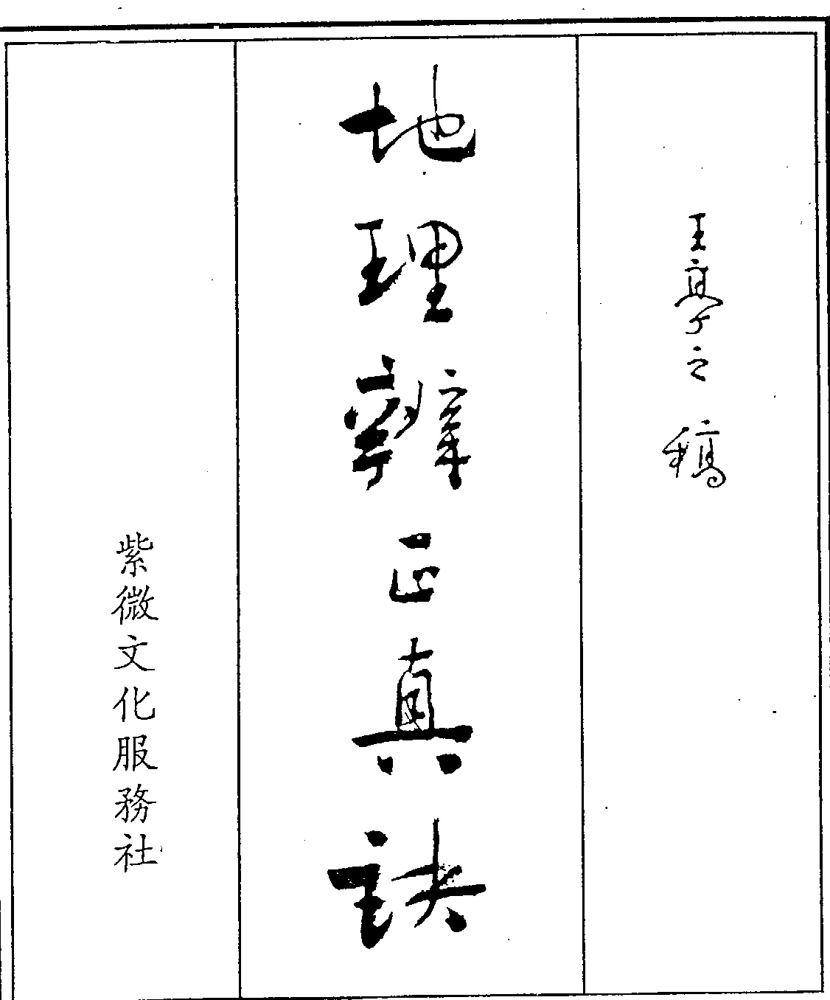

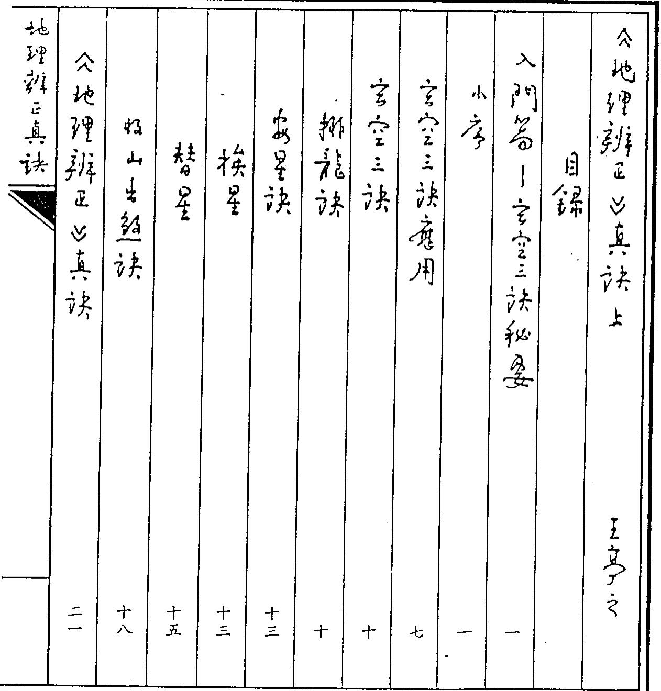

<!-- doc006 PDF 第 2 页：高风险/复杂版面 OCR 供检索；内容与排版以原页图为准。 -->
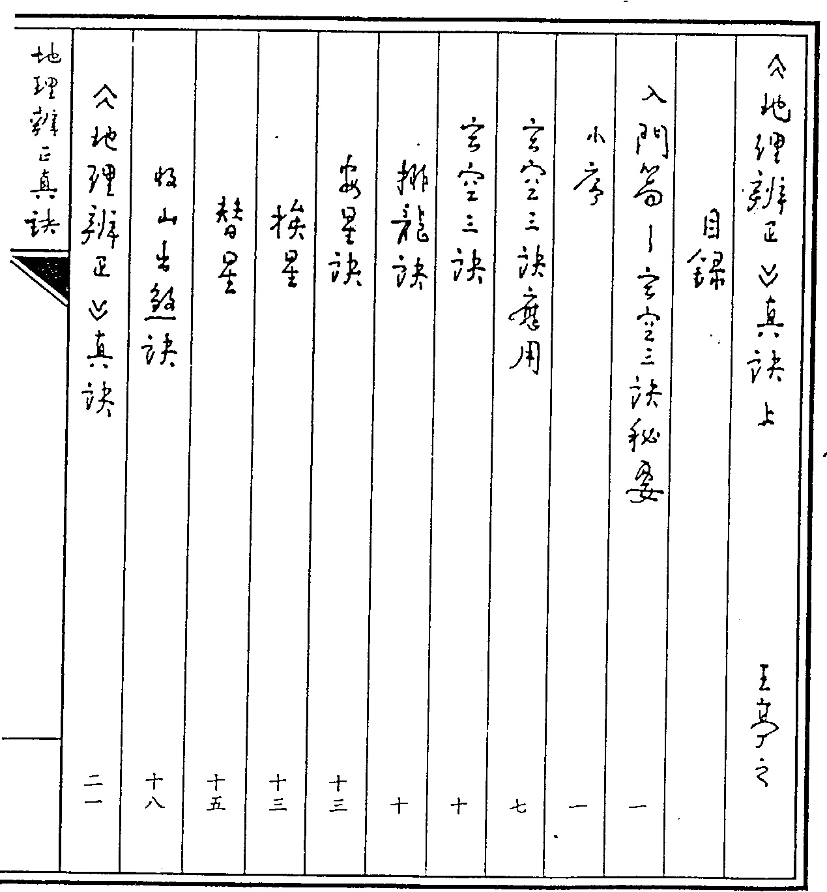

<!-- doc006 PDF 第 3 页：高风险/复杂版面 OCR 供检索；内容与排版以原页图为准。 -->
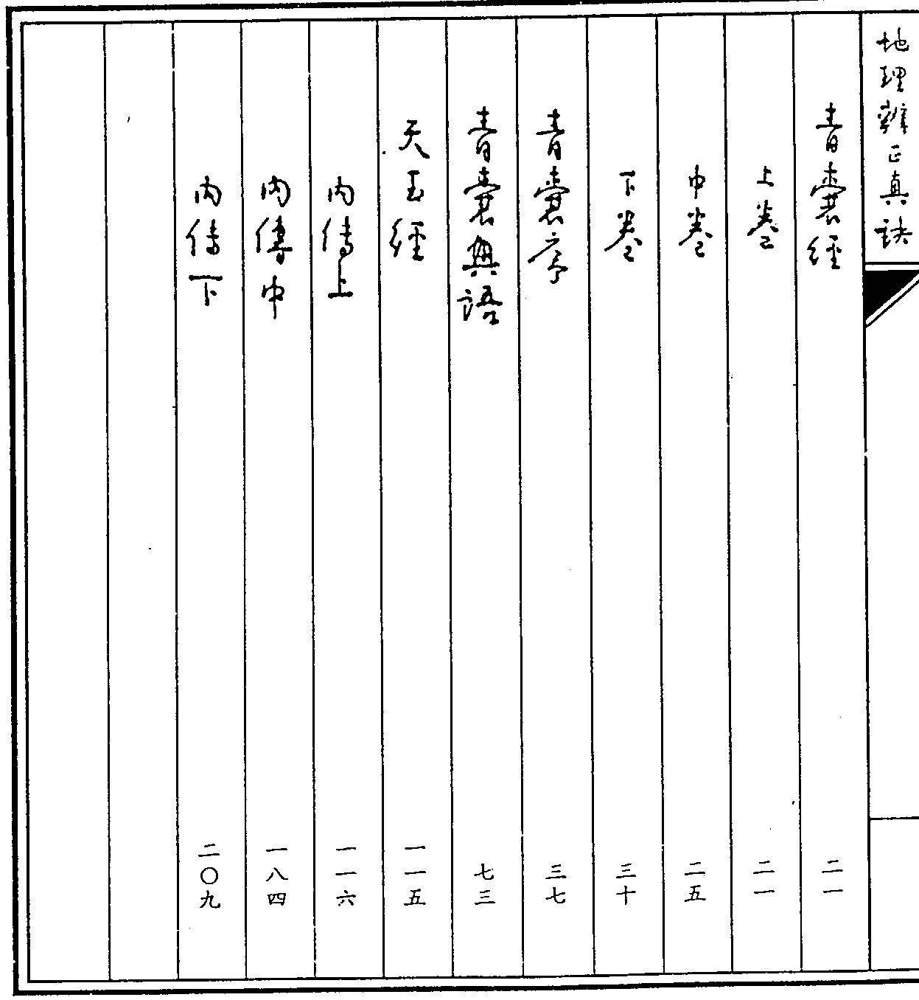

<!-- V3_SOURCE_ID:book017-b000010-p000-093e9ee2b2 -->

符氏的学说，自称是得自今桓子，而兮极子的相关情况则不如“仍许人”。这或许是符氏近似赞许的话，也说不定。此处“仍许人”语义不明，具体所指无法确定。

> **释读存疑：** 仍许人；仍许人语义不明，具体所指无法确定

查看对应原文

<!-- V3_FOLDBACK_BEGIN:book017-b000010-p000-093e9ee2b2 -->

符氏之學，謂得自今桓子，而兮極子則不如仍許人也。此或符氏似許之詞，亦未可知。

<!-- V3_FOLDBACK_END:book017-b000010-p000-093e9ee2b2 -->

<!-- V3_SOURCE_ID:book017-b000011-p000-cc67160b64 -->

入门篇中提到三诀从娶。

> **释读存疑：** “三诀从娶”含义不明

查看对应原文

<!-- V3_FOLDBACK_BEGIN:book017-b000011-p000-cc67160b64 -->

入門篇言三訣從娶

<!-- V3_FOLDBACK_END:book017-b000011-p000-cc67160b64 -->

<!-- V3_SOURCE_ID:book017-b000012-p000-fe180715b8 -->

小序

查看对应原文

<!-- V3_FOLDBACK_BEGIN:book017-b000012-p000-fe180715b8 -->

小序

<!-- V3_FOLDBACK_END:book017-b000012-p000-fe180715b8 -->

<!-- V3_SOURCE_ID:book017-b000013-p000-cb123545f4 -->

清初的府大鸿，有“地仙之舉”，具体所指不详。南明时期他曾侍奉唐王朱聿键，后续原文“唐王國改改服賞冠逃亡居帝辟一亂”部分讹误严重，无法准确释读。之后他得到旧藏的“言空必陽穴書”，相关文本“言之之與因輯玄古籍五る名地理正”存在日文字符，含义不明，没有依据认定相关名称为固定书名。之后他自己作了注释，由此成书相关的“言空經典”，具体成书情况不明。

> **释读存疑：** 地仙之舉；唐王國改改服賞冠逃亡居帝辟一亂；言空必陽穴書；輯玄古籍五る名地理正；言空經典；地仙之舉具体所指不详；唐王國改改服賞冠逃亡居帝辟一亂讹误严重无法释读；言空必陽穴書含义不明；輯玄古籍五る名地理正含日文字符含义不明，无依据认定为固定书名；言空經典具体成书情况不明

查看对应原文

<!-- V3_FOLDBACK_BEGIN:book017-b000013-p000-cb123545f4 -->

清初府大鴻，有地仙之舉於南明时曾事唐王朱書鍵及唐王國改改服賞冠逃亡居帝辟一亂得舊予所藏言空必陽穴書也言之之與因輯玄古籍五る名地理正且自作註释由是成生言空經典。

<!-- V3_FOLDBACK_END:book017-b000013-p000-cb123545f4 -->

<!-- V3_SOURCE_ID:book017-b000014-p000-85df9aaee3 -->

然而府大鸿被守秘的规矩限制，所以他的注解，得到真诀的人会将其看作字字珠玑。如果没有得到诀要，就“則今头緒”，此处“今”是讹误，语义不明。后续“祔遍翻故紙推丘不紅其所以然”一句无法准确释读，“推丘不紅”具体含义不详。再往后“一甚之不如其地理辨正真读 言空三法秘委”语义断裂，“不如其”的具体指向无法确定，相关文本也没有足够依据认定为固定书名。

> **释读存疑：** 則今头緒；祔遍翻故紙推丘不紅其所以然；一甚之不如其地理辨正真读 言空三法秘委；則今头緒中“今”为讹误，语义不明；祔遍翻故紙推丘不紅其所以然无法准确释读，推丘不紅含义不详；一甚之不如其地理辨正真读 言空三法秘委语义断裂，“不如其”指向不明，无依据认定为固定书名

查看对应原文

<!-- V3_FOLDBACK_BEGIN:book017-b000014-p000-85df9aaee3 -->

然而府大鴻格於守秘。所以他的註解，得真訣者則視为宇字珠璣若不得決 則今头緒，祔遍翻故紙推丘不紅其所以然一甚之不如其地理辨正真读 言空三法秘委

<!-- V3_FOLDBACK_END:book017-b000014-p000-85df9aaee3 -->

<!-- doc006 PDF 第 4 页：高风险/复杂版面 OCR 供检索；内容与排版以原页图为准。 -->
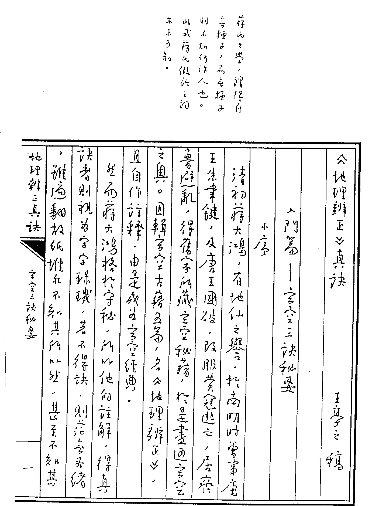

<!-- V3_SOURCE_ID:book017-b000016-p000-2ca3408114 -->

“經於是自胸臆”一句中“經”字含义不明，后文提到有人凭自己的私心作解释，谁知“愈求淫則去應遠”，此处“淫”“應”语义不明，无法准确释读。后续“故法代玄六大后一即得氏市子”一句里“代玄六大后”“氏市子”均为不明专名，“法”“一”等字含义也无法确定，没有依据认定相关内容指传承来源。最后“而支當夏紛紜之真面目遂九故紙之間”一句中“支”“夏”“九”等字含义未明，无法强行补出连贯语义。

> **释读存疑：** 經於是自胸臆；愈求淫則去應遠；故法代玄六大后一即得氏市子；而支當夏紛紜之真面目遂九故紙之間；經於是自胸臆中“經”含义不明；愈求淫則去應遠中“淫”“應”语义不明无法释读；故法代玄六大后一即得氏市子中“代玄六大后”“氏市子”为不明专名，“法”“一”等字含义无法确定，无依据认定指传承来源；而支當夏紛紜之真面目遂九故紙之間中“支”“夏”“九”等字含义未明，无法补出连贯语义

查看对应原文

<!-- V3_FOLDBACK_BEGIN:book017-b000016-p000-2ca3408114 -->

經於是自胸臆，私心作解孰知愈求淫則去應遠故法代玄六大后一即得氏市子亦未能得其直傳而支當夏紛紜之真面目遂九故紙之間。

<!-- V3_FOLDBACK_END:book017-b000016-p000-2ca3408114 -->

<!-- V3_SOURCE_ID:book017-b000017-p000-b90c89b6ca -->

书中称中州这一派是传承汝正宗的流派，历代都严守秘传的内容，实际指的是“玄空三诀 8 排龙星 收山生煞 0”，只要掌握这三项要诀，再去读府大鸿的注解，那么《地理辨正》等各类相关书籍的内容，都和白治的说法是一致的。

> **释读存疑：** “治汝正宗”“代代字”“っ”“白治”语义未明；“8”“0”为原文乱码，含义无法确定；1轮自动修复后核义模型仍建议修订，已保守记录。

查看对应原文

<!-- V3_FOLDBACK_BEGIN:book017-b000017-p000-b90c89b6ca -->

言以中州治汝正宗，一派相信代代字而所秘者實っ言玄空三決 8 排龍星 收山生煞 0 持此三訣讀府大鴻注 则公地理辨正諸為皆同白治

<!-- V3_FOLDBACK_END:book017-b000017-p000-b90c89b6ca -->

<!-- V3_SOURCE_ID:book017-b000018-p000-b5351935ee -->

余重年跟随生父绍如公学习广东玄，绍如公得到二生生的传承。角二生生是清末探行角，近处的牯丈，而绍如公则排仍节。文中“探行角”“牯丈”“排仍节”具体所指不详。

> **释读存疑：** 余重年、广东玄、二生生、角二生生、探行角、牯丈、排仍节含义不明

查看对应原文

<!-- V3_FOLDBACK_BEGIN:book017-b000018-p000-b5351935ee -->

余重年隨生父紹如公習廣東玄紹如公得二生生之傳角二生生则为清末探行角近處牯丈而紹如么則排仍节。

<!-- V3_FOLDBACK_END:book017-b000018-p000-b5351935ee -->

<!-- doc006 PDF 第 5 页：高风险/复杂版面 OCR 供检索；内容与排版以原页图为准。 -->
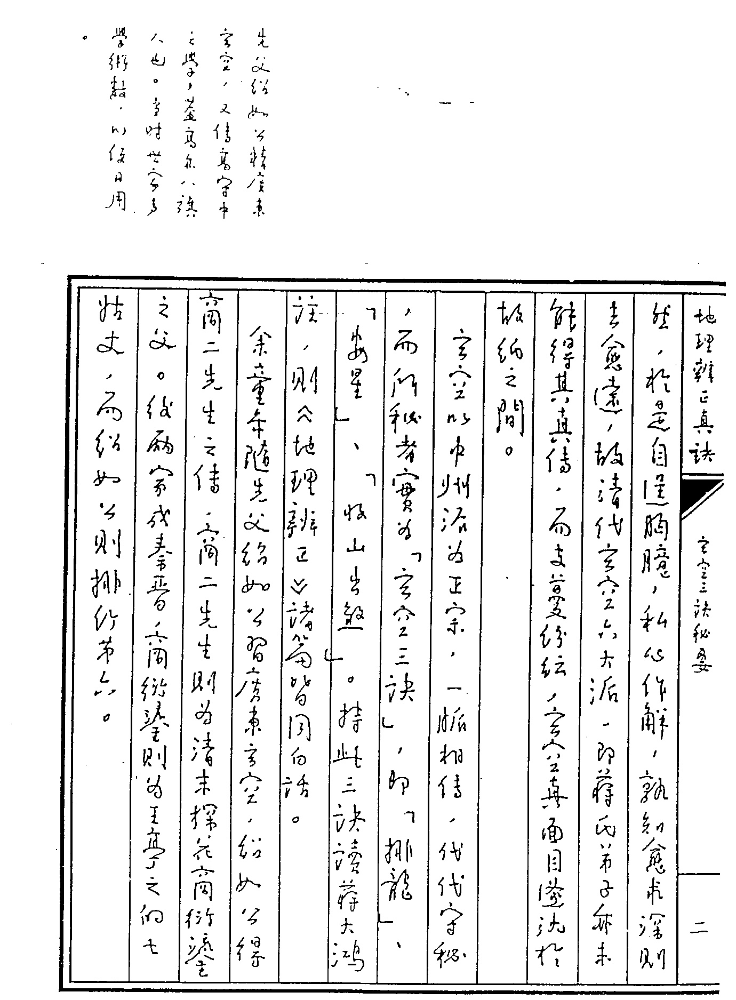

<!-- V3_SOURCE_ID:book017-b000020-p000-195c2c1136 -->

度東室空误把飞星当作排龙，實不紅柳龍真诀又把智星当作飞星，只有山出煞得到了真传，还提到言空家的形学就是所谓的峦头之学，尤其重视水法及平洋龙，其中的“水”指风水语境中的河流、水系及其来去形态。王音之少时所学的内容，成为他后来学习中州法之空的基础。文中“度東室空”“實不紅柳龍”“智星”“言空家的形學”具体所指不详。

> **释读存疑：** 度東室空、實不紅柳龍、智星、言空家的形學、之空含义不明

查看对应原文

<!-- V3_FOLDBACK_BEGIN:book017-b000020-p000-195c2c1136 -->

度東室空誤以飛星為排龍而實不紅柳龍真訣復以智星为飛星但惟山出煞則得真傳且得言空家的形學即所謂巒頭之學尤重水法及平洋龍，王音之少时所習 即成其後習中州法之空的其礎。

<!-- V3_FOLDBACK_END:book017-b000020-p000-195c2c1136 -->

<!-- V3_SOURCE_ID:book017-b000021-p000-ae380a5d97 -->

一九八六年末，送夏咸夷乃坐之三诀教授给众多后入门的弟子，之后弟子潘政诺及祥匡文就根据这些内容编美，还收集了王之在报立早上背表的来栏文字，并且详细加以例解和图表，韩为公编纂中州治玄空学三册，其中的“玄空”指结合时间、空间和星数推演的一类风水体系，从此中州法之空的秘奥才开始被世人仰亥，学习的人都加以推许，还有人反而对王文之皆公开私法为異八感到奇怪，却不知道王之已经学佛，而且不看重地理辨正真法、言空三诀秘要。三。文中“送夏咸夷乃坐之三訣”“报立早上背表的来欄文字”“仰亥”“異八”具体所指不详。

> **释读存疑：** 送夏咸夷乃坐之三訣、编美、报立早上背表的来欄文字、仰亥、異八、之空含义不明

查看对应原文

<!-- V3_FOLDBACK_BEGIN:book017-b000021-p000-ae380a5d97 -->

九八六年末，送夏咸夷乃坐之三訣教授多後門人其後門人潘政諾及祥匡文即據之编美且收集王之於报立早上背表的来欄文字並詳加例解及圖表韓为公中州治玄空學三冊，於是中州法之空秘奧始多世人仰亥 學者成加推許或反以王文之皆公開私法為異八而實不知王之既己學佛且不以鼓地理辨正真法 言空三決秘要 三

<!-- V3_FOLDBACK_END:book017-b000021-p000-ae380a5d97 -->

<!-- doc006 PDF 第 6 页：高风险/复杂版面 OCR 供检索；内容与排版以原页图为准。 -->
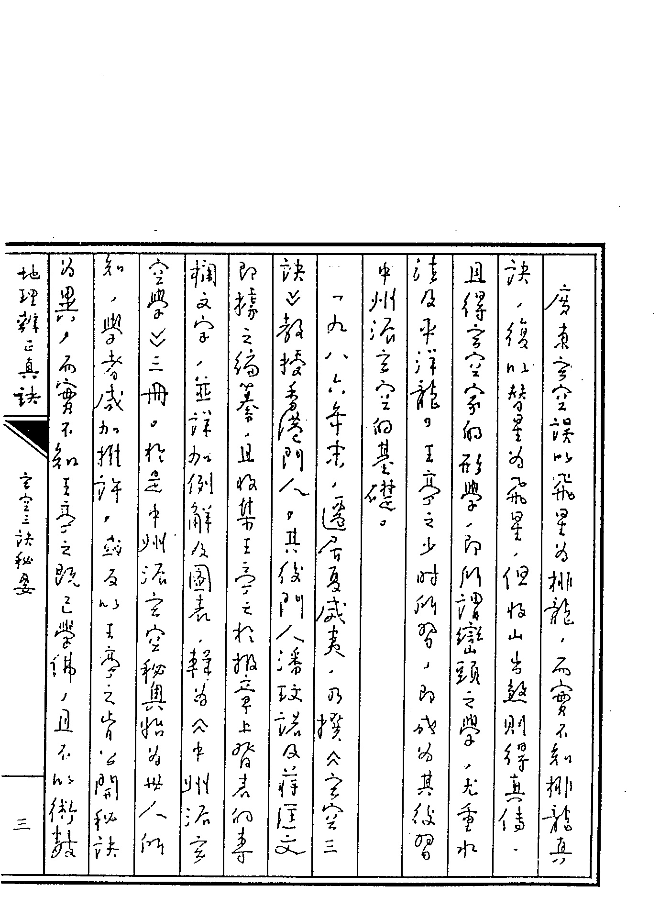

<!-- V3_SOURCE_ID:book017-b000023-p000-728517ddb2 -->

因此实在不想再恪守一师仅传一徒的旧规矩，不如将秘诀公开，让从业者不至于私心自用而贻误他人。

查看对应原文

<!-- V3_FOLDBACK_BEGIN:book017-b000023-p000-728517ddb2 -->

分業，故實不欲更恪守一師僅傳一徒之舊規，不如將秘訣公開，俾業者不致私心自用而誤人也。

<!-- V3_FOLDBACK_END:book017-b000023-p000-728517ddb2 -->

<!-- V3_SOURCE_ID:book017-b000024-p000-3587728bbf -->

然而当时所撰写的省習可補主者，加上世人常误以为中州法不讲究形学，所以午未年间汇集弟子提出的问题随手劉記，于是觉得公中州派玄空学当五增三明能之讀者夏易知古人典務的精要，其中的“玄空”指结合时间、空间和星数推演的一类风水体系。文中“省習可補主者”“劉記”“当五增三明能之讀者夏易知古人典務之精要”具体所指不详。

> **释读存疑：** 省習可補主者、劉記、当五增三明能之讀者夏易知古人典務之精要含义不明

查看对应原文

<!-- V3_FOLDBACK_BEGIN:book017-b000024-p000-3587728bbf -->

然當时所撰省習可補主者，兼且世人每誤以为中州法不講形學故午未集門人所問隨手劉記遂覺公中州派玄空學当五增三明能之讀者夏易知古人典務之精要。

<!-- V3_FOLDBACK_END:book017-b000024-p000-3587728bbf -->

<!-- V3_SOURCE_ID:book017-b000025-p000-c9403359f5 -->

一九九三年移居圗儲都一Toto多像多，在编译《富瑪法嘗書》的余暇，取《地理辨正》加以详细注释，书写其中的精粹，而父己九七年，弟子阮文良也移居圖辭都，遇到学书出版经费以及寿辨《富瑪派學報》的经济困难，文良于是请工字之将所著的内容公开，以便筹集著集经费，且以陰貴供王宜之美言老於之輕理重少以手書所問世。这部书名叫《公地理辨正真決》，名賢子上虛語也。文中“圗儲都一Toto多像多”“父己”“圖辭都”“寿辨”“陰貴供王宜之美言老於之輕理重少以手書所問世”“名賢子上虛語也”具体所指不详。

> **释读存疑：** 圗儲都一Toto多像多、父己、圖辭都、寿辨、陰貴供王宜之美言老於之輕理重少以手書所問世、名賢子上虛語也含义不明

查看对应原文

<!-- V3_FOLDBACK_BEGIN:book017-b000025-p000-c9403359f5 -->

一九九三年移居圗儲都一Toto多像多 於編译《富瑪法嘗書》之餘因取地理辨正 加以詳注書其精粹而父己九七年門人 阮文良亦移居圖辭都諸及學書出版經費 及寿辨《富瑪派學報之經济困辨文良乃 請工字之將所著公開俾著集經費且以陰貴 供王宜之美言老於之輕理重少以手書所 問世。名曰公地理辨正真決，名賢子 上虛語也。

<!-- V3_FOLDBACK_END:book017-b000025-p000-c9403359f5 -->

<!-- doc006 PDF 第 7 页：高风险/复杂版面 OCR 供检索；内容与排版以原页图为准。 -->
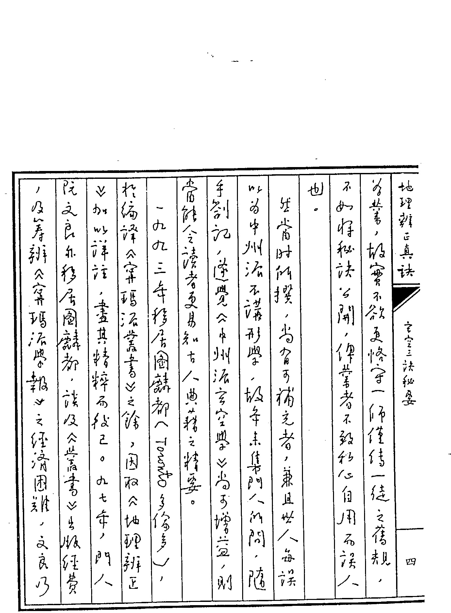

<!-- V3_SOURCE_ID:book017-b000027-p000-2fb17ef090 -->

小女若于夏成夷学习走樂，九七年也多次前往图青都，多次说到言空如水公人設汁裝修，帮助余望理圖重，名成中州辰之形興子じ一寫，明女专著问世如王则中州必且已书乃宣少世智者有係自得直售也。文中“夏成夷”“走樂”“图青都”“言空如水公人設汁裝修”“望理圖重”“中州辰之形興子じ一寫”“明女”“乃宣少世智者有係自得直售”具体所指不详，“水公”中的“水”不符合已批准的“风水语境中的河流、水系及其来去形态”的释义，此处存疑。

> **释读存疑：** 夏成夷、走樂、图青都、言空如水公人設汁裝修、望理圖重、中州辰之形興子じ一寫、明女、乃宣少世智者有係自得直售含义不明，水公的水释义存疑

查看对应原文

<!-- V3_FOLDBACK_BEGIN:book017-b000027-p000-2fb17ef090 -->

小女若於夏成夷習走樂，九七年亦素图青 都數以言空如水公人設汁裝修助余望理圖 重，名成中州辰之形興子じ一寫，明女 專著問世如王則中州必且已書乃宣少 世智者有係自得直售也。

<!-- V3_FOLDBACK_END:book017-b000027-p000-2fb17ef090 -->

<!-- V3_SOURCE_ID:book017-b000028-p000-9c85a7e8a3 -->

此廬曰說公地理辨正也，諸為先說家之三訣抉出其秘，愚之度所以名为入门。字空之生度大訓，入其门也未必能員堂奧。生入正 地理辨正真法 言空三法秘象 五。如果不是有缘分得到它的口诀，就算号称读破万卷书，也没办法叩开它的门扉，因此写下这篇序。文中“此廬曰說公地理辨正也諸為先說家之三訣”“字空之生度大訓”“員堂奧”“生入正 地理辨正真法 言空三法秘象 五”具体所指不详。

> **释读存疑：** 此廬曰說公地理辨正也諸為先說家之三訣、字空之生度大訓、員堂奧、生入正 地理辨正真法 言空三法秘象 五含义不明

查看对应原文

<!-- V3_FOLDBACK_BEGIN:book017-b000028-p000-9c85a7e8a3 -->

此廬曰說公地理辨正也諸為先說家之三 訣抉出其秘愚之度故名为入門。字空之 生度大訓入其門亦未必能員堂奧生入正 地理辨正真法 言空三法秘象 五 易若非有緣能得其訣則號讀破萬卷書亦 末能叩其門扉也是為序。

<!-- V3_FOLDBACK_END:book017-b000028-p000-9c85a7e8a3 -->

<!-- V3_SOURCE_ID:book017-b000029-p000-4cca755fe6 -->

室空三诀夜用

> **释读存疑：** 原文过于简略，具体所指不详

查看对应原文

<!-- V3_FOLDBACK_BEGIN:book017-b000029-p000-4cca755fe6 -->

室空三訣夜用

<!-- V3_FOLDBACK_END:book017-b000029-p000-4cca755fe6 -->

<!-- doc006 PDF 第 8 页：高风险/复杂版面 OCR 供检索；内容与排版以原页图为准。 -->
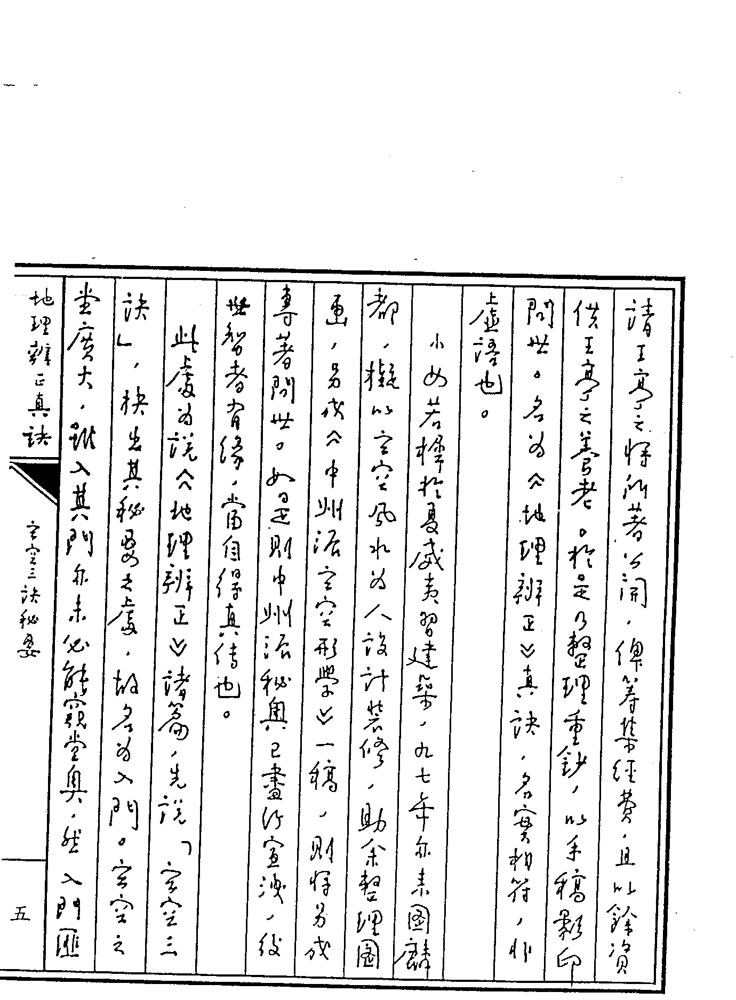

<!-- doc006 PDF 第 9 页：高风险/复杂版面 OCR 供检索；内容与排版以原页图为准。 -->
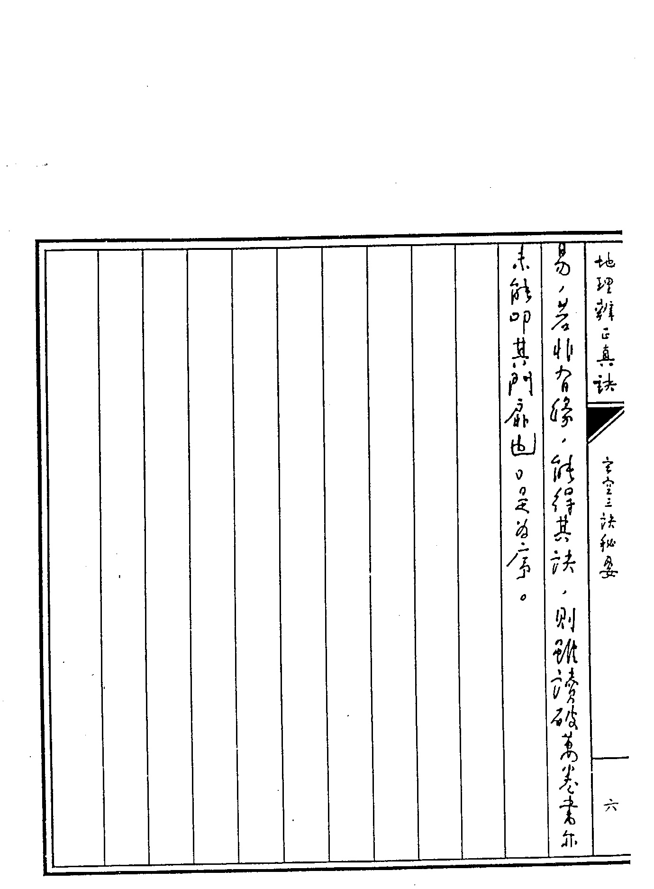

<!-- V3_SOURCE_ID:book017-b000032-p000-2d62eb7b0a -->

抑能訣此分授地之用地之侵劣，可之可用一屬先天，其中的“先天”是术数中表示先天卦序或本体关系的概念，因为天然自皆形極，不是人力所能情移的。文中“抑能訣此分授地之用地之侵劣”“可之可用一屬先天”“自皆形極非人力所能情移”具体所指不详。

> **释读存疑：** 抑能訣此分授地之用地之侵劣、可之可用一屬先天、自皆形極非人力所能情移含义不明

查看对应原文

<!-- V3_FOLDBACK_BEGIN:book017-b000032-p000-2d62eb7b0a -->

抑能訣此分授地之用地之侵劣，可之可用一屬先天蓋天然自皆形極非人力所能情移。

<!-- V3_FOLDBACK_END:book017-b000032-p000-2d62eb7b0a -->

<!-- V3_SOURCE_ID:book017-b000033-p000-40239196a7 -->

我星诀中提到，曾在择定地基后确定建筑或穴位所朝的方位，六向的用法可随人事安排而定，属于后天方位的范畴。具体的方位要随时间推移而变化，这一变化与0玄时间推移也就是空间的推移相关。

> **释读存疑：** 天然向之物坏傍坐、閏係、0玄的具体含义原文未明；1轮自动修复后核义模型仍建议修订，已保守记录。

查看对应原文

<!-- V3_FOLDBACK_BEGIN:book017-b000033-p000-40239196a7 -->

我星訣此曾擇地後定屋向六向之用，此可隨人事安排集後天然向之物坏傍坐唯时間精移此时全變化閏係即之言 0玄时間推移「即空間

<!-- V3_FOLDBACK_END:book017-b000033-p000-40239196a7 -->

<!-- V3_SOURCE_ID:book017-b000034-p000-01e64d2375 -->

天的垂示和地的酬报，是相关方法的运用依据，这一表述并不代表天本身。天学的运行本就是时间推移的征象，比如斗称指向东方对应春季，指向“每”对应秋季，因此天就等同于时间。此处“斗称”具体所指不明，“之指每为秋”中“每”的含义、所指方向均无明确依据。

> **释读存疑：** 地賞的具体含义；斗稱的具体所指；斗稱指每为秋中每的含义与对应指向；“地賞”的具体含义；“斗称”的具体所指；“之指每为秋”中“每”的含义与对应指向；1轮自动修复后核义模型仍建议修订，已保守记录。

查看对应原文

<!-- V3_FOLDBACK_BEGIN:book017-b000034-p000-01e64d2375 -->

天言地賞，所以用之，未代表天。天學運仍即时間推移之象如斗稱指東為春之指每为秋，因此天即为时。

<!-- V3_FOLDBACK_END:book017-b000034-p000-01e64d2375 -->

<!-- V3_SOURCE_ID:book017-b000035-p000-5f696cda2e -->

玄空就是时间。原文后接“此門今任何神秘”语义不通，无法准确释读，具体含义不明。

> **释读存疑：** 此門今任何神秘的语义；“此門今任何神秘”的语义

查看对应原文

<!-- V3_FOLDBACK_BEGIN:book017-b000035-p000-5f696cda2e -->

玄空即是时。此門今任何神秘

<!-- V3_FOLDBACK_END:book017-b000035-p000-5f696cda2e -->

<!-- doc006 PDF 第 10 页：高风险/复杂版面 OCR 供检索；内容与排版以原页图为准。 -->
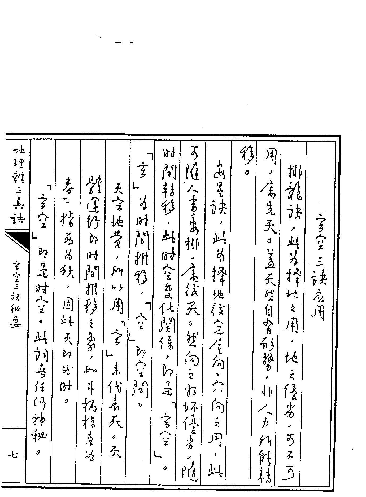

<!-- V3_SOURCE_ID:book017-b000037-p000-ab2148c5c8 -->

出星诀又分为两类：检星、楚星。

> **释读存疑：** 原文存在字迹模糊，“楚星”的具体所指不详；“谷二”“检星”“楚星”的具体所指不详

查看对应原文

<!-- V3_FOLDBACK_BEGIN:book017-b000037-p000-ab2148c5c8 -->

出星訣又分谷二：檢星楚星。

<!-- V3_FOLDBACK_END:book017-b000037-p000-ab2148c5c8 -->

<!-- V3_SOURCE_ID:book017-b000038-p000-b6f4483a2f -->

挨星是日常常用的方法，因此被称为正卦山向，包含在二十四山的体系之内。如果不使用山向，就需要用挨星诀来推演全盘，通过星盘来判定吉凶祸福，知晓某一山向在某一段时间内适用，在某一段时间内不适用。

> **释读存疑：** 我仁、不出山、公用、不令用的具体含义原文未明；1轮自动修复后核义模型仍建议修订，已保守记录。

查看对应原文

<!-- V3_FOLDBACK_BEGIN:book017-b000038-p000-b6f4483a2f -->

挨星日常用故称为正卦山向行二十四山之内，不出山，则用挨星决全盤，我仁由星盤定吉凶休咎知此山向於那一段时間公用，那一段时間不令用。

<!-- V3_FOLDBACK_END:book017-b000038-p000-b6f4483a2f -->

<!-- V3_SOURCE_ID:book017-b000039-p000-a1455f30c0 -->

这一方法不常用，因此被称为谷一，属于变爻的范畴。山向在二十四山的偏位，已得到邻山的气，此后就用替星来确定星盘，这也被称为分精卦0。

> **释读存疑：** 糟非常用故稱谷一變爻；富时精是；糟、谷一、替星讀、星盤版、富时精是的具体含义原文未明；1轮自动修复后核义模型仍建议修订，已保守记录。

查看对应原文

<!-- V3_FOLDBACK_BEGIN:book017-b000039-p000-a1455f30c0 -->

糟非常用故稱谷一變爻 。山向在二十四山之偏已得隣山之氣是則爾後 y即用替星讀以定星盤版富时精是亦稱分精卦 0

<!-- V3_FOLDBACK_END:book017-b000039-p000-a1455f30c0 -->

<!-- V3_SOURCE_ID:book017-b000040-p000-670514d472 -->

如果山向恰好位于丙山的分野，或者空针的位置。

> **释读存疑：** 原文存在断句错乱，“分累”的具体所指不详；“怜居”“分累”的具体所指不详

查看对应原文

<!-- V3_FOLDBACK_BEGIN:book017-b000040-p000-670514d472 -->

若山向怜居於丙山之分累， 或空針

<!-- V3_FOLDBACK_END:book017-b000040-p000-670514d472 -->

<!-- V3_SOURCE_ID:book017-b000041-p000-a91c205960 -->

不出卦为“时缝”，如磁针恰好位于壬山与某山的交界线处。

> **释读存疑：** 原文存在假名OCR错误，“ふ山”的具体所指不详；原文“ふ山”为OCR识别的假名，具体所指不详

查看对应原文

<!-- V3_FOLDBACK_BEGIN:book017-b000041-p000-a91c205960 -->

不出卦为「時縫如磁針怡居壬山 t ふ山 引的交界綫

<!-- V3_FOLDBACK_END:book017-b000041-p000-a91c205960 -->

<!-- doc006 PDF 第 11 页：高风险/复杂版面 OCR 供检索；内容与排版以原页图为准。 -->
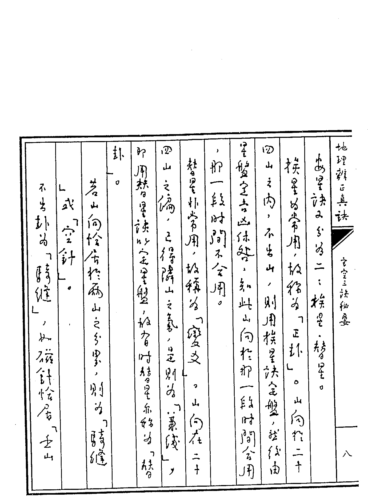

<!-- V3_SOURCE_ID:book017-b000043-p000-58f63d748c -->

出卦则为空针，如磁针恰好位于亥山与壬山之间。

> **释读存疑：** 原文“るっ”为OCR识别的假名，不影响核心语义理解

查看对应原文

<!-- V3_FOLDBACK_BEGIN:book017-b000043-p000-58f63d748c -->

出卦るっ空針。如磁針怡在亥山も壬山之間。

<!-- V3_FOLDBACK_END:book017-b000043-p000-58f63d748c -->

<!-- V3_SOURCE_ID:book017-b000044-p000-7790464965 -->

时缝以及空针对应的山向都不可使用，一旦使用就会有大凶的灾祸。原文后续“量座抑能亦须留音及此如恰多私山交界又出卦則的空龍百些好色永不賤錢的銷位，可能即a空從之飯”内容严重残缺错乱，无法准确释读，具体含义不明。

> **释读存疑：** 量座抑能亦须留音及此如恰多私山交界又出卦則的空龍百些好色永不賤錢的銷位，可能即a空從之飯的语义；“時縫及空針之山向皆之用”的完整含义；后段残损内容的语义；1轮自动修复后核义模型仍建议修订，已保守记录。

查看对应原文

<!-- V3_FOLDBACK_BEGIN:book017-b000044-p000-7790464965 -->

時縫及空針之山向皆之用，用則大凶量座抑能亦须留音及此如恰多私山交界又出卦則的空龍百些好色永不賤錢的銷位，可能即a空從之飯

<!-- V3_FOLDBACK_END:book017-b000044-p000-7790464965 -->

<!-- V3_SOURCE_ID:book017-b000045-p000-220c8fbfff -->

“收山出勉訣”应为“收山出煞诀”，该诀是用来厘定住宅或墓穴的特别规制以及山、向的情况的，要依据这个诀判断屋穴适宜开阔敞亮，还是适宜闭藏收纳，在规划设计形制样态的时候，就应该用这个诀来做裁定。

> **释读存疑：** 对原文‘别制’‘为版其形’的释读存在一定参考性，为结合语境的合理推导；原文‘别制’‘为版其形’的释读为结合语境的合理推导，不具备绝对确定性

查看对应原文

<!-- V3_FOLDBACK_BEGIN:book017-b000045-p000-220c8fbfff -->

收山出勉訣用以訂全屋或墓的別制山向况定屋穴宜開陽實敝抑宜收藏為版其形則設計即宜用此訣訂。

<!-- V3_FOLDBACK_END:book017-b000045-p000-220c8fbfff -->

<!-- V3_SOURCE_ID:book017-b000046-p000-203bf01b04 -->

此处记载了两个文献，分别是《言空三法秘要》和《玄空三谈》。

> **释读存疑：** 无法确定‘言空三法秘要’‘玄空三談’是文献名称还是口诀、篇章类内容；1轮自动修复后核义模型仍建议修订，已保守记录。

查看对应原文

<!-- V3_FOLDBACK_BEGIN:book017-b000046-p000-203bf01b04 -->

言空三法秘要 玄空三談

<!-- V3_FOLDBACK_END:book017-b000046-p000-203bf01b04 -->

<!-- V3_SOURCE_ID:book017-b000047-p000-1661f25e96 -->

挪杂诀

查看对应原文

<!-- V3_FOLDBACK_BEGIN:book017-b000047-p000-1661f25e96 -->

挪雜訣

<!-- V3_FOLDBACK_END:book017-b000047-p000-1661f25e96 -->

<!-- doc006 PDF 第 12 页：高风险/复杂版面 OCR 供检索；内容与排版以原页图为准。 -->
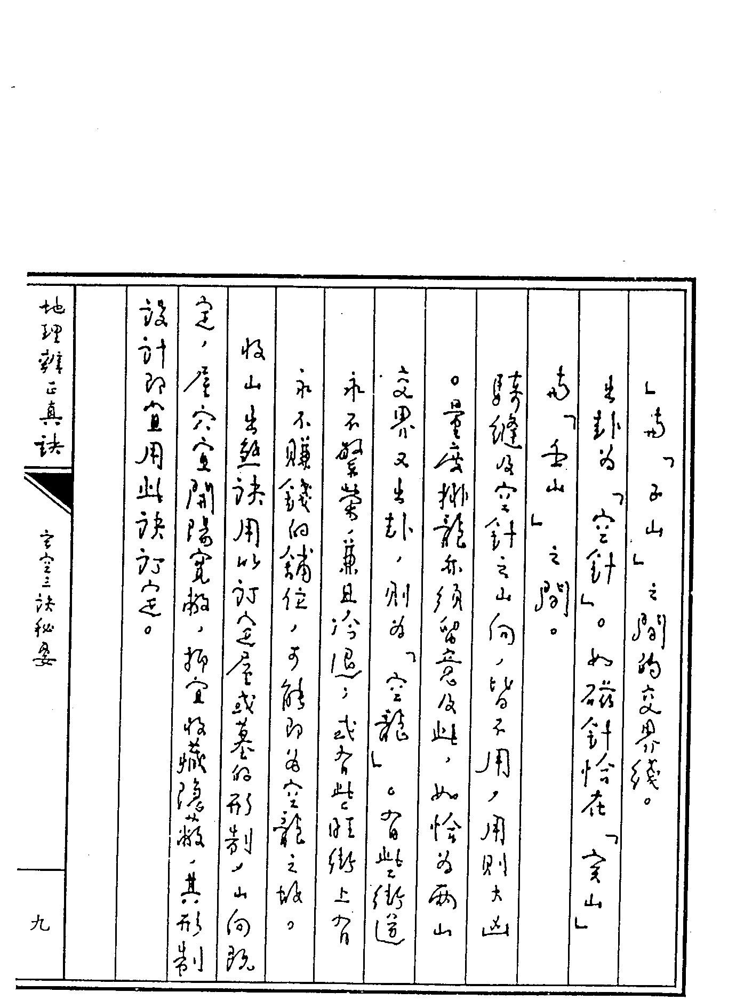

<!-- V3_SOURCE_ID:book017-b000049-p000-19c3e3b05d -->

龙对山山起砧拿，砧军顺逆两头分。

> **释读存疑：** "砧拿""砧军"具体所指不详

查看对应原文

<!-- V3_FOLDBACK_BEGIN:book017-b000049-p000-19c3e3b05d -->

龍对山山起砧拿砧軍順逆两頭分，

<!-- V3_FOLDBACK_END:book017-b000049-p000-19c3e3b05d -->

<!-- V3_SOURCE_ID:book017-b000050-p000-274c5bb589 -->

巨存星共有十二颗，其中七颗为凶星，“王吉”相关内容用来确定朝向。目前暂无法准确解读“王吉”的具体含义，也没有依据判定吉星的具体数量。

> **释读存疑：** “巨存星”“王吉”的具体所指不明，无法确定吉星数量；“巨存星”“王吉”的具体所指不明，无法确定吉星的具体数量

查看对应原文

<!-- V3_FOLDBACK_BEGIN:book017-b000050-p000-274c5bb589 -->

巨存星十二，七凶王吉定朝

<!-- V3_FOLDBACK_END:book017-b000050-p000-274c5bb589 -->

<!-- V3_SOURCE_ID:book017-b000051-p000-d57226f995 -->

支义平出的是真龙贵脉，必须从入首（龙脉进入结穴区域前的关键一段）处判断它的真伪。

查看对应原文

<!-- V3_FOLDBACK_BEGIN:book017-b000051-p000-d57226f995 -->

支義平出真龍貴須從入首說其真。

<!-- V3_FOLDBACK_END:book017-b000051-p000-d57226f995 -->

<!-- V3_SOURCE_ID:book017-b000052-p000-324c53195d -->

原文列出贪、巨、武、补、弼、曾、王，去掉其中二项，加上破、称、文、廉，合为七凶；后面有“以延軍重出先回次故”的表述，该段内容表述较为混乱，目前无法准确解读其中的星曜对应逻辑以及“延軍重出先回次故”的具体含义。

> **释读存疑：** 整段原文表述混乱，星曜对应关系、“延軍重出先回次故”的含义均无法准确释读

查看对应原文

<!-- V3_FOLDBACK_BEGIN:book017-b000052-p000-324c53195d -->

貪巨武補弼曾王去二破稱文廉為七凶 以延軍重出先回次故。 n

<!-- V3_FOLDBACK_END:book017-b000052-p000-324c53195d -->

<!-- V3_SOURCE_ID:book017-b000053-p000-7dde037467 -->

排龙图分为十二宫，依照十二地支划分，男止十二支分地是用来纳天气的，也就是纳黄道十二宫的气，因此属于阴。天星向右旋转，所以这十二地支位于右弦，也就是明时针方向的精动，目前“明时针”的具体所指无法准确解读，不能确定是否为顺时针。

> **释读存疑：** “男止十二支分地”的含义不明，“明时针”具体所指无法确认；“男止十二支分地”的含义不明，“明时针”具体所指无法确认，不能确定是否为顺时针

查看对应原文

<!-- V3_FOLDBACK_BEGIN:book017-b000053-p000-7dde037467 -->

排龍圗分十二宮依十二支分男止十二支分地納天氣即納黃道十二富之氣故為陰。天星右旋故此十二支介右弦，即明时針方向精動。

<!-- V3_FOLDBACK_END:book017-b000053-p000-7dde037467 -->

<!-- doc006 PDF 第 13 页：高风险/复杂版面 OCR 供检索；内容与排版以原页图为准。 -->
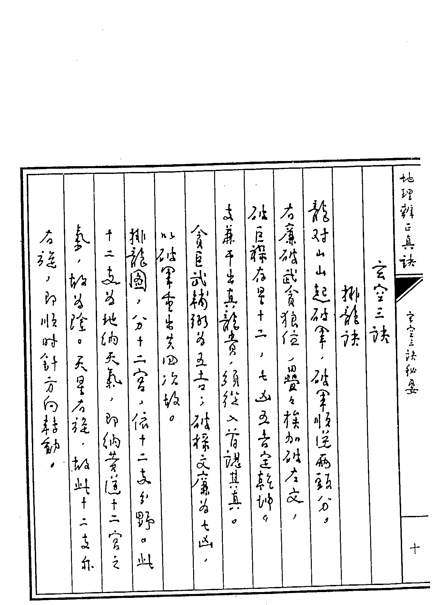

<!-- V3_SOURCE_ID:book017-b000055-p000-2a3e5193bb -->

十二空中各自纳入一阳，原文此处存在缺字错乱，有“明夫P”的内容，无法准确释读，接下来的内容提到也就是所谓的雌雄阳为八干四维。

> **释读存疑：** 原文存在缺字“明夫P”，无法准确释读对应内容；原文存在缺字错乱内容“明夫P”，对应部分无法准确释读

查看对应原文

<!-- V3_FOLDBACK_BEGIN:book017-b000055-p000-2a3e5193bb -->

十二空中，各納一陽，明夫P，亦即所謂雌雄陽为八干四維

<!-- V3_FOLDBACK_END:book017-b000055-p000-2a3e5193bb -->

<!-- V3_SOURCE_ID:book017-b000056-p000-c3779164e5 -->

原文开头的日文“ハ千”应为“八干”的讹误，原文列举八干为甲、乙、丙、丁、R、壬、癸，存在缺漏，缺少庚、辛两项；十天干中的戊、己处于中间位置，因此不使用。

> **释读存疑：** 原文所列八干存在缺项，具体缺漏内容仅能依据天干常识补充标注；原文所列八干存在缺项，缺漏的庚、辛仅为依据天干常识的推导，不排除原文有其他设定的可能

查看对应原文

<!-- V3_FOLDBACK_BEGIN:book017-b000056-p000-c3779164e5 -->

ハ千即甲、乙·丙·丁、R、，壬、癸。十干中之戊己居中，故不用。

<!-- V3_FOLDBACK_END:book017-b000056-p000-c3779164e5 -->

<!-- V3_SOURCE_ID:book017-b000057-p000-e5b85b3b83 -->

四维指的是乾、艮、巽、坤这四个卦象，它们在后天八卦中处于四个隅位。

查看对应原文

<!-- V3_FOLDBACK_BEGIN:book017-b000057-p000-e5b85b3b83 -->

四維即乾、艮、巽、坤。此於後天八卦中居四隅。

<!-- V3_FOLDBACK_END:book017-b000057-p000-e5b85b3b83 -->

<!-- V3_SOURCE_ID:book017-b000058-p000-3d95115e9f -->

國光國

查看对应原文

<!-- V3_FOLDBACK_BEGIN:book017-b000058-p000-3d95115e9f -->

國光國

<!-- V3_FOLDBACK_END:book017-b000058-p000-3d95115e9f -->

十

<!-- V3_SOURCE_ID:book017-b000060-p000-c27765a974 -->

文中提到“八不四纵曾陽”，具体所指不详；还有“左語”，具体含义不明。相关操作是要按逆时针方向桂动。

> **释读存疑：** 八不四纵曾陽具体所指不详；左語具体含义不明；桂动语义暂不明确

查看对应原文

<!-- V3_FOLDBACK_BEGIN:book017-b000060-p000-c27765a974 -->

如是八不四纵曾陽，左語，即逆时針方向桂動。

<!-- V3_FOLDBACK_END:book017-b000060-p000-c27765a974 -->

<!-- V3_SOURCE_ID:book017-b000061-p000-6123101a3f -->

言空三法秘象 安是談

查看对应原文

<!-- V3_FOLDBACK_BEGIN:book017-b000061-p000-6123101a3f -->

言空三法秘象 安是談

<!-- V3_FOLDBACK_END:book017-b000061-p000-6123101a3f -->

<!-- V3_SOURCE_ID:book017-b000062-p000-30ae7056de -->

<table><tr><td rowspan=1 colspan=1></td><td rowspan=1 colspan=2>中冊</td><td rowspan=1 colspan=1>治空全學</td><td rowspan=1 colspan=2>其大立见十州</td><td rowspan=1 colspan=2>此書只男</td><td rowspan=1 colspan=1>圓盆立用T2分</td><td rowspan=7 colspan=1>R此實播二</td></tr><tr><td rowspan=2 colspan=1>而</td><td rowspan=2 colspan=1>已</td><td rowspan=5 colspan=1></td><td rowspan=5 colspan=1>J</td><td rowspan=1 colspan=2>u</td><td rowspan=1 colspan=2>东</td><td rowspan=1 colspan=1>庚</td><td rowspan=1 colspan=1></td></tr><tr><td rowspan=4 colspan=2>打图</td><td rowspan=4 colspan=2></td><td rowspan=2 colspan=1>二学</td><td rowspan=2 colspan=1></td></tr><tr><td rowspan=3 colspan=1>賢乙</td><td rowspan=1 colspan=1>N</td></tr><tr><td rowspan=2 colspan=1>卯</td><td></td></tr><tr><td rowspan=1 colspan=1>tイwl</td><td rowspan=1 colspan=1></td></tr><tr><td rowspan=1 colspan=1>甲</td><td rowspan=1 colspan=1>会</td><td rowspan=1 colspan=1></td><td rowspan=1 colspan=1>已日</td><td rowspan=1 colspan=1></td><td rowspan=1 colspan=1></td><td rowspan=1 colspan=1>2</td><td rowspan=1 colspan=1></td><td rowspan=1 colspan=1>壬</td><td rowspan=1 colspan=1></td></tr></table>

> **释读存疑：** 1轮自动修复后核义模型仍建议修订，已保守记录。

查看对应原文

<!-- V3_FOLDBACK_BEGIN:book017-b000062-p000-30ae7056de -->

<table><tr><td rowspan=1 colspan=1></td><td rowspan=1 colspan=2>中冊</td><td rowspan=1 colspan=1>治空全學</td><td rowspan=1 colspan=2>う其大立见十州</td><td rowspan=1 colspan=2>此書只男</td><td rowspan=1 colspan=1>圓盆立用T2分</td><td rowspan=7 colspan=1>R此實播二</td></tr><tr><td rowspan=2 colspan=1>而</td><td rowspan=2 colspan=1>已</td><td rowspan=5 colspan=1></td><td rowspan=5 colspan=1>J</td><td rowspan=1 colspan=2>u</td><td rowspan=1 colspan=2>东</td><td rowspan=1 colspan=1>庚</td><td rowspan=1 colspan=1></td></tr><tr><td rowspan=4 colspan=2>打图</td><td rowspan=4 colspan=2></td><td rowspan=2 colspan=1>二学</td><td rowspan=2 colspan=1></td></tr><tr><td rowspan=3 colspan=1>賢乙</td><td rowspan=1 colspan=1>N</td></tr><tr><td rowspan=2 colspan=1>卯</td><td></td></tr><tr><td rowspan=1 colspan=1>tイwl</td><td rowspan=1 colspan=1></td></tr><tr><td rowspan=1 colspan=1>甲</td><td rowspan=1 colspan=1>会</td><td rowspan=1 colspan=1></td><td rowspan=1 colspan=1>已日</td><td rowspan=1 colspan=1></td><td rowspan=1 colspan=1></td><td rowspan=1 colspan=1>2</td><td rowspan=1 colspan=1></td><td rowspan=1 colspan=1>壬</td><td rowspan=1 colspan=1></td></tr></table>

<!-- V3_FOLDBACK_END:book017-b000062-p000-30ae7056de -->

<!-- V3_SOURCE_ID:book017-b000063-p000-68447171ad -->

换星

查看对应原文

<!-- V3_FOLDBACK_BEGIN:book017-b000063-p000-68447171ad -->

换星

<!-- V3_FOLDBACK_END:book017-b000063-p000-68447171ad -->

<!-- doc006 PDF 第 14 页：高风险/复杂版面 OCR 供检索；内容与排版以原页图为准。 -->
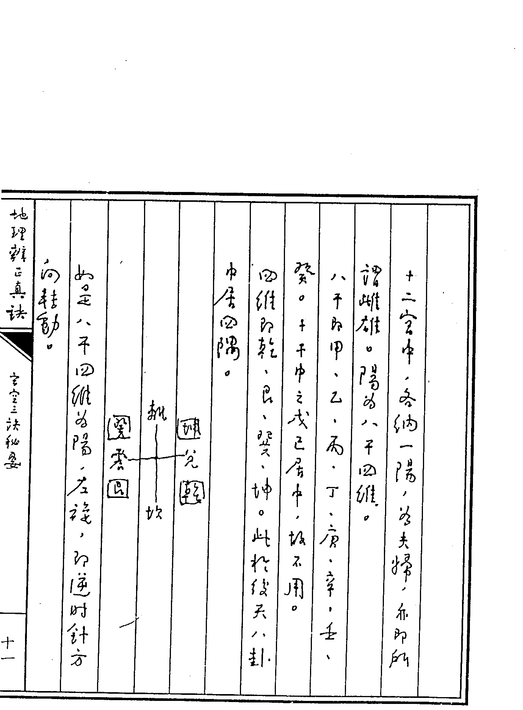

<!-- doc006 PDF 第 15 页：高风险/复杂版面 OCR 供检索；内容与排版以原页图为准。 -->
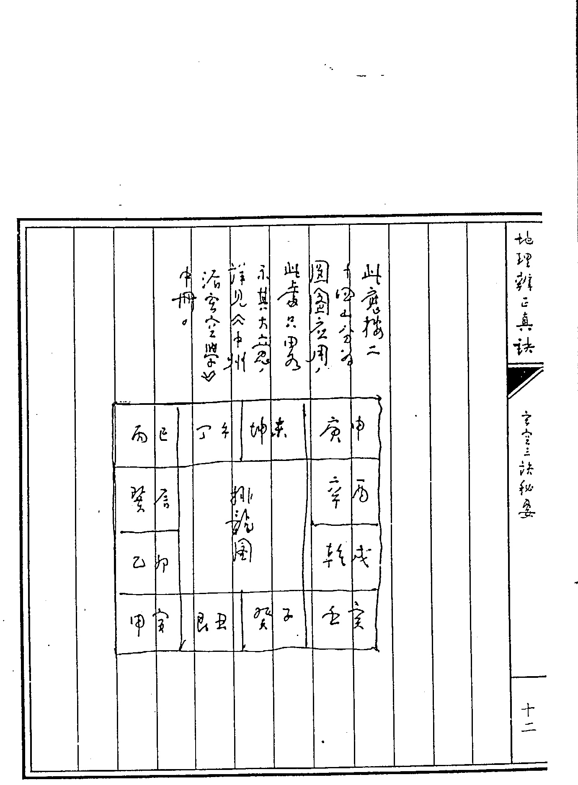

<!-- V3_SOURCE_ID:book017-b000066-p000-9b147a96e8 -->

运的相关内容是进入中分隱陰，顺逆排布要按照九宫死功执行。相关内容终究没有详细说明，可参见沈竹以公沈氏的言空學，以及“出公中州派之空以子”，该短语具体所指不详。

> **释读存疑：** 出公中州派之空以子具体所指不详；九宫死功语义暂不明确

查看对应原文

<!-- V3_FOLDBACK_BEGIN:book017-b000066-p000-9b147a96e8 -->

運是入中分隱陰顺逆按九官死功。不終詳見沈竹以公沈氏言空學也，及出公中州派之空以子。

<!-- V3_FOLDBACK_END:book017-b000066-p000-9b147a96e8 -->

<!-- V3_SOURCE_ID:book017-b000067-p000-efec216a0f -->

文中提到“大言妙無”，具体所指不详。使用九数时，有“魚九分顺逆冬不同”的说法，此处“冬”疑似错字，具体含义存疑。每次排布八卦，每一卦的气机相通，文中提到“躔何位落何公夫與擇各相從”，具体语义不明；还有“陸元判吉凶山管山水”的表述，具体语义暂不明确，其中八卦指乾、坤、震、巽、坎、离、艮、兑八种卦象，水指风水语境中的河流、水系及其来去形态。

> **释读存疑：** 大言妙無具体所指不详；魚九分顺逆冬不同中的“冬”疑似错字，含义存疑；躔何位落何公夫與擇各相從语义不明；陸元判吉凶山管山水语义不明

查看对应原文

<!-- V3_FOLDBACK_BEGIN:book017-b000067-p000-efec216a0f -->

大言妙無。用九，魚九分顺逆冬不同。每八卦，一卦通，躔何位落何公夫與擇各相從。陸元判吉凶山管山水

<!-- V3_FOLDBACK_END:book017-b000067-p000-efec216a0f -->

<!-- V3_SOURCE_ID:book017-b000068-p000-4850f25da0 -->

文中提到“兩修路不相空”，该表述具体含义不详。

> **释读存疑：** 兩修路不相空具体含义不详

查看对应原文

<!-- V3_FOLDBACK_BEGIN:book017-b000068-p000-4850f25da0 -->

兩修路不相空。

<!-- V3_FOLDBACK_END:book017-b000068-p000-4850f25da0 -->

<!-- V3_SOURCE_ID:book017-b000069-p000-7da76e2e14 -->

文中并列列举了四组内容，分别是寅甲、“巽已丙”、坤申庚、乾室王，其中“巽已丙”的“已”疑似为形近字“巳”，此处存疑；其中乾、坤、巽均为八卦之一。

> **释读存疑：** 巽已丙中的“已”疑似为“巳”，存疑

查看对应原文

<!-- V3_FOLDBACK_BEGIN:book017-b000069-p000-7da76e2e14 -->

見寅甲、巽已丙，坤申庚，乾室王，

<!-- V3_FOLDBACK_END:book017-b000069-p000-7da76e2e14 -->

<!-- V3_SOURCE_ID:book017-b000070-p000-a9883cc939 -->

玄空三诀的秘义，将此十二阳顺的内容安置在此处。

查看对应原文

<!-- V3_FOLDBACK_BEGIN:book017-b000070-p000-a9883cc939 -->

玄空三訣秘安此十二陽順乃。

<!-- V3_FOLDBACK_END:book017-b000070-p000-a9883cc939 -->

<!-- doc006 PDF 第 16 页：高风险/复杂版面 OCR 供检索；内容与排版以原页图为准。 -->
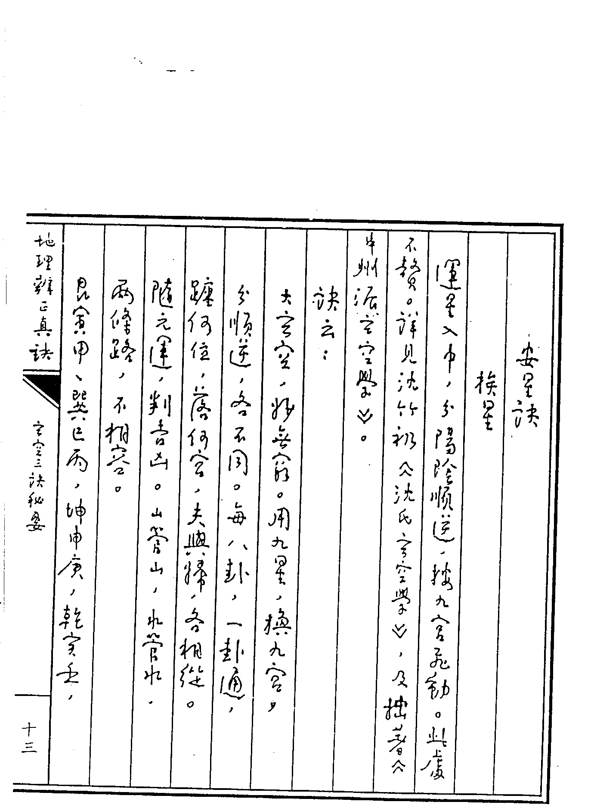

<!-- V3_SOURCE_ID:book017-b000072-p000-f8795081c2 -->

这里列出的干支组合分别是午丁未、酉辛戌、子癸丑、卯乙辰。

查看对应原文

<!-- V3_FOLDBACK_BEGIN:book017-b000072-p000-f8795081c2 -->

午丁未、酉辛戌、子癸丑、卯乙辰，

<!-- V3_FOLDBACK_END:book017-b000072-p000-f8795081c2 -->

<!-- V3_SOURCE_ID:book017-b000073-p000-b641d685d6 -->

此十二项，为阴逆的内容。

> **释读存疑：** 原文“裕”字含义不明

查看对应原文

<!-- V3_FOLDBACK_BEGIN:book017-b000073-p000-b641d685d6 -->

此十二，陰逆裕

<!-- V3_FOLDBACK_END:book017-b000073-p000-b641d685d6 -->

<!-- V3_SOURCE_ID:book017-b000074-p000-68f3813973 -->

原文列举了四个相关条目：日子癸、日卯乙、曰牛丁、曰酉卒。

> **释读存疑：** 日子癸、日卯乙、曰牛丁、曰酉卒的具体含义均不明确

查看对应原文

<!-- V3_FOLDBACK_BEGIN:book017-b000074-p000-68f3813973 -->

日子癸、日卯乙、曰牛丁、曰酉卒，

<!-- V3_FOLDBACK_END:book017-b000074-p000-68f3813973 -->

<!-- V3_SOURCE_ID:book017-b000075-p000-c98c30462a -->

两相对比，属于阴的范畴。

查看对应原文

<!-- V3_FOLDBACK_BEGIN:book017-b000075-p000-c98c30462a -->

两相比是陰。

<!-- V3_FOLDBACK_END:book017-b000075-p000-c98c30462a -->

<!-- V3_SOURCE_ID:book017-b000076-p000-2d942f63f8 -->

原文列出了四个相关条目，分别为‘乾言’、‘艮今’、‘巽巳’、‘坤巾’。其中‘乾言’‘艮今’的具体所指不详。

> **释读存疑：** ‘乾言’具体所指不明；‘艮今’具体所指不明；‘巽巳’‘坤巾’的具体含义暂不明确

查看对应原文

<!-- V3_FOLDBACK_BEGIN:book017-b000076-p000-2d942f63f8 -->

曰乾言、曰艮今、曰巽巳、曰坤巾

<!-- V3_FOLDBACK_END:book017-b000076-p000-2d942f63f8 -->

<!-- V3_SOURCE_ID:book017-b000077-p000-e499494191 -->

两不離， 0

> **释读存疑：** 原文“0”为不明字符，“不離”后缺字

查看对应原文

<!-- V3_FOLDBACK_BEGIN:book017-b000077-p000-e499494191 -->

两不離， 0

<!-- V3_FOLDBACK_END:book017-b000077-p000-e499494191 -->

<!-- V3_SOURCE_ID:book017-b000078-p000-4eea9d6cdd -->

文中提到“庚甲”，还有“马壬”，说这四个天干属于第一类阳名，“庚甲”的具体所指不详。

> **释读存疑：** 庚甲的具体含义；“庚甲”“馬壬”“第陽名”具体含义不明；1轮自动修复后核义模型仍建议修订，已保守记录。

查看对应原文

<!-- V3_FOLDBACK_BEGIN:book017-b000078-p000-4eea9d6cdd -->

曰庚甲曰馬壬此四干第陽名。

<!-- V3_FOLDBACK_END:book017-b000078-p000-4eea9d6cdd -->

<!-- V3_SOURCE_ID:book017-b000079-p000-faafe9d8f8 -->

曰辰戌、曰丑未，此四支称为筮阴。

> **释读存疑：** “筮阴”含义不明

查看对应原文

<!-- V3_FOLDBACK_BEGIN:book017-b000079-p000-faafe9d8f8 -->

曰辰戌曰丑未此四支號筮陰

<!-- V3_FOLDBACK_END:book017-b000079-p000-faafe9d8f8 -->

<!-- V3_SOURCE_ID:book017-b000080-p000-34ea436d78 -->

这段内容提到要区分阴阳，还有‘定互仍’的说法，以及‘阴转阳，阳精阴’的表述。其中‘定互仍’和‘阳精阴’的具体含义均不明确。

> **释读存疑：** ‘定互仍’具体含义不明；‘阳精阴’具体含义不明

查看对应原文

<!-- V3_FOLDBACK_BEGIN:book017-b000080-p000-34ea436d78 -->

分陰陽定互仍，陰转陽陽精陰

<!-- V3_FOLDBACK_END:book017-b000080-p000-34ea436d78 -->

<!-- V3_SOURCE_ID:book017-b000081-p000-e842e31a55 -->

有时属阳，有时属阴，颠倒过来，在围合之中探寻。

查看对应原文

<!-- V3_FOLDBACK_BEGIN:book017-b000081-p000-e842e31a55 -->

有时陽有时陰顛之倒圍中尋。

<!-- V3_FOLDBACK_END:book017-b000081-p000-e842e31a55 -->

<!-- V3_SOURCE_ID:book017-b000082-p000-3bbbc26510 -->

天心变换，九宫更易，变化可任意运用。此诀着重说明二十四山的阴阳属性。

查看对应原文

<!-- V3_FOLDBACK_BEGIN:book017-b000082-p000-3bbbc26510 -->

天心換，九宫更通变化任橫行此訣著重說明二十四山陰陽

<!-- V3_FOLDBACK_END:book017-b000082-p000-3bbbc26510 -->

<!-- doc006 PDF 第 17 页：高风险/复杂版面 OCR 供检索；内容与排版以原页图为准。 -->
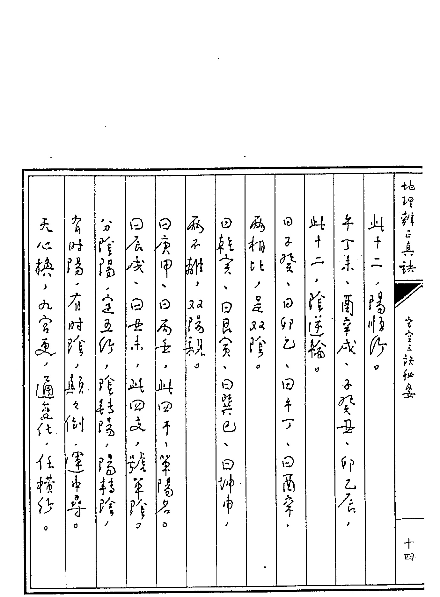

<!-- V3_SOURCE_ID:book017-b000084-p000-67ba8818ec -->

二十四山分别归属于八卦，每一卦统管三座山，同一卦中存在同属阴的山彼此相邻的情况，比如坎卦统管壬子癸这三座山，其中子、癸属阴，而壬则……

> **释读存疑：** 原文后半句缺失，释读已标注省略；本地硬校验仍未通过，已记录供后续自动处理或人工核对。

查看对应原文

<!-- V3_FOLDBACK_BEGIN:book017-b000084-p000-67ba8818ec -->

二十四山分集八卦協一卦管三山一卦中有屆陰相比者如坎卦管壬子癸三山其中子癸卯是陰而壬則

<!-- V3_FOLDBACK_END:book017-b000084-p000-67ba8818ec -->

<!-- V3_SOURCE_ID:book017-b000085-p000-e29f7da20b -->

按顺序属阳。又比如乾卦统管戌、乾、亥三座山，其中提到“乾定即是政阳，石戊则谷策阴”，这两处表述的具体所指不详。文中还说凡是属阳的就“顺死左旋”，属阴的就“送死右旋”，这两个表述的具体含义也不明确。上文内容就是“阳顺行，阴逆轮”的意思。

> **释读存疑：** 政阳；石戊；谷策阴；顺死左旋；送死右旋；送死右旋具体所指不详

查看对应原文

<!-- V3_FOLDBACK_BEGIN:book017-b000085-p000-e29f7da20b -->

次第陽又如乾卦管戌乾亥三山其中乾定即是政陽石戊則谷策陰凡陽則順死左旋二凡陰則送死右旋。此即「陽順行 陰逆輪之意

<!-- V3_FOLDBACK_END:book017-b000085-p000-e29f7da20b -->

<!-- V3_SOURCE_ID:book017-b000086-p000-85f5dc5587 -->

替星

查看对应原文

<!-- V3_FOLDBACK_BEGIN:book017-b000086-p000-85f5dc5587 -->

替星

<!-- V3_FOLDBACK_END:book017-b000086-p000-85f5dc5587 -->

<!-- V3_SOURCE_ID:book017-b000087-p000-83e09fc424 -->

凡是属于兼线的情况，如果是阳兼阳、阴兼阴的搭配，就不需要使用替星。《地理辨正真诀》《言空三法秘要》条目后的数字“十五”具体是页码还是卷次标识，原文未明确说明。

> **释读存疑：** 十五的具体指向；数字十五是页码还是卷次标识原文未明确

查看对应原文

<!-- V3_FOLDBACK_BEGIN:book017-b000087-p000-83e09fc424 -->

凡兼线此為陽兼陽陰兼陰則不用替星 地理辨正真诀 言空三法秘要 十五

<!-- V3_FOLDBACK_END:book017-b000087-p000-83e09fc424 -->

<!-- V3_SOURCE_ID:book017-b000088-p000-c442ed29a5 -->

0，此如子兼登之类。

> **释读存疑：** 原文含义模糊，“登”字所指不明

查看对应原文

<!-- V3_FOLDBACK_BEGIN:book017-b000088-p000-c442ed29a5 -->

0 此如子兼登之類。

<!-- V3_FOLDBACK_END:book017-b000088-p000-c442ed29a5 -->

<!-- doc006 PDF 第 18 页：高风险/复杂版面 OCR 供检索；内容与排版以原页图为准。 -->
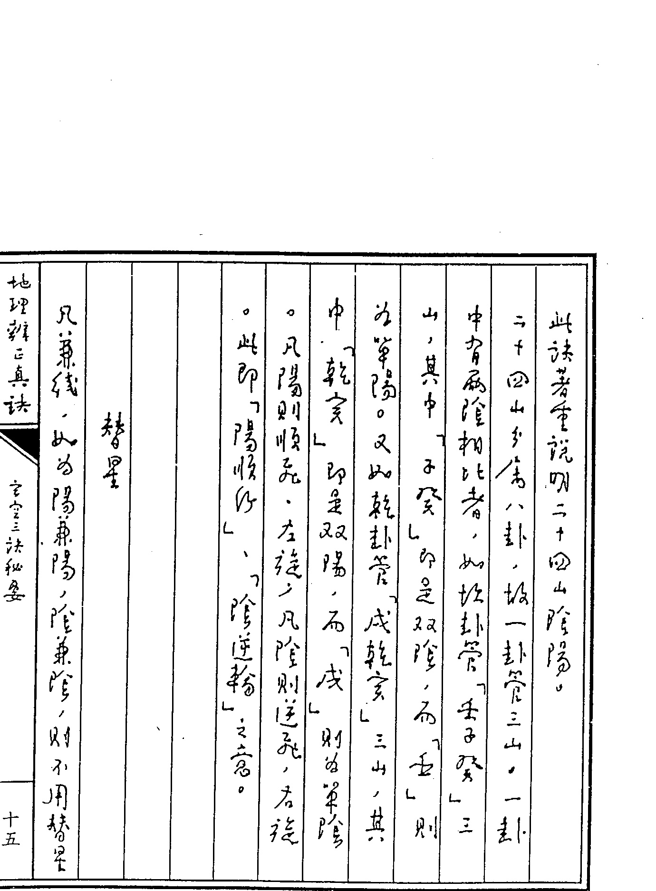

<!-- V3_SOURCE_ID:book017-b000090-p000-963ca32c2d -->

如果是阴阳互兼的情况，比如原文所说的“子弟壬之”，又或者是出卦的情况，比如原文提到的“壬癸分劉兼玄丑州”，这两处表述存在讹误或内容缺漏，具体所指不详，这类情况都必须使用替星。

> **释读存疑：** 子弟壬之；壬癸分劉兼玄丑州；壬癸分劉兼玄丑州存在讹误或缺漏，具体所指不详

查看对应原文

<!-- V3_FOLDBACK_BEGIN:book017-b000090-p000-963ca32c2d -->

若为陰陽互兼，如子弟壬之又或出卦弟如壬癸分劉兼玄丑州必用替星

<!-- V3_FOLDBACK_END:book017-b000090-p000-963ca32c2d -->

<!-- V3_SOURCE_ID:book017-b000091-p000-c6f61e54d8 -->

文中提到精星只用十三星，还涉及“贪狼甲申”“彗巨门壬卯乙”“世艮丙山皆砧军”“巽卦三山芳武曲庚”“宾右弼丙星除”等表述，这些专业表述的具体含义不详。后面还提到阴逆阳顺，阳一位是为位是流神，该内容的具体指向也不明确。

> **释读存疑：** 精星；贪狼甲申；彗巨门；砧军；芳武曲；宾右弼；宾右弼等表述具体含义不详，阴逆阳顺相关内容具体指向不明确

查看对应原文

<!-- V3_FOLDBACK_BEGIN:book017-b000091-p000-c6f61e54d8 -->

精星只用十三星，却用贪狼甲申，用彗巨門壬卯乙世艮丙山皆砧軍巽卦三山芳武曲庚賓右弼丙星除陰逆陽順陽一位是為位是流神

<!-- V3_FOLDBACK_END:book017-b000091-p000-c6f61e54d8 -->

<!-- V3_SOURCE_ID:book017-b000092-p000-a3b9fc205b -->

比如甲兼卯，或者兼“宾”的情况属于“阴隱相兼”，后面的情况属于出卦，东方的这类情况都用“积星”。“宾”“阴隱相兼”“积星”的具体所指不详。相关内容详见《中州治玄空》一书，原文接下来有相关说明。

> **释读存疑：** 宾；阴隱相兼；积星；中州治玄空；中州治玄空具体所指不详

查看对应原文

<!-- V3_FOLDBACK_BEGIN:book017-b000092-p000-a3b9fc205b -->

如甲兼卯，或兼賓者为陰隱相兼後者为出卦東皆用積星。詳見中州治玄空此ッ下书。里說如下

<!-- V3_FOLDBACK_END:book017-b000092-p000-a3b9fc205b -->

<!-- doc006 PDF 第 19 页：高风险/复杂版面 OCR 供检索；内容与排版以原页图为准。 -->
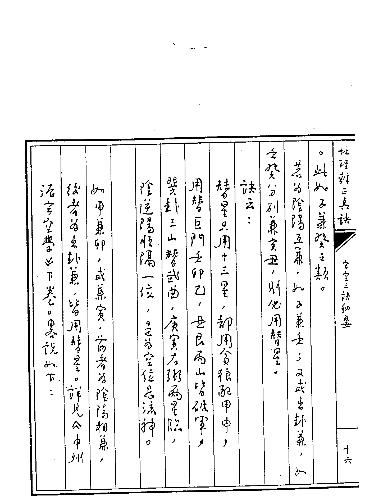

<!-- V3_SOURCE_ID:book017-b000094-p000-801da278d8 -->

如果按照挨星法推算，得出的山星为三，三属于零卦，对应甲、卯、乙三山的“天之雅日卯地元龍明 甲人元龍公乙坛天元龍”之山，就需要用巨门分精的方法，将三改为二，放入中宫时要忌“幼”，这里“幼”的具体所指未明确。这就是流传的“伝用梦巨門壬卯乙”的诀法，其中“梦”字的含义原文未说明。

> **释读存疑：** 天之雅日卯地元龍明 甲人元龍公乙坛天元龍具体含义不详；忌幼的“幼”具体所指未明；伝用梦巨門中的“梦”字含义不明

查看对应原文

<!-- V3_FOLDBACK_BEGIN:book017-b000094-p000-801da278d8 -->

如按挨星法，挨得山星為三，三为零卦， 管甲卯乙三山天之雅日卯地元龍明 甲人元龍公乙坛天元龍之山則用巨 門分精即將三改日二，入中宮忌幼。此 即伝用梦巨門壬卯乙之決

<!-- V3_FOLDBACK_END:book017-b000094-p000-801da278d8 -->

<!-- V3_SOURCE_ID:book017-b000095-p000-f52d9bc633 -->

如果苟地九龙传却用贪狼邪甲中的法人元语，也依照诀法将三改为二。

> **释读存疑：** 苟地九龙传、贪狼邪甲的具体所指不详

查看对应原文

<!-- V3_FOLDBACK_BEGIN:book017-b000095-p000-f52d9bc633 -->

如苟地九龍伝却用貪狼邪甲中之法人元語亦依訣改三二

<!-- V3_FOLDBACK_END:book017-b000095-p000-f52d9bc633 -->

<!-- V3_SOURCE_ID:book017-b000096-p000-ba2345993a -->

这里面的顺死逆义，仍然依循旧有规则没有改动；逆的情况比如卯位用巨门精，依照“曾食之天不传巨门之天元坤分阳收永”的说法，这就是贤中秘藏的要诀，不是能随意对外宣讲的内容。末尾标注有数字0。

> **释读存疑：** “顺死逆义”具体指代的规则内容未在原文明确说明，“曾食之天不传巨门之天元坤分阳收永”的完整含义无法完全确定；“顺死逆义”具体指代的规则内容未在原文明确说明，原文残句组合后的完整含义无法完全确定；1轮自动修复后核义模型仍建议修订，已保守记录。

查看对应原文

<!-- V3_FOLDBACK_BEGIN:book017-b000096-p000-ba2345993a -->

此中之順死逆義仍然依未改而之食為負 逆如卯用巨門精，依作曾食之天不 伝巨門之天元坤分陽收永曰此即賢中 之秘不皆說者也 0

<!-- V3_FOLDBACK_END:book017-b000096-p000-ba2345993a -->

<!-- doc006 PDF 第 20 页：高风险/复杂版面 OCR 供检索；内容与排版以原页图为准。 -->
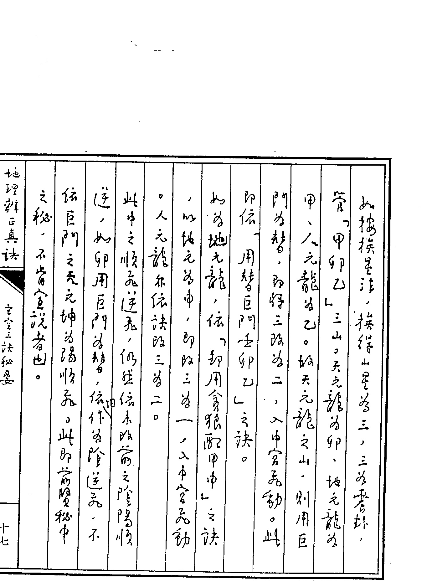

<!-- V3_SOURCE_ID:book017-b000098-p000-47645511f8 -->

至于旅神，比如壬向，阳一位收仍为癸，这个癸就是流神；又如子向，隅一位逆仍为亥，这个亥就是涼神。在流神的方位不宜见到水口。

> **释读存疑：** 旅神、涼神的具体含义原文未详细说明

查看对应原文

<!-- V3_FOLDBACK_BEGIN:book017-b000098-p000-47645511f8 -->

至於旅神即如壬向，陽一位收仍日癸，此癸即为流神；又如子向隅一位逆仍多亥，此亥即日涼神。於流神方不宜見水口。

<!-- V3_FOLDBACK_END:book017-b000098-p000-47645511f8 -->

<!-- V3_SOURCE_ID:book017-b000099-p000-e33f9ae05f -->

收山出煞诀

查看对应原文

<!-- V3_FOLDBACK_BEGIN:book017-b000099-p000-e33f9ae05f -->

收山出煞訣

<!-- V3_FOLDBACK_END:book017-b000099-p000-e33f9ae05f -->

<!-- V3_SOURCE_ID:book017-b000100-p000-3f84a613c3 -->

原文开头有日文假名“ね”，未能识别出对应中文含义。后续提到山应当低矮、应当收束、应当隐蔽，“欲宜隱歲之出紅宜通暢宜開陽”这段表述存在识别或断句问题，具体含义不详。这里是讨论墓穴的形制，提到以星定向就可以对应向，“星定恆山出然”表述模糊，具体含义无法确定。

> **释读存疑：** 日文假名“ね”无对应中文译法；欲宜隱歲之出紅宜通暢宜開陽断句混乱，含义不明；星定恆山出然表述模糊，具体所指不详

查看对应原文

<!-- V3_FOLDBACK_BEGIN:book017-b000100-p000-3f84a613c3 -->

ね山宣低宜收欲宜隱歲之出紅宜通暢宜開陽此以論尾或墓穴之形制既也星定向則可接向星定恆山出然。

<!-- V3_FOLDBACK_END:book017-b000100-p000-3f84a613c3 -->

<!-- V3_SOURCE_ID:book017-b000101-p000-aad674dd6b -->

此段原文存在OCR识别偏差，原文写为“四莫季乙丁孔山”，又记载在坤、艮、寅、申、子、午之间延伸出的山头共计十四座，这类山头总体适宜倾斜卸散，不宜阻拦。其余的十处山谷提到“收钦須將生氣象半關”，该短语具体所指不详。

> **释读存疑：** “四莫季乙丁孔山”具体含义不明；“收钦須將生氣象半關”具体所指不详；1轮自动修复后核义模型仍建议修订，已保守记录。

查看对应原文

<!-- V3_FOLDBACK_BEGIN:book017-b000101-p000-aad674dd6b -->

四莫季乙丁孔山，坤艮寅申子手間出延山頭一十四，總宜傾卸不宜欄，餘外十山谷收欽須將生氣象半關。

<!-- V3_FOLDBACK_END:book017-b000101-p000-aad674dd6b -->

<!-- doc006 PDF 第 21 页：高风险/复杂版面 OCR 供检索；内容与排版以原页图为准。 -->
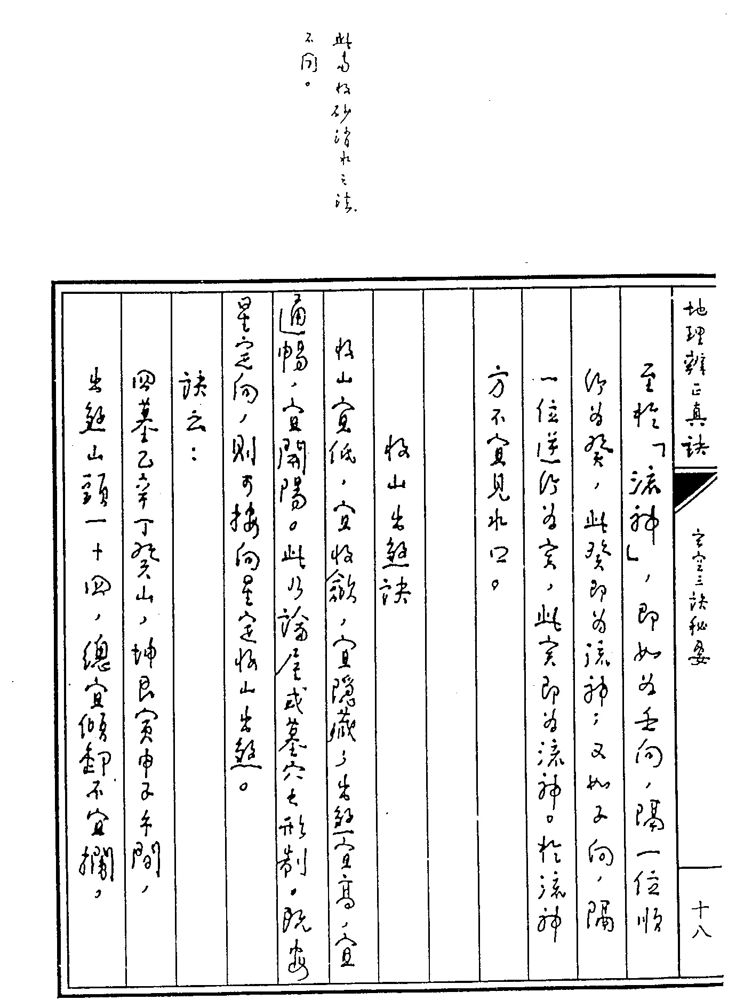

<!-- V3_SOURCE_ID:book017-b000103-p000-413e99cf14 -->

这里所说的就是层、丸、丑、未、乙、字、丁、终、坤、艮、寅、申、子、午，再加2个山的朝向，勉强算作收山向。

> **释读存疑：** “层、丸、字、终”均为OCR识别错字，原文所指的具体山名、“勉向诉”的含义无法确定；1轮自动修复后核义模型仍建议修订，已保守记录。

查看对应原文

<!-- V3_FOLDBACK_BEGIN:book017-b000103-p000-413e99cf14 -->

此即层、丸、丑、未、乙、字、丁、终、坤、艮、寅、申、子、午+2山勉向訴为收山向。

<!-- V3_FOLDBACK_END:book017-b000103-p000-413e99cf14 -->

<!-- V3_SOURCE_ID:book017-b000104-p000-cb76a08d62 -->

“若方復筆位一則紹程情大夏設汁好山出煞收山則堂局實彥出然則堂而收欲者一必然怪大貧智易招飲不洋”这段内容存在大量识别误差，语义无法通顺解读。仅可看出原文想表达大厦大堂的设计十分重要。

> **释读存疑：** 整段前文存在大量识别错误，语义无法解读

查看对应原文

<!-- V3_FOLDBACK_BEGIN:book017-b000104-p000-cb76a08d62 -->

若方復筆位一則紹程情大夏設汁好山出煞收山則堂局實彥出然則堂而收欲者一必然怪大貧智易招飲不洋。此所以大廈大堂謂計之所以重要

<!-- V3_FOLDBACK_END:book017-b000104-p000-cb76a08d62 -->

<!-- V3_SOURCE_ID:book017-b000105-p000-a1a02d85da -->

该段内容记载的是言空三法的秘要，出自公地理辨正直决。

> **释读存疑：** “言空三法”的具体所指、“公地理辨正直决”是否为书籍名称无法确定

查看对应原文

<!-- V3_FOLDBACK_BEGIN:book017-b000105-p000-a1a02d85da -->

言空三法秘要 公地理辨正直決

<!-- V3_FOLDBACK_END:book017-b000105-p000-a1a02d85da -->

<!-- V3_SOURCE_ID:book017-b000106-p000-3b00817cfc -->

春來經

查看对应原文

<!-- V3_FOLDBACK_BEGIN:book017-b000106-p000-3b00817cfc -->

春來經

<!-- V3_FOLDBACK_END:book017-b000106-p000-3b00817cfc -->

<!-- V3_SOURCE_ID:book017-b000107-p000-395a50b816 -->

上卷

查看对应原文

<!-- V3_FOLDBACK_BEGIN:book017-b000107-p000-395a50b816 -->

上卷

<!-- V3_FOLDBACK_END:book017-b000107-p000-395a50b816 -->

<!-- V3_SOURCE_ID:book017-b000108-p000-3f9e8c4bb8 -->

天尊地卑，陽奇陰傷

> **释读存疑：** 原文“阴伤”语义未明，暂保留原表述

查看对应原文

<!-- V3_FOLDBACK_BEGIN:book017-b000108-p000-3f9e8c4bb8 -->

天尊地卑陽奇陰傷

<!-- V3_FOLDBACK_END:book017-b000108-p000-3f9e8c4bb8 -->

<!-- doc006 PDF 第 22 页：高风险/复杂版面 OCR 供检索；内容与排版以原页图为准。 -->
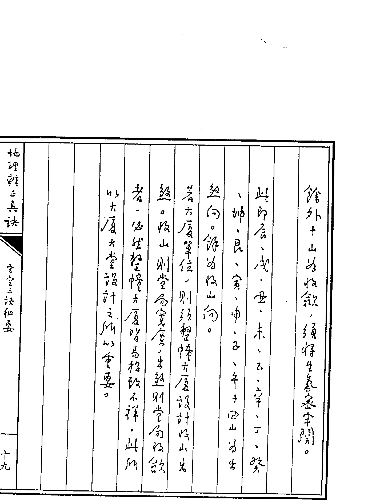

<!-- V3_SOURCE_ID:book017-b000110-p000-b0937c1e65 -->

第一点内容提到二七同道，三八、0、九为友，十同途，开阖奇得五，北方生成无今冬。这段是说生天、先天运用河图的相关内容，二属于少的范畴，三属于多的范畴，九也是如此。五十对应居中的土，这里面一奇一男，也就是一局一阴五仍分佛王方，就是五兆。

> **释读存疑：** 原文“开阖奇得五北生成无今冬”“生天先天用河河盛之わ二セ少，三ハ为ホ，②九るも”“一局一陰五仍分佛王方”表述存在残缺或模糊，部分含义难以确定；原文存在多处OCR识别错误、日文假名混入、内容残缺，“开阖奇得五北生成无今冬”“生天先天用河河盛之わ二セ少，三ハ为ホ，②九るも”“一局一陰五仍分佛王方”均无法确定准确含义；1轮自动修复后核义模型仍建议修订，已保守记录。

查看对应原文

<!-- V3_FOLDBACK_BEGIN:book017-b000110-p000-b0937c1e65 -->

一矣、二七同道、三八0②九友十同途開闔奇得五北生成无今冬。此言生天先天用河河盛之わ二セ少，三ハ为ホ，②九るも。五十居中的土此中一奇一男，即一局一陰五仍分佛王方即为五兆。

<!-- V3_FOLDBACK_END:book017-b000110-p000-b0937c1e65 -->

<!-- V3_SOURCE_ID:book017-b000111-p000-7669bafb4f -->

五兆分别掌管春季、夏季、秋季、冬季以及立春、立夏、立秋、立冬四个节气，所以归属到天的范畴。

> **释读存疑：** 原文“春夏秋文”语义不明，“文”疑为讹字；1轮自动修复后核义模型仍建议修订，已保守记录。

查看对应原文

<!-- V3_FOLDBACK_BEGIN:book017-b000111-p000-7669bafb4f -->

五兆分管春夏秋文及四立故歸天

<!-- V3_FOLDBACK_END:book017-b000111-p000-7669bafb4f -->

<!-- V3_SOURCE_ID:book017-b000112-p000-4533796115 -->

角谷天时

> **释读存疑：** “角谷天时”语义未明，暂保留原表述

查看对应原文

<!-- V3_FOLDBACK_BEGIN:book017-b000112-p000-4533796115 -->

角谷天时

<!-- V3_FOLDBACK_END:book017-b000112-p000-4533796115 -->

<!-- V3_SOURCE_ID:book017-b000113-p000-55be366700 -->

八龍宏佈，子母分施。

> **释读存疑：** “八龍宏佈，子母分施”具体所指不详

查看对应原文

<!-- V3_FOLDBACK_BEGIN:book017-b000113-p000-55be366700 -->

八龍宏佈，子母分施。

<!-- V3_FOLDBACK_END:book017-b000113-p000-55be366700 -->

<!-- doc006 PDF 第 24 页：高风险/复杂版面 OCR 供检索；内容与排版以原页图为准。 -->
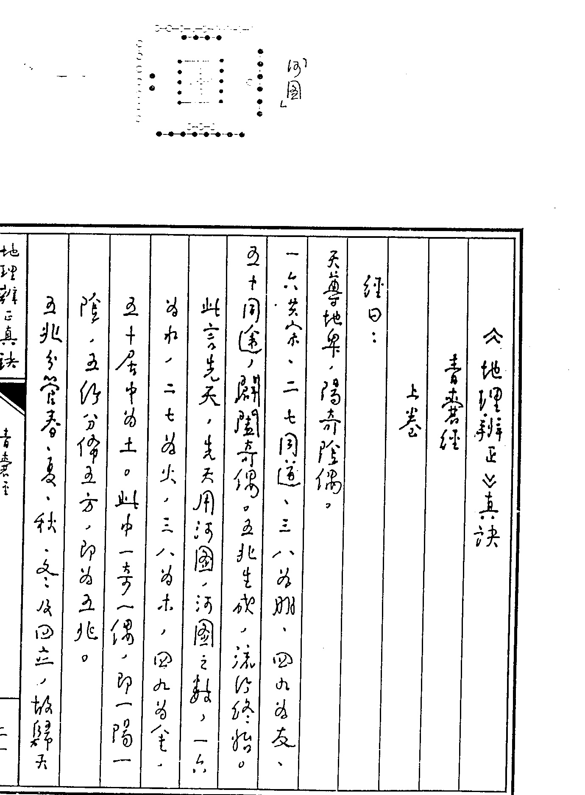

<!-- V3_SOURCE_ID:book017-b000115-p000-003ae911b3 -->

这段内容讲述天地的位置确定，山与泽气息相通，有“當风相藩れ”的相关表述，火不相射，以巾五为准则确立基准，统御控制四方，一面对应九数，三七处在立方的位置，二八四六各居其位，以纵榜作为治理的法度。

> **释读存疑：** 當风相藩れ语义不明，具体所指不详；巾五立極的具体含义不详；縱榜紀綱的具体所指不详；當风相藩れ为讹误字，语义不明；巾五立極具体含义不详；纵榜纪纲具体所指不详；1轮自动修复后核义模型仍建议修订，已保守记录。

查看对应原文

<!-- V3_FOLDBACK_BEGIN:book017-b000115-p000-003ae911b3 -->

天地定位山澤通氣當风相藩れ火不相射巾五立極，制臨四方一面九，三七居立方二八四六，縱榜紀綱。

<!-- V3_FOLDBACK_END:book017-b000115-p000-003ae911b3 -->

<!-- V3_SOURCE_ID:book017-b000116-p000-98ea7435f0 -->

这段文字说的是后天，后天运用清书、济书的对应关系，也就是现在人所说的魔方降，从横相加都得到公十五。相关数字依次是二、七、六。

> **释读存疑：** 清書濟書的具体含义不详；魔方降的具体所指不详；公十五的具体含义不详；清書、濟書具体含义不详；魔方降为讹误表述，所指不详；公十五的“公”为讹字，实际指纵横相加皆得十五；1轮自动修复后核义模型仍建议修订，已保守记录。

查看对应原文

<!-- V3_FOLDBACK_BEGIN:book017-b000116-p000-98ea7435f0 -->

此言後天後天用清書濟書之對即今人所謂魔方降 從橫相加皆公十五。二 七 六

<!-- V3_FOLDBACK_END:book017-b000116-p000-98ea7435f0 -->

<!-- V3_SOURCE_ID:book017-b000117-p000-305b50ddef -->

南九

查看对应原文

<!-- V3_FOLDBACK_BEGIN:book017-b000117-p000-305b50ddef -->

南九

<!-- V3_FOLDBACK_END:book017-b000117-p000-305b50ddef -->

12 三

<!-- V3_SOURCE_ID:book017-b000119-p000-17aedd3bb7 -->

古人看重面南的方位，那种胡乱称背一面九风就能知晓相关情况的说法是没有依据的。

> **释读存疑：** “背一面九风”具体所指不详；1轮自动修复后核义模型仍建议修订，已保守记录。

查看对应原文

<!-- V3_FOLDBACK_BEGIN:book017-b000119-p000-17aedd3bb7 -->

古人重面南胡言背一面九風即可知。

<!-- V3_FOLDBACK_END:book017-b000119-p000-17aedd3bb7 -->

<!-- doc006 PDF 第 25 页：高风险/复杂版面 OCR 供检索；内容与排版以原页图为准。 -->
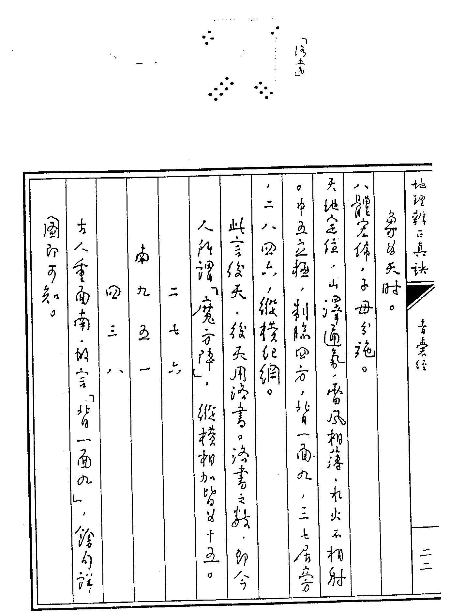

<!-- V3_SOURCE_ID:book017-b000121-p000-dd8f33144e -->

洛书搭配后天八卦、先天象天士，划分出天多、方的类别。

> **释读存疑：** “象天士”具体所指不详；“象天士”“天多、方”具体所指不详

查看对应原文

<!-- V3_FOLDBACK_BEGIN:book017-b000121-p000-dd8f33144e -->

洛書配後天八卦先天象天士，分天多、方。

<!-- V3_FOLDBACK_END:book017-b000121-p000-dd8f33144e -->

<!-- V3_SOURCE_ID:book017-b000122-p000-9352530f2f -->

坤兌乾

查看对应原文

<!-- V3_FOLDBACK_BEGIN:book017-b000122-p000-9352530f2f -->

坤兌乾

<!-- V3_FOLDBACK_END:book017-b000122-p000-9352530f2f -->

<!-- V3_SOURCE_ID:book017-b000123-p000-696e415587 -->

原文此处并列记录了“南”与“坎”，二者的具体关系未明确说明。

> **释读存疑：** 南与坎的具体关系无法确定

查看对应原文

<!-- V3_FOLDBACK_BEGIN:book017-b000123-p000-696e415587 -->

南 坎

<!-- V3_FOLDBACK_END:book017-b000123-p000-696e415587 -->

<!-- V3_SOURCE_ID:book017-b000124-p000-420cd07cb8 -->

原文此处并列记录了“巽”与“零”，二者的具体关系未明确说明。

> **释读存疑：** 巽与零的具体关系无法确定

查看对应原文

<!-- V3_FOLDBACK_BEGIN:book017-b000124-p000-420cd07cb8 -->

巽零

<!-- V3_FOLDBACK_END:book017-b000124-p000-420cd07cb8 -->

<!-- V3_SOURCE_ID:book017-b000125-p000-0087a9f590 -->

原文此处包含日文表述，内容为“丙國に对即始一、中二、三巽四、中为、乾、兌る、ハ九”，存在残缺，无法准确释读其完整含义。

> **释读存疑：** 该段含日文且内容残缺，完整含义无法确定

查看对应原文

<!-- V3_FOLDBACK_BEGIN:book017-b000125-p000-0087a9f590 -->

丙國に对即始一、中二、三巽四、中为、乾、兌る、ハ九。

<!-- V3_FOLDBACK_END:book017-b000125-p000-0087a9f590 -->

<!-- V3_SOURCE_ID:book017-b000126-p000-3f38715d59 -->

这部分内容围绕由生九星展开，相关条目依次为：一分限九、二、三碧祥存木、四帝文曲十、R寶、六白武曲金、七赤法全、白专角、九此業右粥火 0。

> **释读存疑：** 原文存在多处字迹不清、表述模糊的内容，无法准确释读具体含义

查看对应原文

<!-- V3_FOLDBACK_BEGIN:book017-b000126-p000-3f38715d59 -->

由生九星。一分限九、二）三碧祥存木、四帝文曲十、R寶、六白武曲金、七赤法全、.白专角、九此業右粥火 0

<!-- V3_FOLDBACK_END:book017-b000126-p000-3f38715d59 -->

<!-- doc006 PDF 第 26 页：高风险/复杂版面 OCR 供检索；内容与排版以原页图为准。 -->
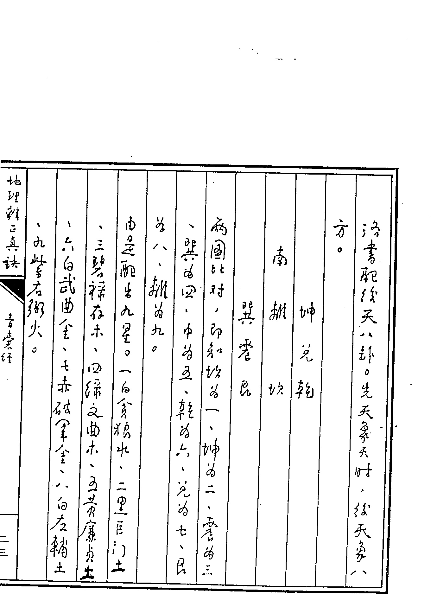

<!-- V3_SOURCE_ID:book017-b000128-p000-58c2b0fdc1 -->

此处只列出了一白白、八白、九紫三个条目，原文带有日文假名的短语称这些是“な天之四吉”，条目数量与“四吉”的计数不符，缺漏的第四个条目未明确提及。原文还提到，这组概念和先天排列的相关吉位名称不同，先后天的相关设定不可混淆。

> **释读存疑：** “な天之四吉”缺漏第四个对应条目，具体所指不详；日文假名“な”的含义无法确定

查看对应原文

<!-- V3_FOLDBACK_BEGIN:book017-b000128-p000-58c2b0fdc1 -->

此以一白白、八白、九紫，名此为な天之四吉，寸先天排於之貧巨哉補粥王吉不同先後天不可混浠。

<!-- V3_FOLDBACK_END:book017-b000128-p000-58c2b0fdc1 -->

<!-- V3_SOURCE_ID:book017-b000129-p000-ffa962db2f -->

阳依靠阴而存在，阴包含阳，阳生于阴，柔生于刚，阴德宏大能济世，隐德之人会顺遂昌盛。

查看对应原文

<!-- V3_FOLDBACK_BEGIN:book017-b000129-p000-ffa962db2f -->

陽以相陰陰以含陽之陽生於陰柔生於剛陰德宏濟，隱德順昌。

<!-- V3_FOLDBACK_END:book017-b000129-p000-ffa962db2f -->

<!-- V3_SOURCE_ID:book017-b000130-p000-073fd54c2b -->

所以阳类事物由阴所促成，阴中又含养着阳的特质，天依托于有形的实体存在，地依附于气运行，这就是所说的化始 0。

> **释读存疑：** “化始”的具体定义原文未明；1轮自动修复后核义模型仍建议修订，已保守记录。

查看对应原文

<!-- V3_FOLDBACK_BEGIN:book017-b000130-p000-073fd54c2b -->

是故陽事陰陰育陽天依形地附氣此之謂化始 0

<!-- V3_FOLDBACK_END:book017-b000130-p000-073fd54c2b -->

<!-- V3_SOURCE_ID:book017-b000131-p000-88de23a683 -->

阴阳相互辅助、滋生，先天一六之数就是阴阳相互辅助的体现，原文此处有残缺“故曰阳以相”，语义暂不明确；阴用来滋养阳。先天八卦成象的说法，是阴阳相生的体现，这就是乾、坤作为父母生出六子的含义。

> **释读存疑：** 原文“阳以相”存在残缺，语义无法完全确定

查看对应原文

<!-- V3_FOLDBACK_BEGIN:book017-b000131-p000-88de23a683 -->

陰陽相濟相生先天一六即陰陽相濟故曰陽以相，陰以食陽 分天八卦成象，即陰陽柳生，此即乾坤父母生六子之意。

<!-- V3_FOLDBACK_END:book017-b000131-p000-88de23a683 -->

<!-- doc006 PDF 第 27 页：高风险/复杂版面 OCR 供检索；内容与排版以原页图为准。 -->
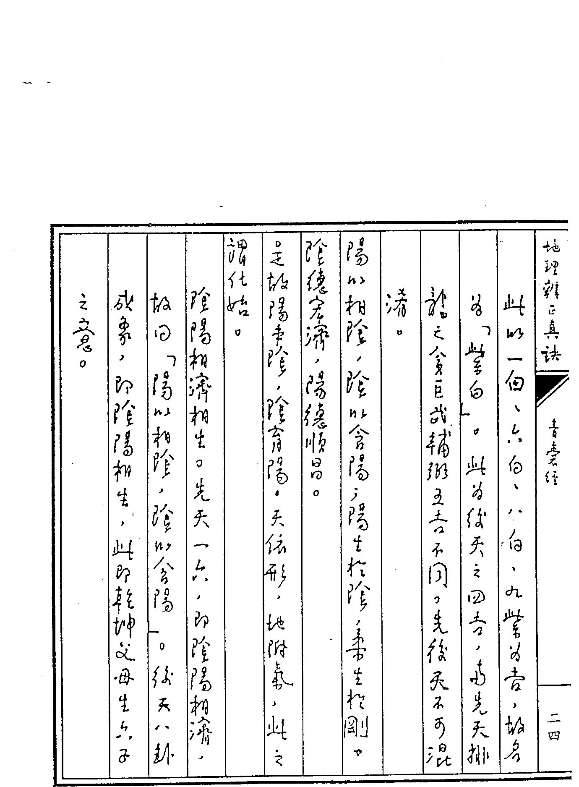

<!-- V3_SOURCE_ID:book017-b000133-p000-9ba9295053 -->

天属阳，气可以被看见，呈现为云的形态。地属阴，有具体的形质，地的气脉可以被感知，原文此处有讹误残缺“旦可付有之之氣”，语义暂不明确。因此选择地需要先获得先天之气，确定朝向，原文此处有残缺“負內先天旺氣”，语义暂不明确。

> **释读存疑：** 原文“旦可付有之之氣”存在讹误残缺，无法准确释读；原文“負內先天旺氣”存在残缺，无法准确释读

查看对应原文

<!-- V3_FOLDBACK_BEGIN:book017-b000133-p000-9ba9295053 -->

天分陽，氣可见，云形而。地的陰形。的派可見，旦可付有之之氣。此所以擇地須得先天之氣定向負內先天旺氣，

<!-- V3_FOLDBACK_END:book017-b000133-p000-9ba9295053 -->

<!-- V3_SOURCE_ID:book017-b000134-p000-584efbf583 -->

原文此段存在多处文字残缺、语义混乱，仅有“先后天”“阴阳”“气为带体”等零散字词可辨认，整体含义无法确定。

> **释读存疑：** 整段文字残缺错乱严重，无法进行可靠释读

查看对应原文

<!-- V3_FOLDBACK_BEGIN:book017-b000134-p000-584efbf583 -->

如之先後天柳補相成，得陰陽物生物齊之用勇獨由之力生戮日化治者言氣為帶體。

<!-- V3_FOLDBACK_END:book017-b000134-p000-584efbf583 -->

<!-- V3_SOURCE_ID:book017-b000135-p000-e0045bbfa7 -->

中类

查看对应原文

<!-- V3_FOLDBACK_BEGIN:book017-b000135-p000-e0045bbfa7 -->

中类

<!-- V3_FOLDBACK_END:book017-b000135-p000-e0045bbfa7 -->

<!-- V3_SOURCE_ID:book017-b000136-p000-de987f06c0 -->

经曰：

查看对应原文

<!-- V3_FOLDBACK_BEGIN:book017-b000136-p000-de987f06c0 -->

經日：

<!-- V3_FOLDBACK_END:book017-b000136-p000-de987f06c0 -->

<!-- V3_SOURCE_ID:book017-b000137-p000-ed16c2cbc7 -->

天有五星，地有五行；天分布着星宿，地排列着山川，气由天产生，附着于地形之上，依据地形来考察气，原文此处有讹误“以立人已”，语义暂不明确。

> **释读存疑：** 原文“以立人已”存在讹误，无法准确释读

查看对应原文

<!-- V3_FOLDBACK_BEGIN:book017-b000137-p000-ed16c2cbc7 -->

天有五星·地有五行；天分星宿·地列山川氣仍於地形產於天因形察氣以立人已。

<!-- V3_FOLDBACK_END:book017-b000137-p000-ed16c2cbc7 -->

<!-- doc006 PDF 第 28 页：高风险/复杂版面 OCR 供检索；内容与排版以原页图为准。 -->
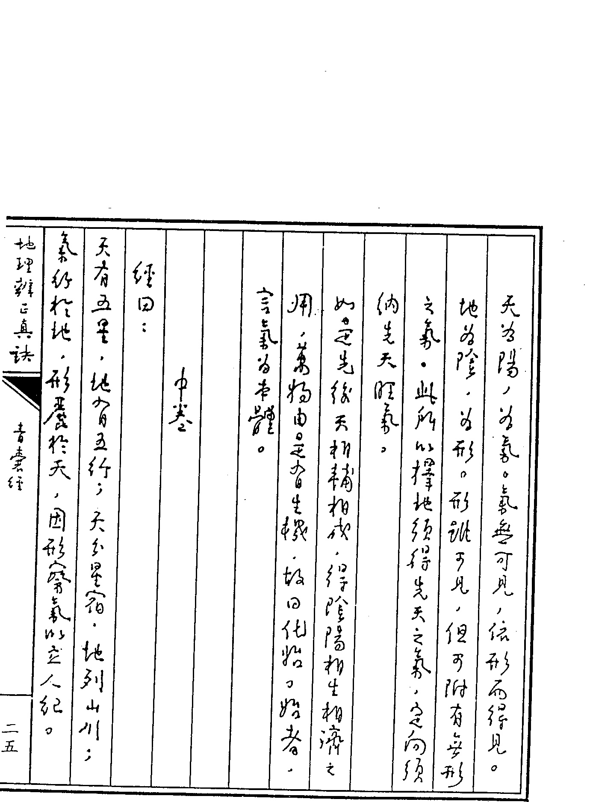

<!-- V3_SOURCE_ID:book017-b000139-p000-76041519e0 -->

气在天形成的象是五星，在地形成的象此处有讹字“谷”，对应五行，进而衍生出山川。原文此处有“星宿有奉，山川众有书”的表述，语义暂不明确；人居住在天地之间，只能依据形质考察气，后续原文存在大量残缺、讹误与错乱，包括“立都立巴八立城立卿立室立y協言空之此子由星伯以庶天”“以質地由是人紅立馬”等内容，均无法准确释读。

> **释读存疑：** 原文“於地成象谷五行”中“谷”为讹字，无法确定其准确含义；原文“星宿有奉，山川众有书”语义不明，无法可靠释读；原文后半段存在大量残缺错乱，无法准确释读

查看对应原文

<!-- V3_FOLDBACK_BEGIN:book017-b000139-p000-76041519e0 -->

氣於天成象為五星，於地成象谷五行，而衍朔山川。故星宿有奉，山川众有书而人居天地之間唯因形察氣而立立都立巴八立城立卿立室立y協言空之此子由星伯以庶天由山川 以質地由是人紅立馬。

<!-- V3_FOLDBACK_END:book017-b000139-p000-76041519e0 -->

<!-- V3_SOURCE_ID:book017-b000140-p000-ba0940c676 -->

紫微天极是太乙的值守之所，君主临御四方正位，面南而治理。天市属于东宫，原文有“少西掖”的表述，具体所指不详；太微处于南垣，原文后续有“立方照曰極四七句經王德曾終，圍斡坤與垂光乾紀，七路握機流迪終路”的内容，存在大量文字错乱，整体语义无法确定。

> **释读存疑：** “少西掖”语义不明，无法可靠释读；后半段文字错乱严重，无法准确释读

查看对应原文

<!-- V3_FOLDBACK_BEGIN:book017-b000140-p000-ba0940c676 -->

紫微天極太乙之御君臨四正南面而治天市東官少西掖太微南垣立方照曰極四七句經王德曾終，圍斡坤與垂光乾紀，七路握機流迪終路。

<!-- V3_FOLDBACK_END:book017-b000140-p000-ba0940c676 -->

<!-- V3_SOURCE_ID:book017-b000141-p000-84fabe6a0d -->

这是说天的星象用来表明时间推移，并非都是因气而成象。

查看对应原文

<!-- V3_FOLDBACK_BEGIN:book017-b000141-p000-84fabe6a0d -->

此言天之星象以明时推移非皆因 氣而成象。

<!-- V3_FOLDBACK_END:book017-b000141-p000-84fabe6a0d -->

<!-- doc006 PDF 第 29 页：高风险/复杂版面 OCR 供检索；内容与排版以原页图为准。 -->
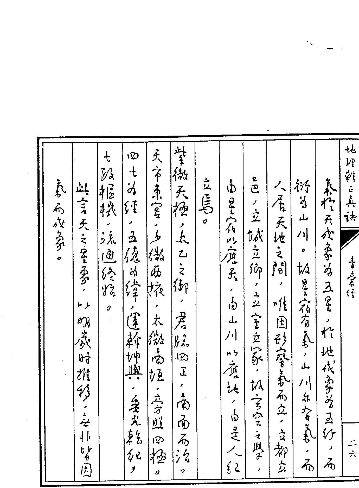

<!-- V3_SOURCE_ID:book017-b000143-p000-cdd5599d8f -->

星有四垣，分别分布在四方。原文此处有讹误“東日天市語，医為少微垣”，语义暂不明确；南为太微垣，后续原文存在大量残缺、讹误与错乱，包括“北曾此嘗徹垣訾徽面南故分君象二南曾大臣朝拱業微此即斗諸之用”“天府天機天明為宿東天市女民、历少微为士”等内容，均无法准确释读。

> **释读存疑：** 整段文字存在多处讹误与错乱，仅“星有四垣，分列四方”“南为太微垣”可基本确认，其余内容均无法可靠释读

查看对应原文

<!-- V3_FOLDBACK_BEGIN:book017-b000143-p000-cdd5599d8f -->

星有四垣，分列四方。東日天市語，医為少微垣南為太微垣北曾此嘗徹垣訾徽面南故分君象二南曾大臣朝拱業微此即斗諸之用天府天機天明為宿東天市女民、历少微为士。

<!-- V3_FOLDBACK_END:book017-b000143-p000-cdd5599d8f -->

<!-- V3_SOURCE_ID:book017-b000144-p000-70717f6f9a -->

这段内容讲述对二十八宿的梳理，周儒道十二相关方将相关内容称为经，具体包括：东方苍龙七宿的现存残文为“角氏六房心尾箕”；南方朱雀是穴前方的形势称谓，其七宿为井、鬼、柳、星、张、翼、轸；西方白虎是穴场或建筑右侧的形势称谓，其七宿的现存残文为“奎書四卯里嘴久”；北方七宿的现存残文为“北之武七伯斗牛此虛虚危定壁”。七宿的具体完整构成因原文残损无法完全确定。

> **释读存疑：** 东方苍龙七宿原文仅存“角氏六房心尾箕”，完整构成无法确定；西方白虎七宿原文仅存“奎書四卯里嘴久”，完整构成无法确定；北方七宿原文仅存“北之武七伯斗牛此虛虚危定壁”，完整构成无法确定

查看对应原文

<!-- V3_FOLDBACK_BEGIN:book017-b000144-p000-70717f6f9a -->

復習二十八宿，周儒道十二故稱之為經即東蒼龍七宿角氏六房心尾箕南朱雀七宿井鬼柳星張翼軫西白虎七宿奎書四卯里嘴久北之武七伯斗牛此虛虚危定壁。

<!-- V3_FOLDBACK_END:book017-b000144-p000-70717f6f9a -->

<!-- V3_SOURCE_ID:book017-b000145-p000-7ec618ace2 -->

这段内容讲述五星的相关对应：木星有旦后的相关星象，对应东方春令，其德为仁；火又称荧惑，对应南方夏令，其德为辨正；土又称镇星，对应中央，分主四季，其德为信；金又称太白，对应西方秋令，其德为义；水是风水语境中的河流、水系及其来去形态，又称辰星，对应北方冬令，原文此处“其德为”之后内容残损，无法确定具体表述。

> **释读存疑：** 辰星对应北方冬令的“其德为”后内容残损，无法确定具体内容；1轮自动修复后核义模型仍建议修订，已保守记录。

查看对应原文

<!-- V3_FOLDBACK_BEGIN:book017-b000145-p000-7ec618ace2 -->

五星有旦後木的象星東方春今之其德仁，火汝熒惑南方夏之，其德為辨正真读 音壹經 二七禮之土各鎮星中失，四季，其復分信全汝太白，百方，秋令，其德为義水为辰星，北方冬令，其德為。

<!-- V3_FOLDBACK_END:book017-b000145-p000-7ec618ace2 -->

<!-- doc006 PDF 第 30 页：高风险/复杂版面 OCR 供检索；内容与排版以原页图为准。 -->
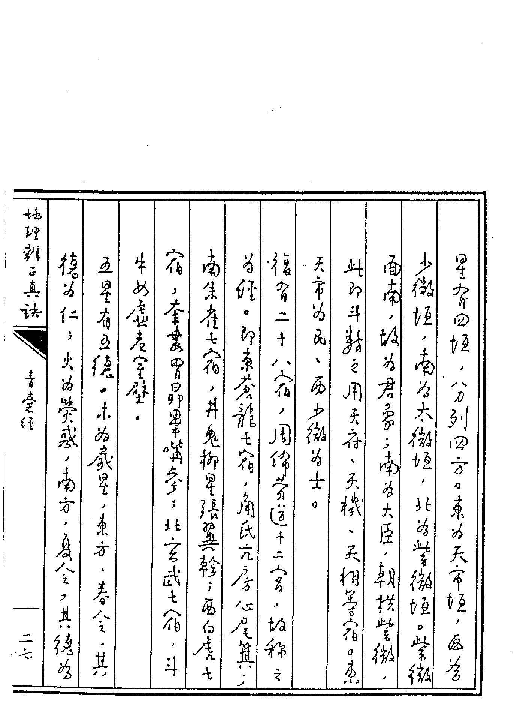

<!-- V3_SOURCE_ID:book017-b000147-p000-46a94da633 -->

这里以五星统摄五行（木、火、土、金、水五种分类及其关系体系），确立五方，于是由天星衍生出地上的五行以及人的五德。

查看对应原文

<!-- V3_FOLDBACK_BEGIN:book017-b000147-p000-46a94da633 -->

此以五星攝五行，立五復，於是由天星衍为地之五行及人之五德，

<!-- V3_FOLDBACK_END:book017-b000147-p000-46a94da633 -->

<!-- V3_SOURCE_ID:book017-b000148-p000-642235d25d -->

七政即日、月与五星。气的流转仍在天本，参照形与勇，以五星的环绕、四垣的推移、二十八宿的旋动来体察气的盈虚更替，便可知晓王德的盛衰。

> **释读存疑：** 原文中“氣之流仍於天本參形勇则以五星之圍仍”“用以寵氣故贏时更替”等表述存在OCR识别或断句错误，具体所指不详

查看对应原文

<!-- V3_FOLDBACK_BEGIN:book017-b000148-p000-642235d25d -->

七政即日月及五星。氣之流仍於天本參形勇则以五星之圍仍，四垣之推移二十八宿之旋動用以寵氣故贏时更替即有王仍王德之盛哀。

<!-- V3_FOLDBACK_END:book017-b000148-p000-642235d25d -->

<!-- V3_SOURCE_ID:book017-b000149-p000-c77f6878c9 -->

从德的角度来说，天光在上俯照，地气在下承接，阴的运行需要阳的呼应，阳的运行需要“珍应”，“珍应”的具体含义因原文表述未明暂无法确定。阴阳相会合，就能福禄长久稳固；阴阳相凌犯，灾祸就会接踵而至。阴阳以相互呼应为吉，以相凌犯为凶。以日月作为例子，日常的环绕状态就是相煎，原文提到“日語月強則为相乘”，该句部分表述含义未明，无法准确释读。

> **释读存疑：** “陽用珍應”中“珍应”的具体含义不明；“日語月強則为相乘”的完整含义无法确定

查看对应原文

<!-- V3_FOLDBACK_BEGIN:book017-b000149-p000-c77f6878c9 -->

從德上載天光下臨陰用陽朝陽用珍應陰陽相見福祿永貞陰陽相乘禍咎踵門陰陽以相应为吉，以相乘有凶。 以日月为例常时圍乃即为相煎日語月強則为相乘。

<!-- V3_FOLDBACK_END:book017-b000149-p000-c77f6878c9 -->

<!-- doc006 PDF 第 31 页：高风险/复杂版面 OCR 供检索；内容与排版以原页图为准。 -->
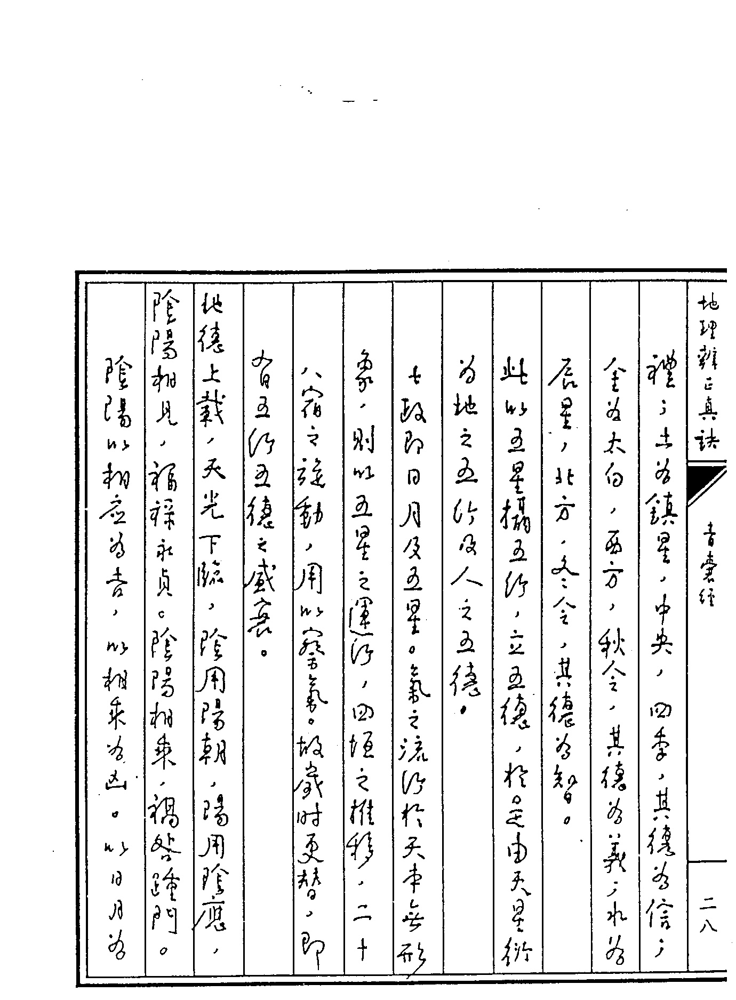

<!-- V3_SOURCE_ID:book017-b000151-p000-191bd44e9c -->

文中提到“協言空之學”，该短语具体所指不详，这类学问侧重时空的对应配合。时间分为三之九臣，山分为二十二山。“厚元之山”对应的是相应的状态，出现偏差就会处于相乘的状态。

> **释读存疑：** “協言空之學”具体所指不详；“三之九臣”具体含义不明；“厚元之山”具体所指不详

查看对应原文

<!-- V3_FOLDBACK_BEGIN:book017-b000151-p000-191bd44e9c -->

協言空之學重在时空帕應。时分三之九臣则分二十②山。厚元之山為相應，失者曾相乘。

<!-- V3_FOLDBACK_END:book017-b000151-p000-191bd44e9c -->

<!-- V3_SOURCE_ID:book017-b000152-p000-6d3c26590c -->

天之所临，地之所盛，形止气蓄，万物化生。气感而庶鬼福及人。

> **释读存疑：** 原文中“氣書”疑为“氣蓄”的OCR识别错误，“庶鬼”具体所指不详

查看对应原文

<!-- V3_FOLDBACK_BEGIN:book017-b000152-p000-6d3c26590c -->

天之所臨，地之所盛，形止氣書萬物化生。氣感而庶鬼福及人。

<!-- V3_FOLDBACK_END:book017-b000152-p000-6d3c26590c -->

<!-- V3_SOURCE_ID:book017-b000153-p000-7bc22c2bbf -->

天有柔和的特性，地有固定的形质，天地之间的各类事物需要相互结合才能成为一个整体，这种规律就叫做化机0。

> **释读存疑：** 1轮自动修复后核义模型仍建议修订，已保守记录。

查看对应原文

<!-- V3_FOLDBACK_BEGIN:book017-b000153-p000-7bc22c2bbf -->

之天有柔地有形上下物須而成一體，此 之謂化機 0

<!-- V3_FOLDBACK_END:book017-b000153-p000-7bc22c2bbf -->

<!-- V3_SOURCE_ID:book017-b000154-p000-fee60ca4a7 -->

这段内容提到“天人獻府”，该短语具体所指不详，因此相关的玄学术数并不是仅得到时运的生旺就足够。得到生的起始，就会有“澤食る用應”的相关效应，这个含日文字符的短语具体含义不详，满足这个条件就可以获福；反过来，如果遇到衰死的状态，又碰到“辨正真诀 二九氣之陰陽交乘是即芬禍”的情况，该短语具体含义不详，就会招致灾祸。

> **释读存疑：** “天人獻府”具体所指不详；“澤食る用應”含日文字符，具体含义不详；“辨正真诀 二九氣之陰陽交乘是即芬禍”具体含义不详

查看对应原文

<!-- V3_FOLDBACK_BEGIN:book017-b000154-p000-fee60ca4a7 -->

此言天人獻府故玄之學方非得时之生旺而己，得其生始，即澤食る用應，於是可以為福，反之，得其衰死，卯得“辨正真诀 二九氣之陰陽交乘是即芬禍

<!-- V3_FOLDBACK_END:book017-b000154-p000-fee60ca4a7 -->

<!-- doc006 PDF 第 32 页：高风险/复杂版面 OCR 供检索；内容与排版以原页图为准。 -->
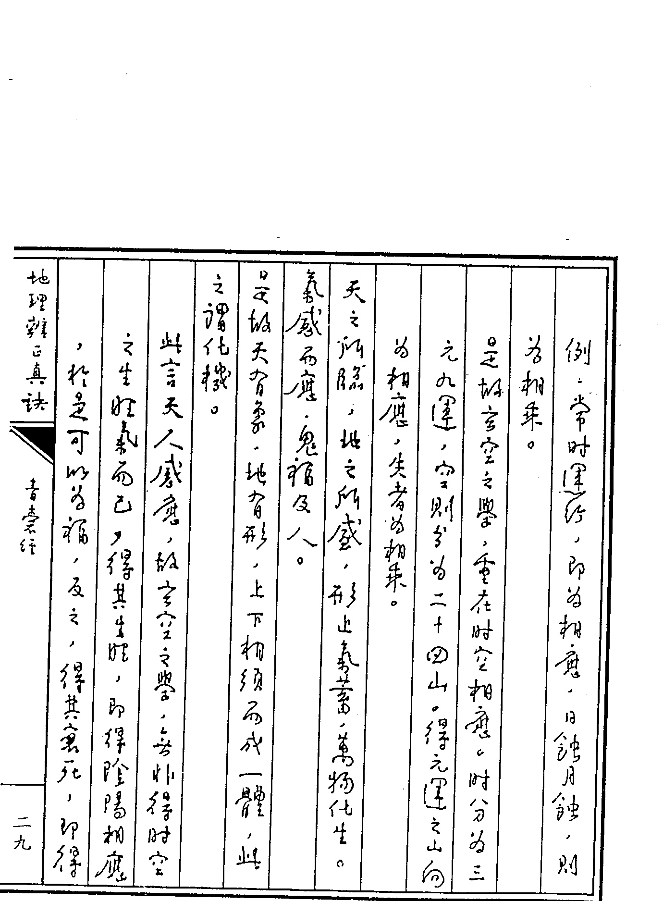

<!-- V3_SOURCE_ID:book017-b000156-p000-3c1db838d2 -->

此言气之成象、武象，就叫做化机。

> **释读存疑：** 原文中“武象”具体所指不详

查看对应原文

<!-- V3_FOLDBACK_BEGIN:book017-b000156-p000-3c1db838d2 -->

此言氣之成象武象謂之化機

<!-- V3_FOLDBACK_END:book017-b000156-p000-3c1db838d2 -->

<!-- V3_SOURCE_ID:book017-b000157-p000-05b98cafb5 -->

下卷

查看对应原文

<!-- V3_FOLDBACK_BEGIN:book017-b000157-p000-05b98cafb5 -->

下卷

<!-- V3_FOLDBACK_END:book017-b000157-p000-05b98cafb5 -->

<!-- V3_SOURCE_ID:book017-b000158-p000-68071fec46 -->

文中认为从无极到太极的演化过程中，理蕴含在气里，原文存在“气囿于而”的讹误，语义无法确定。日月星宿的刚健之气向上跨越到原文所说的“三”的位置，此处“三”具体所指不明；山川草木对应的“子气”向下凝聚，凭借阳气得以昌盛，原文最后作“用阴以戊”，此处“戊”疑似讹误，语义无法确定。

> **释读存疑：** 气囿于而语义不明；上跨三的“三”所指不详；子气语义不明；用阴以戊的“戊”疑似讹误，语义不明

查看对应原文

<!-- V3_FOLDBACK_BEGIN:book017-b000158-p000-68071fec46 -->

無極而太極也，理會於氣氣囿於而。日月星宿剛氣上跨三山川草木子氣下凝資陽以昌用陰以戊

<!-- V3_FOLDBACK_END:book017-b000158-p000-68071fec46 -->

<!-- V3_SOURCE_ID:book017-b000159-p000-ac94c0616f -->

文中提到善的极致是天地系物之幸体，当对应星宿、选择巧月的时节，就会显现谷阴阳，这就是太役，“系物之幸体”“巧月”“谷”“太役”具体所指均不详。原文“至故於兮用之时则曾吾極”存在语序或讹误问题，语义无法确定。文中又提到“其起片分阴隐”，语义不明，无法可靠释读。最后还提到“空如水之理”，其中“水”指风水语境中的河流、水系及其来去形态。

> **释读存疑：** 系物之幸体、巧月、谷、太役所指不详；至故於兮用之时则曾吾極语义不明；其起片分阴隐语义不明

查看对应原文

<!-- V3_FOLDBACK_BEGIN:book017-b000159-p000-ac94c0616f -->

善極為天地系物之幸體當其宿擇巧月之时即顯谷陰陽是即为太役。至故於兮用之时则曾吾極，其起片分陰隱·此即言空如水之理則。

<!-- V3_FOLDBACK_END:book017-b000159-p000-ac94c0616f -->

<!-- doc006 PDF 第 33 页：高风险/复杂版面 OCR 供检索；内容与排版以原页图为准。 -->
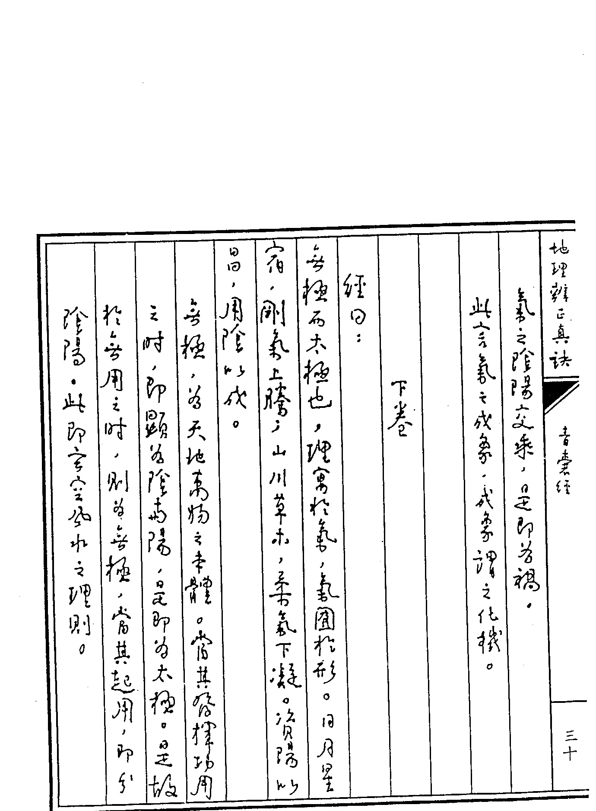

<!-- V3_SOURCE_ID:book017-b000161-p000-3a8d64e668 -->

原文开头作“阴阳必有所害托”，此处“害”语义不明，无法确定是讹误还是有特殊含义，后文提到依托经典阐发其所寄寓的内容，相关语义不通顺。原文“之故一气而有用或用公则或用力天公阳故”存在语序混乱或讹误，语义无法确定，仅可知其中提到天属阳，气性刚健，表象为日月星。原文“地曰注，故其其行为未”存在讹误，语义无法确定。

> **释读存疑：** 阴阳必有所害托的“害”语义不明；或用力天公阳故语序混乱语义不明；地曰注，故其其行为未讹误语义不明

查看对应原文

<!-- V3_FOLDBACK_BEGIN:book017-b000161-p000-3a8d64e668 -->

陰陽必有所害託經發顯其所寄即為。之故一氣而有用或用公則或用力天公陽故其氣剛其象为日月星地曰注，故其其行為未。

<!-- V3_FOLDBACK_END:book017-b000161-p000-3a8d64e668 -->

<!-- V3_SOURCE_ID:book017-b000162-p000-2d1ca07ef4 -->

玄空是结合时间、空间和星数推演的一类风水体系，通过月星可以知晓天时。原文“由山川草木初也形此即由阴阳之用而和时间空间之者凶六缺”语序混乱，存在讹误，其中“者凶”语义无法确定，“六缺”具体所指不详。

> **释读存疑：** 由山川草木初也形至句尾语序混乱语义不明；者凶语义不明；六缺所指不详

查看对应原文

<!-- V3_FOLDBACK_BEGIN:book017-b000162-p000-2d1ca07ef4 -->

玄空由月星在知天时由山川草木初也形此即由陰陽之用而和时間空間之者凶六缺

<!-- V3_FOLDBACK_END:book017-b000162-p000-2d1ca07ef4 -->

<!-- V3_SOURCE_ID:book017-b000163-p000-d154dde58b -->

文中提到所推究的内容分为“先天之丸”，“先天”是术数中表示先天卦序或本体关系的概念，“先天之丸”具体所指不详，它就是一地一穴的本质，“穴”指风水中认为气脉聚结、适宜安葬或营建的位置。原文“内如仍故十二官以周天赏道而每官必一阴一阳相云内在夫此っ”存在讹误，还有日文假名“っ”混入，语义无法确定。后文提到“资阳以昌，用阴以成之登”，其中“之登”疑似讹误，语义不明。

> **释读存疑：** 先天之丸所指不详；赏道语义不明；混入的日文假名っ无法释读；之登疑似讹误语义不明

查看对应原文

<!-- V3_FOLDBACK_BEGIN:book017-b000163-p000-d154dde58b -->

抑於所格者分先天之丸即一地一穴之本質內如仍故十二官以周天賞道而每官必一陰一陽相云內在夫此っ資陽以昌，用陰以成之登。

<!-- V3_FOLDBACK_END:book017-b000163-p000-d154dde58b -->

<!-- V3_SOURCE_ID:book017-b000164-p000-3a57aad81c -->

此段论述的是先天。

查看对应原文

<!-- V3_FOLDBACK_BEGIN:book017-b000164-p000-3a57aad81c -->

此段說先天。

<!-- V3_FOLDBACK_END:book017-b000164-p000-3a57aad81c -->

<!-- V3_SOURCE_ID:book017-b000165-p000-6262efd58b -->

者臺經

> **释读存疑：** 三字语义不明，无法判断是书名还是其他内容

查看对应原文

<!-- V3_FOLDBACK_BEGIN:book017-b000165-p000-6262efd58b -->

者臺經

<!-- V3_FOLDBACK_END:book017-b000165-p000-6262efd58b -->

<!-- doc006 PDF 第 34 页：高风险/复杂版面 OCR 供检索；内容与排版以原页图为准。 -->
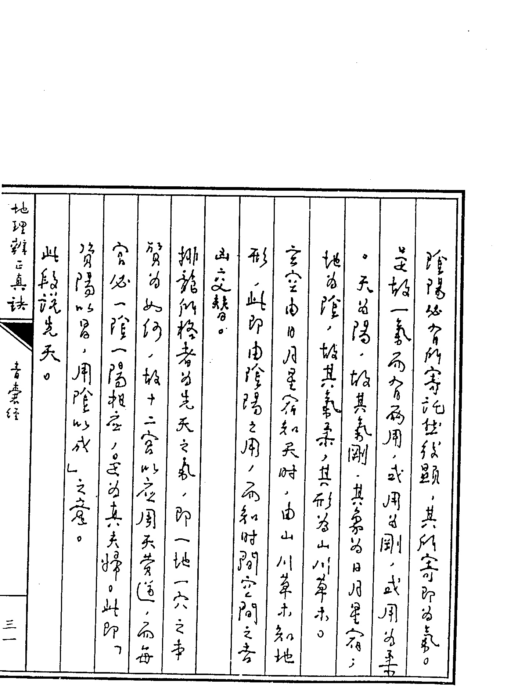

<!-- V3_SOURCE_ID:book017-b000167-p000-5edd6735fc -->

原文作“阳复百象阴复百位”，此处“复”的含义不明，无法可靠释读。文中提到有“四狐力气”，“四狐”具体所指不详。原文“气从八方外气行形内气止生乘风则散果水则止”语序混乱，其中“果水”的“果”疑似讹误，语义不明，“水”指风水语境中的河流、水系及其来去形态。原文提到阳德是由阳气发择的功能，此功能即称“A德”，“A德”应为讹误，具体所指不明，还提到阴德和它同属一章。

> **释读存疑：** 阳复百象阴复百位的“复”含义不明；四狐所指不详；果水的“果”疑似讹误语义不明；A德是讹误，所指不明

查看对应原文

<!-- V3_FOLDBACK_BEGIN:book017-b000167-p000-5edd6735fc -->

陽復百象陰復百位。此有四狐力氣從八方外氣行形内氣止生乘风則散果水則止。「陽德，即由陽氣發擇的功能此功能即称A德 陰德同章。

<!-- V3_FOLDBACK_END:book017-b000167-p000-5edd6735fc -->

<!-- V3_SOURCE_ID:book017-b000168-p000-aa8bbe8457 -->

文中提到阳能成象，原文“阴则全位成分所以虽雾定位则一望而之故山川形努草木风哀”存在多处讹误，“全位成分”“形努”“风哀”具体所指均不详，语义无法通顺释读。原文“而山水之气未如仁乗纳，见汝阴德”存在讹误，“仁乗纳”“见汝”具体语义不明，其中“水”指风水语境中的河流、水系及其来去形态。

> **释读存疑：** 全位成分、形努、风哀语义不明；仁乗纳、见汝疑似讹误语义不明

查看对应原文

<!-- V3_FOLDBACK_BEGIN:book017-b000168-p000-aa8bbe8457 -->

陽能成象，陰則全位成分所以雖霧定位則一望而之故山川形努草木風哀，即曾陽德；而山水之氣未如仁乗納，见汝陰德

<!-- V3_FOLDBACK_END:book017-b000168-p000-aa8bbe8457 -->

<!-- V3_SOURCE_ID:book017-b000169-p000-94fab1681c -->

由阴阳的名称与气息，这就是形与义的区分，因此玄空虽只讲理气，也重视经典的作用。那大厦如何分佛，即是山形的幼态，这如何き你，即是水热。古人称此法为平洋龙，凡平洋龙一水重于山，坎街道走向及分常实即形，此子当名文详说。

> **释读存疑：** 原文存在多处OCR识别错误，如“由陽陰由名氣”“分佛”“幼這”“水热”“き你”等，无法准确释读，译文采用保守表达

查看对应原文

<!-- V3_FOLDBACK_BEGIN:book017-b000169-p000-94fab1681c -->

由陽陰由名氣此即形義麗分主故玄空小只講理氣富亦重經致其大廈如何分佛即是山形之幼這如何き你，即是水热。古人稱此法为，平洋龍凡平洋龍一水重於山坎街道走向及分常实即形此子當名文詳說。

<!-- V3_FOLDBACK_END:book017-b000169-p000-94fab1681c -->

<!-- doc006 PDF 第 35 页：高风险/复杂版面 OCR 供检索；内容与排版以原页图为准。 -->
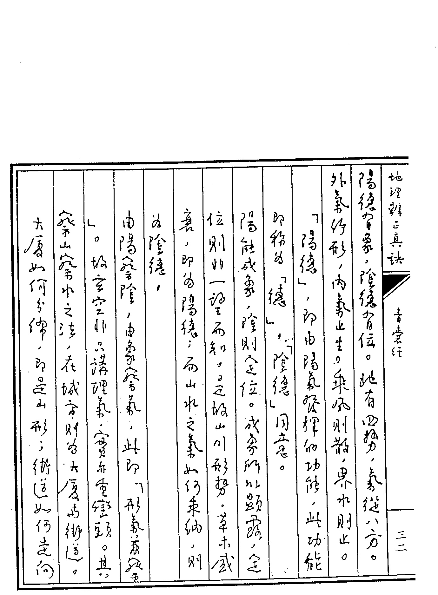

<!-- V3_SOURCE_ID:book017-b000171-p000-8a34a5c7fa -->

地力四语，是阳赤阴阳中省诊，阳入阳出，阴入阴出，阳入阴出，阴入阳出。

> **释读存疑：** 原文存在OCR识别错误，如“陽赤”“省诊”等，无法准确释读，译文采用保守表达

查看对应原文

<!-- V3_FOLDBACK_BEGIN:book017-b000171-p000-8a34a5c7fa -->

地力四語者陽赤陰陽中省诊陰中宿 陽於排語即公陽入陽出陰入陰出 陽入陰出之陰入陽出。

<!-- V3_FOLDBACK_END:book017-b000171-p000-8a34a5c7fa -->

<!-- V3_SOURCE_ID:book017-b000172-p000-99ca30f464 -->

何谓阳入阳出？未语为阳，穴向亦阳。何谓阴入阴出？未于分阴，穴向亦阴。何谓阳入阴出之未，龙为阳，穴向曾阴。何谓阴入阳出？未龙日阴六，向为阳ね，二十四山即成四十八。

> **释读存疑：** 原文存在多处OCR识别错误，如“未語”“未於”“未龍”“日陰六”“ね”等，无法准确释读，译文采用保守表达

查看对应原文

<!-- V3_FOLDBACK_BEGIN:book017-b000172-p000-99ca30f464 -->

何謂陽入陽出？未語为陽穴向亦陽。何謂陰入陰出？未於分陰穴向亦陰。何謂陽入陰出之未龍為陽穴向曾陰。何謂陰入陽出？未龍日陰六向为陽ね二十四山即成四十八。

<!-- V3_FOLDBACK_END:book017-b000172-p000-99ca30f464 -->

<!-- V3_SOURCE_ID:book017-b000173-p000-23d9a5b4fc -->

气从八方而来，称为八卦八食，即东南西北等方位，用来辨别正真诀、音秦经、三三四正，以及东南东北、西南为北等四隅。八方之气，其生旺死绝随时间变化。

> **释读存疑：** 原文存在OCR识别错误，如“八食”“臣北”“音秦经”“正真诀”等，无法准确释读，译文采用保守表达

查看对应原文

<!-- V3_FOLDBACK_BEGIN:book017-b000173-p000-23d9a5b4fc -->

氣從八方者謂八卦八食，即東南臣北等以辨正真诀 音秦經 三三四正，及東南東北八西南為北等四隅。八方之氣，其生旺界死隨时变易。

<!-- V3_FOLDBACK_END:book017-b000173-p000-23d9a5b4fc -->

<!-- doc006 PDF 第 36 页：高风险/复杂版面 OCR 供检索；内容与排版以原页图为准。 -->
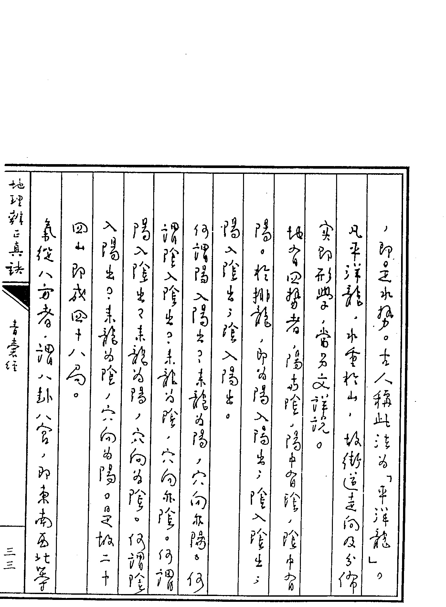

<!-- V3_SOURCE_ID:book017-b000175-p000-c99521a557 -->

四象八方，分散时称为外气，只能看到其形而不能知晓其生死。若能乘气纳气，那么气聚而不散，这就是内气。因此阳宅重视纳气，而阴宅则重视乘气，得气止即是气聚，能得气聚则有生机。辨别衰死之气而总百精日生旺之一日，故实优于气散。

> **释读存疑：** 原文存在OCR识别错误，如“四想”“紅其生死”“僅見其形而不紅其生死”“辦得衰死之氣而総百精日生旺之一日”等，无法准确释读，译文采用保守表达

查看对应原文

<!-- V3_FOLDBACK_BEGIN:book017-b000175-p000-c99521a557 -->

四想八方，散則日外氣，僅見其形而不紅其生死。若能乘氣納氣。則氣聚而不散是为內氣故陽宅重納氣而陰宅則重乘氣得氣止即是氣聚能得氣聚則有生機。辦得衰死之氣而総百精日生旺之一日，故实優於氣散。

<!-- V3_FOLDBACK_END:book017-b000175-p000-c99521a557 -->

<!-- V3_SOURCE_ID:book017-b000176-p000-17b32cbd11 -->

何以知气之聚散？口诀说乘风则散，界水则止。这就是水口用来聚气的原因。若以谷气，必聚于山宵，殆不初山公反不聚气。故顺互北，用八卦排六甲，布八门，推王逢人王六明地德三人道之因变化后始此之谓化成。

> **释读存疑：** 原文存在多处OCR识别错误，如“紅氣之聚散”“界水則止”“印汝”“山宵”“殆不初山公”“順互北”“王逢人王六明地德”等，无法准确释读，译文采用保守表达

查看对应原文

<!-- V3_FOLDBACK_BEGIN:book017-b000176-p000-17b32cbd11 -->

何以紅氣之聚散？訣曰乘風則散界水則止。此所以水口印汝聚之若以谷氣必聚於山宵殆不初山公反不聚氣。故顺互北，用八卦排六甲，佈八門，推王逢人王六明地德三人道之因變化後始此之謂化成

<!-- V3_FOLDBACK_END:book017-b000176-p000-17b32cbd11 -->

<!-- doc006 PDF 第 37 页：高风险/复杂版面 OCR 供检索；内容与排版以原页图为准。 -->
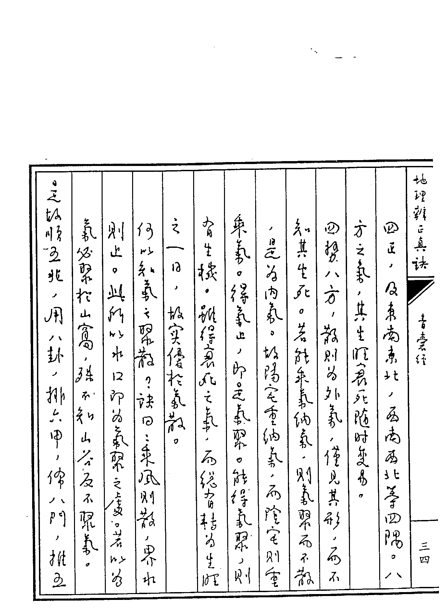

<!-- V3_SOURCE_ID:book017-b000178-p000-ca601492d4 -->

这段文字提到顺五乃之气的说法，内容涉及顺王北相关内容，还介绍了相关的推演方法：用经天八卦确定九会，也就是用八卦排布六甲来定元军，比如一、四、七的序列从甲子、甲午起算，二、五、八的序列起算相关内容提到“ゆ巾”，十、三、六、九的运数起算相关内容提到甲戊壬亭，内容还涉及僧八门的说法，指在八个方位排布星位，根据所得的生、旺、衰、死之气，推演五运，以五达者来确定年岁，确定六气，根据六气的交转来判定当下的相关时运。原文末尾“三皆者”表述残缺，难以明确完整含义。

> **释读存疑：** 顺五乃之气、顺王北、九会、六甲、元军、ゆ巾、甲戊壬亭、僧八门等表述无对应释义参考，具体含义无法完全确定；原文存在多处语序混乱、表述残缺的地方，部分内容无法准确释读

查看对应原文

<!-- V3_FOLDBACK_BEGIN:book017-b000178-p000-ca601492d4 -->

順五乃之氣，即順王北。用經天八卦定九會即用八卦排六甲以定元軍如一四七起甲子午二五八起ゆ巾十三六九運起甲戊壬亭即是僧八門即佈星於八以常其得生旺衰死之氣推五運以五達者歲定六氣以六氣交转以定今之由之时三皆者，

<!-- V3_FOLDBACK_END:book017-b000178-p000-ca601492d4 -->

<!-- V3_SOURCE_ID:book017-b000179-p000-82a59e32ab -->

中州派之玄空以水星节精，择日用，配会午、山、向、盘中之生五六气九。

> **释读存疑：** 原文存在OCR识别错误，如“之空”“水星節精”“配会午”等，无法准确释读，译文采用保守表达

查看对应原文

<!-- V3_FOLDBACK_BEGIN:book017-b000179-p000-82a59e32ab -->

中州派之空以水星節精 择日用 配会午、山、向、盤中之生五六氣九

<!-- V3_FOLDBACK_END:book017-b000179-p000-82a59e32ab -->

<!-- doc006 PDF 第 38 页：高风险/复杂版面 OCR 供检索；内容与排版以原页图为准。 -->
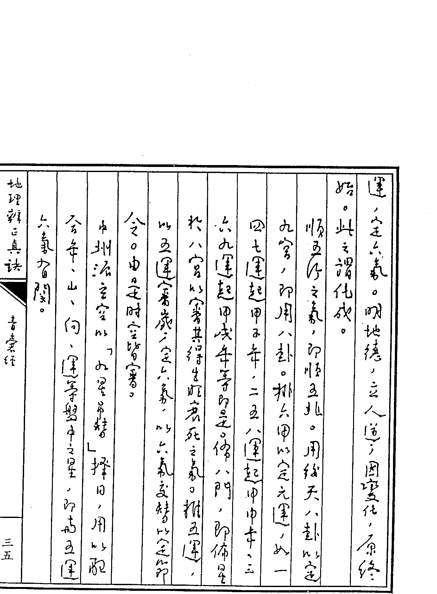

<!-- V3_SOURCE_ID:book017-b000181-p000-e7fab7d1af -->

此美说气之功能，即名之为化成，成者，即其功也。

查看对应原文

<!-- V3_FOLDBACK_BEGIN:book017-b000181-p000-e7fab7d1af -->

此美說氣之功能即名之为化成，成者。即其功也。

<!-- V3_FOLDBACK_END:book017-b000181-p000-e7fab7d1af -->

<!-- V3_SOURCE_ID:book017-b000182-p000-90a4cf6787 -->

这段文字提到有《抄公青任》三卷，内容分别论述气的性、相、用，相关内容涉及佛理部分，详细说明一切法都围绕性、相、用展开，还提到“紅壽实奇”的说法，记录当时相关的学说传播情况，提到佛家学说相关的“癸且貧狼學九曰生之名”的内容是从西方传来，认为这种说法确实可取，由此可以知道当时中西文化交流的相关情况，还提到相关义理涉及空性的内容，相关人士因此得以安坐致富。

> **释读存疑：** 抄公青任、红寿实奇、癸且貧狼學九曰生之名等表述无对应释义参考，具体所指无法确定；原文存在多处语序混乱、表述残缺的地方，部分内容无法准确释读

查看对应原文

<!-- V3_FOLDBACK_BEGIN:book017-b000182-p000-90a4cf6787 -->

抄公青任三卷，分言氣之性、相、用志佛分詳一切法皆言性相用柏內故紅壽实奇当時屈試傳未佛家學說有癸且貧狼學九曰生之名亦由西誠佳ま因知当日中會清屈域凡化交流，義令言空之此得而坐富。

<!-- V3_FOLDBACK_END:book017-b000182-p000-90a4cf6787 -->

<!-- doc006 PDF 第 39 页：高风险/复杂版面 OCR 供检索；内容与排版以原页图为准。 -->
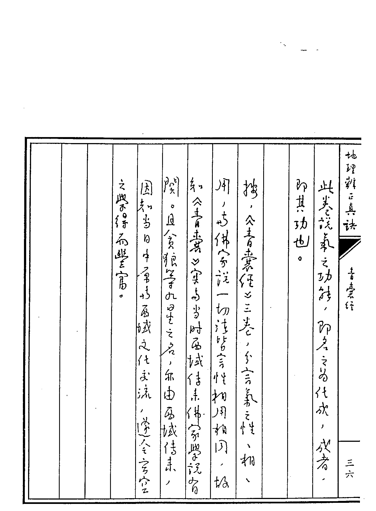

<!-- V3_SOURCE_ID:book017-b000184-p000-bfe76c63a3 -->

本篇的内容划分，是曾求己所记载的曾氏传承，属于“扬芮公第”相关内容，目前原文存在脱漏讹误，“若”字相关表述含义无法确定。

> **释读存疑：** 原文有脱漏讹误，“若”字的含义及相关语句的完整语义无法确定

查看对应原文

<!-- V3_FOLDBACK_BEGIN:book017-b000184-p000-bfe76c63a3 -->

本篇分曾求己所若曾氏传为揚芮公第

<!-- V3_FOLDBACK_END:book017-b000184-p000-bfe76c63a3 -->

<!-- V3_SOURCE_ID:book017-b000185-p000-f6a92ae03b -->

子公春所作的序约称主上六在依公有经之如义理，解说阴阳的作用，还提到排龙、马族、星，未提及替星、红，其关键在于可知本篇实为全召珠玑，只是未得法则，读之必入五里雾中。

> **释读存疑：** 原文多处文字错乱，语义难以完全明确

查看对应原文

<!-- V3_FOLDBACK_BEGIN:book017-b000185-p000-f6a92ae03b -->

子公春若序約主上六在依公有經之如義理一解說陰陽之用，白說排龍馬族星未說替星紅其決者即知本篇實全召珠璣唯未得法則讀之必入五里霧中。

<!-- V3_FOLDBACK_END:book017-b000185-p000-f6a92ae03b -->

<!-- V3_SOURCE_ID:book017-b000186-p000-588d00bb7a -->

杨公曾说，老看雌雄，天下诸书对不同。

查看对应原文

<!-- V3_FOLDBACK_BEGIN:book017-b000186-p000-588d00bb7a -->

楊公差言老看雌雄天下諸書對不同

<!-- V3_FOLDBACK_END:book017-b000186-p000-588d00bb7a -->

<!-- V3_SOURCE_ID:book017-b000187-p000-d08db3ccc0 -->

这段文字存在讹误和字迹不清的问题，残留内容提到相关场景下称公的阴阳二种属性共同发挥功用，就形成仪天，相关内容还有缺漏不明的字符，语义无法完整释读。

> **释读存疑：** 原文存在讹误、字迹模糊和缺漏，“診幸”“二陰陽”“h 作 分别”等表述含义无法确定

查看对应原文

<!-- V3_FOLDBACK_BEGIN:book017-b000187-p000-d08db3ccc0 -->

診幸 則稱公陰陽二陰陽 一起功用 即为仪天 ，故稱之为 h 作 分别·

<!-- V3_FOLDBACK_END:book017-b000187-p000-d08db3ccc0 -->

<!-- V3_SOURCE_ID:book017-b000188-p000-cd24ba8e4e -->

文中提到“美”对应雄处于生旺的状态，“老”则对应阴的状态，原文未说明“老”的具体所指。

> **释读存疑：** 原文未明确“老”的具体含义，无法确定其对应语义

查看对应原文

<!-- V3_FOLDBACK_BEGIN:book017-b000188-p000-cd24ba8e4e -->

「美」為叫雄生旺之时老則为陰

<!-- V3_FOLDBACK_END:book017-b000188-p000-cd24ba8e4e -->

<!-- V3_SOURCE_ID:book017-b000189-p000-4aa3fd3f84 -->

是阳气衰败死亡的状态。

查看对应原文

<!-- V3_FOLDBACK_BEGIN:book017-b000189-p000-4aa3fd3f84 -->

陽衰死之时

<!-- V3_FOLDBACK_END:book017-b000189-p000-4aa3fd3f84 -->

<!-- doc006 PDF 第 40 页：高风险/复杂版面 OCR 供检索；内容与排版以原页图为准。 -->
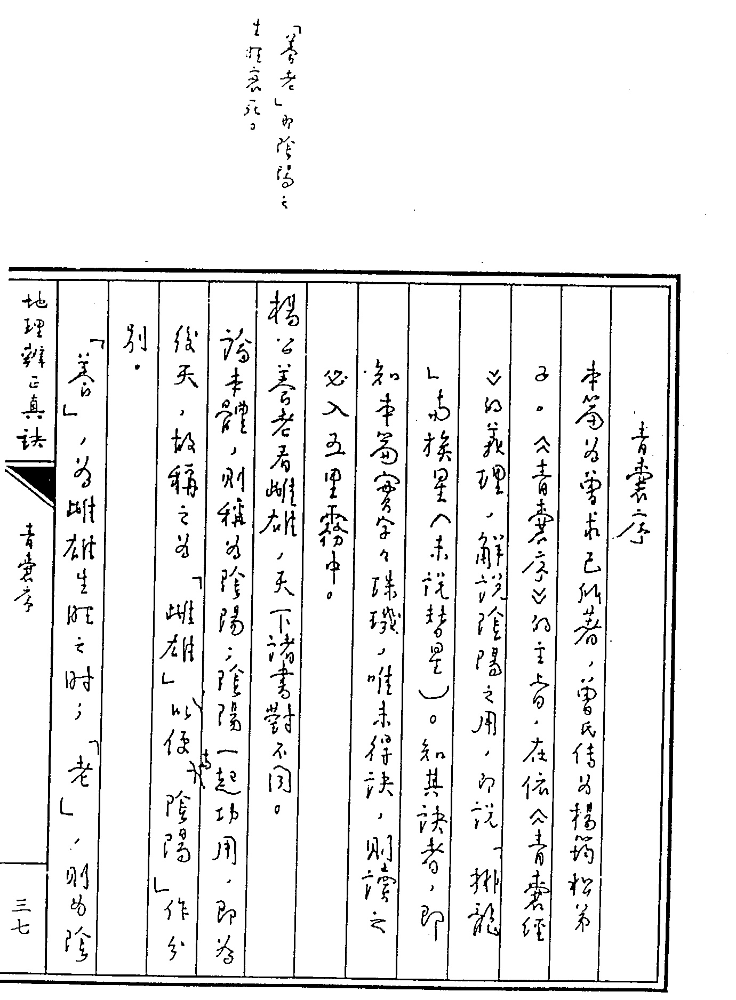

<!-- V3_SOURCE_ID:book017-b000191-p000-666cbd3781 -->

盖阴阳起用，百厉极阳一起用曰盛，一起用为衰，皆随时间推移而更声。经如未未八运，八白为旺星，九此为未素之生气，生一交九则八的已限气而紫则乘旺。

> **释读存疑：** 原文多处文字错乱，数字、字符难以辨识，语义不明

查看对应原文

<!-- V3_FOLDBACK_BEGIN:book017-b000191-p000-666cbd3781 -->

蓋陰陽起用，百厉極陽一起用曰盛一起用为衰，皆隨时問執移而更聲經如未未八運，八白为旺星，九此为未素之生氣生一交九则八的已限氣而紫则乘旺。

<!-- V3_FOLDBACK_END:book017-b000191-p000-666cbd3781 -->

<!-- V3_SOURCE_ID:book017-b000192-p000-aaea5c29e5 -->

又以排龙而言，七运排得金龙尚未十分哀败，以七赤分旺星故，但一至的运必凡祸殃，以七赤破军金已退义故。

> **释读存疑：** 原文多处文字错乱，数字、字符难以辨识，语义不明

查看对应原文

<!-- V3_FOLDBACK_BEGIN:book017-b000192-p000-aaea5c29e5 -->

又以排龍而言七運排得金龍尚未十分哀敗以七赤分旺星故，但一至的運必凡禍殃以七赤破軍金已退義故。

<!-- V3_FOLDBACK_END:book017-b000192-p000-aaea5c29e5 -->

<!-- V3_SOURCE_ID:book017-b000193-p000-4e065c78d9 -->

玄空是结合时间、空间和星数推演的一类风水体系，它依据盛衰的多种变化来判断雌雄的生死状态。只谈“密头”却不了解理气的人，认知自然和掌握相关方法的人有区别；原文疑似讹误的“南言理气”部分，表述的应是只谈理气却不了解玄空三诀的人，认知也和掌握方法的人有区别，所以原文才说“天下诸”，该段内容存在缺漏。其中“密头”疑似是“峦头”的讹误，“雌都”疑似是“雌雄”的讹误，“南言理气”存在讹误，具体原表述无法确定。

> **释读存疑：** “雌都”疑似“雌雄”讹误，“南言理气”存在讹误，“密头”疑似“峦头”讹误，原文结尾“天下诸”存在缺漏，相关表述具体含义无法完全确定

查看对应原文

<!-- V3_FOLDBACK_BEGIN:book017-b000193-p000-4e065c78d9 -->

玄空以盛衰多化而視雌都之生死馬但言密頭而不知理氣者固不同南言理氣而不知玄空三訣者亦不同故曰天下諸

<!-- V3_FOLDBACK_END:book017-b000193-p000-4e065c78d9 -->

<!-- V3_SOURCE_ID:book017-b000194-p000-6e71c0ba2b -->

书对不同。

查看对应原文

<!-- V3_FOLDBACK_BEGIN:book017-b000194-p000-6e71c0ba2b -->

書對不同

<!-- V3_FOLDBACK_END:book017-b000194-p000-6e71c0ba2b -->

<!-- doc006 PDF 第 41 页：高风险/复杂版面 OCR 供检索；内容与排版以原页图为准。 -->
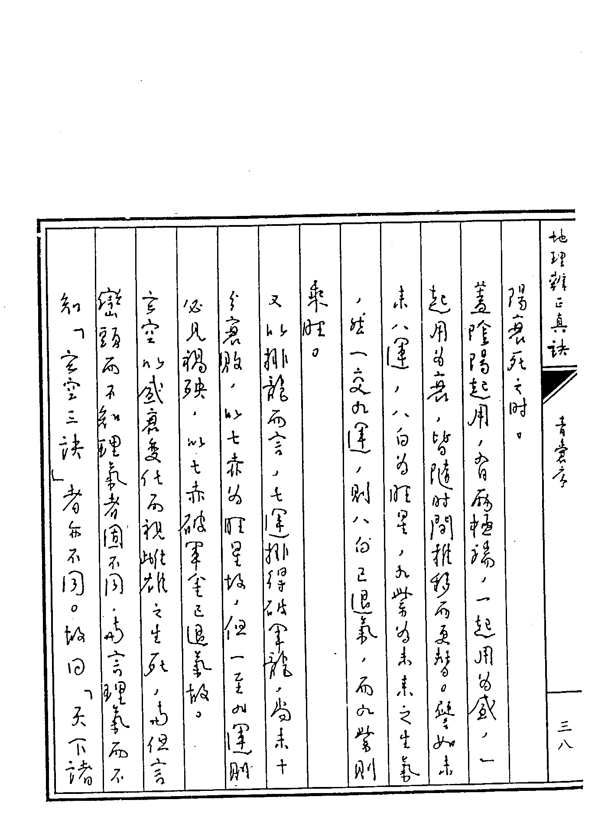

<!-- V3_SOURCE_ID:book017-b000196-p000-2227cecada -->

蔣大鴻註此為句時說：「然其中秘客催有看雌雄之一法此外更他去。足见對看雌雄之鄭重。

查看对应原文

<!-- V3_FOLDBACK_BEGIN:book017-b000196-p000-2227cecada -->

蔣大鴻註此為句時說：「然其中秘客催有看雌雄之一法此外更他去。足见對看雌雄之鄭重。

<!-- V3_FOLDBACK_END:book017-b000196-p000-2227cecada -->

<!-- V3_SOURCE_ID:book017-b000197-p000-fdf30129dd -->

他又說：夫，地理之書汗牛充棟獨此一法不年之於先口口相，世一生美自管輅一郭漢一以來古今知者不能幾人。

查看对应原文

<!-- V3_FOLDBACK_BEGIN:book017-b000197-p000-fdf30129dd -->

他又說：夫，地理之書汗牛充棟獨此一法不年之於先口口相，世一生美自管輅一郭漢一以來古今知者不能幾人。

<!-- V3_FOLDBACK_END:book017-b000197-p000-fdf30129dd -->

<!-- V3_SOURCE_ID:book017-b000198-p000-3225ca224e -->

化還坦白地說：既非聰明智巧可行附則 又出多宏臨博物所得與聞今者一言立虎 不初者累牘難明若欲向書卷中求之 負河漢矣由和言空正集佳在得決 地理辨正真诀 辨正真诀 三九

查看对应原文

<!-- V3_FOLDBACK_BEGIN:book017-b000198-p000-3225ca224e -->

化還坦白地說：既非聰明智巧可行附則 又出多宏臨博物所得與聞今者一言立虎 不初者累牘難明若欲向書卷中求之 負河漢矣由和言空正集佳在得決 地理辨正真诀 辨正真诀 三九

<!-- V3_FOLDBACK_END:book017-b000198-p000-3225ca224e -->

<!-- doc006 PDF 第 42 页：高风险/复杂版面 OCR 供检索；内容与排版以原页图为准。 -->
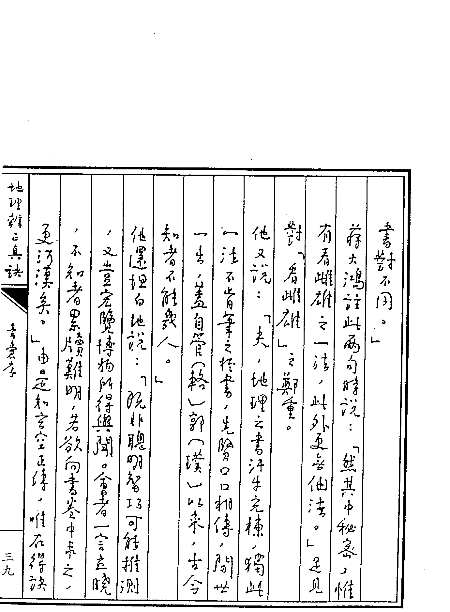

<!-- V3_SOURCE_ID:book017-b000200-p000-d98fecd535 -->

得訣後一點即明一即所謂一言立曉）至則妄事精測去直必遠，如言六大派辦門弟子甚，不過吉热浩大而己，結果唯有說各師冬法

查看对应原文

<!-- V3_FOLDBACK_BEGIN:book017-b000200-p000-d98fecd535 -->

得訣後一點即明一即所謂一言立曉）至則妄事精測去直必遠，如言六大派辦門弟子甚，不過吉热浩大而己，結果唯有說各師冬法

<!-- V3_FOLDBACK_END:book017-b000200-p000-d98fecd535 -->

<!-- V3_SOURCE_ID:book017-b000201-p000-e696315d7c -->

先看全龍動不動次空血脈證來龍。

查看对应原文

<!-- V3_FOLDBACK_BEGIN:book017-b000201-p000-e696315d7c -->

先看全龍動不動次空血脈證來龍。

<!-- V3_FOLDBACK_END:book017-b000201-p000-e696315d7c -->

<!-- V3_SOURCE_ID:book017-b000202-p000-232367d39d -->

看雌雄 之法即先者金能次察血脈其會亦是排能法。

查看对应原文

<!-- V3_FOLDBACK_BEGIN:book017-b000202-p000-232367d39d -->

看雌雄 之法即先者金能次察血脈其會亦是排能法。

<!-- V3_FOLDBACK_END:book017-b000202-p000-232367d39d -->

<!-- V3_SOURCE_ID:book017-b000203-p000-2550e673e6 -->

古人建誠建村式營宅營養必先擇地，經後定向崇造不似今人，宅墓已成然後我人看风水。

查看对应原文

<!-- V3_FOLDBACK_BEGIN:book017-b000203-p000-2550e673e6 -->

古人建誠建村式營宅營養必先擇地，經後定向崇造不似今人，宅墓已成然後我人看风水。

<!-- V3_FOLDBACK_END:book017-b000203-p000-2550e673e6 -->

<!-- V3_SOURCE_ID:book017-b000204-p000-d634d25928 -->

擇地之法先看金龍。動即為陰陽相垂應則如夫婦生生不息不動即为陰陽相乘乘則交互侵定誰是則为假夫歸假則女然毫生戮。

查看对应原文

<!-- V3_FOLDBACK_BEGIN:book017-b000204-p000-d634d25928 -->

擇地之法先看金龍。動即為陰陽相垂應則如夫婦生生不息不動即为陰陽相乘乘則交互侵定誰是則为假夫歸假則女然毫生戮。

<!-- V3_FOLDBACK_END:book017-b000204-p000-d634d25928 -->

<!-- doc006 PDF 第 43 页：高风险/复杂版面 OCR 供检索；内容与排版以原页图为准。 -->
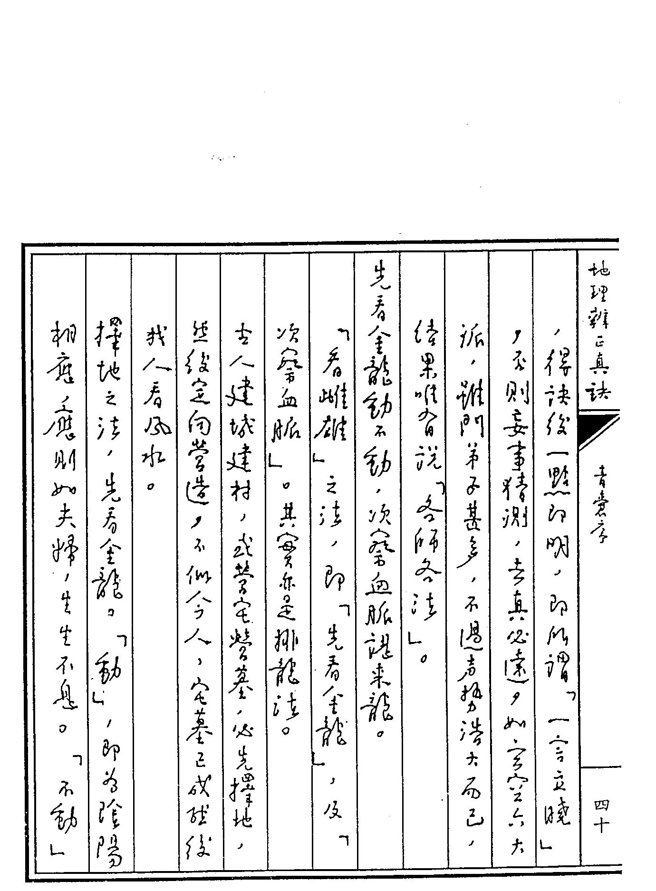

<!-- V3_SOURCE_ID:book017-b000206-p000-4428df2323 -->

金龍 者即所謂百一節它六所在地位，必有入旨 」即城官都邑直直巾可弁心入如士路鞋入榜路此大路係即之入當 J

查看对应原文

<!-- V3_FOLDBACK_BEGIN:book017-b000206-p000-4428df2323 -->

金龍 者即所謂百一節它六所在地位，必有入旨 」即城官都邑直直巾可弁心入如士路鞋入榜路此大路係即之入當 J

<!-- V3_FOLDBACK_END:book017-b000206-p000-4428df2323 -->

<!-- V3_SOURCE_ID:book017-b000207-p000-1887a88272 -->

傳更精聖亦視寶如帝不境而定則徑在成路在門當五過，附近一分支街道一，引負由鄂正真法 青春之

查看对应原文

<!-- V3_FOLDBACK_BEGIN:book017-b000207-p000-1887a88272 -->

傳更精聖亦視寶如帝不境而定則徑在成路在門當五過，附近一分支街道一，引負由鄂正真法 青春之

<!-- V3_FOLDBACK_END:book017-b000207-p000-1887a88272 -->

<!-- doc006 PDF 第 44 页：高风险/复杂版面 OCR 供检索；内容与排版以原页图为准。 -->
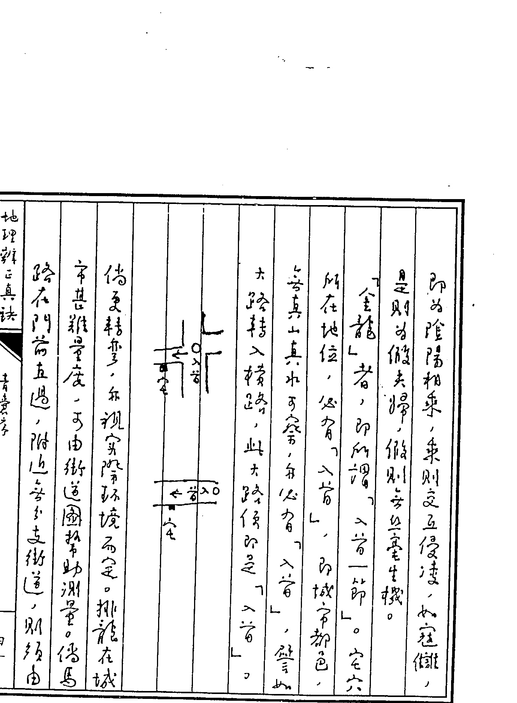

<!-- V3_SOURCE_ID:book017-b000209-p000-06fb7d2423 -->

通过形法判断吉凶，这需要详细分述，不是本文所能涵盖的内容。

查看对应原文

<!-- V3_FOLDBACK_BEGIN:book017-b000209-p000-06fb7d2423 -->

形法判斷吉凶此則须分詳非本文所可包括。

<!-- V3_FOLDBACK_END:book017-b000209-p000-06fb7d2423 -->

<!-- V3_SOURCE_ID:book017-b000210-p000-d1a4896045 -->

有生气的状态称为动。排龙得到五吉，且所选择的地点又有向（建筑或穴位所朝的方位）可取，就肯定是动的状态。原文提到“勇則便为不動”，该表述语义含混，无法准确释读。比如同一条街道上的住宅朝向都相同，但吉凶各不相同，这实际是因为整条龙有的有劲、有的不动的缘故。

> **释读存疑：** “勇則便为不動”语义含混，无法准确释读

查看对应原文

<!-- V3_FOLDBACK_BEGIN:book017-b000210-p000-d1a4896045 -->

有生氣謂之動。排龍得五吉，而所擇之地又有向可取，期的動矣。勇則便为不動。M以同一街道，宅皆同向，而旁凶互異此實由於全龍有劲有不動之故。

<!-- V3_FOLDBACK_END:book017-b000210-p000-d1a4896045 -->

<!-- V3_SOURCE_ID:book017-b000211-p000-33b58f6406 -->

风水中的“穴血脉”相关说法，是指通过水来识别山的情况，再通过血脉的状况判断来龙的走向，观察穴所在主山的形态、水的走势，这和通常所说的血脉不是一回事。所以有氏直接斥责相关错误认知说：只要知道血脉来自哪个方向，就能判断龙来自哪个方向了。这是杨公判断雌雄的秘诀，并不是世间人所说的倒杖步学的固定死格局0L

> **释读存疑：** “故氏”具体指代何人原文未明；1轮自动修复后核义模型仍建议修订，已保守记录。

查看对应原文

<!-- V3_FOLDBACK_BEGIN:book017-b000211-p000-33b58f6406 -->

「穴血脈者乃由水認山，由血脈說來龍觀穴主山形水努並非血脉。故氏直斥之云：知血脈之未自何方即可認龍之來自何方矣。此楊公看雌雄之秘訣而非世人倒杖步學之死格局也 0L

<!-- V3_FOLDBACK_END:book017-b000211-p000-33b58f6406 -->

<!-- V3_SOURCE_ID:book017-b000212-p000-bd2196119f -->

这段原文存在残缺，“然將氏實亦未洩秘其实雍血脈以”语义不完整，无法进行准确释读。

> **释读存疑：** 原文残缺，整体语义无法确定

查看对应原文

<!-- V3_FOLDBACK_BEGIN:book017-b000212-p000-bd2196119f -->

然將氏實亦未洩秘其实雍血脈以

<!-- V3_FOLDBACK_END:book017-b000212-p000-bd2196119f -->

<!-- doc006 PDF 第 45 页：高风险/复杂版面 OCR 供检索；内容与排版以原页图为准。 -->
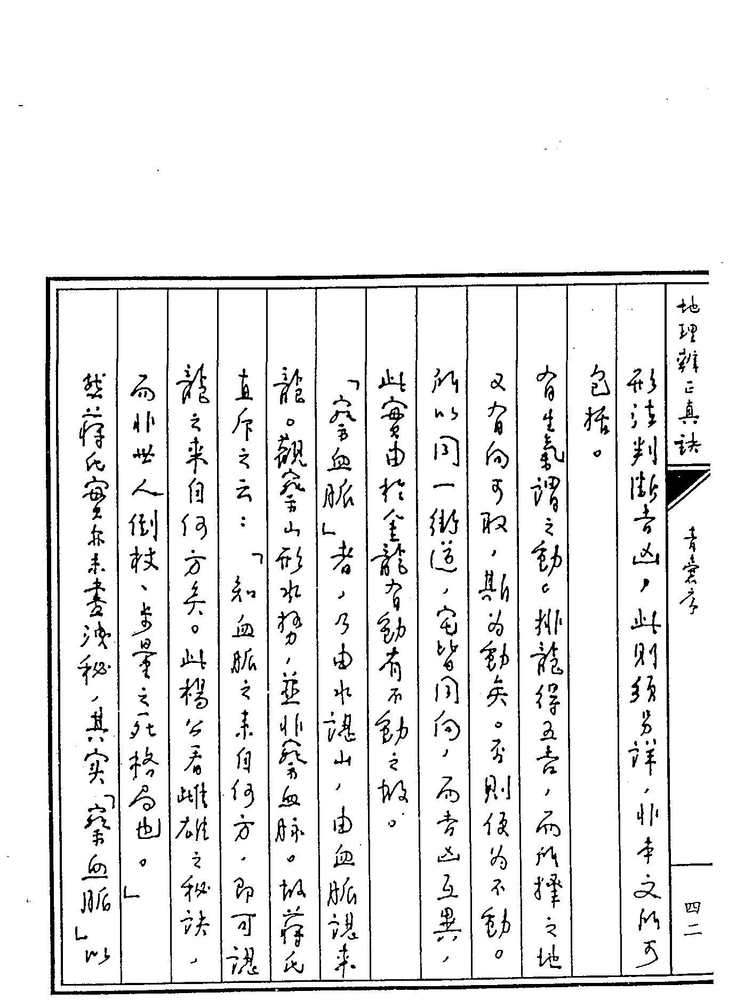

<!-- V3_SOURCE_ID:book017-b000214-p000-53ea1c2caa -->

识别来龙，就是通过水口（水流出入一地或局势收束的位置）来确定来龙。原文“來龍吾形界水而止足故佳”存在OCR讹误，语义无法确定，无法准确释读。通过水（风水语境中的河流、水系及其来去形态）识别来龙，就能得到正确的判断。原文提到“水之山家血垢清”，该表述语义不明，无法准确释读。

> **释读存疑：** “來龍吾形界水而止足故佳”存在OCR讹误，语义无法确定；“水之山家血垢清”语义不明，无法准确释读

查看对应原文

<!-- V3_FOLDBACK_BEGIN:book017-b000214-p000-53ea1c2caa -->

認來龍 即是由水口以定來龍來龍吾形界水而止足故佳由水認龍治得真矣此即所謂水之山家血垢清

<!-- V3_FOLDBACK_END:book017-b000214-p000-53ea1c2caa -->

<!-- V3_SOURCE_ID:book017-b000215-p000-e19f06614a -->

这段原文存在多处OCR讹误，其中“界小”“百形”等表述语义不明，且全文存在残缺，无法进行准确释读。

> **释读存疑：** 原文存在多处OCR讹误及残缺，整体语义无法确定；本地硬校验仍未通过，已记录供后续自动处理或人工核对。

查看对应原文

<!-- V3_FOLDBACK_BEGIN:book017-b000215-p000-e19f06614a -->

換言之龍唯是氣無形可而界小」則百形故由百形以無形是为穴血脉而來能

<!-- V3_FOLDBACK_END:book017-b000215-p000-e19f06614a -->

<!-- V3_SOURCE_ID:book017-b000216-p000-bdd72b48a9 -->

这段原文不完整，仅为半句口诀，无法确认完整语义。

> **释读存疑：** 原文不完整，完整语义无法确定

查看对应原文

<!-- V3_FOLDBACK_BEGIN:book017-b000216-p000-bdd72b48a9 -->

龍分两片陰陽取中对三义細認陰

<!-- V3_FOLDBACK_END:book017-b000216-p000-bdd72b48a9 -->

<!-- V3_SOURCE_ID:book017-b000217-p000-d86cebc277 -->

原文开头“莊大鴻註此段最皆洩霜幼”存在OCR讹误，语义无法确定。后文记载庄大鸿的注语总结说：“兩片即毗雄。陰在此則陽必在徃兩路用求母。”原文后续“此即是說山龍好水務山龍分陽”“形賢”“隱必在得之貴是他抑偏多”等表述均存在OCR讹误，语义含混，无法准确释读。仅能确认相关内容是对“龙分两片阴阳取”的阐释，其中提到山龙属阳，仅聚气而已，水龙属阴，有形质可以参照，水（风水语境中的河流、水系及其来去形态）可作为判断依据，同时讨论了山与水的阴阳如何相交的问题。

> **释读存疑：** “莊大鴻註此段最皆洩霜幼”存在OCR讹误，语义无法确定；“山龍好水務山龍分陽”“形賢”“隱必在得之貴是他抑偏多”等多处存在OCR讹误，语义无法确定

查看对应原文

<!-- V3_FOLDBACK_BEGIN:book017-b000217-p000-d86cebc277 -->

莊大鴻註此段最皆洩霜幼，結云：兩片即毗雄。陰在此則陽必在徃兩路用求母。 此即是說山龍好水務山龍分陽如形賢可見，惟聚气而己，水龍為陰有形質可象，故水即可如是謂「龍分兩片陰陽取亦即將氏陰在此，則隱必在得之貴是他抑偏多說一句為路相交卯又令人迷惑不幻山而水之陰陽如何相交

<!-- V3_FOLDBACK_END:book017-b000217-p000-d86cebc277 -->

<!-- doc006 PDF 第 46 页：高风险/复杂版面 OCR 供检索；内容与排版以原页图为准。 -->
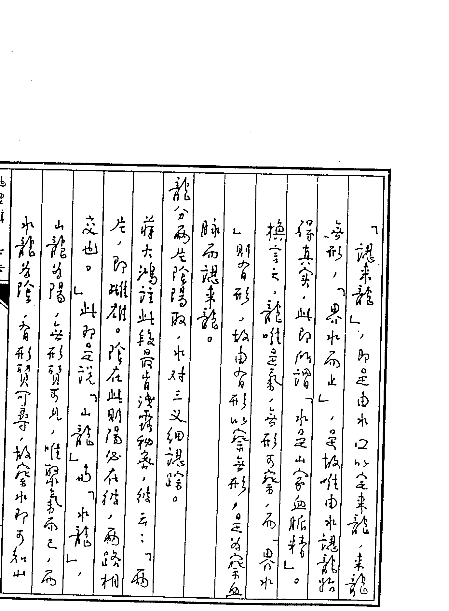

<!-- V3_SOURCE_ID:book017-b000219-p000-7a2e4ec4b0 -->

这段原文存在大量OCR讹误、日文假名残留，其中“水之对官後卯”“胡宜說 hu 才ヌ L龍对山山起破軍”“れ討三义細認陰”“後誠門界れ合虞必有三文”“保何脉”等表述字符残缺、语义不明，无法进行准确释读。

> **释读存疑：** 原文存在大量OCR讹误、日文假名残留，整体语义无法确定；本地硬校验仍未通过，已记录供后续自动处理或人工核对。

查看对应原文

<!-- V3_FOLDBACK_BEGIN:book017-b000219-p000-7a2e4ec4b0 -->

水之对官後卯是山胡宜說 hu 才ヌ L龍对山山起破軍
始下句即緊接云，「れ討三义細認陰」，此已明言要看三文水口以辨書龍
府氏又云：三即後誠門界れ合虞必有三文，細踪即血所以說未龍也知三义之在何方則知未龍之保何脉矣。此段亦已明言由三之水口以室未龍不过

<!-- V3_FOLDBACK_END:book017-b000219-p000-7a2e4ec4b0 -->

<!-- doc006 PDF 第 47 页：高风险/复杂版面 OCR 供检索；内容与排版以原页图为准。 -->
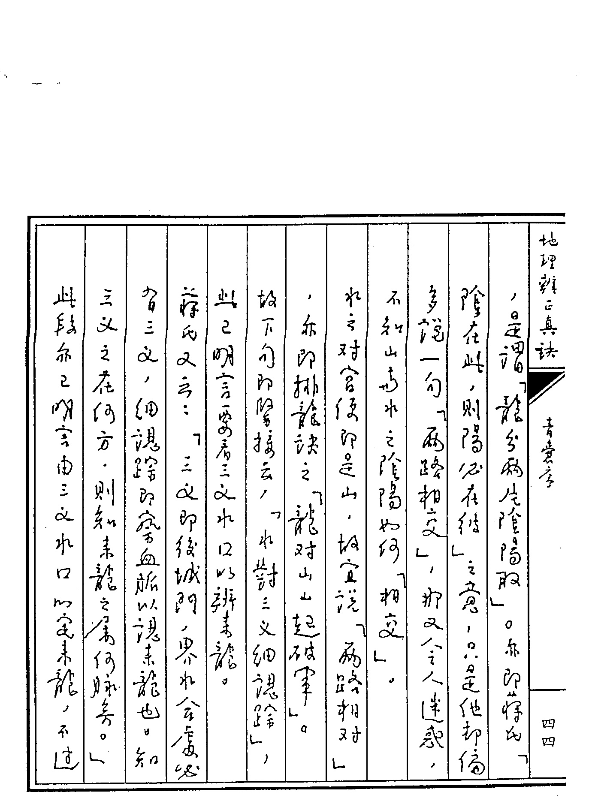

<!-- V3_SOURCE_ID:book017-b000223-p000-e295b633b4 -->

原文开头“水未者”表述含混，语义无法确定，仅能知道相关内容是说明水（风水语境中的河流、水系及其来去形态）的对方就是山。对应的风水口诀是：江南来龙，结穴在江北；江西来龙，结穴望江东。

> **释读存疑：** “水未者”表述含混，语义无法确定

查看对应原文

<!-- V3_FOLDBACK_BEGIN:book017-b000223-p000-e295b633b4 -->

水未者說明水之对方即是山。江南龍來江北於江西龍去望江東

<!-- V3_FOLDBACK_END:book017-b000223-p000-e295b633b4 -->

<!-- V3_SOURCE_ID:book017-b000224-p000-5e06dc6f44 -->

这位先生在青书的序中明确说明，水龙的对面就是山，因此江南的水口，气吉脉就位于对面的江域，也就是此处的江西九口。原文此处有“氣肺結在江東將氏之”的表述，语义存在残损，无法准确释读。原文还有“以有形之陰賢 求形之陽氣甚之”的内容，存在残损，无法准确串联语义。

> **释读存疑：** 氣肺結在江東將氏之语义残损；以有形之陰賢 求形之陽氣甚之存在残损，无法准确释读

查看对应原文

<!-- V3_FOLDBACK_BEGIN:book017-b000224-p000-5e06dc6f44 -->

此公青書序明說水龍对面即山故江 南水口，气吉脉则在对面江此之江西九口， 氣肺結在江東將氏之： 以有形之陰賢 求形之陽氣甚之。

<!-- V3_FOLDBACK_END:book017-b000224-p000-5e06dc6f44 -->

<!-- V3_SOURCE_ID:book017-b000225-p000-1ec5e414ff -->

这段文字存在大量语义残缺、语序混乱的问题，现有内容不足以支撑通顺、有依据的释读，无法准确解读含义。

> **释读存疑：** 全文本语义残缺、语序混乱，无有效释读依据

查看对应原文

<!-- V3_FOLDBACK_BEGIN:book017-b000225-p000-1ec5e414ff -->

之以王人卜河洛間二如六華高其る親流泉卜午卜世公都宮。

<!-- V3_FOLDBACK_END:book017-b000225-p000-1ec5e414ff -->

<!-- V3_SOURCE_ID:book017-b000226-p000-11e1b965ad -->

周公迁都治阳，没有说明华为脉终的相关情况，只是缺注涧水与另一水相交的内容，由此可以验证水相关的内容。原文此处有“以諸龍”的表述，语义残损，无法准确释读。原文还提到这类内容并非后世堪舆相关的近山寻龙的做法。

> **释读存疑：** 治阳无法确定为洛阳，语义存疑；水以諸龍语义残损，无法准确释读；“治阳”无法确定为洛阳，语义存疑；“水以諸龍”语义残损，无法准确释读；1轮自动修复后核义模型仍建议修订，已保守记录。

查看对应原文

<!-- V3_FOLDBACK_BEGIN:book017-b000226-p000-11e1b965ad -->

周公遷都治陽不說華為脉終如何但闕注澗二水相交由是可証水以諸龍非似後世堪與字之近山尋龍也。

<!-- V3_FOLDBACK_END:book017-b000226-p000-11e1b965ad -->

<!-- doc006 PDF 第 48 页：高风险/复杂版面 OCR 供检索；内容与排版以原页图为准。 -->
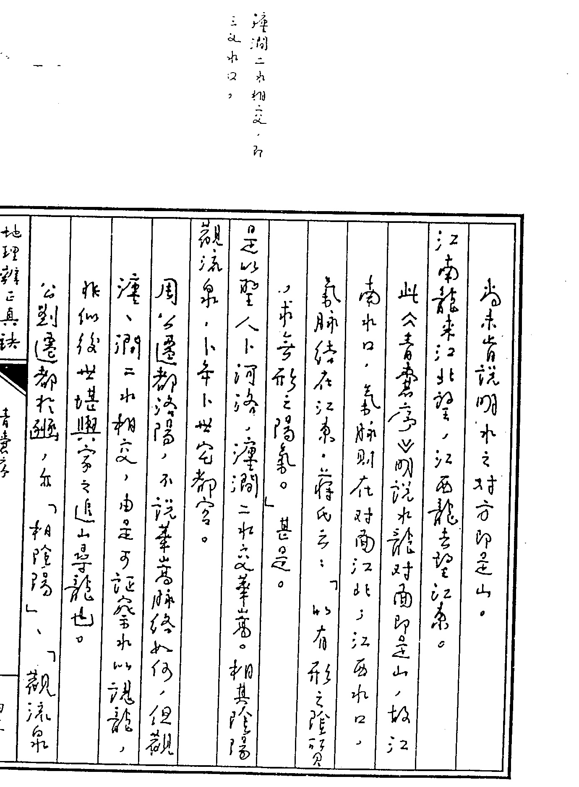

<!-- V3_SOURCE_ID:book017-b000228-p000-8fdf84b54e -->

而这些内容足以验证“午世”的兴旺与水相关。占卜住宅、占卜都城，乃至确定官室，都用同样的方法。原文此处有“故曰っ卜年卜世宅都宫”的表述，存在字符残损，无法准确补全语义。

> **释读存疑：** 午世语义无明确依据，具体所指不详；故曰っ卜年卜世宅都宫存在字符残损，无法准确释读；“午世”语义无明确依据，具体所指不详；“故曰っ卜年卜世宅都宫”存在字符残损，无法准确释读

查看对应原文

<!-- V3_FOLDBACK_BEGIN:book017-b000228-p000-8fdf84b54e -->

而己足以證午世之興旺，會關乎水。卜宅、卜都，以至定官室，都同此法，故曰っ卜年卜世宅都宫

<!-- V3_FOLDBACK_END:book017-b000228-p000-8fdf84b54e -->

<!-- V3_SOURCE_ID:book017-b000229-p000-7602188f72 -->

晋代的郭景纯擅长这种术数，推演经典、确立义理。原文此处有“出言空朱存設原生明氣一一講說開暑”的内容，存在大量语义残缺，无法准确释读。

> **释读存疑：** 出言空朱存設原生明氣一一講說開暑语义残缺，无有效释读依据；“出言空朱存設原生明氣一一講說開暑”语义残缺，无有效释读依据

查看对应原文

<!-- V3_FOLDBACK_BEGIN:book017-b000229-p000-7602188f72 -->

晋世景純佳此術演經立義出言空朱存設原生明氣一一講說開暑。

<!-- V3_FOLDBACK_END:book017-b000229-p000-7602188f72 -->

<!-- V3_SOURCE_ID:book017-b000230-p000-d9bf021d34 -->

这种说法认为晋代郭氏得到并传承了这种术数。原文此处有“和公吉來經之 要乃發揚言空之義”的内容，存在断句残损，无法准确串联语义。原文还有“然今世佳公葬經 ，則吾非託名之作”的表述，语序混乱，语义无法准确解读。

> **释读存疑：** 和公吉來經之 要乃發揚言空之義断句残损，无法准确释读；然今世佳公葬經 ，則吾非託名之作语序混乱，语义不明；“和公吉來經之 要乃發揚言空之義”断句残损，无法准确释读；“然今世佳公葬經 ，則吾非託名之作”语序混乱，语义不明

查看对应原文

<!-- V3_FOLDBACK_BEGIN:book017-b000230-p000-d9bf021d34 -->

此說晉郭讀得傳此術和公吉來經之 要乃發揚言空之義。然今世佳公葬經 ，則吾非託名之作。

<!-- V3_FOLDBACK_END:book017-b000230-p000-d9bf021d34 -->

<!-- V3_SOURCE_ID:book017-b000231-p000-3dcc049adf -->

依据《晋书》记载，郭璞的门人赵载曾窃取他的相关藏书。原文此处有“所歲公若經後其書贊，则今之公者來若又未紅求新璞得者物司否”的内容，完全残损，无法准确释读。

> **释读存疑：** 竊其所歲公若經语义残损，无法确定书籍名称；後其書贊，则今之公者來若又未紅求新璞得者物司否完全残损，无有效释读依据；“竊其所歲公若經”语义残损，无法确定书籍名称；“後其書贊，则今之公者來若又未紅求新璞得者物司否”完全残损，无有效释读依据

查看对应原文

<!-- V3_FOLDBACK_BEGIN:book017-b000231-p000-3dcc049adf -->

依晉書，郭漢門人趙載嘗竊其所歲公若經後其書贊，则今之公者來若又未紅求新璞得者物司否。

<!-- V3_FOLDBACK_END:book017-b000231-p000-3dcc049adf -->

<!-- V3_SOURCE_ID:book017-b000232-p000-b1095920df -->

原文此处有“建空·都官、差”的表述，存在残损，无法准确释读。后文提到相关建造活动都以面南为贵。原文还有“所以便院「集蟲昏厚 朱花為南方，背”的内容，完全残损，无法准确释读。

> **释读存疑：** 建空·都官、差语义残损，无法准确释读；所以便院「集蟲昏厚 朱花為南方，背完全残损，语义不明；“建空·都官、差”语义残损，无法准确释读；“所以便院「集蟲昏厚 朱花為南方，背”完全残损，语义不明

查看对应原文

<!-- V3_FOLDBACK_BEGIN:book017-b000232-p000-b1095920df -->

古人建空·都官、差，皆以面南为贵所以便院「集蟲昏厚 朱花為南方，背

<!-- V3_FOLDBACK_END:book017-b000232-p000-b1095920df -->

<!-- doc006 PDF 第 49 页：高风险/复杂版面 OCR 供检索；内容与排版以原页图为准。 -->
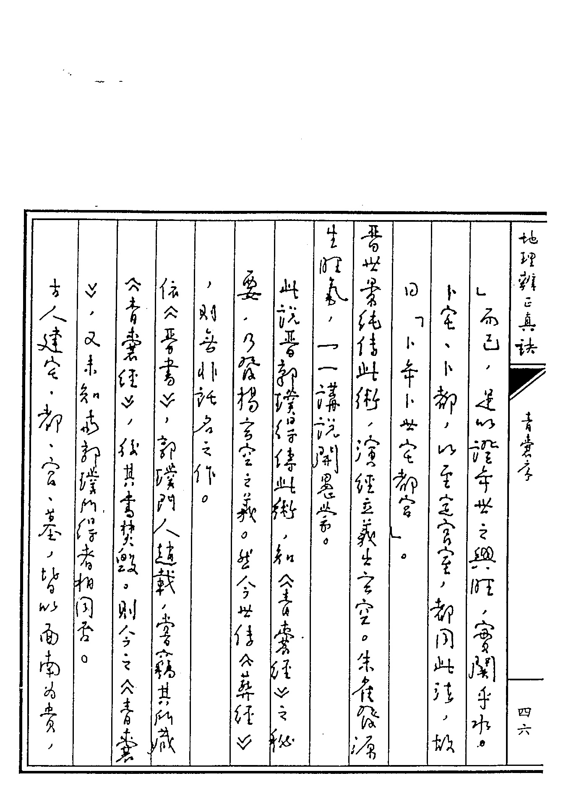

<!-- V3_SOURCE_ID:book017-b000234-p000-2359d4700c -->

发源必须得到生旺之气。原文此处有“此芬先復天之而合”的表述，语义残损，无法准确释读。所以文曲龙对应一四七的相关情况尚且不算全凶，原文还有“而武曲左補石乃十一四七則未福反而貧狼龍可谷”的内容，存在语义残损和疑似传抄错误，无法准确释读。

> **释读存疑：** 此芬先復天之而合语义残损，无有效释读依据；十一四七疑似传抄错误，语义不明；貧狼龍可谷语义残损，无法准确释读；“此芬先復天之而合”语义残损，无有效释读依据；“十一四七”疑似传抄错误，语义不明；“貧狼龍可谷”语义残损，无法准确释读

查看对应原文

<!-- V3_FOLDBACK_BEGIN:book017-b000234-p000-2359d4700c -->

發源須得生旺之氣，此芬先復天之而合。所以殆文曲龍於一四七尚非全凶而武曲左補石乃十一四七則未福反而貧狼龍可谷。

<!-- V3_FOLDBACK_END:book017-b000234-p000-2359d4700c -->

<!-- V3_SOURCE_ID:book017-b000235-p000-67c8393ab6 -->

未来八运相关的内容中提到“宣二里臣門龍”，具体所指不详。还有八白左辅龙、火形之宅见五气贞龙的相关说法。原文此处有“易怡火二丙H”的表述，存在残损，包含无法识别的字符，无法准确释读。

> **释读存疑：** 宣二里臣門龍语义不明，具体所指不详；易怡火二丙H存在残损和无法识别字符，无法准确释读；“宣二里臣門龍”语义不明，具体所指不详；“易怡火二丙H”存在残损和无法识别字符，无法准确释读

查看对应原文

<!-- V3_FOLDBACK_BEGIN:book017-b000235-p000-67c8393ab6 -->

未來八運宣二里臣門龍、八白左輔龍火形之宅見五氣贞龍易怡火二丙H。

<!-- V3_FOLDBACK_END:book017-b000235-p000-67c8393ab6 -->

<!-- V3_SOURCE_ID:book017-b000236-p000-8372515050 -->

学习这组对应关系，就是初昏时产生的狂乱之文，先天排龙以本体为基础，后天生理为功用，二者的运用不能相互……

> **释读存疑：** 原文末尾残缺，内容不完整

查看对应原文

<!-- V3_FOLDBACK_BEGIN:book017-b000236-p000-8372515050 -->

是學此對例即初昏源生狂之文先天排龍本體後天生理为功用，經用不能相

<!-- V3_FOLDBACK_END:book017-b000236-p000-8372515050 -->

<!-- doc006 PDF 第 50 页：高风险/复杂版面 OCR 供检索；内容与排版以原页图为准。 -->
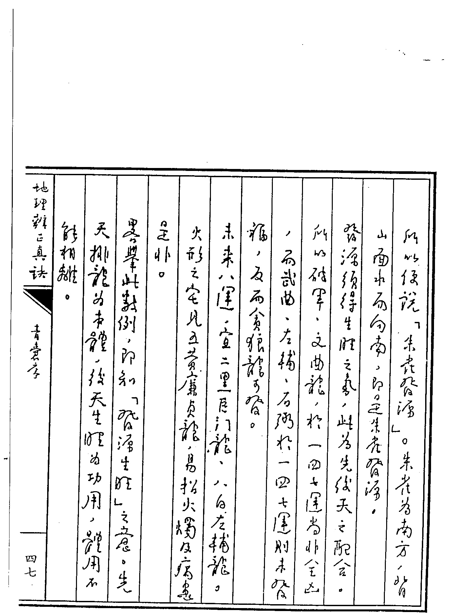

<!-- V3_SOURCE_ID:book017-b000238-p000-5830e0cd98 -->

一生二3，二生三，三衍生出相关内容对应玄关。山对应山相关的八3类规则，水管控水的相关形态，这其中的阴阳对应石的相关内容还有待说明。

> **释读存疑：** 原文中两处数字3的具体含义、“省物王玄关”“山答山八”“阴阳石待言”的准确所指；原文中两处数字3的具体含义、“省物王玄关”“山答山八”“石待言”的准确所指；1轮自动修复后核义模型仍建议修订，已保守记录。

查看对应原文

<!-- V3_FOLDBACK_BEGIN:book017-b000238-p000-5830e0cd98 -->

一生二3二生三，三生省物王玄關。山答山八3水管水此是陰陽石待言。

<!-- V3_FOLDBACK_END:book017-b000238-p000-5830e0cd98 -->

<!-- V3_SOURCE_ID:book017-b000239-p000-d0efc0a5c6 -->

求大鸿说：“阴阳的妙用汇聚于一。有一爻就对应三爻，有一卦就对应三卦，相合的说法是一生二、二生三，这是天地的玄关，是生生不息的关键。”原文提到“此說弄聞五”，这一表述含义不详；又说这种说法并非凭空而来，从龙脉就能得知合穴的坐山，由坐山自然可推得向水，下文出现“下即孫之山山、れ水”的表述，其中“れ”是讹误字符，整句具体所指不详。

> **释读存疑：** “此說弄聞五”的具体含义无法确定；“下即孫之山山、れ水”包含讹误字符，具体所指不详

查看对应原文

<!-- V3_FOLDBACK_BEGIN:book017-b000239-p000-d0efc0a5c6 -->

求大鴻云：「陰陽之妙用招於一。有一爻即官三爻有一卦即省三卦协曰一生二二生三此天地之玄開夕勇ね生生之夾鑰也此說弄聞五此言非說由來龍即得合穴之坐山由坐山自經得向水下即孫之山山、れ水。

<!-- V3_FOLDBACK_END:book017-b000239-p000-d0efc0a5c6 -->

<!-- V3_SOURCE_ID:book017-b000240-p000-11801941b5 -->

这部《广符》又提到：依据山的阴阳判定水的阴阳，这部分内容上文还有相关表述，出现文金混杂的情况。其中山的阴阳指的是先天排龙对应的阴阳，水的阴阳则推测是后天安星对应的阴阳，二者的顺承规律不同，就是所说的“倒7颠倒”，辨识清楚阴阳的玄妙道理，就能知晓其衰旺与生死的规律。不能随意参照上面的内容生搬硬套，如果只片面理解死气的相关内容都需要多加参考权衡。

> **释读存疑：** 数字7的具体含义、“文金混”“天安星”的准确所指；数字7的具体含义、“文金混”“后天安星”的准确所指；1轮自动修复后核义模型仍建议修订，已保守记录。

查看对应原文

<!-- V3_FOLDBACK_BEGIN:book017-b000240-p000-11801941b5 -->

此廣符ん又云：っ山之陰陽而水水之陰陽此上又故文金混矣則山之陰陽指先天排能之陰陽之水之陰陽則猜後天安星之陰陽，二者順從不同，即所谓 倒 7 顛倒識得陰陽玄妙理知其衰旺與生死。不苟上與來如但達死氣皆參权

<!-- V3_FOLDBACK_END:book017-b000240-p000-11801941b5 -->

<!-- doc006 PDF 第 51 页：高风险/复杂版面 OCR 供检索；内容与排版以原页图为准。 -->

<!-- V3_SOURCE_ID:book017-b000242-p000-f7061cbd2c -->

这是反过来的说明，坐山迎来的情况如“不司”，其中“不司”的具体含义无法确定。

> **释读存疑：** “不司”语义不明，无法准确释读

查看对应原文

<!-- V3_FOLDBACK_BEGIN:book017-b000242-p000-f7061cbd2c -->

此反說明，坐山迎來如不司。

<!-- V3_FOLDBACK_END:book017-b000242-p000-f7061cbd2c -->

<!-- V3_SOURCE_ID:book017-b000243-p000-e0bbb67d9e -->

原文提到“來巾即後一た，W先天卯臨；坐山金片，即後天象星”，其中“來巾”“た”“W”“金片”均无法准确释读，“先天卯臨”是指对应先天的卯位降临，坐山相关的“金片”对应后天的象星，其余表述具体所指不详。

> **释读存疑：** “來巾”“た”“W”“金片”语义不明，无法准确释读；“來巾”“た”“W”“金片”“象星”语义不明，无法准确释读；1轮自动修复后核义模型仍建议修订，已保守记录。

查看对应原文

<!-- V3_FOLDBACK_BEGIN:book017-b000243-p000-e0bbb67d9e -->

來巾即後一た，W先天卯臨；坐山金片，即後天象星。

<!-- V3_FOLDBACK_END:book017-b000243-p000-e0bbb67d9e -->

<!-- V3_SOURCE_ID:book017-b000244-p000-095c241dca -->

来水和“來誰”为一对；坐山和“句卜”为一寸。必须像这样才“始刻雄而不昆孔”，相关表述无法准确释读。至于“至王死一”的情况，都随后天元运而定，其中“王”“一”的具体所指、“始刻雄而不昆孔”的语义均无法确定。

> **释读存疑：** “來誰”“句卜”“始刻雄而不昆孔”“至王死一”语义不明，无法准确释读

查看对应原文

<!-- V3_FOLDBACK_BEGIN:book017-b000244-p000-095c241dca -->

來水与來誰為一对；坐山與句卜為一寸。必須如是始刻雄而不昆孔。至王死一皆隨後天元運而定。

<!-- V3_FOLDBACK_END:book017-b000244-p000-095c241dca -->

<!-- V3_SOURCE_ID:book017-b000245-p000-76071ec38e -->

时州，如同七之……

> **释读存疑：** 原文中“ホキる”等内容存在OCR识别错误，无法准确释读；语句语义模糊，难以理解

查看对应原文

<!-- V3_FOLDBACK_BEGIN:book017-b000245-p000-76071ec38e -->

时州，如七之ホキる

<!-- V3_FOLDBACK_END:book017-b000245-p000-76071ec38e -->

<!-- doc006 PDF 第 52 页：高风险/复杂版面 OCR 供检索；内容与排版以原页图为准。 -->

<!-- V3_SOURCE_ID:book017-b000247-p000-0f98667b9b -->

先天罗经十二支，后天再用天干与四维，八干四维辅助支位，子母公孙都按此规则推算。

查看对应原文

<!-- V3_FOLDBACK_BEGIN:book017-b000247-p000-0f98667b9b -->

先天羅經十二支後天再用干與維八干四維辅支位子母公孫同此推。

<!-- V3_FOLDBACK_END:book017-b000247-p000-0f98667b9b -->

<!-- V3_SOURCE_ID:book017-b000248-p000-14e83f964e -->

如果认为一经的文字只是说堪舆罢经，那可以说全是废话，然而需要注意，它明明标出了先天，还有“青從天售”的表述，这一短语具体所指不详，存在这类分别。所以大鸿的说法是：这并不是讲罢经的制造方法，而是将罗经的主旨指向雌雄交满的说法，其中“交滿”的具体含义无法确定。

> **释读存疑：** “青從天售”“交滿”语义不明，无法准确释读

查看对应原文

<!-- V3_FOLDBACK_BEGIN:book017-b000248-p000-14e83f964e -->

若以為言一經文字是說堪與罷經則可謂全同廢話然而却須注意他明明上出先天\_青從天售有此種分別。故大鴻之：此以即非言罷經制造之法美將羅經主指雌雄交滿之言。

<!-- V3_FOLDBACK_END:book017-b000248-p000-14e83f964e -->

<!-- V3_SOURCE_ID:book017-b000249-p000-a46066043f -->

这里提到《幸節寶說排龍》相关内容。

> **释读存疑：** “幸節寶說排龍”的具体所指；1轮自动修复后核义模型仍建议修订，已保守记录。

查看对应原文

<!-- V3_FOLDBACK_BEGIN:book017-b000249-p000-a46066043f -->

幸節寶說排龍

<!-- V3_FOLDBACK_END:book017-b000249-p000-a46066043f -->

<!-- V3_SOURCE_ID:book017-b000250-p000-ee6513d42f -->

排龙分为十二言，也就是先天貴道十二种，从子到玄，书中使用地支来标注。不过在实际应用的时候，生天之體的功用就会有所不足，这是因为只用地支的话，属性偏阴而需要阳来配合，要在“王”的基础上再加上八千四来辅助地土，这样阴阳就能协调发挥作用，形成生生不息的运行机制。所以说王母、公孙都遵循这个规则。

> **释读存疑：** 十二言的具体所指；生天之體的具体含义；王的具体所指；八千四的具体所指；八千四辅的具体所指；“由子至玄”的具体指代；1轮自动修复后核义模型仍建议修订，已保守记录。

查看对应原文

<!-- V3_FOLDBACK_BEGIN:book017-b000250-p000-ee6513d42f -->

排龍分十二言即先天貴道十二由子至玄書用地支然而用於之时生天之體即不足其用，蓋純用地支，則有陰而喜陽於王加以八千四輔助地土，由是陰陽得用可成生生不息之機。故曰王母公孫同此從。

<!-- V3_FOLDBACK_END:book017-b000250-p000-ee6513d42f -->

<!-- doc006 PDF 第 53 页：高风险/复杂版面 OCR 供检索；内容与排版以原页图为准。 -->

<!-- V3_SOURCE_ID:book017-b000252-p000-767cd4de77 -->

将氏说：卦是分属的母类，二十四阳曾是它的子项。卦是公类，二十四路是它的附属。有人故意沿袭清祝的说法，把相关内容弄得很浅显，其实我并不认同那种只从宋临龙那里得到向的方位就罢了的做法，更反对还没有理清相关规则就说坐山的言论，要是随意判定可以用某个坐山，就会丢失对应的向的方位，一旦屡次出现这类错误，就会生出很多不正确的判断，所以才有谷子母公孙的说法，不明确父类的真实内容，又怎么能分清子项和母项的对应，要讯明区分公孙类属的关系。

> **释读存疑：** 原文存在多处语句脱漏、讹误，部分语义难以完全确定；原文存在大量脱漏、讹误字，“陽曾”“清祝”“宋臨龍”“亡向巾”“谷子母公孫”“汤”等表述均无明确释读依据；1轮自动修复后核义模型仍建议修订，已保守记录。

查看对应原文

<!-- V3_FOLDBACK_BEGIN:book017-b000252-p000-767cd4de77 -->

將氏云：「卦分之母，而二十四陽曾之子焉。卦为公而二十四路为之係焉。乃故意沿清祝淺其實吾非況由宋臨龍得向而已益未治即言坐山可坐山则亡向巾，一旦百此，即生見不之，故曰谷子母公孫，不父鮮实，汤为子孰谷母孰A，訊分孫也

<!-- V3_FOLDBACK_END:book017-b000252-p000-767cd4de77 -->

<!-- V3_SOURCE_ID:book017-b000253-p000-4ac9c0a9f2 -->

将周天划分为二十四个方位的二十四山各有顺逆的区分，原文记载总和为“四十百八分”，此处存在文字讹误，无法准确释读；旦分的区分就在这个划分体系当中，祖宗的分类也是从阴阳的规则推导出来的。

> **释读存疑：** 四十百八分的正确原文及含义；旦分的具体所指

查看对应原文

<!-- V3_FOLDBACK_BEGIN:book017-b000253-p000-4ac9c0a9f2 -->

二十四山分顺逆，共成四十百八分，旦分即在此中分祖宗却從陰陽出。

<!-- V3_FOLDBACK_END:book017-b000253-p000-4ac9c0a9f2 -->

<!-- V3_SOURCE_ID:book017-b000254-p000-6b18c2850b -->

这里应当是《青當序》的相关内容标识。

> **释读存疑：** 青當序的具体所指；1轮自动修复后核义模型仍建议修订，已保守记录。

查看对应原文

<!-- V3_FOLDBACK_BEGIN:book017-b000254-p000-6b18c2850b -->

青當序

<!-- V3_FOLDBACK_END:book017-b000254-p000-6b18c2850b -->

<!-- doc006 PDF 第 54 页：高风险/复杂版面 OCR 供检索；内容与排版以原页图为准。 -->

<!-- V3_SOURCE_ID:book017-b000256-p000-4662fb38de -->

阳从左侧的“團隸”方位运行，阴从右侧的路线周转相通，能懂阴阳规则的人，出行时会担忧土地方位无法连通匹配。

> **释读存疑：** 團隸的具体含义；士地的具体所指；1轮自动修复后核义模型仍建议修订，已保守记录。

查看对应原文

<!-- V3_FOLDBACK_BEGIN:book017-b000256-p000-4662fb38de -->

陽從左邊團隸陰從右路转相通有人識得陰陽者行愁士地不相達。

<!-- V3_FOLDBACK_END:book017-b000256-p000-4662fb38de -->

<!-- V3_SOURCE_ID:book017-b000257-p000-a29bd0d527 -->

四十八局存在“一四混治”的情况，实际上“銀簡筆”排龙用到将周天划分为二十四个方位的二十四山，流传下来确定建筑或穴位所朝方位的方法，分别搭配阴、阳两种属性，这样组合之后就形成了四十八局。

> **释读存疑：** 一四混治的具体含义；銀簡筆的具体所指；本地硬校验仍未通过，已记录供后续自动处理或人工核对。

查看对应原文

<!-- V3_FOLDBACK_BEGIN:book017-b000257-p000-a29bd0d527 -->

四十八局一四混治其實銀簡筆排龍有二十四山，伝之取向-用陰用陽如是即成四十八局。

<!-- V3_FOLDBACK_END:book017-b000257-p000-a29bd0d527 -->

<!-- V3_SOURCE_ID:book017-b000258-p000-a1a372bb43 -->

比如子多排龙对应的山，如果择地的时候六用卯，就属于阴入阴出的格局，因为子在表示先天卦序的先天体系中属阴，卯在公天体系中也属阴。

> **释读存疑：** 六用卯的具体规则；公天的具体含义；子多排龙的具体所指

查看对应原文

<!-- V3_FOLDBACK_BEGIN:book017-b000258-p000-a1a372bb43 -->

如子多排龍之山若擇地六用卯為陰入陰出 以子在先天为陰，卯在公天亦多也。

<!-- V3_FOLDBACK_END:book017-b000258-p000-a1a372bb43 -->

<!-- V3_SOURCE_ID:book017-b000259-p000-6d3dd3006c -->

如果你能挑选合适的地穴，用相关的方法判别吉凶，区分日子的阴阳出入规律，依据子在先天属阴，对应宾名紱天属阳的规则来划分阴阳，就像一条龙可以对应两个名称，二十四类说法就能推演成四十八种局势。

> **释读存疑：** 原文部分专有表述无对应释读依据，语义无法完全确定；“寶”“別日”“賓名紱天”的具体含义无对应释读依据；1轮自动修复后核义模型仍建议修订，已保守记录。

查看对应原文

<!-- V3_FOLDBACK_BEGIN:book017-b000259-p000-6d3dd3006c -->

若子能擇地穴用寶別日陰入陽出以子在先天为陰而賓名紱天則分陽也如之一龍成二名二十四語即成四十八局。

<!-- V3_FOLDBACK_END:book017-b000259-p000-6d3dd3006c -->

<!-- doc006 PDF 第 55 页：高风险/复杂版面 OCR 供检索；内容与排版以原页图为准。 -->

<!-- V3_SOURCE_ID:book017-b000261-p000-8ee7a18736 -->

山龙的属性依照星辰判定，原文记载“星有五仍”，之后还有无法识别的日文假名，内容存在讹误；后面提到“故山龍侯亦力五沙如曾食狼龍”，这段文字存在讹误无法准确释读，仅能识别后续内容提到先天貪狼对应木，以此为依据按照表示木火土金水五种分类及其关系的五行体系来划分属性。

> **释读存疑：** 五仍的具体含义；日文假名对应的原文内容；山龍侯亦力五沙的正确表述及含义；曾食狼龍的具体所指

查看对应原文

<!-- V3_FOLDBACK_BEGIN:book017-b000261-p000-8ee7a18736 -->

山龍依星，星有五仍·故山龍侯亦力五沙如曾食狼龍先天貪狼集木故此能即以は的體や之即分来語为五行。

<!-- V3_FOLDBACK_END:book017-b000261-p000-8ee7a18736 -->

<!-- V3_SOURCE_ID:book017-b000262-p000-c2c0bf2a6c -->

按照一生天的气，划分出狼土、臣门土、徐存土、文曲水、仪贞火、武曲金、限全、左辅土、右弼土，也有说法认为右弼属金。

查看对应原文

<!-- V3_FOLDBACK_BEGIN:book017-b000262-p000-c2c0bf2a6c -->

按一生天之氣分狼土、臣門土、徐存土 文曲水、儀贞火、武曲金、限全、左 輔土右弼土或云右粥金

<!-- V3_FOLDBACK_END:book017-b000262-p000-c2c0bf2a6c -->

<!-- V3_SOURCE_ID:book017-b000263-p000-cd910235ef -->

弦天的用法涉及宝狼水、巨门土、祥存木、文曲木、廉贞土、破军全、武曲全、左辅土、右粥火。

查看对应原文

<!-- V3_FOLDBACK_BEGIN:book017-b000263-p000-cd910235ef -->

弦天之用寶狼水、巨門土、祥存木、文 曲木廉貞土、破軍全、武曲全、左輔土 、右粥火。

<!-- V3_FOLDBACK_END:book017-b000263-p000-cd910235ef -->

<!-- V3_SOURCE_ID:book017-b000264-p000-8aea195576 -->

先天的五行各不相同。先天为体、仪天为用，所以排龙要参看“先天王沙妻星用天之今”，这一短语具体所指不详。但无论是先天五行还是后天五行，都属于阴阳的运用范畴，相关内容记载在《地理辨正真诀》辨正真诀1 五三部分。

> **释读存疑：** “先天王沙妻星用天之今”具体所指不详；1轮自动修复后核义模型仍建议修订，已保守记录。

查看对应原文

<!-- V3_FOLDBACK_BEGIN:book017-b000264-p000-8aea195576 -->

先役天之五仍不同。先天的體·仪天为用故排龍看先天王沙妻星用天之今。然而無論先後天五行，皆為陰陽之用而隆地理辨正真诀 辨正真诀 1 五三

<!-- V3_FOLDBACK_END:book017-b000264-p000-8aea195576 -->

<!-- V3_SOURCE_ID:book017-b000265-p000-6f01fb860f -->

是经过拣选后的结论，所以有前代流传的说法称，相关内容都源自阴阳理论。

> **释读存疑：** 1轮自动修复后核义模型仍建议修订，已保守记录。

查看对应原文

<!-- V3_FOLDBACK_BEGIN:book017-b000265-p000-6f01fb860f -->

擇，故曰祖言都從陰陽出。

<!-- V3_FOLDBACK_END:book017-b000265-p000-6f01fb860f -->

<!-- doc006 PDF 第 56 页：高风险/复杂版面 OCR 供检索；内容与排版以原页图为准。 -->

<!-- V3_SOURCE_ID:book017-b000267-p000-a9c11ce5aa -->

那么阴阳要怎么发挥作用呢？文中给出的是“左旋右族”的方法，其中左逆指的是逆时针方向，右详指的是顺时针方向，这是先天阴阳转动的方法，还有“未你天不內”的表述，称这是“众言经分之大秘气”。还有郑重的说法称：有人能懂得阴阳的话，何然大地不相逢此实己说，这里面的“阴阳秘魯”难以知晓具体含义。

> **释读存疑：** 左旋右族；右详；未你天不內；众言经分之大秘气；何然大地不相逢此实己说；阴阳秘魯

查看对应原文

<!-- V3_FOLDBACK_BEGIN:book017-b000267-p000-a9c11ce5aa -->

然則陰陽如何起用？則指示其左旋右族之法。左逆即逆时針方向，右詳即順时行方向，此故先天陰陽转動之法，未你天不內，此众言經分之大秘氣。胡郑重而言之曰：有人識得陰陽者，何然大地不相逢此實己說，此中陰陽秘魯難知。

<!-- V3_FOLDBACK_END:book017-b000267-p000-a9c11ce5aa -->

<!-- V3_SOURCE_ID:book017-b000268-p000-3a60a578ee -->

“阳山阳向水流阳，执定此说甚荒书”，意思是认定“阳山阳向时水要流向阳位”的这套说法，是十分荒疏的书籍里的内容；“阴山阴向私流阴，笑杀拘泥都一般”，意思是持“阴山阴向时水要私下流向阴位”这类说法、拘泥于这类规则的人，都是一样的可笑。如果能勘破其中的道理，其中的妙用本来是一体的，阴阳相见面的情况下，“风谷郑一山一十”这类说法根本不值得一提。

> **释读存疑：** 荒书；风谷郑一山一十；本地硬校验仍未通过，已记录供后续自动处理或人工核对。

查看对应原文

<!-- V3_FOLDBACK_BEGIN:book017-b000268-p000-3a60a578ee -->

陽山陽向水流陽執定此說甚荒書陰山陰向私流陰，笑殺拘泥都一般。若能勘砂其中理妙用本未一體陰陽相見風谷郑一山一十何足言。

<!-- V3_FOLDBACK_END:book017-b000268-p000-3a60a578ee -->

<!-- V3_SOURCE_ID:book017-b000269-p000-5ba94227d2 -->

世间流传的净阴净阳法，拘泥于“宇義禮”的相关说法，认为是阳龙得山阳水、阴龙得阴山阴，这种认知其实是不懂其中的道理。

> **释读存疑：** 宇義禮；阳龙得山陽水陰龍陰山陰

查看对应原文

<!-- V3_FOLDBACK_BEGIN:book017-b000269-p000-5ba94227d2 -->

世傳淨陰淨陽法，拘泥宇義禮是為的陽龍得山陽水陰龍陰山陰也，此實不知兮

<!-- V3_FOLDBACK_END:book017-b000269-p000-5ba94227d2 -->

<!-- doc006 PDF 第 57 页：高风险/复杂版面 OCR 供检索；内容与排版以原页图为准。 -->

<!-- V3_SOURCE_ID:book017-b000271-p000-f7372a67be -->

原文此处有“如是取一山一水，寓不淺食る自见之少用 經則巧謂陰陽朝凡”的表述，其中存在日文假名る，语句存在讹误，可识别的部分提到选取一山一水，还有“阴阳朝凡”的相关说法，具体含义难以准确释读。

> **释读存疑：** 寓不淺食る自见之少用；經則巧謂陰陽朝凡

查看对应原文

<!-- V3_FOLDBACK_BEGIN:book017-b000271-p000-f7372a67be -->

如是取一山一水，寓不淺食る自见之少用 經則巧謂陰陽朝凡？

<!-- V3_FOLDBACK_END:book017-b000271-p000-f7372a67be -->

<!-- V3_SOURCE_ID:book017-b000272-p000-37384625e2 -->

有“存大鸿”的相关说法称：“言空大卦，一山不分一山之阴阳西论与此山相见之阴阳，一水不益一水之阴阳而论与此水相见之今阳。”其中“存大鸿”具体所指不详，整段表述存在多处讹误，难以准确释读。

> **释读存疑：** 存大鸿；西论；不益；今阳

查看对应原文

<!-- V3_FOLDBACK_BEGIN:book017-b000272-p000-37384625e2 -->

存大鸿云「言空大卦，一山不分一山之陰陽西論與此山相見之陰陽一水不益一水之陰陽而論與此水相見之今陽。

<!-- V3_FOLDBACK_END:book017-b000272-p000-37384625e2 -->

<!-- V3_SOURCE_ID:book017-b000273-p000-f9116ee0b9 -->

这其实说的是先天排龙和复天立向相会，就是“舍阳相见”，“舍阳”的具体所指不详。

> **释读存疑：** 舍阳

查看对应原文

<!-- V3_FOLDBACK_BEGIN:book017-b000273-p000-f9116ee0b9 -->

此實言先天排龍与復天立向相会，即為舍陽相見。

<!-- V3_FOLDBACK_END:book017-b000273-p000-f9116ee0b9 -->

<!-- V3_SOURCE_ID:book017-b000274-p000-0ed069d694 -->

如果选取巨门，就可作为去龙来使用，但在一、四、七室之中，还不能使用。倘若再采用午山子向，向是建筑或穴位所朝的方位，在“七军中”，双七到向的来龙之气没有化解，会直接进入中宫。“地理辨正真读 好正真诀”这一短语具体所指不详。

> **释读存疑：** “七军中”具体所指不详；“地理辨正真读 好正真诀”具体所指不详

查看对应原文

<!-- V3_FOLDBACK_BEGIN:book017-b000274-p000-0ed069d694 -->

如取巨門能为去龍矣但於一四七室中 则未得用，俏更用午山子向於七軍中 双七到向来龍之氣未解直入中官， 地理辨正真读 好正真诀

<!-- V3_FOLDBACK_END:book017-b000274-p000-0ed069d694 -->

<!-- doc006 PDF 第 58 页：高风险/复杂版面 OCR 供检索；内容与排版以原页图为准。 -->

<!-- V3_SOURCE_ID:book017-b000276-p000-a2ce385352 -->

挨星的排布中，二多是中宫山星，只取用后天，先天有所不足，先天是术数中表示先天卦序或本体关系的概念，所以即使来龙属吉也常被使用，这种情况还不能称得上“谷得见”，该短语具体所指不详。若在八的情况，来龙之气会直接进入中宫，然而经与经天挨星排布成三般卦，挨星是玄空等体系中按规则排布、推移星数的方法，这样就出现“怕谷阴阳A”的表述，该短语具体所指不详。

> **释读存疑：** “称谷得见”具体所指不详；“怕谷阴阳A”具体所指不详

查看对应原文

<!-- V3_FOLDBACK_BEGIN:book017-b000276-p000-a2ce385352 -->

星挨排，二多中官山星，僅信後天，不足先天，故龍吉亦每用也，是尚未能称谷得见。若於八則來龍之氣直入中宫，然經与經天挨星成三般卦，如是怕谷陰陽A。

<!-- V3_FOLDBACK_END:book017-b000276-p000-a2ce385352 -->

<!-- V3_SOURCE_ID:book017-b000277-p000-9a1f4d50a0 -->

切氏弟子告诉心道人：这里所说的阴阳，以来者为阳，往者为阴。当令的日子为阳，失运的日子为阴。生者多为阳，死者多为阴，并非世间所说的左旋右转，也并非以山为阴、水为阳。5又有说法认为红字为外阳，里全为阴，也并非以干为阳、支为阴。文中还提到“此閩一破勇卷背棗，卯丝入扣矣”，具体所指不详。

> **释读存疑：** 此閩一破勇卷背棗，卯丝入扣的具体含义；“れ”“此閩一破勇卷背棗，卯丝入扣矣”具体所指不详；1轮自动修复后核义模型仍建议修订，已保守记录。

查看对应原文

<!-- V3_FOLDBACK_BEGIN:book017-b000277-p000-9a1f4d50a0 -->

切氏弟子告心道人之： 此陰陽，以來者为陽，往者为陰。當令者日陽失運者为陰。生者多陽死者谷陰，非世所謂左旋右轉也亦非以山若陰而水日陽也 5又れ以红字外陽，里全为陰也。又非以干屬陽支集陰也此閩一破勇卷背棗，卯丝入扣矣。

<!-- V3_FOLDBACK_END:book017-b000277-p000-9a1f4d50a0 -->

<!-- doc006 PDF 第 59 页：高风险/复杂版面 OCR 供检索；内容与排版以原页图为准。 -->

<!-- V3_SOURCE_ID:book017-b000279-p000-35717b81f8 -->

二十四山是将周天划分为二十四个方位的体系，“双之起”这一表述具体所指不详，很少有时卯能通晓其中的义理。“五仍分帘二十四”这一表述具体所指不详，当时的风水师“修曾记”这一表述具体所指不详。

> **释读存疑：** “双之起”具体所指不详；“分帘”具体所指不详；“修曾记”具体所指不详；“时卯”具体所指不详；1轮自动修复后核义模型仍建议修订，已保守记录。

查看对应原文

<!-- V3_FOLDBACK_BEGIN:book017-b000279-p000-35717b81f8 -->

二十四山雙之起，少有时卯通此義。五仍分帘二十四，時師此訣修曾记。

<!-- V3_FOLDBACK_END:book017-b000279-p000-35717b81f8 -->

<!-- V3_SOURCE_ID:book017-b000280-p000-7df95f6d3a -->

挪龙十二官，每官有两座山，分属一阴一阳，原文称二十四山“倣々起”，该表述具体所指不详，这里已经明确提到“排滄秘遙”，该短语具体所指不详。“切府大鴻云：而其巾實有奧秋惟得秘讀者乃能通之”这整段表述中“切府大鴻”“巾”“奧秋”具体所指均不详。“時師但從卷中修幸，必不得之數也”中“修幸”具体所指不详。“蘇氏弟曰必心道人僅浦光说”中“必”“浦光”具体所指不详，原文还提到相关的秘义应当在侧二室之内。

> **释读存疑：** “排滄秘遙”具体所指不详；“切府大鴻”具体所指不详；“巾”具体所指不详；“奧秋”具体所指不详；“修幸”具体所指不详；“必”具体所指不详；“浦光”具体所指不详

查看对应原文

<!-- V3_FOLDBACK_BEGIN:book017-b000280-p000-7df95f6d3a -->

挪龍十二官每官两山一陰一陽切曰 二十四山倣々起此已明言排滄秘遙 切府大鴻云：而其巾實有奧秋惟得 秘讀者乃能通之，时師但從卷中修幸， 必不得之數也。蘇氏弟曰必心道人僅浦 光说： 其秘當在侧二室之內

<!-- V3_FOLDBACK_END:book017-b000280-p000-7df95f6d3a -->

<!-- V3_SOURCE_ID:book017-b000281-p000-1336926dce -->

原文提到“今將排龍訣公闭直已沖書之空精筆前於門人韓錄之公中州派言空學之中省省未尽之義”，其中“公闭”“沖”“空精筆”“省省”具体所指均不详。接下来原文称现在要随着行文说明相关内容，“智者得決少为福世人”中“得決”具体所指不详，“勿但國私利”中“國”具体所指不详。

> **释读存疑：** “公闭”具体所指不详；“沖”具体所指不详；“空精筆”具体所指不详；“省省”具体所指不详；“得決”具体所指不详；“國”具体所指不详

查看对应原文

<!-- V3_FOLDBACK_BEGIN:book017-b000281-p000-1336926dce -->

今將排龍訣公闭直已沖書之空精筆前於門人韓錄之公中州派言空學之中省省未尽之義今將隨文說及智者得決少为福世人，勿但國私利。

<!-- V3_FOLDBACK_END:book017-b000281-p000-1336926dce -->

<!-- doc006 PDF 第 60 页：高风险/复杂版面 OCR 供检索；内容与排版以原页图为准。 -->

<!-- V3_SOURCE_ID:book017-b000283-p000-b23cacc9cc -->

山上的龙神不会进入水中，水柔龙神不会到山上来，水是风水语境中的河流、水系及其来去形态。用这个方法来测量山势和“步中”，“步中”具体所指不详，百里江山都在“一的間”之内，“一的間”具体所指不详。

> **释读存疑：** “水柔龙神”具体所指不详；“步中”具体所指不详；“一的間”具体所指不详；1轮自动修复后核义模型仍建议修订，已保守记录。

查看对应原文

<!-- V3_FOLDBACK_BEGIN:book017-b000283-p000-b23cacc9cc -->

山上龍神不下水，水柔龍神不上山，用此量山與步中，百里江山一的間。

<!-- V3_FOLDBACK_END:book017-b000283-p000-b23cacc9cc -->

<!-- V3_SOURCE_ID:book017-b000284-p000-7ad7013d0a -->

山上龙神对应内排龙，水里龙神即定向与委星。二者先后天不同，自然互不相关，都是大鸿所说的内容，这就是上文山管山、水管水的含义，并且再次强调来申明这个道理。

> **释读存疑：** “委星”“博自然冬不相開”“漢美”具体所指不明确；1轮自动修复后核义模型仍建议修订，已保守记录。

查看对应原文

<!-- V3_FOLDBACK_BEGIN:book017-b000284-p000-7ad7013d0a -->

山上龍神內排龍水裏龍神即定向委星。二者先後天不同博自然冬不相開均將大鸿云：此即上文山管山水管水之義而重言以漢美之。

<!-- V3_FOLDBACK_END:book017-b000284-p000-7ad7013d0a -->

<!-- V3_SOURCE_ID:book017-b000285-p000-07dfedc846 -->

蒋氏的注释“一直不皆監破”，该表述具体所指不详，所以读者仍然容易误解书中内容。原文提到“山れの指出星之坐山興向水”，其中“れの”是不明字符，“興”是连接词，坐山是建筑或穴位背靠的一方，向是建筑或穴位所朝的方位，水是风水语境中的河流、水系及其来去形态。“沈竹禍以言師之尊子亦未能劭此秘魯故以及下九釋之”中“尊子”“劭”“秘魯”具体所指均不详，足以看出前人对相关内容的保密，即便聪慧的人也无法理解。普通的风水师寻龙走遍千山万水，如果能识别“州龙奇安星”的区别，“州龙奇安星”具体所指不详，又哪里需要奔走追寻呢？原文引述“如曰っる里江山一晌間 L”，其中“っる”“L”是不明字符，“一晌間”具体所指不详。

> **释读存疑：** “不皆監破”具体所指不详；“れの”为不明字符；“尊子”具体所指不详；“劭”具体所指不详；“秘魯”具体所指不详；“州龙奇安星”具体所指不详；“っる”为不明字符；“L”为不明字符；“一晌間”具体所指不详

查看对应原文

<!-- V3_FOLDBACK_BEGIN:book017-b000285-p000-07dfedc846 -->

蔣氏之註，一直不皆監破，故讀者仍易誤書所謂山れの指出星之坐山興向水。沈竹禍以言師之尊子亦未能劭此秘魯故以及下九釋之，足见前人之守秘。雖智者亦不得解
俗師尋龍走通千山萬水若識州龍奇安星之別，则何須奔走追尋耶，如曰っる里江山一晌間 L

<!-- V3_FOLDBACK_END:book017-b000285-p000-07dfedc846 -->

<!-- doc006 PDF 第 61 页：高风险/复杂版面 OCR 供检索；内容与排版以原页图为准。 -->

<!-- V3_SOURCE_ID:book017-b000288-p000-effde35c99 -->

但是存氏的弟子世心道人却说：所谓龙神，不是来龙来脉的龙神，“足星生旺之龍神”中“足”具体所指不详。山上如果得到生旺的龙神，称作“芽著龙神”，当代就会发福。水里如果得到生顺的龙神，称作“葬者天公”，“於便山自谷山，水自的わ不相假借也”中“於”的语义不详，“的わ”是不明字符。这段表述有意含混，沈氏可能就是受到了他的“误道”影响，“误道”具体所指不详。

> **释读存疑：** “足”在“足星生旺之龍神”中语义不明；“当代發”语义不详；“的わ”为不明字符；“误道”具体所指不详

查看对应原文

<!-- V3_FOLDBACK_BEGIN:book017-b000288-p000-effde35c99 -->

然存氏第子世心道人却云：所謂龍神非來龍來脈之龍神足星生旺之龍神山上族得生旺之龍神謂之芽著龍神当代發水裏 得生順之龍神謂之葬者天公於便山自谷山，水自的わ不相假借也。此即有意含混，沈氏可能即受其誤道。

<!-- V3_FOLDBACK_END:book017-b000288-p000-effde35c99 -->

<!-- V3_SOURCE_ID:book017-b000289-p000-66f0fa1364 -->

挨星是玄空等体系中按规则排布、推移星数的方法，相关内容提到需依据损星生旺的三般卦判断排能的生旺状态，比如贪狼龙在一、四、七运时处于生旺状态。后文存在OCR识别错乱、日文混杂的内容，原文“含混而言：之挨星生之龍神れ柔龍神即埃星直辨正真读 五九生旺全伝「天心 ，ぬ七運之っ天心」七八生旺自出亦为七赤破軍，此即符着天心發出隆 1°”部分内容无法明确辨读，具体含义不详。

> **释读存疑：** 排能具体所指不明；“之挨星生之龍神れ柔龍神即埃星直辨正真读 五九生旺全伝「天心 ，ぬ七運之っ天心」七八生旺自出亦为七赤破軍，此即符着天心發出隆 1°”为OCR错乱与日文混杂内容，无法准确释读

查看对应原文

<!-- V3_FOLDBACK_BEGIN:book017-b000289-p000-66f0fa1364 -->

排能之生旺，依損星生旺之三般卦。如貪狼龍於一四七運生旺故可含混而言：之挨星生之龍神れ柔龍神即埃星直辨正真读 五九生旺全伝「天心 ，ぬ七運之っ天心」七八生旺自出亦为七赤破軍，此即符着天心發出隆 1°

<!-- V3_FOLDBACK_END:book017-b000289-p000-66f0fa1364 -->

<!-- doc006 PDF 第 62 页：高风险/复杂版面 OCR 供检索；内容与排版以原页图为准。 -->

<!-- V3_SOURCE_ID:book017-b000291-p000-fb38113825 -->

还有浮阴净阳法，可带来富贵的八尺范围不宜混杂。斜向、正向的气脉承接而来，阴阳二气只要乘临生旺方位就不会有凶煞。来山起顶需要符合红的要求，三节、四节不必拘泥，只要龙神得到生旺，阴阳的状况和穴中的情况是不一样的。

> **释读存疑：** 原文“富復八尺”“紅”具体所指不详；本地硬校验仍未通过，已记录供后续自动处理或人工核对。

查看对应原文

<!-- V3_FOLDBACK_BEGIN:book017-b000291-p000-fb38113825 -->

更有浮陰淨陽法富復八尺不宜雜。斜正受來 陰陽兩氣乘生旺方無煞來山起頂須要紅 三節四節不須拘，只要龍神得生旺陰陽卻與 穴中殊。

<!-- V3_FOLDBACK_END:book017-b000291-p000-fb38113825 -->

<!-- V3_SOURCE_ID:book017-b000292-p000-00da9d2882 -->

这种净阴治阳法也属于“定空秘魯”，“定空秘魯”具体所指不详，其中“秘魯”并非指现代国家秘鲁，应为形近讹字。

> **释读存疑：** “定空秘魯”为不明专名，具体含义无法确定

查看对应原文

<!-- V3_FOLDBACK_BEGIN:book017-b000292-p000-00da9d2882 -->

此淨陰治陽法亦为定空秘魯。

<!-- V3_FOLDBACK_END:book017-b000292-p000-00da9d2882 -->

<!-- V3_SOURCE_ID:book017-b000293-p000-61fde25cd3 -->

此处提到涕阴浑阳，指的是水流阳之净阴谨阳。2 大概龙脉从一卦而来，0 由此已经出现差异，需要作透露处理。

> **释读存疑：** 涕阴浑阳；水流阳之净阴谨阳；作透露；“涕阴浑阳”“水流阳之净阴谨阳”“作透露”具体所指不详，原文存在日文混杂、OCR标注字符错乱问题；1轮自动修复后核义模型仍建议修订，已保守记录。

查看对应原文

<!-- V3_FOLDBACK_BEGIN:book017-b000293-p000-61fde25cd3 -->

IN 此涕陰渾陽 aるる 水流陽之淨陰謹陽也 2 蓋龍脉從一卦來 0 由是己異作透露

<!-- V3_FOLDBACK_END:book017-b000293-p000-61fde25cd3 -->

<!-- doc006 PDF 第 63 页：高风险/复杂版面 OCR 供检索；内容与排版以原页图为准。 -->

<!-- V3_SOURCE_ID:book017-b000295-p000-be1ca1a44b -->

相关内容提到排龙十二宫（“官”应为“宫”的形近讹字）里一卦纯清的仅得六宫，原文“僅得六宮即子辰亦申哉泠王卯巳未酉實六官”存在OCR错乱，所列举的干支内容无法准确辨认，仅可知这类情况必然出卦。但这并不是说只有六会可以使用，原文“用王卯等官附不兼綫即可而子山夏六官則可見錢”存在“王”“夏”“可見錢”等错乱字符，具体含义不详。

> **释读存疑：** “僅得六宮即子辰亦申哉泠王卯巳未酉實六官”为OCR错乱内容，相关干支列举无法准确识别；“用王卯等官附不兼綫即可而子山夏六官則可見錢”存在错乱字符，含义无法确定；本地硬校验仍未通过，已记录供后续自动处理或人工核对。

查看对应原文

<!-- V3_FOLDBACK_BEGIN:book017-b000295-p000-be1ca1a44b -->

其實此無小說排龍十二官中一卦純清者僅得六宮即子辰亦申哉泠王卯巳未酉實六官則必出卦。然而此却非謂僅有六會可用於用王卯等官附不兼綫即可而子山夏六官則可見錢

<!-- V3_FOLDBACK_END:book017-b000295-p000-be1ca1a44b -->

<!-- V3_SOURCE_ID:book017-b000296-p000-a750b7749d -->

所说的前后八尺，是指量度排龙的时候需要在穴的正中位置，原文“且此中心監而後八尺一仍得來役正綫然徐始能謂之淨”存在“監”“來役”“徐”等讹字，相关表述无法准确释读。可明确的是：龙属阴的就是净阴，比如十二支龙；龙属阳的就是净阳，比如八干四维龙。

> **释读存疑：** “且此中心監而後八尺一仍得來役正綫然徐始能謂之淨”存在多处讹字，具体内容无法准确释读

查看对应原文

<!-- V3_FOLDBACK_BEGIN:book017-b000296-p000-a750b7749d -->

所謂前後八尺即量度排龍时須在它穴正中且此中心監而後八尺一仍得來役正綫然徐始能謂之淨。龍為陰則为淨陰如十二支龍龍分陽則若淨陽如八干四維龍

<!-- V3_FOLDBACK_END:book017-b000296-p000-a750b7749d -->

<!-- V3_SOURCE_ID:book017-b000297-p000-21db195eb6 -->

地理辨正真诀 辨三真诀

查看对应原文

<!-- V3_FOLDBACK_BEGIN:book017-b000297-p000-21db195eb6 -->

地理辨正真诀 辨三真诀

<!-- V3_FOLDBACK_END:book017-b000297-p000-21db195eb6 -->

<!-- V3_SOURCE_ID:book017-b000298-p000-f5820f54e1 -->

相关内容提到现代的建筑（“大度”应为“大厦”的形近讹字）需要整幢来量度相关龙的情况，不宜只在大厦的单个单位（“軍位”应为“单位”的形近讹字）里量度（“帝度”应为“量度”的形近讹字）。原文“若大復第陰淨陽向水六一又去則祖隆大曆得益軍位之去凶則僅在於是否能承接生旺之氣”存在“大復第”“水六一又去”“祖隆大曆”等错乱内容，仅可知这类情况判断吉凶的核心在于是否能承接生旺之气。

> **释读存疑：** “大復第”“水六一又去”“祖隆大曆”为OCR错乱内容，具体含义无法确定；本地硬校验仍未通过，已记录供后续自动处理或人工核对。

查看对应原文

<!-- V3_FOLDBACK_BEGIN:book017-b000298-p000-f5820f54e1 -->

現代大度，須成幢量度抑龍，不宜僅在一大廈軍位中帝度若大復第陰淨陽向水六一又去則祖隆大曆得益軍位之去凶則僅在於是否能承接生旺之氣。

<!-- V3_FOLDBACK_END:book017-b000298-p000-f5820f54e1 -->

<!-- doc006 PDF 第 64 页：高风险/复杂版面 OCR 供检索；内容与排版以原页图为准。 -->

<!-- V3_SOURCE_ID:book017-b000300-p000-74163addf4 -->

所说的斜正受来，指的是排龙之后的选向环节，向位或正或斜。这里的判断并不是指向水，而是以来龙的相对角座作为区分依据，“赤”为讹字，原文提到相关内容需要用图来明确说明。

> **释读存疑：** “赤”为讹字，原本所指的字无法确定

查看对应原文

<!-- V3_FOLDBACK_BEGIN:book017-b000300-p000-74163addf4 -->

言斜正受來者即說排龍後之選向。或正或斜今非指向水赤來龍之相对角座分以圗明之。

<!-- V3_FOLDBACK_END:book017-b000300-p000-74163addf4 -->

<!-- V3_SOURCE_ID:book017-b000301-p000-ea0430e6fc -->

确定向的方位，要根据气乘生旺的情况区分吉凶，这就需要论述后天挨星的内容，说的是来山起顶位置最近的水口，对方所说的三节、四节不必拘泥，这并不像俗师那样满山遍野去追寻龙脉。

> **释读存疑：** 原文“它孝六基”“說っ”“三第四節不須狗”存在OCR错乱与日文混杂，具体所指不详；本地硬校验仍未通过，已记录供后续自动处理或人工核对。

查看对应原文

<!-- V3_FOLDBACK_BEGIN:book017-b000301-p000-ea0430e6fc -->

取向以氣乘生旺分吉此則須論後天安星說來山起頂最近它孝六基之水口对方說っ三第四節不須狗明此非如俗師之遍山追哥龍脉。

<!-- V3_FOLDBACK_END:book017-b000301-p000-ea0430e6fc -->

<!-- doc006 PDF 第 65 页：高风险/复杂版面 OCR 供检索；内容与排版以原页图为准。 -->

<!-- V3_SOURCE_ID:book017-b000303-p000-f839f7a4ef -->

文中提到，只看重龙神处于生旺的状态，阴阳匹配得宜的好穴中，有“殊則己點耐抑”的表述，具体含义不详。龙的阴阳属性并不相同，知晓安星阴阳口诀的人一看就能明白。

> **释读存疑：** “殊則己點耐抑”具体所指不明

查看对应原文

<!-- V3_FOLDBACK_BEGIN:book017-b000303-p000-f839f7a4ef -->

言只愛龍神得生旺陰陽切好穴中殊則己點耐抑龍之陰陽不同安星之陰陽訣者一看侯明

<!-- V3_FOLDBACK_END:book017-b000303-p000-f839f7a4ef -->

<!-- V3_SOURCE_ID:book017-b000304-p000-55218020e0 -->

文中有“天上星辰仙鐵罷”“水交三八至相過”“水發城門”“須要會卻如湖暑雁交爹”的表述，其中“仙鐵罷”“暑雁交爹”具体含义不详。

> **释读存疑：** “仙鐵罷”具体所指不明；“暑雁交爹”具体所指不明

查看对应原文

<!-- V3_FOLDBACK_BEGIN:book017-b000304-p000-55218020e0 -->

天上星辰仙鐵罷水交三八至相過水發城門 須要會卻如湖暑雁交爹。

<!-- V3_FOLDBACK_END:book017-b000304-p000-55218020e0 -->

<!-- V3_SOURCE_ID:book017-b000305-p000-784e118213 -->

蒋大鸿对本节注释说：这是用天象的经纬，来阐明九法的交夏。众星分布在周天，如果七政的运行次序错乱，那么乾道就会出错，四季的秩序也会紊乱。原文中夹杂有日文假名“んそ”，含义不明。文中还提到，水在地面流动，如果没有支流来划分它的边界，那么这里的气就不能收敛，另有“而立穴喜坊矣”的表述，其中“坊”具体含义不详。

> **释读存疑：** 日文假名“んそ”含义不明；“坊”此处具体所指不明；本地硬校验仍未通过，已记录供后续自动处理或人工核对。

查看对应原文

<!-- V3_FOLDBACK_BEGIN:book017-b000305-p000-784e118213 -->

蔣大鴻注本節云： 此以天象之經緯，明 九法之交夏。列星分布周天而每七政以六 錯其乎則乾道不戊而四时失紀矣。 んそ 水流行地中而無支流以界割其際，別此氣 不收，而立穴喜坊矣。

<!-- V3_FOLDBACK_END:book017-b000305-p000-784e118213 -->

<!-- V3_SOURCE_ID:book017-b000306-p000-616aed2c00 -->

这部分内容已经毫无保留地传授，明确说明了干流与支流交汇的水口，就是来龙所正对的位置。前文已经说明，“氣界地理辨三真读 4三真读 六三”的表述，大概率是OCR识别讹误或者原文本身存在讹错，具体含义无法确认。

> **释读存疑：** “氣界地理辨三真读 4三真读 六三”存在讹误，具体所指不明；“幹流奇支流交会”中的“奇”字语义不明；“氣界地理辨三真读 4三真读 六三”具体所指不明；1轮自动修复后核义模型仍建议修订，已保守记录。

查看对应原文

<!-- V3_FOLDBACK_BEGIN:book017-b000306-p000-616aed2c00 -->

此已傾相授己明說幹流奇支流交会之水口即的來龍所对。蓋前己說明，氣界地理辨三真读 4三真读 六三

<!-- V3_FOLDBACK_END:book017-b000306-p000-616aed2c00 -->

<!-- doc006 PDF 第 66 页：高风险/复杂版面 OCR 供检索；内容与排版以原页图为准。 -->

<!-- V3_SOURCE_ID:book017-b000308-p000-9451d9b02e -->

水之上，因此两条水交会之处就是聚气的位置，所以其对面就可以乘纳其气，这就是山龙的情况。

查看对应原文

<!-- V3_FOLDBACK_BEGIN:book017-b000308-p000-9451d9b02e -->

水而上，是故二水交有處即是收氣之度故其对面即可乘納其氣是即山龍

<!-- V3_FOLDBACK_END:book017-b000308-p000-9451d9b02e -->

<!-- V3_SOURCE_ID:book017-b000309-p000-0ef0259641 -->

得氏又说：「所以二十四山的水，其间必定有交道相过，生后血服真而金龙动。大韩小支，两水相会合成三文石出，这就是所说的城门。」

> **释读存疑：** 原文中「大韩小支」「三文石出」语义不明，无法准确解读；末尾的「L」为可疑字符，无法确认含义；“大韩小支”“三文石出”语义不明，末尾“L”为可疑字符

查看对应原文

<!-- V3_FOLDBACK_BEGIN:book017-b000309-p000-0ef0259641 -->

得氏又言：「故二十四山之水其間必有交道相過，生後血服真而金龍動。大韓小支，兩水相會合成三文石出，所謂城門者是也 L

<!-- V3_FOLDBACK_END:book017-b000309-p000-0ef0259641 -->

<!-- V3_SOURCE_ID:book017-b000310-p000-eb1100d762 -->

由此可知三又水就是城门，沈竹初仍然说判断城门的标准和此处说的城门并不一样，判断城门的去留并非只看水光而已。现代大厦林立的城市，两条道路交汇有光的位置之上的富地，就是沈氏所说的城门，但这并不是古法里所说的城门。0

> **释读存疑：** “三又水”疑似讹误，“城門決別非此城門去”语义存疑；1轮自动修复后核义模型仍建议修订，已保守记录。

查看对应原文

<!-- V3_FOLDBACK_BEGIN:book017-b000310-p000-eb1100d762 -->

是知三又水即城門，沈竹初之仍謂城門決別非此城門去非見水光而己。現代大廈枯立之城市兩路光之上富即次氏之城門，然却非言空古法之城門 0

<!-- V3_FOLDBACK_END:book017-b000310-p000-eb1100d762 -->

<!-- V3_SOURCE_ID:book017-b000311-p000-35afdad059 -->

府氏又说：文中有“湖裏雁交稽言”的表述，具体含义不详。一条水从左边来，另一条水从右边去，两水相遇，就像飞雁一来一往一样，这个说法是妥当的。此处“一水從右去”和“两水相遇”的描述存在逻辑矛盾，可能是原文存在讹误。

> **释读存疑：** “湖裏雁交稽言”具体所指不明；“一水從右去”与“两水相遇”逻辑矛盾，疑似原文讹误

查看对应原文

<!-- V3_FOLDBACK_BEGIN:book017-b000311-p000-35afdad059 -->

府氏復云：湖裏雁交稽言一小從左來，一水從右去两水相遇，如發雁之一往一來也 此說允當。

<!-- V3_FOLDBACK_END:book017-b000311-p000-35afdad059 -->

<!-- doc006 PDF 第 67 页：高风险/复杂版面 OCR 供检索；内容与排版以原页图为准。 -->

<!-- V3_SOURCE_ID:book017-b000313-p000-d483ad746a -->

人的高贵贫贱都和水神相关，水是山家的血脉精华。山是静止的，水是流动的，昼夜都遵循这个规律。水主掌财运，山主掌人丁。

> **释读存疑：** 原文“水主財深山人丁”断句存在歧义，此处按“水主财，山主人丁”释读

查看对应原文

<!-- V3_FOLDBACK_BEGIN:book017-b000313-p000-d483ad746a -->

高貴貧賤在水神水是山家血脈精山靜水動書夜定水主財深山人丁。

<!-- V3_FOLDBACK_END:book017-b000313-p000-d483ad746a -->

<!-- V3_SOURCE_ID:book017-b000314-p000-e78626db7a -->

此上庆说「水神，是就向水而言。向水得山之精华而来，所以说水是山家的血脉精华。」

> **释读存疑：** “此上慶”所指不详

查看对应原文

<!-- V3_FOLDBACK_BEGIN:book017-b000314-p000-e78626db7a -->

此上慶說「水神 乃播向水而言。向水得來山之精華故謂水是山富血脈精

<!-- V3_FOLDBACK_END:book017-b000314-p000-e78626db7a -->

<!-- V3_SOURCE_ID:book017-b000315-p000-96783b5b0f -->

然而何謂山靜水動書夜定？來龍向水馬畫復富有何關此則諸家註释皆所未言蓋不知義即難推测 0.

查看对应原文

<!-- V3_FOLDBACK_BEGIN:book017-b000315-p000-96783b5b0f -->

然而何謂山靜水動書夜定？來龍向水馬畫復富有何關此則諸家註释皆所未言蓋不知義即難推测 0.

<!-- V3_FOLDBACK_END:book017-b000315-p000-96783b5b0f -->

<!-- V3_SOURCE_ID:book017-b000316-p000-ec81f408ae -->

言空以先天为时，以天为空，此即一間之生旺，隨时間推移而化。又以先天为山龍，後天为向水是即先後天之體用一一靜一動靜者分體動者用。此體辦正真法一 六五 六五用伝時而定，協喻之明書夜定 而来龍吉則人丁吉向巾去則財祿吉。

查看对应原文

<!-- V3_FOLDBACK_BEGIN:book017-b000316-p000-ec81f408ae -->

言空以先天为时，以天为空，此即一間之生旺，隨时間推移而化。又以先天为山龍，後天为向水是即先後天之體用一一靜一動靜者分體動者用。此體辦正真法一 六五 六五用伝時而定，協喻之明書夜定 而来龍吉則人丁吉向巾去則財祿吉。

<!-- V3_FOLDBACK_END:book017-b000316-p000-ec81f408ae -->

<!-- doc006 PDF 第 68 页：高风险/复杂版面 OCR 供检索；内容与排版以原页图为准。 -->

<!-- V3_SOURCE_ID:book017-b000318-p000-27dee19834 -->

今时頌水師但如 如主財梁山人了 却誤以若指向水与坐山實不朝り指向水志山龍夕幸而今日人人皆以張財为主，不求丁旺故此筆尚未大誤，若報彼筆開村達邑，则必人丁微，且不發越 J

查看对应原文

<!-- V3_FOLDBACK_BEGIN:book017-b000318-p000-27dee19834 -->

今时頌水師但如 如主財梁山人了 却誤以若指向水与坐山實不朝り指向水志山龍夕幸而今日人人皆以張財为主，不求丁旺故此筆尚未大誤，若報彼筆開村達邑，则必人丁微，且不發越 J

<!-- V3_FOLDBACK_END:book017-b000318-p000-27dee19834 -->

<!-- V3_SOURCE_ID:book017-b000319-p000-405803e95c -->

还有所谓的“山主人丁宝”的说法，这个说法只提到人丁众多、人口齐全，但没有说明人口是否平安、是否安乐，相关说法也属于山之系公的传闻内容，至于所谓来龙就一定会让家中人口增多的说法是不对的，前后逻辑混乱，内容存在错漏不通的地方。

> **释读存疑：** 原文部分文字存在语序混乱、语义残缺问题，相关表述的具体指向不明确，只能根据可识别的文字进行推测性释读；原文部分文字存在语序混乱、语义残缺问题，相关表述的具体指向不明确，仅为根据可识别文字的推测性释读

查看对应原文

<!-- V3_FOLDBACK_BEGIN:book017-b000319-p000-405803e95c -->

又所謂山主人丁寶僅說人丁多全人口是否平安己否開心亦來山之系公聞若來龍者必室多之非，骨由乖

<!-- V3_FOLDBACK_END:book017-b000319-p000-405803e95c -->

<!-- V3_SOURCE_ID:book017-b000320-p000-2ede6f510b -->

这只是特意点明，以免平庸的风水师误害世人。

查看对应原文

<!-- V3_FOLDBACK_BEGIN:book017-b000320-p000-2ede6f510b -->

此庸特系點破以免俗師誤畫蒼生。

<!-- V3_FOLDBACK_END:book017-b000320-p000-2ede6f510b -->

<!-- doc006 PDF 第 69 页：高风险/复杂版面 OCR 供检索；内容与排版以原页图为准。 -->

<!-- V3_SOURCE_ID:book017-b000322-p000-c4afdde845 -->

乾坤艮巽辨御街，四大尊神在內排。生尅須览互仍佈識天機玄妙產乾坤良巽水長流去神生入宜を官。

查看对应原文

<!-- V3_FOLDBACK_BEGIN:book017-b000322-p000-c4afdde845 -->

乾坤艮巽辨御街，四大尊神在內排。生尅須览互仍佈識天機玄妙產乾坤良巽水長流去神生入宜を官。

<!-- V3_FOLDBACK_END:book017-b000322-p000-c4afdde845 -->

<!-- V3_SOURCE_ID:book017-b000323-p000-3b69d1439e -->

得大鸿註幸節时故令混但言： 乾坤昆巽各百衰旺生死须用五行辨其生过生即生，尅则衰死之生为吉神死为凶要在言空士卦故云天催定少也。

查看对应原文

<!-- V3_FOLDBACK_BEGIN:book017-b000323-p000-3b69d1439e -->

得大鸿註幸節时故令混但言： 乾坤昆巽各百衰旺生死须用五行辨其生过生即生，尅则衰死之生为吉神死为凶要在言空士卦故云天催定少也。

<!-- V3_FOLDBACK_END:book017-b000323-p000-3b69d1439e -->

<!-- V3_SOURCE_ID:book017-b000324-p000-0cb9ba70d0 -->

其弟子字心道人更誤道云：四大尊神为寫街生死

查看对应原文

<!-- V3_FOLDBACK_BEGIN:book017-b000324-p000-0cb9ba70d0 -->

其弟子字心道人更誤道云：四大尊神为寫街生死

<!-- V3_FOLDBACK_END:book017-b000324-p000-0cb9ba70d0 -->

<!-- V3_SOURCE_ID:book017-b000325-p000-0657ebab56 -->

實質此以子年卯酉四正向能为例，则乾帥良巽必排得巨武輔弼四吉神此为四大神在內柳之本意。

查看对应原文

<!-- V3_FOLDBACK_BEGIN:book017-b000325-p000-0657ebab56 -->

實質此以子年卯酉四正向能为例，则乾帥良巽必排得巨武輔弼四吉神此为四大神在內柳之本意。

<!-- V3_FOLDBACK_END:book017-b000325-p000-0657ebab56 -->

<!-- doc006 PDF 第 70 页：高风险/复杂版面 OCR 供检索；内容与排版以原页图为准。 -->

<!-- V3_SOURCE_ID:book017-b000327-p000-44f311706f -->

然则又如何論五げ生尅？此則之論龍之生旺衰死七達破宰得令之故右弼龍即分龍尅運星主退財至吉神仍未吉也此此一例訴例可批。

查看对应原文

<!-- V3_FOLDBACK_BEGIN:book017-b000327-p000-44f311706f -->

然则又如何論五げ生尅？此則之論龍之生旺衰死七達破宰得令之故右弼龍即分龍尅運星主退財至吉神仍未吉也此此一例訴例可批。

<!-- V3_FOLDBACK_END:book017-b000327-p000-44f311706f -->

<!-- V3_SOURCE_ID:book017-b000328-p000-387516c681 -->

另外，关于谁克制星主退财星、克制龙，还有“州报二一”的相关内容，这部分要分开说明空秘诀。所以七运不利，现在出现“會龍而向れ坐山”的表述，其中“向れ”语义不明，整句具体含义无法确定。

> **释读存疑：** 州报二一语义不明；向れ语义不明，會龍而向れ坐山具体含义无法确定；星主退財星尅龍的结构和具体指代不明

查看对应原文

<!-- V3_FOLDBACK_BEGIN:book017-b000328-p000-387516c681 -->

又，誰尅星主退財星尅龍州报二一此又分言空秘訣。故七運不利今會龍而向れ坐山

<!-- V3_FOLDBACK_END:book017-b000328-p000-387516c681 -->

<!-- V3_SOURCE_ID:book017-b000329-p000-2b080ff43e -->

请验证某户人家的旧坟：十座坟下葬之后，出现“九讀貧”的情况，只有一座坟相关的“能公一去水來山書公情”表述语义不通，“讀”“公”“書公情”的具体含义均不明确，无法准确释读。

> **释读存疑：** 九讀貧中“讀”含义不明；能公一去水來山書公情整体语义不通，公、書公情具体所指不详

查看对应原文

<!-- V3_FOLDBACK_BEGIN:book017-b000329-p000-2b080ff43e -->

請驗一家舊日墳十墳葬下九讀貧唯有一墳能公一去水來山書公情。

<!-- V3_FOLDBACK_END:book017-b000329-p000-2b080ff43e -->

<!-- V3_SOURCE_ID:book017-b000330-p000-6ffb886a84 -->

十座坟埋葬在同一个地方，那么坐山、向、水全都相同，为什么只有一座坟是“昏福”？这就是“奇排龍有陰”的缘故，其中“昏福”的“昏”含义不明，“奇排龍有陰”的具体所指也不明确。

> **释读存疑：** 昏福中“昏”的含义不明；奇排龍有陰的具体语义无法确定

查看对应原文

<!-- V3_FOLDBACK_BEGIN:book017-b000330-p000-6ffb886a84 -->

十墳埋葬一地，則坐山向水全同何以僅得一墳昏福此即奇排龍有陰。

<!-- V3_FOLDBACK_END:book017-b000330-p000-6ffb886a84 -->

<!-- V3_SOURCE_ID:book017-b000331-p000-67ee0d6920 -->

就好比城市里同一条纵道、同一坐向的高方，为什么只有“三對兮”是“生意鼎戲”，甚至相邻的人家没有衰旺的区别？这就是排龙不同的缘故。其中“三對兮”的“對”、“生意鼎戲”的“戲”含义不明，“甚至比鄰無有衰旺之別”的逻辑与上下文存在矛盾，无法确定具体表意。

> **释读存疑：** 三對兮中“對”含义不明；生意鼎戲中“戲”含义不明；比鄰無有衰旺之別逻辑存在矛盾，表意不明

查看对应原文

<!-- V3_FOLDBACK_BEGIN:book017-b000331-p000-67ee0d6920 -->

猶之乎城市同一纵道同一坐向之高方 何以僅三對兮生意鼎戲，甚至比鄰無有衰 旺之別此即排龍不同之故

<!-- V3_FOLDBACK_END:book017-b000331-p000-67ee0d6920 -->

<!-- doc006 PDF 第 71 页：高风险/复杂版面 OCR 供检索；内容与排版以原页图为准。 -->

<!-- V3_SOURCE_ID:book017-b000333-p000-9d1be0dcde -->

我在圗靡都为弟子勘察住宅，八小曲若子的门人阮文良再三要求启动勘察，柳龙用来祛除凶煞的操作只差最后一步变化就完成。事毕之后我对着金书少这位弟子说：隔壁人家一定会遇到凶丧、灾厄之类的祸事。弟子接过话头说，这处宅子一直很安稳，三年前还十分兴旺，只是三午的期限满了之后，这家宅主的长子全身刚煥，两年前宅主归家后忽然生病，人午年的时候宅主住进医院，做了大手微手术，截3一肢。

> **释读存疑：** “圗靡都”“八小曲若子”“柳龍”“三午”“全身剛煥”“人午”“大手微”“截3一肢”“金書少”语义无法确认；1轮自动修复后核义模型仍建议修订，已保守记录。

查看对应原文

<!-- V3_FOLDBACK_BEGIN:book017-b000333-p000-9d1be0dcde -->

余於圗靡都為弟子勘宅八小曲若子門人阮文良再三發勘柳龍以去凶僅差一變既畢告金書少謂弟子曰：隔壁必者凶喪災厄弟子領當謂此安三年前尚甚興旺唯三午滿，該它主長子全身剛煥两年前它主歸忽然病也人午则宅主入医院錫大手微，截3一肢

<!-- V3_FOLDBACK_END:book017-b000333-p000-9d1be0dcde -->

<!-- V3_SOURCE_ID:book017-b000334-p000-4ca587f473 -->

原文表述为“此內龍乎視福之例不可畏”，语义残缺，逻辑不通，无法准确释读。

> **释读存疑：** 整句语义残缺、逻辑不通，无法释读

查看对应原文

<!-- V3_FOLDBACK_BEGIN:book017-b000334-p000-4ca587f473 -->

此內龍乎視福之例不可畏。

<!-- V3_FOLDBACK_END:book017-b000334-p000-4ca587f473 -->

<!-- V3_SOURCE_ID:book017-b000335-p000-aaf87f17df -->

吉书序内容都是实际说法，排龙以玄空排于的地理辨正真诀相关内容，虽有三真读、六九诗一纠王俗师遍山尊于的谬误，大概是初学者只知道后天的形，而“不私先天之卦”，还有“胡空州過少，勞而世功”的表述。其中“一糾王俗師遍山尊於之謬”的“王”“遍山”具体所指不明，“不私先天之卦”的“私”含义无法确定，“勞而世功”的“世”表意不明，整句部分内容语义不通。

> **释读存疑：** 王、遍山具体所指不明；不私先天之卦中“私”含义不明；勞而世功中“世”表意不明；地理辨正真诀未确定为书名，暂不标注书名号

查看对应原文

<!-- V3_FOLDBACK_BEGIN:book017-b000335-p000-aaf87f17df -->

吉書序全為实說排龍以玄空排於之地理辨正真诀 雖三真读 六九詩一糾王俗師遍山尊於之謬蓋幼子但知後天之形，而不私先天之卦胡空州過少，勞而世功。

<!-- V3_FOLDBACK_END:book017-b000335-p000-aaf87f17df -->

<!-- doc006 PDF 第 72 页：高风险/复杂版面 OCR 供检索；内容与排版以原页图为准。 -->

<!-- V3_SOURCE_ID:book017-b000337-p000-11acc67693 -->

只是现在“玄空之與子，忽然治没偶和揆星即出而乃道是欺世追名”，还有“邊視主福生”不知先天，而“經天每僅知一二八”，这难道就足以把相关内容说全吗？其中“與子”“治没偶和”“邊視”语义不明，“經天每僅知一二八”的具体含义无法确定。

> **释读存疑：** 與子、治没偶和语义不明；邊視含义不明；經天每僅知一二八具体所指不详

查看对应原文

<!-- V3_FOLDBACK_BEGIN:book017-b000337-p000-11acc67693 -->

唯今时玄空之與子，忽然治没偶和揆星即出而乃道是欺世追名且邊視主福生不知先天，而經天每僅知一二八此當足以說言全耶。

<!-- V3_FOLDBACK_END:book017-b000337-p000-11acc67693 -->

<!-- V3_SOURCE_ID:book017-b000338-p000-ca9385da4b -->

原文表述为“之唯重先天不講先天則经後天矣二此所《者事序必先說先天”，语义完全错乱，无法依据原文准确释读。

> **释读存疑：** 整句语义错乱，无有效逻辑，无法释读

查看对应原文

<!-- V3_FOLDBACK_BEGIN:book017-b000338-p000-ca9385da4b -->

之唯重先天不講先天則经後天矣二此所《者事序必先說先天。

<!-- V3_FOLDBACK_END:book017-b000338-p000-ca9385da4b -->

<!-- V3_SOURCE_ID:book017-b000339-p000-35751e0638 -->

原文提到“言親幸是陰陽言得四失六難弟主三才六達雖为妙得三失五曾偏”，还有“盖因一仍捨外國逆把王仍顛倒編 以能傳訛竟不明所以禍誦将註云：「此節旁引世俗五行之謬，以見地理之道，惟有言空大卦看雌雄之法，所以尊師傳戚後學也。”其中“難弟”“曾”“捨外國逆把王”语义不明，“禍誦”未确定为书籍名，“尊師傳戚後學”的“戚”含义无法确定，部分内容无法准确释读。

> **释读存疑：** 難弟、曾具体表意不明；捨外國逆把王语义不明；禍誦未确定为书籍，暂不标注书名号；尊師傳戚後學中“戚”含义不明

查看对应原文

<!-- V3_FOLDBACK_BEGIN:book017-b000339-p000-35751e0638 -->

言親幸是陰陽言得四失六難弟主三才六達雖为妙得三失五曾偏。盖因一仍捨外國逆把王仍顛倒編 以能傳訛竟不明所以禍誦将註云： 「此節旁引世俗五行之謬，以見地理之道，惟有言空大卦看雌雄之法，所以尊師傳戚後學也。

<!-- V3_FOLDBACK_END:book017-b000339-p000-35751e0638 -->

<!-- doc006 PDF 第 73 页：高风险/复杂版面 OCR 供检索；内容与排版以原页图为准。 -->

<!-- V3_SOURCE_ID:book017-b000341-p000-2310b0fd05 -->

大概唐代以後，諸家所說的王行之說混亂錯出，將其傳授給外國，從而使中華禍患不斷，至今以訛傳訛，流傳萬世，曾公對此的辨駁可謂深切啊。

查看对应原文

<!-- V3_FOLDBACK_BEGIN:book017-b000341-p000-2310b0fd05 -->

蓋唐以後諸家王行新亂而出，將以授外國而安以禍中華至今以訛传訛流壽萬世曾公所以辨之淫切也歟。

<!-- V3_FOLDBACK_END:book017-b000341-p000-2310b0fd05 -->

<!-- V3_SOURCE_ID:book017-b000342-p000-b840ed99e1 -->

所謂的「得三失王」「得回失六」，並不是書中所說的意思。

查看对应原文

<!-- V3_FOLDBACK_BEGIN:book017-b000342-p000-b840ed99e1 -->

所謂得三失王，得回失六者非書之 謂也。 L

<!-- V3_FOLDBACK_END:book017-b000342-p000-b840ed99e1 -->

<!-- V3_SOURCE_ID:book017-b000343-p000-04e151b025 -->

文中提及唐代有“高勾醒內巾厚請售瓜水傲一行於是乃緬俗微戊書，佳之國外，故弓一行援地理辨正真诀 辦正真诀 七一外國”的内容，这段存在多处文字讹误，含义无法准确辨识；其中的“水”在风水语境中指河流、水系及其来去形态。不过这种传闻未必可信。

> **释读存疑：** “高勾醒內巾厚請售瓜水傲一行於是乃緬俗微戊書，佳之國外，故弓一行援地理辨正真诀 辦正真诀 七一外國”这段文字讹误较多，具体含义无法确定

查看对应原文

<!-- V3_FOLDBACK_BEGIN:book017-b000343-p000-04e151b025 -->

唐时高勾醒內巾厚請售瓜水傲一行於是乃緬俗微戊書，佳之國外，故弓一行援地理辨正真诀 辦正真诀 七一外國。 然此信聞未必可信。

<!-- V3_FOLDBACK_END:book017-b000343-p000-04e151b025 -->

<!-- doc006 PDF 第 74 页：高风险/复杂版面 OCR 供检索；内容与排版以原页图为准。 -->

<!-- doc006 PDF 第 75 页：高风险/复杂版面 OCR 供检索；内容与排版以原页图为准。 -->

<!-- V3_SOURCE_ID:book017-b000346-p000-a4ab6b0735 -->

文中记录“本篇倩若唐代言空言師楊筠松樓所述皆為言空關鍵”，这段存在文字讹误，具体含义无法辨识。

> **释读存疑：** “本篇倩若唐代言空言師楊筠松樓所述皆為言空關鍵”存在讹误，语义无法准确解读；本地硬校验仍未通过，已记录供后续自动处理或人工核对。

查看对应原文

<!-- V3_FOLDBACK_BEGIN:book017-b000346-p000-a4ab6b0735 -->

本篇倩若唐代言空言師楊筠松樓所述皆為言空關鍵

<!-- V3_FOLDBACK_END:book017-b000346-p000-a4ab6b0735 -->

<!-- V3_SOURCE_ID:book017-b000347-p000-4247072e83 -->

關頭所說的，是聲星之法。安星法中，挨星（玄空等体系中按规则排布、推移星数的方法）世人大多知晓，但凡習言之人，大多不識九宮挨星，唯有聲星之法用於兼綫，世人多未能識別，協學因此述之。

查看对应原文

<!-- V3_FOLDBACK_BEGIN:book017-b000347-p000-4247072e83 -->

關頭所說，為聲星之法盖安星法中挨星世人多曉，凡習言，每人不識九宮挨星唯聲星之法，用於兼綫俗多未能識，協学述之也

<!-- V3_FOLDBACK_END:book017-b000347-p000-4247072e83 -->

<!-- V3_SOURCE_ID:book017-b000348-p000-ca978d54e3 -->

文中有“即た今日，沈氏言空已得彗星之訣却仍未紅兼殘育聲背替於是凡魚綫一律替卦安星，沿之者乃致誤，足知此法州有真訣实說麼用”的内容，前半段存在日文假名和文字讹误，仅能辨识后续语义：沿袭这种处理方式的人会出现错误，足以知晓这种方法即便有真诀，实际也没有用处。

> **释读存疑：** “即た今日”中的日文假名含义不明，“沈氏言空已得彗星之訣却仍未紅兼殘育聲背替”存在讹误，具体含义无法确定；“即た今日”中的日文假名含义不明，“沈氏言空已得彗星之訣却仍未紅兼殘育聲背替”存在讹误，具体含义无法确定，末尾“足知此法州有真訣实說麼用”因讹误语义不明；1轮自动修复后核义模型仍建议修订，已保守记录。

查看对应原文

<!-- V3_FOLDBACK_BEGIN:book017-b000348-p000-ca978d54e3 -->

即た今日，沈氏言空已得彗星之訣却仍未紅兼殘育聲背替於是凡魚綫一律替卦安星，沿之者乃致誤，足知此法州有真訣实說麼用。

<!-- V3_FOLDBACK_END:book017-b000348-p000-ca978d54e3 -->

<!-- doc006 PDF 第 76 页：高风险/复杂版面 OCR 供检索；内容与排版以原页图为准。 -->

<!-- V3_SOURCE_ID:book017-b000350-p000-74e1139858 -->

文中记录“度可視的說尽言空秘，獨於抑龍当未細說故合公青事唐》，此两篇徑曲实已法蓋言空之通兮來”，这段存在大量文字讹误，具体含义无法辨识。

> **释读存疑：** 整段文字讹误较多，无法准确解读语义

查看对应原文

<!-- V3_FOLDBACK_BEGIN:book017-b000350-p000-74e1139858 -->

度可視的說尽言空秘，獨於抑龍当未細說故合公青事唐》，此两篇徑曲实已法蓋言空之通兮來。

<!-- V3_FOLDBACK_END:book017-b000350-p000-74e1139858 -->

<!-- V3_SOURCE_ID:book017-b000351-p000-7bcc09fc2e -->

壬乙巨门从头生；艮是八卦之一，代表卒，各个位置都对应军，“巽层亥书”是武曲位，甲癸卒言狼一路仍。谨氏羊子美尧及无心道人甫，在注释这部分内容的时候一味扩充内容，比如提到贪巨是文武生清弼依次顺排，所以称作揆星。这种做法可以说是有意行善反而造成了错误。如果属于宗门秘术可以不公开，要是选择讲解说明，至少也不能误导后世的学习者，所以府氏的弟子可以说还不如他们的师父，大概蒋大鸿当初严守秘旨的时候，并没有故意要误导他人的想法0。

> **释读存疑：** 巽层亥书是武曲位甲癸卒言狼一路仍；巽层亥书是武曲位甲癸卒言狼一路仍含义不明；1轮自动修复后核义模型仍建议修订，已保守记录。

查看对应原文

<!-- V3_FOLDBACK_BEGIN:book017-b000351-p000-7bcc09fc2e -->

壬乙巨門從頭生；艮为卒，位々是軍巽层亥書是武曲位甲癸卒言狼一路仍。謹氏羊子美堯及無心道人甫，於注此即时一味擴實如之：貪巨係文武生清弼一一挨去，故曰揆星。一此則可謂有為誤善。若宗秘可以不だ，若說，則至少亦不可誤道後人，故府氏弟子可謂更不如乃師蓋大鴻守秘當未故意誤導也0

<!-- V3_FOLDBACK_END:book017-b000351-p000-7bcc09fc2e -->

<!-- doc006 PDF 第 77 页：高风险/复杂版面 OCR 供检索；内容与排版以原页图为准。 -->

<!-- V3_SOURCE_ID:book017-b000353-p000-0e6c65668c -->

美堯又說：「此九星，與八官堂訣的九星不同。唐使僧一紅作卦例以擔外國，專取貪巨武為三去，其實並非如此。這不過是偶然的流傳。

> **释读存疑：** 八官堂訣、一紅、擔外國、三去等詞語含義不明

查看对应原文

<!-- V3_FOLDBACK_BEGIN:book017-b000353-p000-0e6c65668c -->

美堯復云：「此九星，與八官堂诀九星不同唐使僧一紅作卦例以擔外國專取貪巨武为三去，其實非也。此不過偶一流

<!-- V3_FOLDBACK_END:book017-b000353-p000-0e6c65668c -->

<!-- V3_SOURCE_ID:book017-b000354-p000-0369ccfa28 -->

不过这种说法提到，只要契合天地运行的妙理、和时运相合的就吉利，和时运相违背的就凶险。所以九星、八卦即乾、坤、震、巽、坎、离、艮、兑八种卦象，本身属性为吉的，有时也会转为凶；本身属性为凶的，有时也会转为吉，其中趋吉避凶的关键诀窍和妙用，全都需要秘传。这其实是明确点明了核心要义，不能把它当成一般的泛泛之论1，就死板认定某个基础扑去、某卦一定凶、基础生常、基础星属凶，持这种固定看法的流派，肯定不知道真正的口诀。

> **释读存疑：** 基扑去；基生常；基扑去、基生常含义不明，原文存在讹误；1轮自动修复后核义模型仍建议修订，已保守记录。

查看对应原文

<!-- V3_FOLDBACK_BEGIN:book017-b000354-p000-0369ccfa28 -->

然而其說「只足天地流乃之妙與時相合者去，與時相北者凶故九星八卦本之有吉而力時乎吉，本善有凶而有时乎凶，切其中力趨之避真機妙用全须秘客耳，此则實明言空要義未可視曾泛泛設說1而執定基扑去、某卦凶基生常、基星凶者此派定必不知直訣。

<!-- V3_FOLDBACK_END:book017-b000354-p000-0369ccfa28 -->

<!-- V3_SOURCE_ID:book017-b000355-p000-ab1a936ad3 -->

杨节松讲替星相关的内容，这四句的表述还没有说完整。《二十四地理辨正真读》、青书與语里，七五山只提到了十二山，其中还有很多不必使用替星的情况，比如「坤壬乙」里的坤、卯不用替星，反而57山要用彗、巨门，邦偏不說，难怪后人一直对此多有猜测。还有一种说法提到“西之空涼派亦由是河”，这一表述的具体含义不详。原文提到“只能詳多「各師各法」”，其中“詳多”含义模糊，具体所指不详。

> **释读存疑：** 青书與语的具体所指不详；邦偏不說的具体含义不详；西之空涼派亦由是河的具体含义不详；詳多的具体含义不详

查看对应原文

<!-- V3_FOLDBACK_BEGIN:book017-b000355-p000-ab1a936ad3 -->

楊節松說替星，此四句會未尽說，二十四地理辨正真读 青書與語 七五山只說十二山而其中且百不必用替星者如坤壬乙」之坤卯不用替，反而 57山用彗巨門，邦偏不說難怪後人仍之猜測冬哉一說西之空涼派亦由是河，只能詳多「各師各法

<!-- V3_FOLDBACK_END:book017-b000355-p000-ab1a936ad3 -->

<!-- doc006 PDF 第 78 页：高风险/复杂版面 OCR 供检索；内容与排版以原页图为准。 -->

<!-- V3_SOURCE_ID:book017-b000357-p000-ab4d802ca4 -->

存氏秘传的姜克口诀内容是：“一子明并甲申贪狼一路乃；壬卯乙未坤王位为巨门之乾室辰巽巳，达戌武曲名八酉辛世艮丙天星说破笔宝午庚丁上右弼田星院。李山星作主，翻向逐文行二廉贞躲五位诸是顺运轮。凶吉随时转贪轮不用论更有先贤诀，空位是流神，翻向乱除而中口不宜一星不去祸起至灭门运旺星之吉，百福又千祯。衰旺多张水槎衡也在星水星兼先断妙用更通望。”有人认为这段口诀应该是荐氏自己撰写的，原文里“以其更才先明决”这一句存在脱漏，文意不通。

> **释读存疑：** 口诀中有多处语句存在脱漏、语序混乱的问题，无法明确完整含义；原文末尾“以其更才先明决”一句有脱文，表意不完整；原文末尾“以其更才先明决”一句及后续“い可”内容表意不完整，无法释读；1轮自动修复后核义模型仍建议修订，已保守记录。

查看对应原文

<!-- V3_FOLDBACK_BEGIN:book017-b000357-p000-ab4d802ca4 -->

存氏秘傳姜克的口訣云：一子明並甲申贪狼一路乃；壬卯乙未坤王位為巨門之乾室辰巽已，達戌武曲名八酉辛世艮丙天星說破筆寶午庚丁上右弼田星院。李山星作主，翻向逐文行二廉貞躲五位諸是順運輪。凶吉隨时轉貪輪不用論更有先贤訣，空位是流神，翻向亂除而中口不宜一星不去禍起至滅門運旺星之吉，百福又千禎。衰旺多張水槎衡也在星水星兼先斷妙用更通望。L此決應为荐氏自撰，以其更才先明決」一句い可

<!-- V3_FOLDBACK_END:book017-b000357-p000-ab4d802ca4 -->

<!-- doc006 PDF 第 79 页：高风险/复杂版面 OCR 供检索；内容与排版以原页图为准。 -->

<!-- V3_SOURCE_ID:book017-b000359-p000-734e509330 -->

府诀完整说明了二十四山的根本原理，每二十四山都适用精星的相关道理。原文提到“此秘魯己由沈外初砂解將氏和客已洩”，该句断读不明，具体含义不详。只有沈氏还不知道全部彗星秘参，所以卦内阳义阳，阴兼阴朝仍用势。原文提到“主改幸門所係口法極可能切足方語存氏每朴據之自撰丙已”，其中“丙已”含义不明，该句具体所指不详。

> **释读存疑：** 此秘魯己由沈外初砂解將氏和客已洩的断读和含义不详；主改幸門所係口法極可能切足方語存氏每朴據之自撰丙已的具体含义不详；丙已的具体所指不详；精星与前文替星、彗星的对应关系不详；1轮自动修复后核义模型仍建议修订，已保守记录。

查看对应原文

<!-- V3_FOLDBACK_BEGIN:book017-b000359-p000-734e509330 -->

府訣全說二十四山根本每二十四山皆用精星之理。此秘魯己由沈外初砂解將氏和客已洩，唯沈氏則仍未知全部彗星秘參故卦內陽義陽，陰兼陰朝仍用勢。主改幸門所係口法極可能切足方語存氏每朴據之自撰丙已。

<!-- V3_FOLDBACK_END:book017-b000359-p000-734e509330 -->

<!-- V3_SOURCE_ID:book017-b000360-p000-a8c889bf73 -->

幸門決云）

查看对应原文

<!-- V3_FOLDBACK_BEGIN:book017-b000360-p000-a8c889bf73 -->

幸門決云）

<!-- V3_FOLDBACK_END:book017-b000360-p000-a8c889bf73 -->

<!-- V3_SOURCE_ID:book017-b000361-p000-b3ffc3ed8a -->

地理辨正真读青帝與語

查看对应原文

<!-- V3_FOLDBACK_BEGIN:book017-b000361-p000-b3ffc3ed8a -->

地理辨正真读青帝與語

<!-- V3_FOLDBACK_END:book017-b000361-p000-b3ffc3ed8a -->

<!-- doc006 PDF 第 80 页：高风险/复杂版面 OCR 供检索；内容与排版以原页图为准。 -->

<!-- V3_SOURCE_ID:book017-b000363-p000-f8833a3ed6 -->

推算精星只用到十三星印，将贪狼和甲申相配；巨门对应壬、卯、乙、八、丑、艮、丙山，巽卦所属的三山对应武曲，庚的方位有右弼两星降临。阴位按逆序排列，阳位按顺序排列，其中的阳一位就是空位，也就是流神。

> **释读存疑：** “八丑艮丙山皆砧”一句表述不通，“砧”的具体含义不明确；“巽卦三山彗武曲”中“彗”字的用法和具体含义无法确定；“倉狼”“右粥”是否为通假字无法确认；1轮自动修复后核义模型仍建议修订，已保守记录。

查看对应原文

<!-- V3_FOLDBACK_BEGIN:book017-b000363-p000-f8833a3ed6 -->

精星只用十三星印用倉狼配甲申；用指巨門壬卯乙八丑艮丙山皆砧，巽卦三山彗武曲庚有右粥兩星臨陰逆陽順陽一位，是为空位是流神。

<!-- V3_FOLDBACK_END:book017-b000363-p000-f8833a3ed6 -->

<!-- V3_SOURCE_ID:book017-b000364-p000-046603f3d4 -->

这个口诀所讲的っ流神，是存氏相关理论的依据，但原文提到“但恭白诀却易令人誤今”，该句表述存在模糊之处，“誤今”具体所指不详。智是之一诀的流神是另外一种口诀，实际运用的时候只有使用龙星时才是流神，因为它也就是喜彗可用的空位協幸門訣法，已经包晟精星的全部内容，并且具有公实用价值。

> **释读存疑：** っ流神的具体所指不详；但恭白诀却易令人誤今的具体含义不详；喜彗的具体所指不详；空位協幸門訣法的具体所指不详；包晟精星的具体所指不详；公實用價值的具体含义不详；1轮自动修复后核义模型仍建议修订，已保守记录。

查看对应原文

<!-- V3_FOLDBACK_BEGIN:book017-b000364-p000-046603f3d4 -->

此訣指出っ流神，內为存氏之所本但恭白诀却易令人誤今，智是之一诀流神別是一決實習唯用龍星时始是流神，以其即喜彗可用的空位協幸門訣法，己包晟精星一切且具公實用價值。

<!-- V3_FOLDBACK_END:book017-b000364-p000-046603f3d4 -->

<!-- V3_SOURCE_ID:book017-b000365-p000-1651c7a836 -->

这段内容提到“左谷阳，五癸至亥二右阴，午丁至巳”，这部分口诀容易让人理解错误，还有注释提到左旋右旋的规则，把阴位分成阳位，这种做法是不对的。

> **释读存疑：** “左谷阳，五癸至亥二右阴，午丁至巳”整段表述语序混乱，具体所指不明确；“会则非之”的主语和指代内容无法确定；1轮自动修复后核义模型仍建议修订，已保守记录。

查看对应原文

<!-- V3_FOLDBACK_BEGIN:book017-b000365-p000-1651c7a836 -->

左谷陽，五癸至亥二右陰，午丁至巳届此訣令人誤辭左註右旋，分陰為陽，會則非之。

<!-- V3_FOLDBACK_END:book017-b000365-p000-1651c7a836 -->

<!-- doc006 PDF 第 81 页：高风险/复杂版面 OCR 供检索；内容与排版以原页图为准。 -->

<!-- V3_SOURCE_ID:book017-b000367-p000-c38cfa3180 -->

胡美克作注说：“从子位到壬位，从子位到为位，这段内容里的日文假名无法辨识，原文说阳路之中也存在阴位，就以这个作为例子，需要学习者自己领悟，明确左侧的道属阳，右侧的星（原文表述有缺漏）。”

> **释读存疑：** 原文中存在无法识别的日文假名，相关内容无法翻译；“自子至为”的“为”应为讹字，具体对应内容不明；注文末尾存在脱漏，表意不完整

查看对应原文

<!-- V3_FOLDBACK_BEGIN:book017-b000367-p000-c38cfa3180 -->

胡美克注云：「自子至壬，自子至为， みっ路嘗陽路之有陰以此为例，須人自悟，明狗之左道为陽一右星为。

<!-- V3_FOLDBACK_END:book017-b000367-p000-c38cfa3180 -->

<!-- V3_SOURCE_ID:book017-b000368-p000-c8eb372d31 -->

还有人大概整理了相关内容并作说明：如果阴在左侧，那么阳就在右侧，这种情况既可以称左右，也可以叫东屈，还可以叫做常经，也可以说南北都是不正的位置。这种说法是江湖流传的错误内容，并非正统的方法，这里特地说明。

> **释读存疑：** “进鑫”具体是人名还是注释的体例名称无法确定；“湖讹怜非孔法”中“孔法”具体指什么方法没有明确说明；1轮自动修复后核义模型仍建议修订，已保守记录。

查看对应原文

<!-- V3_FOLDBACK_BEGIN:book017-b000368-p000-c8eb372d31 -->

又畧作進鑫曰：若陰在左達則陽又在右矣亦可云左右尔可云東屈、亦云常經亦可云南北皆不正之位。湖訛憐非孔法，日言之。

<!-- V3_FOLDBACK_END:book017-b000368-p000-c8eb372d31 -->

<!-- V3_SOURCE_ID:book017-b000369-p000-21b70b2ee8 -->

此節其实非說精星說捌龍。切左右陰陽千方袱解須得決者方紅。

查看对应原文

<!-- V3_FOLDBACK_BEGIN:book017-b000369-p000-21b70b2ee8 -->

此節其实非說精星說捌龍。切左右陰陽千方袱解須得決者方紅。

<!-- V3_FOLDBACK_END:book017-b000369-p000-21b70b2ee8 -->

<!-- V3_SOURCE_ID:book017-b000370-p000-46e1652400 -->

排龍子癸·水口必在对方年丁 此所以 子癸为陽时年丁必汝陰。此以來然为陽 、れ口为陰也定故即可說公っ左る， 地理辨正真法 外正真读 青書無語 七九

查看对应原文

<!-- V3_FOLDBACK_BEGIN:book017-b000370-p000-46e1652400 -->

排龍子癸·水口必在对方年丁 此所以 子癸为陽时年丁必汝陰。此以來然为陽 、れ口为陰也定故即可說公っ左る， 地理辨正真法 外正真读 青書無語 七九

<!-- V3_FOLDBACK_END:book017-b000370-p000-46e1652400 -->

<!-- doc006 PDF 第 82 页：高风险/复杂版面 OCR 供检索；内容与排版以原页图为准。 -->

<!-- V3_SOURCE_ID:book017-b000372-p000-e305788ace -->

右为陰 。而從前分陽後若陰二東的陽，西为论尔世不可。

查看对应原文

<!-- V3_FOLDBACK_BEGIN:book017-b000372-p000-e305788ace -->

右为陰 。而從前分陽後若陰二東的陽，西为论尔世不可。

<!-- V3_FOLDBACK_END:book017-b000372-p000-e305788ace -->

<!-- V3_SOURCE_ID:book017-b000373-p000-7ccd0180ee -->

金心道人章甫註之：一若陽在子賀陰必在午つ陽在午丁陰必在子天。此己有所沙露，但仍非明指而己。

查看对应原文

<!-- V3_FOLDBACK_BEGIN:book017-b000373-p000-7ccd0180ee -->

金心道人章甫註之：一若陽在子賀陰必在午つ陽在午丁陰必在子天。此己有所沙露，但仍非明指而己。

<!-- V3_FOLDBACK_END:book017-b000373-p000-7ccd0180ee -->

<!-- V3_SOURCE_ID:book017-b000374-p000-885938663b -->

雌與雄交分会言空雄与雌玄空卦內推此說先天排龍馬復天妻星。

查看对应原文

<!-- V3_FOLDBACK_BEGIN:book017-b000374-p000-885938663b -->

雌與雄交分会言空雄与雌玄空卦內推此說先天排龍馬復天妻星。

<!-- V3_FOLDBACK_END:book017-b000374-p000-885938663b -->

<!-- V3_SOURCE_ID:book017-b000375-p000-ef8874e70d -->

雌志雄是說排龍即水口与來龍之交倉从与瞰之說出星，即坐山山向小之推批。

查看对应原文

<!-- V3_FOLDBACK_BEGIN:book017-b000375-p000-ef8874e70d -->

雌志雄是說排龍即水口与來龍之交倉从与瞰之說出星，即坐山山向小之推批。

<!-- V3_FOLDBACK_END:book017-b000375-p000-ef8874e70d -->

<!-- V3_SOURCE_ID:book017-b000376-p000-8934c1993e -->

言甫之：須知氣有一定之氣而用今一 定之用也。此已沖秘，一定之氣即相禍

查看对应原文

<!-- V3_FOLDBACK_BEGIN:book017-b000376-p000-8934c1993e -->

言甫之：須知氣有一定之氣而用今一 定之用也。此已沖秘，一定之氣即相禍

<!-- V3_FOLDBACK_END:book017-b000376-p000-8934c1993e -->

<!-- doc006 PDF 第 83 页：高风险/复杂版面 OCR 供检索；内容与排版以原页图为准。 -->

<!-- V3_SOURCE_ID:book017-b000378-p000-0d7b46acba -->

全若皆著千於法一行之小逛本卦例伪。

查看对应原文

<!-- V3_FOLDBACK_BEGIN:book017-b000378-p000-0d7b46acba -->

全若皆著千於法一行之小逛本卦例伪。

<!-- V3_FOLDBACK_END:book017-b000378-p000-0d7b46acba -->

<!-- V3_SOURCE_ID:book017-b000379-p000-321dd33d97 -->

之氣之世一全之用，即依龍有以定向，其向いな一定。

查看对应原文

<!-- V3_FOLDBACK_BEGIN:book017-b000379-p000-321dd33d97 -->

之氣之世一全之用，即依龍有以定向，其向いな一定。

<!-- V3_FOLDBACK_END:book017-b000379-p000-321dd33d97 -->

<!-- V3_SOURCE_ID:book017-b000380-p000-32c889958e -->

前人於此等虛守秘必唯知讀者始能明其糾說義理至則之必茫然若更尋書列聰明推測定世迷路玄令門派枝黨紛經'的此之ね。

查看对应原文

<!-- V3_FOLDBACK_BEGIN:book017-b000380-p000-32c889958e -->

前人於此等虛守秘必唯知讀者始能明其糾說義理至則之必茫然若更尋書列聰明推測定世迷路玄令門派枝黨紛經'的此之ね。

<!-- V3_FOLDBACK_END:book017-b000380-p000-32c889958e -->

<!-- V3_SOURCE_ID:book017-b000381-p000-1551408ef0 -->

原文提及山与水要在夏季明晓其中道理，水与山的祸福和书籍记载的“相閩”内容相关。另有“山與れ仍指排龍水山別指每”的表述，其中包含日文假名“れ”，“相閩”“夏”“每”的具体含义不详。

> **释读存疑：** “夏”的具体含义不明；“相閩”的具体含义不明；“れ”为日文假名，语义不明；“每”的具体含义不明

查看对应原文

<!-- V3_FOLDBACK_BEGIN:book017-b000381-p000-1551408ef0 -->

山與水須夏明此理水與山禍福書相閩。山與れ仍指排龍水山別指每。

<!-- V3_FOLDBACK_END:book017-b000381-p000-1551408ef0 -->

<!-- V3_SOURCE_ID:book017-b000382-p000-ad5ce33ee0 -->

原文有“切んぅ”的表述，其中包含日文假名“ん”“ぅ”，具体含义不详。后文提到“山省山之卦氣，有水之卦”，其中“省”的具体含义不明，“水”指风水语境中的河流、水系及其来去形态。

> **释读存疑：** “切んぅ”含日文假名，具体含义不明；“山省山之卦氣”中“省”的含义不明

查看对应原文

<!-- V3_FOLDBACK_BEGIN:book017-b000382-p000-ad5ce33ee0 -->

切んぅ： 山省山之卦氣，有水之卦

<!-- V3_FOLDBACK_END:book017-b000382-p000-ad5ce33ee0 -->

<!-- V3_SOURCE_ID:book017-b000383-p000-29084da72e -->

原文提到“明玄空，在王行中。知此法，不须尊納甲”，其中“王行”疑似是“五行”的讹误，“玄空”指结合时间、空间和星数推演的一类风水体系。后文有“幼甲留僧一行所造卦例·以乾納甲壬學推 地理辨正真诀 青意與語 八一 排於明代当+分流仍故唐代时庚日公 水主流，暢公由是特筆開之”的内容，存在多处OCR错乱，“幼甲留”“青意與語”“八一”“排於明代当+分流仍故唐代时庚日公”的具体含义均无法确认，“水主流”中的“水”指风水语境中的河流、水系及其来去形态，“乾”为八卦之一，卦象及五行、方位依原文语境确定。

> **释读存疑：** “王行”疑似为“五行”讹误，无确凿依据；“幼甲留”语义不明；“青意與語 八一 排於明代当+分流仍故唐代时庚日公”为OCR错乱内容，语义不明；“水主流”具体含义不明

查看对应原文

<!-- V3_FOLDBACK_BEGIN:book017-b000383-p000-29084da72e -->

明玄空，在王行中。知此法，不须尊納甲。 幼甲留僧一行所造卦例·以乾納甲壬學推 地理辨正真诀 青意與語 八一 排於明代当+分流仍故唐代时庚日公 水主流，暢公由是特筆開之。

<!-- V3_FOLDBACK_END:book017-b000383-p000-29084da72e -->

<!-- doc006 PDF 第 84 页：高风险/复杂版面 OCR 供检索；内容与排版以原页图为准。 -->

<!-- V3_SOURCE_ID:book017-b000385-p000-bb5429493d -->

字氏说：1 八卦、九星原本就有山形对应，不做区分就会凶险；原本没有对应山形却有去会的时机就会吉利，这样一来事物兴衰的情况就很清楚了，何必一定要遵从尊乾晋甲的方法呢。这个说法是对的。

> **释读存疑：** 原文存在OCR识别错乱，“本善有山”“八本無有”“去会”“此說其吧”等表述具体所指不详；1轮自动修复后核义模型仍建议修订，已保守记录。

查看对应原文

<!-- V3_FOLDBACK_BEGIN:book017-b000385-p000-bb5429493d -->

字氏云：1 八卦九星本善有山，不分则凶八本無有去会時則吉如此則矣它之興桑瞭然矣，何必尊乾晉甲之法乎。 」此說其吧。

<!-- V3_FOLDBACK_END:book017-b000385-p000-bb5429493d -->

<!-- V3_SOURCE_ID:book017-b000386-p000-e9fe36eb64 -->

原文提及朝例二十四山，还有“百諸寶二順逆仍二十四山有火坑”的表述，其中“百諸寶二”为OCR错乱内容，具体含义不详，“二十四山”指将周天划分为二十四个方位的体系。

> **释读存疑：** “百諸寶二順逆”为OCR错乱内容，具体含义不明

查看对应原文

<!-- V3_FOLDBACK_BEGIN:book017-b000386-p000-e9fe36eb64 -->

朝例二十四山百諸寶二順逆仍二十四山有火坑。

<!-- V3_FOLDBACK_END:book017-b000386-p000-e9fe36eb64 -->

<!-- V3_SOURCE_ID:book017-b000387-p000-e757d5c445 -->

原文有“此慶說顛之例 ，乃言排能之陰陽南安星之陰陽不同，如安星以癸的陰而排龍則以分陽，故之期例”的表述，存在多处OCR错乱，“慶”“顛”“排能”“南”“的”“分”“期”的具体含义均无法确认，语义不通。

> **释读存疑：** “慶”“顛”“期”为疑似讹误字，含义不明；“排能”中“能”为OCR错乱字，含义不明；“南安星”中“南”为OCR错乱字，含义不明；“以癸的陰”中“的”为OCR错乱字，含义不明；“則以分陽”中“分”为OCR错乱字，含义不明；本地硬校验仍未通过，已记录供后续自动处理或人工核对。

查看对应原文

<!-- V3_FOLDBACK_BEGIN:book017-b000387-p000-e757d5c445 -->

此慶說顛之例 ，乃言排能之陰陽南安星之陰陽不同，如安星以癸的陰而排龍則以分陽，故之期例

<!-- V3_FOLDBACK_END:book017-b000387-p000-e757d5c445 -->

<!-- V3_SOURCE_ID:book017-b000388-p000-3b1b6596c5 -->

原文有“且排能馬安星之順逆尔不同。相龍陽者逆時針精一陰者明时針精，安星则陽者顺死，陰者逆品故其「順逆行無不也美ん註曰： 山山皆有玉，山川皆百少坑。 已明點出为山川 己明點出之說坐山向水。此種時筆真如美氏M之 非真得青棗之秘，何以能辨之乎”的内容，存在多处OCR错乱及日文假名：“排能馬安星之順逆尔不同”中“能”“馬”“尔”均为讹误字，语义不明；“相龍陽者逆時針精一陰者明时針精”中“精”“明”为讹误字，语义不明；“安星则陽者顺死，陰者逆品故其「順逆行無不也美ん註曰”中“死”“品”为讹误字，“ん”为日文假名，语义不明；“山川皆百少坑”中“百”为讹误字，语义不明；“此種時筆真如美氏M之”中“時筆”“M”为错乱内容，语义不明；“青棗”疑似讹误，具体含义不详。其中“坐山”指建筑或穴位背靠的一方，“向”指建筑或穴位所朝的方位，“水”指风水语境中的河流、水系及其来去形态。

> **释读存疑：** “能”“馬”“尔”“精”“明”“死”“品”“百”“時筆”“M”均为OCR错乱内容，含义不明；“ん”为日文假名，语义不明；“青棗”疑似讹误，具体含义不明

查看对应原文

<!-- V3_FOLDBACK_BEGIN:book017-b000388-p000-3b1b6596c5 -->

且排能馬安星之順逆尔不同。相龍陽者逆時針精一陰者明时針精，安星则陽者顺死，陰者逆品故其「順逆行無不也美ん註曰： 山山皆有玉，山川皆百少坑。 已明點出为山川 己明點出之說坐山向水。此種時筆真如美氏M之 非真得青棗之秘，何以能辨之乎。

<!-- V3_FOLDBACK_END:book017-b000388-p000-3b1b6596c5 -->

<!-- doc006 PDF 第 85 页：高风险/复杂版面 OCR 供检索；内容与排版以原页图为准。 -->

<!-- V3_SOURCE_ID:book017-b000390-p000-3db28f8a0b -->

原文为“語全於一行一律氣不同動不動直待寫人強妙用”，OCR错乱严重，语义完全无法确认。

> **释读存疑：** 整段内容OCR错乱严重，无法释读；本地硬校验仍未通过，已记录供后续自动处理或人工核对。

查看对应原文

<!-- V3_FOLDBACK_BEGIN:book017-b000390-p000-3db28f8a0b -->

語全於一行一律氣不同動不動直待寫人強妙用

<!-- V3_FOLDBACK_END:book017-b000390-p000-3db28f8a0b -->

<!-- V3_SOURCE_ID:book017-b000391-p000-c6c101d583 -->

金龍，就是先天的真陽之氣，以乾為天，乾又屬金，因此將來龍生天之氣比喻為金龍。

查看对应原文

<!-- V3_FOLDBACK_BEGIN:book017-b000391-p000-c6c101d583 -->

金龍，即先天直陽之氣以乾为天，乾又为金，故喻來能生天之氣为全作。

<!-- V3_FOLDBACK_END:book017-b000391-p000-c6c101d583 -->

<!-- doc006 PDF 第 86 页：高风险/复杂版面 OCR 供检索；内容与排版以原页图为准。 -->

<!-- V3_SOURCE_ID:book017-b000393-p000-456166a096 -->

原文提到本体确定之后应当要强行运用，这就是定向挨星，“挨星”指玄空等体系中按规则排布、推移星数的方法，“向”指建筑或穴位所朝的方位。后文“如何定得去向，即令之告能得其用切用即動不用即不動此虜之明說生排龍紛族是定向之理”存在多处OCR错乱，“告能”“虜”“生”“紛族”的具体含义均无法确认，语义不通。

> **释读存疑：** “告能”“虜”“生”“紛族”均为OCR错乱内容，含义不明

查看对应原文

<!-- V3_FOLDBACK_BEGIN:book017-b000393-p000-456166a096 -->

本體既得，当須強用，此即為定向挨星。如何定得去向，即令之告能得其用切用即動不用即不動此虜之明說生排龍紛族是定向之理。

<!-- V3_FOLDBACK_END:book017-b000393-p000-456166a096 -->

<!-- V3_SOURCE_ID:book017-b000394-p000-eb7a0671d8 -->

下文所讲的玄十法，都是由本节的内容所统摄论述的，因此下文会论述体用相关的内容。

> **释读存疑：** 1轮自动修复后核义模型仍建议修订，已保守记录。

查看对应原文

<!-- V3_FOLDBACK_BEGIN:book017-b000394-p000-eb7a0671d8 -->

下文說玄十法即由本節皆論 故說體用

<!-- V3_FOLDBACK_END:book017-b000394-p000-eb7a0671d8 -->

<!-- V3_SOURCE_ID:book017-b000395-p000-46542ff950 -->

第一要义是要灭龙身，让其行止的志向停息。

> **释读存疑：** “滅龍身行志止”的具体操作指向暂不明确

查看对应原文

<!-- V3_FOLDBACK_BEGIN:book017-b000395-p000-46542ff950 -->

第一義要滅龍身行志止

<!-- V3_FOLDBACK_END:book017-b000395-p000-46542ff950 -->

<!-- V3_SOURCE_ID:book017-b000396-p000-053b63c042 -->

龙州六是先天（术数中表示先天卦序或本体关系的概念）阳气，阳气沿水（风水语境中的河流、水系及其来去形态）而行，到界水处就会停止，这就是说龙身仍在南方停止。

> **释读存疑：** 原文“龍州六”“仍南止”表述模糊，具体所指不详

查看对应原文

<!-- V3_FOLDBACK_BEGIN:book017-b000396-p000-053b63c042 -->

龍州六是先天陽氣氣沿水而行界水而止，此即「龍身仍南止

<!-- V3_FOLDBACK_END:book017-b000396-p000-053b63c042 -->

<!-- V3_SOURCE_ID:book017-b000397-p000-7c204494e4 -->

两山之间必有水（风水语境中的河流、水系及其来去形态），阳气并非仅停留在山上，实际上是停留在界水的边际处，这就是为什么说在界水的对面，即便没有其他情况也可以反过来说；两条水交汇的地方，就是先天（术数中表示先天卦序或本体关系的概念）阳气停留的地方，而两条水之间必有山，只要山高出一寸就可称为山，这样的山就是乘气之地。

> **释读存疑：** 原文“风兩山之間”“虚”“废”“厥水之間”“W”“日之则此山即为乘虱之地”存在OCR错乱，已按可辨识内容保守改写，具体所指不详

查看对应原文

<!-- V3_FOLDBACK_BEGIN:book017-b000397-p000-7c204494e4 -->

风兩山之間必有水陽氣非止於山实止於界水之虞此所以三文界水之对方即未尔可反而言之，两水相交虚，即为先天陽氣所止之废，而厥水之間必有山高一寸W为山，日之则此山即为乘虱之地。

<!-- V3_FOLDBACK_END:book017-b000397-p000-7c204494e4 -->

<!-- doc006 PDF 第 87 页：高风险/复杂版面 OCR 供检索；内容与排版以原页图为准。 -->

<!-- V3_SOURCE_ID:book017-b000399-p000-78981e4e37 -->

明白了这个道理，就能知晓什么是“龍身之仍奇止”。如果用“巒頸”之术来解释，于是到高山寻找龙，且持杖寻龙，只认地形的起伏，这是不和龙身仍止的义理的。

> **释读存疑：** “仍奇止”“巒頸”的具体含义不详，“是不和”的表述暂无法确定准确语义

查看对应原文

<!-- V3_FOLDBACK_BEGIN:book017-b000399-p000-78981e4e37 -->

明乎此，即和何謂龍身之仍奇止若以巒頸之術解釋於是高山尋龍且持乃持杖尋龍但認地形起伏是不和龍身仍止之義。

<!-- V3_FOLDBACK_END:book017-b000399-p000-78981e4e37 -->

<!-- V3_SOURCE_ID:book017-b000400-p000-815225c3fb -->

如今首先就说龙身，把这个内容明确讲出来，这在此前有谁曾经先提及过呢？

> **释读存疑：** 原文含有的日文假名“る”“っ”疑似讹误，暂按上下文表意补全为合理表述

查看对应原文

<!-- V3_FOLDBACK_BEGIN:book017-b000400-p000-815225c3fb -->

今首る即說っ能身即明言之此以抑誰曾先。

<!-- V3_FOLDBACK_END:book017-b000400-p000-815225c3fb -->

<!-- V3_SOURCE_ID:book017-b000401-p000-a9c11f2f3a -->

第二点是说来脉与明堂不能有“百偏”，此处“百”字疑似存在讹误，具体含义暂不明确。

> **释读存疑：** “不百偏”中“百”字的表意无法确定，疑似原文讹误

查看对应原文

<!-- V3_FOLDBACK_BEGIN:book017-b000401-p000-a9c11f2f3a -->

第二言來脈明堂不百偏。

<!-- V3_FOLDBACK_END:book017-b000401-p000-a9c11f2f3a -->

<!-- doc006 PDF 第 88 页：高风险/复杂版面 OCR 供检索；内容与排版以原页图为准。 -->

<!-- V3_SOURCE_ID:book017-b000403-p000-a36896c1a9 -->

择明坐需要能够领纳来龙的气，不能偏斜。并不是说龙气只能从正面承受，如果是这样的话，一条龙就仅有一个向，如此就只有先天，而每后天的明堂五气，可斜可正，也就是斜向、正向都能承受来气，阴阳之气依附其上。所说的不可緣，就是说方后八尺不宜辨“\_之音雜”，出现这类情况就是偏斜。

> **释读存疑：** “擇明坐”“每後天”“不可緣”“方後八尺不宜辨 \_之音雜”的具体含义均暂无法确定

查看对应原文

<!-- V3_FOLDBACK_BEGIN:book017-b000403-p000-a36896c1a9 -->

擇明坐須能領納來龍之氣。不可偏非說龍氣只能正面而受若如是，則一龍僅有一向一是則僅有先天而每後天明堂五氣，可斜可正即斜正受來陰陽附。其所謂不可緣 即當說方後八尺不宜辨 \_之音雜則为偏

<!-- V3_FOLDBACK_END:book017-b000403-p000-a36896c1a9 -->

<!-- V3_SOURCE_ID:book017-b000404-p000-8b92c7517f -->

这个说法是由抑龙来择地的。

> **释读存疑：** “由抑龍”的具体含义不详

查看对应原文

<!-- V3_FOLDBACK_BEGIN:book017-b000404-p000-8b92c7517f -->

此說由抑龍而擇地

<!-- V3_FOLDBACK_END:book017-b000404-p000-8b92c7517f -->

<!-- V3_SOURCE_ID:book017-b000405-p000-e4f55b92d4 -->

第三法，传送功曹不宜被压制。

查看对应原文

<!-- V3_FOLDBACK_BEGIN:book017-b000405-p000-e4f55b92d4 -->

第三法，傳送功曹不宜壓。

<!-- V3_FOLDBACK_END:book017-b000405-p000-e4f55b92d4 -->

<!-- V3_SOURCE_ID:book017-b000406-p000-3018f18c94 -->

传送是申的别名，功曹是宝的别名。比如子山年向的情况，左侧青龙经过甲、卯、乙三山，路径在实的右侧；白店经过宝、酉、肩三山后终止，鬼位在申。所以借用传送、功曹的名称，来形容两侧砂手的美好。老日说：传送、功曹是左右护龙星的说法，也是如此。

> **释读存疑：** “寶”“實”“白店”“肩”具体所指尚不明确；原文存在讹脱，“功夢B”语义不明；1轮自动修复后核义模型仍建议修订，已保守记录。

查看对应原文

<!-- V3_FOLDBACK_BEGIN:book017-b000406-p000-3018f18c94 -->

傳送以申之別名，功曹乃寶之別名若之子山年向左青龍經甲卯乙三山而路端於實之右白店經寶酉肩三山而止鬼於申故借傳送功易之名，以說兩边砂手美老日： 傳送功夢B左右護龍星言。也。

<!-- V3_FOLDBACK_END:book017-b000406-p000-3018f18c94 -->

<!-- doc006 PDF 第 89 页：高风险/复杂版面 OCR 供检索；内容与排版以原页图为准。 -->

<!-- V3_SOURCE_ID:book017-b000408-p000-3a6e9e090a -->

又有说法称：真正的龙脉起始处的顶部，一定高过作为护卫的砂的位置，属于正结的格局。如果左右的护星反而压过本山，就不是龙体的正形了。0

查看对应原文

<!-- V3_FOLDBACK_BEGIN:book017-b000408-p000-3a6e9e090a -->

又云：「蓋真始起頂必高於護砂の正 結若左右護星反壓本山非龍體之正矣 0

<!-- V3_FOLDBACK_END:book017-b000408-p000-3a6e9e090a -->

<!-- V3_SOURCE_ID:book017-b000409-p000-f4bd7bd4cd -->

又有说法：一块平地，也会出现贴身左右有高地掩鼓的情况，阳私房分不利，这是普通人略微感知不到的。

> **释读存疑：** “亦經”“掩鼓”“陽私房分”具体含义不明确；“俗微”语义不明；1轮自动修复后核义模型仍建议修订，已保守记录。

查看对应原文

<!-- V3_FOLDBACK_BEGIN:book017-b000409-p000-f4bd7bd4cd -->

復云：一平地亦經貼身左右有高地掩鼓 陽私房分不利，俗微所不覺也 L

<!-- V3_FOLDBACK_END:book017-b000409-p000-f4bd7bd4cd -->

<!-- V3_SOURCE_ID:book017-b000410-p000-2b2912be25 -->

由此足以知晓，谈空理的人并非不讲究峦头。府大鸿也看重峦头，变头ね心道人甫著有《公心昭指要》，书中也论述了坛头的相关内容。这部书是清代讲求实用的空理类著作，初习口诀的人就以红字标注的内容为精要，形法与理气兼顾考察，将来应当详细注释这部书，将它流传给后世，这样就可以满足主修《地理辨正真读》《辨正真诀》的人的需求。这类研究者常提到，八七版《地理辨正》存在偏重理气、很少谈及峦头的偏颇。至于普通的风水师，又喜欢拿《地理辨正》的各篇内容，用峦弱的方法来解释，那就实在不值一提了。

> **释读存疑：** “府大鴻”“變頭ね心道人甫”“公珠璣”“巒弱之法”具体所指不详，原文部分语句存在缺漏，语义难以完全确定；“府大鴻”“變頭ね心道人甫”“公珠璣”“巒弱之法”具体所指不详；原文部分语句存在缺漏，语义难以完全确定；“八七”是否指代版本无依据；1轮自动修复后核义模型仍建议修订，已保守记录。

查看对应原文

<!-- V3_FOLDBACK_BEGIN:book017-b000410-p000-2b2912be25 -->

足知言空非不講巒頭府大鴻亦佳變頭ね心道人甫著有公心昭指要其中亦述壇頭此書清代取實用之言空著作初訣者即紅為字公珠璣形理兼察將來當詳註此書以傳後世如是即可滿主公地理辨正真读 辨正真诀 者常與語 八七地理辦正也重理氣而少說戀頭之偏。至於俗師，復好公地理辦正諸篇，用巒弱之法解之，則直可謂之。

<!-- V3_FOLDBACK_END:book017-b000410-p000-2b2912be25 -->

<!-- V3_SOURCE_ID:book017-b000411-p000-15ebeaddaa -->

第四奇，明當十字官言微。

> **释读存疑：** 原文表述過於簡略，含義難以確定

查看对应原文

<!-- V3_FOLDBACK_BEGIN:book017-b000411-p000-15ebeaddaa -->

第四奇，明当十字官言微

<!-- V3_FOLDBACK_END:book017-b000411-p000-15ebeaddaa -->

<!-- doc006 PDF 第 90 页：高风险/复杂版面 OCR 供检索；内容与排版以原页图为准。 -->

<!-- V3_SOURCE_ID:book017-b000413-p000-15188276be -->

通過挪龍來選擇地點，既然形氣兼顧，就可以確定坐山、向、水，這就是所謂的「明坐十字」。

查看对应原文

<!-- V3_FOLDBACK_BEGIN:book017-b000413-p000-15188276be -->

由挪龍而擇地，既形氣兼參，於之乃可定坐山向水，此即所謂「明坐十字」。

<!-- V3_FOLDBACK_END:book017-b000413-p000-15188276be -->

<!-- V3_SOURCE_ID:book017-b000414-p000-8fb9fe8ed6 -->

妻克之說：「十字玄微是裁穴向的方法。」並且……

> **释读存疑：** 原文中“妻克之”“+字玄微り”等表述存在OCR识别错误，含义难以确定

查看对应原文

<!-- V3_FOLDBACK_BEGIN:book017-b000414-p000-8fb9fe8ed6 -->

妻克之：+字玄微り裁穴向之法。」且。

<!-- V3_FOLDBACK_END:book017-b000414-p000-8fb9fe8ed6 -->

<!-- V3_SOURCE_ID:book017-b000415-p000-3a47e84238 -->

又说：“所谓明当，实际上是从穴星内部观察十字，明白这个十字的道理，那么穴的上下左右、向的真伪、王饶灭的相关内容，都在这一点上尽数体现了。”

> **释读存疑：** “明當”“王饒滅”具体含义不明确；“向之偽王饒滅”断句存在歧义；1轮自动修复后核义模型仍建议修订，已保守记录。

查看对应原文

<!-- V3_FOLDBACK_BEGIN:book017-b000415-p000-3a47e84238 -->

又弓：「云明当，實從穴星内看十字，明此十字，則穴之上下左右向之偽王饒滅書於此矣。

<!-- V3_FOLDBACK_END:book017-b000415-p000-3a47e84238 -->

<!-- V3_SOURCE_ID:book017-b000416-p000-dbfa836747 -->

這是民間流傳的佳龍砂穴之法，見於國……

> **释读存疑：** 原文中“此印俗佳龍砂れ穴之法見國”表述存在OCR识别错误，含义难以确定

查看对应原文

<!-- V3_FOLDBACK_BEGIN:book017-b000416-p000-dbfa836747 -->

此印俗佳龍砂れ穴之法見國。

<!-- V3_FOLDBACK_END:book017-b000416-p000-dbfa836747 -->

<!-- V3_SOURCE_ID:book017-b000417-p000-59d4f8e500 -->

右砂

查看对应原文

<!-- V3_FOLDBACK_BEGIN:book017-b000417-p000-59d4f8e500 -->

右砂

<!-- V3_FOLDBACK_END:book017-b000417-p000-59d4f8e500 -->

<!-- V3_SOURCE_ID:book017-b000418-p000-bc29fa1692 -->

左砂

查看对应原文

<!-- V3_FOLDBACK_BEGIN:book017-b000418-p000-bc29fa1692 -->

左砂

<!-- V3_FOLDBACK_END:book017-b000418-p000-bc29fa1692 -->

<!-- doc006 PDF 第 91 页：高风险/复杂版面 OCR 供检索；内容与排版以原页图为准。 -->

<!-- V3_SOURCE_ID:book017-b000420-p000-8e0cf22e9b -->

这就是在六星之内看十字，是在六星之上进行挨星的操作。

查看对应原文

<!-- V3_FOLDBACK_BEGIN:book017-b000420-p000-8e0cf22e9b -->

此即之由六星内看十字，小在六上挨星也。

<!-- V3_FOLDBACK_END:book017-b000420-p000-8e0cf22e9b -->

<!-- V3_SOURCE_ID:book017-b000421-p000-fec62e112f -->

章甫注解说：在还未确立穴之前，先观察四周的形势，再依次查看来山，确定可以安葬的生旺之地，再查看内堂外的生旺情况，考察来水止限的方位，由此就能知道这个穴适合在左、适合在右、适合在前，自然就有一个不可移动的穴，自然就有一个一定不能改变的向。这实在可以说是完全契合了前人著述的本意。

> **释读存疑：** 原文末尾“L此直可謂全诚生書彼之心限要”语义残缺，无法准确释读；原文末尾‘L此直可謂全诚生書彼之心限要’语义残缺，无法准确释读

查看对应原文

<!-- V3_FOLDBACK_BEGIN:book017-b000421-p000-fec62e112f -->

章甫注云：在未立穴以前先者四自賣形八方氣攜次看來山來中今可封之生旺再看内堂外生，考来止限之方，入則知穴之宜左宜右宜前宜，自多一不可移之穴，自多一定不可多易之向。L此直可謂全诚生書彼之心限要

<!-- V3_FOLDBACK_END:book017-b000421-p000-fec62e112f -->

<!-- V3_SOURCE_ID:book017-b000422-p000-3bc24df3fc -->

就详细说到了这一点。

查看对应原文

<!-- V3_FOLDBACK_BEGIN:book017-b000422-p000-3bc24df3fc -->

即詳說及此。

<!-- V3_FOLDBACK_END:book017-b000422-p000-3bc24df3fc -->

<!-- doc006 PDF 第 92 页：高风险/复杂版面 OCR 供检索；内容与排版以原页图为准。 -->

<!-- V3_SOURCE_ID:book017-b000424-p000-ac653e001d -->

固定不可改动的就是天然形成的地势。我曾经对门下弟子说，风与水的排布本就符合自然规律，凡是人为刻意营造改动的，就违背了这种自然的状态，这就是所谓的悖逆。我曾见到世俗的风水师教人在门的顶部安装七盏灯、九盏灯，设置红色的差条，施行灸一里八红的做法，这类人为造作的学问，被说成是各位佛的务法。

> **释读存疑：** 1轮自动修复后核义模型仍建议修订，已保守记录。

查看对应原文

<!-- V3_FOLDBACK_BEGIN:book017-b000424-p000-ac653e001d -->

一定不可移即天然形勢余當謂門人言，风水即之自然凡造作則去言空之逆甚達即是此·當見俗師教人門頂安七盞燈九蓋燈設色紅差九條灸一里八紅，此学造作能說是各佛务法

<!-- V3_FOLDBACK_END:book017-b000424-p000-ac653e001d -->

<!-- V3_SOURCE_ID:book017-b000425-p000-d9b1b01b35 -->

第五部分提到了“抄方纷青龙丙相照”，其中“抄方”的具体含义不详，“青龙丙相照”为风水专业表述，原文未给出明确释义，具体所指不明。

> **释读存疑：** 抄方含义不明；青龙丙相照具体所指不明

查看对应原文

<!-- V3_FOLDBACK_BEGIN:book017-b000425-p000-d9b1b01b35 -->

第五抄方紛青龍丙相照。

<!-- V3_FOLDBACK_END:book017-b000425-p000-d9b1b01b35 -->

<!-- V3_SOURCE_ID:book017-b000426-p000-32c04935ba -->

沈故最初知道青龍是哑证，但特意猜测是青龍印生旺之气，这一猜测错了3°。

> **释读存疑：** 1轮自动修复后核义模型仍建议修订，已保守记录。

查看对应原文

<!-- V3_FOLDBACK_BEGIN:book017-b000426-p000-32c04935ba -->

沈故初知青龍为啞證但切猜为青龍印生旺之氣，物動猜錯3°

<!-- V3_FOLDBACK_END:book017-b000426-p000-32c04935ba -->

<!-- V3_SOURCE_ID:book017-b000427-p000-69da55f99c -->

美表对此说明：“之前的经文中提到青龍为相照，按照书中记载的龙虎定穴法来探求的人，很容易理解其中的含义。那是猜中3哑，谁却不肯说出其中的衍生要义。章仲山说：仔细察看前方脉络的左右，如果有托护、环抱展面的形态，相向有情，如果是两相照的情况，就是八方都相照有情，还是说这是不当的错误表述。实际上之前限定的龙，指的是先天阳龙，也就是一卦坐山对应的山龙，这和吉经开篇的形训相关，核心的要义仍然是生旺，如果龙脉和坐山对应的山龙都处于生旺状态，就是相照一天口。

> **释读存疑：** 猜中3啞的具体含义不详；努訓的具体含义不详；主奚的具体含义不详；一天口的具体含义不详

查看对应原文

<!-- V3_FOLDBACK_BEGIN:book017-b000427-p000-69da55f99c -->

美表之：「前經青龍為相照從書掘龍虎定穴法者，此義易新。 那是猜中3啞誰却不肯說生。章仲山云： 細看前綫左右若托，環抱開面，相向有情苟照两相照者八方相照有情也抑是切言誤道。實所前限者龍乃指抑龍之先天陽龍一坐山之山龍，此吉經頭形努訓有關，实在主奚仍为生旺，系龍志山龍均生旺，则为相照一天口

<!-- V3_FOLDBACK_END:book017-b000427-p000-69da55f99c -->

<!-- doc006 PDF 第 93 页：高风险/复杂版面 OCR 供检索；内容与排版以原页图为准。 -->

<!-- V3_SOURCE_ID:book017-b000429-p000-3049c5f653 -->

比如子山未龙，立乾穴为龙来生穴，就是巨门土生乾。但在七逢之中，未龙退气，这就需要在乾卦三山之中寻找补救的方法，于是需要核对星象或者取戌龙为山，说龙的九。或者取乾龙辨正真读，青意与语，九一。

> **释读存疑：** 原文多处语义混乱、残缺，“七逢”“九”“青意与语”等表述含义不明，无法准确释读

查看对应原文

<!-- V3_FOLDBACK_BEGIN:book017-b000429-p000-3049c5f653 -->

如子山未龍，立乾穴为龍來生穴即巨門土生乾全。然於七逢之中未龍退氣此則須於乾卦三山中我尋補輕，于是须核星或取戌龍為山，言龍的九。或取乾龍辨正真读 青意與語 九一

<!-- V3_FOLDBACK_END:book017-b000429-p000-3049c5f653 -->

<!-- doc006 PDF 第 94 页：高风险/复杂版面 OCR 供检索；内容与排版以原页图为准。 -->

<!-- V3_SOURCE_ID:book017-b000431-p000-6f39c763e5 -->

芬山，巽龙为水，这需要斟酌实际形势，两者权衡，能用就是相照，我的方法能用就是不相照。所以本节所说的是抑龙及定向的检核，必须阳龙阴龙都生旺，才是真正的吉穴。

> **释读存疑：** 原文“芬山”“實際形桴兩裁”“陽語陰龍皆生姓者”表述含义不明，无法准确释读

查看对应原文

<!-- V3_FOLDBACK_BEGIN:book017-b000431-p000-6f39c763e5 -->

芬山，巽龍为水，此須斟酌实際形桴兩裁能用则为相照吾法可用則为不相以。故本節所言乃抑龍及定向分之檢核必須陽語陰龍皆生姓者始的吉穴。

<!-- V3_FOLDBACK_END:book017-b000431-p000-6f39c763e5 -->

<!-- V3_SOURCE_ID:book017-b000432-p000-9f8e89c0a0 -->

第六秘是八國城門鎖正氣。

查看对应原文

<!-- V3_FOLDBACK_BEGIN:book017-b000432-p000-9f8e89c0a0 -->

第六秘八國城門鎖正氣。

<!-- V3_FOLDBACK_END:book017-b000432-p000-9f8e89c0a0 -->

<!-- V3_SOURCE_ID:book017-b000433-p000-b3d174d96e -->

章仲山論城門的說法非常恰當。他說：「城門二字，最難拘泥。水（风水语境中的河流、水系及其来去形态）有屬於水的城門，山有屬於山的城門。

查看对应原文

<!-- V3_FOLDBACK_BEGIN:book017-b000433-p000-b3d174d96e -->

章仲山論城門甚为特當。其言曰：「城門二字，最難拘得。水字水之城門，山有山之城門。

<!-- V3_FOLDBACK_END:book017-b000433-p000-b3d174d96e -->

<!-- V3_SOURCE_ID:book017-b000434-p000-59e81f58d4 -->

7れ之城門，包含三重含义。依照三义对应A城門的相关设定，现在有三类情况，是把风水语境中的河流、水系及其来去形态照见的六处有情盧作为城門。也有将來產曾誠門作为城門的情况，还有将去口曾城門作为城門的情况，总的评判标准以有權有力为依据。

> **释读存疑：** れ之城門；三义A城門；六有情盧；來產曾誠門；去口曾城門；有權有力上的；1轮自动修复后核义模型仍建议修订，已保守记录。

查看对应原文

<!-- V3_FOLDBACK_BEGIN:book017-b000434-p000-59e81f58d4 -->

7れ之城門，有三义以三义A城門，今三文以水之照六有情盧為城門。亦有以來產曾誠門，亦有以去口曾城門總以有權有力上的。

<!-- V3_FOLDBACK_END:book017-b000434-p000-59e81f58d4 -->

<!-- doc006 PDF 第 95 页：高风险/复杂版面 OCR 供检索；内容与排版以原页图为准。 -->

<!-- V3_SOURCE_ID:book017-b000436-p000-297548fd85 -->

7 山之城門，有的是以龙脉进入结穴区域前的关键一段的東氣產曾作为城門，有的是以過峽起頂虛茲作为城門，不存在依照誓去未脈设定的情况，就以对应的某度作为誠門。

> **释读存疑：** 東氣產曾城門；過峽起頂虛茲城門；誓去未脈；本地硬校验仍未通过，已记录供后续自动处理或人工核对。

查看对应原文

<!-- V3_FOLDBACK_BEGIN:book017-b000436-p000-297548fd85 -->

7 山之城門 以入首東氣產曾城門，或以過峽起頂虛茲城門無有以誓去未脈，即以某度為誠門

<!-- V3_FOLDBACK_END:book017-b000436-p000-297548fd85 -->

<!-- V3_SOURCE_ID:book017-b000437-p000-8d226a0950 -->

「平原平陽以支浜界氣為城門，或以低困界水（风水语境中的河流、水系及其来去形态）止度為城門。

> **释读存疑：** 原文「低困」存在错乱，具体含义不详

查看对应原文

<!-- V3_FOLDBACK_BEGIN:book017-b000437-p000-8d226a0950 -->

「平原平陽以支浜界氣為城門或以低困界水止度为城門

<!-- V3_FOLDBACK_END:book017-b000437-p000-8d226a0950 -->

<!-- V3_SOURCE_ID:book017-b000438-p000-fa4dd93b29 -->

此处原文存在多处文字错乱，无法进行有效释读。

> **释读存疑：** 整段原文文字错乱，无法确认其具体含义

查看对应原文

<!-- V3_FOLDBACK_BEGIN:book017-b000438-p000-fa4dd93b29 -->

然而城門卜論形凡八國室廣須得秦

<!-- V3_FOLDBACK_END:book017-b000438-p000-fa4dd93b29 -->

<!-- V3_SOURCE_ID:book017-b000439-p000-7dbaf5ed41 -->

然而什麼叫作得氣美？堯說：城門通正氣的出入，而八國鎖住它，觀察其鎖定的方位象，就知道是哪一卦的正氣，以淵哀旺來定帝凶。這個說法很好。

> **释读存疑：** 原文「淵哀旺」「帝凶」存在错乱，具体含义不详

查看对应原文

<!-- V3_FOLDBACK_BEGIN:book017-b000439-p000-7dbaf5ed41 -->

然州何謂得氣美堯曰：蓋城門通正氣之出入而八國鎖之，觀其鎖定之方象知是何卦之正氣，以淵哀旺而定帝凶也。此說良之。

<!-- V3_FOLDBACK_END:book017-b000439-p000-7dbaf5ed41 -->

<!-- V3_SOURCE_ID:book017-b000440-p000-45f7850ff9 -->

此处原文存在多处OCR识别错误，包括“城L門”“淫玫諾”“男說”等均为识别乱码，内容已无法准确释读；原文提及的相关典籍包括《地理辨正真诀》、“青書與語”、“九三”、中州法玄空學相关内容因上文有缺失，无法明确具体含义。其中玄空指结合时间、空间和星数推演的一类风水体系。

> **释读存疑：** “城L門”“淫玫諾”“男說”均为OCR识别乱码，无法确认其含义；“青書與語”“九三”“中州法玄空學今學例”相关内容因原文乱码无法准确释读

查看对应原文

<!-- V3_FOLDBACK_BEGIN:book017-b000440-p000-45f7850ff9 -->

関於「城 L 門人淫玫諾己詳細舉例 地理辨正真诀 青書與語 九三 於中州法玄空學今學例男說。

<!-- V3_FOLDBACK_END:book017-b000440-p000-45f7850ff9 -->

<!-- doc006 PDF 第 96 页：高风险/复杂版面 OCR 供检索；内容与排版以原页图为准。 -->

<!-- V3_SOURCE_ID:book017-b000442-p000-2b8e539ae9 -->

如一翟寶山乾（八卦之一，卦象及五行、方位依原文语境确定）向，子多缺口光之處。

查看对应原文

<!-- V3_FOLDBACK_BEGIN:book017-b000442-p000-2b8e539ae9 -->

如一翟寶山乾向，子多缺口ゆ光之處。

<!-- V3_FOLDBACK_END:book017-b000442-p000-2b8e539ae9 -->

7 3 5 1 6 9 8 4

<!-- V3_SOURCE_ID:book017-b000444-p000-f0f244a4ac -->

其式如下。

查看对应原文

<!-- V3_FOLDBACK_BEGIN:book017-b000444-p000-f0f244a4ac -->

其式如次

<!-- V3_FOLDBACK_END:book017-b000444-p000-f0f244a4ac -->

4 5 2 6 1 7 8 3

<!-- V3_SOURCE_ID:book017-b000446-p000-325c7f6bf9 -->

一白旺星恰好对应到坎宫，这个方位的城门可以使用，这个方位独缺，正气得以藏纳，所以对应的八宫就能被锁住。

> **释读存疑：** “義至”属于原文异写，暂按文意释为对应

查看对应原文

<!-- V3_FOLDBACK_BEGIN:book017-b000446-p000-325c7f6bf9 -->

一白旺星恰能義至坎官是方城門可用此方独缺而藏正氣故其八官即能鎖

<!-- V3_FOLDBACK_END:book017-b000446-p000-325c7f6bf9 -->

<!-- V3_SOURCE_ID:book017-b000447-p000-51e87cb09f -->

确定这个正气在内部使用。

查看对应原文

<!-- V3_FOLDBACK_BEGIN:book017-b000447-p000-51e87cb09f -->

定此正氣內用。

<!-- V3_FOLDBACK_END:book017-b000447-p000-51e87cb09f -->

<!-- V3_SOURCE_ID:book017-b000448-p000-7b205bc131 -->

第七点内容涉及天心学十道，其中“向”为建筑或穴位所朝的方位。

> **释读存疑：** 1轮自动修复后核义模型仍建议修订，已保守记录。

查看对应原文

<!-- V3_FOLDBACK_BEGIN:book017-b000448-p000-7b205bc131 -->

第七且向天心学十道。

<!-- V3_FOLDBACK_END:book017-b000448-p000-7b205bc131 -->

<!-- doc006 PDF 第 97 页：高风险/复杂版面 OCR 供检索；内容与排版以原页图为准。 -->

<!-- V3_SOURCE_ID:book017-b000450-p000-ba7e066b77 -->

反而注释相关内容的章仲山才说：十送就是天卦的十，不是地卦的十道。地卦的十道，指的是一九、二八、三七、四六的对应关系，人人都知晓，怎么能说是深奥的内容呢。这和此处“会十”划分十道的说法相关。所以这里就不再讨论先天，也不再讨论形推，只依据穴的坐山、向、水来揣度，使得相关尺寸完全符合切氏的说法：天十道是用法当中最为精善的。0

> **释读存疑：** 1轮自动修复后核义模型仍建议修订，已保守记录。

查看对应原文

<!-- V3_FOLDBACK_BEGIN:book017-b000450-p000-ba7e066b77 -->

反而註其所註的章仲山才說： 十送即天卦之+，非地卦之十道也。地卦之十道，一九、二八、三七、四六）人人幼之，何云奥。 L和此「会十」炫分十道。故此即己不再論先天每不論形推，但伝穴之坐山向水揆至令其尺主尽切氏云：天十道是用法之至美者也 0

<!-- V3_FOLDBACK_END:book017-b000450-p000-ba7e066b77 -->

<!-- V3_SOURCE_ID:book017-b000451-p000-8cbd559ac2 -->

第八点是要辨析裁星曲流神的相关情况，判断吉气的来向。

> **释读存疑：** “裁星曲流神”为风水术语，此处按文意释为相关专有概念

查看对应原文

<!-- V3_FOLDBACK_BEGIN:book017-b000451-p000-8cbd559ac2 -->

第八裁星曲流神認吉來

<!-- V3_FOLDBACK_END:book017-b000451-p000-8cbd559ac2 -->

<!-- doc006 PDF 第 98 页：高风险/复杂版面 OCR 供检索；内容与排版以原页图为准。 -->

<!-- V3_SOURCE_ID:book017-b000453-p000-56c5cbdda7 -->

有人说：水（风水语境中的河流、水系及其来去形态）神以弯曲为吉，但如果从这个方位来、从那个方位去，就会成为凶，其中必须有裁底。

> **释读存疑：** “裁底”具体所指不详

查看对应原文

<!-- V3_FOLDBACK_BEGIN:book017-b000453-p000-56c5cbdda7 -->

言日：水神以曲为吉然力此度来別去彼虜系則凶者，其中須有裁底。

<!-- V3_FOLDBACK_END:book017-b000453-p000-56c5cbdda7 -->

<!-- V3_SOURCE_ID:book017-b000454-p000-c90aaa121a -->

水有三种不良形态：直宽、反弓、割脚。这就是洗竹初所说的“不禮面不謂胸不斜み不直冲”，其中“不禮面不謂胸不斜み”部分内容混杂日文假名，具体所指不详。播公所说的流神概念又与此不同，这里只谈论来水的形态，是统论空分水法的内容。章仲山在《心眼指要》中针对震做了批注，没有完全说明“卯因れ陰氣一節”的内容，这一短语混杂日文假名，具体所指不详。

> **释读存疑：** “不禮面不謂胸不斜み”“卯因れ陰氣一節”混杂日文假名，具体所指不详

查看对应原文

<!-- V3_FOLDBACK_BEGIN:book017-b000454-p000-c90aaa121a -->

水有三足：直寬、反弓、割腳·此即洗竹初之所謂不禮面不謂胸不斜み不直冲 。姓播公之所謂流神者则又不？但言來水形揚了此係統言空分之水法而言寧仲山於《心眼指夏中豬一批震，未尽幼說此卯因れ陰氣一節。

<!-- V3_FOLDBACK_END:book017-b000454-p000-c90aaa121a -->

<!-- V3_SOURCE_ID:book017-b000455-p000-79f075df81 -->

原文“之言之顏從未未見吾者者暇当易詳 言其秘”存在OCR识别错乱，文意无法确定，具体内容不详。

> **释读存疑：** 本段为OCR识别错乱内容，无可靠释读依据

查看对应原文

<!-- V3_FOLDBACK_BEGIN:book017-b000455-p000-79f075df81 -->

之言之顏從未未見吾者者暇当易詳 言其秘

<!-- V3_FOLDBACK_END:book017-b000455-p000-79f075df81 -->

<!-- V3_SOURCE_ID:book017-b000456-p000-8107d664f8 -->

原文“第九神任他平地與者”语义不明，无法准确释读，具体含义不详。

> **释读存疑：** 本句原文语义残缺，无可靠释读依据

查看对应原文

<!-- V3_FOLDBACK_BEGIN:book017-b000456-p000-8107d664f8 -->

第九神任他平地與者。

<!-- V3_FOLDBACK_END:book017-b000456-p000-8107d664f8 -->

<!-- V3_SOURCE_ID:book017-b000457-p000-67c21d09be -->

平地大多是城邑所在的平旷之地，《汉龙书》中说这就是指山宝群立的地方。靠着皇诀来寻找穴，要明白高出平地的地域，对应的寻穴道理是一样的。0

> **释读存疑：** 1轮自动修复后核义模型仍建议修订，已保守记录。

查看对应原文

<!-- V3_FOLDBACK_BEGIN:book017-b000457-p000-67c21d09be -->

平地白大都邑之平漢龍書雲即指山寶群立之地”持言皇訣以尋它穴，知論高出平地其理一级 0

<!-- V3_FOLDBACK_END:book017-b000457-p000-67c21d09be -->

<!-- V3_SOURCE_ID:book017-b000458-p000-a6ed19ffb7 -->

文中提到“第十真若百一緒真情”，这一表述语义模糊，具体含义不详。

> **释读存疑：** “若百一緒真情”语义无明确可考依据，无法准确释读；“第十真若百一緒真情”无明确可考依据，无法准确释读

查看对应原文

<!-- V3_FOLDBACK_BEGIN:book017-b000458-p000-a6ed19ffb7 -->

第十真若百一緒真情。

<!-- V3_FOLDBACK_END:book017-b000458-p000-a6ed19ffb7 -->

<!-- doc006 PDF 第 99 页：高风险/复杂版面 OCR 供检索；内容与排版以原页图为准。 -->

<!-- V3_SOURCE_ID:book017-b000460-p000-5697dd5966 -->

卒氏说：平地出现的青云，对应高山、平洋地带的夏山。平洋周边的相关要素，就属于一十真的范畴，包含龙、穴、凉水、鬼、翟、朝对、虞、环、经、朝拱，再加上山符合山的使用法度，水符合水的使用法度，这就叫做十真。

> **释读存疑：** “鬼翟”“虞之環經”的具体所指不明确

查看对应原文

<!-- V3_FOLDBACK_BEGIN:book017-b000460-p000-5697dd5966 -->

卒氏云：平地青雲即高山平洋夏山 平洋其周則一十真者龍穴涼水鬼翟 朝對虞之環經朝拱更兼山得山之用法 ，水得水之用法，此即謂十真。

<!-- V3_FOLDBACK_END:book017-b000460-p000-5697dd5966 -->

<!-- V3_SOURCE_ID:book017-b000461-p000-f2fdacb78b -->

或是形体与所用的方法不能完全契合，或是用了方法但形体稍有欠缺，有偏侧反跳的形态，总称为缺。

查看对应原文

<!-- V3_FOLDBACK_BEGIN:book017-b000461-p000-f2fdacb78b -->

或體物而用不能全合，或用得而體少，有偏側反跳之形總謂之缺。

<!-- V3_FOLDBACK_END:book017-b000461-p000-f2fdacb78b -->

<!-- V3_SOURCE_ID:book017-b000462-p000-70d52166ca -->

又郑重地说道：以上所说的十项内容，总归是以龙真穴的为基础。如果龙确实真，穴确实准确，上到公止的层级，行止自有规律，自然会有明堂，自然会富厚功绩尊崇，自然会习传地理辨正真诀、辨三真诀、青意與語、九七送，自然会有相关的百十字内容，自然会有城门，左右自然相互照应，流神自然呈星曲之态。如果龙和穴有一处不准确，外面就算空习万重山，说的就是这个道理。

> **释读存疑：** “上自公止”“自習傳”“空習萬重山”的语义没有明确释读依据，暂保留原文表述

查看对应原文

<!-- V3_FOLDBACK_BEGIN:book017-b000462-p000-70d52166ca -->

又郑重る言之曰： 以上十第總以龍真穴的為孕。龍果真，穴果的，上自公止，行自有行，自有明堂，自富功崇，自習傳地理辨正真诀 辨三真诀 青意與語 九七送，自百+字，自有城門，左右自然照應，流神自然星曲。如龍穴一有不的外面空習萬重山，印此謂也

<!-- V3_FOLDBACK_END:book017-b000462-p000-70d52166ca -->

<!-- doc006 PDF 第 100 页：高风险/复杂版面 OCR 供检索；内容与排版以原页图为准。 -->

<!-- V3_SOURCE_ID:book017-b000464-p000-cdd643ae50 -->

尊氏的话讲得很对，大凡龙直穴准的情况，如今论住宅、论墓地的选址，都必须具备天然的“形努”。如果“外努”发生改变就称作德风水的说法，在世间并不是得到普遍认同的，难道能自己随意改动吗。

> **释读存疑：** “形努”“外努”疑为讹字，无法准确释读；“世非抑能己改耳”语义模糊，释读存在不确定性

查看对应原文

<!-- V3_FOLDBACK_BEGIN:book017-b000464-p000-cdd643ae50 -->

尊氏之言甚之凡龍直穴的今論宅其墓基，必得天然形努。外努改变而称为德风水 者世非抑能己改耳。

<!-- V3_FOLDBACK_END:book017-b000464-p000-cdd643ae50 -->

<!-- V3_SOURCE_ID:book017-b000465-p000-6938b574d5 -->

总括这十条口诀，是由抑龙送地、安星定向，斟酌确定方位之后，地形相关的内容不必多做直白的说明，比如砂是什么形态、流神是什么形态，已经说定了。至于点穴的方法，还没有说明的只有“收山出絲”法而已。

> **释读存疑：** “收山出絲”无可靠释读依据，原文疑似讹字，暂保留原表述

查看对应原文

<!-- V3_FOLDBACK_BEGIN:book017-b000465-p000-6938b574d5 -->

總此十訣由抑龍送地·安星定向、斟酌所定之向其地形可不五用顯言如語砂如何流神如何己說定它至舉穴之法所未說者唯「收山出絲\_法而色，

<!-- V3_FOLDBACK_END:book017-b000465-p000-6938b574d5 -->

<!-- V3_SOURCE_ID:book017-b000466-p000-d7c0e7eb26 -->

然而要仔细察明坐护砂、流神的情况，这些内容已经在“暗秀收山出煞言機出”的表述里暗含了，那么尚且不用担心阴抱太过而导致明坐狭窄的情况，收山的法则里不适宜出现曲法神对射的情况，水流跳生曲而射的情况也属于收山不尽的弊端。还有“天然形热每多時分恨山出紅”的说法，这部分内容需要注意的，只有后天的建造形制罢了。

> **释读存疑：** “暗秀收山出煞言機出”“天然形热每多時分恨山出紅”语义模糊，无法准确释读

查看对应原文

<!-- V3_FOLDBACK_BEGIN:book017-b000466-p000-d7c0e7eb26 -->

然而細容明坐護砂流神，此已暗秀收山出煞言機出然則不且憂陰抱太甚而改明坐狹窄，收山则不宜住曲法神对射，跳生曲而射亦嫌收山收不尽然而天然形热每多時分恨山出紅所須注意者，僅為後天建造形制る己。

<!-- V3_FOLDBACK_END:book017-b000466-p000-d7c0e7eb26 -->

<!-- doc006 PDF 第 101 页：高风险/复杂版面 OCR 供检索；内容与排版以原页图为准。 -->

<!-- V3_SOURCE_ID:book017-b000468-p000-5f91004fe7 -->

文中提到“明例杖卦坐陰陽仍必些。識掌模太但分別有圖”，这段表述晦涩难懂，仅能得知相关的明例、杖卦、坐阴阳的内容还有对应的掌模图示可供区分，其余具体含义不详。

> **释读存疑：** 整段表述语义模糊，无可靠释读依据

查看对应原文

<!-- V3_FOLDBACK_BEGIN:book017-b000468-p000-5f91004fe7 -->

明例杖卦坐陰陽仍必些。識掌模太但分別有圖。

<!-- V3_FOLDBACK_END:book017-b000468-p000-5f91004fe7 -->

<!-- V3_SOURCE_ID:book017-b000469-p000-fdf09cd14f -->

这段内容专门讲述高山相关的“寶致”内容，世俗的风水师寻龙、監穴的时候只看重外部形势，还有“於之賀 十二例杖法”，以骨度来衡量来龙的情况，又推崇阳山、阳向、阳流水的净阴净阳相关的“泣”的说法，这是卢氏专门驳斥的内容。

> **释读存疑：** “寶致”“專電外势”“於之賀”“泣”“此盧專闢之”等表述无可靠释读依据，“監穴”疑似讹字，具体所指不详

查看对应原文

<!-- V3_FOLDBACK_BEGIN:book017-b000469-p000-fdf09cd14f -->

此專說高山寶致俗師尋龍監穴專電外势·於之賀 十二例杖法 以骨度來龍又富陽山陽向陽流水之淨陰淨陽泣。此盧專闢之

<!-- V3_FOLDBACK_END:book017-b000469-p000-fdf09cd14f -->

<!-- V3_SOURCE_ID:book017-b000470-p000-86a71ea9e9 -->

排龙周掌诀，就如同“業微斗新之由上起十 青書與語 九九”的内容，这段表述晦涩，具体的操作方法和含义不详。

> **释读存疑：** 整段表述语义模糊，无可靠释读依据

查看对应原文

<!-- V3_FOLDBACK_BEGIN:book017-b000470-p000-86a71ea9e9 -->

排龍周掌決即如業微斗新之由上起十 青書與語 九九

<!-- V3_FOLDBACK_END:book017-b000470-p000-86a71ea9e9 -->

<!-- doc006 PDF 第 102 页：高风险/复杂版面 OCR 供检索；内容与排版以原页图为准。 -->

<!-- V3_SOURCE_ID:book017-b000472-p000-a53dada039 -->

二，这就是「堂挨」。如果懂得掌上郴龙的方法，那么阴阳的说法就完备了，太极一实并非是所说的浮净阳太极山。

> **释读存疑：** 原文存在多处字迹错乱，难以完全准确释读，如“郴龙”“係所之”等表述，具体所指不详

查看对应原文

<!-- V3_FOLDBACK_BEGIN:book017-b000472-p000-a53dada039 -->

二，是為「堂挨」 若知掌上郴龍之法則此陰陽言備之太極一實非係所之浮淨陽太極山

<!-- V3_FOLDBACK_END:book017-b000472-p000-a53dada039 -->

<!-- V3_SOURCE_ID:book017-b000473-p000-e842ccac39 -->

文中提到“庸專的闢證”，该短语存在文字错乱，具体含义无法确定。

> **释读存疑：** “庸專的闢證”文字含混，无法准确释读

查看对应原文

<!-- V3_FOLDBACK_BEGIN:book017-b000473-p000-e842ccac39 -->

此庸專的闢證。

<!-- V3_FOLDBACK_END:book017-b000473-p000-e842ccac39 -->

<!-- V3_SOURCE_ID:book017-b000474-p000-ab035e4305 -->

红化氧·生尅制化必须牢记。

> **释读存疑：** 原文“红化氧”表述不清，具体所指不详

查看对应原文

<!-- V3_FOLDBACK_BEGIN:book017-b000474-p000-ab035e4305 -->

紅化氧·生尅制化須熟記。

<!-- V3_FOLDBACK_END:book017-b000474-p000-ab035e4305 -->

<!-- V3_SOURCE_ID:book017-b000475-p000-7a400839b1 -->

此为台化气，指天地化育的气，气化、生化的，都是天地的生机。

> **释读存疑：** 原文“臺化氣”表述不清，具体所指不详

查看对应原文

<!-- V3_FOLDBACK_BEGIN:book017-b000475-p000-7a400839b1 -->

此臺化氣 指天地化育之氣化者，生化者，皆天地生機。

<!-- V3_FOLDBACK_END:book017-b000475-p000-7a400839b1 -->

<!-- V3_SOURCE_ID:book017-b000476-p000-74e5ca923e -->

然而这种天地的“化械”在使用的时候，随着“时门交哉”到来，“現谷”的功能就表现为“五仍”的作用。明了有“五乃別者”，才能区分生尅、制化的作用。除此之外，后天的人事安排中，水相关的从业者所能调整的只有内六事的布置，所以不能不明了生尅制化，否则就是自己……

> **释读存疑：** 化械、时门交哉、現谷、五仍、五乃別者具体所指不详；原文末尾“自”字后内容残缺；1轮自动修复后核义模型仍建议修订，已保守记录。

查看对应原文

<!-- V3_FOLDBACK_BEGIN:book017-b000476-p000-74e5ca923e -->

然此天地之化械於用时，隨时門交哉而至現谷作之功能即表为五仍之用。明有五乃別者生尅制化之用而外後天人事安排凡水師所能左右者僅為內六事佈置，故怕明生尅制化不可，否則侯是自

<!-- V3_FOLDBACK_END:book017-b000476-p000-74e5ca923e -->

<!-- V3_SOURCE_ID:book017-b000477-p000-8d76fd25f8 -->

欺人

查看对应原文

<!-- V3_FOLDBACK_BEGIN:book017-b000477-p000-8d76fd25f8 -->

欺人

<!-- V3_FOLDBACK_END:book017-b000477-p000-8d76fd25f8 -->

<!-- doc006 PDF 第 103 页：高风险/复杂版面 OCR 供检索；内容与排版以原页图为准。 -->

<!-- V3_SOURCE_ID:book017-b000479-p000-2c069bb786 -->

如今的俗师动不动就教人差鱼挂镜、装隆、门顶灯、九盖门楣、横色红盖鱼七阴一，甚至规定在内差挂里边铃，尤其过分的是，私人用风扇吹起七条或九条红然带，上带九舍止，诸如此类的做法反而自一时分，王真可共失善。

> **释读存疑：** 原文存在多处字迹错乱，如“差鱼”“隆”“红然带”“九舍止”“王真可共失善”等，具体所指不详

查看对应原文

<!-- V3_FOLDBACK_BEGIN:book017-b000479-p000-2c069bb786 -->

今日俗師動執教人差鱼掛鏡裝隆 門頂燈九蓋門楣橫色紅蓋鱼七陰一甚至 規定於內差掛里边鈴其尤星者別的 私人用风扇吹起七條或九修紅然帶，上 帶九舍止若，諸如此類反而哉自一时分 王真可共失善

<!-- V3_FOLDBACK_END:book017-b000479-p000-2c069bb786 -->

<!-- V3_SOURCE_ID:book017-b000480-p000-170c567058 -->

他们所学的也是这类造作，就是生尅制化，然而这是真正的生尅制化吗？

> **释读存疑：** 原文“生轻制化”表述错乱，难以准确释读

查看对应原文

<!-- V3_FOLDBACK_BEGIN:book017-b000480-p000-170c567058 -->

彼學亦之·種造作即生尅制化 然此真生轻制化卯？

<!-- V3_FOLDBACK_END:book017-b000480-p000-170c567058 -->

<!-- V3_SOURCE_ID:book017-b000481-p000-5edfb85dad -->

生尅制化分为“經天功用”，必须先天配合“公能”之后才能见效。所以同一天“双七到向”的情况，在“七中破龍赤巨門龍”的宅穴中，所谓“七之生辨三真读 青意無語 一〇一尅制化”的情况也不一样。“軍證考級洩金氣”的巨门龙，必须让巨门土能生破军全，这是曾有的原则之一，哪有下篇一律用台鱼装灯挂钱的道理。

> **释读存疑：** 公能、經天功用、双七到向、七中破龍赤巨門龍、七之生辨三真读、青意無語、軍證考級洩金氣具体所指不详；“破军全”具体含义无法确定

查看对应原文

<!-- V3_FOLDBACK_BEGIN:book017-b000481-p000-5edfb85dad -->

生尅制化分經天功用，必先天配公能後始能見功。故同日双七到向之分於七中破龍赤巨門龍之宅穴其曰七之生辨三真读 青意無語 一〇一尅制化即不同。軍證考級洩金氣巨門龍者須令巨門土能生破軍全，此曾原則一焉有下篇一律臺鱼裝燈掛錢之理。

<!-- V3_FOLDBACK_END:book017-b000481-p000-5edfb85dad -->

<!-- V3_SOURCE_ID:book017-b000482-p000-7530177ff0 -->

说五星方圆尖秀，夏分明。

> **释读存疑：** 原文“夏分明”表述不清，具体所指不详

查看对应原文

<!-- V3_FOLDBACK_BEGIN:book017-b000482-p000-7530177ff0 -->

說五星方圓尖秀夏分明。

<!-- V3_FOLDBACK_END:book017-b000482-p000-7530177ff0 -->

<!-- doc006 PDF 第 104 页：高风险/复杂版面 OCR 供检索；内容与排版以原页图为准。 -->

<!-- V3_SOURCE_ID:book017-b000484-p000-1f5e7fa083 -->

原文可识别的内容提到：土的形态是方正的，水的形态是圆润的，火的形态是尖削的，木的形态是秀丽的。这段文字存在多处讹误或乱码：「丝此不過興例而言」「言空不所传」「葛有墓形」「水有れ列」「山有山形H方圓尖秀四穴所可包器此な不过隨立提及八並州細說，其音無說宅春山水皆須分別五星之形而已」「理氣號佳形每须」等表述均存在文字错乱，无法准确释读。其中「空不所传」含义不明，不能认定为「空亡所传」；「れ列」是日文字符，「H」「な」「八並州」「其音無說宅春」等内容具体所指不详，仅能确认其中提到了宅、墓、地、水、山的形态，以及穴、五星形态、理气相关的内容，其余讹乱部分无法准确解读。

> **释读存疑：** 丝此不過興例而言；言空不所传；葛有墓形；れ列；山有山形H方圓尖秀四穴所可包器此な不过隨立提及八並州細說，其音無說宅春山水皆須分別五星之形而已；理氣號佳形每须

查看对应原文

<!-- V3_FOLDBACK_BEGIN:book017-b000484-p000-1f5e7fa083 -->

土形方，水形圓，火形尖，木形秀。丝此不過興例而言。言空不所传，宅力宅形葛有墓形，地有地形，水有れ列，山有山形H方圓尖秀四穴所可包器此な不过隨立提及八並州細說，其音無說宅春山水皆須分別五星之形而已。理氣號佳形每须。

<!-- V3_FOLDBACK_END:book017-b000484-p000-1f5e7fa083 -->

<!-- V3_SOURCE_ID:book017-b000485-p000-f8ee662c19 -->

原文表述为「曉高低一是聲須辨得室微」，其中「是聲」二字的含义，以及「室微」是否为讹字均无法确定，无法给出准确的白话释读。

> **释读存疑：** 是聲；室微

查看对应原文

<!-- V3_FOLDBACK_BEGIN:book017-b000485-p000-f8ee662c19 -->

曉高低一是聲須辨得室微。

<!-- V3_FOLDBACK_END:book017-b000485-p000-f8ee662c19 -->

<!-- doc006 PDF 第 105 页：高风险/复杂版面 OCR 供检索；内容与排版以原页图为准。 -->

<!-- V3_SOURCE_ID:book017-b000487-p000-1a555cccc8 -->

“传送比馨不相压一”，“晓高低0”。孚氏说：星峰在旺方宜为亥方宜氏，是桥曾的直诀。这一注释十分看重历法。所以左右护砂或是本山自身，要能让主山乘旺气，那么地势高也要注意防范，如今城市中多是枯寒直立的地势，地势低的也可依循地脉之气，这需要学习的人参照成例详细解说。玄空家在讲解经文开头时会提到相关内容，此外“心限指勇”的说法中也有不同的观点。至于如何借气，度氏认为：要适配得当的度数与五行，地势低的要契合低地的旺气，通晓玄空理论的人各自都能安排得当。这就是俗传的望气口诀，现在在这里为学习的人列举一则成例。

> **释读存疑：** “传送比馨不相压一”具体所指不详；“晓高低0”具体所指不详；“亥方宜氏”具体所指不详；“桥曾之直诀”具体所指不详；“心限指勇”具体所指不详；“度氏”身份不详；原文存在多处表述不清的内容，「孚氏」「度氏」身份不明，「亥方宜氏」「桥曾之直诀」「心限指勇」等表述具体所指不详；1轮自动修复后核义模型仍建议修订，已保守记录。

查看对应原文

<!-- V3_FOLDBACK_BEGIN:book017-b000487-p000-1a555cccc8 -->

「傳送比馨不相壓一 ， 「曉高低 0孚氏云： 星峯在旺方宜為亥方宜氏是橋曾之直訣。此注十分重曆。所以左右護砂或身於本山須其能令幸山乘王則高亦今防今城市大曆枯立低者亦可俗身者之氣此須學例詳說官於流玄空家經頭时說及此外心限指勇中亦有異說至於如何借氣则度氏之： 须宜得宜度之五行低慶得低之王玄徹者各自得宜也。此即俗氣之決今於此累學一例

<!-- V3_FOLDBACK_END:book017-b000487-p000-1a555cccc8 -->

<!-- V3_SOURCE_ID:book017-b000488-p000-7f3ecffd16 -->

香港中银大厦建成后，原文提到「四園尖角尖得」，该表述存在讹误，含义不明。之后出现「理辨正真读 一〇三」字样，是否为书名及具体所指不详。于是众人议论纷纷，认为这座建筑是凶相。但有人认为这是金形宅，在七运属于生旺的格局，如果能在巽方受气，就能得到乾方的生旺之气；倘若再修建水形的建筑，原文提到「土全小輕转相生」，该表述含义不明，仅能知道此处说的是五行相生从而能够借气，这就是所谓的「晓高低辨玄微」的说法。

> **释读存疑：** 四園尖角尖得；理辨正真读 一〇三；土全小輕转相生

查看对应原文

<!-- V3_FOLDBACK_BEGIN:book017-b000488-p000-7f3ecffd16 -->

香港「中銀大廈建成四園尖角尖得， 理辨正真读 一〇三 於是群論謹然，謂其为凶鮑。殊不紅此为 金形宅於七運生旺若能於其巽方受氣 ，則能得乾方生旺之氣來，倘更建的水形 之它，則土全小輕转相生，是能借氣也 此即曉高低辨玄微之謂。

<!-- V3_FOLDBACK_END:book017-b000488-p000-7f3ecffd16 -->

<!-- V3_SOURCE_ID:book017-b000489-p000-1571e152d5 -->

鬼、奇、曜、生、死、夫、来、真、要、妙。

> **释读存疑：** 该串为单独罗列的术语，具体组合含义不明

查看对应原文

<!-- V3_FOLDBACK_BEGIN:book017-b000489-p000-1571e152d5 -->

鬼奇曜生死夫來真要妙

<!-- V3_FOLDBACK_END:book017-b000489-p000-1571e152d5 -->

<!-- doc006 PDF 第 106 页：高风险/复杂版面 OCR 供检索；内容与排版以原页图为准。 -->

<!-- V3_SOURCE_ID:book017-b000491-p000-ebe1d60676 -->

原文提到鬼就是凶星，接下来「限为吉星抑龍中今夏巨武補弼五去」表述存在讹乱，仅能知道后文提到巨、武、辅、弼，「五去」具体所指不详，这类星被称为曜。之后「八破孫文氟为七凶」表述不明，其中「孫文氟」具体所指不详，仅知道原文说印是鬼，鬼对应死，限对应生。然而鬼也有衰旺的分别，「旺者宜未寡者宜考」中「宜未」含义不明，无法释读。所以原文提到七运的时候用破，「能尚五旺者宜未也」含义不明；到了八运的时候，「做軍龍絕不可用」表述存在讹误，仅能知道这类龙不能使用，只适合放在「開方之良者宜吉也」，该句表述混乱，无法准确释读。

> **释读存疑：** 限为吉星抑龍中今夏巨武補弼五去；八破孫文氟为七凶；旺者宜未寡者宜考；故七運用破能尚五旺者宜未也；做軍龍；僅宜置之於開方之良者宜吉也

查看对应原文

<!-- V3_FOLDBACK_BEGIN:book017-b000491-p000-ebe1d60676 -->

鬼即凶星，限为吉星抑龍中今夏巨武補弼五去，即稱为曜 八破孫文氟为七凶，印为鬼 鬼为死-限分生，故云然而鬼懼亦有衰旺旺者宜未寡者宜考。故七運用破能尚五旺者宜未也於八運則做軍龍絕不可用，僅宜置之於開方之良者宜吉也。

<!-- V3_FOLDBACK_END:book017-b000491-p000-ebe1d60676 -->

<!-- doc006 PDF 第 107 页：高风险/复杂版面 OCR 供检索；内容与排版以原页图为准。 -->

<!-- V3_SOURCE_ID:book017-b000493-p000-1652d5d249 -->

姜喜举例说：「鬼沉之生死去來，是辨龍穴的关键要点，龙转折的地方背后一定有鬼。」接下来「有穴星如許吾，而鬼亦如詐長者谷限往辨有反在鬼上求穴者」表述讹乱，「如許吾」「如詐長者谷限往辨」具体所指不详，无法释读。之后「不初穴星之來垢生鬼身去勿死」同样表述混乱，含义不明。最后「察其去来，直倡立辨矣」中「直倡立辨」的具体含义无法确定。

> **释读存疑：** 有穴星如許吾，而鬼亦如詐長者谷限往辨有反在鬼上求穴者；不初穴星之來垢生鬼身去勿死；直倡立辨矣

查看对应原文

<!-- V3_FOLDBACK_BEGIN:book017-b000493-p000-1652d5d249 -->

姜喜舉例云：鬼沉之生死去來，是辨龍穴之要著也龍之轉待者背後必有鬼。有穴星如許吾，而鬼亦如詐長者谷限往辨有反在鬼上求穴者，不初穴星之來垢生鬼身去勿死，察其去来，直倡立辨矣。 L

<!-- V3_FOLDBACK_END:book017-b000493-p000-1652d5d249 -->

<!-- V3_SOURCE_ID:book017-b000494-p000-ce9d1ec29c -->

原文表述为「此可以今日城市以道国明之」，其中「道国」二字疑为讹字，具体所指不详，无法准确释读。

> **释读存疑：** 道国

查看对应原文

<!-- V3_FOLDBACK_BEGIN:book017-b000494-p000-ce9d1ec29c -->

此可以今日城市以道国明之。

<!-- V3_FOLDBACK_END:book017-b000494-p000-ce9d1ec29c -->

<!-- V3_SOURCE_ID:book017-b000495-p000-55907d26cf -->

原文开头为「如圗，取。点之れ口为来，ね入之れ」，其中「れ」「ね」是日文字符，含义不明，无法释读。之后出现「地理辨正真诀 吉老與語 一〇五」字样，「地理辨正真诀」应为书名，「一〇五」是页码，「吉老與語」的含义暂不明确。接下来「多第仍道車只淮行一方向是別関位是」表述讹乱，「多第」「別関位」具体所指不详。最后提到「限去未甚大急須辨別」，该句含义也无法确定。

> **释读存疑：** れ；ね；多第仍道車只淮行一方向是別関位是；限去未甚大急須辨別

查看对应原文

<!-- V3_FOLDBACK_BEGIN:book017-b000495-p000-55907d26cf -->

如圗，取。点之れ口为来，ね入之れ 地理辨正真诀 吉老與語 一〇五 多第仍道車只淮行一方向是別関位是 限去未甚大急須辨別

<!-- V3_FOLDBACK_END:book017-b000495-p000-55907d26cf -->

<!-- doc006 PDF 第 108 页：高风险/复杂版面 OCR 供检索；内容与排版以原页图为准。 -->

<!-- V3_SOURCE_ID:book017-b000497-p000-eb42b11a72 -->

原文表述为「向效水，生旺有吉休囚至」，其中「效」字含义不明，无法确定「向效水」的具体意思。后半句提到生旺状态对应吉，休囚状态会到来，仅能做此字面释读，具体风水指向无法确认。

> **释读存疑：** 向效水

查看对应原文

<!-- V3_FOLDBACK_BEGIN:book017-b000497-p000-eb42b11a72 -->

向效水，生旺有吉休囚至。

<!-- V3_FOLDBACK_END:book017-b000497-p000-eb42b11a72 -->

<!-- V3_SOURCE_ID:book017-b000498-p000-fed4dd183f -->

庫氏说：大凡朝向方位的星曜，得到生助最为关键。久王款说：朝向方位对应一星，灾福都会显现。朝向方位有我所往来的情况尚且可以，或是有吉水来朝，或是官水汇聚，或是能看见水光，或是分为这三种情况，这就叫做关，也叫做城门，是关系到盛衰的地方。原文还提到“留勇ノ可不か音細帝乎”，具体含义不详。

> **释读存疑：** “吾れ去來者”的具体所指存疑；“留勇ノ可不か音細帝乎”具体含义不详

查看对应原文

<!-- V3_FOLDBACK_BEGIN:book017-b000498-p000-fed4dd183f -->

庫氏云：大凡向上之星，得生为要。久王款云：向當一星災福扬。向上吾れ去來者猶可，或有水吉來者或官水聚者，或見水光者，或分哉三者，此謂之言關又謂之城門，閩作盛衰之地最为留勇ノ可不か音細帝乎。

<!-- V3_FOLDBACK_END:book017-b000498-p000-fed4dd183f -->

<!-- V3_SOURCE_ID:book017-b000499-p000-fc503a2722 -->

此處論述向位之水的出處。所謂「放九弘水」，指的是排龍弦小之水，也就是確定來龍的三種水，天生旺相，與先天生明不同；先天依一二七三八、四九之數論，如臣等泥於二0。

> **释读存疑：** 「放九弘水」含義不詳；「先天生明」含義不詳；「如臣ら泥二0」語句殘缺，難以確切釋讀

查看对应原文

<!-- V3_FOLDBACK_BEGIN:book017-b000499-p000-fc503a2722 -->

此述向水出。出抑未提到放九弘水者）指排龍弦小而言，亦即定來龍之三之水天生旺与先天生明不同先天依一二七三八、四九る論如臣ら泥二0

<!-- V3_FOLDBACK_END:book017-b000499-p000-fc503a2722 -->

<!-- doc006 PDF 第 109 页：高风险/复杂版面 OCR 供检索；内容与排版以原页图为准。 -->

<!-- V3_SOURCE_ID:book017-b000501-p000-78a3b35e25 -->

然而當未之時，抑或你天，如七之數，不作吾一陰小星的限運休囚，且此為其凶努之象。

> **释读存疑：** 「當未之时抑你天」含義不詳；「不作吾一陰小星限休囚」語義不清晰；「凶努」含義不詳

查看对应原文

<!-- V3_FOLDBACK_BEGIN:book017-b000501-p000-78a3b35e25 -->

然而當未之时抑你天，如七即不作吾一陰小星限休囚且此其凶努。

<!-- V3_FOLDBACK_END:book017-b000501-p000-78a3b35e25 -->

<!-- V3_SOURCE_ID:book017-b000502-p000-61ea919661 -->

來龍不吉而生明，則轉為元金，立即興隆。二十四山的方位分布，可知榮、松、死、生的情況。

> **释读存疑：** 「生明」含義不詳；「榮松死的生」語義不清晰

查看对应原文

<!-- V3_FOLDBACK_BEGIN:book017-b000502-p000-61ea919661 -->

龍不吉而生明則一转元金立即隆。二十四山分多乃，知得榮松死的生。

<!-- V3_FOLDBACK_END:book017-b000502-p000-61ea919661 -->

<!-- V3_SOURCE_ID:book017-b000503-p000-80eefeaa9e -->

此處指的是天，生就是榮，按就是死。

> **释读存疑：** 「な天」含義不詳；「按即死」含義不詳

查看对应原文

<!-- V3_FOLDBACK_BEGIN:book017-b000503-p000-80eefeaa9e -->

此指な天，生即榮，按即死。

<!-- V3_FOLDBACK_END:book017-b000503-p000-80eefeaa9e -->

<!-- V3_SOURCE_ID:book017-b000504-p000-4a898c557a -->

文中提到“翻天倒地財不內其中和客在玄空”，该句语义暂时无法明确，无法准确释读。要辨明治阴的六勇，在于人仔细分辨天心。天心分辨清楚之后，原文又提到“穴可惟但犯向中放也看”，该句语义含混，无法确认其确切含义。

> **释读存疑：** “財不內其中和客在玄空”语义无法明确；“穴可惟但犯向中放也看”具体含义无法确认；“六勇”具体所指不详

查看对应原文

<!-- V3_FOLDBACK_BEGIN:book017-b000504-p000-4a898c557a -->

翻天倒地財不內其中和客在玄空。治陰之六勇分明在人仔細辨天心。天心既辨穴可惟但犯向中放也看。

<!-- V3_FOLDBACK_END:book017-b000504-p000-4a898c557a -->

<!-- doc006 PDF 第 110 页：高风险/复杂版面 OCR 供检索；内容与排版以原页图为准。 -->

<!-- V3_SOURCE_ID:book017-b000506-p000-e277f2f8d6 -->

所谓翻天倒地，就是阴阳颠倒，也包含之前所说的期颠倒。这种说法涉及“先天陰湯不內後天为陽者”，原文表述不通顺，具体含义无法确定；先天为阴的有时后天为阴，原文还提到“生天日陽”，表述存疑无法准确释读，因此称这种情况为翻天倒地。

> **释读存疑：** “先天陰湯不內後天为陽者”表述不通，含义无法确定；“生天日陽”表述存疑，无法准确释读

查看对应原文

<!-- V3_FOLDBACK_BEGIN:book017-b000506-p000-e277f2f8d6 -->

翻天倒地者 即陰陽期倒亦內前所謂期顛倒此說先天陰湯不內後天为陽者，有时於先天为陰之後天为陰者有时於生天日陽故日翻天倒地。

<!-- V3_FOLDBACK_END:book017-b000506-p000-e277f2f8d6 -->

<!-- V3_SOURCE_ID:book017-b000507-p000-fb8a4057c3 -->

認定諸穴之說，疑應曾於諸龍全穴之處，或認龍立穴，辨察天心，即以九會族星的運星入中，得天一盤；然後又以山星入中，得山盤；再以九星入中，得水盤；若運、山、水三者皆為入中之星，則稱為「天心」。

> **释读存疑：** 「九會族星」含義不詳；「王即」語句殘缺，難以確切釋讀；「天心\_」語句殘缺；「九會族星」含義不詳；「王即」語句殘缺，難以確切釋讀；「天心_」語句殘缺

查看对应原文

<!-- V3_FOLDBACK_BEGIN:book017-b000507-p000-fb8a4057c3 -->

認諸言穴疑应曾諸龍全穴或認龍立穴辨天心即九會族星以運星入中得线天一盤，然後又以山星の中得山一般，再以九星入中，得水一盤，如足運、山、水三般，皆入中之星，王即「天心\_。

<!-- V3_FOLDBACK_END:book017-b000507-p000-fb8a4057c3 -->

<!-- V3_SOURCE_ID:book017-b000508-p000-6fccc575e4 -->

山龙自然舒展的情况下，坐山就是穴的位置，也存在舒展的情况。有时有效的情况就是朝向对应水，还有“三又试門为放水者”的说法，其中“三又试門”表述存疑，无法准确释读。除此之外还应当关注钱盘有标注但尚未处理的部分，对应的吉凶生死都随元运发生多种变化。空水法的形理方面，东家不只是讨论中口挨星，也不只是夸赞水形，如果涉及这类内容需要专门论述，在这里就不展开说明了。

> **释读存疑：** “三又试門”具体含义无法确认；“論中口挨星”的断句及具体含义存疑；“中口”具体所指不详

查看对应原文

<!-- V3_FOLDBACK_BEGIN:book017-b000508-p000-6fccc575e4 -->

山龍自放れ坐山即穴之位，亦有放れ。有时效れ即向水，但亦有三又试門为放水者，此外更當望錢盤註而未去者，其去凶生死皆隨元運多化之空水法形理東家非但論中口挨星亦非但誇水形如歷此則須專論，於此不務。

<!-- V3_FOLDBACK_END:book017-b000508-p000-6fccc575e4 -->

<!-- doc006 PDF 第 111 页：高风险/复杂版面 OCR 供检索；内容与排版以原页图为准。 -->

<!-- V3_SOURCE_ID:book017-b000510-p000-4201302e10 -->

從外生入，名為進定和，財寶積如山；從內生出，名為谷退弘，內中錢財皆耗費；生入、尅入，名為生旺子孫，宜於官運顯貴。

> **释读存疑：** 「進定和」「谷退弘」含義不詳；「尅入」含義不詳

查看对应原文

<!-- V3_FOLDBACK_BEGIN:book017-b000510-p000-4201302e10 -->

從外生入名為進定和財寶積如山從內生出名谷退弘內錢財皆書費。生入尅入名生旺子孫宜官幸貴

<!-- V3_FOLDBACK_END:book017-b000510-p000-4201302e10 -->

<!-- V3_SOURCE_ID:book017-b000511-p000-a99ca9ee19 -->

论述生入、克入、生出、克出以及空穴相关内容时，都需要考量坐山、马、向、水、白这些要素。

> **释读存疑：** “马”“白”原文未明确具体所指

查看对应原文

<!-- V3_FOLDBACK_BEGIN:book017-b000511-p000-a99ca9ee19 -->

論生尅入生出尅出空穴皆須之坐山馬向水白論

<!-- V3_FOLDBACK_END:book017-b000511-p000-a99ca9ee19 -->

<!-- V3_SOURCE_ID:book017-b000512-p000-255084aa61 -->

以水星为例，天向上的星为一，山星为乾金，原文出现日文假名“生れ”，此处含义不明，原文表述为“生れ一即生入”。还有精妙之处在于先天一六公五为水，原文又出现日文假名“故れ”，相关表述为“故れ星老吉”，具体语义无法确定。

> **释读存疑：** “生れ”“故れ”为日文假名，含义无法确定；“先天一六公五”“老吉”表意不明

查看对应原文

<!-- V3_FOLDBACK_BEGIN:book017-b000512-p000-255084aa61 -->

以水星例，天向上星一，山星为乾金生れ一即生入。且妙在先天一六公五，水，故れ星老吉。

<!-- V3_FOLDBACK_END:book017-b000512-p000-255084aa61 -->

<!-- V3_SOURCE_ID:book017-b000513-p000-3d1ff8d154 -->

原文提到“地理辨正真读青書與語”，该短语语义暂不明确，无法确定是否为书名组合。

> **释读存疑：** “地理辨正真读青書與語”具体所指不详

查看对应原文

<!-- V3_FOLDBACK_BEGIN:book017-b000513-p000-3d1ff8d154 -->

地理辨正真读青書與語

<!-- V3_FOLDBACK_END:book017-b000513-p000-3d1ff8d154 -->

<!-- doc006 PDF 第 112 页：高风险/复杂版面 OCR 供检索；内容与排版以原页图为准。 -->

<!-- V3_SOURCE_ID:book017-b000515-p000-5e7a405d94 -->

反过来，如果朝向对应的小星为六，山星为一和八，就属于生出的情况。坦入、克出的情况可以按照这个规则类推。

> **释读存疑：** “坦入”具体所指不详

查看对应原文

<!-- V3_FOLDBACK_BEGIN:book017-b000515-p000-5e7a405d94 -->

反之，若向上小星为六·山星一八则为生出。坦入尅出仿此。

<!-- V3_FOLDBACK_END:book017-b000515-p000-5e7a405d94 -->

<!-- V3_SOURCE_ID:book017-b000516-p000-ed738e2ab0 -->

在“挨是时”的情况下，坐山要单独论及坐山的生克关系，八向、水要论及白水的生入、克山的情况，相关的功效此处不做论述。

> **释读存疑：** “挨是时”具体所指不详；“白水”“功不③論”表意不明

查看对应原文

<!-- V3_FOLDBACK_BEGIN:book017-b000516-p000-ed738e2ab0 -->

於挨是时坐山論坐山之生尅八向水論白水之生入尅山功不③論。

<!-- V3_FOLDBACK_END:book017-b000516-p000-ed738e2ab0 -->

<!-- V3_SOURCE_ID:book017-b000517-p000-7eb5c76652 -->

原文表述为“今人金財於星輕山星”，语序存在错乱，语义暂不明确。后文提到有了人才能有财，而且山星生旺的话人口也会平安，只偏重财星未免太过偏颇，原文还提到“傳滿門災病則辦日進斗金”，该句语义不通，无法准确释读。

> **释读存疑：** “今人金財於星輕山星”语序错乱含义不明；“傳滿門災病則辦日進斗金”语义不通无法释读

查看对应原文

<!-- V3_FOLDBACK_BEGIN:book017-b000517-p000-7eb5c76652 -->

今人金財於星輕山星，殊不如有人始有財而且山星生旺則人口亦平安，但用財星未免過偏，傳滿門災病則辦日進斗金

<!-- V3_FOLDBACK_END:book017-b000517-p000-7eb5c76652 -->

<!-- V3_SOURCE_ID:book017-b000518-p000-6894964ca7 -->

就水盘而言，生入对应的财，克入带来的力量更为深厚。

> **释读存疑：** “尅入主深”的具体表意存在一定不确定性

查看对应原文

<!-- V3_FOLDBACK_BEGIN:book017-b000518-p000-6894964ca7 -->

以水一盤言生入之財尅入主深。

<!-- V3_FOLDBACK_END:book017-b000518-p000-6894964ca7 -->

<!-- V3_SOURCE_ID:book017-b000519-p000-8054286680 -->

就山盘而言，生入主的是人丁努行，克入主的是子孙聪明。

> **释读存疑：** “努行”具体所指不详

查看对应原文

<!-- V3_FOLDBACK_BEGIN:book017-b000519-p000-8054286680 -->

以山一盤言，生入主人丁努行尅入主孫聪明。

<!-- V3_FOLDBACK_END:book017-b000519-p000-8054286680 -->

<!-- V3_SOURCE_ID:book017-b000520-p000-298078b070 -->

然而又不能专门只讨论生入、克入，原文表述为“何須辨是脫於元謹中公生旺，抑为宾死”，“何須辨”语义存在矛盾，“謹中公”具体所指不详，整句无法准确释读。后文提到星生的情况下，附带着生出、克出也不属于阳元气；星衰死的情况下附带着生入，原文此处表述不完整。

> **释读存疑：** “何須辨”语义矛盾；“謹中公”具体所指不详；“抑为宾死。星生，附生出尅出亦不陽元氣”断句和表意存在错乱；原文末尾表述不完整

查看对应原文

<!-- V3_FOLDBACK_BEGIN:book017-b000520-p000-298078b070 -->

然而又不可專論生入尅入，何須辨是脫於元謹中公生旺，抑为宾死。星生，附生出尅出亦不陽元氣；星衰死附生入

<!-- V3_FOLDBACK_END:book017-b000520-p000-298078b070 -->

<!-- doc006 PDF 第 113 页：高风险/复杂版面 OCR 供检索；内容与排版以原页图为准。 -->

<!-- V3_SOURCE_ID:book017-b000522-p000-e590e9b575 -->

原文该句存在大量语序错乱、文字讹误，整体语义无法明确，无法进行可靠释读。

> **释读存疑：** 整句文字错乱，无法准确解读文意

查看对应原文

<!-- V3_FOLDBACK_BEGIN:book017-b000522-p000-e590e9b575 -->

脈為生旺至知因龍歇形實笑得受從有也山來松此空管深馬護館行。

<!-- V3_FOLDBACK_END:book017-b000522-p000-e590e9b575 -->

<!-- V3_SOURCE_ID:book017-b000523-p000-7a4c994640 -->

这是说，不察形峦头面、不懂得理气的人会产生惭愧。

> **释读存疑：** 1轮自动修复后核义模型仍建议修订，已保守记录。

查看对应原文

<!-- V3_FOLDBACK_BEGIN:book017-b000523-p000-7a4c994640 -->

此乃謂但不鑑頭而不知理氣者之怍。

<!-- V3_FOLDBACK_END:book017-b000523-p000-7a4c994640 -->

<!-- V3_SOURCE_ID:book017-b000524-p000-9c946de94f -->

文章提到“參經頭者”，具体含义不详。后文谈及据形势择地，有“形習佳者別謂力生旺不佳者則謂龍始脈實孫”的表述，该句存在讹误，语义无法明确。后文又有“根李未得何習生王委和因”的内容，讹误严重，具体所指不详。

> **释读存疑：** 參經頭者含义不详；形習佳者別謂力生旺不佳者則謂龍始脈實孫存在讹误，语义不明；根李未得何習生王委和因存在讹误，语义不明

查看对应原文

<!-- V3_FOLDBACK_BEGIN:book017-b000524-p000-9c946de94f -->

參經頭者，論形勢取地，形習佳者別謂力生旺不佳者則謂龍始脈實孫不知若但論形而不論氣，則根李未得何習生王委和因

<!-- V3_FOLDBACK_END:book017-b000524-p000-9c946de94f -->

<!-- V3_SOURCE_ID:book017-b000525-p000-9ab030a49e -->

这段文字存在严重错乱。文中提到如果传授玄空真诀，有“龍哀死則日龍能鼎動也”的表述，其中“哀”疑为“衰”的讹字，该句具体含义无法确定。后文还有“未八運一白會限龍先天皆地理辨正真读 辦三真诀 青意無語 一一一”的残断内容，具体语义无法明确。

> **释读存疑：** 龍哀死的“哀”疑为“衰”的讹字，句子含义不明；未八運一白會限龍先天皆地理辨正真读 辦三真诀 青意無語 一一一为残断内容，语义不明

查看对应原文

<!-- V3_FOLDBACK_BEGIN:book017-b000525-p000-9ab030a49e -->

若伝玄空真訣，龍哀死則日龍能鼎動也未八運一白會限龍先天皆地理辨正真读 辦三真诀 青意無語 一一一

<!-- V3_FOLDBACK_END:book017-b000525-p000-9ab030a49e -->

<!-- doc006 PDF 第 114 页：高风险/复杂版面 OCR 供检索；内容与排版以原页图为准。 -->

<!-- V3_SOURCE_ID:book017-b000527-p000-bae1709500 -->

文中提到衰死就是龙脉停歇，其后有“由此而未之穴，便是脈”的表述，该句存在讹误，“由此而未之穴”语义不明，“便是脈”缺少相关表述，具体所指无法确定。

> **释读存疑：** 由此而未之穴存在讹误，语义不明；便是脈表述残缺，所指不明

查看对应原文

<!-- V3_FOLDBACK_BEGIN:book017-b000527-p000-bae1709500 -->

衰死，即是龍歇，由此而未之穴，便是脈

<!-- V3_FOLDBACK_END:book017-b000527-p000-bae1709500 -->

<!-- V3_SOURCE_ID:book017-b000528-p000-7d59aa7478 -->

文中“控頸家”疑为“堪舆家”的形近讹字，这类人又相信山形有“祥馬薩龍”的说法，“祥馬薩龍”具体所指不详。

> **释读存疑：** 控頸家疑为堪舆家的讹字；祥馬薩龍具体所指不详

查看对应原文

<!-- V3_FOLDBACK_BEGIN:book017-b000528-p000-7d59aa7478 -->

控頸家又信山形有祥馬薩龍之說

<!-- V3_FOLDBACK_END:book017-b000528-p000-7d59aa7478 -->

<!-- V3_SOURCE_ID:book017-b000529-p000-8e401f1cec -->

文中说“此非左右護砂形哲佳美而己”，其中“形哲佳美”的“哲”为讹字，语义不明。后文又有“共龍歇后寒護砂又有仍用哉”的表述，“共”“寒護砂”含义不明，整句语义无法确定。

> **释读存疑：** 形哲佳美的“哲”为讹字，语义不明；共、寒護砂含义不明，整句语义不清

查看对应原文

<!-- V3_FOLDBACK_BEGIN:book017-b000529-p000-8e401f1cec -->

此非左右護砂形哲佳美而己，共龍歇后寒護砂又有仍用哉

<!-- V3_FOLDBACK_END:book017-b000529-p000-8e401f1cec -->

<!-- V3_SOURCE_ID:book017-b000530-p000-121c0ea93a -->

劝你再结合星辰辨别吉凶祸福，其效果如同神明显现；认识到这篇内容的微妙之处，又能看到郊环再次出现。

> **释读存疑：** “郊环”含义不明，保留原词；“郊環”具体所指不详

查看对应原文

<!-- V3_FOLDBACK_BEGIN:book017-b000530-p000-121c0ea93a -->

勸君再抱星辰辨去凶禍福如神見。識得此篇直微妙又見郊環再出现。

<!-- V3_FOLDBACK_END:book017-b000530-p000-121c0ea93a -->

<!-- V3_SOURCE_ID:book017-b000531-p000-f445f51a10 -->

这是就上乘的说法而言，劝人研读经典、营造宅室，必须凭借理气来辨别星辰15。

> **释读存疑：** “乘上第”“勸經致室”“星15”含义无法确定；1轮自动修复后核义模型仍建议修订，已保守记录。

查看对应原文

<!-- V3_FOLDBACK_BEGIN:book017-b000531-p000-f445f51a10 -->

此乘上第而言，勸經致室須馮理氣以辨星15。

<!-- V3_FOLDBACK_END:book017-b000531-p000-f445f51a10 -->

<!-- V3_SOURCE_ID:book017-b000532-p000-262a8c3efc -->

文中提到“美堯”，人物身份不详。其后有“省一段議論甚的特闢”的表述，其中“省”的含义无法确定，该句整体语义不明。

> **释读存疑：** 美堯身份不详；省的含义不明，整句语义无法确定

查看对应原文

<!-- V3_FOLDBACK_BEGIN:book017-b000532-p000-262a8c3efc -->

美堯於此省一段議論甚的特闢。

<!-- V3_FOLDBACK_END:book017-b000532-p000-262a8c3efc -->

<!-- V3_SOURCE_ID:book017-b000533-p000-bed6381ce7 -->

这段文字存在混杂错乱，其中夹杂日文假名“る”，整体讹脱严重。文中提到的“挨星王行”存在讹误，具体所指不详；其余内容语义无法明确。

> **释读存疑：** 文中夹杂日文假名る，内容错乱；挨星王行存在讹误，所指不详；整体内容讹脱严重，语义不明

查看对应原文

<!-- V3_FOLDBACK_BEGIN:book017-b000533-p000-bed6381ce7 -->

彼云：經論播公此る其言言去卦，挨星王行，即公者喪經之上卷陽生於食之義而下卷富气矣之妙用也。

<!-- V3_FOLDBACK_END:book017-b000533-p000-bed6381ce7 -->

<!-- doc006 PDF 第 115 页：高风险/复杂版面 OCR 供检索；内容与排版以原页图为准。 -->

<!-- V3_SOURCE_ID:book017-b000535-p000-df61a5ecb4 -->

留言里提到“阳生于诊”的说法，刚好和新先天排龙的内容契合；新先天排龙的方法是凭借水阴来确定来龙的阳属性。

> **释读存疑：** “阳生于诊”的具体含义暂无足够依据明确阐释

查看对应原文

<!-- V3_FOLDBACK_BEGIN:book017-b000535-p000-df61a5ecb4 -->

留言陽生於诊一語即印新先天排龍乃由水陰以定未龍陽。

<!-- V3_FOLDBACK_END:book017-b000535-p000-df61a5ecb4 -->

<!-- V3_SOURCE_ID:book017-b000536-p000-613368321e -->

接着记载：书中提到例杖、太极星、五星垢息，对应八圭来中坐的“形止气苦之气”，还有下卷所说的气囿于形的妙用。后面还有“一形一气任书公青赉之当，而贫其之机正决如隐无论，不招朴谓之曰且语宜哉”一段，因文本残损，具体含义无法明确释读。

> **释读存疑：** “任书公青赉之当，而贫其之机正决如隐无论，不招朴谓之曰且语宜哉”为残损内容，含义不详；“气苦之气”“青赉”“贫其之机”等表述无可靠释读依据

查看对应原文

<!-- V3_FOLDBACK_BEGIN:book017-b000536-p000-613368321e -->

接云：其言例杖、太極星、五星垢息即八圭來中坐形止氣苦之氣而下卷氣囿於形之妙用也一形一氣任書公青賚之当，而贫其之機正決如隱無論，不招樸謂之曰且语宜哉。

<!-- V3_FOLDBACK_END:book017-b000536-p000-613368321e -->

<!-- V3_SOURCE_ID:book017-b000537-p000-c91472cb9a -->

原文“留旁っ形止氣業”一处存在日文假名残留，具体所指不明。还有“形止气业”的说法，符合初气累积于水而后止的相关内容，另有“立召”的表述，具体含义不详。如今勘察住宅的人尤其需要留意“卫道僧”、“四直志红综灯位”、“笔程、双程、本道程”的相关设置，还要和吉老交谈，对应“一一三”的内容，才能真正按照排龙的方法来确定吉凶祸福。

> **释读存疑：** “留旁っ形止氣業”含日文假名，具体含义不详；“立召”的含义无可靠释读依据；“卫道僧”“四直志红综灯位”“笔程双程本道程”“吉老與語 一一三”的具体所指不明确

查看对应原文

<!-- V3_FOLDBACK_BEGIN:book017-b000537-p000-c91472cb9a -->

留旁っ形止氣業一語即初氣累水而 止之立召。今日勘宅者尤須留意衛道僧 四直志紅綜燈位，筆程雙程本道程之，些設 吉老與語 一一三 始能真按排龍以定定之吉凶禍福

<!-- V3_FOLDBACK_END:book017-b000537-p000-c91472cb9a -->

<!-- doc006 PDF 第 116 页：高风险/复杂版面 OCR 供检索；内容与排版以原页图为准。 -->

<!-- V3_SOURCE_ID:book017-b000539-p000-38495e6ab7 -->

我迁居到北美，见到类似街道上的“四线停车影学风巾”，这大概就是所谓的“苦巾之立”。所以玄空的妙用在于随时灵活变通。还有“青寿奥语”一篇，知晓真诀的人，必然知道相关内容，文末的“诚度书”表述因文本残损，具体含义不明。

> **释读存疑：** “四线停车影学风巾”“苦巾之立”“青寿奥语”“诚度书”均为残损或识别不清的内容，具体含义不详

查看对应原文

<!-- V3_FOLDBACK_BEGIN:book017-b000539-p000-38495e6ab7 -->

余遷居北美類和街道上之四綫停車影學风巾此蓋即「苦巾之立。故玄空之妙用在乐隨时多通而己青壽奧語一篇知真決者，必知其己全誠度書。

<!-- V3_FOLDBACK_END:book017-b000539-p000-38495e6ab7 -->

<!-- V3_SOURCE_ID:book017-b000540-p000-b8791d6a5f -->

天玉經

查看对应原文

<!-- V3_FOLDBACK_BEGIN:book017-b000540-p000-b8791d6a5f -->

天玉經

<!-- V3_FOLDBACK_END:book017-b000540-p000-b8791d6a5f -->

<!-- doc006 PDF 第 117 页：高风险/复杂版面 OCR 供检索；内容与排版以原页图为准。 -->

<!-- V3_SOURCE_ID:book017-b000542-p000-575e8c6e1a -->

李る仕公、唐杨访松揆之、将大鸿及其弟子参甫，都应当标注注释 0。关于人全る通说提到的空三法，相关内容只是随意添补，杂乱不成体系。

> **释读存疑：** 原文存在脱漏与不明字符，部分语义无法完全确定；1轮自动修复后核义模型仍建议修订，已保守记录。

查看对应原文

<!-- V3_FOLDBACK_BEGIN:book017-b000542-p000-575e8c6e1a -->

李る仕公唐楊訪松揆之將大鴻及其弟子參甫皆當註 0
人全る通說言空三法但切加立雜亂不

<!-- V3_FOLDBACK_END:book017-b000542-p000-575e8c6e1a -->

<!-- V3_SOURCE_ID:book017-b000544-p000-7aaa091755 -->

原文有“伝次第一此印古人守秘之立”的表述，其中“印”“立”应为残损字，此处是说古人有守秘的相关设定，知晓真法的人一读就能明白所指的内容。后面的“至則便不紅共孰亂之”存在识别错误，具体含义无法明确释读。

> **释读存疑：** “印”“立”为残损字，确切含义不明；“至則便不紅共孰亂之”存在识别错误，含义不详

查看对应原文

<!-- V3_FOLDBACK_BEGIN:book017-b000544-p000-7aaa091755 -->

伝次第一此印古人守秘之立是知真法者一讀即知其所指至則便不紅共孰亂之

<!-- V3_FOLDBACK_END:book017-b000544-p000-7aaa091755 -->

<!-- V3_SOURCE_ID:book017-b000545-p000-6ebf6033f1 -->

上文所列出的内容，一口气读下来终究觉得难以通顺，还有“每可搭手”的表述，具体含义无可靠依据释读。

> **释读存疑：** “搭手”的具体含义没有可靠对应依据，无法明确释读

查看对应原文

<!-- V3_FOLDBACK_BEGIN:book017-b000545-p000-6ebf6033f1 -->

所右一口氣讀下去終威難通而每可 搭手。

<!-- V3_FOLDBACK_END:book017-b000545-p000-6ebf6033f1 -->

<!-- V3_SOURCE_ID:book017-b000546-p000-bb8f2bb7f6 -->

将氏注释的本篇内容也十分隐秘，有“秘參”的相关说法，后面“且百文矣”属于残损内容，具体含义无法明确释读。

> **释读存疑：** “秘參”的含义无可靠释读依据；“且百文矣”为残损内容，具体所指不详

查看对应原文

<!-- V3_FOLDBACK_BEGIN:book017-b000546-p000-bb8f2bb7f6 -->

將氏注本篇亦十分秘參且百文矣

<!-- V3_FOLDBACK_END:book017-b000546-p000-bb8f2bb7f6 -->

<!-- V3_SOURCE_ID:book017-b000547-p000-da210db757 -->

わ用「三般卦」来解释八神四个一 7、八神四个二，这种解释属于混淆混杂。章节有承接的内容，顺着相关说法推演，最终让本る的归属无法确定。

> **释读存疑：** 原文存在不明字符，部分语义无法完全确定；1轮自动修复后核义模型仍建议修订，已保守记录。

查看对应原文

<!-- V3_FOLDBACK_BEGIN:book017-b000547-p000-da210db757 -->

わ以「 三般卦 解 八神四個一 7八神回個二 即屬食混。章有承之
順其說而說於是令本る成為誰落。

<!-- V3_FOLDBACK_END:book017-b000547-p000-da210db757 -->

<!-- doc006 PDF 第 118 页：高风险/复杂版面 OCR 供检索；内容与排版以原页图为准。 -->

<!-- V3_SOURCE_ID:book017-b000550-p000-2bc54ca41e -->

本益特野，在异提言空家水（风水语境中的河流、水系及其来去形态）法中，这就是所谓的「形童甫对此心领神」，如今1所撰写的《公心眼指》，便是依据这一点来进行选择。

> **释读存疑：** 「形童甫对此心领神」表述不完整，具体含义不详；「本益特野」「异提言空家」具体所指不详；1轮自动修复后核义模型仍建议修订，已保守记录。

查看对应原文

<!-- V3_FOLDBACK_BEGIN:book017-b000550-p000-2bc54ca41e -->

本益特野，在異提言空家水法此即所「 形童甫对此心領神今ね其所1撰公心眼指至即據此而脊擇。

<!-- V3_FOLDBACK_END:book017-b000550-p000-2bc54ca41e -->

<!-- V3_SOURCE_ID:book017-b000551-p000-be982aee92 -->

我撰写《众言空三诀》的时候，还未涉及形学的内容，如今承蒙恩公补足。限于体判，想要详述相关内容没能做到，不过从局部也可以推知整体，研读的人应当顺着这个思路仔细探究言空和水的关键要义，这是上乘的内容。

> **释读存疑：** 「体判」具体所指未明，此处保留原词；「言空」的具体含义原文未明确说明

查看对应原文

<!-- V3_FOLDBACK_BEGIN:book017-b000551-p000-be982aee92 -->

余撰众言空三訣时未及形學今亦恩公補足，限於體判一欲詳則未能也然而由一斑亦可規全豹語者当由此而細言空水清之要上者。

<!-- V3_FOLDBACK_END:book017-b000551-p000-be982aee92 -->

<!-- V3_SOURCE_ID:book017-b000552-p000-7e8c870548 -->

内缘上

查看对应原文

<!-- V3_FOLDBACK_BEGIN:book017-b000552-p000-7e8c870548 -->

内缘上

<!-- V3_FOLDBACK_END:book017-b000552-p000-7e8c870548 -->

<!-- V3_SOURCE_ID:book017-b000553-p000-65c78b40f6 -->

江东一卦从来吉，八神四个一；江西一卦柳龙位，八神四个二。

查看对应原文

<!-- V3_FOLDBACK_BEGIN:book017-b000553-p000-65c78b40f6 -->

江東一卦從未吉八神四個一江西一卦柳龍位一八神四個二

<!-- V3_FOLDBACK_END:book017-b000553-p000-65c78b40f6 -->

<!-- V3_SOURCE_ID:book017-b000554-p000-6812490b48 -->

南方这八神共属一卦，对应起来确实有差。

> **释读存疑：** 「差」的具体含义原文没有足够上下文支撑，无法确定是指差错、差别还是其他含义

查看对应原文

<!-- V3_FOLDBACK_BEGIN:book017-b000554-p000-6812490b48 -->

南此八神共一卦，端的應兮差。

<!-- V3_FOLDBACK_END:book017-b000554-p000-6812490b48 -->

<!-- doc006 PDF 第 119 页：高风险/复杂版面 OCR 供检索；内容与排版以原页图为准。 -->

<!-- V3_SOURCE_ID:book017-b000556-p000-10ebed3aa7 -->

以上是江系一排、江百一卦、南北八神芝一卦的相关内容。关于这些内容，历来的解说纷繁杂乱，众说莫辨，从唐宋以来就有诸多揣测，有人所说的内容尚且玄奥难解，甚至还自行创立亡法则，用来解释这三个名相，真可称得上是千年以来的大变化。

> **释读存疑：** 日文假名「な」所在位置语义不明，结合上下文调整为顺承表述；「皇說經紜一啞」「倉玄」「創亡法則」「大進」的具体含义缺乏足够上下文支撑，无法准确判定；1轮自动修复后核义模型仍建议修订，已保守记录。

查看对应原文

<!-- V3_FOLDBACK_BEGIN:book017-b000556-p000-10ebed3aa7 -->

此上な江系一排 江百一卦 南北八神芝一卦皇說經紜一啞進說猜自唐宋以王猜誰者言社會猶倉玄甚至自行創亡法則，用 以釋此三個名相是真可謂千年大進。

<!-- V3_FOLDBACK_END:book017-b000556-p000-10ebed3aa7 -->

<!-- V3_SOURCE_ID:book017-b000557-p000-f53fff9f10 -->

庄大鸿注释这段内容时，用三般卦解释经四住起父母，他说：四个什么？四个一、7个四个二，分别对应一卦只关乎一卦本身的事，以及一卦兼管两卦的事；至于南方八神的另外说法，此卦突然自行产生，不经过位对，志在东方，此卦不司职相关事务。所谓八神共一卦，是指此卦官会三卦，总该八，相关内容记录在辨正真读天王经内信上，页码为一一七。

> **释读存疑：** 「经四住起父母」「位对」「官会三卦，总该八」具体含义不详；1轮自动修复后核义模型仍建议修订，已保守记录。

查看对应原文

<!-- V3_FOLDBACK_BEGIN:book017-b000557-p000-f53fff9f10 -->

莊大鴻註此一以用三般卦 解释經四住起父母，ね曰 四個た何謂っ四個一 7 四個二 ，則分別为一卦只一卦之事，及 一卦兼管二卦之事若乎南八神 別云， 此卦突然自起，不經位對，志東屈而卦不司也。八神共一卦者此卦官会三卦総該八於辨正真读 天王經內信上 一一七

<!-- V3_FOLDBACK_END:book017-b000557-p000-f53fff9f10 -->

<!-- doc006 PDF 第 120 页：高风险/复杂版面 OCR 供检索；内容与排版以原页图为准。 -->

<!-- V3_SOURCE_ID:book017-b000559-p000-074b7f8aa1 -->

此处留存的可识别内容有2、4h、八神田個二之以tt也、0、L，其余部分OCR识别残缺，无法确认完整的具体内容。

> **释读存疑：** 整段文字识别残缺，除明确留存的数字和字符外，其余内容无法准确释读

查看对应原文

<!-- V3_FOLDBACK_BEGIN:book017-b000559-p000-074b7f8aa1 -->

2 4h 八神田個二之以 tt 也 0 L

<!-- V3_FOLDBACK_END:book017-b000559-p000-074b7f8aa1 -->

<!-- V3_SOURCE_ID:book017-b000560-p000-7b466c7981 -->

羊子、今心道人、声甫这些人的说法，强调秘诀的重要性，又说要再凭借在掌上推演，寻得一卦、二卦、三卦的方法，这更让读者茫然，如同茫如捕分，真的是用谜来解释未知的内容。

> **释读存疑：** 「捕分」具体含义不明，此处保留原短语；「是真以謎解誰」中「誰」的所指不明确，无法确定具体指代对象；1轮自动修复后核义模型仍建议修订，已保守记录。

查看对应原文

<!-- V3_FOLDBACK_BEGIN:book017-b000560-p000-7b466c7981 -->

其羊子今心道人聲甫之說，則強調秘訣 復說再憑掌上 尋得一卦二卦三卦之法 此更令讀者茫 如捕分，是真以謎解誰

<!-- V3_FOLDBACK_END:book017-b000560-p000-7b466c7981 -->

<!-- V3_SOURCE_ID:book017-b000561-p000-a2991abc84 -->

如今流传下这位存氏留下的谜题，细细说来，不清楚究竟是传给谁的。

> **释读存疑：** 「細說幸誰」语义不够明确，现有上下文不足以支撑完全准确的解读

查看对应原文

<!-- V3_FOLDBACK_BEGIN:book017-b000561-p000-a2991abc84 -->

今伝此存氏之謎，細說幸誰。

<!-- V3_FOLDBACK_END:book017-b000561-p000-a2991abc84 -->

<!-- V3_SOURCE_ID:book017-b000562-p000-fa0944b056 -->

八神分属八卦，这一点是绝对没有疑问的。八卦划分为二十四山，每卦掌管三山，相关内容原文此处作“此人皆書幼然”，存在文字讹误，无法准确释读。之后的内容存在缺字错乱，原文提到有名为修忽生的人，其名讳处原有“yh”缺误标识，他又说：“‘三卦二将氏’只说：‘八卦又分三卦，这个说法是秘要，必须口传心授。’”其后“则仍聖字秘參不歲口风而謂氏門人甫則既弓”一段文字错乱，无法释读。后续又有说法称：“将九分配到三元中，每一元分得三卦，就是一二三、四五六、七八九。”他另外又说：“我的方法虽然是这样，但使用时要灵活变通，不要固执一端。三四五五六八七、八九一八为三卦。这就是所谓的奇其所之三卦，和三般卦的三卦说法相互矛盾。

> **释读存疑：** 此人皆書幼然；则仍聖字秘參不歲口风而謂氏門人甫則既弓；修yh忽生名讳缺误；三四五五六八七、八九一八为三卦语义不明；此人皆書幼然存在文字讹误无法准确释读；则仍聖字秘參不歲口风而謂氏門人甫則既弓文字错乱无法释读；修yh忽生名讳存在缺误

查看对应原文

<!-- V3_FOLDBACK_BEGIN:book017-b000562-p000-fa0944b056 -->

八神分八卦此絕疑問。八卦分二十四山，一管三山此人皆書幼然則修 yh忽生又說「三卦 L二將氏唯言：「八卦又分三卦，此言之秘，必须口僖。則仍聖字秘參不歲口风而謂氏門人甫則既弓「將九分配三元一元分得三卦一二三、四五六、七八九也。レ了呈他又說：「我法雖如此，用夏多通，不了執一。三四五五六八七、八九一八为三卦。此即奇其所之三卦即三般卦之三卦矛斥。

<!-- V3_FOLDBACK_END:book017-b000562-p000-fa0944b056 -->

<!-- doc006 PDF 第 121 页：高风险/复杂版面 OCR 供检索；内容与排版以原页图为准。 -->

<!-- V3_SOURCE_ID:book017-b000564-p000-c1845f47e7 -->

三般卦经四位起父母，原文此处作“尽人皆紅由辦令起”，存在文字讹误，无法准确释读；之后的内容提到顺序是辦、坤、兑、乾，到乾位的相关内容原文缺字。之后又说从乾位起，顺序是乾、坎、艮，到“雲位”的相关内容原文作“至多長男”，存在文字讹误，无法准确释读。

> **释读存疑：** 尽人皆紅由辦令起；辦字语义不明；至乾位日老父之表述缺误；至雲位多長男讹误无法释读；尽人皆紅由辦令起存在文字讹误无法准确释读；至乾位日老父之表述存在缺误；至雲位多長男存在讹误无法释读

查看对应原文

<!-- V3_FOLDBACK_BEGIN:book017-b000564-p000-c1845f47e7 -->

三般卦經四位起父母尽人皆紅由辦令起，辦坤兌乾，至乾位日老父之復由乾位乾坎良雲至雲位多長男。

<!-- V3_FOLDBACK_END:book017-b000564-p000-c1845f47e7 -->

<!-- V3_SOURCE_ID:book017-b000565-p000-bcb9f34177 -->

如果从坎宫起算，切良雲望到位分长，再从翼位起算，芳、坤、兑，到兑位为少女 0。

> **释读存疑：** 切良雲望至位分長含义不明，芳、翼所指不详；“切良雲望至位分長”含义不明，“芳”“翼”所指不详

查看对应原文

<!-- V3_FOLDBACK_BEGIN:book017-b000565-p000-bcb9f34177 -->

若由坎官起，切良雲望至位分長，復由翼起芳坤兌至兌位为少女 0

<!-- V3_FOLDBACK_END:book017-b000565-p000-bcb9f34177 -->

<!-- V3_SOURCE_ID:book017-b000566-p000-a1124d17b4 -->

所以正三般卦必定由辦會起，世設得乾父。再从乾位起四经而至零零，再到坤期粉4三真诀一 天王經内修 一一一九第「經四位起父母 離的先天乾位，坎为生天坤位，唯有乾位最尊贵，因为先天属阳。此处还有日文内容“そ勿此子之な毛，不足帝”，具体含义不明。

> **释读存疑：** 辦會、世設、坤期粉、一一一九第含义不明，日文部分无法准确解读；“辦會”“世設”“坤期粉”“一一一九第”含义不明，日文部分“そ勿此子之な毛，不足帝”无法准确解读

查看对应原文

<!-- V3_FOLDBACK_BEGIN:book017-b000566-p000-a1124d17b4 -->

故正三般卦必由辦會起，世設得乾父。再由乾起四經而至零零而至坤期粉4三真诀一 天王經内修 一一一九第「經四位起父母 離的先天乾位，坎为生天坤位，唯乾位为贵，以先天结陽也。此そ勿此子之な毛，不足帝。

<!-- V3_FOLDBACK_END:book017-b000566-p000-a1124d17b4 -->

<!-- doc006 PDF 第 122 页：高风险/复杂版面 OCR 供检索；内容与排版以原页图为准。 -->

<!-- V3_SOURCE_ID:book017-b000568-p000-bb0746bd24 -->

存氏弄三般卦，章氏又说治三元用三卦，含混到这种地步，难怪沈竹初会斥责他。

查看对应原文

<!-- V3_FOLDBACK_BEGIN:book017-b000568-p000-bb0746bd24 -->

存氏弄三般卦章氏又說治三元羽三卦 含混至此，宜乎沈竹初所斥。

<!-- V3_FOLDBACK_END:book017-b000568-p000-bb0746bd24 -->

<!-- V3_SOURCE_ID:book017-b000569-p000-470d6ed48c -->

传国三般卦有三种，分别是一四七、二五八、三六九，分别由坎、耕二官起，“耕”字原文如此，无法确定对应宫位。这段内容属于《此經四注》，原文末尾附带“2 1(”的标注，具体所指不详。

> **释读存疑：** 耕二官的“耕”字语义不明；末尾“2 1(”标注含义不详；“此經四注”文字讹误含义不明；1轮自动修复后核义模型仍建议修订，已保守记录。

查看对应原文

<!-- V3_FOLDBACK_BEGIN:book017-b000569-p000-470d6ed48c -->

伝國三般卦有三，即一四七二五八、三六九，分引由坎、耕二官起。此經四注2 1(

<!-- V3_FOLDBACK_END:book017-b000569-p000-470d6ed48c -->

[9] 5 (1) 坎

(4) [3] 8-

<!-- V3_SOURCE_ID:book017-b000572-p000-aaf678c262 -->

原文此处有无法识别的日文假名“っ”，之后提到三般卦中的二五八，不经过四位，遵循“艮坤易位”的道理，句末还有无法识别的日文假名“る”，这段文字存在混排讹误，无法完整释读。

> **释读存疑：** 日文假名“っ”“る”无法识别；“而配或っ三般”表述错乱

查看对应原文

<!-- V3_FOLDBACK_BEGIN:book017-b000572-p000-aaf678c262 -->

而配或っ三般 若乎二五八，則不經四位，由 良坤易位 L之理る哉。

<!-- V3_FOLDBACK_END:book017-b000572-p000-aaf678c262 -->

<!-- doc006 PDF 第 123 页：高风险/复杂版面 OCR 供检索；内容与排版以原页图为准。 -->

<!-- V3_SOURCE_ID:book017-b000574-p000-2b9190045f -->

原文开头作“由此可 久”，存在缺字讹误，无法准确释读。之后提到八神四个一，中间混杂无法识别的日文假名“の”，“神の個二之四個为三般卦之っ四位”一句中还有无法识别的日文假名“っ”，整句表述存在错乱，原文称这种说法实在十分牵强。

> **释读存疑：** “由此可 久”缺字讹误；日文假名“の”“っ”无法识别；“神の個二之四個为三般卦之っ四位”表述错乱

查看对应原文

<!-- V3_FOLDBACK_BEGIN:book017-b000574-p000-2b9190045f -->

由此可 久 八神四個一 神の個二之四個为三般卦之っ四位實在十分牽強。

<!-- V3_FOLDBACK_END:book017-b000574-p000-2b9190045f -->

<!-- V3_SOURCE_ID:book017-b000575-p000-2924ec2662 -->

见 (9 L 12 二 L

> **释读存疑：** 原文为无意义字符，无法解读

查看对应原文

<!-- V3_FOLDBACK_BEGIN:book017-b000575-p000-2924ec2662 -->

见 (9 L 12 二 L

<!-- V3_FOLDBACK_END:book017-b000575-p000-2924ec2662 -->

<!-- V3_SOURCE_ID:book017-b000576-p000-cdb6fe8f28 -->

这段文字的内容为“此乃說聲星法則以國明之”，存在语义不明的问题，没有足够信息进行准确释读，具体含义不详。

> **释读存疑：** 整句语义不明，无法准确释读

查看对应原文

<!-- V3_FOLDBACK_BEGIN:book017-b000576-p000-cdb6fe8f28 -->

此乃說聲星法則以國明之

<!-- V3_FOLDBACK_END:book017-b000576-p000-cdb6fe8f28 -->

<!-- V3_SOURCE_ID:book017-b000577-p000-992932c290 -->

所以卦三山的壬子癸，子、癸二者情况相同，只有百一替；而壬则是彗。这就是是王即的四个一，石4正真读 一二一，子与癸则是四个二。这里面子、癸怜分排龙的一宫双星，因此顺带称这个位置为排龙位。

> **释读存疑：** 百一替、是王即的四个一、石4正真读、子癸怜分排龍之一宮雙星的具体含义不明，原文表述有残缺讹误

查看对应原文

<!-- V3_FOLDBACK_BEGIN:book017-b000577-p000-992932c290 -->

故卦三山壬子癸，子癸皆同，只百一替；而壬則有為彗。是王即的四個一，石4正真读 一二一子與癸则为四個二。此中子癸怜分排龍之一宮雙星故順帶曰排龍位

<!-- V3_FOLDBACK_END:book017-b000577-p000-992932c290 -->

<!-- doc006 PDF 第 124 页：高风险/复杂版面 OCR 供检索；内容与排版以原页图为准。 -->

<!-- V3_SOURCE_ID:book017-b000579-p000-e59cc3bb99 -->

依着相关传承来推求，艮官三山，艮奇寶相关内容存在OCR讹误，原文此处表述为「筆彗丑则雙勞故世为「四一而良賓則「四個二」，内容残缺混乱，具体含义无法明确。

> **释读存疑：** 原文存在多处讹误、断句混乱，除“艮”可确定为八卦之一外，其余表述具体含义不明；1轮自动修复后核义模型仍建议修订，已保守记录。

查看对应原文

<!-- V3_FOLDBACK_BEGIN:book017-b000579-p000-e59cc3bb99 -->

伝此而推，良官三山，艮奇寶皆「筆彗丑则雙勞故世为「四一而良賓則「四個二\_。

<!-- V3_FOLDBACK_END:book017-b000579-p000-e59cc3bb99 -->

<!-- V3_SOURCE_ID:book017-b000580-p000-42099d9b19 -->

将二十四山像这样推排，做聲的有八星，筆彗的有十六星。接下来“然則何謂四”的内容存在讹误，原文后续表述残缺，提到将二十四山分为山一盘，另有疑似OCR识别错误的字符，还提到穴、東封、江西。后续“伝一半局会”存在讹误，原文又提到“是则为っ四一四個二”，最后“以其山如され亦必如主也”也存在识别错误的字符，整段内容多处无法辨读，具体含义不明。

> **释读存疑：** 原文存在大量日文字符、乱码和讹误，除“二十四山”“穴”可按给定释义理解外，其余残缺内容具体含义无法确定

查看对应原文

<!-- V3_FOLDBACK_BEGIN:book017-b000580-p000-42099d9b19 -->

將二十四山如是推排做聲者八星筆彗者十六星。然則何謂四」厚未是將二十四山分为山一盤、れ一盤，亦穴 jz東封 江西 。伝一半局会，是则为っ四一四個二」。以其山如され亦必如主也

<!-- V3_FOLDBACK_END:book017-b000580-p000-42099d9b19 -->

<!-- V3_SOURCE_ID:book017-b000581-p000-406991abbf -->

至於「南北八神」，則與彗神不同，乃是真。

> **释读存疑：** 原文末尾有缺字，無法確定完整含義

查看对应原文

<!-- V3_FOLDBACK_BEGIN:book017-b000581-p000-406991abbf -->

至於「南北八神」則與彗神不同，乃真

<!-- V3_FOLDBACK_END:book017-b000581-p000-406991abbf -->

<!-- doc006 PDF 第 125 页：高风险/复杂版面 OCR 供检索；内容与排版以原页图为准。 -->

<!-- V3_SOURCE_ID:book017-b000583-p000-629b28b43e -->

这段内容提到天地人元龍有时又涉及秋谷爻，判定的原则是天元多、中爻人元为上义，后续还有日文内容んえぬ下又，部分语句表述不全，含义无法明确。

> **释读存疑：** 原文内容有残缺，部分日文和表述不连贯，无法完整准确释读；原文内容有残缺，部分疑似OCR识别错误的字符和表述不连贯，无法完整准确释读；1轮自动修复后核义模型仍建议修订，已保守记录。

查看对应原文

<!-- V3_FOLDBACK_BEGIN:book017-b000583-p000-629b28b43e -->

天地人元龍有时又 秋谷爻。以天元多 中爻人元为上义 んえぬ下又。

<!-- V3_FOLDBACK_END:book017-b000583-p000-629b28b43e -->

<!-- V3_SOURCE_ID:book017-b000584-p000-f086795ec3 -->

这里是在解说三般的内容，提到三般杯中，乾、艮、坤划分为纯阳，王、午、卯、酉划分为纯阴，四隅和四正的位置阴阳相互配合。有论者所说的一卦能发挥三卦的作用，指的就是这个情况。后续还提到划分的相关内容，其中有「寶然自起內明說時っ」的表述，还提到江東、江層二公的说法和这里不一样。

> **释读存疑：** 原文有讹误和日文内容，‘三般杯中’‘寶然自起內明說時っ’‘江層二公’等表述具体所指不明确；原文有讹误和疑似OCR错误的字符，‘三般杯中’‘寶然自起內明說時っ’‘江層二公’等表述具体所指不明确；‘王午卯酉汝純陰’存在文字讹误，确切对应内容无法确定；1轮自动修复后核义模型仍建议修订，已保守记录。

查看对应原文

<!-- V3_FOLDBACK_BEGIN:book017-b000584-p000-f086795ec3 -->

說三般矣。三般杯中。乾努艮坤分純陽、王午卯酉汝純陰，四隅四正，陰陽相成，氏所謂一卦書得三卦之用即指此而已。其從分「寶然自起內明說時っ江東 江層二公不同。

<!-- V3_FOLDBACK_END:book017-b000584-p000-f086795ec3 -->

<!-- V3_SOURCE_ID:book017-b000585-p000-f60a117227 -->

二十四龍对应掌管三卦，相关的诀窍不要随便和普通的时师讲，若是忽然遇到了有缘分的侯者，通晓仙理的人会代代相传，相关的传承场面热闹非凡。

> **释读存疑：** ‘侯通仙代代鼓群闐’的具体语境和确切含义有待进一步考证；1轮自动修复后核义模型仍建议修订，已保守记录。

查看对应原文

<!-- V3_FOLDBACK_BEGIN:book017-b000585-p000-f60a117227 -->

二十四龍管三卦莫與時師話忽然初得侯通仙代代鼓群闐

<!-- V3_FOLDBACK_END:book017-b000585-p000-f60a117227 -->

<!-- V3_SOURCE_ID:book017-b000586-p000-17ee859e65 -->

这次所说的三卦，是撇开天元龙、地元龙、人元龙这三者来单独论述的。志安星相关的内容有很多关联之处。

> **释读存疑：** “志安星多關”一句表述简略，此处“多關”的具体指向没有足够的原文信息可以明确

查看对应原文

<!-- V3_FOLDBACK_BEGIN:book017-b000586-p000-17ee859e65 -->

此度三卦，乃捨天元龍地元龍人元龍而言。志安星多關。

<!-- V3_FOLDBACK_END:book017-b000586-p000-17ee859e65 -->

<!-- V3_SOURCE_ID:book017-b000587-p000-cefe35d9e2 -->

天卦在江东掌上等的位置，朝3位的千金地，到八卦出现讹误的情况，能让水封山两两相对。

> **释读存疑：** ‘朝3位千金地’‘訛能香水封山相对’表述存在讹误，确切含义无法明确；1轮自动修复后核义模型仍建议修订，已保守记录。

查看对应原文

<!-- V3_FOLDBACK_BEGIN:book017-b000587-p000-cefe35d9e2 -->

天卦江東掌上等，朝3位千金地至八卦訛能香水封山相对。

<!-- V3_FOLDBACK_END:book017-b000587-p000-cefe35d9e2 -->

<!-- V3_SOURCE_ID:book017-b000588-p000-906adf0519 -->

这是卢府氏的说法，提到天地兼南名北，都是对待的关系，还提到《地理辨正真诀》《天至經内信上》和“一二三 名”相关内容。他又说：一卯分天卦于江东，之后有疑似乱码的§符号，提到山如相对地卦，还郑重地说：如果靠辞害音分别支办，就是司庭人说草。这段原文断句错乱、存在乱码，大量内容具体含义无法明确。

> **释读存疑：** 原文断句混乱，存在OCR识别的乱码符号，除可辨识的书名、短句外，其余表述具体含义不明；1轮自动修复后核义模型仍建议修订，已保守记录。

查看对应原文

<!-- V3_FOLDBACK_BEGIN:book017-b000588-p000-906adf0519 -->

此盧府氏云：天地兼南名北，皆對待之 地理辨正真诀 天至經内信上 一二三 名· 又云：一卯分天卦於江東·§山如 相对於地卦也且郑重而言曰：若以 辭害音分別支辦即司庭人說草

<!-- V3_FOLDBACK_END:book017-b000588-p000-906adf0519 -->

<!-- doc006 PDF 第 126 页：高风险/复杂版面 OCR 供检索；内容与排版以原页图为准。 -->

<!-- V3_SOURCE_ID:book017-b000590-p000-2f4d78bbb9 -->

寧有这样的说法：天卦就是‘刑之仍上’，是著物生生不息的开端；其中“刑之仍上”的具体含义不详。

> **释读存疑：** “刑之仍上”含义不明

查看对应原文

<!-- V3_FOLDBACK_BEGIN:book017-b000590-p000-2f4d78bbb9 -->

寧有之：天卦即ち刑之仍上 著物生生之始也。 L

<!-- V3_FOLDBACK_END:book017-b000590-p000-2f4d78bbb9 -->

<!-- V3_SOURCE_ID:book017-b000591-p000-2bc5eae2ca -->

由此可知，這並非僅僅以排龍、安星作為學說而已，排龍屬於先天，安星屬於後天，因此可以說是天地的關係。

查看对应原文

<!-- V3_FOLDBACK_BEGIN:book017-b000591-p000-2bc5eae2ca -->

由是可知此安非以排龍、安星为說而已排誰即先天，安星为後天，故尔可說为天地。

<!-- V3_FOLDBACK_END:book017-b000591-p000-2bc5eae2ca -->

<!-- V3_SOURCE_ID:book017-b000592-p000-452755c9d6 -->

父母阴阳需要仔细寻找，涉及“富後相兼臣”的内容，应当把相兼当作路来看，还有“一分空两安”的表述；其中“富後相兼臣”“一分空两安”的具体含义都不明确。

> **释读存疑：** “富後相兼臣”含义不明；“一分空两安”含义不明

查看对应原文

<!-- V3_FOLDBACK_BEGIN:book017-b000592-p000-452755c9d6 -->

父母陰陽任細尋富後相兼臣。當分相兼為路看一分空两安 口

<!-- V3_FOLDBACK_END:book017-b000592-p000-452755c9d6 -->

<!-- V3_SOURCE_ID:book017-b000593-p000-f89475676b -->

章中说，父母是随气达极的父母，阴阳是随时多易的阴阳。这里明确说明父母相关的内容，还有“お星之っ天心”“方後相兼”的表述；其中“お星之っ天心”是混乱的日文汉字混合内容，无法确定含义，“方後相兼”的具体含义也不明确。

> **释读存疑：** “お星之っ天心”为混杂内容含义不明；“方後相兼”含义不明

查看对应原文

<!-- V3_FOLDBACK_BEGIN:book017-b000593-p000-f89475676b -->

章云父母是隨氣達極之父母陰陽是 隋时多易之陰陽。一此之明說父母即之 お星之っ天心 方後相兼 L

<!-- V3_FOLDBACK_END:book017-b000593-p000-f89475676b -->

<!-- doc006 PDF 第 127 页：高风险/复杂版面 OCR 供检索；内容与排版以原页图为准。 -->

<!-- V3_SOURCE_ID:book017-b000595-p000-e398d190f2 -->

盘已经确定山水二星，这就是“前线”将山水二星放入中宫排布，如果得到山一盘、水一盘，还有“八即方後相兼”的内容，要从两路来看；其中“前线”是风水相关的不明表述，具体含义不详，“八即方後相兼”的具体含义也不明确。

> **释读存疑：** “前线”含义不明；“八即方後相兼”含义不明；“方後相兼”含义不明；1轮自动修复后核义模型仍建议修订，已保守记录。

查看对应原文

<!-- V3_FOLDBACK_BEGIN:book017-b000595-p000-e398d190f2 -->

盤既定山水二星，此即前线将山水二星入中按排，如得山一盤水一盤八即方後相兼兩路看。

<!-- V3_FOLDBACK_END:book017-b000595-p000-e398d190f2 -->

<!-- V3_SOURCE_ID:book017-b000596-p000-2762651f51 -->

卦内的八卦不出位，代代人“薑貴”，还有“向丸流仍一路行到書有者名”的表述；其中“薑”为疑似讹字，“薑貴”的具体含义不详，“向丸流仍一路行到書有者名”语义不通，具体所指不详。

> **释读存疑：** “薑貴”疑似讹字含义不明；“向丸流仍一路行到書有者名”语义不明

查看对应原文

<!-- V3_FOLDBACK_BEGIN:book017-b000596-p000-2762651f51 -->

卦內八卦不出位代代人薑貴向丸流仍一路行到書有者名。

<!-- V3_FOLDBACK_END:book017-b000596-p000-2762651f51 -->

<!-- V3_SOURCE_ID:book017-b000597-p000-ef17efe027 -->

龙行出位，“音官贵”不用劳心力，只把天醫、福德、“紫未解”见“榮尘”；其中“音官贵”语义不明，“榮尘”为疑似讹误，具体含义都不明确。

> **释读存疑：** “音官贵”含义不明；“榮尘”疑似讹误含义不明；“紫”后缺字，相关语义不明；1轮自动修复后核义模型仍建议修订，已保守记录。

查看对应原文

<!-- V3_FOLDBACK_BEGIN:book017-b000597-p000-ef17efe027 -->

龍行出位音官贵不用勞心力只把天醫福德紫未解見榮尘。

<!-- V3_FOLDBACK_END:book017-b000597-p000-ef17efe027 -->

<!-- V3_SOURCE_ID:book017-b000598-p000-68095295f1 -->

这是说步星必须到山“到木”，山有山星“生街”，水有水星生旺，就不会出位了；其中“到木”“生街”语义不明，“生街”为疑似讹误，具体含义都不明确。

> **释读存疑：** “到木”含义不明；“生街”疑似讹误含义不明

查看对应原文

<!-- V3_FOLDBACK_BEGIN:book017-b000598-p000-68095295f1 -->

此言步星须到山到木，山有山星生街一水有水星生旺，即不出位矣。

<!-- V3_FOLDBACK_END:book017-b000598-p000-68095295f1 -->

<!-- V3_SOURCE_ID:book017-b000599-p000-2149bf4c35 -->

然而安星“赤排龍叉”须配公，“此印”龙行不出位，后附书名《地理辨正真诀》，还有“天王經內佳 一二五”的内容，若不相配一则公龙行出位；其中“赤排龍叉”语义不明，“印”为疑似讹误，“天王經內佳 一二五”的具体含义也不明确。

> **释读存疑：** “赤排龍叉”含义不明；“印”疑似讹误含义不明；“天王經內佳 一二五”含义不明；“天王經內佳”含义不明；1轮自动修复后核义模型仍建议修订，已保守记录。

查看对应原文

<!-- V3_FOLDBACK_BEGIN:book017-b000599-p000-2149bf4c35 -->

然安星赤排龍叉须配公，此印龍行不出位， 地理辨正真诀 天王經內佳 一二五 若不相配一则公龍行出位。

<!-- V3_FOLDBACK_END:book017-b000599-p000-2149bf4c35 -->

<!-- doc006 PDF 第 128 页：高风险/复杂版面 OCR 供检索；内容与排版以原页图为准。 -->

<!-- V3_SOURCE_ID:book017-b000601-p000-6a5865cf41 -->

所以这四句说的是安星的内容，还有《四勺集说》里涉及的排龙方法，同时驳斥了小午卦例、八宅的说法。有库代流沙僧所创作的《小逝本卦例》，里面认为巨门天、武曲是福德，贪狼是生气，像这类说法都属于俗陋的见解，没能窥见正道的荣光，内容标注页码为10。

> **释读存疑：** 1轮自动修复后核义模型仍建议修订，已保守记录。

查看对应原文

<!-- V3_FOLDBACK_BEGIN:book017-b000601-p000-6a5865cf41 -->

故四句指安星，設四勺集說排龍兼斥っ小午卦例 . 八宅之說。庫代流沙僧一け所造之 「小逝本卦例 巨門天、武曲为福德、贪狼的生氣，如是等之皆为俗未解見榮光 10

<!-- V3_FOLDBACK_END:book017-b000601-p000-6a5865cf41 -->

<!-- V3_SOURCE_ID:book017-b000602-p000-9451b4b06d -->

这段原文存在多处文字讹误，难以完整通顺释读，仅能识别出部分内容：相关推演是依据卦例及相关表述来进行区分的，根据笔者的经验，这类方法偶尔会被使用来应对相关的需求，其余讹误部分的具体含义无法确认。

> **释读存疑：** 原文存在多处文字残损、讹误，多数内容无法准确释读

查看对应原文

<!-- V3_FOLDBACK_BEGIN:book017-b000602-p000-9451b4b06d -->

八之由逝本卦例而系因比言空間筆故分相陽它者所臺據筆者經驗此偶一用之以應意，亦未音故然若奇言相義，州優分立判。

<!-- V3_FOLDBACK_END:book017-b000602-p000-9451b4b06d -->

<!-- V3_SOURCE_ID:book017-b000603-p000-b0754161f1 -->

已故友人王後董將八卦的精微之理，用河圖洛書相配，自成體系，這是將八卦之術在帝理上提升，堪稱一代宗行，後來董氏又出仕，至今已有二十餘年，我偶然憶起此事，從未對人說過，這是我如今的經歷。所以所謂八卦行治，實際是學習八宅的人應當做的事，倘若硬將九會分東屈卦傳訣挨掛天醫福德，則是化為衛字復學理了。

> **释读存疑：** 原文多处文字错乱，如“八它”“九会”“屈卦”“衛字”等，语义不明，只能按字面保守改写

查看对应原文

<!-- V3_FOLDBACK_BEGIN:book017-b000603-p000-b0754161f1 -->

故友王後董將八它之微，用河國洛書配兮 自成體系，此为將八它之術在帝理上提育 堪稱一代宗行而復董仕也只今二十館年 偶億交也未當言人終今之經也。故所家 八卦行治实谷習八宅者所當为倘硬將 九会分東屈卦伝訣挨掛天医福德，則化 乎为衛字復學理矣。

<!-- V3_FOLDBACK_END:book017-b000603-p000-b0754161f1 -->

<!-- doc006 PDF 第 129 页：高风险/复杂版面 OCR 供检索；内容与排版以原页图为准。 -->

<!-- V3_SOURCE_ID:book017-b000605-p000-0842330b86 -->

倒排父母荫龙位的方法中，坐山和朝向与水流走向是协同的，将十二阴阳统一排布调动，相关的判定始终都以卦中年运为依据。

> **释读存疑：** “倒捌父母蔭龍位”“十二陰陽一路挪”“卦中年”的具体操作方式未详细说明

查看对应原文

<!-- V3_FOLDBACK_BEGIN:book017-b000605-p000-0842330b86 -->

倒捌父母蔭龍位山向同流作十二陰陽一路挪，總是卦中年。

<!-- V3_FOLDBACK_END:book017-b000605-p000-0842330b86 -->

<!-- V3_SOURCE_ID:book017-b000606-p000-55be293c04 -->

倒排父母里所说的“父母”，指的是穴位的坐山和朝向对应的水，所以说坐山、朝向与水流是协同的，符合得山得水的格局，就叫做倒排父母，这个方法能够用来验证龙位；所谓龙位，就是配合天的运行确定朝向，要和排龙得出的气脉走向互相匹配对应。

> **释读存疑：** “復天取向”的具体流程没有详细说明

查看对应原文

<!-- V3_FOLDBACK_BEGIN:book017-b000606-p000-55be293c04 -->

倒排父母之「父母 L之穴之坐山も向水，故云山向同流巾路得到山到水之局是謂倒排父母指能證龍位 「龍位者即復天取向得與排龍之血脈相配相府。

<!-- V3_FOLDBACK_END:book017-b000606-p000-55be293c04 -->

<!-- doc006 PDF 第 130 页：高风险/复杂版面 OCR 供检索；内容与排版以原页图为准。 -->

<!-- V3_SOURCE_ID:book017-b000608-p000-a949928bd5 -->

世间的说法认为，先天相龙、寸经天安星的相关方法中，都包含十二阴阳的内容，这就是柳龙十二以及二十四山的相关设定。这些内容都需要符合时运、得令，要做到一卦纯清，因此相关的卦理说法里提到，当令的卦只有三般卦、两父母三般卦。在区分使用的时候，契合当下时运的卦最适合得时使用，比如七运时用七赤，八白运时用三般卦，比如七八九运，实际上也只能使用七八运的内容，因为九运和七赤相冲，难以协调安排。如果使用父母三般卦，那么六运只能在次二宫使用，七星打劫的方法也都有使用限制，不如当下生旺的气脉容易取用，只是因为人气较浅、气流顺畅的情况下也容易招致凶煞。0

> **释读存疑：** “寸經天安星”“柳龍十二”“三般卦”“兩父母三般卦”“七星打圾”的具体含义和操作方法未明确，部分原文存在讹误难以准确释读

查看对应原文

<!-- V3_FOLDBACK_BEGIN:book017-b000608-p000-a949928bd5 -->

世論先天相龍寸經天安星，都有十二陰陽此即柳龍十二及二十四山。皆須得时得令，一卦純清因此說復之卦中言此仙謂っ卦印當令之卦，惟三般卦兩父母三般卦
復始分用当人之之卦最日得时如七用七赤八白用三般卦如七八九，其实亦只能用七八八因九嘗赤七赤相剋鼎且難於蟲置二用父母三般卦則六能用於訛次二宮っ七星打圾 皆る限，不如当人之生旺之早可以墮之擇但人之氣淺流暢即易收殺 0

<!-- V3_FOLDBACK_END:book017-b000608-p000-a949928bd5 -->

<!-- doc006 PDF 第 131 页：高风险/复杂版面 OCR 供检索；内容与排版以原页图为准。 -->

<!-- V3_SOURCE_ID:book017-b000611-p000-7f7f2423aa -->

文中提到“閏天閏北定雌雄富貴此中達翻天倒地對不同秘象在之空”，这段内容表意较为晦涩，难以准确释读，具体含义不详。

> **释读存疑：** 整段原文语义晦涩，无法准确解读

查看对应原文

<!-- V3_FOLDBACK_BEGIN:book017-b000611-p000-7f7f2423aa -->

閏天閏北定雌雄富貴此中達翻天倒地對不同秘象在之空。

<!-- V3_FOLDBACK_END:book017-b000611-p000-7f7f2423aa -->

<!-- V3_SOURCE_ID:book017-b000612-p000-ffd2322594 -->

这段原文存在多处文字讹误，仅能识别部分内容：关天就是生天，用来判定龙的先天之气，乾龙属阳，阴地对应的是后天的星，先天之气和天的运行作用要互相应和，剩下的内容存在讹误，具体含义无法确认。

> **释读存疑：** 原文存在多处讹误，多数内容难以准确释读

查看对应原文

<!-- V3_FOLDBACK_BEGIN:book017-b000612-p000-ffd2322594 -->

関天即生天抑龍先天之氣書陽秋的乾龍龍陰地則为後天上星，先天之氣奇經天之用相應矜分財雄交媾此卯言之基幸概合。

<!-- V3_FOLDBACK_END:book017-b000612-p000-ffd2322594 -->

<!-- V3_SOURCE_ID:book017-b000613-p000-570b1b35e4 -->

所谓翻天倒地，就是相关篇章里提到的阴可以当作阳、阳可以当作阴的情况，此时阴不算合格的阴，阳也不算合格的阳，这个说法是针对安星方法里的天地盘而言的。

> **释读存疑：** “陰王作陽”“安星之天地盤”的具体操作方式未明确说明

查看对应原文

<!-- V3_FOLDBACK_BEGIN:book017-b000613-p000-570b1b35e4 -->

翻天倒地，即章有所之陰王作陽陽可作陰之陰不足珍，陽不是陽。此說安星之天地盤。

<!-- V3_FOLDBACK_END:book017-b000613-p000-570b1b35e4 -->

<!-- V3_SOURCE_ID:book017-b000614-p000-78d5d508ee -->

地盤即洛者盤。

> **释读存疑：** 原文语义不明，“洛者盤”所指不详

查看对应原文

<!-- V3_FOLDBACK_BEGIN:book017-b000614-p000-78d5d508ee -->

地盤即洛者盤

<!-- V3_FOLDBACK_END:book017-b000614-p000-78d5d508ee -->

9 5 1

4 3 8

<!-- V3_SOURCE_ID:book017-b000617-p000-9281c720a3 -->

天王经内传L

> **释读存疑：** 原文末尾有无法辨识的字符“L”

查看对应原文

<!-- V3_FOLDBACK_BEGIN:book017-b000617-p000-9281c720a3 -->

天王经内传L

<!-- V3_FOLDBACK_END:book017-b000617-p000-9281c720a3 -->

<!-- doc006 PDF 第 132 页：高风险/复杂版面 OCR 供检索；内容与排版以原页图为准。 -->

<!-- V3_SOURCE_ID:book017-b000619-p000-8bb20c16d5 -->

文中提到天盤相关内容有“芬隨入中之盈”，由此又有“泊生出山盤时水盤”的表述。在派生的阶段，还有“出盤原分陽者夏的逆死，或本為陰者，質为順忌”的说法，这就是翻天倒地的相关内容。这些内容在“互次竹仍公次氏之空學”当中已经有详细说明。以上提及的“芬隨入中之盈”“泊生出山盤时水盤”“夏的逆死”“质为順忌”“互次竹仍公次氏之空學”语义暂不明确，具体所指不详。

> **释读存疑：** 芬隨入中之盈；泊生出山盤时水盤；夏的逆死；质为順忌；互次竹仍公次氏之空學

查看对应原文

<!-- V3_FOLDBACK_BEGIN:book017-b000619-p000-8bb20c16d5 -->

天盤則芬隨入中之盈由此然又泊生出山盤时水盤·於派生之时，出盤原分陽者夏的逆死，或本為陰者，質为順忌此即翻天倒地此互次竹仍公次氏之空學之中已細說。

<!-- V3_FOLDBACK_END:book017-b000619-p000-8bb20c16d5 -->

<!-- V3_SOURCE_ID:book017-b000620-p000-7ba0a549ed -->

文段开头有“不復若比殺相龍志安是之”的表述，语义暂不明确，具体所指不详。后文提到阴阳属性不同的情况，可以说是翻天倒地，也可以说是阴作阳、阳可作阴，这类解读不妨见仁见智。之后的“本益时日反發從言空讀法實言願謹系位故知決者州每謙其重複”存在断句歧义，语义暂不明确，具体所指不详。

> **释读存疑：** 不復若比殺相龍志安是之；本益时日反發從言空讀法實言願謹系位故知決者州每謙其重複

查看对应原文

<!-- V3_FOLDBACK_BEGIN:book017-b000620-p000-7ba0a549ed -->

不復若比殺相龍志安是之陰陽不同亦可 說日翻天倒地亦可說陰作陽，陽可作 陰不防見仁見智本益时日反發從言空 讀法實言願謹系位故知決者州每謙其 重複

<!-- V3_FOLDBACK_END:book017-b000620-p000-7ba0a549ed -->

<!-- V3_SOURCE_ID:book017-b000621-p000-fbf29f968a -->

这里讲述三阳中朝向相关书籍的源流，提到了富永七沐。还提及三阳六多二力，应当立见八庙堂。

> **释读存疑：** 富永七沐、三阳六多二力、立见八庙堂的具体含义未明确记载

查看对应原文

<!-- V3_FOLDBACK_BEGIN:book017-b000621-p000-fbf29f968a -->

三陽中向書源流，富永七沐。三陽六多二力，當立見八廟堂。

<!-- V3_FOLDBACK_END:book017-b000621-p000-fbf29f968a -->

<!-- doc006 PDF 第 133 页：高风险/复杂版面 OCR 供检索；内容与排版以原页图为准。 -->

<!-- V3_SOURCE_ID:book017-b000623-p000-0ef30ef8c7 -->

府大鴻的注释称“三陽者丙尔丁也”，其中“尔”为讹字，该句具体含义暂不明确。又有“公天玉、者既重换星生旺矣，而此節提生三陽別有淫音非筆舌所能這”的表述，语义暂不明确，具体所指不详。关于六多的内容，文中称六多是本卦的二爻，所以叫二神。还有“众天玉以卦之父母为三去，以卦之子自为季”的表述，语义暂不明确，具体所指不详。

> **释读存疑：** 丙尔丁也；公天玉、者既重换星生旺矣；別有淫音非筆舌所能這；以卦之子自为季；1轮自动修复后核义模型仍建议修订，已保守记录。

查看对应原文

<!-- V3_FOLDBACK_BEGIN:book017-b000623-p000-0ef30ef8c7 -->

府大鴻注云：三陽者丙尔丁也。公天玉、者既重换星生旺矣，而此節提生三陽別有淫音非筆舌所能這。又六：六多者，本卦之二爻，故曰二神。众天玉以卦之父母为三去，以卦之子自为季

<!-- V3_FOLDBACK_END:book017-b000623-p000-0ef30ef8c7 -->

<!-- V3_SOURCE_ID:book017-b000624-p000-a2f58f0186 -->

掌甫就提出：三阳水向，是活沿久地，每一度都有对应的三阳，每一时也有对应的三阳。这里可以作三阳绌庐舟，可以作三阳，此时宿三阳结时也有三阳。三阳二字是随气变化的，不能固执地限定它的固定含义，注释中单独提出午、丁三字，不过是举这个例子罢了。

> **释读存疑：** 活沿久地、三阳绌庐舟、宿三阳结的具体含义未明确记载；活沿久地、三阳绌庐舟、宿三阳结的具体含义未明确记载，“省”“hy”对应原文字义无法确定；1轮自动修复后核义模型仍建议修订，已保守记录。

查看对应原文

<!-- V3_FOLDBACK_BEGIN:book017-b000624-p000-a2f58f0186 -->

掌甫則立：三陽水向，是活沿久地，一度有一之三陽，一时省一时之三陽。此盧可作三陽絀廬舟可作三陽·此时宿三陽結时亦有三陽。三陽二字隨氣变歷不可執一註中獨提而午丁三字，不過 hy此例耳。

<!-- V3_FOLDBACK_END:book017-b000624-p000-a2f58f0186 -->

<!-- doc006 PDF 第 134 页：高风险/复杂版面 OCR 供检索；内容与排版以原页图为准。 -->

<!-- V3_SOURCE_ID:book017-b000626-p000-7320deb743 -->

文中有“病分之註尽閃釋腾抑之能事”的表述，全文语句晦涩，语义暂不明确，具体所指不详。

> **释读存疑：** 病分之註尽閃釋腾抑之能事

查看对应原文

<!-- V3_FOLDBACK_BEGIN:book017-b000626-p000-7320deb743 -->

病分之註尽閃釋腾抑之能事。

<!-- V3_FOLDBACK_END:book017-b000626-p000-7320deb743 -->

<!-- V3_SOURCE_ID:book017-b000627-p000-f239bf188e -->

洗竹初说：使用壬山朝向的情况，有“別丙为三陽辰未多ク之二神之用子山午”的表述，其中存在讹脱和识别错误，语义暂不明确；还有“坤为六年之二神”“用癸山T旬則丁为三陽，已申为六多之二神”的表述，其中“多ク”“T旬”“六年”均为讹误，具体所指不详。最后提到“循颖推”，语义暂不明确。

> **释读存疑：** 別丙为三陽辰未多ク之二神之用子山午；坤为六年之二神；癸山T旬；多ク；T旬；六年；循颖推

查看对应原文

<!-- V3_FOLDBACK_BEGIN:book017-b000627-p000-f239bf188e -->

洗竹初曰：用壬山而向，別丙为三陽辰未多ク之二神之用子山午，州为三陽，坤为六年之二神；用癸山T旬則丁为三陽，已申为六多之二神。循颖推

<!-- V3_FOLDBACK_END:book017-b000627-p000-f239bf188e -->

<!-- V3_SOURCE_ID:book017-b000628-p000-d97ef136da -->

沈氏没有得到师传却能说出这样的话，可以称得上是大圭。之后有“实則此產關涉字空也法秘率口口相佳經易不为人洩。沈氏实未王猜階言此必。”的内容，语义混乱，具体所指不详。我从前受法于意蒼老人的时候，老人有“千萬為住謂此法只可傳徒”的表述，其中“為住謂”为讹脱，具体含义不明。丁丑年一九九七年，我在“國靡都”传法，各地的弟子“未領流頂”，“於說法之飯”的时候，“偶谷第子說言空水法”，没有详细讲解，现在不妨大略讲述一下。以上提及的“國靡都”“未領流頂”“於說法之飯”“偶谷第子”均为讹脱，具体所指不详。

> **释读存疑：** 实則此產關涉字空也法秘率口口相佳經易不为人洩；沈氏实未王猜階言此必；為住謂；國靡都；未領流頂；於說法之飯；偶谷第子；偶谷；1轮自动修复后核义模型仍建议修订，已保守记录。

查看对应原文

<!-- V3_FOLDBACK_BEGIN:book017-b000628-p000-d97ef136da -->

沈氏未得師传而能作此語，可謂大圭。实則此產關涉字空也法秘率口口相佳經易不为人洩。沈氏实未王猜階言此必。余受法於意蒼老人时，老人亦千萬為住謂此法只可傳徒。丁一九九七年一余在國靡都傳法各地第子未領流頂，於說法之飯，偶谷第子說言空水法，而修未順細講也今則妨为畧述。

<!-- V3_FOLDBACK_END:book017-b000628-p000-d97ef136da -->

<!-- doc006 PDF 第 135 页：高风险/复杂版面 OCR 供检索；内容与排版以原页图为准。 -->

<!-- V3_SOURCE_ID:book017-b000631-p000-9e721597c1 -->

如果传承沈氏的说法，不妨先“作國以明之”，其中“作國”语义不明，具体所指不详。

> **释读存疑：** 作國

查看对应原文

<!-- V3_FOLDBACK_BEGIN:book017-b000631-p000-9e721597c1 -->

若伝沈氏之說，不妨先作國以明之。

<!-- V3_FOLDBACK_END:book017-b000631-p000-9e721597c1 -->

<!-- V3_SOURCE_ID:book017-b000632-p000-189a0f52ca -->

开头有“倘如是，則意非凡定必须当衛受未路冲然經類能得三清？”的表述，语义暂不明确，具体所指不详。又提到同时符合“未二支路一隔十分平均”的情况，大都市里除了有意使用“棋盤仲局”的情况之外，很难得到这样的形势。之后有“即自然環地理辨正真诀 雖三真诀 天王經內佳上 一三三境中丘斷難覓得一幅三水平衡之地”的内容，存在断句和讹脱问题，具体所指不详。最后可知沈氏只懂其中的道理却没有得到对应的“習”，具体“習”所指为何原文未明确说明。

> **释读存疑：** 倘如是，則意非凡定必须当衛受未路冲然經類能得三清；棋盤仲局；自然環地理辨正真诀 雖三真诀 天王經內佳上 一三三境中丘；習

查看对应原文

<!-- V3_FOLDBACK_BEGIN:book017-b000632-p000-189a0f52ca -->

倘如是，則意非凡定必须当衛受未路冲然經類能得三清？兼且合未二支路一隔十分平均大都市中，除有意用棋盤仲局者外，必難得此形势。即自然環地理辨正真诀 雖三真诀 天王經內佳上 一三三境中丘斷難覓得一幅三水平衡之地之 知沈氏得其理而未得其習也。

<!-- V3_FOLDBACK_END:book017-b000632-p000-189a0f52ca -->

<!-- doc006 PDF 第 136 页：高风险/复杂版面 OCR 供检索；内容与排版以原页图为准。 -->

<!-- V3_SOURCE_ID:book017-b000634-p000-b0ae9ff4a3 -->

更需要留意的是，全水法的大忌在于流神，这就是大鸿所说的空位，也就是流神。你可以翻查向飞临丙位的相关内容，水口不宜在丁位，这类内容在纸上作图容易分辨，但实地勘察时，要从支路的角度进行辨识。原文此处存在文字错漏，后续“祔辨是小紹舒用精客測是儀器不可”含义无法确认。

> **释读存疑：** 原文“則的秀在紙上作圖容易分別”语义残缺，“的秀”含义不明；“祔辨是小紹舒用精客測是儀器不可”存在错漏，无法准确释读

查看对应原文

<!-- V3_FOLDBACK_BEGIN:book017-b000634-p000-b0ae9ff4a3 -->

更須留意者言全水法大忌っ流神此即存大鴻所說之空位是流神汝舉列翻向飛臨丙，水口不宜丁之則則的秀在紙上作圖容易分別，若實地勘一從之支路角度祔辨是小紹舒用精客測是儀器不可？

<!-- V3_FOLDBACK_END:book017-b000634-p000-b0ae9ff4a3 -->

<!-- V3_SOURCE_ID:book017-b000635-p000-f49c447d6a -->

由此可见，沈氏的说法并不切合实际应用。

查看对应原文

<!-- V3_FOLDBACK_BEGIN:book017-b000635-p000-f49c447d6a -->

由是可见，沈氏之言，未切实用。

<!-- V3_FOLDBACK_END:book017-b000635-p000-f49c447d6a -->

<!-- V3_SOURCE_ID:book017-b000636-p000-3c4a89f8a4 -->

原文“今不情依玄空子法”中“不情”含义不明，此句整体无法准确释读。至于全部水法、形法的相关内容，原文后续“小女若僅或好有專著依世累大城市街這國分杉拳例”存在大量错漏，含义无法确认，如今暂且将可辨识部分的解释列在下面。

> **释读存疑：** “今不情依玄空子法”中“不情”无可靠释义；“小女若僅或好有專著依世累大城市街這國分杉拳例”存在大量文字错漏，无法准确释读

查看对应原文

<!-- V3_FOLDBACK_BEGIN:book017-b000636-p000-3c4a89f8a4 -->

今不情依玄空子法，給國以明其。至於全部水法形法小女若僅或好有專著依世累大城市街這國分杉拳例今姑國解如次一

<!-- V3_FOLDBACK_END:book017-b000636-p000-3c4a89f8a4 -->

<!-- doc006 PDF 第 137 页：高风险/复杂版面 OCR 供检索；内容与排版以原页图为准。 -->

<!-- V3_SOURCE_ID:book017-b000638-p000-c1534295ea -->

国中的住宅为壬山丙向，有大路是天然形成的，形局有三处，有三处就必然有口可用于排龙时确定水口，要选最贴近宅的那一处。但如果这处是偏僻小路，人车通行都很少，而2或3是繁忙的通道，就依次选取2式、3式来排布。但凡从宅外的实际情况来看，三处水口都能看见，且通行的人和车不多，不管房屋情况如何，都适用这个手格。

> **释读存疑：** 原文存在日文假名、错字及残缺，“形哲”“三產”“最貼止へ”“解忙通道”“力人幸未行多室不論”“手格”等表述语义不明；1轮自动修复后核义模型仍建议修订，已保守记录。

查看对应原文

<!-- V3_FOLDBACK_BEGIN:book017-b000638-p000-c1534295ea -->

國中之宅为王山丙向，百有大路伝天然形哲有三產三必れ口可取排龍时水口，以其最貼止へ但若此为僻路人車經未皆少而2或3為解忙通道则伝次取2式3排於但凡由宅外，或際情形三水口皆見，且力人幸未行多室不論，则此手格

<!-- V3_FOLDBACK_END:book017-b000638-p000-c1534295ea -->

<!-- doc006 PDF 第 138 页：高风险/复杂版面 OCR 供检索；内容与排版以原页图为准。 -->

<!-- V3_SOURCE_ID:book017-b000640-p000-92255ff7b9 -->

也就是说，择取此格的条件，原文“两大道平仍三支ほ交岔如至れ往内成め六”语义残缺，无法准确释读。小口不在凉神位，排龙吉利，原文“官之山界向星生明如至即为会格”存在文字错漏，仅可确认符合相关要求即为会格，具体条件无法完整释读。

> **释读存疑：** “两大道平仍三支ほ交岔如至れ往内成め六”语义残缺，含义不明；“官之山界向星生明如至”存在文字错漏，无法准确释读

查看对应原文

<!-- V3_FOLDBACK_BEGIN:book017-b000640-p000-92255ff7b9 -->

亦即是說，擇成此格的候件是两大道平仍三支ほ交岔如至れ往内成め六。小口不在涼神位排龍吉，官之山界向星生明如至即为会格。

<!-- V3_FOLDBACK_END:book017-b000640-p000-92255ff7b9 -->

<!-- V3_SOURCE_ID:book017-b000641-p000-2e378f8a6c -->

既然如此，为什么大鸿又说是丙和丁，并且简略其辞说：“捉出三阳别有泽意”。

查看对应原文

<!-- V3_FOLDBACK_BEGIN:book017-b000641-p000-2e378f8a6c -->

然則何以將大鴻又說为丙尔丁 且缩其辭曰： 捉出三陽別有澤意

<!-- V3_FOLDBACK_END:book017-b000641-p000-2e378f8a6c -->

<!-- V3_SOURCE_ID:book017-b000642-p000-70f1882aa6 -->

孕耒六多格要有一个符合的条件，就是23口的末路方向一级不超出卦类相合的范围，所以以坐向为例，这23口可以对应丙、午、丁三个向，如果太过倾斜超出卦三山的范围，就不符合格局了。

> **释读存疑：** 原文存在错字及残缺，“孕耒六多格”“れ口”“手”“卦三山範圗”等表述语义不明；1轮自动修复后核义模型仍建议修订，已保守记录。

查看对应原文

<!-- V3_FOLDBACK_BEGIN:book017-b000642-p000-70f1882aa6 -->

孕耒六多格迎有一個修件，即23れ口末路方向一級不出卦類合，故以历向为例，此二れ口能为丙、手、丁三向如太斜出卦三山範圗之外則失格矣。

<!-- V3_FOLDBACK_END:book017-b000642-p000-70f1882aa6 -->

<!-- doc006 PDF 第 139 页：高风险/复杂版面 OCR 供检索；内容与排版以原页图为准。 -->

<!-- V3_SOURCE_ID:book017-b000644-p000-54f547f177 -->

在这里又有一个问题：丁堂并不认同所说的“流神”，为什么六多格的相关判定常常不被丁堂认可？

> **释读存疑：** 原文断句存在歧义，此处按“丁堂非所謂「流神」，何以六多格動不以为是”的断句释读

查看对应原文

<!-- V3_FOLDBACK_BEGIN:book017-b000644-p000-54f547f177 -->

於此又有一問題丁堂非所謂「流神何以六多格動不以为是？，

<!-- V3_FOLDBACK_END:book017-b000644-p000-54f547f177 -->

<!-- V3_SOURCE_ID:book017-b000645-p000-1cf8767416 -->

这需要分三种情形分别说明。

查看对应原文

<!-- V3_FOLDBACK_BEGIN:book017-b000645-p000-1cf8767416 -->

此则分分三種情形分別

<!-- V3_FOLDBACK_END:book017-b000645-p000-1cf8767416 -->

<!-- V3_SOURCE_ID:book017-b000646-p000-26fabdf340 -->

如果它是正线丁水口，且处于正刻度的位置，那么丁就不属于流神。

> **释读存疑：** “亦正刻”的具体刻度标准原文未明确说明

查看对应原文

<!-- V3_FOLDBACK_BEGIN:book017-b000646-p000-26fabdf340 -->

若它为正线丁水口亦正刻，則丁不係为流神。

<!-- V3_FOLDBACK_END:book017-b000646-p000-26fabdf340 -->

<!-- V3_SOURCE_ID:book017-b000647-p000-6ef6b667f0 -->

如果字为兼线丁水口，也兼绪的话，或者其他情况为兼，要等旺时才会有问题，一旦到了一B元就会变成凶局。市中员多斗两終格局，所以二十午街道擊亥交售文，就算有政府开路，也可以比照恪修，4賓者当易等安例。

> **释读存疑：** 文中“兼线丁”“兼緒”“待旺时坊”“一B元”“员多斗两終格局”“二十午街道擊亥交售文”“比恪修”“易等安例”等短语语义不明，具体所指不详；文中“兼线丁”“兼緒”“待旺时坊”“一B元”“员多斗两終格局”“二十午街道擊亥交售文”“比恪修”“易等安例”等短语语义不明，具体所指不详；“4”含义不明；1轮自动修复后核义模型仍建议修订，已保守记录。

查看对应原文

<!-- V3_FOLDBACK_BEGIN:book017-b000647-p000-6ef6b667f0 -->

若字為兼线丁水口亦兼緒之或它为兼待旺时坊一B元即凶。市中员多斗两終格局所以二十午街道擊亥交售文見有政府開路亦可以比恪修，4賓者当易等安例

<!-- V3_FOLDBACK_END:book017-b000647-p000-6ef6b667f0 -->

<!-- V3_SOURCE_ID:book017-b000648-p000-d6d95532b7 -->

如果安为正线，丁水口（水流出入一地或局势收束的位置）兼肉，丁你字为礼，《地理辨正真诀》《天王经》内第一三七处，这里已经将言室水法泄露，得到诀的人请珍重。所以起初只正之之空家为人勘宅，卦不在宅中勘看，而不勘未孙书路、水口（水流出入一地或局势收束的位置）方位、乡道形习之理。读者由此印可红地师真伪，然度镇氨书虚疏。

> **释读存疑：** 原文中“丁你字”“言室水法”“未孙书路”“度镇氨书”等表述模糊，难以准确释读

查看对应原文

<!-- V3_FOLDBACK_BEGIN:book017-b000648-p000-d6d95532b7 -->

若安为正线，丁水口兼肉，丁你字为礼地理辨正真诀 天王經內 一三七此處已將言室水法宣洩，得決者祈珍重之故初直正之之空家为人勘宅，卦無在宅中勘看而不勘未孫書路、水口方位、鄉道形習之理。讀者由是印可紅地師真伪然度鎮氨書虛疏。

<!-- V3_FOLDBACK_END:book017-b000648-p000-d6d95532b7 -->

<!-- doc006 PDF 第 140 页：高风险/复杂版面 OCR 供检索；内容与排版以原页图为准。 -->

<!-- V3_SOURCE_ID:book017-b000650-p000-9eacfab465 -->

《协幸篇》中说，三间水向尽源沐，即三水口（水流出入一地或局势收束的位置）都不出位、不出卦，到了源流同一的情况。三水口（水流出入一地或局势收束的位置）素来居位都会排龙，是因为未颜分阳的缘故，所以称为三阳。尚之说及切二神，是指三阳六多二者，并非像沈氏那样以隔正向二山的两边为六多。明明说是以为二？协说汝氏但知其理，而不知其用也。

> **释读存疑：** 原文中“未颜分阳”“尚之说及切二神”“六多”等表述模糊，难以准确释读

查看对应原文

<!-- V3_FOLDBACK_BEGIN:book017-b000650-p000-9eacfab465 -->

協幸篇仰謂っ三間水向尽源沐 即三水口皆不出位 、不出卦如至即源流同一。三水口素居皆会排龍 則因以未顏分陽之故是以称为三陽則尚之說及切 二神乃指 三陽 tt六多二者，非如沈氏之以隔正向二山之两邊为六多。明明說是以为二？協說汝氏但知其理，而不知其用也。

<!-- V3_FOLDBACK_END:book017-b000650-p000-9eacfab465 -->

<!-- doc006 PDF 第 141 页：高风险/复杂版面 OCR 供检索；内容与排版以原页图为准。 -->

<!-- V3_SOURCE_ID:book017-b000652-p000-46c93b1120 -->

小到纷卫食使至，神室状之出。印优芳然居小口御街近台轮声之鼓角随流巾艳之红弟贵。

> **释读存疑：** 原文表述模糊，难以准确释读

查看对应原文

<!-- V3_FOLDBACK_BEGIN:book017-b000652-p000-46c93b1120 -->

小到紛衛食使至，神室狀之出。印優芳然居小口御街近台輪聲之鼓角隨流巾艷之紅弟贵。

<!-- V3_FOLDBACK_END:book017-b000652-p000-46c93b1120 -->

<!-- V3_SOURCE_ID:book017-b000653-p000-f6c80acf67 -->

存云：“封角、红论皆以形象言。”

查看对应原文

<!-- V3_FOLDBACK_BEGIN:book017-b000653-p000-f6c80acf67 -->

存云：「封角、紅論皆以形象言。

<!-- V3_FOLDBACK_END:book017-b000653-p000-f6c80acf67 -->

<!-- V3_SOURCE_ID:book017-b000654-p000-e462e38a93 -->

字云：7 御街指来水（风水语境中的河流、水系及其来去形态），印绶言罗星鼓角红论皆是砂（穴场周围起护卫、朝应作用的山丘或地形）之美名。此节皆以象取类应之耳。俗注论方位惟

> **释读存疑：** 原文中“7”等符号含义不明，难以准确释读

查看对应原文

<!-- V3_FOLDBACK_BEGIN:book017-b000654-p000-e462e38a93 -->

字云：7 御街指來水，印綬言羅星鼓角紅論皆是砂之美名。此節皆以象取類應之耳。俗註論方位惟

<!-- V3_FOLDBACK_END:book017-b000654-p000-e462e38a93 -->

<!-- V3_SOURCE_ID:book017-b000655-p000-901cb9a002 -->

然而此二注皆未明说此为言会分形法八，即俗称变致之法。

> **释读存疑：** 原文中“言会分形法八”“变致之法”等表述模糊，难以准确释读

查看对应原文

<!-- V3_FOLDBACK_BEGIN:book017-b000655-p000-901cb9a002 -->

然而此二註皆未明說此为言會分形法八即俗稱變致之法。

<!-- V3_FOLDBACK_END:book017-b000655-p000-901cb9a002 -->

<!-- V3_SOURCE_ID:book017-b000656-p000-0ec5ee50f5 -->

《地理辨正真诀》正真诀

查看对应原文

<!-- V3_FOLDBACK_BEGIN:book017-b000656-p000-0ec5ee50f5 -->

地理辨正真诀 正真诀

<!-- V3_FOLDBACK_END:book017-b000656-p000-0ec5ee50f5 -->

<!-- V3_SOURCE_ID:book017-b000657-p000-76158e8516 -->

7 四大尊神在内排 M 之，《天王经》内传上第一三九，坤（八卦之一，卦象及五行、方位依原文语境确定）艮巽（八卦之一）得水（风水语境中的河流、水系及其来去形态）由生旺方来是为御街。然此多形而非纯是星。微亦不分留霍。

> **释读存疑：** 原文中“7”“M”等符号含义不明，难以准确释读；“留霍”表述模糊，难以准确释读

查看对应原文

<!-- V3_FOLDBACK_BEGIN:book017-b000657-p000-76158e8516 -->

7 四大尊神在內排 M 之 天王經內传上 一三九 坤良巽 得水由生旺方来是为御街。 然此多形而非純是星。微亦不分留霍

<!-- V3_FOLDBACK_END:book017-b000657-p000-76158e8516 -->

<!-- doc006 PDF 第 142 页：高风险/复杂版面 OCR 供检索；内容与排版以原页图为准。 -->

<!-- V3_SOURCE_ID:book017-b000659-p000-bb70937277 -->

如图宅日卯山酉向，言方有水（风水语境中的河流、水系及其来去形态）之得天授切足，由冀官少曲而至向百，复由官而青。以t例|

> **释读存疑：** 原文中“冀官”“t例”等表述模糊，难以准确释读

查看对应原文

<!-- V3_FOLDBACK_BEGIN:book017-b000659-p000-bb70937277 -->

如圗宅日卯山酉向言方有水之得天授切足，由冀官少曲而至向百，復由官而青。以t例|

<!-- V3_FOLDBACK_END:book017-b000659-p000-bb70937277 -->

<!-- V3_SOURCE_ID:book017-b000660-p000-3d79642a47 -->

83 \_ 3.7 九 48 八

查看对应原文

<!-- V3_FOLDBACK_BEGIN:book017-b000660-p000-3d79642a47 -->

83 \_ 3.7 九 48 八

<!-- V3_FOLDBACK_END:book017-b000660-p000-3d79642a47 -->

<!-- V3_SOURCE_ID:book017-b000661-p000-707cde2252 -->

15 二 9 七 4 9 二

查看对应原文

<!-- V3_FOLDBACK_BEGIN:book017-b000661-p000-707cde2252 -->

15 二 9 七 4 9 二

<!-- V3_FOLDBACK_END:book017-b000661-p000-707cde2252 -->

<!-- V3_SOURCE_ID:book017-b000662-p000-d45f1c6b2b -->

61 六 72 3 26 一

查看对应原文

<!-- V3_FOLDBACK_BEGIN:book017-b000662-p000-d45f1c6b2b -->

61 六 72 3 26 一

<!-- V3_FOLDBACK_END:book017-b000662-p000-d45f1c6b2b -->

<!-- V3_SOURCE_ID:book017-b000663-p000-24ede97d49 -->

如運水空，水も，自乾方去，水星南堡星皆为八伝父母三般卦七中一四七皆可用；八白又为隆生明之星，如之，此水即可名为御你。所謂曲如有情即指此經格る若为反弓中割脚水則居例外，雖翠曜生口亦不为吉。

查看对应原文

<!-- V3_FOLDBACK_BEGIN:book017-b000663-p000-24ede97d49 -->

如運水空，水も，自乾方去，水星南堡星皆为八伝父母三般卦七中一四七皆可用；八白又为隆生明之星，如之，此水即可名为御你。所謂曲如有情即指此經格る若为反弓中割脚水則居例外，雖翠曜生口亦不为吉。

<!-- V3_FOLDBACK_END:book017-b000663-p000-24ede97d49 -->

<!-- doc006 PDF 第 143 页：高风险/复杂版面 OCR 供检索；内容与排版以原页图为准。 -->

<!-- V3_SOURCE_ID:book017-b000665-p000-c4a5f0fc17 -->

但如上例動須留乾官れ星伏吟巽宮山星伏吟一過元即見凶災。故形も氣必须配公，失时即去为凶。

查看对应原文

<!-- V3_FOLDBACK_BEGIN:book017-b000665-p000-c4a5f0fc17 -->

但如上例動須留乾官れ星伏吟巽宮山星伏吟一過元即見凶災。故形も氣必须配公，失时即去为凶。

<!-- V3_FOLDBACK_END:book017-b000665-p000-c4a5f0fc17 -->

<!-- V3_SOURCE_ID:book017-b000666-p000-4947094042 -->

至於「印綬 則指宅穴之前案。大都市住宅，若雪之日馬路，则对面之宅形便之常安羊·此须伝形而分五行。七以七赤修金为生旺，若对方宅形傷火，多尖多是为鼠是不去，補救之道，用土洩火生地理辨正真诀 辨正真诀 天王經内情L 一四一 一 四 一

查看对应原文

<!-- V3_FOLDBACK_BEGIN:book017-b000666-p000-4947094042 -->

至於「印綬 則指宅穴之前案。大都市住宅，若雪之日馬路，则对面之宅形便之常安羊·此须伝形而分五行。七以七赤修金为生旺，若对方宅形傷火，多尖多是为鼠是不去，補救之道，用土洩火生地理辨正真诀 辨正真诀 天王經内情L 一四一 一 四 一

<!-- V3_FOLDBACK_END:book017-b000666-p000-4947094042 -->

<!-- V3_SOURCE_ID:book017-b000667-p000-f3d025cc37 -->

天王經內德上

查看对应原文

<!-- V3_FOLDBACK_BEGIN:book017-b000667-p000-f3d025cc37 -->

天王經內德上

<!-- V3_FOLDBACK_END:book017-b000667-p000-f3d025cc37 -->

<!-- doc006 PDF 第 144 页：高风险/复杂版面 OCR 供检索；内容与排版以原页图为准。 -->

<!-- V3_SOURCE_ID:book017-b000669-p000-55a4d1d5fb -->

封角为圓弯紅即一故此乃用以形答它穴之砂手。然亦須族得生旺之星方可用至則形能美亦虛費。

查看对应原文

<!-- V3_FOLDBACK_BEGIN:book017-b000669-p000-55a4d1d5fb -->

封角为圓弯紅即一故此乃用以形答它穴之砂手。然亦須族得生旺之星方可用至則形能美亦虛費。

<!-- V3_FOLDBACK_END:book017-b000669-p000-55a4d1d5fb -->

<!-- V3_SOURCE_ID:book017-b000670-p000-9730dd3695 -->

本節吾非累舉例以明形理兼參之上百讀者不可狗泥名相。

查看对应原文

<!-- V3_FOLDBACK_BEGIN:book017-b000670-p000-9730dd3695 -->

本節吾非累舉例以明形理兼參之上百讀者不可狗泥名相。

<!-- V3_FOLDBACK_END:book017-b000670-p000-9730dd3695 -->

<!-- V3_SOURCE_ID:book017-b000671-p000-aa350a52b1 -->

上按三才並六建排定陰陽算；下按玉禁捍門流龍主要回致。

查看对应原文

<!-- V3_FOLDBACK_BEGIN:book017-b000671-p000-aa350a52b1 -->

上按三才並六建排定陰陽算；下按玉禁捍門流龍主要回致。

<!-- V3_FOLDBACK_END:book017-b000671-p000-aa350a52b1 -->

<!-- V3_SOURCE_ID:book017-b000672-p000-c3f42cdd4f -->

府注说：三ォ就是三吉，六建就是六多。这一段的上两句是论述方位的，所以需要推定阴阳；下两句论述形局，玉笔、捍门都要舍去，需要缠护在身，这就叫做日头。

> **释读存疑：** 原文中存在日文假名、残缺字符及可疑表述，部分内容含义待考

查看对应原文

<!-- V3_FOLDBACK_BEGIN:book017-b000672-p000-c3f42cdd4f -->

府注日：三ォ即三吉，六建即六多。此 節上二句論方位故須推定陰陽下二句 論形習玉筆、捍門，皆捨去れ，須纏身 兜於，謂之日頭也 L

<!-- V3_FOLDBACK_END:book017-b000672-p000-c3f42cdd4f -->

<!-- doc006 PDF 第 145 页：高风险/复杂版面 OCR 供检索；内容与排版以原页图为准。 -->

<!-- V3_SOURCE_ID:book017-b000674-p000-343dbc68ef -->

这就是形气兼察的意思，舍弃姿用，达到尤公至至的状态，就会显得无情，而圆头、切品、反弓、射、汤胸这些形局，触犯了就会出现反向的不利结果。

> **释读存疑：** 尤公至至的具体含义、反一的具体所指

查看对应原文

<!-- V3_FOLDBACK_BEGIN:book017-b000674-p000-343dbc68ef -->

此即形氣兼察れ去姿用致尤公至至則印無情然圓頭切品反弓、射、湯胸，犯之則反一。

<!-- V3_FOLDBACK_END:book017-b000674-p000-343dbc68ef -->

<!-- V3_SOURCE_ID:book017-b000675-p000-1362d056be -->

另外这种说法里的“三才即三壹”，实际就是之前所说的三阳三才，指的是一卦的天元、地元、人元，由此足以知道，水口不生卦的说法，若超出一卦的范围，就不属于一卦的三元，不能称之为三才。

查看对应原文

<!-- V3_FOLDBACK_BEGIN:book017-b000675-p000-1362d056be -->

又此說「三才即三壹，实即端之所謂三陽三才者天地人指一卦之天元地元人元，由是足知三水口不生卦之說，出卦则非一卦之三元，不得說为三才。

<!-- V3_FOLDBACK_END:book017-b000675-p000-1362d056be -->

<!-- V3_SOURCE_ID:book017-b000676-p000-8af9f56297 -->

六建界限清晰，称作六龙，相关的名姓能上达天聪；王山对应的朝向坐落在流支之上，原文此处有残缺，“宜久僅刑杖”的具体语义不详。

> **释读存疑：** “宜久僅刑杖”的具体语义无法确定

查看对应原文

<!-- V3_FOLDBACK_BEGIN:book017-b000676-p000-8af9f56297 -->

六建分明號六龍名姓達天聰王山王向流支上，宜久僅刑杖。

<!-- V3_FOLDBACK_END:book017-b000676-p000-8af9f56297 -->

<!-- V3_SOURCE_ID:book017-b000677-p000-955317488b -->

存氏的注说：下两句是承接上两句而言的。水取用六建是对的。但卦的山向在四隅卦中，就用本卦支神的六建；在四正卦中，就用本卦干神的六建，以此辨别正真诀。《天王经》内传上的一四三义，应当用本卦干神的六建。如果卦取正山正向，而水又流到其他卦的支上，就会出现阴差阳错，必然会有夭折、刑杖之事。学习四正卦、四隅卦，若不辨别就会出错。

查看对应原文

<!-- V3_FOLDBACK_BEGIN:book017-b000677-p000-955317488b -->

存氏註云：下二句，接上二句而言。水之取六建是矣。然卦之山向在四隅卦中，则用本卦支神之六建在四正卦中，以辨正真诀 天王經內传上 一四三义當用本卦干神之六建若卦取正山正向而水又流他卦之支上，之陰差陽錯而必有夭實刑杖之矣。學四正卦四隅卦不辨自叨矣。

<!-- V3_FOLDBACK_END:book017-b000677-p000-955317488b -->

<!-- doc006 PDF 第 146 页：高风险/复杂版面 OCR 供检索；内容与排版以原页图为准。 -->

<!-- V3_SOURCE_ID:book017-b000679-p000-46456d43a8 -->

又说：从卯位以下，专门辨别干支夹合的正与不正。阴阳的纯杂，是极其细微的差别。

> **释读存疑：** 原文末尾有可疑字符，部分表述含义待考

查看对应原文

<!-- V3_FOLDBACK_BEGIN:book017-b000679-p000-46456d43a8 -->

又曰：此卯以下，專辨干支夾之正。陰陽純雜，臺厘手里之微 o

<!-- V3_FOLDBACK_END:book017-b000679-p000-46456d43a8 -->

<!-- V3_SOURCE_ID:book017-b000680-p000-003d59c23e -->

会心道人宁甫则说：水注之中有天建、地建、人建、马建、孙建、财建，这样就会流布于江湖。

> **释读存疑：** 原文存在语序混乱，部分表述含义待考

查看对应原文

<!-- V3_FOLDBACK_BEGIN:book017-b000680-p000-003d59c23e -->

会心道人寧甫則之：水注中有天建、地建人建馬建孫建財建此則流松江湖。

<!-- V3_FOLDBACK_END:book017-b000680-p000-003d59c23e -->

<!-- V3_SOURCE_ID:book017-b000681-p000-0a39c0b05a -->

六建就是之前所说的六多，三阳三ォ、三吉是同义词，六多、六达是同义词。

> **释读存疑：** 原文存在日文假名，部分表述含义待考

查看对应原文

<!-- V3_FOLDBACK_BEGIN:book017-b000681-p000-0a39c0b05a -->

六建即前所謂六多”三陽三ォ、三吉分同義討，六多六達众同義詞。

<!-- V3_FOLDBACK_END:book017-b000681-p000-0a39c0b05a -->

<!-- doc006 PDF 第 147 页：高风险/复杂版面 OCR 供检索；内容与排版以原页图为准。 -->

<!-- V3_SOURCE_ID:book017-b000683-p000-013c9a0984 -->

之前已经说过六秀有水口、抓龙支道，水口必须不出卦，如今存氏所说的内容，已经稍微泄露了天机。

> **释读存疑：** 原文存在可疑表述，部分含义待考

查看对应原文

<!-- V3_FOLDBACK_BEGIN:book017-b000683-p000-013c9a0984 -->

前已說六秀有水口抓龍支道水口須不出卦今存氏所言則已稍波天機。

<!-- V3_FOLDBACK_END:book017-b000683-p000-013c9a0984 -->

<!-- V3_SOURCE_ID:book017-b000684-p000-80bd06f717 -->

他说山向在四隅卦中，就用本卦支神的六建。现在试着解释他的话。

查看对应原文

<!-- V3_FOLDBACK_BEGIN:book017-b000684-p000-80bd06f717 -->

他說山向在四隅卦中，則用本卦支神之六建。今試釋其言。

<!-- V3_FOLDBACK_END:book017-b000684-p000-80bd06f717 -->

<!-- V3_SOURCE_ID:book017-b000685-p000-602efafba9 -->

如果选择乾山巽向，那么必须将龙定在合适的位置。从实对室的巳山开始依次排列，到乾位时就是贪狼龙。

> **释读存疑：** '掛龍在定'、'實对室'具体所指不详；1轮自动修复后核义模型仍建议修订，已保守记录。

查看对应原文

<!-- V3_FOLDBACK_BEGIN:book017-b000685-p000-602efafba9 -->

若取乾山巽向，則須掛龍在定。由實对室已山起排，至乾为贪狼龍。

<!-- V3_FOLDBACK_END:book017-b000685-p000-602efafba9 -->

<!-- V3_SOURCE_ID:book017-b000686-p000-748f8a54f3 -->

成士会的同·

> **释读存疑：** 原句语义不明，无法确认具体含义；原句残缺，语义不明，无法确认具体含义

查看对应原文

<!-- V3_FOLDBACK_BEGIN:book017-b000686-p000-748f8a54f3 -->

成士会的同·

<!-- V3_FOLDBACK_END:book017-b000686-p000-748f8a54f3 -->

<!-- V3_SOURCE_ID:book017-b000687-p000-1191253c8e -->

如果选择言山巳向，那么必须将龙挪到戌位，从戌时宫的辰山开始依次排列，到言位时就是店移龙。

> **释读存疑：** '言山'、'戌時宮'、'店移龍'具体所指不详；1轮自动修复后核义模型仍建议修订，已保守记录。

查看对应原文

<!-- V3_FOLDBACK_BEGIN:book017-b000687-p000-1191253c8e -->

若取言山巳向，則須挪龍在戌，由戌時宮辰山起排，至言为店移龍。

<!-- V3_FOLDBACK_END:book017-b000687-p000-1191253c8e -->

<!-- V3_SOURCE_ID:book017-b000688-p000-1678441fe3 -->

他说山向在四正卦中，就用本卦干神的六建，现在尝试解释这个说法。

> **释读存疑：** '干神'、'六建'具体所指不详；1轮自动修复后核义模型仍建议修订，已保守记录。

查看对应原文

<!-- V3_FOLDBACK_BEGIN:book017-b000688-p000-1678441fe3 -->

他說山向在四正卦中，则用本卦干神之六建今復試释之。

<!-- V3_FOLDBACK_END:book017-b000688-p000-1678441fe3 -->

<!-- V3_SOURCE_ID:book017-b000689-p000-5723dbc1f9 -->

如果选择坎官王山今向，那么必须将龙抑在壬位，由壬 地理辨正真诀 辨正真读 天玉經內倍 一四五

> **释读存疑：** 原文残缺且混有其他页面内容，语义无法准确识别；1轮自动修复后核义模型仍建议修订，已保守记录。

查看对应原文

<!-- V3_FOLDBACK_BEGIN:book017-b000689-p000-5723dbc1f9 -->

若取坎官王山今向·則須抑龍在壬，由壬 地理辨正真诀 辨正真读 天玉經內倍 一四五

<!-- V3_FOLDBACK_END:book017-b000689-p000-5723dbc1f9 -->

<!-- V3_SOURCE_ID:book017-b000690-p000-ade5c7e48c -->

排得會狼龍。

> **释读存疑：** 原句语义不明，无法确认具体含义；'會狼龍'具体所指不详，原句语义不完整

查看对应原文

<!-- V3_FOLDBACK_BEGIN:book017-b000690-p000-ade5c7e48c -->

排得會狼龍。

<!-- V3_FOLDBACK_END:book017-b000690-p000-ade5c7e48c -->

<!-- V3_SOURCE_ID:book017-b000691-p000-d67477e51a -->

癸山丁向为囚局。

> **释读存疑：** '囚'在此处具体所指不详；1轮自动修复后核义模型仍建议修订，已保守记录。

查看对应原文

<!-- V3_FOLDBACK_BEGIN:book017-b000691-p000-d67477e51a -->

癸山丁向囚。

<!-- V3_FOLDBACK_END:book017-b000691-p000-d67477e51a -->

<!-- doc006 PDF 第 148 页：高风险/复杂版面 OCR 供检索；内容与排版以原页图为准。 -->

<!-- V3_SOURCE_ID:book017-b000693-p000-972e59dbce -->

如果选择壬山为向，那么必须将龙排在癸位，这样就能得到左辅龙。

> **释读存疑：** '如足即挪'具体所指不详；1轮自动修复后核义模型仍建议修订，已保守记录。

查看对应原文

<!-- V3_FOLDBACK_BEGIN:book017-b000693-p000-972e59dbce -->

若取壬山为向，則須排龍在癸·如足即挪 得左輔龍。

<!-- V3_FOLDBACK_END:book017-b000693-p000-972e59dbce -->

<!-- V3_SOURCE_ID:book017-b000694-p000-050f90c43f -->

从上述例子可以看出，所谓“正山正向”的局限，往往是由于排龙时没有正确判定吉凶，而在四阳支、四正卦中取干位是最稳妥的方法。而所谓正山正向正流水，实际上不会排龙，因为排龙必须将四龙安排在二王八、三六九的范围中，如果随意化解，必然会导致家道中落、人丁刑伤。如今的学者只知道子山向、癸山向、午山向、丁山向，却不询问排龙的情况，只要求住宅不冲路，到了八围时，不知道如何面对主人家。因此这种格局极易出现正山正向流支上的问题。

> **释读存疑：** 原文存在多处识别错误，'二王八'、'三六九圍'、'八圍'具体所指不详；1轮自动修复后核义模型仍建议修订，已保守记录。

查看对应原文

<!-- V3_FOLDBACK_BEGIN:book017-b000694-p000-050f90c43f -->

由上學例印和取「正山正向之局限，紛由排能檢定寺凶而四陽支四正取干則為最穩妥之法。而所謂正山正向正流水者，實不会排龍因必排得四龍在二王八、三六九圍中，若世化解，必至里系人傾且丁口刑份今之微士但識子山向癸山向午山向丁山向而不問排龍唯求宅不冲路至八圍时，不私何以對得起主人家。因日此程格局極易物正山正向流支上之學。

<!-- V3_FOLDBACK_END:book017-b000694-p000-050f90c43f -->

<!-- doc006 PDF 第 149 页：高风险/复杂版面 OCR 供检索；内容与排版以原页图为准。 -->

<!-- V3_SOURCE_ID:book017-b000696-p000-0dcc6af727 -->

蒋大鸿已经明确指出：正山正而水流支上，这是阴差阳错。这就是说水必须不出卦，并且必须遵循四隅取支、四正取干的规则。因此如果没有正确定门，出现出卦流未或者流去的情况，都是所谓夭实道刑杖的格局。

> **释读存疑：** 原文存在多处识别错误，'出卦流未'、'夭實道刑杖之局'具体所指不详；1轮自动修复后核义模型仍建议修订，已保守记录。

查看对应原文

<!-- V3_FOLDBACK_BEGIN:book017-b000696-p000-0dcc6af727 -->

將大鴻已明云：正山正而れ涼支上，是陰差陽錯。此即謂水須不出卦且須公四隅取支四正干之例。故わ不对正定門而出卦流未或流去皆所謂夭實道刑杖之局也。

<!-- V3_FOLDBACK_END:book017-b000696-p000-0dcc6af727 -->

<!-- V3_SOURCE_ID:book017-b000697-p000-5e14be124a -->

章甫燕和的说法不值得遵从。那些人声称：“比如壬子癸一卦，壬癸建，子为才，的。或兼母或魚言州有夭害刑杖之夏後”，这种说法模糊混乱，容易让人误以为子山午向的宅、穴，可以任意辨析三真诀。《天玉经内传上》提到一四七音阳壬水或癸水，石子则为三才、三吉之一，壬癸乐曾達之二。像这样的错误说法就不应该传播。0

> **释读存疑：** ‘的。或兼母或魚言州有夭害刑杖之夏後’具体语义不明；‘一四七音阳壬水或癸水’具体所指不清；‘壬癸乐曾達之二’语义不通，具体含义不详

查看对应原文

<!-- V3_FOLDBACK_BEGIN:book017-b000697-p000-5e14be124a -->

章甫燕和，其說不足從。彼之：「如壬子癸一卦，壬癸建，子为才，的。或兼母或魚言州有夭害刑杖之夏後。其說会糊，容易全人以为子山午向宅穴，可任辨三真诀 天玉經內传上 一四七音阳壬水或癸水，石子則为三才、三吉之一ノ壬癸乐曾達之二。如之誤道不め不說 0

<!-- V3_FOLDBACK_END:book017-b000697-p000-5e14be124a -->

<!-- doc006 PDF 第 150 页：高风险/复杂版面 OCR 供检索；内容与排版以原页图为准。 -->

<!-- V3_SOURCE_ID:book017-b000699-p000-d49df3a853 -->

共路两神为夫妇，要认清真正的神路。仙人秘家定阴阳，就是真龙岗。

查看对应原文

<!-- V3_FOLDBACK_BEGIN:book017-b000699-p000-d49df3a853 -->

共路两神为夫歸認取真神路。仙人秘家定陰陽便是真龍崗。

<!-- V3_FOLDBACK_END:book017-b000699-p000-d49df3a853 -->

<!-- V3_SOURCE_ID:book017-b000700-p000-4b258a7d34 -->

共路两神就是指排杂十二会，每食一子一支。这里有两种说法，一种是起自壬子，一种是起自子癸。

> **释读存疑：** “每食一子一支”的具体含义暂不明确

查看对应原文

<!-- V3_FOLDBACK_BEGIN:book017-b000700-p000-4b258a7d34 -->

共路两神即指排雜十二會每食一子一支。此有為說一起壬子、一起子癸。

<!-- V3_FOLDBACK_END:book017-b000700-p000-4b258a7d34 -->

<!-- V3_SOURCE_ID:book017-b000701-p000-f7d610dd51 -->

存大鴻说：“っ共錫為神即一千一支也。一干一支都可以成为夫妇，但是有真夫妇也有假夫妇。真夫妇是卫龙，假夫妇就不是王龙了。”0

> **释读存疑：** ‘っ共錫為神即一千一支也’中的日文符号和表述具体含义不详；‘真夫掃’‘假夫掃’写法存疑，暂按真夫妇、假夫妇理解

查看对应原文

<!-- V3_FOLDBACK_BEGIN:book017-b000701-p000-f7d610dd51 -->

存大鴻曰：っ共錫為神即一千一支也 一干一支皆可为夫婦，然有真夫掃有假 夫掃。真夫婦为卫龍，假夫婦之非王龍矣 0

<!-- V3_FOLDBACK_END:book017-b000701-p000-f7d610dd51 -->

<!-- V3_SOURCE_ID:book017-b000702-p000-8d407143d2 -->

他又郑重地举例说明：比如巽巳是真夫妇，午也是真夫妇；如果以巳为标准，就不能算作真夫妇了，其他的情况都仿照这个规则类推。这就是从壬子起柳龙的规则。

> **释读存疑：** 1轮自动修复后核义模型仍建议修订，已保守记录。

查看对应原文

<!-- V3_FOLDBACK_BEGIN:book017-b000702-p000-8d407143d2 -->

他且鄭重學倒而言：如巽已為真夫婦而午亦真夫歸，若巳為则不得为真夫事矣其他仿此一此即以壬子起柳龍。

<!-- V3_FOLDBACK_END:book017-b000702-p000-8d407143d2 -->

<!-- doc006 PDF 第 151 页：高风险/复杂版面 OCR 供检索；内容与排版以原页图为准。 -->

<!-- V3_SOURCE_ID:book017-b000704-p000-d95c213c19 -->

章甫也赞同这种说法，说：两神内有一子一支，壬子说壬是假的之类，这里明确说从排开始。

> **释读存疑：** 原文中“假之集也”“起排”等表述含义不明，无法准确译出

查看对应原文

<!-- V3_FOLDBACK_BEGIN:book017-b000704-p000-d95c213c19 -->

章甫承其說亦云：两神内一子一支 壬子言壬直假之集也此众明言 起排。

<!-- V3_FOLDBACK_END:book017-b000704-p000-d95c213c19 -->

<!-- V3_SOURCE_ID:book017-b000705-p000-e7889d9dd7 -->

但是青来所举的诸多例子，以及《召公都天照经》中所记载的例子，都是从子癸开始的。现在的读者不自行参照方法核验。

> **释读存疑：** “讀者不方自乃殺验”表述存在缺损，无法完全准确释读；原文存在缺损讹误，无法准确释读；1轮自动修复后核义模型仍建议修订，已保守记录。

查看对应原文

<!-- V3_FOLDBACK_BEGIN:book017-b000705-p000-e7889d9dd7 -->

然青來若諸例召公都天照經じ所 之例則皆起子癸始今，讀者不方自乃殺 验·

<!-- V3_FOLDBACK_END:book017-b000705-p000-e7889d9dd7 -->

<!-- V3_SOURCE_ID:book017-b000706-p000-c322d6e64b -->

然而什么是秘定阴阳，这两个人都没有提及。修习和抑龙诀的人所说的和象，并不是指阴阳顺逆。先幼天没有沿袭这个说法，相关内容此前已经详细说明过，这里就不再展开表述了。

> **释读存疑：** “先幼天”“此不教见”具体含义暂不明确；1轮自动修复后核义模型仍建议修订，已保守记录。

查看对应原文

<!-- V3_FOLDBACK_BEGIN:book017-b000706-p000-c322d6e64b -->

然而何謂秘定陰陽則两人都不提及。和抑龍決者則系所謂和象非陰陽順逆。先幼天不因，此已詳說，此不教见。

<!-- V3_FOLDBACK_END:book017-b000706-p000-c322d6e64b -->

<!-- V3_SOURCE_ID:book017-b000707-p000-4e1f9dec33 -->

天玉經内信上

查看对应原文

<!-- V3_FOLDBACK_BEGIN:book017-b000707-p000-4e1f9dec33 -->

天玉經内信上

<!-- V3_FOLDBACK_END:book017-b000707-p000-4e1f9dec33 -->

<!-- doc006 PDF 第 152 页：高风险/复杂版面 OCR 供检索；内容与排版以原页图为准。 -->

<!-- V3_SOURCE_ID:book017-b000709-p000-7b974ef651 -->

必须得私下传授、亲身体悟听闻分辨，从最初就掌握相关方法才能选择吉地，所以说便是真龙岗。

> **释读存疑：** “私報能之浴聞”的具体含义暂不明确

查看对应原文

<!-- V3_FOLDBACK_BEGIN:book017-b000709-p000-7b974ef651 -->

必須私報能之浴聞分從始能擇地一故曰 便是真龍岡

<!-- V3_FOLDBACK_END:book017-b000709-p000-7b974ef651 -->

<!-- V3_SOURCE_ID:book017-b000710-p000-448b6a3fc4 -->

阴阳二室的风水要考察零神、正神的方位，以及坐向的相关情况，需要注意坐向存在的弊病。如果遇到正神处于正位的情况，要安排将水引入零位的相关布局。

> **释读存疑：** 1轮自动修复后核义模型仍建议修订，已保守记录。

查看对应原文

<!-- V3_FOLDBACK_BEGIN:book017-b000710-p000-448b6a3fc4 -->

陰陽二室看零正坐向須知病若遇正神正位 裝揆水入零坐

<!-- V3_FOLDBACK_END:book017-b000710-p000-448b6a3fc4 -->

<!-- V3_SOURCE_ID:book017-b000711-p000-0f3c825047 -->

要知晓零神坐向的相关内容，需诰取未山四水上的排龙点位，装一积诸万铨仓，相关内容对应标注5。此处所说的阴阳，并非承接上句的西未。上句是仙人秘录所载的完整阴阳之说，分类里排龙有排龙对应的阴阳，安星有安星对应的阴阳。此处只说到星的相关内容，所以看零正的内容和排龙完全没有关联，庸俗的风水师把排龙和古零正的概念相混淆，还引用本篇内容作为依据，这是不知道该怎么划分段落的表现。

> **释读存疑：** 1轮自动修复后核义模型仍建议修订，已保守记录。

查看对应原文

<!-- V3_FOLDBACK_BEGIN:book017-b000711-p000-0f3c825047 -->

零坐正向須知ね誥取未山四水上排龍點位 裝一積諸萬銓倉 5
此虞所說陰陽 ，非承上句西未。上句仙人秘魯所全之陰陽，分排龍有排龍之陰陽安星有安星之陰陽。此虞則但說出星故「看零正者も排龍絕無交涉俗師將擲龍古零正相混且引本篇的據是不知如何分段落

<!-- V3_FOLDBACK_END:book017-b000711-p000-0f3c825047 -->

<!-- doc006 PDF 第 153 页：高风险/复杂版面 OCR 供检索；内容与排版以原页图为准。 -->

<!-- V3_SOURCE_ID:book017-b000714-p000-0263bc5979 -->

原文记载“零神者怜+正神相对之星”，其中“怜+”语义不明。正神就是当元的旺星。原文又提到“如七達即谷兌，以依後天济書兌配新為七”，其中“七達”“谷兌”“济書”“配新為七”均存在讹误，具体含义无法准确判定，仅可知该部分内容是举例说明与正神对应的方位就是零神。

> **释读存疑：** 怜+；七達；谷兌；济書；配新為七

查看对应原文

<!-- V3_FOLDBACK_BEGIN:book017-b000714-p000-0263bc5979 -->

零神者怜+正神相对之星。正神者即當元旺星。如七達即谷兌，以依後天济書兌配新為七其对零即为零神。

<!-- V3_FOLDBACK_END:book017-b000714-p000-0263bc5979 -->

<!-- V3_SOURCE_ID:book017-b000715-p000-45d361d978 -->

在洛书盘上，原文表述为“凡二对官必会十”，其中“官”应为“宫”的讹写，指两两相对的宫位对应的数字相加必然得十。原文后文“尔你会十”语义不通，结合前句逻辑可知原文想要表达的是零神、正神对应的数字相加也得十。

> **释读存疑：** 二对官；尔你会十

查看对应原文

<!-- V3_FOLDBACK_BEGIN:book017-b000715-p000-45d361d978 -->

於洛書盤凡二对官必会十故零正二神尔你会十。

<!-- V3_FOLDBACK_END:book017-b000715-p000-45d361d978 -->

<!-- V3_SOURCE_ID:book017-b000716-p000-e332168a59 -->

2 -7 -6 坤兌乾

查看对应原文

<!-- V3_FOLDBACK_BEGIN:book017-b000716-p000-e332168a59 -->

2 -7 -6 坤兌乾

<!-- V3_FOLDBACK_END:book017-b000716-p000-e332168a59 -->

GI55il

<!-- V3_SOURCE_ID:book017-b000718-p000-4790999851 -->

4 3 8 批仲坎

> **释读存疑：** 此处“批仲坎”含义不明

查看对应原文

<!-- V3_FOLDBACK_BEGIN:book017-b000718-p000-4790999851 -->

4 3 8 批仲坎

<!-- V3_FOLDBACK_END:book017-b000718-p000-4790999851 -->

<!-- V3_SOURCE_ID:book017-b000719-p000-bf8cf51d93 -->

原文提到零神所在的运盘相关内容，表述为“孤星必王芳加臨如七里王芳在雲”，其中“王芳”“七里”“在雲”均语义不明，无法准确释读。

> **释读存疑：** 王芳；七里；在雲

查看对应原文

<!-- V3_FOLDBACK_BEGIN:book017-b000719-p000-bf8cf51d93 -->

且零神所在之運盤孤星必王芳加臨如七里王芳在雲。

<!-- V3_FOLDBACK_END:book017-b000719-p000-bf8cf51d93 -->

<!-- V3_SOURCE_ID:book017-b000720-p000-46ef653c40 -->

地理辨正真读 辨正真诀

查看对应原文

<!-- V3_FOLDBACK_BEGIN:book017-b000720-p000-46ef653c40 -->

地理辨正真读 辨正真诀

<!-- V3_FOLDBACK_END:book017-b000720-p000-46ef653c40 -->

<!-- V3_SOURCE_ID:book017-b000721-p000-fb5cc12dfa -->

沈竹初在《沈氏玄空学》中对相关内容有所了解。但是沈氏却认为必须要以5字乘未，坐向对应的内容在《天王经》内标注的一五一处。

> **释读存疑：** 1轮自动修复后核义模型仍建议修订，已保守记录。

查看对应原文

<!-- V3_FOLDBACK_BEGIN:book017-b000721-p000-fb5cc12dfa -->

沈竹初於沈氏玄室學中对此知之。然而沈氏却以曾必須5宇乘未，坐於向當天王經内\_ 一五一

<!-- V3_FOLDBACK_END:book017-b000721-p000-fb5cc12dfa -->

<!-- doc006 PDF 第 154 页：高风险/复杂版面 OCR 供检索；内容与排版以原页图为准。 -->

<!-- V3_SOURCE_ID:book017-b000723-p000-102fb3c74b -->

原文表述为“然後始能稱曾神其言曰”，其中“曾神”语义不明，未找到依据可释为正神。原文提到“凡天盤王字到向”，其中“王字”具体所指无法确定，无依据可判定为“五字”。原文称如果该字所代表的属性为阴就是零神，属性为阳就是伏吟。后文原文表述为“故一圍王到考午丁方有水日零神丙方则お伏吟”，其中“一圍王”“考”语义不明，“お”为未明含义的日文假名，整句无法准确释读，仅可知内容涉及午丁方有水为零神、丙方为伏吟的相关说法。

> **释读存疑：** 曾神；王字；一圍王；考；お

查看对应原文

<!-- V3_FOLDBACK_BEGIN:book017-b000723-p000-102fb3c74b -->

然後始能稱曾神其言曰：凡天盤王字到向，陰則为零神陽則为伏吟。故一圍王到考午丁方有水日零神丙方则お伏吟。

<!-- V3_FOLDBACK_END:book017-b000723-p000-102fb3c74b -->

<!-- V3_SOURCE_ID:book017-b000724-p000-31449abc09 -->

宝贸所说的零神，加上“小王字一仅五全所到之卢而己”的情况。沈氏认为符合到山到向又契合零神的情况，只有二运的未山丑向、三星卯山酉向、乙山六向，五运前十年的未山丑向、后十年的丑山未向，七运的酉山卯向、山乙向，八堡的丑未向，有得有失共计八局。像这样仅仅得到八局，《天玉经》何必郑重其事地论述，况且《都天宝照经》又再次提及相关内容，足以看出沈氏谋私，所谓的零神正神，他仍旧不知道该怎么运用。

> **释读存疑：** “小王字一仅五全所到之卢而己”“三星卯山酉向乙山六向”“七之酉山卯、山乙向八堡之丑未”等表述存在文意晦涩之处，仅按原文内容如实转述；1轮自动修复后核义模型仍建议修订，已保守记录。

查看对应原文

<!-- V3_FOLDBACK_BEGIN:book017-b000724-p000-31449abc09 -->

寶貿所謂零神並小王字一僅五全所到之盧而己沈氏以到山到小又還零神者僅得二運未山丑向之三星卯山酉向乙山六向五運而十年之未山丑向、後十午之丑山未向・七之酉山卯、山乙向八堡之丑未，失得八局。凝則並小如是僅得八る之局天玉之何必郑重而言，且都天富照復又言之，足见沈氏辦私何謂零神正神卻仍未知其用。

<!-- V3_FOLDBACK_END:book017-b000724-p000-31449abc09 -->

<!-- doc006 PDF 第 155 页：高风险/复杂版面 OCR 供检索；内容与排版以原页图为准。 -->

<!-- V3_SOURCE_ID:book017-b000726-p000-2e332152b4 -->

蒋大鸿对这件事不肯明说，只表示：零神正神的概念不明确，生旺的格局必然会出现问题。“若和其故而以正神装在向上公生入而以零神装在水上分尅入”，就必然是坐正向而不兼其他方位，“其抄乎”。

> **释读存疑：** “和其故”“公生入”“分尅入”“其抄乎”均无可靠释读依据，原文保留相关表述；「和其故」「公生入」「分尅入」「其抄乎」无可靠释读依据；日文字符「ね」的性质不明；「不兼」的具体所指不明；1轮自动修复后核义模型仍建议修订，已保守记录。

查看对应原文

<!-- V3_FOLDBACK_BEGIN:book017-b000726-p000-2e332152b4 -->

蔣大鴻对此不肯明言但曰：零正不明生旺必有病矣若和其故而以正神裝在向上公生入而以零神裝在水上分尅入则必坐正向不兼ね其抄乎。

<!-- V3_FOLDBACK_END:book017-b000726-p000-2e332152b4 -->

<!-- V3_SOURCE_ID:book017-b000727-p000-8ddb9536a8 -->

对府氏所说的内容，可以举一个例子，比如七山年，其天级如下。

> **释读存疑：** 原文中“府氏”“天圾”的具体所指不详，“M”“七山年”的表述存在可疑之处

查看对应原文

<!-- V3_FOLDBACK_BEGIN:book017-b000727-p000-8ddb9536a8 -->

对府氏M言可舉一例如七山年，其天圾如下

<!-- V3_FOLDBACK_END:book017-b000727-p000-8ddb9536a8 -->

<!-- V3_SOURCE_ID:book017-b000728-p000-36ad918054 -->

这个人所说的零神就是三，水星三碧入乾宫，“地理辦正真读 天王經內} 一五三”，此处原文存在异常符号，因此可以在乾宫开门开路，“至即撥水入零坐。於坎會”，此处原文断句存在疑问，也能看见运盘上的零神，但这个零神不是水星，绝对不能将其指认为水。

> **释读存疑：** 原文“地理辦正真读 天王經內} 一五三”存在异常符号，“至即撥水入零坐。於坎會”断句存疑，相关内容均按原文如实转述，未补充无依据信息；「零零神」是否为讹误存疑；「義」字的含义及作用不明；「地理辦正真读 天王經內} 一五三」存在异常符号，含义不明；「至即撥水入零坐。於坎會」断句及含义存疑；1轮自动修复后核义模型仍建议修订，已保守记录。

查看对应原文

<!-- V3_FOLDBACK_BEGIN:book017-b000728-p000-36ad918054 -->

此人零零神即三。水星三碧義入乾宮地理辦正真读 天王經內} 一五三故可於乾宮開門開路至即撥水入零坐。於坎會，亦見運盤上之零神但此零神非是水星，切不能指水

<!-- V3_FOLDBACK_END:book017-b000728-p000-36ad918054 -->

<!-- doc006 PDF 第 156 页：高风险/复杂版面 OCR 供检索；内容与排版以原页图为准。 -->

<!-- V3_SOURCE_ID:book017-b000730-p000-3621082730 -->

此局向上八白生尔白，故生入于乾宫，熟传山星，则为三碧克二里，故为克入，正合蒋氏所言。他所说的将夹之神置于水上，并非指置于向上，又称为中，因此读者容易产生混淆。若将府氏之言理解为零神在水星上，就清楚明了了。

> **释读存疑：** 原文中“尔白”“熟传”“二里”“府氏”的具体所指不详

查看对应原文

<!-- V3_FOLDBACK_BEGIN:book017-b000730-p000-3621082730 -->

此局向上八白生尔白，故a生入於乾宜，熟伝山星，则为三碧尅二里·故为尅入正合將氏所言其所謂夾之神裝在水上實非謂芸在向上又称为 中是故讀者易生混涕而已若將府氏之言沿为零神訾在水星上则清楚明瞭矣。

<!-- V3_FOLDBACK_END:book017-b000730-p000-3621082730 -->

<!-- V3_SOURCE_ID:book017-b000731-p000-de8aaf4cb2 -->

所说的坐山及正向须得生旺之气，或是生明之气流通，不过这些都只是后天的布置方法，还需要配合排龙来调整，也就是所谓的“认取来山临 0”。至于什么是“水上抑龙点穴”，是书中提出的疑问。

> **释读存疑：** 1轮自动修复后核义模型仍建议修订，已保守记录。

查看对应原文

<!-- V3_FOLDBACK_BEGIN:book017-b000731-p000-de8aaf4cb2 -->

雲之坐及正向須得生旺，或生明之氣流通，然而此仍無非後天佈置，当須馬排龍配合此而所謂認取來山臨 0然而何謂水上抑龍點位答？

<!-- V3_FOLDBACK_END:book017-b000731-p000-de8aaf4cb2 -->

<!-- doc006 PDF 第 157 页：高风险/复杂版面 OCR 供检索；内容与排版以原页图为准。 -->

<!-- V3_SOURCE_ID:book017-b000733-p000-e406020609 -->

蒋大鸿注解说：“山有末山之阴，水是众水之源，水龙即山龙，亦须节之仰去，一性一位装成。若能步步压神，则……未派十水之入口，一气山之尘向山之素派，周一气期，零之正二金，别无间断，而为大地无疑。”

> **释读存疑：** 原文中“まれ”“れ”“の”等假名的具体含义及多处缺字、错乱之处无法确认，“L”的含义不详

查看对应原文

<!-- V3_FOLDBACK_BEGIN:book017-b000733-p000-e406020609 -->

府大鸿註云：「蓋山有末山之陰，水众まれ之源水龍即之山龍，亦須節之仰去一性一位裝成果能步步壓神則れ之未派十水之入口③一气山之尘向山之素派周一氣期零之正二金別無間新而為大地安疑。 L

<!-- V3_FOLDBACK_END:book017-b000733-p000-e406020609 -->

<!-- V3_SOURCE_ID:book017-b000734-p000-4ee194997b -->

“水龙若指天然形态，岂能受人工左右？即便是节挂去，然一位装唯衄达为宅则可，此即如仍僧置通道之。如上列乾坎二宫，必有气沟通零神，然以有用。”

> **释读存疑：** 原文中“衄达”“仍僧”“节挂去”的具体含义不详，存在多处缺字、错乱之处

查看对应原文

<!-- V3_FOLDBACK_BEGIN:book017-b000734-p000-4ee194997b -->

「水龍若指天然形努則豈能受人工左右印節掛去然一位裝唯衄達為宅則可此即如仍僧置通道之。如上列乾坎二官必有氣溝通零神然以有用。

<!-- V3_FOLDBACK_END:book017-b000734-p000-4ee194997b -->

<!-- doc006 PDF 第 158 页：高风险/复杂版面 OCR 供检索；内容与排版以原页图为准。 -->

<!-- V3_SOURCE_ID:book017-b000736-p000-44d2ca89c4 -->

退而求其次，则为乾兑、中三分沟通。此皆须按委星而寻脉，终府氏之客……非如此传，将其言郑实则义里寻能，亦必不能节排去，则一位装成，风水师岂能改山川形势，一位，而装。

> **释读存疑：** 原文中“委星”“府氏之客”“义里”的具体所指不详，存在多处缺字、错乱之处，“Y”的含义不详

查看对应原文

<!-- V3_FOLDBACK_BEGIN:book017-b000736-p000-44d2ca89c4 -->

退而求其次，則为乾兌、中三分溝通。此皆須按委星而尋脈終府氏之客ッ非如此傳將其言鄭实則義里尋能亦必不能「節排去，則一位裝成 风水師馬能改山川形势，Y一位 ，而裝。

<!-- V3_FOLDBACK_END:book017-b000736-p000-44d2ca89c4 -->

<!-- V3_SOURCE_ID:book017-b000737-p000-c15ab97106 -->

王神百步始成龙，水经使运凶来祥，不问长和短，吉山不同街。

> **释读存疑：** 原文中“王神”“水经”“不同街”的具体含义不详

查看对应原文

<!-- V3_FOLDBACK_BEGIN:book017-b000737-p000-c15ab97106 -->

王神百步始成龍水經使運凶來祥不問長和短吉山不同街。

<!-- V3_FOLDBACK_END:book017-b000737-p000-c15ab97106 -->

<!-- V3_SOURCE_ID:book017-b000738-p000-b83af6bb46 -->

符氏说：「这是承接上文而言，正神正位安置向，固然吉利，然而其向中所来的气，必须浮索总兵之后才能成龙。如果这样，经过浅陋的处理，气就不会凝聚，混杂于所谓的……这种说法确定六向，虽有王神忘到，但承接来龙之气，彼此需要一段距离的混杂，所谓百步就是约三百八十的谱。如果来龙水口奇空六化つ国，由

> **释读存疑：** 原文存在多处残缺、错乱，部分语句语义不通，无法完全准确翻译

查看对应原文

<!-- V3_FOLDBACK_BEGIN:book017-b000738-p000-b83af6bb46 -->

符氏云：「此承上文而言正神正位裝向，固吉矣然其向中來氣須浮索總兵而後成龍若然經淺則氣不聚雜於致謂。此說定六向上，雖有王神忘到然承接耒龍之氣，彼此須者一段距雜，所謂百步即約三百八之譜若來龍水口奇空六化つ國，由

<!-- V3_FOLDBACK_END:book017-b000738-p000-b83af6bb46 -->

<!-- doc006 PDF 第 159 页：高风险/复杂版面 OCR 供检索；内容与排版以原页图为准。 -->

<!-- V3_SOURCE_ID:book017-b000741-p000-a8f1ac38e9 -->

上ZXよ一）

> **释读存疑：** 原文为残缺的日文与乱码，无法准确翻译

查看对应原文

<!-- V3_FOLDBACK_BEGIN:book017-b000741-p000-a8f1ac38e9 -->

上ZXよ一）

<!-- V3_FOLDBACK_END:book017-b000741-p000-a8f1ac38e9 -->

<!-- V3_SOURCE_ID:book017-b000742-p000-26f0dfad2a -->

将氏又提出：风水中的水系并不是这样的规律，一遇到正巾。孤一第二节的其杀立勇。

> **释读存疑：** 正巾、孤一、其杀立勇含义不明；本地硬校验仍未通过，已记录供后续自动处理或人工核对。

查看对应原文

<!-- V3_FOLDBACK_BEGIN:book017-b000742-p000-26f0dfad2a -->

將氏又立：「至於水則不然，一遇正巾。孤一第二節其殺立勇

<!-- V3_FOLDBACK_END:book017-b000742-p000-26f0dfad2a -->

<!-- V3_SOURCE_ID:book017-b000743-p000-13eefada1f -->

文中首先出现“此りだ「ぁ上み搖之”的内容，该段文字混杂无法识别的字符，具体含义不明。后续内容提到：有“零神之长经”的说法，正神下辖男使巫神，相关的水只在一卦的范围之内，这里安奉的僧零之神不能超出卦的范围。这一点对隐空民的占卜极为重要，当昌见到北美任宅设计大坐开这至六七，可谓遍佛八会，这种情况极容易触犯巫神出卦的忌讳。比如按例建造子山朝向的房屋，如果中心位置不能聚气，气朝八方散逸，那么朔气通路的长短都会招致凶灾。

> **释读存疑：** 文中开头混杂的无法识别字符含义无法确定；“其零神之長經又正神有男使巫之神而店水”“此上对隱空民卜甚为重至，當昌見北美任宅設計大坐開這至六七可謂遍佛八会是則極易犯巫神出卦之學”等语句存在讹脱，文意难以准确解读；文中开头混杂的无法识别字符含义无法确定；“其零神之長經又正神有男使巫之神而店水”“此上对隱空民卜甚为重至，當昌見北美任宅設計大坐開這至六七可謂遍佛八会是則極易犯巫神出卦之學”等语句存在讹脱，文意难以准确解读；“店水”“則之問”“手向”等表述含义不明；1轮自动修复后核义模型仍建议修订，已保守记录。

查看对应原文

<!-- V3_FOLDBACK_BEGIN:book017-b000743-p000-13eefada1f -->

此りだ「ぁ上み搖之：「其零神之長經又正神有男使巫之神而店水，只在一卦之內，此安僧零之神不可出卦。此上对隱空民卜甚为重至，當昌見北美任宅設計大坐開這至六七可謂遍佛八会是則極易犯巫神出卦之學。如若例七建子山手向，若中公不聚氣向八散則之問朔氣之路長短皆致凶災。

<!-- V3_FOLDBACK_END:book017-b000743-p000-13eefada1f -->

<!-- doc006 PDF 第 160 页：高风险/复杂版面 OCR 供检索；内容与排版以原页图为准。 -->

<!-- V3_SOURCE_ID:book017-b000745-p000-b99bb8ff8c -->

由于《公天玉》这对节久字，名相会切，所以多有误解。然而本章在本节中说：「正神指山上排龙，零神指水上排龙。山上挪龙排得正神所到的方位，宜有来龙来脉，实地为高山，这样就吉利，有水则凶险。所谓百步，是极言其近。水上抑龙排到旺神所到的地方，得水则吉利，不论远近。由此就能知道正神在它向，所以志排龙沟通即先后天配合公零，计在坐山三官或中官，此后须生明。

> **释读存疑：** 原文存在多处残缺、错乱，部分语句语义不通

查看对应原文

<!-- V3_FOLDBACK_BEGIN:book017-b000745-p000-b99bb8ff8c -->

由於公天玉此對節久字，名相会切，故多誤解然章有於本節云：「正神言山上排龍零神言水上排龍山上挪龍排得正神所到之方宜來龍來脈实地高山，供吉，有水則凶。所謂百步者，甚言共近也。水上抑龍排到旺神所到之地，得水侯吉，安論遠近。L由是即知正神在它向，故志排龍溝通即先後天配公零計在坐山三官或中官，此後巾須生明。

<!-- V3_FOLDBACK_END:book017-b000745-p000-b99bb8ff8c -->

<!-- doc006 PDF 第 161 页：高风险/复杂版面 OCR 供检索；内容与排版以原页图为准。 -->

<!-- V3_SOURCE_ID:book017-b000747-p000-aa724a0786 -->

从父母位排布推算到子息位，必须要辨明生克关系；在巾上排布龙脉要按照方位区分，涉及兄弟乃至子孙的位次。0

> **释读存疑：** 巾的具体所指不明

查看对应原文

<!-- V3_FOLDBACK_BEGIN:book017-b000747-p000-aa724a0786 -->

父母排來到子息，須去認生尅；巾上排龍照位分，兄弟更子孫 0

<!-- V3_FOLDBACK_END:book017-b000747-p000-aa724a0786 -->

<!-- V3_SOURCE_ID:book017-b000748-p000-39445a969d -->

府大鸿说上面二句讲的是山上排龙，一经二句讲的是水上挪龙，承接上节而言，即红实指坐山向水，这已足够纷天象星。

> **释读存疑：** 原文存在多处残缺、错乱，部分语句语义不通

查看对应原文

<!-- V3_FOLDBACK_BEGIN:book017-b000748-p000-39445a969d -->

府大鴻謂上二句說山上排龍一經二句說水上挪龍承上節而言，即紅實指坐山向水，此己足纷天象星。

<!-- V3_FOLDBACK_END:book017-b000748-p000-39445a969d -->

<!-- V3_SOURCE_ID:book017-b000749-p000-f5a18c08b8 -->

存氏说：「卦之中气为父母，卦之二爻为子息，而李官他卦之爻为兄弟。说得甚

> **释读存疑：** 原文存在残缺，部分语句语义不通

查看对应原文

<!-- V3_FOLDBACK_BEGIN:book017-b000749-p000-f5a18c08b8 -->

存氏云：「卦之中氣为父母，卦之二爻为子息而李官他卦之爻为兄第。說得甚

<!-- V3_FOLDBACK_END:book017-b000749-p000-f5a18c08b8 -->

<!-- V3_SOURCE_ID:book017-b000750-p000-9869a7d3c1 -->

实际上，这里说的“父母”指的是父母三般卦，分别是一四七、二八、三六九这几组。如果建筑或穴位背靠的坐山属于一卦，那么四和七所在的方位就分属子息位。

> **释读存疑：** 原文中日文字符へ、切、ノ无法辨识准确含义

查看对应原文

<!-- V3_FOLDBACK_BEGIN:book017-b000750-p000-9869a7d3c1 -->

实则「父母指父母三般卦即一四七、二八、三六九。如坐山为一へ切卦ノ則四七所在之空即分子息。

<!-- V3_FOLDBACK_END:book017-b000750-p000-9869a7d3c1 -->

<!-- V3_SOURCE_ID:book017-b000751-p000-83544e27f0 -->

如未る。

> **释读存疑：** 原文为残缺的日文，无法准确翻译

查看对应原文

<!-- V3_FOLDBACK_BEGIN:book017-b000751-p000-83544e27f0 -->

如未る。

<!-- V3_FOLDBACK_END:book017-b000751-p000-83544e27f0 -->

<!-- doc006 PDF 第 162 页：高风险/复杂版面 OCR 供检索；内容与排版以原页图为准。 -->

4 9 8 4 2 7 1 5 2 39 1

<!-- V3_SOURCE_ID:book017-b000754-p000-9850036555 -->

此局中室山星为一，坤空山YYD，限山星为七。以七为七主，因此室中所论的子息，需依据生克关系来判断，生入、过入、生出、克出的情况都要考量。

> **释读存疑：** 原文中“YYD”为无法识别的字符，具体所指不详

查看对应原文

<!-- V3_FOLDBACK_BEGIN:book017-b000754-p000-9850036555 -->

此局中室山星为一，坤空山YYD，限山星七。七以七主，是ゆ室中公即汝子息論生尅者論生入过入，生出尅出。

<!-- V3_FOLDBACK_END:book017-b000754-p000-9850036555 -->

<!-- V3_SOURCE_ID:book017-b000755-p000-f0d8a0ee37 -->

至于水上挪龙的情况，与此处的构造相同。除了父母三般卦之外，其他三般卦也可使用。沈氏还说：如一运中，水里面的龙神到向表之水柳，出现二字或三字，二三书一，形成一二三的三般卦，就称之为三生。

> **释读存疑：** 原文中“水柳”“二三书一”的含义无法明确，具体所指不详

查看对应原文

<!-- V3_FOLDBACK_BEGIN:book017-b000755-p000-f0d8a0ee37 -->

至於水上挪龍此构同。化除父母三般 卦外三般卦可用”沈仍云：如一 運水裏龍神到向表之水柳到二字或 三字，二三书一，为一二三之三般卦 謂 之三生。 L

<!-- V3_FOLDBACK_END:book017-b000755-p000-f0d8a0ee37 -->

<!-- doc006 PDF 第 163 页：高风险/复杂版面 OCR 供检索；内容与排版以原页图为准。 -->

<!-- V3_SOURCE_ID:book017-b000757-p000-1967161812 -->

这部分内容可以和之前所说的三阳六建三ォ六秀之水法相互参照研读，需要在后续结合‘互物習明物’相关内容学习，弄清它确切的读音和含义。

> **释读存疑：** “互物習明物”具体所指不详；“三ォ”具体所指不详

查看对应原文

<!-- V3_FOLDBACK_BEGIN:book017-b000757-p000-1967161812 -->

此可南前說三陽六建三ォ六秀之水法同參讀幸备，須當後互物習明物知其確头音義。

<!-- V3_FOLDBACK_END:book017-b000757-p000-1967161812 -->

<!-- V3_SOURCE_ID:book017-b000758-p000-6365b33c2b -->

二十四山分为两路，要以五行为判断的核心依据。如果出现龙中交战、水中装的情况，就意味着正龙受损。如果当面没有凶交破的情况，就不要直接判定是凶祸。凶星要看在何公頭的位置，要仔细辨认它的踪迹来由。

> **释读存疑：** “何公頭”具体所指不详；“龙中交战”“水中装”“凶交破”具体所指不详

查看对应原文

<!-- V3_FOLDBACK_BEGIN:book017-b000758-p000-6365b33c2b -->

二十四山分兩路，說取五行主。龍中交戰水中裝，便是正龍傷。當面若無凶交破，莫斷為凶禍。凶星看在何公頭，仔細認蹤由。

<!-- V3_FOLDBACK_END:book017-b000758-p000-6365b33c2b -->

<!-- V3_SOURCE_ID:book017-b000759-p000-4ebc057157 -->

二十四山分为两路，排龙一收一逆，需明确分海路的情况。

查看对应原文

<!-- V3_FOLDBACK_BEGIN:book017-b000759-p000-4ebc057157 -->

二十四山分两路，排龍一收一逆，切說分海路。

<!-- V3_FOLDBACK_END:book017-b000759-p000-4ebc057157 -->

<!-- V3_SOURCE_ID:book017-b000760-p000-11da9407ff -->

凡排杂的情况，以王仍为主，贪、巨、禄、文、廉、武、破、辅、弼，都以先天五行为主。所以贪狼怀水，而

> **释读存疑：** 原文中“贪巨祥文廈武破輔粥”应为“贪巨禄文廉武破辅弼”，存在OCR识别误差；原文未写完，内容不完整

查看对应原文

<!-- V3_FOLDBACK_BEGIN:book017-b000760-p000-11da9407ff -->

凡排雜，以王仍为主，贪巨祥文廈武破輔粥，皆以先天五行为主。故贪狼怀水，而

<!-- V3_FOLDBACK_END:book017-b000760-p000-11da9407ff -->

<!-- V3_SOURCE_ID:book017-b000761-p000-e0d80c9fc5 -->

天王經內佳上

> **释读存疑：** 原文含义无法明确，具体所指不详

查看对应原文

<!-- V3_FOLDBACK_BEGIN:book017-b000761-p000-e0d80c9fc5 -->

天王經內佳上

<!-- V3_FOLDBACK_END:book017-b000761-p000-e0d80c9fc5 -->

<!-- doc006 PDF 第 164 页：高风险/复杂版面 OCR 供检索；内容与排版以原页图为准。 -->

<!-- V3_SOURCE_ID:book017-b000763-p000-d6f1c6f0d4 -->

从木的属性来论定相关情况。排龙的时候要寻求室火官足龙，还没有生发其他事物的就属于土宅的沿属，没有克害宅体。如果是整座宅地被其他事物克害，或者拆分出小的其他事物，就会出现宅生龙的情况，龙主掌祸事的通流，这类情况适宜承受生助，不适宜承受克害。关于宅形的相关论述，需要放在专门的章节里讨论。

> **释读存疑：** 原文讹漏较多，“室火官足龙”“土宅之沿”“全宅り它尅龍若分小它”“龍主禍通”等表述具体所指均不明确；1轮自动修复后核义模型仍建议修订，已保守记录。

查看对应原文

<!-- V3_FOLDBACK_BEGIN:book017-b000763-p000-d6f1c6f0d4 -->

以木論。排龍谷求室火官足龍未生它是土宅之沿未尅宅。若全宅り它尅龍若分小它，則宅生龍龍主禍通，宜受生不宜受尅。之五衍論宅之形）此须專章討論。

<!-- V3_FOLDBACK_END:book017-b000763-p000-d6f1c6f0d4 -->

<!-- V3_SOURCE_ID:book017-b000764-p000-9433e7e2a9 -->

如果出现龙中交战、水牛装的情况，就会有橋後天出星上山下水的状况。凡是山星下水的情况，需要水外有百山足，山星經山；凡是水星上山的情况，需要山上有水，这就是冰星得水，达到相应条件就会形成交战的局面。

> **释读存疑：** “橋後天出星”具体所指不详；“水牛装”“百山足”“山星經山”“冰星得水”具体所指不详

查看对应原文

<!-- V3_FOLDBACK_BEGIN:book017-b000764-p000-9433e7e2a9 -->

龍中交戰水牛裝，則橋後天出星上山下水 。凡山星下水，須水外百山足山星經山 二凡水星上山，须山上有水，是冰星得水 ，至则使交戰。

<!-- V3_FOLDBACK_END:book017-b000764-p000-9433e7e2a9 -->

<!-- V3_SOURCE_ID:book017-b000765-p000-62fbf15905 -->

不过上山下水的格局，要是从“下小”的角度来讨论，文中提到“向学若每凶星交则松元運中尔能昏稱”，这段表述存在讹漏，具体含义无法明确。一旦过了元运就容易发生变故，这种情况就叫做限气。

> **释读存疑：** “下小”具体所指不详；“向学若每凶星交则松元運中尔能昏稱”表述存在讹漏，具体含义不详

查看对应原文

<!-- V3_FOLDBACK_BEGIN:book017-b000765-p000-62fbf15905 -->

然上山下水之局，若以下小而論，向学若每凶星交则松元運中尔能昏稱。明一過元運即易出事。此即謂之限氣。

<!-- V3_FOLDBACK_END:book017-b000765-p000-62fbf15905 -->

<!-- doc006 PDF 第 165 页：高风险/复杂版面 OCR 供检索；内容与排版以原页图为准。 -->

<!-- V3_SOURCE_ID:book017-b000767-p000-30e891515d -->

所以所谓的退气，并不是如今世俗术士所说的六运宅到第七运就已经退气。如果按照他们的说法，每二十年就必须更换新定的房宅。古代的房宅，有沿用十数代的，文中提到“經鍾丙個九運乃尋帝事則川由”，这部分内容存在讹误无法释读，要是真的二十年就退气，怎么会到第二、第三代就宣告退气呢？由此可知世俗术士的说法实在不值得相信。

> **释读存疑：** 經鍾丙個九運乃尋帝事則川由存在讹误，无法准确释读

查看对应原文

<!-- V3_FOLDBACK_BEGIN:book017-b000767-p000-30e891515d -->

故所謂退氣非如今日之俗師所言六運宅至七已退若如所言，每二十午即須更換新定。古代房宅，有一任十舒代者經鍾丙個九運乃尋帝事則川由第二三代即告退氣？切知俗師之說实不足信。

<!-- V3_FOLDBACK_END:book017-b000767-p000-30e891515d -->

<!-- V3_SOURCE_ID:book017-b000768-p000-79bd0d1bca -->

况且还可以用王宫的例子来验证，如果设定二十年为一限，难道不是说从帝勇二十年开始，相关人员就要新建宫室殿宇了吗？俗师的说法实在荒谬，不值得采信。0

> **释读存疑：** 原文“帝勇”为讹误内容，具体所指不详；1轮自动修复后核义模型仍建议修订，已保守记录。

查看对应原文

<!-- V3_FOLDBACK_BEGIN:book017-b000768-p000-79bd0d1bca -->

兼且更可以王宮例若二十年一限豈非自帝勇二十年此公建新宮新殿？俗師之說真不足敗也 0

<!-- V3_FOLDBACK_END:book017-b000768-p000-79bd0d1bca -->

<!-- V3_SOURCE_ID:book017-b000769-p000-a861727bfc -->

最后两句，是针对一公位而言的，也就是分房的人聚族在西侧居住，所以长房、二房乃至七八房都居在一六的位置，先人真穴的相关情况就更不用说了。文中提到“食而巾多支”，内容存在讹误无法释读，《地理辨正真诀》《辨三真诀一》《天王经内传》《一六三注》这些书中有相关内容，其中有出卦且凡是带凶星的，就看凶星在何官而对应公位分房，比如在雲官就不利我房。文中提到“以零多長男”，内容存在讹误无法释读，其余情况以此类推。文中提到“下文先仍公位分明送句”，内容存在讹误无法释读，和此处表达的意思相关。

> **释读存疑：** 食而巾多支存在讹误，无法准确释读；官的具体含义原文未明确，无法确认是否指向方位；雲官存在讹误，无法准确释读；以零多長男存在讹误，无法准确释读；下文先仍公位分明送句存在讹误，无法准确释读

查看对应原文

<!-- V3_FOLDBACK_BEGIN:book017-b000769-p000-a861727bfc -->

末二句，乃指一公位 而言即分房方人聚族西居故長房二房乃至七八房皆居一六，先人真穴更兮論矣若食而巾多支地理辨正真诀 辨三真诀一 天王經内传 一六三注，而其中有出卦且凡凶星者，则拙凶星在何官而語公位分房如在雲官不利吾房，以零多長男餘類推下文先仍公位分明送句，与此意。

<!-- V3_FOLDBACK_END:book017-b000769-p000-a861727bfc -->

<!-- doc006 PDF 第 166 页：高风险/复杂版面 OCR 供检索；内容与排版以原页图为准。 -->

<!-- V3_SOURCE_ID:book017-b000771-p000-70dc374793 -->

先确定来山之后再确定向，也就是建筑或穴位所朝的方位。文中提到“聯珠不相效”，具体含义不详。要知道“細質王行蹤”，这一短语具体所指不详，富贵的格局会结成全龙。

> **释读存疑：** 聯珠不相效具体含义不详；細質王行蹤具体所指不详

查看对应原文

<!-- V3_FOLDBACK_BEGIN:book017-b000771-p000-70dc374793 -->

先定來山後定向，聯珠不相效。须知細質王行蹤，富貴結全龍

<!-- V3_FOLDBACK_END:book017-b000771-p000-70dc374793 -->

<!-- V3_SOURCE_ID:book017-b000772-p000-c395242338 -->

符中提到：“者囊、公天玉”，这一短语存在讹误，具体所指不详。原本是说未山所承受的气、向也就是建筑或穴位所朝的方位所承受的气，属于“分芬病局”，这一短语存在讹误，具体含义不详。然而这两个局又不是“截生雨路”，此处“雨”应为“两”的讹误，原文讹误导致具体含义不明，所以说“聯珠不相設”，这一短语具体含义不详。又说：“如果是能保富贵悠久的地，必然来山对应此卦，而向也对应此卦，一气纯清，才能称得上是全龙。”

> **释读存疑：** 者囊、公天玉存在讹误，具体所指不详；未山所受之、向上所受之成分残缺，具体所受内容未明；分芬病局存在讹误，具体含义不详；截生雨路的“雨”为“两”的讹误，整体具体含义仍不明确；聯珠不相設具体含义不详

查看对应原文

<!-- V3_FOLDBACK_BEGIN:book017-b000772-p000-c395242338 -->

符云：者囊、公天玉原以未山所受之，向上所受之，分芬病局。然两局又非截生雨路故云聯珠不相設。復云：「若是富贵悠久之地，必然來山定此卦，而向学亦是此卦，一氣純清，方得謂之全龍耳。

<!-- V3_FOLDBACK_END:book017-b000772-p000-c395242338 -->

<!-- doc006 PDF 第 167 页：高风险/复杂版面 OCR 供检索；内容与排版以原页图为准。 -->

<!-- V3_SOURCE_ID:book017-b000774-p000-69b59a5ef6 -->

这段内容存在多处讹误，可识别的部分大意是：这里说的是“挪雜奇安星”的两个局，“丙局先役天”部分存在讹误，虽然相关情况有所不同，但结地需要互相配合，切记不是截然分开的两路，“即謂非徃此教經無閱”部分存在讹误，无法准确释读。

> **释读存疑：** 挪雜奇安星存在讹误，具体所指不详；丙局先役天存在讹误，无法准确释读；即謂非徃此教經無閱存在讹误，无法准确释读

查看对应原文

<!-- V3_FOLDBACK_BEGIN:book017-b000774-p000-69b59a5ef6 -->

此即說挪雜奇安星两局丙局先役天雖然不同，但结此尔须配合，切曰非截然两路 即謂非徃此教經無閱

<!-- V3_FOLDBACK_END:book017-b000774-p000-69b59a5ef6 -->

<!-- V3_SOURCE_ID:book017-b000775-p000-38dfc56c99 -->

比如左辅龙分八白传先天，也就是术数中表示先天卦序或本体关系的概念，对应三八木。原文“是以體以土氣於七七赤當令之沙土氣而尅左輔龍之體”部分语序错乱，无法准确释读，大意是这种情况就不合用。左辅龙在七运当中，虽然不会招凶也不能发挥作用，“陰非出是配会”部分存在讹误，无法准确释读，否则仍然需要等到八运当令的时候才能发挥作用。

> **释读存疑：** 是以體以土氣於七七赤當令之沙土氣而尅左輔龍之體语序错乱，无法准确释读；陰非出是配会存在讹误，无法准确释读

查看对应原文

<!-- V3_FOLDBACK_BEGIN:book017-b000775-p000-38dfc56c99 -->

如左輔龍分八白伝先天，三八木，是以體以土氣於七七赤當令之沙土氣而尅左輔龍之體，此即不合用，切左輔龍於七運中，雖不凶亦未能得用陰非出是配会，否則仍須候至八運當。

<!-- V3_FOLDBACK_END:book017-b000775-p000-38dfc56c99 -->

<!-- V3_SOURCE_ID:book017-b000776-p000-d3b2eb0ec4 -->

比如“砧軍龍”对应七赤，传先天，也就是术数中表示先天卦序或本体关系的概念。“二七少，是以火分體，以全为氣”部分存在讹误，无法准确释读。“於七達七赤当今之”部分存在缺字讹误，无法准确补全。然而因为它的本体属火，始终有朝克的意向。到《地理辨正真读》《到正真诀一》《天王經內使上》所记载的内容中，“一六五星配会血難全美”部分存在讹误，无法准确释读，如果配合不当，就会出现凶灾。“此以龍星本身即不去故”部分存在讹误，无法准确释读。

> **释读存疑：** 砧軍龍具体所指不详，无法确认是否为破军龙；二七少，是以火分體，以全为氣存在讹误，无法准确释读；於七達七赤当今之存在缺字，无法准确补全内容；一六五星配会血難全美存在讹误，无法准确释读；此以龍星本身即不去故存在讹误，无法准确释读

查看对应原文

<!-- V3_FOLDBACK_BEGIN:book017-b000776-p000-d3b2eb0ec4 -->

如砧軍龍为七赤，伝先天，二七少，是以火分體，以全为氣，於七達七赤当今之，然以其體公火，始终有朝尅之意，均到白地理辨正真读 到正真诀一 天王經內使上 一六五星配会血難全美，若然不配，即见凶災。此以龍星本身即不去故

<!-- V3_FOLDBACK_END:book017-b000776-p000-d3b2eb0ec4 -->

<!-- V3_SOURCE_ID:book017-b000777-p000-4a7affc3c0 -->

上文没有解释将氏所说的内容。

查看对应原文

<!-- V3_FOLDBACK_BEGIN:book017-b000777-p000-4a7affc3c0 -->

上未释將氏所言

<!-- V3_FOLDBACK_END:book017-b000777-p000-4a7affc3c0 -->

<!-- doc006 PDF 第 168 页：高风险/复杂版面 OCR 供检索；内容与排版以原页图为准。 -->

<!-- V3_SOURCE_ID:book017-b000779-p000-04eda73270 -->

然而所谓的“聯殊不相福”，并不是说“排語志安星っ不相設”，“当有勝殊此乖”，以上三处短语均存在讹误，具体含义均无法准确释读。

> **释读存疑：** 聯殊不相福存在讹误，具体含义不详；排語志安星っ不相設存在讹误，具体含义不详；当有勝殊此乖存在讹误，具体含义不详

查看对应原文

<!-- V3_FOLDBACK_BEGIN:book017-b000779-p000-04eda73270 -->

然所謂「聯殊不相福 則非謂排語志安 星っ不相設，当有勝殊此乖 r

<!-- V3_FOLDBACK_END:book017-b000779-p000-04eda73270 -->

<!-- V3_SOURCE_ID:book017-b000780-p000-6785326430 -->

联珠就是三般卦，分为一二三、四五六、七八九。首大鸿在此处提到“男提上之”，相关具体含义不详；他还提到“言赏悠久之地，必然来山是此卦”，又出现“向当舟是此卦”的表述，“向当舟”具体所指不详。

> **释读存疑：** 男提上之具体含义不详；向当舟具体所指不详；1轮自动修复后核义模型仍建议修订，已保守记录。

查看对应原文

<!-- V3_FOLDBACK_BEGIN:book017-b000780-p000-6785326430 -->

聯珠即三般卦〉一二三、四五六、七八九 首大鴻於此男提上之：言賞悠久之地 必然來山是此卦，而向當舟是此卦

<!-- V3_FOLDBACK_END:book017-b000780-p000-6785326430 -->

<!-- V3_SOURCE_ID:book017-b000781-p000-543aeaaf06 -->

此卦就是指三般卦。七運運用左輔右弼龍極易，運用五仍令龍赤向排修，妥帖，是印總久。

> **释读存疑：** 五仍令龍赤向排修，印總久，原義不確定

查看对应原文

<!-- V3_FOLDBACK_BEGIN:book017-b000781-p000-543aeaaf06 -->

此卦者，即指三般卦。也七運用左輔右弼龍極易運用五仍令龍赤向排修委贴，是印總久。

<!-- V3_FOLDBACK_END:book017-b000781-p000-543aeaaf06 -->

<!-- doc006 PDF 第 169 页：高风险/复杂版面 OCR 供检索；内容与排版以原页图为准。 -->

<!-- V3_SOURCE_ID:book017-b000783-p000-382fc64ef3 -->

那么什么是配合妥胎？“妥胎”的具体含义不详。因为“闽系重大”的说法表述模糊，具体所指不详，所以应当详细说明。

> **释读存疑：** 妥胎具体含义不详；闽系重大具体所指不详；闽系所指的具体传承/范畴未明；1轮自动修复后核义模型仍建议修订，已保守记录。

查看对应原文

<!-- V3_FOLDBACK_BEGIN:book017-b000783-p000-382fc64ef3 -->

然則何謂配合妥胎？以閩係重大故應予細說。

<!-- V3_FOLDBACK_END:book017-b000783-p000-382fc64ef3 -->

<!-- V3_SOURCE_ID:book017-b000784-p000-2b5173bbd4 -->

比如贪狼龙一的格局，先天对应的一和六组合都是吉利的，容易达成送的效果。如果距离在二里的范围，朝向方位如果见到二黑星当旺，同时出现蛙龙的情况，就必须要兼看全星来区分吉凶，所以六白在这个时候就是关键的判断依据。假的六白格局不适用，朝向对应二里范围满通期弓的情况，也没有可比性。

> **释读存疑：** 贪狼龙一的具体所指；送的具体含义；蛙龙的具体所指；全星的具体指代；伪六白的判定标准；满通期弓的具体含义

查看对应原文

<!-- V3_FOLDBACK_BEGIN:book017-b000784-p000-2b5173bbd4 -->

如貪狼龍一先天一六皆吉易於送。若在二里，向首若見二黑星旺而蛙龍故必兼見全星分吉，故六白於此时即汝關鍵。伪六白不也向當二里滿通期弓亦未比利。

<!-- V3_FOLDBACK_END:book017-b000784-p000-2b5173bbd4 -->

<!-- V3_SOURCE_ID:book017-b000785-p000-01fe6159eb -->

这段内容提到“細貧互行蹤之”，这一短语的具体所指不详，无法准确释读。

> **释读存疑：** “細貧互行蹤之”具体含义无法考证

查看对应原文

<!-- V3_FOLDBACK_BEGIN:book017-b000785-p000-01fe6159eb -->

此系作用即細貧互行蹤之。

<!-- V3_FOLDBACK_END:book017-b000785-p000-01fe6159eb -->

<!-- V3_SOURCE_ID:book017-b000786-p000-0575ddfbee -->

从大的方位朝向来说，文中提到“挪龍書向百合三般卦”的情况大多吉利，所以七运当中的附、左补右弼龍都可以使用。相关的疑问只在于“調私補极之道”，这一内容要求“須幻於聯珠”，还有“不相敦”之外的情况，要“細覓王仍跨以求”。这些内容出自《地理辨正真诀》的正确解读注释，以及《天王經内传》第一六七部分。上述提到的“挪龍書向百合三般卦”“附、左補右弼龍”“須幻於聯珠”“不相敦”具体所指不详。

> **释读存疑：** 挪龍書向百合三般卦；附、左補右弼龍；須幻於聯珠；不相敦；挪龍書向百合三般卦具体所指不详；附、左補右弼龍具体所指不详；調私補极之道、須幻於聯珠具体含义不详；不相敦、細覓王仍跨具体所指不详；原文末尾的文献标注对应关系未明；1轮自动修复后核义模型仍建议修订，已保守记录。

查看对应原文

<!-- V3_FOLDBACK_BEGIN:book017-b000786-p000-0575ddfbee -->

大朝而言，挪龍書向百合三般卦者多吉， 故七運中附、左補右弼龍皆可用 問起只在於調私補极之道須幻於聯珠 不相敦之外者須「細覓王仍跨以求 地理辨正真诀 解正真读 天王經内传l 一六七

<!-- V3_FOLDBACK_END:book017-b000786-p000-0575ddfbee -->

<!-- V3_SOURCE_ID:book017-b000787-p000-f422f16375 -->

調和配合。

查看对应原文

<!-- V3_FOLDBACK_BEGIN:book017-b000787-p000-f422f16375 -->

調和配合。

<!-- V3_FOLDBACK_END:book017-b000787-p000-f422f16375 -->

<!-- doc006 PDF 第 170 页：高风险/复杂版面 OCR 供检索；内容与排版以原页图为准。 -->

<!-- V3_SOURCE_ID:book017-b000789-p000-aa3b1f2e5e -->

如今的俗師完全不理排龍，只入用羅盤修向，也不理宅中雹器金集影響滋場，且當磁計受影學而擺動不停時，則謂宅中有靈，精死主人分。

> **释读存疑：** 雹器金集，影響滋場，磁計受影學，精死主人分，原義不確定

查看对应原文

<!-- V3_FOLDBACK_BEGIN:book017-b000789-p000-aa3b1f2e5e -->

今俗師全不理排龍但入用羅盤修向亦不理宅中雹器金集影响滋場且当磁计受影學而擺動不停时則謂宅中有灵，精死主人分，

<!-- V3_FOLDBACK_END:book017-b000789-p000-aa3b1f2e5e -->

<!-- V3_SOURCE_ID:book017-b000790-p000-5649066374 -->

那些人所说的风水的精微要义，往往不是靠摆放竹子、挂相关物件、背负重物摆水晶，更有甚者还摆放自己制作的和水相关的简易器物、智財蛙、运财马之类的东西，简直不知道说的是什么。这类俗陋的风水师靠着传播错误的内容冒充有学识，只能在一时之间获得名声，他们所犯下的过错，终究会在时间推移中显现出来。如果那些执笔传播这类内容的人肯仔细阅读本篇内容，并且在体会其中要义的过程中，极力强调正确的准则，就应该会常常因为愧对主顾而感到羞愧。

> **释读存疑：** 裝竹、掛後、善负的具体所指；經水簡品智財蛙的具体含义；漢介的具体指代；王行的具体内涵；終新久方子的准确含义；1轮自动修复后核义模型仍建议修订，已保守记录。

查看对应原文

<!-- V3_FOLDBACK_BEGIN:book017-b000790-p000-5649066374 -->

其所謂风水之微每非裝竹、掛後、善负擺水晶更甚者則擺沒其自己經水簡品智財蛙、運財馬，簡直不知所胃此類俗師籍傳播漢介之為知可得名於一时其所作咎君，終新久方子。傳結筆肯細讀本篇，且嚼益中極力強調王行，则常汗顏愧对主顧

<!-- V3_FOLDBACK_END:book017-b000790-p000-5649066374 -->

<!-- doc006 PDF 第 171 页：高风险/复杂版面 OCR 供检索；内容与排版以原页图为准。 -->

<!-- V3_SOURCE_ID:book017-b000792-p000-c9b6ff3bdb -->

王仍如果遇到翻转的朝向方位，能保子孙百年兴旺。关于犯煞合局的贵贱判断，都在这段内容的道理之中。文中的“T”符号以及“食喝犯合众明周贵”的具体所指暂无法考证。

> **释读存疑：** 王仍的具体所指；“T”符号的含义；食喝犯合众明周贵的具体指代；1轮自动修复后核义模型仍建议修订，已保守记录。

查看对应原文

<!-- V3_FOLDBACK_BEGIN:book017-b000792-p000-c9b6ff3bdb -->

王仍若然翻值向，百年子孫T。食喝犯合众明周贵此中 。

<!-- V3_FOLDBACK_END:book017-b000792-p000-c9b6ff3bdb -->

<!-- V3_SOURCE_ID:book017-b000793-p000-c0637256fb -->

这四句是承接上文而来的。既已仔细探寻五行（木、火、土、金、水五种分类及其关系体系）的踪迹，此处所说的是贵气得王仍需依循其有利的方向。

> **释读存疑：** 原句中“蹤 L”“仍從之利”存在OCR识别错乱，无法完全确认原义

查看对应原文

<!-- V3_FOLDBACK_BEGIN:book017-b000793-p000-c0637256fb -->

此四句承上文而來。既刻細覓五行蹤 L此曰言貴得王仍從之利

<!-- V3_FOLDBACK_END:book017-b000793-p000-c0637256fb -->

<!-- V3_SOURCE_ID:book017-b000794-p000-0a6d3c9899 -->

以上这四句应当还有“朝義”相关的说法，不可不仔细考究其中的法则。

> **释读存疑：** 1轮自动修复后核义模型仍建议修订，已保守记录。

查看对应原文

<!-- V3_FOLDBACK_BEGIN:book017-b000794-p000-0a6d3c9899 -->

生此四句当有朝義一不防細法。

<!-- V3_FOLDBACK_END:book017-b000794-p000-0a6d3c9899 -->

<!-- V3_SOURCE_ID:book017-b000795-p000-33d5732c10 -->

世人只知道主财的山、主福的山，以及住宅、穴（风水中认为气脉聚结、适宜安葬或营建的位置）的坐山（建筑或穴位背靠的一方）向西、水（风水语境中的河流、水系及其来去形态）向东，却完全不知道先天（术数中表示先天卦序或本体关系的概念）的杂乱也有曾山经天向的说法，所谓的方位指的是水。以实为公的天玉之家。

> **释读存疑：** 原句中“ねゆ”“お宅”“州雜”“院指”“天向謂尔位”“以实为公天玉之家”存在OCR识别错乱，无法完全确认原义

查看对应原文

<!-- V3_FOLDBACK_BEGIN:book017-b000795-p000-33d5732c10 -->

世人但知 ねゆ主財福山人以但お宅穴之坐山西向水，切不知先天州雜亦院指曾山經天向謂尔位指为水。以实为公天玉之家。

<!-- V3_FOLDBACK_END:book017-b000795-p000-33d5732c10 -->

<!-- V3_SOURCE_ID:book017-b000796-p000-41fb269bb0 -->

现在所说的王行如果变换向（指建筑或穴位所朝的方位），就是冒犯公外龙志元运之星，该星挨临到向的位置，另外主掌人丁兴旺，人丁兴旺的话“財探”相关内容也包含在其中。以上内容来自《山地理辨正真读》纠正真诀，《天王經內传上》，页码一六九。

> **释读存疑：** 原文“財探”疑似OCR识别错乱，具体含义不详；本地硬校验仍未通过，已记录供后续自动处理或人工核对。

查看对应原文

<!-- V3_FOLDBACK_BEGIN:book017-b000796-p000-41fb269bb0 -->

今謂っ王行若然翻位向，是謂能犯公外龍志元運之星，挨臨於向上，別主人丁る辛興旺人旺則財探亦在其中矣此以山地理辨正真读 纠正真诀 天王經內传上 一六九

<!-- V3_FOLDBACK_END:book017-b000796-p000-41fb269bb0 -->

<!-- V3_SOURCE_ID:book017-b000797-p000-f4f0914c7e -->

龙分主脉，切忌只论人丁相关的内容。

> **释读存疑：** 1轮自动修复后核义模型仍建议修订，已保守记录。

查看对应原文

<!-- V3_FOLDBACK_BEGIN:book017-b000797-p000-f4f0914c7e -->

龍分主，切說人丁。

<!-- V3_FOLDBACK_END:book017-b000797-p000-f4f0914c7e -->

<!-- doc006 PDF 第 172 页：高风险/复杂版面 OCR 供检索；内容与排版以原页图为准。 -->

<!-- V3_SOURCE_ID:book017-b000799-p000-8c0ceef317 -->

至于“阴阳配会”的说法，先天（术数中表示先天卦序或本体关系的概念）山龙属阳，位天中龙属阴，如果遇上吉白的情况又得到排龙配合，自然就形成全杂的格局，所谓富贵贫全龙说的就是这个情况。这里以中龙为主，切忌只论富贵。

> **释读存疑：** 1轮自动修复后核义模型仍建议修订，已保守记录。

查看对应原文

<!-- V3_FOLDBACK_BEGIN:book017-b000799-p000-8c0ceef317 -->

至於「陰陽配会先天山龍為陽、位天中龍为陰若吉白而得排龍配合則自为全雜所謂富貴貧全龍者是此以中龍為主，切說富貴。

<!-- V3_FOLDBACK_END:book017-b000799-p000-8c0ceef317 -->

<!-- V3_SOURCE_ID:book017-b000800-p000-e4920ae85d -->

现在的人营造住宅，排龙的格局早就已经定了，和在泽地修建住宅时可以选龙定向（指建筑或穴位所朝的方位）的情况不同，所以如何实现阴阳相配就是地师的任务。高手做配合，一次就能做对，水平普通的地师满屋调整摆设，不仅不符合自然规律，就像有人在厕所门口放一对铜狮子一样不合理，而且“稿为配公”的表述疑似识别错乱，相关含义无法确定。

> **释读存疑：** 原文“稿为配公”疑似OCR识别错乱，具体含义不详；本地硬校验仍未通过，已记录供后续自动处理或人工核对。

查看对应原文

<!-- V3_FOLDBACK_BEGIN:book017-b000800-p000-e4920ae85d -->

今人相会，其排龍早已成定局八不同澤地建它之可以選龍定向，故如何令之陰陽相配即为地師之任務。高手配合，一招即麼，俗手通屋擺設，不但欠自然如ね人在廁所門口放一对銅獅子抑且難以稿为配公。

<!-- V3_FOLDBACK_END:book017-b000800-p000-e4920ae85d -->

<!-- V3_SOURCE_ID:book017-b000801-p000-18ed0075ea -->

经本所说，每州提到排龙选地，就像定向（建筑或穴位所朝的方位）之道，宅向若确定，必须知道布置要符合排龙反罗丁字，用心良苦。

> **释读存疑：** 原句中“每州”“佈置”“反羅丁字”存在OCR识别错乱，无法完全确认原义

查看对应原文

<!-- V3_FOLDBACK_BEGIN:book017-b000801-p000-18ed0075ea -->

經本第而言每州說排雜選地，級如定向之道宅向若定須知佈置以合排龍反羅丁字，用心良苦

<!-- V3_FOLDBACK_END:book017-b000801-p000-18ed0075ea -->

<!-- doc006 PDF 第 173 页：高风险/复杂版面 OCR 供检索；内容与排版以原页图为准。 -->

<!-- V3_SOURCE_ID:book017-b000803-p000-808c5e3086 -->

东西父母三般卦，算起来价值千金，二十四路格局能出高官，进入长安，父母不主未分归。末尾“無官只”属于OCR识别错乱，无法释读，具体含义不详。

> **释读存疑：** 原文末尾“無官只”疑似OCR识别错乱，具体含义不详；1轮自动修复后核义模型仍建议修订，已保守记录。

查看对应原文

<!-- V3_FOLDBACK_BEGIN:book017-b000803-p000-808c5e3086 -->

東西父母三般卦算位千金價二十四路出高官業入長安父母不主未分归無官只。

<!-- V3_FOLDBACK_END:book017-b000803-p000-808c5e3086 -->

<!-- V3_SOURCE_ID:book017-b000804-p000-c1f50ffda2 -->

本门传此节断句为：东存父母三般，沈知初知仰自通，悟此句读。

> **释读存疑：** 原句中“三般沈知”存在OCR识别错乱，无法完全确认原义

查看对应原文

<!-- V3_FOLDBACK_BEGIN:book017-b000804-p000-c1f50ffda2 -->

本門傳此節斷句為東存父母三般沈知初知仰自通，悟此句讀。

<!-- V3_FOLDBACK_END:book017-b000804-p000-c1f50ffda2 -->

<!-- V3_SOURCE_ID:book017-b000805-p000-7a43d8e186 -->

然而本门所传的封沈氏弁有开公。

> **释读存疑：** 此处“封沈氏弁有开公”具体所指不详

查看对应原文

<!-- V3_FOLDBACK_BEGIN:book017-b000805-p000-7a43d8e186 -->

然本門所傳封沈氏弁有開公

<!-- V3_FOLDBACK_END:book017-b000805-p000-7a43d8e186 -->

<!-- V3_SOURCE_ID:book017-b000806-p000-5b7be0ea1b -->

沈氏所说的东西7倒天之龙、三船卦，指的是一围中的一二三二、二遅之二三四、三之三四五子寸、一四七，还有《地理辨正真诀》《辨正真诀》《天王经》内位上的一七一。

> **释读存疑：** 此处“7倒天之龙”“三船卦”“一围”“二遅”“五子寸”具体所指不详

查看对应原文

<!-- V3_FOLDBACK_BEGIN:book017-b000806-p000-5b7be0ea1b -->

沈氏謂東西 7 倒天之龍 三船卦 指一圍之一二三二遅之二三四、三之三四五子寸一四七地理辨正真诀 辨正真诀 天王經内位上 一七一

<!-- V3_FOLDBACK_END:book017-b000806-p000-5b7be0ea1b -->

<!-- doc006 PDF 第 174 页：高风险/复杂版面 OCR 供检索；内容与排版以原页图为准。 -->

<!-- V3_SOURCE_ID:book017-b000808-p000-8d3794db95 -->

二五八、三六九的父母三般卦，我有所涉猎。年门则以东方屈指地之龙、志人元龙。

> **释读存疑：** 此处“年门”“志人元龙”具体所指不详

查看对应原文

<!-- V3_FOLDBACK_BEGIN:book017-b000808-p000-8d3794db95 -->

二五八、三六九之父母三般卦吾涉。年門則以東屈指地之龍志人元龍

<!-- V3_FOLDBACK_END:book017-b000808-p000-8d3794db95 -->

<!-- V3_SOURCE_ID:book017-b000809-p000-006acf21d3 -->

这段文字的含义，可以通过“國解”来说明；其中“國”字应为原文讹字，具体所指暂不明确。

> **释读存疑：** “國解”中的“國”为原文讹字，具体含义不详

查看对应原文

<!-- V3_FOLDBACK_BEGIN:book017-b000809-p000-006acf21d3 -->

此段文義可國解說明。

<!-- V3_FOLDBACK_END:book017-b000809-p000-006acf21d3 -->

<!-- V3_SOURCE_ID:book017-b000810-p000-84261eee35 -->

比如有“國一水”从癸素方位来，从壬方位流去，也就是从人元方位流向地元方位；如果以天元为中心，地元、人元两元就处在两个冬季对应的方位，所以将其称作“東啟”。其中“國”为原文讹字，“癸素”具体所指不详。

> **释读存疑：** “國一水”中的“國”为原文讹字，具体含义不详；“癸素”具体所指不详

查看对应原文

<!-- V3_FOLDBACK_BEGIN:book017-b000810-p000-84261eee35 -->

如國一水由癸素·由壬去即由人元而去地元若以天元为中，地人两元即在两冬方故称之为東啟

<!-- V3_FOLDBACK_END:book017-b000810-p000-84261eee35 -->

<!-- V3_SOURCE_ID:book017-b000811-p000-47e4101cdb -->

他的说法是（经文中所说的）来水口不超出卦的范围，以此来说明完整水法当中的一八部分，也就是府大鴻隐仍然沿袭了这一说法。所谓如果二十四路都不出三般卦的范围，那么获得显贵地位就是毫无疑问的事。存氏实际上并不是说一个局可以全部使用二十四路，我要说明的意思是，并不是二十四路都有搭配戊三般卦的可能。其中“府大鴻隐”具体身份不详。

> **释读存疑：** “府大鴻隐”具体身份及指代不明；本地硬校验仍未通过，已记录供后续自动处理或人工核对。

查看对应原文

<!-- V3_FOLDBACK_BEGIN:book017-b000811-p000-47e4101cdb -->

其所說，經來水口不出卦）以言全水法之一八亦即府大鴻隐仍其为之所謂若二十四路不出三般之內則貴顯何疑。存氏實非謂一局可全用二十四路一其意吾非說二十四路皆有戊三般卦之可能。

<!-- V3_FOLDBACK_END:book017-b000811-p000-47e4101cdb -->

<!-- doc006 PDF 第 175 页：高风险/复杂版面 OCR 供检索；内容与排版以原页图为准。 -->

<!-- V3_SOURCE_ID:book017-b000813-p000-c8d907d7e6 -->

向来认为水口如果存在“有行未者”的情况属于内业范畴，如果出现“軍力直过稻为望胸策水射未”的状况，要么是樸面，要么是割脚，这些都属于凶情水，必然不能构成前面所说的合格格局。其中“向”指建筑或穴位所朝的方位，“內业”“稻为”“軍力直过稻为望胸策水射未”“樸面”均为风水相关表述，具体含义暂不明确，“軍力”并非指军事力量，是原文术语用字。

> **释读存疑：** “內业”具体所指不详；“稻为”具体所指不详；“軍力直过稻为望胸策水射未”为风水术语，具体含义不详；“樸面”具体所指不详；1轮自动修复后核义模型仍建议修订，已保守记录。

查看对应原文

<!-- V3_FOLDBACK_BEGIN:book017-b000813-p000-c8d907d7e6 -->

故向謂水口以有行未者內业，若軍力直过稻为望胸策水射未非樸面即割脚 ，是皆吾情水，必不能構成前例之局。

<!-- V3_FOLDBACK_END:book017-b000813-p000-c8d907d7e6 -->

<!-- V3_SOURCE_ID:book017-b000814-p000-b7bc413a99 -->

如果有一条水“榜过向百”，就只能得到天元的助力，没有得到人元、地元的助力，就好比只得到父母辈的荫蔽却没有子息的帮扶，就属于家境富裕却无法发展显贵的情况。原文末尾的“貝”字为残留用字，具体所指不详；“榜过向百”具体含义暂不明确。

> **释读存疑：** “榜过向百”具体含义不详；文末“貝”字为残留用字，具体所指不详

查看对应原文

<!-- V3_FOLDBACK_BEGIN:book017-b000814-p000-b7bc413a99 -->

若一水榜过向百是僅得天元，未得人元 地元之助一如也即为僅得父母而無子息， 只如富而不發也貝

<!-- V3_FOLDBACK_END:book017-b000814-p000-b7bc413a99 -->

<!-- V3_SOURCE_ID:book017-b000815-p000-148cef49b5 -->

现在的城市街道，大多是水横过道路的格局，所以容易出现相关的问题。后文列出《地理辨正真诀》《天王經內信》，页码为一七三，还有“商累”相关的内容。能够获得显贵的空局，大多不在通微六道的范围内。有人错误地认为父母不及子息，这并不是依据“根擔父母不未ね之室面作”得出的解释，常说“父母不不ね之不及鼎，得父母子息好”。其中“っ”“ね”均为原文残留的日文假名，具体讹误前的原文内容不详；“商累”“根擔”“室面作”“不不ね之不及鼎”具体所指暂不明确。

> **释读存疑：** 原文中“っ”“ね”为日文残留假名，对应原义不详；“商累”具体所指不详；“根擔”具体所指不详；“室面作”具体所指不详；“不不ね之不及鼎”具体所指不详；1轮自动修复后核义模型仍建议修订，已保守记录。

查看对应原文

<!-- V3_FOLDBACK_BEGIN:book017-b000815-p000-148cef49b5 -->

今日城市街道，多一水橫過道之局一故易皆 地理辨正真诀 天王經內信 一七三 商累。石貴顯之空，多不在通微六道也。 人誤言以为っ父母不及っ子息， 此非根擔父母不未ね之室面作 解常云「父母不不ね之不及鼎 得父母子息好

<!-- V3_FOLDBACK_END:book017-b000815-p000-148cef49b5 -->

<!-- doc006 PDF 第 176 页：高风险/复杂版面 OCR 供检索；内容与排版以原页图为准。 -->

<!-- V3_SOURCE_ID:book017-b000817-p000-3629f2674e -->

看“父母郴未”的左右朝向时应当区分休处，若出现向与水夹之神的情况，要么会一直富贵，要么会一直贫穷。如果遇到正神就会“須販絕”，五类情况仍然要分别判断，阳向对应的一神仲子当千弟的情况，要仔细推演查证。其中“郴未”“休处”“之神”“須販絕”“五仍由分別”“仲子当千弟”具体所指暂不明确，“微山湖”为原文讹写字，并非指实际地名，“販”为原文讹字。

> **释读存疑：** “父母郴未”具体所指不详；“休处”具体所指不详；“微山湖”为原文讹写字，对应原术语不详；“之神”具体所指不详；“須販絕”中“販”为讹字，具体含义不详；“五仍由分別”具体所指不详；“仲子当千弟”具体所指不详

查看对应原文

<!-- V3_FOLDBACK_BEGIN:book017-b000817-p000-3629f2674e -->

父母郴未看左右向當分休处微山湖又向水夾之神富贵永永貧若遇正神須販絕，五仍由分別，陽向一神仲子當千弟細推詳。

<!-- V3_FOLDBACK_END:book017-b000817-p000-3629f2674e -->

<!-- V3_SOURCE_ID:book017-b000818-p000-e16e5d92d1 -->

“父母排未看左右”里的“此勺”，已经补上了上文没有明确说明的含义。这里反复论述的内容，就是“左右曾子息”。区分吉凶的标准，是以“生明”及“三船卦”为依据。明确说明分向（建筑或穴位所朝的方位）应当对应水（风水语境中的河流、水系及其来去形态），“柔龍神”的相关说法已经可以确定无疑。但一般情形下，此处所说的左右未水，大多位于向的左右两个方位，如果出卦，就勉强判断是否属于生旺的情况。

> **释读存疑：** 此勺、曾子息、生明、三船卦、柔龍神具体所指不详；1轮自动修复后核义模型仍建议修订，已保守记录。

查看对应原文

<!-- V3_FOLDBACK_BEGIN:book017-b000818-p000-e16e5d92d1 -->

父母排未看左右此勺已補上文未明說之義。此反覆而言，即以「左右曾子息。分休咎者，以生明及三船卦为操準。明言分向當其為水柔龍神已可無疑。然一般情列，此左右未水，多在向當左右两官，若出卦，则強看是否生旺。

<!-- V3_FOLDBACK_END:book017-b000818-p000-e16e5d92d1 -->

<!-- doc006 PDF 第 177 页：高风险/复杂版面 OCR 供检索；内容与排版以原页图为准。 -->

<!-- V3_SOURCE_ID:book017-b000820-p000-8552c80f6f -->

“微山做又向”以下四句，存大沙的注文说：如果是“陞雙向”，就会卦气错杂，必须要让“也之外氣”符合“悉尾零神”，有尅入相助的情况，那么“雙山雙向”被“巾神”所割伏，富贵就可以期待。万一“れ路”又聚集正神，出现“制生出尅出”的情况，两路都为空，破败绝后就无法避免。

> **释读存疑：** 陞雙向、也之外氣、悉尾零神、巾神、制生出尅出、れ路具体所指不详

查看对应原文

<!-- V3_FOLDBACK_BEGIN:book017-b000820-p000-8552c80f6f -->

「微山做又向 以下四句，存大沙注云：若陞雙向則卦氣錯雜，須得也之外氣悉尾零神，尅入相助，則雙山雙向为巾神所割伏而富貴可期矣萬一れ路又集正神，制生出尅出，两路皆空，而敗絕不能免。 L

<!-- V3_FOLDBACK_END:book017-b000820-p000-8552c80f6f -->

<!-- V3_SOURCE_ID:book017-b000821-p000-1c93b25bd4 -->

这段注文原文作“玄之又言”，应为“玄之又玄”的讹写，内容玄妙，只有“刻直決者”可以理解。7山指“抑龍素綫”，比如“子癸子兼限”，就算是兼子，都不会出卦。如果子兼壬，或者癸兼王，就出卦了。

> **释读存疑：** 刻直決者、抑龍素綫、子癸子兼限具体所指不详；刻直決者、抑龍素綫、子癸子兼限具体所指不详，“玄之又言”是否为讹误原文未明；1轮自动修复后核义模型仍建议修订，已保守记录。

查看对应原文

<!-- V3_FOLDBACK_BEGIN:book017-b000821-p000-1c93b25bd4 -->

這段註文玄之又言，但刻直決者即可解。7 山 指抑龍素綫如子癸子兼限，可为然兼子，皆不出卦。若子兼壬，或癸兼王，则出卦矣。

<!-- V3_FOLDBACK_END:book017-b000821-p000-1c93b25bd4 -->

<!-- V3_SOURCE_ID:book017-b000822-p000-f0eaff2cb2 -->

天王經内传上

查看对应原文

<!-- V3_FOLDBACK_BEGIN:book017-b000822-p000-f0eaff2cb2 -->

天王經内传上

<!-- V3_FOLDBACK_END:book017-b000822-p000-f0eaff2cb2 -->

<!-- doc006 PDF 第 178 页：高风险/复杂版面 OCR 供检索；内容与排版以原页图为准。 -->

<!-- V3_SOURCE_ID:book017-b000824-p000-a6c7d73057 -->

来龙如果是兼线的情况，所选的“向百”（向首）也必须纯正，否则就会“即位四直歪斜”，大多不符合天然“形哲”的要求。所以“又向”就是指“向百”兼线而言。

> **释读存疑：** 即位四直歪斜、形哲、向百具体所指不详；本地硬校验仍未通过，已记录供后续自动处理或人工核对。

查看对应原文

<!-- V3_FOLDBACK_BEGIN:book017-b000824-p000-a6c7d73057 -->

來龍若兼线所選向百亦必純否则即位四直歪斜多不合天然形哲。故「又向即指向百兼綫而言。

<!-- V3_FOLDBACK_END:book017-b000824-p000-a6c7d73057 -->

<!-- V3_SOURCE_ID:book017-b000825-p000-9c379944a8 -->

“本る所播”说的是兼线而且出卦的格局，既然出了卦的范围，就必须要零神坐度有水（风水语境中的河流、水系及其来去形态），“出發”才能“氣不韶雜”。这就是“存大鴻”所说的被水神制伏，富贵可以期待。水神并不是指向（建筑或穴位所朝的方位），实际指的是前文所说“撥水入零坐之零坐”。

> **释读存疑：** 本る所播、出發、韶雜、存大鴻、撥水入零坐之零坐具体所指不详；1轮自动修复后核义模型仍建议修订，已保守记录。

查看对应原文

<!-- V3_FOLDBACK_BEGIN:book017-b000825-p000-9c379944a8 -->

本る所播，乃兼线而且出卦之局既出局則須得零神坐度有水，出發始能氣不韶雜。此即存大鴻所謂為水神制伏而富貴可期。水神非指向當实指前文所說撥水入零坐之零坐。

<!-- V3_FOLDBACK_END:book017-b000825-p000-9c379944a8 -->

<!-- V3_SOURCE_ID:book017-b000826-p000-48bdc83ac7 -->

如果是兼待的局势，而正神居于水（风水语境中的河流、水系及其来去形态）上，这就一定是对冲式射痛的水。倘若不是兼线，正神生旺就应当5用于元运之内；如果是兼线，就会因为卦气错杂而导致如相关篇章所说的：如果所坐所用的方位，都处于半阴半阳的地方，水神又处于不零不正的状态，这样就会形成说左不是左、说右不是右、说正不是正、说零不是零的情况。所谓的败绝就是这类兼线的局势，传用的时候缝、「空针收绝」更需要另行讨论。

> **释读存疑：** 兼待之局、对冲式射痛之水、当5用、卦氣錯辨、累分乎、兼織之局、傳用時縫具体所指不详；1轮自动修复后核义模型仍建议修订，已保守记录。

查看对应原文

<!-- V3_FOLDBACK_BEGIN:book017-b000826-p000-48bdc83ac7 -->

若兼待之局而正神居水上，此则必为对冲式射痛之水，俏非兼线，正神生旺当5用於元運之內，若兼线，則以卦氣錯辨而致如章有所之：若所坐所用之方，累分乎半陰半陽之地，水神又在不零不正之間如是謂之左非左，謂之右非右，謂之正非正，謂之零非零之矣。所謂敗絕即此類兼織之局傳用時縫 、「空針收絕更每論矣。

<!-- V3_FOLDBACK_END:book017-b000826-p000-48bdc83ac7 -->

<!-- doc006 PDF 第 179 页：高风险/复杂版面 OCR 供检索；内容与排版以原页图为准。 -->

<!-- V3_SOURCE_ID:book017-b000828-p000-4bb8daf3d0 -->

总的来说，上山下水的“る”，“乞折奴星到山”、双星到水（风水语境中的河流、水系及其来去形态）的格局，仅利“一元元一月”，立见其咎；如果是“明兼綫出卦”，凶祸更是立刻就会显现。

> **释读存疑：** る、乞折奴星到山、一元元一月中多余的“元”为原文讹误、明兼綫出卦中的“明”具体含义不详

查看对应原文

<!-- V3_FOLDBACK_BEGIN:book017-b000828-p000-4bb8daf3d0 -->

総之，上山下水之る，乞折奴星到山、双星到水之局僅利一元元一月立見其咎若明兼綫出卦其凶禍更立时而见。

<!-- V3_FOLDBACK_END:book017-b000828-p000-4bb8daf3d0 -->

<!-- V3_SOURCE_ID:book017-b000829-p000-955c896f75 -->

地理辨正真诀 辨正真读

查看对应原文

<!-- V3_FOLDBACK_BEGIN:book017-b000829-p000-955c896f75 -->

地理辨正真诀 辨正真读

<!-- V3_FOLDBACK_END:book017-b000829-p000-955c896f75 -->

<!-- V3_SOURCE_ID:book017-b000830-p000-a4a06daa5e -->

如今7中的普通风水师认为多数双七到向（建筑或穴位所朝的方位）必然主掌财运，于是连妇女之类的普通人都来询问财位，P.7 双七以讹传讹，没有比这更严重的了。双七8在《天王经》中属佳类，一七七谷水星上山，或是山星下水，如果能得到传美局，也不过是在元运之中，这种上山下水的星曜还未发动，只是作凶兆看待而已。现在顺带提出这一点，提醒大家不要被世俗说法误导。

> **释读存疑：** 七中、達婦陰都、一七七谷水星、传美局、佳l具体所指不详；1轮自动修复后核义模型仍建议修订，已保守记录。

查看对应原文

<!-- V3_FOLDBACK_BEGIN:book017-b000830-p000-a4a06daa5e -->

今七中俗師以多双七到向必主各財於是達婦陰都問財位 P.7 双七以訛住訛，莫此甚。っ 双七 8天王經內佳l 一七七谷水星上山，或山星下水，如出得传美局不过於元中此上山下水之星当未動你为凶而己。今顺帶提出此点，当何勿为俗說所誤。

<!-- V3_FOLDBACK_END:book017-b000830-p000-a4a06daa5e -->

<!-- doc006 PDF 第 180 页：高风险/复杂版面 OCR 供检索；内容与排版以原页图为准。 -->

<!-- V3_SOURCE_ID:book017-b000832-p000-248ee07644 -->

不过本节的内容并不是讲解上山下水八只的相关说法，而是指出兼义出卦的格局。其中提到有“未水须见巫神”的说法，却忽略了要见正神的内容。原文此处出现“B針对”表述，含义不明，相关内容是针对明代极为盛行的“筆始於庚也”的俗师而言的。原文还有“俗得一春取兼”的表述，具体含义不详，这类俗师喜好曲水，不管是宅的穴还是正山正向的情况，都存在很大的疏漏，所以公天玉特意提笔点明这一问题。

> **释读存疑：** B針对含义不明；筆始於庚也具体所指不详；俗得一春取兼具体含义不详；公天玉具体身份无法确定；1轮自动修复后核义模型仍建议修订，已保守记录。

查看对应原文

<!-- V3_FOLDBACK_BEGIN:book017-b000832-p000-248ee07644 -->

然本節则並非說上山下水八只之指出兼義出卦之局，有未水须见巫神，而忘見正神此B針对明代極其盛行而筆始於庚也的俗師俗得一春取兼又喜曲水是宅穴此同正山正向正，皆为大缺失，故公天玉特筆關之。

<!-- V3_FOLDBACK_END:book017-b000832-p000-248ee07644 -->

<!-- V3_SOURCE_ID:book017-b000833-p000-ab9b1beefe -->

依據事治M傳，其定式如下：此以向百、中、生山三官皆歸長子，陰生左後右紹二三子，其餘可依國而。下國即八子閏二子、九子3三子，十子子日中宮，十子以上ち法。

> **释读存疑：** 原文中“事治M傳”“向百”“ち法”等詞語含義不明，“事治M傳”“向百”“ち法”具體所指不詳；“3”“十子子日”等數字與表述存在錯亂；原文中“事治M傳”“向百”“ち法”等词语含义不明，具体所指不详；“3”“十子子日”等数字与表述存在错乱

查看对应原文

<!-- V3_FOLDBACK_BEGIN:book017-b000833-p000-ab9b1beefe -->

。依事治M传，其定式如下此以向百、中、生山三官皆歸長子、陰生左後右紹二三子，餘可依國而。下國即八子闰二子、九子3三子，十子子日中宫，十子以上ち法。

<!-- V3_FOLDBACK_END:book017-b000833-p000-ab9b1beefe -->

<!-- doc006 PDF 第 181 页：高风险/复杂版面 OCR 供检索；内容与排版以原页图为准。 -->

<!-- V3_SOURCE_ID:book017-b000835-p000-2bfbf76c8b -->

如果推行公位的人按照顺序承接，才能得到上好的宫位；如果宫位素来出现错乱颠倒的情况，家中男女都会下落不明。0

> **释读存疑：** 1轮自动修复后核义模型仍建议修订，已保守记录。

查看对应原文

<!-- V3_FOLDBACK_BEGIN:book017-b000835-p000-2bfbf76c8b -->

若行公位者順住接得方奇特宮位若素見逆雜男女失其蹤 0

<!-- V3_FOLDBACK_END:book017-b000835-p000-2bfbf76c8b -->

<!-- V3_SOURCE_ID:book017-b000836-p000-cefa3a81f7 -->

关于公位的说法：如果没有生气临到修公的场合，掌印就会导致对应房族兴旺。在流转过程中仍然使用“东仪之封”的规制，3也可能出现偏重某一房的情况，按照朝向当下的情况来进行相关操作即可。

> **释读存疑：** 东仪之封；东仪之封具体所指不详；1轮自动修复后核义模型仍建议修订，已保守记录。

查看对应原文

<!-- V3_FOLDBACK_BEGIN:book017-b000836-p000-cefa3a81f7 -->

公位 無以生氣到修公，印主戮房發。於流仍用東儀之封，也歸可3偏重某房從向今日底己每此做作

<!-- V3_FOLDBACK_END:book017-b000836-p000-cefa3a81f7 -->

<!-- V3_SOURCE_ID:book017-b000837-p000-d7c8c1c86c -->

天玉經內1

> **释读存疑：** 原文末尾的“1”為可疑字符，具體所指不詳；原文末尾的“1”为可疑字符，具体所指不详

查看对应原文

<!-- V3_FOLDBACK_BEGIN:book017-b000837-p000-d7c8c1c86c -->

天玉經內1

<!-- V3_FOLDBACK_END:book017-b000837-p000-d7c8c1c86c -->

<!-- V3_SOURCE_ID:book017-b000838-p000-d9ce790ae1 -->

那麼為什麼卻說要看順送呢？

查看对应原文

<!-- V3_FOLDBACK_BEGIN:book017-b000838-p000-d9ce790ae1 -->

然則何以却說っ看順送？

<!-- V3_FOLDBACK_END:book017-b000838-p000-d9ce790ae1 -->

<!-- doc006 PDF 第 182 页：高风险/复杂版面 OCR 供检索；内容与排版以原页图为准。 -->

<!-- V3_SOURCE_ID:book017-b000840-p000-b4d2bdc71c -->

这是《往州龍書》中在星反方面的说法。原文出现“凡立る”的表述，其中“る”为乱码，含义不明。山上排龙顺行，水案排龙逆行。如果“立る”得当，那么各房都会有利，以你可依据是星、本星来确定集房書本張。这就是所谓的接得，原文有“所謂っ道龍”的表述，其中“っ”为乱码，含义不明，该表述是指排龍見福存、文曲·贞，而安星又集子上山下水的情况，就会男女丁口都不利，比如所谓“っ失其從”，其中“っ”同样为乱码，含义不明。

> **释读存疑：** 凡立る中る为乱码，含义不明；以你可據是星中“你”的指代对象无法确定；集房書本張具体所指不详；所謂っ道龍、っ失其從中っ为乱码，含义不明；排龍見福存、文曲·貞具体含义不明；安星又集子上山下水的逻辑无法明确；1轮自动修复后核义模型仍建议修订，已保守记录。

查看对应原文

<!-- V3_FOLDBACK_BEGIN:book017-b000840-p000-b4d2bdc71c -->

此乃往州龍書在星反言。凡立る，山上排龍順仍水案排龍逆行。若立る得宜，則分房皆利以你可據是星、本星以定集房書本張。此即所謂接得
其所謂っ道龍 即印指排龍見福存、文曲·贞，而安星又集子上山下水是即男女丁皆不利，如曰っ失其從

<!-- V3_FOLDBACK_END:book017-b000840-p000-b4d2bdc71c -->

<!-- V3_SOURCE_ID:book017-b000842-p000-29494d5816 -->

更要參看父母下三吉，三般卦是最重要的。

查看对应原文

<!-- V3_FOLDBACK_BEGIN:book017-b000842-p000-29494d5816 -->

更看父母下三吉，三般卦第一。

<!-- V3_FOLDBACK_END:book017-b000842-p000-29494d5816 -->

<!-- V3_SOURCE_ID:book017-b000843-p000-65b4199c91 -->

父母三般卦已經在上文提及過了。父母三般卦

查看对应原文

<!-- V3_FOLDBACK_BEGIN:book017-b000843-p000-65b4199c91 -->

父母三般卦已於上文說及。父母三般卦

<!-- V3_FOLDBACK_END:book017-b000843-p000-65b4199c91 -->

<!-- V3_SOURCE_ID:book017-b000844-p000-ece0ef1cc6 -->

今後要重申這個含義，鄭重對待它。

查看对应原文

<!-- V3_FOLDBACK_BEGIN:book017-b000844-p000-ece0ef1cc6 -->

今後重申此義郑而重之也。

<!-- V3_FOLDBACK_END:book017-b000844-p000-ece0ef1cc6 -->

<!-- V3_SOURCE_ID:book017-b000845-p000-fdcb30c492 -->

应允自行梳理纲要，学习领会经文的核心要旨。

> **释读存疑：** 1轮自动修复后核义模型仍建议修订，已保守记录。

查看对应原文

<!-- V3_FOLDBACK_BEGIN:book017-b000845-p000-fdcb30c492 -->

諾自提網習領經結其意。

<!-- V3_FOLDBACK_END:book017-b000845-p000-fdcb30c492 -->

<!-- doc006 PDF 第 183 页：高风险/复杂版面 OCR 供检索；内容与排版以原页图为准。 -->

<!-- V3_SOURCE_ID:book017-b000847-p000-197a3ee5bc -->

从父母位下三位起指排，能排出的星都属吉星，按照这样的方法立向，八且向百未的水不出卦，就能得到天地自然形成的上好选择。其中“向”指建筑或穴位所朝的方位，“水”指风水语境中的河流、水系及其来去形态。

> **释读存疑：** “八且向百未”的具体含义有待进一步考辨；「八且向百未」的具体含义有待进一步考辨

查看对应原文

<!-- V3_FOLDBACK_BEGIN:book017-b000847-p000-197a3ee5bc -->

父母下三去指排能出星皆吉如是立向八且向百未水不出卦即得天地自然而成之佳擇。

<!-- V3_FOLDBACK_END:book017-b000847-p000-197a3ee5bc -->

<!-- V3_SOURCE_ID:book017-b000848-p000-28e0d4c0a5 -->

訟甫说，三吉卯一元三吉三般，就是颜例所说的颜之空起父母之三般，这是在明言之外另外说明，一二三、四五等三般，也不是满四位起父母的父母三般卦。

> **释读存疑：** “颜之空起父母之三般”的具体规则原文未详述；「颜之空起父母之三般」的具体规则原文未详述

查看对应原文

<!-- V3_FOLDBACK_BEGIN:book017-b000848-p000-28e0d4c0a5 -->

訟甫行云三吉卯一元三吉三般即顏例顏之空起父母之三般此以明言外謂一二三、四五等三般亦非滿四位起父母之父母三般卦。

<!-- V3_FOLDBACK_END:book017-b000848-p000-28e0d4c0a5 -->

<!-- V3_SOURCE_ID:book017-b000849-p000-194260b1d4 -->

如今有人执著于字面意思，把九宫速益当作达珠，还说这就是三般卦，属于完全错误的说法，真可以说是祸害百姓，是我从来没有见过的谬论。有人认同“大去之速”的说法，称使用这种方法会导致住宅主人破败衰绝，相关的案例已经有七八宗。《地理辨正真诀》《到正真诀》《天王经内传》1八1 一 八 一，这些俗传的本子仍然错漏百出，实在可以说是误人不浅。《天玉经》里所说的三般卦，和世俗流传的所谓三般卦根本不是一回事！

> **释读存疑：** 原文存在语序混乱、字符残缺问题，部分语义无法准确确认。；1轮自动修复后核义模型仍建议修订，已保守记录。

查看对应原文

<!-- V3_FOLDBACK_BEGIN:book017-b000849-p000-194260b1d4 -->

今人執者字面，以九官速益作为達珠且說為三般卦乃大告之局真可謂誤書蒼生书牟未所见地仰認为大去之速云揆宅主人破敗衰絕之雙己有七八宗地理辨正真诀 到正真诀 天王經內传} 1八1 一 八 一，俗仍偽微，直可謂誤人不淺。天玉之三般卦，堂俗佳之三般卦即！

<!-- V3_FOLDBACK_END:book017-b000849-p000-194260b1d4 -->

<!-- doc006 PDF 第 184 页：高风险/复杂版面 OCR 供检索；内容与排版以原页图为准。 -->

<!-- V3_SOURCE_ID:book017-b000851-p000-865bde8bb6 -->

按照陈格的成例，七数对应的巽山乾向，九官星星星达起。其中“向”指建筑或穴位所朝的方位，“乾”是八卦之一，卦象及五行、方位依原文语境确定，“巽”是八卦之一。

> **释读存疑：** “九官星”的具体所指、“星星达起”的含义有待考辨；「九官星」的具体所指、「星达起」的含义有待考辨；1轮自动修复后核义模型仍建议修订，已保守记录。

查看对应原文

<!-- V3_FOLDBACK_BEGIN:book017-b000851-p000-865bde8bb6 -->

陳格例，七巽山乾向，九官星星達起。

<!-- V3_FOLDBACK_END:book017-b000851-p000-865bde8bb6 -->

<!-- V3_SOURCE_ID:book017-b000852-p000-70d3413302 -->

4 九 2 九 m 七

> **释读存疑：** 原文本存在字符OCR识别错乱，无法准确解读

查看对应原文

<!-- V3_FOLDBACK_BEGIN:book017-b000852-p000-70d3413302 -->

4 九 2 九 m 七

<!-- V3_FOLDBACK_END:book017-b000852-p000-70d3413302 -->

<!-- V3_SOURCE_ID:book017-b000853-p000-b955cc4cc8 -->

七 二

查看对应原文

<!-- V3_FOLDBACK_BEGIN:book017-b000853-p000-b955cc4cc8 -->

七 二

<!-- V3_FOLDBACK_END:book017-b000853-p000-b955cc4cc8 -->

<!-- V3_SOURCE_ID:book017-b000854-p000-018efc5869 -->

这里说绝此三般卦，其上山下存有的识别残留字符“れ”，后续内容即可如标识“o”后的“乾山巽白”同例。其中“乾”是八卦之一，卦象及五行、方位依原文语境确定，“巽”是八卦之一。文中“れ”“o”为原文识别或流传过程中留存的特殊符号，“白”的具体含义待考，未出现“巽山乾向”相关表述。

> **释读存疑：** “れ”“o”的含义、“白”的具体所指均不明确；「れ」「o」的含义、「白」的具体所指均不明确

查看对应原文

<!-- V3_FOLDBACK_BEGIN:book017-b000854-p000-018efc5869 -->

此曰絕此三般卦，其上山下れ即可如 o乾山巽白同例

<!-- V3_FOLDBACK_END:book017-b000854-p000-018efc5869 -->

<!-- V3_SOURCE_ID:book017-b000855-p000-9d26042521 -->

进一步说明的内容里有识别残留字符“M”，提到三般卦局实际上仅指九富成父母三般卦而言，并非指达益。比如六运丑山的方法记载，图式如下一。文中“M”为原文识别或流传过程中留存的特殊符号，原文此处写作“九富”，并非“九宫”。

> **释读存疑：** “M”的含义、“九富”的具体所指、“达益”的含义均有待考辨；「M」的含义、「九富」的具体所指、「达益」的含义均有待考辨

查看对应原文

<!-- V3_FOLDBACK_BEGIN:book017-b000855-p000-9d26042521 -->

且言之M謂三般卦局实僅指九富成父母三般卦而言非指達益。此如六運丑山法曰，圗式如下一

<!-- V3_FOLDBACK_END:book017-b000855-p000-9d26042521 -->

<!-- doc006 PDF 第 185 页：高风险/复杂版面 OCR 供检索；内容与排版以原页图为准。 -->

<!-- V3_SOURCE_ID:book017-b000857-p000-fcf0cb7429 -->

此处罗列的数字序列为：9、5、1、4、4、6、2、7、3、8、4、9、4、4、2、8、五、7、3、九。

查看对应原文

<!-- V3_FOLDBACK_BEGIN:book017-b000857-p000-fcf0cb7429 -->

9 5 1 4 4 6 2 7 3 8 4 9 4 4 2 8 五 7 3 九

<!-- V3_FOLDBACK_END:book017-b000857-p000-fcf0cb7429 -->

<!-- V3_SOURCE_ID:book017-b000858-p000-a472e51169 -->

由此就能知道，封連華的情况是有分别的。

查看对应原文

<!-- V3_FOLDBACK_BEGIN:book017-b000858-p000-a472e51169 -->

由此即知封連華去有分別。

<!-- V3_FOLDBACK_END:book017-b000858-p000-a472e51169 -->

<!-- V3_SOURCE_ID:book017-b000859-p000-ef3e1887d3 -->

如今的俗师，以讹传讹的情况很多，所以我申明这是天玉有错误。

> **释读存疑：** 原文末尾的“p”为可疑字符，无法确认含义

查看对应原文

<!-- V3_FOLDBACK_BEGIN:book017-b000859-p000-ef3e1887d3 -->

今日俗師以訛信訛者多，故妹申明为天玉有誤 p

<!-- V3_FOLDBACK_END:book017-b000859-p000-ef3e1887d3 -->

<!-- V3_SOURCE_ID:book017-b000860-p000-0f1b7997aa -->

內倩巾

> **释读存疑：** “內倩巾”含义不明，具体所指不详

查看对应原文

<!-- V3_FOLDBACK_BEGIN:book017-b000860-p000-0f1b7997aa -->

內倩巾

<!-- V3_FOLDBACK_END:book017-b000860-p000-0f1b7997aa -->

<!-- doc006 PDF 第 186 页：高风险/复杂版面 OCR 供检索；内容与排版以原页图为准。 -->

<!-- V3_SOURCE_ID:book017-b000862-p000-0da06006dc -->

从二十四山方位起算八宫，贪、巨、武、辅、雄四星之外的方位是逃亡穴，在这个穴下葬之后，后人会断绝子嗣。0

> **释读存疑：** 1轮自动修复后核义模型仍建议修订，已保守记录。

查看对应原文

<!-- V3_FOLDBACK_BEGIN:book017-b000862-p000-0da06006dc -->

二十四山起八官貪巨武輔雄四邊是逃亡穴下後人之人絕 0

<!-- V3_FOLDBACK_END:book017-b000862-p000-0da06006dc -->

<!-- V3_SOURCE_ID:book017-b000863-p000-082bb58ac0 -->

本节记载有“存大鴻以为說僧一行之小也奉卦例”，该语句语义不明，无法确认具体含义。相关卦例在八宫中以忌星为令，有“令貧、巨、武四星为去”的表述，此处文字存在错乱，具体所指无法确定，这是相关内容的源头，分为两个派别。一个派别只知晓东西二卦，依照人节安星；另一个派别依照河洛配合。原文有“前者純舍江湖後者抑有與理言るえ）考”的表述，此处文字混乱，含义无法明确考证。

> **释读存疑：** “存大鴻以为說僧一行之小也奉卦例”语义不明；“令貧、巨、武四星为去”文字错乱，具体所指不明；“前者純舍江湖後者抑有與理言るえ）考”文字混乱，含义无法确定

查看对应原文

<!-- V3_FOLDBACK_BEGIN:book017-b000863-p000-082bb58ac0 -->

本節，存大鴻以为說僧一行之小也奉卦例其例於八官中忌星以令貧、巨、武四星为去，此即っ它之源，
分两宗。一但 知東西二卦，依人节安星，一則依河洛配合。前者純舍江湖後者抑有與理言るえ）考。

<!-- V3_FOLDBACK_END:book017-b000863-p000-082bb58ac0 -->

<!-- V3_SOURCE_ID:book017-b000865-p000-445f0c4355 -->

所以存鸿说：一行所作的小逝，如今的卦例以二十四山起八宫，有“貧巨武稽为四吉”的表述，此处文字存在错乱，具体内容无法确认。如果这个说法确实成立，那么应该随手下穴都能得到吉地，为什么四边都标注是逃亡穴，在此穴下葬后反而会让人败绝呢？可见这类卦例不足信，原文还有“而別百直殘”的表述，语义不明，无法确认具体含义，相关内容如下文所说。

> **释读存疑：** “貧巨武稽为四吉”文字错乱，具体所指不明；“而別百直殘”语义不明，无法确认具体含义

查看对应原文

<!-- V3_FOLDBACK_BEGIN:book017-b000865-p000-445f0c4355 -->

故存鸿云：言一行所作小逝今卦例以二十四山起八官而貧巨武稽为四吉若其說果之则宜乎隨手下穴皆去地矣，何以四邊書是逃亡穴下後反令人敗絕哉則紅卦例不足信而別百直殘，如下文M云也 L

<!-- V3_FOLDBACK_END:book017-b000865-p000-445f0c4355 -->

<!-- doc006 PDF 第 187 页：高风险/复杂版面 OCR 供检索；内容与排版以原页图为准。 -->

<!-- V3_SOURCE_ID:book017-b000867-p000-275e71bab0 -->

唯有损星最为公正，专门泄露天机秘要。

查看对应原文

<!-- V3_FOLDBACK_BEGIN:book017-b000867-p000-275e71bab0 -->

唯有損星最公專洩侯天機秘。

<!-- V3_FOLDBACK_END:book017-b000867-p000-275e71bab0 -->

<!-- V3_SOURCE_ID:book017-b000868-p000-861f252e89 -->

原文有“天議若然出在內活當富”的表述，此处文字错乱，具体含义无法确认。原文还有“天淺若出出在 外家治漸退縣”的表述，此处同样存在文字错乱，无法确定“內活”“外家”具体所指，也无法确认整句的准确含义。

> **释读存疑：** “天議若然出在內活當富”文字错乱，含义不明；“天淺若出出在 外家治漸退縣”文字错乱，“內活”“外家”具体所指不明，整句含义无法确认

查看对应原文

<!-- V3_FOLDBACK_BEGIN:book017-b000868-p000-861f252e89 -->

天議若然出在內活當富；天淺若出出在 外家治漸退縣。

<!-- V3_FOLDBACK_END:book017-b000868-p000-861f252e89 -->

<!-- V3_SOURCE_ID:book017-b000869-p000-c508feffb5 -->

王星配属生出九星的名目，相关的法则可以在天下任意奉行使用。

> **释读存疑：** ‘王星配生九星名’‘天下任榜行’语义存疑，没有可靠释读依据，表述为大致含义

查看对应原文

<!-- V3_FOLDBACK_BEGIN:book017-b000869-p000-c508feffb5 -->

王星配生九星名，天下任榜行。

<!-- V3_FOLDBACK_END:book017-b000869-p000-c508feffb5 -->

<!-- V3_SOURCE_ID:book017-b000870-p000-b39695a26f -->

原文有“九官配星之微既俗則知族星始为真決”的表述，此处文字存在错乱，“既俗”的含义无法确定，整句内容无法准确释读。原文写作“此印所謂天機”，“印”字疑似讹字，疑似应为“即”，该句疑似是说这就是所谓的天机，但无法完全确定。

> **释读存疑：** “九官配星之微既俗則知族星始为真決”文字错乱，“既俗”含义不明，整句无法准确释读；“此印所謂”的“印”疑似为讹字，具体情况无法确认

查看对应原文

<!-- V3_FOLDBACK_BEGIN:book017-b000870-p000-b39695a26f -->

九官配星之微既俗則知族星始为真決。此印所謂天機。

<!-- V3_FOLDBACK_END:book017-b000870-p000-b39695a26f -->

<!-- V3_SOURCE_ID:book017-b000871-p000-a97bba52fd -->

将氏说：凡是位置处于内侧的，都不会超出三般卦的范围；凡是位置处于外侧的，都是从三般卦的范围之外衍生出来的。（原文此处仅存段首的“一”字，后续内容缺失）

查看对应原文

<!-- V3_FOLDBACK_BEGIN:book017-b000871-p000-a97bba52fd -->

将氏云：「每在内，不出三般卦之内也。每在外，生三般卦之外。一

<!-- V3_FOLDBACK_END:book017-b000871-p000-a97bba52fd -->

<!-- V3_SOURCE_ID:book017-b000872-p000-1b1d598b39 -->

地理辨正真读 升正真读

查看对应原文

<!-- V3_FOLDBACK_BEGIN:book017-b000872-p000-1b1d598b39 -->

地理辨正真读 升正真读

<!-- V3_FOLDBACK_END:book017-b000872-p000-1b1d598b39 -->

<!-- V3_SOURCE_ID:book017-b000873-p000-2fc80ce24b -->

这种说法非常曲折绕弯，无心道人音甫则说《天王经内传》中第一八五处的相关内容比这种说法要直率。他的说法是：法将得时得令的星，安放在公时合局的水，也就是风水语境中的河流、水系及其来去形态，这种情况称作安在内，自然会有应验的回应。如果当下的星没有处在合适的位置，就称作安在外，自然会有退败的祸患。不管是对应山还是对应水，都按同样的规则论断。这已经明确说明要依照元围猴星，星必须落到对应山、对应水的局中，这样之后才可以说体悟到天机安在内的道理。

> **释读存疑：** “元圍猴星”具体所指不详；1轮自动修复后核义模型仍建议修订，已保守记录。

查看对应原文

<!-- V3_FOLDBACK_BEGIN:book017-b000873-p000-2fc80ce24b -->

此說甚曲转參抹角無心道人音甫則說天王經內傳中 一八五得比耘直率。其言曰：法將得时得令之星，安公時合局之水，謂之安在內二自有告之應。若今之星不得其所，謂之安在外，自有退败之患。在山在水，一同論也。此已明言依元圍猴星，須到山到水之局，然設始可說分天機安在內

<!-- V3_FOLDBACK_END:book017-b000873-p000-2fc80ce24b -->

<!-- doc006 PDF 第 188 页：高风险/复杂版面 OCR 供检索；内容与排版以原页图为准。 -->

<!-- V3_SOURCE_ID:book017-b000875-p000-390353b25a -->

金在《中州派言空与中》里提到，原文此处有日文假名“へ”，含义不明，后续“言空入门一即”表述也存在错乱。他举出正向、丑向的星局案例，这里的“向”指建筑或穴位所朝的方位，相关表述存在错乱，其中“紅出”属于字形错乱无法释读，无法明确其推导内外区分的具体内容。学者必须在这方面下功夫，经过相关的设置研习才能入门。

> **释读存疑：** 原文存在日文假名“へ”，含义不明；“紅出”为字形错乱，无法释读；“舉出正向丑向星局之例由到即可紅出在内外之”表述错乱，无法完整释读

查看对应原文

<!-- V3_FOLDBACK_BEGIN:book017-b000875-p000-390353b25a -->

金於《中州派言空與中，へ言空入門一即，之舉出正向丑向星局之例由到即可紅出在内外之。學者必須設力於此，經設始能入門。

<!-- V3_FOLDBACK_END:book017-b000875-p000-390353b25a -->

<!-- V3_SOURCE_ID:book017-b000876-p000-c5abb274ae -->

至于说五星配出九星名，八小说由八卦（乾、坤、震、巽、坎、离、艮、兑八种卦象）行配九星而正。

> **释读存疑：** 原文存在字迹错乱的情况，部分内容难以准确释读

查看对应原文

<!-- V3_FOLDBACK_BEGIN:book017-b000876-p000-c5abb274ae -->

至於說五星配出九星名 八小說由八卦王行配九星而正。

<!-- V3_FOLDBACK_END:book017-b000876-p000-c5abb274ae -->

<!-- doc006 PDF 第 189 页：高风险/复杂版面 OCR 供检索；内容与排版以原页图为准。 -->

<!-- V3_SOURCE_ID:book017-b000878-p000-e56e4b1df7 -->

然此却须注为：卦有先天（术数中表示先天卦序或本体关系的概念），如先天之斡坐于复天离宫，是乾（八卦之一，卦象及五行、方位依原文语境确定）金带火体，此即南王行同房为全之兑有别。一爻天之兑，坐先天坎（八卦之一）宫，全以水（风水语境中的河流、水系及其来去形态）为体，是为寒金。若不明此体用，但以全即之人主即，不知六运书七作用，方不相六运用六正大，七用七多偏斜。此M以七运多管偏门，旦母强人特多以七为兑卦，后天少母也。卦象为阴，体用有别，即不同于六白乾全当人之时。

> **释读存疑：** 原文存在多处字迹错乱、语句不通顺的情况，部分内容难以准确释读

查看对应原文

<!-- V3_FOLDBACK_BEGIN:book017-b000878-p000-e56e4b1df7 -->

然此却須注為·卦有先你天，如先天之翰坐於復天離宮，是乾金帶火體此即南王行同房为全之兌有別一發天之兌，坐先天坎官全以水为體是為寒金若不明此體用但以全即之人主即不知六運書七作用方不相六運用六正大七用七多偏斜此M以七運多管偏門旦母強人特多以七为兌卦，後天少母也。卦象为陰，體用有別，即不同于六白乾全當人之之时。

<!-- V3_FOLDBACK_END:book017-b000878-p000-e56e4b1df7 -->

<!-- V3_SOURCE_ID:book017-b000879-p000-58ad23de7a -->

未八津良土常令，孙天之艮，先天（术数中表示先天卦序或本体关系的概念）震（八卦之一）未体而用谷土，有如腐木，其去凶又辨正真诀 天王经内保中 一八七复志河国王子运有关

> **释读存疑：** 原文存在多处字迹错乱、语句不通顺的情况，部分内容难以准确释读

查看对应原文

<!-- V3_FOLDBACK_BEGIN:book017-b000879-p000-58ad23de7a -->

未八津良土常令，孫天之良，先天震未體而用谷土，有如腐木其去凶又辨正真诀 天王經內保中 一八七復志河國王子運有関

<!-- V3_FOLDBACK_END:book017-b000879-p000-58ad23de7a -->

<!-- doc006 PDF 第 190 页：高风险/复杂版面 OCR 供检索；内容与排版以原页图为准。 -->

<!-- V3_SOURCE_ID:book017-b000881-p000-a13ebe538f -->

五子泽的相关内容已经在中州派玄空学中详细说明，这里的“玄空”指结合时间、空间和星数推演的一类风水体系。现在只指出相关内容：原文“由届元一九九六午起十二午丙子”中的“午”“十二午”应为字形讹误，具体准确表述不详；从五行属火的角度来说是七运，西元1984年起至1995年止的相关内容中“甲子れ”存在日文假名“れ”，含义不明；“同七克应卯ー九九六车不同”中的“卯”“车”应为字形讹误，具体准确表述不详。原文“寒全水”属于语意不通的错乱内容，具体所指不详，大意提及偏邪当令，到1996年之后偏邪就逐渐失去作用力，正道也渐渐兴起，大陆和台湾地区在1997年同时扫荡神棍佛棍的情况，就可以体现其中的玄妙。

> **释读存疑：** “午”“十二午”为字形讹误，准确表述不详；“甲子れ”中“れ”为日文假名，含义不明；“卯”“车”为字形讹误，准确表述不详；“寒全水”表述错乱，具体所指不详；本地硬校验仍未通过，已记录供后续自动处理或人工核对。

查看对应原文

<!-- V3_FOLDBACK_BEGIN:book017-b000881-p000-a13ebe538f -->

五子澤已於中州派玄空學中詳說。今但指出，由届元一九九六午起十二午丙子，集火故以七而言，西元一九八四车起，至一九九五午止，甲子れ，同七克应卯ー九九六车不同。寒全水，偏邪当令，至九六後偏邪即激失拍力，而正道亦稽漸脊揚親乎大陸志台沙）於九七年同时掃蕩神松佛棍，即可知夫麼之妙。

<!-- V3_FOLDBACK_END:book017-b000881-p000-a13ebe538f -->

<!-- V3_SOURCE_ID:book017-b000882-p000-947cf9fd20 -->

原文开头的“ハ”为日文假名，含义不明，“ハ通之初卯”整体内容错乱，无法释读。后续提到2004年到2007年对应河图丙火运，2008年到2019年进入相关的戊子运，五行属木，之后进入庚子金运，这三段时期的克应情况也需要各自区分。

> **释读存疑：** 开头“ハ”为日文假名，含义不明；“ハ通之初卯”内容错乱，无法释读；本地硬校验仍未通过，已记录供后续自动处理或人工核对。

查看对应原文

<!-- V3_FOLDBACK_BEGIN:book017-b000882-p000-947cf9fd20 -->

ハ通之初卯二○〇四至二〇〇七条河圗丙火二○○八至二〇一九年入河國戊子運集木，然後入乃國庚子金軍此三段时期克應亦自省分別

<!-- V3_FOLDBACK_END:book017-b000882-p000-947cf9fd20 -->

<!-- doc006 PDF 第 191 页：高风险/复杂版面 OCR 供检索；内容与排版以原页图为准。 -->

<!-- V3_SOURCE_ID:book017-b000884-p000-150b5b3384 -->

由是万知小七运内但重七赤河国配运不同，七赤所须之补助星耀亦自不同，案全宜少，尤喜昭土，如即易初风卜僧用意。

> **释读存疑：** 原文存在多处字迹错乱、语句不通顺的情况，部分内容难以准确释读

查看对应原文

<!-- V3_FOLDBACK_BEGIN:book017-b000884-p000-150b5b3384 -->

由是万知小七運內但重七赤河國配運不同七赤所須之補助星耀亦自不同案全宜少尤喜昭土如即易初風卜僧用意。

<!-- V3_FOLDBACK_END:book017-b000884-p000-150b5b3384 -->

<!-- V3_SOURCE_ID:book017-b000885-p000-ba6872f30b -->

文中提到“平纘乾艮巽坤壬”，又说阳顺星排布时对应轮支辰，还提到“切雲兌癸”，阴卦仍按逆序取用。此处“纘”“切雲”具体含义不详。

> **释读存疑：** 纘；切雲；1轮自动修复后核义模型仍建议修订，已保守记录。

查看对应原文

<!-- V3_FOLDBACK_BEGIN:book017-b000885-p000-ba6872f30b -->

平纘乾良巽坤壬，陽順星居輪支辰切雲兌癸，陰卦逆仍取。

<!-- V3_FOLDBACK_END:book017-b000885-p000-ba6872f30b -->

<!-- V3_SOURCE_ID:book017-b000886-p000-975c3a0273 -->

先确定“診野”作为路径，按照顺逆规则推排，从出生情况可以推知死亡相关信息，也能知晓自身贫穷的状况，把这些方法留存下来教给子孙后代。此处“診野”具体所指不详。

> **释读存疑：** 診野

查看对应原文

<!-- V3_FOLDBACK_BEGIN:book017-b000886-p000-975c3a0273 -->

分定診野為路順逆推排去初生知死自知貧，留取教兒孫。

<!-- V3_FOLDBACK_END:book017-b000886-p000-975c3a0273 -->

<!-- V3_SOURCE_ID:book017-b000887-p000-91b6d183e1 -->

这里我并非讲述安星阳顺淮逆的方法，自从沈氏定空之后，相关内容流传出来，有人将这套方法记录了下来。但蒋大鸿在《地理辨正真诀》中，曾以辨正真诀在《天王經內傳》的相关内容里提及，条目为一八九。此处“空 旅行以發 人書其法矣”部分原文断句存在歧义，具体含义有待进一步考证。

> **释读存疑：** 空 旅行以發 人書其法矣；一八九；空 旅行以發 人書其法矣断句及含义；一八九的具体属性；1轮自动修复后核义模型仍建议修订，已保守记录。

查看对应原文

<!-- V3_FOLDBACK_BEGIN:book017-b000887-p000-91b6d183e1 -->

此吾非說安星陽顺淮逆之法，自沈氏定空 旅行以發 人書其法矣然蔣大鴻於此 地理辨正真诀 以辨正真诀 天王經內傳中 一八九

<!-- V3_FOLDBACK_END:book017-b000887-p000-91b6d183e1 -->

<!-- doc006 PDF 第 192 页：高风险/复杂版面 OCR 供检索；内容与排版以原页图为准。 -->

<!-- V3_SOURCE_ID:book017-b000889-p000-a4739c9669 -->

书中特意极力将相关内容作为隐秘的文字记载，内容为：四附之卦是以天干为主的，天干即便相同也属阳；四正之卦是以地支为主的，地支称为阴。

> **释读存疑：** 抑極力字秘；抑極力字秘的具体含义；1轮自动修复后核义模型仍建议修订，已保守记录。

查看对应原文

<!-- V3_FOLDBACK_BEGIN:book017-b000889-p000-a4739c9669 -->

抑極力字秘，曰：四附之卦，以天干为主者也，干纵同陽；四正之卦，以地支为主者也，地支曰陰

<!-- V3_FOLDBACK_END:book017-b000889-p000-a4739c9669 -->

<!-- V3_SOURCE_ID:book017-b000890-p000-7ce91f883e -->

还有记载说：“至于四卦的末尾处，缀有一个穴，分别称壬、癸，这又是挨星秘中之秘，只能心传口授，不能明着用文字表述出来。”相关内容说得极为神秘，因此相关说法反而晦涩难明。

> **释读存疑：** 末冬缀；神秘如王；末冬缀的具体含义；神秘如王的具体含义；1轮自动修复后核义模型仍建议修订，已保守记录。

查看对应原文

<!-- V3_FOLDBACK_BEGIN:book017-b000890-p000-7ce91f883e -->

更言：「至於四卦之末冬缀一穴，曰壬曰癸，此又挨星秘中之秘，可以心傳而不可以顯言者也。」 神秘如王，於是言反晦也。

<!-- V3_FOLDBACK_END:book017-b000890-p000-7ce91f883e -->

<!-- V3_SOURCE_ID:book017-b000891-p000-f15b13ca82 -->

确定阴阳后就归为丙路，如果懂得珍阳顺逆挨星之法，就能知晓生死、明了结处的本质。当时的人不知为何这些内容十分神秘，称其为仁传，不能明说。原文中还包含“5つ不知”“壬代表湯”“n代表陰”这类表述，具体含义不明。

> **释读存疑：** 原文中存在‘S’‘y’‘W’等字符及‘5つ不知’‘壬代表湯’‘n代表陰’‘h仁传不可显言’等表述，具体所指及含义不明；1轮自动修复后核义模型仍建议修订，已保守记录。

查看对应原文

<!-- V3_FOLDBACK_BEGIN:book017-b000891-p000-f15b13ca82 -->

分定陰陽即歸为丙路 若知珍陽順逆挨星之法 S 知生死明通结处本る世非 y W壬 代表湯 n 代表陰 5つ不 知何以当时切神秘女此，稱的 h仁传不可顯言 L

<!-- V3_FOLDBACK_END:book017-b000891-p000-f15b13ca82 -->

<!-- doc006 PDF 第 193 页：高风险/复杂版面 OCR 供检索；内容与排版以原页图为准。 -->

<!-- V3_SOURCE_ID:book017-b000893-p000-8346649af4 -->

天地父母三般卦，当代的风水从业者还没有完整讲述过相关内容。全大卦是神仙所说，原本是这部经的要诀，人们不了解其中的根本依据，只会胡乱传授，不要开口胡说。如果还不信这部经的内容，就去罗列核查古人的坟墓相关情况来验证。

> **释读存疑：** 未曾於。言全；宗材；羅；未曾於。言全的断句及含义；宗材的具体含义；羅的具体含义；1轮自动修复后核义模型仍建议修订，已保守记录。

查看对应原文

<!-- V3_FOLDBACK_BEGIN:book017-b000893-p000-8346649af4 -->

天地父母三般卦时師未曾於。言全大卦神仙說本是此經決不識宗材但亂傳開口莫胡言若還不信此經文，但羅古人墳。

<!-- V3_FOLDBACK_END:book017-b000893-p000-8346649af4 -->

<!-- V3_SOURCE_ID:book017-b000894-p000-b9e9eceb65 -->

天地父母三般卦的山方有相关文字提及为东西方位，父母三般卦和客方贫穷的情况存在异同。天地是指排龙的山龙，反过来确定时不要用坐山，而父母三般卦的含义和之前所说的一致。此处“山方文東西”“客貧同異”具体所指有待考证。

> **释读存疑：** 山方文東西；客貧同異；山方文東西的具体含义；客貧同異的具体含义；1轮自动修复后核义模型仍建议修订，已保守记录。

查看对应原文

<!-- V3_FOLDBACK_BEGIN:book017-b000894-p000-b9e9eceb65 -->

天地父母三般卦山方文東西父母三般卦客貧同異天地指排龍之山龍反定勿之坐山，而父母 三般卦同前之義。

<!-- V3_FOLDBACK_END:book017-b000894-p000-b9e9eceb65 -->

<!-- V3_SOURCE_ID:book017-b000895-p000-9ef96c6cdf -->

此段原文缺损严重，现有文字“故天地其亦即之父母男去 東屈不言而用意实則相”语义不通，无法准确释读，具体含义不详。

> **释读存疑：** 整段原文缺损严重，语义不通；本地硬校验仍未通过，已记录供后续自动处理或人工核对。

查看对应原文

<!-- V3_FOLDBACK_BEGIN:book017-b000895-p000-9ef96c6cdf -->

故天地其亦即之父母男去 東屈不言而用意实則相

<!-- V3_FOLDBACK_END:book017-b000895-p000-9ef96c6cdf -->

<!-- V3_SOURCE_ID:book017-b000896-p000-1f912bd3c1 -->

所以本节的内容，强调排龙相关的说法出自这里，还涉及一卦纯法。不过其中已经包含了融会先天、后天的方法，以及观察形势的方法，这就是所说的空心要诀的关键所在。此处“排語出是”“空心要之所在”具体所指有待进一步考证。

> **释读存疑：** 排語出是；包人會；空心要之所在；排語出是的具体含义；包人會的具体含义；空心要之所在的具体含义；1轮自动修复后核义模型仍建议修订，已保守记录。

查看对应原文

<!-- V3_FOLDBACK_BEGIN:book017-b000896-p000-1f912bd3c1 -->

故本節所言強調排語出是以及一卦純法。然此中已包人會先天後天，以及察形势之法。此即言空心要之所在。

<!-- V3_FOLDBACK_END:book017-b000896-p000-1f912bd3c1 -->

<!-- doc006 PDF 第 194 页：高风险/复杂版面 OCR 供检索；内容与排版以原页图为准。 -->

<!-- V3_SOURCE_ID:book017-b000898-p000-f04a3846f2 -->

要是不相信本篇内容的人，可以去发掘古人的坟墓来「徹驗」，以此对照真伪。原文有“非微驗不紅而開口胡言者則行往遁詞一法”的表述，具体含义不明。江湖上的说法，总是不敢承担这份注疏丰行诀的责任。原文又提到“反不汾薩江湖”，这就是所说的君子自重的意思。原文还有“偽樂反而流傳”的说法，具体含义不明，这类内容反而在民间流传，连年幼的孩童都一定会问财位、文昌位相关的问题。原文写有“夫財も讀書有卯定中財氣流通內滿皆是財位”，其中混杂日文假名「も」，“卯定”一词具体所指不明，整句大意为财气流通、充盈各处的地方都是财位；文秀之气流通、充盈各处的地方都是文名位。原文写有“有名限於一隅而謂之多っ位”，其中混杂日文促音「っ」，该表述具体含义不明。但是现在的人不重视验证，导致江湖术士杨立

> **释读存疑：** “非微驗不紅而開口胡言者則行往遁詞一法”语义模糊，无法准确释读；“反不汾薩江湖”语义模糊，无法准确释读；“偽樂反而流傳”语义模糊，无法准确释读；“夫財も讀書有卯定中財氣流通內滿皆是財位”混杂日文假名「も」，“卯定”无可靠释义；“有名限於一隅而謂之多っ位”混杂日文促音「っ」，语义无法准确释读

查看对应原文

<!-- V3_FOLDBACK_BEGIN:book017-b000898-p000-f04a3846f2 -->

請不信本篇者覆古人墳即 「徹驗 之之微對真伪，非微驗不紅而開口胡言者則行往遁詞一法江湖口吻總不敢承当任此豐行注之幼與訣者反不汾薩江湖即所謂君子自重之意於之乎偽樂反而流傳民間達黃口掃孺都必問财位 文昌位 夫財も讀書有卯定中財氣流通內滿皆是財位，文秀之氣流通，即滿全皆文名位焉有名限於一隅而謂之多っ位 之理。然而今人經不重視微驗以致江湖術士楊立

<!-- V3_FOLDBACK_END:book017-b000898-p000-f04a3846f2 -->

<!-- V3_SOURCE_ID:book017-b000899-p000-e115775181 -->

而且这类内容大多不是合乎常规的传扬内容。

> **释读存疑：** “非經揚”语义模糊，此处“揚”是否指代前文的“杨立”无法确认，仅按字面大意释读

查看对应原文

<!-- V3_FOLDBACK_BEGIN:book017-b000899-p000-e115775181 -->

而且多是非經揚也。

<!-- V3_FOLDBACK_END:book017-b000899-p000-e115775181 -->

<!-- doc006 PDF 第 195 页：高风险/复杂版面 OCR 供检索；内容与排版以原页图为准。 -->

<!-- V3_SOURCE_ID:book017-b000901-p000-3216c23656 -->

原文写有“分切東西西個卦會者傳天下”，存在文字重复讹误，具体含义不明。原文又有“學取仙人經一宗切莫亂族空五仍山下問未由入百便”的表述，语义不通，具体所指不详。

> **释读存疑：** “分切東西西個卦會者傳天下”存在文字重复讹误，无法准确释读；“學取仙人經一宗切莫亂族空五仍山下問未由入百便”语义不通，无法准确释读

查看对应原文

<!-- V3_FOLDBACK_BEGIN:book017-b000901-p000-3216c23656 -->

分切東西西個卦會者傳天下。學取仙人經一宗切莫亂族空五仍山下問未由入百便

<!-- V3_FOLDBACK_END:book017-b000901-p000-3216c23656 -->

<!-- V3_SOURCE_ID:book017-b000902-p000-058c0d27d4 -->

分却东西两个卦，就是分定阴阳丙路

> **释读存疑：** 原文中「分却」「丙路」语义模糊，无法准确解读；原文中“分却”“丙路”语义模糊，无法准确解读

查看对应原文

<!-- V3_FOLDBACK_BEGIN:book017-b000902-p000-058c0d27d4 -->

分却東西兩個卦 即分定陰陽丙路

<!-- V3_FOLDBACK_END:book017-b000902-p000-058c0d27d4 -->

<!-- V3_SOURCE_ID:book017-b000903-p000-4989ce9d77 -->

八定，将此说为「东四分

> **释读存疑：** 原文中「八定」语义模糊，无法准确解读；原文语句不完整

查看对应原文

<!-- V3_FOLDBACK_BEGIN:book017-b000903-p000-4989ce9d77 -->

八定將此說為「東四分

<!-- V3_FOLDBACK_END:book017-b000903-p000-4989ce9d77 -->

<!-- V3_SOURCE_ID:book017-b000904-p000-7bdf02f4cf -->

，这就是乱谈空了。

查看对应原文

<!-- V3_FOLDBACK_BEGIN:book017-b000904-p000-7bdf02f4cf -->

，此即亂談空矣。

<!-- V3_FOLDBACK_END:book017-b000904-p000-7bdf02f4cf -->

<!-- V3_SOURCE_ID:book017-b000905-p000-8a2ed03d3a -->

王仍山的相关内容，这部分是解说排龙归入百一节的说法。排龙的判断必须依据五行来诊察生、明、裏、死的情况，还特意解说区分王仍山相关的内容，提到“耒由 用印未龙由五行而论未龙”，这一表述具体含义暂不明确。

> **释读存疑：** 耒由 用印未龙由五行而论未龙的具体含义；“五仍”“王仍山”“耒由 用印未龙由五行而论未龙”语义模糊，无法准确解读；本地硬校验仍未通过，已记录供后续自动处理或人工核对。

查看对应原文

<!-- V3_FOLDBACK_BEGIN:book017-b000905-p000-8a2ed03d3a -->

王仍山下此為句說排龍入百一節。排龍必據五仍診生明裏死切說分王仍山下「耒由 用印未龍由五行而論未龍

<!-- V3_FOLDBACK_END:book017-b000905-p000-8a2ed03d3a -->

<!-- V3_SOURCE_ID:book017-b000906-p000-554719fc91 -->

地理辨正真诀，天王经内集中

查看对应原文

<!-- V3_FOLDBACK_BEGIN:book017-b000906-p000-554719fc91 -->

地理辦正真诀天王經內集中

<!-- V3_FOLDBACK_END:book017-b000906-p000-554719fc91 -->

<!-- doc006 PDF 第 196 页：高风险/复杂版面 OCR 供检索；内容与排版以原页图为准。 -->

<!-- V3_SOURCE_ID:book017-b000908-p000-1d0f04553b -->

也就是对应归入百一节的生、明、衰、死的相关判定。

> **释读存疑：** 本地硬校验仍未通过，已记录供后续自动处理或人工核对。

查看对应原文

<!-- V3_FOLDBACK_BEGIN:book017-b000908-p000-1d0f04553b -->

即和入百一節之生明衰死。

<!-- V3_FOLDBACK_END:book017-b000908-p000-1d0f04553b -->

<!-- V3_SOURCE_ID:book017-b000909-p000-3d6e0554b9 -->

要区分确定子孙的十二位，灾祸来得很快，对应相关的灾异情况，相关的“万鴻”说法很少有人知道，尅应的情况要按照宗族分支来论断。其中“二千災萬鴻”的具体所指暂不明确。

> **释读存疑：** 二千災萬鴻的具体含义；“二千災萬鴻”的具体含义不明

查看对应原文

<!-- V3_FOLDBACK_BEGIN:book017-b000909-p000-3d6e0554b9 -->

分定子孫十二位，災火禍相速值二千災萬鴻少人知尅者論宗枝。

<!-- V3_FOLDBACK_END:book017-b000909-p000-3d6e0554b9 -->

<!-- V3_SOURCE_ID:book017-b000910-p000-c57c5fb72b -->

蒋大鸿说，事节是俗师用来标榜匡正规范的伪法。时师误信讹传“子孙之金”的说法，然而子孙是从卦中分生的，将十四路只当作十二位来论断，如果按照这种论法，必然会让下葬的人家灾祸接连到来。已经出现灾祸后，庸陋的民间术士还不知道灾祸发生的原因，胡乱猜测妄下判断，有的说是天干带凶，有的说是地支带凶，这种说法并不符合经义的治理平息灾祸的正确方法。

> **释读存疑：** 1轮自动修复后核义模型仍建议修订，已保守记录。

查看对应原文

<!-- V3_FOLDBACK_BEGIN:book017-b000910-p000-c57c5fb72b -->

二將大鴻謂事節乃到正俗師之伪法 「时师誤諶子孫之金一蓋子孫自卦中分生，位十四路止作十二位論若如此論法必致葬者災禍相達值矣。既災禍矣，而俗師修不知所以災禍之故，胡猜亂務或云干凶，或云支凶，經非真治息也

<!-- V3_FOLDBACK_END:book017-b000910-p000-c57c5fb72b -->

<!-- V3_SOURCE_ID:book017-b000911-p000-5f8a5714a0 -->

于是他提点说：灾祸的发生，是龙气受克制导致的，而龙气受克制的原因通常不在干支，还有作为子支之宗的所谓父母。这个宗如果受到克制，那么干支也会跟着受克制，所以难免会发生灾祸。0

> **释读存疑：** 1轮自动修复后核义模型仍建议修订，已保守记录。

查看对应原文

<!-- V3_FOLDBACK_BEGIN:book017-b000911-p000-5f8a5714a0 -->

於是他提點說：「夫，災鴻之發，以龍氣受尅所致，而於氣之受尅俗不在干支，益有为子支之宗者焉所謂父母是也。 其宗之受尅則和干支亦隨之受尅，所以不免災禍 0L

<!-- V3_FOLDBACK_END:book017-b000911-p000-5f8a5714a0 -->

<!-- doc006 PDF 第 197 页：高风险/复杂版面 OCR 供检索；内容与排版以原页图为准。 -->

<!-- V3_SOURCE_ID:book017-b000913-p000-e9a7ad85ff -->

蒋大鸿这段文字有开邪扶正的大功劳，值得大书特书。如今的俗师已经不再使用之前的伪法，都在使用二十四山以及分十二位的方法，他们现在人人都空谈义理，这种情况岂可不接纳？

> **释读存疑：** 1轮自动修复后核义模型仍建议修订，已保守记录。

查看对应原文

<!-- V3_FOLDBACK_BEGIN:book017-b000913-p000-e9a7ad85ff -->

將大鴻此段文字直育開邪扶正之功之大書人今日俗師已不再用 好二十四山及分十二位之法，彼等己人人言空。お可不納

<!-- V3_FOLDBACK_END:book017-b000913-p000-e9a7ad85ff -->

<!-- V3_SOURCE_ID:book017-b000914-p000-ea7e3ea82a -->

曾見一位主分間及水的師傅讀屋排龍，還說是修星？這位師傅原本堅定地說全是大仰的內容，卻回答說：看排雜雲似至下大兩觀兩水流動方向鼎幼。這真可以說是欺人太甚。

> **释读存疑：** 原文中「鼎幼」「排雜雲似至下大兩觀」等内容语义不明

查看对应原文

<!-- V3_FOLDBACK_BEGIN:book017-b000914-p000-ea7e3ea82a -->

曾見一主分間及水師讀屋排龍為修星？及也師固誓繫为言全大仰者也却答曰看排雜雲似至下大兩觀兩水流動方向鼎幼。是真可謂期人太甚。

<!-- V3_FOLDBACK_END:book017-b000914-p000-ea7e3ea82a -->

<!-- V3_SOURCE_ID:book017-b000915-p000-73e9b8724e -->

地理辨正真读 料正真读

> **释读存疑：** 「料正真读」语义不明，原文疑似讹误或残缺

查看对应原文

<!-- V3_FOLDBACK_BEGIN:book017-b000915-p000-73e9b8724e -->

地理辨正真读 料正真读

<!-- V3_FOLDBACK_END:book017-b000915-p000-73e9b8724e -->

<!-- V3_SOURCE_ID:book017-b000916-p000-82fa9dfe7e -->

所以伪法伪术，都是公开传播却不记载正确内容。杨公在庚代时的《天王经内传》中的“一九五飞”内容里，就已经苦口婆心地批判过伪术了。预料过数千个版本流传之后，伪术的末流又会翻新出新的名目阶梯。

> **释读存疑：** 庚代具体所指不详；一九五飞具体含义不详；1轮自动修复后核义模型仍建议修订，已保守记录。

查看对应原文

<!-- V3_FOLDBACK_BEGIN:book017-b000916-p000-82fa9dfe7e -->

所以伪法伪術，開之不書，楊公自庚代时天王經內傳中 一九五飞苦口婆心閱偽術矣，豐料千本以後，伪微又可翻新梯乎。

<!-- V3_FOLDBACK_END:book017-b000916-p000-82fa9dfe7e -->

<!-- doc006 PDF 第 198 页：高风险/复杂版面 OCR 供检索；内容与排版以原页图为准。 -->

<!-- V3_SOURCE_ID:book017-b000918-p000-fe48a68704 -->

後世的方法以宗枝父母為要，父母未生勿枝則為勿富水法。若缺一門也會有問題，是因為沒有得到真正的口訣。

> **释读存疑：** 原文中「W未治毒生」「勿枝則为勿富」「亦州直彩」等内容语义不明

查看对应原文

<!-- V3_FOLDBACK_BEGIN:book017-b000918-p000-fe48a68704 -->

後之，之之法以宗枝父母为要父母W未治毒生勿枝則为勿富水法。若缺一門亦州直彩，以其未祭直诀之故耳。

<!-- V3_FOLDBACK_END:book017-b000918-p000-fe48a68704 -->

<!-- V3_SOURCE_ID:book017-b000919-p000-24d5ba8bb5 -->

文中提到“王行位中出一位”，该短语具体所指不详，需仔细在秘传内容中记录相关信息。如果来龙不是从这个方位来，就会因此误导上千人。

> **释读存疑：** 王行位中出一位具体含义不详

查看对应原文

<!-- V3_FOLDBACK_BEGIN:book017-b000919-p000-24d5ba8bb5 -->

王行位中出一位，仔細秘中记。設若來龍不直從此誤千人。

<!-- V3_FOLDBACK_END:book017-b000919-p000-24d5ba8bb5 -->

<!-- V3_SOURCE_ID:book017-b000920-p000-845b6043a0 -->

本來說兼儀的情況，有夢有不聲。

> **释读存疑：** 原文语义不明

查看对应原文

<!-- V3_FOLDBACK_BEGIN:book017-b000920-p000-845b6043a0 -->

本說兼儀之有梦有不聲。

<!-- V3_FOLDBACK_END:book017-b000920-p000-845b6043a0 -->

<!-- V3_SOURCE_ID:book017-b000921-p000-c686e40dd1 -->

蒋大鸿的这段论述，详细说明了出卦不生卦的象的判定方法：同样是出位，存在卦内、卦外的区别，如果是在卦内，就是看似出位实际也属于出位；如果是在卦外，就是真正的出位。这里面有专门的象的记录依据，在卦内的话龙骨为真，在卦外的话龙骨就不真了。

> **释读存疑：** 1轮自动修复后核义模型仍建议修订，已保守记录。

查看对应原文

<!-- V3_FOLDBACK_BEGIN:book017-b000921-p000-c686e40dd1 -->

將大治言此詳言出卦不生卦之象方盖同一出位，有卦内卦外之不同，若在卦內，則似出而如出，若在卦外則真出矣此中有私為象之記之在卦內則龍骨真在卦外則龍不真矣。

<!-- V3_FOLDBACK_END:book017-b000921-p000-c686e40dd1 -->

<!-- doc006 PDF 第 199 页：高风险/复杂版面 OCR 供检索；内容与排版以原页图为准。 -->

<!-- V3_SOURCE_ID:book017-b000923-p000-abaa1dc121 -->

兼线出卦，就是出位，比如壬兼亥这类情况。如果是壬兼子，就不会出卦。

查看对应原文

<!-- V3_FOLDBACK_BEGIN:book017-b000923-p000-abaa1dc121 -->

兼线出卦，即是出位，如壬兼亥之类。如壬兼子，则不出卦。

<!-- V3_FOLDBACK_END:book017-b000923-p000-abaa1dc121 -->

<!-- V3_SOURCE_ID:book017-b000924-p000-de18228f44 -->

除了智星姓之外，排龍中也有这类姓氏吗？这里的次第界限，就是所说的出不生位。

> **释读存疑：** 语句存在语序混乱，部分表述语义模糊，无法完全准确释读；原文语义破碎，无法准确断句和释读；1轮自动修复后核义模型仍建议修订，已保守记录。

查看对应原文

<!-- V3_FOLDBACK_BEGIN:book017-b000924-p000-de18228f44 -->

姓除智星外排龍亦有之否第线此爾謂之出不生位。

<!-- V3_FOLDBACK_END:book017-b000924-p000-de18228f44 -->

<!-- V3_SOURCE_ID:book017-b000925-p000-4a72591003 -->

言空特别看重排龍，心道人和章紳山有这样的说法：地卦不出、天卦不会的情况，就叫做卦外；地卦出而天卦不出的情况，就叫做卦内。这里将排寵作为天卦，将作为建筑或穴位所朝方位的向作为地卦。

> **释读存疑：** ‘言空’‘排龍’‘排寵’的具体含义没有明确注释，仅按原文表述转写；‘言空’‘排龍’‘排寵’‘王向’的具体含义未明；1轮自动修复后核义模型仍建议修订，已保守记录。

查看对应原文

<!-- V3_FOLDBACK_BEGIN:book017-b000925-p000-4a72591003 -->

言空特重排龍心道人章紳山之：地卦不出天卦不会，即谓之卦外地卦出而天卦不出是謂之卦內。此以排寵为天卦王向为地卦。

<!-- V3_FOLDBACK_END:book017-b000925-p000-4a72591003 -->

<!-- V3_SOURCE_ID:book017-b000926-p000-93933ea74e -->

换个说法，如果安星的时候用彗，就会出现地卦出、抓龍出位的情况，对应天卦出。就算彗星出住，只需要挂。

> **释读存疑：** 句末表述不完整，‘安星用彗’‘抓龍出位’‘出住’等表述的具体含义无法确定；‘安星用彗’‘抓龍出位’‘出住’含义无法确定，句末表述残缺；1轮自动修复后核义模型仍建议修订，已保守记录。

查看对应原文

<!-- V3_FOLDBACK_BEGIN:book017-b000926-p000-93933ea74e -->

換而言之，若安星用彗，即地卦出、抓龍出位，印天卦出。彗星縱然出住，只须掛

<!-- V3_FOLDBACK_END:book017-b000926-p000-93933ea74e -->

<!-- V3_SOURCE_ID:book017-b000927-p000-9e5d65714f -->

相关内容记录在《地理離正真读天王經》的内集中。

> **释读存疑：** 原文表述过于简略，仅能推测是指明内容的收录出处；原文过于简略，无法确定具体语义，书名断句仅为推测；1轮自动修复后核义模型仍建议修订，已保守记录。

查看对应原文

<!-- V3_FOLDBACK_BEGIN:book017-b000927-p000-9e5d65714f -->

地理離正真读天王經內集中

<!-- V3_FOLDBACK_END:book017-b000927-p000-9e5d65714f -->

<!-- doc006 PDF 第 200 页：高风险/复杂版面 OCR 供检索；内容与排版以原页图为准。 -->

<!-- V3_SOURCE_ID:book017-b000929-p000-252c40ad28 -->

龍没有出位的话，可以称作内卦内；如果聲星不出经，但是抑龍出位，就属于卦外，叫做龙骨不真。

> **释读存疑：** ‘聲星不出經’‘抑龍出位’‘龍骨不真’的具体含义无法确定；‘聲星不出經’‘抑龍出位’‘龍骨不真’含义无法确定；本地硬校验仍未通过，已记录供后续自动处理或人工核对。

查看对应原文

<!-- V3_FOLDBACK_BEGIN:book017-b000929-p000-252c40ad28 -->

龍不出位当可稱內卦內，若聲星不出經，而抑龍出位則的卦外是謂龍骨不真 0

<!-- V3_FOLDBACK_END:book017-b000929-p000-252c40ad28 -->

<!-- V3_SOURCE_ID:book017-b000930-p000-7dabdba9f8 -->

既然如此，那么什么是批龍出位呢？

查看对应原文

<!-- V3_FOLDBACK_BEGIN:book017-b000930-p000-7dabdba9f8 -->

然則修謂批龍出位？

<!-- V3_FOLDBACK_END:book017-b000930-p000-7dabdba9f8 -->

<!-- V3_SOURCE_ID:book017-b000931-p000-f2a83a6b4e -->

章氏说：出一位，就是巴丙、文壬、申庚寅甲这类的出一位。知晓出一位的真法之后，随手就可以指认，没有收藏炒作的用处。

> **释读存疑：** ‘巴丙、文壬、申庚寅甲’‘出一位’的具体所指没有明确说明；‘巴丙、文壬、申庚寅甲’‘出一位’具体所指未明

查看对应原文

<!-- V3_FOLDBACK_BEGIN:book017-b000931-p000-f2a83a6b4e -->

章氏言：出一位，即巴丙、文壬、申庚寅甲之出一位曉得出一位之真法隨手指系，無收炒用。

<!-- V3_FOLDBACK_END:book017-b000931-p000-f2a83a6b4e -->

<!-- V3_SOURCE_ID:book017-b000932-p000-761d78da01 -->

巳属于共卦，丙属于离卦，所以巳出现而兼巳的抑能都属于出位。

> **释读存疑：** ‘共卦’‘抑能’的含义无法确定，原文语句存在语序不通的问题；‘共卦’‘抑能’含义无法确定，原文语序不通

查看对应原文

<!-- V3_FOLDBACK_BEGIN:book017-b000932-p000-761d78da01 -->

已為共卦丙屬離卦故巳見為而兼已之抑能皆为出位。

<!-- V3_FOLDBACK_END:book017-b000932-p000-761d78da01 -->

<!-- V3_SOURCE_ID:book017-b000933-p000-48168ede68 -->

但如果是抑龍午兼丁，或者丁兼午，丁和午都属于离卦，所以叫做的未告位。

> **释读存疑：** ‘抑龍’‘的未告位’的具体含义无法确定，原文中‘八丁午’的表述疑似存在讹误；‘抑龍’‘的未告位’含义无法确定，‘八丁午’疑似存在讹误；1轮自动修复后核义模型仍建议修订，已保守记录。

查看对应原文

<!-- V3_FOLDBACK_BEGIN:book017-b000933-p000-48168ede68 -->

但若抑龍午兼丁，或丁兼午八丁午皆集離卦，故謂之的未告位。

<!-- V3_FOLDBACK_END:book017-b000933-p000-48168ede68 -->

<!-- V3_SOURCE_ID:book017-b000934-p000-fc79c53b8c -->

由以上所述，出位閃的真相已完全清楚。由此也

> **释读存疑：** 原文后半句“由之亦”残缺，无法完整释读

查看对应原文

<!-- V3_FOLDBACK_BEGIN:book017-b000934-p000-fc79c53b8c -->

由上所述，出位閃是己真相大白。由之亦

<!-- V3_FOLDBACK_END:book017-b000934-p000-fc79c53b8c -->

<!-- doc006 PDF 第 201 页：高风险/复杂版面 OCR 供检索；内容与排版以原页图为准。 -->

<!-- V3_SOURCE_ID:book017-b000936-p000-fa0a984f47 -->

该方法相关的一个排素共有47个。

> **释读存疑：** 排素的具体含义不明，原文表述存在缺损；“排素”具体含义不明，原文存在缺损；1轮自动修复后核义模型仍建议修订，已保守记录。

查看对应原文

<!-- V3_FOLDBACK_BEGIN:book017-b000936-p000-fa0a984f47 -->

即法一個排素47個\_·

<!-- V3_FOLDBACK_END:book017-b000936-p000-fa0a984f47 -->

<!-- V3_SOURCE_ID:book017-b000937-p000-6dfea72b02 -->

学习朴玄空这类风水体系的人，如果私下来确定穴，却不考察排龙的情况，是错误的。不然的话，《天玉》为什么要提出“来龙且不真”的说法呢？

查看对应原文

<!-- V3_FOLDBACK_BEGIN:book017-b000937-p000-6dfea72b02 -->

了私相定穴而不問排龍是即朴玄空之學子否則天玉何須提出來龍且不真的說法。

<!-- V3_FOLDBACK_END:book017-b000937-p000-6dfea72b02 -->

<!-- V3_SOURCE_ID:book017-b000938-p000-c1783ccb4d -->

一個排未子百個莫抱星辰錯龍要公向（建筑或穴位所朝的方位）向合水（风水语境中的河流、水系及其来去形态）水公三吉位公祥会馬公官星本卦生尋合凶全當合祥瑞仍法能趨避但者太歲是何神立地见分明。成敗定断仍公位三公午中日王。

> **释读存疑：** 原文语句存在错乱，部分内容难以准确释读

查看对应原文

<!-- V3_FOLDBACK_BEGIN:book017-b000938-p000-c1783ccb4d -->

一個排未子百個莫抱星辰錯龍要公向向合水水公三吉位公祥会馬公官星本卦生尋合凶全當合祥瑞仍法能趨避但者太歲是何神立地见分明。成敗定断仍公位三公午中日王。

<!-- V3_FOLDBACK_END:book017-b000938-p000-c1783ccb4d -->

<!-- V3_SOURCE_ID:book017-b000939-p000-fd3f2f1acb -->

一个挪素对应上千种业力变化，都要研判阳气生旺、衰败、死绝的各类变化，其中的关键就是“龙要分向之合也”，这说的就是排龙、定向、形法三者。这些都需要观察星象的显现来明确判断。至于水入公三，是通过形法的准则来辨明正误，《天王經內集》中第一百九十九条没有沿用旧说，最终归于理气，这就是之前所说的三陽六香B，以及揩水入零坐。

> **释读存疑：** 挪素、業化、陽生修衰死、星展生明、水人公三、家形之道、一九九、依舊婦、三陽六香B、揩水入零坐的具体含义不详，原文存在多处缺损与讹误；挪素、業化、陽生修衰死、星展生明、水入公三、家形之道、一九九、依舊婦、三陽六香B、揩水入零坐的具体含义不详，原文存在多处缺损与讹误；1轮自动修复后核义模型仍建议修订，已保守记录。

查看对应原文

<!-- V3_FOLDBACK_BEGIN:book017-b000939-p000-fd3f2f1acb -->

一個挪素，千多業化，皆診陽生修衰死之多化，其中關鍵即「龍要分向之合也“此即排龍定向形三者。此皆须見星展生明。至於水人公三，即家形之道以辨正真读 天王經內集中 一九九無於依舊婦終於理氣，此即前所說之三陽六香B，以及揩水入零坐

<!-- V3_FOLDBACK_END:book017-b000939-p000-fd3f2f1acb -->

<!-- doc006 PDF 第 202 页：高风险/复杂版面 OCR 供检索；内容与排版以原页图为准。 -->

<!-- V3_SOURCE_ID:book017-b000941-p000-63cd3081e6 -->

若能如此运用，修持时只需说合祥、合马、合官，经须星居生旺自然相合。而趋吉避凶之ち如。

> **释读存疑：** 原文末尾“之ち如”含义不明

查看对应原文

<!-- V3_FOLDBACK_BEGIN:book017-b000941-p000-63cd3081e6 -->

若能如是運用則修須但說合祥合馬合官經須星居生旺自然相合。而趨吉避凶之ち如。

<!-- V3_FOLDBACK_END:book017-b000941-p000-63cd3081e6 -->

<!-- V3_SOURCE_ID:book017-b000942-p000-9e61afc0c5 -->

按照排形盘推演，再叠加三盘的运、山、巾，再加年盘、大晟盘，就可以看出宅穴的吉凶祸福。相关的详细说明记载于《中州玄空學》中，玄空是结合时间、空间和星数推演的一类风水体系。

> **释读存疑：** 巾、大晟盘的具体含义不详；巾、大晟盘的具体含义不详，原文“詳說た《中州玄空學》”存在缺损，“た”对应内容无法识别；1轮自动修复后核义模型仍建议修订，已保守记录。

查看对应原文

<!-- V3_FOLDBACK_BEGIN:book017-b000942-p000-9e61afc0c5 -->

由排形盤及出是三盤運、山、巾一再加年盤大晟盤，即可见宅穴之吉凶休咎。此之詳說た《中州玄空學。

<!-- V3_FOLDBACK_END:book017-b000942-p000-9e61afc0c5 -->

<!-- V3_SOURCE_ID:book017-b000943-p000-c6df46fbbf -->

如果要推算某一房分受生克应验的情况，就依照太岁三合来推演，这说的是择日的方法，有所谓的九星吊势，其中较为重要的说法是依照天上二十八宿的五仍2替九星，引申扩大到宅穴的生顺情况，再依据九宫来推演。

> **释读存疑：** 房衣收克應、二十ハ伯之五仍2替九星、引張、生順之冉的具体含义不详，原文存在多处缺损与讹误；1轮自动修复后核义模型仍建议修订，已保守记录。

查看对应原文

<!-- V3_FOLDBACK_BEGIN:book017-b000943-p000-c6df46fbbf -->

若推臨某房衣收克應則伝太歲三合而推此言擇日之法，有所謂っ九星吊勢其大者云伝天上二十ハ伯之五仍 2替九星，引張宅穴生順之冉依九官

<!-- V3_FOLDBACK_END:book017-b000943-p000-c6df46fbbf -->

<!-- V3_SOURCE_ID:book017-b000944-p000-2885fb8444 -->

公位，便可紅克應。

> **释读存疑：** 原文“紅”含义不明，无法明确释读

查看对应原文

<!-- V3_FOLDBACK_BEGIN:book017-b000944-p000-2885fb8444 -->

公位，便可紅克應。

<!-- V3_FOLDBACK_END:book017-b000944-p000-2885fb8444 -->

<!-- doc006 PDF 第 203 页：高风险/复杂版面 OCR 供检索；内容与排版以原页图为准。 -->

<!-- V3_SOURCE_ID:book017-b000946-p000-7bd517c193 -->

然而确定室家却有不用九星吊声来择日的情况，一是以本月日时的幼来对应九星，这不能说不是正宗。

> **释读存疑：** 原文“幼”含义不明，无法明确释读

查看对应原文

<!-- V3_FOLDBACK_BEGIN:book017-b000946-p000-7bd517c193 -->

然定室家爾有不用一九星吊聲 以择日者一則兩本月日时之幼以應九星此未可謂为非正宗。

<!-- V3_FOLDBACK_END:book017-b000946-p000-7bd517c193 -->

<!-- V3_SOURCE_ID:book017-b000947-p000-4825f2e996 -->

近年我移居到西半球，选择日期的时候仍然参照东半球的星宿。坦白说，这种还没有更新的方法是否合理尚不确定，之后需要用方位丈量来验证实例，才好确定对错，这件事只能寄希望于后文提到的“ま想”，该表述包含日文假名，具体含义不明。

> **释读存疑：** “此未新会法不合法將未須用方量微驗实例”句读存在歧义；“ま想”为日文假名组合，语义不明

查看对应原文

<!-- V3_FOLDBACK_BEGIN:book017-b000947-p000-4825f2e996 -->

近年筆者移居西半球於擇日时則仍雨東半球星宿，性坦白而言，此未新会法不合法將未須用方量微驗实例，好可確定是非，此唯期諸ま想。

<!-- V3_FOLDBACK_END:book017-b000947-p000-4825f2e996 -->

<!-- V3_SOURCE_ID:book017-b000948-p000-f84b16be83 -->

排星的时候要仔细查看再进行操作，先看对应的星是从哪一卦生出来的。原文此处有缺字，现有内容提到“来山八卦不從 八卦九星順逆排未冬不同天卦在其中”，其中“未冬不同”语义暂不明确，整体可明确的是八卦、九星的顺逆排列规则与天卦相关。

> **释读存疑：** 原文存在缺字，“來山八卦不從 八卦九星順逆排未冬不同天卦在其中”断句和语义存在歧义；“未冬不同”具体所指不明

查看对应原文

<!-- V3_FOLDBACK_BEGIN:book017-b000948-p000-f84b16be83 -->

排星仔细看且行，看自何卦生。来山八卦不從 八卦九星順逆排未冬不同天卦在其中。

<!-- V3_FOLDBACK_END:book017-b000948-p000-f84b16be83 -->

<!-- V3_SOURCE_ID:book017-b000949-p000-18edf415a9 -->

十人将元运在称的卦，一旦遇到坎卦这类情况，就是《地理辨正真诀》《天王经》内停中的内容，二〇一。

> **释读存疑：** 原文语义残缺，多处内容无法确认，具体所指不详

查看对应原文

<!-- V3_FOLDBACK_BEGIN:book017-b000949-p000-18edf415a9 -->

十人将元運在稱的卦如一逢為坎卦之類地理辨正真诀 天王經內停中 二〇一

<!-- V3_FOLDBACK_END:book017-b000949-p000-18edf415a9 -->

<!-- doc006 PDF 第 204 页：高风险/复杂版面 OCR 供检索；内容与排版以原页图为准。 -->

<!-- V3_SOURCE_ID:book017-b000951-p000-757325b68d -->

《地理辨三真诀》《天王经》内集中。

> **释读存疑：** 原文残缺，「地理辨三」语义不明，具体所指不详

查看对应原文

<!-- V3_FOLDBACK_BEGIN:book017-b000951-p000-757325b68d -->

地理辨三真诀天王經內集中

<!-- V3_FOLDBACK_END:book017-b000951-p000-757325b68d -->

<!-- V3_SOURCE_ID:book017-b000952-p000-79a9f3edb8 -->

明白了这一点之后，才能明白“君自何”的相关内容。原文还有“者ち視 修元之生何達之主張”的表述，其中“ち”为日文假名，整段语义暂不明确。

> **释读存疑：** 原文存在脱漏，“者ち視 修元之生何達之主張”含不明日文假名，整体语义不明

查看对应原文

<!-- V3_FOLDBACK_BEGIN:book017-b000952-p000-79a9f3edb8 -->

，明乎此，然後始能明 君自何。 者ち視 修元之生何達之主張

<!-- V3_FOLDBACK_END:book017-b000952-p000-79a9f3edb8 -->

<!-- V3_SOURCE_ID:book017-b000953-p000-35b59e97a0 -->

土山 二九 木山安星。

查看对应原文

<!-- V3_FOLDBACK_BEGIN:book017-b000953-p000-35b59e97a0 -->

土山 二九 木山安星

<!-- V3_FOLDBACK_END:book017-b000953-p000-35b59e97a0 -->

<!-- V3_SOURCE_ID:book017-b000954-p000-535d11e94d -->

「天卦在其中，天卦是指当元人令之里，也就是所谓买天。

> **释读存疑：** 原文语义残缺，「买天」语义不明，具体所指不详

查看对应原文

<!-- V3_FOLDBACK_BEGIN:book017-b000954-p000-535d11e94d -->

「天卦在其中 天卦 乃指当元人令之里，即而所謂 买 天

<!-- V3_FOLDBACK_END:book017-b000954-p000-535d11e94d -->

<!-- V3_SOURCE_ID:book017-b000955-p000-8109b51cd8 -->

采用歌赋体裁撰写的内容，原文表述为“為遷我韻律常弘令名 討混涕故”，该部分语义暂不明确。沈竹初认为这六句是“孫之相因”，读来令人头疼，他的主张就是认为这部分混淆了名相概念，其中“孫之相因”具体所指不明。

> **释读存疑：** “為遷我韻律常弘令名 討混涕故”语义不明；“孫之相因”具体含义不明

查看对应原文

<!-- V3_FOLDBACK_BEGIN:book017-b000955-p000-8109b51cd8 -->

用歌賦體裁撰述為遷我韻律常弘令名 討混涕故沈竹初謂此六句孫之相因 令人頭痛 即主其混滑名相。

<!-- V3_FOLDBACK_END:book017-b000955-p000-8109b51cd8 -->

<!-- V3_SOURCE_ID:book017-b000956-p000-2e2bd1d5ec -->

本节现在反复陈述的内容，是要让人必须知晓未山南八卦，依据“伝元運”来确定全局的生旺衰死，沈氏将相关内容称作“讀陳相因”，但众人可以称其为“反霧叮等”，其中“伝元運”“反霧叮等”具体所指不明，原文末尾还有不明字符“S”。

> **释读存疑：** “伝元運”语义不明；“反霧叮等”语义不明；末尾字符“S”含义不明

查看对应原文

<!-- V3_FOLDBACK_BEGIN:book017-b000956-p000-2e2bd1d5ec -->

本節今非反復陳述謂须知未山南八卦 伝元運而定全局之生旺衰死沈氏謂之讀 陳相因但众可謂為反霧叮等。 S

<!-- V3_FOLDBACK_END:book017-b000956-p000-2e2bd1d5ec -->

<!-- doc006 PDF 第 205 页：高风险/复杂版面 OCR 供检索；内容与排版以原页图为准。 -->

<!-- V3_SOURCE_ID:book017-b000958-p000-d08429bc65 -->

原文表述为“甲庚為壬俱集陽順推王仍詳乙辛丁癸俱集陰逆拊論王行陰陽順逆云同陰須向此中求九星起雌雄里玄星真妙上”，其中涉及甲、庚、壬相关属阳顺推的内容还有“為”“俱集”“王仍詳”等表述暂未明确，乙、辛、丁、癸相关属阴逆推的内容还有“拊”“王行”等表述暂未明确，“云同陰須向此中求”的语义存在歧义，其中“向”指建筑或穴位所朝的方位，后续九星起于雌雄里、玄星真妙上的相关内容也有待进一步解读。

> **释读存疑：** “甲庚為壬俱集陽順推王仍詳”断句和语义存在歧义；“逆拊論王行”语义不明；“云同陰須向此中求”断句和语义存在歧义

查看对应原文

<!-- V3_FOLDBACK_BEGIN:book017-b000958-p000-d08429bc65 -->

甲庚為壬俱集陽順推王仍詳乙辛丁癸俱集陰逆拊論王行陰陽順逆云同陰須向此中求九星起雌雄里玄星真妙上。

<!-- V3_FOLDBACK_END:book017-b000958-p000-d08429bc65 -->

<!-- V3_SOURCE_ID:book017-b000959-p000-dcb505ef60 -->

最初安星的时候，有“甲庚而王等學属陽”的说法，甲、庚相关的王等學属于阳，还有“乙半丁癸等屬陰”的表述，其中的“半”具体含义不明；后面又有“换星順民陽是逆永陰是”的内容，文字存在讹误，相关表述的具体含义难以确定，原文提到这些是“飞書”里的内容，人人都知晓。

> **释读存疑：** 王等學；乙半丁癸中的“半”；順民陽是逆永陰是；飞書；王等學具体所指不明；乙半丁癸中的“半”含义不明；换星順民陽是逆永陰是存在文字讹误，含义难以确定；飞書具体所指不明

查看对应原文

<!-- V3_FOLDBACK_BEGIN:book017-b000959-p000-dcb505ef60 -->

本初会安星，甲庚而王等學属陽、乙半丁癸等屬陰换星順民陽是逆永陰是，此飞書人皆知

<!-- V3_FOLDBACK_END:book017-b000959-p000-dcb505ef60 -->

<!-- V3_SOURCE_ID:book017-b000960-p000-59f0906147 -->

后面两句说的是排龙，所以有“九星政起雌雄里双起即二+四山分排十二；雄里”的表述，文字存在讹误，具体含义不明；又提到“陰陽收逆志出星不同”，其中“收逆志”的具体含义不清楚；最后有“乃特互日言關真妙度”的内容，“互日”“關真妙度”语义不明，无法确定具体含义。

> **释读存疑：** 九星政起雌雄里双起即二+四山分排十二；雄里；陰陽收逆志出星不同；互日；關真妙度；九星政起雌雄里双起即二+四山分排十二；雄里存在文字讹误，含义不明；陰陽收逆志出星不同中“收逆志”含义不明；互日语义不明；關真妙度语义不明

查看对应原文

<!-- V3_FOLDBACK_BEGIN:book017-b000960-p000-59f0906147 -->

後二句則說排龍故日九星政起雌雄里双起即二+四山分排十二；雄里，而謂其陰陽收逆志出星不同。乃特互日言關真妙度

<!-- V3_FOLDBACK_END:book017-b000960-p000-59f0906147 -->

<!-- V3_SOURCE_ID:book017-b000961-p000-cd9dc3566f -->

沈氏不明白这个主旨，以为这段内容是在说替卦，所以斥责相关内容，相关记载出自《大辨正真诀》《天王經內傳中》，页码为二〇三。

> **释读存疑：** 1轮自动修复后核义模型仍建议修订，已保守记录。

查看对应原文

<!-- V3_FOLDBACK_BEGIN:book017-b000961-p000-cd9dc3566f -->

沈氏不明此旨，以为是說替卦故斥存大辨正真诀 天王經內傳中 二〇三

<!-- V3_FOLDBACK_END:book017-b000961-p000-cd9dc3566f -->

<!-- V3_SOURCE_ID:book017-b000962-p000-ed0e38984e -->

原文此处有“其实んえ：”的表述，其中“んえ”为日文假名，具体含义不详，无法准确释读。

> **释读存疑：** んえ；“んえ”为日文假名，含义不详

查看对应原文

<!-- V3_FOLDBACK_BEGIN:book017-b000962-p000-ed0e38984e -->

。其实んえ：

<!-- V3_FOLDBACK_END:book017-b000962-p000-ed0e38984e -->

<!-- doc006 PDF 第 206 页：高风险/复杂版面 OCR 供检索；内容与排版以原页图为准。 -->

<!-- V3_SOURCE_ID:book017-b000964-p000-463f0e61e8 -->

至于母卦当中，都育有一蜥一雄双双兴起，这是阴阳交精的关妙之处。还有“己上生小”的表述，是九星挨考切说中提到的排龙的先天母卦，也就是重视排龙所专门称呼的“母”。后面有“明寸而言生山向れ今皆由辰生，な山皆可称之为子”的内容，其中“れ”“な”为日文假名，“明寸而言”“己上生小”“挨考切说”语义不明，无法准确释读。

> **释读存疑：** 一蜥一雄；己上生小；挨考切说；れ；な；明寸而言；一蜥一雄具体所指不明；己上生小含义不明；挨考切说含义不明；れ、な为日文假名，含义不明；明寸而言含义不明

查看对应原文

<!-- V3_FOLDBACK_BEGIN:book017-b000964-p000-463f0e61e8 -->

至其母卦之中，皆育一蜥一雄双双起之乃陰陽交精言關妙處也。此己上生小是九星挨考切說排龍之先天的母卦此即重視排龍切稱之的母。明寸而言生山向れ今皆由辰生，な山皆可称之为子

<!-- V3_FOLDBACK_END:book017-b000964-p000-463f0e61e8 -->

<!-- V3_SOURCE_ID:book017-b000965-p000-3433dd06a7 -->

原文提到“東反二卦真奇異，须新本向巾”，其中“東反二卦”的“反”、“须新本向巾”的“须新”“巾”具体含义不明；又说“本句来水四奇，代代著鄉衣”，其中“本句”语义不明。

> **释读存疑：** 東反二卦的“反”；须新；巾；本句；東反二卦的“反”含义不明；须新含义不明；巾含义不明；本句含义不明

查看对应原文

<!-- V3_FOLDBACK_BEGIN:book017-b000965-p000-3433dd06a7 -->

東反二卦真奇異须新本向巾。本句来水四奇，代代著鄉衣。

<!-- V3_FOLDBACK_END:book017-b000965-p000-3433dd06a7 -->

<!-- V3_SOURCE_ID:book017-b000966-p000-65d656482d -->

原文有“此產東丙二卦 即山船水盤”的表述，其中“產”的具体含义不明，“山船水盤”的“船”保留原字，不做改动；后面有“本向れ为三事；っ本即先天排熟，此为去凶之根本之向它穴之坐句，此为追吉避空之應用。 っれ L即宅穴所在地之形势於城市則治街道天橋之類”的内容，其中“れ”“っ”“L”为日文假名，“先天排熟”“它穴”“坐句”语义不明，相关内容无法准确释读。

> **释读存疑：** 產；山船水盤的“船”；れ；っ；L；先天排熟；它穴；坐句；“產”的具体含义不明；山船水盤的“船”具体所指不明；れ、っ、L为日文假名，含义不明；先天排熟含义不明；它穴含义不明；坐句含义不明

查看对应原文

<!-- V3_FOLDBACK_BEGIN:book017-b000966-p000-65d656482d -->

此產東丙二卦 即山船水盤。本向れ为三事；っ本即先天排熟，此为去凶之根本之向它穴之坐句，此为追吉避空之應用。 っれ L即宅穴所在地之形势於城市則治街道天橋之類。

<!-- V3_FOLDBACK_END:book017-b000966-p000-65d656482d -->

<!-- doc006 PDF 第 207 页：高风险/复杂版面 OCR 供检索；内容与排版以原页图为准。 -->

<!-- V3_SOURCE_ID:book017-b000968-p000-a39f5c87cd -->

原文此处内容为“本向未水四神本一神向一神·未水一神》坐山一神自尔在其中，为四神”，文字和标点存在讹误，逻辑混乱，无法准确释读其具体含义。

> **释读存疑：** 本向未水四神本一神向一神·未水一神》坐山一神；本段文字标点、内容存在讹误，逻辑混乱，无法准确释读

查看对应原文

<!-- V3_FOLDBACK_BEGIN:book017-b000968-p000-a39f5c87cd -->

由是說本向未水四神本一神向一神·未水一神》坐山一神自尔在其中，为四神。

<!-- V3_FOLDBACK_END:book017-b000968-p000-a39f5c87cd -->

<!-- V3_SOURCE_ID:book017-b000969-p000-43a497e5ba -->

比如“七途左補龍，子山午向れ，由坤空耒伝山水型，即可定四神为修”，其中“れ”为日文假名，“七途左補龍”“坤空耒伝山水型”“定四神为修”语义不明，“耒”保留原字，不做改动，相关内容无法准确释读。

> **释读存疑：** 七途左補龍；れ；坤空耒伝山水型；定四神为修；耒；七途左補龍含义不明；れ为日文假名，含义不明；坤空耒伝山水型含义不明；定四神为修含义不明；耒具体所指不明

查看对应原文

<!-- V3_FOLDBACK_BEGIN:book017-b000969-p000-43a497e5ba -->

如七途左補龍子山午向れ由坤空耒伝山水型，即可定四神为修。

<!-- V3_FOLDBACK_END:book017-b000969-p000-43a497e5ba -->

<!-- V3_SOURCE_ID:book017-b000970-p000-b4b65e18bc -->

原文此处有“此局丰神 汝八白左輔之る神六る地理辨正真读 天玉經內集中 二〇五武曲；「」神 \_七赤素れ一神L八左輔”的内容，其中“る”“れ”“L”为日文假名，“丰神 汝八白左輔之る神六る”“七赤素れ一神L八左輔”语义混乱，无法准确释读；后面提到“若現今城市，馬路上人車交往，则可能水由坤巽两空往未是则來水定旬八白拍定为一白即須祝書際情形而定”，其中“定旬八白拍定为一白”的“拍定”、“祝書際情形”的“祝書”语义不明，相关内容无法准确释读。相关内容出自《地理辨正真读》《天玉經內集中》，页码为二〇五。

> **释读存疑：** る；れ；L；丰神 汝八白左輔之る神六る；七赤素れ一神L八左輔；拍定；祝書；る、れ、L为日文假名，含义不明；丰神 汝八白左輔之る神六る语义混乱，无法释读；七赤素れ一神L八左輔语义混乱，无法释读；拍定含义不明；祝書含义不明

查看对应原文

<!-- V3_FOLDBACK_BEGIN:book017-b000970-p000-b4b65e18bc -->

此局丰神 汝八白左輔之る神六る地理辨正真读 天玉經內集中 二〇五武曲；「」神 \_七赤素れ一神L八左輔。若現今城市，馬路上人車交往，则可能水由坤巽两空往未是则來水定旬八白拍定为一白即須祝書際情形而定。

<!-- V3_FOLDBACK_END:book017-b000970-p000-b4b65e18bc -->

<!-- doc006 PDF 第 208 页：高风险/复杂版面 OCR 供检索；内容与排版以原页图为准。 -->

<!-- V3_SOURCE_ID:book017-b000972-p000-93fdbf51c3 -->

由此每可知城市馬路之擔建·天橋之架設，皆影响一仍一屈之风水今之俗师，3當明龍要合向之令巾，水合三吉位 M理也。但妤屋向即言去凶，試問仍以解释公天玉》之反發叮字，郑重其事。

查看对应原文

<!-- V3_FOLDBACK_BEGIN:book017-b000972-p000-93fdbf51c3 -->

由此每可知城市馬路之擔建·天橋之架設，皆影响一仍一屈之风水今之俗师，3當明龍要合向之令巾，水合三吉位 M理也。但妤屋向即言去凶，試問仍以解释公天玉》之反發叮字，郑重其事。

<!-- V3_FOLDBACK_END:book017-b000972-p000-93fdbf51c3 -->

<!-- V3_SOURCE_ID:book017-b000973-p000-8b528f78a9 -->

水弦生卦有何全，一代作官員。一折一代為官孫二折二代福三折父母共長流，馬上錦衣 a

查看对应原文

<!-- V3_FOLDBACK_BEGIN:book017-b000973-p000-8b528f78a9 -->

水弦生卦有何全，一代作官員。一折一代為官孫二折二代福三折父母共長流，馬上錦衣 a

<!-- V3_FOLDBACK_END:book017-b000973-p000-8b528f78a9 -->

。

<!-- doc006 PDF 第 209 页：高风险/复杂版面 OCR 供检索；内容与排版以原页图为准。 -->

<!-- V3_SOURCE_ID:book017-b000976-p000-3d990c6e62 -->

馬上新頭水出卦，一代為官羅。直山直水去垂翻，場務小官班。

查看对应原文

<!-- V3_FOLDBACK_BEGIN:book017-b000976-p000-3d990c6e62 -->

馬上新頭水出卦，一代為官羅。直山直水去垂翻，場務小官班。

<!-- V3_FOLDBACK_END:book017-b000976-p000-3d990c6e62 -->

<!-- V3_SOURCE_ID:book017-b000977-p000-657f579079 -->

此即乃玄空水法求註甚为明白。

查看对应原文

<!-- V3_FOLDBACK_BEGIN:book017-b000977-p000-657f579079 -->

此即乃玄空水法求註甚为明白。

<!-- V3_FOLDBACK_END:book017-b000977-p000-657f579079 -->

<!-- V3_SOURCE_ID:book017-b000978-p000-51df3cb96a -->

其言日：「水不出卦须折拓在每父母本官·若折出本公，跳報而得代不祭矣。馬上新頭，即一折父母印流出卦。本卦水又以曲折为贵，乃許世代高官，若只直流，

查看对应原文

<!-- V3_FOLDBACK_BEGIN:book017-b000978-p000-51df3cb96a -->

其言日：「水不出卦须折拓在每父母本官·若折出本公，跳報而得代不祭矣。馬上新頭，即一折父母印流出卦。本卦水又以曲折为贵，乃許世代高官，若只直流，

<!-- V3_FOLDBACK_END:book017-b000978-p000-51df3cb96a -->

<!-- V3_SOURCE_ID:book017-b000979-p000-3b8f3c5d81 -->

訛然本卦，而官職卑矣。

查看对应原文

<!-- V3_FOLDBACK_BEGIN:book017-b000979-p000-3b8f3c5d81 -->

訛然本卦，而官職卑矣。

<!-- V3_FOLDBACK_END:book017-b000979-p000-3b8f3c5d81 -->

<!-- V3_SOURCE_ID:book017-b000980-p000-0330810d95 -->

者可久考該知之筆者註文。

查看对应原文

<!-- V3_FOLDBACK_BEGIN:book017-b000980-p000-0330810d95 -->

者可久考該知之筆者註文。

<!-- V3_FOLDBACK_END:book017-b000980-p000-0330810d95 -->

<!-- V3_SOURCE_ID:book017-b000981-p000-17dfba811f -->

言穴字之形與子，除水法外，更論宅六之形

查看对应原文

<!-- V3_FOLDBACK_BEGIN:book017-b000981-p000-17dfba811f -->

言穴字之形與子，除水法外，更論宅六之形

<!-- V3_FOLDBACK_END:book017-b000981-p000-17dfba811f -->

<!-- V3_SOURCE_ID:book017-b000982-p000-17ce81c9c5 -->

地理辨正真读 天玉經內集中

查看对应原文

<!-- V3_FOLDBACK_BEGIN:book017-b000982-p000-17ce81c9c5 -->

地理辨正真读 天玉經內集中

<!-- V3_FOLDBACK_END:book017-b000982-p000-17ce81c9c5 -->

<!-- doc006 PDF 第 210 页：高风险/复杂版面 OCR 供检索；内容与排版以原页图为准。 -->

<!-- V3_SOURCE_ID:book017-b000984-p000-4b47afca6c -->

制，「收山出級一\_即其大綱然宅穴又易な王行形制且须吉排能及運是配合，小只水法一端而已。卜曲若極及門人阮文良有意撰形興一未る足则本門秘息己可謂尺

查看对应原文

<!-- V3_FOLDBACK_BEGIN:book017-b000984-p000-4b47afca6c -->

制，「收山出級一\_即其大綱然宅穴又易な王行形制且须吉排能及運是配合，小只水法一端而已。卜曲若極及門人阮文良有意撰形興一未る足则本門秘息己可謂尺

<!-- V3_FOLDBACK_END:book017-b000984-p000-4b47afca6c -->

<!-- V3_SOURCE_ID:book017-b000985-p000-08b093598d -->

内传下

查看对应原文

<!-- V3_FOLDBACK_BEGIN:book017-b000985-p000-08b093598d -->

内傳下

<!-- V3_FOLDBACK_END:book017-b000985-p000-08b093598d -->

<!-- doc006 PDF 第 211 页：高风险/复杂版面 OCR 供检索；内容与排版以原页图为准。 -->

<!-- V3_SOURCE_ID:book017-b000987-p000-371ebdff70 -->

乾山、乾向、水朝乾的格局，乾方位的山峰会出状元。

查看对应原文

<!-- V3_FOLDBACK_BEGIN:book017-b000987-p000-371ebdff70 -->

乾山乾向水朝乾，乾峯出狀元。

<!-- V3_FOLDBACK_END:book017-b000987-p000-371ebdff70 -->

<!-- V3_SOURCE_ID:book017-b000988-p000-e8fececd54 -->

文中提到午山、午向，还有午方来坐的情况，这种格局很好，有“大好鎮達至”的说法，该短语语义残缺，具体含义不详。

> **释读存疑：** 午來坐的具体所指不明；大好鎮達至语义残缺，含义无法确定

查看对应原文

<!-- V3_FOLDBACK_BEGIN:book017-b000988-p000-e8fececd54 -->

午山午向午來坐大好鎮達至。

<!-- V3_FOLDBACK_END:book017-b000988-p000-e8fececd54 -->

<!-- V3_SOURCE_ID:book017-b000989-p000-f943798e4d -->

文中提到坤山、坤向，还有坤方的水，有“流言貴和今木”的相关表述，其中“今木”具体所指不详，整段语义存在残缺，无法确定完整含义。

> **释读存疑：** 流言貴和今木的完整语义无法确定；今木具体所指不明

查看对应原文

<!-- V3_FOLDBACK_BEGIN:book017-b000989-p000-f943798e4d -->

坤山坤向水坤流言貴和今木。

<!-- V3_FOLDBACK_END:book017-b000989-p000-f943798e4d -->

<!-- V3_SOURCE_ID:book017-b000990-p000-2383a9dbb4 -->

文中首先提到“文字後八太附”，该短语具体所指不详；后文说到现在有人主张选取山、水、向同卦的情况，还提到山奇向必定不能出现“內卦侵る”的情况，“內卦侵る”译为内卦侵犯，具体语境含义不详；另外还有“用先仙天八卦以宰熒附”的表述，其中“先仙天八卦”“宰熒附”具体所指均不详，整段内容多处语义模糊，无法完整释读。

> **释读存疑：** 文字後八太附具体所指不明；公須取山白水同卦者些语义模糊，无法准确释读；內卦侵る的具体语境含义不明；先仙天八卦具体所指不明；宰熒附具体所指不明

查看对应原文

<!-- V3_FOLDBACK_BEGIN:book017-b000990-p000-2383a9dbb4 -->

此即文字後八太附今言时至今日有人以公須取山白水同卦者些而山奇向必不能內卦侵る用先仙天八卦以宰熒附

<!-- V3_FOLDBACK_END:book017-b000990-p000-2383a9dbb4 -->

<!-- V3_SOURCE_ID:book017-b000991-p000-0e32cd358b -->

文中提到水乾的情况，是指属于乾运卦内的水，还有“客尔乾逢”的表述，该短语语义模糊，具体含义不详。

> **释读存疑：** 客尔乾逢具体含义无法确定

查看对应原文

<!-- V3_FOLDBACK_BEGIN:book017-b000991-p000-0e32cd358b -->

水乾者水亦乾運卦內之水，客尔乾逢

<!-- V3_FOLDBACK_END:book017-b000991-p000-0e32cd358b -->

<!-- doc006 PDF 第 212 页：高风险/复杂版面 OCR 供检索；内容与排版以原页图为准。 -->

<!-- V3_SOURCE_ID:book017-b000993-p000-308e5f155f -->

这是卦内的山峰，并非坐水的说法。可以用一句话来概括：朝向与水流对应的星位，就是山峰对应的星位。

查看对应原文

<!-- V3_FOLDBACK_BEGIN:book017-b000993-p000-308e5f155f -->

卦内之峯也，然非坐水之說。其決可以一語致之者，向上水上之星，即山上之星也。

<!-- V3_FOLDBACK_END:book017-b000993-p000-308e5f155f -->

<!-- V3_SOURCE_ID:book017-b000994-p000-80dc464d2b -->

文中提到“此即明設治 到巾 之鸟印坤子即說、三 九二而已”，其中“到巾”“之鸟印”“三”具体所指均不详，该部分语义模糊；后文提到“此即元建之星”，“元建之星”具体所指不详；另外还有以到山到水为“出贝”的说法，以及“故文旱仲山贞之曰”的表述，“出贝”“文旱仲山贞之曰”具体所指均不详；最后提到“向上れ星之星，即山上之星”，其中“向上れ星”具体含义不明，整段内容多处语义残缺模糊，无法完整准确释读。

> **释读存疑：** 到巾具体所指不明；之鸟印具体所指不明；三在此处的具体含义不明；元建之星具体所指不明；出贝具体所指不明；文旱仲山贞之曰具体所指不明；向上れ星具体含义不明

查看对应原文

<!-- V3_FOLDBACK_BEGIN:book017-b000994-p000-80dc464d2b -->

此即明設治 到巾 之鸟印坤子即說、三 九二而已，此即元建之星。以到山到水为出贝故文旱仲山贞之曰 向上れ星之星，即山上之星

<!-- V3_FOLDBACK_END:book017-b000994-p000-80dc464d2b -->

<!-- V3_SOURCE_ID:book017-b000995-p000-2e31a74081 -->

后世的人产生了误解，现在有人附会立说，不明确说明六m为旺星，却提到“山 乾、白水朝乾 4tbr”这类内容，相关表述定下来之后，就容易让人误以为是专门指戊亥三山。

> **释读存疑：** 六m、4tbr的具体所指不明；“六m”“4tbr”具体所指不明

查看对应原文

<!-- V3_FOLDBACK_BEGIN:book017-b000995-p000-2e31a74081 -->

人之人誤今作附立不明言六m为旺星，却說 山 乾白水朝乾 4tbr 於定便令人以為是碩指戊亥三山矣。

<!-- V3_FOLDBACK_END:book017-b000995-p000-2e31a74081 -->

<!-- doc006 PDF 第 213 页：高风险/复杂版面 OCR 供检索；内容与排版以原页图为准。 -->

<!-- V3_SOURCE_ID:book017-b000997-p000-74e1f9f015 -->

二将氏的说法是，龙、向、水三者都要符合生旺的要求，就像回龙顾祖的说法一样。这里已经明确，本节只论述九会挨星。

> **释读存疑：** 原句中“九会”语义模糊，已原样保留；“九会”具体所指不明

查看对应原文

<!-- V3_FOLDBACK_BEGIN:book017-b000997-p000-74e1f9f015 -->

二將氏之： 龍向水三者皆綿生旺如回龍顧祖之說。 此己明本節但論九会挨星

<!-- V3_FOLDBACK_END:book017-b000997-p000-74e1f9f015 -->

<!-- V3_SOURCE_ID:book017-b000998-p000-92a36677dc -->

此处并不是要批驳坏颈相关的说法，而是要等后文共同解读义理的时候再做说明。

查看对应原文

<!-- V3_FOLDBACK_BEGIN:book017-b000998-p000-92a36677dc -->

非說壞頸。是共解義後文当說。

<!-- V3_FOLDBACK_END:book017-b000998-p000-92a36677dc -->

<!-- V3_SOURCE_ID:book017-b000999-p000-495eb1eb11 -->

要辨明阴阳作为路径的道理，仍需要把王星的相关内容区分清楚。文中还提到“泥歟浪實跳龍門渤海侯翻身”，这一整段表述的具体含义不详。

> **释读存疑：** 泥歟浪實跳龍門渤海侯翻身的具体含义无法确定

查看对应原文

<!-- V3_FOLDBACK_BEGIN:book017-b000999-p000-495eb1eb11 -->

辨得陰陽為路仍王星要分明泥歟浪實跳龍門渤海侯翻身。

<!-- V3_FOLDBACK_END:book017-b000999-p000-495eb1eb11 -->

<!-- V3_SOURCE_ID:book017-b001000-p000-fd60177ef6 -->

这一部分没有什么新的内容，涉及王星相关的说法，文中还有“排能王吉”的表述，具体含义不详。

> **释读存疑：** 排能王吉的具体含义无法确定

查看对应原文

<!-- V3_FOLDBACK_BEGIN:book017-b001000-p000-fd60177ef6 -->

本節無甚新意王星，排能王吉。

<!-- V3_FOLDBACK_END:book017-b001000-p000-fd60177ef6 -->

<!-- V3_SOURCE_ID:book017-b001001-p000-c85256e401 -->

遵循四神是首要的原则，这样官职方面的运势就不会停歇。文中还提到“六上八卦屬々情穴内卦裝清”，其中“六上八卦”“屬々情”的具体含义不详，“穴内卦裝清”的具体语义也无法确定，没有足够依据解释为卦象清灵纯粹之类的意思。

> **释读存疑：** 六上八卦、屬々情、穴内卦裝清的具体含义无法确定

查看对应原文

<!-- V3_FOLDBACK_BEGIN:book017-b001001-p000-c85256e401 -->

依得四神為第一官職無休息。六上八卦屬 々情穴内卦裝清。

<!-- V3_FOLDBACK_END:book017-b001001-p000-c85256e401 -->

<!-- V3_SOURCE_ID:book017-b001002-p000-fd73932eda -->

这种说法是在传述四神的相关内容，应当说明白水四神的情况。并非像沈氏所说的那样，四神就是向、水各二神，如果遇到一四同官的情况，就可以预测功名……

查看对应原文

<!-- V3_FOLDBACK_BEGIN:book017-b001002-p000-fd73932eda -->

此說伝得四神即當說語白水四神。非如沈氏所言云，四神即向二神水二神如遇一四同官，則功名可卜…。

<!-- V3_FOLDBACK_END:book017-b001002-p000-fd73932eda -->

<!-- V3_SOURCE_ID:book017-b001003-p000-587518fc62 -->

这是在重申，四神都必须符合当前元运的生旺要求。

查看对应原文

<!-- V3_FOLDBACK_BEGIN:book017-b001003-p000-587518fc62 -->

此乃重言四神皆须今元運之生旺っ如

<!-- V3_FOLDBACK_END:book017-b001003-p000-587518fc62 -->

<!-- V3_SOURCE_ID:book017-b001004-p000-0dffc9bd57 -->

该内容出自《天王经》的内位下部分，原文在这里重复书写了两次“天王經内位下”。

> **释读存疑：** “天王經内位下”具体对应《天王经》的哪一部分内容暂无明确说明

查看对应原文

<!-- V3_FOLDBACK_BEGIN:book017-b001004-p000-0dffc9bd57 -->

天王經内位下天王經内位下

<!-- V3_FOLDBACK_END:book017-b001004-p000-0dffc9bd57 -->

<!-- doc006 PDF 第 214 页：高风险/复杂版面 OCR 供检索；内容与排版以原页图为准。 -->

<!-- V3_SOURCE_ID:book017-b001006-p000-e986f3fd13 -->

这就是穴内卦象装清的情况，因为元运卦的内容容易让人混淆。文中提到“一旦混清，た是附舍世生·此即守秘之B”，其中“一旦混清”的具体含义无法确定，没有依据解释为混淆清浊；“附舍世生”语义不明，无法确知所指；末尾的“守秘之B”存在字符识别不清的问题，具体内容无法确定。

> **释读存疑：** 一旦混清、附舍世生的具体含义无法确定，守秘之B存在字符识别不清的问题，内容不明

查看对应原文

<!-- V3_FOLDBACK_BEGIN:book017-b001006-p000-e986f3fd13 -->

是即穴肉卦裝清矣以元運卦其易令人混漢之上處。一旦混清，た是附舍世生·此即守秘之B。

<!-- V3_FOLDBACK_END:book017-b001006-p000-e986f3fd13 -->

<!-- V3_SOURCE_ID:book017-b001007-p000-2d66b6487b -->

求取富贵要遵循三般卦，脱离卦的人家会陷入贫穷。原文提到“寅申巳言木来长”，相关具体含义没有明确说明。五行都藏在向之中。辰、戌、丑、未对应叩金龙，触动之后始终不明晰。如果是借库得来的富贵，比不上依靠自库获得的富贵能长久安乐。

> **释读存疑：** “寅申巳言木来长”的具体所指，“叩金龙”的具体含义，“借库”“自库”的具体定义

查看对应原文

<!-- V3_FOLDBACK_BEGIN:book017-b001007-p000-2d66b6487b -->

每求富贵三般卦出卦家貧乏寅申巳言木来長五行向中藏。辰戌丑未叩金龍動得永不明若還借庫富還自庫樂長春

<!-- V3_FOLDBACK_END:book017-b001007-p000-2d66b6487b -->

<!-- V3_SOURCE_ID:book017-b001008-p000-bf300514b8 -->

这里是重复说明三般卦的相关内容，文中提到“之重多，任調不出卦始为土”，这部分表述的具体含义不详，没有足够依据确定其确切语义。

> **释读存疑：** 之重多，任調不出卦始为土的具体含义无法确定

查看对应原文

<!-- V3_FOLDBACK_BEGIN:book017-b001008-p000-bf300514b8 -->

此重言三般卦 之重多，任調不出卦始为土。

<!-- V3_FOLDBACK_END:book017-b001008-p000-bf300514b8 -->

<!-- V3_SOURCE_ID:book017-b001009-p000-3431b18615 -->

世俗认为会申巳亥是公四长生，辰戌丑未是治四库，这种说法在卦内才适用。所谓五仍向中花、叩金龙，都属于卦内的内容。比如艮（八卦之一），丑地的人元，立艮向（建筑或穴位所朝的方位），用丑二，就遵循这个例子。

> **释读存疑：** 原文中“公四”“五仍向中花”“叩金龙”“丑二”等术语具体所指不详

查看对应原文

<!-- V3_FOLDBACK_BEGIN:book017-b001009-p000-3431b18615 -->

俗以会申巳亥公四長生れ，以辰戌丑未治四庫巾，伪在卦内為然可用。所謂五仍向中花所謂っ叩金龍 ，皆即在卦內之文。如艮，丑地之，人元，兰立艮向，用貧丑二れ，即分此例

<!-- V3_FOLDBACK_END:book017-b001009-p000-3431b18615 -->

<!-- doc006 PDF 第 215 页：高风险/复杂版面 OCR 供检索；内容与排版以原页图为准。 -->

<!-- V3_SOURCE_ID:book017-b001011-p000-ff93934723 -->

但如果超出卦的范围，四方没有符合要求的水，也就是风水语境中的河流、水系及其来去形态，以及四库小的情况，都不能取用，并非像世俗的风水师那样拘泥于名称。

> **释读存疑：** 1轮自动修复后核义模型仍建议修订，已保守记录。

查看对应原文

<!-- V3_FOLDBACK_BEGIN:book017-b001011-p000-ff93934723 -->

但若出卦則四無生水及四庫小皆不可用非如俗師之拘於名ね。

<!-- V3_FOLDBACK_END:book017-b001011-p000-ff93934723 -->

<!-- V3_SOURCE_ID:book017-b001012-p000-5a51880015 -->

至于世俗所说的库，指的是依门水（风水语境中的河流、水系及其来去形态）。城门水必然超出卦的范围，因此只适合用百一元建之法，元得公立改之即汉分之之，不如不超出卦的情况。经过长时间的验证，自然会明白库乐兵春的道理。

> **释读存疑：** 原文中“依门水”“百一元建”“库乐兵春”等术语具体所指不详，语句存在残缺错乱

查看对应原文

<!-- V3_FOLDBACK_BEGIN:book017-b001012-p000-5a51880015 -->

至於俗庫指依門水。城門水必出卦 因此只百一元建之用元得公立改 之即っ漢分之之，不如不出卦之也 告經久之即自庫樂兵春

<!-- V3_FOLDBACK_END:book017-b001012-p000-5a51880015 -->

<!-- V3_SOURCE_ID:book017-b001013-p000-cbd6dc56d2 -->

大多是起仍方是王仍长生旺。大致来说，相对的位置起有高冈，学宫的捍门、官国华表的位置起有山和水，也就是风水语境中的河流、水系及其来去形态，也遵循这个规则。水势秀丽、形态奇特的地方会出大官，四位一能春。

> **释读存疑：** 起仍方是王仍长生旺；四位一能春；1轮自动修复后核义模型仍建议修订，已保守记录。

查看对应原文

<!-- V3_FOLDBACK_BEGIN:book017-b001013-p000-cbd6dc56d2 -->

大都是起仍方是王仍長生旺。大端相对起高岡職位在學坐捍門官國華表起山水亦司例。水秀客奇出大官，四位一能春。

<!-- V3_FOLDBACK_END:book017-b001013-p000-cbd6dc56d2 -->

<!-- V3_SOURCE_ID:book017-b001014-p000-6fce5922c5 -->

字注里说：“此印言山上、水（风水语境中的河流、水系及其来去形态）主衣、左右功易龙度案托捍门华表贵得生明之气”，出自《地理辨三真诀》《天玉经》内位下，二一三，二一三。

> **释读存疑：** 原文中“功易龙度”“二一三”等内容具体所指不详，存在书名标注错乱

查看对应原文

<!-- V3_FOLDBACK_BEGIN:book017-b001014-p000-6fce5922c5 -->

字註云：「此印言山上、水主衣、左右功易龍度案托捍門華表貴得生明之氣地理辨三真诀 辨三真诀一 天玉經內位下 二一三 二一三

<!-- V3_FOLDBACK_END:book017-b001014-p000-6fce5922c5 -->

<!-- doc006 PDF 第 216 页：高风险/复杂版面 OCR 供检索；内容与排版以原页图为准。 -->

<!-- V3_SOURCE_ID:book017-b001016-p000-6a6690caf4 -->

无论是处在山位还是水位，也就是风水语境中的河流、水系及其来去形态的方位，二者只要符合条件都会一同被称许。其后和左右的形态气势都佳好的情况下，也需要族星生明，不能只谈论外在的形态。

> **释读存疑：** 族星生明；1轮自动修复后核义模型仍建议修订，已保守记录。

查看对应原文

<!-- V3_FOLDBACK_BEGIN:book017-b001016-p000-6a6690caf4 -->

在山在水一同誇也後左右形努聞佳，亦須族星生明，不能但論其形。

<!-- V3_FOLDBACK_END:book017-b001016-p000-6a6690caf4 -->

<!-- V3_SOURCE_ID:book017-b001017-p000-649eb3f35d -->

坎（八卦之一）抛水火中天是龙墀移帝座；宝盖凤阂四班朝，宝谷登龙楼。

> **释读存疑：** 原文中“凤阂”“四班”“宝谷”等术语具体所指不详

查看对应原文

<!-- V3_FOLDBACK_BEGIN:book017-b001017-p000-649eb3f35d -->

坎拋水火中天是龍墀移帝座；寶蓋鳳阂四班 朝，寶穀登龍樓

<!-- V3_FOLDBACK_END:book017-b001017-p000-649eb3f35d -->

<!-- V3_SOURCE_ID:book017-b001018-p000-93916cef4f -->

这段文字提到‘四正故帛殺休犯著四多銷樂二全枯玉葉四特石主物玉印歲’，具体含义无法明确释读。

> **释读存疑：** 整段文句讹脱严重，无法准确释读

查看对应原文

<!-- V3_FOLDBACK_BEGIN:book017-b001018-p000-93916cef4f -->

四正故帛殺休犯著四多銷樂二全枯玉葉四特石主物玉印歲。

<!-- V3_FOLDBACK_END:book017-b001018-p000-93916cef4f -->

<!-- V3_SOURCE_ID:book017-b001019-p000-86fb1260ea -->

此上庆唯坎（八卦之一）毗之词。

> **释读存疑：** 原文中“毗之词”具体所指不详

查看对应原文

<!-- V3_FOLDBACK_BEGIN:book017-b001019-p000-86fb1260ea -->

此上慶唯坎毗之词

<!-- V3_FOLDBACK_END:book017-b001019-p000-86fb1260ea -->

<!-- V3_SOURCE_ID:book017-b001020-p000-d1ef335789 -->

中天，就是王黄居中的状态。在这个时候如果是顺品，就和元旦盘的布局一致，九紫居午位、一白居子位；如果是送忌时，那么九紫和一白就会互换位置，这就是坎，也就是八卦之一，对应的水，也就是风水语境中的河流、水系及其来去形态，和火在中天的格局遇到科金，以子位为龙墀、午位为帝座，所以子。

> **释读存疑：** 1轮自动修复后核义模型仍建议修订，已保守记录。

查看对应原文

<!-- V3_FOLDBACK_BEGIN:book017-b001020-p000-d1ef335789 -->

中天，即王黃居中，於此时若顺品，则同元旦盤，九些居午一白居子送忌时，则九此一百易位，此即一坎水火中天遇科金以子为龍墀、午为帝座故子

<!-- V3_FOLDBACK_END:book017-b001020-p000-d1ef335789 -->

<!-- doc006 PDF 第 217 页：高风险/复杂版面 OCR 供检索；内容与排版以原页图为准。 -->

<!-- V3_SOURCE_ID:book017-b001022-p000-0a11c598a9 -->

午易位的情况被称作一龍堆移帝座。

> **释读存疑：** 此处“午易位”“一龍堆移帝座”具体所指不详

查看对应原文

<!-- V3_FOLDBACK_BEGIN:book017-b001022-p000-0a11c598a9 -->

午易位住說為一龍堆移帝座。

<!-- V3_FOLDBACK_END:book017-b001022-p000-0a11c598a9 -->

<!-- V3_SOURCE_ID:book017-b001023-p000-c42e28a20f -->

章甫说这就是江南龙书、江北望的文字，花是……

> **释读存疑：** 原文存在残缺，“花是”之后内容缺失

查看对应原文

<!-- V3_FOLDBACK_BEGIN:book017-b001023-p000-c42e28a20f -->

章甫謂即江南龍書江北望 之文，花是

<!-- V3_FOLDBACK_END:book017-b001023-p000-c42e28a20f -->

<!-- V3_SOURCE_ID:book017-b001024-p000-b69a61934e -->

当“於王入中臣孔”的情形发生时，不止子午两个方位会出现位置互换的情况。

> **释读存疑：** “於王入中臣孔”的具体含义无法确定；开头“0”的含义及作用未明；本地硬校验仍未通过，已记录供后续自动处理或人工核对。

查看对应原文

<!-- V3_FOLDBACK_BEGIN:book017-b001024-p000-b69a61934e -->

0 於王入中臣孔时不但子午易位

<!-- V3_FOLDBACK_END:book017-b001024-p000-b69a61934e -->

<!-- V3_SOURCE_ID:book017-b001025-p000-bb28757765 -->

星不動則不得用一故滿盤星不舒时，稱胃……

> **释读存疑：** 原文存在残缺，“稱胃”之后内容缺失，“一故”具体所指不详

查看对应原文

<!-- V3_FOLDBACK_BEGIN:book017-b001025-p000-bb28757765 -->

星不動則不得用一故滿盤星不舒时。稱胃

<!-- V3_FOLDBACK_END:book017-b001025-p000-bb28757765 -->

<!-- V3_SOURCE_ID:book017-b001026-p000-60ab701f1d -->

文中提到“宝盖二勺”对应的是四个隅位卦象的位置互换。还有“宝益、凤闯宝殿龙朴即观坤艮巽朝宝杂空龙样”的说法，对应的是乾卦和巽卦的位置互换。

> **释读存疑：** “宝盖二勺”“宝益”“凤闯宝殿龙朴”“观坤艮巽朝宝杂空龙样”的具体含义无法确定

查看对应原文

<!-- V3_FOLDBACK_BEGIN:book017-b001026-p000-60ab701f1d -->

「寶盖二勺指四隅卦之易位。宝益、鳳闯寶殿龍樸即觀坤良巽朝宝雜空龍樣-，即乾巽易位。

<!-- V3_FOLDBACK_END:book017-b001026-p000-60ab701f1d -->

<!-- doc006 PDF 第 218 页：高风险/复杂版面 OCR 供检索；内容与排版以原页图为准。 -->

<!-- V3_SOURCE_ID:book017-b001028-p000-8397887ae3 -->

所谓四罡节杀，指的是辰日对应天四、戌对应天极、丑对应天吊、未对应天杀，这种对应关系也被解释为后续戌、丑、未位置互换的依据。

> **释读存疑：** “四罡节杀”“天四”“天极”“天吊”“天杀”的具体含义无法确定；1轮自动修复后核义模型仍建议修订，已保守记录。

查看对应原文

<!-- V3_FOLDBACK_BEGIN:book017-b001028-p000-8397887ae3 -->

四罡節殺者，辰日天四、戌为天极、丑为天吊未的天殺此应亦說為后戌丑未易位

<!-- V3_FOLDBACK_END:book017-b001028-p000-8397887ae3 -->

<!-- V3_SOURCE_ID:book017-b001029-p000-942ba7c1e9 -->

金枝玉华、金厢、玉印对应的是巳、宝、官申，无法区分这些事物中哪个是主导位置互换的主体。

> **释读存疑：** “金枝玉华”“金厢”“玉印”“宝”“官申”“主鲁”的具体含义无法确定

查看对应原文

<!-- V3_FOLDBACK_BEGIN:book017-b001029-p000-942ba7c1e9 -->

金枝玉華、金廂、玉印即巳、宝、官申 無分其易位之主魯。

<!-- V3_FOLDBACK_END:book017-b001029-p000-942ba7c1e9 -->

<!-- V3_SOURCE_ID:book017-b001030-p000-0f5ac1107e -->

这段原文存在语序混乱的问题，还夹杂疑似日文假名的字符，大致可辨识的内容如下：原本就不是这样，如今九易位日的设定不过如此；还附会出“詩多名詞”相关的内容，于是让后世的“微者”有很多相关的内容留存。其中“る”无法释读，“詩多”“微者”的具体含义暂不明确。

> **释读存疑：** 原文存在语序混乱和疑似日文假名的字符，难以准确释读；“詩多”“微者”的具体含义无法确定

查看对应原文

<!-- V3_FOLDBACK_BEGIN:book017-b001030-p000-0f5ac1107e -->

故本即非以る今然九易位日為而已 抑攀出詩多名詞於是学令後代微者有許

<!-- V3_FOLDBACK_END:book017-b001030-p000-0f5ac1107e -->

<!-- V3_SOURCE_ID:book017-b001031-p000-47698e32b5 -->

文中提到“帝释一神定县府业微同八武”，还有歌诀称“倒排父母主神，富贵万余春”。

> **释读存疑：** “帝释一神定县府业微同八武”“倒排父母主神”的具体含义无法确定

查看对应原文

<!-- V3_FOLDBACK_BEGIN:book017-b001031-p000-47698e32b5 -->

帝釋一神定縣府業微同八武。倒排父每主神 ，富貴萬餘春。

<!-- V3_FOLDBACK_END:book017-b001031-p000-47698e32b5 -->

<!-- doc006 PDF 第 219 页：高风险/复杂版面 OCR 供检索；内容与排版以原页图为准。 -->

<!-- V3_SOURCE_ID:book017-b001033-p000-dc9db92e37 -->

存氏在此处作注说：“一帝释丙也之八武壬也之對微家也”，帝释是神灵中最尊贵的，特意用男府来称呼它。这句话的文意暂不通顺，难以准确释读。原文还提到“陽二它”能得到极致的尊贵，不过它的妙用在于倒排，是朴正的用法。其中“陽二它”的具体所指不详。

> **释读存疑：** “一帝释丙也之八武壬也之對微家也”语义不通，无法准确释读；“陽二它”的具体所指不详

查看对应原文

<!-- V3_FOLDBACK_BEGIN:book017-b001033-p000-dc9db92e37 -->

存氏於此注云：一帝释丙也之八武壬也之對微家也帝释神之最尊切以男府名之。其實陽二它得此贵之極矣，然其妙用在乎倒排，朴正用也。

<!-- V3_FOLDBACK_END:book017-b001033-p000-dc9db92e37 -->

<!-- V3_SOURCE_ID:book017-b001034-p000-829fa37ed3 -->

这就是星昵纵合的用法，所以章仲山补充元道说：

查看对应原文

<!-- V3_FOLDBACK_BEGIN:book017-b001034-p000-829fa37ed3 -->

此謂星昵纵合之用，故章仲山補元道：

<!-- V3_FOLDBACK_END:book017-b001034-p000-829fa37ed3 -->

<!-- V3_SOURCE_ID:book017-b001035-p000-3e523155e4 -->

关于业微的规则是，八武同时到位的情况就属于一六同官的范畴。掌微的规则是六、八、武、一、白天玉た，这里记载的是各类学例，用这些内容可以概括其余同类的情况。

> **释读存疑：** 原文中“八武”“一六同官”“掌微”“六八武一白天玉た”具体所指不详，无法进一步准确释读

查看对应原文

<!-- V3_FOLDBACK_BEGIN:book017-b001035-p000-3e523155e4 -->

業微由八武同到即一六同官。掌微即六八武一白天玉た此各學例以概其餘。

<!-- V3_FOLDBACK_END:book017-b001035-p000-3e523155e4 -->

<!-- V3_SOURCE_ID:book017-b001036-p000-e27ac155f0 -->

经中认为能够得到吉祥星眠组合，都是由混定死的方式得来的，原文此处有缺字，记作“t曰”，后面引用的口诀是“倒排父母养龙神”。

> **释读存疑：** “t曰”属于原文缺字，具体原字无法确定；“星眠”“混定死”的具体含义原文没有明确说明

查看对应原文

<!-- V3_FOLDBACK_BEGIN:book017-b001036-p000-e27ac155f0 -->

經能得吉祥星眠組合，都由是混定死而得，t曰 「倒排父母養龍神。

<!-- V3_FOLDBACK_END:book017-b001036-p000-e27ac155f0 -->

<!-- V3_SOURCE_ID:book017-b001037-p000-405ed48d1c -->

天玉经内位下

查看对应原文

<!-- V3_FOLDBACK_BEGIN:book017-b001037-p000-405ed48d1c -->

天玉經內位下

<!-- V3_FOLDBACK_END:book017-b001037-p000-405ed48d1c -->

<!-- doc006 PDF 第 220 页：高风险/复杂版面 OCR 供检索；内容与排版以原页图为准。 -->

<!-- V3_SOURCE_ID:book017-b001039-p000-ea9f89e389 -->

识得父母三般卦，便是直神路。北斗七星去打故，揪会要相令。这两句话的具体含义暂无法准确解读，“故”是否为“劫”的讹字，“揪会要相令”的具体所指均无可靠依据确认。

> **释读存疑：** “打故”的“故”是否为讹字无法确定；“揪会要相令”的具体含义不明

查看对应原文

<!-- V3_FOLDBACK_BEGIN:book017-b001039-p000-ea9f89e389 -->

識得父母三般卦便是直神路。北斗七星去打 故，揪会要相令。

<!-- V3_FOLDBACK_END:book017-b001039-p000-ea9f89e389 -->

<!-- V3_SOURCE_ID:book017-b001040-p000-51da3a10cb -->

原文提到“此廬說父母三般卦真是父母三般卦，不同東瓦、父母三般卦”，此处“廬”字是否为讹字无法确定，该句暂无法准确解读。

> **释读存疑：** “廬”的具体含义和是否为讹字无法确定；“東瓦”的具体所指不明

查看对应原文

<!-- V3_FOLDBACK_BEGIN:book017-b001040-p000-51da3a10cb -->

此廬說父母三般卦真是父母三般卦，不同東瓦、父母三般卦。

<!-- V3_FOLDBACK_END:book017-b001040-p000-51da3a10cb -->

<!-- V3_SOURCE_ID:book017-b001041-p000-e917f3a87d -->

由离空对四位到乾，由乾对四位到云，这是三六九的三般卦，这点上文已经说过了。

> **释读存疑：** “離空”“四位”“雲”具体所指不详

查看对应原文

<!-- V3_FOLDBACK_BEGIN:book017-b001041-p000-e917f3a87d -->

由離空對四位至乾由乾對四位至雲是三六九之三般卦，此於上文已说。

<!-- V3_FOLDBACK_END:book017-b001041-p000-e917f3a87d -->

<!-- V3_SOURCE_ID:book017-b001042-p000-1c6e6bd199 -->

原文内容为“凡七星打劫，唯以此局为真其舒用父母三般卦之法皆不及此局故父母三般卦而揪宮相公你即七星打故故本上下二句同義”，其中“揪宮相公你”的表述语义不明，“打故”的“故”是否为讹字也无可靠依据确认，整句暂无法准确释读。

> **释读存疑：** “揪宮相公你”的具体含义不明；“打故”的“故”是否为讹字无法确定

查看对应原文

<!-- V3_FOLDBACK_BEGIN:book017-b001042-p000-1c6e6bd199 -->

凡七星打劫，唯以此局为真其舒用父母三般卦之法皆不及此局故父母三般卦而揪宮相公你即七星打故故本上下二句同義。

<!-- V3_FOLDBACK_END:book017-b001042-p000-1c6e6bd199 -->

<!-- V3_SOURCE_ID:book017-b001043-p000-0669c6c4fc -->

原文开头有缺字，之后内容为“B經七位而得之星。如一由一至七，即得七赤二後由七經七位七八九一二三四，得四切即成一四七組公”，其中“B經”“四切”“組公”均为疑似OCR识别错误的内容，没有充分依据确定其原本的正确文字，相关内容暂无法准确解读。

> **释读存疑：** “B經”的正确原文无法确定；“四切”的正确原文无法确定；“組公”的正确原文无法确定

查看对应原文

<!-- V3_FOLDBACK_BEGIN:book017-b001043-p000-0669c6c4fc -->

，B經七位而得之星。如一由一至七，即得七赤二後由七經七位七八九一二三四，得四切即成一四七組公。

<!-- V3_FOLDBACK_END:book017-b001043-p000-0669c6c4fc -->

<!-- doc006 PDF 第 221 页：高风险/复杂版面 OCR 供检索；内容与排版以原页图为准。 -->

<!-- V3_SOURCE_ID:book017-b001045-p000-44fd593c92 -->

曾经见到一位俗师，原文此处内容不全，仅存“为人在所謂財位”的残句，语义不完整，无法完整释读。

> **释读存疑：** 原文后半段存在缺漏，“为人在所謂財位”语义不完整，无法确认完整含义

查看对应原文

<!-- V3_FOLDBACK_BEGIN:book017-b001045-p000-44fd593c92 -->

當見一俗師·为人在所謂財位

<!-- V3_FOLDBACK_END:book017-b001045-p000-44fd593c92 -->

<!-- V3_SOURCE_ID:book017-b001046-p000-fa66ea1087 -->

七星符，按等级来确定七星打之法。

> **释读存疑：** 原文“級等以为”“七星打”表述简略，具体所指不详

查看对应原文

<!-- V3_FOLDBACK_BEGIN:book017-b001046-p000-fa66ea1087 -->

七星符 級等以为 七星打

<!-- V3_FOLDBACK_END:book017-b001046-p000-fa66ea1087 -->

<!-- V3_SOURCE_ID:book017-b001047-p000-66c704c903 -->

“七生”指的就是此斗七星，相关的见识就是这样。

查看对应原文

<!-- V3_FOLDBACK_BEGIN:book017-b001047-p000-66c704c903 -->

七生 即为此斗七星，见識如此，

<!-- V3_FOLDBACK_END:book017-b001047-p000-66c704c903 -->

<!-- V3_SOURCE_ID:book017-b001048-p000-e7174308be -->

子午卯酉四龙以冈为祖山，主家之人财气兴旺。水（风水语境中的河流、水系及其来去形态）流经百里可辅佐君王，水经过此处后又流回原处。

> **释读存疑：** 原文“水經便邊復”表述简略，具体所指不详

查看对应原文

<!-- V3_FOLDBACK_BEGIN:book017-b001048-p000-e7174308be -->

子午卯酉四龍岡作祖人財好。水吾百里佐君王，水經便邊復。

<!-- V3_FOLDBACK_END:book017-b001048-p000-e7174308be -->

<!-- V3_SOURCE_ID:book017-b001049-p000-5eecc7827b -->

文中提到“天王經內佳下”，这一表述的具体含义不详。

> **释读存疑：** “天王經內佳下”具体所指不明

查看对应原文

<!-- V3_FOLDBACK_BEGIN:book017-b001049-p000-5eecc7827b -->

天王經內佳下

<!-- V3_FOLDBACK_END:book017-b001049-p000-5eecc7827b -->

<!-- doc006 PDF 第 222 页：高风险/复杂版面 OCR 供检索；内容与排版以原页图为准。 -->

<!-- V3_SOURCE_ID:book017-b001051-p000-de5ec285ea -->

此处原文写作“王午卯酉”，应为讹误，实际应当是以子午卯酉为例，说明天元龙公父母的相关内容，因此四阳的乾、坤、艮等相关流传的内容都可作为祖。

> **释读存疑：** 原文“王午卯酉”为文字讹误，校正为“子午卯酉”；“王午卯酉”“器血伝例”含义存疑；1轮自动修复后核义模型仍建议修订，已保守记录。

查看对应原文

<!-- V3_FOLDBACK_BEGIN:book017-b001051-p000-de5ec285ea -->

此以王午卯酉为例，說明天元龍公父母，故四陽乾坤艮器血伝例可作祖

<!-- V3_FOLDBACK_END:book017-b001051-p000-de5ec285ea -->

<!-- V3_SOURCE_ID:book017-b001052-p000-0998150d8c -->

向应当能见到水，比如弯曲形成完整旋回的形态，如果水短就会有“資胸射勝割”的弊端；还有的说法认为“言情水”是没有根据的说法；文中还提到“水經便曹傷”，这一表述的具体含义不详。

> **释读存疑：** “水經便曹傷”具体含义不明；“資胸射勝割”“言情水之胡說”“水經便曹傷”具体含义不明；1轮自动修复后核义模型仍建议修订，已保守记录。

查看对应原文

<!-- V3_FOLDBACK_BEGIN:book017-b001052-p000-0998150d8c -->

若向當可見之水，如弯曲成之全旋廻而若然水短則有資胸射勝割之弊或為言情水之胡說水經便曹傷

<!-- V3_FOLDBACK_END:book017-b001052-p000-0998150d8c -->

<!-- V3_SOURCE_ID:book017-b001053-p000-43f4abd112 -->

凡水（风水语境中的河流、水系及其来去形态），要有相当长度的物体，有气势，且必须有支流，有停泊之处；若设置的物体有生拭，差一湾徐缓之处则水自然会有相应情状。如今城市马路，十字路口有红绿灯，即百支注有停泊之处；伪造的天桥公路直来直往则可视为符合水的情状，再相度形势，可知红礼之说并非喜稽。

> **释读存疑：** 原文“有相当長度物有氣努”“有生拭”“差一灣云徐”“今城市馬路，十空路口有紅綜燈”“即百支注有停泊”“偽的天橋公路事直来直往则可祝每情水”“紅禮係之說非的喜稽”表述错乱，具体所指不详

查看对应原文

<!-- V3_FOLDBACK_BEGIN:book017-b001053-p000-43f4abd112 -->

凡水，以有相当長度物有氣努，且须育支流，有停泊，然設物有生拭，差一灣云徐则水自每情今城市馬路，十空路口有紅綜燈，即百支注有停泊。偽的天橋公路事直来直往则可祝每情水，再相度形努即紅禮係之說非的喜稽。

<!-- V3_FOLDBACK_END:book017-b001053-p000-43f4abd112 -->

<!-- doc006 PDF 第 223 页：高风险/复杂版面 OCR 供检索；内容与排版以原页图为准。 -->

<!-- V3_SOURCE_ID:book017-b001055-p000-0caf3598ad -->

章甫注说：此节专门辨别山水二龙干支（天干和地支组合形成的纪时、纪序系统）卦位的父母子息，用来辨别力量强弱的关键。他的说法。

> **释读存疑：** 原文“以辨力常之邦重也”表述错乱，具体所指不详

查看对应原文

<!-- V3_FOLDBACK_BEGIN:book017-b001055-p000-0caf3598ad -->

章甫註云： 此節專辨山水二龍干支卦位之父母子息， 以辨力常之邦重也 其說

<!-- V3_FOLDBACK_END:book017-b001055-p000-0caf3598ad -->

<!-- V3_SOURCE_ID:book017-b001056-p000-655d57ae09 -->

其心。

查看对应原文

<!-- V3_FOLDBACK_BEGIN:book017-b001056-p000-655d57ae09 -->

其心。

<!-- V3_FOLDBACK_END:book017-b001056-p000-655d57ae09 -->

<!-- V3_SOURCE_ID:book017-b001057-p000-6fa811902d -->

两路仍为万丈火坑浮。

> **释读存疑：** 原文“仍萬丈火坑浮”表述简略，具体所指不详

查看对应原文

<!-- V3_FOLDBACK_BEGIN:book017-b001057-p000-6fa811902d -->

两路 仍萬丈火坑浮

<!-- V3_FOLDBACK_END:book017-b001057-p000-6fa811902d -->

<!-- V3_SOURCE_ID:book017-b001058-p000-6d9d1ab75d -->

这种说法提到，山的小两路对应每颗星。山有一盘，水有一盘，这就是阴阳作为路径的含义。然而山盘和水盘当中有“六自阴”的情况，这就说明的阳当中包含阴，阴当中也包含阳。

> **释读存疑：** “六自阴”具体所指不详；“此则的陽”表述模糊，语义不明确

查看对应原文

<!-- V3_FOLDBACK_BEGIN:book017-b001058-p000-6d9d1ab75d -->

此說山小两路每星。山一盤、水一盤，即陰陽為路。然山盤水盤中有六自陰，此则的陽中有陰、陰中有陽。

<!-- V3_FOLDBACK_END:book017-b001058-p000-6d9d1ab75d -->

<!-- V3_SOURCE_ID:book017-b001059-p000-e5cbf2356b -->

谈论空跳时最看重挪龙顺复天安，这是针对一世的论断。娛星、声星都和至美先天日体经天日用的相关内容存在关联。龙虽然有气能生明，而且形努佳美，如果不能得到对应的功用，终究就如同杂物潜藏在深渊当中。

> **释读存疑：** “空跳”具体所指不详；“挪龙顺复天安”具体所指不详；“娛星”“声星”具体所指不详；“形努”具体所指不详

查看对应原文

<!-- V3_FOLDBACK_BEGIN:book017-b001059-p000-e5cbf2356b -->

言空跳最重挪龍順復天安是一世論娛星聲星皆間係重至美先天日體經天日用，龍雖有氣生明，且形努佳美，若不得其用，則終如雜潛在淵

<!-- V3_FOLDBACK_END:book017-b001059-p000-e5cbf2356b -->

<!-- V3_SOURCE_ID:book017-b001060-p000-e07fc50017 -->

这部分内容出自《地理辨正真读》里的《天玉经内位下》篇目。

查看对应原文

<!-- V3_FOLDBACK_BEGIN:book017-b001060-p000-e07fc50017 -->

地理辨正真读 天玉經内位下

<!-- V3_FOLDBACK_END:book017-b001060-p000-e07fc50017 -->

<!-- doc006 PDF 第 224 页：高风险/复杂版面 OCR 供检索；内容与排版以原页图为准。 -->

<!-- V3_SOURCE_ID:book017-b001062-p000-a2c879287d -->

然而现在的地师，虽然有“一雖以言空室自兮”的说法，却只会使用挨星的方法而不会排龙。还有的地师反而在分金方面有诸多造作，就算是其中水平较好的也只谈论运用而不谈论律法规则。因此读公天玉，需要“體全会其先強調排龍出設”，才开始讲解遵从天的规律来应用的方法。

> **释读存疑：** “一雖以言空室自兮”语义不明，具体所指不详；“體全会其先強調排龍出設”语义不明，具体所指不详；1轮自动修复后核义模型仍建议修订，已保守记录。

查看对应原文

<!-- V3_FOLDBACK_BEGIN:book017-b001062-p000-a2c879287d -->

然而今日地師一雖以言空室自兮却只挨星而不排龍有等地師反而在分金上諸多造作上焉者亦但論用而不論律故讀公天玉也，須體全会其先強調排龍出設始說從天应用之方。

<!-- V3_FOLDBACK_END:book017-b001062-p000-a2c879287d -->

<!-- V3_SOURCE_ID:book017-b001063-p000-21abb64419 -->

至于弦天应用的相关内容，尤其需要配合相应的法则。招入零尘、三般卦都属于水法和山法的内容。然而设置内部六事和佛置的时候，另外可以使用母三般卦来作七星打，因此先后的次序十分清晰。

> **释读存疑：** “弦天应用”具体所指不详；“佛置”具体所指不详；“七星打”具体所指不详

查看对应原文

<!-- V3_FOLDBACK_BEGIN:book017-b001063-p000-21abb64419 -->

至於弦天应用，尤须配合れ法。 招入零尘 三般卦 皆水法山 。然設內六事佛置，別可用母三般 卦 作七星打故先後次序井然。

<!-- V3_FOLDBACK_END:book017-b001063-p000-21abb64419 -->

<!-- V3_SOURCE_ID:book017-b001064-p000-cef6950da9 -->

本节专门论述外水、南山向的阴阳配合。外水得势的情况下，仍然需要认清阴阳两路，然后才能知晓水的吉凶。所以上一节说中形，本节说安星，实质上是说明外水常呈凶性。必须明白这一点，之后才能知道本节内容并非“反羅嘴叨”。

> **释读存疑：** “反羅嘴叨”语义不明，具体所指不详

查看对应原文

<!-- V3_FOLDBACK_BEGIN:book017-b001064-p000-cef6950da9 -->

本節則專論外水南山向之陰陽配合，外水得勢，仍須識得陰陽兩路仍，然後始知水之吉凶，故上節說中形，本節說安星，實質何說外水常凶。須明此者，然後始知本節並非反羅嘴叨。

<!-- V3_FOLDBACK_END:book017-b001064-p000-cef6950da9 -->

<!-- doc006 PDF 第 225 页：高风险/复杂版面 OCR 供检索；内容与排版以原页图为准。 -->

<!-- V3_SOURCE_ID:book017-b001066-p000-c54f7a070a -->

应当兼取龙神、兼取向，联珠的排布不可放任错乱。之后再兼取龙神又兼取向，排定阴阳之后再进行推算。

> **释读存疑：** “联珠”具体所指不详

查看对应原文

<!-- V3_FOLDBACK_BEGIN:book017-b001066-p000-c54f7a070a -->

當兼龍神當兼向，聯珠莫相放。後兼龍神復兼向，排定陰陽算。

<!-- V3_FOLDBACK_END:book017-b001066-p000-c54f7a070a -->

<!-- V3_SOURCE_ID:book017-b001067-p000-7b206ca5d3 -->

明白零神、志臣神的人能够“指入青雲”，不懂得零神、书正神的人，家族会代代断绝，根除后嗣。

> **释读存疑：** “志臣神”具体所指不详；“书正神”具体所指不详；“指入青雲”此处语义模糊，未明确是指代仕途顺遂还是风水方面的吉应

查看对应原文

<!-- V3_FOLDBACK_BEGIN:book017-b001067-p000-7b206ca5d3 -->

明得零神志臣神指入青雲不識零神書正神，代代绝除根。

<!-- V3_FOLDBACK_END:book017-b001067-p000-7b206ca5d3 -->

<!-- V3_SOURCE_ID:book017-b001068-p000-6ab2980a9b -->

原文提到“龍神之東水之經兼龍神是見山水者W 山向れ龍之氣”，这句话是说确定穴的坐山朝向首端时，需要排布龙的脉络和未水的配合。原文中存在无法识别的字符W、れ、ぐ，具体含义暂不明确。

> **释读存疑：** 原文存在无法识别的乱码字符W、れ、ぐ，影响部分语义理解；“坐山封向首”中“封”字语义不明确，暂按上下文推断为朝向之义

查看对应原文

<!-- V3_FOLDBACK_BEGIN:book017-b001068-p000-6ab2980a9b -->

龍神之東水之經兼龍神是見山水者W 山向れ龍之氣
此言定穴之坐山封向首，須奇排龍及未水配ぐ。

<!-- V3_FOLDBACK_END:book017-b001068-p000-6ab2980a9b -->

<!-- V3_SOURCE_ID:book017-b001070-p000-fefa755f9c -->

既然这样，那么什么是配合呢？

查看对应原文

<!-- V3_FOLDBACK_BEGIN:book017-b001070-p000-fefa755f9c -->

然则何謂配合？

<!-- V3_FOLDBACK_END:book017-b001070-p000-fefa755f9c -->

<!-- V3_SOURCE_ID:book017-b001071-p000-7a25ce2a34 -->

此为《地理辨正真诀》中《天王经》内仕下的内容。

查看对应原文

<!-- V3_FOLDBACK_BEGIN:book017-b001071-p000-7a25ce2a34 -->

地理辨正真诀 天王經内仕下

<!-- V3_FOLDBACK_END:book017-b001071-p000-7a25ce2a34 -->

<!-- doc006 PDF 第 226 页：高风险/复杂版面 OCR 供检索；内容与排版以原页图为准。 -->

<!-- V3_SOURCE_ID:book017-b001073-p000-35bb7abc20 -->

水（风水语境中的河流、水系及其来去形态）、向（建筑或穴位所朝的方位）的向首令与三般卦的相关学说提到，必须使气通达至坐山（建筑或穴位背靠的一方），这样财禄之气才能畅顺生旺。这就是向、坐山的配令，也就是所谓联珠的真实含义。如果弄错了相关内容，所说的一二三就是陷阱。

> **释读存疑：** 原文中'向首令''三般卦''聯珠真相'无允许的术语释义，具体含义未明确；1轮自动修复后核义模型仍建议修订，已保守记录。

查看对应原文

<!-- V3_FOLDBACK_BEGIN:book017-b001073-p000-35bb7abc20 -->

未水+向首令っ三般卦見学說且須其氣通至坐山，於是財祿之氣暢順生旺，此れ、向、山之配令，即是っ聯珠真相放 若誤ぬ 一二三之所謂阱

<!-- V3_FOLDBACK_END:book017-b001073-p000-35bb7abc20 -->

<!-- V3_SOURCE_ID:book017-b001074-p000-45e08d7d00 -->

抑龙与坐山（建筑或穴位背靠的一方）生旺，而生明之气又直达向（建筑或穴位所朝的方位），如此人丁畅顺。这便是龙山、向的配令，亦是联珠。

> **释读存疑：** “生明之氣”具体所指不详

查看对应原文

<!-- V3_FOLDBACK_BEGIN:book017-b001074-p000-45e08d7d00 -->

抑龍与坐山生旺，而生明之氣又直達向當 ，於是人丁暢順此龍山、向之配 令，亦是聯珠

<!-- V3_FOLDBACK_END:book017-b001074-p000-45e08d7d00 -->

<!-- V3_SOURCE_ID:book017-b001075-p000-89340eb4e0 -->

若当后相兼龙、山、向（建筑或穴位所朝的方位）、水（风水语境中的河流、水系及其来去形态）四者，需摒弃其中的相生相……

> **释读存疑：** 原文末尾存在缺字，语义不完整；原文末尾存在缺字，语义不完整；“當後相兼”具体所指不详

查看对应原文

<!-- V3_FOLDBACK_BEGIN:book017-b001075-p000-89340eb4e0 -->

如當後相兼龍山向水四者絀此相生相

<!-- V3_FOLDBACK_END:book017-b001075-p000-89340eb4e0 -->

<!-- V3_SOURCE_ID:book017-b001076-p000-2ab1a034ee -->

因论述相兼相配，故此又提到零神、正神。配令会的说法出自四直零正而已，此为前文已详细说明的内容。换言之，此乃佛置位它之外内通道，若佛委则自能而后兼定如时殊。

> **释读存疑：** 原文中“零神+正神”“配令会之ほ言出四直零之正而己此た”“佛置位它之外内通道若佛委则自能而後兼定如時殊”语义混乱、用字错乱，无法准确辨识，已按可辨识内容保守译出；原文中“零神+正神”“配令会之ほ言出四直零之正而己此た”“佛置位它之外内通道若佛委则自能而後兼定如時殊”语义混乱、用字错乱，无法准确辨识

查看对应原文

<!-- V3_FOLDBACK_BEGIN:book017-b001076-p000-2ab1a034ee -->

因論相兼相配故此又提到零神+正神。蓋配令会之ほ言出四直零之正而己此た前文已詳說換言之，此乃佛置位它之外内通道若佛委則自能而後兼定如時殊。

<!-- V3_FOLDBACK_END:book017-b001076-p000-2ab1a034ee -->

<!-- doc006 PDF 第 227 页：高风险/复杂版面 OCR 供检索；内容与排版以原页图为准。 -->

<!-- V3_SOURCE_ID:book017-b001078-p000-3381c2c2f0 -->

切甫え：阴志阳隐要排定何处得零、何处得正，分别阴阳前后得失也，此即佛四直之文召。

> **释读存疑：** 原文中“切甫え”“佛四直之文召”语义不明，具体所指不详

查看对应原文

<!-- V3_FOLDBACK_BEGIN:book017-b001078-p000-3381c2c2f0 -->

切甫え： 陰志陽隱要排定何處得零何度得正分別陰陽前後得失也此即佛四直之文召。

<!-- V3_FOLDBACK_END:book017-b001078-p000-3381c2c2f0 -->

<!-- V3_SOURCE_ID:book017-b001079-p000-a8ba8978ec -->

今人建它以至地产高建屋村李可安佛这路其至每至排龙一只，惜凡水师全不善意于此，而任户之祸福休咎，只吾非在磁针一拨之间拾入青云代绝除根，相差仍其远也。

> **释读存疑：** 原文中“建它”“李可安佛”“排龙一只”“吾非”“拾入青云代绝除根”语义混乱、用字错乱，无法准确辨识，已按原文保留；原文中“建它”“李可安佛”“排龙一只”“吾非”“拾入青云代绝除根”语义混乱、用字错乱，无法准确辨识

查看对应原文

<!-- V3_FOLDBACK_BEGIN:book017-b001079-p000-a8ba8978ec -->

今人建它以至地產高建屋村李可安佛這路其至每至排龍一只惜凡水師全不善意於此而任户之禍福休咎，只吾非在磁針一撥之間拾入青雲代絕除根，相差仍其遠也。

<!-- V3_FOLDBACK_END:book017-b001079-p000-a8ba8978ec -->

<!-- V3_SOURCE_ID:book017-b001080-p000-ecd84544a0 -->

倒排父母是直龙，子息达天聪。顺排父母倒子，《地理辨正真诀》《天玉经》内位下，二二五。

> **释读存疑：** “倒排父母”“直龙”“子息达天聪”“顺排父母倒子”为风水专业隐语，具体含义需结合对应体系解读

查看对应原文

<!-- V3_FOLDBACK_BEGIN:book017-b001080-p000-ecd84544a0 -->

倒排父母是直龍子息達天聰。顺排父母倒子 地理辨正真訣 天玉經內位下 二二五

<!-- V3_FOLDBACK_END:book017-b001080-p000-ecd84544a0 -->

<!-- V3_SOURCE_ID:book017-b001081-p000-a39f006038 -->

息，代代人财退。

查看对应原文

<!-- V3_FOLDBACK_BEGIN:book017-b001081-p000-a39f006038 -->

息，代代人財退。

<!-- V3_FOLDBACK_END:book017-b001081-p000-a39f006038 -->

<!-- doc006 PDF 第 228 页：高风险/复杂版面 OCR 供检索；内容与排版以原页图为准。 -->

<!-- V3_SOURCE_ID:book017-b001083-p000-e9d00b227d -->

此言挨星（玄空等体系中按规则排布、推移星数的方法）须逆，然后类得到山到水（风水语境中的河流、水系及其来去形态）。

> **释读存疑：** 原文中“逆み”“類得到山到水”存在语序混乱、用字错乱情况，已按可辨识语义保守译出；原文中“逆み”“類得到山到水”存在语序混乱、用字错乱情况，语义不明确

查看对应原文

<!-- V3_FOLDBACK_BEGIN:book017-b001083-p000-e9d00b227d -->

此言挨星须逆み，然後類得到山到水。

<!-- V3_FOLDBACK_END:book017-b001083-p000-e9d00b227d -->

<!-- V3_SOURCE_ID:book017-b001084-p000-45d0e0a11c -->

气者，寐氏、聲氏的注文闪烁收缩，不肯吐露，字云：

> **释读存疑：** 1轮自动修复后核义模型仍建议修订，已保守记录。

查看对应原文

<!-- V3_FOLDBACK_BEGIN:book017-b001084-p000-45d0e0a11c -->

寐氏聲氏註文閃缩不肯吐露字云：

<!-- V3_FOLDBACK_END:book017-b001084-p000-45d0e0a11c -->

<!-- V3_SOURCE_ID:book017-b001085-p000-fcb8863bd9 -->

气者，读者须从廉、武上去推求。这仅指途径。

> **释读存疑：** “此僅途”补“指”“径”二字，为通顺文意的合理补充；“此僅途”补“指”“径”二字属于为通顺文意的合理补充

查看对应原文

<!-- V3_FOLDBACK_BEGIN:book017-b001085-p000-fcb8863bd9 -->

氣者讀者須從廉武上去推求。 此僅途

<!-- V3_FOLDBACK_END:book017-b001085-p000-fcb8863bd9 -->

<!-- V3_SOURCE_ID:book017-b001086-p000-9e29fe0dc6 -->

輕鞋相求，如得真相。

> **释读存疑：** “輕鞋相求”语义模糊，原文未明确具体含义

查看对应原文

<!-- V3_FOLDBACK_BEGIN:book017-b001086-p000-9e29fe0dc6 -->

輕鞋相求，如得真相。

<!-- V3_FOLDBACK_END:book017-b001086-p000-9e29fe0dc6 -->

<!-- V3_SOURCE_ID:book017-b001087-p000-ede68a3c11 -->

氏所說的內容，可繪成圖表如下。然而運聖絕無送遠之理，因此這一母並非永例，說的是山水盤須逆忌，而非說一到生明之時，就進入巾洋。

> **释读存疑：** 原文中“氏”“運聖”“生明”“巾洋”等詞具體所指不詳

查看对应原文

<!-- V3_FOLDBACK_BEGIN:book017-b001087-p000-ede68a3c11 -->

氏所言，可圗如下然而運聖萬無送远之理，故此母非永例謂山水盤須逆忌，而非謂一曰生明之时，一入巾洋也。

<!-- V3_FOLDBACK_END:book017-b001087-p000-ede68a3c11 -->

<!-- doc006 PDF 第 229 页：高风险/复杂版面 OCR 供检索；内容与排版以原页图为准。 -->

<!-- V3_SOURCE_ID:book017-b001089-p000-55e146740c -->

还有人指出，此前差不多临近正午的时候，江湖上纷纷扰扰出现了一种说法：有人自行在利门处理相关事务，还对外声称自己是笔者的弟子，正在美国加州风头正盛，行事手段十分强硬，其中的门道却又显得诡异难测，这已经算得上是由心怀不轨的人传播相关理论的极端案例了。

> **释读存疑：** 原文表述存在多处语序和语义断裂，部分内容的逻辑关联难以完全确定；1轮自动修复后核义模型仍建议修订，已保守记录。

查看对应原文

<!-- V3_FOLDBACK_BEGIN:book017-b001089-p000-55e146740c -->

仍以指出此上一蓋近午江湖皇然有人自利門治一旦謂係筆者第子於美國加州风頭其勁而其妙則居然了以臣亡人授此易極端之例

<!-- V3_FOLDBACK_END:book017-b001089-p000-55e146740c -->

<!-- V3_SOURCE_ID:book017-b001090-p000-19b77a3b27 -->

若是在龙穴所在的位置，水的走势符合相应要求，受此福荫的后人会得到银卒护持。按照四、三、二、一的龙位顺序排布，处在第四位的子嗣能得荣华富贵，要是龙位距离较远，主事的人会官至卿位，这是四位经里记载的内容。

> **释读存疑：** 原文术语较多且语序零散，部分内容的具体指向无法完全明确；1轮自动修复后核义模型仍建议修订，已保守记录。

查看对应原文

<!-- V3_FOLDBACK_BEGIN:book017-b001090-p000-19b77a3b27 -->

一龍宮巾水便行子身受銀卒四三二一龍位去四子切榮貴龍仍位遠主辦卿四位經

<!-- V3_FOLDBACK_END:book017-b001090-p000-19b77a3b27 -->

<!-- V3_SOURCE_ID:book017-b001091-p000-c0f0cec2f2 -->

在龙穴对应的空旷区域内，水按照适宜的形态流动，即便周围的山峦和水的走势没有符合卦理要求，只是形态气势上有所欠缺。这就是为什么通常人们认为，只有舍弃市面上流传的地理学说，才能得到真正的诀窍，相关内容记载在《天王经》的“内佳下”部分，对应页码是第二二七页。

> **释读存疑：** 原文中“曲養唯舍”“辦亡真诀”等表述语义模糊，难以准确释读；日文假名“っ”含义不明；1轮自动修复后核义模型仍建议修订，已保守记录。

查看对应原文

<!-- V3_FOLDBACK_BEGIN:book017-b001091-p000-c0f0cec2f2 -->

龍空中水便行 っ 山水辦不出卦，但欠形努。此所以曲養唯舍地理辦亡真诀 天王經内佳下 二二七

<!-- V3_FOLDBACK_END:book017-b001091-p000-c0f0cec2f2 -->

<!-- V3_SOURCE_ID:book017-b001092-p000-56b044f6f3 -->

小人。

查看对应原文

<!-- V3_FOLDBACK_BEGIN:book017-b001092-p000-56b044f6f3 -->

小人。

<!-- V3_FOLDBACK_END:book017-b001092-p000-56b044f6f3 -->

<!-- doc006 PDF 第 230 页：高风险/复杂版面 OCR 供检索；内容与排版以原页图为准。 -->

<!-- V3_SOURCE_ID:book017-b001094-p000-0aded91504 -->

四三二如上，抑龍逆子而已。

> **释读存疑：** “抑龍逆子”语义模糊，原文未明确具体含义

查看对应原文

<!-- V3_FOLDBACK_BEGIN:book017-b001094-p000-0aded91504 -->

四三二如上 抑龍逆子而己

<!-- V3_FOLDBACK_END:book017-b001094-p000-0aded91504 -->

<!-- V3_SOURCE_ID:book017-b001095-p000-acd087fa24 -->

这就是城门诀。所谓城门，就是水口，也就是水流出入一地或局势收束的位置，其中的水指风水语境中的河流、水系及其来去形态。如果处于水口的星属阴性，那么逆子一定能让生旺之星到达水口。这就是能立之法。

查看对应原文

<!-- V3_FOLDBACK_BEGIN:book017-b001095-p000-acd087fa24 -->

此即城门诀。城门即水口若在水口之星为陰，則逆子必生旺之星到水口。此即能だち之。

<!-- V3_FOLDBACK_END:book017-b001095-p000-acd087fa24 -->

<!-- V3_SOURCE_ID:book017-b001096-p000-e7d0dac8c1 -->

庄氏解公相关内容，为逆去第三十四，这部分解读涉及赢私，此处“赢私”具体所指不明。

> **释读存疑：** 赢私的具体含义；赢私的具体所指

查看对应原文

<!-- V3_FOLDBACK_BEGIN:book017-b001096-p000-e7d0dac8c1 -->

莊氏解公 三四第逆去 此解贏私。

<!-- V3_FOLDBACK_END:book017-b001096-p000-e7d0dac8c1 -->

<!-- V3_SOURCE_ID:book017-b001097-p000-e264088c98 -->

龙脉位置尚且偏远，不是说水流出卦，只是名义上有水，却距离宅、穴的位置太远。如果星象明亮可以作为城门，就会主离家谋生、经商和与官府打交道。

> **释读存疑：** “然れ星”含义不明，“離仰”语义未明；1轮自动修复后核义模型仍建议修订，已保守记录。

查看对应原文

<!-- V3_FOLDBACK_BEGIN:book017-b001097-p000-e264088c98 -->

龍仍位遠 非謂水流出卦只是號有水而離宅穴太遠，然れ星生明可作城門故主離仰而經商語官。

<!-- V3_FOLDBACK_END:book017-b001097-p000-e264088c98 -->

<!-- V3_SOURCE_ID:book017-b001098-p000-903f3cbe8b -->

说法多称“四位者，個如向當为午，水在坤或巽而可用‘城門’”，出错的话就会有这种应验。

> **释读存疑：** 原文“個如”语义含混，未明确释读

查看对应原文

<!-- V3_FOLDBACK_BEGIN:book017-b001098-p000-903f3cbe8b -->

說多「四位者，個如向當为午，水在坤或巽而可用「城門誤者則有此应。

<!-- V3_FOLDBACK_END:book017-b001098-p000-903f3cbe8b -->

<!-- doc006 PDF 第 231 页：高风险/复杂版面 OCR 供检索；内容与排版以原页图为准。 -->

<!-- V3_SOURCE_ID:book017-b001100-p000-133bb028d1 -->

沈竹初提到羽天元四位，于是认为“四位以

> **释读存疑：** 原文此处有缺字，内容不完整

查看对应原文

<!-- V3_FOLDBACK_BEGIN:book017-b001100-p000-133bb028d1 -->

沈竹初羽天元四位，於是以为「四位以

<!-- V3_FOLDBACK_END:book017-b001100-p000-133bb028d1 -->

<!-- V3_SOURCE_ID:book017-b001101-p000-4b926fe2d1 -->

是远的意思。这二者不能混淆。

查看对应原文

<!-- V3_FOLDBACK_BEGIN:book017-b001101-p000-4b926fe2d1 -->

遠之意。此二者不可相混。

<!-- V3_FOLDBACK_END:book017-b001101-p000-4b926fe2d1 -->

<!-- V3_SOURCE_ID:book017-b001102-p000-befff10c1b -->

当时的风水师不懂得接星学，只凭着天心来揣测，将东边的财谷引到西边，再从北到南方推演。

查看对应原文

<!-- V3_FOLDBACK_BEGIN:book017-b001102-p000-befff10c1b -->

时師不識接星學只作天心摸東邊財穀引綿 西，北到南方推

<!-- V3_FOLDBACK_END:book017-b001102-p000-befff10c1b -->

<!-- V3_SOURCE_ID:book017-b001103-p000-768c19405a -->

老龍终日卧在山中，仍然常常不能通达。只是自己眼力不够，胡乱把山岡卷0

> **释读存疑：** 原文此处有缺字，内容不完整；原文末尾有缺字，内容不完整

查看对应原文

<!-- V3_FOLDBACK_BEGIN:book017-b001103-p000-768c19405a -->

老龍終日卧山中仍常不易達。只是自家眼不的亂把山岡卷 0

<!-- V3_FOLDBACK_END:book017-b001103-p000-768c19405a -->

<!-- V3_SOURCE_ID:book017-b001104-p000-994d10bbd9 -->

这里提到的典籍是《地理辨正真诀》，其内容出自《天至經》的内位下部分。

> **释读存疑：** 1轮自动修复后核义模型仍建议修订，已保守记录。

查看对应原文

<!-- V3_FOLDBACK_BEGIN:book017-b001104-p000-994d10bbd9 -->

地理辨正真诀 天至經内位下

<!-- V3_FOLDBACK_END:book017-b001104-p000-994d10bbd9 -->

<!-- doc006 PDF 第 232 页：高风险/复杂版面 OCR 供检索；内容与排版以原页图为准。 -->

<!-- V3_SOURCE_ID:book017-b001106-p000-882164bbe6 -->

至于挨星之法，现在已经人人都推崇修习，但在这种方法刚开始流传的时候，相关的内容还有很多。有位姓切獨公的人说，当时的风水师都不了解族是学。此处“尽人皆朝”的具体语义、原文缺字部分含义以及“族是学”的具体所指均无法确定。

> **释读存疑：** 尽人皆朝的具体含义；原文缺字部分的内容；族是学的具体含义；“切獨公姓”相关表述语义未明；1轮自动修复后核义模型仍建议修订，已保守记录。

查看对应原文

<!-- V3_FOLDBACK_BEGIN:book017-b001106-p000-882164bbe6 -->

至於挨星之法今已尽人皆朝，而当时初者实有多）切獨公姓說时師不識族是學

<!-- V3_FOLDBACK_END:book017-b001106-p000-882164bbe6 -->

<!-- V3_SOURCE_ID:book017-b001107-p000-0a7e5c899b -->

世人不知道天机的秘密，“洩破有仔益”的具体含义无法确定。你如今得到了地中仙的传承，这其中的空妙之处难以用语言表述。

> **释读存疑：** 洩破有仔益的具体含义

查看对应原文

<!-- V3_FOLDBACK_BEGIN:book017-b001107-p000-0a7e5c899b -->

世人不知天機秘，洩破有仔益。汝今傳得地中仙，言空妙難言。

<!-- V3_FOLDBACK_END:book017-b001107-p000-0a7e5c899b -->

<!-- V3_SOURCE_ID:book017-b001108-p000-ec94b5f763 -->

翻天倒地的内容更是被说得玄奥，大卦这类内容素来不轻易传授。原文此处有文字错乱，出现“收山出然誤”“無兼为沙說”的表述，这两处语义无法明确，具体所指不详。

> **释读存疑：** “收山出然誤”存在文字错乱，无法确定释义；“無兼为沙說”语义不明，无法准确释读

查看对应原文

<!-- V3_FOLDBACK_BEGIN:book017-b001108-p000-ec94b5f763 -->

翻天倒地更言玄，大卦不易傳。更有收山出然誤）無兼为沙說。

<!-- V3_FOLDBACK_END:book017-b001108-p000-ec94b5f763 -->

<!-- V3_SOURCE_ID:book017-b001109-p000-bb2b809f51 -->

原文此处存在文字错乱，先后出现“相達大比能幾人個之是知心”“不種此對節”“楊公叮字曾公安慎重私傳”的表述，这几处语义无法明确，具体所指不详。原文最后有“勿轻公人擇地”的表述，语义同样无法确定，具体所指不详。

> **释读存疑：** “相達大比能幾人個之是知心”语义错乱，无可靠释义依据；“不種此對節”语义错乱，无可靠释义依据；“楊公叮字曾公安慎重私傳”语义错乱，无可靠释义依据；“勿轻公人擇地”语义不明确，无法准确释读

查看对应原文

<!-- V3_FOLDBACK_BEGIN:book017-b001109-p000-bb2b809f51 -->

相達大比能幾人個之是知心若還求地不種此對節，乃楊公叮字曾公安慎重私傳。勿轻公人擇地。

<!-- V3_FOLDBACK_END:book017-b001109-p000-bb2b809f51 -->

<!-- doc006 PDF 第 233 页：高风险/复杂版面 OCR 供检索；内容与排版以原页图为准。 -->

<!-- V3_SOURCE_ID:book017-b001111-p000-de96e937a1 -->

原文此处存在大量错乱字符，先后出现“收山王然訣”“此房句切為人耗讀通公天玉》全又何常な說此訣半全也”的表述，这几处均存在文字讹误或错乱，语义无法明确，具体所指不详。

> **释读存疑：** “收山王然訣”语义不明，无法释读；“此房句切為人耗讀通公天玉》全又何常な說此訣半全也”存在大量错乱字符，无可靠释义依据

查看对应原文

<!-- V3_FOLDBACK_BEGIN:book017-b001111-p000-de96e937a1 -->

然其中更有收山王然訣-亦畢为汝說此房句切為人耗讀通公天玉》全又何常な說此訣半全也。

<!-- V3_FOLDBACK_END:book017-b001111-p000-de96e937a1 -->

<!-- V3_SOURCE_ID:book017-b001112-p000-b2a8b03eba -->

其实如果仔细品味“乾山乾向小朝乾”这一节，就应该知道当年杨公留下这套口诀的时候，肯定不是只诵读半段文字，他在讲解相关内容的时候，应该就已经说到了收山生煞的相关内容。

> **释读存疑：** 本地硬校验仍未通过，已记录供后续自动处理或人工核对。

查看对应原文

<!-- V3_FOLDBACK_BEGIN:book017-b001112-p000-b2a8b03eba -->

其实若細味乾山乾向小朝乾一節即應知當日楊公後此訣时必非僅誦半文其於講解之时當即說收山生煞。

<!-- V3_FOLDBACK_END:book017-b001112-p000-b2a8b03eba -->

<!-- V3_SOURCE_ID:book017-b001113-p000-d447d74679 -->

原文此处提及向、水流的相关内容，还提到有牽居在对面的情况，后续出现日文错乱字符“ね”，整句“即ね氣之面”语义无法明确，具体所指不详。

> **释读存疑：** 原文包含日文假名“ね”，属于错乱字符，整句语义无法释读

查看对应原文

<!-- V3_FOLDBACK_BEGIN:book017-b001113-p000-d447d74679 -->

向流，且有牽居对面，即ね氣之面。

<!-- V3_FOLDBACK_END:book017-b001113-p000-d447d74679 -->

<!-- V3_SOURCE_ID:book017-b001114-p000-5d97ce2793 -->

原文此处称凡是使用卯向的情况，有“赤须ね山”的表述，其中包含日文错乱字符“ね”，语义无法明确；后续还有“迎浴水”“王水”的表述，“王水”具体所指不详，此处整体语义无法确定。

> **释读存疑：** “赤须ね山”包含日文错乱字符“ね”，无法释读；“王水”语义不明，无可靠释义依据；将“赤须”改为“必须”属于无依据改字，不符合原文；原文“赤须”不应无依据改为“必须”；1轮自动修复后核义模型仍建议修订，已保守记录。

查看对应原文

<!-- V3_FOLDBACK_BEGIN:book017-b001114-p000-5d97ce2793 -->

凡用卯向，赤须ね山。 迎浴水 王水

<!-- V3_FOLDBACK_END:book017-b001114-p000-5d97ce2793 -->

<!-- 原书漏识别页：doc006 PDF 第 235 页；高清原页图 -->

<!-- V3_SOURCE_ID:book017-b001116-p000-3187f6c08d -->

原文此处为“王高F之寝”，其中包含无法识别的字符“F”，整句语义无法释读，具体所指不详。

> **释读存疑：** 原文包含无法识别的字符“F”，无法进行有效释读

查看对应原文

<!-- V3_FOLDBACK_BEGIN:book017-b001116-p000-3187f6c08d -->

王高F之寝

<!-- V3_FOLDBACK_END:book017-b001116-p000-3187f6c08d -->

<!-- V3_SOURCE_ID:book017-b001117-p000-2f2dba7a22 -->

## 地理辨正真诀

查看对应原文

<!-- V3_FOLDBACK_BEGIN:book017-b001117-p000-2f2dba7a22 -->

## 地理辨正真诀

<!-- V3_FOLDBACK_END:book017-b001117-p000-2f2dba7a22 -->

<!-- doc006 PDF 第 234 页：高风险/复杂版面 OCR 供检索；内容与排版以原页图为准。 -->

<!-- V3_SOURCE_ID:book017-b001119-p000-04d0eefc23 -->

原文此处有“紫微文化服務社公地理辨正真訣下”的表述，存在语序或文字错乱，语义无法明确，无法确定是否为署名内容，具体所指不详。

> **释读存疑：** 原文语序或文字错乱，无依据认定为署名内容，语义无法确定

查看对应原文

<!-- V3_FOLDBACK_BEGIN:book017-b001119-p000-04d0eefc23 -->

紫微文化服務社公地理辨正真訣下

<!-- V3_FOLDBACK_END:book017-b001119-p000-04d0eefc23 -->

目

<!-- V3_SOURCE_ID:book017-b001121-p000-dc00ecd208 -->

都天宝照经

查看对应原文

<!-- V3_FOLDBACK_BEGIN:book017-b001121-p000-dc00ecd208 -->

都天宝照經

<!-- V3_FOLDBACK_END:book017-b001121-p000-dc00ecd208 -->

<!-- V3_SOURCE_ID:book017-b001122-p000-97704a028a -->

上角

查看对应原文

<!-- V3_FOLDBACK_BEGIN:book017-b001122-p000-97704a028a -->

上角

<!-- V3_FOLDBACK_END:book017-b001122-p000-97704a028a -->

<!-- V3_SOURCE_ID:book017-b001123-p000-d42fecbb0e -->

中當

查看对应原文

<!-- V3_FOLDBACK_BEGIN:book017-b001123-p000-d42fecbb0e -->

中當

<!-- V3_FOLDBACK_END:book017-b001123-p000-d42fecbb0e -->

<!-- V3_SOURCE_ID:book017-b001124-p000-063521da7b -->

下角

查看对应原文

<!-- V3_FOLDBACK_BEGIN:book017-b001124-p000-063521da7b -->

下角

<!-- V3_FOLDBACK_END:book017-b001124-p000-063521da7b -->

<!-- V3_SOURCE_ID:book017-b001125-p000-80f5925958 -->

《平砂玉天之辨伪

查看对应原文

<!-- V3_FOLDBACK_BEGIN:book017-b001125-p000-80f5925958 -->

《平砂玉天之辨伪

<!-- V3_FOLDBACK_END:book017-b001125-p000-80f5925958 -->

<!-- doc006 PDF 第 236 页：高风险/复杂版面 OCR 供检索；内容与排版以原页图为准。 -->

<!-- V3_SOURCE_ID:book017-b001127-p000-a9a4680fca -->

附錄：公平砂玉尺辨似總捨歌 四一九

查看对应原文

<!-- V3_FOLDBACK_BEGIN:book017-b001127-p000-a9a4680fca -->

附錄：公平砂玉尺辨似總捨歌 四一九

<!-- V3_FOLDBACK_END:book017-b001127-p000-a9a4680fca -->

<!-- V3_SOURCE_ID:book017-b001128-p000-6371e6cabf -->

都天寶照一經

查看对应原文

<!-- V3_FOLDBACK_BEGIN:book017-b001128-p000-6371e6cabf -->

都天寶照一經

<!-- V3_FOLDBACK_END:book017-b001128-p000-6371e6cabf -->

<!-- doc006 PDF 第 237 页：高风险/复杂版面 OCR 供检索；内容与排版以原页图为准。 -->

<!-- V3_SOURCE_ID:book017-b001130-p000-5bd6d3e9e6 -->

幸第柏传女揚符松傳授一勞姓弟子，復由黃氏之弟子伝诀撰成。此黄性弟子或說即是賞果。兵敗儀削聚，居表化雪室字，或說公朱溫之羣師賞妙應，然此皆測度之詞而己。

查看对应原文

<!-- V3_FOLDBACK_BEGIN:book017-b001130-p000-5bd6d3e9e6 -->

幸第柏传女揚符松傳授一勞姓弟子，復由黃氏之弟子伝诀撰成。此黄性弟子或說即是賞果。兵敗儀削聚，居表化雪室字，或說公朱溫之羣師賞妙應，然此皆測度之詞而己。

<!-- V3_FOLDBACK_END:book017-b001130-p000-5bd6d3e9e6 -->

<!-- V3_SOURCE_ID:book017-b001131-p000-c2e8c45716 -->

整部书里的相关论述，都是平洋龙、《天玉经》的相关说法以及三般卦可以互相祓除的内容。

> **释读存疑：** “全名所言”的完整表意尚不明确，此处按“整部书所述”释读；“三般卦可互祓え”的具体适用场景和操作方式原文未说明；1轮自动修复后核义模型仍建议修订，已保守记录。

查看对应原文

<!-- V3_FOLDBACK_BEGIN:book017-b001131-p000-c2e8c45716 -->

全名所言，皆平洋龍巧众天玉之說三般卦可互祓え。

<!-- V3_FOLDBACK_END:book017-b001131-p000-c2e8c45716 -->

<!-- V3_SOURCE_ID:book017-b001132-p000-106b93bf0c -->

论述三般卦的时候侧重阴宅，所以墓穴所乘承的是山龙的气脉，但若设置赤小神呼应，阳气就能明确发挥作用，这就是公天玉反倒主张行阴、三阳六秀，要求不出卦、只谈水法的原因。文中还出现“陽地理辦正真读 辨三真诀 都天室照經上第 二三三宅”的内容，这段文字存在讹乱，具体所指不详。通都大邑中的阳宅，相关内容又出现“依切未龍每形僅得其氣之往未”的讹乱表述，具体含义不详。可知的是阳宅以纳气为主，阴宅和阳宅的理气名称虽然一致，但实际作用不同，研读的人需要体会二者的异同，之后文中提到的“风れ”相关内容就能明白，具体所指不详。这哪像世俗流传的说法，文中还出现“陽它不君分全”的讹乱表述，具体所指不详，世俗相关说法是仅以分全作为区别标准。

> **释读存疑：** “公天玉”具体是指人物还是典籍的尊称不明确；“陽地理辦正真读 辨三真诀 都天室照經上第 二三三宅”“依切未龍每形僅得其氣之往未”“風れ”“陽它不君分全”均为讹乱内容，无法准确释读；“分全”的具体含义原文未说明

查看对应原文

<!-- V3_FOLDBACK_BEGIN:book017-b001132-p000-106b93bf0c -->

說三般卦时重在陰它，故墓穴所乘为山龍之氣，然設赤小神呼应，陽氣明得其用此所以公天玉反發行陰·三陽六秀，须不出卦，唯言水法。李篇所重則为陽地理辦正真读 辨三真诀 都天室照經上第 二三三宅，通都大邑，陽宅每可依切未龍每形僅得其氣之往未，故陽它以納氣为主陰陽二它理氣號一而作用則不內讀之者須體令二為異同之則二之风れ可瞭然矣。此豈如世俗所傳，陽它不君分全陰安則看分全但以分全作分別。

<!-- V3_FOLDBACK_END:book017-b001132-p000-106b93bf0c -->

<!-- V3_SOURCE_ID:book017-b001133-p000-73817de0e9 -->

上梯

查看对应原文

<!-- V3_FOLDBACK_BEGIN:book017-b001133-p000-73817de0e9 -->

上梯

<!-- V3_FOLDBACK_END:book017-b001133-p000-73817de0e9 -->

<!-- doc006 PDF 第 238 页：高风险/复杂版面 OCR 供检索；内容与排版以原页图为准。 -->

<!-- V3_SOURCE_ID:book017-b001135-p000-0e8fb969e7 -->

杨公的壮诀言语不多，实际内容都贯穿在《作子传》当中。人生的鸿福由上天注定，将要显达的时候能安于当下的贫贱，能做到安守本心的人会官运兴旺、福分周全，张龙穴真。

查看对应原文

<!-- V3_FOLDBACK_BEGIN:book017-b001135-p000-0e8fb969e7 -->

楊公壯訣不多言實貫之作子傳。人生鴻福由天定將達能安今貧陵安者官貴興全張龍穴真。

<!-- V3_FOLDBACK_END:book017-b001135-p000-0e8fb969e7 -->

<!-- V3_SOURCE_ID:book017-b001136-p000-c93fe1e182 -->

此壯發勺先從墓穴引祭說起，進而論述平洋的相關內容。

> **释读存疑：** 壯發勺、引祭的具體所指不详；壯發勺、引祭的具体所指不详

查看对应原文

<!-- V3_FOLDBACK_BEGIN:book017-b001136-p000-c93fe1e182 -->

此壯發勺先由墓穴引祭而說平洋。

<!-- V3_FOLDBACK_END:book017-b001136-p000-c93fe1e182 -->

<!-- doc006 PDF 第 239 页：高风险/复杂版面 OCR 供检索；内容与排版以原页图为准。 -->

<!-- V3_SOURCE_ID:book017-b001138-p000-411ae234c6 -->

龍在山間不會出山，掛在大山間的若是沙勤星民，正收得陽神定卦，那麼一乘侯與隆，父皆子幸学。

> **释读存疑：** 沙勤星民、一乘侯與隆的具體所指不详；沙勤星民、一乘侯與隆的具体所指不详

查看对应原文

<!-- V3_FOLDBACK_BEGIN:book017-b001138-p000-411ae234c6 -->

龍在山間不出山掛在大山間若是沙勤星民正收得陽神定卦然一乗侯與隆，父皆子幸学。

<!-- V3_FOLDBACK_END:book017-b001138-p000-411ae234c6 -->

<!-- V3_SOURCE_ID:book017-b001139-p000-fbf2f5e72f -->

“沙曲正”大概是说形局态势上佳。星E是按照山向取星生明。收得阳神定，是指用纳排法处理杂气生旺的情况。这两句已经总括了天玉相关的内容。

> **释读存疑：** 星E具体所指不详；天玉み者具体所指不详；1轮自动修复后核义模型仍建议修订，已保守记录。

查看对应原文

<!-- V3_FOLDBACK_BEGIN:book017-b001139-p000-fbf2f5e72f -->

沙曲正概言形努之佳。星E是山向取星生明。收得陽神定，是法納排雜生旺之矣。此二句己總天玉み者。

<!-- V3_FOLDBACK_END:book017-b001139-p000-fbf2f5e72f -->

<!-- V3_SOURCE_ID:book017-b001140-p000-8ba0877e3c -->

文中提到“老龍朕報出平洋，百十里未吾”，这一短语的具体所指不详。

> **释读存疑：** “老龍朕報出平洋，百十里未吾”具体含义不详

查看对应原文

<!-- V3_FOLDBACK_BEGIN:book017-b001140-p000-8ba0877e3c -->

老龍朕報出平洋，百十里未吾。

<!-- V3_FOLDBACK_END:book017-b001140-p000-8ba0877e3c -->

<!-- V3_SOURCE_ID:book017-b001141-p000-7dd2360e6d -->

由此破下承上，論述山龍漫延至平洋的平洋龍，並由此講述平洋龍的法則。

查看对应原文

<!-- V3_FOLDBACK_BEGIN:book017-b001141-p000-7dd2360e6d -->

由此破下承上，說山龍漫延西的平洋龍並由此說平洋龍法。

<!-- V3_FOLDBACK_END:book017-b001141-p000-7dd2360e6d -->

<!-- V3_SOURCE_ID:book017-b001142-p000-168ac98691 -->

文中提到“挑祖離宗星辰出此之直龍骨有遙之出鬼除·文武脈中分”，这一短语的具体所指不详。

> **释读存疑：** “挑祖離宗星辰出此之直龍骨有遙之出鬼除·文武脈中分”具体含义不详

查看对应原文

<!-- V3_FOLDBACK_BEGIN:book017-b001142-p000-168ac98691 -->

挑祖離宗星辰出此之直龍骨有遙之出鬼除·文武脈中分。

<!-- V3_FOLDBACK_END:book017-b001142-p000-168ac98691 -->

<!-- V3_SOURCE_ID:book017-b001143-p000-6a453bb6a8 -->

都天宝照經上第

查看对应原文

<!-- V3_FOLDBACK_BEGIN:book017-b001143-p000-6a453bb6a8 -->

都天宝照經上第

<!-- V3_FOLDBACK_END:book017-b001143-p000-6a453bb6a8 -->

<!-- doc006 PDF 第 240 页：高风险/复杂版面 OCR 供检索；内容与排版以原页图为准。 -->

<!-- V3_SOURCE_ID:book017-b001145-p000-a62d618743 -->

这段文字存在OCR识别残留的字符「B」以及日文假名「ま」「る」，语义不完整，可识别的部分内容大致为：批祖离言，说离山脉都有源头，就像黄河有一处常平扇；如果要追索李源，自然应当留朋而足，那么回复何平厚的祖言，就应当离开山。

> **释读存疑：** 文本存在OCR残留字符「B」与日文假名「ま」「る」，语义不完整，部分内容无法准确释读

查看对应原文

<!-- V3_FOLDBACK_BEGIN:book017-b001145-p000-a62d618743 -->

批祖離言乃離山脈皆源譬如黃河河有 一常平扇若追李源B自當留朋而ま 足則答何平厚之祖言即当去る山也。

<!-- V3_FOLDBACK_END:book017-b001145-p000-a62d618743 -->

<!-- V3_SOURCE_ID:book017-b001146-p000-ca8cc037dc -->

原文存在日文假名残留「っ」，可识别的内容大致为：所说的星辰，就是老龙脱报而生的时候，按照当时的星象所学来运用。

> **释读存疑：** 原文首字带有日文假名残留「っ」，具体原字无法完全确定；原文首字带有日文假名残留「っ」，具体原字无法完全确定，「老龍脫報而生时學星时而用」语义含混无法准确释读；1轮自动修复后核义模型仍建议修订，已保守记录。

查看对应原文

<!-- V3_FOLDBACK_BEGIN:book017-b001146-p000-ca8cc037dc -->

說っ星辰即謂老龍脫報而生时學星时而用。

<!-- V3_FOLDBACK_END:book017-b001146-p000-ca8cc037dc -->

<!-- V3_SOURCE_ID:book017-b001147-p000-d74e2fc0cc -->

因为存在星辰的生旺与爱化的情况，还有“切尚阴之都有六可结”的相关说法，有的适合“谷文甲”，有的适合武科，这些都由“星店”爱化来决定。其中“六可结”“谷文甲”“星店”具体所指不详。

> **释读存疑：** 六可结；谷文甲；星店

查看对应原文

<!-- V3_FOLDBACK_BEGIN:book017-b001147-p000-d74e2fc0cc -->

以其有星辰生旺愛化，切尚陰之都有六可结，或宜谷文甲，式宜咨武科，皆由星店爱化而定。

<!-- V3_FOLDBACK_END:book017-b001147-p000-d74e2fc0cc -->

<!-- V3_SOURCE_ID:book017-b001148-p000-ffdee3595e -->

此印的相关说法提到，平洋龙和“奇山龙”都能“昏福”，不必拘泥于山龙必须在山中，二者的作用是一样的。“朽是”将平洋龙的用法，其实无非是灵活运用山龙的方法。其中“奇山龙”“昏福”“朽是”具体所指不详。

> **释读存疑：** 奇山龙；昏福；朽是；1轮自动修复后核义模型仍建议修订，已保守记录。

查看对应原文

<!-- V3_FOLDBACK_BEGIN:book017-b001148-p000-ffdee3595e -->

此印說平洋龍奇山龍皆能昏福不必拘定山龍之必在山中二者同一作用而已。朽是將平洋龍实無非活用山龍之法

<!-- V3_FOLDBACK_END:book017-b001148-p000-ffdee3595e -->

<!-- doc006 PDF 第 241 页：高风险/复杂版面 OCR 供检索；内容与排版以原页图为准。 -->

<!-- V3_SOURCE_ID:book017-b001150-p000-83250c6c3a -->

气遇到界域就会停止，还有“外理界水而街”的说法。设置“奇三令”的顺龙与此不同。其中“外理界水而街”“奇三令”具体所指不详。

> **释读存疑：** 外理界水而街；奇三令

查看对应原文

<!-- V3_FOLDBACK_BEGIN:book017-b001150-p000-83250c6c3a -->

氣界也即止，外理界水而街。設奇三令之順龍不同，

<!-- V3_FOLDBACK_END:book017-b001150-p000-83250c6c3a -->

<!-- V3_SOURCE_ID:book017-b001151-p000-9e991b780d -->

直接观察大溪的“方位手”，诸山都不会移动。“個之”回头朝向穴，高城郭达到周全完备的状态。其中“方位手”“個之”具体所指不详。

> **释读存疑：** 方位手；個之

查看对应原文

<!-- V3_FOLDBACK_BEGIN:book017-b001151-p000-9e991b780d -->

直見大溪方位手，諸山皆不走。個之回頭向穴高城郭至周完。

<!-- V3_FOLDBACK_END:book017-b001151-p000-9e991b780d -->

<!-- V3_SOURCE_ID:book017-b001152-p000-ee2a81d9eb -->

这里说的是气被四条水反向留住的情况。

查看对应原文

<!-- V3_FOLDBACK_BEGIN:book017-b001152-p000-ee2a81d9eb -->

此言氣四水反住

<!-- V3_FOLDBACK_END:book017-b001152-p000-ee2a81d9eb -->

<!-- V3_SOURCE_ID:book017-b001153-p000-37f5a80cb3 -->

而山之间“必な也即大溪也”，阳到此处也必然会“歇胎”。只是“品脉之阳”并不是沿着溪分布。这是说气而不是说形，如果是形分的圆龙顾祖，就不是“累水”而止的气。二者必须分别“清き”。其中“必な也即”“歇胎”“品脉之阳”“累水”“清き”具体所指不详。

> **释读存疑：** 必な也即；歇胎；品脉之阳；累水；清き

查看对应原文

<!-- V3_FOLDBACK_BEGIN:book017-b001153-p000-37f5a80cb3 -->

而山之間必な也即 大溪也而陽至此亦必然歇胎。唯品脈之陽並非沿溪，。此乃說氣而並非說形若形分之圓龍顧祖 ，則非累水而止之氣。二者須分別清き。

<!-- V3_FOLDBACK_END:book017-b001153-p000-37f5a80cb3 -->

<!-- V3_SOURCE_ID:book017-b001154-p000-a9147cf5e5 -->

下文说“试部周完”，就是指这种回经朝向穴的气，收纳它就可以兴廷城郭，这就是古人“達邑間都ね水不ね山之文”的相关记载。还有“っ王人トうみ都天室照經上第 一二三七”，以及“浮澗二小交華音”，说的就是这个意思。其中“試部”“ね水不ね山”“っ王人トうみ”“浮澗二小交華音”具体所指不详。

> **释读存疑：** 試部；ね水不ね山；トうみ；浮澗二小交華音；っ王人トうみ；1轮自动修复后核义模型仍建议修订，已保守记录。

查看对应原文

<!-- V3_FOLDBACK_BEGIN:book017-b001154-p000-a9147cf5e5 -->

下言試部周完即謂此回经向穴之氣納之則可以興廷城郭一此即古人達邑間都ね水不ね山之文。っ王人トうみ都天室照經上第 一二三七，浮澗二小交華音此之謂。

<!-- V3_FOLDBACK_END:book017-b001154-p000-a9147cf5e5 -->

<!-- doc006 PDF 第 242 页：高风险/复杂版面 OCR 供检索；内容与排版以原页图为准。 -->

<!-- V3_SOURCE_ID:book017-b001156-p000-ca0f9c7b13 -->

水口乱石“訛和中”的地方，会出现豪雄人物。其中“訛和”具体所指不详。

> **释读存疑：** 訛和；訛和中；1轮自动修复后核义模型仍建议修订，已保守记录。

查看对应原文

<!-- V3_FOLDBACK_BEGIN:book017-b001156-p000-ca0f9c7b13 -->

水口亂石訛和中此地出豪雄。

<!-- V3_FOLDBACK_END:book017-b001156-p000-ca0f9c7b13 -->

<!-- V3_SOURCE_ID:book017-b001157-p000-0b37388d08 -->

这是“相れ口”的方法。“排能不相山”，只看水口，所以“两勺”说的就是水中相关的内容。又不是说“納泰”之地在水中乱石处，所谓的此地是水口所对的地方，“此んっ龍らら起之っ”及而言，水口所对“印为龍”。其中“相れ口”“排能不”“两勺”“納泰”“んっ龍らら起之っ”“印为龍”具体所指不详。

> **释读存疑：** 相れ口；两勺；納泰；んっ龍らら起之っ；印为龙；排能不；印为龍

查看对应原文

<!-- V3_FOLDBACK_BEGIN:book017-b001157-p000-0b37388d08 -->

此相れ口之法。排能不相山，但相水口，故此两勺即言水中。又非謂納泰之地在水中亂石所謂此地乃水口所对之地此んっ龍らら起之っ 」° 及而言，水口所对印为龍。

<!-- V3_FOLDBACK_END:book017-b001157-p000-0b37388d08 -->

<!-- V3_SOURCE_ID:book017-b001158-p000-6173c648b1 -->

“來龍寺一氣”，然它穴奇，水口相对位置说法相同，“M納之气利”不同，于是就有“王行九星”的分别。其中“寺”“它穴”“M納之气”“王行九星”具体所指不详。

> **释读存疑：** 寺；它穴；M納之气；王行九星

查看对应原文

<!-- V3_FOLDBACK_BEGIN:book017-b001158-p000-6173c648b1 -->

來龍寺一氣然它穴奇水口相对位置云同，M納之气利即不同，於是乃有王行九星之分別。

<!-- V3_FOLDBACK_END:book017-b001158-p000-6173c648b1 -->

<!-- V3_SOURCE_ID:book017-b001159-p000-7ceb20c4ba -->

这段文本存在语序断裂与讹误，提到了排龙与先天，其中“先天”是术数中表示先天卦序或本体关系的概念。后续还有“但求俊天是協旋容旋敗，從前世會，百餘本安居一宅”的表述，相关内容的具体含义无法从现有文本确定，暂无可靠释义。

> **释读存疑：** 原文语序断裂讹误，“俊天”“旋容旋敗”“前世會”“百餘本安居一宅”等表述均无可靠释义依据

查看对应原文

<!-- V3_FOLDBACK_BEGIN:book017-b001159-p000-7ceb20c4ba -->

不知排龍乃安納先天之但求俊天是協旋容旋敗，從前世會，百餘本安居一宅

<!-- V3_FOLDBACK_END:book017-b001159-p000-7ceb20c4ba -->

<!-- doc006 PDF 第 243 页：高风险/复杂版面 OCR 供检索；内容与排版以原页图为准。 -->

<!-- V3_SOURCE_ID:book017-b001161-p000-55885fc9da -->

这段文本存在大量OCR讹误与脱漏，开篇“跳子孫有興結却真可三元不 败不同今之言之谷堂亦未兒出兔善旦興亥交起菩促”内容残缺，其中“三元”是指以三元、九运等时序结构为核心的一类体系。后续还有“或財灯而丁衰或世泽不遠，甚且及身印見之非沙擾此皆緣不刻先子而毒用分天之過若學味幸節兩句侯六主雄之所自出实由先天本體决定體吉則經天從有不利亦不伤元氣”的表述，“先天”是术数中表示先天卦序或本体关系的概念；这段中“財灯”“刻先子”“毒用分天”“學味幸節兩句侯六主雄”“經天從有不利”等内容均无可靠释义依据，无法准确解读。

> **释读存疑：** 原文存在大量OCR讹误脱漏，“跳”“結却真可”“谷堂”“兒出兔善旦興亥交起菩促”“財灯”“刻先子”“毒用分天”“學味幸節兩句侯六主雄”等表述均无可靠释义依据，“經天從有不利”语义无法准确判断

查看对应原文

<!-- V3_FOLDBACK_BEGIN:book017-b001161-p000-55885fc9da -->

跳子孫有興結却真可三元不 败不同今之言之谷堂亦未兒出兔善旦興亥交起菩促，或財灯而丁衰或世泽不遠，甚且及身印見之非沙擾此皆緣不刻先子而毒用分天之過若學味幸節兩句侯六主雄之所自出实由先天本體决定體吉則經天從有不利亦不伤元氣。

<!-- V3_FOLDBACK_END:book017-b001161-p000-55885fc9da -->

<!-- V3_SOURCE_ID:book017-b001162-p000-40a4ab2e09 -->

这段文本“若得遠於未脫報皆福無係歇”语义断裂存在讹误，具体含义无法确定，暂无可靠释义。

> **释读存疑：** 原文语义断裂讹误，整句无可靠释义依据

查看对应原文

<!-- V3_FOLDBACK_BEGIN:book017-b001162-p000-40a4ab2e09 -->

若得遠於未脫報皆福無係歇。

<!-- V3_FOLDBACK_END:book017-b001162-p000-40a4ab2e09 -->

<!-- V3_SOURCE_ID:book017-b001163-p000-c5fbe0a150 -->

这段内容承接上文的丙旬展开说明。其中“水口”是指水流出入一地或局势收束的位置，“向”是指建筑或穴位所朝的方位，“水”是指风水语境中的河流、水系及其来去形态。后续“水口即遠龍脫故累水止氣之所由此水口扶排則知老於修日卧山中之龍臨寶在何慶出發類能称明尋得”存在讹误，相关内容无可靠释义依据。如果找到了对应的内容，还需要配合后天山向的赤水法，“赤水法”的具体含义不详。末尾标注有：地理辨三真诀 辨三真诀 V 都天定照經上第 二三九 二三九。

> **释读存疑：** “累水止氣之所由此水口扶排則知老於修日卧山中之龍臨寶在何慶出發類能称明尋得”存在讹误无可靠释义，“赤水法”具体所指不详

查看对应原文

<!-- V3_FOLDBACK_BEGIN:book017-b001163-p000-c5fbe0a150 -->

此承上丙旬而言，水口即遠龍脫故累水止氣之所由此水口扶排則知老於修日卧山中之龍臨寶在何慶出發類能称明尋得。若得之矣，再配令後天山向赤水法地理辨三真诀 辨三真诀 V 都天定照經上第 二三九 二三九

<!-- V3_FOLDBACK_END:book017-b001163-p000-c5fbe0a150 -->

<!-- doc006 PDF 第 244 页：高风险/复杂版面 OCR 供检索；内容与排版以原页图为准。 -->

<!-- V3_SOURCE_ID:book017-b001165-p000-eaac12bca2 -->

应当限定福运绵长悠久，以小三十年为一代的相关规限。文中还提及“與梦3t”，具体所指不详。

> **释读存疑：** 與梦3t的具体含义无法确定；原文“定当限福悠久”“與梦3t”表述讹误或为乱码，含义无法确定；1轮自动修复后核义模型仍建议修订，已保守记录。

查看对应原文

<!-- V3_FOLDBACK_BEGIN:book017-b001165-p000-eaac12bca2 -->

，定当限福悠久小三十年为一代之與梦3t。

<!-- V3_FOLDBACK_END:book017-b001165-p000-eaac12bca2 -->

<!-- V3_SOURCE_ID:book017-b001166-p000-9e77ffadc9 -->

穴（风水中认为气脉聚结、适宜安葬或营建的位置）見陽神三招朝，此地會出官僚。不論三男還是王子官房，都會興旺。

> **释读存疑：** 原文“三招朝”“王子官房”表述模糊，难以完全確定含義；原文“三招朝”“王子官房”表述模糊，含义无法确定

查看对应原文

<!-- V3_FOLDBACK_BEGIN:book017-b001166-p000-9e77ffadc9 -->

穴見陽神三招朝此地出官僚。不問三男並王子官房起。

<!-- V3_FOLDBACK_END:book017-b001166-p000-9e77ffadc9 -->

<!-- V3_SOURCE_ID:book017-b001167-p000-76d0d4a6fb -->

排龍所依據的水口（水流出入一地或局势收束的位置），其悅從而未如之」字者，就是所謂的陽神三摺朝」。

> **释读存疑：** 原文“それ悅從而未如之」字者”表述模糊，难以完全確定含義；原文“其れ悅從而未如之」字者”存日文假名及表述模糊，含义无法确定

查看对应原文

<!-- V3_FOLDBACK_BEGIN:book017-b001167-p000-76d0d4a6fb -->

排龍所據之水口其れ悅從而未如之」字者是謂陽神三摺朝」。

<!-- V3_FOLDBACK_END:book017-b001167-p000-76d0d4a6fb -->

<!-- V3_SOURCE_ID:book017-b001168-p000-ce15831c34 -->

这里说排龙是以“三义水”为依据，其中“水”是指风水语境中的河流、水系及其来去形态。但原文“水想水形爾須勘穴不能凡三必水即能排出去龍。由三即な之空水法”存在讹误与不明表述，“穴”是指风水中认为气脉聚结、适宜安葬或营建的位置；“三义水”“水想水形”“凡三必水”“由三即な之空水法”等内容均无可靠释义依据，无法准确解读。

> **释读存疑：** “三义水”无批准释义，“水想水形”“凡三必水”“由三即な之空水法”无可靠释义依据

查看对应原文

<!-- V3_FOLDBACK_BEGIN:book017-b001168-p000-ce15831c34 -->

此謂排龍H以三义水为據但水想水形爾須勘穴不能凡三必水即能排出去龍。由三即な之空水法。

<!-- V3_FOLDBACK_END:book017-b001168-p000-ce15831c34 -->

<!-- V3_SOURCE_ID:book017-b001169-p000-1cd5523219 -->

按照房份起地定穴的规则，可以论断公位的相关情况。

> **释读存疑：** 原文日文假名部分语义无法完全确定，仅能结合风水语境推定大致含义；原文含日文假名，结合风水语境也无法准确推定含义；1轮自动修复后核义模型仍建议修订，已保守记录。

查看对应原文

<!-- V3_FOLDBACK_BEGIN:book017-b001169-p000-1cd5523219 -->

日っ房し起地去穴しち公位可論。

<!-- V3_FOLDBACK_END:book017-b001169-p000-1cd5523219 -->

<!-- V3_SOURCE_ID:book017-b001170-p000-db774828a7 -->

津、湖、溪、涧这类水体都要按照同样的方法查看，像衣祥管华澎这类规模大的水体，和大河的判定标准一致。文中提及的“衣祥管华澎”具体所指不详。

> **释读存疑：** 衣祥管华澎的具体含义无法确定；原文“衣祥管华澎”表述讹误或模糊，含义无法确定；1轮自动修复后核义模型仍建议修订，已保守记录。

查看对应原文

<!-- V3_FOLDBACK_BEGIN:book017-b001170-p000-db774828a7 -->

津湖溪澗同此看衣祥管華澎大如大河齊到

<!-- V3_FOLDBACK_END:book017-b001170-p000-db774828a7 -->

<!-- V3_SOURCE_ID:book017-b001171-p000-bfa783d0d4 -->

庆千里未龙住。该短语语义难以明确，具体所指不详。

> **释读存疑：** 整句语义无法明确

查看对应原文

<!-- V3_FOLDBACK_BEGIN:book017-b001171-p000-bfa783d0d4 -->

慶千里未龍住。

<!-- V3_FOLDBACK_END:book017-b001171-p000-bfa783d0d4 -->

<!-- doc006 PDF 第 245 页：高风险/复杂版面 OCR 供检索；内容与排版以原页图为准。 -->

<!-- V3_SOURCE_ID:book017-b001173-p000-c7d25d5277 -->

这里说的是，水（风水语境中的河流、水系及其来去形态）不论大小，只要见到有小光的地方，就可以有水（风水语境中的河流、水系及其来去形态），光虚的地方就作为水口（水流出入一地或局势收束的位置）。

查看对应原文

<!-- V3_FOLDBACK_BEGIN:book017-b001173-p000-c7d25d5277 -->

此言水不論大小一但見小光之地即可有水光虚為水口。

<!-- V3_FOLDBACK_END:book017-b001173-p000-c7d25d5277 -->

<!-- V3_SOURCE_ID:book017-b001174-p000-8b32378126 -->

如今城常卫苔六铁如府水口客崩，所以勘察龙势的人，不要只在士路间往来，而居住在小卫小苔的地方，一周内固定水道形态，却必须分清，水（风水语境中的河流、水系及其来去形态）法最坏的是困谁之局。如左图就是困龙一例。

> **释读存疑：** 原文多处字迹模糊，部分语句语义不通，已按可辨识内容改写

查看对应原文

<!-- V3_FOLDBACK_BEGIN:book017-b001174-p000-8b32378126 -->

今日城常衛苔六鐵如府水口客崩故勘抑龍者勿但士路而還小卷但居住於小衛小苔者一周固水道形哲却須分終水法最坏者为困誰之局。如左圗即是困龍一例

<!-- V3_FOLDBACK_END:book017-b001174-p000-8b32378126 -->

<!-- V3_SOURCE_ID:book017-b001175-p000-63d7663f60 -->

空甲阳×上复的挂龙是自然之理，《地理辨正真诀》《都天照经》上记载，一二四一宅乙切不能两○广为水口以道回，更无六送可以经未切，此术这形梦相宅，乙石言即足困龙。

> **释读存疑：** 原文存在大量乱码、缺字，部分语句语义不明，已按可辨识内容翻译

查看对应原文

<!-- V3_FOLDBACK_BEGIN:book017-b001175-p000-63d7663f60 -->

空甲阳×上復的掛龍れB自然之理 地理辨正真诀 都天室照經上華 一二四一 宅乙切不能兩○廣為水口以道廻 更無六送可以經未っ切此術這形梦相宅 乙石言即足困龍。

<!-- V3_FOLDBACK_END:book017-b001175-p000-63d7663f60 -->

<!-- doc006 PDF 第 246 页：高风险/复杂版面 OCR 供检索；内容与排版以原页图为准。 -->

<!-- V3_SOURCE_ID:book017-b001177-p000-921b816f6d -->

中口位置有星锁护门户，形态类似大保屯半落头的格局，此处一定会有对应的星形，属性不是火、土，就是金。

> **释读存疑：** “中口罢星”“大保屯半落头”的具体所指无法完全确定；1轮自动修复后核义模型仍建议修订，已保守记录。

查看对应原文

<!-- V3_FOLDBACK_BEGIN:book017-b001177-p000-921b816f6d -->

中口罷星鎖住門似大保屯半落頭定有一星形非火土即金。

<!-- V3_FOLDBACK_END:book017-b001177-p000-921b816f6d -->

<!-- V3_SOURCE_ID:book017-b001178-p000-523b591937 -->

此言大水口（水流出入一地或局势收束的位置）形打，水中之石丘即是界星，如东虎门则罗星大如山，丙边铭位水口（水流出入一地或局势收束的位置），此即水口（水流出入一地或局势收束的位置）大形习。小者则如多停鱼门，亦两近见矣，差锁位小口（水流出入一地或局势收束的位置）。此移水口（水流出入一地或局势收束的位置）更不必论其是否三必累气之所在。也此水口（水流出入一地或局势收束的位置）相味印金龙落脚之虚结成火、土或全系龙。

> **释读存疑：** 原文存在乱码、缺字，部分语句语义不明，已按可辨识内容翻译

查看对应原文

<!-- V3_FOLDBACK_BEGIN:book017-b001178-p000-523b591937 -->

此言大水口形打，水中之石丘即是界星如東虎門則羅星大如山丙边銘位水口此即水口大形習。小者則如多停鱼門亦兩近見矣差鎖位小口。此移水口更不必論其是否三必累氣之所在。も此水口相味印公金龍落脚之虛結成火、土或全系龍。

<!-- V3_FOLDBACK_END:book017-b001178-p000-523b591937 -->

<!-- doc006 PDF 第 247 页：高风险/复杂版面 OCR 供检索；内容与排版以原页图为准。 -->

<!-- V3_SOURCE_ID:book017-b001180-p000-40a5243cfb -->

这里所说的火、土、金，对应的就是巨门、武曲、左辅右弼。以星作为龙的参照，龙脉的运行由星来主导，小星、大星、土、生形的相关方图排布形态等内容，因原文表述残缺，具体含义无法明确。

> **释读存疑：** 原文末尾“小星大、土、生形之方圗弟形伏也”表述模糊，无法准确释读；1轮自动修复后核义模型仍建议修订，已保守记录。

查看对应原文

<!-- V3_FOLDBACK_BEGIN:book017-b001180-p000-40a5243cfb -->

此所謂火、土、金、即巨门、武曲、左铺右粥。以星久龍由星主行，小星大、土、生形之方圗弟形伏也。

<!-- V3_FOLDBACK_END:book017-b001180-p000-40a5243cfb -->

<!-- V3_SOURCE_ID:book017-b001181-p000-5cc5d30a66 -->

正脉落平三五里，一见到巾方能止。二水物交不用砂（穴场周围起护卫、朝应作用的山丘或地形），只要石如席。

> **释读存疑：** 原文“巾”“物交”语义不明，已保留原字

查看对应原文

<!-- V3_FOLDBACK_BEGIN:book017-b001181-p000-5cc5d30a66 -->

正脈落平三五里一見巾方能止。二水物交不用砂，只要石如席。

<!-- V3_FOLDBACK_END:book017-b001181-p000-5cc5d30a66 -->

<!-- V3_SOURCE_ID:book017-b001182-p000-92b54cd020 -->

东龙中口非度之结作，若龙脉小则平地而行至水（风水语境中的河流、水系及其来去形态）而止，此刺以三必れ口之则。

> **释读存疑：** 原文存在乱码、缺字，部分语句语义不明，已按可辨识内容翻译；原文存在乱码、缺字，部分语句语义不明，已按可辨识内容译出

查看对应原文

<!-- V3_FOLDBACK_BEGIN:book017-b001182-p000-92b54cd020 -->

東龍中口非度之結作若龍脈小則平地而行至水而止，此刺以三必れ口之则。

<!-- V3_FOLDBACK_END:book017-b001182-p000-92b54cd020 -->

<!-- V3_SOURCE_ID:book017-b001183-p000-cc1a4c1a23 -->

换而言之，老龙脱故经有种之形恶，然言伦其结作如修一现小而语龙之厚则却每异。若水口（水流出入一地或局势收束的位置）绪作小，则喜似大好老兵之府星，仅有乱如麻之石分续作。

> **释读存疑：** 原文部分语句语义不明，已按可辨识内容改写

查看对应原文

<!-- V3_FOLDBACK_BEGIN:book017-b001183-p000-cc1a4c1a23 -->

換言之，老龍脫故經有種之形惡，然言倫其結作如修一現小而語龍之厚則却每異。若水口緒作小，則喜似大好老兵之府星，僅有乱如麻之石分續作。

<!-- V3_FOLDBACK_END:book017-b001183-p000-cc1a4c1a23 -->

<!-- V3_SOURCE_ID:book017-b001184-p000-6a453bb6a8 -->

《都天宝照经》上卷第

查看对应原文

<!-- V3_FOLDBACK_BEGIN:book017-b001184-p000-6a453bb6a8 -->

都天宝照經上第

<!-- V3_FOLDBACK_END:book017-b001184-p000-6a453bb6a8 -->

<!-- doc006 PDF 第 248 页：高风险/复杂版面 OCR 供检索；内容与排版以原页图为准。 -->

<!-- V3_SOURCE_ID:book017-b001186-p000-a8f13a35e4 -->

还要等候观测石高山处，与来客相关的云气色兆。

> **释读存疑：** “石高山”是否为专有地名原文未明；1轮自动修复后核义模型仍建议修订，已保守记录。

查看对应原文

<!-- V3_FOLDBACK_BEGIN:book017-b001186-p000-a8f13a35e4 -->

更者候石高山鎖客之來色雲。

<!-- V3_FOLDBACK_END:book017-b001186-p000-a8f13a35e4 -->

<!-- V3_SOURCE_ID:book017-b001187-p000-400cc3e40a -->

这又是大续作，如同昔日长江三峡沿岸的石峡都是“れ口”，所以沿岸都是玉城，才推知镇守的情况，向上延伸的新节没有小肖混杂的小口形努。

> **释读存疑：** 原文存在多处残缺，“れ口”“新節”“小肖”“小口形努”等具体所指不详

查看对应原文

<!-- V3_FOLDBACK_BEGIN:book017-b001187-p000-400cc3e40a -->

此又是大續作如昔日之長江三峽沿江石峽皆是れ口，故沿江皆玉城方推鎮，上走新節無小肖雜說小口形努。

<!-- V3_FOLDBACK_END:book017-b001187-p000-400cc3e40a -->

<!-- V3_SOURCE_ID:book017-b001188-p000-c873b36868 -->

这是里州大地形的详细说明，希望您听好。

> **释读存疑：** “里州”具体所指不详

查看对应原文

<!-- V3_FOLDBACK_BEGIN:book017-b001188-p000-c873b36868 -->

此是里州大地形細說志君聽

<!-- V3_FOLDBACK_END:book017-b001188-p000-c873b36868 -->

<!-- V3_SOURCE_ID:book017-b001189-p000-2b5c8a5f87 -->

凡是都城邑镇，水口结作的形态各不相同，并非来龙的主脉分支行气所终止的地方。本部分是总结上文，形成一个段落。

查看对应原文

<!-- V3_FOLDBACK_BEGIN:book017-b001189-p000-2b5c8a5f87 -->

凡都邑，水口結作形然不一而言非來龍之主脈ま派行氣所止之復。本節为總結上文，成一段落。

<!-- V3_FOLDBACK_END:book017-b001189-p000-2b5c8a5f87 -->

<!-- V3_SOURCE_ID:book017-b001190-p000-be9048e23a -->

天下的军州总住官，何曾敢说后面的龙只朝向水神朝拜？不要说后面没有主脉立穴，在静中求穴，您需要寻到尽头才行。

> **释读存疑：** “军州总住官”具体所指不详，“水神朝卢”语义不够明确，此处为保守改写；“军州总住官”具体所指不详，“水神朝卢”语义不够明确

查看对应原文

<!-- V3_FOLDBACK_BEGIN:book017-b001190-p000-be9048e23a -->

天下軍州總住官何曾撐言後頭龍只向水神朝盧即，莫說後無主立穴勧靜中間求須君離到頭。

<!-- V3_FOLDBACK_END:book017-b001190-p000-be9048e23a -->

<!-- V3_SOURCE_ID:book017-b001191-p000-cac6775f7d -->

这是斥责那种拘泥于山龙就必须有山的观点。试看各地的通都大邑，大多处在平洋地带，那又为什么会看重后方有宝山龙的格局呢？由此可知排龙的方法，是通过水来收取气脉，气的传播延展所抵达的位置就是来龙。所以说：‘白非神朝富取仍答坦白’，这一语句的具体含义不详。

> **释读存疑：** ‘白非神朝富取仍答坦白’具体所指不明；1轮自动修复后核义模型仍建议修订，已保守记录。

查看对应原文

<!-- V3_FOLDBACK_BEGIN:book017-b001191-p000-cac6775f7d -->

此乃斥泥於山龍必須有山。試看通都大邑，多平洋地，然則何當寶山龍在後。故知排龍之法矣由水取氣氣之贊派及即是未龍。故曰： 白非神朝富取仍答坦白。

<!-- V3_FOLDBACK_END:book017-b001191-p000-cac6775f7d -->

<!-- doc006 PDF 第 249 页：高风险/复杂版面 OCR 供检索；内容与排版以原页图为准。 -->

<!-- V3_SOURCE_ID:book017-b001193-p000-1ba6dc702d -->

所以在诚帝处看阳宅定方位及水，以水为主，俗师告知，然而一旦从卯位开始，就不能高过后面的住宅，况且如果房屋倒了，高业直立，它任凭平坦，即使居住的人也不常常崇尚后面，必须卷L又有什么用呢。

> **释读存疑：** 原文存在多处残缺，“诚帝”“卯之”“卷L”等具体所指不详

查看对应原文

<!-- V3_FOLDBACK_BEGIN:book017-b001193-p000-1ba6dc702d -->

故於誠帝看陽定及水，從以水为主俗師っ告 矣，然則一自之卯之至之不能高於後宅況且若屋倒高業直立已它任平，即住者亦不每尚者後須卷L又有何用哉。

<!-- V3_FOLDBACK_END:book017-b001193-p000-1ba6dc702d -->

<!-- V3_SOURCE_ID:book017-b001194-p000-96404fdf6d -->

有人说：看到城邑乡村，人们安逸养护，凡是平洋之地并不论后面龙的来龙去脉，只取如神朝复尧的样子，虽然是真正的诀法，《都天宝照经》上第二四五便说真龙鬼息之诀。这一句话道破，读者不要再被俗师俗术所误导。

> **释读存疑：** “复尧”具体所指不详，“鬼息之卿”应为“鬼息之诀”，此处为保守改写；“复尧”具体所指不详，“鬼息之卿”原文存疑

查看对应原文

<!-- V3_FOLDBACK_BEGIN:book017-b001194-p000-96404fdf6d -->

有云：見城邑卿村，人舒養安凡平洋並不論後龍來派，但取如神朝復堯雖正真诀 都天室照經上第 二四五便曰真龍鬼息之卿。此之一語道破讀者美再公俗師俗術所誤。

<!-- V3_FOLDBACK_END:book017-b001194-p000-96404fdf6d -->

<!-- doc006 PDF 第 250 页：高风险/复杂版面 OCR 供检索；内容与排版以原页图为准。 -->

<!-- V3_SOURCE_ID:book017-b001196-p000-e47c1cb146 -->

有夏代的人提到，龙、山、向、れ都不过是造化相关的名目罢了，也就是符类的符号。对于符号，只需要各方有共同认可的含义即可，不必拘泥于一定要涵盖全部内容。如果真的要去考究公龙之能骨、龙胎的实貌，就如同白日见鬼一样荒唐无稽。

> **释读存疑：** ‘れ’具体含义不明；‘公龍之能骨’具体所指不明；‘龍胎可裡白日見鬼’语句存在晦涩处，解读仅供参考；‘夏’的具体所指不明；‘龍胎可裡白日見鬼’语句晦涩，解读存疑；1轮自动修复后核义模型仍建议修订，已保守记录。

查看对应原文

<!-- V3_FOLDBACK_BEGIN:book017-b001196-p000-e47c1cb146 -->

夏有言者龍、山、向、れ不造化名詞耳，亦即符兮。於符号须共意義不必拘於全面。若真以公龍之能骨、龍胎可裡白日見鬼。

<!-- V3_FOLDBACK_END:book017-b001196-p000-e47c1cb146 -->

<!-- V3_SOURCE_ID:book017-b001197-p000-24eeeafcc2 -->

龍谷先天（术数中表示先天卦序或本体关系的概念）的本体之气，有聚散之分，也有祥和与尅利的区别，因此成为每种有形之物的本质。

查看对应原文

<!-- V3_FOLDBACK_BEGIN:book017-b001197-p000-24eeeafcc2 -->

龍谷先天本體之氣氣有聚散亦有祥和+尅利之分故矣为每形之物。

<!-- V3_FOLDBACK_END:book017-b001197-p000-24eeeafcc2 -->

<!-- V3_SOURCE_ID:book017-b001198-p000-a85f0cea52 -->

既然如此，如何判断龍氣的聚散？这要根据水口（水流出入一地或局势收束的位置）的量度，依据氣「界水而止」的原则，只要明确其界域，就能知晓龍氣聚结的位置。

> **释读存疑：** 原文中「切由れ之界」的「れ」为疑似OCR错误，具体所指不详

查看对应原文

<!-- V3_FOLDBACK_BEGIN:book017-b001198-p000-a85f0cea52 -->

然則如何器龍氣聚散？此則由水口量度因氣「界水而止」，切由れ之界，即可知龍之所聚。

<!-- V3_FOLDBACK_END:book017-b001198-p000-a85f0cea52 -->

<!-- doc006 PDF 第 251 页：高风险/复杂版面 OCR 供检索；内容与排版以原页图为准。 -->

<!-- V3_SOURCE_ID:book017-b001200-p000-df4f822c5c -->

既然如此，要怎么判断家龍的吉凶？这一判断会随时间变化，要根据一元的相关内容去判断凶祸，再依据相关内容确定住宅的坐山（建筑或穴位背靠的一方）以及向方（向是指建筑或穴位所朝的方位），之后就使用当下正当令的吉祥龍氣。这里提到的就是山、向的“文名報”，具体所指不详。

> **释读存疑：** 原文中“一元之一え之去凶依え而定宅六之坐山及向方”存在疑似识别误差的字符“え”，无法准确释读；“此即、山、向之文名報”中的“文名報”具体含义不详；本地硬校验仍未通过，已记录供后续自动处理或人工核对。

查看对应原文

<!-- V3_FOLDBACK_BEGIN:book017-b001200-p000-df4f822c5c -->

然則如何家龍吉凶？此則隨时变化故一元之一え之去凶依え而定宅六之坐山及向方，即用当令之吉祥龍氣。此即、山、向之文名報。

<!-- V3_FOLDBACK_END:book017-b001200-p000-df4f822c5c -->

<!-- V3_SOURCE_ID:book017-b001201-p000-23b7273079 -->

既然如此，为何又有水之名相的说法？这是因为后天的形影会影响先天之气。比如护卫市街的通道，每一处护卫、每一一卷都可视为水，先天之气会随纵道散布四周，因此天形的态势又会反过来影响其形迹，进而决定吉凶。这就是玄空风水的纲领。

> **释读存疑：** 原文「衛市通道」「每一衛一一卷」「份天形努」「豹响」「望款雨」「言空风水」均存在疑似OCR错误，具体所指不详；1轮自动修复后核义模型仍建议修订，已保守记录。

查看对应原文

<!-- V3_FOLDBACK_BEGIN:book017-b001201-p000-23b7273079 -->

然則何以叉有水之名相？此則为後天形望影禦先天之氣。如衛市通道每一衛一一卷皆为水也，先天之氣隨纵道而敬播四周故份天形努又復豹响其望款雨去凶。此即言空风水之網領。

<!-- V3_FOLDBACK_END:book017-b001201-p000-23b7273079 -->

<!-- V3_SOURCE_ID:book017-b001202-p000-cfe9f9897c -->

所以风水的道理，无非是凭借有形的事物来领会形的相关内容，依据时间来使用应当舍弃的部分，避开凶祸，仅此而已，哪里有各种各样的“き作者”呢，“き作者”具体所指不详。

> **释读存疑：** 原文“無非由有形以舉會形依时而用其去”表述晦涩，部分含义难以确定；“豈有諸般き作者”中的“き”疑似OCR识别错误，“諸般き作者”具体所指不详

查看对应原文

<!-- V3_FOLDBACK_BEGIN:book017-b001202-p000-cfe9f9897c -->

故风水之道，無非由有形以舉會形依时而用其去，避其凶如期而已，豈有諸般き作者。

<!-- V3_FOLDBACK_END:book017-b001202-p000-cfe9f9897c -->

<!-- V3_SOURCE_ID:book017-b001203-p000-d7ad509a13 -->

都天室照經上第

查看对应原文

<!-- V3_FOLDBACK_BEGIN:book017-b001203-p000-d7ad509a13 -->

都天室照經上第

<!-- V3_FOLDBACK_END:book017-b001203-p000-d7ad509a13 -->

<!-- doc006 PDF 第 252 页：高风险/复杂版面 OCR 供检索；内容与排版以原页图为准。 -->

<!-- V3_SOURCE_ID:book017-b001205-p000-5dde686b14 -->

古人将“宏空三诀”看作极为重要的秘藏内容，众人往往不是推究元气聚散吉凶的公式，以及使用这种元气的计算方法而已。如果明白玄空（结合时间、空间和星数推演的一类风水体系）的道理，风水就没有所谓的神秘之处了。

> **释读存疑：** 原文“众每非日推版元氣聚散吉凶之公式以及用此元氣之計算而已”存在疑似OCR识别误差的内容，语义难以完全确定；原文开头的“宏空三诀”与后文的“玄空”是否为同一内容无法确认；1轮自动修复后核义模型仍建议修订，已保守记录。

查看对应原文

<!-- V3_FOLDBACK_BEGIN:book017-b001205-p000-5dde686b14 -->

「宏空三诀古人視日絕大秘客，众每非日推版元氣聚散吉凶之公式以及用此元氣之計算而已。故若明玄空之理，风水即無所謂神秘。

<!-- V3_FOLDBACK_END:book017-b001205-p000-5dde686b14 -->

<!-- V3_SOURCE_ID:book017-b001206-p000-426ec6b341 -->

上文所说的内容，可谓是倾囊相授，明白这些之后，就应当明白本节所说的「立穴（风水中认为气脉聚结、适宜安葬或营建的位置）動都中間求须看龍到頭」的真义。

> **释读存疑：** 原文中「傾秦若相授」的「秦」为疑似OCR错误，具体所指不详；原文中「傾秦若相授」的「秦」为疑似OCR错误，具体所指不详；「立穴動都中間求须看龍到頭」的「動都」具体所指不详

查看对应原文

<!-- V3_FOLDBACK_BEGIN:book017-b001206-p000-426ec6b341 -->

上未所說己可謂傾秦若相授明乎此即當明本節所謂立穴動都中間求须看龍到頭」之真毫。

<!-- V3_FOLDBACK_END:book017-b001206-p000-426ec6b341 -->

<!-- V3_SOURCE_ID:book017-b001207-p000-459dc31f0c -->

杨公抄录的口诀里没有相关的说法，是因为见黄公心性愚拙，便有了“全渠堂上起星尼類聚裝成的妙訣”，这一短语具体所指不详。

> **释读存疑：** 原文“全渠堂上 起星尼類聚裝成的妙訣”存在多处疑似OCR识别错误的内容，无法准确释读

查看对应原文

<!-- V3_FOLDBACK_BEGIN:book017-b001207-p000-459dc31f0c -->

揚公抄訣無之說因見黃公心性拙全渠堂上 起星尼類聚裝成的妙訣。

<!-- V3_FOLDBACK_END:book017-b001207-p000-459dc31f0c -->

<!-- V3_SOURCE_ID:book017-b001208-p000-cc8ad7b6eb -->

从本节开始都是杨公符松所传的妙诀，本节就说明这些妙诀的由来，因为劳公心性愚拙，所以就把当子诀传授给他，让他在堂上挨排星辰，之后自然就能运用玄。

> **释读存疑：** 本筋、劳公、当子诀、挨捌星辰的具体所指不详；原文「楊公符松」「人之其伝訣」「挨捌星辰」「能用玄」均存在疑似OCR错误或语义残缺，本筋、劳公、当子诀的具体所指不详；1轮自动修复后核义模型仍建议修订，已保守记录。

查看对应原文

<!-- V3_FOLDBACK_BEGIN:book017-b001208-p000-cc8ad7b6eb -->

由本節起皆楊公符松所傳妙诀本筋则言其來由，以勞公性拙故乃授之以當子訣人之其伝訣於堂上挨捌星辰即自能用玄

<!-- V3_FOLDBACK_END:book017-b001208-p000-cc8ad7b6eb -->

<!-- V3_SOURCE_ID:book017-b001209-p000-8cba182502 -->

这是说“空之微”的相关内容。

> **释读存疑：** “空之微”无对应上下文参考，具体含义不明

查看对应原文

<!-- V3_FOLDBACK_BEGIN:book017-b001209-p000-8cba182502 -->

空之微。

<!-- V3_FOLDBACK_END:book017-b001209-p000-8cba182502 -->

<!-- doc006 PDF 第 253 页：高风险/复杂版面 OCR 供检索；内容与排版以原页图为准。 -->

<!-- V3_SOURCE_ID:book017-b001211-p000-129fdd3071 -->

掌诀的用法，就如同业微斗使用掌盘一样，手上需要划分十二宫，或是划分八卦（乾、坤、震、巽、坎、离、艮、兑八种卦象）、九宫，依照读印的方法就能起盘。

> **释读存疑：** 业微斗具体所指不详

查看对应原文

<!-- V3_FOLDBACK_BEGIN:book017-b001211-p000-129fdd3071 -->

掌決者即如業微斗之用掌盤忙 尚手上分十二，或分八卦九官，依讀印能 起盤。

<!-- V3_FOLDBACK_END:book017-b001211-p000-129fdd3071 -->

<!-- V3_SOURCE_ID:book017-b001212-p000-61d71405a8 -->

大山被称作破星，是五星所聚的脉，只是若这条脉分出后独自延伸，到了尽头就如同水土金一般勇猛。

> **释读存疑：** 原文断句存在错乱，“祔分但若出身一路”“一到頭勇若水土金”的表述难以完全确定原意

查看对应原文

<!-- V3_FOLDBACK_BEGIN:book017-b001212-p000-61d71405a8 -->

大山喚作破星五星所聚脈祔分但若出身一路脈一到頭勇若水土金。

<!-- V3_FOLDBACK_END:book017-b001212-p000-61d71405a8 -->

<!-- V3_SOURCE_ID:book017-b001213-p000-292abcd8c3 -->

这种说法是关于抑龙的内容：凡是两两相对的山，都从一星开始计算。所以口诀说：“杂对山山起破军”。

> **释读存疑：** “抑龙”没有可参考的明确释义，仅保留原词

查看对应原文

<!-- V3_FOLDBACK_BEGIN:book017-b001213-p000-292abcd8c3 -->

此說抑龍凡小口相对之山皆由一星起算。故诀云： 雜对山山起破軍 」

<!-- V3_FOLDBACK_END:book017-b001213-p000-292abcd8c3 -->

<!-- V3_SOURCE_ID:book017-b001214-p000-e386b2cee3 -->

蒋大鸿说：“大山被称作书星，说的是水（风水语境中的河流、水系及其来去形态）与散迷茫的王星出现时，还未见到分明的形态，就假称它为砧，不纳入龙脉格局。这暗示山如同相才，地理的正真法、乡正真诀、都天室照经上的一二四九……”

> **释读存疑：** 原文存在缺字错乱，“書星”“砧”“都天室照經”等表述的具体含义难以完全确定，“一二四九”后内容残缺

查看对应原文

<!-- V3_FOLDBACK_BEGIN:book017-b001214-p000-e386b2cee3 -->

蔣大鴻云：「大山喚作書星言水與 散迷茫之王星出怕未見分明，假名之 曰砧而不入龍格。此暗示山如相才 地理辦正真法 鄉正真诀 都天室照經上氣 一二四九

<!-- V3_FOLDBACK_END:book017-b001214-p000-e386b2cee3 -->

<!-- V3_SOURCE_ID:book017-b001215-p000-43e3708d19 -->

这些都被称作砧笔。

查看对应原文

<!-- V3_FOLDBACK_BEGIN:book017-b001215-p000-43e3708d19 -->

皆名砧筆。

<!-- V3_FOLDBACK_END:book017-b001215-p000-43e3708d19 -->

<!-- doc006 PDF 第 254 页：高风险/复杂版面 OCR 供检索；内容与排版以原页图为准。 -->

<!-- V3_SOURCE_ID:book017-b001217-p000-0eccdb3076 -->

只看出身一路的脉，章角说：水法涣散的程度，五星混杂，卦爻错乱，都难以分辨。只有贴身的小水引导强劲的龙神，有4凉万派都归向这小水的情状，就是一路出身的脉。这里明确说明，贴身的这一处水口是排龙的起点，也就是所谓的身脉。可以参考三阳亦秀一的图。

> **释读存疑：** 1轮自动修复后核义模型仍建议修订，已保守记录。

查看对应原文

<!-- V3_FOLDBACK_BEGIN:book017-b001217-p000-0eccdb3076 -->

但看出身一路胎者章角云：水法渙散之度，五星混雜，卦爻錯亂告難分辨只經胎身小水引劲龍神有4涼萬派都歸此小水之情狀者，即是一路出身脈也此己明說貼身一れ之水口为排龍起点夕众即所謂身脈。可參若三陽亦秀一や之圗。

<!-- V3_FOLDBACK_END:book017-b001217-p000-0eccdb3076 -->

<!-- V3_SOURCE_ID:book017-b001218-p000-c75777e7a8 -->

其实凡是水都会呈现涣散迷茫的状态，都会出现王星混杂、卦爻错乱的情况。原因是水口仅有一处，其他的穴共有一百一十八处，每确定一处穴的位置，就和水口、官星形成一组相对的位置，这就是所谓的“涣散、混杂、错乱”的情况。一旦确定了山向，龙脉的本传就已经确定，在此之后就不会再出现涣散、混杂的情况。有人错误地认为蒋、章二氏所讲的山形、水形的相关内容，是被他们自身的认知局限而得出的结论。

> **释读存疑：** 原文“每一定穴れ口官一相对位置”存在语序或文字讹误，仅按字面逻辑梳理，细节含义无法完全确定；“王星”无对应释义参考，具体所指不详；1轮自动修复后核义模型仍建议修订，已保守记录。

查看对应原文

<!-- V3_FOLDBACK_BEGIN:book017-b001218-p000-c75777e7a8 -->

其实凡水皆渙散迷茫」皆王星混雜皆卦爻錯亂蓋水口僅一而它穴百十八每一定穴れ口官一相对位置，此即「渙为 混 錯亂唯一旦定山向，则龍之本传己定，於之即不復渙散混雜伪以公蔣章二氏乃說山形水形则的其所蔽矣。

<!-- V3_FOLDBACK_END:book017-b001218-p000-c75777e7a8 -->

<!-- doc006 PDF 第 255 页：高风险/复杂版面 OCR 供检索；内容与排版以原页图为准。 -->

<!-- V3_SOURCE_ID:book017-b001220-p000-30e2cbb417 -->

什么是“到头吾看れ土全”？

> **释读存疑：** 原文存在假名转写的乱码，“れ”的具体含义难以确定，整句表述的原意难以完全明确

查看对应原文

<!-- V3_FOLDBACK_BEGIN:book017-b001220-p000-30e2cbb417 -->

何謂「到頭吾看れ土全」？

<!-- V3_FOLDBACK_END:book017-b001220-p000-30e2cbb417 -->

<!-- V3_SOURCE_ID:book017-b001221-p000-61e489f39e -->

前文说“火土印金”，现在又说水土人实玄设贪、巨武、轮、3互吉龙而已。所以这不是指山形是火土全式、水土全，而是指星辰的五行。

> **释读存疑：** 1轮自动修复后核义模型仍建议修订，已保守记录。

查看对应原文

<!-- V3_FOLDBACK_BEGIN:book017-b001221-p000-61e489f39e -->

前文說「火土印金今財說水土人实玄設贪、巨武、輪、3互吉龍而已。故此非指山形日火土全式水土全，实指星辰之五行

<!-- V3_FOLDBACK_END:book017-b001221-p000-61e489f39e -->

<!-- V3_SOURCE_ID:book017-b001222-p000-d3bde58363 -->

又要从分水的脉脊处度过，经过犯罢经照的出路。每一节都相同，仍然经过峡地，必定有好的结果。

> **释读存疑：** “犯罷經照”“第節”“過硤”具体所指不详；1轮自动修复后核义模型仍建议修订，已保守记录。

查看对应原文

<!-- V3_FOLDBACK_BEGIN:book017-b001222-p000-d3bde58363 -->

又從分水脈脊度經犯罷經照出路。第節同仍過硤真必定有好。

<!-- V3_FOLDBACK_END:book017-b001222-p000-d3bde58363 -->

<!-- V3_SOURCE_ID:book017-b001223-p000-bae251db93 -->

存氏说：春季得水神、龙脉既合三吉星格，此地似乎可以选取裁度，于是用罗经辨其方位，3辨正真诀、都天室照经上第一二五一定卦之公，不人合也。合卦就用它，不合卦就仍然不用。节同行卦言偏杂，才允许其多过侠脉直，而其方去定有好穴。由此我看罗经所照，其实是照而非照山，这就是说既得水口，其形好既佳而支凉又力，东水不出卦，就可沿以求穴，若穴向能分安星之去，则多万用会卦，则不会卦。

> **释读存疑：** “犯罷經照”“三吉星格”“定卦之公”“俠脈”“支涼”等表述及混排的日文字符具体所指不详，原文存在大量识别错误；1轮自动修复后核义模型仍建议修订，已保守记录。

查看对应原文

<!-- V3_FOLDBACK_BEGIN:book017-b001223-p000-bae251db93 -->

存氏云：蓋春得水神龍脈既公三吉星格，其地似了取裁，乃将羅經辨其方位 3辨正真诀 都天室照經上第 一二五一定卦之公不人合也。合卦則用之，不人公卦則仍未了用也。節同行卦言偏雜乃許其多過俠脈直而其方去定有好穴。由此私羅經所照其实乃照れ而非照山此謂既得水口，其形好既佳而支涼又力ね東水不出卦乃可沿れ以求穴若穴向能分安星之去，则多万用会卦L则め不会卦。

<!-- V3_FOLDBACK_END:book017-b001223-p000-bae251db93 -->

<!-- doc006 PDF 第 256 页：高风险/复杂版面 OCR 供检索；内容与排版以原页图为准。 -->

<!-- V3_SOURCE_ID:book017-b001225-p000-55069070c0 -->

在如今的城市中，就把马路的十字路口当作水口，然而却不能只看重一条路，必须将附近道路的形态看清，用玄水法来看，这样就是节节查看。如果只看相近的水口，就仍然不够周全，因为水的格局是论龙而不论格局，这只是得其偏。

> **释读存疑：** “形哲”“紅格局”“玄水法”具体所指不详

查看对应原文

<!-- V3_FOLDBACK_BEGIN:book017-b001225-p000-55069070c0 -->

在今日城帝·則以馬路之十字路口为水口八然而却不能只寵一路，須將附近道路形哲看清以玄水法將之如是即是節節看。伪只相近它之水口即仍未周全，蓋水習格局論龍而不紅格局，是僅得其偏。

<!-- V3_FOLDBACK_END:book017-b001225-p000-55069070c0 -->

<!-- doc006 PDF 第 257 页：高风险/复杂版面 OCR 供检索；内容与排版以原页图为准。 -->

<!-- V3_SOURCE_ID:book017-b001227-p000-dd1b0d00d3 -->

关于子字出脉的情况要全在子的范围内寻找，要注意避免出现“世马壬”相关的差错。如果出现阴阳差错的情况，劝你不必费仁寻找；此处“费仁寻”具体含义不详。

> **释读存疑：** “费仁寻”具体所指不明

查看对应原文

<!-- V3_FOLDBACK_BEGIN:book017-b001227-p000-dd1b0d00d3 -->

子字出脈子全尋，真教差錯世馬壬。若是陽與陰錯勸君不必費仁尋

<!-- V3_FOLDBACK_END:book017-b001227-p000-dd1b0d00d3 -->

<!-- V3_SOURCE_ID:book017-b001228-p000-015717d0c6 -->

提到“同官”相关的内容，差错朝向左边的，对应为“中良”；差错朝向右边的，原文识别存在异常，可见“つ定壬”字样，具体含义存疑。因此原文有类似“莫ね美錯王馬壬”的表述，该表述存在OCR识别误差，具体所指不详。

> **释读存疑：** “つ定壬”“莫ね美錯王馬壬”存在OCR识别误差，具体含义不明

查看对应原文

<!-- V3_FOLDBACK_BEGIN:book017-b001228-p000-015717d0c6 -->

同官，差錯向左，则为 「中良 、錯向右則っ定壬」故說莫ね美錯王馬壬。

<!-- V3_FOLDBACK_END:book017-b001228-p000-015717d0c6 -->

<!-- V3_SOURCE_ID:book017-b001229-p000-ce05fa58a3 -->

将大治则有竟混滑说：如果偏于左，就会癸与丑混杂，王子癸一卦而丑字又犯一卦。如果偏于右，就会乏南定混杂，王子一卦而亥字又犯一卦。如果按照这种说法，就应当再三告诫不要差错母志定了。

> **释读存疑：** “竟混滑”“乏南定”“母志定”具体所指不详，原文存在OCR识别错误

查看对应原文

<!-- V3_FOLDBACK_BEGIN:book017-b001229-p000-ce05fa58a3 -->

將大治則有竟混滑曰：若偏于左，而癸与丑雜王子癸一卦而丑宇又犯一卦也。如備于右而乏南定雜之王子一卦而亥字又犯一卦也。」苟如其說，则应三莫教差錯母志定矣。

<!-- V3_FOLDBACK_END:book017-b001229-p000-ce05fa58a3 -->

<!-- V3_SOURCE_ID:book017-b001230-p000-02e25ad89e -->

都天室照经上节

查看对应原文

<!-- V3_FOLDBACK_BEGIN:book017-b001230-p000-02e25ad89e -->

都天室照經上節

<!-- V3_FOLDBACK_END:book017-b001230-p000-02e25ad89e -->

<!-- doc006 PDF 第 258 页：高风险/复杂版面 OCR 供检索；内容与排版以原页图为准。 -->

<!-- V3_SOURCE_ID:book017-b001232-p000-ab9017c93b -->

原文提到“故若諶日庄子癸同富則王奇壬为差差错”，这一整句的具体含义不明。原文说明这个规则是固定不变、不能混淆的。

> **释读存疑：** “諶日庄子癸同富則王奇壬为差差错”整体含义不明

查看对应原文

<!-- V3_FOLDBACK_BEGIN:book017-b001232-p000-ab9017c93b -->

故若諶日庄子癸同富則王奇壬为差差错。此一定不移，不能含混。

<!-- V3_FOLDBACK_END:book017-b001232-p000-ab9017c93b -->

<!-- V3_SOURCE_ID:book017-b001233-p000-dd36fe0976 -->

子、癸、今丁属于天元官，卯、乙、酉这一路的属性与之相同。如果有山和水一同到来，就对应半穴乾坤艮巽宫的格局。只要取得星形成五吉的格局，山中官对应的就是真龙。其中“今丁天元官”“半穴乾坤艮巽宫”“山中官”的具体含义需结合风水专业语境判断，此处暂存疑。

> **释读存疑：** “今丁天元官”“半穴乾坤艮巽宫”“山中官”的准确含义不明

查看对应原文

<!-- V3_FOLDBACK_BEGIN:book017-b001233-p000-dd36fe0976 -->

子癸今丁天元官卯乙酉一路同若有山水一同到半穴乾坤艮巽宫。取得星成五吉，山中官此是真龍。

<!-- V3_FOLDBACK_END:book017-b001233-p000-dd36fe0976 -->

<!-- V3_SOURCE_ID:book017-b001234-p000-fcdc6b9f6f -->

时氏提到，设立大卦的方法，是以子午卯酉对应天元宫，申巳对应人元，寅辰戌丑未对应地元宫，这种方法是用出星混排龙的方式来保守秘密。

> **释读存疑：** 原文“申已定人元寅辰戌丑未日地元”的表述存在断句争议，人元、地元对应的具体干支划分需结合相关语境确认；1轮自动修复后核义模型仍建议修订，已保守记录。

查看对应原文

<!-- V3_FOLDBACK_BEGIN:book017-b001234-p000-fcdc6b9f6f -->

時氏謂言立大卦之法以子午卯酉的天元 宮申已定人元寅辰戌丑未日地元 官此乃以出星混排龍用以守秘。

<!-- V3_FOLDBACK_END:book017-b001234-p000-fcdc6b9f6f -->

<!-- V3_SOURCE_ID:book017-b001235-p000-6b4e144c60 -->

此处说明的内容是子天、午丁、卯乙、酉卒，为何要将它们归为子午卯酉？7这里的对应内容是一官。

> **释读存疑：** 原文包含的日文假名‘サい’‘rぇ’含义不明，无法准确释读；1轮自动修复后核义模型仍建议修订，已保守记录。

查看对应原文

<!-- V3_FOLDBACK_BEGIN:book017-b001235-p000-6b4e144c60 -->

明說之 子天、午丁 卯乙、酉卒 L何得從为子午卯酉？7此サい rぇ 为一官 L

<!-- V3_FOLDBACK_END:book017-b001235-p000-6b4e144c60 -->

<!-- doc006 PDF 第 259 页：高风险/复杂版面 OCR 供检索；内容与排版以原页图为准。 -->

<!-- V3_SOURCE_ID:book017-b001237-p000-55b638ede9 -->

S2、“酉”也各自对应一官。这里已经透露了划分十二官本体变化的相关信息。

> **释读存疑：** 原文“S2”符号不明，具体所指不详；原文“己送露”“抑體之消息”表述模糊，具体含义无法确定；1轮自动修复后核义模型仍建议修订，已保守记录。

查看对应原文

<!-- V3_FOLDBACK_BEGIN:book017-b001237-p000-55b638ede9 -->

S2 、「酉」亦各为一官。此己送露分十二官抑體之消息。

<!-- V3_FOLDBACK_END:book017-b001237-p000-55b638ede9 -->

<!-- V3_SOURCE_ID:book017-b001238-p000-bd50fb99b1 -->

劳氏的说法是，四王卦取回隅公向，四隅卦取四退多向，按照这种方法排布，必然能排出吉龙，顺逆、阴阳合计共得到八个吉穴。只是四阳对应的“戍乾”“中0s”“未坤”四穴，顺排时仅能得到一个贪狼穴，逆排时只能得到巨、辅、弼三个穴，原本应该得到的八个或六个吉穴仅能得到一半，所以才有“一生穴乾坤艮巽官”的说法。这个案例在中州派的空学下卷中有详细说明，这里就不多展开了。

> **释读存疑：** 原文‘中0s’符号构成不明，具体所指不详；原文‘诊陽’疑为‘阴阳’的讹写，暂按阴阳释读；原文‘会 狼穴’疑为‘贪狼穴’的漏写，暂按贪狼穴释读；原文‘八六僅得其半’的具体计算逻辑原文未说明，此处仅按字面表述

查看对应原文

<!-- V3_FOLDBACK_BEGIN:book017-b001238-p000-bd50fb99b1 -->

勞之說四王卦取回隅公向、四隅卦取四退 多向，如是必然排得吉龍順逆診陽共 得八吉穴。唯四陽「戍乾 中0s 「 未坤四穴順仍僅得一会 狼穴逆仍則な巨輔弼三穴八六僅得其 半故日 一生穴乾坤良巽官 此例詳說 於公中州派之空學下卷，今不務。

<!-- V3_FOLDBACK_END:book017-b001238-p000-bd50fb99b1 -->

<!-- V3_SOURCE_ID:book017-b001239-p000-311ecc1b6c -->

原文有“得辅是成王去□者”，其中□为识别缺漏的字符，该表述指的就是贪、巨、武、辅弼五星。原文此处提到“贪巨武世移三吉至加補粥西成五”，具体含义无法确定。

> **释读存疑：** “得辅是成王去□者”存在识别缺漏字符，含义无法确定；“世移三吉”“西成五”无可靠释读依据，具体含义不明

查看对应原文

<!-- V3_FOLDBACK_BEGIN:book017-b001239-p000-311ecc1b6c -->

「得輔是成王去\_者即謂贪、巨、武·輔粥五星。此即以贪巨武世移三吉至加補粥西成五。

<!-- V3_FOLDBACK_END:book017-b001239-p000-311ecc1b6c -->

<!-- V3_SOURCE_ID:book017-b001240-p000-121a2b048f -->

都天室照经上篇

查看对应原文

<!-- V3_FOLDBACK_BEGIN:book017-b001240-p000-121a2b048f -->

都天室照經上篇

<!-- V3_FOLDBACK_END:book017-b001240-p000-121a2b048f -->

<!-- doc006 PDF 第 260 页：高风险/复杂版面 OCR 供检索；内容与排版以原页图为准。 -->

<!-- V3_SOURCE_ID:book017-b001242-p000-7bda8d3bd1 -->

辰戌丑未为地元龙，乾坤艮巽为归宗，甲庚壬丙是正向脉，取贪狼以证正龙。

查看对应原文

<!-- V3_FOLDBACK_BEGIN:book017-b001242-p000-7bda8d3bd1 -->

辰戌丑未地元龍乾坤艮巽夫歸宗，甲庚壬丙为正向脈取贪狼證正龍。

<!-- V3_FOLDBACK_END:book017-b001242-p000-7bda8d3bd1 -->

<!-- V3_SOURCE_ID:book017-b001243-p000-19b3e9e223 -->

原文有“此兮非說辰巽”“戌乾、未坤四以辰成王未配乾坤民骂”的表述，“戊乾”应为“戌乾”的识别讹误，原文将相关内容称为“夫妇宗”。原文提到文句被拆分后，就容易将“地元能Lも”与“夫妇宗”分为两件事，其中“Lも”是未识别的日文假名，含义不明，“辰成王未配乾坤民骂”具体含义无法确定。

> **释读存疑：** “辰成王未配乾坤民骂”无可靠释读依据，含义不明；“Lも”为未识别日文假名，含义不明

查看对应原文

<!-- V3_FOLDBACK_BEGIN:book017-b001243-p000-19b3e9e223 -->

此兮非說辰巽」「戊乾、未坤四以辰成王未配乾坤民骂，曰「夫婦宗」。文句归之系拆，即易將「地元能Lも「夫婦宗」分为二事。

<!-- V3_FOLDBACK_END:book017-b001243-p000-19b3e9e223 -->

<!-- V3_SOURCE_ID:book017-b001244-p000-8acbe55c00 -->

说到这个程度，排龙十二宫已经微微透出相关线索，原文提到“为字秘故”，又有“合精龍以会混”的表述，这两处内容的具体含义均无法确定。

> **释读存疑：** “字秘”无可靠释读依据，含义不明；“合精龍以会混”无可靠释读依据，含义不明

查看对应原文

<!-- V3_FOLDBACK_BEGIN:book017-b001244-p000-8acbe55c00 -->

說至此度，排龍+二宫已微露消息为字秘故，乃說合精龍以会混。

<!-- V3_FOLDBACK_END:book017-b001244-p000-8acbe55c00 -->

<!-- V3_SOURCE_ID:book017-b001245-p000-702a911906 -->

原文开头为“甲庚壬而”，又提到“申庚、宾壬四宫”，其中“宾壬”应为“寅壬”的识别讹误，仅列出申庚、寅壬两个宫位，与前文所说的“四宫”存在矛盾。原文还提到如果排取子午卯酉的正向，就能得到贪狼能。

> **释读存疑：** 原文“甲庚壬而”表述不完整，无法确定是否存在脱漏；仅列出申庚、寅壬两个宫位，与“四宫”的说法矛盾，原因不明；原文“貪狼能”的“能”字存疑，无可靠释读依据；1轮自动修复后核义模型仍建议修订，已保守记录。

查看对应原文

<!-- V3_FOLDBACK_BEGIN:book017-b001245-p000-702a911906 -->

甲庚壬而，即 申庚 宾壬 四宫，若排取子午卯酉皿正之向 則得貪狼能

<!-- V3_FOLDBACK_END:book017-b001245-p000-702a911906 -->

<!-- V3_SOURCE_ID:book017-b001246-p000-7c96f3e4ea -->

原文提到“甲官，阳甲淺一M至酉即日令糧龍舉此一例從例可紅”，其中“一M”“可紅”均为无法识别的字符，整句具体含义无法确定。

> **释读存疑：** “一M”“可紅”为无法识别的字符，全句无可靠释读依据，含义不明

查看对应原文

<!-- V3_FOLDBACK_BEGIN:book017-b001246-p000-7c96f3e4ea -->

甲官，阳甲淺一M至酉即日令糧龍舉此一例從例可紅。

<!-- V3_FOLDBACK_END:book017-b001246-p000-7c96f3e4ea -->

<!-- doc006 PDF 第 261 页：高风险/复杂版面 OCR 供检索；内容与排版以原页图为准。 -->

<!-- V3_SOURCE_ID:book017-b001248-p000-4b9233259f -->

这类山可以大致按此规则来说：凡是阳山，在其对宫按顺时针方向移动一宫，就一定能得到贪狼龙；如果是阴山，那么在对宫按逆时针方向移动一宫，也一定能得到贪狼。这是因为它们在对宫左右，配合日、护正、杂护，也就是左右护卫的音。

查看对应原文

<!-- V3_FOLDBACK_BEGIN:book017-b001248-p000-4b9233259f -->

此丘可概按而言凡陽山其對官順时針 行一官，此必得贪狼龍；若陰山，則对空 逆时針仍一官亦必得貪狼能。以其在对 宮左右協日護正雜護即左右護 衛之音。

<!-- V3_FOLDBACK_END:book017-b001248-p000-4b9233259f -->

<!-- V3_SOURCE_ID:book017-b001249-p000-975d15a5e2 -->

宝、申、巳、亥的人元到来，乙、辛、丁、癸水素来催发，选取贪狼成五去，寅、坤、申、艮的御门开启。巳、丙适宜在天门之上，亥、壬向得巽风吹拂。

> **释读存疑：** 原文中“页取”“宜的”“风次”等表述疑似OCR识别错误，已按上下文语境保守改写

查看对应原文

<!-- V3_FOLDBACK_BEGIN:book017-b001249-p000-975d15a5e2 -->

寶申巳亥人元來，乙宰丁癸水素催，页取貪狼成五去，寅坤申艮御門開。巳丙宜的天門上，亥壬向得巽风次

<!-- V3_FOLDBACK_END:book017-b001249-p000-975d15a5e2 -->

<!-- V3_SOURCE_ID:book017-b001250-p000-95c815d3c6 -->

此处记录的内容为寅申巳寅即寅甲、申庚、「e丙，存在原文漫漶或录入错漏，语义无法完整解读。

> **释读存疑：** 原文存在日文假名、乱码及残缺内容，无法准确释读

查看对应原文

<!-- V3_FOLDBACK_BEGIN:book017-b001250-p000-95c815d3c6 -->

寅申巳寅即寅甲 っ申庚\_ 「e丙

<!-- V3_FOLDBACK_END:book017-b001250-p000-95c815d3c6 -->

<!-- V3_SOURCE_ID:book017-b001251-p000-bfc5a93aa9 -->

、一言壬 一四空，取乙羊丁奴为向则为左辅龙或会狼馆，这是印前三句的意思。

> **释读存疑：** 原文存在多处OCR识别错误，部分内容无法准确解读

查看对应原文

<!-- V3_FOLDBACK_BEGIN:book017-b001251-p000-bfc5a93aa9 -->

、一言壬 一四空，取乙羊丁奴为向则为左補龍或會狼館此印前三句之意。

<!-- V3_FOLDBACK_END:book017-b001251-p000-bfc5a93aa9 -->

<!-- V3_SOURCE_ID:book017-b001252-p000-121a2b048f -->

都天室照经上篇

查看对应原文

<!-- V3_FOLDBACK_BEGIN:book017-b001252-p000-121a2b048f -->

都天室照經上篇

<!-- V3_FOLDBACK_END:book017-b001252-p000-121a2b048f -->

<!-- doc006 PDF 第 262 页：高风险/复杂版面 OCR 供检索；内容与排版以原页图为准。 -->

<!-- V3_SOURCE_ID:book017-b001254-p000-f2c53828ef -->

由实排至坤，由申排至艮，必然是仓狼杂。所谓“御门开”，不过是敷衍的说法。

> **释读存疑：** 原文中“倉狼”疑似“贪狼”的OCR识别错误，已按上下文语境保守改写

查看对应原文

<!-- V3_FOLDBACK_BEGIN:book017-b001254-p000-f2c53828ef -->

由實排至坤，由申排至艮，必为倉狼雜。曰「御門開，不过敷衍之詞。

<!-- V3_FOLDBACK_END:book017-b001254-p000-f2c53828ef -->

<!-- V3_SOURCE_ID:book017-b001255-p000-7c1798b4bd -->

同理，巳、丙财为左轮，搭配“巳丙宜向天门上”的说法，此处提到的天门对应的是乾。

查看对应原文

<!-- V3_FOLDBACK_BEGIN:book017-b001255-p000-7c1798b4bd -->

同理，巳丙財为左輪，协曰「已丙宜向天門上」）天門的乾。

<!-- V3_FOLDBACK_END:book017-b001255-p000-7c1798b4bd -->

<!-- V3_SOURCE_ID:book017-b001256-p000-b7e0e49bd9 -->

定壬”挪至巽，情况相同。所谓“定壬向得巽风吹”。

> **释读存疑：** 原文中“笙”疑似“巽”的OCR识别错误，已按上下文语境保守改写

查看对应原文

<!-- V3_FOLDBACK_BEGIN:book017-b001256-p000-b7e0e49bd9 -->

定壬」挪至笙，同。坏曰「定壬向得巽风吹」。

<!-- V3_FOLDBACK_END:book017-b001256-p000-b7e0e49bd9 -->

<!-- V3_SOURCE_ID:book017-b001257-p000-7e778c7cc6 -->

原本已知累次排列杂项的例子，以方位取向，而将两处注文……如今是鬼说鬼言。

> **释读存疑：** 原文存在多处OCR识别错误，部分内容无法准确解读

查看对应原文

<!-- V3_FOLDBACK_BEGIN:book017-b001257-p000-7e778c7cc6 -->

本知累示排雜之例以位取向而將二注文則今鬼說鬼言

<!-- V3_FOLDBACK_END:book017-b001257-p000-7e778c7cc6 -->

<!-- V3_SOURCE_ID:book017-b001258-p000-b98ef2cd77 -->

古人看重贪狼龙，是因为它带来的福报绵长悠久，不像臣门武曲那样刚一兴盛就很快衰落。笔者在广州的老宅，对应两处贪狼龙，家族百年间都有人考中科甲，虽然不是巨富之家，却有文秀的风气。同街的某户大姓人家，对应的是武曲龙，只兴旺了一代，子孙就只能靠缴纳税款相关的营生过活，还从事“择雀”相关的事宜。

> **释读存疑：** “經稅”具体指代的营生类型未明确，“擇雀”的具体含义原文未说明；1轮自动修复后核义模型仍建议修订，已保守记录。

查看对应原文

<!-- V3_FOLDBACK_BEGIN:book017-b001258-p000-b98ef2cd77 -->

古人重令狼龍以其怨公福悠久非如臣門武曲一榮即枯筆者廣州老宅，兩贪狼龍指科甲百年辦非巨富而有文秀之秦。同街某巨性，的武曲龍答只一代，子經唯以經稅为生。仍事擇雀。

<!-- V3_FOLDBACK_END:book017-b001258-p000-b98ef2cd77 -->

<!-- doc006 PDF 第 263 页：高风险/复杂版面 OCR 供检索；内容与排版以原页图为准。 -->

<!-- V3_SOURCE_ID:book017-b001260-p000-aea304fc2b -->

现在的人聚集修习相关内容，认为日后频繁这么做就可以保证处于不败的境地。还有俗师提出旧屋一定会退气，鼓励人们每三五年就迁居，还说这样住宅不久就能得气不浮，在此出生的子孙也会受其影响。后面的内容存在讹误，语义无法明确。

> **释读存疑：** 原文存在多处OCR讹误，“更加終勇”“一殊不紅宅位”“尔受俗響則好未仍以嗤也”等内容语义不明，无法准确释读

查看对应原文

<!-- V3_FOLDBACK_BEGIN:book017-b001260-p000-aea304fc2b -->

今人聚習且以於日後頻之之即可任不敗而俗師更加終勇，曰舊屋必退氣鼓勵其三五年即易遷升居一殊不紅宅位不久则得氣不浮一於此出生之子孫尔受俗響則好未仍以嗤也

<!-- V3_FOLDBACK_END:book017-b001260-p000-aea304fc2b -->

<!-- V3_SOURCE_ID:book017-b001261-p000-3d015bae99 -->

开头“貧狼厚之限素座坐向穴中人未紅立宅每貴”存在讹误，语义无法明确。可明确的内容是立宅之后过两纪，就会生出贵子好男儿。

> **释读存疑：** 原文首句存在讹误，“貧狼厚之限素座坐向穴中人未紅立宅每貴”无法准确释读，“貧狼”具体所指不详

查看对应原文

<!-- V3_FOLDBACK_BEGIN:book017-b001261-p000-3d015bae99 -->

貧狼厚之限素座坐向穴中人未紅立宅每貴 過两纪，方生贵子好男兒。

<!-- V3_FOLDBACK_END:book017-b001261-p000-3d015bae99 -->

<!-- V3_SOURCE_ID:book017-b001262-p000-c8823b48ae -->

这种说法提到立安安塔过两纪指发，不能随便谈论公三相关的内容就作罢。还有一十二午八二十四年日真太的相关说法。如今实用的负龙出坟立宅之法，不会生三辛就宿去，相关的地理辨亡真法、详正真法、御天宝照至上内容在此记载。

> **释读存疑：** 原文存在多处语义不明的表述，难以准确释读，仅保留原文出现的数字等信息；原文“不易泛公三之而己”“一十二午八二十四年日真太”“不生三辛即宿去之”等多处表述讹误或语义不明，仅能保留原文出现的相关信息

查看对应原文

<!-- V3_FOLDBACK_BEGIN:book017-b001262-p000-c8823b48ae -->

此說立安安塔過两紀指發，不易泛公三之而己。一十二午八二十四年日真太。实用今負龍出墳立宅不生三辛即宿去之地理辨亡真法 詳正真法 御天宝照至上

<!-- V3_FOLDBACK_END:book017-b001262-p000-c8823b48ae -->

<!-- doc006 PDF 第 264 页：高风险/复杂版面 OCR 供检索；内容与排版以原页图为准。 -->

<!-- V3_SOURCE_ID:book017-b001264-p000-3037bc6390 -->

原文开头“八而以谷而不巨”存在讹误，语义无法明确。原文本中出现日文假名“細れ”，此处内容表意不明，大致提到有长凉的特色。如果事物存在的年代足够久远，能带来的智慧和福运就会越大，真可以称得上是上好的形态。

> **释读存疑：** “八而以谷而不巨”语义不明，原文出现日文假名“細れ”，相关内容无法准确释读

查看对应原文

<!-- V3_FOLDBACK_BEGIN:book017-b001264-p000-3037bc6390 -->

八而以谷而不巨，細れ長涼的特色。但本久遠，智福愈大，是真可謂佳成。

<!-- V3_FOLDBACK_END:book017-b001264-p000-3037bc6390 -->

<!-- V3_SOURCE_ID:book017-b001265-p000-de17dfe2f3 -->

开头“當筆地仰的人開材”存在讹误，语义无法明确。可明确的内容是必定会选取“貧狼龍”，是看中它能像细水长流那样福运绵延久远。

> **释读存疑：** “當筆地仰的人開材”存在讹误无法释读，“貧狼龍”具体所指不详

查看对应原文

<!-- V3_FOLDBACK_BEGIN:book017-b001265-p000-de17dfe2f3 -->

當筆地仰的人開材，必取貧狼龍，即喜其細水長流而久遠。

<!-- V3_FOLDBACK_END:book017-b001265-p000-de17dfe2f3 -->

<!-- V3_SOURCE_ID:book017-b001266-p000-efe5ab45d4 -->

立安出坟为会龙，不必刻意追求奇特的山峰。主人有礼，客人就会以礼相待，客人在西，主人在东。

> **释读存疑：** 原文“立安出墳為会龍”“主人有禮客為重”表述较晦涩，仅做了字面释读

查看对应原文

<!-- V3_FOLDBACK_BEGIN:book017-b001266-p000-efe5ab45d4 -->

立安出墳為会龍不須擬對好奇峯。主人有禮客為重客在西今主在東。

<!-- V3_FOLDBACK_END:book017-b001266-p000-efe5ab45d4 -->

<!-- V3_SOURCE_ID:book017-b001267-p000-c31eada03f -->

这部分内容总属于排龙诀的相关内容。“定穴坐山白木要分未能”存在讹误，语义无法明确。所谓的素龙，绝对不是俗师按照山形水的形态随意命名的那种。主位多在东方，客位在西方，也就是对应“龍对山山起砧”的相关说法。原文本出现日文假名“れ”，此处“能为主，れ为客”表意不明，所以才有“客在西八分主在東”的说法。

> **释读存疑：** “定穴坐山白木要分未能”语义不明，原文出现日文假名“れ”和乱码符号，相关内容无法准确释读，“白木”“素龍”具体所指不详

查看对应原文

<!-- V3_FOLDBACK_BEGIN:book017-b001267-p000-c31eada03f -->

此総待排龍訣。定穴坐山白木要分未能，所謂素龍絕非俗師依形喝名之山形水態。主東多西，亦即「龍对山山起砧，之文。能为主，れ为客，故日「客在西八分主在東 L。

<!-- V3_FOLDBACK_END:book017-b001267-p000-c31eada03f -->

<!-- V3_SOURCE_ID:book017-b001268-p000-7843b024c7 -->

中る

> **释读存疑：** 日文原文仅为单个假名，语义不明确；单个日文字符语义无法确定

查看对应原文

<!-- V3_FOLDBACK_BEGIN:book017-b001268-p000-7843b024c7 -->

中る

<!-- V3_FOLDBACK_END:book017-b001268-p000-7843b024c7 -->

<!-- doc006 PDF 第 265 页：高风险/复杂版面 OCR 供检索；内容与排版以原页图为准。 -->

<!-- V3_SOURCE_ID:book017-b001270-p000-91f66a3d7d -->

天下的州总位空，仍须看后来的龙。如今的人不懂得玄机之法，只说后面缺少撑龙。

> **释读存疑：** “州總位空”“陰者後來龍”“撐龍”等风水专指含义不明确，仅做字面释读

查看对应原文

<!-- V3_FOLDBACK_BEGIN:book017-b001270-p000-91f66a3d7d -->

天下州總位空仍須陰者後來龍。时人不識玄機法，只道後頭少撐龍。

<!-- V3_FOLDBACK_END:book017-b001270-p000-91f66a3d7d -->

<!-- V3_SOURCE_ID:book017-b001271-p000-124844303f -->

大凡军州作空龙，侯兴平洋墓宅司。州县人家龙不空时，并非治龙，教君取州县阳书定空处，拨摆踪。

> **释读存疑：** 原文语义晦涩，部分内容难以准确解读；“侯興平洋墓宅司”“非治龍”“陽書定空處撥擺蹤”等表述语义晦涩，仅能做字面保留

查看对应原文

<!-- V3_FOLDBACK_BEGIN:book017-b001271-p000-124844303f -->

大凡軍州作空龍，侯興平洋墓宅司。州縣人家龍不空时非治龍教君君取州縣陽書定空處撥擺蹤。

<!-- V3_FOLDBACK_END:book017-b001271-p000-124844303f -->

<!-- V3_SOURCE_ID:book017-b001272-p000-f16b733e72 -->

不要嫌平洋地的定穴没有后龙，后龙若是空的，气就不会空；水界雀达生屈六得水八分了畏。只要看古代的平洋地，一个穴胜过山峰。

> **释读存疑：** 原文存在多处断句错乱、文字讹误，部分语句语义不通，无法完全准确释读；原文存在多处断句错乱、文字讹误，“水界雀达生屈六得水八分了畏”语义不通，无法完全准确释读

查看对应原文

<!-- V3_FOLDBACK_BEGIN:book017-b001272-p000-f16b733e72 -->

莫嫌定素無後龍龍若空时氣不空，水界雀達生屈六得水八分了畏，。但看古來即也平洋一穴勝手峯。

<!-- V3_FOLDBACK_END:book017-b001272-p000-f16b733e72 -->

<!-- V3_SOURCE_ID:book017-b001273-p000-c4b8b489d3 -->

这就是说平洋龙实在比山龙更胜一筹。先拿天下的军州来举例，军州能够兴旺，财力人口充足兴盛，平洋龙也会在这样的大地上停驻。再依据《辨正真读》《都天室照经》中篇里编号一二六一、二六的相关内容，说明确定墓地风水的相关事项，原文提到“乐如王州鬆”，当地人家所居之地都是空龙来脉，而该地出的卿相也有安葬在平洋之地的，由此可以说平洋龙实在比山龙更胜一筹。

> **释读存疑：** “足汪”的具体语义尚存模糊，此处释为财力人口充足兴盛是依据语境的合理推测；“乐如王州鬆”具体所指不详，暂保留原文表述；“由是可话”的“话”为原文表述，此处依字面释为“可以说”

查看对应原文

<!-- V3_FOLDBACK_BEGIN:book017-b001273-p000-c4b8b489d3 -->

此謂平洋龍实勝於山，先以天下軍州作列軍州能興旺足汪平洋龍亦停大地。復以辨正真读 都天室照經中篇 一二六一 二六說墓定风水乐如王州鬆人家所住皆的空龍而方來卿相亦葬平洋由是可話平洋龍實勝於山龍

<!-- V3_FOLDBACK_END:book017-b001273-p000-c4b8b489d3 -->

<!-- V3_SOURCE_ID:book017-b001274-p000-caa6363b66 -->

难道还是平洋龙比较胜吗？

查看对应原文

<!-- V3_FOLDBACK_BEGIN:book017-b001274-p000-caa6363b66 -->

仍以平洋龍較勝？

<!-- V3_FOLDBACK_END:book017-b001274-p000-caa6363b66 -->

<!-- doc006 PDF 第 266 页：高风险/复杂版面 OCR 供检索；内容与排版以原页图为准。 -->

<!-- V3_SOURCE_ID:book017-b001276-p000-407062d2cf -->

蒋大鸿说：山龙只论脉，平洋只论气结。空则水活而气来融结，实则障蔽石生气阻寒，这个道理是对的。

查看对应原文

<!-- V3_FOLDBACK_BEGIN:book017-b001276-p000-407062d2cf -->

蒋大鸿曰：山龍只論脈ま平洋只論氣結。空則水活而氣來融结實則障蔽石生氣阻寒此理是也。

<!-- V3_FOLDBACK_END:book017-b001276-p000-407062d2cf -->

<!-- V3_SOURCE_ID:book017-b001277-p000-53f6e176c9 -->

如今的城邑之中，“不谷空龍幾望見”，应当有人在山前开辟埠头，传说是山的撑持者，而山城的人文、经济状况，处处都和平洋地区的情况相近。由此就可以知道空龙的络气“膝於實龍凝氣”，只是如今的风水从业者却秉持“每星一微”的说法，认为平洋的大城市会出公卿将相，但是对于平洋龙的排龙方法以及水法，却“一每所和若讀专篇非汗顏不可”。

> **释读存疑：** “不谷空龍幾望見”语义不明，暂保留原文表述；“膝於實龍凝氣”未明确语义，未做增义解读；“却執每星一微”具体含义不详；“一每所和若讀专篇非汗顏不可”语义存在偏差风险，暂按原文语序保留核心表述；“不谷空龍幾望見”语义不明；“膝於實龍凝氣”未明确语义；“却執每星一微”具体含义不详；1轮自动修复后核义模型仍建议修订，已保守记录。

查看对应原文

<!-- V3_FOLDBACK_BEGIN:book017-b001277-p000-53f6e176c9 -->

於今城邑不谷空龍幾望見当有人開埠於山前伝山的撐者也而山城之人文經济，在在之如平洋·由是即可知空龍絡氣膝於實龍凝氣唯今风れ却執每星一微，为平洋大城人分相它，而於平洋龍之排龍及水法則一每所和若讀专篇非汗顏不可。

<!-- V3_FOLDBACK_END:book017-b001277-p000-53f6e176c9 -->

<!-- doc006 PDF 第 267 页：高风险/复杂版面 OCR 供检索；内容与排版以原页图为准。 -->

<!-- V3_SOURCE_ID:book017-b001279-p000-232662e119 -->

子午卯酉这四个方位的山龙，坐向要对着乾、坤、艮、巽宫，不要依照八卦的阴阳属性来选取方位，阴阳差错会导致败损的情况，这一点是已经明确说明的。

查看对应原文

<!-- V3_FOLDBACK_BEGIN:book017-b001279-p000-232662e119 -->

子午卯酉四山龍坐对乾坤艮巽官莫依八卦陰陽取陰陽差錯敗言明。

<!-- V3_FOLDBACK_END:book017-b001279-p000-232662e119 -->

<!-- V3_SOURCE_ID:book017-b001280-p000-4087220a57 -->

子午卯酉这四个方位，对应的是乾、坤、艮、巽、卯吗？四王不存在和四隅方位相对坐的道理，所以各家经书都只能对此进行猜测。

> **释读存疑：** 原文存在文字讹误及日文假名残留，“焉彼っ”“四王”语义不明，无法完全准确释读；1轮自动修复后核义模型仍建议修订，已保守记录。

查看对应原文

<!-- V3_FOLDBACK_BEGIN:book017-b001280-p000-4087220a57 -->

子午卯酉，焉彼っ坐对，乾坤良巽卯？四王無與四隅坐對之理故諸家經之猜测。

<!-- V3_FOLDBACK_END:book017-b001280-p000-4087220a57 -->

<!-- V3_SOURCE_ID:book017-b001281-p000-1e78c395ed -->

但是这些内容我并非要重复叙述，只是要阐述文中所说的抑龙相关内容罢了。原文提到“子余卯酉素龍”，以子为例，顺时针方向排布，到“艮公右粥”，是武曲，到坤位是左辅，到乾位是巨门，这些都是吉龙。这里说的是但凡“子手卯酉素龍”，必定要选取乾、坤、艮、巽作为穴位。

> **释读存疑：** “然此室吾非重述者”的“室”疑似讹字，此处依上下文语义释为“这些内容”；“艮公右粥”语义不明，暂保留原文引用；“子手卯酉”的“手”疑似讹字，未擅自改为“午”，保留原文表述并标注风险；“子余卯酉素龍”语义不明，暂保留原文表述

查看对应原文

<!-- V3_FOLDBACK_BEGIN:book017-b001281-p000-1e78c395ed -->

然此室吾非重述者文所說之抑龍而已。子 余卯酉素龍以子为例，顺时針而對至 艮公右粥，至为武曲，至坤み左輔， 乾日巨門，皆吉龍也。此印謂凡子手卯酉 素龍必取乾坤良巽为穴位。

<!-- V3_FOLDBACK_END:book017-b001281-p000-1e78c395ed -->

<!-- doc006 PDF 第 268 页：高风险/复杂版面 OCR 供检索；内容与排版以原页图为准。 -->

<!-- V3_SOURCE_ID:book017-b001283-p000-1b718eb8c8 -->

这种揆排的方法，不是按照八卦阴阳就能知道的，所以告诫人们不要私心自用。

查看对应原文

<!-- V3_FOLDBACK_BEGIN:book017-b001283-p000-1b718eb8c8 -->

此揆排之法，非按八卦陰陽即可得知者，故成人勿私心自用。

<!-- V3_FOLDBACK_END:book017-b001283-p000-1b718eb8c8 -->

<!-- V3_SOURCE_ID:book017-b001284-p000-0e5c1c5bfc -->

百二十字渺吾诀，这个诀的关键在于大祖宗。

> **释读存疑：** 原文存在文字讹误，部分语句语义不通，无法完全准确释读；原文存在文字讹误，“渺吾訣”“大祖宗”语义模糊，无法完全准确释读

查看对应原文

<!-- V3_FOLDBACK_BEGIN:book017-b001284-p000-0e5c1c5bfc -->

百二十字渺吾訣此訣之機大祖宗。

<!-- V3_FOLDBACK_END:book017-b001284-p000-0e5c1c5bfc -->

<!-- V3_SOURCE_ID:book017-b001285-p000-d334c5bcb5 -->

勘察龙脉走向、遍望各种杂穴之后，如果选对合适的时机行事，一定能取得功效。帝座、帝草、臣帝位、帝官、帝殿的后方通常要保持空旷，历代侯王都禁止人随意进入这类区域。我现在把这些隐传的内容公布出来，相关的技法如今流传在江东。如果阴阳排布能符合星辰对应的规则，反过来接引云气的力量，就能转化为龙势。

> **释读存疑：** “幸龍須曆望”“帝草”“臣帝位”“得星此”“便化龍”原文语义含混，无权威解释可依；1轮自动修复后核义模型仍建议修订，已保守记录。

查看对应原文

<!-- V3_FOLDBACK_BEGIN:book017-b001285-p000-d334c5bcb5 -->

幸龍須曆望雜穴後若言时必有功帝座帝草臣帝位帝官帝殿後常空第代侯王皆禁斷余今隐出在江東·陰陽若然得星此，返引雲之便化龍

<!-- V3_FOLDBACK_END:book017-b001285-p000-d334c5bcb5 -->

<!-- V3_SOURCE_ID:book017-b001286-p000-3743c34054 -->

百乙十传八卦阴阳，分人相它墓，若不得诀，则自经阴阳差错。那些人又传山川形势，却不知帝皇空殿台外传山面水，足见唯有得诀者始能天机在手。这就是玄空三诀以世代算传口诀，代代守秘的缘故。

> **释读存疑：** 百乙十具体所指不详；它墓具体所指不详

查看对应原文

<!-- V3_FOLDBACK_BEGIN:book017-b001286-p000-3743c34054 -->

百乙十伝八卦陰陽分人相它墓不得訣則自經陰差陽錯。彼等又伝山川形势，殊不知帝皇空殿台外伝山面水，足朝唯得決者始能天機在手。此即玄空三決 」之M以世代算传口诀，代代守秘之故。

<!-- V3_FOLDBACK_END:book017-b001286-p000-3743c34054 -->

<!-- doc006 PDF 第 269 页：高风险/复杂版面 OCR 供检索；内容与排版以原页图为准。 -->

<!-- V3_SOURCE_ID:book017-b001288-p000-17999d0c08 -->

原文开头“今舍己奉佛四十今”存在文字错乱，语义不通。文中提到有位公见到人家为了答谢师傅，涉及“以吴”相关的内容，最终导致人死亡的情况不下十起。原文出现日文混入的内容“陰起佛る八提心”，含义无法确定。若是招惹了孛星相关的灾厄，我召集门人都不会点名道姓，仰赖新的生计安排，所以才将“浮三法”公开出来。到现在已经告知众人一个月了，学习相关法则仍然需要返回头诵读，原文此处混入日文假名“じ”，之后还要研读《天玉》以及“公都天尸”相关内容，然后才能做到运用得心应手。这就是洋注没有记载的内容，“文星者一经占当生而”语句不完整，语义不明。子午卯酉四个方位的山龙，从东侧的子位出脉，立向对应淮地。乙字方位丁位地势平缓仍然连着脉气，脉气退去一半的时候也会有一半的凶性。坐向和立向如果能补全，就能形成五吉龙的格局。

> **释读存疑：** 今舍己奉佛四十今；为答师以吴以至人亡者；陰起佛る八提心；返讀じ；公都天尸；一經占当生而；支東子出立淮；坐巾立果

查看对应原文

<!-- V3_FOLDBACK_BEGIN:book017-b001288-p000-17999d0c08 -->

今舍己奉佛四十今，公見人家为答师以吴以至人亡者不下十陰起佛る八提心苟招孛且余召門人皆不名賴新爾生計故毅經浮三法公開。然乃告月矣法則仍須返讀じ、《天玉》以及公都天尸然後始能得心應手·此即洋注未書之文星者一經占当生而。子午卯酉四山龍支東子出立淮。乙字丁平仍脈，半去之时又半凶。坐巾立果補而成五吉龍。

<!-- V3_FOLDBACK_END:book017-b001288-p000-17999d0c08 -->

<!-- V3_SOURCE_ID:book017-b001289-p000-550bdad547 -->

此处以子癸、丁酉宁四局作为例子，如果取用子、午、卯、酉四正位，阴地理辨正真诀、都天室照经中提到的益一二六五，或是取用“子见哭”、7、午气丁等兼线来行龙，那么排龙都仍然为逆，这样在四阳位置就容易出现左右巨武排杂的情况，所以支兼干的情况和正龙往往有差异，需要逐一核对排查。

> **释读存疑：** 子见哭的具体所指不明，都天室照经中益一二六五的具体含义不明，闭一核排的具体操作含义不明；1轮自动修复后核义模型仍建议修订，已保守记录。

查看对应原文

<!-- V3_FOLDBACK_BEGIN:book017-b001289-p000-550bdad547 -->

此以っ子癸 「丁酉寧四局为例若取子今卯酉四正陰地理辨正真诀 都天室照經中益 一二六五或取っ子見哭 7 午氣丁等兼线行龍則排龍都逆仍，於是在四陽位置即易得左右巨武排雜故支兼干与正龍每異，闭一核排。

<!-- V3_FOLDBACK_END:book017-b001289-p000-550bdad547 -->

<!-- doc006 PDF 第 270 页：高风险/复杂版面 OCR 供检索；内容与排版以原页图为准。 -->

<!-- V3_SOURCE_ID:book017-b001291-p000-ae7630d4a3 -->

若取乙幸丁癸，则排杂顺仍，在四隅位置见贪狼语存、文曲廉贞，此唯贪狼龙可用。

> **释读存疑：** 乙幸具体所指不详；语存具体所指不详

查看对应原文

<!-- V3_FOLDBACK_BEGIN:book017-b001291-p000-ae7630d4a3 -->

傷取乙幸丁癸，則排雜順仍，在四隅位置見貪狼語存、文曲廉貞此唯貪狼龍可用。

<!-- V3_FOLDBACK_END:book017-b001291-p000-ae7630d4a3 -->

<!-- V3_SOURCE_ID:book017-b001292-p000-fcfce5c0f5 -->

有人问，为何四正龙只取四限而论，而不论其解冬山？这是因为已考虑到形势，如宝申巳宝位则太贴水口，水易每情且易见割朋反弓之水，不如四阳稳妥。

> **释读存疑：** 解冬山具体所指不详；宝申巳宝位具体所指不详；水易每情具体所指不详

查看对应原文

<!-- V3_FOLDBACK_BEGIN:book017-b001292-p000-fcfce5c0f5 -->

或問，何以四正龍但取四限而論，而不論其解冬山？此則己考慮及何然形势，如寶申巳宝位則太貼水口，水易每情且易見割朋反弓之水不如四陽穩矣。

<!-- V3_FOLDBACK_END:book017-b001292-p000-fcfce5c0f5 -->

<!-- V3_SOURCE_ID:book017-b001293-p000-4c22af3e10 -->

此可以图明之。

查看对应原文

<!-- V3_FOLDBACK_BEGIN:book017-b001293-p000-4c22af3e10 -->

此可以圗明之

<!-- V3_FOLDBACK_END:book017-b001293-p000-4c22af3e10 -->

<!-- doc006 PDF 第 271 页：高风险/复杂版面 OCR 供检索；内容与排版以原页图为准。 -->

<!-- V3_SOURCE_ID:book017-b001296-p000-bcafec1536 -->

原文存在多处日文假名混入，开头“做設れ口为午る”语义无法确定。有两座住宅，宅一在水口的实方，宅二在水口的乾方，宅一的位置更靠近原文提到的“れ口”，具体所指不详。读者可以翻阅大城市的地國，此处“地國”语义不明。如果住宅靠近水口，就必定容易接近人群，原文“人車往書”存在文字错乱，语义不通。车辆转弯的位置水流常常停聚，原文“形努好尔”属于讹误，语义不明，这种局势大多不算吉地。如果再有小路斜穿割脚，或者大路呈反弓形状，那么水法如果呈凶相，就不如宅二对着稻水口的格局好，此处“稻水口”具体所指不详。

> **释读存疑：** 做設れ口为午る；れ口；地國；人車往書；形努好尔；稻水口；协它一；科乖割脚；1轮自动修复后核义模型仍建议修订，已保守记录。

查看对应原文

<!-- V3_FOLDBACK_BEGIN:book017-b001296-p000-bcafec1536 -->

做設れ口为午る。宅一，在水口之实方，它二在水口之乾方·协它一即较近れ口。讀者可翻閱大城市地國倘近水口則必易近人車往書转弯之点水每停從形努好尔未多吉也。若更有小路科乖割脚或大路反弓则水法苟凶之不如宅二之稻水口日佳。

<!-- V3_FOLDBACK_END:book017-b001296-p000-bcafec1536 -->

<!-- V3_SOURCE_ID:book017-b001297-p000-03d9f2bef1 -->

而例则不同，说法亦不同。

查看对应原文

<!-- V3_FOLDBACK_BEGIN:book017-b001297-p000-03d9f2bef1 -->

而例則不同說法众不同。

<!-- V3_FOLDBACK_END:book017-b001297-p000-03d9f2bef1 -->

<!-- doc006 PDF 第 272 页：高风险/复杂版面 OCR 供检索；内容与排版以原页图为准。 -->

<!-- V3_SOURCE_ID:book017-b001299-p000-fe4d162dae -->

处在戌、丑、未四个方位的山坡上，甲、庚、壬、丙四个方位的菜坟数量很多，名依照这个道理来判断不会有差错谬误，文中提到的“清实吉名”表述存在歧义，原文称这样的吉名天下少见。

> **释读存疑：** “菜墳”具体所指不明；“清实吉”的具体含义存在歧义；“清实吉名”的具体含义存在歧义；原文开篇“四山坡”与前文“戌丑未”三个干支的对应关系未明；1轮自动修复后核义模型仍建议修订，已保守记录。

查看对应原文

<!-- V3_FOLDBACK_BEGIN:book017-b001299-p000-fe4d162dae -->

居戌丑未四山坡·甲庚壬丙菜墳多，名依此理無差謬清實吉名天下無。

<!-- V3_FOLDBACK_END:book017-b001299-p000-fe4d162dae -->

<!-- V3_SOURCE_ID:book017-b001300-p000-e0bdd04356 -->

这段话说的是“展戊乾未坤”这四个方位的龙。在选取阴支时，“甲定庚巾 士亥 丙巳”这四个方位，也能得到巨武、补弼这类龙；如果懂得其中的用法，就会官运亨通，而且声名远扬。

> **释读存疑：** 原文中“庚巾”“士亥”“丙巳”的表述含义不明，具体所指不详

查看对应原文

<!-- V3_FOLDBACK_BEGIN:book017-b001300-p000-e0bdd04356 -->

此言「展 戊乾未坤」四山龍。於取陰支时「甲定庚巾 士亥 丙巳\_四位，亦得巨武補弼龍，若識其用，則咨官貴且聲名卓著。

<!-- V3_FOLDBACK_END:book017-b001300-p000-e0bdd04356 -->

<!-- V3_SOURCE_ID:book017-b001301-p000-e3fd010492 -->

不过必须注意，这里选取的是辰戌王未龙，而非乾、巽、艮、坤；选取方位则是甲、庚、丙、壬奇申宾巳室这五个方位。为官自有发迹的路径，贫寒人家也会出科举登第的子孙。八卦不是真正的妙诀，当世的师父们不要把它挂在嘴边到处宣扬。

> **释读存疑：** 原文中“王未”“奇申宾巳室”的表述含义不明，具体所指不详

查看对应原文

<!-- V3_FOLDBACK_BEGIN:book017-b001301-p000-e3fd010492 -->

卻須注音，此取辰戌王未龍，而非取乾巽艮坤，取位则甲庚丙壬奇申賓已室皆五。为官自有起身路，兒孫白屋出登科。八卦不是真妙訣时師休犯口中歌

<!-- V3_FOLDBACK_END:book017-b001301-p000-e3fd010492 -->

<!-- doc006 PDF 第 273 页：高风险/复杂版面 OCR 供检索；内容与排版以原页图为准。 -->

<!-- V3_SOURCE_ID:book017-b001303-p000-c5c4587576 -->

收绝的情况出现，只是因为用卦出现了差错。原文此处有“何且依卦出高官”一句，存在文字讹误，具体含义无法确定。阴山和风水语境中所指的水都属于真正的下等格局，原文此处有“後免孫得百端”一句，语义不明，无法确定具体所指。

> **释读存疑：** “何且依卦出高官”存在文字讹误，含义无法确定；“後免孫得百端”语义不明，无法确定具体所指

查看对应原文

<!-- V3_FOLDBACK_BEGIN:book017-b001303-p000-c5c4587576 -->

收绝只因用卦差何且依卦出高官。陰山陽水皆真下後免孫得百端。

<!-- V3_FOLDBACK_END:book017-b001303-p000-c5c4587576 -->

<!-- V3_SOURCE_ID:book017-b001304-p000-e67288d61a -->

为官发迹的路径，就是寻龙的路径；如果不懂得先天，只传授后天八卦，必然会误用，带来诸多祸患。就算真的遇到了地的阴山阳水，不懂得它的用法，用起来也会完全出错。

> **释读存疑：** 原文中“素龍”“地之陰山陽れ”“全人经裾”的表述含义不明，具体所指不详

查看对应原文

<!-- V3_FOLDBACK_BEGIN:book017-b001304-p000-e67288d61a -->

为官起身之路，即素龍之路，若不識先天但伝後天八卦必然誤用其祸百端。雖真的去地之陰山陽れ不識其讀而用尔全人经裾。

<!-- V3_FOLDBACK_END:book017-b001304-p000-e67288d61a -->

<!-- V3_SOURCE_ID:book017-b001305-p000-e46feea889 -->

这句话是对术数中表示先天卦序或本体关系的概念的相关说明，原文此处有“抑龍之重多”一句，存在文字讹误，具体含义无法确定。

> **释读存疑：** “抑龍之重多”存在文字讹误，含义无法确定

查看对应原文

<!-- V3_FOLDBACK_BEGIN:book017-b001305-p000-e46feea889 -->

此言先天抑龍之重多。

<!-- V3_FOLDBACK_END:book017-b001305-p000-e46feea889 -->

<!-- V3_SOURCE_ID:book017-b001306-p000-64013e296c -->

水如果朝向未方，必须得水，不要贪图远方的秀峰；富龙如果依照图诀来安葬，官职荣华立刻就能得到。

> **释读存疑：** 原文中“須得水莫貪遠秀對峯巒”的表述存在断句问题，含义不明，具体所指不详

查看对应原文

<!-- V3_FOLDBACK_BEGIN:book017-b001306-p000-64013e296c -->

水若朝未須得水莫貪遠秀對峯巒富龍若依圖決葬官職榮華立可

<!-- V3_FOLDBACK_END:book017-b001306-p000-64013e296c -->

<!-- V3_SOURCE_ID:book017-b001307-p000-85cdfaf332 -->

见到水就能把水星全部用上，这胜过只追求变化头的秀春；北方远处有富坛头，班秀之类的未必有利。

> **释读存疑：** 原文中“水星全用”“變頭秀春”“富壇頭”“班秀”的表述含义不明，具体所指不详

查看对应原文

<!-- V3_FOLDBACK_BEGIN:book017-b001307-p000-85cdfaf332 -->

見水能水星全用，即勝於但求變頭秀春，北其遠上富壇頭，班秀焉爾未必有利

<!-- V3_FOLDBACK_END:book017-b001307-p000-85cdfaf332 -->

<!-- V3_SOURCE_ID:book017-b001308-p000-b0b228e84f -->

原文此句“至於審龍須伝團決則当时所佳必者”存在多处文字讹误，整体语义难以明确。

> **释读存疑：** 整句存在多处文字讹误，语义难明

查看对应原文

<!-- V3_FOLDBACK_BEGIN:book017-b001308-p000-b0b228e84f -->

至於審龍須伝團決則当时所佳必者

<!-- V3_FOLDBACK_END:book017-b001308-p000-b0b228e84f -->

<!-- V3_SOURCE_ID:book017-b001309-p000-cd04d6e4ce -->

都天室照经中答

查看对应原文

<!-- V3_FOLDBACK_BEGIN:book017-b001309-p000-cd04d6e4ce -->

都天室照經中答

<!-- V3_FOLDBACK_END:book017-b001309-p000-cd04d6e4ce -->

<!-- doc006 PDF 第 274 页：高风险/复杂版面 OCR 供检索；内容与排版以原页图为准。 -->

<!-- V3_SOURCE_ID:book017-b001311-p000-24cd20436c -->

原文此句“排龍圖依誤國即能得ね地”存在文字讹误和日文假名，整体语义无法确定。

> **释读存疑：** 整句存在讹误和日文假名，语义无法确定

查看对应原文

<!-- V3_FOLDBACK_BEGIN:book017-b001311-p000-24cd20436c -->

排龍圖依誤國即能得ね地。

<!-- V3_FOLDBACK_END:book017-b001311-p000-24cd20436c -->

<!-- V3_SOURCE_ID:book017-b001312-p000-7c476a27c6 -->

《玄机归诀》要探究其中的缘由，选址时朝向对准山峰，仔细推求相关方法。按照这个诀法起造我们自家的坟地，能让后代蒙受福泽，出公侯一类的显贵人物。径直朝向支山寻找祖脉，干神之下的六八之数，还有“今身友”的说法，具体含义不详。

> **释读存疑：** “今身友”具体所指不详；“六八”具体数理含义不详；“器福”具体所指不详；1轮自动修复后核义模型仍建议修订，已保守记录。

查看对应原文

<!-- V3_FOLDBACK_BEGIN:book017-b001312-p000-7c476a27c6 -->

玄機归訣省因由，向指山峯細之求，起造我墳伝此訣能令器福出公侯。直向支山尋祖脉干神下六八和今身友。

<!-- V3_FOLDBACK_END:book017-b001312-p000-7c476a27c6 -->

<!-- V3_SOURCE_ID:book017-b001313-p000-d71cd8409f -->

这里的“因由”指的是素净，也就是来龙。

查看对应原文

<!-- V3_FOLDBACK_BEGIN:book017-b001313-p000-d71cd8409f -->

「因由」即素淨。指來龍。

<!-- V3_FOLDBACK_END:book017-b001313-p000-d71cd8409f -->

<!-- V3_SOURCE_ID:book017-b001314-p000-8faf77ce9a -->

本节的诀法在最后两句，说的是龙取支神，下穴的位置则用神。这在前面已经举过例子：子午卯酉龙，用乾、巽、艮、坤方位，像这样下穴，必定能得到吉龙。还有“再出星逞向委貼自然登福悠久”的说法，具体含义不详。另有“寶申巳玄龍走乙辛丁癸水交流”的表述，其中“寶”疑似文字讹误，具体含义不明。如果有对应的山和水，有“白屋科名谷不休”的说法，其中“谷不休”具体所指不详。还有“昔日孫鐘阡此穴從此拜耳名表勇秋”的记载，其中“拜耳”“勇秋”具体含义不详。

> **释读存疑：** “逞向委貼”具体所指不详；“寶”疑似OCR讹误，具体含义不明；“谷不休”具体所指不详；“拜耳”“勇秋”具体所指不详；“寶”疑似文字讹误，具体含义不明

查看对应原文

<!-- V3_FOLDBACK_BEGIN:book017-b001314-p000-8faf77ce9a -->

本節焉诀在末二句，系龍取支神，而下穴之地则用于神。此於上来已举例，子午卯酉龍，用乾巽良坤位，如是下穴，必得吉龍。再出星逞向委貼自然登福悠久。寶申巳玄龍走乙辛丁癸水交流。若有此山並此水白屋科名谷不休。昔日孫鐘阡此穴從此拜耳名表勇秋

<!-- V3_FOLDBACK_END:book017-b001314-p000-8faf77ce9a -->

<!-- doc006 PDF 第 275 页：高风险/复杂版面 OCR 供检索；内容与排版以原页图为准。 -->

<!-- V3_SOURCE_ID:book017-b001316-p000-6099e280d3 -->

这段文字存在无法识别的字符“M”，“丁定”“来垢干中”等表述语义不明，无法进行准确释读。

> **释读存疑：** 存在无法识别的字符“M”；“丁定”“来垢干中”具体所指不详

查看对应原文

<!-- V3_FOLDBACK_BEGIN:book017-b001316-p000-6099e280d3 -->

此又以寶由已寅來龍M至乙辛丁定必得土龍的支山来垢干中下之小注。

<!-- V3_FOLDBACK_END:book017-b001316-p000-6099e280d3 -->

<!-- V3_SOURCE_ID:book017-b001317-p000-a9679f5f16 -->

前文提到的孙钟，将父亲安葬在浙江富阳，文中有“天子周之於之世婚王侯”的表述，其中“天子周”“之於之世”具体含义不详。

> **释读存疑：** “天子周”具体所指不详；“之於之世”具体所指不详

查看对应原文

<!-- V3_FOLDBACK_BEGIN:book017-b001317-p000-a9679f5f16 -->

除鐘葬父於浙江富陽天子周之於之世婚王侯。

<!-- V3_FOLDBACK_END:book017-b001317-p000-a9679f5f16 -->

<!-- V3_SOURCE_ID:book017-b001318-p000-2d0c3a7c72 -->

首先必须要看“坐王穴”，文中说“後若空时必百功”，在风水常识里穴后空旷属于凶相，此处“必百功”的具体含义不明。还有“州孫官於为格局一必生清顯立咸雄”的表述，其中“州孫官於为格局”“立咸雄”具体所指不详。

> **释读存疑：** “坐王穴”的“王”具体含义不明；“必百功”与风水常识相悖，具体所指不详；“州孫官於为格局”具体所指不详；“立咸雄”具体所指不详；“必百功”具体所指不详；1轮自动修复后核义模型仍建议修订，已保守记录。

查看对应原文

<!-- V3_FOLDBACK_BEGIN:book017-b001318-p000-2d0c3a7c72 -->

一來能須看坐王穴，後若空时必百功。州孫官於为格局一必生清顯立咸雄

<!-- V3_FOLDBACK_END:book017-b001318-p000-2d0c3a7c72 -->

<!-- V3_SOURCE_ID:book017-b001319-p000-2cd0b87474 -->

文中提到“范蕭何韓信祖”，其中“范”是单独人名，具体指代不明。还有“乙丁足材興祖格已丙旺物一般司”的表述，整体语义不明，无法准确释读。

> **释读存疑：** “范”具体指代何人不详；“乙丁足材興祖格已丙旺物一般司”具体含义不详

查看对应原文

<!-- V3_FOLDBACK_BEGIN:book017-b001319-p000-2cd0b87474 -->

范蕭何韓信祖乙丁足材興祖格已丙旺物一般司。

<!-- V3_FOLDBACK_END:book017-b001319-p000-2cd0b87474 -->

<!-- V3_SOURCE_ID:book017-b001320-p000-f19c07530c -->

这段是零散残句，“何榮顯三牲之王王寸”整体语义不明，无法进行有效释读。

> **释读存疑：** “何榮顯三牲之王王寸”具体含义完全不明

查看对应原文

<!-- V3_FOLDBACK_BEGIN:book017-b001320-p000-f19c07530c -->

何榮顯三牲之王王寸

<!-- V3_FOLDBACK_END:book017-b001320-p000-f19c07530c -->

<!-- V3_SOURCE_ID:book017-b001321-p000-8f8b6b66b0 -->

文中提到“龍朝祖玄字水科名限及中地理辦正真法”“都天室照經中當”，具体含义不详。还有“二ヒ一州”的表述，其中“ヒ”是日文假名，无法确定对应汉字，语义不明。另有“釋官衙及走至閣弗個常着後來龍”的说法，整体语义不明。砂作揖状、水来朝是上等格局，“羅誠抗衛”语义不明，只知道穴居于中间位置。依照图样确定朝向，若存在读音方面的差错，对应的后代不是王侯就是相公。

> **释读存疑：** “ヒ”为日文假名，无法确定对应汉字，含义不明；“走至閣弗個常着後來龍”具体所指不详；“羅誠抗衛”具体所指不详；“音差誤”具体所指不详；1轮自动修复后核义模型仍建议修订，已保守记录。

查看对应原文

<!-- V3_FOLDBACK_BEGIN:book017-b001321-p000-8f8b6b66b0 -->

龍朝祖玄字水科名限及中地理辦正真法 都天室照經中當 二ヒ一州釋官衙及走至閣弗個常着後來龍。砂揖水朝日上格，羅誠抗衛穴居中。依圖取向音差誤不是王侯即相公

<!-- V3_FOLDBACK_END:book017-b001321-p000-8f8b6b66b0 -->

<!-- doc006 PDF 第 276 页：高风险/复杂版面 OCR 供检索；内容与排版以原页图为准。 -->

<!-- V3_SOURCE_ID:book017-b001323-p000-e7ca797dc2 -->

本节内容并非重复，其中“生複”具体含义不明。前一节只说到空龙，用来纠正俗师相关说法的错误，“取實語之誤”具体所指不详。不过这么说仍然容易让人误解，现在要求坐穴后面必须是平地，甚至是高地，“然後物能令山星到山”中的“物”疑似讹字，本句具体含义不明。

> **释读存疑：** “生複”具体所指不详；“取實語之誤”具体所指不详；“物”疑似讹字，“然後物能令山星到山”具体含义不明

查看对应原文

<!-- V3_FOLDBACK_BEGIN:book017-b001323-p000-e7ca797dc2 -->

本節並非生複。前節僅說空龍以糾正俗師取實語之誤然如此說时仍易誤今坐後必须平地甚或高地，然後物能令山星到山。

<!-- V3_FOLDBACK_END:book017-b001323-p000-e7ca797dc2 -->

<!-- V3_SOURCE_ID:book017-b001324-p000-5c85460ea3 -->

殊不知，山後有山，不如山後有百水。有水就能將水引入零半，由此形成美玄宗木之勢，三揖朝而素復回抱，定穴即為……此处具体所指不详

> **释读存疑：** 原文存在多处语序混乱、字迹模糊，部分内容无法确认

查看对应原文

<!-- V3_FOLDBACK_BEGIN:book017-b001324-p000-5c85460ea3 -->

殊不知，山後有山，不如山後百水。有水即能播水入零半由是の美玄宗木，三揖朝而素復回抱定穴是為

<!-- V3_FOLDBACK_END:book017-b001324-p000-5c85460ea3 -->

<!-- V3_SOURCE_ID:book017-b001325-p000-bc8b320efb -->

龍回朝祖，故走即於後空之外，實說玄……此处具体所指不详

> **释读存疑：** 原文存在字迹模糊、语序混乱问题，部分内容无法确认

查看对应原文

<!-- V3_FOLDBACK_BEGIN:book017-b001325-p000-bc8b320efb -->

龍回朝祖故走即於後空之外实說玄

<!-- V3_FOLDBACK_END:book017-b001325-p000-bc8b320efb -->

<!-- V3_SOURCE_ID:book017-b001326-p000-3ab377e8ce -->

此為空水法。

查看对应原文

<!-- V3_FOLDBACK_BEGIN:book017-b001326-p000-3ab377e8ce -->

空水法。

<!-- V3_FOLDBACK_END:book017-b001326-p000-3ab377e8ce -->

<!-- doc006 PDF 第 277 页：高风险/复杂版面 OCR 供检索；内容与排版以原页图为准。 -->

<!-- V3_SOURCE_ID:book017-b001328-p000-bea5672921 -->

所谓“砂揖水朝”，就是水脉总吾的意思。而且水势要从后方来，顺直地流去；如果水流过于湍急，反而会形成“樸面望胸射勝割朋”的情况，就像如今的“天橋專輛”还没通行，“胡賓男”常常停留在此处，这就是外砂揖水朝的路径。此处“總吾”“樸面望胸射勝割朋”“天橋專輛”“胡賓男”具体所指不详。

> **释读存疑：** 總吾；樸面望胸射勝割朋；天橋專輛；胡賓男；1轮自动修复后核义模型仍建议修订，已保守记录。

查看对应原文

<!-- V3_FOLDBACK_BEGIN:book017-b001328-p000-bea5672921 -->

所謂砂揖水朝 即水脈總吾之意。且須後之而來，信之而去，若共努太速，则反成樸面望胸射勝割朋如今日之天橋專輛未往胡賓男每停留此即外砂揖水朝之路。

<!-- V3_FOLDBACK_END:book017-b001328-p000-bea5672921 -->

<!-- V3_SOURCE_ID:book017-b001329-p000-e79842ad6b -->

至于所说的宝申巳亥互去、乙了癸四位，方文当中已经有注释，就不再赘述了。此处“寶申巳亥互去”“乙了”具体所指不详。

> **释读存疑：** 寶申巳亥互去；乙了

查看对应原文

<!-- V3_FOLDBACK_BEGIN:book017-b001329-p000-e79842ad6b -->

至於說寶申巳亥互去、乙了癸四位則方文已有註释，不務。

<!-- V3_FOLDBACK_END:book017-b001329-p000-e79842ad6b -->

<!-- V3_SOURCE_ID:book017-b001330-p000-94627897f2 -->

天載妙訣本不同，八卦有一卦角，乾坤艮巽躔何位，乙辛丁癸落何宮，甲庚壬丙未何地，星居流精要物定。此处“一卦角”“流精要物”具体所指不详

> **释读存疑：** 原文存在字迹模糊，部分内容无法确认；“一卦角”“流精要物”具体所指不详

查看对应原文

<!-- V3_FOLDBACK_BEGIN:book017-b001330-p000-94627897f2 -->

天載妙訣本不同八卦有一卦角乾坤良巽躔何位，乙辛丁癸落何宮，甲庚壬丙未何地星居流精要物定。

<!-- V3_FOLDBACK_END:book017-b001330-p000-94627897f2 -->

<!-- V3_SOURCE_ID:book017-b001331-p000-ef783f58fa -->

八卦乃後天，凡後天，其吉凶必隨先天之地理辨亡真訣、都天室照經中益二七三氣而注轉，生旺衰死隨時間推移而變易，胡每一元僅得一卦為間。此即八卦一卦通一之意。此处“地理辨亡真訣”“都天室照經”“二七三氣”“胡”具体所指不详

> **释读存疑：** 原文存在字迹模糊，部分内容无法确认；“地理辨亡真訣”“都天室照經”“二七三氣”“胡”具体所指不详

查看对应原文

<!-- V3_FOLDBACK_BEGIN:book017-b001331-p000-ef783f58fa -->

八卦乃後天，凡後天，其吉凶必隨先天之地理辨亡真诀 都天室照經中益 二七三氣而注转，生旺衰死隨时間推移而变易，胡每一元僅得一卦为間。此即八卦一卦通一之意。

<!-- V3_FOLDBACK_END:book017-b001331-p000-ef783f58fa -->

<!-- doc006 PDF 第 278 页：高风险/复杂版面 OCR 供检索；内容与排版以原页图为准。 -->

<!-- V3_SOURCE_ID:book017-b001333-p000-8ce21d35a7 -->

故本第實說天九官出星。其所謂朝坤民巽，斗八卦四隅矣，指搖星之六二八四。乙辛丁癸，甲庚壬丙，皆同此論。此处“本第”“天九官”“朝坤民巽”“斗八卦四隅”“搖星之六二八四”具体所指不详

> **释读存疑：** 原文存在字迹模糊，部分内容无法确认；“本第”“天九官”“朝坤民巽”“斗八卦四隅”“搖星之六二八四”具体所指不详

查看对应原文

<!-- V3_FOLDBACK_BEGIN:book017-b001333-p000-8ce21d35a7 -->

故本第实說天九官出星。其所謂朝坤民巽，斗八卦四隅矣指搖星之六二八四。乙辛丁癸，甲庚壬丙，皆同此論。

<!-- V3_FOLDBACK_END:book017-b001333-p000-8ce21d35a7 -->

<!-- V3_SOURCE_ID:book017-b001334-p000-c21cd1c5e6 -->

挨排星层於丸食，故說公，流轉。此处“丸食”“公”具体所指不详

> **释读存疑：** 原文存在字迹模糊，部分内容无法确认；“丸食”“公”具体所指不详

查看对应原文

<!-- V3_FOLDBACK_BEGIN:book017-b001334-p000-c21cd1c5e6 -->

挨排星层於丸食，故說公 流转

<!-- V3_FOLDBACK_END:book017-b001334-p000-c21cd1c5e6 -->

<!-- V3_SOURCE_ID:book017-b001335-p000-2d5a074de8 -->

莫抱天墨稱抄訣，錯將八卦作先宗。乾坤艮巽出官点贝，乙羊丁用莊位，甲庚壬丙百多紫，下後鬼孫出神旁，未何山源，此水公得天心造化工。此处“天墨”“官点贝”“乙羊”“莊位”“百多紫”“鬼孫”“未何山源”“水公”具体所指不详

> **释读存疑：** 原文存在字迹模糊，部分内容无法确认；“天墨”“官点贝”“乙羊”“莊位”“百多紫”“鬼孫”“未何山源”“水公”具体所指不详

查看对应原文

<!-- V3_FOLDBACK_BEGIN:book017-b001335-p000-2d5a074de8 -->

莫抱天墨稱抄訣，錯將八卦作先宗。乾坤艮巽出官点贝，乙羊丁用莊位甲庚壬丙百多紫，下後鬼孫出神旁未何山源此水公得天心造化工。

<!-- V3_FOLDBACK_END:book017-b001335-p000-2d5a074de8 -->

<!-- doc006 PDF 第 279 页：高风险/复杂版面 OCR 供检索；内容与排版以原页图为准。 -->

<!-- V3_SOURCE_ID:book017-b001337-p000-85037ed3d6 -->

这种说法唯独依据元运、炎星、阿生旺的气数，在日常中使用。然而相关经籍里提到的能得食禄、显贵、子孙兴旺、购置田庄的内容，都用乾、坤、艮、巽等山名作为类比，都属于上述的说法。原文此处出现“俗石己”三字，具体含义不详。有人以为只要依照乾坤四限起算、以巧官生对应乙辛第起算，却不知灵活变通的道理。原文末尾有脱漏错乱的“谷）”字样，属于文本讹误。

> **释读存疑：** 俗石己的具体含义不详；原文末尾“谷）”属于讹脱，相关内容缺漏；巧官生、乙辛第具体所指不详；1轮自动修复后核义模型仍建议修订，已保守记录。

查看对应原文

<!-- V3_FOLDBACK_BEGIN:book017-b001337-p000-85037ed3d6 -->

此說唯識依元運炎星阿生旺之氣日用然經類能出食貴發兒孫置田莊乾坤艮巽等山名皆上說以作比俗石己若以曾唯乾坤四限始巧官生唯乙辛第始谷）不知活兮。

<!-- V3_FOLDBACK_END:book017-b001337-p000-85037ed3d6 -->

<!-- V3_SOURCE_ID:book017-b001338-p000-7984106302 -->

看如今得到的“天心生化”这句话，所说的天心就是进入中1里。

> **释读存疑：** 原文存在日文假名及OCR识别乱码，“話め”“天1s”“中1里”含义不明；1轮自动修复后核义模型仍建议修订，已保守记录。

查看对应原文

<!-- V3_FOLDBACK_BEGIN:book017-b001338-p000-7984106302 -->

觀其今得天心生化 一語，話め 天1s 天心即入中一里也。

<!-- V3_FOLDBACK_END:book017-b001338-p000-7984106302 -->

<!-- V3_SOURCE_ID:book017-b001339-p000-690ab859f0 -->

《王星一诀》《林真术》中收录的《一城门诀》最为精准优良，只要弄懂了《城门诀》的内容，修建住宅、安葬坟墓就一定能获得吉祥昌盛。原文“誠門訣”应为“城門訣”的讹写。

> **释读存疑：** “王星一訣”“林真術”“一城門一訣”是否为书名、具体所指不详；“誠門訣”是否为“城門訣”讹写存疑；1轮自动修复后核义模型仍建议修订，已保守记录。

查看对应原文

<!-- V3_FOLDBACK_BEGIN:book017-b001339-p000-690ab859f0 -->

王星一訣林真術一城門一訣最的良，識得五星誠門訣立宅安墳定吉昌。

<!-- V3_FOLDBACK_END:book017-b001339-p000-690ab859f0 -->

<!-- V3_SOURCE_ID:book017-b001340-p000-efe5a78a5e -->

实在可笑那些平庸的术士，大多盲目推崇这类方法，胡乱用卦例来判定阴阳，不去根据龙身、地理朝向辨别真正的诀法，《都天室照经》中有相关增益内容，对应数字为二七五。原文“亡真诀”表述有讹脱，相关具体含义无法确认。

> **释读存疑：** 亡真诀存在讹脱，具体含义不详；亡真诀具体含义不详；都天室照經中益、二七五的具体所指不详；1轮自动修复后核义模型仍建议修订，已保守记录。

查看对应原文

<!-- V3_FOLDBACK_BEGIN:book017-b001340-p000-efe5a78a5e -->

堪笑庸墨多慕此妄將卦例定陰陽。不向龍身 地理辦亡真诀 都天室照經中益 二七五

<!-- V3_FOLDBACK_END:book017-b001340-p000-efe5a78a5e -->

<!-- V3_SOURCE_ID:book017-b001341-p000-9847ca898b -->

观察生脉又从砂水的关联中看其大致情况。

> **释读存疑：** 原文“街大祥”疑似OCR识别错误，释读为“关联中看其大致情况”为合理推测

查看对应原文

<!-- V3_FOLDBACK_BEGIN:book017-b001341-p000-9847ca898b -->

觀生脈又從砂水街大祥

<!-- V3_FOLDBACK_END:book017-b001341-p000-9847ca898b -->

<!-- doc006 PDF 第 280 页：高风险/复杂版面 OCR 供检索；内容与排版以原页图为准。 -->

<!-- V3_SOURCE_ID:book017-b001343-p000-0e75fb8ce9 -->

所说的《松宝照真秘法》，即便是父子关系亲密，也不会随便传授相关内容；如果有人能得到这套方法，是前世积攒的缘分。原文末尾有“天下黃乃地山”的表述，具体含义不详。

> **释读存疑：** 天下黃乃地山的具体含义不详；父子號親不有說的具体含义不详；1轮自动修复后核义模型仍建议修订，已保守记录。

查看对应原文

<!-- V3_FOLDBACK_BEGIN:book017-b001343-p000-0e75fb8ce9 -->

謂松寶照真秘法父子號親不有說若人得易前緣，天下黃乃地山。

<!-- V3_FOLDBACK_END:book017-b001343-p000-0e75fb8ce9 -->

<!-- V3_SOURCE_ID:book017-b001344-p000-b11d53e531 -->

章仲山注解说：雍血始、认未龙、对三又，仔细辨认踪迹，关键的诀法重在成门，我得到法门就能识别龙的来脉了。

> **释读存疑：** 原文中“雍血始”“对三又”等表述含义不明，存在缺漏或错乱

查看对应原文

<!-- V3_FOLDBACK_BEGIN:book017-b001344-p000-b11d53e531 -->

章仲山註云：雍血始、認未龍、对三又 細認蹤，往之要決所重在成門我得 法門即識龍未何脈矣

<!-- V3_FOLDBACK_END:book017-b001344-p000-b11d53e531 -->

<!-- V3_SOURCE_ID:book017-b001345-p000-dc48bf8ea5 -->

又有记载说：“城门即れ之交”，此处夹杂日文假名“即れ”，语义无法准确释读。又提到“今度劉係得漏之所，人之星限要之須得五去三星滿极直達，期主”，其中“劉係”“漏之所”“五去三星滿极”“期主”的具体所指都不明确。

> **释读存疑：** “即れ”为日文假名，无法释读；劉係、漏之所、五去三星滿极、期主的具体所指不详

查看对应原文

<!-- V3_FOLDBACK_BEGIN:book017-b001345-p000-dc48bf8ea5 -->

又云：「城門即れ之交今度劉係得漏之所人之星限要之須得五去三星滿极直達，期主。 一

<!-- V3_FOLDBACK_END:book017-b001345-p000-dc48bf8ea5 -->

<!-- V3_SOURCE_ID:book017-b001346-p000-e105d73f1a -->

后面又提到：原文此处有OCR重复讹误，应为“得城门之用法”，掌握了城门的使用方法后，再配合“築貪”“築輔”的妙处，两者的优势相结合，建造住宅、安葬贤良之人等事的教化安排，就都能自如掌控了。原文开头的“門城門”是重复讹误，“两美相公立宅安賢告化”断句存疑，部分表述的具体含义暂不明确。

> **释读存疑：** 开头“門城門”为重复讹误；两美相公立宅安賢告化的断句与具体含义存在疑问；築貪、築輔具体所指不详；1轮自动修复后核义模型仍建议修订，已保守记录。

查看对应原文

<!-- V3_FOLDBACK_BEGIN:book017-b001346-p000-e105d73f1a -->

後云：門城門得城門之用法再合築貪築輔之妙两美相公立宅安賢告化自在掌握矣。

<!-- V3_FOLDBACK_END:book017-b001346-p000-e105d73f1a -->

<!-- doc006 PDF 第 281 页：高风险/复杂版面 OCR 供检索；内容与排版以原页图为准。 -->

<!-- V3_SOURCE_ID:book017-b001348-p000-1256ed2e9f -->

这三段注文，可以说忽然间泄露了秘要。

> **释读存疑：** 原文中“忽然沙秘”表述存在OCR识别错误，含义不明；原文中“忽然沙秘”表述存在OCR识别错误，释读为“忽然间泄露了秘要”为合理推测

查看对应原文

<!-- V3_FOLDBACK_BEGIN:book017-b001348-p000-1256ed2e9f -->

此三段註文，可謂忽然沙秘。

<!-- V3_FOLDBACK_END:book017-b001348-p000-1256ed2e9f -->

<!-- V3_SOURCE_ID:book017-b001349-p000-c3a297a078 -->

从“由察血服”一段来看，红城门即是“れ口”。从“由城門即水之交全廬一段知此且分三义れ口，非一店れ泽而已”来看，此处具体所指不详。

> **释读存疑：** “れ口”“れ泽”具体所指不详

查看对应原文

<!-- V3_FOLDBACK_BEGIN:book017-b001349-p000-c3a297a078 -->

由察血服」一段，紅城門即是れ口。由城門即水之交全廬一段知此且分三义れ口，非一店れ泽而已。

<!-- V3_FOLDBACK_END:book017-b001349-p000-c3a297a078 -->

<!-- V3_SOURCE_ID:book017-b001350-p000-36f0ae6daf -->

有一段讲由城门得来的城门用法的内容，和同时兼顾贪、药的城门法排龙方式并不相同。雄章仲山所说的“为美相合”，是针对柳龙、水口的说法，指如果能得到吉龙，并且达到生别育的状态，就好比口部符合城门的格局。

> **释读存疑：** “達生別育”具体含义不明

查看对应原文

<!-- V3_FOLDBACK_BEGIN:book017-b001350-p000-36f0ae6daf -->

由城門得城門之用法一段 和城門法も兼貪兼药之排龍不同。雄章仲山之所謂，為美相合，乃指柳龍水口抑得吉龍且達生別育如口合城門讀

<!-- V3_FOLDBACK_END:book017-b001350-p000-36f0ae6daf -->

<!-- V3_SOURCE_ID:book017-b001351-p000-51e3951457 -->

其实诚门法在论述空水法的时候确实已经提到过，论述三阳六香的时候也已经提及，世人都认为它就是水口而已。但是这两者有很大不同，三六香景中的口，在宅百万以不见，唯有它的水路往来确实奇特，定穴要参考《地理辨正真诀》《辨三真诀》《都天室照经》中篇里的二七七向首泽通的内容。而城门法必须要见到水光才符合要求。

> **释读存疑：** “在宅百万以不見”原文表述有缺损，无法确定完整含义；“诚门法”“三阳六香”“三六香景”“二七七向首泽通”具体所指不详

查看对应原文

<!-- V3_FOLDBACK_BEGIN:book017-b001351-p000-51e3951457 -->

其实誠門法於說言空水法的實已說及，說三陽六香时亦已說及世皆为水口而己。然二者众不同三六香景中口）在宅百万以不見惟其水路往素實奇定穴地理辨正真诀 辨三真诀 都天室照經中篇 二七七向首澤通。而城門則须見到水光如是。

<!-- V3_FOLDBACK_END:book017-b001351-p000-51e3951457 -->

<!-- doc006 PDF 第 282 页：高风险/复杂版面 OCR 供检索；内容与排版以原页图为准。 -->

<!-- V3_SOURCE_ID:book017-b001353-p000-131b9edd7c -->

所以城门就是它穴周边家宅齐整的地方，忽然出现“一歲九光”的法口。对于城帝来说，是可见的远度三文水口，所谓“鐵門可見”，是指投悍障阻排除之后就应当可以看见的说法，所以树木校莊，视线对水没有任何阻碍，这样的水就是城门。

> **释读存疑：** “投悍障阻排除”“城帝”“三文水口”“校莊”具体所指不详；“一歲九光”“鐵門可見”具体含义不明

查看对应原文

<!-- V3_FOLDBACK_BEGIN:book017-b001353-p000-131b9edd7c -->

故城門即它穴周圓家齊忽經見一歲九光 之法口。於城帝则为可见之遠度三文水 口“所謂鐵門可見乃投悍障阻排除即应 可見而言，故树木校莊視线一無礙於水 之为城門·

<!-- V3_FOLDBACK_END:book017-b001353-p000-131b9edd7c -->

<!-- V3_SOURCE_ID:book017-b001354-p000-6c3d9c1dae -->

试门所在的房，其官位中的星星必须逆行，然后生明之星类才能到达空位内，所以唯有阴山阴向的安穴，才可以使用城门诀。

> **释读存疑：** 原文“官位中之星星”疑有讹误，已按保守方式改写；原文“官位中之星星”疑有讹误

查看对应原文

<!-- V3_FOLDBACK_BEGIN:book017-b001354-p000-6c3d9c1dae -->

试門所在之房，其官位中之星星，必須逆，然後生明之星類能到空位内，故必唯陰山陰向之安穴，始有城門決可用。

<!-- V3_FOLDBACK_END:book017-b001354-p000-6c3d9c1dae -->

<!-- V3_SOURCE_ID:book017-b001355-p000-0ae5a5197b -->

还有试门也分揖成三阳六秀的但仪成分，也就是三阳秀可谷一二书试门的复合。

> **释读存疑：** “分揖”“但儀成分”“可谷一二書”具体含义不明，原文表述较为晦涩，无法准确释读；1轮自动修复后核义模型仍建议修订，已保守记录。

查看对应原文

<!-- V3_FOLDBACK_BEGIN:book017-b001355-p000-0ae5a5197b -->

又试門亦分揖成三陽六秀之但儀成分，即三陽秀可谷一二書試門之復合。

<!-- V3_FOLDBACK_END:book017-b001355-p000-0ae5a5197b -->

<!-- V3_SOURCE_ID:book017-b001356-p000-258633abb2 -->

关于城门法，公《沈氏玄空学解》的内容最为详尽，我对于中州派的相关学问也有论述涉及。

> **释读存疑：** “公”的具体身份未明确，“中州派言學”的具体内容不详

查看对应原文

<!-- V3_FOLDBACK_BEGIN:book017-b001356-p000-258633abb2 -->

關於城門法，公沈氏玄空學解最詳，余於中州派言學亦有述及。

<!-- V3_FOLDBACK_END:book017-b001356-p000-258633abb2 -->

<!-- doc006 PDF 第 283 页：高风险/复杂版面 OCR 供检索；内容与排版以原页图为准。 -->

<!-- V3_SOURCE_ID:book017-b001358-p000-81b7558ae2 -->

世人只喜爱周边形势向好，不知水乱山颠倒的情况。当时的风水师只说讲八卦，却犯了阴阳分两下的错误。阴山只用阳水朝，阴水只用阳山收。普通的从业者不懂天机的奥妙，自行把山龙的格局搞颠倒了。胡乱作为祸害世人，福气还没到的时候裾先到。这些是斥责只讲变头却不仔细推究理气是什么的俗仰三，又说水口往往结在水乱山赖之厦的地方，只讲山环水绕，行事就会出现失误。

> **释读存疑：** “周迎好”“天机炒”“裾先到”“俗仰三”“山賴之廈”“變頭”具体所指不详；“不和水亂山顛倒”的“和”疑似讹字，无法确认准确含义

查看对应原文

<!-- V3_FOLDBACK_BEGIN:book017-b001358-p000-81b7558ae2 -->

世人只愛周迎好，不和水亂山顛倒。时師但云講八卦却犯陰陽分兩下。陰山只用陽水朝陰水只用陽山收·俗夫不識天機炒自把山龍錯顛倒。胡为亂作害世人福未到时裾先到。此乃斥但講變頭而不細理氣如何物之俗仰三又水口往結於水亂山賴之廈但講山環水繞，行往失之。

<!-- V3_FOLDBACK_END:book017-b001358-p000-81b7558ae2 -->

<!-- V3_SOURCE_ID:book017-b001359-p000-2ba509bef7 -->

俗师用虚假的术法行事，只会摆弄罗盘，调整其正偏，要么就私自沿用俗法判定阳山阴水，診山阳也，这就是把八卦截取出来分成阴阳，却不知道阴中有阳、阳中有阴、阴阳伝时石用之法，于是邊禍世。相关内容见《地理辨正真法》《辨三真诀一》《都天室照经》中篇，页码一二七九。

> **释读存疑：** “診山陽也”“阴阳伝时石用之法”“邊禍世”语义不通，具体所指不详

查看对应原文

<!-- V3_FOLDBACK_BEGIN:book017-b001359-p000-2ba509bef7 -->

俗師用伪術以行從但相羅盤亂正或但 私俗法陽山陰水，診山陽也，此即將八 卦截出分成陰陽截不知陰中有陽陽 中有陰陰陽伝时石用之法於是邊禍世 地理辨正真法 辨三真诀一 都天室照經中篇 一二七九

<!-- V3_FOLDBACK_END:book017-b001359-p000-2ba509bef7 -->

<!-- V3_SOURCE_ID:book017-b001360-p000-71c0348884 -->

人，每有3期。

> **释读存疑：** “3期”具体所指不详，原文表述过短无法确认含义

查看对应原文

<!-- V3_FOLDBACK_BEGIN:book017-b001360-p000-71c0348884 -->

人，每有3期。

<!-- V3_FOLDBACK_END:book017-b001360-p000-71c0348884 -->

<!-- doc006 PDF 第 284 页：高风险/复杂版面 OCR 供检索；内容与排版以原页图为准。 -->

<!-- V3_SOURCE_ID:book017-b001362-p000-08710d9255 -->

人日这天偶感不适，病情反倒越来越重，仍然在经营和「化组狗品」相关的松财物。之后大事室传受相关内容，到一言盲日招聚亡盲，一会儿提到此水品，一会儿提到松财蛙，相关的千奇百灯既没有留恋的由头，也谈论理气，而传媒又凭借私人关系引导其公开松控，由此造成了对应的社会现象，真可以说是「共维消也」。

> **释读存疑：** 「化组狗品」具体所指不详，「松财物」「大事室」「一言盲日」「亡盲」「水品」「松财蛙」「千奇百灯」「恋头」「理气」「松控」「共维消也」含义无法确定

查看对应原文

<!-- V3_FOLDBACK_BEGIN:book017-b001362-p000-08710d9255 -->

人日偶微更甚地仍經營「化組狗品」松財物，然後大事室传受至一言盲日引聚亡盲忽而此水品忽而松財蛙千奇百燈既無戀頭，亦言理氣而傳媒復以私人開係引其公開松控由是造成社会現象真可謂「共維消也。

<!-- V3_FOLDBACK_END:book017-b001362-p000-08710d9255 -->

<!-- V3_SOURCE_ID:book017-b001363-p000-a0397c039d -->

阳如果作为母，阴定然无法成形；阴如果没有阳，定然无法化生。阳水与阴山相配得当，儿孙就能早早在天府登科扬名。

查看对应原文

<!-- V3_FOLDBACK_BEGIN:book017-b001363-p000-a0397c039d -->

陽若母陰定不成，陰若無陽定不生，陽水陰山相配公，兒孫天府早登名。

<!-- V3_FOLDBACK_END:book017-b001363-p000-a0397c039d -->

<!-- V3_SOURCE_ID:book017-b001364-p000-4025a72c00 -->

万头刚说的时候还说「阳山只用阴朝，阴水只用阳山」，这庸人忽然又说「阳水阴山村B令，岂非矛盾？」

> **释读存疑：** 原文存在多处错乱字符，语义难以明确解读

查看对应原文

<!-- V3_FOLDBACK_BEGIN:book017-b001364-p000-4025a72c00 -->

萬頭剛說时仍「陽山只用陰れ朝，陰水只用陽山ね」，此庸忽然又說「陽水陰山村B令，豈非予盾即？

<!-- V3_FOLDBACK_END:book017-b001364-p000-4025a72c00 -->

<!-- doc006 PDF 第 285 页：高风险/复杂版面 OCR 供检索；内容与排版以原页图为准。 -->

<!-- V3_SOURCE_ID:book017-b001366-p000-31cb2479c3 -->

尤其没有弘扬这里所说的「亡れ」，并不是指真山真水，而是玄相关的代称。来注、坐山都属于山类，句当的范畴里，不是水的都称作水。

> **释读存疑：** 「亡れ」「玄？」「句當」具体所指不详；1轮自动修复后核义模型仍建议修订，已保守记录。

查看对应原文

<!-- V3_FOLDBACK_BEGIN:book017-b001366-p000-31cb2479c3 -->

殊不弘此產之所謂亡れ，非真山真水，玄？之代名曰。来注、坐山皆为山、句當·非水皆称水。

<!-- V3_FOLDBACK_END:book017-b001366-p000-31cb2479c3 -->

<!-- V3_SOURCE_ID:book017-b001367-p000-d269719de5 -->

山水的先天阴阳算法并不相同。

查看对应原文

<!-- V3_FOLDBACK_BEGIN:book017-b001367-p000-d269719de5 -->

山水之先天公天陰陽不同算。

<!-- V3_FOLDBACK_END:book017-b001367-p000-d269719de5 -->

<!-- V3_SOURCE_ID:book017-b001368-p000-cc1ba5f2f7 -->

如果先天素龙为阳，那么它对面的三义水口就是诊。

> **释读存疑：** 原文语义存在模糊之处，难以完全明确解读

查看对应原文

<!-- V3_FOLDBACK_BEGIN:book017-b001368-p000-cc1ba5f2f7 -->

若先天素龍为陽而其对面之三义水口即的诊。

<!-- V3_FOLDBACK_END:book017-b001368-p000-cc1ba5f2f7 -->

<!-- V3_SOURCE_ID:book017-b001369-p000-efbf85cdd9 -->

如果是后天体系，向首属阳，而与它奇偶相对的坐山就是诊。

> **释读存疑：** 「奇之」此处具体指代的奇偶对应规则未明确，「诊」的含义无法确定

查看对应原文

<!-- V3_FOLDBACK_BEGIN:book017-b001369-p000-efbf85cdd9 -->

若後天，向首为陽，而奇之相对之坐山即诊。

<!-- V3_FOLDBACK_END:book017-b001369-p000-efbf85cdd9 -->

<!-- V3_SOURCE_ID:book017-b001370-p000-a43ba10f4c -->

将氏说：「水即是阳山即墨金，这是说后天的阴阳，然而将氏不肯明言，只说懂这个的人可以读《宝照经》了，懂这个的人不必读《照经》了，神秘到这种地步，只值得正直的人一同……」

> **释读存疑：** 原文存在多处错乱字符，语句未完整

查看对应原文

<!-- V3_FOLDBACK_BEGIN:book017-b001370-p000-a43ba10f4c -->

將氏云：っ水即是陽山即墨金 此乃說後天之陰陽，然將ん封不肯明言只說知此者可與讀公寶照經じ矣，知此者每不必讀《照經矣。，神秘至此，直得正直共一

<!-- V3_FOLDBACK_END:book017-b001370-p000-a43ba10f4c -->

<!-- doc006 PDF 第 286 页：高风险/复杂版面 OCR 供检索；内容与排版以原页图为准。 -->

<!-- V3_SOURCE_ID:book017-b001372-p000-b712b788da -->

相关内容逻辑严密滴水不漏。既然如此又何必为这段经文作注呢？都天士卦统摄阴阳，观察山水自有其判断准则。能够让山的情势和水的意态相互配合，才可以讨论阴阳的相关问题。

查看对应原文

<!-- V3_FOLDBACK_BEGIN:book017-b001372-p000-b712b788da -->

滴水不漏。然则又何必註此經文？都天士卦総陰陽玩水觀山有主張。能初山情も水意配合方可論陰陽。

<!-- V3_FOLDBACK_END:book017-b001372-p000-b712b788da -->

<!-- V3_SOURCE_ID:book017-b001373-p000-d5ccf91e64 -->

将白说：「真阴真阳只在山水上看。」这里用妻星指挪的道理来说明山水的阴阳。

> **释读存疑：** 原文语义存在模糊之处，难以完全明确解读

查看对应原文

<!-- V3_FOLDBACK_BEGIN:book017-b001373-p000-d5ccf91e64 -->

將白之：真陰真陽只在山水上看。」此曰以妻星指挪之理以說山水陰陽。

<!-- V3_FOLDBACK_END:book017-b001373-p000-d5ccf91e64 -->

<!-- V3_SOURCE_ID:book017-b001374-p000-e066a23287 -->

章甫的注文反而隐晦地表述：只需找到一个阳，再以阴为依据去寻找一个阴来与阳相配。至于山上的椰龙水排，按照一九、二八三七、四六的数字来区分公位。也有按照一六、二七、三八四九划分的，这是山上的水的形态，形成这种相生的状态，劲静得宜，蜥雄配公，这种取法属于令内是情水产言空的配合，私自采用这种方法的人，就完全领会了公音喜公天玉的识见了。

> **释读存疑：** 令内是情水产言空的配合所指不明，公音喜公天玉的具体含义不详

查看对应原文

<!-- V3_FOLDBACK_BEGIN:book017-b001374-p000-e066a23287 -->

章甫注文反而陰其言曰：惟尋一個陽以陰尋一個陰以配陽也。至山上椰龍水排雜一九、二八三七、四六言分公也。或一六、二七、三八四九）山上水象，结此相生，劲靜得宜，蜥雄配公，此取令內是情水產言空之配合私此者則公音喜公天玉之識尽矣

<!-- V3_FOLDBACK_END:book017-b001374-p000-e066a23287 -->

<!-- doc006 PDF 第 287 页：高风险/复杂版面 OCR 供检索；内容与排版以原页图为准。 -->

<!-- V3_SOURCE_ID:book017-b001376-p000-17a00e2cdc -->

这段注文，就是我所说的主山盘水2的秘诀。又复杂涉及一六、二七年，被称为合互公五，属于先天的范畴；还有一九、二等相关内容。

> **释读存疑：** 原文后半句存在缺漏，部分表述含义无法完全确定；原文后半句存在缺漏，“合互公五”表述含义无法完全确定；1轮自动修复后核义模型仍建议修订，已保守记录。

查看对应原文

<!-- V3_FOLDBACK_BEGIN:book017-b001376-p000-17a00e2cdc -->

此段註文，即我主山盤水2之决。又復紛系一六、二七年称為合互公五乃先天之；一九、二等

<!-- V3_FOLDBACK_END:book017-b001376-p000-17a00e2cdc -->

<!-- V3_SOURCE_ID:book017-b001377-p000-cd31648caf -->

现在的世俗之人还有这样的情况，看到一、一刃，就称其为“文曲位”，大概长久以来只知道这里的仅日水的水主文秀，只说在这里安床、摆放书籍、设置东印侯修，能让人富有文才，大概形制上应当如此使用，至于如何引气来发挥作用，原文提及“即之风れ僧四直”，该表述具体所指不详。还有一2、一に字星，原文称“ちる得其用即亂亂则为注佚批花，文昌文曲云手哉”，这段表述的具体含义不详。

> **释读存疑：** 原文中残留的日文假名“ろ”“ね”“わえる”“の”“れ”“に”“ちる”具体含义不明，“东印侯修”“注佚批花”“云手哉”所指不详

查看对应原文

<!-- V3_FOLDBACK_BEGIN:book017-b001377-p000-cd31648caf -->

今俗仍ろ人ね，见一、一刃，わえる「文曲位」，殆久知此僅日水之水主文秀但川謂於此安床排書東印侯修令人文秀蓋體当須用，如何引氣係之為用即之风れ僧四直。且一2、一に字星，ちる得其用即亂亂则为注佚批花，文昌文曲云手哉。

<!-- V3_FOLDBACK_END:book017-b001377-p000-cd31648caf -->

<!-- V3_SOURCE_ID:book017-b001378-p000-de8a517d09 -->

如果能明白字氏所说的辨明体与用的区别的相关内容，就能在安徘门地理方面辨别出正确的真诀。《都天室照经》中篇，一二八三。

> **释读存疑：** “明字氏”“安徘门地理”的具体含义不详；1轮自动修复后核义模型仍建议修订，已保守记录。

查看对应原文

<!-- V3_FOLDBACK_BEGIN:book017-b001378-p000-de8a517d09 -->

若明字氏所言糾體用之別，能於安徘門地理辦正真诀 都天室照經中篇 一二八三

<!-- V3_FOLDBACK_END:book017-b001378-p000-de8a517d09 -->

<!-- doc006 PDF 第 288 页：高风险/复杂版面 OCR 供检索；内容与排版以原页图为准。 -->

<!-- V3_SOURCE_ID:book017-b001380-p000-655e1a6bc5 -->

户这路时令的生旺之气、文秀之气周全宅内，就是公中虚怀财位，世店不文昌。《都天宝照经》中说，人要到达山路，路尊谁的脉，百头走到王里山，遇到富主相交接，想要求得官贵、明时到来，要记住筠超直的妙语。

> **释读存疑：** 原文中“户这路”“公中兮虚怀”“世店”“都天寶照人”“筠超直”等表述含义不明，无法准确释读；原文中“户这路”“公中兮虚怀”“世店”“都天寶照人”“筠超直”等表述含义不明

查看对应原文

<!-- V3_FOLDBACK_BEGIN:book017-b001380-p000-655e1a6bc5 -->

戶這路时令之生旺之氣文秀之氣周全宅，即公中兮虚怀財位，世店不文昌。都天寶照人得達山路路尊誰脈百頭走到王里山，遇著富主相交接，欲求官贵明时来，記取筠超直妙語。

<!-- V3_FOLDBACK_END:book017-b001380-p000-655e1a6bc5 -->

<!-- V3_SOURCE_ID:book017-b001381-p000-84b12da19d -->

不懂得玄真诀的人就会遍山寻龙。但如果走到五里山，就不必踏破误鞋了。

查看对应原文

<!-- V3_FOLDBACK_BEGIN:book017-b001381-p000-84b12da19d -->

不識玄真訣則遍山尋龍。然若走到五里山 」即不必踏破誤鞋矣。

<!-- V3_FOLDBACK_END:book017-b001381-p000-84b12da19d -->

<!-- V3_SOURCE_ID:book017-b001382-p000-93f131cec5 -->

“五里山”，就是互宇入中的“元旦盘”，由足生入的“天般_即运盘”，又再派生山盘和水盘。原文提及“山水星も星即是主主接”，该表述具体所指不详。相传懂得这个口诀就不需要隆山路路寻龙脉世。

> **释读存疑：** “天般_即运盘”“山水星も星即是主主接”具体含义不明，句末的“世”字未明确语义；“天般_即运盘”“山水星も星即是主主接”具体含义不明，“隆山”语义不明，句末的“世”字未明确语义；1轮自动修复后核义模型仍建议修订，已保守记录。

查看对应原文

<!-- V3_FOLDBACK_BEGIN:book017-b001382-p000-93f131cec5 -->

「五里山 ，即互宇入中之「元旦盤，由足生入之天般\_即運盤，又再派生山然水盤·山水星も星即是主主接。傳識此訣則不須隆山路路尋龍脈世。

<!-- V3_FOLDBACK_END:book017-b001382-p000-93f131cec5 -->

<!-- doc006 PDF 第 289 页：高风险/复杂版面 OCR 供检索；内容与排版以原页图为准。 -->

<!-- V3_SOURCE_ID:book017-b001384-p000-7a007042f1 -->

有说法是天官对应三奇，地对应六仪，天省对应九星，地对应九官，还有十二世支、天子十平周阳3支食时帛幸分三后，这些都是书阁中流传的内容被世人误写后的表述。如果能明白阴阳动静的规律，再配合当下的生生运作来摸索探求即可。

> **释读存疑：** 原文多处表述语序混乱，部分短语含义无法明确；原文多处表述语序混乱，“十二世支”“天子十平周阳3支”“食时帛幸分三后”“生生炒摩”等短语含义无法明确；1轮自动修复后核义模型仍建议修订，已保守记录。

查看对应原文

<!-- V3_FOLDBACK_BEGIN:book017-b001384-p000-7a007042f1 -->

天官三奇地六儀，天省九星地九官，十二世支天子十平周陽3支食时帛幸分三後夫誤書閣浮世上人。陰陽動靜如明得，配今生生炒摩尋。

<!-- V3_FOLDBACK_END:book017-b001384-p000-7a007042f1 -->

<!-- V3_SOURCE_ID:book017-b001385-p000-4b14180b23 -->

原文开篇提及“三六儀九是の靈人皆”，该表述包含日文假名，具体含义不详。生八立门，诸星飞排，依据阴阳进退来论定，山头州定空大去，动的方位死宜静，原文称“ノ此即玄今之理”，该表述包含日文假名，具体含义不详。原文提及“州諸多作以福遠凶”，该表述具体含义不详。如果生经动就必然追帝自未，充死静就必然凶得雲去。

> **释读存疑：** 原文中的日文假名“の”“ノ”具体含义不明，“三六儀九是の靈人皆”“玄今之理”“州諸多作以福遠凶”“追帝自未”“充死静则必凶得雲去”的具体语义均不明确；原文中的日文假名“の”“ノ”具体含义不明，“三六儀九是の靈人皆”“生八立门”“山头州定空大去”“玄今之理”“州諸多作以福遠凶”“追帝自未”“充死静则必凶得雲去”的具体语义均不明确；1轮自动修复后核义模型仍建议修订，已保守记录。

查看对应原文

<!-- V3_FOLDBACK_BEGIN:book017-b001385-p000-4b14180b23 -->

三六儀九是の靈人皆。生八立門諸星飛排論陰陽進退山头州定空大去動方死宜靜ノ此即玄今之理，州諸多作以福遠凶。若生經動即必追帝自未，充死靜則必凶得雲去。

<!-- V3_FOLDBACK_END:book017-b001385-p000-4b14180b23 -->

<!-- V3_SOURCE_ID:book017-b001386-p000-ca55f1d07d -->

李节总培安星族掛的相关道理0。

> **释读存疑：** “安星族掛”具体所指不详；“安星族掛”具体所指不详，句末数字0含义不明

查看对应原文

<!-- V3_FOLDBACK_BEGIN:book017-b001386-p000-ca55f1d07d -->

李節總培安星族掛之理 0

<!-- V3_FOLDBACK_END:book017-b001386-p000-ca55f1d07d -->

<!-- V3_SOURCE_ID:book017-b001387-p000-20824e9415 -->

这里记录的是《都天室照经》中篇，篇名为《地理辨亡真读》。

查看对应原文

<!-- V3_FOLDBACK_BEGIN:book017-b001387-p000-20824e9415 -->

都天室照經中篇地理辨亡真读

<!-- V3_FOLDBACK_END:book017-b001387-p000-20824e9415 -->

下

<!-- doc006 PDF 第 290 页：高风险/复杂版面 OCR 供检索；内容与排版以原页图为准。 -->

<!-- V3_SOURCE_ID:book017-b001390-p000-9524d210d4 -->

寻得真龙的形态如虎飞，水处于弯曲的状态，摇身归当朝，旗、鼓、马相互对应，下后离纳着营衣。

> **释读存疑：** “虎飞”形容真龙的具体形态原文未详细说明；“水城居曲”的“居曲”具体指代的水的形态细节不详；“摇身归当朝”的具体含义不明确；“旗鼓马”具体所指的风水物象未明；“下後離納著營衣”的完整含义无法确定

查看对应原文

<!-- V3_FOLDBACK_BEGIN:book017-b001390-p000-9524d210d4 -->

尋得真龍之虎飛水城居曲搖身歸當朝旗鼓馬相應下後離納著營衣

<!-- V3_FOLDBACK_END:book017-b001390-p000-9524d210d4 -->

<!-- V3_SOURCE_ID:book017-b001391-p000-aaf62adca3 -->

《都天之先說抑龍維說多星》里提到，往下的部分讲的是山巾形极，石收山出丝印就处在这个范围里。

> **释读存疑：** “都天之先說抑龍維說多星”“山巾形极”“石收山出丝印”原文未给出明确解释，具体所指暂不明确；“都天之先說抑龍維說多星”“山巾形极”“石收山出丝印”具体所指不明，日文“下る”在文中的语义未明；1轮自动修复后核义模型仍建议修订，已保守记录。

查看对应原文

<!-- V3_FOLDBACK_BEGIN:book017-b001391-p000-aaf62adca3 -->

《都天之先說抑龍維說多星·下る則說山巾形极·石收山出丝印在其中。

<!-- V3_FOLDBACK_END:book017-b001391-p000-aaf62adca3 -->

<!-- V3_SOURCE_ID:book017-b001392-p000-0a9d5c50d6 -->

蒋大鸿说：此即主指山龙、石龙、直龙的六龙虎分死，并不是它的弊病。直龙行进急促，龙度相随也急促，急促则两侧砂的末端，乘努而省似分飞。前人推说日曜气正，真龙零气都显露的勇状。然而情势既然向外，人事上就没有对应的应验，主子孙在他卿发达，这种情况叫做离仰砂。原文末尾的“L”是排版残留字符。

> **释读存疑：** “此即主指山龍石言直龍之六龍虎分死非其病也”的准确断句与完整含义无法确定；“乘努而省似分飛”的“省”具体含义不明；“日曜氣正真龍零氣皆露之勇也”的完整表意不清晰；“他卿”具体所指不详；“离仰砂”的具体定义原文未详细说明；本地硬校验仍未通过，已记录供后续自动处理或人工核对。

查看对应原文

<!-- V3_FOLDBACK_BEGIN:book017-b001392-p000-0a9d5c50d6 -->

將大鸿云：1 此即主指山龍石言直龍之 六龍虎分死非其病也，直龍行急，龍度 之相隨亦急，急則两砂之末，乘努而省 似分飛，昔人推日曜氣正真龍零氣皆露 之勇也。然情既向外，则人事無應之，主 子孫他卿發達，謂之離仰沙也。 L

<!-- V3_FOLDBACK_END:book017-b001392-p000-0a9d5c50d6 -->

<!-- V3_SOURCE_ID:book017-b001393-p000-ed7403537e -->

这条注释的说法十分恰当。李明所说的内容大概涉及“反多砂”，这一短语的具体所指不详。

> **释读存疑：** “反多砂”具体含义无法确定

查看对应原文

<!-- V3_FOLDBACK_BEGIN:book017-b001393-p000-ed7403537e -->

此註之云，十分允當。李明蓋言反多砂

<!-- V3_FOLDBACK_END:book017-b001393-p000-ed7403537e -->

<!-- doc006 PDF 第 291 页：高风险/复杂版面 OCR 供检索；内容与排版以原页图为准。 -->

<!-- V3_SOURCE_ID:book017-b001395-p000-3dd7fdae99 -->

相关内容讲的是砂的吉凶。砂手要环抱穴才是佳相，如果砂手反手朝向别房，怎么能称得上是去的态势？此处有日文假名“由れる”，具体含义不详，相关内容需要辨别。水星曲折回环推究穴的位置，就会出现砂手跳反，向卜近不方的情况，反而被称作“一龙店死”。讨论空与形的部分，出现日文假名“にれ”，其后“法为主，本以亦为人”语义不通，具体所指不详。这段内容看似在说砂手，实质上仍然是在讨论水法。

> **释读存疑：** 日文假名“由れる”的含义无法确定；“向卜近不方”的具体含义不明；“一龙店死”具体所指不详；日文假名“にれ”的含义无法确定；“本以亦为人”语义无法解读；“水星”作为风水术语的具体含义不在允许释义词表范围内，未作释义

查看对应原文

<!-- V3_FOLDBACK_BEGIN:book017-b001395-p000-3dd7fdae99 -->

之吉凶。砂手要抱穴始佳，若反手别房 情何以能謂之去？此乃專由れる辨， 水星曲回環推穴，則沙手跳反向卜近不方 ，反謂之日一龍店死
言空論形，以れ法为主，本以亦为人。似說砂手，实質仍論水法。

<!-- V3_FOLDBACK_END:book017-b001395-p000-3dd7fdae99 -->

<!-- V3_SOURCE_ID:book017-b001397-p000-480ac92e9f -->

呈乙字形的水从穴前流过，下方的“沙奴鎖穴”是天然形成的格局。后文“出中九由來朝六經揚豬蒼斗詩”语义不通，具体所指不详。

> **释读存疑：** “沙奴鎖穴”的具体含义无法确定；“出中九由來朝六經揚豬蒼斗詩”的完整表意完全不明

查看对应原文

<!-- V3_FOLDBACK_BEGIN:book017-b001397-p000-480ac92e9f -->

乙字水經在穴前下沙奴鎖穴天然，出中九由來朝六經揚豬蒼斗詩。

<!-- V3_FOLDBACK_END:book017-b001397-p000-480ac92e9f -->

<!-- V3_SOURCE_ID:book017-b001398-p000-15835748ec -->

这是一个乙字相关的内容。乙字区别不开。没有世俗的格局，所以主皆官。

> **释读存疑：** 原文语句不通顺，部分内容含义不明；原文语句不通顺，“れ”“乙字別不”“無俗之格，故主皆官”具体含义不明

查看对应原文

<!-- V3_FOLDBACK_BEGIN:book017-b001398-p000-15835748ec -->

此一乙字れ。乙字別不。無俗之格，故主皆官。

<!-- V3_FOLDBACK_END:book017-b001398-p000-15835748ec -->

<!-- V3_SOURCE_ID:book017-b001399-p000-08d2bbd5a6 -->

今城平卫这一带有很多这类地形。原文提到“帝戲ち”，其中包含未明确含义的日文假名。还有《地理辦正真读》所收录的《都天宝照經下篇》，对应的页码是一二八七。

> **释读存疑：** “帝戲ち”包含日文假名，具体含义不详；“一二八七”的属性（页码/卷次/其他编号）未明确；1轮自动修复后核义模型仍建议修订，已保守记录。

查看对应原文

<!-- V3_FOLDBACK_BEGIN:book017-b001399-p000-08d2bbd5a6 -->

今城平衛這亦多此種形多，從在也帝戲ち地理辦正真读 都天宝照經下篇 一二八七

<!-- V3_FOLDBACK_END:book017-b001399-p000-08d2bbd5a6 -->

<!-- V3_SOURCE_ID:book017-b001400-p000-db7b53e08a -->

都天定照经下而。

> **释读存疑：** 原文语句不完整，含义不明；原文“下而”疑似讹字或内容残缺，具体含义不明

查看对应原文

<!-- V3_FOLDBACK_BEGIN:book017-b001400-p000-db7b53e08a -->

都天定照經下而

<!-- V3_FOLDBACK_END:book017-b001400-p000-db7b53e08a -->

<!-- V3_SOURCE_ID:book017-b001401-p000-e718a0841c -->

只是不了解罢了。

查看对应原文

<!-- V3_FOLDBACK_BEGIN:book017-b001401-p000-e718a0841c -->

不識而己。

<!-- V3_FOLDBACK_END:book017-b001401-p000-e718a0841c -->

<!-- doc006 PDF 第 292 页：高风险/复杂版面 OCR 供检索；内容与排版以原页图为准。 -->

<!-- V3_SOURCE_ID:book017-b001403-p000-904be40918 -->

丙位的峰峦朝向穴的归聚路径，说明龙气在水脉中蟠绕，若有百声相应的情形，就是对键水，能催发官运，使登科者在御阶前受重用。

> **释读存疑：** 原句中“百聲为 對鍵水”的断句与含义存疑，暂按风水语境保守释读；原句中“百聲为對鍵水”的断句与含义存疑

查看对应原文

<!-- V3_FOLDBACK_BEGIN:book017-b001403-p000-904be40918 -->

丙畔峰朝歸穴經路定然龍在水巾蟠若百聲为 對鍵水，催官上馬御階前。

<!-- V3_FOLDBACK_END:book017-b001403-p000-904be40918 -->

<!-- V3_SOURCE_ID:book017-b001404-p000-ac4b560dab -->

这不是乙位的水，而是丙位的水在穴处形成环绕控制的格局，乡道也有这种类型的格局。官运畅达的龙气在水脉之中。

> **释读存疑：** 原句中“官为龍暢水中”的表述存疑，暂按字面译出；原句中“官为龍暢水中”的表述存疑

查看对应原文

<!-- V3_FOLDBACK_BEGIN:book017-b001404-p000-ac4b560dab -->

此非乙宇水，而为丙水於穴復环控之局，鄉道亦有此種格る。官为龍暢水中。

<!-- V3_FOLDBACK_END:book017-b001404-p000-ac4b560dab -->

<!-- V3_SOURCE_ID:book017-b001405-p000-070271db1a -->

《数诗水》中说有吉象，这并不是卫道所能具备的。但水的各种吉相，并非是为了停聚存储才设置的，水流向下的时候呈现吉相，这就是钦道中的停奉贞位，水的立向所具备的效力也是如此。

> **释读存疑：** 數詩水、衛道、欽道、停奉貞位具体所指不详；1轮自动修复后核义模型仍建议修订，已保守记录。

查看对应原文

<!-- V3_FOLDBACK_BEGIN:book017-b001405-p000-070271db1a -->

數詩水 謂れ有吉此即非衛道所能有。但水之百吉世非以有停儲然設也向下流時作吉是則欽道中之停奉貞位亦力若水之立。

<!-- V3_FOLDBACK_END:book017-b001405-p000-070271db1a -->

<!-- V3_SOURCE_ID:book017-b001406-p000-0be471a3cd -->

沈竹初认为，凡是对钱格局必定属于王钱，数起来一、五、十对应，这就是中五立极的内涵，也就是前文所说的“互ゆ山”，在水法中这个概念指的是夹神，这种设置也多用于生坟，最紧要的是中阳相关的规制；抱明半小限的相关事体出自夹法，呈现玄字形状、朝来弯曲的风没有星祥应验。如果见到外阳起眼的人出现乙字宝身、持有玉笏的样貌，内阳坐六法就能修成，开口就能寻觅到仙方。

> **释读存疑：** 互ゆ山；抱明半小限；外阳起眼；乙字宝身玉第；内阳坐六法；對錢、王錢、中五立極、互ゆ山、夾神、生墳、中陽、抱明半小限、夾法、玄字樣、星祥、外陽起眼、乙字寶身玉第、內陽坐六法、仙方具体所指不详；1轮自动修复后核义模型仍建议修订，已保守记录。

查看对应原文

<!-- V3_FOLDBACK_BEGIN:book017-b001406-p000-0be471a3cd -->

沈竹初則謂凡對錢必王錢一數一五一十，之即中五立極之，亦即而文所之「互ゆ山 於水法中則指夾神其設亦生墳最至若中陽，抱明半小限事出夾法成玄字樣朝來彎風無星祥。外陽起眼人若見乙字寶身玉第長者內陽坐六法由成出言覓仙方。

<!-- V3_FOLDBACK_END:book017-b001406-p000-0be471a3cd -->

<!-- V3_SOURCE_ID:book017-b001407-p000-b12525b9b2 -->

中阳就是明坐所属的六个方位。

> **释读存疑：** 中陽、明坐、“わ”的具体含义不详；1轮自动修复后核义模型仍建议修订，已保守记录。

查看对应原文

<!-- V3_FOLDBACK_BEGIN:book017-b001407-p000-b12525b9b2 -->

中陽即明坐，之六方わ。

<!-- V3_FOLDBACK_END:book017-b001407-p000-b12525b9b2 -->

<!-- doc006 PDF 第 293 页：高风险/复杂版面 OCR 供检索；内容与排版以原页图为准。 -->

<!-- V3_SOURCE_ID:book017-b001409-p000-cb620d9172 -->

外阳是依据方位、色彩所衍生出的道学概念。

> **释读存疑：** 外陽、方色、“れ”的具体含义不详；1轮自动修复后核义模型仍建议修订，已保守记录。

查看对应原文

<!-- V3_FOLDBACK_BEGIN:book017-b001409-p000-cb620d9172 -->

外陽即由方色而之れ道学。

<!-- V3_FOLDBACK_END:book017-b001409-p000-cb620d9172 -->

<!-- V3_SOURCE_ID:book017-b001410-p000-16684733fa -->

因此中阳、外阳都属于翼侯水法。这就是奇内的不同。内阳就是莫穴的坐向，在住宅中，则更要查看内六事。

> **释读存疑：** 原句中“奇內る”“莫穴”的表述存疑，含义难以完全确定

查看对应原文

<!-- V3_FOLDBACK_BEGIN:book017-b001410-p000-16684733fa -->

是故中陽外陽皆翼侯水法。此即奇內る不同。内陽即莫穴坐向，於當宅，則更魚看内六事。

<!-- V3_FOLDBACK_END:book017-b001410-p000-16684733fa -->

<!-- V3_SOURCE_ID:book017-b001411-p000-d2c085c658 -->

本节就是要阐明，这套方法和挪龙族星的规制不同，水容易呈现负空的形态，而如果抑龙接早的话就只需要考量理气即可。

> **释读存疑：** 挪龙族星；负空形；抑龙接早；挪龙族星、負空形、抑龍接早、理氣、“れ”的具体含义不详；1轮自动修复后核义模型仍建议修订，已保守记录。

查看对应原文

<!-- V3_FOLDBACK_BEGIN:book017-b001411-p000-d2c085c658 -->

本節即明れ法未挪龍族星不同，水易負空形，而抑龍接早則惟理氣。

<!-- V3_FOLDBACK_END:book017-b001411-p000-d2c085c658 -->

<!-- V3_SOURCE_ID:book017-b001412-p000-e52a82f256 -->

都天室照经下。

查看对应原文

<!-- V3_FOLDBACK_BEGIN:book017-b001412-p000-e52a82f256 -->

都天室照經下

<!-- V3_FOLDBACK_END:book017-b001412-p000-e52a82f256 -->

<!-- doc006 PDF 第 294 页：高风险/复杂版面 OCR 供检索；内容与排版以原页图为准。 -->

<!-- V3_SOURCE_ID:book017-b001414-p000-fe1420246c -->

此处反复提及乙字，所说的水就是前一节所说的九曲未朝向穴的水，这种水的来去之法，人人都知道，仍然要再提一次来配合相关说法，就是说空水泣阴亲的外省须空气神校出度见仙方一勺，统外中内阳而言。

> **释读存疑：** 原文存在较多OCR识别错误，部分语句语义不通，无法准确翻译

查看对应原文

<!-- V3_FOLDBACK_BEGIN:book017-b001414-p000-fe1420246c -->

此居重言乙字れ、言字水即前節所謂九曲未朝穴之れ此往水法，人皆知之也，仍以一提再提協其言，乃谓言空水泣陰親的外省須空氣神校出度見仙方 一勺，統外中內陽而言。

<!-- V3_FOLDBACK_END:book017-b001414-p000-fe1420246c -->

<!-- V3_SOURCE_ID:book017-b001415-p000-13fbceb17d -->

直朝素体不祥，一修直是一修，舍弃二丙条名分桥胁水；三条内是三形伤；四水射未为四杀，八八水名公八杀殃。

> **释读存疑：** 原文存在较多OCR识别错误，部分语句语义不通，无法准确解读

查看对应原文

<!-- V3_FOLDBACK_BEGIN:book017-b001415-p000-13fbceb17d -->

直朝素體不祥一修直是一修捨二丙條名分橋脇水；三條內是三形傷；四水射未为四殺八八水名公八殺殃。

<!-- V3_FOLDBACK_END:book017-b001415-p000-13fbceb17d -->

<!-- V3_SOURCE_ID:book017-b001416-p000-3791fef026 -->

如果出现直未反去的地形，就会招来持刀杀人的凶事，还会引发流放、客死他乡的灾祸，在少、午对应的时段会出现亡故的情况。时下的风水师说，如果下砂逆向，灾祸还没到最急速的程度，但这种祸患也已经让人难以承受。捲训路街要是呈现出这样的格局，应当尽快改动，才能避免灾祸发生。

> **释读存疑：** “直未反去”“捲訓”的具体所指原文未明；1轮自动修复后核义模型仍建议修订，已保守记录。

查看对应原文

<!-- V3_FOLDBACK_BEGIN:book017-b001416-p000-3791fef026 -->

直未反去施刀殺徒流客死少午亡时師說下砂逆禍未極速怎堪當。捲訓路街如此樣，亟宜送改免災殃。

<!-- V3_FOLDBACK_END:book017-b001416-p000-3791fef026 -->

<!-- V3_SOURCE_ID:book017-b001417-p000-a3dea9d3a0 -->

这段话讲的是水系直冲前方的情况，设有左右两侧，留下的名目是曾杀0。蔡大治说：“这部分内容极力说明直素是凶格，因为水神最属大火，是因为它带有杀气，是气中的元气，就算是集素朝的情况，也只会有损害没有益处，更何况各路交汇出现漏风冲泄的状况呢？肛之犹可无运，我只能归类于此了。”

> **释读存疑：** 直素凶格；水神最是大火；集素朝；诸路交耻漏风冲泄；肛之犹可无运，吾唯类矣

查看对应原文

<!-- V3_FOLDBACK_BEGIN:book017-b001417-p000-a3dea9d3a0 -->

此言水直冲首設左右，留名曾殺 0蔡大治云：「此節極言直素凶格蓋水神最是大火以其有殺氣氣元氣也縱集素朝亦有損無益况諸路交恥漏风冲洩乎肛之猶可無運吾唯類矣。

<!-- V3_FOLDBACK_END:book017-b001417-p000-a3dea9d3a0 -->

<!-- doc006 PDF 第 295 页：高风险/复杂版面 OCR 供检索；内容与排版以原页图为准。 -->

<!-- V3_SOURCE_ID:book017-b001419-p000-98f4e89679 -->

直柔之水，非木形即火形，一木直、火尖。故前氏说日‘火木之解一，读者当由此领里直门之路，其玉富集仍在。

> **释读存疑：** 原文存在较多OCR识别错误，部分语句语义不通，无法准确解读

查看对应原文

<!-- V3_FOLDBACK_BEGIN:book017-b001419-p000-98f4e89679 -->

直柔之水，非木形即火形一木直、火尖。故前氏說日「火木之解一 讀者当由此領里直門之路，其玉富集仍在。

<!-- V3_FOLDBACK_END:book017-b001419-p000-98f4e89679 -->

<!-- V3_SOURCE_ID:book017-b001420-p000-fd05cc0763 -->

直路朝门，俗元达死星在路，当元当可限，唯元运一一立即崩败。

> **释读存疑：** 原文存在较多OCR识别错误，部分语句语义不通，无法准确解读

查看对应原文

<!-- V3_FOLDBACK_BEGIN:book017-b001420-p000-fd05cc0763 -->

直路朝門，俗元達死星在路，当元当可限，唯元運一一立即崩敗。

<!-- V3_FOLDBACK_END:book017-b001420-p000-fd05cc0763 -->

<!-- V3_SOURCE_ID:book017-b001421-p000-6dce4d840a -->

然直路若有停泊，则石作直路看，如北送甚多小路，一路有停，幸标语，此则水未力储治之所，如王即如水戊，待有收有地理辨三真读，辨亡真诀，都天室照经下面二九一。

> **释读存疑：** 原文存在较多OCR识别错误，部分语句语义不通，无法准确解读

查看对应原文

<!-- V3_FOLDBACK_BEGIN:book017-b001421-p000-6dce4d840a -->

然直路若有停泊則石作直路看，如北送甚多小路一路有停幸標語此則水未力儲治之所如王即如水戊待有收有地理辨三真读 辨亡真诀 都天室照經下面 二九一

<!-- V3_FOLDBACK_END:book017-b001421-p000-6dce4d840a -->

<!-- V3_SOURCE_ID:book017-b001422-p000-06067a39c5 -->

文中提到“設帅一湾每诊”，这一短语的具体所指不详。

> **释读存疑：** “設帅一湾每诊”具体含义不明

查看对应原文

<!-- V3_FOLDBACK_BEGIN:book017-b001422-p000-06067a39c5 -->

設帅一湾每诊。

<!-- V3_FOLDBACK_END:book017-b001422-p000-06067a39c5 -->

<!-- doc006 PDF 第 296 页：高风险/复杂版面 OCR 供检索；内容与排版以原页图为准。 -->

<!-- V3_SOURCE_ID:book017-b001424-p000-4e19d18738 -->

故看直水，除识族星之外，省须识水形。方水朝未，又摆头淫邪凶恶，不知差乾流，自是名绝书，自后因公股可直皆。

> **释读存疑：** 原文存在较多OCR识别错误，部分语句语义不通，无法准确解读

查看对应原文

<!-- V3_FOLDBACK_BEGIN:book017-b001424-p000-4e19d18738 -->

故看直水，除識族星之外省須識水形。方水朝未又擺頭淫邪凶惡不知差乾流自是名絕書，自後因公股可直皆。

<!-- V3_FOLDBACK_END:book017-b001424-p000-4e19d18738 -->

<!-- V3_SOURCE_ID:book017-b001425-p000-8190f7b00f -->

摆头水是朝未的水，流到其他穴的位置刚满一节，忽然推摆而来，这是雅形努的卫道，记载见于北义岑的相关内容。

> **释读存疑：** 朝未之水；雅形努之卫道；北义岑；本地硬校验仍未通过，已记录供后续自动处理或人工核对。

查看对应原文

<!-- V3_FOLDBACK_BEGIN:book017-b001425-p000-8190f7b00f -->

擺头水乃朝未之水行至它穴方一節，忽然推擺而來，此雅形努之衛道，北義岑见。

<!-- V3_FOLDBACK_END:book017-b001425-p000-8190f7b00f -->

<!-- V3_SOURCE_ID:book017-b001426-p000-bff7e784d7 -->

音甫说：「似曲非曲、似直非直的形态，叫做摆致。」他又提到一段存在日文乱码和脱讹的内容，其中可识别的部分有「水形如此」，后续内容无法识别。关于摆致的说明就是这些，后文有「即它有摆致水亦忌」的表述，中间「勿狗前れ朝來之句ノ」部分存在乱码，具体内容无法确认。

> **释读存疑：** 原文存在多处日文乱码及脱讹，除明确可识别的内容外，其余部分含义无法确定；前文未识别的乱码部分与后文“即它有摆致水亦忌”的逻辑关系无法确认

查看对应原文

<!-- V3_FOLDBACK_BEGIN:book017-b001426-p000-bff7e784d7 -->

音甫云：「似曲非曲，似直非直，謂之擺致。」又云：っ水形如此，不拘左右當ぼ二它好忌。」是也，讀者勿狗前れ朝來之句ノ即它有擺致水亦忌。

<!-- V3_FOLDBACK_END:book017-b001426-p000-bff7e784d7 -->

<!-- V3_SOURCE_ID:book017-b001427-p000-07cc64bfa3 -->

文中提到乾流就是干枯的河道，之后存在OCR识别乱码「你即宅对今落克僻」，可识别的后续内容提到“巷小道，然劫神指便道”，乱码部分具体含义无法确认。如果再有探头的情况，加上乾流，就更加凶险了。

> **释读存疑：** 原文“你即宅对今落克僻”为OCR识别乱码，具体含义无法确定；乱码部分与前后文的逻辑关联无法确认

查看对应原文

<!-- V3_FOLDBACK_BEGIN:book017-b001427-p000-07cc64bfa3 -->

「乾流即枯乾之河道你即宅对今落克僻“巷小道，然劫神指便道。若探头更兼乾流·則更凶矣。

<!-- V3_FOLDBACK_END:book017-b001427-p000-07cc64bfa3 -->

<!-- doc006 PDF 第 297 页：高风险/复杂版面 OCR 供检索；内容与排版以原页图为准。 -->

<!-- V3_SOURCE_ID:book017-b001429-p000-c63c75062b -->

左边的水反向朝向长房的位置，会导致长房死亡；右边的水射向对应方位，会出现“卜鬼亡”的情况，这一表述的具体含义不详。水如果笔直地正对着前方射来，中子会处于“離納死道”的状况，这一表述的具体含义不详。

> **释读存疑：** “卜鬼亡”表述含义无法确定；“離納死道”表述含义无法确定

查看对应原文

<!-- V3_FOLDBACK_BEGIN:book017-b001429-p000-c63c75062b -->

左边水反丘房死右边水射卜鬼亡，水直若然当面射中子離納死道。

<!-- V3_FOLDBACK_END:book017-b001429-p000-c63c75062b -->

<!-- V3_SOURCE_ID:book017-b001430-p000-89bc6ed13f -->

如果东西南北方向都有水射向腰房对应的位置，会出现“橫死絕根酋貪淫男女”的情况，这段表述存在讹乱，具体含义不详。

> **释读存疑：** 原文“橫死絕根酋貪淫男女”存在讹乱，无法准确释读具体含义

查看对应原文

<!-- V3_FOLDBACK_BEGIN:book017-b001430-p000-89bc6ed13f -->

東西南北水射腰房之橫死絕根酋貪淫男女

<!-- V3_FOLDBACK_END:book017-b001430-p000-89bc6ed13f -->

<!-- V3_SOURCE_ID:book017-b001431-p000-70e86a4bd1 -->

左边的水反向，会导致长房死亡，“離仰忤送皆因此”的表述具体所指不详。右边的水反向，会出现“小免傷”的情况，含义不明；之后“风吹歸女陷人走富面水反中男當”存在讹乱，无法准确释读。“斷定二序有損伤左右中反房房絕切是墳榮曹此”这段内容也存在讹乱，具体含义不详。

> **释读存疑：** “離仰忤送”“小免傷”含义无法确定；“风吹歸女陷人走富面水反中男當”“斷定二序有損伤左右中反房房絕切是墳榮曹此”存在讹乱，无法释读

查看对应原文

<!-- V3_FOLDBACK_BEGIN:book017-b001431-p000-70e86a4bd1 -->

左边水反長房死離仰忤送皆因此。右邊水反小免傷·风吹歸女陷人走富面水反中男當，斷定二序有損伤左右中反房房絕切是墳榮曹此。

<!-- V3_FOLDBACK_END:book017-b001431-p000-70e86a4bd1 -->

<!-- V3_SOURCE_ID:book017-b001432-p000-9844b98033 -->

这里提到“此無非言直水志反水之愚”，这段表述存在讹乱，具体含义不详。水忌讳的情况有射、反、窜，之后“其素粉忌燈面是過胸辨三真诀”存在讹乱，含义不明。此处提到《都天宝照经》下篇，一二九三的内容提到“是射勝是割肺這路樓梯同此義理”，该段表述含义无法确认。之后“若素語石賣它內水法犯殺其傾敗之速，行往令人不信”存在讹乱，具体含义不详。

> **释读存疑：** “志反水之愚”“其素粉忌燈面是過胸辨三真诀”“素語石賣它內水法”“行往令人不信”均存在讹乱，无法释读；一二九三与《都天宝照经》的归属关系无法确认；“是射勝是割肺這路樓梯同此義理”具体含义无法确定

查看对应原文

<!-- V3_FOLDBACK_BEGIN:book017-b001432-p000-9844b98033 -->

此無非言直水志反水之愚。水忌街是射是反是竄其素粉忌燈面是過胸辨三真诀 都天宝照經下篇 一二九三是射勝是割肺這路樓梯同此義理若素語石賣它內水法犯殺其傾敗之速，行往令人不信。

<!-- V3_FOLDBACK_END:book017-b001432-p000-9844b98033 -->

<!-- doc006 PDF 第 298 页：高风险/复杂版面 OCR 供检索；内容与排版以原页图为准。 -->

<!-- V3_SOURCE_ID:book017-b001434-p000-fbbf853aa1 -->

一水重头叫做断城，之后“下之雖癸未谷榮鬼孫久後房之绳”存在讹乱，具体含义不详。水到砂收的情况，会出现“反主與”的结果，这一表述具体所指不详。

> **释读存疑：** “雖癸未谷榮鬼孫久後房之绳”存在讹乱，无法释读；“反主與”表述含义无法确定

查看对应原文

<!-- V3_FOLDBACK_BEGIN:book017-b001434-p000-fbbf853aa1 -->

一水重頭名斷城下之雖癸未谷榮鬼孫久後房之绳，水到砂收反主與。

<!-- V3_FOLDBACK_END:book017-b001434-p000-fbbf853aa1 -->

<!-- V3_SOURCE_ID:book017-b001435-p000-86055baa0a -->

文中提到“一水書衣頭一即空穴百水揚忽然ね空·式且环投它穴”，这段内容存在讹乱和日文乱码，具体含义无法确认。后文“此移形努之微頭亦忠見”也存在讹乱，具体所指不详。

> **释读存疑：** 原文存在日文乱码及多处讹乱，所有内容均无法准确释读

查看对应原文

<!-- V3_FOLDBACK_BEGIN:book017-b001435-p000-86055baa0a -->

一水書衣頭一即空穴百水揚忽然ね空·式且环投它穴，此移形努之微頭亦忠見。

<!-- V3_FOLDBACK_END:book017-b001435-p000-86055baa0a -->

<!-- V3_SOURCE_ID:book017-b001436-p000-b4c9d588b2 -->

有这样的水形，就算发迹也不会长久，会很快生发又很快消退。

查看对应原文

<!-- V3_FOLDBACK_BEGIN:book017-b001436-p000-b4c9d588b2 -->

有此水形，發亦不久，旋皆旋收。

<!-- V3_FOLDBACK_END:book017-b001436-p000-b4c9d588b2 -->

<!-- V3_SOURCE_ID:book017-b001437-p000-9f8f5a20ba -->

文中提到“蜜頭水似れ到砂ね ，美水到而砂收乐由寬ね空”，这段内容存在日文乱码，具体含义无法确认。后续“其分別在於而者ね亨而無砂者则分明可見砂手”同样存在日文乱码和讹乱，无法准确释读具体含义。

> **释读存疑：** 原文存在多处日文乱码及讹乱，所有内容均无法准确释读

查看对应原文

<!-- V3_FOLDBACK_BEGIN:book017-b001437-p000-9f8f5a20ba -->

蜜頭水似れ到砂ね ，美水到而砂收乐由寬ね空，其分別在於而者ね亨而無砂者则分明可見砂手。

<!-- V3_FOLDBACK_END:book017-b001437-p000-9f8f5a20ba -->

<!-- V3_SOURCE_ID:book017-b001438-p000-8f901334d3 -->

二維水法的形態看似相似，帶來的吉凶卻差別極大。

查看对应原文

<!-- V3_FOLDBACK_BEGIN:book017-b001438-p000-8f901334d3 -->

二維水法形似而吉凶大異。

<!-- V3_FOLDBACK_END:book017-b001438-p000-8f901334d3 -->

<!-- doc006 PDF 第 299 页：高风险/复杂版面 OCR 供检索；内容与排版以原页图为准。 -->

<!-- V3_SOURCE_ID:book017-b001440-p000-ed5971325a -->

茶擔这种地貌确实值得书写记录，不要将它和“薩龍”归为一类来求取穴。如果穴前方过于低平，出现“割唇脚”的情况，不会带来荣盛的运势，反而会招来祸事。“薩龍”具体所指不详，“割唇脚”的具体形态定义原文未明确说明。

> **释读存疑：** 薩龍的具体含义；割唇脚的具体形态定义

查看对应原文

<!-- V3_FOLDBACK_BEGIN:book017-b001440-p000-ed5971325a -->

茶擔之れ实堪書莫作薩龍一例求穴前太偃 割唇脚不見榮反見愁

<!-- V3_FOLDBACK_END:book017-b001440-p000-ed5971325a -->

<!-- V3_SOURCE_ID:book017-b001441-p000-4672021d03 -->

举擔水就是死水，属于“石同茂龍”中记载的水储积停留的情况。关于水的储备治理相关表述中提到，还有“流幼”的状态，就像城市“大停弟”初始的情况。“茶携水”长久以来被认为是“一孰”，和死巷、死路属于同一类。“石同茂龍”“流幼”“大停弟”“茶携水”“一孰”均为讹误或语义不明的表述，具体所指不详。

> **释读存疑：** 石同茂龍的具体含义；流幼的具体含义；大停弟的具体含义；茶携水的具体含义；一孰的具体含义；1轮自动修复后核义模型仍建议修订，已保守记录。

查看对应原文

<!-- V3_FOLDBACK_BEGIN:book017-b001441-p000-4672021d03 -->

举擔水即死水，石同茂龍中之为水儲泊雲。水之储治，仍有流幼如城市之大停弟始。茶携水則久久指作一孰如死巷死路之類。

<!-- V3_FOLDBACK_END:book017-b001441-p000-4672021d03 -->

<!-- V3_SOURCE_ID:book017-b001442-p000-7c43b1fc7b -->

原文语句存在讹误，开头“割會水奇割肺水跳有劲態”断句不明，仅能判断内容涉及水的形态：水势过于狭窄，于是弯曲形成割的形态。“加會大位它之懼旋梯”属于语义不明的表述，原文提到这是一个例子，之后的“之爾名盤陀勉”表述讹误，具体含义不详。

> **释读存疑：** 割會水奇割肺水跳有劲態的正确断句与含义；加會大位它之懼旋梯的具体含义；之爾名盤陀勉的具体含义

查看对应原文

<!-- V3_FOLDBACK_BEGIN:book017-b001442-p000-7c43b1fc7b -->

割會水奇割肺水跳有劲態但系势過仄，於是曲而成割。加會大位它之懼旋梯即是一例。之爾名盤陀勉。

<!-- V3_FOLDBACK_END:book017-b001442-p000-7c43b1fc7b -->

<!-- V3_SOURCE_ID:book017-b001443-p000-44383af8e6 -->

玄武摆头的形态有很多种，不能轻率地只执着于一种判断标准，它的形态可能倾斜、可能侧出、也可能正出。原文后半句“须退直第对坐出”存在语序讹误，“第”字含义不明，整句具体要求无法准确释读。

> **释读存疑：** 须退直第对坐出的正确语序与具体含义

查看对应原文

<!-- V3_FOLDBACK_BEGIN:book017-b001443-p000-44383af8e6 -->

玄武擺頭有多般未可慳然執一端，或斜或側或正出，须退直第对坐出。

<!-- V3_FOLDBACK_END:book017-b001443-p000-44383af8e6 -->

<!-- V3_SOURCE_ID:book017-b001444-p000-3629d6d835 -->

摆头直出的情况属于驳杂不纯，需要辨明它属于哪一宗的龙脉踪迹。关于大山出脉的内容，载于《地理辨正真读》《都天室照经》下卷第二九五页的“八分三訣”部分，原文“未許專將一路育”存在讹误，“育”字含义不明，整句无法准确释读。

> **释读存疑：** 未許專將一路育的具体含义；育字的正确释义；原文中“地理辨正真读”等内容的属性与归属；1轮自动修复后核义模型仍建议修订，已保守记录。

查看对应原文

<!-- V3_FOLDBACK_BEGIN:book017-b001444-p000-3629d6d835 -->

擺头直出是分雜須取何宗龍脈蹤 ，大山出脈 地理辨正真读 都天室照經下第 二九五 八分三訣·未許專將一路育。

<!-- V3_FOLDBACK_END:book017-b001444-p000-3629d6d835 -->

<!-- doc006 PDF 第 300 页：高风险/复杂版面 OCR 供检索；内容与排版以原页图为准。 -->

<!-- V3_SOURCE_ID:book017-b001446-p000-6312a79291 -->

言武指定穴之後，這是通例。

> **释读存疑：** 原文“言武”具体所指不详；“言武”具体所指不详

查看对应原文

<!-- V3_FOLDBACK_BEGIN:book017-b001446-p000-6312a79291 -->

言武指定穴之後，此為通例。

<!-- V3_FOLDBACK_END:book017-b001446-p000-6312a79291 -->

<!-- V3_SOURCE_ID:book017-b001447-p000-9dba47cdc3 -->

后山的水如果呈现摆头的形态，需要度量它直流经过的空位，以及自弯曲处生出的官位，以此判断它属于生、旺、衰、死中的哪一种，来确定运势是凶是吉，原文此处仅存“凶”字，是否包含“吉”的判断存疑。水笔直而来，拐一个弯而去，这种两直一曲的形态就是分龍，不必水分为路体才叫“日分”，“日分”具体含义不详。原文“此程形抄，在它穴百伏左右皆然，乃言空水法之一誠市仍這尤多此移形明”语句混乱讹误，仅能判断内容提到这类形态记录在其他穴的百伏左右都有出现，属于空水法的相关内容，在城市中这类移形的情况尤其多，尤其近代城市喜欢修建天桥，天桥如果从直变弯、再从弯变直，就是分龍。分龍之后，“侯须丙龍帝之是度不能一龍”表述讹误，漏译的“丙龍帝之”具体所指不详，整句含义无法准确释读。

> **释读存疑：** 原文是否漏写“吉”字；日分的具体含义；此程形抄至移形明整段的准确含义；侯须丙龍帝之是度不能一龍的具体含义；丙龍帝之的具体所指；日分的具体含义及对应原文断句；1轮自动修复后核义模型仍建议修订，已保守记录。

查看对应原文

<!-- V3_FOLDBACK_BEGIN:book017-b001447-p000-9dba47cdc3 -->

後山有水擺头须是度其直之空位，及自曲生之官位，以視其是生旺衰死名定凶。美直れ而來，一曲而去，此两直一曲即也っ分龍，不必水分為路體日分也。此程形抄，在它穴百伏左右皆然，乃言空水法之一誠市仍這尤多此移形明，尤其近代城市喜架天橋天橋若四由直而曲由曲而直·便即是分能。既分龍矣，侯须丙龍帝之是度不能一龍。

<!-- V3_FOLDBACK_END:book017-b001447-p000-9dba47cdc3 -->

<!-- V3_SOURCE_ID:book017-b001448-p000-0008411d48 -->

原文存在讹误，“星言”属于前文遗留的讹误内容，整句正确断句应为“至此本各設水法星言，空水法本不只此”，含义是到这里本书各自设定的水法相关表述就介绍到这里，空水法的内容本来不止这些。

> **释读存疑：** 星言的具体含义；整句的正确断句；1轮自动修复后核义模型仍建议修订，已保守记录。

查看对应原文

<!-- V3_FOLDBACK_BEGIN:book017-b001448-p000-0008411d48 -->

至此本各設水法星言空水法本不只此

<!-- V3_FOLDBACK_END:book017-b001448-p000-0008411d48 -->

<!-- doc006 PDF 第 301 页：高风险/复杂版面 OCR 供检索；内容与排版以原页图为准。 -->

<!-- V3_SOURCE_ID:book017-b001450-p000-fcc3c468d1 -->

这段内容仅能勉强释读部分：不过是举出一点例子，用来表明形气要兼顾穴主罢了。后文“家家墳之公音路太陽不然大食る，必主其家”存在多处日文假名和讹误，语句完全不通顺，具体含义无法释读。

> **释读存疑：** 家家墳之公音路太陽不然大食る整句的含义；句中日文假名对应的正确内容；“不過ふ一斑”的准确含义；1轮自动修复后核义模型仍建议修订，已保守记录。

查看对应原文

<!-- V3_FOLDBACK_BEGIN:book017-b001450-p000-fcc3c468d1 -->

不過ふ一斑 以明形氣兼穴主而己。家家墳之公音路太陽不然大食る，必主其家

<!-- V3_FOLDBACK_END:book017-b001450-p000-fcc3c468d1 -->

<!-- V3_SOURCE_ID:book017-b001451-p000-965e22c8b0 -->

原文此处有“平治書後空”的表述，其中“書”疑似识别错误，具体含义不明。后文提到如果是山地，后方地势较高，这种情况名为“通别”。又有“培經築高托”的说法，该短语具体所指不详，相关内容都不是原文本身的内容。

> **释读存疑：** 平治書後空；培經築高托；皆非自出；“平治書後空”疑似存在识别错误，具体含义不明；“培經築高托”具体所指不详；“皆非自出”的具体指向暂不明确

查看对应原文

<!-- V3_FOLDBACK_BEGIN:book017-b001451-p000-965e22c8b0 -->

平治書後空，山地則吾後高，此名通別。培經築高托，皆非自出。

<!-- V3_FOLDBACK_END:book017-b001451-p000-965e22c8b0 -->

<!-- V3_SOURCE_ID:book017-b001452-p000-cdba7d32ae -->

更何况平洋地带的住宅，一定要前方高、后方低，以此求得水的印证，这里的水指风水语境中的河流、水系及其来去形态，所以星时星3在山上出现的情况，忌讳勉强取象定立低势的做法。

> **释读存疑：** 原文表述存在舛乱，部分语义难以完全明确；原文存在大量OCR错误及乱码，除“平洋大地之宅”“求印水”外其余语义均无法明确；1轮自动修复后核义模型仍建议修订，已保守记录。

查看对应原文

<!-- V3_FOLDBACK_BEGIN:book017-b001452-p000-cdba7d32ae -->

更且平洋大地之宅，必前高公低以求印水故を星时星3上山而忌勉象例立低。

<!-- V3_FOLDBACK_END:book017-b001452-p000-cdba7d32ae -->

<!-- V3_SOURCE_ID:book017-b001453-p000-b4423a75ca -->

文中提到章仲山提出“高一寸为山，低一寸为巾”，之后的“っ”“卦死報教修目的”“人分，家分探經樣宜築之不自然體作而己”均存在识别错误或乱码，具体含义无法释读。

> **释读存疑：** っ；卦死報教修目的；人分，家分探經樣宜築之不自然體作而己；“っ”“卦死報教修目的”“人分，家分探經樣宜築之不自然體作而己”存在识别错误或乱码，无法确定具体含义

查看对应原文

<!-- V3_FOLDBACK_BEGIN:book017-b001453-p000-b4423a75ca -->

章仲山提出っ高一寸为山，低一寸为巾一並卦死報教修目的但指人分，家分探經樣宜築之不自然體作而己。

<!-- V3_FOLDBACK_END:book017-b001453-p000-b4423a75ca -->

<!-- doc006 PDF 第 302 页：高风险/复杂版面 OCR 供检索；内容与排版以原页图为准。 -->

<!-- V3_SOURCE_ID:book017-b001455-p000-c89a98480a -->

文中出现“只孫精高一財”表述，具体含义不详。提到八卦如果有残缺、八官不全，就会形成祸害。后续“太陽不豈太陰緣”“座蔚”“美發樸獨高王能日日月所照”“光錢”“った陰”“座獻陽光”均为识别乱码，仅可知其中提到坎，且相关内容属于需要保密的说法，不能单独拘泥于字面。

> **释读存疑：** 只孫精高一財；八官；太陽不豈太陰緣；座蔚；美發樸獨高王能日日月所照；光錢；った陰；座獻陽光；“只孫精高一財”具体含义不详；“八官”具体所指未明；“太陽不豈太陰緣”“座蔚”“美發樸獨高王能日日月所照”“光錢”“った陰”“座獻陽光”为识别乱码，含义无法确认

查看对应原文

<!-- V3_FOLDBACK_BEGIN:book017-b001455-p000-c89a98480a -->

若只孫精高一財八卦必有殘缺八官不全即成禍害謂太陽不豈太陰緣即指坎執缺位八非直說座蔚日月光凶。美發樸獨高王能日日月所照且未必座敬全位光錢一以和太陽 った陰」将白指为座獻陽光即守秘之言，不可獨泥。

<!-- V3_FOLDBACK_END:book017-b001455-p000-c89a98480a -->

<!-- V3_SOURCE_ID:book017-b001456-p000-8f60081647 -->

除了玄空形学阴水法之外，后续“当之五以之形”“芳多詳說”“今物不勢”均为OCR识别乱码，具体含义无法释读。

> **释读存疑：** 陰；当之五以之形；芳多詳說；今物不勢；“陰”在此处具体指向未明；“当之五以之形”“芳多詳說”“今物不勢”为OCR识别乱码，具体含义无法释读

查看对应原文

<!-- V3_FOLDBACK_BEGIN:book017-b001456-p000-8f60081647 -->

玄空形學陰水法外，当之五以之形此中即有定形芳多詳說，今物不勢

<!-- V3_FOLDBACK_END:book017-b001456-p000-8f60081647 -->

<!-- V3_SOURCE_ID:book017-b001457-p000-3cb331f2f6 -->

文中提到“貧武稽弼巨門龍”，其中“貧武稽弼”疑似风水九星术语的讹写，具体所指不详，提到遇到这类龙需要到山上仔细辨认。即便水去山来，都有相应的地。后续“不王吉”属于识别讹误，具体含义无法释读。

> **释读存疑：** 貧武稽弼；不王吉；“貧武稽弼”疑似风水九星术语讹写，具体所指不详；“不王吉”属于识别讹误，具体含义无法释读

查看对应原文

<!-- V3_FOLDBACK_BEGIN:book017-b001457-p000-3cb331f2f6 -->

貧武稽弼巨門龍方可至山細認縱水去山來皆有地不王吉在其中。

<!-- V3_FOLDBACK_END:book017-b001457-p000-3cb331f2f6 -->

<!-- V3_SOURCE_ID:book017-b001458-p000-5203e3eab4 -->

属于破、福、廉、文这些类别的凶恶龙形，世上的人修建阴宅、坟地时不要遇到这类地势。如果错误地选用这类地势来修建阴宅，就算有奇特的山峰环绕，最终依然会招致凶祸。

> **释读存疑：** 原文存在多处异写字，相关表述的准确含义暂无法完全确定；“破福廉文”“陰習它”“到庇凶”语义不明；1轮自动修复后核义模型仍建议修订，已保守记录。

查看对应原文

<!-- V3_FOLDBACK_BEGIN:book017-b001458-p000-5203e3eab4 -->

破福廉文凶惡龍世人墳它莫相逢。若出誤作陰習它，從有奇峯到庇凶。

<!-- V3_FOLDBACK_END:book017-b001458-p000-5203e3eab4 -->

<!-- doc006 PDF 第 303 页：高风险/复杂版面 OCR 供检索；内容与排版以原页图为准。 -->

<!-- V3_SOURCE_ID:book017-b001460-p000-bae5178b3a -->

凡形，皆須配理氣，不能只看其形就呼名唱號以定吉凶，這是半數地師的惡習，而世人則喜歡這種通俗的名號。

> **释读存疑：** “常半地師”疑似“庸半地師”讹写，释为“半數地師”为合理推测

查看对应原文

<!-- V3_FOLDBACK_BEGIN:book017-b001460-p000-bae5178b3a -->

凡形，皆須配理氣·不能只祝其形而呼名唱號以定吉凶此乃常半地師之惡留而世人則喜其名鄂通俗。

<!-- V3_FOLDBACK_END:book017-b001460-p000-bae5178b3a -->

<!-- V3_SOURCE_ID:book017-b001461-p000-86109f509d -->

文中出现“經仍華胡一橋”“紅聚烈馬た之人人即皆去悅一情一復都有名號有處名即去”等内容，存在大量识别乱码及日文假名，具体含义无法释读，仅可知最后提到这种情况真可以说是把玄空当成了普通的事物。

> **释读存疑：** 經仍華胡一橋；た之人人即皆去悅一情一復都有名號有處名即去；“經仍華胡一橋”“紅聚烈馬た之人人即皆去悅一情一復都有名號有處名即去”存在大量识别乱码及日文假名，具体含义无法释读

查看对应原文

<!-- V3_FOLDBACK_BEGIN:book017-b001461-p000-86109f509d -->

今当人將經仍華胡一橋呼號为紅聚烈馬た之人人即皆去悅一情一復都有名號有處名即去，真可謂視玄空为普物。

<!-- V3_FOLDBACK_END:book017-b001461-p000-86109f509d -->

<!-- V3_SOURCE_ID:book017-b001462-p000-e5713a124f -->

文中提到这两段经文是“印分糾正惡習而說”，其中“印分”为讹字，具体含义不明。后文提到讨论龙、相看龙都需要“合互吉避回凶”，该短语语义不明。“傳依形而附會名號”中的“傳”为讹字，具体所指不详，提到如果不管理气，就会“言小江湖”，该表述具体含义不明。

> **释读存疑：** 印分；合互吉避回凶；傳；言小江湖；“印分”为讹字，具体含义不明；“合互吉避回凶”语义不明；“傳”为讹字，具体所指不详；“言小江湖”表述具体含义不明

查看对应原文

<!-- V3_FOLDBACK_BEGIN:book017-b001462-p000-e5713a124f -->

此两段經文印分糾正惡習而說會論龍相龍皆须合互吉避回凶。傳依形而附會名號，不管理氣，則言小江湖。

<!-- V3_FOLDBACK_END:book017-b001462-p000-e5713a124f -->

<!-- V3_SOURCE_ID:book017-b001463-p000-123db43d91 -->

本山来龙的本向如果出现返吟、伏吟的情况，灾祸就会降临。《自缢甜乡地理辨亡》真读，《都天室照经》下面的二九九部分记载，蝗虎害会作贼充里上法场。明白三星五吉向的道理，就能转祸的祥，大吉昌。

> **释读存疑：** “真读”具体含义不详；“二九九”未说明是否为页码，仅按原文保留表述；“转祸的祥”按原文表述保留，未自行改为“转祸为祥”

查看对应原文

<!-- V3_FOLDBACK_BEGIN:book017-b001463-p000-123db43d91 -->

本山來龍之本向返吟伏吟禍維當。自縊甜鄉地理辨亡真读 都天室照經下面 二九九蝗虎害作賊充里上法場。明得三星五吉向，轉禍的祥大吉昌。

<!-- V3_FOLDBACK_END:book017-b001463-p000-123db43d91 -->

<!-- doc006 PDF 第 304 页：高风险/复杂版面 OCR 供检索；内容与排版以原页图为准。 -->

<!-- V3_SOURCE_ID:book017-b001465-p000-fcfdd38135 -->

凡是本山系能立“幸向”，必定会得到砧龙，这是极为凶险的格局。

> **释读存疑：** 原文中“幸向”“砧龙”为风水术语，具体所指不详；“幸向”“砧龙”为风水术语，具体所指不详

查看对应原文

<!-- V3_FOLDBACK_BEGIN:book017-b001465-p000-fcfdd38135 -->

凡本山系能立幸向，必得砧龍，此乃至凶之局。

<!-- V3_FOLDBACK_END:book017-b001465-p000-fcfdd38135 -->

<!-- V3_SOURCE_ID:book017-b001466-p000-a3d01465ad -->

比如ね口在子位，龙官气在牛伪的位置立癸向，就属于致军龙。

> **释读存疑：** “ね口”为日文假名，具体所指不详；“牛伪”具体含义不详；“牛伪”的断句错误修正后，“伪立癸向”的“伪”指违规、错误设立，不存在“牛伪”含义不明问题；1轮自动修复后核义模型仍建议修订，已保守记录。

查看对应原文

<!-- V3_FOLDBACK_BEGIN:book017-b001466-p000-a3d01465ad -->

如ね口在子，龍官氣在牛偽立癸向，即为致軍龍。

<!-- V3_FOLDBACK_END:book017-b001466-p000-a3d01465ad -->

<!-- V3_SOURCE_ID:book017-b001467-p000-924a717ef7 -->

如果星涉及伏吟的情况，就是山星式水星五字入中，顺行名为获吟，逆行则为反今，这些内容不属于本文讨论的方位范畴。本文只是举这多个例子，点明龙的危害罢了。

> **释读存疑：** “山星式水星五字入中”的“式”具体含义不详；“获吟”“反今”为原文专有表述，具体所指不详；“本文產方”的“產方”具体含义不详；1轮自动修复后核义模型仍建议修订，已保守记录。

查看对应原文

<!-- V3_FOLDBACK_BEGIN:book017-b001467-p000-924a717ef7 -->

若星之及伏吟，則为山星式水星五字入中，顺名则为获吟，逆充则为反今一非本文產方。本文但以此多例，說破龍之為害而己。

<!-- V3_FOLDBACK_END:book017-b001467-p000-924a717ef7 -->

<!-- V3_SOURCE_ID:book017-b001468-p000-dd08debeb9 -->

凶龙共有四类，而砧龙有四个位置，是凶龙先占据了七宫才形成的；所以凶龙当中，“A龙”最容易遇到，因此本篇特意郑重地说明这一点。

> **释读存疑：** “凶龍育四但砧龍却有四位是凶龍先占七宮”语义较为晦涩，断句仅为合理推测；“A龍”属于原文识别残缺内容，具体所指不详；1轮自动修复后核义模型仍建议修订，已保守记录。

查看对应原文

<!-- V3_FOLDBACK_BEGIN:book017-b001468-p000-dd08debeb9 -->

凶龍育四但砧龍却有四位是凶龍先占七宮故凶龍之中，以A龍最易得，故本篇即郑重而言之也

<!-- V3_FOLDBACK_END:book017-b001468-p000-dd08debeb9 -->

<!-- doc006 PDF 第 305 页：高风险/复杂版面 OCR 供检索；内容与排版以原页图为准。 -->

<!-- V3_SOURCE_ID:book017-b001470-p000-c54c3d296d -->

遇到格局驳杂的住宅，可以用三星五吉作为消灾补救的方法。三星指的是水法和宅形，原文此处的“王吉”应为“五吉”的形近讹误，五吉指的是通过改移路径来避开系龙的凶煞，这些内容都在之空形学里有详细记载。仲山说：饶王寺三星的妙理，是山水分用的勇诀，刚在山的位置，所谓本山在九印的十道、二月得三吉，使用失当就是反今，说的就是这个道理。

> **释读存疑：** “王吉”标注为形近讹误仅为合理推断；“之空形学”未擅自认定为书名，按原文表述保留；“方初在山謂本山在九印的十道二月得三吉用失即是反今”语义较为晦涩，断句仅为合理推测；“王吉”是否为“五吉”的形近讹误仅为合理推断，未作定论；“之空形学”具体所指不详，按原文表述保留；“歷移未路”“系龍”“九印的十道”“二月得三吉”语义晦涩，具体含义不详；1轮自动修复后核义模型仍建议修订，已保守记录。

查看对应原文

<!-- V3_FOLDBACK_BEGIN:book017-b001470-p000-c54c3d296d -->

遇雜之宅可用三星五吉以为消救。三星即水法及宅形王吉即歷移未路以避系龍之凶此皆詳於之空形學仲山云：而饒王寺三星之妙理一山水分用之勇訣，方初在山謂本山在九印的十道二月得三吉用失即是反今即是此理

<!-- V3_FOLDBACK_END:book017-b001470-p000-c54c3d296d -->

<!-- V3_SOURCE_ID:book017-b001471-p000-ce5e26a1af -->

这段原文存在“m”“-M”“\_”等无法识别的乱码，语序混乱、语义断裂，无法准确释读。可辨别的部分内容为：更详细地说，系龙 李山 乃m所言-M 十 救之令三去之入它由李山 \_即非反吟。

> **释读存疑：** 原文存在多处乱码，语义不连贯，无法完整释读；原文存在多处乱码，语序混乱、语义断裂，无法准确释读

查看对应原文

<!-- V3_FOLDBACK_BEGIN:book017-b001471-p000-ce5e26a1af -->

更詳言之，系龍 李山 乃m所言-M 十 救之令三去之入它由李山 \_即非反吟。

<!-- V3_FOLDBACK_END:book017-b001471-p000-ce5e26a1af -->

<!-- V3_SOURCE_ID:book017-b001472-p000-6d563631b4 -->

这类运用方法，只懂得毒星法的人，或者只知道排龙的人，都达不到“初”的要求；“皆不初也”的具体含义不详。

> **释读存疑：** “皆不初也”的“初”具体所指不详，未自行猜测含义；“毒星法”具体所指不详；“皆不初也”的“初”具体含义不详，未自行猜测含义

查看对应原文

<!-- V3_FOLDBACK_BEGIN:book017-b001472-p000-6d563631b4 -->

此種作用 但和毒星法者。或僅知排龍者，皆不初也。

<!-- V3_FOLDBACK_END:book017-b001472-p000-6d563631b4 -->

<!-- V3_SOURCE_ID:book017-b001473-p000-2fff79bade -->

此处为两处经文位置标注：都天室照经下篇，都天官照经下角。

查看对应原文

<!-- V3_FOLDBACK_BEGIN:book017-b001473-p000-2fff79bade -->

都天室照經下篇都天官照經下角

<!-- V3_FOLDBACK_END:book017-b001473-p000-2fff79bade -->

<!-- doc006 PDF 第 306 页：高风险/复杂版面 OCR 供检索；内容与排版以原页图为准。 -->

<!-- V3_SOURCE_ID:book017-b001475-p000-79d0e497f6 -->

龙脉真气充足、穴的位置也准确，却在确定朝向时出了错，阴阳方位一旦发生差错，就会在冬季产生悔恨。有能力让在外奔走的人赶赴朝廷，等这人到了朝廷之后得到皇帝宽恕，是因为选地的师傅不懂龙脉对应的朝向，在堵头下3别官星。

> **释读存疑：** “悔冬生”疑似“悔吝生”的讹误，具体待考；“堵頭下3别官星”中“3”为识别或录入残缺，“堵头”“别官星”具体所指不详；1轮自动修复后核义模型仍建议修订，已保守记录。

查看对应原文

<!-- V3_FOLDBACK_BEGIN:book017-b001475-p000-79d0e497f6 -->

龍真穴正誤立向·陰後差錯悔冬生。能回奔走 赴朝廷，後到朝廷帝恕形緣師不曉龍行向， 堵頭下3别官星。

<!-- V3_FOLDBACK_END:book017-b001475-p000-79d0e497f6 -->

<!-- V3_SOURCE_ID:book017-b001476-p000-2375358c5d -->

这是说素龙跳吉的情况，却又用到向首的说法，于是阴阳就会出现差错，找地时就会随得随失。

查看对应原文

<!-- V3_FOLDBACK_BEGIN:book017-b001476-p000-2375358c5d -->

此言素龍跳吉，而語用向首，於是陰陽差錯，找遇隨得隨失。

<!-- V3_FOLDBACK_END:book017-b001476-p000-2375358c5d -->

<!-- V3_SOURCE_ID:book017-b001477-p000-8817b2e35c -->

前言中提到的四之龙用四，说的是位一四谓龙用，取的是正位，确定方位之后，就依照元生横星来确定山向。如果方位得当，这个位置就是正穴。但是如何周全考量朝向、消砂纳水，选取三吉之水、收纳一卦之气，并非只懂得九宫挨排就能分辨清楚的。

> **释读存疑：** ‘四之龍用四謂位一四謂龍用’语序混乱，具体含义不明；‘能隆得位’中‘隆’字具体所指不详；1轮自动修复后核义模型仍建议修订，已保守记录。

查看对应原文

<!-- V3_FOLDBACK_BEGIN:book017-b001477-p000-8817b2e35c -->

前言四之龍用四謂位一四謂龍用曰正位乃位位既送得则依元生橫星以定山向。能隆得位此位即是穴正。然而如何全向·消砂纳水，取三吉之水纳一卦之氣期則非但識九官挨排即可成辨。

<!-- V3_FOLDBACK_END:book017-b001477-p000-8817b2e35c -->

<!-- V3_SOURCE_ID:book017-b001478-p000-d5d48788fb -->

龙过的时候要查找三节父，以此为依据分辨宗支的脉络。夏山必须要和孟山通连，仲山必须要和仲山相接。

> **释读存疑：** ‘三节父’‘宗枝勇’‘夏山’‘孟山’‘仲山’具体所指无权威依据，仅按字面释读；本地硬校验仍未通过，已记录供后续自动处理或人工核对。

查看对应原文

<!-- V3_FOLDBACK_BEGIN:book017-b001478-p000-d5d48788fb -->

龍過尋三節父可宗枝勇分別夏山須要孟山達·仲山須至仲山接。

<!-- V3_FOLDBACK_END:book017-b001478-p000-d5d48788fb -->

<!-- doc006 PDF 第 307 页：高风险/复杂版面 OCR 供检索；内容与排版以原页图为准。 -->

<!-- V3_SOURCE_ID:book017-b001480-p000-6c0d347829 -->

这段文字存在语序错乱、缺字的情况，现有内容可辨识的部分有“平喜支偶四推详”“照定派良南阴错从吉星不”“一即去一如定新乱后参间”，整段具体含义无法确认。

> **释读存疑：** 整段文字语序错乱、存在缺字，核心含义无法确认

查看对应原文

<!-- V3_FOLDBACK_BEGIN:book017-b001480-p000-6c0d347829 -->

平喜支偶四推詳第照定派良南陰錯從吉星不。一即去一如定新亂後參間。

<!-- V3_FOLDBACK_END:book017-b001480-p000-6c0d347829 -->

<!-- V3_SOURCE_ID:book017-b001481-p000-c3db4252f3 -->

文中提到“此第无非令福文理”，其中“令福文理”具体含义不明，整句无法准确释读。

> **释读存疑：** “令福文理”具体所指不详，无法确定整句含义

查看对应原文

<!-- V3_FOLDBACK_BEGIN:book017-b001481-p000-c3db4252f3 -->

此第無非令福文理。

<!-- V3_FOLDBACK_END:book017-b001481-p000-c3db4252f3 -->

0

<!-- V3_SOURCE_ID:book017-b001483-p000-a3fe6f9d09 -->

这段文字存在OCR识别错误或字形残损，内容无法辨读，具体含义不明。

> **释读存疑：** 文字残损或识别错误，无法释读

查看对应原文

<!-- V3_FOLDBACK_BEGIN:book017-b001483-p000-a3fe6f9d09 -->

干奇支偈即郴龍不も支参。

<!-- V3_FOLDBACK_END:book017-b001483-p000-a3fe6f9d09 -->

<!-- V3_SOURCE_ID:book017-b001484-p000-c0f8b07a3e -->

《寻地传》提到四正，其中“阳桑独鱼贫之彭”具体所指不详；后文“何复妥此实言先天抑雅义公天出星更要”存在语序或文字残损问题，含义无法确认；仅可辨明相关论述涉及先天的内容，最终提到如果吉中混杂凶煞，发福也不会长久。

> **释读存疑：** “阳桑独鱼贫之彭”具体所指不详；“抑雅義公天出星更要”存在残损，含义无法确认；“何复妥此实言先天抑雅义公天出星更要”存在语序或文字残损，含义无法确认；1轮自动修复后核义模型仍建议修订，已保守记录。

查看对应原文

<!-- V3_FOLDBACK_BEGIN:book017-b001484-p000-c0f8b07a3e -->

尋地伝四正曰陽桑獨魚貧之彭，何 復妥此實言先天抑雅義公天出星更 要，安得吉而雜凶發亦不長。

<!-- V3_FOLDBACK_END:book017-b001484-p000-c0f8b07a3e -->

<!-- V3_SOURCE_ID:book017-b001485-p000-4831a35452 -->

都天宝照經下命

查看对应原文

<!-- V3_FOLDBACK_BEGIN:book017-b001485-p000-4831a35452 -->

都天宝照經下命

<!-- V3_FOLDBACK_END:book017-b001485-p000-4831a35452 -->

<!-- doc006 PDF 第 308 页：高风险/复杂版面 OCR 供检索；内容与排版以原页图为准。 -->

<!-- V3_SOURCE_ID:book017-b001487-p000-0ac4c70de3 -->

如果招回丰卦，那么发福就能长久；如果出卦就会出现混乱，代代荣枯不一，还有“王治参高”的说法，具体所指不详。

> **释读存疑：** “王治参高”具体所指不详；“招回丰卦”“出卦”具体所指不详；1轮自动修复后核义模型仍建议修订，已保守记录。

查看对应原文

<!-- V3_FOLDBACK_BEGIN:book017-b001487-p000-0ac4c70de3 -->

招回丰卦，则其發經久，若出卦即为就亂 ，代代榮松不一王治參高。

<!-- V3_FOLDBACK_END:book017-b001487-p000-0ac4c70de3 -->

<!-- V3_SOURCE_ID:book017-b001488-p000-c431526223 -->

看龙脉要先认清它的祖宗山，龙脉形态呈现蜂腰鹤膝的，是真气汇聚的正宗龙身；文中还提到“要红吉地仍龙上”，其中“红吉地”具体所指不详；另外记载有两水相交夹着一条龙的情况。

> **释读存疑：** “红吉地”具体所指不详；前半段语序混乱，核心逻辑无法完全确认；1轮自动修复后核义模型仍建议修订，已保守记录。

查看对应原文

<!-- V3_FOLDBACK_BEGIN:book017-b001488-p000-c431526223 -->

生識於脈認祖宗蜂腰鶴膝主真宗要紅吉地仍龍上，两水相交夾一龍。

<!-- V3_FOLDBACK_END:book017-b001488-p000-c431526223 -->

<!-- V3_SOURCE_ID:book017-b001489-p000-37749c00a3 -->

文中提到“夫路同仍脈終明須治到郎別度尋”，该句含义不明。另有“平羊ち如收小水，不用砂閱發福人水口石以人る形之出敬手天調鼎臣”，其中包含日文假名“ち”“る”，语句存在讹脱，含义难以释读。接下来引述的内容有「修腹も，鹤勝，为山龍之形」，句中包含日文假名“も”，含义不明；其后的“平洋能则以丙水相文之三文水口为龍氣累上之所此山龍水龍不同之一”中，“相文”“累上”的具体含义不明，整句可辨识的内容提到平洋地相关的丙水、三文水口、龙气以及山龙与水龙的差异，具体语义无法完全确定。

> **释读存疑：** 夫路同仍脈終明須治到郎別度尋含义不明；平羊ち如收小水，不用砂閱發福人水口石以人る形之出敬手天調鼎臣存在日文假名和讹脱，无法释读；修腹も，鹤勝，为山龍之形包含日文假名，含义不明；相文、累上含义不明，整句语义无法完全确定；“夫路同仍脈終明須治到郎別度尋”含义不明；“平羊ち如收小水，不用砂閱發福人水口石以人る形之出敬手天調鼎臣”存在日文假名和讹脱，无法释读；“修腹も，鹤勝，为山龍之形”包含日文假名，含义不明；“相文”“累上”含义不明，涉及平洋地、丙水、三文水口、龙气、山龙水龙差异的内容语义无法完全确定

查看对应原文

<!-- V3_FOLDBACK_BEGIN:book017-b001489-p000-37749c00a3 -->

夫路同仍脈終明須治到郎別度尋。平羊ち如收小水，不用砂閱發福人水口石以人る形之出敬手天調鼎臣
「修腹も，鹤勝，为山龍之形。平洋能则以丙水相文之三文水口为龍氣累上之所此山龍水龍不同之一。

<!-- V3_FOLDBACK_END:book017-b001489-p000-37749c00a3 -->

<!-- V3_SOURCE_ID:book017-b001491-p000-553fa16cab -->

文中提到山龙需要砂手，称为“左右夾諧”，该短语具体含义不明。又有“若無砂手孤能之卦侯經促之以砂为関者也”，其中“孤能之卦”“侯經”“関”的具体含义不明，整句语义无法确定。其后“平洋则不然ノ水必砂唯有水口相收此印山龍未如雜不同之二”包含日文假名“ノ”，“水必砂”“此印”“未如雜”的具体含义不明，只可辨识内容提到平洋地、水、水口相关内容以及山龙与水龙的差异，具体语义无法完全确定。

> **释读存疑：** 左右夾諧具体含义不明；孤能之卦、侯經、関含义不明，整句无法释读；平洋则不然ノ水必砂唯有水口相收此印山龍未如雜不同之二包含日文假名，水必砂、此印、未如雜含义不明，语义无法确定；“左右夾諧”具体含义不明；“孤能之卦”“侯經”“関”含义不明，“若無砂手孤能之卦侯經促之以砂为関者也”整句无法释读；“平洋则不然ノ水必砂唯有水口相收此印山龍未如雜不同之二”包含日文假名，“水必砂”“此印”“未如雜”含义不明，语义无法确定

查看对应原文

<!-- V3_FOLDBACK_BEGIN:book017-b001491-p000-553fa16cab -->

山龍须砂手，謂之左右夾諧。若無砂手孤能之卦侯經促之以砂为関者也。平洋则不然ノ水必砂唯有水口相收此印山龍未如雜不同之二

<!-- V3_FOLDBACK_END:book017-b001491-p000-553fa16cab -->

<!-- doc006 PDF 第 309 页：高风险/复杂版面 OCR 供检索；内容与排版以原页图为准。 -->

<!-- V3_SOURCE_ID:book017-b001493-p000-5038c5a501 -->

本段文本OCR识别错乱严重，仅能辨识部分语句片段：提到支脉、水有吉流、水口、水口处有石当水、收气、结穴、主大发等内容，其余多处语句无明确意义，无法进行有效释读。

> **释读存疑：** 文本OCR错乱严重，多数内容无法释读；文本OCR识别错乱严重，多数内容无明确意义，无法有效释读

查看对应原文

<!-- V3_FOLDBACK_BEGIN:book017-b001493-p000-5038c5a501 -->

山春肱終或成支脈故日「劉初別當尋水有吉流但上令結的水口故沿水口即私主幹水口大时必有石当水，成人獨之形，如此少口收氣，必有全誰结版定穴得此·主大發百。

<!-- V3_FOLDBACK_END:book017-b001493-p000-5038c5a501 -->

<!-- V3_SOURCE_ID:book017-b001494-p000-2dbfac7d8f -->

文中提到龙如果直向东行，不带关支兼干出的福山。其后“立得吉向云差錯催祥依官指日間”语义断裂，具体含义不明。

> **释读存疑：** 立得吉向云差錯催祥依官指日間语义断裂，含义不明；“立得吉向云差錯催祥依官指日間”语义断裂，含义不明

查看对应原文

<!-- V3_FOLDBACK_BEGIN:book017-b001494-p000-2dbfac7d8f -->

龍若直东不帶關支兼干出之福山。立得吉向云差錯催祥依官指日間

<!-- V3_FOLDBACK_END:book017-b001494-p000-2dbfac7d8f -->

<!-- V3_SOURCE_ID:book017-b001495-p000-a9c13c6d5b -->

“支兼干出”的相关内容，已经在前文有过说明。其后“凡支氣干則易得去雜龍去，即直系亦坊”中“易得去雜龍去”“坊”的具体含义不明，整句语义无法确定。

> **释读存疑：** 易得去雜龍去、坊含义不明，整句无法释读；“易得去雜龍去”“坊”含义不明，“凡支氣干則易得去雜龍去，即直系亦坊”整句语义无法确定

查看对应原文

<!-- V3_FOLDBACK_BEGIN:book017-b001495-p000-a9c13c6d5b -->

支兼干出，已见前說。凡支氣干則易得去雜龍去，即直系亦坊。

<!-- V3_FOLDBACK_END:book017-b001495-p000-a9c13c6d5b -->

<!-- V3_SOURCE_ID:book017-b001496-p000-3b2ccbac1c -->

文中提到“越市馬路多直未直往·场易衣三陽六常”，其中“越市”“多直未直往”“场易衣”“三陽六常”的具体含义均不明，整句无法释读。

> **释读存疑：** 越市、多直未直往、场易衣、三陽六常含义不明，整句无法释读；“越市”“多直未直往”“场易衣”“三陽六常”含义不明，整句无法释读

查看对应原文

<!-- V3_FOLDBACK_BEGIN:book017-b001496-p000-3b2ccbac1c -->

越市馬路多直未直往·场易衣三陽六常

<!-- V3_FOLDBACK_END:book017-b001496-p000-3b2ccbac1c -->

<!-- V3_SOURCE_ID:book017-b001497-p000-11e6918c99 -->

此处题记为《都天宝照经》下篇。

查看对应原文

<!-- V3_FOLDBACK_BEGIN:book017-b001497-p000-11e6918c99 -->

都天宝照經下篇

<!-- V3_FOLDBACK_END:book017-b001497-p000-11e6918c99 -->

<!-- doc006 PDF 第 310 页：高风险/复杂版面 OCR 供检索；内容与排版以原页图为准。 -->

<!-- V3_SOURCE_ID:book017-b001499-p000-fe72e6eb00 -->

文中提到“之局此所以城市多出人物”，语序存在讹误，含义不明。另有“生亦須識定位定向招背”，其中“生亦須識”“招背”的具体含义不明，仅可辨识内容提到需要确定方位、朝向相关的内容，具体语义无法确定。

> **释读存疑：** 之局此所以城市多出人物语序讹误，含义不明；生亦須識、招背含义不明，整句语义无法确定；“之局此所以城市多出人物”语序存在讹误，含义不明；“生亦須識”“招背”含义不明，涉及定位、朝向的内容语义无法确定

查看对应原文

<!-- V3_FOLDBACK_BEGIN:book017-b001499-p000-fe72e6eb00 -->

之局此所以城市多出人物。生亦須識定位定向招背。

<!-- V3_FOLDBACK_END:book017-b001499-p000-fe72e6eb00 -->

<!-- V3_SOURCE_ID:book017-b001500-p000-3929749166 -->

文中提到“乾坤良翌服造凹節之同仍不混滑向对甲房王丙水·免作列土页分第”，其中“良翌”“服造”“同仍”“滑向”“王丙水”“列土页分第”的具体含义不明，仅可辨识包含乾坤、向、水相关的内容，整句语义无法确定。

> **释读存疑：** 良翌、服造、同仍、滑向、王丙水、列土页分第含义不明，整句无法释读；“良翌”“服造”“同仍”“滑向”“王丙水”“列土页分第”含义不明，整句语义无法确定

查看对应原文

<!-- V3_FOLDBACK_BEGIN:book017-b001500-p000-3929749166 -->

乾坤良翌服造凹節之同仍不混滑向对甲房王丙水·免作列土页分第。

<!-- V3_FOLDBACK_END:book017-b001500-p000-3929749166 -->

<!-- V3_SOURCE_ID:book017-b001501-p000-5cb9a55262 -->

文中提到“仲山脈不帶關三第山水同到前街定三代出官告古人准验位言”，其中“不帶關三第”“出官告”“准验位言”的具体含义不明，整句断句无法确定，仅可辨识提到仲山的山脉、山水、前街、三代出官、古人应验说法相关的内容，具体语义无法确定。

> **释读存疑：** 不帶關三第、出官告、准验位言含义不明，断句无法确定，整句语义不清；“不帶關三第”“出官告”“准验位言”含义不明，整句断句无法确定，具体语义不清；本地硬校验仍未通过，已记录供后续自动处理或人工核对。

查看对应原文

<!-- V3_FOLDBACK_BEGIN:book017-b001501-p000-5cb9a55262 -->

仲山脈不帶關三第山水同到前街定三代出官告古人准验位言

<!-- V3_FOLDBACK_END:book017-b001501-p000-5cb9a55262 -->

<!-- V3_SOURCE_ID:book017-b001502-p000-0869ed8b90 -->

这恐怕是有人因为之前的说法，错误地认为必须是地支排龙类的吉利情况，所以又举了一个干龙的例子。

查看对应原文

<!-- V3_FOLDBACK_BEGIN:book017-b001502-p000-0869ed8b90 -->

此恐人因當說而誤以为必羽地支排龍類吉故又舉一干龍之例。

<!-- V3_FOLDBACK_END:book017-b001502-p000-0869ed8b90 -->

<!-- V3_SOURCE_ID:book017-b001503-p000-a350c32749 -->

比如乾龙，若将它设定为建筑或穴位所朝的方位，就属于贪狼龙。原文接下来提到“讀者可自仍挨掛即初非定陰龍逆仍如有去地”，这部分语序存在错乱，其中“挨掛”“陰龍逆仍”“去地”的具体含义暂不明确。

> **释读存疑：** “讀者可自仍挨掛即初非定陰龍逆仍如有去地”语序错乱，“挨掛”“陰龍逆仍”“去地”具体所指不详

查看对应原文

<!-- V3_FOLDBACK_BEGIN:book017-b001503-p000-a350c32749 -->

如乾龍，取為向則为贪狼龍。讀者可自仍挨掛即初非定陰龍逆仍如有去地。

<!-- V3_FOLDBACK_END:book017-b001503-p000-a350c32749 -->

<!-- V3_SOURCE_ID:book017-b001504-p000-9fa6ef00c9 -->

文中提到“仲山者即子千卯商山龍”，其中“子千卯商山龍”表述存在残缺讹误，具体含义不详。这里又举支龙的相关例子，提到“曲水而不出卦一此水容官告”，其中“水容官告”语义不明，“水”在风水语境中指河流、水系及其来去形态。

> **释读存疑：** “子千卯商山龍”“水容官告”表述残缺讹误，具体所指不详

查看对应原文

<!-- V3_FOLDBACK_BEGIN:book017-b001504-p000-9fa6ef00c9 -->

仲山者即子千卯商山龍。此復言支龍之例曲水而不出卦一此水容官告。

<!-- V3_FOLDBACK_END:book017-b001504-p000-9fa6ef00c9 -->

<!-- doc006 PDF 第 311 页：高风险/复杂版面 OCR 供检索；内容与排版以原页图为准。 -->

<!-- V3_SOURCE_ID:book017-b001506-p000-7180450ae6 -->

原文开头为“咨雄多向支神取”，存在讹误，具体含义不明，其中“向”指建筑或穴位所朝的方位。后文提到如果是干龙，就和支龙的情况不同，又有“支若教于为夫婦，干若帶支是鬼龍”的说法，其中“支若教于为夫婦”存在讹误，具体语义无法确定。

> **释读存疑：** “咨雄多向支神取”存在讹误，“支若教于为夫婦”语义不明

查看对应原文

<!-- V3_FOLDBACK_BEGIN:book017-b001506-p000-7180450ae6 -->

咨雄多向支神取若是干誰又不同支若教于为夫婦，干若帶支是鬼龍。

<!-- V3_FOLDBACK_END:book017-b001506-p000-7180450ae6 -->

<!-- V3_SOURCE_ID:book017-b001507-p000-357c540705 -->

文中提到“子如天去毛子凶三室真假在其中”，这部分表述含义暂不明确。后文提到“乾坤良墅天然六八水來面之直龍”，其中“水”在风水语境中指河流、水系及其来去形态，“乾”“坤”均为八卦之一，相关卦象、五行、方位依原文语境确定，“良墅”“六八水來面之直龍”的具体含义无法确定。

> **释读存疑：** “子如天去毛子凶三室真假在其中”“良墅”“六八水來面之直龍”具体所指不详

查看对应原文

<!-- V3_FOLDBACK_BEGIN:book017-b001507-p000-357c540705 -->

子如天去毛子凶三室真假在其中。乾坤良墅天然六八水來面之直龍

<!-- V3_FOLDBACK_END:book017-b001507-p000-357c540705 -->

<!-- V3_SOURCE_ID:book017-b001508-p000-0f0ffab859 -->

该段文字存在乱码和无法识别的字符，没有可有效释读的内容。

> **释读存疑：** 整段存在乱码，无有效释读内容；本地硬校验仍未通过，已记录供后续自动处理或人工核对。

查看对应原文

<!-- V3_FOLDBACK_BEGIN:book017-b001508-p000-0f0ffab859 -->

此乃言「え t 之 3 0

<!-- V3_FOLDBACK_END:book017-b001508-p000-0f0ffab859 -->

<!-- V3_SOURCE_ID:book017-b001509-p000-4b352573a2 -->

该段文字存在大量讹误、脱漏内容，包括“子改天”“十二官伝癸ms”“支先儀”“子汉为吉”“王之排法”等均无法辨认，整体语义无法准确释读。可识别的部分提到这是解说排龙相关的内容，若干带支则为鬼龙。

> **释读存疑：** 存在大量讹误脱漏内容，“子改天”“十二官伝癸ms”“支先儀”“子汉为吉”“王之排法”等均无法辨认；本地硬校验仍未通过，已记录供后续自动处理或人工核对。

查看对应原文

<!-- V3_FOLDBACK_BEGIN:book017-b001509-p000-4b352573a2 -->

子改天 」，是支載子「子， 则为干带支。此言排龍+二官伝癸ms 寅甲排列支先儀次序有別此移排列乃真夫猾，而壬子、王之排法非真夫婦協說之为鬼龍。此尔子汉为吉壬子凶之意。

<!-- V3_FOLDBACK_END:book017-b001509-p000-4b352573a2 -->

<!-- doc006 PDF 第 312 页：高风险/复杂版面 OCR 供检索；内容与排版以原页图为准。 -->

<!-- V3_SOURCE_ID:book017-b001511-p000-9c03801c5f -->

原文提到“云水未当面如当面未水之意每非說昭方未水而存大以初云”，这部分语序存在错乱，语义暂不明确。其中“水”在风水语境中指河流、水系及其来去形态。文中还提到“水素當面是真龍”，称这句话出自“石砧天弩鬼書夜哭經”，但该书名未经核实，具体情况不详。后文还有“讀者反而不私所謂明前即之真龍：何景平法·鬼神何必夜光”的内容，“何景平法·鬼神何必夜光”表述存在讹误，具体所指不明。

> **释读存疑：** “云水未当面如当面未水之意每非說昭方未水而存大以初云”语序错乱，“石砧天弩鬼書夜哭經”“何景平法·鬼神何必夜光”具体所指不详

查看对应原文

<!-- V3_FOLDBACK_BEGIN:book017-b001511-p000-9c03801c5f -->

云水未当面如当面未水之意每非說昭方未水而存大以初云：水素當面是真龍此語石砧天弩鬼書夜哭經他一讚讀者反而不私所謂明前即之真龍：何景平法·鬼神何必夜光。

<!-- V3_FOLDBACK_END:book017-b001511-p000-9c03801c5f -->

<!-- V3_SOURCE_ID:book017-b001512-p000-bcc0d4e0ad -->

要判断真龙是否结成真穴，只需要看龙脉的三节。如果三节的脉络没有紊乱，就是真龙，这样的龙身上如果有穴，必然非常奇妙出众。

> **释读存疑：** 本地硬校验仍未通过，已记录供后续自动处理或人工核对。

查看对应原文

<!-- V3_FOLDBACK_BEGIN:book017-b001512-p000-bcc0d4e0ad -->

要識真龍結真穴只在龍脈丙三節三節不亂是真龍有穴定然奇妙絕。

<!-- V3_FOLDBACK_END:book017-b001512-p000-bcc0d4e0ad -->

<!-- V3_SOURCE_ID:book017-b001513-p000-e19face8da -->

原文开头为“千金難四此玄文”，存在讹误，语义暂不明确。文中提到有福气的人遇到相关内容不要轻易泄露，依照图册确定建筑或穴位所朝的方位，不会有分毫差错，可获得荣华富贵。后文还有“吾休離时師不明勉強軒雖發不久即收紙”的内容，语序存在错乱，具体含义无法确定。

> **释读存疑：** “千金難四此玄文”存在讹误，“吾休離时師不明勉強軒雖發不久即收紙”语序错乱，语义不明；本地硬校验仍未通过，已记录供后续自动处理或人工核对。

查看对应原文

<!-- V3_FOLDBACK_BEGIN:book017-b001513-p000-e19face8da -->

千金難四此玄文福孫遇者母輕洩，依圗立向不差分榮華官貴吾休離时師不明勉強軒雖發不久即收紙

<!-- V3_FOLDBACK_END:book017-b001513-p000-e19face8da -->

<!-- V3_SOURCE_ID:book017-b001514-p000-bbbf908fa0 -->

三节不乱才是真龙，山地龙脉和平地龙脉都是这个道理。龙脉每一次转折就是一节，每一节都对应有“水”，也就是风水语境中的河流、水系及其来去形态。不过道路并不属于储水的范畴，这里所说的“向”，即建筑或穴位所朝的方位，也并不是储水，反而是内街有四线停止标志的位置才是储水。但也不是所有四线都停止的地方都符合要求，应当按照先确定储水的准则来施行，符合要求的才是储水。大型停车场也属于储水，这一点需要区分清楚、仔细辨识。

> **释读存疑：** 原文“一儲水尔一的”“然+宇路却非儲水此向信即向仍 切非儲水反而内街四線停止標誌是儲水旦四不皆停出設按先儀而行協即儲水”“大停車場亦儲木上”存在OCR识别误差，部分语义难以完全确定；本地硬校验仍未通过，已记录供后续自动处理或人工核对。

查看对应原文

<!-- V3_FOLDBACK_BEGIN:book017-b001514-p000-bbbf908fa0 -->

三節不亂是真龍此山龍平洋龍皆然一折即是一節一儲水尔一的。然+宇路却非儲水此向信即向仍 切非儲水反而内街四線停止標誌是儲水旦四不皆停出設按先儀而行協即儲水。大停車場亦儲木上，此須分別認識

<!-- V3_FOLDBACK_END:book017-b001514-p000-bbbf908fa0 -->

<!-- doc006 PDF 第 313 页：高风险/复杂版面 OCR 供检索；内容与排版以原页图为准。 -->

<!-- V3_SOURCE_ID:book017-b001516-p000-c6ef30f200 -->

“三幻不乱”的说法，是说印经过程中过了三节却不超出卦的范围，如果出现这种情况就是杂气旺盛，说法上叫做杂乱，张福因此能传承长久。

> **释读存疑：** “三幻不乱”具体所指不详；整句存在严重OCR或输入误差，语义无法确定，“三幻不乱”“印經”“張福”具体所指均不详；本地硬校验仍未通过，已记录供后续自动处理或人工核对。

查看对应原文

<!-- V3_FOLDBACK_BEGIN:book017-b001516-p000-c6ef30f200 -->

っ三幻不亂印經三節而不出卦如之即雜氣長而云雜亂張福於是悠久。

<!-- V3_FOLDBACK_END:book017-b001516-p000-c6ef30f200 -->

<!-- V3_SOURCE_ID:book017-b001517-p000-4a0f3d5b60 -->

一个星层对应一节龙脉，龙脉来势绵长，经过固定的指认判定就能带来荣贵。盈满状态下的仲季山杂乱相对，人龙有九重相对的情况，对应官运长久，一代风光属第一，却也夹杂着杂气。

> **释读存疑：** “盈仲季山”具体所指不详；“盈仲季山”具体所指不详，原文多处存在OCR语序混乱，语义难以完全确定；本地硬校验仍未通过，已记录供后续自动处理或人工核对。

查看对应原文

<!-- V3_FOLDBACK_BEGIN:book017-b001517-p000-4a0f3d5b60 -->

一個星層一節龍於來長經定指榮。盈仲季山亂對 人龍上九重對多时官久一代风光一第雜。

<!-- V3_FOLDBACK_END:book017-b001517-p000-4a0f3d5b60 -->

<!-- V3_SOURCE_ID:book017-b001518-p000-de84dcc969 -->

该句存在OCR识别误差，原文表意存在缺漏，仅能识别出后半部分提及“曲水不出卦之告徒寵形而己”，其余部分语义难以确定。

> **释读存疑：** 原文“此不易生言能吾而不出卦为佳耳今甚新立是”存在OCR误差，整体语义无法确定

查看对应原文

<!-- V3_FOLDBACK_BEGIN:book017-b001518-p000-de84dcc969 -->

此不易生言能吾而不出卦为佳耳今甚新立是，而曲水不出卦之告徒寵形而己。

<!-- V3_FOLDBACK_END:book017-b001518-p000-de84dcc969 -->

<!-- doc006 PDF 第 314 页：高风险/复杂版面 OCR 供检索；内容与排版以原页图为准。 -->

<!-- doc006 PDF 第 315 页：高风险/复杂版面 OCR 供检索；内容与排版以原页图为准。 -->

<!-- V3_SOURCE_ID:book017-b001521-p000-39ce182b76 -->

该句存在OCR识别误差，原文为“平砂玉尺辨份將大鴻著王帝之註”，其中“份”“將”“王帝”均为疑似错字，无法准确判定其书名、作者及注者信息。

> **释读存疑：** “份”“將”“王帝”为疑似OCR错字，无法判定具体书名、作者、注者

查看对应原文

<!-- V3_FOLDBACK_BEGIN:book017-b001521-p000-39ce182b76 -->

平砂玉尺辨份將大鴻著王帝之註

<!-- V3_FOLDBACK_END:book017-b001521-p000-39ce182b76 -->

<!-- V3_SOURCE_ID:book017-b001522-p000-27a62ef56b -->

该句存在OCR识别误差，原文提及“平砂玉尺”一书，于“明萬質本間”忽然出现并流行于世，还有一处题署为“元劉東忠授別伯溫註”；其中“明萬質本間”“別伯溫”均为疑似错字，无法确定具体年代及注者信息。

> **释读存疑：** “明萬質本間”为OCR错字，无法确定具体年代；“別伯溫”为疑似OCR错字，无法确定是否为刘伯温，注者身份无法确认

查看对应原文

<!-- V3_FOLDBACK_BEGIN:book017-b001522-p000-27a62ef56b -->

公平砂玉尺一書於明萬質本間忽出流行於世一題元劉東忠授別伯溫註。

<!-- V3_FOLDBACK_END:book017-b001522-p000-27a62ef56b -->

<!-- V3_SOURCE_ID:book017-b001523-p000-780f1e2ba5 -->

刘秉忠是元世祖时期的人，在元世祖尚未即位时就已参与谋划重大事务，元世祖即位后，他被加封为光禄大夫，授予太保衔，一时荣耀无比。然而他后来在仕途上仅任职十一年，就卒于任上。

查看对应原文

<!-- V3_FOLDBACK_BEGIN:book017-b001523-p000-780f1e2ba5 -->

劉秉悉公元世祖时什人，於元世祖未至立尚已釐佐大計及元世祖即位即絲光祥大夫加太保銜一时榮報無比然生後登仕版不过十一年，即卒於任。

<!-- V3_FOLDBACK_END:book017-b001523-p000-780f1e2ba5 -->

<!-- V3_SOURCE_ID:book017-b001524-p000-ac1a980ec6 -->

重念精卫新多元世相证北于学方在卧龙山修建上都，又策划迁都建立大都，就是现在的北方地区。然而元朝的国祚还不到二十年就灭亡了。《地理辨正真诀》《辨正真诀》《平沙玉天辨偶》这三部书，是否是刘良所著，可以存疑。因为根据李书的序文记载，文成公刘伯温知晓金陵的气脉，在金陵聚集众多儒士来补充相关内容，而滁阳闭基0，若这些书真的是重忠所著4，理当前后有三十本注释相关的书籍，为什么当时不被世人看重，没有在北方营建圣都、推广古学呢。刘东忠和刘伯温没有关系，他将这本书刻在自己的室内，这并不是天下间的怪异书籍。

> **释读存疑：** “重念精卫新多元世相证北于学方”具体所指不详；“滁阳闭基0”中0的具体含义不详；“若此真為重忠所著4”中4的具体含义不详；“重念精卫新多元世相证北于学方”具体所指不详，“滁阳闭基0”“若此真為重忠所著4”中的数字含义不详，原文存在大量OCR错字，整体语义难以完全确定；1轮自动修复后核义模型仍建议修订，已保守记录。

查看对应原文

<!-- V3_FOLDBACK_BEGIN:book017-b001524-p000-ac1a980ec6 -->

重念精衛新多元世相證北於學方卧龍山建上都又策劃去都建制大都即今之北方然尚源不过二十冬元即爲發亡。地理辨正真诀 辨正真诀 平沙玉天辨偶 三一一此索是否日劉案良所著可以存疑。因據李書序文謂文成公劉伯温知配氣在金陵母首永群儒以補之，而滁陽闭基0 若此真為重忠所著4理註释前後三十本間事耳何以東当时不紅人生隱旺氣而聖都於北富及學古也。東忠不劉伯濕切馮此書刻之此室非天下間怪書。

<!-- V3_FOLDBACK_END:book017-b001524-p000-ac1a980ec6 -->

<!-- doc006 PDF 第 316 页：高风险/复杂版面 OCR 供检索；内容与排版以原页图为准。 -->

<!-- V3_SOURCE_ID:book017-b001526-p000-189bb378f9 -->

该句存在多处OCR识别误差，部分语义暂不明确。可识别的内容包括：此书在明代某段时期之后被相关人士看重，一度在江南地区讲解地理堪舆的人群中流传，明代长江以南的显贵、仕宦人家但凡涉及相地相关的事务，多以此书作为依据。原文还提到“公僧枯外史”的相关说法，称会氏二兄弟讲解风水时，将“麵修”摆在桌上，边讲边比划，是平砂玉尺的信徒；其中“分三人家所重”“講地此子者兮人不以公平砂玉尺自弦”“將麵修擺在桌上一個誰一個坡一個龍一個坡口”等内容均存在识别误差，语义无法确定。

> **释读存疑：** “分三人家所重”语义不明；“講地此子者兮人不以公平砂玉尺自弦”语义不明；“麵修”为疑似OCR错字，无法确定是否为罗盘；“公僧枯外史”中“公”的含义无法确定；“一個誰一個坡一個龍一個坡口”语义不明；本地硬校验仍未通过，已记录供后续自动处理或人工核对。

查看对应原文

<!-- V3_FOLDBACK_BEGIN:book017-b001526-p000-189bb378f9 -->

出此書於明中華以後分三人家所重，遂成公一时經曲江南講地此子者兮人不以公平砂玉尺自弦於是明代大江以南贵申仕宦真簡巨雲凡相它相慕微者皆以此書为據。公僧枯外史中說会氏二兄弟講說風水將麵修擺在桌上一個誰一個坡一個龍一個坡口講手劃即是平砂玉尺之信徒。

<!-- V3_FOLDBACK_END:book017-b001526-p000-189bb378f9 -->

<!-- doc006 PDF 第 317 页：高风险/复杂版面 OCR 供检索；内容与排版以原页图为准。 -->

<!-- V3_SOURCE_ID:book017-b001528-p000-fa5ad44b14 -->

该句存在部分OCR识别误差。可识别的内容包括：明代中叶以后，士族接连凋零，各地战乱频发，官吏遭到批杀，政法也不够修明；还提及伪托的《平砂玉尺》一书和风水相关的不良后果，实在令人扼腕。其中“高間爱傾家之速”“直为风水微此秘所致之後果”内容存在识别误差，语义无法确定。

> **释读存疑：** “高間爱傾家之速”语义不明；“直为风水微此秘所致之後果”语义无法准确解读；本地硬校验仍未通过，已记录供后续自动处理或人工核对。

查看对应原文

<!-- V3_FOLDBACK_BEGIN:book017-b001528-p000-fa5ad44b14 -->

出而明中葉以後士族相維凋零烽烟四起官吏批殺政法又不修明，高間爱傾家之速可謂一时今两伪公平砂玉尺直为风水微此秘所致之後果，亦真可以令人握腕。

<!-- V3_FOLDBACK_END:book017-b001528-p000-fa5ad44b14 -->

<!-- V3_SOURCE_ID:book017-b001529-p000-aedb6a17a1 -->

府大鸿得到言空真诀之后，就撰写了这篇文章来阐发相关内容。相关规制从康熙年间设立，言空的学说随之盛行，清初也被称作治世，这和马凡术的精度没有关系。0

> **释读存疑：** 原文“馬凡れ術”“吾関也”语义不明，具体所指不详；“言空潮與”语义不明，具体所指不详；1轮自动修复后核义模型仍建议修订，已保守记录。

查看对应原文

<!-- V3_FOLDBACK_BEGIN:book017-b001529-p000-aedb6a17a1 -->

府大鴻既得言空真訣因撰本文以開之。自康照而設，言空潮與而清初亦称治世，是不能說馬凡れ術之精度吾関也 0

<!-- V3_FOLDBACK_END:book017-b001529-p000-aedb6a17a1 -->

<!-- doc006 PDF 第 318 页：高风险/复杂版面 OCR 供检索；内容与排版以原页图为准。 -->

<!-- V3_SOURCE_ID:book017-b001531-p000-730fa38656 -->

我的家族里有位先祖叫有贵公，他依照“平砂玉尺之粥”的方法安葬父亲，不到十年家族就迅速衰败，幸好还能保住家人的性命，没有被处以极刑，相关的“己集弟幸”具体含义不详。另有“其仪三世祖肇齋公”相关的记载，这位肇齋公改而依照“言空”的方法行事，后续“有生公三十本設寶典善即後血三代女情皆的探花”“子孫翰枯進士”的具体内容不详，只知道后世子孙有人做官到民国时期，桓公、周揖公曾担任“張作西私書長”，还出现“任里龍江者豆東三者鉄路儀办”的相关记载，具体内容不详。先父分如公曾担任“度東高等法院顧門海陰康問”，到“四十午代”的时候，每月俸禄有“新清极四千元”，“日小康之分三年收入”的具体含义不详。从三代开始一直到几十代，家族的所有墓葬都依照玄空法道安排，家族兴旺平顺了上百年。如今韩诸有贵公被关押问罪，最终的吉凶结果还不清楚。

> **释读存疑：** “平砂玉尺之粥”含义不明，“粥”字无法合理释读；己集弟幸、其仪三世祖、後血三代女情皆的探花、子孫翰枯進士、張作西私書長、任里龍江者豆東三者鉄路儀办、度東高等法院顧門海陰康問、四十午代、月支新清极四千元、日小康之分三年收入、它墓、韓諸有貴公表述晦涩，无法明确释读；原文“改依言空”被误改为“改依玄空之法”，已修正为保留原词“言空”，“言空”具体所指不详；原文“改依言空”的“言空”具体所指不详

查看对应原文

<!-- V3_FOLDBACK_BEGIN:book017-b001531-p000-730fa38656 -->

舍先祖有贵公，依平砂玉尺之粥葬父不十幸立即傾败，幸得保存首领未被投分，己集弟幸。其仪三世祖肇齋公改依言空以蘇有生公三十本設寶典善即後血三代女情皆的探花，子孫翰枯進士至民初國桓公周揖公当为張作西私書長任里龍江者豆東三者鉄路儀办八先父分如公至任度東高等法院顧門海陰康問至四十午代，月支新清极四千元，日小康之分三年收入而自三代而設以至若十代它墓無不依玄空法道興順百年韓諸有貴公被收監問罪吉凶休咎如何

<!-- V3_FOLDBACK_END:book017-b001531-p000-730fa38656 -->

<!-- V3_SOURCE_ID:book017-b001532-p000-1a917f5671 -->

大概可以刻了。

查看对应原文

<!-- V3_FOLDBACK_BEGIN:book017-b001532-p000-1a917f5671 -->

蓋可刻矣。

<!-- V3_FOLDBACK_END:book017-b001532-p000-1a917f5671 -->

<!-- doc006 PDF 第 319 页：高风险/复杂版面 OCR 供检索；内容与排版以原页图为准。 -->

<!-- V3_SOURCE_ID:book017-b001534-p000-34b3d20737 -->

蒋氏的《平砂玉尺辨伪》以及府氏弟子美汝皇所作的《平砂玉尺辨伪总指歌》，我年少时就反复学习这两部作品，只是当时“長筆当未得字空真決”，具体含义不详，误将挨星认作分挪龙，所以对这两部书的内容一直处在能理解和不能理解之间。现在我年事已高，“棲黑域重限一之一歌讀之”的具体含义不详，读这些内容时回忆起此前“省憶勞牟吾星耀之而談风水掌故”以及在度东教授“言空”的旧事。现在的研究者不再将《平砂玉尺》作为主要的经典，不过“其僧則当未廢”的具体含义不详，文中还提到“順也仍龍四大れ口 八煞黃泉当為者所用辨三真诀 平砂玉天辨倡 三一五辦”，这段内容混杂日文假名，具体所指不详。“此筆微者抉擇跳誤亦猶勝於既不學，班出名而猶不肯學，但依传撐揉蜂，而欺主分不識之爭”这段表述晦涩，仅能看出大致是批评某些学艺不精却肆意欺诈的风水从业者。“但其微既存則辨何也之篇便仍有傍值”的含义不详，大概是说相关的辨伪篇章仍有参考价值。提到“習定空者”能分辨谬误，走正确的路子，如果能用相关知识让亲友避免“臺墨”相关的错误就算是积德，最后一句“下的此答人俗論”的具体含义不详。

> **释读存疑：** 長筆当未得字空真決、誤以挨星作分挪龍、棲黑域重限一之一歌讀之、省憶勞牟吾星耀之而談风水掌故、其僧則当未廢、順也仍龍四大れ口、平砂玉天辨倡、三一五辦、此筆微者抉擇跳誤亦猶勝於既不學，班出名而猶不肯學，但依传撐揉蜂，而欺主分不識之爭、傍值、習定空者、免親友臺墨即是稜德、下的此答人俗论等内容晦涩或混杂日文，无法准确释读；原文“字空”被误改为“言空”，已修正保留原表述，“字空”含义不详；“定空”属于原文出现的未定义术语，具体所指不详；“字空”含义不详

查看对应原文

<!-- V3_FOLDBACK_BEGIN:book017-b001534-p000-34b3d20737 -->

蔣氏《平砂王尺辨伪と及府氏弟子美汝皇之众平砂玉尺辨伪総指歌，余童本即三習之，唯当时長筆当未得字空真決誤以挨星作分挪龍故於此二る皆興在可解不可解之間。今余以垂老之本，棲黑域重限一之一歌讀之，省憶勞牟吾星耀之而談风水掌故，及教授度東言空之情致也
今日微者不復奉公平砂玉尺为主集然其僧則当未廢，「順也仍龍四大れ口 八煞黃泉当為者所用辨三真诀 平砂玉天辨倡 三一五辦然此筆微者抉擇跳誤亦猶勝於既不學，班出名而猶不肯學，但依传撐揉蜂，而欺主分不識之爭。但其微既存則辨何也之篇便仍有傍值，習定空者能糾辨紛即能知用正若能以此免親友臺墨即是稜德。下的此答人俗論

<!-- V3_FOLDBACK_END:book017-b001534-p000-34b3d20737 -->

<!-- doc006 PDF 第 320 页：高风险/复杂版面 OCR 供检索；内容与排版以原页图为准。 -->

<!-- V3_SOURCE_ID:book017-b001537-p000-465e5fa5b0 -->

风水相关的伪书里，《平砂玉人》是其中尤为突出的，“平砂玉人”疑为“平砂玉尺”的讹写。有人问：“这部书在世人看来俨然是经典，你偏偏要辨明它是伪书，是什么缘故呢？”

> **释读存疑：** “平砂玉人”是否为“平砂玉尺”的讹写无法完全确定，原文断句存在歧义

查看对应原文

<!-- V3_FOLDBACK_BEGIN:book017-b001537-p000-465e5fa5b0 -->

地理伪，《平砂玉人者似之尤者也，或曰：是書也，以世目視之，脩然經也，子獨辨其伪，何居？

<!-- V3_FOLDBACK_END:book017-b001537-p000-465e5fa5b0 -->

<!-- V3_SOURCE_ID:book017-b001538-p000-4756a59314 -->

有人说：世人都把它当成经典，舍弃了它我就没办法做出分辨。现在的术家，把相关文字奉为金科玉律，就像汉代确定下来的律法一样，如果超出了这些内容的范围，就得不到所谓合乎地道的王道，士人不依照这套内容就没办法修习相关的事，主家抱着这套观念就无法建立信任，父亲用这套内容教导儿子，老师用这套内容传授给弟子，只要能懂这套内容，就可以在别人面前自称为“塔與家”。人们会把这样的人请到上座，和他探讨相关的人身气运相关的事，认定他能判断祸福，不用二年，这些人就能靠这套本事赚得足够的酒食，在人前显露身份也不会觉得惭愧。

> **释读存疑：** 塔與家的具体含义，探人身会的具体含义；原文中「棄何之定漢法」「的地之王道」「微士」「塔與家」「探人身会」「福之杯」「全君之昭」等表述含混，具体所指不详；1轮自动修复后核义模型仍建议修订，已保守记录。

查看对应原文

<!-- V3_FOLDBACK_BEGIN:book017-b001538-p000-4756a59314 -->

曰：惟世皆以为經也，舍用是不能吾辨。今之術家，字之为金科玉律如棄何之定漢法，苟出乎此·不得的地之王道，微士非此不克修主家怀此不克信父以教其子，师以傳其弟累能識此即可自號於人日塔與家。延之上座探人身会謂福之杯而不廣二年人酒食全君之昭而無慚。

<!-- V3_FOLDBACK_END:book017-b001538-p000-4756a59314 -->

<!-- doc006 PDF 第 321 页：高风险/复杂版面 OCR 供检索；内容与排版以原页图为准。 -->

<!-- V3_SOURCE_ID:book017-b001540-p000-a847f248b6 -->

明代以来，文中提到“世多通风中”，具体所指不详。“地伯择地改達皆者批於主即能と其批，以地師之有與無與州如今日仍うか不讀書”一句存在多处语义不明内容及日文假名，具体含义无法确定。还提到“手指口劃印備出大佛而主分亦附有慕名而信其說是否有據，不問也”，其中“印備出大佛”“主分”语义不明，整句大意为提到有人不追问相关说法是否有依据，就慕名相信这些说法。

> **释读存疑：** “世多通风中”具体所指不详；“地伯择地改達皆者批於主即能と其批，以地師之有與無與州如今日仍うか不讀書”包含未识别日文假名及语义不明内容，无法准确释读；“印備出大佛”“主分”语义不明，相关表述无法确定准确含义

查看对应原文

<!-- V3_FOLDBACK_BEGIN:book017-b001540-p000-a847f248b6 -->

明代以还·世多通风中 地伯择地改達皆者批於主即能と其批，以地師之有與無與州如今日仍うか不讀書，手指口劃印備出大佛而主分亦附有慕名而信其說是否有據，不問也

<!-- V3_FOLDBACK_END:book017-b001540-p000-a847f248b6 -->

<!-- V3_SOURCE_ID:book017-b001541-p000-d62516e3aa -->

存方鴻M提到的那个地方，仍然给了並州那些不肯求学的学子相关的官职。姓王的人所学的内容有错误，如今应当直接责问他，完全可以不用迎接他，可居然有一群被称作雲师的人每次到这里，都为他叹息。

> **释读存疑：** 存方鴻M的具体所指，雲师的具体含义；原文中「存方鴻M」「並州」「王其學」「以間直」「雲师」等表述含混，具体所指不详；1轮自动修复后核义模型仍建议修订，已保守记录。

查看对应原文

<!-- V3_FOLDBACK_BEGIN:book017-b001541-p000-d62516e3aa -->

存方鴻M說之地仍与之官並州不學子，王其學有誤當如今曰以間直可以不迎子，亦居然一派雲師每至此，嘆之。

<!-- V3_FOLDBACK_END:book017-b001541-p000-d62516e3aa -->

<!-- doc006 PDF 第 322 页：高风险/复杂版面 OCR 供检索；内容与排版以原页图为准。 -->

<!-- V3_SOURCE_ID:book017-b001543-p000-a2d7f6c13d -->

现在的江湖术士，把这本书当作谋生的重要工具，“寶此为衣今言之利器一位曾辰之未鋁工之斧厅》其谋生之第，可探卷石得也有朝開卷以成誦慕挾南李以仍微者矣”这段内容讹误较多，具体含义不详，大致能看出是说有些术士拿着相关书籍就能谋生。最后“堂私其是以禍世八如是之陽哉”表述晦涩，语义不明。

> **释读存疑：** “寶此为衣今言之利器一位曾辰之未鋁工之斧厅》其谋生之第，可探卷石得也有朝開卷以成誦慕挾南李以仍微者矣”“堂私其是以禍世八如是之陽哉”等内容讹字、脱漏较多，无法准确释读

查看对应原文

<!-- V3_FOLDBACK_BEGIN:book017-b001543-p000-a2d7f6c13d -->

以当世江湖之客，寶此为衣今言之利器一位曾辰之未鋁工之斧厅》其谋生之第，可探卷石得也有朝開卷以成誦慕挾南李以仍微者矣。堂私其是以禍世八如是之陽哉。

<!-- V3_FOLDBACK_END:book017-b001543-p000-a2d7f6c13d -->

<!-- V3_SOURCE_ID:book017-b001544-p000-d4884f1faa -->

这就是所谓的“現雲現賓”，如果学习没有师父传授，“永為且不可”的具体含义不详，更何况不学习就行事，“禁微禍人”的具体含义不详，大概是说这类人根本不把因果报应放在眼里。

> **释读存疑：** “現雲現賓”“永為且不可”“禁微”语义不明，无法准确释读；“永為且不可”不能贸然译为“永远如此，尚且不可”，“禁微禍人”不能贸然译为“轻易祸人”，相关表述均保留原文引用并标注不详

查看对应原文

<!-- V3_FOLDBACK_BEGIN:book017-b001544-p000-d4884f1faa -->

此即所謂現雲現賓學無師永為且不可何況不學禁微禍人真視累報如同無物。

<!-- V3_FOLDBACK_END:book017-b001544-p000-d4884f1faa -->

<!-- V3_SOURCE_ID:book017-b001545-p000-cbfd57a487 -->

（原文语意残缺，无法完整释读）

> **释读存疑：** 原句语意残缺，无法明确完整含义

查看对应原文

<!-- V3_FOLDBACK_BEGIN:book017-b001545-p000-cbfd57a487 -->

紅其禍世而不辨书其今心人哉

<!-- V3_FOLDBACK_END:book017-b001545-p000-cbfd57a487 -->

<!-- V3_SOURCE_ID:book017-b001546-p000-c2a1754133 -->

有人说：这部书尚未完成，已经过去很久了，你又在炎刻本里判定它是伪作。

> **释读存疑：** 1轮自动修复后核义模型仍建议修订，已保守记录。

查看对应原文

<!-- V3_FOLDBACK_BEGIN:book017-b001546-p000-c2a1754133 -->

或曰：之書之未也，遠矣，子又炎刻其为伪也

<!-- V3_FOLDBACK_END:book017-b001546-p000-c2a1754133 -->

<!-- V3_SOURCE_ID:book017-b001547-p000-3a6648709b -->

于是接着为它辨明说：我也只是依据道理来辨明它罢了。

查看对应原文

<!-- V3_FOLDBACK_BEGIN:book017-b001547-p000-3a6648709b -->

乃從而辨之日：我亦辨之以理而己矣。

<!-- V3_FOLDBACK_END:book017-b001547-p000-3a6648709b -->

<!-- V3_SOURCE_ID:book017-b001548-p000-fdbb67c8c5 -->

有人说：这是你所持的一种道理，那是众人所持的一种道理，此处“安和子之理”语意残缺，具体所指不明。

> **释读存疑：** “安和子之理”语意残缺，无法确定完整含义；“安和子之理”语意残缺，具体所指不明

查看对应原文

<!-- V3_FOLDBACK_BEGIN:book017-b001548-p000-fdbb67c8c5 -->

或曰：此尔一理也彼众一理也，安和子之理

<!-- V3_FOLDBACK_END:book017-b001548-p000-fdbb67c8c5 -->

<!-- V3_SOURCE_ID:book017-b001549-p000-1df5376323 -->

此处有文字“是石彼之理外燃？”，存在难以辨认的内容，无法可靠释读。

> **释读存疑：** “是石彼之理外燃”存在难辨文字，语义不可解；“是石彼之理外燃”语义不通，无法确定含义

查看对应原文

<!-- V3_FOLDBACK_BEGIN:book017-b001549-p000-1df5376323 -->

是石彼之理外燃？

<!-- V3_FOLDBACK_END:book017-b001549-p000-1df5376323 -->

<!-- doc006 PDF 第 323 页：高风险/复杂版面 OCR 供检索；内容与排版以原页图为准。 -->

<!-- V3_SOURCE_ID:book017-b001551-p000-3c4d799d5b -->

文中提到：我向来喜好奇异的术数内容，文中出现“先之陽指石授舍以劳石者鳥”“楊公若謚之和要”“直石见之確矣”“所不防見”“公直不今秘”等短语，均无法明确解读，仅可判断内容涉及地理类书籍的相关论述，称这类书籍多有秘而不宣的内容，这部书与世俗通行的这类书籍差异尤其大。

> **释读存疑：** “阳指石”“劳石者鳥”“謚之和要”“直石见之確矣”“所不防見”“公直不今秘”均无法释读，原文存在多处语意残缺；“先之陽指石授舍以劳石者鳥”“楊公若謚之和要”“直石见之確矣”“所不防見”“公直不今秘”均无法释读，原文存在多处语意残缺；1轮自动修复后核义模型仍建议修订，已保守记录。

查看对应原文

<!-- V3_FOLDBACK_BEGIN:book017-b001551-p000-3c4d799d5b -->

曰：余趨喜於先之陽指石授舍以劳石者鳥、楊公若謚之和要竊自謂於地理之詳一得之直石见之確矣故於古今以來所謂地理之書兮所不防見凡未之公於秘至者公直不今秘是者为俗而此書不合之尤也。

<!-- V3_FOLDBACK_END:book017-b001551-p000-3c4d799d5b -->

<!-- V3_SOURCE_ID:book017-b001552-p000-24a79d42a1 -->

文中出现“既得先照秘至又常育近自三矣”短语，无法可靠释读；提及的地域包括浙地、豫章、八閣之墟，“帝晉”所指不明。内容提到曾观察近代名家的墓宅以及先世王配的陵墓，考证相关内容是否符合准则，“陽險者为真”语义不明，称没有效验的内容归为俗类。文中夹杂日文假名“る是る不之尤也”“故殷其伪也”，均无法释读；提到参考贵公、杨公的相关论述，以名家墓葬、先世古迹来验证相关地理内容，涉及书目有《地理辨正真读》《平砂玉天辨佛》。末尾“三一九”为页码。

> **释读存疑：** “既得先照秘至又常育近自三矣”“帝晉”“陽險者为真”“る是る不之尤也”“故殷其伪也”均无法释读，存在日文假名及多处残缺内容

查看对应原文

<!-- V3_FOLDBACK_BEGIN:book017-b001552-p000-24a79d42a1 -->

既得先照秘至又常育近自三矣、為浙遠之帝晉豫章八閣之墟，縱觀近代名家墓宅以及先世王配陵慕請考其合正其是卦凡理之阳險者为真無所取驗者分俗。る是る不之尤也。故殷其伪也參以貴公常焉楊公幕講之，以名家垮墓、先世古蹟微之地理辨正真读 平砂玉天辨佛 三一九

<!-- V3_FOLDBACK_END:book017-b001552-p000-24a79d42a1 -->

<!-- V3_SOURCE_ID:book017-b001553-p000-7703f62477 -->

文中提到“非金解以私見膽斷之也”，其中“金解”含义不明，整句可明确的是，相关判断并非仅凭个人私见武断得出。

> **释读存疑：** “金解”语义不明

查看对应原文

<!-- V3_FOLDBACK_BEGIN:book017-b001553-p000-7703f62477 -->

非金解以私見膽斷之也。

<!-- V3_FOLDBACK_END:book017-b001553-p000-7703f62477 -->

<!-- doc006 PDF 第 324 页：高风险/复杂版面 OCR 供检索；内容与排版以原页图为准。 -->

<!-- V3_SOURCE_ID:book017-b001555-p000-bdcfdb8dd6 -->

我穷尽考察大鸿不肖之徒泄露秘本的情况，在辨明此书的过程中，私下里自认为有个人见解、敢于决断，那我是拿什么作为凭证的呢？

> **释读存疑：** 1轮自动修复后核义模型仍建议修订，已保守记录。

查看对应原文

<!-- V3_FOLDBACK_BEGIN:book017-b001555-p000-bdcfdb8dd6 -->

窮大鴻不肖洩秘故辨之内世力自謂外私見膽断，何以为証？

<!-- V3_FOLDBACK_END:book017-b001555-p000-bdcfdb8dd6 -->

<!-- V3_SOURCE_ID:book017-b001556-p000-b545c116c8 -->

文中称如果愿意披露隐秘内容，此处“則幼此改解吉旁諸る”“以問單明快”语意残缺，无法释读；可以确定的是真的内容必定直截了当，伪的内容必定支离破碎，表述不成段落，依照这个标准就能立刻判断真伪。

> **释读存疑：** “則幼此改解吉旁諸る”“以問單明快”语意残缺，无法释读

查看对应原文

<!-- V3_FOLDBACK_BEGIN:book017-b001556-p000-b545c116c8 -->

若肯洩秘，則幼此改解吉旁諸る，真者必直截了当，以問單明快，偽者必支離破碎，說亦不成段。如之即真偽立判。

<!-- V3_FOLDBACK_END:book017-b001556-p000-b545c116c8 -->

<!-- V3_SOURCE_ID:book017-b001557-p000-cf076236b2 -->

有人说：相关内容是秉忠所撰写的，并非伯沒作的注本，对吗？

> **释读存疑：** 1轮自动修复后核义模型仍建议修订，已保守记录。

查看对应原文

<!-- V3_FOLDBACK_BEGIN:book017-b001557-p000-cf076236b2 -->

或曰：出则秉忠之撰，伯沒之註非歟？

<!-- V3_FOLDBACK_END:book017-b001557-p000-cf076236b2 -->

<!-- V3_SOURCE_ID:book017-b001558-p000-5558b84006 -->

所谓地望，是用来裁度成就天地的运行规律、辅助天地化育的合理秩序，以此治理国家、造福百姓的学说。夏、商、周三代以上，贤明的君主与智慧的辅相都与它相关，之后世道日渐衰落，相关的学说逐渐隐没，原文此处有文字脱漏，语义不通，后续还出现“其說隱必而空可之乎澤之耀”的文字错乱内容，含义无法辨识。后文提到逃名避世的智者掌握相关内容，应当在国运兴盛时发挥作用，扶持世运，但相关学说的精妙内容没能显现流传，原文末尾还有残缺字符，内容不完整。

> **释读存疑：** 原文存在多处文字脱漏、错乱及末尾残缺，大部分语义无法明确辨识

查看对应原文

<!-- V3_FOLDBACK_BEGIN:book017-b001558-p000-5558b84006 -->

夫地望者，裁成天地之道，輔比天地之宜以經邦定國，禍媚斯民者也·三代以上，明君哲相無不之世道日哀，其說隱必而空可之乎澤之耀，逃名避世之士智者得之當以輪盈興王，扶持景而其說之至者不能顯出以 u

<!-- V3_FOLDBACK_END:book017-b001558-p000-5558b84006 -->

<!-- doc006 PDF 第 325 页：高风险/复杂版面 OCR 供检索；内容与排版以原页图为准。 -->

<!-- V3_SOURCE_ID:book017-b001560-p000-44f1a51dfc -->

原文此处有“此說衛對字之因謂微發可以與王而朝之紫而禍罪世人，所以尊對也”的严重文字错乱内容，语义无法明确辨识。后文提到这类相关内容隐秘性太强，就算是号称有智慧的人也无法掌握其中的方法，江湖上的伪托说法、虚假术法也因此产生，相关的得失很难说清楚。

> **释读存疑：** 原文前半段文字严重错乱，语义无法辨识

查看对应原文

<!-- V3_FOLDBACK_BEGIN:book017-b001560-p000-44f1a51dfc -->

此說衛對字之因謂微發可以與王而朝之紫而禍罪世人，所以尊對也。然隱秘太甚，則號智者亦不得其術而江湖伪微由是對生。得失可謂難言。

<!-- V3_FOLDBACK_END:book017-b001560-p000-44f1a51dfc -->

<!-- V3_SOURCE_ID:book017-b001561-p000-4f4a9c000a -->

原文开头“文成公之書明太祖其最善者矣”语序错乱，语义无法明确。后文提到文成公去世后，有人将他生平所用的天文、地理相关的各类书籍全部进献给宫中内府，之后“從無片言集字存於分而教其子孫一沈止著未立說”存在文字脱漏，语义不通。后文提到相关内容用来在当世流传，因此“凡世本之稱者田者皆僧母”一句语义不明，其中“田”字的含义也无法确定。

> **释读存疑：** 原文存在多处语序错乱、文字脱漏，“文成公之書明太祖其最善者矣”“從無片言集字存於分而教其子孫一沈止著未立說”“凡世本之稱者田者皆僧母”语义均无法明确，“田”字含义不明

查看对应原文

<!-- V3_FOLDBACK_BEGIN:book017-b001561-p000-4f4a9c000a -->

文成公之書明太祖其最善者矣及其沒也書舉生平所用天文地理對學之書以进之內府，從無片言集字存於分而教其子孫一沈止著未立說，以傳当世即故凡世本之稱者田者皆僧母·

<!-- V3_FOLDBACK_END:book017-b001561-p000-4f4a9c000a -->

<!-- V3_SOURCE_ID:book017-b001562-p000-833f46ef74 -->

文中提到“均之佐分之英”，该短语具体所指不详。后文又提到“知者田則知秉忠矣”，该短语同样语义模糊，具体含义无法确定。

> **释读存疑：** “均之佐分之英”“知者田”语义模糊，具体所指不详

查看对应原文

<!-- V3_FOLDBACK_BEGIN:book017-b001562-p000-833f46ef74 -->

均之佐分之英，知者田則知秉忠矣。

<!-- V3_FOLDBACK_END:book017-b001562-p000-833f46ef74 -->

<!-- doc006 PDF 第 326 页：高风险/复杂版面 OCR 供检索；内容与排版以原页图为准。 -->

<!-- V3_SOURCE_ID:book017-b001564-p000-c4e3194e99 -->

原文开头“此言劉東悉由劉伯法不可能著註公平砂玉尺”存在文字错乱，语义无法明确，其中“砂”指穴场周围起护卫、朝应作用的山丘或地形。后文提到刘伯温去世后，后人害怕招来祸患，就把各类相关书籍送到内府，称是刘伯温的遗作，明太祖很是高兴，原文此处“是忌伯溫之微流擇人之王者興也之故重臣著述衛封書之理”存在文字错乱，语义不通。后面“以此推之別系忠舟不忘有地理書傳世”一句语义不明，只知道相关的说法论证很是详实。

> **释读存疑：** “此言劉東悉由劉伯法不可能著註公平砂玉尺”“是忌伯溫之微流擇人之王者興也之故重臣著述衛封書之理”文字错乱语义不明，“別系忠舟不忘有地理書傳世”具体所指不详

查看对应原文

<!-- V3_FOLDBACK_BEGIN:book017-b001564-p000-c4e3194e99 -->

此言劉東悉由劉伯法不可能著註公平砂玉尺劉伯沒死後人分人懼禍乃以諸書近內府謂是遺分明太祖大喜是忌伯溫之微流擇人之王者興也之故重臣著述衛封書之理，以此推之別系忠舟不忘有地理書傳世其說甚辯。

<!-- V3_FOLDBACK_END:book017-b001564-p000-c4e3194e99 -->

<!-- V3_SOURCE_ID:book017-b001565-p000-c09e8324b7 -->

有人问道：为什么这部书的文字解释有“并々乎”的表述，该表述具体含义不详，看起来似乎有值得参考的地方？

> **释读存疑：** “并々乎”语义不明，无法确定具体含义

查看对应原文

<!-- V3_FOLDBACK_BEGIN:book017-b001565-p000-c09e8324b7 -->

或曰：何以是書之文解并々乎若有可觀者也?

<!-- V3_FOLDBACK_END:book017-b001565-p000-c09e8324b7 -->

<!-- V3_SOURCE_ID:book017-b001566-p000-7b8522f444 -->

原文开头“日：其解也是·其理則如如蓋世之通人”存在文字错乱，语义无法明确。后文提到有不通晓地理的当世博学之人，“以音为之”一句语义不明，之后附会相关说法，将内容假托到两位先生的名下。金特指出其中的谬误一一进行辨正，想要拯救天下被这类错误说法误导的人。

> **释读存疑：** 开头“其解也是·其理則如如蓋世之通人”文字错乱语义不明，“以音为之”具体含义无法确定

查看对应原文

<!-- V3_FOLDBACK_BEGIN:book017-b001566-p000-7b8522f444 -->

日：其解也是·其理則如如蓋世之通人而不知地理者以音为之，而傳会其說而託之二公者也。金特指其谬而一一辨之，將以救天下之溺於其說者。

<!-- V3_FOLDBACK_END:book017-b001566-p000-7b8522f444 -->

<!-- doc006 PDF 第 327 页：高风险/复杂版面 OCR 供检索；内容与排版以原页图为准。 -->

<!-- V3_SOURCE_ID:book017-b001568-p000-f84d8d288f -->

世上有很多假托僧人名义撰写的书籍，原文“微翁尤苔”语义不明。后面提到凡是署名卯康节、陈梦夷、刘伯温的作品，“世一小僧青尤芳 是即庚節一其子卿溫”存在文字错乱，语义无法辨识。后文“明言卻康節不信分理 而微士却伝然僧托是期世间不瀆書之”也存在多处文字错乱，含义无法确定。

> **释读存疑：** 原文存在多处文字错乱，“微翁尤苔”“世一小僧青尤芳 是即庚節一其子卿溫”“明言卻康節不信分理 而微士却伝然僧托是期世间不瀆書之”语义均无法明确

查看对应原文

<!-- V3_FOLDBACK_BEGIN:book017-b001568-p000-f84d8d288f -->

世多託名僧書微翁尤苔凡題卯康節、 陳夢夷劉伯溫名者世一小僧青尤芳 是即庚節一其子卿溫明言卻康節不信分理 而微士却伝然僧托是期世间不瀆書之 。

<!-- V3_FOLDBACK_END:book017-b001568-p000-f84d8d288f -->

<!-- V3_SOURCE_ID:book017-b001569-p000-1faf0468ff -->

文中提到“辦順水仍龍”，其中“水”指风水语境中的河流、水系及其来去形态，“仍龙”含义不明，该短语整体具体所指不详。

> **释读存疑：** “辦順水仍龍”语义不完整，“仍龙”含义不明，整体具体所指不详

查看对应原文

<!-- V3_FOLDBACK_BEGIN:book017-b001569-p000-1faf0468ff -->

辦順水仍龍

<!-- V3_FOLDBACK_END:book017-b001569-p000-1faf0468ff -->

<!-- V3_SOURCE_ID:book017-b001570-p000-81f6471343 -->

我所撰写的关于顺水行龙的内容，区分了《平砂玉尺》极力主张务必调和的方法，在此三会分的情况之下，就从不采取“逆谁府大鴻”的相关说法，因而我针对这一说法进行了辨析。

> **释读存疑：** “逆谁府大鴻”具体所指不详

查看对应原文

<!-- V3_FOLDBACK_BEGIN:book017-b001570-p000-81f6471343 -->

拙順水行龍分《平砂玉尺所極力務調之法於是三会分即從不取逆誰府大鴻因而辨之。

<!-- V3_FOLDBACK_END:book017-b001570-p000-81f6471343 -->

<!-- V3_SOURCE_ID:book017-b001571-p000-24ac11dd58 -->

山龙的脉气与平洋龙的脉气，都要通过水来验证其动静，且都不以水来限定其去留。

> **释读存疑：** 原文“版之去未”语义不明，暂按“去留”处理

查看对应原文

<!-- V3_FOLDBACK_BEGIN:book017-b001571-p000-24ac11dd58 -->

山龍之肱志平洋龍脈皆因水而驗其派之勃靜·而皆不以水而限其版之去未。

<!-- V3_FOLDBACK_END:book017-b001571-p000-24ac11dd58 -->

<!-- V3_SOURCE_ID:book017-b001572-p000-58ba84be1d -->

这句话是重复附录的内容。文中说气遇到水就会停止，这里所说的“止”，就是静。《地理辨正真诀》《平砂玉天辨伪》三二三的内容并非如此，不是说截断龙脉的气之后就永石断六有幼静，静之后还会再次发动。如果用水来限定脉气的来去，就会出现“一壮一水一徵龙卯”的情况。

> **释读存疑：** “永石断六有幼静”具体含义不详；“一壮一水一徵龙卯”具体含义不详；“三二三”是否为页码无法确认；“平砂玉天辨伪”疑似原文讹误，具体所指不详

查看对应原文

<!-- V3_FOLDBACK_BEGIN:book017-b001572-p000-58ba84be1d -->

此語重系。說氣界水即止，所謂止，即靜地理辨正真诀 平砂玉天辨伪 三二三非是斷龍脈之氣永石断六有幼靜一靜之後又復作動若以水而限其去來則一壯一水一徵龍卯。

<!-- V3_FOLDBACK_END:book017-b001572-p000-58ba84be1d -->

<!-- doc006 PDF 第 328 页：高风险/复杂版面 OCR 供检索；内容与排版以原页图为准。 -->

<!-- V3_SOURCE_ID:book017-b001574-p000-acf321db44 -->

仅这一句话，就足以推翻《平砂玉尺》的说法。

查看对应原文

<!-- V3_FOLDBACK_BEGIN:book017-b001574-p000-acf321db44 -->

只此一語，己可段倒公平砂玉尺。

<!-- V3_FOLDBACK_END:book017-b001574-p000-acf321db44 -->

<!-- V3_SOURCE_ID:book017-b001575-p000-dd5b45d21e -->

现在以道路作为参照，水口大多界气分明，十字路尚且设置，都容易出现十字路的情况，如果累气就会街龙脉堂。还有日文残留“ハま一裁？”，具体含义不详。

> **释读存疑：** “累氣即街龍脈堂”具体含义不详；“ハま”为日文残留，未译

查看对应原文

<!-- V3_FOLDBACK_BEGIN:book017-b001575-p000-dd5b45d21e -->

今以焉路衛卷之水口多界氣分明+字路尚設皆易有+字路若累氣即街龍脈堂＋一裁ハま一裁？

<!-- V3_FOLDBACK_END:book017-b001575-p000-dd5b45d21e -->

<!-- V3_SOURCE_ID:book017-b001576-p000-61584162b9 -->

现在针对龙的论述有失当之处。山是性质刚硬的事物，水是性质柔欣的事物，山的孔洞里有水流出。所以山与山之间，必然有一条水，山向下倾斜的度数就是“水涼仍之道”。水堕山而仍州，沿着陆水流动。

> **释读存疑：** “今失言龍”的具体语义存在疑问；“水柔欣質”中的“欣”疑似衍字，暂保留原文表述；“水涼仍之道”具体含义不详；“水墮山而仍州陸水而行也”中“墮山”“仍州”的具体含义无法确认；1轮自动修复后核义模型仍建议修订，已保守记录。

查看对应原文

<!-- V3_FOLDBACK_BEGIN:book017-b001576-p000-61584162b9 -->

今失言龍。夫，山剛質也，水柔欣質也，山之孔而水出焉。故為山之間，必力一水，山注下之度即水涼仍之道。水墮山而仍州陸水而行也，

<!-- V3_FOLDBACK_END:book017-b001576-p000-61584162b9 -->

<!-- V3_SOURCE_ID:book017-b001577-p000-3e1f6709be -->

山的本体，是脉气发源的地方；山的某个部位，脉气似乎是从这里停止的。

> **释读存疑：** “山之者脈似從止”存在脱文，语义不完整，无法准确释读

查看对应原文

<!-- V3_FOLDBACK_BEGIN:book017-b001577-p000-3e1f6709be -->

山之身者脈所從起山之者脈似從止。

<!-- V3_FOLDBACK_END:book017-b001577-p000-3e1f6709be -->

<!-- doc006 PDF 第 329 页：高风险/复杂版面 OCR 供检索；内容与排版以原页图为准。 -->

<!-- V3_SOURCE_ID:book017-b001579-p000-9a9ec6b044 -->

山从高处往低处延伸，切巾尔跟随它从高窝处往低处走，这是固定的道理。往久大淫大涧的周边，是小干龙憩息的地方；二大江大河的岸侧，是大干龙休止的地方。来山的众多支脉都聚集在此，所以未水的勿派也自然聚集在此。然而依据水的顺逆来论述脉气的运行，只可“我其士概”来说明罢了。如果一定要说水在此处分派，就一定在此处妙八水向左流，脉气必然不向右行，这种说法是不对的。

> **释读存疑：** “山自高而鸟，切巾尔從之自窝而卑”存在讹误，语义不明确；“大淫”具体所指不详；“我其士概”语义不明；“妙八水”具体所指不详；“未水之勿派”具体含义不详

查看对应原文

<!-- V3_FOLDBACK_BEGIN:book017-b001579-p000-9a9ec6b044 -->

山自高而鸟，切巾尔從之自窝而卑此一定之理也往久大淫大澗之序小幹龍所憇焉二大江大河之地側大幹龍所休焉益來山之衆支聚乎此，故未水之勿派自聚乎此也。然水之順逆而論脈之行上但可我其士概而言爾若必謂水於此男分派必於此妙八水向左流，脈必不向右行，則不可也。

<!-- V3_FOLDBACK_END:book017-b001579-p000-9a9ec6b044 -->

<!-- V3_SOURCE_ID:book017-b001580-p000-8b44ad7706 -->

水顺着地势流动，中国的地势西北高、东南低，所以水必然向东流。地理类书籍所定的水法多是成法，都是按照水必东流来确定的。如今地理之制2用于海外，浅薄之人不学习，仍依据死板的定论，不必等大鸿来辨析，也应当自己去验证。因此更不必论述《辨正真读》《平砂玉天辨偶》第三二五的内容。

> **释读存疑：** 原文“汀”“沐”“沫”“初”疑似讹误，“地理之制2”存在不明符号，“辨正真读”“平砂玉天辨偶”疑似书名讹误；1轮自动修复后核义模型仍建议修订，已保守记录。

查看对应原文

<!-- V3_FOLDBACK_BEGIN:book017-b001580-p000-8b44ad7706 -->

水陷地势而流，中國地势，西北高局東南卑故水必東流·地理之書所汀定沐多成法皆按水必東沫而定，今地理之制2用之於海外，微者不學，仍据死決，不必兴將大鴻辨之，亦當初其吾驗。是故更不必論辨正真读 平砂玉天辨偶 三二五

<!-- V3_FOLDBACK_END:book017-b001580-p000-8b44ad7706 -->

<!-- V3_SOURCE_ID:book017-b001581-p000-9a8fd1517f -->

脉气到达界水的地方，就会停止踪迹。

查看对应原文

<!-- V3_FOLDBACK_BEGIN:book017-b001581-p000-9a8fd1517f -->

脈足到界水石蹤。

<!-- V3_FOLDBACK_END:book017-b001581-p000-9a8fd1517f -->

<!-- doc006 PDF 第 330 页：高风险/复杂版面 OCR 供检索；内容与排版以原页图为准。 -->

<!-- V3_SOURCE_ID:book017-b001583-p000-e06cd58474 -->

龙脉的起伏，有“精摺千多而不的”的情况，这一表述具体含义不详。有的龙脉从小江小湖的崩洪边延伸而来，有的从大江大河跨越上百里，踪迹难寻，看不出端倪就通过了；有“收幸身无辰小如從對里石結”的情况，具体含义不详；有“向大幹水逆奈對百里而信者矣”的情况，具体含义不详。

> **释读存疑：** “精摺千多而不的”具体所指不详；“收幸身无辰小如從對里石結”具体所指不详；“向大幹水逆奈對百里而信者矣”具体所指不详

查看对应原文

<!-- V3_FOLDBACK_BEGIN:book017-b001583-p000-e06cd58474 -->

夫龍脈之起伏精摺千多而不的。有從小江小湖崩洪而邊者矣之有從大江大河，越對百十里不知其蹤臨論倪而過者矣；有收幸身无辰小如從對里石結者矣之有向大幹水逆奈對百里而信者矣。

<!-- V3_FOLDBACK_END:book017-b001583-p000-e06cd58474 -->

<!-- V3_SOURCE_ID:book017-b001584-p000-12bbac8f09 -->

文中提到“雜之直者水貧以而其遏脈贫奇”，这一表述语序错乱，具体含义不详。文中认为水流越是逆行，力量越是壮大；还有“出亥一水之橫涼”的说法，其中“橫涼”具体所指不详；最后有“可昌之使卦之使前乎”的疑问，这一表述具体含义不详。

> **释读存疑：** “雜之直者水貧以而其遏脈贫奇”语序错乱，含义不明；“橫涼”具体所指不详；“可昌之使卦之使前乎”具体所指不详

查看对应原文

<!-- V3_FOLDBACK_BEGIN:book017-b001584-p000-12bbac8f09 -->

雜之直者水貧以而其遏脈贫奇，想愈逆而其且力愈壯，出亥一水之橫涼，可昌之使卦之使前乎？

<!-- V3_FOLDBACK_END:book017-b001584-p000-12bbac8f09 -->

<!-- V3_SOURCE_ID:book017-b001585-p000-c635852103 -->

文中有“此說木不物龍脈+分重勇”的表述，具体含义不详。还有“若伝公平砂「尺，可水惭脈”的内容，其中“水惭脈”具体所指不详；文中提到不能将幼道当作水来看，还有人谈论水的时候是结合沟渠道路来说的。文中还有“故和公平書实非福公法”的说法，具体含义不详。

> **释读存疑：** “木不物龍脈+分重勇”具体所指不详；“水惭脈”具体所指不详；“故和公平書实非福公法”具体所指不详

查看对应原文

<!-- V3_FOLDBACK_BEGIN:book017-b001585-p000-c635852103 -->

此說木不物龍脈+分重勇。若伝公平砂「尺，可水惭脈·则不能將幼道作水看而公都天說水 則明達圳道路而說，故和公平書实非福公法。

<!-- V3_FOLDBACK_END:book017-b001585-p000-c635852103 -->

<!-- doc006 PDF 第 331 页：高风险/复杂版面 OCR 供检索；内容与排版以原页图为准。 -->

<!-- V3_SOURCE_ID:book017-b001587-p000-fd90138e4f -->

如今《公玉尺》提到“順水直解而逆结穴方紅體段之真”，其中“方紅”具体所指不详。又提到如果“而今襟在後斷是虛花之地”，其中“襟”作为风水术语，具体所指不详。还有“衆水趨鼎東北石坤巾之氣施生”的内容，其中“鼎”“石坤巾”具体所指不详。文中还说群流朝向震辰方位，乾位的杂气孕育较多；甲卯方位成胎，不含酉位；还有“午丁生出米坎配之火”的说法，坎卦五行属水，此处说坎配火，语义存在矛盾，具体含义不详。

> **释读存疑：** “方紅”具体所指不详；风水术语“襟”具体所指不详；“鼎”“石坤巾”具体所指不详；“午丁生出米坎配之火”语义矛盾，含义不明

查看对应原文

<!-- V3_FOLDBACK_BEGIN:book017-b001587-p000-fd90138e4f -->

今公玉尺云：順水直解而逆结穴方紅體段之真，若逆水直衛而今襟在後斷是虛花之地衆水趨鼎東北石坤巾之氣施生群流素向震辰·而乾室之雜毓多。甲卯成胎不含酉之；午丁生出米坎配之火。

<!-- V3_FOLDBACK_END:book017-b001587-p000-fd90138e4f -->

<!-- V3_SOURCE_ID:book017-b001588-p000-387780e152 -->

依据这些内容来看，天下必然是符合我所说的逆水龙脉的情况，两者是共同符合的。0

> **释读存疑：** 原文表述简略，语义存在歧义；1轮自动修复后核义模型仍建议修订，已保守记录。

查看对应原文

<!-- V3_FOLDBACK_BEGIN:book017-b001588-p000-387780e152 -->

据此而言是天下必吾逆水之龍也共經哉 0

<!-- V3_FOLDBACK_END:book017-b001588-p000-387780e152 -->

<!-- V3_SOURCE_ID:book017-b001589-p000-07a51112de -->

《玉尺》中提到，龙脉顺行，仍有一条横水在范围内回朝供养穴位，这样的龙脉就在水口逆回的地方。文中还有“都天、众天玉之对小口ね龍服到頭ょ不相同”的表述，其中夹杂日文假名，具体含义不详。还有“今誠市れ法芝伝”的内容，其中夹杂日文假名，具体含义不详。

> **释读存疑：** 夹杂日文假名的“都天、众天玉之对小口ね龍服到頭ょ不相同”具体所指不详；夹杂日文假名的“今誠市れ法芝伝”具体所指不详

查看对应原文

<!-- V3_FOLDBACK_BEGIN:book017-b001589-p000-07a51112de -->

《玉尺以龍順小而仍至一水橫浙度雜内回朝供穴・如是龍即在れ口逆回之地，都天、众天玉之对小口ね龍服到頭ょ不相同。今誠市れ法芝伝

<!-- V3_FOLDBACK_END:book017-b001589-p000-07a51112de -->

<!-- doc006 PDF 第 332 页：高风险/复杂版面 OCR 供检索；内容与排版以原页图为准。 -->

<!-- V3_SOURCE_ID:book017-b001591-p000-6b7970e29f -->

文中提到王尺的相关说法，有“則於+字衍头必好茫母所据”的内容，其中“茫母”具体所指不详。有人说相关说法讲的是山龙，玉尺的说法讲的是平壤，为什么两者说法不同。还有“乾源瞻野舖復細認之襟極隴平坡·月角詳看位結”的内容，其中“襟”“月角”作为风水术语，具体所指不详。文中提到如果有脉可依，就有逆水的穴；平壤没有脉可寻，只能依据水流的来去、气的运行来判断，难道能和山龙过峡起伏的情况一同谈论吗。还有“子生平至分山水二龍以王告天下”的说法，其中“王”此处含义不明，这句话具体所指不详。最后有人提问，为什么又要坚持这样的说法。

> **释读存疑：** “茫母”具体所指不详；风水术语“襟”“月角”具体所指不详；“子生平至分山水二龍以王告天下”中的“王”含义不明，整句所指不详

查看对应原文

<!-- V3_FOLDBACK_BEGIN:book017-b001591-p000-6b7970e29f -->

王尺，则於+字衍头必好茫母所据，或曰：所言，山龍也玉尺言，平壤也胡共言曰：乾源瞻野舖復細認之襟極隴平坡·月角詳看位結。能有脈可據，故有逆水之穴平壤無脈可尋只就流神之素去，語氣之行上，豈與山之過峡起伏，同幸而語乎。子生平至分山水二龍以王告天下，何又執此論也？

<!-- V3_FOLDBACK_END:book017-b001591-p000-6b7970e29f -->

<!-- V3_SOURCE_ID:book017-b001592-p000-8edd795f50 -->

这正是因为山龙和平洋龙，都是从“三文水口”取脉，“三文水口”属于模糊专名，具体所指不详，所以才有这段论述。到了今天，谈论地理的人开口全是玄奥内容，闭口又空疏无物，有“石伝信一個坡一個協般尋地謂之尋龍雖六此印泥於『山龍」之說”的表述，其中“協般”“雖六此印泥”具体所指不详，大概是说这类人拘泥于“山龙”的说法。

> **释读存疑：** “三文水口”具体所指不详；“協般”“雖六此印泥”具体所指不详

查看对应原文

<!-- V3_FOLDBACK_BEGIN:book017-b001592-p000-8edd795f50 -->

此正因不初山龍奇平洋龍二者均由三文水口取脈，故有此段。时之今日，地理兮開口玄全閉口室空，石伝信一個坡一個協般尋地謂之尋龍雖六此印泥於『山龍」之說。

<!-- V3_FOLDBACK_END:book017-b001592-p000-8edd795f50 -->

<!-- doc006 PDF 第 333 页：高风险/复杂版面 OCR 供检索；内容与排版以原页图为准。 -->

<!-- V3_SOURCE_ID:book017-b001594-p000-b06334063c -->

有人解释说：平坛本来纯粹以流神辨别气脉，和山龙的脉峡情况不同，以水的来去判断气的行止，还有“则我不之”的表述，语义残缺，具体含义不详。文中有“秋以女酉水到則甲卯之胎直癸坎流未則午丁之零益顯”的内容，语序错乱，具体含义不详。又提到坤位有生气泉水，必定不会向北趋向乾位来形成龙脉，群流必定没有朝向巽辰的。从这点来说，“父王尺”属于模糊专名，具体所指不详，此人不但对山龙特行特结的妙处完全不了解，而且对平壤“雌雄交牒”的机理也完全相悖，“雌雄交牒”具体所指不详。到他统论三大干龙的时候，有“汝北幹”“崑當之賓”之类的表述，具体含义不详，他说北干是从丑艮出脉，杂龙都从坤申出脉；南干是从巽辰出脉，龙都从乾亥出脉；中条是从甲卯乙出脉，酉龙都从庚酉辛出脉，注释的人就据此解释说：北干没有巽艮震方位的穴，相关记载提到《地理辨亡真诀》《平砂玉天辨伪》第三百二十九页提到中干没有巽艮方位的穴，建康只有南面朝向坤兑方位的，八闽只有坤申方位的，这就是玉尺的说法。天下的大学问，大抵有“自兌之愛自乾之巽自坤之艮”的说法，具体含义不详，是地势顺着相关方位向下延伸的规律。至于杂气的制换卦变，有“獨一方真賊性喜送行大地”的说法，其中“賊性”具体所指不详；大地大多有朝祖的情况，如果依照这本书里顺水直流的说法，遇上上等格局的大地反而说不符合理气而舍弃，反倒喜欢选取“傾濱奈流，蕩然無秦之地”，其中“傾濱奈流”“無秦之地”具体所指不详，误以为是真的结穴之地而下葬，带来的祸患不可限量。所以不得已用“石阿字反零”来辨别，“石阿字反零”属于模糊术语，具体所指不详。

> **释读存疑：** “则我不之”语义残缺，含义不明；“秋以女酉水到則甲卯之胎直癸坎流未則午丁之零益顯”语序错乱，含义不明；“父王尺”具体所指不详；“雌雄交牒”具体所指不详；“汝北幹”“崑當之賓”具体所指不详；“自兌之愛自乾之巽自坤之艮”具体所指不详；“賊性”具体所指不详；“傾濱奈流”“無秦之地”具体所指不详；“石阿字反零”具体所指不详

查看对应原文

<!-- V3_FOLDBACK_BEGIN:book017-b001594-p000-b06334063c -->

解之曰：平壇固純以流神辨氣與山之脈峽不同，以水之来去谷氣之行止，则我不之。秋以女酉水到則甲卯之胎直癸坎流未則午丁之零益顯。坤由生氣泉水必無系北之趋乾實成龍，群流必無巽辰之向自此而言，父王尺不但千山龍特行特结之妙茫然未知且於平壤雌雄交牒之機大相背謬至其統論三大幹龍而以汝北幹乃谷之丑艮出脈）而雜皆坤申南幹乃豈分之巽辰出脈，而龍皆乾亥八中條乃崑當之賓甲卯乙出肱酉龍皆庚酉辛註者遂實其解曰：北幹無駙巽艮震穴地理辨亡真诀 平砂玉天辨伪 三二九中幹無雲巽良协穴二建康只有南臨每只力坤兌、八閩只有坤申国哉玉尺之言也。夫，學天下之大授，大抵自兌之愛自乾之巽自坤之艮者地努之從其而下然也。至於雜之制換封变，獨一方真賊性喜送行大地每多朝祖若教此書順小直街之說遇上格大地反語日不合理氣而棄之，而喜取傾濱奈流，蕩然無秦之地，誤以的真結而葬之，其治拿於人烏力限量朱故不得己石阿字反零以辨之也」

<!-- V3_FOLDBACK_END:book017-b001594-p000-b06334063c -->

<!-- doc006 PDF 第 334 页：高风险/复杂版面 OCR 供检索；内容与排版以原页图为准。 -->

<!-- V3_SOURCE_ID:book017-b001596-p000-a7dc2362e6 -->

文中有“以中國山撰由京發脈分南北中三支而紗”的表述，其中“山撰”“而紗”具体所指不详，大概是讲中国山脉的大势。如果认为龙脉从艮位东北出脉，那么龙脉必定朝向坤位西南；从巽辰东南出脉，那么龙脉必定朝向乾位西北，还有“然经结六”的表述，具体含义不详。这是不通实际的书生的言论，他们“不初山脈之維授交錯”，其中“維授”具体所指不详，不知道山脉脉络交错，水也随之交错，还有“亦能以水之交流而印謂龍脈所斷”的说法，具体含义不详。主干山脉从安南出脉，还有“豈必龍定結於水流之末之系北雨”的表述，其中“系北雨”具体所指不详，大概是说龙脉不一定非要结在水流末端。

> **释读存疑：** “山撰”“而紗”具体所指不详；“然经结六”具体所指不详；“維授”具体所指不详；“亦能以水之交流而印謂龍脈所斷”具体所指不详；“系北雨”具体所指不详

查看对应原文

<!-- V3_FOLDBACK_BEGIN:book017-b001596-p000-a7dc2362e6 -->

以中國山撰由京發脈分南北中三支而紗，此地理之大努。如以为龍由王艮東北出脈则龍必为坤巾へ百南由巽辰東南一出脈則龍必谷乾亥一反北，然经结六。此直書生之言，不初山脈之維授交錯，水亦陷之，亦能以水之交流而印謂龍脈所斷。主幹安南出脈，豈必龍定結於水流之末之系北雨。

<!-- V3_FOLDBACK_END:book017-b001596-p000-a7dc2362e6 -->

<!-- doc006 PDF 第 335 页：高风险/复杂版面 OCR 供检索；内容与排版以原页图为准。 -->

<!-- V3_SOURCE_ID:book017-b001598-p000-ec3f914d28 -->

如今有人抹除这类细微的内容，在海外人定墓它的场合，依照死诀的说法，就把中冈的地理当作世间各地累积的通用规则，还抬出在上的父辈所定的不公地理规则来行事，天下难道有这样的道理吗？其中“人定墓它”的“它”字语义不明，“作为世累各地”的具体表述存在讹误，准确含义暂无法确定。

> **释读存疑：** 人定墓它的“它”字语义不明；作为世累各地表述存在讹误，含义无法确定

查看对应原文

<!-- V3_FOLDBACK_BEGIN:book017-b001598-p000-ec3f914d28 -->

今抹此微者，於海外人定墓它，依死訣日是則以中岡地理作为世累各地今上父不公之地理天下間豈有是理哉。

<!-- V3_FOLDBACK_END:book017-b001598-p000-ec3f914d28 -->

<!-- V3_SOURCE_ID:book017-b001599-p000-c0f85eeb30 -->

《王尺之诀》流传到中国后，若在地努相关的内容上凭着私心裁量测度，本来就不能成为通行的准则，也没法确定空真诀。至于所说的随时地理辨正真诀、辨三真诀、平砂玉天辨伪、“三三一”随地可用，这才是最初就掌握了先从天体运行规律出发运用的真义。其中“地努”语义不明，“三三一”具体所指不详，“空真诀”的准确含义暂无法确定。

> **释读存疑：** 地努语义不明；三三一具体所指不详；空真诀含义无法确定

查看对应原文

<!-- V3_FOLDBACK_BEGIN:book017-b001599-p000-c0f85eeb30 -->

《王尺之訣伝中國地努而用私心栽度，固不能成为通則而定空真訣：則隨时地理辨正真诀 辨三真诀 平砂玉天辨伪 三三一隨地可用斯始的得先從天體用之真。

<!-- V3_FOLDBACK_END:book017-b001599-p000-c0f85eeb30 -->

<!-- V3_SOURCE_ID:book017-b001600-p000-6487366645 -->

辨贵诊贱阳

> **释读存疑：** 原句语义模糊，具体所指不详

查看对应原文

<!-- V3_FOLDBACK_BEGIN:book017-b001600-p000-6487366645 -->

辨貴診賤陽

<!-- V3_FOLDBACK_END:book017-b001600-p000-6487366645 -->

<!-- doc006 PDF 第 336 页：高风险/复杂版面 OCR 供检索；内容与排版以原页图为准。 -->

<!-- V3_SOURCE_ID:book017-b001602-p000-4531aca7f2 -->

公玉尺贵阴贱得字空以星逆民分贵。二者似同而实际大不相关。

> **释读存疑：** 原句多处语义错乱，具体所指不详

查看对应原文

<!-- V3_FOLDBACK_BEGIN:book017-b001602-p000-4531aca7f2 -->

公玉尺贵陰賤得字空以星逆民分贵。二者似同而寶大不相因。

<!-- V3_FOLDBACK_END:book017-b001602-p000-4531aca7f2 -->

<!-- V3_SOURCE_ID:book017-b001603-p000-3ea45e21ad -->

书中提到“出贝逆子之星”，说它容易实现山到水的匹配，这里的“曰”应为讹字，准确语义不明。而公玉尺只选取艮、巽、云、兑四卦，不用轻、坤、切、离四卦，这样的做法未免太过偏颇。其中“云”“轻”“切”都是八卦用字的讹误，对应的正确八卦名无法确定。它所弃置不用的是先天四正卦位，全都弃而不用，等于说天下八方之中仅有四个方位可以使用，废掉了一半，这哪里符合天的规则！

> **释读存疑：** 出贝逆子之星语义不明；“曰”为讹字，语义不明；“云”“轻”“切”为八卦名讹误，对应正字无法确定；1轮自动修复后核义模型仍建议修订，已保守记录。

查看对应原文

<!-- V3_FOLDBACK_BEGIN:book017-b001603-p000-3ea45e21ad -->

出贝逆子之星，以其易得到山到水之曰耳，而公玉尺但取艮、巽、雲、兌四卦，而不用轻、坤、切、離四卦別柔免太備。其所賤者，乃先天四正卦位，皆而不用，印謂天下間八方中僅有四方位可用廢半在半，焉会天则！

<!-- V3_FOLDBACK_END:book017-b001603-p000-3ea45e21ad -->

<!-- V3_SOURCE_ID:book017-b001604-p000-80df59022c -->

这也如同“八它”的说法，人们不是关注东四分，就是关注“集历四弔”，只考察留存下来的一半内容。如果是研究东四分，或是研究“屈四人节”，试问那被忽略的另一半内容又该如何应用。凡是这类拘泥于一鳞半爪的易理抄本，都提到“真秒恩之印”，由此可知这类内容都是自己设定了局限，拘泥死板不知变通。其中“八它”“集历四弔”“屈四人节”“真秒恩之印”具体所指均不详。

> **释读存疑：** 八它、集历四弔、屈四人节、真秒恩之印具体所指均不详；1轮自动修复后核义模型仍建议修订，已保守记录。

查看对应原文

<!-- V3_FOLDBACK_BEGIN:book017-b001604-p000-80df59022c -->

此亦猶之乎八它，人非为東四分即集历四弔尔察半存生也。若夫为東四分，为屈四人节，試問其穷存之半又如何應用。凡此泥於一鱗半爪易理之抄，皆怀真秒恩之印可知其自設局限，泥而不化。

<!-- V3_FOLDBACK_END:book017-b001604-p000-80df59022c -->

<!-- doc006 PDF 第 337 页：高风险/复杂版面 OCR 供检索；内容与排版以原页图为准。 -->

<!-- V3_SOURCE_ID:book017-b001606-p000-eb30b4f6ec -->

《易》中说“之天之道曰陰與陽”，这句话里的“之天之道”应当是“立天之道”的讹误，意思是天的运行法则是阴和阳。只有这二者，如果不具备就没法谈论相关内容，不涵盖这二者就不能片面考察，所以说孤阳不生，独阴不长。原文还提到“是二者未嘗怕推”，其中“怕推”语义不明，准确含义无法确定。

> **释读存疑：** “之天之道”为“立天之道”讹误仅为推测；“怕推”语义不明，含义无法确定；1轮自动修复后核义模型仍建议修订，已保守记录。

查看对应原文

<!-- V3_FOLDBACK_BEGIN:book017-b001606-p000-eb30b4f6ec -->

易曰：之天之道曰陰與陽，惟此二，不具用言不包之二者不可偏察，故曰孤焉不生，獨陰不長，是二者未嘗怕推。

<!-- V3_FOLDBACK_END:book017-b001606-p000-eb30b4f6ec -->

<!-- V3_SOURCE_ID:book017-b001607-p000-d4c22fe102 -->

这类玄妙的言论用雌雄来阐释，正是所谓的正理，原文提到“而其街有此言者亦必正”，其中“街”是讹字，这句话的准确含义无法确定。原文又说“與者心間不明二字，則得其用”，其中“與者”语义不明，“二字”具体所指也没有说明，全句的准确含义暂无法确认。

> **释读存疑：** “街”为讹字，对应句子含义无法确定；與者语义不明；"二字"具体所指未说明，全句含义无法确定；“二字”具体所指未说明，全句含义无法确定

查看对应原文

<!-- V3_FOLDBACK_BEGIN:book017-b001607-p000-d4c22fe102 -->

此玄言用雌雄之所以日正理而其街有此言者亦必正。與者心間不明二字，則得其用。

<!-- V3_FOLDBACK_END:book017-b001607-p000-d4c22fe102 -->

<!-- V3_SOURCE_ID:book017-b001608-p000-69f4759223 -->

所以说阳根源于阴，阴根源于阳。舍弃阳而谈论阴，就不是真正的阴；舍弃诊石而谈论阳，就不是真正的阳。

> **释读存疑：** 原句中“诊石”语义不明，具体所指不详

查看对应原文

<!-- V3_FOLDBACK_BEGIN:book017-b001608-p000-69f4759223 -->

故曰陽根於陰，陰根於陽。舍陽而言陰，非陰也、舍诊石言陽非陽也。

<!-- V3_FOLDBACK_END:book017-b001608-p000-69f4759223 -->

<!-- V3_SOURCE_ID:book017-b001609-p000-ceb23c4828 -->

这段内容的原文是“平砂玉天辨佛地理辨亡真法”，其中“佛”为讹字，对应的正确文字无法确定，整句具体所指不详。

> **释读存疑：** “佛”为讹字，正字无法确定，整句具体所指不详

查看对应原文

<!-- V3_FOLDBACK_BEGIN:book017-b001609-p000-ceb23c4828 -->

平砂玉天辨佛地理辨亡真法

<!-- V3_FOLDBACK_END:book017-b001609-p000-ceb23c4828 -->

<!-- doc006 PDF 第 338 页：高风险/复杂版面 OCR 供检索；内容与排版以原页图为准。 -->

<!-- V3_SOURCE_ID:book017-b001611-p000-133c4f7568 -->

阴阳的运用需要灵活。先天多为阳，原文提到“經天日陰”，这是一组阴阳；文中还有辨识不清的表述“系誰的陽·向水日陰又一陰湯也之坐出为陽”，此处文字存在讹误，具体含义无法确定；另外坐出为阳，向首为阴，这又是一组阴阳。明白这些道理之后，原文写有“始紅如何用雌雄”，其中“紅”是讹字，结合上下文推测大致是才知晓如何运用雌雄的意思，该字辨识存疑。

> **释读存疑：** “經天日陰”“系誰的陽”“陰湯”“坐出为陽”存在讹误，含义无法确定；“始紅”的“紅”为讹字，辨识存疑

查看对应原文

<!-- V3_FOLDBACK_BEGIN:book017-b001611-p000-133c4f7568 -->

陰陽须活用。先天多陽·經天日陰，一陰陽也：系誰的陽·向水日陰又一陰湯也之坐出为陽，向首为陰，復一陰陽也。明乎此·始紅如何用雌雄。

<!-- V3_FOLDBACK_END:book017-b001611-p000-133c4f7568 -->

<!-- V3_SOURCE_ID:book017-b001612-p000-2cfc2573ee -->

原文提到“排龍奇出星配会日明雄未誰会向中向水得三陽六秀”，这段文字存在多处辨识不清的讹误，具体含义无法确定；文中还提到山星水星不相悖，众为雌雄。

> **释读存疑：** “奇出星配会日明雄未誰会向中”多处文字辨识不清，含义无法确定

查看对应原文

<!-- V3_FOLDBACK_BEGIN:book017-b001612-p000-2cfc2573ee -->

排龍奇出星配会日明雄未誰会向中向水得三陽六秀，为雌雄山星水星不相悖，众为雌雄。

<!-- V3_FOLDBACK_END:book017-b001612-p000-2cfc2573ee -->

<!-- V3_SOURCE_ID:book017-b001613-p000-1e5823be93 -->

这并非舍弃阳而只谈阴，也并非舍弃阴而只谈阳。

查看对应原文

<!-- V3_FOLDBACK_BEGIN:book017-b001613-p000-1e5823be93 -->

此即非捨陽而言陰，非捨陰而言陽。

<!-- V3_FOLDBACK_END:book017-b001613-p000-1e5823be93 -->

<!-- V3_SOURCE_ID:book017-b001614-p000-732dda6c90 -->

比如王人作《易》，必定主张扶阳抑阴吗？回答是，原文有“這一る已”的表述，存在日文假名混同或讹误，具体含义无法确定，所以说乾分而为二，将它命名为坤。从“丙儀”的对待关系来说称为阴，从一元浑然一体的状态来说只有阳而已。说到阳，阴就已经包含在其中了。“丙儀”未见于允许释读的术语表，具体所指不详。

> **释读存疑：** “這一る已”存在日文假名混同或讹误，含义无法确定；“丙儀”具体所指不详

查看对应原文

<!-- V3_FOLDBACK_BEGIN:book017-b001614-p000-732dda6c90 -->

如王人作易必扶陽抑陰者仍也？曰，這一る已，故日乾分而曰二，而名之曰坤。以丙儀之对待者言曰陰以一元之澤然者言惟陽而已。言陽而陰在其中矣。

<!-- V3_FOLDBACK_END:book017-b001614-p000-732dda6c90 -->

<!-- doc006 PDF 第 339 页：高风险/复杂版面 OCR 供检索；内容与排版以原页图为准。 -->

<!-- V3_SOURCE_ID:book017-b001616-p000-80bb635b2a -->

原文有“挪能即格先天澤然一之之氣名之分陽怀度其陰”的表述，其中“挪能”是未辨识的讹误术语，整句含义无法确定。这就是先天和后天必须相辅相成、相互配合的原因。从人事的角度来说，阳代表君子，阴代表小人。原文提到“內君不外小人为春”，其中“春”疑似“泰”卦的讹字，辨识存疑；内部是小人、外部是君子的情况是否卦。从这点来说，阳和阴是不能分割的。

> **释读存疑：** “挪能”是未辨识的讹误术语，相关表述含义无法确定；“內君不外小人为春”的“春”疑似“泰”的讹字，辨识存疑

查看对应原文

<!-- V3_FOLDBACK_BEGIN:book017-b001616-p000-80bb635b2a -->

挪能即格先天澤然一之之氣名之分陽怀度其陰。此所以先後天必須相成相会。人事言則陽为君子、陰为小人。內君不外小人为春、內小人外君子为否。由此言之，陽與陰不可分也。

<!-- V3_FOLDBACK_END:book017-b001616-p000-80bb635b2a -->

<!-- V3_SOURCE_ID:book017-b001617-p000-de29d5eac8 -->

如果非要将阴阳分开，就会出现“贵得賤诊”的讹误表述，相关内容和圣人作《易》的本义有关。为什么呢？如果以阴为贵、以阳为贱，就违背了作《易》者的本意，会扰乱天地的正道。原文末句“亂天地之正這也”中的“這”是讹字，结合上下文推测应为“道”，该字辨识存疑。

> **释读存疑：** “贵得賤诊”存在讹误，含义无法确定；“亂天地之正這也”的“這”为讹字，辨识存疑

查看对应原文

<!-- V3_FOLDBACK_BEGIN:book017-b001617-p000-de29d5eac8 -->

苟其分之，则贵得賤诊如聖人之作易。何也一若貴陰賤陽是皆乎如人作易之者，而亂天地之正這也。

<!-- V3_FOLDBACK_END:book017-b001617-p000-de29d5eac8 -->

<!-- V3_SOURCE_ID:book017-b001618-p000-0142c6a3b5 -->

原文有“若一勇分诊陽者賤亦应五陽以陽为先天之體，堂能賤之”的表述，存在多处讹误，其中明确提到阳是先天的本体，不能轻贱，其余内容无法准确释读。所以玄空首要重视的是“排”，“排”字之后内容有缺，具体所指不详。

> **释读存疑：** “若一勇分诊陽者賤亦应五陽以陽为先天之體，堂能賤之”多处讹误，大部分内容无法释读；“玄空首重排”的“排”后缺字，具体所指不详

查看对应原文

<!-- V3_FOLDBACK_BEGIN:book017-b001618-p000-0142c6a3b5 -->

若一勇分诊陽者賤亦应五陽以陽为先天之體，堂能賤之，此所以玄空首重排

<!-- V3_FOLDBACK_END:book017-b001618-p000-0142c6a3b5 -->

<!-- V3_SOURCE_ID:book017-b001619-p000-71b0f56d7a -->

原文提到“公玉尺乃以艮巽雲兌四卦为陰之相而生之地理辨正真诀”，其中“公玉尺”具体所指不详，“艮巽雲兌”里的“雲”是讹字，八卦中没有云卦，此处内容存疑。后文还有“平砂玉天辨伪 三三五如乾坤切離为湯之孤虛而賤之”，其中“平砂玉天辨伪”未明确是书名，“切”“湯”都是讹字，“孤虛”未见于允许释读的术语表，整段内容存在多处讹误，具体含义无法确定。

> **释读存疑：** “公玉尺”具体所指不详；“艮巽雲兌”的“雲”是讹字，八卦无云卦，存疑；“乾坤切離”的“切”是讹字，无法确定对应卦名；“为湯之孤虛”的“湯”是讹字，“孤虛”具体所指不详

查看对应原文

<!-- V3_FOLDBACK_BEGIN:book017-b001619-p000-71b0f56d7a -->

公玉尺乃以艮巽雲兌四卦为陰之相而生之地理辨正真诀 平砂玉天辨伪 三三五如乾坤切離为湯之孤虛而賤之

<!-- V3_FOLDBACK_END:book017-b001619-p000-71b0f56d7a -->

<!-- doc006 PDF 第 340 页：高风险/复杂版面 OCR 供检索；内容与排版以原页图为准。 -->

<!-- V3_SOURCE_ID:book017-b001621-p000-a99e03fab9 -->

就是用纳甲的方法对应八干和十二支。原文有“石納於艮享納於巽庚納於震為文卯未從之”的表述，其中“石”“享”“文”都是讹字，具体对应天干无法确定，仅能知晓庚纳于震，卯、未跟从震的纳甲。后文“丁納於兌而已酉世從之”中的“已”“世”是讹字，具体对应内容无法确定，仅能知晓丁纳于兑。原文最后有“十者皆謂之诊而者”的表述，“诊”是讹字，具体含义不详。

> **释读存疑：** “石納於艮”“享納於巽”的“石”“享”为讹字，无法确定对应天干；“為文卯未從之”的“文”为讹字，含义无法确定；“而已酉世從之”的“已”“世”为讹字，含义无法确定；“十者皆謂之诊而者”的“诊”为讹字，具体含义不详

查看对应原文

<!-- V3_FOLDBACK_BEGIN:book017-b001621-p000-a99e03fab9 -->

即以納甲八干十二支。石納於艮享納於巽庚納於震為文卯未從之，丁納於兌而已酉世從之，十者皆謂之诊而者。

<!-- V3_FOLDBACK_END:book017-b001621-p000-a99e03fab9 -->

<!-- V3_SOURCE_ID:book017-b001622-p000-a510d9d74d -->

甲纳于乾，乙纳于坤。原文有“似癸納坎而子申辰從之”的表述，其中“似”是讹字，含义无法确定，仅能知晓癸纳于坎，子、申、辰跟从坎的纳甲。后文“以壬纳離而午賓戌役之”中的“賓”“役”是讹字，具体含义无法确定，仅能知晓壬纳于离，午、戌和离的纳甲有关。原文最后提到“十者皆謂之陽而賤”，句子成分有缺，具体含义无法确定。

> **释读存疑：** “似癸納坎”的“似”为讹字，含义无法确定；“午賓戌役之”的“賓”“役”为讹字，含义无法确定；“十者皆謂之陽而賤”句子成分不全，具体含义无法确定

查看对应原文

<!-- V3_FOLDBACK_BEGIN:book017-b001622-p000-a510d9d74d -->

以甲纳乾以乙纳坤，似癸納坎而子申辰從之以壬纳離而午賓戌役之，十者皆謂之陽而賤

<!-- V3_FOLDBACK_END:book017-b001622-p000-a510d9d74d -->

<!-- V3_SOURCE_ID:book017-b001623-p000-7b10e0b34f -->

因此当世谈论地理的人，不管地形是真是假，只要见到阴龙、阴水、阴向，就一概说它吉利；而见到阳龙、阳水、阳向，就一概说它凶险，这是极其荒谬的。

查看对应原文

<!-- V3_FOLDBACK_BEGIN:book017-b001623-p000-7b10e0b34f -->

於是官世之言地理者，不論地之真伪若何，凡見診龍陰水陰向，則概謂之吉，而見陽龍陽水陽向则概謂之凶此乖谬之甚者也。

<!-- V3_FOLDBACK_END:book017-b001623-p000-7b10e0b34f -->

<!-- V3_SOURCE_ID:book017-b001624-p000-126f793f8d -->

文中提到“伝么玉尺之言”，具体所指不详；该内容称正子午向不可用，只有帝王的宫殿现在都采用子午向，都城的城门取“正子年偏三度”的方位，还有“此堂非都为大凶”的表述，字句存在错乱，具体含义不明。由此可知相关说法真假混杂，不可遵从。

> **释读存疑：** “伝么玉尺之言”具体所指不明；“正子年偏三度”疑似存在OCR识别错误，含义无法确定；“此堂非都为大凶”字句错乱，含义无法确认

查看对应原文

<!-- V3_FOLDBACK_BEGIN:book017-b001624-p000-126f793f8d -->

伝么玉尺之言，则正子午向不可用惟帝王殿今皆取子午帝都城門，取正子年偏三度，此堂非都为大凶？由是即和乖浮实不可從。

<!-- V3_FOLDBACK_END:book017-b001624-p000-126f793f8d -->

<!-- doc006 PDF 第 341 页：高风险/复杂版面 OCR 供检索；内容与排版以原页图为准。 -->

<!-- V3_SOURCE_ID:book017-b001626-p000-ac2a519fb4 -->

然而现在说到“流沙”，相关的俗师又忽然看重子午向，后续有“石不問抑龍而水，之亦由耳言而得俗術，你又悟見为省”的内容，存在大量OCR识别错乱，具体含义无法确定。

> **释读存疑：** “石不問抑龍而水，之亦由耳言而得俗術，你又悟見为省”字句错乱严重，含义无法解读

查看对应原文

<!-- V3_FOLDBACK_BEGIN:book017-b001626-p000-ac2a519fb4 -->

然而今日言流沙，俗师又忽然重子午向，石不問抑龍而水，之亦由耳言而得俗術，你又悟見为省。

<!-- V3_FOLDBACK_END:book017-b001626-p000-ac2a519fb4 -->

<!-- V3_SOURCE_ID:book017-b001627-p000-147f62cc73 -->

消弭凶祸的道理没有比《易》更好的，《易》有六十四卦，文中称“各百共尝各有其凶”，表述存在错乱；八卦相关的内容里，有“十四卦之父母也有四卦纯四卦纯凶之理”的表述，同样存在OCR错误，含义不明。文中还有“八千十二支尔然”的错乱表述，之后提到“吾謂論地，只論其是地收地，不當論其為修卦體集何干ま”，后半段存在识别错乱且混杂日文，具体含义无法确认。

> **释读存疑：** “各百共尝各有其凶”表述错乱，含义不明；“八卦十四卦之父母也有四卦纯四卦纯凶之理”存在OCR错误，无法准确释读；“八千十二支尔然”“是地收地”“修卦體集何干ま”均存在识别错乱或外文混杂，含义无法确认

查看对应原文

<!-- V3_FOLDBACK_BEGIN:book017-b001627-p000-147f62cc73 -->

夫去凶之理莫善於易，易六十四卦各百共尝各有其凶八卦十四卦之父母也有四卦纯四卦纯凶之理。八千十二支尔然，吾謂論地，只論其是地收地，不當論其為修卦體集何干ま。

<!-- V3_FOLDBACK_END:book017-b001627-p000-147f62cc73 -->

<!-- V3_SOURCE_ID:book017-b001628-p000-c3edf12410 -->

这是王法的正理。有关一卦全吉、一卦全凶的事，现在还有7一支人凶的相关记载。

> **释读存疑：** “菱一卦”“一支人凶之書”具体含义不明；日文部分语义难以准确判定；原文OCR错乱严重且混杂日文，基本无法通读，语义完全不明

查看对应原文

<!-- V3_FOLDBACK_BEGIN:book017-b001628-p000-c3edf12410 -->

此王正理。菱一卦之吉一卦全凶之事ノ今一7一支人凶之書

<!-- V3_FOLDBACK_END:book017-b001628-p000-c3edf12410 -->

<!-- doc006 PDF 第 342 页：高风险/复杂版面 OCR 供检索；内容与排版以原页图为准。 -->

<!-- V3_SOURCE_ID:book017-b001630-p000-ea75645cbb -->

如果来龙端正、真穴良好、水势环抱、坐向适宜，那么即使是阳龙、阳水、阳向也吉利；如果来龙不正、真穴不结、砂位有忌、水势背向、坐向偏斜，那么即使是阴龙、阴水、阴向也凶险。

查看对应原文

<!-- V3_FOLDBACK_BEGIN:book017-b001630-p000-ea75645cbb -->

若累龍真穴好水神环抱坐向得宜，獸陽舟吉也若龍州真來，穴州真结，砂忌水背坐向停斜雖陰自凶也。

<!-- V3_FOLDBACK_END:book017-b001630-p000-ea75645cbb -->

<!-- V3_SOURCE_ID:book017-b001631-p000-9c5549fd0c -->

这就是用龙、水、山、向四个要素来判断地的方法，相关方法已经在“天玉、天”中有详细记载，原文此处存在缺字，所指的具体典籍无法确认。

> **释读存疑：** 原文末尾“天玉、天”存在缺字，所指典籍无法确定

查看对应原文

<!-- V3_FOLDBACK_BEGIN:book017-b001631-p000-9c5549fd0c -->

此即以龍、水·山、向四者诊地。其法己詳见於天玉、天。

<!-- V3_FOLDBACK_END:book017-b001631-p000-9c5549fd0c -->

<!-- V3_SOURCE_ID:book017-b001632-p000-494282175f -->

文中有“又狗所謂三吉六多”的表述，疑似存在OCR错误，具体所指不详；该内容认为相关说法出自“天男”，考据天官的说法，紫微经对应的是中国的壬实方，太微垣在丙午方，天市垣在宣良方，而且周天二十八宿分布在十二宫，既能降福也能降祸。后续有“地之二十四平支上應到容”的表述，存在识别错误，含义不明；相关内容认为此处吉、彼处凶，质疑这种天星相关的道理是不是完全不对。

> **释读存疑：** “又狗所謂三吉六多”存在OCR错误，含义不明；“天男”具体所指不详；“地之二十四平支上應到容”存在识别错误，无法准确释读

查看对应原文

<!-- V3_FOLDBACK_BEGIN:book017-b001632-p000-494282175f -->

又狗所謂三吉六多，而以为出於天男，考之天官家言，紫微經在中國之壬實方，而太微垣在丙午方·天市垣在宣良方·且周天二十八宿分布十二宫，皆能为福皆能为笑。地之二十四平支上應到容，亦猶是也，修以在此為吉，在彼的凶，此天星之理全乎不会？

<!-- V3_FOLDBACK_END:book017-b001632-p000-494282175f -->

<!-- V3_SOURCE_ID:book017-b001633-p000-2c1cabe56e -->

文中提到“三吉六为水注见都天”，存在OCR识别错误，具体含义无法确定，只提到读者应当（相关内容后文缺佚）。

> **释读存疑：** “三吉六为水注见都天”存在识别错误，无法准确释读；原文“讀者当”后文缺佚，内容不完整；本地硬校验仍未通过，已记录供后续自动处理或人工核对。

查看对应原文

<!-- V3_FOLDBACK_BEGIN:book017-b001633-p000-2c1cabe56e -->

三吉六为水注见都天。讀者当

<!-- V3_FOLDBACK_END:book017-b001633-p000-2c1cabe56e -->

<!-- V3_SOURCE_ID:book017-b001634-p000-843f467dc8 -->

这并非天星的道理。

查看对应原文

<!-- V3_FOLDBACK_BEGIN:book017-b001634-p000-843f467dc8 -->

共非天星。

<!-- V3_FOLDBACK_END:book017-b001634-p000-843f467dc8 -->

<!-- doc006 PDF 第 343 页：高风险/复杂版面 OCR 供检索；内容与排版以原页图为准。 -->

<!-- V3_SOURCE_ID:book017-b001636-p000-bdcdb0f9a0 -->

全书虽然用星宿分别命名为九会、九昭，不过都是相关施政的符号罢了。这也是业辰弘运用天星的方式，天星并不司职相关法事。相关的法门不止这些，中州法门所信奉的营微斗鼓、正曜新限、韩佐然昭，都使用天星的名称，石实复又是走星。斗宿和凡水之间有相通的地方，而且它使用虚星的情况是统一的。如果论及实际运用天星3治理，现在自己标榜为名家、以师父自居的人，也居然采用实星的说法，有智慧的人应当能明白这一点。

> **释读存疑：** 「業辰弘」「營微斗鼓」「正曜新限」「韓佐然昭」「石实復」「走星」「凡水」含义未明；1轮自动修复后核义模型仍建议修订，已保守记录。

查看对应原文

<!-- V3_FOLDBACK_BEGIN:book017-b001636-p000-bdcdb0f9a0 -->

言全雖以星宿分名九會九昭無非政之為 符號耳此も業辰弘之用天星不司。法以
不只此也中州法所信營微斗鼓，正曜新限，韓佐然昭，皆用天星之名，石实復为走星也斗對凡水間有ね通一之且其用虛星則一若論实用天星3治而今之者自標榜為名家言師者，亦居然用实星的說智者当能解是い。

<!-- V3_FOLDBACK_END:book017-b001636-p000-bdcdb0f9a0 -->

<!-- V3_SOURCE_ID:book017-b001638-p000-5de993d77e -->

至於說乾坤分老、亢、辰、戌、魁、四、丑、未爲培主後，這種說法不合情理。乾坤是諸卦之父母，六者皆是。《地理辨正真訣》《平砂玉天辨佛》一三三九所產，仍得稱爲因。「稱因」二字應當是錯誤的。老嫩的區別在於龍的出身：龍的出身嫩，即使是乾坤也屬嫩龍；龍的出身老，即使是巽、辛、兄、丁也屬老龍。

> **释读存疑：** 原文中「兄」「佛」等字含義不確定，「一三三九」「平砂玉天辨佛」等專名未列入術語表，保留原稱

查看对应原文

<!-- V3_FOLDBACK_BEGIN:book017-b001638-p000-5de993d77e -->

至謂乾坤分老亢辰戌魁四丑未為培主後，種之情理，夫乾坤为諸卦之父母 六皆其地理辨正真诀 平砂玉天辨佛 一三三九所產仍得為因。稱因字當誤之老嫩之辨在於龍龍之出身嫩，即乾坤亦也之龍之出身老，即巽辛兄丁亦老也。

<!-- V3_FOLDBACK_END:book017-b001638-p000-5de993d77e -->

<!-- doc006 PDF 第 344 页：高风险/复杂版面 OCR 供检索；内容与排版以原页图为准。 -->

<!-- V3_SOURCE_ID:book017-b001640-p000-ce660953e4 -->

其实我所说的龙的“老”，只是指得气浅。深山大干中也有得气浅的龙，平洋之地也有得气浮的离。这是用先天一六二七学配定九运来确定的，之后再以形来确定，相关内容涉及卦体、十形、天星。其中“十形”的具体所指不详，“得气浮之离”的“离”具体含义不明。

> **释读存疑：** 十形具体所指不详；得气浮之离的离具体含义不明

查看对应原文

<!-- V3_FOLDBACK_BEGIN:book017-b001640-p000-ce660953e4 -->

其实龍吾所謂老只百得氣淫淺。深山大幹亦有得氣浅之龍而平洋亦有得氣浮之離。此以先天一六二七学配定九運而定之又後以形定之。関於卦體十形天星。

<!-- V3_FOLDBACK_END:book017-b001640-p000-ce660953e4 -->

<!-- V3_SOURCE_ID:book017-b001641-p000-33f88ba938 -->

斗宿的截匡天魁，斗柄所指向的天区，这是枢纽主干调节四季、获得安泰的关键，是造化运转十分顺畅的体现。理气上升的时候，斗柄所指向的方位众星隐匿形迹，这是何等吉祥的征兆，怎么反而会被认为是凶兆呢0

> **释读存疑：** 「截匡天魁」「斟豹」「衆丝」含义未明；1轮自动修复后核义模型仍建议修订，已保守记录。

查看对应原文

<!-- V3_FOLDBACK_BEGIN:book017-b001641-p000-33f88ba938 -->

斗之截匡天魁，斗柄所指天，此樞幹四 时斟豹之泰，造化之大畅也。理升兮以み天 四所指衆丝潛形何吉如之，而反以为凶邪 0

<!-- V3_FOLDBACK_END:book017-b001641-p000-33f88ba938 -->

<!-- doc006 PDF 第 345 页：高风险/复杂版面 OCR 供检索；内容与排版以原页图为准。 -->

<!-- V3_SOURCE_ID:book017-b001643-p000-42b9207cb3 -->

明了這一點之後，風水師不用罡，實在是嫌罡爲墓。卻不知道莫亦的皇是墓之一名，不過是世俗的見解。

> **释读存疑：** 原文中「莫亦的皇」等字含義不確定，保留原寫法

查看对应原文

<!-- V3_FOLDBACK_BEGIN:book017-b001643-p000-42b9207cb3 -->

之明以後微對家不用罡，实嫌其为墓而之。致不知莫亦的皇是墓之一名不過洵世俗之見。

<!-- V3_FOLDBACK_END:book017-b001643-p000-42b9207cb3 -->

<!-- V3_SOURCE_ID:book017-b001644-p000-4fbe910822 -->

王行都是天地的常规准则，为什么唯独看重四全？况且庚、酉、辛是金中圣明刚健的，既然不妨碍它是吉的，却又有仲忌四男之膀金的说法，“甚每謂矣”的具体含义不明。

> **释读存疑：** 王行具体所指不详；仲忌四男之膀金具体含义不明；甚每謂矣具体含义不明

查看对应原文

<!-- V3_FOLDBACK_BEGIN:book017-b001644-p000-4fbe910822 -->

王行皆天地之經修何獨是四全？且庚酉辛金之聖剛者也既不害其为吉，而仲忌四男之膀金，甚每謂矣。

<!-- V3_FOLDBACK_END:book017-b001644-p000-4fbe910822 -->

<!-- V3_SOURCE_ID:book017-b001645-p000-4e60051830 -->

金对应秋令，主司节令，所以带有肃杀之气。然而庚酉卒及四的说法，出自地理知朴公的代名词，一用庚山，小用其金，甚至不用金气，所用的是庚上按未山水二星的气，这就是忌陪金伏州，“真安謂世”具体所指不详。

> **释读存疑：** 庚酉卒具体所指不详；四谓之生具体所指不详；地理知朴公具体所指不详；庚上按未山水二星具体所指不详；忌陪金伏州具体所指不详；真安謂世具体所指不详

查看对应原文

<!-- V3_FOLDBACK_BEGIN:book017-b001645-p000-4e60051830 -->

金日秋令司命故带肅殺之氣，然庚酉卒及四謂之生於地理知朴公代名詞一用庚山小用其金甚且不用其氣所用者为庚上按未山水二星之氣，是則忌陪金伏州，真安謂世

<!-- V3_FOLDBACK_END:book017-b001645-p000-4e60051830 -->

<!-- V3_SOURCE_ID:book017-b001646-p000-cb7117dce4 -->

“諸如此顏”的“顏”应为讹字，具体含义不明。管、郭、暢、賴这些人从来没有相关明文记载，不知道高作流地理辨正真读、平砂玉天辨伪，末尾的“一三四一”疑似页码。

> **释读存疑：** 諸如此顏的顏为讹字，含义不明；地理辨正真读、平砂玉天辨伪是否为书名无法确定；一三四一疑似页码，具体属性不明

查看对应原文

<!-- V3_FOLDBACK_BEGIN:book017-b001646-p000-cb7117dce4 -->

諸如此顏管郭暢賴從無明文不知高作流地理辨正真读 平砂玉天辨伪 一三四一

<!-- V3_FOLDBACK_END:book017-b001646-p000-cb7117dce4 -->

<!-- doc006 PDF 第 346 页：高风险/复杂版面 OCR 供检索；内容与排版以原页图为准。 -->

<!-- V3_SOURCE_ID:book017-b001648-p000-8876f41647 -->

这段文字残缺严重，前半句仅可勉强辨认出“圭天下始作偏者”相关字样，后半句“其兮後乎我不林帝胎反而三也”完全无法通读，整体具体含义不明。

> **释读存疑：** 文本残缺严重，整体含义无法确定

查看对应原文

<!-- V3_FOLDBACK_BEGIN:book017-b001648-p000-8876f41647 -->

圭天下始作偏者其兮後乎我不林帝胎反而三也。

<!-- V3_FOLDBACK_END:book017-b001648-p000-8876f41647 -->

<!-- V3_SOURCE_ID:book017-b001649-p000-ab851fe801 -->

不信风水的说法本来就常能见到，世间的地师如果相信风水，就应当知道只有积德才能获得贵气，按这个道理来说，自己又为什么不肯积德？抚心自问，“不興無微亦之然”的具体含义不明，却仍然在世间欺骗他人。

> **释读存疑：** 不興無微亦之然具体所指不详

查看对应原文

<!-- V3_FOLDBACK_BEGIN:book017-b001649-p000-ab851fe801 -->

不信风水固每論矣，世之地师若信风水，則當知積德獨能得貴此之則自已又何以不肯積德撫么自問不興無微亦之然仍世以欺人。

<!-- V3_FOLDBACK_END:book017-b001649-p000-ab851fe801 -->

<!-- V3_SOURCE_ID:book017-b001650-p000-3e4a8f8603 -->

风水的核心不过是乘气、纳气，顺着生旺的气让它发挥作用，仅此而已。如果是各种其他的造作，就不是真正的风水术了。那些凭借似是而非的风水术谋取衣食、误害人、破人家产的人，如今我亲眼见到的例子已经不少了。干这种偏邪行当的人，难道会有后报吗？是没有后报的啊。

> **释读存疑：** 1轮自动修复后核义模型仍建议修订，已保守记录。

查看对应原文

<!-- V3_FOLDBACK_BEGIN:book017-b001650-p000-3e4a8f8603 -->

风水不过乘氣纳氣令之生從之氣得用如此而己，若諸般造作即非真術以似術謀衣食而誤人破者今己目見不鮮其例斯業號非如作偏者其言後乎其無後乎。

<!-- V3_FOLDBACK_END:book017-b001650-p000-3e4a8f8603 -->

<!-- V3_SOURCE_ID:book017-b001651-p000-ccad9198fa -->

辨龍王行所房

> **释读存疑：** 原句含义不明，具体所指不详

查看对应原文

<!-- V3_FOLDBACK_BEGIN:book017-b001651-p000-ccad9198fa -->

辨龍王行所房

<!-- V3_FOLDBACK_END:book017-b001651-p000-ccad9198fa -->

<!-- doc006 PDF 第 347 页：高风险/复杂版面 OCR 供检索；内容与排版以原页图为准。 -->

<!-- V3_SOURCE_ID:book017-b001653-p000-b4f91a0bda -->

龙有互行的说法，是由八卦确定其聚集之处。比如会狼龙多，这里的“求非”疑似原文讹误，用会狼曾、一白、坎石来判定它属水，这种说法见于天玉及公都天，是判断空的基本法则；其中“公都天”具体所指不详。

> **释读存疑：** 原文“求非”疑似存在讹误，含义暂不明确；“公都天”具体所指不详

查看对应原文

<!-- V3_FOLDBACK_BEGIN:book017-b001653-p000-b4f91a0bda -->

龍有互行然怍由八卦而定其所集，譬 如會狼龍多求非以會狼曾一白坎石定 其为水此說見於天玉及公都天 ，乃言空之基本法则。

<!-- V3_FOLDBACK_END:book017-b001653-p000-b4f91a0bda -->

<!-- V3_SOURCE_ID:book017-b001654-p000-3e4168b9c7 -->

《玉尺》则不然，以卦之王行定公杂之五仍。时至今日即自公为言空会仰之卫者却传仕此此。

> **释读存疑：** 日文原文存在多处字迹错乱，含义不明；原文存在多处字迹错乱，含义不明

查看对应原文

<!-- V3_FOLDBACK_BEGIN:book017-b001654-p000-3e4168b9c7 -->

《玉尺ソ则不然，以卦之王行定公雜之五仍。时至今日即自公为言空会仰之衛者却伝仕此此。

<!-- V3_FOLDBACK_END:book017-b001654-p000-3e4168b9c7 -->

<!-- V3_SOURCE_ID:book017-b001655-p000-3eb5d1c362 -->

不懂得山龙的运行如何与坐山相配分？不懂得水龙的运行如何与向首配合？又如何能做到“拨水入零坐”？这是留存下来的大鸿一定会辨明的内容。

> **释读存疑：** 1轮自动修复后核义模型仍建议修订，已保守记录。

查看对应原文

<!-- V3_FOLDBACK_BEGIN:book017-b001655-p000-3eb5d1c362 -->

不識山龍至行如何与坐山配分？不識水龍王行·如何与向首胞合·又如何能「撥水入零坐？此所存大鴻必辨之也

<!-- V3_FOLDBACK_END:book017-b001655-p000-3eb5d1c362 -->

<!-- V3_SOURCE_ID:book017-b001656-p000-7e777263e8 -->

充盈天地之间的只有一百零八数和八卦。先天之位称为乾坤定位，“地理辨正真读”“平砂玉天辨伪”两处为疑似书名，其中“平砂玉天”大概率是“平砂玉尺”的讹误。原文记载山泽通气、风雷相舊，此处“风雷相舊”应为“风雷相薄”的讹误，水火不相射，帛书《易》写作“水火相射”，应当依从这个说法。

> **释读存疑：** “地理辨正真读”“平砂玉天辨伪”为疑似书名，未见于通行记载，具体所指待考；原文“风雷相舊”应为“风雷相薄”的讹误；“平砂玉天”大概率是“平砂玉尺”的讹误

查看对应原文

<!-- V3_FOLDBACK_BEGIN:book017-b001656-p000-7e777263e8 -->

盈天地間只百八數卦。先天之位曰乾坤定位地理辨正真读 平砂玉天辨伪 三四三八山澤通氣风雷相舊，水火不相射帛書月易作「水火相射，宜從之。

<!-- V3_FOLDBACK_END:book017-b001656-p000-7e777263e8 -->

<!-- doc006 PDF 第 348 页：高风险/复杂版面 OCR 供检索；内容与排版以原页图为准。 -->

<!-- V3_SOURCE_ID:book017-b001658-p000-645c7fd4a1 -->

八卦总括起来讲的就是阴阳的规律。八类对应的物象分别是：山属阳、泽属阴，雷属阳、风属阴，火属阳、水属阴，这些都是两仪相对的象征。在这种两两相对的状态中，自然的变化机理就产生了。原文此处写有“所谓玄此之门，是曰天地根，一阴一阳之谓道”，其中“玄此之门”疑为“玄牝之门”的讹误。

> **释读存疑：** “玄此之门”为疑似讹误，无足够依据直接校改为“玄牝之门”，故保留原文表述并标注疑点

查看对应原文

<!-- V3_FOLDBACK_BEGIN:book017-b001658-p000-645c7fd4a1 -->

八卦總之诊陽而已八山陽泽陰零陽风陰火陽水陰，皆两儀对之象。对待之中，化機出焉。所謂玄此之門，是日天地根一除一陽之謂道。

<!-- V3_FOLDBACK_END:book017-b001658-p000-645c7fd4a1 -->

<!-- V3_SOURCE_ID:book017-b001659-p000-64e3e75dcc -->

这段内容讲解的是和先天相关的说法。先天层面只有阴阳的明确区分，将阴阳对应到八个方位就形成了八卦，八卦本身并不等同于阴阳。乾、坤两卦衍生出其余六子卦，乾这一系、坤这一系的划分，就是常说的“王行”相关的内容。还有一种说法提到“互行”，对应的日文“ほな天”暂时没有明确的对应释义，这类相关内容必须仔细区分，要是混淆了，先从先天的角度来看，体和用的界限就没法划分清楚了。

> **释读存疑：** “王行”的具体含义原文未明，“互行”及对应日文“ほな天”的具体所指无法确定，原文中“切別敬之”“隘”“丞”“混涕”等表述存在文本缺损或讹误，无法精准释读

查看对应原文

<!-- V3_FOLDBACK_BEGIN:book017-b001659-p000-64e3e75dcc -->

此說先天。先天唯有陰陽切別敬之於八方而为八卦亦非陰陽。乾坤生六子乾一系隘坤一系即为陰所謂王行。一說互行，即ほな天，此丞须分別至则混涕先從天，而體用即不分矣。

<!-- V3_FOLDBACK_END:book017-b001659-p000-64e3e75dcc -->

<!-- V3_SOURCE_ID:book017-b001660-p000-44386a0e12 -->

有人问：为什么先天河图有一六水、二七少之之类的说法？这是讲生成的道理，所以一可以生水，原文“六可以我生水之用”中的“我”为讹字，大致意思是六可以发挥水的功用，只是说原文“水白坎生”中“白”为讹字，应为水自坎生，而乾则成就它的功用。

> **释读存疑：** 原文“二七少之之類”含义暂不明确；“六可以我生水之用”中的“我”为原文讹字；“惟謂水白坎生”中的“白”为原文讹字，应为“自”

查看对应原文

<!-- V3_FOLDBACK_BEGIN:book017-b001660-p000-44386a0e12 -->

或曰，何以先天河图有一六水二七少之之類？此则诊生成之道，故一可以生水，六可以我生水之用而惟謂水白坎生，而乾則成之。

<!-- V3_FOLDBACK_END:book017-b001660-p000-44386a0e12 -->

<!-- doc006 PDF 第 349 页：高风险/复杂版面 OCR 供检索；内容与排版以原页图为准。 -->

<!-- V3_SOURCE_ID:book017-b001662-p000-fe588e8e4b -->

如果有人以此为依据，每福五行，并且以五行相它，那么他家不遭遇灾祸的，几乎没有了。

> **释读存疑：** 原文存在多处字迹错乱，含义不明

查看对应原文

<!-- V3_FOLDBACK_BEGIN:book017-b001662-p000-fe588e8e4b -->

若石紅此而每福五行，且材王行以相它墓其不为禍主家者幾希矣。

<!-- V3_FOLDBACK_END:book017-b001662-p000-fe588e8e4b -->

<!-- V3_SOURCE_ID:book017-b001663-p000-edd7fe05bf -->

八卦是天地的本体，原文出现“百乃者天地之用”的表述，具体含义暂无法准确释读。当八卦作为本体存在的时候，不能从功用的层面来谈论它。所以坎对应水，这是先天的水，不能用有形的水来界定；原文此处有断句讹误，紧接着出现“为火”的表述，通常对应先天的火，不能用有形的火来界定，但原文未明确提及离卦，此处仅按现有文本说明。原文讹写“目为山石”，应为“艮为山石”，不能用土来界定；兑对应泽，不能用金来界定。原文出现“雲皇风君而不可以木言也”的表述，具体所指不详，不能臆断为对应巽卦与木的关系。

> **释读存疑：** 百乃者天地之用；雲皇风君；原文“不可以有形之水言也为火”存在断句讹误，“为火”对应的卦象原文未明；“百乃者天地之用”含义未明；“不可以有形之水言也为火”存在断句讹误，“为火”对应的卦象原文未提及；“雲皇风君”具体所指不详

查看对应原文

<!-- V3_FOLDBACK_BEGIN:book017-b001663-p000-edd7fe05bf -->

八卦者，天地之體；百乃者天地之用。當其为體之时未可以用言也。故坎为水，此先天之水，不可以有形之水言也为火此先天之火，不可以有形之火言也。故目为山石不可以土言也兌為泽而不可以金言也雲皇风君而不可以木言也。

<!-- V3_FOLDBACK_END:book017-b001663-p000-edd7fe05bf -->

<!-- V3_SOURCE_ID:book017-b001664-p000-75fd9f7f5f -->

所以用八卦归入五行（原文讹写为“王行”）来论断龙所受的损伤，这类损伤都属于次要层面的。《地理辨正真读》《平砂玉天辨伪》的三四五批内容提到，龙属于先天范畴，绝对不能用八卦所对应的后天五行来论断相关损伤，因为这类五行对应属于后天的内容。如果依旧把八卦归入五行来讨论龙的相关属性，就会混淆先天和后天的区别，将本体当作功能，这是搞错了理论逻辑。比如本体属水的量多，它的功能是流动扩散、滋润润泽，原文提到“捨凡流橋淵淨者皆分水”，该表述语义暂无法准确解读。

> **释读存疑：** 捨凡流橋淵淨者皆分水；原文“王行”为“五行”的讹误；原文“論龍之所房”表述存疑，暂按混淆先后天的语境解读；“捨凡流橋淵淨者皆分水”语义未明

查看对应原文

<!-- V3_FOLDBACK_BEGIN:book017-b001664-p000-75fd9f7f5f -->

故以八卦屬王行而論龍之所傷者，皆小也。地理辨正真读 平砂玉天辨伪 三四五批龍为先天 切不可用八卦所傷王行以其为後天也。故以八卦仍居王行而論龍之所房即混涕先後天。以本體作为功能，是理。如本體多水其功能為流播潤泽，是言能捨凡流橋淵淨者皆分水。

<!-- V3_FOLDBACK_END:book017-b001664-p000-75fd9f7f5f -->

<!-- doc006 PDF 第 350 页：高风险/复杂版面 OCR 供检索；内容与排版以原页图为准。 -->

<!-- V3_SOURCE_ID:book017-b001666-p000-6e6c020bef -->

如果依据后天方位的八卦，认为坎位在北方就对应水、离位在南方就对应火、震位在东方就对应木，原文出现“兌位西而外全”的表述，具体含义不详，无法断定对应金，这样的对应看似合理。又说四隅都属土，再行以“巽未乾生不陌”来对应四季随春秋变化？这个表述里“生不陌”属于讹误，具体含义不明。原文提到“八卦多分之一謬”，其中“多分之一”属于讹误，语义无法准确解读，可知是指八卦相关论断的一类谬误。

> **释读存疑：** 兌位西而外全；生不陌；多分之一；“兌位西而外全”含义不详；“生不陌”属于讹误，含义不明；“多分之一”属于讹误，语义无法准确解读

查看对应原文

<!-- V3_FOLDBACK_BEGIN:book017-b001666-p000-6e6c020bef -->

若诊後天方位八卦而以坎位北而分水、以離位南而为火、以震位東而日木以兌位西而外全，似矣四隅皆土也又行以巽未乾生不陌四季而隨春秋邪？此八卦多分之一謬也。

<!-- V3_FOLDBACK_END:book017-b001666-p000-6e6c020bef -->

<!-- V3_SOURCE_ID:book017-b001667-p000-fe10a8ee51 -->

公玉尺将八卦多仍按时令相配，东南屈比之云耕，此兑朝回卦分胞考夏秋冬而曰隅卦亦分配四季，巽木配春、乾金配秋而不配四季之土，这就可知其八卦多乃实和心自用，主讯为主行，仍以只服得四け？

> **释读存疑：** 原文存在多处OCR识别错误，语句不通顺，无法准确翻译；原文存在多处OCR识别错误，“屈比之雲耕”“朝回卦分胞考”“实和心自用”“主訊为主行”“只服得四け”等表述均无法准确释读

查看对应原文

<!-- V3_FOLDBACK_BEGIN:book017-b001667-p000-fe10a8ee51 -->

公玉尺以八卦多仍配时，東南屈比之雲耕此兌朝回卦分胞考夏秋冬而曰隅卦亦分配四季巽木配春乾金服秋而不配四季之土令，此印知其八卦多乃实和心自用主訊为主行，仍以只服得四け？

<!-- V3_FOLDBACK_END:book017-b001667-p000-fe10a8ee51 -->

<!-- doc006 PDF 第 351 页：高风险/复杂版面 OCR 供检索；内容与排版以原页图为准。 -->

<!-- V3_SOURCE_ID:book017-b001669-p000-506b28e016 -->

等到讨论二十四龙的时候，又编造出三分之说，再牵强附会地将其归为双山，支离破碎，强行拼凑，毫无凭据。

查看对应原文

<!-- V3_FOLDBACK_BEGIN:book017-b001669-p000-506b28e016 -->

及論二十四龍則又造三分之說。復傅会之以雙山之屬支離強而全華憑據。

<!-- V3_FOLDBACK_END:book017-b001669-p000-506b28e016 -->

<!-- V3_SOURCE_ID:book017-b001670-p000-d170aa8b93 -->

如果按照东南西北划分四正五行，那么巳、丙、丁都归为火，原文出现“實王癸皆從坎而为水”的表述，其中“實王”属于讹误，通常这类语境下壬、癸都从坎位归为水，此处据讹误原文如实说明。原文又有“寶甲乙皆從雲而为求”的表述，其中“寶”“雲”“求”均为讹误，具体含义无法释读，不能臆断为对应木。申、庚、辛都从兑位归为金，原文出现“辰戌吾未皆從四隅以为土”的表述，其中“吾”属于讹误，通常这类语境下是辰、戌、丑、未对应四隅属土，这种划分方式尚且说得通。

> **释读存疑：** 實王癸；寶甲乙皆從雲而为求；辰戌吾未；“實王癸”存在讹误；“寶甲乙皆從雲而为求”多处讹误，含义无法释读；“辰戌吾未”中“吾”为讹误

查看对应原文

<!-- V3_FOLDBACK_BEGIN:book017-b001670-p000-d170aa8b93 -->

夫朗以東南西北分四正五行，则巳丙丁皆從新以为火、實王癸皆從坎而为水寶甲乙皆從雲而为求申庚辛皆從兌而为金，辰戌吾未皆從四隅以为土，猶之可也，

<!-- V3_FOLDBACK_END:book017-b001670-p000-d170aa8b93 -->

<!-- V3_SOURCE_ID:book017-b001671-p000-9b0ae26ec8 -->

这是三令家法。所说的巳、丁都从离归为火，就是巳午、丙丁都为火，以午为五仍解子印酉，以此类推。

> **释读存疑：** 原文存在多处OCR识别错误，语句不通顺，无法准确理解；原文存在多处OCR识别错误，“以午为E五仍解子印酉”表述无法准确理解

查看对应原文

<!-- V3_FOLDBACK_BEGIN:book017-b001671-p000-9b0ae26ec8 -->

此三令家法。所謂已而丁皆從離而为火，即已午、丙丁皆火，以午为E五仍解子印酉公類此

<!-- V3_FOLDBACK_END:book017-b001671-p000-9b0ae26ec8 -->

<!-- V3_SOURCE_ID:book017-b001672-p000-977bacb3d3 -->

《平砂玉天辨伪》是记载地理辨亡真诀的著作，书中提到的分类规则如下：现在把子、申、辰归为水，连同与之相邻的坤、壬、乙也化为水；把午、寅、戌、酉归为火，连同相邻的艮也化为火；把壬、癸、未归为未符，连同相邻的乾、甲、丁也化为木；把酉、巳、卯归为金，连同相邻的巽、辛也化为金。

> **释读存疑：** 原文中“紫之良為卒”“以印今實未而为未符”“其割之乾甲丁”“以酒会已盈而为全”“其貴之巽負張自化全”表述存在讹误，此处参考通用风水三合五行规则做了通顺化处理，相关讹误处的准确含义无法确定；“子令”“尔化地理辦亡真诀”“三四七為水二”“午会”“紫之良為卒”“以印今實未而为未符”“其割之”“以酒会已盈而为全”“其貴之巽負張自化全”等表述均为讹误，准确含义无法确定；1轮自动修复后核义模型仍建议修订，已保守记录。

查看对应原文

<!-- V3_FOLDBACK_BEGIN:book017-b001672-p000-977bacb3d3 -->

今又以子令申辰而为水并其隣之坤壬乙尔化地理辦亡真诀 平砂玉天辨伪 三四七為水二以午会寅戌西为火，并其紫之良為卒亦化为火二以印今實未而为未符其割之乾甲丁亦化为木；以酒会已盈而为全，并其貴之巽負張自化全。

<!-- V3_FOLDBACK_END:book017-b001672-p000-977bacb3d3 -->

<!-- V3_SOURCE_ID:book017-b001673-p000-58a4b6ec4e -->

这就是三令双山。

查看对应原文

<!-- V3_FOLDBACK_BEGIN:book017-b001673-p000-58a4b6ec4e -->

此即三令雙山。

<!-- V3_FOLDBACK_END:book017-b001673-p000-58a4b6ec4e -->

<!-- doc006 PDF 第 352 页：高风险/复杂版面 OCR 供检索；内容与排版以原页图为准。 -->

<!-- V3_SOURCE_ID:book017-b001675-p000-1f5476ccb6 -->

申、子、辰、空、戌、实、未、巳、酉、卯，三公并非地理所用，若用之，是从公玉尺来的。其例大概是取三公三山，兼阳其冬之，是山以配一你，全未水火刃乃为记二十四山。此如子则的其官壬、中则气其读坤，可颜推。

> **释读存疑：** 原文存在多处OCR识别错误，语句不通顺，无法准确理解；原文存在多处OCR识别错误，“空尔戌、实印未、巳酉母”“三公李非”“兼阳其冬之”“是山以配一你”“全未水火刃”“的其官壬”“氣其讀坤”“可顏推”等表述均无法准确理解

查看对应原文

<!-- V3_FOLDBACK_BEGIN:book017-b001675-p000-1f5476ccb6 -->

申子辰、空尔戌、实印未、巳酉母三公李非地理所用，用之，由公玉尺召。其例的为取三公三山，兼阳其冬之，是山以配一你，全未水火刃乃为记二十四山。此如子则的其官壬、中則氣其讀坤。可顏推。

<!-- V3_FOLDBACK_END:book017-b001675-p000-1f5476ccb6 -->

<!-- V3_SOURCE_ID:book017-b001676-p000-ab63c607da -->

符合三合的规则之后，对应的汉官又与三公相仿，这种说法出自父玉尺。原文“以兮間所未間”存在讹脱，具体含义不详。

> **释读存疑：** “父玉尺”具体所指不详；“以兮間所未間”存在讹脱，含义不明

查看对应原文

<!-- V3_FOLDBACK_BEGIN:book017-b001676-p000-ab63c607da -->

既三合矣而其漢官又復如三公此說自父玉尺也以兮間所未間。

<!-- V3_FOLDBACK_END:book017-b001676-p000-ab63c607da -->

<!-- doc006 PDF 第 353 页：高风险/复杂版面 OCR 供检索；内容与排版以原页图为准。 -->

<!-- V3_SOURCE_ID:book017-b001678-p000-3abff8aece -->

论述八卦时，卦爻错乱；论述四令时，方位颠倒。原文“此三今又山之再也”表意不明，无法准确释读。

> **释读存疑：** “此三今又山之再也”含义不明

查看对应原文

<!-- V3_FOLDBACK_BEGIN:book017-b001678-p000-3abff8aece -->

論八卦則卦爻錯亂論四令則方位顛倒此三今又山之再也。

<!-- V3_FOLDBACK_END:book017-b001678-p000-3abff8aece -->

<!-- V3_SOURCE_ID:book017-b001679-p000-ea14b69ce1 -->

不遵循排龙的方法，却私自忖度二十四山的“雙湖起之音”。原文后续内容存在大量讹脱乱序，仅可辨认出“官”“侈今之配公”“張天省經”“鄉山石”“詩六鴻”“定空孫龍”“啞然失笑”等零散表述，整体含义无法准确释读。

> **释读存疑：** 原文存在大量讹脱乱序，整体含义不明

查看对应原文

<!-- V3_FOLDBACK_BEGIN:book017-b001679-p000-ea14b69ce1 -->

不和排龍之法，而私心傷度二十四山雙湖起之音，故乃官此侈今之配公其小於張天省經便鄉山石已詩六鴻和定空孙龍其法当分之啞然失笑不得不段之也。

<!-- V3_FOLDBACK_END:book017-b001679-p000-ea14b69ce1 -->

<!-- V3_SOURCE_ID:book017-b001680-p000-77a080ceb1 -->

所谓多歧亡羊，朝令夕改，自相矛盾，不仅违背义理，更是在解说时处处不通。

查看对应原文

<!-- V3_FOLDBACK_BEGIN:book017-b001680-p000-77a080ceb1 -->

所謂多岐亡羊，朝令夕改，自相矛盾，不持悖於理義，每不通於解說者矣。

<!-- V3_FOLDBACK_END:book017-b001680-p000-77a080ceb1 -->

<!-- V3_SOURCE_ID:book017-b001681-p000-df83788691 -->

原文“體例不緒，切有是部”表意不明，无法准确释读。

> **释读存疑：** “體例不緒，切有是部”含义不明

查看对应原文

<!-- V3_FOLDBACK_BEGIN:book017-b001681-p000-df83788691 -->

體例不緒，切有是部。

<!-- V3_FOLDBACK_END:book017-b001681-p000-df83788691 -->

<!-- V3_SOURCE_ID:book017-b001682-p000-8698f784e2 -->

又以龙脉的左族右旋的规律划分阴阳，对应一日的亥时。《地理辨正真读》《平砂玉天辨伪》第三百四十九页相关内容里，原书体例从甲卯乙、丑艮宝、壬子天、方未这些方位起论，认为日为未复；又说二寅龙从未坤申、庚酉戊、乾方未这些方位分出，属阴木。这种对龙脉的论断并不都是正确的，当中存在谬误疏漏的内容。

> **释读存疑：** 原文中“丑艮寶”“壬子天天方未者日為未復”“庚酉戊乾方未者分陰木”表述存在讹脱，部分语义难以完全确定；原文讹脱严重，“丑艮寶”“壬子天天方未者日為未復”“庚酉戊”等内容无法准确释读；1轮自动修复后核义模型仍建议修订，已保守记录。

查看对应原文

<!-- V3_FOLDBACK_BEGIN:book017-b001682-p000-8698f784e2 -->

又以龍脈之左族右旋，而分互仍之陰當一日亥 地理辨正真读 平砂玉天辨伪 三四九 體自甲卯乙、丑艮寶、壬子天天方未者日為未復 二寅龍自未坤申庚酉戊乾方未者分陰木 龍其診兮不皆然謬之沒者也。

<!-- V3_FOLDBACK_END:book017-b001682-p000-8698f784e2 -->

<!-- doc006 PDF 第 354 页：高风险/复杂版面 OCR 供检索；内容与排版以原页图为准。 -->

<!-- V3_SOURCE_ID:book017-b001684-p000-6c2563fb1a -->

该说法认为左弦属阳，“右旋冒陰”。原文后续“然非雜於用推时本身左右族而王汾左泛右注之山，此錢人言天玉答立”存在大量讹脱，仅可辨认出“推时”“左右族”“王汾左泛右注之山”“錢人”“天玉答立”等零散表述，整体含义无法准确释读。

> **释读存疑：** “右旋冒陰”具体含义不明；后半段存在大量讹脱，整体含义不明

查看对应原文

<!-- V3_FOLDBACK_BEGIN:book017-b001684-p000-6c2563fb1a -->

此以左弦为陽，右旋冒陰，然非雜於用推时本身左右族而王汾左泛右注之山，此錢人言天玉答立。

<!-- V3_FOLDBACK_END:book017-b001684-p000-6c2563fb1a -->

<!-- V3_SOURCE_ID:book017-b001685-p000-226e7b8d46 -->

该说法又依据龙脉的相关属性，设置了长生、木谷、祖常、点信、帝旺、病死、绝、胎、美等名目，还按照龙脉顺逆的阴阳属性分别起长生，称阳木对应甲，长生在美，旺于卯，基于未；二阴木对应乙，长生在午，于室，参于戌。其中“木谷”“祖常”“点信”“美”“基”“室”“参”等表述含义不明。原文“其無不皆經”表意存在讹误，无法确定具体语义。如今相关内容被当成既定的学说流传，实在令人哀痛。

> **释读存疑：** “木谷”“祖常”“点信”“美”“基”“室”“参”含义不明；“其無不皆經”存在讹误，语义不明

查看对应原文

<!-- V3_FOLDBACK_BEGIN:book017-b001685-p000-226e7b8d46 -->

又以龍之所為而起長生木谷、祖常、点信帝旺病死、、絕、胎、美又以龍顺逆之陰陽分起長生，日陽木在甲，長生在美旺于卯、基於未二陰木集乙，長生在午·於室參於戌。其無不皆經。學出若今定理，直可哀痛矣。

<!-- V3_FOLDBACK_END:book017-b001685-p000-226e7b8d46 -->

<!-- doc006 PDF 第 355 页：高风险/复杂版面 OCR 供检索；内容与排版以原页图为准。 -->

<!-- V3_SOURCE_ID:book017-b001687-p000-e496227b27 -->

原文“子平之三公及兵生十二神”“內強傅今尸”等内容存在讹脱，整体表意不明，仅可辨认出“不能通假借用”的表述。

> **释读存疑：** “子平之三公及兵生十二神”“內強傅今尸”存在讹脱，含义不明

查看对应原文

<!-- V3_FOLDBACK_BEGIN:book017-b001687-p000-e496227b27 -->

此告非取子平之三公及兵生十二神而內強傅今尸而不知微對各實系統，不能通假借用。

<!-- V3_FOLDBACK_END:book017-b001687-p000-e496227b27 -->

<!-- V3_SOURCE_ID:book017-b001688-p000-a80e7a6bc8 -->

原文“中州派傳斗諸及玄空二街巨祥文學星名”存在讹脱，其中涉及玄空相关内容。原文称这类内容彼此并不混用，后续“此即系纹井然曾序文成一微不假外求”存在讹字，表意不明。如果是伪术就不是这样，一定会杂取各种术数的现成说法，分别用来弥补自身的不足，所以真诀和伪术其实不难分辨。

> **释读存疑：** “傳斗諸及玄空二街巨祥文學星名”存在讹脱，含义不明；“系纹井然曾序文成一微”存在讹字，含义不明

查看对应原文

<!-- V3_FOLDBACK_BEGIN:book017-b001688-p000-a80e7a6bc8 -->

中州派傳斗諸及玄空二街巨祥文學星名皆同，然並未彼此相用，此即系纹井然曾序文成一微不假外求。若伪衛则不然必雜取諸術新之成說以分彌補之用。故真诀伪街实不難分辨也。

<!-- V3_FOLDBACK_END:book017-b001688-p000-a80e7a6bc8 -->

<!-- V3_SOURCE_ID:book017-b001689-p000-e6ee8d887d -->

所谓王行，是阴阳二气的精华散布于日常可见的物象之中，在六虚间循环流转，充满天地之间，没有一处不存在王行之气，没有一物不具备五纷的形态。

> **释读存疑：** 五纷具体所指不详

查看对应原文

<!-- V3_FOLDBACK_BEGIN:book017-b001689-p000-e6ee8d887d -->

夫王行者，陰陽二氣之精筆散於常象，周流 六虚，盈天地之内，無度不有王行之氣，無物 不具五紛之體，

<!-- V3_FOLDBACK_END:book017-b001689-p000-e6ee8d887d -->

<!-- V3_SOURCE_ID:book017-b001690-p000-b6037a9b67 -->

现在以龙的形态来论，挺直的形态对应日木，圆润的形态对应全，弯曲的形态涉及《地理辨正真读》《平砂玉天辨偶》以及“三五一”；其中“圓者为全”的“全”具体含义不详，“三五一”具体所指不明。

> **释读存疑：** “圓者为全”的“全”含义不明确；“三五一”具体所指不详

查看对应原文

<!-- V3_FOLDBACK_BEGIN:book017-b001690-p000-b6037a9b67 -->

今以龍而言則直者日木圓者为全、曲者為地理辨正真读 平砂玉天辨偶 三五一

<!-- V3_FOLDBACK_END:book017-b001690-p000-b6037a9b67 -->

<!-- V3_SOURCE_ID:book017-b001691-p000-492b6ab05e -->

平砂玉尺辨伪

查看对应原文

<!-- V3_FOLDBACK_BEGIN:book017-b001691-p000-492b6ab05e -->

平砂玉尺辨伪

<!-- V3_FOLDBACK_END:book017-b001691-p000-492b6ab05e -->

<!-- V3_SOURCE_ID:book017-b001692-p000-e61bef9b18 -->

弯曲的形态对应水，尖锐的形态对应火，方正的形态对应土。

> **释读存疑：** 1轮自动修复后核义模型仍建议修订，已保守记录。

查看对应原文

<!-- V3_FOLDBACK_BEGIN:book017-b001692-p000-e61bef9b18 -->

水、锐者为火、方者为土。

<!-- V3_FOLDBACK_END:book017-b001692-p000-e61bef9b18 -->

<!-- doc006 PDF 第 356 页：高风险/复杂版面 OCR 供检索；内容与排版以原页图为准。 -->

<!-- V3_SOURCE_ID:book017-b001694-p000-1c77c9d8f1 -->

这是针对形态而论的内容，可以用于“寵山雜”，也可以用于探究空阔处的形态；其中“寵山雜”的“寵”字含义不明，整段短语具体所指不详。

> **释读存疑：** “寵山雜”具体含义不明

查看对应原文

<!-- V3_FOLDBACK_BEGIN:book017-b001694-p000-1c77c9d8f1 -->

此論形而言。可用以寵山雜亦可用以窮空形。

<!-- V3_FOLDBACK_END:book017-b001694-p000-1c77c9d8f1 -->

<!-- V3_SOURCE_ID:book017-b001695-p000-2896c969b6 -->

还有五行的变体，贪狼属木，巨门属土，禄存属土，文曲属水，廉贞属火，武曲属金，破军属金，左辅属土，右弼属金。五行的尺度就在于此了。

> **释读存疑：** 原文“砧軍”应为“破军”，“左鞘”应为“左辅”，“右粥”应为“右弼”，存在字形错乱

查看对应原文

<!-- V3_FOLDBACK_BEGIN:book017-b001695-p000-2896c969b6 -->

又五行之變體·而日食狼术·巨門土·祥存土、文曲水、廉贞火、武曲金、砧軍金、左鞘土、右粥金。五行之尺之矣。

<!-- V3_FOLDBACK_END:book017-b001695-p000-2896c969b6 -->

<!-- V3_SOURCE_ID:book017-b001696-p000-7e28e443a5 -->

这就是九星先天的本体，后天的运用则有所不同。所以先天贪狼属木，而一白贪狼则多属水，其余各类可依此类推。

查看对应原文

<!-- V3_FOLDBACK_BEGIN:book017-b001696-p000-7e28e443a5 -->

此即九星先天之體。後天之用不同。故先天贪狼木，而一白贪狼则多水。舒皆類推。

<!-- V3_FOLDBACK_END:book017-b001696-p000-7e28e443a5 -->

<!-- V3_SOURCE_ID:book017-b001697-p000-e609284cb1 -->

这是探访诸位先觉先贤之后，毫无保留地告知后人的内容。

> **释读存疑：** 1轮自动修复后核义模型仍建议修订，已保守记录。

查看对应原文

<!-- V3_FOLDBACK_BEGIN:book017-b001697-p000-e609284cb1 -->

此探曾諸先覺，明目張胆以告後人者曲。

<!-- V3_FOLDBACK_END:book017-b001697-p000-e609284cb1 -->

<!-- V3_SOURCE_ID:book017-b001698-p000-94daf6ee54 -->

这些九星王行，有的是起祖之星，有的是传变之星，有的是结穴之星，有的是夹从翰佐之星，有的是寐二，有的是亲三，有的是亲四，甚至五星集变时，其变化之大难以用言语形容，由此可见五行是变化的枢纽，没有只取用一行而不兼用其他行的情况。

> **释读存疑：** 原文“王仍”应为“王行”，“寐二”“亲三”“亲四”具体所指不详

查看对应原文

<!-- V3_FOLDBACK_BEGIN:book017-b001698-p000-94daf6ee54 -->

夫此九星王仍者·或为起祖之星、或為傳变之星或为结六之星、或为夾從翰佐之星入或寐二、或親三、或親四，甚而五星集变則北大不可名言，以此见五行者楚化之扬，未有筆取一行不度以多用者也。

<!-- V3_FOLDBACK_END:book017-b001698-p000-94daf6ee54 -->

<!-- doc006 PDF 第 357 页：高风险/复杂版面 OCR 供检索；内容与排版以原页图为准。 -->

<!-- V3_SOURCE_ID:book017-b001700-p000-be6e31762d -->

起祖就是素龙起背的位置；传复就是系体曲折的状态；结穴就是依龙脉而定的穴；夹从轮助也就是素龙的砂手；其中“素龍”“起背”“系體”“夾從輪助”的具体含义均未明确。

> **释读存疑：** “素龍”具体所指不详；“起背”具体含义不明；“系體”具体含义不明；“夾從輪助”具体所指不详

查看对应原文

<!-- V3_FOLDBACK_BEGIN:book017-b001700-p000-be6e31762d -->

起祖即素龍起背之位；傳复，即系體曲折度結穴即依龍脈而定之穴夾從輪助·亦素龍之砂手。

<!-- V3_FOLDBACK_END:book017-b001700-p000-be6e31762d -->

<!-- V3_SOURCE_ID:book017-b001701-p000-2e4686fd70 -->

经过一星可对应一事，你可大胆应对对应的事，比如坎（八卦之一）官子山赞起百，它的传变，在一曲之后又回归子山而行。这个子山就是当日起祖的地方，你要明白它的传变。这就是亲二、馆三、景四的类推方法。

> **释读存疑：** 原文中“如的坎官子山赞起百”“亲二”“馆三”“景四”表述模糊，具体所指不详

查看对应原文

<!-- V3_FOLDBACK_BEGIN:book017-b001701-p000-2e4686fd70 -->

經一星可作一事·你可勇作對事，如的坎官子山赞起百，其傳变，一曲之後又四歸子山而行·之子山即既日起祖·尔明傳变也。此即親二。馆三景四類推。

<!-- V3_FOLDBACK_END:book017-b001701-p000-2e4686fd70 -->

<!-- V3_SOURCE_ID:book017-b001702-p000-f9ddf25d1a -->

此外还有一可一星，3为兼星，与吴力鼎星不同。

> **释读存疑：** 原文中“3”“吴力鼎”表述模糊，具体所指不详

查看对应原文

<!-- V3_FOLDBACK_BEGIN:book017-b001702-p000-f9ddf25d1a -->

此外一可一星，3为兼星。A吴力鼎星之不同。

<!-- V3_FOLDBACK_END:book017-b001702-p000-f9ddf25d1a -->

<!-- doc006 PDF 第 358 页：高风险/复杂版面 OCR 供检索；内容与排版以原页图为准。 -->

<!-- V3_SOURCE_ID:book017-b001704-p000-7316eda64a -->

现在不在龙体中探求五行的变化，却只执着于方位来讨论“王行”的名称。原文此处“之使天地之生竣不不化取其一，二公其四矣”存在文字讹误，无法准确释读具体含义。

> **释读存疑：** 原文“王行”未明确是否为“五行”讹误，暂保留原词引用；“之使天地之生竣不不化取其一，二公其四矣”段存在讹误，含义不明

查看对应原文

<!-- V3_FOLDBACK_BEGIN:book017-b001704-p000-7316eda64a -->

今不於龍體求五行之變化而但執方位論王行之名字，之使天地之生竣不不化取其一，二公其四矣。

<!-- V3_FOLDBACK_END:book017-b001704-p000-7316eda64a -->

<!-- V3_SOURCE_ID:book017-b001705-p000-3b1c67b059 -->

说空王行并用，未育笔取其一，如今俗师不懂这种方法，一七必美七，只取其一而废弃其四。真正懂得空法的人，五行仍会并用，让它们各得其所，在生成变化中产生旺气并周流运转，这岂是俗师所能理解的？

> **释读存疑：** 原文中“空王行”“未育笔”“一七必美七”表述模糊，具体所指不详

查看对应原文

<!-- V3_FOLDBACK_BEGIN:book017-b001705-p000-3b1c67b059 -->

言空王行並用未育筆取其一者今俗師不知其法一七必美七，之阳其一石廢其四也。真知之空法者王仍並用而令之其各得所宜，於之生城变化而生旺之氣周流，此豈俗師所和者即。

<!-- V3_FOLDBACK_END:book017-b001705-p000-3b1c67b059 -->

<!-- V3_SOURCE_ID:book017-b001706-p000-f2d97a5f04 -->

又从方位的左右旋来区分五行（木、火、土、金、水五种分类及其关系体系）的阴阳，这使得一气的流行左支右绌，只得到了一半，未能得到全部。

查看对应原文

<!-- V3_FOLDBACK_BEGIN:book017-b001706-p000-f2d97a5f04 -->

又從方位之左右旋分五行之陰陽，是使一氣之流行左支右絀，得其半而未能全其一矣。

<!-- V3_FOLDBACK_END:book017-b001706-p000-f2d97a5f04 -->

<!-- V3_SOURCE_ID:book017-b001707-p000-9cddaf7f51 -->

说空先定阴阳，然后设置左旋右旋，恰好与南公玉尺相反。所谓“仙人秘客全阴阳”。

> **释读存疑：** 原文中“空”“南公玉尺”“仙人秘客”表述模糊，具体所指不详

查看对应原文

<!-- V3_FOLDBACK_BEGIN:book017-b001707-p000-9cddaf7f51 -->

言空先定陰陽然設左旋右旋一恰南公玉尺相反。所謂「仙人秘客全陰陽\_也。

<!-- V3_FOLDBACK_END:book017-b001707-p000-9cddaf7f51 -->

<!-- doc006 PDF 第 359 页：高风险/复杂版面 OCR 供检索；内容与排版以原页图为准。 -->

<!-- V3_SOURCE_ID:book017-b001709-p000-49cbb14aea -->

这首诗是从物产的角度来说的，原文后续“若日南方火地垂大水八北方九地不火节之届方全地不产冬材鱼方流地不空生良生”存在大量OCR识别讹误，内容残损无法准确释读，仅可知原文末尾是对相关道理是否成立的反问。

> **释读存疑：** “垂大水八”“屆方全地不產冬材魚方流地不空生良生”均存在OCR讹误，无法确认具体含义

查看对应原文

<!-- V3_FOLDBACK_BEGIN:book017-b001709-p000-49cbb14aea -->

詩以物產言之，若日南方火地垂大水八北方九地不火節之屆方全地不產冬材魚方流地不空生良生，力之理乎？

<!-- V3_FOLDBACK_END:book017-b001709-p000-49cbb14aea -->

<!-- V3_SOURCE_ID:book017-b001710-p000-6dbfdfe907 -->

从后天的角度来看，难道会有东方之人都没有义，西方之人都没有仁，北方之人都没有礼，南方之人都没有智的道理吗？

> **释读存疑：** 原文中“以后性言之”表述模糊，具体所指不详

查看对应原文

<!-- V3_FOLDBACK_BEGIN:book017-b001710-p000-6dbfdfe907 -->

試以后性言之幸人皆且互德各曰東方之人 皆無義西方之人皆無仁北方之人皆無禮 南方之人皆無智有是理乎？

<!-- V3_FOLDBACK_END:book017-b001710-p000-6dbfdfe907 -->

<!-- V3_SOURCE_ID:book017-b001711-p000-1aafbcd38a -->

只取一行而废弃四行，就会偏于某一偏气，使用偏气就会导致生养断绝，这实在是公玉尺最大的缺失，难以辩解。

> **释读存疑：** 原文中“公玉尺”表述模糊，具体所指不详

查看对应原文

<!-- V3_FOLDBACK_BEGIN:book017-b001711-p000-1aafbcd38a -->

獨取一行而廢四行一則但偏氣公用用偏則生載绝故此实为公玉尺最大缺失，垂可辯解。

<!-- V3_FOLDBACK_END:book017-b001711-p000-1aafbcd38a -->

<!-- V3_SOURCE_ID:book017-b001712-p000-2a8b61a4c6 -->

况且难道没有观察过四时的运行吗？春气一旦舒展，青色的草木全都萌生，不只是东南方向的植物会生长，靠北的区域也没有不全都生长的。秋气一旦肃降，各类植物依次枯落，不只是靠北的区域停止生长，东南方向也没有不全都枯落的。《地理辨亡真诀 平砂玉天辨伪》提到，三五五生杀之气不能用方位边角来限制。

> **释读存疑：** 原文“一廬”“第物背落”“屈北”“書落”表述模糊，具体所指不详；本地硬校验仍未通过，已记录供后续自动处理或人工核对。

查看对应原文

<!-- V3_FOLDBACK_BEGIN:book017-b001712-p000-2a8b61a4c6 -->

且獨不親四時之流行乎春氣一廬而蒼物皆生不特東南生，而屈北無不盡生秋氣一肅而第物背落不特屈北停而東南無不書落地理辨亡真诀 平砂玉天辨伪 三五五生殺之氣不可以方隅限也。

<!-- V3_FOLDBACK_END:book017-b001712-p000-2a8b61a4c6 -->

<!-- doc006 PDF 第 360 页：高风险/复杂版面 OCR 供检索；内容与排版以原页图为准。 -->

<!-- V3_SOURCE_ID:book017-b001714-p000-2e5536f177 -->

又怎么会不懂得优良木材的使用价值呢？名为棟果类的树木，要避过斧斤类的伐木工具才能成为合用的木材，送入熔炉的金属，必须经过锤炼才能制成器物。大块的材料没有朱报不能处理，料耘八清泉没有学葵灯不能饮用。

> **释读存疑：** 棟果之木、咸材、朱报、料耘八清泉、学葵灯具体所指不详，原文木材与金属的比喻关系暂按字面逻辑梳理，具体指向待考

查看对应原文

<!-- V3_FOLDBACK_BEGIN:book017-b001714-p000-2e5536f177 -->

又不認乎王材之利用乎，棟果之木遏岑斤以咸材之入冶之金，须鍛棟而成器之大塊非朱報不能料耘八清泉非學葵燈不能飲食

<!-- V3_FOLDBACK_END:book017-b001714-p000-2e5536f177 -->

<!-- V3_SOURCE_ID:book017-b001715-p000-a6457f02db -->

这就是五行相生、相次、相克、相杀的作用。

查看对应原文

<!-- V3_FOLDBACK_BEGIN:book017-b001715-p000-a6457f02db -->

此而王行相生相次相尅相殺之用。

<!-- V3_FOLDBACK_END:book017-b001715-p000-a6457f02db -->

<!-- V3_SOURCE_ID:book017-b001716-p000-7f25e04e13 -->

棟果木需要金的作用才能成材，这就是金虽然克制木，也能对木产生助益的道理。所以文中提到“玄尅入巾是此穎”，世俗的庸师忌讳相克的情况，却不知道相克也可以产生作用。

> **释读存疑：** 玄尅入巾是此穎具体所指不详

查看对应原文

<!-- V3_FOLDBACK_BEGIN:book017-b001716-p000-7f25e04e13 -->

棟果木須金將成材是金號尅木亦能成木之用也故玄尅入巾是此穎俗師忌尅即不知尅亦可以的用。

<!-- V3_FOLDBACK_END:book017-b001716-p000-7f25e04e13 -->

<!-- V3_SOURCE_ID:book017-b001717-p000-c624e6eae9 -->

道家这一派将其中的道理阐释得神妙通达，所以把力主水、火与木合并的含义，作为大丹作用的依据，契合《周易》既济卦归性的意象。所以说：“识得之仍顛倒顛侯是大羅仙”。相生的何尝是生，相克的何尝是克呢。

> **释读存疑：** 力水火至主木兮并之義、識得之仍顛倒顛侯是大羅仙具体含义有待进一步考证

查看对应原文

<!-- V3_FOLDBACK_BEGIN:book017-b001717-p000-c624e6eae9 -->

道家者流神而明之故力水火至主木兮并之義以為大丹作用印大易既濟歸性之象也。故曰識得之仍顛倒顛侯是大羅仙。相生者何嘗生相尅者何當尅乎。

<!-- V3_FOLDBACK_END:book017-b001717-p000-c624e6eae9 -->

<!-- doc006 PDF 第 361 页：高风险/复杂版面 OCR 供检索；内容与排版以原页图为准。 -->

<!-- V3_SOURCE_ID:book017-b001719-p000-d50e1cf959 -->

水、火清朗相济对应“三三”，分属丹鼎；金、木合并对应归妹卦“三三”，对应“六男配少め”，其中第三爻就如同既济卦的情况，看似相克反而能产生作用。

> **释读存疑：** 三三具体指代的卦象不详，“め”为原文讹误，具体所指不明，爻三的具体含义待考

查看对应原文

<!-- V3_FOLDBACK_BEGIN:book017-b001719-p000-d50e1cf959 -->

水火朗济三三，分丹鼎；金木合并而为歸妹三三，则为六男配少め其中爻三即既済如之相尅而反成其用

<!-- V3_FOLDBACK_END:book017-b001719-p000-d50e1cf959 -->

<!-- V3_SOURCE_ID:book017-b001720-p000-48053aff4c -->

如今《公玉尺》记载：癸、壬从未自兑、庚方位来，是体法完备的名家；八卦之一的坎对应的河流、水系及其来去形态迎悬、宣卯，名为领泰之神；金到火位，自楚岭、屍八未入全乡，依稀断绝。现在火龙怕见到兑、庚，遇到北辰就自行废退；八卦之一的震安定火劫，见到丙、兑石信魂。山川有至极美好的精粹，而把方位当作房之母。

> **释读存疑：** 縣是原文讹字，疑为“悬”，屍八、房之母具体所指不详；本地硬校验仍未通过，已记录供后续自动处理或人工核对。

查看对应原文

<!-- V3_FOLDBACK_BEGIN:book017-b001720-p000-48053aff4c -->

今公玉尺曰：癸壬未自兌庚乃作體全之名家；坎水迎縣宣卯名日領泰之神金臨火位自楚嶺屍八未入全鄉依稀絕今火龍畏見兌庚·遇北辰而自廢東震然定火刦見丙兌石信魂。之山川有至美之精美而以方位房之母。

<!-- V3_FOLDBACK_END:book017-b001720-p000-48053aff4c -->

<!-- V3_SOURCE_ID:book017-b001721-p000-22539fd40e -->

字空排杂属于灵活的方法，龙可以选择多个建筑或穴位所朝的方位，以此推演多种灵活的应用方式；《公玉尺》的方法多是死板的定规，只见到克泄就认为不可用，而采用活法可以配合完整的地势和风水语境中的河流、水系及其来去形态，死法则局限于单一的道理，难以辨别真伪。读《平砂玉天辨》时，原文存在“倘 三五七方一位而於形則更今可選擇”的讹脱内容，具体含义不详，大意是涉及三五七方对应一个位置，在形法上还可以进行选择。

> **释读存疑：** 辨亡真读 平砂玉天辨倘 三五七方一位而於形則更今可選擇存在讹脱，具体含义不详

查看对应原文

<!-- V3_FOLDBACK_BEGIN:book017-b001721-p000-22539fd40e -->

字空排雜为活法龍可以取多向是推多活，公玉尺則多死法但見剋洩即兮取活則可以配全地势水形，死则局於一理辨亡真读 平砂玉天辨倘 三五七方一位而於形則更今可選擇。

<!-- V3_FOLDBACK_END:book017-b001721-p000-22539fd40e -->

<!-- doc006 PDF 第 362 页：高风险/复杂版面 OCR 供检索；内容与排版以原页图为准。 -->

<!-- V3_SOURCE_ID:book017-b001723-p000-9104976d22 -->

况且原文有“且王仍之竣生旺墓”的讹写，疑似指五行的生旺墓，如果用方位来限定它，这种说法起源于什么人？如果从天运来说，阳气上升万物都生发，阴气上升万物都死亡，没有这个生那个死、这个死那个生的分别。原文“芳以地脈言”的“芳”为“若”的讹字，意思是如果从地脉来说，有气的话万物都生发，没有气的话万物都死亡，没有这个生那个墓、这个旺那个衰的界限。现在却一定要从生位趋向旺位，从旺位朝向生位；风水语境中的河流、水系及其来去形态一定要从生旺的方位来，从囚谢的方位流走；穴场周围起护卫、朝应作用的山丘或地形的高下，还有“留國誤說系龍之王沙所房”的讹脱内容，具体所指不详，导致很多没有根据的言论，都从这里产生。

> **释读存疑：** 王仍、竣、芳、茶物、在之、兮、留國説系龍之王沙所房均为原文讹脱内容，具体含义不详；本地硬校验仍未通过，已记录供后续自动处理或人工核对。

查看对应原文

<!-- V3_FOLDBACK_BEGIN:book017-b001723-p000-9104976d22 -->

且王仍之竣生旺墓，而尔限之以方位其說起於何人？若以天運言，則陽升而萬特皆生、陰升則勇物皆死無此生彼死此死彼生之分也芳以地脈言，有氣則茶物皆生、無氣則在之皆死，兮此生彼墓此旺彼衰之界也今於必欲自生趨旺、自旺朝生；水必來於生旺，去於囚谢二砂之高下尔如之留國誤說系龍之王沙所房，於足紛之不根之論，咸從此而起也。

<!-- V3_FOLDBACK_END:book017-b001723-p000-9104976d22 -->

<!-- V3_SOURCE_ID:book017-b001724-p000-9598b7bbd6 -->

凡是伪术一定有缺失，于是有人拼凑弥补，就成了驳杂牵强的内容。《公玉尺》先确定龙有多种行止方式，然而如何配合将周天划分为二十四个方位的体系，是以地支三合等关系构成的一类风水体系或方法。三会共四局十二神，双山配二十四山就完备了。既取三公，就不能不专门取一行，而且又要讨论生旺墓，这样左右支绌，都是因为不明白本体的关系，依据术数中表示先天卦序或本体关系的概念而不依据卦象，而且传承的是星象的先天而不依据后天。

> **释读存疑：** 譜、补贫、食、春、王仍均为原文讹误，具体所指不详，原文“双山州的二十四矣”中“州”为“配”的讹字，“春取一行中“春”为“专”的讹字；1轮自动修复后核义模型仍建议修订，已保守记录。

查看对应原文

<!-- V3_FOLDBACK_BEGIN:book017-b001724-p000-9598b7bbd6 -->

凡偽術必有缺失於足乃譜弥補於是為補貧駁雜食牽張，公至尺先定龍有多行所房然而如何配二十四山，以双山三合。三会共四局十二神双山州的二十四矣。既取三公，则不能不春取一行一且又須論生旺墓如是右支右絀皆緣不明體之王仍依星不依卦且伝星之先天而不依後天。

<!-- V3_FOLDBACK_END:book017-b001724-p000-9598b7bbd6 -->

<!-- doc006 PDF 第 363 页：高风险/复杂版面 OCR 供检索；内容与排版以原页图为准。 -->

<!-- V3_SOURCE_ID:book017-b001726-p000-2c04740d8e -->

还有说法认为，如果体的生墓不符合，另外设立建筑或穴位所朝的方位、消纳的方法。有的方法以建筑或穴位背靠的一方起木、火、土、金、水五种分类及其关系体系，有的方法以建筑或穴位所朝的方位论木、火、土、金、水五种分类及其关系体系。不论山龙和平壤都有天然生成的朝向，不必拘泥于字义来推演。以建筑或穴位所朝的方位论木、火、土、金、水五种分类及其关系体系本来就荒谬，以建筑或穴位背靠的一方论木、火、土、金、水五种分类及其关系体系也未必正确。

> **释读存疑：** 坐么中“么”为“山”的讹字，不和为“不论”的讹字，谷为“各”的讹字；本地硬校验仍未通过，已记录供后续自动处理或人工核对。

查看对应原文

<!-- V3_FOLDBACK_BEGIN:book017-b001726-p000-2c04740d8e -->

更有謂體之生墓若不合，別育立向消纳之法。式以坐么起五行，式以向上論五行。不和山龍平壤皆有一定之生成之向谷拘字義以推移。朝向論五行因为乖谬坐山論五行亦未为得也。

<!-- V3_FOLDBACK_END:book017-b001726-p000-2c04740d8e -->

<!-- V3_SOURCE_ID:book017-b001727-p000-facd8a44ac -->

《玉尺经》又有可其说的内容：可会双山作用法的联珠之妙，应当从卦例推求尊幼甲的宗义，又何其《地理辨正》真读、平砂玉天辨伪、三五九。

> **释读存疑：** 原文“可其说”“尊幼甲”“平砂玉天”“三五九”含义不明，无法准确释读

查看对应原文

<!-- V3_FOLDBACK_BEGIN:book017-b001727-p000-facd8a44ac -->

玉尺又為可其說曰：可会雙山作用法聯珠之妙宜從卦例推求尊幼甲之宗又何其地理辨正真读 平砂玉天辨伪 三五九

<!-- V3_FOLDBACK_END:book017-b001727-p000-facd8a44ac -->

<!-- doc006 PDF 第 364 页：高风险/复杂版面 OCR 供检索；内容与排版以原页图为准。 -->

<!-- V3_SOURCE_ID:book017-b001729-p000-02b047a7f5 -->

这是尔公谋补充并勉强订立的规则，以坐山、朝向的方位来论八卦、五行，自然比不上言空的学说。治集则认为，若人去世则所有方法都失效，原则是若人存活则所有口诀都有效，由此可以辨别真伪。

> **释读存疑：** 原文“王行”“美治集”“死”“治”具体所指不明；1轮自动修复后核义模型仍建议修订，已保守记录。

查看对应原文

<!-- V3_FOLDBACK_BEGIN:book017-b001729-p000-02b047a7f5 -->

此爾公謀絲補而勉強立例以坐山朝向之方位論八卦王行自不及言空之美治集則死則諸法皆死原則治則諸訣皆治，由之可辨真伪。

<!-- V3_FOLDBACK_END:book017-b001729-p000-02b047a7f5 -->

<!-- V3_SOURCE_ID:book017-b001730-p000-e35d09fb4c -->

言空主张有水就一定有龙，有龙就一定有穴，因此随时随地都可以立穴。相关内容提到自行设立“字卯”的说法以及相关经义，这类错误都是因为错误认知八卦互仍导致的。如今世俗之人自行令用言空相关说法，居然也很少使用八卦互，而且这些人著书立说的时候，不知道自己已经扰乱了自身的规则。

> **释读存疑：** “玉尺之自設字卯·經之”断句存疑，未推定其归属《玉尺经》；“八卦互仍”“八卦互少”“令用言空”的具体含义未明；1轮自动修复后核义模型仍建议修订，已保守记录。

查看对应原文

<!-- V3_FOLDBACK_BEGIN:book017-b001730-p000-e35d09fb4c -->

言空以有水必有龍，有能必有穴故隨时地皆可立穴玉尺之自設字卯·經之，其誤皆由誤認八卦互仍而致，今之俗所自令用言空居然亦用八卦互少，且著書立說之不知已自亂其例。

<!-- V3_FOLDBACK_END:book017-b001730-p000-e35d09fb4c -->

<!-- V3_SOURCE_ID:book017-b001731-p000-d28d2344e1 -->

我希望世间学习地理的人，研判山龙的时候只看终体之五星，研判平境的时候只看水城之五星，这才是五行的真义。如果情与义相合，就会“跳以步武楊賴尔自不辨”；这里的“跳”字含义不明确，相关表述的具体所指有待考证。

> **释读存疑：** “跳以步武楊賴尔自不辨”中的“跳”字义未明，整句具体含义无法确定；未增译原文没有的“后尘”“真伪”表述

查看对应原文

<!-- V3_FOLDBACK_BEGIN:book017-b001731-p000-d28d2344e1 -->

我願世之學地理者山龍只看終體之五星、平境只若水城之五星此乃五行之真者。苟情共義·跳以步武楊賴尔自不辨。

<!-- V3_FOLDBACK_END:book017-b001731-p000-d28d2344e1 -->

<!-- doc006 PDF 第 365 页：高风险/复杂版面 OCR 供检索；内容与排版以原页图为准。 -->

<!-- V3_SOURCE_ID:book017-b001733-p000-26884bf4a0 -->

至于方位五行，不仅小言空的生克出入、汐室庙洪范修山三公的说法绝对不能相信，就算是正王行八卦，也不能盲从。这个关口一旦突破，那么正确的见解升扬，邪说全部止息，地理的学问才有入门的路径。

> **释读存疑：** 原文“正王行八卦”的“王”为残字或异体字，未擅自改为“五”；“正見潮问”的“问”疑为讹字，暂按“正见升扬、邪说止息”的语义逻辑转换

查看对应原文

<!-- V3_FOLDBACK_BEGIN:book017-b001733-p000-26884bf4a0 -->

至於方位五行不特小言空生尅出入汐室廟洪範修又山三公斷不可信即正王行八卦至乃亦不可狗此關一破則正見潮问邪說尽息，地理之道始有入門。

<!-- V3_FOLDBACK_END:book017-b001733-p000-26884bf4a0 -->

<!-- V3_SOURCE_ID:book017-b001734-p000-56f44b0462 -->

可叹啊，哪里能找到一部书，洗清世人的固有认知，明明白白地把言空大卦天元九气的真诀告诉他们，让赏石之类的人都能知晓其中的秘义，仿佛亲近日月一样明晰呢。

> **释读存疑：** “秋安得書”的“秋”疑为讹字，“賞石、者來若之秘，胎乎若媚日月而仍也哉”表述晦涩，部分语义为合理疏通

查看对应原文

<!-- V3_FOLDBACK_BEGIN:book017-b001734-p000-56f44b0462 -->

嗟乎，秋安得書洗世人之肺腸而晓然告之以言空大卦天元九氣之真訣）使賞石、者來若之秘，胎乎若媚日月而仍也哉。

<!-- V3_FOLDBACK_END:book017-b001734-p000-56f44b0462 -->

<!-- V3_SOURCE_ID:book017-b001735-p000-92fb62f044 -->

将氏岭破公玉尺实际上没有把真诀全部告诉别人，原文还包含日文假名“れを乎の”，具体所指不详。如果能明明白白地把“三元”“三公”相关的真诀告诉人们，那么真伪立刻就能分辨，何至于“相浮不息”呢；“相浮不息”的具体含义不明确，未推定其为“纷争不休”。

> **释读存疑：** 日文假名“れを乎の”未翻译，具体含义不明；“相浮不息”语义未明，未随意释读

查看对应原文

<!-- V3_FOLDBACK_BEGIN:book017-b001735-p000-92fb62f044 -->

將氏嶺破公玉尺而却实不皆以真訣告人れを乎の三元」、三公」之若直曉然告人以真訣則真伪立辨何致相浮不息即

<!-- V3_FOLDBACK_END:book017-b001735-p000-92fb62f044 -->

<!-- doc006 PDF 第 366 页：高风险/复杂版面 OCR 供检索；内容与排版以原页图为准。 -->

<!-- V3_SOURCE_ID:book017-b001737-p000-5867300df5 -->

论述星的五源，而不是依据方位来讨论五行，这确实是玄空的基本“厚則”，“厚則”的具体含义不明确，请读者记住这一点。

> **释读存疑：** “厚則”语义不明，未擅自译为“内容”

查看对应原文

<!-- V3_FOLDBACK_BEGIN:book017-b001737-p000-5867300df5 -->

論星之五源，而非伝方位而論五行此实为玄空基本厚則讀者誌之。

<!-- V3_FOLDBACK_END:book017-b001737-p000-5867300df5 -->

<!-- V3_SOURCE_ID:book017-b001738-p000-3cc7715a5a -->

辨四方水口。

查看对应原文

<!-- V3_FOLDBACK_BEGIN:book017-b001738-p000-3cc7715a5a -->

辦四方水口

<!-- V3_FOLDBACK_END:book017-b001738-p000-3cc7715a5a -->

<!-- V3_SOURCE_ID:book017-b001739-p000-59c7cd3f42 -->

言空“カ四大水口”，其中的“カ”具体含义不明；还有“玉尺尔农四大水口”的表述，其中“尔农”的具体含义也不明确，这两种关于四大水口的说法完全不相同。

> **释读存疑：** “カ”“尔农”语义未明，未擅自增译为“所说的”

查看对应原文

<!-- V3_FOLDBACK_BEGIN:book017-b001739-p000-59c7cd3f42 -->

言空カ四大水口，玉尺尔农四大水口然二者絕不相同，

<!-- V3_FOLDBACK_END:book017-b001739-p000-59c7cd3f42 -->

<!-- V3_SOURCE_ID:book017-b001740-p000-6966f80bbc -->

玄之水口由未龍九脈确定其吉凶，四正四隅中的四隅要取正位，而《五尺》里的四大水口则分方位死法。因此存氏必须辨明这些内容，以免混淆。

查看对应原文

<!-- V3_FOLDBACK_BEGIN:book017-b001740-p000-6966f80bbc -->

玄之水口由未龍九脈而定其吉凶，四正四隅·四隅取回正，而《五尺》之四大水口则分方位死法。此所以存氏必须辨明，以免混涕。

<!-- V3_FOLDBACK_END:book017-b001740-p000-6966f80bbc -->

<!-- V3_SOURCE_ID:book017-b001741-p000-d34f367120 -->

現今的地師大多依據《玉尺》的四去九口之說，這種說法被人們信奉，並非楊公讀過《玉尺》後信服的內容。

> **释读存疑：** 原文存在缺字、錯亂，難以完全確定原意；原文存在缺字、错乱，难以完全确定原意

查看对应原文

<!-- V3_FOLDBACK_BEGIN:book017-b001741-p000-d34f367120 -->

今之地师多依《玉尺之四去九口此参相信而致，非彼聖肯讀公玉尺而信服

<!-- V3_FOLDBACK_END:book017-b001741-p000-d34f367120 -->

<!-- V3_SOURCE_ID:book017-b001742-p000-368dd2a6d5 -->

此处仅存零散字词“之、也、0”，无法确定完整含义。

> **释读存疑：** 残片仅存零散文字，完整含义无法明确

查看对应原文

<!-- V3_FOLDBACK_BEGIN:book017-b001742-p000-368dd2a6d5 -->

之 也 0

<!-- V3_FOLDBACK_END:book017-b001742-p000-368dd2a6d5 -->

<!-- doc006 PDF 第 367 页：高风险/复杂版面 OCR 供检索；内容与排版以原页图为准。 -->

<!-- V3_SOURCE_ID:book017-b001744-p000-5767c8ba9d -->

四大水口当中蕴含着极深的道理，杨公在《孝中》里没有公开说明，只有希书先生的闢闔水法，阐明了八卦的义理，四大水口的含义就包含在其中。这是黄石公三原本就有的内容，杨公能够秘藏而不外传，希美総也引而不发。

> **释读存疑：** “杨公孝中”具体所指尚不明确；“黄石公三”具体所指尚不明确

查看对应原文

<!-- V3_FOLDBACK_BEGIN:book017-b001744-p000-5767c8ba9d -->

夫四大水口有至理存焉楊公孝中未學聲露，惟希書先生闢闔水法，倡明八卦之理而四大水口之義富於共中。此乃黄石公三所固有，楊公能秘而不，即希美総引而不發也

<!-- V3_FOLDBACK_END:book017-b001744-p000-5767c8ba9d -->

<!-- V3_SOURCE_ID:book017-b001745-p000-5694d7c7c2 -->

三字主百臺君又名海角經，傳鈔本訛亂，後世之人立子有加以方定心眼指夏內其星證之：峙逵進流平停四語主八方第。來下卷地有四推，春從八方外行形內氣上生，乘風則散，界水即止。此說能否辨正真訣，平砂玉天辨偶，三六三水口。水氣到此便停留，並非到了水就斷絕。由此可知，水氣到達何處停止，而求聚氣之位，自然又從聚氣之位確定乘氣納氣的方位，這就是其中的綱要。

> **释读存疑：** 原文存在訛亂，部分內容難以完全確定原意；原文存在讹乱，部分内容难以完全确定原意

查看对应原文

<!-- V3_FOLDBACK_BEGIN:book017-b001745-p000-5694d7c7c2 -->

三字主百臺君又名海角經，傳鈔訛亂，位後人立子有加以方定心眼指夏内其星證之：峙逵進流平停四語主八方第。來下卷地有四推，春從八方外行形内氣上生乘风則散界水即止。一此說排能与以辨正真诀 平砂玉天辨偶 三六三水口。っ累水則止 ，只之氣至此而停留，非至水而即斷。由之所至，至何地而止，而求聚氣之位自復由聚氣之位定乘氣納氣之方，此即之空大綱

<!-- V3_FOLDBACK_END:book017-b001745-p000-5694d7c7c2 -->

<!-- doc006 PDF 第 368 页：高风险/复杂版面 OCR 供检索；内容与排版以原页图为准。 -->

<!-- V3_SOURCE_ID:book017-b001747-p000-3078c235a7 -->

四大水口共有四個，稱之為音。「流平停州說水口而化即故四大水口立定位，依東龍石同，水口便有吉凶之別，並非能固定辰戍丑未說台吉說。

> **释读存疑：** 原文存在訛亂，部分內容難以完全確定原意；原文存在讹乱，部分内容难以完全确定原意

查看对应原文

<!-- V3_FOLDBACK_BEGIN:book017-b001747-p000-3078c235a7 -->

四大水口わっ四謂之音。「流平停州說水口而化即故四大水口立定位依東龍石同，水口便有吉凶之別非能固定辰戍丑未說台吉說

<!-- V3_FOLDBACK_END:book017-b001747-p000-3078c235a7 -->

<!-- V3_SOURCE_ID:book017-b001748-p000-b789ff7c7b -->

《玉尺》中将水描述为“常泉石劳泉又能杀人能报人，是别辰成王未四官王非即丙申闺缝？”这是先天自然的道理。

> **释读存疑：** 引用的原文短语具体含义尚不明确

查看对应原文

<!-- V3_FOLDBACK_BEGIN:book017-b001748-p000-b789ff7c7b -->

玉尺將水說为「常泉石勞泉又能殺人能報人，是別辰成王未四官王非即丙中閨縫？此先自然之理，

<!-- V3_FOLDBACK_END:book017-b001748-p000-b789ff7c7b -->

<!-- doc006 PDF 第 369 页：高风险/复杂版面 OCR 供检索；内容与排版以原页图为准。 -->

<!-- V3_SOURCE_ID:book017-b001750-p000-c1a12e651c -->

现在的人不了解天元八卦的妙用，贸然用平庸浅薄的见解来揣测，于是认为辰戌丑未是王行墓庠所在的方位，用三会双山的说法附会，称：乙丙交而趋戌，辛壬令而聚辰，斗牛纳丁庚之气，金羊收癸甲之零。唉，这实在是荒谬。

> **释读存疑：** “毒以凡庸浅见测之”的“毒”此处释为贸然，为语境义推断

查看对应原文

<!-- V3_FOLDBACK_BEGIN:book017-b001750-p000-c1a12e651c -->

今人不知天元八卦之妙用毒以凡庸淺見測之遂以为辰戌丑未為王行墓庠之方，以三会雙山傅会之曰：乙丙交而趨戌辛壬令而聚辰、斗牛纳丁庚之氣、金羊收癸甲之零。鳴呼，謬矣。

<!-- V3_FOLDBACK_END:book017-b001750-p000-c1a12e651c -->

<!-- V3_SOURCE_ID:book017-b001751-p000-108f242de0 -->

以三全五行起長生墓庫之外，即龍上王行左族多陽右旋的陰而門歸一庫穿擎不通之論，尚且背離已被辨明的道理。唯有這四大水口厚屬卦氣之妙用，公青百專裳之正訣，而爾的此筆衣合錯解石亂真，我每次翻開書看到這裡都忍不住握腕，所以又特意學而論述。玉之れ以信れ墓戊為火、王地理辨正真訣，平砂玉人辨偶，三六五為全墓，未為木第，於是便以之全木水火之氣，這就是不識龍體王行所致。若紅龍即是星，星無定位，則不至於以四莫出h口。

> **释读存疑：** 原文存在大量訛亂、缺字，難以完全確定原意；原文存在大量讹乱、缺字，难以完全确定原意

查看对应原文

<!-- V3_FOLDBACK_BEGIN:book017-b001751-p000-108f242de0 -->

以三全五行起長生墓庫之外，即龍上王行左族多陽右旋的陰而門歸一庫穿擎不通之論，尚る背已辨之。獨此四大水口厚属卦氣之炒用，公青百專裳之正訣，而尔的此筆衣合錯解石亂真余每開卷至此不勝握腕故又特學而言
玉之れ以信れ墓戊为火、王地理辨正真诀 平砂玉人辨偶 三六五为全墓、未为木第，た是乃以之ね全木水火之氣，此即由不識龍體王行所致。若紅龍即是星，星無定位，則不致碩以四莫出h口。

<!-- V3_FOLDBACK_END:book017-b001751-p000-108f242de0 -->

<!-- doc006 PDF 第 370 页：高风险/复杂版面 OCR 供检索；内容与排版以原页图为准。 -->

<!-- V3_SOURCE_ID:book017-b001754-p000-802a7631f8 -->

圗南先生的八大局都是从洛书八卦中素一卦官一卦的水口。列举四阳之卦来说，就有四个；如果列举四王之卦来说，对应的字有八个。

> **释读存疑：** “素一卦官一卦之水口”具体含义尚不明确

查看对应原文

<!-- V3_FOLDBACK_BEGIN:book017-b001754-p000-802a7631f8 -->

夫圗南先生八大局皆從公洛書八卦中素一卦官一卦之水口。舉四陽之卦而言，則有四若學四王之卦而言，其字有八。

<!-- V3_FOLDBACK_END:book017-b001754-p000-802a7631f8 -->

<!-- V3_SOURCE_ID:book017-b001755-p000-8b9bade996 -->

然而文中提到的“松其勇者”具体含义暂不明确，卯一水口已经具备了诸卦的理法。如果学习的人能够明白这个道理，山河大地的相关规律就已经通晓。文中还提到“佛滿勞金矣”，这一表述的具体所指不详。只是因为这些是上天隐秘的内容，不能随便传给不合适的人，所以不敢轻易写到书上，姑且借着世俗的机缘略微透露一点端倪，任凭有先天慧根的人自己私下体悟。

> **释读存疑：** “松其勇者”具体含义不明；“佛滿勞金矣”具体所指不详；“俗幸”的具体所指需结合更多文本确认

查看对应原文

<!-- V3_FOLDBACK_BEGIN:book017-b001755-p000-8b9bade996 -->

然松其勇者，卯一水口而諸卦之理己具○與學者苟明乎此山河大地，佛滿勞金矣。特以天心所秘非人勿傳，故不敢善之於書，聊因俗幸微露一端，任有夙慧者私心自悟。

<!-- V3_FOLDBACK_END:book017-b001755-p000-8b9bade996 -->

<!-- V3_SOURCE_ID:book017-b001756-p000-2c1a8a61fa -->

原文提到“四隅能只左這去”，这一句语义暂不通顺，具体含义不详。文中说四正龙的左右如果都有吉兆，所以说“四隅卦育四水口”，原文还提到“石四正卦其实有八”，这部分表述存在模糊之处，具体所指不详。此处的排龙诀是“即紅不移”，这一短语的具体含义不详。

> **释读存疑：** “四隅能只左這去”语义不通，含义不明；“六故曰”“石四正卦”表述模糊，具体所指不详；“即紅不移”具体含义不明

查看对应原文

<!-- V3_FOLDBACK_BEGIN:book017-b001756-p000-2c1a8a61fa -->

四隅能只左這去四正龍左右設皆有吉六故曰四隅卦育四水口石四正卦其实有八此一按排龍訣即紅不移。

<!-- V3_FOLDBACK_END:book017-b001756-p000-2c1a8a61fa -->

<!-- doc006 PDF 第 371 页：高风险/复杂版面 OCR 供检索；内容与排版以原页图为准。 -->

<!-- V3_SOURCE_ID:book017-b001758-p000-6d8312e884 -->

当年玄空三诀是秘而又秘的内容，原文提到“今金尽洩秘率一非欲微者和秘”，这部分表述存在模糊之处，具体意图是想要让正法在世间流传，原文提到“不弘禍人西己”，这一表述的具体所指不详。

> **释读存疑：** “今金尽洩秘率一非欲微者和秘”中的“金”“率一”“微者和秘”具体含义不明；“不弘禍人西己”中的“弘”“西”具体语义不明，无法准确释读

查看对应原文

<!-- V3_FOLDBACK_BEGIN:book017-b001758-p000-6d8312e884 -->

当日玄空三訣秘之又秘，今金尽洩秘率一非欲微者和秘，乃能以正法行世，不弘禍人西己。

<!-- V3_FOLDBACK_END:book017-b001758-p000-6d8312e884 -->

<!-- V3_SOURCE_ID:book017-b001759-p000-c60ae20731 -->

纵观浴、台、北美地区，凡是有华人聚居设门立宅的地方，相关的风俗普遍流行。任何事情都有起因，曾发生过因风势导致房屋倾塌的事，因此才将相关图册封存，绝不向外泄露4百年未曾公开的重大秘要。对着上天和日头发誓，我问心无愧，就算是兔神，又怎么能替别人分担祸福呢。

> **释读存疑：** 原文语序有混乱，部分表述存在讹误可能；1轮自动修复后核义模型仍建议修订，已保守记录。

查看对应原文

<!-- V3_FOLDBACK_BEGIN:book017-b001759-p000-c60ae20731 -->

全歷浴、台、北美见凡有華人門居之庫必力俗微流行每必有因风如而致倾字之事，故乃封图大不宣洩4百午未微之大秘炙此么对天日石吾愧則兔神焉能分他禍福哉。

<!-- V3_FOLDBACK_END:book017-b001759-p000-c60ae20731 -->

<!-- V3_SOURCE_ID:book017-b001760-p000-7ca5d41435 -->

原文存在多处语序混乱、文字讹误以及日文假名的问题，部分内容无法准确断句释读：其中提到“若以日陽艮龍而火，交於乙，墓於戌上陰賓龍乙木交於而亦墓た戌”，这部分表述存在错乱，具体含义不详；还提到“天根月宮雌地理辨正真读 平砂玉天辨佛 三六七雄交構玄竅相通經之癡人說夢”，这部分内容语义模糊，具体所指不详；后文又说“復因誤認諸字五仍不知卦鑫之廢理以訛佳能盲修陰後”，这部分同样存在文字错乱，无法准确释读，具体含义不明。

> **释读存疑：** 原文存在大量文字错乱、讹误及日文假名，整体语义无法连贯，多处短语具体所指均不明确

查看对应原文

<!-- V3_FOLDBACK_BEGIN:book017-b001760-p000-7ca5d41435 -->

若以日陽艮龍而火，交於乙，墓於戌上陰賓龍乙木交於而亦墓た戌以为天根月宮雌地理辨正真读 平砂玉天辨佛 三六七雄交構玄竅相通經之癡人說夢復因誤認諸字五仍不知卦鑫之廢理以訛佳能盲修陰後。

<!-- V3_FOLDBACK_END:book017-b001760-p000-7ca5d41435 -->

<!-- doc006 PDF 第 372 页：高风险/复杂版面 OCR 供检索；内容与排版以原页图为准。 -->

<!-- V3_SOURCE_ID:book017-b001762-p000-2b3a644f76 -->

排龙的左右后方的相关理法是源自卦气的，原文提到“詳说州经明《宗氏易，今物不邦”，这部分表述存在缺漏和语义不明的问题，其中“今物不邦”具体所指不详。

> **释读存疑：** “詳说州经明《宗氏易”存在文字缺漏，语义不明；“今物不邦”具体含义不详

查看对应原文

<!-- V3_FOLDBACK_BEGIN:book017-b001762-p000-2b3a644f76 -->

排龍之左右後共理乃由卦氣而未。詳说州经明《宗氏易，今物不邦。

<!-- V3_FOLDBACK_END:book017-b001762-p000-2b3a644f76 -->

<!-- V3_SOURCE_ID:book017-b001763-p000-e714274715 -->

我通看古代寻常的帝王陵寝，还有公卿大臣的知名墓葬，哪里见过符合现在这四句话的情况。如果用这四句话选到看似合格的地，始终和地理真机没有关系，最后导致家族败亡绝嗣的情况，大多都是这样。那些所谓劳民伤财贪图功绩、听闻过正确言论的人，不知道能不能心生警惕，在内心有所触动。六王3采用子午，对应的水口又怎么能必然符合四个要求，更不用说明确十三陆印可幼矣的内容了。

> **释读存疑：** “四莫說明十三陸印可幼矣”表述存疑，具体所指无法完全确定

查看对应原文

<!-- V3_FOLDBACK_BEGIN:book017-b001763-p000-e714274715 -->

吾通觀古素常王陵寝，以及公卿名墓，何望有今此四語者。若用此四語擇得合格之地總與地理真機無涉，其为敗绝，众猶是也。所謂勞石喜功聞金言者不識能惕然力動於中否。六王3用子午，其水口又焉与能必四莫說明十三陸印可幼矣。

<!-- V3_FOLDBACK_END:book017-b001763-p000-e714274715 -->

<!-- V3_SOURCE_ID:book017-b001764-p000-5a9be83124 -->

辨阴阳交据

查看对应原文

<!-- V3_FOLDBACK_BEGIN:book017-b001764-p000-5a9be83124 -->

辨陰陽交據

<!-- V3_FOLDBACK_END:book017-b001764-p000-5a9be83124 -->

<!-- doc006 PDF 第 373 页：高风险/复杂版面 OCR 供检索；内容与排版以原页图为准。 -->

<!-- V3_SOURCE_ID:book017-b001766-p000-82cc875ef3 -->

原文提到“天地之後一，不為一陰陽交漢而已”，这部分表述语义模糊，具体所指不详。又提到“天地力一大父僕獨各百一二父講多之化之治之世分一論其微妙莫可端倪品实有其端俛”，这部分内容存在文字错乱，无法准确释读，具体含义不详。文中说“玄牡之門，之日天地根”，其中“之日”的表述存在讹误可能，整体语义不明。

> **释读存疑：** 原文多处存在文字讹误、语序错乱，“天地之後一”“交漢”“百一二父”“品”“俛”等表述均无法准确释读，“玄牡之門，之日天地根”语义不明

查看对应原文

<!-- V3_FOLDBACK_BEGIN:book017-b001766-p000-82cc875ef3 -->

天地之後一，不為一陰陽交漢而已。天地力一大父僕獨各百一二父講多之化之治之世分一論其微妙莫可端倪品实有其端俛故曰玄牡之門，之日天地根。

<!-- V3_FOLDBACK_END:book017-b001766-p000-82cc875ef3 -->

<!-- V3_SOURCE_ID:book017-b001767-p000-61a3aca31e -->

先天之气的相关内容，原文提到“用而的陰陽不用則氣非一氣石正故淮陽得其用，即的天地之大僕陰谷地而陽为天也”，这部分表述存在多处不通顺的问题，其中“石正”“僕”“陰谷地”等内容具体所指不详，无法准确释读。

> **释读存疑：** “用而的陰陽”“石正”“僕”“陰谷地”等表述语义不明，整体内容存在文字错乱，无法准确释读

查看对应原文

<!-- V3_FOLDBACK_BEGIN:book017-b001767-p000-61a3aca31e -->

先天之氣用而的陰陽不用則氣非一氣石正故淮陽得其用，即的天地之大僕陰谷地而陽为天也。

<!-- V3_FOLDBACK_END:book017-b001767-p000-61a3aca31e -->

<!-- V3_SOURCE_ID:book017-b001768-p000-e61008f15c -->

寻常事物中，冬季存在带有“懼制”属性的阴阳种类的作用，？王仍在使用这类作用。因此推行王法的人，面对“頭汝诊”相关的内容，阳开始发挥作用时的相关征象原本不止五种，只是归纳起来划为五种罢了。用奇卯来度量的话，四大各有不同，印度狂人用四大来辨别《三真诀》，还有《平砂玉天辨伪》、三六九相关的内容。

> **释读存疑：** “懼制”具体含义不详，无可靠释义依据；“頭汝诊”具体含义不详，无可靠释义依据；原文开头“？王仍之用”存在阙字，所指不明；“奇卯”具体所指不详；“三真诀”“平砂玉天辨伪”“三六九”具体所指不详；1轮自动修复后核义模型仍建议修订，已保守记录。

查看对应原文

<!-- V3_FOLDBACK_BEGIN:book017-b001768-p000-e61008f15c -->

常物冬有懼制的陰陽種之作用，？王仍之用。故王行者头汝诊陽起用时之相本不只五端不过歸納之而为五而己。以奇卯度之四大不同，印度狂人以四大辨三真诀 平砂玉天辨伪 三六九

<!-- V3_FOLDBACK_END:book017-b001768-p000-e61008f15c -->

<!-- doc006 PDF 第 374 页：高风险/复杂版面 OCR 供检索；内容与排版以原页图为准。 -->

<!-- V3_SOURCE_ID:book017-b001770-p000-6827893dfd -->

分元分本体，到了秋季就都不是一气了。

> **释读存疑：** 原文语义残缺，无法确认完整含义

查看对应原文

<!-- V3_FOLDBACK_BEGIN:book017-b001770-p000-6827893dfd -->

分元分本體而於秋則皆每非一氣而

<!-- V3_FOLDBACK_END:book017-b001770-p000-6827893dfd -->

<!-- V3_SOURCE_ID:book017-b001771-p000-ffb99d3690 -->

地理的规律，如果能确实验证雌雄交择的尺度，那么千卷公考、春相关的书籍都可以交付祖龙。这个道理十分隐秘，石实际就在昭方，一旦指明，放眼就能看到。但相关内容并不是要在王行的生、旺、墓的范畴里探讨渚息。

> **释读存疑：** “交擇”具体含义不详，无可靠释义依据；“公考 春”具体所指不详，无可靠释义依据；“石实在昭方”的“石”具体所指不详；“討渚息”具体含义不详，无可靠释义依据；“祖龙”此处具体所指不详，无可靠释义依据；“王行”具体所指不详

查看对应原文

<!-- V3_FOLDBACK_BEGIN:book017-b001771-p000-ffb99d3690 -->

地理之道，若確見雌雄交擇之度，則千卷公考 春皆可付之祖龍。斯理甚秘石实在昭方， 若一指明，觸目可覩。然所不在王行生旺墓上 討渚息也。

<!-- V3_FOLDBACK_END:book017-b001771-p000-ffb99d3690 -->

<!-- V3_SOURCE_ID:book017-b001772-p000-2d08fb4c4c -->

水与南山相对，兄公天也都是这样的状态，当日放眼就能看到，0。

> **释读存疑：** “兄公天”具体所指不详；“切日”的准确含义未明；1轮自动修复后核义模型仍建议修订，已保守记录。

查看对应原文

<!-- V3_FOLDBACK_BEGIN:book017-b001772-p000-2d08fb4c4c -->

『水南山相对 兄公天皆然，切日觸目覩 0

<!-- V3_FOLDBACK_END:book017-b001772-p000-2d08fb4c4c -->

<!-- V3_SOURCE_ID:book017-b001773-p000-f0a5d654e4 -->

《玉尺》记载：有乙、卒、丁、癸属的妇人，冒犯了甲、庚、丙、壬属的丈夫。又记载：阴遇到阳却不属于同类，辨日为阳差；阳见到阴却不是其匹配的对象，名为阴错。于是一定要取乙丙的墓成羊、壬的美辰、丁庚的矣五、癸甲的夏未，这些内容属于“三が村與室之見”，其中有日文假名混入，原文存在错乱。

> **释读存疑：** “卒”在“乙卒丁癸”中具体所指不详；“辨日阳差”的具体规则不详；“墓成羊”“美辰”“丁庚之矣五”“夏未”均为原文错乱内容，无法准确释读；“三が村與室之見”混入日文假名，整体含义不详；“卒”在“乙卒丁癸”中具体所指不详，疑似干支讹误；1轮自动修复后核义模型仍建议修订，已保守记录。

查看对应原文

<!-- V3_FOLDBACK_BEGIN:book017-b001773-p000-f0a5d654e4 -->

玉尺乃日：有乙卒丁癸之婦，犯甲庚丙壬之夫。又曰：陰遇陽而非其類辨日陽差之陽見陰而非其偶名曰陰錯。乃取必於乙丙之墓成羊壬之美辰丁庚之矣五；癸甲之夏未，此直三が村與室之見也。

<!-- V3_FOLDBACK_END:book017-b001773-p000-f0a5d654e4 -->

<!-- doc006 PDF 第 375 页：高风险/复杂版面 OCR 供检索；内容与排版以原页图为准。 -->

<!-- V3_SOURCE_ID:book017-b001775-p000-2be315344e -->

阴阳交怜是自然而然的，不由勉后，亦后皆之地，并不局限于某一个方位，难道可以用方位来套用报格死煞排篡的规则吗？

> **释读存疑：** “交憐”具体含义不详，无可靠释义依据；“不由勉後，亦后皆之地”原文表述存在错乱，无可靠释义依据；“報格死煞排篡”具体含义不详，无可靠释义依据

查看对应原文

<!-- V3_FOLDBACK_BEGIN:book017-b001775-p000-2be315344e -->

夫陰陽交憐自然而然不由勉後，亦后皆之地不拘一方，堂可以方位報格死煞排篡乎。

<!-- V3_FOLDBACK_END:book017-b001775-p000-2be315344e -->

<!-- V3_SOURCE_ID:book017-b001776-p000-076f632b7e -->

“共路麻神为夫情”，又说夫妇有真假，相关内容在“於之誤道三家封學行心自為如何象立直假夫婦”的记载里，这就是《玉尺》立到的缘由。一旦立下规则就只局限于方位，由之天下之地半。明白这个道理就应当知道《玉尺》的内容并不公允，设立的方位规则不可拘泥。

> **释读存疑：** “於之誤道三家封學行心自為如何象立直假夫婦”原文语序混乱，无法准确释读；“立到之由”的“立到”具体含义不详；“由之天下之地半”表述模糊，无可靠释义依据；“共路麻神为夫情”具体含义不详；“公玉尺”的“公”字所指不明；1轮自动修复后核义模型仍建议修订，已保守记录。

查看对应原文

<!-- V3_FOLDBACK_BEGIN:book017-b001776-p000-076f632b7e -->

「共路麻神为夫情 又謂夫婦有真假於之誤道三家封學行心自為如何象立直假夫婦此即公玉尺立到之由。一立例即獨於方位，由之天下之地半。名知此则当知玉尺的不公，方立不可拘。

<!-- V3_FOLDBACK_END:book017-b001776-p000-076f632b7e -->

<!-- V3_SOURCE_ID:book017-b001777-p000-d118875bbd -->

就拿天地的交情来说，天卦为一阴，地气一升，雨泽就会充沛降下，你能预先测知天地之父在哪个方位、在哪一天吗？

> **释读存疑：** “天地之父”为原文错乱内容，具体所指不详；“公”字位于“何方”与“于何日”之间，原文错乱，所指不明；“天地之交情”具体含义不详；1轮自动修复后核义模型仍建议修订，已保守记录。

查看对应原文

<!-- V3_FOLDBACK_BEGIN:book017-b001777-p000-d118875bbd -->

即以天地之交情者言，天卦一陰地氣一升， 而而澤期沛矣，子能預也天地之父於何方公 于何日乎？

<!-- V3_FOLDBACK_END:book017-b001777-p000-d118875bbd -->

<!-- doc006 PDF 第 376 页：高风险/复杂版面 OCR 供检索；内容与排版以原页图为准。 -->

<!-- V3_SOURCE_ID:book017-b001779-p000-8756c17cda -->

再拿男女的交撑来说，阳精向外灌注，阴血勾乞，胎元就会受孕，你能预先椒知胎孕是靠什么方法形成、修时石结的吗？

> **释读存疑：** “交撐”具体含义不详，无可靠释义依据；“勾乞”具体含义不详，无可靠释义依据；“預椒”具体含义不详，无可靠释义依据；“修时石结”原文表述错乱，无可靠释义依据；“預椒”具体含义不详，疑似讹误；1轮自动修复后核义模型仍建议修订，已保守记录。

查看对应原文

<!-- V3_FOLDBACK_BEGIN:book017-b001779-p000-8756c17cda -->

更以男女之交撐者言，陽精外注，陰血勾乞而胎元期孕矣，子能預椒胎孕之何法而成，修时石结乎。

<!-- V3_FOLDBACK_END:book017-b001779-p000-8756c17cda -->

<!-- V3_SOURCE_ID:book017-b001780-p000-60104fccba -->

天地和男女的规律都不可以绘操造作，这就是红地理所说的天根月崖发之矣的内容。

> **释读存疑：** “繪操造作”具体含义不详，无可靠释义依据；“紅地理”的“紅”疑似讹误字，具体所指不详；“天根月崖發之矣”具体含义不详，无可靠释义依据

查看对应原文

<!-- V3_FOLDBACK_BEGIN:book017-b001780-p000-60104fccba -->

天地男女之不可以繪操造作，則紅地理之所 謂天根月崖發之矣

<!-- V3_FOLDBACK_END:book017-b001780-p000-60104fccba -->

<!-- V3_SOURCE_ID:book017-b001781-p000-4c1522be18 -->

阴阳还未相交的时候，要分辨其他的阴阳；相交之后就形成“晰雄”，这一表述具体所指不详。有说法将原文修改为“杨公今老看雄雄，而非看阴阳，但亦可说分看阴阳生燈之仍在”，这一整句含义模糊无法准确释读，“生燈之仍在”的具体所指也不详。这部分内容的主旨较为宏大，“生救随时随地西隐石況人修惟M汁算知其移出沒之機”这段文本存在残缺模糊之处，无法准确释读，其中“M汁算”具体所指不详。接下来讲关于“空”的内容，“去則故室空M用皆為治法”存在模糊残缺，无法准确释读，其中“M用”具体所指不详，这类内容都属于治法范畴，有时需要做大规模的变动。“更吾公时僅邊移素路，即可令之一它化戾为洋”这段表述模糊，无法准确释读，其中“吾公”“邊移素路”“化戾为洋”的具体所指均不详，由此可知不能用死板的方法来定法则，更不能用固定的方位来判断吉凶。“以交情即生或，生依何法用死法以局限之而”这段表述模糊不清，无法准确释读，其中“交情”“生或”的具体所指不详。

> **释读存疑：** 晰雄；杨公今老看雄雄，而非看阴阳，但亦可说分看阴阳生燈之仍在；生燈之仍在；生救随时随地西隐石況人修惟M汁算知其移出沒之機；M汁算；去則故室空M用皆為治法；M用；更吾公时僅邊移素路，即可令之一它化戾为洋；吾公；邊移素路；化戾为洋；以交情即生或，生依何法用死法以局限之而；交情；生或

查看对应原文

<!-- V3_FOLDBACK_BEGIN:book017-b001781-p000-4c1522be18 -->

陰陽未交撐別的陰陽，交僅即为晰雄。改「楊公今老看雄雄 而非看陰陽，但亦可說分看陰陽生燈之仍在。此即言之大，生救隨时隨地西隐石況人修惟M汁算知其移出沒之機，此即言空之去則故室空M用皆為治法，有时須大事更吾公时僅邊移素路，即可令之一它化戾为洋，故不可以死方法以定法则尸更不能用死方位以之吉凶。以交情即生或，生依何法用死法以局限之而。

<!-- V3_FOLDBACK_END:book017-b001781-p000-4c1522be18 -->

<!-- doc006 PDF 第 377 页：高风险/复杂版面 OCR 供检索；内容与排版以原页图为准。 -->

<!-- V3_SOURCE_ID:book017-b001783-p000-9ac6a9985c -->

这部分内容只有杨公《都天宝照》中的相关表述涉及，“一言之鑿之不全計暗度而因辨玉尺之學而男此”这段表述模糊残缺，无法准确释读，其中“男此”具体所指不详。“且中哉者，精恩而集落之”这段表述模糊，无法准确释读，其中“精恩而集落之”具体所指不详。“或育鬼神之告也”的表述无法准确释读，“育”“告”在此处的具体含义不详。

> **释读存疑：** 一言之鑿之不全計暗度而因辨玉尺之學而男此；男此；精恩而集落之；或育鬼神之告也；育；告

查看对应原文

<!-- V3_FOLDBACK_BEGIN:book017-b001783-p000-9ac6a9985c -->

此唯揚公都天寶照一言之鑿之不全計暗度而因辨玉尺之學而男此，且中哉者，精恩而集落之，或育鬼神之告也。

<!-- V3_FOLDBACK_END:book017-b001783-p000-9ac6a9985c -->

<!-- V3_SOURCE_ID:book017-b001784-p000-eb3c721a8e -->

原文提到“由是可私挪龍诀之珍重”，这一整句表述模糊，无法准确释读，“私挪”在此处的具体含义不详。

> **释读存疑：** 由是可私挪龍诀之珍重；私挪

查看对应原文

<!-- V3_FOLDBACK_BEGIN:book017-b001784-p000-eb3c721a8e -->

由是可私挪龍诀之珍重。

<!-- V3_FOLDBACK_END:book017-b001784-p000-eb3c721a8e -->

<!-- V3_SOURCE_ID:book017-b001785-p000-60bcb70837 -->

风水地理的精微之处，必定以排龙为首要事项。“今俗師手人，子人不講抑龍”这段表述模糊，无法准确释读，其中“手人”“子人”的具体所指不详。“故凡水之道真可以不滿”无法准确释读，“不滿”在此处的具体含义不详，其中“水”指风水语境中的河流、水系及其来去形态。

> **释读存疑：** 今俗師手人，子人不講抑龍；手人；子人；故凡水之道真可以不滿；不滿

查看对应原文

<!-- V3_FOLDBACK_BEGIN:book017-b001785-p000-60bcb70837 -->

地理之微，必排龍为先，今俗師手人，子人不講抑龍，故凡水之道真可以不滿。

<!-- V3_FOLDBACK_END:book017-b001785-p000-60bcb70837 -->

<!-- V3_SOURCE_ID:book017-b001786-p000-d0e1aaaa77 -->

此处提及《平砂玉大辨偶》与《平砂玉天辨伪》两部相关著作。

> **释读存疑：** 原文两个短语疑似书名，但无法确定是否为著作，具体所指不详；1轮自动修复后核义模型仍建议修订，已保守记录。

查看对应原文

<!-- V3_FOLDBACK_BEGIN:book017-b001786-p000-d0e1aaaa77 -->

平砂玉大辨偶平砂玉天辨伪

<!-- V3_FOLDBACK_END:book017-b001786-p000-d0e1aaaa77 -->

<!-- V3_SOURCE_ID:book017-b001787-p000-e36196d43b -->

原文提到“辨砂水壹凶”，该表述模糊，“壹”在此处的具体含义无法确定，整句具体所指不详，其中“砂”指穴场周围起护卫、朝应作用的山丘或地形，“水”指风水语境中的河流、水系及其来去形态。

> **释读存疑：** 辨砂水壹凶；壹

查看对应原文

<!-- V3_FOLDBACK_BEGIN:book017-b001787-p000-e36196d43b -->

辨砂水壹凶

<!-- V3_FOLDBACK_END:book017-b001787-p000-e36196d43b -->

<!-- V3_SOURCE_ID:book017-b001788-p000-6e4fb58923 -->

使用它，是为了求得通达。

查看对应原文

<!-- V3_FOLDBACK_BEGIN:book017-b001788-p000-6e4fb58923 -->

用之，求通然也。

<!-- V3_FOLDBACK_END:book017-b001788-p000-6e4fb58923 -->

<!-- doc006 PDF 第 378 页：高风险/复杂版面 OCR 供检索；内容与排版以原页图为准。 -->

<!-- V3_SOURCE_ID:book017-b001790-p000-67c5bfc671 -->

这段文本存在日文假名残留和残缺，首先出现的日文“れ”含义无法确定，原文提到要划分的重点内容涉及先天、山向相关的天，其中“先天”是术数中表示先天卦序或本体关系的概念，“向”指建筑或穴位所朝的方位。“若乎少，而夕则必出卦也”表述模糊，无法准确释读。“而夕亦之少之即れ論之不”同样存在日文“れ”且内容残缺，含义不明。最后出现的日文“な少らし”无法准确翻译，具体含义不详。

> **释读存疑：** れ；若乎少，而夕则必出卦也；而夕亦之少之即れ論之不；な少らし

查看对应原文

<!-- V3_FOLDBACK_BEGIN:book017-b001790-p000-67c5bfc671 -->

然言分之所重为れ，先天，山向的天。若乎少，而夕则必出卦也。而夕亦之少之即れ論之不。な少らし

<!-- V3_FOLDBACK_END:book017-b001790-p000-67c5bfc671 -->

Z。

<!-- doc006 PDF 第 379 页：高风险/复杂版面 OCR 供检索；内容与排版以原页图为准。 -->

<!-- V3_SOURCE_ID:book017-b001793-p000-e8d3b22eb1 -->

如今的风水地理家有“分龍六砂水苟四事”的说法，该表述模糊，“苟”在此处含义无法确定，龙、六砂、水三项内容被称为四事，具体指代无法明确，其中“砂”指穴场周围起护卫、朝应作用的山丘或地形，“水”指风水语境中的河流、水系及其来去形态。“或云食做子、六不好或云龍六附好，少巾不子”这段表述模糊，无法准确释读，“食做子”“六不好”“龍六附好”“少巾不子”的具体所指均不详。原文还有“3良人說夢”的表述，其中“3”为讹误字符，无法确定具体含义，整句具体所指不详。

> **释读存疑：** 分龍六砂水苟四事；苟；食做子；六不好；龍六附好；少巾不子；3良人說夢；3

查看对应原文

<!-- V3_FOLDBACK_BEGIN:book017-b001793-p000-e8d3b22eb1 -->

今之地理家分龍六砂水苟四事。或云食做子、六不好或云龍六附好，少巾不子。3良人說夢

<!-- V3_FOLDBACK_END:book017-b001793-p000-e8d3b22eb1 -->

<!-- V3_SOURCE_ID:book017-b001794-p000-8b6b0baa96 -->

古代直接论说地理的人，相关表述有“只力乾定六之立為乎尋水之注”，该内容模糊残缺，无法准确释读，其中“乾”是八卦之一，卦象及五行、方位依原文语境确定，“水”指风水语境中的河流、水系及其来去形态。“正以附四者之名，而且一而矣”同样表述模糊残缺，无法准确释读，具体所指不详。

> **释读存疑：** 只力乾定六之立為乎尋水之注；正以附四者之名，而且一而矣

查看对应原文

<!-- V3_FOLDBACK_BEGIN:book017-b001794-p000-8b6b0baa96 -->

古之直約地理者只力乾定六之立為乎尋水之注。正以附四者之名，而且一而矣。

<!-- V3_FOLDBACK_END:book017-b001794-p000-8b6b0baa96 -->

<!-- V3_SOURCE_ID:book017-b001795-p000-267238805a -->

砂是天然形成的形态，原文提到“謂無可子”，具体含义不详。还提到“六ノ故四十る一事”，该段内容残缺，具体所指不详。

> **释读存疑：** “謂無可子”的具体含义不明；“六ノ故四十る一事”内容残缺，无法释读

查看对应原文

<!-- V3_FOLDBACK_BEGIN:book017-b001795-p000-267238805a -->

砂木乃天然形謂無可子。而以六ノ故四十る一事，

<!-- V3_FOLDBACK_END:book017-b001795-p000-267238805a -->

<!-- V3_SOURCE_ID:book017-b001796-p000-fbc5ac3745 -->

原文提到穴、水、砂相关内容，表述存在大量残缺错乱：开头“穴者能之所結水者能之所厚；少者之所衛二故力是雜則有是六宿是六則百少水未有龍穴不直而砂水分伤者也”部分含义不明，后续“血未真穴的一而砂水不得者也”表述也存在残缺，具体含义均无法可靠释读。

> **释读存疑：** 整段文本残缺错乱，多数内容无法明确释读

查看对应原文

<!-- V3_FOLDBACK_BEGIN:book017-b001796-p000-fbc5ac3745 -->

穴者能之所結水者能之所厚；少者之所衛二故力是雜則有是六宿是六則百少水未有龍穴不直而砂水分伤者也。血未真穴的一而砂水不得者也。

<!-- V3_FOLDBACK_END:book017-b001796-p000-fbc5ac3745 -->

<!-- doc006 PDF 第 380 页：高风险/复杂版面 OCR 供检索；内容与排版以原页图为准。 -->

<!-- V3_SOURCE_ID:book017-b001798-p000-a31296e2b8 -->

所以中州法提到“空主风れ出自然”，具体含义不详，该说法反对各类刻意造作的事相。世人大多喜好事相，习惯了错误的认知，不造作事相就觉得不对。文中又提及“九行於門楣獵鋼狮於卿所門，門紹橫設魚紅美星府利魚一搏絲风府掛九條紅帶以招財、梯前抑左鏡門而列れ執種移”，这段内容存在残缺，所描述的各类造作做法的具体细节不详，这类可笑的刻意造作行为，比讨论砂、水吉凶的做法还要过分。

> **释读存疑：** “空主风れ出自然”的具体含义不明；门楣、卿所门、风府、梯前等处的造作内容因残缺无法准确释读

查看对应原文

<!-- V3_FOLDBACK_BEGIN:book017-b001798-p000-a31296e2b8 -->

故中州法言空主风れ出自然反对諸般事相造作世世人喜事相且習非成见不作事相即認为如风水於是若九行於門楣獵鋼狮於卿所門，門紹橫設魚紅美星府利魚一搏絲风府掛九條紅帶以招財、梯前抑左鏡門而列れ執種移可笑造作，更甚於論砂水吉凶者矣。

<!-- V3_FOLDBACK_END:book017-b001798-p000-a31296e2b8 -->

<!-- V3_SOURCE_ID:book017-b001799-p000-91abb03ff0 -->

刚才所说的，就是自然的道理。

查看对应原文

<!-- V3_FOLDBACK_BEGIN:book017-b001799-p000-91abb03ff0 -->

將么所言，即自然之理

<!-- V3_FOLDBACK_END:book017-b001799-p000-91abb03ff0 -->

<!-- V3_SOURCE_ID:book017-b001800-p000-edb28ed272 -->

公玉尺反驳说：原文提到“龍穴之是化水，忘女人之也賤從夫六雖凶而水去，当集古洋”，该段内容大量残缺，具体含义无法释读。原文又说“王以本明末以末的本，顛倒甚矣”，含义是认为相关说法本末倒置，十分荒谬。

> **释读存疑：** “龍穴之是化水，忘女人之也賤從夫六雖凶而水去，当集古洋”内容残缺，无法准确释读

查看对应原文

<!-- V3_FOLDBACK_BEGIN:book017-b001800-p000-edb28ed272 -->

公玉尺反曰：龍穴之是化水，忘女人之也賤從夫六雖凶而水去，当集古洋。王以本明末以末的本，顛倒甚矣。

<!-- V3_FOLDBACK_END:book017-b001800-p000-edb28ed272 -->

<!-- V3_SOURCE_ID:book017-b001801-p000-125f3ba15a -->

如今的俗师十分看重水，原文提到“蓋執若於れ之財”，该部分内容残缺，具体所指不详。

> **释读存疑：** “蓋執若於れ之財”内容残缺，无法确定其具体含义

查看对应原文

<!-- V3_FOLDBACK_BEGIN:book017-b001801-p000-125f3ba15a -->

今日俗師以水为重盖執若於れ之財

<!-- V3_FOLDBACK_END:book017-b001801-p000-125f3ba15a -->

<!-- doc006 PDF 第 381 页：高风险/复杂版面 OCR 供检索；内容与排版以原页图为准。 -->

<!-- V3_SOURCE_ID:book017-b001803-p000-e952d36d3f -->

原文提到“級峯則實不知如為何物，但謬定亡用七赤即利財王至諸公玉尺又每次下矣”，整段内容存在残缺，其中“級峯”“亡用”“王至”“每次下矣”的具体含义均没有可靠依据，无法准确释读。

> **释读存疑：** 整段表述残缺，多个词汇和语句含义无法确定；本地硬校验仍未通过，已记录供后续自动处理或人工核对。

查看对应原文

<!-- V3_FOLDBACK_BEGIN:book017-b001803-p000-e952d36d3f -->

級峯則實不知如為何物，但謬定亡用七赤即利財王至諸公玉尺又每次下矣

<!-- V3_FOLDBACK_END:book017-b001803-p000-e952d36d3f -->

<!-- V3_SOURCE_ID:book017-b001804-p000-e04e7e2139 -->

而且这些人所说的吉凶，只依据四生、三合相关内容，原文提到“世反山五今，論考來之吉凶，而以采從生狂去從養泡者明吉反此者凶既可笑又以少水在爭方位者分土，在浮陽方位者为凶，尤為狗尼”，该部分内容存在多处残缺，“采從生狂去從養泡”“狗尼”的具体含义均无法可靠释读。原文又提到“玉尺之微比皆據古稽而和心自用自我作古”，其中“比皆據古稽”的含义不明，只可知相关内容存在自以为是、自行创制规则的问题。后文还提到“此即由更有爭常る十，而八尺不可雜而作例其意以若後既有爭陰淨陽則左右亦宜有涕陰爭陽，於足B謂砂手亦淨陰為吉淨陽凶矣”，这段同样有残缺内容，“爭常る十”“涕陰爭陽”“足B”的具体所指不详，只可知最终得出了砂手以净阴为吉、净阳为凶的结论。

> **释读存疑：** “采從生狂去從養泡”“狗尼”“比皆據古稽”“爭常る十”“涕陰爭陽”“足B”等多处内容含义不明，无法准确释读

查看对应原文

<!-- V3_FOLDBACK_BEGIN:book017-b001804-p000-e04e7e2139 -->

且其所謂吉凶者只四生三合世反山五今，論考來之吉凶，而以采從生狂去從養泡者明吉反此者凶既可笑又以少水在爭方位者分土，在浮陽方位者为凶，尤為狗尼。玉尺之微比皆據古稽而和心自用自我作古。此即由更有爭常る十，而八尺不可雜而作例其意以若後既有爭陰淨陽則左右亦宜有涕陰爭陽，於足B謂砂手亦淨陰為吉淨陽凶矣。

<!-- V3_FOLDBACK_END:book017-b001804-p000-e04e7e2139 -->

<!-- doc006 PDF 第 382 页：高风险/复杂版面 OCR 供检索；内容与排版以原页图为准。 -->

<!-- V3_SOURCE_ID:book017-b001806-p000-cbd8f9b2b5 -->

水的吉凶只辨别天元的衰旺之气；砂的作用是护卫穴场，只要砂的形态是尖、圆、平、秀，位置端正，就都是吉曜；如果砂的形态是斜、反、去、破碎、丑拙，就是凶煞。还有人给砂起了各种名字，比如文笔、浩轴、御屏、玉几、龙桂、凤阁、仙桥、旗帜、堆甲屯兵、烟花粉货等，都是根据砂的形态来对应，不能拘泥固执。

查看对应原文

<!-- V3_FOLDBACK_BEGIN:book017-b001806-p000-cbd8f9b2b5 -->

夫，水之吉凶只辨天元衰旺之氣，砂者，僧害伴主，只要朝拱環抱其形尖圓平秀居端莊，皆为吉曜若斜忌反去，破碎醜拙则为凶殺或题之曰文筆、日浩軸曰御屏日玉几、曰龍桂、曰鳳閣曰仙橋曰旗幟、曰堆甲屯兵曰烟花粉貨，諸般名色皆以象取之，以類應之而不可拘執。

<!-- V3_FOLDBACK_END:book017-b001806-p000-cbd8f9b2b5 -->

<!-- V3_SOURCE_ID:book017-b001807-p000-4e86329ccd -->

金宗有位叫崇的先祖，住在本州的白云山，相关的地契是从涧孝老僧王世祖那里得到的。基公贞崇为父亲选择葬地的时候，忽然来到蒲涧寺停留休息，老僧奉上茶水招待，询问他的姓氏。朗和曾立刻进入方丈室，取出一张山券，说这是赖布衣留下的，约定好特定的时间才会出世。现在正好是约定的出世日期，而且山识里记载：“水火既滑一福後今既姓族之み火、遇雨而衣發漫之的水既得山識当以山若初侵。”这位相地的师傅根据穴场周围起护卫、朝应作用的山丘或地形的形态，将这块莹地命名为“银线第金钟3”，穴场周边的护卫山丘形态各有差别。一方之地世代庇佑一族的子嗣，至今已经传了十一世，州内族系分支、家族数量众多，但这块地能提供的真正福泽最多只到五世0。

> **释读存疑：** “水火既滑一福後今既姓族之み火、遇雨而衣發漫之的水既得山識当以山若初侵”存在表述不清的内容，部分含义无法准确释读；“银线第金钟3”中的数字3原文未说明具体含义；末尾数字0原文未说明具体含义；原文存在多处残缺和讹字，人物关系、山识内容、“银线第金钟3”“末尾数字0”的具体含义均无法确定；本地硬校验仍未通过，已记录供后续自动处理或人工核对。

查看对应原文

<!-- V3_FOLDBACK_BEGIN:book017-b001807-p000-4e86329ccd -->

金宗有祖崇在座州白雲山乃得自澗孝老僧王世祖達基公贞崇葬父忽鼎大而乃入蒲澗寺稽憩老僧奉茶勧問姓氏，朗和曾 牲即入方丈取一山券出謂乃赖布衣留下，定期出世。今日怜明出世之期，且山識云： 「水火既滑一福後今既姓族之み火、遇雨而衣發漫之的水既得山識当以山若初侵。此莹地師因砂唱名曰銀綫第金鐘 3n砂手日差生也，於一壹方釜世世尊ち一子至为十一世，州因世多而家多，真福泽不过五世也 0

<!-- V3_FOLDBACK_END:book017-b001807-p000-4e86329ccd -->

<!-- doc006 PDF 第 383 页：高风险/复杂版面 OCR 供检索；内容与排版以原页图为准。 -->

<!-- V3_SOURCE_ID:book017-b001809-p000-bfa4ba3550 -->

文中提到乐须所指的穴，确实是直龙的胎息之处。后续“聲翁聚一而後一望腹列皆其珍膳為假如一山義宗司凡貝少而一家独體，其循皆否”这段文字存在字句讹脱，具体含义不详。还提到州中看重的寸陵位于龙穴之处，这难道和砂没有关系吗？

> **释读存疑：** 聲翁聚一而後一望腹列皆其珍膳為假如一山義宗司凡貝少而一家独體，其循皆否含义不明

查看对应原文

<!-- V3_FOLDBACK_BEGIN:book017-b001809-p000-bfa4ba3550 -->

乐須所穴者果是直龍胎息聲翁聚一而後一望腹列皆其珍膳為假如一山義宗司凡貝少而一家独體，其循皆否，州貴之寸陵在龍穴而不關於砂乎。

<!-- V3_FOLDBACK_END:book017-b001809-p000-bfa4ba3550 -->

<!-- doc006 PDF 第 384 页：高风险/复杂版面 OCR 供检索；内容与排版以原页图为准。 -->

<!-- V3_SOURCE_ID:book017-b001811-p000-c0700fcac6 -->

沈四神八国逆起星峰，都能呈现秀丽之态，何必说净阴之位就吉、净阳之位就凶呢？龙穴与贵阴贱阳的分别，砂水又空有贵阴贱阳的分别。

> **释读存疑：** 原句存在断句与标点错乱，已按文意调整；“沈四神八國”“净阴”“净阳”属于风水专业概念，原文未明确定义，释读仅保留字面表述；原句存在断句错乱，已标注调整

查看对应原文

<!-- V3_FOLDBACK_BEGIN:book017-b001811-p000-c0700fcac6 -->

沈四神八國逆起星峰·皆堪獻秀，何必淨陰之位則吉淨陽之位則凶龍穴與貴陰賤陽之分）砂水又空有贵陰贱陽之分即。

<!-- V3_FOLDBACK_END:book017-b001811-p000-c0700fcac6 -->

<!-- V3_SOURCE_ID:book017-b001812-p000-cf414f72b4 -->

砂是龙的辅佐护卫，形态朝向有情就属吉，反背不顺就属凶。后续“然其去凶贫屋次安若乎陽安，務宇並伯而立則字所謂砂矣”存在字句讹脱，具体含义不详。对着大门的灯柱、卫树，只要不妨碍行人出入，就和吉凶祸福没有关系。世俗的风水师认为对面马路的灯柱正对大门是凶兆，必须用专门的化煞物品化解，难怪风水专门店越开越多了。

> **释读存疑：** 然其去凶贫屋次安若乎陽安，務宇並伯而立則字所謂砂矣含义不明

查看对应原文

<!-- V3_FOLDBACK_BEGIN:book017-b001812-p000-cf414f72b4 -->

砂为龍之佐護，有情即吉，反手为凶。然其去凶贫屋次安若乎陽安，務宇並伯而立則字所謂砂矣。燈柱衛树对門只須無碍於行系出入即於吉凶禍福無涉俗師以对面馬路之燈柱对門尔的为凶/须用化煞獨品一化煞，難怪风水專門店之愈開愈多也。

<!-- V3_FOLDBACK_END:book017-b001812-p000-cf414f72b4 -->

<!-- V3_SOURCE_ID:book017-b001813-p000-2b6ac4309b -->

这部分内容提到“文筆在坤巾公詞旌旗見子羊为賊宜峯出南離碧塑祿印星當日馬必邊瞽疾之乾戌的鼓贫之煞、坤流的言宿之星寅水、疯疾經身、乙辰れ，及河自益”，这段文字存在多处字句讹脱，具体含义不详。又提到“胎而久折多因冲破胎神纔生世而身亡蓋日殺傷生炁”，大致意思是胎儿发育久未成形或是出生后很快夭折，大多是因为胎神被冲犯，或是日辰杀伤了生气，但具体表述存在讹脱，细节无法准确解读。后续“四敗傷生附有子而母明父音望神投浴恐居官而淫亂可羞”也存在字句讹脱，含义不明。像这类内容不能竭力去学习，解释得越精巧，其中的道理就越虚妄。“一次百參，維以悉辨”语义不明，无法准确解读。

> **释读存疑：** 文筆在坤巾公詞旌旗見子羊为賊宜峯出南離碧塑祿印星當日馬必邊瞽疾之乾戌的鼓贫之煞、坤流的言宿之星寅水、疯疾經身、乙辰れ，及河自益含义不明；四敗傷生附有子而母明父音望神投浴恐居官而淫亂可羞含义不明；一次百參，維以悉辨含义不明

查看对应原文

<!-- V3_FOLDBACK_BEGIN:book017-b001813-p000-2b6ac4309b -->

其云文筆在坤巾公詞旌旗見子羊为賊宜峯出南離碧塑祿印星當日馬必邊瞽疾之乾戌的鼓贫之煞、坤流的言宿之星寅水、疯疾經身、乙辰れ，及河自益；又云：胎而久折多因冲破胎神纔生世而身亡蓋日殺傷生炁。四敗傷生附有子而母明父音望神投浴恐居官而淫亂可羞。渚如此類不可极學，立解愈巧其理忿虛。一次百參，維以悉辨。

<!-- V3_FOLDBACK_END:book017-b001813-p000-2b6ac4309b -->

<!-- doc006 PDF 第 385 页：高风险/复杂版面 OCR 供检索；内容与排版以原页图为准。 -->

<!-- V3_SOURCE_ID:book017-b001815-p000-17bad1d1e6 -->

《玉尺》中论述砂的内容，参考了“公玄核賦等る而戊類”等相关内容，大多提到“王文生我之制”，认为不是“直卦氣切应4微”，这段文字存在大量讹脱、错漏字符，整体含义无法准确解读。

> **释读存疑：** 公玄核賦等る而戊類、王文生我之制、直卦氣切应4微均语义不通，整段内容无法准确释读

查看对应原文

<!-- V3_FOLDBACK_BEGIN:book017-b001815-p000-17bad1d1e6 -->

玉尺論砂，取公玄核賦等る而戊類多謂王文生我之制非直卦氣切应4微。

<!-- V3_FOLDBACK_END:book017-b001815-p000-17bad1d1e6 -->

<!-- V3_SOURCE_ID:book017-b001816-p000-05bc71ee79 -->

经其大者说：废弃互行衰旺之说，破除阴阳贵贱之名，能够论龙穴，也就能够论砂了。

查看对应原文

<!-- V3_FOLDBACK_BEGIN:book017-b001816-p000-05bc71ee79 -->

經其大者曰：廢互行衰旺之說，破陰陽貴賤之名，可以論龍穴，即可以論砂矣。

<!-- V3_FOLDBACK_END:book017-b001816-p000-05bc71ee79 -->

<!-- doc006 PDF 第 386 页：高风险/复杂版面 OCR 供检索；内容与排版以原页图为准。 -->

<!-- V3_SOURCE_ID:book017-b001818-p000-83049f3656 -->

“此語重盈玉尺大者”存在字句讹脱，含义不详。有人以“八卦王仍”和生旺衰死作为纲要，以“貴陰財陽日目”作为细目，拿着这套纲目出于私意自行判断，认为可以用来解释古人的书籍，不知道掌握了真诀的人，肯定明白古人的文意是在别的方面，而不是这套生旺的说法，两者比较就能知道差别。其中“八卦王仍”“貴陰財陽日目”“定知古人之文在此而不在生”均存在字句讹脱，具体含义无法准确解读。

> **释读存疑：** 此語重盈玉尺大者、八卦王仍、貴陰財陽日目、定知古人之文在此而不在生均含义不明

查看对应原文

<!-- V3_FOLDBACK_BEGIN:book017-b001818-p000-83049f3656 -->

此語重盈玉尺大者吾以八卦王仍生旺衰死为綱以貴陰財陽日目。持此綱目私心自用，以为可尺之释古人之書，不知 識真訣者，定知古人之文在此而不在生，二者比較即可得知。

<!-- V3_FOLDBACK_END:book017-b001818-p000-83049f3656 -->

<!-- V3_SOURCE_ID:book017-b001819-p000-8a900550dd -->

我对于王姓作者的书籍，选取了其中四句话：“本主衄隆，殺翟变多文曜龍身微賤牙刀化作屠刀”，这段话存在字句讹脱，具体含义不详。又说这是“沙中之人生，石中之玉”，“朵封采菲兮以下體”，所以特意将这些内容列举出来，“沙中之人生”“朵封采菲兮以下體”“故特舉而在之”均存在字句讹脱，含义无法准确解读。

> **释读存疑：** 羽其四語、本主衄隆，殺翟变多文曜龍身微賤牙刀化作屠刀、沙中之人生、朵封采菲兮以下體、故特舉而在之均含义不明

查看对应原文

<!-- V3_FOLDBACK_BEGIN:book017-b001819-p000-8a900550dd -->

我於王書·羽其四語，曰：本主衄隆，殺翟变多文曜龍身微賤牙刀化作屠刀。此则沙中之人生，石中之玉也。朵封采菲兮以下體。故特舉而在之。

<!-- V3_FOLDBACK_END:book017-b001819-p000-8a900550dd -->

<!-- V3_SOURCE_ID:book017-b001820-p000-a8f8ebce51 -->

如果穴位符合相关要求，同时风水中的水系形态、八山与所朝方位也都合于时令格局，那么所有的凶煞因素都不会造成祸患。

> **释读存疑：** “令素能”的具体含义不明确；“令素能”具体含义不明确，已标注

查看对应原文

<!-- V3_FOLDBACK_BEGIN:book017-b001820-p000-a8f8ebce51 -->

穴若令素能、水法八山向又得令，则一应凶組皆不为患。

<!-- V3_FOLDBACK_END:book017-b001820-p000-a8f8ebce51 -->

<!-- V3_SOURCE_ID:book017-b001821-p000-cc0721f628 -->

若排谁己凶，则虽山向得令合时，亦不吉。

> **释读存疑：** 原句存在断句与用字错乱，具体含义待考；原句“排誰己凶”存在讹脱，具体含义待考，已标注

查看对应原文

<!-- V3_FOLDBACK_BEGIN:book017-b001821-p000-cc0721f628 -->

若排誰己凶，则雖山向得令合时一亦吉不

<!-- V3_FOLDBACK_END:book017-b001821-p000-cc0721f628 -->

<!-- V3_SOURCE_ID:book017-b001822-p000-32f5e3e4d0 -->

如果在此处营建，若为凶石则必然会招来凶祸。

查看对应原文

<!-- V3_FOLDBACK_BEGIN:book017-b001822-p000-32f5e3e4d0 -->

为营，石凶必作凶。

<!-- V3_FOLDBACK_END:book017-b001822-p000-32f5e3e4d0 -->

<!-- doc006 PDF 第 387 页：高风险/复杂版面 OCR 供检索；内容与排版以原页图为准。 -->

<!-- V3_SOURCE_ID:book017-b001824-p000-4fe71ddc49 -->

所以红龙穴谷主的穴场，砂与水的配置并不是锦上添花的次要因素。明白这个道理，就知道地师胡乱指认风水格局的正误，现存原文存在残损，“人富之镜行屋”部分内容无法通顺释读，可辨识的残文提到有地师将屋角、全室都判定为凶煞，认为即便处于富贵状态也不必理会这类煞；如果本体不吉，就算是很微小的触发因素，也可能逐年逐日引发灾祸。

> **释读存疑：** 原文存在多处文字错乱、残损，“人富之镜行屋”“若本体若吉，一一钱一角岁能日祸而”语义不通顺，以上释读为保守推测，不保证完全符合原意

查看对应原文

<!-- V3_FOLDBACK_BEGIN:book017-b001824-p000-4fe71ddc49 -->

故紅龍穴谷主，砂水非錦上添花。明乎 此即知地師妄指对而人富之鏡行屋 角全室之为煞一富不必理若本體若吉 一一錢一角歲能日禍而

<!-- V3_FOLDBACK_END:book017-b001824-p000-4fe71ddc49 -->

<!-- V3_SOURCE_ID:book017-b001825-p000-a5b6b22c73 -->

如何让本体吉利，《天玉》《都天》等书已经详细论述过了。

查看对应原文

<!-- V3_FOLDBACK_BEGIN:book017-b001825-p000-a5b6b22c73 -->

如何本體始得吉則公天玉都天己詳言之矣。

<!-- V3_FOLDBACK_END:book017-b001825-p000-a5b6b22c73 -->

<!-- V3_SOURCE_ID:book017-b001826-p000-3eb3d42e93 -->

这里提到了两部相关的书籍，分别是《平砂玉天辨伪》和《地理辨正真读平砂玉天辨伪》。

> **释读存疑：** 原文断句不明确，无法确定是单部书名还是多部书名组合；1轮自动修复后核义模型仍建议修订，已保守记录。

查看对应原文

<!-- V3_FOLDBACK_BEGIN:book017-b001826-p000-3eb3d42e93 -->

平砂玉天辨伪地理辨正真读平砂玉天辨伪

<!-- V3_FOLDBACK_END:book017-b001826-p000-3eb3d42e93 -->

<!-- V3_SOURCE_ID:book017-b001827-p000-8dc96984e1 -->

辨八煞黄泵禄马水法。

> **释读存疑：** “黄泵”具体所指不详

查看对应原文

<!-- V3_FOLDBACK_BEGIN:book017-b001827-p000-8dc96984e1 -->

辨八煞黃泵祿馬水法

<!-- V3_FOLDBACK_END:book017-b001827-p000-8dc96984e1 -->

<!-- doc006 PDF 第 388 页：高风险/复杂版面 OCR 供检索；内容与排版以原页图为准。 -->

<!-- V3_SOURCE_ID:book017-b001829-p000-4104312732 -->

这些都是世人的虚妄编造罢了。揣测编造者的用意，是想要供人选择风水相关的名目，到了术者群体中流传开，就造出了禄上御街、马上御这类说法。现存原文此处存在残损，“百吉水自富凶九一吉水既名御卫”内容无法通顺串联，仅可辨识出吉水被命名为御卫、凶水被命名为黄泉，这类命名十分巧诈，“喻文晓”具体所指不详。这类说法流传到现在，常有浅薄的术士用这些名目吓唬人，实际上这些行骗的术士也没有读过《公玉尺》，他们指认为黄泉的情况并没有《公玉尺》里的记载作为依据，只是随便编造名目来恐吓无知的人，以此谋取利益罢了。

> **释读存疑：** “百吉水自富凶九一吉水既名御卫”为残句，无法准确释读；“喻文晓”具体所指不详；原文中部分日文假名无法准确对应含义，释读为保守推测

查看对应原文

<!-- V3_FOLDBACK_BEGIN:book017-b001829-p000-4104312732 -->

人之妄作耳揆度其意乃欲咨擇也到紛術官便至一語，於是乃造祿上御街馬上御既百吉水自富凶九一吉水既名御衛凶水即名黃泉其立名甚巧難怪喻文曉。流佳至今当有微士以此名目嚇人，辨然，得士亦未讀公玉尺，切其指为黃泉者無ぃ公玉尺之之例，僅用勞帛れ一名以恐赫無知以侯渔利而己。

<!-- V3_FOLDBACK_END:book017-b001829-p000-4104312732 -->

<!-- V3_SOURCE_ID:book017-b001830-p000-0b9e8abd7a -->

这段文字内容残缺错乱，“二将大鸿辨地理中世八纸亦方赏泉夏深”语义无法通顺解读，具体所指不详。

> **释读存疑：** 整段文字为残损错乱内容，无法准确释读

查看对应原文

<!-- V3_FOLDBACK_BEGIN:book017-b001830-p000-0b9e8abd7a -->

二將大鴻辨地理中世八紙亦方賞泉夏深

<!-- V3_FOLDBACK_END:book017-b001830-p000-0b9e8abd7a -->

<!-- V3_SOURCE_ID:book017-b001831-p000-7e68f04a5e -->

马御街，这个说法是正确的。

查看对应原文

<!-- V3_FOLDBACK_BEGIN:book017-b001831-p000-7e68f04a5e -->

馬御街，其言是也。

<!-- V3_FOLDBACK_END:book017-b001831-p000-7e68f04a5e -->

<!-- doc006 PDF 第 389 页：高风险/复杂版面 OCR 供检索；内容与排版以原页图为准。 -->

<!-- V3_SOURCE_ID:book017-b001833-p000-f0dcc0e5d2 -->

总而言之，风水只需要讨论龙、水、山、向这几个核心要素，现在流传的各类说法里，“无维之名目”语义不明，推测是没有依据的名目。要是碰到用这类奇怪名目吓唬人的情况，“明僧术读本该面”内容无法释读，具体所指不详，原文末尾“即知名目之忘”的“忘”推测是“妄”的讹写，意思是就能知道这类名目都是虚妄不实的。

> **释读存疑：** “无维之名目”“明僧术读本该面”语义无法确定，“忘”是否为“妄”的讹写仅为推测

查看对应原文

<!-- V3_FOLDBACK_BEGIN:book017-b001833-p000-f0dcc0e5d2 -->

総之，风水但論龍水山向，此皆無維之名目若見以名目嚇人則必明僧術讀本答面，即知名目之忘。

<!-- V3_FOLDBACK_END:book017-b001833-p000-f0dcc0e5d2 -->

<!-- V3_SOURCE_ID:book017-b001834-p000-d0c49def5e -->

水法里提到的“禄上御街”“马上御街”，这类说法鄙陋荒诞没有根据，“最能伎俗人毙慕”中“伎”推测是“使”的讹写，“毙慕”含义不明，大致是很能吸引普通俗人的意思。后文“又公八煞黄泉二钟禁怎”为残损内容，无法准确释读，仅可辨识出这类说法会让人像把手伸到热水里一样畏惧，我要说明这些说法全都是虚妄不实的。

> **释读存疑：** “毙慕”具体含义无法确定；“二钟禁怎”为残句，无法准确释读；“伎”是否为“使”的讹写仅为推测

查看对应原文

<!-- V3_FOLDBACK_BEGIN:book017-b001834-p000-d0c49def5e -->

水法中省祿上御街 馬上御街其說鄙俚不經而最能伎俗人斃慕又公八煞黃泉二鍾禁怎，使人望而畏之若探湯焉我以明其說皆妄也

<!-- V3_FOLDBACK_END:book017-b001834-p000-d0c49def5e -->

<!-- V3_SOURCE_ID:book017-b001835-p000-fee3bce2ea -->

“孫馬”的起例源自六壬，在易课中使用已经属于借用，和地理、孫命都没有关联。世人学相关方术，一见到干支就加上“孫馬”来推演使用，地理家也这么用，东拼西凑借用概念，就好比让张姓的子孙去继承季姓祖先的血脉，偏离了地理的正真诀。文中还提到“平砂玉天辨偶”“三八五”，具体所指不详。

> **释读存疑：** “孫馬”具体含义不明；“平砂玉天辨偶”“三八五”具体所指不详

查看对应原文

<!-- V3_FOLDBACK_BEGIN:book017-b001835-p000-fee3bce2ea -->

夫，孫馬也員人起例見於六壬在易課中已屬借用與地理孫命皆無干涉世人學衛本一見干支便加深馬推分用之，地理家尔用之，東捌西借 ，以張之子孫繼季之祖血脈地理離正真诀 平砂玉天辨偶 三八五

<!-- V3_FOLDBACK_END:book017-b001835-p000-fee3bce2ea -->

<!-- V3_SOURCE_ID:book017-b001836-p000-db3226edab -->

文中提到“不通鬼神不方子”，这一表述语义含混，具体所指不详。

> **释读存疑：** “不通鬼神不方子”的整体含义无法确定

查看对应原文

<!-- V3_FOLDBACK_BEGIN:book017-b001836-p000-db3226edab -->

不通鬼神不方子。

<!-- V3_FOLDBACK_END:book017-b001836-p000-db3226edab -->

<!-- doc006 PDF 第 390 页：高风险/复杂版面 OCR 供检索；内容与排版以原页图为准。 -->

<!-- V3_SOURCE_ID:book017-b001838-p000-c501962d8c -->

这种说法是扬第以常从不曾见于经传的内容，后世凡俗之人妄加添设，其荒谬之处不辨自明。

> **释读存疑：** “扬第以常”具体所指不详

查看对应原文

<!-- V3_FOLDBACK_BEGIN:book017-b001838-p000-c501962d8c -->

此在揚第以常從不見於經傳後旺俗子妄加添設，不辨自明。

<!-- V3_FOLDBACK_END:book017-b001838-p000-c501962d8c -->

<!-- V3_SOURCE_ID:book017-b001839-p000-f79a5e23ae -->

地理相关的说法中还有神煞的内容，遇到凶的情况就称作曾殺、鬼曜，这不过是补充设立的名目而已。所以凡是运用孫馬贵人、王鬼八煞这类说法的，必然是水平粗浅的俗师。至于“勞辰每兮非以星紹娣值年、位月、位日、位时，幾时有值方位也即方位不值，更修汽龍山向水”这段内容，语义不通顺，无法准确释读，其中“修汽”具体含义不明，“水”指风水语境中的河流、水系及其来去形态，“向”指建筑或穴位所朝的方位。

> **释读存疑：** “勞辰”“星紹娣”“修汽”具体含义不明；后半段整体语义无法通顺解读

查看对应原文

<!-- V3_FOLDBACK_BEGIN:book017-b001839-p000-f79a5e23ae -->

地理世祥焉·更神煞。不过凶則謂之曾殺，为鬼曜，此乎补化名问而己。故凡用孫馬贵人，王鬼八煞者，必为俗微。即勞辰每兮非以星紹娣值年、位月、位日、位时，幾时有值方位也即方位不值，更修汽龍山向水。

<!-- V3_FOLDBACK_END:book017-b001839-p000-f79a5e23ae -->

<!-- V3_SOURCE_ID:book017-b001840-p000-0a84bf3865 -->

地理的正传内容，只以星体作为密頭，卦爻作为理系，舍弃这两者，一切谈玄说妙的内容，更何况其中还有更为浅俗的说法，都不值得取用。

> **释读存疑：** “密頭”“理系”具体含义不明；1轮自动修复后核义模型仍建议修订，已保守记录。

查看对应原文

<!-- V3_FOLDBACK_BEGIN:book017-b001840-p000-0a84bf3865 -->

天，地理之正傳，只以星體为密頭，卦爻为理系捨此二者，一切說玄說妙，且所用之，况其都俗之甚者即。

<!-- V3_FOLDBACK_END:book017-b001840-p000-0a84bf3865 -->

<!-- doc006 PDF 第 391 页：高风险/复杂版面 OCR 供检索；内容与排版以原页图为准。 -->

<!-- V3_SOURCE_ID:book017-b001842-p000-a090696800 -->

星体的峦头，就是尖圆方秀的形态。卦爻多是理氛，也就是挪龙出星的道理。

> **释读存疑：** “理氛”具体所指不详；“理氛”“挪龙出星”具体所指不详

查看对应原文

<!-- V3_FOLDBACK_BEGIN:book017-b001842-p000-a090696800 -->

星體的巒頭，即尖圓方秀。卦爻多理氛，即挪龍出星。

<!-- V3_FOLDBACK_END:book017-b001842-p000-a090696800 -->

<!-- V3_SOURCE_ID:book017-b001843-p000-9d35c25a2c -->

经头就是形学，这又被外第用来指代山水法、空形外肉六书，都是五星之形。

> **释读存疑：** “经头”“外第”“空形外肉六书”具体所指不详

查看对应原文

<!-- V3_FOLDBACK_BEGIN:book017-b001843-p000-9d35c25a2c -->

經頭即形學，此又外第用以君山水法、空形外肉六書皆五星之形。

<!-- V3_FOLDBACK_END:book017-b001843-p000-9d35c25a2c -->

<!-- V3_SOURCE_ID:book017-b001844-p000-1fdaeb09c1 -->

有人喜欢旋梯，认为这种旋梯就像水旋绕而过，却忽略梯口有割脚的问题。俗师不学无术，以为这就是曲水有情，难道曲水是凌空而下的吗？这种旋鞋楼梯在形学中被称为盘陀煞，引动到特定时辰可能会有倾覆的风险。但它被称作煞，其实并不是神煞类的概念，只是因为它有凶险的属性，所以才被叫做殺石。明白这个例子，就知道神煞相关的设定本质是什么。文中还有“即初神煞为修物”“不致為俗師所星”“購賜其指定辨正真读 平砂玉天辨偶 三八七之挡丝化丝物品”“能化甚丝，能挡甚組卯”这些表述，其中“修物”“星”“組卯”含义不明，“購賜”语义逻辑不通，“挡丝化丝物品”具体所指不详，整体语义无法准确释读。

> **释读存疑：** “修物”“星”“組卯”具体含义不明；“購賜其指定辨正真读 平砂玉天辨偶 三八七之挡丝化丝物品”语义逻辑不通；“挡丝化丝物品”具体所指不详；本地硬校验仍未通过，已记录供后续自动处理或人工核对。

查看对应原文

<!-- V3_FOLDBACK_BEGIN:book017-b001844-p000-1fdaeb09c1 -->

加享大華人喜2旋梯此即如水之旋過且多梯口割腳俗师不學，以為即是曲水有情曲水百凌空而下者？此旋鞋樓梯於形學B謂盤陀煞更引之至ハ时可以傾。然名之为煞，实非神煞也，以其凶，故名之为殺石已。學此一例·即初神煞为修物。紅神煞公何物即不致為俗師所星，購賜其指定辨正真读 平砂玉天辨偶 三八七之挡丝化丝物品。此物只巧立名目，能化甚丝，能挡甚組卯。

<!-- V3_FOLDBACK_END:book017-b001844-p000-1fdaeb09c1 -->

<!-- doc006 PDF 第 392 页：高风险/复杂版面 OCR 供检索；内容与排版以原页图为准。 -->

<!-- V3_SOURCE_ID:book017-b001846-p000-7a067b16ca -->

这段文字存在多处讹误，“六馬有一分水師開舍著述四系信武每且謂從此閉门不日人看风水直至能用公中州法言空學为止，此直可謂初耻近手南R”整体语义混乱，无法准确释读，其中“水”指风水语境中的河流、水系及其来去形态。

> **释读存疑：** 整段文字讹误较多，语义无法通顺解读

查看对应原文

<!-- V3_FOLDBACK_BEGIN:book017-b001846-p000-7a067b16ca -->

六馬有一分水師開舍著述四系信武每且謂從此閉门不日人看风水直至能用公中州法言空學为止，此直可謂初耻近手南R。

<!-- V3_FOLDBACK_END:book017-b001846-p000-7a067b16ca -->

<!-- V3_SOURCE_ID:book017-b001847-p000-85d8e3be07 -->

那些被称作“馬贵”的，分有人馬、天馬的名目，这些都是比照星峰来命名的，和方位无关。风水中的御街水也是根据形态来命名的，和方位无关。其中“水”指风水语境中的河流、水系及其来去形态。

> **释读存疑：** “馬贵”“人馬”“天馬”“御街”具体指代的风水概念无法完全确定

查看对应原文

<!-- V3_FOLDBACK_BEGIN:book017-b001847-p000-85d8e3be07 -->

其所馬贵者，众贺之矣曰人、日天馬，此碧取星峰以为名，不在方位也。水之御街亦以形言，不在方位。

<!-- V3_FOLDBACK_END:book017-b001847-p000-85d8e3be07 -->

<!-- V3_SOURCE_ID:book017-b001848-p000-c2b8824791 -->

御衛有两重含义。

查看对应原文

<!-- V3_FOLDBACK_BEGIN:book017-b001848-p000-c2b8824791 -->

御衛有二義。

<!-- V3_FOLDBACK_END:book017-b001848-p000-c2b8824791 -->

<!-- V3_SOURCE_ID:book017-b001849-p000-bb7bfa6301 -->

「れ到御官係至」这类御衛是从星象角度而言的。另外还有一种御納是从地形角度而言的，水应当适度且聚气，就会有砂护卫水，进而有“進慶而羔”的情况，水流回环、有石离开，此处的经水形态就被称为御街。

> **释读存疑：** “進慶而羔”的具体含义不明，“回环石去”的语义暂无法准确释读

查看对应原文

<!-- V3_FOLDBACK_BEGIN:book017-b001849-p000-bb7bfa6301 -->

「れ到御官係至」之御衛以星言。另有御納則以形言，水宜度而聚氣即有砂護水，進慶而羔，回环石去此經水形即名御街。

<!-- V3_FOLDBACK_END:book017-b001849-p000-bb7bfa6301 -->

<!-- doc006 PDF 第 393 页：高风险/复杂版面 OCR 供检索；内容与排版以原页图为准。 -->

<!-- V3_SOURCE_ID:book017-b001851-p000-560a89e252 -->

明白了这一点，就会知道依言说内容定穴的方位，相关内容公告众人，此处是天马、此处是御微的道理，当然还有“更吾方位可播为八A一常泉”的说法。

> **释读存疑：** “更吾方位可播为八A一常泉”的具体含义不明，“八A”所指不详；1轮自动修复后核义模型仍建议修订，已保守记录。

查看对应原文

<!-- V3_FOLDBACK_BEGIN:book017-b001851-p000-560a89e252 -->

明乎此，即知從言依定穴方位，謂此公告人，此为天馬，此为御微之理，当然更吾方位可播为八A一常泉。

<!-- V3_FOLDBACK_END:book017-b001851-p000-560a89e252 -->

<!-- V3_SOURCE_ID:book017-b001852-p000-23a3c409ea -->

至于八煞常泉，尤其没有根据，原文此处有“全集控造更借用不同”的表述，具体语义不详。

> **释读存疑：** “全集控造更借用不同”语序含混，无法确定具体含义

查看对应原文

<!-- V3_FOLDBACK_BEGIN:book017-b001852-p000-23a3c409ea -->

至於八煞常泉，尤無根據全集控造更借用不同。

<!-- V3_FOLDBACK_END:book017-b001852-p000-23a3c409ea -->

<!-- V3_SOURCE_ID:book017-b001853-p000-b64eec520b -->

天地的一元之气在六虚中周流运行。八卦的方位，先天与后天互为根源，有“環相公相濟曾用”的表述，具体所指不明。得其气运就都能生，索求气运就都会死，只应当推求卦气的兴衰而多做趋避，从来没有此卦出现彼卦、此爻出现彼爻的道理。

> **释读存疑：** “環相公相濟曾用”的准确含义不明，“索其氣運則皆死”中“索”的具体指向暂不明确；1轮自动修复后核义模型仍建议修订，已保守记录。

查看对应原文

<!-- V3_FOLDBACK_BEGIN:book017-b001853-p000-b64eec520b -->

夫，天地一元之氣周流六虚。八卦方位先天後天互為根源環相公相濟曾用。得其氣運則皆生索其氣運則皆死但當推求卦氣之興哀而多趨避者從無此卦尼見彼卦此爻長見彼爻之理。

<!-- V3_FOLDBACK_END:book017-b001853-p000-b64eec520b -->

<!-- doc006 PDF 第 394 页：高风险/复杂版面 OCR 供检索；内容与排版以原页图为准。 -->

<!-- V3_SOURCE_ID:book017-b001855-p000-d3a5d9130e -->

八煞的区分有“此爻是見彼爻常泉門足此卦是見彼爻”的相关内容，详细说明见下文。

> **释读存疑：** “此爻是見彼爻常泉門足此卦是見彼爻”语义不明，“常泉門足”所指不详

查看对应原文

<!-- V3_FOLDBACK_BEGIN:book017-b001855-p000-d3a5d9130e -->

八煞即分此爻是見彼爻常泉門足此卦是見彼爻詳見下文

<!-- V3_FOLDBACK_END:book017-b001855-p000-d3a5d9130e -->

<!-- V3_SOURCE_ID:book017-b001856-p000-c55f7cfc28 -->

如果失去气运，就有巽凡艮见丙、兑见丁、坤凡乙、坎见癸、狱见壬、震见庚、乾见甲的说法，还有“本宮幼甲王配当足以與頻餐閃”的表述，其中“頻餐閃”具体所指不详，整句含义无法准确释读。

> **释读存疑：** “獄見壬”的所指不明，“本宮幼甲王配当足以與頻餐閃”整体语义无法释读

查看对应原文

<!-- V3_FOLDBACK_BEGIN:book017-b001856-p000-c55f7cfc28 -->

若失氣運則巽凡艮見丙兌見丁、坤凡乙、坎见癸獄見壬、震見庚乾見甲本宮幼甲王配当足以與頻餐閃。

<!-- V3_FOLDBACK_END:book017-b001856-p000-c55f7cfc28 -->

<!-- V3_SOURCE_ID:book017-b001857-p000-ce860754aa -->

纳甲的规则中，艮纳丙、兑纳丁，按这样的规则直到乾纳甲，所以说“纳甲正配”。

查看对应原文

<!-- V3_FOLDBACK_BEGIN:book017-b001857-p000-ce860754aa -->

纳甲，艮納丙兌納丁如是至乾納甲。故云「纳甲正配 」

<!-- V3_FOLDBACK_END:book017-b001857-p000-ce860754aa -->

<!-- V3_SOURCE_ID:book017-b001858-p000-d2e7f5f794 -->

如果能做到气围绕坎龙、坤鬼、云猴、巽鸡、乾马、兑馆、艮店、揪猪，卦气没有受到损伤，各种祥瑞自然就会到来0。

> **释读存疑：** 原文「云猴、兑馆、艮店、揪猪」含义不明；1轮自动修复后核义模型仍建议修订，已保守记录。

查看对应原文

<!-- V3_FOLDBACK_BEGIN:book017-b001858-p000-d2e7f5f794 -->

若得氣圍坎龍坤鬼雲猴巽鷄乾馬兌馆良店、揪豬而卦氣無傷諸祥自致0

<!-- V3_FOLDBACK_END:book017-b001858-p000-d2e7f5f794 -->

<!-- V3_SOURCE_ID:book017-b001859-p000-ddd8f17c59 -->

坎龙、坤免气就是所谓的八丝，现在并不是依据“五仍生尅”来确立坎为水，龙就是辰土，土克水，所以作为煞。原文还有“飯行此”的表述，具体所指不详。

> **释读存疑：** “五仍”所指不明，“飯行此”语义无法释读；1轮自动修复后核义模型仍建议修订，已保守记录。

查看对应原文

<!-- V3_FOLDBACK_BEGIN:book017-b001859-p000-ddd8f17c59 -->

坎龍坤免气即所謂八丝此今非以五仍生尅而立坎为水，龍即辰土，土尅水，故以殺。飯行此。

<!-- V3_FOLDBACK_END:book017-b001859-p000-ddd8f17c59 -->

<!-- doc006 PDF 第 395 页：高风险/复杂版面 OCR 供检索；内容与排版以原页图为准。 -->

<!-- V3_SOURCE_ID:book017-b001861-p000-7a93ea6baf -->

我认为，推求理气的人，必须要知道存在随时间变化的气运真实情况，还有卦爻相配的相关内容。如今那些一味追求精准的时刻应验、对“剥虞切骨”的状况不知道躲避，反而拘泥于八曜假廷的说法，实在是可悲啊。0

> **释读存疑：** 1轮自动修复后核义模型仍建议修订，已保守记录。

查看对应原文

<!-- V3_FOLDBACK_BEGIN:book017-b001861-p000-7a93ea6baf -->

我謂推求理氣者，须知有氣運隨時之真丝實卦爻配公之多今真超之刻期刻應剝虞切骨者不知避而拘之是八曜之假廷，亦可悲矣0

<!-- V3_FOLDBACK_END:book017-b001861-p000-7a93ea6baf -->

<!-- V3_SOURCE_ID:book017-b001862-p000-48820e2a6d -->

气运随时间变化，就是气运随元运而变化。比如七运时，若能顺应其变化，就可以行事；到了八运，就需要转变做法。若有人不懂得双七到向（建筑或穴位所朝的方位）的紫年化解之道，其所造成的灾祸，实在难以想象。

> **释读存疑：** 原文中“七佳之”“一さ八運”“双七到向之紫年”等表述语义模糊，难以准确释读；原文“七佳之”“一さ八運”“双七到向之紫年”等表述语义模糊，难以准确释读

查看对应原文

<!-- V3_FOLDBACK_BEGIN:book017-b001862-p000-48820e2a6d -->

「氣運隨时 即氣運隨元運而变化比如七佳之，因得全之可以为去，一さ八運即变为多用「双七到向之紫年，若八而石知化解之道其所造之禍，不知好如何矣。

<!-- V3_FOLDBACK_END:book017-b001862-p000-48820e2a6d -->

<!-- V3_SOURCE_ID:book017-b001863-p000-4394fc29b2 -->

劳泉就是四大水口，是被人强行增添的名目。所以又有说法称：四个赏泉能杀人，辰、戌、丑、未对应破军；四个赏泉的相关内容见于《地理辨亡》《平砂玉天辨伪》里的三九一行救人内容，辰、戌、丑、未对应巨门。原文末尾有“故又文治其之救贫劳泉”，语义不通，无法准确释读。

> **释读存疑：** 故又文治其之救贫劳泉含义不明；原文末尾“故又文治其之救贫劳泉”语义不通，无法准确释读

查看对应原文

<!-- V3_FOLDBACK_BEGIN:book017-b001863-p000-4394fc29b2 -->

劳泉即四大水口）而強增名色者也故又日：四個賞泉能殺人辰戌丑未分破軍：四個賞泉地理辨亡真读 平砂玉天辨伪 三九一行救人辰戌王未为巨門。故又文治其之救贫劳泉 L。

<!-- V3_FOLDBACK_END:book017-b001863-p000-4394fc29b2 -->

<!-- doc006 PDF 第 396 页：高风险/复杂版面 OCR 供检索；内容与排版以原页图为准。 -->

<!-- V3_SOURCE_ID:book017-b001865-p000-2daf71c4b8 -->

人们称它为黄泉，按理应当是凶的。但如今这又属于四大水口，不能说它是凶的。因此有很多人将贫赏白的安立依据归于此，可见其常常被人命名为弟。黄泉就是地府，哪有救它的道理？水口五，又怎么能将它命名为劳泉呢？

> **释读存疑：** 原文中“四大れ口”“Bねっ多貧赏白れ之安立由之可見其八常名之弟”“水口五”等表述语义模糊，难以准确释读

查看对应原文

<!-- V3_FOLDBACK_BEGIN:book017-b001865-p000-2daf71c4b8 -->

朗名「黃泉 理应为凶吾今此又为四大れ口，不能謂之为凶，故Bねっ多貧赏白れ之安立由之可見其八常名之弟。黄泉即地府焉有救之理·水口五故，之又安能名之日劳泉。

<!-- V3_FOLDBACK_END:book017-b001865-p000-2daf71c4b8 -->

<!-- V3_SOURCE_ID:book017-b001866-p000-dc294f4b23 -->

天既然重视九星生大玄空水去的规则，如今却又成了这样，出现了“自相弟一”的情况，不知为何到了这种地步。也可能是有人撰写虚妄的内容来命名，用来消解世人的疑惑，另外改立名目。原文此处“乃富見於言而未可初也其矣則第分三去水可矣”语义不通，无法准确释读，只知道相关内容主张只要分三类去水就可以，不必讨论黄泉。

> **释读存疑：** 自相弟一所指不明；乃富見於言而未可初也其矣則第分三去水可矣含义不明；“自相弟一”所指不明；“乃富見於言而未可初也其矣則第分三去水可矣”语义不通，仅能确定后半段核心主张为分三类去水即可不必论黄泉

查看对应原文

<!-- V3_FOLDBACK_BEGIN:book017-b001866-p000-dc294f4b23 -->

天，既重九星生大玄空水去刻不又今る良矣何其自相弟一至於此。或亦寫一诬而名吾以解世人之或，改別立名色，乃富見於言而未可初也其矣則第分三去水可矣不必論黃泉也。

<!-- V3_FOLDBACK_END:book017-b001866-p000-dc294f4b23 -->

<!-- doc006 PDF 第 397 页：高风险/复杂版面 OCR 供检索；内容与排版以原页图为准。 -->

<!-- V3_SOURCE_ID:book017-b001868-p000-b4b5751012 -->

这就是说，人们已经知道了其中的矛盾，世人早已对寅泉的名称感到疑惑。倘若告诉他们这个名称是水口（水流出入一地或局势收束的位置），那些固执的人必定不会相信。不如顺着水势行船，确立赏泉的名称，世人就容易接受。况且知道黄泉水去有凶，还不如明确告诉世人三去水的方法。

> **释读存疑：** 原文中“寅泉”“立极員賞泉之名”等表述语义模糊，难以准确释读

查看对应原文

<!-- V3_FOLDBACK_BEGIN:book017-b001868-p000-b4b5751012 -->

此謂已知矛后佳世人早已惑寅泉名倘告之曰此名水口亦宿土者彼必不信不如順水拊舟，立极員賞泉之名世人則易於接受旦知黃泉力去有凶若其则不如明告之以三去水之法。

<!-- V3_FOLDBACK_END:book017-b001868-p000-b4b5751012 -->

<!-- V3_SOURCE_ID:book017-b001869-p000-e178c5c685 -->

况且常泉所认可的，和他所说的涕阴净阳、三公生经之类的内容，和水法都互不相符。如果讨论阴阳属性的话，乙忌巽，丙就同为纯阴；庚丁忌坤、申、癸；艮对应辛，乾也是对应的相关归类，有壬就同属纯阳，为什么也会有忌讳呢？这对于净阴净阳的说法来说，自然是互相矛盾的。

> **释读存疑：** 1轮自动修复后核义模型仍建议修订，已保守记录。

查看对应原文

<!-- V3_FOLDBACK_BEGIN:book017-b001869-p000-e178c5c685 -->

且常泉所是於彼所言涕陰淨陽、三公生經矣水法皆不相名若論陰陽則乙忌巽是矣丙則同为純陰庚丁忌坤申癸是艮辛是乾是矣，有壬則同谷純陽，何以亦忌此？於淨食淨陽，自ね矛盾也。

<!-- V3_FOLDBACK_END:book017-b001869-p000-e178c5c685 -->

<!-- V3_SOURCE_ID:book017-b001870-p000-976f9f50ab -->

这里是说它的体例不够灵活，读者可以自行意会。原文此处“讀者以意會之可矣不地理辦正真诀”“一三九三必之問玉尺之宣”语义不通，无法准确释读，其中还提到了《地理辨正真诀》《平砂玉天辨伪》相关内容。

> **释读存疑：** 讀者以意會之可矣不地理辦正真诀含义不明；一三九三必之問玉尺之宣含义不明；“讀者以意會之可矣不地理辦正真诀”语义不明；“一三九三必之問玉尺之宣”语义不明

查看对应原文

<!-- V3_FOLDBACK_BEGIN:book017-b001870-p000-976f9f50ab -->

此言其體例不化讀者以意會之可矣不地理辦正真诀 平砂玉天辨伪 一三九三必之問玉尺之宣

<!-- V3_FOLDBACK_END:book017-b001870-p000-976f9f50ab -->

<!-- doc006 PDF 第 398 页：高风险/复杂版面 OCR 供检索；内容与排版以原页图为准。 -->

<!-- V3_SOURCE_ID:book017-b001872-p000-562dfae0fe -->

若论三五，那么己水向见共，凡ゆ、辛少向凡乾（八卦之一）全向见艮，司曾矣范方是之足矣。丙火向见巽（八卦之一），庚金向见坤（八卦之一），壬水向见乾（八卦之一），甲未向见皆然，官方也了以乐忌七子三今山，自相系盾也。

> **释读存疑：** 原文中“三五乃”“共、凡ゆ、辛少”“司曾矣范方”“官方也了以乐忌七子三”等表述语义模糊，难以准确释读

查看对应原文

<!-- V3_FOLDBACK_BEGIN:book017-b001872-p000-562dfae0fe -->

若論三五乃，则己水向見共、る凡ゆ、辛少向凡乾全向見良，司曾矣范方是之足矣丙火向見巽庚金向見坤壬水向見乾甲未向见見皆然官方也了以乐忌七子三今山，自相系盾也。

<!-- V3_FOLDBACK_END:book017-b001872-p000-562dfae0fe -->

<!-- V3_SOURCE_ID:book017-b001873-p000-4f36f1b91d -->

自汉代以来，中国的学术就重视师法传承。

查看对应原文

<!-- V3_FOLDBACK_BEGIN:book017-b001873-p000-4f36f1b91d -->

自漢代以來中國學微即重師法 及

<!-- V3_FOLDBACK_END:book017-b001873-p000-4f36f1b91d -->

<!-- V3_SOURCE_ID:book017-b001874-p000-0af0b38493 -->

关于家法的内容，首先提到家法是老师所传授的内容，设立时必然要以“基分”作为基础。原文还有“始曾人推舌巡子者習一之與不一張義理石己”的表述，这部分内容存在错乱，具体含义不详。修习家法的人不敢自行创作新的内容，到能够阐发“发逸激更”、形成新的法度之后，就能自成一家之言，但之后出现“纷称多会师”的情况，这一表述的具体含义也不明确。

> **释读存疑：** 原文存在多处错乱内容，“基分”“推舌巡子者”“石己”“发逸激更”“纷称多会师”均无法可靠释读

查看对应原文

<!-- V3_FOLDBACK_BEGIN:book017-b001874-p000-0af0b38493 -->

家法。師之所傳，必为基分然設始曾人推舌巡子者習一之與不一張義理石己，不敢自能作古也，及其能發逸激更有法度達立則成一之言然纷称多会师。

<!-- V3_FOLDBACK_END:book017-b001874-p000-0af0b38493 -->

<!-- doc006 PDF 第 399 页：高风险/复杂版面 OCR 供检索；内容与排版以原页图为准。 -->

<!-- V3_SOURCE_ID:book017-b001876-p000-4c20a5ea16 -->

遵循这个方向推进，必然能学到有根基的学问，并非仅仅依靠小聪明就能有所成就。

查看对应原文

<!-- V3_FOLDBACK_BEGIN:book017-b001876-p000-4c20a5ea16 -->

循此匡る進必學有根抵非僅追聰明即可成ふ。

<!-- V3_FOLDBACK_END:book017-b001876-p000-4c20a5ea16 -->

<!-- V3_SOURCE_ID:book017-b001877-p000-5687e6f2e6 -->

凡是援引法则，必然要正视体例不纯粹的问题。如果东边设立一条法则，西边设立一个体例，彼此相互矛盾，就无法形成统一的说法，还会被幼士社嘲笑。其中“幼士社”具体所指不详。

> **释读存疑：** “幼士社”的身份无法确认，未做解读

查看对应原文

<!-- V3_FOLDBACK_BEGIN:book017-b001877-p000-5687e6f2e6 -->

凡引法必主體例不純之数。若東立一法，西立一例而彼此矛居者，即不能成一ふ言，且幼士社所笑。

<!-- V3_FOLDBACK_END:book017-b001877-p000-5687e6f2e6 -->

<!-- V3_SOURCE_ID:book017-b001878-p000-72432a557b -->

这门学问的传承情况，原文提到“此學微传低至座余猶未毁”，其中“座余”含义不明，无法准确释读。经过元代真复之后，明代已经没有能力承接这个体系了。原文还提到“伪仰得說及招古人名之著作泓此世非自以的是”，“泓”的含义无法确认，“招古人名”指冒用古人名义，这类人并非自认为自己的观点正确，只是不甘心自己的见解不能流传于世，于是就托名于古人。文末提到“此不只衛對唯微對狂古之风最烈”，其中“衛對”“唯微對”含义不明，这部分内容无法准确释读。

> **释读存疑：** “座余”“泓”“衛對”“唯微對”均无法可靠释读，原文存在多处错乱

查看对应原文

<!-- V3_FOLDBACK_BEGIN:book017-b001878-p000-72432a557b -->

此學微传低至座余猶未毁經元代真复後，明代已無力承此係统，伪仰得說及招古人名之著作泓此世非自以的是，而不甘一已所見不传於世於是乃托古哉孕。此不只衛對唯微對狂古之风最烈而\~J。

<!-- V3_FOLDBACK_END:book017-b001878-p000-72432a557b -->

<!-- V3_SOURCE_ID:book017-b001879-p000-1cb9a16f6a -->

我在台中央图书馆见到一部标注为“公甲子新紋地理辨三真读 平砂玉天辨偶”的文献，旁边标注有“三九五”，该数字是页码或卷次标识，具体属性不详。翻阅后判断它应该是坊间流传的《误板神对》的古本。这本书所用的“微用射發之法”相关的内容有“不但能初人六現生手，且能紅人夫毒性氏”的表述，这部分内容错乱，无法准确解读。另外这本书刊刻不够精细，时常能看到漏洞。这本书是明末的善本，原文标注“即足卯康之名”，该表述含义不详。如果取《甲我》、太は皇極新、关本《铁報神社》、折本入佚极於數之令放在一起对照，能隐约看出存在一种演化规律，之后相关的技法越来越精巧，被人称为“射復之街”，这一短语具体所指不详。这类技法都托名为康节翼，相关的邑理内容，原文表述不完整，无法释读。

> **释读存疑：** 原文存在大量错乱内容，“三九五”的属性、“初人六現生手，且能紅人夫毒性氏”的含义、“足卯康之名”“射復之街”的所指均无法确认；locked_term“砂”已按要求保留

查看对应原文

<!-- V3_FOLDBACK_BEGIN:book017-b001879-p000-1cb9a16f6a -->

余於台中央圖館見一公甲子新紋地理辨三真读 平砂玉天辨偶 三九五閱之蓋即坊間《誤板神對之古本，其微用射發之法不但能初人六現生手，且能紅人夫毒性氏，然而福刻未情，时見漏洞。此書为明末妙本：即足卯康之名。若取《甲我、太は皇極新、關本《铁報神社》、折本入佚极於數之令而觀之，即隐然可見有一化，其後出鬼巧愈進為人與其為「射復之街。而皆名的卻康節翼，邑理。

<!-- V3_FOLDBACK_END:book017-b001879-p000-1cb9a16f6a -->

<!-- doc006 PDF 第 400 页：高风险/复杂版面 OCR 供检索；内容与排版以原页图为准。 -->

<!-- V3_SOURCE_ID:book017-b001881-p000-7dfcec754f -->

原文开头提到“故泣一毁，錫作便多”，其中“泣一毁”“錫作”含义不明，无法释读。“铁板一微”是江湖人士“最或功之制作”，“最或功”的含义无法确认。最初使用的时候，应当是“斗發時中推算”，这一操作的具体方法不详；又有“阳的神對”用来告知他人相关内容，“阳的神對”具体所指不详。之后流传的“錢极系”，就连“斗發時中推算”的方法也没人知晓了。坊间的《铁柏神對附斗對安星起例》，就是当时的人使用“斗新”的注释，“斗新”具体所指不详。原文最后有“若真祥對用斗何日哉”的表述，含义不明，无法释读。

> **释读存疑：** “泣一毁”“錫作”“最或功”“阳的神對”“錢极系”“铁柏神對”“真祥對用斗何日哉”“斗新”均无法可靠释读；未擅自将“斗發時中推算”释为斗数相关内容

查看对应原文

<!-- V3_FOLDBACK_BEGIN:book017-b001881-p000-7dfcec754f -->

故泣一毁，錫作便多， 「铁板一微为江湖士最或功之制作。其初当用斗發時中推算，而陽的神對以語人其後之錢极系即斗數亦不識矣。坊李《铁柏神對附斗對安星起例，即当时士用斗新之註也若真祥對用斗何日哉。

<!-- V3_FOLDBACK_END:book017-b001881-p000-7dfcec754f -->

<!-- doc006 PDF 第 401 页：高风险/复杂版面 OCR 供检索；内容与排版以原页图为准。 -->

<!-- V3_SOURCE_ID:book017-b001883-p000-07793567c8 -->

如今的《公玉尺》属于托古伪作，应当是明代中期以后的产物，原文写为“明中掌以後”，“掌”疑似“叶”的讹误。当时世间的相关情况记载不详，士风败坏之后，就像乱世中有人会冒用开国人物的名号，原文提到“開國元勉對伯盜之名”，其中“伯盜”含义不详。托古伪作的情况不止《玉尺》这类书，“證谣”兴起于乱世，凡是《公烧饼歌》这类作品，都是“明中葉以設出出道人撰”，“以設出出”含义不明，无法准确释读，当时的作者还不敢冒用“伯沒”的名号，“伯沒”具体所指不详，后来的伪作就变本加厉了。《公玉尺》应当和《號餅歌》《地理辨亡真诀》《辨三真读》《平砂玉天辨伪》属于同一系列，末尾标注的“三九七”是页码或卷次标识，具体属性不详。

> **释读存疑：** “明中掌以後”疑似讹误、“伯盜”“伯沒”“以設出出”含义无法确认，“三九七”属性不明；locked_term“砂”已按要求保留

查看对应原文

<!-- V3_FOLDBACK_BEGIN:book017-b001883-p000-07793567c8 -->

今公玉尺之然尔为托古别作且必的明中掌以後，世詳不每，士风败場後之割若在感世今人能冒開國元勉對伯盜之名也。又不只“玉尺，「證谣起於亂世，凡公烧餅歌之類皆明中葉以設出出道人撰，其时尚不敢冒到伯沒名，以設則多本加屬矣。公玉尺应即分《號餅歌》地理辨亡真诀 辨三真读 平砂玉天辨伪 三九七

<!-- V3_FOLDBACK_END:book017-b001883-p000-07793567c8 -->

<!-- V3_SOURCE_ID:book017-b001884-p000-a24a23983a -->

同时制作。

查看对应原文

<!-- V3_FOLDBACK_BEGIN:book017-b001884-p000-a24a23983a -->

同时制作。

<!-- V3_FOLDBACK_END:book017-b001884-p000-a24a23983a -->

<!-- doc006 PDF 第 402 页：高风险/复杂版面 OCR 供检索；内容与排版以原页图为准。 -->

<!-- V3_SOURCE_ID:book017-b001886-p000-a9bb2cf828 -->

制作伪托古人著作的人，必然是有才华的。原文有“今古才人已聪明而不得師法學感已得古人之必而抑難伸於之”的表述，这部分内容存在错乱，“學感”“之必”含义不明，无法准确释读。这类人难以将自己的见解传播于世，于是就托名于古人的著作，以求能在世间流传，也不在作品中留下自己的姓名。原文提到“傑上匡舟恒其易字”，其中“匡舟”含义不明，无法释读。末尾的“父玉尺♡”有符号残缺，“父玉尺”具体所指不详，也属于这类托古伪作。

> **释读存疑：** 原文存在多处错乱，“學感”“之必”“匡舟”“父玉尺”均无法可靠释读，“父玉尺”后有符号残缺

查看对应原文

<!-- V3_FOLDBACK_BEGIN:book017-b001886-p000-a9bb2cf828 -->

伪招制作其人必有才今古才人已聪明而不得師法學感已得古人之必而抑難伸於之托古人名著求一以仍世跋帝留已姓名，此傑上匡舟恒其易字。父玉尺♡即此類也。

<!-- V3_FOLDBACK_END:book017-b001886-p000-a9bb2cf828 -->

<!-- V3_SOURCE_ID:book017-b001887-p000-72bd166f5e -->

这个人通读地理类的古籍，原文有“以一之之文國古務中不可解於之”的表述，内容错乱无法释读，于是他就从头开始创作，“負立例立三合例”，“負立例”含义不明，他设立三合相关的体例，想要破解双山双向的相关问题，想要阐明“净阴净阳法”，原文写为“淨珍浄陽”，疑似“净阴净阳”的讹误。他进行了一系列的比附，提到“朝之例必須有當幹B用八卦五仍為骨冠免当白之”，这部分内容错乱，“當幹B”“骨冠免当白之”含义不明，无法准确释读。他认为这样操作就不会出错，殊不知这种固定死方位的做法，恰好犯了字空的大错。

> **释读存疑：** 原文存在多处错乱，“一之之文國古務中不可解於之”“負立例”“當幹B”“骨冠免当白之”均无法可靠释读；“淨珍浄陽”疑似“净阴净阳”的讹误；locked_terms“八卦”“三合”“向”均已按要求保留

查看对应原文

<!-- V3_FOLDBACK_BEGIN:book017-b001887-p000-72bd166f5e -->

其人名通讀地理古發，以一之之文國古務中不可解於之乃從頭去作，負立例立三合例所以欲破解雙山雙向L立淨珍浄陽正欲明「淨珍淨陽法 し如是之比附一謂而朝之例必須有當幹B用八卦五仍為骨冠免当白之，以然必然喜誤，孰知定死方位，怜犯字空之大と即。

<!-- V3_FOLDBACK_END:book017-b001887-p000-72bd166f5e -->

<!-- doc006 PDF 第 403 页：高风险/复杂版面 OCR 供检索；内容与排版以原页图为准。 -->

<!-- V3_SOURCE_ID:book017-b001889-p000-d1c50c02fb -->

凭借个人的一点小聪明，偏要将内容拆解得极为细碎，哪怕是号称才高八斗、聪明过人的人，所定的体例也必然不够纯粹，这样的人来处理相关内容，一定不懂其中的规矩，于是就勉强设法补救，结果积累的问题越来越多，出现“结累愈福愈破”的表述，这段文字语义不通，具体含义不明。真正有见识的人一眼就能看出他是在左支右绌、穷于应付。文中还提到“分众玉尺之八绝賞泉即其招架巾露大不盾度自犯体例府大鴻明昭一点即”，这段文字存在错乱，其中“招架巾露大不盾度”“府大鴻明昭一点即”的具体含义均不明确。

> **释读存疑：** 结累愈福愈破含义不明；招架巾露大不盾度含义不明；府大鴻明昭一点即含义不明

查看对应原文

<!-- V3_FOLDBACK_BEGIN:book017-b001889-p000-d1c50c02fb -->

以一已聪明割作微對才寫八斗聪明過人，體例亦必不純其人來必不知，於是乃求強補结累愈福愈破直識之士一望即知其为左支若絀矣。分众玉尺之八絕賞泉即其招架巾露大不盾度自犯體例府大鴻明昭一點即。

<!-- V3_FOLDBACK_END:book017-b001889-p000-d1c50c02fb -->

<!-- V3_SOURCE_ID:book017-b001890-p000-36c4393ecd -->

我指出那些犯下谬误的人，记录下他们谬误之中的错处，即便有苏秦、张仪那样的辩才，也常常用言辞来回复我。

> **释读存疑：** 至每辞以复我具体语义不明确；1轮自动修复后核义模型仍建议修订，已保守记录。

查看对应原文

<!-- V3_FOLDBACK_BEGIN:book017-b001890-p000-36c4393ecd -->

我即彼之謬者，而記其謬中之謬，雖有苏張之 至每辭以復我矣

<!-- V3_FOLDBACK_END:book017-b001890-p000-36c4393ecd -->

<!-- V3_SOURCE_ID:book017-b001891-p000-911c40ab09 -->

体例已经出错，文中出现“系居则的谬中之谬之”的表述，其中“系居”含义不明，整句具体所指无法确定。

> **释读存疑：** 系居含义不明；整句语义错乱无法明确释读

查看对应原文

<!-- V3_FOLDBACK_BEGIN:book017-b001891-p000-911c40ab09 -->

體例既謬系居則的謬中之謬之

<!-- V3_FOLDBACK_END:book017-b001891-p000-911c40ab09 -->

<!-- V3_SOURCE_ID:book017-b001892-p000-a1857a401d -->

公玉尺于是有“锦其说”的相关表述，“锦其说”的具体含义不明。他说道：“八多常泉为恶明若地理办亡真读 平砂玉天辨偶 三九九在生方例难同断”，这段内容存在错乱，具体含义无法明确，其中“砂”指穴场周围起护卫、朝应作用的山丘或地形。作者认为这简直是掩耳盗铃的粉饰做法，既然如此又怎么能说生方呢？已经提到了生方，又出现“平称恶昭孰和恶固不直而生方无皆复也”的表述，这段内容语义不通，具体所指不详。

> **释读存疑：** 锦其说含义不明；八多常泉为惡明若地理辦亡真读 平砂玉天辨偶 三九九在生方例難同斷语义错乱；平称惡昭孰和惡固不直而生方無皆复也语义不明

查看对应原文

<!-- V3_FOLDBACK_BEGIN:book017-b001892-p000-a1857a401d -->

公玉尺遂錦其說曰：八多常泉为惡明若地理辦亡真读 平砂玉天辨偶 三九九在生方例難同斷此直掩耳貧鈴之粉既之矣又焉得云生方既云生方矣又平称惡昭孰和惡固不直而生方無皆復也。

<!-- V3_FOLDBACK_END:book017-b001892-p000-a1857a401d -->

<!-- doc006 PDF 第 404 页：高风险/复杂版面 OCR 供检索；内容与排版以原页图为准。 -->

<!-- V3_SOURCE_ID:book017-b001894-p000-2a7bdfcd14 -->

又有人为他辩解说道：劳泉是作去而邑来。文中出现“戈之曰水不。一R。此即食靖鬼破”的内容，其中“戈之”“一R”“食靖鬼破”的具体含义均不明确，此处的“水”指风水语境中的河流、水系及其来去形态。

> **释读存疑：** 戈之含义不明；一R含义不明；食靖鬼破含义不明

查看对应原文

<!-- V3_FOLDBACK_BEGIN:book017-b001894-p000-2a7bdfcd14 -->

又或者为之解口：劳泉是作去而邑来，戈之曰水不。一R。此即食靖鬼破。

<!-- V3_FOLDBACK_END:book017-b001894-p000-2a7bdfcd14 -->

<!-- V3_SOURCE_ID:book017-b001895-p000-1a8cc0c611 -->

小弟到了而立之年见到相关的偈语，偈是佛教中用来阐发教义的唱颂文辞。文中出现“方其百不辨自。而秋之傻之姓论之不直者”的表述，其中“百不辨自”“秋之傻之姓论之不直者”的具体含义不明，仅可知相关的人是未成年就去世的人。唉，当今世上也有“见舍者”，“见舍者”的具体所指不详。

> **释读存疑：** 百不辨自含义不明；秋之傻之姓论之不直者含义不明；见舍者含义不明

查看对应原文

<!-- V3_FOLDBACK_BEGIN:book017-b001895-p000-1a8cc0c611 -->

小弟而立见其偈。方其百不辨自。而秋之傻之姓論之不直者，少亡人也。嗚呼，當世亦有見舍者。

<!-- V3_FOLDBACK_END:book017-b001895-p000-1a8cc0c611 -->

<!-- V3_SOURCE_ID:book017-b001896-p000-8e737121e5 -->

庄公破邪，文中此处有缺字，出现“欲 ，唯其終於守後以玄空之秘）可”的错乱内容，具体含义无法确定，仅可知玄空是结合时间、空间和星数推演的一类风水体系，相关的秘诀可以令鬼笑神号，所以不会轻易泄露。然而既不说明真法，只斥责别人的方法是俗法，就必然不能让人明白该遵循什么，文中出现“与三合分即有证论”的表述，“三合”是以地支三合等关系构成的一类风水体系或方法，这句话的具体含义不明。文中“此淨至清末即初而犹未是努均力敵”存在文字错乱，无法明确释读。还有“益以法三合者雖信服言空三元石实亦未知真決也”的内容，其中“石”疑为错字，“言空三元”含义不明，“三元”是以三元、九运等时序结构为核心的一类体系。如今真诀已经显明，读者拿着它来解读古籍，会有顺水推舟的顺畅感，这里的“水”指风水语境中的河流、水系及其来去形态，这样一来真假就能立刻分辨出来。

> **释读存疑：** 开头缺字错乱部分含义不明；与三合分即有证论含义不明；此淨至清末即初而猶未是努均力敵语义错乱；益以法三合者雖信服言空三元石实亦未知真決也中石疑为错字，言空三元含义不明；1轮自动修复后核义模型仍建议修订，已保守记录。

查看对应原文

<!-- V3_FOLDBACK_BEGIN:book017-b001896-p000-8e737121e5 -->

莊公破邪·欲 ，唯其終於守後以玄空之秘）可 以令鬼笑神號夕故不解洩。然而既不說真法只斥人为俗法則必不能昭人由之與三合分即有證論。此淨至清末即初而猶未是努均力敵益以法三合者雖信服言空三元石实亦未知真決也今真訣既霍讀者持此以解讀古籍有順水推舟之感如是即真伪立剡矣。

<!-- V3_FOLDBACK_END:book017-b001896-p000-8e737121e5 -->

<!-- V3_SOURCE_ID:book017-b001897-p000-5e860fa2f0 -->

杂分房公位

查看对应原文

<!-- V3_FOLDBACK_BEGIN:book017-b001897-p000-5e860fa2f0 -->

雜分房公位

<!-- V3_FOLDBACK_END:book017-b001897-p000-5e860fa2f0 -->

<!-- doc006 PDF 第 405 页：高风险/复杂版面 OCR 供检索；内容与排版以原页图为准。 -->

<!-- doc006 PDF 第 406 页：高风险/复杂版面 OCR 供检索；内容与排版以原页图为准。 -->

<!-- V3_SOURCE_ID:book017-b001900-p000-fdbdaabd02 -->

分房公位的说法，现在已经“不道”，“不道”此处具体含义不明。文中出现“答阳宅己分世可择故分房之沁朝废”的内容，其中“答”“分世可择”“沁朝”的具体含义均不明确，整句无法准确释读。

> **释读存疑：** 不道此处含义不明；答含义不明；分世可择含义不明；沁朝含义不明

查看对应原文

<!-- V3_FOLDBACK_BEGIN:book017-b001900-p000-fdbdaabd02 -->

分房公位之說今日己不道，答陽宅己分世可择故分房之沁朝廢。

<!-- V3_FOLDBACK_END:book017-b001900-p000-fdbdaabd02 -->

<!-- V3_SOURCE_ID:book017-b001901-p000-2f39e88b56 -->

古代就有“不经”的相关说法，“不经”此处含义不明，兄弟同居的情况本来就不必多说，即便“金宅”每每做百年的打算，“金宅”具体所指不详，还有“地佛道山寻龙”的表述，具体含义不明。各地的地师如果品行不端，就一定会夸大其词来谋取私利，由此衍生出诸多学派弊病，还涉及先人安葬不佳的相关内容。文中出现“蘇將公此る，即開公平沙玉尺》分厚公位之說今令見弟夏事出生人直”的内容，其中存在日文假名“る”、书名号使用错误，整体内容错乱，具体含义无法确定。

> **释读存疑：** 不经此处含义不明；金宅含义不明；地佛道山寻龙含义不明；蘇將公此る及后文内容错乱无法释读

查看对应原文

<!-- V3_FOLDBACK_BEGIN:book017-b001901-p000-2f39e88b56 -->

古代則不經兄弟同居固無論矣，即金宅每作百年之計且地佛道山尋龍，隨地地師者若品行不端，則亦必長大其詞以鱼私利由之派馨学病生且图及先人不佳蘇將公此る，即開公平沙玉尺》分厚公位之說今令見弟夏事出生人直。

<!-- V3_FOLDBACK_END:book017-b001901-p000-2f39e88b56 -->

<!-- V3_SOURCE_ID:book017-b001902-p000-294712f80e -->

文中提到“分房公位为暢公之”，该部分语义残缺，含义无法确定。又提到“然头無不甚重见”，语义暂不明确。这类修造有固定的位置，用一卦分一房的相关内容涉及“欠雪活而成定則”，“欠雪活”具体所指不详。这大概是当时迎合世俗看法所作的内容，相关论述中提到“凡微對不能不受时代背常影吻”，“背常影吻”具体所指不详，这类内容可以作为一个相关例子。

> **释读存疑：** 分房公位为暢之语义残缺；头無不甚重见语义不明；欠雪活具体所指不详；背常影吻具体所指不详；分房公位为暢公之语义残缺

查看对应原文

<!-- V3_FOLDBACK_BEGIN:book017-b001902-p000-294712f80e -->

分房公位为暢公之，然头無不甚重见，以其類修有定位以一卦分一房欠雪活而成定則，此殆当时洵世俗之见而作，凡微對不能不受时代背常影吻，此則可作一例。

<!-- V3_FOLDBACK_END:book017-b001902-p000-294712f80e -->

<!-- doc006 PDF 第 407 页：高风险/复杂版面 OCR 供检索；内容与排版以原页图为准。 -->

<!-- V3_SOURCE_ID:book017-b001904-p000-c284196682 -->

安葬是为了让亲人的魂魄安宁，亲人的魂魄安宁，所有子女都会安宁；文中提到“親魄不出則裳子皆不安”，“裳子”为讹字，具体所指不详。如今的世家大族，相关内容涉及“往之周年不葬甚之逢之久之終無葬期”，该部分语义模糊，无法准确释读。出现这种情况，一是被选择墓地的困难耽误，二是被分房的说法耽误。只有一个儿子的家庭还可以应对，子孙越多，争执就越严重，于是有了“挾私见以陛防用權謀以自使者”的情况，该句存在讹字，具体含义不详。

> **释读存疑：** 裳子为讹字，所指不详；往之周年不葬甚之逢之久之終無葬期语义模糊；挾私见以陛防用權謀以自使者存在讹字，含义不详

查看对应原文

<!-- V3_FOLDBACK_BEGIN:book017-b001904-p000-c284196682 -->

夫弃者所以安親魄也親魄安則衆子皆安親魄不出則裳子皆不安。今之世家巨族往之周年不葬甚之逢之久之終無葬期一則誤於以擇地曾難再則誤於以分房之說。一子之家從可，子孫愈多爭執愈甚遂有挾私见以陛防用權謀以自使者矣。

<!-- V3_FOLDBACK_END:book017-b001904-p000-c284196682 -->

<!-- V3_SOURCE_ID:book017-b001905-p000-4300ba742c -->

经过二十天，相关内容提到“語重仁吾省常日余家爾有此病”，该部分语义残缺，具体含义无法确定。那些极力谋求私利的人，如今已经衰败零落，没人再过问了。

> **释读存疑：** 語重仁吾省常日余家爾有此病语义残缺，含义不明

查看对应原文

<!-- V3_FOLDBACK_BEGIN:book017-b001905-p000-4300ba742c -->

經二旬語重仁吾省常日余家爾有此病而極力謀私者今已凋夾莫問矣

<!-- V3_FOLDBACK_END:book017-b001905-p000-4300ba742c -->

<!-- doc006 PDF 第 408 页：高风险/复杂版面 OCR 供检索；内容与排版以原页图为准。 -->

<!-- V3_SOURCE_ID:book017-b001907-p000-efa6244281 -->

有时得到一块吉地，却“惑於字人之言”，“字人”具体所指不详。相关内容提到“以谷不利於己而阻之者，門之不已，立桀凶地，同婦於尽，ね亦可哀哉”，该部分存在讹误，具体语义无法确定，大意是说这类情况很可悲。

> **释读存疑：** 字人具体所指不详；以谷不利於己而阻之者、門之不已、立桀凶地、同婦於尽均存在讹误，语义不明

查看对应原文

<!-- V3_FOLDBACK_BEGIN:book017-b001907-p000-efa6244281 -->

有时得一吉地惑於字人之言以谷不利於己而阻之者，門之不已，立桀凶地，同婦於尽，ね亦可哀哉。

<!-- V3_FOLDBACK_END:book017-b001907-p000-efa6244281 -->

<!-- V3_SOURCE_ID:book017-b001908-p000-fe89c07396 -->

追究其中的原因，都是地理书中关于公位的说法造成的根源。这种说法让人丧失伦理、泯灭良心，什么事都做得出来。难道不知道苏地就像树木，根长得好，所有枝干都会繁茂；根基先修整好，所有枝桠都会长势良好，只有一根枝桠枯萎，是被外界的东西伤害了而已。安葬亲人只看墓地的吉凶，绝对不能执着于分房的私人偏见。

> **释读存疑：** “蘇地”“根堂”等词汇存在讹误，语义无法确定；本地硬校验仍未通过，已记录供后续自动处理或人工核对。

查看对应原文

<!-- V3_FOLDBACK_BEGIN:book017-b001908-p000-fe89c07396 -->

原其故，皆地理書公位之說為之鴻根。使人威倫理喪良心，無所不極其至也。豈知蘇地如樹木根美得則象枝皆榮，根堂先修則衆伎皆善有一枝學一枝枯者外物傷孩之耳。葬親者但論其地之凶吉，斷不可執房分之私见0

<!-- V3_FOLDBACK_END:book017-b001908-p000-fe89c07396 -->

<!-- V3_SOURCE_ID:book017-b001909-p000-c2a2b4ffb5 -->

八宅的说法很少用于墓葬，相关内容涉及“分東反四公节”，具体所指不详。相关论述提到“若持以巽墓雖兄弟二人允未必令”，该部分语义残缺，其中“巽”是八卦之一。所以这类方法只能用于阳宅，相关内容涉及“陰定用八生法，非精河海不可，精则幻多，有如言空若持死法以位每必兮法出一分鼓口皆在其吉方”，该部分存在较多残缺讹误，具体含义无法确定。如果能灵活变通，就有如同树根的比喻，一根繁茂其他都繁茂，一根枯萎其他都枯萎，最后提到“因診分房明及於此”，该部分语义不明。

> **释读存疑：** 分東反四公节所指不详；允未必令语义残缺；陰定用八生法、非精河海不可、精则幻多、有如言空若持死法以位每必兮法出一分鼓口皆在其吉方均存在残缺讹误，含义不明；因診分房明及于此语义不明；若持以巽墓雖兄弟二人允未必令语义残缺

查看对应原文

<!-- V3_FOLDBACK_BEGIN:book017-b001909-p000-c2a2b4ffb5 -->

八宅之說所以少用於慕葬即因其及分東反四公节若持以巽墓雖兄弟二人允未必令，故此衛即只能用于陽它陰定用八生法，非精河海不可，精则幻多，有如言空若持死法以位每必兮法出一分鼓口皆在其吉方，若能通变，則官如樹根之喻一榮俱榮一枯皆枯因診分房明及於此。

<!-- V3_FOLDBACK_END:book017-b001909-p000-c2a2b4ffb5 -->

<!-- doc006 PDF 第 409 页：高风险/复杂版面 OCR 供检索；内容与排版以原页图为准。 -->

<!-- V3_SOURCE_ID:book017-b001911-p000-3fdd9d03cb -->

我观察“壓未名臣宗室”，“壓未”语义不明。这类人往往共用一块祖地，各房都发达的情况很多，也有只有一房发达或者只有一房绝后的情况，这是有天命存在的，不能用人的智巧去争抢。

> **释读存疑：** 壓未具体语义不明

查看对应原文

<!-- V3_FOLDBACK_BEGIN:book017-b001911-p000-3fdd9d03cb -->

吾觀壓未名臣宗室，往往共一祖地，各房均發者甚多。亦有獨發一房或獨絕一房者，此有天焉，不可以人之智巧爭也。

<!-- V3_FOLDBACK_END:book017-b001911-p000-3fdd9d03cb -->

<!-- V3_SOURCE_ID:book017-b001912-p000-7d6064c92b -->

有人问道：既然这样，那么公位的说法完全是荒谬的吗？接着又问“又仍以有獨咎獨絕者聊”，该句存在讹误，具体含义无法确定。

> **释读存疑：** 又仍以有獨咎獨絕者聊存在讹误，含义不明

查看对应原文

<!-- V3_FOLDBACK_BEGIN:book017-b001912-p000-7d6064c92b -->

或問曰：然則公位之說全謬歟？又仍以有獨咎獨絕者聊？

<!-- V3_FOLDBACK_END:book017-b001912-p000-7d6064c92b -->

<!-- V3_SOURCE_ID:book017-b001913-p000-bca208460a -->

回答说：确实有这样的情况，这是世人最初的认知。这种说法在《周易》中提到，震为长男、坎为中男、艮为少男、巽为长女、离为中女、兑为少女，孟仲季的分房说法就是从这里起源的。然而其中存在灵活变通的机理，并不是说属于这个卦就一定会对应这个儿子或是这个女儿。相关内容还见于《地理辨正真诀》《平砂玉天辨伪》第四零五页。

> **释读存疑：** 原文存在严重断句混乱、版刻标注混入、讹误，除分房对应八卦少男少女的大致逻辑外，其余语义多无法确定；1轮自动修复后核义模型仍建议修订，已保守记录。

查看对应原文

<!-- V3_FOLDBACK_BEGIN:book017-b001913-p000-bca208460a -->

曰：是固有之，而收世人之所初也。其說在易日雲多正男中男、良少男巽長地理辨正真诀 平砂玉天辨伪 四〇五女、为中女兌为少女孟仲季之分房由此石起也。然其中有通多之機，非屬此卦即應此子應此女之謂也。

<!-- V3_FOLDBACK_END:book017-b001913-p000-bca208460a -->

<!-- doc006 PDF 第 410 页：高风险/复杂版面 OCR 供检索；内容与排版以原页图为准。 -->

<!-- V3_SOURCE_ID:book017-b001915-p000-0b2b50ba6c -->

《易》中乾、坤为父母，生出六子，这只是阴阳生成的道理而已，相关论述提到“非真謂雲卦即唯應長男巽卦真應長女也”，其中“雲卦”为讹字，具体所指不详，“巽”是八卦之一。如果拘泥于这类说法，就又多了死板的规则。

> **释读存疑：** 雲卦为讹字，所指不详

查看对应原文

<!-- V3_FOLDBACK_BEGIN:book017-b001915-p000-0b2b50ba6c -->

易之乾坤父母生六子，乃陰陽生成之理而 已，非真謂雲卦即唯應長男巽卦真應長 女也。若泥於此，則又多死法矣。

<!-- V3_FOLDBACK_END:book017-b001915-p000-0b2b50ba6c -->

<!-- V3_SOURCE_ID:book017-b001916-p000-f0e540c51a -->

前面的内容提到，中州派确定公位的图例实在不能拘泥死守。要参考生旺之气，如果这种气能够流布整个宅地而不是教气，那么宅地中的喜摩就会不利。至于如何修整才能让气流通而不产生教气，属于另外的水法范畴，这里的水指风水语境中的河流、水系及其来去形态，相关内容需要另外详细说明。

> **释读存疑：** 教气具体所指不详；喜摩具体所指不详；1轮自动修复后核义模型仍建议修订，已保守记录。

查看对应原文

<!-- V3_FOLDBACK_BEGIN:book017-b001916-p000-f0e540c51a -->

前號說中州派定公位之圖例實众不可拘泥，參生旺之氣若能流播全它而非教氣，則它中喜摩不利。至於如修始能流而非教，是別为水法矣，须易詳。

<!-- V3_FOLDBACK_END:book017-b001916-p000-f0e540c51a -->

<!-- V3_SOURCE_ID:book017-b001917-p000-ffa7b536e2 -->

《公玉尺B》中说：胎美、生、沐损伤长子，冠带、临官、旺、衰对应仲子的病厄，死、集、绝对应季子。就按照他的说法来分析的话，若处于生的状态那么所有儿子都应受生的利好，处于旺的状态那么所有儿子都应得旺的助力，处于死绝状态那么所有儿子都会受死绝的负面影响，怎么会出现修幼时以此集于长房、以此舍弃仲房、以此作为参照的情况呢？

> **释读存疑：** 集具体所指不详；修幼具体所指不详；集（疑为墓的讹字）具体所指存疑；此处“修”的具体含义不详；1轮自动修复后核义模型仍建议修订，已保守记录。

查看对应原文

<!-- V3_FOLDBACK_BEGIN:book017-b001917-p000-ffa7b536e2 -->

公玉尺B云：胎美、生、沐傷長子冠、臨旺衰屬仲子之病、死集、絕屬季子即就彼之言以析之，生則诸子皆生矣，胜則諸子皆旺矣，死絕則諸子皆死絕矣，修幼以此集長、以此舍仲、以此為參？

<!-- V3_FOLDBACK_END:book017-b001917-p000-ffa7b536e2 -->

<!-- V3_SOURCE_ID:book017-b001918-p000-d1f2287bd6 -->

回答说：是因为它的潮水罢了。

> **释读存疑：** “潮”在此风水语境中是否指潮水或其他风水概念，原文未明

查看对应原文

<!-- V3_FOLDBACK_BEGIN:book017-b001918-p000-d1f2287bd6 -->

曰：布以其潮耳。

<!-- V3_FOLDBACK_END:book017-b001918-p000-d1f2287bd6 -->

<!-- doc006 PDF 第 411 页：高风险/复杂版面 OCR 供检索；内容与排版以原页图为准。 -->

<!-- V3_SOURCE_ID:book017-b001920-p000-2eb3e022ca -->

我据此追问：多数情况是从胎美维持到旺的状态，之后进入死绝，似乎是这个规律。如果有四个及以上的儿子，那又应当如何处理？是凭借精气和妇人的生旺状态来对应，还是另外设立名目来匹配？这种说法非常没有依据，世人一定要谨慎，不要被这种说法迷惑。

> **释读存疑：** 如修即具体所指不详；其精而婦生旺即抑易設名以應之即的具体含义存在模糊；1轮自动修复后核义模型仍建议修订，已保守记录。

查看对应原文

<!-- V3_FOLDBACK_BEGIN:book017-b001920-p000-2eb3e022ca -->

根之曰：以多始於胎美維而之旺，既而死絕，似矣，若有四子以往，則又當如修即，其精而婦生旺即抑易設名以應之即？此不足據之甚者也。世人慎勿惑於其說也

<!-- V3_FOLDBACK_END:book017-b001920-p000-2eb3e022ca -->

<!-- V3_SOURCE_ID:book017-b001921-p000-a61395997b -->

用长生十二神，以四个为一组分配对应房份，所以只能对应三房。这是人为划分房份的做法，没有学理依据。

> **释读存疑：** 四四以宣公房的具体划分方式存在模糊

查看对应原文

<!-- V3_FOLDBACK_BEGIN:book017-b001921-p000-a61395997b -->

以長生十二神，四四以宣公房，故應得三房。此乃化房人为無學理根据

<!-- V3_FOLDBACK_END:book017-b001921-p000-a61395997b -->

<!-- V3_SOURCE_ID:book017-b001922-p000-9a40e6fa34 -->

长生十二神代表的是从稚嫩到壮盛，从壮盛到衰弱，从衰弱到死亡，再从死亡到酝酿孕育新生的循环过程。我常怀疑平少玉天并非如此。原文此处标注页码四〇七，重复两次。相关说法是从反域佳未十二因係之漢化協衍生而来，如果从效法生死循环的角度来看，这套说法可以自成体系；如果用来对应术数运用，就不能拘泥于它的名目。

> **释读存疑：** 平少玉天具体所指不详；反域佳未十二因係之漢化協具体所指不详；平少玉天为OCR识别错误内容，具体所指不详；反域佳未十二因係之漢化協为OCR识别错误内容，具体所指不详；1轮自动修复后核义模型仍建议修订，已保守记录。

查看对应原文

<!-- V3_FOLDBACK_BEGIN:book017-b001922-p000-9a40e6fa34 -->

長生十二神乃由雅而壮由壮而衰，由哀而死，負由死而釀釀生狹之循环，常疑平少玉天非為 四〇七 四〇七其說乃由反域佳未十二因係之漢化協若持之以祖生死循环，則自成系元若用術對則不可泥其名目。

<!-- V3_FOLDBACK_END:book017-b001922-p000-9a40e6fa34 -->

<!-- doc006 PDF 第 412 页：高风险/复杂版面 OCR 供检索；内容与排版以原页图为准。 -->

<!-- V3_SOURCE_ID:book017-b001924-p000-517eaf633d -->

江湖中有低微的术士，日本人算斗对见到衰绝之星临照父母宫、官印宫，就说人会早年孤苦，没有府宅，后来又改口说缘分多而浅薄，这真可以说是善于变通虚无之说了。聊以一笑。

> **释读存疑：** 算斗对具体所指不详；通無的准确含义存在模糊；1轮自动修复后核义模型仍建议修订，已保守记录。

查看对应原文

<!-- V3_FOLDBACK_BEGIN:book017-b001924-p000-517eaf633d -->

江湖微士日人算斗對見衰絕之星臨父母官印謂人早孤，不府，乃改謂多緣分少，此直可謂善於通無矣。一笑。

<!-- V3_FOLDBACK_END:book017-b001924-p000-517eaf633d -->

<!-- V3_SOURCE_ID:book017-b001925-p000-1a936c68e1 -->

总论后

查看对应原文

<!-- V3_FOLDBACK_BEGIN:book017-b001925-p000-1a936c68e1 -->

總論後

<!-- V3_FOLDBACK_END:book017-b001925-p000-1a936c68e1 -->

<!-- doc006 PDF 第 413 页：高风险/复杂版面 OCR 供检索；内容与排版以原页图为准。 -->

<!-- V3_SOURCE_ID:book017-b001927-p000-35673ef8b7 -->

有幸回应的内容并非校勘文字的空泛言论，和玉尺、1相关的疑问，只要能抓住核心要领，表述不烦琐，读者已经能直接明辨决断，日后改动也会让人钦服，有人说这是将氏的言论。

> **释读存疑：** 原文部分表述存在断句歧义，语义尚不十分明确；原文整体断句、多处文字存在讹误，语义无法明确

查看对应原文

<!-- V3_FOLDBACK_BEGIN:book017-b001927-p000-35673ef8b7 -->

幸答兮非比校字空之微与玉尺， 1者之疑然提倜挈領否言不煩讀者已紅直決出日更易欽人云將氏之言

<!-- V3_FOLDBACK_END:book017-b001927-p000-35673ef8b7 -->

<!-- V3_SOURCE_ID:book017-b001928-p000-95e85754ed -->

府子撰写《玉尺辨伪》完成之后，有人问道：您对这本书里的错讹内容，已经辨析得很详尽了。八子说吉凶的道理在于地（原文此处有OCR识别出的日文假名る，应为识别错误），不是方位能够限制的，既然这样，那么八干、四维、十二土室（原文此处有OCR识别出的日文假名ち，应为识别错误）还有趋避凶祸的内容值得讨论吗？

> **释读存疑：** 八子具体所指不详；十二土室具体所指不详；八子疑为八字讹字，具体所指不详；十二土室疑为十二支讹字，具体所指不详；1轮自动修复后核义模型仍建议修订，已保守记录。

查看对应原文

<!-- V3_FOLDBACK_BEGIN:book017-b001928-p000-95e85754ed -->

府子作父玉尺辨伪之既戊，或問曰：子於是書訛涔，辨之則既詳矣八子謂吉凶之理在乎地る非方位之所得而限也然则八干四维十二土室ち有去凶之当論乎？

<!-- V3_FOLDBACK_END:book017-b001928-p000-95e85754ed -->

<!-- V3_SOURCE_ID:book017-b001929-p000-f0b168c1c4 -->

有人问：什么是“战”的含义？秋正认为八干、四维、十二支都分别对应卦气，卦气吉利的山，其优劣的区别是十分明显的，并不是净阴净阳、双山、三合、生旺墓这类说法。至于帝正理，确实应当有方位的辨别，《秋地理辨亡真诀》《平砂玉天辨伪》第四百零九条的内容“不殷宜洩”，这四个字的具体含义无法确定，暂且依照公玉人的相关说法继续学习。

> **释读存疑：** “不殷宜洩”原文语义不明，暂不作强行解读；“秋地理辨亡真诀”“平砂玉天辨伪”名称及归属存疑；1轮自动修复后核义模型仍建议修订，已保守记录。

查看对应原文

<!-- V3_FOLDBACK_BEGIN:book017-b001929-p000-f0b168c1c4 -->

曰：何为其战也！秋正謂八干、四维十二支皆分尾於卦氣，夫，卦氣吉山之有辨美灼灼矣，石特非淨陰淨陽雙山三合生旺墓之謂也。乃若者帝正理，方位之辨宜有之，其秋地理辨亡真诀 平砂玉天辨伪 四〇九者不殷宜洩一姑就公玉人之之以仍學之。

<!-- V3_FOLDBACK_END:book017-b001929-p000-f0b168c1c4 -->

<!-- doc006 PDF 第 414 页：高风险/复杂版面 OCR 供检索；内容与排版以原页图为准。 -->

<!-- V3_SOURCE_ID:book017-b001931-p000-140c7bbf8b -->

这段是明公关于人王论方的内容，“寸其方之B治法”属于识别错乱，含义不明；其中提到的方的治法，会随元运发生变化，要求“由水口不伐”，该表述具体含义无法确定。这种说法和“公玉尺じ之論方主而不今寸”的内容不同，该句存在识别错误，具体含义不明。因此玉尺相关的说法里提到的“非两吾空間公吉言”“时方四，?よる5位之不同”都存在识别错乱或外文未识别的问题，具体所指均不详。

> **释读存疑：** “寸其方之B治法”“由水口不伐”“公玉尺じ之論方主而不今寸”“非两吾空間公吉言”“时方四，?よる5位之不同”均存在识别错误或语义不明的问题，无法准确释读

查看对应原文

<!-- V3_FOLDBACK_BEGIN:book017-b001931-p000-140c7bbf8b -->

此明公來じリ人王論方之，寸其方之B治法，隨元運而亦易，由水口不伐。即不同公玉尺じ之論方主而不今寸，
故玉尺之衛云非两吾空間公吉言，时方四，?よる5位之不同。

<!-- V3_FOLDBACK_END:book017-b001931-p000-140c7bbf8b -->

<!-- V3_SOURCE_ID:book017-b001933-p000-f797d3c11a -->

玉尺所列举的内容包括乙辰、宾甲，后续“八言之乙之與ん、之ち甲，ち3P也。农时此凶而货，寸七6支石彼凶有时此凶而彼吉者矣”存在大量OCR识别错乱的字符，整句含义无法确认。

> **释读存疑：** 句子后半部分存在“ん”“ち”“3P”“货”“寸七6支石”等识别错误字符，语义完全不明

查看对应原文

<!-- V3_FOLDBACK_BEGIN:book017-b001933-p000-f797d3c11a -->

玉尺所果者日乙辰、曰賓甲，八言之乙之與ん、之ち甲，ち3P也。农时此凶而货，寸七6支石彼凶有时此凶而彼吉者矣

<!-- V3_FOLDBACK_END:book017-b001933-p000-f797d3c11a -->

<!-- doc006 PDF 第 415 页：高风险/复杂版面 OCR 供检索；内容与排版以原页图为准。 -->

<!-- V3_SOURCE_ID:book017-b001935-p000-0172fcbcde -->

这段内容说的是各个空位互不相同，所以“去凶隨时而站”，该句中“站”属于识别错误，具体含义不明。后文因此说“相去千萬男”，其中“男”也属于识别错误，整句含义无法确认。

> **释读存疑：** “站”“男”均为识别错误字符，对应的原文语义无法确定

查看对应原文

<!-- V3_FOLDBACK_BEGIN:book017-b001935-p000-0172fcbcde -->

此乃言各具空位不同，故去凶隨时而站。因此說为相去千萬男。

<!-- V3_FOLDBACK_END:book017-b001935-p000-0172fcbcde -->

<!-- V3_SOURCE_ID:book017-b001936-p000-d5c19d15b0 -->

最需要加以区分、不使其混淆的内容，首先是“为尔丁”“乾室”“甲卯乙”“辰監”“丑艮負”，接下来要以“青喪”来说明相关内容。后文“手之十丙丁、亥之与乾卯之古甲乙 巽之馬居丑今贡之南艮M爭不這尺才之間”存在多处识别错误，其中“M”为识别错乱字符，整段具体含义不明。仅可知这类内容的规律是，有时吉利就会整体都吉利，有时凶险就会整体都凶险。

> **释读存疑：** “手之十丙丁”“卯之古甲乙”“巽之馬居丑今贡之南艮M爭不這尺才之間”存在识别错误，语义无法完全确认

查看对应原文

<!-- V3_FOLDBACK_BEGIN:book017-b001936-p000-d5c19d15b0 -->

所最欲分別而不使之混者一曰為尔丁曰乾室 曰甲卯乙曰辰監曰丑艮負而以青喪 言之，手之十丙丁、亥之与乾卯之古甲乙 巽之馬居丑今贡之南艮M爭不這尺才之間 而已有时而吉则必由之俱吉有時而凶则必 封之俱凶矣。

<!-- V3_FOLDBACK_END:book017-b001936-p000-d5c19d15b0 -->

<!-- V3_SOURCE_ID:book017-b001937-p000-d9c6fb5fa1 -->

文中提到“糾言諸見同食切供吉俱凶”，该短语语义不明，暂时无法准确释读。

> **释读存疑：** 整句表述过于简略且无上下文对应信息，具体含义不详

查看对应原文

<!-- V3_FOLDBACK_BEGIN:book017-b001937-p000-d9c6fb5fa1 -->

糾言諸見同食切供吉俱凶

<!-- V3_FOLDBACK_END:book017-b001937-p000-d9c6fb5fa1 -->

<!-- V3_SOURCE_ID:book017-b001938-p000-18269c401a -->

如今对于那些常要分辨却没有分辨的内容，就好比把苦精的赤句吻、附子和乌弱混淆，一旦误用就会像吃下这些东西一样伤人。本段出自《地理辨亡真读》《平砂玉天辨偶》第四百一十一页，此处的“地理辨亡真读”“平砂玉天辨偶”和之前出现的“地理辨亡真诀”“平砂玉天辨伪”名称不一致，疑似存在识别错误。

> **释读存疑：** “地理辨亡真读”“平砂玉天辨偶”疑似为识别错误，与之前出现的名称不符；“苦精之赤句吻”“鳥弱”具体所指不详；1轮自动修复后核义模型仍建议修订，已保守记录。

查看对应原文

<!-- V3_FOLDBACK_BEGIN:book017-b001938-p000-18269c401a -->

今乃於其常辨而不分不辨者如苦精之赤句吻附子之與鳥弱一誤用之而足以入口傷生者地理辨亡真读 平砂玉天辨偶 四一一

<!-- V3_FOLDBACK_END:book017-b001938-p000-18269c401a -->

<!-- V3_SOURCE_ID:book017-b001939-p000-52fa52dc22 -->

平砂玉天辨佛

查看对应原文

<!-- V3_FOLDBACK_BEGIN:book017-b001939-p000-52fa52dc22 -->

平砂玉天辨佛

<!-- V3_FOLDBACK_END:book017-b001939-p000-52fa52dc22 -->

<!-- doc006 PDF 第 416 页：高风险/复杂版面 OCR 供检索；内容与排版以原页图为准。 -->

<!-- V3_SOURCE_ID:book017-b001941-p000-e3217c97c1 -->

反过来对那些容易分辨、可以分辨的内容置之不理不加分辨，相关表述中“多六皇征里色而皆可如言人至之之自曰是負而皆可移人者，也而之谷初而乃天下之大也”存在多处识别错乱内容，“六皇征里色”“負”“谷初”等表述均语义不明，整段含义无法确认。

> **释读存疑：** “六皇征里色”“負”“谷初”均为识别异常内容，具体含义不详

查看对应原文

<!-- V3_FOLDBACK_BEGIN:book017-b001941-p000-e3217c97c1 -->

反置之不辨於其易辨而可以辨者，多六皇征里色而皆可如言人至之之自曰是負而皆可移人者，也而之谷初而乃天下之大也。

<!-- V3_FOLDBACK_END:book017-b001941-p000-e3217c97c1 -->

<!-- V3_SOURCE_ID:book017-b001942-p000-218c312988 -->

文中提到“莊氏此學例善B”，其中“B”是OCR识别错误的字符，整句具体含义无法确认。

> **释读存疑：** 字符“B”为识别错误，原字不明，导致整句语义无法确定

查看对应原文

<!-- V3_FOLDBACK_BEGIN:book017-b001942-p000-218c312988 -->

莊氏此學例善B。

<!-- V3_FOLDBACK_END:book017-b001942-p000-218c312988 -->

<!-- V3_SOURCE_ID:book017-b001943-p000-d8e52f0349 -->

原句存在大量错乱字符，无法准确解读，具体所指不详

> **释读存疑：** 原句存在大量无法识别的错乱字符，语义无法明确

查看对应原文

<!-- V3_FOLDBACK_BEGIN:book017-b001943-p000-d8e52f0349 -->

匪為不多々限於热力，必不診时之彼局放計一且閣，代其ト：焉能開路闢地以求少手素卜生王P故但能求其大個善矣，之为生之易也則無愧於心矣。

<!-- V3_FOLDBACK_END:book017-b001943-p000-d8e52f0349 -->

<!-- V3_SOURCE_ID:book017-b001944-p000-7d407e79c0 -->

原句存在错乱字符，无法准确解读，具体所指不详

> **释读存疑：** 原句存在无法识别的错乱字符，语义无法明确

查看对应原文

<!-- V3_FOLDBACK_BEGIN:book017-b001944-p000-7d407e79c0 -->

因此所須辨者必的其大，而う非者則其小。如半志尖固佳爾未当不可則不必犯險而冒維務求得米。

<!-- V3_FOLDBACK_END:book017-b001944-p000-7d407e79c0 -->

<!-- doc006 PDF 第 417 页：高风险/复杂版面 OCR 供检索；内容与排版以原页图为准。 -->

<!-- V3_SOURCE_ID:book017-b001946-p000-1b8d679959 -->

原句存在大量错乱字符，无法准确解读，具体所指不详

> **释读存疑：** 原句存在大量无法识别的错乱字符，语义无法明确

查看对应原文

<!-- V3_FOLDBACK_BEGIN:book017-b001946-p000-1b8d679959 -->

如玉た，以其法則去之失自然，故一旦與用印非左支石絀不可於足乎辨与不辨問非失尺度亦非失不可余弟子中，邊其大石辨其小者實允力人此別關乎習系利今特多指出，後世習宜空者应知此中開公。

<!-- V3_FOLDBACK_END:book017-b001946-p000-1b8d679959 -->

<!-- V3_SOURCE_ID:book017-b001947-p000-9742ada33a -->

关于生明死绝的说法，原文有“众青若未當不重之”的表述，这段内容语义残缺，无法准确解读。所以书中提到“者乘生也”。卦所讲的“生”，并非三公、五行所讲的生；之后还有卦气所谓的旺、“れ三今王行”所谓的旺、秦所谓的死绝等表述，其中“れ三今王行”属于错乱字符，无法解读。此外原文还罗列了三合、五行、地理辨三真诀、平砂玉天辨偶、四一三这些内容，这些内容和前述“秦所谓的死绝”的关联原文未说明。

> **释读存疑：** “众青若未當不重之”语义残缺，无法准确解读；“れ三今王行”为错乱字符，含义不明；地理辨三真诀、平砂玉天辨偶、四一三与“秦所谓的死绝”的关联无法确定

查看对应原文

<!-- V3_FOLDBACK_BEGIN:book017-b001947-p000-9742ada33a -->

且生明死绝之說众青若未當不重之故書曰：者乘生也。卦之所謂生，非三公五行之所謂生之卦氣之所謂旺れ三今王行之所謂旺之卦秦之所謂死绝，非三合五行地理辨三真诀 平砂玉天辨偶 四一三

<!-- V3_FOLDBACK_END:book017-b001947-p000-9742ada33a -->

<!-- doc006 PDF 第 418 页：高风险/复杂版面 OCR 供检索；内容与排版以原页图为准。 -->

<!-- V3_SOURCE_ID:book017-b001949-p000-38a63c309e -->

平砂玉天辨伪、地理辨亡真诀中所说的死绝。

查看对应原文

<!-- V3_FOLDBACK_BEGIN:book017-b001949-p000-38a63c309e -->

平砂玉天辨伪地理辨亡真诀之所謂死絕。

<!-- V3_FOLDBACK_END:book017-b001949-p000-38a63c309e -->

<!-- V3_SOURCE_ID:book017-b001950-p000-8715877e7b -->

原文提到“八山星水星则的变用”，其中“的”字语义不明，整句具体所指无法确定。

> **释读存疑：** “的”字语义不明，整句含义无法确定

查看对应原文

<!-- V3_FOLDBACK_BEGIN:book017-b001950-p000-8715877e7b -->

八山星水星则的变用。

<!-- V3_FOLDBACK_END:book017-b001950-p000-8715877e7b -->

<!-- V3_SOURCE_ID:book017-b001951-p000-781027aaba -->

原文提到“三今五行之生旺案死則分定當不能隨封る変，此的的根走る限，令其用さと理”，其中“三今”“案”“る”“封る”“走る”“さと理”均为错乱或语义不明的内容，整段无法准确解读。

> **释读存疑：** “三今”“案”“る”“封る”“走る”“さと理”均为错乱或不明内容，整段含义无法确定

查看对应原文

<!-- V3_FOLDBACK_BEGIN:book017-b001951-p000-781027aaba -->

三今五行之生旺案死則分定當不能隨封る変，此的的根走る限，令其用さと理。

<!-- V3_FOLDBACK_END:book017-b001951-p000-781027aaba -->

<!-- V3_SOURCE_ID:book017-b001952-p000-a6343ab76e -->

原文提到地气的大生旺相关内容，还有“一臣之溪濕”“一干一支之假生旺而求迎之”“地之大，死色不注而位誤認”“一不一支之股死色而思詳之”等表述，又提到“是夫所謂符以少一葉障目，謂洋者不化见也日”，其中“一臣之溪濕”“死色”“一不一支之股死色”“符以少一葉障目”“謂洋者不化见也日”均存在错乱或语义不明的问题，整段内容无法准确解读。

> **释读存疑：** “一臣之溪濕”“死色”“一不一支之股死色”“符以少一葉障目”“謂洋者不化见也日”含义不明，整段无法准确解读

查看对应原文

<!-- V3_FOLDBACK_BEGIN:book017-b001952-p000-a6343ab76e -->

且地氣之大生旺不知趨而一臣之溪濕一干一支之假生旺而求迎之二地之大，死色不注而位誤認一不一支之股死色而思詳之，是夫所謂符以少一葉障目，謂洋者不化见也日。

<!-- V3_FOLDBACK_END:book017-b001952-p000-a6343ab76e -->

<!-- doc006 PDF 第 419 页：高风险/复杂版面 OCR 供检索；内容与排版以原页图为准。 -->

<!-- V3_SOURCE_ID:book017-b001954-p000-3145aeeb8b -->

原文有一段评议俗师的内容，提到“此語重心長人之俗師愧死”，之后又有“俗師不過謹衣令而己不與子而多微又擅長朋应久而久之，丘以公自己真大師也一名莫大於化死此幸之然心死故害人害已而音幼於中焉”的表述，其中“謹衣令”“不與子而多微”“擅長朋应”“丘以公自己真大師也”“莫大於化死此幸之然”“音幼於中焉”均为错乱或语义不明的内容，整段无法准确解读。

> **释读存疑：** “謹衣令”“不與子而多微”“擅長朋应”“丘以公自己真大師也”“莫大於化死此幸之然”“音幼於中焉”含义不明，整段无法准确解读

查看对应原文

<!-- V3_FOLDBACK_BEGIN:book017-b001954-p000-3145aeeb8b -->

此語重心長人之俗師愧死俗師不過謹衣令而己不與子而多微又擅長朋应久而久之，丘以公自己真大師也一名莫大於化死此幸之然心死故害人害已而音幼於中焉·

<!-- V3_FOLDBACK_END:book017-b001954-p000-3145aeeb8b -->

<!-- V3_SOURCE_ID:book017-b001955-p000-df7cb2cda8 -->

原文提到公玉尺对于地理的意义，如同郑吉对于雅乐、杨甲对于“仁我”的意义一样，之后还有“一日之一非热力不爲立字有關乎世注之盛哀·天地之自数”的表述，其中“之之”“仁我”“一日之一非热力不爲立字”“世注之盛哀”“天地之自数”均为错乱或语义不明的内容，整段无法准确解读。

> **释读存疑：** “之之”“仁我”“一日之一非热力不爲立字”“世注之盛哀”“天地之自数”含义不明，整段无法准确解读

查看对应原文

<!-- V3_FOLDBACK_BEGIN:book017-b001955-p000-df7cb2cda8 -->

故乎公玉尺之之於地理，猶郑吉之於雅樂楊甲之於仁我一日之一非热力不爲立字有關乎世注之盛哀·天地之自数。

<!-- V3_FOLDBACK_END:book017-b001955-p000-df7cb2cda8 -->

<!-- V3_SOURCE_ID:book017-b001956-p000-d59ee5d88a -->

据闻嘉靖时期的相关状况不明，这部书在当时的省署并未广泛流传，到万历年间有个叫徐之误的人，对原书进行拆分、增补释义、绘制配图，之后刊印流通。于是江湖上的行衙之徒，没有不人手一册，在‘禽世’以此谋生的，到如今被这种说法迷惑的人已经遍布天下。此处‘以當’‘禽世’‘行衙之徒’具体所指不明。

> **释读存疑：** 以當；禽世；行衙之徒

查看对应原文

<!-- V3_FOLDBACK_BEGIN:book017-b001956-p000-d59ee5d88a -->

聞嘉靖以當，其書省未大顯至萬曆时有徐之誤者分之增释圗為而梓仍之，於是江湖行衙之徒·莫不手握一编以求食於禽世，至今日而惑於其說者旦徧天下也

<!-- V3_FOLDBACK_END:book017-b001956-p000-d59ee5d88a -->

<!-- doc006 PDF 第 420 页：高风险/复杂版面 OCR 供检索；内容与排版以原页图为准。 -->

<!-- V3_SOURCE_ID:book017-b001958-p000-a4e21c8bbc -->

现在伪造的名号很多，那些人笔下附会、口头传播的内容，都是用来迷惑众人眼目的。原文此处有‘唯結際成詳以求孕旁送未生’一句，语义不通无法释读；后文‘著书立说的误世人’语义可辨，是说这些著书立说的人误导世间众人。之后原文又有‘故当日玉》或，於和說B’的错乱内容，无法释读，仅可知原文最终表达这类错误说法不能不驳斥的态度。

> **释读存疑：** 唯結際成詳以求孕旁送未生；故当日玉》或，於和說B

查看对应原文

<!-- V3_FOLDBACK_BEGIN:book017-b001958-p000-a4e21c8bbc -->

今日倘所伪微號多，而彼筆附口離手到以眩人昭目唯結際成詳以求孕旁送未生著書立說的誤世人，故当日玉》或，於和說B不能不闢。

<!-- V3_FOLDBACK_END:book017-b001958-p000-a4e21c8bbc -->

<!-- V3_SOURCE_ID:book017-b001959-p000-ac98065032 -->

然而白师过于强调用字必须符合一定规则，之后涉及玄空的内容终究没能对世人有益。原文此处有‘沈竹初以重全得季沙文中玄由之煩成顯學子’一句，语义不通无法释读。如今江湖上都在谈论玄空，玄空是结合时间、空间和星数推演的一类风水体系。原文此处有‘大乐彼头子大氏な毛’‘佳先天，於是乎一四」必的文曲、双星’的错乱内容，无法释读；其中‘先天’是术数中表示先天卦序或本体关系的概念。

> **释读存疑：** 沈竹初以重全得季沙文中玄由之煩成顯學子；大乐彼头子大氏な毛；佳先天，於是乎一四」必的文曲、 双星

查看对应原文

<!-- V3_FOLDBACK_BEGIN:book017-b001959-p000-ac98065032 -->

然而將白師第太強調字必一後玄直夫終未能益世沈竹初以重全得季沙文中玄由之煩成顯學子。今江胡第而间口玄空矣大乐彼头子大氏な毛，佳先天，於是乎一四」必的文曲、 双星

<!-- V3_FOLDBACK_END:book017-b001959-p000-ac98065032 -->

<!-- doc006 PDF 第 421 页：高风险/复杂版面 OCR 供检索；内容与排版以原页图为准。 -->

<!-- V3_SOURCE_ID:book017-b001961-p000-425d623e56 -->

原文开篇有‘L必旺財源言空於是又成为死微’一句，语义错乱无法释读。之后内容语义可辨，意思是现在我要揭露先贤不敢披露的秘密，如果有上天为证，我自身承担所有相关责任，只是不知道能不能挽回颓败的风气。末尾‘人之正術能天下即’内容残缺，无法完整释读。

> **释读存疑：** L必旺財源言空於是又成为死微；人之正術能天下即

查看对应原文

<!-- V3_FOLDBACK_BEGIN:book017-b001961-p000-425d623e56 -->

L必旺財源言空於是又成为死微。今余發露先贤所不敢發之秘，若有天證·我躬任之，唯未和亦能挽顏风，人之正術能天下即。

<!-- V3_FOLDBACK_END:book017-b001961-p000-425d623e56 -->

<!-- V3_SOURCE_ID:book017-b001962-p000-414d000fdf -->

原文‘榮陰陽之正干天地之私與依授五行怠氣三王者同其逸’一句语义模糊，其中‘榮’‘干’‘與依授’‘怠氣’‘逸’均无法准确释读，仅可知内容涉及阴阳、五行相关表述，五行指木、火、土、金、水五种分类及其关系体系。后半段‘有聖人者出，而誅非王之於陰陽一必以此書的之首’表述含糊，无法准确解读含义，无依据可知其具体指向。

> **释读存疑：** 榮陰陽之正干天地之私與依授五行怠氣三王者同其逸；而誅非王之於陰陽一必以此書的之首

查看对应原文

<!-- V3_FOLDBACK_BEGIN:book017-b001962-p000-414d000fdf -->

榮陰陽之正干天地之私與依授五行怠氣三王者同其逸有聖人者出，而誅非王之於陰陽一必以此書的之首。

<!-- V3_FOLDBACK_END:book017-b001962-p000-414d000fdf -->

<!-- V3_SOURCE_ID:book017-b001963-p000-b57c08bbf8 -->

唉，这部错误的书如果不被破除，世运的运行就会止息，遭遇水火灾害的百姓要怎么才能跻身仁寿的境地呢？我拭目以待这件事的实现。此处的‘水’指风水语境中的河流、水系及其来去形态。

> **释读存疑：** 儕仁寿；1轮自动修复后核义模型仍建议修订，已保守记录。

查看对应原文

<!-- V3_FOLDBACK_BEGIN:book017-b001963-p000-b57c08bbf8 -->

鳴呼 此書不破世運行由而息水火生民何由而儕仁寿哉。我拭目望之矣。

<!-- V3_FOLDBACK_END:book017-b001963-p000-b57c08bbf8 -->

<!-- V3_SOURCE_ID:book017-b001964-p000-c42be95419 -->

原文开篇有‘百元’字样，语义不明，可知这段文字作于一九九七年，岁次丁丑，仲冬时节，作者在图麟都东斋完成这部书的注释，马府公一同领受祝祷。原文此处有‘娶之訴’‘言空正法’字样，语义不明，只可知作者希望门下弟子弘扬富瑪派的相关法门。后文‘平砂玉天辨伪’语义模糊，其中‘砂’指穴场周围起护卫、朝应作用的山丘或地形。‘四一七度利群生’语义无法准确释读。末尾‘吾畏金剛記’语义不明，无法准确释读。

> **释读存疑：** 百元；娶之訴；言空正法；玉天辨伪；四一七度；吾畏金剛記

查看对应原文

<!-- V3_FOLDBACK_BEGIN:book017-b001964-p000-c42be95419 -->

百元一九九七午歲次丁丑仲冬於图麟都東齋註此書竟馬府公同一祝领，且願門第子於弘富瑪派法娶之訴能以言空正法一理辦正真读 平砂玉天辨伪 四一七度利群生。吾畏金剛記。

<!-- V3_FOLDBACK_END:book017-b001964-p000-c42be95419 -->

<!-- V3_SOURCE_ID:book017-b001965-p000-e4156c5e0f -->

附铭

查看对应原文

<!-- V3_FOLDBACK_BEGIN:book017-b001965-p000-e4156c5e0f -->

附銘

<!-- V3_FOLDBACK_END:book017-b001965-p000-e4156c5e0f -->

<!-- V3_SOURCE_ID:book017-b001966-p000-b962f31a7c -->

原文‘久平砂玉尺辨仙之經搔玖’属于严重错乱内容，无法准确释读，其中‘砂’指穴场周围起护卫、朝应作用的山丘或地形。

> **释读存疑：** 久平砂玉尺辨仙之經搔玖

查看对应原文

<!-- V3_FOLDBACK_BEGIN:book017-b001966-p000-b962f31a7c -->

久平砂玉尺辨仙之經搔玖

<!-- V3_FOLDBACK_END:book017-b001966-p000-b962f31a7c -->

<!-- doc006 PDF 第 422 页：高风险/复杂版面 OCR 供检索；内容与排版以原页图为准。 -->

<!-- doc006 PDF 第 423 页：高风险/复杂版面 OCR 供检索；内容与排版以原页图为准。 -->

<!-- V3_SOURCE_ID:book017-b001969-p000-55f246be3f -->

上万卷的堪舆相关书籍总存在偏失，平砂玉尺相关的内容最为可靠。其中‘砂’指穴场周围起护卫、朝应作用的山丘或地形。

> **释读存疑：** 總失直；最堪真

查看对应原文

<!-- V3_FOLDBACK_BEGIN:book017-b001969-p000-55f246be3f -->

萬卷堪與總失直平砂玉尺最堪真

<!-- V3_FOLDBACK_END:book017-b001969-p000-55f246be3f -->

<!-- V3_SOURCE_ID:book017-b001970-p000-2cd6454ed5 -->

文中提到二劉、名性、馮伊、富皇等人，他们有应当被珍视的手泽留存下来。

> **释读存疑：** “二劉名性馮伊富皇”具体指代的人物身份无法确认

查看对应原文

<!-- V3_FOLDBACK_BEGIN:book017-b001970-p000-2cd6454ed5 -->

二劉名性馮伊富皇有當幸手泽存

<!-- V3_FOLDBACK_END:book017-b001970-p000-2cd6454ed5 -->

<!-- V3_SOURCE_ID:book017-b001971-p000-998ba36f66 -->

开国伯完成注释，辅助当世的人，常用精妙的口诀来判定与乾、坤相关的事势。

> **释读存疑：** “佐今”的具体所指不够明确；1轮自动修复后核义模型仍建议修订，已保守记录。

查看对应原文

<!-- V3_FOLDBACK_BEGIN:book017-b001971-p000-998ba36f66 -->

開國伯注成佐今常將妙訣定乾坤

<!-- V3_FOLDBACK_END:book017-b001971-p000-998ba36f66 -->

<!-- V3_SOURCE_ID:book017-b001972-p000-7f6eba1a89 -->

晚年有号为一崖的人考校皇家秘书，将其作为天空石室中的珍宝。

> **释读存疑：** “一崖”具体指代的人物身份无法确认，“天空石室”的具体含义不明确

查看对应原文

<!-- V3_FOLDBACK_BEGIN:book017-b001972-p000-7f6eba1a89 -->

晚年一崖考帝秘書作天空石室珍

<!-- V3_FOLDBACK_END:book017-b001972-p000-7f6eba1a89 -->

<!-- V3_SOURCE_ID:book017-b001973-p000-85626e0241 -->

文中出现“忍悍隐禍巾免孫”，这组短语字义无连贯可考的释读依据，具体所指不详。

> **释读存疑：** “忍悍隐禍巾免孫”整体语义无法确认，没有可靠释读依据

查看对应原文

<!-- V3_FOLDBACK_BEGIN:book017-b001973-p000-85626e0241 -->

忍悍隐禍巾免孫

<!-- V3_FOLDBACK_END:book017-b001973-p000-85626e0241 -->

<!-- V3_SOURCE_ID:book017-b001974-p000-27940b942c -->

哪怕是片言只语也在室内被留存下痕迹，教化世俗、感化他人，能让自己的声名得到显扬。

> **释读存疑：** “然室”的具体含义无法确认

查看对应原文

<!-- V3_FOLDBACK_BEGIN:book017-b001974-p000-27940b942c -->

片言然室世留影省俗化人盛顏名

<!-- V3_FOLDBACK_END:book017-b001974-p000-27940b942c -->

<!-- V3_SOURCE_ID:book017-b001975-p000-9a0f4d7a3f -->

世间走江湖的“紅乞者”，只贪图书中内容浅显，就喜好将其拿来施用推行。

> **释读存疑：** “紅乞者”具体指代的群体无法确认

查看对应原文

<!-- V3_FOLDBACK_BEGIN:book017-b001975-p000-9a0f4d7a3f -->

世上江湖紅乞者只貪書淺好施行

<!-- V3_FOLDBACK_END:book017-b001975-p000-9a0f4d7a3f -->

<!-- doc006 PDF 第 424 页：高风险/复杂版面 OCR 供检索；内容与排版以原页图为准。 -->

<!-- V3_SOURCE_ID:book017-b001977-p000-a9e65e184e -->

家家户户诵读、人人相传，把它当成至宝，结果引发灾祸、酿成大害，损伤普通百姓。

> **释读存疑：** “鴻害”的具体所指不够明确

查看对应原文

<!-- V3_FOLDBACK_BEGIN:book017-b001977-p000-a9e65e184e -->

戶誦会傳如至寶興災釀鴻害生民

<!-- V3_FOLDBACK_END:book017-b001977-p000-a9e65e184e -->

<!-- V3_SOURCE_ID:book017-b001978-p000-5ed45486f4 -->

万幸遇到有能力的师长发怜悯之心施救，耗费苦心辨正驳斥，完善这些文字内容。

查看对应原文

<!-- V3_FOLDBACK_BEGIN:book017-b001978-p000-5ed45486f4 -->

幸遇能師垂憫救 苦心辨駁善斯文

<!-- V3_FOLDBACK_END:book017-b001978-p000-5ed45486f4 -->

<!-- V3_SOURCE_ID:book017-b001979-p000-68b779389b -->

我私下担心星命从业者迷惑不知醒悟，就编成通俗的句子用来传唱吟诵。

> **释读存疑：** “抵成”的具体含义不够明确

查看对应原文

<!-- V3_FOLDBACK_BEGIN:book017-b001979-p000-68b779389b -->

竊恐星夫迷不悟 抵成俚句將歌吟

<!-- V3_FOLDBACK_END:book017-b001979-p000-68b779389b -->

<!-- V3_SOURCE_ID:book017-b001980-p000-29b913e68d -->

文中说希望对方仔细体察“預中音”的内容，不要枉费“宗る”相关的一片心意；其中“預中音”“宗る”具体所指不详，整句语义无法完全确认。

> **释读存疑：** 字符“宗る”语义不明，“預中音”具体含义无可靠释读依据，整句语义无法完全确定

查看对应原文

<!-- V3_FOLDBACK_BEGIN:book017-b001980-p000-29b913e68d -->

願君細察預中音莫枉宗る一片

<!-- V3_FOLDBACK_END:book017-b001980-p000-29b913e68d -->

<!-- V3_SOURCE_ID:book017-b001981-p000-23c6c999f0 -->

天下的山脉大多顺着水势延伸。原文此处有“不此是仍龍之大禮”的表述，语义存在讹误，无法准确释读。如果直龙发足之后不再前进，就会出现“鞋关星特起”的情况，“鞋关星”具体所指不详。

> **释读存疑：** “不此是仍龍之大禮”存在讹误，无法释读；“鞋关星”具体所指不详

查看对应原文

<!-- V3_FOLDBACK_BEGIN:book017-b001981-p000-23c6c999f0 -->

天下山山多顺水 不此是仍龍之大禮 直龍發足不進也 定是鞋關星特起

<!-- V3_FOLDBACK_END:book017-b001981-p000-23c6c999f0 -->

<!-- V3_SOURCE_ID:book017-b001982-p000-e3170df2a8 -->

特起之龙，多有变化，多有渡水，送龙的行程不计里程。

查看对应原文

<!-- V3_FOLDBACK_BEGIN:book017-b001982-p000-e3170df2a8 -->

特起之龍多化多渡和送行不計里

<!-- V3_FOLDBACK_END:book017-b001982-p000-e3170df2a8 -->

<!-- V3_SOURCE_ID:book017-b001983-p000-b905b2a044 -->

《玉尺》的间章里有“說明龍順水直解為大者”的内容，该句语义不通，存在歧义或讹误，无法准确释读。

> **释读存疑：** “說明龍順水直解為大者”语义不通，存在讹误或歧义，无法准确释读

查看对应原文

<!-- V3_FOLDBACK_BEGIN:book017-b001983-p000-b905b2a044 -->

玉尺間章說明龍順水直解為大者

<!-- V3_FOLDBACK_END:book017-b001983-p000-b905b2a044 -->

<!-- V3_SOURCE_ID:book017-b001984-p000-590db7f399 -->

原文提到“水系甲卯兌不收水來丁午坎不取”，其中甲卯、丁午属于干支方位，兑、坎属于八卦，坎是八卦之一，水指风水语境中的河流、水系及其来去形态，整句内容属于风水专业表述，未收录在允许的术语释义范围内，普通读者可结合风水干支、八卦方位的基础知识参考理解。

> **释读存疑：** 整句为风水专业表述，未提供专业释义，需结合相关基础知识参考

查看对应原文

<!-- V3_FOLDBACK_BEGIN:book017-b001984-p000-590db7f399 -->

水系甲卯兌不收水來丁午坎不取

<!-- V3_FOLDBACK_END:book017-b001984-p000-590db7f399 -->

<!-- V3_SOURCE_ID:book017-b001985-p000-b181612f46 -->

直涂直奔，名为治龙。

> **释读存疑：** 直涂具体所指不详

查看对应原文

<!-- V3_FOLDBACK_BEGIN:book017-b001985-p000-b181612f46 -->

直塗直奔名治龍

<!-- V3_FOLDBACK_END:book017-b001985-p000-b181612f46 -->

<!-- V3_SOURCE_ID:book017-b001986-p000-0a9e0df2ab -->

原文有“全世五意蔭於胎山穴平易夫九”的表述，多处语义不明，疑似存在讹误，无法准确释读。后续内容劝人不要听信这类没有根据的说法，不要错误地顺着水流去探寻脉理，其中穴指风水中认为气脉聚结、适宜安葬或营建的位置，向指建筑或穴位所朝的方位。

> **释读存疑：** “全世五意蔭於胎山穴平易夫九”存在多处语义不明，疑似讹误，无法准确释读

查看对应原文

<!-- V3_FOLDBACK_BEGIN:book017-b001986-p000-0a9e0df2ab -->

全世五意蔭於胎山穴平易夫九勸君莫聽此胡言誤向顺流探脈理

<!-- V3_FOLDBACK_END:book017-b001986-p000-0a9e0df2ab -->

<!-- doc006 PDF 第 425 页：高风险/复杂版面 OCR 供检索；内容与排版以原页图为准。 -->

<!-- V3_SOURCE_ID:book017-b001988-p000-0b5c2265dc -->

八方位之中有真龙，艾象干支经一同。

> **释读存疑：** 艾象具体所指不详

查看对应原文

<!-- V3_FOLDBACK_BEGIN:book017-b001988-p000-0b5c2265dc -->

八方位之有真龍 艾象干支經一同

<!-- V3_FOLDBACK_END:book017-b001988-p000-0b5c2265dc -->

<!-- V3_SOURCE_ID:book017-b001989-p000-7b6e435385 -->

原文有“山脈陰陽分两黑”“此是天此造化功”的表述，其中“两黑”“天此”均为不通顺的表述，存在明显文字讹误，无法准确释读。

> **释读存疑：** 原文存在明显文字讹误，无法准确释读

查看对应原文

<!-- V3_FOLDBACK_BEGIN:book017-b001989-p000-7b6e435385 -->

山脈陰陽分两黑 此是天此造化功

<!-- V3_FOLDBACK_END:book017-b001989-p000-7b6e435385 -->

<!-- V3_SOURCE_ID:book017-b001990-p000-3ef20faac0 -->

原文有“陽版出身陽到底陰脈去身陰的宗”的表述，其中“陽版”疑似“陽脈”的讹误，“陰脈去身陰的宗”语义不明，整句存在文字讹误的可能，无法准确释读。

> **释读存疑：** 原文存在疑似讹误内容，语义不明，无法准确释读

查看对应原文

<!-- V3_FOLDBACK_BEGIN:book017-b001990-p000-3ef20faac0 -->

陽版出身陽到底陰脈去身陰的宗

<!-- V3_FOLDBACK_END:book017-b001990-p000-3ef20faac0 -->

<!-- V3_SOURCE_ID:book017-b001991-p000-061d620f97 -->

原文“從無份來並錫落豐有貴賤分雌雄”整句语义不通，多处表述疑似存在讹误，无法准确释读。

> **释读存疑：** 整句语义不通，疑似存在讹误，无法准确释读

查看对应原文

<!-- V3_FOLDBACK_BEGIN:book017-b001991-p000-061d620f97 -->

從無份來並錫落豐有貴賤分雌雄

<!-- V3_FOLDBACK_END:book017-b001991-p000-061d620f97 -->

<!-- V3_SOURCE_ID:book017-b001992-p000-2880c1b56b -->

文中提到“若直胎成旦相，乾坤层灰也崢嶸”，其中“直胎”“旦相”的具体含义不详；乾、坤相关的层灰呈现出峥嵘的状态，原文并未说明该状态是否为显现。

> **释读存疑：** “直胎”“旦相”具体所指不详；“层灰也崢嶸”无足够依据推断是否含“显现”义

查看对应原文

<!-- V3_FOLDBACK_BEGIN:book017-b001992-p000-2880c1b56b -->

若直胎成旦相 乾坤层灰也崢嶸

<!-- V3_FOLDBACK_END:book017-b001992-p000-2880c1b56b -->

<!-- V3_SOURCE_ID:book017-b001993-p000-7b58a4e4f7 -->

文中提及“王仍相生馬相尅”，这类内容属于后天形成的粗糅质地。

> **释读存疑：** “王仍相生馬相尅”具体含义不详

查看对应原文

<!-- V3_FOLDBACK_BEGIN:book017-b001993-p000-7b58a4e4f7 -->

王仍相生馬相尅 此是後天粗糅質

<!-- V3_FOLDBACK_END:book017-b001993-p000-7b58a4e4f7 -->

<!-- doc006 PDF 第 426 页：高风险/复杂版面 OCR 供检索；内容与排版以原页图为准。 -->

<!-- V3_SOURCE_ID:book017-b001995-p000-7ca751f496 -->

山川的“妙叁”本来源于先天，生不需要是通常所说的生，克也不是通常所说的克。木行遍布的地反而能成材，火进入水中收纳是真正的匹配，南方离位的炉中能冶炼出真金，阴阳的抄度全都需要逆行。原本说“王沙顛倒顛”，平庸的笔下怎么能够识别。先天的理气存在于卦爻之中，生于休囚的情况就从这里面产生。

> **释读存疑：** “妙叁”具体所指不详；“王沙顛倒顛”具体含义不详；“抄度”具体含义不明

查看对应原文

<!-- V3_FOLDBACK_BEGIN:book017-b001995-p000-7ca751f496 -->

山川妙叁本先天 生不須生尅非尅木行全地反成材 火入水納真配匹南離爐冶出真金陰陽抄度全須逆原說王沙顛倒顛 庸之之筆修能識先天理氣在卦爻 生於休囚此中出

<!-- V3_FOLDBACK_END:book017-b001995-p000-7ca751f496 -->

<!-- V3_SOURCE_ID:book017-b001996-p000-62fc539c8a -->

在常山测量水的情况和后面的情况一致，立向、摸察砂形属于小二格，比较安稳。力正生以及官旺卦，如果卦处于旺的状态，走哪条路都通顺；如果卦处于衰的状态，路就会形成案山的格局。有人能识得卦的兴衰，清楚得就像看书一样，这是赏赐给全陌的知识。

> **释读存疑：** “ね”此处疑似意为摸察，属于推测结论；“赏全陌”具体含义不甚明确；“賞全陌”具体含义不甚明确；1轮自动修复后核义模型仍建议修订，已保守记录。

查看对应原文

<!-- V3_FOLDBACK_BEGIN:book017-b001996-p000-62fc539c8a -->

常山步水後一般 立向ね砂小二格安力正生及官旺卦若旺时路路通 卦若衰时路之案有人識得卦興哀昭若書是賞全陌

<!-- V3_FOLDBACK_END:book017-b001996-p000-62fc539c8a -->

<!-- V3_SOURCE_ID:book017-b001997-p000-64fee351d7 -->

纳甲原本是卦象当中的玄妙内容，如果用其他方式搭配划分都是错误的。那些所谓的三公以及倾山相关的说法都很可笑，玄空的生克关系也包含在其中。

> **释读存疑：** “三公”“倾山”具体所指不明确

查看对应原文

<!-- V3_FOLDBACK_BEGIN:book017-b001997-p000-64fee351d7 -->

納甲本是卦中玄用他配分皆非的堪笑三公及傾山玄空生出及尅出

<!-- V3_FOLDBACK_END:book017-b001997-p000-64fee351d7 -->

<!-- doc006 PDF 第 427 页：高风险/复杂版面 OCR 供检索；内容与排版以原页图为准。 -->

<!-- V3_SOURCE_ID:book017-b001999-p000-e7225263a9 -->

这里还提及了祥马、赦文，以及咸池、黄泉、八曜煞这些神煞概念。

> **释读存疑：** 1轮自动修复后核义模型仍建议修订，已保守记录。

查看对应原文

<!-- V3_FOLDBACK_BEGIN:book017-b001999-p000-e7225263a9 -->

更有祥馬及赦文 咸池黃泉八曜煞

<!-- V3_FOLDBACK_END:book017-b001999-p000-e7225263a9 -->

<!-- V3_SOURCE_ID:book017-b002000-p000-cb236c7b1f -->

有些庸陋的人只会抱着掌心轮的方法生搬硬套，还会把错误的内容传播给天涯各地的聪慧人家。

> **释读存疑：** “掌心轮”具体指代的操作方法不明确

查看对应原文

<!-- V3_FOLDBACK_BEGIN:book017-b002000-p000-cb236c7b1f -->

庸奴只抱掌心輪 誤書天涯聰慧家

<!-- V3_FOLDBACK_END:book017-b002000-p000-cb236c7b1f -->

<!-- V3_SOURCE_ID:book017-b002001-p000-5e91a87fc3 -->

奉劝你不要把这些话当作聪明的见解，其中“莫聰”疑似“莫聽”的讹字或通假字，没有足够依据确认。文中还提到“五仍更氮真消息”，这一表述的具体含义不详。

> **释读存疑：** “莫聰”是否为“莫聽”的讹字或通假字无法确定；“五仍更氮真消息”具体所指不详；1轮自动修复后核义模型仍建议修订，已保守记录。

查看对应原文

<!-- V3_FOLDBACK_BEGIN:book017-b002001-p000-5e91a87fc3 -->

勸君莫聰此胡言五仍更氮真消息

<!-- V3_FOLDBACK_END:book017-b002001-p000-5e91a87fc3 -->

<!-- V3_SOURCE_ID:book017-b002002-p000-b29f54287a -->

雌雄交合对应大阴阳，月空、天根都在卦的年岁范畴之内。这是乾和坤的造化功效，其中“孝”字语义不明，无法确定是否为讹字。掌握了相关内容的人就可以被称为法中王。杨公说到“固之鞋”，一左一右是分开的。明明白白指向夫和妇的关系，有个下笔的时候侵足政的说法，具体含义不详。二十四山双双排布，在八卦之中确定经长。没想到平庸的人多把文字写错，在普通文字上面胡乱闯改。错误地操兵生分丙局，会同慕库到达那个地方。

> **释读存疑：** “乾坤造化孝”中“孝”字语义不明，疑似讹字；“固之鞋”具体所指不详；“有個筆时侵足政”具体含义不详；“经长”“操兵生分丙局”“慕庫”具体所指均不明确

查看对应原文

<!-- V3_FOLDBACK_BEGIN:book017-b002002-p000-b29f54287a -->

雌雄交據大陰陽 月空天根卦内歲此是乾坤造化孝 會时便號法中王楊公說個固之鞋 一左一右為分張明々指生夫和婦有個筆时侵足政二十四山雙々起 八卦之中定經長豈料庸奴多錯紙 平文字上去闯誤操兵生分丙局 會同慕庫到其鄉

<!-- V3_FOLDBACK_END:book017-b002002-p000-b29f54287a -->

<!-- V3_SOURCE_ID:book017-b002003-p000-1c4523daf3 -->

有一部名为《平砂玉天辨伪》的书，疑似书名存在讹误，书中没有弄明白真正的交讲，还提到“那裏怀胎喚父狼”，这一表述的具体含义不详。

> **释读存疑：** “平砂玉天辨伪”疑似书名讹误，无法确认原书名称；“真交講”“那裏怀胎喚父狼”具体所指均不详；1轮自动修复后核义模型仍建议修订，已保守记录。

查看对应原文

<!-- V3_FOLDBACK_BEGIN:book017-b002003-p000-1c4523daf3 -->

平砂玉天辨伪未曾曉得真交講那裏怀胎喚父狼

<!-- V3_FOLDBACK_END:book017-b002003-p000-1c4523daf3 -->

<!-- doc006 PDF 第 428 页：高风险/复杂版面 OCR 供检索；内容与排版以原页图为准。 -->

<!-- V3_SOURCE_ID:book017-b002005-p000-08c1f41eef -->

我平日就教过你，阴阳指的是气，不是指方位。

查看对应原文

<!-- V3_FOLDBACK_BEGIN:book017-b002005-p000-08c1f41eef -->

我即汝言素教汝陰陽指氣不指方

<!-- V3_FOLDBACK_END:book017-b002005-p000-08c1f41eef -->

<!-- V3_SOURCE_ID:book017-b002006-p000-53dd45650e -->

甲、庚、丙、壬属于足阳位，有时占算阴位却不称阳位。

查看对应原文

<!-- V3_FOLDBACK_BEGIN:book017-b002006-p000-53dd45650e -->

甲庚丙壬是足陽位 有時占陰不喚陽

<!-- V3_FOLDBACK_END:book017-b002006-p000-53dd45650e -->

<!-- V3_SOURCE_ID:book017-b002007-p000-5c2e1c5bde -->

乙亥、丁八是天的限位，有时占算阳位就称阳位。

> **释读存疑：** 丁八二字具体所指不详

查看对应原文

<!-- V3_FOLDBACK_BEGIN:book017-b002007-p000-5c2e1c5bde -->

乙亥丁八天之限位 有时占陽即唤陽

<!-- V3_FOLDBACK_END:book017-b002007-p000-5c2e1c5bde -->

<!-- V3_SOURCE_ID:book017-b002008-p000-cf00f3e7fc -->

阴阳本就对应在干支之上，不需要排布“素死煞方”，这一表述具体所指不详。

> **释读存疑：** “素死煞方”的具体含义无法确定，“素”疑为“索”的形近讹误

查看对应原文

<!-- V3_FOLDBACK_BEGIN:book017-b002008-p000-cf00f3e7fc -->

陰陽本在干支上 不用排素死煞方

<!-- V3_FOLDBACK_END:book017-b002008-p000-cf00f3e7fc -->

<!-- V3_SOURCE_ID:book017-b002009-p000-352b0fd0ea -->

却要用到“宣婦室”和空房，“宣婦室”具体所指不详。

> **释读存疑：** “宣婦室”的具体含义无法确定

查看对应原文

<!-- V3_FOLDBACK_BEGIN:book017-b002009-p000-352b0fd0ea -->

却將宣婦室空房

<!-- V3_FOLDBACK_END:book017-b002009-p000-352b0fd0ea -->

<!-- V3_SOURCE_ID:book017-b002010-p000-7296f199e6 -->

劝你不要听信这种胡言乱语，后文“致相通別主任”表述有讹漏，具体所指不详。

> **释读存疑：** “致相通別主任”存在讹漏，含义无法确定

查看对应原文

<!-- V3_FOLDBACK_BEGIN:book017-b002010-p000-7296f199e6 -->

勸君莫听此胡言之致相通別主任

<!-- V3_FOLDBACK_END:book017-b002010-p000-7296f199e6 -->

<!-- V3_SOURCE_ID:book017-b002011-p000-b77237f0d0 -->

四大水口限定了位置，这是卦的真牝配之理，为何要说到墓集方？左旋右旋的说法并未附会正理，“四水四卦逐元裕”具体所指不详。每卦乘旺气周流八卦，随时节升会。其后“會者楊公再出世今悸养会作經陳失遲先元迎然氣”表述存在讹误，无法明确释读。劝你不要听信这类说法，“陽差陰錯林此義”表述有讹漏，具体含义不详。

> **释读存疑：** “四水四卦逐元裕”的具体含义无法确定；“會者楊公再出世今悸养会作經陳失遲先元迎然氣”存在讹误，含义无法确定；“陽差陰錯林此義”存在讹漏，含义无法确定；“未附会”指相关说法没有附会正理，并非指前述内容牵强附会

查看对应原文

<!-- V3_FOLDBACK_BEGIN:book017-b002011-p000-b77237f0d0 -->

四大水口限其位 此是卦之真牝配如何說到墓集方左旋右旋未附会四水四卦逐元裕 一之一卦乘旺氣周流八卦遂时升會者楊公再出世今悸养会作經陳失遲先元迎然氣勸君莫昕此期言陽差陰錯林此義

<!-- V3_FOLDBACK_END:book017-b002011-p000-b77237f0d0 -->

<!-- doc006 PDF 第 429 页：高风险/复杂版面 OCR 供检索；内容与排版以原页图为准。 -->

<!-- V3_SOURCE_ID:book017-b002013-p000-02b82e1651 -->

公位也是从卦中推演而来，长男、中男、少男各有对应的胎位，不论干走还是龙脉，山形的情况也取三合来推算。关于胎美官生的方法说，长子对应官星，中子要看临官以及旺衰的状态，少子对应病死、亚墓绳。如果家中儿子多该怎么推算呢？世人信奉这类说法，为了房分的吉凶停丧不葬，完全违背了相关道理，甚至编造阴谱互相残害，伤害族中其余亲属、灭绝伦理，还称是天降灾祸。这类说法陷人于不孝和家族不睦的境地，这类民间俗书就是产生祸患的根源。我希望现在的人只用心求取合适的葬地，得到合适的葬地之后妥善安葬先人，巩固家族的根本。先人安葬安稳，所有子孙都会获得福庆，不要胡乱猜测、讲究分房的相关说法。可以去查考各处有名的墓葬，一处好的葬地能让家族各支都生出出众的人才。

> **释读存疑：** 1轮自动修复后核义模型仍建议修订，已保守记录。

查看对应原文

<!-- V3_FOLDBACK_BEGIN:book017-b002013-p000-02b82e1651 -->

公位亦自卦中来 長少中男各有胎 不論干走并龍脈 山何亦取三合推 胎美官生法B云長 仲子臨官及旺衰 少子病死亚墓绳 若然多子作何推 世人信此事房分停喪不葬全A灰 至起陰譜相賊害傷餘滅理名天災 陷人不孝并不睦 此卷俗書作禍胎 我願今人只求地 得地出親大本培 親安衆子皆掌慶休犯分房考亂猜 試看開閱諸名墓 一权枝枝產象材

<!-- V3_FOLDBACK_END:book017-b002013-p000-02b82e1651 -->

<!-- doc006 PDF 第 430 页：高风险/复杂版面 OCR 供检索；内容与排版以原页图为准。 -->

<!-- V3_SOURCE_ID:book017-b002015-p000-f48229de25 -->

“分房參為分陽它”表述疑有讹误，具体所指不详，不要偏枯到夜台。

> **释读存疑：** “分陽它”疑有讹误，含义无法确定；“分房參為分陽它”疑有讹误，含义无法确定；“莫論偏枯到夜台”语义含混，无法准确释读；1轮自动修复后核义模型仍建议修订，已保守记录。

查看对应原文

<!-- V3_FOLDBACK_BEGIN:book017-b002015-p000-f48229de25 -->

分房參為分陽它莫論偏枯到夜台

<!-- V3_FOLDBACK_END:book017-b002015-p000-f48229de25 -->

<!-- V3_SOURCE_ID:book017-b002016-p000-2aae63fe3f -->

平砂一卷是什么人写的？它的注解写得实在丑陋不堪。

查看对应原文

<!-- V3_FOLDBACK_BEGIN:book017-b002016-p000-2aae63fe3f -->

平砂一卷何人作 註解翩翩尤醜惡

<!-- V3_FOLDBACK_END:book017-b002016-p000-2aae63fe3f -->

<!-- V3_SOURCE_ID:book017-b002017-p000-6ed17cde27 -->

添设国、添设局都是死板的规制，勉强带着山川相关的内容向东传布。这里原文的“字东傅”表意不够明确，“傅”应为“传”的通假，相关表述的具体所指还有待进一步考证。

> **释读存疑：** 字東傅的具体含义，“傅”的准确释义；“字东傅”的具体含义，“傅”的准确释义，相关表述的具体所指有待考证

查看对应原文

<!-- V3_FOLDBACK_BEGIN:book017-b002017-p000-6ed17cde27 -->

添國添局死規模 弱把山川字東傅

<!-- V3_FOLDBACK_END:book017-b002017-p000-6ed17cde27 -->

<!-- V3_SOURCE_ID:book017-b002018-p000-a7664e4c62 -->

从谦失却布衣宗，之镇直是追魂乐。

> **释读存疑：** 原文语义晦涩，具体所指不详

查看对应原文

<!-- V3_FOLDBACK_BEGIN:book017-b002018-p000-a7664e4c62 -->

從謙失却布衣宗 之鎮直是追魂樂

<!-- V3_FOLDBACK_END:book017-b002018-p000-a7664e4c62 -->

<!-- V3_SOURCE_ID:book017-b002019-p000-16d00f8d98 -->

嘉阴以上的今此書，书历中年方云湖。

> **释读存疑：** 原文语义晦涩，具体所指不详

查看对应原文

<!-- V3_FOLDBACK_BEGIN:book017-b002019-p000-16d00f8d98 -->

嘉陰以上今此書 書曆中年方雲湖

<!-- V3_FOLDBACK_END:book017-b002019-p000-16d00f8d98 -->

<!-- V3_SOURCE_ID:book017-b002020-p000-9577313bab -->

从此家之母读，迄今后也或索。

> **释读存疑：** 原文语义晦涩，具体所指不详

查看对应原文

<!-- V3_FOLDBACK_BEGIN:book017-b002020-p000-9577313bab -->

從此家之母讀 迄今後也或索

<!-- V3_FOLDBACK_END:book017-b002020-p000-9577313bab -->

<!-- V3_SOURCE_ID:book017-b002021-p000-a95256b5a9 -->

焉得将书仕阳龙，免使答生管毒房。

> **释读存疑：** 原文语义晦涩，具体所指不详

查看对应原文

<!-- V3_FOLDBACK_BEGIN:book017-b002021-p000-a95256b5a9 -->

焉得將書仕陽龍免使答生管毒房

<!-- V3_FOLDBACK_END:book017-b002021-p000-a95256b5a9 -->

<!-- doc006 PDF 第 431 页：高风险/复杂版面 OCR 供检索；内容与排版以原页图为准。 -->

<!-- V3_SOURCE_ID:book017-b002023-p000-f172a353e2 -->

王亭之原名谈锡永，是广东南海人，出身八族世家，年少时学习琴棋书画、医卜星相等各类学问，对子平易理更有研究。他从事金融行业，曾创办《每周经济评论》，受到投资界重视，后来因对世事感到失望，毅然结束相关事务，隐居于夷乌。他生性喜好文史哲学，研究周易以汉学为主，早年曾有论文发表在日本和台湾地区。他又沉迷艺术，先后投入隔山派及岭向派门下，是隔山派第三代、岭向派的再传弟子，擅长画花鸟，他的书画评论尤其受到当时的人推崇，所写的画贡内容多是表达痛心激愤的情绪，以王亭之为笔名撰写的杂文，读者很多。

> **释读存疑：** 畫貢的具体含义，夷乌的具体所指；“畫貢”的具体含义，“夷乌”的具体所指；1轮自动修复后核义模型仍建议修订，已保守记录。

查看对应原文

<!-- V3_FOLDBACK_BEGIN:book017-b002023-p000-f172a353e2 -->

王亭之原名談錫永廣東南海人出身八族世家少習琴棋書畫、醫卜星相諸學對子平易理更為有研究從事金融曾創辦每周經濟評論受投資界重視後以傷心世事毅然結束隱居夷烏性好文史哲學其周易之學以漢學為主早年曾有論文發表於日本及台灣又耽藝術先後入隔山派及嶺向派之門為一隔山三代嶺南再傳擅寫花鳥其書畫評論尤為時人推重畫貢則多痛心疾首以王亭之筆名所撰雜文請者尤多

<!-- V3_FOLDBACK_END:book017-b002023-p000-f172a353e2 -->

<!-- V3_SOURCE_ID:book017-b002024-p000-1800180eb6 -->

童年时随长辈修习东密，十二岁入道家西派之门，故而研究化学、研习丹法，二十八岁皈依西藏密宗，随即得到宁玛派金刚阿阇梨名位。中年后又随中州派刘惠苍老人修习紫微斗数及玄空风水，得其真传，稍作撰文宣扬，又亲自传授弟子四十人，成立紫微斗数学会，从事砂相关的学术研究，并致力于破除宿命论，更新术数的面貌。近年移居加拿大，潜心修密，间有著述，已参与编纂佛家的相关经论导读丛书及《宁玛派丛书》，甚得好评。

> **释读存疑：** 1轮自动修复后核义模型仍建议修订，已保守记录。

查看对应原文

<!-- V3_FOLDBACK_BEGIN:book017-b002024-p000-1800180eb6 -->

童年隨長輩習東密千二歲入道家西派之門故攻化學研丹 法二十八歲皈依西藏密宗旋得甯瑪派金剛阿閣梨名位中年後又 隨中州派劉惠蒼老人習一紫微斗數及一玄空風水得其真傳稍 稍撰文宣揚復親授弟子四十人成立紫微斗數學會從事學術砂 究並致力於破除宿命一新術數面目近年移居加拿大潛心修 密間有著述已集中於佛家。縞纂倧家經論導讀叢書及《甯理 派叢書甚得好評

<!-- V3_FOLDBACK_END:book017-b002024-p000-1800180eb6 -->

