# 地理人子须知（绘图版·2011）

> V3 AI 全自动白话释读版。专业术语保留，释读内容可展开核对原文。

> 来源：《地理人子须知》上 绘图板  故宫藏本术数丛刊 重刊人子须知资孝地理心学统宗 (明)徐善维 徐善述 郑同译 2011.pdf；《地理人子须知》下 绘图板  故宫藏本术数丛刊 重刊人子须知资孝地理心学统宗 (明)徐善维 徐善述 郑同译 2011.pdf（按册序合并）

<!-- V3_SOURCE_ID:book018-b000002-p000-3daf9678c5 -->

## 上册

查看对应原文

<!-- V3_FOLDBACK_BEGIN:book018-b000002-p000-3daf9678c5 -->

## 上册

<!-- V3_FOLDBACK_END:book018-b000002-p000-3daf9678c5 -->

<!-- V3_SOURCE_ID:book018-b000003-p000-701f7aa2fb -->

故宫藏本—术|数—丛刊—上

查看对应原文

<!-- V3_FOLDBACK_BEGIN:book018-b000003-p000-701f7aa2fb -->

故宫藏本—术|数—丛刊—上

<!-- V3_FOLDBACK_END:book018-b000003-p000-701f7aa2fb -->

<!-- V3_SOURCE_ID:book018-b000004-p000-b573a43e25 -->

## 地理人于須知

查看对应原文

<!-- V3_FOLDBACK_BEGIN:book018-b000004-p000-b573a43e25 -->

## 地理人于須知

<!-- V3_FOLDBACK_END:book018-b000004-p000-b573a43e25 -->

<!-- V3_SOURCE_ID:book018-b000005-p000-d5d3a71846 -->

重刊人子须知资孝地理心学统宗

查看对应原文

<!-- V3_FOLDBACK_BEGIN:book018-b000005-p000-d5d3a71846 -->

重刊人子须知资孝地理心学统宗

<!-- V3_FOLDBACK_END:book018-b000005-p000-d5d3a71846 -->

<!-- V3_SOURCE_ID:book018-b000006-p000-e3b4e98ccf -->

明]余善

查看对应原文

<!-- V3_FOLDBACK_BEGIN:book018-b000006-p000-e3b4e98ccf -->

明]余善

<!-- V3_FOLDBACK_END:book018-b000006-p000-e3b4e98ccf -->

<!-- V3_SOURCE_ID:book018-b000007-p000-921cf0f625 -->

郑同一点校】

查看对应原文

<!-- V3_FOLDBACK_BEGIN:book018-b000007-p000-921cf0f625 -->

郑同一点校】

<!-- V3_FOLDBACK_END:book018-b000007-p000-921cf0f625 -->

<!-- V3_SOURCE_ID:book018-b000008-p000-f695c40d10 -->

## 故宫藏本术数丛刊

查看对应原文

<!-- V3_FOLDBACK_BEGIN:book018-b000008-p000-f695c40d10 -->

## 故宫藏本术数丛刊

<!-- V3_FOLDBACK_END:book018-b000008-p000-f695c40d10 -->

<!-- V3_SOURCE_ID:book018-b000009-p000-5b88313817 -->

## 绘 图地理人子須知

查看对应原文

<!-- V3_FOLDBACK_BEGIN:book018-b000009-p000-5b88313817 -->

## 绘 图地理人子須知

<!-- V3_FOLDBACK_END:book018-b000009-p000-5b88313817 -->

<!-- V3_SOURCE_ID:book018-b000010-p000-d5d3a71846 -->

重刊人子须知资孝地理心学统宗

查看对应原文

<!-- V3_FOLDBACK_BEGIN:book018-b000010-p000-d5d3a71846 -->

重刊人子须知资孝地理心学统宗

<!-- V3_FOLDBACK_END:book018-b000010-p000-d5d3a71846 -->

<!-- V3_SOURCE_ID:book018-b000011-p000-9922dec200 -->

徐善继[明] 【一著】徐善述郑同一点校一

查看对应原文

<!-- V3_FOLDBACK_BEGIN:book018-b000011-p000-9922dec200 -->

徐善继[明] 【一著】徐善述郑同一点校一

<!-- V3_FOLDBACK_END:book018-b000011-p000-9922dec200 -->

<!-- V3_SOURCE_ID:book018-b000012-p000-0d82bce5f8 -->

華龄出版社

查看对应原文

<!-- V3_FOLDBACK_BEGIN:book018-b000012-p000-0d82bce5f8 -->

華龄出版社

<!-- V3_FOLDBACK_END:book018-b000012-p000-0d82bce5f8 -->

<!-- V3_SOURCE_ID:book018-b000013-p000-469ab24fd7 -->

责任编辑：薛治

查看对应原文

<!-- V3_FOLDBACK_BEGIN:book018-b000013-p000-469ab24fd7 -->

责任编辑：薛治

<!-- V3_FOLDBACK_END:book018-b000013-p000-469ab24fd7 -->

<!-- V3_SOURCE_ID:book018-b000014-p000-835842e543 -->

责任印制：李未圻

查看对应原文

<!-- V3_FOLDBACK_BEGIN:book018-b000014-p000-835842e543 -->

责任印制：李未圻

<!-- V3_FOLDBACK_END:book018-b000014-p000-835842e543 -->

<!-- V3_SOURCE_ID:book018-b000015-p000-cdbfaac6bf -->

图书在版编目(CIP)数据

查看对应原文

<!-- V3_FOLDBACK_BEGIN:book018-b000015-p000-cdbfaac6bf -->

图书在版编目(CIP)数据

<!-- V3_FOLDBACK_END:book018-b000015-p000-cdbfaac6bf -->

<!-- V3_SOURCE_ID:book018-b000016-p000-589a7f216e -->

绘图地理人子须知/（明）徐善继，（明）徐善述著；郑同编校.

查看对应原文

<!-- V3_FOLDBACK_BEGIN:book018-b000016-p000-589a7f216e -->

绘图地理人子须知/（明）徐善继，（明）徐善述著；郑同编校.

<!-- V3_FOLDBACK_END:book018-b000016-p000-589a7f216e -->

<!-- V3_SOURCE_ID:book018-b000017-p000-c9d7579719 -->

—北京：华龄出版社，2011.11

查看对应原文

<!-- V3_FOLDBACK_BEGIN:book018-b000017-p000-c9d7579719 -->

—北京：华龄出版社，2011.11

<!-- V3_FOLDBACK_END:book018-b000017-p000-c9d7579719 -->

ISBN 978-7-80178-890-0

<!-- V3_SOURCE_ID:book018-b000019-p000-925cabb2aa -->

I.①绘…Ⅱ.①徐…②徐…③郑…Ⅲ.①风水一中国一明代 IV.①B992.4

查看对应原文

<!-- V3_FOLDBACK_BEGIN:book018-b000019-p000-925cabb2aa -->

I.①绘…Ⅱ.①徐…②徐…③郑…Ⅲ.①风水一中国一明代 IV.①B992.4

<!-- V3_FOLDBACK_END:book018-b000019-p000-925cabb2aa -->

<!-- V3_SOURCE_ID:book018-b000020-p000-1c96429a3f -->

中国版本图书馆CIP数据核字（2011）第226286号

查看对应原文

<!-- V3_FOLDBACK_BEGIN:book018-b000020-p000-1c96429a3f -->

中国版本图书馆CIP数据核字（2011）第226286号

<!-- V3_FOLDBACK_END:book018-b000020-p000-1c96429a3f -->

<!-- V3_SOURCE_ID:book018-b000021-p000-71b8e4d1fe -->

书名：绘图地理人子须知

查看对应原文

<!-- V3_FOLDBACK_BEGIN:book018-b000021-p000-71b8e4d1fe -->

书名：绘图地理人子须知

<!-- V3_FOLDBACK_END:book018-b000021-p000-71b8e4d1fe -->

<!-- V3_SOURCE_ID:book018-b000022-p000-118e25e137 -->

作 者：（明）徐善继徐善述著郑同编校

查看对应原文

<!-- V3_FOLDBACK_BEGIN:book018-b000022-p000-118e25e137 -->

作 者：（明）徐善继徐善述著郑同编校

<!-- V3_FOLDBACK_END:book018-b000022-p000-118e25e137 -->

<!-- V3_SOURCE_ID:book018-b000023-p000-c35e79d339 -->

出版发行：华龄出版社

查看对应原文

<!-- V3_FOLDBACK_BEGIN:book018-b000023-p000-c35e79d339 -->

出版发行：华龄出版社

<!-- V3_FOLDBACK_END:book018-b000023-p000-c35e79d339 -->

<!-- V3_SOURCE_ID:book018-b000024-p000-befddb02c2 -->

刷：九洲财鑫印刷有限公司

查看对应原文

<!-- V3_FOLDBACK_BEGIN:book018-b000024-p000-befddb02c2 -->

刷：九洲财鑫印刷有限公司

<!-- V3_FOLDBACK_END:book018-b000024-p000-befddb02c2 -->

<!-- V3_SOURCE_ID:book018-b000025-p000-fcc6b36fff -->

版次：2012年1月第1版2012年1月第1次印刷

查看对应原文

<!-- V3_FOLDBACK_BEGIN:book018-b000025-p000-fcc6b36fff -->

版次：2012年1月第1版2012年1月第1次印刷

<!-- V3_FOLDBACK_END:book018-b000025-p000-fcc6b36fff -->

<!-- V3_SOURCE_ID:book018-b000026-p000-a37748e5e6 -->

开本：787×10921/16

查看对应原文

<!-- V3_FOLDBACK_BEGIN:book018-b000026-p000-a37748e5e6 -->

开本：787×10921/16

<!-- V3_FOLDBACK_END:book018-b000026-p000-a37748e5e6 -->

<!-- V3_SOURCE_ID:book018-b000027-p000-0ace664b73 -->

印 张：31.5

查看对应原文

<!-- V3_FOLDBACK_BEGIN:book018-b000027-p000-0ace664b73 -->

印 张：31.5

<!-- V3_FOLDBACK_END:book018-b000027-p000-0ace664b73 -->

<!-- V3_SOURCE_ID:book018-b000028-p000-34ab72cd96 -->

字数：650千字

查看对应原文

<!-- V3_FOLDBACK_BEGIN:book018-b000028-p000-34ab72cd96 -->

字数：650千字

<!-- V3_FOLDBACK_END:book018-b000028-p000-34ab72cd96 -->

<!-- V3_SOURCE_ID:book018-b000029-p000-17132707ad -->

印数：1～4000册

查看对应原文

<!-- V3_FOLDBACK_BEGIN:book018-b000029-p000-17132707ad -->

印数：1～4000册

<!-- V3_FOLDBACK_END:book018-b000029-p000-17132707ad -->

<!-- V3_SOURCE_ID:book018-b000030-p000-4e51ac774a -->

定价：78.00元(全二册)

查看对应原文

<!-- V3_FOLDBACK_BEGIN:book018-b000030-p000-4e51ac774a -->

定价：78.00元(全二册)

<!-- V3_FOLDBACK_END:book018-b000030-p000-4e51ac774a -->

<!-- V3_SOURCE_ID:book018-b000031-p000-f1aca7c12d -->

地址：北京市西城区鼓楼西大街41号邮编：100009

查看对应原文

<!-- V3_FOLDBACK_BEGIN:book018-b000031-p000-f1aca7c12d -->

地址：北京市西城区鼓楼西大街41号邮编：100009

<!-- V3_FOLDBACK_END:book018-b000031-p000-f1aca7c12d -->

<!-- V3_SOURCE_ID:book018-b000032-p000-843a8bed87 -->

电话：（010）84044445

查看对应原文

<!-- V3_FOLDBACK_BEGIN:book018-b000032-p000-843a8bed87 -->

电话：（010）84044445

<!-- V3_FOLDBACK_END:book018-b000032-p000-843a8bed87 -->

<!-- V3_SOURCE_ID:book018-b000033-p000-da51eda606 -->

传真：84039173

查看对应原文

<!-- V3_FOLDBACK_BEGIN:book018-b000033-p000-da51eda606 -->

传真：84039173

<!-- V3_FOLDBACK_END:book018-b000033-p000-da51eda606 -->

<!-- V3_SOURCE_ID:book018-b000034-p000-e3d43aa7ab -->

## 重刊人子须知资孝地理心学统宗卷首

查看对应原文

<!-- V3_FOLDBACK_BEGIN:book018-b000034-p000-e3d43aa7ab -->

## 重刊人子须知资孝地理心学统宗卷首

<!-- V3_FOLDBACK_END:book018-b000034-p000-e3d43aa7ab -->

<!-- V3_SOURCE_ID:book018-b000035-p000-953cba36eb -->

郢中重刻人子须知序

查看对应原文

<!-- V3_FOLDBACK_BEGIN:book018-b000035-p000-953cba36eb -->

郢中重刻人子须知序

<!-- V3_FOLDBACK_END:book018-b000035-p000-953cba36eb -->

<!-- V3_SOURCE_ID:book018-b000036-p000-ef85ec93f5 -->

德兴徐维志、维事兄弟盖孪云。少为邑诸生。遭家难，弃去，治形家言。德兴故多堪舆家，见，以为未慊于志，更走四方，求胜己者而师事之。所历燕、齐、吴、楚、闽、粤，名城大都伟丽之观，绝嶂幽壑猿鸟之径，遗墟荒陇，狐兔之宫，皆穷跻翔览然后已。凡三十年而业成，著书曰《人子须知》。学士大夫雅好之，造请无虚日，庭中羔雁为群矣。先通奉公居王父丧，取其书置几上，手校讎，纸弊墨渝弗释也。无何，先通奉不禄。诸孤藐焉惧不足以襄大事，则迎致维事来与计之。君故儒者，恂恂若不能言。比登览，即千里在指顾中。聚讼可否，众莫能决，君徐出词组而定，人人逊弗如也。

查看对应原文

<!-- V3_FOLDBACK_BEGIN:book018-b000036-p000-ef85ec93f5 -->

德兴徐维志、维事兄弟盖孪云。少为邑诸生。遭家难，弃去，治形家言。德兴故多堪舆家，见，以为未慊于志，更走四方，求胜己者而师事之。所历燕、齐、吴、楚、闽、粤，名城大都伟丽之观，绝嶂幽壑猿鸟之径，遗墟荒陇，狐兔之宫，皆穷跻翔览然后已。凡三十年而业成，著书曰《人子须知》。学士大夫雅好之，造请无虚日，庭中羔雁为群矣。先通奉公居王父丧，取其书置几上，手校讎，纸弊墨渝弗释也。无何，先通奉不禄。诸孤藐焉惧不足以襄大事，则迎致维事来与计之。君故儒者，恂恂若不能言。比登览，即千里在指顾中。聚讼可否，众莫能决，君徐出词组而定，人人逊弗如也。

<!-- V3_FOLDBACK_END:book018-b000036-p000-ef85ec93f5 -->

<!-- V3_SOURCE_ID:book018-b000037-p000-c6ff0031e5 -->

间尝请曰：“述兄弟三十年功绪，尽在斯编矣。今又十年，而闻见日益。太史公幸为我忠臣。”不佞谢不敏。会君有郢曾司空聘，而维志适从荆南来，递出所新得，相资损益殆半。司空遂以付剞劂焉，而谓不佞与闻首事，属序以远其传。不佞窃叹夫术业之难工，而盛名不易居也。君恒言家世受《尚书》，学古有获，多闻事。建始，吾求堪舆于书而不合也，自用则小，好问则裕。中，吾求之人而不合也，晚而求之古今墓宅成败已验之格，而合者十六七矣。夫两戒山河，首西北而竟东南，其形势利便，岂一端而已？自吾涉淮北，渡汉南，以窥中原秦蜀而验吾格，与前代名家擘画无不合者矣。胼手胝足，劳心焦思，其成之难如此。

查看对应原文

<!-- V3_FOLDBACK_BEGIN:book018-b000037-p000-c6ff0031e5 -->

间尝请曰：“述兄弟三十年功绪，尽在斯编矣。今又十年，而闻见日益。太史公幸为我忠臣。”不佞谢不敏。会君有郢曾司空聘，而维志适从荆南来，递出所新得，相资损益殆半。司空遂以付剞劂焉，而谓不佞与闻首事，属序以远其传。不佞窃叹夫术业之难工，而盛名不易居也。君恒言家世受《尚书》，学古有获，多闻事。建始，吾求堪舆于书而不合也，自用则小，好问则裕。中，吾求之人而不合也，晚而求之古今墓宅成败已验之格，而合者十六七矣。夫两戒山河，首西北而竟东南，其形势利便，岂一端而已？自吾涉淮北，渡汉南，以窥中原秦蜀而验吾格，与前代名家擘画无不合者矣。胼手胝足，劳心焦思，其成之难如此。

<!-- V3_FOLDBACK_END:book018-b000037-p000-c6ff0031e5 -->

<!-- V3_SOURCE_ID:book018-b000038-p000-b2ec7cafe4 -->

君兄弟名藉甚，而忌者之口亦无所不至。初以不佞招入郢，人或诟曰：“是商颜郜首而儒衣冠者，英雄欺人耳！”市虎杯蛇，转相扇惑，君几无以自解。斯名为谤囤矣。嗟夫！无论君所执，无论今之人，汉子云氏作《大玄》，羽翼圣经，而举世莫能知，独桓谭奇其辞，谓“五百岁而后兴”。老氏不云乎，“知我希者贵”。彼其之子，虽户说以眇论，终不能化，复何有于不佞之言？君第藏之名山可矣！

查看对应原文

<!-- V3_FOLDBACK_BEGIN:book018-b000038-p000-b2ec7cafe4 -->

君兄弟名藉甚，而忌者之口亦无所不至。初以不佞招入郢，人或诟曰：“是商颜郜首而儒衣冠者，英雄欺人耳！”市虎杯蛇，转相扇惑，君几无以自解。斯名为谤囤矣。嗟夫！无论君所执，无论今之人，汉子云氏作《大玄》，羽翼圣经，而举世莫能知，独桓谭奇其辞，谓“五百岁而后兴”。老氏不云乎，“知我希者贵”。彼其之子，虽户说以眇论，终不能化，复何有于不佞之言？君第藏之名山可矣！

<!-- V3_FOLDBACK_END:book018-b000038-p000-b2ec7cafe4 -->

<!-- V3_SOURCE_ID:book018-b000039-p000-6d98bfcd7b -->

万历癸未岁孟春之吉赐进士出身亚中大夫河南布政使司右参政前陕西按察司副使奉敕提督学校翰林院国史修撰云杜李维祯叙

查看对应原文

<!-- V3_FOLDBACK_BEGIN:book018-b000039-p000-6d98bfcd7b -->

万历癸未岁孟春之吉赐进士出身亚中大夫河南布政使司右参政前陕西按察司副使奉敕提督学校翰林院国史修撰云杜李维祯叙

<!-- V3_FOLDBACK_END:book018-b000039-p000-6d98bfcd7b -->

<!-- V3_SOURCE_ID:book018-b000040-p000-778d5789e0 -->

## 重刊人子须知序

查看对应原文

<!-- V3_FOLDBACK_BEGIN:book018-b000040-p000-778d5789e0 -->

## 重刊人子须知序

<!-- V3_FOLDBACK_END:book018-b000040-p000-778d5789e0 -->

<!-- V3_SOURCE_ID:book018-b000041-p000-7bee375eed -->

嘉靖辛酉春，余从京邸会星桥金太史，谈堪舆家书不下数十百种，类皆繁杂，互相抵牾。仁人孝子一旦当大事，悲伤惨怛之余，取其书而览之，无所适从，往往以弗克尽心为憾。惟德兴徐氏兄弟所著《人子须知》一书，会诸书而折衷之，足以破群疑，当大事也。然余闻其言，未见其书。比自商于致政归，访其书于坊间，两见刻本，深嘉二子用心之当，而服金太史之言非诬。惜字多讹舛，欲为厌观也。辛巳冬，云杜李太史为尊人方伯公卜地，乃移书中丞王公，为访二子来云杜。时伯子已入闽越，迎其季子来。既襄大事，余后自太史庐迎季子及高第弟子涂子于郢中，亦为卜地计。见季子儒雅蕴藉，迥异俗师。相与游处几一载，暇日出手录善本示余。未几，伯子亦自闽越至，更相是正者久之。余因念兹会不偶，所著述已精，从而校定入梓，使海内之仁人孝子览之而从事，庶无弗克尽心之憾矣乎！

查看对应原文

<!-- V3_FOLDBACK_BEGIN:book018-b000041-p000-7bee375eed -->

嘉靖辛酉春，余从京邸会星桥金太史，谈堪舆家书不下数十百种，类皆繁杂，互相抵牾。仁人孝子一旦当大事，悲伤惨怛之余，取其书而览之，无所适从，往往以弗克尽心为憾。惟德兴徐氏兄弟所著《人子须知》一书，会诸书而折衷之，足以破群疑，当大事也。然余闻其言，未见其书。比自商于致政归，访其书于坊间，两见刻本，深嘉二子用心之当，而服金太史之言非诬。惜字多讹舛，欲为厌观也。辛巳冬，云杜李太史为尊人方伯公卜地，乃移书中丞王公，为访二子来云杜。时伯子已入闽越，迎其季子来。既襄大事，余后自太史庐迎季子及高第弟子涂子于郢中，亦为卜地计。见季子儒雅蕴藉，迥异俗师。相与游处几一载，暇日出手录善本示余。未几，伯子亦自闽越至，更相是正者久之。余因念兹会不偶，所著述已精，从而校定入梓，使海内之仁人孝子览之而从事，庶无弗克尽心之憾矣乎！

<!-- V3_FOLDBACK_END:book018-b000041-p000-7bee375eed -->

<!-- V3_SOURCE_ID:book018-b000042-p000-ff24b6d36a -->

## 時万历十有一年癸未孟夏月望日郢中阳白居士曾璠子玉甫撰

查看对应原文

<!-- V3_FOLDBACK_BEGIN:book018-b000042-p000-ff24b6d36a -->

## 時万历十有一年癸未孟夏月望日郢中阳白居士曾璠子玉甫撰

<!-- V3_FOLDBACK_END:book018-b000042-p000-ff24b6d36a -->

<!-- V3_SOURCE_ID:book018-b000043-p000-4e6bd9e004 -->

## 旧序

查看对应原文

<!-- V3_FOLDBACK_BEGIN:book018-b000043-p000-4e6bd9e004 -->

## 旧序

<!-- V3_FOLDBACK_END:book018-b000043-p000-4e6bd9e004 -->

<!-- V3_SOURCE_ID:book018-b000044-p000-6a6e5bd126 -->

江右的徐维志、徐维事兄弟二人，撰写了一部名为《人子须知》的堪舆著作，因为两家是世交，仰湖费大人派人来请我为这部书作序。当时在座有位客人，突然惊惶地说：“为人子者应当知晓的事，难道只有这些吗！况且孝也不是轻易就能说清的。像大舜终身思念父母，武王、周公继承先祖遗志，曾参奉养父母的心意，这才是真正的孝。却把精力放在一技一能上，还称之为孝，我实在不理解。”我为他解释道：“为人子者对待父母，本就应当竭尽全力，何况关乎送终的地理之事更是大事啊！《传》中说‘侍奉死者如同侍奉生者’，如果在父母去世后，把他们安置在蚁穴、沙砾之中，和丢弃在沟壑里没什么区别，孝又在哪里呢？因此风水之说固然不足信，但安置父母的事却应当重视；活人的祸福不值得计较，但死者的安危却是应当考虑的。难道说大舜的大孝、武王周公的达孝、曾参的纯孝，他们的心思还达不到这个地步吗？诵读孔子关于墓地的训示，程子关于五种祸患的告诫，就会知道地理本就是为人子者应当知晓的紧要事务，不是那些一技一能能相比的。称之为‘资孝’也是合适的。况且看这部书，分条析类，明白切实又广博，破除诸家的陋习，向天下人昭示孝诚，确实对世教有所补益，不能因为它是术数就忽视它。”客人听完后连连称是，退了下去。于是我写下这篇序文交付给他。

查看对应原文

<!-- V3_FOLDBACK_BEGIN:book018-b000044-p000-6a6e5bd126 -->

江右徐维志、维事氏伯仲，著资孝堪舆书曰《人子须知》，因通家仰湖费大人驰请余言。适客有在座者，遽矍然曰：‘人子之所当知者，岂惟是哉！且孝亦未易以言也。若大舜终身之慕，武周之继述，曾参之养志，斯孝矣。顾屑屑于一艺一能，谓之曰孝，吾惑焉。’余解之曰：‘人子之于亲也，固当无所不用其极，况地理尤切于送终以当大事者乎！《传》曰‘事死如事生’，苟于其亲之没也，置蚁泉沙砾中，无异委壑，孝安在哉？是故风水之说固不足信，而厝亲之举则当重也；生人之祸福不足计，而化者之安危则所当虑也。曾谓舜之大孝，武周之达孝，曾参之纯孝，厥念乃不逮此与？诵夫子宅兆之训，程子五患之戒，则地理固人子当知之切务，而非彼一艺一能者比也。谓之曰资孝亦宜矣。且观其书，分条析类，明切该博，辟诸家之陋习，启天下以孝诚，信有补于世教者，不可以其术而忽之也。’客唯唯而退。因书以归之。

<!-- V3_FOLDBACK_END:book018-b000044-p000-6a6e5bd126 -->

<!-- V3_SOURCE_ID:book018-b000045-p000-2a82174d23 -->

这是授予的官衔称号，依次为赐进士及第、光禄大夫、左柱国、少师兼太子太师。

查看对应原文

<!-- V3_FOLDBACK_BEGIN:book018-b000045-p000-2a82174d23 -->

赐进士及第光禄大夫左柱国少师兼太子太师

<!-- V3_FOLDBACK_END:book018-b000045-p000-2a82174d23 -->

<!-- V3_SOURCE_ID:book018-b000046-p000-d4a8e674a1 -->

这篇序言由担任吏部尚书、建极殿大学士、知制诰、经筵国史总裁，籍贯为华亭、号存斋的徐阶撰写。

查看对应原文

<!-- V3_FOLDBACK_BEGIN:book018-b000046-p000-d4a8e674a1 -->

吏部尚书建极殿大学士知制诰经筵国史总裁华亭存斋徐阶撰

<!-- V3_FOLDBACK_END:book018-b000046-p000-d4a8e674a1 -->

<!-- V3_SOURCE_ID:book018-b000047-p000-7145b4918e -->

世上谈论堪舆家的人，大多把堪舆简单看作相地的方术。其实堪舆并不是普通的方术。从前大禹划分疆域，顺着山势砍伐树木开辟道路，依据九河的走势，为百姓奠定定居的区域；公刘迁都的时候，会勘察阴阳、观测流泉的情况；周公占卜洛地的吉凶、营建周的居所，将都城建在洛邑，自古以来堪舆相关的事宜就被格外看重。自从左仙撰写《龙经》，郭景纯撰写《葬书》之后，那些发表浅陋邪僻言论的人，就各自凭借自己的见解在世间兜售相关说法，让堪舆逐渐流变为技艺方术的一种，那么世人轻易看待它本来也属正常。宇宙实在是太广阔了！研习方术的人既不能长途跋涉走遍万里，穷尽章亥所丈量的疆域，又拘泥于那些浅陋邪僻的说法，不向学识渊博的大方之家求取正解，就好像捧着马蹄印里的积水去谈论绛虬一样，怎么可能得出正确的结论呢！论述天地万物现象没有比《周易》更明晰的了，《周易》里说“天地定位，山泽通气”。方位是固定的，但气其实是流通的。氤氲弥漫、磅礴充塞的，包括游魂灵怪，本质都是气。蒸腾起来成为风雨，对应显现为天上的列星，在山川草木中形成具体的形态，也都是气的作用。气这个东西，是托载着天地让它悬浮运行的存在。所以多接触山气的人大多勇猛，多接触泽地之气的人大多喑哑，多接触山谷之气的人容易患痹症，居住在险阻之地的人大多长寿。郭景纯说“启陈发新，朝海拱辰”。左仙认为北戒山起于于阗，左支延伸的终点原文此处有阙漏，南戒山的右支延伸到五岭为止。他说“山行有断，脉不中绝”，这正是山泽通气的体现。世上以堪舆为业的人能明白这个道理吗？关于建都立邑的相关内容，经典里都有记载，我就不再多说了。郭景纯论述葬法的时候说：“葬者藏也，乘生气也。”后世的人就只凭借气的吉凶来论断人事祸福，不去考察葬的本义最初是怎么来的。孟轲不是说过吗，“且比化者，无使土亲肤”。这样做难道不能让人心得到宽慰吗？我因此明白，丧葬习俗的起源，本是出于仁人孝子的心意。如果不乘持生气、避开五种祸患，万一先人的遗体被乌鸦、老鹰叼走，或是被蝼蚁啃食，那和把遗体直接丢弃在沟壑里有什么区别呢？善于爱护亲人的人，亲人生病一定会选择良医来医治，安葬亲人也不敢交付给平庸的术士，就是出于谨慎的缘故。所以乘持生气、避开五种祸患，来让逝去的亲人得到安宁，来完成自己作为子女终身的心愿，这才是仁人孝子做这些事的本心，并不是只为了凭借气的吉凶来论断祸福。那些从事堪舆的人，如果能凭借自己积累的经验，帮助他人将亲人的遗骨安葬在自然造化的合适位置，成全仁人孝子的心意，那么堪舆的内涵也足够宏大了！世人怎么能轻易轻视它呢？

> **释读存疑：** 左支极之于后原文存在阙漏，无法确定左支的终点

查看对应原文

<!-- V3_FOLDBACK_BEGIN:book018-b000047-p000-7145b4918e -->

世所论堪舆家，率以相地之术易视之。夫堪舆非术也。昔神禹敷土，随山刊木，因九河之势，奠厥民居；公刘之迁都，相阴阳，观流泉；周公卜洛营周，居于洛邑，自古重之久矣。自左仙著《龙经》，郭景纯著《葬书》，俚谈曲说之士，遂各以所见售世，流为艺术，则世之易视之也固宜。夫宇宙亦大矣！术家者既不能长骛万里，穷章亥之所步，复泥俚谈曲说，不取正于大方家，如执蹄涔议绛虬，安可得乎！论法象者莫辨于《易》，其曰“天地定位，山泽通气。”夫位有定而气实通焉。细缊磅礴，游魂灵怪，气也。蒸为风雨，应为列星，流形于山川草木，亦气也。气也者，载天地而浮之也。是故山气多勇，泽气多喑，谷气多痹，险阻气多寿。郭景纯曰“启陈发新，朝海拱辰”。左仙以北戒山起于阗，左支极之于，南戒山自右支极五岭。其言曰“山行有断，脉不中绝”，山泽通气之说也。世之业堪舆者能知之乎？夫建都立邑，载诸经者，吾无论已。郭景纯论葬法曰：“葬者藏也，乘生气也。”世遂以气休咎论祸福，不揆葬义所自起。孟轲氏不云乎，“且比化者，无使土亲肤。”于人心独无恔乎？吾以是知葬之起也，盖仁人孝子之心也。不乘生气，避五患，万一夺乌鸢而饲蝼蚁，其与委沟壑者何殊哉！夫善爱亲者，疾必择名医，葬不敢以付庸术，盖慎之也。是故乘生气，避五患，以宁吾亲，以毕吾终天之愿，此仁人孝子所为心也，非徒以祸福论休咎也。彼堪舆者，倘能以其所尝试者藏遗器于造化，而毕吾仁人孝子之心，其道亦大矣哉！世乌得而易视之？

<!-- V3_FOLDBACK_END:book018-b000047-p000-7145b4918e -->

<!-- V3_SOURCE_ID:book018-b000048-p000-e475971f6d -->

我的同乡儒生徐维志、徐维事兄弟，曾经编辑了一部名为《人子须知》的堪舆书，来向我请教订正。我阅读他们的议论，广博详尽，阐发的道理精确实在，会通百用于一个本源，辨析百家学说中的疑惑，确实能够纠正浅陋荒诞的谈论而归正，因此写下这篇序文。

查看对应原文

<!-- V3_FOLDBACK_BEGIN:book018-b000048-p000-e475971f6d -->

吾饶有儒生徐维志、维事伯仲，尝辑堪舆书曰《人子须知》，就正于余。阅其议论该博，发理精详，会百用于一原，析贰疑于百氏，真足以挽俚谈曲说而归之正者，因书此以序之云。

<!-- V3_FOLDBACK_END:book018-b000048-p000-e475971f6d -->

<!-- V3_SOURCE_ID:book018-b000049-p000-b4f8db7899 -->

## 赐进士及第南京国子监司业 前翰林院国史编修浮梁星桥金达撰 — 这篇序言的作者是获得赐进士及第出身、担任南京国子监司业，曾任翰林院国史编修，籍贯为浮梁、号星桥的金达。

> **释读存疑：** 1轮自动修复后核义模型仍建议修订，已保守记录。

查看对应原文

<!-- V3_FOLDBACK_BEGIN:book018-b000049-p000-b4f8db7899 -->

## 赐进士及第南京国子监司业 前翰林院国史编修浮梁星桥金达撰

<!-- V3_FOLDBACK_END:book018-b000049-p000-b4f8db7899 -->

<!-- V3_SOURCE_ID:book018-b000050-p000-190cd35fc8 -->

## 三

查看对应原文

<!-- V3_FOLDBACK_BEGIN:book018-b000050-p000-190cd35fc8 -->

## 三

<!-- V3_FOLDBACK_END:book018-b000050-p000-190cd35fc8 -->

<!-- V3_SOURCE_ID:book018-b000051-p000-938c646ccf -->

我辞官归隐二十多年，在六经之外，百家的书籍，没有不探究的，只有庖牺氏的卜筮、岐黄氏的医药、郭景纯的葬法，确实可以利于天下，都能称之为仁术。难怪江河屡次变迁，浮云刍狗，而这三种术数的流传，在万世都不会废弃。大概制作得美好就会被喜爱，被喜爱就会流传，人情事理的趋势本就如此吧。

查看对应原文

<!-- V3_FOLDBACK_BEGIN:book018-b000051-p000-938c646ccf -->

予谢仕二十余年，于六经外，百家之书，靡不探究，惟庖牺氏之卜筮，岐黄氏之医药，郭景纯之葬法，诚可以利天下者，皆得谓之仁术。宜乎其河江屡变，浮云刍狗，而三术之衍，于万世者不废也。盖制作之美则爱，爱则传，人情理势其固然与。

<!-- V3_FOLDBACK_END:book018-b000051-p000-938c646ccf -->

<!-- V3_SOURCE_ID:book018-b000052-p000-f7a471e9f7 -->

我的同乡有两位徐氏兄弟，号分别为少峰、仰峰，都是才德出众的人物。他们拿出自己编撰的资孝类堪舆书籍给我看，内容都是他们钻研后独有的精妙见解。我阅读并梳理这部书的内容，看到书中广泛搜集了天下山川脉络的起源，同时补充了远近各地名家留存的仙迹规制，参考了古代大儒和堪舆大家的相关论述，描摹了五星变换不定的形态，每一节都附上自己的见解判断，全书以统一的理论贯穿，内容契合人情，确实深刻把握了晋代明贤所说的“生气”的核心要义。整体内容明确切实、简单易懂，文辞流畅通达。就像文人所说的布帛、菽粟这类日常必需的物品一样，读多少都不会觉得厌烦，阅览时很容易理解，学习时也很容易掌握运用，确实是通行于世的宝贵著述，值得喜爱和传播。况且这部书教导人们把安葬亲族的事当作重要的大事来办，推重相关的安葬准则来让人们更好地尽孝，明确需要避忌的事项来让人们保全仁心，端正立身的道德根本，发扬国家的风俗教化，这些作用都能从这部书中生发出来。何况两位兄弟凭借聪慧的资质，在文坛早已很有名声，本来可以在仕途上大展抱负，却很快就把功名利禄看作浮云，纵情于山水之间，把自己积累的才学发挥出来，用来向天下后世推广孝道，两位兄弟虽然隐居避世，却格外阐明了通达之人的行事准则。至于惠及众人的功业，谢上蔡所说的几乎荒废一生根基的情况，在两位兄弟身上是不会出现的。这是多么美好啊！一时之间的贤士大夫，都纷纷给出了宝贵的评价，本来就已经有了公论，又哪里需要我再多说什么呢？即便如此，智慧的人制定规则，愚钝的人只会在一旁喧闹非议；贤明的人调整制度，不成器的人只会拘泥于旧有规则。怎么才能让天下的孝子贤孙读了二位的书之后，能超脱于陈旧的规矩之外，在心中领会其中的巧妙，不被书本的记载局限，而是用自己的观察去印证，不被所见的表象局限，而是用内在的体悟去契合，洞察其中的真义、契合其中的妙理，从而推广二位兄弟用仁孝教化天下的本心？这是二位兄弟没有明说的深层美意。我因为他们的邀请作序，所以一并把这点写出来。两位兄弟是一母所生，是宋代太师忠愍公的后裔，也是理学家秋谷先生的八世孙，是银邑的世家大族后人。

查看对应原文

<!-- V3_FOLDBACK_BEGIN:book018-b000052-p000-f7a471e9f7 -->

吾邑徐君，少峰仰峰二难。握其所撰资孝堪舆书出以示余，皆精神独得之妙也。余阅而绎之，见其广搜乎天下山川脉络之源，旁及乎远近名家仙迹之式，参之以古先鸿儒大方家之绪论，摹写乎伍星变换不一之形体，逐节断以已意，一理贯通而宜叶乎人情，诚有深得夫晋室明贤“乘生气”之肯綮者。要皆明切简易，畅于辞华。譬之翰墨家人称为布帛菽粟，饫之而不厌者，览之易入，习之易趋。允矣通世之宝训，可爱而传也！且其教人安厝以当大事，举所珍重而得隆其孝，示所勿犯而得全其仁，端持身之德本，衍国家之风化者，由此而出矣。矧二君以颖敏之资，有声艺苑，行可大铺张，而乃幡然，浮云轩冕，放情山水，发其所蕴，以资孝道于天下后世，是二君虽遁世，而尤阐达者。及物之事功，谢上蔡所谓几，枉一生之根，二君可免也。猗与休哉！一时贤士大夫，各出金石，固已有公论矣，又奚余之喋喋乎？虽然，智者作法，愚者咻焉。贤者更制，不肖者拘焉。安得天下孝子慈孙诵君之书，超然陈迹之外，通其巧于心目之间，不遇以书而遇以目，不遇以目而遇以神，洞其真而契其妙，以广二君仁孝教天下之本心？此二君未露之美意也。余固因其请而并以及之。二君生同一乳，宋太师忠愍公裔，理学秋谷先生八世孙，银邑世家云。

<!-- V3_FOLDBACK_END:book018-b000052-p000-f7a471e9f7 -->

<!-- V3_SOURCE_ID:book018-b000053-p000-224fcad4d8 -->

## 隆庆己巳八十四岁叟眷张琨书于银麓精舍 — 隆庆己巳年八十四岁老人眷张琨书于银麓精舍

查看对应原文

<!-- V3_FOLDBACK_BEGIN:book018-b000053-p000-224fcad4d8 -->

## 隆庆己巳八十四岁叟眷张琨书于银麓精舍

<!-- V3_FOLDBACK_END:book018-b000053-p000-224fcad4d8 -->

<!-- V3_SOURCE_ID:book018-b000054-p000-541095fc29 -->

## 四

查看对应原文

<!-- V3_FOLDBACK_BEGIN:book018-b000054-p000-541095fc29 -->

## 四

<!-- V3_FOLDBACK_END:book018-b000054-p000-541095fc29 -->

<!-- V3_SOURCE_ID:book018-b000055-p000-b19da8ec25 -->

古代圣人掌握着造化的枢纽，探寻阴阳的奥秘，仰观天象、俯察地理，以此阐明天文地理的内涵。因此用玑衡观测，天象经纬的度数便没有差错。唯有坤能厚载万物，山泽气息相通，冲和之气郁积灵韵，其微妙之处鲜少有人能揣测。自从周人迁徙到岐山、相度洛地，观测阴阳的变化，风水之说便由此开端。三代以上的年代，久远得难以考证。汉晋以来，贤哲相继出现，其中闻名于世的，有郭、卜、曾、杨、吴、廖、赖这些传下相关学说的人。考察他们的传承，有峦头、天星的传承；看他们的著述，有《青囊》《葬经》等作品。经历的世代渐远，相关的文辞愈发繁杂，但大都肆意阐发主观臆说，拘泥于片面的见解，未能融会贯通全部要义。饶郡的徐氏兄弟，年少时就怀有出众的才智，在泮宫享有声誉。因操办丧葬大事，倾心于山水之学，对于堪舆类书籍已经研究透了其中的底蕴，自己思忖道：“这样局限的见闻，还没能了解全貌。”于是遍游天下，每天和士大夫们交游，凡是有名的山川形胜、世家大族的墓地，都登临游览、摹绘图形，相互印证，确实有所收获。因此他厌恶各家学说的空泛杂乱，就广泛查考采集，提取要点、删去繁冗内容，阐发彰显隐秘细微的道理，凡是形势、天星不曾外传的秘诀，都全部列出条目、绘制图形，分条别类，文辞和义理都很完备，大概已经深入契合圣人俯察地理的道理，阐发了前贤没有揭示的奥秘。书编成后拿给我看，我于是为它定名为《心学统会》，大概是取其阐发纯粹的义理，独得于心悟；删去片面的臆说，统集各家大成的意思。交付给我的铅王上舍刊印流传，这两位君子的志向真好啊！他们将恩惠施给天下的仁人孝子，功劳实在深厚啊！恩惠实在广大啊！

> **释读存疑：** 铅王上舍具体身份不详

查看对应原文

<!-- V3_FOLDBACK_BEGIN:book018-b000055-p000-b19da8ec25 -->

古昔圣人握造化之枢，探阴阳之窍，仰观俯察，以辟天文地理之蕴。故玑衡察而象纬之数莫爽。夫惟坤厚载物，山泽通气，冲和郁灵，微妙鲜测。粤自迁歧相洛，时其阴阳，而风水之说实肇其端。三代以上，遐哉邈矣。汉晋而下，哲人继踵，其著名于世，有若郭、卜、曾、杨、吴、廖、赖传者。稽其授受，有峦头、天星之传。观其著述，有《青囊》、《葬经》等作。历世渐远，敷词益繁，然皆逞其臆说，狃于偏习，而末能会其全也。饶郡徐君伯仲，少负奇颖，驰誉芹泮。因襄大事，雅志山水，而于堪舆诸书研究底蕴已，自谂曰：是局闻见，未悉大观。乃遍历寰宇，日与荐绅诸大夫游，凡名山形胜，世族宅兆，登览摹图，相为印证，克然有得。由是厌诸说之汗漫，乃旁稽博采，撮要删繁，阐幽彰微，而凡形势、天星不传之秘，悉皆列款图形，分条析类，辞义备具，殆邃乎圣人俯察之理，而发前贤未发之秘者矣。编成示予，爰定其名曰《心学统会》。盖取夫发挥纯粹，而独得乎心悟；芟祛偏臆，而统集乎大成者耳。授吾铅王上舍梓传，善乎二君之志也！其锡类于天下之仁人孝子者，厥功深矣哉！厥惠溥矣哉！

<!-- V3_FOLDBACK_END:book018-b000055-p000-b19da8ec25 -->

<!-- V3_SOURCE_ID:book018-b000056-p000-c45df16af6 -->

## 隆庆戊辰仲冬之长至日 — 隆庆戊辰年仲冬的冬至日

查看对应原文

<!-- V3_FOLDBACK_BEGIN:book018-b000056-p000-c45df16af6 -->

## 隆庆戊辰仲冬之长至日

<!-- V3_FOLDBACK_END:book018-b000056-p000-c45df16af6 -->

<!-- V3_SOURCE_ID:book018-b000057-p000-eb6629dcb4 -->

## 奉直大夫南京刑部广东清吏司员外郎铅山东泉余鉉撰 — 这篇序文的作者是奉直大夫、南京刑部广东清吏司员外郎，铅山人，号东泉，名余铉。

> **释读存疑：** 1轮自动修复后核义模型仍建议修订，已保守记录。

查看对应原文

<!-- V3_FOLDBACK_BEGIN:book018-b000057-p000-eb6629dcb4 -->

## 奉直大夫南京刑部广东清吏司员外郎铅山东泉余鉉撰

<!-- V3_FOLDBACK_END:book018-b000057-p000-eb6629dcb4 -->

<!-- V3_SOURCE_ID:book018-b000058-p000-93b98c92ef -->

## 五

查看对应原文

<!-- V3_FOLDBACK_BEGIN:book018-b000058-p000-93b98c92ef -->

## 五

<!-- V3_FOLDBACK_END:book018-b000058-p000-93b98c92ef -->

<!-- V3_SOURCE_ID:book018-b000059-p000-9e1021653b -->

天、地、人三才的道理是一致的，而天是根本吧？地若没有天，就只是一块静止的物体，怎么能发挥它的作用？人若没有天，就只是一个蠢笨的物体，怎么能发挥他的灵智？所以说地必须讲“理”，是有道理的。天指的是气，地指的是形，而地之所以成为地，是因为有生生之气；气之所以成为气，是因为有生生之理。《传》说“天包裹在大地之外”，我却认为天融入大地之中。不仅虚灵属于天，而且整个九垓之下都是天，这也是有验证的。世上寻求地的人，如果不依从天，那根本就动摇了，又怎么能谈论这个道理呢？考察古代的圣人，没有只谈论地的。尧定都平阳，舜定都蒲坂，禹定都安邑，汤定都亳，天下的大地理都归属于这些地方。等到周公营建洛邑，孔子关于墓地的训示，这两位圣人难道是徒劳的吗？营建洛邑是为了百姓，百姓安定了国家就安定；选择墓地是为了亲人，亲人安定了子孙就安定。这都是依据天星、察辨地理，就是所说的仁人孝子的用心。所以为人之子选择墓地，应当以安定亲人为念，难道只是求之于地吗？必须求之于我心中的天。徐氏兄弟维志、维事，年少时是县学弟子，不久因家中变故离开，因安葬亲人不忍托付庸术，于是心怀山水之志，遍游四方。经历的年岁很久，见闻日益广博，于是拿出自己的心得，撰写堪舆书，命名为《人子须知》。铅山县的王上舍出资刊印，使它广为流传，向我求序。开篇诵读十戒，很契合我所说的天，特意表出，作为那些只谈论地而不依从天的人的劝诫。至于书中的论断、图形，读者自会领会。这两位君子与我同邑的际沙兄交好，曾跟随海内各位贤哲探究性命之学，这部书只是他们的余绪罢了。

查看对应原文

<!-- V3_FOLDBACK_BEGIN:book018-b000059-p000-9e1021653b -->

三才一理，而天其宗乎？地匪天，块然已，何以效厥能？人匪天，蠢然已，何以效厥灵？故地必曰理，有以哉！夫天言乎其气，地言乎其形。而地之所以为地，则生生之气。气之所以为气，则生生之理。《传》曰“天包地外”，吾则曰天入地中。不特虚灵属天，而尽九垓之下皆天也，亦征矣。世之求地者，苟不从事乎天，则本先拨矣，又安足语此？稽诸古圣，未有以地言者。尧都平阳，舜都蒲坂，禹都安邑，汤都毫，天下之大地理归焉。迨周公洛邑之营，夫子宅兆之训，二圣人岂徒然哉？营洛为民，民安而国安。宅兆为亲，亲安而子孙安。是皆本天星，察地理，所谓仁人孝子之用心也。故人子卜宅兆，要当以安亲为念，岂惟求诸地哉？必求诸吾灵台方寸之天可也。眷家徐维志、维事伯仲，少为邑弟子。未几以家难弃去，因葬亲不忍委庸术，遂雅志山水，偏游四方。历涉岁久，闻见日博，乃出心得，著堪舆书，命曰《人子须知》。铅邑王上舍寿梓广其传，征言于予。首诵十戒，良契吾天，特表之，以为外天言地者劝。若其论断、图形，观者当自得之。二君与予际沙兄友善，尝从海内诸大君子究性命学，此特其绪余云。

<!-- V3_FOLDBACK_END:book018-b000059-p000-9e1021653b -->

<!-- V3_SOURCE_ID:book018-b000060-p000-6749fc7e2e -->

这篇文字是隆庆己巳年端午节过后第三天，与作者同县的暖川南山人祝眉寿所撰写的。

> **释读存疑：** 本地硬校验仍未通过，已记录供后续自动处理或人工核对。

查看对应原文

<!-- V3_FOLDBACK_BEGIN:book018-b000060-p000-6749fc7e2e -->

隆庆己巳端阳后三日同邑暖川南山祝眉寿撰

<!-- V3_FOLDBACK_END:book018-b000060-p000-6749fc7e2e -->

<!-- V3_SOURCE_ID:book018-b000061-p000-58bc898a4d -->

## 自序

查看对应原文

<!-- V3_FOLDBACK_BEGIN:book018-b000061-p000-58bc898a4d -->

## 自序

<!-- V3_FOLDBACK_END:book018-b000061-p000-58bc898a4d -->

<!-- V3_SOURCE_ID:book018-b000062-p000-e0bec26b7c -->

选择墓地这件事，是为人之子为父母办理丧事时最重要的事务。孔子有“卜宅兆”的训示，孟子说“要让死者不会被泥土挨着肌肤”，程子有“避开五种祸患”的告诫，朱子说“必须谨慎必须诚心，不要让日后有丝毫后悔”。圣贤留下的教诲，对这件事慎重到了这样的程度。我朝以孝治理天下，到现在已经两百多年，历代圣君一脉相承，仁德恩泽遍布天下，大臣和命妇去世，都有相应的抚恤典制，亲近亲人的教化，比古代还要厚重。实在是因为生前奉养、死后安葬，是礼法中的大事。而且侍奉死者要像侍奉生者一样，安葬的时候必须考虑亲人魂灵的安危，这是人之天性中无法割舍的部分，哪里只是拘泥于那些方术之士所说的祸福说法呢？只要死者得到安宁，活着的人自然会兴旺。前代的贤者说就像从树根通达枝叶一样，这是固定的道理。我不幸早年丧父，想要找到好的地来安葬先人灵柩，不敢随便托付给方术之士。在读《易》的空闲时间，我就探究其中的道理，寻求确切可靠的依据，竭尽安葬的诚心，来尽到为人之子应当知晓的本分，以及本分之内可以做的事罢了。然而天地是所有人的大家长，那么生在天地之间的人，都是我的同胞。我不想苟且办理丧葬之事来尽完作为儿子的职分，难道天下的人不都同样是父母的儿子吗？况且推及亲近亲人的爱心，达到没有私心的大公境界，尤其符合我们儒家所说的万物同出一理的主张，怎么能对这件事漠不关心呢？于是我不顾自己的浅陋，和弟弟善述每天钻研，汇总各家学说而折中裁断，删去繁杂芜乱的内容而归结到核心要点，把形势、方位的理论合为一体，以龙、穴、砂、水作为四项核心内容，辑成一本书，内容简明易懂切近实用，很方便为父母料理丧事的人查找参考。书名叫《人子须知》，就是想要让天下做儿子的各自敬奉自己的父母，而我所知晓的道理不只是被我一个人知晓罢了。古人说普通人的言论，圣人也会有所择取。如果从人心里本来就知晓、也不能不知晓的道理出发，去探求相关的方法，那么对于卜选墓地、避开五种祸患，来完成安葬父母的大事，就能掌握要领，不会被荒谬的说法迷惑，或许对上可以传布圣君贤相泽及枯骨的仁德，对下可以尽到孝子贤孙重视根本、慎重办理丧事的孝道，这也是国家以孝治理天下的一个方面，是我们儒家穷究事理、竭尽本性的分内之事。如果一概把它看作是方术之士的说法，就不是我们兄弟搜集辑录这本书的本意了。

查看对应原文

<!-- V3_FOLDBACK_BEGIN:book018-b000062-p000-e0bec26b7c -->

择地一事，人子慎终切务也。孔子有“卜宅兆”之训，孟子谓“比化者无使土亲肤”，程子有“避五患”之戒，朱子谓“必慎必诚，不使稍有他日之悔”。圣贤垂教，其慎如此。钦惟我皇朝以孝治天下，迄今二百余年，圣圣相承，仁恩磅礴，大臣命妇，咸有恤典，亲亲之教，视古尤加。诚以生事死葬，礼之大焉。且事死如事生，而葬必虑夫亲魂之安危。又天性有不可解者，岂惟拘拘于彼术家所谓祸福之说哉！但化者既宁，则生者自昌。先正谓由根达枝，斯定理也。予不幸早孤，思得善土以奉先灵，不敢付诸术。读易之暇，因究其理，求其据且确者，尽安厝之诚，以塞人子当知之分，与夫分内之可为事耳。然天地大父母，则有生天地间者，皆吾同胞类也。吾不欲苟于窀穸以毕子职，而天下独非尽人之子与？矧推亲亲之爱，大无我之公，尤吾儒所谓理一焉者，其宁恝然于斯耶？于是忘其僭陋，与弟善述日加钻研，会诸说而折其衷，芟繁芜而归其要，合形势方位于一家，以龙穴砂水为四例，辑成一书，简易明切，颇有便于慎终者之探索。目曰《人子须知》，盖欲天下之为子者各亲其亲，而吾之所知不独为一人之知云。昔人谓刍尧之言，圣人择焉。苟自其人心之有知与不可不知者，须以求之，则于卜宅兆，避五患，以毕夫安厝之大事者，斯有以得其要领，而不为邪说所惑，庶上可以敷圣君贤相，泽及枯骨之仁，下可以尽肖子贤孙，厚本慎终之孝，亦国家孝治天下之一端，吾儒穷理尽性分内事也。若概视为术家之说，非予兄弟搜辑之本意矣。

<!-- V3_FOLDBACK_END:book018-b000062-p000-e0bec26b7c -->

<!-- V3_SOURCE_ID:book018-b000063-p000-13b8086b51 -->

我曾经看到宋代学者牧堂蔡先生的家训里说：“为人子女的人，不能不知道医药、地理。”我看了这话心里很受触动。不幸的是我的父亲早逝，我生前没有办法奉养他，能做的只有为他选择安葬的宅兆这件事了。于是我和最小的兄长放弃了科举应试的学业，研究堪舆家的学说。凡是经过的名山大川、古今陵墓，必定要全面游览很久才离开。我们拜师学习的人不止几十个。像这样过了将近三十年，之后才稍微有了些头绪。术家的人能够精妙契合阴阳，明察事物的观察之理，虽然每个朝代都有这样的人，但他们各自私下传授，这种做法的弊端，就导致了各种说法相互矛盾、互不相容，谈论天星的人会贬低峦头，谈论形势的人会排斥方位，穿凿附会的说法，以及相互诋毁、争论不休的言论，繁多杂乱到无法探究清楚。为人子女的想要安葬自己的亲人，却茫然没有依据，留下遗憾的人太多了。我私下对这些说法进行权衡，形势的审察是在确定穴的位置之前，这是先天的本体；方位的考察是在倒杖之后，这是后天的妙用。先天的本体出自自然，属于天；后天的妙用极尽当然之理，属于人。本体和作用不能偏废，天和人是相互对峙并行的，怎么能执着于那一方而废弃另一方呢？于是我把平时所讲求、所经历而有所收获的内容，整理成一本书。先列出峦头的要领，再附上天星的方法，形势和方位各有其应当侧重的地方，天和人的本体与作用，不会相互违背。让想要安定祖先神灵的孝子慈孙，不被片面的见解误导，我把这本书命名为《人子须知》。要解决千古以来无法决断的疑问，而总括其全部内容，僭越的罪责，我怎么能推脱呢？我的私心只在于有助于尽孝罢了，世上应当有理解我的人。

查看对应原文

<!-- V3_FOLDBACK_BEGIN:book018-b000063-p000-13b8086b51 -->

予尝观宋儒牧堂蔡先生家训云：“为人子者，不可不知医药、地理。”惕然心动。不幸先君早逝，生无以为养，所可图者，惟宅兆一事耳。于是与季兄弃举子业，治堪舆家言。所过名山大川，古今陵墓，必周览久之而后去。更事师亦不啻数十人。如此者垂三十年，而后稍有端绪。夫术家妙契阴阳，明通观察，虽代不乏人，然各私相授受，其流之弊，遂致矛盾冰炭，言天星者黜峦头，言形势者辟方位，穿凿附会之说，与诋毁聚讼之谈，纷然莫可究诘。人子欲葬其亲，茫无所据，有遗憾者多矣。予窃取而权衡之，形势审于未穴之先，先天之本体也；方位察于倒杖之后，后天之妙用也。先天之体出乎自然，天也；后天之用尽乎当然，人也。体用不可偏废，天与人相峙并行，乌得执彼废此耶？乃以平昔所讲求经涉而有得者，定为成书。先列峦头之要，次附天星之法，形势方位，各有攸当，天人体用，不相背违。俾孝子慈孙欲安其先灵者，不为偏见所误，命之曰《人子须知》。夫举千古不决之疑，而攔然兼总其全，僭越之罪，何辞可解？乃私心要在于资孝云尔，世当有谅我者矣。

<!-- V3_FOLDBACK_END:book018-b000063-p000-13b8086b51 -->

<!-- V3_SOURCE_ID:book018-b000064-p000-d8e0c589ff -->

## 嘉靖甲子孟春德兴山人徐善述书于怡怡轩 — 这篇序文是嘉靖甲子年孟春，德兴山人徐善述在怡怡轩写下的。

查看对应原文

<!-- V3_FOLDBACK_BEGIN:book018-b000064-p000-d8e0c589ff -->

## 嘉靖甲子孟春德兴山人徐善述书于怡怡轩

<!-- V3_FOLDBACK_END:book018-b000064-p000-d8e0c589ff -->

<!-- V3_SOURCE_ID:book018-b000065-p000-b547a50cec -->

## 郢中重刻自序

查看对应原文

<!-- V3_FOLDBACK_BEGIN:book018-b000065-p000-b547a50cec -->

## 郢中重刻自序

<!-- V3_FOLDBACK_END:book018-b000065-p000-b547a50cec -->

<!-- V3_SOURCE_ID:book018-b000066-p000-2ed04c513a -->

我从前因为为先人办理安葬之事，和最小的兄长潜心研究堪舆之学，偶尔有一点心得，就把它写成了一本书，命名为《人子须知》。铅山的见溪王君、书林的余氏虽然曾经两次刊刻这本书，但遗憾它不够完备，常常想要再次修订，却没有空闲。辛巳年夏天，中丞王公、太史李公把我召到郢地。第二年春天，我又得到司空曾公的赏识，在郢地做客两年，有很多空闲时间。于是我拿出之前的书加以整理订正。恰逢最小的兄长也从荆南过来，我们又一起讨论润色，删除繁杂内容，补充遗漏之处，和之前所写的相比，相合的内容有十分之四五。书编成后，司空不嫌弃我，校勘刊刻并广泛传播。只是我的见识浅陋，深知不能作为准则。想到我们兄弟，从小就遨游四方，现在头发已经花白了。三十年间，心力都用在这部书里。即使是破旧的扫帚也被当作千金宝物，不忍心轻易丢弃罢了。有人讥讽我曾经跟士大夫谈论性命之学，为什么要琐碎地做这件事，执迷不返？我认为西山先生父子以及草庐吴公，都是儒者中的宗师，他们曾经撰写《发微论》，阐释《玉髓》，删定《葬书》，君子不会因此轻视他们。就连朱子所呈上的《山陵议状》，他的话说得太有道理了！况且送终是为人子女的大事，却把它交给平庸的风水师，怎么对得起上天和亲人？我做这件事，只是为了共同尽到子女的职责罢了。天下难道有没有亲人的人吗！我恭敬地和为人子女的人共勉。高明的人士，若能订正书中的错误，提出独到的见解来增益此书，这是我特别希望的。

查看对应原文

<!-- V3_FOLDBACK_BEGIN:book018-b000066-p000-2ed04c513a -->

不佞曩以先人襄事，与季兄究心堪舆家，间有一得，笔之为书，名曰《人子须知》。铅山见溪王君、书林余氏虽尝两刻，病其未备，每欲再订，弗暇也。辛巳夏，中丞王公、太史李公召入郢。明年春，又知遇司空曾公，客郢两寅，颇多隙日。乃取前书绪正之。会季兄亦自荆南来，更相与讨论润色，删繁补遗，较昔所著，合者十又四五。录成，司空不鄙，校梓广传。第蠡测管窥，极知不可以为训。念吾兄弟，自少遨游四方，今颠毛种种矣。三十年间，心力尽在此编。敝帚千金，不忍遽弃耳。或诮余尝从荐绅谈性命之学，何屑屑于此，迷而不返？余谓西山先生父子及草庐吴公，皆儒者宗，尝著《发微论》，发挥《玉髓》，删定《葬书》，君子不以此少之。即朱子所上《山陵议状》，有味哉其言之也！且送终，人子大事，而付之庸师之手，天亲之谓何？余为此举，凡以共子职而已。天下岂有无亲之人哉！敬与为人子者共之。高明之士，窜定纰缪，出特见以相长，尤所愿也。

<!-- V3_FOLDBACK_END:book018-b000066-p000-2ed04c513a -->

<!-- V3_SOURCE_ID:book018-b000067-p000-69516b5f01 -->

## 万历癸未春月吉旦山人徐善述书于郢中之阳春书屋 — 这篇重刻自序是万历癸未年春月吉日，山人徐善述在郢地的阳春书屋写下的。

查看对应原文

<!-- V3_FOLDBACK_BEGIN:book018-b000067-p000-69516b5f01 -->

## 万历癸未春月吉旦山人徐善述书于郢中之阳春书屋

<!-- V3_FOLDBACK_END:book018-b000067-p000-69516b5f01 -->

<!-- V3_SOURCE_ID:book018-b000068-p000-7e56b9a046 -->

## 凡例

查看对应原文

<!-- V3_FOLDBACK_BEGIN:book018-b000068-p000-7e56b9a046 -->

## 凡例

<!-- V3_FOLDBACK_END:book018-b000068-p000-7e56b9a046 -->

<!-- V3_SOURCE_ID:book018-b000069-p000-1286317cbc -->

一、这部书是为为人子女的人而作，不是为风水师设置的，所以凡是不对外传授的秘诀，都一一详细陈述口诀并写成诗歌，是因为不记诵就不方便学习。

查看对应原文

<!-- V3_FOLDBACK_BEGIN:book018-b000069-p000-1286317cbc -->

一、是编为人子术，非为术家设，故凡不传之秘，一一敷陈口诀而作诗歌，以为不记诵便。

<!-- V3_FOLDBACK_END:book018-b000069-p000-1286317cbc -->

<!-- V3_SOURCE_ID:book018-b000070-p000-cf7a52cf11 -->

二、这部书只求通俗易懂，让人容易理解，本来就没有刻意组织文辞来追求华丽的外观。所以直接叙述主旨而不嫌弃粗鄙，详细阐述深奥的道理而不担心繁杂。即使是前后内容有重复、辨证琐碎、照应不齐、言论肤浅，都顾不上顾及了。

查看对应原文

<!-- V3_FOLDBACK_BEGIN:book018-b000070-p000-cf7a52cf11 -->

二、是编惟务通俗，俾易知识，初无意于组织文辞，以绚观美。是以直叙其旨而不嫌于鄙，详述其奥而不虑乎繁。即于前后之重复，辨证之琐屑，与夫照应不齐，言论肤浅，俱弗暇恤耳。

<!-- V3_FOLDBACK_END:book018-b000070-p000-cf7a52cf11 -->

<!-- V3_SOURCE_ID:book018-b000071-p000-a088454f4c -->

三、这部书所收录的各种有名称的地图，不过是为了解除疑惑而设置的。所以在紧要相关的地方，援引古例、印证今事，附上详细的图示和说明来阐释相关内容。其中有时因为论述龙、穴而简略了砂、水相关的内容，有时因为论述砂、水而简略了龙、穴相关的内容，只在重点讨论的部分特意加以详细说明，其他内容没办法全部顾及。毕竟在短短几页篇幅之间，要描摹数百里范围内的山川地貌，怎么可能做到各方面都兼顾到呢？见识浅陋的人或许会诟病这些地图和实际情形不相符，这不过是因为各人的见识水平不同罢了。祝观物先生说过：“图图图，模糊模糊复模糊。一人摹一样，十人画九图。”确实是这样啊！善于观察体会的人自然能领会其中的妙处，又怎么能死板地按照图纸去寻求实际的吉地呢？

查看对应原文

<!-- V3_FOLDBACK_BEGIN:book018-b000071-p000-a088454f4c -->

三、是编所收诸名地图，不过为释疑设耳。故于紧要相关处，援古证今，具图详说以发明之。其间或因论龙穴而略于砂水，或因论砂水而略于龙穴，惟所重处特加详焉，其它莫能悉及。盖寸笺半简间，摹数百十里山川，乌可兼备哉！暗者或病其不类，缘识见不同耳。祝观物先生云：‘图图图，模糊模糊复模糊。一人摹一样，十人画九图。’信哉！善观者当自得其妙，又安可按图而索骥？

<!-- V3_FOLDBACK_END:book018-b000071-p000-a088454f4c -->

<!-- V3_SOURCE_ID:book018-b000072-p000-8983e165ef -->

四、所有的名地图，都是我们兄弟亲身游历考察过的，或是名师选定的，或是应验准确的，或是发迹应验明确的，必须有明确的证据可以作为法则的才收录。否则，没有证据就不能让人信服，怎么能随意收录呢？

查看对应原文

<!-- V3_FOLDBACK_BEGIN:book018-b000072-p000-8983e165ef -->

四、凡诸名地图，皆予兄弟足目所经涉者，或名师扦点，或课验不爽，或发越确应，必有明征可为法则者斯收之。否则，无征不信，何可泛收？

<!-- V3_FOLDBACK_END:book018-b000072-p000-8983e165ef -->

<!-- V3_SOURCE_ID:book018-b000073-p000-640daa36c1 -->

五、凡是各类地图，必须标注清楚当地的土名、向（建筑或穴位所朝的方位）、是哪位风水师选定的，以及详细记载当地出了哪些人物、担任过什么官职爵位；即便这些内容琐碎，也不嫌弃，原本是为了印证实际情况，也想让后人能借此探寻深奥的道理，领会文字之外的意涵，不要因此反而产生疑惑和非议。

查看对应原文

<!-- V3_FOLDBACK_BEGIN:book018-b000073-p000-640daa36c1 -->

五、凡诸地图，必著其土名山向，某师所卜，及详所出人物官爵，不以琐屑自嫌者，固所以征其实迹，亦欲人子因此可以索微探颐，得意于笔舌之外，毋以是而反启疑议焉。

<!-- V3_FOLDBACK_END:book018-b000073-p000-640daa36c1 -->

<!-- V3_SOURCE_ID:book018-b000074-p000-69c1eae2eb -->

六、凡是引用各位名师的言论，有的称姓氏，有的称书名，有的称号，有的称字，有的只称某氏某公，都是根据方便来选择的。那些没有标注出处的，是出于存疑的考量才空缺下来。书中引用的内容大多来自我的家乡，是因为这些内容的考据确切真实。

查看对应原文

<!-- V3_FOLDBACK_BEGIN:book018-b000074-p000-69c1eae2eb -->

六、凡引用诸名师语，或称姓氏，或称书名，或称号，或称字，或止称某氏某公，从便也。其不著者，阙疑耳。多吾乡者，考据切实云。

<!-- V3_FOLDBACK_END:book018-b000074-p000-69c1eae2eb -->

<!-- V3_SOURCE_ID:book018-b000075-p000-3bd7200ef3 -->

七、凡是判断各种说法的对错，也只能依据已经验证过的仙迹，以及名师议论中优秀的部分作为证据。

查看对应原文

<!-- V3_FOLDBACK_BEGIN:book018-b000075-p000-3bd7200ef3 -->

七、凡折衷诸说是非，亦惟据于已验仙迹，及名师议论之长者取证也。

<!-- V3_FOLDBACK_END:book018-b000075-p000-3bd7200ef3 -->

<!-- V3_SOURCE_ID:book018-b000076-p000-712952494a -->

八、凡是收录的各类名地图，已经有了叙说，还间或有补充的义理、解释，以及有传奇、存疑的内容，有的用来作为证据，有的用来阐明义理，并非琐碎多余。

查看对应原文

<!-- V3_FOLDBACK_BEGIN:book018-b000076-p000-712952494a -->

八、凡收诸名地图，既有叙说矣，又间有补义释义，及有传奇传疑者，或以取证，或以申明，非琐也。

<!-- V3_FOLDBACK_END:book018-b000076-p000-712952494a -->

<!-- V3_SOURCE_ID:book018-b000077-p000-aa4cc700eb -->

九、凡是绘制龙（风水中山脉、地势及气脉的来势和行度）、穴（风水中认为气脉聚结、适宜安葬或营建的位置）、砂（穴场周围起护卫、朝应作用的山丘或地形）、水（风水语境中的河流、水系及其来去形态）各类图式，设立的法则有不得不如此的地方，但不能固执拘泥。活山和画出来的山不同，本来就有山水奇妙的地方，即使是技艺高超的工匠也无法施展技巧，全靠聪明的人触类旁通、灵活推导。

查看对应原文

<!-- V3_FOLDBACK_BEGIN:book018-b000077-p000-aa4cc700eb -->

九、凡设龙穴砂水诸图式，立法有不得不然者，但不可执泥耳。生山不与画山同，固有山水奇妙处，虽良工不能施其巧，在智者触类旁推可也。

<!-- V3_FOLDBACK_END:book018-b000077-p000-aa4cc700eb -->

<!-- V3_SOURCE_ID:book018-b000078-p000-74bdcc43b1 -->

十、凡是名地，有的远到数百年后才会有福运应验，有的近到只需要数年就会有福运应验，世俗之人大多固执地认为葬地之后出生的人才能承受福荫，像这样区分太远太近，难道不荒唐吗？我和兄弟起初也深深怀疑，长久以来广泛考证，发现确实准确无误。大概快速发福和缓慢发福，就如同悟道求学有顿悟和渐悟的道理，缓慢发福是大家都知道的常理，不必争辩。那些快速发福的例子，比如陶氏的牛眠穴、王氏的折臂三公地，已经在世间彰明显著地应验了，不能说没有这样的道理。现在在本书中收录的各类名地，只选取那些确实能应验福荫的，不被年代远近所拘束，特意写在这里，用来告诉读者不要疑惑。

查看对应原文

<!-- V3_FOLDBACK_BEGIN:book018-b000078-p000-74bdcc43b1 -->

十、凡名地，有远至数百年后而方有福应者，有近只数年而即有福应者，世俗多泥葬地后所生人方能受荫，即此太远太近，岂不荒唐哉？予兄弟初尝深疑，久而徧征，灼然不爽。盖骤发迟发，亦犹悟学有顿门渐门之义，渐发乃常理共知，不必辨。其骤发者，如陶氏之牛眠穴、王氏之折臂三公地，固已彰彰明验于世，不可谓无此理也。兹于编中所收诸地，惟取其真是应荫者，不以年代远近拘，特书诸此，以告观者毋疑焉。

<!-- V3_FOLDBACK_END:book018-b000078-p000-74bdcc43b1 -->

<!-- V3_SOURCE_ID:book018-b000079-p000-9fe2f5696b -->

十一、我曾说过，研究地学必须致力于做到“三多”，而专心研读地书不算在内。什么是“三多”？多向明师请教，就能得到真实的传授，见闻也会广博；多看古代的堪舆范例，就能拓宽眼界，明辨是非；多经历安葬之事，就能历练得精深，形成确定的真知灼见。地书固然已经读了很多，但书本上的陈词滥调，还是在“三多”之外的。况且后人怎能完全做到这“三多”？所以在本书中多收录名图，让后人精心细致地推求，虚心详细地研究，“三多”的道理就包含在其中了。时间久了，自然会心领神会，豁然贯通，而那些浅薄的风水师、巫师

查看对应原文

<!-- V3_FOLDBACK_BEGIN:book018-b000079-p000-9fe2f5696b -->

十一、不佞尝谓地学须致力三多，而究心地书不与焉。何谓三多？多参明师则传授真而所闻博，多观古格则所见广而是非明，多经窀穸则历练精而真见定。地书固已多览，然纸上陈言又在三多之外矣。且人子安能尽此三多？故于是编多载名图，俾人子精加细绎，虚心详究，三多在其中。久之，自有心领神会，豁然贯通，而俗师浅巫

<!-- V3_FOLDBACK_END:book018-b000079-p000-9fe2f5696b -->

<!-- V3_SOURCE_ID:book018-b000080-p000-c757cdeb47 -->

就不能欺骗他，对于谨慎办理丧事的人就有帮助了啊！

查看对应原文

<!-- V3_FOLDBACK_BEGIN:book018-b000080-p000-c757cdeb47 -->

莫能诳之，不于慎终之者有补矣夫！

<!-- V3_FOLDBACK_END:book018-b000080-p000-c757cdeb47 -->

<!-- V3_SOURCE_ID:book018-b000081-p000-7f73c2622e -->

十二、凡是大户人家，好的地本来不止一个穴（风水中认为气脉聚结、适宜安葬或营建的位置）。杨公所说的“众坟合力却成大”，又说“取众坟参互议”，这是确切的论断。所以本书收录的图，有一家有两三处地的，就是这个缘故。

查看对应原文

<!-- V3_FOLDBACK_BEGIN:book018-b000081-p000-7f73c2622e -->

十二、凡巨室，美地固非一穴。杨公所谓“众坟合力却成大”，又云“取众坟参互议”，斯确论也。故兹所收之图，有一家而二三地者，职此耳。

<!-- V3_FOLDBACK_END:book018-b000081-p000-7f73c2622e -->

<!-- V3_SOURCE_ID:book018-b000082-p000-5b90e725fb -->

十三、地理类的书籍繁多浩杂，头绪很多，真假混杂，不容易全部分辨清楚。缘督仙翁所说的“得诀归来好看书”，是确切的论断！现在在本书中选取其中精当的内容，用来作为质证的依据。有的摘取一二句话，有的选取一二节，有时间或选取普通人的言论，有时完整收录一家的学说，有时截取篇章来选取其中的要义，有时概括内容组织成文，目的在于阐明相关的道理，不敢刻意追求内容的广博。

查看对应原文

<!-- V3_FOLDBACK_BEGIN:book018-b000082-p000-5b90e725fb -->

十三、地理家诸书繁浩，条绪多端，真赝并列，未易悉辩。缘督仙翁所谓“得诀归来好看书”，确论矣！兹于编中撮其精当者，取以质证。或摘一二句，或采一二节，或间摭庶人之言，或备录一家之说，或断章而取义，或隐括以为辞，意在发明，非敢务博也。

<!-- V3_FOLDBACK_END:book018-b000082-p000-5b90e725fb -->

<!-- V3_SOURCE_ID:book018-b000083-p000-88d1f25d21 -->

书中所说的“右”“按”“已上”“补议”，都是在原有论述还有未尽之处时，用来补充说明的，只是变换了开头的表述方式罢了。

查看对应原文

<!-- V3_FOLDBACK_BEGIN:book018-b000083-p000-88d1f25d21 -->

编中曰右、曰按、曰已上、曰补议，皆理有未尽，而复申明之，特变其发语之 辞耳。

<!-- V3_FOLDBACK_END:book018-b000083-p000-88d1f25d21 -->

<!-- V3_SOURCE_ID:book018-b000084-p000-75d7cf9672 -->

## 引用诸名家堪舆书目

查看对应原文

<!-- V3_FOLDBACK_BEGIN:book018-b000084-p000-75d7cf9672 -->

## 引用诸名家堪舆书目

<!-- V3_FOLDBACK_END:book018-b000084-p000-75d7cf9672 -->

<!-- V3_SOURCE_ID:book018-b000085-p000-930fc72f45 -->

以下是相关典籍的记载：《青囊经》是秦朝的隐士体察《易》的要义所作，陈希夷为它作注释时称其为《天机书》。据考证，世间说堪舆家所用的青囊术，大概就是以这部书为始祖。《青乌经》是秦朝青乌子所著。《搜山记》是汉朝朱桃仙所著。《赤霆经》是汉朝留侯张子房所著。《六甲配卦图》是汉朝京房所著。《狐首经》：据记载，曾葛溪称这部书是从沉氏万卷楼中得到的，没有标注作者姓名，郭璞《葬书》所引用的《经》就是这一部。《锦囊经》就是《葬书》，由晋朝参军河东人郭璞所著，宋朝西山蔡文节公订定，草庐吴文正公删定。《捉脉赋》是晋朝太尉长沙公鄱阳人陶侃所著。陶侃将要安葬母亲的时候，丢失了牛，遇到奇异的人指引他找到了牛眠穴，后来他官位升至三公，现在的催官说法就是从这里起源的。《小卷阴阳正要》是唐朝司天李淳风所著。《大衍历分度》是唐朝内供奉一行禅师所著。《理气心印》是唐朝亚父闻喜人丘延翰所著。《雪心赋》是唐朝昭文馆学士章贡人卜则巍所著。《疑龙经》《撼龙经》《画策图》《策四大穴法》《立锥赋》《拨砂图》《胎腹经》《望龙经》《倒杖法》都是赣州人杨筠松所著。杨筠松名益，号救贫仙，是南唐时期的人，是曾文辿的老师。《心镜》《寻龙记》《阴阳问答》是雩都人曾文辿所著。《一粒粟》是杨筠松所著，刘诚意伯为它作了批注。《游氏家传启蒙》是南唐佥判新安人游潜所著。游潜是国师何令通的女婿。《金锁秘诀》是五代时期陈抟所著。陈抟字图南，豪州人，曾在曾文迪门下学习，隐居在西华山，宋朝征召他出仕他没有应召，朝廷赐号希夷先生。《黑囊经》是五代时期范越凤所著，也有一种说法称是杨筠松所著。《洞林秘诀》《寻龙入式歌》是范越凤所著。《葬经》共六卷，是隋朝萧吉所著。《龙经》共三卷，是左仙所著。《太华经》是太华真人许亮所著。《拨沙经》是陈亚和所著。《吴氏家传口诀》是五代时期德兴人吴克诚所著。吴克诚是南唐国师吴法旺的儿子，曾在陈希夷先生门下学习。《玉髓真经》是宋朝国师张子微所著。张子微号洞玄天师，是张道陵的第三十三代孙，蔡西山先生为这部书做了增广发挥。《吴公解义批注心印》《龙格通玄歌》《吴氏秘诀》都是宋朝国师景鸾所著，景鸾是吴克诚的儿子。《泄天机》是前廖瑀所著。据考证，元朝曾葛溪所著的《俯察要览》记载：“有两位名叫廖瑀的人，前廖是乐平人，后廖是雩都人，都号金精，方术都十分神妙。《泄天机》原本是前廖所著，因为余芝孙增入了后廖的《地课》和《入式歌》，还增加了首尾的衍文，后世就没人知道还有前廖禹了。”现在考证前廖的著述，侧重峦头；后廖的著述，侧重天星。后廖是张公道明担任虔倅时提拔的，最终传承了吴氏的学说。《阴契阳符》《师门心法》《金精口诀》《怀玉经》《赤人图》是后廖禹所著。《司马头陀水法》是马仙所著，荆门州的马仙观还有台基留存，就是他得道的地方。

> **释读存疑：** 虔倅的具体职务原文未明确说明

查看对应原文

<!-- V3_FOLDBACK_BEGIN:book018-b000085-p000-930fc72f45 -->

<table><tr><td colspan="1" rowspan="1">《青囊经》</td><td colspan="1" rowspan="1">秦之隐君子体《易》而作，陈希夷注释称《天机书》。按：世言堪舆家为青囊术，盖祖此耳。</td></tr><tr><td colspan="1" rowspan="1">《青乌经》</td><td colspan="1" rowspan="1">秦青乌子著。</td></tr><tr><td colspan="1" rowspan="1">《搜山记》</td><td colspan="1" rowspan="1">汉朱桃仙著。</td></tr><tr><td colspan="1" rowspan="1">《赤霆经》</td><td colspan="1" rowspan="1">汉留侯张子房著。</td></tr><tr><td colspan="1" rowspan="1">《六甲配卦图》</td><td colspan="1" rowspan="1">汉京房著。</td></tr><tr><td colspan="1" rowspan="1">《狐首经》</td><td colspan="1" rowspan="1">按：曾葛溪谓得之沉氏万卷楼中，无作者名氏。郭璞《葬书》所引之《经》即一也。</td></tr><tr><td colspan="1" rowspan="1">《锦囊经》</td><td colspan="1" rowspan="1">即《葬书》，晋参军河东郭璞著，宋西山蔡文节公订定，草庐吴文正公删定。</td></tr><tr><td colspan="1" rowspan="1">《捉脉赋》</td><td colspan="1" rowspan="1">晋太尉长沙公鄱阳陶侃著。侃将葬母，失牛，遇异人指牛眠穴，位至三公。今催官说始此。</td></tr><tr><td colspan="1" rowspan="1">《小卷阴阳正要》</td><td colspan="1" rowspan="1">唐司天李淳风著。</td></tr><tr><td colspan="1" rowspan="1">《大衍历分度》</td><td colspan="1" rowspan="1">唐内供奉一行禅师著。</td></tr><tr><td colspan="1" rowspan="1">《理气心印》</td><td colspan="1" rowspan="1">唐亚父闻喜丘延翰著。</td></tr><tr><td colspan="1" rowspan="1">《雪心赋》</td><td colspan="1" rowspan="1">唐昭文馆学士章贡卜则巍著。</td></tr><tr><td colspan="1" rowspan="1">《疑龙经》、《撼龙经》、《画策图》、《策四大穴法》、《立锥赋》、《拨砂图》、《胎腹经》、《望龙经》、《倒杖法》</td><td colspan="1" rowspan="1">俱赣州杨筠松著。筠松名益，号救贫仙，南唐时人，曾文辿师也。</td></tr><tr><td colspan="1" rowspan="1">《心镜》、《寻龙记》、《阴阳问答》</td><td colspan="1" rowspan="1">雩都曾文辿著。</td></tr><tr><td colspan="1" rowspan="1">《一粒粟》</td><td colspan="1" rowspan="1">杨筠松著，刘诚意伯批注。</td></tr><tr><td colspan="1" rowspan="1">《游氏家传启蒙》</td><td colspan="1" rowspan="1">南唐佥判新安游潜著。潜，国师何令通婿也。</td></tr><tr><td colspan="1" rowspan="1">《金锁秘诀》</td><td colspan="1" rowspan="1">五代陈抟著。抟，字图南，豪州人，受业曾文迪，隐居西华山。宋征不起，赐号希夷先生。</td></tr><tr><td colspan="1" rowspan="1">《黑囊经》</td><td colspan="1" rowspan="1">五代范越凤著。一云杨筠松著。</td></tr><tr><td colspan="1" rowspan="1">《洞林秘诀》、《寻龙入式歌》</td><td colspan="1" rowspan="1">范越凤著。</td></tr><tr><td colspan="1" rowspan="1">《葬经》六卷</td><td colspan="1" rowspan="1">隋萧吉著。</td></tr><tr><td colspan="1" rowspan="1">《龙经》三卷</td><td colspan="1" rowspan="1">左仙著。</td></tr><tr><td colspan="1" rowspan="1">《太华经》</td><td colspan="1" rowspan="1">太华真人许亮著。</td></tr><tr><td colspan="1" rowspan="1">《拨沙经》</td><td colspan="1" rowspan="1">陈亚和著。</td></tr><tr><td colspan="1" rowspan="1">《吴氏家传口诀》</td><td colspan="1" rowspan="1">五代德兴吴克诚著。诚，南唐国师吴法旺子，受业陈希夷先生。</td></tr><tr><td colspan="1" rowspan="1">《玉髓真经》</td><td colspan="1" rowspan="1">宋国师张子微著。子微名洞玄天师，张道陵三十三代孙。蔡西山先生增发挥。</td></tr><tr><td colspan="1" rowspan="1">《吴公解义批注心印》、《龙格通玄歌》、《吴氏秘诀》</td><td colspan="1" rowspan="1">俱宋国师景鸾著。克诚子。</td></tr><tr><td colspan="1" rowspan="1">《泄天机》</td><td colspan="1" rowspan="1">前廖瑀著。按：元曾葛溪《俯察要览》云：“有两廖瑀，前廖乐平人，后廖雩都人，俱号金精，术俱神。《泄天机》本前廖著，因余芝孙增入后廖《地课》及《入式歌》，增首尾衍文，世遂莫知有前廖禹矣。”今考前廖著述，重峦头；后廖著述，重天星。后廖乃张公道明为虔倅时拔者，卒传吴氏学。</td></tr><tr><td colspan="1" rowspan="1">《阴契阳符》、《师门心法》、《金精口诀》、《怀玉经》、《赤人图》</td><td colspan="1" rowspan="1">后廖禹著。</td></tr><tr><td colspan="1" rowspan="1">《司马头陀水法》</td><td colspan="1" rowspan="1">马仙著。荆门州马仙观有台基尚存，即其成道之所也。</td></tr></table>

<!-- V3_FOLDBACK_END:book018-b000085-p000-930fc72f45 -->

<!-- V3_SOURCE_ID:book018-b000086-p000-3ff507db29 -->

绘图地理人子须知

查看对应原文

<!-- V3_FOLDBACK_BEGIN:book018-b000086-p000-3ff507db29 -->

绘 图 地 理 人 子 须 知

<!-- V3_FOLDBACK_END:book018-b000086-p000-3ff507db29 -->

<!-- V3_SOURCE_ID:book018-b000087-p000-22cc6f2667 -->

《发微论》：宋代闽地蔡牧堂先生所著。为其作注的不下数十家，唯有明代鄱阳方伯余祐的注本最为详尽。《囊金》：又名《心经》，由上牢刘谦所著，新安谢子期批注。《光明大照图》：司马大士所著。《催官篇》《旅寓集》：宋代赖文俊所著。赖文俊官至建阳，弃官后四处游历，号布衣子。后来在太乙峰下修行，世间传说他成仙而去。《玄树经》：宋代浙右方斗南所著。《海底眼》：刘白头所著。《分金断诀》：厉伯韶所著。《三宝经》：珏斋谢子逸所著。《阴阳正源》：宋代德兴紫琼张真人所著。《堪舆要约》：南宋国师德兴傅伯通所著。《大理歌》：南宋国师邹仲容所著。邹仲容名宽，是德兴人，与傅伯通同拜廖金精为师。《祝氏秘钳》：宋代观物先生祝秘所著。《堪舆微义》：元斋易岩所著。《俯察元机》：元代学士傅文懿公立所著。傅文懿是傅伯通的玄孙，祝观物的外甥，精通皇极数，学识贯通天文地理。《革象新书》：元代德兴赵缘督真人友钦所著。《俯察要览大全》：元代曾葛溪所著。《平沙玉尺经》：元代太师刘秉忠所著，明代诚意伯刘伯温作解释，赖敬迪补注，被当世之人所尊崇。《地理件目》：吴折所著。又名集解，又名真指、快捷方式、指南。吴折是吴景鸾的后裔。《金斗诀葬法》《一掌金》：云外老人傅地所著。傅地是傅伯通的后裔。《金函经》《天玉经》：均未详其作者。《分金瀛海经》：明代德兴董德彰注。《四神秘诀》《天卦》《青囊》《南针论》《分金解》：董德彰注。《三易三元编》：李玄绪所著。《丛珠素书》：陈彦绎所著，游潜湄斋作注疏。《何家沙法》：明代丰城南塘何德宏所著。《地理摘奇》：乐平洪理所著。《大地图》：松江徐长谷所著。《阴阳定论》：泰和周视所著。《阴阳决疑》：蜀太守南泉罗青霄所著。《堪舆正要》：泰和龙岩樵所著。《堪舆管见》：闽副宪双湖谢延桂所著。

查看对应原文

<!-- V3_FOLDBACK_BEGIN:book018-b000087-p000-22cc6f2667 -->

<table><tr><td colspan="1" rowspan="1">《发微论》</td><td colspan="1" rowspan="1">宋闽蔡牧堂先生著。解注不下数十家，惟明鄱阳方伯余祐注本最详。</td></tr><tr><td colspan="1" rowspan="1">《囊金》</td><td colspan="1" rowspan="1">一名《心经》，上牢刘谦著，新安谢子期批注。</td></tr><tr><td colspan="1" rowspan="1">《光明大照图》</td><td colspan="1" rowspan="1">司马大士著。</td></tr><tr><td colspan="1" rowspan="1">《催官篇》、《旅寓集》</td><td colspan="1" rowspan="1">宋赖文俊著。俊官建阳，弃职浪游，号布衣子。后修真太乙峰下，世传仙去。</td></tr><tr><td colspan="1" rowspan="1">《玄树经》</td><td colspan="1" rowspan="1">宋浙右方斗南著。</td></tr><tr><td colspan="1" rowspan="1">《海底眼》</td><td colspan="1" rowspan="1">刘白头著。</td></tr><tr><td colspan="1" rowspan="1">《分金断诀》</td><td colspan="1" rowspan="1">厉伯韶著。</td></tr><tr><td colspan="1" rowspan="1">《三宝经》</td><td colspan="1" rowspan="1">珏斋谢子逸著。</td></tr><tr><td colspan="1" rowspan="1">《阴阳正源》</td><td colspan="1" rowspan="1">宋德兴紫琼张真人著。</td></tr><tr><td colspan="1" rowspan="1">《堪舆要约》</td><td colspan="1" rowspan="1">南宋国师德兴傅伯通著。</td></tr><tr><td colspan="1" rowspan="1">《大理歌》</td><td colspan="1" rowspan="1">南宋国师邹仲容著。容，名宽，德兴人，与伯通同师廖金精。</td></tr><tr><td colspan="1" rowspan="1">《祝氏秘钳》</td><td colspan="1" rowspan="1">宋观物先生祝秘著。</td></tr><tr><td colspan="1" rowspan="1">《堪舆微义》</td><td colspan="1" rowspan="1">元斋易岩著。</td></tr><tr><td colspan="1" rowspan="1">《俯察元机》</td><td colspan="1" rowspan="1">元学士傅文懿公立著。立，伯通玄孙，祝观物甥，精皇极数，学通天文地理。</td></tr><tr><td colspan="1" rowspan="1">《革象新书》</td><td colspan="1" rowspan="1">元德兴赵缘督真人友钦著。</td></tr><tr><td colspan="1" rowspan="1">《俯察要览大全》</td><td colspan="1" rowspan="1">元曾葛溪著。</td></tr><tr><td colspan="1" rowspan="1">《平沙玉尺经》</td><td colspan="1" rowspan="1">元太师刘秉忠著，明诚意伯刘伯温解释，赖敬迪补注，为当世所宗。</td></tr><tr><td colspan="1" rowspan="1">《地理件目》</td><td colspan="1" rowspan="1">吴折著。一名集解，又名真指、快捷方式、指南。折，景鸾裔也。</td></tr><tr><td colspan="1" rowspan="1">《金斗诀葬法》、《一掌金》</td><td colspan="1" rowspan="1">云外老人傅地著。地，傅伯通后裔。</td></tr><tr><td colspan="1" rowspan="1">《金函经》、《天玉经》</td><td colspan="1" rowspan="1">俱未详所著。</td></tr><tr><td colspan="1" rowspan="1">《分金瀛海经》</td><td colspan="1" rowspan="1">明德兴董德彰注。</td></tr><tr><td colspan="1" rowspan="1">《四神秘诀》、《天卦》、《青囊》、《南针论》、《分金解》</td><td colspan="1" rowspan="1">董德彰注。</td></tr><tr><td colspan="1" rowspan="1">《三易三元编》</td><td colspan="1" rowspan="1">李玄绪著。</td></tr><tr><td colspan="1" rowspan="1">《丛珠素书》</td><td colspan="1" rowspan="1">陈彦绎著，游潜湄斋注疏。</td></tr><tr><td colspan="1" rowspan="1">《何家沙法》</td><td colspan="1" rowspan="1">明丰城南塘何德宏著。</td></tr><tr><td colspan="1" rowspan="1">《地理摘奇》</td><td colspan="1" rowspan="1">乐平洪理著。</td></tr><tr><td colspan="1" rowspan="1">《大地图》</td><td colspan="1" rowspan="1">松江徐长谷著。</td></tr><tr><td colspan="1" rowspan="1">《阴阳定论》</td><td colspan="1" rowspan="1">泰和周视著。</td></tr><tr><td colspan="1" rowspan="1">《阴阳决疑》</td><td colspan="1" rowspan="1">蜀太守南泉罗青霄著。</td></tr><tr><td colspan="1" rowspan="1">《堪舆正要》</td><td colspan="1" rowspan="1">泰和龙岩樵著。</td></tr><tr><td colspan="1" rowspan="1">《堪舆管见》</td><td colspan="1" rowspan="1">闽副宪双湖谢延桂著。</td></tr></table>

<!-- V3_FOLDBACK_END:book018-b000087-p000-22cc6f2667 -->

<!-- doc007 PDF 第 12 页：未引用图表已用原页保全；文字供检索，版式以原页图为准。 -->
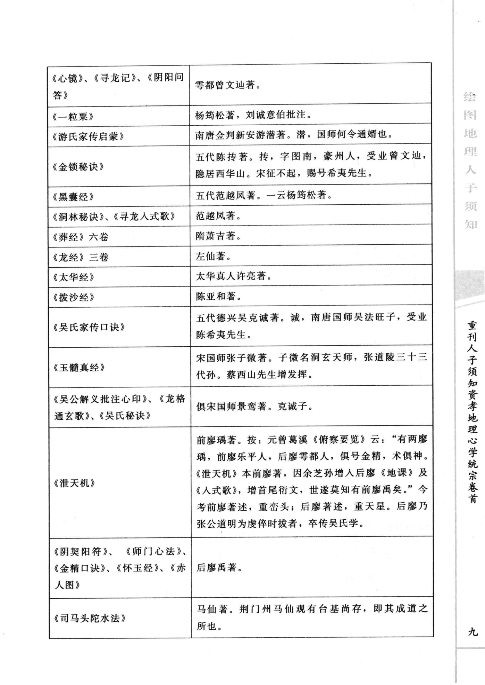

<!-- doc007 PDF 第 13 页：未引用图表已用原页保全；文字供检索，版式以原页图为准。 -->
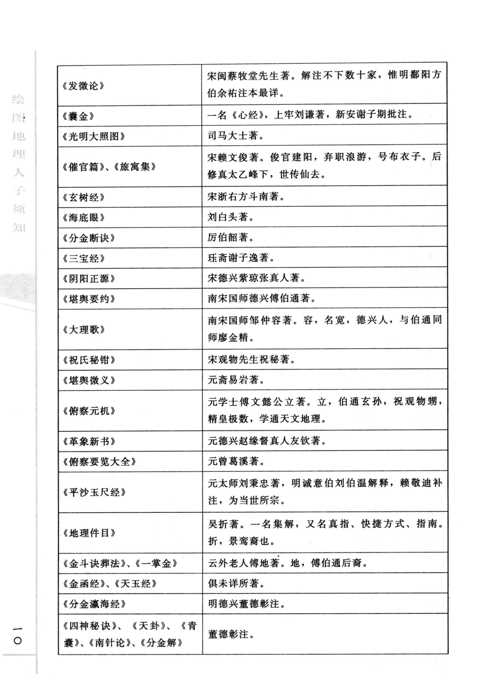

<!-- V3_SOURCE_ID:book018-b000090-p000-f5638518ab -->

以下这些著作的作者姓名都已无法考证：《昏衢炬烛》《万万山心法》《赵缘督琐录》《祝氏神龙经》《水经》《张落魄口诀》《空山老人穴法》《天涯海角经注》《寸金穴法》《四十字穴法》《沙竹图穴法》《铜人穴法》《相山骨髓》《三式全书》《地脉经》《地理指南》《堪舆指南》《山海经》。

查看对应原文

<!-- V3_FOLDBACK_BEGIN:book018-b000090-p000-f5638518ab -->

以下俱不详著者姓名：《昏衢炬烛》、《万万山心法》、《赵缘督琐录》、《祝氏神龙经》、《水经》、《张落魄口诀》、《空山老人穴法》、《天涯海角经注》、《寸金穴法》、《四十字穴法》、《沙竹图穴法》、《铜人穴法》、《相山骨髓》、《三式全书》、《地脉经》、《地理指南》、《堪舆指南》、《山海经》。

<!-- V3_FOLDBACK_END:book018-b000090-p000-f5638518ab -->

<!-- V3_SOURCE_ID:book018-b000091-p000-456084ebe9 -->

## 琐言①

查看对应原文

<!-- V3_FOLDBACK_BEGIN:book018-b000091-p000-456084ebe9 -->

## 琐言①

<!-- V3_FOLDBACK_END:book018-b000091-p000-456084ebe9 -->

<!-- V3_SOURCE_ID:book018-b000092-p000-18d265b9f5 -->

## 一、不可不知地理。

查看对应原文

<!-- V3_FOLDBACK_BEGIN:book018-b000092-p000-18d265b9f5 -->

## 一、不可不知地理。

<!-- V3_FOLDBACK_END:book018-b000092-p000-18d265b9f5 -->

<!-- V3_SOURCE_ID:book018-b000093-p000-b7d5065f93 -->

孔子说：“选择墓地来安葬逝者。”程子说：“选择墓地，是要占卜这块地的好坏。地好的话，祖先的神灵就能安息，子孙也会兴旺，就像培育树根，枝叶自然会繁茂。”他又说：“祖父、父亲、子孙是同气相连的，这里安稳了，那里也安稳；这里危险了，那里也危险。”朱子说：“葬的意思就是藏，是用来安放祖先遗体的。子孙来安放祖先的遗体，就必须怀着谨慎庄重、真诚恭敬的心意，为长久安稳做打算。让祖先的形体完整，神灵得以安息，这样子孙就会兴旺，祭祀也不会断绝。”他又说：“如果选择墓地不精细，选的地不好，就一定会有‘水’泉、蚁蝼、地风这类东西侵害墓穴内部，让祖先的形体和神灵不得安宁，子孙也会有死亡灭绝的忧虑，这实在是太可怕了。”陆象山说：“能通晓天地人三者的称为儒者。地理之学虽然只是一门技艺，但对上能尽到送终的孝道，对下能为后代谋划，这件事的意义也很重大。父母在世时，身体发肤都应当爱惜，何况父母去世后，要把父母的遗体安放在地下，却交给平庸的风水师、世俗的巫师，让父母的体魄不能安息，那孝道又体现在哪里呢！”看圣贤们的论述是这样，那么选择墓地来安葬亲人的道理，确实是仁人孝子不能忽视的。如果平时把地理当作不重要的事，不去过问，一旦发生丧事，就难免仓促草率地处理，侥幸得到好地，固然是所希望的；不幸把亲人的遗体安置在蚁穴、泉窟、沙砾之中，和把亲人的遗体扔在沟壑山丘里没什么区别，还有比这更不孝的吗？所以为人子女的，必须在平时弄明白地理的道理，希望日后遇到丧事时不会出错，让亲人的魂魄能在地下安息。即使如此，要折断三次手臂才能称为高明的医生，地理的道理又不是浅薄之人、知识匮乏的人所能完全弄明白的。如果说自己已经懂了，就刚愎自用，把凶地当成吉地，固执己见，那和平庸的风水师、世俗的巫师又有什么区别呢！唉，万镒重的美玉，必须交给玉匠才能雕琢。

查看对应原文

<!-- V3_FOLDBACK_BEGIN:book018-b000093-p000-b7d5065f93 -->

孔子曰“卜其宅兆而安厝之”。程子曰：“卜其宅兆者，卜其地之美恶也。地之美者，则神灵安，子孙盛。若培植其根而枝叶茂。”又曰：“祖父子孙同气，彼安则此安，彼危则此危。”朱子曰：“葬之为言藏也，所以藏其祖考之遗体也。以子孙而藏其祖考之遗体，则必致其谨重诚敬之心，以为安固久远之计。使其形体全而神灵得安，则其子孙盛而祭祀不绝。”又曰：“其或择之不精，地之不吉，则必有水泉、蚁蝼、地风之属以贼其内，使其形神不安，而子孙亦有死亡绝灭之忧，甚可畏也。”陆象山曰：“通天地人曰儒。地理之学虽一艺，然上以尽送终之孝，下以为启后之谋，其为事亦重矣。亲之生，身体发肤皆当保爱，况亲之殁也，奉亲之体厝诸地，固乃付之庸师俗巫，使父母体魄不得其安，则孝安在哉！”夫观圣贤所论如此，则择地殡亲之道，诚仁人孝子之不可忽者。若平居视地理为末务，而不之问，一旦有大故，则不免仓卒苟且为之，幸得吉地，固所愿矣；不幸而置亲体于蚁泉沙砾中，无异委之于壑丘，不孝孰甚？故人子须于平时讲明其说，庶几他日临事不误，而亲魄得安于地下矣。虽然，三折臂然后称明医，地之理又非肤浅及鲜传者所能究竟也。苟曰予既已知之矣，而自用自专，误凶为吉，牢不可破，则其害奚异于庸师俗巫哉！噫，万镒之玉，必付之玉人而后可也。

<!-- V3_FOLDBACK_END:book018-b000093-p000-b7d5065f93 -->

<!-- V3_SOURCE_ID:book018-b000094-p000-33617c9c1a -->

## 二、不可停柩不葬。

查看对应原文

<!-- V3_FOLDBACK_BEGIN:book018-b000094-p000-33617c9c1a -->

## 二、不可停柩不葬。

<!-- V3_FOLDBACK_END:book018-b000094-p000-33617c9c1a -->

<!-- V3_SOURCE_ID:book018-b000095-p000-7e860a79ac -->

司马温公说：“现在有亲人去世的人，常常很久都不安葬。问他们原因，说是年份和日子不吉利，又说是没有找到吉地，说是外出做官在远方没能回来，说是贫穷办不起丧葬用品。甚至有终身、几代都不安葬，最后把尸体、灵柩丢弃遗失，不知道在哪里的。唉！怎能不让人深深叹息怜悯呢！人看重自己死后有子孙，是因为子孙能安放自己的形骸。他们却做出这样的事，还不如没有子孙死在路上，尚且有仁人见了会收埋他的遗体呢。况且先王制定礼制，安葬的期限最远不超过七月，从王公以下，都是三月而葬。又按礼制，未安葬时不脱去丧服，吃粥，住在倚庐里，是为了哀伤亲人还没有安息的地方。安葬之后，才逐渐可以脱去丧服。现在的人违背礼制，未安葬就脱去丧服，到各地做官，吃精米，穿锦绣，饮酒作乐，内心能安宁吗？”吴草庐说：“丧事不立即办理，年代久了，有的子孙不齐、人事不齐，有的遭遇兵乱、‘水’火等意外，有的因贫穷、疾病缠身而办不了，有的因是非争执而坏事，有的因官司牢狱而无法办理，有的一天天懈怠、一天天忘记，最终导致灵柩被弃置，这些都是停丧很久、变故很多的情况。”我按：两位先生所说的话，极其沉痛恳切。大概现在的风俗，平时大多不讲究地理，等到有丧事，就茫然不知所措，停着灵柩来等待选择墓地。起初的心意虽然急切，时间久了必然因循拖延，最终到了荒废时日、不知自己是天地间的大罪人。有儿子不能安葬他的父亲，有孙子不能安葬他的祖父，到了年代久远的时候，确实就像两位先生所忧虑的那样。唉！为人子女的怎能不心怀戒惧呢？

查看对应原文

<!-- V3_FOLDBACK_BEGIN:book018-b000095-p000-7e860a79ac -->

司马温公曰：‘今人有丧亲者，往往久而不葬。问之，曰岁月未利也。又曰未有吉地也。游宦远方未得归也。贫未能办葬具也。至有终身累世而不葬，遂有弃失尸柩不知其处者。呜呼！可不令人深叹愍哉！人所贵于身后有子孙者，为能藏其形骸也。其所为乃如是，曷若无子孙死于道路，犹有仁者见而殣之耶。且先王制礼，葬期远不过七月，自王公以下，皆三月而葬。又礼，未葬不变服，食粥，居倚庐，哀亲之未有所归也。既葬，然后渐有变除。今之人背礼违法，未葬而除丧，从宦四方，食稻衣锦，饮酒作乐，于心安乎？’吴草庐曰：‘丧不即举，年代已远，或子孙参差而人事不齐，或罹兵乱而水火不测，或贫病兼并而不能举，或是非争兢而害成，或官事牢狱而不可为，或日怠日忘而竟成弃置，皆停丧久远而变见多端也。’愚按：二公所言，极其痛切。盖今时之俗，平居多不讲夫地理，及有变故，则懵无所措，停柩以侍择地。初心虽切，久必因循，遂至醉梦过时，不知为天地间极大罪人。有子不能葬其父，有孙不能葬其祖，至于年代深远，诚有如二公之所虑者。呜呼！为人子者可不懔懔然而知所戒惧乎？

<!-- V3_FOLDBACK_END:book018-b000095-p000-7e860a79ac -->

<!-- V3_SOURCE_ID:book018-b000096-p000-a1fd1ee507 -->

## 三、不可侵葬祖冢。

查看对应原文

<!-- V3_FOLDBACK_BEGIN:book018-b000096-p000-a1fd1ee507 -->

## 三、不可侵葬祖冢。

<!-- V3_FOLDBACK_END:book018-b000096-p000-a1fd1ee507 -->

<!-- V3_SOURCE_ID:book018-b000097-p000-d3bb3b11d7 -->

地理的方法虽然繁多，但“葬乘生气”这句话，足以抓住它的关键。所以千里延伸而来的“来龙”，到“入首”处，只需要融聚成八尺的“穴”。谚语说“阴地一线”就是这个意思。祖冢既然已经乘了这一线“生气”，那么它的左右上下就都是死气，在那里安葬只会成为蚁穴、泉窟罢了。不仅新安葬的灵柩会带来祸患，还会泄露祖先的“生气”，惊动祖先的体魄，造成的危害不小。有人说：中原地区，最初安葬的人面向南方，之后在左右按昭穆顺序安葬，称为族葬。有一个“穴”安放几十个灵冢的，有一个灵冢安放十几个灵柩的，看似是侵葬，却没听说有什么灾祸，为什么呢？我回答：中原地区，是千里平坦的原野，“水”深土厚，如果得到一个“穴”，可以安放十几个灵柩，也可以安放十几个灵冢，这就是张子微所说的“也有一龙十数穴，也有一穴十数茔”的情况。东南地区多山，“水”流湍急、土层浅薄，容易出现泉眼、多有石块，会有蝼蚁滋生，怎能和中原地区相比呢？又有人说：附葬在祖先旁边，以及父母必须合葬，都是古代的礼制，是不可非议的。我回答：礼制贵在变通。附葬既然有侵葬祖先的嫌疑，而合葬如果是不得已，也不必拘泥。我兄弟曾经游历福建到考亭，拜谒文公朱夫子的遗像。又全面察看他祖先的坟墓，文公的祖父退翁，名森，字良材，墓在政和县感化里护国寺西边。父亲韦斋先生，名松，谥号献靖，墓在崇安县上梅里寂历山。母亲祝氏夫人，墓在建阳崇泰里寒泉岭仰天湖形。文公的墓在建阳嘉禾里九峰山下，风吹罗带形。退翁之前的墓都在徽州婺源，距离考亭已经很远了。而退公、韦斋、文公的墓，又各在一个县，距离考亭都有一百多里，何曾拘泥于附近祖冢的说法？还有，考察文公安葬父亲，也曾三次迁移，而最后一次迁移的时间，和安葬母亲是同一年，也不曾拘泥于父母合葬的说法。唉！从这里可以看出文公先生洞察事理的明智，不被世俗拘泥，足以作为榜样了！

查看对应原文

<!-- V3_FOLDBACK_BEGIN:book018-b000097-p000-d3bb3b11d7 -->

夫地理之法虽繁，而“葬乘生气”一言，足以尽其肯綮。故千里来龙入首，惟融八尺之穴。谚云“阴地一线”是也。祖冢既已乘乎一线生气，则其左右上下皆为死气，葬之徒为蚁穴泉窟而已。不惟新葬之柩将为祸患，且又泄祖宗之生气，惊祖宗之体魄，其为害不小也。或曰：中州之地，始葬者南面，后左右昭穆而殡，谓之族葬。有一穴安数十冢者，有一冢安十数柩者，似于侵葬，未闻其祸何也？予曰：中州之地，千里平洋，水深土厚，若得一穴，可安十数柩者有之，可安十数冢者有之。张子微所谓“也有一龙十数穴，也有一穴十数茔”者是耳。东南山丛，水驶土薄，易泉而多石，蝼蚁生之，安可与中州比也？或又曰：附葬祖侧，及父母必合葬，皆古礼，有不可议者。答曰：礼贵通变。附葬既有侵祖之嫌，而合葬或不得已，亦不必拘。予兄弟尝游闽至考亭，拜文公朱夫子遗像。及徧观其先世丘垅，文公之祖退翁，名森，字良材，墓在政和县感化里护国寺西。父韦斋先生，名松，谥献靖，墓在崇安县上梅里寂历山。母祝氏夫人，墓在建阳崇泰里寒泉岭仰天湖形。文公墓在建阳嘉禾里九峰山下，风吹罗带形。退翁以前墓皆在徽婺源，去考亭固已甚远。而退公、韦斋、文公之墓，又各在一县，去考亭皆百余里，何尝拘于附近祖冢之说？又，考文公葬父，亦尝三迁，而最后迁处，与葬母同年①，亦未尝拘于父母合葬。噫！此见我文公先生烛理之明，不狃于俗，足可为法矣！

<!-- V3_FOLDBACK_END:book018-b000097-p000-d3bb3b11d7 -->

<!-- V3_SOURCE_ID:book018-b000098-p000-01f9900b58 -->

按：《文公年谱》记载：绍兴十四年，将韦斋安葬在西塔山，之后改葬到寂历山中峰的原上。再考察韦公的《迁韦斋墓记》说：起初，府君病危，想要安葬在崇安的五夫。去世的第二年，就定在灵梵院旁边。当时朱熹年幼还不懂事，占卜选择墓地不精细，担心祖先的体魄不安稳，乾道六年，迁葬到白水的鹅峰山下。又考察文公庆元五年撰写的《韦斋行状》说：韦公去世的第二年，朱熹护送他的灵柩安葬在崇安县的五夫。但韦公安葬的地方，地势低洼潮湿，担心不是长久之计，就护送灵柩迁到武夷乡上梅里寂历山中峰僧舍的北边。从这里来看，确实是三次迁葬。出自《建宁郡志》。

查看对应原文

<!-- V3_FOLDBACK_BEGIN:book018-b000098-p000-01f9900b58 -->

按：《文公年谱》云：绍兴十四年，葬韦斋于西塔山，其后改葬于寂历山中峰之原。及考韦公，《迁韦斋墓记》曰：初，府君将殆，欲葬崇安之五夫。卒之明年，遂定于灵梵院侧。时熹幼未更事，卜地不详。惧体魄之不安，乾道六年，迁于白水之鹅峰山下。又考文公庆元五年撰《韦斋行状》云：公卒之明年，熹奉其柩葬于崇安县之五夫。然公所藏，地势卑湿，惧非久计，乃奉而迁武夷乡上梅里寂历山中峰僧舍之北。即此而观，乃是三迁葬也。见《建宁郡志》。

<!-- V3_FOLDBACK_END:book018-b000098-p000-01f9900b58 -->

<!-- V3_SOURCE_ID:book018-b000099-p000-80a35c2d35 -->

## 四、不可图葬旧穴。

查看对应原文

<!-- V3_FOLDBACK_BEGIN:book018-b000099-p000-80a35c2d35 -->

## 四、不可图葬旧穴。

<!-- V3_FOLDBACK_END:book018-b000099-p000-80a35c2d35 -->

<!-- V3_SOURCE_ID:book018-b000100-p000-52893d55a5 -->

曾葛溪说：“图谋安葬旧有的穴，实在是糊涂到了极点。我曾见过一处旧穴，虽然此前已经出过大贵之人，可它的子孙不成器，把它卖掉了，前后换了三次主人，安葬了两百多年，最终也没有出现显贵的人。人们只是指着它说：‘这是某家的祖坟，迁葬后卖给了某家，不吉利，又转卖给某家，也都不吉利’。由此就能知道，旧穴没有再次发达的应验。还有安葬后被风吹动、水势改变的情况，多得数不过来，始终没听说过安葬旧穴能获得福气的。况且依仗福气、凭借权势，挖别人的坟墓，追究他的用心，已经不会被上天保佑，地又怎么能给他带来福气呢？况且地脉刚开始兴盛的时候，就像火刚点燃；等到它衰败的时候，就像灰烬已经冷却。想要在冷灰中寻求炙手可热的热度，绝对没有这样的道理。这就是古人所说的图谋安葬旧穴，就像向头发花白的老妇人求子嗣一样。”按：葛溪的论述，确实都切中要害。为人子女的寻求墓地安葬亲人，应当先修养自身的德行。谋划安葬已经被发掘的穴，迁走别人的亲人来安葬自己的亲人，挖掘别人的坟墓来作为自己的坟墓，忍心损害德行，没有比这更严重的了，就算得到了地理，天理又在哪里呢？我曾说过：人人都难保百年的坟墓，迁葬重扦太忍心。不要说天公没有报应，后来还有挖坟的人。寻求墓地的人应当知道警戒。

查看对应原文

<!-- V3_FOLDBACK_BEGIN:book018-b000100-p000-52893d55a5 -->

曾葛溪曰：“图葬旧穴，惑之甚也。尝见一旧穴，虽前已发大贵，子孙不肖鬻之，凡三易主，葬二百余年，卒无显者。人但指而言曰：‘此某氏祖冢，徙墎卖与某氏。不利，又转卖某氏，皆不利’。即此可知，旧穴无重发达之验。又有葬后风迁水易者，难以殚举，竟未闻葬旧穴而获福者。况凭福恃势，发他人之坟，诛其用心，已不为天所佑，地何能福之哉？且地脉初兴，如火之始然；及其既败，如灰烬已冷。欲于冷灰中求炙手热，决无是理。此古人谓图葬旧穴，如求嗣续于鹤发妇人耳。”按：葛溪所论，诚皆切当。盖人子求地葬亲，当先修其德。谋葬已发之穴，徙人之亲而葬其亲，伐人之冢而为已冢，忍心害德，莫此为甚，纵得地理，天理何在？予尝谓：人人难保百年坟，徙墎重扦太忍心。莫道天公无报应，后来还有伐坟人。求地者宜知所戒。

<!-- V3_FOLDBACK_END:book018-b000100-p000-52893d55a5 -->

<!-- V3_SOURCE_ID:book018-b000101-p000-91bb45d52a -->

## 五、不可拘泥公位。

查看对应原文

<!-- V3_FOLDBACK_BEGIN:book018-b000101-p000-91bb45d52a -->

## 五、不可拘泥公位。

<!-- V3_FOLDBACK_END:book018-b000101-p000-91bb45d52a -->

<!-- V3_SOURCE_ID:book018-b000102-p000-d11bac6607 -->

世俗之人拘泥于公位的说法，兄弟众多，各自怀着私心，争论不下，于是有终身不安葬自己亲人的人。唉！做父母的，常常把子女多当作幸事。可如今像这样，还不如子女少的家庭，没有房分之争，能让亲人的遗体入土为安，避免长久暴露的祸患啊！所以寻求墓地只应当辨别真伪，不能拘泥于公位。墓地如果确实是真的好，可对于公位或许有不整齐的地方，这也只能交给子孙的缘分，不能怀着私心长久暴露亲人的遗体，也不能相信邪师的话，胡乱有所举动反而毁坏了墓地。况且想要房分平均，不能拘泥于一个穴，应当另外寻找一个穴来辅助衬贴，这样就能达到平均了。杨公说“岂可一坟分公位，必取众坟参互议”就是这个意思。大概公位的说法，只可以放在一边不去谈论。蔡文节公说：“现在的人动不动就争论公位的说法，以致长久不安葬亲人，见识多么荒谬啊！造化自然会安排，难道是人力能够巧妙算计的吗？墓地不能不选择，应当让亡魂安处。至于自己寻求多福，在于地理之外，不能怀着徇私的心思。一有私心，他的打算必然错误。世人因为这个耽误自己、耽误子孙的情况太多了。等到不如意，就跟着迁徙，越改越错，不是地耽误人，是用心的错误啊。”程子说：“不把奉养亲人当作打算，却专门为后代谋划利益，不是孝子安置亲人的用心。”确实是最恰当的论述。所以为人子女的只应当把安置亲人放在心上就可以了。如果说期望活人得到庇佑，将来求得富贵，只是次要的事情罢了。况且还有安葬后沙水发生变化，公位的说法也大多不灵验。为人子女的，应当知道大义，怎么能专门拘泥于这个呢？

查看对应原文

<!-- V3_FOLDBACK_BEGIN:book018-b000102-p000-d11bac6607 -->

世俗拘泥公位之说，兄弟众多，各怀私意，争论不决，遂有终身不殡其亲者。噫！为人父母者，每以子多为幸。今若此，则是不若少子者，无房分之争，得归全于土，而免久暴之患矣！是故求地惟当辨真伪，不可拘泥公位。地诚真美，而于公位或有不齐，此亦付之子孙缘，不可挟私而久暴其亲，亦不可信邪师之言，妄有作为而反坏其地。且欲房分之均，不可拘于一穴，宜别求一穴以补衬之，则得均矣。杨公云“岂可一坟分公位，必取众坟参互议”是也。大抵公位之说，只可置之勿论。蔡文节公云：“今人动争公位之说，以致久不葬亲，何所见之谬耶！造化者自区处，岂伊人力所能巧计？地不可不择，当使亡魂安处。至于自求多福，乃在地理以外，非可以徇私为心。才有私心，其计必左。世人以此误自己，误子孙者甚多。及不如意，从而迁徙，愈更愈错，非地误人，用心之误也。”程子曰：“不以奉亲为计，而专以利后为谋，非孝子安厝之用心。”诚为至论。故人子但以安亲为念可也。若曰期生人之受荫，冀富贵于将来，但末务耳。况有葬后沙水变易，而公位之说亦多不验。为人子者，须知大义，岂可专泥于兹乎？

<!-- V3_FOLDBACK_END:book018-b000102-p000-d11bac6607 -->

<!-- V3_SOURCE_ID:book018-b000103-p000-5374c7d7b5 -->

## 六、不可轻易改葬

查看对应原文

<!-- V3_FOLDBACK_BEGIN:book018-b000103-p000-5374c7d7b5 -->

六、不可轻易改葬。

<!-- V3_FOLDBACK_END:book018-b000103-p000-5374c7d7b5 -->

<!-- V3_SOURCE_ID:book018-b000104-p000-1af8e550cc -->

孔子说：“古代的人不修治坟墓。”不是不修治坟墓，是必定要诚心诚意、恪守诚信罢了。在安葬的时候就预先做好完全不动的打算，他的慎重已经到了这种地步，何况已经安葬了的亲人却想要改迁，怎么能不这样慎重呢？现在的人有轻信别人的话，有的为了富贵而动心，有的为了祸患而恐惧，常常轻易改葬，他们的事情是不得已吗？还是有别的原因呢？如果是不得已，而且有水蚁等其他祸患，改葬没有不可以的。但也有被野师迷惑，错误改葬吉地的，让亲人的遗体不免暴露，我想仁人孝子会惭愧得额头冒汗啊。《青乌经》说：“凡是墓地有五种不祥的情况就可以改葬①，改葬。如果出现三种祥瑞就不要改葬②。”这话太有道理了！我现在推广它的意思，特意定下五条戒律：人丁繁衍的不迁，年代久远的不迁，没有五种不祥情况的不迁，不犯五种祸患的不迁③，家道安康的不迁。实在是想让人们慎重对待啊。虽然如此，礼制有改葬的规定④，历代都公布了启攒的日期，古人也未尝不迁葬。如果不得已，必须得到明师再三商量确定。大概地没有十全十美的，只应当考察它的轻重缓急。如果有财力没有合适的人，就寻求温暖的穴；有人力没有财力，就寻找得水的地方。确实考察到那个地方比旧坟好，然后商议迁葬。如果旧坟没有大祸患，能够安稳，就应当另外寻找吉地来承接福气，也不是不可以，何必一定要改葬呢！所以“慎重”二字，是改葬的人应当仔细思考的。

> **释读存疑：** ①②③④为原书注释，未在正文内体现具体内容

查看对应原文

<!-- V3_FOLDBACK_BEGIN:book018-b000104-p000-1af8e550cc -->

孔子曰：“古者不修墓。”非不修墓也，盖必诚必信已。当葬时而豫为一成不动之计，其慎重尚如此，况举既葬之亲而欲改迁之，何可以慎重不如是乎？今之人有轻信人言，或为富贵而动其念，或为祸患而惕其衷，往往易于改葬，彼其事得已耶？抑不得已耶？如其不得已，而有水蚁及他患也，改之无不可也。然亦有为野师所惑，误改吉地者，令亲体不免暴露，吾恐仁人孝子当不止其颡之有泚矣。《青乌经》云：“凡地有五不祥者可改①，改之。如见三祥瑞则勿改②。”甚哉，有味乎其言之也！予兹推广其意，特立五戒：曰人丁蕃衍者不迁，年代深远者不迁，无五不祥者不迁，不犯五患者不迁③，家道平康者不迁。诚欲其人之慎之也。虽然，礼有改葬之服④，历颁启攒之日，古人亦未尝不迁。如不得已，须得明师再三商确。大抵地无全美，只当察其轻重缓急。如有财无人，须求温暖之穴；有人无财，宜寻得水之地。审有其地果胜旧坟，然后议迁。如旧坟无大祸患，可以平稳，则当别求吉地接福于后，未为不可，奚必于改葬哉！是故“慎之”一字，改葬者所当绎思也。

<!-- V3_FOLDBACK_END:book018-b000104-p000-1af8e550cc -->

<!-- V3_SOURCE_ID:book018-b000105-p000-a712c50e47 -->

## 七、不可专意图大。

查看对应原文

<!-- V3_FOLDBACK_BEGIN:book018-b000105-p000-a712c50e47 -->

## 七、不可专意图大。

<!-- V3_FOLDBACK_END:book018-b000105-p000-a712c50e47 -->

<!-- V3_SOURCE_ID:book018-b000106-p000-8bd742e4e4 -->

寻求墓地必须辨别真伪，不必拘泥于大小。如果龙、穴是真的，纵然力量轻微，也能发迹。只是仰慕大地，却不能辨别真伪，葬在假穴之中，是把亲人的遗体置于水泉蚁穴之中，求福反而得祸，有什么益处呢？大概大地难以识别，而且有鬼神掌管，不能强求。常常有图谋大地的人，连小地也得不到，反而被假地耽误。他们不知道安稳的小地，到处都有，容易寻求。况且小地既然是真的，几个穴一起发力，也能带来大的福气。杨筠松说：“大地难得小易求，积累不已成山丘，众坟合力却成大，人说小地生公侯。”又说：“是真不必问大小，积小成大最为好。”又说：“图大不得且思次，此事当与智者议。”这话太有道理了！为人子女的寻求墓地，应当知道辨别真伪，千万不要被图大的想法迷惑。

查看对应原文

<!-- V3_FOLDBACK_BEGIN:book018-b000106-p000-8bd742e4e4 -->

求地须辨真伪，不必拘大小。若龙穴真的，纵力量轻，犹能发越。徒慕大地，而不能辨真伪，葬于假穴之中，是置亲体于水泉蚁穴，求福得祸，顾何益哉！盖大地难识，且有鬼神司之，不可强求。往往图大地者，虽小地亦不得，而竟被假地所误。彼盖不知安稳小地，在在有之，易于求索。况小地既真，数穴并力，亦能致大。杨筠松云：“大地难得小易求，积累不已成山丘，众坟合力却成大，人说小地生公侯。”又云：“是真不必问大小，积小成大最为好。”又云：“图大不得且思次，此事当与智者议。”旨哉言乎！人子求地，且知辨真伪，慎毋为图大所惑。

<!-- V3_FOLDBACK_END:book018-b000106-p000-8bd742e4e4 -->

<!-- V3_SOURCE_ID:book018-b000107-p000-e8df88bf91 -->

## 八、不可不观古格。

查看对应原文

<!-- V3_FOLDBACK_BEGIN:book018-b000107-p000-e8df88bf91 -->

## 八、不可不观古格。

<!-- V3_FOLDBACK_END:book018-b000107-p000-e8df88bf91 -->

<!-- V3_SOURCE_ID:book018-b000108-p000-217cb6a4cb -->

地理这门学问，分为道眼和法眼两种。道眼是天生就有的认知能力，层级是最高的，常人难以企及。而所谓的法眼，必须经由师傅传授，要遍览有名的墓葬，弄清楚什么样的是吉，什么样的是凶，龙、穴符合什么标准才算入格，砂、水符合什么条件才算合局，每一项都核查清楚，把这些作为判断的准则，所以才叫做法眼。卜氏说：“追寻仙迹，看格尤胜看书。”杨氏说：“劝君且去覆旧坟，胜读十卷撼龙文。”又说：“见格多时心易晓，见多胜耳千回闻。”还说“若不看格信人说，俗师不晓能惑人”，讲的都是这个道理。所以如果要营建墓地，一定要先去多查看仙迹名墓，把这些作为参照的准则，这样差不多就能心里有主见，不会被假的风水宝地迷惑，这实在是一件很要紧的事。做子女的，应当想到安置亲人的后事是平生第一等大事，上要为亲人遗体的安宁谋划，下要为子孙后世的长远考虑，不能惧怕登山涉水的辛劳。

查看对应原文

<!-- V3_FOLDBACK_BEGIN:book018-b000108-p000-217cb6a4cb -->

夫地理之学，有道眼，有法眼。道眼生知，不可尚矣。所谓法眼者，必从师授，编观名墓，何为而吉，何为而凶，龙穴何为而入格，砂水何为而合局，一一检点，以之为法，故曰法眼。卜氏云：“追寻仙迹，看格尤胜看书。”杨氏云：“劝君且去覆旧坟，胜读十卷撼龙文。”又曰：“见格多时心易晓，见多胜耳千回闻。”又云“若不看格信人说，俗师不晓能惑人”是也。故将欲营宅兆，必须先去多观仙迹名墓，以彼为法，则庶几心目有主，不被假地所惑，诚一紧要事也。为人子者，当念厝亲是平生第一大事，上为亲体安宁之谋，下保子孙久远之计，而不可惮其登涉之劳也。

<!-- V3_FOLDBACK_END:book018-b000108-p000-217cb6a4cb -->

<!-- V3_SOURCE_ID:book018-b000109-p000-32f070894b -->

## 九、不可不择良师。

查看对应原文

<!-- V3_FOLDBACK_BEGIN:book018-b000109-p000-32f070894b -->

## 九、不可不择良师。

<!-- V3_FOLDBACK_END:book018-b000109-p000-32f070894b -->

<!-- V3_SOURCE_ID:book018-b000110-p000-e6f893845a -->

曾葛溪说：“寻找风水宝地必须先挑选合适的良师，若挑选的师傅不合适，带来的危害会非常大。”这话实在说得对呀！其实找到风水宝地并不难，难的是找到合适的师傅。只要找到了合适的师傅，就不用担心找不到风水宝地。如果师傅不合适，就像毁坏屋瓦、在墙壁上随意涂抹一样，即便有好的宝地，也可能会错失对应的穴；即便找到了好的穴，也可能会违背安葬的法则，更别说还想找到合适的风水宝地了。所以挑选师傅才是寻找风水宝地的首要任务。不过，能传授风水之术的师傅也很难得，不是学识渊博的通儒就无法穷究事物的道理来获取知识，不是得到真正的传承就不懂得规矩的精妙之处来穷尽其中的奥秘。就算是学识渊博的通儒，得到了传承，如果品德败坏，我恐怕他会指鹿为马，把鸟骗成鸾鸟，带来的危害会更大。因此，具备这三个条件，才能称得上是良师。即便如此，师傅固然不可不挑选，挑选到合适的人之后，又必须竭尽诚心去感动他，所以说要以自身的品德修养来对待他人。

查看对应原文

<!-- V3_FOLDBACK_BEGIN:book018-b000110-p000-e6f893845a -->

曾葛溪曰：“求地必先择良师，师非其人，为害不浅。”诚哉言也！盖得地非难，得师为难。得其师，不患不得其地。苟师非其人，毁瓦画墁，虽有美地，而或扦失其穴；虽得美穴，而或葬乖其法，况欲其寻地乎？故择师又为求地之先务也。然地学之师亦难矣哉，非通儒不能穷理格物以致其知，非真授受不识矩镬微妙以尽其奥。通儒术，得传授，苟蔑其德，吾恐指鹿为马，诳鸟为鸾，而为害尤甚。是故备斯三者，然后始为良师。虽然，师固不可不择，择而得其人，又须谒诚以感之，故曰取人以身。

<!-- V3_FOLDBACK_END:book018-b000110-p000-e6f893845a -->

<!-- V3_SOURCE_ID:book018-b000111-p000-f3146a064e -->

## 十、不可不修阴德。

查看对应原文

<!-- V3_FOLDBACK_BEGIN:book018-b000111-p000-f3146a064e -->

## 十、不可不修阴德。

<!-- V3_FOLDBACK_END:book018-b000111-p000-f3146a064e -->

<!-- V3_SOURCE_ID:book018-b000112-p000-f1b6c5ef89 -->

蔡文节公说：“积累德行是寻找风水宝地的根本。凡是想要为子孙做长远打算的人，应当以公正的心态处世，方便他人行事。一个念头符合道义，各路神灵都会归向，选择风水宝地、论定穴的位置反而是次要的。如果不这样，自身德行不修，却只想着向祖宗父母的遗骨求取功效，早上迁移晚上又更改，越改越错，这种悖逆不孝的罪过，只会招致上天的责罚，又有什么益处呢！”吴文正公说：“我曾见过有人家找到了吉利的风水宝地，之后却没有得到福运，反而遭遇凶祸，这是为什么呢？如果不是立穴的位置有误，就是立向的方位有偏差。还有的人挖掘开凿过度，损伤了龙、损伤了穴，把吉利的风水变成凶险的。还有的人已经找到了吉利的风水宝地，也找到了高明的师傅，却固执己见，迁移穴的位置、更改向的方位。看风水的人只一味顺从雇主，不再坚持自己的术法，最终导致出现差错。又有的术者心怀奸邪，行为诡诈，不肯完全施展自己的术法。还有的人已经找到了吉利的风水宝地，安葬时也没有差错，子孙却轻信他人的话，动不动就迁改，这块地被其他姓氏的人得到，那人反而因此获得福运。这些情况未必都是术者的过错，往往冥冥之中有促使这样发展的原因，是因为没有积累德行的缘故。不积累德行却去寻找风水宝地，就好比不耕种却想要收获，哪有这样的道理呢！”按：两位先生的论述十分恰当。想要阴地好，首先要心地好。我的祖父存耕公曾劝人不能凭借势力谋取风水宝地，还作诗道：踏破铁鞋无觅处，得来全不费工夫，牛眠鹤举获奇遇，只存方寸地中求诗①。同乡的达官显贵松轩叶先生把这句话当作名言。还有宋谦父的诗写道：世人尽知穴在山，岂知穴在方寸间。好山好水世不欠，尚非其人寻不见。我见富贵人家坟，往往葬时皆贫贱。迨其富贵力可求，人事极时天理变。所以得到吉利的风水宝地，必定是因为有德之人能够承受福运，然后神灵才会把吉利的宝地赐予他。神灵把吉利的宝地赐予他，就是上天回报善人的缘故。想要找到吉利的风水宝地，为祖父祖母建造墓地，让先人的体魄得以安宁，而后世的繁荣昌盛不会断绝，应当先积累德行来端正根本。有人问：寻找风水宝地必须以德行为根本，那只要修养德行就够了，择地的术法又有什么用呢？我回答说：择地是为了安葬亲人考虑。子女对于亲人，本应当竭尽心力。如果担心亲人体魄的安危，怎么能不慎重地广泛选择呢！修养德行来等待上天的安排，选择风水宝地来尽到人事，两者并行不悖，这是仁人孝子的心意。

查看对应原文

<!-- V3_FOLDBACK_BEGIN:book018-b000112-p000-f1b6c5ef89 -->

蔡文节公曰：“积德为求地之本也。凡人欲为子孙永远计者，当以公心处世，方便行事。一念合理，百神归向，择地论穴又其次也。不然，吾德之不修，而徒责效于祖宗父母之遗骨，朝移夕改，愈更愈谬，其悖逆不孝之罪，适足以取诛谴于造物，顾何益哉！”吴文正公曰：“尝见人家求得吉地，而后不蒙其福，反见凶祸者，何哉？若非立穴之误，便是立向之差。又有掘凿大过，伤龙伤穴，变吉成凶。又有已得吉地，又得明师，而乃固执己见，移穴易向。相地者惟务承顺，不复执术，遂至防误。又或术者憸心诡行，不肯尽术。又有既得吉地，葬之不差，而子孙轻信人言，辄迁改，他姓得之，因以获福。凡此未必尽皆术者之过，往往冥冥中有使然者，由不积德之故也。不积德而求地，譬之不耕而求获，宁有是理哉！”按：二公所论切当。盖欲阴地好，先要心地好。先大父存耕公尝劝人不可以势力营风水，因作诗云：踏破铁鞋无觅处，得来全不费工夫，牛眠鹤举获奇遇，只存方寸地中求诗①。乡达松轩叶先生以之为名言。又宋谦父诗曰：世人尽知穴在山，岂知穴在方寸间。好山好水世不欠，尚非其人寻不见。我见富贵人家坟，往往葬时皆贫贱。迨其富贵力可求，人事极时天理变。故得吉地，必有德可以膺福，然后神以吉地畀之。神之俾以吉地，即天之报善故也。欲求吉地，为祖父宅兆，俾先人之体魄安而后世之荣盛不替者，当先积德以端其本焉。或曰：求地必本于德，则亦修德而已，择地之术，又焉用哉？予曰：择地以藏亲为计。人子之于亲也，固当无所不用其极。苟虑夫亲魄之安危，则岂容不慎重而广择之哉！修德以俟天，择地以尽人，并行而不悖，仁人孝子之为心也。

<!-- V3_FOLDBACK_END:book018-b000112-p000-f1b6c5ef89 -->

<!-- V3_SOURCE_ID:book018-b000113-p000-6c8a352023 -->

## 附：少保都督南塘戚公《正止集》一款 — 这里附录少保都督南塘戚公所著《正止集》中的一条相关内容。

> **释读存疑：** 1轮自动修复后核义模型仍建议修订，已保守记录。

查看对应原文

<!-- V3_FOLDBACK_BEGIN:book018-b000113-p000-6c8a352023 -->

## 附：少保都督南塘戚公《正止集》一款

<!-- V3_FOLDBACK_END:book018-b000113-p000-6c8a352023 -->

<!-- V3_SOURCE_ID:book018-b000114-p000-7afb2ce2b6 -->

我曾观察琥珀吸附草、磁石吸引针的现象，对此感到奇怪。琥珀和磁石都是没有知觉的物体。草已经枯死，针经过火的煅烧锤炼，哪里还有生机呢？可一旦被吸引，就会跳跃动荡如同有生命一般，而且针能接连吸附好几个，坠落之后又会跳跃。从这些现象来看，风水的说法，确实是有依据的。枯骨没有知觉，我还不敢认为风水之说完全正确。不过琥珀、磁石就好比山川，针和草就好比人的遗骸。那些说风水不可信的人，是因为世上有些人不修养自身德行，只一心谋求风水，甚至还有不惜倾家荡产、忍心做伤天害理的事，专门寻觅好风水来让子孙昌盛的人。他们却不知道地理和天理是相互贯通的，这类人应当从天理的层面去问责，并不是地理本身不灵验。我曾听说有个人谋划夺取别人的葬地，千方百计找人诉讼陷害对方。被害的那户人家各种灾祸接连降临，正在思索招致灾祸的原因。那个谋夺葬地的人又买通占卜的人，让占卜的人对被害人家妄言说：“你家那块葬地不好，要是能迁葬就会平安了。”不久之后，那户人家依照他的说法迁了葬，这个人就谋下那块旧地来安葬自己的父亲。他安葬父亲还没满一年，自己遭遇的灾祸反而更严重。后来他心生怀疑就迁葬，挖开土层见到棺材时，发现有白蚁蛀蚀棺木形成的文字：“此地若灵，是无天理；此地不灵，是无地理。”上天生出的吉利宝地，必定要等有德的人才能获得，世人丢开天理而去追求地理，实在是糊涂啊！

查看对应原文

<!-- V3_FOLDBACK_BEGIN:book018-b000114-p000-7afb2ce2b6 -->

尝观琥珀系草，磁石引针之事而怪之。夫琥珀、磁石无知之物也。草既枯死，而针经火煅炼，生意何在？一被引系，则举跃动荡如生，而针则锋锋相连，可自变量个，坠而复跃。即此，则风水之说，信乎其有。枯骨无知，而未敢以为尽然。然琥珀、磁石其山川乎？针草，其遗骸乎？谓风水不可信者，盖以世人不修厥德，惟以是为务，至有倾人身家，忍心害理，专谋风水，以昌子孙者。却不知地理与天理相为流通，兹一等人，又在天理处责他，而非地理之不验也。曾闻一人谋人葬地，百计觅人讼害。其家诸祸并臻，思所以致之者。彼又买托卜者，向伊妄言曰：“某葬地不佳也，能迁之则安矣。”既而，伊家如其说迁之，彼即谋其故地以葬其父。葬未逾年，所得祸更甚。后疑而迁之，发土至棺，有白蚁蛀木成文曰：“此地若灵，是无天理；此地不灵，是无地理。”夫天产佳地，必待有德者得之，世人遗天理而求地理，惑哉！

<!-- V3_FOLDBACK_END:book018-b000114-p000-7afb2ce2b6 -->

<!-- V3_SOURCE_ID:book018-b000115-p000-fd8605fbc0 -->

按语：戚少保所引用的琥珀吸草、磁石引针的说法，和《葬书》里“木华于春，栗芽于室；铜山西崩，灵钟东应”的意思相符，都是所说的气相互感应的情况。祖父和子孙气息相通，还有什么可怀疑的！篇末引用的地理本于天理的例证，尤其让人觉得痛快。我和兄弟们还曾听福建当地人说：朱子前往同安，在路上休息时，看见一处坟地的山水格局很美，就问旁边的樵夫说：“这处坟地的后人境况怎么样？”樵夫回答说：“这户人家原先很富贵，自从葬在这里之后就衰败了。”朱子感叹说：“山有理，水有理，此地不发，是无地理。”樵夫又告诉朱子说：“这座山本来是某户人家的产业，有个富户贪图这块地，强行占了用来下葬。那户人家贫穷势弱，没有能力争辩。”朱子又感叹说：“山有理，水有理，此地若发，是无天理。”当天晚上，这座坟就被雷击了。现在福建当地还有能说出这件事详细情况的人。

> **释读存疑：** 本地硬校验仍未通过，已记录供后续自动处理或人工核对。

查看对应原文

<!-- V3_FOLDBACK_BEGIN:book018-b000115-p000-fd8605fbc0 -->

按：戚少保所引琥珀吸草、磁石引针之说，与《葬书》“木华于春，栗芽于室；铜山西崩，灵钟东应”之意相符，皆所谓气之相感者也。祖父子孙同气，更复何疑！末引地理本于天理之证，尤所痛快。予兄弟又尝闻闽人言：朱子之同安，憩于途，见一坟地山水甚美，因问其樵者曰：“是坟子孙何如？”答曰：“先是富贵，今葬后退败。”公叹曰：“山有理，水有理，此地不发，是无地理。”樵者告公曰：“此山原是某家业，富家某贪其地占葬之。某贫弱不能争辨。”公又叹曰：“山有理，水有理，此地若发，是无天理。”一夕为雷所震。今闽乡犹有能道其详者。

<!-- V3_FOLDBACK_END:book018-b000115-p000-fd8605fbc0 -->

<!-- V3_SOURCE_ID:book018-b000116-p000-22a91193d6 -->

以上所说的，都是慎重对待丧葬之事的人应当预先知道的，所以特意把这些内容放在前面，希望仁孝的君子留意体察。

查看对应原文

<!-- V3_FOLDBACK_BEGIN:book018-b000116-p000-22a91193d6 -->

已上所言，皆慎终者所当先知，故特揭诸首，仰仁孝君子加察云。

<!-- V3_FOLDBACK_END:book018-b000116-p000-22a91193d6 -->

<!-- V3_SOURCE_ID:book018-b000117-p000-770313cc50 -->

## 附：杂说二款

查看对应原文

<!-- V3_FOLDBACK_BEGIN:book018-b000117-p000-770313cc50 -->

## 附：杂说二款

<!-- V3_FOLDBACK_END:book018-b000117-p000-770313cc50 -->

<!-- V3_SOURCE_ID:book018-b000118-p000-fe30b138c1 -->

## 论风水名义

查看对应原文

<!-- V3_FOLDBACK_BEGIN:book018-b000118-p000-fe30b138c1 -->

## 论风水名义

<!-- V3_FOLDBACK_END:book018-b000118-p000-fe30b138c1 -->

<!-- V3_SOURCE_ID:book018-b000119-p000-92ab53c2cf -->

风水师用“风水”二字作为这门学问的名称，来源就是郭氏所说的“葬者乘生气也”。那生气要怎么察知呢？答案是：生气的来向有水来引导它，生气的止蓄有水来界定它，生气的凝聚不能有风来吹散它，所以说要得水，要藏风。又有说法称：气是水的母体，有气才会有水。还有说法称：噫散出来的气只会耗散生气。又有说法称：外气形成横向的形态，内气就能止蓄生发。还有说法称：得水是最首要的，藏风是其次的。这些说法都是在说风与水，是用来察知生气的来向、止蓄与凝聚状况的标准。总而言之，没有风生气就会凝聚，得到水生气就会融和，这就是“风水”得名的缘由。根据名称去探求它的含义，风水的准则就没有遗漏的内涵了。有人说：天地初分、混沌初始的时候，只有风和水，两者相互推挤动荡，所以叫风水。还有人说：风是用来吹拂生发万物的，水是用来滋养万物的，所以叫风水。这些说法都和葬地的道理不切合。还有什么水退去风就来、水到来风就去的说法，就更是错误了。

查看对应原文

<!-- V3_FOLDBACK_BEGIN:book018-b000119-p000-92ab53c2cf -->

地理家以风水二字喝其名者，即郭氏所谓“葬者乘生气也”。而生气何以察之？曰：气之来有水以导之，气之止有水以界之，气之聚无风以散之，故曰要得水，要藏风。又曰：气乃水之母，有气斯有水。又曰：噫气惟能散生气。又曰：外气横形，内气止生。又曰：得水为上，藏风次之。皆言风与水，所以察生气之来与止聚云尔。总而言之，无风则气聚，得水则气融，此所以有风水之名。循名思义，风水之法无余蕴矣。或曰：天地初分，混沌之始，只有风与水，两相推荡，故曰风水。又曰：风所以扬万物，水所以滋万物，故曰风水。此则皆不切于葬理。而又有水去则风来，水来则风去之说，益又舛矣。

<!-- V3_FOLDBACK_END:book018-b000119-p000-92ab53c2cf -->

<!-- V3_SOURCE_ID:book018-b000120-p000-86b19f3c27 -->

## 论龙脉穴砂名义

查看对应原文

<!-- V3_FOLDBACK_BEGIN:book018-b000120-p000-86b19f3c27 -->

## 论龙脉穴砂名义

<!-- V3_FOLDBACK_END:book018-b000120-p000-86b19f3c27 -->

<!-- V3_SOURCE_ID:book018-b000121-p000-1a6d5bd613 -->

研究地理的风水家把山称作龙，这是为什么呢？山的形态千变万化，或大或小，或起或伏，或逆或顺，或隐或显，支珑的形态没有固定的样子，很短的距离内地势的变化就会陡然不同。用世间的事物来比照，只有龙的特性是这样的，所以用龙来给山命名，取的就是龙潜伏、显现、飞升、腾跃，变化难以预测的特点。那把山地的走势称作脉又是为什么呢？就像人的身体里的脉络，是气血运行的通道，整个人的先天禀赋都和脉络相关联。凡是人的脉，清的就显贵，浊的就低贱，脉有吉相的人就平安，脉有凶相的人就危险。地脉也是这样的。擅长治病的医生，通过诊察人的脉象就能知道人的安危和寿命长短；擅长看地理的风水家，通过审察山的脉就能判断地块的吉凶好坏，这是不变的定论。不过龙和脉二者是相互依存的，有龙就有脉，没有脉就不存在龙。只是龙同时也指形态上比较显著的部分，而脉专门对应气的隐微之处，所以说观察山的时候，辨认脉尤其困难。

查看对应原文

<!-- V3_FOLDBACK_BEGIN:book018-b000121-p000-1a6d5bd613 -->

地理家以山名龙，何也？山之变态千形万状，或大或小，或起或伏，或逆或顺，或隐或显。支珑之体段不常，咫尺之转移顿异。验之于物，惟龙为然，故以名之，取其潜、见、飞、跃，变化莫测云尔。曰脉者何也？人身脉络，气血所由运行，而一身之禀赋系焉。凡人之脉，清者贵，浊者贱，吉者安，凶者危。地脉亦然。善医者，察人之脉而知其安危寿夭；善地理者，审山之脉而识其吉凶美恶，此不易之论也。然龙与脉两者相因，有龙则有脉，无脉则无龙。但龙兼指乎形之显著，而脉又专主乎气之隐微，故曰山尤难于认脉。

<!-- V3_FOLDBACK_END:book018-b000121-p000-1a6d5bd613 -->

<!-- V3_SOURCE_ID:book018-b000122-p000-b1ca81702f -->

穴的含义就像人身上的穴位，取义非常精妙。杨公说：“譬如铜人针灸穴，穴穴宛然方始当。”朱子说：“定穴之法，譬如针灸，自有一定之穴，而不可有毫厘之差。”这些都很好地说明了穴的名义。砂是古人传授时，用沙堆拨出山形，因此得名砂。

查看对应原文

<!-- V3_FOLDBACK_BEGIN:book018-b000122-p000-b1ca81702f -->

穴者盖犹人身之穴，取义至精。杨公云：“譬如铜人针灸穴，穴穴宛然方始当。”朱子云：“定穴之法，譬如针灸，自有一定之穴，而不可有毫厘之差。”此皆善状穴之名义也。沙者，古人授受，以沙堆拨山形，因名沙耳。

<!-- V3_FOLDBACK_END:book018-b000122-p000-b1ca81702f -->

<!-- V3_SOURCE_ID:book018-b000123-p000-e7ed18deb4 -->

## 目录

查看对应原文

<!-- V3_FOLDBACK_BEGIN:book018-b000123-p000-e7ed18deb4 -->

## 目录

<!-- V3_FOLDBACK_END:book018-b000123-p000-e7ed18deb4 -->

重刊人子须知资孝地理心学统宗卷首…………………………1   
郢中重刻人子须知序…………………………1   
重刊人子须知序…………………………………………………………………………2   
旧序……………………………………………………………………………………2   
—……………………………………………………………………………………… 2   
—………………………………………………………………………………………… 3   
三………………………………………………………………………………………3   
四………………………………………………………………………………………4   
五……………………………………………………………………………4   
自序………………………………………………………………5   
………………………………………………………………………………………5   
………………………………………………………………………………………6   
郢中重刻自序…………………………………………………………………6   
凡例…………………………………………………………………………7   
引用诸名家堪輿书目………………………………………………………………8   
琐言……… ………………………………………………………………………11   
附：少保都督南塘戚公《正止集》一款………………15   
附：杂说二款………………………………………………………………………………………16   
重刊人子须知资孝地理心学统宗卷一…………………………………1   
卷一之……………………………………………………………………1   
论昆仑为诸山之祖……………………………………………………………………1   
总论中国之山…………………………………………………………………………2   
论九州山镇川泽……………………………………………………5   
论山河两戒……………………………………………………………………………6   
论三大干龙………………………………………………………………………7   
论南条干龙脉络………………………………………………………………………7   
论中条干龙脉络 ………………………………………………………………………8   
论北条干龙脉络 ………………………………………………………………………8   
卷之二………………………………………………………………………………10   
论帝都………………………………………………10   
历代帝都考……………10   
论帝都必合星垣………………………………………………………………………12   
论北龙所结帝都垣局…………………………………………………………………15   
论中龙所结帝都垣局…………………………………………………………………17   
论南龙所结帝都垣局…………………………………………………………………19   
卷之三……………………………………………21   
枝干总论………………21   
论干龙………………………………………………………22   
论枝龙…………………………………………26   
卷之四………………………………………………………………………………31   
总论支珑…………………………………………………………………………31   
论珑龙………………………………………………………………………………31   
论支龙……………………………………………………………………………32   
重刊人子须知资孝地理心学统宗卷二…37   
卷二之………………………………………………37   
论太祖山…37   
论少祖山……………………………………………37   
论无少祖山……………………………………………………………………41   
论龙父母胎息孕育……………………………………………………………………41   
论龙人首………………………………………………………………………………42   
卷二之二………………………………………………………………………44   
论龙出身……………………………………………………………45   
论龙开障………………………………………………………………………………46   
论龙剥换……………………………………………………………………………………46   
论龙过峡………………………………………………………47   
护峡山格…………………………………………………………51   
蔡西山先生峡格………………………………………………………………………52   
论龙枝脚ę棹…………………………………………………………………………58   
论龙护送……………63   
卷二之三……………64   
论龙旁正…………………………64   
论龙老嫩…………………65   
论龙长短……………………………………………………………………65   
论龙真假……………………………………………………………………………66   
论龙贵贱………………………………………67   
卷二之四……………69   
论龙驻…………………………………69   
论龙行止………………………………………………………………………………69   
论龙分摩……………………………70   
论龙背面………………70   
论龙宾主……………73   
论龙奴从…75   
论龙余气…………………………………………………………………………………76   
卷二之五………………………………………………………………………80   
论龙分三势………………………………………………………………………80   
论龙分三落……………82   
论龙形势十二格……………………………………………………………………………83   
论龙出脉三格…………………………………………………………………………88   
论龙受穴三等………………………………………90   
论龙入首五格…………………………………………………………………………90   
论龙人穴十二脉………………………………………………………93   
论龙结穴五局………………………………………………………………………94   
论龙结局分三聚………………………………………………………………………95   
刊人子须知资孝地理心学统宗卷三……………97   
卷三之………………………………………………………………………………97   
五星总论……………………………………………………………97   
论五星之形…………………………………………………………………97   
论五星之名……………………………………………………………………98   
论五星分高山平岗平地三格………………………………101   
论五星体性 ………………………………………………………………101   
论五星所忌………………………………………………………………………102   
论五星所喜………………………………………………………………………102   
论五星聚讲……………………………………………………102   
论五星连珠……………103   
论五星归垣…………………………………………………………………………104   
卷三之二……………………………………………………105   
穴法总论……………………………………………………………………………105   
论窝形之穴…………………………………………………………………………107   
论钳形之穴…………………………………………………………………………113   
钳形变格……………………………………………………………115   
论乳形之穴……119   
卷三之三……………124   
论突形之穴………………………………………………………………124   
突形四格 ………………124   
论边窝之格…………………………………………………………………………128   
论并窝之格 ……130   
论分钳之格…………………………………………………………………………131   
论合钳之格…………………………………………………132   
论闪乳之格…………………………133   
论侧乳之格………………………………………………134   
论鹊突之格………………………………………………134   
论并突之格………………………………………………………………………135   
卷三之四………138   
穴星三大格………………………………………………………………138   
穴星三格辨…………………………………………………………………………138   
穴星诸形…………………………………………………………139   
火星不结穴辨…………139   
金星穴……………………………………………………140   
木星穴……142   
水星穴………………………………144   
土星穴…………………………………………………………………………… 146   
卷三之五 …………………………………………………………………………149   
论朝山证穴……………………………………………………………………………149   
论明堂证穴………………………………………………………………………………………152   
论水势证穴…………………………………………………………………………152   
论乐山证穴……………………………………………………153   
论鬼星证穴…………………………………………………………………………154   
论龙虎证穴…………………………………………………………………………154   
论缠护证穴 ………………………………155   
论唇毡证穴………………………………………………………………………155   
论天心十道证穴……………………………………………………………………157   
论分合证穴……………………………………………………………………………157   
重刊人子须知资孝地理心学统宗卷四……………………………159   
卷四之……………………………………………………………………………159   
粗恶…………………………………………………………………………………159   
峻急………………………………………………………159   
单寒…………………………………………………………………………………160   
臃肿………………………………………………………………………161   
虚耗…161   
凹缺………161   
瘦削164   
突露…164   
破面…………………………………………………165   
疙头…165   
散漫………………………………166   
幽冷…………………166   
尖细……………………………… 167   
荡软………………………………………………………………167   
顽硬……………………167   
岩…………………………………………167   
卷四之二………………………………170   
以太极定穴………………………………………………………………170   
以两仪定穴………………………………………………………………………171   
以三势定穴…………………………………………………………………………172   
以三停定穴…………………………………………………………………………173   
以四杀定穴……………………………………………………………175   
以雌雄定穴………………………………………………………………………………177   
以饶减定穴…………………………………………………………………………177   
以聚散定穴………………………………………………………………………………178   
以向背定穴………………………………………………………………………178   
以张山食水定穴 ……………………………………………………………………178   
以枕耳角定穴…………………………………………………………………179   
以趋吉避凶藏神伏煞定穴 …………………………………………………………180   
以近取诸身定穴……………………………………………………………………181   
以指掌定穴…………………………………………………………………………183   
以远取诸物定穴 ……………………………………………………………………185   
以流星定穴………………………………………………………186   
以八卦定穴……………………………………………………………186   
卷四之三……………………………………………………………………………186   
青乌仙十不相………………………………………………………………………189   
廖金精穴星八病………………………………………………………………190   
李淳风论脉有八病…………………………………………………………………190   
泓师三十六绝穴 …………………………………………191   
入式十二例杂论 ……………………………………………………………………193   
刘白头十般无脉绝 …………………………………………………………………193   
洪悟斋二十四杀穴…………………………………………………………………194   
紫琼张真人穴法三十六怕…………………………………………………197   
紫清真人白玉蟾四喻………………………………………………………………197   
辨穴真假……………………………………………………………………………197   
伤龙伤穴说…………………………………………………………………………198   
卷四之四…………………………………………………………………198   
怪穴破惑歌…………………………………………………………………198   
巧拙万金歌…………………………………………………………………………209   
重刊人子须知资孝地理心学统宗卷五…219   
卷五之…………………………………………………………………… 219   
砂法总论………………………………………………………219   
论青龙白虎…………………………………………220   
龙虎吉类……………………………………………………………………………222   
龙格凶类……………………………………………………………………223   
青龙凶格…………………………………………………………………………224   
总论朝案二山……………………………………………………………………225   
论案山……………………………………………………………………………… 225   
本身案山…………………………………………………………………………………226   
论朝山………………………………………………………………………………226   
论平原无朝案 ………………………………………………………………………228   
论不见外阳…………………………………………………………………………228   
论朝山暗拱…………………………………………………………………………232   
论朝山乱杂…………………………………………233   
论孤峰独秀……………………………………234   
卷五之二………………………………………………………………234   
论前应后照…………………………………………………234   
论左辅右弼…………………………………………………………………………237   
论天门地户…………………………………………………………………………237   
论罗城垣局…………………………………………………………………………237   
卷五之三……………………………………………………………………………238   
论乐山 …238   
论下手砂………………………………………………240   
论水口砂……………………………………………………243   
华表山 …………………………………………………244   
捍门 …………………………………………… 245   
北辰 ……………………………………………………… 245   
罗星………246   
卷五之四………………………………………247   
官鬼总论 …………………………………………… 247   
论官星……………248   
论鬼星249   
论禽星……253   
论曜星…………………………………………………………………255   
卷五之五………………………………………………………262   
口议……………… ……………………………………………………… 262   
重刊人子须知资孝地理心学统宗卷六…297   
卷六之…… ………………………………………………………… 297   
水法总论……………………………………………………………………………297   
论水发源………………………………………………………………………298   
论水到局…………………………………………………………………………298   
论水出口……………299   
论朝水…………………………………………299   
论去水 ………………………………………………………………301   
论聚水………………………………………………………………………………… 304   
卷六之二………………………………………………………………………………306   
论诸水……………………………………… 306   
论诸泉…………………………………………………………………………314   
卷六之三……………………………………………………………………………316   
论明堂………………………………………………………………………………316   
明堂吉格…………………………………………………………………………318   
明堂凶格……320   
卷六之四……………………………………………………………………………322   
论水城…………………322   
五星背城…………………………………………………………………324   
水城详议……………………………………………325   
卷六之五 ………327   
论水形势…………………………………………………327   
卷六之六……………………………………………………………………………337   
论阳基………………………………………………………………337   
总论阳基……………………………………………………………………………337   
论阳基龙穴砂水大概………………………………………………………337   
论平支阳基…………………………………………………………………………338   
论山谷阳基……………………………………………339   
卷六之七………………………………………340   
俯察本源歌…………………………………………………………………………340   
俯察正法歌………340   
地理三科歌………………………………………………341   
九星人式歌…………………………………………………………………………341   
九星正名…………………………………341   
九星正变龙格歌……………………………………………………………………341   
九星正变穴星歌 ……………………………………………………………………342   
全局入式歌………………………342   
寻龙人式歌…………………………………………………………………………342   
步龙认格歌 …………………………………………………………………………343   
落局人式歌……………………………………………………………………………343   
穴星人式歌…………………………………………………………………………344   
点穴认势歌 …………………………………………………………………………344   
怪穴辨惑歌…………………………………………………………………………344   
消砂人式歌………………………………………………………………………345   
喝砂分格歌 …………………………………………………………………………345   
九星正变砂格歌……………………………………………………………………346   
消水人式歌 …………………………………………………………………………346   
辨水分格歌…………………………………………………………………………346   
九星正变水形歌………………………………………………………………………347   
明堂人式歌…………………………………………………………………………347   
明堂辨水歌…………………………………………………………………………348   
洞明卦例入式歌……………………………………………………………348   
建都入式歌…………………………………………………………………………349   
郡邑入式歌 …………………………………………………………………………349   
立宅人式歌…………………………………………………………………………350   
安坟人式歌…………………………………………………………………………350   
作法秘旨歌……………………………………………………………………351   
阴契阳符……………………………………351   
卷六之八 ……………………………………………………………………………353   
论风水要逆…………………………………………………………………………353   
论颠倒即逆………………………………………………………………………354   
论乘生气……………………………………………………………………………354   
附论乘吉凶…………………………………………………………………355   
论浅深……………………………………………………………………………… 355   
论风水无全美…………………………………………………………………………356   
论土色不必拘………………………………………………………………………356   
论葬必择良期………………………………………………………………………357   
论风水不可妄加筑凿……………………………………………………………………357   
论风水有夙缘…………………………………………………………………357   
童刊人子须知资孝地理心学统宗卷七……………………………………359   
卷七之……………………………………………………………………………359   
论九星之谬…………………………………………………………………………359   
论卦例之谬………………………………………………………………………… 360   
论四龙分卦之谬………………………………………………………………361   
论三合龙之谬……………………………………………………………………362   
论星卦诸伪书之谬………………………………………………………………363   
论宗庙水法之谬……………………………………………………………………364   
论国音拘向之谬…………………………………………………………………364   
论断验小数之谬 ……………………………………………………………………365   
论克应饿兆之谬……………………………………………………………………365   
论通书诸神煞之谬 …………………………………………………………………366   
堪兴宗旨……………………………………………………………………………369   
三味论…………371   
卷七之二…………………………………………………………………374   
阴阳旨原……………………………………………375   
太极图说………………………………………………………………………375   
河图图说……………………………………………………………………………376   
洛书图说……………………………………376   
卦序………………………………………………………………………………378   
卦书……………………………… 379   
文王八卦图说 ……………………………381   
卷七之三……………………………………………………………………………385   
原阴阳………………………………………………………………………385   
原五行………………………………………………………………………………386   
原金卦……………………389   
六甲浑天候卦 ……………………………………………390   
六十透地龙四吉三奇到方定局 …………………………………………………391   
八卦统六十龙应七十二候 …………………………………………………………394   
禽奇金卦总要………………………………………………………………………395   
原天星………………………………………………396   
二十八宿迭见南方午位 ……………………………………………………………402   
二十八宿分野 ……………………………………………………………403   
气布于地 …404   
原三易……………………………………………………………………404   
原孤虚旺相………………………………………………………405   
原天度黄道…………………………………………………………………………406   
诸历周天度数黄道总览图 …………………………………………………………407   
周天度数……………………………………………………………………………408   
附南针说………………………………………………408   
附录宋山陵议状……………………………………………………………………409   
卷七之四……………………………………………………………………………412   
二十四龙所主吉凶…………………………………………………………412   
论双脉吉凶……………………………………………………………………………413   
蔡西山先生详节天表六十龙吉凶分金八卦坐向纲目……………………………414   
重刊人子须知资孝地理心学统宗卷八…………………………………………………417   
卷八之…………………………………………………………………417   
二十四龙诸吉穴……………417   
卷八之………………425   
吉砂类…………………………………………………………………………… 425   
类……………………………………………………………………… 428   
卷八之三………………430   
总论二十四位水法吉凶………………………………………………………………430   
总论阴阳二局水法吉凶 ……………………………………………………………………………431   
诸吉水类……………………………………………………………………………431   
诸凶水类 ……………………………………………………………………………………434   
卷八之四 ……………………………………………………………………………440   
水法定论 ………………………………………………………………………440   
卷八之五…………………………………………………………………………445   
水法详定………………………………………………………………………………………445   
决水法………………………………………………………………………… 446   
总阳局吉凶方位……………………………………………………451   
卷八之六……………454   
万年图……………………………………………………455   
万年图山向便览终 ………………………………………………………………………………………469   
编校后记………………………………471

<!-- V3_SOURCE_ID:book018-b000125-p000-e6ff4f19c0 -->

## 重刊人子须知资孝地理心学统宗卷一 — 这是重新刊刻的《人子须知资孝地理心学统宗》第一卷的卷首标题

> **释读存疑：** 1轮自动修复后核义模型仍建议修订，已保守记录。

查看对应原文

<!-- V3_FOLDBACK_BEGIN:book018-b000125-p000-e6ff4f19c0 -->

## 重刊人子须知资孝地理心学统宗卷一

<!-- V3_FOLDBACK_END:book018-b000125-p000-e6ff4f19c0 -->

<!-- V3_SOURCE_ID:book018-b000126-p000-2b7c4c1a76 -->

卷一之一

查看对应原文

<!-- V3_FOLDBACK_BEGIN:book018-b000126-p000-2b7c4c1a76 -->

卷一之一

<!-- V3_FOLDBACK_END:book018-b000126-p000-2b7c4c1a76 -->

<!-- V3_SOURCE_ID:book018-b000127-p000-cd3a43dbce -->

◎这一卷专门论述天下的大干龙。龙在地理四科中居于首位，堪舆先生最重视论龙。如果论龙却不了解天下的大干龙，那么所见的范围就近而不远，所探究的内容就浅而不深，所观察的领域就窄而不广，这怎么可以呢？所以首先论述天下的大干龙，希望能让人认识到重要的部分。

查看对应原文

<!-- V3_FOLDBACK_BEGIN:book018-b000127-p000-cd3a43dbce -->

◎此一卷专论天下大干龙。龙居地理四科之首，堪舆家莫要于论龙。论龙而不知天下大干，则所见者近而不远，所究者浅而不深，所窥者狭而不广，乌乎可哉？故首论天下大干龙，庶几识其大者。

<!-- V3_FOLDBACK_END:book018-b000127-p000-cd3a43dbce -->

<!-- V3_SOURCE_ID:book018-b000128-p000-5700cb8d32 -->

## 论昆仑为诸山之祖

查看对应原文

<!-- V3_FOLDBACK_BEGIN:book018-b000128-p000-5700cb8d32 -->

## 论昆仑为诸山之祖

<!-- V3_FOLDBACK_END:book018-b000128-p000-5700cb8d32 -->

<!-- V3_SOURCE_ID:book018-b000129-p000-c1fe86266a -->

《性理大全》中临川吴氏说：“天下的山脉起于昆仑。”蔡牧堂《发微论》说：“所有的山都以昆仑为始祖。”陶公《捉脉赋》说：“高明的人察脉，从昆仑开始。”《明山宝鉴》说：“山脉的起源，本于昆仑。”郭氏《锦囊经》说：“安葬要追溯它的起源，依托它的止息之处。”确实因为地理的方法，龙要追溯它的起源，穴要依托它的止息之处，所以不能不审察山的起源之处。然而观察山的起源，一定要探究水的起源；观察龙的终点，一定要察清水的分界。现在根据地图考察，天下的水都起源于西北，由此可以知道山起于西北。蔡文正公说：“山水都起源于西北，所以大禹叙述山和水，都是从西北到东南”，就是这个意思。有人说昆仑在西海戌地、北海亥地，东南连接积石圃，西北连接北户之室，东北临近太活之井，西南到城南之谷，也荒远无法考证。而杨公又说须弥山生出四龙，昆仑山只是它的南肢。葛溪氏转述他的说法：“须弥山是天地的骨架，在天地中心镇守，是巨大的存在。它的四肢分成四个世界，只有南龙进入中国。南龙从昆仑山进入，龙子龙孙都可以辨别。”虽然依据佛经，人们很少见到，暂且存疑。现在只就中国可以考证的山川来论述，那么昆仑确实是诸山的始祖，在中国的西北。九峰蔡氏说：“中国的山势脉络，大致都从西北延伸而来。”由此可以明白。

查看对应原文

<!-- V3_FOLDBACK_BEGIN:book018-b000129-p000-c1fe86266a -->

《性理大全》临川吴氏曰：“天下之山脉起于昆仑。”蔡牧堂《发微论》曰：“凡山皆祖昆仑。”陶公《捉脉赋》云：“大智察脉，起自昆仑。”《明山宝鉴》云：“山脉之起，本于昆仑。”郭氏《锦囊经》云：“葬者原其始，乘其止。”诚以地理之法，龙则原其始，穴则乘其止，故不可不审山之起祖处也。然观山之所始，必究其水之所起；观龙之所终，必察其水之所界。今以舆图考之，天下之水皆原于西北。是可见山起于西北矣。蔡文正公曰：“山水皆原于西北，故禹叙山叙水，皆自西北而东南”是也。或云昆仑在西海戌地，北海亥地，东南接积石圃，西北接北户之室，东北临太活之井，西南至城南之谷，亦荒远莫稽。而杨公又云须弥山生四龙，昆仑山特其南肢。葛溪氏述其说曰：“须弥山是天地骨，中镇天心为巨物。四肢分作四世界，惟有南龙入中国。南龙入自昆仑山，龙子龙孙皆可别。”虽据佛经，人所罕见，阙之可也。今但以中国山川之可考者论之，则昆仑诚诸山之祖，在中国之西北。九峰蔡氏云：“中国山势冈脊，大抵皆自西北而来。”盖可见矣。

<!-- V3_FOLDBACK_END:book018-b000129-p000-c1fe86266a -->

<!-- V3_SOURCE_ID:book018-b000130-p000-15ecb956f2 -->

《昆仑说》记载：昆仑山共有三重，最下层的叫樊桐，又叫板松；第二层叫玄圃，又叫阆风；最上层的叫层城，又叫天庭。这里被称作大帝的居所，距离嵩山五万里，是大地的中心。《禹本纪》的记载和这个说法相同。高诱称黄河发源于昆仑山，在地下潜伏流动一万三千里，大禹疏导河道使它流通，从积石山流出地表。按照《山海经》的记载，从昆仑山到积石山距离是一千七百四十里，从积石山流出陇西郡到洛阳，参考地理志的记载大约有五千多里。又按照《穆天子传》的记载，穆天子从昆仑山返回宗周走了一万里路。西方地域的里程数，从宗周瀍水以西，往北到河宗之邦的阳纡之山，距离是三千四百里；从阳纡往西到黄河源头有四千里，两处加起来是七千四百里。《外国图》又说，从大晋国往正西方走七万里能到达昆仑之墟，众位仙人居住在那里。以上几种说法都不一致。昆仑山的高度有一万一千里，《山海经》称它方圆八百里，高一万仞。郭景纯认为从山顶往下共高二千五百多里。《淮南子》称它的高度是一万一千一百里一十四步。

查看对应原文

<!-- V3_FOLDBACK_BEGIN:book018-b000130-p000-15ecb956f2 -->

《昆仑说》曰：昆仑之山三汲，下曰樊桐，一名板松；二曰玄圃，一名阆风；上曰层城，一名天庭。是谓大帝之居，去嵩高五万里，地之中也。《禹本纪》与此同。高诱称河出昆仑，伏流地中万三千里。禹道而通之，出积石山。按《山海经》，自昆仑至积石，一千七百四十里，自积石出陇西郡至洛，准地志可五千余里。又按《穆天子传》，天子自昆仑入于宗周万里。西土之数，自宗周瀍水以西，北至于河宗之邦。阳纡之山，三千有四百里。自阳纡西至河首四千里，合七千四百里。外国图又云，从大晋国正西七万里得昆仑之墟，诸仙居之。”数说不同。其高万一千里。《山海经》称方八百里，高万仞。郭景纯以为自上二千五百余里。《淮南子》称高万一千一百里一十四步

<!-- V3_FOLDBACK_END:book018-b000130-p000-15ecb956f2 -->

<!-- V3_SOURCE_ID:book018-b000131-p000-483655fd43 -->

## 总论中国之山

查看对应原文

<!-- V3_FOLDBACK_BEGIN:book018-b000131-p000-483655fd43 -->

## 总论中国之山

<!-- V3_FOLDBACK_END:book018-b000131-p000-483655fd43 -->

<!-- V3_SOURCE_ID:book018-b000132-p000-1b644c4da5 -->

朱熹说：“河图称昆仑是大地的中心，中国距离于阗有两万里。于阗的进贡使者自己说，向西走四千三百多里就到了昆仑。如今中国在昆仑的东南方，而天下的山都以昆仑为始祖，只分出三大支脉进入中国。那些进入夷国的山无法考证，也不值得讨论。现在就中国的情况来说，黄河以北的各山，是从北方的寰武、岚宪等州，顺着高地势延伸而来，山脊以西的水，流入龙门西河，山脊以东的水，流向幽冀地区，注入东海。它的西支是湖口泰岳。次一支环绕汾晋的源头向南延伸，形成析城、王屋，再向西折回形成雷首。又有一支是恒山，还有一支是太行山。太行山绵延一千里，山势很高。上党位于山脊，河东、河北各州都在山的支脉上。其中最长的一支是燕山，一直延伸到平梁才结束。黄河以南的各山，关中的山都来自蜀汉。一支到长安就终止了。关中的一支延伸到函谷关，一直到嵩山、少室山，向东延伸到泰山才结束。一支从嶓冢山、汉水的北岸延伸下来，到扬州才终止。江南的各山都以岷江为始祖，出自岷山。岷山沿着长江两岸延伸，那一边的一支，延伸到江北的诸多地方。这一边的一支，分散到湖南、闽、广，一直延伸到两浙、建康才终止。其中一支是衡山，一直延伸到洞庭、九江的西边才终止。还有一支越过桂岭，环绕湘水的源头，向北经过袁筠地区，一直延伸到庐阜才终止。还有一支从南向东延伸，环绕彭蠡的源头，越过歙县黄山，一直延伸到建康才终止。又从天目山分出一支，一直延伸到浙江以西的山，都从五岭赣地延伸过来，从南向北延伸。闽广的山，从北向南延伸。还有一支环绕浙江的源头，向北到会稽才终止，向南到闽粤才终止。这就是中国各山的始祖与支派的大致情况。”

查看对应原文

<!-- V3_FOLDBACK_BEGIN:book018-b000132-p000-1b644c4da5 -->

朱子曰：“河图言昆仑为地之中，中国至于阗①二万里。于阗贡使自言西去四千三百余里即昆仑。今中国在昆仑东南，而天下之山祖于昆仑，惟派三干以入中国。其入夷国之山无可考，亦不足论。今以中国言之，其河北诸山，则自北寰武、岚宪诸州，乘高而来，山脊以西之水，流入龙门西河，脊东之水，流于幽冀，入于东海。其西一支为湖口泰岳。次一支包汾晋之原而南出，以为析城、王屋，而又西折为雷首。又一支为恒山，又一支为太行山。太行山一千里，其山高甚。上党在山脊，河东河北诸州在山支。其最长一支为燕山，尽于平梁。大河以南诸山，则关中之山，皆自蜀汉而来。一支至长安而尽。关中一支生下函谷。以至嵩、少，东尽泰山。一支自嶓冢、汉水之北生下，尽扬州江南诸山，皆祖于岷江，出岷山。岷山夹江两岸而行，那边一支，去为江北许多去处。这边一支，分散为湖南、闽、广，尽于两浙、建康。其一支为衡山，而尽于洞庭、九江之西。其一支度桂岭，则包湘源，而北经袁筠之地，以尽于庐阜。其一支自南而东，则包彭蠡之原，度歙黄山，以尽于建康。又自天目山分一支，尽于浙江西之山，皆自五岭赣上来，自南而北。闽广之山，自北而南。一支则又包浙江之原，北首以尽会稽，南尾以尽闽粤。此中国诸山祖宗支派之大纲也。

<!-- V3_FOLDBACK_END:book018-b000132-p000-1b644c4da5 -->

<!-- V3_SOURCE_ID:book018-b000133-p000-a267486159 -->

前面只是列举天下的山来论述，还没有涉及水。现在接着编辑山水的总说放在后面。根据仁山金氏的说法：天地的固定形态，本来就相互勾连贯通，但也各自有脉络。从昆仑向东北方向来说，从积石山向北，有涅水、星海、青海，一直到浩亹，都是黄河的源头。流入匈奴以东，是阴山。又向东南，从代北、云朔，分路向南延伸，是北岳，一直到太行山，这就是黄河以北的山脊。壶口、雷首、太岳、析城、王屋，都是它的群峰。汾晋、涿易、淀漳、洹卫，都是它的各条水脉。分路向东延伸的，在幽燕的境内，是五关的险要之处，一直到营平形成碣石，这是北方的脉络。从昆仑向东来说，从西倾山，洮水从它的北面流出，流入黄河。恒水从它的南面流出，流入长江。又向东，是朱圉、鸟鼠等陇地，是渭水的源头。以北就夹着黄河的源头向北延伸。以东，像岍岐，像荆山等峰，是泾水、漆水、沮水等的源头。从渭水以南，就是西倾山向下延伸的各峰连绵成脉络，向南高耸形成太华，东北是殽陕，东南是熊耳、方外、嵩高、伊水、洛水的源头。又向南，是桐柏、淮水的源头，一直到淮西的各山。这是中部的脉络。又从西倾、朱圉向南分路，是嶓冢山汉水的源头，夹着汉水延伸的，北面就是终南、太华、熊耳等陇地。南面是蜀地东部的各峰。论述的人说蜀地东部的各山都是嶓冢山，正是说它们的山峦连绵不断。又向东南来说，是岷山长江的源头，夹着长江向东延伸的。北支就是西倾山以南、嶓冢山以西的脉络，是洹水、西汉水，像江陵的各源头。它的南支就向南延伸形成蒙蔡等山，青衣、大流、马湖、长江等的源头。又向东环绕涪水、黔水，盘绕一圈向北，是三峡。它流出的部分环绕九江的源头。中间盘绕形成衡山。再盘绕向北，是庐阜。它的岭向东延伸的，又是袁、吉、章、贡、旺信等江的源头。到分水鱼梁岭，盘绕三次向北延伸，经过新安，耸立起天目山，一直到升润才终止。盘绕两次之间，它的水汇聚成洞庭。盘绕三次之间，它的水汇聚成彭蠡。盘绕三次以东，向南是闽浙，向北是震泽。这是南方的脉络。只有泰山在东方特立，横亘在左右，用来遮蔽中原。这就是它特殊的原因吧。又说泰山在东方特立，是中国水口的表镇。《禹贡》中论述水大致说：“疏导黄河到同地，形成逆河，流入大海。疏导漾水到东方，形成北江，流入大海。疏导长江到东方，形成中江，流入大海。疏导沇水到东北，汇合汶水，又向东流入大海。疏导淮水到东方，汇合泗水、沂水，向东流入大海。疏导渭水到东方，经过漆水、沮水流入黄河。疏导洛水到东方，汇合伊水，又向东北流入黄河。这就是中国山水的大致形势。”

查看对应原文

<!-- V3_FOLDBACK_BEGIN:book018-b000133-p000-a267486159 -->

右特举天下山而言，未及水也。复辑山水总说于后云。按仁山金氏曰：天地常形，固相为勾连贯通，然亦各有脉络。自昆仑而东北言之，则自积石而北，为涅水、星海、青海，以至浩亹，皆河源也。入匈奴以东，为阴山。又东南，自代北、云朔，分而南趋，为北岳，以至太行，是为河北之脊。壶口、雷首、太岳、析城、王屋，皆其群峰。汾晋、涿易、淀漳、洹卫，则皆其诸水也。分而东趋者，行幽燕之北，为五关之险。以至营平而为碣石，此北络也。自昆仑以东言之，则自西倾而洮水出自北，入河。恒水出其南，入江。又东，为朱圉、鸟鼠诸陇，则为渭之源。以北即夹河源而北。以东，若岍岐，若荆山诸峰，泾水、漆、沮诸源也。自渭以南，即西倾而下诸峰亘为络，南屹为太华，东北为殽陕，东南为熊耳、方外、嵩高、伊、洛之源。又南，为桐柏、淮源，以达于淮西诸山。此中络也。又自西倾朱圉而南分，是为嶓冢汉源，夹汉而趋者，北即终南、华、熊诸陇。南则蜀东诸峰。说者谓蜀东诸山皆嶓冢，正谓其冈岫绵亘耳。又东南言之，是为岷山江源，夹江而东者。北支即西倾以南，嶓冢以西之脉，为洹水，西汉水，如江陵诸源。其南支即南趋为蒙蔡诸山，青衣、大流、马湖、江诸源。又东包涪、黔，一盘而北，为三峡。其出者包络九江之源。中盘中为衡山。其再盘而北，为庐阜。其岭之东出者，又为袁、吉、章、贡、旺信诸江之源。至分水鱼梁岭，三盘而北趋，过新安，峙天目，尽升润。再盘之间，其水聚洞庭。三盘之间，其水聚彭蠡。三盘以东，则南为闽浙，北为震泽。此南络也。惟泰山则特起东方，横亘左右，以障中原。此所以为异与。又曰泰山特起东方，为中国水口表镇。禹贡道水略云：“导河至同，为逆河，入于海。导漾至东，为北江，入于海。导江至东，为中江，入于海。导沇水至东北，会于汶，又东入于海。导淮至东，会于泗、沂，东入于海。导渭至东，过漆、沮入于河。导洛至东，会于伊，又东北入于河。此中国山水大势也。

<!-- V3_FOLDBACK_END:book018-b000133-p000-a267486159 -->

<!-- V3_SOURCE_ID:book018-b000134-p000-6c68886838 -->

朱熹说：河图称：“昆仑是大地的中心。”《素问》说：“天在西北方不够饱满，地在东南方不够平坦。”《水经》说：“昆仑距离嵩山有五万里。”看来不会这么远。大概中国距离于阗有两万里。于阗到昆仑不可能再有三万里。《文昌杂录》记载于阗派遣使者来进贡。使者自己说，从他的地方向西走四千三百多里就是昆仑山。如今中国在昆仑的东南方，而天竺各国在它的正南方。大致地形像馒头一样，它的顶端就是昆仑。

查看对应原文

<!-- V3_FOLDBACK_BEGIN:book018-b000134-p000-6c68886838 -->

朱子曰：河图言：「昆仑者，地之中也。」《素问》曰：「天不足西北，地不满东南。」《水经》云：「昆仑取嵩山五万里。」看来不会如此远。盖中国至于阗二万里。于阗至昆仑无缘更有三万里。《文昌杂录》记于阗遣使来贡献。使者自言其地四千三百余里即昆仑山。今中国在昆仑之东南，而天竺诸国在其正南。大抵地形如馒头然，其尖则昆仑也。

<!-- V3_FOLDBACK_END:book018-b000134-p000-6c68886838 -->

<!-- V3_SOURCE_ID:book018-b000135-p000-cf28f36367 -->

九峰蔡氏说：黄河以北的各山，根本的脊脉都是从代北寰武、岚宪等州顺着高地势延伸而来。它的山脊以西的水，就向西流注入龙门。西河的上游，它的山脊以东的水就向东流形成桑干、幽冀，注入大海。它的西支，是壶口、泰岳。次一支，环绕汾晋的源头向南延伸，形成析城、王屋。再向西折回，形成雷首。又次一支，就是太行山，又次一支，就是恒山。这是黄河以北的山。长江、汉水以南的山，是岷山的脉络，它的北支是衡山，一直延伸到洞庭的西边才终止。它的南支越过桂岭，向北经过袁筠地区，到德安的敷浅源。两支之间，湘水从中穿过，衡山在湘水的西南，敷浅源在湘水的东北。

查看对应原文

<!-- V3_FOLDBACK_BEGIN:book018-b000135-p000-cf28f36367 -->

九峰蔡氏曰：河北诸山，根本脊脉皆自代北寰武、岚宪诸州乘高而来。其脊以西之水，则西流以入龙门。西河之上流，其脊以东之水则东流而为桑干、幽冀，以入于海。其西一支，为壶口、泰岳。次一支，包汾晋之原而南出，以为析城、王屋。而又西折，以为雷首。又次一支，乃为太行，又次一支，乃为恒山。此大河北境之山也。其江汉南境之山，则岷山之脉，其北一支为衡山，而尽于洞庭之西。其南一支度桂岭，北经袁筠之地，至德安之敷浅源。二支之间，湘水间断，衡山在湘水西南，敷浅源在湘水东北。

<!-- V3_FOLDBACK_END:book018-b000135-p000-cf28f36367 -->

<!-- V3_SOURCE_ID:book018-b000136-p000-f01530712e -->

朱熹说：天下的山，西北方最高。从关中分出一支延伸到函谷关，一直到嵩少，向东延伸到泰山才终止。这是一支。又从嶓冢山汉水的北岸，分出一支延伸下来，到扬州才终止。江南的各山，又从岷山分出一支，一直延伸到两浙、闽广才终止。

查看对应原文

<!-- V3_FOLDBACK_BEGIN:book018-b000136-p000-f01530712e -->

朱子曰：天下之山，西北最高。自关中一支生下函谷，以至嵩少，东尽泰山。此是一支。又自嶓冢汉水之北，生下一支，至扬州而尽。江南诸山，则又自岷山分一支，以尽于两浙、闽广。

<!-- V3_FOLDBACK_END:book018-b000136-p000-f01530712e -->

<!-- V3_SOURCE_ID:book018-b000137-p000-956e6332ee -->

又说：大致两条水脉夹着延伸，中间必定有山；两座山夹着延伸，中间必定有水。长江出自岷山，岷山沿着长江两岸延伸，那一边的一支延伸到江北的诸多地方，这一边的一支延伸到湖湘南部。又有一支延伸到建康，又有一支延伸到福建二广。

查看对应原文

<!-- V3_FOLDBACK_BEGIN:book018-b000137-p000-956e6332ee -->

又曰：大凡两水夹行，中间必有山；两山夹行，中间必有水。江出岷山，岷山夹江两岸而行，那边一支去为江北许多去处，这边一支为湖湘南。又一支为建康，又一支为福建二广。

<!-- V3_FOLDBACK_END:book018-b000137-p000-956e6332ee -->

<!-- V3_SOURCE_ID:book018-b000138-p000-0ab3917b21 -->

又说：岷山的脉络，其中一支是衡山，已经延伸到九江的西边才终止。其中一支又向南向东越过桂岭，环绕湘水的源头，向北经过袁筠的境内，一直延伸到庐阜才终止。其中一支又向南向东越过庾岭，环绕彭蠡的源头，向北延伸到建康才终止。其中一支又向东环绕浙江的源头，向北到会稽才终止，向南到闽粤才终止。

查看对应原文

<!-- V3_FOLDBACK_BEGIN:book018-b000138-p000-0ab3917b21 -->

又曰：岷山之脉，其一支为衡山者，已尽于九江之西。其一支又南而东度桂岭者，则包湘源，而北经袁筠之境，以尽于庐阜。其一支又南而东度庾岭者，则包彭蠡之源，以北尽于建康。其一支则又东包浙江之原，而北其首以尽会稽，南其尾以尽于闽粤。

<!-- V3_FOLDBACK_END:book018-b000138-p000-0ab3917b21 -->

<!-- V3_SOURCE_ID:book018-b000139-p000-bd5b335e4f -->

《朱子语录》说：佛经说：昆仑山顶有阿耨大池，水向四面流出，向东南流入中国的，是黄河。另外三方流出的，是弱水、黑水之类。

查看对应原文

<!-- V3_FOLDBACK_BEGIN:book018-b000139-p000-bd5b335e4f -->

《朱子语录》云：佛经云：昆仑山顶有阿耨大池，水流四面出，东南流入中国者，为黄河。其三方流者，为弱水、黑水之类。

<!-- V3_FOLDBACK_END:book018-b000139-p000-bd5b335e4f -->

<!-- V3_SOURCE_ID:book018-b000140-p000-1cdc5297d8 -->

《东坡指掌图》说：西域在匈奴的西面，乌孙的南面。南北有大山，中间有河，向东就连接汉地。所以玉门、阳关以西，以葱岭为边界。它的南山向东延伸到金城，和汉南山相连。它的河有两个源头，一个出自葱岭，一个出自于阗。于阗在南山脚下，它的河水向北流，和葱岭河汇合，向东注入浦昌海。那里的水停留聚集，冬夏不会增减。世人都认为它在地下潜行，向南从积石山流出，成为中国的黄河。

查看对应原文

<!-- V3_FOLDBACK_BEGIN:book018-b000140-p000-1cdc5297d8 -->

《东坡指掌图》云：西域在匈奴之西，乌孙之南。南北有大山，中央有河，东则接汉。所以玉门、阳关西，则限以葱岭。其南山东出金城，与汉南山属焉。其河有两源，一出葱岭，一出于阗。于阗在南山下，其河北流，与葱岭河合，东注浦昌海。其水停居，冬夏不增减。世皆以为潜行于地下，南出于积石山，为中国河云。

<!-- V3_FOLDBACK_END:book018-b000140-p000-1cdc5297d8 -->

<!-- V3_SOURCE_ID:book018-b000141-p000-694e5c2e5d -->

临川吴氏说：水发自昆仑的，它的源头是最远的，只有中国的黄河是这样。汉水发源于嶓冢山，

查看对应原文

<!-- V3_FOLDBACK_BEGIN:book018-b000141-p000-694e5c2e5d -->

临川吴氏曰：水发自昆仑者，其源为最远。惟中国之河为然。汉之发源于嶓冢，

<!-- V3_FOLDBACK_END:book018-b000141-p000-694e5c2e5d -->

<!-- V3_SOURCE_ID:book018-b000142-p000-ce7f0c1ada -->

长江发源于岷山以西，和其他河流相比流程确实可以说很长，但它的源头没有延伸到山脉最初隆起的地方，所以不能和黄河的源头相提并论。因此天下有稳定源头的河流中，黄河排在第一位。古人祭祀河川的时候，先祭祀黄河，后祭祀大海，就是因为重视河流的源头。

> **释读存疑：** 本地硬校验仍未通过，已记录供后续自动处理或人工核对。

查看对应原文

<!-- V3_FOLDBACK_BEGIN:book018-b000142-p000-ce7f0c1ada -->

江之发源干岷山以西，视他水亦可谓远，而非极于山脉初起之处，则不得与河源并也。  
故天下有源之水，河为第一。古人祭川，先河后海，重其源也。

<!-- V3_FOLDBACK_END:book018-b000142-p000-ce7f0c1ada -->

<!-- V3_SOURCE_ID:book018-b000143-p000-dfa8d2c282 -->

朱子说：女真兴起的地方有鸭绿江。传说：天下有三处大的水，分别是黄河、长江、鸭绿江。

查看对应原文

<!-- V3_FOLDBACK_BEGIN:book018-b000143-p000-dfa8d2c282 -->

朱子曰：女真起处有鸭绿江。传云：‘天下有三处大水，曰黄河，曰长江，曰鸭绿江是也。’

<!-- V3_FOLDBACK_END:book018-b000143-p000-dfa8d2c282 -->

<!-- V3_SOURCE_ID:book018-b000144-p000-28346b815b -->

蔡牧堂说：所有山脉都以昆仑为祖，分支分脉，越繁多越细小，这是一个根本衍生出千万种不同的形态。所有水都以大海为宗，不同的支流汇聚成同一水流，越包容越宽广，这是千万种不同的形态汇聚成一个根本。

查看对应原文

<!-- V3_FOLDBACK_BEGIN:book018-b000144-p000-28346b815b -->

蔡牧堂曰：凡山皆祖昆仑，分支分脉，愈繁愈细，此一本而万殊也。凡水皆宗大海，异派同流，愈含愈广，此万殊而一本也。

<!-- V3_FOLDBACK_END:book018-b000144-p000-28346b815b -->

<!-- V3_SOURCE_ID:book018-b000145-p000-76a4615703 -->

临川吴氏说：天下的山脉兴起于昆仑。山脉兴起的地方，就是水的源头发源的地方。

查看对应原文

<!-- V3_FOLDBACK_BEGIN:book018-b000145-p000-76a4615703 -->

临川吴氏曰：天下之山脉起于昆仑。山脉之所起，即水源之所发也。

<!-- V3_FOLDBACK_END:book018-b000145-p000-76a4615703 -->

<!-- V3_SOURCE_ID:book018-b000146-p000-a5d22ffa2d -->

《水经》记载：长江发源于岷山，位于蜀地氐道县境内，是大江的发源地，江水向东南流经氐道县北部。岷山就是渎山，流经这里的江水叫做渎水。岷山又被称为文阜山，位于边境以外，是长江水流的始发处。《益州记》记载：大江的源头，如今传说是从羊膊岭下开始发源的。水流沿着崖壁四散分布，大大小小的支流有上百条，水量极小，几乎还达不到能浮起酒杯的程度。江水向东南流淌一百多里，抵达白马岭后经过天彭阙，这里也叫做天谷。秦昭王任命李冰为蜀郡郡守，李冰见氐道县有天彭山，两座山峰相对而立，形状像门阙，便将这里命名为天彭阙，也叫天彭门。长江从这里往上游去，水流极其微弱，就是人们常说的发源处水量极少的状态。淮水：淮水发源于南阳平氐县胎簪山的东北侧，流经桐柏山。《山海经》记载：淮水发源于余山，余山位于朝阳县东久乡的西侧。《尚书》说“疏导淮水从桐柏山开始”。《地理志》记载：“南阳平氐县，就是王莽时期改名为平善的县。”《风俗通》记载：“南阳平氐县，桐柏大复山在县境东南，是淮水的发源地。”“淮”是均匀的意思，《春秋说题辞》记载：“淮，指的是它的水势均衡平缓。”《释名》记载：“淮，就是韦的意思，界定统摄扬州的北界，向东一直流入大海。”河水：《春秋说题辞》记载：“河的含义，是荷。”《释名》记载：“河，是下的意思，顺着地势低洼的地方流动通行。”《考异邮》记载：“河是水的精气汇聚而成，是四渎的精华所在。”《孝经援神契》记载：“河是众水之长，在上对应天汉。”《新论》记载：“四渎的源头之中，黄河的发源地地势最高，流程最长，水从高处往下倾注，水流湍急汹涌，所以水势迅猛。”徐乾《齐都赋》写道：“河流当中就数黄河浩浩荡荡，发源于昆仑山；九条支流分道流淌，向北汇入沧渊。惊涛骇浪汹涌澎湃，朝着大海奔腾而去。”《物理论》记载：“黄河水色发黄，是因为众多支流汇入，把水搅浑了。黄河河道每一百里就有一个小弯，每一千里就会出现一段弯曲、一段平直的河道。”汉大司马张仲议论说：“黄河水浑浊，澄清一石水，能沉淀出六斗泥。现在百姓争相引黄河水灌溉农田，导致黄河水道不通畅，等到三月桃花汛到来的时候，河水就会决口，因为河道被堵塞无法泄洪。应当禁止百姓再引黄河水灌溉。”因此黄河又有浊河的名称。《述征记》记载：“盟津、河津段的河水常年浑浊，这一段河道比黄河其他河段狭窄，比淮水、济水要宽阔。寒冷时节冰层厚达数丈，冰刚封合的时候，车马不敢渡河，一定要等狐狸走过后才行。据说狐狸听觉很灵敏，听不到冰下有流水声，才会从冰上走过，人看到狐狸走了，才敢渡河。”另外《河水说》《山海经》记载：“黄河发源于渤海。”还有海水向西北流入的说法。大禹疏导的积石山，位于陇西郡河间县西南的羌人聚居区。我考证各类书籍，都记载黄河发源于昆仑山的源头，在蒲昌海潜入地下流淌，之后再从地面流出。所以《洛书》说“黄河从昆仑山出发，流经重野”，说的就是这种情况。黄河流经积石山后成为中原地区的黄河，所以成公子安《大河赋》写道：“看百川的宏壮，没有比黄河更壮美的。它从高峻的昆仑山潜伏发源，从高耸的积石山奔涌而出。”释氏《西域传》记载：“黄河从蒲昌海潜入地下流淌，向南从积石山流出地面。”这和经文的记载似乎有出入，积石山应当在蒲昌海的下游。汉水：漾水是汉水的源头，漾水发源于陇西氐道县嶓冢山的东侧，流到武都沮县时称为汉水。它又向东南流，到广魏白水县西侧，再向东南流到葭萌县东北，和漾水汇合，沔水就是汉水。沔水发源于武都沮县的东狼谷中，又名沮水。阚骃说：“因为它刚发源的时候土地低湿，所以叫做沮水，沮县也因此得名。”沮水从源头向南流淌，有泉街水汇入。泉街水发源于河池县东南，流入沮县境内，汇入沔水。沔水又向东南流，经过沮水戍后继续向东南流，注入汉水，沮口就是人们常说的沔汉汇合处。《尚书》记载：“在嶓冢山疏导漾水，向东流就称为汉水。”

> **释读存疑：** 1轮自动修复后核义模型仍建议修订，已保守记录。

查看对应原文

<!-- V3_FOLDBACK_BEGIN:book018-b000146-p000-a5d22ffa2d -->

《水经》云：江水：出岷山，在蜀氐道县，大江所出，东南过其县北。岷山，即渎山也，水曰渎水。又谓之文阜山，在侥外，江水所导也。《益州记》曰：大江泉源，即今所闻始发羊膊岭下。绿崖散漫，小大百数，殆未滥觞矣。东南下百余里，至白马岭而历天彭阙，亦谓之天谷。秦昭王以李冰为蜀守。冰见氐道县有天彭山，两山相对，其形如阙，谓之天彭阙，亦曰天彭门。江水自此以上，至微弱，所谓发源滥觞者。淮水：淮水出南阳平氐县胎簪山东北，过桐柏山。《山海经》曰：淮出余山，在朝阳东久乡西。《尚书》‘导淮自桐柏。’《地理志》曰：‘南阳平氐县，王莽之平善也。’《风俗通》曰：‘南阳平氐县，桐柏大复山在东南，淮水所出也。’淮，均也。《春秋说题辞》曰：‘淮者，均其势也。’《释名》曰：‘淮，韦也，韦统扬州北界，东至于海也。’河水：《春秋说题辞》曰：‘河之为言，荷也。’《释名》曰：‘河，下也。随地下处而通流也。’《考异邮》曰：‘河者，水之气，四渎之精也。’《孝经援神契》曰：‘河者，水之伯，上应天汉。’《新论》曰：‘四渎之源，河最高而长。从高注下，水流激浚，故其流忽。’徐乾《齐都赋》曰：‘川渎则洪河洋洋，发源昆仑；九流分游，北朝沧渊。惊波沛厉，望海扬奔。’《物理论》曰：‘河色黄者，众川之流，盖浊之也。百里一小曲，千里一曲一直矣。’汉大司马张仲议曰：‘河水浊，清澄一石水，六斗泥。而民竞引河溉田。今河不通利，至三月桃花水至，则河决，以其噎不泄也。禁民勿复引河。’是黄河兼浊河之名矣。《述征记》曰：‘盟津、河津恒浊，方河为狭，此淮济为阔。寒则冰厚数丈。冰始合，车马不敢过，须要狐行。云狐善听，冰下无声，乃过。人见狐行，方渡。’又《河水说》、《山海经》曰：‘河水出渤海。’又海水西北入。禹所导积石山，山在陇西郡河间县西南羌中。余考群书，咸言河出昆仑源，潜发沦于蒲昌，出于海水。故《洛书》曰：‘河自昆仑出于重野。’谓此矣。经积石而为中国河，故成公子安《大河赋》曰：‘览百川之弘北，莫尚美于黄河。潜昆仑之峻极，出积石之嵯峨。’释氏《西域传》曰：‘河自蒲昌潜行地下，南出积石。’而经文在此似乎不同。积石宜在蒲昌海下矣。汉水：漾水，即汉水发源也。漾水出陇西氐道县嶓冢山东，至武都沮县为汉水。又东南，至广魏白水县西。又东南，至葭萌县东北，与漾水合，沔水即汉水。沔出武都沮县东狼谷中，沔水一名沮水。阚骃曰：‘以其初出沮洳然，故曰沮水。此县之受名焉。导源南流，泉街水注之。出河池县东南，流入沮县，会于沔。沔水又东南，径沮水成而东南流，注汉。而沮口所谓沔汉者也。《尚书》曰：‘嶓冢导漾东流为汉。’

<!-- V3_FOLDBACK_END:book018-b000146-p000-a5d22ffa2d -->

<!-- V3_SOURCE_ID:book018-b000147-p000-05d64b98c9 -->

这就是《山海经》所说的汉水发源于鲋䱐山的记载。汉水向东北流，抵达献水口。庚仲雍说：这条水向南流到关城，和西汉水汇合。汉水又向东流，向北在沮口与沮水汇合，这两处共同构成汉水的源头。所以如湼说：“这一段才是汉水，也就是沔水。”因此孔安国说“漾水向东流称为沔水”，大概是因为漾水在这里和沔水汇合。流到汉中境内后称为汉水，两者是互相通用的名称。济水：济水发源于王屋山，也就是现在的孟州境内。当初大禹疏导水流，形成了济水，济水横穿黄河，向南渡过河道后继续东流，和汶水汇合。之后又向北流，再向东流入大海。兖州位于济水和黄河之间，是因济水发源于这一区域而得名，现在的济州就是济水的发源地。济水从王莽时期就流入黄河，和黄河一同流入大海，原本济水和黄河之间的区域已经没有济水了。

> **释读存疑：** 1轮自动修复后核义模型仍建议修订，已保守记录。

查看对应原文

<!-- V3_FOLDBACK_BEGIN:book018-b000147-p000-05d64b98c9 -->

《山海经》所谓汉出鲋䱐山也。东北流，得献水口。庚仲雍云：是水南至关城，合西汉水。汉水又东，北合沮口，同为汉水之源也。故如湼曰：‘此方为汉水，为沔水。’故孔安国曰‘漾水东流为沔’，盖与沔合也。至汉中为汉水，是互相通称矣。济水：济出王屋山，今孟州。始禹导水流而为济，截河南渡，东流与汶水会。又北，东入于海。兖州在济河之间，济发源为名。今济州乃发源也。济水自王莽时入河，同流入海，济河之地无济水矣。

<!-- V3_FOLDBACK_END:book018-b000147-p000-05d64b98c9 -->

<!-- V3_SOURCE_ID:book018-b000149-p000-3fe2e5dde5 -->

## 论九州山镇川泽

查看对应原文

<!-- V3_FOLDBACK_BEGIN:book018-b000149-p000-3fe2e5dde5 -->

## 论九州山镇川泽

<!-- V3_FOLDBACK_END:book018-b000149-p000-3fe2e5dde5 -->

<!-- V3_SOURCE_ID:book018-b000150-p000-d16eed7300 -->

按照《周礼·职方氏》的记载：东南方向是扬州，它的镇山是会稽山，它的沼泽是具区①，它的河流是三江，它的可灌溉蓄水区域是五湖。正南方向是荆州，它的镇山是衡山，它的沼泽是云梦，它的河流是长江、汉水，它的可灌溉蓄水区域是颍水、湛水②。黄河以南是豫州，它的镇山是华山，它的沼泽是莆田③，它的河流是荧水、雒水，它的可灌溉蓄水区域是波水、溠水④。正东方向是青州，它的镇山是沂山①，它的沼泽是望诸②，它的河流是淮水、泗水，它的可灌溉蓄水区域是沂水、沐水③。黄河以东是兖州，它的镇山是岱山，它的沼泽是大野④，它的河流是黄河、济水，它的可灌溉蓄水区域是卢水、维水⑤。正西方向是雍州，它的镇山是岳山⑥，它的沼泽是弦蒲⑦，它的河流是泾水、汭水⑧⑨，它的可灌溉蓄水区域是渭水、洛水⑩。东北方向是幽州，它的镇山是医无闾①，它的沼泽是猨养，它的河流是黄河、济水，它的可灌溉蓄水区域是菑水、时水。黄河以内是冀州，它的镇山是霍山，它的沼泽是阳纡，它的河流是漳水，它的可灌溉蓄水区域是汾水、潞水。正北方向是并州，它的镇山是常山，它的沼泽是昭余祁，它的河流是呼池水、呕夷水，它的可灌溉蓄水区域是涞水、易水。注释说：以上是九州的疆域界限。扬州、荆州、豫州、兖州、雍州、冀州的范围，和《禹贡》的记载大致相同。现在的青州是原来徐州的地域，幽州、并州是原来冀州的地域，唯独没有梁州。

> **释读存疑：** 原文‘其川漳拙长’中‘拙长’二字存在讹误，具体所指难以确定，此处依据上下文未强行拆分造水名

查看对应原文

<!-- V3_FOLDBACK_BEGIN:book018-b000150-p000-d16eed7300 -->

按《周礼·职方氏》曰：东南曰扬州，其山镇曰会稽，其泽薮曰具区①，其川三江，其浸五湖。正南曰荆州，其山镇曰衡山，其泽薮曰云梦，其川江汉，其浸颍湛②。河南曰豫州，其山镇曰华山，其泽薮曰莆田③，其川荧雒，其浸波④溠。正东曰青州，其山镇曰沂山①，其泽薮曰望诸②，其川淮泗，其浸沂沐③。河东曰兖州，其山镇曰岱山，其泽薮曰大野④，其川河沸，其浸卢维⑤。正西曰雍州，其山镇曰岳山⑥，其泽薮曰弦⑦蒲，其川泾⑧、汭⑨，其浸渭、洛⑩。东北曰幽州，其山镇曰医无闾①，其泽薮曰猨养，其川河、沸，其浸菑、时。河内曰冀州，其山镇曰霍山，其泽薮曰阳纡。其川漳拙长，其浸汾、潞。正北曰并州，其山镇曰常山，其泽薮曰昭余祁，其川呼池、呕夷，其浸涞、易。注曰：此九州川界。扬、荆、豫、兖、雍、冀，与禹贡略同。青州则徐州之地，幽并则冀州之地，独无梁云。

<!-- V3_FOLDBACK_END:book018-b000150-p000-d16eed7300 -->

<!-- V3_SOURCE_ID:book018-b000151-p000-25f94d2900 -->

## 论山河两戒

查看对应原文

<!-- V3_FOLDBACK_BEGIN:book018-b000151-p000-25f94d2900 -->

## 论山河两戒

<!-- V3_FOLDBACK_END:book018-b000151-p000-25f94d2900 -->

<!-- V3_SOURCE_ID:book018-b000152-p000-9e8de88ea4 -->

按语：唐代的一行认为，天下山河的分布态势体现在两条界线上。北界从三危山、积石山起始，依傍终南山地脉的北侧，向东延伸到太华山，越过黄河，依次连接雷首山、底柱山、王屋山、太行山，向北抵达常山的西侧，再向东顺着边塞城墙延伸，一直到濊貊、朝鲜地界，这就是北纪，作用是划分中原与戎狄的边界。南界从岷山、嶓冢山起始，依傍地脉的南侧，向东延伸到太华山，接连商山、熊耳山、外方山、桐柏山，从上洛往南越过长江、汉水，串联起武当山、荆山，一直到衡阳，再向东顺着五岭一带的边界关隘延伸，抵达东瓯、闽中地界，这就是南纪，作用是划分中原与蛮夷的边界。所以《星经》记载“北戒是‘胡门’，南戒是‘越门’”。

查看对应原文

<!-- V3_FOLDBACK_BEGIN:book018-b000152-p000-9e8de88ea4 -->

按：唐一行以天下山河之象存乎两戒。北戒自三危、积石，负终南地络之阴，东及太华、逾河，并雷首、底柱、王屋、太行，北抵常山之右，乃东循塞垣，至濊貊、朝鲜，是谓北纪，所以限戎狄也。南戒自岷山、嶓冢，负地络之阳，东及太华，连商山、熊耳、外方、桐柏，自上洛南逾江、汉，携武当、荆山，至于衡阳，乃东循岭侥，达东瓯、闽中，是谓南纪，所以限蛮夷也。故《星经》谓“北戒为‘胡门’，南戒为‘越门’。”

<!-- V3_FOLDBACK_END:book018-b000152-p000-9e8de88ea4 -->

<!-- V3_SOURCE_ID:book018-b000153-p000-2a88f58956 -->

黄河源头处在北纪的起点，顺着雍州的北部边界延伸，抵达华阴，与地脉交汇后相伴向东，到太行山的弯折处，分出支流向东流淌，与泾水、渭水、济渎相互依托、互为呼应，这一水系被称为“北河”。长江源头处在南纪的起点，顺着梁州的南部边界延伸，抵达华阳，与地脉交汇后相伴向东，到荆山的南侧，分出支流向东流淌，与汉水、淮渎相互依托、互为呼应，这一水系被称为“南河”。所以对应天象而言，弘农划分陕地的区域是西河的交汇点，五服诸侯的封地都分布在这里。从陕地往西是溱凉地区。北纪山河的弯折处是晋、代地界，南纪山河的弯折处是巴、蜀地界，这些都是依仗险要地势、适合用兵的地区。从陕地往东，三川、中岳一带是成周地界。往西到外方山、大伾山，往北到济水，往南到淮水，往东抵达巨野，是宋、陈、郑、蔡地界。河内地区以及济水北侧是都、卫地界；汉水东侧、淮水南侧是东随地界，这些都是四面受敌、适合推行文治的地区。北纪的东侧，到北河以北，是邢、赵地界。南纪的东侧，到黄河以南，是荆、楚地界。从北河下游往南到岱山，是三齐地界；右傍碣石的区域是北燕地界。从南河下游往北到岱山，是邹、鲁地界；往南渡过长江、淮水，是吴、越地界，这些都是背靠大海、商贸繁盛的地区。从黄河源头顺着边塞往北，向东抵达海边，是戎狄的活动区域。从长江源头顺着五岭边界往南，向东抵达海边，是蛮越的活动区域。观察北河、南河的分布态势，以及云汉的起止位置，就能明确分野的划分了。

> **释读存疑：** 溱凉；溱凉含义未明

查看对应原文

<!-- V3_FOLDBACK_BEGIN:book018-b000153-p000-2a88f58956 -->

河源自北纪之首，循雍州北侥，达华阴，而地络相会，并行而东，至太行之曲，分而东流，与泾、渭、济渎相为表里，谓之“北河”。江源自南纪之首，循梁州南侥，达华阳，而与地络相会，并行而东，及荆山之阳，分而东流，与汉水、淮渎相为表里，谓之“南河”。故于天象则弘农分陕为西河之会，五服诸侯在焉。自陕而西为溱凉。北纪山河之曲为晋、代，南纪山河之曲为巴、蜀。皆负险用武之国也。自陕而东，三川、中岳用为成周。西距外方、大伾，北至于济，南至于淮，东达巨野，为宋、陈、郑、蔡。河内及济水之阳为都、卫；汉东滨淮水之阴为东随。皆四战用文之国也。北纪之东，至北河之北，为邢、赵。南纪之东，至河南之南，为荆、楚。自北河下流，南距岱山，为三齐，夹右碣石为北燕。自南河下流，北距岱山，为邹、鲁。南涉江、淮，为吴、越。皆负海之国，货殖之所阜也。自河源循塞垣北，东及海，为戎狄。自江源循岭侥南，东及海，为蛮越。观两河之象，与云汉之所终始，而分野可知矣。

<!-- V3_FOLDBACK_END:book018-b000153-p000-2a88f58956 -->

<!-- V3_SOURCE_ID:book018-b000154-p000-16da1dd064 -->

## 论三大干龙

查看对应原文

<!-- V3_FOLDBACK_BEGIN:book018-b000154-p000-16da1dd064 -->

## 论三大干龙

<!-- V3_FOLDBACK_END:book018-b000154-p000-16da1dd064 -->

<!-- V3_SOURCE_ID:book018-b000155-p000-cbca6a2d6d -->

朱熹说：天下有三处大的水，分别是黄河、长江、鸭绿江。现在用地图考察，长江与南海夹着南条，最终在东南海入海；黄河与长江夹着中条，最终在东海入海；黄河与鸭绿江夹着北条，最终在辽海入海。①这只是从水源极远的角度来说的。至于分支的条脉还有很多，难以全部列举。如果以长江、淮河、黄河、汉水四条水系来说，中干又各自分为三条。大致来说，黄河源头最长，长江次之，淮河、汉水又次之。所以有三条四列的说法，不过是大致概括罢了。

> **释读存疑：** ① 此处原书有注文，未在提供的source中显示，无法确认具体内容

查看对应原文

<!-- V3_FOLDBACK_BEGIN:book018-b000155-p000-cbca6a2d6d -->

朱子曰：天下有三处大水，曰黄河，曰长江，曰鸭绿江。今以舆图考之，长江与南海夹南条，尽于东南海。黄河与长江夹中条，尽于东海。黄河与鸭绿江夹北条，尽于辽海。①此则自其水原极远者言之耳。若其分干之条犹多，难以尽举。如以江淮河汉四渎论，则中干又自分三条。大抵河源极长，江次之，淮汉又次之。故有三条四列之说，不过概论其大而已。

<!-- V3_FOLDBACK_END:book018-b000155-p000-cbca6a2d6d -->

<!-- V3_SOURCE_ID:book018-b000156-p000-23f56201f6 -->

## 论南条干龙脉络

查看对应原文

<!-- V3_FOLDBACK_BEGIN:book018-b000156-p000-23f56201f6 -->

## 论南条干龙脉络

<!-- V3_FOLDBACK_END:book018-b000156-p000-23f56201f6 -->

<!-- V3_SOURCE_ID:book018-b000157-p000-766ed1ce7a -->

按廖氏《金璧玄文》记载：“长江以南的龙脉，主脉发源于岷山②。先向西绕行，再从西往南延伸，到云南境内后，又向东往夜郎方向延伸，越过桂岭，到零陵地界，形成九疑山，再延伸进入桂连区域。”《撼龙经》中“五岭分星入桂连”的记载，说的就是这段走势。龙脉经过大庚岭，从南雄山汀穿出，途经邵武抵达信州，延伸到徽州后，往东走势形成天目山。其中一条支脉延展形成钱塘地区。《经》中“一枝分送入海门”③，以及“海门旺气连闽粤，南陇支龙交相缠。此是海门南脉络，货财文武交相错”的记载，说的就是这条支脉的走势。另一条支脉延展形成建康地区④，走势最终到江阴地界截止。《经》中“干龙尽在江阴滨”的记载，说的就是这条支脉的走势。还有一条支脉逆着长江走势延伸，最终到鄱阳湖截止。这一区域的水系，从蜀地岷山发源流到九江，汇入彭蠡后向下流经秣陵，从京口穿出，最终流入大海。文中提到的“山汀”具体所指不详。

> **释读存疑：** 山汀；桂连；山汀具体所指不详；桂连具体所指不详

查看对应原文

<!-- V3_FOLDBACK_BEGIN:book018-b000157-p000-766ed1ce7a -->

按廖氏金璧玄文云：「大江以南之龙，其脉起自岷山②。绕行向西，自西而南，至云南之境，又东趋夜郎，逾桂岭，至零陵，为九疑山，入桂连。」《撼龙经》云「五岭分星入桂连」是也。过大庚岭，出南雄山汀，从邵武抵信走徽，东行为天目。一枝为钱塘。《经》云「一枝分送入海门」③，又云「海门旺气连闽粤，南陇支龙交相缠。此是海门南脉络，货财文武交相错」是也。一枝为建康④，尽江阴。《经》云「干龙尽在江阴滨」是也。一枝逆长江尽鄱湖。其水源，自蜀岷山至于九江，会彭蠡，下而过秣陵，出京口，以入于海。

<!-- V3_FOLDBACK_END:book018-b000157-p000-766ed1ce7a -->

<!-- V3_SOURCE_ID:book018-b000158-p000-9c2c7bb0b7 -->

## 论中条干龙脉络

查看对应原文

<!-- V3_FOLDBACK_BEGIN:book018-b000158-p000-9c2c7bb0b7 -->

## 论中条干龙脉络

<!-- V3_FOLDBACK_END:book018-b000158-p000-9c2c7bb0b7 -->

<!-- V3_SOURCE_ID:book018-b000159-p000-610bbb2430 -->

黄河以南、长江以北的区域，分布的是中条干龙。这条龙脉的主脉发源于西倾山①，在陇右地区延伸，《经》中“山来龙右尖如削，尽是贪狼更高卓”的记载，说的就是这段走势。龙脉经过凤翔，《经》中“行行退却大散关②，百二山河在此间。大缠大护到函谷③，水绕黄河如玦环”的记载，说的就是这段走势，龙脉延至此形成长安区域。其中有一条支脉从熊耳山延伸而出④，《经》中“低平渐渐出熊耳，万里平洋渐如砥”的记载，说的就是这条支脉的走势，这条支脉延展形成嵩岳、汴地，《经》中“大梁形势亦无山，到此寻龙何处是？若无河流与淮水，渺渺茫茫不见山”的记载，说的就是这一区域的龙脉特征。这一区域的龙脉走势被黄河冲断打乱，《经》中“河流冲决山断绝，又无石骨又无脉。君若到彼说星峰，一句不容三寸舌”的记载，说的就是这种情况。龙脉延伸到兖州后形成泰岳，《经》中“黄河在北大江南，两水夹行势不绝。行到鲁齐忽起峰，兖州东岳插天雄。分枝擘脉钟灵气，圣贤多在鲁邦中”的记载，说的就是这段走势。其中一条支脉最终延伸到沧棣截止，另一条支脉最终延伸到登莱截止。这一区域的水源是济水，从绛州垣曲县发源，流到孟州温县汇入黄河。之后济水又从黄河南岸渗出，溢出后形成荥泽，再往东北方向流淌，到青州地界注入大海。从宋元时期以来，黄河改道穿过淮河，黄河的旧河道淤积，东岳泰山如今已经处于黄河以北的区域了。文中提到的“贪狼”“平洋”为风水专业术语，具体含义需结合相关风水典籍判断。

> **释读存疑：** 贪狼；平洋；贪狼为风水专业术语，含义需结合典籍判断；平洋为风水专业术语，含义需结合典籍判断

查看对应原文

<!-- V3_FOLDBACK_BEGIN:book018-b000159-p000-610bbb2430 -->

大河以南，大江以北，乃中条干龙。其脉起自西倾①，行陇右，《经》云“山来龙右尖如削，尽是贪狼更高卓”是也。过凤翔，《经》云“行行退却大散关②，百二山河在此间。大缠大护到函谷③，水绕黄河如玦环”是也。为长安。一枝出熊耳④，《经》云“低平渐渐出熊耳，万里平洋渐如砥”是也。为嵩岳，为汴，《经》云“大梁形势亦无山，到此寻龙何处是？若无河流与淮水，渺渺茫茫不见山”是也。此处脉乱于河，《经》云“河流冲决山断绝，又无石骨又无脉。君若到彼说星峰，一句不容三寸舌”是也。出兖为泰岳，《经》云“黄河在北大江南，两水夹行势不绝。行到鲁齐忽起峰，兖州东岳插天雄。分枝擘脉钟灵气，圣贤多在鲁邦中”是也。一枝尽于沧棣，一枝尽于登莱。其水源则济水出绛州垣曲县，至孟州温县入河。复出河之南，溢而为荥。又东北，至于青州入海。自宋元以来，河水穿淮，黄河故道淤，而东岳泰山今在河北矣。

<!-- V3_FOLDBACK_END:book018-b000159-p000-610bbb2430 -->

<!-- V3_SOURCE_ID:book018-b000160-p000-5e9e6889c9 -->

又有一条支脉从嶓冢山出发，向西延伸到湄州、汉水之间的区域，之后从武关穿出，途经裕州、唐州，抵达信阳，顺着淮水南侧延伸，往庐州方向行进，再顺着淮水东侧延伸，形成扬州区域，走势最终到通州截止。文中“西行”的记载与后续向东延伸的路线存在地理逻辑矛盾，且“湄州”具体所指不详。

> **释读存疑：** 湄州；西行的记载与后续路线存在地理矛盾；湄州具体所指不详；原文“西行”记载与后续向东延伸的路线存在地理逻辑矛盾

查看对应原文

<!-- V3_FOLDBACK_BEGIN:book018-b000160-p000-5e9e6889c9 -->

又一枝自嶓冢西行湄州、汉水之间，出武关，由裕过唐，抵信阳，行淮水之南，趋庐，行淮水之东，为扬，尽于通。

<!-- V3_FOLDBACK_END:book018-b000160-p000-5e9e6889c9 -->

<!-- V3_SOURCE_ID:book018-b000161-p000-7224237bcc -->

其水源，汉水从嶓冢山流出，到汉阳县流入长江。淮水从桐柏山⑤流出，到淮安入海。这中干分为两支，所以称为三条四列。

> **释读存疑：** ⑤ 此处原书有注文，未在提供的source中显示，无法确认具体内容

查看对应原文

<!-- V3_FOLDBACK_BEGIN:book018-b000161-p000-7224237bcc -->

其水源，汉水出嶓冢，至汉阳县入江。淮水出桐柏山⑤，至淮安入海。此中干分而为二，故曰三条四列。

<!-- V3_FOLDBACK_END:book018-b000161-p000-7224237bcc -->

<!-- V3_SOURCE_ID:book018-b000162-p000-1dd064b8d3 -->

## 论北条干龙脉络

查看对应原文

<!-- V3_FOLDBACK_BEGIN:book018-b000162-p000-1dd064b8d3 -->

## 论北条干龙脉络

<!-- V3_FOLDBACK_END:book018-b000162-p000-1dd064b8d3 -->

<!-- V3_SOURCE_ID:book018-b000163-p000-2983252da5 -->

大河以北的龙（风水中山脉、地势及气脉的来势和行度），其脉起自昆仑。《经》中说“昆仑山脚出阗颜⑥，只只都是破军山。连绵走入瀚海北⑦，风俗强悍人粗顽。生儿五岁学骑射，骨鲠方刚是此间”，讲的就是这个情况。到白登⑧，向西分出的一支为壶口⑨、太岳⑩。再分出的一支向南延伸为析城⑪，又向西折回为雷首⑫。又分出的一支为太行⑬。又分出的一支为恒山⑭。又分出的一支为燕山，最终止于平滦碣石山⑮。《经》中说“若以干龙论大尽，太行碣石至海堧”，讲的就是这个情况。其对应的水（风水语境中的河流、水系及其来去形态）则是汾水，发源于管州管涔山，流至绛州后汇入大海。

查看对应原文

<!-- V3_FOLDBACK_BEGIN:book018-b000163-p000-2983252da5 -->

大河以北之龙，其脉起自昆仑。《经》云“昆仑山脚出阗颜⑥，只只都是破军山。连绵走入瀚海北⑦，风俗强悍人粗顽。生儿五岁学骑射，骨鲠方刚是此间”是也。至白登⑧，西一枝为壶口⑨、太岳⑩。次一枝南出为析城⑪、而又西折为雷首⑫。又次一枝为太行⑬。又次一枝为恒山⑭。又次一枝为燕山，尽于平滦碣石山⑮。《经》云“若以干龙论大尽，太行碣石至海堧”是也。其水源则汾水，出管州管涔山，至绛州入于海。

<!-- V3_FOLDBACK_END:book018-b000163-p000-2983252da5 -->

<!-- V3_SOURCE_ID:book018-b000164-p000-97ce9dd58d -->

以上所说的中国诸山，都发源于昆仑，分为四支脉，遍布九州。北支脉从河北出发，进入云中，经过雁门、代郡，再折回向南延伸至太原帝丘，沿太行、恒山分布，衍生出九河。向东北渡过辽海后汇入大海，对应冀燕的区域划分。中支脉从河南出发，自秦、陇、三辅延伸至丰、沛、汾、晋，衍生出伊、洛，向东延伸至淮泗，最终汇入大海，对应雍、豫、青、徐的区域划分。南支脉从江南出发，自陕右分出西部区域，延伸至巴蜀，越过荆衡，进入黔中。向东延伸至匡阜，向南直至南岭。再向东北延伸，渡过闽粤，跨越三吴，自浙右后汇入大海，对应梁、荆、扬的区域划分。这三条主干龙分布在九州各地。三条主干龙中，中干最为尊贵，其次是北干，再次是南干。历代以来，像汉高祖的泗上、汉光武的白水村、宋太祖的夹马营、我太祖的钟离乡、我世宗肃皇帝的龙飞承天，都位于中干。而唐虞时期的君主，都出生在北干。南干到宋高宗南渡之后，运气才开始兴盛，孕育出朱子，成为万世儒宗。而近来的杰出人物，东南地区较多，其中最长的龙脉是金陵，是我朝的根本重地，太祖高皇帝龙兴的畿辅之地。中干最长的龙脉止于东泰，回头朝向祖山，东海外有浪涛，黄河、长江在前方环绕。孕育出孔圣，贤贵之人汇聚于此。宋末黄河改道，截断了它的来脉三处，会通河又进一步截断，其力量于是变弱。而中干的旺气便汇聚在四州凤阳。我朝熙祖、仁祖的两座皇陵都在这里。据王文禄《龙兴慈记》记载：“泗州有杨家墩，墩上有个土窝。熙祖曾躺在里面，有两位道士路过，指着他躺的地方说：‘如果把人葬在这里，会出天子。’他的徒弟问：‘为什么？’道士说：‘这里地气温暖。试着拿枯枝栽在这里，十日必定会发芽。’说完告诉熙祖起身：‘你听到我们的话了吗？’熙祖假装睡着。道士于是把枯枝插在那里后离开。熙祖等候了十日，枯枝果然发芽了。熙祖把芽拔掉，另外拿了一根枯枝插在那里。两位道士再次前来。他的徒弟问：‘为什么不发芽？’当时熙祖在旁边，斜着眼看他们。道士指着说：‘这一定是被人拔掉了。’熙祖知道无法隐瞒。道士对他说：‘你有福分，死后如果葬在这里，会出天子。’熙祖把这话告诉了仁祖。后来果然得以葬在这里，下葬后泥土自行堆积成坟。半年后，陈太后怀上了太祖，都说这个土墩有天子气。仁祖后来迁居凤阳，在盱眙县钟离灵乡生下太祖，方圆一丈多的地方，至今不长草木。仁祖去世后，太祖护送灵柩走到中途的九龙岗，风雨大作，绳索断裂，泥土自行堆积成坟。人们说葬在了九龙头上。”据松江徐长谷《大地图》记载：“熙祖陵的龙脉发自中条，王气汇聚于此。前方积水成湖作为内明堂。淮河、黄河合流作为外明堂。淮上九峰高耸，作为远案。黄河从西边环绕。元末，东边开挖会通河后，黄河又绕着皇陵流淌，之后圣祖就出生了。”仁祖陵就是吴景鸾献给宋室的那座。宋室没有采用，大概是上天留着等待我朝享受无疆的厚福，难道是偶然的吗？北干最长，是燕京，也就是现在的京师。朱子说：“冀都是正天地中间，好个大风水。山脉从云中发来。云中正高脊处，自脊以西的水，就向西流入龙门、西河；自脊以东的水，就向东流入大海。前面黄河环绕。右边是华山耸立，为虎形。从华山延伸到中间是嵩山，作为前案。再延伸过去是泰山，在左边高耸，为龙形。淮南诸山是第二重案，江南诸山及五岭①，又是第三、第四重案。”说的就是这个情况。吴兴唐子镇认为燕京是枝结，说朱子所论的冀都指的是尧都，不对。他大概没有考察舜划分冀东为幽州，而幽燕古代通常统称为冀。倘若像他所说的那样，朱子又何必再说“尧都中原，风水极佳，左河东太行诸山相绕，海岛诸山亦皆相向”之类的话？这是不需要辩论就明白的。所以丘文庄公《循义补》直接把朱子所说的当作现在的京师，确实是确切的见解。那些认为燕京是枝结的人，不是妄谈吗？南干正结为南畿，我太祖高皇帝的孝陵就在那里。中干正结为我熙祖的泗州、仁祖的凤阳两座皇陵。中结为我承天献宗皇帝的显陵。北干正结为现在的京师以及天寿山昌平州的各位先帝陵寝。三条主干龙的终点，只有我朝独自汇聚了全部。回头看唐虞以来，有的得到正干的一支，有的得到分干的一支，也能延续数百年的基业，那么我朝三条主干龙的全福力量，真的可以预先推断为亿万年之久。草野之士，亲身经历这样的盛世，怎能不为圣朝深深庆贺呢！

> **释读存疑：** 1轮自动修复后核义模型仍建议修订，已保守记录。

查看对应原文

<!-- V3_FOLDBACK_BEGIN:book018-b000164-p000-97ce9dd58d -->

以上中国诸山，皆始昆仑，分脉四列，以遍九州。北条出河北，入云中，过雁门、代郡，复回南而太原帝丘，循太行、恒山，派九河。东北渡辽海以入于海，为冀燕之分。中条出河南，自秦、陇、三辅入丰、沛、汾、晋，派伊、洛，东而淮泗，以入于海，为雍、豫、青、徐之分。南条出江南，自陕右分出西鄙，回巴蜀，逾荆衡，入黔中。东而匡阜，南极岭。复东北，渡闽粤，跨三吴，自浙右以入于海。为梁、荆、扬之分。此三干之布于九州也。三干之龙，中干为最尊。次北干，又次南干。历代以来，如汉高祖之泗上，汉光武之白水村，宋太祖之夹马营，我太祖之钟离乡，我世宗肃皇帝之龙飞承天，皆在中干。而唐虞之君，俱为北产。南干至宋高宗南渡来，运气方兴，萃产朱子，为万世儒宗。而迩来人物，东南颇多，其最长者为金陵，我国朝根本重地，太祖高皇帝龙兴之畿也。中干之最长者尽东泰，翻身顾祖，东海外荡，河江前回。萃产孔圣，及贤贵凝聚。宋末河徙，截其来脉者三，会通河复加截之，其力遂微。而中干之旺气乃萃于四州凤阳。我皇朝熙祖仁祖二陵在焉。按王文禄《龙兴慈记》云：‘泗州有杨家墩，墩有窝。熙祖尝卧其中，有二道士过，指卧处曰：‘若葬此，出天子。’其徒曰：‘何也？’曰：‘此地气暖。试以枯枝栽之，十日必生叶。’告熙祖起曰：‘汝闻吾言乎？’熙祖佯睡。乃以枯枝插之去。熙祖候之十日，果生叶。熙祖拔去，另以枯枝插之。二道士复来。其徒曰：‘叶何不生？’是时熙祖在傍，睨之。道士指曰：‘此必人拔去矣。’熙祖知不能隐。道士谓之曰：‘汝有福，殁后当葬此，出天子。’熙祖语仁祖。后果得葬，葬后土自壅为坟。半载，陈太后孕太祖，皆言此墩有天子气。仁祖徙凤阳，生太祖于盱眙县钟离灵乡，方圆丈许，至今不生草木。仁祖崩，太祖奉神柩至中途九龙岗，风雨大作，索断，土自壅成坟。人言葬九龙头上。’按松江徐长谷大地图云：‘熙祖陵龙脉发自中条，王气攸萃。前潴水成湖作内明堂。淮河、黄河合襟作外明堂。淮上九峰插天，为远案。黄河西绕。元末，东开会通河复绕之，而圣祖生矣。’仁祖陵即吴景鸾献宋室者。宋不能用，盖天留以待我皇朝之厚福无疆也，岂偶然哉？北干最长，为燕京，今京师也。朱子曰：‘冀都是正天地中间，好个大风水。山脉从云中发来。云中正高脊处，自脊以西之水，则西流入于龙门、西河；自脊以东之水，则东流入于海。前面黄河环绕。右畔是华山耸立，为虎。自华来至中为嵩山，是为前案。遂过去为泰山，耸于左，是为龙。淮南诸山是第二重案，江南诸山及五岭①。又为第三四重案。’正谓此也。吴兴唐子镇以燕京为枝结，谓朱子所论冀都指作尧都，非也。彼盖未考舜分冀东为幽州，而幽燕古通称冀耳。徜如所指，则朱子又何复曰‘尧都中原，风水极佳，左河东太行诸山相绕，海岛诸山亦皆相向’云云？此不待辨说而明矣。故丘文庄公《循义补》直以朱子所称为今京师，诚确见也。其以燕京为枝结者，不为妄谈乎？夫南干正结为南畿，及我太祖高皇帝孝陵在焉。中干正结为我熙祖泗州、仁祖凤阳二陵。中结为我承天献宗皇帝显陵。北干正结为今日京师暨天寿山昌平州列圣陵寝。三干之尽，惟我朝独会其全。回视唐虞以来，或得正干之一，或得分干之一者，亦能衍数百年之基，则我皇朝三大干之全福力量，真亿万斯年可预卜于兹也。草茅之士，躬逢其盛，宁不为圣朝之深庆哉！

<!-- V3_FOLDBACK_END:book018-b000164-p000-97ce9dd58d -->

<!-- V3_SOURCE_ID:book018-b000165-p000-1cefa9b1e5 -->

## 卷一之二

查看对应原文

<!-- V3_FOLDBACK_BEGIN:book018-b000165-p000-1cefa9b1e5 -->

## 卷一之二

<!-- V3_FOLDBACK_END:book018-b000165-p000-1cefa9b1e5 -->

<!-- V3_SOURCE_ID:book018-b000166-p000-9a7c7ce3a4 -->

这一卷专门论述天下古今帝都与星垣所契合的形势。草野之士怎敢僭越议论此事？况且这也不是为人子者求取风水该做的事。但想要谈论地理，必须先认识大干龙，其中“龙”是风水中山脉、地势及气脉的来势和行度。而大干龙所汇聚的地方，必定是天下大都会、大垣局，这也是君子应当知晓的，于是辑录其大概内容如下。

查看对应原文

<!-- V3_FOLDBACK_BEGIN:book018-b000166-p000-9a7c7ce3a4 -->

◎此一卷专论天下古今帝都及星垣所合形势。顾草茅之士何敢僭议及此？且非人子求风水者之事。但欲论地，必先识大干龙。而大干龙之所钟，必天下大都会大垣局，亦君子所当知者，爰辑其大概于左。

<!-- V3_FOLDBACK_END:book018-b000166-p000-9a7c7ce3a4 -->

<!-- V3_SOURCE_ID:book018-b000167-p000-8b20f2da22 -->

## 论帝都

查看对应原文

<!-- V3_FOLDBACK_BEGIN:book018-b000167-p000-8b20f2da22 -->

## 论帝都

<!-- V3_FOLDBACK_END:book018-b000167-p000-8b20f2da22 -->

<!-- V3_SOURCE_ID:book018-b000168-p000-499f6706b0 -->

地理中最重要的，莫过于建都立国。考察古代的先代圣王，将要营建都邑时，无不度量可居之地来审察其吉凶。比如公刘将要迁居豳地，《诗经》中相关篇章说：“于胥斯原”。太王将要迁居岐地，《诗经》中相关篇章说：“聿来胥宇。”武王将要迁居镐京，《诗经》中相关篇章说：“宅是镐京。”成王将要营建洛邑，《尚书》中说：“召公既相宅。”卫文公将要营建楚丘，《诗经》中相关篇章说：“升虚望楚。”经书中记载的都是这样，所以营建都城确实不可不重视。虽然如此，张子微曾说：“帝王之兴也，以德而不以力；其守也，以道而不以地。”尧舜是圣人，他们所建立的功业，未必考虑到风水之说。但圣人的兴起，自然契合造化，圣人的所作所为，都能成为法则，风水固然不拘泥，却暗合龟卜，也就是天造地设的自然之理。所以《易经》中说：“王公设险以守其国”，这个理本来就先天地而存在，也就是风水的开端。我曾考察历代建都的地方，得到正龙所汇聚且契合天星垣局的，就传代多，历年久；不是正龙且不合星垣的，就都是随建随灭，这难道不是地理的明确证明吗？我谨将历代建都的地方详细记录下来以备参考。

查看对应原文

<!-- V3_FOLDBACK_BEGIN:book018-b000168-p000-499f6706b0 -->

夫地理之大，莫先于建都立国。稽古之先哲王，将营都邑，罔不度其可居之地以审其吉凶。如公刘将居豳也，其《诗》曰：“于胥斯原”。太王将居岐也，其《诗》曰：“聿来胥宇。”武王将居镐京，其《诗》曰：“宅是镐京。”成王将营洛邑，《书》曰：“召公既相宅。”卫文公将营楚丘，其诗曰：“升虚望楚。”见于经者如此，则宅都诚不可不重也。虽然，张子微有云：“帝王之兴也，以德而不以力；其守也，以道而不以地。”尧舜圣人，其所建立，未必虑及于风水之说。但圣人之兴，自合造化，圣人所作，动为法则，风水固不拘，而密协于龟卜，即天造地设之自然者也。故《易》曰：“王公设险以守其国”，此理固先天地而有，即风水之攸始矣。予尝稽诸历代建都之地，得正龙之所钟而合天星之垣局者，则传代多，历年久；非其正龙而不合星垣者，则皆随建随灭，岂非地理之明征乎？谨将历代建都之所详录以备参考云尔。

<!-- V3_FOLDBACK_END:book018-b000168-p000-499f6706b0 -->

<!-- V3_SOURCE_ID:book018-b000169-p000-3d669cb80a -->

## 历代帝都考

查看对应原文

<!-- V3_FOLDBACK_BEGIN:book018-b000169-p000-3d669cb80a -->

## 历代帝都考

<!-- V3_FOLDBACK_END:book018-b000169-p000-3d669cb80a -->

<!-- V3_SOURCE_ID:book018-b000170-p000-f6b7c65e23 -->

伏羲以陈①为都，在位一百一十五年。

查看对应原文

<!-- V3_FOLDBACK_BEGIN:book018-b000170-p000-f6b7c65e23 -->

伏羲都陈①，在位一百一十五年。

<!-- V3_FOLDBACK_END:book018-b000170-p000-f6b7c65e23 -->

<!-- V3_SOURCE_ID:book018-b000171-p000-600ba2ccf6 -->

神农以陈②为都，后迁居曲阜③，在位一百四十年。

查看对应原文

<!-- V3_FOLDBACK_BEGIN:book018-b000171-p000-600ba2ccf6 -->

神农都陈②，徙曲阜③，在位一百四十年。

<!-- V3_FOLDBACK_END:book018-b000171-p000-600ba2ccf6 -->

<!-- V3_SOURCE_ID:book018-b000172-p000-b11ea3a183 -->

黄帝都涿鹿④，传四世，共三百九十年。

查看对应原文

<!-- V3_FOLDBACK_BEGIN:book018-b000172-p000-b11ea3a183 -->

黄帝都涿鹿④，传四世，共三百九十年。

<!-- V3_FOLDBACK_END:book018-b000172-p000-b11ea3a183 -->

<!-- V3_SOURCE_ID:book018-b000173-p000-d85e02b41e -->

尧都平阳⑤，在位七十二年。

查看对应原文

<!-- V3_FOLDBACK_BEGIN:book018-b000173-p000-d85e02b41e -->

尧都平阳⑤，在位七十二年。

<!-- V3_FOLDBACK_END:book018-b000173-p000-d85e02b41e -->

<!-- V3_SOURCE_ID:book018-b000174-p000-9ab590f63b -->

舜都蒲坂①，在位六十一年。

查看对应原文

<!-- V3_FOLDBACK_BEGIN:book018-b000174-p000-9ab590f63b -->

舜都蒲坂①，在位六十一年。

<!-- V3_FOLDBACK_END:book018-b000174-p000-9ab590f63b -->

<!-- V3_SOURCE_ID:book018-b000175-p000-64c012ca95 -->

禹都安邑②，传十七世，共四百五十八年。

查看对应原文

<!-- V3_FOLDBACK_BEGIN:book018-b000175-p000-64c012ca95 -->

禹都安邑②，传十七世，共四百五十八年。

<!-- V3_FOLDBACK_END:book018-b000175-p000-64c012ca95 -->

<!-- V3_SOURCE_ID:book018-b000176-p000-f2a60f68f5 -->

汤都亳③，传二十八世，共六百四十四年。

查看对应原文

<!-- V3_FOLDBACK_BEGIN:book018-b000176-p000-f2a60f68f5 -->

汤都亳③，传二十八世，共六百四十四年。

<!-- V3_FOLDBACK_END:book018-b000176-p000-f2a60f68f5 -->

<!-- V3_SOURCE_ID:book018-b000177-p000-8a9653be16 -->

周都镐④，东迁洛阳，传三十七世，共八百七十三年。

查看对应原文

<!-- V3_FOLDBACK_BEGIN:book018-b000177-p000-8a9653be16 -->

周都镐④，东迁洛阳，传三十七世，共八百七十三年。

<!-- V3_FOLDBACK_END:book018-b000177-p000-8a9653be16 -->

<!-- V3_SOURCE_ID:book018-b000178-p000-851d13c2c5 -->

秦都咸阳⑤，传三世，共称帝一十五年。

查看对应原文

<!-- V3_FOLDBACK_BEGIN:book018-b000178-p000-851d13c2c5 -->

秦都咸阳⑤，传三世，共称帝一十五年。

<!-- V3_FOLDBACK_END:book018-b000178-p000-851d13c2c5 -->

<!-- V3_SOURCE_ID:book018-b000179-p000-4b0564e7dd -->

西汉都关中⑥，传十二世，共二百一十四年。

查看对应原文

<!-- V3_FOLDBACK_BEGIN:book018-b000179-p000-4b0564e7dd -->

西汉都关中⑥，传十二世，共二百一十四年。

<!-- V3_FOLDBACK_END:book018-b000179-p000-4b0564e7dd -->

<!-- V3_SOURCE_ID:book018-b000180-p000-4e66c462b2 -->

东汉都洛阳⑦，传十二世，共一百九十六年。

查看对应原文

<!-- V3_FOLDBACK_BEGIN:book018-b000180-p000-4e66c462b2 -->

东汉都洛阳⑦，传十二世，共一百九十六年。

<!-- V3_FOLDBACK_END:book018-b000180-p000-4e66c462b2 -->

<!-- V3_SOURCE_ID:book018-b000181-p000-41c6ac3794 -->

三国汉都成都⑧，二主，四十三年；魏都邺，五主，四十六年；吴都建康，四主，

查看对应原文

<!-- V3_FOLDBACK_BEGIN:book018-b000181-p000-41c6ac3794 -->

三国汉都成都⑧，二主，四十三年；魏都邺，五主，四十六年；吴都建康，四主，

<!-- V3_FOLDBACK_END:book018-b000181-p000-41c6ac3794 -->

<!-- V3_SOURCE_ID:book018-b000182-p000-c8a5554abb -->

西晋以洛阳为都城，共传四世，总计三十七年。

查看对应原文

<!-- V3_FOLDBACK_BEGIN:book018-b000182-p000-c8a5554abb -->

西晋都洛阳⑨，传四世，共三十七年。

<!-- V3_FOLDBACK_END:book018-b000182-p000-c8a5554abb -->

<!-- V3_SOURCE_ID:book018-b000183-p000-286b9574d9 -->

东晋以建康为都城，共传十一世，总计一百四年。

查看对应原文

<!-- V3_FOLDBACK_BEGIN:book018-b000183-p000-286b9574d9 -->

东晋都建康，传十一世，共一百四年。

<!-- V3_FOLDBACK_END:book018-b000183-p000-286b9574d9 -->

<!-- V3_SOURCE_ID:book018-b000184-p000-cca7821187 -->

南朝的宋、齐、梁、陈均以建康为都城：宋有八位帝王，享国五十九年；齐有五位君主，享国二十三年；梁有四位君主，享国五十六年；陈有五位君主，享国三十三年。

查看对应原文

<!-- V3_FOLDBACK_BEGIN:book018-b000184-p000-cca7821187 -->

南朝宋、齐、梁、陈皆都建康，宋八帝，五十九年；齐五主，二十三年；梁四主，五十六年；陈五主，三十三年。

<!-- V3_FOLDBACK_END:book018-b000184-p000-cca7821187 -->

<!-- V3_SOURCE_ID:book018-b000185-p000-c7267a168c -->

隋以长安为都城，共传三世，总计三十八年。

查看对应原文

<!-- V3_FOLDBACK_BEGIN:book018-b000185-p000-c7267a168c -->

隋都长安⑩，传三世，共三十八年。

<!-- V3_FOLDBACK_END:book018-b000185-p000-c7267a168c -->

<!-- V3_SOURCE_ID:book018-b000186-p000-2b21191e1c -->

唐以长安为都城，共传一十八世，总计二百六十九年；唐昭宗迁都洛阳，共传二世，总计十八年。

查看对应原文

<!-- V3_FOLDBACK_BEGIN:book018-b000186-p000-2b21191e1c -->

唐都长安，传一十八世，共二百六十九年；昭宗徙洛阳，传二世，共十八年。

<!-- V3_FOLDBACK_END:book018-b000186-p000-2b21191e1c -->

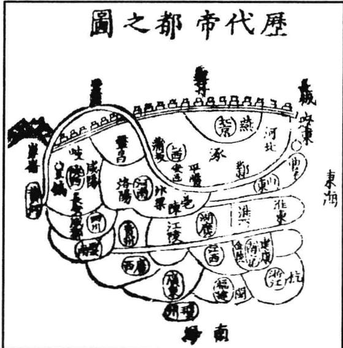

<!-- V3_SOURCE_ID:book018-b000188-p000-0e97ad36fb -->

宋以汴为都城，共传九世，总计一百六十七年；宋高宗迁都杭，共传九世，总计一百五十三年。

查看对应原文

<!-- V3_FOLDBACK_BEGIN:book018-b000188-p000-0e97ad36fb -->

宋都汴⑪，传九世，共一百六十七年；高宗徙杭，传九世，共一百五十三年。

<!-- V3_FOLDBACK_END:book018-b000188-p000-0e97ad36fb -->

<!-- V3_SOURCE_ID:book018-b000189-p000-94a9bdbfb6 -->

元以燕为都城，共传九世，总计八十八年。

查看对应原文

<!-- V3_FOLDBACK_BEGIN:book018-b000189-p000-94a9bdbfb6 -->

元都燕⑫，传九世，共八十八年。

<!-- V3_FOLDBACK_END:book018-b000189-p000-94a9bdbfb6 -->

<!-- V3_SOURCE_ID:book018-b000190-p000-529f2d4fa9 -->

明太祖高皇帝以金陵为都城，明成祖文皇帝迁都燕。

查看对应原文

<!-- V3_FOLDBACK_BEGIN:book018-b000190-p000-529f2d4fa9 -->

明太祖高皇帝都金陵①，成祖文皇帝徙燕②。

<!-- V3_FOLDBACK_END:book018-b000190-p000-529f2d4fa9 -->

<!-- V3_SOURCE_ID:book018-b000191-p000-38c9681c43 -->

## 论帝都必合星垣

查看对应原文

<!-- V3_FOLDBACK_BEGIN:book018-b000191-p000-38c9681c43 -->

## 论帝都必合星垣

<!-- V3_FOLDBACK_END:book018-b000191-p000-38c9681c43 -->

<!-- V3_SOURCE_ID:book018-b000192-p000-69eda45a45 -->

帝都是天子的京畿之地，是天下各方的枢纽都会。在此地发布政令、施行号令，统治中原，安抚四方异族，管理百官，统领万民，是天下最尊贵的地方。地理之中，没有比帝都选址更重要的事了。帝都必须上与天星垣局相合，下汇聚正龙的气脉，之后才可建立。大概在天对应帝座星宫，在地对应帝王居住的都会，这也是天象与地形相匹配的自然规律。杨公说：“大抵山形虽在山，地有精光属星次。体魄在地光在天，识得星光真精艺。”所以研究地学，岂止是俯察地理而已！还必须仰观天文，才能穷尽其中的奥秘。据《天文志·浑象》记载：中外官星共有二百四十六个名称，合计一千二百八十一颗星。还有微星一万一千五百二十颗，分布在中外形成垣局的，分别是紫微、太微、天市。这三个垣的内部都设有帝座，凡是建都的地方，山川形势必须和这些星垣的格局相合。杨公说：“要识垣中有帝星，皇都坐定甚分明。”廖氏说“帝都必要合星垣，紫微在中天。其次太微与天市，皆有帝座位”，说的就是这个道理。现在将三垣对应的天星与地形的相关内容记述在后面。此外少微垣是属于士大夫、执掌天帝相关文章的府署。天苑、天园是天子畜养野兽、种植果木的场所。它们虽然也有垣局，但是没有帝座的正位，地形即便和它们的格局相合，也不能作为统一天下、国运长久的都城所在地。

查看对应原文

<!-- V3_FOLDBACK_BEGIN:book018-b000192-p000-69eda45a45 -->

夫帝都者，天子之京畿，万方之枢会。于以出政行令，莅中国，抚四夷，宰百官，统万民，天下至尊之地也。地理之大，莫先于此。必上合天星垣局，下钟正龙王气，然后可建立焉。盖在天为帝座星宫，在地为帝居都会，亦天象地形自然理耳。杨公云：“大抵山形虽在山，地有精光属星次。体魄在地光在天，识得星光真精艺。”故为地学，奚直俯察地理已哉！又须仰观天文，始尽其奥。按《天文志·浑象》：中外官星凡二百四十六名，千二百八十一星。微星万一千五百二十，分布中外为垣者，曰紫微、太微、天市。垣之中皆有帝座，凡建都处，山川形势，须与此合。杨公云：“要识垣中有帝星，皇都坐定甚分明。”廖氏云“帝都必要合星垣，紫微在中天。其次太微与天市，皆有帝座位”是也。今以三垣天星地形述后。外少微垣为士大夫权天帝文章之府。天苑、天园为天子养兽植果之所。虽亦有垣，而无帝座正位，地形纵合，亦非统一寰宇，享有久远之都在。

<!-- V3_FOLDBACK_END:book018-b000192-p000-69eda45a45 -->

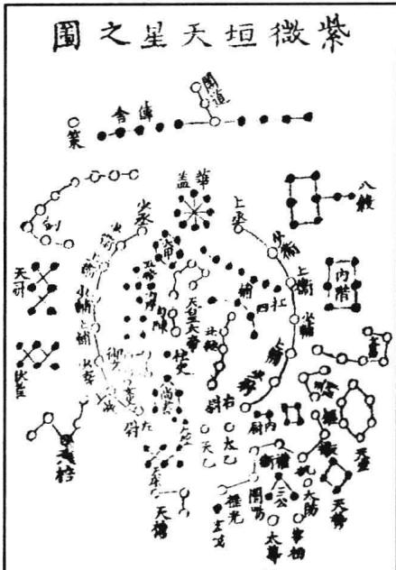

<!-- V3_SOURCE_ID:book018-b000194-p000-67bded800a -->

根据《天文志》的记载：中天的北极紫微星垣，是天皇的宸极，也是太乙的常居之处。北极五星正对应亥地，是天帝中最尊贵的，也就是面朝南而治理天下的位置。日月星三光交替运行，极星却不会移动。这就是孔子所说的“北辰居其所而众星拱之”。之后有四辅四星对应壬地，勾陈六星对应乾地，天纲八星对应戌地，华盖九星对应北地，阁道五星对应癸地，咸池五星对应丑地，八毂八星对应艮地，天将军四星对应寅地，内陛六星对应甲地，司命六贵人在震地，三师三星对应乙地。另外还有天理四星对应辰地，五诸侯五星在巽地，内厨二星对应巳地，四贵人四星对应丙地，帝座二星对应午地，大理二星对应丁地，天枪三星对应未地。天床三星对应坤地，天梧五星对应申地，阳德、阴德二星对应庚地，内屏二星对应兑地，天乙、柱史、女史三星对应辛地，还有左卫七相、右卫七将作为帝室的屏障。泰阶、六符辅佐北斗七政，以护卫垣局。

查看对应原文

<!-- V3_FOLDBACK_BEGIN:book018-b000194-p000-67bded800a -->

按《天文志》：中天北极紫微星垣，天皇之宸极，太乙之常居也。北极五星正临亥地，为天帝之最尊，所以南面而治者也。三光迭运，极星不移。孔子所谓“北辰居其所而众星拱之”是也。后有四辅四星居壬，勾陈六星居乾，天纲八星居戌，华盖九星居北，阁道五星居癸，咸池五星居丑，八毂八星居艮，天将军四星居寅，内陛六星居甲，司命六贵人在震，三师三星在乙。又有天理四星居辰，五诸侯五星居巽，内厨二星居巳，四贵人四星临丙，帝座二星居午，大理二星居丁，天枪三星居未。天床三星居坤。天梧五星居申，阳德、阴德二星居庚。内屏二星居兑。天乙、柱史、女史三星居辛。而有左卫七相、右卫七将以藩屏帝室。泰阶、六符辅治北斗七政以翼垣。此

<!-- V3_FOLDBACK_END:book018-b000194-p000-67bded800a -->

<!-- V3_SOURCE_ID:book018-b000195-p000-1befa6e333 -->

这就是紫微垣星局在天上显现的景象。

查看对应原文

<!-- V3_FOLDBACK_BEGIN:book018-b000195-p000-1befa6e333 -->

紫微垣星局之悬象于天者也。

<!-- V3_FOLDBACK_END:book018-b000195-p000-1befa6e333 -->

<!-- V3_SOURCE_ID:book018-b000196-p000-31a753e05b -->

《步天歌》记载：中元北极有紫微宫，五颗北极星就在这一宫域当中。第二颗星是大帝之座，第三颗星的位置对应庶子。第一颗星名为太子，第四颗是后宫星，第五颗是天枢星。紫微宫左右的四颗星是四辅，天乙、太乙星正处在宫门的位置。左枢、右枢两颗星夹着南门，两侧共有十五颗星作为营卫。上宰星和少尉星两两相对，少宰星、上辅星依次排列，接下来是少辅星；上卫星、少卫星依次排列，接下来是上丞星，后门的东边是大赞府星。门西边的那颗星叫做少丞，这些星位是按照从前门往后门的顺序依次排布的。阴德门内有两颗黄色的星聚集在一起，尚书星按顺序排列共有五颗。女史、柱史各有一颗星，还有四颗御女星、五颗天柱星。两颗大理星在阴德星旁边，勾陈星的尾端指向北极的顶端，六颗勾陈星在六甲星的前方。天皇星单独处在勾陈星的范围内，五帝内座星在后门的位置。华盖星连同杠星一共有十六颗，杠星的形状就像伞盖的柄。华盖上方接连排列着九颗星，名为传舍，形状就像连缀的丁字。紫微垣外左右两侧各有六颗星，右侧的是内阶星，左侧的是天厨星。内阶星前方的八颗星名叫八毂，天厨星下方的五颗星属于天棓宿。六颗天床星在左枢星的右侧，两颗内厨星和右枢星相对。文昌星在斗星的上方，呈半月形，六颗星分布稀疏、界限分明。文昌星的下方是三公星，太尊星只对着三公星的方向发出光亮。六颗天牢星在太尊星的旁边，太阳之守星在四势星的前方。有一颗宰相星在太阳守星的侧边，还有三公星在宰相星的西边偏侧位置，旁边那颗圆形的星就是天戈星。四颗天理星在斗星当中，光线比较暗淡，辅星靠近开阳星，亮度较淡，北斗七星十分明亮。第一颗主星名叫枢精，第二、第三颗是璇玑星，第四颗是权星，第五颗是衡星，第六颗是开阳，第七颗是摇光，摇光星左侧的三颗天枪星亮度很高。

> **释读存疑：** 1轮自动修复后核义模型仍建议修订，已保守记录。

查看对应原文

<!-- V3_FOLDBACK_BEGIN:book018-b000196-p000-31a753e05b -->

《步天歌》：中元北极紫微宫，北极五星在其中。大帝之座第二珠，第三之星庶子居。第一号曰为太子，四为后宫五天枢。左右四星是四辅，天以太乙当门路。左枢右枢夹南门，两面营卫一十五。上宰少尉两相对，少宰上辅次少辅。上卫少卫次上丞，后门东边大赞府。门西唤作一少丞，以次却向前门数。阴德门里两黄聚，尚书以次其位五。女史柱史各一户，御女四星五天柱。大理两星阴德边，勾陈尾指北极颠，勾陈六星六甲前。天皇独在勾陈里，五帝内座后门是。华盖并杠十六星，杠作柄象盖伞形。盖上连连九个星，名曰传舍如连丁。垣外左右各六珠，右是内阶左天厨。阶前八星名八毂，厨下五个天棓宿。天床六星左枢右，内厨二星右枢对。文昌斗上半月形，稀疏分明六个星。文昌之下曰三公，太尊只向三公明。天牢六星太尊边，太阳之守四势前。一个宰相太阳侧，更有三公相西偏。即是天戈一星圆，天理四星斗里暗。辅星近著开阳淡，北斗之宿七星明。第一主宰名枢精，第二第三璇玑星，四曰权星第五衡，开阳摇光六七星，摇光左三天枪明。

<!-- V3_FOLDBACK_END:book018-b000196-p000-31a753e05b -->

<!-- V3_SOURCE_ID:book018-b000197-p000-c1d733f95b -->

<table><tr><td>圖之形地垣微紫</td><td>左侧是紫微垣对应在地面的格局大致情况。杨公说：“紫微垣外前后门，华盖三台前后卫。中有过水名御沟，抱城屈曲中间流。”又说“直朝射人紫垣气”。廖氏所说的“紫垣西藩星有七，东藩八星出。华盖杠星在后门，天床前面陈。中央一水直朝入，抱城九回屈。万山簇拥昼朝迎，拱极不虚称”，描述的就是这种情形。</td></tr><tr><td>圗之星天垣微太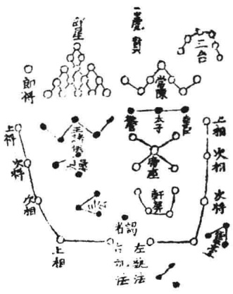</td><td>左侧是南宫太微星垣，是日月星三光的庭堂，也是天帝祭祀后接受所赐福胙、臣子向天帝报告功绩的场所。垣内有五帝座，正处在北地的方位。太乙、五尚书正处在巽地的方位。垣内还有郎官、即位、三公、谒者、九卿、五侯，用来辅佐天帝。前方有三颗明堂星处在巳地方位，三颗灵台星处在午地方位，常陈星是相当于耳目的星官，西将、东相各有四颗星，作为藩垣。东华、西华是门掖，门掖左右的两颗星是执法星。后方有太阳守、太阴守各两颗星，作为护卫。前方有张、翼、轸三宿作为侍从，这就是太微垣星局在天上显现的征象。</td></tr><tr><td colspan="2">《步天歌》记载：上元天庭有太微宫，清晰的星象排布在苍穹之上。端门就在宫门的正中位置，左右执法星分别在门的东侧和西侧。门左侧穿黑衣的是谒者星，依次排列的是乌色的三公星。三颗黑色的九卿星在三公星的后旁，五颗黑色的诸侯星在九卿星的后方排列。四颗门星主管后屏，五帝内座星在正中的位置。幸臣、太子和从官星，乌色排列在帝座后方，从东侧开始定位。郎将虎贲星处在左右两侧，</td></tr></table>

> **释读存疑：** opaque_terms“虎贲”已原样保留，未被赋予确定含义，符合要求；本地硬校验仍未通过，已记录供后续自动处理或人工核对。

查看对应原文

<!-- V3_FOLDBACK_BEGIN:book018-b000197-p000-c1d733f95b -->

<table><tr><td rowspan=1 colspan=1>圖之形地垣微紫</td><td rowspan=1 colspan=1>左紫微垣列形于地之局势大略也。杨公云：“紫微垣外前后门，华盖三台前后卫。中有过水名御沟，抱城屈曲中间流。”又云“直朝射人紫垣气”。廖氏云“紫垣西藩星有七，东藩八星出。华盖杠星在后门，天床前面陈。中央一水直朝入，抱城九回屈。万山簇拥昼朝迎，拱极不虚称”是也。</td></tr><tr><td rowspan=1 colspan=1>圗之星天垣微太</td><td rowspan=1 colspan=1>左南宫太微星垣，三光之庭，天帝受厘告功之室也。中有五帝座，正居北地。太乙、五尚书正居巽地。内有郎官、即位、三公、谒者、九卿、五侯以辅导帝极。前有明堂三星居巳，灵台三星居午，常陈为耳目之官，西将、东相各四星为藩垣。东华、西华为门掖。掖左右二星为执法。后有太阳守、太阴守各二星，为卫。前有张、翼、轸三宿为侍，此太微垣星局之悬象于天者也。</td></tr><tr><td rowspan=1 colspan=2>《步天歌》：上元天庭太微宫，昭昭列象在苍穹。端门只是门之中，左右执法门西东。门左皂衣一谒者，以次则是乌三公。三黑九卿公背旁，五黑诸侯卿后行。四个门星主后屏，五帝内座于中正。幸臣太子并从官，乌列帝后从东定。郎将虎贲居左右，</td></tr></table>

<!-- V3_FOLDBACK_END:book018-b000197-p000-c1d733f95b -->

<!-- V3_SOURCE_ID:book018-b000198-p000-04765ba303 -->

太微垣相关内容首先提及对应数量规制：宫外设有明堂布政宫，还有三座灵台用来观测云雨；常陈、郎位二星位于太微垣的后方，需注意常陈共有七星不要认错，郎位星在常陈星的东侧共有十五座。太微垣两侧的宫垣共有十颗星分布，原本的“左石执法”是“左右执法”的讹写。以上就是太微垣对应地形布局的大致情况。杨公说“方正之垣号太微”，又说“横城水绕太微势”，还说“东华西华门水横，水外四围列峰位。此是垣前执法星，却分左右为兵卫”。廖金精在《泄天机》中提到“太微垣局最方正，左右执法并。西藩上将次将先，次相上相连。东藩上相及次相，次将与上将。两藩九门分十星，一水绕城横”，描述的就是这种地形格局。接下来是天市垣的星象布局：东府天市星垣是天帝掌管财货的府库，当中有帝座正对着艮位，还有秤、斗、车、舟、府库、市楼、市肆排布在垣内，另有贯索、宗人、左右侍卫等星象作为护卫。《列国分野二十二星》记载，宋、南海、燕、东海、徐、吴越、齐、中山、九河、河间、晋、郑、周、秦、巴、蜀、梁、楚、韩、西河等对应的分野星象排列在天市垣的四方。贵人星在旁侧对应庚位，是主管府库护卫的宫位；司命星正对着丁位，是掌管五福寿命的星官。以上就是天市垣的星象在天空中的排布情况。《步天歌》记载：下元有一宫名叫天市，两侧的垣墙共有二十二颗星。对着宫门的位置有六颗星组成黑市楼，门左侧的两颗星是车肆。有两颗宗正星、四颗宗人星，宗星共两颗也按次序排列。帛度星共两颗在屠肆星的前方，侯星位于帝座星的旁边。帝座星常年光亮，四颗亮度较暗的是宦者星。接下来的两颗星是列肆，斗、斛按次序排列在帝座前方，斗有五颗星，斛有四颗星。天市垣北侧有九颗贯索星，贯索口横向排列的是七公星，天纪星的形状和七公星类似，细数的话比七公星多两颗。天纪星北侧的三颗星名叫女床，位置挨着织女星。三元的星象不会互相侵越，二十八宿按照各自的阴阳属性排布，火、水、木、土、金五行的相关内容另外有专门的歌诀吟咏。接下来是天市垣对应地形布局的大致情况：杨公说“垣有四门号天市”，又说“百源来聚天市垣”。廖公说“天市垣星二十二，名参国与地。国地中间有四门，东西南北分。众水分流来此聚，大河在东注。帝座居北市楼南，垣局总为祥”，描述的就是这种地形格局。

> **释读存疑：** 1轮自动修复后核义模型仍建议修订，已保守记录。

查看对应原文

<!-- V3_FOLDBACK_BEGIN:book018-b000198-p000-04765ba303 -->

<table><tr><td>其数。宫外明堂布政宫，三个灵台候云雨。 圖之形地垣微太</td><td>常陈郎位屈其后。常陈七星勿相误，郎位陈东一十五。两面宫垣十星布，左石执法是 左太微垣列形于地之局势大略也。杨公云“方正</td></tr><tr><td></td><td>之垣号太微”。又云“横城水绕太微势”。又云 “东华西华门水横，水外四围列峰位。此是垣前执 法星，却分左右为兵卫。”廖金精《泄天机》云 “太微垣局最方正，左右执法并。西藩上将次将 先，次相上相连。东藩上相及次相，次将与上将。 两藩九门分十星，一水绕城横”是也。</td></tr><tr><td>圖之星天垣市天 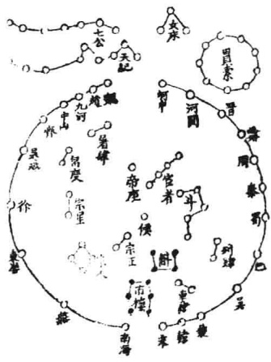</td><td>左东府天市星垣，天帝泉货之府也。中有帝座， 正临艮地。有秤、斗、车、舟、府库、市楼、市 肆以贯其中，贯索、宗人、左右侍卫。匡卫《列 国分野二十二星》曰：宋、南海、燕、东海、徐、 吴越、齐、中山、九河、河间、晋、郑、周、秦、 巴、蜀、梁、楚、韩、西河等藩以列四方。贵人 一星旁照庚地，为捍卫库之宫。司命一星正临丁 位，为五福寿命之司。此天市垣星局之悬象于天 者也。</td></tr><tr><td colspan="2">《步天歌》：下元一宫名天市，两扇垣墙二十二。当门六个黑市楼，门左两星是车 肆。两个宗正四宗人，宗星一双亦依次。帛度两星屠肆前，侯星还在帝座边。帝座一 星常光明，四个微茫宦者星。以次两星名列肆，斗斛帝前依其次。斗是五星斛是四， 垣北九个贯索星。索口横者七公成，天纪恰似七公形。数著分明多两星，纪北三星名 女床。此座还依织女旁，三元之象无相侵。二十八宿随其阴，火水木土并与金，以次 别有五行吟。</td></tr><tr><td>圖之形地垣市天 入紀天 魏 梁 問 晋 九 越 塑 肆管 度帛 (( 忠 周 帝庄 宦者 素( 宗星 室 解 東海 巍 熟 宋 鞋 南廟 牛</td><td>左天市垣列形于地之局势大略也。杨公云“垣有 四门号天市。”又云“百源来聚天市垣。”廖公云 “天市垣星二十二，名参国与地。国地中间有四 门，东西南北分。众水分流来此聚，大河在东注。 帝座居北市楼南，垣局总为祥”是也。</td></tr></table>

<!-- V3_FOLDBACK_END:book018-b000198-p000-04765ba303 -->

<!-- doc007 PDF 第 44 页：未引用图表已用原页保全；文字供检索，版式以原页图为准。 -->
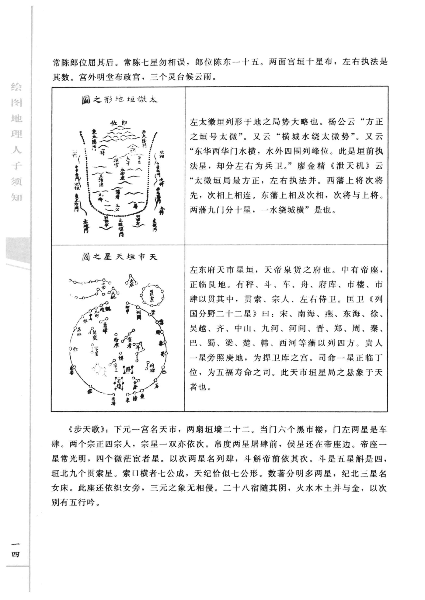

<!-- V3_SOURCE_ID:book018-b000200-p000-94a84503b2 -->

以上三垣天星的图则依据《天文志》绘制，地形的图则依据廖氏《金璧玄文》绘制，现在特意将二者合为一体，方便查考。不过也不必过于拘泥图局的形象，胶柱鼓瑟，只需依照经文，从山形水势来判断即可。比如“紫微垣外前后门”“华盖三台前后卫”“方正之垣号太微”“垣有四门号天市”，又比如“直城射入紫微气”“横城水绕太微势”“百源来聚天市垣”这类说法，都是以山水形势的大体格局而言，杨筠松已经说得很明白了，其他星宿的形象，也不必完全拘泥。

查看对应原文

<!-- V3_FOLDBACK_BEGIN:book018-b000200-p000-94a84503b2 -->

已上三垣天星之图则本于《天文志》，地形之图则本于廖氏《金璧玄文》，兹特合而一之，庶易于考索。然亦不必深泥图局形象，胶柱鼓瑟。但依经文，以山形水势取之。如曰“紫微垣外前后门”，“华盖三台前后卫”，“方正之垣号太微”，“垣有四门号天市”。又曰“直城射入紫微气”，“横城水绕太微势”，“百源来聚天市垣”之类，则以山水形势之大象言之，杨筠松固已说得明白。其它星宿形象，又不必尽泥也。

<!-- V3_FOLDBACK_END:book018-b000200-p000-94a84503b2 -->

<!-- V3_SOURCE_ID:book018-b000201-p000-aee9ac6e66 -->

## 论北龙所结帝都垣局

查看对应原文

<!-- V3_FOLDBACK_BEGIN:book018-b000201-p000-aee9ac6e66 -->

## 论北龙所结帝都垣局

<!-- V3_FOLDBACK_END:book018-b000201-p000-aee9ac6e66 -->

<!-- V3_SOURCE_ID:book018-b000202-p000-1572c62f9c -->

北龙的山脉包含燕山，就是现在的京师所在地。因为燕然山脉延伸到这里就到了尽头，所以得名燕山。从前燕昭王修筑黄金台招揽贤士，因此这里又被称为金台，属于古代冀州的地域。舜将冀州的东北部划分出来设置幽州，所以这里又叫做幽都。按照邱文庄公《大学衍义补》的说法：“虞夏时期，天下分为九州，冀州位于中原的北部，它的北部疆域最为广阔，舜把冀州拆分为幽、并、荥三州，所以幽、并、荥三州都属于原来冀州的范围。”杨公说“燕山最高象天市”，这里大概是北干龙真气融结的正位。这条龙脉发源于昆仑山的中脉，绵延数千里，到达于阗，经过瀚海，走势“之玄屈曲”，也就是像“之”“玄”二字一样弯折迂回，穿行在周边部族的区域，又经过一万多里，才抵达燕然山，之后进入中原，形成燕云地区的山脉。再向东延伸数百里，隆起为天寿山，之后“落平洋”，也就是进入平坦开阔的区域，方圆可达一千多里。辽东、辽西两条支脉分开，黄河在前方环绕，鸭绿江在后方缠绕，阴山、恒山、太行山等山脉，和海中的各个岛屿相对应。近处有滦河、潮河、桑河、易河以及众多无名的小型水系，多条水源夹着龙脉穿行，界限分明。用风水地理的方法来评判，这条龙脉的走势绵长，垣局格局优美，干龙的行度到这里走到尽头，山形与水系交汇聚合，旁带黄河，以天寿山为依靠，鸭绿江缠绕在后方，碣石把守着门户，最符合风水的法度。又按照《衍义补》的记载：“《朱子语录》中说：冀都，是天地之间少有的绝佳大风水！龙脉从云中地区发脉，前方有黄河环绕，泰山耸立在左侧作为龙砂，华山耸立在右侧作为虎砂，嵩山是前方的案山，淮南的各座山脉是第二重案山，江南五岭的各座山脉是第三重案山。所以古今建都的地方，都比不上冀都。”从朱子所说的风水观点来看，指的是这里没有风来吹散生气，还有水系来界止生气，因此风水极佳。冀州境内三面靠近黄河的地方，是平阳、蒲坂，也就是尧舜建都的地方，从冀州划分出去的东北区域，就是幽州。太行山从西面延伸而来，地势逐渐平缓向北延展，绵延经过魏、晋、燕、赵的地域，向东一直延伸到医无闾山。层峦叠嶂，如同鸾凤峙立、蛟龙游走，环抱围护的山脉不知道有几千万里。地势格局完备，风气密闭，堪舆家所说的藏风聚气的条件，这里都具备。它的东面一带，是汪洋大海。稍微往北的地方，是古代碣石沉没入海的位置。稍微往南是九河疏通之后的入海口，日月仿佛从海中升起又落入其中，水域浸润着天地，用来界止生气的水系就是这样直截开阔，堪舆家所说的“得水为上”的条件，这里也完全符合。

> **释读存疑：** 本地硬校验仍未通过，已记录供后续自动处理或人工核对。

查看对应原文

<!-- V3_FOLDBACK_BEGIN:book018-b000202-p000-1572c62f9c -->

北龙有燕山，即今京师也。以燕然山脉尽于此，故曰燕山。昔昭王筑黄金台以招贤者，因又称金台。古冀州地。舜分冀东北为幽州，故又谓之幽都。按邱文庄公《大学衍义补》云：“虞夏之时，天下分为九州。冀州在中国之北，其北最广，舜分冀为幽、并、荥，故幽与并、荥皆冀境也。”杨公云“燕山最高象天市”，盖北干之正结。其龙发昆仑之中脉①，绵亘数千里，至于阗，历瀚海，之玄屈曲，出夷入貊。又万余里，始至燕然山，以入中国，为燕云②。复东行数百里，起天寿山，乃落平洋，方广千余里。辽东、辽西两枝开截黄河，前绕鸭绿，后缠而阴、恒、太行诸山，与海中诸岛相应。近则滦河、潮河、桑河、易河并诸无名小水，夹身数源，界限分明。以地理之法论之，其龙势之长，垣局之美，干龙大尽，山水大会，带黄河，扆天寿。鸭绿缠其后，碣石钥其门，最是合风水法度。又按《衍义补》云：“《朱子语录》：冀都，天地间好个大风水！脉从云中发来，前面黄河环绕，泰山耸左为龙，华山耸右为虎，嵩山为前案，淮南诸山为第二重案，江南五岭诸山为第三重案。故古今建都之地，皆莫过于冀都。”就朱子所谓风水之说观之，谓无风以散之，有水以界之也。冀州之中，三面距河处，是为平阳、蒲坂，乃尧舜建都之地。其所分东北之境，是为幽州。太行自西而来，演迤而北，绵亘魏、晋、燕、赵之境，东而极于医无闾。重开迭阜，鸾凤峙而蛟龙走，所以拥护而围绕之者，不知几千万里也。形势全，风气密，堪舆家所谓藏风聚气者，此地有之。其东一带，则汪洋大海。稍北，乃古碣石沦入海处。稍南则九河既通，所归宿之地，浴日月而浸乾坤，所以界之者，又如此其直截而广大焉。堪舆家所谓“得水为上”者是也。

<!-- V3_FOLDBACK_END:book018-b000202-p000-1572c62f9c -->

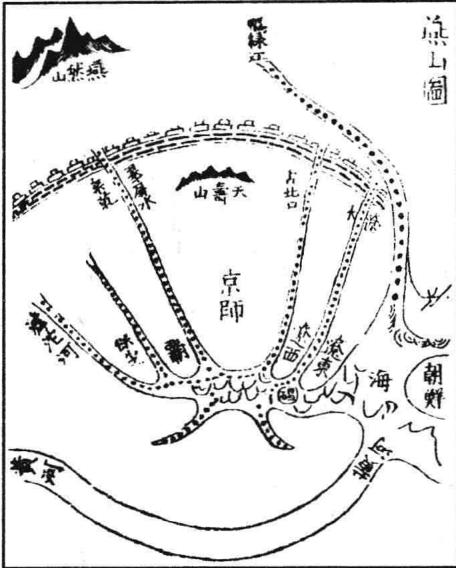

<!-- V3_SOURCE_ID:book018-b000204-p000-d3eef48795 -->

按：这些都是说风水的优美。如果从形胜来看，幽、燕自古以来就称雄，左边环绕沧海，右边拥着太行，南边襟带河济，北边枕着居庸，是苏秦所说的天府百二之国，杜牧

> **释读存疑：** 原文此处未完整，内容有缺失

查看对应原文

<!-- V3_FOLDBACK_BEGIN:book018-b000204-p000-d3eef48795 -->

按：此皆以风水之美言之也。若以形胜论， 则幽、燕自昔称雄，左环沧海，右拥太行，南襟 河济，北枕居庸，苏秦所谓天府百二之国，杜牧

<!-- V3_FOLDBACK_END:book018-b000204-p000-d3eef48795 -->

<!-- V3_SOURCE_ID:book018-b000205-p000-fe87d5ce77 -->

所谓王不得不可为王之地。杨文敏谓西接太行，东临碣石，巨野亘其南，居庸控其北，势拔地以峥嵘，气摩空而翔。又云：燕冀内跨中原，外控朔漠，真天下都会。桂文襄公谓形胜甲天下，扆山带海，有金汤之固。盖真定以北至永平，关口不下百十，而居庸、紫荆、山海、喜峰、古北、黄花镇，险隘尤著。会通漕运便利，天津又通海运，诚万世帝王之都。自昔之都燕者，始于召公，而极于金元。然召公诸侯也，金元乃夷狄杂气，皆不足以当其大。惟我皇朝，得国之正，同乎尧舜；拓地之广，过于汉唐。功德隆盛，上当天心，下乘地气，真万世不拔之洪基也。而议者乃谓北太近胡，距塞

查看对应原文

<!-- V3_FOLDBACK_BEGIN:book018-b000205-p000-fe87d5ce77 -->

所谓王不得不可为王之地。杨文敏谓西接太行，东临碣石，巨野亘其南，居庸控其北，势拔地以峥嵘，气摩空而翔。又云：燕冀内跨中原，外控朔漠，真天下都会。桂文襄公谓形胜甲天下，扆山带海，有金汤之固。盖真定以北至永平，关口不下百十，而居庸、紫荆、山海、喜峰、古北、黄花镇，险隘尤著。会通漕运便利，天津又通海运，诚万世帝王之都。自昔之都燕者，始于召公，而极于金元。然召公诸侯也，金元乃夷狄杂气，皆不足以当其大。惟我皇朝，得国之正，同乎尧舜；拓地之广，过于汉唐。功德隆盛，上当天心，下乘地气，真万世不拔之洪基也。而议者乃谓北太近胡，距塞

<!-- V3_FOLDBACK_END:book018-b000205-p000-fe87d5ce77 -->

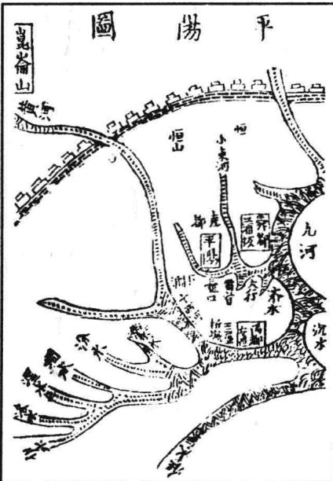

<!-- V3_SOURCE_ID:book018-b000207-p000-5ae6decc28 -->

距离京城不到二百里，没有像藩篱那样坚固的防御，而天子只能亲自驻守。要知道如今四方异族中，北方的虏患最为紧急，他们来去不定，边境的防备必须严密。如果京城离边境太远却把防守的重任交给守将和大臣，就不符合以重兵驻守核心区域、控制轻兵在外的原则了。所以我们的成祖文皇帝，英明地选择在此建都，这是极好的谋略和长远的规划，岂是凡夫俗子所能理解的！不过当时未必考虑到风水的说法，却与风水的道理如此契合，这大概是圣王兴起时，一举一动都与法则相合，天地的造化自有自然相符的道理。从前尧、舜、禹三位圣王的都城都在北龙的范围里，如今我朝的京城也在北龙的范围，而且地理形势与风水法度又都超过了前代，理应能超越唐尧、虞舜，媲美夏、商二代，达到如此全盛的局面，这本是各位先帝的大德神功、宏大业绩所带来的，是后人无法企及的。不过地理与风水的契合或许也是一种必然。我何其幸运，能亲身经历这样的盛世。

查看对应原文

<!-- V3_FOLDBACK_BEGIN:book018-b000207-p000-5ae6decc28 -->

不二百里，无藩篱之固，而天子自为守。不知今之四夷，北虏为急，倏忽来去，边备须严。若畿甸去远而委守将臣，则非居重驭轻之道矣。故我成祖文皇帝，睿意建都于此，良谟远猷，岂凡愚之所能及哉！然当时未必虑及风水之说，而默契若此，是盖圣王之兴，动与法合，天地造化，有自然相符之理。昔尧舜禹三圣之都皆北龙。今我朝畿甸亦北龙，而形胜与风水法度又皆迈之，宜其驾唐虞，迫二代，全盛如此，是固我列圣之茂德神功鸿休骏烈之不可及。然地理之应亦或然也。愚何幸，躬逢其盛。

<!-- V3_FOLDBACK_END:book018-b000207-p000-5ae6decc28 -->

<!-- V3_SOURCE_ID:book018-b000208-p000-2b978d9e0e -->

北龙的次一级区域，有平阳、蒲坂、安邑，也属于冀州境内，是尧、舜建都的地方。按：朱熹先生说：“河中地形极好，是尧、舜、禹旧时的都城，就是如今的晋州河中府。左右多山，黄河

查看对应原文

<!-- V3_FOLDBACK_BEGIN:book018-b000208-p000-2b978d9e0e -->

北龙之次，有平阳、蒲坂、安邑，亦冀境，乃尧舜所都之地。按：朱子曰：“河中地形极好，乃尧舜禹故都。今晋州河中府是也。左右多山，黄河

<!-- V3_FOLDBACK_END:book018-b000208-p000-2b978d9e0e -->

<!-- V3_SOURCE_ID:book018-b000209-p000-dcc537d110 -->

环绕着它，嵩山、黄河排列在它的前方。”又说：“河东、河北都环绕着太行山，尧、舜、禹的都城，都在太行山的山下。”

查看对应原文

<!-- V3_FOLDBACK_BEGIN:book018-b000209-p000-dcc537d110 -->

绕之，嵩河列其前。”又曰：“河东、河北皆绕太行山，尧舜禹所都，皆在太行山下。”

<!-- V3_FOLDBACK_END:book018-b000209-p000-dcc537d110 -->

<!-- V3_SOURCE_ID:book018-b000210-p000-13eba2319e -->

又说：“上党是太行山最高的地方，平阳、蒲阪是太行山的尽头。”又说：“尧、舜在中原建都，风水极佳。左边的河东、太行山各山相互环绕，海岛各山也都朝向这里。右边的黄河向南环绕，直到泰山汇入大海。第二层从蜀地延伸到湖南，延伸到庐山各山。第三层从五岭延伸到明州、越州。还有黑水之类的水系，从北方向南环绕，直到南海。”这些都是就大的地理形势而言的。张子微说：“河中地区，右边是西河，左边是东河，前方是南河。渡过黄河就是壶口，靠近黄河的是覃怀，流入黄河的是衡漳。三面靠近黄河，一面背靠山脉，所背靠的恒山，距离这里很远，连绵而下，地势平坦得像磨刀石。方圆千里，夹在两条河流之外，四面都有名山巨镇迎送护卫。只是堂局宽阔，不是凡俗之人所能辨识的。如果两侧没有水流夹截，就是水没有交会，大龙怎么能停留呢？所以龙身的左边有小东河，右边有西恒河。南边有小南河在内部夹截，而大河从中间流过，龙将去往何处？其他像桡棹手脚一样的支脉，得到无名之水清晰夹截的，又数不胜数。只是眼目难以辨识，列举它的堂局，形势就可以全部了解了。这是就它近处的情况而言的。虽然如此，尧、舜、禹是圣人，以道教化天下，未必与风水有关。但天地造就的地理形势，也有自然与风水契合的道理，是不能否定的。只是如今风水已经变迁，王气已经销竭，再也没有可以作为都城的地方了。

查看对应原文

<!-- V3_FOLDBACK_BEGIN:book018-b000210-p000-13eba2319e -->

又曰：‘上党，太行山之极高处。平阳、蒲阪，山之尽头。’又曰：‘尧舜都中原，风水极佳。左河东、太行诸山相绕，海岛诸山亦皆相向。右河南绕，直至泰山凑海。第二重自蜀中出湖南，出庐山诸山。第三重自五岭至明、越。又黑水之类，自北缠绕，至南海。’此皆以其大形势而言之也。张子微曰：‘河中之地，右则西河，左则东河，前则南河。逾河而为壶口，近河而为覃怀，入河而为衡漳。三面距河，一面背山，所背恒山，相去甚远，逶迤而下，其平如砥。方广千里，夹水之外，四面皆有名山巨镇迎送护卫。但堂局宽阔，非凡俗所能检点。若两腋无水夹截，即是水不交会，大龙如何得住？故夹身之左有小东河，右有西恒河。南有小南河关截于内，而大河经之，龙将焉往？其它桡棹手脚，得无名之水界夹分明者，又不可数计。但眼目难于检点，举其堂局，形势可以周知。此则以其亲近者而言之也。虽然，尧舜禹圣人，道化天下，未必系于风水。然天造地设，亦自然默契之理，有不可诬者。但今风水变迁，王气销竭，无复可都矣。

<!-- V3_FOLDBACK_END:book018-b000210-p000-13eba2319e -->

<!-- V3_SOURCE_ID:book018-b000211-p000-ed7999959c -->

## 论中龙所结帝都垣局

查看对应原文

<!-- V3_FOLDBACK_BEGIN:book018-b000211-p000-ed7999959c -->

## 论中龙所结帝都垣局

<!-- V3_FOLDBACK_END:book018-b000211-p000-ed7999959c -->

<!-- V3_SOURCE_ID:book018-b000212-p000-835fbafbff -->

中龙的关中地区，有丰、镐、咸阳、长安，都在如今的陕西境内，统称为关陕，就是古代的雍州。杨公说“关中原是太微垣”，又说“长安落在垣宿中。”大概是中干的尊贵之处。它的龙发源于昆仑。《经》上说：“黑水绵络西河，横山开始作为祖宗山，转经荥、貊、泽，从西向东，直到雍州。”张子微说：“长安的龙发源于横山，那些山都是黄石，绵延八百多里，不生长草木。到了雍州地区，泾水发源于安定，在雍州的西边，从西向南流入渭水。而北边就是渭、汭。渭水发源于鸟鼠同穴，西边是雍州的西山。到了泾水所属的地方就是北边。只有这里依山傍水，号称天府之国。”又说：“秦建都咸阳，不是长安。”

查看对应原文

<!-- V3_FOLDBACK_BEGIN:book018-b000212-p000-835fbafbff -->

中龙有关中曰丰、曰镐、曰咸阳、长安，皆今陕西地，通曰关陕，古雍州也。杨公云“关中原是太微垣”，又曰“长安落在垣宿中。”盖中干之尊也。其龙发于昆仑。《经》曰：“黑水绵络西河，横山始起祖宗，转荥、貊、泽，自西而东，尽于雍州。”张子微曰：“长安之龙起于横山，其山皆黄石，绵亘八百余里，不生草木。及至雍州之地，泾水出安定，在雍州之西，自西而南入渭水。而北是为渭、汭。渭水出鸟鼠同穴，西为雍州之西山。至泾水所属之地则为北。惟此依山挟水，号为天府之国。”又曰：“秦都咸阳，非长安。

<!-- V3_FOLDBACK_END:book018-b000212-p000-835fbafbff -->

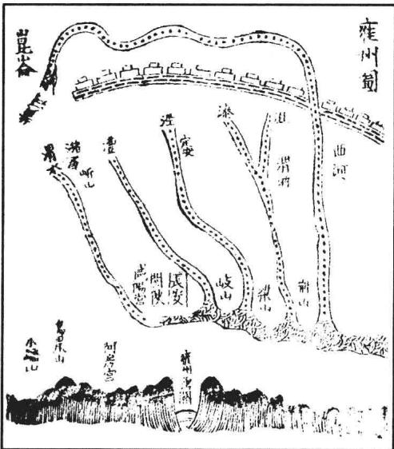

<!-- V3_SOURCE_ID:book018-b000214-p000-a54f39e315 -->

以宫属渭，跨渭为飞桥复道，以象天阙道而属阿房。如骊山温泉，又长安之枝龙也。长安之下则有岐、梁、荆诸山为护，沣、泾、漆、沮、河水界限为卫。”蔡文节公曰：“咸阳之地，龙合之玄格，前后左右，诸山包护。”此皆谓其风水之美也。若以形胜言之，则娄敬所谓“被山带河，四塞为固。”张良所谓“左殽函，右陇蜀，沃野千里。南有巴蜀之饶，北有胡宛之利，阻三面而守，独以一面东制诸侯，乃金城千里，天府之国”者是也。故史称关中“阻山带河，四塞之险，东有函关，西有散关，南有武关，北有萧关。”吕成公亦谓关中是形势之地。欲据形势，须都关中。桂文襄公谓其山河四塞，形势甲天下。《易》曰“天险不可升”。地险山川丘陵，王公设险以守其国，惟此为然耳。故关陕之地，形胜全，龙局美，王气攸萃，而文武周公列圣笃生。自文王都岐徙丰，武王迁镐京，成王实都于镐，以据天下形势。当西周全盛时，特往来朝诸侯于洛邑。至平王避犬戎，始迁都于洛阳，号曰东周，则周日微弱，而雍州王气为秦得之。盖秦先世有非子者，善育马，为周孝王主马。马大蕃息，分土为附庸，邑居秦。历三世，至秦仲始大。历庄襄，犬戎弑周王，襄公救周有功，封为诸侯，赐以西周畿内八百里之地。秦即其地，日以强盛，兼并天下，统一区宇。然无功德，肆暴虐，不足以当其地王气之大。汉与，以娄敬、张良之议，遂因其故都而都之，传十二帝，历二百一十四年。其后，唐又都之，传十八帝，历二百六十九年。宋人亦尝议欲都此，而以横山未入版图，故都大梁，以经营横山。盖横山当宋时，诸戎所依，为戎夏必争之地，不得之则不可都，故尔。邱文庄公曰：“秦地被山带河，四塞以为固。所谓金城千里，天府之国，得天下之百二者也。周人初起于邠，继都丰镐，天下形势之地，盖莫有过焉者也。至平王东迁而弃其地与秦，秦地始大。战国之世，山东之国六而秦居其一。六者为纵，而秦独为衡焉。卒能以少制众，并而有之，非独人力，亦地势然也。自高帝用娄敬言，西都关中，后世言形胜者必归焉。唐起晋阳，亦都于斯。自宋人都汴之后，王气消歇者五六百年于今矣。”详究文庄兹论，确有所见，而议者乃谓漕运不便。不知周与汉唐各数百年，而其储积岂无其道？且《禹贡》“若雍州，厥田惟上上”，史称沃壤千里，可以储贮。而秦号富强，顾所处之如何耳！大抵雍州非直形势险固，风水融聚为美已也。且其水深土厚，民性质朴，易于从化，尤为可嘉。朱子曰：“岐丰之地，文王用之以兴，二南之化，如彼其忠且厚也。秦人用之未几，而一变其俗，尚气概，先勇力，忘生轻死，悍然有招八州，朝同列之气。其故何哉？诚以雍州土厚水深，其民重厚质直，无郑、卫骄惰浮靡之习。以善道之，则易兴起而笃于仁义；以猛驱之，则其强毅果敢之资，亦足以强兵力农而成富强之业，非山东诸国所及也。后世欲为定都立国之计，诚不可不监乎此。而于导民之路，尤不可不慎其所之。旨哉言乎！

查看对应原文

<!-- V3_FOLDBACK_BEGIN:book018-b000214-p000-a54f39e315 -->

以宫属渭，跨渭为飞桥复道，以象天阙道而属阿房。如骊山温泉，又长安之枝龙也。长安之下则有岐、梁、荆诸山为护，沣、泾、漆、沮、河水界限为卫。”蔡文节公曰：“咸阳之地，龙合之玄格，前后左右，诸山包护。”此皆谓其风水之美也。若以形胜言之，则娄敬所谓“被山带河，四塞为固。”张良所谓“左殽函，右陇蜀，沃野千里。南有巴蜀之饶，北有胡宛之利，阻三面而守，独以一面东制诸侯，乃金城千里，天府之国”者是也。故史称关中“阻山带河，四塞之险，东有函关，西有散关，南有武关，北有萧关。”吕成公亦谓关中是形势之地。欲据形势，须都关中。桂文襄公谓其山河四塞，形势甲天下。《易》曰“天险不可升”。地险山川丘陵，王公设险以守其国，惟此为然耳。故关陕之地，形胜全，龙局美，王气攸萃，而文武周公列圣笃生。自文王都岐徙丰，武王迁镐京，成王实都于镐，以据天下形势。当西周全盛时，特往来朝诸侯于洛邑。至平王避犬戎，始迁都于洛阳，号曰东周，则周日微弱，而雍州王气为秦得之。盖秦先世有非子者，善育马，为周孝王主马。马大蕃息，分土为附庸，邑居秦。历三世，至秦仲始大。历庄襄，犬戎弑周王，襄公救周有功，封为诸侯，赐以西周畿内八百里之地。秦即其地，日以强盛，兼并天下，统一区宇。然无功德，肆暴虐，不足以当其地王气之大。汉与，以娄敬、张良之议，遂因其故都而都之，传十二帝，历二百一十四年。其后，唐又都之，传十八帝，历二百六十九年。宋人亦尝议欲都此，而以横山未入版图，故都大梁，以经营横山。盖横山当宋时，诸戎所依，为戎夏必争之地，不得之则不可都，故尔。邱文庄公曰：“秦地被山带河，四塞以为固。所谓金城千里，天府之国，得天下之百二者也。周人初起于邠，继都丰镐，天下形势之地，盖莫有过焉者也。至平王东迁而弃其地与秦，秦地始大。战国之世，山东之国六而秦居其一。六者为纵，而秦独为衡焉。卒能以少制众，并而有之，非独人力，亦地势然也。自高帝用娄敬言，西都关中，后世言形胜者必归焉。唐起晋阳，亦都于斯。自宋人都汴之后，王气消歇者五六百年于今矣。”详究文庄兹论，确有所见，而议者乃谓漕运不便。不知周与汉唐各数百年，而其储积岂无其道？且《禹贡》“若雍州，厥田惟上上”，史称沃壤千里，可以储贮。而秦号富强，顾所处之如何耳！大抵雍州非直形势险固，风水融聚为美已也。且其水深土厚，民性质朴，易于从化，尤为可嘉。朱子曰：“岐丰之地，文王用之以兴，二南之化，如彼其忠且厚也。秦人用之未几，而一变其俗，尚气概，先勇力，忘生轻死，悍然有招八州，朝同列之气。其故何哉？诚以雍州土厚水深，其民重厚质直，无郑、卫骄惰浮靡之习。以善道之，则易兴起而笃于仁义；以猛驱之，则其强毅果敢之资，亦足以强兵力农而成富强之业，非山东诸国所及也。后世欲为定都立国之计，诚不可不监乎此。而于导民之路，尤不可不慎其所之。旨哉言乎！

<!-- V3_FOLDBACK_END:book018-b000214-p000-a54f39e315 -->

<!-- V3_SOURCE_ID:book018-b000215-p000-00f1c6cf8f -->

中龙之次有洛阳，即周营洛邑之地也。前值伊阙，后据邙山，左瀍右涧，洛水贯其中，以象河汉。此紫微垣局也。张子微曰：“洛邑是飞龙格势，脚手本自分明，迎送却从外假合。凡大地，迎送皆取诸外而不取诸本身。所谓本身手脚，一曲屈萦回辄五六十里，或七八十里，故人不见其为手足。况远外迎送，其得见乎？此其平夷之地，一望无际，惟审其水源而后识之也。然洛邑居天下之中，为大龙之腹，四望平夷，近则熊耳居其右，西京在其左。取诸远则上洛在其西，太华在其东，终南惇物在其北，内方则在河南。周公所以取制天下之中，犹腹为人身都会之所也。以水而言，则洛水自西而经其前，瀍、涧界其东，汾、绕其后，伊水陈其面，最合风水法度。但以形胜论之，则平夷无险，四面受敌，故周营洛邑，特以宅中图治，道里适均之故，乃于此以朝诸侯，非建都也。按《大学衍义》，陈大猷曰：“成王实都镐京，特往来朝诸侯，祀清庙于洛。故镐京谓之宗周，以其为天下所宗也。洛邑谓之成周，以周道成于此也。洛邑天下之至中，丰镐天下之至险。成王于洛邑定鼎，以朝诸侯，所以成天地中和之气。宅中以莅四海，其示天下也公。

查看对应原文

<!-- V3_FOLDBACK_BEGIN:book018-b000215-p000-00f1c6cf8f -->

中龙之次有洛阳，即周营洛邑之地也。前值伊阙，后据邙山，左瀍右涧，洛水贯其中，以象河汉。此紫微垣局也。张子微曰：“洛邑是飞龙格势，脚手本自分明，迎送却从外假合。凡大地，迎送皆取诸外而不取诸本身。所谓本身手脚，一曲屈萦回辄五六十里，或七八十里，故人不见其为手足。况远外迎送，其得见乎？此其平夷之地，一望无际，惟审其水源而后识之也。然洛邑居天下之中，为大龙之腹，四望平夷，近则熊耳居其右，西京在其左。取诸远则上洛在其西，太华在其东，终南惇物在其北，内方则在河南。周公所以取制天下之中，犹腹为人身都会之所也。以水而言，则洛水自西而经其前，瀍、涧界其东，汾、绕其后，伊水陈其面，最合风水法度。但以形胜论之，则平夷无险，四面受敌，故周营洛邑，特以宅中图治，道里适均之故，乃于此以朝诸侯，非建都也。按《大学衍义》，陈大猷曰：“成王实都镐京，特往来朝诸侯，祀清庙于洛。故镐京谓之宗周，以其为天下所宗也。洛邑谓之成周，以周道成于此也。洛邑天下之至中，丰镐天下之至险。成王于洛邑定鼎，以朝诸侯，所以成天地中和之气。宅中以莅四海，其示天下也公。

<!-- V3_FOLDBACK_END:book018-b000215-p000-00f1c6cf8f -->

<!-- V3_SOURCE_ID:book018-b000216-p000-85a506ab47 -->

于镐京定都以壮基本，所以据天下形胜，据上游以制六合，其虑天下也远。”诚哉言也！后平王避犬戎，徙都于洛，则周室日衰，驯至不可为矣。汉初，高祖亦欲都洛，以娄敬、张良之言，都于关中。光武中兴，始于洛建都，谓之东都洛阳。却在周都河南，又隔伊水，有诸水在后，而地方之备差完，颇为可取。然皆平夷，旷洋无蔽，有德易以王，无德易以亡，不可用也。故东周都洛而能延数百年之久者，诚以文武之德，民不忍忘故尔。温公《历年图》曰：“周自平王东迁，日以衰微。至于战国，又分而为二。其土地人民不足以比强国之大夫。然天下犹尊而事之，以为共主，绵绵然久而不绝，其故何哉？文武之德植，本固而发源深也。不然，以区区数邑，处七暴国之间，一日不可存，况数百年乎？”此确

查看对应原文

<!-- V3_FOLDBACK_BEGIN:book018-b000216-p000-85a506ab47 -->

于镐京定都以壮基本，所以据天下形胜，据上游以制六合，其虑天下也远。”诚哉言也！后平王避犬戎，徙都于洛，则周室日衰，驯至不可为矣。汉初，高祖亦欲都洛，以娄敬、张良之言，都于关中。光武中兴，始于洛建都，谓之东都洛阳。却在周都河南，又隔伊水，有诸水在后，而地方之备差完，颇为可取。然皆平夷，旷洋无蔽，有德易以王，无德易以亡，不可用也。故东周都洛而能延数百年之久者，诚以文武之德，民不忍忘故尔。温公《历年图》曰：“周自平王东迁，日以衰微。至于战国，又分而为二。其土地人民不足以比强国之大夫。然天下犹尊而事之，以为共主，绵绵然久而不绝，其故何哉？文武之德植，本固而发源深也。不然，以区区数邑，处七暴国之间，一日不可存，况数百年乎？”此确

<!-- V3_FOLDBACK_END:book018-b000216-p000-85a506ab47 -->

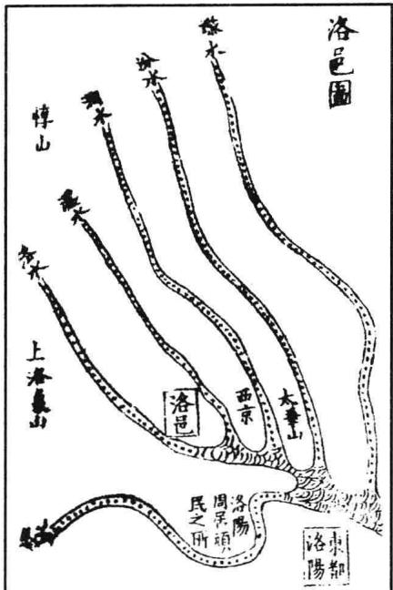

<!-- V3_SOURCE_ID:book018-b000218-p000-a54ea83699 -->

中等的龙（风水中山脉、地势及气脉的来势和行度）中，又次一等的是汴梁。它的龙从熊耳山延伸到这里，地势平坦万里。大河在它的北边，淮河在它的南边，也属于天苑垣的风水垣局格局。五代时期的梁、汉、晋、周都曾在此建都，但存续的时间不长。宋朝在此建都，传了九位皇帝，历时一百六十七年后南迁到临安。当时汴梁在黄河的南边，还大致可取。如今黄河冲决改道，汴梁被隔在黄河的北侧，不再有当时的风水形胜了。旧黄河故道在开封城北四十里处。宋元以来，黄河改道穿入淮河。到本朝洪武二十四年，黄河在原武决口，向东流经开封城北五里，又向南流到项城，经过颍川后流入淮河，旧黄河故道于是淤积。正统十三年，黄河又在荥阳决口，流经开封城的西南，城北的新河道又淤积了。从此汴城位于黄河的北边，龙脉被黄河穿流破坏，形胜也不复存在，黄河原本是可依恃的屏障，但形胜破坏后不可作为建都的依托。黄河发源于昆仑星宿海，又潜入地下伏流数百里，看不到它的支流。大禹疏导黄河，是从积石山开始的，并没有探寻到黄河的源头。黄河流到这里，水势横溢冲决。在外围，泾水、渭水、漆水、沮水汇合到渭水、汭水，又有伊水、洛水、瀍水、涧水、汾水汇合到底柱，排泄出去的只有汝水、泗水两条河流。在内侧，淡水、济水等内河，滹沱河、恒水、漳泽类水系汇入，直到九河、逆河，水势虽远却愈发盛大。所以黄河的水患，不是人力所能控制的，从夏商周三代以来就是这样。从汉、唐、宋、元到如今，连年冲决，沿河的百姓都像鱼鳖一样身陷水患，何况在此建都呢？

> **释读存疑：** 原文‘汾、之’存在脱漏，补‘水’作‘汾水’处理；原文‘恒、泽’无明确对应记载，暂释为恒水、漳泽类水系；原文“汾、之”存在脱漏，补“水”作“汾水”处理；原文“恒、泽”无明确对应记载，暂释为恒水、漳泽类水系

查看对应原文

<!-- V3_FOLDBACK_BEGIN:book018-b000218-p000-a54ea83699 -->

中龙之又其次者，有汴梁。其龙自熊耳至此，平坦万里。大河在其北，淮河在其南，亦天苑垣也。五代梁、汉、晋、周皆都于此，年代不永。宋都之，传九帝，历一百六十七年而南迁临安。是时汴梁在河之南，犹差可取。今河水冲决而在于河之北，无复当时风水形胜矣。旧黄河在开封城北四十里。宋元以来，河徙穿淮。驯及我朝洪武二十四年，河决原武，东经开封城北五里，又南行至项城，经颍川以入淮。而旧河故道遂淤。正统十三年，又决荥阳，过开封城之西南，而城北之新河又淤。自是汴城在河之北，龙脉经河穿坏，形胜亦无，河绕可恃不可用也。盖河源于昆仑星宿海，又入地伏流数百里，不见其派。禹之所导，始于积石，初未曾穷河源也。河至于此，其势横放冲溢。外则泾、渭、漆、沮之会于渭、汭，又有伊、洛、瀍、涧、汾、之会于底柱，所泄惟汝、泗二流。内则淡、济内河，滹沱、恒、泽从而益之，至于九河逆河，势虽远而愈胜。故有河患，非人所能制者。自三代已然。由汉、唐、宋、元迄今，频年冲决，而沿河之民悉鱼鳖矣，况可都乎？

<!-- V3_FOLDBACK_END:book018-b000218-p000-a54ea83699 -->

<!-- V3_SOURCE_ID:book018-b000219-p000-199f115e05 -->

## 论南龙所结帝都垣局

查看对应原文

<!-- V3_FOLDBACK_BEGIN:book018-b000219-p000-199f115e05 -->

## 论南龙所结帝都垣局

<!-- V3_FOLDBACK_END:book018-b000219-p000-199f115e05 -->

<!-- V3_SOURCE_ID:book018-b000220-p000-60fad5d2b3 -->

南龙（风水中山脉、地势及气脉的来势和行度）中有金陵，也就是如今的南畿，是我太祖高皇帝建都的地方。战国楚威王时，因为这个地方有王气，就埋金来镇压它，所以称为金陵。汉代改名为秣。吴国称为建业。晋代称为建康。它的地势，前辈说和洛阳相同。廖氏说：“建康形势洛阳同，王气古云钟。”大概是紫微垣局，是南干龙的尽头。苏伯衡对刘迪简说：“金陵的地脉，从东南逆长江流向向西延伸，数百里后才停止。它停止的地方，蜿蜒磅礴，既收敛又舒展。从中脊向下，降为平坦的原野。所谓的土中就在这里。向西是鸡笼、覆舟诸山，又西为石

> **释读存疑：** 原文‘汉改曰秣’存在脱漏，未补全内容；原文‘朔’为‘溯’的通假，释作逆长江流向向西；原文仅到‘又西为石’即截止，未补后续内容；原文“汉改曰秣”存在脱漏，未补全内容；原文“朔”为“溯”的通假，释作逆长江流向向西；原文仅到“又西为石”即截止，未补后续内容

查看对应原文

<!-- V3_FOLDBACK_BEGIN:book018-b000220-p000-60fad5d2b3 -->

南龙有金陵，即今之南畿，我太祖高皇帝建都之地也。战国楚威王时，以其地有王气，埋金以镇之，故称金陵。汉改曰秣。吴曰建业。晋曰建康。其形势，前辈谓与洛阳同。廖氏云：“建康形势洛阳同，王气古云钟。”盖紫微垣局，南干之尽也。苏伯衡谓刘迪简云：“金陵地脉，自东南朔长江而西，数百里而止。其止也，蜒蜿磅礴，既翁复张。中脊而下，降为平衍。所谓土中于是乎在。西为鸡笼、覆舟诸山，又西为石

<!-- V3_FOLDBACK_END:book018-b000220-p000-60fad5d2b3 -->

<!-- V3_SOURCE_ID:book018-b000222-p000-a5df9bccfe -->

这里的地理格局以头城为核心，钟山耸立在它的东侧，长江像回环的怀抱一样环绕周边，秦淮河、玄武湖分别在左右两侧形成映照的态势，两淮地区的众多山峦连绵重叠、朝向此处聚拢，仿佛捧着玉帛前来朝见一样。诸葛亮曾评价钟山像盘龙一样绵延，石城像猛虎一样蹲踞，是真正适合帝王建都的地方。从前秦始皇看到金陵一带有帝王之气，就向东巡游来压制这股气脉。之后三国时期的吴国在这里建都，共传了四代君主。东晋也在这里建都，共传了十一代君主，历时一百多年。南朝的宋、齐、梁、陈，还有南唐都曾在这里建都，但存在的时间都不长，大概是因为这里的格局虽然符合风水上的垣局要求，但垣局内的气脉多有外泄，所以才会这样。杨筠松所说的“长江环外有三结，垣前中水列。垣中已是帝王都，只是垣城气多泄”，指的就是这种情况。如果从地势优越的角度来讨论，长江隔断了南北，从古到今都被当作天然的险阻。朱熹说：“在东南地区讨论建都选址，一定要选建康的原因，是建康正好是各方水道汇聚的地方，一眼望去各个重要的枢纽区域都在面前，地理上有互相呼应的地方。”刘诚意评价这里“以长江为襟带，地势非常险要稳固”。桂文襄则认为“金陵的江北面有徐州、颍州两个州，地域延伸到中原，和数个省份像瓜蔓一样连接，都称得上是险要的重镇，作为金陵的屏障，有控制守扼的优势。江南面则有安庆，正处在长江下游的位置

> **释读存疑：** 1轮自动修复后核义模型仍建议修订，已保守记录。

查看对应原文

<!-- V3_FOLDBACK_BEGIN:book018-b000222-p000-a5df9bccfe -->

头城。而钟山峙其东，大江回抱，秦淮、玄武湖左右映带，两淮诸山合沓内向，若委玉帛而朝焉。诸葛孔明谓钟山龙蟠，石城虎踞，真帝王都。昔始皇见金陵有王气，东游以压之。其后三国吴都之，传四世。东晋又都之，传十一世，历百余年。南朝宋、齐、梁、陈、南唐皆都之，而年代不永，盖以其虽合垣局，而垣气多泄，故尔。杨筠松云“长江环外有三结，垣前中水列。垣中已是帝王都，只是垣城气多泄”是也。若以形胜论之，则江限南北，古今恃为天险。朱子曰：“东南论都，必要都建康者，以建康正诸方水道所凑，一望则诸要会地都在面前，有相应处。”刘诚意谓“襟带长江，势甚险固。”桂文襄谓“金陵，江北则有徐、颖二州，地跨中原，瓜连数省，并称雄镇，为藩离，有控扼之势。江南则有安庆，当长江委

<!-- V3_FOLDBACK_END:book018-b000222-p000-a5df9bccfe -->

<!-- V3_SOURCE_ID:book018-b000223-p000-93d70e573e -->

根据各位君子所论述的形势，这里确实是英雄用武之地，可以驾驭四方，号令天下而成就王业的地方。我太祖高皇帝在这里定都，确实是有原因的。但从地理家的角度来说，虽然符合紫微垣局，无奈垣气大多泄漏，所以成祖文皇帝又营建燕京，作为万世不拔的根基，难道是偶然的吗？大概是上天眷顾本朝，所以两位太祖的举动都符合法则，而不是有意于地理之说。多么盛大啊！

查看对应原文

<!-- V3_FOLDBACK_BEGIN:book018-b000223-p000-93d70e573e -->

流，西控全楚，为江表门户。”按诸君子所论形势，是诚英雄用武之地，可以驾驭四方，号令天下而兴王业者。我太祖高皇帝以之定鼎，良有以也。但以地理家言之，虽合紫微垣局，奈垣气多泄，故成祖文皇帝再建燕京，为万世不拔之基，岂偶然哉！盖天眷皇朝，故二祖动即合法，而非有意于地理之说也。猗与盛哉！

<!-- V3_FOLDBACK_END:book018-b000223-p000-93d70e573e -->

<!-- V3_SOURCE_ID:book018-b000224-p000-d3ab6f96aa -->

南龙（风水中山脉、地势及气脉的来势和行度）的次一等有临安。它的龙脉从天目山延伸到钱塘，海门有龙、赭二山在其中。郭景纯记载说：“天目山前两乳长，龙飞凤舞到钱塘。海门更点巽风起，五百年间出帝王。”其中“巽”是八卦之一，“巽风”是风水语境中对应巽位的风。《经》说：“海门环合似天市，天目天池生侍卫。万里飞来垣外挹，海外诸峰补垣气。”廖氏说：“大江以南天目峙，海门似天市。”所以临安也属于天市垣的风水垣局格局。如果从形胜来看，它偏处一隅，朱熹说“如同进入屋角的房间里，坐着看外面，很不相称。”宋高宗南迁在此建都，为他占卜相地的京畿国师，是我县的传公少华伯通。有临安行在表，说这个地方只可以驻跸，不适合建都，不过是偏安之地。而且会导致奸相弄权，武臣多有灾祸。后来宋朝终究没能恢复，而秦桧、贾似道等奸相相继出现，都操纵国家权力，武臣大多不得善终，果然应验了传公的话。

查看对应原文

<!-- V3_FOLDBACK_BEGIN:book018-b000224-p000-d3ab6f96aa -->

南龙之次有临安①。其龙脉自天目山入钱塘，而海门有龙赭二山在其中。郭景纯纪云：“天目山前两乳长，龙飞凤舞到钱塘。海门更点巽风起，五百年间出帝王。”《经》云：“海门环合似天市，天目天池生侍卫。万里飞来垣外挹，海外诸峰补垣气。”廖氏云：“大江以南天目峙，海门似天市。”故临安亦天市垣耳。若以形胜论之，则僻处一隅，子朱子谓“如入屋角房中，坐视外面，殊不相应。”宋高宗南迁建都于此，其卜相京畿国师，吾邑传公少华伯通也。有临安行在表，谓其地只可驻跸，不宜建都，不过偏安之地。且主奸相弄权，武臣多咎。后宋竟未能恢复，而奸相如秦桧、贾似道诸人迭出，皆操弄国柄，武臣多不善终，果符傅公之言。

<!-- V3_FOLDBACK_END:book018-b000224-p000-d3ab6f96aa -->

<!-- V3_SOURCE_ID:book018-b000225-p000-143bfa5430 -->

这份表的大致内容是：考虑这三吴的交汇之地，实在是百粤的要冲。钱氏在这里开创了数世的基业，郭璞占卜认为这里有兴王的运势。天目双峰屹立在斗牛星区之上，海门一点横处在轸翼星区之间。临安在轩辕星区汇集秀气，吴会在枢府星区孕育祥光。会稽、北固，是高耸如在天外的堂皇山峦；京口、姑苏，是域中浩渺的水泽。四神格局都已具备，地形开阔足以容纳八景格局。山势从北方延伸过来，有朝海拱辰的意象；水流向东流去，没有鬼劫凌夺的忧患。凤阁龙楼的位置，正处在辛地方位；捍门华表的格局，恰好对应星河位置。上符合东宫天市的星垣格局，下连接《禹贡》记载的扬州地域。然而金匮星对应位置高耸，虽然少府有多年的积蓄；廉贞星对应位置不利主星，必然有大臣多执掌权柄的隐患。昴日星对应位置有亏缺，武臣多有灾祸；鬼金星对应位置隆起，宦官会专权。文曲星对应方位多山，民俗崇尚虚浮而狡诈；少微星对应方位积水，人们多善于文饰而贪婪。虽然说这里自古号称雄地，实际上形和局两方面都偏弱。只适合作为一方的大镇，不适合作为传承百代的京都。暂设行营驻留足够偏安，在此建都难以统辖九州。

> **释读存疑：** ‘斗牛’‘轸翼’‘轩辕’‘枢府’‘辛地’‘廉贞’‘昴日’‘鬼金’‘文曲’‘少微’均为风水星占专业术语，未做超出材料的额外释义；原文‘驻驛’为‘驻跸’的讹写，按语义释为暂设行营驻留并标注讹误；“斗牛”“轸翼”“轩辕”“枢府”“辛地”“廉贞”“昴日”“鬼金”“文曲”“少微”均为风水星占专业术语，未做超出材料的额外释义；原文“驻驛”为“驻跸”的讹写，按语义释为暂设行营驻留并标注讹误

查看对应原文

<!-- V3_FOLDBACK_BEGIN:book018-b000225-p000-143bfa5430 -->

其表略曰：顾此三吴之会，实为百粤之冲。钱氏以之开数世之基，郭璞占之有兴王之运。天目双峰屹立乎斗牛之上，海门一点横当乎轸翼之间。临安集秀气于轩辕，吴会孕祥光于枢府。会稽、北固，堂堂乎天外之山；京口、姑苏，眇眇兮域中之泽。四神具足，八景宽容。山势北来，有朝海拱辰之象；水流东去，无鬼劫凌夺之忧。凤阁龙楼，正当辛地；捍门华表，恰值星河。上合东宫天市之垣，下接扬州禹贡之域。然而金匮凌云，虽少府有积年之聚；廉贞妬主，必大臣多持柄之虞。昴日星亏，武臣多咎；鬼金位起，阉寺施权。文曲多山，俗尚虚浮而诈；少微积水，人多文饰而贪。虽云自昔称雄，实乃形局两弱。只宜为一方之巨镇，不宜作百祀之京畿。驻驛暂足偏安，建都难奄九有。

<!-- V3_FOLDBACK_END:book018-b000225-p000-143bfa5430 -->

<!-- V3_SOURCE_ID:book018-b000226-p000-d1869e6159 -->

按：傅公的表呈上后，朝廷就升杭州为临安府而称为行在，于是搁置了建都的议论。又过了几年，秦桧专权，订立和议而没有恢复的志向。当时各位大臣也有议论建都建康的，最终还是听从了秦桧的议论，定都临安。而有宋终究没能恢复旧物，让人留下遗憾。虽然如此，天下的事情没有不有数定的。《宋史》记载徽宗梦见吴越武肃王钱镠入宫后生下了高宗，那么临安的建都，难道不是天数早已预定的吗？吴越王钱镠，唐末被封为吴越王，梁篡唐后，钱镠就占据了杭州。

查看对应原文

<!-- V3_FOLDBACK_BEGIN:book018-b000226-p000-d1869e6159 -->

按：傅公表上，乃升杭州为临安府而称行在，遂寝建都之义。又数年，秦桧专权，建和议而无恢复之志。当时诸臣亦有议都建康者，竟如桧议，定都临安。而有宋卒不能克复旧物，令人有余憾。虽然，天下事莫不有数。《宋史》记徽宗梦吴越武肃钱王镠入宫而诞生高宗，则临安之都，岂非数有预定者？吴钱王镠，唐末封吴越王，梁篡唐，镠遂据杭州。

<!-- V3_FOLDBACK_END:book018-b000226-p000-d1869e6159 -->

<!-- V3_SOURCE_ID:book018-b000227-p000-fbc017af09 -->

以上所说的建都之地，大致就是这样。唐尧、虞舜的都城，曾因黄河泛滥而遭受水患；周成王营建洛邑，是为了应对防守的困难；大梁地势平坦，没有险要可守；临安地处偏僻的角落；金陵的地形虽好，但地气多有泄漏；两淮的龙气已耗尽，且地势低下；东鲁的中干虽尊贵，却已孕育出孔圣。况且如今黄河穿流龙气之地，都不适合建都。至于许昌、成都、南粤等地，就不值得讨论了。只有我们的京师是最好的，关中次之，东汉所建都的洛阳又次之。即便如此，圣明的帝王，必定有自己所看重的地方。从前魏武侯沿西河顺流而下，船到中途回头对吴起说：‘壮美啊！山河如此险要，这是魏国的珍宝。’吴起回答说：‘国家的稳固在于德政，而不在于险要。从前三苗氏左边有洞庭湖，右边有彭蠡泽，禹却消灭了他；夏桀的居所，左边有黄河、济水，右边有太华山，伊阙在他的南边，羊肠坂在他的北边，汤却放逐了他；商纣的国土，左边有孟门山，右边有太行山，恒山在他的北边，黄河流经他的南边，武王却杀了他。如果不施行德政，船中的人都会成为敌国。’魏武侯认为他说得对。我认为君子不会因为人而废弃他的言论。吴起虽不值得称道，但他的这番话确实是确切的论断啊！不然的话，秦、隋曾建都关中，金、元曾建都燕京，风水之美、地形之险，为什么唯独对他们不灵验呢？因此风水之说关乎地理，是拥有国家的人应当选择的；而祸福得失的关键在于人，更是拥有国家的人应当谨慎对待的。

查看对应原文

<!-- V3_FOLDBACK_BEGIN:book018-b000227-p000-fbc017af09 -->

已上建都之地，其概如此。唐虞之都，以河溢为患。周洛邑以备守之难。大梁平夷无险。临安僻处一隅。金陵形胜虽优，而垣气多泄。两淮龙气大尽，而地势卑下。东鲁中干虽尊，而已钟孔圣。且今河水穿龙，皆非建都之宜。他如许昌、成都、南粤等处不足论矣。惟我京师为上，而关中次之，东汉所都之洛又次之。虽然，圣帝明王，要必有所重也。昔魏武侯浮西河而下，中流顾谓吴起曰：“美哉！山河之固，魏国之宝也。”起对曰：“在德不在险。昔三苗氏左洞庭，右彭蠡，禹灭之。桀之居，左河济，右太华，伊关在其南，羊肠在其北，汤放之。纣之国，左孟门，右太行，恒山在其北，太河经其南，武王杀之。若不修德，舟中之人皆敌国也。”武侯善之。愚谓君子不以人废言。起虽不足道，若斯者诚确论哉！不然，秦、隋尝都关中矣，金、元尝都燕京矣，风水之美，形胜之固，何独于彼不验哉！是故风水之说在于地，固有国者所当择。而祸福得丧之机存乎人，尤有国者所当慎也。

<!-- V3_FOLDBACK_END:book018-b000227-p000-fbc017af09 -->

<!-- V3_SOURCE_ID:book018-b000228-p000-1501d580ff -->

## 卷一之三

查看对应原文

<!-- V3_FOLDBACK_BEGIN:book018-b000228-p000-1501d580ff -->

## 卷一之三

<!-- V3_FOLDBACK_END:book018-b000228-p000-1501d580ff -->

<!-- V3_SOURCE_ID:book018-b000229-p000-eed43be19e -->

这一卷专门论述干龙、枝龙。龙的枝干，形态各不相同，如果没有真正的见识，登山时就会茫然无措，混乱得无法分辨。况且分辨龙的枝干，是地理的第一关键。如果连这都不知道，就失去了根本。就像在宫墙外张望，找不到门，又怎么能进入厅堂呢？所以首先论述枝干，也是开启门径的意思。

查看对应原文

<!-- V3_FOLDBACK_BEGIN:book018-b000229-p000-eed43be19e -->

此一卷专论干龙枝龙。夫龙之枝干，形势不一，苟无真见，则登山汗漫，贸贸莫分。且辨龙枝干，乃地理第一关键。此而不知，则大本已失。如宫墙外望，不得其门，何由升堂以入其室乎？故首论枝干，盖亦开关启键意也。

<!-- V3_FOLDBACK_END:book018-b000229-p000-eed43be19e -->

<!-- V3_SOURCE_ID:book018-b000230-p000-fea1ba7497 -->

## 枝干总论

查看对应原文

<!-- V3_FOLDBACK_BEGIN:book018-b000230-p000-fea1ba7497 -->

## 枝干总论

<!-- V3_FOLDBACK_END:book018-b000230-p000-fea1ba7497 -->

<!-- V3_SOURCE_ID:book018-b000231-p000-8e214de7ef -->

所谓干龙、枝龙，是说龙有大有小，就像树木有干有枝一样。干是树木的主体，枝柯依附于干才能挺立；枝是树木的延伸，枝叶从枝上繁衍生长。用龙的大小来取象，没有比这更明确的了。但枝干之中，又各有大小的区别，所以有大干龙、小干龙，大枝龙、小枝龙，也就是所说的干中有干、干中有枝，枝中有干、枝中有枝。吴国师说过：‘枝干分明，嫡庶就有分别；嫡庶有分别，力量就显现出来了。’所以论龙不能不分辨枝干，论枝干又不能不分辨大小，以此来审察力量的轻重。审察分辨的方法，以水源为标准：大干龙由大江大河夹送，小干龙由大溪大涧夹送，枝龙由小溪小涧夹送，小枝龙就只有田源沟洫夹送而已。杨公说过：‘水源也自有长短，水源长的地方会形成军州，水源短的地方会形成县邑。’

查看对应原文

<!-- V3_FOLDBACK_BEGIN:book018-b000231-p000-8e214de7ef -->

夫干龙枝龙者，乃龙之有大有小，犹木之有干有枝也。盖干为木之身，而枝柯所附以立。枝为木之衍，而条叶所自以蕃。论龙大小，取象莫辨于此。但枝干之中，又各有大小之别。故有大干龙、小干龙，大枝龙、小枝龙。所谓干中有干，干中有枝；枝中有干，枝中有枝是也。吴国师有云：“枝干明而嫡庶分，嫡庶分而力量见。”故论龙不可不辨枝干，论枝干又不可不辨大小，以审其力量之轻重也。然审辨之法，以水源为定。故大干龙则以大江大河夹送，小干龙则以大溪大涧夹送，枝龙则以小溪小涧夹送，小枝龙则惟田源沟洫夹送而已。杨公云“水源亦自有长短，长作军州短作县”

<!-- V3_FOLDBACK_END:book018-b000231-p000-8e214de7ef -->

<!-- V3_SOURCE_ID:book018-b000232-p000-81962e3c58 -->

干龙有两种，就是前面所说的大干龙、小干龙。所谓大干龙，就是干中之干。它的祖山都出自名山，跨州连郡，绵延几千上百里，是正气聚集的地方，孕育着灵秀，与众不同，又高又广，常常有云雾出现。《经》上说：‘先寻雾气识正龙’，又说：‘寻龙望气先寻脉，云雾多生在龙脊。春夏之交与二分，夜望云霓生处觅’，就是这个意思。因为大干龙的祖山极其高大，所以常常有云雾生在山顶，这是察识大干龙祖山的重要方法。知道了祖山，又应当在龙离开祖山前行时，审察它的出身。大干龙的出身耸拔雄伟，气势宏大，规模庄重，就像帝王出行，百官都跟随；就像大将奔赴敌阵，三军都听从命令，巍峨卓异，哪里像枝龙的出身，只以细嫩活动、逶迤磊落为美呢？等到它出身前行，就多是连绵而行，不起星峰，只有两旁的枝脚、护卫、关峡等山，才会星峰耸拔。世俗的眼光不认识大干龙的形体，只以星峰秀丽为喜爱，即便有所得，也不过是枝叶上的小穴罢了。哪里知道正干龙禀受的气浑厚，不会显现正体星辰。《经》上说：‘寻龙何处使人疑，寻得星辰却是枝。枝叶乱来无正穴，真龙到处又疑非。只缘不识两边护，却爱飞峰到脚随。飞峰斜落是龙脚，脚上生峰一边卓。真龙平处无星峰，两边生峰至难捉。’又说：‘疑龙何处最难疑，寻得星峰却是枝。关峡从行并护托，矗矗旗枪左右随。干上星峰全不作，星峰龙法尽虚辞。’又说：‘凡有好山随干去，枝龙尽处有旗枪。旗枪也是星峰作，圆净尖方高更卓。就中寻穴穴即无，干去未休枝早落。’又说：‘问君州县大干龙，似浪横江那有峰？起峰皆是两边脚，去为小穴为村落。’又说：‘两边起峰为护从，正龙低平最贵重。’又说：‘干龙身上不生峰，有峰皆是枝叶送’，就是这个意思。所以凡是干龙，不能用星体来拘泥它。只有崇山大城，像白浪涌波，层峦叠嶂，连绵而行，有时百余里，有时七八十里，有时二三十里才断一次。而断处必定是驿路通衢，人来人往络绎不绝的地方。古人用往来的人多少来检验峡的大小，用峡的大小来确定龙的大小，确实有道理。因为干龙的脊脉，多是疆域的界限，所以它过峡的断处，必定是省郡的通衢。但它的断也有潜伏的，有时十余里，有时数十里平坦，完全不知道它的去向，踪迹诡异。有时穿田野过山坡，像藕断丝连；有时过石梁渡水，像崩洪过脉；有时踪迹隐秘，像马迹蛛丝；有时撒落在平田，藏形隐迹。前行中忽然起高山，又再连绵而行。行而又断，断而复起，蔓延广袤，横亘连绵，极其长远，有时千余里，有时数百里。《经》上说：‘寻龙千里非迢递，其次五百三百里。’子微说：‘大龙千里费推寻，一二百里作郡邑。’廖氏说：‘干龙住处分远近，千里为大郡。二三百里可为州，过此即封侯。百里只堪为县治，下此为镇市’，就是这个意思。所以干龙的行度极其长远，越长远力量就越大。它分出去的龙，也随正干的大小而有差别。比如正干龙去做京师，就会从龙身分出小干龙做省城，从省城的龙身分出郡邑，从郡邑的龙身分出乡村市井之类。《龙髓经》说：‘大龙行度自非常，离祖生来手脚长。横亘铺舒千百里，至微三百里中藏。一弯一觜皆开广，终日循行尚未央。细叶犹为府州县，巨枝畿甸植君王’，就是这个意思。

查看对应原文

<!-- V3_FOLDBACK_BEGIN:book018-b000232-p000-81962e3c58 -->

夫干龙有二，前所云大干小干是也。所谓大干龙者，即干中之干者也。其祖皆出名山，跨州连郡，延袤几千百里，乃正气所聚，钟灵孕秀，颖异殊常，复然高广，而每有云雾发现。《经》云“先寻雾气识正龙”，又云“寻龙望气先寻脉，云雾多生在龙脊。春夏之交与二分，夜望云霓生处觅”是也。盖干龙之祖极高大，故每有云雾生其巅。此察识干龙祖宗之大法也。知其祖，又当于离祖分行，审其出身。耸拔雄伟，气势宏大，规模尊重，如王者驾出而百职咸随，如大将赴敌而三军听命，巍峨卓异，岂若枝龙之出身，惟以细嫩活动，逶迤磊落为美哉！及其出身以来，则多牵连而行，不起星峰，惟两旁枝脚、护卫、关峡等山，则星峰耸拔。俗眼不识干龙形体，惟以星峰秀丽为爱，纵有所得，不过枝叶小穴而已。岂知正干龙禀气浑厚，不起正体星辰。《经》云：“寻龙何处使人疑，寻得星辰却是枝。枝叶乱来无正穴，真龙到处又疑非。只缘不识两边护，却爱飞峰到脚随。飞峰斜落是龙脚，脚上生峰一边卓。真龙平处无星峰，两边生峰至难捉。”又云：“疑龙何处最难疑，寻得星峰却是枝。关峡从行并护托，矗矗旗枪左右随。干上星峰全不作，星峰龙法尽虚辞。”又云：“凡有好山随干去，枝龙尽处有旗枪。旗枪也是星峰作，圆净尖方高更卓。就中寻穴穴即无，干去未休枝早落。”又云：“问君州县大干龙，似浪横江那有峰？起峰皆是两边脚，去为小穴为村落。”又云：“两边起峰为护从，正龙低平最贵重。”又云“干龙身上不生峰，有峰皆是枝叶送”是也。故凡干龙，不可以星体拘之。惟是崇山大城，如白浪涌波，层峦迭嶂，牵连而行，或百余里，或七八十里，或二三十里只一断。而断处必是驿路通衢，人迹络绎不绝之处。古人以人迹往来多寡验峡之大小，以峡之大小定龙之大小，诚为有理。盖干龙脊脉，多为疆域界限，故其过峡断处，必是省郡通衢。然其断亦有一伏或十余里，或数十里平坦，了不知其去，而踪迹诡异。或穿田渡坂，而有藕断丝连；或石梁渡水，而为崩洪过脉；或抛踪闪迹，而有马迹蛛丝；或撒落平田，而藏形隐迹。前去忽起高山，又复牵连而行。行而又断，断而复起，延蔓广袤，横亘连绵，极其长远，或千余里，或数百里。《经》云：“寻龙千里非迢递，其次五百三百里。”子微云：“大龙千里费推寻，一二百里作郡邑。”廖氏云“干龙住处分远近，千里为大郡。二三百里可为州，过此即封侯。百里只堪为县治，下此为镇市”是也。故干龙之行度，极其长远，愈长远则力量愈大。其分去之龙，亦随其正干之大小而有差别。如正干龙去作京师，则其龙身分去小干为省城，而省城龙身分去为郡邑，郡邑龙身分去为乡村市井之类。《龙髓经》云“大龙行度自非常，离祖生来手脚长。横亘铺舒千百里，至微三百里中藏。一弯一觜皆开广，终日循行尚未央。细叶犹为府州县，巨枝畿甸植君王”是也。

<!-- V3_FOLDBACK_END:book018-b000232-p000-81962e3c58 -->

<!-- V3_SOURCE_ID:book018-b000233-p000-309b498494 -->

况且它的从山以及枝脚桡棹，都有融结的态势。这是因为干龙气势雄大，布置精巧，所以跟随它的龙，以及它本身的透漏之处，都能形成穴。张子微说：“手脚桡棹皆有穴，此是大龙多余气”，就是这个意思。不过这类大龙，也有行走到将要结穴的地方时，没有手足桡棹，撒落在平阳地带，单行独出，一屈一曲，绵延数十里，隔州隔水的山体，从远方前来迎接，在数十里外，自然相互照应。《龙髓经》说：“不知大龙百十里，临到作穴如蛇虺。单单湾环数十程，无手无脚如流水。若论缠护隔溪港，一望遮来数十里。若拘缠托与桡棹，不知此龙何者是。”所以干龙入首之处，必然是外山隔水作为迎送、缠托的地方。张子微说：“小地结果论迎送，大地迎送隔江水。”杨公说：“大凡干龙行尽处，外山隔水来相顾。”《发挥》说：“譬之大贵人将至，不是自己带来护卫，乃是千百里外系指挥。部属之人，翕然聚集，刻日限时，罔敢不至”，就是这个意思。《雪心赋》说：“求吾所大欲，无非逆水之龙。”这只是说的枝龙而已。干龙被两条水夹送，哪会有逆水的情况？只是在将要入首时，翻身逆水，在数里或数十里的数节处结穴才是好的。所谓“顺势翻成逆势”，就是这个意思。它结穴的时候，必然是山水大会，或者山大曲，水大转，水口交固，明堂平广，左右周回，内局团聚，外阳宽畅，水朝山拱。有这样的形势，就可以寻找穴了。《经》说：“凡山大曲，水大转，必有王侯居此间。”又说：“到此先看水口山，水口交牙内局宽。便就宽容平处觅，左右周回无空闲。断然有穴在此处，更看朝水与朝山”，就是这个意思。不过干龙正脉，将要结穴时，必然会连断几断，脱卸杀气，才有融结的可能。不然的话，就撒落在平洋结聚为好，都必须靠近大河。虽然靠近大河，却不暴头露面，必然居于拥从之中。《龙髓经》所说的“万卒影从成禁卫，千官环列是朝廷”，就是这个意思。谚语说“好地如闺中美女”，就是这个意思。也有翻身朝祖而结穴的，《经》说：“请君看水交缠处，水外有山来会聚。翻身顾母顾祖宗，此是回龙转身处。宛转回龙似挂钩，未作穴时先作朝。朝山皆是宗与祖，不拘千里远迢迢”，就是这个意思。也有不回转而直受结穴的，《经》说：“也有干龙来两水，更不回身直为地。只是两护必不同，定有缠关交结秘”，就是这个意思。也有横落入首，借鬼安穴的，《经》说：“干龙若是有鬼山，横转一边宽处安”，就是这个意思。虽然这几种结穴方式不同，但总之，都必须以两河交剑处为尽头。而它正受的穴，又不能在大穷尽处求索。《经》说：“君如寻得干龙穷，二水相交穴受风。风吹水劫却非穴，君如到处是疑龙。”又说：“大地皆从腰里落，回转余枝作城廓。”范越凤说：“大贵大富之地，必不在大穷尽处。大穷尽处多是风吹水劫”，就是这个意思。所以干龙气势雄盛，结穴之外，必然有余气之山，有的去数十里，有的去数里，都暗中拱卫，作为正穴的用神，或者作为下手，或者作为托乐，或者反绕于身为关峡，或者奔走于水口为门户之类。其间又各有小穴，根据它的力量大小，都能发越，但不能和正结相比。不过这类干龙正结的穴，天珍地秘，多是丑拙隐怪，有的在高山结仰高天巧，有的落平地结藏龟没泥，有的为骑龙，有的为石巧，奇踪异迹，隐晦殊常。或者有沙水飞走，或者有杀气错杂，或者有曜星奔窜，或者有毡褥铺展，或者有元辰直长，所以多有不利初代，以及公位不均，离乡远去等事。只是龙真就不能舍弃，穴的就不能移动，这是造化没有全功，也必须扦葬，不必因为小的嫌隙而舍弃大地。但这又应当详审精察，切勿被图大所迷惑。大概庸师多以龙真穴拙之说为借口，乱下有龙无穴的凶恶假地，误人最甚。大抵干龙真穴，虽是隐怪，却是颖异，如玉蕴山辉，珠藏渊媚，自然秀气迸露，门户迥别。或龟蛇交

查看对应原文

<!-- V3_FOLDBACK_BEGIN:book018-b000233-p000-309b498494 -->

且其从山及枝脚桡棹，皆有融结。爰是干龙，气势雄大，布置精巧，故随从之龙，与本身透漏，皆能有穴。子微云“手脚桡棹皆有穴，此是大龙多余气”是也。然此等大龙，亦有行至将结穴处无手足桡棹，撒落平阳，单行独出。而一屈一曲，动数十里，隔州隔水之山，远来迎接，在数十里外，自相照应。《龙髓经》云：“不知大龙百十里，临到作穴如蛇虺。单单湾环数十程，无手无脚如流水。若论缠护隔溪港，一望遮来数十里。若拘缠托与桡棹，不知此龙何者是。”故干龙入首，必是外山隔水为迎为送，为缠为托。子微云：“小地结果论迎送，大地迎送隔江水。”杨公云：“大凡干龙行尽处，外山隔水来相顾。”《发挥》云“譬之大贵人将至，不是自己带来护卫，乃是千百里外系指挥。部属之人，翕然聚集，刻日限时，罔敢不至”是也。《雪心赋》云：“求吾所大欲，无非逆水之龙。”此特枝龙而已。干龙两水夹送，安有逆水？惟是将及入首，翻身逆水，数十里或数里数节结穴为妙。所谓“顺势翻成逆势”是也。其结穴际，必然山水大会，或山大曲，水大转，而水口交固，明堂平广，左右周回，内局团聚，外阳宽畅，水朝山拱。有此形势，即可寻穴。《经》云：“凡山大曲，水大转，必有王侯居此间。”又云“到此先看水口山，水口交牙内局宽。便就宽容平处觅，左右周回无空闲。断然有穴在此处，更看朝水与朝山”是也。然干龙正脉，将及结穴，必然连断几断，脱卸杀气，方有融结。不然，则撒落平洋结聚为佳。皆须依近大河耳。虽是依近大河，却不暴头露面，必居拥从之中。《龙髓经》所谓“万卒影从成禁卫，千官环列是朝廷。”谚语云“好地如闺中美女”是也。亦有翻身朝祖而结穴者，《经》云“请君看水交缠处，水外有山来会聚。翻身顾母顾祖宗，此是回龙转身处。宛转回龙似挂钩，未作穴时先作朝。朝山皆是宗与祖，不拘千里远迢迢”是也。亦有不回转而直受结穴者。《经》云“也有干龙来两水，更不回身直为地。只是两护必不同，定有缠关交结秘”是也。亦有横落入首，借鬼安穴者。《经》云“干龙若是有鬼山，横转一边宽处安”是也。虽是数等结穴不同，要之，皆必以两河交剑处为尽。而其正受之穴，又不可以大穷尽处求索。《经》云：“君如寻得干龙穷，二水相交穴受风。风吹水劫却非穴，君如到处是疑龙。”又云：“大地皆从腰里落，回转余枝作城廓。”范越凤云“大贵大富之地，必不在大穷尽处。大穷尽处多是风吹水劫”是也。故干龙气势雄盛，结穴之外，必有余气之山，或去数十里，或去数里，皆暗拱，为正穴用神，或作下手，或作托乐，或反绕于身为关峡，或奔走于水口为门户之类。其间又各有小穴，随其力量，皆有发越，然莫得与正结比耳。但此等干龙正结之穴，天珍地秘，多是丑拙隐怪，或在高山而结仰高天巧，或落平地而结藏龟没泥，或为骑龙，或为石巧，奇踪异迹，隐晦殊常。或有沙水飞走，或有杀气错杂，或有曜星奔窜，或有毡褥铺展，或有元辰直长，故多有不利初代，及公位不均，离乡远去等事。惟龙真而不可舍，穴的而不可移，乃是造化无全功，亦须扦葬，不必以小嫌而去大地。但此又当详审精察，切勿被图大所惑。盖庸师多以龙真穴拙之说籍口，乱下有龙无穴凶恶假地，误人最甚。大抵干龙真穴，虽是隐怪，却是颖异，如玉蕴山辉，珠藏渊媚，自然秀气迸露，门户迥别。或龟蛇交

<!-- V3_FOLDBACK_END:book018-b000233-p000-309b498494 -->

<!-- V3_SOURCE_ID:book018-b000234-p000-d6d5c64d16 -->

所谓小干龙，就是干中的枝龙，也是从大干龙分来的。分龙的时候，必然有大星辰、崇山高城作为祖宗。张子微说“分龙定起大星辰”，就是这个意思。从此离祖而行，辞楼下殿，迢递奔走，也和大干龙的气势相类，只是长短不同。大干龙极长，动辄超过千里，或数百里；小干龙只有二三百里，或百余里；再小一点的，只有七八十里。而它的龙身行度，大致都和大干龙无异，所分枝脚，也多结乡村市井。它的水源有长短不同，大聚小聚也有区别。《经》说“水源亦自有长短，长作军州短作县。枝枝节节是乡村，干上时时断复断。分枝擘脉散乱去，干中有枝枝有干”，就是这个意思。它的龙禀气也很浑厚，也不能用星体来拘泥它，必然多延蔓广袤，横亘牵连，行五六十里，或二三十里，再其次的，或十余里才断一次。而断处也是大关峡、大道路，枝叶之山非常蕃衍，拥从护应峡场，此处龙气很旺，枝叶间必有融结的小穴。《口诀》说“峡前峡后去寻地”，就是这个意思。它的龙行尽处，必然以水大会为止，两河交剑处为尽头。《经》说“百里各有小干龙，两水生来寻曲岸。曲岸随水抱龙头，抱处好寻气无散”，就是这个意思。也是两水夹送，不一定是逆水，只是在结作的时候，翻身曲转，逆势作穴，所以有曲岸之水抱其龙头罢了。它的穴也不在大穷尽处，也多隐怪。将要结作的时候，也必然连有脱卸，闪跌度峡，或连起峰峦，开帐穿心，而它的手脚桡棹也都融有小穴。迎送护托之山也是隔水相卫，远来聚会。水口之山也有数十里之远，而门户也须颖异，有华表、北辰、游鱼、石曜、龟蛇、狮象等沙。入局的时候，也必然山水大会，朝案特达，左右周回，明堂舒畅，内局紧固，外阳宽阔，罗城秀列，禽曜出现，多结郡邑市镇、冲要繁剧衙门，及王侯极贵基址。如果结为阴地，就主分茅胙土、出将入相、皇亲国戚、文武全材、忠臣烈士、清修贤儒、神童状元，及巨万之富，子孙蕃衍，世代荣显，满门朱紫，与国同休，身后英灵，血食百世。

查看对应原文

<!-- V3_FOLDBACK_BEGIN:book018-b000234-p000-d6d5c64d16 -->

夫小干龙者，即干中之枝也。亦自大干龙分来。分龙之际，必有大星辰、崇山高城为祖宗。张子微云“分龙定起大星辰”是也。自此离祖而行，辞楼下殿，迢递奔走，亦与夫大干龙气势相类，特长短不同。大干龙极长，动逾千里，或数百里。小干龙只二三百里，或百余里。又其次者，或七八十里。而其龙身行度，大略皆与大干龙无异。所分枝脚，亦多结乡村市井。其水源有长短不同，大聚小聚亦别。《经》云“水源亦自有长短，长作军州短作县。枝枝节节是乡村，干上时时断复断。分枝擘脉散乱去，干中有枝枝有干”是也。其龙禀气亦自浑厚，亦不可以星体拘之。必多延蔓广袤，横亘牵连，行五六十里，或二三十里，其次者或十余里始一断。而断处亦是大关峡、大道路。而枝叶之山甚蕃衍，拥从护应峡场。此处龙气甚旺，枝叶间必有融结小穴。《口诀》云“峡前峡后去寻地”是也。其龙行尽处，必以水大会为止，两河交剑处为尽。《经》云“百里各有小干龙，两水生来寻曲岸。曲岸随水抱龙头，抱处好寻气无散”是也。亦是两水夹送，不可必其逆水。惟是结作之际，翻身曲转，逆势作穴，故有曲岸之水抱其龙头耳。其穴亦不在大穷尽处，亦多隐怪。将及结作之间，亦必连有脱卸，闪跌度峡，或连起峰峦，开帐穿心，而其手脚桡棹亦皆融有小穴。迎送护托之山亦是隔水相卫，远来聚会。水口之山亦有数十里之远。而门户亦须颖异，有华表、北辰、游鱼、石曜、龟蛇、狮象等沙。入局之际，亦必山水大会，朝案特达，左右周回明堂舒畅，内局紧固，外阳宽阔，罗城秀列，禽曜出现，多结郡邑市镇、冲要繁剧衙门，及王侯极贵基址。若结为阴地，则主分茅胙土、出将入相、皇亲国戚、文武全材、忠臣烈士、清修贤儒、神童状元，及巨万之富。子孙蕃衍，世代荣显，满门朱紫，与国同休，身后英灵，血食百世。

<!-- V3_FOLDBACK_END:book018-b000234-p000-d6d5c64d16 -->

<!-- V3_SOURCE_ID:book018-b000235-p000-37bbe110e3 -->

还有一类干龙，禀受的气凶恶而不清净，本身带有煞气令人畏惧。即使经过脱卸变化，也改不了粗陋顽劣的本性；即使出现变剥的形态，更显雄悍的气势。不过这类干龙也会开帐穿心，分牙布爪，各类贵格都具备，也能融结，但大福大祸常常各占一半，有的像淮阴侯那样尊贵却最终被灭族，有的像石季伦那样富有却不得善终。最凶恶的这类干龙，有的像王莽那样篡夺君位，有的像赵高那样独揽大权，有的成为割据一方的伪主，有的成为草寇大盗的头目。虽然都拥有富贵权爵、显赫威名，一时荣耀却不符合正道，不得善终，反而得罪天地，遗臭无穷，君子是不认可这类干龙的。这就是干龙中不好的情况，寻找干龙的人必须要认清这一点。

查看对应原文

<!-- V3_FOLDBACK_BEGIN:book018-b000235-p000-37bbe110e3 -->

又有一等干龙，禀气凶恶而不清，本身带杀而可畏。虽经脱卸，不改粗顽；虽见变剥，愈见雄悍。却亦开帐穿心，分牙布爪，诸般贵格备具，亦有融结，但大福大祸，每每相半，或贵如淮阴而卒夷其族，或富如季伦而不善其后。其最凶者，或如王莽之纂位，或如赵高之擅权，或为割据偏方之伪主，或为草寇大盗之头目。虽皆有富贵权爵、烜赫威名，一时荣耀而不得其正，不令其终，反得罪于天地间，遗臭无穷，君子不取也。此干龙之不美者，寻干龙者又须识此。

<!-- V3_FOLDBACK_END:book018-b000235-p000-37bbe110e3 -->

<!-- V3_SOURCE_ID:book018-b000236-p000-1a28176d7d -->

前面所说的干龙虽有大干龙、小干龙的区别，但它们的体势大多相似，只是根据水源夹送的长短来验证它们的大小。所以除了中国的三大正干龙之外，大的干龙尚且绵延千余里，次一等的有数百里，再次一等的有的百余里，有的七八十里，都要根据山脉的发祖之地、水的大会聚处，来推究它们的起止。大的龙就论大祖宗山，小的龙就论小祖宗山。《玉髓经》说“祖宗势大子亦大”就是这个意思。大的龙论大缠护，小的龙论小缠护。所以说“大龙迎送隔江水”，又说“外州外县山为伴”。又说“护缠亦自有大小，大小随龙长短来。龙长缠护亦长远，龙短缠山亦近挨”也是这个意思。大的龙论大水源，小的龙论小水源。所以说“水源亦自有长短，长作军州短作县”。比如中国的三大干龙，就以长江、黄河、鸭绿江的水作为夹送。大的龙论大关拦，小的龙论小关拦。所以说“大龙关拦数十里”，又说“大地必有大关拦”。规模越大，堂局就越宽阔；堂局越宽阔，关拦就越远。比如冀州的关拦，在碣石；长安的关拦，在荆山；洛邑的关拦，在泰华之类的地方。以此类推，其他大小的干龙，都可以按类别推究。所以凡是干龙入局的时候，山水大聚，或者结为垣局，或者结为堂局，大的会成为京畿、禁穴、圣贤之地；次一等的会成为省城、藩镇、郡邑市井，是王侯极贵的穴。所谓阳基就会立郡建都，阴地就会分茅胙土，只有干龙才会这样，枝龙的地方，绝对没有这样的力量。不过干龙在行进过程中，穿落传变，出帐入帐，次数不计其数。辞楼下殿、聚讲迭云、屯蜂聚蚁、尊极帝座、生龙紫微、天弧、天角、龙车、凤辇、鼓角、楼台、负扆、御屏、霞帔、云锦、鹤驾、銮舆、华盖、宝盖、冠盖、芙蓉、崽、金花、飞蛾、三台、九脑、冕旒、玉尺、千丝坠、万石仓、金桥、仙桥、展诰、展帐、玉枕、玉屏、玉几、顿笏、连璧、御阶、幞头、席帽、金钟、玉磬、宝幢、降节、龙楼、宝殿、帝释、堆甲、迭帐、穿珠、走马、飞丝、卷帘、玉陛、飞帛、舒练、抛梭、佩珂、芦花、芦鞭、楼船出峡、红船出海、阁门传宣、推车进宝、天驷出厩、仙鹤垂喙、玉蝉脱壳、群仙出洞、群羊出栈、群雁穿云，各类贵格，没有不具备的。剥变骨节，过峡脱卸，穿田度坂，横亘摆折，楼阁逶迤，蛛丝马迹，藕断丝连，偷藏脉络，奇踪异迹，崩洪怪石，天汉天潢、左侍右卫、养荫灵泉，各类巧妙，没有不具备的。而它的桡棹枝脚，虎踞龙翔，鸾飞凤舞，顿旗列鼓、垂帘挂幕、文官武库、天以太乙、列屏列幕、带印带剑、垂珠垂缨、排仓排库、侍人从马、金童玉女、旌节旗旄，各类拥从，没有不具备的。分牙布爪，脱骨换胎，从尊贵到卑微，从粗变细，千形万状，难以尽数列举。因为它行进的距离遥远，所以能具备各类奇特的贵格；气势宏大，所以能展现出英华的妙处；垣局广阔，所以能容纳众山众水献奇列秀的繁华；缠送护从的众多，所以能尽显重冈迭帐、插戟列屏、交结门户、开锁罗城的完美。《葬书》所说的“贵若千乘，富如万金”，又说“若怀万宝而宴息，若具万膳而洁齐”。卜氏所说的“三千粉黛，八百烟花”；子微所说的“万卒影从成卫禁，千官拥护是朝廷”；范越凤所说的“若相公之升堂，若大将之登营”，这些都是干龙结作的规模。所以它的力量宏大，发福悠久，不可限量。《经》说：“凡言大地多大话，下士闻之心已怕，中士闻之心信疑，上士闻之心欲为。何不观之富贵家，子孙累世享荣华。盖缘祖龙势力大，食禄袭爵名世家。小地虽然亦小发，未及三世即歇灭。到此方知小易衰，大地富贵世不绝。”这就是干龙之所以尊贵的原因。

查看对应原文

<!-- V3_FOLDBACK_BEGIN:book018-b000236-p000-1a28176d7d -->

右干龙虽有大干龙小干龙之不同，然其体势亦多相似，但以水源夹送之长短而验其大小。故除中国三大正干外，其干龙之大者犹至千余里，次者数百里，又其次者或百余里，或七八十里，皆以山之发祖，水之大会，原其起止也。然大龙则论大祖宗，小龙则论小祖宗。《玉髓经》云“祖宗势大子亦大”是也。大龙论大缠护，小龙论小缠护。故曰“大龙迎送隔江水”，曰“外州外县山为伴”。又曰“护缠亦自有大小，大小随龙长短来。龙长缠护亦长远，龙短缠山亦近挨”是也。大龙论大水源，小龙论小水源。故曰“水源亦自有长短，长作军州短作县”。如中国三大干龙，则论长江、黄河、鸭绿江之水以为夹送也。大龙论大关拦，小龙论小关拦。故曰“大龙关拦数十里”。又曰“大地必有大关拦”。其规模愈大，则堂局愈阔。堂局愈阔，则关拦愈远。如冀州关拦，乃在碣石；长安关拦，乃在荆山；洛邑关拦，乃在泰华之类是也。举此为论，其它大小，皆可以类而推矣。故凡干龙入局之际，山水大聚，或结为垣，或结为局，大者为京畿，为禁穴，为圣贤之地；次者为省城、藩镇，为郡邑市井，为王侯极贵之穴。所谓阳基则立郡建都，阴地则分茅胙土，惟干龙为然，枝龙之地，断然无此力量也。然其行度之间，穿落传变，出帐入帐，亦不计其重。辞楼下殿、聚讲迭云、屯蜂聚蚁、尊极帝座、生龙紫微、天弧、天角、龙车、凤辇、鼓角、楼台、负扆、御屏、霞帔、云锦、鹤驾、銮舆、华盖、宝盖、冠盖、芙蓉、崽、金花、飞蛾、三台、九脑、冕旒、玉尺、千丝坠、万石仓、金桥、仙桥、展诰、展帐、玉枕、玉屏、玉几、顿笏、连璧、御阶、幞头、席帽、金钟、玉磬、宝幢、降节、龙楼、宝殿、帝释、堆甲、迭帐、穿珠、走马、飞丝、卷帘、玉陛、飞帛、舒练、抛梭、佩珂、芦花、芦鞭、楼船出峡、红船出海、阁门传宣、推车进宝、天驷出厩、仙鹤垂喙、玉蝉脱壳、群仙出洞、群羊出栈、群雁穿云，诸般贵格，靡所不有。剥变骨节，过峡脱卸，穿田度坂，横亘摆折，楼阁逶迤，珠丝马迹，藕断丝连，偷藏脉络，奇踪异迹，崩洪怪石，天汉天潢、左侍右卫、养荫灵泉，诸般巧妙，无所不备。而其桡棹枝脚，虎踞龙翔，鸾飞凤舞，顿旗列鼓、垂帘挂幕、文官武库、天以太乙、列屏列幕、带印带剑、垂珠垂缨、排仓排库、侍人从马、金童玉女、旌节旗旄，诸般拥从，无所不具。分牙布爪，脱骨换胎，自尊而卑，自粗变细，千形万状，难于毕举。盖其行度之远，故能备具诸格之奇；气势之宏，故能发现英华之妙；垣局之广，故可受乎众山众水献奇列秀之繁华；缠送护从之多，故能尽乎重冈迭帐、插戟列屏、交结门户、开锁罗城之完美。《葬书》所谓“贵若千乘，富如万金”，又云“若怀万宝而宴息，若具万膳而洁齐”。卜氏所谓“三千粉黛，八百烟花”；子微所谓“万卒影从成卫禁，千官拥护是朝廷”；范越凤所谓“若相公之升堂，若大将之登营”，此皆干龙结作之规模耳。故其力量宏大，发福悠久，不可限量。《经》云：“凡言大地多大话，下士闻之心已怕，中士闻之心信疑，上士闻之心欲为。何不观之富贵家，子孙累世享荣华。盖缘祖龙势力大，食禄袭爵名世家。小地虽然亦小发，未及三世即歇灭。到此方知小易衰，大地富贵世不绝。”此干龙之所以为贵也。

<!-- V3_FOLDBACK_END:book018-b000236-p000-1a28176d7d -->

<!-- V3_SOURCE_ID:book018-b000237-p000-a6686dd2de -->

杨筠松《龙经》的千言万语，都归结于重视干龙，大概是因为干龙的力量最为宏大。然而山脉分枝分派，干龙数量最少，枝龙数量极多。所以论定风水宝地只可以用真伪来辨别，不可以用大小来拘泥。《经》中说“大地难得小易求”，怎么可以因为枝龙的地小就轻视它呢？况且干龙的大地，有鬼神掌管，如果没有阴德，就不可觊觎。而枝龙的地，到处都有，容易寻求。所以枝龙尤其应当仔细探究。不过枝龙也有大枝龙、小枝龙的区别，不可不辨别。所谓的大枝龙，就是枝中的干龙。观察它，也要先看它的祖山。只是干龙论大祖大宗，枝龙论小祖小宗。所以即使是大枝龙，它的祖山也不是遥远的高山，只是小干龙驻留的地方就是龙祖了。在这里要审察它离开祖山分派的情况，来追溯它的起源。要这里起有星辰，符合五星正体中的一星，或是水，或是木，或是涨天水、焰天火，或是御屏土之类。大概它的发脉，中间落下为上等。自从离开祖山以后，又接连起有星辰，叫做应龙，也叫应星。有这样的应星符合标准，落脉又是从中而出，就叫做出身好，前去必定结成美地。自从出身之后，曲折绵延地行度，看它的穿落传变等格局如何，如果真是结地的龙，自然会符合标准。或起或伏，有剥有变，或大顿小跌，或左栖右闪，或横开阔帐而穿心中出，或之玄屈曲而摆折流行，或如生蛇出洞，或如琢木飞空，断而复续，伏而再起，两边的枝脚随身拥护，不让风吹，或反过来借干龙作为遮护嶂托。等到过峡的时候，或穿田度脉，抛踪闪迹，藕断丝连。脱卸之后，又起星辰，磊磊落落，或飞蛾降势，或华盖中抽，它本身的枝脚摆列均匀，或带仓库，或带旗鼓，或带印笏，或带剑戟，或成天乙、太乙，或成文官武将，左侍右卫，前呼后拥。等到将要结作的时候，又起高大的星辰，作为少祖。从这座山下，或二三节，或四五节就作为穴场，而穴后一节的山，或束气结咽，或细嫩委曲，或闪断为峡，顿起穴星，融结天然的穴，就是最贵的。它两边缠送护托的山，想要它重叠簇拥跟从，或停在穴后，或侍立在左右。而朝迎的山，就应当高耸在穴前。下手的山，要逆水数重，抱转有力，就是真结。《经》中说“枝龙身上亦可截，半是虚花半是开。若是虚花无朝应，若是结实护缠回。护缠尚要观迭数，一迭回来龙身顾，莫便将为真实观，恐是护龙叶交互。三重五重抱回来，此就枝龙身上做”，就是这个意思。枝龙结穴多在尽处，要天然明白为上等，多是得水处结穴，所以说“未看山，先看水，有山无水休寻地”。多是下手的山有力，所以说“看地有何难？先观下手山”。又说“有地无地，先看下臂”，就是这个意思。龙中尊贵的，就有贵的应验。或印浮水面，或龟蛇交结，或车马联骈，或楼台镇塞，或罗星关锁，或旗鼓罗列，或日月对峙，或华表高耸。如果这样虽然说是枝龙，结作不如干龙悠久，然而有这样的规模，也不是中下地。如果安插得法，主翰苑尚书侍从，方面文武之职，及富冠乡邑，一时荣盛，朱紫满门。

查看对应原文

<!-- V3_FOLDBACK_BEGIN:book018-b000237-p000-a6686dd2de -->

杨筠松《龙经》千言万语，皆归重于干龙，盖举其力量之大而言之耳。然山脉分枝分派，干龙最少，枝龙极多。故论地只可以真伪辨，不可以大小拘。《经》云“大地难得小易求”，乌可谓枝龙地小而忽之？况干龙大地，有鬼神所司，苟无阴德，未可睥睨。而枝龙之地，在在有之，易于求索。故枝龙尤当究竟。然枝龙亦有大枝小枝，不可不辨。夫所谓大枝龙者，即枝中之干也。观之，亦先其祖山。但干龙则论大祖大宗，枝龙则论小祖小宗。故虽大枝龙，祖山亦不是远高山峦，只小干龙驻跸处即龙祖矣。于此审其离祖分派，以原其始。要此处起有星辰，合五星正体中一星，或水或木，或涨天水、焰天火，或御屏土之类。盖其发脉，中落为上。自离祖以后，又连起有星辰，谓之应龙，亦曰应星。有此应星合格，落脉更是中出，即谓之出身好，前去必结美地。自出身后，迢递行度，看其穿落传变等格何如，若真是结地之龙，自然合格。或起或伏，有剥有变，或大顿小跌，或左栖右闪，或横开阔帐而穿心中出，或之玄屈曲而摆折流行，或如生蛇之出洞，或如琢木之飞空，断而复续，伏而再起，两边枝脚随身拥护，不令风吹，或反借干龙作遮护嶂托。及其过峡之际，或穿田度脉，抛踪闪迹，藕断丝连。脱卸之后，复起星辰，磊磊落落，或飞蛾降势，或华盖中抽，其本身枝脚摆列均匀，或带仓库，或带旗鼓，或带印笏，或带剑戟，或成天乙、太乙，或成文官武将，左侍右卫，前呼后拥。及将结作之际，又起高大星辰，以为少祖。自此山下，或二三节，或四五节即作穴场，而穴后一节之山，或束气结咽，或细嫩委曲，或闪断为峡，顿起穴星，融结天然之穴，乃为最贵。其两边缠送护托之山，欲其重迭拥从，或住于穴后，或侍立左右。而朝迎之山，则应耸穴前。下手之山，则逆水数重，抱转有力，乃为真结。《经》云“枝龙身上亦可截，半是虚花半是开。若是虚花无朝应，若是结实护缠回。护缠尚要观迭数，一迭回来龙身顾，莫便将为真实观，恐是护龙叶交互。三重五重抱回来，此就枝龙身上做”是也。枝龙结穴多在尽处，则要天然明白为上，多是得水处结穴，故曰“未看山，先看水，有山无水休寻地”。多是下手之山有力，故曰“看地有何难?先观下手山”。又曰“有地无地，先看下臂”是也。龙之贵者，则有贵应。或印浮水面，或龟蛇交结，或车马联骈，或楼台镇塞，或罗星关锁，或旗鼓罗列，或日月对峙，或华表高耸。若此虽云枝龙，结作不及干龙悠久，然有此规模，亦非中下地也。若安插得法，主翰苑尚书侍从，方面文武之职，及富冠乡邑，一时荣盛，朱紫满门。

<!-- V3_FOLDBACK_END:book018-b000237-p000-a6686dd2de -->

<!-- V3_SOURCE_ID:book018-b000238-p000-a9e924d6c8 -->

其次又有小枝龙，就是枝中的枝。那大龙行走还很远，而在行走的龙身上，或大龙的峡边，分落一枝，自己起有星辰，峰峦磊落，远的有三五里，近的有十数节。子微说：“却有枝龙但数节，不作穿心人易识。譬如丞参簿尉衙，岂似正衙门户密。三节四节交节分，分得英华为子孙。”须要成星体，符合龙格，有起伏，有夹送，而龙虎、应案、堂气、水城、下关、门户都符合法度，穴情十分明白，才是真结，也主富贵。如果这样的虽是枝中之枝，来龙很短，富贵不大，然而发越极快，所说的寅葬卯发，只有这种情况才是这样。大概这种龙气结作力量轻，所以多在龙大尽处成穴，必得水，必近堂，或临田蘸水之穴，所以财禄易发。只是龙短而没有大力量，虽有富贵也不会久远。

查看对应原文

<!-- V3_FOLDBACK_BEGIN:book018-b000238-p000-a9e924d6c8 -->

其次又有小枝龙，即枝中之枝者也。其大龙行去尚远，而于行龙身上，或大龙峡边，分落一枝，自起星辰，峰峦磊落，远者三五里，近者十数节。子微云：“却有枝龙但数节，不作穿心人易识。譬如丞参簿尉衙，岂似正衙门户密。三节四节交节分，分得英华为子孙。”须要成星体，合龙格，有起伏，有夹送，而龙虎、应案、堂气、水城、下关、门户皆合法度，穴情十分明白，始为真结，亦主富贵。若此者虽是枝中之枝，来龙甚短，富贵不大，然发越极快，所谓寅葬卯发者，惟此为然矣。盖此等龙气结作力量轻，故多在龙大尽处成穴，必得水，必近堂，或临田蘸水之穴，故财禄易发。惟是龙短而无大力量，虽富贵亦不久远矣。

<!-- V3_FOLDBACK_END:book018-b000238-p000-a9e924d6c8 -->

<!-- V3_SOURCE_ID:book018-b000239-p000-3ab72209c2 -->

又其次，有小枝中尤其小的，叫做旁枝。或五六节，或三四节，结为小小的形穴。如果星辰秀美，穴情明白，明堂平正，下手有力，四山团聚，水口关拦，也能发福，但不会长久，也没有大富贵。《发挥》中说：‘小小的形穴，或得三四节，或得五六节，不拘穿心，不限脚手，出节便做形穴，仍然有朝对关缠。如果这样的也可以安葬，贵可一二人，富可数十年，根据它的力量，都能有应验。但不会广大久远。’大概是出于大龙分漏的秀气，可以迅速取得效应，而不可凭恃，作为子孙绵远的打算。然而根据材料取用，也不可以因为它龙短力轻就抛弃它。

查看对应原文

<!-- V3_FOLDBACK_BEGIN:book018-b000239-p000-3ab72209c2 -->

又其次，有小枝中之尤小者，谓之旁枝。或五六节，或三四节，结为小小形穴。若星辰秀美，穴情明白，明堂平正，下手有力，四山团聚，水口关拦，亦能发福，但不长久，亦无大富贵耳。《发挥》云：‘小小形穴，或得三四节，或得五六节，不拘穿心，不限脚手，出节便做形穴，仍有朝对关缠。若此者亦可安葬，贵可一二人，富可数十年，随其力量，皆能有验。但不广大久远。’盖出于大龙分漏秀气，可以劫效取应，而不可凭恃，以为子孙绵远计。然随材取用，亦不可以其龙短力轻而弃之也。

<!-- V3_FOLDBACK_END:book018-b000239-p000-3ab72209c2 -->

<!-- V3_SOURCE_ID:book018-b000240-p000-a5517bae00 -->

右枝龙虽有大枝、小枝、旁枝的不同，然而总之，都是禀受于造化而有融结的，就也不可抛弃。只要星峰秀丽，穴情明白。它的穴多在龙气尽处。其中大枝也有龙气旺盛的，不在尽处。而结穴之外，有余气之山，转为用神，这样它的力量稍胜。大概枝龙的地，必要星辰耸拔，起伏分明，屈曲盘桓，逶迤走弄，枝脚桡棹均匀，护从缠托齐整，穴场藏聚，证佐分明，前有朝迎，后有盖送，左右周密，明堂平正，水城弯抱，四兽有情，下砂有力，水口交锁，罗城稠迭，就是吉地。如果龙没有起伏，星峰不秀，穴道模糊，下手无力，堂气不聚，朝案无情，水口宽旷，就没有融结，不必顾及了。

查看对应原文

<!-- V3_FOLDBACK_BEGIN:book018-b000240-p000-a5517bae00 -->

右枝龙虽有大枝、小枝、旁枝之不同，然要之，均禀于造化而有融结者，则亦不可弃也。惟要星峰秀丽，穴情明白。其穴多在龙气尽处。其大枝亦有龙气旺盛者，不在尽处。而结穴之外，有余气之山，转为用神，此其力量差胜。大抵枝龙之地，必要星辰耸拔，起伏分明，屈曲盘桓，逶迤走弄，枝脚桡棹均匀，护从缠托齐整，穴场藏聚，证佐分明，前有朝迎，后有盖送，左右周密，明堂平正，水城弯抱，四兽有情，下砂有力，水口交锁，罗城稠迭，乃为吉也。如或龙无起伏，星峰不秀，穴道模糊，下手无力，堂气不聚，朝案无情，水口宽旷，则无融结，不必顾矣。

<!-- V3_FOLDBACK_END:book018-b000240-p000-a5517bae00 -->

<!-- V3_SOURCE_ID:book018-b000241-p000-ae37002113 -->

以上所论干龙枝龙已经很详细了。却又有等美地，只数节就结形穴，既不是干龙，又不是枝龙，叫做随龙穴。靠近省郡城市，就是大干结作，山水大聚处结穴，龙气大旺，寸寸是玉，只要穴真，又不必拘泥。虽然来龙或只数节，也结大地，因为它与大干龙共祖同宗，朝应固然已经贵秀，局面也自繁华。就像靠近帝的贵人，所以叫做随龙穴，不可以用长短来论。但要结穴处自立门户为真。

查看对应原文

<!-- V3_FOLDBACK_BEGIN:book018-b000241-p000-ae37002113 -->

已上所论干龙枝龙详矣。却又有等美地，只数节即结形穴，既非干龙，又非枝比，谓之随龙穴。依近省郡城市，即大干结作，山水大聚处结穴，龙气大旺，寸寸是玉，只要穴真，又不必拘。虽来龙或只数节，亦结大地，以其与大干龙共祖同宗，朝应固已贵秀，局面亦自繁华。犹之近帝贵人，故曰随龙穴，不可以长短论也。但要结穴处自立门户为真矣。

<!-- V3_FOLDBACK_END:book018-b000241-p000-ae37002113 -->

<!-- V3_SOURCE_ID:book018-b000242-p000-dc57944a34 -->

比如福建杨太师祖地，靠近城里一里左右，就是随龙穴格，图在右侧。

查看对应原文

<!-- V3_FOLDBACK_BEGIN:book018-b000242-p000-dc57944a34 -->

如福建杨太师祖地，近城里许，乃随龙穴格也，图右。

<!-- V3_FOLDBACK_END:book018-b000242-p000-dc57944a34 -->

<!-- V3_SOURCE_ID:book018-b000243-p000-5f4a152701 -->

这处地点位于建宁府城东约一里处的白鹤山，属于府龙分脉的范围，经过数节走势后结成随龙穴。龙脉进入结穴区域的关键一段（入首）处，陡然隆起形如御屏的土星。土星正中垂下正脉，平缓铺展向下延伸。脉的左侧有白鹤寺，右侧有东岳庙，穴场结在山脚下，临近田地、贴近水系，穴前向外伸出类似毡垫的平坡。紧挨穴场的右侧形势（白虎）横向环抱，越过穴场的位置，形成玉带文星的格局，逆向兜收流过的溪水，关拦内部气脉的作用十分有力。穴场近处的内堂紧凑狭小，远处的外洋开阔舒展，前方的朝山呈拱卫作揖的形态，既得水系环绕又能藏聚风气，确实是能催升官运的宝地。此地下葬的时候，文敏公

查看对应原文

<!-- V3_FOLDBACK_BEGIN:book018-b000243-p000-5f4a152701 -->

右地在建宁府城东里许白鹤山，系府龙分脉，数节结随龙穴。入首顿起御屏土星。中垂正脉，铺展而下。左有白鹤寺，右有东岳庙，穴结山麓，临田蘸水，前吐毡唇。帖身白虎横抱过穴，成玉带文星，逆收溪水，以关内气有力。内堂紧小，外洋宽畅，前朝拱揖，得水藏风，真催官之地。葬时文敏公

<!-- V3_FOLDBACK_END:book018-b000243-p000-5f4a152701 -->

<!-- V3_SOURCE_ID:book018-b000244-p001-5d7a71cd4e -->

杨氏家族还有一处名为白狸窝的祖地，格局更为优异。不过这处地点下葬之后仅过了几年，文敏就中了解元，接连科举及第最终登上宰辅的位置，福运发显的速度似乎太快。而白狸窝那处地方要等三百年之后才会出现应验的征兆，又似乎太慢。这是天地造化的玄妙之处，不能说没有这样的道理。白狸窝地的相关内容记载在《水法卷》中。

查看对应原文

<!-- V3_FOLDBACK_BEGIN:book018-b000244-p001-5d7a71cd4e -->

杨氏又有白狸窝祖地，尤美。但此地葬后数年，文敏即发解，连第登宰辅，发越似乎太速。彼地三百年后始有应验，又似太迟。此造化之妙，不可谓无此理也。白狸窝地见《水法卷》。

<!-- V3_FOLDBACK_END:book018-b000244-p001-5d7a71cd4e -->

<!-- V3_SOURCE_ID:book018-b000245-p000-1a98400da7 -->

这里是重新刊刻的《人子须知资孝地理心学统宗》的第一卷。

查看对应原文

<!-- V3_FOLDBACK_BEGIN:book018-b000245-p000-1a98400da7 -->

重刊人子须知资孝地理心学统宗卷一

<!-- V3_FOLDBACK_END:book018-b000245-p000-1a98400da7 -->

<!-- V3_SOURCE_ID:book018-b000246-p000-b3f3791065 -->

此人十三岁时，没过几年就考中发解，后来官至宰辅。他的儿子名叫恭，孙子士倧、士伟，都考中进士。曾孙旦担任吏部尚书，易担任副宪，亘担任南京户部郎中；名叫昉、昂的，都任知县。玄孙名叫迈、宗、崇、疑、成、名、棐等人，都考中科举，身居高官，在仕途上任职的又有数十人，福运还没有终止。

查看对应原文

<!-- V3_FOLDBACK_BEGIN:book018-b000246-p000-b3f3791065 -->

年十三岁，不数年即发解①，登宰辅②。子曰恭③。孙士倧、士伟，俱进士。曾孙旦④吏部尚书、易⑤副宪、亘南京户部郎中，曰昉、曰昂，俱知县。玄孙曰迈、宗、崇、疑、成、名、棐诸公，皆登科甲，跻膴仕⑦，登仕版者又数十人，福祉未艾。

<!-- V3_FOLDBACK_END:book018-b000246-p000-b3f3791065 -->

<!-- V3_SOURCE_ID:book018-b000247-p000-6ff8ee8bf9 -->

依照邻近府郡的甫随龙穴等各类地图一并呈上。

查看对应原文

<!-- V3_FOLDBACK_BEGIN:book018-b000247-p000-6ff8ee8bf9 -->

依近郡甫随龙穴诸名地图具下。

<!-- V3_FOLDBACK_END:book018-b000247-p000-6ff8ee8bf9 -->

<!-- V3_SOURCE_ID:book018-b000249-p000-4bc1a03c24 -->

左地位于兰溪县以东二里处，地名瑞城。其龙自金华峰作为祖山延伸而来，五星聚讲，之后又像辞楼下殿一样展开，帐幕开阔舒展。正龙过峡后延伸，结作县治。其左枝分落之后，又展开金水帐，从中抽出一脉，蜿蜒形成垂头紫气贵格。《经》上说：“垂头紫气号文星，天下尽驰名。”面前有大小两座双峰，形成天马之格。断语说：“大马赶小马，富贵传天下。”葬后出唐渔石公唐龙，考中进士，官至吏部尚书。他的儿子小渔公汝楫，考中嘉靖庚戌年的状元。至今富贵还没有停止。

查看对应原文

<!-- V3_FOLDBACK_BEGIN:book018-b000249-p000-4bc1a03c24 -->

左地在兰溪县东二里，地名瑞城。其龙自金华峰作祖而来，五星聚讲，复辞楼下殿，开帐磊落。正龙过峡去结县治。其左枝分落后，复开金水帐。中抽出一脉，逶迤成垂头紫气贵格。《经》曰“垂头紫气号文星，天下尽驰名。”面前大小双峰，成天马之格。断曰：“大马赶小马，富贵传天下。”葬后出唐渔石公唐龙，登进士，官至吏部尚书。其子小渔公汝楫，登嘉靖庚戌状元。至今富贵未艾。

<!-- V3_FOLDBACK_END:book018-b000249-p000-4bc1a03c24 -->

<!-- V3_SOURCE_ID:book018-b000250-p000-0c64c4cbcc -->

其中结作完整的，是赵探花公志皋的祖地，与状元的祖地共用同一帐幕。入首处大飞蛾顿起太阳金星，开钳结穴。两股直硬，元辰流长，虎沙顺水尖窜，对初代不利。将近百年后，才出贵先。这位探花的祖先，精通堪舆学，亲自选择了此地。至今人才富贵鼎盛。他的两位妻子各自选择了一处墓地，一处主富，一处主贵。

> **释读存疑：** 原文“乃出贵先”语义稍显模糊，释读按字面直译保留原意，无依据推测其具体所指

查看对应原文

<!-- V3_FOLDBACK_BEGIN:book018-b000250-p000-0c64c4cbcc -->

其尽结者，为赵探花公志皋祖地，与状元地共帐。入首大飞蛾顿起太阳金星，开钳结穴。两股直硬，元辰流长，虎沙顺水尖窜，不利初代。将及百年，乃出贵先。是探花之祖，精堪舆学，自择此地。至今人才富贵鼎盛。二妻各卜一地，一富一贵。

<!-- V3_FOLDBACK_END:book018-b000250-p000-0c64c4cbcc -->

<!-- V3_SOURCE_ID:book018-b000251-p000-c4997fe37e -->

[传奇]探花公的祖父曾任县佐，精通堪舆学，喜爱兰溪山水秀丽，从衢州迁居到兰溪。他的两位妻子各自选择了一处墓地，

查看对应原文

<!-- V3_FOLDBACK_BEGIN:book018-b000251-p000-c4997fe37e -->

[传奇]探花公之祖官县佐，精堪舆学，爱兰溪山水秀丽，自衢迁兰。二妻各卜一地，

<!-- V3_FOLDBACK_END:book018-b000251-p000-c4997fe37e -->

<!-- V3_SOURCE_ID:book018-b000252-p000-0affc0805b -->

一处主贵，一处主富。主贵的是飞凤冲霄形，相关的课语说：“一木冲天势挺然，文章四海有名传。虽然衣紫腰金贵，毕竟家无二顷田。”主富的是仰天湖形，相关的课语说：“分明一穴仰天湖，仓库重重又秀孤。粟陈贯朽房房有，若要求官半个无。”如今两房子孙里，属于主贵那一支的人，富裕的很少；属于主富那一支的人，显贵的很少，结果全都和课语说的一样。

查看对应原文

<!-- V3_FOLDBACK_BEGIN:book018-b000252-p000-0affc0805b -->

一贵一富。贵者乃飞凤冲霄形，课云：“一木冲天势挺然，文章四海有名传。虽然衣紫腰金贵，毕竟家无二顷田。”其富者乃仰天湖形，课云：“分明一穴仰天湖，仓库重重又秀孤。粟陈贯朽房房有，若要求官半个无。”今二房子孙贵者少富，富者少贵，果皆如其言。

<!-- V3_FOLDBACK_END:book018-b000252-p000-0affc0805b -->

<!-- V3_SOURCE_ID:book018-b000253-p000-2e98ebf4f9 -->

<table><tr><td rowspan="2">右地位于杭州府，土名江头九曜。其龙是从九曜逆生的一脉，穿田过峡，顿起玉屏。玉屏中有一脉，蜿蜒清巧，又化作金土结穴。穴星两臂横展，中间开有一坪。在坪中立穴太宽，似乎散漫。且右臂牵拽远去十余里，用作江头街的阳基。这是横龙落脉，仅一节而已。凡夫俗眼看它，无法识别其中的妙处。因此龙气大旺，寸寸都是玉处。葬后生出江公玭，考中进士，官至大参。他的儿子文昭公澜，官至南京礼部尚书。孙子晓是会魁，官至工部侍郎，赠尚书；晖是会魁，任翰林修撰。曾孙名叫圻，考中乡魁进士，官至提学副宪。玄孙名叫铎，考中进士，现任北部正郎，福运正盛。 右地位于承天府东北。其龙发于大洪山，旺气融结为府龙大干。又分注到此处，入首横列大帐，帐中抽出嫩条。廖氏称之为垂头紫气，清秀颖异。大凡木星，不会当头。此地左右两穴，虚中，正符合倚杖葬法。张子微称之为天鼻穴。左右龙虎回抱，内外明堂环聚。近处有玉带砂关收内气，远处有三台峰献秀，外洋北湖宽畅，汉水盘旋，四势和平，三阳具足，龙旺穴奇，藏风得水，是真正的美地。曾氏的曾祖指挥公最初葬在此地，之后又葬了他的祖父知县东庄公。如今阳白公父子都是进士，通显嗣续的繁盛情况，详见彭泽祖地第二十册内。</td><td>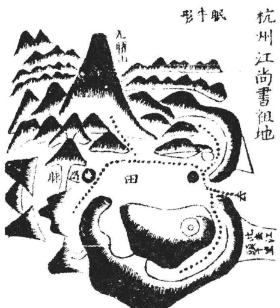 入首作 頂換辛脉</td><td></td></tr><tr><td></td></tr><tr><td colspan="2"></td></tr><tr><td>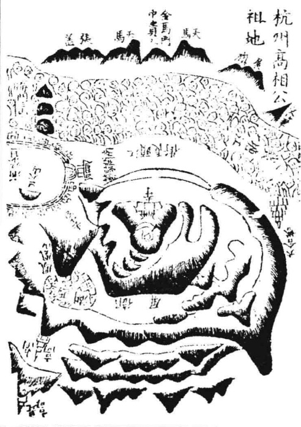</td><td colspan="2">没有察觉，襄毅的葬地又选在南山乙辰，最终因此受害。此人谈论地理四书，极力诋毁天星，既害了自己，又害了别人，可惜啊！ 左地位于钱塘万松岭圣国寺后。其龙与杭州府的龙共祖。这是数里之外分出的一脉，出身御屏高耸。屏下连珠数节，走马到头，起仰高太阳开口做穴。吐唇平坦，宽二十余丈，地势又变得峻陡。陡下却是寺宇。登穴要从左手一旁进入，到穴中看不到寺宇和峻陡之处，只看到四面远峰矗立，钱塘江水浩荡。对岸金马门，门中贵人秀立。海门三山小如拳头。四神八将、三阳六秀都相互拱照。葬后出南宇公仪，考中进士，进入翰林，官至内阁大学士。如今富贵还没有停止。</td></tr></table>

查看对应原文

<!-- V3_FOLDBACK_BEGIN:book018-b000253-p000-2e98ebf4f9 -->

<table><tr><td rowspan="2">右地在杭州府，土名江头九曜。但其龙 乃自九曜逆生一脉，穿田过峡，顿起玉屏。 屏中一脉，委迤清巧，复作金土结穴。穴星 两臂横展，中开一坪。坪中立穴太阔，似乎 散漫。且右臂牵拽远去十余里，以作江头街 阳基。此则横龙落脉，一节而已。俗眼观之， 莫识其妙。爰是龙气大旺，寸寸是玉处。葬 后生江公玭，登进士，官大参。子文昭公澜， 官南京礼部尚书。孙晓会魁，官工部侍郎， 赠尚书；晖，会魁，翰林修撰。曾孙曰圻， 登乡魁进士，官提学副宪。玄孙曰铎，登进 士，现任北部正郎，福祉方隆。 右地在承天府东北。其龙发于大洪山， 旺气融结为府龙大干。又分注到此，入首横 列大帐，帐中抽出嫩条。廖氏谓之垂头紫气， 清秀颖异。大凡木星，不下当头。此地左右 两穴，虚中，正合倚杖葬法。张子微谓之天 鼻穴。左右龙虎回抱，内外明堂环聚。近有 玉带砂关收内气，远有三台峰献秀，外洋北 湖宽畅，汉水盘旋，四势和平，三阳具足， 龙旺穴奇，藏风得水，真美地也。曾氏曾祖 指挥公始葬其地，继葬其祖知县东庄公。今 阳白公父子进士，通显嗣续之蕃，详见彭泽 祖地第二十册内。</td><td> 入首作 頂換辛脉</td><td></td></tr><tr><td></td></tr><tr><td colspan="2"></td></tr><tr><td></td><td colspan="2">不察，襄毅之葬又卜南山乙辰，竟以受害。 公言谈地理四书，极诋天星，既以自误，又 以误人，惜哉！ 左地在钱唐万松岭圣国寺后。其龙与杭 州府龙共祖。此即数里之外，分出一脉，出 身御屏高耸。屏下连珠数节，走马到头，起 仰高太阳开口做穴。吐唇平坦，二十余丈， 地复峻陡。陡下却是寺宇。登穴从左手一傍 入，到穴中不见寺宇并陡峻处，但见四面远 峰矗矗，钱塘江水洋洋。对岸金马门，门中 贵人秀立。海门三山渺如拳。四神八将、三 阳六秀皆相拱照。葬后出南宇公仪，登进 士，入翰林，官至内阁大学士。今富贵 未艾。</td></tr></table>

<!-- V3_FOLDBACK_END:book018-b000253-p000-2e98ebf4f9 -->

<!-- V3_SOURCE_ID:book018-b000254-p000-86c060e998 -->

## 卷一之四

查看对应原文

<!-- V3_FOLDBACK_BEGIN:book018-b000254-p000-86c060e998 -->

## 卷一之四

<!-- V3_FOLDBACK_END:book018-b000254-p000-86c060e998 -->

<!-- doc007 PDF 第 59 页：未引用图表已用原页保全；文字供检索，版式以原页图为准。 -->
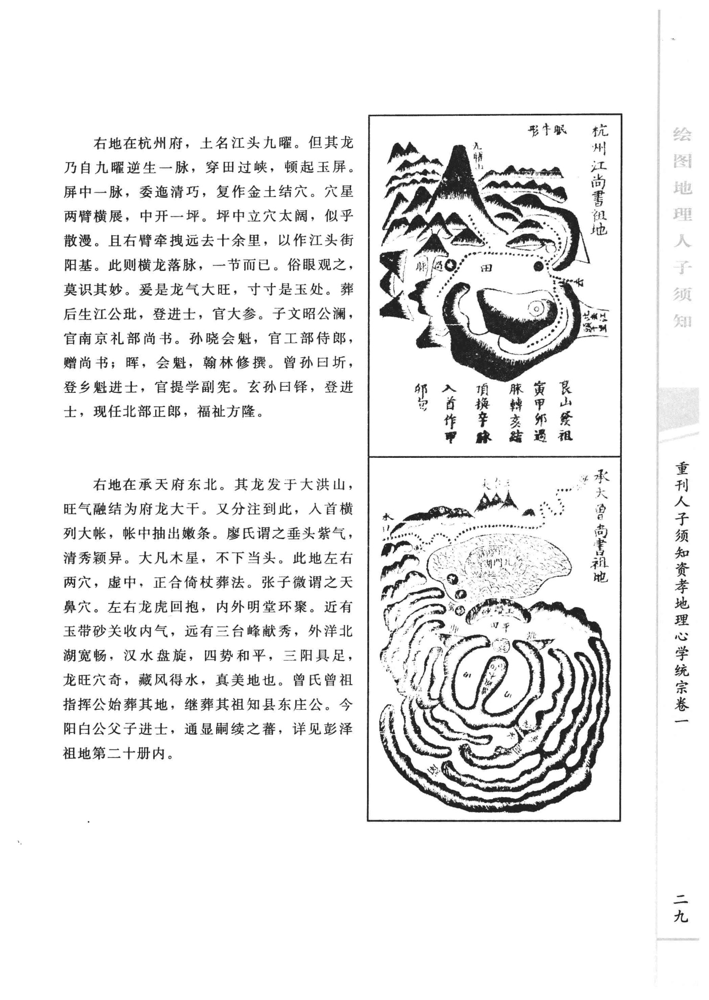

<!-- doc007 PDF 第 60 页：未引用图表已用原页保全；文字供检索，版式以原页图为准。 -->
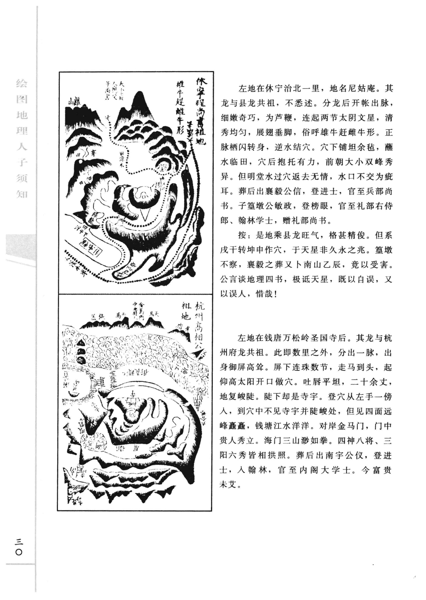

<!-- V3_SOURCE_ID:book018-b000257-p000-1cdbe2d126 -->

◎这一卷专门论述龙的分支、垅。因为高山和平地的形势不同，所以支、垅的说法不能不辨析。因此《葬经》说：“支、垅之辩，眩目惑心，毫厘之差，祸福千里。”所以尤其应当辨析支、垅。

查看对应原文

<!-- V3_FOLDBACK_BEGIN:book018-b000257-p000-1cdbe2d126 -->

◎此一卷专论龙分支、垅。盖高山平地，形势不同，故支、垅之说不可不辩。故《葬经》云：“支、垅之辩，眩目惑心，毫厘之差，祸福千里。”是故尤当致辩于支、垅焉。

<!-- V3_FOLDBACK_END:book018-b000257-p000-1cdbe2d126 -->

<!-- V3_SOURCE_ID:book018-b000258-p000-02d8065a60 -->

## 总论支城

查看对应原文

<!-- V3_FOLDBACK_BEGIN:book018-b000258-p000-02d8065a60 -->

## 总论支城

<!-- V3_FOLDBACK_END:book018-b000258-p000-02d8065a60 -->

<!-- V3_SOURCE_ID:book018-b000259-p000-de4e4e7083 -->

所谓支龙，是指平地的龙；所谓垅龙，是指高山的龙。它们融结为地的力量大小、形势贵贱，并不以支龙、垅龙的类别来区分优劣，只是二者的形体分别有山峰、平地的不同，因此察辨它们情性的方法也各有差异。垅龙有星峰形势，脉络分明，容易寻索；支龙则绵延千里，地势平夷，一望无际，难以追寻。不过垅龙以磊落起伏、逶迤奔走为美，软弱、瘦削、丑恶、峻嶒为凶；支龙以相互牵系、隐隐隆隆、界水明白、脊脉清晰为妙，高低不明、来势断截、分水模糊则为假。一般来说，垅龙适宜峙于地上，支龙适宜伏于地中；垅龙最忌风吹，支龙尤其嫌恶水劫；垅龙的结穴处位于山麓，支龙的结穴处位于巅顶。《葬经》说：“卜支如首，卜垅如足。”又说“支葬其巅，垅葬其麓。”这就是支龙、垅龙穴场不同的基本原则。其间的变化形态不一，咫尺之间就有很大差别。真支龙、真垅龙固然容易分辨，奈何有似支龙的垅龙、似垅龙的支龙，或是支龙来而垅龙止，垅龙来而支龙止；或是垅龙变为支龙后又变回垅龙，支龙变为垅龙后又变回支龙；也有以支龙为坛垛而行垅龙之形，以垅龙为坛垛而行支龙之形的情况；还有垅龙在内而支龙在外、支龙在内而垅龙在外的情况；更有强支龙弱垅龙、急支龙缓垅龙、高支龙平垅龙、隆支龙隐垅龙、石支龙土垅龙、老支龙嫩垅龙、偏支龙偏垅龙、半支龙半垅龙，以及非支非垅、难以分辨的情况。因此郭氏说“支、垅之辩，眩目惑心”，若不是明师耳提面命，就无法分辨。学者首先必须察辨这些，若能有所领悟，寻龙之能事就已完成大半了。

查看对应原文

<!-- V3_FOLDBACK_BEGIN:book018-b000259-p000-de4e4e7083 -->

夫支者，平地之龙也；珑者，高山之龙也。其融结为地，力量轻重，大小贵贱，不以支珑而分优劣，但其形体有山峰平地之不同，故察识其情性之术亦各有异耳。盖珑龙有星峰形势，脉络分明，易于寻索。支龙千里平夷，一望无际，难于追求。然珑龙则以磊落起伏、逶迤奔走为美，软弱、瘦削、丑恶、峻嶒为凶。支龙则以相牵相连、隐隐隆隆、界水明白、脊脉分晓为妙；高低不明，来势断截，分水模糊为假。大凡珑欲峙于地上，支欲伏于地中；珑最忌于风吹，支尤嫌于水劫；珑结穴于山麓，支结穴于巅顶。《葬经》云：“卜支如首，卜珑如足。”又云“支葬其巅，城葬其麓。”此支、城龙穴不同之大法也。其间变态不一，咫尺顿殊。真支真城固所易辩，奈何有似支之，似城之支，或支来而珑止，珑来而支止；或珑变为支而复为，支变为而复为支。亦有以支为坛垛而行城于上，以城为坛垛而行支于上者。又有珑内而支外，支内而龙外者。复有强支弱城、急支缓城、高支平珑、隆支隐城、石支土城、老枝嫩城、偏支偏城、半支半城，及夫非支非城，不可辩者。故郭氏云“支、城之辩，眩目惑心”，自非明师耳提面命，莫能别也。学者先须察此，此而有得，寻龙之能事思过半矣。

<!-- V3_FOLDBACK_END:book018-b000259-p000-de4e4e7083 -->

<!-- V3_SOURCE_ID:book018-b000260-p000-bd7535ad71 -->

## 论城龙

查看对应原文

<!-- V3_FOLDBACK_BEGIN:book018-b000260-p000-bd7535ad71 -->

## 论城龙

<!-- V3_FOLDBACK_END:book018-b000260-p000-bd7535ad71 -->

<!-- V3_SOURCE_ID:book018-b000261-p000-e9caa759b9 -->

所谓垅，就是山。山垅之龙，祖宗山要高大，来势要雄伟，星峰要秀丽，剥换要相生，过峡要周密，枝脚要蕃衍，盖送要重叠，行度要活变，护从要稠密，穴场要藏聚，四势要和平，这些都是山垅寻地的要诀。不过垅龙势险而有变化，所以要在险中求平，也就是所谓的高山之窝。葬地应当避杀乘生，《经》说“垅葬其麓”，这是正法。却又有以垅为体而得支之情性的情况，即大山垂脉，落下平地，变为支体，这是阴中含阳的道理。当时的风水师往往粘葬山麓，认为前面拖出的平地是祸褥，殊不知龙势未住，微有龟脊，隐隐隆隆，穴落在平地，按法应当枕毬而葬。然而阴势偏强，本应避毬凑檐，奈何性慢，因此要插上以缓其缓性，这就是刘氏所说的“垅缓则入檐而凑毬”。若按垅法扦葬，就会败绝立应，这是高垅最难体认的地方，不可不察。

查看对应原文

<!-- V3_FOLDBACK_BEGIN:book018-b000261-p000-e9caa759b9 -->

夫垅者，山也。山垅之龙，祖宗欲其高大，来势欲其雄伟，星峰欲其秀丽，剥换欲其相生，过峡欲其周密，枝脚欲其蕃衍，盖送欲其重迭，行度欲其活变，护从欲其稠密，穴场欲其藏聚，四势欲其和平。此皆山垅寻地之要诀耳。然垅龙势险而有也，故于险中求平，所谓高山之窝是也。葬当避杀乘生，《经》曰“垅葬其麓”，为正法也。却又有等以垅为体，而得支之情性者，则大山垂脉，落下平地，变为支体。此阴中含阳之义也，时师往往粘葬山麓，而以前拖平地为祸褥。殊不知龙势未住，微有龟脊，隐隐隆隆，穴落平地，法当枕毬而葬。然阴者为强，固宜避毬凑檐。奈何性慢？以此要插上，急其缓性。刘氏所谓“垅缓则入檐而凑毬”是也。苟以垅法扦之，则败绝立应。此高垅之至难体认者，不可不察也。

<!-- V3_FOLDBACK_END:book018-b000261-p000-e9caa759b9 -->

<!-- V3_SOURCE_ID:book018-b000262-p000-a8e0ffb8e4 -->

所谓支龙，就是平地的龙。平地的龙，其祖宗山、父母山、剥变、过峡，以及枝脚桡棹、缠托护从，大致与垅龙没有差异。吴公《口诀》说“卧倒星辰竖起看”，因此支龙也有开帐穿心的形态，也有华盖、三台、御屏、玉枕等格局，只是龙行于地中，都是平面，倒地后多阔大，难以检点，只能通过相互牵系来步量其龙脉。高一寸为山，低一寸为水，察辨其隐隐隆隆的脊脉，或直或曲，动辄数十里或数里，才会有水分八字的峡，或有石骨微露踪迹，或有银锭束气的脉。若前面遇水界截，就审察随龙之水，以及诸水聚处为明堂，来确定穴向。其结穴处自然气聚，或平中有突，或开钳口，或吐唇毡，或微有靥，如鸡窠、旋螺之状，必有龟脊牛背、草蛇灰线之脉入首束聚结穴。此处须要高低分明，有水缠绕，或水溶注，或水朝入，才为的实。又须审察其来历，有珠丝马迹、贴地梅花、落地金钱等格局，必是美地。扦得穴真，葬得如法，就能富贵悠久。若来历不明，切勿妄下，平地无气，易于绝灭。所谓来历不明，是指来脉龙势一坦平阳，无脊可据，高低不分，全无界水，无过峡，无石骨证脉，无银锭束气，无龟背分水，无草蛇灰线、藕断丝连之脉入穴；或已经断而不相牵连，散漫无气，必无融结。其父母兄弟之脉各自分飞，平地之上，虽或忽起墩埠，孤单无应，必作他龙之用神；或是龙脚所带之秀气，为印、为笏、为金箱、环佩之类，或是水口罗星、游鱼等砂。因此廖氏说“走珠墩阜在平地，三个五个是”。若孤单一突，又无分水度脉来历，未可便作平中之突而有融结。卜氏说：“星散孤村，秀气全无半点”；又说：“滚浪浮花，随风落叶，皆是无蒂无根，未必有形有气。”这些都是平支龙寻地的要诀。不过支龙平坦夷旷，所以要在散中求聚，也就是所谓的平地之突。应当揭高就脉，《经》说“支葬其巅”，这是正法。却又有以支为体而得垅之情性的情况，即直如掷枪，急如绷线，术中称之为倒火硬木，这是阳中含阴的道理，按法应当避杀粘檐，架折而葬，这就是刘氏所说的“直急则避毬而凑檐”。但阳势偏弱，本应凑入，奈何性急，因此要缩下以缓其急性。若按支法扦葬，就会凶祸立应，这是平支最难体认的地方，不可不知。

查看对应原文

<!-- V3_FOLDBACK_BEGIN:book018-b000262-p000-a8e0ffb8e4 -->

夫支龙者，平地之龙也。平地之龙，其祖宗父母、剥变过峡，与夫枝脚桡棹、缠托护从，大段与城龙无异。吴公《口诀》有云“卧倒星辰竖起看”，故亦有开帐穿心，亦有华盖、三台、御屏、玉枕等格，但龙行地中，皆平面，倒地多阔大，难于检点，惟以相牵相连步其龙脉。高一寸为山，低一寸为水，察其隐隐隆隆之脊，或直或曲，动辄数十里，或数里，始有水分八字之峡，或有石骨微露踪迹，或有银锭束气之脉。若前面遇水界截，则审随龙之水，及诸水聚处为明堂，以求穴向。其结穴处自然气聚，或平中有突，或开钳口，或吐唇毡，或微有靥，如鸡窠，如旋螺之状，必有龟脊牛背、草蛇灰线之脉，入首束聚结穴。而此处须要高低分明，有水缠绕，或水溶注，或水朝入，方为的实。又须审其来历，有珠丝马迹、贴地梅花、落地金钱等格，决是美地。扦得穴真，葬得如法，富贵悠久。若来历不明，切勿妄下，平地无气，易于绝灭。所谓来历不明者，乃来脉龙势一坦平阳，无脊可据，高低不分，全无界水，无过峡，无石骨证脉，无银锭束气，无龟背分水，无草蛇灰线、藕断丝连之脉入穴；或已经断而不相牵连，散漫无气，必无融结。其父母兄弟之脉各自分飞，平地之上，虽或忽起墩埠，孤单无应，必作他龙之用神；或是龙脚所带之秀气，为印，为笏，为金箱、环佩之类，或是水口罗星、游鱼等砂。故廖氏云“走珠墩阜在平地，三个五个是。”若孤单一突，又无分水度脉来历，未可便作平中之突而有融结。卜氏云：“星散孤村，秀气全无半点”；又云：“滚浪浮花，随风落叶，皆是无蒂无根，未必有形有气。”此皆平支龙寻地之要诀耳。然支龙平坦夷旷，故于散中求聚，所谓平地之突是也。盖当揭高就脉。《经》曰“支葬其巅”，为正法也。却又有等以支为体，而得垅之情性者，则直如掷枪，急如绷线，术中谓之倒火硬木，此阳中含阴之义，法当避杀粘檐，架折而葬。刘氏所谓“直急则避毬而凑檐”是也。但阳者为弱，本合凑入，柰何性急？以此要缩下，缓其急性。苟以支法扦之，则凶祸立应。此平支之至难体认者，不可不知也。

<!-- V3_FOLDBACK_END:book018-b000262-p000-a8e0ffb8e4 -->

<!-- V3_SOURCE_ID:book018-b000263-p000-efe4954470 -->

以上所论支龙、垅龙的基本原则就是这样。但垅龙的星峰容易分辨，支龙的脉络难以明了，前辈说支龙难于垅龙，尤其应当细察。因此特意汇集诸家平支之说附在下面，希望能相互发明。

查看对应原文

<!-- V3_FOLDBACK_BEGIN:book018-b000263-p000-efe4954470 -->

已上所论支、垅，大法如此。但垅之星峰易辨，支之脉络难明，前辈谓支龙难于垅龙，尤当细察。兹故特集诸家平支之说附下，庶互有发明云。

<!-- V3_FOLDBACK_END:book018-b000263-p000-efe4954470 -->

<!-- V3_SOURCE_ID:book018-b000264-p000-b5eeb08996 -->

《葬书》中提到：山峦以平缓整齐为贵，土层以有分支延伸为贵。土层分支开始延伸的地方，生气就会随着停驻；土层分支延伸到终点的地方，生气就会随着汇聚。观察土层分支的方法，要留意那种似有若无、起伏绵延的状态，其中的道理微妙又通达，吉利的格局就藏在这种状态里。

> **释读存疑：** 1轮自动修复后核义模型仍建议修订，已保守记录。

查看对应原文

<!-- V3_FOLDBACK_BEGIN:book018-b000264-p000-b5eeb08996 -->

《葬书》云：山贵平夷，土贵有支。支之所起，气随而止；支之所终，气随而钟。观支之法，隐隐隆隆，微妙玄通，吉在其中。

<!-- V3_FOLDBACK_END:book018-b000264-p000-b5eeb08996 -->

<!-- V3_SOURCE_ID:book018-b000265-p000-3e6f2e818f -->

《葬书》还提到：地下有吉利的生气，土层就会随之隆起。土层分支的生气停驻的地方，水就会随之汇聚靠近。地势顺着气脉的走向起伏变动，首尾循环往复。按照这套法则在这样的地方安葬，就能永远保持吉利，不会有凶祸。

查看对应原文

<!-- V3_FOLDBACK_BEGIN:book018-b000265-p000-3e6f2e818f -->

又云：地有吉气，土随而起。支有止气，水随而比。势顺形动，回复终始。法葬其中，永吉无凶。

<!-- V3_FOLDBACK_END:book018-b000265-p000-3e6f2e818f -->

<!-- V3_SOURCE_ID:book018-b000266-p000-648ebf6c43 -->

杨筠松所著的《龙经》里说：平地上也有水流经过的坡地，水位高出一寸的地方就是低洼的丘陵。只因为现在的风水师见识不够，到了这样的地方就茫然无措，不知道怎么判断。他们就说这种地方找不到地脉的踪迹，直到看见有山峦的地方才懂得分辨。像这样的人哪里有资格谈论风水，平地上本来有合适的穴，他们先就错过了。他们只知道到山下去寻找龙虎格局，还要有乳头一样的凸起才说是吉利的格局。不知道山脉走到尽头落入平地的地方，穴在平地里是极其贵重的格局。这些昏庸的风水师耽误了多少人，他们还说安葬要害怕地势低下潮湿。他们不知道穴在看似近水的地方，这种情况不能单凭怕泉水渗漏就否定。因为水涨的时候水会漫到穴的位置，水退了之后这里就和干燥的地有一样的效力。就拿两淮地区来说，那里平坦得像手掌一样，也有军州建在低洼积水的地方，也有英雄人物出生在那里。怎么会没有坟墓和宫室建在那里呢？只需要看水的汇聚和流向，两条水夹着的地方就是龙的气脉所在。

> **释读存疑：** 1轮自动修复后核义模型仍建议修订，已保守记录。

查看对应原文

<!-- V3_FOLDBACK_BEGIN:book018-b000266-p000-648ebf6c43 -->

杨筠松《龙经》云：坪中还有水流坡，高水一寸即是阿。只为时师眼力浅，到彼茫然无奈何。便云无处寻踪迹，直到有山方始识。如此之人岂可言，有穴在坪先自失。只来山下觅龙虎，又要乳头始云吉。不知山穷落平处，穴在坪中贵无敌。痴师误了几多人，又道藏埋畏卑湿。不知穴在水中者，如此难凭怕泉沥。盖缘水涨在中间，水退即同干地力。且如两淮平似掌，也有军州落窠沥，也有英雄在彼中。岂无坟墓与宫室，只将水注与水流，两水夹来是龙脊。

<!-- V3_FOLDBACK_END:book018-b000266-p000-648ebf6c43 -->

<!-- V3_SOURCE_ID:book018-b000267-p000-68ea7391ab -->

又说：不要以为只有山高的地方才有龙，到了平地就会失去龙的踪迹。平洋的龙是从高处发源的，高起星峰的地方，龙会低落至穴的位置。在高山上要辨认星峰的兴起，到了平地就要在两旁观察水势。两条水夹着而来的就是真龙，枝叶环绕抱合的地方就是结穴之处。不要让山的走势反背、枝叶分散，山如果走势反背，水就会散漫无收。百里之外的外山作为罗城，这就是平洋龙的局段。星峰起伏后落向平地，外山隔着水来相护。平洋的地形仰面看起来像鸡窠，隐隐微微地立着高埠。要从立着的高埠处寻找回窠，有的像勾钳，有的像螺。勾钳是案山，螺是穴，水朝向明堂汇聚，气也聚集得多。四周的水势像城郭一样环绕，水绕着山回聚成一窝形的区域。霜降后水干涸时龙会看不见，春夏水位高涨时龙就会显现。这就是平洋捉龙的方法，龙经过的地方像丝或线一样细微。高出平地一寸的地方就可当作山，低于平地一寸的地方就是水回环的区域。水环绕的态势和山环绕的态势是一样的，环绕着真龙的地块看起来像向上摊开的手掌。掌心的窝穴里有像乳头一样的凸起，端端正正坐落的穴对应着天象。水绕山缠的地形在平坡上，远处有山冈，近处有河。只适合水环抱穴场，不适合水反背流走，这样的地方才是值得寻觅的吉地。水环抱才会有山来环抱，水不环抱山就不会来。不要以为高山的龙容易识别，龙行到平洋就会失去踪迹。藕断丝连的地方正好寻找，龙脉退卸的层次越多，力量就越强。

查看对应原文

<!-- V3_FOLDBACK_BEGIN:book018-b000267-p000-68ea7391ab -->

又云：莫道山高方有龙，却来平地失其踪。平洋龙从高处发，高起星峰低落穴。高山既认星峰起，平地两傍观水势。两水夹来是真龙，枝叶周围抱处是。莫令山返枝叶散，山若返兮水散漫。外山百里作罗城，此是平洋龙局段。星峰顿伏落平去，外山隔水来相护。平洋仰面似鸡窠，隐隐微微立高埠。便从立埠觅回窠，或有勾钳或如螺。勾钳是案螺是穴，水揖明堂气聚多。四傍水势如城裹，水绕山回聚一窝。霜降水涸寻不见，春夏水高龙皆现。此是平洋捉龙法，过处如丝或如线。高水一寸即为山，低土一寸水回还。水缠便是山缠样，缠得真龙如仰掌。窝心掌里如乳头，端然有穴明天象。水绕山缠在平坡，远有山冈近有河。只爱水环抱身体，不爱水返去寻地。水抱方有山来抱，水不抱兮山不到。莫道高山龙易识，行到平洋失踪迹。藕断丝连正好寻，退卸愈多愈有力。

<!-- V3_FOLDBACK_END:book018-b000267-p000-68ea7391ab -->

<!-- V3_SOURCE_ID:book018-b000268-p000-bb8294c5d1 -->

又说：大梁这地方的地势也没有山，到这里要寻龙该去哪里找呢？辨识星峰是平常的事，平地寻龙才是最难的。如果没有河流与淮水，就会渺渺茫茫看不见山的踪迹。河流冲决导致山脉被截断，既没有石骨也没有脉路。你如果到那里谈论星峰，根本站不住脚，半句话都容不得你说。又说：走上十里半程都看不到冈岭，平洋的沙渍地被烟尘笼罩，一片迷茫。到了这里你必须观察水势，观察水势不用区分是江还是溪。只要两条水源相夹而出，交汇锁住之后在外层形成重重围合的态势就可以。又说：凡是到了平洋不要刻意辨认龙的踪迹，只看水环绕的地方就是真龙。又说：高山大脉的山峰大多秀丽，不像平原上只有像锥子一样直立的小高地。又说：也曾见到穴在平洋上，四周周围都没有高冈。

查看对应原文

<!-- V3_FOLDBACK_BEGIN:book018-b000268-p000-bb8294c5d1 -->

又云：大梁形势亦无山，到此寻龙何处是？识得星峰是等闲，平地寻龙最是难。若无河流与淮水，渺渺茫茫不见山。河流冲决山断绝，又无石骨又无脉。君若到彼说星峰，一句不容三寸舌。又云：十里半程无冈岭，平洋沙渍烟尘迷。到此君须看水势，水势莫问江与溪。只要两源相夹出，交锁外结重重围。又云：凡到平洋莫认踪，只看水绕是真龙。又云：高山大珑峰多秀，不似平原一锥卓。又云：也曾见穴在平洋，四畔周围无高冈。

<!-- V3_FOLDBACK_END:book018-b000268-p000-bb8294c5d1 -->

<!-- V3_SOURCE_ID:book018-b000269-p000-130c6fdc70 -->

又说：有上等智慧的人寻龙会观察气脉，循着高山散落到平地上的踪迹去寻找。气脉相连相接到了乡村，失去踪迹的时候要仔细寻觅。气遇到水的界限就会有停驻的时机，要像探听细微的讯息一样仔细寻觅相关的征兆。平洋的大地没有明显的龙的形迹，要辨识那种像把灰撒成线一样若隐若现的脉路。顺着气脉相互黏连、牵扯的地方找到断绝之处，这些都是平洋寻龙的真口诀。龙行过的时候像大雁排列在深厚的云层里，隐藏的时候就像泥里的鳖一样难寻。平洋的气脉相互绵连，就像盏中的酥油一样浑然一体，落在坪地之中谁能辨别清楚？

查看对应原文

<!-- V3_FOLDBACK_BEGIN:book018-b000269-p000-130c6fdc70 -->

又云：上智寻龙观气脉，指望高山散踪迹。相连相接下乡村，失迹遗踪细寻觅。气逢水界有住期，如缉悠悠细消息。平洋大地无影形，如灰抛线要君识。相粘相牵寻断绝，尽是平洋真口诀。过时如雁列深云，藏时犹似泥中鳖。平洋相并盏中酥，落在坪中谁辨别？

<!-- V3_FOLDBACK_END:book018-b000269-p000-130c6fdc70 -->

<!-- V3_SOURCE_ID:book018-b000270-p000-1b76220b6d -->

杨公《画筴图》说：平地的脉，像草中的蛇、灰中的线。只看水分水聚的地方，就是真气融结的去处。又说：临田观穴，不管大小八字，只看上面的形势，分晓后再看下面的证佐。或唇或口，就是真气正穴。又说：平坡的脉像掌窝，水聚交而不流，锁断真气，就是关门立穴的地方。仰看上面的脉，必有翅翼，像灯影穿壁一样，轻薄而不动，自有高低。又说：高山落落平田，如果有火嘴，要看尖尽处；如果开钳口，就是暗火开红。这是火在灰中，像见火红。如果是尖嘴不开钳口，就是死火带杀，不能安葬。又说：龙到平洋临田结穴的，上面有来龙，下面没有出脚，只见田塍面前兜转，像带、像娥眉拱护，这里就是穴。又说：龙落平坡，日久年深，人开成田地，要看两边的形势，田墈一层低一层，像急浪下滩。仔细寻找前面水势回环，两田像月角兜转，这才是真龙作结的地方，叫做浪花里滚月。又说：高山行龙，势落平地，无踪无迹无龙虎，形如铺毡展席，散如碧玉之纹、浪花滚月、雪里飘梅，像灰中拽线，像草里寻蛇，要详加目力，细辨阴阳。切要诸水聚在明堂，朝对尊严，毬檐下合分明，气脉自然融结，沙水来去得位，门户重重关闭，坐下宾主有情；又要明堂像锅底，四围不倾泻，水口不通舟，就可以说是吉地了。

> **释读存疑：** “火嘴”“钳口”“暗火开红”“死火带杀”“毬檐”“沙”等风水专名未在allowed_glossary中，释读保留原表述符合要求；“龙虎”为风水常见术语，此处未释读不影响普通读者理解大意

查看对应原文

<!-- V3_FOLDBACK_BEGIN:book018-b000270-p000-1b76220b6d -->

杨公《画筴图》云：平地之脉，如草中之蛇，灰中之线。只看水分水聚之中，便是真气融结去处。又曰：临田观穴，不问大小八字，只看上面形势，分晓下面证佐。或唇或口，便为真气正穴。又曰：平坡之脉如掌窝，水聚交而不流，锁断真气，便是关门立穴之处。仰看上面脉，必有翅翼，如灯影穿壁，轻薄而不动，自有高卑。又曰：高山落落平田，若有火嘴，要看尖尽处；若开钳口，谓暗火开红。此是火放灰中，似见火红。如尖嘴不开钳口，谓之死火带杀，不可葬。又曰：龙到平洋临田结穴者，上有来，下无出脚，但见田塍面前兜转，似带，似娥眉拱护，此上是穴。又曰：龙落平坡，日久年深，人开成田地，要看两边形势，田墈一层低一层，如急浪下滩。细寻前面水势回环，两田如月角兜转，始是真龙作结之处，谓之浪花里滚月。又曰：高山行龙，势落平地，无踪无迹无龙虎，形如铺毡展席，散如碧玉之纹、浪花滚月、雪里飘梅，如灰中之拽线，如草里之寻蛇，详加目力，细辨阴阳。切要诸水聚堂，朝对尊严，毬檐下合分明，气脉自然融结，沙水来去得位，门户重重关闭，坐下宾主有情；又要明堂如锅底，四围不倾泻，水口不通舟，可谓吉地矣。

<!-- V3_FOLDBACK_END:book018-b000270-p000-1b76220b6d -->

<!-- V3_SOURCE_ID:book018-b000271-p000-e1256c8b58 -->

刘氏说：中原，方圆百里千里都是平地，虽然有高形可以寻龙脉，但没有穴可以下。大概龙的隆隆隐伏，间或有得见的地方。但到了作穴的地方，又没有固定的踪迹，只看水的曲折如何。水如果环绕，拦截穴头，固然容易看见。不然，水也在前或在后，弯曲的地方相当，就可以定穴法。如果没有水的地方，虽然有穴，也一定不是龙脉尽处，不算端的。如果用山乡的方法取穴，就会出错。

查看对应原文

<!-- V3_FOLDBACK_BEGIN:book018-b000271-p000-e1256c8b58 -->

刘氏云：中原，百里千里皆为平地，虽有高形可寻龙脉，无穴可下。盖龙之隆隆隐伏，间有得见处。然到作穴，又无定踪，只看水之曲折如何。水若环绕，拦截穴头，固为易见。不然，水亦在前或在后，弯曲之处相当，即可定穴法。如无水处，虽有穴，亦必非龙脉尽处，不为端的。若以山乡之法取之，则失之矣。

<!-- V3_FOLDBACK_END:book018-b000271-p000-e1256c8b58 -->

<!-- V3_SOURCE_ID:book018-b000272-p000-0e4b01c9f8 -->

廖氏《泄天机》说：还有平洋的局格又有不同，我倾尽所学为你解说。星辰原本出自高岗，龙脉撒开脉路下到平洋。高冈上的聚讲与过峡，行龙的规则都是一样的。撒落到平洋之后才出现不同，千万不要丢失了龙的真踪迹。地势有高低就对应着山和水，内在的条理规则是一体的。远山近水在两旁缠绕，脉路就像藕丝一样相连。倒身龙格的脉路隐而复现，龙脉向上行走的时候就会显现。隐隐约约、微微隆起的地方正好寻找，寻到了这样的地价值千金。又说：平地的龙神要观察水势，辨认的方法原本就没有差别。

查看对应原文

<!-- V3_FOLDBACK_BEGIN:book018-b000272-p000-0e4b01c9f8 -->

廖氏《泄天机》云：更有平洋局又别，倾廪为君说。星辰原出在高岗，撒脉下平洋。高冈聚讲与过峡，行龙皆一法。撒落平洋始不同，切莫失真踪。地有高低即山水，节目同一体。远山近水两旁缠，脉似藕丝连。倒身龙格隐复现，脉上行时见。隐隐隆隆正好寻，寻得值千金。又曰：平地龙神观水势，认取原无异。

<!-- V3_FOLDBACK_END:book018-b000272-p000-0e4b01c9f8 -->

<!-- V3_SOURCE_ID:book018-b000273-p000-d6328780b0 -->

范越凤《洞林秘诀》说：平原旷野，茫茫然延伸数百里远，看水最终汇聚的地方，就能知道来山的方向。左右两边的土山拱卫衔接分明，可以藏车隐马。有盘曲的水，有朝向穴场的流水，就是第一等的吉地。高山和平原原本没有两套说法，都要以形势为根本。观察它的来脉连绵久远，气象环绕闭合，高山没有悬崖崩破的隐患，平原没有断珑横堑的截断，就符合吉地的卜选标准。所以阴阳家看重心领神会，不能拘泥于单一的标准。又说：相看平地的方法，环顾四周审察它的土脉，观察它的流动泉水，能得到水环绕是最上等的。

查看对应原文

<!-- V3_FOLDBACK_BEGIN:book018-b000273-p000-d6328780b0 -->

范越凤《洞林秘诀》云：平原旷野，茫然数百里之远，视水所归，则知来山。左右两阜拱接分明，可以藏车隐马。有盘曲之水，朝向之流，乃第一地也。高山平原本无二说，要以形势为本。观其来历绵远，气象环合，高山无悬崖崩破之害，平原无断珑横堑之绝，乃叶吉卜。故阴阳家贵于心得意解，不可执一。又曰：相平地之法，四顾审其土脉，观其流泉，得水为上也。

<!-- V3_FOLDBACK_END:book018-b000273-p000-d6328780b0 -->

<!-- V3_SOURCE_ID:book018-b000274-p000-5ffe193b7c -->

吴公《指南》说：古人说大地会落在平洋，大概是因为它的祖山发脉而来，中间剥换变化、过峡的地方多，气脉已然完备，就算没有明显的山势，也水深土厚，这就是平洋之所以能成为大地的原因。然而平洋的寻龙方法，不是普通眼光的人能寻觅辨识的，大多是从高山或者大城的位置，忽然撒下脉路到平坦的地方，人们只看见山势已经到了尽头，却不知道水分成八字形，界限过了护从的砂山，送出正龙，一脉像丝像线一样，在这里藏踪闪迹，一直往前延伸过去，之后微微突起三到七个低矮平缓的山阜出来，或是土洲之类的地形，牵连不断地向前延伸。之后又再次跌断，延伸到前面，或是形成凸起中的窝穴，或是形成凹窟中的凸起，自然而然形成一处天然的穴。它结穴的地方，四神八将等砂山自然对应拱护，明堂格局和水系形态自然回抱。乍一看似乎没有什么好的地方，仔细揣摩却有奇妙的道理。所以平洋的地才既难寻找又难辨识。

查看对应原文

<!-- V3_FOLDBACK_BEGIN:book018-b000274-p000-5ffe193b7c -->

吴公《指南》云：古人谓大地落平洋，盖以其祖宗发脉而来，中间剥变过度处多，气脉既全，便无力亦水深土厚，此平洋所以为大地。然而平洋龙法，非俗眼所能寻识，多是高山大城，忽然撒下平坦，人但见山势已尽，而不知水分八字，界过护从，送出正龙，一脉如丝如线，在此处藏踪闪迹，直抛过前面去，却微微突起三五七个平低山阜出来，或土洲之类，牵连而行。又复跌断，却去前面，或作突中窝，或作窟中突，宛然成一天然之穴。其做穴处，四神八将，自然应副，堂局水城，自然回抱。乍看似无好处，细玩却有妙理。故平洋地所以难寻而又难识也。

<!-- V3_FOLDBACK_END:book018-b000274-p000-5ffe193b7c -->

<!-- V3_SOURCE_ID:book018-b000275-p000-902898f04d -->

《明山宝鉴》说：平洋大地，认水为龙。水势如果回环，龙也随之停住。一丈的山，胜过千丈的山；一尺的山，胜过千尺的山。

查看对应原文

<!-- V3_FOLDBACK_BEGIN:book018-b000275-p000-902898f04d -->

《明山宝鉴》云：平洋大地，认水为龙。水势若回，龙亦随住。一丈之山，胜彼千 丈；一尺之山，胜彼千尺。

<!-- V3_FOLDBACK_END:book018-b000275-p000-902898f04d -->

<!-- V3_SOURCE_ID:book018-b000276-p000-4c005d0b46 -->

《寻龙歌》中有记载：平原开阔的区域不存在对应的龙脉相关的龙虎形地势，模糊辽远很难辨识相关形迹该从哪里寻找？判断方位的过程中只需要将水作为判定龙的依据，按照这个方法点穴下葬之后，家族会出现位列三公的显贵人物。

> **释读存疑：** 1轮自动修复后核义模型仍建议修订，已保守记录。

查看对应原文

<!-- V3_FOLDBACK_BEGIN:book018-b000276-p000-4c005d0b46 -->

《寻龙歌》云：平洋大地无龙虎，杳杳渺渺寻何处？东西只把水为龙，下后出三公。

<!-- V3_FOLDBACK_END:book018-b000276-p000-4c005d0b46 -->

<!-- V3_SOURCE_ID:book018-b000277-p000-e2ba1c26de -->

《入式歌》说：四周空旷没有明显的龙（风水中山脉、地势及气脉的来势和行度）与虎，你想寻找龙（风水中山脉、地势及气脉的来势和行度），该往哪里去呢？地师只把水（风水语境中的河流、水系及其来去形态）当作龙（风水中山脉、地势及气脉的来势和行度），水（风水语境中的河流、水系及其来去形态）交汇的地方便是龙（风水中山脉、地势及气脉的来势和行度）的归处。

查看对应原文

<!-- V3_FOLDBACK_BEGIN:book018-b000277-p000-e2ba1c26de -->

《入式歌》云：茫茫四畔无龙虎，君欲寻龙向何处？地师只把水为龙，交流便是龙归路。

<!-- V3_FOLDBACK_END:book018-b000277-p000-e2ba1c26de -->

<!-- V3_SOURCE_ID:book018-b000278-p000-315ccaedf5 -->

卜则巍说：追溯龙脉的源头高达千仞，也比不上平地上的一个土堆。又说：水星多出现在平地，其中的妙处难以言说。又说：

查看对应原文

<!-- V3_FOLDBACK_BEGIN:book018-b000278-p000-315ccaedf5 -->

卜则巍云：穷源千仞，不如平地一堆。又曰：水星多出平地，妙处难言。又曰：

<!-- V3_FOLDBACK_END:book018-b000278-p000-315ccaedf5 -->

<!-- V3_SOURCE_ID:book018-b000279-p000-4cd51c1e4f -->

有时隐没在空旷的原野中。又说：平地上出现一个小土堆就是奇佳之象。又说：高低起伏隐约可见，仿佛环绕抱合。又说：地势低洼的地方切忌有泉流。又说：平地上隆起小土堆，一东一西分布。又说：平洋地带应当谨慎斟酌，不宜掘地见泉。又说：平沙间的落雁形地势最宜有水（风水语境中的河流、水系及其来去形态），泊岸的浮簰形地势不怕风。又说：地势如波浪涌动，何必需要高耸的山峰？龙脉若相连，何必需要高昂的土丘？

查看对应原文

<!-- V3_FOLDBACK_BEGIN:book018-b000279-p000-4cd51c1e4f -->

或隐显于茫茫迥野。又曰：平中得一突为奇。又曰：仿佛高低，依稀绕抱。又曰：地卑处切忌泉流。又曰：平地起培塿，一东一西。又曰：平洋地当斟酌，不宜掘地及泉。又曰：平沙落雁偏宜水，泊岸浮簰不畏风。又曰：势如波涌，何须卓立之峰？脉若带连，何必高昂之阜。

<!-- V3_FOLDBACK_END:book018-b000279-p000-4cd51c1e4f -->

<!-- V3_SOURCE_ID:book018-b000280-p000-3b3e57b257 -->

《二十六脉歌》说：仙掌脉，很少有人知晓，平洋地带不怕八面风吹。只要找到真脉就可以安葬，不必在意旁人的是非议论。水若环绕龙，龙也环绕水，即便有背剑斩砍这类形煞也无妨碍。

> **释读存疑：** 1轮自动修复后核义模型仍建议修订，已保守记录。

查看对应原文

<!-- V3_FOLDBACK_BEGIN:book018-b000280-p000-3b3e57b257 -->

《二十六脉歌》云：仙掌脉，少人知，平洋不怕八风吹。但寻真脉堪埋玉，休管傍人说是非。水若抱龙龙抱水，背剑斩砍自由伊。

<!-- V3_FOLDBACK_END:book018-b000280-p000-3b3e57b257 -->

<!-- V3_SOURCE_ID:book018-b000281-p000-bf35109fbc -->

《三十六穴歌》说：平洋地带要寻找地面凸起之处，覆鼎形的穴（风水中认为气脉聚结、适宜安葬或营建的位置）最为奇妙。穴（风水中认为气脉聚结、适宜安葬或营建的位置）顶安葬最为合适，要迎取水（风水语境中的河流、水系及其来去形态）来朝。

查看对应原文

<!-- V3_FOLDBACK_BEGIN:book018-b000281-p000-bf35109fbc -->

《三十六穴歌》云：平洋寻取地中凸，覆鼎真奇绝。顶上安坟最可求，迎取水来朝。

<!-- V3_FOLDBACK_END:book018-b000281-p000-bf35109fbc -->

<!-- V3_SOURCE_ID:book018-b000282-p000-866c3e5c77 -->

曾葛溪说：大山延伸出一条龙（风水中山脉、地势及气脉的来势和行度），穿过田野、经过过峡（龙脉行进中收束、跌断后再起的部位），龙脉的脉络消失不见，看不到融结的迹象。旷野空旷，无法捉摸。这是龙脉越剥蚀越精微，越变换越嫩弱，不肯显露，一直隐藏踪迹。有时奔向溪涧江河，有时进入村落闹市，有时趋向湖泊田塘，有时出现在旷野田州。隐藏出没，如同江中拖曳的白练；似断似连，如同蜘蛛坠楼、流星渡汉。像抛球走珠、铺毡展席、金盆荷叶等形态，只需看安穴（风水中认为气脉聚结、适宜安葬或营建的位置）处有没有皮肉头面的形态。如果明堂（穴前相对开阔、汇聚的空间）藏聚，水路迂回，近处有呼应，缠护之物相互映照，这样的地方，龙脉最为绵远。

查看对应原文

<!-- V3_FOLDBACK_BEGIN:book018-b000282-p000-866c3e5c77 -->

曾葛溪云：大山撒下一龙，穿田过峡，失脉失踪，不见融结。旷野茫茫，无可捉摸。此乃愈剥愈精，愈换愈嫩，不肯暴头露面，一向藏踪隐迹。或奔溪涧江河，或入人村闹市，或趋湖泊田塘，或出旷野田州。隐藏出没，如江中拖练；藕断丝连，如蜘蛛坠楼，流星渡汉。抛毬走珠，铺毡展席，金盆荷叶，如此等象，只看安穴处有无皮肉头面。如明堂藏聚，水路迂回，近应有情，缠护相照，此等之地，最为绵远。

<!-- V3_FOLDBACK_END:book018-b000282-p000-866c3e5c77 -->

<!-- V3_SOURCE_ID:book018-b000283-p000-c36f043bc1 -->

吴公《口诀》说：平洋地带，平坦空旷，踪迹隐伏，散涣模糊。虽然没有峰峦可以佐证，但也有脉络可以探寻，需要辨别它的来历祖宗，以看出身。龙脉降势落到平洋，分毫高起的就是山，分毫低下的就是水（风水语境中的河流、水系及其来去形态）。有时隆隆似有，有时隐隐如无。等到落穴（风水中认为气脉聚结、适宜安葬或营建的位置）的时候，也必然有微小的形势可以指认。山水趋迎，气脉藏聚，如同露珠落在荷叶之中，就是真正的融结之处。

查看对应原文

<!-- V3_FOLDBACK_BEGIN:book018-b000283-p000-c36f043bc1 -->

吴公《口诀》云：平洋之地，坦荡迥野，踪迹隐伏，散涣依稀。虽无峰峦之可证，亦有脉络之可求，须要辨其来历祖宗，以看出身。降势撒落平洋，分毫之高者即为山，分毫之低者即为水。或隆隆似有，或隐隐如无。及至落穴之际，亦必微有形势之可指。山水趋迎，气脉藏聚，如露珠注在荷叶之中，乃为真结作也。

<!-- V3_FOLDBACK_END:book018-b000283-p000-c36f043bc1 -->

<!-- V3_SOURCE_ID:book018-b000284-p000-8d1d38e6ab -->

张紫琼《俯察》说：平地上的龙（风水中山脉、地势及气脉的来势和行度）虽然说越剥蚀越嫩弱，越变换越精微，也需要穿过田野、经过过峡（龙脉行进中收束、跌断后再起的部位）的地方不被风吹，不遭水（风水语境中的河流、水系及其来去形态）劫。龙脉出身太长，需要旁边有金箱玉印、偃月七星、太阳太阴等物夹照才吉利。左右随龙（风水中山脉、地势及气脉的来势和行度）的水（风水语境中的河流、水系及其来去形态）交会入首（龙脉进入结穴区域前的关键一段），或形成铺毡土、棋秤土、倒地木、浮簰水（风水语境中的河流、水系及其来去形态）、水泡金、波浪金、波浪水（风水语境中的河流、水系及其来去形态）以及落地梅花、落地金钱、蜘蛛结网、没泥龟、没泥蛇之类的形态，才是融结之地。如果平田渺渺，没有高低起伏，虽然有堂气，也不会形成吉地。

查看对应原文

<!-- V3_FOLDBACK_BEGIN:book018-b000284-p000-8d1d38e6ab -->

张紫琼《俯察》云：平地龙虽曰愈剥愈嫩，愈换愈精，也要穿田过峡处不被风吹，不遭水劫。出身太长，须要旁有金箱玉印、偃月七星、太阳太阴夹照为吉。左右随龙水交会入首，或作铺毡土、棋秤土、倒地木、浮簰水、水泡金、波浪金、波浪水及落地梅花、落地金钱、蜘蛛结网、没泥龟、没泥蛇之类，方是融结。若平田渺渺，更无高下，虽有堂气，亦不结地。

<!-- V3_FOLDBACK_END:book018-b000284-p000-8d1d38e6ab -->

<!-- V3_SOURCE_ID:book018-b000285-p000-72db8a9dae -->

赵缘督《穴法》说：平地上有凸起，是气涌而生，远胜万仞高山。仙眼难以明辨，只需观察水（风水语境中的河流、水系及其来去形态）势，就能看到真情。水（风水语境中的河流、水系及其来去形态）如果不环绕，穴（风水中认为气脉聚结、适宜安葬或营建的位置）法就没有依据。

查看对应原文

<!-- V3_FOLDBACK_BEGIN:book018-b000285-p000-72db8a9dae -->

赵缘督《穴法》曰：平地有突，气涌而生，绝胜万仞。仙眼难明，只观水势，便见真情。水如不绕，穴法无凭。

<!-- V3_FOLDBACK_END:book018-b000285-p000-72db8a9dae -->

<!-- V3_SOURCE_ID:book018-b000286-p000-f74a75e758 -->

谢子期说：旷野的脉，形态不一，有平坡渺渺茫茫，像铺毡展席延伸而来的；有田塍层层级级，像水波延伸而来的；有隆起的峰墩，像星珠龟鱼延伸而来的；有微露的毛脊，像浮沤凫鸟延伸而来的。这些都是地的吉气涌起，所以地面随之凸起。龙脉延伸时，两边有水（风水语境中的河流、水系及其来去形态）相送；龙脉停止时，左右有砂（穴场周围起护卫、朝应作用的山丘或地形）相卫。而且明堂（穴前相对开阔、汇聚的空间）宽正，又得横水（风水语境中的河流、水系及其来去形态）拦挡。外阳、远案在缥渺之间，四周的阴砂（穴场周围起护卫、朝应作用的山丘或地形）仅高数寸而已。这些都是平洋龙（风水中山脉、地势及气脉的来势和行度）的贵象。

查看对应原文

<!-- V3_FOLDBACK_BEGIN:book018-b000286-p000-f74a75e758 -->

谢子期云：迥野之脉，体段不一，有平坡渺渺茫茫，如铺毡展席而来者；有田塍层层级级，若水之波而来者；有起峰墩，如星珠龟鱼而来者；有微露毛脊，如浮沤凫鸟而来者。是皆地之吉气涌起，故土亦随之而起凸也。其来也，两边有水以送之；其止也，左右有砂以卫之。且明堂宽正，又得横水拦之。外阳、远案在于缥渺之间，而四围阴沙仅高数寸而已。此皆平洋龙之贵也。

<!-- V3_FOLDBACK_END:book018-b000286-p000-f74a75e758 -->

<!-- V3_SOURCE_ID:book018-b000287-p000-261ce5f215 -->

张落魄说：平湖地带的龙（风水中山脉、地势及气脉的来势和行度），地势平坦开阔，属于支龙行度。它的形态如同杯中的酥油、云中的飞雁、灰中的细线、草里的长蛇。有时潜伏隐匿，有时无影无形，有时藏于暗处而不见踪迹。生气（风水典籍中具有生发、凝聚意义的气）在其间运行，微妙隐伏难以察觉，完全依赖内心的智慧与眼睛的明亮来辨识。把高出的一寸当作山，低下的一寸当作水（风水语境中的河流、水系及其来去形态），观察支龙的起始之处，辨别支龙的终结之处。支龙起始则生气随之产生，支龙终结则生气随之汇聚。如果龙（风水中山脉、地势及气脉的来势和行度）脉终结而水（风水语境中的河流、水系及其来去形态）流停止，界合分明，这就是平洋地带的大地。

查看对应原文

<!-- V3_FOLDBACK_BEGIN:book018-b000287-p000-261ce5f215 -->

张落魄云：平湖之脉，坦夷旷荡，却是支龙行度。其体段若盏中之酥、云中之雁、灰中之线、草里之蛇。或沉潜，或无影无形，或藏幸而失迹遗踪。生气行乎其间，微妙隐伏而难见，全在心之智，目之明。以高一寸为山，低一寸为水，察其支之所起，辩其支之所终。起则气随之而始，终则气随之而钟。若脉尽而水止，界合分明者，此平洋之大地也。

<!-- V3_FOLDBACK_END:book018-b000287-p000-261ce5f215 -->

<!-- V3_SOURCE_ID:book018-b000288-p000-10305cacd5 -->

观物先生祝公泌说：郭景纯曾讲“支葬其巅”，大概是因为平支龙必须要有微小突出的部位，这就是所谓的阳来阴受。

查看对应原文

<!-- V3_FOLDBACK_BEGIN:book018-b000288-p000-10305cacd5 -->

观物祝公泌云：郭景纯曰“支葬其巅”，盖以平支龙必须起微突处，谓阳来阴受，

<!-- V3_FOLDBACK_END:book018-b000288-p000-10305cacd5 -->

<!-- V3_SOURCE_ID:book018-b000289-p000-117603d000 -->

这样才是结穴。如果没有突出的部位，就要天然形成钳口才会有穴。所以有俗语说“平地不开口，神仙难下手。”

查看对应原文

<!-- V3_FOLDBACK_BEGIN:book018-b000289-p000-117603d000 -->

方是结穴。若无突，要开钳口方有穴。故曰“平地不开口，神仙难下手。”

<!-- V3_FOLDBACK_END:book018-b000289-p000-117603d000 -->

<!-- V3_SOURCE_ID:book018-b000290-p000-d78b4009e4 -->

永和周氏认为：平洋地带的山不拘泥于高度，水不拘泥于深度，只要存在些微的高低变化，就可以进行辨识。他又说：山地的情形比较容易察看，平洋地带的情形最难识别。这就是陶公所说的“顿起则时人晓会，牵连非达士难言”的意思。平洋地的地势特征大概就像灰中拽线、草里寻蛇、沙里拣金、泥中藏鳖、云中腾雁、盏里浮酥一样，隐而不露、断而复续，都要以两边导送的水作为验证的依据。

查看对应原文

<!-- V3_FOLDBACK_BEGIN:book018-b000290-p000-d78b4009e4 -->

永和周氏云：平洋则山不拘于高，水不拘于深。但遇有尺寸高低，即可以辨。又云：在山者颇易看，在平洋者最难识。陶公所谓“顿起则时人晓会，牵连非达士难言”是也。盖如灰中拽线，草里寻蛇，沙里拣金，泥中藏鳖，云中腾雁，盏里浮酥，隐而不露，断而复续，并以两边导送之水为验也。

<!-- V3_FOLDBACK_END:book018-b000290-p000-d78b4009e4 -->

<!-- V3_SOURCE_ID:book018-b000291-p000-44da3f3a3f -->

廖氏穴法中有《没牛吹气穴》一诗，写道：没牛吹气失来踪，隐隐伏真龙（风水中山脉、地势及气脉的来势和行度）。昂头些子如吹气，没牛泗水势。左回右抱脉微高，大则公侯小富豪。又写道：龟鱼螺蚌形，宛如水中生。水中自有真龙（风水中山脉、地势及气脉的来势和行度）聚，此地传千古。

查看对应原文

<!-- V3_FOLDBACK_BEGIN:book018-b000291-p000-44da3f3a3f -->

廖氏穴法中有没牛吹气穴诗云：没牛吹气失来踪，隐隐伏真龙。昂头些子如吹气，没牛泗水势。左回右抱脉微高，大则公侯小富豪。又云：龟鱼螺蚌形，宛如水中生。水中自有真龙聚，此地传千古。

<!-- V3_FOLDBACK_END:book018-b000291-p000-44da3f3a3f -->

<!-- V3_SOURCE_ID:book018-b000292-p000-29e44c4e1e -->

梁箬溪说：龙（风水中山脉、地势及气脉的来势和行度）势洋洋落大坪，连天接野不分明。隆隆隐隐寻踪迹，曲曲弯弯断复生。忽然有突联三五，认取开钳是穴（风水中认为气脉聚结、适宜安葬或营建的位置）情。定要水（风水语境中的河流、水系及其来去形态）来环抱穴（风水中认为气脉聚结、适宜安葬或营建的位置），砂（穴场周围起护卫、朝应作用的山丘或地形）如牛角两边迎。

查看对应原文

<!-- V3_FOLDBACK_BEGIN:book018-b000292-p000-29e44c4e1e -->

梁箬溪云：龙势洋洋落大坪，连天接野不分明。隆隆隐隐寻踪迹，曲曲弯弯断复生。忽然有突联三五，认取开钳是穴情。定要水来环抱穴，砂如牛角两边迎。

<!-- V3_FOLDBACK_END:book018-b000292-p000-29e44c4e1e -->

<!-- V3_SOURCE_ID:book018-b000293-p000-6078f08e46 -->

以上各家的说法，各有各的妥当之处。大概平洋龙的判断法则，是把高出一寸的地方当作山，低陷一寸的地方当作水，在地势模糊起伏的状态下，观察两边的分水，用来辨识来龙的过渡走势，通过突起的支阜，来辨识穴道的融结情况。还需要四周有罗城秀峰，前后呼应照映，如同排列的屏风、铺展的屏障一般相互围护，才算是最为完善的格局。大体上以得水为最优先的考量。卜氏说“如在平洋，先须得水”，这句话是兼指阴阳二宅来说的。平支龙穴最难辨认，所以这里引证各家的说法来阐明相关内容，应当仔细考察辨别。

查看对应原文

<!-- V3_FOLDBACK_BEGIN:book018-b000293-p000-6078f08e46 -->

右诸家之说，各有攸当。大概平洋龙法，以高一寸为山，低一寸为水，隐隐隆隆，看两边分水，以认来龙之过度，突起支阜，以认穴道之融结。又须有四畔罗城秀峰，前应后照，如列屏铺障，相与拥护，乃为尽善。大抵以得水为上。卜氏云“如在平洋，先须得水”，兼阴阳二宅言之矣。平支龙穴最难辩认，故引证诸家之说以明之，当详察焉。

<!-- V3_FOLDBACK_END:book018-b000293-p000-6078f08e46 -->

<!-- V3_SOURCE_ID:book018-b000294-p000-b3b8115327 -->

## 重刊人子须知资孝地理心学统宗卷二 — 这里是重刊本《人子须知资孝地理心学统宗》的第二卷卷首标题。

> **释读存疑：** 1轮自动修复后核义模型仍建议修订，已保守记录。

查看对应原文

<!-- V3_FOLDBACK_BEGIN:book018-b000294-p000-b3b8115327 -->

## 重刊人子须知资孝地理心学统宗卷二

<!-- V3_FOLDBACK_END:book018-b000294-p000-b3b8115327 -->

<!-- V3_SOURCE_ID:book018-b000295-p000-5113d6439d -->

卷二之一

查看对应原文

<!-- V3_FOLDBACK_BEGIN:book018-b000295-p000-5113d6439d -->

卷二之一

<!-- V3_FOLDBACK_END:book018-b000295-p000-5113d6439d -->

<!-- V3_SOURCE_ID:book018-b000296-p000-d6f7e1087f -->

◎此一卷专门论述龙（风水中山脉、地势及气脉的来势和行度）身行度的节目。龙（风水中山脉、地势及气脉的来势和行度）的节目有太祖、少祖，以及父母、胎息、孕育、入首（龙脉进入结穴区域前的关键一段）等各类格局，都是察看龙（风水中山脉、地势及气脉的来势和行度）的重要宗旨。审察龙（风水中山脉、地势及气脉的来势和行度）的人如果能在这些方面有所收获，差不多就能知晓其要旨了。

查看对应原文

<!-- V3_FOLDBACK_BEGIN:book018-b000296-p000-d6f7e1087f -->

◎此一卷专论龙身行度节目。盖龙之节目有太祖、少祖，以及父母、胎息、孕育、入首诸格，皆观龙之大旨。审龙者诚于此而有得，庶几知其要归云。

<!-- V3_FOLDBACK_END:book018-b000296-p000-d6f7e1087f -->

<!-- V3_SOURCE_ID:book018-b000297-p000-ad9a1f603a -->

## 论太祖山

查看对应原文

<!-- V3_FOLDBACK_BEGIN:book018-b000297-p000-ad9a1f603a -->

## 论太祖山

<!-- V3_FOLDBACK_END:book018-b000297-p000-ad9a1f603a -->

<!-- V3_SOURCE_ID:book018-b000298-p000-9b72f70350 -->

探寻龙（风水中山脉、地势及气脉的来势和行度）的方法，应当追溯它的起源，所以要先考察祖宗山。《经》中说：“探寻龙必须先找祖山和宗山，不辨明祖宗山的话，根本谈不上探寻龙。”《赋》中说：“探寻祖山和宗山，怎能半途而止！”山有祖山，就像树木有根，水流有源。根大则枝桠延伸得远，源深则水流得远，这是自然的道理。因此探寻龙的方法，必须先探究祖宗山。知道了祖宗山，那么龙的远近长短、气的轻重厚薄、力量大小、福泽的久暂，都可以从这里观察识别出来。《龙髓经》中说：“只看源流的来处好不好，发家的关键在于好的公婆山。”这里的“公婆”就是指祖山。卜则巍说：“祖宗山高耸挺拔的，子孙必然显贵。”这里的“子孙”指的是穴（风水中认为气脉聚结、适宜安葬或营建的位置）。这些都是说有特异的祖龙，必然会结成富贵美好的地。所以探寻龙必须先观察祖宗山。就它远处的名称来说，有所谓太祖山，也叫始祖山，因为它距离受穴处很远，就像人有始祖远宗一样。这个太祖山，必须高大出众，有的跨州连郡，绵延数百里，大的如同名山五岳，小的也必须高大超过一州一郡，再小的，也必须超过一邑一方，才能称为太祖山。它的形态是巍然高大，耸入云霄，有的如龙楼宝殿、千丝坠、万石仓等格局。它发出的枝派繁衍，数都数不清，就像人的太祖，子孙众多，难以一一列举。祖山既然高大异常，当天气将要阴晦时，就会有云雾在山顶生成。廖氏说“祖宗高顶名楼殿，常有云气现。”杨筠松说：“先寻雾气识正龙。”又说：“探寻龙要望气先找龙脉，云雾多生在龙脊。春夏之交与春分、秋分的时候，夜里要在云霓生成的地方寻找。云霓先生在极高的山顶，这就是龙楼宝殿的所在。”所以观察云雾生成的地方，来考察山龙的起源，也是一个秘诀。既能认出太祖山，再依次审查它的出身行度，以及父母胎息，直到受穴的山，都要从这里追溯它的起源。

查看对应原文

<!-- V3_FOLDBACK_BEGIN:book018-b000298-p000-9b72f70350 -->

夫寻龙之法，当原其所始，故先察祖宗山。《经》云：“寻龙须寻祖与宗，不辩祖宗何足语。”《赋》云：“问祖寻宗，岂可半途而止!”盖山之有祖，亦犹木之有根，水之有源。根大则枝远，源深则流长，自然理也。是故寻龙之法，必先究祖宗。知其祖宗，则龙之远近长短，气之轻重厚薄，力量大小，福泽久暂，皆可于此而察识之矣。《龙髓经》云：“只用源流来处好，起家须是好公婆。”公婆即祖山也。卜则巍曰：“祖宗耸拔者，子孙必贵。”子孙指穴而言。皆谓有特异祖龙，必结富贵美地。故寻龙必先观祖宗山。即其远者而名之，有所谓太祖山焉，也曰始祖，以其去受穴处甚远，如人之有始祖远宗也。然此太祖山，必须高大迥异，或跨州连郡，延袤数百里，大者如名山五岳，小者亦必高大冠于一州一郡，又小者，亦须冠于一邑一方，乃可谓之太祖山。其形则巍然高大，耸入云霄。或如龙楼宝殿、千丝坠、万石仓等格。其发出枝派蕃衍，不可悉数。如人之太祖，子孙众多，未易历举者也。祖山既高大异常，其天时将阴晦，则有云雾生其巅。廖氏云“祖宗高顶名楼殿，常有云气现。”杨筠松云：“先寻雾气识正龙。”又云：“寻龙望气先寻脉，云雾多生在龙脊。春夏之交与二分，夜望云霓生处觅。云霓先生绝高顶，此是龙楼宝殿定。”故观云雾之所生，以察山龙之太始，亦一诀耳。既能认太祖山，以次审其出身行度，及父母胎息，以至受穴之山，皆于此原其始矣。

<!-- V3_FOLDBACK_END:book018-b000298-p000-9b72f70350 -->

<!-- V3_SOURCE_ID:book018-b000299-p000-a6c072aca1 -->

## 论少祖山

查看对应原文

<!-- V3_FOLDBACK_BEGIN:book018-b000299-p000-a6c072aca1 -->

## 论少祖山

<!-- V3_FOLDBACK_END:book018-b000299-p000-a6c072aca1 -->

<!-- V3_SOURCE_ID:book018-b000300-p000-195976a47a -->

探寻龙的方法，必须探究祖宗山。但太祖远宗恐怕不够真切，还应当在少祖山考察它的来历，审察它的美恶，才会更贴切，所以不能不论少祖山。少祖山，就是近祖次宗，廖氏又称为主山。龙行已经很长，远离祖山，各自分出枝派。将要结穴（山水形势收束并形成穴位的过程或结果）的地方，忽然高大的山峦隆起，不过几节，就会结成穴场。这个高大的山峦，就称为少祖山。如果这座山分出的枝派还多，距离结穴的地方还远，还不能称为少祖山，这是驻跸山，住脚星辰还是远祖。如果是少祖山，那么从这座山下，距离穴的位置不过几节。如果节数太多，就说明距离主星远，力量轻气脉弱，必须再起主星才好。廖氏说：“若是山家结穴龙，定起主星峰。”意思是结穴的龙必定有少祖山作为主星。又说：“二三节内穴星成，福力实非轻。节数远时福力少，再起主方妙。”意思是穴不宜距离主山太远。又说：“主星大小合龙格，造化便可测。”意思是少祖山必须符合龙家的各种格局，才有融结的造化。所以凡是美好的地，必定会在靠近穴的地方出现少祖山。而少祖山，必然奇异特达，秀丽光彩，或者开大帐，或者起华盖宝盖，或者作三台、玉枕、御屏等各种贵格，或者形成冲天木、献天金、涨天水、焰天火、凑天土等星辰。既然这个少祖山符合星体，形成龙格，必定不会虚生，一定会有融结。如果这个少祖山倾斜不正，孤露崚嶒、瘦削破碎、臃肿粗恶、巉岩带杀、丑陋委靡、软弱困顿，各种凶恶的形态，不成星体，不符合龙格，就不会有融结。纵然有穴场、堂局各种可爱的地方，也会不吉利，主凶祸。如果误下了，到了对应的节数，就会有相应的应验，灾祸不会错。

查看对应原文

<!-- V3_FOLDBACK_BEGIN:book018-b000300-p000-195976a47a -->

寻龙之法，须究祖宗。然太祖远宗犹恐未真，又当于少祖察其来历，审其美恶，庶为亲切，故不可不论少祖山也。夫少祖山者，即近祖次宗，廖氏又谓之主山。龙行既长，离祖已远，各分枝派。将结穴处，忽起高大山峦，不过数节，即结穴场。其高大山峦，谓之少祖山也。若其山分枝尚多，结穴尚远，犹未可为少祖，乃是驻跸山。住脚星辰犹是远祖。若是少祖山，则自此山下，去穴不过数节。如节数太多，便谓离主星远，力轻气弱，又须再起主星方好。廖氏云：“若是山家结穴龙，定起主星峰。”言结地龙必有少祖山作主星也。又云：“二三节内穴星成，福力实非轻。节数远时福力少，再起主方妙。”言穴不宜去主山太远也。又云：“主星大小合龙格，造化便可测。”言少祖山须合得龙家诸格，方有融结造化。故凡美地，必起近穴少祖山。而少祖之山，必然奇异特达，秀丽光彩，或开大帐，或起华盖宝盖，或作三台、玉枕、御屏诸般贵格，或成冲天木、献天金、涨天水、焰天火、凑天土等星辰。既有此少祖山合星体，成龙格，必不虚生，定有融结。若此少祖山倚斜不正，孤露崚嶒、瘦削破碎、臃肿粗恶、巉岩带杀、丑陋委靡、软弱困顿，种种凶恶之形，不成星体，不合龙格，则无融结。纵有穴场、堂局诸般可爱，亦为不吉，的主凶祸。或误下之，行至此节，各以类应，祸不爽矣。

<!-- V3_FOLDBACK_END:book018-b000300-p000-195976a47a -->

<!-- V3_SOURCE_ID:book018-b000301-p000-c9f5819607 -->

<table><tr><td>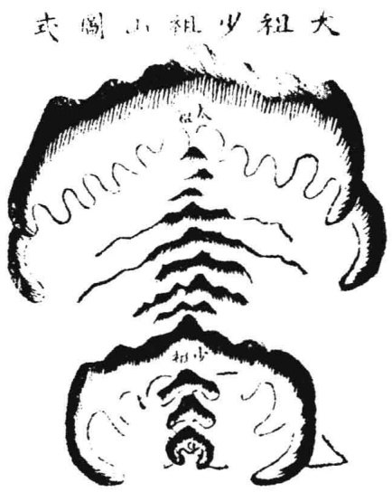</td><td colspan="2">固祖少超重山祖少無</td></tr><tr><td>此则将结穴，先起高大星辰作少祖山。自少祖山下，数节即结穴，极有力，为吉地也。</td><td>此则起少祖山以下节数已多，离少祖远，却又再起高大山，又为少祖，一节即入穴。此地力大福厚，极吉。</td><td>此则离太祖山以下迢迢而去，更无高大星辰作少祖山，委靡入穴，力轻气弱，乃凶地也。</td></tr></table>

查看对应原文

<!-- V3_FOLDBACK_BEGIN:book018-b000301-p000-c9f5819607 -->

<table><tr><td rowspan=1 colspan=1></td><td rowspan=1 colspan=2>固祖少超重山祖少無</td></tr><tr><td rowspan=1 colspan=1>此则将结穴，先起高大星辰作少祖山。自少祖山下，数节即结穴，极有力，为吉地也。</td><td rowspan=1 colspan=1>此则起少祖山以下节数已多，离少祖远，却又再起高大山，又为少祖，一节即入穴。此地力大福厚，极吉。</td><td rowspan=1 colspan=1>此则离太祖山以下迢迢而去，更无高大星辰作少祖山，委靡入穴，力轻气弱，乃凶地也。</td></tr></table>

<!-- V3_FOLDBACK_END:book018-b000301-p000-c9f5819607 -->

<!-- V3_SOURCE_ID:book018-b000302-p000-e7963d14ec -->

<table><tr><td>圖祖少近穴</td><td>圖吉不粗少 </td></tr><tr><td>这种是从少祖山开始，山势像活蛇一样蜿蜒摆动，入首后结穴的情况，也属于吉地。不需要拘泥于山势有大的起伏，只要走势曲折灵动，在龙格中被称作水木芦鞭，是极其显贵的格局。吴公《口诀》说：“入首节内有芦鞭，当代儿孙中状元。”</td><td>这种虽然也有少祖山，但山形丑恶不符合星体的要求，也不符合龙格。出脉又是偏斜暴露受到风吹的情况，就算有符合形法的穴，也不能选用，必然会导致家族败绝。</td></tr></table>

查看对应原文

<!-- V3_FOLDBACK_BEGIN:book018-b000302-p000-e7963d14ec -->

<table><tr><td>圖祖少近穴</td><td>圖吉不粗少 </td></tr><tr><td>此则自少祖山下，如生蛇摆动，入首结穴， 亦为吉地也。不必拘其大起伏，只要曲动， 龙格中谓之水木芦鞭，极贵。吴公《口诀》 云：“人首节内有芦鞭，当代儿孙中状元。”</td><td>此则虽有少祖山，而丑恶不成星体， 不合龙格。出脉又是偏落受风，纵有 形穴，亦不可下，的主败绝。</td></tr></table>

<!-- V3_FOLDBACK_END:book018-b000302-p000-e7963d14ec -->

<!-- V3_SOURCE_ID:book018-b000303-p000-79f857f920 -->

不管后龙的长短，只要在入局的地方忽然隆起少祖山，形态高大威严，挺秀的姿态超出众山之上，作为主星。从这座山往下，只需要一节或者二三节就完成结穴，而穴场正好坐落在这座主星的下方，贴近主星、倚靠的态势十分有力的，这样的地脉力量很大，能带来福气。

查看对应原文

<!-- V3_FOLDBACK_BEGIN:book018-b000303-p000-79f857f920 -->

不论后龙长短，只入局忽起少祖，高大尊严，挺秀冠乎群山，以作主星。自此山下，只一节或二三节即结穴，而穴场正座此星，贴近枕靠有力者，其地力量大，发福

<!-- V3_FOLDBACK_END:book018-b000303-p000-79f857f920 -->

<!-- V3_SOURCE_ID:book018-b000304-p000-c703826483 -->

很快，比如建宁陈副宪的祖地就是这种格局。

查看对应原文

<!-- V3_FOLDBACK_BEGIN:book018-b000304-p000-c703826483 -->

速，如建宁陈副宪祖地其格也。

<!-- V3_FOLDBACK_END:book018-b000304-p000-c703826483 -->

<!-- V3_SOURCE_ID:book018-b000305-p000-579723b613 -->

该风水地在建宁府西北的河西地带。其龙（风水中山脉、地势及气脉的来势和行度）的来龙路途遥远，此处不详述。入首（龙脉进入结穴区域前的关键一段）处陡然隆起主星，高大威严，挺拔秀丽，与其他山峦截然不同，护卫随从的山峦周密完备。正脉从中间落下，延伸至平地，穿过峡地后出现平坡，随即形成结穴（山水形势收束并形成穴位的过程或结果）。穴（风水中认为气脉聚结、适宜安葬或营建的位置）场正对着主星，气势充足，开钳吐唇的形态清晰明白。前方的案山低伏，近身的水流如同眠弓，环绕穴场，与穴场情意相投，以此关锁内部的气脉，逆收大溪的水（风水语境中的河流、水系及其来去形态）。内堂的水口（水流出入一地或局势收束的位置）处有石墩，形状如同官印。左右有山峦映衬环绕，前方的朝山秀丽，内堂紧凑精巧，外洋开阔通畅。葬后当即出了羽泉公，纪于壬午年下葬，甲申年羽泉出生，考中嘉靖丙辰年的进士，官至副宪，封君纵遐长寿安康，屡次受封诰命。诸位孙辈众多，福祉尚未穷尽。

查看对应原文

<!-- V3_FOLDBACK_BEGIN:book018-b000305-p000-579723b613 -->

右地在建宁府西北河西。其龙来远不详述。入首顿起主星，高大尊严，挺秀迥异，护从周密。正脉从中落下平地，穿峡起平坡即结穴。穴场正座主星有力，开钳吐唇明白。前案低伏，近身如眠弓，抱穴有情，以关内气，逆收大溪之水。内堂水口石墩如印。左右映带，前朝秀丽，内堂紧巧，外洋宽畅。葬后即出羽泉公纪壬午年葬，甲申年羽泉生，登嘉靖丙辰进士，官副宪，封君纵遐寿康宁，累膺诰封。诸孙济济，福祉未艾。

<!-- V3_FOLDBACK_END:book018-b000305-p000-579723b613 -->

<!-- V3_SOURCE_ID:book018-b000307-p000-4651ba0718 -->

另外德安杨方伯母的风水地、承天张进士的祖地，都是少祖山临近穴场的风水地，当代就会出贵人。两幅图都附在下方：

查看对应原文

<!-- V3_FOLDBACK_BEGIN:book018-b000307-p000-4651ba0718 -->

又德安杨方伯母地、承天张进士祖地，皆是少祖山近穴，当代出贵。二图具下：

<!-- V3_FOLDBACK_END:book018-b000307-p000-4651ba0718 -->

<!-- V3_SOURCE_ID:book018-b000308-p000-851b3af64d -->

<table><tr><td colspan="2"></td><td rowspan="2">左地在德安府东北六十里处。这里的龙（风水中山脉、地势及气脉的来势和行度）以槎山为祖山，山势磊落奔腾二十余里，之后大幅断开形成过峡（龙脉行进中收束、跌断后再起的部位），转身反向盘绕，形成回龙顾祖的态势。忽然隆起主星，高大尊严，挺拔秀丽远超其他山峰，在群山中最为突出。正脉从主星中间蜿蜒落下，在平缓的坡地上形成结穴（山水形势收束并形成穴位的过程或结果）。穴（风水中认为气脉聚结、适宜安葬或营建的位置）前延伸出毡唇状的平缓地带，左右两侧的山峦环抱贴合。前方正对的祖山形状如同唐代的官帽，近处有文星正对呼应，下关紧固，水（风水语境中的河流、水系及其来去形态）城环绕，明堂（穴前相对开阔、汇聚的空间）宽阔平坦，后方的主星气势厚重威严，整体格局得水藏风。此地属离（八卦之一）龙，扦丁山癸向（建筑或穴位所朝的方位）。安葬的时候次泉公芷刚满三岁，次泉在丙戌年出生，戊子年安葬母亲，后来考中嘉靖癸丑年的进士，官至江西右布政，家族的福祉还在延续没有穷尽。</td></tr><tr><td>此处OCR识别的“灰天張進”应为讹误，正确文字是“承天張進”。卯乙向（建筑或穴位所朝的方位）。龙（风水中山脉、地势及气脉的来势和行度）入首（龙脉进入结穴区域前的关键一段）为庚酉辛。当代会出贵人。穴（风水中认为气脉聚结、适宜安葬或营建的位置）坐主星。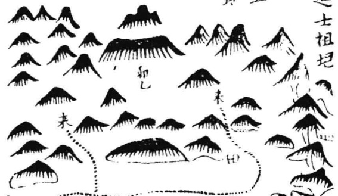 3 </td><td>左地在承天府北五十里处，当地地名叫蒿河安平冲。这里的龙来脉路途遥远，就不详细记述了。龙脉入局之后山势磊落，起伏奔腾十余里。将要到头的时候，大幅断开形成过峡，转身陡然隆起主星，挺拔端正秀丽，在群峰之中最为突出，属于华盖贵格。主星从中抽出正脉，蜿蜒而下，过了一节之后，又隆起大突形成结穴。穴后正对着主星，气势十分威严。左右两侧的山峦环抱顾盼有情。下关重叠多层。前方的朝山群峰秀丽排列，三座尖峰如同卓笔正对着穴位。近处的案山呈拜伏的姿态，罗城和水口（水流出入一地或局势收束的位置）周围坚固。此地属西兑（八卦之一）庚辛龙，扦卯乙向，安葬之后当代就出了明宇公时照、载寰公坤（八卦之一，卦象及五行、方位依原文语境确定），接连考中科举。这块地是嘉靖乙巳年安葬的，戊申年张明宇出生，庚申年载寰公出生，后来载寰公考中癸未年的进士。</td></tr></table>

> **释读存疑：** 原文第一列“灰天張進”具体含义未明；1轮自动修复后核义模型仍建议修订，已保守记录。

查看对应原文

<!-- V3_FOLDBACK_BEGIN:book018-b000308-p000-851b3af64d -->

<table><tr><td colspan="2"></td><td rowspan="2">左地在德安府东北六十里。其 龙自槎山作祖，磊落奔腾二十余里， 乃大断过峡，翻身逆盘，为回龙顾 祖之势。忽起主星，高大尊严，挺 秀迥异，冠于群山。正脉从中逶迤 落下，平坡结穴。穴前吐出毡唇， 左右掬抱有情。前对祖山如唐帽， 近有文星正应，下关紧固，水城绕 带，明堂宽平，后座主星尊重，得 水藏风。离龙，扦丁山癸向。葬时 次泉公芷方三岁次泉丙戌生，戊子 年葬母，后登嘉靖癸丑进士，官至</td></tr><tr><td>灰天張進 卯乙向 龍入首 庚酉辛 當代出貴 穴坐主星  3 </td><td>江西右布政，福祉未艾。 左地在承天府北五十里，土名 蒿河安平冲。其龙来远不详述。入 局磊落，踊跃十余里。将到头，大 断过峡，翻身顿起主星，挺然端秀， 冠于群峰，为华盖贵格。中抽正脉， 逶迤而下，一节即过，复起大突结 穴。穴后正座主星，势甚尊严。左 右两掬包顾有情。下关重迭。前朝 群峰列秀，三尖卓笔正朝。近案拜 伏，罗城水口周固。系西兑庚辛龙， 扦卯乙向，当代即出明宇公时照、 载寰公坤，连登科甲。嘉靖乙巳年 葬地，戊申年张明宇生，庚申年载 寰公生，癸未进士。</td></tr></table>

<!-- V3_FOLDBACK_END:book018-b000308-p000-851b3af64d -->

<!-- V3_SOURCE_ID:book018-b000309-p000-562f546766 -->

## 论无少祖山

查看对应原文

<!-- V3_FOLDBACK_BEGIN:book018-b000309-p000-562f546766 -->

## 论无少祖山

<!-- V3_FOLDBACK_END:book018-b000309-p000-562f546766 -->

<!-- doc007 PDF 第 70 页：未引用图表已用原页保全；文字供检索，版式以原页图为准。 -->
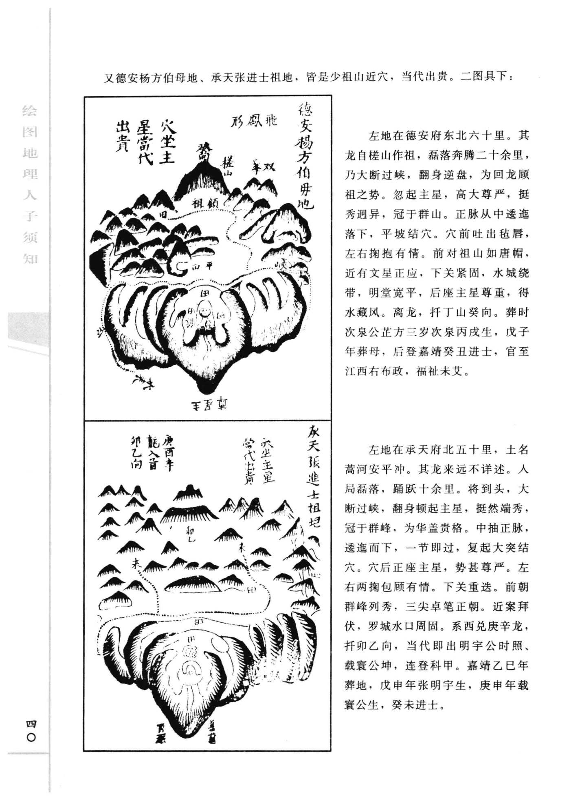

<!-- V3_SOURCE_ID:book018-b000311-p000-3b7a927a88 -->

凡是平冈的龙（风水中山脉、地势及气脉的来势和行度），大多只是蜿蜒而来。

查看对应原文

<!-- V3_FOLDBACK_BEGIN:book018-b000311-p000-3b7a927a88 -->

凡平冈之龙，多只逶迤而来。

<!-- V3_FOLDBACK_END:book018-b000311-p000-3b7a927a88 -->

<!-- V3_SOURCE_ID:book018-b000312-p000-b059aac284 -->

如果行度摆折屈曲，也不必拘泥于必须有少祖山才算是好的风水地。只要在将要到达入穴的地方，二三节内有跌断束气、结咽过脉的情况，就等同于有少祖山。大概山的一次隆起气脉固然旺盛，而山的一次伏藏气脉尤其旺盛，所以不必拘泥于陡然隆起的高山作为少祖。但其断处以临近穴（风水中认为气脉聚结、适宜安葬或营建的位置）场为贵，一节就入穴场尤其精妙。切忌受风，必须有山峦相互夹护才行。

查看对应原文

<!-- V3_FOLDBACK_BEGIN:book018-b000312-p000-b059aac284 -->

若行度摆折屈曲，亦不必拘其必有少祖山方为大地。只要将入穴际，二三节内跌断束气，结咽过脉，此即同有少祖山也。盖山之一起气固旺，而山之一伏气尤旺，故不必拘于顿起高山为少祖耳。但其断处的以近穴为贵，一节即入穴尤妙。切忌受风，必须从山相夹护也。

<!-- V3_FOLDBACK_END:book018-b000312-p000-b059aac284 -->

<!-- V3_SOURCE_ID:book018-b000313-p000-b59b51cd91 -->

平地的龙（风水中山脉、地势及气脉的来势和行度）也是如此，必须在穴（风水中认为气脉聚结、适宜安葬或营建的位置）场后方有束气脉的情况才好。而其束气处要略微高起，有清晰的分水，这样束气入穴才有力，才算是真切。大概平地的阳气大多散漫，贵在收敛。既然没有墩阜作为少祖，就应当以断处的束气为准。或是形成银锭的脉，或是有蛛丝马迹、草蛇灰线、藕断丝连、龟脊牛背等形态，气脉就能束聚。穴场乘得气脉聚结的地方，就是真正的融结。否则气脉散漫没有凭据，纵然坪中有突窟，也认脉不真，不可下葬。

查看对应原文

<!-- V3_FOLDBACK_BEGIN:book018-b000313-p000-b59b51cd91 -->

平地之龙亦然，必于穴后有束气脉为妙。而其束处要微高，有分水明白，则束气入穴有力，方为真切。盖平阳气多散漫，贵于收敛。既无墩阜可为少祖，必当以断处束气为准。或成银锭之脉，或有珠丝马迹、草蛇灰线、藕断丝连、龟脊牛背等形，则气束得聚也。穴场乘得气之聚处，乃是真融结。否则，散漫无证，纵有坪中突窟，亦认脉不真，不可下矣。

<!-- V3_FOLDBACK_END:book018-b000313-p000-b59b51cd91 -->

<!-- V3_SOURCE_ID:book018-b000314-p000-e8a3d0cef0 -->

## 论龙父母胎息孕育

查看对应原文

<!-- V3_FOLDBACK_BEGIN:book018-b000314-p000-e8a3d0cef0 -->

## 论龙父母胎息孕育

<!-- V3_FOLDBACK_END:book018-b000314-p000-e8a3d0cef0 -->

<!-- V3_SOURCE_ID:book018-b000315-p000-de4aa3f9db -->

《经》中说：“万里之山，各起祖宗，而见父母胎息孕育，然后成形。”因此要认形取穴（风水中认为气脉聚结、适宜安葬或营建的位置），要明白龙（风水中山脉、地势及气脉的来势和行度）的父之所生，母之所养。卜氏说：“问祖寻宗，岂可半途而止？”又说：“胎息孕育，神变化于无穷。”这些都是说龙（风水中山脉、地势及气脉的来势和行度）有祖宗父母胎息孕育，然后才形成穴（风水中认为气脉聚结、适宜安葬或营建的位置）。有人说：“先起高峰谓之祖，次起一峰谓之宗，再起左右双峰谓之父母。”如果真像这样说，那就是把父母放在了没有作为的地方，而其所生的，都是祖宗了。张子微已经极力分辨这种说法不对。而洪悟斋又拘泥于节数，说从玄武（穴后方的靠山形势称谓）顶一节为父母，二节为少祖，三节为曾祖，四节为高祖，也太拘泥了。如果用他的说法，那么四节以上的龙（风水中山脉、地势及气脉的来势和行度）又该叫什么呢？大概龙（风水中山脉、地势及气脉的来势和行度）的起身发脉处，必有高山大峦，称为太祖。从这里往下，辞楼下殿，迢迢而行，又起高峰，就称为宗。再蜿蜒而行，奔腾磊落，其间的小星峰就不必论了。直到将要结作，必须再起高峰，迥然耸拔，超异众山，称为少祖。从少祖山下，或起或伏，或大或小，或直或曲，只以玄武（穴后方的靠山形势称谓）顶后一节的星名为父母。父母之下落脉处为胎，如同禀受父母的血脉为胎。

查看对应原文

<!-- V3_FOLDBACK_BEGIN:book018-b000315-p000-de4aa3f9db -->

《经》曰“万里之山，各起祖宗，而见父母胎息孕育，然后成形。”是以认形取穴，明其父之所生，母之所养。卜氏云：“问祖寻宗，岂可半途而止？”又云：“胎息孕育，神变化于无穷。”是皆言龙之有祖宗父母胎息孕育，然后始成穴也。或曰：“先起高峰谓之祖，次起一峰谓之宗，再起左右双峰谓之父母。”诚如其说，则是父母置之无为之地，而其所生，皆祖宗耳。张子微已尝极辨其非。而洪悟斋又拘于节数，谓自玄武顶一节为父母，二节为少祖，三节为曾祖，四节为高祖，亦太泥耳。若用其说，则自四节已上之龙又将何名？大抵龙之起身发脉处，必有高山大峦，谓之太祖。自此而下，辞楼下殿，迢递而行，又起高峰，即谓之宗。复行逶迤，奔腾磊落，其间小可星峰则不必论。直至将及结作，必要再起高峰，迥然耸拔，超异众山，谓之少祖。自此少祖山下，或起或伏，或大或小，或直或曲，但以玄武顶后一节之星名父母。父母之下落脉处为胎，如禀

<!-- V3_FOLDBACK_END:book018-b000315-p000-de4aa3f9db -->

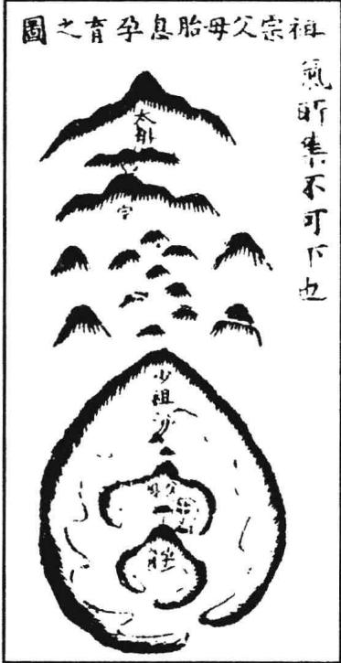

<!-- V3_SOURCE_ID:book018-b000317-p000-b01dc24539 -->

其下束气处为息，如同母亲怀胎养息。再起星面玄武（穴后方的靠山形势称谓）顶为孕，如同胎的男女有头面形体。融结穴（风水中认为气脉聚结、适宜安葬或营建的位置）处为育，如同孩子长成，出胎而育。从少祖山到这里，最关紧要，必须符合各种吉格，束气清切，护卫周密，才算是吉。各家喋喋不休的议论，总归不必。

查看对应原文

<!-- V3_FOLDBACK_BEGIN:book018-b000317-p000-b01dc24539 -->

受父母之血脉为胎也。其下束气处为息。如母之怀胎养息也。再起星面玄武顶为孕，如胎之男女有头面形体也。融结穴处为育，如子之成，出胎而育也。自少祖山至此，最关紧要，须是合诸吉格，束气清切，护卫周密，乃以为吉。诸家喋喋之论，总不必

<!-- V3_FOLDBACK_END:book018-b000317-p000-b01dc24539 -->

<!-- V3_SOURCE_ID:book018-b000318-p000-497a5510d2 -->

这是重刊的《人子须知资孝地理心学统宗》卷二。

查看对应原文

<!-- V3_FOLDBACK_BEGIN:book018-b000318-p000-497a5510d2 -->

重刊人子须知資孝地理心学统宗卷二

<!-- V3_FOLDBACK_END:book018-b000318-p000-497a5510d2 -->

<!-- V3_SOURCE_ID:book018-b000319-p000-f92d08c376 -->

所谓的拘限，无非是希望龙脉的尊卑有秩序、大小有等次，从高处延伸到低处，从粗脉变为细脉，从老脉变为嫩脉，星辰的生克不违背规律，桡棹的长短符合法度，这样就能契合祖宗、父母、胎息、孕育的精妙之处。于是有生气（风水典籍中具有生发、凝聚意义的气）凝聚结穴，孕育灵秀，造化的奥秘就存在于此。按照这个法则安葬，福运的应验会像回声一样迅速。倘若祖宗所在的位置本该高却反而低，本该大却反而小，胎息本该细却反而粗，本该嫩却反而老，这就是尊卑失序、大小无次，凶气聚集，不可在此处安葬。

查看对应原文

<!-- V3_FOLDBACK_BEGIN:book018-b000319-p000-f92d08c376 -->

拘，无非欲其尊卑有序，大小有伦，自高落下，自粗变细，自老抽嫩，星辰之生克不逆，桡棹之长短合法，则得祖宗父母胎息孕育之妙。乃有生气融结而钟灵孕秀，造化存焉。依法葬之，福应如响。其或祖宗当高而反低，当大而反小，胎息当细而反粗，当嫩而反老，此则尊卑失序，大小无伦，凶气所集，不可下也。

<!-- V3_FOLDBACK_END:book018-b000319-p000-f92d08c376 -->

<!-- V3_SOURCE_ID:book018-b000320-p000-815b61e50e -->

## 论龙入首（龙：风水中山脉、地势及气脉的来势和行度；入首：龙脉进入结穴区域前的关键一段）

> **释读存疑：** 本地硬校验仍未通过，已记录供后续自动处理或人工核对。

查看对应原文

<!-- V3_FOLDBACK_BEGIN:book018-b000320-p000-815b61e50e -->

## 论龙入首

<!-- V3_FOLDBACK_END:book018-b000320-p000-815b61e50e -->

<!-- V3_SOURCE_ID:book018-b000321-p000-b2d73527ef -->

“不要先谈论千里之外延伸而来的来龙（龙脉从远处延伸而来的走势），应当先看龙脉到头后是否有融结的穴位（风水中认为气脉聚结、适宜安葬或营建的位置）。”所以凡是观察龙的美恶以及各类龙格，只需在入首（龙脉进入结穴区域前的关键一段）、穴位后方的二三节、四五节范围内，以少祖山最为紧要。审察龙的态势，如果有起有伏，逶迤舒展，灵动活跃，头面端正，星峰秀丽，枝脚随龙分布，还有落、穿、传、变、台、屏、帐、盖、走马、珠串、芦鞭、王字、个字、之字、抛梭、展翅、飞蛾等各类贵格，且随从的山以及自身的枝脚又起峰峦，形如仓库、旗、鼓、天马、贵人、笏印、金箱、宝剑、文官、武库、天乙、太乙等物来夹送，这就是真正的来龙。此处的融结，是我所用的穴位，确切无疑，因为它就在靠近穴位的数节之间。像这样的地方，结作真实，力量强大，发福迅速。如果少祖山到近穴的数节内没有吉星，不符合各类贵格，或者态势懒缓怯弱、死硬臃肿、粗恶直长没有枝脚，或者枝脚拖泄、散乱尖利而成鬼劫，即便龙虎（穴场周围起护卫、朝应作用的山丘或地形）、明堂（穴前相对开阔、汇聚的空间）、朝案等都很完美，无奈穴位下方没有龙（风水中山脉、地势及气脉的来势和行度），真气不凝聚，所有美好的条件都会变成空。千万不要认为少祖山以上的龙特别通达可爱，就听信平庸风水师的话，说“远处的龙奇好，后代必然有贵人，但初代不吉利”，舍近求远，贪图后代的富贵而错误地选择伪地，反而消耗已有的福运。要知道千里来龙要看它到头的融结之处。如果到头近穴处的龙已经不好，它远处即便有好龙，也无法受用，或者另有结作。好龙固然不是凭空产生，但不会来此处融结。这座山既然不是真龙，必然是真龙正穴的从属，或是缠托，或是夹送，或是作为下手关拦，或是作为捍门水口的砂，或是正龙的枝脚桡棹、仓库等物。尤其需要仔细审察，再去查看少祖山分支的地方，某枝确实是真龙受穴的山。如果是真龙，自然尊贵特异，应当在这座山追寻正穴，必然有真实的融结。所以审察龙的关键，必定在入首近穴的数节之内最为紧要。就像人的远祖，即便已是王侯显贵，也在数十代之前。到他的祖父，贫困无聊，沦为贱役。到他自身，更加伶仃不振，那么远祖的王侯显贵，怎能庇及数十代后的子孙呢！远祖即便贫困，到祖父时崛起，成为王侯显宦，那么他一二代的子孙或许会受荫为官，或资产巨富，必然能凭借余泽享受富贵，远祖即便贫困又有什么妨害呢？这就是好龙之所以需要靠近穴位，而远龙即便美好，也不能依仗的原因。所以凡是观察龙的美恶及各类贵格，都要在少祖山以下审察，符合吉格就吉，类同凶格就凶，祸福贴近，不差毫末。

查看对应原文

<!-- V3_FOLDBACK_BEGIN:book018-b000321-p000-b2d73527ef -->

“未论千里来龙，且看到头融结。”故凡观龙之美恶，及诸般龙格，只于入首穴后二三节、四五节内以至少祖山为紧切。审其龙势，若有起有伏，逶迤走弄，活动栖闪，而头面端正，星峰秀丽，枝脚随身，及有落、穿、传、变、台、屏、帐、盖、走马、珠串、芦鞭、王字、个字、之字、抛梭、展翅、飞蛾种种贵格，而随从之山及本身枝脚又起峰峦，如仓库，如旗，如鼓，如天马、贵人、笏印、金箱、宝剑、文官、武库、天乙、太乙等形以夹送之，此为真来。此处融结，是我所用，亲切无疑，以其在近穴数节间也。似此之地，结作真，力量大，发福速。若少祖至近穴节内并无吉星，不合诸格，或懒缓怯弱，死硬臃肿，粗恶直长无枝脚，或枝脚拖泄，散乱尖利而成鬼劫，任是龙虎、明堂、朝案件件皆美，奈何坐下无龙，真气不钟，诸般美利，种种成空。切不可认少祖以上之龙特达可爱，而信庸师之言，谓“远龙奇好，必后代有贵，但初代不吉”，恕近慕远，希图后代之富贵而误下伪地，反消已福。不知千里来龙看到头。若到头近穴处龙既不好，其远处虽有好龙，不能受用，或别有结作。其好龙固非虚生，但不来此处融结。此山既非真龙，必是真龙正穴之奴从，或为缠托，或为夹送，或作下手关拦，或作捍门水口之砂，或是正龙枝脚桡棹仓库等件。尤须检点，再去审其少祖分行之处，某枝委是真龙受穴之山。若是真龙，自然尊贵特异，宜于此山追寻正穴，必有真结。故审龙之要，必于入首近穴数节内为紧。譬如人之远祖，虽为王侯显贵，已在数十代之前。至于其祖父，贫困无聊，遂为贱役。及其身，益伶仃不振，则其远祖之王侯显贵，安能庇及数十代后之子孙哉！远祖虽或贫困，至于祖父而崛起，为王侯显宦，则其一二代之子孙或受荫为官，或资产巨富，必能藉其余泽以享富贵，远祖虽贫何害焉？此好龙所以欲其近穴，而远龙虽美，不可恃也。故凡观龙美恶及诸贵格，的于少祖山以下审之，合吉则吉，类凶则凶，祸福亲切，不差毫末也。

<!-- V3_FOLDBACK_END:book018-b000321-p000-b2d73527ef -->

<!-- V3_SOURCE_ID:book018-b000323-p000-e5c3250d1d -->

如果远处的龙不好，将要到入首近穴处时，剥换变为好龙，这就是吉地。但龙气行到跌断后龙气不好的地方，就会衰败，应当另外寻找吉地承接福运。

查看对应原文

<!-- V3_FOLDBACK_BEGIN:book018-b000323-p000-e5c3250d1d -->

此远龙不好，将入首近穴，剥变好龙，是吉地。但年代行到跌断后龙气不好处，即败，宜别求吉地接福。

<!-- V3_FOLDBACK_END:book018-b000323-p000-e5c3250d1d -->

<!-- V3_SOURCE_ID:book018-b000325-p000-aa75284322 -->

以上审察龙入首美恶、判定地的吉凶，是紧要的口诀，非常简要。大凡美好的地，都是因为入首龙吉而带来福运。比如浮梁戴尚书的祖地，后龙很弱，但入首很美，也出了尚书。铅山费状元的祖地，来龙（龙脉从远处延伸而来的走势）很远，但近处以入首三者为依据，可见寻龙固然应当探究远处，尤其必须以入首为准。二图附在下方：

查看对应原文

<!-- V3_FOLDBACK_BEGIN:book018-b000325-p000-aa75284322 -->

右审龙入首美恶，定地吉凶，乃紧关口诀，甚为简要。大凡美地，皆以入首龙吉而致福应。如浮梁戴尚书祖地，后龙甚弱，而入首为美，亦出尚书。铅山费状元祖地，来龙甚远，而近以入首三者为课，可见寻龙固当究远，而尤必以入首为准也。二图具下：

<!-- V3_FOLDBACK_END:book018-b000325-p000-aa75284322 -->

<!-- V3_SOURCE_ID:book018-b000326-p000-8d942084f3 -->

以上的地在铅山县二十八都，地名乌石山。它的龙起自黄旗峰，绵延百余里，经过上七峰到徐源岭，过峡（龙脉行进中收束、跌断后再起的部位）后顿起合珠山，重重开帐，此处不再详细叙述。将要入首时，穿田起玉枕落脉。左右小山夹照，形状如同日月。正脉中起穿心，形成三台。两畔均匀可爱。中落一节结穴（山水形势收束并形成穴位的过程或结果），龙格很尊贵。只是穴位的星独高，显得外露。上聚显得峻峭。护山低伏，穴位左右，一望青天，显得寒。穴位前的右砂俯水，显得撺。宽阔的明堂（穴前相对开阔、汇聚的空间），显得旷。横峰前朝，群山显得乱。下关大琛山很远，显得宽。从对面看，自身下手无情，诸山顺奔，态势随流水，显得不团聚，不入俗眼。殊不知穴位山独高众山低，高为尊。穴位前虽峻，“上聚星辰若开口，穴下不畏陡。放棺定有坦平坡，微乳或微窝。”正与此相合。左右虽低，微窝紧夹，藏车

> **释读存疑：** 原文末尾“藏车”为截断内容，无后续文本，释读保留原样符合要求

查看对应原文

<!-- V3_FOLDBACK_BEGIN:book018-b000326-p000-8d942084f3 -->

右地在铅山县二十八都，地名乌石山。其龙起自黄旗峰，迢递百余里，历上七峰至徐源岭，过峡顿起合珠山，重重开帐，不及详述。将入首，穿田起玉枕落脉。左右小山夹照，状如日月。正脉中起穿心，成三台。两畔均匀可爱。中落一节结穴，龙格甚贵。只是穴星独高，似露。上聚似峻。护山低伏，穴上左右，一望青天，似寒。穴前右砂俯水，似撺。阔坂明堂，似旷。横峰前朝，群山似乱。下关大琛山甚远，似宽。对面观之，本身下手无情，诸山顺奔，势随流水，似不团聚，不入俗眼。殊不知穴山独高众山低者，高为尊也。穴前虽峻，「上聚星辰若开口，穴下不畏陡。放棺定有坦平坡，微乳或微窝。」正合此也。左右虽低，微窝紧夹，藏车

<!-- V3_FOLDBACK_END:book018-b000326-p000-8d942084f3 -->

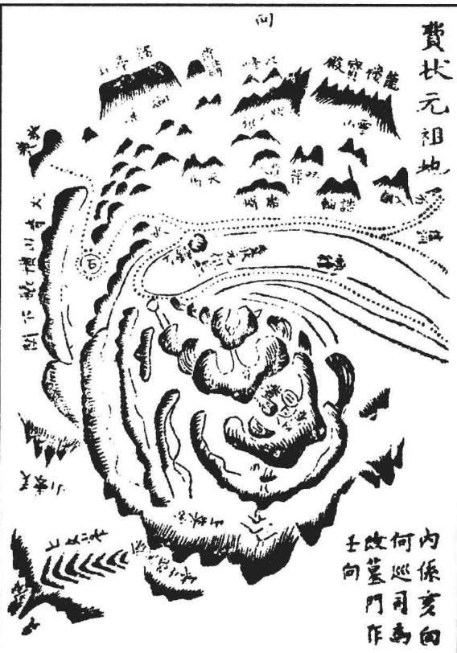

<!-- V3_SOURCE_ID:book018-b000328-p000-d207822131 -->

此处有“隐马”的布局，是不畏寒的格局。虎沙顺水的形态属于明曜，并不是撺的凶形。外堂虽然开阔，但内堂已经聚气，不算旷散的格局。前朝的砂山看似杂乱，实际上都堆积得错落有致，形状像状元旗、笔、笏、贵人诰轴、天马、席帽，全都符合贵格的要求，正是《葬书》里所说的“若具万膳而洁齐”的情况。下关虽然距离较远，是因为干龙的缠护隔着江河的缘故。何况信河的水朝入明堂，河里的大脚石截水的力道很强，又有绻绩石堵塞镇住水口，叫岩山和大琛山相互交错牢牢关锁，确实是最为吉利的地方。下葬之后过了四十八年，长房有三人考中科第，却接连去世了两人，族里人商议想要改葬。丰城的何巡司看到这块地之后大为惊叹，说道：“玉枕龙，日月峡，隐隐三峰向前插，状元宰辅此中生，兄弟叔侄同科甲。状元就要在这里出世了，怎么可以改葬呢！”当时文宪公宏已经十多岁，没过几年果然考中状元，后来官位升到太保。他的儿子懋贤考中进士，官任郎中；懋良官任太守。他的玄孙、曾孙辈也都地位显贵。文宪公的弟弟清湖公和侄子探花懋中同科考中，九个儿子全都显贵。望湖公懋文和兄长懋尹同科考中，参政公瑄和兄长珣同科考中。礼部尚书钟石公寀和侄子懋和同科考中。尚书的儿子懋学官任太守，侄子懋乐官任郎中。如今唐衢公尧年考中进士，跻身显贵的行列，延之任太仆寺丞。华任礼部主政。懋谦、懋稷等诸位先生都在京城任职。父子、兄弟、叔侄一同在朝为官，果然应验了何巡司当初的话。

查看对应原文

<!-- V3_FOLDBACK_BEGIN:book018-b000328-p000-d207822131 -->

隐马，不畏寒也。虎沙顺水，乃是明曜，而非撺也。外堂虽阔，内堂已聚，不为旷也。前朝虽乱，然皆堆堆累累，如状元旗，如笔，如笏，如贵人诰轴、天马、席帽，皆合贵格。《葬书》所谓“若具万膳而洁齐”也。下关虽远，“干龙缠护隔江河也”。况信河之水朝入明堂，而河中大脚石截有力，又有绻绩石塞镇，叫岩山与大琛山交固关锁，真至吉之地。葬后四纪，长房三中科第，连丧其二，议欲改葬。丰城何巡司见而奇之曰：“玉枕龙，日月峡，隐隐三峰向前插，状元宰辅此中生，兄弟叔侄同科甲。状元出世矣，何可改也！”是时，文宪公宏已十岁余，不数年果大魁天下，官至太保。子懋贤登进士，官郎中；懋良官太守。玄曾诸孙皆贵。文宪公弟清湖公与侄探花懋中同科，九子皆贵。望湖公懋文与兄懋尹同科，参政公瑄与兄珣同科。礼部尚书钟石公寀与侄懋和同科。尚书公子懋学官太守。侄懋乐官郎中。今唐衢公尧年登进士，跻显宦，延之太仆寺丞。华，礼部主政。懋谦、懋稷诸公俱任京职。父子兄弟叔侄同朝，果符何氏之言云。

<!-- V3_FOLDBACK_END:book018-b000328-p000-d207822131 -->

<!-- V3_SOURCE_ID:book018-b000329-p000-b188d75568 -->

按：这块地，来龙虽远，到入首时，穿田而起玉枕，又大断而起三台。中落一节结穴，是极贵之格，状元由此钟灵，宰辅由此孕育。所以观察龙确实以入首三节为准。前砂子峰独秀，对应文宪公戊子年出生。三台是丁未龙，所以文宪公在成化丁未年中状元。

查看对应原文

<!-- V3_FOLDBACK_BEGIN:book018-b000329-p000-b188d75568 -->

按：是地也，来龙虽远，至入首，穿田而起玉枕，又大断而起三台。中落一节结 穴，为至贵之格，状元由此而钟，宰辅由此而孕。故观龙的以入首三节为准也。前砂 子峰独秀，应文宪公戊子生。三台系丁未龙，故公以成化丁未状元也。

<!-- V3_FOLDBACK_END:book018-b000329-p000-b188d75568 -->

<!-- V3_SOURCE_ID:book018-b000331-p000-a0bfc1bd4d -->

这块地在浮梁东乡，后龙很弱。只有到头起三台，一节结穴。左右抱卫，明堂平坦，内外应证。安葬后初代出恭简公珊，官至尚书。又出进士数人，科第不断绝。还出了一位神仙，名叫铁仙。

查看对应原文

<!-- V3_FOLDBACK_BEGIN:book018-b000331-p000-a0bfc1bd4d -->

左地在浮梁东乡，后龙甚弱。惟到头起三台，一节结穴。左右抱卫，明堂平坦，内外应证。葬后初代出恭简公珊，官至尚书。又进士数人，科第不替。出一神仙，名曰铁仙。

<!-- V3_FOLDBACK_END:book018-b000331-p000-a0bfc1bd4d -->

<!-- V3_SOURCE_ID:book018-b000332-p000-5b39d1b8fb -->

## 卷二之二

查看对应原文

<!-- V3_FOLDBACK_BEGIN:book018-b000332-p000-5b39d1b8fb -->

## 卷二之二

<!-- V3_FOLDBACK_END:book018-b000332-p000-5b39d1b8fb -->

<!-- V3_SOURCE_ID:book018-b000333-p000-adc0f70533 -->

这一卷专门论述龙（风水中山脉、地势及气脉的来势和行度）的起源，以及剥换、过峡（龙脉行进中收束、跌断后再起的部位）、桡棹、护送的详细情况。观察龙的方法，既要明确太祖、少宗、父母的具体形态，又要仔细审察它的起源、剥换、度峡、桡棹、护送的微妙之处。从祖山到宗山，从高处到低处，连绵延伸、奔涌前行，即使是从属的龙、凶恶的山，其态势也大致相似。如果没有方法来鉴别，就无法分辨吉凶。所以必须在它的起源处追溯它的开端，在剥换处观察它的变化，在过峡处审察它的行进，在桡棹、护送处观察它的贵贱美恶，这样龙的真伪吉凶等情况就会清晰分明了。

查看对应原文

<!-- V3_FOLDBACK_BEGIN:book018-b000333-p000-adc0f70533 -->

此一卷专论龙之出身，及剥换、过峡、桡棹、护送之详。夫观龙之法，既明其太祖、少宗、父母之节目，又当审其出身、剥换、度峡、桡棹、护送之玄微。盖自祖而宗，自高而下，迢递奔走，虽奴从之龙，凶恶之山，其势相类。苟无术以鉴之，则吉凶莫辨。故必于其出身处以原其所始，于剥换处以察其所变，于过峡处以审其所度，于桡棹、护送处以观其贵贱美恶，则龙之真伪吉凶情状自判然矣。

<!-- V3_FOLDBACK_END:book018-b000333-p000-adc0f70533 -->

<!-- V3_SOURCE_ID:book018-b000334-p000-7479d15851 -->

## 论龙出身

查看对应原文

<!-- V3_FOLDBACK_BEGIN:book018-b000334-p000-7479d15851 -->

## 论龙出身

<!-- V3_FOLDBACK_END:book018-b000334-p000-7479d15851 -->

<!-- V3_SOURCE_ID:book018-b000335-p000-e398118389 -->

龙的出身，指的是祖山发脉之后、离开祖山分出支脉前行的位置。一座祖山之下，必然会分出多条龙，这些龙的美恶吉凶，在这时就已经显露出端倪了。如果龙在出身的阶段就表现得特异不凡，往前延伸必然会经历穿落传变的过程，最终融结出富贵的穴。要是出身的位置形态不好，就算后续能形成有形的穴，也不是吉利的地，没有必要继续追寻。出身吉利的龙，有的从宏阔舒展的帐幕中心穿出延伸，有的接连耸起数座高耸挺拔、气势不凡的山峰，有的像辞楼下殿一般磊落舒展，有的像云堆叠、蚁聚集一般缤纷错落，有的呈现五星聚讲的态势，有的呈现七政连班的态势，正穿正出，中起中落，两侧有山体夹护拱照，气象轩昂，支脉繁茂，走势灵动。《玉髓经》记载：“祖宗生龙百龙共，生出来时有轻重。大龙重处在中央，其次龙行枝叶长。”吴白云说：“寻地须先认祖宗，更于离祖察行踪。辞楼下殿峰峦秀，预识前途异气钟。”董德彰说：“大凡龙脉初发处，若屈曲如生蛇之下岭，而两边有蝉翼护带者，前去必结大地。其出身之不吉者，则瘦弱萎靡，不起不伏，不活动折摆。”子微说：“龙无星曜

查看对应原文

<!-- V3_FOLDBACK_BEGIN:book018-b000335-p000-e398118389 -->

龙之出身，乃祖山发脉离祖分行处也。盖一祖之下，必分数龙，其间美恶吉凶，端倪已兆。若此出身之际特异不凡，前去必有穿落传变，融结富贵之穴。如或此处出身不美，纵去结有形穴，亦非吉地，不必追寻。其出身吉者，或宏开阔帐而穿心出脉，或连起数峰而耸拔不凡，或辞楼下殿而磊落，或迭云集蚁而缤纷，或五星聚讲，或七政连班，正穿正出，中起中落，夹护拱照，气象轩昂，枝叶蕃衍，步骤活动。《玉髓经》云：“祖宗生龙百龙共，生出来时有轻重。大龙重处在中央，其次龙行枝叶长。”吴白云云：“寻地须先认祖宗，更于离祖察行踪。辞楼下殿峰峦秀，预识前途异气钟。”董德彰云：“大凡龙脉初发处，若屈曲如生蛇之下岭，而两边有蝉翼护带者，前去必结大地。其出身之不吉者，则瘦弱萎靡，不起不伏，不活动折摆。”子微云：“龙无星曜

<!-- V3_FOLDBACK_END:book018-b000335-p000-e398118389 -->

<!-- V3_SOURCE_ID:book018-b000336-p000-b2597361db -->

低低去，此是贱龙出身处。”大致来说，龙的出身就像人的出身，要是出身不正，必然不是贤良的人，就算身居显要的位置，也会奸邪误国，让天下人遭受灾祸。出身光明正大的人，必然能保全名节，让天下人享受福祉。龙脉出身的道理和这个没有什么差别！不过也不能拘泥于这套规律，原本就有前期出身形态不好，后来又转变为吉态的情况；也有前期出身形态大吉，后来却转变为凶态的情况。就像人起初虽然凶恶，后来能改过迁善，不妨碍他成为君子；起初虽然行事正大，后来却变节做坏事，终究免不了成为小人。凡是这类情况，尤其应当仔细辨别，不能忽略。如果在这一步判断出错，就会把凶认作吉，把吉指为

查看对应原文

<!-- V3_FOLDBACK_BEGIN:book018-b000336-p000-b2597361db -->

低低去，此是贱龙出身处。”大抵龙之出身，如人之出处，出身不正，必非贤良，纵有显位，奸邪误国，天下受其祸。出处之光明正大者，必完名全节，天下受其福。龙脉出身何以异此！然又不可拘，固有前出不美，而后复变吉者；亦有前出大吉，而后却变凶者。如人之先虽凶恶，而后能改过迁善，不害其为君子；先虽正大，而后乃变节为恶，终不免为小人。凡此之类，尤当详辨，不可忽略。此而有误，则认凶为吉，指吉为

<!-- V3_FOLDBACK_END:book018-b000336-p000-b2597361db -->

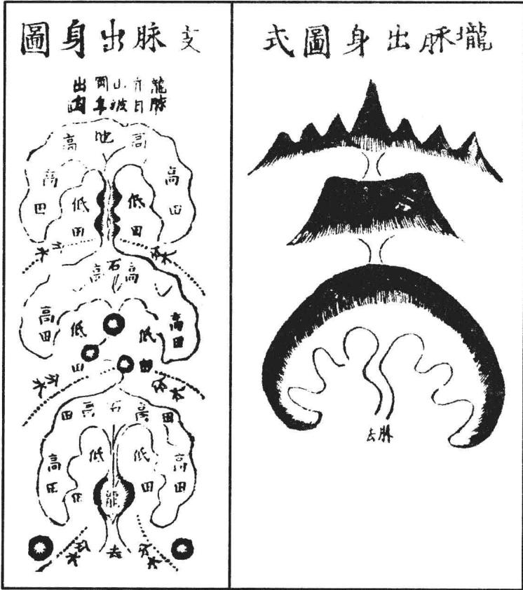

<!-- V3_SOURCE_ID:book018-b000338-p000-5d5ec9f1dd -->

这就会造成判断结果为凶，出现是非颠倒、福气和灾祸的判定完全错误的情况。

> **释读存疑：** 1轮自动修复后核义模型仍建议修订，已保守记录。

查看对应原文

<!-- V3_FOLDBACK_BEGIN:book018-b000338-p000-5d5ec9f1dd -->

凶，是非颠倒，祸福谬戾矣。”

<!-- V3_FOLDBACK_END:book018-b000338-p000-5d5ec9f1dd -->

<!-- V3_SOURCE_ID:book018-b000339-p000-e4d9a291f8 -->

以上是龙脉出身图，姑且作为范例，道理难以拘泥，聪明的人可以触类旁通。

查看对应原文

<!-- V3_FOLDBACK_BEGIN:book018-b000339-p000-e4d9a291f8 -->

右龙脉出身图，姑以为式，理难定拘，智者触类而长之可也。

<!-- V3_FOLDBACK_END:book018-b000339-p000-e4d9a291f8 -->

<!-- V3_SOURCE_ID:book018-b000340-p000-2214383695 -->

这里是《绘图地理人子须知》的内容，它又被重刊为《人子须知资孝地理心学统宗》，以下是该书的第二卷。

> **释读存疑：** 1轮自动修复后核义模型仍建议修订，已保守记录。

查看对应原文

<!-- V3_FOLDBACK_BEGIN:book018-b000340-p000-2214383695 -->

绘 图 地 理 人 子 须 知重刊人子须知资孝地理心学统宗卷二

<!-- V3_FOLDBACK_END:book018-b000340-p000-2214383695 -->

<!-- V3_SOURCE_ID:book018-b000341-p000-a24efa8543 -->

## 论龙开障

查看对应原文

<!-- V3_FOLDBACK_BEGIN:book018-b000341-p000-a24efa8543 -->

## 论龙开障

<!-- V3_FOLDBACK_END:book018-b000341-p000-a24efa8543 -->

<!-- V3_SOURCE_ID:book018-b000342-p000-23f4ceba30 -->

《发挥》说：“大凡开幛穿心，须是旁起而肩末如弓稍，肩如人有肩，稍如弓有稍，横铺阔远，始为正穿心。”所以这种开幛穿心是极贵的，宽阔的地方有的达十几里，有的五六里，狭窄的地方一二里，或三四里远。大龙的布置，百里、二三百里的，不在这个例子之内。凡是符合这个标准的才是正穿心。三五丈之间不足以称为正穿心，不过是中心正出的龙罢了。但这种开幛穿心也不多见，偶尔出现三五节，或只有一二节，关键在于它的地传变不杂乱，气脉不散漫，在帐中行进，或之字形奔走，或如抛梭袅鞭，或如蜂腰鹤膝，或如鸾凤飞翔，或如蛇回蝉蜕，或如登梯降阶，不一而足。只要龙真脉的，不必完全拘泥于穿心，这些都是吉地。还有一种穿心，梢头又耸起圆峰，高峻丰厚的，自带仓库随行，主大富盛。还有一种，开幛之后，丝线般穿出，特立秀峰的，是幛内贵人，主大尊贵。还有一种，开幛之后，两腋特起秀峰，不与本身联属，两旁高耸端正，这是暗库星，主其家富盛，爱妾宠妃，有自行收存典质的态势。不过这类龙极为稀罕，蜈蚣节已经为

> **释读存疑：** 原文此处内容残缺

查看对应原文

<!-- V3_FOLDBACK_BEGIN:book018-b000342-p000-23f4ceba30 -->

《发挥》云：“大凡开幛穿心，须是旁起而肩末如弓稍，肩如人有肩，稍如弓有稍，横铺阔远，始为正穿心。”故此开幛穿心极贵，阔者或十数里，或五六里，狭者一二里，或三四里之远。大龙布置，百里、二三百里者，不在此例也。凡此方为正穿心。三五丈间不足谓之正穿心，不过为中心正出之龙耳。但此开幛穿心亦不多见，间见三五节，或止一二节，但要其地传变不杂，气脉不散漫，帐中而行，或之玄飞走，或抛梭袅鞭，或蜂腰鹤膝，或鸾凤飞翔，或蛇回蝉蜕，或登梯降阶，不一而足。只须龙真脉的，不必全泥穿心，此皆吉地。又有一种穿心，稍头又起圆峰，高峻丰厚者，自带仓库随行也，主大富盛。又有一种，开幛之后，丝线穿出，特立秀峰者，幛内贵人也，主大尊贵。又有一种，开幛之后，两腋特起秀峰，不与本身联属，两旁高耸端正，此暗库星也，主其家富盛，爱妾宠妃，自收典质之状。然此等龙极为希罕，蜈蚣节已为

<!-- V3_FOLDBACK_END:book018-b000342-p000-23f4ceba30 -->

<!-- V3_SOURCE_ID:book018-b000343-p000-9cea351740 -->

“式圖心穿帳”的情况本就很难遇到，更何况是开幛穿心的格局呢？至于贵人、仓库这类格局，就更为少见了。不过这种开幛穿心的格局，本是贵格，也不能就此断定前方是什么地，还需要看前后穿变的情况以及附带的相关应对要素。有一种龙脉的祖宗山不好，胎息偏伤，中间或许有开障穿心的情况，或者有一二节气处于旺相的状态。但到了穿出处，龙脉分枝分柯散乱，或者变成断绝空亡的状态，最终不会融结成穴，这就是假龙出现假穿心的情况。那么该如何辨别龙脉的假穿心呢？一是从祖宗山开始，就已经能看出偏斜丑陋的样子，这是第一个判断依据；二是穿出之后，龙脉又变得缓漫散乱，这是第二个判断依据；三是入穴的时候，龙脉无神无气，形态臃肿昂雄，轻重不等，收拾不匀，堂局破碎，朝应无情，这是第三个判断依据。这三点都不符合要求的，即便有穿心的情况，也是游龙远出，中间偶尔有一二节恰好符合贵格的要求，但前后的走势都不值得参考，纵然有开幛穿心、起肩结稍的形态，又有什么作用呢？

查看对应原文

<!-- V3_FOLDBACK_BEGIN:book018-b000343-p000-9cea351740 -->

式圖心穿帳閑难遇，况开幛穿心乎？至于贵人、仓库，尤为少见矣。然此开幛穿心，故为贵格，亦未可便定前是何地，又须看前后穿变应带。有一种祖宗不好，胎息偏伤，中间或有开障穿心，或一二节气旺者。及至穿出处，或分枝分柯散乱，或为断绝空亡，终不融结。此为假龙作假穿心也。然何以辨龙作假穿心也？盖从祖宗以来，已觉偏斜丑陋，此可见一也；穿出之后，又复缓漫散乱，此可见二也；入穴之际，无神无气，臃肿昂雄，轻重不等，收拾不匀，堂局破碎，朝应无情，此可见三也。三者无取，虽有穿心，盖游龙远出，中间偶有一二节妙合贵格，然前后无足观，纵有开幛穿心，起肩结稍，亦何用也？

<!-- V3_FOLDBACK_END:book018-b000343-p000-9cea351740 -->

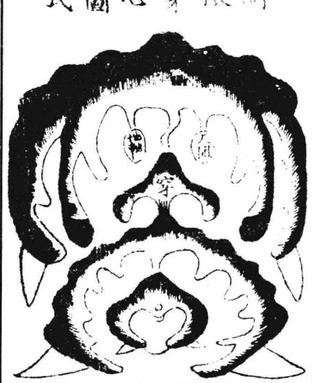

<!-- V3_SOURCE_ID:book018-b000345-p000-44b7816647 -->

廖氏说：“龙开幛而出的，最为有力。金水脑的情况为上，水星次之。要形如幛幕且角分明，有带下垂才是合适的。中出的情况为上，两角出的情况次之。巨石在右为天关，在左为地障。形类龟蛇、串珠、印剑等格的情况尤为妙。得此护脉方可。如没有，得障角遮护过也可以”。

查看对应原文

<!-- V3_FOLDBACK_BEGIN:book018-b000345-p000-44b7816647 -->

廖氏曰：“龙开幛而出者，最为有力。金水脑为上，水星次之。要形如幛幕而角分明，有带下垂方是。中出者为上，两角出者次之。巨石在右为天关，在左为地障。形类龟蛇、串珠、印剑等格尤妙。得此护脉方可。如无，得障角遮护过亦可”。

<!-- V3_FOLDBACK_END:book018-b000345-p000-44b7816647 -->

<!-- V3_SOURCE_ID:book018-b000346-p000-067af94ac8 -->

开帐原本属于龙格部的内容，但这里既然论及出身，开帐也是与之相关的，姑且说说它的大概情况。诸帐格的详细内容都在龙格部中。

查看对应原文

<!-- V3_FOLDBACK_BEGIN:book018-b000346-p000-067af94ac8 -->

开帐原是龙格部，但此既论出身，则开帐亦是相连的，姑言其概。诸帐格详见龙格部下。

<!-- V3_FOLDBACK_END:book018-b000346-p000-067af94ac8 -->

<!-- V3_SOURCE_ID:book018-b000347-p000-6beec927eb -->

## 论龙剥换

查看对应原文

<!-- V3_FOLDBACK_BEGIN:book018-b000347-p000-6beec927eb -->

## 论龙剥换

<!-- V3_FOLDBACK_END:book018-b000347-p000-6beec927eb -->

<!-- V3_SOURCE_ID:book018-b000348-p000-922de362d7 -->

剥换，就是变化的意思。龙的形体，从老变嫩，从粗变细，从凶变吉，都是自然造化的奇妙之处。杨公说：“一剥一换大生细，从大剥小真奇异。剥换如换好衣裳，如蚕蜕壳蛾脱筐。”廖氏说：“脱卸剥换粗变细，凶星变吉气。”卜氏说“星以剥换为贵”。这些说法都表明龙贵在有剥换的过程。比如金星发祖，剥出水星，水星又剥木星，木生火，火生土，土生金之类，绵延生出峰峦，节节都符合格局要求，就是富贵的地。如果遇到五行相克的情况，可贵的是有救星存在。比如金星行龙，木星作穴，金克木，本是凶象，左右如果有火星来制约金，或者有水星来助力木，也属于吉象。按照这个逻辑类推，判断基本不会有差错。《九星变》篇说：“凡观一星便观变，识得变星知近远。远从贪狼至破军，换尽龙楼生宝殿。一剥一变形不同，岂可尽言顾祖宗。君如识得变星法，千里百里寻来龙。”不过九星的变化，只取贪、巨、武、辅、弼五种为吉，因为它们的体势端正，外形光彩，尖形的就清秀，圆形的就肥满，方形的就平正，所以属于吉。而文、廉、禄、破四种为凶，因为它们的体势歪斜，外形臃肿，高峻险峭，恶石突兀，所以属于凶。以上就是五星九星变剥吉凶的大概情况。凡是远祖高峰是凶星发龙，却有跌断过脉、退皮换骨的过程，变出吉星作为少祖山而后结穴的，也属于好地。如果后龙节节都是吉星，中间有一二节吉凶不明确的，只是小凶而已。如果远祖是吉星，却剥出凶星作为少祖山结穴的，就属于凶地，不可以在此下葬。后龙节节都是凶星，只有退换到入首的一二节是吉星并且结穴下葬的，也能让一两代人获得福运。等到凶星的力量发作，就会主家道祸败。后龙节节都是吉星，只有入首结穴的一节是凶星，如果穴的情况好，初代虽然会出现退败的情况，到第二代、第三代剥换到吉的位置，就又能获得长久的福运。以上就是根据剥换星体的吉凶，观察前后的节数，占卜年代、验证祸福的大概方法。如果龙脉起祖之后绵延行来，直到入穴，完全没有跌断过峡的情况，就是没有变化，必然不会融结。《发挥》说：“龙无传变穿落，则无造化；不经退卸，则无秀气。”即便有奔走的态势、摆折的外形，也是伪龙，大多是作为从属的奴山，不需要在此寻穴。纵然有形穴、龙虎、案对、明堂等各种符合格局的条件，奈何龙没有脱卸、没有变剥，气脉不全，脉势不真，空有凶恶的杀气，就是花假之地。所以凡是寻龙的时候，看到没有过峡剥变的情况，绝对不会有融结的造化，不需要再继续追寻了。

查看对应原文

<!-- V3_FOLDBACK_BEGIN:book018-b000348-p000-922de362d7 -->

剥换者，变化也。龙之形体，自老变嫩，自粗变细，自凶变吉，皆造化之妙。杨公云：“一剥一换大生细，从大剥小真奇异。剥换如换好衣裳，如蚕蜕壳蛾脱筐。”廖氏云：“脱卸剥换粗变细，凶星变吉气。”卜氏云“星以剥换为贵”。是皆谓龙贵于有剥换也。且如金星发祖，剥出水星，水星又剥木星，木生火，火生土，土生金之类，迢迢生峰，节节合格，是为富贵之地。若遇相克，贵有救星。如金星行龙，木星作穴，金克木，本凶，左右得火星以制之，或得水星以助之，亦为吉也。以类而推，万不失一。《九星变》篇云：“凡观一星便观变，识得变星知近远。远从贪狼至破军，换尽龙楼生宝殿。一剥一变形不同，岂可尽言顾祖宗。君如识得变星法，千里百里寻来龙。”然九星之变，只取贪、巨、武、辅、弼五者为吉，谓其体势端正，头面光彩，尖则清秀，圆则肥满，方则平正，故吉。而文、廉、禄、破四者为凶。以其体势欹斜，头面臃肿，崚嶒窜险，恶石巉岩，故尔。此五星九星变剥吉凶之大概也。凡远祖高峰是凶星发龙，却跌断过脉，退皮换骨，变出吉星作少祖山而结穴者，亦为美地。若后龙节节是吉星，中间一二节吉凶不明者，只小凶而已。若远祖是吉星，而剥出凶星作少祖山结穴者，乃为凶地，不可下也。后龙节节是凶星，只退换入首一二节是吉星结穴而葬者，亦得一代二代发福。驳到凶星，即主祸败。后龙节节是吉星，只入首结穴一节是凶星，若穴情好，初代虽见退败，至二三代剥到吉处，却又发福久远矣。此以剥换星体吉凶，观前后节数，占年代、验祸福之大概也。若其起祖迢迢，行至入穴，全无跌断过峡，则是无变化，必不融结。《发挥》云：“龙无传变穿落，则无造化；不经退卸，则无秀气。”虽有奔走之势，摆折之形，亦为伪龙，多是奴从之山，不必寻穴。纵有形穴、龙虎、案对、明堂诸般合法，奈何龙无脱卸，无变剥，气不全，脉不真，徒有杀气凶恶，乃花假之地。故凡寻龙，见无过峡剥变，决无融结造化，不必追寻矣。

<!-- V3_FOLDBACK_END:book018-b000348-p000-922de362d7 -->

<!-- V3_SOURCE_ID:book018-b000349-p000-3cc0dfe7c7 -->

## 论龙过峡

查看对应原文

<!-- V3_FOLDBACK_BEGIN:book018-b000349-p000-3cc0dfe7c7 -->

## 论龙过峡

<!-- V3_FOLDBACK_END:book018-b000349-p000-3cc0dfe7c7 -->

<!-- V3_SOURCE_ID:book018-b000350-p000-9ee63e271b -->

察看地势的方法，精妙之处在于观察龙。观察龙的方法，尤其关键在于审察峡。峡是龙的真实情状显现之处。没有龙真却没有优美之峡的，也没有峡优美却不结成吉地的。审察峡的美恶，龙脉的吉凶、融结的真伪，都可以预先知晓，这是真正的地理家不可更改的秘诀。龙行进时延伸得很长，必须有多处跌断过峡，气脉才会真实，脱卸才会干净，力量才会完备。《经》中说：“一断二断断了断，鹤膝蜂腰真吉地。”又说：“十条九条乱了乱，若是真龙断了断。”卜氏说：“一起一伏断了断，到头定有奇踪。”都是说真龙的过峡之处很多。然而峡也有吉有凶，尤其应当仔细审察。过峡的脉，要它逶迤嫩巧、活动悠扬，如同梭带丝、针引线、蜘蛛过水、跃鱼上滩、马迹渡河、藕断丝连、草蛇灰线这类形态才算美。但必须有迎有送，有扛有夹，护卫周密，分水明白，不被风吹水劫才算吉。杨氏说：“一剥一换寻断处，断处两边生拥护。”廖氏说：“蜂腰鹤膝最为奇，大忌被风吹。”范越凤说：“度峡断跌，切忌水劫。”祝观物公《八段锦》说：“龙过脉，认踪由，高低脊脉莫模糊。最要两边生护转，却愁一水过横流。”《龙经》中“莫令四缺被风吹，切忌溜牙遭水劫”也是这个意思。龙的过峡之处，气会束聚，最怕风吹水劫，所以必须有护峡之山，八字之水，这才是真正的护峡山。又适合合于形像。廖氏说“两边遮护喜成形”就是这个意思。有的护山形状像日月、旗鼓、天马、贵人、金箱、玉印、垂缨、串珠、龟蛇、狮象、剑笏、戈矛等的，是贵格，过峡之后的龙脉前去必定结成贵地。有的护山形状像仓库、厨柜、谷堆、烂钱、辨钱、摊衣、质库、银瓶、盏箸、倒垒金樽等的，是富格，过峡之后的龙脉前去必定结成富地。但也不必过于拘泥形状，只以遮护周密、夹从有情为吉。若是真龙过峡度脉，自然会有两边的护送之山远来相应。《经》中“天弧天角龙欲度”就是这个意思。有的峡不全美，左边有不足，那么穴的左边也会有亏缺；峡的右边有空缺，那么穴的右边也会不周正。还有根据峡的情况定穴的高下、左右，以及向首的说法，都是天造地设的自然感应。峡正出则穴也正，左出则穴居左，右出则穴居右。又有正出而斜过的，那么穴也正出而斜倒；有侧出而正过的，那么穴也侧出而正倒；透顶出脉的，那么穴居脚下；脚下出脉的，那么穴居顶上。峡中左沙短，那么穴前左沙必定先到；峡中右沙短，那么穴前右沙必定先到。池湖过峡，前面逢池就停住；干坤过峡，逢干蝉就停住；石脉过峡，逢石曜就停住。旗鼓峡逢旗鼓就停住，龟蛇峡见龟蛇就停住。子午卯酉出脉，必定作子午卯酉向，乾坤艮巽出脉，必定作乾坤艮巽向，不离这四个字之中，其余都可以类推。而且过峡的格局，有阳过，有阴过，有平地过，有穿田过，有池湖过，有草坪过，有半岭过，有高山过，有正过、斜过、明过、偷过、长过、短过、硬过、直过、大过、小过、远过、阔过。又有双脉过、渡水石梁过，以及张子微《峡诀》中所说的妆台峡、台星峡、幢节峡、华盖峡、天池峡、平田穿珠峡、金箱玉印峡、双溪峡、宝剑峡、双龙峡、禁卫峡、圭璧峡、牛眠峡、石洞峡、惊蛇峡、乱茅峡、玄鱼峡、贯鱼峡、柳叶峡、重尸峡，共二十种格。蔡西山《峡诀》中所说的双鱼峡、垂珠峡、莲花心峡、迎送峡、井栏峡、方胜峡、飞丝峡、三台飞电峡、金鱼佩峡、流星峡、钗股峡、玉带峡、方城峡、玉池峡。除删正之外，共五十九种格。又有阳星九峡、阴星八峡，以及三十六峡、七十二峡、阴阳台伏的说法，高齐云、低印水等像，不能尽数列举。大抵龙的过峡，只希望它的脉从中出，气势飞扬，形态活动，星峰秀异，护从周密，分水伶俐，迎送均匀，扛夹照应，高过而不悍硬，低过而无伤残，长过而不受风吹，短过而脉不粗肿，阔过而不懒散，直过而不死硬，远过而有包藏，穿田而无水劫，渡水而有石梁，这才算美。如果有的过峡奇巧异常，有池湖、灵泉、怪石之类，尤其珍贵。如果龙虽然看起来可观，而过峡不美，或有空缺凹风，懒散死直，偏旁过脉，水劫伤残，太长而无鹤膝蜂腰，太阔而无草蛇灰线，渡水而无石梁，穿田而无正脉，过阪而无蛛丝马迹，以及它两旁没有迎送，没有扛夹，或虽有护山但高度不及脉，有夹山但高度不及峡，前去必定没有融结，多有伪穴，千万不可下穴。又有一种凶龙，迢迢而来，完全不跌断，全无过峡，直至穴场，虽有极屈曲奔走的势头，然而没有峡就没有脱卸，杀气未除，不懂的人贪图它气势雄壮，星峰秀美，而误下穴的，必定会招致凶祸恶逆。如果龙脉抽脉落下平地，脱尽杀气，变换之后作穴的，不按这个规则论断。然而平地也有平地峡，与山峡无异，只看水分为准。如果平洋地带没有峡，也不是真龙。所以审察峡的口诀，是地学的关键，寻龙的快捷方式。懂得这个，龙也容易辨别，穴也容易求得，美恶吉凶，都在此处孕育。掌握了这个口诀，那么察看地势的所有要领就都完备了。我曾说：寻龙妙诀不难知，但向峡中究隐微。师若肯传峡里诀，倾囊倒箧泄天机。各种峡的图式都列在下面：

> **释读存疑：** 干蝉；干蝉含义原文未明，释读保留原表述

查看对应原文

<!-- V3_FOLDBACK_BEGIN:book018-b000350-p000-9ee63e271b -->

相地之法，固妙于观龙。观龙之术，尤切于审峡。峡者，龙之真情发现处也。未有龙真而无美峡，未有峡美而不结吉地。审峡之美恶，则龙脉之吉凶、融结真伪，皆可预知也，真地理家不刊之秘诀也。盖龙行延长，必须多有跌断过峡，则气脉方真，脱卸方净，力量方全。《经》云：“一断二断断了断，鹤膝蜂腰真吉地。”又云：“十条九条乱了乱，若是真龙断了断。”卜氏云：“一起一伏断了断，到头定有奇踪。”皆谓真龙之过峡多也。然峡亦有吉有凶，尤当细察。过峡之脉，欲其逶迤嫩巧、活动悠扬，如梭带丝，如针引线，如蜘蛛过水，如跃鱼上滩，如马迹渡河，如藕断丝连，如草蛇灰线之类为美。然须有送有迎，有扛有夹，护卫周密，分水明白，不被风吹水劫为吉。杨氏云：“一剥一换寻断处，断处两边生拥护。”廖氏云：“蜂腰鹤膝最为奇，大忌被风吹。”范越凤云：“度峡断跌，切忌水劫。”祝观物公《八段锦》云：“龙过脉，认踪由，高低脊脉莫模糊。最要两边生护转，却愁一水过横流。”《龙经》云“莫令四缺被风吹，切忌溜牙遭水劫”是也。盖龙之过峡处，其气束聚，最怕风吹水劫，故必有护峡之山，八字之水，乃以为真护峡山。又喜合形像。廖氏云“两边遮护喜成形”是也。或如日月、旗鼓、天马、贵人、金箱、玉印、垂缨、串珠、龟蛇、狮象、剑笏、戈矛等形者，贵格也，前去必结贵地。或如仓库、厨柜、谷堆、烂钱、辨钱、摊衣、质库、银瓶、盏箸、倒垒金樽等形者，富格也，前去必结富地。然亦不必过泥形状，但以遮护周密、夹从有情为吉。若是真龙过峡度脉，自有两边护照之山远来相应。《经》云“天弧天角龙欲度”者是也。其有峡不全美，而左边不足，则穴之左亦有亏；峡之右有空缺，则穴之右亦不周。及有峡中定穴高下、左右，并向首之说，皆天造地设，自然之应也。峡正出则穴亦正，左出则穴居左，右出则穴居右。又有正出而斜过者，则穴亦正出而斜倒；有侧出而正过者，则穴亦侧出而正倒；透顶出脉者，则穴居脚下；脚下出脉者，则穴居顶上。峡中左沙短，则穴前左沙必先到；峡中右沙短，则穴前右沙必先到。池湖过峡，前逢池住；干坤过峡，逢干蝉住；石脉过峡，逢石曜住。旗鼓峡逢旗鼓住，龟蛇峡见龟蛇住。子午卯酉出脉，必作子午卯酉向，乾坤艮巽出脉，必作乾坤艮巽向，不离四字之中，余皆以例推。且其为格，有阳过，有阴过，有平地过，有穿田过，有池湖过，有草坪过，有半岭过，有高山过，有正过、斜过、明过、偷过、长过、短过、硬过、直过、大过、小过、远过、阔过。又有双脉过、渡水石梁过，及张子微《峡诀》有所谓妆台峡、台星峡、幢节峡、华盖峡、天池峡、平田穿珠峡、金箱玉印峡、双溪峡、宝剑峡、双龙峡、禁卫峡、圭璧峡、牛眠峡、石洞峡、惊蛇峡、乱茅峡、玄鱼峡、贯鱼峡、柳叶峡、重尸峡，凡二十格。蔡西山《峡诀》有所谓双鱼峡、垂珠峡、莲花心峡、迎送峡、井栏峡、方胜峡、飞丝峡、三台飞电峡、金鱼佩峡、流星峡、钗股峡、玉带峡、方城峡、玉池峡。除删正外，凡五十九格。又有阳星九峡、阴星八峡，及三十六峡、七十二峡、阴阳台伏之说，高齐云、低印水等像，不可尽举。大抵龙之过峡，惟欲其脉之中出，势之飞扬，形之活动，星之秀异，护从周密，分水伶俐，迎送均匀，扛夹照应，高过而不悍硬，低过而无伤残，长过而不受风吹，短过而脉不粗肿，阔过而不懒散，直过而不死硬，远过而有包藏，穿田而无水劫，渡水而有石梁，斯为美矣。若或奇巧异常，有池湖、灵泉、怪石之类，尤贵。其或龙虽可观，而过峡不美，或空缺凹风，懒散死直，偏旁过脉，水劫伤残，太长而无鹤膝蜂腰，太阔而无草蛇灰线，渡水而无石梁，穿田而无正脉，过阪而无珠丝马迹，及其两旁无迎送，无扛夹，或虽有护而低不及脉，有夹而低不及峡，前去必无融结，多有伪穴，切不可下。又有一等凶龙，迢迢而来，更不跌断，全无过峡，直至穴场，虽极屈曲奔走之势，然无峡则无脱卸，杀气未除，不知者贪其气势之雄，星峰之美，而误下之，必主凶祸恶逆。若抽脉落下平地，脱尽杀气，变换而作穴者，不以此论。然平地亦有平地峡，与山峡无异，只看水分为准。若平洋无峡，亦非真龙也。故审峡之诀，为地学关键，寻龙快捷方式。知此则龙亦易辨，穴亦易求，美恶吉凶，胚胎在此。此而得诀，则相地之能事毕矣。予尝谓：寻龙妙诀不难知，但向峡中究隐微。师若肯传峡里诀，倾囊倒箧泄天机。诸峡图式具下：

<!-- V3_FOLDBACK_END:book018-b000350-p000-9ee63e271b -->

<!-- V3_SOURCE_ID:book018-b000351-p000-cf7d085dfb -->

<table><tr><td>琰陽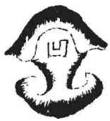</td><td>峽陰</td><td>曲峡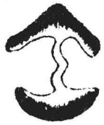</td><td>直峡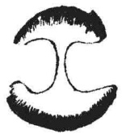</td><td>峽長</td></tr><tr><td>这是阳峡，凹地中生出过峡的龙脉，或是凹形的山脑、平坦的地方生出过峡的龙脉。</td><td>这是阴峡，它的龙脉从山顶有脊的部位生出，或是从凸起的地方生出。</td><td>这是曲峡，它的龙脉屈曲灵动，如同生蛇渡水，是极为贵重的格局。小型的曲峡尤其好。</td><td>过峡的龙脉要曲折，不宜笔直。笔直的是死脉，不吉利。中间有凸起泡状的，即使笔直也吉利。</td><td>这是长峡，太长就容易受风，应当周密地遮蔽防护。又忌讳直长。如果既长又直，就是死脉，不吉利。</td></tr><tr><td>峽短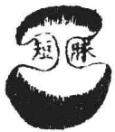</td><td>峽闕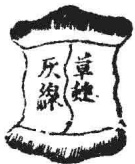</td><td>峽高</td><td>峽遠</td><td>峽田穿</td></tr><tr><td>这是短峡，峡短虽然不易受风，也需要断跌的部位清晰明确，如果模糊不清就不算过峡了。</td><td>阔峡的气容易涣散不聚，需要中间有如同草蛇灰线般细微高起的脊脉才好。两边的部位叫毡褥，也叫霞帔峡，主大富贵。</td><td>高峡，是山高大而断跌的部位还没到平地，大多是可供人行走的山岭。凡是高过的峡，需要护山周密。</td><td>大龙的过峡也有数十里平坦地经过的，或是数里塌陷地经过的，也叫远峡。需要两边有迎送护应的龙脉。这条龙距离很远，小龙不会有这样的峡。</td><td>穿田峡，需要两边都低，中央过脉的田地独自高起，这样分水才清晰明确。廖氏称这种格局为青苗中过骨，这种峡最吉利。</td></tr><tr><td>峽水渡</td><td colspan="4">渡水峡，需要水中有石梁，这种情况叫做崩洪脉。《葬书》说“脉遇到水就会停止”，这里说脉能渡水是为什么呢？大概是水不会隔断石脉，只会隔断土脉。邵雍说：“水就好比人的血液，石就好比人的骨头，土就好比人的肉。”所以血液在肉里运行，不在骨头里运行。血液用来滋养肉，肉用来养护骨头，以此构成人的身体，只有气是没有什么地方不能通达的。</td></tr><tr><td colspan="5">上面的九格过峡图，都是围绕脉来说的。而这些脉又需要有蜂腰鹤膝的形态才是好的。最后一格的石脉，还有术家所说的崩洪十格，都在后面附图说明。</td></tr></table>

查看对应原文

<!-- V3_FOLDBACK_BEGIN:book018-b000351-p000-cf7d085dfb -->

<table><tr><td rowspan=1 colspan=1>琰陽</td><td rowspan=1 colspan=1>峽陰</td><td rowspan=1 colspan=1>峡曲</td><td rowspan=1 colspan=1>峡直</td><td rowspan=1 colspan=1>峽長</td></tr><tr><td rowspan=1 colspan=1>此为阳峡，凹中出脉，或凹脑坦中出脉。</td><td rowspan=1 colspan=1>此为阴峡，其脉自顶有脊而出，或起突。</td><td rowspan=1 colspan=1>此为曲峡，其脉屈曲活动，如生蛇渡水，至贵。小者尤佳。</td><td rowspan=1 colspan=1>过峡之脉要曲，不宜直。直为死脉，不吉。中间有泡者，虽直亦吉。</td><td rowspan=1 colspan=1>此为长峡，太长则易受风，宜遮护周密。又忌直长。若长而直，则为死脉，不吉。</td></tr><tr><td rowspan=1 colspan=1>峽短</td><td rowspan=1 colspan=1>峽闕</td><td rowspan=1 colspan=1>峽高</td><td rowspan=1 colspan=1>峽遠</td><td rowspan=1 colspan=1>峽田穿</td></tr><tr><td rowspan=1 colspan=1>此为短峡，峡短虽不受风，亦要断跌明白，若模糊则非峡矣。</td><td rowspan=1 colspan=1>阔峡气散不聚，要中间有草蛇灰线、微高之脊则美。两边名毡褥，亦谓之霞帔峡，主大富贵。</td><td rowspan=1 colspan=1>高峡者，山大而断处未至平地也，多是人行之岭。凡高过之峡，要护山周密。</td><td rowspan=1 colspan=1>大龙峡亦有数十里坦过者，或数里塌过，亦曰远峡。要两边迎送护应。此龙去甚远，小龙无此峡。</td><td rowspan=1 colspan=1>穿田峡，要两边皆低，中央过脉之田独高，则分水明白。廖氏谓之青苗中过骨，此峡最吉。</td></tr><tr><td rowspan=1 colspan=1>峽水渡</td><td rowspan=1 colspan=4>渡水峡，要水中有石梁，谓之崩洪脉。《葬书》云“脉界水即止”。此谓渡水何也？盖水不界石脉，而界土脉。邵子曰：“水即人身之血，石即人身之骨，土即人身之肉。”故血行于肉，不行于骨。血以资肉，肉以养骨以成身。惟气则无往而不通者也。</td></tr><tr><td rowspan=1 colspan=5>上峡图九格，皆以脉言之也。而其脉又须有蜂腰鹤膝之形为美。末一格石脉，则有术家所谓崩洪十格，俱具图于后。</td></tr></table>

<!-- V3_FOLDBACK_END:book018-b000351-p000-cf7d085dfb -->

<!-- V3_SOURCE_ID:book018-b000352-p000-3ddfe92edd -->

绘图地理人须知

查看对应原文

<!-- V3_FOLDBACK_BEGIN:book018-b000352-p000-3ddfe92edd -->

绘 图 地 理 人 须 知

<!-- V3_FOLDBACK_END:book018-b000352-p000-3ddfe92edd -->

<!-- V3_SOURCE_ID:book018-b000353-p000-c0ecd3475a -->

### 蜂腰鹤膝图
第一格是蜂腰形态，配有对应图示，原文描述为“腰蜂者胺大前是小中提”，具体所指不详。第二格是鹤膝形态，配有对应图示，原文描述为“胚鶴者胧小前是大中缓”，具体所指不详。
凡是龙脉收束聚集成蜂腰、鹤膝的形态，此处气脉旺盛，结穴必定临近，杨筠松所说的“蜂腰鹤膝龙欲成”指的就是这种情况。所以只要见到这种形态，就知道龙脉即将形成结作，可以据此寻找穴场了。

### 十大崩洪脉图
1. **摸石崩洪**，配有对应图示：石梁散乱分布，像是手在水面上摸索捕捉的样子，就是这种形态。
2. **节目崩洪**，配有对应图示：石梁相互牵接连缀，像是瓜瓠浮在水中的样子，就是这种形态。
3. **马迹崩洪**，配有对应图示：石梁像是马的足迹露在水中的样子，就是这种形态。
4. **螺蚌崩洪**，配有对应图示：石梁像是螺蚌的形状浮在水中的样子，就是这种形态。
5. **交消崩洪**，配有对应图示：石梁天然生成像交角的形状，就是这种形态。
6. **之字崩洪**，配有对应图示：石梁曲折蜿蜒，像是“之”“玄”二字的形状浮在水中的样子，就是这种形态。
7. **洪也字崩洪**，配有对应图示：石梁回环抱合，像是“也”字的形状，就是这种形态。
8. **川字崩洪**，配有对应图示：石梁有三条并列，像是“川”字的形状，就是这种形态。
9. **十字崩洪**，配有对应图示：石梁纵横交错，像是“十”字的形状，就是这种形态。
10. **断续崩洪**，配有对应图示：石梁断开之后又重新接续起来，就是这种形态。

以上所说的十种崩洪，都是石梁承载气脉渡水的情况，它的形态有这十种标准样式。不过也很难用这些样式穷尽所有的相关形态，只要举出这些作为范例，能够触类旁通就可以了。所谓崩洪，是朋山共水的意思。廖氏所说的“朋山共水难寻脉，石上留真迹。唤作崩洪有十名，官贵此中生”指的就是这个。这种说法出自杨筠松。《三十六脉歌》记载：“崩洪之脉几多般，朋山共水实堪安。气逢水界谁能别，真龙偏向此中蟠。有人会得崩洪脉，腰悬金印入朝端。”这段话的本意只是说石脉渡过水面而已，后来因为“真龙偏向此中蟠”的句子，就错误地认为崩洪脉当中有穴，实在是很可笑。况且这种崩洪的名目，按照儒家循名求义的观点来讨论，也应当属于被排斥摒弃的范畴，为什么

> **释读存疑：** 腰蜂者胺大前是小中提；胚鶴者胧小前是大中缓；“腰蜂者胺大前是小中提”存在文字语序颠倒或讹误，具体含义无法确定；“胚鶴者胧小前是大中缓”存在文字语序颠倒或讹误，具体含义无法确定；部分崩洪脉名称存在传抄颠倒情况，具体定名存在歧义；1轮自动修复后核义模型仍建议修订，已保守记录。

查看对应原文

<!-- V3_FOLDBACK_BEGIN:book018-b000353-p000-c0ecd3475a -->

蜂腰鹤膝图
<table><tr><td rowspan=1 colspan=1>腰蜂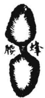者胺大前是小中提</td><td rowspan=1 colspan=2>胚鶴者胧小前是大中缓</td><td rowspan=1 colspan=4>凡龙脉束聚而成蜂腰鹤膝之形，其处气旺，结穴必近，杨筠松云“蜂腰鹤膝龙欲成”是也。故凡见此形，则知龙将结作，可以求索穴场矣。</td></tr><tr><td rowspan=1 colspan=7>十大崩洪脉图</td></tr><tr><td rowspan=1 colspan=2>洪崩石摸</td><td rowspan=1 colspan=2>洪崩目節</td><td rowspan=1 colspan=1>洪崩跡馬</td><td rowspan=1 colspan=1>洪崩虾辉</td><td rowspan=1 colspan=1>洪崩消交</td></tr><tr><td rowspan=1 colspan=2>石梁散乱，如手摸捉，在于水面者是也。</td><td rowspan=1 colspan=2>石梁相牵相连，如瓜瓠在于水中是也。</td><td rowspan=1 colspan=1>石梁如马足迹在于水中是也。</td><td rowspan=1 colspan=1>石梁如螺蚌之形在水是也。</td><td rowspan=1 colspan=1>石梁生来如交角之形是也。</td></tr><tr><td rowspan=1 colspan=2>洪崩字之</td><td rowspan=1 colspan=2>洪崩字也洪</td><td rowspan=1 colspan=1>崩字川洪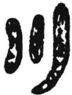</td><td rowspan=1 colspan=1>崩字十</td><td rowspan=1 colspan=1>洪崩續斷</td></tr><tr><td rowspan=1 colspan=2>石梁屈曲，如之玄字在水是也。</td><td rowspan=1 colspan=2>石梁回抱如也字形是也。</td><td rowspan=1 colspan=1>石梁三条如川字形是也。</td><td rowspan=1 colspan=1>石梁纵横如十字是也。</td><td rowspan=1 colspan=1>石梁断而复续是也。</td></tr><tr><td rowspan=1 colspan=7>上十大崩洪，乃石梁渡脉过水，其形有此十格。然亦难以此尽其形，举此为式，触类而长可也。盖崩洪者，朋山共水之义也。廖氏云“朋山共水难寻脉，石上留真迹。唤作崩洪有十名，官贵此中生”是也。其说出于杨筠松。《三十六脉歌》云：“崩洪之脉几多般，朋山共水实堪安。气逢水界谁能别，真龙偏向此中蟠。有人会得崩洪脉，腰悬金印入朝端。”其本旨则谓石脉之过水耳，后来因“真龙偏向此中蟠”之句，遂误谓脉中有穴，殊为可笑。矧此崩洪名目，以吾儒循名求义论之，亦当在摈斥之例，何</td></tr></table>

<!-- V3_FOLDBACK_END:book018-b000353-p000-c0ecd3475a -->

<!-- doc007 PDF 第 79 页：未引用图表已用原页保全；文字供检索，版式以原页图为准。 -->
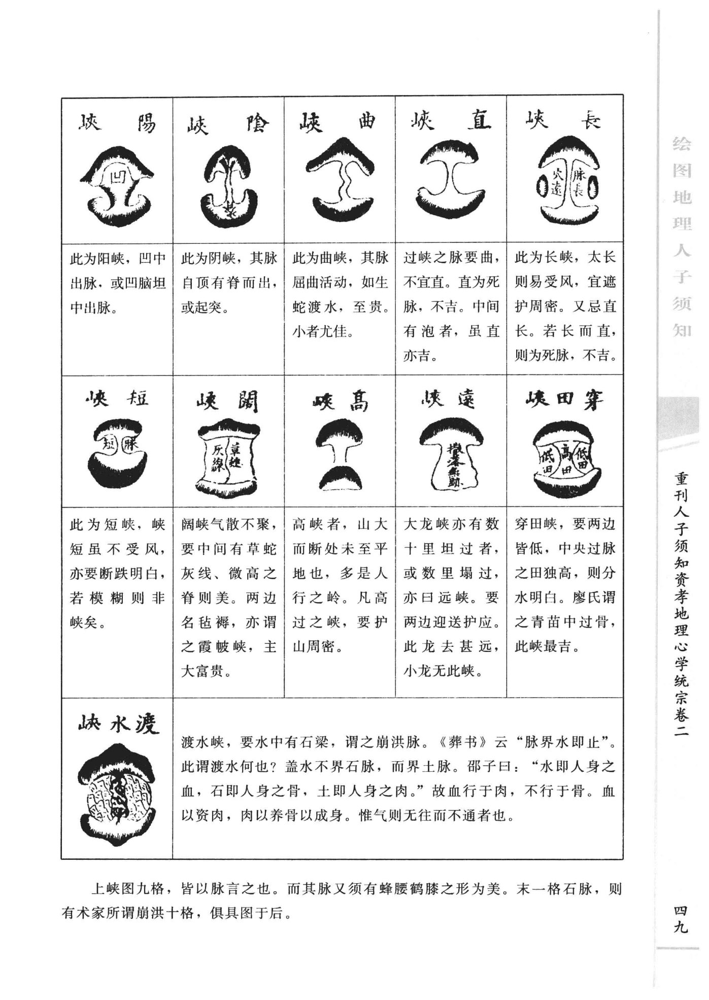

<!-- doc007 PDF 第 80 页：未引用图表已用原页保全；文字供检索，版式以原页图为准。 -->
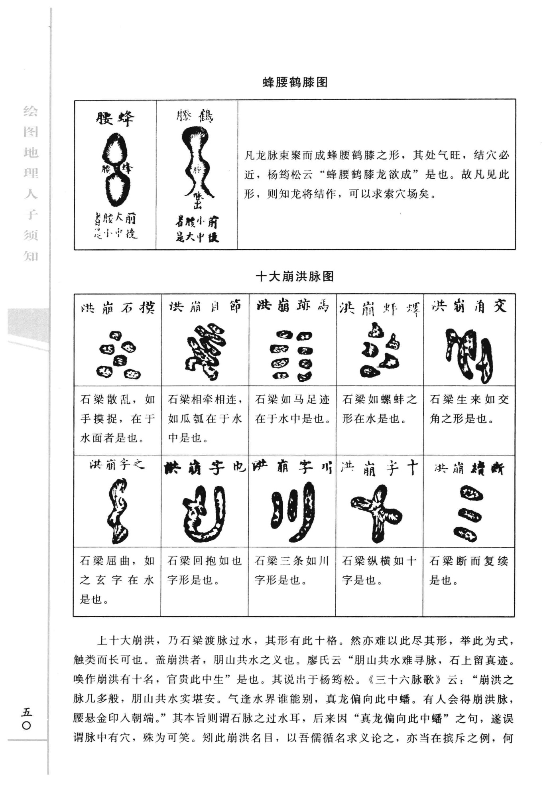

<!-- V3_SOURCE_ID:book018-b000356-p000-e778932d31 -->

也？山倾曰崩，水溃曰洪，乃恶名也。而术家乃为龙脉之美称，何其背戾之甚。故张子微谓此乃术家以此暗藏机幸，辟之而不道。予于此收之，亦姑从俗借名，以证龙脉之渡水云耳。

查看对应原文

<!-- V3_FOLDBACK_BEGIN:book018-b000356-p000-e778932d31 -->

也？山倾曰崩，水溃曰洪，乃恶名也。而术家乃为龙脉之美称，何其背戾之甚。故张子微谓此乃术家以此暗藏机幸，辟之而不道。予于此收之，亦姑从俗借名，以证龙脉之渡水云耳。

<!-- V3_FOLDBACK_END:book018-b000356-p000-e778932d31 -->

<!-- V3_SOURCE_ID:book018-b000357-p000-6d8092051a -->

◎按：十大崩洪，李淳风《小卷》无十字、断续二名，而有筋血、交剑，与杨公小异。

查看对应原文

<!-- V3_FOLDBACK_BEGIN:book018-b000357-p000-6d8092051a -->

◎按：十大崩洪，李淳风《小卷》无十字、断续二名，而有筋血、交剑，与杨公小异。

<!-- V3_FOLDBACK_END:book018-b000357-p000-6d8092051a -->

<!-- V3_SOURCE_ID:book018-b000358-p000-7c0df323b6 -->

以上所论过峡之脉，复有护峡之山图具于后。

查看对应原文

<!-- V3_FOLDBACK_BEGIN:book018-b000358-p000-7c0df323b6 -->

以上所论过峡之脉，复有护峡之山图具于后。

<!-- V3_FOLDBACK_END:book018-b000358-p000-7c0df323b6 -->

<!-- V3_SOURCE_ID:book018-b000359-p000-5ccac65f12 -->

## 护峡山格

查看对应原文

<!-- V3_FOLDBACK_BEGIN:book018-b000359-p000-5ccac65f12 -->

## 护峡山格

<!-- V3_FOLDBACK_END:book018-b000359-p000-5ccac65f12 -->

<!-- V3_SOURCE_ID:book018-b000360-p000-b039e668af -->

[迎送]凡脉离山而出，两臂有护从之山，谓之送脉出身，亦曰送峡。脉起顶而上，两臂有回转之山，谓之迎脉过峡，亦曰迎峡。

查看对应原文

<!-- V3_FOLDBACK_BEGIN:book018-b000360-p000-b039e668af -->

[迎送]凡脉离山而出，两臂有护从之山，谓之送脉出身，亦曰送峡。脉起顶而上，两臂有回转之山，谓之迎脉过峡，亦曰迎峡。

<!-- V3_FOLDBACK_END:book018-b000360-p000-b039e668af -->

<!-- V3_SOURCE_ID:book018-b000361-p000-f2d6a04270 -->

<table><tr><td rowspan=1 colspan=1></td><td rowspan=1 colspan=1>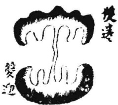</td><td rowspan=1 colspan=1></td></tr><tr><td rowspan=1 colspan=1>此单迎单送也</td><td rowspan=1 colspan=1>迎送多者曰双。此双迎双送，愈多愈好。大龙过峡，迎送有至数十重者，故以多为贵也。</td><td rowspan=1 colspan=1>此有送无迎也。</td></tr><tr><td rowspan=1 colspan=1></td><td rowspan=1 colspan=1></td><td rowspan=1 colspan=1></td></tr><tr><td rowspan=1 colspan=1>此有迎无送也。凡有迎无送，有送无迎，若周密护得峡过，不受风吹，亦贵。</td><td rowspan=1 colspan=1>此交互迎送也，也有吉有凶。</td><td rowspan=1 colspan=1>此亦交互迎送也，力量差胜。</td></tr></table>

查看对应原文

<!-- V3_FOLDBACK_BEGIN:book018-b000361-p000-f2d6a04270 -->

<table><tr><td rowspan=1 colspan=1></td><td rowspan=1 colspan=1></td><td rowspan=1 colspan=1></td></tr><tr><td rowspan=1 colspan=1>此单迎单送也</td><td rowspan=1 colspan=1>迎送多者曰双。此双迎双送，愈多愈好。大龙过峡，迎送有至数十重者，故以多为贵也。</td><td rowspan=1 colspan=1>此有送无迎也。</td></tr><tr><td rowspan=1 colspan=1></td><td rowspan=1 colspan=1></td><td rowspan=1 colspan=1></td></tr><tr><td rowspan=1 colspan=1>此有迎无送也。凡有迎无送，有送无迎，若周密护得峡过，不受风吹，亦贵。</td><td rowspan=1 colspan=1>此交互迎送也，也有吉有凶。</td><td rowspan=1 colspan=1>此亦交互迎送也，力量差胜。</td></tr></table>

<!-- V3_FOLDBACK_END:book018-b000361-p000-f2d6a04270 -->

<!-- V3_SOURCE_ID:book018-b000362-p000-678c9d95e3 -->

上迎送峡，其迎龙之枝虽是逆转迎峡，然不可认为逆龙。盖逆龙枝脚一一望后，而正身前去，挺然独出，故曰逆龙。此则惟是枝脚逆转一二山顾峡，其正龙则自向前顺去，随身枝脚尤多且长也。胡直云“一种逆龙是迎接，反手双双开两胁。接取龙来好处传，此是龙生好枝叶。逆龙虽逆亦无害，一种交加是护峡。此等皆为富贵龙，左右均平龙在中”是也。

查看对应原文

<!-- V3_FOLDBACK_BEGIN:book018-b000362-p000-678c9d95e3 -->

上迎送峡，其迎龙之枝虽是逆转迎峡，然不可认为逆龙。盖逆龙枝脚一一望后，而正身前去，挺然独出，故曰逆龙。此则惟是枝脚逆转一二山顾峡，其正龙则自向前顺去，随身枝脚尤多且长也。胡直云“一种逆龙是迎接，反手双双开两胁。接取龙来好处传，此是龙生好枝叶。逆龙虽逆亦无害，一种交加是护峡。此等皆为富贵龙，左右均平龙在中”是也。

<!-- V3_FOLDBACK_END:book018-b000362-p000-678c9d95e3 -->

<!-- V3_SOURCE_ID:book018-b000363-p000-dbef7e268c -->

「扛夹」凡脉从中过，两旁客山或本山特起，高卓相应者谓之扛。外山隔水远来护峡而相夹映者，谓之夹。凡扛、夹之山，最喜成形，如前所谓太阴、太阳、金箱、玉印、龟蛇、旗鼓之类，左右俱有极吉。若左右两峰高耸峙立，又名曰天弧、天角，《经》云“天弧天角龙欲渡。”

查看对应原文

<!-- V3_FOLDBACK_BEGIN:book018-b000363-p000-dbef7e268c -->

「扛夹」凡脉从中过，两旁客山或本山特起，高卓相应者谓之扛。外山隔水远来护峡而相夹映者，谓之夹。凡扛、夹之山，最喜成形，如前所谓太阴、太阳、金箱、玉印、龟蛇、旗鼓之类，左右俱有极吉。若左右两峰高耸峙立，又名曰天弧、天角，《经》云“天弧天角龙欲渡。”

<!-- V3_FOLDBACK_END:book018-b000363-p000-dbef7e268c -->

<!-- V3_SOURCE_ID:book018-b000364-p000-460afcfa8e -->

<table><tr><td>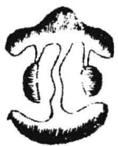</td><td></td><td>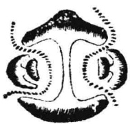</td><td></td></tr><tr><td>此本山扛峡，吉格。</td><td>此外山扛峡，吉格。</td><td>此外山隔水远来扛 峡，最吉格。</td><td>此不成格，非峡。</td></tr></table>

查看对应原文

<!-- V3_FOLDBACK_BEGIN:book018-b000364-p000-460afcfa8e -->

<table><tr><td></td><td></td><td></td><td></td></tr><tr><td>此本山扛峡，吉格。</td><td>此外山扛峡，吉格。</td><td>此外山隔水远来扛 峡，最吉格。</td><td>此不成格，非峡。</td></tr></table>

<!-- V3_FOLDBACK_END:book018-b000364-p000-460afcfa8e -->

<!-- V3_SOURCE_ID:book018-b000365-p000-ea2e2def82 -->

## 蔡西山先生峡格

查看对应原文

<!-- V3_FOLDBACK_BEGIN:book018-b000365-p000-ea2e2def82 -->

## 蔡西山先生峡格

<!-- V3_FOLDBACK_END:book018-b000365-p000-ea2e2def82 -->

<!-- V3_SOURCE_ID:book018-b000366-p000-16a11ec2d1 -->

双鱼峡：<table><tr><td>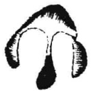</td><td>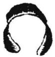</td><td>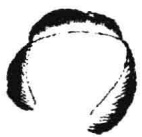</td><td>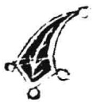</td></tr><tr><td>这种情况属于正出之峡，是吉利的格局。</td><td>这种情况属于偏出的脉，不是峡。</td><td>这种情况属于偏出的脉，不是峡，也被称为来去鱼，主凶险。</td><td></td></tr></table>

查看对应原文

<!-- V3_FOLDBACK_BEGIN:book018-b000366-p000-16a11ec2d1 -->

双鱼峡
<table><tr><td></td><td></td><td></td><td></td></tr><tr><td>如此乃为正出之峡， 吉格。</td><td>如此乃偏出脉，非 峡。</td><td>此偏出脉，非峡，亦 谓之来去鱼，主凶。</td><td></td></tr></table>

<!-- V3_FOLDBACK_END:book018-b000366-p000-16a11ec2d1 -->

<!-- V3_SOURCE_ID:book018-b000367-p000-c11926ece0 -->

垂珠峡：<table><tr><td rowspan=1 colspan=1></td><td rowspan=1 colspan=1>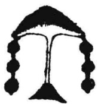</td><td rowspan=1 colspan=1></td><td rowspan=1 colspan=1></td><td rowspan=1 colspan=1>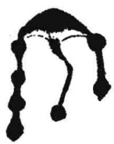</td></tr><tr><td rowspan=1 colspan=1>这种情况属于正出之峡，吉利。</td><td rowspan=1 colspan=1>这种情况也属于正出之峡，吉利。</td><td rowspan=1 colspan=1>这种情况属于偏出，不能算作峡，主凶险。</td><td rowspan=1 colspan=1>这种情况属于偏寒，不吉利，不能称为峡，左右两边情况相同。</td><td rowspan=1 colspan=1>这种情况虽然是峡，但也属于偏斜，主奸险。</td></tr><tr><td rowspan=1 colspan=5>一般来说，峡需要脉从中部生出，且两侧的护送山均匀。如果脉虽然从中部生出，但两侧护送山不均匀，或是一边有山一边没山，或是一边山长一边山短，或是一边山多一边山少，都按偏论处理，有吉有凶。</td></tr></table>

查看对应原文

<!-- V3_FOLDBACK_BEGIN:book018-b000367-p000-c11926ece0 -->

垂珠峡
<table><tr><td rowspan=1 colspan=1></td><td rowspan=1 colspan=1></td><td rowspan=1 colspan=1></td><td rowspan=1 colspan=1></td><td rowspan=1 colspan=1></td></tr><tr><td rowspan=1 colspan=1>如此乃为正出之峡，吉。</td><td rowspan=1 colspan=1>如此亦为正出之峡，吉。</td><td rowspan=1 colspan=1>如此乃为偏出，不得为峡，主凶。</td><td rowspan=1 colspan=1>如此则为偏寒，不吉，不可言峡。左右同。</td><td rowspan=1 colspan=1>如此虽是峡，亦系偏斜，主奸险。</td></tr><tr><td rowspan=1 colspan=5>大凡峡，欲其脉从中出，而两畔护送停均。如脉虽中出，而两畔护山不匀，或边有边无，边长边短，边多边少，皆同偏论，有吉有凶。</td></tr></table>

<!-- V3_FOLDBACK_END:book018-b000367-p000-c11926ece0 -->

<!-- V3_SOURCE_ID:book018-b000368-p000-2c1b334039 -->

## 莲化心峡

查看对应原文

<!-- V3_FOLDBACK_BEGIN:book018-b000368-p000-2c1b334039 -->

## 莲化心峡

<!-- V3_FOLDBACK_END:book018-b000368-p000-2c1b334039 -->

<!-- V3_SOURCE_ID:book018-b000369-p000-93099f2dfb -->

<table><tr><td>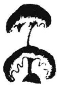</td><td>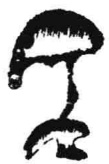</td><td>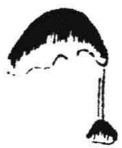</td><td></td></tr><tr><td>这样的是真正的莲花心峡，是最为贵重的。</td><td>这样的就是小偏峡，力量会轻减。</td><td>这样的完全是偏斜，不能称为峡，左右两边的情况相同。</td><td>这样的是真正的峡，属于极贵的格局。</td></tr><tr><td></td><td></td><td>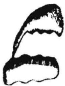</td><td>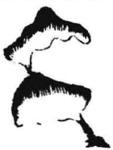</td></tr><tr><td>这样的也可以称为峡。</td><td>这样的也可以称为峡。</td><td>这样的偏向一侧，不能称为峡了。</td><td>这样的也不能称为峡，是无用的龙（风水中山脉、地势及气脉的来势和行度）罢了。</td></tr><tr><td colspan="4">迎送峡</td></tr><tr><td>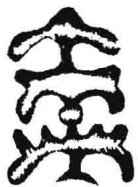</td><td></td><td></td><td></td></tr><tr><td>这样的就真正是有迎有送的峡，是至为贵重的峡。</td><td>这样的迎送情况更好，是真正的峡，至为贵重。</td><td>这样的也是真正的峡，能结出贵重的地。</td><td>这样的就是偏向一侧，不是峡。</td></tr><tr><td>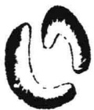</td><td>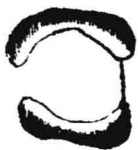</td><td></td><td></td></tr><tr><td>这样的是交互迎送，属半吉。</td><td>这样的完全是偏向一侧，大凶。</td><td>这样的极为偏枯，大凶。</td><td></td></tr></table>

查看对应原文

<!-- V3_FOLDBACK_BEGIN:book018-b000369-p000-93099f2dfb -->

<table><tr><td rowspan=1 colspan=1></td><td rowspan=1 colspan=1></td><td rowspan=1 colspan=1></td><td rowspan=1 colspan=1></td></tr><tr><td rowspan=1 colspan=1>如此真莲花心峡，最为至贵。</td><td rowspan=1 colspan=1>如此即小偏，力量轻减。</td><td rowspan=1 colspan=1>如此全是偏斜，不可言峡。左右同。</td><td rowspan=1 colspan=1>如此乃真峡，极贵格。</td></tr><tr><td rowspan=1 colspan=1></td><td rowspan=1 colspan=1></td><td rowspan=1 colspan=1></td><td rowspan=1 colspan=1></td></tr><tr><td rowspan=1 colspan=1>如此亦可言峡。</td><td rowspan=1 colspan=1>如此亦可言峡。</td><td rowspan=1 colspan=1>如此偏出，不可言峡矣。</td><td rowspan=1 colspan=1>如此亦不可言峡，无用之龙耳</td></tr><tr><td rowspan=1 colspan=4>迎送峡</td></tr><tr><td rowspan=1 colspan=1></td><td rowspan=1 colspan=1></td><td rowspan=1 colspan=1></td><td rowspan=1 colspan=1></td></tr><tr><td rowspan=1 colspan=1>如此则真为有迎有送，至贵之峡。</td><td rowspan=1 colspan=1>如此迎送尤佳，乃真峡也，至贵。</td><td rowspan=1 colspan=1>如此亦是真峡，结贵地。</td><td rowspan=1 colspan=1>如此即为偏出，非峡也。</td></tr><tr><td rowspan=1 colspan=1></td><td rowspan=1 colspan=1></td><td rowspan=1 colspan=1></td><td rowspan=1 colspan=1></td></tr><tr><td rowspan=1 colspan=1>如此乃为交互迎送，半吉。</td><td rowspan=1 colspan=1>如此全是偏出，大凶。</td><td rowspan=1 colspan=1>如此极为偏枯，大凶。</td><td rowspan=1 colspan=1></td></tr></table>

<!-- V3_FOLDBACK_END:book018-b000369-p000-93099f2dfb -->

<!-- V3_SOURCE_ID:book018-b000370-p000-59c7ec0b7a -->

此处为玉井栏峡相关内容，包含多幅图示及对应说明：第一行四列均为图示；第二行四列分别标注：这样的是真玉井栏峡格，吉利；这样的是名交互玉井栏，也吉利；这样的也是井栏迎送正格，吉利；这样的是名右旋井栏，也属于正格吉利，左旋的情况与此相同。第三行四列均为图示；第四行四列分别标注：这样的属于偏斜下品；这样的是名方旋井栏，也属于正格，吉利；这样的属于偏出凶脉；这样的是迎接井栏，也属于正格，吉利。接下来是方脉峡相关内容，第一行四列均为图示；第二行四列分别标注：这样的是脉从中间生出，称为正峡，吉利；这样的是偏出，不能称为峡，左右两侧的情况相同；这样的是从中间生出的正峡，吉利；这样的是偏出，不能称为峡，凶险。接下来是飞丝峡相关内容，第一行前三列为图示，第四列为空；第二行前三列分别标注：这只是飞丝脉，也是偏出，不吉利；这是偏出之脉，不能称为峡；飞丝虽从中间生出，但两旁不均匀，也不是峡，第四列为空。

查看对应原文

<!-- V3_FOLDBACK_BEGIN:book018-b000370-p000-59c7ec0b7a -->

玉井栏峡
<table><tr><td rowspan=1 colspan=1>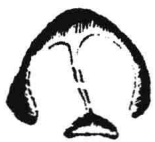</td><td rowspan=1 colspan=1>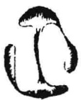</td><td rowspan=1 colspan=1></td><td rowspan=1 colspan=1></td></tr><tr><td rowspan=1 colspan=1>如此真玉井栏峡格，吉。</td><td rowspan=1 colspan=1>如此名交互玉井栏，亦吉。</td><td rowspan=1 colspan=1>如此亦是井栏迎送正格，吉。</td><td rowspan=1 colspan=1>如此名右旋井栏，亦为正格吉。左旋同。</td></tr><tr><td rowspan=1 colspan=1></td><td rowspan=1 colspan=1></td><td rowspan=1 colspan=1></td><td rowspan=1 colspan=1></td></tr><tr><td rowspan=1 colspan=1>如此系偏斜下品。</td><td rowspan=1 colspan=1>如此名方旋井栏，亦为正格，吉。</td><td rowspan=1 colspan=1>如此系偏出凶脉。</td><td rowspan=1 colspan=1>如此乃迎接井栏，亦为正格，吉。</td></tr><tr><td rowspan=1 colspan=4>方脉峡</td></tr><tr><td rowspan=1 colspan=1></td><td rowspan=1 colspan=1></td><td rowspan=1 colspan=1></td><td rowspan=1 colspan=1></td></tr><tr><td rowspan=1 colspan=1>如此乃脉从中出，谓之正峡，吉。</td><td rowspan=1 colspan=1>如此乃偏出，不可言峡，左右同。</td><td rowspan=1 colspan=1>如此乃中出正峡，吉。</td><td rowspan=1 colspan=1>如此为偏出，不得言峡，凶。</td></tr><tr><td rowspan=1 colspan=4>飞丝峡</td></tr><tr><td rowspan=1 colspan=1></td><td rowspan=1 colspan=1></td><td rowspan=1 colspan=1></td><td rowspan=1 colspan=1></td></tr><tr><td rowspan=1 colspan=1>此但为飞丝脉，亦是偏出，不吉。</td><td rowspan=1 colspan=1>此偏出之脉，不可言峡。</td><td rowspan=1 colspan=1>飞丝虽从中出，两旁不匀，亦不是峡。</td><td rowspan=1 colspan=1></td></tr></table>

<!-- V3_FOLDBACK_END:book018-b000370-p000-59c7ec0b7a -->

<!-- V3_SOURCE_ID:book018-b000371-p000-62677a30c4 -->

## 三台飞电峡
| 图片 | 说明 | 图片 | 说明 |
| ---- | ---- | ---- | ---- |
|  | 这是三台飞电峡，属于第一等的上等格局。 |  | 这是偏向一侧延伸的脉，不能称为峡。 |

## 金鱼佩峡
| 图片 | 图片 | 图片 |
| ---- | ---- | ---- |
|  |  |  |
| 这是正峡格局，主出一品侯王，极为显贵。 | 这是偏向一侧延伸的脉，不能称为峡，主大凶。 | 这也是从脉中生出的峡，主大凶。 |

## 流星峡
| 图片 | 图片 | 图片 | 图片 |
| ---- | ---- | ---- | ---- |
|  |  |  |  |
| 这是真正的流星峡，极为显贵，主出神童。 | 这是偏向一侧延伸的脉，不能称为峡，主大凶。 | 这也不能称为峡。 | 这是偏向一侧延伸的脉，不能称为峡。 |

## 钗股峡
| 图片 | 说明 | 图片 | 说明 |
| ---- | ---- | ---- | ---- |
|  | 这是正钗股峡的格局，吉利。 |  | 这是偏向一侧延伸的，不能称为峡。 |

查看对应原文

<!-- V3_FOLDBACK_BEGIN:book018-b000371-p000-62677a30c4 -->

三台飞电峡
<table><tr><td rowspan=1 colspan=1></td><td rowspan=1 colspan=2>此三台飞电之峡，第一上格。</td><td rowspan=1 colspan=2></td><td rowspan=1 colspan=1>此偏出之脉，非峡也。</td></tr><tr><td rowspan=1 colspan=6>金鱼佩峡</td></tr><tr><td rowspan=1 colspan=2></td><td rowspan=1 colspan=2></td><td rowspan=1 colspan=2></td></tr><tr><td rowspan=1 colspan=2>此为正峡，主一品侯王，极贵。</td><td rowspan=1 colspan=2>此为偏出之脉，不可言峡，大凶。</td><td rowspan=1 colspan=2>此亦是脉从中出之峡，大凶。</td></tr><tr><td rowspan=1 colspan=6>流星峡</td></tr><tr><td rowspan=1 colspan=1></td><td rowspan=1 colspan=2></td><td rowspan=1 colspan=2></td><td rowspan=1 colspan=1></td></tr><tr><td rowspan=1 colspan=1>此真流星峡也，至贵，主出神童。</td><td rowspan=1 colspan=2>此偏出之脉，不可言峡，大凶。</td><td rowspan=1 colspan=2>此亦不谓之峡。</td><td rowspan=1 colspan=1>此为偏出之脉，不谓之峡。</td></tr><tr><td rowspan=1 colspan=6>钗股峡</td></tr><tr><td rowspan=1 colspan=1></td><td rowspan=1 colspan=2>此乃正钗股峡格也，吉。</td><td rowspan=1 colspan=2></td><td rowspan=1 colspan=1>此为偏出，不可言峡。</td></tr></table>

<!-- V3_FOLDBACK_END:book018-b000371-p000-62677a30c4 -->

<!-- V3_SOURCE_ID:book018-b000372-p000-74262fcb0d -->

该表格内容如下：<table><tr><td colspan="5" rowspan="3">方城峡</td></tr><tr><td>C</td><td>C</td><td></td></tr><tr><td>这是玉带峡的正格，主贵。</td><td>这处偏得太厉害，怎么能称作峡呢？</td><td>这是偏脉，极凶。</td></tr><tr><td></td><td></td><td></td><td></td><td></td></tr><tr><td></td><td>这是正峡，最贵。</td><td>这也是正峡，最贵。</td><td>这是偏出之龙，不管在左还是在右，都凶。</td><td></td></tr><tr><td colspan="5">玉池峡</td></tr><tr><td></td><td></td><td></td><td></td><td rowspan="2"></td></tr><tr><td></td><td>这处池正当脉，至贵。</td><td>这脉从池中穿过，两边都是水，大贵。</td><td>这脉偏出，不能称作峡，凶。</td></tr><tr><td colspan="5">按：蔡西山说：“峡作为一种格局，名称不一，这里只选取那些形体与正峡相似、而脉从旁侧落下的情况辨明。大致来说，回环如峡，而脉从中间穿出，就是所说的峡。如果回环如峡，而脉从峡的两旁穿出，那就是偏行之龙，不能称作峡。如今世俗的看法，不管脉在中间还是在左右，只要形体像峡，就用峡来命名，多么荒谬啊！所说的峡，是指关峡这类的事物。峡用来遮蔽龙，关用来收束局。如今脉在旁侧还称作峡，那就是两旁只有一旁有遮蔽，另一旁孤露在风寒中，怎么能称作峡呢？所以记录各种格局来阐明其中的主旨。”</td></tr></table>

查看对应原文

<!-- V3_FOLDBACK_BEGIN:book018-b000372-p000-74262fcb0d -->

<table><tr><td rowspan=3 colspan=5>方城峡</td></tr><tr><td rowspan=1 colspan=1>C</td><td rowspan=1 colspan=1>C</td><td rowspan=1 colspan=1></td></tr><tr><td rowspan=1 colspan=1>此为玉带峡正格，主贵。</td><td rowspan=1 colspan=1>此偏尤甚，何可言峡？</td><td rowspan=1 colspan=1>此偏脉，极凶。</td></tr><tr><td></td><td rowspan=1 colspan=1></td><td rowspan=1 colspan=1></td><td rowspan=1 colspan=1></td><td></td></tr><tr><td></td><td rowspan=1 colspan=1>此为正峡，最贵。</td><td rowspan=1 colspan=1>此亦正峡，最贵。</td><td rowspan=1 colspan=1>此偏出之龙，不问左右，皆凶。</td><td></td></tr><tr><td rowspan=1 colspan=5>玉池峡</td></tr><tr><td></td><td rowspan=1 colspan=1></td><td rowspan=1 colspan=1></td><td rowspan=1 colspan=1></td><td rowspan=2 colspan=1></td></tr><tr><td></td><td rowspan=1 colspan=1>此池当脉，至贵。</td><td rowspan=1 colspan=1>此脉从池中过，两畔皆水，大贵。</td><td rowspan=1 colspan=1>此脉偏出，不可谓峡，凶。</td></tr><tr><td rowspan=1 colspan=5>按：蔡西山曰：“峡之为格，其名不一，兹但举其形体与正格相类，而脉从旁落者辨明之。大抵回环如峡，而脉从中出，则乃所谓峡也。若回环如峡，而脉从峡两旁出，则是偏行之龙，不可谓之峡。今世俗之见，不问脉在中及在左右，但形体如峡，即以峡名，何其谬耶！夫所谓峡者，谓关峡之类。峡以蔽龙，关以收局。今脉在旁而犹谓之峡，则是两旁惟一旁有蔽，一畔孤露风寒，何以谓之峡与？故录诸格以见其旨焉。”</td></tr></table>

<!-- V3_FOLDBACK_END:book018-b000372-p000-74262fcb0d -->

<!-- V3_SOURCE_ID:book018-b000373-p000-bc522abff4 -->

玉带峡

查看对应原文

<!-- V3_FOLDBACK_BEGIN:book018-b000373-p000-bc522abff4 -->

玉带峡

<!-- V3_FOLDBACK_END:book018-b000373-p000-bc522abff4 -->

<!-- doc007 PDF 第 82 页：未引用图表已用原页保全；文字供检索，版式以原页图为准。 -->

<!-- doc007 PDF 第 83 页：未引用图表已用原页保全；文字供检索，版式以原页图为准。 -->

<!-- doc007 PDF 第 84 页：未引用图表已用原页保全；文字供检索，版式以原页图为准。 -->

<!-- doc007 PDF 第 85 页：未引用图表已用原页保全；文字供检索，版式以原页图为准。 -->

<!-- doc007 PDF 第 86 页：未引用图表已用原页保全；文字供检索，版式以原页图为准。 -->

<!-- V3_SOURCE_ID:book018-b000380-p000-ff0057b6d7 -->

张子微《峡诀》①，对应表格内容如下：<table><tr><td>峡臺桩</td><td>峽星台</td><td>峽節憧</td><td>峽蓋華</td><td>峡德天</td></tr><tr><td>幕内美女照妆台，会出皇后、贵妃以及一品夫人。</td><td>会出台鼎大贵之人。</td><td>此处对应出神仙、清高贵人，为吉兆。</td><td>会出大贵之人。</td><td>此处对应至贵之人。</td></tr><tr><td>姨珠串</td><td>峽印玉箱金</td><td>峽溪雙</td><td>峽劍寶</td><td>峽龍雙</td></tr><tr><td>主大富贵，对应王侯地位。</td><td>会出内相、翰苑才名之人。</td><td>会出豪贵之人。</td><td>会出将入相之人，行事为先斩后奏。</td><td>对应至贵之人。</td></tr><tr><td>峽衛禁</td><td>浹壁丰</td><td>峽眠牛</td><td>峽峒石</td><td>峽蛇騖</td></tr><tr><td>会出禁穴</td><td>会出王侯</td><td>对应浊富之人</td><td>对应大贵大凶之人</td><td>会出妖术贼将等，为大凶。</td></tr><tr><td>峽茅亂</td><td>峽鱼立</td><td>峽魚貫</td><td>峽葉柳</td><td>峡屍重</td></tr><tr><td>会出草寇大盗，为极凶。</td><td>主贵</td><td>对应半吉</td><td>对应半吉</td><td>对应大凶</td></tr></table>

> **释读存疑：** ①此处为原书标注的注释序号，具体注释内容未在当前文本中呈现

查看对应原文

<!-- V3_FOLDBACK_BEGIN:book018-b000380-p000-ff0057b6d7 -->

张子微峡诀①
<table><tr><td rowspan=1 colspan=1>峡臺桩</td><td rowspan=1 colspan=1>峽星台</td><td rowspan=1 colspan=1>峡節憧</td><td rowspan=1 colspan=1>峽蓋華</td><td rowspan=1 colspan=1>峡德天</td></tr><tr><td rowspan=1 colspan=1>幕内美女照妆台，出皇后、贵妃及一品夫人。</td><td rowspan=1 colspan=1>出台鼎大贵。</td><td rowspan=1 colspan=1>此出神仙、清高贵人，吉。</td><td rowspan=1 colspan=1>出大贵。</td><td rowspan=1 colspan=1>此至贵</td></tr><tr><td rowspan=1 colspan=1>姨珠串</td><td rowspan=1 colspan=1>峽印玉箱金</td><td rowspan=1 colspan=1>峽溪雙</td><td rowspan=1 colspan=1>峽劍寶</td><td rowspan=1 colspan=1>峽龍雙</td></tr><tr><td rowspan=1 colspan=1>主大富贵，王侯地位。</td><td rowspan=1 colspan=1>出内相翰苑才名。</td><td rowspan=1 colspan=1>出豪贵。</td><td rowspan=1 colspan=1>出将入相，先斩后奏。</td><td rowspan=1 colspan=1>至贵。</td></tr><tr><td rowspan=1 colspan=1>峽衛禁</td><td rowspan=1 colspan=1>浹壁丰</td><td rowspan=1 colspan=1>峽眠牛</td><td rowspan=1 colspan=1>峽峒石</td><td rowspan=1 colspan=1>峽蛇騖</td></tr><tr><td rowspan=1 colspan=1>出禁穴</td><td rowspan=1 colspan=1>出王侯</td><td rowspan=1 colspan=1>浊富</td><td rowspan=1 colspan=1>大贵大凶</td><td rowspan=1 colspan=1>出妖术贼将等，大凶。</td></tr><tr><td rowspan=1 colspan=1>峡茅亂</td><td rowspan=1 colspan=1>峡鱼立</td><td rowspan=1 colspan=1>峽魚貫</td><td rowspan=1 colspan=1>峽葉柳</td><td rowspan=1 colspan=1>峡屍重</td></tr><tr><td rowspan=1 colspan=1>出草寇大盗，极凶。</td><td rowspan=1 colspan=1>主贵</td><td rowspan=1 colspan=1>半吉</td><td rowspan=1 colspan=1>半吉</td><td rowspan=1 colspan=1>大凶</td></tr></table>

<!-- V3_FOLDBACK_END:book018-b000380-p000-ff0057b6d7 -->

<!-- V3_SOURCE_ID:book018-b000381-p000-727939fb9e -->

以上是张子微《峡诀》中二十种格的内容，都是以左右护卫峡的形状吉凶，来判定峡的好坏。以上的峡图，只是作为范例而已。山形的变化，难道仅止于此吗？聪慧之人应当观察其性情的真实状态，触类旁通即可。蔡氏关于龙脉的论述，本就有偏中的正、正中的偏，有看似偏实则正、看似正实则偏的情况。

查看对应原文

<!-- V3_FOLDBACK_BEGIN:book018-b000381-p000-727939fb9e -->

上张子微《峡诀》二十格，皆以左右护峡之形状吉凶，定峡之美恶者也。  
以上峡图，载为式耳。山形变化，岂止于斯？智者察其情性之真，触类而长之可也。夫蔡氏之论龙脉者，固有偏中之正，正中之偏，有似偏而实正，似正而实偏。

<!-- V3_FOLDBACK_END:book018-b000381-p000-727939fb9e -->

<!-- doc007 PDF 第 87 页：未引用图表已用原页保全；文字供检索，版式以原页图为准。 -->

<!-- V3_SOURCE_ID:book018-b000383-p000-d6c9464c09 -->

有正处出脉而偏处落脉的，有偏处出脉而正处落脉的，有前期偏而后期变为正的，有前期正而后期变为偏的。有脉虽偏在一边，但外围的山照应得十分贴切，不至于被风吹的。有星顶在左边，而脉却从右边生出的。有星体偏在右边，而左边的枝脚反而更多的。有双脉相合的，有三脉五脉隐秘怪异难以明辨的，有石脉奇异以及闪迹偷踪、偏正难辨的，有细微到无形的，这些难道是图册所能完全涵盖的吗？张子微关于护山的论述，存在不切实际的弊端。比如所说的玄鱼、圭璧应在两旁为吉，可如果龙脉偏枯、气脉衰弱，难道能因为圭璧就称其为吉吗？应当以蔡氏的论述为主，再结合张子微的说法即可。大体上山形的微妙之处无穷无尽，龙脉的变化也各不相同，可以通过道理来推究，难以用固定的形态来判定。本就有看似吉实则凶、看似凶实则吉的情况，有半吉半凶以及可吉可凶的情况，有先吉后凶、先凶后吉的情况。毫厘之间，关乎祸福，难道是按图索骥之人所能窥测的吗？要将其神妙地运用，全在于人自身。

查看对应原文

<!-- V3_FOLDBACK_BEGIN:book018-b000383-p000-d6c9464c09 -->

有正出而偏落，有偏出而正落，有前偏而后变于正者，前正而后变于偏者。有脉虽偏于一边，而外山照应亲切，不至风吹者。有星顶正于左边，而脉则出于右畔者。有星体偏于右边，而左边枝脚反多者。有双脉相合者，有三脉五脉隐怪难明者，有石脉奇异及闪迹偷踪偏正难辨者，有微而至于无形者，岂图之所能尽哉！其张子微之论护山者，则有不切之弊。如所谓玄鱼、圭璧之吉应于两旁，而或龙脉偏枯死弱，岂可以圭璧而谓之吉哉！盖必以蔡氏为主，而子微之说兼之可也。大抵山形之微妙无穷，龙脉之变化不一，可以理推，难以形定。固有似吉而凶，似凶而吉者，有半吉半凶及可吉可凶者，有先吉后凶，有先凶后吉者。毫厘之间，祸福所系，岂按图索骥者可窥测哉！神而明之，存乎其人。

<!-- V3_FOLDBACK_END:book018-b000383-p000-d6c9464c09 -->

<!-- V3_SOURCE_ID:book018-b000384-p000-485f8a569f -->

## 论龙枝脚桡棹

查看对应原文

<!-- V3_FOLDBACK_BEGIN:book018-b000384-p000-485f8a569f -->

## 论龙枝脚桡棹

<!-- V3_FOLDBACK_END:book018-b000384-p000-485f8a569f -->

<!-- V3_SOURCE_ID:book018-b000385-p000-14edd00df9 -->

龙有贵贱美恶的不同，观察它的枝脚桡棹就能看出来。枝脚桡棹是龙的分支气脉，其形态各随类别而相应。所以长远的龙，它的枝脚桡棹也长远；短小的龙，它的枝脚桡棹也短小。吉龙，它生出的枝脚也会形成星辰之形，带有贵气；凶龙，它显现出的枝脚也必然丑陋鄙陋，类同凶形。这是因为龙气的吉凶不同，所以会在枝脚桡棹间显露出来，美恶的情状自然无法掩盖。姑且就容易观察的情况来论述，比如枝脚的山广袤起伏，繁衍簇拥，或像仓像库，像剑像印，像旗像鼓，或形成天乙、太乙之形侍立在两旁，或形成御屏、展帐之形盖在后方，或带有金箱玉印，或带有简笏牙刀，或结成天关地轴，或像武将文官，或类同天马贵人，或类同龟蛇狮象，或类同玉带金章，或像玎珰珂佩，或挺拔如文笔，或连接如串珠，或圆如覆釜倾钟，或方若列屏贮柜，或森然如排衙唱喏，或簇拥如队仗仪从，或繁多如子孙丁壮，或密集如奴仆畜养，云从雾集，侍卫森严，护卫着自身，不敢去往别处，这些都是吉气显现的情况。《明山宝鉴》说：“天以太乙者，富贵之本原；天禄天马者，富贵之任用；文官武库者，富贵之应验；左辅右弼者，富贵之维持；男仓女库者，富贵之设施。”廖氏说：“惟有本身枝脚重，队仗真得用。”大凡好的砂，排列在前方的是客山，众人都能看到。而在本身枝脚的，才是自家之物，是自己受用贴切的。所以傅伯通说：“不贵其见而贵其不见”。廖氏说：“谁知不见乃为奇，福应没差移。”如果龙没有枝脚桡棹，就称之为“奴”；虽有枝脚，但不挺拔卓立的，就称之为“弱”；散漫萎靡没有收拾的，就称之为“虚”；反背无情不顾自身的，就称之为“逆”；凶恶尖利反射自身的，就称之为“杀”；拖拽太重奔走东西的，就称之为“劫”；以及有枝脚不均，或边有边无、边长边短、边顺边逆、边美边恶的，就称之为“病”。又或两旁垂落，如抛枪插竹、卧尸提箩，如绳如刀，如斩指断头，如茅叶之乱，死蛇之靡，灰囊投算、鹅头鸭颈，种种不吉之形，都是凶气显现的情况。像这样的龙神，即便有形穴，也都是不吉的。如果误下穴，会导致长期患病痨瘵而枉死少丁，或瘟癀灾火而无法援救，或官讼连年而田产退尽，或淫乱风声而败坏人伦，也都会各自对应其类别而应验。所以桡棹枝脚是龙身显露吉凶的凭证，难道不是这样吗？相关图册附在后面。

查看对应原文

<!-- V3_FOLDBACK_BEGIN:book018-b000385-p000-14edd00df9 -->

龙有贵贱美恶之不同，观其枝脚桡棹而可见。盖枝脚桡棹，龙之分气也，其形体各以类从。故龙之长远者，其枝脚桡棹亦长远；龙之短小者，其枝脚桡棹亦短小。龙之吉者，其发为枝脚亦起星辰，带贵气；龙之凶者，其见于枝脚亦必恶陋，类凶形。是盖龙气吉凶不同，故进露发泄于枝脚桡棹间，美恶情状亦自不可掩耳。姑就易见者论之，如枝脚之山广袤起伏，蕃衍拥从，或如仓如库，如剑如印，如旗如鼓，或成天乙、太乙而侍立两边，或成御屏、展帐而盖乐于后，或带金箱玉印，或带简笏牙刀，或结天关地轴，或如武将文官，或类天马贵人，或类龟蛇狮象，或如玉带金章，或如玎珰珂佩，或拔若文笔，或连如串珠，或圆如覆釜倾钟，或方若列屏贮柜，或森若排衙唱喏，或拥如队仗仪从，或济济如子孙丁壮之繁，或簇簇如奴仆畜养之众，云从雾集，侍卫森严，护定我身，不敢他往，此皆吉气之发见者也。《明山宝鉴》云：“天以太乙者，富贵之本原；天禄天马者，富贵之任用；文官武库者，富贵之应验；左辅右弼者，富贵之维持；男仓女库者，富贵之设施。”廖氏云：“惟有本身枝脚重，队仗真得用。”大凡好砂，列于前者是客山，众人所共。其在本身枝脚者，乃自家之物，一己之受用亲切者也。故傅伯通云：“不贵其见而贵其不见”。廖氏云：“谁知不见乃为奇，福应没差移。”其或龙无枝脚桡棹者，谓之奴；虽有枝脚，不踊跃拔卓者，谓之弱；散漫委靡而无收拾者，谓之虚；反背无情而不顾本身者，谓之逆；凶恶尖利而反射本身者，谓之杀；拖拽太重而奔走东西者，谓之劫；及有枝脚不均，或边有边无，边长边短，边顺边逆，边美边恶者，谓之病。又或两旁垂落，如抛枪插竹、卧尸提箩，如绳如刀，如斩指断头，如茅叶之乱，死蛇之靡，灰囊投算、鹅头鸭颈，种种不吉之形，皆凶气之发见者也。似此龙神，纵有形穴，皆为不吉。若误下之，主长病痨瘵而枉死少丁，或瘟癀灾火而莫可援救，或官讼连年而田产退尽，或淫乱风声而败坏人伦，亦各以其类而应也。故桡棹枝脚为龙身发泄吉凶之验，讵不信夫！具图于后。

<!-- V3_FOLDBACK_END:book018-b000385-p000-14edd00df9 -->

<!-- V3_SOURCE_ID:book018-b000386-p000-7659c4a964 -->

<table><tr><td rowspan="2">以上是龙身枝脚间所带各种贵格的大致情况。傅国师说：“凡后龙节节枝脚垂落处，要起星辰，成形像，如天马、仓库、交床、旌鼓、剑印、展帐、列屏、天乙、太乙、文官、武将等件，而顺护龙身，前去必结大地。”《一粒粟》中“不贵其见而贵其不见”的说法，就是指这种情况。天乙、太乙主位居台阁，日月、辅弼主位至公孤，玉佩、文武主王侯极品，男仓、女库主人财富盛，展旗、顿戟主威武，左右侍从主尊荣，旗旄、诰轴、御屏、锦帐、马旗、相台主出将入相，印笏主神童状元。 以上是龙身枝脚所带各种凶格的大致情况。《快捷方式》说：“凡后龙枝脚节节垂落处，或尖利带杀，或瘦弱崚嶒，或臃肿丑恶，反背走撺，或拖拽太重，或大小无伦，或长硬如枪，或细绕如索，或如重尸，或如断头，或如烟包，或如投算，种种丑形，则为凶恶，纵有形穴，亦不可下。</td><td>龙身枝脚所带诸贵式图 </td></tr><tr><td>龙身枝脚所带诸凶式图 </td></tr><tr><td rowspan="2">以上是回龙顾祖之地，本身秀气显露于前方，作为朝对。《经》中“未作穴时先作朝”就是这个意思。前文所说“不贵其见而贵其不见”，如果是这种情况，显露又有什么害处呢？大体上贵在灵活变通，不要拘泥于陈言即可。以上所论龙身枝脚的吉凶大概，都是就垂落之形而言，尚未涉及自身发出的均匀、长短、有无等贴切情况。一并叙述于后。</td><td>龙身枝脚所带诸贵朝对式图 </td></tr></table>

查看对应原文

<!-- V3_FOLDBACK_BEGIN:book018-b000386-p000-7659c4a964 -->

<table><tr><td rowspan="2">右龙身枝脚间所带诸贵格之略也。傅国师云： “凡后龙节节枝脚垂落处，要起星辰，成形像，如 天马、仓库、交床、旌鼓、剑印、展帐、列屏、 天乙、太乙、文官、武将等件，而顺护龙身，前 去必结大地。”《一粒粟》云“不贵其见而贵其不 见”者，乃此谓矣。天乙、太乙主位居台阁，日 月、辅弼主位至公孤，玉佩、文武主王侯极品， 男仓、女库主人财富盛，展旗、顿戟主威武，左 右侍从主尊荣，旗旄、诰轴、御屏、锦帐、马旗、 相台主出将入相，印笏主神童状元。 右龙身枝脚所带诸凶之大略也。《快捷方式》 云：“凡后龙枝脚节节垂落处，或尖利带杀，或瘦 弱崚嶒，或臃肿丑恶，反背走撺，或拖拽太重， 或大小无伦，或长硬如枪，或细绕如索，或如重 尸，或如断头，或如烟包，或如投算，种种丑形， 则为凶恶，纵有形穴，亦不可下。</td><td>式圖貴諸帶腳枝身龍 </td></tr><tr><td>式圆凶諸帶脚枝身龍 </td></tr><tr><td rowspan="2">右回龙顾祖之地，本身秀气呈露于前，作我 朝对。《经》云“未作穴时先作朝”是也。前谓 “不贵其见而贵其不见”，若此者，见又何害？大 抵贵通活变，莫泥陈言可也。 以上所论龙身枝脚吉凶大概，皆以垂落之形 言之，未及自身发出均匀、长短、有无之亲切也。 并述于后。</td><td>圖對朝作格貴諸帶身龍</td></tr><tr><td></td></tr></table>

<!-- V3_FOLDBACK_END:book018-b000386-p000-7659c4a964 -->

<!-- V3_SOURCE_ID:book018-b000387-p000-b4962fda43 -->

枝脚匀均对格图

查看对应原文

<!-- V3_FOLDBACK_BEGIN:book018-b000387-p000-b4962fda43 -->

圖之勻均節對腳枝

<!-- V3_FOLDBACK_END:book018-b000387-p000-b4962fda43 -->

<!-- doc007 PDF 第 89 页：未引用图表已用原页保全；文字供检索，版式以原页图为准。 -->

<!-- V3_SOURCE_ID:book018-b000390-p000-196362d2b0 -->

## 格龍枝桐梧名 — 格龙枝桐梧名

查看对应原文

<!-- V3_FOLDBACK_BEGIN:book018-b000390-p000-196362d2b0 -->

## 格龍枝桐梧名

<!-- V3_FOLDBACK_END:book018-b000390-p000-196362d2b0 -->

<!-- V3_SOURCE_ID:book018-b000391-p000-13fb993b8b -->

文中提到“穿心而脉不对”，以及枝脚的长短相关内容，相关表述具体含义不详。

> **释读存疑：** “穿心而脉不对”的具体所指无法确定；原文对枝脚长短的描述倾向未明确

查看对应原文

<!-- V3_FOLDBACK_BEGIN:book018-b000391-p000-13fb993b8b -->

穿心 而脉 不對 長短 枝脚

<!-- V3_FOLDBACK_END:book018-b000391-p000-13fb993b8b -->

<!-- V3_SOURCE_ID:book018-b000393-p000-c69a842487 -->

## 之 傳均 交互 有無 校腳

> **释读存疑：** “傳均”“校腳”的具体含义无法确定，暂保留原文表述

查看对应原文

<!-- V3_FOLDBACK_BEGIN:book018-b000393-p000-c69a842487 -->

## 之 傳均 交互 有無 校腳

<!-- V3_FOLDBACK_END:book018-b000393-p000-c69a842487 -->

<!-- V3_SOURCE_ID:book018-b000395-p000-291dbfc919 -->

左侧龙的枝脚对节均匀的格局，极为贵重。龙的枝脚，贵在按对节的形式生出，两侧均匀，枝脚的有无、长短、大小都相同，正脉居中透出，才是上等格局，风水业内将这种格局命名为梧桐枝。张子微所说的“停均惟有梧桐枝，双送双迎两平势。对节分生作穿心，祖宗儿子都相类”，指的就是这种情况。蔡西山认为，龙的枝脚之所以以对生为贵，像梧桐枝这样的格局属于龙格中第一等贵重的，其中的道理很容易理解。如今不管是名贵花卉还是普通树木，都是枝干对生的品种更为贵重。凡是野生的草木花卉，如果是按照对节的间隔生枝长叶的，都可以入药，用来救治疾病。从这点就能看出，天地之间凡是对生的事物，都承受了天地的灵气。人的手足筋骨，鸟兽的脚和翅膀，都是对生的。还有药材里的木瓜、豆蔻、缩砂、大黄、黄连、黄芩等，都不是对生的，但却有独特的功效，终究和普通的草不一样。形态奇特的龙也是这样。所以走势之玄屈曲，以及形态特地高耸挺拔的龙格，又都不能用穿心的标准来评判。这一点只有灵活变通、学识过人的人，才能够和他谈论其中的道理。

查看对应原文

<!-- V3_FOLDBACK_BEGIN:book018-b000395-p000-291dbfc919 -->

左龙身枝脚对节均匀之格，至贵。盖龙身枝脚，贵其对节生出，两边均匀，有无、长短、大小相同，正脉中出，乃为上格。术家名曰梧桐枝。张子微曰“停均惟有梧桐枝，双送双迎两平势。对节分生作穿心，祖宗儿子都相类”是也。蔡西山云：“龙之所以贵其枝脚对生，如梧桐枝为龙中第一贵者，其理易见。今不问名花卉木，对生为贵。凡野生草木花卉，若对节间生枝发叶者，皆可为医药，用以拯疾。此可见天地间凡对生者，皆受天地之灵气。人之手足筋骨，鸟兽之足翼，皆对生者也。其有药中木瓜、豆蔻、缩砂、大黄、黄连、黄芩等，皆不对生，然却有奇处，终与凡草有异。龙之奇者亦然。故之玄屈曲，与特地耸拔，又皆不可以穿心论。此惟圆机通变，知识过人者可与语此。”

<!-- V3_FOLDBACK_END:book018-b000395-p000-291dbfc919 -->

<!-- V3_SOURCE_ID:book018-b000396-p000-7cd21456db -->

我按：蔡西山的这段论述精当明切，论龙的枝脚之妙，已经领会了大半。

查看对应原文

<!-- V3_FOLDBACK_BEGIN:book018-b000396-p000-7cd21456db -->

余按：西山此论精当明切，论龙枝脚之妙思过半矣。

<!-- V3_FOLDBACK_END:book018-b000396-p000-7cd21456db -->

<!-- V3_SOURCE_ID:book018-b000397-p000-03d23253ca -->

左侧龙的枝脚桡棹虽然长短不对，但交互分布均匀，气脉从中间穿过，风水师将其命名为芍药枝格。张子微说：“一等名为芍药枝，左右相生亦相似。分处光圆有枝叶，交互亦有停均理”，讲的就是这种情况。我认为这种龙格的枝脚虽然长短不同，但左侧的枝脚若前一节较长，后一节必然较短；右侧的枝脚若前一节较短，后一节必然较长。两者相互对应，却有均匀的道理。况且每一节的正脉都从中间穿出，即使左右枝脚长短不齐，也不妨碍它成为贵龙。

查看对应原文

<!-- V3_FOLDBACK_BEGIN:book018-b000397-p000-03d23253ca -->

左龙身枝脚桡棹虽长短不对，而交互停均，脉却穿心，术家名曰芍药枝格也。张子微云“一等名为芍药枝，左右相生亦相似。分处光圆有枝叶，交互亦有停均理”是矣。愚谓此龙格枝脚虽长短不同，然左股或先一节长，必后一节短；右股虽先一节短，必后一节长。两相抵对，却有停均之理。况节节正脉穿心，虽左右长短不齐，不害其为贵龙也。

<!-- V3_FOLDBACK_END:book018-b000397-p000-03d23253ca -->

<!-- V3_SOURCE_ID:book018-b000398-p000-4004bbff24 -->

左侧图中龙的枝脚虽然不对节，但左右交互分布均匀，风水师将其命名为蒹葭叶。张子微说：“左有右无过一节，右有左无本非异。此名原是蒹葭样，但要星辰得地位。”我按：这种格局与梧桐枝的对节力量差异很大，和芍药枝颇为相似，它的枝脚也是来去开枝，只是枝末多生丫杈，带力稍重。这种蒹葭叶的枝末没有丫杈，所以力量较轻。然而力量虽有不同，融结的道理却没有差别，怎能因为力量轻就舍弃它呢？

查看对应原文

<!-- V3_FOLDBACK_BEGIN:book018-b000398-p000-4004bbff24 -->

左图龙身枝脚虽不对节，而左右交互停均，术家名曰蒹葭叶。子微云：“左有右无过一节，右有左无本非异。此名原是蒹葭样，但要星辰得地位。”愚按：此与梧桐枝对节力量殊异，而与芍药枝颇同，其枝叶亦是来去开枝，但枝末多生丫丫，带力差重者也。此蒹葭叶枝末无丫，故力轻耳。然力量虽有不同，融结本无二理，乌可以其力轻而弃之？

<!-- V3_FOLDBACK_END:book018-b000398-p000-4004bbff24 -->

<!-- V3_SOURCE_ID:book018-b000399-p000-5c576dfc7d -->

<table><tr><td rowspan="2">右侧龙的一侧有枝脚且较长，另一侧只有少量枝脚的形态，风水业内将其命名为杨柳枝。张子微说：“又有偏生杨柳枝，边有边无极乖异。”又认为：“如果有合格的形穴，缠送山周密，也可以下葬。”我认为这类龙，公位分布不均，对应一房的人富足多子，对应另一房的人贫寒残疾甚至绝后，偏枯的情况太过严重，就算有合格的形穴，也不可以下葬。公位的说法虽然不必太过拘泥，但像这样的情况，考虑到对子孙利害影响重大，也应当审慎选择。右侧龙的一侧有枝脚，另一侧完全没有枝脚，这属于奴龙，不会结穴。有枝脚的一侧是山面，用来拱顾主山，没有枝脚的一侧就是山背。张子微认为这种格局符合柳星的要求，也能出贵人，但公位偏枯。我认为这类龙是奴仆性质的山，绝对没有融结的道理。就算符合柳星要求，有合格的形穴，也应当舍弃，不能下葬。张子微或许有他自己的见地，但我不敢附和这种说法。大体来说，龙的枝脚，以均匀为优。就像人的手脚，鸟兽的翅膀和脚，缺了一边就不能飞行奔走，不至于成为废用的情况很少。这是事理的必然，不需要等到有智慧的人指出才能明白。风水的道理和万物的常理是相通的，怎么能认为二者有差异呢！</td><td>枝枯脚之图 右侧枝脚仿照此样式</td></tr><tr><td>脚偏全枝之图 </td></tr><tr><td rowspan="2">右侧龙的枝脚一边长一边短，本来就不均匀。但每一节都是从中透出，短枝的一侧又有一枝大枝缠护送到尽头，也属于贵格。风水业内将其称为卷帘殿试格。张子微所说的“却有偏生极贵龙，名为卷帘登殿试，不问偏斜，黄甲及第”，指的就是这种格局。</td><td>枝脚长短不均之图</td></tr><tr><td></td></tr></table>

> **释读存疑：** “之编枝 圖枯腳”的具体图名含义暂无法完全确定，按原文顺序调整为通顺表述

查看对应原文

<!-- V3_FOLDBACK_BEGIN:book018-b000399-p000-5c576dfc7d -->

<table><tr><td rowspan="2">右龙一边有枝脚而长，一边微有枝脚之 状，术家名曰杨柳枝。子微：“又有偏生杨柳 枝，边有边无极乖异。”又谓：“若有形穴，缠 送山周密，亦可下。”愚谓此等龙，公位不均， 一位富足多子，一位贫寒废疾绝嗣，偏枯太 甚，纵有形穴，亦不可下。公位虽不必泥，然 若此者，计子孙利害之重，亦当审择可也。 右龙一边有枝脚，一边全无枝脚，乃是奴 龙，不结地也。其有脚边乃为山面，以顾乎 主，无脚边乃为山背耳。张子微谓此格合柳星 亦能出贵，但公位偏枯。愚谓此等龙是奴仆之 山，决无融结道理。虽合柳星，有形穴，亦当 弃置，不可下也。子微虽或有见，予不敢附和 耳。大抵龙之枝脚，贵于均匀为美。如人手 足，如鸟兽之翼脚，缺一边则不能飞走，其不 至于废弃也寡矣。此理势之必然，不待智者而 后知也。地理之与物理，相为流通者也，奚可 以差殊观哉！</td><td>之编枝 圖枯腳 OC 右枝脚倣此式</td></tr><tr><td>之全枝 圖偏腳 </td></tr><tr><td rowspan="2">右龙枝脚一边长一边短，本自不均。却是 节节中出，其枝短一旁又有一大枝缠送到头， 亦为贵格。术家谓之卷帘殿试格。张子微云 “却有偏生极贵龙，名为卷帘登殿试，不问偏 斜，黄甲及第”是也。</td><td>圆之均不短長脚枝</td></tr><tr><td></td></tr></table>

<!-- V3_FOLDBACK_END:book018-b000399-p000-5c576dfc7d -->

<!-- V3_SOURCE_ID:book018-b000400-p000-9642272744 -->

<table><tr><td>枝脚长短不均之图  枝脚美恶不均之图</td></tr><tr><td>文中提及“王龍姓”，具体所指不详 </td></tr><tr><td></td></tr><tr><td>无枝脚之图 </td></tr></table>

> **释读存疑：** “王龍姓”的具体含义无法确定

查看对应原文

<!-- V3_FOLDBACK_BEGIN:book018-b000400-p000-9642272744 -->

<table><tr><td>圗之均不短長脚枝  圖均不惡美脚枝</td></tr><tr><td>王龍姓 </td></tr><tr><td></td></tr><tr><td>圖脚枝無 </td></tr></table>

<!-- V3_FOLDBACK_END:book018-b000400-p000-9642272744 -->

<!-- V3_SOURCE_ID:book018-b000401-p000-3ddfe92edd -->

绘图地理的人必须知晓。

查看对应原文

<!-- V3_FOLDBACK_BEGIN:book018-b000401-p000-3ddfe92edd -->

绘 图 地 理 人 须 知

<!-- V3_FOLDBACK_END:book018-b000401-p000-3ddfe92edd -->

<!-- doc007 PDF 第 91 页：未引用图表已用原页保全；文字供检索，版式以原页图为准。 -->

<!-- V3_SOURCE_ID:book018-b000403-p000-0a6883bc14 -->

左侧的一条龙虽然一侧枝脚长，一侧枝脚短，本就不均。但短边却靠近祖山，贴身障护，又不能以长短不均来评判。谚语说“一祖当千山”，就像人的奴仆、护从虽多，不如祖宗的庇荫福泽所及之大。

查看对应原文

<!-- V3_FOLDBACK_BEGIN:book018-b000403-p000-0a6883bc14 -->

左一龙虽一边枝脚长，一边枝脚短，本自不均。然短边却傍祖山，贴身障护，又不可以长短不均论也。谚云“一祖当千山”，如人之奴仆、护从虽多，不若祖宗之庇荫福泽所及为大也。

<!-- V3_FOLDBACK_END:book018-b000403-p000-0a6883bc14 -->

<!-- V3_SOURCE_ID:book018-b000404-p000-6cf6d027b4 -->

左边第二条龙的枝脚，一边美一边恶。大凡龙的枝脚，都希望两边均匀才好。如果一边好、一边不好，或者一边有枝脚、一边没有，一边枝脚长、一边枝脚短，枝脚一边顺向、一边逆向，枝脚一边多、一边少，都属于不吉利的情况，即便有形制合适的穴，也不能在此安葬或营建。

查看对应原文

<!-- V3_FOLDBACK_BEGIN:book018-b000404-p000-6cf6d027b4 -->

左二龙枝脚一畔美一畔恶也。大凡龙神枝脚，欲其两边均匀为美。若一边好，一边不好，或边有边无，边长边短，边顺边逆，边多边少，皆为不吉，纵有形穴，亦不可下。

<!-- V3_FOLDBACK_END:book018-b000404-p000-6cf6d027b4 -->

<!-- V3_SOURCE_ID:book018-b000405-p000-507e0da8c4 -->

左边第三条龙的枝脚桡棹，也如同人的手足，本应枝脚长而忌讳枝脚短。不过也有枝脚短却吉利的情况，必须是节节均匀，从中间生出脉气，两边护山贴身跟随才行。这就是风水师所说的蜈蚣节龙格。张子微说：“两旁有护山，格局极清极贵。”《发挥》里说：“这种格局的枝脚短，必须借助外山缠护周密，之后才能达到极清极贵的格局。”我认为这类龙需要到头穴星开窝开钳，有龙有虎的护山，不借助外山护卫而穴场自身暖热才行。否则不吉利，不能在此安葬或营建。

查看对应原文

<!-- V3_FOLDBACK_BEGIN:book018-b000405-p000-507e0da8c4 -->

左三龙之枝脚桡棹，亦如人之手足，固宜其长而忌其短。然亦有短而吉者，须是节节均匀，从中出脉，两边护山贴身缠从方可。即术家所谓蜈蚣节龙格也。张子微云：“两旁有护，极清极贵。”《发挥》云：“此格脚短，必假外山缠护周密，而后可以极其清贵。”愚谓此等龙须要到头穴星开窝开钳，有龙有虎，不假外山护卫而穴场自暖方可。否则不吉，不可下也。

<!-- V3_FOLDBACK_END:book018-b000405-p000-507e0da8c4 -->

<!-- V3_SOURCE_ID:book018-b000406-p000-d000cb558a -->

左边第四条龙全身活动摆折，如同生蛇出洞、仙带飘空，也就是芦鞭袅、之玄龙、九天飞帛等格局。这类龙不论枝脚如何，只需要缠护周密，又必须起顶结穴，有本身的龙虎护山，不借助外山而穴场自身暖热，才是真结。这种格局最尊贵。如果出自台屏帐盖之下，主出神童状元，才名冠绝当世。

查看对应原文

<!-- V3_FOLDBACK_BEGIN:book018-b000406-p000-d000cb558a -->

左四龙全身活动摆折，如生蛇出洞、仙带飘空，即芦鞭袅、之玄龙、九天飞帛等格也。此等龙不论枝脚，但要缠从周密，又必起顶结穴，有本身龙虎，不藉外山而穴自暖，乃为真结。此格最贵。若出自台屏帐盖之下者，主神童状元，才名冠世。

<!-- V3_FOLDBACK_END:book018-b000406-p000-d000cb558a -->

<!-- V3_SOURCE_ID:book018-b000407-p000-79a329f003 -->

◎以上所论述的龙身枝脚桡棹的好坏，以及均匀、长短、有无等说法，暂且是就浅显的情况而言。至于大龙，就难以这样拘泥了。蔡文节公说：“迎送、交互、手脚、桡棹，这是看龙的常规方法。但大龙临近融结之处，大多是单行，没有手脚桡棹可见。它逶迤转折，平行低度，形状如同流水。或者忽然断绝，踪迹全无；或者细如引线，看不清它的去向。它低平之处，有的是平田旷野，横阔多至数十里；有的是沟池田畴，有的是人烟园堑，有的是小关墟市；有的完全无人居住，一望无际；有的是渺茫沙阜，不堪行走；有的隐隐隆隆，忽然像鼋鼍；有的堆堆累累，忽然像古墓。前行就会遇到弥漫巨浸，江湖交会，然而没有山可依，没有形迹可辨。这是大龙的尽头之处。有识之人见到这种情况，就知道是大地，或许可以作为京畿，或许可以作为藩镇。从头检查，来龙分明，缠护无缺，之玄曲屈，手足摆布，无不具备，只是人们不认识造化的广大罢了。我按：这论述大龙，不能用枝脚桡棹的常规方法拘泥它，

查看对应原文

<!-- V3_FOLDBACK_BEGIN:book018-b000407-p000-79a329f003 -->

◎以上所论龙身枝脚桡棹之美恶，及均匀、长短、有无等说，姑就浅近者言耳。至于大龙，又难如此拘执。蔡文节公曰：“迎送、交互、手脚、桡棹，此看龙之常法也。然大龙渐近融结处，多是单行，无手脚桡棹可见。其逶迤转折，平行低度，状如流水。或忽然断绝，无踪可寻；或小如引线，不认悠往。其低平之处，或为平田旷野，横阔多至数十里。或为沟池田畴，或为人烟园堑，或为小关墟市。或迥无人居，弥望无际；或渺茫沙阜，不堪步履；或隐隐隆隆，忽似鼋鼍；或堆堆累累，忽如古墓。前去则逢弥漫巨浸，江湖交会，然无山可依，无形可辨。此大龙之大尽处也。巨眼见此，知为大地，或可为京畿，或可为藩镇。从头检点，来龙分明，缠护无缺，之玄曲屈，手足摆布，无不具备，特人不识造化之广狭耳。”愚按：此论大龙，不可以枝脚桡棹常法拘之，

<!-- V3_FOLDBACK_END:book018-b000407-p000-79a329f003 -->

<!-- V3_SOURCE_ID:book018-b000408-p000-f01a861d2f -->

最为恰当。张子微也说：“且如龙行看送迎，手脚交接如蟹动。”不知道大龙绵延百十里，或数十里，凡夫俗子用常规方法拘泥它，怎能识别这种情况？因此龙身桡棹枝脚的说法，又必须辨认龙的枝干大小，之后才能穷尽它的微妙。如果只以常规方法拘泥，就未免是坎蛙之见了。

查看对应原文

<!-- V3_FOLDBACK_BEGIN:book018-b000408-p000-f01a861d2f -->

最为切当。子微亦云：“且如龙行看送迎，手脚交接如蟹动。”不知大龙百十里，或数十里，俗眼以常法拘之，岂能识此？是故龙身桡棹枝脚之说，又须辨认龙之枝干大小，而后始尽其微妙。若徒以常法拘之，则未免坎蛙之见矣。

<!-- V3_FOLDBACK_END:book018-b000408-p000-f01a861d2f -->

<!-- V3_SOURCE_ID:book018-b000409-p000-ad31dde820 -->

## 论龙护送

查看对应原文

<!-- V3_FOLDBACK_BEGIN:book018-b000409-p000-ad31dde820 -->

## 论龙护送

<!-- V3_FOLDBACK_END:book018-b000409-p000-ad31dde820 -->

<!-- V3_SOURCE_ID:book018-b000410-p000-0b2b0701c6 -->

《黑囊经》说：“龙要有盖送，盖送龙神重。”《发挥》说：“贵龙全在护从多。”卜氏说：“德不孤，必有邻，看他护从。”《龙经》说：“真龙身上多护卫，山水有情来拱揖。”又说：“只有真龙坐局内，乱山却在外为缠。”又说：“缠多不许外山走，那堪长远作水口？送从托山若两全，富贵双全真罕有。”这都是说真龙融结，必有护从迎送诸山来护卫区域。如同大贵人出入，必然前呼后拥，行人避让，观者围堵。居住时就有侍妾数百人，或兵卒数千人，披坚执锐，来护卫他。张子微说：“王侯簇卫须随从，出入坐起多迎送。”又说：“万卒影从成禁卫，千官环列是朝廷。”无非是取喻真龙有众山的拥从罢了。那种单独孤寒的龙，如同贫贱之人，家徒四壁，室如悬磬，妻子尚且没有，何况奴仆使唤之人？等到他外出，整个都城没有一个和他站着说话的人，何况随从呵导的人？所以单寒之龙，最是无用，前行大多化作神坛社庙而已。杨公说：“若是孤行无护卫，定作神祠佛道宫。”张子微说：“孤生独活无人伴，只好焚香作庙居。”然而龙固然贵在有护从，尤其贵在护从多。因为护从多则地愈大。《经》说：“护从多爱到穴前，三重五重福绵延。一重护卫一代贵，护卫十重宰相地。两重亦主典专城，一重只出丞簿尉。”又说：“寻龙千万看缠山，一重缠是一重关。关门若有十重锁，定有王侯居此间。”范越凤说：“大富大贵之地，如同大官行衙，前呼后拥的人很多。小地如同小官出入，随从不过数人而已。”又有长短大小的分别。龙大则缠护山亦大，龙长则缠护山亦长。短小之龙，缠护之山也只短小而已。《经》说“护缠亦自有大小，大小随龙长短来。龙长缠护亦长远，龙短缠护亦近挨”就是这个意思。枝龙必须缠护周密，朝迎秀异，送从齐整，下手重叠，才有结作。不能因为一山有情就取用。《经》说：“枝龙身上亦可裁，半是虚花半是开。若是虚花无朝应，若是结实护缠回。护缠定要观迭数，一迭回来龙身顾，莫便将为真实看，恐是护龙叶交互。三重五重抱回来，此就枝龙身上做。”干龙则取远迎远送、大缠大护，在眼界宽阔中辨认它。张子微说：“大地迎送隔江水。”又说：“大龙行到水尽头，或作州县回迤逞。必有高山作外缠，不在身旁数十里。”《龙经》说：“不知干长缠亦长，外州外县山为伴。”又说：“大凡干龙行尽处，外山隔水来相顾。”《玉髓经》说：“大龙迎送、仓库，都不是本身自带。如同大官出入，自有部封属境，依次置办供帐、次舍、仓库、委积，来等候他的需求，而贵人不过随带驺从而往罢了。”每次经过之处，无不聚集起来观看，翕集迎送。大龙的行进，和这没有区别。小龙如同小官出入，凡需用之物，无不自带。又如富人出入，器皿帷幕，无不齐备。然而都是自己的东西，不容从他人那里取用。但车马齐整，人从伟烨，经过之处未尝不聚集观看，或许有庄佃参觌。大小龙的区别如此，所以大龙迎送、缠护诸山，各有龙脉奔来，与正龙隔水相会来发挥作用。然而不能一概取远者为护，而在空旷受风处，也指远山为侍从。我担心没有见识的人睥睨大地，被野师所诳，而以单独凶龙为结大地，强指远山作缠护，拿着《玉髓》的说法来作为借口。这又是被图大所迷惑了，切要入穴不受风为真。所以凡护山，必须有近者为侍为从，又有远者为缠为迎才行。而且它紧要的过峡关节之处，必须以近者为准。譬如奴仆，近在身侧，那么驱使得力。如果去身已远，那么呼唤不及，使唤不便，怎能得到他的力量呢！又必须稍高大，不可太低小，如同幼童侍卫在我身旁。那幼童无知，不能胜任我驱使之任；然而也不可太高大，有奴来欺主的样子。只宜相称于大小高低远近之间，才尽其妙。智士胸中自当有活泼之机，岂是笔端所能尽述的呢！

查看对应原文

<!-- V3_FOLDBACK_BEGIN:book018-b000410-p000-0b2b0701c6 -->

《黑囊经》云：“龙要有盖送，盖送龙神重。”《发挥》云：“贵龙全在护从多。”卜氏云：“德不孤，必有邻，看他护从。”《龙经》云：“真龙身上多护卫，山水有情来拱揖。”又云：“只有真龙坐局内，乱山却在外为缠。”又云：“缠多不许外山走，那堪长远作水口？送从托山若两全，富贵双全真罕有。”是皆言真龙融结，必有护从迎送诸山以卫区之。如大贵人出入，必前呼后拥，行者辟易，观者环堵。居则侍妾数百人，或兵卒数千辈，披坚执锐，以护卫之。张子微云：“王侯簇卫须随从，出入坐起多迎送。”又云：“万卒影从成禁卫，千官环列是朝廷。”莫非取谕真龙有众山之拥从耳。其单独孤寒之龙，如贫贱之人，家徒四壁，室如悬磬，妻子且无，况奴仆使令者乎？及其出外，遍国中无与立谈者，况随从呵殿者乎？故单寒之龙，最为无用，前去多作神坛社庙而已。杨公云：“若是孤行无护卫，定作神祠佛道宫。”张子微云：“孤生独活无人伴，只好焚香作庙居。”然龙固贵于有护从，尤贵于护从多。盖护从多则地愈大。《经》云：“护从多爱到穴前，三重五重福绵延。一重护卫一代贵，护卫十重宰相地。两重亦主典专城，一重只出丞簿尉。”又云：“寻龙千万看缠山，一重缠是一重关。关门若有十重锁，定有王侯居此间。”范越凤云：“大富大贵之地，如大官行衙，前呼后拥之多。小地如小官出入，从者不过数人而已。”又有长短大小之分。龙大则缠护山亦大，龙长则缠护山亦长。短小之龙，缠护之山亦只短小而已。《经》云“护缠亦自有大小，大小随龙长短来。龙长缠护亦长远，龙短缠护亦近挨”是也。枝龙必须缠护周密，朝迎秀异，送从齐整，下手重迭，方有结作。不可以一山有情而取之。《经》云：“枝龙身上亦可裁，半是虚花半是开。若是虚花无朝应，若是结实护缠回。护缠定要观迭数，一迭回来龙身顾，莫便将为真实看，恐是护龙叶交互。三重五重抱回来，此就枝龙身上做。”干龙则取远迎远送、大缠大护，在眼界宽阔中认之。张子微云：“大地迎送隔江水。”又云：“大龙行到水尽头，或作州县回迤逞。必有高山作外缠，不在身旁数十里。”《龙经》云：“不知干长缠亦长，外州外县山为伴。”又云：“大凡干龙行尽处，外山隔水来相顾。”《玉髓经》云：“大龙迎送、仓库，皆非本身自带。如大官出入，自有部封属境，节次措办供帐、次舍、仓库、委积，以候其求，而贵人不过随带驺从而往耳。”每经过处，无不聚起观瞻，翕集迎送。大龙之行，无以异此。小龙如小官出入，凡需用之物，莫不自带。又如富人出入，器皿帷幕，莫不毕备。然皆自己之物，不容取于他人。但车马齐整，人从伟烨，经过未尝不起观瞻，或有庄佃参觌也。大小龙之别如此，故大龙迎送、缠护诸山，各有龙脉奔来，与正龙隔水相会以为用。然不可一概取远者为护，而于空旷受风处，亦指远山为侍从。窃恐无识者脾睨大地，被野师所诳，而以单独凶龙为结大地，强指远山作缠护，执《玉髓》之说以藉其口。是又为图大所惑也，切要入穴不受风为真。故凡护山，必有近者为侍为从，而又有远者为缠为迎方可。且其紧要过峡关节去处，必以近者为准。譬如奴仆，近在身侧，则驱使得力。若去身已远，则呼唤未及，使令不便，安能得其力哉！又须稍高大，不可太低小，如幼童侍卫我旁。彼幼无知，不能胜我驱使之任矣；然亦不可太高大，有奴来欺主之状。只宜相称于大小高低远近之间，斯尽其妙。智士胸中自当有活泼之机也，岂笔端所能悉哉！

<!-- V3_FOLDBACK_END:book018-b000410-p000-0b2b0701c6 -->

<!-- V3_SOURCE_ID:book018-b000412-p000-4dc8f217f3 -->

## 卷二之三

查看对应原文

<!-- V3_FOLDBACK_BEGIN:book018-b000412-p000-4dc8f217f3 -->

## 卷二之三

<!-- V3_FOLDBACK_END:book018-b000412-p000-4dc8f217f3 -->

<!-- V3_SOURCE_ID:book018-b000413-p000-b18cdf127f -->

这一卷专门论述龙（风水中山脉、地势及气脉的来势和行度）存在旁正、老嫩、长短、真伪、贵贱等不同类型的区别。因为行龙的形势各不相同，它结作后的吉凶也会有差异。对于这些类型，若能辨别清楚，就能分清主次，确定取舍的标准；否则就会差之毫厘，谬以千里，导致吉凶混淆，怎能不仔细辨别呢？

查看对应原文

<!-- V3_FOLDBACK_BEGIN:book018-b000413-p000-b18cdf127f -->

◎此一卷专论龙有旁正、老嫩、长短、真伪、贵贱诸体之殊。盖行龙之形势不同，至其结作之吉凶亦异。于此诸体辨别之真，则泾渭以明，而取舍始有定也。否则，差之毫厘，谬以千里，而吉凶混淆矣，可不知所察乎？

<!-- V3_FOLDBACK_END:book018-b000413-p000-b18cdf127f -->

<!-- V3_SOURCE_ID:book018-b000414-p000-f405d6467e -->

## 论龙旁正

查看对应原文

<!-- V3_FOLDBACK_BEGIN:book018-b000414-p000-f405d6467e -->

## 论龙旁正

<!-- V3_FOLDBACK_END:book018-b000414-p000-f405d6467e -->

<!-- V3_SOURCE_ID:book018-b000415-p000-7c7f0774e7 -->

龙本是同一类，却有旁龙与正龙的分别。正龙禀受正气而行，周围的其他山脉都来拱卫它。因此，同一祖山之下必然分出数条龙，观察龙的人必须仔细分辨哪条是正龙、能作为受穴之山，哪条是旁龙、作为拱卫的山脉，把这些分别清楚，才能有正确的取舍标准。关于旁龙与正龙的区别，有多种说法。《葬经》说：“重重叠叠的山峦，众多的支脉，应当选择其中特别大的，若特别大的则选特别小的，特别小的则选特别大的。”这是把大小差异明显的作为正龙。一行禅师说：“数条龙同时出现哪条是先出的？长短高低是其中的玄妙之处。众多短龙要从长龙中寻找，众多长龙须向短龙中扦穴。高低也应当依照这个口诀，石山原本在土星旁边。你现在只需看朝山，朝应无情的必定是偏龙。”这是把长短、高低、土石属性及朝应关系差异明显的作为正龙。吴公说：“数条龙随祖山而出哪条是奇特的？贵贱尊卑必须知晓。三五七条龙一同发迹，正龙必定是中间的枝脉。再看星体是否特异，还要审查过峡处是否有护持。若是从龙都没有朝应，就在此处辨别玄微。”这是把龙居于中间且星体特异、过峡处周密的作为正龙。总之，各种说法各有适用之处，吴公的说法最为周密。因为中间就是正，旁边就是偏。特别小、特别大、特别长、特别短、特别高、特别低的，也必须居于中间才是正。不仅是三枝五枝同时出现的要居中，即使从离开祖山开始，行度过峡时，脉气始终不离开中间，才是最好的。或是三台九脑的山脉从中间抽出，或是华盖个字形的山脉从中间生出，或是玉枕御屏形的山脉从中间落下，都称为中。偏龙禀受的气有偏差，所以它的出脉行度自然偏斜，大多作为正龙的拱卫。《地理集解》说：“凡是从祖山上发出五七枝龙的，必须仔细辨认哪一枝是正龙、作为受穴之山。”若是正龙，从离开祖山开始，自然显得尊贵。到过峡处，两旁必然有峰峦遮护，不让风吹水冲。它的行动曲折之处，都灵动蜿蜒；它的起伏形态，都端正秀丽；它的枝脚桡棹，都光彩圆净，自然与其他山脉不同。或是众山高大而它独低小，或是众山低小而它独高大。而且两旁山脉的形势，都顾护着正龙，不敢有离开、移动、远去的样子。到入穴处，两旁的龙山若不是处在正龙穴后作送托、夹照之山，必然是绕到穴前，拦截左右数处水流，汇聚在正龙穴前，作为正龙穴前的明堂，以及作护关、案山，或是作捍门、水口。所以正龙自然尊贵，而旁龙必然作为正龙的用神。大致来说，正龙对于旁龙，就像麒麟对于走兽，凤凰对于飞鸟，自然出类拔萃，汇聚了山川的正气，所以融结孕育出的多是贤人君子、忠臣烈士、崇儒硕辅。而先天一切正人，都是正龙中出之地所能钟孕的。这也是气相互感召的自然道理。至于那些虽身处贵显之位，却心术不正，或是奸臣，或是妒后，或是邪佞之流的，就是因为所在之地虽好，却不是正气汇聚，或是星辰欹侧不尊贵，或是五行相克不合，或是砂水奔流不纯，所以会这样。还有父子兄弟祖孙之间贤愚不一、邪正不齐的，就应当从龙的节数、年代及砂水的方位中去寻找原因。或是美中有疵，醇中有醨，未能纯粹，所以对应龙脉吉的时段或世代就会出吉人，对应龙脉凶的时段或世代就会出凶人。这也是天地没有十全十美的功能，造化没有全能的道理。至于旁龙，虽也有能结穴的，如同大贵人，所到之处必然有跟随的部属，以及卑职小官，但力量较轻，大多与正龙共有同一祖宗、同一门户、同一堂局、罗城、案对，尤其应当详细辨别，不能把旁龙当作正龙，把正龙当作旁龙。然而一旦登上正穴，观察正龙的规模、形态，自然气象不同。因为旁龙自有俯伏揖让退逊的样子，以及奴颜婢膝侍奉主龙的形态，无法掩盖，即使两条龙同时出现，也有尊卑的区别，不难看出。旁龙中能融结的，必须自身也有起伏顿跌，也有桡棹枝脚，也有传变穿落，只是不如正龙尊贵罢了。虽然优劣不同，不能说它完全没有融结造化。若是旁龙没有其他护从，全身都为正龙所用，就不会有融结，即使有形穴也不值得选取。

查看对应原文

<!-- V3_FOLDBACK_BEGIN:book018-b000415-p000-7c7f0774e7 -->

夫龙一也，而有旁正之分。盖正龙者，禀受得正气而行，而其旁受诸山皆来拱卫者也。故一祖之下必有数龙，观龙者须审其孰为正龙受穴之山，孰为旁龙从卫之山，于此分别明白，则取舍有正见也。夫所为旁正之分者，有数说焉。《葬经》曰：“重冈迭阜，群城众支，当择其特大则特小，特小则特大。”此则以大小特异者为正龙也。一行禅师云：“数龙并出孰为先？长短高低是妙玄。众短要从长处觅，众长须向短中扦。高下亦当依此诀，石山元在土星边。君今但指朝山看，朝应无情定是偏。”此则以长短、高低、土石及朝应之特异者为正龙也。吴公云：“数龙随出孰为奇？贵贱尊卑总要知。三五七龙同发迹，正龙必定是中枝。更看星体还特异，又审穿峡有护持。若是从龙俱不应，便于此处别玄微。”此则以龙之居中而星辰特异、过峡周密者为正龙也。要之，诸说各有攸当，而吴为密。盖中即正也，旁即偏也。特小特大、特长特短、特高特低，亦须居中为正。不但三枝五枝并出而居中，但自离祖出身，行度过峡，其脉常不离中，乃为至美。或三台九脑而中抽，或华盖个字而中出，或玉枕御屏而中落，皆谓之中。其偏龙禀气之偏，故凡出脉行度，自是偏斜，多为正龙从卫。《地理集解》云：“凡自祖山上发出五七枝龙者，须仔细辨认某枝是正龙受穴之山。”若是正龙，自出身离祖以来，自然尊重。及到过峡处，两旁必有峰峦遮护，不令风吹水射。其行动曲折处，皆活动逶迤；其起伏头面，皆端严秀丽；其手脚桡棹，皆光彩圆净，自与众山不同。或众山高大此独低小，或众山低小此独高大。又且两旁山之形势，皆顾定我身，不敢有离动别去之状。至入穴处，其旁龙山若不是住在正龙穴后作送托、夹照之山，必是绕出穴前，堰取左右数源之水，聚在面前，为正龙穴前聚作明堂，及作护关、案山，或作捍门、水口。故正龙自是尊重，而旁龙必为正龙之用神也。大抵正龙之于旁龙，犹麒麟之于走兽，凤凰之于飞鸟，自然出类拔萃，系山川正气所钟，故融结孕育，多为贤人君子、忠臣烈士、崇儒硕辅。而先天地间一切正人，皆正龙中出之地所能钟孕。是亦气相感召，自然之理也。其有虽居贵显，而心术不正，或为奸臣，为妒后，为邪佞之流者，则是其地虽美，而非正气所钟，或星辰欹侧之不尊，或五行克战之不美，或沙水奔流之不纯，故尔。及有父子兄弟祖孙而贤愚不一，邪正不齐者，则又当于龙之节数、年代及砂水之方位中求之。或美中有疵，醇中有醨，未能纯粹，故值其吉者为吉人，值其凶者为凶人。此亦天地无全功，造化无全能耳。至于旁龙，亦虽有穴如大贵人，所至之地，必有从行随带部属，及卑职小官，然力量为轻，却多与正龙共祖宗，共门户，共堂局、罗城、案对者，尤宜详辨，不可以旁为正，以正为旁。然一登正穴，观正龙之规模、态度，自然气象不侔。盖旁龙自有俯伏揖让退逊之状，及奴颜婢膝顾主之形不可掩者，虽二龙并出，亦有尊卑之殊，不难见也。其旁龙之有融结者，必须本身亦有起伏顿跌，亦有桡棹枝脚，亦有传变穿落，特正龙尊贵证得，旁龙不尊耳。固虽优劣不同，未可谓其全无融结造化也。若是旁龙别无护从，而全身是为正龙所用，则无融结，纵有形穴不足取也。

<!-- V3_FOLDBACK_END:book018-b000415-p000-7c7f0774e7 -->

<!-- V3_SOURCE_ID:book018-b000416-p000-1ac68e5f1f -->

## 论龙老嫩

查看对应原文

<!-- V3_FOLDBACK_BEGIN:book018-b000416-p000-1ac68e5f1f -->

## 论龙老嫩

<!-- V3_FOLDBACK_END:book018-b000416-p000-1ac68e5f1f -->

<!-- V3_SOURCE_ID:book018-b000417-p000-a96347e2fe -->

龙（风水中山脉、地势及气脉的来势和行度）本是同一类，却有老龙与嫩龙的区别。廖氏说：“老龙是山峦骨相粗大，嫩龙是换了皮肤。”这个说法虽出自《穴星篇》，但论述龙的老嫩也不外乎这个意思。大致来说，粗大的是老龙，小巧的是嫩龙；绵亘延伸的是老龙，退卸变化的是嫩龙。老龙的山峦蛮蠢，星体浑浊，枝脚缩短，没有脱卸剥换，径直而不活变，粗饱而不发扬，崚嶒丑陋而无妩媚之态。如同老妇形容枯槁，颜色憔悴，没有生育的可能，所以不能用来求穴（风水中认为气脉聚结、适宜安葬或营建的位置）。嫩龙则有起有伏，有大有小，一高一低，一顿一跌，左栖右闪，从东走到西，活变百端，奇巧万状，断而复起，起而又断。从粗变细，从凶换吉，脱卸清巧，如同树木新发枝柯，自然条畅，开花结实，生意不息。所以这种龙可以用来求穴。然而嫩龙也是从老龙变化而来的，所以说：“老龙抽出嫩枝柯，跌断不嫌多。”大致来说，老龙如同大家族的长辈，气象厚重，容貌质朴，不事修饰。但它含蓄储峙，养育子孙，就像这类人。嫩龙如同富贵人家的子弟，娇脆细腻，承师就保，衣服鲜明，容貌美好，享有厚福。娶名家之女，生贵显之孙，就像这类人。所以老龙大多是未经脱卸的，可以作为祖山。而嫩龙则有穿落传变的巧妙，作为受穴之山。若是老龙一直不变细嫩，就会成为老亢，没有生成的道理，不必寻地。俗也称之为老椿，因为它如同老枯之木，没有枝叶的发畅。还有一种真龙，结穴（山水形势收束并形成穴位的过程或结果）已完成，还有余气山延绵而去的，也称为老，这又是以脉尽气绝为老。李淳风说“龙有归于老者”就是这个意思。此处也不结穴，不必留意。

查看对应原文

<!-- V3_FOLDBACK_BEGIN:book018-b000417-p000-a96347e2fe -->

夫龙一也，而有老嫩之殊。廖氏云：“老是大山毛骨粗，嫩是换皮肤。”其说虽发于《穴星篇》内，然论龙老嫩，亦不外是。盖粗大者为老，巧小者为嫩；绵亘者为老，退卸者为嫩。老龙山峦蛮蠢，星体浑浊，枝脚缩短，无有脱卸剥换，径直而不活变，粗饱而不发扬，崚嶒丑陋而无妩媚之态。如老妇形容枯槁，颜色憔悴，无有生育之理者，故不可以求穴也。嫩龙则有起有伏，有大有小，一高一下，一顿一跌，左栖右闪，之东走西，活变百端，奇巧万状，断而复起，起而又断。自粗变细，自凶换吉，脱卸清巧，如树木新发枝柯，自然条畅，开花结实，生意不息。故此龙可以索穴也。然嫩龙亦自老龙变出，故曰：“老龙抽出嫩枝柯，跌断不嫌多。”大抵老龙如巨家老宿，气象厚重，容貌质朴，不事修饰。然含蓄储峙，养育子孙，皆此人也。嫩龙如千金之子，娇脆细腻，承师就保，衣服鲜明，容貌美好，享有厚福。娶名家女，生贵显孙，乃此人也。故老龙多是未经脱卸，可以为祖。而嫩龙则有穿落传变之巧，而为受穴之山也。若老龙一向不变细嫩，则为老亢，无生成之理，不必寻地。俗亦谓之老椿，以其如老枯之木，而无有枝叶之发畅也。又有一等真龙，结穴已完，犹有余气山延袤而去者，亦名曰老，是又以脉尽气绝为老。李淳风谓“龙有归于老者”是也。此处亦不结穴，不须著眼。

<!-- V3_FOLDBACK_END:book018-b000417-p000-a96347e2fe -->

<!-- V3_SOURCE_ID:book018-b000418-p000-49e255fa27 -->

## 论龙长短

查看对应原文

<!-- V3_FOLDBACK_BEGIN:book018-b000418-p000-49e255fa27 -->

## 论龙长短

<!-- V3_FOLDBACK_END:book018-b000418-p000-49e255fa27 -->

<!-- V3_SOURCE_ID:book018-b000419-p000-25ff1c608b -->

龙（风水中山脉、地势及气脉的来势和行度）本是同一类，却有长龙与短龙的区别。杨公说：“寻龙千里不算遥远，其次是五百里、三百里。”张子

> **释读存疑：** 原文此处“张子”后内容残缺，无法确认

查看对应原文

<!-- V3_FOLDBACK_BEGIN:book018-b000419-p000-25ff1c608b -->

夫龙一也，而有长短之异。杨公云：“寻龙千里非迢递，其次五百三百里。”张子

<!-- V3_FOLDBACK_END:book018-b000419-p000-25ff1c608b -->

<!-- V3_SOURCE_ID:book018-b000420-p000-87651805d6 -->

六六

> **释读存疑：** 原文此处仅存“六六”二字，含义不明

查看对应原文

<!-- V3_FOLDBACK_BEGIN:book018-b000420-p000-87651805d6 -->

六六

<!-- V3_FOLDBACK_END:book018-b000420-p000-87651805d6 -->

<!-- V3_SOURCE_ID:book018-b000421-p000-8664323cb3 -->

微云说：‘大龙千里费推寻，一二百里作郡邑。’颜氏说：‘于龙住处分远近，千里为大郡。二三百里可为州，过此则封侯。百里只堪为县治，下此为镇市。’这些都是说，龙的气脉绵长的，形成的结穴规模就大；气脉短促的，形成的结穴规模就小，道理本就如此。但这类绵长的龙，规模大的就是大干龙，规模小的就是小干龙。它们有的会形成‘禁穴’，有的会成为郡邑、市镇，即便有未被发掘的‘穴’，也是天珍地秘，有鬼神守护，等待有德之人，不可妄自觊觎。如今寻龙只需找到百里范围，或是五七十里，或是三四十里，再其次的，或是一二十里，又或是二三十节，也可称得上是绵长的了。《玉髓经》说：‘小龙不下五十里，二十三十皆好地。’又说：‘龙行五里亦有地，何必千里百里踪？’凡是寻求吉地，应当辨别‘结穴’的真伪，不必拘泥于‘龙’的气脉长短远近。况且真龙融聚结穴时，会分出支脉如牙爪般分布，那些绵长的支脉多作为缠护、下手、水口关拦。正穴藏缩在内部，又不可一概以绵长为贵。《经》中‘龙无贵贱只论长，缠龙缠过前更强。君若论长不论贵，缠龙有穴反为良’说的就是这个道理。何况‘龙’的变化不一，本就有看起来绵长但实际步测很短的情况。《发挥》说：‘龙望之若近，寻之却远，此是龙势之玄屈折，逶迤摆布，所以若近而实远。此为上等之龙。若龙虽远而行易至，此是龙径直而无活动摆布，非美龙也。’因此谈论‘龙’的远近、长短，还应当如此审慎考究，大体不可固执一端。就像人从父母那里承受气脉，有身材颀长的，有身材短小的。但贤与不肖并不在于身材长短。汤身高九尺，曹交身高九尺四寸。身材长短本就与智愚无关，何必拘泥于‘龙’的气脉长短呢！不过‘龙’的气脉节数绵长的，承受的气脉多，福力必然深远；节数短促的，承受的气脉少，福力容易止歇。这种情况确实存在，但对于融聚结穴而言并无差异。《灵台明堂经》及《宝鉴》诸书竟说贵龙有七十二骨节，解释的人又说对应七十二候，节数不足的就不是真龙。这种说法错得离谱。其实‘龙’本就有骨节，正如左仙《七星经》所说‘行度须观骨节奇，入穴须教骨节称’。但这也只是谈论‘龙’的美恶罢了，并非要拘泥于骨节的数量。如果一定要拘泥于七十二节，以及三百六十节的说法，来确定‘龙’的长短、判定优劣，就是固执一端而不通达了。子微说：‘若是执一去寻龙，行遍江湖无一地。’说的就是这类情况。

查看对应原文

<!-- V3_FOLDBACK_BEGIN:book018-b000421-p000-8664323cb3 -->

微云：‘大龙千里费推寻，一二百里作郡邑。’颜氏云：‘于龙住处分远近，千里为大郡。二三百里可为州，过此则封侯。百里只堪为县治，下此为镇市。’是皆言龙之长者结作大，短者结作小，理固然矣。但此等长龙，大者即大干龙，小者即小干龙。或结禁穴，或为郡邑市镇，虽有遗穴，天珍地秘，鬼神呵护，以俟有德，不可妄意睥睨。今寻龙只须得百里，或五七十里，或三四十里，其次或一二十里，又其次或二三十节，亦可谓之长矣。《玉髓经》云：‘小龙不下五十里，二十三十皆好地。’又云：‘龙行五里亦有地，何必千里百里踪？’凡求地，当辨其结穴真伪，不必拘其龙之长短远近也。且真龙融结，分牙布爪，其长者多为缠护，为下手，为水口关拦。正穴藏缩居内，又不可一概取长者为贵。《经》云‘龙无贵贱只论长，缠龙缠过前更强。君若论长不论贵，缠龙有穴反为良’者是也。况龙变化不一，固有望之似长而步之又短者。《发挥》云：‘龙望之若近，寻之却远，此是龙势之玄屈折，逶迤摆布，所以若近而实远。此为上等之龙。若龙虽远而行易至，此是龙径直而无活动摆布，非美龙也。’是故论龙远近、长短，又当如此审究，大抵不可执一。譬如人之受气于父母，有颀而长者，有缩而短者。然贤不肖非在长短。汤九尺，而曹交九尺四寸。以长固无补于智愚，何长短之拘哉！但龙节长者受气多，福力必深远；短者受气浅，福力易止歇。此则有之，其于融结则无异也。《灵台明堂经》及《宝鉴》诸书乃谓贵龙有七十二骨节，释之者又谓应七十二候，节数不足者非真龙。其谬益甚。盖龙自有骨节，如左仙《七星经》所谓‘行度须观骨节奇，入穴须教骨节称’者是也。然亦特论其美恶耳，非谓拘其节数也。若必拘其七十二节，及三百六十节之说，以定龙之长短，决优劣，是执一而不通矣。子微云：‘若是执一去寻龙，行遍江湖无一地。’此类是也。

<!-- V3_FOLDBACK_END:book018-b000421-p000-8664323cb3 -->

<!-- V3_SOURCE_ID:book018-b000422-p000-b3ae1cf345 -->

## 论龙真假

查看对应原文

<!-- V3_FOLDBACK_BEGIN:book018-b000422-p000-b3ae1cf345 -->

## 论龙真假

<!-- V3_FOLDBACK_END:book018-b000422-p000-b3ae1cf345 -->

<!-- V3_SOURCE_ID:book018-b000423-p000-28a1247bc1 -->

龙本是同一类事物，却有真伪的区别。地理学说没有别的核心，关键只在于把真伪分辨清楚。为人子女寻找风水宝地，上是为了安顿父母，下是为了保佑子孙，却常常有人把父母葬在蚁穴、砂砾之中，这难道是他们的本意吗？实在是因为不能分辨龙的真伪才导致这样的结果。所以分辨龙的真假，是地理学说的首要之事。凡是真的龙，它的祖宗山都与众不同，行度时活动自如。它在行进过程中，要么开帐穿心，要么星峰秀丽，有桡棹枝脚，有起伏顿跌，有剥换转变，有过峡束脉，有摆布攸扬，有屈曲奔走的可爱之势。等到它入首时，穴情清晰明白，下手有力，明堂平正，前案特达，四兽有情，水城水口都符合法度，是天造地设、自然生成的妙境，没有丝毫勉强之处。一旦有勉强的痕迹，就不是真正的结穴。只有分辨出龙是真的，选择的穴才准确，那么各种条件自然都会与之相应。无奈天地间的事物，有真就有伪，有正就有邪。而假伪的龙混淆真的、迷惑正的，也有祖宗山，也有开帐，也有秀丽的星峰，也有桡棹枝脚，也有起伏顿跌，也有剥换转变，也有过峡束脉，也有摆布攸扬，也有屈曲奔走的可爱之势。到了入首之际，也有下手，也有明堂，也有龙虎，也有朝对，奇峰罗列，逞异献秀，登上局地让人赏心悦目。愚昧的人不加以分辨就下葬，往往求福反而得祸。起身去查看，不是有蝼蚁啃噬棺木，就是有黄泉浸泡尸骨，这是什么缘故呢？大概是因为不识龙有真伪，不能分辨，被平庸的风水师耽误了。《玉髓经》说：‘亦有龙势，侵天如登，落地如坠，起星甚秀，行地如宛，而不结地’。唉！天下的事情，以正取胜的常常很少，以不正取胜的常常很多。所以紫色常常盖过朱色，郑声常常扰乱雅乐，棘树类似美槚，梯稗类似良苗。如果不是胸中有一定的主见来勘破这些，很少有不把是当作非，把非当作是，把真当作伪，把伪当作真的。然而真的和伪的都容易识别，只有似是而非、似真而伪的，会迷惑人的耳目，最难察识。所有事物都是这样，不只是地理。但这种假伪的龙，纵然看起来可观，终究觉得勉强。姑且概括来说：假龙虽然有祖宗山，但出脉不美，要么强硬突露没有逶迤之态，要么嶙峋带煞没有秀媚之姿；虽然有开帐，但脉不穿心，或者有穿心却没有迎送；虽然有秀丽的星峰，但孤削没有枝叶，或者偏斜带石没有盖从；虽然有桡棹枝脚，但两臂不均，或者反逆带煞而尖利，或者臃肿粗恶而丑陋，或者拖拽太重而不顾本身；虽然有起伏，但过脉无线，或者懒缓不明；虽然有过峡，但没有遮护，水劫风吹，或者长腰硬直，或者斜出偏落；虽然有剥变，但越剥越粗，或者先吉而剥后反凶，或者先强而剥后反弱；虽然有摆布攸扬，但软弱委靡，虽然有屈曲奔走的可爱之势，但护从不周。等到入首之际，大多是穴情模糊，要么没有穴可下，要么有乳而直硬臃肿，要么有钳而开阔直长，要么有窟而深旷空亡，要么有突而孤露懒散；虽然有星体，但饱硬峻急，粗大雄顽，或者欹头破面；虽然有下手，但直懒无情，或者凶恶高压，或者低远无力；虽然有明堂，但倾侧破泻，或者直牵卷帘；虽然有水城，但牵鼻割脚，或者反跳翻弓，或者冲射穿箭；虽然有龙虎，但反走无情，或者曲腰折臂；虽然有朝山，头或尖圆而可爱，脚则走撺而可嫌。因为根本已经丧失，龙既然不真，那么融结的花假，自然件件不美。所谓一件事假，其余都假，纵使龙虎、对案、堂局、砂水一一合法，文笔插天，秀水特朝，也没有什么益处，何况是背戾的呢！然而这种假伪的龙，大多是为大龙作应护于数十里之外，或者为正龙作关峡于数里之间，或者孕育蛟龙而有潭窟灵湫，或者结为岩冈而有奇怪仙宫，或者发泄精气而有朱砂矿石，或者迸露英华而为汤泉醴井，这些都是它形体甚美、星峰甚秀的地方。次一等的，只是为结穴真龙作侍卫、朝案、罗城、水口、关拦、缠托、照乐及诸般用神而已。因为真龙力量大，所以它的从卫之龙也长远，逆水奔走赴局以供服役。而它的行度假冒，似乎也可观。只是入首结穴，必然没有可取之处。所以如今分辨龙真伪的要诀，只在入首近穴数节内观察。远龙虽然寻常，入穴数节合格的，必定是真的；远龙虽然美，入穴数节内不吉的，必定是假的。又必须用穴来分辨。假龙必定没有穴，真龙必定有穴。这又是最紧要的切法。蔡西山说：‘假龙误人甚多，其摆布精神，起人眼目，与真龙无异，只是到头结果无取。故世俗之人止谓其气秀特，而时师又以真龙丑穴之说文之，鲜有不为所惑者。’确实是确切的言论。

查看对应原文

<!-- V3_FOLDBACK_BEGIN:book018-b000423-p000-28a1247bc1 -->

夫龙一也，而有真伪之辨。盖地理之说无他，大要只在辨得真伪明白。人子求地，上以安父母，下以保子孙，顾乃往往窀穸蚁泉砂砾中，岂其愿哉！良由不能辨真伪以致此耳。是故辨龙真假，乃地理第一义。凡龙之真者，祖宗迥异，出身活动。其行度间，或开帐穿心，或星峰秀丽，有桡棹枝脚，有起伏顿跌，有剥换转变，有过峡束脉，有摆布攸扬，有屈曲奔走可爱之势。及其入首，穴情明白，下手有力，明堂平正，前案特达，四兽有情，水城水口，俱合法度。皆天造地设，生成自然之妙，初无一毫勉强。才有勉强，便非真结作。惟辨得龙真，扦得穴的，则诸般自然皆应副矣。奈何天地间凡物有真便有伪，有正即有邪。而假伪之龙乱真眩正者，亦有祖宗，亦有开帐，亦有秀丽星峰，亦有手脚桡棹，亦有起伏顿跌，亦有剥换转变，亦有过峡束脉，亦有摆布攸扬，亦有屈曲奔走可爱之势。入首之际，亦有下手，亦有明堂，亦有龙虎，亦有朝对，奇峰罗列，逞异献秀，登局快目。昧者不察而葬之，往往求福得祸。起而视之，非蝼蚁啮其棺，则黄泉浸其骨，其故何哉？盖不识龙有真伪，不能辨认，为庸师所误耳。《玉髓经》云‘亦有龙势，侵天如登，落地如坠，起星甚秀，行地如宛，而不结地’是也。噫！天下事正而胜者常少，不正而胜者常多。故紫常以夺乎朱，郑声常乱乎雅乐，棘有类乎美槚，而梯稗有似乎良苗。苟非胸中有一定之见以勘破之，鲜不以是为非，以非为是，以真为伪，以伪为真者矣。然真真与真伪皆易识，惟似是而非，似真而伪者，眩人心目，最难察识。凡物皆然，不特地也。但此等假伪之龙，纵然可观，终觉勉强。姑揭其概而论之：假龙虽有祖宗，而出脉不美，或强硬突露无逶迤，或崚嶒带杀无秀媚，虽有开帐而脉不穿心，或有穿心而无迎送。虽有秀丽星峰而孤削无枝叶，或偏斜带石无盖从。虽有枝脚桡棹而两臂不均，或反逆带杀而尖利，或臃肿粗恶而丑陋，或拖拽太重而不顾本身。虽有起伏而过脉无线，或懒缓不明。虽有过峡而无遮护，水劫风吹，或长腰硬直，或斜出偏落。虽有剥变而愈剥愈粗，或先吉而剥后反凶，或先强而剥后反弱。虽有摆布攸扬，而软弱委靡，虽有屈曲奔走可爱之势而护从不周。及其入首之际，多是穴情模糊，或无穴可下，或有乳而直硬臃肿，或有钳而开阔直长，或有窟而深旷空亡，或有突而孤露懒散。虽有星体而饱硬峻急，粗大雄顽，或欹头破面。虽有下手而直懒无情，或凶恶高压，或低远无力。虽有明堂，或倾侧破泻，或直牵卷帘。虽有水城，或牵鼻割脚，或反跳翻弓，或冲射穿箭。虽然有龙虎，或反走无情，或曲腰折臂。虽有朝山，头或尖圆而可爱，脚则走撺而可嫌。盖大本已失，龙既不真，则融结花假，自然件件不美。所谓一事假，其余皆假，纵使龙虎、对案、堂局、砂水一一合法，文笔插天，秀水特朝，亦无甚益，况背戾者哉！然此假伪之龙，多是为大龙作应护于数十里之外，或为正龙作关峡于数里之间，或孕育蛟龙而有潭窟灵湫，或结为岩冈而有奇怪仙宫，或发泄精气而有朱砂矿石，或迸露英华而为汤泉醴井，此其形体甚美，而星峰甚秀者耳。其次者，但为结穴真龙作侍卫、朝案、罗城、水口、关拦、缠托、照乐及诸般用神而已。以真龙力量大，故其从卫之龙亦长远，逆水奔走赴局以供服役。而其行度假冒，似亦可观。只是入首结穴，必无足取。故今辨龙真伪要诀，只入首近穴数节内察之。远龙虽寻常，入穴数节合格者，决为真；远龙虽美，入穴数节内不吉者，决为假。又须以穴辨之。假龙必无穴，真龙必有穴。此又至紧要的切法也。蔡西山云：‘假龙误人甚多，其摆布精神，起人眼目，与真龙无异，只是到头结果无取。故世俗之人止谓其气秀特，而时师又以真龙丑穴之说文之，鲜有不为所惑者。’诚确论也。

<!-- V3_FOLDBACK_END:book018-b000423-p000-28a1247bc1 -->

<!-- V3_SOURCE_ID:book018-b000424-p000-df78f65a0f -->

## 论龙贵贱

查看对应原文

<!-- V3_FOLDBACK_BEGIN:book018-b000424-p000-df78f65a0f -->

## 论龙贵贱

<!-- V3_FOLDBACK_END:book018-b000424-p000-df78f65a0f -->

<!-- V3_SOURCE_ID:book018-b000425-p000-a78155ff66 -->

龙本是同一类事物，却有贵贱的区别。所以观察龙贵贱的方法，应当先考察它的祖宗山、父母山。就像人的祖父、父亲若是贵人贤士，他的子孙也大多会和先辈相似。《龙经》说：“生子生孙巧相似。”又说“盖由种类生出来。”卜则巍说：“祖宗耸拔者，子孙必贵。”《玉髓经》说：“贵龙胎息已非常，生出儿孙踵祖光。巧妙多传愈精细，愈远愈清贵巨量。”说的也是这个意思。所以凡是贵龙，它的祖山必定秀丽巍峨、轩昂俊伟，或是宝殿龙楼，或是御屏负扆，或是金銮绮阁，必定高入云霄，广袤辽远。等到它离开祖山、自身兴起，如同辞楼下殿一般，精神卓绝，气象尊严。行进过程中，会层层展开帐幕。《经》说：“贵龙多是穿心出。”又说“帐中过脉中央行，不出中央不入相。”又说：“穿心中出是真龙，龙不穿心力量细。”杨公说：“龙不穿心，官不入相。”大体上贵龙虽然千变万化，似乎不能用统一的规则来拘束，但始终不曾偏离中正之道。比如行进过程中，从自身兴起直到入首、结穴之处，或起或落，凡是有奔走屈曲、过峡度脉、顿跌飞舞、忽东忽西、栖闪万态的形态，都不曾偏离中正之道。子微说：“三台出龙三公位，华盖出龙并高贵。”也必定以从中出为美。所以龙格中凡是玉枕、御屏、飞蛾、个字、帐幕这类贵格，必定是脉从中穿出，才是贵龙。如果偏向旁侧生出，纵然有贵格，也不值得选取。还需要星辰秀媚，护从迎托重重叠叠。一行禅师说：“青山一样并头行，贵贱须分两等名。贵者星辰多秀丽，更看缠护别真情。”又说“贱龙亦自有中穿，脚似蜈蚣不尽偏。惟乏迎送不开帐，纵饶有穴不端然”，说的就是这个道理。至于龙有天池的，有侍卫、养荫的，尤其珍贵。《经》说：“高山顶上有池水，此是真龙楼上气。”又说：“池平两水夹又清，此处名为天汉星。天汉天潢入阁道，此星入相居中庭。”况且贵龙自然与众不同，如同鹤立鸡群，如同沙中金砾。《经》说：“十山九水虽同聚，贵龙居中必异常。”等到入穴之际，前迎后拥，左侍右卫。或是秀水流入明堂，奇峰排列在天表；或是龟蛇禽曜显露，印剑旗鼓罗列。所谓“三千粉黛、八百烟花”，没有不具备的。《葬书》说：“若怀万宝而宴息，若具万膳而洁齐。”它的气象规模如此热闹，这就是贵龙出身、行进、结穴的大规模了。至于贱龙，从自身兴起以来，星峰不见，起伏不明，头面破碎而丑恶，过脉偏斜而受风，峦头带石而巉岩，枝脚尖利而反逆。或是左空右旷，或是边生边死。它兴起时，或是臃肿粗顽，或是崚嶒瘦削；它伏藏时，或是散漫无收，或是长腰直硬。它过峡之际，出脉偏斜，没有迎送；或是长阔散撒而不明，或是风吹水劫而多害。它行进过程中，没有穿落传变的各种形态，没有台屏盖帐的各种格局，护从不跟随它，托送不护卫它的主脉。或是像死鳅死鳝一样直长，或是像饿马瘦牛一样委靡，或是粗雄而没有脱卸，或是分擘而成鬼劫。等到入首时，或是懒坦无收，或是散乱无序，四势不交，八风相射，或是像灰囊，或是像投算，这些都是不入相的龙，不能结穴的山。登局之间，砂飞水走，明堂倾泻，下手无力，水口空旷，绝对没有融结，不值得观看。然而这类龙，本身既然低贱，有时会作为贵龙的传送，或是作为贵龙的朝迎，或是作为护卫关峡，或是作为门户水口，如同奴仆隶卒，奔走供役于贵人而无所取裁。子微说：“贵龙自祖宗父母而次，胎息浑厚。及子孙脱胎出世，便如贵家子弟，未尝单独出入。其出人，必有仪从车骑呵殿，先驱行者辟易，观者环堵。或有时微行，则其侍卫必在前后观瞻伺候，不敢相远。一闻号召，趋奔翕合。有时过关度险，如孟尝脱厄于秦关，狗盗鸡鸣，争先效力；高祖解围于白登，献奇书策，兢为释忧。一旦出关，千驷马骑，兵卫愈壮。又如见羽鸿门，剑盾交进，而沛公已在九霄之外。渡兵滹沱，千骑俱脱，萧然仅有一骑之遗。一旦脱离患难，奄六合，统八荒，万国贡珍，八蛮款塞，此贵龙之气象如此。其贱龙，祖宗父母，如寒户老翁，终日兀坐，无人侍奉。指望儿孙逐日经纪求趁供菽米。子孙初生，胎养之时，母心忧愁，营卫乖戾。及胎成形，状貌瘦瘠，骨相迷遭，皮肤焦粗，气宇愁戚，日出趁食，乱走散行，初无委曲详缓之势；问米求财，定非宽和静定之容。如包胥乞师，倚墙孤泣，范睢脱难，出厕尸行。又如仆隶随人，看他饮食，亦似吏卒从官，供应唯喏。此贱龙之态度如此矣。”我按：子微这番论述，对于贵贱龙神的祖宗、父母、行度、关节，形容得极为详尽，没有剩余的意蕴。仔细钻研体会，就能得到其中的妙处了。

查看对应原文

<!-- V3_FOLDBACK_BEGIN:book018-b000425-p000-a78155ff66 -->

夫龙一也，而有贵贱之别。是故观龙贵贱之法，当先察其祖宗父母。如人之祖考系贵人贤士，其子孙亦多肖其先世。《龙经》云：“生子生孙巧相似。”又云“盖由种类生出来。”卜则巍云：“祖宗耸拔者，子孙必贵。”《玉髓经》云：“贵龙胎息已非常，生出儿孙踵祖光。巧妙多传愈精细，愈远愈清贵巨量。”亦此意也。故凡贵龙，其祖山必秀丽巍峨，轩昂俊伟。或宝殿龙楼，或御屏负扆，或金銮绮阁，必侵云之高，延袤之广。及其离祖出身，辞楼下殿，精神卓绝，气象尊严。行度之间，重重开帐。《经》云：“贵龙多是穿心出。”又云：“帐中过脉中央行，不出中央不入相。”又云：“穿心中出是真龙，龙不穿心力量细。”杨公云：“龙不穿心，官不入相。”大抵贵龙虽千变万化，若不可以一律拘之，然未尝离乎中也。如行度之间，自出身至入首结穴处，或起或落，凡有走弄屈曲，过峡度脉，顿跌飞舞，之东走西，栖闪万态，而皆不离于中。子微云：“三台出龙三公位，华盖出龙并高贵。”亦必以中出为美。故龙格中凡玉枕、御屏、飞蛾、个字、帐幕，种种贵格，必是脉从中出，方是贵龙。若或偏落旁出，纵有贵格，亦不足取。又须星辰秀媚，护从迎托重迭。一行禅师云：“青山一样并头行，贵贱须分两等名。贵者星辰多秀丽，更看缠护别真情。”又云“贱龙亦自有中穿，脚似蜈蚣不尽偏。惟乏迎送不开帐，纵饶有穴不端然”是也。至于龙有天池者，有侍卫、养荫者，尤贵。《经》云：“高山顶上有池水，此是真龙楼上气。”又云：“池平两水夹又清，此处名为天汉星。天汉天潢入阁道，此星入相居中庭。”且贵龙自然迥异，如鹤立鸡群，如沙中金砾。《经》云：“十山九水虽同聚，贵龙居中必异常。”及至入穴之际，前迎后拥，左侍右卫。或秀水潮入明堂，奇峰列于天表；或龟蛇禽曜之发露，印剑旗鼓之罗列。所谓“三千粉黛、八百烟花”，莫不有之。《葬书》云：“若怀万宝而宴息，若具万膳而洁齐。”其气象规模闹热如此，此贵龙出身行度结穴之大规模矣。至于贱龙，自出身以来，星峰不见，起伏不明，头面破碎而丑恶，过脉偏斜而受风，峦头带石而巉岩，枝脚尖利而反逆。或左空右旷，或边生边死。其起者，或臃肿粗顽，或崚嶒瘦削。其伏者，或散漫无收，或长腰直硬。其过峡之际，出脉偏斜，无迎无送。或长阔散撒而不明，或风吹水劫而多害。其行度之间，无穿落传变之诸体，无台屏盖帐之诸格。护从不随其身，托送不卫其主。或如死鳅死鳝之直长，或如饿马瘦牛之委靡，或粗雄而无脱卸，或分擘而成鬼劫。及至入首，或懒坦无收，或散乱无序，四势不交，八风相射。或如灰囊，或如投算，此皆不入相之龙，不受穴之山也。登局之间，砂飞水走，明堂倾泻，下手无力，水口空旷，决无融结，不足观也。然此等之龙，本体既贱，或为贵龙作传送，或为贵龙作朝迎，或作护卫关峡，或作门户水口。如奴仆隶卒，奔走供役于贵人而无所取裁矣。子微云：“贵龙自祖宗父母而次，胎息浑厚。及子孙脱胎出世，便如贵家子弟，未尝单独出入。其出人，必有仪从车骑呵殿，先驱行者辟易，观者环堵。或有时微行，则其侍卫必在前后观瞻伺候，不敢相远。一闻号召，趋奔翕合。有时过关度险，如孟尝脱厄于秦关，狗盗鸡鸣，争先效力；高祖解围于白登，献奇书策，兢为释忧。一旦出关，千驷马骑，兵卫愈壮。又如见羽鸿门，剑盾交进，而沛公已在九霄之外。渡兵滹沱，千骑俱脱，萧然仅有一骑之遗。一旦脱离患难，奄六合，统八荒，万国贡珍，八蛮款塞，此贵龙之气象如此。其贱龙，祖宗父母，如寒户老翁，终日兀坐，无人侍奉。指望儿孙逐日经纪求趁供菽米。子孙初生，胎养之时，母心忧愁，营卫乖戾。及胎成形，状貌瘦瘠，骨相迷遭，皮肤焦粗，气宇愁戚，日出趁食，乱走散行，初无委曲详缓之势；问米求财，定非宽和静定之容。如包胥乞师，倚墙孤泣，范睢脱难，出厕尸行。又如仆隶随人，看他饮食，亦似吏卒从官，供应唯喏。此贱龙之态度如此矣。”愚按：子微此论贵贱龙神之祖宗、父母、行度、关节，形容殆尽，无复余蕴。精详玩索而体认之，斯得其妙矣。

<!-- V3_FOLDBACK_END:book018-b000425-p000-a78155ff66 -->

<!-- V3_SOURCE_ID:book018-b000426-p000-10f2c0636a -->

## 卷二之四

查看对应原文

<!-- V3_FOLDBACK_BEGIN:book018-b000426-p000-10f2c0636a -->

## 卷二之四

<!-- V3_FOLDBACK_END:book018-b000426-p000-10f2c0636a -->

<!-- V3_SOURCE_ID:book018-b000427-p000-0138d6397a -->

◎这一卷专门论述龙有驻跸、行止以及分擘、余气、背面应当辨别的内容，是堪舆中的深奥要旨，所以著录其要点来解决疑难。

查看对应原文

<!-- V3_FOLDBACK_BEGIN:book018-b000427-p000-0138d6397a -->

◎此一卷专论龙有驻跸、行止及分擘、余气、背面之所当辨，乃堪舆中奥旨，故著其要以决疑云。

<!-- V3_FOLDBACK_END:book018-b000427-p000-0138d6397a -->

<!-- V3_SOURCE_ID:book018-b000428-p000-a444fce884 -->

## 论龙驻跸

查看对应原文

<!-- V3_FOLDBACK_BEGIN:book018-b000428-p000-a444fce884 -->

## 论龙驻跸

<!-- V3_FOLDBACK_END:book018-b000428-p000-a444fce884 -->

<!-- V3_SOURCE_ID:book018-b000429-p000-4949e477ac -->

驻跸山，是行进中的龙暂时停息之处，如同帝王驻跸一般，也叫做住脚星辰。此处分出的龙虽多，正龙却特起高大之山，暂时停息，还未完全离去。分出的龙就以这座山作为太祖山，所以有大驻跸、小驻跸之分。大的驻跸山绵延数百里，跨州连郡，数百条支流小水在此分派，数百枝分龙在此发轫；小的驻跸山也冠一州一郡一府，或数十里；更小的驻跸山冠一邑一乡，不过数里，也必定有数十条支流、数十枝龙从此分出。这些驻跸山都巍峨高大，群峰攒聚，万岭崱嵂，又是分龙的太祖山。它们的大小虽有不同，却不能被认作少祖山，因为大龙还未完全离去，所以叫做驻跸；因为从此分出众多龙，所以叫做太祖。如同帝王尊居帝位，而百僚咸集，万姓观瞻，分出的龙力量轻重，就如同朝廷里尊卑并列的情况，可以从中得其大概。观察龙的可贵之处，在于见到驻跸之山时，要察看某枝是正龙分派，某枝是从龙分派，前去结作的大小、美恶，考察其贵贱吉凶，就能一目了然，这就是杨公《画策图》所说的源派。但人们大多畏惧登高涉远，纵然有眼力，也常常忌惮跋涉的辛劳，只在眼前山麓间寻找地脉，已经失去了要领；纵然得到龙的枝脚，或许也有穴情，不过是些微小地罢了。哪里知道专龙的正气，钟孕融会，宏远广邈，动辄收纳数百里的山川，像醯鸡井蛙一样的浅陋见识，怎能谈论这些？杨公说：“谁人识得大龙脊，山正好观无脚力。裹费不惜力不穷，其家世代腰金公。”确实是确切的言论。

查看对应原文

<!-- V3_FOLDBACK_BEGIN:book018-b000429-p000-4949e477ac -->

驻跸山者，乃行龙暂止，如王者之驻跸也。亦谓之住脚星辰。盖此处分龙虽多，而正龙特起高大之山，暂尔停息，犹去未住。其分龙则以此山为太祖耳，故有大驻跸、小驻跸。大者延袤数百里，跨州连郡。其数百源小水于此分派，数百枝分龙于此发轫。小者亦冠一州一郡一府，或数十里。又小者冠一邑一乡，不过数里，亦必有数十源水、数十枝龙从此去也。然皆巍峨高大，群峰攒聚，万岭崱嵂。又为分龙之太祖。其大小虽有不同，不可认为少祖山也。以其大龙尚去未住，故曰驻跸。以其自此分出众龙，故曰太祖。如王者尊居帝位，而百僚咸集，万姓观瞻。其分出力量轻重，犹之朝廷，尊卑并列，可得其概。所贵于观龙者，见其驻跸之山，看其某枝是正龙分派，某枝是从龙分派，前去结作大小、美恶，察其贵贱吉凶：一见了然。杨公《画策图》所谓源派者是也。但人多畏其登高陟远，纵有眼力，每惮陟履之劳，只在眼前山麓间寻地，已失要领。纵得龙之枝脚，或亦有穴情，不过些须小地而已。岂知专龙正气，钟孕融会，宏远广邈，动收数百里山川，醯鸡井蛙之见，何足语此？杨公云：“谁人识得大龙脊，山正好观无脚力。裹费不惜力不穷，其家世代腰金公。”诚确论耳。

<!-- V3_FOLDBACK_END:book018-b000429-p000-4949e477ac -->

<!-- V3_SOURCE_ID:book018-b000430-p000-662b77ef3d -->

## 论龙行止

查看对应原文

<!-- V3_FOLDBACK_BEGIN:book018-b000430-p000-662b77ef3d -->

## 论龙行止

<!-- V3_FOLDBACK_END:book018-b000430-p000-662b77ef3d -->

<!-- V3_SOURCE_ID:book018-b000431-p000-d860dda6d8 -->

紫琼说：“山脉延伸、水流流去，都随势离去，这是龙行还没有停止的状态。山脉斜向延伸、水流不停，这样的地方不是真龙作穴的位置。”因此龙行未止时，不能寻找穴，这种情况叫做行龙，也叫做过龙。《葬书》说：“气因地势停止，而过山的位置不可安葬。”龙原本起于某处，穴则乘龙气停止的位置，必须先辨认龙停止的地方，才能寻找穴。《青囊奥语》说：“第一要商议的，是要识别龙身的行与止。”所以凡是山势奔走不停、水势峻急不环、门户不关、罗城不卫、水山不团聚的，都是龙行的地方，还没有止息。即使有奇形巧穴，山水也没有情意，不值得讨论。至于龙真正停止的地方，玄武（穴后方的靠山形势称谓）的顶部自然稳重不动。《葬书》说“它停止时像尸体一样”。下手诸山则自然逆水回拦，左右随从的山则自然枝枝齐止，不敢往别处延伸。朝对的山迢迢远来，也一并止于穴前，如同下拜、如同伏身。诀说：“停止之中有大停止，是指诸山诸水都没有不停止的。”这样的水必定数源齐会，或汇为深潭，或折如阿房，或弯如绕带，或聚如锅底、掌心，溶注不散，没有泻漏

> **释读存疑：** 原文末尾“无泻漏”后缺字，具体所指不详

查看对应原文

<!-- V3_FOLDBACK_BEGIN:book018-b000431-p000-d860dda6d8 -->

紫琼云：“山去水去随送去，此是龙行犹未住。山走斜飞水不停，不是真龙作穴处。”诚以龙行未止，不可寻穴，谓之行龙，又谓之过龙。《葬书》云：“气以势止，而过山不可葬也。”盖龙原其所起，穴乘其所止，必须辨认龙止处，方可求穴。《青囊奥语》云：“第一议，要识龙身行与止。”故凡山势奔走不停，水势峻急不环，门户不关，罗城不卫，水山不团聚，皆是龙行之处，未为止息。虽有奇形巧穴，而山水无情，亦不足论。若乃龙之真止者，则玄武顶自然尊重不动。《葬书》云“其止如尸”。下手诸山则自逆水回拦，左右随从之山则自枝枝齐止，不敢他往。朝对迢迢远来，亦并止于穴前，如拜如伏。诀云：“止之中有大止者，谓诸山诸水皆无不止也。”其水必数源齐会，或汇为深潭，或折如阿房，或弯如绕带，或聚如锅底、掌心，溶注不散，无泻漏

<!-- V3_FOLDBACK_END:book018-b000431-p000-d860dda6d8 -->

<!-- V3_SOURCE_ID:book018-b000432-p000-5e8dde511b -->

六九

查看对应原文

<!-- V3_FOLDBACK_BEGIN:book018-b000432-p000-5e8dde511b -->

六九

<!-- V3_FOLDBACK_END:book018-b000432-p000-5e8dde511b -->

<!-- V3_SOURCE_ID:book018-b000433-p000-2d1a359d38 -->

倾倒、牵拽直去的隐患。《葬书》说“洋洋悠悠，顾我欲留”就是这种情况。看到众山都停止、诸水都汇聚，这是山水大会的地方，必定有真龙融结，适合在这个地方寻觅真龙受穴的山。如果是大地止聚的地方，必定有北辰、华表、捍门、游鱼、禽曜、罗星等象列于水口（水流出入一地或局势收束的位置）。必定内宽外窄，堂局广而水口狭，重重关锁，才是大地的规模。如果山水虽有团聚的样子，但门户不关，或有关而低小，或一重远过一重，一山低过一山，表面看似关锁，实则旷阔没有交锁，就不会有大的融结。即使有小可结作的地方，也容易衰败，不值得选取。所以审察山水的止聚，从水口就能看出来。水口关锁则内气融聚。所以讨论龙的行止，从水口也能得知大致情况。

查看对应原文

<!-- V3_FOLDBACK_BEGIN:book018-b000433-p000-2d1a359d38 -->

倾倒、牵拽直去之患。《葬书》云“洋洋悠悠，顾我欲留”是也。见众山咸止，诸水咸聚，是山水大会处，必有真龙融结，宜于此处寻觅真龙受穴之山。若大地止聚之处，犹必有北辰、华表、捍门、游鱼、禽曜、罗星等象列于水口。必内宽外窄，堂局广而水口狭，重重关锁，方是大地规模。若山水虽有团聚之状，而门户不关，或有关而低小，或一重远一重，一山低一山，大象似关，而实则旷阔无交锁，则亦无大融结。纵有小可结作，亦易衰败，不足取也。故审山水之止聚，于水口即可见之。盖水口关锁则内气融聚。故论龙之行止者，于水口亦得其大情焉。

<!-- V3_FOLDBACK_END:book018-b000433-p000-2d1a359d38 -->

<!-- V3_SOURCE_ID:book018-b000434-p000-b3d585ffd8 -->

## 论龙分擘

查看对应原文

<!-- V3_FOLDBACK_BEGIN:book018-b000434-p000-b3d585ffd8 -->

## 论龙分擘

<!-- V3_FOLDBACK_END:book018-b000434-p000-b3d585ffd8 -->

<!-- V3_SOURCE_ID:book018-b000435-p000-4b21fd8617 -->

龙以正来气聚为吉。它的枝脚虽贵蕃衍，但自有旁正尊卑的不同。好龙的正气自然专一。如果分枝擘脉拽拖太重，就会分散精灵，力轻气弱，不能融结。谢子期说：“龙脉摆劫散乱，或去或来，分夺不定，那么生气（风水典籍中具有生发、凝聚意义的气）会被它消耗，而吉穴不能形成。”分擘短而少的是鬼，长而多的是劫。《龙经》又叫做漏胎泄气。所以凡是鬼劫之龙，气弱力衰，不结吉穴，只能作为寺、观、庵、庙的位置。《坤鉴歌》说：“擘脉分枝是鬼龙，直如鹅颈曲如弓。小名为鬼大为劫，只为神庙有灵通。”如果分去的龙又回转护我，作为我所用的用神，就不畏惧它分擘而去了。杨公把龙的分擘叫做天劫。所以说“天劫便是龙分去，劫去不回无美利。天劫虽去若回来，回朝面前拦穴水。”又说：“天劫又去作他穴，已去又复分脚转，拦在面前看优劣。”又说：“水若迂回山若转，定知天劫不为灾。”所以分去的山，如果回转也不妨碍。如果不回就会凶。《经》说：“分枝擘脉不回头，夺我正身少全气。”吴公《快捷方式》说：“若后龙分擘已去之山，又复回转，或来前面作朝应，或随龙之左右作缠护，或去水口作捍门、关锁，或住穴后作乐托、遮帐，则虽分去，复来为我用神，不可作分擘论。”大致来说枝龙最怕分擘，因为枝龙气薄，再有分擘，气就会更加耗散，成为鬼劫之龙，怎么能融结吉穴？干龙则气旺盛，它发一枝一叶，尚且能延伸数十里，怎么能拘束它没有分擘？而它分去的枝叶，都有结作，只是力量轻重不及正穴罢了。所以干龙必定有分枝擘脉，因此它融结真穴，必定不在大穷尽处。杨公说：“大地多从腰里落，余枝前去作城郭。”又说：“有劫方为福，无鬼不成官。”大概就是这个意思吧？

查看对应原文

<!-- V3_FOLDBACK_BEGIN:book018-b000435-p000-4b21fd8617 -->

龙以正来气聚为吉。其枝脚虽贵蕃衍，而自有旁正尊卑之不同。而好龙正气自专。若分枝擘脉拽拖太重，则分散精灵，力轻气弱，不能融结。谢子期云：“龙脉摆劫散乱，或去或来，分夺不定，则生气为其所耗，而吉穴不能成也。”分擘短而少者为鬼，长而多者为劫。《龙经》又谓之漏胎泄气。故凡鬼劫之龙，气弱力衰，不结吉穴，但能为寺、观、庵、庙而已。《坤鉴歌》云：“擘脉分枝是鬼龙，直如鹅颈曲如弓。小名为鬼大为劫，只为神庙有灵通。”若分去之龙又回转护我，作我用神，则又不畏其分擘去也。杨公以龙之分擘，名曰天劫。故云“天劫便是龙分去，劫去不回无美利。天劫虽去若回来，回朝面前拦穴水。”又云：“天劫又去作他穴，已去又复分脚转，拦在面前看优劣。”又云：“水若迂回山若转，定知天劫不为灾。”故分去之山，若回转亦不妨。如不回则凶也。《经》云：“分枝擘脉不回头，夺我正身少全气。”吴公《快捷方式》云：“若后龙分擘已去之山，又复回转，或来前面作朝应，或随龙之左右作缠护，或去水口作捍门、关锁，或住穴后作乐托、遮帐，则虽分去，复来为我用神，不可作分擘论。”大抵枝龙最怕分擘，盖枝龙气薄，再有分擘，则气愈耗散，是为鬼劫之龙，安能融结吉穴？若干龙则气旺盛，其发一枝一叶，尚去数十里，安能拘其无分擘？而其分去枝叶，皆有结作，但力量轻重不及正穴耳。是故干龙必有分枝擘脉，故其融结真穴，必不在大穷尽处。杨公云：“大地多从腰里落，余枝前去作城郭。”又云：“有劫方为福，无鬼不成官。”其即此之谓欤？

<!-- V3_FOLDBACK_END:book018-b000435-p000-4b21fd8617 -->

<!-- V3_SOURCE_ID:book018-b000436-p000-5695975649 -->

## 论龙背面

查看对应原文

<!-- V3_FOLDBACK_BEGIN:book018-b000436-p000-5695975649 -->

## 论龙背面

<!-- V3_FOLDBACK_END:book018-b000436-p000-5695975649 -->

<!-- V3_SOURCE_ID:book018-b000437-p000-c4277aff20 -->

所谓背面，是判断风水中山龙有情还是无情的标准。龙脉开面的地方，自然光彩齐整、秀丽好看，就像人面向他人时情意恳切，这样的地方才可以寻找吉地。龙脉背立的地方，自然巉岩破碎、粗丑不美，就像人背向他人时情意冷淡，这样的地方就不必关注。所以辨别背面是风水师的重要工作，在这一点上出错，得出的结论就完全没有用处。《玉髓经》说：“人有背面之分，地也一样，必须仔细辨认才能确定安葬的位置。”吴公《指南》说：“凡是大小山岭，以及山的枝脚，都有背面之分。肥饱、拱突、峻急、粗恶、丑陋、没有枝脚且曲瘦凌夷的是背，秀丽的是面。安葬先人、建造住宅选在面的一侧，会让主人家财富兴旺，绵延不绝。”这说的是背面应当仔细审察。但祖山有祖山的背面，护山有护山的背面，穴场有穴场的背面，无论是山地的龙脉还是平地的龙脉，全都是这样。以祖山来说，大山作为龙脉行度，出身时突然隆起星辰形的山体，必然有背面之分。《指南》里提到的龙楼宝殿，也有背面的形态，不可不审察。它朝向面的那一侧格外秀丽，从祖山向外延伸后，一路迢迢行进，起祖发身，层层跌断，隐隐隆隆，有的绵延三五里，有的绵延十数里，最终一定会融结出上好的吉地。它朝向背的那一侧，则是漫漫陡壁，拱突粗恶，不会生发出乳脉，也没有枝脚向下垂落。就算偶尔有枝脚，也只是像悬针一样尖细，不脱离主山，不会隆起主山，不会形成星辰形山体，也不会向外延伸行度。就算偶尔向外延伸行度，也最多不过半里、二三里就停止，不能融结出上好的吉地，只会成为神坛、佛寺的选址而已。即便有形似穴位的地方，也必然存在坑陷之类的不足。所以寻找吉地必须先审察背面。如果是山的背侧，绝对没有吉地，不必登山寻找穴位了。以上是论述主山的背面分辨方法。至于护从的山体作为护卫，真龙的走势趋向某一边时，这些护山也有背面之分。护山朝向主龙的那一侧，有拥护主龙的情态的就是面；如果护山突兀高峻，或是枝脚尖利，或是完全没有枝脚，本身像墙壁一样陡立的，就是背。凡是这类护龙朝向背侧的区域，必然没有结作；只有护龙朝向面的区域，才可以寻找吉地。大龙在行度的过程中，分牙布爪，踊跃驰骤，两侧形态均匀，没有背面的分别。只有将要到结穴的时候，才会出现背面的区分。开面的地方本身宽阔平坦，枝脚交互护卫，内堂平整聚气，外阳开阔舒畅，洋朝迂回，水城环抱。《经》中所说的“若是面时宽且平，若是背时多陡岸。面时平坦中立穴，若是面时朝水缓。萦纡环抱入怀来，不似背边风荡散”，说的就是这个道理。龙脉背侧的山水没有情态，要么空缺，要么逼窄，要么陡峻，要么丑陋，要么巉岩，大多会遭受风吹水劫。《经》中说：“山回水绕虽似面，浪打风吹崖壁寒。”子微说：“山水无情未是面。”所以凡是正龙，将要到结穴的时候，必然会逆向一侧进入局中，开面结穴，前方有毡褥，后方有盖托，左右有两山前来护卫，下手一侧的臂山有力，有堂气局面可以作为佐证，山水汇聚有情，自然和其他地方不同。《龙髓经》说：“龙面有山兼有水。”又说：“山环水聚为龙面。”龙脉的背侧自然不会有这么多符合的形态。以上是论述山龙的背面分辨方法。至于平地的龙脉，也有背面之分。《玉髓经》说：“如果遇到穴位在平田之中，四面都有山水朝应，不知道该怎么区分背面？回答是：地形逼窄、水流冲割的地方是背，砂山宽阔、水流和缓的地方是面。有一种区穴，一侧砂绕水缠但过于迫近，平庸的风水师拘泥于有山水的表象，就把背当成了面。他们不知道平田旷野之中，不是没有内明堂。必须穴位前方有天然的内明堂，然后才可以下扦安葬。如果四面都没有明堂，就是绝气之地，即便有朝应的山水，也不能下穴。千万不要说穴位在平阳之地，只需要取外阳朝应作为凭证，就违背了分辨背面、确定朝向的正理。”平洋地区的穴位，必须有开口才有凭据。风水师有口诀说：“平洋不开口，神仙难下手。”既然有钳口，自然就有内堂。内堂位置端正，自然就有案山。没有案山也必须有朝水。口诀里所说的“穴证朝堂堂证穴”“无山要水朝”，说的就是这个意思。所以平洋地区的地，用有没有开堂来分辨背面，是非常贴切实用的妙诀。以上论述背面的内容已经很详细了，但又不能拘泥固执。有一类龙气极为旺盛的地方，一起一伏，一屈一曲，都符合龙格，形成星体，而过峡脱卸的部位还很多。两侧都有形似穴位的地方，虽然结作有正受、旁受的区别，力量大小不一样，但这类地方的背面，就难以用统一的规则来限定了。吴公《秘诀》说：“也有真龙似瓜藤，一回起伏一弯转。弯转之中皆有穴，此处未容分背面。两边皆有穴星明，穴穴皆有真应现。岂无假穴使君疑，到此尤宜详细辨。”《龙经》说：“纵饶已能分背面，面得宽平背崖岸。假如两水夹龙来，屈曲翻身时大转。一回顿伏一番身，一回转换一回断。两边皆有山水朝，两边皆有水打岸，两边皆有形穴真，两边皆有山水案。两边朝迎皆可观，两边明堂皆入选。两边缠护一般来，两边下手皆回转。此山背面未易分，心下狐疑又难判。不应两边皆立穴，大小岂容无贵贱？”这说的是真龙气旺的地方，两侧都有形穴。只是正受和旁受的结作，在大小、贵贱、力量上有区别，但结作的本质是没有差别的，不能用常规的背面规则来限定。然而也还

查看对应原文

<!-- V3_FOLDBACK_BEGIN:book018-b000437-p000-c4277aff20 -->

夫背面者，山龙有情无情之分也。盖开面处自然光彩齐整，秀媚好看，如人面向有情，此处始可寻地。背立处自然巉岩破碎，粗丑不美，如人背向无情，此处不必著目。故辨背面乃堪舆家一件紧关，于此一失，万无一用。《玉髓经》云：“人有背面地亦然，要须细认乃可扦。”吴公《指南》云：“凡大小山岭，与山枝脚，皆有背面。肥饱、拱突、峻急、粗恶、丑陋、无枝脚而曲瘦凌夷者为背，秀丽者为面。安坟立宅在面一壁，主人财兴旺，绵绵不绝。”是言背面之当审也。但祖有祖之背面，护有护之背面，穴有穴之背面，山龙平地，莫不皆然。以祖山言之，大山行龙，出身顿起星辰，必有背面。《指南》云龙楼宝殿，亦有背面之状，不可不审。其面一壁迥然秀丽，离祖出身，迢迢行去，起祖发身，堆堆跌跌，隐隐隆隆，或三五里，或十数里，必去融结美地。其背一壁，则漫漫壁立，拱突粗恶，不生乳脉，亦无枝脚垂落。藉也有之，亦只悬针尖利，不离大山，不起主山，不结星辰，亦不出身行去。纵出身行去，亦不过半里、二三里而止，不能融结美地，但为神坛佛宫而已。即有形穴，必有坑陷不足处。所以寻地须审背面。若是山背，决然无地，不必登山索穴矣。此论主山背面也。至于从山护卫，真龙势趋一边，亦有背面。故其向主一壁，有拥护主龙之情者为面；其突兀崚嶒，或枝脚尖利，或枝脚全无，而本身壁立者，即背也。凡此护龙背向者，必无结作；护龙面向者，始可寻地也。大龙行度之间，分牙布爪，踊跃驰骤，两边均匀，无分背面。惟将及作穴之际，则有背面之分。开面处本身宽平，枝脚交护，内堂平聚，外阳开畅，洋朝迂回，水城环抱。《经》云“若是面时宽且平，若是背时多陡岸。面时平坦中立穴，若是面时朝水缓。萦纤环抱入怀来，不似背边风荡散”是也。其背边山水无情，或空缺，或逼窄，或陡峻，或丑陋，或巉岩，多受风吹水劫。《经》云：“山回水绕虽似面，浪打风吹崖壁寒。”子微云：“山水无情未是面。”故凡正龙，将及结作，必逆向一边而入局，开面结穴，前有毡褥，后有盖托，左右有两山来卫，下手一臂有力，有堂气局面可证，山水翕集有情，自不同也。《龙髓经》云：“龙面有山兼有水。”又云：“山环水聚为龙面。”其背边自然无许多形状。此论山龙背面也。至于平地之龙，亦有背面。《玉髓经》云：“若遇穴在平田，四面皆山水朝应，不知何如分背面？曰：逼窄水割处是背，砂宽水缓处是面。有一种区穴，一畔砂绕水缠而太迫，俗师泥山水所在，遂以背为面。不知平田旷野，未尝无内明堂。须面前有天然内堂，然后可扦。如四面皆无明堂，即是绝气之地，虽有朝应，不可下矣。切勿谓穴在平阳，只取外阳朝应为证，而失背面趋向之正也。”盖平洋穴，必须开口方有凭据。师云：“平洋不开口，神仙难下手。”既有钳口，自有内堂。堂既正，自有案山。无案山亦须有朝水。口诀所谓“穴证朝堂堂证穴”，“无山要水朝”是也。故平洋地，以开堂辨背面，极亲切妙诀焉。以上论背面详矣，然又不可泥执。有一等龙气极旺处，一起一伏，一屈一曲，皆合龙格，成星体，而过峡脱卸犹多。两边俱有形穴，虽其结作有正受旁受不同，力量大小不一，然此处之背面，则难以一律拘矣。吴公《秘诀》云：“也有真龙似瓜藤，一回起伏一弯转。弯转之中皆有穴，此处未容分背面。两边皆有穴星明，穴穴皆有真应现。岂无假穴使君疑，到此尤宜详细辨。”《龙经》云：“纵饶已能分背面，面得宽平背崖岸。假如两水夹龙来，屈曲翻身时大转。一回顿伏一番身，一回转换一回断。两边皆有山水朝，两边皆有水打岸，两边皆有形穴真，两边皆有山水案。两边朝迎皆可观，两边明堂皆入选。两边缠护一般来，两边下手皆回转。此山背面未易分，心下狐疑又难判。不应两边皆立穴，大小岂容无贵贱？”是言真龙气旺处，两边俱有形穴。但正受旁受，大小贵贱，力量不同，而结作则不异也，未可以背面拘之。然亦未

<!-- V3_FOLDBACK_END:book018-b000437-p000-c4277aff20 -->

<!-- V3_SOURCE_ID:book018-b000438-p000-0a2c424ca5 -->

绘图地理入子须知

查看对应原文

<!-- V3_FOLDBACK_BEGIN:book018-b000438-p000-0a2c424ca5 -->

绘 图 地 理 入 子 须 知

<!-- V3_FOLDBACK_END:book018-b000438-p000-0a2c424ca5 -->

<!-- V3_SOURCE_ID:book018-b000439-p000-d3b132ffc1 -->

未尝没有背面之分。但辨认背面，不是以龙来判断而是以穴来判断，所以说“真龙无分背面，惟结穴处乃有背面。其外应亦各立门户，而有堂局案对以证之也。”比如我县南门外的诸多名墓，只在三四里范围的山水之中，就形成了数十处吉地。虽然规模大小不同，对应的富贵程度有差异，但它们都是融结形成的穴，每家的格局都符合法度，而且大多是吴、赖、傅、董各位仙师所卜选的，有相关的课辞可以验证应验，这就是对应的实例。相关图附在后面：

查看对应原文

<!-- V3_FOLDBACK_BEGIN:book018-b000439-p000-d3b132ffc1 -->

尝无背面之分。但认背面，不以龙而以穴，故曰“真龙无分背面，惟结穴处乃有背面。其外应亦各立门户，而有堂局案对以证之也。”如吾邑南门外诸名墓，只在三四里间山水，而结数十穴吉地。虽大小不同，富贵有异，而其融结为穴，则皆家家有格，且多吴、赖、傅、董诸仙师所下，有课验证应，是其式也。图具下：

<!-- V3_FOLDBACK_END:book018-b000439-p000-d3b132ffc1 -->

<!-- V3_SOURCE_ID:book018-b000441-p000-7b53e44e74 -->

左地在我县治南五里，土名叫长塘。它的龙与县龙同祖少华，迢递三百余里，这里就不详细叙述了。将要入局时，到长塘铺又展开大帐，一脉穿田，突然升起重帐，才与县龙分脉。分脉后从蛟池山接连升起群峰，形成五星聚讲的格局，顿伏卓拔，秀异又有不同。又横向排列阔帐，群龙的枝脚都出自帐中，栖闪走弄，磊落缤纷，变态万状，节节合格。如同撒珠，如同抛梭，如同坠丝，如同瓜藤，枝枝叶叶，都有结作。每一次转换、每一次顿跌之间，就有穴情，而南北东西的坐向各不相同。因此龙气非常旺盛，所以没有背面之分。就是所说的枝枝结果，节节生芽的情况。

查看对应原文

<!-- V3_FOLDBACK_BEGIN:book018-b000441-p000-7b53e44e74 -->

左地在吾邑治南五里，土名长塘。其龙与县龙同祖少华，迢递三百余里，不详述。将入局，至长塘铺复开大帐，一脉穿田，顿起重帐，始与县龙分脉。分后自蛟池山连起群峰，为五星聚讲，顿伏卓拔，秀异复别。复横列阔帐，群龙枝枝出自帐中，栖闪走弄，磊落缤纷，变态万状，节节合格。如撒珠，如抛梭，如坠丝，如瓜藤，枝枝叶叶，俱有结作。每一转换，一顿跌间，则有穴情，而南北东西坐向各异。爰是龙气旺甚，故无背面之分。所谓枝枝结果，节节生芽者也。

<!-- V3_FOLDBACK_END:book018-b000441-p000-7b53e44e74 -->

<!-- V3_SOURCE_ID:book018-b000442-p000-8bb077ad7a -->

◎它的正结处是孙尚书的祖地。入首是走马文星数节，又升起侧脑太阳金星。扦挨金剪火之穴。右臂拖出曜星石印，圆平奇特，用来镇守下关，这是显贵的证验。系本邑郎庆和卜选。葬后岁寒公原贞登进

查看对应原文

<!-- V3_FOLDBACK_BEGIN:book018-b000442-p000-8bb077ad7a -->

◎其正结者为孙尚书祖地。入首走马文星数节，复起侧脑太阳金星。扦挨金剪火之穴。右臂拖出曜星石印，圆平奇特，以镇下关，此贵证也。系本邑郎庆和下。葬后岁寒公原贞登进

<!-- V3_FOLDBACK_END:book018-b000442-p000-8bb077ad7a -->

<!-- V3_SOURCE_ID:book018-b000443-p000-67cf9456a8 -->

士，官至兵部尚书。他的孙子清简公需，官吏部尚书①。至今富贵没有停止②，是催官地也。

查看对应原文

<!-- V3_FOLDBACK_BEGIN:book018-b000443-p000-67cf9456a8 -->

士，官至兵部尚书。其孙清简公需，官吏部尚书①。至今富贵未艾②，催官地也。

<!-- V3_FOLDBACK_END:book018-b000443-p000-67cf9456a8 -->

<!-- V3_SOURCE_ID:book018-b000444-p000-721a8c0774 -->

左方第一处穴是余氏的眠犬形地，属于富地，此地税粮达千石，出了一位侍御。后方一处穴也是余氏的，是风吹罗带形地，由国师傅伯通选址。相关课文说：“秀水东流三百步，子孙五世拜皇恩。”果然传到五世就出了贵人。右方一处穴是朱氏的地，出了观吾公尚宾，考中科举高等，身居厚禄官职，家族运势仍在向上发展，没有止息。对面的地属于余氏，是草蛇吐舌形地，由赖布衣选址，出了多位进士。余氏地的顶背位置，是方氏的挂壁灯形地，出了东冈公定，官至佥宪。方氏地左方第一处穴，是蒋氏的莲花形地，由郎庆和选址，家族既有财富也有显贵。再往左一处穴，是祝都谏的祖地，由舒马山大同选址，详细内容记载在穴忌卷中。右方一处穴也属于蒋氏，是仰天螺蛳形地，由郎庆和选址。祝氏地前方一处穴，是余氏的蛇形地，由赵缘督翁选址，家族有富有贵。蛇形地对岸的一处分支地，也属于余氏，是工字龙地，家族有富有贵。庙左方一处穴是天门徐真州的公墓，家族出了两位理学学者，三位忠臣、四位孝子，担任州郡、县邑佐官的有数十人，其中芳谷公三省曾任提学。它左方一处穴，是朱氏的富地。再往左一处穴，是余氏的富地。其中一处穴是孙氏的地，出了荐山公汝达，官至文林郎，家族运势仍在向上发展，没有止息。余氏风吹罗带形地左方一处穴，是钟氏的地，家族有富有贵，运势仍在发展没有止息。田中一处穴，是吴氏的铜锣形地，由董德彰选址，出了吴公以清，他的儿子吴护，孙子吴浚，玄孙吴宠，至今家族福运还没有衰退。山麓一处穴属于朱氏，是蜂桶形地，由张落魄公选址，家族富足兴旺的状态至今没有衰退。它右方一处穴也属于朱氏，是寒牛出栏形地，由郎庆和选址，家族极为富足，人丁兴旺。它的下方是郎庆和自己卜选的阳基与寿藏，家族成员日常出入平安健康，寿命绵长，为人品行平和清高。它右方一处穴属于董氏，是宝剑出匣形地，由董德彰为族人选址，如今家族世袭千兵的职位。相关课文说：“出匣宝剑使人惊，世代为将统千兵。”其中一处穴，是张尚书公宪的祖母徐氏夫人的墓地，俗称猛虎跳墙形，是能加快催发显贵运势的地。左方一处穴属于余氏，是黄龙出洞形地，出了背山公鉤，官至太守。沿河逆流而上，一处坪坡当中是烟村，整片地都属于孙氏伯清公，是倒地贪狼格。它的前方是余氏、钟氏、张氏的各处地，不能全部详细记载。黄龙出洞形地右方一处穴，是土星挂角形，属于蒋氏的地。蒋氏地右方一处穴，是蛇形，属于彭氏的地。彭氏地再往右一处穴，是仙人大座形，属于余氏的地。再往右，是仰天湖，由赖布衣选址。余氏名地再往右，是蒋氏的上下两处穴，由郎庆和选址。再往右，是程氏的两处穴，上方的穴是眠犬形，由董仙选址；下方的穴是猛虎吐涎形，由张落魄翁选址。

> **释读存疑：** 1轮自动修复后核义模型仍建议修订，已保守记录。

查看对应原文

<!-- V3_FOLDBACK_BEGIN:book018-b000444-p000-721a8c0774 -->

◎左一穴余氏眠犬形，富地，税粮千石，出一侍御。◎后一穴亦余氏，风吹罗带形，国师傅伯通下。课云：“秀水东流三百步，子孙五世拜皇恩。”果五世出贵。◎右一穴朱氏地，出观吾公尚宾，登高科，跻膴仕，未艾。对面地余氏，草蛇吐舌形，赖布衣下，出进士数人。◎余氏地顶背，方氏挂壁灯形，出东冈公定，官佥宪。◎方地左一穴，蒋氏莲花形，郎庆和下，亦有富有贵。◎又左一穴，祝都谏祖地，舒马山大同下，详穴忌卷。◎右一穴亦蒋氏，仰天螺蛳形，郎庆和下。◎祝地前一穴，余氏蛇形地，赵缘督翁下，有富有贵。◎蛇形对岸一枝，亦余氏，工字龙地，有富有贵。◎庙左一穴天门徐真州公墓，出二理学，三忠四孝，典州郡邑佐数十人，芳谷公三省提学。◎其左一穴，朱氏富地。◎又左一穴，余氏富地。◎内一穴孙氏地，出荐山公汝达，官文林郎，未艾。余氏风吹罗带形左一穴，钟氏地，有富有贵未艾。田中一穴，吴氏铜罗形，董德彰下，出吴公以清①，子护②，孙浚③，玄孙宠④，今福祉未替。山麓一穴，朱氏，蜂桶形，张落魄公下，富旺未替。其右一穴亦朱氏，寒牛出栏形，郎庆和下，巨富旺人。其下郎庆和自卜阳基寿藏，出入康宁寿考，和议清高。其右一穴董氏，宝剑出匣形，董德彰为族人下，今世袭千兵。课云：出匣宝剑使人惊，世代为将统千兵。其内一穴，张尚书公宪祖母徐氏夫人地，俗呼猛虎跳墙形，催贵地也。左一穴，余氏，黄龙出洞形，出背山公鉤，官太守。沿河逆上，一坪坡中为烟村，尽为孙氏伯清公地，倒地贪狼格也。其前为余氏、钟氏、张氏诸地，不能悉。黄龙出洞右一穴，土星挂角，蒋氏地。蒋地右一穴，蛇形，为彭氏地。彭地又右一穴，仙人大座形，余氏地。又其右，为仰天湖，赖布衣下。余氏名地又其右，为蒋氏上下二穴，郎庆和下。又其右，为程氏二穴，上穴眠犬形，董仙下；下穴猛虎吐涎形，张落魄翁下。

<!-- V3_FOLDBACK_END:book018-b000444-p000-721a8c0774 -->

<!-- V3_SOURCE_ID:book018-b000445-p000-4e779132b6 -->

以上这些地，都是名师勘验过的、有应验实例的名墓。还有好几处穴，没能全部绘制在图中。另外还有遗留的宝地，留待有德行的人获取。因为这里的龙气旺盛，所以能融结出这么多的宝地。

查看对应原文

<!-- V3_FOLDBACK_BEGIN:book018-b000445-p000-4e779132b6 -->

以上诸地，皆名师课验名墓。尚有数穴，莫能悉图。又有遗珍，以俟有德。由其龙气盛旺，故融结之多如此矣。

<!-- V3_FOLDBACK_END:book018-b000445-p000-4e779132b6 -->

<!-- V3_SOURCE_ID:book018-b000446-p000-330f29e009 -->

## 论龙宾主

查看对应原文

<!-- V3_FOLDBACK_BEGIN:book018-b000446-p000-330f29e009 -->

## 论龙宾主

<!-- V3_FOLDBACK_END:book018-b000446-p000-330f29e009 -->

<!-- V3_SOURCE_ID:book018-b000447-p000-f8e940b20a -->

所谓宾主，指的是受穴之山与朝迎之山相对的关系。受穴之山是主山，朝迎之山是宾山。最关键的是主山与宾山的形势要相称，情意要相通。切忌宾山凌驾于主山之上，二者的情性背道而驰。子微说：“主要欺客客迎主。”蔡牧堂说：“地理之理和人事之理相差不远。人的情性各不相同，而向背的道理就能显现出来。那些向着我的，必定有周旋相助的心意；那些背着我的，必定有厌弃不顾的状态。即使有暂时的矫饰，真实的情态也终究无法掩盖。凡是彼此相对如同君臣，彼此眷恋如同夫妇，彼此相亲相爱如同兄弟骨肉的，这都是向着我的情意。凡是彼此相视如同仇敌，彼此抛舍如同路人，彼此猜忌嫉恨如同仇雠逆寇的，这都是背着我的情意。观察形貌只能得到表面的虚假，观察情性才能得到真实的本质。向背的道理明确了，祸福的端倪就能显现出来，这是深得宾主相称、情意相通的意思。”如果宾主不分，就不能在此安葬。《葬书》说：“参杂的形与势，主客情意相同的地方不能安葬。”这是因为风水宝地虽讲究宾主有情，更讲究宾主分明。如果宾主不分明，阴阳没有区别，这就叫做争龙争主，不可采用。范越凤说：“千山万水难以具体描述，其中有来龙作为主将。前方的山峰磊落，都在拱揖，端正的一穴就在龙头之上。忽然变得破碎没有定形，争龙争主的地方就不要去寻访。”众山相聚时，受穴之山必定格外尊贵，和其他山不同。而左右护送的诸山，都在跟随拱揖，即使有起伏、顿跌、逶迤、星峰、枝脚等形态，也都有奴颜婢膝、顾盼主山的情态，它们的贵贱本来就容易分辨。只有朝山的龙脉也是从远方延伸而来，《经》说：“朝山与龙脉的距离一样远，共祖同宗前来作伴。客山千里前来朝拜，在面前形成近案。”因为它是从远方前来朝拜，所以也有星体，也有起伏顿跌，也有枝脚护卫。等到它停止的地方，也自然显得尊贵可爱。如果不仔细观察，也会和受穴之龙没有区别，这最能迷惑人。《经》说：“凡是有星峰前去作朝山，这龙脉里的福气就会全部消散。就像仆隶兵卒和奴仆，整天在庭院前跪伏起身，哪有精神自立？当时的风水师只说这是同关局。”因为它既然是朝拜之山，就不是真龙，本身已经成为他人的作用神，哪里会有真气融结？当时的风水师不懂得这个道理，有的说它是同关局，有的说它是好龙身，胡乱地进行作用。他们不知道大地融会之处，众山众水都有情意。正穴确定之后，朝应及左右的龙都会踊跃奔腾，如同奔赴君主的召唤，怎么会没有可观之处？《玉髓经》说：“月自西升东岸白，云从上起下方阴。”陆象山解释说：“月生于西，而白色却出现在东，把白色之处当作月就不对了；云起于上，而阴气却在下方，把阴气之处当作云就不对了。”这好比说穴在于西，而有情的应在东，不懂得的人去有情的应处寻找穴就不对了。杨公说：“窗外月明窗内白，水边花发水中红。”和这个意思相同。吴公《地理快捷方式》说：“凡是南北两山相对，都可以作穴的，必须辨认主客。作穴的是主山，相对的是宾山。主山必定起伏而屈曲，宾山则堆迭而直朝。因为主山的龙脉自然特异，宾山即使有类似主山的形状，仔细观察它的行度，自有不足之处，必定没有穿变缠落等各种格局，必定没有过峡、度脉、脱卸的情况。即使有，也会遭受风吹，没有扛夹护送。要么星峰孤露，要么星面峻急顽硬；要么没有枝脚，要么枝脚短少不舒展，来势看似活实则直，护从看似跟随实则散。等到入首之时，手足敛伏，星辰开面，即使有类似穴情的假形，也必定陡峻顽硬，突露臃肿，没有安和攸扬舒泰的情态。它的明堂、水城自然反背，要么割脚，要么冲心，要么射胁，要么当面流去朝向主山。吴公《快捷方式》说：“只把两边的水仔细考察，如果南山是主山，水城必定抱归南边，北山是主山，水城必定抱归北边。”《龙经》说“问君主客皆端正，两岸尖圆巧相应。主是三山品字安，客亦三山形一般。客山上见主山好，主山上见客山端。此处如何辨宾主？只凭水抱便为真。水城反处便为客，多少时师误杀人”就是这个意思。如果水只是平过，就要考察护从之山在哪边有情。宾山必定没有从龙拥护。《经》说：“凡是看疑穴要看堂局，堂局真实之处水抱身曲。忽然平过该怎么办？就从缠护来区分归属。从缠护托辨别真假，朝山没有托身之处。朝山直来身不曲，真龙屈曲不朝人。”如果两边都有结作的，必定不会和穴相对。吴公说：“如果有南北两岸，二龙都有形穴可葬的，也必须水城抱归南边，又再抱归北边才行。”《明堂经》说：“水曲朝南，水北穴明；水曲归北，水南穴情。水湾所掬，此穴堪营。”大致来说，寻找风水宝地的大法，凡是到了一村一乡、一源一局之间，先看水势归于何处。水城弓抱，与水势、明堂相聚的地方，就可以寻找风水宝地；水城反背，与水势、明堂倾跌的地方，就不需要留意。前辈说“未看山，先看水”；又说“知道水的所在，就知道穴的所在”，确实是快捷的口诀。

查看对应原文

<!-- V3_FOLDBACK_BEGIN:book018-b000447-p000-f8e940b20a -->

宾主者，乃受穴之山与朝迎之山相对之谓也。受穴山为主，朝迎山为宾。最要主宾形势相称，情意相孚。切忌宾山陵主，情性背驰。子微云：“主要欺客客迎主。”蔡牧堂云：“地理与人事不远。人之情性不一，而向背之道可见。其向我者，必有周旋相与之意；其背我者，必有厌弃不顾之状。虽有暂焉矫饰，而真态自不可掩。凡相对如君臣，相恋如夫妇，相亲相爱如兄弟骨肉，此皆向我之情也。凡相视如仇敌，相抛如路人，相忌相嫉如仇雠逆寇，此皆背我之情也。观形貌者得其伪，观情性者得其真。向背之理明而祸福之几见，此深得宾主相称相孚之意也。”若宾主无分，亦不可下。《葬书》云：“参形杂势，主客同情不葬。”盖地虽贵宾主有情，尤贵宾主分明。若宾主不明，阴阳无别，是之谓争龙争主，不可用也。范越凤云：“千山万水难形状，中有来龙为主将。前峰磊落尽拱揖，端然一穴龙头上。忽然破碎无定形，争龙争主休寻访。”夫众山相聚，其受穴山必独尊贵，异于他山。而左右护送诸山，皆缠从拱揖，虽有起伏、顿跌、逶迤、星峰、枝脚，而奴颜婢膝，顾主之态自不可掩，其贵贱固易辨。惟朝山龙亦自远来，《经》云：“朝山与龙一般远，共祖同宗来作伴。客山千里来作朝，朝在面前为近案。”以其远来朝拜，故亦有星体，亦有起伏顿跌，亦有枝脚护卫。及其止处，亦自尊重可爱。苟不细察，亦与受穴之龙无异。此最能惑人。《经》云：“凡有星峰去作朝，此龙骨里福全消。譬如隶兵与奴仆，终朝跪起庭前伏，那有精神自立身？时师只说同关局。”以其既为朝拜之山，则非真龙，本身已为他人作用神，岂有真气融结？时师不识此理，或谓其同关局，或谓其好龙身，妄于作用。不知大地融会处，众山众水有情。正穴既立，朝应及左右之龙皆踊跃奔腾，如赴君召，安得不有可观处？《玉髓经》云：“月自西升东岸白，云从上起下方阴。”陆象山释之曰：“月生于西，而白乃从东，以白处为月则非矣；云起于上，而阴乃在下，以阴处为云则非矣。”犹言穴在于西，而有情之应在东，不知者求穴于有情之应则非矣。杨公云：“窗外月明窗内白，水边花发水中红。”与此义同。吴公《地理快捷方式》云：“凡南北两山相对，皆可作穴者，须当辨认主客。作穴为主，作对为客。是主山必起伏而屈曲，是客山则堆迭而直朝。盖主山之龙自然特异，客山虽有似主之状，细察其行度，自有不足处，必无穿变缠落诸格，必无过峡、度脉、脱卸。纵有之，亦受风吹，无扛夹护送。不是星峰孤露，则是星面峻急顽硬；不是全无枝脚，则是枝脚短少不扬，来势似活而实直，护从似随而实散。及至入首，手足敛伏，星辰开面，虽有假形，类于穴情，必然陡峻顽硬，突露臃肿，而无安和攸扬舒泰之情。其明堂、水城自然反背，或割脚，或冲心，或射胁，或当面流去朝主。吴公《快捷方式》云：“只把两边水消详，若南山是主，水城必抱归南边，北山是主，水城必抱归北边。”《龙经》云“问君主客皆端正，两岸尖圆巧相应。主是三山品字安，客亦三山形一般。客山上见主山好，主山上见客山端。此处如何辨宾主？只凭水抱便为真。水城反处便为客，多少时师误杀人”是也。如或水只平过，则又审其护从之山何边有情。客山必无从龙拥护。《经》云：“凡看疑穴看堂局，堂局真处抱身曲。忽然平过却如何？即以从缠分部属。从缠护托辨真假，朝山无从托其身。朝山直来身不曲，真龙屈曲不朝人。”或两边皆有结作者，必不与穴相登对。吴公云：“或有南北两岸，二龙皆有形穴可葬者，亦必水城抱归南边，又复抱归北边方可。”《明堂经》云：“水曲朝南，水北穴明；水曲归北，水南穴情。水湾所掬，此穴堪营。”大抵寻地大法，凡到一村一乡，一源一局之间，先看水势归于何处。其水城弓抱，与水势明堂相聚之处，则可寻地；水城反背，与水势明堂倾跌之边，不须著眼。前辈谓“未看山，先看水”；又云“知水之所在，则知穴之所在”，诚捷法口诀也。

<!-- V3_FOLDBACK_END:book018-b000447-p000-f8e940b20a -->

<!-- V3_SOURCE_ID:book018-b000448-p000-0f7458d685 -->

两岸都有龙和穴的话，水城会先抱一家，再转一局又抱一家，才会选择在两岸的穴位安葬，这就是它的样式。

查看对应原文

<!-- V3_FOLDBACK_BEGIN:book018-b000448-p000-0f7458d685 -->

两岸皆有龙穴，则水城先抱一家，又转一局复抱一家，方扦两岸之穴，是其式也。

<!-- V3_FOLDBACK_END:book018-b000448-p000-0f7458d685 -->

<!-- V3_SOURCE_ID:book018-b000449-p000-6683173295 -->

## 论龙奴从

查看对应原文

<!-- V3_FOLDBACK_BEGIN:book018-b000449-p000-6683173295 -->

## 论龙奴从

<!-- V3_FOLDBACK_END:book018-b000449-p000-6683173295 -->

<!-- V3_SOURCE_ID:book018-b000450-p000-2f5653ac1a -->

所谓奴从，就是真龙的缠送护托、侍卫朝迎等山。既然有真龙融结，自然会有诸山跟随，如同云从龙、风从虎，众星拱极，这是自然的感应。但所处的地方不同，它们的名称也因此不一样。在后方的叫送、叫托、叫乐。在前方的叫朝、叫案、叫应、叫对。远远环抱在前方的叫缠，奔走相揖的叫迎，排列在左右的叫侍卫、夹辅。廖氏说：“迎龙先在穴前揖，送龙穴后立。缠龙缠过龙虎前，托龙居后边。”杨公说：“送龙之山短在后，托山不抱左右手。缠龙缠过龙虎前，三重五重福延绵。”《泄天机》说：“当面推来名曰朝，不怕远迢迢。送是随龙来百里，见穴却停止。迎是随龙先出来，见穴却回头。或随朝迎来聚集，远望低头揖。卫是护龙左右随，不令曲风吹。侍在穴前分两边，端拱默无言。”又说：“远迎近侍不可缺，只喜皆罗列。”又说：“夹卫辅从两边生，后送更前迎。”这些都是描述诸从山的形态。而真龙正穴的吉地，必定有这类从龙来辅助相拥从，这也是造化自然的融会，不是勉强所能达到的。郭景纯说：“气以龙会，独山不葬。”《宝鉴》说“真龙之行，群山朝揖，有随有从，有迎有送，有关有护”就是这个意思。然而从龙之山不叫从砂，而叫从龙，必定因为它也有星峰磊落，奔走栖闪，逶迤活弄，顿跌起伏，桡棹摆布，也能眩惑人的眼睛。愚昧的人大多误把从龙当作正龙。他们不知道从龙既然是为正龙所用，那么它的本体就不尊贵，即使另外立门户，成为随带旁受的穴位，它的力量终究比不上正龙专受的大且尊贵。《经》说：“朝迎护从亦有穴，形穴虽成有优劣。”又说：“朝迎护从岂无穴，轻重多与贵龙别。”还有一类奴砂，是从山中最卑贱的，旁落偏出，粗顽没有星体，委靡没有顿跌，丑陋斜。

> **释读存疑：** 奴砂的描述在原文末尾有残缺，无法完整释读

查看对应原文

<!-- V3_FOLDBACK_BEGIN:book018-b000450-p000-2f5653ac1a -->

奴从者，即真龙之缠送护托、侍卫朝迎等山也。既有真龙融结，自有诸山拥从，如云从龙，风从虎，众星拱极，自然之应也。但所处之地不同，其名亦因之不一。在后曰送，曰托，曰乐。在前曰朝，曰案，曰应，曰对。远抱过前曰缠，奔走相揖曰迎，列于左右曰侍卫、夹辅。廖氏云：“迎龙先在穴前揖，送龙穴后立。缠龙缠过龙虎前，托龙居后边。”杨公云：“送龙之山短在后，托山不抱左右手。缠龙缠过龙虎前，三重五重福延绵。”《泄天机》云：“当面推来名曰朝，不怕远迢迢。送是随龙来百里，见穴却停止。迎是随龙先出来，见穴却回头。或随朝迎来聚集，远望低头揖。卫是护龙左右随，不令曲风吹。侍在穴前分两边，端拱默无言。”又曰：“远迎近侍不可缺，只喜皆罗列。”又曰：“夹卫辅从两边生，后送更前迎。”是皆状诸从山之形容。而真龙正穴吉地，必有此等从龙以辅相拥从，亦造化自然融会，非勉强所能致也。郭景纯曰：“气以龙会，独山不葬。”《宝鉴》云“真龙之行，群山朝揖，有随有从，有迎有送，有关有护”是也。然从龙之山不曰从砂，而曰从龙，必其亦有星峰磊落，奔走栖闪，逶迤活弄，顿跌起伏，桡棹摆布，亦能眩惑人目。昧者多误以从龙认作正龙。不知从龙既为正龙所用，则其本体不尊，纵别立门户，为随带旁受之穴，其力量终不及正龙专受之大且尊也。《经》云：“朝迎护从亦有穴，形穴虽成有优劣。”又云：“朝迎护从岂无穴，轻重多与贵龙别。”又有一等奴砂，乃从山之至贱者，旁落偏出，粗顽无星体，委靡不顿跌，丑陋斜

<!-- V3_FOLDBACK_END:book018-b000450-p000-2f5653ac1a -->

<!-- V3_SOURCE_ID:book018-b000453-p000-a2f5b41732 -->

地势侧斜、臃肿孤立且显露，被水切割、遭风吹袭；或是山势高峻陡峭、高昂且形态凶恶；或是山势破碎松散，完全没有枝脚延伸。这些都是凶险的地形，就像供人驱使的奴仆、武夫，只能承担低贱的差事，没有任何可取之处，绝对不能在此处寻找穴。相关的图绘在页面右侧。","confidence":"high","uncertainty":[]

查看对应原文

<!-- V3_FOLDBACK_BEGIN:book018-b000453-p000-a2f5b41732 -->

侧，臃肿孤露，水割风吹；或嵯峨巉岩，高昂雄恶；或破碎懒散，全无枝脚。种种凶形，如奴隶武夫，供给贱役，无所取裁，决不可寻穴也。图见右。

<!-- V3_FOLDBACK_END:book018-b000453-p000-a2f5b41732 -->

<!-- V3_SOURCE_ID:book018-b000454-p000-d10f8821d2 -->

## 论龙余气

查看对应原文

<!-- V3_FOLDBACK_BEGIN:book018-b000454-p000-d10f8821d2 -->

## 论龙余气

<!-- V3_FOLDBACK_END:book018-b000454-p000-d10f8821d2 -->

<!-- V3_SOURCE_ID:book018-b000455-p000-248b6207eb -->

凡是干龙形成的大地，龙势绵长、气脉旺盛，结穴已经完成，但山势难以就此终止，必定会有余气形成的山，有的延伸数里，有的延伸数十里。这些延伸出去的山大多也会融结出小穴，根据自身的力量大小，都能带来发福兴旺。绝对不能把龙势尽头的位置当作正结，把正结的穴当作腰落。误认的话，就会分不清正受与旁受，辨不清力量大小，反而把大地当作小穴而不取用，把小穴当作大地了。世人不认识大地，大多被余气山混淆。那些没有真才实学的人，必定会认为在龙势尽头结穴，才是龙势穷尽、气脉凝聚。他们不知道大地的结作，不在龙势的大穷尽处，大多在群山簇拥环绕之中，结穴之后必定会有余气形成的山。《经》上说：‘你如果能找到干龙的尽头，二水相交的地方穴会受风。风吹水劫的地方却不是穴，你找到的地方是疑龙。’张子微说：‘龙将要穷尽时难以再延伸，从这里分出来的就是余气。有的成为枝叶，有的成为余波，要知道这类情况都没有生气。’所以凡是寻找龙，必须要区分大小受穴的不同。小龙需要在尽头处求穴，大龙却不是这样。因为龙势绵长、力量巨大，到结穴处气脉十分旺盛，全部收敛不尽，所以延伸出去的山势还很长。然而如果扦得真穴，那些延伸出去的山虽然遥远，气脉却都能收转到穴内受用，这叫做牵前扯后，所以力量巨大。但又不能误认停驿龙歇的穴是干龙的正结。停驿龙歇的穴，是斩关腰结的地方，大龙前去，自有正穴。《经》所说的‘就像人要远行千里，难道没有解鞍住宿的地方？住宿的地方虽然没有久住，也有跟随的仆从。’然而这也是大龙旺盛处透漏的余气，只是小有结作罢了。干龙正受的穴，是融结已经完成，剩余的气脉绵延延伸，自然和停驿龙歇的情况不同。杨公所说的‘真龙气势腾跃难以停顿，结穴之后气脉必定会远去’就是这个道理。然而那些延伸出去的山，有的回转为下手，有的转为托乐，有的反绕自身成为缠护，有的奔走在水口成为门户，有的高耸在前方成为案山，有的发源于左右成为曜星，有的拖在后方成为鬼星，有的铺在前方成为毡席。这些都要成为我所用的事物，即使延伸出去也不值得畏惧，不是分散龙气的鬼刦可比。杨公说：‘大地都从腰里落脉，回转的余枝形成城郭。’吴公说：‘余气延伸不去数十里，绝对不是王侯地。’所以只有大龙气旺盛的地方，才会结出这样的穴，小龙不会有这种情况。又必须详细审慎地考察，不能因为过龙虚伪的地方而误下。

查看对应原文

<!-- V3_FOLDBACK_BEGIN:book018-b000455-p000-248b6207eb -->

凡干龙大地，龙长气盛，结穴已完，山势难止，必有余气之山，或去数里，或去数十里。其去又多融结小穴，随其力量，皆有发越。切不可认大尽处为正结，以正结穴为腰落。误认则正受旁受无分，力量大小不辨，反以大地为小穴不取，而以小穴为大地矣。世人不识大地，多被余气山所混。彼无真见，必于尽处结穴，方为龙尽气钟。不知大地结作，不在大穷尽处，多在四山拥从之中，结了必有余气之山。《经》云：‘君如寻得干龙穷，二水相交穴受风。风吹水劫却非穴，君寻到处是疑龙。’张子微云：‘龙将尽时难更去，分付从兹是余气。或为枝叶或余波，要识此般总无气。’故凡寻龙，须识大小受穴不同。小龙须尽处求穴，大龙则不然。盖缘龙长力大，到结穴处气甚旺盛，一齐收敛不尽，故此去犹长尔。然扦得真穴，其去山虽远，而气脉皆收转穴内受用，谓之牵前扯后，故力量大。却又不可误认停驿龙歇穴作干龙正结。停驿龙歇之穴，乃是斩关腰结之地，大龙前去，自有正穴。《经》所谓‘譬如人行适千里，岂无解鞍并顿宿？顿宿之所虽未住，亦有从行并部曲。’然此亦是大龙旺盛处透漏余气，小有结作而已。干龙正受之穴，乃是融结已毕，而有余剩之气，延袤而去，自不与停驿龙歇同也。杨公所谓‘真龙势踊难顿住，结穴定了气远去’是也。然其去也，或回为下手，或转为托乐，或反绕身为缠护，或奔走水口为门户，或耸于前为案，或发于左右为曜，或拖于后为鬼，或铺于前为毡。要皆为我用神，虽去不足畏，非分散龙气，为鬼刦之比。杨公云：‘大地皆从腰里落，回转余枝作城郭。’吴公云：‘余气不去数十里，决然不是王候地。’故大龙气盛者，方结此穴，小龙无之。又须详审精察，不可以过龙虚伪之处而误下也。

<!-- V3_FOLDBACK_END:book018-b000455-p000-248b6207eb -->

<!-- V3_SOURCE_ID:book018-b000456-p000-b49bf6aeb5 -->

张紫琼说：不必等到山穷水尽的地方才能作穴，大尽处大多是休囚死绝的状态，或者被风吹水割，反而不能承受穴。真龙正穴盘绕停留的地方，分牙布爪，结穴之外还有三五里或十数里的山势未尽，都是余气。真穴必定处在囊肚之间，气脉平正，明堂隐约，如同封君的甲第、大官的行衙，必定有堂阶门郎，必定有引从护卫。

查看对应原文

<!-- V3_FOLDBACK_BEGIN:book018-b000456-p000-b49bf6aeb5 -->

张紫琼云：不必山穷水尽方可作穴，大尽处多应休囚死绝，或风吹水割，反不受穴。真龙正穴盘泊之处，分牙布爪，结穴外有三五里或十数里山势未尽，皆是余气。真穴必居囊肚之间，气脉平正，明堂隐约，如封君甲第、大官行衙，必有堂阶门郎，必有引从护卫。

<!-- V3_FOLDBACK_END:book018-b000456-p000-b49bf6aeb5 -->

<!-- V3_SOURCE_ID:book018-b000457-p000-143804d07a -->

赵缘督说：寻找龙需要以大尽处为好。太穷尽的地方就会被风吹水割，反而会无力。必须结穴之后有余气才是大地。千万不要错认大穷尽处的穴。一是脉穷气散，二是护砂逐渐包不住穴，三是被风吹水割，四是局面明堂宽广不聚，五是受气不盛，后托无力，绝对不是大地。即使有地也不过是一点露华垂在草尾罢了。

查看对应原文

<!-- V3_FOLDBACK_BEGIN:book018-b000457-p000-143804d07a -->

赵缘督云：寻龙须大尽为好。太穷尽则风吹水割，又反无力。须结穴了有余气方为大地。切莫错认大穷尽处穴。一则脉穷气散，二则护渐包穴不过，三则风吹水割，四则局面明堂宽广不聚，五则受气不盛，后托无力，决非大地。从有地亦不过一点露华垂于草尾而已。

<!-- V3_FOLDBACK_END:book018-b000457-p000-143804d07a -->

<!-- V3_SOURCE_ID:book018-b000458-p000-602eec4878 -->

范越凤说：大富大贵的地方，必定不在大穷尽处。大穷尽处大多是风吹水劫的地方。真龙盘绕停留，必定分牙布爪，结穴之外，有三五里或十数里的余气，都在暗中相助。如同人的大宅，寝息的地方，必定在堂奥之中。

查看对应原文

<!-- V3_FOLDBACK_BEGIN:book018-b000458-p000-602eec4878 -->

范越凤云：大富大贵之地，必不在大穷尽处。大穷尽处多是风吹水劫。真龙盘泊，必分牙布爪，结穴之外，有三五里或十数里余气，并皆暗助。如人之巨室，其寝息之处，必在堂奥之中矣。

<!-- V3_FOLDBACK_END:book018-b000458-p000-602eec4878 -->

<!-- V3_SOURCE_ID:book018-b000459-p000-8cd838d93a -->

七六

查看对应原文

<!-- V3_FOLDBACK_BEGIN:book018-b000459-p000-8cd838d93a -->

七六

<!-- V3_FOLDBACK_END:book018-b000459-p000-8cd838d93a -->

<!-- V3_SOURCE_ID:book018-b000460-p000-7f6cee9dce -->

以上所说的余气的说法，原本是怪穴。这类有名的墓地，到处都有。比如婺源朱夫子的祖地、莆田林婆墓、乐平洪忠宣公、马碧梧丞相、我县张忠定公的诸处祖地，都是这类格局，相关图绘附在下方。

查看对应原文

<!-- V3_FOLDBACK_BEGIN:book018-b000460-p000-7f6cee9dce -->

右余气之说，本是怪穴。此等名墓，处处有之。如婺源朱夫子祖地、莆田林婆墓、乐平洪忠宣公、马碧梧丞相、吾邑张忠定公诸祖地，皆其格也，图附下。

<!-- V3_FOLDBACK_END:book018-b000460-p000-7f6cee9dce -->

<!-- V3_SOURCE_ID:book018-b000461-p000-54ca37607a -->

以上所说的墓地在婺源县二十七都，地名官坑岭，是朱夫子四世祖妣的墓。我兄弟从前在朱氏处看过文公的家谱，说四世祖名惟甫，配程氏，行恭二，名豆蔻，葬在二十七都丹阳乡环石里，地名官坑半岭，是金斗形梁上穴。庚申山，正坎作丙向，嘉佑四年己亥八月吴景鸾所扦。

查看对应原文

<!-- V3_FOLDBACK_BEGIN:book018-b000461-p000-54ca37607a -->

右地在婺源县二十七都，地名官坑岭，乃朱夫子四世祖妣墓也。予兄弟曩在朱氏观文公家谱，云四世祖名惟甫，配程氏，行恭二，名豆蔻，葬二十七都丹阳乡环石里，地名官坑半岭，金斗形梁上穴。庚申山，正坎作丙向，嘉佑四年己亥八月吴景鸾下。

<!-- V3_FOLDBACK_END:book018-b000461-p000-54ca37607a -->

<!-- V3_SOURCE_ID:book018-b000462-p000-180101e6fe -->

课文说：‘金斗穴居梁，朝案信鸦岗。溪山环九曲，道学世流芳。’未扦之前有记说：‘官坑龙势异，穴高众山聚。坎离交媾精，笔峰天外起。富不及陶朱，贵不过五府。当出一贤人，聪明如孔子。’

查看对应原文

<!-- V3_FOLDBACK_BEGIN:book018-b000462-p000-180101e6fe -->

课云：「金斗穴居梁，朝案信鸦岗。溪山环九曲，道学世流芳。」未下之前有记云：「官坑龙势异，穴高众山聚。坎离交媾精，笔峰天外起。富不及陶朱，贵不过五府。当出一贤人，聪明如孔子。」

<!-- V3_FOLDBACK_END:book018-b000462-p000-180101e6fe -->

<!-- V3_SOURCE_ID:book018-b000464-p000-50e705ba08 -->

按：此地的主龙脉绵长遥远，无法全部详述。等到龙脉进入结穴区域前的关键一段（入首），横向展开如云锦般的帐幕。帐幕顶端微微隆起两座山峰，山峰下方各自生出细微的龙脉，隐隐约约、起伏连绵，经过数节如走马般的娥眉大星，贴附在帐身之上。这种细微的合气状态，仔细观察就能察觉，粗略看则没有，不是普通眼力所能辨识的。

查看对应原文

<!-- V3_FOLDBACK_BEGIN:book018-b000464-p000-50e705ba08 -->

按：此地正干，迢迢甚远，不能悉述。比入首，横列云锦帐。帐之巅微起双峰。峰下各出微脉，隐隐隆隆，数节走马娥眉大星，贴在帐身。微茫合气，细察则有，粗看则无，非俗眼

<!-- V3_FOLDBACK_END:book018-b000464-p000-50e705ba08 -->

<!-- V3_SOURCE_ID:book018-b000465-p000-e50eb7ec94 -->

龙脉进入结穴区域前的关键一段（入首）收束气脉形成咽状，又陡然隆起土星，呈现出开窝的格局，形体十分秀雅。窝间又有细微的乳状隆起，穴位就贴在乳的顶端。穴位下方地势平坦，能藏风聚气，穴位的形态稳固宜人。两旁有山丘护卫罗列，让人看不出这是万仞高山的山顶。元辰水虽然在前方倾泻跌落三十多步，却有穴位本身的一块近案横向拦截，紧密巧妙且有力，看不到水流向外流去，而且水流迂回曲折，也不会造成危害。只是会预示主人远离家乡而已。所以文公迁居建阳，就是这个格局的应验。近处有鹅子峰作为案山，已经十分秀异。而外阳又有特别奇特的山峰，远在天边，高耸入云。站在穴位处观看，山势如火焰般跃动，清奇可爱。而且水星帐在北方，火星朝向南方，东方木星、西方金星两侧夹照，土星在中间结穴，这被称为五星守垣，是真正极贵的风水宝地。然而用普通风水师的眼光来看，龙脉奔行三十多里才到尽头，而这里是凭借横向落下、细微隐约的数节龙脉结穴，位置在高山之巅，没有穴前相对开阔、汇聚的空间（明堂），而且水流又流去很远，谁能认出这是这样的大地呢？即使如此，我朝文公朱夫子是禀受天地间特出的间气所生，本来就不是一处普通的穴位所能孕育的。然而从堪舆预占吉凶的课记来考证，它的符应如此契合，谁说这和地理之学完全没有关系呢！

查看对应原文

<!-- V3_FOLDBACK_BEGIN:book018-b000465-p000-e50eb7ec94 -->

所能检点。入首束气结咽，复顿起土星开窝之格，形体甚秀。窝间又有微乳，穴粘乳头。坐下平坦，藏风聚气，穴情完固可爱。两旁拱卫罗列，莫知为万仞山巅。元辰水虽当前倾跌三十余步，得本身一掬近案横拦，紧巧有力，不见水去，且迂回曲折，亦不为害。但主离乡而已。故文公迁居建阳，乃其验也。近有鹅子峰作案，已自秀异。而外阳又有特异奇峰，远在天表，耸入云汉。登穴视之，势如焰动，清奇可爱。且水星帐北，火星朝南，东木西金夹照，土星结穴居中，谓之五星守垣，真至贵之地也。然以俗眼观之，龙身奔去三十余里始尽，而此间以横落微茫数节之脉结穴，高在山巅，无明堂，而水又流去甚远，孰识为此等大地？虽然，我文公朱夫子乃间气所钟，固非一穴之地所能孕育。然以课记考之，其符应若是，孰谓于地理尽无与哉！

<!-- V3_FOLDBACK_END:book018-b000465-p000-e50eb7ec94 -->

<!-- V3_SOURCE_ID:book018-b000466-p000-8caad6d477 -->

传疑：乐平的洪士良和他的老师吴景鸾到官坑岭下。洪士良偶然口渴，找到泉水喝了。他跑去对老师说：“这泉水很奇异，这里应当有极贵的地方。”国师也前往那里，找到泉水尝了尝说：“这泉水有翰墨的香气，哪里只是贵呢，应当会生出大贤之人！”于是到山顶观看，果然找到了那个穴位。惊叹道：“秀气聚集在这里，是用来报答朱氏的。”然而这个地方从山下到穴位所在地大约七里左右，护送龙脉的两条水流，右边出自名为石检的地方，前方的水流直流向名为五店的地方，穴位位置高而水流远，不利于第一代安葬的人。墓穴完工后，用巨石压在上面并封好。后来果然因为不利想要迁葬，最终因为巨石压着而停止。又说：起初，献地的人说这里有天子的气象，还没有决定。去邀请他的老师，是一个僧人前来观看，说：“这里会出夫子。”吴公晚年剃发学禅，所以被传为僧人。按《吴公传》有“髡发自纵”的记载就是这个情况。

查看对应原文

<!-- V3_FOLDBACK_BEGIN:book018-b000466-p000-8caad6d477 -->

传疑：乐平洪士良同师吴景鸾至官坑岭下。士良偶渴，探泉饮之。走谓师曰：「此泉甚异，当有至贵之地。」国师亦往，索泉尝之曰：「是泉有翰墨香，岂但贵也，当产大贤！」因至山巅观之，果见其穴。呀曰：「秀钟于此，以报朱氏。」然其地自山下至穴所约七里许，而送龙两水，右出石检土名，前水直流五店土名，穴高水远，不利初代。窀穸毕，用巨石压而封之。后果以不利欲迁焉，竟得石压而止。又云：初，献地者谓有天子气象，未决。往邀其师，系一僧来观，曰：「当出夫子」。吴公晚年落发学禅，故传为僧耳。按《吴公传》有「髡发自纵」是也。

<!-- V3_FOLDBACK_END:book018-b000466-p000-8caad6d477 -->

<!-- V3_SOURCE_ID:book018-b000467-p000-baf44f03cf -->

## 墓名婆林田莆建福 — 墓名：婆林田莆建福

查看对应原文

<!-- V3_FOLDBACK_BEGIN:book018-b000467-p000-baf44f03cf -->

## 墓名婆林田莆建福

<!-- V3_FOLDBACK_END:book018-b000467-p000-baf44f03cf -->

<!-- V3_SOURCE_ID:book018-b000469-p000-44285c2634 -->

这块位于左侧的地坐落在福建兴化府城内，当地俗称乌石山。它的龙和府城的龙同出一源，来历十分久远。延伸到紫帽山时，接连生出紫微、紫霄两处山段，三者合称为三紫。山势磅礴绵延数百里，盘旋缠绕气脉汇聚，气势雄伟，形态千变万化，没办法全部记述清楚。快要进入结穴范围时，重重铺展开帐幕状的山势，高大巍峨的山峦簇拥相随。之后龙脉又大幅断开，经过过峡，分出两条支脉。其中向右延伸的支脉，结出了府治以及莆田县的都阃、卫所、儒学各个衙门；向左延伸的支脉，从分出之后又穿过田野，接连经过数处过峡，山势起伏隐现，蜿蜒灵活，没办法推测它的走向。到入首的位置，隆起走马三台仙带的贵格，高高耸立着巨石，像奇异的花卉，又像灵芝。穴结在巨石下方，只有一丈左右的土层，属于骑龙穴。穴前不到几丈的地方，又隆起一块巨石，昂首朝拱，这里的地形被定为观音坐莲形，因为有众多巨石环绕在穴的周围。穴下方的龙脉散落到平地上，前去结出方、林、黄、陈各家族的阳基。正对着穴前方的是演武场。右侧的水绕向左侧，承接海潮。壶公山端庄肃穆地朝拱，作为正案。只是左边一片空旷绵延百里，一直延伸到

查看对应原文

<!-- V3_FOLDBACK_BEGIN:book018-b000469-p000-44285c2634 -->

左地在福建兴化府城内，土名乌石山。其龙与府龙共祖，来历甚远。至紫帽山，连生紫微、紫霄，名曰三紫。磅礴绵亘数百里，盘旋融会，气势雄伟，千形万状，不可殚述。将入局，开帐重重，巍峨翁从。复大断过峡，分为两枝。其右出者结府治及莆田县都阃、卫所、儒学各衙门；其左出者，自分脉后复穿田，连过数峡，顿伏栖闪，逶迤活弄，莫可测度。入首，起走马三台仙带贵格，卓起巨石，如奇葩，如灵芝。穴结石下，仅寻丈之土，为骑龙穴。穴前不数丈，复起巨石，昂然朝拱，取作观音坐莲形，以其群石绕穴也。穴下龙脉撒落平阳，去结方、林、黄、陈诸族阳基。正近穴前，为演武场。右水绕左，以接海潮。壶公山端严朝拱，以为正案。但左边一旷百里，直抵

<!-- V3_FOLDBACK_END:book018-b000469-p000-44285c2634 -->

<!-- V3_SOURCE_ID:book018-b000470-p000-5f3f4a31d1 -->

大海，没有下关，龙势没有止歇。右侧的砂窜过明堂，再加上巨石林立，没有龙砂也没有虎砂，谁会相信这是上好的风水宝地呢？唐代的时候，有位林姓老妇人靠卖糍粿为生。有个穿破衣服的人每天都来要粿吃，老妇人每次都给他，一点也不吝啬。时间久了，那人对老妇人说：“我受了您这么多恩惠，没有什么可以报答的。我马上就要离开了，乌石山有一块上好的风水宝地，您可以把它规划为身后的墓穴，日后家族会富贵无穷。”林姓老妇人听从了他的话，过世后果然葬在了这里，现在这座墓被称为糍婆墓，是福建各个林氏家族共同的祖先。世间流传的“无林不开榜”的说法，就是这块地汇聚灵秀之气带来的结果。从唐宋到现在，这里林氏族人考中科甲的人数之多，全国没有哪个地方能比得上。

查看对应原文

<!-- V3_FOLDBACK_BEGIN:book018-b000470-p000-5f3f4a31d1 -->

大海，莫有下关，龙势不止。右砂撺过明堂，兼以巨石磷磷，无龙无虎，孰信以为大地？唐时，林母卖糍粿。有蓝缕生日逐食粿。母与之不吝。岁久，生谓母曰：“吾受母惠，无以报。吾将去矣。乌石山有大地，母可图为寿藏，异曰富贵无穷。”林母从其言，果葬之，今称为糍婆墓，福建各林之祖。世谓“无林不开榜”，此地之钟秀也。自唐宋迨今，科甲之多，海内莫与伦焉。

<!-- V3_FOLDBACK_END:book018-b000470-p000-5f3f4a31d1 -->

<!-- V3_SOURCE_ID:book018-b000472-p000-a916d985e7 -->

左边的地在乐平，地名叫岩前，是宋朝忠宣公洪皓曾祖母的墓地，是洪公的曾祖洪士良所选的葬地。洪士良曾经拜吴景鸾为师，深得对方堪舆学说的要旨。他扦葬这块地的时候，绘制了图形，写下堪舆占断的谶语记录，用朱笔在出使马的位置拖画做了标记，记道：“后世我的子孙如果有出使外国、长久不还乡的，可以在我拖笔标记的地方凿断，就能返回。”后来果然忠宣公出使金国，很久没有回家。族人翻出这张图，按照他的话凿断了该处，忠宣公随后就得以返回。到现在凿断的痕迹还留存着。忠宣公有三个儿子：文惠公洪适官至枢密使，文安公洪遵官至同知枢密，文敏公洪迈官至端明学士，世人称他们为三洪。

查看对应原文

<!-- V3_FOLDBACK_BEGIN:book018-b000472-p000-a916d985e7 -->

左地在乐平，地名岩前，宋忠宣公洪皓曾祖妣地也，乃公曾祖士良所下。士良尝师吴景鸾，深得其旨。扦此地，具图作课，用朱笔于出使马处拖之记云：“后世吾子孙有出使外国，久不远乡者，可以拖处凿断即返。”后果忠宣公使金，久未归家。检此图，如其语断之，公遂得返。迄今凿处迹存。忠宣公三子：文惠公适官枢密使，文安公遵官同知枢密，文敏公迈官端明学士，世称三洪云。

<!-- V3_FOLDBACK_END:book018-b000472-p000-a916d985e7 -->

<!-- V3_SOURCE_ID:book018-b000473-p000-5bb9174456 -->

按语：这块地的龙脉从远处延伸而来的走势（来龙）非常旺盛，进入结穴区域时呈现三台飞蛾的形态，中间抽出一脉，穿过田野，经过龙脉行进中收束、跌断后再起的部位（过峡）就形成了穴位。穴位十分清巧宜人。穴位下方地势平坦，前方有“乾坤”相关的构造，具体所指不详；又从左边生出微小的土埠，隆起两座小山峰作为案山，拖脚顺着水流，形成马头带剑的格局，主后代有出使外国的应兆。但穴位前方地势狭窄局促，既没有龙砂、虎砂，又没有穴前相对开阔、汇聚的空间（明堂）。穴位后方的山又接连隆起四座山峰，形成符合星体格局的形态，而且延伸得很远。

> **释读存疑：** 原文提到的穴前‘乾坤’具体所指不明；原文提到的穴前“乾坤”具体所指不明

查看对应原文

<!-- V3_FOLDBACK_BEGIN:book018-b000473-p000-5bb9174456 -->

按：是地来龙极旺，入局为三台飞蛾，中抽一脉，穿田过峡即结穴。穴甚清巧可爱。穴下铺平坦，前为干坤，复自左起微埠，顿二小峰为案，拖脚顺水，为马头带剑，主使外国耳。但穴前逼迫，既无龙虎，又无明堂。其穴后之山又连起四峰，成星体，而去甚远。

<!-- V3_FOLDBACK_END:book018-b000473-p000-5bb9174456 -->

<!-- V3_SOURCE_ID:book018-b000474-p000-6bf0df7a68 -->

## 圖地祖相丞馬

查看对应原文

<!-- V3_FOLDBACK_BEGIN:book018-b000474-p000-6bf0df7a68 -->

## 圖地祖相丞馬

<!-- V3_FOLDBACK_END:book018-b000474-p000-6bf0df7a68 -->

<!-- V3_SOURCE_ID:book018-b000475-p000-89df99863d -->

## 绘图地理人子须知

查看对应原文

<!-- V3_FOLDBACK_BEGIN:book018-b000475-p000-89df99863d -->

## 绘图地理人子须知

<!-- V3_FOLDBACK_END:book018-b000475-p000-89df99863d -->

<!-- V3_SOURCE_ID:book018-b000476-p000-194e65bff5 -->

虽然有重重护卫穴场的砂，但从世俗的眼光来看，鬼劫之气太重，谁能知道这余气恰好足以证明此地的力量之大呢！而且拖去的曜星，当时就已经知道是离乡砂了，却不在安葬的那天开凿，反而等到他出使很久没有回来，才让人去开凿。开凿之后他果然回来了，这是多么像眼前的事情一样预料得准确啊！地理自有应验的地方，总之，高明的风水师必须具备真传、定衡、灼见，这些都是不可缺少的。假使在没有忠宣之前就开凿，那么曜星之气就会被损伤，怎么知道果真能得到忠宣这样的人来应和呢？又或者在他出使的初期就开凿，我恐怕出使的人又会遭遇不测的灾祸了。唉！事事都应验不差，这就是人们称他们为高明风水师的原因啊！

查看对应原文

<!-- V3_FOLDBACK_BEGIN:book018-b000476-p000-194e65bff5 -->

虽重重卫穴，然以俗观，则鬼劫太重，乌知此余气适足以证力量之大耶！且拖去之曜，当时已知为离乡砂矣，乃不凿天于葬之日，而顾俟其出使久不回也，使凿之。凿之而果回也，是何料事于豫如目前也哉！地理自有符验处，要之，哲师之有真传，有定衡，有灼见，俱不可少也。藉令凿于未有忠宣以前，则曜气被伤，安知果能得忠宣者起而应之？又不然而即凿于出使之初，吾恐出使者又祸且不测矣。噫！各各不爽，此所以称哲师哉！

<!-- V3_FOLDBACK_END:book018-b000476-p000-194e65bff5 -->

<!-- V3_SOURCE_ID:book018-b000478-p000-965619c76d -->

右丞相马廷鸾的祖地，在乐平县，地名叫雀儿龙。廖金精所作的课语说：‘先师黄老擅长寻龙，五福源头两处发脉。从山东地名来的祖山延绵四十里，丙午丁未山是龙脉主干。山势蜿蜒曲折是乾亥方位的骨脉，乾亥方位五里处就是穴的位置。丑、癸二山是出面的地方，出面之处的穴就是仙宫。穴位坐癸向丁，前方有正对的案山，案山前耸立着贵人峰。贵人峰高耸直入青云里，日月捍门山更是高大隆起。秀丽的山在案山端头边出现，像排衙列阵一样的山重重叠叠。男女系凹脑天财穴。乐平地势偏远，穴的后方是仰瓦的形态。大概这种格局气聚在前方，不忌讳后方仰瓦的形态。这块地出了马丞相马廷鸾，号碧梧。神童马瑞临、马子才，都很有文名。廖金精见到这块地后认为它很奇特，于是为它作了课语，后来最终都像他说的那样应验了。’

> **释读存疑：** 1轮自动修复后核义模型仍建议修订，已保守记录。

查看对应原文

<!-- V3_FOLDBACK_BEGIN:book018-b000478-p000-965619c76d -->

右丞相马廷鸾祖地，在乐平县，地名雀儿龙。廖金精课云：‘先师黄老善寻龙，五福源头两发踪。山东地名来祖四十里，丙午丁未山为龙。迢迢宛转乾亥骨，乾亥五里穴其中。丑癸二山为出面，出面是穴为仙宫。坐癸向丁来正案，案前耸出贵人峰。贵人卓入青云里，日月捍门山更隆。秀山在案头边出，排衙列阵山重重。男女系凹脑天财穴。乐远，穴后仰瓦。盖此格气蹙于前，不嫌其仰瓦。此地出马丞相延鸾，号碧梧。神童马瑞临（著《文献通考》）、马子才，皆有文名。廖金精见而奇之，乃为作课，后卒如其言。’

<!-- V3_FOLDBACK_END:book018-b000478-p000-965619c76d -->

<!-- V3_SOURCE_ID:book018-b000479-p000-ae178533e3 -->

各支子孙依照位次分布，对应十二座贪狼峰。庚寅年出生的人，遇到符合相关条件的年月，就会考中甲科，出状元公。午年、未年出生的人命格最好，会被举荐及第，光耀祖宗。子午命的人，庚寅是官星。龙图阁学士廷鸾的命属壬午，到丁未年及第，登上台鼎之位，果然符合金精所写的课语。只可惜此处水短处于绝位，会导致富裕的人早夭，贫穷的人运势强盛，显贵的人无法善终。

查看对应原文

<!-- V3_FOLDBACK_BEGIN:book018-b000479-p000-ae178533e3 -->

子孙分位次，一十二座贪狼峰。庚寅生人遇年月，甲科当出状元公。午未生年为最妙，高荐及第荣祖宗。子午命，庚寅官。龙图廷鸾命壬午，至丁未及第，登台鼎位，果符金精之课。惜乎水短居绝位，富夭贫强贵不终。

<!-- V3_FOLDBACK_END:book018-b000479-p000-ae178533e3 -->

<!-- V3_SOURCE_ID:book018-b000480-p000-b3b8115327 -->

## 重刊人子须知资孝地理心学统宗卷二 — 这是重刊的《人子须知资孝地理心学统宗》第二卷的卷首标题。

> **释读存疑：** 1轮自动修复后核义模型仍建议修订，已保守记录。

查看对应原文

<!-- V3_FOLDBACK_BEGIN:book018-b000480-p000-b3b8115327 -->

## 重刊人子须知资孝地理心学统宗卷二

<!-- V3_FOLDBACK_END:book018-b000480-p000-b3b8115327 -->

<!-- V3_SOURCE_ID:book018-b000481-p000-1a9f7a4d12 -->

按：此地以廉贞山作祖山，绵延数十里，入局后开帐顿跌，大小一十二峰，龙势旺盛之处，

查看对应原文

<!-- V3_FOLDBACK_BEGIN:book018-b000481-p000-1a9f7a4d12 -->

按：是地以廉贞作祖，迢递数十里，入局开帐顿跌，大小一十二峰，龙势旺处，

<!-- V3_FOLDBACK_END:book018-b000481-p000-1a9f7a4d12 -->

<!-- V3_SOURCE_ID:book018-b000482-p000-a88fbd10d8 -->

山势回转结出顾祖之穴，藏聚之气极为充足。穴位垂下乳头的形态，前方铺展毡褥的形状，下臂的山势向内环抱，四周的地势都拥绕跟从，符合有情的格局，近处的案山圆润平整，远处的朝山秀丽奇特，虽然穴位处在水源的尽头，格局十分狭窄，但山体都光洁灵动，形态并不粗劣。而且在水的出口处，两岸矗立着石墩，水从中间流过，这一形制被称为日月捍门，是极其显贵的验证。余气所在的山脉延伸出数里，又结出了方御史的祖地，正能看出此地气脉旺盛没有穷尽。只是穴位坐山后方呈现仰瓦的形态，又没有乐山，属于横龙结穴，地势走势没有停蓄，还采用了扦粘穴的方法，不是高明的风水师谁能做到这些？相传这座穴位是黄师所点，可惜他的名字已经失传了。廖金精撰写课语时称他为“先师”，大概也是十分佩服他的技艺。

查看对应原文

<!-- V3_FOLDBACK_BEGIN:book018-b000482-p000-a88fbd10d8 -->

转身结顾祖之穴，极其藏聚。穴垂乳头，前吐毡褥，下臂抱裹，四势拥从有情，近案圆平，远朝秀异，虽穴在穷源，局甚逼窄，而山皆光彩不麓。且水出口处，两岸卓立石墩，水从中流，谓之日月捍门，至贵之证也。余气山去数里，又结方御史祖地，正见气盛不已也。但坐后仰瓦，又无乐山，横龙结穴，形势不止，又扦粘穴，非明师其孰能之？相传黄师所下，惜失其名。廖金精撰课称曰‘先师’，盖亦深服之矣。

<!-- V3_FOLDBACK_END:book018-b000482-p000-a88fbd10d8 -->

<!-- V3_SOURCE_ID:book018-b000484-p000-8a67cbf65b -->

这是右侧的倒骑龙穴，地点在本县新营水以南五里的地方，土名叫乌石源，属于游蜂戏蝶形。这里是宋代参知政事忠定公焘的祖地，是国师吴景鸾所点的穴位。他所作的课语说：“前有三峰，后有七星，水分八字，官显无涯。后出一宰执、二候、进士五十余人，登仕藉者百余人。子孙甚蕃，称十院”。

查看对应原文

<!-- V3_FOLDBACK_BEGIN:book018-b000484-p000-8a67cbf65b -->

右倒骑龙穴，地在吾邑新营水南五里，土名乌石源，游蜂戏蝶形。宋参知政事忠定公焘祖地，系国师吴景鸾下。课曰：‘前有三峰，后有七星，水分八字，官显无涯。后出一宰执、二候、进士五十余人，登仕藉者百余人。子孙甚蕃，称十院

<!-- V3_FOLDBACK_END:book018-b000484-p000-8a67cbf65b -->

<!-- V3_SOURCE_ID:book018-b000485-p000-95cb9f8b2c -->

七九

查看对应原文

<!-- V3_FOLDBACK_BEGIN:book018-b000485-p000-95cb9f8b2c -->

七九

<!-- V3_FOLDBACK_END:book018-b000485-p000-95cb9f8b2c -->

<!-- V3_SOURCE_ID:book018-b000486-p000-3b20b02027 -->

张氏。今富贵未艾。

查看对应原文

<!-- V3_FOLDBACK_BEGIN:book018-b000486-p000-3b20b02027 -->

张氏。今富贵未艾。

<!-- V3_FOLDBACK_END:book018-b000486-p000-3b20b02027 -->

<!-- V3_SOURCE_ID:book018-b000487-p000-733261a055 -->

按语：此地的龙从高岭天池峰延伸而下，如同卸下霞帔，气脉如垂丝一般落下，形成冈埠，在平坡之间石块层叠分布，就像蜂群屯聚、蚂蚁聚集一样，绵延数里都能看到这样的景象。龙脉的过峡一重接着一重，旁支的脉络十分繁盛，护从的山势极其周密。等到进入局内，龙脉走势又像抛出的梭子，像撒落的珠子，蜿蜒曲折，游走变化，形态万端，难以捉摸。几乎很难用言语来形容它的佳妙。有这样的龙，怎么会不结出极其佳妙的穴呢？所以这个穴位结成之后，还有很多余气延伸出去，形成阳基、阴地，正好能看出正穴的力量非常大。只是余气所在的山脉虽然向外延伸，却作为横帐排列在穴位后方，大大小小的支脉，包裹在穴位的左右两侧，还成为水口两边的龟蛇等砂。但登上穴位却看不到这些山，站在坟头，回头看背后和左右两侧，一眼望去都是青天，看起来似乎很空旷。而结穴的位置地势最低最平，又不是处于高耸的山冈上俯视周边低矮地势的情况。走很远的路，仔细查探，才知道群山都顾恋固定在穴场，没有偏离。而且近处的案山既不端正尊贵，远处的朝山也不秀丽奇特，又没有龙虎砂，又没有明堂，还看不到水。前方有很多山簇拥着，看起来似乎很狭窄。而穴位后方反而空旷，没有一处能符合普通人的审美，谁会相信这是这样的上等大地？我们兄弟当初曾经挑着粮食前去查看了好几次，都摸不透其中的奥妙，反复辩驳推求，终究也没有依据。后来获得了穴法的真传，才知道它的妙处，妙就妙在穴位本身。所以这类奇特的穴位，如果不是有天然的佳处，就属于过龙。《葬书》里记载的五凶，这就是其中之一。赵缘督先生说“十个骑龙九个假”，正是担心人们分辨不清有没有真穴，而误把过龙当成真穴下葬。所以贤明的风水师全靠能识辨真穴。

> **释读存疑：** 1轮自动修复后核义模型仍建议修订，已保守记录。

查看对应原文

<!-- V3_FOLDBACK_BEGIN:book018-b000487-p000-733261a055 -->

按：是地龙自高岭天池峰卸下霞帔，垂丝落脉，为冈埠，在平坡间磊磊落落，如蜂屯蚁聚者，相望数里。过峡重重，而枝叶甚蕃衍，护从极周密。比入局，却又如抛梭，如撒珠，之玄走弄，栖闪万状，不可捉摸。殆未易以形容其美也。有龙如此，安得不结极美之穴？故其穴结后，又有许多余气去为阳基，为阴地，适见正穴之力量极大耳。但余气山虽去，为横帐列于穴后，枝枝叶叶，包裹穴之左右，并为水口两边龟蛇等砂。却登穴不见有山，立于坟头，回视背后及左右，一望皆为青天，似于空旷。而结穴处最低平，又非高珑俯视群卑之比。远著脚力，仔细检点，始知群山皆顾定穴场，未敢离也。且近案既不端尊，远朝又不秀异，又无龙虎，又无明堂，又不见水。面前簇簇多山，似于逼窄。而穴后反空，无一可入俗眼，谁信为此等大地？予兄弟初尝裹粮担往观数次，莫测其奥，驳难推求，竟亦无凭。后获穴法真传，始知其妙，妙在穴也。故此等怪穴，苟非有天然之美，即过龙矣。《葬书》五凶，此其一也。赵缘督翁云“十个骑龙九个假”，正恐人不识有穴无穴而误下过龙耳。故哲师全在识穴。

<!-- V3_FOLDBACK_END:book018-b000487-p000-733261a055 -->

<!-- V3_SOURCE_ID:book018-b000488-p000-ea55047341 -->

以上诸图，皆是结穴之后，有余气之山奔去数十里。其去者因皆为我用神，而却又有结作，但力量为轻耳。如文公祖地结穴后，去数十里结方宪副祖地仙人抱龙形，及黄氏祖地海口董氏虎形。林婆墓结后，又去作诸贵族阳基。张忠定公祖地结后，又去作桃枝源金鹅抱卵形，出尚书张公宪。马丞相祖地结后，又去作月形方氏祖地，出御史公干。凡此之类，务须详辨，不可以正结之穴误认为停驿，为斩关腰结小康之地，而以大尽处余气所结小穴，反认为正结大地也。

查看对应原文

<!-- V3_FOLDBACK_BEGIN:book018-b000488-p000-ea55047341 -->

以上诸图，皆是结穴之后，有余气之山奔去数十里。其去者因皆为我用神，而却又有结作，但力量为轻耳。如文公祖地结穴后，去数十里结方宪副祖地仙人抱龙形，及黄氏祖地海口董氏虎形。林婆墓结后，又去作诸贵族阳基。张忠定公祖地结后，又去作桃枝源金鹅抱卵形，出尚书张公宪。马丞相祖地结后，又去作月形方氏祖地，出御史公干。凡此之类，务须详辨，不可以正结之穴误认为停驿，为斩关腰结小康之地，而以大尽处余气所结小穴，反认为正结大地也。

<!-- V3_FOLDBACK_END:book018-b000488-p000-ea55047341 -->

<!-- V3_SOURCE_ID:book018-b000489-p000-fa10de02d2 -->

## 卷二之五

查看对应原文

<!-- V3_FOLDBACK_BEGIN:book018-b000489-p000-fa10de02d2 -->

## 卷二之五

<!-- V3_FOLDBACK_END:book018-b000489-p000-fa10de02d2 -->

<!-- V3_SOURCE_ID:book018-b000490-p000-f88fd65d37 -->

◎此一卷专论龙有山城、平冈、平地之不同，初落、中落、末落之不一；又有生死、强弱、顺逆、进退、福病、劫杀之殊，出脉受穴，入首结局之异，皆龙家之肯綮也。

查看对应原文

<!-- V3_FOLDBACK_BEGIN:book018-b000490-p000-f88fd65d37 -->

◎此一卷专论龙有山城、平冈、平地之不同，初落、中落、末落之不一；又有生死、强弱、顺逆、进退、福病、劫杀之殊，出脉受穴，入首结局之异，皆龙家之肯綮也。

<!-- V3_FOLDBACK_END:book018-b000490-p000-f88fd65d37 -->

<!-- V3_SOURCE_ID:book018-b000491-p000-0cd53583af -->

## 论龙分三势

查看对应原文

<!-- V3_FOLDBACK_BEGIN:book018-b000491-p000-0cd53583af -->

## 论龙分三势

<!-- V3_FOLDBACK_END:book018-b000491-p000-0cd53583af -->

<!-- V3_SOURCE_ID:book018-b000492-p000-297de38751 -->

《经》曰：“五气行乎地中，发而生乎万物。其行也，因地之势；其聚也，因势之止。是故气囿于形。”而形分三势焉，曰山珑之势，曰平冈之势，曰平地之势也。何谓山城之势？其龙踊跃奔腾，起伏顿跌，磊落低昂，《葬书》所谓“若伏若连，其原自天。若水之波，若马之驰。”又曰：“势如万马，自天而下。”吴公譬之“群羊之出栈”者是也。李淳风名为起伏脉。何谓平冈之势？其龙逶迤奔走，屈曲摆折，之东走西，活动宛转，《葬书》所谓“宛委自复，回环重复。”又曰“逶走东西，或为南北。”吴公譬之“生蛇之出洞”者是也。李淳风名为“仙带脉”。何谓平支之势？其龙坦夷旷阔，相牵相连，珠丝马迹，藕断丝牵。平中一突，铺毡展席，《葬书》所谓“隐隐隆隆，微妙玄通，吉在其中。”又曰：“地有吉气，土随而起；支有止气，水随而比。”吴公譬之“草蛇灰线”者是也。李淳风名为“平受脉龙”。虽变态不一，若难以定法拘。然大都不外此三势耳。三势不同，其融结力量轻重大小，本无二致。然所谓山谷多起伏格，平冈多仙带格，平阳多平受格，亦只举大概言之。要之，三格之龙皆起于高山大城，而分落平冈平地，故虽山谷亦有落平冈平地而结穴者。平地中亦有墩埠忽然连起而结穴者，此则又为奇特。盖山谷以起伏为常，而落平田则脱卸得清；平田以平受为常，而起墩埠则气聚得旺。《经》曰：“高山大岭多尖峰，不似平原一锥卓。”《赋》曰：“穷源千仞，不如平地一堆。”是言平地以墩埠为贵也。《经》曰：“山来城右尖如削，尽起贪狼更高卓。此地如何不出文，只为峰多反成浊。”又曰：“或从高山落平地，或从大山落低小。不知山穷落坪处，穴在坪中贵无敌。”是言山谷以落坪为贵也。然起伏格虽星峰磊落，而平冈平地亦有星辰。惟是倒地平面，未易检点。吴公《口诀》云：“眠倒星辰竖起看，却与高峰同一样。高峰万仞受风吹，不是平波龙气旺。”是故三势之龙，各自有妙，未可以星峰高下论优劣也。如以天下大形势论之，陇、蜀、两广多山，冀、周、齐、鲁多平洋，吴越多冈埠，而人才在在有之。可见高山平地之融结，其禀有造化则一也。

查看对应原文

<!-- V3_FOLDBACK_BEGIN:book018-b000492-p000-297de38751 -->

《经》曰：“五气行乎地中，发而生乎万物。其行也，因地之势；其聚也，因势之止。是故气囿于形。”而形分三势焉，曰山珑之势，曰平冈之势，曰平地之势也。何谓山城之势？其龙踊跃奔腾，起伏顿跌，磊落低昂，《葬书》所谓“若伏若连，其原自天。若水之波，若马之驰。”又曰：“势如万马，自天而下。”吴公譬之“群羊之出栈”者是也。李淳风名为起伏脉。何谓平冈之势？其龙逶迤奔走，屈曲摆折，之东走西，活动宛转，《葬书》所谓“宛委自复，回环重复。”又曰“逶走东西，或为南北。”吴公譬之“生蛇之出洞”者是也。李淳风名为“仙带脉”。何谓平支之势？其龙坦夷旷阔，相牵相连，珠丝马迹，藕断丝牵。平中一突，铺毡展席，《葬书》所谓“隐隐隆隆，微妙玄通，吉在其中。”又曰：“地有吉气，土随而起；支有止气，水随而比。”吴公譬之“草蛇灰线”者是也。李淳风名为“平受脉龙”。虽变态不一，若难以定法拘。然大都不外此三势耳。三势不同，其融结力量轻重大小，本无二致。然所谓山谷多起伏格，平冈多仙带格，平阳多平受格，亦只举大概言之。要之，三格之龙皆起于高山大城，而分落平冈平地，故虽山谷亦有落平冈平地而结穴者。平地中亦有墩埠忽然连起而结穴者，此则又为奇特。盖山谷以起伏为常，而落平田则脱卸得清；平田以平受为常，而起墩埠则气聚得旺。《经》曰：“高山大岭多尖峰，不似平原一锥卓。”《赋》曰：“穷源千仞，不如平地一堆。”是言平地以墩埠为贵也。《经》曰：“山来城右尖如削，尽起贪狼更高卓。此地如何不出文，只为峰多反成浊。”又曰：“或从高山落平地，或从大山落低小。不知山穷落坪处，穴在坪中贵无敌。”是言山谷以落坪为贵也。然起伏格虽星峰磊落，而平冈平地亦有星辰。惟是倒地平面，未易检点。吴公《口诀》云：“眠倒星辰竖起看，却与高峰同一样。高峰万仞受风吹，不是平波龙气旺。”是故三势之龙，各自有妙，未可以星峰高下论优劣也。如以天下大形势论之，陇、蜀、两广多山，冀、周、齐、鲁多平洋，吴越多冈埠，而人才在在有之。可见高山平地之融结，其禀有造化则一也。

<!-- V3_FOLDBACK_END:book018-b000492-p000-297de38751 -->

<!-- V3_SOURCE_ID:book018-b000493-p000-cb91a16683 -->

<table><tr><td rowspan=1 colspan=1></td><td rowspan=1 colspan=2>左起伏格：一起一伏，大顿小跌，断而复起，起而又断。或高或下，有低有昂。卜氏云：“一起一伏断了断，到头定有奇踪。”宜星峰磊落，山势奔腾，千峰耸秀，万岭巍峨，为得其本体。</td><td rowspan=1 colspan=1>圆帶僊提</td><td rowspan=1 colspan=1>左仙带格：屈曲摆折，逶迤活动，如生蛇，如飘练，如之玄，如飘带。卜氏云“脉若带连，何必高昂之阜”是也。宜活动摆折，屈曲悠扬，为得其本体。</td></tr><tr><td rowspan=1 colspan=2>圖受平</td><td rowspan=1 colspan=1>低子為山高一寸</td><td rowspan=1 colspan=2>左平受格：脉落平洋，一望无际，相牵相连，微有体势，高一寸为山，低一寸为水。卜氏云“势如浪涌，何须卓立之峰”是也。要平中有突，为得其体。</td></tr></table>

查看对应原文

<!-- V3_FOLDBACK_BEGIN:book018-b000493-p000-cb91a16683 -->

<table><tr><td rowspan=1 colspan=1></td><td rowspan=1 colspan=2>左起伏格：一起一伏，大顿小跌，断而复起，起而又断。或高或下，有低有昂。卜氏云：“一起一伏断了断，到头定有奇踪。”宜星峰磊落，山势奔腾，千峰耸秀，万岭巍峨，为得其本体。</td><td rowspan=1 colspan=1>圆帶僊提</td><td rowspan=1 colspan=1>左仙带格：屈曲摆折，逶迤活动，如生蛇，如飘练，如之玄，如飘带。卜氏云“脉若带连，何必高昂之阜”是也。宜活动摆折，屈曲悠扬，为得其本体。</td></tr><tr><td rowspan=1 colspan=2>圖受平</td><td rowspan=1 colspan=1>低子為山高一寸</td><td rowspan=1 colspan=2>左平受格：脉落平洋，一望无际，相牵相连，微有体势，高一寸为山，低一寸为水。卜氏云“势如浪涌，何须卓立之峰”是也。要平中有突，为得其体。</td></tr></table>

<!-- V3_FOLDBACK_END:book018-b000493-p000-cb91a16683 -->

<!-- V3_SOURCE_ID:book018-b000494-p000-06efc54d94 -->

## 论龙分三落

查看对应原文

<!-- V3_FOLDBACK_BEGIN:book018-b000494-p000-06efc54d94 -->

## 论龙分三落

<!-- V3_FOLDBACK_END:book018-b000494-p000-06efc54d94 -->

<!-- V3_SOURCE_ID:book018-b000495-p000-5692a6cfae -->

龙之落局，融结不一。而其大要有三：有初落，有中落，有末落。李淳风云：‘龙有旺于初者，有盛于中者，有归于尽者。’《明山宝鉴》云：‘有少龙之穴，有中龙之穴，有尽龙之穴。’二说皆言初落、中落、末落之理，无异意也。然此三落之势，特言融结力量之大者耳。其间分擘小康之穴尤多，固不可以小康为正三落之正，亦不可拘三落之正而弃小康之地，贵在人之通变矣。

查看对应原文

<!-- V3_FOLDBACK_BEGIN:book018-b000495-p000-5692a6cfae -->

龙之落局，融结不一。而其大要有三：有初落，有中落，有末落。李淳风云：‘龙有旺于初者，有盛于中者，有归于尽者。’《明山宝鉴》云：‘有少龙之穴，有中龙之穴，有尽龙之穴。’二说皆言初落、中落、末落之理，无异意也。然此三落之势，特言融结力量之大者耳。其间分擘小康之穴尤多，固不可以小康为正三落之正，亦不可拘三落之正而弃小康之地，贵在人之通变矣。

<!-- V3_FOLDBACK_END:book018-b000495-p000-5692a6cfae -->

<!-- V3_SOURCE_ID:book018-b000496-p000-0edad06456 -->

## 初落龙

查看对应原文

<!-- V3_FOLDBACK_BEGIN:book018-b000496-p000-0edad06456 -->

## 初落龙

<!-- V3_FOLDBACK_END:book018-b000496-p000-0edad06456 -->

<!-- V3_SOURCE_ID:book018-b000497-p000-11fb7ca9e3 -->

初落龙，是指从祖山发脉而出，离开祖山不远就形成结顶，山势下降、气脉传递，再隆起星峰后形成结穴、开辟出明堂的格局。这类龙的朝山在前方高耸，托山在后方排列，或是祖山作为乐峰、障山，加上龙虎护卫，明堂融聚，下手砂层层叠叠，水口周密，四周山峦环绕，骨肉分明如同一家，也属于真结。只因它离开祖山不远，所以叫做初落。顾氏说：‘初落由来近祖山，局势必须完。’李氏说‘龙有旺于初者’，讲的就是这种情况。

查看对应原文

<!-- V3_FOLDBACK_BEGIN:book018-b000497-p000-11fb7ca9e3 -->

初落龙者，自祖山发下，离祖不远即结顶，降势过脉，起星结穴开局。朝山耸前，托山列后，或祖山作乐作障，而龙虎护卫，明堂融聚，下手重重，水口周密，四山团拥，骨肉一家，亦为真结。但以其离祖未远，故名初落。顾氏云：‘初落由来近祖山，局势必须完。’李氏云‘龙有旺于初者’是也。

<!-- V3_FOLDBACK_END:book018-b000497-p000-11fb7ca9e3 -->

<!-- V3_SOURCE_ID:book018-b000498-p000-578d59aee9 -->

## 中落龙

查看对应原文

<!-- V3_FOLDBACK_BEGIN:book018-b000498-p000-578d59aee9 -->

## 中落龙

<!-- V3_FOLDBACK_END:book018-b000498-p000-578d59aee9 -->

<!-- V3_SOURCE_ID:book018-b000499-p000-ca9fe81b54 -->

中落龙，是指从祖山发脉而出，离开祖山已经很远，迢迢延伸而来，大处停顿、小处起伏，中间忽然隆起高山作为少祖山。从少祖山再延伸，经过六七节或十数节的山势后，再次隆起星峰形成结顶，山势下降、气脉传递，形成落局、束咽、融结的状态。这条大龙原本还会自行延伸远去，但分支却在少祖山之前，这里形成了一处独立的格局，还不算完全展开，所以叫做中落。迎朝的山在前方拜伏，护从的山在后方屏障。那些分支出去的山峦，可回转过来为我所用，或是作为下手砂，或是作为水口，或是作为关拦，或是作为托乐，或是作为城郭，或是作为关锁。杨公说：‘大地皆从腰里落，回转余枝作城郭。’廖氏说：‘中落余枝作城郭，吉气于斯泊。’李氏说‘有盛于中’，讲的就是这种情况。

查看对应原文

<!-- V3_FOLDBACK_BEGIN:book018-b000499-p000-ca9fe81b54 -->

中落者，自祖山发下，去祖已远，迢迢而来，大顿小伏，中间忽起高山以为少祖。自少祖下，或六七节，或十数节，再起星辰结顶，降势过脉，落局束咽融结。其大龙犹自作势远去，而分行却在少祖之前。此处特一关局，未为大尽，故名中落。朝迎山则拜于前，护从山则障于后。其分去之山，回作我用，或为下手，为水口，为关拦，为托乐，为城郭，为关锁。杨公云：‘大地皆从腰里落，回转余枝作城郭。’廖氏云：‘中落余枝作城郭，吉气于斯泊。’李氏云‘有盛于中’是也。

<!-- V3_FOLDBACK_END:book018-b000499-p000-ca9fe81b54 -->

<!-- V3_SOURCE_ID:book018-b000500-p000-85dacbc6e1 -->

## 末落龙

查看对应原文

<!-- V3_FOLDBACK_BEGIN:book018-b000500-p000-85dacbc6e1 -->

## 末落龙

<!-- V3_FOLDBACK_END:book018-b000500-p000-85dacbc6e1 -->

<!-- V3_SOURCE_ID:book018-b000501-p000-3380708481 -->

末落龙，是指从祖山发脉而出，迢迢延伸，一起一伏，奔东走西，离开祖山极远。山势将要穷尽，前方或是临近大江大河，或是临近大溪大湖，或是临近田坂小涧，山脉已经走到尽头，再无延伸之处。而在将尽未尽之际，忽然隆起高山作为少祖山。从少祖山往下，经过数节山势就形成结顶，山势下降、气脉收敛，束咽后形成穴位。或是占据江湖，或是占据溪涧，或是下山的一臂横拦，或是翻身逆张形成大局，并有隔水的外洋朝拱。或是脱落到平洋地带，藏迹隐踪，如同蜘蛛坠楼、流星渡汉、抛球闪迹、铺毡仰掌，以金盘金盆的形态形成平地之穴。隔江隔河的远山前来朝应。凡是这类情况，都规模宏大、局势广阔，三阳六建，无不具备。廖氏说：‘末落名为大尽龙，气势最豪雄。’李氏说‘龙有归于尽者’，讲的就是这种情况。不过也不必拘泥于必须在据江临河的极穷尽处寻找穴位，一定要在结穴之外有余气，才是大龙末落的穴位。

> **释读存疑：** “三阳六建”具体含义原文未明确释明

查看对应原文

<!-- V3_FOLDBACK_BEGIN:book018-b000501-p000-3380708481 -->

末落者，自祖山发下，迢迢行度，一起一伏，奔东走西，离祖极远。山势将尽，前去或临大江大河，或临大溪大湖，或临田坂小涧，山脉已尽，再无去处。而于将尽未尽之际，顿起高山以为少祖。自少祖而下，或数节即结顶，降势束气，结咽成穴。或据江湖，或据溪涧，或下山一臂横拦，或翻身逆张大局，而有隔水外洋朝拱。或脱落平洋，藏迹隐踪，如蜘蛛坠楼，流星度汉，抛毬闪迹，铺毡仰掌，金盘金盆而作平地之穴矣。隔江隔河，远山朝应。凡此皆规模宏大，局势广阔，三阳六建，莫不具备。廖氏云：‘末落名为大尽龙，气势最豪雄。’李氏云‘龙有归于尽者’是也。然亦不必拘于据江临河极穷尽处寻穴，必结穴之外有余气，方是大龙末落之穴也。

<!-- V3_FOLDBACK_END:book018-b000501-p000-3380708481 -->

<!-- V3_SOURCE_ID:book018-b000502-p000-554ac752b7 -->

◎按：各类书籍中有的提到初落、中落、末落，有的提到少龙、中龙、尽龙，它们的含义都是相同的。只有《泄天机》又有‘分落后龙擘脉去’的说法，而淳风《小卷》有‘龙有归于老者’的说法。这两种说法属于另外一类。总之，从根本道理来说，老龙应当和尽龙归为一类，分落应当和中落相互讨论。但所谓老者，是大尽穷绝的情况，不可取；分落经过数节山势，短小不尽相同，都不是龙家的美事，需要人用心去体会。

查看对应原文

<!-- V3_FOLDBACK_BEGIN:book018-b000502-p000-554ac752b7 -->

◎按：诸书有言初落、中落、末落者，有言少龙、中龙、尽龙者，其义皆同。惟《泄天机》复有‘分落后龙擘脉去’之说，而淳风《小卷》有‘龙有归于老者’之说。二说另为一例。要之，至理则老龙当与尽龙同科，分落宜与中落互论。但老者，大尽穷绝不可取；分落数节，短小不尽同，皆非龙家之美，在人以意会之。

<!-- V3_FOLDBACK_END:book018-b000502-p000-554ac752b7 -->

<!-- V3_SOURCE_ID:book018-b000503-p000-1a8e857911 -->

## 论龙形势十二格

查看对应原文

<!-- V3_FOLDBACK_BEGIN:book018-b000503-p000-1a8e857911 -->

## 论龙形势十二格

<!-- V3_FOLDBACK_END:book018-b000503-p000-1a8e857911 -->

<!-- V3_SOURCE_ID:book018-b000504-p000-b08c8c48f6 -->

《泄天机》记载的龙格分为生、死、强、弱、顺、逆、进、退，共八种。其中生、强、顺、进是四吉格，死、弱、逆、退是四凶格，这种划分本来就很妥当。而《明山宝鉴》中又列出了生、死、枉、福、鬼、劫、应、游、死、楫、病、绝，共十二种龙格。除了生、死两个名目和《泄天机》的说法相同之外，其余应、楫、游、绝、鬼、劫这些类别的龙，都是形态有重合但名称各有不同。比如应、楫就属于顺、进这类吉格的范畴，游、枉、绝就属于死、弱、退、逆这类凶格的范畴。而福、病、劫、杀四格，还超出了廖氏所定的八格范围，也不能遗漏。现在把这些内容合并选取，总共定为十二格。《大全》中还有毒龙、枉龙、伤龙、蛀龙等名称，无非都属于病龙、杀龙、逆龙的类别，这里就不再重复收录。比这些更次要的还有所谓斗龙、衡龙、枢龙、机龙、胎息龙等各种异名，没有义理依据，不敢采用。现在将各类龙的名目含义异同开列如下：

> **释读存疑：** 《明山宝鉴》十二格名目存在一处重复的「死」，原文可能存在讹漏，具体正确名目暂不明确。；1轮自动修复后核义模型仍建议修订，已保守记录。

查看对应原文

<!-- V3_FOLDBACK_BEGIN:book018-b000504-p000-b08c8c48f6 -->

《泄天机》龙格曰生，曰死，曰强，曰弱，曰顺，曰逆，曰进，曰退，凡八格。以生、强、顺、进为四吉，死、弱、逆、退为四凶，固为攸当。而《明山宝鉴》又有生、死、枉、福、鬼、劫、应、游、死、楫、病、绝，凡十二格。除生死二名相同，其应、揖、游、绝、鬼、劫之龙，各亦形同名异。如应、揖即顺、进之属，游、枉、绝即死、弱、退、逆之类。而福、病、劫、杀四格，犹出廖氏八格之外，亦不可遗。今合取之，共为十二格。《大全》中复有毒龙、枉龙、伤龙、蛀龙等名，无非病龙、杀龙、逆龙之类，兹不重收。下此又有所谓斗龙、衡龙、枢龙、机龙、胎息龙种种异名，则无理致，不敢取也。今将诸龙名义异同开列于下：

<!-- V3_FOLDBACK_END:book018-b000504-p000-b08c8c48f6 -->

<!-- V3_SOURCE_ID:book018-b000505-p000-009e8fe28b -->

枉龙：从祖山而下，局促不舒展，完全没有收拾，就是弱龙。

查看对应原文

<!-- V3_FOLDBACK_BEGIN:book018-b000505-p000-009e8fe28b -->

枉龙：祖山而下，局促不舒，全无收拾，即弱龙。

<!-- V3_FOLDBACK_END:book018-b000505-p000-009e8fe28b -->

<!-- V3_SOURCE_ID:book018-b000506-p000-a1a839808d -->

鬼龙：分枝擘脉，就是劫龙。

查看对应原文

<!-- V3_FOLDBACK_BEGIN:book018-b000506-p000-a1a839808d -->

鬼龙：分枝擘脉，即劫龙。

<!-- V3_FOLDBACK_END:book018-b000506-p000-a1a839808d -->

<!-- V3_SOURCE_ID:book018-b000507-p000-90ea424fc5 -->

游龙指的是悠然而去的龙（风水中山脉、地势及气脉的来势和行度），也就是弱龙。

查看对应原文

<!-- V3_FOLDBACK_BEGIN:book018-b000507-p000-90ea424fc5 -->

游龙：悠然而去，即弱龙。

<!-- V3_FOLDBACK_END:book018-b000507-p000-90ea424fc5 -->

<!-- V3_SOURCE_ID:book018-b000508-p000-1bfee93eae -->

绝龙指的是孤单无力、遭水劫风吹的龙（风水中山脉、地势及气脉的来势和行度），也就是死龙。

查看对应原文

<!-- V3_FOLDBACK_BEGIN:book018-b000508-p000-1bfee93eae -->

绝龙：孤单无力，水劫风吹，即死龙。

<!-- V3_FOLDBACK_END:book018-b000508-p000-1bfee93eae -->

<!-- V3_SOURCE_ID:book018-b000509-p000-8e1548b659 -->

毒龙指的是枝脚反序、尖利带杀的龙（风水中山脉、地势及气脉的来势和行度），也就是逆龙。

查看对应原文

<!-- V3_FOLDBACK_BEGIN:book018-b000509-p000-8e1548b659 -->

毒龙：枝脚反序，尖利带杀，即逆龙。

<!-- V3_FOLDBACK_END:book018-b000509-p000-8e1548b659 -->

<!-- V3_SOURCE_ID:book018-b000510-p000-d92af6c207 -->

枉龙指的是尊卑失序、大小不分的龙（风水中山脉、地势及气脉的来势和行度），也就是退龙。

查看对应原文

<!-- V3_FOLDBACK_BEGIN:book018-b000510-p000-d92af6c207 -->

枉龙：尊卑失序，大小无论，即退龙。

<!-- V3_FOLDBACK_END:book018-b000510-p000-d92af6c207 -->

<!-- V3_SOURCE_ID:book018-b000511-p000-727e976700 -->

伤龙指的是伤损崩破、凿断来脉的龙（风水中山脉、地势及气脉的来势和行度），也就是病龙。

查看对应原文

<!-- V3_FOLDBACK_BEGIN:book018-b000511-p000-727e976700 -->

伤龙：伤损崩破，凿断来脉，即病龙。

<!-- V3_FOLDBACK_END:book018-b000511-p000-727e976700 -->

<!-- V3_SOURCE_ID:book018-b000512-p000-ea1408c37d -->

蛀龙指的是穿凿泄气、空洞岩穴的龙（风水中山脉、地势及气脉的来势和行度），也就是弱龙。

查看对应原文

<!-- V3_FOLDBACK_BEGIN:book018-b000512-p000-ea1408c37d -->

蛀龙：穿凿泄气，空洞岩穴，即弱龙。

<!-- V3_FOLDBACK_END:book018-b000512-p000-ea1408c37d -->

<!-- V3_SOURCE_ID:book018-b000513-p000-548cd78afa -->

败龙指的是气脉枯竭、不生草木的龙（风水中山脉、地势及气脉的来势和行度），也就是弱龙。

查看对应原文

<!-- V3_FOLDBACK_BEGIN:book018-b000513-p000-548cd78afa -->

败龙：气脉枯竭，不生草木，即弱龙。

<!-- V3_FOLDBACK_END:book018-b000513-p000-548cd78afa -->

<!-- V3_SOURCE_ID:book018-b000514-p000-8af4d4114f -->

斗龙指的是枝脚反序、尖利带杀的龙（风水中山脉、地势及气脉的来势和行度），也就是逆龙。

查看对应原文

<!-- V3_FOLDBACK_BEGIN:book018-b000514-p000-8af4d4114f -->

斗龙：枝脚反序，尖利带杀，即逆龙。

<!-- V3_FOLDBACK_END:book018-b000514-p000-8af4d4114f -->

<!-- V3_SOURCE_ID:book018-b000515-p000-730bf405fb -->

衡龙指的是枝脚铺扬、气势雄伟的龙（风水中山脉、地势及气脉的来势和行度），也就是强龙。

查看对应原文

<!-- V3_FOLDBACK_BEGIN:book018-b000515-p000-730bf405fb -->

衡龙：枝脚铺扬，气势雄伟，即强龙。

<!-- V3_FOLDBACK_END:book018-b000515-p000-730bf405fb -->

<!-- V3_SOURCE_ID:book018-b000516-p000-997efe5dab -->

枢龙指的是穴（风水中认为气脉聚结、适宜安葬或营建的位置）后一节高一节的龙（风水中山脉、地势及气脉的来势和行度），也就是进龙。

查看对应原文

<!-- V3_FOLDBACK_BEGIN:book018-b000516-p000-997efe5dab -->

枢龙：穴后一节高一节，即进龙。

<!-- V3_FOLDBACK_END:book018-b000516-p000-997efe5dab -->

<!-- V3_SOURCE_ID:book018-b000517-p000-4ed54daec8 -->

机龙：指枝脚排列有序的龙（风水中山脉、地势及气脉的来势和行度），也就是顺龙。

查看对应原文

<!-- V3_FOLDBACK_BEGIN:book018-b000517-p000-4ed54daec8 -->

机龙：枝脚顺序，即顺龙。

<!-- V3_FOLDBACK_END:book018-b000517-p000-4ed54daec8 -->

<!-- V3_SOURCE_ID:book018-b000518-p000-e26fe5201b -->

胎息龙：指有起有伏的龙（风水中山脉、地势及气脉的来势和行度），也就是生龙。

查看对应原文

<!-- V3_FOLDBACK_BEGIN:book018-b000518-p000-e26fe5201b -->

胎息龙：有起有伏，即生龙。

<!-- V3_FOLDBACK_END:book018-b000518-p000-e26fe5201b -->

<!-- V3_SOURCE_ID:book018-b000519-p000-5cd81c4c52 -->

踏确龙：指穴（风水中认为气脉聚结、适宜安葬或营建的位置）后方一节比一节低的龙（风水中山脉、地势及气脉的来势和行度），也就是退龙。

查看对应原文

<!-- V3_FOLDBACK_BEGIN:book018-b000519-p000-5cd81c4c52 -->

踏确龙：穴后一节低一节，即退龙。

<!-- V3_FOLDBACK_END:book018-b000519-p000-5cd81c4c52 -->

<!-- V3_SOURCE_ID:book018-b000520-p000-7479555c44 -->

孤龙：指完全没有护从的龙（风水中山脉、地势及气脉的来势和行度），也就是弱龙。

查看对应原文

<!-- V3_FOLDBACK_BEGIN:book018-b000520-p000-7479555c44 -->

孤龙：全无护从，即弱龙。

<!-- V3_FOLDBACK_END:book018-b000520-p000-7479555c44 -->

<!-- V3_SOURCE_ID:book018-b000521-p000-91b53cadfe -->

奴龙：指枝脚偏枯的龙（风水中山脉、地势及气脉的来势和行度），也就是从龙。

查看对应原文

<!-- V3_FOLDBACK_BEGIN:book018-b000521-p000-91b53cadfe -->

奴龙：枝脚偏枯，即从龙。

<!-- V3_FOLDBACK_END:book018-b000521-p000-91b53cadfe -->

<!-- V3_SOURCE_ID:book018-b000522-p000-8a9edaf90f -->

此处为风水相关的图文表格内容，表格内文字及对应图像说明如下：第一行左侧标注“可站 圖死”；右侧文字内容为：生龙，指星峰错落有致，枝脚灵动，行度摆拽的风水龙脉。《入式歌》说“生是低昂多节目”，意思是这类龙脉从出身开始，一起一伏，有高有低，分牙布爪，左趋右闪，灵动蜿蜒，如同鸾鸟飞翔、凤凰起舞，如同鱼跃水面、鸢飞高空，处处都有生机。《宝鉴》记载：“从祖山出发延伸而来，大处停顿小处起伏，如同活蛇渡水，如同啄木飞空。到降势出身的阶段，左右有枝脚。入穴端正，应案清晰，就叫做生龙。这种龙脉最为吉利，必定能结成富贵的风水宝地，主人口兴旺，世代富贵。死龙，指峰峦模糊，枝脚模糊不清，本体直硬的风水龙脉。《入式歌》说“死是无起伏”，意思是这类龙脉离开祖山后，粗顽臃肿，没有起伏，没有摆折。它的形态如同鱼离水，如同树木没有枝桠，如同顺水漂流，如同死鳅死鳝，处处都没有生机。这种格局最为凶险，不能融结为风水宝地。即使有形似的穴场，也必定是虚假的。如果误在此处安葬或营建，主穷苦下贱，最终走向死绝。即使修建神坛社庙，也不会显灵。强龙，指星峰形态迥异，枝脚撑持，体格雄健的风水龙脉。《入式歌》说“强是奔走势力弘”，意思是这类龙脉离开祖山后，形势轩昂，力量盛大，摆折横阔，行度自由，如同猛虎出林，渴龙奔海，指爪撑持，鳞甲坚立，十分强盛。这种格局最为吉利。如果融结成穴，主骤富骤贵，威名显赫，一时功业强盛。第二行左侧为对应图像，标注“伏起無是死”；第三行左侧为对应图像，右侧承接上文强龙的内容。第四行左侧标注“圖龍弱”；右侧文字内容为：弱龙，指星峰骨瘦嶙峋，枝脚短缩，本体迟缓的风水龙脉。《入式歌》说“弱是瘦崚嶒”，意思是这类龙脉离开祖山后，飘飘散散，全无收拾。险峻嵯峨，浮筋露骨。尖小懒缓，随斜无依。陷削而不充实，虚浮而不光彩。形态如同鹅头鸭颈，败柳残花。势如饿马伏在槽边，孤雁失群，怯弱无力。这种龙脉多遭风吹水劫，不能融结为风水宝地。即使有形似的穴场，也必定是虚假的。如果在此处安葬或营建，主孤贫伶仃，疾苦困弱。顺龙，指星峰顺向延伸，枝脚顺向排布，行度团聚的风水龙脉。《入式歌》说“顺是开挣向前往”，意思是这类龙脉离开祖山后，尊卑有序，送从趋前，上下照应，左右环抱，有瞻恋之情，有照顾之意。如同众星拱卫北极，如同水流向东，眷恋不忘。这种龙脉最为吉利，如果融结成穴，主富贵绵长，百子千孙，孝顺和睦，多福多寿。逆龙，指星峰侧立，枝脚反向延伸，行度乖戾的风水龙脉。第五行左侧标注“圖龍順”，对应图像；第六行左侧标注“圖龍逆”，对应图像，右侧承接上文逆龙的内容。第七行左侧为对应图像，标注“去後望脚枝龍通”；第八行左侧为对应图像，标注“高節節身龍是進 圖龍退 後龍漸敏 穴星夏”；右侧文字内容为：进龙，指星辰依次排列，枝脚均匀，行度有序的风水龙脉。《入式歌》说“进是龙身节节高”，意思是这类龙脉离开祖山后，辞楼下殿，精神俊异，起伏低昂，伦序不紊。从粗变细，由老出嫩，如同凤凰览德辉而下，如同鸿鸟戏水而飞，逐步向前延伸。这种格局最为吉利，如果融结成穴，主文才世代相传，富贵双全，子孙众多，满门显贵，发福悠长，进益不替。退龙，指星辰排列无序，枝脚不合伦次，行度退后的风水龙脉。《入式歌》说“退时渐消条”，意思是这类龙脉离开祖山后，本无正气，勉强延伸行度，始小终大，龙低穴高，如同人踏碓，如同船上滩，高下失等。这种格局最为凶险，即使有形似的穴场，也必定不吉利，主一发即退，没有多少力量。福龙，指祖宗山尊贵，护卫众多的风水龙脉。这类龙脉离开祖山后，护从稠密，前后相应。枝脚虽不大张扬，却有仓有库；星峰虽不卓拔，却不凶恶不粗陋。只是没有大的摆折。如同有福之人，上得前人荫庇，下得奴仆供奉，坐享安乐。主发福悠远，富贵康宁和义。第九行左侧为对应图像，标注“条消漸是退 圓龍 福”；第十行左侧为对应图像，承接上文福龙的内容。

> **释读存疑：** 原文中部分图像标注的文字存在残缺或错乱，如“圖死”“伏起無是死”“圖龍弱”“圖龍順”“圖龍逆”“去後望脚枝龍通”“高節節身龍是進 圖龍退 後龍漸敏 穴星夏”“条消漸是退 圓龍 福”等，具体所指不详

查看对应原文

<!-- V3_FOLDBACK_BEGIN:book018-b000522-p000-8a9edaf90f -->

<table><tr><td>可 站  圖 死</td><td rowspan="3">生龙者，星峰磊落，枝脚活弄，行度摆拽之谓 也。《入式歌》曰“生是低昂多节目”，盖其龙自出 身以来，一起一伏，有低有昂，分牙布爪，左趋右 闪，活动逶迤，如鸾翔凤翥，如鱼跃鸢飞，而皆有 生意也。《宝鉴》云：“自祖山发足而来，大顿小伏， 如生蛇之渡水，如啄木之飞空。至降势出身，左右 有脚。入穴端正，应案分明，谓之生龙。此龙最吉， 必结富贵大地，主人丁生旺，弈世富贵。 死龙者，峰峦模糊，脚手仿佛，本体直硬之谓 也。《入式歌》曰“死是无起伏”，盖其龙自离祖以 来，粗顽臃肿，无起伏，无摆折。其势如鱼失水， 如木无枝，如顺水随流，如死鳅死鳝，而皆无生意 也。此格最凶，不能融结。纵有形穴，必为虚伪。 若误下之，主穷苦下贱，遂以死绝。虽作神坛社庙， 亦不显灵。 强龙者，星峰迥异，枝脚撑拿，体格雄健之谓 也。《人式歌》云“强是奔走势力弘”。盖其龙自离 祖以来，形势轩昂，力量盛大，摆折横阔，行度自 由，如猛虎出林，渴龙奔海，指爪樱拿，鳞甲坚立 而强盛也。此格最吉。如融结成穴，主骤富骤贵，</td></tr><tr><td> 伏起無是死</td></tr><tr><td>威名掀揭，一时功业强盛。 </td></tr><tr><td rowspan="2">弱龙者，星峰骨瘦，枝脚短缩，本体攸缓之谓 也。《入式歌》曰“弱是瘦崚嶒”。盖其龙自离祖以 来，飘飘散散，全无收拾。险峻嵯峨，浮筋露骨。 尖小懒缓，随斜无依。陷削而不充实，虚浮而不光 彩。形如鹅头鸭颈，败柳残花。势如饿马伏枥，孤 雁失群，而怯弱敬撺也。此龙多遭风吹水劫，不能 融结。纵有形穴，亦为虚伪。若下之，主孤贫伶 仃，疾苦困弱。 顺龙者，星峰顺出，枝脚顺布，行度团聚之谓 也。《入式歌》云“顺是开挣向前往”。盖其龙自离 祖以来，尊卑有次，送从趋前，上下照应，左右环 抱，有瞻恋之情，有照顾之意。如星拱北，如水朝 东，而眷恋不忘也。此龙最贵，如融结成穴，主富 贵绵远，百子千孙，孝顺和睦，多福多寿。 逆龙者，星峰侧立，枝脚逆趋，行度乖戾之谓</td><td>圖龍弱</td></tr><tr><td>圖 龍 順 </td></tr><tr><td rowspan="2">也。《入式歌》曰“逆自望后去”，盖其龙自离祖以 来，高下不伦，忘前忽后，行度处桡棹不随，入穴 处龙虎不卫，如水之逆行，如鹢之退飞，而肆散背 戾也。此穴最凶，纵有形穴，亦为不吉，主凶暴忤 逆，盗寇军配。亦有边顺边逆者，子微云“一种半 逆半顺行，多为反戟祸不轻。长幼吉凶分左右，悖 逆爷娘身受刑”是也。故逆龙切不可下。</td><td>前 向脚枝 圖 龍 逆</td></tr><tr><td> 去後望脚枝龍通</td></tr><tr><td> 高節節身龍是進 圖龍退 後龍漸敏 穴星夏</td><td rowspan="3">进龙者，星辰迭次，枝脚均匀，行度有序之谓也。 《入式歌》云“进是龙身节节高”。盖其龙自离祖以来， 辞楼下殿，精神俊异，起伏低昂，伦序不紊。自粗剥 细，由老出嫩，如凤览德辉而下，如鸿戏水而飞，而进 趋有渐也。此格最吉，如融结成穴，主文华弈世，富贵 双全，蛰蛰螽斯，满门朱紫，发福悠长，进益不替。 退龙者，星辰失次，枝脚不伦，而行度退后之谓 也。《人式歌》曰“退时渐消条”。盖其龙自离祖以来， 本无正气，勉强行度，始小终大，龙低穴高，如人之踏 碓，如船之上滩，而高下失等也。此格最凶，纵有形 穴，亦为不吉，主一发即退，无多力量。 福龙者，祖宗贵而从卫多也。其龙自离祖以来，护 从稠密，前后相应。枝脚虽不大扬，而有仓有库；星峰 虽不卓拔，而不恶不粗。但无大摆布尔。如有福之人， 上得前人之荫，下得奴仆之供，而坐享安乐也。主发福</td></tr><tr><td> 条消漸是退 圓龍 福</td></tr><tr><td>悠远，富贵康宁和义。 </td></tr></table>

<!-- V3_FOLDBACK_END:book018-b000522-p000-8a9edaf90f -->

<!-- doc007 PDF 第 114 页：未引用图表已用原页保全；文字供检索，版式以原页图为准。 -->

<!-- doc007 PDF 第 115 页：未引用图表已用原页保全；文字供检索，版式以原页图为准。 -->

<!-- doc007 PDF 第 116 页：未引用图表已用原页保全；文字供检索，版式以原页图为准。 -->

<!-- V3_SOURCE_ID:book018-b000527-p000-d5adfc76a2 -->

<table><tr><td rowspan="3">病龙，指的是本体虽好却存在瑕疵的龙。这类龙自离祖以来，禀受的气脉偏驳不纯，虽有优点却不够纯粹。其出身、行度、起伏顿跌、变动活走的状态虽都可观，但枝脚边有边无、边生边死、边美边恶；或是一侧周密，一侧陷缺；或是一节活动，一节死硬；或是一边圆净，一边破碎；或是星峰美恶不一；或是四山送从不周全。凡是这类情况，都可称为病。即便有结作，也会祸福各半，好中不足，美事不周。还有一类病龙，自离祖以来，星峰秀丽，过峡周密，枝脚桡棹、盖送缠护都符合要求，只是龙身的紧要处，或是被凿断，或是崩塌，或是被蛟龙冲坏，或是被取土取石，或是被开窟井，或是当穴踏路成坑，破损穴相；或是穴顶开造寨庙，损伤星头；或是之前安葬过多，凿损真穴；或是误开阳基而掘垦破坏。凡是这类情况，都会损伤气脉，所以称为病龙，也叫伤龙、蛀龙、残龙，就像人断腰折颈、破面损头，没有再续的道理。即便有诸多优点，也都没有益处，若误下，主凶败废疾、少亡孤寡。劫龙，指的是龙身分支擘多的龙。自离祖以来，没有正条，东牵西拽，左分右擘，嫡庶不明，旁正莫辨，真气分散，龙脉不聚，全无收拾。《明山论》说：“分枝擘脉，或反或走，或离或析，或欹或侧，或尖或石，或高而枯槁，低而薄弱，皆名鬼劫。”凡是龙以分支擘多的为劫，少的为鬼，在前者主官事，在后者主疾患。这种格局最凶，即便有形穴，也必不可下，主盗贼侵劫、疾病官灾。若劫去而复回，可为我所用，就不按此格拘限。</td><td>病龙图 </td></tr><tr><td>同病龙图  同病龙过脉被伤害</td></tr><tr><td>劫龙图 </td></tr></table>

查看对应原文

<!-- V3_FOLDBACK_BEGIN:book018-b000527-p000-d5adfc76a2 -->

<table><tr><td rowspan="3">病龙者，本体虽美，而有瑕疵者也。其龙自离祖 以来，禀气偏驳，美中不纯。出身行度，起伏顿跌， 变动活走，虽皆可观，而枝脚边有边无，边生边死， 边美边恶。或一畔周密，一畔陷缺；或一节活动，一 节死硬；或一边圆净，一边破碎；或星峰美恶不一； 或四山送从不周。凡此之类，皆谓病也。虽有结作， 而祸福相半，好中不足，美事不周。 又有一等病龙，离祖以来，星峰秀丽，过峡周 密，枝脚桡棹，盖送缠护，件件合法。只是龙身当紧 要处，或经凿断，或以崩颓，或蛟龙冲坏，或取土取 石，或开窟井，或当穴踏路成坑，破损穴相。或穴顶 开造寨庙，伤损星头。或前葬已多，而凿损真穴。或 误开阳基而掘垦破坏。凡此之类，皆伤气脉，故曰病 龙，亦曰伤龙、蛀龙、残龙。如人断腰折颈，破面损 头，无能再续之理。纵有诸般美处，皆为无益。若误 下之，主凶败废疾，少亡孤寡。 劫龙者，龙身分擘多也。自离祖以来，无有正 条，东牵西拽，左分右擘，嫡庶不明，旁正莫辨，真 气分散，龙脉不聚，全无收拾。《明山论》云：“分枝 擘脉，或反或走，或离或析，或欹或侧，或尖或石， 或高而枯槁，低而薄弱，皆名鬼劫。”凡龙以分擘多 者为劫，少者为鬼，在前者主官事，在后者主疾患是 也。此格最凶，纵有形穴，必不可下。主盗贼侵劫， 疾病官灾。若劫去而复回，作我用者，不以此格拘。</td><td>圖龍病 </td></tr><tr><td>圖 龍病同  害傷被脉過龍病同</td></tr><tr><td>圖 龍 刼 </td></tr></table>

<!-- V3_FOLDBACK_END:book018-b000527-p000-d5adfc76a2 -->

<!-- doc007 PDF 第 117 页：未引用图表已用原页保全；文字供检索，版式以原页图为准。 -->

<!-- V3_SOURCE_ID:book018-b000530-p000-a9b351dcfe -->

杀龙，指的是龙身带有杀气且尚未脱卸的龙。自离祖以来，巉岩险壁，丑恶粗雄，露骨带石，枝脚尖利，破碎欹斜，臃肿硬直；或是全无跌断过峡，或是虽经脱卸，却恶形不改，看了让人毛骨悚然，走近了让人心神惊怕。凡是这类情况，都可称为杀气凶露，名叫杀龙，最为凶恶。若误下，主凶狠强梁，对应嗜杀诛夷惨灭的报应。

查看对应原文

<!-- V3_FOLDBACK_BEGIN:book018-b000530-p000-a9b351dcfe -->

杀龙者，龙身带杀而未经脱卸者也。自离祖以来，巉岩险壁，丑恶粗雄，露骨带石，枝脚尖利，破碎欹斜，臃肿硬直。或全无跌断过峡，或虽经脱卸，而恶形不改，观之而毛骨悚，步之而心神惊。凡此之类，皆谓杀气凶露，名曰杀龙，最为凶恶。若误下之，主凶狠强梁，为嗜杀诛夷惨灭之应。

<!-- V3_FOLDBACK_END:book018-b000530-p000-a9b351dcfe -->

<!-- V3_SOURCE_ID:book018-b000531-p000-0eb388b1ea -->

## 论龙出脉三格

查看对应原文

<!-- V3_FOLDBACK_BEGIN:book018-b000531-p000-0eb388b1ea -->

## 论龙出脉三格

<!-- V3_FOLDBACK_END:book018-b000531-p000-0eb388b1ea -->

<!-- V3_SOURCE_ID:book018-b000532-p000-ad749b621a -->

凡是龙的穿落缠变过程中，都会有出脉的情况，出脉的格局共有三种，分别是中出、左出、右出。龙脉融结力量的大小、轻重，都可以通过出脉的情况来判断。廖氏曾说：‘穴后落脉’

查看对应原文

<!-- V3_FOLDBACK_BEGIN:book018-b000532-p000-ad749b621a -->

凡龙之穿落缠变，皆有出脉，其格有三：曰中出、左出、右出。其融结力量大小轻重，皆于此决之。廖氏云：‘穴后落脉

<!-- V3_FOLDBACK_END:book018-b000532-p000-ad749b621a -->

<!-- V3_SOURCE_ID:book018-b000533-p000-d92a631043 -->

要中出，中出才是吉。左出力量轻，右出更轻，轻重由此而生。由此可知，真伪美恶、祸福吉凶，都源于此，是实地学习的关键，不可不察。

查看对应原文

<!-- V3_FOLDBACK_BEGIN:book018-b000533-p000-d92a631043 -->

要中出，中出方为吉。左出为轻右更轻，轻重此中生。’是真伪美恶，祸福吉凶，皆胚胎于此，实地学之关键，不可不察也。

<!-- V3_FOLDBACK_END:book018-b000533-p000-d92a631043 -->

<!-- V3_SOURCE_ID:book018-b000534-p000-1db724a9c4 -->

<table><tr><td>圖脉出中   以此为例，凡是两侧山形均匀的都是，不论起顶降势，或高或下。</td><td>中出脉：中出脉，指的是受穴之龙自离祖、出身、落脉及过峡、落穴等处，脉从中而出，左右均匀，蝉翼仙带夹护齐整；或是开帐贯串中出脉，称为穿心；或是列屏台盖星，而脉从中落下；或是左右摆布均匀，而脉从中发出，都称为中出脉。若护山周密，不被风吹，那么其融结必真，力量必大，主巨富显贵，凡是贤人君子、一切光明正大之士，都是中出脉所孕育的。</td></tr><tr><td>脉出左  </td><td>左出脉：左出脉，指的是龙的出身、发脉，及行度、过峡、入穴等处，脉从左侧而出，山的形势左少右多，两侧不均；只是蝉翼、仙带及外从都照应周密，所以前去也有结作。若偏旁出脉，而从山不周，就没有融结，不必追寻了。</td></tr></table>

查看对应原文

<!-- V3_FOLDBACK_BEGIN:book018-b000534-p000-1db724a9c4 -->

<table><tr><td>圖脉出中   以此为例，凡两畔山形均匀者皆 是，不论起顶降势，或高或下。</td><td>中出脉：中出脉者，受穴之龙自离祖、出身、落脉及 过峡、落穴等处，脉从中出，左右均匀，蝉翼仙带， 夹护齐整。或开帐贯中出脉，谓之穿心；或列屏台盖 星，而脉从中落；或左右摆布均匀，而脉从中发，皆 谓之中出脉。若护山周密，不被风吹，则其融结必真， 力量必大，主巨富显贵。凡贤人君子，一切光明正大 之士，皆中出脉所孕毓也。</td></tr><tr><td>脉出左  </td><td>左出脉：左出脉者，龙之出身、发脉，及行度、过峡、 入穴等处，脉从左畔而出。山之形势，左少右多，两 畔不均。只是蝉翼、仙带及外从皆照应周密，故前去 亦有结作。若偏旁出脉，而从山不周，则无融结，不 必追寻矣。</td></tr></table>

<!-- V3_FOLDBACK_END:book018-b000534-p000-1db724a9c4 -->

<!-- V3_SOURCE_ID:book018-b000535-p000-2214383695 -->

这里记载的是《重刊人子须知资孝地理心学统宗》的第二卷，属于配有插图的地理类书籍《人子须知》的内容。

> **释读存疑：** 1轮自动修复后核义模型仍建议修订，已保守记录。

查看对应原文

<!-- V3_FOLDBACK_BEGIN:book018-b000535-p000-2214383695 -->

绘 图 地 理 人 子 须 知重刊人子须知资孝地理心学统宗卷二

<!-- V3_FOLDBACK_END:book018-b000535-p000-2214383695 -->

<!-- V3_SOURCE_ID:book018-b000536-p000-6def05b06b -->

<table><tr><td>圖脉出右</td><td colspan="2">右出脉：右出脉，指龙（风水中山脉、地势及气脉的来势和行度）的出身、发脉，以及行度、过峡（龙脉行进中收束、跌断后再起的部位）、入穴（风水中认为气脉聚结、适宜安葬或营建的位置）等各处，脉从右侧落下。山体形势右侧少、左侧多，两侧不均。只要蝉翼、仙带及外从都照应周密，那么前方也会有结作。如果是从旁侧出脉，而随从的砂（穴场周围起护卫、朝应作用的山丘或地形）不周，就不会有融结，不必追寻。</td></tr><tr><td>圖砂脉護</td><td colspan="2">凡是脉的左右两侧有细微的、护持脉出身的形迹，名为蝉翼，也叫蝉翅。而旁侧护送脉的砂高大且绵长，名叫仙带，需要均匀。</td></tr><tr><td colspan="3">以上出脉共三种格局，中间出脉为上等，左侧出脉次一等，右侧出脉又次一等，左右全偏的格局不值得选取。但山龙的变化没有定规，固然有先前中间出脉而后偏斜的，也有先前偏斜出脉而后中间的，还有中间与偏斜交互出现的，又有看似偏斜实则中间的，必须详细辨别，才能得知它的真实情性。相关图式附在下方。</td></tr><tr><td></td><td></td><td></td></tr><tr><td>此图全是中间出脉，最为尊贵，主文章勋业荣显，可至王侯极品。</td><td>此图先中间出脉而后偏斜，不吉利。即便有形穴，也只能得小康而已。</td><td>此图先偏斜出脉而后中间，也作为次等格局，主小贵巨富。</td></tr><tr><td></td><td></td><td></td></tr><tr><td>此图是中间与偏斜交互出现，也主富贵，但心术不太端正。</td><td>此图是偏斜与中间交互出现，一左一右，却相互承接照应，也作为吉格。</td><td>此图看似偏斜出脉实则中间，不可误作偏斜，主文章荣显。</td></tr><tr><td></td><td></td><td></td></tr><tr><td>此格看似中间出脉实则偏斜，但节节相称，脊脉屈曲均匀，也作为次吉。</td><td>此也是中间出脉的格局，最为巧妙，然而也作为吉格，主尊贵但不到极品。</td><td>此则全偏，不能结地，只可作为奴仆砂。</td></tr></table>

查看对应原文

<!-- V3_FOLDBACK_BEGIN:book018-b000536-p000-6def05b06b -->

<table><tr><td rowspan=1 colspan=1>圖脉出右</td><td rowspan=1 colspan=2>右出脉：右出脉者，龙之出身、发脉，及行度、过峡、入穴等处，脉从右落。山之形势，右少左多，两畔不均。只是蝉翼、仙带及外从皆照应周密，故前去亦有结作。若偏旁出脉，而从山不周，则无融结，不必追寻矣。</td></tr><tr><td rowspan=1 colspan=1>圖砂脉護</td><td rowspan=1 colspan=2>凡脉之左右微有形迹，护脉出身者，名蝉翼，亦曰蝉翅。而旁送脉之砂高大而长，名曰仙带，欲其均匀。</td></tr><tr><td rowspan=1 colspan=3>以上出脉三格，中出为上，左出次之，右出又次之，左右全偏则无足取。但山龙变态不常，固有前中出而后偏者，亦有前偏出而后中者，又有交互中偏者，又有似偏而实中者，必须详辨，庶得其情性之真。图具下。</td></tr><tr><td rowspan=1 colspan=1></td><td rowspan=1 colspan=1></td><td rowspan=1 colspan=1></td></tr><tr><td rowspan=1 colspan=1>此全是中出，至贵，主文章勋业荣显，王侯极品。</td><td rowspan=1 colspan=1>此先中出而后偏者，不吉。纵有形穴，小康而已。</td><td rowspan=1 colspan=1>此先偏出而后中者，亦作次格，主小贵巨富。</td></tr><tr><td rowspan=1 colspan=1></td><td rowspan=1 colspan=1></td><td rowspan=1 colspan=1></td></tr><tr><td rowspan=1 colspan=1>此交互中出，亦主富贵，而心术不甚正矣。</td><td rowspan=1 colspan=1>此交互偏出，一左一右，却相承应，亦作吉格。</td><td rowspan=1 colspan=1>此似偏出而实中者，不可误作偏斜，主文章荣显。</td></tr><tr><td rowspan=1 colspan=1></td><td rowspan=1 colspan=1></td><td rowspan=1 colspan=1></td></tr><tr><td rowspan=1 colspan=1>此格似中出而实偏，然节节相称，而脊脉屈曲均匀，亦作次吉。</td><td rowspan=1 colspan=1>此亦中出之格，最为闪巧，然而亦作吉，主贵而不至极品。</td><td rowspan=1 colspan=1>此则全偏，不能结地，只作奴仆砂。</td></tr></table>

<!-- V3_FOLDBACK_END:book018-b000536-p000-6def05b06b -->

<!-- V3_SOURCE_ID:book018-b000537-p000-e3894d6339 -->

## 论龙受穴三等

查看对应原文

<!-- V3_FOLDBACK_BEGIN:book018-b000537-p000-e3894d6339 -->

## 论龙受穴三等

<!-- V3_FOLDBACK_END:book018-b000537-p000-e3894d6339 -->

<!-- doc007 PDF 第 119 页：未引用图表已用原页保全；文字供检索，版式以原页图为准。 -->

<!-- V3_SOURCE_ID:book018-b000539-p000-d31540a779 -->

凡龙之受穴，初落、中落、末落之外，又分三等。其力量轻重，亦有不同。所谓三等者，曰正受，曰分受，曰旁受也。正受之穴，力量极大，发福悠久；分受次之，旁受为下耳。此以力量大小品其优劣。但结作真实，三者皆吉，不可以旁受力量之小而专一图其正受之地。明师下地，如大匠用木，大者为椽，细者为桷，榑栌根闡居楔，各当其宜，岂可以其为小材而弃之？卜氏云“大富大贵而大者受用，小福小吉而小者宜当”是也。大以成大，小以成小，良师岂可无善裁之术乎？

查看对应原文

<!-- V3_FOLDBACK_BEGIN:book018-b000539-p000-d31540a779 -->

凡龙之受穴，初落、中落、末落之外，又分三等。其力量轻重，亦有不同。所谓三等者，曰正受，曰分受，曰旁受也。正受之穴，力量极大，发福悠久；分受次之，旁受为下耳。此以力量大小品其优劣。但结作真实，三者皆吉，不可以旁受力量之小而专一图其正受之地。明师下地，如大匠用木，大者为椽，细者为桷，榑栌根闡居楔，各当其宜，岂可以其为小材而弃之？卜氏云“大富大贵而大者受用，小福小吉而小者宜当”是也。大以成大，小以成小，良师岂可无善裁之术乎？

<!-- V3_FOLDBACK_END:book018-b000539-p000-d31540a779 -->

<!-- V3_SOURCE_ID:book018-b000540-p000-2b9e2b59d0 -->

## 正受穴

查看对应原文

<!-- V3_FOLDBACK_BEGIN:book018-b000540-p000-2b9e2b59d0 -->

## 正受穴

<!-- V3_FOLDBACK_END:book018-b000540-p000-2b9e2b59d0 -->

<!-- V3_SOURCE_ID:book018-b000541-p000-b2bb5b099a -->

正受者，龙势迢迢，虽分牙布爪，万岭千山，皆为我用，千里百里，尽钟于此。而特结正受之穴，其力量最大，其发富最久。《至宝经》云：“正龙专受，富贵长久。”

查看对应原文

<!-- V3_FOLDBACK_BEGIN:book018-b000541-p000-b2bb5b099a -->

正受者，龙势迢迢，虽分牙布爪，万岭千山，皆为我用，千里百里，尽钟于此。而特结正受之穴，其力量最大，其发富最久。《至宝经》云：“正龙专受，富贵长久。”

<!-- V3_FOLDBACK_END:book018-b000541-p000-b2bb5b099a -->

<!-- V3_SOURCE_ID:book018-b000542-p000-fa814c653c -->

## 分受穴

查看对应原文

<!-- V3_FOLDBACK_BEGIN:book018-b000542-p000-fa814c653c -->

## 分受穴

<!-- V3_FOLDBACK_END:book018-b000542-p000-fa814c653c -->

<!-- V3_SOURCE_ID:book018-b000543-p000-f4cf962714 -->

分受穴者，正龙身上分出一枝，起星辰，有枝脚，过峡传变，皆有护卫。自立门户，自开堂局，以结形穴，不为他人作用神也。但非正枝，乃分落之龙融结者，故曰分受穴。力量随龙长短，亦能发福，但不如正受之长远耳。《至宝经》云：“挂龙分受，富贵难久。”

查看对应原文

<!-- V3_FOLDBACK_BEGIN:book018-b000543-p000-f4cf962714 -->

分受穴者，正龙身上分出一枝，起星辰，有枝脚，过峡传变，皆有护卫。自立门户，自开堂局，以结形穴，不为他人作用神也。但非正枝，乃分落之龙融结者，故曰分受穴。力量随龙长短，亦能发福，但不如正受之长远耳。《至宝经》云：“挂龙分受，富贵难久。”

<!-- V3_FOLDBACK_END:book018-b000543-p000-f4cf962714 -->

<!-- V3_SOURCE_ID:book018-b000544-p000-796b534016 -->

## 旁受穴

查看对应原文

<!-- V3_FOLDBACK_BEGIN:book018-b000544-p000-796b534016 -->

## 旁受穴

<!-- V3_FOLDBACK_END:book018-b000544-p000-796b534016 -->

<!-- V3_SOURCE_ID:book018-b000545-p000-1bb19fadab -->

旁受者，多是正龙旺盛，或于过峡处，或于枝脚桡棹间，或于缠送护托从龙之上，或龙虎余气、官鬼之所，带有小穴。傍城借势，或别立门户，随其大小，结为形穴。穴情明白，四面登对，亦能发越，但易成易败，力量全轻。子微《玉髓》云：“也有一龙生数穴，或轻或重故有诀。”杨公云：“千里来龙只一穴，正者为优旁者劣。”蔡西山云：“大凡一龙，不专一穴，本身随带，必有小穴。如大官宦必有从官，大衙府必有曹属。第轻重大小不同耳。”此旁受穴之谓也。然此等小穴，发福极速。但正穴下后，夺其龙气，必败。诀云：“正龙未下旁龙发，下了正龙旁龙歇。”《捉脉赋》云：“真穴未葬，虽边傍而可发；正穴既下，尽气脉以兼收。”此之谓也。

查看对应原文

<!-- V3_FOLDBACK_BEGIN:book018-b000545-p000-1bb19fadab -->

旁受者，多是正龙旺盛，或于过峡处，或于枝脚桡棹间，或于缠送护托从龙之上，或龙虎余气、官鬼之所，带有小穴。傍城借势，或别立门户，随其大小，结为形穴。穴情明白，四面登对，亦能发越，但易成易败，力量全轻。子微《玉髓》云：“也有一龙生数穴，或轻或重故有诀。”杨公云：“千里来龙只一穴，正者为优旁者劣。”蔡西山云：“大凡一龙，不专一穴，本身随带，必有小穴。如大官宦必有从官，大衙府必有曹属。第轻重大小不同耳。”此旁受穴之谓也。然此等小穴，发福极速。但正穴下后，夺其龙气，必败。诀云：“正龙未下旁龙发，下了正龙旁龙歇。”《捉脉赋》云：“真穴未葬，虽边傍而可发；正穴既下，尽气脉以兼收。”此之谓也。

<!-- V3_FOLDBACK_END:book018-b000545-p000-1bb19fadab -->

<!-- V3_SOURCE_ID:book018-b000546-p000-a9564590c3 -->

## 论龙入首五格

查看对应原文

<!-- V3_FOLDBACK_BEGIN:book018-b000546-p000-a9564590c3 -->

## 论龙入首五格

<!-- V3_FOLDBACK_END:book018-b000546-p000-a9564590c3 -->

<!-- V3_SOURCE_ID:book018-b000547-p000-60c00a847c -->

龙之入首，其格有五：曰横，曰直，曰回，曰飞，曰潜是也。廖氏云：“直龙原是撞背来，中出贵徘徊；横龙原是从侧落，逆转须磅礴；回龙原是曲翻身，顾祖要逡巡。飞龙原是结上聚，昂首真奇异；潜龙原是落平洋，蔽脉自悠扬。”然此五格，特举其入首一节言之。故直龙不必拘其后之屈曲，横龙不必拘其后之不横，学者毋以辞害意可也。

查看对应原文

<!-- V3_FOLDBACK_BEGIN:book018-b000547-p000-60c00a847c -->

龙之入首，其格有五：曰横，曰直，曰回，曰飞，曰潜是也。廖氏云：“直龙原是撞背来，中出贵徘徊；横龙原是从侧落，逆转须磅礴；回龙原是曲翻身，顾祖要逡巡。飞龙原是结上聚，昂首真奇异；潜龙原是落平洋，蔽脉自悠扬。”然此五格，特举其入首一节言之。故直龙不必拘其后之屈曲，横龙不必拘其后之不横，学者毋以辞害意可也。

<!-- V3_FOLDBACK_END:book018-b000547-p000-60c00a847c -->

<!-- V3_SOURCE_ID:book018-b000548-p000-55a8afe1b9 -->

<table><tr><td>首入龍直 此格最吉</td><td>直龙，是指龙脉撞背入首，顶端正对来脉而形成结穴的情况，对应左侧原文标注的“首入龍直”，该语词语序实际应为“直龍入首”，属于原表格排版问题。这类撞背龙形成的结穴，发福速度极快，即便稍微逐离元辰也不会有妨害。因为它是撞背直来，气势雄大，必然会有余气形成毡褥之形。</td></tr><tr><td>首入龍横</td><td>横龙，是指横脉入首而形成结穴的情况。龙脉或从右侧来，或从左侧来，必须要穴后有乐、有鬼。廖氏说“横龙穴后必要鬼，乐星宜后峙”，就是这个意思。这种穴不宜元辰直长。</td></tr><tr><td>昔入龍飛登穴不知高穴前鞏坦此格乃上聚</td><td>飞龙，是指地势高昂、向上聚气而形成结穴的情况。因为它地势高而昂，所以称为飞龙。必须四周的应山都高，耸立向上聚气，仰承其势而形成穴，才是真正的结穴。这种穴力量最大，主贵重而轻富，因为水多不易凝聚的缘故。必须要有交牙关锁才为吉。</td></tr><tr><td>首人龍潜</td><td>潜龙，是指龙气散落平地而形成结穴的情况。也就是所说的平受之脉，高一寸为山，低一寸为水。必须平地有凹处，或开钳口，水势环绕，才是真正的结穴。</td></tr><tr><td>节入能田</td><td>回龙，是指龙脉转身顾祖而形成结穴的情况。《经》中说“宛转回龙似挂钩，未作穴时先作朝。朝山皆是宗与祖，不拘十里远迢迢”，就是这个意思。此外还有大回龙、小回龙及盘龙穴等格局，都属于此类。</td></tr></table>

> **释读存疑：** 左侧第三行“昔入龍飛登穴不知高穴前鞏坦此格乃上聚”、第四行“首人龍潜”、第五行“节入能田”均存在OCR识别讹误，具体原文字形待核；1轮自动修复后核义模型仍建议修订，已保守记录。

查看对应原文

<!-- V3_FOLDBACK_BEGIN:book018-b000548-p000-55a8afe1b9 -->

<table><tr><td rowspan=1 colspan=1>首入龍直此格最吉</td><td rowspan=1 colspan=1>直龙者，乃撞背入首，顶对来脉而结穴者也。此等撞背龙结穴，发福极快，或稍逐元辰亦不为害。以其撞背直来，气势雄大，必有余气为毡为褥耳。</td></tr><tr><td rowspan=1 colspan=1>首入龍横</td><td rowspan=1 colspan=1>横龙者，乃横脉入首而结穴者也。或从右来，或从左来，须要穴后有乐有鬼。廖氏云“横龙穴后必要鬼，乐星宜后峙”是也。此穴不宜元辰直长。</td></tr><tr><td rowspan=1 colspan=1>昔入龍飛登穴不知高穴前鞏坦此格乃上聚</td><td rowspan=1 colspan=1>飞龙者，乃上聚仰高而结穴者也。以其势高而昂，故曰飞龙。须四应皆高，立耸上聚，仰势受穴，方为真结。此穴力量最大，贵重富轻，以其水多不聚故也。必交牙关锁为吉。</td></tr><tr><td rowspan=1 colspan=1>首人龍潜</td><td rowspan=1 colspan=1>潜龙者，龙气撒落平地而结穴者也。即所谓平受之脉，高一寸为山，低一寸为水。须要平地有凹，或开钳口，水势环绕，方为真结也。</td></tr><tr><td rowspan=1 colspan=1>节入能田</td><td rowspan=1 colspan=1>回龙者，乃翻身顾祖而结穴者也。《经》云“宛转回龙似挂钩，未作穴时先作朝。朝山皆是宗与祖，不拘十里远迢迢”是也。然亦有大回龙、小回龙及盘龙穴等格，皆是也。</td></tr></table>

<!-- V3_FOLDBACK_END:book018-b000548-p000-55a8afe1b9 -->

<!-- doc007 PDF 第 121 页：未引用图表已用原页保全；文字供检索，版式以原页图为准。 -->

<!-- V3_SOURCE_ID:book018-b000550-p000-11b9bd3a38 -->

以上五种入首格局，出自《泄天机》，原本十分精当。但龙脉有藏踪隐迹、入首闪侧而超出这五种格局之外的情况，现在新增闪龙入首这一格局，或许能穷尽其中的微妙之处。

查看对应原文

<!-- V3_FOLDBACK_BEGIN:book018-b000550-p000-11b9bd3a38 -->

以上入首五格，出《泄天机》，固为精当。但龙有藏踪隐迹，入首闪侧而出于五格之外者，今增闪龙入首一格，庶极其微妙云。

<!-- V3_FOLDBACK_END:book018-b000550-p000-11b9bd3a38 -->

<!-- V3_SOURCE_ID:book018-b000551-p000-d914e5bfae -->

## 闪龙入首

查看对应原文

<!-- V3_FOLDBACK_BEGIN:book018-b000551-p000-d914e5bfae -->

## 闪龙入首

<!-- V3_FOLDBACK_END:book018-b000551-p000-d914e5bfae -->

<!-- V3_SOURCE_ID:book018-b000552-p000-2624f5a8b3 -->

闪龙入首，是指龙脉栖侧躲闪而形成结穴的情况。山势直去，而龙脉侧偷闪于侧边以形成结穴。如果拘泥于直步龙神、撞脉取穴，就会出错。吴公说“只泥穿心直串去，不识真龙转身处。真龙闪巧转身多，岂惟直串为可据。俗师不识玄微诀，只向直穿寻正穴。寻到山穷脉尽时，不论有穴并无穴。惟以撞脉顶来龙，下了误人贫与绝”，就是这个意思。大概顶龙求穴，本是正理。但真龙的奇妙之处，在于有闪脉而融结的情况，比如蔡西山祖地就是这种格局。

查看对应原文

<!-- V3_FOLDBACK_BEGIN:book018-b000552-p000-2624f5a8b3 -->

闪龙入首者，龙脉栖侧躲闪结穴也。山势直去，而脉侧偷闪于侧以结穴。若泥于直步龙神，撞脉取穴，则误矣。吴公云“只泥穿心直串去，不识真龙转身处。真龙闪巧转身多，岂惟直串为可据。俗师不识玄微诀，只向直穿寻正穴。寻到山穷脉尽时，不论有穴并无穴。惟以撞脉顶来龙，下了误人贫与绝”是也。盖顶龙求穴，固是正理。但真龙奇巧处，有闪脉而融结者，如蔡西山祖地其格也。

<!-- V3_FOLDBACK_END:book018-b000552-p000-2624f5a8b3 -->

<!-- V3_SOURCE_ID:book018-b000554-p000-7c2414a276 -->

这块地在建阳麻沙，土名叫母鸡岭。其龙脉顿跌起伏共三十一座山峰，入首处起木星展翅之形，中间出芦鞭正贯之状。龙脉尽处虽有明堂、龙虎、秀峰可观，但真气不到，不形成结穴。其龙脉闪过右边，形成文星之形，落于平田形成结穴。右山横一字文星为案山，外耸秀峰为应山。左山列屏赦文之形，横截水口。但堂气倾斜，文星奔窜，不入俗眼。其先前的占断说：“螺蛳吐肉穴居肉，九世九贤出。”果然九代出了牧堂先生发、西山文节公元定、九峰先生沈及节斋渊、复齐沉、丞相文肃公杭，与觉轩模、素轩格、静轩权，世人称他们为九贤，果然应验了那个占断。

查看对应原文

<!-- V3_FOLDBACK_BEGIN:book018-b000554-p000-7c2414a276 -->

左地在建阳麻沙，土名母鸡岭揶。其龙顿跌三十一峰，入首起木星展翅，中出芦鞭正贯。尽处虽有明堂、龙虎、秀峰可观，而真气不到，不结穴。其脉闪过右边，成文星，落平田结穴。右山横一字文星为案，外耸秀峰为应。左山列屏赦文，横截水口。但堂气倾斜①，文星奔撺②，不入俗眼。其先课云：“螺蛳吐肉穴居肉，九世九贤出。”果九代出牧堂先生发③、西山文节公元定④、九峰先生沈⑤及节斋渊、复齐沉、丞相文肃公杭，与觉轩模、素轩格、静轩权，世称九贤，果应其课云。

<!-- V3_FOLDBACK_END:book018-b000554-p000-7c2414a276 -->

<!-- V3_SOURCE_ID:book018-b000555-p000-57d68ad148 -->

另一处地在我县，地名叫暖川香潭岭，距离县城东南八十里，俗称群雁度关形。其龙脉来势甚远，南溪、暖溪两水夹送约百余里。将要进入局中时，翻身大转，逆奔而上，顿起贪狼峰一十余座，凌云高秀，迥然奇异。至龙脉将尽未尽之际，闪落一脉形成结穴，不见大局。

查看对应原文

<!-- V3_FOLDBACK_BEGIN:book018-b000555-p000-57d68ad148 -->

下地在吾邑，地名暖川香潭岭，去县东南八十里，俗呼群雁度关形。其龙来势甚远，南溪、暖溪两水夹送约百余里。将至入局，翻身大转，逆奔而上，顿起贪狼峰一十余座，凌云高秀，迥然奇异。至将尽未尽之际，闪落一脉结穴，不见大局。

<!-- V3_FOLDBACK_END:book018-b000555-p000-57d68ad148 -->

<!-- V3_SOURCE_ID:book018-b000556-p000-4416dcb684 -->

左右曜气飞扬。对面观看，俨然龙虎不包。等到登上穴场，却见拱卫有情。少祖山下，发出一山，拜伏于前，作为近案。内局团聚，外阳暗拱，水绕青龙而缠玄武，门户交固。后乐龙楼宝殿之形，势贴青霄，真是美地。左臂龙势尽处，后串来龙。前局宽广，秀峰重叠。人们都贪恋其砂秀、堂宽、龙尽，在此下葬都不吉利。殊不知真龙多闪抛，而不在于直串之脉。

查看对应原文

<!-- V3_FOLDBACK_BEGIN:book018-b000556-p000-4416dcb684 -->

左右曜气飞扬。对面观之，俨若龙虎不包。顾及登穴，则拱卫有情。少祖山下，发出一山，拜伏于前，以为近案。内局团聚，外阳暗拱，水绕青龙而缠玄武，门户交固。后乐龙楼宝殿，势贴青霄，真美地也。左臂龙势尽处，后串来龙。前局宽广，秀峰重迭。人皆贪其砂秀、堂宽、龙尽，葬者皆不吉。殊不知真龙多闪抛，而不在于直串之

<!-- V3_FOLDBACK_END:book018-b000556-p000-4416dcb684 -->

<!-- V3_SOURCE_ID:book018-b000557-p000-51ef67f679 -->

山势：好局多紧夹，而不在于宽大之明堂；好砂只拜伏，而不在于奇峰之重叠。这是造化隐妙的秘诀。祝氏下葬三纪后，南山公发解，彭岛、虚堂诸君，兄弟叔侄联登科第，人才迭出，福祉方隆。

查看对应原文

<!-- V3_FOLDBACK_BEGIN:book018-b000557-p000-51ef67f679 -->

山势：好局多紧夹，而不在于宽大之明堂；好砂只拜伏，而不在于奇峰之重迭。此造化隐妙之秘也。祝氏葬后三纪，南山公①发解②，彭岛③、虚堂④诸君，兄弟叔侄联登科第，人才迭出，福祉方隆。

<!-- V3_FOLDBACK_END:book018-b000557-p000-51ef67f679 -->

<!-- V3_SOURCE_ID:book018-b000558-p000-b3a10f99de -->

按：这种闪龙入首的说法，前辈已经论述过，现在特意收录名地三格作为范例，或许可以由此类推，穷尽其中的微妙之处。但这类穴，实在多隐怪。有见识的人会根据龙穴判断，愚昧的人只会被砂水迷惑。所以贪大堂局，爱秀峰，是地理应当顺应的；但直串来龙取穴，也可能有误，不可执一而论。

查看对应原文

<!-- V3_FOLDBACK_BEGIN:book018-b000558-p000-b3a10f99de -->

按：此闪龙入首之说，前辈已尝论之，兹故特收名地三格为式，庶可因类以推，曲尽微妙。但此等之穴，实多隐怪。识者取决于龙穴，昧者徒惑于砂水。故贪大堂局，爱秀峰，为地理之所当顺；而直串来龙取穴，亦或有误，不可执一也。

<!-- V3_FOLDBACK_END:book018-b000558-p000-b3a10f99de -->

<!-- V3_SOURCE_ID:book018-b000560-p000-1c2dcb6bd0 -->

## 论龙入穴十二脉

查看对应原文

<!-- V3_FOLDBACK_BEGIN:book018-b000560-p000-1c2dcb6bd0 -->

## 论龙入穴十二脉

<!-- V3_FOLDBACK_END:book018-b000560-p000-1c2dcb6bd0 -->

<!-- V3_SOURCE_ID:book018-b000561-p000-00d1c20e3d -->

龙（风水中山脉、地势及气脉的来势和行度）要形成结穴（山水形势收束并形成穴位的过程或结果），必定是在入首（龙脉进入结穴区域前的关键一段）的阶段，过脉处如同咽喉般收束，将气脉束入穴（风水中认为气脉聚结、适宜安葬或营建的位置）中。这类脉有十二种格局，都需要在穴后审察。所说的十二种格局，分别是正、偏、大、小、短、长、高、低、曲、直、断、续。廖氏说：“欲作穴时看出脉，原有十二格。正偏大小与短长，高低要审详。更有曲直并断续，吉凶皆在目”，讲的就是这个道理。

查看对应原文

<!-- V3_FOLDBACK_BEGIN:book018-b000561-p000-00d1c20e3d -->

龙之结穴，必于入首之际，过脉结咽，束气入穴。其脉则有十二格，皆于穴后审之。所谓十二格者，曰正、曰偏、曰大、曰小、曰短、曰长、曰高、曰低、曰曲、曰直、曰断、曰续。廖氏云“欲作穴时看出脉，原有十二格。正偏大小与短长，高低要审详。更有曲直并断续，吉凶皆在目”是也。

<!-- V3_FOLDBACK_END:book018-b000561-p000-00d1c20e3d -->

<!-- V3_SOURCE_ID:book018-b000562-p000-46e799cbd2 -->

<table><tr><td>脉正</td><td>正就是居中的意思。需要星辰端正，脉从中部生出，两侧的山形地势均匀，所以称为正脉。这种格局极为吉利，就是从中部生出脉。</td><td>脉偏</td><td>有的从左侧生出，有的从右侧生出，偏向一侧，山形地势不均匀，所以称为偏。这种格局的吉利程度稍减。</td></tr><tr><td>脉大</td><td>龙（风水中山脉、地势及气脉的来势和行度）大则脉应当大。大的称为蛮脉，也就是润脉。其中应当有如同草蛇灰线般隐约的脉存在。</td><td>脉卜微</td><td>龙（风水中山脉、地势及气脉的来势和行度）大而脉小的称为巧脉。这种格局最为贵重。</td></tr></table>

> **释读存疑：** “脉卜微”的表述含义不明

查看对应原文

<!-- V3_FOLDBACK_BEGIN:book018-b000562-p000-46e799cbd2 -->

<table><tr><td rowspan=1 colspan=1>脉正</td><td rowspan=1 colspan=1>正即中也。要星辰端正，脉从中出，而两畔山之形势均匀，故曰正脉。此格极吉，即中出脉。</td><td rowspan=1 colspan=1>脉偏</td><td rowspan=1 colspan=1>或从左，或从右，偏于一畔，而山之形势不均，故曰偏。此格力减。</td></tr><tr><td rowspan=1 colspan=1>脉大</td><td rowspan=1 colspan=1>龙大脉宜大。大曰蛮脉，即润脉也。宜有草蛇灰线之脉居其中。</td><td rowspan=1 colspan=1>脉卜微</td><td rowspan=1 colspan=1>龙大脉小者曰巧脉。此格最贵。</td></tr></table>

<!-- V3_FOLDBACK_END:book018-b000562-p000-46e799cbd2 -->

<!-- V3_SOURCE_ID:book018-b000563-p000-bc9a18041e -->

<table><tr><td>财短</td><td>脉短则气脉易于通行，若束脉嫩细则为吉；若脉短而粗大则不吉。</td><td>昧长</td><td>脉长则气脉难以通行，必须中间有泡引气才为吉；同时脉势宜活动，若硬直则为死脉，不吉。大致来说，长脉容易遭受风吹，且力量微弱、气脉和缓，无法形成融结。</td></tr><tr><td>脉高</td><td>高脉容易形成贯顶之象，且星辰头面浅薄，只有串珠这一格局会出现这种情况；也应当在三四节之外，看到有过峡出气的才可取用。</td><td>脉低</td><td>低脉是从脚下过脉，需要分水清晰，这样才不是断截之象；若水不分八字，就是断截之象，不吉。</td></tr><tr><td>脉曲</td><td>屈曲活动的脉势，是最为贵的脉；但粗大且弯曲的脉，也只是平常之脉。</td><td>脉直</td><td>直脉不吉；若短而直，也不会造成危害；长脉忌讳直，这种情况被称为死脉。</td></tr><tr><td>脉断</td><td>高山上龙脉跌断就称为断脉；即便断脉，也不宜像刀斩那样整齐，恐怕是凿断的就会凶险；要像藕断丝连那样，脉气自行相连才为吉。</td><td>脉结</td><td>续脉，是已经断开又重新接续的脉；必须气脉相连，才极为吉利。</td></tr></table>

查看对应原文

<!-- V3_FOLDBACK_BEGIN:book018-b000563-p000-bc9a18041e -->

<table><tr><td rowspan=1 colspan=1>財短</td><td rowspan=1 colspan=1>短则气脉易行，要束脉嫩细者，短而大则不吉。</td><td rowspan=1 colspan=1>昧長</td><td rowspan=1 colspan=1>长则气脉难过，必中间有泡引气则吉。又宜活动。若硬直则为死，不吉。大抵长脉易受风吹，且力弱气缓，不能融结。</td></tr><tr><td rowspan=1 colspan=1>脉高</td><td rowspan=1 colspan=1>高脉易成贯顶，且星辰头面浅薄，惟串珠一格有之，亦当于三四节外，看有过峡出气者方可取。</td><td rowspan=1 colspan=1>脉低</td><td rowspan=1 colspan=1>低从脚下过脉，要分水明白，则非断截。如水不分八字，即是断截，不吉。</td></tr><tr><td rowspan=1 colspan=1>脉曲</td><td rowspan=1 colspan=1>屈曲活动，最为贵脉。然大而曲者，亦寻常矣。</td><td rowspan=1 colspan=1>脉直</td><td rowspan=1 colspan=1>直脉不吉。若短而直，亦不为害。长者忌直，谓之死脉。</td></tr><tr><td rowspan=1 colspan=1>脉斷</td><td rowspan=1 colspan=1>高山跌断谓之断。虽断，不宜如刀斩之齐，恐是凿断则凶。要如耦断丝连，脉自相牵为吉。</td><td rowspan=1 colspan=1>脉结</td><td rowspan=1 colspan=1>续脉者，既断而复续。须要气脉连接，极吉。</td></tr></table>

<!-- V3_FOLDBACK_END:book018-b000563-p000-bc9a18041e -->

<!-- V3_SOURCE_ID:book018-b000564-p000-37f5ec7746 -->

以上论述的十二种脉形，源自廖氏的《泄天机》。其中正、偏两种格局，实际上在所有脉形中都存在，也就是之前提到的中出、左出、右出三种格局。不过那些是就龙的行度与出落而言，这里专门针对受穴一节而言，尤为重要，所以再详细论述一番。

查看对应原文

<!-- V3_FOLDBACK_BEGIN:book018-b000564-p000-37f5ec7746 -->

上脉形十二格，本于廖氏《泄天机》。其正偏二格，实统诸格而皆有之。即前中出、左出、右出三格也。但彼以后龙行度出落而言，此专以受穴一节而言，尤为紧要，故复详之。

<!-- V3_FOLDBACK_END:book018-b000564-p000-37f5ec7746 -->

<!-- V3_SOURCE_ID:book018-b000565-p000-dd4d49c760 -->

## 论龙结穴五局 — 论龙（风水中山脉、地势及气脉的来势和行度）结穴（山水形势收束并形成穴位的过程或结果）五局

查看对应原文

<!-- V3_FOLDBACK_BEGIN:book018-b000565-p000-dd4d49c760 -->

## 论龙结穴五局

<!-- V3_FOLDBACK_END:book018-b000565-p000-dd4d49c760 -->

<!-- V3_SOURCE_ID:book018-b000566-p000-71c8f1b46e -->

龙脉（风水中山脉、地势及气脉的来势和行度）形成结穴（山水形势收束并形成穴位的过程或结果）的格局，共有五种，都以水（风水语境中的河流、水系及其来去形态）为判定标准。第一种是朝水局，指水从正前方迎面而来；第二种是横水局，指水城横向环绕，不论水从左来还是从右去都可以。第三种是据水局，指穴前的诸多水流汇聚成湖；第四种是去水局，指水从穴前流走；第五种是无水局，也叫干龙局，指穴前完全不见水。虽然五种结穴格局各不相同，但只要龙真穴的，都会主富贵；只是去水局不利于早年运势。

查看对应原文

<!-- V3_FOLDBACK_BEGIN:book018-b000566-p000-71c8f1b46e -->

龙之结穴成局，有五格，皆以水为准。一曰朝水局，乃水自当面洋朝也；二曰横水局，乃水城横绕，不拘左右来去也。三曰据水局，乃穴前诸水融聚为湖也；四曰去水局，乃水自穴前流去也；五曰无水局亦曰干龙也，乃穴前全不见水也。虽有五局结穴不同，龙真穴的，皆主富贵。惟去水局不利初年也。

<!-- V3_FOLDBACK_END:book018-b000566-p000-71c8f1b46e -->

<!-- V3_SOURCE_ID:book018-b000567-p000-41cdbd3bb1 -->

## 朝水局①

查看对应原文

<!-- V3_FOLDBACK_BEGIN:book018-b000567-p000-41cdbd3bb1 -->

## 朝水局①

<!-- V3_FOLDBACK_END:book018-b000567-p000-41cdbd3bb1 -->

<!-- V3_SOURCE_ID:book018-b000568-p000-c0b565be92 -->

朝水局的情况，大多是龙脉转身逆势结穴，以承接正前方迎面而来的水（风水语境中的河流、水系及其来去形态）。需要穴星高大，有余气，或者有低矮的砂（穴场周围起护卫、朝应作用的山丘或地形）横向阻拦，不让水流冲割，这样才吉利。还需要水流呈之字形屈曲，或者是平田洋朝的样子才好；如果是急流冲射，反而会变成凶局。只有天穴和仰高穴，才不怕远处的水特意迎面而来。如果穴场卑弱，星辰低小，山与水不相称，就会凶险，不能一概认为逆势的朝水局都是吉利的。这种朝水局的穴位，大多结在水口（水流出入一地或局势收束的位置）之间，即便下关的山短缩，也不会造成危害；但关键是穴场要藏聚，水来之后能缠绕，穴位不受风，才是真穴。廖氏说：“转身逆势去当朝，不怕八风摇。”这是说龙脉的气势，不是说穴位。卜氏说“莫把水为定格，但求穴里藏风”，说得很对。大致来说，地理的法则，得水最为重要；转身逆势承接朝水的格局，是阴阳（描述事物相反相成、消长转化的两类属性）交会而形成融结，所以是贵局。

查看对应原文

<!-- V3_FOLDBACK_BEGIN:book018-b000568-p000-c0b565be92 -->

朝水之局，多是翻身逆势结穴，以受当面洋朝之水。要穴星高大，有余气，或有低砂横拦，不使水冲割为吉。又须水流之玄屈曲，或平田洋朝为善。若急流冲射，又反为凶。惟天穴及仰高穴，则不怕远水特朝。若穴场卑弱，星辰低小，山不称水则凶，不可一概为逆局而吉也。此穴又多结于水口之间，或下关山短缩，亦不为害。但要穴场藏聚，水来缠绕，穴不受风为真。廖氏云：“翻身逆势去当朝，不怕八风摇。”乃言其龙势，非言其穴也。卜氏云“莫把水为定格，但求穴里藏风”则善矣。大抵地理之法，得水为上。翻身逆当朝水之局，阴阳交会而有融结，故为贵也。

<!-- V3_FOLDBACK_END:book018-b000568-p000-c0b565be92 -->

<!-- V3_SOURCE_ID:book018-b000569-p000-43448b1234 -->

## 横水局

查看对应原文

<!-- V3_FOLDBACK_BEGIN:book018-b000569-p000-43448b1234 -->

## 横水局

<!-- V3_FOLDBACK_END:book018-b000569-p000-43448b1234 -->

<!-- V3_SOURCE_ID:book018-b000570-p000-21024f1a8b -->

横水局，是龙脉结穴的一种情况，要么水从左边流到右边，要么水从右边流到左边。需要水势弯环，像绕带一样环抱穴位才美；还需要下关的山能逆土拦水，力量充足，且水缠绕玄武（穴后方的靠山形势称谓），水口紧密，这样才吉利。这种格局极为平稳。

查看对应原文

<!-- V3_FOLDBACK_BEGIN:book018-b000570-p000-21024f1a8b -->

横水局者，龙之结穴，或水自左来流右去，或水自右来流左去。要水势弯环，抱穴如绕带为美。又要下关山逆土拦水有力，及水缠玄武，水口紧密为吉。此局极平稳。

<!-- V3_FOLDBACK_END:book018-b000570-p000-21024f1a8b -->

<!-- V3_SOURCE_ID:book018-b000571-p000-86c1405896 -->

## 据水局

查看对应原文

<!-- V3_FOLDBACK_BEGIN:book018-b000571-p000-86c1405896 -->

## 据水局

<!-- V3_FOLDBACK_END:book018-b000571-p000-86c1405896 -->

<!-- V3_SOURCE_ID:book018-b000572-p000-2d5703ef43 -->

属于得水局的情况，是指龙的结穴位置，前方临近大湖、深潭或者大池塘。这种局势极为吉利，因为大地以得水为最优，而水以凝聚静止为好。如今穴位处于深水之中，就不会受到水流冲击、切割、穿射的祸患，反而拥有得水的好处，还有比这更吉利的吗？如果龙和穴都真实无误，这种局势会主大富大贵，家族绵延久远，繁荣昌盛。

查看对应原文

<!-- V3_FOLDBACK_BEGIN:book018-b000572-p000-2d5703ef43 -->

据水局者，龙之结穴，前临大湖，或深潭，或大池塘。此局极吉。盖地以得水为上，而水以凝静为佳。今穴居深水，则无冲割穿射之患，而有得水之宜也，何吉如之？龙穴真，此局主大贵大富，绵远荣盛。

<!-- V3_FOLDBACK_END:book018-b000572-p000-2d5703ef43 -->

<!-- V3_SOURCE_ID:book018-b000573-p000-4b524e4657 -->

## 顺水局①

查看对应原文

<!-- V3_FOLDBACK_BEGIN:book018-b000573-p000-4b524e4657 -->

## 顺水局①

<!-- V3_FOLDBACK_END:book018-b000573-p000-4b524e4657 -->

<!-- V3_SOURCE_ID:book018-b000574-p000-7b514dcc55 -->

属于去水局的情况，必须满足来龙长远、力量宏大、四周地势周密、水口交合牢固的条件。吴公说：“水虽然流去，但如果周围山峦交合回抱就好。”杨公说：“也有干龙延伸而来，伴随两条水流，它不回身，直接形成地局。只是两条护龙必定不同，一定有‘缠关交结秘’的情况，具体所指不详。”如果水流流走而山峦不交合回抱，在穴场能看到水流浩荡而去，这种局势绝对不会形成融结，不必再关注。大致来说，顺水局的地形，即使有融结，也不会发财，主初年就会衰败。即使龙和穴都吉利，有贵运，也必须卖尽田宅之后才会出官，或者离开家乡之后才会显贵。如果龙和穴稍有不吉利，就会立刻衰败灭绝，没有挽救的可能，这种局势大多凶险，不能轻易取用。

> **释读存疑：** “缠关交结秘”具体含义不明

查看对应原文

<!-- V3_FOLDBACK_BEGIN:book018-b000574-p000-7b514dcc55 -->

去水局者，必要来龙长远，力量宏大，四势周密，水口交固。吴公云：“水虽去而山交回则善。”杨公云：“也有干龙来两水，更不回身直为地。只是两护必不同，定有缠关交结秘。”若水去而山不交回，穴场见水荡然而去，此等局势，决无融结，不必著眼矣。大抵顺局地，纵有融结，亦不发财，主初年退败。纵龙穴吉，有贵，亦须卖尽田庐始出官，或离乡始贵。如或龙穴稍有不吉，则立主退败灭绝无救，此局多凶，不可轻取。

<!-- V3_FOLDBACK_END:book018-b000574-p000-7b514dcc55 -->

<!-- V3_SOURCE_ID:book018-b000575-p000-755a1c218b -->

## 无水局②

查看对应原文

<!-- V3_FOLDBACK_BEGIN:book018-b000575-p000-755a1c218b -->

## 无水局②

<!-- V3_FOLDBACK_END:book018-b000575-p000-755a1c218b -->

<!-- V3_SOURCE_ID:book018-b000576-p000-a76f8f7397 -->

属于无水局的情况，是指穴结在干坡之上，山势盘聚却看不到明堂的水。凡是干龙的穴，大多是左右山峦横向拦挡，遮蔽了明堂，从穴的位置看不到水，或者穴的位置在半山高处，看不到水。世俗之人不了解，一定会说这是有山无水。他们不知道山谷以藏风为贵，只要穴场藏聚，能乘得生气，发达的速度会非常快，何必拘泥于有没有水呢？但这种地形，大多先显贵后富有，或者多是清贵而不富有。如果说有砂无水就不能登科，那是不对的。不过也有从穴的位置看不到水却极其富有的情况，要龙神带有仓库才行。董德彰说：“有人没有财，须寻仓库之龙；有财无人，莫下孤寒之穴。”这是确切的论断。

查看对应原文

<!-- V3_FOLDBACK_BEGIN:book018-b000576-p000-a76f8f7397 -->

无水局者，穴结干坡，山势盘聚而不见明堂之水也。凡干龙穴，多是左右山横拦，遮却明堂，穴不见水，或穴高在半山，无水可见。俗人不识，必谓有山无水。不知山谷以藏风为贵。只要穴场藏聚，乘得生气，发达极快，何必拘其有水无水？但此等地，多先贵后富，或多清贵不富。若谓有砂无水不登科则非也。然亦有穴不见水而巨富者，要龙神带有仓库耳。董德彰云：“有人无财，须寻仓库之龙；有财无人，莫下孤寒之穴。”确论也。

<!-- V3_FOLDBACK_END:book018-b000576-p000-a76f8f7397 -->

<!-- V3_SOURCE_ID:book018-b000577-p000-f798a6cc24 -->

## 论龙结局分三聚

查看对应原文

<!-- V3_FOLDBACK_BEGIN:book018-b000577-p000-f798a6cc24 -->

## 论龙结局分三聚

<!-- V3_FOLDBACK_END:book018-b000577-p000-f798a6cc24 -->

<!-- V3_SOURCE_ID:book018-b000578-p000-c53e81ae13 -->

龙的结局有三种聚合，分别是大聚、中聚、小聚。廖氏说：“帝都山水必大聚，中聚为城市。坟宅宜居小聚中，消息夺神功。”确实，有百里长度的来龙，就会有对应百里范围的规模；有千里长度的来龙，就会有对应千里范围的气象。所以帝都、省郡的龙脉绵长，格局广阔，是合乎道理的。修建坟宅所用的龙脉，就算长度较长，又怎么能和省郡城市的龙脉相比呢？所以大多选在小聚的位置。山水汇聚，四周地势贴近有情，而真穴一定处在被山水包裹簇拥的中心，也就是通常所说的藏风聚气的地方。我和兄弟见过很多有名的地局，有的内局聚合牢固，外洋宽畅；有的从穴的位置向外什么都看不到，但远处秀美的山峦罗列，都在外面暗中拱卫。就像君王深居皇宫之内，而声威教化能施行到偏远的地方。所以说“不贵其见而贵其不见”，意思是不看重能见到的景物，而看重那些不能直接见到的气脉聚合的特质。愚昧的人不明白这个道理，只贪图广阔的堂局、罗列的远秀山峰。就像我们谈论学问，被外界的繁华诱惑迷惑，却不知道格物、致知、诚意、正心的功夫要用在内心。地势紧夹就会风藏气聚，空间宽旷就会风荡气微。不考察龙力的大小、三聚的区别，只想要把数百里的山川都纳入视野之内，必定会被花假误导。有些靠近省郡山水大聚的地方结穴，这种情况叫做借局。就像近臣侍从在君主身边，虽然能得到荣宠，但皇宫的森严、众多官员的拥护，以及百官朝见、万邦纳贡的排场，和自己并没有什么关系。不过能近距离接触君主，依托君主的光辉，得以瞻仰宗庙的美德，参与百官的盛事，和小村里的守财奴相比，自然是完全不同的。这种借局的地，即使规模小实际格局也大，还是有可取之处的。但也必须是结穴的地方自有门户才行，不然也只是虚花而已。

> **释读存疑：** “外洋”为原文保留术语，具体所指未列入允许注释范围；“花假”为原文保留术语，具体所指未列入允许注释范围；“门户”为原文保留术语，具体所指未列入允许注释范围；“消息夺神功”的“消息”具体含义未明确

查看对应原文

<!-- V3_FOLDBACK_BEGIN:book018-b000578-p000-c53e81ae13 -->

龙之结局有三聚：曰大聚、中聚、小聚。廖氏云：“帝都山水必大聚，中聚为城市。坟宅宜居小聚中，消息夺神功。”诚以百里来龙，则有百里规模；千里来龙，则千里气象。故帝都、省郡，其龙长，其局广，宜矣。坟宅之龙，即长者亦安可比省郡城市？故多是小聚处。山水翕集，四势团近有情。而真穴必居包裹拥从之中，所谓藏风聚气者也。不佞兄弟多见名地，内局聚固，外洋宽畅；或穴中举无所见，远秀罗列，皆外面暗拱。如王者深居九重，而声教施及蛮貊。故曰“不贵其见而贵其不见。”昧者不知，徒贪广阔堂局，罗列远秀。犹之吾辈论学，眩于纷华外诱，而不知格、致、诚、正之用力于内也。盖紧夹则风藏气聚，宽旷则风荡气微。不察龙力大小、三聚之别，徒欲收数百里山川归诸眼界，必为花假所误矣。其有依近省郡山水大聚处结穴者，谓之借局。如近臣侍从至尊，虽沽荣宠，而九重之森严，千官之拥护，与夫百辟来朝，万邦纳贡，于已何有？然接天颜之咫尺，依日月之光辉，宗庙之美得而瞻，百官之富得而与，比之三家村中守财主人，迥然不侔矣。此借局之地，虽小亦大，犹有取焉耳。又必结穴处自有门户乃可，不然，亦虚花而已矣。

<!-- V3_FOLDBACK_END:book018-b000578-p000-c53e81ae13 -->

<!-- V3_SOURCE_ID:book018-b000579-p000-e27df1fcd8 -->

## 大聚局

查看对应原文

<!-- V3_FOLDBACK_BEGIN:book018-b000579-p000-e27df1fcd8 -->

## 大聚局

<!-- V3_FOLDBACK_END:book018-b000579-p000-e27df1fcd8 -->

<!-- V3_SOURCE_ID:book018-b000580-p000-f6c07832c5 -->

大聚是都会，是数千万里山水的大会聚。次一等的是省城，也不少于二三千里的大会聚。这种局势以宽广越大越好。

查看对应原文

<!-- V3_FOLDBACK_BEGIN:book018-b000580-p000-f6c07832c5 -->

大聚为都会，数千万里山水大会。次者为省城，亦不下二三千里大会。其局以宽广愈大愈美。

<!-- V3_FOLDBACK_END:book018-b000580-p000-f6c07832c5 -->

<!-- V3_SOURCE_ID:book018-b000581-p000-4403701f9f -->

## 中聚局

查看对应原文

<!-- V3_FOLDBACK_BEGIN:book018-b000581-p000-4403701f9f -->

## 中聚局

<!-- V3_FOLDBACK_END:book018-b000581-p000-4403701f9f -->

<!-- V3_SOURCE_ID:book018-b000582-p000-6ff31e0219 -->

中等规模的聚结地会形成大的郡城，是千里范围内山水的大会聚之处。次一等的聚结地会形成州邑，是五百到七百里或是二三百里范围内的山水大会聚之处。再次一等的聚结地，是百里或是七八十里范围内的山水大会聚之处。这类聚结地以宽广适中为好。

查看对应原文

<!-- V3_FOLDBACK_BEGIN:book018-b000582-p000-6ff31e0219 -->

中聚为大郡，千里山水大会。其次为州邑，五七百里，或二三百里大会。又其次者，或百里，或七八十里大会。其局以宽广适中为美。

<!-- V3_FOLDBACK_END:book018-b000582-p000-6ff31e0219 -->

<!-- V3_SOURCE_ID:book018-b000583-p000-2270a8ab8e -->

## 小聚局

查看对应原文

<!-- V3_FOLDBACK_BEGIN:book018-b000583-p000-2270a8ab8e -->

## 小聚局

<!-- V3_FOLDBACK_END:book018-b000583-p000-2270a8ab8e -->

<!-- V3_SOURCE_ID:book018-b000584-p000-c54c0ffb83 -->

小的聚结地对应乡村的阳宅以及富贵人家的阴地。规模大的小聚局，是百里或六七十里范围内的山水会集之处。次一等的小聚局，是三四十里或一二十里范围内的山水会集之处。再次一等的小聚局，是十数里或五七里范围内的山水团聚之处。这类聚结地以紧固为好，阴地越是稳固越好。

查看对应原文

<!-- V3_FOLDBACK_BEGIN:book018-b000584-p000-c54c0ffb83 -->

小聚为乡村阳宅，及富贵阴地。大者百里，或六七十里山水会集。次者三四十里，或一二十里。又次者十数里，或五七里山水团聚。其局以紧固为佳。阴地愈固愈好。

<!-- V3_FOLDBACK_END:book018-b000584-p000-c54c0ffb83 -->

<!-- V3_SOURCE_ID:book018-b000585-p000-b448e8fc7b -->

以上所说的三种聚结地，虽然规模各有大小不同，但都会聚地是越大越好，省郡级的聚结地需要宽广适中，阴阳两类住宅都以坚固严密为上。其中中等和大的聚结地，结穴的位置以收敛为真。或是平地中突起，或是高处开成窝形，必定有小界水、小明堂，或是贴近的砂左右交相稳固，或是低伏的案山用来关护内气，然后外面还要有宽阔的罗城、广大的局势，这样才是好的。

查看对应原文

<!-- V3_FOLDBACK_BEGIN:book018-b000585-p000-b448e8fc7b -->

右三聚之局，虽各有大小不同，而都会则愈大愈好，省郡须宽广适中，阴阳二宅以固密为上也。其大中二聚，结穴处以收敛为真。或平中有突，或高处开窝，必有小界水、小明堂，或贴近之砂左右交固，或低伏之案以关内气，然后外面却有宽阔之罗城，广大之局势，斯为美矣。

<!-- V3_FOLDBACK_END:book018-b000585-p000-b448e8fc7b -->

<!-- V3_SOURCE_ID:book018-b000586-p000-1969a6ba64 -->

## 重刊人子须知资孝地理心学统宗卷三 — 这是重新刊刻的《人子须知资孝地理心学统宗》第三卷的卷首标题。

> **释读存疑：** 1轮自动修复后核义模型仍建议修订，已保守记录。

查看对应原文

<!-- V3_FOLDBACK_BEGIN:book018-b000586-p000-1969a6ba64 -->

## 重刊人子须知资孝地理心学统宗卷三

<!-- V3_FOLDBACK_END:book018-b000586-p000-1969a6ba64 -->

<!-- V3_SOURCE_ID:book018-b000587-p000-4c9b42e99b -->

卷三之一

查看对应原文

<!-- V3_FOLDBACK_BEGIN:book018-b000587-p000-4c9b42e99b -->

卷三之一

<!-- V3_FOLDBACK_END:book018-b000587-p000-4c9b42e99b -->

<!-- V3_SOURCE_ID:book018-b000588-p000-47c5b6391e -->

◎这一卷专门论述五星。按：所说的五星，金星叫太白，木星叫岁星，水星叫辰星，火星叫荧惑，土星叫镇星。这五星就是五行。在天上呈现为天象，在地上形成地形，它们的精气系属于天，形体显现在地上。充满天地间的万事万物，没有不本源于此的，地理的精妙难道能超出这个范围吗？《经》上说：“天上划分星宿，地上对应排列山川。”确实是有道理的。

查看对应原文

<!-- V3_FOLDBACK_BEGIN:book018-b000588-p000-47c5b6391e -->

◎此一卷专论五星。按：五星云者，金曰太白，木曰岁星，水曰辰星，火曰荧惑，土曰镇星。兹五者，即五行也。在天成象，在地成形，精系于天，形著于地。盈天地间万物万事，莫不本此，地理之妙岂外此乎？《经》曰：“天分星宿，地列山川。”良有以也。

<!-- V3_FOLDBACK_END:book018-b000588-p000-47c5b6391e -->

<!-- V3_SOURCE_ID:book018-b000589-p000-d18ed42905 -->

## 五星总论

查看对应原文

<!-- V3_FOLDBACK_BEGIN:book018-b000589-p000-d18ed42905 -->

## 五星总论

<!-- V3_FOLDBACK_END:book018-b000589-p000-d18ed42905 -->

<!-- V3_SOURCE_ID:book018-b000590-p000-d40f11cdf2 -->

五星就是五行。按邵雍所说：“太极分化为阴阳，阴阳散布为五行。五行分散开来形成万物。”所以五行的精气系属于天，就是五星；形体显现在地上，就是五材；气统摄着岁时，就是五辰。在人身上就是五脏，在事物上就是五色、五音、五味，用在行为上就是五常。因此君主顺应五运，设置五宫，区分五礼，设立五形，天下得以治理，百姓也都顺服。然后用五件事考察得失，来观察雨、晴、暖、寒、风的变化，以及动植物、灾祸、祥青的变化。虽然万物纷繁复杂，乾坤广大无边，各自遵循同类的规律，没有不源于五行的。因此五行的变化，吉凶就无法尽数占断；五材的变化，形气就无法尽数使用；五辰的变化，逆顺就无法尽数计算。人秉承天地的中正之气，得到其中的秀气而生，视、听、饮食、呼吸，没有能脱离五行的。地法也依照这个道理，用山形来分别五星，以此来验证吉凶，最为恰当。所以《贯珠图》有“五星为阴阳骨髄”的说法，卜氏有“详审五星变化”的言论，都是确切的论述。鄱阳的余佑注释《发征论》，却说五星似是而非，他大概是没有仔细审察吧。

> **释读存疑：** 祥青的具体所指尚不明确；五形的具体所指尚不明确

查看对应原文

<!-- V3_FOLDBACK_BEGIN:book018-b000590-p000-d40f11cdf2 -->

夫五星即五行也。按邵子曰：“太极分而为阴阳，阴阳播而为五行。五行散殊而万物。”故五行精系于天，为五星；形效于地，为五材；气统于岁，为五辰。在人则为五臟，在物则为五色、五音、五味，施于行则为五常。是以人君乘五运，置五宫，分五礼，设五形，万方以治，民用咸若。然后以五事察其得失，以观雨、旸、燠、寒、风，与动植、灾祸、祥青之变。虽万物纷纭，乾坤广大，各从其类，则莫不由乎五行也。是以五行之变，而吉凶不可胜占；五材之变，而形气不可胜用；五辰之变，而逆顺不可胜计。人受天地之中，得其秀气以生，视听食息，未有离于五行者也。地法因之，而以山形分别五星，以验吉凶，最为攸当。故《贯珠图》有“五星为阴阳骨髄”之说，卜氏有“详审五星变化”之言，皆确论也。鄱阳余氏佑注《发征论》，乃谓五星似是而非，彼盖未之审矣。

<!-- V3_FOLDBACK_END:book018-b000590-p000-d40f11cdf2 -->

<!-- V3_SOURCE_ID:book018-b000591-p000-6d5d468655 -->

## 论五星之形

查看对应原文

<!-- V3_FOLDBACK_BEGIN:book018-b000591-p000-6d5d468655 -->

## 论五星之形

<!-- V3_FOLDBACK_END:book018-b000591-p000-6d5d468655 -->

<!-- V3_SOURCE_ID:book018-b000592-p000-4c8a134b44 -->

古人以五行对应五星的形体：木的枝条舒展，就用直的形态来取象；火的焰尖上窜，就用锐的形态来取象；土厚重沉稳，就用方的形态来取象；金周遍坚固，就用圆的形态来取象；水（风水语境中的河流、水系及其来去形态）流动不定，就用曲的形态来取象。因此凡是山形弯曲灵动的，就属于水星；光亮圆润的，属于金星；方正厚重的，属于土星；尖锐挺拔的，属于火星；笔直高耸的，属于木星。这也是自然的道理，并非牵强附会。不过五星的形体也有不纯粹的情况，这种情况就叫做变格。所以后人又设立了九星的名称。其实九星的范畴并没有超出五星的范围。有人会问：五星是正格，九星是变格，现在只取用五星，不取用九星，这是用正格不用变格吗？回答说：不是这样的。五星的变格形态多得数不清，九星怎么能完全涵盖这些变格呢？只有抓住核心、统摄广博的内容，五星才足以统领

查看对应原文

<!-- V3_FOLDBACK_BEGIN:book018-b000592-p000-4c8a134b44 -->

夫五星形体，古人以木之条达而取象于直，火之炎熖而取象于锐，土之厚重而取象于方，金之周坚而取象于圆，水之流动而取象于曲。故凡山形之曲动者为水星，光圆者为金星，方正者为土星，尖锐者为火星，直耸者为木星。此亦自然之理，而非牵强也。但五星形又有不纯者，谓之变格。故后人又立九星之名焉。其实九星不能外是五星耳。或曰：五星为正，九星为变，今只取五星，不取九星，是用其正不用其变。曰：非也。五星之变，不可胜形，九星乌足以尽其变？惟守约该博，则五星实有以统

<!-- V3_FOLDBACK_END:book018-b000592-p000-4c8a134b44 -->

<!-- V3_SOURCE_ID:book018-b000593-p000-bef054bdfb -->

这些内容，哪里用得着九星的异名呢！

查看对应原文

<!-- V3_FOLDBACK_BEGIN:book018-b000593-p000-bef054bdfb -->

之矣，奚取夫九星之异名哉！

<!-- V3_FOLDBACK_END:book018-b000593-p000-bef054bdfb -->

<!-- V3_SOURCE_ID:book018-b000594-p000-c26693556d -->

<table><tr><td>金星图</td><td>木星图</td><td>水星图</td><td>火星图</td><td>土星图</td></tr><tr><td></td><td></td><td></td><td></td><td></td></tr><tr><td></td><td></td><td></td><td></td><td></td></tr><tr><td>金星圆。上为金星立眠二格</td><td>木星直。上为木星立眠二格</td><td>水星曲。上为水星立眠二格</td><td>火星锐。上为火星立眠二格</td><td>土星方。上为土星立眠二格</td></tr></table>

查看对应原文

<!-- V3_FOLDBACK_BEGIN:book018-b000594-p000-c26693556d -->

<table><tr><td rowspan=1 colspan=1>金星图</td><td rowspan=1 colspan=1>木星图</td><td rowspan=1 colspan=1>水星图</td><td rowspan=1 colspan=1>火星图</td><td rowspan=1 colspan=1>土星图</td></tr><tr><td rowspan=1 colspan=1></td><td rowspan=1 colspan=1></td><td rowspan=1 colspan=1></td><td rowspan=1 colspan=1></td><td rowspan=1 colspan=1></td></tr><tr><td rowspan=1 colspan=1></td><td rowspan=1 colspan=1></td><td rowspan=1 colspan=1></td><td rowspan=1 colspan=1></td><td rowspan=1 colspan=1></td></tr><tr><td rowspan=1 colspan=1>金星圆。上为金星立眠二格</td><td rowspan=1 colspan=1>木星直。上为木星立眠二格</td><td rowspan=1 colspan=1>水星曲。上为水星立眠二格</td><td rowspan=1 colspan=1>火星锐。上为火星立眠二格</td><td rowspan=1 colspan=1>土星方。上为土星立眠二格</td></tr></table>

<!-- V3_FOLDBACK_END:book018-b000594-p000-c26693556d -->

<!-- V3_SOURCE_ID:book018-b000595-p000-c57098b0b5 -->

以上五星的形体，姑且以立眠二格的正体作为示例绘制。各星还有兼合其他形态、不够纯粹的情况，都属于变体，就不全部绘制了。

查看对应原文

<!-- V3_FOLDBACK_BEGIN:book018-b000595-p000-c57098b0b5 -->

右五星之形，姑图立眠二格正体为式。其各星又有兼形未纯者，皆为变体，不悉图。

<!-- V3_FOLDBACK_END:book018-b000595-p000-c57098b0b5 -->

<!-- V3_SOURCE_ID:book018-b000596-p000-e0bc86aeca -->

## 论五星之名

查看对应原文

<!-- V3_FOLDBACK_BEGIN:book018-b000596-p000-e0bc86aeca -->

## 论五星之名

<!-- V3_FOLDBACK_END:book018-b000596-p000-e0bc86aeca -->

<!-- V3_SOURCE_ID:book018-b000597-p000-9fac7e46b1 -->

五行中，金对应太白星，木对应岁星，水对应辰星，火对应荧惑星，土对应镇星，这原本是五星的名称。而风水地理家将山形对应星名，还必定要赋予吉凶的分别，前辈们在这方面的看法多有抵触。比如廖金精认为金星对应文星、木星对应将星，张子微认为金星对应武星、木星对应文星，杨筠松认为土星对应尊星，而张子微、廖金精又认为土星对应财星，像这类情况，都是拘泥于单一星名来对应山形。我私下认为五星的变化无穷无尽，就算是同一颗星，其作用也可以是武、是文、是富、是贵、是吉、是凶，只看它呈现出的形态如何罢了。如果用单一星名来拘泥对应，道理难以涵盖所有情况，也无法穷尽它的内涵。如今我将五星分为清、浊、凶三个类别来对应山形，或许能让各类情况都得到恰当的体现，也能让各家的说法相互贯通，不至于产生矛盾。

查看对应原文

<!-- V3_FOLDBACK_BEGIN:book018-b000597-p000-9fac7e46b1 -->

金曰太白，木曰岁星，水曰辰星，火曰荧惑，土曰镇星，此固五星之名也。而地理家以山形论星名，必寓以吉凶之辨，前辈于此颇相抵捂。如廖金精以金星为文星、木为将星，张子微以金为武星、木为文星，杨筠松以土为尊星，而子微、金精又以土为财星，若此之类，是皆以一星而拘之矣。愚窃谓五星之变化无穷，即一星之用亦可为武、为文、为富、为贵、为吉凶，第观其发现何如耳。苟以一星拘之，理难包括，莫尽其蕴。今以清、浊、凶分为三格以例其名，庶几各极其妙，而诸家之说相为贯通，不致矛盾云。

<!-- V3_FOLDBACK_END:book018-b000597-p000-9fac7e46b1 -->

<!-- V3_SOURCE_ID:book018-b000598-p000-03c9bf77d6 -->

五星分为清、浊、凶三个类别：凡是星辰秀丽光彩的属于清类，凡是星辰肥厚端重的属于浊类，凡是星辰丑恶带煞气的属于凶类。

查看对应原文

<!-- V3_FOLDBACK_BEGIN:book018-b000598-p000-03c9bf77d6 -->

五星分清、浊、凶三格：凡星辰秀丽光彩者为清，凡星辰肥厚端重者为浊，凡星辰丑恶带杀者为凶。

<!-- V3_FOLDBACK_END:book018-b000598-p000-03c9bf77d6 -->

<!-- V3_SOURCE_ID:book018-b000599-p000-b483aa2398 -->

[补义]有人问：卜氏有金清土浊火燥水柔的说法。如今你说五星各有清、浊、凶三个类别，却又不详细说明燥、柔的说法，这是为什么？回答说：卜氏是从五行的性情来论述，没有涉及山形的形态；我是从山形的形态来论述，同时兼顾五行的性情。如果只论述性情，卜氏的说法固然恰当。但如果一定要结合山形来考察其性情，那么他的说法就不算尽善尽美了。因为风水地理家是依据山形考察气运，不能舍弃山形形态而只论述性情。如果从山形来看，金星肥大粗饱的不能称为清，土星骨立方正的不能称为浊，火星秀丽的不能单纯称为燥，水形特达的不能单纯称为柔，所以必须同时兼顾山形形态与五行性情，才能穷尽其中的妙处，这就是五星之所以要各分清、浊、凶三个类别的原因。

查看对应原文

<!-- V3_FOLDBACK_BEGIN:book018-b000599-p000-b483aa2398 -->

[补义]或问：卜氏有金清土浊火燥水柔之说。今谓五星各有清、浊、凶三格，而又不详燥柔之论，何也？答曰：彼以情性论，而不及夫形象；此以形象论，而兼推其情性。若专论情性，则其说固当。然必使形象而察其情性，则其言未为尽善。盖地理家因形察气，不可舍形象而专情性。若以形言，则金之肥大粗饱者不可谓清，土之骨立方正者不可谓浊，火之秀丽者不可纯谓之燥，水之特达者不可纯谓之柔，故必兼形象情性而始尽其妙，此五星所以必各分清、浊、凶三格也。

<!-- V3_FOLDBACK_END:book018-b000599-p000-b483aa2398 -->

<!-- V3_SOURCE_ID:book018-b000600-p000-f3ede81a72 -->

九八九九

查看对应原文

<!-- V3_FOLDBACK_BEGIN:book018-b000600-p000-f3ede81a72 -->

九八九九

<!-- V3_FOLDBACK_END:book018-b000600-p000-f3ede81a72 -->

<!-- V3_SOURCE_ID:book018-b000601-p000-b16caa3171 -->

## 金星

查看对应原文

<!-- V3_FOLDBACK_BEGIN:book018-b000601-p000-b16caa3171 -->

## 金 星

<!-- V3_FOLDBACK_END:book018-b000601-p000-b16caa3171 -->

<!-- V3_SOURCE_ID:book018-b000602-p000-dd41b8712b -->

清类的金星称为官星，主文章显达，为人忠正贞烈。

查看对应原文

<!-- V3_FOLDBACK_BEGIN:book018-b000602-p000-dd41b8712b -->

清者曰官星，主文章显达，忠正贞烈。

<!-- V3_FOLDBACK_END:book018-b000602-p000-dd41b8712b -->

<!-- V3_SOURCE_ID:book018-b000603-p000-7d5723ea2d -->

浊类的金星称为武星，主威名显赫，执掌杀伐的权柄。

查看对应原文

<!-- V3_FOLDBACK_BEGIN:book018-b000603-p000-7d5723ea2d -->

浊者曰武星，主威名烜赫，秉杀气之权。

<!-- V3_FOLDBACK_END:book018-b000603-p000-7d5723ea2d -->

<!-- V3_SOURCE_ID:book018-b000604-p000-58cb0d2e9e -->

凶类的金星属于厉星，主杀戮、军贼、残伤、夭折、灭绝之事。

查看对应原文

<!-- V3_FOLDBACK_BEGIN:book018-b000604-p000-58cb0d2e9e -->

凶者属厉星，主杀戮、军贼、残伤、夭札、绝灭。

<!-- V3_FOLDBACK_END:book018-b000604-p000-58cb0d2e9e -->

<!-- V3_SOURCE_ID:book018-b000605-p000-84e7d16652 -->

［释义］金，是对应西方的星，对应时节为秋季。然而金星明亮而尊贵，发出铿锵的声响，被世人看重，千锤百炼也不变，光辉能贯穿太阳，锋利而坚刚。就像世间的贵人，刚直忠正，不屈不挠。所以清类的金星对应官星，是官贵的象征，主文章清秀，功名显达，是刚正忠贞节烈的应验。如果金星浑浊而不秀丽，比如天文上的金星出现变异，就主发生兵革之事。金星加倍明亮，芒角呈赤色，主发生战事。所以浊类的金星对应武星，是威武的象征，主掌元帅杀伐之事，是威名显赫的应验。然而金气肃杀，能凋零万物，所以秋季主肃杀收敛。就像古代，用兵行刑必定在秋季，因为金主杀伐。所以凶类的金星对应厉星，是惨暴的象征，主掌军贼、大盗、诛灭、惨酷、灭绝之事的应验。

查看对应原文

<!-- V3_FOLDBACK_BEGIN:book018-b000605-p000-84e7d16652 -->

［释义］金，西方之星也，于时为秋。然金明而贵，铿鉤有声，且为世珍重，百炼不变，辉煌贯日，锋利坚刚。犹世之贵人，刚直忠正，不屈不挠。故其星之清者为官星，官贵之象也。其主为文章清秀，功名显达，刚正忠贞节烈之应。若其浊而不秀，如天文金星有变异，则主兵革。金倍明，芒角赤，主用兵。故其星之浊者为武星，威武之象也。其所主为元戎杀伐，威名烜赫之应。然金气肃而雕万类，故秋杀敛藏。如古者，兵刑之用必以秋，以金主杀伐。故其星之凶者为厉星，惨暴之象也。其所主为军贼、大盗、诛夷、惨酷、绝灭之应。

<!-- V3_FOLDBACK_END:book018-b000605-p000-84e7d16652 -->

<!-- V3_SOURCE_ID:book018-b000606-p000-03b4be1ad2 -->

## 木星

查看对应原文

<!-- V3_FOLDBACK_BEGIN:book018-b000606-p000-03b4be1ad2 -->

## 木星

<!-- V3_FOLDBACK_END:book018-b000606-p000-03b4be1ad2 -->

<!-- V3_SOURCE_ID:book018-b000607-p000-4683126b61 -->

清的星叫做文星，掌管文章科举功名、声誉显贵之事。

查看对应原文

<!-- V3_FOLDBACK_BEGIN:book018-b000607-p000-4683126b61 -->

清者曰文星，主文章科名，声誉贵显。

<!-- V3_FOLDBACK_END:book018-b000607-p000-4683126b61 -->

<!-- V3_SOURCE_ID:book018-b000608-p000-b619bc14b4 -->

浊的星叫做才星，掌管功勋事业、才能技艺之事。

查看对应原文

<!-- V3_FOLDBACK_BEGIN:book018-b000608-p000-b619bc14b4 -->

浊者曰才星，主勋业、才能、技艺。

<!-- V3_FOLDBACK_END:book018-b000608-p000-b619bc14b4 -->

<!-- V3_SOURCE_ID:book018-b000609-p000-ab858faa41 -->

属于凶星的叫做刑星，主掌刑伤、克制、损害的相关事宜，也主掌人遭受刑罚、触犯法律，或是因疫病早死、残疾伤病的相关事象。

查看对应原文

<!-- V3_FOLDBACK_BEGIN:book018-b000609-p000-ab858faa41 -->

凶者曰刑星，主刑伤克害，及遭刑犯法，夭札残病。

<!-- V3_FOLDBACK_END:book018-b000609-p000-ab858faa41 -->

<!-- V3_SOURCE_ID:book018-b000610-p000-25d0edcc6e -->

【释义】木是东方的星，对应时节为春季。春季主生发。正值春季时，万种花草蓬勃生长，奇异的花朵、艳丽的萼片，竞相绽放争奇斗艳，这就是木的文采。所以木星的清者是文星，是文华的象征，对应文章清秀、科举功名显达之事。然而木的本体，生长繁茂、枝条舒展，风吹过、雨打过，淅淅沥沥发出声响，砍伐它时会发出丁丁的声响，放倒它时会发出轰轰的声响，因此木星也对应声誉远扬、姓名传布之事。至于用木制作器物、车乘、屋梁，纹理美观，使用起来称心如意。用来建造大厦，栋梁、椽子、屋角等构件无不具备，所以木星的浊者是才星，是才用的象征，对应荣贵功勋事业、多才多艺之事。然而木的凶者，或是枯萎折断，或是开花不结果，腐朽倒塌，又能毁坏器物。用来制作枷锁、手铐脚镣之类的刑具，就成为刑具。所以木星的凶者是刑星，是刑伤的象征，对应刑伤克制损害、夭折残疾、官司牢狱、孤寡困顿之事。

查看对应原文

<!-- V3_FOLDBACK_BEGIN:book018-b000610-p000-25d0edcc6e -->

［释义］木，东方之星也，于时为春。春主发生。方春之时，万卉秀发，奇葩艳萼，献异争奇，此木之文也。故其星之清者为文星，文华之象也。其主为文章清秀，科名显达之应。然木之体，长茂条畅，鸣风撼雨，淅沥有声，伐之则丁丁，仆之轰轰，故又主声誉远著，名姓播扬。至于为器用车座，文理可观，凭借适意。以为大厦，则栋梁椽角，莫不具备，故其星之浊者为才星，才用之象也。其主为荣贵勋业，多才多艺之应。然其凶者，或为枯槁摧折，或秀而不实，朽坏倒扑，又能坏物。以为枷纽桎梏之属，乃为刑具。故其星之凶者为刑星，刑伤之象也。其所主为刑伤克害、夭折残疾、官讼牢狱、孤寡困顿之应。

<!-- V3_FOLDBACK_END:book018-b000610-p000-25d0edcc6e -->

<!-- V3_SOURCE_ID:book018-b000611-p000-612bf16dd7 -->

## 水星

查看对应原文

<!-- V3_FOLDBACK_BEGIN:book018-b000611-p000-612bf16dd7 -->

## 水星

<!-- V3_FOLDBACK_END:book018-b000611-p000-612bf16dd7 -->

<!-- V3_SOURCE_ID:book018-b000612-p000-3b4ef8b34f -->

清的星叫做秀星，掌管聪明、文章、智巧、明洁、度量以及女子显贵之事。

查看对应原文

<!-- V3_FOLDBACK_BEGIN:book018-b000612-p000-3b4ef8b34f -->

清者曰秀星，主聪明、文章、智巧、明洁、度量及女贵。

<!-- V3_FOLDBACK_END:book018-b000612-p000-3b4ef8b34f -->

<!-- V3_SOURCE_ID:book018-b000613-p000-a6cb69cc2b -->

浊的星叫做柔星，掌管昏顽、萎靡、懦弱不振、疾苦短命以及谄媚阿谀之事。

查看对应原文

<!-- V3_FOLDBACK_BEGIN:book018-b000613-p000-a6cb69cc2b -->

浊者曰柔星，主昏顽、委靡、懦弱不振、疾苦不寿及谄谀阿邪。

<!-- V3_FOLDBACK_END:book018-b000613-p000-a6cb69cc2b -->

<!-- V3_SOURCE_ID:book018-b000614-p000-579559702f -->

凶的星叫做荡星，掌管淫欲、邪荡、奸诈、贫穷、久病、夭折、客死他乡、流徙迁移、溺水之事。

查看对应原文

<!-- V3_FOLDBACK_BEGIN:book018-b000614-p000-579559702f -->

凶者曰荡星，主淫欲、邪荡、奸诈、贫穷、长病、夭折、客亡、流移、水溺。

<!-- V3_FOLDBACK_END:book018-b000614-p000-579559702f -->

<!-- V3_SOURCE_ID:book018-b000615-p000-8cbcdc160f -->

【释义】水是北方的星，对应时节为冬季。其在天空中显现的精光，常随太阳运行。所以它对应人事的吉兆，也是接近帝座的贵象。就其在地面运行的情况而言，流动时会产生波纹，且清澈可照人影，变动不拘，可方可圆。引导它流动，可以行船，可以灌溉，光莹照耀，无论精细还是粗糙之物都不会遗漏。所以水星的清者是秀星，对应品性明洁、度量宽广之事。然而水本体内明外暗，体柔性顺，所以水星的浊者是柔星，是卑弱的象征，对应昏愚、卑陋、柔弱、萎靡、谄媚、阿谀之事。然而水暴涨而滔天漫野，冲毁民居，无法遏止。而沟渠之间，秽污混浊，这些都不好。所以水星的凶者叫做荡星，是流荡的象征，对应凶狠残暴、流荡忘返、酒色败尽家产、淫滥不

> **释读存疑：** 原文此处残缺，后续内容无法确认

查看对应原文

<!-- V3_FOLDBACK_BEGIN:book018-b000615-p000-8cbcdc160f -->

［释义］水乃北方之星也，于时为冬。其精光之悬象于天者，常随乎太阳而行。故其应于人事之吉，亦为近帝之贵。以其行于地者言之，则风行而纹生，且清澈可鉴，变动不拘，可方可圆。推而行之，可以运舟，可以灌溉，光莹照耀，精粗不遗。故其星之清者为秀星，性行明洁，度量汪洋之应。然水本内明而外暗，体柔性顺，故其星之浊者为柔星，卑弱之象也。其所主为昏愚、卑陋、柔弱、委靡、谄谀、阿邪之应。然水暴涨而滔天漫野，荡析民居，无有救遏。而沟渠之间，秽污混浊，此皆不美。故其星之凶者曰荡星，流荡之象也。其所主为凶狠残暴、流荡忘返、酒色倾家、淫滥不

<!-- V3_FOLDBACK_END:book018-b000615-p000-8cbcdc160f -->

<!-- V3_SOURCE_ID:book018-b000616-p000-e2ad63dd8a -->

洁、离乡客死之事。

查看对应原文

<!-- V3_FOLDBACK_BEGIN:book018-b000616-p000-e2ad63dd8a -->

洁、离乡客死之应。

<!-- V3_FOLDBACK_END:book018-b000616-p000-e2ad63dd8a -->

<!-- V3_SOURCE_ID:book018-b000617-p000-7c06627de3 -->

## 土星

查看对应原文

<!-- V3_FOLDBACK_BEGIN:book018-b000617-p000-7c06627de3 -->

## 土星

<!-- V3_FOLDBACK_END:book018-b000617-p000-7c06627de3 -->

<!-- V3_SOURCE_ID:book018-b000618-p000-f3602009a8 -->

清贵的星称为尊星，对应极品王侯，这类人会受封领地、功勋事业崇高，福泽绵延，五福俱全且家族福运长久。

查看对应原文

<!-- V3_FOLDBACK_BEGIN:book018-b000618-p000-f3602009a8 -->

清者曰尊星，主极品王候，分茅胙土，勋业崇高，庆泽绵衍，五福全运祚永。

<!-- V3_FOLDBACK_END:book018-b000618-p000-f3602009a8 -->

<!-- V3_SOURCE_ID:book018-b000619-p000-c05e7c3c2e -->

浊富的星称为富星，对应拥有大量财产、寿命绵长、人丁兴旺的情况。

查看对应原文

<!-- V3_FOLDBACK_BEGIN:book018-b000619-p000-c05e7c3c2e -->

浊者曰富星，主多财产丰富，寿算绵延，人丁蕃衍。

<!-- V3_FOLDBACK_END:book018-b000619-p000-c05e7c3c2e -->

<!-- V3_SOURCE_ID:book018-b000620-p000-297e66ea48 -->

凶煞的星称为滞星，对应昏庸懦弱、疾病缠身、患黄肿病或遭遇牢狱、运势不振的情况。

查看对应原文

<!-- V3_FOLDBACK_BEGIN:book018-b000620-p000-297e66ea48 -->

凶者曰滞星，主昏愚懦弱，疾病缠绵，黄肿牢狱不振。

<!-- V3_FOLDBACK_END:book018-b000620-p000-297e66ea48 -->

<!-- V3_SOURCE_ID:book018-b000621-p000-4a912ca64d -->

[释义]土对应镇星，其性包容宽厚、沉稳镇静，德行居于中央，功用是承载大地，对应帝星。因此土对应的星中，清贵的就是尊星，它对应王侯极品的尊贵身份，作用是安定社稷、普惠民生。然而在五星之中，土的分量最重且性质浑浊，所以镇星的运行速度最慢，大致每二十年绕天一周。而且土的性情最为和缓，发展迟缓，最能持久。土能孕育繁多的事物，所以它对应的星中，浊富的就是富星，对应拥有大量钱财、田产丰饶的情况。不过土无处不在，即使出现凶象也不会酿成大祸，所以分量最重且性质浑浊的土就是滞星，属于壅塞的征象，对应运势滞钝、顽愚、疾病缠身的情况。

查看对应原文

<!-- V3_FOLDBACK_BEGIN:book018-b000621-p000-4a912ca64d -->

[释义]土为镇星，含弘镇静，德居中央，功为地载，位为帝星。故其星之清者为尊星，其所主为王侯极品之贵，镇静以安社稷，普惠以泽民生之应。然五星之中，土为重浊，故镇星之行度最迟，大率二十年一周天。而土之性情最缓，发达钝慢，最能耐久。其生物甚繁，故其星之浊者为富星，其所主为多赀财，田产丰饶之应。然土无处无之，虽凶亦不为大祸，故重浊之土为滞星，壅塞之象也。其所主为滞钝、顽昏、疾病缠绵之应。

<!-- V3_FOLDBACK_END:book018-b000621-p000-4a912ca64d -->

<!-- V3_SOURCE_ID:book018-b000622-p000-f4f547b091 -->

[补义]木有华美之态，万紫千红，香气袭人；金有光彩，有声音；水有波纹，荡漾飞泻；火有光明，焰动不息。所以木对应文星，金对应官星，火的显现是文明的征象，水的秀灵对应智巧的才能，而土不属此类。然而人们不知道土在五行中最为尊贵，在五方中居于中央，是万物之母，具备配天的德行，天下的尊贵还有什么能超过它呢？只是因为它浑厚质朴，不显露锋芒，不炫耀华丽，所以凡是文章科第、威武轩昂、显赫荣耀、聪明才辩这类情况，土稍逊于水、火、金、木。至于爵禄丰厚、品位崇高、王侯公辅的尊贵，以及长寿的福运、子嗣的绵延、万全的福祉，没有土星是做不到的。这样看来，土星的力量难道不是超过其他四星吗！卜氏说“土旺牛田”，廖氏说“土主家多豪富”，这些都没有真正理解土星的重要性。

查看对应原文

<!-- V3_FOLDBACK_BEGIN:book018-b000622-p000-f4f547b091 -->

[补义]木有华丽，万紫千红，香气袭人。金有光彩，有声音。水有波纹，荡漾飞泻。火有光明焰动。故木为文星，金为官星，而火之显为文明之象，水之秀有智巧之能，而土不与焉。然不知土于五行为至尊，于五方居中，为万物之母，有配天之德，天下之贵孰加焉？惟其浑厚质朴，不露圭角，不逞华丽，故凡文章科第、威武昂轩、烜赫华耀、聪明才辨，则少让于水火金木。若夫爵禄之厚，品位之高，王侯公辅之尊，及延长之庆，嗣续之衍，万全之福，非土星不能也。是土星力量岂不冠绝于四星乎！卜氏谓“土旺牛田”，廖氏谓“土主家多豪富”，非知土星之大者也。

<!-- V3_FOLDBACK_END:book018-b000622-p000-f4f547b091 -->

<!-- V3_SOURCE_ID:book018-b000623-p000-04d75f0e08 -->

## 火星

查看对应原文

<!-- V3_FOLDBACK_BEGIN:book018-b000623-p000-04d75f0e08 -->

## 火星

<!-- V3_FOLDBACK_END:book018-b000623-p000-04d75f0e08 -->

<!-- V3_SOURCE_ID:book018-b000624-p000-d9a68bcedb -->

清贵的星称为显星，对应文章发达、大贵、显赫、权势盛大的情况。

查看对应原文

<!-- V3_FOLDBACK_BEGIN:book018-b000624-p000-d9a68bcedb -->

清者为显星，主文章发达，大贵、烜赫、势焰。

<!-- V3_FOLDBACK_END:book018-b000624-p000-d9a68bcedb -->

<!-- V3_SOURCE_ID:book018-b000625-p000-82f1090388 -->

浊富的星称为燥星，对应刚烈暴躁、作威作福、奸险、夭折的情况，祸福各占一半，有吉有凶，运势易兴易败。然而火这种事物，兴起时很微小，爆发时很旺盛，熄灭时很迅速，对万物无情，金遇到它就会熔化，木遇到它就会燃烧，土遇到它就会烧焦，水遇到它就会干涸。所以火对应的星中，凶煞的就是杀星，属于灭绝万物的征象，对应杀伐、残酷、大盗、诛灭绝嗣的情况。一般来说，火星最好经过多次脱卸，或是散落于平洋地带，或是穿过田野、渡过河流，重重叠叠地经过过峡部位，之后再结穴就会吉利。吴公说：“若见火星焰动时，到处须寻一百里。”意思是说火星要远离脱卸干净才行。《断法》说：“五七火星连节起，列土王侯地。脱落平洋近大江，结穴始相当。”也是这个意思。如果火星没有经过脱卸，即使龙、穴符合格局，也必然对应大福大祸，没有尽善尽美的情况。比如袁州严阁老祖地，在洪山，有五七处火星接连隆起，尖峰焰动。它的阳宅是穿过水流脱卸后结作的，阴宅则没有穿过水流就结穴，虽然龙格秀美，结作极佳，但火性易发易散，所以介溪公接连考中科举，官至极品，富甲天下，最终却一败涂地，就像火熄灭后灰飞烟灭一样。洪山脚下有空洞，据《袁州郡志》记载，这里是葛洪炼丹的地方，旧有记载说：“洪山肚里空，五世出三公。虽然居一品，家业尽成空。”真是奇异啊！

查看对应原文

<!-- V3_FOLDBACK_BEGIN:book018-b000625-p000-82f1090388 -->

浊者曰燥星，主刚烈燥暴、作威福、奸险、夭折，祸福相半，有吉有凶，易兴易败之应。然火之为物，其起甚微，其发甚盛，其灭甚速。与物无情，金入则熔，木入则焚，土入则焦，水入则涸。故其星之凶者为杀星，绝物之象也。其所主为杀伐、惨酷、大盗、诛夷绝灭之应。大抵火星欲其脱卸多，或撒落平洋，或穿田渡水，重迭过峡，然后结穴则吉。吴公云：“若见火星焰动时，到处须寻一百里。”言其远则脱卸净耳。《断法》云：“五七火星连节起，列土王候地。脱落平洋近大江，结穴始相当。”亦此意也。若火星未经脱卸，纵龙穴入格，必主大福大祸，未有尽善。如袁州严阁老祖地，在洪山，五七火星连节而起，尖炎焰动。其阳基乃穿水而起，脱卸后结。其阴地则未经穿水而结穴，虽龙格甚秀，结作极美，只是火性易发易散，故介溪公连登科第，位极人臣，富甲天下，而一败涂地。亦如火之烬则灰飞烟灭耳。洪山之下有空洞，按《袁州郡志》，为葛洪炼丹之所，旧有记云：“洪山肚里空，五世出三公。虽然居一品，家业尽成空。”亦奇矣哉！

<!-- V3_FOLDBACK_END:book018-b000625-p000-82f1090388 -->

<!-- V3_SOURCE_ID:book018-b000626-p000-a1d0812fea -->

[补义]杨公说：“大地若非廉作祖，为官终不至三公。”这是因为廉贞属火，所以火星适宜作为祖龙。五行之中，金经过拆分后力量就会变轻，木经过拆分后规模就会变小，水经过拆分后流势就会变浅，土经过拆分后力量就会变弱，只有火星越拆分气势越盛，就像一点火星，拆分蔓延后可以形成燎原万里的火焰，这就是火星适宜作为祖龙的原因。大体上天下的名山大岳，没有不是火星发脉的，由此也能看出天地造化的巧妙。

查看对应原文

<!-- V3_FOLDBACK_BEGIN:book018-b000626-p000-a1d0812fea -->

[补义]杨公云：“大地若非廉作祖，为官终不至三公。”乃以廉贞属火，而火星宜作祖龙矣。盖五行之中，金分则轻，木分则小，水分则浅，土分则微，惟火星愈分越盛，如一星之火，分而为万里之炎，此所以宜作祖龙耳。大抵天下名山大岳，未有不是火星者，此亦可见造化之妙也。

<!-- V3_FOLDBACK_END:book018-b000626-p000-a1d0812fea -->

<!-- V3_SOURCE_ID:book018-b000627-p000-72780285ac -->

## 论五星分高山平岗平地三格 — 这部分是论述五星按高山、平岗、平地三种格局划分的内容。

查看对应原文

<!-- V3_FOLDBACK_BEGIN:book018-b000627-p000-72780285ac -->

## 论五星分高山平岗平地三格

<!-- V3_FOLDBACK_END:book018-b000627-p000-72780285ac -->

<!-- V3_SOURCE_ID:book018-b000628-p000-b16caa3171 -->

## 金星

查看对应原文

<!-- V3_FOLDBACK_BEGIN:book018-b000628-p000-b16caa3171 -->

## 金 星

<!-- V3_FOLDBACK_END:book018-b000628-p000-b16caa3171 -->

<!-- V3_SOURCE_ID:book018-b000629-p000-ba32893207 -->

位于高山处的金星形山势，如同铜钟、铁锅一般，山顶圆润不倾斜，色泽光亮、形态丰腴润泽，这是金星形山势中的吉势。位于平冈处的金星形山势，如同斗笠、马匹一般，文中提到“倒木圆挎”，具体所指不详，其形态如同珠子在圆盘上滚动，这是金星形山势中的吉势。位于平地处的金星形山势，圆润如同糖饼，形态丰腴饱满、光洁，有弦棱轮廓，这是金星形山势中的吉势。

> **释读存疑：** “倒木圆挎”具体含义不明；“倒木圆挎”具体所指不详

查看对应原文

<!-- V3_FOLDBACK_BEGIN:book018-b000629-p000-ba32893207 -->

高山之金，如钟如釜，头圆不欹，光彩肥润，金之吉者也。平冈之金，如笠如马，倒木圆挎，如珠走盘，金之吉者也。平地之金，圆如糖饼，肥满光洁，有弦有棱，金之吉者也。

<!-- V3_FOLDBACK_END:book018-b000629-p000-ba32893207 -->

<!-- V3_SOURCE_ID:book018-b000630-p000-03b4be1ad2 -->

## 木星

查看对应原文

<!-- V3_FOLDBACK_BEGIN:book018-b000630-p000-03b4be1ad2 -->

## 木星

<!-- V3_FOLDBACK_END:book018-b000630-p000-03b4be1ad2 -->

<!-- V3_SOURCE_ID:book018-b000631-p000-de1ab00cd9 -->

位于高山处的木星形山势，高耸如同卓立的笔，挺拔地矗立着，不倾斜不偏侧，这是木星形山势中的吉势。位于平冈处的木星形山势，枝桠婉转，回环环抱、延伸，走势如同“之”字一般曲折，这是木星形山势中的吉势。位于平地处的木星形山势，形态软圆平直，枝桠曲折延伸，苞节相互牵连，这是木星形山势中的吉势。

查看对应原文

<!-- V3_FOLDBACK_BEGIN:book018-b000631-p000-de1ab00cd9 -->

高山之木，高耸卓笔，挺然峙立，不欹不侧，木之吉者也。平冈之木，枝柯宛转，回抱袤延，势若之玄，木之吉者也。平地之木，软圆平直，枝柯曲延，苞节牵连，木之吉者也。

<!-- V3_FOLDBACK_END:book018-b000631-p000-de1ab00cd9 -->

<!-- V3_SOURCE_ID:book018-b000632-p000-612bf16dd7 -->

## 水星

查看对应原文

<!-- V3_FOLDBACK_BEGIN:book018-b000632-p000-612bf16dd7 -->

## 水星

<!-- V3_FOLDBACK_END:book018-b000632-p000-612bf16dd7 -->

<!-- V3_SOURCE_ID:book018-b000633-p000-a3625bc805 -->

位于高山处的水（风水语境中的河流、水系及其来去形态）形山势，山间水洼曲折荡漾，走势如同展开的帐幕，横向宽阔、排列整齐，这是水形山势中的吉势。位于平冈处的水（风水语境中的河流、水系及其来去形态）形山势，山脚平缓铺开，走势如同流动的云彩，逶迤曲折，这是水形山势中的吉势。位于平地处的水（风水语境中的河流、水系及其来去形态）形山势，如同展开的席子、铺展的毯子，波浪形成界限，有低有高，这是水形山势中的吉势。

查看对应原文

<!-- V3_FOLDBACK_BEGIN:book018-b000633-p000-a3625bc805 -->

高山之水，山泡曲滟，势如展帐，横阔摆列，水之吉者也。平冈之水，平脚平铺，势如行云，逶迤曲折，水之吉者也。平地之水，展席铺毯，波浪晕界，有低有昂，水之吉者也。

<!-- V3_FOLDBACK_END:book018-b000633-p000-a3625bc805 -->

<!-- V3_SOURCE_ID:book018-b000634-p000-04d75f0e08 -->

## 火星

查看对应原文

<!-- V3_FOLDBACK_BEGIN:book018-b000634-p000-04d75f0e08 -->

## 火星

<!-- V3_FOLDBACK_END:book018-b000634-p000-04d75f0e08 -->

<!-- V3_SOURCE_ID:book018-b000635-p000-9794a9f481 -->

位于高山处的火形山势，秀丽尖耸，焰势冲天，作为祖山、宗山，这是火形山势中的吉势。位于平冈处的火形山势，支脉延伸，纵横生焰，有水（风水语境中的河流、水系及其来去形态）相连，这是火形山势中的吉势。位于平地处的火形山势，斜飞闪闪，在田中生发曜气，水（风水语境中的河流、水系及其来去形态）中有石梁，这是火形山势中的吉势。

查看对应原文

<!-- V3_FOLDBACK_BEGIN:book018-b000635-p000-9794a9f481 -->

高山之火，秀丽尖耸，焰焰烧空，为祖为宗，火之吉者也。平冈之火，手足袤延，纵横生焰，得水相连，火之吉者也。平地之火，斜飞闪闪，田中生曜，水里石梁，火之吉者也。

<!-- V3_FOLDBACK_END:book018-b000635-p000-9794a9f481 -->

<!-- V3_SOURCE_ID:book018-b000636-p000-7c06627de3 -->

## 土星

查看对应原文

<!-- V3_FOLDBACK_BEGIN:book018-b000636-p000-7c06627de3 -->

## 土星

<!-- V3_FOLDBACK_END:book018-b000636-p000-7c06627de3 -->

<!-- V3_SOURCE_ID:book018-b000637-p000-1c9950cfb4 -->

高山之土，如仓如屏，重厚雄伟，端正方平，土之吉者也。平岗之土，如几如圭，重厚浊肥，不倾不欹，土之吉者也。平地之土，堑傍如削，方厚平齐，有高有低，土之吉者也。

查看对应原文

<!-- V3_FOLDBACK_BEGIN:book018-b000637-p000-1c9950cfb4 -->

高山之土，如仓如屏，重厚雄伟，端正方平，土之吉者也。平岗之土，如几如圭，重厚浊肥，不倾不欹，土之吉者也。平地之土，堑傍如削，方厚平齐，有高有低，土之吉者也。

<!-- V3_FOLDBACK_END:book018-b000637-p000-1c9950cfb4 -->

<!-- V3_SOURCE_ID:book018-b000638-p000-56a55740d1 -->

## 论五星体性

查看对应原文

<!-- V3_FOLDBACK_BEGIN:book018-b000638-p000-56a55740d1 -->

## 论五星体性

<!-- V3_FOLDBACK_END:book018-b000638-p000-56a55740d1 -->

<!-- V3_SOURCE_ID:book018-b000639-p000-f88a37eeda -->

金之体圆而不尖，金之性静而不动。

查看对应原文

<!-- V3_FOLDBACK_BEGIN:book018-b000639-p000-f88a37eeda -->

金之体圆而不尖，金之性静而不动。

<!-- V3_FOLDBACK_END:book018-b000639-p000-f88a37eeda -->

<!-- V3_SOURCE_ID:book018-b000640-p000-044b233417 -->

山势定静光圆则吉，流动不正则凶。山面圆肥平正则吉，欹斜雍肿则凶。山顶平圆肥满则吉，破碎巉岩则凶。山脚圆齐肥润则吉，尖斜走窜则凶。

查看对应原文

<!-- V3_FOLDBACK_BEGIN:book018-b000640-p000-044b233417 -->

山势定静光圆则吉，流动不正则凶。山面圆肥平正则吉，欹斜雍肿则凶。山顶平圆肥满则吉，破碎巉岩则凶。山脚圆齐肥润则吉，尖斜走窜则凶。

<!-- V3_FOLDBACK_END:book018-b000640-p000-044b233417 -->

<!-- V3_SOURCE_ID:book018-b000641-p000-9d0ea91b0f -->

木之体直而不方，木之性顺而条畅。

查看对应原文

<!-- V3_FOLDBACK_BEGIN:book018-b000641-p000-9d0ea91b0f -->

木之体直而不方，木之性顺而条畅。

<!-- V3_FOLDBACK_END:book018-b000641-p000-9d0ea91b0f -->

<!-- V3_SOURCE_ID:book018-b000642-p000-0be7374305 -->

山势直硬清秀则吉，欹斜散漫则凶。山面光润清劲则吉，崩石破碎则凶。山顶直削圆静则吉，臃肿欹斜则凶。

查看对应原文

<!-- V3_FOLDBACK_BEGIN:book018-b000642-p000-0be7374305 -->

山势直硬清秀则吉，欹斜散漫则凶。山面光润清劲则吉，崩石破碎则凶。山顶直削圆静则吉，臃肿欹斜则凶。

<!-- V3_FOLDBACK_END:book018-b000642-p000-0be7374305 -->

<!-- V3_SOURCE_ID:book018-b000643-p000-98f2b76d5f -->

水之体动而不静，水之性沉泥就下。

查看对应原文

<!-- V3_FOLDBACK_BEGIN:book018-b000643-p000-98f2b76d5f -->

水之体动而不静，水之性沉泥就下。

<!-- V3_FOLDBACK_END:book018-b000643-p000-98f2b76d5f -->

<!-- V3_SOURCE_ID:book018-b000644-p000-fabd2cf15d -->

山势横波层迭则吉，牵拽荡散则凶。山面水泡磊磊则吉，嫩坦散漫则凶。山顶圆曲欲动则吉，欹斜崚嶒则凶。山脚平铺流泻则吉，荡然不收则凶。

查看对应原文

<!-- V3_FOLDBACK_BEGIN:book018-b000644-p000-fabd2cf15d -->

山势横波层迭则吉，牵拽荡散则凶。山面水泡磊磊则吉，嫩坦散漫则凶。山顶圆曲欲动则吉，欹斜崚嶒则凶。山脚平铺流泻则吉，荡然不收则凶。

<!-- V3_FOLDBACK_END:book018-b000644-p000-fabd2cf15d -->

<!-- V3_SOURCE_ID:book018-b000645-p000-5f8c40e3ab -->

火之体锐焰动而不圆，火之性炎焰缥缈而不静。

查看对应原文

<!-- V3_FOLDBACK_BEGIN:book018-b000645-p000-5f8c40e3ab -->

火之体锐焰动而不圆，火之性炎焰缥缈而不静。

<!-- V3_FOLDBACK_END:book018-b000645-p000-5f8c40e3ab -->

<!-- V3_SOURCE_ID:book018-b000646-p000-dd02d10158 -->

山势硝峻焰动则吉，不经脱卸则凶。山面平静下阔则吉，亢头破顶则凶。山脚飞斜带曜则吉，返逆丑恶则凶。

查看对应原文

<!-- V3_FOLDBACK_BEGIN:book018-b000646-p000-dd02d10158 -->

山势硝峻焰动则吉，不经脱卸则凶。山面平静下阔则吉，亢头破顶则凶。山脚飞斜带曜则吉，返逆丑恶则凶。

<!-- V3_FOLDBACK_END:book018-b000646-p000-dd02d10158 -->

<!-- V3_SOURCE_ID:book018-b000647-p000-bec2e2aeda -->

土的形体方正凝重，质地沉稳迟缓。

查看对应原文

<!-- V3_FOLDBACK_BEGIN:book018-b000647-p000-bec2e2aeda -->

土之体方凝而正，土之性镇静而迟。

<!-- V3_FOLDBACK_END:book018-b000647-p000-bec2e2aeda -->

<!-- V3_SOURCE_ID:book018-b000648-p000-3ee5d1cc8e -->

山势浑厚高大雄健是吉相，歪斜塌陷是凶相；山面平正耸立是吉相，臃肿破损凹陷是凶相；山顶方平开阔厚实是吉相，圆钝软塌是凶相；山脚齐平端正收敛是吉相，延伸拖拽、破碎散乱是凶相。

查看对应原文

<!-- V3_FOLDBACK_BEGIN:book018-b000648-p000-3ee5d1cc8e -->

山势浑厚高雄则吉，欹斜倾陷则凶。山面平正耸立则吉，臃肿破陷则凶。山顶方平阔厚则吉，圆角软怯则凶。山脚齐平端敛则吉，牵拖破浪则凶。

<!-- V3_FOLDBACK_END:book018-b000648-p000-3ee5d1cc8e -->

<!-- V3_SOURCE_ID:book018-b000649-p000-17de6a7de3 -->

## 论五星所忌

查看对应原文

<!-- V3_FOLDBACK_BEGIN:book018-b000649-p000-17de6a7de3 -->

## 论五星所忌

<!-- V3_FOLDBACK_END:book018-b000649-p000-17de6a7de3 -->

<!-- V3_SOURCE_ID:book018-b000650-p000-8cc807cfa5 -->

五星不宜过肥或过瘦。

查看对应原文

<!-- V3_FOLDBACK_BEGIN:book018-b000650-p000-8cc807cfa5 -->

五星不宜太肥太瘦。

<!-- V3_FOLDBACK_END:book018-b000650-p000-8cc807cfa5 -->

<!-- V3_SOURCE_ID:book018-b000651-p000-f4ea05a476 -->

金太过饱满就是过饱，过饱是凶相；金太过瘦弱就会缺损，缺损是凶相。木太过饱满就会臃肿，臃肿是凶相；木太过瘦弱就会枯槁，枯槁是凶相。水太过饱满就会动荡，动荡是凶相；水太过瘦弱就会干涸，干涸是凶相。火太过饱满就会熄灭，熄灭是凶相；火太过瘦弱就会燥热，燥热是凶相。土太过饱满就会壅塞，壅塞是凶相；土太过瘦弱就会塌陷，塌陷是凶相。注：此处的“水”指风水语境中的河流、水系及其来去形态。

查看对应原文

<!-- V3_FOLDBACK_BEGIN:book018-b000651-p000-f4ea05a476 -->

金太肥则饱，饱则凶。金太瘦则缺，缺则凶。木太肥则肿，肿则凶。木太瘦则枯，枯则凶。水太肥则荡，荡则凶。水太瘦则涸，涸则凶。火太肥则灭，灭则凶。火太瘦则燥，燥则凶。土太肥则壅，壅则凶。土太瘦则陷，陷则凶。

<!-- V3_FOLDBACK_END:book018-b000651-p000-f4ea05a476 -->

<!-- V3_SOURCE_ID:book018-b000652-p000-86bbf1100a -->

## 论五星所喜

查看对应原文

<!-- V3_FOLDBACK_BEGIN:book018-b000652-p000-86bbf1100a -->

## 论五星所喜

<!-- V3_FOLDBACK_END:book018-b000652-p000-86bbf1100a -->

<!-- V3_SOURCE_ID:book018-b000653-p000-318387e1e5 -->

金的形态喜好圆润平静，端正不偏斜，偏斜就会有缺损，缺损不是好的状态。木的形态喜好高耸秀挺，笔直不歪斜，歪斜就会枯槁，枯槁不是好的状态。水的形态喜好活泼有生气，流动而不倾泻，倾泻就会漂荡，漂荡不是好的状态。火的形态喜好雄健明亮，明润而不燥热，燥热就会燎烧，燎烧不是好的状态。土的形态喜好方方正正，厚实而不浅薄，浅薄就会怯弱，怯弱不是好的状态。注：此处的“水”指风水语境中的河流、水系及其来去形态。

查看对应原文

<!-- V3_FOLDBACK_BEGIN:book018-b000653-p000-318387e1e5 -->

金喜圆静，正而不偏，偏则缺损，缺损非所喜矣。木喜耸秀，直而不欹，欹则枯槁，枯槁所非喜矣。水喜活泼，动而不倾，倾则漂荡，漂荡非所喜矣。火喜雄健，明而不燥，燥则燎烁，燎烁非所喜矣。土喜方正，厚而不薄，薄则怯弱，怯弱非所喜矣。

<!-- V3_FOLDBACK_END:book018-b000653-p000-318387e1e5 -->

<!-- V3_SOURCE_ID:book018-b000654-p000-6346e5e402 -->

## 论五星聚讲

查看对应原文

<!-- V3_FOLDBACK_BEGIN:book018-b000654-p000-6346e5e402 -->

## 论五星聚讲

<!-- V3_FOLDBACK_END:book018-b000654-p000-6346e5e402 -->

<!-- V3_SOURCE_ID:book018-b000655-p000-b4350d0ea4 -->

所谓五星聚讲，是指金、木、水、火、土五类山形团聚耸起，森然罗列矗立，就像孔子门下的众位贤者聚在一起谈论道德一样。这类山形都需要秀丽尊严，才符合这个格局。这类格局大多作为龙的祖山，主极为显贵。注：此处的“龙”指风水中山脉、地势及气脉的来势和行度。

查看对应原文

<!-- V3_FOLDBACK_BEGIN:book018-b000655-p000-b4350d0ea4 -->

夫五星聚讲者，金木水火土之五星，团聚而起，森森罗立，如孔门诸贤相聚而讲谈道德也。其山皆须秀丽尊严，方合此格。多作龙祖，主至贵。

<!-- V3_FOLDBACK_END:book018-b000655-p000-b4350d0ea4 -->

<!-- V3_SOURCE_ID:book018-b000656-p000-baa766161f -->

下文所说的五星聚讲，有的出现在太祖山，有的出现在少祖山。如果出现在少祖山，福力尤为紧密，这个格局极为显贵。五星相聚，不用考虑生克。比如汉朝受天命时，五星聚集在东井，东井对应秦的分野，这是灭秦受天命的应验。宋朝受天命时，五星聚集在奎宿，这是文明兴盛太平的应验，所以宋朝真儒接连出现，先圣的道统才有所归属。本朝嘉靖甲申年正月，五星聚集在室宿，是宗室繁衍昌盛的应验，所以世宗以宗室的身份入朝继承大统，治理教化美好清明，成为本朝中兴的盛世。凡是五星相聚，是世间的重大征象。地理家所说的五星聚讲的道理，也和天文上五星相聚的道理是一样的。所以龙有这个格局的，向前延伸大多会结出大贵的地，以及圣贤的墓宅，能让人位极人臣，有王侯将相、妃后的尊贵。注：此处的“龙”指风水中山脉、地势及气脉的来势和行度。

> **释读存疑：** “为世大详”的“详”具体含义未明，暂按征象译出

查看对应原文

<!-- V3_FOLDBACK_BEGIN:book018-b000656-p000-baa766161f -->

下五星聚讲，或在太祖山，或在少祖山。在少祖福力尤紧，此格至贵。五星相聚，不论生克。如汉受命，则五星聚于东井，秦之分野也，灭秦受命之应。宋朝受命，五星聚奎，文明盛治之应。故宋朝真儒辈出，先圣大统，始有所属。国朝嘉靖甲申正月，五星聚室，为宗室蕃昌之应。故世庙以宗室入继大统，治教休明，为本朝中兴之盛。凡五星之聚，为世大详。地理家五星聚讲之理，亦与天文五星相聚一同。故龙有此格者，前去多结大贵之地，及圣贤墓宅，位极人臣，王侯将相妃后之贵。

<!-- V3_FOLDBACK_END:book018-b000656-p000-baa766161f -->

<!-- V3_SOURCE_ID:book018-b000657-p000-985f32f26d -->

## 论五星连珠

查看对应原文

<!-- V3_FOLDBACK_BEGIN:book018-b000657-p000-985f32f26d -->

## 论五星连珠

<!-- V3_FOLDBACK_END:book018-b000657-p000-985f32f26d -->

<!-- V3_SOURCE_ID:book018-b000658-p000-9dd9b6d351 -->

所谓五星连珠，是指金、木、水、火、土五星依次串联，彼此不相间隔。至于五星聚讲，不管处在前后左右哪个方位，只要四周的山形生来聚拢团聚，都属于聚讲的格局，聚讲只要求山形相聚，不拘泥于彼此之间是否有间隔。连珠则是山形牵连延伸，不必要求聚拢团聚，只需要彼此相互连接；如果是呈现聚拢状态的连珠，要比聚讲的格局更为珍贵，所以连珠和聚讲是两种不同的格局。因此聚讲的格局不需要讲究生克，而连珠的格局则要通过生克关系来判定吉凶。

查看对应原文

<!-- V3_FOLDBACK_BEGIN:book018-b000658-p000-9dd9b6d351 -->

夫五星连珠者，金木水火土之五星串连而不相间也。盖五星聚讲，不论在前后左右，四畔之山生来团聚，皆为聚讲。且欲其相聚而不拘其相间也。连珠则牵连而去，不必相聚，惟欲其相联属，相聚为连珠，聚讲尤贵，故与聚讲为异耳。是以聚讲不论生克，而连珠则论生克以定吉凶。

<!-- V3_FOLDBACK_END:book018-b000658-p000-9dd9b6d351 -->

<!-- V3_SOURCE_ID:book018-b000660-p000-8f775ea970 -->

[补义]五星聚讲及连珠的格局，都极为珍贵。聚讲有大的

> **释读存疑：** 原文未完，candidate如实保留残缺表述

查看对应原文

<!-- V3_FOLDBACK_BEGIN:book018-b000660-p000-8f775ea970 -->

[补义]五星聚讲及连珠格，皆极贵。聚讲有大

<!-- V3_FOLDBACK_END:book018-b000660-p000-8f775ea970 -->

<!-- V3_SOURCE_ID:book018-b000661-p000-9316fb7123 -->

小聚讲有所不同，连珠则不分大小，只讲究生克。大聚讲的星辰范围广阔，比如水星，平阔可达二三十里；火星绵延可达五七十里、十数里；金星、木星、土星也是如此。五星的总宽度不下一二百里，这就是大聚讲。这类龙多对应京城、大藩镇，或是帝王的陵寝、圣贤的墓宅。小聚讲则是五星各自兴起数座山峦，或是各自只有一座山峦。不过数座山峦不如各只一座山峦，格局更清。其力量轻重，虽比不上大聚讲，但也绝非中等、下等的地所能拥有。

查看对应原文

<!-- V3_FOLDBACK_BEGIN:book018-b000661-p000-9316fb7123 -->

小不同，连珠则无分大小，惟论生克。盖大聚讲星辰阔大，如水星，或平阔至二三十里，火星延袤至五七十里、十数里。金、木、土亦如之。五星共广不下一二百里，此大聚讲也。此等龙多为京畿及大藩镇，或帝王陵寝、圣贤墓宅。小聚讲则只五星各起数座，或各只一座而已。然数座不若各止一座，尤清。力量之轻重，虽不能如大聚，却亦非中下地所能有也。

<!-- V3_FOLDBACK_END:book018-b000661-p000-9316fb7123 -->

<!-- V3_SOURCE_ID:book018-b000662-p000-a1e0b3cb4d -->

<table><tr><td>浦美右五星顺生格，如火生土、土生金、金生水，接连相生而去，是至贵之格，主王侯将相</td><td>右五星逆战之格，主胁迫君父、下犯上、杀身灭族</td></tr><tr><td>第二右格与上格相同，也叫连珠聚讲，至尊至贵，其力量比后格重</td><td>正天右五星顺克之格，多对应神庙、战场的应验</td></tr><tr><td>一街右格最为上等，至等至贵，力量极大</td><td>k四生合正星达生格，最吉，主子孙富贵超过父祖，重叠封赠蟒衣玉带</td></tr></table>

> **释读存疑：** 表格中部分标识如“第二K”“一街”“k四”含义不明；表格中“浦美”“第二”“一街”“k四”等标识具体所指不明，原文OCR存在缺漏字符如“第二K”“k四”的K/k含义未明

查看对应原文

<!-- V3_FOLDBACK_BEGIN:book018-b000662-p000-a1e0b3cb4d -->

<table><tr><td rowspan=1 colspan=1>浦美右五星順生格也如火生土土生金金生水接連生去至貴之格主王侯將相</td><td rowspan=1 colspan=1>右五星逆戰之格主狹君父下犯上殺身夷族</td></tr><tr><td rowspan=1 colspan=1>第二K右格與上格同亦名連珠聚講至尊至貴其力量比後格重</td><td rowspan=1 colspan=1>正天右五星順尅之格多為神廟戰塲之應</td></tr><tr><td rowspan=1 colspan=1>一街右格最為上等至等至貴力量其大</td><td rowspan=1 colspan=1>k四生合正星達生格也最吉主子孫貴過父祖重疊封贈蟒衣玉帶</td></tr></table>

<!-- V3_FOLDBACK_END:book018-b000662-p000-a1e0b3cb4d -->

<!-- V3_SOURCE_ID:book018-b000664-p000-a4a7c32406 -->

水星帐的北侧，有大星高耸，木星在南侧区域的东侧，金星在西侧，土星在中央。

> **释读存疑：** 1轮自动修复后核义模型仍建议修订，已保守记录。

查看对应原文

<!-- V3_FOLDBACK_BEGIN:book018-b000664-p000-a4a7c32406 -->

水星帳北大星聳南木星居東金星居西土星居中

<!-- V3_FOLDBACK_END:book018-b000664-p000-a4a7c32406 -->

<!-- V3_SOURCE_ID:book018-b000665-p000-0fca788b5e -->

[补义]有人问：水、火、木、金、土五星，在道理上是正确的。而杨氏的贪、巨、禄、文、廉、武、破、辅九星，与廖氏的太阳、太阴、金水、天财、紫气、天罡、孤曜、燥火、扫荡九星，这两家的九星都可以完全舍弃了。为什么这部编著中不全部删除它们的名称，还常常提到，难道不是自相矛盾吗？回答说：这两家的九星，也源自五星，不能完全说没有道理，只是不够纯正罢了。不过它们也各有可用之处。比如观察干龙及龙祖的星辰，应当用杨氏九星为好。因为干龙禀受的气厚重，不能用单一星辰来局限它，所以贞廉、贪狼等星辰的形象，只取其山顶部分。那些山的气浑厚，不单纯属火，也不单纯属木，特起为头顶山峦，是真气显现，为木为火。术家根据它显现的形态，另外用九星命名，叫贪狼、廉贞罢了。这里如果直接用木星、火星来命名，不仅和它的形态不相符，也不能完全体现山的禀赋。所以杨氏九星用于干龙是合适的。廖氏的九星，也是因为五星不完全符合圆、直、曲、尖、方五种形态，所以其中的金不完全是金，带有土的是太阴，带有火的是天罡；土不完全是土，带有金的是孤曜；水不完全是水，带有金的是金水之类。《入式歌》说“圆直曲尖方五体，本是五行气。直曲方尖各带圆，凑作

> **释读存疑：** 《入式歌》引文未录全；《入式歌》引文原文未录全，candidate如实保留截断状态

查看对应原文

<!-- V3_FOLDBACK_BEGIN:book018-b000665-p000-0fca788b5e -->

[补义]或问：水、火、木、金、土五星，于理正矣。而杨氏之贪、巨、禄、文、廉、武、破、辅，与廖氏之太阳、太阴、金水、天财、紫气、天罡、孤曜、燥火、扫荡，二家九星，皆可尽弃矣。何是编中不尽削其名，而往往亦称之，岂非自相矛盾乎？答曰：二家九星，亦自五星中来，未可全谓无理，特不醇正耳。然亦各有所用。如观干龙及龙祖星辰，当用杨氏九星为善。盖干龙禀气厚，不可以一星拘之，故贞廉、贪狼等星辰形象，只取其山顶而已。乃其山之气有浑厚，不纯属火，不纯属木者。特起为头顶山峦，是真气发现，为木为火。术家因其发现之形，而别以九星，曰贪狼、廉贞云耳。此处若直以木星、火星名之，非为不类其形，亦且不尽山之禀赋矣。此杨氏九星用之干龙可也。廖氏九星，亦以五星不纯合夫圆、直、曲、尖、方之五体。故其金不纯金，而带土者为太阴，带火者为天罡。土不纯土，而带金者为孤曜。水不纯水，而带金者为金水之类。《入式歌》云“圆直曲尖方五体，本是五行气。直曲方尖各带圆，凑作

<!-- V3_FOLDBACK_END:book018-b000665-p000-0fca788b5e -->

<!-- V3_SOURCE_ID:book018-b000666-p000-aded099e3f -->

“九星全”说的就是这个情况。廖氏的九星，也可以用来观察枝龙以及穴法。又有人问道：既然这两家的九星，一种可以用来判断干龙的功用，一种可以用来判断枝龙以及穴星的功用，那就不需要非议它们，直接遵从就可以了，为什么还要另外确立五星的名目呢？回答是：杨氏的九星，我不满它的名义不够妥当，比如“贪狼”本来有贪婪、凶恶的含义却被定为吉星，“廉贞”本来有清廉、端正的含义却被定为凶星，而且历代《天文志》里都没有这些星的名目。廖氏的九星，我不满它拘泥于九种变化，很多内容都很牵强，天文体系里也没有这些星。大体来说这两家的九星都没有可靠的依据，术家使用的时候多有附会迁就的情况，吉凶界定不清晰，普通为父母选择葬地的人未必能明白通晓，所以我直接取用五星来确定名目，用清、浊、凶三种格局来区分，就是想要人看到名称就能明白对应的含义，这样才切实可靠，吉凶也不会混淆。我哪里是敢故意标新立异呢！所以这部书里常常提到两家九星的名称，也是因为它们有可取的地方才采用。如果这些名目在义理上没有问题，我为什么要全部删除它们？有可取之处却不采用，就是术家各立门户的私心，不是出于公正的态度。况且星辰格局并不是什么重要的事，我兄弟所见的怪异之穴、大型福地，往往都不符合星辰的定规。普通人看到不符合星辰定规，就不敢下手点穴。高明的风水师有真才实学，不会被星辰的规则拘束，所以能正确点穴。旁人看到他们不拘泥于星辰规则，就觉得很怪异，才有了“怪穴”的称呼。看吴仲祥、董德彰这些人，都能顺着山势点穴，又何曾被星辰的规则拘束过？只是他们都已经达到了风水学的化境，才能做到这样罢了。换成其他人，上来就不管星辰规则，那是不知道要先做好基础的学习功夫，就想越级达到高明的境界，正是所谓的东施效颦，只会更显拙劣。有人问：到了化境之后，为什么就能不拘泥于星辰规则呢？回答是：“葬者乘生气也”，只要弄懂了“乘生气”这三个字，风水学的核心要领就全部掌握了，又何必被五星、九星的规则拘束呢。

查看对应原文

<!-- V3_FOLDBACK_BEGIN:book018-b000666-p000-aded099e3f -->

九星全”是也。此廖氏九星，用之以察枝龙及穴法亦可也。或又问曰：既二家九星，一可以观干龙之用，一可以观枝龙及穴星之用，则不必议其非而从之可也。何又立五星之名耶？答曰：杨氏九星，恶其名义欠当。如贪且狼而为吉，廉且贞而为凶，及历代《天文志》中无此名目。廖氏九星，恶其拘于九变，多牵强，天文亦无此星。大抵二氏九星，皆无所根据，术家多迁就，凶吉不明，人子未必通晓，故直取五星定名，以清浊凶三格别之，欲人因名知义，乃为切实，凶吉不淆云耳。予岂敢立异哉！故集中多称二氏九星之名者，亦以其可取处而取之。倘不疑义理，吾何为尽削之？可取而不取，则是术家各立门户之私意，而非公心也。矧星辰亦轻可事，予兄弟所见，往往怪穴大地，都是不合星辰。常人见不合星辰，遂不敢下手。哲师有真见，不拘星辰，故能下之。人见其不拘星辰，遂以为怪，而有怪穴之称耳。观吴仲祥、董德彰，皆能随山点穴，又何尝拘于星辰？但彼皆已到地理化处，能如是耳。在他人，欲不论星辰，是不知有下学工夫，而遽欲躐等上达，正所谓欲以效颦，适增其丑。曰：到化处，如何便不拘星辰？曰：“葬者乘生气也”，识得“乘生气”三字，则地理之能事毕矣，又何用五星九星之拘哉。

<!-- V3_FOLDBACK_END:book018-b000666-p000-aded099e3f -->

<!-- V3_SOURCE_ID:book018-b000667-p000-29288e5680 -->

## 卷三之二

查看对应原文

<!-- V3_FOLDBACK_BEGIN:book018-b000667-p000-29288e5680 -->

## 卷三之二

<!-- V3_FOLDBACK_END:book018-b000667-p000-29288e5680 -->

<!-- V3_SOURCE_ID:book018-b000668-p000-312fecae0e -->

## 穴法总论

查看对应原文

<!-- V3_FOLDBACK_BEGIN:book018-b000668-p000-312fecae0e -->

## 穴法总论

<!-- V3_FOLDBACK_END:book018-b000668-p000-312fecae0e -->

<!-- V3_SOURCE_ID:book018-b000669-p000-2e580a2af0 -->

地理中关于龙、穴的说法，是天造地设、自然形成的精妙道理，原本没有一丝一毫的勉强。但凡有勉强之处，就不是真正的造化。卜氏说：“既有生成之龙，必有生成之穴。”所以凡是龙和穴都是自然生成的，那么砂、水等就没有不呼应配合的，而龙虎、明堂、水城、对案、罗城、水口这些，自然件件都符合法度。为什么这么说呢？大概龙就好比君主，穴就好比臣子，砂水就好比天下的百姓。君主英明、臣子贤良，那么天下各方没有不归顺的，四方异族没有不臣服的，就像云跟从龙、风跟从虎一样，各自按照同类相应罢了。如果龙不真，那么穴和砂水也都会违背。纵然有虚假的情状，终究是勉强，有真见识的人不会被它迷惑。所以勘察地形的方法，首先必须观察龙。《经》上说：“恐君疑穴难取裁，好向后龙身上别。龙上生峰是根核，前头形穴是花开。根核若真穴不假，盖从种类生出来。”又说：“龙若真兮穴便真，龙不真兮少真穴。”都是说有真龙才有真穴。如果龙不真，纵然有天然可爱的穴，也是虚假虚伪的，生气不会凝聚。然而辨别穴固然在于审察龙，但有龙没有穴，按法则也不能安葬。所以杨公的“三不葬”，第一条就说有龙无穴不葬。厉伯韶的“四不下”，也第一条就说无穴不下。蔡牧堂先生也说有一样不能下的是天，就是有龙而无穴的情况。所谓有龙无穴，是指假伪的龙，不是真龙。龙不真固然不会融结造化，不能形成穴，也就没有穴可下。蔡西山说：“假龙误人甚多，其摆布精神，起人眼目，与真龙无异。只是到头结果无取，世俗之人止谓其气秀特，而时师又以真龙丑穴之说文之，鲜有不为所惑者。”子微说“假龙亦有穿心开帐，有星辰秀丽，有桡棹手脚，亦有摆布，但无迎送。或蜿蜒四五里，或萦纤数十里，到大尽处，乃无穴可下”，就是这个意思。所以龙和穴，缺一不可。或者有龙无穴，或者有穴无龙，都不是真地。现在谈论地理的人，往往把有龙无穴指作龙真穴怪，勉强安扦，挖掘窝穴就挖到了山顶，还自认为功力巧妙。不知道龙真穴怪，是指有穴但特别丑拙奇怪，不像假龙那样没有融结的结果，还存在粗恶、臃肿、急峻、顽硬、散漫、懒坦、荡阔、软皮、巉岩、瘦削、突露、孤寒、陡泻、崩陷、饱肚、绷面、坠足、贯顶各种凶恶的形状，根本没有穴可下。世上侥幸求富贵、图谋好地的人，大多被术家耽误，以龙真穴怪为借口，胡乱在无穴之地安葬，本想求福反倒得祸，实在值得怜悯。他们大概不知道地理的法则，虽然重视寻龙，也同样看重扦穴。杨公说：“寻龙容易点穴难。”古歌说：“望势寻龙易，须知点穴难。若还差一指，如隔万重山。”确实因为千里来龙，入首只有八尺的穴。乘纳生气，安放逝者的骨骸，造化的关键全在这里。如果穴没有定准，可以由人随意安排，上下左右随便改动，那么勘察地中生气的方法，就都渺茫没有依据，岂不是大错特错！所以不懂得穴法精妙的人，都是没有得到真传，自作聪明，偏执己见，他们造成的谬误哪里说得完呢！地理家的穴法，自有固定不变的规矩，才差毫厘，就会出现悖谬，吉地变成凶地。朱子在《山陵义状》中说：“定穴之法，譬如针灸，自有一定之穴，而不可有毫厘之差。”这确实是很中肯的论断。我曾遍览富贵人家的祖坟，有的前人已经葬了好几处，都差了尺寸，都没能带来福运，后来遇到明师扦点真穴，很快就获得了富贵。也有先辈已经葬了真穴，发迹过后，后人妄自贪图福泽，挨着原有棺椁附葬，最终根本没得到福分。为什么呢？实在是因为一穴之间，数尺之内，真气才会凝聚，不能过高，不能过低，不能偏左，不能偏右，不能太深，不能太浅。就像方诸取水、阳燧取火一样，不差毫发，才能得到无中生有的妙用。杨公说：“裁穴要知聚水火，远近高低皆不可。聚光若能得中正，火却炎炎水倾坠。鉴取于水月中精，鉴必凹深取月明。其光圆聚方诸上，一点精光似水晶。太近光时水不滴，太远光时亦不湿。只要当中取正光，顷刻之间水盈溢。阳燧取火亦复然，日光聚正却生烟。莫令太近莫太远，只要当中火即然。若曾亲自取水火，便识高低皆不可。日月在天几万里，阳燧方诸毫发细。聚光回射当凹中，水火即从生聚起。要识裁穴亦如斯，穴聚前朝由水气。来山既聚众气来，下了须臾百祥至。取水取火须自为，方识阴阳论气聚。”所以点穴不能有丝毫尺寸的差错，高低、左右、深浅、向首都要符合法度，一旦稍有差错，就会失去生气，纵然是真龙，也没有益处。《地理指南》说：“立穴高低裁不正，纵饶吉地也徒然。”《经》上说：“穴若在低高下了，穴在承浆却下脑。穴若居高裁处低，当针百会却针脐。高低若是差裁却，恰是盲髡针腿脚。穴隔分寸尚无功，况是高低针不著？”这是说不能有高低的差错。董德彰说：“下穴不容少偏颇，左右如差福成祸。”吴景鸾说：“龙从左来，气从右注；龙从右来，气从左注。就生弃死，葬乘生处。左右如差，福应难许。”这是说不能有左右的差错。《宝鉴》说：“天然正穴不须移，案正山齐乃合宜。午向忽然差作丙，即伤龙脉损根基。”又说：“就中安向如差误，变福为灾起祸愆。”这是说立向不能有差错。《葬经》说：“浅深得乘，风水自成。”蔡牧堂说：“下地必以深浅为准的。当浅而深，则气从上过；当深而浅，则气从下过。虽得其地而效不应。”这是说深浅不能有差错。穴是安放棺椁的关键位置，是地理风水中最紧要的玄妙诀窍，毫厘的差错，就会造成千里之隔的祸福差异。高一尺就会犯罡斗杀，损伤龙气；低一尺就会犯荡脱脉，损害穴气。偏左一尺，水蚁会侵蚀左边；偏右一尺，水蚁会侵蚀右边。深一尺就会气从上方流过，水从底部生出；浅一尺就会气从下方流过，蚂蚁从顶部进入。直来直下安葬，气会从头顶散失。饶减太过，就接不到生气。谚语说“阴地一线”，就是这个意思。如果有少许差错，纵然有真龙、奇砂、秀水等百般好处，也都全部落空。所以必须有天然生成的穴，依照规矩确定高低、左右、向首、深浅，自然不会有上述各种过错。如果没有天然的穴，却妄自凭借主观臆断勘察地中的生气，必然渺茫没有依据。生气既然没有依据，葬地就会变成蚁穴、泉窟。把亲人的遗体放在蚁穴泉窟之中，灾祸必然很快到来。唉！穴的关系如此重大，怎么能忽视呢？术家虽然各有各的穴法，但各种说法没有统一的纲领。论百物形象的失于荒诞，论九星变态的失于支离，论天星方位的失于穿凿，论精神动静的失于怪异。而《相山骨髓》，以及“四十字铜人”、“空山”、“赤图”、“寸金”各家的说法，又都失于模糊隐僻，绝不是妥当统一的定论，讹误相传，人心更加迷惑，我曾为此感到忧虑。现在我把各家的方法，参考吴景鸾、董德彰的理论心得，定为穴法的标准。一是穴形，不是百物形象的形，而是取杨筠松所说的四象，即窝、钳、乳、突的形；二是穴星，不是九星的星，而是取张子微所说的五星，即金、木、水、火、土的星；三是穴证，就兼取前后左右、龙虎明堂的各种应验佐证；四是穴忌，就仔细辨别粗恶、急峻、臃肿、虚耗的各种凶形，分为四卷，名称是形、星、证、忌。让学习的人观察穴星，探究穴形，审察应证，辨别凶忌，那么来龙的性情、融结的真伪，自然无法隐藏。而想要占卜墓地来安葬亲人的仁人孝子，也不会被错误的说法迷惑了。应沙道人徐善述记。

查看对应原文

<!-- V3_FOLDBACK_BEGIN:book018-b000669-p000-2e580a2af0 -->

夫地理龙穴之说，乃天造地设，生成自然之妙，初无一毫勉强。才有勉强，便非真造化。卜氏云：“既有生成之龙，必有生成之穴。”故凡龙穴既皆生成，则砂水莫不应副，而龙虎、明堂、水城、对案、罗城、水口，自然件件合法。何则？盖龙譬之君也，穴譬之臣也，砂水譬之天下民庶也。君明臣良，则万邦莫不向化，四夷莫不宾服，如云之从龙，风之从虎，各以其类应耳。苟龙不真，则穴与砂水亦皆背戾。纵有假情，终是勉强，有真见者不为其所惑。是故相地之法，先须察龙。《经》曰：“恐君疑穴难取裁，好向后龙身上别。龙上生峰是根核，前头形穴是花开。根核若真穴不假，盖从种类生出来。”又云：“龙若真兮穴便真，龙不真兮少真穴。”皆谓有真龙方有真穴。若龙不真，纵有天然可爱之穴，亦为花假虚伪，而生气不钟矣。然辨穴固在审龙，而有龙无穴，法亦不葬。故杨公三不葬，首言有龙无穴不葬。厉伯韶四不下，亦首言无穴不下。蔡牧堂先生亦谓一不可下者天也，有龙而无穴者也。夫所谓有龙无穴者，乃假伪之龙，非真龙也。龙不真固无融结造化，不能作穴，而无穴可下。蔡西山云：“假龙误人甚多，其摆布精神，起人眼目，与真龙无异。只是到头结果无取，世俗之人止谓其气秀特，而时师又以真龙丑穴之说文之，鲜有不为所惑者。子微云“假龙亦有穿心开帐，有星辰秀丽，有桡棹手脚，亦有摆布，但无迎送。或蜿蜒四五里，或萦纤数十里，到大尽处，乃无穴可下”是也。故龙之与穴，不可缺一。或有龙无穴，或有穴无龙，皆非真地。今之言地理者，往往以有龙无穴指作龙真穴怪，勉强安扦，掘窝虽顶，自谓功力之巧。不知龙真穴怪，乃是有穴而特丑拙奇怪，非若假龙之无收拾结果，而为粗恶、臃肿、急峻、顽硬、散漫、懒坦、荡阔、软皮、巉岩、瘦削、突露、孤寒、陡泻、崩陷、饱肚、绷面、坠足、贯顶诸般凶恶之形，无穴可下也。世之侥富贵，图大地者，多被术家所误，以龙真穴怪为借口，乱下无穴之地，求福得祸，诚为可悯。彼盖不知地理之法，虽重于寻龙，犹切于扦穴。杨公云：“寻龙容易点穴难。”古歌云：“望势寻龙易，须知点穴虽。若还差一指，如隔万重山。”诚以千里来龙，入首惟融八尺之穴。乘生气，注死骨，造化全在于此。苟穴无定准，可以从人作为，可以上下左右，则察识地中生气之法，皆渺茫无据，岂不大谬矣乎！故不识穴法之妙者，皆是不得传授，自作聪明，偏执臆见，其误可胜言哉！地理家穴法，自有一定不易绳墨，才失毫厘，便有乖戾，变吉为凶。子朱子《山陵义状》所谓：“定穴之法，譬如针灸，自有一定之穴，而不可有毫厘之差。”诚确论也。予尝历览富贵祖坟，有前人已下数穴，而差失尺寸，皆不发福，后遇明师扦点真穴，而遂获富贵者。亦有先辈已下真穴，发越既过，后人妄凯其福，侵椁附葬，而福竟蔑闻者。何也？良由一穴之间，数尺之内，真气融聚，不可过高，不可过低，不可偏左，不可偏右，不可太深，不可太浅。如方诸取水，阳燧取火，不爽毫发，始得无中生有之妙。杨公云：“裁穴要知聚水火，远近高低皆不可。聚光若能得中正，火却炎炎水倾坠。鉴取于水月中精，鉴必凹深取月明。其光圆聚方诸上，一点精光似水晶。太近光时水不滴，太远光时亦不湿。只要当中取正光，顷刻之间水盈溢。阳燧取火亦复然，日光聚正却生烟。莫令太近莫太远，只要当中火即然。若曾亲自取水火，便识高低皆不可。日月在天几万里，阳燧方诸毫发细。聚光回射当凹中，水火即从生聚起。要识裁穴亦如斯，穴聚前朝由水气。来山既聚众气来，下了须臾百祥至。取水取火须自为，方识阴阳论气聚。”故点穴不可有差尺寸，高低、左右、深浅、向首俱要合法，一或少差，遂失生气，纵是真龙，亦为毋益。《地理指南》云：“立穴高低裁不正，纵饶吉地也徒然。”《经》云：“穴若在低高下了，穴在承浆却下脑。穴若居高裁处低，当针百会却针脐。高低若是差裁却，恰是盲髡针腿脚。穴隔分寸尚无功，况是高低针不著？”是言不可有高低之失也。董德彰云：“下穴不容少偏颇，左右如差福成祸。”吴景鸾云：“龙从左来，气从右注；龙从右来，气从左注。就生弃死，葬乘生处。左右如差，福应难许。”是言不可有左右之失也。《宝鉴》云：“天然正穴不须移，案正山齐乃合宜。午向忽然差作丙，即伤龙脉损根基。”又云：“就中安向如差误，变福为灾起祸愆。”是言立向不可有失也。《葬经》云：“浅深得乘，风水自成。”蔡牧堂云：“下地必以深浅为准的。当浅而深，则气从上过；当深而浅，则气从下过。虽得其地而效不应。”是言浅深不可有失也。盖穴乃放棺的切处，是地理紧关玄窍，毫厘有差，祸福千里。高一尺则犯罡斗杀，伤龙；低一尺则犯荡脱脉，伤穴。偏左一尺，水蚁侵左；偏右一尺，水蚁侵右。深一尺则气从上过，水自底生；浅一尺则气从下过，蚁自盖入。直来直下，气从脑散。饶减太过，接气不著。谚云“阴地一线”是也。苟有少差，纵见真龙、奇砂、秀水、百般美处，种种成空。是故必有天然之穴，依绳墨以定高低、左右、向首、浅深，则自无数者之失。苟无天然之穴，而妄以臆见察地中之生气，必渺茫毋据。生气既无可据，定为蚁穴，为泉窟。以亲体置之蚁穴泉窟之中，其祸必不旋踵而至矣。噫！穴之所系如此，其可忽乎?术家虽各有穴法，诸说略无统纪。论百物形象者失之诞，论九星变态者失之支，论天星方位者失之凿，论精神动静者失之异。而相山骨髓，及四十字铜人、空山、赤图、寸金诸家之说，又皆失之漶漫隐僻，殊非至当归一之论，讹谬相传，人心愈惑，窃尝病之。今以诸家之法，参之吴、董心机，定为穴法标准。一曰穴形，非百物形象之形，而取夫杨筠松四象，窝、钳、乳、突之形；二曰穴星，非九星之星，而取夫张子微五星，金、木、水、火、土之星；三曰穴证，则兼取夫前后左右、龙虎明堂之诸应；四曰穴忌，则致辨夫粗恶、急峻、臃肿、虚耗之诸凶，列为四卷，曰形、星、证、忌。俾观其星，究其形，审其证，察其忌，则出龙之性情，融结真伪，自不能遁。而仁人孝子之欲卜宅兆以宁其亲者，不致眩惑讹谬云。应沙道人徐善述识。

<!-- V3_FOLDBACK_END:book018-b000669-p000-2e580a2af0 -->

<!-- V3_SOURCE_ID:book018-b000670-p000-c69b8e1a32 -->

这一卷专门论述穴形。穴的形体，形态变化繁多，没有固定的样子。其实不过是阴阳两个字，就是阴处来的气脉要在阳处承接，阳处来的气脉要在阴处承接罢了。穴的形体表现为凹凸。阴中包含阳，阳中包含阴，所以有太阳、少阳，有太阴、少阴。穴的形体表现为窝、钳、乳、突。每种形体都要契合生气，这样的形体才是正确的。所以用一句话概括，就是“安葬要依托生气”。生气就是太极，凹凸就是两仪，窝、钳、乳、突就是四象。太极、两仪、四象，是从古至今的正统传承，也是穴法的定论。为什么还要各自创立不同的体系，把道理说得支离破碎，弄出三十六形、八十一变、三百六十五体、三百八十九像？各种名目繁多，过于繁杂，使得原本简易的道理反而被分析得隐晦难懂。这都是想只用形体来穷尽山势的变化，却不知道山势的变化没有固定的样子，距离很近的地方也会瞬间发生变化，只能用心去体会，不能被形体拘泥。《玄机论》说：“论述星象要心中有定见，喝形要让众人都明白。”可见形像只是为众人设立的。如果说山必须符合某种特定的形，穴应当安在某个特定的位置，用某个东西作为应案，那就是刻舟求剑、胶柱鼓瑟，不是通达事理的言论。余氏说：“寻龙点穴，不过是阴阳动静的道理，就足以穷尽其中的微妙之处。偶尔有龙穴融结，偶然和某种物形相合，因此用那个物形来命名是可以的。但民间俗书，专门用人物来比拟地形的形状，以此比较美丑，就错得太远了。”确实是正确的言论。况且物类有古代方正而现在圆润、古代修长而现在短小、古代贵重而现在低贱、古代存在而现在消失的不同，怎么可以用固定的山形来比拟呢！范越凤和刘公谦都曾经鄙视嘲笑这种做法，说比如虎形，既然虎能伤人，又怎么可以安葬在那里？肉堆成的案难道也能吃吗？他们的说法不是没有道理。况且物类形像相似的，尤其难以辨别，又怎么会没有指鹿为马、认乌鸦为凤凰的情况呢？所以我说：山川只能用心去体会，不能被形体拘泥。《葬书》说“在天上形成星象，在地上形成形体”，也只是指五星的形体而言，不是说山形和各种物类。现在所以要摒弃各种物类形像的说法，不让它们迷惑人的眼睛。只用杨筠松的穴形四格，即窝、钳、乳、突来论述形，这样大概就能做到以简驭繁，掌握简易的道理了。“葬乘生气”的真正要义，难道还有遗漏吗？穴形的各种图解见下文。

查看对应原文

<!-- V3_FOLDBACK_BEGIN:book018-b000670-p000-c69b8e1a32 -->

此一卷专论穴形。夫穴之形体，变态万状，不一而足。实则不过阴阳两字，曰阴来阳受，阳来阴受而已。其为形则凹凸是也。阴中有阳，阳中有阴，故有太阳、少阳，有太阴、少阴。其为形则窝、钳、乳、突是也。各得生气，其形始真。故一言以蔽之，曰“葬乘生气”。盖生气者，太极也。凹凸者，两仪也。窝、钳、乳、突者，四象也。太极两仪，两仪四象，实古今之正传，穴法之定论也。夫何各立机轴，支离其说，而有三十六形、八十一变、三百六十五体、三百八十九像？种种多门，不胜蕃衍，使易简之理，反为分析隐晦。是皆欲以形尽山势，而不知山势变态不常，咫尺转移顿异，只可以理会，不可以形拘。《玄机论》云：“论星则胸中有主，喝像使众人皆知。”是形像不过为众人设耳。若曰山必合某形，穴当安某处，以某物为应案，乃刻舟求剑，胶柱鼓瑟，非达理之论也。余氏云：“寻龙点穴，不过阴阳动静，足以尽其微妙。间有龙穴融结，偶合物形，因以名之可也。若野俗之书，专以人物取像地形而较美恶，则失之远矣。”诚为确论。且物类有古方今圆，古长今短，古贵今贱，古有今无之不同，岂可以拟一定之山形哉！范越凤及刘公谦皆尝鄙诮之，谓如虎形，既虎能伤人，又安可葬？肉堆案亦尝食之否乎？其论不为无理。况物类形像相似者，尤难辨别，又乌得无指鹿为马、认乌为鸾者乎？愚故曰：山川只可以理会，不可以形拘。《葬书》谓“在天成象，在地成形”，亦只指五星之形言之，非言山形与百物类也。今故屏去百物形象之说，不使眩惑心目。惟以杨筠松穴形四格，窝、钳、乳、突以论形，则庶几守约尽博，而易简之理得矣。“葬乘生气”之真机，又岂有余蕴哉！穴形诸图解见下。

<!-- V3_FOLDBACK_END:book018-b000670-p000-c69b8e1a32 -->

<!-- V3_SOURCE_ID:book018-b000671-p000-712b93c1be -->

## 论窝形之穴

查看对应原文

<!-- V3_FOLDBACK_BEGIN:book018-b000671-p000-712b93c1be -->

## 论窝形之穴

<!-- V3_FOLDBACK_END:book018-b000671-p000-712b93c1be -->

<!-- V3_SOURCE_ID:book018-b000672-p000-6e70ed967f -->

窝穴，就是廖氏所说的开口穴，也叫窟穴。《葬书》中说“形如燕窠，法葬其窝，胙土分茅”，指的就是这种穴。凡是被叫做鸡窝、锅底、掌心、旋螺、金盆、铜锣的形状，都是窝穴的不同别名。窝穴是穴星开口、生出两个掬状部分的形态。平地和高山上都有这类穴，其中高山上更为多见①除星体的相关内容另外论述之外②，窝穴的形态总共分为四种格局：深窝、浅窝、狭窝、阔窝。这四类格局都以左右两个掬状部分均匀对称的为正格，左右不对称的为变格。所有四格无论正变，都各自有两种体式：一种是左右两个掬状部分交会，名叫藏口窝；一种是左右两个掬状部分不交会，名叫张口窝。四种格局的窝形，又各自有俯和仰的区别。如果穴身俯伏，就要求窝的中间微微有乳状凸起，穴就顺着乳脉的位置安扦；如果穴面仰起，就要求窝的中间微微有突状凸起。

查看对应原文

<!-- V3_FOLDBACK_BEGIN:book018-b000672-p000-6e70ed967f -->

窝穴，即廖氏开口穴也，亦曰窟穴。《葬书》云“形如燕窠，法葬其窝，胙土分茅”是也。凡曰鸡窝、锅底、掌心、旋螺、金盆、铜锣等形，皆窝穴之异名耳。乃穴星开口生两掬者也。平地高山皆有之，而高山为多①除星体另论外②，而窝之为形，凡四格：曰深窝，曰浅窝，曰狭窝，曰阔窝。皆以左右两掬均匀为正格，左右不同为变格。而各有二体：一是左右交会，名曰藏口窝；一是左右不交会，名曰张口窝。四格之形，又各有俯仰不同。身俯则须窝中微有乳，穴就乳脉安扦；面仰则须窝中微有突，

<!-- V3_FOLDBACK_END:book018-b000672-p000-6e70ed967f -->

<!-- V3_SOURCE_ID:book018-b000673-p000-7571ed02e1 -->

<table><tr><td>张口窝六穴图式</td><td>高穴藏口窝</td></tr><tr><td></td><td></td></tr><tr><td>书记载：张口窝穴，后续都仿照此例。第九种，是左右两个掬状部分不交会的情况（原文本“左在”应为“左右”的讹误）</td><td>名叫藏口窝穴，后续都仿照此例。第九种，是左右两个掬状部分交会的情况</td></tr></table>

> **释读存疑：** 原表格左下方释文“左在”应为“左右”的讹误，为合理校正内容；原表格文字为竖排排版，需确认文字认读顺序是否符合古籍竖排常规；1轮自动修复后核义模型仍建议修订，已保守记录。

查看对应原文

<!-- V3_FOLDBACK_BEGIN:book018-b000673-p000-7571ed02e1 -->

<table><tr><td>式 圖 穴 六窝張</td><td>窩 穴高口藏</td></tr><tr><td></td><td></td></tr><tr><td>书曰張口窩穴後倣此 九左在兩掬不交會者</td><td>曰藏口窩穴後皆做此 九左右兩掬交會者名</td></tr></table>

<!-- V3_FOLDBACK_END:book018-b000673-p000-7571ed02e1 -->

<!-- V3_SOURCE_ID:book018-b000674-p000-24b3deb794 -->

穴就着窝心突顶来安扦，这是最吉利的。廖氏说“凡是开口的穴，灵光合聚在中间，余气分布在外面，雌雄相互顾盼，血脉相互连通，所以叫做吉穴”就是这个意思。关键要弦棱清晰，两掬弯曲环绕，口中圆净，窝内融和；忌讳落槽，最嫌偏陷。《经》说“窠形须是曲如窝，左右不容少偏颇。偏颇不可名窝穴，倒侧倾摧祸奈何”就是这个意思。还有懒坦、空亡、崩洪、破陷，这些都叫做假窝、虚窝，必须详细辨别。如果误下针，会导致淫乱、早亡、贫穷、绝嗣，不能不谨慎。如果后面的龙真确，入首清晰，星辰符合规格，证佐明确，这个穴就极为尊贵。

查看对应原文

<!-- V3_FOLDBACK_BEGIN:book018-b000674-p000-24b3deb794 -->

穴就窝心突顶安扦，此为最吉。廖氏云“凡开口之穴，灵光合聚于中，余气分行于外，雌雄相顾，血脉交通，所以谓之吉穴”是也。惟要弦棱伶俐，两掬弯环，口中圆净，窝内冲融；切忌落槽，最嫌偏陷。《经》曰“窠形须是曲如窝，左右不容少偏颇。偏颇不可名窝穴，倒侧倾摧祸奈何”是也。又有懒坦、空亡、崩洪、破陷，谓之假窝、虚窝，务须详辨。如误下之，主淫乱少亡、贫穷绝嗣，不可不慎。若后龙真的，入首明白，星辰合格，证佐分晓，此穴至贵。

<!-- V3_FOLDBACK_END:book018-b000674-p000-24b3deb794 -->

<!-- V3_SOURCE_ID:book018-b000675-p000-42447fcd2c -->

## 窝形四格①

> **释读存疑：** ①为原书注释标记，保留原样

查看对应原文

<!-- V3_FOLDBACK_BEGIN:book018-b000675-p000-42447fcd2c -->

## 窝形四格①

<!-- V3_FOLDBACK_END:book018-b000675-p000-42447fcd2c -->

<!-- V3_SOURCE_ID:book018-b000676-p000-93b1423f7b -->

<table><tr><td></td><td>左侧是深窝图。这种深窝，是开口处向内深藏的窝形。但窝既然深藏，就不宜挖得太深形成坑陷，深度要恰到好处。只有窝中带有微乳、微突的，属于阳中有阴的情况，即使深也无妨。如果没有乳突，就切忌深陷。另外还需窝形圆净，轮廓线清晰，左右两侧如双手环抱，才符合标准。如果窝形太深陷，又没有乳突，轮廓线不圆，左右偏颇，就是虚窝，不可在此处下穴。</td></tr><tr><td></td><td>左侧是浅窝图。这种浅窝，是开口处平浅的窝形。不宜太浅，太浅就不够规整。深度要恰到好处，如同金盘、荷叶这类形态，且窝中轮廓线清晰，左右两侧如双手环抱，才符合标准。如果窝形太浅，轮廓线不清晰，平坦无生气，就不是真窝，不可在此处下穴。</td></tr><tr><td></td><td>左侧是阔窝图。这种窝形是阔大的，开口处宽阔。窝既然宽阔，就不宜太深，需左右两侧交会。要窝中带有微乳、微突，在乳突的顶端安放下穴，才符合标准。否则大多是空亡虚冷的窝形，生气无法凝聚。另外还需窝形圆净，轮廓线清晰，左右两侧如双手环抱，才符合规范。如果窝形太阔，又没有乳突，轮廓线不清晰，左右偏颇，或两侧不交会，就不可在此处下穴。</td></tr><tr><td></td><td>左侧是狭窝图。这种窝形是狭小的，开口处狭小。窝虽然狭小，也要比例匀称，不能太狭。太狭就可能开口不规整。要狭小得宜，如同燕窝、鸡窝这类形态，且窝中圆净，轮廓线清晰，左右两侧如双手环抱，才符合标准。如果窝形太狭小，窝口不圆，轮廓线不清晰，左右不环抱，就不是真窝，不可在此处下穴。</td></tr></table>

查看对应原文

<!-- V3_FOLDBACK_BEGIN:book018-b000676-p000-93b1423f7b -->

<table><tr><td rowspan=1 colspan=1></td><td rowspan=1 colspan=1>左为深窝图。此深窝者，开口中深藏也。然窝既深藏，不宜太深坑陷，须是深得其宜。惟窝中有微乳、微突者，谓之阳中有阴，虽深不忌。若无乳突，切忌深陷。又须窝中圆净，弦棱明白，两掬弓抱，方为合格。若窝太深陷，又无乳突，弦棱不圆，左右偏颇，即是虚窝，不可下也。</td></tr><tr><td rowspan=1 colspan=1></td><td rowspan=1 colspan=1>左为浅窝图。此浅窝者，开口中平浅也。不宜太浅，太浅则不明。须是浅得其宜，如金盘，如荷叶之类，而又窝中弦棱明白，两掬弓抱，方为合格。若窝中太浅，弦棱不明，懒坦无情，则非真窝，不可下也。</td></tr><tr><td rowspan=1 colspan=1></td><td rowspan=1 colspan=1>左为阔窝图。此窝形之阔者，开口中宽阔也。窝既宽阔，不宜太深，须左右交会。要窝中有微乳、微突，就乳头突顶安扦，方为合格。不然，多是空亡虚冷之窝，气不凝聚。又须窝中圆净，弦棱明白，两掬弯抱，乃为合法。若窝形太阔，又无乳突，弦棱不明，左右偏颇，或两掬不交，则不可下也。</td></tr><tr><td rowspan=1 colspan=1></td><td rowspan=1 colspan=1>左为狭窝图。此窝形之狭者，开口中狭小也。窝虽狭小，亦要相停，不可太狭。太狭则恐开口不真。须是狭小得中，如燕窝，如鸡窝之类，而又窝中圆净，弦棱明白，两掬弯抱，方为合格。若窝中太狭小，口内不圆，弦棱不明，左右不抱，则非真窝，不可下也。</td></tr></table>

<!-- V3_FOLDBACK_END:book018-b000676-p000-93b1423f7b -->

<!-- V3_SOURCE_ID:book018-b000677-p000-a5d189a133 -->

以上是四种窝形的图。其中左右两侧均匀的，属于正格，共有五种形态；左右两侧不均匀的，属于变格，共有二十种形态。相关图示如下：

查看对应原文

<!-- V3_FOLDBACK_BEGIN:book018-b000677-p000-a5d189a133 -->

以上窝形四格之图。其左右两掬均匀者，乃为正格，有五体。左右两掬不均匀者，为变格，有二十体。图具下：

<!-- V3_FOLDBACK_END:book018-b000677-p000-a5d189a133 -->

<!-- V3_SOURCE_ID:book018-b000678-p000-164ae12c75 -->

## 正格①

查看对应原文

<!-- V3_FOLDBACK_BEGIN:book018-b000678-p000-164ae12c75 -->

## 正格①

<!-- V3_FOLDBACK_END:book018-b000678-p000-164ae12c75 -->

<!-- V3_SOURCE_ID:book018-b000684-p000-bc5c2707be -->

以上图示为正格，共五种形态，都是左右两侧均匀的情况，后续内容依此类推。

查看对应原文

<!-- V3_FOLDBACK_BEGIN:book018-b000684-p000-bc5c2707be -->

上图为正格，凡五体，乃左右两掬均匀者也，下仿此。

<!-- V3_FOLDBACK_END:book018-b000684-p000-bc5c2707be -->

<!-- V3_SOURCE_ID:book018-b000685-p000-45b5377741 -->

## 变格

查看对应原文

<!-- V3_FOLDBACK_BEGIN:book018-b000685-p000-45b5377741 -->

## 变 格

<!-- V3_FOLDBACK_END:book018-b000685-p000-45b5377741 -->

<!-- V3_SOURCE_ID:book018-b000686-p001-c7d1e22303 -->

木金

查看对应原文

<!-- V3_FOLDBACK_BEGIN:book018-b000686-p001-c7d1e22303 -->

木金

<!-- V3_FOLDBACK_END:book018-b000686-p001-c7d1e22303 -->

<!-- V3_SOURCE_ID:book018-b000687-p001-30c8775720 -->

水金

查看对应原文

<!-- V3_FOLDBACK_BEGIN:book018-b000687-p001-30c8775720 -->

水金

<!-- V3_FOLDBACK_END:book018-b000687-p001-30c8775720 -->

<!-- V3_SOURCE_ID:book018-b000688-p001-99b5152e9a -->

欠金

查看对应原文

<!-- V3_FOLDBACK_BEGIN:book018-b000688-p001-99b5152e9a -->

欠金

<!-- V3_FOLDBACK_END:book018-b000688-p001-99b5152e9a -->

<!-- V3_SOURCE_ID:book018-b000689-p001-d03b829e6f -->

土金

查看对应原文

<!-- V3_FOLDBACK_BEGIN:book018-b000689-p001-d03b829e6f -->

土金

<!-- V3_FOLDBACK_END:book018-b000689-p001-d03b829e6f -->

<!-- V3_SOURCE_ID:book018-b000691-p001-72511f3063 -->

水木

查看对应原文

<!-- V3_FOLDBACK_BEGIN:book018-b000691-p001-72511f3063 -->

水木

<!-- V3_FOLDBACK_END:book018-b000691-p001-72511f3063 -->

<!-- V3_SOURCE_ID:book018-b000693-p001-dfb8639198 -->

土木

查看对应原文

<!-- V3_FOLDBACK_BEGIN:book018-b000693-p001-dfb8639198 -->

土木

<!-- V3_FOLDBACK_END:book018-b000693-p001-dfb8639198 -->

<!-- V3_SOURCE_ID:book018-b000696-p001-f69332af9c -->

大水

查看对应原文

<!-- V3_FOLDBACK_BEGIN:book018-b000696-p001-f69332af9c -->

大水

<!-- V3_FOLDBACK_END:book018-b000696-p001-f69332af9c -->

<!-- V3_SOURCE_ID:book018-b000697-p001-223c81518f -->

土水

查看对应原文

<!-- V3_FOLDBACK_BEGIN:book018-b000697-p001-223c81518f -->

土水

<!-- V3_FOLDBACK_END:book018-b000697-p001-223c81518f -->

<!-- V3_SOURCE_ID:book018-b000698-p001-1d3a2290dc -->

金大

查看对应原文

<!-- V3_FOLDBACK_BEGIN:book018-b000698-p001-1d3a2290dc -->

金大

<!-- V3_FOLDBACK_END:book018-b000698-p001-1d3a2290dc -->

<!-- V3_SOURCE_ID:book018-b000699-p001-4b4a445dc7 -->

木火

查看对应原文

<!-- V3_FOLDBACK_BEGIN:book018-b000699-p001-4b4a445dc7 -->

木火

<!-- V3_FOLDBACK_END:book018-b000699-p001-4b4a445dc7 -->

<!-- V3_SOURCE_ID:book018-b000701-p001-70849fe4cd -->

上火

查看对应原文

<!-- V3_FOLDBACK_BEGIN:book018-b000701-p001-70849fe4cd -->

上火

<!-- V3_FOLDBACK_END:book018-b000701-p001-70849fe4cd -->

<!-- V3_SOURCE_ID:book018-b000703-p001-0853fba82e -->

木土

查看对应原文

<!-- V3_FOLDBACK_BEGIN:book018-b000703-p001-0853fba82e -->

木土

<!-- V3_FOLDBACK_END:book018-b000703-p001-0853fba82e -->

<!-- V3_SOURCE_ID:book018-b000704-p001-c7b9abadfe -->

水上

查看对应原文

<!-- V3_FOLDBACK_BEGIN:book018-b000704-p001-c7b9abadfe -->

水上

<!-- V3_FOLDBACK_END:book018-b000704-p001-c7b9abadfe -->

<!-- V3_SOURCE_ID:book018-b000706-p000-592d61443a -->

以上这些变格，是左右两掬的演变情况存在差异，总共有二十种体例，判断穴的形制走势也参照这个规则。

> **释读存疑：** 原文中“两掬”为风水领域的形态相关表述，无通用释义故保留原词，具体指代形态未明

查看对应原文

<!-- V3_FOLDBACK_BEGIN:book018-b000706-p000-592d61443a -->

以上变格，乃左右两掬所转不同，凡二十体，穴星仿此。

<!-- V3_FOLDBACK_END:book018-b000706-p000-592d61443a -->

<!-- V3_SOURCE_ID:book018-b000707-p000-be69a16f84 -->

## 带曜①

查看对应原文

<!-- V3_FOLDBACK_BEGIN:book018-b000707-p000-be69a16f84 -->

## 带 曜①

<!-- V3_FOLDBACK_END:book018-b000707-p000-be69a16f84 -->

<!-- V3_SOURCE_ID:book018-b000708-p000-694b6fa964 -->

此处为包含多幅图片的表格，表格内的文字内容为“燥摆边荡拖边”“荡右燥左”“燥右荡左”，其余内容为图片链接。

查看对应原文

<!-- V3_FOLDBACK_BEGIN:book018-b000708-p000-694b6fa964 -->

<table><tr><td rowspan=1 colspan=1></td><td rowspan=1 colspan=1></td><td rowspan=1 colspan=1></td><td rowspan=1 colspan=1></td></tr><tr><td rowspan=1 colspan=1></td><td rowspan=1 colspan=1></td><td rowspan=1 colspan=1>燥摆边荡拖边荡右燥左</td><td rowspan=1 colspan=1>燥右荡左</td></tr></table>

<!-- V3_FOLDBACK_END:book018-b000708-p000-694b6fa964 -->

<!-- V3_SOURCE_ID:book018-b000709-p000-5627437aa2 -->

以上带有曜星的各类风水格局，后续都依照此例处理，因相关图幅繁多，就不再重复刊载。窝穴类的各类图幅附在后面。

查看对应原文

<!-- V3_FOLDBACK_BEGIN:book018-b000709-p000-5627437aa2 -->

已上带曜诸格，后皆仿此，图繁，亦不重载。窝穴名地诸图附后。

<!-- V3_FOLDBACK_END:book018-b000709-p000-5627437aa2 -->

<!-- V3_SOURCE_ID:book018-b000711-p000-203807d401 -->

左地位于我县南门外，从县龙分出支脉之后，隆起五星聚讲的形局，开帐入局，又有大段的过脉断处，排列成芙蓉大帐的形态。芙蓉大帐的中心部位穿出脉气，脉势垂落清秀。龙脉入首的位置结出开口仰天窝穴，窝穴内部圆润平整，两侧的砂山均匀对称，窝穴的开口处平坦开阔，左右有多重山峦层层包裹，前方的朝山清秀，明堂融聚生气，水城环绕抱合，水口关拦紧锁，此地属于艮龙，扦立丙向，民间俗称这里为仰天湖，是赖布衣点下的穴地。后来余氏家族的后人中出了朝议大夫，接连数代清高显贵，到现在福气禄运还没有止歇。

查看对应原文

<!-- V3_FOLDBACK_BEGIN:book018-b000711-p000-203807d401 -->

左地在吾邑南门外，与县龙分脉后，起五星聚讲，开帐入局，又大断过脉，列芙蓉大帐。帐中穿心出脉，垂落清秀。入首结开口仰天窝穴。窝中圆净，两掬均匀，口中平坦，左右重重包裹，前朝秀丽，明堂融聚，水城绕抱，水口关锁，系艮龙，扦丙向，俗传仰天湖，赖布衣下。后余低出朝议大夫，数代清贵，至今福祉未艾。

<!-- V3_FOLDBACK_END:book018-b000711-p000-203807d401 -->

<!-- V3_SOURCE_ID:book018-b000712-p000-66a384039f -->

朱国本问道：余氏的这块地，分干大龙开帐，穿中心脉从中落下结成美穴，明堂、龙虎、朝对、水城、水口，没有一处不贵。艮龙丙向，又符合天星。赖公所卜定，葬法又得当，理应贵列三公。却仅止于此，为什么呢？僵仙说：问得好！此地龙穴、砂水都是上格，葬又合法，却富贵不显，有两个缺陷：缺少余气，没有曜星。吴公说：“余气不去数十里，决然不是王侯地。”杨公说：“龙真穴真只无曜，空有星峰重迭”。

查看对应原文

<!-- V3_FOLDBACK_BEGIN:book018-b000712-p000-66a384039f -->

朱国本问曰：余氏此地，分干大龙开帐，穿心中落结美穴，明堂、龙虎、朝对、水城、水口，无一不贵。艮龙丙向，又合天星。赖公所下，葬法又善，宜其贵列三公。乃仅止此，何也？僵仙曰：善哉！问此地龙穴、砂水俱上格，葬又合法，而贵不穷显者，有二缺焉：少余气，无曜星矣。吴公云：“余气不去数十里，决然不是王侯地。”杨公云：“龙真穴真只无曜，空有星峰重迭

<!-- V3_FOLDBACK_END:book018-b000712-p000-66a384039f -->

<!-- V3_SOURCE_ID:book018-b000713-p000-b2ed20a2da -->

所以大贵之地必须有余气、曜星。此地缺少这两样，《葬书》说“十一不具，是为其次。”此地就是这样的情况。

查看对应原文

<!-- V3_FOLDBACK_BEGIN:book018-b000713-p000-b2ed20a2da -->

照。”故大贵须有余气、曜星。此地缺此，《葬书》谓“十一不具，是为其次。”此地是也。

<!-- V3_FOLDBACK_END:book018-b000713-p000-b2ed20a2da -->

<!-- V3_SOURCE_ID:book018-b000714-p000-73773e1dfe -->

这块地位于泰宁，当地地名叫做洪港口。对应的龙是南干正条，穿过草坪峡之后，在少华大旺的位置分出一脉正脉，山势巍峨广阔，绵延曲折盘旋数百里，全都极其高大，不是步行能够走到的范围。就算是旁出的支脉，延伸的范围也非常远。龙势进入局域之后隆起涨天水星，横向铺开十多里。帐幕的正中垂落下一脉，似断非断，又隆起高金星山，紧贴在帐幕下方，山形饱满圆润、光洁厚重。两侧的帐带，有几十条如同垂下来的丝串着珠子一样，护绕的形势十分繁盛。在高金星的正面，微微凹出一个小窝，在上方聚气的位置结穴，穴的边缘清晰利落，两侧山势弯曲环绕，窝的内部平整圆润，深度和宽度都适中，看起来就像燕子的巢穴，大小刚好能容下一辆车马。龙的走势雄浑浩大，穴位的形态精巧小巧，确实是贵格。不需要借助外围的山体包裹，穴位本身就格局周密、气脉聚敛，天然的形态十分合宜。穴位前方还有几尺宽的平整地面，下方汇聚着上好的泉水，形成的水池面积不足一亩，四时都不会干涸也不会满溢。这个水池就是内堂。内堂的前方有一座山，距离很近仿佛伸手就能触碰，山形秀丽匀称，既不过于逼近也不倾斜，规整地在前方拱立。在穴位的位置只能看见这座山，外洋以及左右的其他所有山水，全都……

> **释读存疑：** 原文未完整，末尾内容缺佚

查看对应原文

<!-- V3_FOLDBACK_BEGIN:book018-b000714-p000-73773e1dfe -->

右地在泰宁，土名洪港口。其龙乃南干正条，穿草坪峡后，少华大旺处，分正脉一派，巍峨广袤，绵亘纡盘数百里，皆极其高大，非足力所能及。一枝一叶，亦甚长远。入局起涨天水星，横列十数里。帐之中垂落一脉，欲断不断，复顿高金，贴在帐下，圆满光肥。两畔帐带，如垂丝串珠者数十条，护从繁华。于高金星面，微开小窝，于上聚处结穴，弦棱伶俐，两掬弯环，窝间平坦圆整，不深不阔，宛然如燕窠，仅可藏车隐马。龙势雄大，穴情巧小，真贵格也。不假外山包裹，穴自周密藏聚，天然可爱。穴前又平坦数尺，下注嘉泉，广不盈亩，四时不涸不溢。此池即内堂也。堂之前一山，近可攀摘，秀媚方平，不迫不欹，整然端拱。穴间惟见此山，其外洋及左右一切山水，俱所

<!-- V3_FOLDBACK_END:book018-b000714-p000-73773e1dfe -->

<!-- V3_SOURCE_ID:book018-b000715-p001-98c1f72dee -->

文中记有“杂摘盖凉珍”“邓酉虞”“舆光父季味”这些短语，具体所指均不详，相关地的朝向正对山麓。

> **释读存疑：** “杂摘盖凉珍”具体所指不详；“邓酉虞”具体所指不详；“舆光父季味”具体所指不详

查看对应原文

<!-- V3_FOLDBACK_BEGIN:book018-b000715-p001-98c1f72dee -->

杂摘盖凉珍 邓酉虞 舆光父季味 向山麓

<!-- V3_FOLDBACK_END:book018-b000715-p001-98c1f72dee -->

<!-- V3_SOURCE_ID:book018-b000716-p000-bffeb8291b -->

看不到其他杂乱的景象，心境恬然安静，就像坐在密室之中。之后坐在大帐里，帐幕高挺有力，不亚于端坐在帏幄之中。民间传说这里是“珍珠凉伞盖交椅”的形局，幞头案的说法确实贴切。接着查看周围的诸山，重重叠叠，环绕罗列，聚合在一起暗暗拱卫，有上万名士兵影从跟随的气势。混港、洪港两条溪水夹送龙身，在五里之外交会。水口处的诸山，都是大龙交缠的形态。只是结穴在山腰，下方铺着田畲，余气很长，不免有顿跌的态势，形势看似顺局，这是它的特别之处。但山势高大，穴位虽然在高处，却还是在山麓之间。而登上穴位的地方平坦开阔，藏聚着生气，感觉不到地势高，也感觉不到外面有倾跌的忧患，这就是它的美妙之处。只是离乡而贵，也是因为这个缘故。然而龙势牵连，煞气还没有清净，高金结穴，又是武星。金在西方旺盛，以庚脉入首，作卯向，难怪这里的人都凭借武功获得尊贵。而且正干分受，汇聚了山川的正气，主忠贞而长久不会衰败。过去有记载说：混港东，洪港西，里有池塘外有溪①。一如龙子去寻母②，又如龙母去盘儿③。远看山断却不断，近看子母不相离④。满床牙笏浑闲事，百万军声唱若齐⑤。如今乡里传说杨筠松为躲避巢乱，经过这里喜爱此地，请求用来安葬母亲。后来他的孙子有担任麟州刺史的，恰逢时世混乱，天下分为南北，不能回归，于是居住在太原，世代担任边将。就是杨无敌等人，也无法考证他们的真实情况。

查看对应原文

<!-- V3_FOLDBACK_BEGIN:book018-b000716-p000-bffeb8291b -->

不见，恬然安静，如坐密室。而后坐大帐，高贴有力，不啻端居帏幄之中。俗传“珍珠凉伞盖交椅”形，幞头案，诚切当矣。从而检点，外面诸山，重重迭迭，拥护罗列，合沓暗拱，有万卒影从之势。混港，洪港两溪夹送龙身，交会于五里外。水口诸山，皆大龙交缠。但穴结山腰，下铺田畲，余气甚长，不免顿跌，势似顺局为异。然山势高大，穴虽高，犹是山麓间。而登穴夷坦藏聚，不知为高，亦不知有外面倾跌之患，此所以为美也。但离乡而贵，亦职此故尔。然龙势牵连，煞气未净，高金结穴，又是武星。金旺于西，以庚脉入首，作卯向，宜其贵皆以武功。且正干分受，钟山川正气，主忠贞而悠永不替焉。旧有记云：混港东，洪港西，里有池塘外有溪①。一如龙子去寻母②，又如龙母去盘儿③。远看山断却不断，近看子母不相离④。满床牙笏浑闲事，百万军声唱若齐⑤。今乡传为杨筠松益避巢乱，过此爱之，求以葬母。后其孙有为麟州刺史者，值时乱，天下分南北，莫能归，遂居太原，世为边将云。即杨无敌等，亦莫考其实。

<!-- V3_FOLDBACK_END:book018-b000716-p000-bffeb8291b -->

<!-- V3_SOURCE_ID:book018-b000717-p000-5ded97855f -->

按：这块地的山势麓部雄伟，看不到脱卸的迹象，而且煞气没有除去。加上它偏僻在万山中，局势非常逼窄，没有龙虎、明堂，看不到外洋，不入世俗之人的眼。只是穴位处有一个小窝可以容纳，所谓璞中之玉，不是高明的地师不能辨别。

查看对应原文

<!-- V3_FOLDBACK_BEGIN:book018-b000717-p000-5ded97855f -->

按：是地山势麓雄，不见脱卸，而煞气未除。兼以僻在万山中，局甚逼窄，无龙虎明堂，不见外洋，不入俗眼。只是穴情一小窝可受，所谓璞中之玉，非哲师莫辨。

<!-- V3_FOLDBACK_END:book018-b000717-p000-5ded97855f -->

<!-- V3_SOURCE_ID:book018-b000718-p000-89df99863d -->

## 绘图地理人子须知

查看对应原文

<!-- V3_FOLDBACK_BEGIN:book018-b000718-p000-89df99863d -->

## 绘图地理人子须知

<!-- V3_FOLDBACK_END:book018-b000718-p000-89df99863d -->

<!-- V3_SOURCE_ID:book018-b000720-p000-2f8b71a038 -->

[传疑]杨无敌，是宋初太原人。父亲杨信在后汉时担任麟州刺史。杨无敌原名杨业，侍奉刘崇，多次立下战功，当时号称无敌。宋太宗征讨太原时，杨业劝他的主君刘继元投降，以保全百姓。宋太宗召见他，任命他为代州兼三交驻泊兵马都部署，多次与契丹交战，被擒后，绝食而死。杨业不读书，忠烈武勇，有智谋，与士卒同甘共苦，所以士卒乐于为他效力。他的儿子杨延昭，宋太宗时以崇仪使的身份担任保州知州，多次击败契丹。后来担任商阳关副都部署，智勇善战。契丹人畏惧他，称他为杨六郎。杨延昭的儿子杨文广，跟随狄青南征，担任广西钤辖，宜州、邕州知州，宋英宗称他为名将。多次升迁为兴州防御使、秦凤副总管。后来调任定州，升任部军都虞候。辽人争夺地界时，杨文广献上阵图，还提出攻取幽、燕的策略，没有得到回复就去世了。他的后代世代担任边帅。

查看对应原文

<!-- V3_FOLDBACK_BEGIN:book018-b000720-p000-2f8b71a038 -->

[传疑]杨无敌，宋初太原人。父信汉，麟州刺史。无敌名业，事刘崇，屡立战功，时号无敌。太宗征太原，业劝其主继元降，以保生众。太宗召见，以业为代州兼三交驻泊兵马都部署，屡与契丹战，被擒，不食而死。业不知书，忠烈武勇，有智谋，与士卒同甘苦，故士卒乐为之用。子延昭，太宗时以崇仪使知保州，屡败契丹。后为商阳关副都部署，智勇善战。契丹惮之，目为杨六郎。昭子文广，从狄青南征，为广西钤辖，知宜、邕二州，英宗称为名将。屡迁兴州防御使、秦凤副总管。后徙定州，迁部军都虞候。辽人争地界，文广献阵图，并取幽、燕策，未报而卒。其后世为边帅。

<!-- V3_FOLDBACK_END:book018-b000720-p000-2f8b71a038 -->

<!-- V3_SOURCE_ID:book018-b000721-p000-56b6d996d2 -->

左地在丰城县，土名叫尧坊筲箕窝，是陆氏的祖墓。

查看对应原文

<!-- V3_FOLDBACK_BEGIN:book018-b000721-p000-56b6d996d2 -->

左地在丰城县，土名尧坊筲箕窝，乃陆氏祖墓。

<!-- V3_FOLDBACK_END:book018-b000721-p000-56b6d996d2 -->

<!-- V3_SOURCE_ID:book018-b000722-p000-e09225dc2d -->

这里的龙起自真军脑，以冲天火星作为祖山而来。绵延到尧坊，脱卸成平岗，左栖右闪，逶迤活动。将要入首时，顿起走马金星。数节大断，起正体太阳金星，开口成大窝穴格。登上穴位看，看似空旷粗大。殊不知逆水涨潮，妙处正在于粗大。穴位虽然空旷，也不值得畏惧。下手的庙山，收尽洋朝诸流之水，山川形势相称，四兽和平。陆氏安葬后，人财聚发，时通公官至侍御。梦麟侍御，梦豹主事；曰应川、曰策，登科甲，福祉没有停止。（浅窝格）

查看对应原文

<!-- V3_FOLDBACK_BEGIN:book018-b000722-p000-e09225dc2d -->

其龙起自真军脑，冲天火星作祖而来。迢递至尧坊，脱卸平岗，左栖右闪，逶迤活动。将入首，顿起走马金星。数节大断，起正体太阳金星，开口成大窝穴格。登穴视之，有似空旷粗大。殊不知逆水涨潮，妙在粗大。穴虽空旷，亦不足畏。下手庙山，收尽洋朝诸流之水，山川相等，四兽和平。陆氏葬后，人财聚发，时通公官侍御。梦麟侍御，梦豹主事；曰应川、曰策，登科甲，福祉未艾。（浅窝格）

<!-- V3_FOLDBACK_END:book018-b000722-p000-e09225dc2d -->

<!-- V3_SOURCE_ID:book018-b000724-p000-3cdaafc4e6 -->

左地在乐平县南七十里，土名叫军山。这里的龙来历长远，不详细叙述。将要入局时，在平田广野中崛起高山，山势侵云汉，绵亘百余里，雄冠一方。峰峦层迭，正脉从中而出，枝脚蕃衍。入首开大帐，帐中落脉，屈曲而下，走弄如蛇。抽出平岗，贴在边帐之内。复起顶开窝结穴，窝中平浅如仰盘，弦棱圆整，天然可爱。两掬弯抱有情，左臂一山逆抱过穴，作为近案，用来收大溪之水。隔溪远山朝拱，四势尊严，内堂紧夹，外洋宽畅，确实是吉地。取作渔翁撒网形，卯龙，庚酉向。许氏是乐邑的右族，而此地又是许氏诸地中最好的。廖金精曾经赞美它说：“行尽乐平路，无如许婆墓。”确实不是虚誉。安葬后，从宋元以来，许氏出科第数十人，登仕籍者百余人，而且多忠贞节义之人。但穴位后方有一条水，春夏之交从帐上飞下，如瀑布百丈，是白刃的象征。这个瀑布在穴位上看不见，也听不到声音，只是从穴位后方飞下。所以国初，许瑗以忠奋死节于太平府。太祖平定天下后，论功追封高阳侯，就是这个应验。现在人丁蕃衍，富贵没有停止。

查看对应原文

<!-- V3_FOLDBACK_BEGIN:book018-b000724-p000-3cdaafc4e6 -->

左地在乐平县南七十里，土名军山。其龙来历长远，不详述。将入局，平田广野中崛起高山，势侵云汉，绵亘百余里，雄冠一方。峰峦层迭，正脉中出，枝脚蕃衍。入首开大帐，帐中落脉，屈曲而下，走弄如蛇。抽出平岗，贴在边帐之内。复起顶开窝结穴，窝中平浅如仰盘，弦棱圆整，天然可爱。两掬弯抱有情，左臂一山逆抱过穴，为近案，以收大溪之水。隔溪远山朝拱，四势尊严，内堂紧夹，外洋宽畅，诚吉地也。取作渔翁撒网形，卯龙，庚酉向。许氏乐邑右族，而此地又许氏诸地之首称。廖金精尝赞美之曰：‘行尽乐平路，无如许婆墓。’诚非虚誉。葬后，自宋元以来，许氏出科第数十人，登仕籍者百余人，且多忠贞节义云。但穴后一水，春夏之交自帐上飞下，如瀑布百丈，乃白刃之象。此瀑布穴上不见，亦不闻声，但自穴后飞下。故国初，许瑗以忠奋死节于太平府。太祖平定寰宇后，论功追封高阳侯，是其应也。今人丁蕃衍，富贵未艾。

<!-- V3_FOLDBACK_END:book018-b000724-p000-3cdaafc4e6 -->

<!-- V3_SOURCE_ID:book018-b000725-p000-64cc098775 -->

按：瀑布泉的形状如同白刃，住宅和坟墓都不宜见到，即使是吉地也会有兵刃的应验。这种水适宜在水口之间，叫做挂剑水，在它的内部一定有大地。比如匡庐瀑布泉，就是西江水的水口。

查看对应原文

<!-- V3_FOLDBACK_BEGIN:book018-b000725-p000-64cc098775 -->

按：瀑布泉乃如白刃之状，宅墓俱不宜见，即吉地亦有兵刃之应。此水宜居水口间，谓之挂剑水，于内必有大地。如匡庐瀑布泉，乃西江水口也。

<!-- V3_FOLDBACK_END:book018-b000725-p000-64cc098775 -->

<!-- V3_SOURCE_ID:book018-b000726-p000-f06c52343b -->

右地在我县南门外五里，地名长塘。这里的龙与县龙分脉后，起五星聚讲，入局开五脑梅花帐，磊落数节，大断穿田，起串珠金四座。又大断走弄，三星结金星开口，成深窝穴格。窝既深，却中垂微乳，穴位安在乳头上，赖公所下，取名叫草蛇吐舌形。艮龙，扦癸山丁向。安葬后，余氏连登科甲，富贵双全，到现在没有停止。

查看对应原文

<!-- V3_FOLDBACK_BEGIN:book018-b000726-p000-f06c52343b -->

右地在吾邑南门外五里，地名长塘。其龙与县龙分脉后，起五星聚讲，入局开五脑梅花帐，磊落数节，大断穿田，起串珠金四座。又大断走弄，三星结金星开口，成深窝穴格。窝既深，却中垂微乳，穴安乳头，赖公所下，取曰草蛇吐舌形。艮龙，扦癸山丁向。葬后，余氏连登科甲，富贵双全，迄今未艾。

<!-- V3_FOLDBACK_END:book018-b000726-p000-f06c52343b -->

<!-- V3_SOURCE_ID:book018-b000727-p000-320c2bf422 -->

按：深窝格，窝既深，必有微乳，这是阳中又有阴，才有融结的可能。否则，纯阳没有化气，不能结穴，叫做空窝，葬了会主绝人丁。但这种微乳，不是高明的地师不能辨别。此地如果以山势星辰取形，完全不像蛇。赖公却给它取名叫“草蛇吐舌”，大概完全是从穴位的情状来取的，它的意旨微妙而精妙。高明的地师重视穴位到这种地步，谁说赖氏只专注于天星而不讨论形穴呢！

查看对应原文

<!-- V3_FOLDBACK_BEGIN:book018-b000727-p000-320c2bf422 -->

按：深窝格，窝既深，必有微乳，乃阳中又有阴，方有融结。否则，纯阳无化气，不能结穴，谓之空窝，葬之主绝人丁。但此等微乳，非哲师莫能辨。此地若以山势星辰取形，全不类蛇。赖公乃命形曰“草蛇吐舌”，盖全以穴情取之，其旨微矣妙矣。哲师之重穴如此，孰谓赖氏专于天星而不论形穴哉！

<!-- V3_FOLDBACK_END:book018-b000727-p000-320c2bf422 -->

<!-- V3_SOURCE_ID:book018-b000729-p000-6c3dfcc46a -->

以上所说的开窝穴格，就是廖金精所说的开口穴。姑且附上这几幅图，让大家了解它的大概情况。窝穴是穴法中的第一等格，关键在于大小深浅要恰到好处，不能太小，也不能太大，不能太深，也不能太浅。大窝、深窝这类情况，还需要窝内有微小的乳突或微突，才有化气。至于小窝、浅窝，必须要有清晰的弦棱，两侧像双手一样弯抱，窝中平坦自然，这样才是融结得真的好穴。如果窝太小太浅，恐怕开窝的形态不清晰，就不是真结的好穴了。务必仔细察看，不能草率，一定要谨慎！谨慎！

查看对应原文

<!-- V3_FOLDBACK_BEGIN:book018-b000729-p000-6c3dfcc46a -->

以上开窝穴格，即廖金精开口穴也。姑附此数图，以见其概。夫窝穴为穴法第一格，惟要大小深浅适得其宜，不可太小，不可太大，不可太深，不可太浅。大窝、深窝又须窝内有微乳微突，方有化气。其小窝、浅窝，切有弦棱明白，两掬弯抱，窝中平坦天然，此为融结得真。如太小浅，恐开窝不明，又非真结。务宜细察，不可潦草，慎之！慎之！

<!-- V3_FOLDBACK_END:book018-b000729-p000-6c3dfcc46a -->

<!-- V3_SOURCE_ID:book018-b000730-p000-6234d8ffd7 -->

## 论钳形之穴

查看对应原文

<!-- V3_FOLDBACK_BEGIN:book018-b000730-p000-6234d8ffd7 -->

## 论钳形之穴

<!-- V3_FOLDBACK_END:book018-b000730-p000-6234d8ffd7 -->

<!-- V3_SOURCE_ID:book018-b000731-p000-f4ad6edb53 -->

<table><tr><td></td><td>凡是钳形中微微有乳突的，应当靠近乳头的位置扦穴，忌讳乳头峻急，脚下落槽。</td><td></td><td>凡是钳形中微微有窝的，应当靠近窝的位置扦穴。忌讳漏槽、贯顶、界水淋头。</td></tr></table>

查看对应原文

<!-- V3_FOLDBACK_BEGIN:book018-b000731-p000-f4ad6edb53 -->

<table><tr><td></td><td>凡钳中微有乳，宜就乳头 扦穴，忌乳头峻急，脚下 落槽。</td><td></td><td>凡钳中微有窝，宜就窝 中扦穴。忌漏槽、贯顶、 界水淋头。</td></tr></table>

<!-- V3_FOLDBACK_END:book018-b000731-p000-f4ad6edb53 -->

<!-- V3_SOURCE_ID:book018-b000732-p000-750979bb60 -->

钳穴就是廖氏所说的开脚穴。凡是钗形、虎口形、合谷形、夹穴形、仙宫形、单提形、双臂形、单股形、弓脚形等形态，都是钳穴的不同名称，指的是穴星张开两脚的形态，平地和高山上都有这种情况。除了星体另有论述外，钳形总共分为八格：直钳、曲钳、长钳、短钳、双钳，这五种是正格；还有一边直一边曲的，叫仙官；一边长一边短的，叫单提；一边单一边双的，叫迭指，这三种是变格。八格各有两种形态：一种是钳中微微有乳突，是乳穴的变来形态，应当靠近乳头插穴，关键是两侧的界水要清晰，顶头圆正，忌讳乳头粗硬、脚下落槽、左右折陷、元辰直长；另一种是钳中微微有窝，是窝形的变来形态，应当靠近窝的位置扦穴，关键是弦棱分明，顶头圆正，忌讳漏槽、贯顶、界水淋头，不能不仔细审察。八格的形态又各有俯仰的不同：身俯的情况需要有微乳，面仰的情况多是微窝，安葬的方法按照前面所说的来推断。廖氏说：“凡是开脚之穴，灵光向内潜藏，余气贴身护卫，左右或许有不齐整，上下却没有二用，所以叫做吉穴”，就是这个意思。总的来说，顶上端圆，钳中藏聚，弓脚必须逆水，单股切忌直长。最忌讳漏槽贯顶、界水淋头、元辰倾泻、堂水卷廉。《经》上说：“钳穴如钗挂壁隈，惟嫌顶上有水来。钗头不圆多破碎，水倾穴内必生灾。”吴公《秘诀》说：“钳穴元辰多不收，莫教直泻退田牛。明堂融聚财砂绕，定有荣名播九州”，就是这个意思。还有桡棹之间、枝叶之内、界水之中，多有直钳，叫做假钳、虚钳，必须详细辨别。如果误下了这类钳穴，会导致资财退败，多出现疾病、幼孤、老寡，接着就会灭绝，不能不谨慎。如果后龙真确，入首明白，星辰合格，证佐分明，这种穴就最珍贵。

查看对应原文

<!-- V3_FOLDBACK_BEGIN:book018-b000732-p000-750979bb60 -->

钳穴即廖氏开脚穴也。凡曰钗，曰虎口，曰合谷，曰夹穴，曰仙宫，曰单提、双臂、单股、弓脚等形，皆钳穴之异名耳。乃穴星开两脚者也，平地高山皆有之。除星体另论外①，而钳之为形，凡八格，曰直钳，曰曲钳，曰长钳，曰短钳，曰双钳。此五者为正格。又有边直边曲，曰仙官；边长边短，曰单提；边单边双，曰迭指。此三者为变格。八格各有二体，一是钳中微有乳，乃乳穴之变来者，宜就乳头插穴。要两边界水明白，顶头圆正。切忌乳头粗硬，脚下落槽，左右折陷，元辰直长。一是钳中微有窝，乃窝形之变来者，宜就窝间扦穴。要弦棱分明，顶头圆正。切忌漏槽、贯顶、界水淋头，不可不审。八格之形，又各有俯仰不同。身俯则须微乳，面仰多是微窝，葬同前推。廖氏云“凡开脚之穴，灵光向内而潜藏，余气贴身而护卫，左右或有不齐，上下初无二用，所以谓之吉穴”是也。大要顶上端圆，钳中藏聚，弓脚必须逆水，单股切忌直长。最怕漏槽贯顶，界水淋头，元辰倾泻，堂水卷廉。《经》曰：“钳穴如钗挂壁隈，惟嫌顶上有水来。钗头不圆多破碎，水倾穴内必生灾。”吴公《秘诀》云“钳穴元辰多不收，莫教直泻退田牛。明堂融聚财砂绕，定有荣名播九州”是也。又有桡棹之间、枝叶之内、界水之中，多有直钳，谓之假钳、虚钳，务须详辨。如误下之，主退败资财，多出疾病幼孤老寡，随以绝灭，不可不慎。若后龙真的，入首明白，星辰合格，证佐分晓，此穴最贵。

<!-- V3_FOLDBACK_END:book018-b000732-p000-750979bb60 -->

<!-- V3_SOURCE_ID:book018-b000733-p000-6587ce6485 -->

## 钳形八格

查看对应原文

<!-- V3_FOLDBACK_BEGIN:book018-b000733-p000-6587ce6485 -->

## 钳形八格

<!-- V3_FOLDBACK_END:book018-b000733-p000-6587ce6485 -->

<!-- V3_SOURCE_ID:book018-b000734-p000-a9ac90859d -->

直钳、曲钳、短钳、长钳、双钳，以上五种是正格；边曲边直钳、边长边短钳、边单边双钳，以上三种是变格。

查看对应原文

<!-- V3_FOLDBACK_BEGIN:book018-b000734-p000-a9ac90859d -->

直钳、曲钳、短钳、长钳、双钳，以上五者正格也；边曲边直钳、边长边短钳、边单边双钳，以上三者，变格也。

<!-- V3_FOLDBACK_END:book018-b000734-p000-a9ac90859d -->

<!-- V3_SOURCE_ID:book018-b000735-p000-baad07e420 -->

## 直钳图 该图为直钳图。凡是直钳，指左右两脚都呈笔直的形态。两脚既然笔直，最忌讳长得又长又硬，应当以婉媚短小为好。如果近处有案山横向拦挡，就是佳象。关键在于顶部端正圆润，钳形之中藏聚气脉，才符合合格的标准。如果两脚直长，拖拽得太过沉重，而且顶部不够周正，下方又陡直倾泻，内部气脉已经倾散，外部没有阑截的形态，那么就不是融结的吉地，不可在此处安葬或营建。
## 曲钳图 该图为曲钳图。凡是曲钳，指左右两脚弯曲向内环抱的形态。两脚既然弯曲，最关键的是要弯得像牛角一样，呈弓状环抱穴场，左右两脚交牙相护就更妙。关键在于顶部端正圆润，钳形之中藏聚气脉，才符合合格的标准。如果两脚虽然弯曲，但顶部不够端正圆润，界水淋头，那么就不是真结的吉地，不可在此处安葬或营建。
## 长钳图 该图为长钳图。凡是长钳，指左右两脚都很长的形态。两脚既然很长，最忌讳又直又硬，也不能太长，太长就会导致元辰直泻，牵动土牛。应当长得恰到好处，以婉媚为好。只有近处有低矮的案山横向环抱，才不忌讳其长。关键在于顶部周正圆润，钳形之中藏聚气脉，才符合合格的标准。如果两脚长而硬，元辰倾泻，内部气脉不能收聚，外部又空旷无物，那么就没有融结的吉地，不可在此处安葬或营建。
## 短钳图 该图为短钳图。凡是短钳，指左右两脚都很短的形态。不能太短，太短就无法护住穴场，开脚的形态也不真切。应当短得恰到好处，或者外部有抱卫的形态，才符合合格的标准。如果短到无法护住穴场，就会导致漏胎的情况。如果外部没有包裹的形态，穴场必然孤寒。再加上星头峻急，或者不够周正，都不是真结的吉地。况且短钳的穴场，最忌讳粗大。只有嫩巧婉媚，头面光彩，四周都有情态才是佳象。如果与此相反，就没有融结的吉地，不可在此处安葬或营建。
## 双钳图一 该图为双钳图一。此图中两边齐对，一长一短，不相争斗，是吉象。
## 双钳图二 该图为双钳图二。此图中两宫呈弓状环抱，一前一后，穿牙护穴，不相尖射，是吉象。
## 双钳图三 该图为双钳图三。此图中内部两臂非常短小，名叫夹势，忌讳其尖射，这种情况名叫夹刃，是凶象。

查看对应原文

<!-- V3_FOLDBACK_BEGIN:book018-b000735-p000-baad07e420 -->

<table><tr><td colspan="1" rowspan="1">直钳图</td><td colspan="1" rowspan="1"></td><td colspan="2" rowspan="1">凡直钳者，左右两脚皆直也。两脚既直，切忌长硬，须是婉媚短小为佳。若近前有案横拦为美。大要顶上端圆，钳中藏聚，方为合格。若两脚直长，拖拽太重，而上不周正，下复陡泻，内气既倾，外无阑截，则非融结，不可下也。</td></tr><tr><td colspan="1" rowspan="1">曲钳图</td><td colspan="1" rowspan="1"></td><td colspan="2" rowspan="1">凡曲钳者，左右两脚弯曲抱内也。两脚既曲，最要弯如牛角，弓抱穴场，左右交牙犹妙。大要顶上端圆，钳中藏聚，方为合格。若两脚虽曲，顶不端圆，界水淋头，则非真结，不可下也。</td></tr><tr><td colspan="1" rowspan="1">长钳图</td><td colspan="1" rowspan="1"></td><td colspan="2" rowspan="1">凡长钳者，左右两脚皆长也。两脚既长，切忌直硬，亦不可太长，太长则元辰直泻，牵动土牛。须是长得其宜，而婉媚为佳。惟近有低案横抱，则不忌长。大要顶上周圆，钳中藏聚，方为合格。若两脚长硬，元辰倾泻，内气不收，外复旷野，则无融结，不可下也。</td></tr><tr><td>短钳图</td><td></td><td colspan="2">凡短钳者，左右两脚皆短也。不宜太短，太短则护穴不 过，开脚不真。须是短得其中，或外有抱卫，方为合格。 若短不护穴，至于漏胎。若外无包裹，穴必孤寒。兼以 星头峻急，或不周圆，皆非真结。况短钳之穴，最忌粗 大。惟嫩巧婉媚，头面光彩，四应有情为美。若反此则 无融结，不可下也。</td></tr><tr><td>双钳图一</td><td></td><td>双钳图二</td><td>双钳图三</td></tr><tr><td></td><td></td><td></td><td></td></tr><tr><td>此两边齐对，一长一短， 不相斗竞，乃为吉。</td><td></td><td>此两宫弓抱，一前一后，穿 牙护穴，不相尖射，乃为吉。</td><td>此内两臂甚短小，名曰夹势， 忌其尖射，名曰夹刃，凶也。</td></tr></table>

<!-- V3_FOLDBACK_END:book018-b000735-p000-baad07e420 -->

<!-- V3_SOURCE_ID:book018-b000736-p000-47fd6fd568 -->

凡是直钳、长钳，都是紧紧夹着贴身的形态，入穴时呈抱掬有情的样子。不像龙虎推车那样长直无情的情况，才是真格的吉地。凡是双钳，指左右两脚都生出双枝的形态。生出三枝、四枝以上的情况也与此相同。但钳形多枝必须交牙相护才好，否则元辰太长，真气无法聚结。凡是双钳的格局，有三种类型。一种是左右都双枝到穴的，要弯曲有情，不能相互争斗。一种是左右一前一后到穴的，要交牙弓状环抱，不能相互尖射。一种是内部两臂短小的，廖氏称之为夹势。不能尖射，尖射就会变成夹刃。夹势是贵象，夹刃是凶象。应当用工锄去除尖利的部分，做成马蹄形就会吉利。大致来说，双钳的格局，应当左右相互护持、交牙相护，才符合合格的标准。如果两宫相互对射，或者闲旷不交，都不是吉穴，不能因为它符合双钳的格局就选用它。

查看对应原文

<!-- V3_FOLDBACK_BEGIN:book018-b000736-p000-47fd6fd568 -->

凡直钳、长钳，皆紧夹贴身，入穴抱掬有情。不似龙虎推车，长直无情之比，方为真格。凡双钳者，两脚左右皆生双枝者也。或三或四以上皆同。但钳多必须交牙为美，否则元辰太长，真气不聚。凡双钳之格，有三体。有左右皆双到者，要弯曲有情，不成相斗。有左右一前一后到者，要交牙弓抱，不相尖射。有内两臂短小者，廖氏谓之夹势。不可尖射，尖射则为夹刃。夹势贵，夹刃凶。宜用工锄去尖利，作马蹄形则吉。大抵双钳，宜左右相护交牙，方为合格。若两宫对射，或闲旷不交，皆非吉穴，不可谓其合双钳而用之也。

<!-- V3_FOLDBACK_END:book018-b000736-p000-47fd6fd568 -->

<!-- V3_SOURCE_ID:book018-b000737-p000-e375c1179d -->

## 钳形变格

查看对应原文

<!-- V3_FOLDBACK_BEGIN:book018-b000737-p000-e375c1179d -->

## 钳形变格

<!-- V3_FOLDBACK_END:book018-b000737-p000-e375c1179d -->

<!-- V3_SOURCE_ID:book018-b000738-p000-c8eacf3c69 -->

<table><tr><td>边曲边直图</td><td>此图为左曲右直的形态，名为左仙宫，也叫左官脚。</td><td>此图为右曲左直的形态，名为右仙官，也叫右官脚。</td><td>此为钳形左右不均、一边弯曲一边笔直的情况，廖氏将其命名为弓脚，指钳形左右的脚，要么左曲右直，要么右曲左直，也叫仙宫。必须让弯曲的部分逆着水的流向，才符合合格的标准；如果弯曲的部分顺着水的流向，再加上形状尖利、走势窜动，就最为不吉利。卜氏说：‘东宫的气窜过西宫，长房会败绝；右臂尖射向左臂，幼子会贫寒。’这些说法非常灵验，这种情况绝对不能选用。</td></tr></table>

查看对应原文

<!-- V3_FOLDBACK_BEGIN:book018-b000738-p000-c8eacf3c69 -->

<table><tr><td>边曲边直图</td><td> 此左曲右直，名 曰左仙宫，亦曰 左官脚。</td><td> 此右曲左直，名 曰右仙官，亦曰 右官脚。</td><td>此钳之左右不均，边曲边直者。廖氏名曰 弓脚，乃左右之脚，或左曲右直，或右曲 左直。亦名仙宫。必须曲股逆水，乃为合 格。若曲股顺水，加以尖利走窜，最为不 吉。卜氏云：“东宫窜过西官，长房败绝； 右臂尖射左臂，幼子贫寒。”极验，不可 下也。</td></tr></table>

<!-- V3_FOLDBACK_END:book018-b000738-p000-c8eacf3c69 -->

<!-- V3_SOURCE_ID:book018-b000739-p000-9ec7fa1e37 -->

<table><tr><td rowspan="1" colspan="1">边长边短图</td><td rowspan="1" colspan="1">此图为左长右短的形态，名为左单提。</td><td rowspan="1" colspan="1">此图为右长左短的形态，名为右单提。</td><td rowspan="1" colspan="1">此为钳形左右不均、一边长一边短的情况，廖氏将其命名为单股，指钳形左右的脚，要么左长右短，要么左短右长，也叫单提。必须让较长的部分逆着水的流向，才符合合格的标准；如果较长的部分顺着水的流向，就不是吉利的穴。</td></tr><tr><td rowspan="1" colspan="1">边单边双</td><td rowspan="1" colspan="1">此为左双右单的钳穴，名为左迭指。</td><td rowspan="1" colspan="1">此为右双左单的钳穴，名为右迭指。</td><td rowspan="1" colspan="1">此为钳形左右不均、一边单一边双的情况，廖氏将其命名为迭指，指钳形左右的脚，要么左单右双，要么右单左双。虽然钳形左右的单双不均，但关键是穴上的形态要均匀才好；还必须让两边都逆着水的流向，外侧的部分呈长曲如弓环抱的形态，才符合合格的标准；如果较长的枝节顺着水的流向，有飞走窜动的态势，就绝对不能选用。这种穴的形状类似迭指，会让人戏乐无度、喜好赌博；但如果龙真穴的，就绝不会败尽家产；直到龙尽气止、福力耗尽时，才会因赌博而败落，还会生出六指的人。</td></tr></table>

查看对应原文

<!-- V3_FOLDBACK_BEGIN:book018-b000739-p000-9ec7fa1e37 -->

<table><tr><td rowspan=1 colspan=1>边长边短图</td><td rowspan=1 colspan=1>此左长右短，名曰左单提。</td><td rowspan=1 colspan=1>此右长左短，名曰右单提。</td><td rowspan=1 colspan=1>此钳之左右不均，边长边短者。廖氏名曰单股，乃左右之脚，或左长右短，或左短右长。亦谓之单提。必须长股逆水，方为合格。若长股顺水，则非吉穴。</td></tr><tr><td rowspan=1 colspan=1>边单边双</td><td rowspan=1 colspan=1>此左双右单钳穴，名曰左迭指。</td><td rowspan=1 colspan=1>此右双左单钳穴，名曰右迭指。</td><td rowspan=1 colspan=1>此钳之左右不均，边单边双者。廖氏名曰迭指，乃左右之脚，或左单右双，或右单左双是也。虽其左右单双不均，却要穴上见其均匀为佳。又须双边逆水，外股长曲弓抱，方为合格。若长枝顺水，有飞走之势，不可下也。此穴形类迭指，主人戏乐无度，爱赌博。然龙真穴的，决不破家。直至龙尽气止，福力已竭，亦以赌钱而败。主生六指之人。</td></tr></table>

<!-- V3_FOLDBACK_END:book018-b000739-p000-9ec7fa1e37 -->

<!-- V3_SOURCE_ID:book018-b000740-p000-0ae734ef39 -->

所有钳穴各有两种形态：一种是钳中略微带有乳形，一种是钳中只有窝形。钳的曲直长短等格局，又各有左右转金、转火、转水、转木、转土，以及一脚转金、一脚转木、一脚转水、一脚转火、一脚转土的情况，总共二十五种格局，还有带曜穴的格局，都和之前的窝穴格局类似。这类图数量繁多，这里就不收录了，学习者可以依此类推即可。

查看对应原文

<!-- V3_FOLDBACK_BEGIN:book018-b000740-p000-0ae734ef39 -->

凡钳穴，各有二体。一是钳中微有乳，一是钳中惟有窝。其钳之曲直长短等格，又各有左右转金、转火、转水、转木、转土，及一脚转金，一脚转木，一脚转水，一脚转火，一脚转土，凡二十五格，及带曜穴格，各与前窝穴相类。图繁不载，学者例推之可也。

<!-- V3_FOLDBACK_END:book018-b000740-p000-0ae734ef39 -->

<!-- V3_SOURCE_ID:book018-b000741-p000-de3c3c3a10 -->

## 钳穴名地诸图附后

查看对应原文

<!-- V3_FOLDBACK_BEGIN:book018-b000741-p000-de3c3c3a10 -->

## 钳穴名地诸图附后

<!-- V3_FOLDBACK_END:book018-b000741-p000-de3c3c3a10 -->

<!-- V3_SOURCE_ID:book018-b000743-p000-ef71d05447 -->

左地位于京山县以南二十里，当地土名叫欧家冲。此处龙的来势很远，就不详细叙述了。入局后起御屏土星，正脉从中落下，逶迤延伸数节，到尽头后再次束气，起金星，开钳结穴。钳脚呈掬抱之态，弯曲有情。下方吐露出余毡般的平坦之地，明堂处有田源之水正朝穴而来。前方的砂山有天马、贵人、旗鼓、排衙等形态罗列，水口交固，而兑峰卓立特秀，是催贵的地方。王氏安葬了御史虹塘公，宗茂公的女儿嫁给了太史李维桢，宗茂公也在盛年受封诰命，这就是应验之处。如今王氏的福祉正隆盛。

查看对应原文

<!-- V3_FOLDBACK_BEGIN:book018-b000743-p000-ef71d05447 -->

左地在京山县南二十里，土名欧家冲。其龙来远，不详述。入局起御屏土星，正脉中落，逶迤数节，到头复束气，起金星，开钳结穴。钳脚掬抱，弯曲有情。下吐余毡平坦，明堂田源之水特朝。前沙天马、贵人、旗鼓、排衙罗列，水口交固，而兑峰卓立特秀，乃催贵之地。王氏葬御史虹塘公，宗茂公女配太史李公维桢，以茂龄膺诰封，是其应也。今福祉方隆。

<!-- V3_FOLDBACK_END:book018-b000743-p000-ef71d05447 -->

<!-- V3_SOURCE_ID:book018-b000744-p000-f2993ab3f1 -->

凡是巽、离、兑三位的山峰特别秀美的，主会生出显贵的女子。此地兑峰独秀，在群山之中最为突出，所以应验出了女贵的情况。

查看对应原文

<!-- V3_FOLDBACK_BEGIN:book018-b000744-p000-f2993ab3f1 -->

凡巽、离、兑三位之峰特秀者，主出女贵。此地兑峰独秀，甲于群山，故女贵应之。

<!-- V3_FOLDBACK_END:book018-b000744-p000-f2993ab3f1 -->

<!-- V3_SOURCE_ID:book018-b000745-p000-89df99863d -->

## 绘图地理人子须知

查看对应原文

<!-- V3_FOLDBACK_BEGIN:book018-b000745-p000-89df99863d -->

## 绘图地理人子须知

<!-- V3_FOLDBACK_END:book018-b000745-p000-89df99863d -->

<!-- V3_SOURCE_ID:book018-b000746-p000-6ef208b19f -->

<table><tr><td rowspan="3">第一处吉地位于承天府以北四十里，地名叫老人仓。这里的龙脉源头很远，就不多赘述了。龙脉进入格局后是平缓的山岗，展开帐幕形态，经过过峡，龙脉牵连起伏如同浪涛涌动，摆转曲折，灵动活跃。入首处形成太阴金星形态，张开两钳结穴。穴顶圆润，钳脚笔直夹护，形态细嫩柔美。穴下方平坦得像手掌心，四周地势平和。安葬之后，第四代出了端愍公，凭借大节考中进士，官做到兵部左侍郎，获赠尚书的头衔。到现在家族世代为官的运势还没有断绝。
第二处吉地位于莆田城以北一里。这里的龙脉分出府干的旺气，奔腾而下，山势磊落。入首处隆起金星形态，张开钳形结穴。后方以九华山为坐山，前方对着壶山，穴位的格局十分尊贵。只是两钳过长，前方堆积了多余的土，堵塞了内堂。安葬后第三代，偶然挖掉了穴前的多余积土，二泉公澄源就考中了会魁，官做到方伯。如今家族人才辈出，福祉还在延续。
按语：这处吉地龙脉旺盛，穴位秀丽，顺着龙脉安放棺木，布局极为妥当。挖去多余的积土，也是上天启发了当事人的心意。天道给善人降福，哪里是偶然的事呢！</td></tr><tr><td>外内無有西壬亥入 竟朝紫向山龍首 莆田林 格穴鉗長</td></tr><tr><td> 向山扦入发覆人地氏穴下 雨壬首德形鹿仙名黄一</td></tr></table>

查看对应原文

<!-- V3_FOLDBACK_BEGIN:book018-b000746-p000-6ef208b19f -->

<table><tr><td rowspan="3">右地在承天府北四十里，地名老人仓。龙远不 述。入局平岗开帐过峡，牵连如浪涌，摆折活动。入 首成太阴金星，开两钳结穴。顶圆而钳脚直夹，细嫩 妩媚。穴下平坦如掌心，四势和平。葬后第四代出端 愍公，大节登进士，官至兵部左侍郎，赠尚书。今世 宦未艾。 右地在莆田城北一里。其龙分府干旺气，奔腾磊 落。入首起金星，开钳结穴。后坐九华，前对壶山， 穴甚尊贵。但两钳既长，前铺余土，壅塞内堂。葬后 三代，偶去穴前之土，二泉公澄源即登会魁，官至方 伯。今人文济济，福祉未艾。 按：是地龙旺穴秀，撞脉安棺，极善。去其余 土，亦天启其衷耳。造化福善，岂偶然哉！</td><td></td></tr><tr><td>外内無有西壬亥入 竟朝紫向山龍首 莆田林 格穴鉗長</td></tr><tr><td> 向山扦入发覆人地氏穴下 雨壬首德形鹿仙名黄一</td></tr></table>

<!-- V3_FOLDBACK_END:book018-b000746-p000-6ef208b19f -->

<!-- V3_SOURCE_ID:book018-b000747-p000-129537d6dc -->

## 重刊人子须知資孝地理心学统宗卷三 — 这里是重新刊刻的《人子须知资孝地理心学统宗》的第三卷

查看对应原文

<!-- V3_FOLDBACK_BEGIN:book018-b000747-p000-129537d6dc -->

## 重刊人子须知資孝地理心学统宗卷三

<!-- V3_FOLDBACK_END:book018-b000747-p000-129537d6dc -->

<!-- doc007 PDF 第 147 页：未引用图表已用原页保全；文字供检索，版式以原页图为准。 -->

<!-- V3_SOURCE_ID:book018-b000749-p000-ec0aea668f -->

左侧的吉地位于兴化府府治以南三里。这里的龙脉分出府龙的旺气，磅礴绵延，气势雄伟。等到了入首的位置，龙脉大幅断开，穿过田野，变为平缓的山岗。龙脉的枝脚分布均匀，符合格局要求，结出倒地木星节包形态的穴。张开的钳形清晰明显，两侧的掬部微微高出一尺左右，弯转环抱，形态合宜。穴上方延伸出毡唇，佐证穴位的特征十分清晰。明堂气韵融聚，水口位置有一座土墩，关拦锁紧的态势十分稳固，确实是上好的风水宝地。安葬之后，家族出了梅峰公珩，考中进士，官至方伯。他的儿子名士宾，考中会魁，官任正郎。孙子荆坡公九金，年少时就考中了嘉靖戊辰科的进士，多次升任做到佥宪。家族人才接连辈出，富贵的运势正处在鼎盛阶段。

查看对应原文

<!-- V3_FOLDBACK_BEGIN:book018-b000749-p000-ec0aea668f -->

左地在兴化府治南三里。其龙分府龙之旺，磅礴绵亘，气势雄伟。比入首，大断穿田，变为平冈。枝脚均匀合格，结倒地木星节包之穴。开钳明白，两掬微茫高尺许，弯抱有情。穴上吐出毡唇，证佐分晓。明堂融聚，水口一墩，关锁交固，诚美地也。葬后，出梅峰公珩，登进士，官方伯。子曰士宾，登会魁，官正郎。孙荆坡公九金，以少年登嘉靖戊辰进士，累任佥宪。人才迭出，富贵方隆。

<!-- V3_FOLDBACK_END:book018-b000749-p000-ec0aea668f -->

<!-- V3_SOURCE_ID:book018-b000750-p000-2accdab8cf -->

莆田葉布政祖地

查看对应原文

<!-- V3_FOLDBACK_BEGIN:book018-b000750-p000-2accdab8cf -->

莆田葉布政祖地

<!-- V3_FOLDBACK_END:book018-b000750-p000-2accdab8cf -->

<!-- V3_SOURCE_ID:book018-b000753-p000-c098387e7c -->

这处地点位于临海县西南五里。对应的龙发自望海峰的左支，陡然铺展成大帐格局。帐中有冲天木星，龙脉转向变换，抽出水木行度，连续延伸数节。两侧的护送、随从山脉一同汇聚而来。中脉跌落断开形成过峡，有扛夹的地势。龙脉再次铺展成大帐，脉气下落结穴，张开的钳形轮廓清晰，穴位坐辰向戌，乘干气入首。前方的案山像屏风、像几案，朝向逆水的形态符合吉利的格局。大江横向环绕在前方，江对岸的帻山挺立，临江的两座宝塔形态秀异。明堂地势平坦，还有小型水系交错交汇。登上穴位观察，众多山峰都呈现出奇异的佳态，就算是不懂风水的普通人也能看出这是吉地。这是因为阳龙配阳向，结成阳局，山势形势雄浑刚健，所能承载的力量必然很大，这些都是佐证，怎么能说辰、戌的方位就可以直接舍弃呢？只是使用时要避开其中对应的金气才妥当。所谓四金，指的是辰、戌、丑、未四个地支。辰对应亢金，戌对应娄金，丑对应牛金，未对应鬼金。使用乘气分金的方法时，一定要避开亢、娄、牛、鬼这几个星宿对应的度数。不过天度对应的五行划分又有微妙的差别，这四个属金的星宿之间，还有度数属土、属水的，是尤其吉利的度数，不能一概而论都算作金气。所以丑、未两个方位比辰、戌要好。但辰、戌方位也有非常吉利的度数，必须是得到真传的人才能知晓、才能运用。这是台州王车溪公的墓地，家族前后五代接连有人考中进士：石梁公官至太守；王宗考中会魁、进士，官至知府；王文是进士，官至参政；王冕考中乡魁；王愿任刑部员外；王璘是进士；王度是进士，官至知府；还有王胤东、王亮也都是进士，家族的福运还没有终止。

查看对应原文

<!-- V3_FOLDBACK_BEGIN:book018-b000753-p000-c098387e7c -->

左地在临海县西南五里。其龙发自望海峰左枝，顿起大帐。中有冲天木星，番身转换，抽出水木，连行数节。两畔送从齐来。中脉跌断过峡，有扛夹。再起大帐，落脉做穴，开钳分明，坐辰向戌，乘干气入首。前案如屏如几，逆水有情。大江横绕，隔江帻山挺然，临江双塔秀异。明堂平坦，又有小水交锁。登穴观之，诸峰逞异，虽俗眼亦知其吉地。盖阳龙阳向，结成阳局，形势雄勇，力量必大，此其证也，孰谓辰戌可弃诸？但要避其金气为妙耳。四金者，辰戌丑未是也。辰有亢金，戌有娄金，丑有牛金，未有鬼金。乘气分金，必避此亢、娄、牛、鬼之度。然天度五行，又有微妙。四金宿间，复有属土属水者，尤为吉度，不可一概谓金气也。故丑未胜于辰戌。辰戌亦有大吉之度，必真传者能知之，能用之耳。此台州王车溪公墓，出五代连登进士。石梁公官太守。曰王宗，会魁、进士，官知府。曰文，进士，官参政。曰冕，乡魁。曰愿，刑部员外。曰璘，进士。曰度，进士、知府。曰胤东、曰亮，进士。福祉未艾。

<!-- V3_FOLDBACK_END:book018-b000753-p000-c098387e7c -->

<!-- V3_SOURCE_ID:book018-b000755-p000-76670a3290 -->

左侧的地点位于龙泉县东北三里。其龙（风水中山脉、地势及气脉的来势和行度）分支县龙的旺气（在特定时间、方位或格局中处于旺盛状态的气），展开帐形，龙脉收束再起（过峡），连续起三节金星，随即结两个穴（风水中认为气脉聚结、适宜安葬或营建的位置），都是吉地。而右侧是正穴，是御史父亲的墓地。左侧的穴（风水中认为气脉聚结、适宜安葬或营建的位置）是其祖墓，曜气发扬，不利于早年。安葬后稍不吉利，三十年后出贵，大旺，主显贵巨富，如今福祉正盛。

查看对应原文

<!-- V3_FOLDBACK_BEGIN:book018-b000755-p000-76670a3290 -->

左地在龙泉县东北三里。其龙分县龙旺气，开帐过峡，连起三节金星，即结二穴，皆吉。而右为正穴，乃御史父地。左穴其祖也，曜气发扬，不利初年。葬后稍不吉，三十年后出贵，大旺，主显贵巨富，今福祉方亨。

<!-- V3_FOLDBACK_END:book018-b000755-p000-76670a3290 -->

<!-- V3_SOURCE_ID:book018-b000756-p000-ada074a1f3 -->

按：此处的地点，龙（风水中山脉、地势及气脉的来势和行度）分支县脉旺气（在特定时间、方位或格局中处于旺盛状态的气），展开帐形，龙脉收束再起（过峡），数节结穴（山水形势收束并形成穴位的过程或结果），穴（风水中认为气脉聚结、适宜安葬或营建的位置）情明白，曜气发扬，确实是吉地。左侧的穴（风水中认为气脉聚结、适宜安葬或营建的位置）力量稍轻。右侧是正穴，安葬时间不久，福祉尚未发越。御史公名元启，号文峰。

查看对应原文

<!-- V3_FOLDBACK_BEGIN:book018-b000756-p000-ada074a1f3 -->

按：是地也，龙分县脉旺气，开帐过峡，数节结穴，穴情明白，曜气发扬，诚吉地也。左穴力差轻。右为正穴，其葬未久，福祉犹未发越。御史公名元启，号文峰。

<!-- V3_FOLDBACK_END:book018-b000756-p000-ada074a1f3 -->

<!-- V3_SOURCE_ID:book018-b000757-p000-c846629661 -->

## 论乳形之穴

查看对应原文

<!-- V3_FOLDBACK_BEGIN:book018-b000757-p000-c846629661 -->

## 论乳形之穴

<!-- V3_FOLDBACK_END:book018-b000757-p000-c846629661 -->

<!-- V3_SOURCE_ID:book018-b000758-p000-06bdcae93e -->

<table><tr><td rowspan=1 colspan=1>不纽会图</td><td rowspan=1 colspan=1></td><td rowspan=1 colspan=1>左右两臂弓抱，不纽会。</td><td rowspan=1 colspan=1>纽会图</td><td rowspan=1 colspan=1></td><td rowspan=1 colspan=1>左右两臂弓抱而纽会。</td></tr></table>

查看对应原文

<!-- V3_FOLDBACK_BEGIN:book018-b000758-p000-06bdcae93e -->

<table><tr><td rowspan=1 colspan=1>不纽会图</td><td rowspan=1 colspan=1></td><td rowspan=1 colspan=1>左右两臂弓抱，不纽会。</td><td rowspan=1 colspan=1>纽会图</td><td rowspan=1 colspan=1></td><td rowspan=1 colspan=1>左右两臂弓抱而纽会。</td></tr></table>

<!-- V3_FOLDBACK_END:book018-b000758-p000-06bdcae93e -->

<!-- V3_SOURCE_ID:book018-b000759-p000-83fa1c7d20 -->

乳穴就是廖氏所说的悬乳穴。又名垂乳，又名乳头，是穴星张开两臂，中间生出乳形的情况。平地、高山都有这种乳穴。除星体另作论述外，乳形共有六格：长乳、短乳、大乳、小乳。这四种是正格；双垂乳、三垂乳。这两种是变格。六格各有二种形态，一种是左右两臂弓抱纽会，一种是左右两臂弓抱不纽会。乳穴最忌讳缺露凹折，所以必须有两臂护卫，才是真正的结作。六格的形态，又各有俯仰的不同。身俯就需要脱煞就粘，面仰又适宜凑毬接脉，不可不仔细审察。如果后方的龙（风水中山脉、地势及气脉的来势和行度）真实，龙脉进入结穴区域前的关键一段（入首）清晰，星辰符合标准，证佐分明，这样的穴（风水中认为气脉聚结、适宜安葬或营建的位置）极为尊贵。廖氏说“凡是悬乳之穴，生气（风水典籍中具有生发、凝聚意义的气）凝聚而下垂，灵光发露而外见，两宫具到，一乳正中，所以谓之吉穴”就是这个意思。大致来说圈中舒畅，乳上光圆。最忌讳两臂无情，左空右缺，折陷凹亏，水穿风射。《经》说“乳头之穴怕风缺，风缺入来人灭绝”就是这个意思。又有垂乳而斜曲的，叫做假乳。《经》说“凡是乳穴曲即非，曲是包裹非正穴”就是这个意思。大概正中是垂乳，斜曲是山

> **释读存疑：** 原文未完结，释读仅到现有内容为止

查看对应原文

<!-- V3_FOLDBACK_BEGIN:book018-b000759-p000-83fa1c7d20 -->

乳穴即廖氏悬乳穴也。一名垂乳，一名乳头，乃穴星开两臂，中间生乳者是也。平地高山皆有之。除星体另论外①，而乳之为形，凡六格：曰长乳，曰短乳，曰大乳，曰小乳。此四者为正格。曰双垂乳，曰三垂乳。此两者为变格。六格各有二体，一是左右两臂弓抱纽会，一是左右两臂弓抱不纽会。盖乳穴最忌缺露凹折，故必有两臂卫区，方为真结作耳。六格之形，又各有俯仰不同。身俯则须脱煞就粘，面仰又宜凑毬接脉，不可不审。若后龙真的，入首明白，星辰合格，证作分晓，此穴极贵。廖氏云“凡悬乳之穴，生气凝聚而下垂，灵光发露而外见，两宫具到，一乳正中，所以谓之吉穴”是也。大要圈中舒畅，乳上光圆。最忌两臂无情，左空右缺，折陷凹亏，水穿风射。《经》云“乳头之穴怕风缺，风缺入来人灭绝”是也。又有垂乳而斜曲者，谓之假乳。《经》云“凡是乳穴曲即非，曲是包裹非正穴”是也。盖正中是垂乳，斜曲是山

<!-- V3_FOLDBACK_END:book018-b000759-p000-83fa1c7d20 -->

<!-- V3_SOURCE_ID:book018-b000760-p000-797617f54b -->

一一九

查看对应原文

<!-- V3_FOLDBACK_BEGIN:book018-b000760-p000-797617f54b -->

一一九

<!-- V3_FOLDBACK_END:book018-b000760-p000-797617f54b -->

<!-- V3_SOURCE_ID:book018-b000761-p000-0699fa7967 -->

脚，所以如此。至于垂乳出现粗顽、臃肿、峻急、崚嶒、突露、硬恶的情况，都叫做凶乳。廖氏说：‘饱肚粗如覆箕样，丑恶那堪相。’吴公说‘粗雄臃肿及峻急，斗煞冲刑大不宜’，就是这个意思。凡是这类情况，务必详细辨别。如果误在此处下穴，会导致军贼作乱、少年死亡、孤寒无依、断绝后代，不能不谨慎。

查看对应原文

<!-- V3_FOLDBACK_BEGIN:book018-b000761-p000-0699fa7967 -->

脚，故尔。及有垂乳而粗顽、臃肿、峻急、崚嶒、突露、硬恶，皆谓凶乳。廖氏云：‘饱肚粗如覆箕样，丑恶那堪相。’吴公云‘粗雄臃肿及峻急，斗煞冲刑大不宜’是也。凡此之类，务须详辨。如误下之，主军贼少亡，孤寒绝嗣，不可不慎。

<!-- V3_FOLDBACK_END:book018-b000761-p000-0699fa7967 -->

<!-- V3_SOURCE_ID:book018-b000762-p000-7b6fa06a87 -->

乳形分为六种格局：长乳、短乳、大乳、小乳，这四种是正格；双垂乳、三垂乳，这两种是变格。

查看对应原文

<!-- V3_FOLDBACK_BEGIN:book018-b000762-p000-7b6fa06a87 -->

乳形六格：长乳、短乳、大乳、小乳。此四者正格也。双垂乳、三垂乳。此二者变格也。

<!-- V3_FOLDBACK_END:book018-b000762-p000-7b6fa06a87 -->

<!-- V3_SOURCE_ID:book018-b000763-p000-b1e2635291 -->

<table><tr><td>长乳图</td><td></td><td>这是长乳，指两掬中间垂下的乳形较长。不宜太长，太长则脉气不鲜活。前辈大多将长乳分为三停来立穴，称为天、地、人三才之穴，必须要有宛然平坦的地方，审察前后左右四势的情意来扦点穴。不可在峻急、直硬的地方勉强凿穴。关键在于两弓将抱，一乳正中，不偏不斜，不峻不粗，才符合合格标准。如果长而硬，粗而峻，如同饱肚肿脚、竹篙、掷枪之类，就不是真结，不可下穴。</td></tr><tr><td>短乳图</td><td></td><td>这是短乳，指两掬中间垂下的乳形较短。不可太短，太短则力微气弱。须是短得宜，界水明白为佳。关键在于左环右抱，一乳正中，不粗不峻，才符合合格标准。如果太短而急硬粗峻，界水不明，或如同覆箕、顿钟之类，就不是真结，不可下穴。</td></tr><tr><td>大乳图</td><td></td><td>这是大乳，指两掬中间垂下的乳形较大。大接近粗，不可太大，太大则必然粗顽臃肿。须是大得其中，不粗不饱为佳。关键在于左右弯环，抱卫有情，一乳正中，不偏不斜，不峻不粗，才符合合格标准。如果大而粗，硬而急，肚饱臃肿，阔大懒坦，就没有融结，不可下穴。</td></tr><tr><td>小乳图</td><td></td><td>这是小乳，指两掬中间有微乳。不可太小，太小则力微气弱。又恐怕左右两掬雄压欺穴。须是小得其中，乳头光圆，左右相称为美。关键在于两宫环抱，一乳正中，小而不弱，界水分明，不偏不斜，不峻不粗，才符合合格标准。如果太小而甚微，瘦弱尖细，左右欺穴，旁山高压，就不是真穴，不可下穴。</td></tr></table>

查看对应原文

<!-- V3_FOLDBACK_BEGIN:book018-b000763-p000-b1e2635291 -->

<table><tr><td rowspan=1 colspan=1>长乳图</td><td rowspan=1 colspan=1></td><td rowspan=1 colspan=1>此长乳者，两掬中间垂乳长也。不宜太长，太长则脉不活。前辈多以长乳分三停立穴，谓之天、地、人三才之穴，必须要有宛然平坦处，审前后左右四势情意扦点。不可于峻急、直硬强勉凿穴。大要两弓将抱，一乳正中，不欹不侧，不峻不粗，方为合格。若长而硬，粗而峻，如饱肚肿脚，如竹篙，如掷枪之类，则非真结，不可下也。</td></tr><tr><td rowspan=1 colspan=1>短乳图</td><td rowspan=1 colspan=1></td><td rowspan=1 colspan=1>此短乳者，两掬中间垂乳短也。不可太短，太短则力微气弱。须是短得其宜，界水明白为佳。大要左环右抱，一乳正中，不粗不峻，方为合格。若太短而急硬粗峻，界水不明，或如覆箕，或如顿钟之类，则非真结，不可下也。</td></tr><tr><td rowspan=1 colspan=1>大乳图</td><td rowspan=1 colspan=1></td><td rowspan=1 colspan=1>此大乳者，两掬中间垂乳大也。大近于粗。不可太大，太大则必粗顽臃肿。须是大得其中，不粗不饱为佳。大要左右弯环，抱卫有情，一乳正中，不欹不峻，方为合格。若大而粗，硬而急，肚饱臃肿，阔大懒坦，则无融结，不可下也。</td></tr><tr><td rowspan=1 colspan=1>小乳图</td><td rowspan=1 colspan=1></td><td rowspan=1 colspan=1>此小乳者，两掬中间有微乳也。不可太小，太小则力微气弱。又恐左右两掬雄压欺穴。须是小得其中，乳头光圆，左右相称为美。大要两宫环抱，一乳正中，小而不弱，界水分明，不欹不峻，乃为合格。若太小而甚微，瘦弱尖细，左右欺穴，旁山高压，则非真穴，不可下也。</td></tr></table>

<!-- V3_FOLDBACK_END:book018-b000763-p000-b1e2635291 -->

<!-- V3_SOURCE_ID:book018-b000764-p000-6b7ddcc4bd -->

乳形变格
<table><tr><td>双垂乳图</td><td></td><td></td><td>这是乳形变格中的双垂乳，指两掬中间垂下二乳。要大小、长短均匀。可下双穴，福力相等。须星辰尊重，双乳齐垂，左右抱卫有情，才符合合格标准。如果一长一短，一大一小，一瘦一肥，一斜一正，就不符合标准。应当审察其特异之处来下穴。如果更不周正，势非自然，必然没有融结，不可下穴。</td></tr></table>

查看对应原文

<!-- V3_FOLDBACK_BEGIN:book018-b000764-p000-6b7ddcc4bd -->

乳形变格
<table><tr><td>双垂乳图</td><td></td><td></td><td>此乳形变格之双垂乳者，两掬中间垂下二乳也。要 大小、长短均匀。可下双穴，福力相等。须星辰尊 重，双乳齐垂，左右抱卫有情，方为合格。若一长 一短，一大一小，一瘦一肥，一斜一正则非。宜审 其特异者下之。若更不周正，势非自然，必无融结， 不可下也。</td></tr></table>

<!-- V3_FOLDBACK_END:book018-b000764-p000-6b7ddcc4bd -->

<!-- V3_SOURCE_ID:book018-b000765-p000-025c575f08 -->

<table><tr><td>三垂乳图</td><td></td><td>这是乳形变格中的三垂乳，指两掬中间垂下三乳。要大小、长短、肥瘦相等。可下三台穴。须是后龙旺盛，气势弘大，才会结此穴。必须三乳同垂，左右回环，才符合合格标准。如果三乳不均，偏正美恶有异，应当审察中乳合格之处来下穴。如果中乳又不足观，就不是融结，不可下穴。</td></tr></table>

查看对应原文

<!-- V3_FOLDBACK_BEGIN:book018-b000765-p000-025c575f08 -->

<table><tr><td>三垂乳图</td><td></td><td>此乳形变格之三垂者，两掬中间垂下三乳也。要大 小、长短、肥瘦相等。可下三台穴。须是后龙旺盛， 气势弘大，方结此穴。必要三乳同垂，左右回环， 方为合格。若是三乳不均，偏正美恶有异，宜审中 乳合格者下之。如中乳又不足观，则非融结，不可 下也。</td></tr></table>

<!-- V3_FOLDBACK_END:book018-b000765-p000-025c575f08 -->

<!-- V3_SOURCE_ID:book018-b000766-p000-f02a1209be -->

有一种被称为乳穴的风水位置，在它的乳状结构下方还分别对应出金、出木、出水、出火、出土这五种格局，相关的具体内容都记载在下文。

查看对应原文

<!-- V3_FOLDBACK_BEGIN:book018-b000766-p000-f02a1209be -->

乳穴，其乳下又各有出金、出木、出水、出火、出土五格，具下：

<!-- V3_FOLDBACK_END:book018-b000766-p000-f02a1209be -->

<!-- V3_SOURCE_ID:book018-b000767-p000-1eac63afb4 -->

该表格共三行五列：第一行的表头依次为垂金、生水、夹木、带火、穿土；第二行是对应这五个类别的相关图片；第三行是每类对应的立穴规则：形状圆润的属于垂金，应当朝向金气下坠的方位、乘势在该处立穴，才符合法度；形态弯曲的属于生水，应当乘水势在水脉流动的平缓低处立穴，才符合法度；形态笔直的属于夹木，应当按三停分段的方式立穴，才符合法度；形态尖锐的属于带火，应当采用“压杀剪火”的方式立穴，才符合法度；形态方正的属于穿土，应当顺着圆形地貌、依托方形地形，测量中心位置立穴，垂乳下方地势平齐的就属于穿土。

查看对应原文

<!-- V3_FOLDBACK_BEGIN:book018-b000767-p000-1eac63afb4 -->

<table><tr><td rowspan=1 colspan=1>垂金</td><td rowspan=1 colspan=1>生水</td><td rowspan=1 colspan=1>夹木</td><td rowspan=1 colspan=1>带火</td><td rowspan=1 colspan=1>穿土</td></tr><tr><td rowspan=1 colspan=1></td><td rowspan=1 colspan=1></td><td rowspan=1 colspan=1></td><td rowspan=1 colspan=1></td><td rowspan=1 colspan=1></td></tr><tr><td rowspan=1 colspan=1>圆者为垂金，当乘金向坠处立穴，方为合法。</td><td rowspan=1 colspan=1>曲者为生水，当乘水动下平处立穴，方为合法。</td><td rowspan=1 colspan=1>直者为夹木，当分三停立穴，方为合法。</td><td rowspan=1 colspan=1>尖者为带火，当压杀剪火立穴，方为合法。</td><td rowspan=1 colspan=1>方者为穿土，当乘圆就方，量中心立穴。垂乳之下平齐即穿土。</td></tr></table>

<!-- V3_FOLDBACK_END:book018-b000767-p000-1eac63afb4 -->

<!-- V3_SOURCE_ID:book018-b000768-p000-f19d091422 -->

凡是乳穴，都有这五种类型，以及带曜八格的情况。相关图式繁多，来不及详细列出。后续的穴星都依照这个标准。

> **释读存疑：** 带曜八格具体含义原文未明确说明

查看对应原文

<!-- V3_FOLDBACK_BEGIN:book018-b000768-p000-f19d091422 -->

凡乳穴者，皆有此五等，及带曜八格。图繁，不及详具。后穴星皆仿此。

<!-- V3_FOLDBACK_END:book018-b000768-p000-f19d091422 -->

<!-- V3_SOURCE_ID:book018-b000769-p000-5d4d45e146 -->

乳穴名地的相关图式附在下方。

查看对应原文

<!-- V3_FOLDBACK_BEGIN:book018-b000769-p000-5d4d45e146 -->

乳穴名地诸图附下

<!-- V3_FOLDBACK_END:book018-b000769-p000-5d4d45e146 -->

<!-- V3_SOURCE_ID:book018-b000770-p000-5c4d47771b -->

右地位于银邑县城以南五里处，地名叫桐木坞。它的龙来势遥远，不再详述。等到进入入局阶段，展开大片的帐形山势，帐顶处起了三台星峰，落脉磊落分明，如同群羊出栈奔跃，数座山峰十分可爱。入首处又大幅断脉过峡，转身顿起星辰结穴。中间垂下长乳，两侧展开两肩，穴安在乳头处，不急不缓、不饱不溢。前方吐出余毡形的山势，右侧拖出曜气。近处有一座案山，紧紧关住内气，逆收大河水流。正前方有马上贵人山，端正拱立，有情有义。内堂狭窄紧凑，外洋开阔通畅。赖布衣记载道：‘桐木坞中扦甲向，三代郡侯家富旺。’余氏下葬后，果然出了三位郡守，其中一位名叫述先，都在磁州任职，富贵兴盛没有停止。

查看对应原文

<!-- V3_FOLDBACK_BEGIN:book018-b000770-p000-5c4d47771b -->

右地在银邑治南五里，土名桐木坞。其龙来远不述。比入局，开大帐，帐顶起三台，落脉磊落，如群羊出栈奔跃，数峰可爱。入首复大断过脉，转身顿起星辰结穴。中垂长乳，旁开两肩，穴安乳头，不急不饱。前吐余毡，右拖曜气。近案一山，紧关内气，逆收大河。前朝马上贵人，端拱有情。内堂紧夹，外洋开畅。赖布衣记曰：‘桐木坞中扦甲向，三代郡侯家富旺。’余氏葬后，果出三郡守，曰述先者，其一也。皆守磁州，富盛未艾。

<!-- V3_FOLDBACK_END:book018-b000770-p000-5c4d47771b -->

<!-- V3_SOURCE_ID:book018-b000773-p001-b68d96b39d -->

奇怪的是，最初葬在下级位置，后来迁到上级位置才得到真穴。

查看对应原文

<!-- V3_FOLDBACK_BEGIN:book018-b000773-p001-b68d96b39d -->

怪。初葬下级，复迁上级而得真穴。

<!-- V3_FOLDBACK_END:book018-b000773-p001-b68d96b39d -->

<!-- V3_SOURCE_ID:book018-b000774-p000-7dc741d535 -->

左地位于我县水车宅的后方。坞龙进入入局阶段，接连立起数座山峰，奔腾磊落分明。将要入首时，大幅断脉过峡，转身垂下短乳结穴。前方吐出余毡形的山势，后方拖出鬼星。下臂逆抱有力，大溪环绕。正前方有马上贵人山朝拱。下葬后出了念庭公鳌，考中进士，官至御史，如今福运兴盛没有停止。

查看对应原文

<!-- V3_FOLDBACK_BEGIN:book018-b000774-p000-7dc741d535 -->

左地在吾邑水车宅背。坞龙入局，连立数峰，奔腾磊落。将入首，大断度脉，转身垂短乳结穴。前吐余毡，后拖鬼星。下臂逆掬有力，大溪环绕。前峰马上贵人朝拱。葬后出念庭公鳌，登进士，官御史，今福祉未艾。

<!-- V3_FOLDBACK_END:book018-b000774-p000-7dc741d535 -->

<!-- V3_SOURCE_ID:book018-b000775-p000-5d3f3fd4a4 -->

左地位于台州府城东南七十里处，地名叫水家洋。它的龙来自苍山，经过黄岩，绵延数百里。中间的剥换过程，来不及详细叙述。到将要结穴的数里之外，如同云从雾中簇拥，顿起星峰，横展大片的帐形山势，重重过峡，涌起御屏形的山势。屏中抽出一脉，石骨清奇，尖秀特异，如同玉笋，被称为牛角尖。尖下是串珠走马形的山势，又过峡，顿起大阳形的山势。中间垂下大乳，两侧展开两肩，也如同唐帽的形状。取仙人坦腹形、仙童案形的格局。正前方的朝山，是从数十里外的共祖山分枝，绕转二十里，逆水上奔到穴前，作为正应。又收聚明堂的水。左侧的山也在十里前的共祖山分枝，星峰秀异，接连送到穴的上手处为止。顿起高岩白楼峰，这就是北辰，镇住内水，挺然奇特，穴中看不见。它的水是左右两条源流，都从十里外夹送到穴前的小明堂交合。海潮一来，九曲而入。那里的大江水大交会，一边是天台、仙居、临海三县的水汇聚，一边是太平、黄岩二县的水汇聚。大海门的两座山，都在千里之外，在这里交会，作为门户。这个门就是台州府的大水口，此地却靠近门户，就是所说的‘大地多居水口间’的情况。下葬后，出了太守公庞，考中癸丑年进士。尚书公宽，考中庚戌年进士。儒官麟桥。坐庚向甲，贵应在‘庚甲’上。尚书公甲戌年生，太守公庚午年生。但庚、酉、辛、甲、癸年出生的人都显贵。而且穴星端正岩峻，昌、曲的应位，应当有理学名臣、忠孝廉节的应验。穴形乳头大，又开口平坦，做穴奇特。

> **释读存疑：** 具体所指不详；庚甲具体所指不详，昌、曲具体所指原文未明确说明

查看对应原文

<!-- V3_FOLDBACK_BEGIN:book018-b000775-p000-5d3f3fd4a4 -->

左地在台州府治东南七十里，地名水家洋。其龙来自苍山，历黄岩，迢递数百里。中间剥换，不及详述。至将结数里之外，如云从雾拥，顿起星峰，横开大帐，重重过峡，涌起御屏。屏中抽出一脉，石骨清奇，尖秀特异，如玉笋，呼为牛角尖。尖下串珠走马，又过峡，顿起大阳。中垂大乳，两肩开翅，亦如唐帽之势。取仙人坦腹形，仙童案。其前朝之山，乃自数十里共祖分枝，绕转二十里，逆水上奔至穴当前，以为正应。又收明堂之水。其左山亦在十里前共祖分枝，星峰秀异，迭送至穴上手而止。顿起高岩白楼峰，是为北辰，镇塞内水，挺然可怪，穴中不见。其水即左右两源，皆自十里外夹送至穴前小明堂交纽。海潮一来，九曲而入。其大江水大交会，一边天台、仙居、临海三县水会，一边太平、黄岩二县水会。大海门二山，皆在千里之外，至此交会，以作门户。此门即台郡大水口，此地却近门户，所谓“大地多居水口间”者是也。葬后，出太守公庞，登癸丑进士。尚书公宽，登庚戌进士。儒官麟桥。坐庚向甲，贵应庚甲。尚书公甲戌生，太守公庚午生。但庚、酉、辛、甲、癸生人皆贵。且穴星端岩，昌、曲应位，宜有理学名臣、忠孝廉节之应。穴形乳头大，而复开口平坦，做穴奇

<!-- V3_FOLDBACK_END:book018-b000775-p000-5d3f3fd4a4 -->

<!-- V3_SOURCE_ID:book018-b000778-p000-b2a587b02e -->

右处地点位于台州府治所以南三里处，当地地名叫紫纱岙。其龙（风水中山脉、地势及气脉的来势和行度）发自望海峰，行至此处如同辞楼下殿般舒展，大处顿伏、小处起伏，蜿蜒奔行，有剥换之态。待至结穴（山水形势收束并形成穴位的过程或结果）处，形成巨门土星之形。中间分出一脉，化作带福金星，微微开口，吐出唇毡，平坦百丈。后方枕着巨门如屏风，屏风后方望海峰插入云中。两侧耸起尖峰，天乙、太乙、四神、八将、三吉等皆相互拱照。青龙（穴场或建筑左侧的形势称谓）本身有一臂包绕在外，双塔挺然耸立，应山远在云霄之外。下关处有逆水绕上，又有阴砂弯抱，小水缠于足下，交固周密，真是吉地。其左侧有一穴尤为精妙，是从带福金星前部分落，又再曲行数节，转身形成穴位。界合分明，内堂之水至此聚注。前方有逆水下关之山作为正案，近身阴砂弯如金带。此处是其始祖安葬后，科甲蝉联，立爱、立微二公的祖地。

查看对应原文

<!-- V3_FOLDBACK_BEGIN:book018-b000778-p000-b2a587b02e -->

右地在台州府治南三里，土名紫纱岙。其龙发自望海峰，辞楼下殿，大顿小伏，委蛇奔行，有剥有换。比至结穴，作巨门土星。中落一脉，成带福金星，微微开口，却吐出唇毡，平坦百丈。后枕巨门如屏。屏后望海峰插入云中。两畔耸起尖峰，天乙、太乙、四神、八将、三吉皆相拱照。青龙本身一臂包外，双塔挺然，应山远在云霄。下关逆水绕上，又有阴砂弯抱，小水缠于足下，交固周密，真吉地也。其左畔一穴尤妙，盖自带福金星前分落，又复曲行数节，转身做穴。界合明白，而内堂之水至此聚注。前有逆水下关之山以为正案，近身阴砂弯如金带。乃其始祖葬后，科甲蝉联，乃立爱、立微二公祖也。

<!-- V3_FOLDBACK_END:book018-b000778-p000-b2a587b02e -->

<!-- V3_SOURCE_ID:book018-b000779-p000-129537d6dc -->

## 重刊人子须知資孝地理心学统宗卷三 — 这里是重新刊印的《人子须知资孝地理心学统宗》的第三卷。

> **释读存疑：** 1轮自动修复后核义模型仍建议修订，已保守记录。

查看对应原文

<!-- V3_FOLDBACK_BEGIN:book018-b000779-p000-129537d6dc -->

## 重刊人子须知資孝地理心学统宗卷三

<!-- V3_FOLDBACK_END:book018-b000779-p000-129537d6dc -->

<!-- V3_SOURCE_ID:book018-b000781-p000-444de22035 -->

右二处地点位于南康府治所以北，当地地名叫五里牌。其龙（风水中山脉、地势及气脉的来势和行度）起于庐山五老峰，以廉贞火星为祖，展开大帐，正脉从中穿出，逶迤大断过峡（龙脉行进中收束、跌断后再起的部位），起少祖山，又开帐连节，星峰顿跌栖闪，穿田度峡，起金水星，展翅飞蛾入首（龙脉进入结穴区域前的关键一段）结穴（山水形势收束并形成穴位的过程或结果）。开钳中垂小乳，伶俐圆净。穴（风水中认为气脉聚结、适宜安葬或营建的位置）前平坦，毡唇左右弯环掬抱有情。其府治之龙，自少祖山分左脉，逆水奔上，缠过穴前，包裹有力。当穴前塌落平田，以献外秀。塌后复起高山，横绕右畔，关锁紧密，以收内气。前小明堂（穴前相对开阔、汇聚的空间）低田仅十数丈。外阳洋澜，左蠡大湖数十里暗朝。前面马上贵人，隔湖端拱。其下白沙山，如褰旗，如横枷，如叩首，如囚奴，伏列于下，真美地也。葬后，出剑峰公陶尚德，登嘉靖丙戌进士，官至刑部尚书。母百岁重封，人丁大旺。

查看对应原文

<!-- V3_FOLDBACK_BEGIN:book018-b000781-p000-444de22035 -->

右二地在南康府治北，土名五里牌。其龙起庐山五老峰，廉贞火星作祖，开大帐，正脉中出，逶迤大断过峡，起少祖山，又开帐连节，星峰顿跌栖闪，穿田度峡，起金水星，展翅飞蛾入首结穴。开钳中垂小乳，伶俐圆净。穴前平坦，毡唇左右弯环掬抱有情。其府治龙，自少祖山分左脉，逆水奔上，缠过穴前，包裹有力。当穴前塌落平田，以献外秀。塌后复起高山，横绕右畔，关锁紧密，以收内气。前小明堂低田仅十数丈。外阳洋澜，左蠡大湖数十里暗朝。前面马上贵人，隔湖端拱。其下白沙山，如褰旗，如横枷，如叩首，如囚奴，伏列于下，真美地也。葬后，出剑峰公陶尚德，登嘉靖丙戌进士，官至刑部尚书。母百岁重封，人丁大旺。

<!-- V3_FOLDBACK_END:book018-b000781-p000-444de22035 -->

<!-- V3_SOURCE_ID:book018-b000783-p000-7135a6957a -->

## 卷三之三

查看对应原文

<!-- V3_FOLDBACK_BEGIN:book018-b000783-p000-7135a6957a -->

## 卷三之三

<!-- V3_FOLDBACK_END:book018-b000783-p000-7135a6957a -->

<!-- V3_SOURCE_ID:book018-b000784-p000-2ff625fd04 -->

## 论突形之穴

查看对应原文

<!-- V3_FOLDBACK_BEGIN:book018-b000784-p000-2ff625fd04 -->

## 论突形之穴

<!-- V3_FOLDBACK_END:book018-b000784-p000-2ff625fd04 -->

<!-- V3_SOURCE_ID:book018-b000785-p000-96c4ca64f9 -->

<table><tr><td colspan="4">突穴图</td></tr><tr><td></td><td>山谷之穴（风水中认为气脉聚结、适宜安葬或营建的位置）要藏风。因此山谷中的突穴，须左回右抱，切忌孤露受风。卜氏所说的“山谷且要藏风”就是这个意思。</td><td></td><td>平洋之穴（风水中认为气脉聚结、适宜安葬或营建的位置）要得水（风水语境中的河流、水系及其来去形态）。因此平洋中的突穴，四周平坦也没有妨害。但要界水分明，水势注聚，或绕抱为佳。卜氏所说的“平洋先须得水”就是这个意思。</td></tr></table>

查看对应原文

<!-- V3_FOLDBACK_BEGIN:book018-b000785-p000-96c4ca64f9 -->

<table><tr><td colspan="3">突穴图</td></tr><tr><td></td><td>山谷之穴要藏风。故山 谷之突穴，须左回右 抱，切忌孤露受风。卜 氏云“山谷且要藏风” 是也。</td><td></td><td>平洋之穴要得水。故平洋 之突，四畔坦夷，亦不为 害。但要界水分明，水势 注聚，或绕抱为佳。卜氏 云“平洋先须得水”。</td></tr></table>

<!-- V3_FOLDBACK_END:book018-b000785-p000-96c4ca64f9 -->

<!-- V3_SOURCE_ID:book018-b000786-p000-83bca5228f -->

突穴就是泡穴。《葬书》中说“形如覆金，其巅可富”就是这个意思。凡是鸡心、鱼泡、鹅卵、龙珠，以及紫微旺龙等形，都是突穴的不同名称。突穴是穴星平中起突的类型。廖氏说如旋螺，如覆杓；卜氏说“平中一突为奇”；郭参军说“地有吉气，土随而起”；都是指突穴而言。平地、高山都有突穴，而平地的突穴更多。高山的突穴，必须左右环抱，两臂周遮，才是真突穴。切忌孤露受风，生气（风水典籍中具有生发、凝聚意义的气）飘散。平洋之地，忽然起突，只要界水（风水语境中的河流、水系及其来去形态）分明，来脉清晰，左右虽都平坦，也没有妨害。高山求窟，平洋求突，所以平洋的突穴更多。俗称蜘蛛结网、没泥龟蛇等形。因为平地风从地面而过，所以不畏风。杨公说“平洋不怕八风吹”就是这个意思。除星体另见穴星卷外，突穴的形状共有四格：大突、小突，这两种是正格；双突、三突，这两种是变格。四格的形状，又各有俯仰不同。身俯则穴（风水中认为气脉聚结、适宜安葬或营建的位置）宜凑檐避毬，面仰则穴宜凑毬避檐，不可不审。若后龙（风水中山脉、地势及气脉的来势和行度）真的，入首（龙脉进入结穴区域前的关键一段）清晰，星辰合格，证佐分明，此穴最贵。因为起突之穴，灵光凝聚于中，余气弥漫于外，所以称为吉穴。关键在于突面光圆，形体颖异。高山的突穴切忌风吹，平洋的突穴必须得水（风水语境中的河流、水系及其来去形态），这是最重要的。又有行龙引脉，水口（水流出入一地或局势收束的位置）罗星、关峡墩埠、山脚漏落、神龙仓库及印墩之类，都有突象，称为假突虚突，务必详细辨别。如果误下，主贫穷孤苦，飘荡伶仃，不可不慎。

查看对应原文

<!-- V3_FOLDBACK_BEGIN:book018-b000786-p000-83bca5228f -->

突穴即泡穴也。《葬书》云“形如覆金，其巅可富”是矣。凡曰鸡心、鱼泡、鹅卵、龙珠，及夫紫微旺龙等形，皆突穴之异名耳。乃穴星平中起突者也。廖氏云如旋螺，如覆杓；卜氏云“平中一突为奇”；郭参军曰“地有吉气，土随而起”者；皆突穴之谓也。平地高山皆有之，而平地为多。高山之突，必须左右环抱，两臂周遮，方为真。切忌孤露受风，生气飘散。平洋之地，忽然起突，惟要界水明白，来脉分晓，左右虽皆平坦，亦不为害。高山求窟，平洋求突，故平洋多。俗谓蜘蛛结网、没泥龟蛇等形。盖平地风从地面而过，故不畏风。杨公云“平洋不怕八风吹”是也。除星体另论外见穴星卷，而突穴之为形，凡四格：曰大突，曰小突，二者为正格；曰双突，曰三突，二者为变格。四格之形，又各有俯仰不同。身俯则穴宜凑檐避毬，面仰则穴宜凑毬避檐，不可不审。若后龙真的，入首明白，星辰合格，证佐分晓，此穴最贵。盖起突之穴，灵光凝聚于中，余气弥漫于外，所以谓之吉穴。大要突面光圆，形体颖异。高山切忌风吹，平洋必须得水，乃为至要。又有行龙引脉，水口罗星、关峡墩埠、山脚漏落、神龙仓库及印墩之类，皆有突象，谓之假突虚突，务须详辨。如误下之，主贫穷孤苦，飘荡伶仃，不可不慎。

<!-- V3_FOLDBACK_END:book018-b000786-p000-83bca5228f -->

<!-- V3_SOURCE_ID:book018-b000787-p000-36af36e03d -->

## 突形四格

查看对应原文

<!-- V3_FOLDBACK_BEGIN:book018-b000787-p000-36af36e03d -->

## 突形四格

<!-- V3_FOLDBACK_END:book018-b000787-p000-36af36e03d -->

<!-- V3_SOURCE_ID:book018-b000788-p000-c8ec56676a -->

大突、小突，这两种是正格。双突、三突，这两种是变格。图具下：

查看对应原文

<!-- V3_FOLDBACK_BEGIN:book018-b000788-p000-c8ec56676a -->

大突、小突，此二者为正格。双突、三突，此二者为变格。图具下：

<!-- V3_FOLDBACK_END:book018-b000788-p000-c8ec56676a -->

<!-- V3_SOURCE_ID:book018-b000789-p000-11053c7b1d -->

<table><tr><td>大突图</td><td></td><td colspan="2">这里所说的大突，指的是突起的幅度较大。无论是平地还是高山上的突起，都不宜过于高大；如果过于高大，就会显得粗笨顽劣，不符合大突的格局。大突应当大得匀称，不至于粗肿顽劣才好。关键在于突起的表面要光滑圆润，形体要奇特出众，这样才称得上合格。大突大多是水口罗星，或是龙身漏落的仓库、金箱玉印这类的形态，务必仔细辨别，不能弄错。</td></tr><tr><td>小突图</td><td></td><td colspan="2">这里所说的小突，指的是微微隆起的小突起。无论是平地还是高山上的突起，都不宜太小；如果太小，就说明突起的形态不够真切。小突应当小得合格，不至于微弱无依才好。关键在于突起的表面要光滑饱满，形体要奇特出众，这样才称得上合格。如果突起过于微小，高低界限不分明，界水旷远宽阔，或是被水流切割四周，微弱无依，都不是真穴。小突大多是引脉气泡，或是关峡处的几珠形态，或是印墩这类的形态，务必仔细辨别，不能弄错。</td></tr><tr><td>双突图</td><td></td><td></td><td>这里所说的双突，指的是穴星上同时隆起两个突起。古人称这种形态为双星，也有在两个突起旁生出旁支的，古人称这种形态为麒麟，都可以在这两个位置各下一个穴。关键在于两个突起的大小、高低、肥瘦要均匀，突起的表面要周正，形体要奇特出众，这样才称得上合格。如果两个突起大小不等、肥瘦不均、高低不齐，务必仔细辨别，选择其中形态奇特出众的位置下穴。如果两个突起看起来都差不多但不够周正，让人难以判断好坏，都不是真穴，不能下穴。</td></tr><tr><td>三突图</td><td></td><td colspan="2">这里所说的三突，指的是穴星上同时隆起三个突起。古人称这种形态为三台，可以在这三个位置各下一个穴。关键在于三个突起的大小要相等，突起的表面要光滑饱满，形体要奇特出众，这样才称得上合格。如果三个突起大小不均，应当仔细辨别其中形态奇特出众的位置下穴。如果让人难以判断好坏，就不是真穴，不能下穴。</td></tr></table>

查看对应原文

<!-- V3_FOLDBACK_BEGIN:book018-b000789-p000-11053c7b1d -->

<table><tr><td rowspan=1 colspan=1>大突图</td><td rowspan=1 colspan=1></td><td rowspan=1 colspan=2>此大突者，其突高大也。平地高山皆不宜太高大。若太高大则近粗顽，不成突格。须是大而相停，不至粗肿顽懒为佳。切要突面光圆，形体颖异，乃为合格。大突多为水口罗星，及龙身漏落仓库、金箱玉印之属，务宜详辨，不可误也。</td></tr><tr><td rowspan=1 colspan=1>小突图</td><td rowspan=1 colspan=1></td><td rowspan=1 colspan=2>此小突者，微起小突也。平地高山皆不宜太小。若太小，则起突不真。须是小而合格，不至微弱无依为佳。切要突面光肥，形体颖异，乃为合格。如或微小，高低不明，界水旷阔，或水割四畔，微弱无依，皆非真穴。凡小突多为引脉气泡，或关峡几珠，或印墩之属，务须详辨，不可误也。</td></tr><tr><td rowspan=1 colspan=1>双突图</td><td rowspan=1 colspan=1></td><td rowspan=1 colspan=1></td><td rowspan=1 colspan=1>此双突者，穴星并起双突也。昔人谓之双星，亦有两畔生聊牙歧者，昔人谓之麒麟，皆可下两穴。切要大小、高低、肥瘦均匀，突面周正，形体颖异，方为合格。若大小不等，肥瘦不匀，高下参差，务须详辨，择特异者下之。若彼此似可而不正，狐疑难辨，美恶不分，皆非真结，不可下也。</td></tr><tr><td rowspan=1 colspan=1>三突图</td><td rowspan=1 colspan=1></td><td rowspan=1 colspan=2>此三突者，穴星并起三突也。昔人谓之三台，可下三穴。切要大小相等，突面光肥，形体颖异，方为合格。若大小不均，又当审其特异者下之。如彼此疑惑，美恶不辨，则非真结，不可下也。</td></tr></table>

<!-- V3_FOLDBACK_END:book018-b000789-p000-11053c7b1d -->

<!-- V3_SOURCE_ID:book018-b000790-p000-e3950b74d1 -->

凡是突形，有突起呈圆形的，有突起呈方形的，有突起带棱角的，有突起呈直线状的，有突起呈横向的，有突起呈弯曲状的，这类形态本就无法全部详尽叙述。另外还有出金、出木、出水、出火、出土这五种突形。

查看对应原文

<!-- V3_FOLDBACK_BEGIN:book018-b000790-p000-e3950b74d1 -->

凡突形有突而圆者，突而方者，突而棱者，突而直者，突而横者，突而曲者，固不能悉述。又有出金、出木、出水、出火、出土五格。

<!-- V3_FOLDBACK_END:book018-b000790-p000-e3950b74d1 -->

<!-- V3_SOURCE_ID:book018-b000791-p000-f85673166d -->

这段文字是《绘图地理人子须知》一书的书名重复标注，该古籍是和地理堪舆相关的书籍，面向为人子者需知晓的相关地理内容编写。

> **释读存疑：** 1轮自动修复后核义模型仍建议修订，已保守记录。

查看对应原文

<!-- V3_FOLDBACK_BEGIN:book018-b000791-p000-f85673166d -->

绘 图 地 理 人 子 须 知绘 图 地 理 人 子 须 知

<!-- V3_FOLDBACK_END:book018-b000791-p000-f85673166d -->

<!-- V3_SOURCE_ID:book018-b000792-p000-2e9e9d7e38 -->

圆形的是出金之形，应当在金气下坠的位置立穴。笔直的是出木之形，应当修剪木形来安穴。弯曲的是出水之形，应当在水势流动的位置安穴。尖耸的是出火之形，应当修剪火形来立穴。方形的是出土之形，应当在圆形与方形结合的位置立穴。所有上突的穴都具备这五种形态，还有带曜八格，相关图册内容繁杂，无法详细记载。之后的穴星各类突穴都依照这个规则处理。突穴的诸多仙人遗迹都记录在下方。左地位于石埭县城后方，龙脉与县城共脉，不再详细记述。入首部分的平地上接连隆起三座珠形地势，最末端的突起处结穴，突的表面圆而平整，需要在破突的位置扦穴。这里人才接连涌现，福运还在绵延。左下地位于江山县以南六十里，当地地名叫石门龟山。这里的龙脉发源于江郎山，龙脉落脉延伸到平田，经过宽约一里的阪地后再次收拢聚结形成咽位，构成芦鞭格，化作银锭形状的束脉，陡然隆起大的突起，形成太阴金星，接连气脉结成突穴。突起的上方微微张开钳口，俗称龟形，属于巽、巳、丙龙入首，扦亥向兼壬。下葬之后家族出了方泉公镗，考中嘉靖丁未年的进士，进入翰林院任职，最终官至都御史，直到现在福运仍然绵长。这里的朝对、水口都很吉利。下葬之后松坡公锵考中会魁，累积升迁至户部尚书，如今福运还在延续。

> **释读存疑：** 1轮自动修复后核义模型仍建议修订，已保守记录。

查看对应原文

<!-- V3_FOLDBACK_BEGIN:book018-b000792-p000-2e9e9d7e38 -->

<table><tr><td></td><td></td><td></td><td></td><td></td></tr><tr><td>圆者为出金， 当乘金向坠处 立穴。</td><td>直者为出木， 当剪木安穴。</td><td>曲者为出水， 当乘动处安穴。</td><td>尖者为出火， 当剪火立穴。</td><td>方者为出土，当 乘圆就方立穴。</td></tr><tr><td colspan="5">上突穴皆有此五者，及带曜八格，图繁，不及详载。后穴星各突穴皆仿此。 突穴诸仙迹具下 左地在石埭城县后，龙与县共，不述。入首， 平地连起三珠，尽突结穴，突面圆平，破突扦穴。</td></tr><tr><td></td><td>人才迭出，福祉未艾。</td><td rowspan="2">左下地在江山县南六十里，土名石门龟山。其 龙发自江郎山，落脉下平田，过阔阪一里许，复束 聚结咽，成芦鞭格，作银锭束脉，顿起大突，成太 阴金星，连气结突穴。突上微开钳口，俗呼龟形， 系巽、巳、丙龙入首，扦亥向兼壬。葬后出方泉公 镗，登嘉靖丁未进士，入翰林，官至都御史。至今</td><td rowspan="2">朝对、水口皆吉。葬后松坡公锵登会魁，累官户部 尚书，今福祉未艾。</td></tr><tr><td></td><td></td></tr></table>

<!-- V3_FOLDBACK_END:book018-b000792-p000-2e9e9d7e38 -->

<!-- doc007 PDF 第 155 页：未引用图表已用原页保全；文字供检索，版式以原页图为准。 -->

<!-- doc007 PDF 第 156 页：未引用图表已用原页保全；文字供检索，版式以原页图为准。 -->

<!-- V3_SOURCE_ID:book018-b000796-p000-1e69281929 -->

右地位于丰城县东南八十里，当地地名叫龙门。这里的龙脉发源于罗山。龙脉即将入首的时候，横向铺展开大帐，四周有圈幢环绕。正脉从中间陡然隆起飞蛾形的地势，一气贯通形成九星。龙脉尽头隆起土星御屏，御屏下方是太阳金星，垂脉清秀奇异，进而结成突穴，形态小巧圆润洁净，十分可人。穴的下方虽然险峻，但贴身的龙虎砂山弯曲环抱，交结稳固。左右两侧有御屏夹耳，外层的龙虎砂山层层交错，水流蜿蜒环绕，狮象龟蛇形状的山势镇守堵塞水口，被定为将军大座形，属于阴囊穴。虽然穴位处在万仞高的山上，却是天然造就的巧穴。近处有贵人秀案山，远处有挂榜列朝山。下葬之后家族出了朏公，考中进士，官至大参。还有叫翰的后人，也考中进士，官至太守。家族中还有一位父亲育有九个儿子，人文风气兴盛，富贵双全，福运还在绵延不绝。

> **释读存疑：** “圈幢”“飞蛾”“一气九星”“土星御屏”“太阳金星”“龙虎弯抱”“御屏夹耳”“将军大座形”“阴囊穴”“贵人秀案”“挂榜列朝”“大参”均为风水或古代职官专名，释读保留原表述符合要求，具体所指未做无依据引申

查看对应原文

<!-- V3_FOLDBACK_BEGIN:book018-b000796-p000-1e69281929 -->

右地在丰城县东南八十里，土名龙门。其龙来自罗山。将入首，横列大帐，周围圈幢。正脉从中顿起飞蛾，一气九星。到头起土星御屏，屏下太阳金星，垂脉清奇，而结突穴，小巧圆净可爱。穴下虽峻，而贴身龙虎弯抱交固。左右御屏夹耳，外重龙虎迭交，水绕之玄，狮象龟蛇镇塞水口，取作将军大座形，阴囊穴。登山万仞之高，亦天巧穴也。近有贵人秀案，远有挂榜列朝。葬后出朏公，登进士，官大参。曰翰，登进士，官太守。又有一父九子，人文鼎盛，富贵双全，福祉未艾。

<!-- V3_FOLDBACK_END:book018-b000796-p000-1e69281929 -->

<!-- V3_SOURCE_ID:book018-b000797-p000-b94bc76687 -->

这是黄安异氏的祖先墓地。

查看对应原文

<!-- V3_FOLDBACK_BEGIN:book018-b000797-p000-b94bc76687 -->

黃安異氏祖地

<!-- V3_FOLDBACK_END:book018-b000797-p000-b94bc76687 -->

<!-- V3_SOURCE_ID:book018-b000798-p000-42e4402bf0 -->

当地俗称这个地方为龟形。

查看对应原文

<!-- V3_FOLDBACK_BEGIN:book018-b000798-p000-42e4402bf0 -->

俗呼龜形

<!-- V3_FOLDBACK_END:book018-b000798-p000-42e4402bf0 -->

<!-- V3_SOURCE_ID:book018-b000799-p000-55587537d6 -->

这个地点是格窖小麓山。

查看对应原文

<!-- V3_FOLDBACK_BEGIN:book018-b000799-p000-55587537d6 -->

格窖小麓山

<!-- V3_FOLDBACK_END:book018-b000799-p000-55587537d6 -->

<!-- V3_SOURCE_ID:book018-b000801-p000-e05e827352 -->

这块地位于黄安县西南方向二十里的位置。当地的龙脉从七个山发源，分出右侧的支脉，山势错落起伏，奔腾延伸了十多里。等到龙脉进入行度收尾的局段时，山势回转展开帐幕般的护围，是折三台格局从中部抽出向下延伸的平冈，又经过数次起伏跌断，抽出的气脉落到山麓，临近田地与水相接，隆起一个小土包完成结穴。这个小土包的顶部平整圆润，下方形成钳口状的地形。需要在正对着破穴的位置扦定穴位，内部的堂局融聚完整，下方的关拦形势有力。左侧有顺向的缠护砂山近距离环绕，低伏着延伸过穴位前方。之后又隆起土丘墩埠，用来关拦内部的生气，堵塞水口的位置。而外堂方向从十多里外的田源流来的水特意朝向着穴位，既得水势又能藏住风气，确实是一块好地。只是它朝向方的席帽形贵砂没有正对登位匹配，乘纳气脉稍有偏差，安葬的方法也不够妥善，所以还没有出现地位显赫的贵人，只有大量的巨富之人，通过每年荐举以及按照对应条例登入官员名册的有十多个人。不过我的朋友少虞君王心学，以理学研究闻名于当时，是本县儒学的宗师，也是这块地灵秀之气汇聚孕育出来的人才。

> **释读存疑：** 未完成独立核义，保留候选并进入复核台账

查看对应原文

<!-- V3_FOLDBACK_BEGIN:book018-b000801-p000-e05e827352 -->

右地在黄安县西南二十里。其龙来自七个山，分出右枝，磊落奔腾十余里。比入局，翻身逆转开帐，为折三台中抽下平冈，又顿跌数节，抽脉落山麓，临田蘸水，起一小突结穴。突面平圆，下开钳口。破穴对口扦穴，内堂融聚，下关有力。左有顺缠近绕，低伏过穴。复起墩埠，以关内气，以塞水口。而外堂田源之水十余里特朝，得水藏风，诚美地也。但其前朝席帽贵沙失于登对，乘气稍乖，葬法未善，未出显贵，惟巨富旺人，以岁荐及应例登仕版者十余人耳。然吾友少虞君心学，以理学鸣时，为邑儒宗，亦是地之钟秀也。

<!-- V3_FOLDBACK_END:book018-b000801-p000-e05e827352 -->

<!-- V3_SOURCE_ID:book018-b000802-p000-5e3f433abd -->

这块地位于丰城县东边半里的位置，当地地名叫白沙墩。当地的龙脉在县城后方完成结作后，剩余的气脉越过水脉穿渡过岸，又在平地上隆起，地势像铺展开的毡垫席子一样平缓，气脉的行迹隐约如同马迹蛛丝一般。忽然在平地上隆起一个小土包，平面呈太阴形状开口，形成了天然的窝形地形。只是后方的龙脉被人工开凿破坏，失去了原本的形态，不容易被察认识别。丁氏家族在这里安葬先人之后，接连有人考中科举：丁维城官至御史，丁维南官至寺丞，丁维阳官至主政，丁俊、丁仕、丁玑、丁璨、丁侃全都显贵，丁璐官至大参，丁錬官至少卿，家族的富贵运势还没有终止。

> **释读存疑：** 未完成独立核义，保留候选并进入复核台账

查看对应原文

<!-- V3_FOLDBACK_BEGIN:book018-b000802-p000-5e3f433abd -->

右地在丰城县东半里，土名白沙墩。其龙结县后，余气崩洪过脉，复起平田，铺毡展席，马迹蛛丝。忽起平中一突，平面太阴开口，成天然之窝。但后龙穿凿，失其本体，不易察认。丁氏葬后，科甲迭登。曰维城，官御史。维南，官寺丞。维阳，官主政。曰俊、曰仕、曰玑、曰璨、曰侃，俱贵。曰璐，官大参。曰錬，官少卿，富贵未艾。

<!-- V3_FOLDBACK_END:book018-b000802-p000-5e3f433abd -->

<!-- V3_SOURCE_ID:book018-b000804-p000-6dd8984c4c -->

文中记载了‘丰城袁氏轻地’、‘格突中水’、‘验问’以及‘形蝦浪俗’、‘墓潑呼’等短语，这些短语的具体所指不详。左边的‘龙’脉位于袁坊，来势遥远，文中未作详述。进入局内，可见平地展开的‘帐’，地势平坦且无边际。在入首处，水中有一块突出的土埠，形状圆润洁净。土埠下方吐出一块如唇状的平地，四周被大水包围，左右两侧的湖岸环绕环抱，情意深厚。远处有一座山峰作为朝案。此‘龙’脉源自‘离’方，安葬时选定癸山丁向。下葬后，家族中科举功名接连不断：名为润者，考中进士；名为芳者，考中进士并任参议；名为光儒者，任知州；名为光翰、城、应、旗、实、游、国、宁者，皆考中进士；名为光度、均、咸、伯嵩、伯睿、伯钥、伯雅、奎者，皆获得乡荐，家族世代为官，福泽未尽。以上关于窝、钳、乳、突四种‘穴’形的妙用，没有能超过此例的。但天地造化的机理，有显现也有隐藏。显现的容易明白，隐藏的难以辨别。确立的各种‘穴’形格局，属于显现的体例，按图索骥，人们尚可理解。至于正体之外，还有异形，称为边窝、并窝，称为分钳、合钳，称为闪乳、侧乳，称为鹘突、并突；还有应当葬窝钳却不葬窝钳，应当葬突乳却不葬突乳的情况，这些怪异的‘穴’体，隐微难辨。如果不是明师传授，并仔细审察古法格局，突然见到这些情况，一定会感到惊骇和怀疑。正所谓‘任君聪慧过颜闵，不遇真师莫强猜’。这类异穴，虽然形体不同，但‘生气’的力量本质上没有二致。但至为尊贵的‘龙’脉，若被误认为是并窝，将倾斜的山脚误认为是闪侧之乳，将界水漏槽误认为是分合之钳，将阔荡顽硬之地误认为是鹘突之并突，并借口怪异而胡作非为，这就好比邯郸学步，反而害处更深。务必谨慎！现将异体怪形诸格的口诀陈述于后。窝的体例有两种，称为边窝、并窝。钳的体例有两种，称为分钳、合钳。乳的体例有两种，称为闪乳、侧乳。突的体例有两种，称为鹘突、并突。论边窝的格局：边窝，是指‘穴’的弦棱缺了一边，所以叫边窝，这是窝体的变格。大概星辰之气已经止息，而山面峻峭宽阔，才会有这种‘穴’。必须得到真师传授，才能识别这种格局。如果未能切中肯綮，自恃聪明，将平坡死块误指为边窝，导致‘生气’无法融聚，却在下方吐出平坡，如同铺毡吐唇，而一边微微隆起弯抱，这才是边窝。边窝之中，最宜浅狭平坦，弦棱清晰，藏聚有情，四方拱夹，才算合格。切忌窝中太宽阔，口内坑陷。太宽阔则‘生气’不聚，坑陷则造化不融，都不可下葬，尤其需要谨慎。这种‘穴’多在高山，呈仰高之体，平地很少见。只有我乡宋国师伯通先生自葬父亲的地符合此格，却位于山脚，紧邻平地。图谱列于后。

> **释读存疑：** 丰城袁氏轻地；格突中水；验问；形蝦浪俗；墓潑呼；边露；原文表格第一行中的短语 '豐城袁氏輕地'、'格突中水'、'验问'、'形蝦浪俗'、'墓潑呼' 及图片的具体含义和关联不明。；原文 '边露' 一词的具体所指不详。；1轮自动修复后核义模型仍建议修订，已保守记录。

查看对应原文

<!-- V3_FOLDBACK_BEGIN:book018-b000804-p000-6dd8984c4c -->

<table><tr><td>豐城袁氏輕地 格突中水 验问  形蝦浪俗 墓潑呼</td><td>左地在袁坊，龙远不述。入局开平地帐，坦夷无际。入 首水中一埠，突出圆净。突下吐唇，四面巨浸，左右湖岸绕 抱有情。远峰一点来朝。离脉，扦癸向。葬后科甲连登。曰 润，进士。芳，进士，参议。光儒，知州。光翰、城、应、 旗、实、游、国、宁，俱进士。光度、均、咸、伯嵩、伯 睿、伯钥、伯雅、奎，俱乡荐，世宦未艾。 已上窝、钳、乳、突，穴形妙用，无逾于此。但造化之 机，隐显不一。显则易明，隐则难辨。立诸形格，乃其显 体，按图索理，人犹可知。至于正体之外，复有异形，曰边 窝、并窝，曰分钳、合钳，曰闪乳、侧乳，曰鹘突、并突， 及有窝钳而不葬窝钳，有突乳而不葬突乳数者，又其怪体， 隐微难辨。苟非明师传示，历审古格，骤而见之，必骇而疑。正所谓“任君聪慧过颜 闵，不遇真师莫强猜”者也。此等异穴，形体虽有不同，力量本无二致。但至贵之龙，</td></tr><tr><td>并之窝，欹斜山脚为闪侧之乳，界水漏槽为分合之钳，阔荡顽硬为鹘并之突，籍口怪 异，胡作乱为，是犹学步邯郸，而为害愈甚矣。慎之慎之!谨将异体怪形诸格口诀 述后。 窝之体二，曰边窝、并窝。钳之体二，曰分钳、合钳。乳之体二，曰闪乳、侧乳。 突之体二，曰鹘突、并突。 论边窝之格 边窝者，窝之弦棱欠缺一边，故曰边窝，乃窝体之变格。盖星辰已止，而面峻阔</td><td>方有此穴。必得真师传授，始识此格。如或未契肯綮，自任聪明，妄指平坡死块为边</td></tr><tr><td>最宜浅狭平坦，弦棱明白，藏聚有情，四方拱夹，方为合格。切忌窝中太阔，口内坑 陷。太阔则生气不聚，坑陷则造化不融，皆不可下，尤宜慎之。此穴多在高山，作仰 高之体，平地鲜有。惟吾邑宋国师伯通先生自葬父地合此格，却在山麓，切近平地。 图具后。</td><td>露，不能融穴，却于其下吐出平坡，如铺毡吐唇，而一边微起弯抱，是为边窝。窝中</td></tr></table>

<!-- V3_FOLDBACK_END:book018-b000804-p000-6dd8984c4c -->

<!-- doc007 PDF 第 158 页：未引用图表已用原页保全；文字供检索，版式以原页图为准。 -->

<!-- V3_SOURCE_ID:book018-b000806-p000-37511e1760 -->

这处右地位于我县十四都，地名叫傅家村。当地的山从主龙分支而下，龙脉展开帐幕延伸出脉，山体层叠分明。经过数节走马文星形态的山体，龙脉向两侧展开。入首处特意凸起金星形的山体，正面山势峻峭急促，下方铺展形成平缓的坡地。左侧比坡地稍高五到七寸，弯曲围拢抱着穴位，符合边窝的格局。从局外而来的石山高耸挺立，看上去仿佛有欺压的态势。不懂风水的人看了，只会觉得穴位脱离了主山体，接不上龙脉。再加上下方的环抱山体短且有收缩，右侧的山体又偏高，没有不嫌弃这块地的。人们不知道的是，木星形的山体虽然峻峭急促，气脉却聚集在平缓的坡地上。下方的砂山虽然有收缩，但贴近穴位的部分收拢成掬形，高低错落隐约可见，隐隐约约环绕抱合着穴位。右侧的山虽然高，但因为这个边窝原本右侧就有缺口，正好适合用这座高山来填补衬托、护持穴位。所以这个地局被归入天马嘶风的格局。再加上穴位前方的朝山清秀美观，水口有关拦收束的形势，下葬之后，伯通接到宋高宗的诏书，拜会了奇异的人士，持符节去临安参与卜选规划都城。他的孙子文懿公，做官做到集贤大学士。大学士的儿子岩卿，做官做到集贤直学士，家族人丁兴旺，一直没有衰落。

> **释读存疑：** 未完成独立核义，保留候选并进入复核台账

查看对应原文

<!-- V3_FOLDBACK_BEGIN:book018-b000806-p000-37511e1760 -->

右地在吾邑十四都，地名傅家村。其山自大龙分下，开帐出脉，磊磊落落。数节走马文星，开展翅。入首特起金星，正面峻急，铺下平坡。左畔微高五七寸，弯掬抱穴，合边窝格。外来石山高耸，其势如凌压。俗眼观之，但见穴离星体，接脉不著。且下抱短缩，右畔高昂，莫不弃之。殊不知木星峻急，气聚平坡。下沙虽缩，而贴穴一掬，仿佛高低，依稀绕抱。右山虽高，以本窝缺右，宜其补衬护穴。故取天马嘶风之格。兼以前朝秀丽，水口关栏，下后伯通奉高宗诏，拜异人，持节卜相临安①。其孙文懿公②，官至集贤大学士。学士子岩卿，官至集贤直学士，人丁大旺不替。

<!-- V3_FOLDBACK_END:book018-b000806-p000-37511e1760 -->

<!-- V3_SOURCE_ID:book018-b000808-p000-efef9b64e1 -->

另外，廖金精为吾邑张氏在白牛坦下葬。

查看对应原文

<!-- V3_FOLDBACK_BEGIN:book018-b000808-p000-efef9b64e1 -->

又，廖金精为吾邑张氏下白牛坦

<!-- V3_FOLDBACK_END:book018-b000808-p000-efef9b64e1 -->

<!-- V3_SOURCE_ID:book018-b000809-p000-d187cf12f2 -->

有一处地，正好符合这类格局。这片地的主龙向远处延伸，在中段分出一支龙脉展开帐幕。帐幕中落下的脉延伸了数节，在半山腰忽然变得平坦，左侧隐约收拢回转，形成边窝的格局。它左侧的收拢部分也只有几寸高，坟头还露在外面，仅仅能护住棺木而已。除此之外周围的山势都很低矮，抬头就能看见天空，非常空旷。穴位正前方有一重案山，距离近而且高度偏高。穴位在水源源头的高旷位置，不懂风水的普通人看了，没有不惊骇并且诋毁这块地不好的。人们不知道的是，回龙格局的穴位，翻身朝向祖山，自然水源距离不远，案山虽然近而且高，但它属于本穴的祖山，就像子孙见祖父一样，不会形成压穴的问题。后方的主龙虽然向远处延伸，但分出来的这支龙脉转身结成大帐，帐中出脉结穴，那些向远处延伸的山不过是余气罢了。虽然山势高峻，穴位本身的一侧手臂收拢回转，前方的陡峭山势都被遮挡住看不见。站在穴位上只觉得地势平坦，不会察觉到自己是在万仞高的山顶上。左边虽然空旷，但青龙方位的砂山兜转回来，隐隐约约环绕抱合，穴位不会受到风的侵害。这是风水地理中最

> **释读存疑：** 未完成独立核义，保留候选并进入复核台账

查看对应原文

<!-- V3_FOLDBACK_BEGIN:book018-b000809-p000-d187cf12f2 -->

地，乃合此格。其地大龙前去，中腰一枝开帐。帐中落脉数节，山半忽然平坦，左畔微茫掬转，成边窝之格。其左掬亦仅高数寸，坟头尚露，惟可护棺而已。此外则山势低下，一望青天，甚为空旷。面前一重案山，近而且高。穴在源头高旷之所，俗眼见之，莫不惊骇而訾其非也。殊不知回龙之穴，翻身顾祖，自然水源不远，案虽近高，乃系本祖，如子孙之见祖父，不为压穴。后龙虽去，而本枝转身结成大帐，帐中出脉结穴，其去山乃余气耳。虽高峻，本身一臂掬转，前面陡峻，皆蔽而不见。登穴平坦，不觉其为万仞山巅也。左边虽旷，而青龙兜转，依稀绕抱，穴不受风。此乃地理之至

<!-- V3_FOLDBACK_END:book018-b000809-p000-d187cf12f2 -->

<!-- V3_SOURCE_ID:book018-b000810-p000-8e516a2be0 -->

精妙的地方，也是廖金精擅长布局运用的要点。这座山结穴的下方，有四五支山脚轻快地向远处延伸，所以民间将这个格局称作锦帐挂银钩。下葬之后张氏家族出了一个文官、一个武将、一个成仙的人物，富贵绵延，到现在都没有衰落。虽然不全是这块地的作用，但廖金精为张氏家族点的地，以这块最早，所以这块地又是张氏家族富贵的发源之处，相关的图附在下文。

> **释读存疑：** 未完成独立核义，保留候选并进入复核台账

查看对应原文

<!-- V3_FOLDBACK_BEGIN:book018-b000810-p000-8e516a2be0 -->

妙，而金精巧于作用者也。其山结穴之下，山脚四五飘然去，故俗唤锦帐挂银钩之格。葬后张氏出一文一武一神仙，富贵绵远，至今不替。虽不尽系之此，而廖金精为张氏作地，惟此最先，则此又张氏富贵之薮也，其图于下。

<!-- V3_FOLDBACK_END:book018-b000810-p000-8e516a2be0 -->

<!-- V3_SOURCE_ID:book018-b000811-p000-30371955d7 -->

考证说明：廖金精为张氏家族所点的地，相关的所有课文都汇总成一份帖，标题叫《钟秀图》。查考其中标注的年月，这块地的相关记录是最早的。

> **释读存疑：** 未完成独立核义，保留候选并进入复核台账

查看对应原文

<!-- V3_FOLDBACK_BEGIN:book018-b000811-p000-30371955d7 -->

按：金精为张氏所下地，诸课总为一帖，题曰《钟秀图》。考其年月，此最先也。

<!-- V3_FOLDBACK_END:book018-b000811-p000-30371955d7 -->

<!-- V3_SOURCE_ID:book018-b000812-p000-dbd0c71874 -->

这是廖金精为吴园张氏点的白牛坦地的相关地图。

> **释读存疑：** 未完成独立核义，保留候选并进入复核台账

查看对应原文

<!-- V3_FOLDBACK_BEGIN:book018-b000812-p000-dbd0c71874 -->

廖金精下吴园张氏白牛坦地图。

<!-- V3_FOLDBACK_END:book018-b000812-p000-dbd0c71874 -->

<!-- V3_SOURCE_ID:book018-b000814-p000-6a21cb05ab -->

课文记载：这座山的龙脉从远处而来，从乾亥方位高耸起顶，转向艮方位，走势像蛇爬行、像播种时的动线。进入丁、酉、兑方位，又转向艮方位，屈曲延伸进入亥方位，穴位立丙向，龙脉发出来的元辰水为丙水，流五步后归入丁方，转向卯方再转向巽方长远流去，整体是蟠龙玩月的形局。穴位前方有旗、鼓、文笔形状的山体排列，天马门方位有贵人形状的山体朝见拱卫。选择己酉年七月十四日戊寅日申时动工，开挖土地深度为五尺。相关的记文说：腾云般的紫气仿佛要冲上天空，左右的阴阳形势近在穴位前方。山水一同朝拱，廉贞星出现，主家中出的官清正廉洁，名声传遍四方。木星、金星形状的山体高高耸立两两相对，一土形的阴阳山势连成一片。煞气冲入云霄聚集在一起，会有朝廷的诏书前来聘任去做官。仙桥帐下的山势盘桓回转，站在穴位上清楚感觉像是在半空中。南极方位有奇异的高峰，辛、巽方位有呼应，主家中会出文人、武将和神仙。熙宁二年八月廖禹记录。

> **释读存疑：** 未完成独立核义，保留候选并进入复核台账

查看对应原文

<!-- V3_FOLDBACK_BEGIN:book018-b000814-p000-6a21cb05ab -->

课曰：其山远，自乾亥高耸结顶，转艮如蛇行如播。入丁、酉、兑，又转艮，屈曲入亥，作丙向，发元辰丙水，五步归丁，转卯转巽长流，蟠龙玩月形。面前旗鼓文笔排列，天马门中贵人朝拱。择己酉七月十四日戊寅申时，开土深五尺。记曰：腾云紫气欲侵天，左左阴阳近穴前。山水并朝廉贞现，为官清正四方传。木金高耸两相看，一土阴阳并一段。杀气入云攒簇簇，凤书来聘去为官。仙桥帐下势盘桓，登穴分明在半天。南极耸奇辛巽应，有文有武有神仙。熙宁二年八月廖禹记。

<!-- V3_FOLDBACK_END:book018-b000814-p000-6a21cb05ab -->

<!-- V3_SOURCE_ID:book018-b000815-p000-1df2159933 -->

考证说明：登上这块地的穴位要向上走三里路，穴位所在的位置有一亩多的平坦地面，像是手掌心一样。穴位下方余气延伸的山脉走势很长，当地人开凿水井来截住气脉，再加上这里是从主龙的帐幕中落脉结穴，穴位在万仞高的山顶上。它的妙处就在于险峻的地势中间有

> **释读存疑：** 未完成独立核义，保留候选并进入复核台账

查看对应原文

<!-- V3_FOLDBACK_BEGIN:book018-b000815-p000-1df2159933 -->

按：是地登穴高三里，又平坦亩余如掌心。穴下余气山去甚长，凿井截其气，且以大龙帐中落脉结穴，穴在万仞山巅。其妙惟在峻处有

<!-- V3_FOLDBACK_END:book018-b000815-p000-1df2159933 -->

<!-- V3_SOURCE_ID:book018-b000816-p000-7f2b5dd8f6 -->

平坦的区域，站在穴位上感觉不到地势的高耸，这属于天巧格局的穴位，不是普通的见识能辨识的。世俗的人寻找龙脉，只知道在龙脉的尽头找地，这类穴位都会被他们放弃。唉！如果不是廖金精这样的名师有高超的眼力，墓地的主人有明辨的见识，谁能选用这样的地呢？后来果然出了忠定公焘，做官做到参知政事；还有甲公，被封为忠烈侯；仙君范，号紫琼真人，最终都和廖金精当初的预言对应上了。

> **释读存疑：** 未完成独立核义，保留候选并进入复核台账

查看对应原文

<!-- V3_FOLDBACK_BEGIN:book018-b000816-p000-7f2b5dd8f6 -->

平，登穴不知其高，是为天巧之穴，非常见所识。世俗寻龙，但知大尽处求地。此等穴则在所弃。噫！非廖师之神目，主人之明见，孰能作之？其后果出忠定公焘，为参知政事；甲公，封忠烈侯；仙君范—紫琼真人，卒如金精之言云①。

<!-- V3_FOLDBACK_END:book018-b000816-p000-7f2b5dd8f6 -->

<!-- V3_SOURCE_ID:book018-b000817-p000-d05395c150 -->

## 论并窝之格

查看对应原文

<!-- V3_FOLDBACK_BEGIN:book018-b000817-p000-d05395c150 -->

## 论并窝之格

<!-- V3_FOLDBACK_END:book018-b000817-p000-d05395c150 -->

<!-- V3_SOURCE_ID:book018-b000818-p000-c8c69b3f19 -->

<table><tr><td colspan="4">并窝图</td></tr><tr><td></td><td>这是两个窝并合结作的情形，需要将两个穴都安葬才会发福。</td><td></td><td>这是三个窝并合结作的情形，适宜一并安葬三个穴。</td></tr></table>

查看对应原文

<!-- V3_FOLDBACK_BEGIN:book018-b000818-p000-c8c69b3f19 -->

<table><tr><td rowspan=1 colspan=4>并窝图</td></tr><tr><td rowspan=1 colspan=1></td><td rowspan=1 colspan=1>此二窝之并结者，要二穴俱下即发。</td><td rowspan=1 colspan=1></td><td rowspan=1 colspan=1>此三窝之并结者，宜并下三穴。</td></tr></table>

<!-- V3_FOLDBACK_END:book018-b000818-p000-c8c69b3f19 -->

<!-- V3_SOURCE_ID:book018-b000819-p000-5867a17d41 -->

这种并窝的格局，是指同一星象对应的地势中有多个窝穴。有两个窝可安葬两个穴，有三个窝可安葬三个穴，都能带来富贵。三个窝中，中间的穴力量稍强，只有来龙气势极贵的地方才会结出这类形穴。需要窝穴圆净、轮廓清晰、大小均等，才符合规范。

查看对应原文

<!-- V3_FOLDBACK_BEGIN:book018-b000819-p000-5867a17d41 -->

此并窝者，一星而有数窝也。有两窝可下两穴，有三窝可下三穴，皆有富贵。三窝中穴力量差胜，来龙甚贵者方结此等形穴。要窝中圆净，弦棱明白，大小相等，方

<!-- V3_FOLDBACK_END:book018-b000819-p000-5867a17d41 -->

<!-- V3_SOURCE_ID:book018-b000820-p000-40ebefb0fb -->

浙江余姚周氏的祖地符合这种格局。

查看对应原文

<!-- V3_FOLDBACK_BEGIN:book018-b000820-p000-40ebefb0fb -->

为合法。浙江余姚周氏祖地合此格。

<!-- V3_FOLDBACK_END:book018-b000820-p000-40ebefb0fb -->

<!-- V3_SOURCE_ID:book018-b000821-p000-55bc3e89c9 -->

上述地点位于浙江余姚县，地名叫闻家堰。其龙势极佳，即将入首时，起华盖、三台之形，散落于平地。穿入湖中，湖中陡然升起太阴金星，结成并窝之格。四面都是湖水，汪洋一片。穴的左侧突出石印浮于水面，十分奇特。诸多山峰罗列，拱揖齐整。宋代时姓闻的人家安葬了右侧的穴，出了十多位状元、进士，发福已经过去。如今周氏安葬了左侧的窝，安葬后五十年，出了十多位科举人士，至今富贵未衰。这块地属于泛水文星。如果葬法深浅、分金都符合规范，周氏应当能出一甲的贵官。

查看对应原文

<!-- V3_FOLDBACK_BEGIN:book018-b000821-p000-55bc3e89c9 -->

右地在浙江余姚县，地名闻家堰。其龙甚美，将入首，起华盖三台，撒落平地。穿湖，湖中顿起太阴金星，而结并窝之格。四面皆湖水，汪洋巨浸。穴左突出石印浮水，甚为奇特。诸峰罗列，拱揖齐整。宋时姓闻者葬右穴，出状元、进士十数人，发越已过。今周氏葬左窝，葬后五十年，出科第十余人，至今富贵未艾。其地系泛水文星。若葬法深浅、分金合矩，则周氏宜出一甲之贵。

<!-- V3_FOLDBACK_END:book018-b000821-p000-55bc3e89c9 -->

<!-- V3_SOURCE_ID:book018-b000822-p001-1aa8d503a2 -->

这是众星伴月形，亥龙入首。闻氏扦丙向，周氏扦巽向。中间的穴安葬的人家都衰败了。

查看对应原文

<!-- V3_FOLDBACK_BEGIN:book018-b000822-p001-1aa8d503a2 -->

众星伴月形，亥龙入首。闻氏扦丙向，周氏扦巽向。中穴数家皆败。

<!-- V3_FOLDBACK_END:book018-b000822-p001-1aa8d503a2 -->

<!-- V3_SOURCE_ID:book018-b000823-p000-8b736b0c5f -->

## 论分钳之格

查看对应原文

<!-- V3_FOLDBACK_BEGIN:book018-b000823-p000-8b736b0c5f -->

## 论分钳之格

<!-- V3_FOLDBACK_END:book018-b000823-p000-8b736b0c5f -->

<!-- V3_SOURCE_ID:book018-b000825-p000-372a8d649d -->

这种分钳的格局，是钳体中直钳的变格。是星辰开口结穴，而两钳分向左右，所以叫分钳。需要钳中藏聚、轮廓清晰，站在穴上看不到两边分飞的态势。下方有平坦的毡唇，外有护砂包裹，真气融结，才符合合格的标准。最忌讳的是穴中能看到左右分飞，下方没有毡唇，外护不环抱，穴下落槽，界水淋头，这些都不是真结，不可安葬。这种格局最重要的是前方铺展余毡为吉。比如我县孙氏的下洋地，就是这种格局。

查看对应原文

<!-- V3_FOLDBACK_BEGIN:book018-b000825-p000-372a8d649d -->

此分钳者，即钳体中直钳之变格也。乃星辰开口结穴，而两钳分向左右，故曰分钳。要钳中藏聚，弦棱明白，登穴不见两边分飞之势。下有毡唇平坦，外护包裹，真气融结，方为合格。最忌穴中见其左右分飞，下无毡唇，外护不抱，穴下落槽，界水淋头，即非真结，不可下也。此格大要前铺余毡为吉。如吾邑孙氏下洋地，其

<!-- V3_FOLDBACK_END:book018-b000825-p000-372a8d649d -->

<!-- V3_SOURCE_ID:book018-b000826-p000-5a059115c0 -->

就是这种格局。

查看对应原文

<!-- V3_FOLDBACK_BEGIN:book018-b000826-p000-5a059115c0 -->

格也。

<!-- V3_FOLDBACK_END:book018-b000826-p000-5a059115c0 -->

<!-- V3_SOURCE_ID:book018-b000827-p000-39eff5a315 -->

上述地点位于我县五都，地名叫下洋。其龙来势遥远，此处不详述。等到入局时，接连耸起数座山峰，磊磊落落。又陡然出现四座贪狼星峰，呈飞蛾降势，垂脉下到平坡。又升起金星开口，形成分钳之格结穴。穴下方平铺着毡唇。钳中顶口分明，前方有印星证应，流神环绕融注，明堂团聚，水口交固，龙势旺盛、穴场温暖，确实是一块美地。朝山有两座山峰卓秀，以山脚飞扬的态势，取作回子舞狮形。安葬后出了西溪公，官至雅、郑、泰三州的州守。春公富寿康宁，宗武、宗道都被举荐为岁贡，登郎官之位，至今人财两盛，福祉正隆。

查看对应原文

<!-- V3_FOLDBACK_BEGIN:book018-b000827-p000-39eff5a315 -->

右地在吾邑五都，土名下洋。其龙来远不详述。比入局，连耸数峰，磊磊落落。又顿四座贪狼，飞蛾降势，垂脉下平坡。复起金星开口，成分钳之格结穴。穴下平铺毡唇。钳中顶口分明，前有印星证应，流神环绕融注，明堂团聚，水口交固，龙旺穴暖，诚美地也。朝山双峰卓秀，以山脚飞扬之势，取作回子舞狮形。葬后出西溪公，官雅、郑、泰三州州守。春公富寿康宁，宗武、宗道俱岁荐，登郎官，至今人财两盛，福祉方隆。

<!-- V3_FOLDBACK_END:book018-b000827-p000-39eff5a315 -->

<!-- V3_SOURCE_ID:book018-b000829-p000-3ddfe92edd -->

绘图地理人须知

查看对应原文

<!-- V3_FOLDBACK_BEGIN:book018-b000829-p000-3ddfe92edd -->

绘 图 地 理 人 须 知

<!-- V3_FOLDBACK_END:book018-b000829-p000-3ddfe92edd -->

<!-- V3_SOURCE_ID:book018-b000830-p000-c3eca85edf -->

原文记有“微州汪侍 即祖 地”，相关的祖地符合合钳的格局，相关图样附在后面。左边的地位于徽州府黟县，地名叫黄坂垣，兑位的山发来龙势，转到亥位，气脉脱卸落到平旷的平地，形成合钳之穴，挨着突地就着窝穴安放棺木，外围的砂山环绕包裹，前方的朝山清秀秀丽。下葬之后族中出了侍郎，还有接连不断的州县官，当地人把这座墓叫做汪婆墓。接下来论述合钳的格局：左合钳是钳格的变化形态，气从两侧的钳形部位汇合，所以叫做合钳。这种格局是龙脉已经行尽，星辰已经停驻，而气脉总汇聚的地方高峻硬实没有合适的穴场，钳形中间又没有微小的乳突、微小的窝地，气脉融聚在下方，两侧钳形收束的位置中间聚合形成穴场，稍微有凸起的泡状地形，就像钳子夹着东西一样，民间也叫做双箸夹馒头的形状。需要毡唇圆润规整，有曜气作为证应，星辰呈仰面的状态，才算符合格局，最忌讳槽的位置太深，出现钳槽的情况。有一处张氏下葬的地符合这个格局，民间叫做玉箸夹馒头形，相关图样附在后面。玉箸夹馒头形是友人铅山人任思梅告诉我的，我没有亲眼见过，所以没有附上对应的图。文中还提到“金视银槽”，具体所指不详，这种格局也叫玉箸夹馒头，是癸山丁向，吴景鸾先生为他的女婿张须公安葬祖先的地。下葬之后，张须公做官到虔州倅，张根、张朴都进入了翰林院。

> **释读存疑：** “微州汪侍 即祖 地”表述残缺，具体含义不明；“金视银槽”具体所指不详

查看对应原文

<!-- V3_FOLDBACK_BEGIN:book018-b000830-p000-c3eca85edf -->

<table><tr><td>微州汪侍 即祖 地 </td><td rowspan="3">祖地合此式。具图于后。 左地在徽州府黟县，地名黄坂垣。兑 山发龙，转亥，脱落平洋，成分钳之穴， 粘突就窝放棺，外沙包裹，前朝秀丽。葬 后出侍郎，又州县官不替。土人呼为汪 婆墓。 论合钳之格 左合钳者，即钳格之变体也。气从两 钳而合，故曰合钳。乃龙脉已尽，星辰已 止，而总会处峻硬无穴，钳中又无微乳微 窝，气融在下，两钳收处，中间合聚成 穴，微有突泡，如钳之钳物，俗亦呼作双 箸夹馒头之形。要毡唇圆整，曜气证应，</td></tr><tr><td>圖鉗合  星辰仰面，方为合格。最忌槽中太深，钳</td></tr><tr><td>张氏下一地合此格，俗呼玉箸夹馒头形。 图具于下。 玉箸夹馒头形。友人铅山任思梅为予言 之。予未见，不具图。  槽，俗呼金视银槽，亦曰玉箸夹馒头。癸 山丁向，吴景鸾先生为其婿张须公葬祖。 下后，须公官虔州倅。张根、张朴俱入 翰林。</td></tr></table>

<!-- V3_FOLDBACK_END:book018-b000830-p000-c3eca85edf -->

<!-- V3_SOURCE_ID:book018-b000831-p000-c96cf39fea -->

## 论闪乳之格

查看对应原文

<!-- V3_FOLDBACK_BEGIN:book018-b000831-p000-c96cf39fea -->

## 论闪乳之格

<!-- V3_FOLDBACK_END:book018-b000831-p000-c96cf39fea -->

<!-- doc007 PDF 第 162 页：未引用图表已用原页保全；文字供检索，版式以原页图为准。 -->

<!-- V3_SOURCE_ID:book018-b000833-p000-0f5012c9ed -->

所谓闪乳，是指乳脉偏落，闪在一旁，所以叫闪，如同小儿闪躲的意思，是乳体的变格。龙势到这里起顶，偏下作穴，而中间生出的乳脉粗硬斜曲，没有合适的穴位可下，正气闪在一边，于是把中间的乳脉当作龙虎护卫之砂，这种穴位极难辨认。龙从左边来，闪乳就在右边；龙从右边来，闪乳就在左边。也有龙脉中间起势均匀，两边都可下穴的情况。最适宜乳头光彩，两掬有情，不粗不峻，才是合格的闪乳之格。如果乳头粗饱峻急，瘦弱微小，就不是真结，不可下穴。董德彰为婺源倪氏安葬的一处地符合此格，图附于下。

查看对应原文

<!-- V3_FOLDBACK_BEGIN:book018-b000833-p000-0f5012c9ed -->

右闪乳者，乳从偏落，闪在一旁，故为之闪。如小儿闪躲之义，即乳体之变格也。龙势到此起顶，偏下作穴，而中出之乳粗硬斜曲，无穴可下，正气闪在一边，乃以中乳为龙虎护卫之沙，此穴极为难认。龙从左来，闪乳在右；龙从右来，闪乳在左。亦有龙脉中起均匀，两穴皆可下者。最宜乳头光彩，两掬有情，不粗不峻，方为合格。若粗饱峻急，瘦弱微小，则非真结，不可下也。董德彰为婺源倪氏下一地合此格。图具下。

<!-- V3_FOLDBACK_END:book018-b000833-p000-0f5012c9ed -->

<!-- V3_SOURCE_ID:book018-b000834-p000-82dc97f032 -->

圖乳閃

查看对应原文

<!-- V3_FOLDBACK_BEGIN:book018-b000834-p000-82dc97f032 -->

圖乳閃

<!-- V3_FOLDBACK_END:book018-b000834-p000-82dc97f032 -->

<!-- V3_SOURCE_ID:book018-b000837-p000-1cd363afd7 -->

倪氏的正穴，以左边的山包裹，面前完全被遮挡，外部的山水一概看不见，局势又逼窄，明堂、朝山都没有，只是藏风聚气，穴场很暖，所以下葬后当代就出了御史，迅速发家富贵，和廖金精为明溪许学士安葬的祖地当代出贵的情况相同，都是穴场紧固，一切不见。唉！这种地方，不是高明的明师、贤明的主家，就会被当作无用之物舍弃。

查看对应原文

<!-- V3_FOLDBACK_BEGIN:book018-b000837-p000-1cd363afd7 -->

倪氏地正穴，以左山包裹，面前尽遮，外洋山水，一切不见。局又逼窄，明堂朝山俱无。只是藏风聚气，穴场甚暖。所以葬下当代即出御史，骤发富贵。与廖金精下明溪许学士祖地当代出贵相同，皆是穴间紧固，一切不见。噫！此等地，非哲师明主，则弃物耳。

<!-- V3_FOLDBACK_END:book018-b000837-p000-1cd363afd7 -->

<!-- V3_SOURCE_ID:book018-b000838-p000-0455dd396f -->

右地位于婺源县大白巡司以东一里处，其龙迢迢而来，磊落奇特。将要入首时，穿峡开帐，星辰尊重，结穴藏聚，两畔护从重重，下关一山逆河缠绕，关收内堂，遮蔽外部的空旷地带，随龙的田水平坦，四势团集，融结本就很好，但穴位很奇怪。董德彰最初下中乳天空，因为贪求外部秀景，结果不利；又改扦低穴就堂，还是不利，倪氏想迁到别的地方，董师于是自己检讨说：真龙不会凭空生出，有这样的龙，怎么能舍弃呢？一定是我错了，于是私下前往那座山，周匝详审，才知道结穴是闪乳，之前所下的都不对。大概中乳上既直硬，而下又弯曲顾内，所以正脉钟于闪乳，而中乳是它的护砂。但闪乳的穴位很丑怪，而一臂左砂又完全遮蔽了外部秀景，看不见明堂朝对，如同坐井面墙，不是俗眼所能知晓，直接指明也一定不会被相信，想立个名目来打动他，没找到合适的，随后来到村庄，偶然看到织机，豁然有悟，于是称之为美女掷梭之形，穴位扦动乳脉，再告知倪氏，果然被相信，于是扦葬。该穴为亥、艮行龙，转折酉、辛，戌、乾入首，扦辛山乙向，顶急乳小，用离杖下穴。下葬后倪氏出进贤，登进士，官至御史，曰以孚，曰鼎，登乡试，一时迅速发家。但御史为人也不甚正，也是闪斜之象的召致。

查看对应原文

<!-- V3_FOLDBACK_BEGIN:book018-b000838-p000-0455dd396f -->

右地在婺源县大白巡司东一里，其龙迢迢而来，磊落奇特。将入首，穿峡开帐，星辰尊重。结穴藏聚，两畔护从重重。下关一山逆河缠绕，关收内堂，蔽障外旷。而随龙田水平坦，四势团集，融结固佳。而穴甚奇怪，董德彰初下中乳天空，以贪外秀。不利，复扦低穴就堂，又不利。倪氏欲迁别所。董师乃自讼曰：真龙毋虚生之理。有龙如此，岂可舍乎？必我误也。乃私往其山，周匝详审，因知结穴闪乳，前所下者皆非。盖中乳上既直硬，而下复弯曲顾内，故正脉钟于闪乳，而中乳乃其护砂。但闪乳之穴甚丑怪，而一臂左砂又尽障外秀，不见明堂朝对，如坐井面墙，非俗眼所知，直指必不我信。欲立名以歆之，未得其当。随入村庄，偶见机织，豁然有悟。遂唤美女掷梭之形，穴扦动乳。复报倪氏，果信之，遂扦葬焉。系亥、艮行龙，转折酉、辛，戌、乾入首，扦辛山乙向。顶急乳小，用离杖下之。下后倪氏出进贤，登进士，官御史。曰以孚，曰鼎，登乡试。一时骤发。但御史为人，亦不甚正，亦闪斜之召耳。

<!-- V3_FOLDBACK_END:book018-b000838-p000-0455dd396f -->

<!-- V3_SOURCE_ID:book018-b000839-p000-d3c1db7646 -->

[补义]按语写道：这个地方，先是葬在中乳总会的位置，之后又葬在中乳的尽头，要知道这些做法都是因为贪恋砂水、明堂、龙虎的优势才出了错，之后又重新扦穴，到“复扦闪”处原文内容截止，后续文字缺失。

> **释读存疑：** “复扦闪”后原文内容残缺，语义不完整

查看对应原文

<!-- V3_FOLDBACK_BEGIN:book018-b000839-p000-d3c1db7646 -->

[补义]按：是地也，先葬中乳总会，又葬中乳 尽头。要知皆缘贪砂水、明堂、龙虎为误。复扦闪

<!-- V3_FOLDBACK_END:book018-b000839-p000-d3c1db7646 -->

<!-- V3_SOURCE_ID:book018-b000840-p000-eaae724474 -->

唉！以董公的高明，尚且要三次扦葬才得到正穴，何况其他人呢？可见砂水的诱人，即使是明师也不免，有志于此的人应当参酌其可否，不要只看到一次不利就立刻有所舍弃。

查看对应原文

<!-- V3_FOLDBACK_BEGIN:book018-b000840-p000-eaae724474 -->

乳之上，始得其真。吁！以董公之明，尚至三扦而得正穴，况其它乎？可见砂水之诱人，虽明师所不免。有志者尚当参酌其可否，毋徒见一不利而即有所弃也。

<!-- V3_FOLDBACK_END:book018-b000840-p000-eaae724474 -->

<!-- V3_SOURCE_ID:book018-b000841-p000-d6719a602c -->

## 论侧乳之格

查看对应原文

<!-- V3_FOLDBACK_BEGIN:book018-b000841-p000-d6719a602c -->

## 论侧乳之格

<!-- V3_FOLDBACK_END:book018-b000841-p000-d6719a602c -->

<!-- V3_SOURCE_ID:book018-b000842-p000-e70d113157 -->

这种侧乳的龙形，是指龙的气脉从侧边延伸而出，偏向一侧而不正的情形。这种龙形有的地方有气脉，有的地方没有气脉，大多呈现金钗、蟠龙及挂树蛇等形态。需要外围的山峦聚集呼应，才符合合格的标准。贵溪夏阁老父亲的墓地就符合这种样式。

查看对应原文

<!-- V3_FOLDBACK_BEGIN:book018-b000842-p000-e70d113157 -->

此侧乳者，乳从侧落，偏于一畔而不正之谓也。边有边无，多作金钗、蟠龙及挂树蛇等形。要外山凑集，方为合格。贵溪夏阁老父地合此式。

<!-- V3_FOLDBACK_END:book018-b000842-p000-e70d113157 -->

<!-- V3_SOURCE_ID:book018-b000844-p000-40e9a746f5 -->

这块地位于贵溪县，土名叫流口，是蟠龙形，属于侧乳穴。它的龙和穴都属贵地，但堂气逼仄狭窄。前方的山既近又高，看不到外围的朝山。夏桂翁晚年没有儿子，

查看对应原文

<!-- V3_FOLDBACK_BEGIN:book018-b000844-p000-40e9a746f5 -->

左地在贵溪县，土名流口，蟠龙形，乃侧乳穴也。其龙穴皆贵，但堂气逼窄。前山既近且高，不见外朝。桂翁晚年无子，

<!-- V3_FOLDBACK_END:book018-b000844-p000-40e9a746f5 -->

<!-- V3_SOURCE_ID:book018-b000845-p001-4f23357158 -->

这是夏文愍公夏言父亲的墓地。穴前方的一小块区域坚实紧固，能藏风聚气。只是这块区域太过狭窄，没有明堂，看不到外围开阔的水域。这块地当世就能出显贵，和倪氏的墓地情况相同。

查看对应原文

<!-- V3_FOLDBACK_BEGIN:book018-b000845-p001-4f23357158 -->

此为夏文愍公言父地。穴前一掬紧固，藏风聚气。但逼窄无明堂，不见外洋。当代出贵，与倪氏地同。

<!-- V3_FOLDBACK_END:book018-b000845-p001-4f23357158 -->

<!-- V3_SOURCE_ID:book018-b000846-p000-a9cd8884d7 -->

自己怀疑地理家有“一重案外见青天，后代少人烟”的说法，于是就迁葬了。开挖墓穴时，下面的棺木像新的一样，茜藤交错缠绕，气像蒸汽一样升腾。不久之后，夏公就遭遇了灾祸。但这块地下葬时，夏公已经显贵了。祸福未必都和这块地有关。我曾看过他的另一处祖坟，在上清宫，土名叫桂树洲，非常好。夏公拜相就是在那里。当时也大兴土木，损坏了龙脉，填塞了界水。又新葬了一处墓地，在上饶郑坊，穴前正对着石人山，俨然是一个断头的样子，这些都能招来灾祸。虽然如此，夏公是正人君子，以身殉国，是他一贯的志向。随谗言被杀害，未必都和墓地有关。但按照术家的说法，祸福的应验，似乎也不是没有根据。一并记录在这里，作为轻率举动的警戒。，似乎也不是没有根据。一并记录在这里，作为轻率举动的警戒。

> **释读存疑：** 原文末尾有重复语句，已按原文保留

查看对应原文

<!-- V3_FOLDBACK_BEGIN:book018-b000846-p000-a9cd8884d7 -->

自疑地理家有“一重案外见青天，后代少人烟”之说，乃徙迁之。开圹时，其下棺木如新，茜藤交结，气起如蒸。未几，公即遭祸。但此地葬时，公已贵矣。其祸福未必尽系于此。尝观其一祖坟，在上清宫，土名桂树洲者，甚美。拜相乃在于彼。是时亦大兴造筑，伤笺龙脉，填塞界水。又新葬一地，在上饶郑坊，穴前正见石人山，俨然一断头之像，皆能召祸。虽然，公端人也，以身殉国，乃其素志。随谗被戳，未必尽系于地。但揆之术家，祸福之验，似亦不诬。并录于此，似为轻举者之戒云。 ，似亦不诬。并录于此，似为轻举者之戒云。

<!-- V3_FOLDBACK_END:book018-b000846-p000-a9cd8884d7 -->

<!-- V3_SOURCE_ID:book018-b000847-p000-6551f88954 -->

## 论鹘突之格

查看对应原文

<!-- V3_FOLDBACK_BEGIN:book018-b000847-p000-6551f88954 -->

## 论鹘突之格

<!-- V3_FOLDBACK_END:book018-b000847-p000-6551f88954 -->

<!-- V3_SOURCE_ID:book018-b000849-p000-5740027857 -->

这种鹘突，是指模糊不明的情形。穴星宽阔高大，略微有界水，粗略看似乎没有，仔细察看才发现有，也属于太极晕之类，是最尊贵的穴位。吴公为浮梁卢氏选址

查看对应原文

<!-- V3_FOLDBACK_BEGIN:book018-b000849-p000-5740027857 -->

此鹘突者，模糊不明之谓也。穴星阔大，微有界水，粗看则无，细察则有，亦太极晕之类也，最为贵穴。吴公下浮梁卢氏

<!-- V3_FOLDBACK_END:book018-b000849-p000-5740027857 -->

<!-- V3_SOURCE_ID:book018-b000851-p000-ec1be8aa3e -->

九瘿夫人的祖地，以及丰城杨尚书的祖地都符合这种样式。图附在下方。

查看对应原文

<!-- V3_FOLDBACK_BEGIN:book018-b000851-p000-ec1be8aa3e -->

九瘿夫人祖地，及丰城杨尚书祖地合此。图具下。

<!-- V3_FOLDBACK_END:book018-b000851-p000-ec1be8aa3e -->

<!-- V3_SOURCE_ID:book018-b000852-p000-4870ea5050 -->

这块地位于浮梁县东乡，是吴国师景鸾为卢氏选址的。国师和李德鸿交好。凡是他家乡的山水，大多会指点。唯独这块地为卢氏选址。选好后，国师对李德鸿说：“昨天为卢氏选了一处一国后地。”李德鸿说：“为什么不指点我？”国师说：“你好地已经很多了，怎么这么贪心？”李德鸿说：“公侯将相，怎能敌得过一国皇后的尊贵呢？”国师说：“这不难，我为你谋划。”李德鸿说：“让我买下它吗？”国师说：“不是，让

查看对应原文

<!-- V3_FOLDBACK_BEGIN:book018-b000852-p000-4870ea5050 -->

左地在浮梁县东乡，吴国师景鸾下也。国师与李德鸿善。凡其乡之山水，亦多指示。独此地为卢氏下。既下，谓李曰：“昨为卢氏下一国后地。”李曰：“何不指我？”国师曰：“子美地已多，何其贪耶？”李曰：“公侯将相，何能敌国后之尊乎？”国师曰：“是不难，吾为子图之。”曰：“令起而鬻之乎？”曰：“不然，令

<!-- V3_FOLDBACK_END:book018-b000852-p000-4870ea5050 -->

<!-- V3_SOURCE_ID:book018-b000853-p000-8877f26a3e -->

那贵气归到你家罢了。但不要泄露。”于是，国师告诉卢氏说：“之前选的这块地是将军仗剑形，剑上应该堆九星，这样应验会很快。”卢氏果然堆了九星。国师嘱咐李德鸿说：“你应当告诫你的子孙，卢氏有个女儿要选妃，临行时会生瘿，这是贵女，应当娶她。以后生儿子，必定显贵。”李德鸿按他的话告诫子孙，有“娶妇须娶卢氏女”的训诫。后来，卢氏果然生了一个女儿，应召选妃，到时候忽然生了九瘿，没有入选。李德鸿的子孙按国师的告诫，果然娶了这个女儿。后来生了九个儿子，都显贵显达，都腰佩金印。至今浮梁一带相传她为九瘿夫人。

查看对应原文

<!-- V3_FOLDBACK_BEGIN:book018-b000853-p000-8877f26a3e -->

彼贵气归子家耳。但勿泄。”于是，国师诏卢曰：“前所下地将军仗剑形，剑上宜堆九星，则其应神速。”卢果堆之。国师嘱李曰：“子宜戒尔子孙，卢氏有女选妃，临行而发瘿，乃贵女也，宜娶之。他日产子，必贵。”李氏如其言以戒子孙，有“娶妇须娶卢氏女”之训。其后，卢氏果生一女，应朝选，至期忽发九瘿，不入选。李氏子孙如公所戒，果娶此女。其后生九子，皆贵显，俱腰金。至今浮梁相传为九瘿夫人云。

<!-- V3_FOLDBACK_END:book018-b000853-p000-8877f26a3e -->

<!-- V3_SOURCE_ID:book018-b000854-p000-21bdaa512d -->

这块地位于丰城县东南二十里，土名叫石滩，俗称笑天龙形。它的龙起自耸峰山作为祖山，延伸到平洋地带，顺水流蜿蜒而来。二十多里，隐隐隆隆，像铺毡展席一样。快要到结穴的地方，转身逆水张朝，展开平面飞蛾形。角上生出脉气，穴位临近水边。登上穴位看，似乎散乱无情。仔细察看这个穴位，略微隆起小泡，左右依稀环绕抱合。当

> **释读存疑：** 原文末尾语句残缺，已按原文保留

查看对应原文

<!-- V3_FOLDBACK_BEGIN:book018-b000854-p000-21bdaa512d -->

右地在丰城县东南二十里，土名石滩，俗呼笑天龙形。其龙起自耸峰山作祖，撒落平洋，顺流逶迤而来。二十余里，隐隐隆隆，铺毡展席。将及结穴，翻身逆水张朝，大展平面飞蛾。角上出脉，穴临水际。登穴视之，似于散乱无情。细察其穴，略起微泡，左右依稀绕抱。当

<!-- V3_FOLDBACK_END:book018-b000854-p000-21bdaa512d -->

<!-- V3_SOURCE_ID:book018-b000856-p000-0301c049ff -->

面石滩处的高田横向拦挡，作为近案。案外徐山的华盖峰从远方朝拱。穴的前方有东乡之水朝会而来。下手处的铜钉口外有游鱼镇住水口。山水在此处大会聚，是真正的贵地。杨氏将先人安葬于此之后，出了月湖公廉，官至尚书，是本朝的理学名臣，直到如今子孙仍昌盛不衰。

查看对应原文

<!-- V3_FOLDBACK_BEGIN:book018-b000856-p000-0301c049ff -->

面石滩高田横拦，以为近案。案外徐山华盖远朝。面前东乡之水朝穴。下手铜钉口外有游鱼镇塞水口。山水大会，真贵地也。杨氏葬后，出月湖公廉，官至尚书，为国朝理学名臣，迄今子孙鼎盛未艾。

<!-- V3_FOLDBACK_END:book018-b000856-p000-0301c049ff -->

<!-- V3_SOURCE_ID:book018-b000857-p001-5c27bf24c0 -->

穴的两面都有太阴星夹护，取两虎争肉的形局，穴居于肉的位置。

查看对应原文

<!-- V3_FOLDBACK_BEGIN:book018-b000857-p001-5c27bf24c0 -->

两面俱是太阴星夹穴，取两虎争肉形，穴居肉。

<!-- V3_FOLDBACK_END:book018-b000857-p001-5c27bf24c0 -->

<!-- V3_SOURCE_ID:book018-b000858-p000-b48afa0589 -->

## 论并突之格

查看对应原文

<!-- V3_FOLDBACK_BEGIN:book018-b000858-p000-b48afa0589 -->

## 论并突之格

<!-- V3_FOLDBACK_END:book018-b000858-p000-b48afa0589 -->

<!-- V3_SOURCE_ID:book018-b000859-p000-863b4bb9c6 -->

这种并突的形局，是两个突峰相互粘连隆起，按风水法则应当在两突峰的交界之间扦穴。因为两突峰的气合聚，融结在中间，所以称为并。这种穴格局极为尊贵，只有大龙旺盛的地方才会有这样的穴。

查看对应原文

<!-- V3_FOLDBACK_BEGIN:book018-b000859-p000-863b4bb9c6 -->

此并突者，两突 相粘联起也，法当扦 交界之间。盖以两突 合气，融聚在中，故 曰并。此穴极贵，惟 大龙旺盛者方有此穴，

<!-- V3_FOLDBACK_END:book018-b000859-p000-863b4bb9c6 -->

<!-- V3_SOURCE_ID:book018-b000861-p000-cdb5356fdf -->

这种形局极难体认，务必仔细辨别，不可忽略。吴国师仲祥为我县董氏选择的一处地，是两虎争肉形，符合这种形局，图附在后面。

查看对应原文

<!-- V3_FOLDBACK_BEGIN:book018-b000861-p000-cdb5356fdf -->

至难体认，务须细辨，不可忽略。吴国师仲祥下吾邑董氏一地，两虎争肉形，合此式，图具下。

<!-- V3_FOLDBACK_END:book018-b000861-p000-cdb5356fdf -->

<!-- V3_SOURCE_ID:book018-b000862-p000-9a61e9de6c -->

左地位于我县八都，当地地名是海口以南五里处。那里的龙气十分旺盛，龙脉行至将要入首的位置，先隆起太阴星形的山峦，落下成为平坡，之后又隆起太阴星形的山峦，两座星山相对映照，穴就设在平坡当中两个凸起地块相并列的地方。穴前的朝山是贵人立马案。安葬之后出过数位进士，相关内容到此记载不全。

> **释读存疑：** 原文末尾仅写至“葬后出进士数”，后续内容有缺，具体进士数量及相关记载信息不完整

查看对应原文

<!-- V3_FOLDBACK_BEGIN:book018-b000862-p000-9a61e9de6c -->

左地在吾邑八都，土名海口南五里。其龙甚旺，将入首，起太阴，落为平坡，复起太阴，两星相照，穴立平坡之中二突相并处。前朝贵人立马案。葬后出进士数

<!-- V3_FOLDBACK_END:book018-b000862-p000-9a61e9de6c -->

<!-- V3_SOURCE_ID:book018-b000863-p000-9e7bd6cecb -->

一三五

查看对应原文

<!-- V3_FOLDBACK_BEGIN:book018-b000863-p000-9e7bd6cecb -->

一三五

<!-- V3_FOLDBACK_END:book018-b000863-p000-9e7bd6cecb -->

<!-- V3_SOURCE_ID:book018-b000864-p000-b98d3f4365 -->

十人，其中有翰林、理学数人。盘涧先生铢、深山先生鼎，都是朱子的门人，是此地钟灵毓秀的结果。

查看对应原文

<!-- V3_FOLDBACK_BEGIN:book018-b000864-p000-b98d3f4365 -->

十人，翰林、理学数人。盘涧先生铢、深山先生鼎，皆朱子门人，此地之钟也。

<!-- V3_FOLDBACK_END:book018-b000864-p000-b98d3f4365 -->

<!-- V3_SOURCE_ID:book018-b000866-p000-6fd7252cb7 -->

左地在南昌白湖岭南。那里的龙气分得了省龙的旺气，透漏出来结为穴。从鹤仙冈开出金水帐，在帐中抽出脉气。到东城门渡峡，又到帐幕岭五星聚讲，横向开出仙桥大帐，从中抽出脉气。到西城门，又大断，起了白湖冲天木星，清秀可爱。正脉渡江而去结省城。这条龙发自白湖侧面，形成正体三台。中峰有一线小脉抽下，又起太阳金星，老龙抽出嫩枝结穴。只是正面平坦，看似窝却不是窝，乃是空窝，没有气。穴闪在一边，且落于低平处，结成下聚。愚昧的人或许会嫌它龙短。却不知这是大干旺处，寸寸是玉。况且三台一节结穴，是极为尊贵的格局。只是穴星有窝却不葬，极为难认。因为真气闪在左畔，略成微突，如同老蚌吐珠，颖异非常。左右弯抱有情，面前河水缠绕，奇峰朝揖，是真正的美地。宣德九年刘氏安葬后，人财大旺，科甲接连不断。何野云《钳记》录在后面。

查看对应原文

<!-- V3_FOLDBACK_BEGIN:book018-b000866-p000-6fd7252cb7 -->

左地在南昌白湖岭南。其龙分省龙之旺气，透漏而结穴者也。自鹤仙冈开金水帐，帐中抽出。至东城门渡峡，复到帐幕岭五星聚讲，横开仙桥大帐，中抽出。至西城门，又大断，起白湖冲天木星，清秀可爱。正脉渡江去结省城。此龙发自白湖侧面，成正体三台。中峰一线小脉抽下，复起太阳金星，老龙抽出嫩枝结穴。但正面夷坦，似窝非窝，乃是空窝，无气。穴闪一边，且落低平，结成下聚。昧者或病其龙短。不知此乃大干旺处，寸寸是玉。矧三台一节结穴，为至贵之格。只是穴星有窝而不葬，极为难认。盖真气闪于左畔，略成微突，如老蚌吐珠，颖异非常。左右弯抱有情，面前河水缠绕，奇峰朝揖，真美地也。宣德九年刘氏葬后，人财大旺，科甲缠联。何野云《钳记》录于后。

<!-- V3_FOLDBACK_END:book018-b000866-p000-6fd7252cb7 -->

<!-- V3_SOURCE_ID:book018-b000867-p000-a383f6ff76 -->

宣德十年，也就是乙卯年，我途经南昌的梓溪，顺便拜访刘季直，两人一见如故，朝夕相处都不觉得倦怠。我和他谈论阴阳地理相关的学说时说道：‘卜选合适的宅地墓地来安葬先人，这是为人子女的大事。况且自古以来，无论是执掌国家还是保有家族的人，没有不选择山川形势，用来确定阴阳二[缺字]的。’这段记载到此处内容不全。

> **释读存疑：** 原文末尾仅写至“以定阴阳二”，后续内容有缺，“阴阳二”之后的文字无法确定

查看对应原文

<!-- V3_FOLDBACK_BEGIN:book018-b000867-p000-a383f6ff76 -->

宣德十年，岁在乙卯，予道经南昌之梓溪，因访刘氏季直，相见如故，朝夕不怠。与论阴阳地理之说曰：‘卜其宅兆而安厝之’，此人子大事。矧自古以来，有国有家者，莫不择乎山川形势，以定阴阳二

<!-- V3_FOLDBACK_END:book018-b000867-p000-a383f6ff76 -->

<!-- V3_SOURCE_ID:book018-b000868-p000-ba6a166b75 -->

修建住宅是为子孙做长远打算的事。季直连连应诺。又过了十多天，他告诉我说：“我去年冬天把先妻安葬在白湖岭，希望您能去察看一下。”我答应了他，便前往那里查看。见那处地方确实是适合长久安葬先人、种植松楸的佳地，于是我留下钳记作为日后验证的依据。钳记的内容是：湖峰一带的好地，适宜的穴很难选定，你已经先占了左侧挨着仙宫的位置。二十四神都作揖拱卫，三十八将全都朝元。捣药杵声犹

查看对应原文

<!-- V3_FOLDBACK_BEGIN:book018-b000868-p000-ba6a166b75 -->

宅，为子孙久远之计。”季直唯唯。又旬余，告予曰：“某旧冬葬先室于白湖岭，愿师一鉴之。”予诺之。遂往观之。见其地诚为千载松楸之所也，因留钳为后验云。钳曰：湖峰美地穴难扦，左畔仙宫汝占先。二十四神皆揖拱，三十八将尽朝元。捣药杵声犹

<!-- V3_FOLDBACK_END:book018-b000868-p000-ba6a166b75 -->

<!-- V3_SOURCE_ID:book018-b000870-p000-1c7d3abc45 -->

这段风水内容讲的是气脉运行未止，此处是龙杖停驻、老龙蛰伏的吉地。如果是丑山未向的格局，有坤申方来水，后代子孙能得高官厚禄，在金阶玉殿之上得到皇帝宣召。这种格局首先会出文林郎和奉议郎一类的文官，家族会在南乡、北保购置庄田，每年能有三万七千贯的税钱收入，金玉堆满箱柜，富贵能延续很久。连续三代都会出现像科举及第的神童，就连原本铁树一样难有吉兆的地方也会生出祥瑞烟气。要是问家族人丁有多少，数量足有一石芝麻那么多。四房兄弟都能得福，日常要在玉炉边烧纸钱祭祀祈福。

> **释读存疑：** 1轮自动修复后核义模型仍建议修订，已保守记录。

查看对应原文

<!-- V3_FOLDBACK_BEGIN:book018-b000870-p000-1c7d3abc45 -->

未息，此龙杖住老龙眠。丑山未向坤申水，子息金阶玉殿宣。先出文林并奉议，南乡北保置庄田。税钱三万七千贯，金玉盈箱不计年。三代神童如及第，生成铁树亦生烟。若问人丁多少数？芝麻一石数当添。兄弟四房俱发福，烧些钱纸玉炉边。

<!-- V3_FOLDBACK_END:book018-b000870-p000-1c7d3abc45 -->

<!-- V3_SOURCE_ID:book018-b000871-p000-dc732d91bd -->

左地位于华容县以东八十里，地名是七峰山。它的龙的来脉很远，这里就不详细叙述了。等到进入穴场范围，展开了巨大的帐幕，接连顿起数座山峰，错落有致，龙势雄伟高昂，气脉十分旺盛。然而到了入首的这一节，龙脉变得平缓，属于芦鞭贵格的结穴。穴场开有钳口，钳中地势陡峭险峻，无法形成融结。于是就顺着龙脉放弃钳口，选择了盖穴，周围的砂和水也都与之相应。这是缓来的龙脉需要急受，所以不葬在钳口而选择高处取穴，也是为了避开钳中的险峻地势。此地与铅山费状元乌石山祖地颇为相似，是江右雷氏所选择的。嘉靖己丑年安葬，癸巳年生下乔桂公，乔桂公登戊辰年进士，官至翰林吉士，如今福运还未停止。

> **释读存疑：** “芦鞭贵格”“盖穴”“沙水”属于风水专业术语，原文未作明确解释，此处保留原文表述

查看对应原文

<!-- V3_FOLDBACK_BEGIN:book018-b000871-p000-dc732d91bd -->

左地在华容县东八十里，土名七峰山。其龙来脉甚远，不详述。比入局，开大帐，顿跌数峰，磊磊落落，龙势雄昂，气甚旺盛。却入首一节，抽出平缓，为芦鞭贵格结穴。穴开钳口，钳中陡峻，不能融结。乃就脉弃钳而点盖穴，沙水亦皆应副。此缓来急受，故不葬钳而挈高取穴，亦以避其钳中之峻耳。与铅山费状元乌石山祖地颇相似，乃江右雷氏所卜。嘉靖己丑年葬，癸巳年生乔桂公，登戊辰进士，官翰林吉士，今福祉未艾。

<!-- V3_FOLDBACK_END:book018-b000871-p000-dc732d91bd -->

<!-- V3_SOURCE_ID:book018-b000872-p000-c3a261e091 -->

右地位于我县县城以南五里，地名是长塘。它的龙来势很远，这里就不叙述了。入首是工字龙格，霞帔度脉。起土星挂角穴，是龙脉从左边来，穴位从右边承接，有垂珠倒气，形成太阳头脑，在脑下开口，符合土星角穴的正格。所以不选取乳穴，因为中乳直硬无法承接穴位，挂角能聚气藏风，后方有鬼星，前方有毡褥，左右有夹照，弦棱清晰，证实穴位是真的。俗称眠犬形，怀中气动穴。安葬后出了肯由公鉤，肯由公鉤登嘉靖丙戌年进士，官至衢州府太守，人丁兴旺，极为富有，税银千石，按例登仕籍的有数十人，福运正隆盛。

> **释读存疑：** “工字龙格”“霞帔度脉”“土星挂角穴”“垂珠倒气”“太阳头脑”“乳穴”“鬼星”“毡褥”“夹照”“弦棱”属于风水专业术语，原文未作明确解释，此处保留原文表述

查看对应原文

<!-- V3_FOLDBACK_BEGIN:book018-b000872-p000-c3a261e091 -->

右地在吾邑治南五里，土名长塘。其龙来远不述①。入首工字龙格，霞帔度脉。起土星挂角穴，乃脉从左来，穴以右受，有垂珠倒气，成太阳头脑，开口脑下，合土星角穴正格。故不取乳，以中乳直硬不受穴，挂角聚气藏风，后有鬼星，前有毡褥，左右夹照，弦棱明白，证得穴真。俗呼眠犬形，怀中气动穴。葬后出肯由公鉤，登嘉靖丙戌进士，官衢州府太守，人丁大旺，巨富，税银千石，应例登仕籍衣冠数十人，福祉方隆。

<!-- V3_FOLDBACK_END:book018-b000872-p000-c3a261e091 -->

<!-- V3_SOURCE_ID:book018-b000873-p000-25531711b6 -->

右地位于永康县以西五里。它的龙与我县的龙在数十里之外分脉，逆着溪水上奔。又盘转入局，逆着田源朝北结穴。穴形奇怪有突。有突却不葬在突处，不串龙势，不对明堂、龙虎，被世俗之人看作是死气之处。左边的砂硬奔，拦在面前，明堂倾斜。却不知道十里田源暗地朝拱，绕过明堂而缠玄武，大溪水交会，是真龙尽气钟聚的吉地。之前有一家安葬，衰败后迁走了。明师刘永太又为徐氏指点在旧地安葬。徐氏说：“那处既然不吉利，为什么要葬在旧穴？”刘永太说：“深浅不同，乘气有异。而且此地本主先凶后吉。如今那家已经衰败了一代，您安葬则凶气已去，吉气将来。”徐氏按照他的话安葬，果然出了侍郎。又有好几人科举及第，富贵还未停止。如今太守公师夔、师皋等显贵，都出自此地。

> **释读存疑：** “明师”属于风水行业惯用称谓，原文未明确界定，此处保留表述

查看对应原文

<!-- V3_FOLDBACK_BEGIN:book018-b000873-p000-25531711b6 -->

右地在永康县西五里。其龙与邑龙数十里外分脉，逆溪水上奔。复盘转入局，逆田源朝北结穴。穴形奇怪有突。有突而不葬于突，不串龙势，不对明堂、龙虎，俗眼即为死气之处。左砂硬奔，拦在面前，明堂倾斜。殊不知十里田源暗朝，绕过明堂而缠玄武，大溪水交会，真龙尽气钟之吉也。先一家葬，退败迁去。明师刘永太复为徐氏指葬旧所。徐氏曰：‘彼既不吉，何为葬旧穴？’刘曰：‘浅深不同，乘气有异。且此地本主先凶后吉。今彼既已退败一代，而君葬则凶气已去，吉气将来。’徐如其言，葬之，果出侍郎。又科第数人，富贵未艾。今太守公师夔、师皋诸贵，皆出此地。

<!-- V3_FOLDBACK_END:book018-b000873-p000-25531711b6 -->

<!-- V3_SOURCE_ID:book018-b000875-p001-3e42f366b9 -->

刘永太留下的课语记载：这种格局的家族，第一代以演戏唱戏为业，第二代生活贫苦，第三代开始出现读书的子弟，第四代就能出常在皇帝身边任职的官员，第五代、第六代更是会接连有人考中科举上榜。这个格局是巳山亥向。

> **释读存疑：** 1轮自动修复后核义模型仍建议修订，已保守记录。

查看对应原文

<!-- V3_FOLDBACK_BEGIN:book018-b000875-p001-3e42f366b9 -->

刘永太课云：一代伶馆二代贫，三代颇有读书生。四代为官常近帝，五代六代榜联登。已山亥向。

<!-- V3_FOLDBACK_END:book018-b000875-p001-3e42f366b9 -->

<!-- V3_SOURCE_ID:book018-b000877-p000-a5c72b4e20 -->

## 卷三之四

查看对应原文

<!-- V3_FOLDBACK_BEGIN:book018-b000877-p000-a5c72b4e20 -->

## 卷三之四

<!-- V3_FOLDBACK_END:book018-b000877-p000-a5c72b4e20 -->

<!-- V3_SOURCE_ID:book018-b000878-p000-9be90111d1 -->

◎这一卷专门论述穴星。凡是点穴，必须审察入首之山属于哪种星体。星体明确，才是真气融结。如果入首之山不成星体，就是真气不融。杨公说：“观星裁穴始为真，不论星辰是虚诳。”但各家的星体，立法不同，所以美恶吉凶，纷纭不一。议论的人有的认为五星是正，九星是变。却不知道五星就是五行。五行的变化，不可胜数。朱子说“五行之变，至于不可穷尽。”然而九星又怎能穷尽它的变化呢！只有融结成穴，虽然有正变不同，但它的形体未尝离开五星。所以五星确实是守约赅博，一定不易的道理。又何必拘泥于各家巧立异名的谬误呢！我以子微五星，参考廖氏的模范，定为穴星三格。端正的叫正体，偏斜的叫侧脑，倒地的叫平面。而各贯以窝、钳、乳、突四象，希望星形明确，免于眩惑，而易简之理得矣。

> **释读存疑：** “子微五星”“廖氏模范”“窝、钳、乳、突四象”原文未作详细解释，此处保留原文表述

查看对应原文

<!-- V3_FOLDBACK_BEGIN:book018-b000878-p000-9be90111d1 -->

◎此一卷专论穴星。凡点穴，须审入首之山成某星体。星体明白，方是真气融结。若入首之山不成星体，即是真气不融。杨公云：“观星裁穴始为真，不论星辰是虚诳。”但诸家星体，立法殊途，故美恶吉凶，纷纭不一。议者或为五星为正，九星为变。殊不知五星即五行也。五行之变，不可胜形。朱子谓“五行之变，至于不可穷尽。”然则九星又安能尽其变哉！惟其融结成穴，虽有正变不同，而其形体未尝离于五星。是五星诚守约赅博，一定不易之理。又何泥夫诸家巧立异名之谬哉！谨以子微五星，参酌廖氏模范，定为穴星三格。端正者曰正体，偏斜者曰侧脑，倒地者曰平面。而各贯以窝、钳、乳、突四象，庶几星形明白，免于眩惑，而易简之理得矣。

<!-- V3_FOLDBACK_END:book018-b000878-p000-9be90111d1 -->

<!-- V3_SOURCE_ID:book018-b000879-p000-6ca153d970 -->

## 穴星三大格

查看对应原文

<!-- V3_FOLDBACK_BEGIN:book018-b000879-p000-6ca153d970 -->

## 穴星三大格

<!-- V3_FOLDBACK_END:book018-b000879-p000-6ca153d970 -->

<!-- V3_SOURCE_ID:book018-b000880-p000-edbf13142c -->

一叫正体。所谓正体，是因为它的星辰头面端正，规模尊重。凡是正体穴星，钟五行之正气，融星象之正形，所以它的结作，如果星体清秀，龙合上格，主极品之贵。星体庞浊，龙非正格，也主小贵巨富。

> **释读存疑：** “星辰头面”“结作”属于风水专业术语，原文未作明确解释，此处保留表述

查看对应原文

<!-- V3_FOLDBACK_BEGIN:book018-b000880-p000-edbf13142c -->

一曰正体。夫所谓正体者，以其星辰头面端正，而规模尊重也。凡正体穴星，钟五行之正气，融星象之正形，故其结作，若星体清秀，龙合上格，主极品之贵。星体庞浊，龙非正格，亦主小贵巨富。

<!-- V3_FOLDBACK_END:book018-b000880-p000-edbf13142c -->

<!-- V3_SOURCE_ID:book018-b000881-p000-e9411fd9ab -->

第二种是侧脑。所谓侧脑，是因为星辰的头部偏斜，形体倾斜。凡是侧脑的穴星，头颅的形态虽有不同，但融结气脉的本质没有差别。不过它的形态闪巧奇藏，所以必须以乐托为准则。如果星体清秀，龙符合上格，主贵，有威权；如果星体庞浊，龙没有正格，主悭吝、诡诈、殷富。

查看对应原文

<!-- V3_FOLDBACK_BEGIN:book018-b000881-p000-e9411fd9ab -->

二曰侧脑。夫所谓侧脑者，以其星辰头脑偏斜，而形体欹侧也。凡侧脑穴星，头颅虽有不同，融结本无异别。但其闪巧奇藏，故必以乐托为准。若星体清秀，龙合上格，主贵，有威权。若星体庞浊，龙无正格，主悭吝、诡诈、殷富。

<!-- V3_FOLDBACK_END:book018-b000881-p000-e9411fd9ab -->

<!-- V3_SOURCE_ID:book018-b000882-p000-4dbe155877 -->

第三种是平面。所谓平面，是因为星辰倒地，形体平夷。凡是平面的穴星，高低虽有不同，但力量本无差别。如果星体清秀，龙符合上格，主富贵绵延；如果星体庞浊，龙格不明，也主富厚。

查看对应原文

<!-- V3_FOLDBACK_BEGIN:book018-b000882-p000-4dbe155877 -->

三曰平面。夫所谓平面者，以其星辰倒地，而形体平夷也。凡平面穴星，高低虽有不同，力量本无二致。若星体清秀，龙合上格，主富贵绵延。若星体庞浊，龙格不明，亦主富厚。

<!-- V3_FOLDBACK_END:book018-b000882-p000-4dbe155877 -->

<!-- V3_SOURCE_ID:book018-b000883-p000-6b2d2b61e0 -->

## 穴星三格辨

查看对应原文

<!-- V3_FOLDBACK_BEGIN:book018-b000883-p000-6b2d2b61e0 -->

## 穴星三格辨

<!-- V3_FOLDBACK_END:book018-b000883-p000-6b2d2b61e0 -->

<!-- V3_SOURCE_ID:book018-b000884-p000-177c0dda23 -->

有人问：各家的穴法，没有比《泄天机》更详尽的了。它的体例是九星各有九变，分别是正体、开口、悬乳、弓脚、双臂、单股、侧脑、没骨、平面，都可以下穴。如今只选取正体、侧脑、平面三者，称为穴星三大格，又不直接把它们当作穴，还去掉了其余六格，不与它们并列，这是为什么？回答说：《泄天机》的穴法固然极为精美，但它拘泥于九变，把穴星与穴形二者混在一起。比如正体，是穴星端正的形态；侧脑，是穴星偏侧的形态；平面，是穴星倒在平地的形态。这三者，只是穴的星辰有这三种格局，还不能直接当作穴。必须在这穴星之间，又各有窝、钳、乳、突的形态，才是有穴。如果没有这种形态，就贸然在正体、侧脑、平面之上扦葬，那么气脉弥漫没有下手之处。只有金星这一格，有顽金开窝的方法，也必须略微有窝坦才可以。如果浑顽饱面强行开凿，凶祸立刻就会到来，怎么能直接把正体、侧脑、平面当作穴呢！它所说的开口，就是窝形之穴；所说的悬乳，就是乳形之穴；所说的弓脚、双臂、单股，就是钳形之窝。这五种是穴形之格，不能与穴星之格并列。如果一概而论，就会把穴形之格与穴星之格混淆了。如今特意把正体、侧脑、平面三者列为穴星三大格，再分别贯以窝、钳、乳、突的形态，那么廖氏的九变，固然已经包含在其中，而有星无穴的弊端，差不多可以避免了。

查看对应原文

<!-- V3_FOLDBACK_BEGIN:book018-b000884-p000-177c0dda23 -->

或问：诸家穴法，莫详于《泄天机》。其例以九星各九变，曰正体、开口、悬乳、弓脚、双臂、单股、侧脑、没骨、平面，皆可以下穴。今何止取正体、侧脑、平面三者，而称穴星三大格？又不即以为穴，且去其六格者，不与同列，何也？答曰：《泄天机》穴法固极精美。但拘于九变，而穴星与穴形二者混立①。如曰正体，乃穴星之端正者也。曰侧脑，乃穴星之偏侧者也②。曰平面，乃穴星之倒于平地者也。兹三者，乃穴之星辰有此三格，而未可便以为穴。必须于此穴星之间，又各有窝、钳、乳、突之形，方是有穴。若无此形，而遽于正体、侧脑、平面之上扦葬，则弥漫无下手处。惟金星一格，有顽金开窝之法，亦须微有窝坦则可。若浑顽饱面强凿之，凶祸立至，岂可直以正体、侧脑、平面为穴哉！其曰开口，即窝形之穴；曰悬乳，即乳形之穴；曰弓脚、双臂、单股，即钳形之窝。兹五者乃穴形之格，而不可与穴星之格并列者也。若一例立之，则穴形之格混于穴星矣。今故特以正体、侧脑、平面三者，列为穴星三大格，而各贯以窝、钳、乳、突之形，则廖氏之九变，固以包括于其内，而有星无穴之弊，庶几可免也夫。

<!-- V3_FOLDBACK_END:book018-b000884-p000-177c0dda23 -->

<!-- V3_SOURCE_ID:book018-b000885-p000-d0d7855021 -->

## 穴星诸形

查看对应原文

<!-- V3_FOLDBACK_BEGIN:book018-b000885-p000-d0d7855021 -->

## 穴星诸形

<!-- V3_FOLDBACK_END:book018-b000885-p000-d0d7855021 -->

<!-- V3_SOURCE_ID:book018-b000886-p000-8b8fb3500f -->

金星的形态是圆形，有两种类型：上下都圆的叫太阳金，上圆带方的叫太阴金，都有正体、侧脑、平面三种格局。

查看对应原文

<!-- V3_FOLDBACK_BEGIN:book018-b000886-p000-8b8fb3500f -->

金星形圆，有二体：上下俱圆者曰太阳金，上圆带方者曰太阴金，俱有正体、侧脑、平面三格。

<!-- V3_FOLDBACK_END:book018-b000886-p000-8b8fb3500f -->

<!-- V3_SOURCE_ID:book018-b000887-p000-c0cf8acd72 -->

正体金星，形态圆而端正，穴结在中间。

查看对应原文

<!-- V3_FOLDBACK_BEGIN:book018-b000887-p000-c0cf8acd72 -->

正体金星，形圆而端正者也，穴结于中；

<!-- V3_FOLDBACK_END:book018-b000887-p000-c0cf8acd72 -->

<!-- V3_SOURCE_ID:book018-b000888-p000-04a72d2005 -->

侧脑金星，形态圆而身侧，穴结在旁边。

查看对应原文

<!-- V3_FOLDBACK_BEGIN:book018-b000888-p000-04a72d2005 -->

侧脑金星，形圆而身侧者也，穴结于旁；

<!-- V3_FOLDBACK_END:book018-b000888-p000-04a72d2005 -->

<!-- V3_SOURCE_ID:book018-b000889-p000-c14e726172 -->

平面金星，面仰而身圆，穴结在顶部。

查看对应原文

<!-- V3_FOLDBACK_BEGIN:book018-b000889-p000-c14e726172 -->

平面金星，面仰而身圆者也，穴结于顶。

<!-- V3_FOLDBACK_END:book018-b000889-p000-c14e726172 -->

<!-- V3_SOURCE_ID:book018-b000890-p000-fd013f9474 -->

木星形态笔直。

查看对应原文

<!-- V3_FOLDBACK_BEGIN:book018-b000890-p000-fd013f9474 -->

木星形直

<!-- V3_FOLDBACK_END:book018-b000890-p000-fd013f9474 -->

<!-- V3_SOURCE_ID:book018-b000891-p000-656112f5cd -->

正体木星是指头部圆润、身形高耸且形态端正的木星，其穴位于山体中部；

查看对应原文

<!-- V3_FOLDBACK_BEGIN:book018-b000891-p000-656112f5cd -->

正体木星，头圆身耸而端正者是也，穴结于中；

<!-- V3_FOLDBACK_END:book018-b000891-p000-656112f5cd -->

<!-- V3_SOURCE_ID:book018-b000892-p000-f75cb439cc -->

侧脑木星是指头部圆润、身形高耸且形态欹侧的木星，其穴位于山体旁侧；

查看对应原文

<!-- V3_FOLDBACK_BEGIN:book018-b000892-p000-f75cb439cc -->

侧脑木星，头圆身耸而欹侧者是也，穴结于旁；

<!-- V3_FOLDBACK_END:book018-b000892-p000-f75cb439cc -->

<!-- V3_SOURCE_ID:book018-b000893-p000-1d5e71e695 -->

平面木星的特征是坡面朝上，身形平展、长度较长且质地坚硬，穴在“节苞”的位置聚结，这里“节苞”具体所指不详。

> **释读存疑：** 节苞的具体含义

查看对应原文

<!-- V3_FOLDBACK_BEGIN:book018-b000893-p000-1d5e71e695 -->

平面木星，面仰而身平长硬者是也，穴结节苞。

<!-- V3_FOLDBACK_END:book018-b000893-p000-1d5e71e695 -->

<!-- V3_SOURCE_ID:book018-b000894-p000-4ebda1b20b -->

## 水星形曲

查看对应原文

<!-- V3_FOLDBACK_BEGIN:book018-b000894-p000-4ebda1b20b -->

## 水星形曲

<!-- V3_FOLDBACK_END:book018-b000894-p000-4ebda1b20b -->

<!-- V3_SOURCE_ID:book018-b000895-p000-ee9d9d6c70 -->

正体水星是指头部圆润、身形弯曲且形态端正的水星，其穴位于山体中部；

查看对应原文

<!-- V3_FOLDBACK_BEGIN:book018-b000895-p000-ee9d9d6c70 -->

正体水星，头圆身曲而端正者是也，穴结于中；

<!-- V3_FOLDBACK_END:book018-b000895-p000-ee9d9d6c70 -->

<!-- V3_SOURCE_ID:book018-b000896-p000-d296f5d122 -->

侧脑水星是指头部圆润、身形弯曲且形态欹斜的水星，其穴位于山体旁侧；

查看对应原文

<!-- V3_FOLDBACK_BEGIN:book018-b000896-p000-d296f5d122 -->

侧脑水星，头圆身曲而欹斜者是也，穴结于旁；

<!-- V3_FOLDBACK_END:book018-b000896-p000-d296f5d122 -->

<!-- V3_SOURCE_ID:book018-b000897-p000-8126f6dd7f -->

平面水星是指坡面朝上、身形弯曲且贴近地面的水星，其穴位于山体顶部；

查看对应原文

<!-- V3_FOLDBACK_BEGIN:book018-b000897-p000-8126f6dd7f -->

平面水星，面仰身曲而倒地者是也，穴结于顶。

<!-- V3_FOLDBACK_END:book018-b000897-p000-8126f6dd7f -->

<!-- V3_SOURCE_ID:book018-b000898-p000-47d58b048a -->

火星的形态尖削，因此不会结穴。

查看对应原文

<!-- V3_FOLDBACK_BEGIN:book018-b000898-p000-47d58b048a -->

火星形尖，故不结穴。

<!-- V3_FOLDBACK_END:book018-b000898-p000-47d58b048a -->

<!-- V3_SOURCE_ID:book018-b000899-p000-b119dd1148 -->

## 土星形方

查看对应原文

<!-- V3_FOLDBACK_BEGIN:book018-b000899-p000-b119dd1148 -->

## 土星形方

<!-- V3_FOLDBACK_END:book018-b000899-p000-b119dd1148 -->

<!-- V3_SOURCE_ID:book018-b000900-p000-bc99beb89e -->

正体土星是指头部方正、身形平展且形态端正的土星，其穴位于山体中部；

查看对应原文

<!-- V3_FOLDBACK_BEGIN:book018-b000900-p000-bc99beb89e -->

正体土星，头方身平而端正者是也，穴结于中；

<!-- V3_FOLDBACK_END:book018-b000900-p000-bc99beb89e -->

<!-- V3_SOURCE_ID:book018-b000901-p000-c47b05be04 -->

侧脑土星，头方身平而欹侧者是也，穴结于旁；

查看对应原文

<!-- V3_FOLDBACK_BEGIN:book018-b000901-p000-c47b05be04 -->

侧脑土星，头方身平而欹侧者是也，穴结于旁；

<!-- V3_FOLDBACK_END:book018-b000901-p000-c47b05be04 -->

<!-- V3_SOURCE_ID:book018-b000902-p000-63614bb041 -->

凹脑土星，头方而中凹身平者是也，穴结凹下；

查看对应原文

<!-- V3_FOLDBACK_BEGIN:book018-b000902-p000-63614bb041 -->

凹脑土星，头方而中凹身平者是也，穴结凹下；

<!-- V3_FOLDBACK_END:book018-b000902-p000-63614bb041 -->

<!-- V3_SOURCE_ID:book018-b000903-p000-8811ee44c1 -->

平面土星，面仰而身方倒地者是也，穴结于顶。

查看对应原文

<!-- V3_FOLDBACK_BEGIN:book018-b000903-p000-8811ee44c1 -->

平面土星，面仰而身方倒地者是也，穴结于顶。

<!-- V3_FOLDBACK_END:book018-b000903-p000-8811ee44c1 -->

<!-- V3_SOURCE_ID:book018-b000904-p000-9766286244 -->

## 火星不结穴辨

查看对应原文

<!-- V3_FOLDBACK_BEGIN:book018-b000904-p000-9766286244 -->

## 火星不结穴辨

<!-- V3_FOLDBACK_END:book018-b000904-p000-9766286244 -->

<!-- V3_SOURCE_ID:book018-b000905-p000-100aa6cb39 -->

或问：五星皆有生物之理，而火星独不结穴，何也？曰：火性至燥，金入之而镕，木入之而焚，水入之而涸，土入之而焦。故火星不能结穴，惟作穴之曜气，及龙祖、前沙则美。郭氏《葬经》言：“乘金相水，穴土印木。”而不及火。吴草庐、蔡牧堂、洪天与诸公释之，皆谓火不结穴，故不言火也。然火既为穴曜、龙祖及前沙，固已见生物之妙，又何拘于结穴而始谓之生物哉！且予兄弟历观四方名墓，金、土二穴最多，木次之，水又次之，而火星之穴，未见其一。惟浮梁县景德镇阳基是落地火星，入首、落脉，穿田发五枝，为五火落地，而四面皆水。水以济火，故亦有融结。然其为陶冶之场，数十里间，烟熖烛天，昼夜不息，此固火星之应矣。而人多刚燥，俗尚繁华，易于兴替，且不免回禄时发之灾。此又火星之病也。夫以火得水济，其结作且不能全美如此，况纯火之穴岂可用乎？或曰：火星至燥而不结穴，已闻命矣。水星至柔，而能结穴，何也？曰：纯水亦不能融结，须兼于金，金水相溶，方有结作。故廖氏以金水名之。曰：廖氏既以金水名矣，而今止曰水星穴者，何也？曰：金星已有定穴，此特水星兼金，盖以水为主，故专名也。或又问曰：廖氏九星之中，有金水，今专以水星名穴，固所以破九星之谬矣。而金星穴中，复以太阳、太阴名之，何也？曰：金星有高低二体，而太阳、太阴各称其形。且五星七政，理之切实，非若巨、武、破、廉、天罡、孤曜诸说之不经，能眩惑于人者，从之可也。兹盖惟理是适，初非有意立异，而故訾九星云耳。

查看对应原文

<!-- V3_FOLDBACK_BEGIN:book018-b000905-p000-100aa6cb39 -->

或问：五星皆有生物之理，而火星独不结穴，何也？曰：火性至燥，金入之而镕，木入之而焚，水入之而涸，土入之而焦。故火星不能结穴，惟作穴之曜气，及龙祖、前沙则美。郭氏《葬经》言：“乘金相水，穴土印木。”而不及火。吴草庐、蔡牧堂、洪天与诸公释之，皆谓火不结穴，故不言火也。然火既为穴曜、龙祖及前沙，固已见生物之妙，又何拘于结穴而始谓之生物哉！且予兄弟历观四方名墓，金、土二穴最多，木次之，水又次之，而火星之穴，未见其一。惟浮梁县景德镇阳基是落地火星，入首、落脉，穿田发五枝，为五火落地，而四面皆水。水以济火，故亦有融结。然其为陶冶之场，数十里间，烟熖烛天，昼夜不息，此固火星之应矣。而人多刚燥，俗尚繁华，易于兴替，且不免回禄时发之灾。此又火星之病也。夫以火得水济，其结作且不能全美如此，况纯火之穴岂可用乎？或曰：火星至燥而不结穴，已闻命矣。水星至柔，而能结穴，何也？曰：纯水亦不能融结，须兼于金，金水相溶，方有结作。故廖氏以金水名之。曰：廖氏既以金水名矣，而今止曰水星穴者，何也？曰：金星已有定穴，此特水星兼金，盖以水为主，故专名也。或又问曰：廖氏九星之中，有金水，今专以水星名穴，固所以破九星之谬矣。而金星穴中，复以太阳、太阴名之，何也？曰：金星有高低二体，而太阳、太阴各称其形。且五星七政，理之切实，非若巨、武、破、廉、天罡、孤曜诸说之不经，能眩惑于人者，从之可也。兹盖惟理是适，初非有意立异，而故訾九星云耳。

<!-- V3_FOLDBACK_END:book018-b000905-p000-100aa6cb39 -->

<!-- V3_SOURCE_ID:book018-b000906-p000-06787691da -->

## 金星穴

查看对应原文

<!-- V3_FOLDBACK_BEGIN:book018-b000906-p000-06787691da -->

## 金星穴

<!-- V3_FOLDBACK_END:book018-b000906-p000-06787691da -->

<!-- V3_SOURCE_ID:book018-b000907-p000-71a5354566 -->

金体必圆。其上下皆圆而身高者，曰太阳金。上圆带方而身低者，曰太阴金，各有正体、侧脑、平面三格。三格又各有窝、钳、乳、突之形，方为真结。

查看对应原文

<!-- V3_FOLDBACK_BEGIN:book018-b000907-p000-71a5354566 -->

金体必圆。其上下皆圆而身高者，曰太阳金。上圆带方而身低者，曰太阴金，各有正体、侧脑、平面三格。三格又各有窝、钳、乳、突之形，方为真结。

<!-- V3_FOLDBACK_END:book018-b000907-p000-71a5354566 -->

<!-- V3_SOURCE_ID:book018-b000908-p000-755b8e22c7 -->

其有顽金打开水窝裁者，亦必开面，微有窝坦。若是顽硬粗饱，即是生气不融，不可勉强镌凿，以乱下凶恶之地。《泄天机》穴法，诸正体穴正坐此弊，不可误用，学者审之。

查看对应原文

<!-- V3_FOLDBACK_BEGIN:book018-b000908-p000-755b8e22c7 -->

其有顽金打开水窝裁者，亦必开面，微有窝坦。若是顽硬粗饱，即是生气不融，不可勉强镌凿，以乱下凶恶之地。《泄天机》穴法，诸正体穴正坐此弊，不可误用，学者审之。

<!-- V3_FOLDBACK_END:book018-b000908-p000-755b8e22c7 -->

<!-- V3_SOURCE_ID:book018-b000909-p000-57efb51a22 -->

正体金星穴格
<table><tr><td rowspan=1 colspan=1>类别</td><td rowspan=1 colspan=1>窝穴</td><td rowspan=1 colspan=1>钳穴</td><td rowspan=1 colspan=1>乳穴</td><td rowspan=1 colspan=1>突穴</td></tr><tr><td rowspan=1 colspan=1>太阳金</td><td rowspan=1 colspan=1></td><td rowspan=1 colspan=1></td><td rowspan=1 colspan=1></td><td rowspan=1 colspan=1></td></tr><tr><td rowspan=1 colspan=1>太阴金</td><td rowspan=1 colspan=1></td><td rowspan=1 colspan=1>2</td><td rowspan=1 colspan=1></td><td rowspan=1 colspan=1></td></tr></table>

查看对应原文

<!-- V3_FOLDBACK_BEGIN:book018-b000909-p000-57efb51a22 -->

正体金星穴格
<table><tr><td rowspan=1 colspan=1>类别</td><td rowspan=1 colspan=1>窝穴</td><td rowspan=1 colspan=1>钳穴</td><td rowspan=1 colspan=1>乳穴</td><td rowspan=1 colspan=1>突穴</td></tr><tr><td rowspan=1 colspan=1>太阳金</td><td rowspan=1 colspan=1></td><td rowspan=1 colspan=1></td><td rowspan=1 colspan=1></td><td rowspan=1 colspan=1></td></tr><tr><td rowspan=1 colspan=1>太阴金</td><td rowspan=1 colspan=1></td><td rowspan=1 colspan=1>2</td><td rowspan=1 colspan=1></td><td rowspan=1 colspan=1></td></tr></table>

<!-- V3_FOLDBACK_END:book018-b000909-p000-57efb51a22 -->

<!-- V3_SOURCE_ID:book018-b000910-p000-3ad68af5f9 -->

上正体金星穴，各有坐、眠、立三势，大小、高低、肥瘦六格，俯仰二体，及窝穴有深、浅、阔、狭，钳穴有长短、双单、曲直，乳穴有大小、长短，突穴有大小、双三等格。其乳、突二穴之下，又有出金、出木、出水、出火、出土各五格。而窝、钳二穴之左右两臂，又有转金、转木、转水、转火、转土，及一脚转金，一脚转水、木、火、土者；一脚转水，一脚转金、木、火、土者；一脚转木，一脚转金、水、火、土者；一脚转火，一脚转金、木、水、土者；一脚转土，一脚转金、木、水、火者。各二十体，为变格也。诸体又各有带曜者，图繁，俱不详载。以下侧脑、平面穴格皆仿此论，不复重述。 3

查看对应原文

<!-- V3_FOLDBACK_BEGIN:book018-b000910-p000-3ad68af5f9 -->

上正体金星穴，各有坐、眠、立三势，大小、高低、肥瘦六格，俯仰二体，及窝穴有深、浅、阔、狭，钳穴有长短、双单、曲直，乳穴有大小、长短，突穴有大小、双三等格。其乳、突二穴之下，又有出金、出木、出水、出火、出土各五格。而窝、钳二穴之左右两臂，又有转金、转木、转水、转火、转土，及一脚转金，一脚转水、木、火、土者；一脚转水，一脚转金、木、火、土者；一脚转木，一脚转金、水、火、土者；一脚转火，一脚转金、木、水、土者；一脚转土，一脚转金、木、水、火者。各二十体，为变格也。诸体又各有带曜者，图繁，俱不详载。以下侧脑、平面穴格皆仿此论，不复重述。 3

<!-- V3_FOLDBACK_END:book018-b000910-p000-3ad68af5f9 -->

<!-- V3_SOURCE_ID:book018-b000911-p000-29eddcebfc -->

正体金星的穴，星辰格局尊贵，造化完备，所以是最贵的。其中窝穴要窝内圆整洁净，弦棱清晰明白；钳穴要钳中藏聚生气，凹处弯曲环绕；乳穴要乳部光润圆满，圈中舒畅；突穴要突面光润圆满，形体特异，这就是穴形与人相的对应关系。还必须有证佐明确，流神符合法度，才是真结。一定要仔细检查，不可疏忽。

查看对应原文

<!-- V3_FOLDBACK_BEGIN:book018-b000911-p000-29eddcebfc -->

夫正体金星之穴，星辰尊重，造化完全，故为最贵。但窝穴要窝中圆净，弦棱明白。钳穴要钳中藏聚，凹间弯环。乳穴要圈中舒畅，乳上光圆。突穴要突面光圆，形体颖异，此为穴形人相。又须证佐明白，流神合法，方为真结。必须仔细检点，不可忽也。

<!-- V3_FOLDBACK_END:book018-b000911-p000-29eddcebfc -->

<!-- V3_SOURCE_ID:book018-b000912-p000-bec01080d9 -->

侧脑金星穴格
| 类别 | 窝穴 | 钳穴 | 乳穴 | 突穴 |
| ---- | ---- | ---- | ---- | ---- |
| 太阳金 |  |  |  |  |
| 太阴金 |  |  |  |  |

查看对应原文

<!-- V3_FOLDBACK_BEGIN:book018-b000912-p000-bec01080d9 -->

侧脑金星穴格
<table><tr><td rowspan=1 colspan=1>类别</td><td rowspan=1 colspan=1>窝穴</td><td rowspan=1 colspan=1>钳穴</td><td rowspan=1 colspan=1>乳穴</td><td rowspan=1 colspan=1>突穴</td></tr><tr><td rowspan=1 colspan=1>太阳金</td><td rowspan=1 colspan=1></td><td rowspan=1 colspan=1></td><td rowspan=1 colspan=1></td><td rowspan=1 colspan=1></td></tr><tr><td rowspan=1 colspan=1>太阴金</td><td rowspan=1 colspan=1></td><td rowspan=1 colspan=1></td><td rowspan=1 colspan=1></td><td rowspan=1 colspan=1></td></tr></table>

<!-- V3_FOLDBACK_END:book018-b000912-p000-bec01080d9 -->

<!-- V3_SOURCE_ID:book018-b000913-p000-6fdd6d3ac2 -->

以上是侧脑金星穴的各种格局，左右图相同，不必重复刊载。还有双侧脑的情况，见下文：

查看对应原文

<!-- V3_FOLDBACK_BEGIN:book018-b000913-p000-6fdd6d3ac2 -->

上为侧脑金星穴诸格，左右图同，不必重载。又有双侧脑者，见下：

<!-- V3_FOLDBACK_END:book018-b000913-p000-6fdd6d3ac2 -->

<!-- V3_SOURCE_ID:book018-b000914-p000-0174018305 -->

<table><tr><td rowspan=1 colspan=2>双侧脑担凹穴</td><td rowspan=1 colspan=2>双侧脑扳鞍穴</td></tr><tr><td rowspan=1 colspan=1></td><td rowspan=1 colspan=1>双侧脑高度相同而中间凹陷形成结穴的，叫做担凹穴。</td><td rowspan=1 colspan=1></td><td rowspan=1 colspan=1>两侧头部位高低不同，中间凹陷形成结穴的，叫做扳鞍穴。凹陷位置如果呈弯曲形态，叫做双金扛水；如果形态平坦，叫做双金扛土。这两类穴位各自都有窝、钳、乳、突四种格局，相关配图太多，此处就不一一刊载了。</td></tr></table>

查看对应原文

<!-- V3_FOLDBACK_BEGIN:book018-b000914-p000-0174018305 -->

<table><tr><td rowspan=1 colspan=2>双侧脑担凹穴</td><td rowspan=1 colspan=2>双侧脑扳鞍穴</td></tr><tr><td rowspan=1 colspan=1></td><td rowspan=1 colspan=1>头高头低而中凹结穴者曰扳鞍穴。双脑同高而中凹结穴者，曰担凹穴。</td><td rowspan=1 colspan=1></td><td rowspan=1 colspan=1>凹间弯者曰双金扛水，平者曰双金扛土，各有窝、钳、乳、突四格，图繁不载。</td></tr></table>

<!-- V3_FOLDBACK_END:book018-b000914-p000-0174018305 -->

<!-- V3_SOURCE_ID:book018-b000915-p000-adf13d695c -->

侧脑金星的穴，星体偏斜，趋势偏向一侧，穴不枕靠脑位，借乐位安扦。形体虽偏，力量却没有差异。其中窝穴要窝内圆整洁净，弦棱清晰明白；钳穴要钳中藏聚生气，两掬弯曲环绕；乳穴要乳部光润圆满，圈中舒畅；突穴要突面光润圆满，形体特异，这就是穴形与人相的对应关系。还必须有证佐明确，流神符合法度，才是真结。一定要仔细检查，不可疏忽。

查看对应原文

<!-- V3_FOLDBACK_BEGIN:book018-b000915-p000-adf13d695c -->

夫侧脑金星之穴，星体偏斜，势趋一畔，穴不枕脑，借乐安扦①。形体虽偏，力量无异。但窝穴要窝中圆净，弦棱分明。钳穴要钳中藏聚，两掬弯环。乳穴要乳上光圆，圈中舒畅。突穴要突面光圆，形体颖异，此为穴形人相。又须证佐分明，流神合法，方为真结。必须仔细检点，不可忽也。

<!-- V3_FOLDBACK_END:book018-b000915-p000-adf13d695c -->

<!-- V3_SOURCE_ID:book018-b000916-p000-35cbd4a587 -->

平面金星穴格，对应表格如下：<table><tr><td>类别</td><td>窝穴</td><td>钳穴</td><td>乳穴</td><td>突穴</td></tr><tr><td>太阳金</td><td></td><td></td><td></td><td></td></tr><tr><td>太阴金</td><td></td><td></td><td></td><td></td></tr></table>

查看对应原文

<!-- V3_FOLDBACK_BEGIN:book018-b000916-p000-35cbd4a587 -->

平面金星穴格
<table><tr><td rowspan=1 colspan=1>类别</td><td rowspan=1 colspan=1>窝穴</td><td rowspan=1 colspan=1>钳穴</td><td rowspan=1 colspan=1>乳穴</td><td rowspan=1 colspan=1>突穴</td></tr><tr><td rowspan=1 colspan=1>太阳金</td><td rowspan=1 colspan=1></td><td rowspan=1 colspan=1></td><td rowspan=1 colspan=1></td><td rowspan=1 colspan=1></td></tr><tr><td rowspan=1 colspan=1>太阴金</td><td rowspan=1 colspan=1></td><td rowspan=1 colspan=1></td><td rowspan=1 colspan=1></td><td rowspan=1 colspan=1></td></tr></table>

<!-- V3_FOLDBACK_END:book018-b000916-p000-35cbd4a587 -->

<!-- V3_SOURCE_ID:book018-b000917-p000-83b9665aec -->

平面金星的穴，有的出现在高山上，有的出现在平地上，以平地出现的情况居多，这类穴极难辨认。因为高山上的穴有的类似龙格，平地上的穴有的类似罗星。但龙格的气脉尚未停驻，罗星则孤寒无依，这是二者的区别。平地和高山的穴，各有窝、钳、乳、突四种类型。其中窝穴要求窝内圆净，窝的边缘清晰分明，穴的位置适宜抬高以贴合气脉；钳穴要求钳中藏聚气脉，钳的两侧均匀对称，穴的位置适宜凑向钳形的圆团、避开檐角；乳穴要求乳的顶部光圆，左右两侧弯曲环抱，穴的位置适宜蘸向乳形的圆团以贴合气脉；突穴要求突的表面光圆，形体独特出众，穴的位置适宜正对突的形态以贴合气脉。廖氏说：“凡是平面星辰，灵光自然从顶部显现，生气则聚集浮现在表面。”因此这类穴最为吉祥，力量极大，必须是龙脉真奇、证佐分明、流神符合法度的，才是真穴。务必仔细查核，不可疏忽。

查看对应原文

<!-- V3_FOLDBACK_BEGIN:book018-b000917-p000-83b9665aec -->

夫平面金星之穴，或出高山，或出平地，而平地为多，至难辨认。盖高山有似龙格，平地有似罗星。但龙格未住，罗星孤寒，此为异耳。平地高山，各有四格，窝、钳、乳、突是也。但窝穴要窝内圆净，弦棱明白，穴宜揭高就脉。钳穴要钳中藏聚，两畔均匀，穴宜凑毬避檐。乳穴要乳上光圆，左右曲抱，穴宜蘸毬就脉。突穴要突面光圆，形体颖异，穴宜当突就脉。廖氏云：“凡平面星辰，灵光自出于顶中，生气聚浮于面上。”故此穴最吉，力量极大，必须龙脉真奇，证佐分晓，流神合法，方为真穴。务宜仔细检点，不可忽也。

<!-- V3_FOLDBACK_END:book018-b000917-p000-83b9665aec -->

<!-- V3_SOURCE_ID:book018-b000918-p000-7d78f0f4aa -->

以上所说的金星诸穴，坐向为申、庚、酉、辛、乾、坤、艮的，都属于得地，气旺形应。安葬或营建符合法度，会让所生之人相貌洁白，心性明达。庚、申、辛、酉金、水相关命格的人会得到庇佑，己、酉、丑年应验福运。如果星辰清秀，龙格符合上格的，会出仕翰林院，位极人臣；符合中格的，会文武兼备，出任大型藩镇的主管官员；符合下格的，会贵为州郡长官；即使完全没有贵格，也会出聪明善辩的人，名誉远扬。如果星体厚重浑浊，会出武贵之人，以及巨富豪爽之辈，在乡间以武称雄，为人刚直果断，人人都敬畏信服；也会出清高之士，自重自尊，不贪恋宠信荣耀，志向高尚。如果刚生的孩子肥白、声音洪亮，说明气脉到来正处鼎盛；如果刚生的孩子有喑哑的问题，说明气脉已经耗尽走向衰微。

查看对应原文

<!-- V3_FOLDBACK_BEGIN:book018-b000918-p000-7d78f0f4aa -->

已上金星诸穴，坐向得申、庚、酉、辛、乾、坤、艮，皆为得地，气旺形应。安扦合法，主生人相貌洁白，心性明达。庚、申、辛、酉金水生人受荫，己、酉、丑年福应。若星辰清秀，龙合上格者，主翰苑清贵，位极人臣。合中格者，主职兼文武，出典大藩。合下格者，贵为牧守。全无贵格，亦主聪明才辩之士，名誉远扬。若星体庞浊，则主武贵，及巨富豪爽，武霸乡曲，刚直果断，人咸畏服。及清高之士，自重自尊，不于宠荣，高尚其志。初生肥白声朗之人，气至而盛。至生喑哑之人，则气尽而衰矣。

<!-- V3_FOLDBACK_END:book018-b000918-p000-7d78f0f4aa -->

<!-- V3_SOURCE_ID:book018-b000919-p000-3cedd47d65 -->

## 木星穴

查看对应原文

<!-- V3_FOLDBACK_BEGIN:book018-b000919-p000-3cedd47d65 -->

## 木星穴

<!-- V3_FOLDBACK_END:book018-b000919-p000-3cedd47d65 -->

<!-- V3_SOURCE_ID:book018-b000920-p000-511fc6c0de -->

木星的形体必定笔直，未必圆整。凡是穴星上尖而圆、身直而耸的，就是木星穴。端正的称为正体，欹侧的称为侧脑，倒地的称为平面。每种类型都要有窝、钳、乳、突的形态，才是真结。

查看对应原文

<!-- V3_FOLDBACK_BEGIN:book018-b000920-p000-511fc6c0de -->

木体必直，其未必圆。凡穴星上尖而圆，身直而耸者是也。端正者曰正体，欹侧者曰侧脑，倒地者曰平面。各有窝、钳、乳、突之形，方为真结。

<!-- V3_FOLDBACK_END:book018-b000920-p000-511fc6c0de -->

<!-- V3_SOURCE_ID:book018-b000921-p000-61838320fb -->

正体木星穴格
<table><tr><td>窝穴</td><td>钳穴</td><td>乳穴</td><td>突穴</td></tr><tr><td></td><td></td><td></td><td></td></tr></table>

查看对应原文

<!-- V3_FOLDBACK_BEGIN:book018-b000921-p000-61838320fb -->

正体木星穴格
<table><tr><td rowspan=1 colspan=1>窝穴</td><td rowspan=1 colspan=1>钳穴</td><td rowspan=1 colspan=1>乳穴</td><td rowspan=1 colspan=1>突穴</td></tr><tr><td rowspan=1 colspan=1></td><td rowspan=1 colspan=1></td><td rowspan=1 colspan=1></td><td rowspan=1 colspan=1></td></tr></table>

<!-- V3_FOLDBACK_END:book018-b000921-p000-61838320fb -->

<!-- V3_SOURCE_ID:book018-b000922-p000-98ae85ee6d -->

以上正体木星穴的各类格形，分别有坐、眠、立三种态势，大小、高低、肥瘦六种类型，俯仰两种形态；其中窝穴有深、浅、阔、狭的区别，钳穴有长短、双单、曲直的区别，乳穴有大小、长短的区别，突穴有大小、双三的区别。乳穴、突穴之下，又各有出金、出木、出水、出火、出土五种类型；窝穴、钳穴的左右两臂，又有转金、转木、转水、转火、转土的类型，还有一脚转金、一脚转水、木、火、土的情况，一脚转水、一脚转金、木、火、土的情况，一脚转木、一脚转金、水、火、土的情况，一脚转火、一脚转金、木、水、土的情况，一脚转土、一脚转金、木、水、火的情况。这些各有二十种形态，属于变格。各类形态又各有带曜的情况，因图谱繁杂，此处不详细记载。以下侧脑、平面穴格都依照此论，不再重复叙述。

查看对应原文

<!-- V3_FOLDBACK_BEGIN:book018-b000922-p000-98ae85ee6d -->

上正体木星穴诸格，各有坐、眠、立三势，大小、高低、肥瘦六格，俯仰二体，及窝穴有深、浅、阔、狭，钳穴有长短、双单、曲直，乳穴有大小、长短，突穴有大小、双三等格。其乳、突二穴之下，又有出金、出木、出水、出火、出土各五格。而窝、钳二穴之左右两臂，又有转金、转木、转水、转火、转土，及一脚转金，一脚转水、木、火、土者；一脚转水，一脚转金、木、火、土者；一脚转木，一脚转金、水、火、土者；一脚转火，一脚转金、木、水、土者；一脚转土，一脚转金、木、水、火者。各二十体，为变格也。诸体又各有带曜者，图繁，俱不详载。以下侧脑、平面穴格皆仿此论，不复重述。

<!-- V3_FOLDBACK_END:book018-b000922-p000-98ae85ee6d -->

<!-- V3_SOURCE_ID:book018-b000923-p000-fc60c06032 -->

正体木星的穴，星辰形态庄重，造化完备，因此是最贵的。但窝穴需要窝中圆净，弦棱清晰；钳穴需要钳中藏聚，两臂弯环；乳穴需要圈中舒畅，乳上光圆；突穴需要突面光圆，形体特异。这是穴形符合要求的情况。还需要证佐明确，流神符合规范，才是真结。必须仔细检查，不可疏忽。

查看对应原文

<!-- V3_FOLDBACK_BEGIN:book018-b000923-p000-fc60c06032 -->

夫正体木星之穴，星辰尊重，造化完全，故为最贵。但窝穴要窝中圆净，弦棱明白。钳穴要钳中藏聚，两掬弯环。乳穴要圈中舒畅，乳上光圆。突穴要突面光圆，形体颖异。此为穴形入相。又须证佐明白，流神合法，方为真结。必须仔细检点，不可忽也。

<!-- V3_FOLDBACK_END:book018-b000923-p000-fc60c06032 -->

<!-- V3_SOURCE_ID:book018-b000924-p000-be2d440b48 -->

侧脑木星穴格
<table><tr><td>窝穴</td><td>钳穴</td><td>乳穴</td><td>突穴</td></tr><tr><td></td><td></td><td></td><td></td></tr></table>

查看对应原文

<!-- V3_FOLDBACK_BEGIN:book018-b000924-p000-be2d440b48 -->

侧脑木星穴格
<table><tr><td rowspan=1 colspan=1>窝穴</td><td rowspan=1 colspan=1>钳穴</td><td rowspan=1 colspan=1>乳穴</td><td rowspan=1 colspan=1>突穴</td></tr><tr><td rowspan=1 colspan=1></td><td rowspan=1 colspan=1></td><td rowspan=1 colspan=1></td><td rowspan=1 colspan=1></td></tr></table>

<!-- V3_FOLDBACK_END:book018-b000924-p000-be2d440b48 -->

<!-- V3_SOURCE_ID:book018-b000925-p000-6f2b6c4738 -->

侧脑木星的穴，星体偏斜，态势偏向一侧，穴不枕靠脑位，借乐位安扦。形体虽偏，力量极大。但窝穴需要窝中圆净，弦棱分明；钳穴需要钳中藏聚，两臂弯环；乳穴需要乳上光圆，圈中舒畅；突穴需要突面光圆，形体特异。这是穴形符合要求的情况。还需要证佐明确，流神符合规范，才是真结。必须仔细检查，不可疏忽。

查看对应原文

<!-- V3_FOLDBACK_BEGIN:book018-b000925-p000-6f2b6c4738 -->

夫侧脑木星之穴，星体偏斜，势趋一畔，穴不枕脑，借乐安扦①。形体虽偏，力量极大。但窝穴要窝中圆净，弦棱分明。钳穴要钳中藏聚，两掬弯环。乳穴要乳上光圆，圈中舒畅。突穴要突面光圆，形体颖异。此为穴形入相。又须证佐分明，流神合法，方为真结。必须仔细检点，不可忽也。

<!-- V3_FOLDBACK_END:book018-b000925-p000-6f2b6c4738 -->

<!-- V3_SOURCE_ID:book018-b000926-p000-0b7c58b4fc -->

## 平面木星穴格

查看对应原文

<!-- V3_FOLDBACK_BEGIN:book018-b000926-p000-0b7c58b4fc -->

## 平面木星穴格

<!-- V3_FOLDBACK_END:book018-b000926-p000-0b7c58b4fc -->

<!-- V3_SOURCE_ID:book018-b000927-p000-f3f544330e -->

| 类别 | 直木 | 横木 | 曲木 |
| ---- | ---- | ---- | ---- |
| 窝穴（风水中认为气脉聚结、适宜安葬或营建的位置） | 对应图片 | 对应图片 | 对应图片 |
| 钳穴（风水中认为气脉聚结、适宜安葬或营建的位置） | 对应图片 | 对应图片 | 对应图片 |
| 乳穴（风水中认为气脉聚结、适宜安葬或营建的位置） | 对应图片 | 对应图片 | 对应图片 |
| 突穴（风水中认为气脉聚结、适宜安葬或营建的位置） | 对应图片 | 对应图片 | 对应图片 |

> **释读存疑：** 原文中图片仅标注了文件路径，无法确认图片具体内容

查看对应原文

<!-- V3_FOLDBACK_BEGIN:book018-b000927-p000-f3f544330e -->

<table><tr><td rowspan=1 colspan=1>类别</td><td rowspan=1 colspan=1>直木</td><td rowspan=1 colspan=1>横木</td><td rowspan=1 colspan=1>曲木</td></tr><tr><td rowspan=1 colspan=1>窝穴</td><td rowspan=1 colspan=1></td><td rowspan=1 colspan=1></td><td rowspan=1 colspan=1></td></tr><tr><td rowspan=1 colspan=1>钳穴</td><td rowspan=1 colspan=1></td><td rowspan=1 colspan=1></td><td rowspan=1 colspan=1></td></tr><tr><td rowspan=1 colspan=1>乳穴</td><td rowspan=1 colspan=1></td><td rowspan=1 colspan=1></td><td rowspan=1 colspan=1></td></tr><tr><td rowspan=1 colspan=1>突穴</td><td rowspan=1 colspan=1></td><td rowspan=1 colspan=1></td><td rowspan=1 colspan=1></td></tr></table>

<!-- V3_FOLDBACK_END:book018-b000927-p000-f3f544330e -->

<!-- V3_SOURCE_ID:book018-b000928-p000-f39a6c7643 -->

这种星形长而直，表面平坦且位置偏低，所以叫做平面木星。它有三种形态：一种是木形脉直来，形状像卜字，另一种像下字，所有直体的都属于这类。不能在正对着脉头的地方下穴，否则会触犯斗脉煞。吴公《口诀》说：‘木星忌讳在正对着脉头的地方下穴，斗煞会导致人丁断绝。要么粘要么倚的穴才是奇佳之选，闪脱的道理你要知晓。’所以凡是直木形的脉，必须寻找粘穴来避开煞气，或者倚穴来闪脱煞气。粘穴有唇毡，倚穴有节苞，这是重要的诀窍。另一种是脉横来，形状像工字，还有像土字、上字的，所有横体的都属于这类。不能在正对着脉腰的地方下穴，否则会触犯斩脉煞。吴公《口诀》说：‘倒地木星长百丈，不论横直皆可葬。直寻粘倚莫当头，横要中间苞节旺。’横木形的脉更难下穴，需要以突、窝、钳口为依据，这是重要的诀窍。直木、横木这两种是正格。还有脉弯曲来的，形状像曲尺，像之玄字，要在弯曲的地方寻找穴，这是变格。直、横、曲三种格局，都必须立穴处有窝、钳、乳、突，萌蘖节苞，才是真穴。直脉要审察后龙来处，分左右寻找萌蘖，立倚穴。脉粗大的可以寻找粘穴。横脉要审察龙来的方向，看左右中节，寻找萌蘖，立撞穴。格局也不必拘泥，只要横直不乱就可以。都要脊上平正，两弦起棱。也必须稍阔大，不可狭小如带，也不可懒坦无休。懒坦则真气不聚，狭小则真气已绝，这些都不可不察。

查看对应原文

<!-- V3_FOLDBACK_BEGIN:book018-b000928-p000-f39a6c7643 -->

此星身长而直，面平而低，故名曰平面木星。有三体。其木直来，有如卜字者，有如下字者，凡直体皆是也。不可当头下穴，为犯斗脉煞。吴公《口诀》云：‘木星忌下当头穴，斗煞人丁绝。或粘或倚穴为奇，闪脱要君知。’故凡直木，须寻粘穴以脱煞，或倚穴以闪煞。粘有唇毡，倚有节苞。此要诀也。其脉横来，有如工字者，土字、上字者，凡横体皆是也。不可当腰下穴，为犯斩脉煞。吴公《口诀》云：‘倒地木星长百丈，不论横直皆可葬。直寻粘倚莫当头，横要中间苞节旺。’盖横木犹难下穴，要突、窝、钳口为凭，此要诀也。直木、横木二者为正格。又有其脉曲来如曲尺者，如之玄字者，于曲动处寻穴，此乃变格也。曰直、曰横、曰曲三格，皆须要立穴处有窝、钳、乳、突，萌蘖节苞，方为真的。直脉宜审后龙来处，分左右寻萌蘖，立倚穴。粗大则可寻粘穴①。横脉宜审龙来，左右中节，寻萌蘖，立撞穴。体亦难拘，但横直不乱者便是。皆要脊上平正，两弦起棱②。亦须稍阔大，不可狭小如带，亦不可懒坦无休。懒坦则真气不聚，狭小亦真气已绝，皆不可不察。

<!-- V3_FOLDBACK_END:book018-b000928-p000-f39a6c7643 -->

<!-- V3_SOURCE_ID:book018-b000929-p000-35095850d7 -->

平面木星的穴，只有平坦的地方才有。真龙起伏多的，才能结出这种穴，力量极大。廖氏说：‘凡是平面星辰，灵光凝聚在平坦之地，生气流行在低下之处，精神收敛，造化完全，这就是所说的吉穴。必须龙脉真奇，证佐分明，流神合法，才是真结。务必仔细检点，不可疏忽。’

查看对应原文

<!-- V3_FOLDBACK_BEGIN:book018-b000929-p000-35095850d7 -->

夫平面木星之穴，惟平处有之。真龙起伏多者，方结此穴，力量极大。廖氏云：‘凡平面星辰，灵光凝聚于坦夷，生气流行于低下，精神收敛，造化完全，此所谓之吉穴是也。必须龙脉真奇，证佐分晓，流神合法，方为真结。务宜仔细检点，不可忽也。’

<!-- V3_FOLDBACK_END:book018-b000929-p000-35095850d7 -->

<!-- V3_SOURCE_ID:book018-b000930-p000-f4aad873d9 -->

以上木星的各种穴，坐向得寅、甲、卯、乙、巽，都是气旺而形应。如果安扦合法，主生人相貌清秀，心性坦夷，行事远大。甲、乙、寅、卯、丙、丁、巳、午木火命的人会受荫，亥卯未年发达。如果穴星清秀，龙合上格，主状元及第，官至极品；合中格，应举登第，官至方面；合下格者，官至宰邑；全无贵格，也主明经秀士，大有文名。如果星辰庞浊，龙无正格，也主富而好礼，身膺五福，子孙蕃衍。初生清秀身长之人，是气至而盛；至生黄瘦矮小之人，是气尽而衰。

查看对应原文

<!-- V3_FOLDBACK_BEGIN:book018-b000930-p000-f4aad873d9 -->

已上木星诸穴，坐向得寅、甲、卯、乙、巽，皆为气旺而形应。若安扦合法，主生人相貌清秀，心性坦夷，行事远大。甲、乙、寅、卯、丙、丁、巳、午木火生人受荫，亥卯未年发达。若穴星清秀，龙合上格，主状元及第，官至极品；合中格，应举登第，官至方面；合下格者，官至宰邑；全无贵格，亦主明经秀士，大有文名。若星辰庞浊，龙无正格，亦主富而好礼，身膺五福，子孙蕃衍。初生清秀身长之人，则气至而盛；至生黄瘦矮小之人，则气尽而衰矣。

<!-- V3_FOLDBACK_END:book018-b000930-p000-f4aad873d9 -->

<!-- V3_SOURCE_ID:book018-b000931-p000-73cf1fe8ac -->

## 水星穴

查看对应原文

<!-- V3_FOLDBACK_BEGIN:book018-b000931-p000-73cf1fe8ac -->

## 水星穴

<!-- V3_FOLDBACK_END:book018-b000931-p000-73cf1fe8ac -->

<!-- V3_SOURCE_ID:book018-b000932-p000-3c2ffef9d6 -->

水性本动，其质柔弱，依赖金才能成形。必须兼金才能结穴。金圆水曲，凡是穴星头圆而身曲的就是这类。有三大格：端正的叫正体，欹斜的叫侧脑，倒地的叫平面。各有窝、钳、乳、突之形，才是真结。

查看对应原文

<!-- V3_FOLDBACK_BEGIN:book018-b000932-p000-3c2ffef9d6 -->

水性本动，其质柔弱，赖金以成。必兼金方能结穴。金圆水曲，凡穴星头圆而身曲者是也。有三大格：端正者曰正体，欹斜者曰侧脑，倒地者曰平面。各有窝、钳、乳、突之形，方为真结。

<!-- V3_FOLDBACK_END:book018-b000932-p000-3c2ffef9d6 -->

<!-- V3_SOURCE_ID:book018-b000933-p000-e27a3fe459 -->

正体水星穴格
| 窝穴 | 钳穴 | 乳穴 | 突穴 |
| --- | --- | --- | --- |
|  |  |  |  |

查看对应原文

<!-- V3_FOLDBACK_BEGIN:book018-b000933-p000-e27a3fe459 -->

正体水星穴格
<table><tr><td rowspan=1 colspan=1>窝穴</td><td rowspan=1 colspan=1>钳穴</td><td rowspan=1 colspan=1>乳穴</td><td rowspan=1 colspan=1>突穴</td></tr><tr><td rowspan=1 colspan=1></td><td rowspan=1 colspan=1></td><td rowspan=1 colspan=1></td><td rowspan=1 colspan=1></td></tr></table>

<!-- V3_FOLDBACK_END:book018-b000933-p000-e27a3fe459 -->

<!-- V3_SOURCE_ID:book018-b000934-p000-7162e7b082 -->

以上是正体水星的各类穴格。这些穴格总共包含三种姿势，分别是坐、眠、立；六种规格，分别是大小、高低、肥瘦；还有俯、仰两种体态。其中窝穴分为深、浅、阔、狭四种类型，钳穴分为长短、双单、曲直六种类型，乳穴分为大小、长短四种类型，突穴分为大小、双三种类型。乳穴和突穴之下，还各自分有出金、出木、出水、出火、出土五种格。窝穴和钳穴的左右两臂，又分有转金、转木、转水、转火、转土的类型；还有单脚转金、另一脚转水、木、火、土的类型，单脚转木、另一脚转金、水、火、土的类型，单脚转水、另一脚转金、木、火、土的类型，单脚转火、另一脚转金、木、水、土的类型，单脚转土、另一脚转金、木、水、火的类型，以上每类总共有二十种体态，属于变化后的格局。上述各类体态还有各自附带曜的情况，相关图谱太过繁杂，这里都不详细记载。后面的各类穴格都参照这个规则论述，不再重复说明。

查看对应原文

<!-- V3_FOLDBACK_BEGIN:book018-b000934-p000-7162e7b082 -->

上正体水星诸穴格，各有坐、眠、立三势，大小、高低、肥瘦六格，俯仰二体，及窝穴有深、浅、阔、狭，钳穴有长短、双单、曲直，乳穴有大小、长短，突穴有大小、双三等格。其乳、突二穴之下，又有出金、出木、出水、出火、出土各五格。而窝、钳二穴之左右两臂，又有转金、转木、转水、转火、转土，及一脚转金，一脚转水、木、火、土者；一脚转木，一脚转金、水、火、土者；一脚转水，一脚转金、木、火、土者；一脚转火，一脚转金、木、水、土者；一脚转土，一脚转金、木、水、火者，各二十体，为变格也。诸体又各有带曜者，图繁，俱不详载。以下诸穴格皆仿此论，不复重述。

<!-- V3_FOLDBACK_END:book018-b000934-p000-7162e7b082 -->

<!-- V3_SOURCE_ID:book018-b000935-p000-3acf1ef7e0 -->

正体水星的穴，星辰尊重，造化完全，所以是最贵的。但窝穴要窝中圆净，弦棱明白；钳穴要钳中藏聚，两掬弯环；乳穴要圈中舒畅，乳小光圆；突穴要突面光圆，形体颖异。这是穴形入相。又须证佐明白，流神合法，才是真结。必须仔细检点，不可疏忽。

查看对应原文

<!-- V3_FOLDBACK_BEGIN:book018-b000935-p000-3acf1ef7e0 -->

夫正体水星之穴，星辰尊重，造化完全，故为最贵。但窝穴要窝中圆净，弦棱明白；钳穴要钳中藏聚，两掬弯环；乳穴要圈中舒畅，乳小光圆；突穴要突面光圆，形体颖异。此为穴形入相。又须证佐明白，流神合法，方为真结。必须仔细检点，不可忽也。

<!-- V3_FOLDBACK_END:book018-b000935-p000-3acf1ef7e0 -->

<!-- V3_SOURCE_ID:book018-b000936-p000-ab76728ea2 -->

侧脑水星穴格，包含窝穴、钳穴、乳穴、突穴四种类型，各类型对应图示如下：<table><tr><td>窝穴</td><td>钳穴</td><td>乳穴</td><td>突穴</td></tr><tr><td></td><td></td><td></td><td></td></tr></table>

查看对应原文

<!-- V3_FOLDBACK_BEGIN:book018-b000936-p000-ab76728ea2 -->

侧脑水星穴格
<table><tr><td rowspan=1 colspan=1>窝穴</td><td rowspan=1 colspan=1>钳穴</td><td rowspan=1 colspan=1>乳穴</td><td rowspan=1 colspan=1>突穴</td></tr><tr><td rowspan=1 colspan=1></td><td rowspan=1 colspan=1></td><td rowspan=1 colspan=1></td><td rowspan=1 colspan=1></td></tr></table>

<!-- V3_FOLDBACK_END:book018-b000936-p000-ab76728ea2 -->

<!-- V3_SOURCE_ID:book018-b000937-p000-c9ab340c84 -->

上侧脑水星穴的各类格局，左右两侧的情况相同，因图示繁杂故不收录。

查看对应原文

<!-- V3_FOLDBACK_BEGIN:book018-b000937-p000-c9ab340c84 -->

上侧脑水星穴诸格，左右同，图繁不载。

<!-- V3_FOLDBACK_END:book018-b000937-p000-c9ab340c84 -->

<!-- V3_SOURCE_ID:book018-b000938-p000-3b9899cac5 -->

侧脑水星之穴，星体偏斜，走势偏向一侧，该穴不枕靠脑位，需借乐位安置。形体虽偏斜，但其力量与正位之穴并无差异。只是窝穴要求窝中圆净，弦棱清晰分明；钳穴要求钳中藏聚，两侧弯环相抱；乳穴要求乳上光圆，圈中舒畅；突穴要求突面光圆，形体独特出众。这是穴形符合标准的情况。此外还需证佐分明，水流形态符合规范，才算是真结。必须仔细检查，不可疏忽。

查看对应原文

<!-- V3_FOLDBACK_BEGIN:book018-b000938-p000-3b9899cac5 -->

夫侧脑水星之穴，星体偏斜，势趋一畔，穴不枕脑，借乐安扦①。形体虽偏，力量无异。但窝穴要窝中圆净，弦棱分明；钳穴要钳中藏聚，两掬弯环；乳穴要乳上光圆，圈中舒畅；突穴要突面光圆，形体颖异。此为穴形入相。又须证佐分明，流神合法，方为真结。必须仔细检点，不可忽也。

<!-- V3_FOLDBACK_END:book018-b000938-p000-3b9899cac5 -->

<!-- V3_SOURCE_ID:book018-b000939-p000-4ecf47bfc2 -->

平面水星穴格，包含窝穴、钳穴、乳穴、突穴四种类型，各类型对应图示如下：<table><tr><td>窝穴</td><td>钳穴</td><td>乳穴</td><td>突穴</td></tr><tr><td></td><td></td><td></td><td></td></tr></table>

查看对应原文

<!-- V3_FOLDBACK_BEGIN:book018-b000939-p000-4ecf47bfc2 -->

平面水星穴格
<table><tr><td rowspan=1 colspan=1>窝穴</td><td rowspan=1 colspan=1>钳穴</td><td rowspan=1 colspan=1>乳穴</td><td rowspan=1 colspan=1>突穴</td></tr><tr><td rowspan=1 colspan=1></td><td rowspan=1 colspan=1></td><td rowspan=1 colspan=1></td><td rowspan=1 colspan=1></td></tr></table>

<!-- V3_FOLDBACK_END:book018-b000939-p000-4ecf47bfc2 -->

<!-- V3_SOURCE_ID:book018-b000940-p000-154a189238 -->

这类星体顶部圆润且带弯曲，表面平坦又偏低矮，所以被叫做平面水星，也就是廖氏所说的平面金水穴格。它的形态并不统一，有的像荷叶、像荷花、像葵花、像梅花，属于正格；还有的像绦环、像梭子、像龟、像鱼的，

查看对应原文

<!-- V3_FOLDBACK_BEGIN:book018-b000940-p000-154a189238 -->

此星脑圆而曲，面平而低，故名曰平面水星，即廖氏平面金水穴格也。其体不一，或如荷叶，如荷花，如葵花，如梅花者，为正格。如绦环，如梭子，如龟，如鱼者，

<!-- V3_FOLDBACK_END:book018-b000940-p000-154a189238 -->

<!-- V3_SOURCE_ID:book018-b000941-p000-99480e6100 -->

是变格。不过这类形态要圆转和弯折的特征清晰，本来就没有固定的样式。它在高山上很少出现，大多分布在平地区域，有的外形和罗星相似，一定要仔细辨别。罗星是孤立无依、没有龙脉相伴的，而平面水星的形体左右必定有应、从、照、乐、缠护、拱揖等伴生的地势格局，自然和罗星不一样。这类星体有的在中间结穴，有的在侧面结穴，需要寻找它的开口处，按照窝、钳、乳、突四象的标准来确定穴位，不能出现差错。如果不具备这四象，就是没有穴位的假埠或者水口。《罗星赋》中说：‘水星多在平地，妙处难言。’确实是因为水有润下的特性，所以平地上多有属于水星的平面之穴，这也是天然生成的自然道理。

查看对应原文

<!-- V3_FOLDBACK_BEGIN:book018-b000941-p000-99480e6100 -->

变格也。但要圆曲分明，初无定体。高山少见，多在平洋，有似罗星，务宜细辨。罗星孤虚无龙，此体左右必有应、从、照、乐、缠护、拱揖，自是不同。或结穴于中，或结穴于侧，须寻开口，为窝，为钳，为乳、为突，四象立穴，不可有误。若毋四象，便是无穴假埠、水口。《罗星赋》云：‘水星多在平地，妙处难言。’诚以水曰润下，故平地多有水星平面之穴，亦天造地设，自然之理也。

<!-- V3_FOLDBACK_END:book018-b000941-p000-99480e6100 -->

<!-- V3_SOURCE_ID:book018-b000942-p000-ce74266acd -->

平面水星之穴，仅在平地处存在。真龙起伏较多的地方，才会结出这种穴，力量极大。廖氏说：‘凡平面星辰，灵光出自顶中，生气聚浮面上，精神收敛，造化完全，所以称之为吉穴。’但要形势、来脉分明，水法、堂局周正美好，宾主有情，左右无缺，穴形符合标准，证佐分明，才是真结。切忌胎息孤寒，流神反背。孤寒则人丁衰替，反背则家业消亡。务必仔细检查，不可疏忽。

查看对应原文

<!-- V3_FOLDBACK_BEGIN:book018-b000942-p000-ce74266acd -->

夫平面水星之穴，惟平处有之。真龙起伏多者，方结此穴，力量极大。廖氏云：‘凡平面星辰，灵光出自顶中，生气聚浮面上，精神收敛，造化完全，所以谓之吉穴是也。’但要形势、来脉分明，水法、堂局周美，宾主有情，左右无缺，穴形入相，证佐分明，方是真结。切忌胎息孤寒，流神反背。孤寒则人丁衰替，反背则家业消亡。务须仔细检点，不可忽也。

<!-- V3_FOLDBACK_END:book018-b000942-p000-ce74266acd -->

<!-- V3_SOURCE_ID:book018-b000943-p000-9fcbf5c6d6 -->

以上水星诸穴，坐向为亥、壬、子、癸的，都称为得地，气旺形应。如果安置合法，主生人相貌清洁，心性疏通，行事活泼。亥、子、壬、癸金水命人受荫。申子辰年发达。如果穴星清俊，龙合上格的，主状元、宰相、尚书、九卿；合中格的，为方面重臣；合下格的，任州郡之职；全无贵格，也主因女得贵。如果穴星庞浊，主中富多浮财。初生清俊之人，气至而旺。至于出游荡之人，则气尽而衰。

查看对应原文

<!-- V3_FOLDBACK_BEGIN:book018-b000943-p000-9fcbf5c6d6 -->

已上水星诸穴，坐向得亥、壬、子、癸，皆谓得地，气旺形应。若安扦合法，主生人相貌清洁，心性疏通，行事活泼。亥、子、壬、癸金水命人受荫。申子辰年发达。若穴星清俊，龙合上格者，主状元、宰相、尚书、九卿；合中格者，方面重臣；合下格者，州郡之职；全无贵格，亦主因女得贵。若穴星庞浊，主中富多浮财。初生清俊之人，气至而旺。至出游荡之人，则气尽而衰矣。

<!-- V3_FOLDBACK_END:book018-b000943-p000-9fcbf5c6d6 -->

<!-- V3_SOURCE_ID:book018-b000944-p000-6567f73733 -->

## 土星穴

查看对应原文

<!-- V3_FOLDBACK_BEGIN:book018-b000944-p000-6567f73733 -->

## 土星穴

<!-- V3_FOLDBACK_END:book018-b000944-p000-6567f73733 -->

<!-- V3_SOURCE_ID:book018-b000945-p000-3d2478e32a -->

土星厚重，形态端正。凡穴星头方正而身平的就是土星穴。它有四大格局：端正的叫正体，偏斜的叫侧脑，头方而中间凹的叫凹脑，倒地的叫平面。各有窝、钳、乳、突的形态，才算是真结，详细内容见下文。

查看对应原文

<!-- V3_FOLDBACK_BEGIN:book018-b000945-p000-3d2478e32a -->

土星厚重，其形端正。凡穴星头方正而身平者是也。有四大格。其端正者曰正体， 偏斜者曰侧脑，头方而中凹者曰凹脑，倒地者曰平面。各有窝、钳、乳、突之形，方 为真结，详具下文。

<!-- V3_FOLDBACK_END:book018-b000945-p000-3d2478e32a -->

<!-- V3_SOURCE_ID:book018-b000946-p000-ef8bde07bf -->

正体土星穴格
| 类别 | 窝穴 | 钳穴 | 乳穴 | 突穴 |
| ---- | ---- | ---- | ---- | ---- |
| 中穴 |  |  |  |  |
| 角穴 |  |  |  |  |

查看对应原文

<!-- V3_FOLDBACK_BEGIN:book018-b000946-p000-ef8bde07bf -->

正体土星穴格
<table><tr><td rowspan=1 colspan=1>类别</td><td rowspan=1 colspan=1>窝穴</td><td rowspan=1 colspan=1>钳穴</td><td rowspan=1 colspan=1>乳穴</td><td rowspan=1 colspan=1>突穴</td></tr><tr><td rowspan=1 colspan=1>中穴</td><td rowspan=1 colspan=1></td><td rowspan=1 colspan=1></td><td rowspan=1 colspan=1></td><td rowspan=1 colspan=1></td></tr><tr><td rowspan=1 colspan=1>角穴</td><td rowspan=1 colspan=1></td><td rowspan=1 colspan=1></td><td rowspan=1 colspan=1></td><td rowspan=1 colspan=1></td></tr></table>

<!-- V3_FOLDBACK_END:book018-b000946-p000-ef8bde07bf -->

<!-- V3_SOURCE_ID:book018-b000947-p000-68b1643e34 -->

以上所列的正体土星穴的各类格制，分别有坐、眠、立三种态势，大小、高低、肥瘦六种规格，俯、仰两种形态；其中窝穴有深、浅、阔、狭的区别，钳穴有长短、双单、曲直的区别，乳穴有大小、长短的区别，突穴有大小、双三的区别。乳穴、突穴之下，又分别有出金、出木、出水、出火、出土五种格制；窝穴、钳穴的左右两臂，又分别有转金、转木、转水、转火、转土的格制，还有一脚转金、一脚转水、木、火、土的，一脚转木、一脚转金、水、火、土的，一脚转水、一脚转金、木、火、土的，一脚转火、一脚转金、木、水、土的，一脚转土、一脚转金、木、水、火的，各有二十种形态，属于变格。各类形态又各有带曜的情况，因图谱繁杂未予记载，以下各类格制都依照此例。

查看对应原文

<!-- V3_FOLDBACK_BEGIN:book018-b000947-p000-68b1643e34 -->

上正体土星穴诸格，各有坐、眠、立三势，大小、高低、肥瘦六格，俯、仰二体，及窝穴有深、浅、阔、狭，钳穴有长短、双单、曲直，乳穴有大小、长短，突穴有大小、双三等格。其乳、突二穴之下，又有出金、出木、出水、出火、出土各五格。而窝、钳二穴之左右两臂，又有转金、转木、转水、转火、转土，及一脚转金，一脚转水、木、火、土者；一脚转木，一脚转金、水、火、土者；一脚转水，一脚转金、木、火、土者；一脚转火，一脚转金、木、水、土者；一脚转土，一脚转金、木、水、火者，各二十体，为变格也。诸体又各有带曜者，图繁不载。以下诸格仿此。

<!-- V3_FOLDBACK_END:book018-b000947-p000-68b1643e34 -->

<!-- V3_SOURCE_ID:book018-b000948-p000-d53d6b8291 -->

正体土星之穴，星辰形态庄重，造化完备，所以是最贵的穴形。但窝穴需要窝中圆净，弦棱清晰；钳穴需要钳中藏聚，两臂弯环；乳穴需要圈中舒畅，乳上光圆；突穴需要突面光圆，形体特异。这是穴形符合标准的情况。还必须有证佐明确，流神符合法度，才是真正的结穴。必须仔细检查，不可疏忽。

查看对应原文

<!-- V3_FOLDBACK_BEGIN:book018-b000948-p000-d53d6b8291 -->

夫正体土星之穴，星辰尊重，造化完全，故为最贵。但窝穴要窝中圆净，弦棱明白；钳穴要钳中藏聚，两掬弯环；乳穴要圈中舒畅，乳上光圆；突穴要突面光圆，形体颖异。此为穴形入相。又须证佐明白，流神合法，方为真结。必须仔细检点，不可忽也。

<!-- V3_FOLDBACK_END:book018-b000948-p000-d53d6b8291 -->

<!-- V3_SOURCE_ID:book018-b000949-p000-98686a777d -->

侧脑土星穴格，包含窝穴、钳穴、乳穴、突穴四类，每类各配对应图像。

查看对应原文

<!-- V3_FOLDBACK_BEGIN:book018-b000949-p000-98686a777d -->

侧脑土星穴格
<table><tr><td rowspan=1 colspan=1>窝穴</td><td rowspan=1 colspan=1>钳穴</td><td rowspan=1 colspan=1>乳穴</td><td rowspan=1 colspan=1>突穴</td></tr><tr><td rowspan=1 colspan=1></td><td rowspan=1 colspan=1></td><td rowspan=1 colspan=1></td><td rowspan=1 colspan=1></td></tr></table>

<!-- V3_FOLDBACK_END:book018-b000949-p000-98686a777d -->

<!-- V3_SOURCE_ID:book018-b000950-p000-4d01541d16 -->

上侧脑土星的情况，左右两侧完全相同，相关图式繁多，此处不再收录。

查看对应原文

<!-- V3_FOLDBACK_BEGIN:book018-b000950-p000-4d01541d16 -->

上侧脑土星，左右皆同，图繁不载。

<!-- V3_FOLDBACK_END:book018-b000950-p000-4d01541d16 -->

<!-- V3_SOURCE_ID:book018-b000951-p000-65f2de5fb8 -->

侧脑土星的穴，星体偏斜，走势偏向一侧，穴不枕靠脑位，需借乐位安置。形体虽偏斜，力量却与其他穴无异。但窝穴要求窝内圆净，弦棱分明；钳穴要求钳中藏聚，两侧弯环；乳穴要求乳上光圆，圈中舒畅；突穴要求突面光圆，形体颖异。这是穴形符合标准的要求。还须证佐分明，流神合法，才是真结。必须仔细检查，不可疏忽。

查看对应原文

<!-- V3_FOLDBACK_BEGIN:book018-b000951-p000-65f2de5fb8 -->

夫侧脑土星之穴，星体偏斜，势趋一畔，穴不枕脑，借乐安扦①。形体虽偏，力量无异。但窝穴要窝中圆净，弦棱分明；钳穴要钳中藏聚，两掬弯环；乳穴要乳上光圆，圈中舒畅；突穴要突面光圆，形体颖异。此为穴形入相。又须证佐分明，流神合法，方为真结。必须仔细检点，不可忽也。

<!-- V3_FOLDBACK_END:book018-b000951-p000-65f2de5fb8 -->

<!-- V3_SOURCE_ID:book018-b000952-p000-878e285155 -->

凹脑土星穴格，包含窝穴、钳穴、乳穴、突穴四类，每类各配对应图像。

查看对应原文

<!-- V3_FOLDBACK_BEGIN:book018-b000952-p000-878e285155 -->

凹脑土星穴格
<table><tr><td rowspan=1 colspan=1>窝穴</td><td rowspan=1 colspan=1>钳穴</td><td rowspan=1 colspan=1>乳穴</td><td rowspan=1 colspan=1>突穴</td></tr><tr><td rowspan=1 colspan=1></td><td rowspan=1 colspan=1></td><td rowspan=1 colspan=1></td><td rowspan=1 colspan=1></td></tr></table>

<!-- V3_FOLDBACK_END:book018-b000952-p000-878e285155 -->

<!-- V3_SOURCE_ID:book018-b000953-p000-a66843e689 -->

此星脑位凹陷，身方面平，因此名为凹脑土星。有乐位为真形，最忌讳腰长。腰长则为土星见水，主出黄肿。此穴多为横龙入首，因此必须要有后乐。如果没有乐星，要有孝顺鬼及包裹重叠也可。乳穴、突穴，也不拘泥于乐位。窝穴、钳穴二穴，多搭在脊上，也叫没骨，必须有乐位才为真形。也有撞背结穴的，没有乐位也可。横脉结穴，气聚于前，宜后宫仰瓦。如果仰瓦内又生出一乳，则不是真结。或者仰瓦而后宫没有乐星，又没有包裹，也不是真结，都不可下。此穴结作若真，力量极大。

查看对应原文

<!-- V3_FOLDBACK_BEGIN:book018-b000953-p000-a66843e689 -->

此星脑凹，身方面平，故名曰凹脑土星。有乐为真，最忌腰长。腰长则为土星见水，主出黄肿。此穴多是横龙入首，故必要后乐。如无乐星，要有孝顺鬼及包裹重迭亦可。乳、突之穴，亦不拘乐。窝、钳二穴，穴多搭脊，亦谓之没骨，必要有乐为真。亦有撞背结穴者，无乐亦可。横脉结穴，气蹙于前，宜后宫仰瓦。若仰瓦内又出一乳，则非真结。或仰瓦而后宫无乐星，又无包裹，亦非真结，皆不可下。此穴结作若真，力量极大。

<!-- V3_FOLDBACK_END:book018-b000953-p000-a66843e689 -->

<!-- V3_SOURCE_ID:book018-b000955-p000-025e770742 -->

凹脑土星的穴，中低旁高，坐下凹软，因此又叫没骨星辰。有凹为准，形体怪奇，颇难察识。多有花假，不可不辨。如果融结真实，最为极贵。廖氏称之为“天财凹脑，最旺蚕丝、禾谷、金银，大利商贾。”大概指的是富星。如果星体浊，其说法固然应当。如或穴星清秀，龙格奇特，又主王侯极品之贵。予兄弟游览名墓，凡出爵位之高者，莫不皆是土星结穴。但窝穴要求窝中圆净，弦棱明白；钳穴要求钳中藏聚，两掬弯环；乳穴要求圈中舒畅，乳上光圆；突穴要求突面光圆，形体颖异。这是穴形符合标准的要求。还须证佐明白，流神合法，才是真结。务必仔细检查，不可疏忽。

查看对应原文

<!-- V3_FOLDBACK_BEGIN:book018-b000955-p000-025e770742 -->

夫凹脑土星之穴，中低旁高，坐下凹软，故又谓之没骨星辰。有凹为准，形体怪奇，颇难察识。多有花假，不可不辨。若融结真实，最为极贵。廖氏谓之“天财凹脑，最旺蚕丝、禾谷、金银，大利商贾。”盖指谓富星矣。若星体浊者，其言固当。如或穴星清秀，龙格奇特，又主王侯极品之贵。予兄弟游览名墓，凡出爵位之高者，莫不皆是土星结穴。但窝穴要窝中圆净，弦棱明白；钳穴要钳中藏聚，两掬弯环；乳穴要圈中舒畅，乳上光圆；突穴要突面光圆，形体颖异。此为穴形入相。又须证佐明白，流神合法，方为真结。务须仔细检点，不可忽也。

<!-- V3_FOLDBACK_END:book018-b000955-p000-025e770742 -->

<!-- V3_SOURCE_ID:book018-b000956-p000-8b807f72da -->

这是平面土星穴格的相关内容，对应表格如下：<table><tr><td>类别</td><td>窝穴</td><td>钳穴</td><td>乳穴</td><td>突穴</td></tr><tr><td>方形</td><td></td><td></td><td></td><td></td></tr><tr><td>棱形</td><td></td><td></td><td></td><td></td></tr></table>

查看对应原文

<!-- V3_FOLDBACK_BEGIN:book018-b000956-p000-8b807f72da -->

平面土星穴格
<table><tr><td rowspan=1 colspan=1>类别</td><td rowspan=1 colspan=1>窝穴</td><td rowspan=1 colspan=1>钳穴</td><td rowspan=1 colspan=1>乳穴</td><td rowspan=1 colspan=1>突穴</td></tr><tr><td rowspan=1 colspan=1>方形</td><td rowspan=1 colspan=1></td><td rowspan=1 colspan=1></td><td rowspan=1 colspan=1></td><td rowspan=1 colspan=1></td></tr><tr><td rowspan=1 colspan=1>棱形</td><td rowspan=1 colspan=1></td><td rowspan=1 colspan=1></td><td rowspan=1 colspan=1></td><td rowspan=1 colspan=1></td></tr></table>

<!-- V3_FOLDBACK_END:book018-b000956-p000-8b807f72da -->

<!-- V3_SOURCE_ID:book018-b000957-p000-3a28cc157b -->

这种星象呈平面状，出现在平地之上，所以被称为平面土星。廖氏将它叫做平面天财。凡是被称为棋盘、土方、胜土、柿蒂、土玉、茧土、铺祸土、玉琴土的，都是它的别称。

查看对应原文

<!-- V3_FOLDBACK_BEGIN:book018-b000957-p000-3a28cc157b -->

此星方平，出于平地，故名曰平面土星。廖氏谓之平面天财。凡曰棋盘、土方、胜土、柿蒂、土玉、茧土、铺祸土、玉琴土，皆其略名也。

<!-- V3_FOLDBACK_END:book018-b000957-p000-3a28cc157b -->

<!-- V3_SOURCE_ID:book018-b000958-p000-fea3357398 -->

平面土星的穴，只出现在平坦的地方。真龙起伏较多的地方，才会结出这种穴，它的力量极大。廖氏说：“凡是平面星辰，灵光凝聚在平坦开阔之处，生气在低平之处流行，精神收敛，造化完备，所以是吉象”，说的就是这个道理。不过窝穴需要窝中圆净，弦棱分明；钳穴需要钳中藏聚，两弯环抱；乳穴需要圈中舒畅，界水分明；突穴需要突面光圆，形体特异。这是穴形符合标准的情况。另外还需要龙脉真奇，证佐分明，流水符合法度，才算是真正结穴。务必仔细检查，不能疏忽。

查看对应原文

<!-- V3_FOLDBACK_BEGIN:book018-b000958-p000-fea3357398 -->

夫平面土星之穴，惟平处有之。真龙起伏多者，方结此穴，力量极大。廖氏云“凡平面星辰，灵光凝聚于坦夷，生气流行于低下，精神收敛，造化完全，故此为吉”是也。但窝穴要窝中圆净，弦棱分明；钳穴要钳中藏聚，两掬弯环；乳穴要圈中舒畅，界水分明；突穴要突面光圆，形体颖异。此为穴形入相。又须龙脉真奇，证佐分晓，流神合法，方为真结。务须仔细检点，不可忽也。

<!-- V3_FOLDBACK_END:book018-b000958-p000-fea3357398 -->

<!-- V3_SOURCE_ID:book018-b000959-p000-c26aaa484a -->

依据土星的各个穴，坐向为丑、艮、未、坤、巳、午的，都是气旺形应的情况。如果安扦的方法符合法度，所生的后人相貌肥厚，度量宽宏，行事朴实。戊、己、辰、戌、丑、未年出生的金土命人会得到福荫，申子辰年时会发达。如果穴星清秀，后龙符合上格的，后代官至王侯、宰辅，裂土分茅；符合中格的，官至司农，任地方要职且有巨万财富；符合下格的，官至盐运、工、户司财的职位；即使完全没有贵格，也会有纳粟奏名，以及担任仓库杂职的官职。如果穴星庞厚，会有巨万财富，在州邑中位居首位，福分深厚寿命绵长。最先会生出肥矮胖大的人，此时气脉到来且处于旺盛的状态；等到生出患有黄肿病症的人，就说明气脉已经耗尽、开始衰败了。

查看对应原文

<!-- V3_FOLDBACK_BEGIN:book018-b000959-p000-c26aaa484a -->

已以土星诸穴，坐向得丑、艮、未、坤、巳、午，皆为气旺形应。若安扦合法，生人相貌肥厚，度量宽洪，行事朴实。戊、己、辰、戌、丑、未金土命人受荫，申子辰年发达。若穴星清秀，后龙合上格者，官至王侯、宰辅，裂土分茅；合中格者，官至司农，方面巨万之富；合下格者，官至盐运、工、户司财之职；全无贵格，亦主纳粟奏名，及仓库杂职之官。若穴星庞厚，主巨万之富，冠于州邑，厚福高寿。初生肥矮胖大之人，气至而盛；至生黄肿之人，则气尽而衰矣。

<!-- V3_FOLDBACK_END:book018-b000959-p000-c26aaa484a -->

<!-- V3_SOURCE_ID:book018-b000960-p000-bdbc3ad95b -->

一 四八

查看对应原文

<!-- V3_FOLDBACK_BEGIN:book018-b000960-p000-bdbc3ad95b -->

一 四八

<!-- V3_FOLDBACK_END:book018-b000960-p000-bdbc3ad95b -->

<!-- V3_SOURCE_ID:book018-b000961-p000-3ffda66708 -->

金、木、水、土各类星体山形结穴，必须都有窝、钳、乳、突的形状，才算是有穴，真气融结。如果只有星体山形的样子，却没有窝、钳、乳、突的形状，就是没有穴，真气不会融结。因为将穴法推究到极致，星体山形的重要性是较轻的。为什么呢？山中本来就有周正光彩，形成上好的星体山形却不结地的情况。我兄弟几人游历考察了各地的名墓，凡是怪穴地，大多是穴形符合法度，只是形态粗劣不成星体山形，人们就认为它怪异。由此可见星体山形的重要性较低。不过舍弃星体山形也不行，所以必须以形与星相合作为标准。而且《葬书》中凡是提到“形”字，大多指的是穴。比如“千尺为势”，说的是龙的来势绵远。“百尺为形”，说的是穴的止聚处近在眼前。又说“形与势顺，是谓全气”①。“形与势逆，是谓乖气”②。“势吉形吉，是谓重吉”③“势凶形凶，是谓重凶”④。“势凶形吉，百福希一”⑤“势吉形凶，祸不旋日”。这里的“形”“势”二字，就是“龙”“穴”二字。仔细探究这几句话，就可以知道风水地理的法则虽然看重龙，更看重穴。如果穴位有差错，龙的形势再好又有什么益处？所以说“望势寻龙易，登山点穴难。若还差一指，如隔万重山。”这句话说得真是太有道理了！

查看对应原文

<!-- V3_FOLDBACK_BEGIN:book018-b000961-p000-3ffda66708 -->

上金、木、水、土诸星结穴，必须皆有窝、钳、乳、突之形，方是有穴，真气融结。若徒有星像，而无窝、钳、乳、突之形，即是无穴，真气不结。盖穴法推其极致，星亦为轻。何也？山固有周正光彩，成好星辰而不结地者。予兄弟历览四方名墓，凡怪穴地，多是穴形合法，只丑不成星，而人遂以为怪。此可见星之轻耳。然舍星则又不可，故必以形与星合为准焉。且《葬书》凡形字，多是指穴。如曰“千尺为势”，言龙来之远也。“百尺为形”，言穴止之近也。又云“形与势顺，是谓全气”①。“形与势逆，是谓乖气”②。“势吉形吉，是谓重吉”③“势凶形凶，是谓重凶”④。“势凶形吉，百福希一”⑤“势吉形凶，祸不旋日”。此形、势二字，即龙、穴二字也。审此数语，可知地理之法虽重于龙，尤重于穴。穴若有差，龙吉何益？故曰“望势寻龙易，登山点穴难。若还差一指，如隔万重山。”甚哉有味乎，其言之也！

<!-- V3_FOLDBACK_END:book018-b000961-p000-3ffda66708 -->

<!-- V3_SOURCE_ID:book018-b000962-p000-e8014b4614 -->

## 卷三之五

查看对应原文

<!-- V3_FOLDBACK_BEGIN:book018-b000962-p000-e8014b4614 -->

## 卷三之五

<!-- V3_FOLDBACK_END:book018-b000962-p000-e8014b4614 -->

<!-- V3_SOURCE_ID:book018-b000963-p000-d05d7520f7 -->

这一卷专门论述如何通过证佐来确定穴的位置。大凡真龙结穴，必然有证佐作为依据。证佐清晰明确，穴的位置就准确无误了。所谓证佐，要从穴的前方去寻找，就会看到朝山、案山秀美，明堂端正，水势汇聚；要从穴的后方去寻找，就会看到乐山峙立，鬼星撑持；要从穴的左右两侧去寻找，就会看到龙虎砂有情，缠护之山都夹护在旁；要从穴的下方去寻找，就会看到唇毡端正；要从穴的四周去寻找，就会看到四方形势周全；要从界水去寻找，就会看到界水的分合清晰明了。以上这些，都是确定穴的证佐。所以点穴的方法，必须以这些内容作为标准。如果能对这些内容仔细考察，难道还会抓不住要领吗？

查看对应原文

<!-- V3_FOLDBACK_BEGIN:book018-b000963-p000-d05d7520f7 -->

此一卷专论穴证。盖真龙结穴，必有证佐。证佐明白，穴斯的矣。所谓证佐者，求之于前则朝案美，明堂正，水势聚；求之于后则乐山峙，鬼星撑；求之于左右，则龙虎有情，缠护俱夹；求之穴下，则唇毡正；求之四方，则十道全；求之界水，则分合明白。此数者，穴之证佐也。故点穴之法，必以此数者为标准。于此而精察之，宁有不得其要领者乎？

<!-- V3_FOLDBACK_END:book018-b000963-p000-d05d7520f7 -->

<!-- V3_SOURCE_ID:book018-b000964-p000-e8691e345f -->

## 论朝山证穴

查看对应原文

<!-- V3_FOLDBACK_BEGIN:book018-b000964-p000-e8691e345f -->

## 论朝山证穴

<!-- V3_FOLDBACK_END:book018-b000964-p000-e8691e345f -->

<!-- V3_SOURCE_ID:book018-b000965-p000-44e92fda24 -->

《撼龙经》中说：“真龙藏幸穴难寻，惟有朝山识幸心。朝若高时高处下，朝若低时低处针。”《指南》中说：“古人一语值千金，高欲齐眉低应心。”《圆机歌》中说：“秀应在左穴居左，秀应在右用右奇。”这些都是通过朝山来确定穴的方法。所以朝山高，穴就适合选在高处；朝山低，穴就适合选在低处。朝山近，恐怕会有凌压之弊，穴就必须上聚，适合寻找天穴；朝山远，气容易散失，穴就必须融结在低处，或者靠近堂气，或者靠近下砂，适合寻找地穴。秀应之砂在左侧，穴就适合选在左侧；秀应之山在右侧，穴就适合选在右侧。这是大致的情况。不过朝山还有远近不同的区别。那些远处的外洋朝山虽然秀丽，只要面前有，就不必拘泥于是否登对。登对符合要求，固然是最好的。但如果只贪图远处外洋的秀丽，而忽略了坐下穴场的气脉，就尤其不可取。所以通过朝山证穴的方法，必须以近案有情为主，那些远处的外洋应峰，即使不太登对，也不会成为障碍。大凡天造地设的好地，必然是近案有情。所谓有情，就是从水城来看必然秀美，从向家来看必然有利，从乐山来看必然相对，从四周来看必然没有缺陷。如果只贪图远处的外洋，那么近身之处必然会有不合不利的地方。蔡氏说：“秀峰当面，固然是嘉美之事。但如果迫不得已，应当以近案为依据，不可取外洋而弃近案。”卜氏说：“外洋千重，不若就身一案。”又说：“欲求真的，远朝不如近朝。”又说：“多是贪远尖而嫌近小，谁知就近是而贪远非。”《龙髓经》中说：“譬如尊贵之人，必据案区取事宜。设或有贵人朝谒，曹属禀承，必不敢当面相敌。”说尊贵之人不敢当面相对，这也是一种说法。不过不必拘泥于此，必须远近相符才好。偶尔有不相符的情况，又应当灵活处理。大凡明堂、案山的登对，也只是门户外的事情，应当在内以穴中的葬法、乘气为主，在外设立门向，来吸纳堂案的秀气。所谓“内藏黄金斗，外掩时师口。四势任君谈，五行当自守。”比如浮梁李八公的寿域，就是这样的例证。

查看对应原文

<!-- V3_FOLDBACK_BEGIN:book018-b000965-p000-44e92fda24 -->

《撼龙经》云：“真龙藏幸穴难寻，惟有朝山识幸心。朝若高时高处下，朝若低时低处针。”《指南》云：“古人一语值千金，高欲齐眉低应心。”《圆机歌》云：“秀应在左穴居左，秀应在右用右奇。”是皆朝山定穴之法也。故朝山高，穴宜高；朝山低，穴宜低。朝山近，恐凌压，穴必上聚，宜寻天穴；朝山远，则气易散，穴必融结于低处，或就堂气，或就下砂，宜寻地穴。秀应之沙在左，则穴宜向左；秀应之山在右，则穴宜向右。此其梗概也。然又有远近不同。其外洋远朝之山虽秀丽，只要面前有，不必拘于登对。登对合法，固是全美。或徒贪外洋远秀，而失坐下穴场气脉，则尤不可。故朝山证穴之法，必以近案有情为主，其外洋远应之峰，虽不甚登对，亦不为碍。大抵天造地设，必是近案有情。所谓有情者，求之水城必美，求之向家必利，求之后乐必对，求之四围必无缺陷。若徒贪外洋，则近身必有不合不利之处。蔡氏云：“秀峰当面，固是嘉美。必不得已，当以近案为据，不可取外洋而弃近案也。”卜氏云：“外洋千重，不若就身一案。”又云：“欲求真的，远朝不如近朝。”又云：“多是贪远尖而嫌近小，谁知就近是而贪远非。”《龙髓经》云：“譬如尊贵之人，必据案区取事宜。设或有贵人朝谒，曹属禀承，必不敢当面相敌。”谓尊不敢对，此亦一说耳。然不必泥，必是远近相符为善。偶有不符者，又当活法裁处。大抵明堂案对，亦门户外事，当内以穴中葬法、乘气为主，外立门向，以纳堂案之秀。所谓“内藏黄金斗，外掩时师口。四势任君谈，五行当自守。”如浮梁李八公寿域，是其证也。

<!-- V3_FOLDBACK_END:book018-b000965-p000-44e92fda24 -->

<!-- V3_SOURCE_ID:book018-b000966-p000-49fb141320 -->

## 附元余宗益氏述李八公事实 — 附录：元代余宗益记述的李八公事迹

查看对应原文

<!-- V3_FOLDBACK_BEGIN:book018-b000966-p000-49fb141320 -->

## 附元余宗益氏述李八公事实

<!-- V3_FOLDBACK_END:book018-b000966-p000-49fb141320 -->

<!-- V3_SOURCE_ID:book018-b000967-p000-b8562d4d15 -->

浮梁界田的李八公德鸿，和乐平的洪士良、舒南二长老一同在我县国师吴公仲祥门下受业。八公选择墓地安葬亲人，以及营建寿域，都是自己占卜的。我在癸未年到他的乡里，住在他的后裔平甫家中，看过他的寿藏，在东乡的一个叫真武仗剑形的地方，是剑坝穴。亥山一脉直垂而下。他扦了两个穴，相隔五尺，一同朝向丙位。一个穴偏左，案山和明堂都不端正；一个穴居中，朝山和明堂都端正。水在庚、兑方位。田心有两个墩，一方一圆，是金箱玉印。我询问这件事的缘由，原来是找了乡里的人占卜墓地。乡里人阻止他。李八公说：“山有两个穴，我出资营造，任凭你挑选一个穴，我取一个穴作为寿域。”乡里人选了明堂、案山端正的那个。这是不把受脉乘气作为急务，而只被堂局、案山登对所迷惑。咫尺之间，就有天壤之别。李氏享受了数百年的富贵，乡里人却默默无闻。穴法乘气的精妙，太神奇了！太神奇了！至人能够夺取神功，改变天命，关键就在这里。至正壬辰年，银邑的余宗益恭敬地记述。

查看对应原文

<!-- V3_FOLDBACK_BEGIN:book018-b000967-p000-b8562d4d15 -->

浮梁界田李八公德鸿，与乐平洪士良、舒南二长老同受业于吾邑国师吴公仲祥。八公择地葬亲，及营寿域，皆所自卜。予于癸未岁至其里，宿其裔平甫家，历观其寿藏，在东郷地名，真武仗剑形，剑坝穴。亥山一脉直垂而下。扦二穴，相隔五尺，同向丙。一穴偏左，而案与明堂皆不正；一穴居中，而朝案明堂皆端正。水居庚兑。田心二墩，一方一圆，为金箱玉印。询其所由，系觅里中人地。里人阻之。公曰：“山有两穴，吾出资营造，任尔拣一穴，吾取一穴为寿域。”里人择明堂案山端正者。是不明受脉乘气为急务，而徒以堂局案对所眩耳。咫尺之间，侯虏有间。李氏享数百年富贵，里人泯没无闻。穴法乘气之妙，神乎！神乎！至人夺神功，改天命，其机在此矣。至正壬辰，银邑余宗益谨述。

<!-- V3_FOLDBACK_END:book018-b000967-p000-b8562d4d15 -->

<!-- V3_SOURCE_ID:book018-b000968-p000-407f992f4d -->

这块地在浮梁东乡，它的龙来势遥远就不详述了。入局后开帐过峡，顿跌数节，起高金。又断开，再起金水星，落平坡结穴。穴前吐出长舌，剪木锹皮取倚穴，称作真武仗剑形，剑橘穴。明堂、前案、下关都有情，水口有金箱玉印交固。亥龙入首，扦丙向。葬后李氏出了四神童、三学士、侯二、侍郎五、开国食邑者一人，科第数十人，封荫应例登仕版的有百余人。从宋代到现在，世代为官没有停止。

查看对应原文

<!-- V3_FOLDBACK_BEGIN:book018-b000968-p000-407f992f4d -->

左地在浮梁东乡，其龙来远不详述。入局开帐过峡，顿跌数节，起高金。复断，再起金水星，落平坡结穴。穴前吐出长舌，剪木锹皮取倚穴，呼作真武仗剑形，剑橘穴。明堂、前案、下关俱有情，水口金箱玉印交固。亥龙入首，扦丙向。葬后李氏出四神童、三学士、侯二、侍郎五、开国食邑者一，科第数十人，封荫应例登仕版者百余人。自宋迄今，世宦未艾。

<!-- V3_FOLDBACK_END:book018-b000968-p000-407f992f4d -->

<!-- V3_SOURCE_ID:book018-b000969-p000-04594c0eb2 -->

浮梁李八公自卜寿藏

查看对应原文

<!-- V3_FOLDBACK_BEGIN:book018-b000969-p000-04594c0eb2 -->

浮梁李八公自卜壽藏

<!-- V3_FOLDBACK_END:book018-b000969-p000-04594c0eb2 -->

<!-- V3_SOURCE_ID:book018-b000970-p000-c58afa6fd0 -->

真武使利刑利二七

> **释读存疑：** 此句含义不明，具体所指不详

查看对应原文

<!-- V3_FOLDBACK_BEGIN:book018-b000970-p000-c58afa6fd0 -->

真武使利刑利二七

<!-- V3_FOLDBACK_END:book018-b000970-p000-c58afa6fd0 -->

<!-- V3_SOURCE_ID:book018-b000971-p000-2830770297 -->

还有廖金精为乐邑刘坊刘氏占卜军山王字龙格，是将军大坐形，刘氏贪图朝山，失于安葬

> **释读存疑：** 原文中“刘氏贪朝山，失葬”的具体情况未详述

查看对应原文

<!-- V3_FOLDBACK_BEGIN:book018-b000971-p000-2830770297 -->

又廖金精为乐邑刘坊刘 氏卜军山王字龙格，将军大 坐形，刘氏贪朝山，失葬

<!-- V3_FOLDBACK_END:book018-b000971-p000-2830770297 -->

<!-- V3_SOURCE_ID:book018-b000972-p000-09be1e98eb -->

是玄龙右落入首，扦丙向，辛亥正气在左

查看对应原文

<!-- V3_FOLDBACK_BEGIN:book018-b000972-p000-09be1e98eb -->

係玄龍右落入首扦 丙向辛亥正氣在左

<!-- V3_FOLDBACK_END:book018-b000972-p000-09be1e98eb -->

<!-- V3_SOURCE_ID:book018-b000973-p000-3b876c064a -->

所以穴宜挨靠左侧，不宜靠右侧。

查看对应原文

<!-- V3_FOLDBACK_BEGIN:book018-b000973-p000-3b876c064a -->

故穴宜挨左其右

<!-- V3_FOLDBACK_END:book018-b000973-p000-3b876c064a -->

<!-- V3_SOURCE_ID:book018-b000974-p000-a320840ba9 -->

穴会承接乾气。

查看对应原文

<!-- V3_FOLDBACK_BEGIN:book018-b000974-p000-a320840ba9 -->

穴則受乾氣故

<!-- V3_FOLDBACK_END:book018-b000974-p000-a320840ba9 -->

<!-- V3_SOURCE_ID:book018-b000975-p001-eab9cc14a3 -->

这个法会变吉为凶，相关的图示附在下文。

查看对应原文

<!-- V3_FOLDBACK_BEGIN:book018-b000975-p001-eab9cc14a3 -->

法，变吉为凶。图具下。

<!-- V3_FOLDBACK_END:book018-b000975-p001-eab9cc14a3 -->

<!-- V3_SOURCE_ID:book018-b000977-p000-649172b17f -->

该右地位于乐平县，土名为军山。此处龙的来脉极远，进入局域后从平田旷野中崛起，高山连绵，雄伟冠绝一方。横向展开数十里的大帐，正脉穿心，从帐中抽出。又接连起伏数段，变为平缓山冈。曲折延伸数里，形成王字龙格。入首处陡然隆起高金，结穴，穴星庄重。中间垂下一条乳脉，旁开两肩，是将军大座的形态。龙虎有情，明堂融聚。前方案山端正肃穆如同幞头，外洋罗列，旗鼓、剑印一应俱全。庚脉入首，作卯向，本是武贵吉地。最初是廖金精所卜定。既定穴后，刘氏便自行安葬于此，却不合深浅、饶减、乘气出煞、消纳控制的法则。金精叹道：“合法则出王侯，不合法则出贼头。”于是在吴园题道：“军山帐中王字脉，武公大座势尊雄。我做定产王侯扶圣主，他做草寇强梁不善终。”后来果然出了汉四兄弟八人，雄霸一方，侍奉伪汉陈友谅，被授予伪万户侯之职，却未能善终。如今

查看对应原文

<!-- V3_FOLDBACK_BEGIN:book018-b000977-p000-649172b17f -->

右地在乐平县，土名军山。其龙来脉甚远，入局自平田旷野中崛起，高山绵亘，雄冠一方。横展大帐数十里，正脉穿心，自帐中抽出。复顿跌踊跃数节，变为平冈。摆折又数里，成王字龙格。入首顿起高金结穴，穴星尊重。中垂一乳，旁开两肩，为将军大座形。龙虎有情，明堂融聚。前案端肃如幞头，外洋罗列，旗鼓、剑印咸备。庚脉入首，作卯向，本武贵吉地。初是廖金精所卜。既定穴，刘氏遂自葬之，不合深浅、饶减、乘气出煞、消纳控制之宜。金精叹曰：“合法出王侯，不合法出贼头。”因题于吴园曰：“军山帐中王字脉，武公大座势尊雄。我做定产王侯扶圣主，他做草寇强梁不善终。”后果出汉四兄弟八人，雄霸一方，事伪汉陈友谅，授伪万户侯职，而不克令终矣。今

<!-- V3_FOLDBACK_END:book018-b000977-p000-649172b17f -->

<!-- V3_SOURCE_ID:book018-b000978-p000-25f671b0db -->

刘氏的兴盛，并非出自这处风水地。

查看对应原文

<!-- V3_FOLDBACK_BEGIN:book018-b000978-p000-25f671b0db -->

刘氏之盛者，非此派也。

<!-- V3_FOLDBACK_END:book018-b000978-p000-25f671b0db -->

<!-- V3_SOURCE_ID:book018-b000979-p000-9ec19a313e -->

按：这处风水地，龙真穴真，却因安葬违背法则，将吉地变为凶地，侯虏的差别竟如此之大，能不谨慎吗！《葬经》说：“穴吉葬凶，与弃尸同。”杨公说：“地吉葬凶祸先发，名曰弃尸福不来。”卜氏说：“地虽吉而葬多凶，终无一发。”诸位的话，确实没有欺骗我！

查看对应原文

<!-- V3_FOLDBACK_BEGIN:book018-b000979-p000-9ec19a313e -->

按：是地也，龙真穴真，而葬乖于法，变吉为凶，侯虏有间如此，可不慎哉！《葬经》云：“穴吉葬凶，与弃尸同。”杨公谓“地吉葬凶祸先发，名曰弃尸福不来。”卜氏谓：“地虽吉而葬多凶，终无一发。”诸公之言，信不我欺矣！

<!-- V3_FOLDBACK_END:book018-b000979-p000-9ec19a313e -->

<!-- V3_SOURCE_ID:book018-b000980-p000-ba5857bb7f -->

[乡传]金精为刘氏卜选将军大座形、幞头案的风水地。庚脉扦卯向，幞头山不正。刘氏喜爱它的

查看对应原文

<!-- V3_FOLDBACK_BEGIN:book018-b000980-p000-ba5857bb7f -->

[乡传]金精为刘氏卜将军大座形，幞头案。庚脉扦卯向，幞头山不正。刘氏爱其

<!-- V3_FOLDBACK_END:book018-b000980-p000-ba5857bb7f -->

<!-- V3_SOURCE_ID:book018-b000981-p000-aa4621fa4b -->

端正，于是扦辰向兼乙，没有采用金精的说法，连同深浅、分控、葬法全都失误。金精叹道：“我做出将军，他做出贼头。”后来果然应验了他的话。

查看对应原文

<!-- V3_FOLDBACK_BEGIN:book018-b000981-p000-aa4621fa4b -->

端正，遂扦辰向兼乙，不用金精言，并其浅深、分控、葬法胥失。金精叹曰：“我做出将军，他做出贼头。”后果如其言。

<!-- V3_FOLDBACK_END:book018-b000981-p000-aa4621fa4b -->

<!-- V3_SOURCE_ID:book018-b000982-p000-9b8ee8d4e1 -->

还有属于“特拜之朝”、开面秀媚，可以作为证应的地。“特拜之朝”的具体含义不详，乐平戴家寨广一公的地，就是这类格局。

> **释读存疑：** 特拜之朝的具体含义

查看对应原文

<!-- V3_FOLDBACK_BEGIN:book018-b000982-p000-9b8ee8d4e1 -->

又有特拜之朝，开面秀媚，真作证应者。如乐平戴家寨广一公地，其格也。

<!-- V3_FOLDBACK_END:book018-b000982-p000-9b8ee8d4e1 -->

<!-- V3_SOURCE_ID:book018-b000983-p000-b7fcc05605 -->

该右地位于乐平十六都，土名为汪坑口。此处龙的来脉极远。进入局域后为平缓山冈。忽然接连隆起数段，龙势极旺。转身逆盘结穴。后托低远。

查看对应原文

<!-- V3_FOLDBACK_BEGIN:book018-b000983-p000-b7fcc05605 -->

右地在乐平十六都，土名汪坑口。其龙来脉甚远。入局为平岗。忽磊落数节，龙势大旺。转身逆盘结穴。后托低远。

<!-- V3_FOLDBACK_END:book018-b000983-p000-b7fcc05605 -->

<!-- V3_SOURCE_ID:book018-b000985-p000-8f3270d9f4 -->

只见两条水流在两侧夹送着一座山，这座山陡然间变得圆整，开敞的坡面秀丽妩媚，仿佛在恭敬拜伏，姿态动人，由此可证此处的穴是真穴。穴的下方地势平坦，明堂融聚，水口交固，与穴的情况也相契合。起初，魏克政请乐邑的名师为广一公选择安葬儿子的地点。安葬之后，名师占算说：‘安葬后第三日有小凶事，第七日有大凶事。凶事过后，福运会长久到来，财富可达万石之多。’果然安葬后第三日有老虎咬死了一匹马，第七日广一公生了病。广一公于是命人挖出儿子的遗骨另外安葬，将这块地作为自己的墓地。不久后，广一公去世，就被安葬在这里。安葬后，人丁大为兴旺，财富在乡里数第一，积存的谷物有几万石。从前有偈语说：‘獭赶鲤鱼走，走到汪坑口。有人葬得著，量金须用斗。’

查看对应原文

<!-- V3_FOLDBACK_BEGIN:book018-b000985-p000-8f3270d9f4 -->

只是当面两水夹送一山，顿起圆整，开面秀媚，拜伏尊重，有情可爱，证得穴真。穴下平坦，明堂融聚，水口交固，亦自相应。初，魏克政乐邑名师为广一公卜以葬子。既葬，课云：‘三朝小凶，一七大凶。凶过而发福攸远，富至万石。’果三朝而虎伤一马，一七而公病。公遂命起其子而另葬，以此地为己茔。未几，公卒，遂葬之。葬后人丁大旺，巨富冠乡，积谷数万石。旧有偈云：‘獭赶鲤鱼走，走到汪坑口。有人葬得著，量金须用斗。’

<!-- V3_FOLDBACK_END:book018-b000985-p000-8f3270d9f4 -->

<!-- V3_SOURCE_ID:book018-b000986-p000-9074b302da -->

## 论明堂证穴

查看对应原文

<!-- V3_FOLDBACK_BEGIN:book018-b000986-p000-9074b302da -->

## 论明堂证穴

<!-- V3_FOLDBACK_END:book018-b000986-p000-9074b302da -->

<!-- V3_SOURCE_ID:book018-b000987-p001-cd656c5a1b -->

以明堂确定穴的方法，不可忽视。

查看对应原文

<!-- V3_FOLDBACK_BEGIN:book018-b000987-p001-cd656c5a1b -->

堂定穴之法，不可忽也。

<!-- V3_FOLDBACK_END:book018-b000987-p001-cd656c5a1b -->

<!-- V3_SOURCE_ID:book018-b000988-p000-4179360093 -->

杨公说：‘立穴要让明堂端正。’又说：‘真气聚结之处要看明堂。’又说：‘凡是查看疑似真穴的地方要观察堂局，堂局真实的地方会环抱身形。’《琢玉集》说：‘斜侧偏正的脉是真脉，要向明堂寻找。明堂不背水城呈弓状，在此处安葬会生出英雄。’《明堂经》说：‘斜巧正拙，难以评定优劣。对我有情的，就是真穴。’这些都是以明堂验证穴的说法。大概寻找龙的方法，要先求气脉。点穴的方法，要先确定明堂。所以说‘穴要靠明堂验证，明堂要靠案山验证’。如果明堂不端正、不聚气，反而倾泻倒侧，那就是真气不融聚，纵然有好的穴，也必须舍弃。吴公《口诀》说：‘明堂倾倒，不要夸赞穴好。’所以真穴必定有真明堂。不过也有三种情况：叫小明堂，叫中明堂，叫大明堂。小明堂和大明堂，又叫内明堂、外明堂。小明堂在圆晕下方，是立穴最紧要的地方。看到这个小明堂平正，能容纳人侧卧，那么穴就选在这里，不可左右上下偏移。如果错误地扦葬，就会失去真穴。中明堂在龙虎砂之内，立穴要让水在此交会，否则就会失去消纳的功能。大明堂在案山之内，立穴要朝向融聚之处才是真穴，否则不仅会失去真穴，恐怕连结作都会是假的。所以明

> **释读存疑：** 原文此处有残缺，仅能确认至‘故明’二字

查看对应原文

<!-- V3_FOLDBACK_BEGIN:book018-b000988-p000-4179360093 -->

杨公云“立穴欲得明堂正”。又云“真气聚处看明堂”。又云“凡看疑穴观堂局，堂局真处抱身曲。”《琢玉集》云：“斜侧偏正脉真的，更向明堂觅。明堂不背水城弓，扦著产英雄。”《明堂经》云：“斜巧正拙，难可优劣。有情于我，是为真穴。”是皆明堂证穴之说也。盖寻龙之法，先求气脉。点穴之法，先定明堂。故曰“穴证明堂堂证案”。若明堂不正不聚，而倾泻倒侧，则是真气不融，纵有美穴，亦须弃置。吴公《口诀》云：“明堂倾倒，休夸穴好。”故真穴必有真堂。然亦有三说：曰小明堂，曰中明堂，曰大明堂。小、大明堂，又谓之内、外明堂。小明堂在圆晕下，最为立穴紧要。见此小明堂平正，可容人侧卧，则穴居此，不可左右上下。如误扦，则为失穴。中明堂是龙虎里，立穴要使相交会，否则失消纳。大明堂在案山内，立穴要向融聚处为真，否则非惟失穴，恐结作皆伪。故明

<!-- V3_FOLDBACK_END:book018-b000988-p000-4179360093 -->

<!-- V3_SOURCE_ID:book018-b000989-p000-e75fd47e6b -->

## 论水势证穴

查看对应原文

<!-- V3_FOLDBACK_BEGIN:book018-b000989-p000-e75fd47e6b -->

## 论水势证穴

<!-- V3_FOLDBACK_END:book018-b000989-p000-e75fd47e6b -->

<!-- V3_SOURCE_ID:book018-b000990-p000-84de91314d -->

《葬经》说：‘得水为上。’杨公说：‘未看山，先看水。’又说：‘凡是有真龙和真穴的地方，必定有潮源水聚合。’又说：‘山随水曲抱弯弯，有穴分明在此间。’廖氏说：‘真龙落处众水聚。’又说：‘穴如果正，水就会汇聚；如果不正，水就会远远流去。’又说：‘穴居隐怪之处难以扦葬，要仔细辨别水势。’都是说真穴必定有众水会聚，或是环绕抱合，或是潮水汇入。有这样的水势，穴必定在那里。所以说‘不知道水，就不配谈论穴。知道水的趋向，就知道穴的位置。’因此登山点穴，必须查看水势。如果水势汇聚在左堂，或是水城呈弓状环抱左边，就知道穴在左边。如果水势汇聚到右堂，或是水城呈弓状环抱右边，就知道穴在右边。如果正中水潮，或是正中溶注，或是正中水城圆抱有情，就知道穴在正中。如果潮源远，明堂宽，穴宜高；或是元辰长，局势顺，穴宜低。这些都是用水势确定穴的大致方法。

查看对应原文

<!-- V3_FOLDBACK_BEGIN:book018-b000990-p000-84de91314d -->

《葬经》云“得水为上”。杨公云“未看山，先看水。”又云“凡有真龙与真穴，必有潮源水合聚。”又云“山随水曲抱弯弯，有穴分明在此间。”廖氏云“真龙落处众水聚。”又云“穴若正时水便聚，不正迢迢去。”又云“穴居隐怪却难扦，细把水来辨。”皆谓真穴必然诸水会聚，或绕抱，或潮入。有此水势，穴必在焉。故曰“不知水，不足以言穴。知水之所趨，则知穴之所止。”是以登山点穴，须看水势。如水势聚于左堂，或水城弓抱左边，则知穴居左。若水势聚归右堂，或水城弓抱右边，则知穴居右。若正中水潮，或正中溶注，或正中水城圆抱有情，则知穴居中。若潮源远，则明堂宽，穴宜高；或元辰长，局势顺，则穴宜低。此皆水势定穴之大法也。

<!-- V3_FOLDBACK_END:book018-b000990-p000-84de91314d -->

<!-- V3_SOURCE_ID:book018-b000992-p000-6ad0f22838 -->

<table><tr><td></td><td></td><td> 此水远朝宜穴高</td><td> 此水势宜穴低也</td></tr></table>

查看对应原文

<!-- V3_FOLDBACK_BEGIN:book018-b000992-p000-6ad0f22838 -->

<table><tr><td></td><td></td><td> 此水远朝宜穴高</td><td> 此水势宜穴低也</td></tr></table>

<!-- V3_FOLDBACK_END:book018-b000992-p000-6ad0f22838 -->

<!-- V3_SOURCE_ID:book018-b000993-p000-9c0593ea2c -->

## 论乐山证穴

查看对应原文

<!-- V3_FOLDBACK_BEGIN:book018-b000993-p000-9c0593ea2c -->

## 论乐山证穴

<!-- V3_FOLDBACK_END:book018-b000993-p000-9c0593ea2c -->

<!-- V3_SOURCE_ID:book018-b000994-p000-a1d37cb25c -->

该表格包含多组对应内容，具体如下：第一行各单元格对应文字依次为：此乐在左穴居左、此乐在右穴居右、此乐在中穴居中、此乐在两边穴居中、此以长者为乐；第三行各单元格对应文字依次为：同上、同上、同上、乐在四应穴居中、此以多者为乐。

查看对应原文

<!-- V3_FOLDBACK_BEGIN:book018-b000994-p000-a1d37cb25c -->

<table><tr><td rowspan=1 colspan=1></td><td rowspan=1 colspan=1></td><td rowspan=1 colspan=1></td><td rowspan=1 colspan=1></td><td rowspan=1 colspan=1></td></tr><tr><td rowspan=1 colspan=1>此乐在左穴居左</td><td rowspan=1 colspan=1>此乐在右穴居右</td><td rowspan=1 colspan=1>此乐在中穴居中</td><td rowspan=1 colspan=1>此乐在两边穴居中</td><td rowspan=1 colspan=1>此以长者为乐</td></tr><tr><td rowspan=1 colspan=1></td><td rowspan=1 colspan=1></td><td rowspan=1 colspan=1></td><td rowspan=1 colspan=1></td><td rowspan=1 colspan=1></td></tr><tr><td rowspan=1 colspan=1>同上</td><td rowspan=1 colspan=1>同上</td><td rowspan=1 colspan=1>同上</td><td rowspan=1 colspan=1>乐在四应穴居中</td><td rowspan=1 colspan=1>此以多者为乐</td></tr></table>

<!-- V3_FOLDBACK_END:book018-b000994-p000-a1d37cb25c -->

<!-- V3_SOURCE_ID:book018-b000995-p000-066c6142c4 -->

所谓乐山，是指位于穴后方、与穴相应的山。它既可以是自身的山，也可以是外来的山，或是护卫、随从、遮蔽的山；这类山有的会隆起峰峦，有的则不会；形状或尖、或圆、或方、或长；规模或高、或大；状态或隐蔽、或显露，只要有这样的山即可。在穴处能看到乐山的情况是最好的，在明堂中能看到乐山的情况次之。凡是横龙结穴的情形，必须要有枕靠的乐山。像没骨、凹脑、侧脑这类的穴尤其要紧，没有乐山的话，穴位就不真实。因此，以枕靠乐山来验证穴位的方法是：乐山在左，那么穴就位于左；乐山在右，那么穴就位于右；乐山在中间，那么穴就位于中间。左右两侧都有乐山枕靠，那么必定会形成双穴，或是在中间形成一个穴位。乐山近就依傍近处的，乐山短就取其长处，乐山少就枕靠……

> **释读存疑：** 原文末尾“少则枕”存在缺漏，无法完整释读

查看对应原文

<!-- V3_FOLDBACK_BEGIN:book018-b000995-p000-066c6142c4 -->

夫乐山者，穴后应乐之山也。不拘本身山、客山、护从翼蔽之山，或起峰峦，或 不起峰峦，或尖或圆，或方或长，或高或大，或暗或显，惟要有此。穴上见者为上， 明堂中见者次之。凡横龙结穴者，必要枕乐。如没骨、凹脑、侧脑诸穴尤紧，无乐则 穴不真。故枕乐证穴之法，乐山在左则穴居左，乐山在右则穴居右，乐山居中则穴居 中。左右俱枕乐山，则必结双穴，或结一穴居中。乐山近则依近，短则取长，少则枕

<!-- V3_FOLDBACK_END:book018-b000995-p000-066c6142c4 -->

<!-- V3_SOURCE_ID:book018-b000996-p000-00f70630d5 -->

这类情况很多。以乐山来判断，其位置是固定不变的。乐山在哪个位置，适宜安葬或营建的穴就在那个位置；如果乐山过了穴的位置，就会被风吹动摇晃。如果是背对着穴特立而起的山作为乐山，力量就会更大；横过来贴附在穴旁形成星体的山也很好。至于那些像屏风、帐幕，像华盖、三台、玉枕、帘幕、覆钟、顿鼓等形状的山，又是乐山里面最贵重的。不过作为乐山，又不能太高太雄伟，形成凌驾欺压的气势、高峻吓人的模样。如果有这种情况，就不能因为它是乐山就依傍它，应当避开它来确定穴的位置。如果左边的山压迫穴，穴就选在右边；右边的山压迫穴，穴就选在左边；前面的山压迫穴，穴就选在后面；后面的山压迫穴，穴就选在前面。四周的山都高低平正，穴就选在中心，千万不能选取那种雄伟吓人的山作为乐山，违反这个原则必定会凶险破败。不过既然叫乐山，自然不会欺压穴，欺压穴的肯定不是真穴。《俯察》这首诗写道：“左侧山势高耸的话龙气就会汇聚到右侧，右边高耸的穴要在左边藏着。不能把乐山一概而论，压迫穴的山带来的凶祸实在难以承受。”

查看对应原文

<!-- V3_FOLDBACK_BEGIN:book018-b000996-p000-00f70630d5 -->

多。以乐而推，一定不易。乐在此，断穴在此住；过则风摇。若撞背特来为乐者，力尤大，横来贴穴成星体者亦美。其或如屏如帐，如华盖、三台、玉枕、帘幕、覆钟、顿鼓等形者，又乐山之至贵者也。虽其乐穴，又不可太高雄耸峙，有凌轹欺压之势，嵯峨可畏之状。如有此，则不可以其为乐而依之，当回避立穴。如左山压穴，则穴居右；右山压穴，则穴居左；前山压穴，穴归后；后山压穴，穴居前。四围山皆均平，穴居中心，切不可取雄强可畏者为乐，犯此必凶败。然既谓之乐山，则自不欺压，欺压决非真穴。《俯察》诗云：“左高龙气须归右，右耸穴居左畔藏。莫把乐山同概论，压山凶祸实难当。”

<!-- V3_FOLDBACK_END:book018-b000996-p000-00f70630d5 -->

<!-- V3_SOURCE_ID:book018-b000997-p000-0dd01a8b75 -->

## 论鬼星证穴

查看对应原文

<!-- V3_FOLDBACK_BEGIN:book018-b000997-p000-0dd01a8b75 -->

## 论鬼星证穴

<!-- V3_FOLDBACK_END:book018-b000997-p000-0dd01a8b75 -->

<!-- V3_SOURCE_ID:book018-b000998-p000-5aa816f85e -->

所谓鬼星证穴，只有那种横落偏斜的穴，穴的后方才需要有鬼星。那种直来撞背结穴的情况，就不用谈论鬼星了。吴香山说：“穴有偏斜的地方，却有借鬼星作为证验的情况。”廖氏说：“横龙出穴必须要有鬼星。”大概因为横落偏斜的穴，后方如果没有鬼星就会空缺，气就不能融聚。所以用鬼星证穴的方法是，鬼星停在这里，穴就定在这里；鬼星在那里生成，穴就定在那里。鬼星如果不抱附在穴身而散漫开来，就不会形成结穴。关键是要让穴场截住鬼星，来收回鬼气。如果确定穴的位置稍有偏差，鬼星就会夺走气，穴就不能收住气，就会成为失穴，灾祸破败就会随之而来。所以鬼星高，穴就高；鬼星低，穴就低。鬼星从左边出现，穴就选在左边；鬼星从右边出现，穴就选在右边。所谓对着鬼星坐穴，就是鬼星证穴的方法。不过鬼星也不能太长，太长就会夺走本身的真气。还有一种横龙天财穴，气在前方蹙缩，适合后方有仰瓦形状的山，就选取两边生长出来的孝顺鬼。

> **释读存疑：** “鬼星”“天财穴”“仰瓦”“孝顺鬼”不在允许术语表中，释读保留原文表述未强行赋予确定含义，符合要求

查看对应原文

<!-- V3_FOLDBACK_BEGIN:book018-b000998-p000-5aa816f85e -->

鬼星证穴者，惟横落偏斜之穴，穴后必要有鬼星。其直来撞背结穴者，则不必论鬼。吴香山云：“穴有偏斜处，却有借鬼为证者。”廖氏云：“横龙出穴必要鬼。”盖横落偏斜之穴，后宫无鬼则空缺而气不融聚。故以鬼证穴之法，鬼在此止，穴在此住，鬼在彼生，穴在彼处。鬼不抱身而散漫者，则不结穴。大要使穴场截得鬼住，以收回鬼气。若立穴稍偏，则鬼夺气去，穴不能收，则为失穴，祸败随至。是故鬼高则穴高，鬼低则穴低。鬼出于左穴居左，鬼出于右穴居右。所谓对鬼坐穴者，即鬼星证穴之法也。然鬼亦不可太长，太长则夺我本身真气。又有横龙天财穴，气蹙于前，宜后宫仰瓦者，则取其两边生来之孝顺鬼矣。

<!-- V3_FOLDBACK_END:book018-b000998-p000-5aa816f85e -->

<!-- V3_SOURCE_ID:book018-b000999-p000-4a07cb65d0 -->

| 图片1 | 图片2 | 图片3 | 图片4 | 图片5 | 图片6 |
| --- | --- | --- | --- | --- | --- |
| 此鬼星撑在穴后正中，所以穴安在中间。 | 此鬼星撑在左边，穴选在左边。 | 此鬼星撑在右边，穴选在右边。 | 此两旁拱抱，名叫孝顺鬼，吉利。 | 此一边逆抱托穴，吉利；如果是顺向托穴，贴身弯抱有情，也吉利。 | 此对着穴护托的鬼，吉利。

查看对应原文

<!-- V3_FOLDBACK_BEGIN:book018-b000999-p000-4a07cb65d0 -->

<table><tr><td rowspan=1 colspan=1></td><td rowspan=1 colspan=1></td><td rowspan=1 colspan=1></td><td rowspan=1 colspan=1></td><td rowspan=1 colspan=1></td><td rowspan=1 colspan=1></td></tr><tr><td rowspan=1 colspan=1>此鬼星撑于穴后正中，故穴安中。</td><td rowspan=1 colspan=1>此以鬼撑在左，穴居左。</td><td rowspan=1 colspan=1>此以鬼撑在右，穴居右也。</td><td rowspan=1 colspan=1>此两旁拱抱，名曰孝顺鬼，吉。</td><td rowspan=1 colspan=1>此一边逆抱托穴，吉。若顺托，贴身弯抱有情，亦吉。</td><td rowspan=1 colspan=1>此对穴护托鬼，吉。</td></tr></table>

<!-- V3_FOLDBACK_END:book018-b000999-p000-4a07cb65d0 -->

<!-- V3_SOURCE_ID:book018-b001000-p000-da95c48cf5 -->

## 论龙虎证穴

查看对应原文

<!-- V3_FOLDBACK_BEGIN:book018-b001000-p000-da95c48cf5 -->

## 论龙虎证穴

<!-- V3_FOLDBACK_END:book018-b001000-p000-da95c48cf5 -->

<!-- V3_SOURCE_ID:book018-b001001-p000-0bfba8a124 -->

董德彰《秘诀》说：“观察龙、虎二山的位置，就能确定穴的虚实；观察龙、虎二山的先后，就能确定穴的左右。龙有力就靠左边，虎有力就靠右边。龙、虎二山低就避开风，在明堂处确定地穴；龙、虎二山高就避开压迫，舍弃明堂寻找天穴。”范越凤说：“龙强就依从龙，虎强就依从虎。”这些都是用龙虎确定穴的重要法则。确实因为龙、虎二山是穴场周围亲切的护卫，穴场取它们作为证验，也是极其恰当不可改变的道理。所以如果龙山逆水，穴就依龙山；虎山逆水，穴就依虎山。

> **释读存疑：** “虎”“地穴”“天穴”不在允许术语表中，释读保留原文表述未强行赋予确定含义，符合要求

查看对应原文

<!-- V3_FOLDBACK_BEGIN:book018-b001001-p000-0bfba8a124 -->

董德彰《秘诀》云：“观龙虎住处，定穴之虚实；观龙虎先后，定穴之左右。龙有力则倚左，虎有力则倚右。龙虎低则避风，就明堂扦地穴；龙虎高则避压，舍明堂寻天穴。”范越凤云：“龙强从龙，虎强从虎。”皆龙虎定穴之大法也。诚以龙虎为卫区亲切，穴场取以为证，亦至当不易之理。是故龙山逆水则穴依龙，虎山逆水则穴依虎。

<!-- V3_FOLDBACK_END:book018-b001001-p000-0bfba8a124 -->

<!-- V3_SOURCE_ID:book018-b001002-p000-bc09dabc80 -->

左边单提就把穴挨近左边，右边单提就把穴挨近右边。龙、虎二山高，穴也高；龙、虎二山低，穴也低。龙山有情，穴在左边；虎山有情，穴在右边。龙、虎二山都有情，不高不低，穴就居中。这些都是龙虎证穴的要诀。还有如果龙山欺穴，应当避开龙山而依虎山；虎山压迫塚，必须避开虎山而依龙山。龙山先到就收龙，虎山先到就收虎，全都是以龙、虎二山作为选取标准的。那些没有龙、虎二山的情况，卜氏说过“无龙要水绕”。左侧宫位没有虎山的话，就要有水环绕右侧，这是不可改变的论断。穴要依傍有护卫（龙、虎或符合要求的水）的一侧，不依傍没有护卫的一侧。

> **释读存疑：** 本地硬校验仍未通过，已记录供后续自动处理或人工核对。

查看对应原文

<!-- V3_FOLDBACK_BEGIN:book018-b001002-p000-bc09dabc80 -->

左单提则穴挨左，右单提则穴挨右。龙虎山高则穴亦高，龙虎山低则穴亦低。龙山有情穴在左，虎有情穴在右。龙虎山皆有情，不高不低，则穴居中。此皆龙虎证穴之要诀也。复有龙山欺穴，宜避其龙而依虎，虎山压塚，须避其虎而依龙。龙山先到则收龙，虎山先到则收虎，皆莫不以龙虎二山而取则焉。其有无龙虎者，则卜氏有云“无龙要水绕”。左宫无虎要水绕右畔，此不易之论也。穴依其有，不依其无。

<!-- V3_FOLDBACK_END:book018-b001002-p000-bc09dabc80 -->

<!-- V3_SOURCE_ID:book018-b001003-p000-e5793e2861 -->

## 论缠护证穴

查看对应原文

<!-- V3_FOLDBACK_BEGIN:book018-b001003-p000-e5793e2861 -->

## 论缠护证穴

<!-- V3_FOLDBACK_END:book018-b001003-p000-e5793e2861 -->

<!-- V3_SOURCE_ID:book018-b001004-p000-dcdcf1bbcc -->

所谓缠护，就好比贵人身边有仆从侍奉。仆从在旁侍卫，不敢远离贵人身边，也不敢过于靠近逼迫贵人。因此用缠护来验证穴的方法是：护山在这里拱卫，穴就设在这里；缠山在这里环绕，穴就选在这里。不能稍有偏离，不能反向背离，这是缠护证穴的根本法则。葛溪氏所说的“凡是一处地块有两三座坟冢的，应当用送山来确定穴的位置。送山短的，穴就在地块内侧；送山长的，穴就在地块尽头；送山偏斜的，穴的位置也偏斜；送山延伸到尽头，穴的位置就定在尽头处”，说的就是这个道理。

查看对应原文

<!-- V3_FOLDBACK_BEGIN:book018-b001004-p000-dcdcf1bbcc -->

缠护者，譬若贵人之有奴隶也。奴隶之侍卫，不敢远离于贵人之侧，亦不敢近逼于贵人之身。是故缠护证穴之法，护于此拱，穴于此立；缠于此绕，穴于此取。毋敢或离，毋敢或背，此缠护证穴之大法也。葛溪氏云“凡地有三塚两塚者，当以送山定之。送短穴在内，送长穴在尽，送偏穴亦偏，送尽穴即止”是也。

<!-- V3_FOLDBACK_END:book018-b001004-p000-dcdcf1bbcc -->

<!-- V3_SOURCE_ID:book018-b001006-p000-a4bbb79a06 -->

## 论唇毡证穴

查看对应原文

<!-- V3_FOLDBACK_BEGIN:book018-b001006-p000-a4bbb79a06 -->

## 论唇毡证穴

<!-- V3_FOLDBACK_END:book018-b001006-p000-a4bbb79a06 -->

<!-- V3_SOURCE_ID:book018-b001007-p000-0acc298168 -->

唇毡，是穴下余气显露出来的部分。面积大的叫毡，面积小的叫唇。毡就是毡褥的毡，唇就是嘴唇的唇。凡是真龙结穴，必定有余气显露出来形成唇毡。所以毡铺在这里，穴就定在这里；唇从这里吐出，就应当在这里扦穴。这是天造地设的自然应验。没有唇毡就不是真的结作。横龙的穴，尤其需要认清这一点，不能忽视。杨公《龙经》说：“贵龙落处有毡唇，毡唇之穴富贵局。问君毡唇如何认？穴下有坪如鳖裙。譬如贵人有拜席，又如僧道毡具伸。真龙到穴有祸褥，便是枝龙也富足。”

查看对应原文

<!-- V3_FOLDBACK_BEGIN:book018-b001007-p000-0acc298168 -->

唇毡者，穴下余气之发露也。大者曰毡，小者曰唇。毡如毡褥之毡，唇谓嘴唇之唇。凡真龙结穴，必有余气吐露而为唇毡。故毡在此铺，穴在此住；唇于此吐，穴于此扦。天造地设，自然之应。无此即非真结作耳。横龙之穴，尤须认此，不可忽也。杨公《龙经》云：“贵龙落处有毡唇，毡唇之穴富贵局。问君毡唇如何认？穴下有坪如鳖裙。譬如贵人有拜席，又如僧道毡具伸。真龙到穴有祸褥，便是枝龙也富足。”

<!-- V3_FOLDBACK_END:book018-b001007-p000-0acc298168 -->

<!-- V3_SOURCE_ID:book018-b001008-p000-80031a8982 -->

<table><tr><td></td><td>这是横结穴，直结穴可参照此图。</td><td> 典 </td><td>凡是穴下铺展的毡，应当平坦圆正。面积大的叫毡褥，面积小的叫吐唇。有这样的毡唇就说明穴是真的。</td></tr></table>

查看对应原文

<!-- V3_FOLDBACK_BEGIN:book018-b001008-p000-80031a8982 -->

<table><tr><td></td><td>此横结穴，直者仿此。</td><td> 典 </td><td>凡穴下铺毡，宜平坦 圆正。大者曰毡褥， 小者曰吐唇。有此则 穴真。</td></tr></table>

<!-- V3_FOLDBACK_END:book018-b001008-p000-80031a8982 -->

<!-- V3_SOURCE_ID:book018-b001010-p000-9b56b9af1e -->

左地位于南昌，地名是中洲高田。其龙从教本寺北边渡过溪水，到后城观后再起脉，顺着痕溪向下延伸。龙脉一起一伏，曲折且宽阔舒展。穿帐即将进入入局时，横向展开平面水星，从帐中抽出一脉，隐隐隆隆，微微隆起平坡，散中有聚。穴的形态十分奇巧，吐出一个小唇作为穴的证验。收敛的态势看似不大，查看整体大势，前面的痕溪弯环环抱，有情有致，不见浩荡之势。溪中低田横向排列，形状如同玉带拜伏，作为正案，外方远处的山峦暗中朝向。若从形势来看，完全没有旗鼓、屯兵、迭甲等砂形，应当不会出武功方面的中贵之人。只是庚、辛、酉方位的来龙受气，入首是平面太阳金星结穴。金为武星，在西兑方位旺盛。吴国师说：“庚兑千步威声显，面取震东居将营。”其形状如同龟，也属于甲胄之类，这就是此地有武贵的原因。大致来说，中洲之龙以仙桥作为祖山，多出异人。其下分为三段，过脉也很巧妙，所以出了万祺，凭借禄命

> **释读存疑：** 原文此处“以禄命”后内容残缺，无法确认；原文“以禄命”后内容残缺，无法确认完整语义

查看对应原文

<!-- V3_FOLDBACK_BEGIN:book018-b001010-p000-9b56b9af1e -->

左地在南昌，地名中洲高田。其龙自教本寺北渡溪，至后城观而起，挨痕溪而下。一起一伏，曲折宽衍。穿帐将入局，横开平面水星，自帐中抽一脉，隐隐隆隆，微起平坡，散中有聚。穴甚奇巧，吐出一小唇以为穴证。收敛似小。检点大势观之，前面痕溪弯抱有情，不见浩荡。溪中低田横列，状如玉带拜伏，以为正案，外阳远山暗朝。若以形势而论，全无旗鼓、屯兵、迭甲等沙，当不自武功中贵。只是庚、辛、酉来龙受气，人首是平面太阳金星结穴。金为武星，旺于西兑。吴国师云：“庚兑千步威声显，面取震东居将营。”其形状龟，亦甲胄之属，此所以有武贵也。大抵中洲之龙，仙桥作祖，多出异人。其下三段，过脉亦巧，故出万祺，以禄命

<!-- V3_FOLDBACK_END:book018-b001010-p000-9b56b9af1e -->

<!-- V3_SOURCE_ID:book018-b001011-p000-2ad76a0c1c -->

术数方面受知于英庙，官至尚书。段真人朝佐，以方士身份受知于世庙，荣宠极为优厚。难怪草堂公也以平民身份突然建立奇勋，执掌元戎，官至都阃了。

查看对应原文

<!-- V3_FOLDBACK_BEGIN:book018-b001011-p000-2ad76a0c1c -->

术受知英庙，位至尚书。段真人朝佐，以方士受知世庙，荣宠殊渥。宜乎草堂公亦以编氓骤立奇勋，秉元戎，位都阃矣。

<!-- V3_FOLDBACK_END:book018-b001011-p000-2ad76a0c1c -->

<!-- V3_SOURCE_ID:book018-b001012-p000-e28a6fb508 -->

按：草堂名显，原本姓龚，是南昌人。入赘四川刘挥使家，冒姓刘，凭借武功官至都督。又曾见到江山王上舍兼济的祖地，临穴处平坦，没有一处可作为依据。只是吐出的毡褥形态奇异，证得穴真，就是这种格局，图在右侧。

查看对应原文

<!-- V3_FOLDBACK_BEGIN:book018-b001012-p000-e28a6fb508 -->

按：草堂名显，先龚姓，南昌人。赘于四川刘挥使，冒刘姓，以武功官至都督云。又尝见江山王上舍兼济祖地，临穴平坦，无一可据。只吐出毡褥颖异，证得穴真，是此格也，图如右。

<!-- V3_FOLDBACK_END:book018-b001012-p000-e28a6fb508 -->

<!-- V3_SOURCE_ID:book018-b001013-p000-244a9be23f -->

江山王上舍祖地

查看对应原文

<!-- V3_FOLDBACK_BEGIN:book018-b001013-p000-244a9be23f -->

江山王上舍祖地

<!-- V3_FOLDBACK_END:book018-b001013-p000-244a9be23f -->

<!-- V3_SOURCE_ID:book018-b001015-p000-a2fab20cf2 -->

左地位于江山县城外西南半里处，是分县龙旺气融结的地方。入首开帐后落脉到平坡。脉势十分模糊，夹杂着许多巨石。到结穴处，一片平坦。左右都是低平宽阔的地势，界水微茫，没有一处能被普通人看出。只是穴前吐出的毡褥，形态十分奇异可爱，证得穴真。王氏当初并非特意选择此地，因为家中有人得瘟疫去世，将灵柩停放在这里，用砖封好。几年后，家中日益昌盛。商议想要另外安葬。他的岳父懂地理，见到后惊讶地说：“这是一块美地，怎么可以另外安葬？应当在上面加封土。”女婿不相信，打开砖查看，果然看到茜藤交缠在棺木上，暖气蒸腾如同雾气。于是加封土成坟。如今王氏的财富在全县首屈一指，应例登仕版的有十多人。按：地前有文星近拜，外有远秀特朝，龙开大帐，穴枕禄储，不仅是富而已。

查看对应原文

<!-- V3_FOLDBACK_BEGIN:book018-b001015-p000-a2fab20cf2 -->

左地在江山县城外西南半里，分县龙旺气融结。入首开帐落脉下平坡。脉甚模糊，杂以巨石磷磷。至结穴处，一坦平夷。左右皆低平宽阔，界水微茫，无一可入俗眼。只是穴前吐出毡褥，十分颖异可爱，证得穴真。王氏初非择而取之。因疫卒，停柩其上，以砖封之。数年，家日昌盛。议欲另葬。其外父知地理，见而惊曰：“此美地也，何可另葬？加封土于上为善。”婿不之信，开砖视之，果见茜藤交结于棺，暖气蒸腾如雾。逐加封土成坟焉。今王氏富盛冠其邑，应例登仕版者十余人。按：地前有文星近拜，外有远秀特朝，龙开大帐，穴枕禄储，不但富而已矣。

<!-- V3_FOLDBACK_END:book018-b001015-p000-a2fab20cf2 -->

<!-- V3_SOURCE_ID:book018-b001016-p000-344e710231 -->

一五六

查看对应原文

<!-- V3_FOLDBACK_BEGIN:book018-b001016-p000-344e710231 -->

一五六

<!-- V3_FOLDBACK_END:book018-b001016-p000-344e710231 -->

<!-- V3_SOURCE_ID:book018-b001017-p000-801c0c5fa7 -->

<table><tr><td rowspan=1 colspan=1></td><td rowspan=1 colspan=2>这是天心十道完备，只要立穴立向不偏不斜就吉利。</td><td rowspan=1 colspan=1></td><td rowspan=1 colspan=1>这是天心十道不合，不是真地，不可下穴。</td></tr><tr><td rowspan=1 colspan=2></td><td rowspan=1 colspan=3>左地位于顺昌县，土名叫沙口下，是金盘形，珠上穴，是郭子云所卜定的。其龙开帐，从帐中抽出向下延伸，大顿小伏，左栖右闪。将要到结穴处时，撒落到平田之中。田中又隆起一个突包，前后左右四金相互映照，符合天心十道，穴的形态十分清巧可爱，是真正的美地。葬后出了廖元，官至副宪；廖忠，担任县令。科第有好几人，至今荣盛不衰。</td></tr></table>

查看对应原文

<!-- V3_FOLDBACK_BEGIN:book018-b001017-p000-801c0c5fa7 -->

<table><tr><td rowspan=1 colspan=1></td><td rowspan=1 colspan=2>此天心十道全，只要立穴立向勿偏勿脱则吉。</td><td rowspan=1 colspan=1></td><td rowspan=1 colspan=1>此天心十道不应，不是真地也，不可下。</td></tr><tr><td rowspan=1 colspan=1></td><td rowspan=1 colspan=1></td><td rowspan=1 colspan=1></td><td rowspan=1 colspan=1></td><td rowspan=1 colspan=1></td></tr><tr><td rowspan=1 colspan=2></td><td rowspan=1 colspan=3>左地在顺昌县，土名沙口下，金盘形，珠上穴，乃郭子云下也。其龙开帐，自帐中抽下，大顿小伏，左栖右闪。将及结穴，撒落平田。田中复起一突，前后左右四金相照，有合天心十道，穴甚清巧可爱，真美地也。葬后出廖元，官副宪；廖忠，为县令。科第数人，迄今荣盛不替。</td></tr></table>

<!-- V3_FOLDBACK_END:book018-b001017-p000-801c0c5fa7 -->

<!-- V3_SOURCE_ID:book018-b001018-p000-4a34ab2eb7 -->

## 论分合证穴

查看对应原文

<!-- V3_FOLDBACK_BEGIN:book018-b001018-p000-4a34ab2eb7 -->

## 论分合证穴

<!-- V3_FOLDBACK_END:book018-b001018-p000-4a34ab2eb7 -->

<!-- V3_SOURCE_ID:book018-b001019-p000-1cdc9cd8c2 -->

《家宝经》说：“通常点选穴的位置，要先看大八字形的水势下方有没有小八字形的水势，两侧有没有虾须状的水流护送气脉下来，水流交汇到三叉处的尽头，必然会有开口。不过即便如此，还要把上方水流的分岔和下方水流的汇合辨认清楚，才能知道穴的真假。如果上方有分岔，下方有汇合，阴阳（描述事物相反相成、消长转化的两类属性）交汇得当，就是真穴。如果上方有分岔，下方没有汇合，就是阴阳（描述事物相反相成、消长转化的两类属性）没有交汇，就是假穴。分合的情况有三种：第一种是从毬檐水分流下来后汇合，是第一等的汇合；第二种是从小八字水分流下来后汇合，是第二等的汇合；第三种是从大八字水分流下来后汇合，是第三等的汇合。”《神宝经》说：“三合（以地支三合等关系构成的一类风水体系或方法）与三分的道理，能显现穴（风水中认为气脉聚结、适宜安葬或营建的位置）土乘金的规律；两片与两翼的形态，能察知相水印木的情状。”按：这些都是穴（风水中认为气脉聚结、适宜安葬或营建的位置）中最隐秘的道理。只有汇合没有分岔，说明气脉的来源不真实，内部没有生气（风水典籍中具有生发、凝聚意义的气）可以承接。只有分岔没有汇合，说明气脉的止处不明确，外部没有界脉可以佐证，都不是真正的结作。所以用分合来验证穴（风水中认为气脉聚结、适宜安葬或营建的位置），最为准确切实，不可不仔细考察。不过分合的道理，必须由明师亲口传授才行，否则大多会出现错误。因为窝钳形的穴（风水中认为气脉聚结、适宜安葬或营建的位置），没有传授和实际操作的功夫，很少有人能知晓，所以才会这样。

查看对应原文

<!-- V3_FOLDBACK_BEGIN:book018-b001019-p000-1cdc9cd8c2 -->

《家宝经》云：“大凡点穴，先看大八字下有小八字，两边有虾须水送气脉下来，交到三叉尽处，必开口。然如是，又要辨认上分下合分晓，方知真假。若上面有分，下面有合，阴阳交度，乃为真穴。或上面有分，下而无合，则是阴阳不交度，乃为假穴。分合有三：其一乃毬檐水分来下合，为第一合；其二乃小八字水分来下合，为第二合；其三乃大八字水分来下合，为第三合。《神宝经》曰：“三合三分，见穴土乘金之理；两片两翼，察相水印木之情。”按：此皆穴中之至秘也。有合无分，则其来不真，内无生气可接。有分无合，则其止不明，外无界脉之可证，皆非真结作也。故分合证穴，最为的切，不可不察。但分合之说，须明师口传可也。不然，则多有误。盖窝钳之穴，无传度口功，鲜能知之，故尔。

<!-- V3_FOLDBACK_END:book018-b001019-p000-1cdc9cd8c2 -->

<!-- V3_SOURCE_ID:book018-b001020-p000-6acaa12bb2 -->

分合图

查看对应原文

<!-- V3_FOLDBACK_BEGIN:book018-b001020-p000-6acaa12bb2 -->

分合图

<!-- V3_FOLDBACK_END:book018-b001020-p000-6acaa12bb2 -->

<!-- V3_SOURCE_ID:book018-b001022-p000-0aaf6e7bd6 -->

以上验证穴（风水中认为气脉聚结、适宜安葬或营建的位置）的各种论述，姑且就其中的常理来说。不过还要灵活运用，不能拘泥固执。因为原本就有不需要朝应、明堂（穴前相对开阔、汇聚的空间）、鬼乐、龙虎、缠护、夹照这些条件也能形成结作的情况，怎么能完全拘泥于这些呢？唉！不是懂得灵活变通的人，谁能做到这一点呢？

查看对应原文

<!-- V3_FOLDBACK_BEGIN:book018-b001022-p000-0aaf6e7bd6 -->

已上证穴诸论，姑就其常理而言之。又当活泼，不可拘执。盖地固有无朝应、明堂、鬼乐、龙虎、缠护、夹照而有结作者，岂可尽泥于此乎？噫！非圆机之士，其孰能之？

<!-- V3_FOLDBACK_END:book018-b001022-p000-0aaf6e7bd6 -->

<!-- V3_SOURCE_ID:book018-b001023-p000-8eac515808 -->

## 重刊人子须知资孝地理心学统宗卷四 — 这里是重刊的《人子须知资孝地理心学统宗》第四卷的卷首标题。

> **释读存疑：** 1轮自动修复后核义模型仍建议修订，已保守记录。

查看对应原文

<!-- V3_FOLDBACK_BEGIN:book018-b001023-p000-8eac515808 -->

## 重刊人子须知资孝地理心学统宗卷四

<!-- V3_FOLDBACK_END:book018-b001023-p000-8eac515808 -->

<!-- V3_SOURCE_ID:book018-b001024-p000-21f45f7fa2 -->

卷四之一

查看对应原文

<!-- V3_FOLDBACK_BEGIN:book018-b001024-p000-21f45f7fa2 -->

卷四之一

<!-- V3_FOLDBACK_END:book018-b001024-p000-21f45f7fa2 -->

<!-- V3_SOURCE_ID:book018-b001025-p000-d907b42007 -->

◎这一卷专门论述穴（风水中认为气脉聚结、适宜安葬或营建的位置）的忌讳。穴（风水中认为气脉聚结、适宜安葬或营建的位置）的忌讳，也是通过山势形态来观察的。因为安葬是要乘生气（风水典籍中具有生发、凝聚意义的气），而气被形态所局限，要根据形态来观察气。所以山势粗恶的，它的气就暴戾；山势单薄寒酸的，它的气就微弱；山势散漫的，它的气也散漫；山势虚耗的，它的气也虚耗。至于巉岩、陡泻、臃肿、凹缺、幽冷、峻急、顽硬这类形态，无不通过形态显现出气的吉凶。这些都是穴（风水中认为气脉聚结、适宜安葬或营建的位置）应当避开、不可忽视的，所以辑录在这里。

查看对应原文

<!-- V3_FOLDBACK_BEGIN:book018-b001025-p000-d907b42007 -->

◎此一卷专论穴之所忌。夫穴之所忌，亦于形而察之耳。盖葬者乘生气也。而气囿于形，因形察气。故山粗恶者其气暴，山单寒者其气微，散漫则气亦散漫，虚耗则气亦虚耗。及夫巉岩、陡泻、臃肿、凹缺、幽冷、峻急、顽硬等类，皆莫不以形而见其气之吉凶。是穴之所当忌避而不可忽者，辑之。

<!-- V3_FOLDBACK_END:book018-b001025-p000-d907b42007 -->

<!-- V3_SOURCE_ID:book018-b001026-p000-489f974698 -->

## 粗恶

查看对应原文

<!-- V3_FOLDBACK_BEGIN:book018-b001026-p000-489f974698 -->

## 粗 恶

<!-- V3_FOLDBACK_END:book018-b001026-p000-489f974698 -->

<!-- V3_SOURCE_ID:book018-b001027-p000-cb7b15e374 -->

粗恶，是指山势粗雄丑恶，或者带有巨大的石块，不够嫩媚细巧的情况。凡是结穴的地方，看重穴星嫩媚、光彩、细巧，忌讳粗蛮、丑恶。看山就像看人一样，人如果粗恶丑陋，心性必然凶狠不良，也就是所谓的貌陋心险，比如卢杞蓝面①为人奸险就是这类例子。所以山形清秀，当地就会出清秀的人；山形丑恶，当地就会出丑恶的人，这一点不可不慎重。不仅立穴要追求清奇、忌讳粗恶，凡是到了一个县或是一个乡，当地的山形丑恶粗蛮，也必然会有很多凶险的人，嗜杀好斗，百姓之间多有争斗。这也是气相互感召的道理。

查看对应原文

<!-- V3_FOLDBACK_BEGIN:book018-b001027-p000-cb7b15e374 -->

粗恶者，山势粗雄丑恶，或带石蛮大，而不嫩媚细巧者也。凡结穴处，贵其穴星嫩媚、光彩、细巧，忌其粗蛮、丑恶。盖相山亦似相人。人之粗恶丑陋者，其心亦必凶狠不良，即所谓貌陋心险，如卢杞蓝面①而奸险者是也。故山形清秀，则出人清秀；山形丑恶，则出人丑恶。不可不慎。不但立穴欲其清奇，忌其粗恶，凡至一县一乡，其山形丑恶、粗蛮，亦必其地多凶险之人，嗜杀好勇，民多争斗。此亦气相召感之理耳。

<!-- V3_FOLDBACK_END:book018-b001027-p000-cb7b15e374 -->

<!-- V3_SOURCE_ID:book018-b001028-p000-8e648e7850 -->

## 峻急

查看对应原文

<!-- V3_FOLDBACK_BEGIN:book018-b001028-p000-8e648e7850 -->

## 峻急

<!-- V3_FOLDBACK_END:book018-b001028-p000-8e648e7850 -->

<!-- V3_SOURCE_ID:book018-b001029-p000-7be037941b -->

峻急，是指山势陡峭急迫，无法立足的情况。凡是立穴的地方，看重平坦柔缓，忌讳峻急直硬。因为峻急的地方本没有容纳的空间，不会融结。如果在峻急的地方勉强凿穴，叫做斗煞，按风水说法会导致伤人、官讼、流放充军，立刻遭遇兵火之灾，是极为凶险的情况，不可不慎重。如果峻急之中忽然出现平坦的区域，就是贵穴，不适用这个论断。如果上方山势峻急而下方平坦，就在平坦的区域中选穴，采用抛、离等葬法下穴，也会吉利。只是刚开始安葬的时候也难免会有凶祸，凶祸应验之后才会发达得福。比如廖金精为乐平山下朱氏的祖先选地安葬，有断语称“半夜夫妻八百丁”。还有董德彰为徽州歙县景春程氏点选的一处虎形地，断语和朱氏的那块地相同。另外休宁县山斗程氏的一处虎形地，也符合这个格局，相传也是董德彰点选的。这三处地的山势都很峻急，点选粘穴，用离杖法下穴后得到了吉兆，就是这类格局的实例。相关图附在后面：

> **释读存疑：** 抛、离作为葬法的具体操作方式原文未详细说明

查看对应原文

<!-- V3_FOLDBACK_BEGIN:book018-b001029-p000-7be037941b -->

峻急者，山势峻急而不能立步也。凡立穴处，贵其平坦柔缓，忌其峻急直硬。盖峻急本无容受，不融结。若于峻急处勉强凿穴，谓之斗煞，法主伤人及官讼、军配，立见兵火，至凶，不可不慎。若峻急中忽有平坦，却是贵穴，不以此论。或上峻急而下平坦，则穴就平坦中扦，用抛、离等法下之，亦吉。惟是初葬亦不免有凶，凶应之后方发福也。如廖金精下乐平山下朱氏祖地，课云“半夜夫妻八百丁”。又董德彰为徽州歙县景春程氏下一虎形地，课与朱氏同。又休宁县山斗程氏一虎形地，亦合此格，相传亦是董德彰下。三地皆峻急，点粘穴，以离杖下之而吉，是其格也。图具下：

<!-- V3_FOLDBACK_END:book018-b001029-p000-7be037941b -->

<!-- V3_SOURCE_ID:book018-b001030-p000-84489b8b64 -->

《绘图地理人子须知》里记载，乐平朱氏的祖地，是廖僊下课的，下课内容提到“半夜夫妻八百丁”，这个祖地的地形为猛虎出林形，相关标注数字为2。

查看对应原文

<!-- V3_FOLDBACK_BEGIN:book018-b001030-p000-84489b8b64 -->

绘 图 地 理 人 子 须 知樂平朱氏祖地廖僊下課云半夜夫妻八百丁猛虎出林形 2

<!-- V3_FOLDBACK_END:book018-b001030-p000-84489b8b64 -->

<!-- V3_SOURCE_ID:book018-b001032-p000-aa846043c0 -->

相关内容提及丁、八日、夫妻、半夜、深云，还有董仙下的相关记载。

> **释读存疑：** 原文表述零散，各要素之间的逻辑关联未明确，具体语境含义不详

查看对应原文

<!-- V3_FOLDBACK_BEGIN:book018-b001032-p000-aa846043c0 -->

丁 八日 夫妻 半夜 深云 董仙下

<!-- V3_FOLDBACK_END:book018-b001032-p000-aa846043c0 -->

<!-- V3_SOURCE_ID:book018-b001034-p000-20e0e5125f -->

穴星上部山势峻急，不能在此立穴。下方铺展的余毡地带地势平坦，适宜扦粘穴，需用离杖下针。此地为坤龙，寅水朝拱。

查看对应原文

<!-- V3_FOLDBACK_BEGIN:book018-b001034-p000-20e0e5125f -->

穴星上峻急，不立穴。下铺余毡平坦，扦粘穴，用离杖下之。坤龙，寅水朝。

<!-- V3_FOLDBACK_END:book018-b001034-p000-20e0e5125f -->

<!-- V3_SOURCE_ID:book018-b001035-p000-59e6147878 -->

左地位于乐平，土名为十八都前山下，是廖金精卜选的。其课文说“半夜夫妻八百丁”，俗称猛虎出林形。穴星山势峻急，下方铺展平坡，是乾亥行龙，转至子、酉、辛位，又转坤脉入首，扦寅甲向，寅水朝入。下葬后先有凶兆，出现寡母持家的情况，后来家族大富。第二代后人丁兴旺，果然应验了该课文的说法。

查看对应原文

<!-- V3_FOLDBACK_BEGIN:book018-b001035-p000-59e6147878 -->

左地在乐平，土名十八都前山下，系廖金精下。课云“半夜夫妻八百丁”，俗唤猛虎出林形。穴星峻急，下铺平坡，系乾亥行龙，转子、酉、辛，又转坤脉入首，扦寅甲向，寅水朝入。葬后先凶，出寡母持家，大富。二代后人丁大旺，果符其课云。

<!-- V3_FOLDBACK_END:book018-b001035-p000-59e6147878 -->

<!-- V3_SOURCE_ID:book018-b001036-p000-6e4c983e23 -->

[传疑]朱氏下葬后半纪，有个叫仁九的人，只有一个儿子，名叫拱。拱二十岁时刚娶亲，新婚之夜睡到半夜时，邻家有赶老虎的喧闹声。拱睡得正香被惊醒，把老虎的叫声误听成了火灾，慌忙披衣出门，打算去救火。刚好遇上那只老虎，被老虎咬死了。新婚夫妻仅半夜合房，妻子就怀了孕，后来生下男孩，取名遗。遗生了九个儿子，十六个孙子，人丁十分兴旺。至今乡人都称该地为虎咬山下朱。

> **释读存疑：** “半纪”具体所指不详

查看对应原文

<!-- V3_FOLDBACK_BEGIN:book018-b001036-p000-6e4c983e23 -->

[传疑]朱氏葬后半纪，有仁九者，只一子，名拱。年二十而新娶。娶之夕，睡之半夜，邻家逐虎声喧。拱睡酣惊觉，以火虎音误，仓皇披衣出户，意谓救火。适遇其虎，被伤而卒。新婚仅半夜之合，妇即怀孕，后生男，名遗。遗生九子，一十六孙，人丁大旺。至今乡人咸称为虎咬山下朱云。

<!-- V3_FOLDBACK_END:book018-b001036-p000-6e4c983e23 -->

<!-- V3_SOURCE_ID:book018-b001037-p000-fadbdee8f8 -->

另外董德彰为徽州景春程氏卜选了一处祖地，山的形势与来龙方向、穴形水法，和上述左地大致相同，课文的应验情况也符合，此处不再记录。

查看对应原文

<!-- V3_FOLDBACK_BEGIN:book018-b001037-p000-fadbdee8f8 -->

又董德彰为徽州景春程氏下一祖地，山之形势与来龙方向，穴形水法，与此大同，课验亦符，今不录。

<!-- V3_FOLDBACK_END:book018-b001037-p000-fadbdee8f8 -->

<!-- V3_SOURCE_ID:book018-b001038-p000-2d78d64f9f -->

另外董德彰为休宁山斗程氏卜选了一处虎形地，位于山斗官路旁边，也和上述左地情况相同，绘图附在左边：

查看对应原文

<!-- V3_FOLDBACK_BEGIN:book018-b001038-p000-2d78d64f9f -->

又董德彰为休宁山斗程氏下一虎形，在山斗官路侧，亦与此同，图具左：

<!-- V3_FOLDBACK_END:book018-b001038-p000-2d78d64f9f -->

<!-- V3_SOURCE_ID:book018-b001039-p000-cb87b52555 -->

穴星上部山势峻急，不能在此立穴。下方铺展的余毡地带地势平坦，适宜扦粘穴，需用离杖下针。

查看对应原文

<!-- V3_FOLDBACK_BEGIN:book018-b001039-p000-cb87b52555 -->

穴星上峻急不立穴。下铺余毡平坦，扦粘穴，用离杖

<!-- V3_FOLDBACK_END:book018-b001039-p000-cb87b52555 -->

<!-- V3_SOURCE_ID:book018-b001040-p000-66bbc68cc6 -->

山向水法和之前的情况相同。

查看对应原文

<!-- V3_FOLDBACK_BEGIN:book018-b001040-p000-66bbc68cc6 -->

下之。山向水法同前。

<!-- V3_FOLDBACK_END:book018-b001040-p000-66bbc68cc6 -->

<!-- V3_SOURCE_ID:book018-b001041-p000-7cd63281df -->

该地位于休宁县，地名山斗，是程氏的祖地。其课文说“半夜夫妻八百丁”，俗称猛虎跳涧形，也叫猛虎下山形。下葬后先有凶兆，出现寡母持家的情况，后来家族大富，人丁繁衍兴旺，果然应验了该课文的说法。

查看对应原文

<!-- V3_FOLDBACK_BEGIN:book018-b001041-p000-7cd63281df -->

该地在休宁县，地名山斗，程氏祖地也。课云“半夜夫妻八百丁”，俗唤猛虎跳涧形，又曰猛虎下山形。葬后先凶，出寡母持家。后大富，人丁蕃衍，果符其课云。

<!-- V3_FOLDBACK_END:book018-b001041-p000-7cd63281df -->

<!-- V3_SOURCE_ID:book018-b001042-p000-4cc48cb9bd -->

[传疑]徽州有个叫程干仁的人，年已五十，只有一个儿子，名叫程奉。洪武七年，程干仁的妻子汪氏去世。董公为他选择安葬之地，占卜的谶语是“半夜夫妻八百丁”。安葬之后过了六年，程干仁的儿子程奉新婚。刚娶亲的那天夜里，有老虎闯进了新房外室，走路发出声响，就像人踩在地上一样。程奉怀疑是盗贼，跨过地面开门去捕捉，被老虎咬伤。新婚仅有半夜的夫妻同房经历，妻子就怀了孕，后来程家子孙繁衍昌盛，果然应验了占卜谶语的说法。

查看对应原文

<!-- V3_FOLDBACK_BEGIN:book018-b001042-p000-4cc48cb9bd -->

[传疑]徽州程氏名干仁者，年五十，只一子，名奉。洪武七年，干妻汪氏卒。董公为扦其地，课云“半夜夫妻八百丁”。葬后半纪，干子新婚。初娶之夜，有虎入其外室，行步有声，如人履地。奉乃疑为贼，越地开门捕之，为虎所伤。新婚仅半夜之合，妇即有孕，后子孙蕃盛，果符课语。

<!-- V3_FOLDBACK_END:book018-b001042-p000-4cc48cb9bd -->

<!-- V3_SOURCE_ID:book018-b001043-p000-0798ac1c1d -->

按：已经有三个地方，它们的占卜结果都是“半夜夫妻八百丁”，看似荒诞怪异，但都得到了应验。至今这两个地方的民间传说都没有虚假，也真是神奇啊！实在是因为这三个地方的形势、穴星、方位、水法都相同。穴上方的山势峻急带有煞气，所以先出现凶祸。坤龙入首，禀受鬼金之气，所以会出现寡母。箕度水流入，所以会遭遇虎伤。穴下方都有“余毡”，所以能旺人。董氏的风水术，是从廖氏那里传承来的，而他善于运用这种风水术，也能从中看出大概情况。地理家所谓的法眼之说，难道不可信吗！

> **释读存疑：** 余毡具体所指为风水术语，指穴前余气舒展形成的平缓土层

查看对应原文

<!-- V3_FOLDBACK_BEGIN:book018-b001043-p000-0798ac1c1d -->

按：已以三地，其课皆云“半夜夫妻八百丁”，似于怪诞，然皆符验。至今二乡土俗传说不诬，亦神矣哉！诚以三地形势、穴星、方位、水法皆同。穴上峻急带煞，故先见凶祸。坤龙入首，禀鬼金之气，故出寡母。箕度水入，故遭虎伤。穴下皆有余毡，所以旺人。夫董氏之术，传自廖氏，而善用之斯，亦可见其概也。地理家法眼之说，渠不信与！

<!-- V3_FOLDBACK_END:book018-b001043-p000-0798ac1c1d -->

<!-- V3_SOURCE_ID:book018-b001044-p000-0b601c255b -->

## 单寒

查看对应原文

<!-- V3_FOLDBACK_BEGIN:book018-b001044-p000-0b601c255b -->

## 单 寒

<!-- V3_FOLDBACK_END:book018-b001044-p000-0b601c255b -->

<!-- V3_SOURCE_ID:book018-b001045-p000-2e62c42404 -->

所谓单寒，指的是孤山独龙，四面没有依托，或是临近穴场处孤露而不藏聚的情形。杨公说：“龙怕孤单穴怕寒。”因此立穴之处贵在周密、暖固，忌讳单露孤寒。凡是孤寒之穴，主家道贫穷、人口孤寡，逐渐走向绝灭，不只是门户衰薄而已。这是最凶险的，不可不谨慎。至于那种大龙独高，入首结穴，而穴间

查看对应原文

<!-- V3_FOLDBACK_BEGIN:book018-b001045-p000-2e62c42404 -->

单寒者，孤山独珑，四面无从，或临穴孤露而不藏聚者也。杨公云：“龙怕孤单穴怕寒。”故立穴处贵其周密暖固，而忌其单露孤寒也。凡孤寒之穴，主贫穷孤寡，渐以绝灭，不但门户衰薄而已。此最为凶，不可不慎。其有大龙独高，人首结穴，而穴间

<!-- V3_FOLDBACK_END:book018-b001045-p000-2e62c42404 -->

<!-- V3_SOURCE_ID:book018-b001046-p000-4d3fb80a68 -->

开有窝钳，自然能护卫穴位，不受风吹，这就是所说的登穴煨聚，又不能用上述的单寒之理来拘泥。

查看对应原文

<!-- V3_FOLDBACK_BEGIN:book018-b001046-p000-4d3fb80a68 -->

开窝钳，自能卫穴，不受风吹，所谓登穴煨聚者，又不以此拘。

<!-- V3_FOLDBACK_END:book018-b001046-p000-4d3fb80a68 -->

<!-- V3_SOURCE_ID:book018-b001047-p000-6148b48177 -->

## 臃肿

查看对应原文

<!-- V3_FOLDBACK_BEGIN:book018-b001047-p000-6148b48177 -->

## 臃肿

<!-- V3_FOLDBACK_END:book018-b001047-p000-6148b48177 -->

<!-- V3_SOURCE_ID:book018-b001048-p000-3e697447a9 -->

所谓臃肿，指的是星辰粗臃肥肿，而不开钳窝、不显露面的情况。凡是穴位，贵在星辰开面，就像人眉目光彩一样。忌讳臃肿粗饱、弥漫蛮丑。如果误下穴位，主灾祸立刻到来，不能不谨慎。

查看对应原文

<!-- V3_FOLDBACK_BEGIN:book018-b001048-p000-3e697447a9 -->

臃肿者，星辰粗臃肥肿，而不开钳窝头面也。凡穴，贵其星辰开面，如人眉目光彩。忌其臃肿粗饱，弥漫蛮丑。若误下之，主祸立至，不可不慎。

<!-- V3_FOLDBACK_END:book018-b001048-p000-3e697447a9 -->

<!-- V3_SOURCE_ID:book018-b001049-p000-474b96931f -->

## 虚耗

查看对应原文

<!-- V3_FOLDBACK_BEGIN:book018-b001049-p000-474b96931f -->

## 虚耗

<!-- V3_FOLDBACK_END:book018-b001049-p000-474b96931f -->

<!-- V3_SOURCE_ID:book018-b001050-p000-7b8677f559 -->

所谓虚耗，指的是龙气虚弱，而蛇、鼠因此得以伤害消耗龙气的情况。大概生气融聚的地方，土地坚实，原本没有东西能伤害消耗它。只有当龙气虚浮时，蝼蚁、蛇虺、狐鼠之类的生物，才能穿漏出入，发泄地脉，导致土地虚空、气脉耗散而不可用。蔡文节公说：“各家葬书，无不以蛇窝蚁穴为戒。而世俗之人动辄以掘地得生气的说法掩饰自己的过错，最终因此招致灾祸。”这是确切的论断。也有一些地方地脉温暖，而有生气之物，比如龟、蛇、禽、兽之类，自然与上述情况不同，它们不穿凿窝窦而在数尺之下。也只有一二枚。如果数量多就会凶险。如果有被穿凿成虚窟空穴的情况，就都是有凶无吉了。

> **释读存疑：** 原文“虚窟空寵”的“寵”为形近讹字，暂按文意译为空穴

查看对应原文

<!-- V3_FOLDBACK_BEGIN:book018-b001050-p000-7b8677f559 -->

虚耗者，龙气虚弱，而蛇、鼠因得之以伤耗者也。盖生气融聚之处，其地坚实，物固无能伤耗之矣。惟其虚浮，故蝼蚁蛇虺狐鼠之属，得以穿漏出入，发泄地脉，土虚气耗而不可用也。蔡文节公曰：“诸家葬书，莫不以蛇窝蚁穴为戒。而时俗辄以掘地得生气之说饰其非，卒以取祸。”此确论也。亦有一等地脉温暖，而有生气物，如龟、如蛇、如禽、如兽者，自是不同，不穿窝窦而在数尺之下耳。亦只一二枚。如多则凶。其有穿为虚窟空寵者，则皆有凶无吉矣。

<!-- V3_FOLDBACK_END:book018-b001050-p000-7b8677f559 -->

<!-- V3_SOURCE_ID:book018-b001051-p000-17ab7c679e -->

[传疑]天台的方孝孺先生还未出生时，他的父亲准备安葬祖父，已经预先选好了日子。忽然他夜里梦见一个穿红衣服的人上前跪下说：“听说您要把令尊安葬在某山的平地。可是我的九族人住在这里已经几百年了，子孙繁衍，不知道有多少。希望您再宽限二月，我们会搬到别处避让。恳请您怀着仁恕的心思，答应我的请求。”红衣人说完就告辞离开了。第二天动工挖地，就挖到了一处穴，宽六丈左右，里面有一千多只赤蛇同住这个穴里，每条蛇长好几尺，大概就是梦里的红衣人所化。方孝孺的父亲向来不信鬼神的事，看见蛇之后，既不当一回事，也没想起之前做的梦，堆起柴草放火把蛇都烧了。烧蛇的时候有一道烟，直接飘向方孝孺的家。当时方孝孺的母亲已经怀孕好几个月，方孝孺出生后，相貌很特别，舌头往前伸能碰到鼻子。他小时候聪慧过人，长大后拜宋景濂为师，写的文章气势充沛，做官做到学士，对君主十分忠诚，最后遭遇全族被诛杀的祸事，相传这就是焚烧赤蛇的怨气招来的报应。以上内容是按照《孤树衰谈》的记载记录的。虽说这是伤害生灵招来的报应，实际也因为那处地方凝聚了山川的毒气，所以才会生长出这么多蛇。选在这种地方安葬，自然会招来异常惨烈的祸事。我把这件事记录下来，用来作为后人的鉴戒。

查看对应原文

<!-- V3_FOLDBACK_BEGIN:book018-b001051-p000-17ab7c679e -->

[传疑]天台方孝儒先生未生时，其父将葬其祖，已预择某日矣。忽夜梦一朱衣人前跪曰：“闻执事要尊翁之藏于某山之原。然吾九族居此已数百年，子孙蕃衍，不知其数。望执事再缓二月，吾当徙而避之。愿以仁恕为心，俯从所请。”言讫辞去。明日起工，即得一穴，阔六丈许，中有赤蛇千余尾共一穴，其长数尺，盖所梦之赤衣也。先生之父素不信鬼神事，见蛇，不愿亦不忆梦中之言，积薪纵火焚之。有烟一道，直指先生之家。是时母方孕数月，先生生焉，其状甚异，舌前话入鼻中。幼颖悟，长师宋景濂，为文滂沛，官至学士，尽忠于君，遭赤九族，盖蛇气之报云。按《孤树衰谈》所记如此。虽其害物之报，实亦山川毒气所钟，故孕育多蛇。从而葬之，亦召奇毒之祸。录之，并以为鉴。

<!-- V3_FOLDBACK_END:book018-b001051-p000-17ab7c679e -->

<!-- V3_SOURCE_ID:book018-b001052-p000-546deb06ab -->

凡是开挖穴（风水中认为气脉聚结、适宜安葬或营建的位置）时，见到龟、蛇、虫、鱼这类生物，千万不要随意伤害它们。何况伤害生灵并非仁者应有的德行，一定要谨慎。穴场中出现应验的事物这类说法，是风水师借这类事来抬高自己，对于地的吉凶，原本没有关联。偶然出现这类生物，不值得奇怪。何况这类说法涉及怪诞，是明事理的人所鄙视的，安葬先人的人千万不能拘泥于这类说法。

查看对应原文

<!-- V3_FOLDBACK_BEGIN:book018-b001052-p000-546deb06ab -->

凡开穴见有龟、蛇、虫、鱼之物，切勿妄有所害。况丧生非仁者之德也，慎之。穴中证应之说，术家假此以自神，其于地之吉凶，本无所预。偶或有物，不足为奇。况涉怪诞，明者所鄙，安厝君子切不可泥。

<!-- V3_FOLDBACK_END:book018-b001052-p000-546deb06ab -->

<!-- V3_SOURCE_ID:book018-b001053-p000-71e32b0190 -->

## 凹缺

查看对应原文

<!-- V3_FOLDBACK_BEGIN:book018-b001053-p000-71e32b0190 -->

## 凹缺

<!-- V3_FOLDBACK_END:book018-b001053-p000-71e32b0190 -->

<!-- V3_SOURCE_ID:book018-b001054-p000-7e61bf0cde -->

所谓凹缺，就是凹陷低缺的意思。确定立穴的地方，贵在周密有遮蔽，忌讳左边空虚、右边有缺漏。如果正对着穴的地方凹缺折陷，贼风吹向穴场，最为不吉利，必定会导致人丁灭绝，左边长房、右边幼房，遭受的灾祸最为直接。《赋》中说：“如果处在山谷之中，就一定要藏风。”大概平坦的地方，四面没有遮蔽，那么地势本身就不怕风吹。山谷之中，突然出现凹断，最为可怕。就像人在广阔辽远的地方，处处受风，即使是隆冬极寒，也不会生病。但如果有门隙窗缝，有贼风射入，或者吹背刺头，那么这种冷意就像箭一样，必定会侵入体内。这就是穴场忌讳凹缺的原因。也有看似凹缺实则不是凹缺的情况，本身的龙、虎有的低矮有的凹陷，但外面的山聚集起来加以遮蔽，就没有忌讳了。蔡西山所说的“久缺不齐，天地之奇”，就是指这种情况，以此来藏匿大地，让人无法识别。比如铅山县余员外的外公祖地，以及丰城县湖茫的李氏、我县祝黄门的祖地，都是这种格局。图附在下方。

查看对应原文

<!-- V3_FOLDBACK_BEGIN:book018-b001054-p000-7e61bf0cde -->

凹缺者，凹陷低缺也。当立穴之处，贵其周密遮障，忌其左空右缺。若适当穴处凹缺折陷，贼风射穴，最为不吉，决主人丁绝灭，左长右幼，受祸亲切。《赋》云：“若居山谷，且要藏风。”盖平洋之地，四面无遮，则索性不畏风吹。山谷之中，忽有凹断，最为可畏。如人在广邈，处处受风，虽隆冬极寒，不能致病。若门隙窗罅，有贼风射入，或刺背吹头，则其冷如箭，必中其毒。此穴场所以忌凹缺也。亦有似凹缺而非凹缺者，本身龙虎或低或陷，而外山辏集补障，则无所忌。蔡西山所谓“久缺不齐，天地之奇。”以此藏匿大地，使人不识。如铅山余员外公祖地，及丰城湖茫李氏、吾邑祝黄门祖地是其格也。图具下。

<!-- V3_FOLDBACK_END:book018-b001054-p000-7e61bf0cde -->

<!-- V3_SOURCE_ID:book018-b001055-p000-91bc224794 -->

这块地在铅山县，地名新丰，俗称仙人大坐形。它的龙（风水中山脉、地势及气脉的来势和行度）从统王峰发出，绵延奔腾，行进了几十里。进入局中后突然隆起形成芙蓉大帐，分出一脉，隆起云中金星，呈飞蛾降势，形成华盖、三台，层层叠叠地入首（龙脉进入结穴区域前的关键一段），结出太阳开钳上聚穴。穴前有数丈平坦之地，只是下臂低伏，龙山高高隆起，右边有凹陷。而且穴在山半，普通人难以辨认。等到登上穴场，却平坦得如同在平地一般。而且正对着穴的地方没有凹缺之风，穴场十分暖和。穴前有帐下贵人、牙刀、金印、天马、报捷、仙诏、交床、旌节等各种贵沙，层层排列。下葬后二十四年，先出了一位宦官，能经常见到皇帝。员外公以乡试第一名的身份担任京官。他的父亲多次受到封赠，长寿安康。各位孙辈众多，富贵没有止境。

查看对应原文

<!-- V3_FOLDBACK_BEGIN:book018-b001055-p000-91bc224794 -->

左地在铅山，地名新丰，俗呼仙人大坐形。其龙发自统王峰，迢迢奔腾，行数十里。入局顿起芙蓉大帐，落一脉，起云中金星，飞蛾降势，成华盖、三台，磊落入首，结太阳开钳上聚穴。穴前平坦数丈，但下臂低伏，龙山高起，右畔凹陷。且穴在山半，俗眼难认。及登穴，夷坦如在平地。而当穴处不受凹缺之风，穴场甚暖。前有帐下贵人、牙刀、金印、天马、报捷、仙诏、交床、旌节种种贵沙，重重排列。葬后二纪，先出一中宦，日近天颜。员外公，以乡魁任京职。其父屡膺封诰，寿考康宁。诸孙济济，富贵未艾。

<!-- V3_FOLDBACK_END:book018-b001055-p000-91bc224794 -->

<!-- V3_SOURCE_ID:book018-b001057-p000-632eb62a54 -->

这块地在县城以南二里，地名长塘。属于县城的龙（风水中山脉、地势及气脉的来势和行度）分支结穴（山水形势收束并形成穴位的过程或结果）之处。分龙之后，从蛟池山发脉，有五星聚讲的格局。横向展开大帐形成五脑，帐中的脉线层层叠叠、时隐时现地延伸数节，大断后过峡（龙脉行进中收束、跌断后再起的部位）。两边有太阴、太阳夹照龙脉。再次隆起，接连耸起四节串珠金星，均匀符合标准，形成太阴文星结穴。只是左右两臂都有凹缺，似乎会受风。其实穴场有太极圆晕的奇妙之处，穴下左右有龟、蛇捧足，余气铺展如毡。前方有灵泉水，小得像镜子，四季不溢不涸，俗称骊龙戏珠形，是亥龙，以辛、戌入首（龙脉进入结穴区域前的关键一段），立卯向（建筑或穴位所朝的方位）。外堂有卯水（风水语境中的河流、水系及其来去形态）正朝而来，前方有秀峰罗列。是我县马山的舒文同主持下葬此地。卜课断语说：“第一代人丁孤单，第二代平平，第三代第四代颇有读书之人。第五代第六代科举连中。第七代第八代田地广阔，应例奏名。第九代第十代世代蒙受荣恩。我族有一女，也嫁给了辰年出生的人，直言敢谏，朝野闻名。最终会出一位才子，俊伟聪明，能文能武，威镇边廷。”下葬后果然第一代不利。第五代生出镇公，考中了高等科举。

查看对应原文

<!-- V3_FOLDBACK_BEGIN:book018-b001057-p000-632eb62a54 -->

左地在县南二里，地名长塘。系县龙分结。分龙后，自蛟池山发脉，有五星聚讲。乃横开大帐成五脑，帐中脉磊落栖闪数节，大断过峡。两畔太阴、太阳夹照龙脉。复起，连耸四节串珠金星，均匀合格，成太阴文星结穴。只是左右两臂俱凹缺，似于受风。其实穴场有太极圆晕奇巧，穴下左右龟蛇捧足，余气铺毡。前有灵泉水，小如镜，而四季不溢不涸，俗呼骊龙戏珠形，系亥龙，辛、戌入首，扦卯向。外堂卯水特朝，前向秀峰罗列。系吾邑马山舒文同下。课云：‘一代伶仃，二代平平，三代四代颇有读书生。五代六代科甲连登。七代八代田连阡陌，应例奏名。九代十代世沐荣恩。吾宗一女，亦配辰生，直言敢谏，朝野闻名。终当出一才子，俊伟聪明，能文能武，威镇边廷。’葬后果初代不利。五代生镇公，发高科。

<!-- V3_FOLDBACK_END:book018-b001057-p000-632eb62a54 -->

<!-- V3_SOURCE_ID:book018-b001058-p001-71a3c35628 -->

他的孙子约斋澜，丙辰年出生，考中进士，官至都给事中，因劝谏武庙被鞭打，刚直的名声震动天下，果然应验了“直言敢谏”的说法。

查看对应原文

<!-- V3_FOLDBACK_BEGIN:book018-b001058-p001-71a3c35628 -->

其孙约斋澜，丙辰生，登进士，官都给事，谏武庙被挞，直声振天下，果符直言敢谏

<!-- V3_FOLDBACK_END:book018-b001058-p001-71a3c35628 -->

<!-- V3_SOURCE_ID:book018-b001059-p000-bf8029b4b9 -->

他的夫人舒氏，是马山先生的堂侄女，果然应验了“我族有一女嫁给辰年出生的人”的说法。而介轩、静庵、廉同以及太宇诸位先生，接连考中科举，跻身显要官职，人丁税粮的兴盛在全县位居第一，果然应验了“科举连中”以及“田地广阔”的说法。如今富贵没有止境。

查看对应原文

<!-- V3_FOLDBACK_BEGIN:book018-b001059-p000-bf8029b4b9 -->

之说。其夫人舒氏，马山先生从侄女，果符吾宗一女配辰生之应。而介轩、静庵、廉同及太宇诸公，联登科第，跻显宦，人丁税粮隆盛冠邑，果符科甲联登及田连阡陌之应。今富贵未艾。

<!-- V3_FOLDBACK_END:book018-b001059-p000-bf8029b4b9 -->

<!-- V3_SOURCE_ID:book018-b001060-p000-79a9617a79 -->

这个穴（风水中认为气脉聚结、适宜安葬或营建的位置）极为奇特。陈灵泉当日在太阳西斜时前往观看，见到日影映出穴旁的太极圆晕。我和少峰兄叶理峰、祝际沙也在太阳西斜时前往观看，果然见到了它的奇妙之处，才知道这个穴的珍贵。

查看对应原文

<!-- V3_FOLDBACK_BEGIN:book018-b001060-p000-79a9617a79 -->

此穴极怪。陈灵泉当日斜时往观，见日影映出穴畔太极圆晕。予与少峰兄叶理峰、祝际沙亦日斜往观，果见其妙，始知此穴之贵。

<!-- V3_FOLDBACK_END:book018-b001060-p000-79a9617a79 -->

<!-- V3_SOURCE_ID:book018-b001061-p000-288c5a1b67 -->

那块地在丰城县以东四十里，土名叫湖茫栖龙山。它的龙从招云岭发出，以焰天火星为祖山而来。行进三十多里，中间穿过田野、渡过峡地，出帐入帐，无法详细叙述。将要到结穴之处时，突然隆起星峰，踊跃奔腾，十分雄伟。到头处是直硬的剑脊，穴上绷面，微微开有窝靥。横向放置棺木，名叫衔柴葬法。登上穴场感觉局促，不符合普通人的眼光。从外面看，山水聚会。而且结穴之后，白虎星辰突然跌落奔去，而结出杨都宪的祖地。枝脚虽然离去，却有回头的样子。左边靠近穴的地方稍有空旷，外边的青龙也远远转来作为正案。正对着三台、席帽重重叠叠。又有鹤仙岗、白湖岭、帐幕山，如同贵人、天马、锦帐作为远朝，局势稳固，山水盘桓。李氏下葬后，幼房接连考中科举。其次是中房发达。只有长房不发达，因为靠近穴的青龙空旷。后来遇到高明的风水师，教他加土修筑小青龙，称之为折角蜈蚣形。谚语说：

查看对应原文

<!-- V3_FOLDBACK_BEGIN:book018-b001061-p000-288c5a1b67 -->

右地在丰城县东四十里，土名湖茫栖龙山。其龙起自招云岭，焰天火星作祖而来。行三十余里，中间穿田渡峡，出帐入帐，不能悉述。将及结局，顿起星峰，踊跃奔腾，甚是雄伟。到头直硬剑脊，穴上绷面，微开窝靥。横放其棺，名曰衔柴葬法。登穴促迫，不入俗眼。外面检点，山水聚会。又且结穴之后，白虎星辰顿跌奔去，而结杨都宪祖地。枝脚虽去，却有回顾。左畔近穴稍空，外边青龙亦远转作正案。当面三台，席帽重迭。又有鹤仙岗、白湖岭、帐幕山，如贵人、天马、锦帐以作远朝，局势完固，山水盘桓。李氏葬后，幼房连登科甲。次发中房。惟长房不发，因近穴青龙之旷也。后遇明师，教之加土筑小青龙，呼为折角蜈蚣形。谚曰：

<!-- V3_FOLDBACK_END:book018-b001061-p000-288c5a1b67 -->

<!-- V3_SOURCE_ID:book018-b001063-p000-dffc96e5ce -->

“折角蜈蚣添一角，此去湖茫大发作。”湖茫就是长房。从这之后，父子兄弟接连考中科举。礼部尚书玑公、兵部尚书遂公，都是长房的人。

查看对应原文

<!-- V3_FOLDBACK_BEGIN:book018-b001063-p000-dffc96e5ce -->

“折角蜈蚣添一角，此去湖茫大发作。”湖茫乃长房也。如此之后，父子兄弟连登科甲。  
礼部尚书公玑、兵部尚书公遂，皆其长房也。

<!-- V3_FOLDBACK_END:book018-b001063-p000-dffc96e5ce -->

<!-- V3_SOURCE_ID:book018-b001064-p000-d018633cf3 -->

传说中有一位被称为异僧的辜托，是南昌辜坊辜氏家族的人。他年少时出家，住在丰城龙门寺，擅长堪舆之术，当地世家的名墓大多经过他的品评定夺。凡是他选定的墓穴，都会留下谶语。当时他游历到湖茫龙安寺，为李氏选择栖笼山的墓穴，此处龙势直急，中间有剑脊般的地形。他在确定葬期时和李氏约定：“等我返回龙安寺，听到鸣钟的声音后，才能下碌下葬。”等他走到半路时，龙峭寺恰好鸣钟，李氏不知道情况，听到钟声就按照约定下葬了。当时恰好有震雷巨响，那位僧人也不知去向。乡里人说僧人被雷劈死了，道理或许是这样的。廖氏说：“第一莫下剑脊龙，杀师在其中。”辜托本来知道这个道理，最终却没能避开。从事这门技艺的人，应当有所敬畏。

查看对应原文

<!-- V3_FOLDBACK_BEGIN:book018-b001064-p000-d018633cf3 -->

传疑异僧辜托者，南昌辜坊辜氏族人也。少出家，居丰城龙门寺。善堪舆，世家名墓多经品题。凡有遗穴，留有谶语。时游湖茫龙安寺，为李氏卜栖笼山，龙势直急，中有剑脊。当葬期，约曰：‘俟我返龙安寺，鸣钟方可下碌。’及行至半路，偶龙峭寺鸣钟。李氏不知，应钟而下。时偶有雷震巨声，而失僧所在。乡人谓僧被雷所毙，理或然也。廖氏云：‘第一莫下剑脊龙，杀师在其中。’托固知之，而卒不能避矣。业是术者，当知所惧。

<!-- V3_FOLDBACK_END:book018-b001064-p000-d018633cf3 -->

<!-- V3_SOURCE_ID:book018-b001065-p000-e7d302c65a -->

以上所说的三处地方，后方的龙都十分优美，只是入穴的地方有凹缺：祝氏的地左右都有凹缺，李氏的地左侧有凹缺，余氏的地右侧有凹缺。而且穴场隐僻怪异，看起来似乎模糊不清，但这些地方的主人都在安葬后获得了荣盛的运势，这确实是因为真龙大地是灵气汇聚之处，是造化所隐秘、鬼神所掌管的地方，不是高明的明师不能选定，不是德行深厚的人不能得到，不是有福气的缘分聚集不能相信。唉！蔡文节公说：“端正的墓穴、齐整的格局，人们容易识别；只有形状奇怪、格局有欠缺的地方，难以选定也难以让人相信。”大概是因为天地隐藏造化，不会以正形显现，反而用丑相示人，就像顽石之中蕴藏着美玉，有见识的人得到它，就会成为价值连城的宝物了。

查看对应原文

<!-- V3_FOLDBACK_BEGIN:book018-b001065-p000-e7d302c65a -->

夫已上三地，俱后龙甚美，只入穴凹缺，祝氏地左右俱凹缺，李氏地左缺，余氏地右缺。且穴场隐怪，似乎模糊。而皆葬后荣盛，诚以真龙大地，乃灵气所钟，造化所秘，鬼神所司，非明师莫能扦，非厚德莫能得，非庆缘辐辏莫能信。嗟夫！蔡文节公云：‘端正之穴，齐整之局，人所易识。惟奇怪之形，欠缺之局，为难扦而难信。’盖天地闭藏造化，不以正形发见，却示人以丑相，如顽石之中韫藏美玉，识者得之，则为连城之璧矣。

<!-- V3_FOLDBACK_END:book018-b001065-p000-e7d302c65a -->

<!-- V3_SOURCE_ID:book018-b001066-p000-07d1c1d061 -->

## 瘦削

查看对应原文

<!-- V3_FOLDBACK_BEGIN:book018-b001066-p000-07d1c1d061 -->

## 瘦削

<!-- V3_FOLDBACK_END:book018-b001066-p000-07d1c1d061 -->

<!-- V3_SOURCE_ID:book018-b001067-p000-e68b292def -->

所谓“瘦削”，是指穴所在的山形不够丰腴润泽，显得瘦弱薄削的样子。廖氏曾说“弱是瘦峻嶒”，这确实是因为龙气微弱，就好比人的气血衰败之后，形貌也会变得萎靡瘦弱。遇上这类山形，不需要在上面寻找合适的葬地。就算是符合格局的龙，这类地方也只适合作为神灵栖息的处所。

查看对应原文

<!-- V3_FOLDBACK_BEGIN:book018-b001067-p000-e68b292def -->

瘦削者，当穴处山形不肥彩而弱瘦薄削也。廖氏云“弱是瘦峻嶒”，诚以龙气微弱，如人气血衰败，而形貌萎瘦耳。此等山形，不须寻地。纵是入格之龙，亦只为神栖之地矣。

<!-- V3_FOLDBACK_END:book018-b001067-p000-e68b292def -->

<!-- V3_SOURCE_ID:book018-b001068-p000-cb5ed3273a -->

## 突露

查看对应原文

<!-- V3_FOLDBACK_BEGIN:book018-b001068-p000-cb5ed3273a -->

## 突 露

<!-- V3_FOLDBACK_END:book018-b001068-p000-cb5ed3273a -->

<!-- V3_SOURCE_ID:book018-b001069-p000-7b07737b71 -->

所谓“突露”，是指墓穴所在的地方不藏聚，而是突露受风。突露的墓穴大多是单寒龙。因为龙势孤绝，生气就不会到来；墓穴突露，生气就无法凝聚。平庸的师父没有传承，只要看到一座山峰独秀，就认为是好的。他们不知道星峰没有出现在帐下，即使秀丽也不奇特，因为它孤寒。《坤鉴歌》说：“陇脉低平只一峰，若无开帐号孤龙。此龙只合为僧寺，学道参禅一老翁。”吴公说：“龙无展帐只孤单，秀入云霄也是闲。若更去为孤露穴，参禅访道坐寒山。”杨公说：“贵龙重重出入帐，贱龙无帐空雄强。”所以好的星峰一定要在帐中，贵人不能孤露，所谓“必在帘幕内”。谚语说：“好地如同闺中美女，不肯暴头露面。”天地造化，自然暗合。孤寒的龙，前去要么成为神祠佛殿，要么成为孤露的伪穴，一定没有下关；即使有下关，也一定低小不能护卫墓穴，被称为假关，最能误人。如果被平庸的师父迷惑而下葬，会导致孤寡少亡、僧道缁流而已，不能不谨慎。如果龙形成贵格，不幸孤寒，也会有天然完美的墓穴，也会有大贵的运势，但大多会出僧道之人。廖氏说：“若还格好只孤寒，僧道做高官。”比如黄岗陶真人父亲的墓穴就是这种格局。此地在团风往上三十里，土名叫方一渡。龙从文台山而来，路程很远。左源是麻城，右源是黄安，两县的两条河夹送龙脉，汇合到长江。二百多里的地方，有巍峨的大城。进入局中后变成平冈，绵延数十里，落到湖滨，又变成数里的平坡，如同活蛇奔江的态势。之后又大断踊起高坡，形成走马三台的形状，左侧闪出一脉，平中有突。突上开口结穴。右侧的砂顺水缠绕过穴前，如同眠弓弯抱，十分有情。贴身的一水，随砂缠绕，这就是玉带之砂、玉带之水。此外还有江水特朝。远峰罗列，确实也是美地。可惜龙格单独，结穴孤寒，又属于牛金入首受气，而扦鬼金之向。下葬数年之后，陶真人却以方术被肃皇帝赏识，获得特殊的恩宠，多次升官至少师，兼任少傅、少保、礼部尚书，被封为大真人恭诚伯，谥号荣康。

查看对应原文

<!-- V3_FOLDBACK_BEGIN:book018-b001069-p000-7b07737b71 -->

突露者，当穴处不藏聚而突露受风也。突露穴多是单寒龙。盖龙孤则生气不来，穴露则生气不聚。庸师无传，但见一峰独秀，则以为美。殊不知星峰不出帐下，虽秀非奇，以其孤寒也。《坤鉴歌》云：“陇脉低平只一峰，若无开帐号孤龙。此龙只合为僧寺，学道参禅一老翁。”吴公云：“龙无展帐只孤单，秀入云霄也是闲。若更去为孤露穴，参禅访道坐寒山。”杨公云：“贵龙重重出入帐，贱龙无帐空雄强。”故好星峰必欲其在帐中，贵人不可孤露，所谓“必在帘幕内”也。谚云：“好地如闺中美女，不肯暴头露面。”天地造化，自然默合。孤寒之龙，前去不为神祠佛殿，必为孤露伪穴，必无下关。纵有下关，必低小不能护穴，谓之假关，最能误人。若为庸师所惑而下之，主孤寡少亡、僧道缁流而已，不可不慎。若龙成贵格，不幸而孤寒者，如有天然完美之穴，亦有大贵，但多僧道而已。廖氏云：“若还格好只孤寒，僧道做高官。”如黄岗陶真人父地是此格也。其地在团风上三十里，土名方一渡。龙自文台山来，甚远。左源麻城，右源黄安。两邑两河夹送，合于大江。二百余里，巍峨大城。入局变为平冈，蔓衍数十里，落湖滨，又为平坡数里，如生蛇奔江之势。复大断踊起高坡，走马三台，左闪一脉，平中有突。突上开口结穴。右砂顺水缠过穴前，如眠弓弯抱，十分有情。贴身一水，随沙缠绕，是为玉带之沙、玉带之水。此外复有江水特朝。远峰罗列，诚亦美地。惜其龙格单独，结穴孤寒。又系牛金入首受气，而扦鬼金之向。葬后数年，真人却以方术受知于肃皇帝，膺殊宠异典，累官至少师，兼少傅、少保、礼部尚书。大真人恭诚伯，谥荣康。

<!-- V3_FOLDBACK_END:book018-b001069-p000-7b07737b71 -->

<!-- V3_SOURCE_ID:book018-b001070-p000-5ccad5e58d -->

[传疑]黄冈人陶仲文担任府椽的时候，父亲去世，他正在寻找葬地，恰好团风有一位河伯所官，精通堪舆之术，和陶仲文交情很好。那人对陶仲文说：“滨江湖岸有一块大地，葬下的话当代就能获得腰玉的贵格。但这块地在渔人合旁，你应该前去谋求这块地。”陶仲文按照他的话，买下渔人的房舍来替换这块地。等到下葬的时候，那人指着穴开井说：“我不知道你福气如何，不敢替你选择时辰，你自己求取吉兆再下碌。”陶仲文睡在穴中，把麻衣挂在竹篱上。他梦见一条大蟒蛇盘绕在自己的衣服上，惊醒后说道：“就是这个时候了！”于是下葬，后来果然应验，获得了当代蟒袍玉带的贵命。

> **释读存疑：** “下碌”具体含义原文未明；1轮自动修复后核义模型仍建议修订，已保守记录。

查看对应原文

<!-- V3_FOLDBACK_BEGIN:book018-b001070-p000-5ccad5e58d -->

[传疑]黄冈陶仲文为府椽，丧父觅地时，适团风有河伯所官，精堪舆，与之善。谓之曰：“滨江湖岸有大地，可当代腰玉。但此为渔人合旁，宜往图之。陶如其言，买舍为易之。及葬，指穴开井曰：“我不识汝福何如，不敢择时。尔自求兆下碌。”陶睡穴中，挂麻衣于竹篱。陶梦大蟒蛇盘绕其衣，警醒曰：“是时矣！”遂葬，果尔。当代蟒袍玉带之贵。

<!-- V3_FOLDBACK_END:book018-b001070-p000-5ccad5e58d -->

<!-- V3_SOURCE_ID:book018-b001071-p000-e1211169e6 -->

## 破面

查看对应原文

<!-- V3_FOLDBACK_BEGIN:book018-b001071-p000-e1211169e6 -->

## 破面

<!-- V3_FOLDBACK_END:book018-b001071-p000-e1211169e6 -->

<!-- V3_SOURCE_ID:book018-b001072-p000-beb0b2a898 -->

所谓“破面”，是指在墓穴所在的穴星头面之间挖掘凿取土石，使星辰头面破碎。立穴的地方应当完整坚固没有损伤，忌讳破碎。因为破碎会导致气脉发泄，下葬后就会有祸无福。凡是这种情况，不管龙脉贵贱、真假，都不能选用。即使龙脉贵秀、朝应有情、明堂水城都很美，不幸被平庸之人不知缘由，只是因为取土石方便，日夜挖掘，有的深入数尺，有的长达丈余，而且正对着穴脉，发泄龙气，就不能选用了。《明堂经》说：‘凿石取土，撼山警神，断脉泄气，伤寒损真，法不可葬，损人致贫。’如果只是小范围挖掘损伤，没有正对穴脉，也没有太严重，也可以选用，就不按这个说法来论了。《发挥》说‘应当依照医地法来补救。比如人稍微伤害皮肤，不会导致腹心的忧患，还可以医疗痊愈。如果伤害凿掘太严重，就不能补救了。’晋王佑的祖坟，相地的人说有天子气，王佑就凿挖祖坟，相地的人又说：‘还会出折臂三公。’不久王佑坠马折断了手臂，大概是因为他凿挖的地方不在脉上而在臂部，所以应验了折臂。

查看对应原文

<!-- V3_FOLDBACK_BEGIN:book018-b001072-p000-beb0b2a898 -->

破面者，乃当穴处穴星头面之间掘凿以取土石，使星辰头面破碎也。立穴处欲其完固无伤，忌其破碎。盖破碎气脉发泄，葬之则有祸无福。凡此者不问龙脉贵贱、真假，皆不取。纵使龙脉贵秀，朝应情来，明堂水城俱美，不幸而庸夫野人不知所以，徒以土石之便，日夕凿掘，或深入数尺，或长至丈余，而正当穴脉，发泄龙气，则不可用矣。《明堂经》云：‘凿石取土，撼山警神，断脉泄气，伤寒损真，法不可葬，损人致贫。’若小可掘伤，不当穴脉，未至已甚，亦可取用，又不如此论也。《发挥》谓‘当依医地法救之。譬如人稍有伤害皮肤，不致腹心之忧，则犹可医疗而愈。若或伤凿已甚，则不复可为矣。’晋王佑祖墓，相者谓有天子气。佑凿之，相者复曰：‘犹出折臂三公。’俄而佑坠马折臂，盖其凿处不当脉而在臂，故应折臂耳。

<!-- V3_FOLDBACK_END:book018-b001072-p000-beb0b2a898 -->

<!-- V3_SOURCE_ID:book018-b001073-p000-360a99c69f -->

还有的地方曾经被本朝之前的朝代凿毁龙脉，或者被掘损穴场，挖得既深又宽，已经受到伤败，不能再下葬。还有的地方发生过水源暴发洪水、山体崩塌形成溜路的情况，都属于凶险、不能下葬的地。如果是已经被多次挖掘凿毁、生气耗散的地方，也不能下葬。凡是遇到这类情况，对应的地一定是龙形虎势看起来颇为入俗人的眼，却并非正龙对应的真穴。人们只因为前朝的砂、水形态秀丽就胡乱下葬，所以下葬者的子孙都会衰败，最后坟墓无人照管，任凭他人凿挖侵犯，这类地肯定不是好地。也有龙脉和穴场都吉利，却被人胡乱下葬损伤了穴，凿挖次数太多，失去了本来的面目，不能再使用的情况。还有一种上好的龙，对应的穴位置诡怪，人们都知道这是好地，却没法确定穴的准确位置。下葬的人遭遇祸事败运，就会改迁他处，把这块地让给别人，甲选的位置不对，乙选的位置也没找到正穴。前面的车已经翻覆，后面的车却不引以为戒，接连不断地重复错误，葬得越多偏差越大，地被伤得越厉害败运就越重。风水从业者急于牟利，就说之前虽然有按一定方式安葬的情况，但正穴都没有被点中。现在如果能找到正穴，深凿金井，那么旺气就都会全部汇聚过来荫庇自己。他们不知道穴已经受损破败，地脉已经散逸，就好比人的头脸被反复穿刺切割，几乎没有完好的地方，这样的人还能活吗？所以子微把这种被掘凿得混乱不堪的地，称作死玄武，不能再使用。确实是因为一个乳头状的地被凿了数十座坟，有的还留存着有的已经消失，破碎到了这种地步，就算真的是真龙正穴，无奈已经受损破败，也不能再用了。千万不能相信当下地师的深葬说法，以为可以聚集多个穴位的气，汇聚多个穴位的脉，就错误地挖深穴下葬，导致家族败绝。何况穴法的深浅，本来就有固定不变的道理。本该浅葬却深葬，生气会从上方流过，哪里有葬得过深来夺取多个穴位的气的道理？绝对没有这样的道理。一定要慎重啊！

查看对应原文

<!-- V3_FOLDBACK_BEGIN:book018-b001073-p000-360a99c69f -->

又有曾经国代凿毁龙脉，或掘损穴场，既深且阔，乃已伤败，不可复下。又有水源发洪，崩颓溜路，皆凶不可葬者。既多掘凿伤败，生气耗散者，亦不可葬。凡遇此等，必是龙形虎势，颇入俗眼，而非正龙真的之穴。徒以前朝砂水秀丽而乱下之，故葬者子孙皆以衰替，坟墓无主，任人凿犯，必非佳境。亦有龙脉穴场皆吉，而乱下伤穴，凿掘已多，失却本来面目，不复可为。亦有一种好龙，其穴诡怪，人皆知为好地，而不能定穴。葬者者祸败，从而改徙，出以与人，甲者既非，乙者又未得穴。前辙既覆，后车不戒，递递相承，愈葬愈失，愈伤愈败。术者急于谋利，乃谓向来虽有理葬，正穴皆未下著。今若得之，深凿金井，则旺气皆倾以荫我。殊不知穴既伤败，地脉已散，譬如人之头面，穿凿刈脔，殆无全处。其人生乎？其人死乎？故子微乃以掘凿乱理者，谓之死玄武，不可复用。诚以一乳头凿数十坟，或存或没，破碎如此，虽果是真龙正穴，奈何伤败之余，不可复用。切不可信时师深葬之说，以为可以聚众穴之气，倾众穴之脉，而误下深穴，以取败绝也。况穴法之深浅，自有一定不易之理。当浅而深，气从上过，岂有过于深龙夺众穴之气者乎？断断焉无此理也。慎之！

<!-- V3_FOLDBACK_END:book018-b001073-p000-360a99c69f -->

<!-- V3_SOURCE_ID:book018-b001074-p000-5ee3a05af2 -->

还有一些原本适宜作为穴的地方，曾经被凿开地基，想要用来建造住宅、神祠或者书舍。凡是这类情况，都已经破坏了风水语境中的生气，不能在此迁葬。因为凿地必然很深，原本的坟堆必然很高。如果想在地势低下的地方立穴，那么风水语境中的龙气已经被截断；如果想在地势高的地方立穴，那么龙气就会变得急促。就算龙气没有被截断也不急促，也会破坏星辰的头面，锄坏唇口钳窝这类风水术语中的地形。廖金精说：‘如果打破了太极晕，水蚁就会侵入棺木。’张落魄说：‘如果把唇口都锄破了，就算是神仙也会有疑虑。’何况破坏得如此严重，就算是风水语境中的龙真穴美，懂行的人看到，也不过是感叹可惜罢了。如果再胡乱立穴，必然会导致家道像山一样断绝损折，家业衰退，祭祀断绝。

查看对应原文

<!-- V3_FOLDBACK_BEGIN:book018-b001074-p000-5ee3a05af2 -->

又有当穴处曾经凿基，欲作住场、神祠、书舍。凡此皆已伤败，发泄生气，不可迁葬。盖其凿必深，其坟必高。欲低下穴，则脉已断，欲高下穴，则脉已急。假饶不断不峻急，亦伤破星辰头面，锄坏唇口钳窝。廖金精云：‘若还打破太极晕，水蚁便侵棺。’张落魄云：‘若将唇口都锄破，任是神仙也有疑。’况伤败如此，纵是龙真穴美，识者见之，不过叹其可惜而已。若复乱下，必主家道亦如山之断绝损折，业退祀绝矣。

<!-- V3_FOLDBACK_END:book018-b001074-p000-5ee3a05af2 -->

<!-- V3_SOURCE_ID:book018-b001075-p000-8f97e7f40c -->

## 疙头

查看对应原文

<!-- V3_FOLDBACK_BEGIN:book018-b001075-p000-8f97e7f40c -->

## 疙头

<!-- V3_FOLDBACK_END:book018-b001075-p000-8f97e7f40c -->

<!-- V3_SOURCE_ID:book018-b001076-p000-c100aebbfc -->

疙头，指的是黑白沙石相互交错混杂，不生长树木。只有稀疏的黄茅和阔远的带刺植物，随生随死，就像头上长了疮，头发间不时长出的那种。在人身上，就像气血衰败，肤脉不活，所以会生出这种疮；在地上，就像风水语境中的龙气枯竭憔悴，气脉虚弱，所以会形成这种地形。张子微说：‘迁葬的话，坟地的气不会聚集，子孙会衰败，家业难以守住。’

查看对应原文

<!-- V3_FOLDBACK_BEGIN:book018-b001076-p000-c100aebbfc -->

疙头者，乃黑白沙石相间错杂，不生木植。惟黄茅疏草而阔远芋刺，随生随死，如头病疙疮，短发间出者也。在人则为气血蠹败，肤脉不活，故成此病。在地则为龙神枯悴，气脉虚弱，故成此形。张子微云：‘迁葬为坟气不注，子孙衰绝业难守。’

<!-- V3_FOLDBACK_END:book018-b001076-p000-c100aebbfc -->

<!-- V3_SOURCE_ID:book018-b001077-p000-4a30ca7d87 -->

《玉峰宝传》记载：‘山有石骨，有沙骨。’石骨山的气脉完整坚实，不会轻易外泄，整体浑朴厚重，有些这类山不长草木。这不是它属于没有植被的童山，而是植物的根系没办法在这种山体上扎稳的缘故。对应风水中的龙如果带有星辰，形成的土穴必然精巧清秀，葬在这类穴位的人家，出的人性格必然浑厚沉稳、周密可靠，行事坚韧耐劳，家境富裕的会越发昌盛，家族出贵人的名声会十分显赫，子孙后代也能绵延久远。沙骨山原本就气脉枯竭，没办法形成结穴。它的质地坚硬却算不上岩石，疏松又算不上泥土，所以散碎成沙砾，有白色的也有黑色的，就像人没有脉搏、血液没有皮肉依托一样，因此长不出草木，只有黄茅，春天长出，夏天就枯萎，秋天变黄，冬天彻底枯死。偶尔有细碎的沙粒碎石，被鸟衔来作为种子的依托，暂时长出不到一尺高的小树，最终也会干枯死亡。对应风水中的龙肯定不带星辰，形成的是高峻的山麓处的穴，穴前满是沙砾，有泉水流淌，石头潮湿，葬在这类穴位的人家，出的人必然平庸丑陋、愚笨顽固难以教导。家境富裕的也必然会遭遇凶险，能得显贵的也地位低微。家中妇女容易难产，财物会不断损耗散失。如果山体枯涸得太严重，阴气没法浸润枯槁的区域，家族必然会绝嗣。按语：《宝传》这里论述的沙骨地，它的结穴必然是穴星疙头的形态，预示着下葬后尸身会干枯，不能用来安葬。张子微又有玄武憔悴、玄武涸燥的说法。概括来说，这类地都是沙石遍布，草茅稀疏枯黄，毫无生机、干涸枯竭的地方。宋代儒者说“选择好的地方安葬，先人神灵就能安适”。什么是好的地？也就是以土层深厚、草木生长茂盛作为验证标准罢了。

> **释读存疑：** ‘鸟啄为子’具体含义原文未明；‘阴注枯稿’的准确语义无确定依据；1轮自动修复后核义模型仍建议修订，已保守记录。

查看对应原文

<!-- V3_FOLDBACK_BEGIN:book018-b001077-p000-4a30ca7d87 -->

《玉峰宝传》云：‘山有石骨，有沙骨。’石骨之山，气脉完固，不肯发泄，浑浑沌沌，不生草木者。非童也，根著不立故也。此龙若带星辰，出为土穴，必脆巧清秀，出入必浑厚沉密，坚固禁耐，富则必盛，贵则必显。子孙亦必绵远。沙骨之山，本是气脉枯竭，不能融结。坚不为石，疏不为土，故散为沙砾，或白或黑，如人无脉，如血无肉，所以草木不生，惟有黄茅，春生夏枯，秋黄冬死。间有麋沙碎石，鸟啄为子，暂生小木，不盈咫尺，终以干死。此龙定是不带星辰，出为嵯峨麓穴，沙砾满前，泉溜石湿，出人必庸丑愚顽难训。富则必险，贵则必微。妇人难产，财物耗散。若枯涸已甚，不能阴注枯稿，必至绝嗣也。按：《宝传》此论沙骨之地，其结穴必是穴星疙头，主尸干骨枯而不可葬。子微又有玄武憔悴，玄武涸燥之说。要之，皆沙石之地，草茅疏黄，无生意而涸枯耳。宋儒谓‘择其地之美者则神灵安。’何为地之美？亦以土肉深厚、草木之茂盛为验而已矣。

<!-- V3_FOLDBACK_END:book018-b001077-p000-4a30ca7d87 -->

<!-- V3_SOURCE_ID:book018-b001078-p000-69beaddcc4 -->

## 散漫

查看对应原文

<!-- V3_FOLDBACK_BEGIN:book018-b001078-p000-69beaddcc4 -->

## 散 漫

<!-- V3_FOLDBACK_END:book018-b001078-p000-69beaddcc4 -->

<!-- V3_SOURCE_ID:book018-b001079-p000-b28657c5d2 -->

散漫，指的是地势平坦宽阔、没有约束的样子。凡是立风水语境中的穴，贵在收敛聚结，忌讳散漫。如果穴场平坦宽阔，没有风水语境中的水，又没有突窝，就不会融结。在这里立穴，主黄肿贫困，逐渐绝人，不能不谨慎。

查看对应原文

<!-- V3_FOLDBACK_BEGIN:book018-b001079-p000-b28657c5d2 -->

散漫者，懒坦阔荡也。凡立穴，贵其收敛束聚，忌其散漫。若穴场懒坦阔荡，而无界水，又无突窝，则无融结。于此下之，主黄肿贫困，渐以绝人，不可不慎。

<!-- V3_FOLDBACK_END:book018-b001079-p000-b28657c5d2 -->

<!-- V3_SOURCE_ID:book018-b001080-p000-ee1801684c -->

## 幽冷

查看对应原文

<!-- V3_FOLDBACK_BEGIN:book018-b001080-p000-ee1801684c -->

## 幽冷

<!-- V3_FOLDBACK_END:book018-b001080-p000-ee1801684c -->

<!-- V3_SOURCE_ID:book018-b001081-p000-3c770aea3b -->

幽冷，指的是阴幽寒冷的地方。这类地方的特点是能让下葬的尸体不腐坏，就算过去上百年，打开棺材看到尸体还像活着的时候一样，面色没有变化，皮肤光洁娇嫩。等尸体暴露在风中之后，才会开始变色。大概来说，能养尸的地方，都是龙没有真脉，山没有正穴，下葬的位置脱离了气脉没有生气，只有四周的山高高遮挡，不受风的吹拂，这里氛围阴寒凄冷，所以能保存尸体不腐。张子微说的“四向山高形穴壮，古木万仞开高枝。龙虎交牙内深邃，山无正穴勉强为”，说的就是这种情况。有人质疑我说：“为人子女寻找墓地，本来是为了让过世的亲人安息。现在有能养尸的地方，能让亲人遗体百年不腐，容貌像活着的时候一样，还有什么比这更吉利的？你们反而要放弃这种地方，选那些容易让遗体腐坏的穴，让亲人的遗体快速腐烂，来祈求活着的人能得到富贵，这难道是孝子该有的心意吗！”我回答说：“不是这个道理。万事万物最终都会归于造化，哪有永远不腐化的道理？那些能让尸体不腐化的地方，是极阴极寒的处所，就像北方人储藏冰块，要放在苦寒的地方，所以冰不会融化。南方没有那么苦寒的环境，冰就容易融化没法长时间储存。古代人殡葬妃嫔的时候，把水银灌到尸体里，也能让尸体长时间不腐化，就是因为水银性极冷，能养住尸体，所以不会腐化。现在说的这种养尸地，是冷气侵入尸体，尸体虽然不会腐化，但亡人的魂骸不得安宁，这难道是为人子女想要让亲人安息的本意吗！而且这种地还会影响在世的后人，要么生不出子嗣，要么生了孩子也养不大，慢慢就会绝后，这又难道是为人子女孝敬亲人该有的想法吗！《葬书》里说枯骸得气，这里的气指的是地脉里冲和的生气，不是极阴的冷气。枯骸得到生气就会温暖，温暖的话腐坏的皮肉就容易化去，骨骸能长久保存，亲人的遗骨也能凭借这份生气得到庇荫，后人子嗣繁衍昌盛，祭祀代代不会断绝，大孝就在这里了。

查看对应原文

<!-- V3_FOLDBACK_BEGIN:book018-b001081-p000-3c770aea3b -->

幽冷者，阴幽寒冷之地也。主养尸不坏，虽百年余，开棺如生，而不改色，皮肤莹嫩。露风之后，始变色也。大凡养尸之地，乃是龙无真脉，山无正穴，而葬处脱脉无气，只是四山高障，不受风吹，此乃阴寒凄冷，故能养尸。子微云‘四向山高形穴壮，古木万仞开高枝。龙虎交牙内深邃，山无正穴勉强为’是也。或难予曰：人子求地所以安亲。今乃有地养尸，百年不坏，容颜如生，何吉如之？顾乃弃此而欲易腐易朽之穴，俾亲体之速腐，冀富贵于生人，岂孝子之心哉！答曰：非此之谓也。万物同归于化，安有不化之理？彼养尸不化者，乃至阴极寒之地，如北人藏冰，乃苦寒之地，故水不化。南方无苦寒，则水易化而不能藏也。古人殡妃，以水银灌入尸中，亦久而不化。乃以水银至冷养尸，故不化耳。今养尸之地，冷气侵尸，尸虽不化，而魂骸不宁，岂人子安亲之心哉！且感召生人，不生子嗣，或生而不育，渐至绝嗣，又岂人子孝亲之心哉！《葬书》谓枯骸得气者，乃地脉冲和之生气，非至阴之冷气也。得生气则暖，暖则腐肉易化，而骨骸久存，遗体亦因之以荫，嗣续蕃昌，祭祀不替，大孝在是矣。

<!-- V3_FOLDBACK_END:book018-b001081-p000-3c770aea3b -->

<!-- V3_SOURCE_ID:book018-b001082-p000-67da5836bf -->

## 尖细

查看对应原文

<!-- V3_FOLDBACK_BEGIN:book018-b001082-p000-67da5836bf -->

## 尖细

<!-- V3_FOLDBACK_END:book018-b001082-p000-67da5836bf -->

<!-- V3_SOURCE_ID:book018-b001083-p000-20cf8f14d0 -->

尖细，指的是风水语境中的穴处尖锐微细。董氏说：‘不要在枪头处立穴，不要在鼠尾处扦穴。’因为那里尖细微弱，风水语境中的生气不聚集的缘故。但也有大山延伸到坪坡，气聚在尖头的情况，这时候要尖头处凸起，又有钳口，有包裹才行。

查看对应原文

<!-- V3_FOLDBACK_BEGIN:book018-b001083-p000-20cf8f14d0 -->

尖细者，当穴处尖锐微细也。董氏云：“枪头莫下，鼠尾休扦。”以其尖细微弱，生气不钟故耳。却有大山撒落坪坡，气聚尖头者，要尖处起突，复有钳口，有包裹方可。

<!-- V3_FOLDBACK_END:book018-b001083-p000-20cf8f14d0 -->

<!-- V3_SOURCE_ID:book018-b001084-p000-19a3690c80 -->

## 荡软

查看对应原文

<!-- V3_FOLDBACK_BEGIN:book018-b001084-p000-19a3690c80 -->

## 荡软

<!-- V3_FOLDBACK_END:book018-b001084-p000-19a3690c80 -->

<!-- V3_SOURCE_ID:book018-b001085-p000-66254e97bd -->

地势荡软的情况，是指穴址所在之处开阔平坦、空旷舒展，质地松软如同牛皮般慵懒平缓的地形。确定穴址时应当选择能束聚气脉的位置，气脉束聚就会有生气。忌讳地势荡软，地势荡软就如同死块，不可在此处立穴安葬。平地最忌讳这种地形，如果误选在此处立穴，会导致水浸尸骨，家庭遭遇灾祸、财物消耗，人丁匮乏断绝，是极为凶恶的，不可不谨慎。如果平地之中有凸起的地形，或是平地中出现钳口的形状，这就是散中有聚的情况，不适用上述说法。

查看对应原文

<!-- V3_FOLDBACK_BEGIN:book018-b001085-p000-66254e97bd -->

荡软者，当穴处塌阔荡旷，软如牛皮懒坦者是也。立穴处宜束聚，束聚则有生气。忌其荡软，荡软则是死块，不可扦穴。平地最忌，若误下之，主水浸尸骨，家厄消耗，人丁乏绝，至为凶恶，不可不慎。若平中有突，或平中开钳口，又是散中有聚，不以此论。

<!-- V3_FOLDBACK_END:book018-b001085-p000-66254e97bd -->

<!-- V3_SOURCE_ID:book018-b001086-p000-35ac207f39 -->

## 顽硬

查看对应原文

<!-- V3_FOLDBACK_BEGIN:book018-b001086-p000-35ac207f39 -->

## 顽 硬

<!-- V3_FOLDBACK_END:book018-b001086-p000-35ac207f39 -->

<!-- V3_SOURCE_ID:book018-b001087-p000-a434c445cf -->

顽硬的地形，是指山形死板笔直，不够灵动且粗硬急硬的样子。凡是确定穴址，贵在其灵动婉转、姿态优美，忌讳粗顽急硬的地形。这类顽硬的山形，要么是峻直的，要么是倒地直急的山，本就没有融结的条件，不可在此处立穴。如果不知道避开这些忌讳，

查看对应原文

<!-- V3_FOLDBACK_BEGIN:book018-b001087-p000-a434c445cf -->

顽硬者，山形死直，不活动而粗头急硬也。凡立穴处，贵其活动宛媚，忌其粗顽急硬。盖此等顽硬，非峻直即多倒地直急之山，本无融结，不可立穴。若不知避忌，

<!-- V3_FOLDBACK_END:book018-b001087-p000-a434c445cf -->

<!-- V3_SOURCE_ID:book018-b001088-p000-9d1ab3ada4 -->

而强行在顽硬急硬的地方凿穴安葬，凶祸会立刻到来。如果确实是真的龙势，应当寻找其开钳、有节泡的地方，或是低平的地方，有毡有唇的位置，然后下倚粘之穴，以此避开闪射的煞气才可以。如果没有窝钳节泡等形状，就不是真的融结，不可顾及。

查看对应原文

<!-- V3_FOLDBACK_BEGIN:book018-b001088-p000-9d1ab3ada4 -->

而强于顽急处凿穴，凶祸立至。若果龙真，宜寻其开钳窝，有节泡处，或低平处，有毡有唇，则下倚粘之穴，以脱闪煞气方可。如无窝钳节泡等形，则非真结，不可顾也。

<!-- V3_FOLDBACK_END:book018-b001088-p000-9d1ab3ada4 -->

<!-- V3_SOURCE_ID:book018-b001089-p000-965839005f -->

## 巉岩

查看对应原文

<!-- V3_FOLDBACK_BEGIN:book018-b001089-p000-965839005f -->

## 巉 岩

<!-- V3_FOLDBACK_END:book018-b001089-p000-965839005f -->

<!-- V3_SOURCE_ID:book018-b001090-p000-a0b03cdee4 -->

巉岩的情况，是指临近穴址的地方岩石峥嵘，巉岩可畏。《葬书》说：“气以土聚，而石山不葬。”吴公说：“石为山骨欲其藏，切忌粗雄与恶昂。”凡是确定穴址，宜选表面光彩的地方，忌讳恶石巉岩。如果不知道避开这些而误选在此处立穴，会导致凶恶杀戮、军配争斗的灾祸。也有大龙气盛，结穴的星辰有嶙峋的岩石，但穴间看不到巉岩可畏的形状，而是石山土穴的情况，这也是好地，不适用上述的拘泥。比如茅状元在杭州西湖的墓地，进贤樊氏、莆田萧氏的多处墓地，就是这种格局。

查看对应原文

<!-- V3_FOLDBACK_BEGIN:book018-b001090-p000-a0b03cdee4 -->

巉岩者，临穴处石出峥嵘，而巉岩可畏也。《葬书》云：“气以土聚，而石山不葬。”吴公云：“石为山骨欲其藏，切忌粗雄与恶昂。”凡立穴处，宜皮面光彩，忌恶石巉岩。若不知避此而误下之，主凶恶杀戮，军配争斗之祸。亦有大龙气盛，结穴星辰有石磷磷，却穴间不见其巉岩可畏之形，而为石山土穴者，又是好地，不以此拘。如茅状元地在杭州西湖者，进贤樊氏、莆田萧氏诸地，是其格也。

<!-- V3_FOLDBACK_END:book018-b001090-p000-a0b03cdee4 -->

<!-- V3_SOURCE_ID:book018-b001092-p000-db466f55b1 -->

一六七

查看对应原文

<!-- V3_FOLDBACK_BEGIN:book018-b001092-p000-db466f55b1 -->

一六七

<!-- V3_FOLDBACK_END:book018-b001092-p000-db466f55b1 -->

<!-- V3_SOURCE_ID:book018-b001093-p000-2d8698949e -->

左地位于进贤，地名渐岭。其龙从前岭作为祖山，辞楼下殿，踊跃奔腾十余里，顿起渐岭，形成御屏般耸立的形态。从中抽出结有数个穴位，都在同一局中，都是逆水面河而用顺缠关绕。其中尽结的是樊氏的祖地，俗称狮形铃下穴，是太阳金星开口的形状。穴星上巨石巉岩，可警可畏，正对着穴上，不入俗眼。这是干龙大尽，依傍在大河之旁，正要石曜发露，才是真结。所以樊氏安葬后，连发六科，富贵旺盛。其中首结的是齐氏的祖地，在托长老之下，俗称百子千孙地，从御屏中落下，垂乳结穴，龙虎弯抱有情，穴前余气绵长，所以人丁兴旺。出了一位大参，富贵双全。其余的徐氏、王氏、李氏，都是吉地，都发科第。这是因为干龙力大，依傍大河，龙尽气钟的缘故。

查看对应原文

<!-- V3_FOLDBACK_BEGIN:book018-b001093-p000-2d8698949e -->

左地在进贤，地名渐岭。其龙自前岭作祖，辞楼下殿，踊跃奔腾十余里，顿起渐岭，成御屏耸立。抽出结有数穴，皆共一局，俱逆水面河而用顺缠关绕。其尽结者为樊氏祖地，俗呼狮形铃下穴，太阳金星开口。穴星巨石巉岩，可警可畏，正当穴上，不入俗眼。此乃干龙大尽，傍在大河，正要石曜发露，方为真结。故樊氏葬后，连发六科，富贵旺盛。其首结者，为齐氏祖地，托长老下，俗称百子千孙地，自御屏中落，垂乳结穴，龙虎弯抱有情，穴前余气长，故人丁旺。出一大参，富贵双全。其徐氏、王氏、李氏，皆为吉地，悉发科第。盖由干龙力大，而依傍大河，龙尽气钟故尔。

<!-- V3_FOLDBACK_END:book018-b001093-p000-2d8698949e -->

<!-- V3_SOURCE_ID:book018-b001095-p000-a36e6b3321 -->

左地位于莆山县东南八十里处。其龙来历很远。到了海滨，盘旋踊跃，千形万态，活变叵测。巨石岩岩，可警可愕。将要入首时，绕折侧落，偷闪结穴。穴下开钳明白，左右掬抱有情。近面石峰卓立为朝，挺然端拱。四势周密，藏聚可爱。海滨之地，易于受风，最忌空旷。此穴如同坐于室中，所以是美地。萧氏安葬后，出了燕山公奇勋，考中嘉靖癸丑年进士，官至南京户部员外，所到之处都有声誉。他的弟弟奇熊，现任州守。奇然，是理学隽才。人文济济，富贵隆盛。一门百口，和义蔼然，六世同居，当今皇上旌表了他们。

查看对应原文

<!-- V3_FOLDBACK_BEGIN:book018-b001095-p000-a36e6b3321 -->

左地在莆山县东南八十里。其龙来历甚远。至于海滨，盘旋踊跃，千形万态，活变叵测。巨石岩岩，可警可愕。将入首，绕折侧落，偷闪结穴。穴下开钳明白，左右掬抱有情。近面石峰卓立为朝，挺然端拱。四势周密，藏聚可爱。海滨之地，易于受风，最忌空旷。此穴如坐室中，斯所以为美也。萧氏葬后，出燕山公奇勋，登嘉靖癸丑进士，官南京户部员外，所至有声。其弟曰奇熊，见任州守。曰奇然，理学隽才。人文济济，富贵隆盛。一门百口，和义蔼然，六世同居，今上旌表之。

<!-- V3_FOLDBACK_END:book018-b001095-p000-a36e6b3321 -->

<!-- V3_SOURCE_ID:book018-b001096-p000-2b40865233 -->

这部分内容出自《莆田萧负外祖地绘图·地理人子须知》。

> **释读存疑：** 1轮自动修复后核义模型仍建议修订，已保守记录。

查看对应原文

<!-- V3_FOLDBACK_BEGIN:book018-b001096-p000-2b40865233 -->

莆田蕭負外祖地绘 图 地 理 人 子 须 知

<!-- V3_FOLDBACK_END:book018-b001096-p000-2b40865233 -->

<!-- V3_SOURCE_ID:book018-b001099-p000-2c9fddc03f -->

这块地位于莆田城西三里处。它的龙承接府干旺气，来源非常久远。龙势从三紫山磅礴延伸，绵延数百里，盘旋融汇，气势雄伟，形态变化万千，无法全部描述清楚。将要进入结穴区域时，龙脉展开巍峨的帐幕，山峦层层叠叠。正脉从帐幕中隐现起伏、蜿蜒曲折，难以捉摸。入首处结作垂头紫气穴。穴前地势平坦，左右有山峦簇拥围护。府龙反向环抱，作为下关，收尽周边的诸山诸水，力量十分充足。前方对着的双峰秀丽挺拔，直入云霄，真是一块上好的地。只是满山巨石林立，不符合普通人的审美好恶，但站在穴的位置看不到这些巨石，因此才格外称得上是好地。这块地是辛龙入首，扦作酉山卯向，用丁酉、丁卯分金确定坐度。下葬之后，族中出了石溪公名言，丁卯年出生，乡试、会试都考中前两名，官至郎中。他的儿子肃庵公名经邦，丁酉年出生，乡试、会试也都考中前两名，进入翰林院，现任太子宾客、礼部侍郎，家族的福运还在绵延，没有终止。

查看对应原文

<!-- V3_FOLDBACK_BEGIN:book018-b001099-p000-2c9fddc03f -->

右地在莆田城西三里。其龙分府干旺气，来历甚远。自三紫磅礴绵亘数百里，盘旋融会，气势雄伟，千形万状，不可殚述。将入局，开帐巍峨，峦层迭。正脉自帐中栖闪逶迤，莫可捉摸。入首结垂头紫气穴。穴前平坦，左右拥从。而府龙逆抱，以作下关，收尽诸山诸水，十分有力。前朝双峰秀入云霄，真美地也。但满山巨石林立，不入俗眼。却登穴不见，所以为美。系辛龙入首，扦酉山卯向。以丁酉、丁卯分金。葬后出石溪公言，丁卯生，登乡会二魁，官郎中。子肃庵公经邦，丁酉生，登乡会二魁，入翰林，见任太子宾客、礼部侍郎，福祉未艾。

<!-- V3_FOLDBACK_END:book018-b001099-p000-2c9fddc03f -->

<!-- V3_SOURCE_ID:book018-b001101-p000-fda383a4d9 -->

这块地位于杭州月波门外，西湖里面。龙是从三天竺山发出，陡然隆起形成大帐幕，层层展开如同肩臂展翅。从中生出清奇的骨脉，星辰秀异，有剥换变化。到入首结作穴，成带福金星。前方对着南高峰，到这里又是五凤楼台作为正案山。但就身右的砂撺入明堂，而左砂是下手反轻，因此穴下数座墓都不吉利，只有张氏祖穴挖土作天穴，四兽和平。石巧穴是从飞来峰出脉，落于平地一线，又隆起高墩做穴，顶龙顺局。二水交于穴前，九曲出口，注入西湖。穴中看不到湖水，只看到南北二高峰列于左右。其后龙石骨巉岩数里，陡然隆起一山，内部都空洞如石屋，四门明朗，入内可容百十人设坐。四边垂四柱，石纹与地不相联属，因此号飞来峰。旧有钳云：“天上飞来人不识，良珠万斛藏顽石。有人下得肉中穴，生者封侯死庙食。”张氏遇到明师点土墩穴，取螺蛳吐肉

> **释读存疑：** 原文末尾“取螺蛳吐肉”表述不完整，后续内容缺失

查看对应原文

<!-- V3_FOLDBACK_BEGIN:book018-b001101-p000-fda383a4d9 -->

右地在杭州月波门外，西湖里面。其龙即三天竺发出，顿起大帐，重重开肩展翅。中出骨脉清奇，星辰秀异，有剥有换。至入首作穴，成带福金星。前对南高峰，到此又是五凤楼台作正案。但就身右沙撺入明堂，而左沙系下手反轻，故其穴下数墓皆不吉，惟张氏祖穴揭土作天穴，即四兽和平。石巧穴乃自飞来峰出脉，落平地一线，复起高墩做穴，顶龙顺局。二水交于穴前，九曲出口，注于西湖。穴中不见湖水，但见南北二高峰列于左右。其后龙石骨巉岩数里，顿起一山，内皆空洞如石屋，四门明朗，入内可容百十人设坐。四边垂四柱，石纹与地不相联属，故号飞来峰。旧有钳云：“天上飞来人不识，良珠万斛藏顽石。有人下得肉中穴，生者封侯死庙食。”张氏遇明师点土墩穴，取螺蛳吐肉

<!-- V3_FOLDBACK_END:book018-b001101-p000-fda383a4d9 -->

<!-- V3_SOURCE_ID:book018-b001102-p000-95ab6b1f16 -->

形，以石洞山为螺壳，而土墩为螺肉，吐于外，因此说“肉中穴”（风水中认为气脉聚结、适宜安葬或营建的位置）。下葬后，出元洲公澣，考中进士，官至吏部尚书。濂，解元、进士，官至左佥都御史。曰应祺，进士。曰应佑，乡魁，封兵部主政。曰洽、曰洵、曰溥、曰洲、曰江、曰洙诸公，都接连考中科举，人才济济，福祉正隆盛。

查看对应原文

<!-- V3_FOLDBACK_BEGIN:book018-b001102-p000-95ab6b1f16 -->

形，以石洞山为螺壳，而土墩为螺肉，吐于外，故云“肉中穴”。葬后出元洲公澣，登进士，官至吏部尚书。濂，解元、进士，官至左佥都御史。曰应祺，进士。曰应佑，乡魁，封兵部主政。曰洽、曰洵、曰溥、曰洲、曰江、曰洙诸公，皆连登科第，人文济济，福祉方隆。

<!-- V3_FOLDBACK_END:book018-b001102-p000-95ab6b1f16 -->

<!-- V3_SOURCE_ID:book018-b001103-p000-f4c7b67272 -->

先儒说：“太极是阴阳的本体。”又说“每一样事物都包含一个太极”。这是理气的本源。用太极定穴的方法，是借助它隐微仿佛的状态，来判断穴的准确位置。《万山穴法口诀》说：“隐隐微微，仿仿佛佛，粗看有形，细看无物。”赵缘督《穴诀》说：“远看似有，近看则无，侧看则露，正看模糊。”这些说法都精准描述出了太极的微妙状态。因此用太极定穴法的人，在穴场中环顾四周，看到有圆晕在微茫之间若隐若现，这就是太极晕。太极晕的上方要有水分开，晕的下方要有水汇合。水指的是稍低的地方，高一寸就是山，低一寸就是水。水汇合的地方叫做小明堂，不必拘泥于必须宽阔，只要能容下人侧卧就可以。有圆晕就说明生气在内聚集，因此是真穴。没有圆晕就不是真穴。看清楚晕的形态之后，就在晕心进行倒杖。要坐向端正，要么串接来脉，要么枕靠乐山，在内承接生气，在外衔接堂气。前方要对着案山，下方要靠近明堂，左右要分出龙虎，十个方向都没有偏差才可以。之后在晕心立一个标记，上下弦各立一个标记。所有的饶减进退，都按照这些标记来确定度数。如果在晕的顶部还能看到一两道半晕，形状像蛾眉月一样，就叫做天轮。有三道天轮的，是极其贵重的地。

> **释读存疑：** 1轮自动修复后核义模型仍建议修订，已保守记录。

查看对应原文

<!-- V3_FOLDBACK_BEGIN:book018-b001103-p000-f4c7b67272 -->

先儒曰：‘太极者，阴阳之本体。’又曰‘物物有一太极’。盖理气之原也。以太极定穴者，籍其隐微仿佛之状，以观穴之的焉耳。《万山穴法口诀》云：‘隐隐微微，仿仿佛佛，粗看有形，细看无物。’赵缘督《穴诀》曰：‘远看似有，近看则无，侧看则露，正看模糊。’皆善状太极之微也。故以太极定穴法，于穴场中回顾，见有圆晕在微茫隐显之间，是谓太极晕。上要水分，晕下要水合。水是稍低处，高一寸即为山，低一寸即为水也。水之合处曰小明堂，不必拘其宽阔，但能容人侧卧便可。有圆晕则生气内聚，故为真穴。无此则非矣。见晕分明，便于晕心倒杖。要坐正，或串来脉，或枕乐山，内乘生气，外接堂气。前要对案山，下要就明堂，左右要分龙虎，十道无偏方可。却于晕心立一标准，上下弦各立一标准。凡饶减进退，皆以此定分数。若于晕顶再见一二半晕，如蛾眉月样，名曰天轮。有三轮，乃大贵之地也。

<!-- V3_FOLDBACK_END:book018-b001103-p000-f4c7b67272 -->

<!-- V3_SOURCE_ID:book018-b001105-p000-ba16c168a2 -->

用太极法定穴是最准确贴切的方法，尤其应当仔细辨认。太极静而产生阴，因此圆晕显瘦削凹陷的属于阴穴，呈现窟的形状，属于动中之静，也就是窝中有窝、突中有窟的穴，开凿墓穴适宜浅挖，不要挖得太深。太极动而产生阳，因此圆晕显丰隆凸起的属于阳穴，呈现突的形状，属于静中之动，也就是泡中有泡、窟中有突的情况，开凿墓穴适宜深挖，不要挖得太浅。

> **释读存疑：** 1轮自动修复后核义模型仍建议修订，已保守记录。

查看对应原文

<!-- V3_FOLDBACK_BEGIN:book018-b001105-p000-ba16c168a2 -->

上太极定穴，最为亲切，尤宜细认，不太极静而生阴，故 太极动而生阳，故圆晕瘦陷者为阴， 圆晕肥起者为阳，谓有窟之形状，故 谓有突之形状，故为静中之动，即泡 为动中之静，即窝中有窝、突中有窟 中有泡、窟中有突之谓也。开茔宜深， 之穴也。开茔宜浅，不宜浅。 不宜深。

<!-- V3_FOLDBACK_END:book018-b001105-p000-ba16c168a2 -->

<!-- V3_SOURCE_ID:book018-b001106-p000-fd653215e8 -->

这件事不可潦草处理。廖公说：“如果在远处锄破了太极圈，水蚁就会侵入棺木。”又说：“兰台只在圆晕当中，锄到圆晕之外就会损伤龙。”《经》中说：“外气横布成形态，内气在此止聚生发。”外气指的是拶道；内气指的是圆晕。杨公把圆晕看作金，圆形的金分转，左侧的是阳，右侧的是阴，所以说龙分开之后的片块要“阴阳取”。拶道是血脉，从左右分开形成小明堂，所以说“水合三叉细认踪”。这就是所说的雌雄交度，也叫做毬檐、合襟、罗纹、土宿、一点灵光、仰覆梅花等等，都是不同的名称罢了。《葬书》说“乘金相水，穴土印木”，也不过就是指一个太极之晕而已。乘金，就是指乘坐在太极圆晕突起的地方；相水，就是要让夹在圆晕两边的水分成八字形，流到小明堂的位置汇合；穴土，就是指位置居中不偏，而且深浅适宜；印木，就是要让穴前有毡有唇，吐出尖圆的证象。这里不提到火，是因为火的形态尖利带杀，而且火形的地势没有可用的穴。大凡点穴，一定要把树木杂草砍伐清理干净，在上下左右立上标记，仔细观察审视，找出这个太极圆晕。取穴不能过高也不能过低，不能偏左也不能偏右，这样才算掌握了穴法的玄妙。一定要切忌锄破圆晕，伤坏它的口鼻。我的家乡唐宋时期的名墓，原来的形态都还保存着，窝、钳、乳、突的形态分明，界水清晰没有损坏的，固然是依赖吴、廖等贤明的风水师口授规矩，不许人们随意培土或者开凿，也因为当地风俗对侵葬的禁令很严格，所以经历了很长时间还能保留本来的妙处。其他地方很少能比得上。我常常见到追求外观好看的人，总是对墓地大加修建。却不知道这种所谓的美观，最忌讳随意培土开凿破坏真形，要么伤破了星辰的头面，要么剪去了余气唇毡，要么堵塞了界脉的水，要么破坏了太极圈。这就像打碎屋瓦、在墙壁上乱涂乱画，会把吉地变成凶地。更何况还有人大肆修筑垣墙，深挖月池，多建堂宇，高竖牌坊，还有建造高台望石的，让吉方的沙水被遮挡看不见，吉位上的赘疣堆垒靠近身边，这样怎么可能不自己招来败祸呢！《葬书》所说的“工力之具”，卜氏所说的“山有多余的地方，应当开凿就开凿；土有不足的地方，应当培土就培土”，都是针对沙水来说的，不是说龙穴可以人为改动。有智慧的人要仔细分辨这一点。

查看对应原文

<!-- V3_FOLDBACK_BEGIN:book018-b001106-p000-fd653215e8 -->

可潦草。廖公云：‘若远锄破太极圈，水蚁便侵棺。’又云：‘兰台只在圆晕中，锄出便伤龙。’《经》曰：‘外气横形，内气止生。’外气者，拶道也；内气者，圆晕也。杨公以圆晕为金，圆金分转，左者为阳，右者为阴，故曰龙分而片为‘阴阳取’。拶道为血脉，从左右分为小明堂，故曰‘水合三叉细认踪’。所谓雌雄交度者也，或谓之毬檐、合襟、罗纹、土宿、一点灵光、仰覆梅花等，皆异名耳。《葬书》云‘乘金相水，穴土印木’，亦不过一太极之晕而已。乘金者，乘太极之圆晕突起处也；相水者，要两边夹辅圆晕之水分八字，来小明堂处合也；穴土者，居中不偏而浅深适宜也；印木者，要穴前有毡有唇，吐出尖圆之证也。不言火者，火则尖利带杀，且火无穴耳。大凡点穴，务须伐木斩草净尽，上下左右立标，谛观详审，察此太极圆晕。取穴不可过高过低，偏左偏右，则得穴法玄妙。切忌锄破圆晕，伤坏口鼻。吾乡唐宋名墓，原形具在，窝、钳、乳、突分明，界水伶俐无损者，固赖哲师吴、廖诸公口授，不许妄有培辟，亦以风俗严于侵葬之禁，是以经久犹有本来面目之妙。他乡罕及之。每见务为观美者，辄加兴作。而不知美也，切忌妄有培辟以坏真形，或伤破星辰头面，或剪去余气唇毡，或壅塞界脉之水，或戕伤太极之圈。此为毁瓦畵墁，变吉为凶。况又有广筑垣墙，深开月池，多起堂宇，高竖牌坊，及为崇台望石，俾吉方之沙水障碍不见，吉位之赘疣堆累近身，几何而不自取败祸哉！《葬书》谓‘工力之具’，卜氏谓：‘山有余，当辟则辟；土不足，当培则培。’盖指沙水而言，非谓龙穴可以作为也。智者审之。

<!-- V3_FOLDBACK_END:book018-b001106-p000-fd653215e8 -->

<!-- V3_SOURCE_ID:book018-b001108-p000-f84206b84d -->

## 以两仪定穴

查看对应原文

<!-- V3_FOLDBACK_BEGIN:book018-b001108-p000-f84206b84d -->

## 以两仪定穴

<!-- V3_FOLDBACK_END:book018-b001108-p000-f84206b84d -->

<!-- V3_SOURCE_ID:book018-b001109-p000-920ed88b26 -->

两仪，就是阴阳（描述事物相反相成、消长转化的两类属性）。万物莫不有阴阳。天以日月为阴阳，人以男女为阴阳，物以牝牡为阴阳，地以山水为阴阳。而阴阳之中又各有阴阳。因此地理家龙（风水中山脉、地势及气脉的来势和行度）有龙之阴阳，穴（风水中认为气脉聚结、适宜安葬或营建的位置）有穴之阴阳。所谓穴之阴阳，其晕间肥起者为阳，瘦陷者为阴，这就是两仪。凡就龙身作穴者，乃为阴龙宜阳穴。若再起星者，为阳龙，宜阴穴。反此，纵龙穴真，初扦亦必有咎。《龙穴歌》说：‘阳龙切莫下阳穴，路死生离别。若扦阴穴正相宜，子息居官位。阴龙若是下阴穴，女人公事发。若扦阳穴定为官，富贵足田庄。’或上截肥起，下

> **释读存疑：** 原文此处残缺，内容未完整呈现；原文末尾“或上截肥起，下”表述不完整，后续内容缺失

查看对应原文

<!-- V3_FOLDBACK_BEGIN:book018-b001109-p000-920ed88b26 -->

两仪者，阴阳也。万物莫不有阴阳。天以日月为阴阳，人以男女为阴阳，物以牝牡为阴阳，地以山水为阴阳。而阴阳之中又各有阴阳。故地理家龙有龙之阴阳，穴有穴之阴阳。所谓穴之阴阳者，其晕间肥起者为阳，瘦陷者为阴，是为两仪。凡就龙身作穴者，乃为阴龙宜阳穴。若再起星者，为阳龙，宜阴穴。反此，纵龙穴真，初扦亦必有咎。《龙穴歌》云：‘阳龙切莫下阳穴，路死生离别。若扦阴穴正相宜，子息居官位。阴龙若是下阴穴，女人公事发。若扦阳穴定为官，富贵足田庄。’或上截肥起，下

<!-- V3_FOLDBACK_END:book018-b001109-p000-920ed88b26 -->

<!-- V3_SOURCE_ID:book018-b001110-p000-6bfb87d9ab -->

有的地形是截段瘦削凹陷，有的是下段肥硕隆起、上段瘦削凹陷，有的是左侧肥硕隆起、右侧瘦削凹陷，还有的是右侧肥硕隆起、左侧瘦削凹陷。这些情况都属于阴阳交感的状态，无论阴龙还是阳龙都适用。凡是阴阳相配的穴，都应当进行饶减处理。如果不做饶减，气就会直来直往，正穴必然会出现偏枯的问题。饶减的具体方法记载在后面的内容中。只有这种属于交感状态的穴，取的是阴阳中和的状态，不需要进行饶减，是最上等的贵格。但这类地形的细微高下差别、隐约的肥瘦差异，也不容易体察辨认。必须先铲除穴场上的草木，让穴场光洁干净，之后才能分辨清楚，这样才不会出现判断错误。千万不能草率马虎、敷衍了事。

查看对应原文

<!-- V3_FOLDBACK_BEGIN:book018-b001110-p000-6bfb87d9ab -->

截瘦陷；或下截肥起，上截瘦陷；或左边肥起，右边瘦陷；或右边肥起，左边瘦陷。皆为二气交感，不问阴阳龙皆可用。凡阴阳穴，皆当饶减。若不饶减，则气直来，正穴必偏枯。饶减法见后。惟此交感之穴，则取阴阳之中，不用饶减，最为贵格。但微茫高下，仿佛瘦肥，亦未易体认。必须芟除草木，使穴场光净，然后可辨，庶不致误。切勿草率苟且。

<!-- V3_FOLDBACK_END:book018-b001110-p000-6bfb87d9ab -->

<!-- V3_SOURCE_ID:book018-b001111-p000-df864cd231 -->

这幅图用黑白来区分阴阳（描述事物相反相成、消长转化的两类属性），用来比喻穴（风水中认为气脉聚结、适宜安葬或营建的位置）的肥硕隆起与瘦削凹陷。不管是直脉还是横脉，不管是穴星还是后龙（风水中山脉、地势及气脉的来势和行度），只看立穴的位置，或是上段肥硕隆起，或是下段肥硕隆起，或是左侧肥硕，或是右侧肥硕，把肥硕的部分当作阳，瘦削的部分就当作阴。放置棺木应当选在半肥半瘦的位置，这就是二气交感的状态。

查看对应原文

<!-- V3_FOLDBACK_BEGIN:book018-b001111-p000-df864cd231 -->

此图以黑白分阴阳，以喻穴之肥起瘦陷者也。不论直脉、横脉，穴星、后龙，只看立穴之处，或上截肥起，或下截肥起，或左肥，或右肥，以肥者为阳，其瘦者即阴。放棺当于半肥半瘦处，为二气交感也。

<!-- V3_FOLDBACK_END:book018-b001111-p000-df864cd231 -->

<!-- V3_SOURCE_ID:book018-b001112-p000-1a9b75bb0e -->

[补义]《周易》说：‘天地间阴阳二气氤氲交融，万物得以化育醇厚；男女交合精气，万物得以化生成形。’这里的男女就是阴阳（描述事物相反相成、消长转化的两类属性）。《太极图说》说：‘二

> **释读存疑：** 原文此处有缺漏，仅能确认到“二”字

查看对应原文

<!-- V3_FOLDBACK_BEGIN:book018-b001112-p000-1a9b75bb0e -->

[补义]《易》曰：‘天地氤氲，万物化醇；男女媾精，万物化生。’男女即阴阳也。《太极图说》曰：‘二

<!-- V3_FOLDBACK_END:book018-b001112-p000-1a9b75bb0e -->

<!-- V3_SOURCE_ID:book018-b001114-p000-d9d2f31987 -->

气化生万物。’所以圆形晕圈中，肥硕隆起的部分是阳，瘦削凹陷的部分是阴。或是上段肥硕隆起、下段瘦削凹陷，或是下段肥硕隆起、上段瘦削凹陷，或是左侧肥硕隆起、右侧瘦削凹陷，或是右侧肥硕隆起、左侧瘦削凹陷。这些情况都属于二气交感、阴阳（描述事物相反相成、消长转化的两类属性）配合的状态，无论阴龙还是阳龙（风水中山脉、地势及气脉的来势和行度），都是吉利的。而立穴（风水中认为气脉聚结、适宜安葬或营建的位置）要选在半阴半阳、半肥半瘦之间，这是阳气下降、阴气上升，地天交泰、水火既济、阴阳（描述事物相反相成、消长转化的两类属性）聚会的地方，不需要饶减。不管是平地还是高山，只要立穴处有形影口角、窝突弦棱、化生脑、毬檐、虾须蟹眼、仰梅花、覆梅花，金鱼界合，以及上阴下阳、上阳下阴、左阴右阳、右阳左阴、边明边暗、边死边生、边硬边软、边肥边瘦的形态，都属于阴阳（描述事物相反相成、消长转化的两类属性）交媾的地方，是穴（风水中认为气脉聚结、适宜安葬或营建的位置）的吉利之相。

查看对应原文

<!-- V3_FOLDBACK_BEGIN:book018-b001114-p000-d9d2f31987 -->

气化生万物。”故圆晕中以肥起者为阳，瘦陷者为阴。或上截肥起，下截瘦陷；或下截肥起，上截瘦陷；或左边肥起，右边瘦陷；或右边肥起，左边瘦陷。皆为二气交感，阴阳配合，不拘阴来阳来之龙，皆吉。而立穴居于半阴半阳、半肥半瘦之间，乃阳气下降，阴气上升，地天交泰、水火既济、阴阳聚会之所，不须饶减。不论平地高山，要立穴处有形影口角、窝突弦棱、化生脑、毬檐、虾须蟹眼、仰梅花、覆梅花，金鱼界合，上阴下阳、上阳下阴、左阴右阳、右阳左阴、边明边暗、边死边生、边硬边软、边肥边瘦，皆谓阴阳交媾之处，穴之吉也。

<!-- V3_FOLDBACK_END:book018-b001114-p000-d9d2f31987 -->

<!-- V3_SOURCE_ID:book018-b001115-p000-5323b24b55 -->

## 以三势定穴

查看对应原文

<!-- V3_FOLDBACK_BEGIN:book018-b001115-p000-5323b24b55 -->

## 以三势定穴

<!-- V3_FOLDBACK_END:book018-b001115-p000-5323b24b55 -->

<!-- V3_SOURCE_ID:book018-b001116-p000-a4dec82e0b -->

三势，就是立势、坐势、眠势，对应天、地、人三等穴（风水中认为气脉聚结、适宜安葬或营建的位置）法。廖公说：“一个星辰有三势，坐眠立各不相同。立势是身形耸起、气往上浮，天穴就在这里寻找。坐势是身形屈曲、气在中间潜藏，人穴最适合在这里。眠势是身形仰躺、气往下坠，地穴就是这样的。”这是三势的固定格式。

查看对应原文

<!-- V3_FOLDBACK_BEGIN:book018-b001116-p000-a4dec82e0b -->

三势者，乃立势、坐势、眠势也。即天、地、人三等穴法。廖公云：“一个星辰有三势，坐眠立各异。立是身耸气上浮，天穴此中求。坐是身屈气中藏，人穴最相当。眠是身仰气下坠，地穴斯为是。”此三势之定格也。

<!-- V3_FOLDBACK_END:book018-b001116-p000-a4dec82e0b -->

<!-- V3_SOURCE_ID:book018-b001117-p000-1003ec771a -->

属于天类的穴包含三种，分别是仰高穴、骑刑穴、凭高穴。属于地类的穴包含三种，分别是乳头穴、脱杀穴、藏龟穴。属于人类的穴只有一种，名字是藏杀穴。

查看对应原文

<!-- V3_FOLDBACK_BEGIN:book018-b001117-p000-1003ec771a -->

天穴：仰高穴、骑刑穴、凭高穴。地穴：乳头穴、脱杀穴、藏龟穴。人穴只有一等，名藏杀穴。

<!-- V3_FOLDBACK_END:book018-b001117-p000-1003ec771a -->

<!-- V3_SOURCE_ID:book018-b001118-p000-28735f6183 -->

天穴，是山势如同站立，星头如同俯身，出脉、结穴（山水形势收束并形成穴位的过程或结果）、生晕都在高处，朝对、龙虎、四势都相称，明堂（穴前相对开阔、汇聚的空间）、水城（风水语境中的河流、水系及其来去形态）都符合要求，穴（风水中认为气脉聚结、适宜安葬或营建的位置）前又有平地，这都是山水在上方结聚，移到下方就会散掉。天穴的类型有三种：在山顶上的，叫仰高穴；在星头下的，叫凭高穴，都用盖法；在山脊间的，叫骑刑穴，天财搭脊的都是这种情况，用撞法。其他像巅穴、雄穴、坐杀穴，凡是上聚的穴（风水中认为气脉聚结、适宜安葬或营建的位置）都是天穴。穴（风水中认为气脉聚结、适宜安葬或营建的位置）虽然在高处，但登上穴场、面对局形时，要像在平地上一样，感觉不到它的高才可以。况且天穴如同乘风而下，脉来应当和缓，如果脉急就不对了。

查看对应原文

<!-- V3_FOLDBACK_BEGIN:book018-b001118-p000-28735f6183 -->

天穴者，山势如立，星头如俯，出脉、结穴、生晕皆高，朝对、龙虎、四势相等，明堂、水城件件应副，穴前又有平地，此皆山水结聚于上，移下则散。其体有三：在山顶上者，名仰高穴，在星头下者，名凭高穴，皆用盖法；在山脊间者，名骑刑穴，天财搭脊者皆是也，用撞法。他如巅穴、雄穴、坐杀穴，凡上聚之穴皆是也。穴虽高，而登穴临局，如在平地，不觉其高方可。况天穴如乘风而下，脉来宜缓，若脉急则非也。

<!-- V3_FOLDBACK_END:book018-b001118-p000-28735f6183 -->

<!-- V3_SOURCE_ID:book018-b001119-p000-3645731305 -->

一七二

查看对应原文

<!-- V3_FOLDBACK_BEGIN:book018-b001119-p000-3645731305 -->

一七二

<!-- V3_FOLDBACK_END:book018-b001119-p000-3645731305 -->

<!-- V3_SOURCE_ID:book018-b001120-p000-c3a34f1ee5 -->

<table><tr><td>圖正行</td><td>穴在巅岭仰面，所以叫仰高穴，立穴处要有平坦之地才是真穴。</td><td rowspan=2>圖刑騎</td><td rowspan=2>穴在龙（风水中山脉、地势及气脉的来势和行度）脊上，所以叫骑刑穴，立穴处要有平坦之地才是真穴，也叫玄武（穴后方的靠山形势称谓）吐舌。《吴公穴法》说：“玄武（穴后方的靠山形势称谓）嘴长的高处，要在高处寻找平坦之地。”杨公称之为地劫。《经》说：“地劫穴下原有嘴，玄武（穴后方的靠山形势称谓）扛尸正谓此。退田笔动土牛走，其实玄武（穴后方的靠山形势称谓）长而已。虽长山水若横阑，地劫翻然增福祉。”和压杀穴是一样的。</td></tr><tr><td>阎高凭</td><td>穴（风水中认为气脉聚结、适宜安葬或营建的位置）在星头之下，所以叫凭高穴，立穴处要有平坦之地才是真穴。</td></tr></table>

查看对应原文

<!-- V3_FOLDBACK_BEGIN:book018-b001120-p000-c3a34f1ee5 -->

<table><tr><td rowspan=1 colspan=1>圖正行</td><td rowspan=1 colspan=1>穴在巅岭仰面，故曰仰高。要立穴处有平坦为真。</td><td rowspan=2 colspan=1>圖刑騎</td><td rowspan=2 colspan=1>穴在龙脊上，故曰骑刑，要立穴处平坦为真。亦曰玄武吐舌。《吴公穴法》云：“玄武嘴长高处点，高处寻平坦。”杨公谓之地劫。《经》云：“地劫穴下原有嘴，玄武扛尸正谓此。退田笔动土牛走，其实玄武长而已。虽长山水若横阑，地劫翻然增福祉。”与压杀穴同。</td></tr><tr><td rowspan=1 colspan=1>阎高凭</td><td rowspan=1 colspan=1>穴在星头之下，故曰凭高。要立穴处有平坦为真。</td></tr></table>

<!-- V3_FOLDBACK_END:book018-b001120-p000-c3a34f1ee5 -->

<!-- V3_SOURCE_ID:book018-b001121-p000-7d047447c7 -->

地穴的特征是，山势如同卧伏之形，星头呈仰起之态，出脉、结穴、生晕的位置都偏低，朝应、龙虎四势的高度均等，明堂、水城的各项条件都符合要求。这是因为山水的气脉聚结在下方，若将穴位向上移动就会散掉。地穴的形态有三种：在山麓处的就是悬乳穴，在星体下方的就是脱杀穴。在正体下方的地穴，忌讳出现交剑水，比如月形藏龟的情况，就是所谓的“水边花发水中红”，这种情况适合用粘法。在平地、田地里的就是藏龟穴，适合用撞法。地穴靠近水而设置，脉来适宜急促。这种穴位得水靠近明堂，如果明堂端正，水的形态符合法度，求富会很快。

查看对应原文

<!-- V3_FOLDBACK_BEGIN:book018-b001121-p000-7d047447c7 -->

地穴者，山势如卧，星头如仰，出脉、结穴、生晕皆低，朝应、龙虎四势相等，明堂、水城件件应副。此是山水结聚于下，移上则散。其体有三：在山麓者即悬乳穴，在星体之下者即脱杀穴。其在正体之下，忌交剑水，如月形藏龟，所谓“水边花发水中红”者也，宜用粘法。在平地之上，田之中者，即藏龟穴，宜用撞法。地穴就水而下，脉来宜急也。此穴得水近堂，若明堂端正，水合法度，求富甚快。

<!-- V3_FOLDBACK_END:book018-b001121-p000-7d047447c7 -->

<!-- V3_SOURCE_ID:book018-b001122-p000-558e842e89 -->

<table><tr><td></td><td>悬乳穴位于垂乳头的位置，在贴近山麓的地方结穴，适合采用粘法，用缀杖的方式确定穴位位置。</td><td></td><td>脱杀穴位于星体下方，在离开山脉的位置结穴，适合采用粘法，用离杖的方式确定穴位位置。</td><td></td><td>藏龟穴位于平地，在有微钳、微突的位置结穴，适合采用撞法确定穴位位置。</td></tr></table>

查看对应原文

<!-- V3_FOLDBACK_BEGIN:book018-b001122-p000-558e842e89 -->

<table><tr><td rowspan=1 colspan=1></td><td rowspan=1 colspan=1>悬乳穴在垂乳头，粘山麓处结穴，宜用粘法，以缀杖下之。</td><td rowspan=1 colspan=1></td><td rowspan=1 colspan=1>脱杀穴在星体之下，离山脉处结穴。宜用粘法，以离杖下之。</td><td rowspan=1 colspan=1></td><td rowspan=1 colspan=1>藏龟穴在平地，有微钳微突处结穴，宜用撞法下之。</td></tr></table>

<!-- V3_FOLDBACK_END:book018-b001122-p000-558e842e89 -->

<!-- V3_SOURCE_ID:book018-b001123-p000-6468b639f9 -->

人穴的特征是，山势如同坐立之形，星头不俯不仰，出脉、结穴、生晕的位置都不高不低，朝应、龙虎、四势的高度均等，明堂、水城的各项条件都符合要求。这是因为山水的气脉聚结在中间，若将穴位向上或向下移动就会散掉，只有一种形态，在山的腰部，名叫藏杀穴，用撞法。如果脉来急促，就用倚法。人穴要设置在避风的地方，来脉适宜不缓不急。

查看对应原文

<!-- V3_FOLDBACK_BEGIN:book018-b001123-p000-6468b639f9 -->

人穴者，山势如坐，星头不俯不仰，出脉、结穴、生晕皆不高不低，朝应、龙虎、四势相等，明堂、水城件件应副。此是山水结聚于中，移上移下皆散，唯一体，在山之腰，名藏杀穴，用撞法。若脉来急，用倚法。人穴避风而下，来脉宜不缓不急。

<!-- V3_FOLDBACK_END:book018-b001123-p000-6468b639f9 -->

<!-- V3_SOURCE_ID:book018-b001124-p000-89b9aa52d9 -->

人穴只有这一种格局，在山的腰部。脉来和缓的，穴位就设在脉中，这就是撞法。脉来急促的，穴位就设在脉的一侧，这就是倚法。穴位不能太高，太高就成了天罡穴，会损伤龙；不能太低，太低就成了泥水穴，会损伤穴。

查看对应原文

<!-- V3_FOLDBACK_BEGIN:book018-b001124-p000-89b9aa52d9 -->

人穴唯此一格，在山之腰。脉来缓者，穴居其中，即撞法。脉来急者，穴居一边，即倚法。穴不可太高，太高则为天罡穴，伤龙；不可太低，太低则为泥水穴，伤穴。

<!-- V3_FOLDBACK_END:book018-b001124-p000-89b9aa52d9 -->

<!-- V3_SOURCE_ID:book018-b001126-p000-9cc1d04ea5 -->

天穴主贵，地穴主富，人穴有富有贵，这是大概的说法，并非完全可信。

> **释读存疑：** 原文末尾有缺字，内容不完整；原文末尾缺字，释读补充的“并非完全可信”是结合上下文的合理推断，已标注原文缺字情况

查看对应原文

<!-- V3_FOLDBACK_BEGIN:book018-b001126-p000-9cc1d04ea5 -->

天穴主贵，地穴主富，人穴有富有贵，此大概之言，不

<!-- V3_FOLDBACK_END:book018-b001126-p000-9cc1d04ea5 -->

<!-- V3_SOURCE_ID:book018-b001127-p000-c8853ef2cb -->

但贵地多高明，富地多沉暗。高明的多是天穴，沉暗的多是地穴。大概贵地的龙、穴、沙、水自然清秀，天穴的山水开阔，富地的穴位多临近田、水，山不明亮，水不秀丽，而且偏于浑浊，这也是自然的对应。

查看对应原文

<!-- V3_FOLDBACK_BEGIN:book018-b001127-p000-c8853ef2cb -->

可信也。但贵地多高明，富地多沉暗。高明多是天穴，沉暗多是地穴。盖贵地其龙穴沙水自然清秀，天穴山水扩，富穴多临田醮水，山不明，水不秀，而近于浊，亦自然之应也。

<!-- V3_FOLDBACK_END:book018-b001127-p000-c8853ef2cb -->

<!-- V3_SOURCE_ID:book018-b001128-p000-b65e83204b -->

凡是高穴不必拘泥于明堂，只要有沙关拦，穴位上不见水流出，或者完全不见水也没关系。杨公说“高山不论水”。张紫琼真人《穴法诗》说：“上停之穴家豪强，宾主达特龙虎昂。高山不必问流水，时师休要泥明堂。”廖氏说“若是穴高明堂远，只要有城转。莫因此样便疑心，龙住乃为真”，就是这个意思。

查看对应原文

<!-- V3_FOLDBACK_BEGIN:book018-b001128-p000-b65e83204b -->

凡高穴不可拘明堂，但要沙关拦，穴上不见水出，或全不见水亦不妨。杨公云“高山不论水”。张紫琼真人《穴法诗》云：“上停之穴家豪强，宾主达特龙虎昂。高山不必问流水，时师休要泥明堂。”廖氏云“若是穴高明堂远，只要有城转。莫因此样便疑心，龙住乃为真”是也。

<!-- V3_FOLDBACK_END:book018-b001128-p000-b65e83204b -->

<!-- V3_SOURCE_ID:book018-b001129-p000-5d04968cc8 -->

## 以三停定穴

查看对应原文

<!-- V3_FOLDBACK_BEGIN:book018-b001129-p000-5d04968cc8 -->

## 以三停定穴

<!-- V3_FOLDBACK_END:book018-b001129-p000-5d04968cc8 -->

<!-- V3_SOURCE_ID:book018-b001130-p000-6a38dc6cac -->

根据《地理集解》所说：“凡是用三停来确定穴位的方法，就是天、地、人三才穴法。在确定穴位的时候，必须仔细考量各山是否相称，避开凶杀，符合法度，点穴裁度不能潦草。如果左右山低，应案山也低，就应当就财禄来点地穴，不能贪求远山而点天穴或人穴，这是错误的。如果点天穴、人穴，那么左右山都会被踏倒在脚下。既然左右山、应案山都被踏落在脚下，就是财山不上手，注定会资财耗散。况且四山既低而穴位独高，必然会孤露，就会受风，导致子孙伶仃孤寡。如果左右山高大，应、案山也高大，遮蔽了前山，虽然在高处寻找穴位，能看清前山，应当点天穴，不能害怕穴位高、水势下跌。又如果玄武觜长，反而点人穴、地穴，都是错误的。如果点人穴，那么左右山，应、案山会欺压过眼，主子孙顽钝，福禄不旺。如果点地穴，那么左右山，应、案山会压倒穴场，主子孙衰绝，祸患频仍，时间久了人丁断绝，财产败尽。如果左右山，应、案山不高不低，就应当就财禄来点人穴才合适，不能害怕玄武长、水势下跌而点地穴。地穴虽然财禄不退，也不能大兴发，而且不耐久。况且四山高压，必然不能旺人。也不能贪求远秀而误点天穴。因为天穴高而财禄低，主财产冷退，以及离乡败绝。”

查看对应原文

<!-- V3_FOLDBACK_BEGIN:book018-b001130-p000-6a38dc6cac -->

按《地理集解》云：“凡三停点穴之法，即天、地、人三才穴法也。当点穴之际，须仔细取诸山相称，避凶杀，合法度，点裁不可潦草。若左右山低，应案又低，须就财禄而点地穴，不可贪远山而点天穴与人穴，误也。如点天穴、人穴，则左右山皆踏倒在脚下。既踏落左右山、应案山在脚下，便是财山不上手，定主资财耗散。况四山既低而穴独高，必然孤露，便受风，主子息伶仃孤寡。若左右山高大，应、案山亦高大，遮蔽前山，虽寻高处，见前山分明，合点天穴，不可怕穴高水跌。又玄武觜长，反点人穴、地穴，俱为误也。如点人穴，则左右山，应、案山欺压过眼，主子孙顽钝，福禄不旺。若点地穴，则左右山，应、案山压倒穴场，主子孙衰绝，祸患频并，久则人丁绝，财产败尽。若左右山，应、案山不高不低，则当就财禄而点人穴为当，不可怕玄武长水跌而点地穴。其地穴虽是财禄不退，亦不能大兴发，又且不耐久。况四山高压，必不旺人。亦不可贪远秀而误点天穴。盖天穴高而财禄低，主冷退财产，及离乡败绝。

<!-- V3_FOLDBACK_END:book018-b001130-p000-6a38dc6cac -->

<!-- V3_SOURCE_ID:book018-b001131-p000-27a6f6d828 -->

【补义】右边所说的三停点穴之法，是《地理集解》这样记载的。我认为：穴法如同铜人针灸，按穴施治，毫发不差。有生成的龙，必定有生成的穴，不能高一尺，不能低一尺，不能过于偏左，不能过于偏右。稍有过失，就会乘气不著，水蚁侵棺，损伤龙和穴，灾祸不可言说。《集解》的说法，似是而非。如果没有口诀，必定会导致错误。三停取穴之法，专门以左右山、朝应山的高下而定，不能不分辨。《经》说：‘太高则露，太低则沉。’又说：‘高用藏风，低莫失脉。’又说：‘高则伤龙，低则伤穴。’又说：‘高则犯罡，低则犯荡。犯罡则杀，犯荡则绝。’这些都是说本山有自然的定所，穴位应当高就高，应当低就低，应当居中就居中，不能移易。而左右之山与应案之山，自然相符，才是尽善尽美的。所以说‘高低不用度前峰。’但也不能拘泥于天星，所以又说‘莫把罗经移上下，个中原自有高低。’怎么能专门拘泥于左右与应对之山的高低来定穴位呢？所以三停取穴，虽然是古人立法的精微之处，但尤其不能按图索骥，只看到一山垂乳而下，更不考虑其急峻顽硬，只因为左右朝应之山高，就于高处扦穴，错误地称之为天穴；而左右朝应之山中平，就便于山腰凿穴，错误地称之为人穴；而四山低微，就便于山脚凿穴，错误地称之为地穴来误导人。不知道古人所说的三停，其受穴处自然宽平容纳，宛然有窝、钳、乳、突的形态，没有峻急危险的态势，只是根据四山来斟酌其高下的准的罢了，怎么能在顽硬峻急之山凿壁立之穴呢！①

> **释读存疑：** 原文末尾有注释标记①，未显示注释内容；原文末尾注释标记①无对应内容，已标注该情况

查看对应原文

<!-- V3_FOLDBACK_BEGIN:book018-b001131-p000-27a6f6d828 -->

【补义】右三停点穴之法，乃《地理集解》所著如此。愚按：穴法如铜人针灸，按穴而治，毫发不差。有生成之龙，必有生成之穴，不可高一尺，不可低一尺，不可过于左，不可过于右。才有过失，便乘气不著，水蚁侵棺，伤龙伤穴，祸不可言。《集解》之说，似是而非。若无口诀，必致有误。三停取穴之法，专以左右山，朝、应山之高下而定之，不容不辨。《经》曰：‘太高则露，太低则沉。’又曰：‘高用藏风，低莫失脉。’又曰：‘高则伤龙，低则伤穴。’又曰：‘高则犯罡，低则犯荡。犯罡则杀，犯荡则绝。’是皆以本山之有自然的定之所，穴当高则高，穴当低则低，穴当中则中，不可移易。而左右之山与应案之山，自然相符，为尽善也。故曰‘高低不用度前峰。’然亦不可拘泥天星，故又曰‘莫把罗经移上下，个中原自有高低。’岂可专泥左右与应对之山之高低定穴？故三停取穴，虽古人立法之精微，然尤不可按图索骥，但见一山垂乳而下，更不论其急峻顽硬，惟左右朝应之山高，则于高处扦穴，谬谓天穴；而左右朝应之山中平，便于山腰凿穴，谬谓人穴；而四山低微，便于山脚凿穴，而谬谓地穴以误人也。不知古人所谓三停者，其受穴处自然宽平容纳，宛然窝、钳、乳、突，无峻急危险之势，特以四山而酌量其高下之准的尔，岂可于顽硬峻急之山以凿壁立之穴哉！①

<!-- V3_FOLDBACK_END:book018-b001131-p000-27a6f6d828 -->

<!-- V3_SOURCE_ID:book018-b001132-p000-02141ffbae -->

前篇所说的三势定穴之法，是以穴星为核心，由于穴星有坐、眠、立三种态势，气脉聚结的位置也会随态势不同分为天、地、人三个等级，这是自然形成的固定不变的道理。本篇所说的三停取穴之法，是将一座山分为三个段落，根据四周应山的高低，对应确定穴的上下位置，必然会有自然形成的窝坦之地，需要凭借眼力与心思的巧妙来审察确定。

查看对应原文

<!-- V3_FOLDBACK_BEGIN:book018-b001132-p000-02141ffbae -->

前篇三势定穴之法，乃以穴星为主，因穴星有坐、眠、立三势，则其气之所聚亦因其势而分天、地、人三等，此自然一定不易之理也。此篇三停取穴，乃以一山分三停，因四应之山高低，而随其应之高低，以定穴之上下，必有自然窝坦，在心目之巧而审的之矣。

<!-- V3_FOLDBACK_END:book018-b001132-p000-02141ffbae -->

<!-- V3_SOURCE_ID:book018-b001133-p000-7799b57f5e -->

<table><tr><td>三停图</td><td></td><td>三停穴，要宛然窝坦，可藏车隐马，乃是真穴。若平坦在上，是上停穴；在山腰，是中停穴；在低处，是下停穴。正面天人地三穴：天穴在风势吹拂之处，要有窝藏聚气的形态；人穴在避风之处，要上不急促、下不陡峭；地穴靠近水之处，要四周山峦低矮、来势迅猛。</td></tr><tr><td>侧面三才</td><td></td><td>侧面三才，是指穴星侧面有窝坦之地。位置高的叫天穴，在中间的叫人穴，在低处的叫地穴。都要求立穴之处不陡峭，有窝坦之地才是真穴。侧坡的天人地三穴：侧坡也有三种格局，和正面的穴法相同，都要天然生成窝泡的形态才符合要求，如果勉强开凿穴位就不对了。</td></tr></table>

查看对应原文

<!-- V3_FOLDBACK_BEGIN:book018-b001133-p000-7799b57f5e -->

<table><tr><td>三停图</td><td></td><td>三停穴，要宛然窝坦，可藏车隐马，乃是真穴。若平坦在上， 是上停穴；在山腰，是中停穴；在低处，是下停穴。正面天 人地三穴：天穴登风而下，要有窝藏聚；人穴避风而下，要 上不急，下不陡；地穴就水而下，要四山低，来势猛。</td></tr><tr><td>侧面三才</td><td></td><td>侧面三才，乃穴星侧面处有窝坦。在高曰天穴，在中曰人穴， 在低曰地穴。俱要立穴处不峻，有窝坦为真。侧坡天人地三 穴：侧坡亦有三格，与正面穴法相同，皆要生成窝泡方是， 若免强凿穴则非也。</td></tr></table>

<!-- V3_FOLDBACK_END:book018-b001133-p000-7799b57f5e -->

<!-- V3_SOURCE_ID:book018-b001134-p000-8c60c91d23 -->

张子微《玉髓经》说：“劝君不必论三才，但要天然穴自在。”蔡西山《发挥》说：“三才论穴，这是术人为了讨好俗人、索取财物而迁就编造的说法。他们的说法是，得到某些条件就给扦天穴，得到某些条件就给扦人穴，如果赏赐不到位，就给扦地穴。世俗之人不仅愚笨的人会相信这种说法，高明的人也可能会相信。他们不知道穴法是天造地设的，不能随意改动。即使有时需要回避恶杀，或者因为贪看前面的山水而调整高低，也都是天然适宜高或适宜低，不是人力所能迁就改变的。”

查看对应原文

<!-- V3_FOLDBACK_BEGIN:book018-b001134-p000-8c60c91d23 -->

张子微《玉髓经》云：‘劝君不必论三才，但要天然穴自在。’蔡西山《发挥》云：‘三才论穴，此乃术人迁就以玩俗人，要求财物。其说以为得若干则与扦天穴，若干则与扦人穴，倘赏不到，则与扦地穴。世俗不惟昏愚者以为然，高明者亦或然之。不知穴法乃天造地设，不可迁易。虽或有回避恶杀，或有贪见前面山水为之高下者，亦是天然宜高宜下，非人力所能迁就也。’

<!-- V3_FOLDBACK_END:book018-b001134-p000-8c60c91d23 -->

<!-- V3_SOURCE_ID:book018-b001135-p000-1ed9761e27 -->

有的只有一个星峰，只结一个穴；有的可以结两个、三个穴都能下葬，比如婺源王知县的祖地、麻城黄副宪的祖地，都可以下葬三个穴，但终究以其中一个正穴为最重要。这两个图都已附上。

查看对应原文

<!-- V3_FOLDBACK_BEGIN:book018-b001135-p000-1ed9761e27 -->

但有一星而止结一穴者，有结二穴三穴俱可下者，如婺源王知县祖地、麻城黄副宪祖地，可下三穴，然终归重于一穴为正耳。二图俱下。

<!-- V3_FOLDBACK_END:book018-b001135-p000-1ed9761e27 -->

<!-- V3_SOURCE_ID:book018-b001136-p000-5fbb51745b -->

这块地在新安，土名叫赤山，形状是蛇形。最初有人下葬下穴，后代出了莆田主簿，家道败落；又有一家葬中穴，后代出了莆田县丞，家道败落；王氏得到这块地后，葬在上穴，后代出了莆田知县，地位显贵。天地人三个穴都出了莆田的官员，这是分野的应验，三个穴中以王氏所葬的上穴为正穴。

查看对应原文

<!-- V3_FOLDBACK_BEGIN:book018-b001136-p000-5fbb51745b -->

右地在新安，土名赤山，系蛇形。初葬下穴，出莆田主簿，败。又一家葬中穴，出莆田县丞，败。王氏得之，葬上穴，出贵亦莆田知县。天地人三穴皆官莆田，是分野之应也。三穴以王氏为正穴。

<!-- V3_FOLDBACK_END:book018-b001136-p000-5fbb51745b -->

<!-- V3_SOURCE_ID:book018-b001137-p000-12320a0389 -->

这块地在县城以西四十里的万人厘。入首处是木星，结出天地人三个穴，以中穴为正穴。有九曲水朝拱，秀峰特立。后代出了副宪公卷及公，官至州守；解元公海宇，福祉正盛。从龙势、水法、朝对的情况来看，确实有台座的气象。

查看对应原文

<!-- V3_FOLDBACK_BEGIN:book018-b001137-p000-12320a0389 -->

右地在县西四十里万人厘。入首木星，结天地人三穴，以中穴为正。九曲水朝，秀峰特立。出副宪公卷及公，官州守；解元公海宇。福祉方隆。以龙势、水法、朝对论之，真台座气象也。

<!-- V3_FOLDBACK_END:book018-b001137-p000-12320a0389 -->

<!-- V3_SOURCE_ID:book018-b001140-p000-1901fda05c -->

## 以四杀定穴

查看对应原文

<!-- V3_FOLDBACK_BEGIN:book018-b001140-p000-1901fda05c -->

## 以四杀定穴

<!-- V3_FOLDBACK_END:book018-b001140-p000-1901fda05c -->

<!-- V3_SOURCE_ID:book018-b001141-p000-b9c593b0aa -->

四杀，指的是藏杀、压杀、闪杀、脱杀四种。廖公说：“点穴必先分四杀，留心莫乱穹。”这里所说的杀，是尖利与直硬的总称，所以说“恶杀无过直与尖，真个得人嫌。”不过四杀也有两种情况：一是来脉入首结穴处带有杀，二是穴星及左右的龙虎山带有杀，都应当用这四杀之法来确定穴的位置。凡是来脉悠扬和缓，不直不急促、不硬不陡峭的，就下藏杀穴①；来脉直下吐出尖利急硬的形态，无法回避又难以剪除的，就下压杀穴②；来脉直出头尖，不能粘脱，四周态势聚结的，就下闪杀穴③；来脉急促、山势陡峭、四周应山向下聚结的，就下脱杀穴④。这是根据来脉的四杀来确定穴的方法。如果穴星左右两脚下，以及近穴两边的龙虎山都圆净，没有尖直的形态，就叫做神杀藏伏，穴适宜居中，就下藏杀穴①。如果穴星左右或脚下有尖直的形态，两边的龙虎山也有尖直的形态，就叫做神杀出现，穴适宜选在高处。董氏说：“高则群凶降伏，宜下压杀穴，谓之骑刑破杀②。”如果穴星及龙虎山，或左或右有尖直的形态，就叫做神杀偏露，穴要直接挨近圆净的一边，叫做趋吉避凶，应当下闪杀穴，即避开恶脉靠近吉气，脱离凶势来下葬③。如果穴星形势峻急，左右低下，就叫做神杀奔窜，穴要选在低处，就下脱杀穴。这四种情况，都以应乐作为佐证。辏星脚的是缀穴，下一位的是粘穴，都以后山作为穴星；粘穴下一位的是接穴，再下一位的是抛穴，都以后山作为龙格，平坡作为穴星。而接、抛两种格局，必须有“有酥在盏”的形态才行，否则容易导致脱脉，或形成泥水穴、鳖裙绝等不好的穴。另外都要忌讳交剑水，要用土培接，让水流向两边才行④。这是根据穴星与龙虎带杀的情况，用四杀之法来确定穴的方法。相关图已附上。

> **释读存疑：** 原文中“辏星脚为缀穴”“穴穴居低”“有酥在盏”“泥水穴”“鳖裙绝”等表述具体所指不详

查看对应原文

<!-- V3_FOLDBACK_BEGIN:book018-b001141-p000-b9c593b0aa -->

四杀者，藏杀、压杀、闪杀、脱杀也。廖公云：‘点穴必先分四杀，留心莫乱穹。’所谓杀者，即尖利与直硬之总名。故云‘恶杀无过直与尖，真个得人嫌。’然亦有二说：一是来脉入首结穴处带杀，一是穴星及左右龙虎山带杀，皆当以此四杀法定穴。凡来脉悠扬和缓，不直不急，不硬不峻，则下藏杀穴①；来脉直下吐出尖利急硬之形，不可回避，又难剪除，则下压杀穴②；来脉直出头尖，不可粘脱，四势中聚，则下闪杀穴③；来脉急，山势峻，四应下聚，则下脱杀穴④。此以来脉之四杀定穴也。其穴星左右两脚下，及近穴两边龙虎山皆圆净，并无尖直，谓之神杀藏伏，穴宜居中，则下藏杀穴①。穴星左右或脚下尖直，及两边龙虎之山有尖直，谓之神杀出现，穴宜高处。董氏云：‘高则群凶降伏，宜下压杀穴，谓之骑刑破杀②。’穴星及龙虎山，或左或右有尖直，谓之神杀偏露，穴直挨圆净一边，谓之趋吉避凶，当下闪杀穴，闪恶脉以就吉气，脱凶而葬③。穴星形势峻急，左右低下，谓之神杀奔窜，穴穴居低，当下脱杀穴。有四体，皆以应乐为证佐也。辏星脚为缀穴，下一位为粘穴，并以后山为穴星。粘穴下一位为接穴，又下一位为抛穴，并以后山为龙格，平坡为穴星。而接抛二体，须是有酥在盏之象者方可。不然，则易致脱脉，或泥水穴，及鳖裙绝等穴也。又皆忌交剑水，用土培接，使流两边方可④。此穴星与龙虎带杀，而以四杀法定穴也。图具下：

<!-- V3_FOLDBACK_END:book018-b001141-p000-b9c593b0aa -->

<!-- V3_SOURCE_ID:book018-b001142-p000-b919086123 -->

此处为关于穴煞的内容：第一类是“藏杀穴”，这类穴位无需做饶减调整；廖公说：“两边圆净名全吉，藏杀穴第一。无饶无减穴居中，妙用夺神功。”穴星左右两个山脚形态都圆润平整，没有尖锐僵直的情况，来脉柔和舒缓，结穴自然，所以叫做藏杀穴。第二类是“压杀穴”，穴位选在高处就能让群凶降伏；廖公说：“穴下如生直尖脚，压杀穴宜作。骑刑高下自无凶，挨金法一同。”穴星的左右部位或是山脚有尖锐僵直的形态，来脉在上方结聚，因为穴位处在高处，所以叫做压杀穴。接下来介绍脱杀穴共有四种格。廖公说：“气脉直来形势急，脱杀穴宜立。须知粘穴落平夷，休嫌穴水泥。”穴星的形势高峻急促，左右位置偏低，穴位设在低处，所以叫做脱杀穴。之后是闪杀穴的相关图示；廖公说：“一边尖直来相从，闪杀穴宜用。从来倚脉亦如然，莫道穴居偏。”穴星要么左侧要么右侧有尖锐僵直的形态，穴位挨在圆润平整的一侧，避开有尖直形态的一边，所以叫做闪杀穴。还有关于雄穴和雌穴的内容：“圖聚上”对应的是高处气聚的情况，这类叫做雄穴；凡是属于上聚的雄穴，大多结在高敞的位置。环绕穴位的四座山都偏高，穴地平坦，穴星的势态直立，气脉在上部聚集、下部分散，也就是天穴。对应低处气聚的情况叫做雌穴；凡是属于下聚的雌穴，大多形成粘穴、缀穴、脱杀穴。环绕穴位的四座山都偏低，穴地多有像毡褥一样的平缓形态，气脉在上部分散、下部聚集，穴星形势急促，势态卧伏，也就是地穴。

查看对应原文

<!-- V3_FOLDBACK_BEGIN:book018-b001142-p000-b919086123 -->

<table><tr><td colspan="2" rowspan="1">穴煞藏此穴不饶减</td><td colspan="2" rowspan="1">廖公云：“两边圆净名全吉，藏杀穴第一。无饶无减穴居中，妙用夺神功。”穴星左右两脚下皆圆净，并无尖直，来脉和缓，结穴自然，故曰藏杀。</td><td colspan="1" rowspan="1">穴殺壓高则群凶降伏</td><td colspan="1" rowspan="1">廖公云：“穴下如生直尖脚，压杀穴宜作。骑刑高下自无凶，挨金法一同。”穴星左右或脚下尖直，来脉结聚于上，以其穴在高处，故曰压杀穴。</td></tr><tr><td colspan="6" rowspan="1">脱杀穴有四格</td></tr><tr><td colspan="2" rowspan="1"></td><td colspan="2" rowspan="1"></td><td colspan="1" rowspan="1"></td><td colspan="1" rowspan="1"></td></tr><tr><td colspan="6" rowspan="1">廖公云：“气脉直来形势急，脱杀穴宜立。须知粘穴落平夷，休嫌穴水泥。”穴星形势峻急，左右低下，穴居低处，故曰脱杀穴。</td></tr><tr><td colspan="1" rowspan="1">闪杀穴图</td><td colspan="2" rowspan="1"></td><td colspan="1" rowspan="1"></td><td colspan="2" rowspan="1">廖公云：“一边尖直来相从，闪杀穴宜用。从来倚脉亦如然，莫道穴居偏。”穴星或左或右有尖直，穴挨圆净，躲在一边，故曰闪杀。</td></tr><tr><td>圖聚上  高处气聚曰雄穴</td><td colspan="2">凡雄穴上聚者，多结穴 高凭。绕穴四山俱高， 穴坦，星势立，上聚下 散，即天穴也。</td><td> 低处气聚曰雌穴</td><td colspan="2">凡雌穴下聚者，多结 粘穴、缀穴、脱杀穴。 四山俱低，而穴多毡 褥，上散下聚，穴星 急，势卧，即地穴也。</td></tr></table>

<!-- V3_FOLDBACK_END:book018-b001142-p000-b919086123 -->

<!-- V3_SOURCE_ID:book018-b001143-p000-cd1dd0fd1e -->

## 以饶减定穴

查看对应原文

<!-- V3_FOLDBACK_BEGIN:book018-b001143-p000-cd1dd0fd1e -->

## 以饶减定穴

<!-- V3_FOLDBACK_END:book018-b001143-p000-cd1dd0fd1e -->

<!-- V3_SOURCE_ID:book018-b001144-p000-b1e6950683 -->

"饶减"是阴阳消长的道理，用于收揽左右的沙水，使其朝向穴场。大致以先到的龙、虎二山为主，以逆水的下关为正确，多在龙虎二山的动静变化中判断。因此龙山先到，就减损龙的气势而饶益虎，对应的穴必定在左侧；虎山先到，就减损虎的气势而饶益龙，对应的穴必定在右侧。穴在左侧，就取左侧的山作为关隘，需要右侧的水过宫锁断；穴在右侧，就取右侧的山作为关隘，需要左侧的水过宫锁断。气脉自上而下的走向称为"饶"，自下而上的走向称为"减"。又说数量多的为减，数量少的为饶。饶减也叫顺逆。古人说"正受来脉为顺，斜下为逆"，要在急缓的脉势上分别。应当用顺的地方却用逆，会生出蚁穴；应当用逆的地方却用顺，会因潮湿而损坏。气脉脱失则木根会侵入，伤龙则骨干会损坏且呈微赤色。如果气脉直下不折，就会骨相干净而生白色鲜气。气脉从上而下，就会上水淋头，下水劫穴。不知道避开的话，会有黑泥水的祸患。又说"饶减的方法，要逆受来脉。如果龙脉顺，没有饶减，就叫伤龙，主枉死、少丁、公事；如果穴没有脉，坐虚立向，而饶减太过，接脉不著，就叫伤穴，主退败绝人。"一种说法是气来而止，一种说法是脉直而急，所以左山逆水转就减龙，右山逆水转就减虎，都在本身的脉势上论顺逆。这原本出自《龙经》的说法。但凡是挨入，从二分至三分为止。如果超过这个范围，就不对了。大致倒仗的道理明确后，饶减的道理就包含其中了。饶减的方法，很多书籍都弄错了。比如《地理摘奇》《地理会元》都没有认得明白。

查看对应原文

<!-- V3_FOLDBACK_BEGIN:book018-b001144-p000-b1e6950683 -->

饶减者，消长阴阳之义，收左右沙水顾穴也。大抵以先到者为主，而以逆水下关为是，多在龙虎二山消息之。故龙山先到则减龙而饶虎，其穴必居左；虎山先到则减虎而饶龙，其穴必居右。穴左则取左山为关，须右边水过宫锁断；穴右则取右山为关，须左边水过宫锁断。自上而下谓之饶，自下而上谓之减。又云多者为减，少者为饶。而饶减亦谓之顺逆。古云“正受曰顺，斜下曰逆。”在急缓脉上分别。当逆而顺则生蚁，当顺而逆则湿坏。脱气则木根生入，伤龙则骨干坏而微赤。若直下不折，则骨干净而生白鲜。当上而下则上水淋头，下水劫穴。不知避者，则生黑泥水之患。”又云：“饶减之法，逆受来脉。若龙脉顺，不曾饶减，谓之伤龙，主枉死、少丁、公事；若穴无脉，坐虚立向，而饶减太过，接脉不著，谓之伤穴，主退败绝人。一谓气来而止，一谓脉直而急，故左山逆水转则减龙，右山逆水转则减虎，皆在本身脉上论顺逆。此本诸《龙经》之说。然凡挨入，自二分至三分止。如过分数，则又非也。大抵倒仗既明，饶减在其中矣。饶减之法，诸书多误。如《地理摘奇》、《地理会元》皆不曾认得明白。

<!-- V3_FOLDBACK_END:book018-b001144-p000-b1e6950683 -->

<!-- V3_SOURCE_ID:book018-b001145-p000-9ba54c4c97 -->

<table><tr><td>虎减龙饶 </td><td>右山先到，虎抱龙，穴向右枕左，为饶龙减虎。要水自左来，从右去，右山逆水。</td><td>龙减虎饶 </td><td>左山先到，龙抱虎，穴向左枕右，为饶虎减龙。要水自右来，从左去，左山逆水。</td></tr></table>

查看对应原文

<!-- V3_FOLDBACK_BEGIN:book018-b001145-p000-9ba54c4c97 -->

<table><tr><td>虎减龍饒 </td><td>右山先到虎抱龙，穴向 右枕左，为饶龙减虎。 要水自左来，从右去， 右山逆水。</td><td>龍減虎饒 </td><td>左山先到龙抱虎，穴 向左枕右，为饶虎减 龙。要水自右来，从 左去，左山逆水。</td></tr></table>

<!-- V3_FOLDBACK_END:book018-b001145-p000-9ba54c4c97 -->

<!-- V3_SOURCE_ID:book018-b001146-p000-0d95e091de -->

## 以聚散定穴

查看对应原文

<!-- V3_FOLDBACK_BEGIN:book018-b001146-p000-0d95e091de -->

## 以聚散定穴

<!-- V3_FOLDBACK_END:book018-b001146-p000-0d95e091de -->

<!-- V3_SOURCE_ID:book018-b001147-p000-1632b8ad18 -->

气聚则吉，气散则凶。所以立穴的方法，应当观察气聚的地方来下扦。但聚散有两种：有大势的聚散，有穴场的聚散。必须先审察大势的聚散，然后再审察穴场的聚散。所谓大势的聚散，是指众山团聚，众水相汇，罗城周密，风气融结，补缺障空，不陷不跌。有这样大的聚势，就应当在此审察受穴的山，观察它的来脉止于何处。脉止的地方，有宛然的窝窟，或垂乳，或开口，或吐唇，或为钳，或为泡，四山拥从，下手有力，这就是气聚的地方。必定有界水分明，上有分，下有合，前有应，后有乐，这就是真气融结。其明堂的水，自然来会，或湖潭，或池沼，或溪涧，或田源。如果不是溶注，定有特朝之水，这样水也随之聚了。但真气聚的地方，明堂决不宽旷。明堂旷，局势大，又必须穴前有内堂，或低田，或小水，或灵泉，或池湖注聚，才是真融聚。所以说："明堂容万马，也忌旷而野。"必须有阴洲横关住内气，而元辰之水聚于明堂，外水或远潮，或横带，这样明堂虽旷也无妨。还有穴星的散聚，尤其应当仔细审察。气脉聚于上，穴宜高；气脉聚于下，穴宜低；气脉聚于中，穴宜居中；气脉聚于左，穴宜归左；气脉聚于右，穴宜挨右。这都是聚散定穴的妙处。

查看对应原文

<!-- V3_FOLDBACK_BEGIN:book018-b001147-p000-1632b8ad18 -->

气聚者吉，气散者凶。故立穴之法，当察其气之聚处扦之。然聚散有二：有大势之聚散，有穴场之聚散。必先审其大势之聚散，然后审穴场之聚散。所谓大势之聚散者，众山团聚，众水相汇，罗城周密，风气融结，补缺障空，不陷不跌。有此大聚之势，则当于此审受穴之山，观其来脉止于何所。脉止之所，有宛然窝窟，或垂乳，或开口，或吐唇，或为钳，或为泡，四山拥从，下手有力，此气之聚处也。必有界水分明，上有分，下有合，前有应，后有乐，是为真气融结。其明堂之水，自然来会，或湖潭，或池沼，或溪涧，或田源。若非溶注，定得特朝，是水亦从而聚矣。但真气聚处，明堂决不宽旷。明堂旷，局势大，又须穴前有内堂，或低田，或小水，或灵泉，或池湖注聚，方是真融聚。故曰：‘明堂容万马，亦忌旷而野。’必须有阴洲横关住内气，而元辰之水聚于明堂，外水或远潮，或横带，如此则明堂虽旷无妨也。又有穴星之散聚，尤宜细审。气脉聚于上，则穴宜高；气脉聚于下，则穴宜低；气脉聚于中，则穴宜居中；气脉聚于左，则穴宜归左；气脉聚于右，则穴亦挨右。此皆聚散定穴之妙也。

<!-- V3_FOLDBACK_END:book018-b001147-p000-1632b8ad18 -->

<!-- V3_SOURCE_ID:book018-b001148-p000-f7c484d81d -->

## 以向背定穴

查看对应原文

<!-- V3_FOLDBACK_BEGIN:book018-b001148-p000-f7c484d81d -->

## 以向背定穴

<!-- V3_FOLDBACK_END:book018-b001148-p000-f7c484d81d -->

<!-- V3_SOURCE_ID:book018-b001149-p000-17679da19a -->

蔡牧堂说："向背，是山川的情性。"地理与人事相近。人的情性不一，向背的道理就可以显现。朝向我的，必定有周旋相助的心意；背向我的，必定有厌弃不顾的状态。所以审察穴的方法，凡是宾主相对有情，龙虎抱卫，没有他顾外往的姿态，水城抱身不斜走，堂气归聚不倾泻，毡褥铺展不陡峻，这都是气的融结，而山水的情性相向。吴公《口诀》说："但登正穴试一观，呼吸四维无不至。"那些没有下得真穴的，必定要仔细审察是否无情。即使共山共水共明堂，共龙虎案对，只咫尺之间，或高或下，或偏左，或偏右，就不是正穴，自然山水不相照应。大势似有情，而细审是乖戾。所以说"共山共水共来冈，磊磊排来似种姜。只有一坟能发福，来山去水尽合情"。又说："若远差一指，如隔万重山。"董公德彰说："一个山头下十坟，一坟富贵九坟贫，共山共向共流水，只看穴情真不真。"正穴应当高却下扦低，四山高压，怎么会有情？正穴应当低却下扦高，拥护夹照不够，怎么会有情？正穴应当居中却下扦于左右，案山堂气都偏，而青龙、白虎失位，或撺或急，或下明堂，或压塚，怎么会有情？所以不能有咫尺的失误，务必使中正无偏，自然山水四向有情，而得到穴的真义。

查看对应原文

<!-- V3_FOLDBACK_BEGIN:book018-b001149-p000-17679da19a -->

蔡牧堂云：‘向背者，山川之情性也。’夫地理之与人事不远。人之情性不一，而向背之道可见。其向我者，必有周旋相与之意；其背我者，必有弃厌不顾之状。故审穴之法，凡宾主相对有情，龙虎抱卫，无他顾外往之态，水城抱身无斜走，堂气归聚无倾泻，毡褥铺展无陡峻，此皆气之融结，而山水之情相向也。吴公《口诀》云：‘但登正穴试一观，呼吸四维无不至。’其不曾下得真穴者，必细审无情。虽共山共水共明堂，共龙虎案对，只咫尺间，或高或下，或偏左，或偏右，便非正穴，自然山水不相照应。大势似有情，而细审是乖戾。故云‘共山共水共来冈，磊磊排来似种姜。只有一坟能发福，来山去水尽合情’。又云：‘若远差一指，如隔万重山。’董公德彰云：‘一个山头下十坟，一坟富贵九坟贫，共山共向共流水，只看穴情真不真。’盖正穴当高而扦低，则四山高压，安得有情？正穴当低而扦高，则拥护夹照不过，安得有情？正穴当居中而扦于左右，则案山堂气皆偏，而白虎青龙失位，或撺或急，或下明堂，或压塚，安得有情？故不可有咫尺之误，务使中正无偏，自然山水四向有情，而得其穴之的也。

<!-- V3_FOLDBACK_END:book018-b001149-p000-17679da19a -->

<!-- V3_SOURCE_ID:book018-b001150-p000-4fa5149b56 -->

## 以张山食水定穴

查看对应原文

<!-- V3_FOLDBACK_BEGIN:book018-b001150-p000-4fa5149b56 -->

## 以张山食水定穴

<!-- V3_FOLDBACK_END:book018-b001150-p000-4fa5149b56 -->

<!-- V3_SOURCE_ID:book018-b001151-p000-823d438761 -->

《指南》里记载：凡是确定穴的位置时，如果观察到前方的山和水从左侧来，就要在左侧划定穴场的范围；如果山和水从右侧来，就要在右侧划定穴场的范围；如果山和水从正对面的中间位置来，就要在中心区域划定穴场的范围。这种方法就是张山食水寻穴法。

查看对应原文

<!-- V3_FOLDBACK_BEGIN:book018-b001151-p000-823d438761 -->

《指南》云：‘凡立穴，若见前面山水从左畔来，即于左畔立穴场；若山水从右畔来，即于右畔立穴场；山水若从当面正中来，即就中心立穴场。此为张山食水寻穴。’

<!-- V3_FOLDBACK_END:book018-b001151-p000-823d438761 -->

<!-- V3_SOURCE_ID:book018-b001152-p000-16c1edb99e -->

如果违背这个原则，就会出现山水无法容纳的情况，主凶。《琢玉集》说：“立穴要迎财接禄。”又说：“有财有禄须迎接，迎接来归穴。迎接不得不相干，空有万重山。或湾或曲窈荡过，迎取归向坐。”又说：“千山万水明堂秀，穴里教消受。”丘公《指迷诗》说：“莫令收拾不来时，万水千山皆不顾。”邹国师仲容的口诀说：“就水就山取自扦，安得百余年。”这些都是说穴场要收拾得好山好水。所以点穴的方法，只看眼前有好山好水，必须用心仔细考察，立穴去收拾消受它们，让好山好水迎接得入穴场，不可错过，使好山好水无法被消受。如果虽有奇山秀水，而穴场受用不到，就不是真穴，必不发福。那些能张山食水、迎接得山水的，必易发福。这就是迎清挹秀的方法，也就是迎官就禄的意思来确定穴位。不过这只是一种说法而已。正穴真龙，自然默默契合，不需要勉强。如果本来没有穴，勉强贪著奇山秀水，来设立空虚无气的穴位，那么虽有好山好水，也不会应验福运。所谓“坐下无龙，朝对成空”。又说“贪朝失穴，逐使文笔变为画笔，牙刀化作杀刀”，又有什么益处呢！诀说：“坐下若无真气脉，面前空有万重山。”一定要审慎啊！

查看对应原文

<!-- V3_FOLDBACK_BEGIN:book018-b001152-p000-16c1edb99e -->

反此，则容纳山水不著，主凶。”《琢玉集》云：“立穴要迎财接禄。”又云：“有财有禄须迎接，迎接来归穴。迎接不得不相干，空有万重山。或湾或曲窈荡过，迎取归向坐。”又云：“千山万水明堂秀，穴里教消受。”丘公《指迷诗》云：“莫令收拾不来时，万水千山皆不顾。”邹国师仲容口诀曰：“就水就山取自扦，安得百余年。”皆谓穴场要收拾得好山好水也。故点穴之法，但看眼前有好山好水，须用意消详，立穴去收拾消受之，使好山好水迎接得入穴场，不可错过，使有消受不得。若虽有奇山秀水，而穴场受用不著，便非真穴，必不发福。其能张山食水，迎接得山水者，必易发福。此为迎清挹秀之法，即迎官就禄之意以定穴也。然此特一说耳。正穴真龙，自然默合，不待勉强。若本无穴，勉强贪著奇山秀水，以立空虚无气之穴，则虽有好山好水，亦不应福。所谓“坐下无龙，朝对成空”。又谓“贪朝失穴，逐使文笔变为画笔，牙刀化作杀刀”，亦何益哉！诀云：“坐下若无真气脉，面前空有万重山。”其审之哉！

<!-- V3_FOLDBACK_END:book018-b001152-p000-16c1edb99e -->

<!-- V3_SOURCE_ID:book018-b001153-p000-15854a110a -->

谢双湖氏论述得水的说法最为完善，大概食水，也是得水的含义。

查看对应原文

<!-- V3_FOLDBACK_BEGIN:book018-b001153-p000-15854a110a -->

谢双湖氏论得水之说最善，盖食水者，亦得水之义也。

<!-- V3_FOLDBACK_END:book018-b001153-p000-15854a110a -->

<!-- V3_SOURCE_ID:book018-b001154-p000-e8fd5434b2 -->

## 以枕龙耳角定穴

查看对应原文

<!-- V3_FOLDBACK_BEGIN:book018-b001154-p000-e8fd5434b2 -->

## 以枕龙耳角定穴

<!-- V3_FOLDBACK_END:book018-b001154-p000-e8fd5434b2 -->

<!-- V3_SOURCE_ID:book018-b001155-p000-001fb7f59b -->

枕龙耳角定穴的方法，就是坐后穿乐夹耳的意思。角在耳后，是应乐，不相登对，就是穴没有乐而有风摇，不吉。取穴量度，要与耳平称，相登而已，不可妄移上下。耳与穴相停，角与穴相脱，所以说：“安龙头，枕龙耳，不三年，生贵子；安龙头，枕龙角，不三年，家消烁。”这就是所谓牝牡相应，用来遮蔽地中的风。按：《地理大全》说这是浅深之法，切不可妄移上下，要以聚散定穴，然后就酌穴之浅深。诗云：“龙脉多从耳角逃，浅深穴里定分毫。四平妙应藏珍处，不怕四风生怒号。”又说：“深浅时师那得知，龙头安枕贵精推。本根独怕风摇动，一插芙蓉莫乱为。”又“安龙头兮枕龙耳，隐而不露真可取。两边乐山在耳旁，下后自然多富贵。安龙头兮枕龙角，露而不隐穴应错。左右乐山不照穴，扦之定主家消索。”这些都是以耳、角、枕、乐来确定穴位的高下。总之，深浅高下，都应当以枕、乐不脱为贵。附图

查看对应原文

<!-- V3_FOLDBACK_BEGIN:book018-b001155-p000-001fb7f59b -->

枕龙耳角定穴之法，即坐后穿乐夹耳之意也。盖角在耳后，为应乐，不相登对，是穴无乐而有风摇，不吉。取穴量度，与耳平称，相登而已，不可妄移上下。耳与穴相停，角与穴相脱，故曰：“安龙头，枕龙耳，不三年，生贵子；安龙头，枕龙角，不三年，家消烁。”所谓牝牡相应，以蔽地中之风者也。按：《地理大全》谓此是浅深之法，切不可妄移上下，要以聚散定穴，然后就酌穴之浅深。诗云：“龙脉多从耳角逃，浅深穴里定分毫。四平妙应藏珍处，不怕四风生怒号。”又云：“深浅时师那得知，龙头安枕贵精推。本根独怕风摇动，一插芙蓉莫乱为。”又“安龙头兮枕龙耳，隐而不露真可取。两边乐山在耳旁，下后自然多富贵。安龙头兮枕龙角，露而不隐穴应错。左右乐山不照穴，扦之定主家消索。”又皆以耳、角、枕、乐定穴之高下。要之，深浅高下，皆当以此枕、乐不脱为贵也。附图

<!-- V3_FOLDBACK_END:book018-b001155-p000-001fb7f59b -->

<!-- V3_SOURCE_ID:book018-b001156-p000-835b703fb4 -->

<table><tr><td></td><td>安龙头，枕龙耳，隐而不露。两畔取耳乐照穴，或两臂上下不拘，山峰肩翼厚处亦是。</td><td>角龙 </td><td>安龙头，枕龙角，露而不隐。两畔脱角，乐不照穴，非的穴也。盖角耳之下，百尺之山，十尺相称，随山大小而分。</td></tr></table>

查看对应原文

<!-- V3_FOLDBACK_BEGIN:book018-b001156-p000-835b703fb4 -->

<table><tr><td></td><td>安龙头，枕龙耳，隐而 不露。两畔取耳乐照 穴，或两臂上下不拘， 山峰肩翼厚处亦是。</td><td>角龍 </td><td>安龙头，枕龙角，露 而不隐。两畔脱角， 乐不照穴，非的穴也。 盖角耳之下，百尺之 山，十尺相称，随山 大小而分。</td></tr></table>

<!-- V3_FOLDBACK_END:book018-b001156-p000-835b703fb4 -->

<!-- V3_SOURCE_ID:book018-b001157-p000-9833f39e98 -->

一七九

查看对应原文

<!-- V3_FOLDBACK_BEGIN:book018-b001157-p000-9833f39e98 -->

一七九

<!-- V3_FOLDBACK_END:book018-b001157-p000-9833f39e98 -->

<!-- V3_SOURCE_ID:book018-b001158-p000-c0656c2746 -->

《玉髓经》说：“凡是穴前出现尖耸的曜星，世俗之人每次见到这种情况，都会望而生畏。就算有周公、孔子那样的风水宝地也不会选用，就算有曾文辿、杨筠松那样的风水秘术也不会相信了。却不知道五星的秀挺之姿，契合两仪的精气，都会带有曜气，这是最为奇特的，关键在于如何收拾布局，尖射又有什么危害呢？人们所厌恶的是直射、当面、横射、过身的情况，穴中所见的这类情形被称为刑杀，是不可以选用的。然而如果确实是龙真穴正的宝地，还是应当用避就的方法来处理。如果避就都做不到，再舍弃不用。或者可以在合适的地方堆筑土阜、设置屏障，也可以使用。这就像医师治病，消除瘿瘤。难道没有方法吗？只是必须在龙穴无法契合的情况下，才使用这类方法。如果详细观察审慎选择，此地没有可取之处，舍弃它就可以了。”卜氏说：“立向贵在迎官就禄，作穴必须趋吉避凶。”这是藏神伏杀的定穴秘诀。《指南》说：“大凡穴前明堂内有破碎的山、凶恶的水，都是神杀。立穴的时候，或高或下，或左或右，或出或入，能避开就避开，让眼界之内干净整洁才是吉利的。大概好山好水在前面，未必能带来福气；而凶山凶水对着当面，却恐怕立刻招来灾祸。”《入式歌》说：“众山合形一山破，直射明堂如仰卧。旧说名为吊破军，福禄未来先受祸。”真龙融结的宝地，或许会有小的瑕疵，应当在立穴定向的地方加以回避，这就叫做趋吉避凶。如果可以去除就去除，可以培补就培补。就像人长了赘疣，应当去除就去除，不影响它成为吉利的宝地。如果既不能去除，又不能回避，那就是劫地。秘诀说：“劫山劫水全无地，劫向穴前无躲避。时师切莫乱安坟，下后人家灾祸至。”然而真龙融结的宝地，水秀沙明，诸山诸水，都有顾主不敢他往的姿态。就像臣子面对君主，就像奴仆护卫主人，恭敬庄重都来不及，怎么敢有逃窜、飞动、斜倾、冲斗、尖射、丑恶的样子呢！有这类情形的就不是吉地，不是真的融结宝地。只是天地没有十全十美的功用，山川所钟聚的，不可能件件都符合法则。纯粹的气不可能没有驳杂。既然不可能没有驳杂，那么妍媸丑好纷纷呈现在眼前，也是必然的情势。因此山川的融结在于天，而山水的裁成在于人。起初，不过是依靠目力的精巧、工力的具备。后来，就能夺取神功、改变天命，而人与天没有差别。所以就算有凶山恶水，就看人如何趋避了。况且大贵的宝地，本身龙气厚重，难免会有杀气。而护从、朝应的山水，就像武夫悍卒，披坚执锐在身旁，难免会有令人畏惧的样子。然而不知道这些都是护卫我的，为我所用，不是欺侮我的。所以说“沙如美女，贵贱从夫；水似精兵，退进由将。”关键在于龙穴的贵贱，不在于沙水的美恶。如果龙穴不真，就算牙刀变成杀刀，文笔变成画笔，何况是凶恶可畏的呢？这里所说的趋避，是针对龙真穴真，只是有凶杀照射的情况。张子微说：“如果龙真穴真，而有凶杀照射，只在于收拾布局。能收拾布局，那么就算有凶杀，也能为我所用，不会相互刑害。就像达官大宦，黥卒贱徒都为我所用。为什么呢？因为权在我手里。又像嗜杀之人，窃发草莽，贪利之辈，夺坏闾里。一旦收拾，随材任使，或可为大将，或可为谋主，小者亦可充将校头目，只是不可让他们无所归宿罢了。这都是趋避裁成的意思。郭景纯说“趁全避缺，逐鬼迎神。”也无非是躲闪凶神恶杀罢了。所以穴法趋避的秘诀，是左山压塚穴归右，右山压塚穴归左。或左水冲射，或左沙凶恶，或左边明堂倾倒，或青龙无情，或青龙带杀，或左沙飞走，或左山丑恶，或左边水杂阴阳，或左有空缺，或左边朝山无情，或左山破碎之类。凡是这类情况，就宜穴依于右，或向扦顾右，以避其凶而趋其有情吉美之山水。如果右宫沙水有这类情况，那么穴宜扦依左，或向扦顾左，以就左边山水有情美好者。这就是趋避之道。或高扦而群雄降伏，或低下而四兽和平，或退后数尺而不见沙飞，或进前数尺而不见水走，都是趋吉避凶的方法。蔡牧堂说：“山川之变态不一，咫尺之移转顿殊。或低视而丑，高视而好；或左视而妍，右视而媸；或秀气聚下而高则否；或情意集右而左则亏；如此者不可不知所决择。知所决择，庶得趋避之道。”这也是确切的论述。

查看对应原文

<!-- V3_FOLDBACK_BEGIN:book018-b001158-p000-c0656c2746 -->

《玉髓经》云：“凡面前尖曜，世俗每见此，望而畏之。虽有周孔之地不用，虽有曾杨之术不信矣。殊不知五星之秀，合两仪之精，皆有曜气，此最为奇，全在收拾如何，尖射奚害？所恶者直射、当面、横射、过身，谓穴中所见者谓之刑杀，却不可用耳。然果龙真穴正，犹当以避就之法用之。避就不可，然后舍去。或堪施堆阜，植屏障，亦可用也。此如医师疗病，消瘿去瘤。夫岂无术，第须龙穴不可合者，用此等法。若详观审择，地无足取，弃之可也。卜氏云：“立向贵迎官就禄，作穴须趋吉避凶。”此藏神伏杀定穴诀也。《指南》云：“大凡穴前明堂内有破碎之山，凶恶之水，皆是神杀。立穴之时，或高或下，或左或右，或出或入，可避则避之，使眼界中净洁为吉。盖好山好水在前，未必能为福；而凶山凶水当面，却恐立招祸。《入式歌》云：“众山合形一山破，直射明堂如仰卧。旧说名为吊破军，福禄未来先受祸。”真龙融结，或有小节之疵，当于立穴定向处以回避之，谓之趋吉避凶。若可去者去之，可培者培之。如人有赘疣，当去则去，不害其为吉。如不能去，又不能避者，则是劫。诀云：“劫山劫水全无地，劫向穴前无躲避。时师切莫乱安坟，下后人家灾祸至。”然真龙融结，水秀沙明，诸山诸水，皆有顾主不敢他往之态。如臣面君，如奴卫主，端敬恭庄之不暇，安敢有走撺、飞动、斜倾、冲斗、尖射、丑恶之状哉！有此则非吉地，非真融结耳。但天地无全功，山川之所钟，不能件件合法。纯粹之气不能无驳杂。既不能无驳杂，则妍媸丑好纷然前陈，亦其势也。是故山川之融结在天，而山水之裁成在人。其始也，不过目力之巧，工力之具。其后也，夺神功，改天命，而人与天无间。故虽有凶山恶水，在人趋避何如。且大贵之地，本身龙气重，未免毋杀气。而护从、朝应之山水，如武夫悍卒，披坚执锐于侧，未免无可畏之状。然不知皆侍卫我者，为我所用，非侮我者也。故曰“沙如美女，贵贱从夫；水似精兵，退进由将。”在龙穴之贵贱，不在沙水之美恶。苟龙穴不真，虽牙刀化作杀刀，文笔化为画笔，况凶恶可畏者乎？此所谓趋避者，乃龙真穴真，不过有凶杀照射耳。张子微云：“如龙真穴真，而有凶杀照射，惟在收拾。能收拾，则纵有凶杀，既为我用，不相刑指。譬如达官大宦，黥卒贱徒皆为我用。何者？权在我故也。又如嗜杀之人，窃发草莽，贪利等辈，夺坏闾里。一旦收拾，随材任使，或可为大将，或可为谋主，小者亦可充将校头目，但不可使之无所归宿耳。此皆趋避裁成之意。郭景纯云“趁全避缺，逐鬼迎神。”亦无非躲闪凶神恶杀而已。故穴法趋避之诀，左山压塚穴归右，右山压塚穴归左。或左水冲射，或左沙凶恶，或左边明堂倾倒，或青龙无情，或青龙带杀，或左沙飞走，或左山丑恶，或左边水杂阴阳，或左有空缺，或左边朝山无情，或左山破碎之类。凡此则宜穴依于右，或向扦顾右，以避其凶而趋其有情吉美之山水。若右宫沙水有如此者，则穴宜扦依左，或向扦顾左，以就左边山水有情美好者。此趋避之道耳。或高扦而群雄降伏，或低下而四兽和平，或退后数尺而不见沙飞，或进前数尺而不见水走，皆趋吉避凶之法也。蔡牧堂云：“山川之变态不一，咫尺之移转顿殊。或低视而丑，高视而好；或左视而妍，右视而媸；或秀气聚下而高则否；或情意集右而左则亏；如此者不可不知所决择。知所决择，庶得趋避之道。”亦确论也。

<!-- V3_FOLDBACK_END:book018-b001158-p000-c0656c2746 -->

<!-- V3_SOURCE_ID:book018-b001159-p000-55ea976600 -->

龙真穴的，而偶然有一砂的嫌隙，人们不敢相信，就想到用喝形来压制它。大概喝形也可以压制诸砂。卜氏说“尖枪本凶器，遇武士以为奇；浮尸固不祥，见群鸦而反吉”之类，也有道理。所以凡是见到砂有不洁净的，就想到用喝形来控制它，这也是一种方法。比如旗山本忌当面，或作将军大坐，或作真武作法等形，那么根据所用的情况，就不成为忌讳了。这些都在于人的灵活运用，触类旁通罢了。

查看对应原文

<!-- V3_FOLDBACK_BEGIN:book018-b001159-p000-55ea976600 -->

龙真穴的，而偶有一沙之嫌，人莫敢信者，则思喝形以制之。盖喝形亦可压制诸沙。卜氏云“尖枪本凶器，遇武士以为奇；浮尸固不祥，见群鸦而反吉”之类，亦有理致。故凡见砂有不净者，则思喝形以控制之，亦一法耳。如旗山本忌当面，或作将军大坐，或作真武作法等形，则在所用，不为忌也。此皆存乎人之活泼，触类而长矣。

<!-- V3_FOLDBACK_END:book018-b001159-p000-55ea976600 -->

<!-- V3_SOURCE_ID:book018-b001160-p000-a5ec260064 -->

比如廖金精为乐平县陈家源的明溪许氏祖地选址，其穴前的砂有断头山、牢狱山。廖金精知道这些不会造成危害。下葬之后，有个蛮师前去观看。蛮师说：“断头山出现了。”廖金精说：“我斩他人头！”蛮师说：“牢狱山出现了！”廖金精说：“赦文水朝。”后来许氏果然出了贵人，掌管藩臬，专杀伐，应验了“我斩他人头”的说法。这是喝形控制的好例子。图附在上面。

查看对应原文

<!-- V3_FOLDBACK_BEGIN:book018-b001160-p000-a5ec260064 -->

如廖金精下明溪许氏祖地，在乐平县陈家源者，其穴前之沙有断头山、牢狱山。廖知不为害。既下，有蛮师者往观之。蛮师曰：“断头山现。”金精曰：“我斩他人头！”蛮师曰：“牢狱山现！”金精曰：“赦文水朝。”后许氏果出贵，掌藩臬，专杀伐，而有我斩他人之应。此喝形控制之善者矣。图具上。

<!-- V3_FOLDBACK_END:book018-b001160-p000-a5ec260064 -->

<!-- V3_SOURCE_ID:book018-b001162-p000-8f171e555c -->

公课说：十里迢迢远，龙来亥上盘。秀峰辰丁立，吉水涧中盘。若问前程事，为官镇大藩。后来没有见识的人，不要说太多闲话。熙宁三年八月记。

查看对应原文

<!-- V3_FOLDBACK_BEGIN:book018-b001162-p000-8f171e555c -->

公课云：十里迢迢远，龙来亥上盘。秀峰辰丁立，吉水涧中盘。若问前程事，为官镇大藩。后来无识者，休说事多端。熙宁三年八月记。

<!-- V3_FOLDBACK_END:book018-b001162-p000-8f171e555c -->

<!-- V3_SOURCE_ID:book018-b001163-p000-055f632856 -->

## 以近取诸身定穴

查看对应原文

<!-- V3_FOLDBACK_BEGIN:book018-b001163-p000-055f632856 -->

## 以近取诸身定穴

<!-- V3_FOLDBACK_END:book018-b001163-p000-055f632856 -->

<!-- V3_SOURCE_ID:book018-b001164-p000-43f7b75f4a -->

近取诸身定穴，就是金精用人体骨节动处来比喻穴的方法。金精曾经著有《赤人图》，他与人谈论穴时说：“动处是穴。”谈论的人都很领悟。现在以人体来说，有顶门百会穴、咽喉穴、肩井穴、心胸穴、乳穴、脐穴、丹田穴、膀胱穴、怀抱穴、曲池穴、搭膝穴、鼠肉穴、挽篮穴、掬搭穴、摆脚穴、垂头穴、腰穴、献花穴、脚跟穴、脚睁穴、指掌穴、叉手穴、左右仙官穴，格图如下：

查看对应原文

<!-- V3_FOLDBACK_BEGIN:book018-b001164-p000-43f7b75f4a -->

近取诸身定穴者，即金精以人身骨节动处喻穴之法也。金精尝著《赤人图》，与人论穴云：“动处是穴。”论者颇悟。今以人身言之，有顶门百会穴、咽喉穴、肩井穴、心胸穴、乳穴、脐穴、丹田穴、膀胱穴、怀抱穴、曲池穴、搭膝穴、鼠肉穴、挽篮穴、掬搭穴、摆脚穴、垂头穴、腰穴、献花穴、脚跟穴、脚睁穴、指掌穴、叉手穴、左右仙官穴，格图如下：

<!-- V3_FOLDBACK_END:book018-b001164-p000-43f7b75f4a -->

<!-- V3_SOURCE_ID:book018-b001165-p000-fbc72c1825 -->

此处为风水穴形相关内容的表格，各穴形及对应说明如下：1. 奶乳穴：配有对应图像，相关歌诀记载：大龙双乳穴同垂，两穴同扦福力齐。单下一穴难见发，教君此理有玄微。2. 脐轮穴：配有对应图像，相关歌诀记载：降势端圆气脉雄，两边龙虎却平胸。直须透取脐轮穴，高点低扦总是空。3. 丹田穴：配有对应图像，相关歌诀记载：龙虎盘旋开股肱，丹田之穴要分明。高犯天罡低犯绝，股肱登对穴相停。4. 膀胱穴：配有对应图像，相关歌诀记载：降势雄高龙虎低，两边垂下又坑溪。只宜葬取膀胱穴，若高一穴便凶危。5. 怀抱穴：配有对应图像，相关歌诀记载：怀抱穴居怀抱中，若扦顶上便遭凶。为缘顶穴元辰陡，怀抱之间水聚溶。6. 曲池穴：配有对应图像，相关歌诀记载：水宿多应结曲池，两边作穴少人知。天星突起方为的，或如草尾露珠垂。7. 膝头穴：配有对应图像，相关歌诀记载：三星盖穴认明堂，一山回抱一山长。大坐仙人翘足势，膝头安穴最为良。8. 鼠肉穴：配有对应图像，相关歌诀记载：鼠肉穴居手臂间，穴虽偏处势弯环。明堂平正为真的，切忌元辰倾泻长。9. 节腰穴：配有对应图像，相关歌诀记载：得法安坟葬节腰，蜂腰鹤膝是龙苗。腰肢凹凸皆堪葬，须要山环及水朝。10. 阴囊穴：配有对应图像，相关歌诀记载：阴囊一穴最蹊跷，穴在低兮不用疑。最要前朝为秀丽，定生中贵侍彤墀。11. 脚跟穴：配有对应图像，相关歌诀记载：来势重重气脉舒，中间一穴却成虚。真龙偏向脚跟穴，亦为明堂众未趁。12. 脚睁穴：配有对应图像，相关歌诀记载：山水堂堂列面前，头一穴自天然。虽然此地无龙虎，水绕山环气脉全。13. 挽篮穴：配有对应图像，相关歌诀记载：来龙起伏结扳鞍，此穴凭君正处安。有应挽篮为正穴，若无应乐坠扦。14. 掬搭穴：配有对应图像，相关歌诀记载：掬搭之穴枕乐安，气须斜插要前宽。本身一臂如牛角，下后儿孙代有官。15. 摆脚穴：配有对应图像，相关歌诀记载：摆脚之穴动处扦，要寻宛宛有天然。两旁有护龙身贵，为官必定到帘前。16. 垂头穴：配有对应图像，相关歌诀记载：垂头玄武有真龙，此穴天然不易逢。急来缓受宜离杖，百口儿孙禄万钟。17. 顶门百会穴：配有对应图像，相关歌诀记载：支葬其巅穴顶门，平中一凸最为真。若还开口钳唇出，穴向钳唇开口寻。18. 咽喉穴：配有对应图像，相关歌诀记载：来势粗雄穴必高，四边朝应插云霄。参随护送皆高仰，好向咽喉用意消。19. 肩井穴：配有对应图像，相关歌诀记载：山如人坐作人形，龙虎腾腾作气迎。肩井窠中钟正气，高低取应要分明。20. 当心穴：配有对应图像，相关歌诀记载：无饶无减穴当心，四势端然不用寻。朝案有情堂炁聚，寅时下了卯除贫。

查看对应原文

<!-- V3_FOLDBACK_BEGIN:book018-b001165-p000-fbc72c1825 -->

<table><tr><td colspan="1" rowspan="1">奶乳穴</td><td colspan="1" rowspan="1"></td><td colspan="1" rowspan="1">诗曰：大龙双乳穴同垂，两穴同扦福力齐。单下一穴难见发，教君此理有玄微。</td><td colspan="1" rowspan="1">脐轮穴</td><td colspan="1" rowspan="1"></td><td colspan="1" rowspan="1">诗曰：降势端圆气脉雄，两边龙虎却平胸。直须透取脐轮穴，高点低扦总是空。</td></tr><tr><td colspan="1" rowspan="1">丹田穴</td><td colspan="1" rowspan="1"></td><td colspan="1" rowspan="1">诗曰：龙虎盘旋开股肱，丹田之穴要分明。高犯天罡低犯绝，股肱登对穴相停。</td><td colspan="1" rowspan="1">膀胱穴</td><td colspan="1" rowspan="1"></td><td colspan="1" rowspan="1">诗曰：降势雄高龙虎低，两边垂下又坑溪。只宜葬取膀胱穴，若高一穴便凶危。</td></tr><tr><td colspan="1" rowspan="1">怀抱穴</td><td colspan="1" rowspan="1"></td><td colspan="1" rowspan="1">诗曰：怀抱穴居怀抱中，若扦顶上便遭凶。为缘顶穴元辰陡，怀抱之间水聚溶。</td><td colspan="1" rowspan="1">曲池穴</td><td colspan="1" rowspan="1"></td><td colspan="1" rowspan="1">诗曰：水宿多应结曲池，两边作穴少人知。天星突起方为的，或如草尾露珠垂。</td></tr><tr><td colspan="1" rowspan="1">膝头穴</td><td colspan="1" rowspan="1"></td><td colspan="1" rowspan="1">诗曰：三星盖穴认明堂，一山回抱一山长。大坐仙人翘足势，膝头安穴最为良。</td><td colspan="1" rowspan="1">鼠肉穴</td><td colspan="1" rowspan="1"></td><td colspan="1" rowspan="1">诗曰：鼠肉穴居手臂间，穴虽偏处势弯环。明堂平正为真的，切忌元辰倾泻长。</td></tr><tr><td colspan="1" rowspan="1">节腰穴</td><td colspan="1" rowspan="1"></td><td colspan="1" rowspan="1">诗曰：得法安坟葬节腰，蜂腰鹤膝是龙苗。腰肢凹凸皆堪葬，须要山环及水朝。</td><td colspan="1" rowspan="1">阴囊穴</td><td colspan="1" rowspan="1"></td><td colspan="1" rowspan="1">诗曰：阴囊一穴最蹊跷，穴在低兮不用疑。最要前朝为秀丽，定生中贵侍彤墀。</td></tr><tr><td colspan="1" rowspan="1">脚跟穴</td><td colspan="1" rowspan="1"></td><td colspan="1" rowspan="1">诗曰：来势重重气脉舒，中间一穴却成虚。真龙偏向脚跟穴，亦为明堂众未趁。</td><td colspan="1" rowspan="1">脚睁穴</td><td colspan="1" rowspan="1"></td><td colspan="1" rowspan="1">诗曰：山水堂堂列面前，头一穴自天然。虽然此地无龙虎，水绕山环气脉全。</td></tr><tr><td colspan="1" rowspan="1">挽篮穴</td><td colspan="1" rowspan="1"></td><td colspan="1" rowspan="1">诗曰：来龙起伏结扳鞍，此穴凭君正处安。有应挽篮为正穴，若无应乐坠扦。</td><td colspan="1" rowspan="1">掬搭穴</td><td colspan="1" rowspan="1"></td><td colspan="1" rowspan="1">诗曰：掬搭之穴枕乐安，气须斜插要前宽。本身一臂如牛角，下后儿孙代有官。</td></tr><tr><td colspan="1" rowspan="1">摆脚穴</td><td colspan="1" rowspan="1"></td><td colspan="1" rowspan="1">诗曰：摆脚之穴动处扦，要寻宛宛有天然。两旁有护龙身贵，为官必定到帘前。</td><td colspan="1" rowspan="1">垂头穴</td><td colspan="1" rowspan="1"></td><td colspan="1" rowspan="1">诗曰：垂头玄武有真龙，此穴天然不易逢。急来缓受宜离杖，百口儿孙禄万钟。</td></tr><tr><td colspan="1" rowspan="1">顶门百会穴</td><td colspan="1" rowspan="1"></td><td colspan="1" rowspan="1">诗曰：支葬其巅穴顶门，平中一凸最为真。若还开口钳唇出，穴向钳唇开口寻。</td><td colspan="1" rowspan="1">咽喉穴</td><td colspan="1" rowspan="1"></td><td colspan="1" rowspan="1">诗曰：来势粗雄穴必高，四边朝应插云霄。参随护送皆高仰，好向咽喉用意消。</td></tr><tr><td colspan="1" rowspan="1">肩井穴</td><td colspan="1" rowspan="1"></td><td colspan="1" rowspan="1">诗曰：山如人坐作人形，龙虎腾腾作气迎。肩井窠中钟正气，高低取应要分明。</td><td colspan="1" rowspan="1">当心穴</td><td colspan="1" rowspan="1"></td><td colspan="1" rowspan="1">诗曰：无饶无减穴当心，四势端然不用寻。朝案有情堂炁聚，寅时下了卯除贫。</td></tr></table>

<!-- V3_FOLDBACK_END:book018-b001165-p000-fbc72c1825 -->

<!-- doc007 PDF 第 212 页：未引用图表已用原页保全；文字供检索，版式以原页图为准。 -->

<!-- V3_SOURCE_ID:book018-b001167-p000-219bde37c4 -->

《指南》中说：“凡是地势隆起成顶、垂出乳状，又有两臂形成龙、虎的，就按照人的形状来选取，下咽喉、肩井等穴。如果没有两臂，只是形成小坡钳之类的，就按照手的指诀来选取，下在大指根、点塩指根以及虎口中等位置，这就是所谓‘有臂盘环只象人，无臂手中分’的说法。现将以指掌确定穴的方法详细陈述如下：”

查看对应原文

<!-- V3_FOLDBACK_BEGIN:book018-b001167-p000-219bde37c4 -->

《指南》云“凡地起顶垂乳，又有两臂作龙虎者，便以人形取之，下咽喉、肩井等穴。若无两臂，但作小坡钳之类，即以手诀取之，下大指根，及点塩指根，并虎口中等法，所谓“有臂盘环只象人，无臂手中分”者是也。今将指掌定穴之诀细陈于下：

<!-- V3_FOLDBACK_END:book018-b001167-p000-219bde37c4 -->

<!-- V3_SOURCE_ID:book018-b001168-p000-802a04855a -->

## 以指掌定穴

查看对应原文

<!-- V3_FOLDBACK_BEGIN:book018-b001168-p000-802a04855a -->

## 以指掌定穴

<!-- V3_FOLDBACK_END:book018-b001168-p000-802a04855a -->

<!-- V3_SOURCE_ID:book018-b001169-p000-ce955ccd1c -->

陶公《捉脉赋》中说：“岂知掌穴爱分于左右，两指则虎口为贵，中尊则倒处为奇。小指乃为富穴，无名枉费心机。”卜应天《雪心赋》中说：“左掌右臂，缓急若冰炭之殊；食指无名，咫尺有云泥之异。”杨公说：“仰掌要在掌中里，左右挨排恐非是。”又说：“也曾见穴如侧掌，却与仰掌无两样。”又说：“有臂盘桓只象人，无臂手中分。第一点塩指根贵，大指根为最。”这些都是以指掌定穴的说法。洪悟斋又推演了十二字杖诀，也用指掌来加以说明，无非是想让人容易知晓其中的妙处，就像在指掌之间一样。现将相关图示展示如下。

查看对应原文

<!-- V3_FOLDBACK_BEGIN:book018-b001169-p000-ce955ccd1c -->

陶公《捉脉赋》云：“岂知掌穴爱分于左右，两指则虎口为贵，中尊则倒处为奇。小指乃为富穴，无名枉费心机。”卜应天《雪心赋》云：“左掌右臂，缓急若冰炭之殊；食指无名，咫尺有云泥之异。”杨公云：“仰掌要在掌中里，左右挨排恐非是。”又云：“也曾见穴如侧掌，却与仰掌无两样。”又云：“有臂盘桓只象人，无臂手中分。第一点塩指根贵，大指根为最。”是皆以指掌定穴者也。洪悟斋复推演十二字杖诀，亦以指掌申明之，无非欲人易知其妙，如指诸掌耳。今以诸图开示于后。

<!-- V3_FOLDBACK_END:book018-b001169-p000-ce955ccd1c -->

<!-- V3_SOURCE_ID:book018-b001170-p000-4683386ac5 -->

<table><tr><td>法穴掌指 </td><td>凡是没有隆起两臂，只形成小坡钳的，适宜下在虎口穴。承接龙势来脉的，位置不能太低，若犯了软肉穴，主家会绝后。看龙势从大指边来，就下大贵穴；从点塩指边来，就下大富穴。都必须有应乐方位的真穴。</td></tr><tr><td>宫僊右 宫僊左  </td><td>共有七穴，其中四穴吉，三穴凶。《圆机歌》中说“七个建星三个凶，左右仙宫一样同”就是这个意思。</td></tr></table>

查看对应原文

<!-- V3_FOLDBACK_BEGIN:book018-b001170-p000-4683386ac5 -->

<table><tr><td>法穴掌指 </td><td>凡不起两臂，只作小坡钳者，宜下虎口穴。顶得来 脉者，不可太低，犯软肉穴者，主绝。看龙势从大 指边来，则下大贵穴，从点塩指边来，则下大富穴。 皆须有应乐方真。</td></tr><tr><td>宫僊右 宫僊左  </td><td>共七穴，四穴吉，三穴凶。《圆机歌》云“七个建 星三个凶，左右仙宫一样同”是也。</td></tr></table>

<!-- V3_FOLDBACK_END:book018-b001170-p000-4683386ac5 -->

<!-- V3_SOURCE_ID:book018-b001171-p000-4b14113cd7 -->

毬穴在大指、点塩指之间，类似虎口穴，为吉穴。大富穴在大指第一节，为吉穴。红旗穴在第二指第一节，为吉穴。曲池穴在第二指第二节，为吉穴。绝穴在大指表头，主家绝后，为凶穴。扫荡穴上方无顶而下散，为凶穴。燥火穴上方也无顶而下尖，为凶穴。

查看对应原文

<!-- V3_FOLDBACK_BEGIN:book018-b001171-p000-4b14113cd7 -->

毬穴在大指、点塩指中，似虎口穴也，吉。大富穴在大指第一节，吉穴也。红旗穴在第二指一节，吉穴也。曲池穴在第二指二节，吉穴也。绝穴在大指表头，主绝，凶。扫荡穴上无顶而下散，凶穴也。燥火穴上亦无顶而下尖，凶穴也。

<!-- V3_FOLDBACK_END:book018-b001171-p000-4b14113cd7 -->

<!-- V3_SOURCE_ID:book018-b001172-p000-1149165c82 -->

<table><tr><td>穴富大</td><td>大富穴要顶端端正，否则就接近绝穴，容易出现偏差，应当仔细考察。《诗》曰：“大富水迎先到山，东西宜有水回环。更须节气无欹侧，切忌长流户不关。</td><td>穴池曲</td><td>曲池穴要起顶，有后乐，小明堂平正且水汇聚。忌讳元辰直走。如果元辰不汇聚又没有关拦的，不可以在此立穴。《诗》曰“余气迢迢到曲池，偏宜后乐障风吹。更防箭射元辰水，左右交流不可亏。</td></tr><tr><td>圖穴毬</td><td>毬穴在大指、点食指之间，类似虎口穴，最为吉利。《诗》曰：“毬中平穴贵周圆，水要湾环到面前。若也交流前直去，也须凶恶退牛田。”</td><td>穴火燥</td><td>上方没有顶而下方尖利的，叫做燥火穴，属于大凶的格局，误在此立穴会遭遇瘟疫、火灾。</td></tr><tr><td>穴蕩掃</td><td>上方有顶而下方凸起散碎的，叫做扫荡穴，误在此立穴会导致家族绝后。</td><td>穴旗紅</td><td>上方有顶而下方圆润的，叫做红旗穴，属于大吉的格局，主富贵双全。《诗》曰“红旗燥荡却相怜，下穴犹宜著眼真。更要天心明凸起，若还欹侧总非神。</td></tr></table>

> **释读存疑：** “点食指”具体所指原文未明，无法确认是否为讹字或特定术语；1轮自动修复后核义模型仍建议修订，已保守记录。

查看对应原文

<!-- V3_FOLDBACK_BEGIN:book018-b001172-p000-1149165c82 -->

<table><tr><td rowspan=1 colspan=1>穴富大</td><td rowspan=1 colspan=1>大富穴要起顶端正，否则近绝穴易差，宜详审焉。《诗》曰：“大富水迎先到山，东西宜有水回环。更须节气无欹侧，切忌长流户不关。”</td><td rowspan=1 colspan=1>穴池曲</td><td rowspan=1 colspan=1>曲池穴要起顶，有后乐，小明堂平正水聚。怕元辰直。若元辰不聚而无关拦者，不可下。《诗》曰“余气迢迢到曲池，偏宜后乐障风吹。更防箭射元辰水，左右交流不可亏。</td></tr><tr><td rowspan=1 colspan=1>圖穴毬</td><td rowspan=1 colspan=1>毬穴在大指、点食指之间，似虎口穴也，最吉。《诗》曰“毬中平穴贵周圆，水要湾环到面前。若也交流前直去，也须凶恶退牛田。”</td><td rowspan=1 colspan=1>穴火燥</td><td rowspan=1 colspan=1>上无顶而下尖利者，谓之燥火穴，大凶，误下主瘟火。</td></tr><tr><td rowspan=1 colspan=1>穴蕩掃</td><td rowspan=1 colspan=1>上有顶而下凸散者，谓之扫荡穴，误下，主绝灭。</td><td rowspan=1 colspan=1>穴旗紅</td><td rowspan=1 colspan=1>上有顶而下圆者，谓之红旗穴，大吉，主富贵。《诗》曰“红旗燥荡却相怜，下穴犹宜著眼真。更要天心明凸起，若还欹侧总非神。</td></tr></table>

<!-- V3_FOLDBACK_END:book018-b001172-p000-1149165c82 -->

<!-- V3_SOURCE_ID:book018-b001174-p000-306f357447 -->

燥火穴、扫荡穴、红旗穴这三种穴，同属一个大类，又分为三种不同的格局，吉凶差别如同天和地一样悬殊。燥火穴、扫荡穴形态歪斜倾倒，没有端正的格局；红旗穴起顶且吐出唇状的地势，形态端正庄重，和前两种完全不同。

查看对应原文

<!-- V3_FOLDBACK_BEGIN:book018-b001174-p000-306f357447 -->

燥火穴、扫荡穴、红旗穴，三者一体而分三格，吉凶天渊。燥、荡欹侧斜倒，而无端正体格，红旗起顶吐唇，端正尊重，迥不同耳。

<!-- V3_FOLDBACK_END:book018-b001174-p000-306f357447 -->

<!-- V3_SOURCE_ID:book018-b001175-p000-094dd542ea -->

掌心之诀，是指在凹窠正中处立穴。也有弦厚处承接来脉的，可以点穴。立穴需要两边有应乐，以及四山明堂符合法度。所以说小指是富穴，大指根是贵穴，具体要看山势龙脉的情况而定。

查看对应原文

<!-- V3_FOLDBACK_BEGIN:book018-b001175-p000-094dd542ea -->

掌心之诀，乃是凹窠正中处立穴。亦有弦厚处，接得来脉者可点穴。则要两边应乐，及四山明堂合法。故云小指乃为富穴，大指根为贵穴。在山势龙脉如何耳。

<!-- V3_FOLDBACK_END:book018-b001175-p000-094dd542ea -->

<!-- V3_SOURCE_ID:book018-b001176-p000-33224f0fe9 -->

卜公说：“尊指无名，咫尺有云泥之异。”说的就是中指倒处，是掌心穴。

> **释读存疑：** “尊指无名”具体所指原文未明

查看对应原文

<!-- V3_FOLDBACK_BEGIN:book018-b001176-p000-33224f0fe9 -->

卜公云：“尊指无名，咫尺有云泥之异。”正谓中指倒处，是掌心穴。

<!-- V3_FOLDBACK_END:book018-b001176-p000-33224f0fe9 -->

<!-- V3_SOURCE_ID:book018-b001177-p000-f03d17c933 -->

穴。其他手指倒处，都偏而不正，不可立穴。杨公所说的“仰掌要在掌心里，左右挨排恐非是”，这话恳切周到，没有遗漏的意蕴。凡是仙人献掌形，必须这样仔细探究，才能不选错穴。

查看对应原文

<!-- V3_FOLDBACK_BEGIN:book018-b001177-p000-f03d17c933 -->

穴。其它指倒处，皆偏而不正，不可立穴。杨公所谓“仰掌要在掌心里，左右挨排恐非是。”斯言恳到，殆无余蕴矣。凡仙人献掌形，必须如此究竟，则穴不误也。

<!-- V3_FOLDBACK_END:book018-b001177-p000-f03d17c933 -->

<!-- V3_SOURCE_ID:book018-b001178-p000-4ce9c95e72 -->

<table><tr><td>左仙宮</td><td></td><td>财山左抱右宫扦，气脉行来在左边。正折明堂之字水，长房葬后富连天。</td><td>右仙宮</td><td></td><td>财山右抱左宫扦，或在当头或在肩。明堂端正砂环绕，小房富贵百余年。</td></tr></table>

查看对应原文

<!-- V3_FOLDBACK_BEGIN:book018-b001178-p000-4ce9c95e72 -->

<table><tr><td rowspan=1 colspan=1>左仙宮</td><td rowspan=1 colspan=1></td><td rowspan=1 colspan=1>财山左抱右宫扦，气脉行来在左边。正折明堂之字水，长房葬后富连天。</td><td rowspan=1 colspan=1>右仙宮</td><td rowspan=1 colspan=1></td><td rowspan=1 colspan=1>财山右抱左宫扦，或在当头或在肩。明堂端正砂环绕，小房富贵百余年。</td></tr></table>

<!-- V3_FOLDBACK_END:book018-b001178-p000-4ce9c95e72 -->

<!-- V3_SOURCE_ID:book018-b001179-p000-5ad3c96c48 -->

仙宫穴，是扑手第一要义，是诸穴的根本。彭子宜山人说：“千穴万穴，只有两穴。两穴之中，只有一穴。”大概分开来说就是左右仙宫，合起来说只是一个仙宫穴，而千万穴都是从这里变化出来的。

> **释读存疑：** “扑手”具体含义原文未明

查看对应原文

<!-- V3_FOLDBACK_BEGIN:book018-b001179-p000-5ad3c96c48 -->

夫仙宫穴，乃扑手第一义，为诸穴之祖。彭子宜山人云：“千穴万穴，只有两穴。两穴之中，只有一穴。”盖分而言之则为左右仙宫，总而言之只一仙宫穴。而千万穴皆从此变出矣。

<!-- V3_FOLDBACK_END:book018-b001179-p000-5ad3c96c48 -->

<!-- V3_SOURCE_ID:book018-b001180-p000-2ef256a281 -->

<table><tr><td>左咬虱</td><td></td><td>凡是单提穴、纽会穴、仙人咬虱穴、弓脚穴，都是仙宫穴的变格类型。</td><td>右咬虱</td><td></td><td>这两个穴名是仙人咬虱穴，也叫做纽会穴。</td></tr><tr><td>左侧掌</td><td></td><td>侧掌之穴，其中堂山水不聚，星体偏向一边，或是借乐，或是不必借乐，只需看前朝与水城登对明白，下手有力即为正穴。</td><td>右侧掌</td><td></td><td>诗曰：一边山水聚相迎，仙人侧掌大分明。后来左右有长短，须要前朝案有情。</td></tr></table>

查看对应原文

<!-- V3_FOLDBACK_BEGIN:book018-b001180-p000-2ef256a281 -->

<table><tr><td rowspan=1 colspan=1>左咬虱</td><td rowspan=1 colspan=1></td><td rowspan=1 colspan=1>凡单提穴、纽会穴、仙人咬虱穴、弓脚穴，皆仙宫之变格。</td><td rowspan=1 colspan=1>右咬虱</td><td rowspan=1 colspan=1></td><td rowspan=1 colspan=1>此二穴名仙人咬虱穴，亦谓之纽会穴。</td></tr><tr><td rowspan=1 colspan=1>左側掌</td><td rowspan=1 colspan=1></td><td rowspan=1 colspan=1>侧掌之穴，其中堂山水不聚，星体侧于一边，或借乐，或不必借乐，但看前朝与水城登对明白，下手有力为正。</td><td rowspan=1 colspan=1>右側掌</td><td rowspan=1 colspan=1></td><td rowspan=1 colspan=1>诗曰：一边山水聚相迎，仙人侧掌大分明。后来左右有长短，须要前朝案有情。</td></tr></table>

<!-- V3_FOLDBACK_END:book018-b001180-p000-2ef256a281 -->

<!-- V3_SOURCE_ID:book018-b001181-p000-2ac85b4c68 -->

[补义]大凡穴前，没有元辰水不流走的道理。只要有沙脚交结，左右拦截，让元辰水屈曲环绕就是吉利的。立穴的关键，必须先审察这一点。如果穴前有横沙兜拦元辰水，那么结穴就真实。缘督《琐诀》说：“十个单提九个真，十个仙宫九个贵”《赋》说：“外耸千重，不若眠弓一案。”都是说穴前有横沙拦收元辰水，使气脉融聚，或是穴下有平田囊注之水，都能关聚生气。卜氏说“穴前忌见深坑”，又说“穴下切忌漏槽”。都是说这些情况不能收固元辰水。现在的人动不动就说“入山寻水口”，却不知道水口是众人共用的城门。首先需要自家的房屋紧固，就像人住的房屋，财宝都在房奥之中，首先要中门紧密，再要一门、二门、大门，然后才要城门。所以单提、仙宫之穴，都贴近穴的位置有关拦，就像房奥之中的中门紧密，能够藏住珍宝一样。

查看对应原文

<!-- V3_FOLDBACK_BEGIN:book018-b001181-p000-2ac85b4c68 -->

[补义]大凡穴前，未有元辰不去之理。只要有沙脚交结，左右拦截，使元辰水屈曲之玄则吉。立穴紧要，先须审此。若穴前有横沙兜拦元辰，则结穴真。缘督《琐诀》云：“十个单提九个真，十个仙宫九个贵”《赋》云：“外耸千重，不若眠弓一案。”皆谓穴前有横沙拦收元辰，使气脉融聚，或穴下有平田囊注之水，皆能关聚生气。卜氏云“穴前忌见深坑”，又曰“穴下切忌漏槽”。皆谓其不能收固元辰矣。今人动言“入山寻水口”，殊不知水口是城门，众家所共。先须要自家房屋紧固。如人住室，财宝俱在房奥之中，先须要中门紧密，再要一门、二门、大门，然后才要城门。故单提、仙宫之穴，皆切近于穴有关拦，如房奥之有中门紧密，而能藏珍宝也。

<!-- V3_FOLDBACK_END:book018-b001181-p000-2ac85b4c68 -->

<!-- V3_SOURCE_ID:book018-b001182-p000-0141f334cc -->

## 以远取诸物定穴

查看对应原文

<!-- V3_FOLDBACK_BEGIN:book018-b001182-p000-0141f334cc -->

## 以远取诸物定穴

<!-- V3_FOLDBACK_END:book018-b001182-p000-0141f334cc -->

<!-- V3_SOURCE_ID:book018-b001183-p000-c24482fcac -->

晋以前专门论述星象，唐代以来专门论述形法。论述星象的话，胸中有定准；论述形法的话，众人都能明白。双湖谢氏说：“喝形本欲教初学，而初学懵于五星、顶脉、龙虎、分合之理，决不能因形知穴。明于风水者，则自能知穴，又不待求之物象之粗。”这确实是确切的论断。但形象之法，也有偶尔吻合的情况，不能完全废弃，只是不能完全拘泥罢了。张子微是一代伟人，所著的《玉髓经》多么广博。只因论地专门拘泥于形来点穴，于是不能与曾、杨、吴、廖分庭抗礼。大概形是山的表象，虽说形真则穴真，但虎与狮的形貌相似，雁与凤凰有什么区别？如果拘泥于形，难道不会有认蚯蚓为蛇、指鹿为马的情况吗？

查看对应原文

<!-- V3_FOLDBACK_BEGIN:book018-b001183-p000-c24482fcac -->

自晋以前专论星，自唐以来专论形。然论星则胸中有主，论形使众人皆知。双湖谢氏云：“喝形本欲教初学，而初学懵于五星、顶脉、龙虎、分合之理，决不能因形知穴。明于风水者，则自能知穴，又不待求之物象之粗。”诚确论矣。但形象之法，亦有偶合者，不可尽废，惟不可尽拘耳。张子微一代伟人，所著《玉髓经》何其该博。只因论地专泥于形以点穴，遂不得与曾、杨、吴、廖分庭抗礼也。盖形乃山之表，虽云形真则穴真，然虎与狮貌相似，雁与凤皇何殊？苟泥于形，岂无认蚓为蛇、指鹿为马

<!-- V3_FOLDBACK_END:book018-b001183-p000-c24482fcac -->

<!-- V3_SOURCE_ID:book018-b001185-p000-1d738e9533 -->

所以对于山川可以用心领会，不能用形来拘泥，这是定论。但可以依据穴来喝形，不能依据形来拘泥穴。如果逐形画象，这又是胶柱鼓瑟了，所以特意摈斥，不再赘述。

查看对应原文

<!-- V3_FOLDBACK_BEGIN:book018-b001185-p000-1d738e9533 -->

者乎？是故山川则可以理会，不可以形拘，斯定论也。但可因穴喝形，不可因形泥穴。  
若逐形画象，是又胶柱鼓瑟也，故特摈斥，不赘及之矣。

<!-- V3_FOLDBACK_END:book018-b001185-p000-1d738e9533 -->

<!-- V3_SOURCE_ID:book018-b001186-p000-04df9b4b06 -->

## 以流星定穴

查看对应原文

<!-- V3_FOLDBACK_BEGIN:book018-b001186-p000-04df9b4b06 -->

## 以流星定穴

<!-- V3_FOLDBACK_END:book018-b001186-p000-04df9b4b06 -->

<!-- V3_SOURCE_ID:book018-b001187-p000-621844cbfb -->

杨公说：“我观星辰在龙上，预定前头穴形象。为钳为乳或为坡，或险或夷或为掌。历观形穴无不然，大小随形无两样。此是流星定穴法，不肯向人谩空逛。”我按：这是龙与穴有自然应合的道理。所以《经》又说：“今人裁穴只论向，更不观星后龙上。观星裁穴始为真，不论星辰是虚逛。”又说：“穴随星降作钳乳，形神大小随龙宗。”所谓望龙知穴，见穴识龙，本相符合，并非有神异。也如同审察出脉、过峡而知道前去结穴的方法，道理是一样的。主要意旨在于观察龙身星体，才知道前面结穴的准确位置。但真龙千变万化，姿态不定，宁可步龙审穴，而不在望龙定穴的巧法上。作为地师，不可逞异而行怪。而求地的人家，尤其不可轻信而自我迷惑。这里特意揭示它的名称来辨别，不再详细赘述。

查看对应原文

<!-- V3_FOLDBACK_BEGIN:book018-b001187-p000-621844cbfb -->

杨公云：“我观星辰在龙上，预定前头穴形象。为钳为乳或为坡，或险或夷或为掌。历观形穴无不然，大小随形无两样。此是流星定穴法，不肯向人谩空逛。”愚按：此是龙之与穴，有自然应合之理。故《经》又云：“今人裁穴只论向，更不观星后龙上。观星裁穴始为真，不论星辰是虚逛。”又云：“穴随星降作钳乳，形神大小随龙宗。”所谓望龙知穴，见穴识龙，本相符合，非有神异。亦犹审出脉、过峡而知前去结穴之法，其理一也。大旨要在观察龙身星体，方知前面结穴之的。但真龙千变万化，态度不常，宁可步龙审穴，而不在望龙定穴之巧也。为地师者，不可逞异以行怪。而求地之家，尤不可轻信以自惑。兹特揭其名以辨之，而不复赘其详矣。

<!-- V3_FOLDBACK_END:book018-b001187-p000-621844cbfb -->

<!-- V3_SOURCE_ID:book018-b001188-p000-21d62f1e00 -->

## 以八卦定穴

查看对应原文

<!-- V3_FOLDBACK_BEGIN:book018-b001188-p000-21d62f1e00 -->

## 以八卦定穴

<!-- V3_FOLDBACK_END:book018-b001188-p000-21d62f1e00 -->

<!-- V3_SOURCE_ID:book018-b001189-p000-e64db14b50 -->

观物翁提出：要先察看龙脉过来的山势形态，以及水的曲直流向。如果左右护山的形势贴合需求，主山与朝山的位置对应得当，各项条件都符合规制，接下来就要探查气脉、确定穴的位置。点穴的位置确定之后，再确定穴位的朝向。朝向定好之后，还要用天星法度来核验是否妥当。按《泄天机》中的记载：四象确定之后，就应当划分八卦方位。首先要在穴星的分水脊上安放罗盘，测定气脉是从哪个方向来的；接着在晕心标下方安放罗盘，测定气脉往哪个方向去；还要在明堂里安放罗盘，测定水是从哪个方向来、往哪个方向去。如果是阳脉，搭配阳向，来水是阳水、去水也是阳水；或者阴脉搭配阴向，来水是阴水、去水也是阴水，这种情况就叫阴阳纯粹，属于大吉的格局。如果阳脉遇到阴水来去，或者扦葬时用了阴向；或是阴脉遇到阳水来去，或者扦葬时用了阳向，这种情况就叫阴阳驳杂，属于大凶的格局。如果朝向吉利但水的格局凶险，就会先遇到吉运之后转为凶险；如果朝向凶险但水的格局吉利，就会先遇到凶运之后转为吉利。以上就是用八卦确定穴位的总体准则。

查看对应原文

<!-- V3_FOLDBACK_BEGIN:book018-b001189-p000-e64db14b50 -->

观物翁曰：“察来山之形势，水神之曲直。若龙虎有情，宾主相应，件件合法，然后察脉点穴。点穴既定，然后定向。方向既定，然后证之以天星法度①。按《泄天机》云：”四象既定，当分八卦。先于穴星分水脊上下盘针，定脉从何方来。次于晕心标下下盘针，定脉从何方去。又于明堂中下盘针，定水从何方来，何方去。如阳脉得阳向，阳水来，阳水去；阴脉得阴向，阴水来，阴水去，谓之阴阳纯粹，大吉。若阳脉见阴水来去，或扦阴向；阴脉见阳水来去，或扦阳向，谓之阴阳驳杂，大凶。向吉水凶，先吉后凶；向凶水吉，先凶后吉。此八卦定穴纲领也。

<!-- V3_FOLDBACK_END:book018-b001189-p000-e64db14b50 -->

<!-- V3_SOURCE_ID:book018-b001190-p000-fa44c43fbd -->

按：向与水如果不合，但形势、龙穴、沙水、堂气自然吉利，那么穴内用控制的方法，就是所谓“卦向穴中作”。大致向水驳杂的情况，虽然祸福相杂，但不损害富贵。转凶为吉，全在于葬法合乎规矩罢了。八卦统干支，所属方位、阴阳见坤册。

查看对应原文

<!-- V3_FOLDBACK_BEGIN:book018-b001190-p000-fa44c43fbd -->

按：向与水如不合，而形势、龙穴、沙水、堂气自吉，则穴内用控制之法，所谓“卦向穴中作”也。大抵向水驳杂者，虽是祸福相杂，然不害富贵。转凶为吉，全在葬法合矩耳。八卦统干支，所属方位、阴阳见坤册。

<!-- V3_FOLDBACK_END:book018-b001190-p000-fa44c43fbd -->

<!-- V3_SOURCE_ID:book018-b001191-p000-78250f54ed -->

## 卷四之三

查看对应原文

<!-- V3_FOLDBACK_BEGIN:book018-b001191-p000-78250f54ed -->

## 卷四之三

<!-- V3_FOLDBACK_END:book018-b001191-p000-78250f54ed -->

<!-- V3_SOURCE_ID:book018-b001192-p000-c3cd9bf82f -->

◎这一卷是续论穴忌的内容。所谓五患、五要、五不葬、六戒、十不相、三十六怕等诀，以及三十六绝、十般无脉等凶象，都是穴（风水中认为气脉聚结、适宜安葬或营建的位置）的忌讳，不可不仔细考察。现将这些内容采集整理，让人们知道应当谨慎对待。

查看对应原文

<!-- V3_FOLDBACK_BEGIN:book018-b001192-p000-c3cd9bf82f -->

◎此一卷续论穴忌。夫五患、五要、五不葬、六戒、十不相、三十六怕等诀，及三十六绝、十般无脉等凶，皆穴之所忌，不可不察者。采而辑之，俾知所慎云。

<!-- V3_FOLDBACK_END:book018-b001192-p000-c3cd9bf82f -->

<!-- V3_SOURCE_ID:book018-b001193-p000-b8ac48c3c0 -->

程子说：“选择墓地首先必须避开五患。要让它日后不会成为道路，不会成为城郭，不会成为沟渠，也不会被有权势的人抢夺，不会被耕地犁到。”

查看对应原文

<!-- V3_FOLDBACK_BEGIN:book018-b001193-p000-b8ac48c3c0 -->

程子曰：“择地先须避五患。须使他日不为道路，不为城郭，不为沟池，也不为贵势所夺，不为耕犁所及。”

<!-- V3_FOLDBACK_END:book018-b001193-p000-b8ac48c3c0 -->

<!-- V3_SOURCE_ID:book018-b001194-p000-7e7527599e -->

又说：五患指的是，要避开沟渠、道路，远离村落，远离水井和窑场。

查看对应原文

<!-- V3_FOLDBACK_BEGIN:book018-b001194-p000-7e7527599e -->

又曰：五患者，沟渠、道路、避村落、远井窑。

<!-- V3_FOLDBACK_END:book018-b001194-p000-7e7527599e -->

<!-- V3_SOURCE_ID:book018-b001195-p000-7503d024c5 -->

根据程子《语录》的记载：占卜墓地的征兆，是要判断这块地的好坏，并不是阴阳家所说的选地能直接决定祸福的那套说法。地好的话，神灵就会安宁，子孙也会兴旺。就像给树木的根部培土，枝叶自然就会繁茂，道理本来就是这样。地不好的话情况就正好相反。那么什么样的地才算好地呢？土色光亮润泽，草木长得旺盛，就是验证的标准。父辈、祖辈和子孙气息相通，先人在地下安稳，后代也就安稳，先人在地下有危险，后代也就会有危险，这也是同样的道理。如果不把安葬供奉先人放在考虑的首位，专门只想着为后代谋求利益，尤其不符合孝子安葬先人的本心。只有五种需要忧患的情况，不能不谨慎对待。

> **释读存疑：** 1轮自动修复后核义模型仍建议修订，已保守记录。

查看对应原文

<!-- V3_FOLDBACK_BEGIN:book018-b001195-p000-7503d024c5 -->

按程子《语录》云：‘卜其宅兆者，卜其地之美恶也，非阴阳家所谓祸福者也。地之美者，则神灵出，子孙盛。若培壅其根而枝叶茂，理固然也。地之恶者则反是。’然则曷谓地之美者？土色之光润，草木之茂盛，乃其验也。父祖子孙同气，彼安则此安，彼危则此危，亦其理也。若不以奉先为计，而专以利后为虑，尤非孝子安厝之用心也。惟五患者，不得不谨。

<!-- V3_FOLDBACK_END:book018-b001195-p000-7503d024c5 -->

<!-- V3_SOURCE_ID:book018-b001196-p000-44b98b41da -->

朱子说：凡是选择墓地，必须先考察主势的强弱、风气的聚散、水土的深浅、穴道的偏正、力量是否充足。他又说：如果选择得不够精细，选到的墓地不吉利，就一定会有泉水、蝼蚁、地风这类东西侵害墓穴内部，让死者的形骸和神魂不得安宁。子孙也会有死亡、家族断绝的忧患，非常可怕。如果虽然选到了吉利的墓地，但安葬的时候培土不够厚重，掩埋得不够深，那么遇到战乱离散的时期，没有不遭遇被挖掘暴露的变故的，这又是需要重点考虑的大事。

查看对应原文

<!-- V3_FOLDBACK_BEGIN:book018-b001196-p000-44b98b41da -->

朱子曰：“凡择地，必先论其主势之强弱，风气之聚散，水土之浅深，穴道之偏正，力量全否。”又曰：“其或择之不精，地之不吉，则必有水泉、蝼蚁、地风之属以贼其内，使其形神不安。而子孙亦有死亡绝灭之忧，甚可畏也。其或虽得吉地，而葬之不厚，藏之不深，则兵戈乱离之际，无不遭罹发掘暴露之变，此又其所虑大者也。”

<!-- V3_FOLDBACK_END:book018-b001196-p000-44b98b41da -->

<!-- V3_SOURCE_ID:book018-b001197-p000-5d7b183bbd -->

又说：“开凿过多的地方，地气已经泄漏，即使有吉利的墓地，也没有充足的力量。而且祖坟旁边多次兴动土工，会惊动地气，也会招来灾祸。”

查看对应原文

<!-- V3_FOLDBACK_BEGIN:book018-b001197-p000-5d7b183bbd -->

又曰：“穿凿已多之处，地气已泄，虽有吉地，亦无全力。而祖莹之侧，数兴土工，以致惊动，亦能挺灾。”

<!-- V3_FOLDBACK_END:book018-b001197-p000-5d7b183bbd -->

<!-- V3_SOURCE_ID:book018-b001198-p000-03465a97fa -->

丘文壮公说：“风水的说法，虽然不可全信，但利用生气（风水典籍中具有生发、凝聚意义的气）来安奉祖先的遗体，大概符合伊川所说的根本枝叶的道理，前代的儒者往往认可这种说法。文公先生和蔡季通预先占卜安葬的穴位，门徒带着粮食随行送葬，六日才到达，大概也是为了谨慎选择墓地。朱子谈论选择墓地，说必须先考察主势的强弱、风气的聚散、水土的深浅、穴道（风水中认为气脉聚结、适宜安葬或营建的位置）的偏正、力量是否充足，然后才能比较墓地的好坏。后世选择葬地的人，确实可以依据朱子的这个说法，再参考伊川所说的光润、茂盛的验证标准，以及五患的防范要求就可以了。”

查看对应原文

<!-- V3_FOLDBACK_BEGIN:book018-b001198-p000-03465a97fa -->

丘文壮公曰：“风水之说，虽不可信，若夫乘生气以安祖考之遗体，盖有合于伊川本根枝叶之论，先儒往往取之。文公先生与蔡季通预卜藏穴，门人裹粮行绋，六日始至，盖亦慎择也。朱子论择地，谓必先论其主势之强弱，得风气之聚散，水土之浅深，穴道之偏正，力量之全否，然后可以较其地之美恶。后之择葬地者，诚本朱子是说，而参以伊川光润、茂盛之验，及五患之防可也。”

<!-- V3_FOLDBACK_END:book018-b001198-p000-03465a97fa -->

<!-- V3_SOURCE_ID:book018-b001199-p000-3c20f6d25c -->

郭景纯《葬书》说山不可葬的情况有五种：

查看对应原文

<!-- V3_FOLDBACK_BEGIN:book018-b001199-p000-3c20f6d25c -->

郭景纯《葬书》云山之不可葬者五：

<!-- V3_FOLDBACK_END:book018-b001199-p000-3c20f6d25c -->

<!-- V3_SOURCE_ID:book018-b001200-p000-b5e90cccf0 -->

文中提到“气以生和，而童山不可葬也”，其中“气以生和”的具体含义没有明确解释，“童山”指不长草木的山，这类山不可以用作葬地。

> **释读存疑：** “气以生和”的具体所指不明确

查看对应原文

<!-- V3_FOLDBACK_BEGIN:book018-b001200-p000-b5e90cccf0 -->

“气以生和，而童山不可葬也。”

<!-- V3_FOLDBACK_END:book018-b001200-p000-b5e90cccf0 -->

<!-- V3_SOURCE_ID:book018-b001201-p000-36ce0f4c47 -->

洪氏的理说中提到：不长草木的土地，被叫做‘无衣’，也称为童地。程子认为土色光泽温润、草木长得茂盛，是土地品相好的表现。

> **释读存疑：** 程子具体所指的人物身份未明确

查看对应原文

<!-- V3_FOLDBACK_BEGIN:book018-b001201-p000-36ce0f4c47 -->

洪氏理曰：“不生草木，谓之无衣，曰童。程子以土色光润，草木茂盛为地之美者。”

<!-- V3_FOLDBACK_END:book018-b001201-p000-36ce0f4c47 -->

<!-- V3_SOURCE_ID:book018-b001202-p000-af20bf42e3 -->

“气会随着地形而来，断裂的山体不可以安葬。”

查看对应原文

<!-- V3_FOLDBACK_BEGIN:book018-b001202-p000-af20bf42e3 -->

“气因形来，断山不可葬也。”

<!-- V3_FOLDBACK_END:book018-b001202-p000-af20bf42e3 -->

<!-- V3_SOURCE_ID:book018-b001203-p000-4c0c5b700c -->

洪氏说：“如果山体崩陷、被开凿断裂，气脉无法接续的地方，不可以安葬。”《秘要》里说：“一息不来身是壳。”说的就是这种情况。不过这也和自然脱断的情况不同。山脉行进中出现断裂，只要脉气没有断绝就吉利。

查看对应原文

<!-- V3_FOLDBACK_BEGIN:book018-b001203-p000-4c0c5b700c -->

洪氏曰：“若崩陷凿断，气脉不续者，不可葬也。”《秘要》曰：“一息不来身是壳。”正此谓也。却亦与自然脱断者不同。山行有断，脉不断则吉耳。

<!-- V3_FOLDBACK_END:book018-b001203-p000-4c0c5b700c -->

<!-- V3_SOURCE_ID:book018-b001204-p000-c729f87325 -->

“气会随着土地运行，而石山不可以安葬。”

查看对应原文

<!-- V3_FOLDBACK_BEGIN:book018-b001204-p000-c729f87325 -->

“气因土行，而石山不可葬也。”

<!-- V3_FOLDBACK_END:book018-b001204-p000-c729f87325 -->

<!-- V3_SOURCE_ID:book018-b001205-p000-11f625778e -->

洪氏说：“颜色温润鲜明的地方是吉利的。”还有奇特的好地，隐藏在石间却有土穴（风水中认为气脉聚结、适宜安葬或营建的位置），也有开凿开顽石后下方出现土穴的情况，这些也都是吉利的地方，不可以用常规标准来拘泥。只有焦坛、麻黑、青板这类顽硬的石头，锥凿都无法刺入，不可以安葬。

查看对应原文

<!-- V3_FOLDBACK_BEGIN:book018-b001205-p000-11f625778e -->

洪氏曰：“温润颜色鲜明者，吉也。”又有奇异地，隐于石间而有土穴者，又有凿开顽石，下有土穴者，又皆吉地，不以此拘。惟焦坛、麻黑、青板，锥凿不入，顽硬之石，不可葬也。

<!-- V3_FOLDBACK_END:book018-b001205-p000-11f625778e -->

<!-- V3_SOURCE_ID:book018-b001206-p000-c2bc9685f3 -->

“气会随着山势停止，而过山的地方不可以安葬。”

查看对应原文

<!-- V3_FOLDBACK_BEGIN:book018-b001206-p000-c2bc9685f3 -->

“气以势止，而过山不可葬也。”

<!-- V3_FOLDBACK_END:book018-b001206-p000-c2bc9685f3 -->

<!-- V3_SOURCE_ID:book018-b001207-p000-b547e40eb7 -->

洪氏说：“气会随着山势停止，穴（风水中认为气脉聚结、适宜安葬或营建的位置）会随着地形形成。如果山势径直延伸、不会停留，就叫做过龙（风水中山脉、地势及气脉的来势和行度）。两边的地形像插着船桨，类似龙虎的形态，愚昧的人会误在这里下穴。还有腰结、斩关穴这类不同的情况。杨公说：“好地多从腰里落，回转余枝作城廓。”这不是过龙。怎么辨别呢？答案是有穴。

查看对应原文

<!-- V3_FOLDBACK_BEGIN:book018-b001207-p000-b547e40eb7 -->

洪氏曰：“气因势而止，穴因形而结。若其势竟去不住，曰过龙。两边插桡棹，似龙虎，昧者误下。又有腰结及斩关穴不同者。”杨公云：“好地多从腰里落，回转余枝作城廓。”非过也。何以辨之？曰有穴。

<!-- V3_FOLDBACK_END:book018-b001207-p000-b547e40eb7 -->

<!-- V3_SOURCE_ID:book018-b001208-p000-31ce17c95e -->

“气会随着龙（风水中山脉、地势及气脉的来势和行度）汇聚，而独山不可以安葬。”

查看对应原文

<!-- V3_FOLDBACK_BEGIN:book018-b001208-p000-31ce17c95e -->

“气以龙会，而独山不可葬也。”

<!-- V3_FOLDBACK_END:book018-b001208-p000-31ce17c95e -->

<!-- V3_SOURCE_ID:book018-b001209-p000-e74bf8bbb4 -->

支龙（风水中山脉、地势及气脉的来势和行度）行进时，会有同宗的山脉相伴，雌雄二脉一同出现。等到它停止的地方，城郭完整严密，众山汇聚，才会形成成形的穴（风水中认为气脉聚结、适宜安葬或营建的位置）。现在所说的单山孤露、没有生气的情况，所以不可以安葬。不过也有这类支龙，不生旁支，一起一伏，按金木二形的行度延伸，一路平坦开阔，两边以水（风水语境中的河流、水系及其来去形态）作为护卫送迎，作为养荫。等到它停止的地方，雌雄二脉交会，大江或朝或横，远方的外山朝应，远在缥缈之间。即使有阴砂（穴场周围起护卫、朝应作用的山丘或地形），也仅有几寸高而已。这种情况又不可以因为孤露就舍弃。为什么呢？因为风水以得水为上等，藏风为次等，所以这种情况是可贵的。

查看对应原文

<!-- V3_FOLDBACK_BEGIN:book018-b001209-p000-e74bf8bbb4 -->

支龙行度，兄弟同宗，雌雄并出。及其止也，城郭完密，众山会集，方成形穴。今则单山孤露无情，故不可葬。却有等支龙，不生手足，一起一伏，金木行度，一路平阳，两边以水为卫送，为养荫。及其止也，雌雄交会，大江或朝或横，外阳远案，在乎缥缈之间。纵有阴砂，仅高数寸而已。此又不可以孤露而弃之。何也？盖得水为上，藏风次之，所以贵也。

<!-- V3_FOLDBACK_END:book018-b001209-p000-e74bf8bbb4 -->

<!-- V3_SOURCE_ID:book018-b001210-p000-d2fbff9259 -->

还有穴（风水中认为气脉聚结、适宜安葬或营建的位置）有五个要点，安葬有六种凶事。

查看对应原文

<!-- V3_FOLDBACK_BEGIN:book018-b001210-p000-d2fbff9259 -->

又穴有五要，葬有六凶。

<!-- V3_FOLDBACK_END:book018-b001210-p000-d2fbff9259 -->

<!-- V3_SOURCE_ID:book018-b001211-p000-199509a38c -->

安葬要选择山水交汇的地方，顺着气脉来势的方向，查明气脉废弃的位置，选择适宜的安葬地点，避开会带来危害的地方。

查看对应原文

<!-- V3_FOLDBACK_BEGIN:book018-b001211-p000-199509a38c -->

葬其所会，乘其所来，审其所废，择其所相，避其所害。

<!-- V3_FOLDBACK_END:book018-b001211-p000-199509a38c -->

<!-- V3_SOURCE_ID:book018-b001212-p000-0ff3a1d6ee -->

阴阳（描述事物相反相成、消长转化的两类属性）交错是第一种凶事，岁时乖戾是第二种凶事，力量弱小却图谋大事是第三种凶事，凭借福分依仗权势是第四种凶事，僭越君上逼迫下属是第五种凶事，出现怪异的征兆是第六种凶事。

查看对应原文

<!-- V3_FOLDBACK_BEGIN:book018-b001212-p000-0ff3a1d6ee -->

阴阳交错为一凶，岁时之乖为二凶，力小图大为三凶，凭福恃势为四凶，替上逼下为五凶，变应怪见为六凶。

<!-- V3_FOLDBACK_END:book018-b001212-p000-0ff3a1d6ee -->

<!-- V3_SOURCE_ID:book018-b001213-p000-e7da34d95d -->

## 又穴有三吉。 — 又穴（风水中认为气脉聚结、适宜安葬或营建的位置）有三吉。

查看对应原文

<!-- V3_FOLDBACK_BEGIN:book018-b001213-p000-e7da34d95d -->

## 又穴有三吉。

<!-- V3_FOLDBACK_END:book018-b001213-p000-e7da34d95d -->

<!-- V3_SOURCE_ID:book018-b001214-p000-9aef5bc813 -->

天光下照，地德上载，藏神合朔，神迎鬼避，这是第一种吉事①。

查看对应原文

<!-- V3_FOLDBACK_BEGIN:book018-b001214-p000-9aef5bc813 -->

天光下临，地德上载，藏神合朔，神迎鬼避一吉也①。

<!-- V3_FOLDBACK_END:book018-b001214-p000-9aef5bc813 -->

<!-- V3_SOURCE_ID:book018-b001215-p000-9495712166 -->

阴阳（描述事物相反相成、消长转化的两类属性）调和，五土四样齐备，这是第二种吉事②。

> **释读存疑：** 1轮自动修复后核义模型仍建议修订，已保守记录。

查看对应原文

<!-- V3_FOLDBACK_BEGIN:book018-b001215-p000-9495712166 -->

阴阳冲和，五土四备，二吉也②。

<!-- V3_FOLDBACK_END:book018-b001215-p000-9495712166 -->

<!-- V3_SOURCE_ID:book018-b001216-p000-e1ceb20726 -->

运用目力的巧思，备齐施工的工具，趋向周全避开缺陷，增高地势增益低下之处，这是第三种吉事③。

查看对应原文

<!-- V3_FOLDBACK_BEGIN:book018-b001216-p000-e1ceb20726 -->

目力之巧，工力之具，趋全避缺，增高益下，三吉也③。

<!-- V3_FOLDBACK_END:book018-b001216-p000-e1ceb20726 -->

<!-- V3_SOURCE_ID:book018-b001217-p000-fd793477ae -->

## 杨公三不葬。

查看对应原文

<!-- V3_FOLDBACK_BEGIN:book018-b001217-p000-fd793477ae -->

## 杨公三不葬。

<!-- V3_FOLDBACK_END:book018-b001217-p000-fd793477ae -->

<!-- V3_SOURCE_ID:book018-b001218-p000-eba6a681a3 -->

第一种是有龙（风水中山脉、地势及气脉的来势和行度）无穴（风水中认为气脉聚结、适宜安葬或营建的位置）不葬，第二种是有穴（风水中认为气脉聚结、适宜安葬或营建的位置）无人不葬④，第三种是有人无时不葬⑤。

查看对应原文

<!-- V3_FOLDBACK_BEGIN:book018-b001218-p000-eba6a681a3 -->

一曰有龙无穴不葬，二曰有穴无人不葬④，三曰有人无时不葬⑤。

<!-- V3_FOLDBACK_END:book018-b001218-p000-eba6a681a3 -->

<!-- V3_SOURCE_ID:book018-b001219-p000-facfe19fc4 -->

厉伯韶四不下。

查看对应原文

<!-- V3_FOLDBACK_BEGIN:book018-b001219-p000-facfe19fc4 -->

厉伯韶四不下。

<!-- V3_FOLDBACK_END:book018-b001219-p000-facfe19fc4 -->

<!-- V3_SOURCE_ID:book018-b001220-p000-17af699fec -->

无穴（风水中认为气脉聚结、适宜安葬或营建的位置）不下，无德不下，无福不下，无期不下。

查看对应原文

<!-- V3_FOLDBACK_BEGIN:book018-b001220-p000-17af699fec -->

无穴不下，无德不下，无福不下，无期不下。

<!-- V3_FOLDBACK_END:book018-b001220-p000-17af699fec -->

<!-- V3_SOURCE_ID:book018-b001221-p000-2ef1aa491e -->

## 陈希夷先生四要。

查看对应原文

<!-- V3_FOLDBACK_BEGIN:book018-b001221-p000-2ef1aa491e -->

## 陈希夷先生四要。

<!-- V3_FOLDBACK_END:book018-b001221-p000-2ef1aa491e -->

<!-- V3_SOURCE_ID:book018-b001222-p000-fca95249f9 -->

要龙真，要穴正，要葬善，要时宜。

查看对应原文

<!-- V3_FOLDBACK_BEGIN:book018-b001222-p000-fca95249f9 -->

要龙真，要穴正，要葬善，要时宜。

<!-- V3_FOLDBACK_END:book018-b001222-p000-fca95249f9 -->

<!-- V3_SOURCE_ID:book018-b001223-p000-4df294b13c -->

按：希夷先生为种仿扦一地葬母，在豹林谷。既定穴，时未利，约以期。至期，先生未至，种遂葬。窀穸毕，先生至，叹曰：“此地当出数代宰执，惜葬法未善，但出数将而已。”果复出种世衡、种谔等数人，为将有声。见朱子所著《宋代名臣言行录·种仿传》。此见葬法矩度，不可有失。而扦穴之妙，诚难矣哉！

查看对应原文

<!-- V3_FOLDBACK_BEGIN:book018-b001223-p000-4df294b13c -->

按：希夷先生为种仿扦一地葬母，在豹林谷。既定穴，时未利，约以期。至期，先生未至，种遂葬。窀穸毕，先生至，叹曰：“此地当出数代宰执，惜葬法未善，但出数将而已。”果复出种世衡、种谔等数人，为将有声。见朱子所著《宋代名臣言行录·种仿传》。此见葬法矩度，不可有失。而扦穴之妙，诚难矣哉！

<!-- V3_FOLDBACK_END:book018-b001223-p000-4df294b13c -->

<!-- V3_SOURCE_ID:book018-b001224-p000-eaad87ba07 -->

廖金精六戒。

查看对应原文

<!-- V3_FOLDBACK_BEGIN:book018-b001224-p000-eaad87ba07 -->

廖金精六戒。

<!-- V3_FOLDBACK_END:book018-b001224-p000-eaad87ba07 -->

<!-- V3_SOURCE_ID:book018-b001225-p000-98947daa42 -->

第一莫下去水地，立见败家计；第二休寻剑脊龙，杀师在其中；第三最忌凹风穴，决定人丁绝；第四尤嫌无案山，衣食必艰难；第五生怕明堂跌，决是破家业；第六偏憎龙虎飞，人口主分离。

查看对应原文

<!-- V3_FOLDBACK_BEGIN:book018-b001225-p000-98947daa42 -->

第一莫下去水地，立见败家计；第二休寻剑脊龙，杀师在其中；第三最忌凹风穴，决定人丁绝；第四尤嫌无案山，衣食必艰难；第五生怕明堂跌，决是破家业；第六偏憎龙虎飞，人口主分离。

<!-- V3_FOLDBACK_END:book018-b001225-p000-98947daa42 -->

<!-- V3_SOURCE_ID:book018-b001226-p000-711d2ab998 -->

## 青乌仙十不相

查看对应原文

<!-- V3_FOLDBACK_BEGIN:book018-b001226-p000-711d2ab998 -->

## 青乌仙十不相

<!-- V3_FOLDBACK_END:book018-b001226-p000-711d2ab998 -->

<!-- V3_SOURCE_ID:book018-b001227-p000-e151d26e38 -->

一不相粗顽丑石。

查看对应原文

<!-- V3_FOLDBACK_BEGIN:book018-b001227-p000-e151d26e38 -->

一不相粗顽丑石。

<!-- V3_FOLDBACK_END:book018-b001227-p000-e151d26e38 -->

<!-- V3_SOURCE_ID:book018-b001228-p000-50953daea2 -->

顽石粗丑，形类凶恶者不可相也。亦有龙身及穴星，左右龙虎皆粗石，而穴间不见，且穴星纯土者，则吉。如沐国公地，来龙纯石，拔耸入云。近而视之，巉岩峻峭可惊。及临穴，左右皆石，只是当穴纯土，光彩明白，所以吉也。福建兴、泉诸名地，多有石。

查看对应原文

<!-- V3_FOLDBACK_BEGIN:book018-b001228-p000-50953daea2 -->

顽石粗丑，形类凶恶者不可相也。亦有龙身及穴星，左右龙虎皆粗石，而穴间不见，且穴星纯土者，则吉。如沐国公地，来龙纯石，拔耸入云。近而视之，巉岩峻峭可惊。及临穴，左右皆石，只是当穴纯土，光彩明白，所以吉也。福建兴、泉诸名地，多有石。

<!-- V3_FOLDBACK_END:book018-b001228-p000-50953daea2 -->

<!-- V3_SOURCE_ID:book018-b001229-p000-0b2728bfd3 -->

## 二不相急水争流。

查看对应原文

<!-- V3_FOLDBACK_BEGIN:book018-b001229-p000-0b2728bfd3 -->

## 二不相急水争流。

<!-- V3_FOLDBACK_END:book018-b001229-p000-0b2728bfd3 -->

<!-- V3_SOURCE_ID:book018-b001230-p000-25739c966b -->

急水交剑争流，穴前见之极凶，不可相也。

查看对应原文

<!-- V3_FOLDBACK_BEGIN:book018-b001230-p000-25739c966b -->

急水交剑争流，穴前见之极凶，不可相也。

<!-- V3_FOLDBACK_END:book018-b001230-p000-25739c966b -->

<!-- V3_SOURCE_ID:book018-b001231-p000-58454274d6 -->

## 三不相穷源绝境。 — 三不相 穷源绝境

查看对应原文

<!-- V3_FOLDBACK_BEGIN:book018-b001231-p000-58454274d6 -->

## 三不相穷源绝境。

<!-- V3_FOLDBACK_END:book018-b001231-p000-58454274d6 -->

<!-- V3_SOURCE_ID:book018-b001232-p000-b21ad7976e -->

卜氏说：“水源偏僻的山坞，哪里会有真龙？”确实因为偏僻的水尾之处，是龙脉发端的地方，不可以用来相地。不过也有那种大龙，转身进入水源，奔到山坞底部而形成结穴的，就不能用这个规矩来拘泥。

查看对应原文

<!-- V3_FOLDBACK_BEGIN:book018-b001232-p000-b21ad7976e -->

卜氏云：“穷源僻坞，岂有真龙？”诚以穷僻水尾，乃龙脉发身处，不可相也。有等大龙，翻身入源，奔至坞底而结穴者，不以此拘。

<!-- V3_FOLDBACK_END:book018-b001232-p000-b21ad7976e -->

<!-- V3_SOURCE_ID:book018-b001233-p000-7f2ecd1a06 -->

## 四不相单独龙头。 — 四不相 单独龙头

查看对应原文

<!-- V3_FOLDBACK_BEGIN:book018-b001233-p000-7f2ecd1a06 -->

## 四不相单独龙头。

<!-- V3_FOLDBACK_END:book018-b001233-p000-7f2ecd1a06 -->

<!-- V3_SOURCE_ID:book018-b001234-p000-34aa715679 -->

孤立的山体与城郭，孤寒无依，不可以用来相地。洪氏说：“‘独’应当作‘露’，不显露的就没有忌讳。”也有那种大龙独自前行，到了结穴的地方，开出窝钳，有龙虎砂护卫的就没有忌讳。

查看对应原文

<!-- V3_FOLDBACK_BEGIN:book018-b001234-p000-34aa715679 -->

单山独城，孤寒无倚，不可相也。洪氏云：“独当作露，不露不忌。”亦有大龙独行，而至结穴处，开窝钳，有龙虎者不忌。

<!-- V3_FOLDBACK_END:book018-b001234-p000-34aa715679 -->

<!-- V3_SOURCE_ID:book018-b001235-p000-f8ce82a22c -->

第五种不可点的情形是神前佛后之地。

查看对应原文

<!-- V3_FOLDBACK_BEGIN:book018-b001235-p000-f8ce82a22c -->

五不相神前佛后。

<!-- V3_FOLDBACK_END:book018-b001235-p000-f8ce82a22c -->

<!-- V3_SOURCE_ID:book018-b001236-p000-177eb41229 -->

卜氏说“神前佛后，忌讳听到钟鼓之声”，确实如此。不过我兄弟见过很多好地，不被这个规矩拘泥。比如福建建宁杨文敏公的祖地在白鹤山，弋阳汪尚书的祖地在叫岩寺，都靠近禅房。又如廖金精为张少保选择寿基，神庙先占据了位置，他就移走神庙后才立穴。像这类例子，多得举不完。既然如此，神前佛后之地，似乎也不值得忌讳？我私下认为神庙寺观，大多是孤阴寡阳、单独的龙脉，或是水口之山，所以在不可相的范围里。偶尔也有结地的，那是因为龙有台屏帐盖，不是单独的那种。有阴有阳，有随从护卫，不是水口用神的那类。只是因为龙气很旺，所以山川灵气聚集，在未建之前，就有神灵依附栖息，或是余气发泄而形成神庙寺观，像这类地方，哪里有什么神前佛后值得畏惧？谚语说“天下名山僧占多”，大概说的就是这种情况吧！虽然如此，还是不能一概认为坛庙处就有穴位，而专门羡慕这类地方。这类地方，不结穴的极多，结穴的不过偶尔有一两个罢了。如果在不结穴的地方勉强扦葬，尤其不合适，不能不慎重。确实有吉穴，必须诚心诚意，妥善寻求，不行就作罢，交给缘分。千万不能依仗权势强求，认为是常理之外的事。常见因此不仅没得到风水，反而招来大祸的人，君子能不慎重吗！

查看对应原文

<!-- V3_FOLDBACK_BEGIN:book018-b001236-p000-177eb41229 -->

卜氏云“神前佛后，忌闻钟鼓之声”是也。然予兄弟多见美地，不以此拘。如福建建宁杨文敏公祖地在白鹤山者，弋阳汪尚书祖地在叫岩寺者，皆切近禅室。又如廖金精扦张少保寿基，神庙先据，去其庙而立穴。若此之类，莫能殚举。然则神前佛后，似亦不足忌与？窃谓神庙寺观，多是孤阴寡阳、单独龙神，或水口之山，故在不相。偶亦有结地者，则龙有台屏帐盖，而非单独之比。有阴有阳，拥从侍卫，而非水口用神之属。特其龙甚旺，故山川灵气所钟，未下之前，而有神灵依栖者，或余气发泄而为神庙寺观者，若此之类，何神前佛后之足畏？谚云“天下名山僧占多”，其斯之谓与！虽然，犹不可概以坛庙处有穴，而专慕于此。此等去处，不结穴者极多，结穴者乃偶有一二而已。若于不结穴处勉强扦葬，尤非所宜，不可不慎。诚有吉穴，务须至诚，以善求之，不可则止，付之缘份。切不可恃势强求，以为理外之事。多见因此风水且未得，而反贾奇祸者，君子可不慎之哉！

<!-- V3_FOLDBACK_END:book018-b001236-p000-177eb41229 -->

<!-- V3_SOURCE_ID:book018-b001237-p000-d4ee85d9fb -->

[传疑]建安杨文敏公的祖父杨达卿，乐善好施，把一万株木材送给白鹤山的僧人，因此得到了那块地。此前，有望气的人说这座山有奇异之气，想要截断它。刚截断夜里气又满了，于是作罢。杨氏下葬后，文敏公荣登进士，官至太师。又有数十人考中科举，至今富贵不衰。

查看对应原文

<!-- V3_FOLDBACK_BEGIN:book018-b001237-p000-d4ee85d9fb -->

[传疑]建安杨文敏公祖达卿，好施与，以木万株施之白鹤山僧，因得其地。先是，有望气者言此山有异气，欲断之。且断而夜复满，遂止。杨氏葬后，文敏公荣登第，官太师。又科第数十人，至今富贵不替。

<!-- V3_FOLDBACK_END:book018-b001237-p000-d4ee85d9fb -->

<!-- V3_SOURCE_ID:book018-b001238-p000-385b362631 -->

按：这也是催官的吉地。下葬此地时，文敏公才十多岁。文敏公有《白鹤山房记》详细记载了得到这块地的缘由，记载在《建宁志》中，图收录在龙法卷里。

查看对应原文

<!-- V3_FOLDBACK_BEGIN:book018-b001238-p000-385b362631 -->

按：是亦催官地也。葬此地时，文敏公十余岁矣。公有《白鹤山房记》详载得地之由，见《建宁志》，图见龙法卷。

<!-- V3_FOLDBACK_END:book018-b001238-p000-385b362631 -->

<!-- V3_SOURCE_ID:book018-b001239-p000-cfdcf8055b -->

还有廖金精为张潜公在德兴铸印墩点选寿域，那块穴地是吴王芮的庙基，供奉的神灵十分灵验，不能轻易冒犯。廖金精说：“暂且先搁置这件事，等到壬申年，您家一定会生下贵子，可以让乳母在孩子还在襁褓里的时候，就训练他说‘拆’这个字。等孩子长到三四岁能说清楚话的时候。

查看对应原文

<!-- V3_FOLDBACK_BEGIN:book018-b001239-p000-cfdcf8055b -->

又廖金精为张潜公扦寿域于德兴铸印墩，其穴为吴王芮庙基，神甚显，不可犯。廖曰：“姑置，俟壬申岁，君家必产贵子，可令乳母襁褓中训食为拆。三四岁语言明

<!-- V3_FOLDBACK_END:book018-b001239-p000-cfdcf8055b -->

<!-- V3_SOURCE_ID:book018-b001240-p000-6c93b38980 -->

第八种不可点的情形是风水悲愁之地。

查看对应原文

<!-- V3_FOLDBACK_BEGIN:book018-b001240-p000-6c93b38980 -->

八不相风水悲愁。

<!-- V3_FOLDBACK_END:book018-b001240-p000-6c93b38980 -->

<!-- V3_SOURCE_ID:book018-b001241-p000-a0ccd7fcf6 -->

风水格局呈现悲愁之象的情况是：山体粗陋雄健却毫无秀媚之态，水（风水语境中的河流、水系及其来去形态）势峻急且发出声响，风与风相互吹拂，如同号哭一般。这种情况或是出现在湖泊之间，或是出现在空旷渺茫的坡地之上，或是出现在山乡之中，风水呈现悲愁之象的地方，大多是发生过战争的场地，每过数十年，必定会有一次战争杀伐之事发生。或是有贼寇经过，或是有剿灭强横势力的情况，这是必然会应验的。

查看对应原文

<!-- V3_FOLDBACK_BEGIN:book018-b001241-p000-a0ccd7fcf6 -->

风水悲愁者，山粗雄而不媚，水峻急而有声，风交吹，如号如泣。或湖泊之间，或渺茫之坂，或山乡之处，风水悲愁，多为战斗之场，每数十年，必有一次战争杀伐。或贼寇所过，或剿灭强梁之类，此必然之应也。

<!-- V3_FOLDBACK_END:book018-b001241-p000-a0ccd7fcf6 -->

<!-- V3_SOURCE_ID:book018-b001242-p000-90eda7062d -->

第九种不宜相地的情况是坐下低软。

查看对应原文

<!-- V3_FOLDBACK_BEGIN:book018-b001242-p000-90eda7062d -->

九不相坐下低软。

<!-- V3_FOLDBACK_END:book018-b001242-p000-90eda7062d -->

<!-- V3_SOURCE_ID:book018-b001243-p000-d0f142d844 -->

凡是主山，都希望它旺盛、高大明朗。如果主山坐下低软，就没有气脉，大多属于软弱、虚浮、死气之类的情况，不能作为相地的依据。

查看对应原文

<!-- V3_FOLDBACK_BEGIN:book018-b001243-p000-d0f142d844 -->

凡主山，欲其盛旺高明。若坐下低软，则无气脉，多为软弱荡皮死气之类，不可相也。

<!-- V3_FOLDBACK_END:book018-b001243-p000-d0f142d844 -->

<!-- V3_SOURCE_ID:book018-b001244-p000-ab73db0d32 -->

第十种不宜相地的情况是龙虎尖头。

查看对应原文

<!-- V3_FOLDBACK_BEGIN:book018-b001244-p000-ab73db0d32 -->

十不相龙虎尖头。

<!-- V3_FOLDBACK_END:book018-b001244-p000-ab73db0d32 -->

<!-- V3_SOURCE_ID:book018-b001245-p000-c8b9fd1468 -->

龙虎尖头相互争斗是凶象。但如果尖形却不直射、不争斗，大多是曜星显露的情况，是贵地的佐证，不能一概认定为凶象。

查看对应原文

<!-- V3_FOLDBACK_BEGIN:book018-b001245-p000-c8b9fd1468 -->

龙虎尖头相斗乃凶。若尖而不射不斗，多是曜星发露，为贵地之证，又未可尽以为凶。

<!-- V3_FOLDBACK_END:book018-b001245-p000-c8b9fd1468 -->

<!-- V3_SOURCE_ID:book018-b001246-p000-a2e3192f87 -->

杨公说：“或是形如争斗、或是形如直射，尖得像针一样，在穴的两边相对指向的前方去寻找穴的位置。这样的地不但能让子孙大多清贵，还会主家中财富丰足、积玉堆金。”大概这类龙虎形的地势，如果龙和穴都真确，就是明曜之象，主显贵的效应会格外显著。

查看对应原文

<!-- V3_FOLDBACK_BEGIN:book018-b001246-p000-a2e3192f87 -->

杨公云：“或斗或射尖如针，两边相指穴前寻。非为子息多清贵，更须积玉与堆金。”盖此等龙虎，若龙穴真，乃为明曜，主贵尤显。

<!-- V3_FOLDBACK_END:book018-b001246-p000-a2e3192f87 -->

<!-- V3_SOURCE_ID:book018-b001247-p000-7f50e3c5ac -->

## 廖金精穴星八病

查看对应原文

<!-- V3_FOLDBACK_BEGIN:book018-b001247-p000-7f50e3c5ac -->

## 廖金精穴星八病

<!-- V3_FOLDBACK_END:book018-b001247-p000-7f50e3c5ac -->

<!-- V3_SOURCE_ID:book018-b001248-p000-4dcae9ae65 -->

斩指之象和折痕之象都表现为项下拖垂，周边还有破碎的山石高耸错落；断肩之象是有水从穿膊的位置流出；剖腹之象是脑部位置有窟穴；折臂之象是左右两侧地势偏低；破面之象是浪痕向下垂落；陷足之象是脚头的位置窜入水中；吐舌之象是生有尖嘴的形态。

> **释读存疑：** “穿膊”“脑”“脚头”“浪痕”“尖嘴”具体所指的地形特征原文未明确；1轮自动修复后核义模型仍建议修订，已保守记录。

查看对应原文

<!-- V3_FOLDBACK_BEGIN:book018-b001248-p000-4dcae9ae65 -->

斩指折痕项下拖，破碎石嵯峨。断肩有水穿膊出，剖腹脑长窟。折臂原来左右低，破面浪痕垂。陷是脚头窜入水，吐舌生尖嘴。

<!-- V3_FOLDBACK_END:book018-b001248-p000-4dcae9ae65 -->

<!-- V3_SOURCE_ID:book018-b001249-p000-cf6c4cf333 -->

还有穴（风水中认为气脉聚结、适宜安葬或营建的位置）面的四种病象。

查看对应原文

<!-- V3_FOLDBACK_BEGIN:book018-b001249-p000-cf6c4cf333 -->

又穴面四病。

<!-- V3_FOLDBACK_END:book018-b001249-p000-cf6c4cf333 -->

<!-- V3_SOURCE_ID:book018-b001250-p000-ecf265369c -->

贯顶之脉是从脑上抽生，星峰看不到顶端；坠足之脉是从下方延伸，灵光在内部聚结；绷面之脉是横生数条，生气（风水典籍中具有生发、凝聚意义的气）自然消散；饱肚之脉粗得如同簸箕，形态丑恶不堪作为相地依据。

查看对应原文

<!-- V3_FOLDBACK_BEGIN:book018-b001250-p000-ecf265369c -->

贯顶脉从脑上抽，星峰不见头。坠足脉从下去，灵光内所聚。绷面横生脉数条， 生气自潜消。饱肚粗如覆箕样，丑恶那堪相。

<!-- V3_FOLDBACK_END:book018-b001250-p000-ecf265369c -->

<!-- V3_SOURCE_ID:book018-b001251-p000-513e80c057 -->

## 李淳风论脉有八病

查看对应原文

<!-- V3_FOLDBACK_BEGIN:book018-b001251-p000-513e80c057 -->

## 李淳风论脉有八病

<!-- V3_FOLDBACK_END:book018-b001251-p000-513e80c057 -->

<!-- V3_SOURCE_ID:book018-b001252-p000-7295bbb834 -->

像葫芦就不是乳，像鱼胞就不是泡。贯通顶部像竹子那样不会在顶部隆起，不是节。穿透顶部出脉，不是硬。圆形有脊状凸起，不是块。串的形态不明确，不是珠。流动出脉，不是转皮。

查看对应原文

<!-- V3_FOLDBACK_BEGIN:book018-b001252-p000-7295bbb834 -->

如葫芦则非乳，如鱼胞则非泡。贯顶如竹不起顶，非节。透顶出脉，非硬。圆有脊，非块。串不明，非珠。流动出脉，非转皮。

<!-- V3_FOLDBACK_END:book018-b001252-p000-7295bbb834 -->

<!-- V3_SOURCE_ID:book018-b001253-p000-d2f16c12fe -->

## 八病图

查看对应原文

<!-- V3_FOLDBACK_BEGIN:book018-b001253-p000-d2f16c12fe -->

## 八病图

<!-- V3_FOLDBACK_END:book018-b001253-p000-d2f16c12fe -->

<!-- V3_SOURCE_ID:book018-b001254-p000-08687c29bd -->

<table><tr><td></td><td></td><td></td><td></td></tr><tr><td></td><td></td><td></td><td></td></tr><tr><td colspan="4">另外，穴有七种凶象：贯顶串脉、露胎、绷面、死鳖背、断如斩、受杀、吐杀。</td></tr><tr><td></td><td></td><td></td><td></td></tr><tr><td></td><td></td><td></td><td></td></tr></table>

查看对应原文

<!-- V3_FOLDBACK_BEGIN:book018-b001254-p000-08687c29bd -->

<table><tr><td rowspan=1 colspan=1></td><td rowspan=1 colspan=1></td><td rowspan=1 colspan=1></td><td rowspan=1 colspan=1></td></tr><tr><td rowspan=1 colspan=1></td><td rowspan=1 colspan=1></td><td rowspan=1 colspan=1></td><td rowspan=1 colspan=1></td></tr><tr><td rowspan=1 colspan=4>又穴有七凶：贯顶串脉、露胎、绷面、死鳖背、断如斩、受杀、吐杀。</td></tr><tr><td rowspan=1 colspan=1></td><td rowspan=1 colspan=1></td><td rowspan=1 colspan=1></td><td rowspan=1 colspan=1></td></tr><tr><td rowspan=1 colspan=1></td><td rowspan=1 colspan=1></td><td rowspan=1 colspan=1></td><td rowspan=1 colspan=1></td></tr></table>

<!-- V3_FOLDBACK_END:book018-b001254-p000-08687c29bd -->

<!-- V3_SOURCE_ID:book018-b001255-p000-e9c9e5dbfd -->

## 泓师三十六绝穴①

查看对应原文

<!-- V3_FOLDBACK_BEGIN:book018-b001255-p000-e9c9e5dbfd -->

## 泓师三十六绝穴①

<!-- V3_FOLDBACK_END:book018-b001255-p000-e9c9e5dbfd -->

<!-- V3_SOURCE_ID:book018-b001256-p000-72e5a27d2b -->

覆月：太阴星下角的穴，为什么叫覆月绝穴呢？这种穴必定孤露饱硬，没有适宜下穴的地方，来龙不真。大多做成水口罗星之类的形态，误下就会绝嗣。

查看对应原文

<!-- V3_FOLDBACK_BEGIN:book018-b001256-p000-72e5a27d2b -->

覆月：太阴星下角穴，何以谓之覆月绝哉？必孤露饱硬，无受穴之处，来龙不真。多作水口罗星之类，误下则绝。

<!-- V3_FOLDBACK_END:book018-b001256-p000-72e5a27d2b -->

<!-- V3_SOURCE_ID:book018-b001257-p000-e118103f38 -->

牛鼻：形态独高而孤垂，没有遮护，风从两边交相吹拂的就是这种穴。口诀说：雨打蛤蟆背，风吹牛鼻头，有人扦此穴，田地不留丘。

查看对应原文

<!-- V3_FOLDBACK_BEGIN:book018-b001257-p000-e118103f38 -->

牛鼻：独高而孤垂，无遮护，风交吹者是也。诀云：雨打蛤蟆背，风吹牛鼻头，有人扦此穴，田地不留丘。

<!-- V3_FOLDBACK_END:book018-b001257-p000-e118103f38 -->

<!-- V3_SOURCE_ID:book018-b001258-p000-182a258a32 -->

穷源，指的是水源的尽头，是龙还未停驻、大山伸展出发的位置，这里的山势一定雄伟逼仄。《雪心赋》中提到：“穷源僻坞，岂有真龙？”但也存在大龙翻身弯折，在源头位置结穴的情况，还有看起来像是源头实际上并不是源头的情况，又不

查看对应原文

<!-- V3_FOLDBACK_BEGIN:book018-b001258-p000-182a258a32 -->

穷源：源之穷尽处，乃龙未住，大山发足处耳，必山势雄逼。《雪心赋》曰：穷源僻坞，岂有真龙？亦有大龙翻身屈曲，结穴于源头者，亦有似源头实非源头者，又不

<!-- V3_FOLDBACK_END:book018-b001258-p000-182a258a32 -->

<!-- V3_SOURCE_ID:book018-b001259-p000-f6b50ab8af -->

能以此为局限一概而论。

查看对应原文

<!-- V3_FOLDBACK_BEGIN:book018-b001259-p000-f6b50ab8af -->

以此拘。

<!-- V3_FOLDBACK_END:book018-b001259-p000-f6b50ab8af -->

<!-- V3_SOURCE_ID:book018-b001260-p000-508e5b66ae -->

牛角：形态尖露而延伸不多，是曜气，不会结穴，误下就会绝嗣。

查看对应原文

<!-- V3_FOLDBACK_BEGIN:book018-b001260-p000-508e5b66ae -->

牛角：尖露而出不多，是曜气，不结穴，误下必绝。

<!-- V3_FOLDBACK_END:book018-b001260-p000-508e5b66ae -->

<!-- V3_SOURCE_ID:book018-b001261-p000-b9e3aede04 -->

钗股这种地形，特征是硬露脉尽气绝。

查看对应原文

<!-- V3_FOLDBACK_BEGIN:book018-b001261-p000-b9e3aede04 -->

钗股：硬露脉尽气绝。

<!-- V3_FOLDBACK_END:book018-b001261-p000-b9e3aede04 -->

<!-- V3_SOURCE_ID:book018-b001262-p000-eb71cbe6f7 -->

带刀这种地形，特征是峻硬侧斜，没有适宜安葬或营建的穴。

查看对应原文

<!-- V3_FOLDBACK_BEGIN:book018-b001262-p000-eb71cbe6f7 -->

带刀：峻硬侧斜，无立穴处。

<!-- V3_FOLDBACK_END:book018-b001262-p000-eb71cbe6f7 -->

<!-- V3_SOURCE_ID:book018-b001263-p000-9c9cb0f33b -->

牵城这种地形，特征是风水语境中的河流、水系及其来去形态斜斜牵过，毫无情意，必定不会融结出适宜安葬或营建的位置。

查看对应原文

<!-- V3_FOLDBACK_BEGIN:book018-b001263-p000-9c9cb0f33b -->

牵城：水斜牵无情，必不融结。

<!-- V3_FOLDBACK_END:book018-b001263-p000-9c9cb0f33b -->

<!-- V3_SOURCE_ID:book018-b001264-p000-526676abed -->

倒城这种地形，特征是倾泻而下。

查看对应原文

<!-- V3_FOLDBACK_BEGIN:book018-b001264-p000-526676abed -->

倒城：倾泻。

<!-- V3_FOLDBACK_END:book018-b001264-p000-526676abed -->

<!-- V3_SOURCE_ID:book018-b001265-p000-e0ef1b9a3b -->

三箭这种地形，特征是风水语境中的河流、水系及其来去形态笔直直射、峻急奔涌，来去都会带来凶险。

查看对应原文

<!-- V3_FOLDBACK_BEGIN:book018-b001265-p000-e0ef1b9a3b -->

三箭：水直射峻急，而来去皆凶。

<!-- V3_FOLDBACK_END:book018-b001265-p000-e0ef1b9a3b -->

<!-- V3_SOURCE_ID:book018-b001266-p000-33e7000e2a -->

撞城这种地形，特征是风水语境中的河流、水系及其来去形态笔直撞击射向适宜安葬或营建的穴。

查看对应原文

<!-- V3_FOLDBACK_BEGIN:book018-b001266-p000-33e7000e2a -->

撞城：水直撞射穴。

<!-- V3_FOLDBACK_END:book018-b001266-p000-33e7000e2a -->

<!-- V3_SOURCE_ID:book018-b001267-p000-dd9effc583 -->

断城这种地形，特征是风水语境中的河流、水系及其来去形态冲破地形。

查看对应原文

<!-- V3_FOLDBACK_BEGIN:book018-b001267-p000-dd9effc583 -->

断城：水冲破。

<!-- V3_FOLDBACK_END:book018-b001267-p000-dd9effc583 -->

<!-- V3_SOURCE_ID:book018-b001268-p000-dac63d30fe -->

四吊这种地形，特征是四处的风水语境中的河流、水系及其来去形态笔直流去，没有融注的地方。

查看对应原文

<!-- V3_FOLDBACK_BEGIN:book018-b001268-p000-dac63d30fe -->

四吊：四水直去无溶注。

<!-- V3_FOLDBACK_END:book018-b001268-p000-dac63d30fe -->

<!-- V3_SOURCE_ID:book018-b001269-p000-426c2bc10f -->

裹城这种地形，特征是风水语境中的河流、水系及其来去形态裹住地形头部，没有余气。口诀说：裹头城里莫扦坟，劫却东西便动瘟。

查看对应原文

<!-- V3_FOLDBACK_BEGIN:book018-b001269-p000-426c2bc10f -->

裹城：水裹头无余气。诀云：裹头城里莫扦坟，劫却东西便动瘟。

<!-- V3_FOLDBACK_END:book018-b001269-p000-426c2bc10f -->

<!-- V3_SOURCE_ID:book018-b001270-p000-cb7f6d5b62 -->

蛇头这种地形，特征是气暴杀重，没有开敞的窝钳地形，不可扦穴。如果有毡形地形，可在下方粘穴，又不拘泥于此。或者下王字穴，或者下耳穴，都要有自然形成的窝泡，否则主凶。

查看对应原文

<!-- V3_FOLDBACK_BEGIN:book018-b001270-p000-cb7f6d5b62 -->

蛇头：气暴杀重，不开窝钳，不可扦穴。若有毡者，下粘穴，又不拘此。或下王字穴，或下耳穴，皆要有自然窝泡，否则主凶。

<!-- V3_FOLDBACK_END:book018-b001270-p000-cb7f6d5b62 -->

<!-- V3_SOURCE_ID:book018-b001271-p000-7c8a1a094d -->

蛇尾的形态尖利，外形偏小且偏长，这里也是脉气穷尽、气脉断绝的地方。

查看对应原文

<!-- V3_FOLDBACK_BEGIN:book018-b001271-p000-7c8a1a094d -->

蛇尾：尖利而小且长，亦脉尽气绝之所矣。

<!-- V3_FOLDBACK_END:book018-b001271-p000-7c8a1a094d -->

<!-- V3_SOURCE_ID:book018-b001272-p000-670c94d714 -->

浮牌的形态宽阔，气脉涣散，无法形成结穴。若龙势真确，可作为阳基使用。

查看对应原文

<!-- V3_FOLDBACK_BEGIN:book018-b001272-p000-670c94d714 -->

浮牌：阔而气散，不结穴。或龙真者，可为阳基。

<!-- V3_FOLDBACK_END:book018-b001272-p000-670c94d714 -->

<!-- V3_SOURCE_ID:book018-b001273-p000-1f0e76463f -->

绕冈属于缠护之沙，若被风吹水劫，没有枝脚，或是被纵横的道路环绕，都是凶象。

查看对应原文

<!-- V3_FOLDBACK_BEGIN:book018-b001273-p000-1f0e76463f -->

绕冈：是缠护之沙，风吹水劫，无枝脚，或纵横路绕，皆凶。

<!-- V3_FOLDBACK_END:book018-b001273-p000-1f0e76463f -->

<!-- V3_SOURCE_ID:book018-b001274-p000-1a11d4caa5 -->

犁壁的形态高峻且下端尖削，八方之风都会吹拂，没有藏蓄气脉的态势，主凶。

查看对应原文

<!-- V3_FOLDBACK_BEGIN:book018-b001274-p000-1a11d4caa5 -->

犁壁：高峻而下尖，八风交吹，无藏蓄之态，主凶。

<!-- V3_FOLDBACK_END:book018-b001274-p000-1a11d4caa5 -->

<!-- V3_SOURCE_ID:book018-b001275-p000-154c43d55b -->

所谓交剑分为两种：山形的交剑，指尖利的山体互相指向、对射；水的交剑，指两水相交会合。山形交剑主杀斗军配之事，此处“军配”的具体含义不详；水的交剑是脉气完全穷尽的地方，主绝。

> **释读存疑：** 军配具体含义不详

查看对应原文

<!-- V3_FOLDBACK_BEGIN:book018-b001275-p000-154c43d55b -->

交剑：山之交剑者，尖利相指射。水之交剑者，两水相交会。山交剑主杀斗军配，水交剑是脉大尽处，主绝。

<!-- V3_FOLDBACK_END:book018-b001275-p000-154c43d55b -->

<!-- V3_SOURCE_ID:book018-b001276-p000-5afb8b75f4 -->

死蛇的形态是不会屈曲、软弱没有生气，主绝。

查看对应原文

<!-- V3_FOLDBACK_BEGIN:book018-b001276-p000-5afb8b75f4 -->

死蛇：死蛇不屈曲而软弱无气，主绝。

<!-- V3_FOLDBACK_END:book018-b001276-p000-5afb8b75f4 -->

<!-- V3_SOURCE_ID:book018-b001277-p000-456e76899c -->

垂足的形态呈箕踞之状，主凶。

查看对应原文

<!-- V3_FOLDBACK_BEGIN:book018-b001277-p000-456e76899c -->

垂足：箕踞之状，凶。

<!-- V3_FOLDBACK_END:book018-b001277-p000-456e76899c -->

<!-- V3_SOURCE_ID:book018-b001278-p000-5ee3c5e2be -->

天败是山体崩陷的地方，也是气脉败坏的位置。如果误将它认成窝形而在此处下穴，主绝。

查看对应原文

<!-- V3_FOLDBACK_BEGIN:book018-b001278-p000-5ee3c5e2be -->

天败：崩陷之所，气败处也。误认为窝而下之，主绝。

<!-- V3_FOLDBACK_END:book018-b001278-p000-5ee3c5e2be -->

<!-- V3_SOURCE_ID:book018-b001279-p000-b60b42bfb3 -->

悬针的形态是龙前行时垂下枝脚，上端宽大而下端尖利如同悬针，不能形成结穴，主绝。

查看对应原文

<!-- V3_FOLDBACK_BEGIN:book018-b001279-p000-b60b42bfb3 -->

悬针：大龙行去而垂枝脚，上大而下尖利如悬针，不结穴，主绝。

<!-- V3_FOLDBACK_END:book018-b001279-p000-b60b42bfb3 -->

<!-- V3_SOURCE_ID:book018-b001280-p000-2a3f02e3e6 -->

鞋尖的形态是微微隆起且孤露，没有来脉，被风吹水割。

查看对应原文

<!-- V3_FOLDBACK_BEGIN:book018-b001280-p000-2a3f02e3e6 -->

鞋尖：微有起而孤露，无来脉，风吹水割。

<!-- V3_FOLDBACK_END:book018-b001280-p000-2a3f02e3e6 -->

<!-- V3_SOURCE_ID:book018-b001281-p000-e531a59a4a -->

狼牙，指的是尖峰外露的形态。

查看对应原文

<!-- V3_FOLDBACK_BEGIN:book018-b001281-p000-e531a59a4a -->

狼牙：尖露。

<!-- V3_FOLDBACK_END:book018-b001281-p000-e531a59a4a -->

<!-- V3_SOURCE_ID:book018-b001282-p000-79f0cfaebc -->

离乡，指左右两侧的山势呈飞走之态，水（风水语境中的河流、水系及其来去形态）没有收束归聚的态势。

查看对应原文

<!-- V3_FOLDBACK_BEGIN:book018-b001282-p000-79f0cfaebc -->

离乡：左右山飞走顺水，无收拾。

<!-- V3_FOLDBACK_END:book018-b001282-p000-79f0cfaebc -->

<!-- V3_SOURCE_ID:book018-b001283-p000-76963c58b0 -->

弓鞠，指的是两侧下垂的形态。

查看对应原文

<!-- V3_FOLDBACK_BEGIN:book018-b001283-p000-76963c58b0 -->

弓鞠：两垂。

<!-- V3_FOLDBACK_END:book018-b001283-p000-76963c58b0 -->

<!-- V3_SOURCE_ID:book018-b001284-p000-219837a162 -->

弓弦，指的是笔直且急促的形态。

查看对应原文

<!-- V3_FOLDBACK_BEGIN:book018-b001284-p000-219837a162 -->

弓弦：直急。

<!-- V3_FOLDBACK_END:book018-b001284-p000-219837a162 -->

<!-- V3_SOURCE_ID:book018-b001285-p000-8ad700a49f -->

鼠头，指的是尖缩的形态。

查看对应原文

<!-- V3_FOLDBACK_BEGIN:book018-b001285-p000-8ad700a49f -->

鼠头：尖缩。

<!-- V3_FOLDBACK_END:book018-b001285-p000-8ad700a49f -->

<!-- V3_SOURCE_ID:book018-b001286-p000-9d47b7d5f7 -->

过宫，指龙（风水中山脉、地势及气脉的来势和行度）之气流去后不会融聚成结。《葬书》中说：“气以龙止，而过山不可葬也。”

查看对应原文

<!-- V3_FOLDBACK_BEGIN:book018-b001286-p000-9d47b7d5f7 -->

过宫：气去不融结。《葬书》云：“气以龙止，而过山不可葬也。”

<!-- V3_FOLDBACK_END:book018-b001286-p000-9d47b7d5f7 -->

<!-- V3_SOURCE_ID:book018-b001287-p000-4fa4dc200b -->

不蓄，指阴阳（描述事物相反相成、消长转化的两类属性）不相交融，界合不明，生气（风水典籍中具有生发、凝聚意义的气）散漫而没有收束归聚的态势，这就叫做不蓄，意思是气不能聚蓄。《葬书》中说的“不蓄之穴（风水中认为气脉聚结、适宜安葬或营建的位置），腐骨之藏”就是这个意思。

查看对应原文

<!-- V3_FOLDBACK_BEGIN:book018-b001287-p000-4fa4dc200b -->

不蓄：阴阳不交，界合不明，生气散漫而无收拾。谓之不蓄，言不聚蓄也。《葬书》云“不蓄之穴，腐骨之藏”是也。

<!-- V3_FOLDBACK_END:book018-b001287-p000-4fa4dc200b -->

<!-- V3_SOURCE_ID:book018-b001288-p000-01296ac06f -->

腾漏，指左侧空虚右侧缺损，前方空旷后方下坠，地中的生气（风水典籍中具有生发、凝聚意义的气）全被风荡散，无法融聚。垄中的沉气升腾到上方，支中的浮气从下方漏泄，安葬在此处对存亡没有益处，只会让棺骨腐败。《经》中说的“腾漏之穴（风水中认为气脉聚结、适宜安葬或营建的位置），败棺之藏”就是这个意思。

查看对应原文

<!-- V3_FOLDBACK_BEGIN:book018-b001288-p000-01296ac06f -->

腾漏：左空右缺，前旷后跌，地中生气悉为风所荡散，不能融聚。垅之沉气升腾于上，支之浮气漏泄于下，葬之无益于存亡，适足以腐败棺骨。《经》曰‘腾漏之穴，败棺之藏’是也。

<!-- V3_FOLDBACK_END:book018-b001288-p000-01296ac06f -->

<!-- V3_SOURCE_ID:book018-b001289-p000-2413becf91 -->

卧尸，指山势壅肿直硬，如同死尸卧在地上，是龙（风水中山脉、地势及气脉的来势和行度）没有逶迤之态、无法形成结穴（山水形势收束并形成穴位的过程或结果）的情况，误在此处下葬会导致绝嗣。

查看对应原文

<!-- V3_FOLDBACK_BEGIN:book018-b001289-p000-2413becf91 -->

卧尸：壅肿直硬，如死尸卧地。龙之无逶迤不结穴者也。误下主绝。

<!-- V3_FOLDBACK_END:book018-b001289-p000-2413becf91 -->

<!-- V3_SOURCE_ID:book018-b001290-p000-732273feaa -->

钗头，前面所说的钗股，指的是坚硬外露的形态；这里所说的钗头，指的是坚硬且尖的形态，二者都属于凶相。

查看对应原文

<!-- V3_FOLDBACK_BEGIN:book018-b001290-p000-732273feaa -->

钗头：前言钗股，乃硬而露。此言钗头，乃硬而尖，皆凶。

<!-- V3_FOLDBACK_END:book018-b001290-p000-732273feaa -->

<!-- V3_SOURCE_ID:book018-b001291-p000-89e73b5b82 -->

## 入式十二例杂论①

查看对应原文

<!-- V3_FOLDBACK_BEGIN:book018-b001291-p000-89e73b5b82 -->

## 入式十二例杂论①

<!-- V3_FOLDBACK_END:book018-b001291-p000-89e73b5b82 -->

<!-- V3_SOURCE_ID:book018-b001292-p000-420f407773 -->

第一种叫破：指崩裂破损的峰峦、断裂的冈垄、毁坏的堑地，或是被水（风水语境中的河流、水系及其来去形态）冲刷损毁、被霹雳惊扰的地方。

查看对应原文

<!-- V3_FOLDBACK_BEGIN:book018-b001292-p000-420f407773 -->

一曰破：崩破峰珑，断冈坏堑之地，或流水冲损，霹历所惊。

<!-- V3_FOLDBACK_END:book018-b001292-p000-420f407773 -->

<!-- V3_SOURCE_ID:book018-b001293-p000-b6374a1879 -->

第二种叫歹：指山势欹斜不正，若在宅地右边，会导致女子行为不正、家道破产；若在宅地左边，会出现奸猾之人。

查看对应原文

<!-- V3_FOLDBACK_BEGIN:book018-b001293-p000-b6374a1879 -->

二曰歹：欹歹不正，在右边则女不正破产，在左则出奸滑人。

<!-- V3_FOLDBACK_END:book018-b001293-p000-b6374a1879 -->

<!-- V3_SOURCE_ID:book018-b001294-p000-24555413c2 -->

第三种叫流：指山势呈流走不顾之态，随水（风水语境中的河流、水系及其来去形态）而去。或是左右两侧的山势不能收束，或是玄武（穴后方的靠山形势称谓）、朱雀（穴前方的形势称谓）尖窜突出。

查看对应原文

<!-- V3_FOLDBACK_BEGIN:book018-b001294-p000-24555413c2 -->

三曰流：流走不顾，随水而去。或左右山不收，或玄武、朱雀尖窜。

<!-- V3_FOLDBACK_END:book018-b001294-p000-24555413c2 -->

<!-- V3_SOURCE_ID:book018-b001295-p000-232d3c6f7f -->

第四种叫射：指山势笔直而来，尖峰直射向冢宅。或是像拖枪，或是像悬刀，或是像虬尾。

查看对应原文

<!-- V3_FOLDBACK_BEGIN:book018-b001295-p000-232d3c6f7f -->

四曰射：山直来，尖射向塚宅。或如拖枪，或如悬刀，或如虬尾。

<!-- V3_FOLDBACK_END:book018-b001295-p000-232d3c6f7f -->

<!-- V3_SOURCE_ID:book018-b001296-p000-81b4171c57 -->

第五种叫回：指峰峦环绕闭合，前来的态势如同相互作揖，龙、虎山势曲折环绕，向不偏移外泄的情况就是回格。

> **释读存疑：** 1轮自动修复后核义模型仍建议修订，已保守记录。

查看对应原文

<!-- V3_FOLDBACK_BEGIN:book018-b001296-p000-81b4171c57 -->

五曰回：峰峦环合，入来相揖，龙虎宛转回抱，归向不流者是也。

<!-- V3_FOLDBACK_END:book018-b001296-p000-81b4171c57 -->

<!-- V3_SOURCE_ID:book018-b001297-p000-8d881c7bb1 -->

第六种叫伏：指山势偃伏低下，不能高耸，或是像覆尸，或是像卧蚕的情况就是如此。

查看对应原文

<!-- V3_FOLDBACK_BEGIN:book018-b001297-p000-8d881c7bb1 -->

六曰伏：其山偃伏低下，不能高耸，或如覆尸，或如卧蚕是也。

<!-- V3_FOLDBACK_END:book018-b001297-p000-8d881c7bb1 -->

<!-- V3_SOURCE_ID:book018-b001298-p000-ba6bc9e15b -->

第七种叫圆：山势要圆而不要粗大，要小巧而不要庞大。粗大则显得钝浊，圆小则显得清奇。

查看对应原文

<!-- V3_FOLDBACK_BEGIN:book018-b001298-p000-ba6bc9e15b -->

七曰圆：山欲圆而不欲粗，欲小而不欲大。粗大则钝浊，圆小则清奇。

<!-- V3_FOLDBACK_END:book018-b001298-p000-ba6bc9e15b -->

<!-- V3_SOURCE_ID:book018-b001299-p000-9881960083 -->

第八种叫巧：所谓巧，是指山势秀丽如描画，耸立如卓旗。或是横亘如玉带，或是突起如跪炉，或是转折如勒马，或是盘绕如戏龙，或是重叠如垂帘，或是簇聚如悬幕，或是排列如排衙，或是据守如案床，或是像驱羊，或是像飞凤，千状万类，无法全部记载，聪慧之人自能明了。

查看对应原文

<!-- V3_FOLDBACK_BEGIN:book018-b001299-p000-9881960083 -->

八曰巧：巧者，秀丽如描画，耸立如卓旗。或横如玉带，或突如跪炉，或转如勒马，或盘如戏龙，或迭如垂帘，或簇如悬幕，或列如排衙，或据如案床，或如驱羊，或如飞凤，千状万类，不可尽载，智者自能明之。

<!-- V3_FOLDBACK_END:book018-b001299-p000-9881960083 -->

<!-- V3_SOURCE_ID:book018-b001300-p000-50f4dc0921 -->

第九种叫暗：指山势形状不明，处于阴暗之处。或是模糊不清，或是众山共同围拢一座山。

查看对应原文

<!-- V3_FOLDBACK_BEGIN:book018-b001300-p000-50f4dc0921 -->

九曰暗：形状不明，在阴暗之处。或模糊不清，或众山共围一山。

<!-- V3_FOLDBACK_END:book018-b001300-p000-50f4dc0921 -->

<!-- V3_SOURCE_ID:book018-b001301-p000-9936bbfd61 -->

第十种叫做乱：指杂乱繁多，没有条理，如同乱花，如同投算，四处分散无法梳理清楚。

查看对应原文

<!-- V3_FOLDBACK_BEGIN:book018-b001301-p000-9936bbfd61 -->

十曰乱：杂乱繁多，并无条理，如乱花，如投算，四散不可纪是也。

<!-- V3_FOLDBACK_END:book018-b001301-p000-9936bbfd61 -->

<!-- V3_SOURCE_ID:book018-b001302-p000-c180e2dd4c -->

第十一种叫做水：有山没有水叫做孤，有水没有山叫做寡。水要深但不急湍，要平缓且无声响。十里之外有秀美的水流入明堂（穴前相对开阔、汇聚的空间），是大贵之地。

查看对应原文

<!-- V3_FOLDBACK_BEGIN:book018-b001302-p000-c180e2dd4c -->

十一曰水：有山无水谓之孤，有水无山谓之寡。水欲深而不急，欲平而无声。十里之外有秀水入明堂者，大贵之地也。

<!-- V3_FOLDBACK_END:book018-b001302-p000-c180e2dd4c -->

<!-- V3_SOURCE_ID:book018-b001303-p000-5ea23e19cc -->

第十二种叫做石：开挖圹穴见到青石的为凶，见到红粉石的为吉。单独的石头如同鼓形，丑陋的石头如同崩崖，尖利的顽块，都为凶。石头破碎的巉岩，山上没有草木，以及石头间有湿润之处，都为凶。如果有五色石，细腻如粉，同时有五色土，是主大富贵的地方。

查看对应原文

<!-- V3_FOLDBACK_BEGIN:book018-b001303-p000-5ea23e19cc -->

十二曰石：开圹见青石者凶，红粉者吉。独石如鼓，丑石如崩崖，尖利顽块，俱凶。石碎巉岩，与山无草木，及石间有湿润者，俱凶。若有五色石，细腻如粉，并五色土者，主大富贵之地。

<!-- V3_FOLDBACK_END:book018-b001303-p000-5ea23e19cc -->

<!-- V3_SOURCE_ID:book018-b001304-p000-beaa295dcb -->

## 刘白头十般无脉绝

查看对应原文

<!-- V3_FOLDBACK_BEGIN:book018-b001304-p000-beaa295dcb -->

## 刘白头十般无脉绝

<!-- V3_FOLDBACK_END:book018-b001304-p000-beaa295dcb -->

<!-- V3_SOURCE_ID:book018-b001305-p000-b936a9e092 -->

<table><tr><td>山凹绝</td><td></td><td>如果居住在山谷里，需要有藏风的条件。这种山形凹陷，且龙、虎的腰部位置有缺陷，风会吹到穴，主绝后。廖氏说：“第一莫下凹风穴，决定人丁绝。”</td><td>城门绝</td><td></td><td>真龙正穴在内部结穴，门户位置虽然看起来像星辰，却不会结穴，这种情况就叫做城门绝。</td></tr></table>

查看对应原文

<!-- V3_FOLDBACK_BEGIN:book018-b001305-p000-b936a9e092 -->

<table><tr><td rowspan=1 colspan=1>山凹绝</td><td rowspan=1 colspan=1></td><td rowspan=1 colspan=1>如居山谷，且要藏风。此山凹而龙虎腰缺陷，风吹其穴，主绝。廖氏云：“第一莫下凹风穴，决定人丁绝。”</td><td rowspan=1 colspan=1>城门绝</td><td rowspan=1 colspan=1></td><td rowspan=1 colspan=1>真龙正穴结作于内，而门户间虽似星辰，乃不结穴，谓之城门绝。</td></tr></table>

<!-- V3_FOLDBACK_END:book018-b001305-p000-b936a9e092 -->

<!-- V3_SOURCE_ID:book018-b001306-p000-dec1f27426 -->

<table><tr><td>覆钟绝</td><td></td><td>其形如倒扣的钟，高耸且直硬峻急，可寻找下方吐势的粘穴，需要龙、虎护卫这处覆钟形的地。世俗选取朝向的位置作为穴是不对的。如果真有合适的穴，应当开成窝钳的形状。</td><td>马眼绝</td><td></td><td>来龙走势急促，玄武高昂，无法形成合适的穴，孤露无遮易受风吹，水必定不会汇聚于堂前，完全没有可取之处，何必拘泥于亥龙、艮龙呢！</td></tr><tr><td>干流绝</td><td></td><td>横龙有空亡窝，赶元辰干流，且左右山体都走窜，龙去往别处形成穴，属于过龙。误在此处下穴必定会导致人丁断绝。</td><td>犁嘴绝</td><td></td><td>山势下降急促且尖如犁嘴，直硬带煞，不可扦穴，误下必定导致断绝。</td></tr><tr><td>鹅头绝</td><td></td><td>护送的山体不包裹穴且都尖利，本身虽逶迤，不能说龙活，属于鹅头鸭颈的形态，单寒微弱，所以主断绝。</td><td>干窠绝</td><td></td><td>过龙假结干窠，横脉不能斗虎，又没有唇毡作为穴的佐证，必定是花假的形态，主断绝。</td></tr><tr><td>初龙绝</td><td></td><td>如果确实是初龙结穴则为吉。但如果不是初龙，却在千龙发脉的地方，扦无脉无穴的位置，山体粗陋、水势短促，没有龙也没有穴，主断绝。</td><td>大坂绝</td><td></td><td>大坂之中，没有龙脉，没有突，没有来历，一片坦平的平原，或者经过断脉、水劫，山体不相联属，在此处安葬主断绝。</td></tr></table>

查看对应原文

<!-- V3_FOLDBACK_BEGIN:book018-b001306-p000-dec1f27426 -->

<table><tr><td rowspan=1 colspan=1>覆钟绝</td><td rowspan=1 colspan=1></td><td rowspan=1 colspan=1>形如覆钟，高耸而直硬峻急，可寻下吐粘穴，要龙虎护卫其覆钟。俗取向上穴者非是。若果有穴，则开窝钳。</td><td rowspan=1 colspan=1>马眼绝</td><td rowspan=1 colspan=1></td><td rowspan=1 colspan=1>来龙急而玄武高昂，不受穴，孤露受风吹，水必不聚堂，一无可取，何必泥亥龙艮龙哉！</td></tr><tr><td rowspan=1 colspan=1>干流绝</td><td rowspan=1 colspan=1></td><td rowspan=1 colspan=1>横龙有空亡窝，赶元辰干流，而左右山皆走窜，龙去别处做穴，乃过龙也。误下必绝人丁。</td><td rowspan=1 colspan=1>犁嘴绝</td><td rowspan=1 colspan=1></td><td rowspan=1 colspan=1>降势急而尖如犁嘴，直硬带杀，不可扦穴，误下必绝。</td></tr><tr><td rowspan=1 colspan=1>鹅头绝</td><td rowspan=1 colspan=1></td><td rowspan=1 colspan=1>护送不包穴而皆尖利，本身虽逶迤，不可谓龙活，乃鹅头鸭颈，单寒微弱，故主绝。</td><td rowspan=1 colspan=1>干窠绝</td><td rowspan=1 colspan=1></td><td rowspan=1 colspan=1>过龙假结干窠，横脉不能斗虎，又无唇毡证穴，必是花假，主绝。</td></tr><tr><td rowspan=1 colspan=1>初龙绝</td><td rowspan=1 colspan=1></td><td rowspan=1 colspan=1>真是初龙结穴则吉。但非初龙，而千龙发处，扦无脉无穴之地，山粗水短，无龙无穴，主绝。</td><td rowspan=1 colspan=1>大坂绝</td><td rowspan=1 colspan=1></td><td rowspan=1 colspan=1>大坂之中，无龙脉，无突，无来历，一坦平洋，或经断脉水劫，不相联属，葬之主绝。</td></tr></table>

<!-- V3_FOLDBACK_END:book018-b001306-p000-dec1f27426 -->

<!-- V3_SOURCE_ID:book018-b001307-p000-24b92835a3 -->

## 洪悟斋二十四杀穴

查看对应原文

<!-- V3_FOLDBACK_BEGIN:book018-b001307-p000-24b92835a3 -->

## 洪悟斋二十四杀穴

<!-- V3_FOLDBACK_END:book018-b001307-p000-24b92835a3 -->

<!-- V3_SOURCE_ID:book018-b001308-p000-c084f89cdb -->

如果星头不明，既非土形也非金形，肢脚走闪，岩峻破碎，崩崖赤红，倒旗恶石，肥壅肿粗，茅叶拖枪，歪斜软荡，架柴晒网，破伞嵯峨，柔弱屈曲，死蛇死鳝，散花乱衣，迎送不来，顺下斜飞，披头撒掌，均陷客风，当面卷帘，土牛牵动等形态的穴，如果不加以避忌，会误害人导致败绝，应当仔细辨别，这样才能分清真假。

查看对应原文

<!-- V3_FOLDBACK_BEGIN:book018-b001308-p000-c084f89cdb -->

若星头不明，不土不金，肢脚走闪，岩峻破碎，崩崖洪赤，倒旗恶石，肥壅肿粗，茅叶拖枪，歹欹软荡，架柴晒网，破伞嵯峨，柔弱屈曲，死蛇死鳝，散花乱衣，迎送不来，顺下斜飞，披头撒掌，均陷客风，当面卷帘，土牛牵动等穴，若不避忌，误人败绝，宜加精辨，庶真假得分也。

<!-- V3_FOLDBACK_END:book018-b001308-p000-c084f89cdb -->

<!-- V3_SOURCE_ID:book018-b001309-p000-032446ca19 -->

<table><tr><td>長頸 </td><td>玄武垂下，颈部长得像绳子一样，而且十分纤细。玄武的头部上方对应星位，但整体头部低垂没有昂起的态势，两侧的水又有冲劫的态势，完全没有生气，属于不吉反凶的格局。</td><td>厓仰 </td><td>《雪心赋》提到：“穴后须防仰瓦。”大致是说穴的后方如果是仰瓦的形态，气就无法融聚结定，怎么可能形成合格的风水地呢？只有天财穴的格局反而适合后方为仰瓦的形态。</td></tr></table>

查看对应原文

<!-- V3_FOLDBACK_BEGIN:book018-b001309-p000-032446ca19 -->

<table><tr><td>長頸 </td><td>玄武垂下，颈长如绳，而 且纤细。头上成星，而入 首不昂，两边杀水又劫， 全无生气，不吉而凶。</td><td>厓仰 </td><td>《雪心赋》云：“穴后须 防仰瓦。”盖后宫仰瓦， 则气不融结，何得有地？ 惟天财穴又喜仰瓦。</td></tr></table>

<!-- V3_FOLDBACK_END:book018-b001309-p000-032446ca19 -->

<!-- doc007 PDF 第 224 页：未引用图表已用原页保全；文字供检索，版式以原页图为准。 -->

<!-- V3_SOURCE_ID:book018-b001312-p000-0f39f5e5a1 -->

<table><tr><td>窠空</td><td>没有生成胞乳，又没有毡唇，说明龙（风水中山脉、地势及气脉的来势和行度）必定不真，不需要留意。</td><td></td><td>玄武（穴后方的靠山形势称谓）吐舌，如果龙（风水中山脉、地势及气脉的来势和行度）真且左右形势有情，也有截法，就是所说的“玄武嘴长高处截”。</td></tr><tr><td>短翅</td><td>龙虎不能护持穴（风水中认为气脉聚结、适宜安葬或营建的位置）的情况叫做漏胎穴，受风吹会导致人丁断绝、破财、发生瘟火之灾，绝对不可下葬。</td><td>顶贯</td><td>廖公说：贯顶脉从脑上抽，星峰看不到头，这是穴法中不采用的情况，必定不是真龙（风水中山脉、地势及气脉的来势和行度）结作的地方。</td></tr><tr><td>枧水</td><td>此处提到“水视，茶槽”，“水视”具体所指不详；相关地形上方没有分势，下方没有合势，四面都是漏槽，属于金钗顶后龙（风水中山脉、地势及气脉的来势和行度）的情况，顶部圆且有窝穴，但两侧山势直伸如耳。</td><td>块死</td><td>死块是指没有龙脉且壅肿粗顽，没有界水（风水语境中的河流、水系及其来去形态）且单寒孤弱，八面来风交相吹拂。</td></tr><tr><td>裙数</td><td>山脚有坪地形状如同鳖裙，生气（风水典籍中具有生发、凝聚意义的气）无法抵达，误在此处下葬会导致人丁断绝。如果后龙（风水中山脉、地势及气脉的来势和行度）来势急促，吐出余气，可以寻找实粘的位置，横龙则不属于吉地。</td><td>肚突</td><td>肿硬突露的地方不能作为穴（风水中认为气脉聚结、适宜安葬或营建的位置），也叫做饱肚。即使有其他应验征兆，也不可下葬。如果撞背龙（风水中山脉、地势及气脉的来势和行度）为真，可以寻找低处的穴。</td></tr><tr><td>弦甕</td><td>这种地形壅肿弯曲而来好似壅弦，金鱼水不会抵达，有如土牛牵拉。当时的风水师以为是在窠囊之内，在此选穴只会枉费心机空耗钱财。</td><td>箕等</td><td>地形如同被人扶起的筲箕模样，水（风水语境中的河流、水系及其来去形态）直流而去，金鱼水无法交汇。气脉不能藏匿，在此空立穴（风水中认为气脉聚结、适宜安葬或营建的位置），子孙后代会穷苦孤苦。</td></tr><tr><td></td><td>地形如牛轭形横亘没有节枝，两侧水（风水语境中的河流、水系及其来去形态）势散逸，局面向前顺飞。山势硬直挺立没有护持揖抱，误在此处扦穴会导致少年枉死。</td><td>勝擁</td><td>地形如同人抱着膝盖坐在寒炉边，生来健硬气脉粗陋。左右山势不回绕，山与水（风水语境中的河流、水系及其来去形态）都散逸，哪怕拥有连片的田地也会如同没有一般。</td></tr><tr><td>面绷</td><td>廖公说：绷面地形横向生出数条脉，生气（风水典籍中具有生发、凝聚意义的气）自然就潜消了。和这种情况稍有差异，总而言之都属于凶穴，不可在此下葬。</td><td></td><td>廖公说：坠足脉从脚下生出，这叫做头细头粗，都是同一个道理，都不可在此下葬。</td></tr></table>

> **释读存疑：** “水视”具体所指不详

查看对应原文

<!-- V3_FOLDBACK_BEGIN:book018-b001312-p000-0f39f5e5a1 -->

<table><tr><td rowspan=1 colspan=1>窠空</td><td rowspan=1 colspan=1>不生胞乳，又无毡唇，龙必不真，不须著眼。</td><td rowspan=1 colspan=1></td><td rowspan=1 colspan=1>玄武吐舌，若龙真而左右有情，亦有截法，所谓“玄武嘴长高处截”是也。</td></tr><tr><td rowspan=1 colspan=1>短翅</td><td rowspan=1 colspan=1>龙虎不能护人谓之漏胎穴，受风吹主绝人败财瘟火，切不可下。</td><td rowspan=1 colspan=1>頂貫</td><td rowspan=1 colspan=1>廖公云：贯顶脉从脑上，抽星峰不见头，此穴法之不取也，必非真龙结作。</td></tr><tr><td rowspan=1 colspan=1>枧水</td><td rowspan=1 colspan=1>水视，茶槽。上无分，下无合，四直漏槽，金钗顶后龙，而顶圆有窝穴，但两手直耳。</td><td rowspan=1 colspan=1>塊死</td><td rowspan=1 colspan=1>死块者无龙脉而壅肿粗顽，无界水且单寒孤弱，八风交吹。</td></tr><tr><td rowspan=1 colspan=1>裙数</td><td rowspan=1 colspan=1>山脚有坪形如鳖裙，真气不到，误下绝人。或后龙来急，吐有余气，可寻实粘，横龙则非吉。</td><td rowspan=1 colspan=1>肚突</td><td rowspan=1 colspan=1>肿硬突露不受穴，亦谓之饱肚。纵有他应，亦不可下。若撞背龙真可寻低穴。</td></tr><tr><td rowspan=1 colspan=1>弦甕</td><td rowspan=1 colspan=1>壅肿弯来似壅弦，金鱼不到土牛牵。时师道是窠囊里，枉费心机空费钱。</td><td rowspan=1 colspan=1>箕等</td><td rowspan=1 colspan=1>如人扶起筲箕样，水直金鱼会不成。气脉不藏空立穴，子孙穷苦受伶仃。</td></tr><tr><td rowspan=1 colspan=1></td><td rowspan=1 colspan=1>牛轭形横无节枝，两边水散局顺飞。硬直挺然无护揖，误扦枉死少年儿。</td><td rowspan=1 colspan=1>勝擁</td><td rowspan=1 colspan=1>如人拥膝坐寒炉，健硬生来气脉粗。左右不回山水散，田连阡陌也如无。</td></tr><tr><td rowspan=1 colspan=1>面绷</td><td rowspan=1 colspan=1>廖公云：绷面横生脉数条，生气自潜消。与此稍异，要之皆为凶穴，不可下也。</td><td rowspan=1 colspan=1></td><td rowspan=1 colspan=1>廖公云：坠足脉从脚下出，此谓头细头粗，皆一理耳，俱不可下。</td></tr></table>

<!-- V3_FOLDBACK_END:book018-b001312-p000-0f39f5e5a1 -->

<!-- V3_SOURCE_ID:book018-b001313-p000-b9483b3707 -->

<table><tr><td>頭童</td><td>《葬书》提到，地中之气依靠生发调和的状态存续，没有草木生长的秃山不能用来安葬。这是因为光秃秃的山上草木都无法生长，怎么会有生气来荫庇安葬在此处的人的后代呢！</td><td></td><td>被称作“竹篙头”的山势坚硬带有煞气，既没有起伏的节段也没有转折的痕迹，完全是一块死硬的物体，怎么可以在这样的位置选点造穴？</td></tr><tr><td>拳摇</td><td>穴星没有形成合格的形态，坚硬直挺得像挥举的拳头，孤露在外直接受风，必定是龙脉的来势不符合要求，才会形成这种低劣的穴形，完全不需要考虑选用。</td><td>时友</td><td>左右的山势像反向弯曲的手肘一样，毫无顾护之情地朝向穴场，这种情形叫做龙虎反眦，对应的家宅后果是后代悖逆争斗、不孝不义，是极大的凶兆。</td></tr><tr><td></td><td>被称作“硬面天罡”的山势带火性，形状如同弩箭的箭头，无法在上面造穴，千万不要轻易在此处下穴，否则会招来瘟疫、火灾等伤人丧命的灾祸，还会导致年轻人枉死、家中男丁稀少。</td><td></td><td>被称作“禾锹面”的山势高峻坚硬像直立的墙壁，无法在上面造穴，这是龙脉的来势不符合要求，才会形成这样的形状，不需要再继续寻找此处的可用穴点。</td></tr><tr><td>立壁武玄</td><td>作为靠山的玄武山势不肯低垂朝向穴场，这种情形叫做拒尸。因此只要是穴场前方的地势，必须要平坦舒展，否则就无法承接气脉，都属于拒尸的不合格情形。</td><td>堂明入虎</td><td>白虎方位的山势冲入明堂，会导致后代儿孙早早夭亡。如果虎山的形态高耸昂起，这种情形叫做衔尸；要是虎山还延伸冲进明堂，就叫做拭泪，这两种情况都是大凶的征兆。如果水流从右侧过来，白虎方位的山势适宜高大强固，就不受上述凶兆规则的限制。</td></tr></table>

> **释读存疑：** 本地硬校验仍未通过，已记录供后续自动处理或人工核对。

查看对应原文

<!-- V3_FOLDBACK_BEGIN:book018-b001313-p000-b9483b3707 -->

<table><tr><td rowspan=1 colspan=1>頭童</td><td rowspan=1 colspan=1>《葬书》云：气以生和，而童山不可葬也。盖童秃之山，草木不能生育，安能有生气以荫人哉！</td><td rowspan=1 colspan=1></td><td rowspan=1 colspan=1>竹篙头硬而带杀，既无节又无痕，诚一死硬物耳，安可下穴？</td></tr><tr><td rowspan=1 colspan=1>拳摇</td><td rowspan=1 colspan=1>穴星不成，而硬直如摇拳，孤露受风，必来龙不真，故有此丑穴，不必顾矣。</td><td rowspan=1 colspan=1>时友</td><td rowspan=1 colspan=1>反肘无情向穴，谓之龙虎反眦，主悖逆争斗，不孝不义，凶莫大焉。</td></tr><tr><td rowspan=1 colspan=1></td><td rowspan=1 colspan=1>硬面天罡带火如弩觜，不受穴，切勿轻下，主瘟火人命，枉死少丁。</td><td rowspan=1 colspan=1></td><td rowspan=1 colspan=1>禾锹面峻硬壁立，不受穴，是龙不真，故成此形状，不必追寻耳。</td></tr><tr><td rowspan=1 colspan=1>立壁武玄</td><td rowspan=1 colspan=1>玄武不垂头者，谓之拒尸。故但凡穴前，必须要平坦，否则不纳穴，皆是拒尸。</td><td rowspan=1 colspan=1>堂明入虎</td><td rowspan=1 colspan=1>白虎入明堂，儿孙主少亡。盖虎山高昂，谓之衔尸。又入明堂，谓之拭泪，俱大凶。若水到右，白虎宜强，不以此拘。</td></tr></table>

<!-- V3_FOLDBACK_END:book018-b001313-p000-b9483b3707 -->

<!-- doc007 PDF 第 225 页：未引用图表已用原页保全；文字供检索，版式以原页图为准。 -->

<!-- V3_SOURCE_ID:book018-b001315-p000-763a530e85 -->

下面列出二十四种凶煞不利的穴形：穴形像脖颈过长的，是龙脉来势气脉衰弱的表现；像翅膀过短的，是周围没有护卫山势围护藏聚的表现；气脉直接贯穿山顶的，是穴场没有主星统领的表现；表面紧绷没有起伏的，是生气被克制杀伐的表现；如果穴形状像死鳖的，是阴阳属性无法区分的表现；像足部下坠前倾的，是后方气脉轻、前方地势重的表现；山顶光秃没有植被的，是山势干燥贫瘠没有生气的表现；形状像竹篙、挥起的拳头的，是刚直硬冲的煞气的表现；水流外露、像瓮的边缘、中间有空窝的，是没有凸起的顶乳、只有虚浮空窝的表现；像僵硬死块的，是山势顽劣坚硬的表现；像鳖的裙边一样平展铺开的，是气脉散逸不聚的表现；腹部凸起像冬瓜，还有像覆扣的钟、筲箕的形状，都是死硬、粗劣、高峻的表现；像簸箕口敞开的，是气脉散逸的表现；像仰面朝上的簸箕的，是虚浮空窝的表现；像被膝盖抵住一样局促的，是周围地势逼迫狭窄的表现；像仰面的瓦一样中间凹陷的，是后方地势空缺没有依靠的表现；像吐出舌头一样向前延伸的，是胎气外露的表现；作为靠山的玄武山势像墙壁一样直立的，是无法接纳气脉的表现；白虎方位的山势逼近明堂的，是捶胸拭泪的凶兆。大体来说，只要穴星的形态粗劣顽劣，或是破碎、陡峻、形状丑恶、臃肿、尖利、瘦削、柔弱、气脉外露、硬直没有舒展柔和的姿态，都属于凶煞不利的穴形，出现这类情况必定是龙脉的来势不符合要求，所以形成的穴形不够好，哪怕水城、案山对应、龙虎的形势都符合规则尺度，也都是虚假没用的虚花之形，不可以贪图砂水的优势而忽略了龙穴的根本条件。

> **释读存疑：** 本地硬校验仍未通过，已记录供后续自动处理或人工核对。

查看对应原文

<!-- V3_FOLDBACK_BEGIN:book018-b001315-p000-763a530e85 -->

右二十四位杀穴：颈长者，来弱也；翅短者，无包藏也；贯顶者，无主星也；绷面者，生气杀也；若如死鳖者，阴阳不分也；坠足者，后轻前重也；童头者，躁秃无生气也；竹篙、摇拳者，直杀也；水现、瓮弦、空窝者，无顶乳虚窝也；死块者，顽硬也；鳖裙者，气散也；突肚似冬瓜，与覆钟、筲箕，皆死硬粗峻也；箕口，散也；仰箕，虚窝也；拥膝，逼迫也；仰瓦，后空也；吐舌，露胎也；玄武壁立，不纳也；虎逼堂，捶胸拭泪也。大抵穴星粗顽，破碎、壁峻、丑恶、壅肿、尖利、瘦削、柔弱、脉露、硬直不悠扬，皆谓之杀穴，必来龙不真，故作穴不美，而水城、案对、龙虎纵合矩度，亦为虚花，不可贪砂水而失龙穴之根本也。

<!-- V3_FOLDBACK_END:book018-b001315-p000-763a530e85 -->

<!-- V3_SOURCE_ID:book018-b001316-p000-8f8467fdd4 -->

## 紫琼张真人穴法三十六怕 — 这是紫琼张真人关于风水‘穴’的三十六种忌讳的标题。

> **释读存疑：** 1轮自动修复后核义模型仍建议修订，已保守记录。

查看对应原文

<!-- V3_FOLDBACK_BEGIN:book018-b001316-p000-8f8467fdd4 -->

## 紫琼张真人穴法三十六怕

<!-- V3_FOLDBACK_END:book018-b001316-p000-8f8467fdd4 -->

<!-- V3_SOURCE_ID:book018-b001317-p000-e4c1057d4c -->

选穴有诸多忌讳：忌讳遭遇斗煞的情况采用直扦的方式；忌讳穴的形态臃肿、顽劣坚硬；忌讳穴孤单暴露、单薄寒冷；忌讳穴周边有险恶的岩石高峻突兀。忌讳穴的坐下位置低矮发软；忌讳穴的位置低下潮湿、有泉水渗出；忌讳穴所在位置松懈平坦如平原；忌讳穴周边有崩塌破损、被人工开凿的伤痕。忌讳穴前高后低；忌讳四周的山势压迫欺负穴场；忌讳左边空缺右边凹陷；忌讳明堂倾斜跌落。忌讳穴的形态像枪头、鼠尾；忌讳穴的形态像鹅头、鸭嘴；忌讳穴设在高山峻岭之上；忌讳穴前像被墙面遮挡、穴身如坐在井中。忌讳水势流走、砂体飞散；忌讳穴周边有烧窑、修筑堤坝的情况；忌讳出现卷帘水的形态；忌讳有劫砂正对着穴场。忌讳有凹风对着穴场吹射；忌讳元辰水直接倾泻而去；忌讳堂气无法聚拢；忌讳有箭一样的水直流而过。忌讳界水淋到穴的头部；忌讳出现牵动土牛的情况；忌讳明堂空旷没有遮挡；忌讳界水堵塞昏暗。忌讳八方的风交替吹向穴场；忌讳有剑一样的水冲过来摧毁穴场；忌讳穴完全没有余气留存；忌讳有路穿行过穴的臂部位置。穴的前方忌讳看见深坑；穴的前方忌讳看见反城的形态；穴的后方忌讳是仰瓦的形态；穴的后方忌讳地势高高挂起。

查看对应原文

<!-- V3_FOLDBACK_BEGIN:book018-b001317-p000-e4c1057d4c -->

穴怕斗煞直扦。穴怕臃肿顽坚。穴怕孤露单寒。穴怕恶石巉岩。   
穴怕坐下低软。穴怕卑湿沥泉。穴怕懒坦平洋。穴怕崩破凿伤。   
穴怕前高后低。穴怕四山压欺。穴怕左空右缺。穴怕明堂倾跌。   
穴怕枪头鼠尾。穴怕鹅头鸭嘴。穴怕高山峻岭。穴怕面墙坐井。   
穴怕水走沙飞。穴怕烧窑筑陂。穴怕卷帘水现。穴怕劫砂当面。   
穴怕凹风吹射。穴怕元辰直泻。穴怕堂气不收。穴怕箭水直流。   
穴怕界水淋头。穴怕牵动土牛。穴怕明堂空旷。穴怕界水塞暗。   
穴怕八风交吹。穴怕剑水冲摧。穴怕全无余气。穴怕路行穿臂。   
穴前怕见深坑。穴前怕见反城。穴后怕是仰瓦。穴后怕是高挂。

<!-- V3_FOLDBACK_END:book018-b001317-p000-e4c1057d4c -->

<!-- V3_SOURCE_ID:book018-b001318-p000-ce87eac4f0 -->

## 紫清真人白玉蟾四喻

查看对应原文

<!-- V3_FOLDBACK_BEGIN:book018-b001318-p000-ce87eac4f0 -->

## 紫清真人白玉蟾四喻

<!-- V3_FOLDBACK_END:book018-b001318-p000-ce87eac4f0 -->

<!-- V3_SOURCE_ID:book018-b001319-p000-c6296b606d -->

如果龙的走势很好但没有合适的穴，这种情况叫做有若无；如果穴的条件很好但没有相配的龙，这种情况叫做实若虚。

查看对应原文

<!-- V3_FOLDBACK_BEGIN:book018-b001319-p000-c6296b606d -->

龙虽好而无穴，谓之有若无；穴虽好而无龙，谓之实若虚；

<!-- V3_FOLDBACK_END:book018-b001319-p000-c6296b606d -->

<!-- V3_SOURCE_ID:book018-b001320-p000-1c4f6f3b42 -->

如果地块本身吉利但安葬的方法不对，这种情况叫做有官而无禄；如果地块本身吉利但选择的年月不恰当，这种情况叫做有舟无楫。

查看对应原文

<!-- V3_FOLDBACK_BEGIN:book018-b001320-p000-1c4f6f3b42 -->

地虽吉而葬不得法，谓之有官而无禄；地虽吉而年月失利，谓之有舟无楫。

<!-- V3_FOLDBACK_END:book018-b001320-p000-1c4f6f3b42 -->

<!-- V3_SOURCE_ID:book018-b001321-p000-dbb43d2564 -->

[传疑]记载了这样一件事：玉蟾仙翁为临川的吴氏家族在新畲选择阳基，位置在县城往北一百里处，地形属于鳝鱼形。吴氏原来的基址人丁稀少，玉蟾仙翁说：“在这里修建阳基会大大兴旺人丁，只是目前的年月还不吉利。”吴氏想要尽快见效，没来得及挑选合适的日期。玉蟾仙翁就说：“亥卯方位的水流到乾戌方位相合，年月不利的话显贵的时间会来得迟一些。”后来吴氏果然人丁十分兴旺，从宋代到记载这段内容的时间，过了三百年才出了中江公璁，他考中嘉靖乙未年的进士，做官做到签宪。之后叫方、叫慧、叫宗汉的几位后人，接连考中科举，家族运势正在兴盛。

查看对应原文

<!-- V3_FOLDBACK_BEGIN:book018-b001321-p000-dbb43d2564 -->

[传疑]玉蟾仙翁为临川吴氏扦新畲阳基，在县北百里，鳝鱼形。吴氏旧基乏人。翁曰：‘扦此大旺人丁，但年月未利。’吴氏欲速，不暇筮期。仙翁曰：‘亥卯水流乾戌合，年月不利贵来迟。’吴氏果大旺人丁。自宋迄今，三百年后始出中江公璁，登嘉靖乙未进士，官签宪。曰方、曰慧、曰宗汉诸君，连登科第方亨。

<!-- V3_FOLDBACK_END:book018-b001321-p000-dbb43d2564 -->

<!-- V3_SOURCE_ID:book018-b001322-p000-7f053cf0b4 -->

## 辨穴真假

查看对应原文

<!-- V3_FOLDBACK_BEGIN:book018-b001322-p000-7f053cf0b4 -->

## 辨穴真假

<!-- V3_FOLDBACK_END:book018-b001322-p000-7f053cf0b4 -->

<!-- V3_SOURCE_ID:book018-b001323-p000-4868e1f5c7 -->

附：凡定穴，有天然确定的位置，一步都不能移动，才是真穴。就像人用艾炷灼灸时用针，自有固定的穴位，不能差毫厘。如果向左移动一步放置棺木也看似合适，向右移动一步放置棺木也看似合适，向上移动也正确，向下移动也正确，没有确定的位置，就不是真穴。风水师称这种情况为菩萨面，各个方位都好，绝对不是真穴。

查看对应原文

<!-- V3_FOLDBACK_BEGIN:book018-b001323-p000-4868e1f5c7 -->

附：凡定穴，有天然的定之所，一步不可移易者，方为真穴。如人灼艾用针，自有一定之穴，不可差毫厘。若移左一步放棺亦似是，移右一步放棺亦似，移上亦正，移下亦正，无的然之所者，则非真穴。术家谓之菩萨面，面面皆好，决非真穴。

<!-- V3_FOLDBACK_END:book018-b001323-p000-4868e1f5c7 -->

<!-- V3_SOURCE_ID:book018-b001324-p000-a541d03066 -->

| 面薩菩 無證佐是假穴 上無分下無合  | 无踪迹个字，无燕尾三叉，无唇毡证佐。 | 頭乂夜 正佐明是真穴 上有分下有合  | 有个字，有唇毡，有三叉。龙分两片穴三叉，证佐分明始是真。平正尖圆随步有，也应此地 |

> **释读存疑：** 原文中“面薩菩”“頭乂夜”等文字的具体含义不详，图片内容无法识别

查看对应原文

<!-- V3_FOLDBACK_BEGIN:book018-b001324-p000-a541d03066 -->

<table><tr><td>面薩菩 無證佐是假穴 上無分下無合 </td><td>无踪迹个字，无燕尾三 叉，无唇毡证佐。</td><td>頭乂夜 正佐明是真穴 上有分下有合 </td><td>有个字，有唇毡，有三 叉。龙分两片穴三叉， 证佐分明始是真。平正 尖圆随步有，也应此地</td></tr></table>

<!-- V3_FOLDBACK_END:book018-b001324-p000-a541d03066 -->

<!-- V3_SOURCE_ID:book018-b001325-p000-f09bc0e84f -->

## 伤龙伤穴说

查看对应原文

<!-- V3_FOLDBACK_BEGIN:book018-b001325-p000-f09bc0e84f -->

## 伤龙伤穴说

<!-- V3_FOLDBACK_END:book018-b001325-p000-f09bc0e84f -->

<!-- V3_SOURCE_ID:book018-b001326-p000-dbd4044986 -->

附：伤龙伤穴有两种说法，一是点穴太高为伤龙，穴点太低为伤穴；一是顺来顺下，气冲于脑，称为伤龙；斜插太过，气不贯耳，称为伤穴。两种说法都正确。从气的角度来说，太高则气太急，太低则气脱失，顺来顺下，气直冲脑部，增减太过，脉气无法附着。所以说“高低增减只在咫尺之间，得失吉凶从此确定。”不能不谨慎。伤龙主祸来得快，伤穴主祸来得慢。古人说“宁可伤穴，不可伤龙。”这是就灾祸来得快慢而言的。其实二者都不可伤。还有一种说法是挖掘开凿太广会伤龙，开井太深会伤穴，都应当谨慎对待。

查看对应原文

<!-- V3_FOLDBACK_BEGIN:book018-b001326-p000-dbd4044986 -->

附：伤龙伤穴有两说，一是点穴太高为伤龙，穴点太低为伤穴；一是顺来顺下，气冲于脑，谓伤龙；斜插太过，气不贯耳，谓伤穴。二说俱是。以气言，高则气太急，低则脱气，顺来顺下，斗气冲脑，饶减太过，脉注不著。故云“高低饶减咫尺间，得失吉凶从此定。”不可不慎。伤龙主祸速，伤穴主祸迟。古人谓“宁可伤穴，不可伤龙。”以取祸之迟速言耳。其实二者均不可伤。一说掘凿太广伤龙，开井太深伤穴，皆当慎之。

<!-- V3_FOLDBACK_END:book018-b001326-p000-dbd4044986 -->

<!-- V3_SOURCE_ID:book018-b001327-p000-46475142e9 -->

## 卷四之四

查看对应原文

<!-- V3_FOLDBACK_BEGIN:book018-b001327-p000-46475142e9 -->

## 卷四之四

<!-- V3_FOLDBACK_END:book018-b001327-p000-46475142e9 -->

<!-- V3_SOURCE_ID:book018-b001328-p000-2d35b9d6e8 -->

◎这一卷专门论述怪穴。所谓怪穴，就是异常的穴。真龙（风水中山脉、地势及气脉的来势和行度）藏伏隐现，对应的穴多为异常之形，常人难以测度辨识，因此称为怪穴。这实在是天地造化隐藏的玄机，等待有德之人发现。所以凡是上等的风水宝地，大多都是怪穴。只是普通的穴容易安稳，怪穴大多崎岖险峻；普通的穴即使是普通的风水师也能知晓，怪穴没有高明的眼力就无法辨别。如果对怪穴的辨识不够准确，造成的危害会很深。本来想把这个话题放在一边不谈，又担心那些贪图利益的平庸风水师会以怪穴为借口，让百姓像喝毒药一样受害。又害怕那些自认聪明的人，为了探寻隐秘、追求新奇，把自己置于危险的境地。因此想说又停下，想放弃又不能。与其隐秘不谈，不如直接陈述来破除疑惑？我斗胆将师门诀法，结合自己的见解，创作歌诀并加以补注，用来概述怪穴的大致情况。

查看对应原文

<!-- V3_FOLDBACK_BEGIN:book018-b001328-p000-2d35b9d6e8 -->

◎此一卷专论怪穴。夫怪穴者，异常之穴也。真龙藏幸，穴多异常，人难测识，故曰怪穴。实乃造化隐机，以俟有德。故凡大地，多是怪穴。但常穴易安稳，怪穴多侥险；常穴虽时师犹可知，怪穴非法眼不可辨。若识怪不真，为害不浅。本欲置之不谈，尚恐庸师嗜利者，籍口奇怪，黎首饮鸩。又惧自认聪明者，索隐好奇，置身险地。是以将言复辍，欲罢不能。谓如隐秘而不谈，孰若直陈而破惑？敢将师诀，参以己知，立歌补注，用述其概云。

<!-- V3_FOLDBACK_END:book018-b001328-p000-2d35b9d6e8 -->

<!-- V3_SOURCE_ID:book018-b001329-p000-c244d68b29 -->

## 怪穴破惑歌

查看对应原文

<!-- V3_FOLDBACK_BEGIN:book018-b001329-p000-c244d68b29 -->

## 怪穴破惑歌

<!-- V3_FOLDBACK_END:book018-b001329-p000-c244d68b29 -->

<!-- V3_SOURCE_ID:book018-b001330-p000-c4663f46c0 -->

真龙（风水中山脉、地势及气脉的来势和行度）藏伏隐现，对应的穴（风水中认为气脉聚结、适宜安葬或营建的位置）形态怪异，世俗之人哪里会喜爱？这是天地间的珍宝、隐秘之事，由鬼神掌管，等待高明的风水师来指点。

查看对应原文

<!-- V3_FOLDBACK_BEGIN:book018-b001330-p000-c4663f46c0 -->

真龙藏幸穴奇怪，俗眼何曾爱？天珍地秘鬼神司，指点待明师。

<!-- V3_FOLDBACK_END:book018-b001330-p000-c4663f46c0 -->

<!-- V3_SOURCE_ID:book018-b001331-p000-72f42b9752 -->

所谓藏，就是晦暗隐蔽；所谓幸，就是诡谲险峻。大概真龙融结而成的风水宝地，福运的容量非同寻常，因此对应的穴也不同于普通的格局。它隐藏踪迹，收敛光华，呈现出怪异的穴形，仿佛有闭藏的状态，不让世俗之人轻易辨识，所以称为藏幸。厉伯韶说：“天机的妙处向来隐秘，不让世俗之人认出它的奇异。”然而上等的风水宝地和吉穴，人们确实不容易辨识。就像天地有呵护之意，等待厚德之人，不会轻易将宝地赐予他人。如果不是高明的风水师深刻契合其中的奥妙，又怎能发掘天地的隐秘，泄露鬼神的机微呢！陈氏说“地生出的吉地容易找到穴，不需要师管郭那样的风水师；地遇到怪异的情况，穴难以扦定，就需要遇到神仙一样的人”，就是这个道理。但怪穴虽然要等待高明的风水师来扦定，高明的风水师也必须积累德行才能得到。所以积累德行是寻找风水宝地的根本，确实是有道理的。如果让所有的穴都不怪异，人人都能扦定，那么作恶的人家也能得到吉地，这难道是天地造化降福善人、降祸恶人的本意吗！

查看对应原文

<!-- V3_FOLDBACK_BEGIN:book018-b001331-p000-72f42b9752 -->

藏者，晦而隐也。幸者，谲而险也。盖真龙融结，福量非常，故其为穴，亦殊常格。潜踪闪迹，韬光敛华，而为诡异形穴，若有闭藏之状，不使时俗易识，故曰藏幸。厉伯韶云：“天机好处从来秘，不教俗眼识其奇。”然大地吉穴，人不易识。若天地之有呵护以待厚德，不轻与人者。苟非明师深契奥妙，何以发天地之隐，泄鬼神之机哉！陈氏①云“地出生成捉穴易，不须师管郭。地逢怪异穴难扦，遂要遇神仙”是也。但怪穴虽待明师而后扦，名师亦必积德而可致。故积德为图地之本，良有以也。苟使穴皆不怪，人皆可扦，则为恶之家亦可以得吉地，岂造化福善祸淫之微意哉！

<!-- V3_FOLDBACK_END:book018-b001331-p000-72f42b9752 -->

<!-- V3_SOURCE_ID:book018-b001332-p000-aa789bcff0 -->

高明的风水师能够识破玄机诀法，却把秘密藏在心里不敢说出来。担心你的福分或许轻微，指出后反而会让你惊疑。

查看对应原文

<!-- V3_FOLDBACK_BEGIN:book018-b001332-p000-aa789bcff0 -->

明师堪破玄机诀，秘密不敢说。恐君缘福或轻微，指出反惊疑。

<!-- V3_FOLDBACK_END:book018-b001332-p000-aa789bcff0 -->

<!-- V3_SOURCE_ID:book018-b001333-p000-05c2973b2d -->

天地造就的风水宝地，要么是好地呈现丑陋的形态，要么是好的形态带有瑕疵。就像杜后原本没有牙齿，侍奉周王后就长出了牙齿；钩弋夫人的手原本握拳，遇到汉武帝就伸展开来。这都是等待合适的人罢了。高明的风水师辨识怪穴，怪穴等待高明的风水师，难道是偶然的吗！但这类上等的风水宝地，高明的风水师虽然能辨识，无奈穴形怪异，隐晦异常，如果不是阴功深厚、福运深厚的人家，即使有曾杨那样的才能、周孔那样的风水宝地，献上也一定不会被接受，告知也一定不会被相信，反而会让人掩口偷笑，或者感到惊骇疑虑，甚至会遭到诽谤诋毁并归咎于他。像吴国师景鸾献上中干地，反而被禁锢，这样的事情世间难道还少吗！为什么呢？实在是因为这类上等的风水宝地，不是福分浅薄、德行微薄的人所能受用的。如果不衡量德行就贸然献上、轻率指点，就会触怒天地鬼神，而风水师反而会遭受祸害。所以高明的风水师即使遇到这类真龙（风水中山脉、地势及气脉的来势和行度）大地怪异之穴，也必须珍重对待，不能轻易泄露，以免招来灾祸。赖氏说：“世道衰落、风气变化，人心不再淳朴，遇到上等的风水宝地也不要轻易许诺。”廖氏说：“世人将信将疑，白白泄露了天机。”

查看对应原文

<!-- V3_FOLDBACK_BEGIN:book018-b001333-p000-05c2973b2d -->

天造地设，或好地丑形，或好形丑病。如杜后无齿，侍周王则生；钩弋手拳，遇汉武则伸。俟其人耳。明师之识怪穴，怪穴之待明师，岂偶然哉！但此等大地，明师虽能识之，奈何形穴怪异，隐晦殊常，苟非阴功重厚，福人庆门，虽有曾杨之能，周孔之地，献之必不受，告之必不信，反致掩口胡卢，或惊骇疑怖，甚至讪谤诋毁而咎之。若吴国师景鸾献中干地，而反遭禁锢者，世岂少哉！何也，诚以此等大地，非浅福薄德所宜受用。苟不度德而妄献轻指，则天地鬼神加怒，而地师反遭祸害。故明师虽遇此真龙大地怪异之穴，必须珍重，毋得轻泄，以取祸愆。赖氏云：“世降风移人少淳，大地相逢勿轻许。”廖氏云：“世人将信又将疑，枉自泄天机。”

<!-- V3_FOLDBACK_END:book018-b001333-p000-05c2973b2d -->

<!-- V3_SOURCE_ID:book018-b001334-p000-79150af338 -->

地有奇巧和丑拙，都统称为怪穴。巧是穴（风水中认为气脉聚结、适宜安葬或营建的位置）形美好又奇异，这种穴形会让人产生疑虑；拙是穴形丑陋又拙劣，让人疑惑难以下手。高明的风水师将造化之理藏在胸中，巧拙的道理都能透彻通晓。

查看对应原文

<!-- V3_FOLDBACK_BEGIN:book018-b001334-p000-79150af338 -->

地有奇巧有丑拙，总名为怪穴。巧是穴形美且奇，地位使人疑。拙是穴形媸且丑，狐疑难下手。高人造化蕴胸中，巧拙尽玄通。

<!-- V3_FOLDBACK_END:book018-b001334-p000-79150af338 -->

<!-- V3_SOURCE_ID:book018-b001335-p000-4795c17339 -->

真龙（风水中山脉、地势及气脉的来势和行度）融结而成的风水宝地，有的处于非同寻常的地方，这就是巧；有的结为怪异丑陋的形态，这就是拙。总称为怪穴，只有技术高超的人才能明白。

查看对应原文

<!-- V3_FOLDBACK_BEGIN:book018-b001335-p000-4795c17339 -->

真龙之融结，有处于非常之地者，谓之巧。有结为诡丑之形者，谓之拙。总名曰怪穴，惟高术之士能明之。

<!-- V3_FOLDBACK_END:book018-b001335-p000-4795c17339 -->

<!-- V3_SOURCE_ID:book018-b001336-p000-b873b8d9f1 -->

大凡怪穴都有蹊跷之处，对应的龙（风水中山脉、地势及气脉的来势和行度）要十分奇异。准确辨识龙神的真实情况，怪穴才可以扦定。

查看对应原文

<!-- V3_FOLDBACK_BEGIN:book018-b001336-p000-b873b8d9f1 -->

大凡怪穴有跷蹊，龙要十分奇。认得龙神的的真，怪穴始堪针。

<!-- V3_FOLDBACK_END:book018-b001336-p000-b873b8d9f1 -->

<!-- V3_SOURCE_ID:book018-b001337-p000-78238564a4 -->

看风水时要以龙（风水中山脉、地势及气脉的来势和行度）作为取舍的依据，所以必须有十分完美的龙，才可以在此处定下穴（风水中认为气脉聚结、适宜安葬或营建的位置）。不然就会出现很多谬误乖戾的情况，灾祸很快就会降临。《经》中说：‘龙若真兮穴便真，龙不真兮少真穴。’又说‘恐君疑穴难取裁，好向后龙身上推。龙上生峰是根核，前头形穴是花开。根荄若真穴不假，盖从种类生出来’，讲的就是这个道理。

查看对应原文

<!-- V3_FOLDBACK_BEGIN:book018-b001337-p000-78238564a4 -->

怪奇以龙为取舍，故必有十分美龙，方可下之。不然则多谬戾，祸不旋踵。《经》云：‘龙若真兮穴便真，龙不真兮少真穴。’又云‘恐君疑穴难取裁，好向后龙身上推。龙上生峰是根核，前头形穴是花开。根荄若真穴不假，盖从种类生出来’是也。

<!-- V3_FOLDBACK_END:book018-b001337-p000-78238564a4 -->

<!-- V3_SOURCE_ID:book018-b001338-p000-19ddcf6c26 -->

巧穴巧穴，是什么巧穴呢？我仔细地给你讲一讲。有的巧穴高在万山之巅，是天巧穴，可以在此处扦穴。

查看对应原文

<!-- V3_FOLDBACK_BEGIN:book018-b001338-p000-19ddcf6c26 -->

巧穴巧穴何巧穴，仔细与君说。或然高在万山巅，天巧穴堪扦。

<!-- V3_FOLDBACK_END:book018-b001338-p000-19ddcf6c26 -->

<!-- V3_SOURCE_ID:book018-b001339-p000-c35ffbd838 -->

有的地会在万仞高山之巅形成天巧之穴，张子微说：‘第一天巧最高穴，常人惧怕轻弃撇。只言高处穴难安，不知巧穴有真诀。天巧山顶分龙虎，峻地平夷有门户。人到穴中有半天，四望百里堪摘取。此地神童及状元，子子孙孙皆过府。’解释的人说：‘穴不在天上而名叫天巧，是因为它高出云霄，如同在天上，所以叫天巧。常见的龙穴、仙祠佛宇，大多在崇山峻岭之上。登上山有时要走几十里，有时二三十里，多的要五六十里，才能看到窟穴宫室。所在之处无不另有一番天地境界。观察那里的龙穴，有的是龙宫，有的是仙庙，有的是佛刹，各自顺应其宜，不能更改。大概是天造地设，呈现奇景异状，山上流出泉水，冬夏都不枯竭。山峰之巅有田地，多的可达万顷。还没经过开荒的地方，就生长着茂密的树林、恶蜂、毒蛇、鬼神占据守护。等到机缘相遇，就会有风雷劈开障碍，鬼神被清除，长出弯曲的小径，开辟出平坦的大道。这就是自然造化的玄妙之处。天巧之穴，和这种情况没有区别。确实如此，说得太对了！因此凡是天巧之穴，虽然在高山之上，等到登上那个地方，就会豁然开朗，局势宽平，如同在平地，不知道是在万仞山巅。只看到四面八方，呈现奇景、罗列秀色，如同三千粉黛、八百烟花，依次排列。城郭完整，朝案重叠，明堂团紧，左右环抱，三阳具备，诸多吉气拱护，水不倾泻，穴不孤寒，才是真正的结穴，力量极大。上等格局的贵龙，就是禁穴，会出圣贤；中等格局的龙也能出将入相、皇妃国戚、神童状元、满门高官；下等格局的龙不会有这样的融结。我和兄弟见过的，比如汉高祖的祖地在宁都县灵云山牙鼓峒①，朱夫子的祖地在婺源县官坑岭②，范文正公的祖地，在苏州大湖③，以及我们县廖公下张氏白牛坦的祖地④，泉州曾丞相公亮的祖地⑤，都是这样的格局。大概这类地方，关键在于穴场极暖，虽然在高山之上，感觉不到它的高就好。不然的话，据守高处揽取秀色，难免会有风寒，又大多会成为神仙窟宅。比如太和山的玄帝宫、九华山的地藏殿、匡庐的天池寺、雁荡的罗汉岩，还有武夷的天游、西华的仙掌、太华的三仙、黄梅的四祖等处，都是天巧穴。凡是修行佛道，也必须择取名山，然后才能成就道业。大概也是为了收取山川的灵秀罢了。人们常说‘修仙先要选名山①，切忌孤峰四望寒。请君古来成道处，洞天福地不寻常②。’

查看对应原文

<!-- V3_FOLDBACK_BEGIN:book018-b001339-p000-c35ffbd838 -->

地有结于万仞山巅而为天巧之穴者，子微云：‘第一天巧最高穴，常人惧怕轻弃撇。只言高处穴难安，不知巧穴有真诀。天巧山顶分龙虎，峻地平夷有门户。人到穴中有半天，四望百里堪摘取。此地神童及状元，子子孙孙皆过府。’释之者曰：‘穴不在天而名曰天巧，以其高出云霄，如在天上，故曰天巧。每见龙穴湫窟、仙祠佛宇，多在崇冈迭岭之上。登山或数十里，或二三十里，多至五六十里，方见窟穴宫室。所在莫不别有天地境界。观其龙穴，其为龙宫，其为仙庙，其为佛刹，各随其宜，不可更革。盖天造地设，逞奇显异，山上出泉，冬夏不竭。峰巅有田，多至万倾。未经开荒，则长林茂木、恶蜂、毒蛇、鬼神占护。及其缘会遇合，则风霆开霹，鬼神剪除，长径屈蟠，广途平坦。此造化之玄也。天巧之穴，无以异此。’信哉，言也！是故凡天巧之穴，虽在高山，及登其所，豁然开阔，局势宽平，如在平地，不知为万仞山巅。但见四面八方，献奇列秀，如三千粉黛、八百烟花，次第罗列。城郭周完，朝案重迭，明堂团紧，左右环抱，三阳具备，诸吉拱护，水不倾泻，穴不孤寒，乃为真结，力量极大。上格贵龙，乃为禁穴，或出圣贤；中格龙亦能出将入相、皇妃国戚、神童状元、满门朱紫；下格龙无此融结也。予兄弟所见者，如汉高祖祖地在宁都县灵云山牙鼓峒①，朱夫子祖地在婺源县官坑岭②，范文正公祖地，在苏州大湖③，及吾邑廖公下张氏白牛坦祖地④，泉州曾丞相公亮祖地⑤，皆其格也。大抵此等地，要穴场极暖，虽在高山，不知其高则善。否则，据高挹秀，未免风寒，又多结为神仙窟宅。如太和山之玄帝宫、九华山之地藏殿、匡庐天池寺、雁荡罗汉岩，与夫武夷天游、西华仙掌、太华三仙、黄梅四祖等处，皆天巧穴也。凡修佛，亦须择取名山，然后以成道。盖亦收山川之灵秀耳。人尝谓‘修仙先要选名山①，切忌孤峰四望寒。请君古来成道处，洞天福地不寻常②。’

<!-- V3_FOLDBACK_END:book018-b001339-p000-c35ffbd838 -->

<!-- V3_SOURCE_ID:book018-b001340-p000-f09ddf4b8a -->

有的巧穴低在深山里，是没泥穴，可以在此处扦穴。

查看对应原文

<!-- V3_FOLDBACK_BEGIN:book018-b001340-p000-f09ddf4b8a -->

或然低在深山里，没泥穴可取。

<!-- V3_FOLDBACK_END:book018-b001340-p000-f09ddf4b8a -->

<!-- V3_SOURCE_ID:book018-b001341-p000-e9bf5270c3 -->

有的地会在平田低洼之处形成结穴（山水形势收束并形成穴位的过程或结果）。廖氏说的‘藏龟闪迹在田中’就是这个意思。张子微称它为天平穴。中原平洋之地，龙（风水中山脉、地势及气脉的来势和行度）在地下行走而看不见，偶尔露出毛脊，是石骨，是墩阜。等到结穴之处，也要高下分明，这也叫没泥龙蛇，潜藏在泥中，时常有毛脊露出泥外，取其不见龙身，偶尔露出一二处，知道它是蛇龙的潜藏罢了。这种格局全在于观察水（风水语境中的河流、水系及其来去形态）势来寻找穴（风水中认为气脉聚结、适宜安葬或营建的位置）。所以杨公说‘平地龙神因水势’，又说‘凡到平洋莫问踪，只观水绕是真龙。’只是平田中的龙散乱难见，又混杂着沟渠，诸多水（风水语境中的河流、水系及其来去形态）纵横交错，不容易检查，必须心思灵敏、眼力精巧，才能识别。不然，也只是水边的穴位罢了。

查看对应原文

<!-- V3_FOLDBACK_BEGIN:book018-b001341-p000-e9bf5270c3 -->

地有结于平田污下之处者。廖氏曰“藏龟闪迹在田中”是也。张子微谓之天平穴。中原平洋之地，龙行地中而不可见，间露毛脊，为石骨，为墩阜。及结穴处，亦要高下分明，此亦名为没泥龙蛇，藏蛰于泥，时有毛脊露出泥外，取其不见龙身，间露一二，知其为蛇龙之蛰藏耳。此格全在观水势以寻穴。故杨公云“平地龙神因水势”，又云“凡到平洋莫问踪，只观水绕是真龙。”但龙平田散乱难见，而又杂以沟洫，诸水纵横，未易检点，必心目聪巧，而后可识。不然，亦水边日耳。

<!-- V3_FOLDBACK_END:book018-b001341-p000-e9bf5270c3 -->

<!-- V3_SOURCE_ID:book018-b001342-p000-61ac085e1d -->

有的巧穴看起来孤露天显，八面来风都能吹到，登上穴之后，就会发现此处是隈聚的状态。

查看对应原文

<!-- V3_FOLDBACK_BEGIN:book018-b001342-p000-61ac085e1d -->

或然孤露八风吹，登穴自隈聚。

<!-- V3_FOLDBACK_END:book018-b001342-p000-61ac085e1d -->

<!-- V3_SOURCE_ID:book018-b001343-p000-92046c0113 -->

廖氏说：‘坐空转面去当朝，不怕八风摇。’然而也不能让穴（风水中认为气脉聚结、适宜安葬或营建的位置）上受风，登上穴后在隈聚之处聚集气脉就好。张子微的天风穴说：‘八风可至之地，望之若寒，即之则温；望之似露，登之则藏。’《发挥》说：‘山峻穴高，盖于峻中求平；山露穴出，盖以两肩有蔽。’看似是孤露受风，其实是藏风聚气，所以吉利。凡夫俗子见识不够，嫌弃它显露。

查看对应原文

<!-- V3_FOLDBACK_BEGIN:book018-b001343-p000-92046c0113 -->

廖氏云：“坐空转面去当朝，不怕八风摇。”然亦不可穴上受风，登穴隈聚则善也。张子微天风穴云：“八风可至之地，望之若寒，即之则温；望之似露，登之则藏。”《发挥》云：“山峻穴高，盖于峻中求平；山露穴出，盖以两肩有蔽。”似于孤露受风，其实则藏风聚气，此所以吉。俗眼不识，嫌其露也。

<!-- V3_FOLDBACK_END:book018-b001343-p000-92046c0113 -->

<!-- V3_SOURCE_ID:book018-b001344-p000-b0b2954813 -->

有的巧穴直出在两水（风水语境中的河流、水系及其来去形态）射来的地方，临近穴（风水中认为气脉聚结、适宜安葬或营建的位置）处有可以凭借的地势。

查看对应原文

<!-- V3_FOLDBACK_BEGIN:book018-b001344-p000-b0b2954813 -->

或然直出两水射，临穴有凭借。

<!-- V3_FOLDBACK_END:book018-b001344-p000-b0b2954813 -->

<!-- V3_SOURCE_ID:book018-b001345-p000-f5b7435388 -->

杨公说‘亦曾见穴直如枪，两水射胁似难当’就是这个意思。然而两水射胁的穴（风水中认为气脉聚结、适宜安葬或营建的位置），必须在水射来的地方，要么有石曜冲出，要么有山头夹照，穴间看不到水来，所以说‘临穴有凭借’。

查看对应原文

<!-- V3_FOLDBACK_BEGIN:book018-b001345-p000-f5b7435388 -->

杨公云“亦曾见穴直如枪，两水射胁似难当”是也。然两水射胁之穴，必要当水射处，或有石曜冲出，或有山头夹照，穴间不见水来，故曰“临穴有凭借”。

<!-- V3_FOLDBACK_END:book018-b001345-p000-f5b7435388 -->

<!-- V3_SOURCE_ID:book018-b001346-p000-f87d9dae12 -->

有的巧穴结在水（风水语境中的河流、水系及其来去形态）中央，四周水（风水语境中的河流、水系及其来去形态）汪洋。

查看对应原文

<!-- V3_FOLDBACK_BEGIN:book018-b001346-p000-f87d9dae12 -->

或然结在水中央，四畔水汪洋。

<!-- V3_FOLDBACK_END:book018-b001346-p000-f87d9dae12 -->

<!-- V3_SOURCE_ID:book018-b001347-p000-f12213e876 -->

杨公说：“也有穴在深潭里。”卜氏说：“水底穴，必须道眼。”谢子期解释道：“水底的穴很难探寻，必定是来脉精奇、踪迹怪异，自然超拔，与众不同。脉迹奇异延伸而来，到深渊大泽处忽然隐没，必然是结穴在水底，唯有具备道眼的人才能知晓。”张子微也说：“要知水巧在何处，行水中间龙脉系。或见或隐或夹流，寻得龙来穴无地。居然却在水中央，百个山人无一喜。正缘见脉不分明，巧在水中难指耳。”确实如诸位先生所说的那样，存在结穴在水中的情况。但以我平庸的见解来看，情况并非如此。我曾研究廖氏《怪穴破惑歌》，里面说：“捉月虽云在水中，还要土来封。”这正是怕人以为要在水底安穴，却不知道需要用土封护，所以特意点明。所谓穴在水中，四周都是水，其实是指水中有突出的山阜，在山阜上结穴，四面环绕的都是汪洋大水，这才是穴在水中，属于水巧之穴。不能错误地把安穴在水底当成水中怪穴。况且天地之间哪有在水里安穴扦葬的道理？就算真有这样的事，也是冒险侥幸的行为，仁人孝子怎么忍心把亲人的遗体放在水里，自己犯下悖逆的罪过，去希求富贵呢！蔡西山也曾说：“水巧之穴，尤其难见，也难以让人相信。宇宙之间，水中融结的穴位本就不多见。在水中扦葬，更是极少听闻。或许有舍弃山地选择水地、舍弃高处选择低处的情况，道理上是存在的，但也必须龙穴真的没有疑问才行。不然的话，反而会变成绝穴。何况是扦葬在水里呢？如果不是对地理审察得精熟透彻，怎么敢用先人的遗体去尝试险穴？”这确实是很中肯的论断。

查看对应原文

<!-- V3_FOLDBACK_BEGIN:book018-b001347-p000-f12213e876 -->

杨公云：“也有穴在深潭里。”卜氏云：“水底穴，必须道眼。”谢子期释之曰：“水底之穴，甚难寻究，必是来脉精奇，踪迹怪异，自然超拔，与众不同。脉迹奇异而来，临于深渊大泽，忽然隐脉，必其穴生水底，惟道眼者知之。”张子微亦云：“要知水巧在何处，行水中间龙脉系。或见或隐或夹流，寻得龙来穴无地。居然却在水中央，百个山人无一喜。正缘见脉不分明，巧在水中难指耳。”诚如诸公所说，则安穴水里。以愚庸见，则为不然。尝究廖氏《怪穴破惑歌》云：“捉月虽云在水中，还要土来封。”正恐人以水中安穴，而不能用土封耳，故指出。穴在水中，四畔皆水，乃是水中突出山阜，于山阜上结穴，而四面回环周匝③，皆汪洋巨浸，即是穴在水中，为水巧之穴。不可误作穴安水底，方为水中怪穴。且天地间安有水中作穴扦葬之理？苟或有之，亦行险侥幸，仁人孝子岂忍以亲体置之水中，而自取悖逆之罪，以希图富贵哉！蔡西山亦尝有云：“水巧之穴，尤其难见，亦且难信。宇宙之间，水中融结固不多见。扦于水中，尤属罕闻。或者舍山而就水，舍高而就低，理则有之，亦须龙穴真的无疑方可。不然，反成绝穴。况扦于水中乎？非审察地理精熟透彻，何敢以前人体魄尝试险穴？”诚确论也。

<!-- V3_FOLDBACK_END:book018-b001347-p000-f12213e876 -->

<!-- V3_SOURCE_ID:book018-b001348-p000-539c46ee5f -->

或许穴位结在顽石之中，凿开后遇到土脉才可取用。

查看对应原文

<!-- V3_FOLDBACK_BEGIN:book018-b001348-p000-539c46ee5f -->

或然结在顽石里，凿逢土脉取。

<!-- V3_FOLDBACK_END:book018-b001348-p000-539c46ee5f -->

<!-- V3_SOURCE_ID:book018-b001349-p000-c3ecf06fd3 -->

张子微说：‘也有石山石片漫，皆无寸土穴难安。不合龙真难舍去，寻趁十日无足观。此名天完混沌气，龙皮粗厚头面干。时人莫道无草木，不知童山是两般。童山土色细杂碎，可栽木植生长难。天完之地无缝路，荡荡光滑如削刓。却须回环四兽地，自有土润草木山。只有相当作穴处，头面漫漫皆石盘。石必有缝可镌凿，石板之下有土山。若得土时穴须浅，不必深凿入其间。’这说的是穴位结在石头之中。但顽石遍布，不易测识。若不是高明的风水师相度，怎会知道顽石之下，可以凿开石缝取土来安放灵柩呢！所以卜氏说‘石间穴贵得明师。’

查看对应原文

<!-- V3_FOLDBACK_BEGIN:book018-b001349-p000-c3ecf06fd3 -->

子微云：‘也有石山石片漫，皆无寸土穴难安。不合龙真难舍去，寻趁十日无足观。此名天完混沌气，龙皮粗厚头面干。时人莫道无草木，不知童山是两般。童山土色细杂碎，可栽木植生长难。天完之地无缝路，荡荡光滑如削刓。却须回环四兽地，自有土润草木山。只有相当作穴处，头面漫漫皆石盘。石必有缝可镌凿，石板之下有土山。若得土时穴须浅，不必深凿入其间。’是谓穴结石里也。但顽石漫漫，不易测识。苟非高术法眼相度，安知顽石之下，可以凿缝土而安柩哉！故卜氏云‘石间穴贵得明师。’

<!-- V3_FOLDBACK_END:book018-b001349-p000-c3ecf06fd3 -->

<!-- V3_SOURCE_ID:book018-b001350-p000-3575dbd666 -->

或许有穴位临近泉窍，葬后泉水会干涸。

查看对应原文

<!-- V3_FOLDBACK_BEGIN:book018-b001350-p000-3575dbd666 -->

或然有穴瞰泉窍，葬后泉干燥。

<!-- V3_FOLDBACK_END:book018-b001350-p000-3575dbd666 -->

<!-- V3_SOURCE_ID:book018-b001351-p000-4bb50a78b9 -->

真龙的旺气充足，所以结穴完成之后还有剩余的强盛气脉，渗漏出来就形成了灵泉。这就是张子微所说的“龙气之旺，迸裂不禁者”的情况。这种穴也叫“龙漏穴”，本来是真龙泄露天地的隐秘，把天然形成的穴显示给人看。但造物的玄机奥妙，会用泉水迷惑人，所以不容易揣测。不过这种泉水也一定是异常甘美的，和冷泉险溃之类的泉水不一样。蔡西山说：“泉水有很多种，只有冷浆泉既不能灌溉，也不能洗漱，更不能饮用，一直在那里浸渍，清的时候没法澄清，混的时候也不会浑浊，这是没有用的泉水。有红泉的地方不能取用，恐怕地下有银脉。有腥泉的地方不值得留意，恐怕地下有铁矿。有温泉、醴泉的地方，旺气已经聚集在泉里，不会再形成好的地。如果泉水清澈，可以浇灌，可以洗涤，可以灌溉，越澄越清，混入杂质也很难变浑浊，春夏不会涨满，秋冬不会干涸，这些都是好的泉水。穴刚好碰到这样的情况，就是佳脉。在泉窍的上弦位置修整穴位放入棺木，这泉水一定会缩成生气，不再流淌。如果是下雨就满，雨停就干，看上去好像能扬起尘土，踩上去有时候能没过小腿，这是存不住水的地方，地脉疏漏，最没有用。还有的春夏有泉水，秋冬就干涸；或者下雨就冒泉水，天晴就干了，这些都不值得取用。所以穴遇到龙漏的情况，必须先评判泉水的好坏再评判地的好坏，泉水吉利穴位才吉利。但也不必拘泥于下葬之后泉水一定会干，也有泉水不干却依然吉利的情况，只要以泉水甘美作为标准就可以了。”

查看对应原文

<!-- V3_FOLDBACK_BEGIN:book018-b001351-p000-4bb50a78b9 -->

真龙气旺，故结穴完而其气又有余盛，从而漏为灵泉。子微所谓“龙气之旺，迸裂不禁者”是也。亦谓之“龙漏穴”，本是真龙漏天地之秘，示人以自然之穴。但造物玄机，以泉惑人，故未易测。然其泉亦必甘美异常，又非冷泉险溃之比。西山云：“泉有数种，惟冷浆泉不可灌溉，不堪盥俯，不入炊饮，滋滋浸渍，清不能澄，浊不能混。此无用之泉也。红泉之地，不可取用，恐有银脉。腥泉之地，不宜留意，恐有铁矿。温泉、醴泉则旺气已钟于泉，不复成地。若泉清，可槐，可澣，可灌，澄之愈清，混之难浊，春夏不盈，秋冬不涸，皆泉水之美者也。穴适值此，则为佳脉。瞰泉窍上弦以治穴纳棺，此泉必缩为生气，不复流注。若夫得雨则盈，雨霁则涸，望之似可扬尘，践之或可没胫，此不潴之地，地脉疏漏，最为无用。或春夏有泉，秋冬干涸；或雨则泉进，晴则泉干，皆不足用。故穴逢龙漏，又须论泉而后论地，泉吉而穴吉是也。然亦不必拘于葬后泉干，亦有不干而吉者，但要泉美为准耳。

<!-- V3_FOLDBACK_END:book018-b001351-p000-4bb50a78b9 -->

<!-- V3_SOURCE_ID:book018-b001352-p000-7ac795058e -->

或许有穴位临近水边，葬后水城会迁移。

查看对应原文

<!-- V3_FOLDBACK_BEGIN:book018-b001352-p000-7ac795058e -->

或然有穴逼水边，葬后水城迁。

<!-- V3_FOLDBACK_END:book018-b001352-p000-7ac795058e -->

<!-- V3_SOURCE_ID:book018-b001353-p000-6c48d0a37e -->

如果龙真穴正，却不幸位置靠近水边，或是受到水流的冲割，这也是天地造化特意留下安排、等待合适的主事人来选用的情况，因此下葬之后水流会自行迁移，最终呈现吉相。卜氏所说的‘水有陵迁谷变’，指的就是这类情形。郭璞葬母的典故出自《晋书》：晋代郭璞在暨阳安葬母亲，墓地距离水边只有一百步，当时人们都对此提出非议。郭璞却说：‘这里很快就会变成陆地了！’之后泥沙淤积垫高，那片区域果然都变成了可以耕种的桑田。

> **释读存疑：** 1轮自动修复后核义模型仍建议修订，已保守记录。

查看对应原文

<!-- V3_FOLDBACK_BEGIN:book018-b001353-p000-6c48d0a37e -->

龙真穴正，不幸而逼近水涯，或水冲割，此亦造化留心待人主耳，故葬后水徙而吉。卜氏云‘水有陵迁谷变’是也。《史记》：‘晋郭璞葬母于暨阳，去水百步，人以为言。璞曰：‘当即为陆矣！’其后沙涨，皆为桑田。’

<!-- V3_FOLDBACK_END:book018-b001353-p000-6c48d0a37e -->

<!-- V3_SOURCE_ID:book018-b001354-p000-4cca3e823d -->

或许有穴位居于龙脊，骑龙贵无敌。

查看对应原文

<!-- V3_FOLDBACK_BEGIN:book018-b001354-p000-4cca3e823d -->

或然有穴居龙脊，骑龙贵无敌。

<!-- V3_FOLDBACK_END:book018-b001354-p000-4cca3e823d -->

<!-- V3_SOURCE_ID:book018-b001355-p000-fd7fbd9164 -->

廖氏所说的“骑龙须要居龙脊，龙住应无敌”就是这个意思。骑龙穴的力量最大，是因为龙气旺盛，所以结穴之后还有带余气的山延伸出去。因为这种穴位不处在龙的尽头，所以叫骑龙。过去的说法认为，延伸出去的山都不会再结穴。我和兄弟见过的仙迹骑龙穴，结穴之后再往前延伸的山大多还有结作，只是力量有大小，受穴有正副的区别而已。比如我县的吴国师给十院张氏点的一处骑龙穴，在新营河南五里，地名叫乌石源，后代出了张忠定公张焘，官至宰执。甲公被封为忠利侯，还有五十多位进士。这一条龙结穴之后，又隆起大山，延伸到地名叫桃芝源的地方，又结了董德彰所点的金鹅抱卵形地，后代出了尚书省斋公张宪。还有绩溪县汪五的祖地，是将军踏弩形；景德镇刘御史的祖地，是猛虎下山形；福建林见素尚书的祖地，是凤凰衔书形等穴位，都是骑龙穴，结穴之后

查看对应原文

<!-- V3_FOLDBACK_BEGIN:book018-b001355-p000-fd7fbd9164 -->

廖氏曰‘骑龙须要居龙脊，龙住应无敌’是也。盖骑龙穴力量最大，乃龙气旺盛，故结穴后犹有余气之山。以其穴不居尽处，故曰骑龙。旧说前去山皆不结穴。予兄弟见仙迹骑龙穴结后，再去山多有结作，但力量有大小，受穴有正副不同耳。如吾邑吴国师为十院张氏下一骑龙穴，在新营河南五里，土名乌石源，出张忠定公焘，为宰执。甲公封忠利侯，进士五十余人。其龙结穴后，复起大山，去土名桃芝源，又结董德彰下金鹅抱卵形地，出尚书省斋公张宪。又如绩溪县汪五祖地，将军踏弩形；景德镇刘御史祖地，猛虎下山形；福建林见素尚书祖地，凤凰衔书形等穴，皆是骑龙，结穴后

<!-- V3_FOLDBACK_END:book018-b001355-p000-fd7fbd9164 -->

<!-- V3_SOURCE_ID:book018-b001356-p000-604bc6e716 -->

延伸出去，都结为富贵之地，确实都是仙迹可以印证的。因为龙气极旺，所以余气透漏，还有融结。古歌一篇，论述骑龙穴的意思颇为详尽，附录在此。

查看对应原文

<!-- V3_FOLDBACK_BEGIN:book018-b001356-p000-604bc6e716 -->

夏去，俱结富贵地，实皆仙迹可证者。盖以龙气极旺，故余气透漏，犹有融结耳。古歌一篇，论骑龙穴意颇详尽，附录于此。

<!-- V3_FOLDBACK_END:book018-b001356-p000-604bc6e716 -->

<!-- V3_SOURCE_ID:book018-b001357-p000-34413538b8 -->

有歌诀写道：三十六座骑龙穴，不是神仙难以辨别。水分成八字向两边流淌，且流到穴前又跌落下去。没有龙、没有虎、没有明堂，水却迢迢绵延数里长。玄武虽端正，气脉却已过了此处，平庸的风水师怎敢妄加评说？真龙腾跃之势难以顿住，结穴确定后气脉还会流走。就着自身的形势建起端严的案山，四正八方的山水都汇聚于此。外阳之水不必问有没有，只需看藩垣与夹护的形势。左右护龙与护水，回环交锁之处便是正龙的居处。有的像龟背，有的像牛肩，有的像鹤嘴、蜘蛛肚。有的像凤凰衔印，有的像龙吐珠，有的像天马昂头，有的像蛇过路。前案不拘是尖是圆，或横或直都要端正无偏。只需寻找真气所在的地方，确认天心十道完备。或在平地，或在溪湾，或在高峰半山上。或山势连绵千万重，或水流远去千万丈。只有神仙才能辨识这种规模，自然可以一湖通百湖。以巧目神机扦正穴，何必逐一看沙图？教你仔细辨认不要觉得奇怪，左右缠护不曾离开。水虽流去三五里，却呈之玄屈曲之态合于天机。更有异穴是倒骑龙，前后的妙处在于看其形容。千变万化道理归为一，尽在高人的心目之中。要妙之处不过是捉气脉，吉凶祸福分黑白。你若能得到骑龙穴，百子千孙不是虚言。骑龙之穴福分不轻，世代富贵没有休歇。状元及第总值得夸赞，将相公侯挤满帝阙。

查看对应原文

<!-- V3_FOLDBACK_BEGIN:book018-b001357-p000-34413538b8 -->

歌云：三十六座骑龙穴，不是神仙难辨别。水分八字两边流，且到穴前倾又跌。无龙无虎无明堂，水去迢迢数里长。玄武虽端气还过，庸师安敢忘评章？真龙踊势难顿住，结穴定了气还去。就身作起案端严，四正八方皆会聚。外阳休问有和无，只看藩垣与夹扶。左右护龙并护水，回环交锁正龙居。或作龟背或牛肩，或作鹤嘴蜘蛛肚。凤凰衔印龙吐珠，天马昂头蛇过路。前案不拘尖与圆，或横或直正无偏。但寻真气居何地，认取天心十道全。或在平阳或溪湾，或在高峰半山上。或然山连千万重，或然水去千万丈。神仙方识此规模，自可一湖通百湖。巧目神机扦正穴，何须逐一看沙图？教君细认毋怪奇，左右缠护不曾离。水虽前去三五里，之玄屈曲合天机。更有异穴倒骑龙，前后妙在看形容。千变万化理归一，尽在高人心目中。要妙无过捉气脉，吉凶祸福分黑白。君如下得骑龙穴，百子千孙非浪说。骑龙之穴福非轻，世代富贵无休歇。状元及第总堪夸，将相公侯盈帝阙。

<!-- V3_FOLDBACK_END:book018-b001357-p000-34413538b8 -->

<!-- V3_SOURCE_ID:book018-b001358-p000-3a303606d0 -->

按：歌诀的道理是恰当的，但三十六穴的说法过于拘泥，学者不可拘泥于它。

查看对应原文

<!-- V3_FOLDBACK_BEGIN:book018-b001358-p000-3a303606d0 -->

按：歌理攸当，但三十六穴之说则拘矣，学者不可泥之。

<!-- V3_FOLDBACK_END:book018-b001358-p000-3a303606d0 -->

<!-- V3_SOURCE_ID:book018-b001359-p000-61e1321701 -->

## 或然有穴截龙脉，斩关古有格。 — 或然有穴截龙脉——斩关古有格。

查看对应原文

<!-- V3_FOLDBACK_BEGIN:book018-b001359-p000-61e1321701 -->

## 或然有穴截龙脉，斩关古有格。

<!-- V3_FOLDBACK_END:book018-b001359-p000-61e1321701 -->

<!-- V3_SOURCE_ID:book018-b001360-p000-1fd4c56ae1 -->

斩关穴，就是斩截行龙的气脉来结穴。大概龙的大势已经远去，旺气暂时停留，也形成了星辰之形，有可见的穴形可以下棺，所以斩截气脉来下棺，并非勉强斩截龙脉而立穴。这种地方发福极快，但不会悠久，因为龙尽之处自有正穴，所以如此。《经》中说“假穴斩关莫道真，正穴真形都差了。京口丹徒之后山，常有云气聚其间。曲阿之中有一穴，却被刘翘斩一关。斩关之穴始于此，只得二代生龙颜”就是这个意思。曲阿在丹徒县，也就是刘裕父亲的坟墓所在地。

查看对应原文

<!-- V3_FOLDBACK_BEGIN:book018-b001360-p000-1fd4c56ae1 -->

斩关穴者，乃斩截行龙气脉而结穴也。盖龙之大势已去，旺气暂注，亦成星辰，有形穴可下，故斩气截脉下之，非勉强斩截龙脉而立穴也。此地发福极快，但不悠久。盖为龙尽处自有正穴，故尔。《经》云“假穴斩关莫道真，正穴真形都差了。京口丹徒之后山，常有云气聚其间。曲阿之中有一穴，却被刘翘斩一关。斩关之穴始于此，只得二代生龙颜”是也。曲阿在丹徒县，即刘裕父坟。

<!-- V3_FOLDBACK_END:book018-b001360-p000-1fd4c56ae1 -->

<!-- V3_SOURCE_ID:book018-b001361-p000-d4157f12b6 -->

也存在风水中气脉聚结的穴位于湖滨的情况，这类穴要等到秋冬时节才能显现出真实的形貌。

查看对应原文

<!-- V3_FOLDBACK_BEGIN:book018-b001361-p000-d4157f12b6 -->

或然有穴在湖滨，秋冬始见真。

<!-- V3_FOLDBACK_END:book018-b001361-p000-d4157f12b6 -->

<!-- V3_SOURCE_ID:book018-b001362-p000-3f245d6133 -->

穴有结在湖滨的，春夏水涨之时，四面望去都是水。直到秋冬水退，穴形才显现出来。如果确认龙真，也可以使用，不必畏惧其卑湿。杨公说：“也曾见穴临水际，俗人见穴无包藏。”又说：“平中还有水流坡，高水一寸即是阿。只为时师眼力浅，到彼浩然无奈何。便言无处寻踪迹，直到有山方识得。如此之人岂可言，有穴在坪原自失。只来山上觅龙虎，又要乳头始云吉。不知山穷落坪去，穴在坪中贵无敌。痴师误了几多人，又道葬埋畏卑湿。不知穴在水中者，如此难凭怕泉沥。盖缘水涨在中间，水退却同干地力。”这番话把湖滨穴法的妙处说得极为透彻。

查看对应原文

<!-- V3_FOLDBACK_BEGIN:book018-b001362-p000-3f245d6133 -->

穴有结于湖滨者，春夏水涨之时，四望皆水。直至秋冬水退，而穴形始见。如认龙真，亦可用之，不畏其卑湿也。杨公云：“也曾见穴临水际，俗人见穴无包藏。”又云：“平中还有水流坡，高水一寸即是阿。只为时师眼力浅，到彼浩然无奈何。便言无处寻踪迹，直到有山方识得。如此之人岂可言，有穴在坪原自失。只来山上觅龙虎，又要乳头始云吉。不知山穷落坪去，穴在坪中贵无敌。痴师误了几多人，又道葬埋畏卑湿。不知穴在水中者，如此难凭怕泉沥。盖缘水涨在中间，水退却同干地力。”此说曲尽湖滨穴法之妙。

<!-- V3_FOLDBACK_END:book018-b001362-p000-3f245d6133 -->

<!-- V3_SOURCE_ID:book018-b001363-p000-e34cd22ece -->

## 或然有穴落田畴，春夏水交流。 — 或有风水穴位于田野之中，春夏时节水系交汇、水流漫过周边区域

> **释读存疑：** 1轮自动修复后核义模型仍建议修订，已保守记录。

查看对应原文

<!-- V3_FOLDBACK_BEGIN:book018-b001363-p000-e34cd22ece -->

## 或然有穴落田畴，春夏水交流。

<!-- V3_FOLDBACK_END:book018-b001363-p000-e34cd22ece -->

<!-- V3_SOURCE_ID:book018-b001364-p000-ae62dba089 -->

平田之地，高一寸便是山，低一寸便是水。原本是从高山延伸到平洋，牵连铺展，平坦而来，微有脊脉。当春夏灌溉之时，满目都是水，俗眼见到这种情况，不是轻视它是泥污，就是舍弃它是水洼，怎知其中藏有美地？但结穴之处，必须有银锭之形，束聚气脉，分水清晰，忽然隆起微突，开口明白，界水交织，才是真穴。即使水田满目，也不必畏惧。

查看对应原文

<!-- V3_FOLDBACK_BEGIN:book018-b001364-p000-ae62dba089 -->

平田之地，高一寸为山，低一寸为水。原自高山撒落平洋，牵连铺展，平坦而来，微有脊脉。当春夏灌溉之时，满目皆水，俗眼见此，不忽其为泥污，则弃其为水沥，安知其有美地存焉？但结穴之处，必须有银锭，束气融聚，分水伶俐，忽起微突，开口明白，界水交织，方为真穴。虽水田满目，不足畏也。

<!-- V3_FOLDBACK_END:book018-b001364-p000-ae62dba089 -->

<!-- V3_SOURCE_ID:book018-b001365-p000-4551179e27 -->

还有的风水穴位于地表土层的表层，这种安葬的方式叫做培土葬。

查看对应原文

<!-- V3_FOLDBACK_BEGIN:book018-b001365-p000-4551179e27 -->

或然穴在土皮上，名曰培土葬。

<!-- V3_FOLDBACK_END:book018-b001365-p000-4551179e27 -->

<!-- V3_SOURCE_ID:book018-b001366-p000-8f5223e8d1 -->

培土葬，是因为地气浮在上面，所以下棺之时，不深挖井，将棺木放在土皮之上，外面用客土培起来，所以叫培土葬。朱子曰：“漳、泉间，棺只浮于土上，深者仅有一半入地，所以上面封土甚高。后来见福州人举移旧墓，稍深者无不有水，方知兴化、漳、泉浅葬者，防水耳。”按：浅葬之法，不只是漳、泉如此。因为地土有厚薄的差别，龙脉有浮沉的不同。地土厚，龙脉沉，即使葬至数丈，也不算过深；地土薄，龙脉浮，将柩安放在土皮之上，用客土培成坟墓，也不算过浅。唉！不是通达圆机的人，谁能做到呢？

查看对应原文

<!-- V3_FOLDBACK_BEGIN:book018-b001366-p000-8f5223e8d1 -->

培土葬者，其地气浮于上，故下棺之时，不深穿井，放棺土皮之上，外以客土培之，故曰培土葬也。朱子曰：“漳、泉间，棺只浮于土上，深者仅有一半入地，所以上面封土甚高。后来见福州人举移旧墓，稍深者无不有水，方知兴化、漳、泉浅葬者，防水耳。”按：浅葬之法，不特漳、泉为然。盖地土有厚薄之殊，龙脉有浮沉之异。地土厚，龙脉沉，有葬至数丈者，不谓之过深；地土薄，龙脉浮，有安柩土皮之上，用客土培成塚者，不谓之过浅。噫！非圆机之士，其孰能之？

<!-- V3_FOLDBACK_END:book018-b001366-p000-8f5223e8d1 -->

<!-- V3_SOURCE_ID:book018-b001367-p000-363b75ffc0 -->

有的穴（风水中认为气脉聚结、适宜安葬或营建的位置）位于石缝之中，只要有土气相通就可以。

查看对应原文

<!-- V3_FOLDBACK_BEGIN:book018-b001367-p000-363b75ffc0 -->

或然穴在石罅中，有土气斯通。

<!-- V3_FOLDBACK_END:book018-b001367-p000-363b75ffc0 -->

<!-- V3_SOURCE_ID:book018-b001368-p000-80bec15dc2 -->

这是石山之中的土穴（风水中认为气脉聚结、适宜安葬或营建的位置）。《葬经》说：‘气因土行，而石山不可葬。’因为顽石无法挖掘开凿，会隔断生气（风水典籍中具有生发、凝聚意义的气），而且多生水（风水语境中的河流、水系及其来去形态），所以不能安葬。因此石山之中必须有土穴才是真穴。廖氏说‘漱石莫疑安石罅，土穴端无价’就是这个意思。杨公说‘也有穴在大石间’，卜氏说‘石间穴贵得明师’，都是说石间有穴，却没有明确说明，立穴之处必须有土才是真穴。张子微说：‘石巧之穴石盘生，如琢如镌如切成。上无缝脉穿凿计，且无寸土为遮蔽。’又说：‘此穴依山不须凿，结切安柩平处是。自然融结得山脉，不必凿开泄石气。’这又直接指明可以在顽石之上安放灵柩。果真如此的话，就和《葬经》的说法相违背了。而且石山之中的土穴，有的是在石山凿出土脉作为穴，我听过这样的说法，也见过这样的地方。石穴如果不能挖掘开凿，那就是顽石，没有生气（风水典籍中具有生发、凝聚意义的气）。现在说在上面安放灵柩，用土封好，我听过这样的说法，却没见过这样的地方。虽说有这样的情况，终究我心里有所不安，不敢以此为法则，宁愿依从廖氏的说法，不依从张子微的说法。

查看对应原文

<!-- V3_FOLDBACK_BEGIN:book018-b001368-p000-80bec15dc2 -->

此石山土穴也。《葬经》云：‘气因土行，而石山不可葬。’盖顽石之不可掘凿者，则隔断生气，且多生水，所以不可下也。故石山必有土穴为真。廖氏云‘漱石莫疑安石罅，土穴端无价’是也。杨公云‘也有穴在大石间’，卜氏云‘石间穴贵得明师’，皆言石间有穴，却不明言，立穴处必须有土为真。张子微云：‘石巧之穴石盘生，如琢如镌如切成。上无缝脉穿凿计，且无寸土为遮蔽。’又云：‘此穴依山不须凿，结切安柩平处是。自然融结得山脉，不必凿开泄石气。’则又直指顽石之上安柩。诚如所言，是又与《葬经》相背。且石山土穴，或石山凿见土脉为穴，予闻其语矣，亦见其地也。石穴不可掘凿，则是顽石，无生气。今言安柩其上，以土封之，吾闻其语矣，未见其地也。虽云有之，终于我心有所不安，不敢取以为法，宁从廖，不从张。

<!-- V3_FOLDBACK_END:book018-b001368-p000-80bec15dc2 -->

<!-- V3_SOURCE_ID:book018-b001369-p000-face273035 -->

也曾见过穴（风水中认为气脉聚结、适宜安葬或营建的位置）前的水（风水语境中的河流、水系及其来去形态）直流，安葬后后代出了公侯。

查看对应原文

<!-- V3_FOLDBACK_BEGIN:book018-b001369-p000-face273035 -->

也曾见穴水直流，下后出公侯。

<!-- V3_FOLDBACK_END:book018-b001369-p000-face273035 -->

<!-- V3_SOURCE_ID:book018-b001370-p000-990b373ff8 -->

真龙（风水中山脉、地势及气脉的来势和行度）大地，包裹重叠，而正穴（风水中认为气脉聚结、适宜安葬或营建的位置）必定处在众山簇拥跟随之中，小水（风水语境中的河流、水系及其来去形态）直流，这种情势是必然的。陶公说：‘直流百步，弈世为官。’必须外面有大河大溪，逆潮横绕，而且山脚层层拦截。《赋》说‘元辰水当心直出：未可言凶。外面山转首横拦，得之反吉’就是这个意思。然而直流之穴，必须龙（风水中山脉、地势及气脉的来势和行度）长气旺，力量极大，又得两旁山脚包裹收拢，水虽流去而山却回转，穴（风水中认为气脉聚结、适宜安葬或营建的位置）的形势十分周密才可以。如果龙（风水中山脉、地势及气脉的来势和行度）短力量小，一步流去的水（风水语境中的河流、水系及其来去形态）也不能安葬。廖氏说：‘第一莫下去水地，立见败家计。’这话极为应验，要警惕啊！

查看对应原文

<!-- V3_FOLDBACK_BEGIN:book018-b001370-p000-990b373ff8 -->

真龙大地，包里重迭，而正穴必居众山拥从之内，小水直流，势所必有。陶公云：‘直流百步，弈世为官。’必须外面大河大溪，逆潮横绕，而山脚重重拦截。《赋》云‘元辰水当心直出：未可言凶。外面山转首横拦，得之反吉’是也。然直流之穴，必须龙长气旺，力量极大，又得两畔山脚包收，水虽去而山则回，穴甚周密则可。若龙短力少，一步去水亦不可下。廖氏云：‘第一莫下去水地，立见败家计。’至验至验，戒之戒之！

<!-- V3_FOLDBACK_END:book018-b001370-p000-990b373ff8 -->

<!-- V3_SOURCE_ID:book018-b001371-p000-8529eb4614 -->

也曾见过穴（风水中认为气脉聚结、适宜安葬或营建的位置）旁的砂（穴场周围起护卫、朝应作用的山丘或地形）斜飞，安葬后后代出了穿徘衣的人。

查看对应原文

<!-- V3_FOLDBACK_BEGIN:book018-b001371-p000-8529eb4614 -->

也曾见穴砂斜飞，下后著徘衣。

<!-- V3_FOLDBACK_END:book018-b001371-p000-8529eb4614 -->

<!-- V3_SOURCE_ID:book018-b001372-p000-0c6ce26bc5 -->

真龙（风水中山脉、地势及气脉的来势和行度）贵穴（风水中认为气脉聚结、适宜安葬或营建的位置），面前或许有很多顺水的砂（穴场周围起护卫、朝应作用的山丘或地形），凡俗之人必定会望而生畏，有的指认这是退田笔，有的指认这是离乡砂，即使有好的地方，也不敢相信。岂知这其实是曜气，是极贵的征兆啊！杨公说：‘或如刀，或如剑，随水顺流俱冉冉。庸师只断定离乡，岂知内有真龙占。’因为真龙（风水中山脉、地势及气脉的来势和行度）正穴（风水中认为气脉聚结、适宜安葬或营建的位置）已经融结，即使有微小的砂（穴场周围起护卫、朝应作用的山丘或地形）顺水，大多是秀曜，不能一概断定为退田笔、离乡砂。为什么呢？因为砂（穴场周围起护卫、朝应作用的山丘或地形）如同美女，贵贱随从其夫，所以这样。比如大贵人在此建府造第，或开藩建节，那么军将兵卫，或左或右，或出或入，都是为贵人奔走服役，所以顺流而去的也不用畏惧，这是秀曜贵气的验证。不过也需要将其收住，不能让它流散而去。张子微说：‘如龙穴真正，而有凶杀照射，或顺水走撺，惟在收拾。能收拾，则纵有凶杀，既为我用，不相刑射。譬如大官贵宦，黥卒贱徒，皆为我用。何者？权在我故也。故大贵之地，本身龙（风水中山脉、地势及气脉的来势和行度）气重，未免无杀气，而护从朝应之山，如武夫悍卒，披坚执锐于我侧，未免无可畏状。然不知皆侍卫我者，非悔我者也。为我所用，何畏之有？适足为贵证矣。’

查看对应原文

<!-- V3_FOLDBACK_BEGIN:book018-b001372-p000-0c6ce26bc5 -->

真龙贵穴，面前或多顺水之砂，俗眼必望而畏之，或指为退田笔，或指为离乡砂，纵有美地，亦不敢信。岂知此乃曜气，为极贵之应哉！杨公云：‘或如刀，或如剑，随水顺流俱冉冉。庸师只断定离乡，岂知内有真龙占。’盖真龙正穴既已融结，虽有微砂顺水，多是秀曜，不可一例断作退田笔、离乡砂。何也？盖砂如美女，贵贱从夫，故尔。如大贵人既在此建府创第，或开藩建节，则军将兵卫，或左或右，或出或入，皆是为贵人奔走服役，故顺去者亦无所畏，乃为秀曜贵气之验。然亦须要收拾之，不可使荡然而去。张子微云：‘如龙穴真正，而有凶杀照射，或顺水走撺，惟在收拾。能收拾，则纵有凶杀，既为我用，不相刑射。譬如大官贵宦，黥卒贱徒，皆为我用。何者？权在我故也。故大贵之地，本身龙气重，未免无杀气，而护从朝应之山，如武夫悍卒，披坚执锐于我侧，未免无可畏状。然不知皆侍卫我者，非悔我者也。为我所用，何畏之有？适足为贵证矣。’

<!-- V3_FOLDBACK_END:book018-b001372-p000-0c6ce26bc5 -->

<!-- V3_SOURCE_ID:book018-b001373-p000-0acf01292c -->

也曾见过穴（风水中认为气脉聚结、适宜安葬或营建的位置）没有包裹护卫，一突处在平洋之地。

查看对应原文

<!-- V3_FOLDBACK_BEGIN:book018-b001373-p000-0acf01292c -->

也曾见穴无包藏，一突在平洋。

<!-- V3_FOLDBACK_END:book018-b001373-p000-0acf01292c -->

<!-- V3_SOURCE_ID:book018-b001374-p000-f7ec440ace -->

包裹护卫，是穴（风水中认为气脉聚结、适宜安葬或营建的位置）用来遮蔽风寒的，不能没有。诀说：‘立穴处最怕风吹。’又说：‘穴要有包裹。包裹穴无破。’极力说明穴（风水中认为气脉聚结、适宜安葬或营建的位置）贵在有包裹护卫。但法则贵在变通。比如平洋之地的一突，就不必如此拘泥了。蔡文节公说：‘平洋之地不畏风。’杨公说：‘平洋不怕八风吹。’这都是直接指明平洋之地不需要怕风，不必论其左右有没有包裹护卫。因为平洋之地一望无际，风行地面，不会钻入地下，所以即使没有包裹护卫，也不会造成危害。比如人在平原旷野，都没有遮蔽，终日受风，不会因此生病。如果住在密室坐卧的地方，有窗棂缝隙，漏进来的贼风，就会造成祸患。所以山谷最怕凹风，而平洋之地，既没有凹风，又何必拘泥于周密呢？

查看对应原文

<!-- V3_FOLDBACK_BEGIN:book018-b001374-p000-f7ec440ace -->

包藏者，穴之护卫，以蔽风寒，不可无也。诀云：‘立穴处最怕风吹。’又云：‘穴要有包裹。包裹穴无破。’甚言穴之贵于包藏也。但法贵通变。如平洋一突，又不必若是之泥矣。蔡文节公云：‘平洋之地不畏风。’杨公云：‘平洋不怕八风吹。’此皆直指平洋不须畏风，不必论其左右之有无也。盖以平洋之地，一望无际，风行地面，不入地中，故虽无包藏，亦不为害。譬如人在平原旷野，皆无障蔽，终日受风，不至为病害。若居密室坐卧之所，有窗棂罅隙，贼漏射入之风，则能为患。故山谷最怕凹风，而平洋之地，既无凹风，又何必拘于周密乎？

<!-- V3_FOLDBACK_END:book018-b001374-p000-f7ec440ace -->

<!-- V3_SOURCE_ID:book018-b001375-p000-d5e8a2dd23 -->

也曾见过穴（风水中认为气脉聚结、适宜安葬或营建的位置）有多余的气，山延伸数十里。

查看对应原文

<!-- V3_FOLDBACK_BEGIN:book018-b001375-p000-d5e8a2dd23 -->

也曾见穴多余气，山去数十里。

<!-- V3_FOLDBACK_END:book018-b001375-p000-d5e8a2dd23 -->

<!-- V3_SOURCE_ID:book018-b001376-p000-bf0842a5cd -->

大龙（风水中山脉、地势及气脉的来势和行度）气盛，一时收敛不尽，所以结穴（山水形势收束并形成穴位的过程或结果）后有余气之山，有的延伸数十里。这种地方力量极大，凡俗之人看它，龙（风水中山脉、地势及气脉的来势和行度）气未尽，必定会有疑惑，不敢在此安葬。殊不知大福力的地，其结穴（山水形势收束并形成穴位的过程或结果）必定不在大穷尽之处。《经》说：‘大地皆从腰里落，余枝前去作城郭。’吴公说‘余气不去数十里，决然不是王候地’就是这个意思。范越凤说：‘真龙（风水中山脉、地势及气脉的来势和行度）蟠泊，必分牙布爪，结穴（山水形势收束并形成穴位的过程或结果）之外，有三五里余气，并皆暗拱。如人之巨室，寝息之处，必在堂奥之中。’这个比喻很贴切。但延伸出去的山，必须回环护卫穴（风水中认为气脉聚结、适宜安葬或营建的位置），或延伸为下手砂，或延伸为后杠，或延伸为障峡，或延伸为水口捍门，即使延伸出去也能为我所用才可以。

查看对应原文

<!-- V3_FOLDBACK_BEGIN:book018-b001376-p000-bf0842a5cd -->

大龙气盛，一时收敛不尽，故结穴后有余气之山，或去数十里。此地力量极大，俗眼观之，龙气未尽，必怀疑惑，不敢下之。殊不知大福力地，其结穴必不在大穷尽处。《经》云：‘大地皆从腰里落，余枝前去作城郭。’吴公云‘余气不去数十里，决然不是王候地’是也。范越凤云：‘真龙蟠泊，必分牙布爪，结穴之外，有三五里余气，并皆暗拱。如人之巨室，寝息之处，必在堂奥之中。’喻亦亲切。但所去之山，必须回环护穴，或去为下手，或去为后杠，或去为障峡，或去为水口捍门，虽去犹为我所用则可矣。

<!-- V3_FOLDBACK_END:book018-b001376-p000-bf0842a5cd -->

<!-- V3_SOURCE_ID:book018-b001377-p000-08a44d138d -->

也曾见过穴（风水中认为气脉聚结、适宜安葬或营建的位置）坐后有空旷之处，只要得水（风水语境中的河流、水系及其来去形态）环绕，就不怕有风。

查看对应原文

<!-- V3_FOLDBACK_BEGIN:book018-b001377-p000-08a44d138d -->

也曾见穴坐后空，得水不嫌风。

<!-- V3_FOLDBACK_END:book018-b001377-p000-08a44d138d -->

<!-- V3_SOURCE_ID:book018-b001378-p000-693df33498 -->

廖氏说的“坐空转面去当朝，不怕八风摇”就是这个道理。因为来龙腾跃雄猛，到入首结穴的时候，穴场忽然翻身转面，逆水对着洋潮，其中“洋潮”具体所指不详，即便坐后有空旷之处，也一定有水环绕，不值得畏惧。《葬经》说：“得水为上，藏风次之。”这类情况就符合这句话的描述。不过也必须穴场藏聚，就像之前所说的“登穴煨聚”才是好的，这里“煨聚”具体所指不详。

> **释读存疑：** 洋潮具体所指不详；煨聚具体所指不详

查看对应原文

<!-- V3_FOLDBACK_BEGIN:book018-b001378-p000-693df33498 -->

廖氏云‘坐空转面去当朝，不怕八风摇’是也。盖来龙跃踊雄猛，及入首结穴之际，忽然翻身转面，逆水当其洋潮，虽或坐空，必有水绕，不足畏也。《葬经》云：‘得水为上，藏风次之。’此类是矣。然亦须穴场藏聚，如前所谓登穴煨聚则善。

<!-- V3_FOLDBACK_END:book018-b001378-p000-693df33498 -->

<!-- V3_SOURCE_ID:book018-b001379-p000-d04a8e92c2 -->

也曾见过穴的情况符合“面前欺”的描述，只要是“顾祖”的情况，就不嫌地势低。其中“面前欺”“顾祖”的具体所指可参考后文关于回龙顾祖穴的相关说明。

> **释读存疑：** 面前欺具体含义无明确原文依据，暂保留原短语；顾祖具体含义无明确原文依据，暂保留原短语；面前欺具体含义无明确原文依据；顾祖具体含义无明确原文依据；1轮自动修复后核义模型仍建议修订，已保守记录。

查看对应原文

<!-- V3_FOLDBACK_BEGIN:book018-b001379-p000-d04a8e92c2 -->

也曾见穴面前欺，顾祖不嫌低。

<!-- V3_FOLDBACK_END:book018-b001379-p000-d04a8e92c2 -->

<!-- V3_SOURCE_ID:book018-b001380-p000-b57b036438 -->

这就是回龙顾祖的穴（风水中认为气脉聚结、适宜安葬或营建的位置）。张子微说：“高山落平冈之穴（风水中认为气脉聚结、适宜安葬或营建的位置），成为回龙顾祖之地，那么面前的山都是我的祖宗父母，即便高也没有妨害，也不厌恶它的逼近。”卜氏说：“回龙顾祖，祖不厌高。”因为子孙见到祖宗，尊卑的礼仪自然形成，即便高逼也不认为是欺辱，不是客山来朝的情况。如果是客山高逼，就有陵压的祸患，叫做客山欺主，不能安葬。不过顾祖的穴（风水中认为气脉聚结、适宜安葬或营建的位置）即便不怕面前的山高逼，也必须那山开面平正秀丽，没有粗恶欹斜、臃肿丑陋的形状，以及尖射飞走、破碎巉岩等样子才可以。

查看对应原文

<!-- V3_FOLDBACK_BEGIN:book018-b001380-p000-b57b036438 -->

此回龙顾祖之穴也。张子微云：‘高山落平冈之穴，而为回龙顾祖之地，则前朝之山皆我祖宗父母，虽高无害，亦不恶其逼迫。’卜氏云：‘回龙顾祖，祖不厌高。’盖以子孙见祖宗，则尊卑之礼出乎自然，虽高逼不以为欺，非客山来朝之比。若是客山高迫，则有陵压之患，谓之客山欺主，不可下也。然顾祖穴虽不畏前朝高逼，亦须其山开面平正秀丽，而无粗恶欹斜、臃肿丑陋形状，及尖射飞走、破碎巉岩等像则可。

<!-- V3_FOLDBACK_END:book018-b001380-p000-b57b036438 -->

<!-- V3_SOURCE_ID:book018-b001381-p000-b52affa36a -->

也有巧穴（风水中认为气脉聚结、适宜安葬或营建的位置）名叫合气，来脉是双龙到来。

查看对应原文

<!-- V3_FOLDBACK_BEGIN:book018-b001381-p000-b52affa36a -->

也有巧穴名合气，来脉双龙至。

<!-- V3_FOLDBACK_END:book018-b001381-p000-b52affa36a -->

<!-- V3_SOURCE_ID:book018-b001382-p000-aebda8ca0a -->

合气的穴（风水中认为气脉聚结、适宜安葬或营建的位置），力量极大，或者二龙（风水中山脉、地势及气脉的来势和行度）、三龙（风水中山脉、地势及气脉的来势和行度），甚至九龙（风水中山脉、地势及气脉的来势和行度），合在一起的越多越好。《经》说“更有二龙（风水中山脉、地势及气脉的来势和行度）合一气，两水（风水语境中的河流、水系及其来去形态）三山共一场”就是这个意思。

查看对应原文

<!-- V3_FOLDBACK_BEGIN:book018-b001382-p000-aebda8ca0a -->

合气之穴，力量极大，或二龙、三龙，以至九龙，合者愈多愈胜。《经》云‘更有二龙合一气，两水三山共一场’是也。

<!-- V3_FOLDBACK_END:book018-b001382-p000-aebda8ca0a -->

<!-- V3_SOURCE_ID:book018-b001383-p000-237c7ee24c -->

也有巧穴（风水中认为气脉聚结、适宜安葬或营建的位置）名叫龙脱，来脉在水中经过。

查看对应原文

<!-- V3_FOLDBACK_BEGIN:book018-b001383-p000-237c7ee24c -->

也有巧穴名龙脱，来脉水中过。

<!-- V3_FOLDBACK_END:book018-b001383-p000-237c7ee24c -->

<!-- V3_SOURCE_ID:book018-b001384-p000-b2fce5eda3 -->

所谓龙脱，是指山脉断绝，穿落过水，就像人脱离而去、没有任何附着的意思。卜氏说：“弃甲曳兵，过水重兴营寨。”陶公说：“马迹过水，揽衣渡河。”这两句话说的都是龙脉从水中渡过，然后再隆起星辰格局结穴的情况。不过风水里认为气遇到风就会飘散，脉遇到水就会截止，现在却说脉可以过水，这是为什么呢？原来是一定要有石梁形态的脉穿水而过，就像俗称的“十大崩洪”石梁渡脉过水的说法才是正确的。比如海中的各个岛屿，也是靠水底的石脉相互连接的。大概水只会截止土脉，不会截止石脉。邵子说：“水就像人的血液，石就像人的骨骼，土就像人的肌肉。所以血液在肌肉里运行，不在骨骼里运行。血液用来滋养肌肉，肌肉用来养护骨骼，进而供养整个身体。只有气是无处不通的。”有口诀说：“漏脉过时看不得，留心仔细看龙格。穿河渡水过其踪，认他石骨为真脉。”这就是察看龙脉渡水情况的重要口诀。

查看对应原文

<!-- V3_FOLDBACK_BEGIN:book018-b001384-p000-b2fce5eda3 -->

龙脱者，山脉断绝，穿落过水，如人脱离而去，无所拂著之意。卜氏云：‘弃甲曳兵，过水重兴营寨。’陶公云：‘马迹过水，揽衣渡河。’皆谓龙脉从水中渡过，然后复起星辰结穴也。然气乘风则散，脉界水则止。今言过水，何也？盖必有石梁之脉穿水过，如俗所谓‘十大崩洪’石梁渡脉过水之说方是。如海中诸岛，亦是水底石脉联属耳。盖水不界石脉，而界土脉。邵子曰：‘水则人身之血，石则人身之骨，土则人身之肉。故血行于肉，不行于骨。血以资肉，肉以养骨以资身。惟气无往而不通也。’诀曰：‘漏脉过时看不得，留心仔细看龙格。穿河渡水过其踪，认他石骨为真脉。’此察龙脉渡水之要诀也。

<!-- V3_FOLDBACK_END:book018-b001384-p000-b2fce5eda3 -->

<!-- V3_SOURCE_ID:book018-b001385-p000-dc8f424686 -->

这些都是奇巧得让人疑惑的情况，是造化隐藏的真机。

查看对应原文

<!-- V3_FOLDBACK_BEGIN:book018-b001385-p000-dc8f424686 -->

此皆奇巧令人疑，造化隐真机。

<!-- V3_FOLDBACK_END:book018-b001385-p000-dc8f424686 -->

<!-- V3_SOURCE_ID:book018-b001386-p000-0076f25110 -->

以上都是奇特怪异的巧穴（风水中认为气脉聚结、适宜安葬或营建的位置），共二十二种，是造化隐藏的机巧，必须等待有德的人才能得到。

查看对应原文

<!-- V3_FOLDBACK_BEGIN:book018-b001386-p000-0076f25110 -->

已上皆巧穴而怪者，共二十二体，乃造化隐机，必俟有德之人而后得之耳。

<!-- V3_FOLDBACK_END:book018-b001386-p000-0076f25110 -->

<!-- V3_SOURCE_ID:book018-b001387-p000-c869fb5bba -->

还有那种“穴”（风水中认为气脉聚结、适宜安葬或营建的位置），尤其难以辨识，它带来的福运应验不会有丝毫差错。这种“穴”（风水中认为气脉聚结、适宜安葬或营建的位置）外形丑陋笨拙，究竟有多丑陋笨拙，其中自有玄妙精微的秘诀。品德高尚的君子容貌看似愚钝，善于经商的人会把财物隐藏起来，不外露。

查看对应原文

<!-- V3_FOLDBACK_BEGIN:book018-b001387-p000-c869fb5bba -->

更有丑穴尤难识，福应无差忒。丑拙丑拙何丑拙，真有玄微诀。君子盛德貌如愚，良贾藏若虚。

<!-- V3_FOLDBACK_END:book018-b001387-p000-c869fb5bba -->

<!-- V3_SOURCE_ID:book018-b001388-p000-8e8e595998 -->

真正的“龙”（风水中山脉、地势及气脉的来势和行度）潜藏着吉庆，会形成外形丑陋笨拙的“穴”（风水中认为气脉聚结、适宜安葬或营建的位置），这种“穴”（风水中认为气脉聚结、适宜安葬或营建的位置）极其难以辨识。看它的外形，似乎是可以舍弃的。但用仙迹来验证，它带来的福运应验不会有丝毫差错。像这样的情况，难道不是因为其中有玄妙精微的秘诀吗？所以掌握了这个秘诀，即使外形丑陋笨拙的“穴”（风水中认为气脉聚结、适宜安葬或营建的位置）也是可取的。这就如同最有智慧的人看起来愚钝，最灵巧的人看起来笨拙。老子说“善于经商的人会把财物隐藏起来，不外露；品德高尚的君子，容貌看似愚钝”，讲的就是这个道理。因为“穴”（风水中认为气脉聚结、适宜安葬或营建的位置）外形丑陋笨拙就舍弃好地，就如同以貌取人，会错失像子羽那样的贤才。

查看对应原文

<!-- V3_FOLDBACK_BEGIN:book018-b001388-p000-8e8e595998 -->

真龙藏幸而为丑拙之穴，极其难识。即其形状，若为可弃。然验之仙踪，福应无爽毫末。若此者，岂非其有玄微妙诀乎？故得其诀，虽丑拙亦为可取。犹之大智若愚，大巧若拙。老子曰“良贾深藏若虚，君子盛德，容貌若愚”是也。以穴之丑拙而弃美地，犹以貌取人，而失之子羽矣。

<!-- V3_FOLDBACK_END:book018-b001388-p000-8e8e595998 -->

<!-- V3_SOURCE_ID:book018-b001389-p000-51a4f3d603 -->

又比如女子品德善良贤淑，即使容貌丑陋也不必嫌弃。

查看对应原文

<!-- V3_FOLDBACK_BEGIN:book018-b001389-p000-51a4f3d603 -->

又如女子德淑贤，貌丑不须嫌。

<!-- V3_FOLDBACK_END:book018-b001389-p000-51a4f3d603 -->

<!-- V3_SOURCE_ID:book018-b001390-p000-d5a495d1b0 -->

喜爱容貌却不看重品德，这是世俗的偏见。就像女子容貌丑陋却有善良贤淑的品德，世人大多会因为她的丑陋而舍弃她；女子容貌美丽却有污秽的品行，世人反而会因为她的美丽而接纳她，有见识的人一定会为此深深叹息。西施容貌绝美，却差点让国家倾覆；而无盐是容貌丑陋的女子，却能让国家兴盛。确实关键不在于容貌，而在于品德。所以凡是谈论“穴”（风水中认为气脉聚结、适宜安葬或营建的位置），应当以“龙”（风水中山脉、地势及气脉的来势和行度）为根本。“龙”（风水中山脉、地势及气脉的来势和行度）既然是真的，那么“穴”（风水中认为气脉聚结、适宜安葬或营建的位置）就一定是准确的。“穴”（风水中认为气脉聚结、适宜安葬或营建的位置）外形虽然丑陋笨拙，却内部蕴含着真气凝聚，是有可取之处的。这就如同女子有善良贤淑的品德，只是外貌不出众。君子娶她为妻，一定会得到她在内室的辅佐之功。如果一定要拘泥于“穴”（风水中认为气脉聚结、适宜安葬或营建的位置）外形的明显，却不考察“龙”（风水中山脉、地势及气脉的来势和行度）的真假，这就是喜爱容貌却不看重品德，难道不是把好地闲置不用吗！

查看对应原文

<!-- V3_FOLDBACK_BEGIN:book018-b001390-p000-d5a495d1b0 -->

悦色而不好德，世俗之蔽。如女子貌陋而有淑德，世多以丑弃之。貌美如有秽行，世反以美取之，识者必为长太息也。西施绝色，适以倾人之国；而无盐丑女，乃以兴邦。信不在色，而在德耳。故凡论穴，当以龙为主。龙既真，则穴必的。外虽丑拙，而内含真气融结，法有可取。犹女子之有淑德，而特外貌不扬。君子取以自配，必成内助之功。若必欲拘于穴之明显，而不审乎龙之是非，是为悦色而不好德也，宁不置美地于无用哉！

<!-- V3_FOLDBACK_END:book018-b001390-p000-d5a495d1b0 -->

<!-- V3_SOURCE_ID:book018-b001391-p000-df1d4ff179 -->

我为你泄露这上天的机秘，外形丑陋笨拙的“穴”（风水中认为气脉聚结、适宜安葬或营建的位置）不要轻易舍弃。我也曾见过“穴”（风水中认为气脉聚结、适宜安葬或营建的位置）的乳部笔直修长，左右没有阻拦。

查看对应原文

<!-- V3_FOLDBACK_BEGIN:book018-b001391-p000-df1d4ff179 -->

为君泄破天机秘，丑拙莫轻弃。也曾见穴乳直长，左右莫拦当。

<!-- V3_FOLDBACK_END:book018-b001391-p000-df1d4ff179 -->

<!-- V3_SOURCE_ID:book018-b001392-p000-edb4d03993 -->

所谓长乳，是指从一条乳部中笔直伸出的长形部分，左右两侧的龙、虎环抱护卫却无法阻拦。人们见到这种情况，都会因为脉气外露而舍弃它。却不知道正脉从中伸出，气力旺盛，势必难以立刻停止，所以才会独自伸出并且很长。到了结穴的地方，会形成窝状或钳状的地形，自然会有自身的龙、虎护卫穴，外部的山丘护卫脉气，即使后来左右作为托送的砂短缩，缠绕不到穴，也不会造成危害。杨公说“贪变廉贞梳齿样，长枝有穴无人葬。人言龙虎不归随，谁知葬后生公相”，讲的就是这个道理。如果乳部没有形成窝状或钳状，或者转向左右，那就是护卫其他山丘的砂，属于孤露的情况，不可以安葬。

查看对应原文

<!-- V3_FOLDBACK_BEGIN:book018-b001392-p000-edb4d03993 -->

长乳者，一乳中出独长，两边龙虎抱卫不过。人之见此，莫不以脉露而弃之。殊不知正脉中出，气力旺盛，势难顿止，故独出而且长也。至结穴处，开窝开钳，自有本身龙虎卫穴，外山护脉，虽后来左右为托送之山短缩，缠不过穴，亦不为害。杨公云“贪变廉贞梳齿样，长枝有穴无人葬。人言龙虎不归随，谁知葬后生公相”是也。若乳头不开窝钳，或转向左右，则是抱卫他山之砂而孤露矣，不可下也。

<!-- V3_FOLDBACK_END:book018-b001392-p000-edb4d03993 -->

<!-- V3_SOURCE_ID:book018-b001393-p000-0d650b0fda -->

我也曾见过“穴”（风水中认为气脉聚结、适宜安葬或营建的位置）的顶部偏在一侧，世俗之人很难辨识。

查看对应原文

<!-- V3_FOLDBACK_BEGIN:book018-b001393-p000-0d650b0fda -->

也曾见穴脑偏侧，时俗难辨识。

<!-- V3_FOLDBACK_END:book018-b001393-p000-0d650b0fda -->

<!-- V3_SOURCE_ID:book018-b001394-p000-af6ae32435 -->

真正的龙会隐藏踪迹，变化多端。世俗之人只知道外形端正的穴，哪里知道潜藏吉庆的龙穴，大多在偏侧的地方凝聚。厉伯韶说“谈水谈山世俗多，用拙不能将奈何？误葬每因求正面，不扦浑是弃偏颇。岂识真玄奇妙处，仙人多是下偏坡”，讲的就是这个道理。但偏侧的穴，后方有鬼乐才是真正合适的。如果没有鬼乐，不可以随意安葬。

> **释读存疑：** 鬼乐；鬼乐为风水专名，具体含义未明

查看对应原文

<!-- V3_FOLDBACK_BEGIN:book018-b001394-p000-af6ae32435 -->

真龙闪迹，变态不一。世俗只识端正之穴，岂知藏幸之龙穴，多在偏侧处融聚。厉伯韶云“谈水谈山世俗多，用拙不能将奈何？误葬每因求正面，不扦浑是弃偏颇。岂识真玄奇妙处，仙人多是下偏坡”是也。但偏侧之穴，后有鬼乐方为真的。如无鬼乐，不可妄下。

<!-- V3_FOLDBACK_END:book018-b001394-p000-af6ae32435 -->

<!-- V3_SOURCE_ID:book018-b001395-p000-b5442473e1 -->

还有“穴”（风水中认为气脉聚结、适宜安葬或营建的位置）的下方生出尖嘴，形状如同枫叶分作三叉。

查看对应原文

<!-- V3_FOLDBACK_BEGIN:book018-b001395-p000-b5442473e1 -->

也有穴下生尖嘴，枫叶三丫体。

<!-- V3_FOLDBACK_END:book018-b001395-p000-b5442473e1 -->

<!-- V3_SOURCE_ID:book018-b001396-p000-ba608bf280 -->

枫叶分作三叉的形状，是“星”（风水术语，具体所指不详）在“穴”（风水中认为气脉聚结、适宜安葬或营建的位置）的下方生出尖嘴，在“刑煞”（风水术语，具体所指不详）的位置安葬，主会出尊贵且有权威的人，文官还兼具武才。

> **释读存疑：** “星”“刑煞”具体所指不详

查看对应原文

<!-- V3_FOLDBACK_BEGIN:book018-b001396-p000-ba608bf280 -->

枫叶三丫，星长穴下出嘴，骑刑坐煞扦之，主贵有威权，文官兼武。

<!-- V3_FOLDBACK_END:book018-b001396-p000-ba608bf280 -->

<!-- V3_SOURCE_ID:book018-b001397-p000-5f972196b6 -->

也有穴（风水中认为气脉聚结、适宜安葬或营建的位置）前方的嘴形直而绵长，可将其凿成弯曲回绕的臂状。

查看对应原文

<!-- V3_FOLDBACK_BEGIN:book018-b001397-p000-5f972196b6 -->

也有穴前嘴直长，凿作臂回远。

<!-- V3_FOLDBACK_END:book018-b001397-p000-5f972196b6 -->

<!-- V3_SOURCE_ID:book018-b001398-p000-970ce10302 -->

结穴已经完成，但余气仍向远处延伸不停，应当在余气延伸的地方开凿内堂，做成一个弯曲回绕的臂状才好。比如婺源县九都程氏在长庆的一处风水地，龙脉开帐后延伸下来，结穴的格局非常好。只是前方延伸的部分直而绵长，当地普通人都在龙脉尽头的位置取穴，这样做不吉利。程氏则在顶部来脉形成星体的地方扦穴，截去直长多余的部分，凿出一个弯曲回绕的臂状作为内堂，当代就出了显贵之人。

查看对应原文

<!-- V3_FOLDBACK_BEGIN:book018-b001398-p000-970ce10302 -->

结穴已完，而余气犹去不住，当凿其去处为内堂，作一臂逆掬为妙。如婺源县九都程氏一地在长庆者，开帐而下，结穴甚美。只是前去直长，俗皆于尽处取穴，不利。程氏于顶来脉成星体处扦穴，而截去直长之赘疣，凿作逆掬一臂为内堂，当代出贵，

<!-- V3_FOLDBACK_END:book018-b001398-p000-970ce10302 -->

<!-- V3_SOURCE_ID:book018-b001399-p000-86ba8f5fc4 -->

接连考中科举。

查看对应原文

<!-- V3_FOLDBACK_BEGIN:book018-b001399-p000-86ba8f5fc4 -->

联登科第。

<!-- V3_FOLDBACK_END:book018-b001399-p000-86ba8f5fc4 -->

<!-- V3_SOURCE_ID:book018-b001400-p000-76b9a9b1f5 -->

也有穴（风水中认为气脉聚结、适宜安葬或营建的位置）后方是空槽，如同玉筋夹着馒头的形状。

查看对应原文

<!-- V3_FOLDBACK_BEGIN:book018-b001400-p000-76b9a9b1f5 -->

也有穴后是空槽，玉筋夹馒头。

<!-- V3_FOLDBACK_END:book018-b001400-p000-76b9a9b1f5 -->

<!-- V3_SOURCE_ID:book018-b001401-p000-cb2deeec0d -->

这是阳中带阴的变化，对应的就是钳穴。

查看对应原文

<!-- V3_FOLDBACK_BEGIN:book018-b001401-p000-cb2deeec0d -->

阳中阴之变也，即合钳穴。

<!-- V3_FOLDBACK_END:book018-b001401-p000-cb2deeec0d -->

<!-- V3_SOURCE_ID:book018-b001402-p000-7cee1acfa6 -->

也有穴（风水中认为气脉聚结、适宜安葬或营建的位置）前方是深沟，如同金视与银槽的形状。

> **释读存疑：** “金视”“银槽”具体形制未明，释读仅保留原文表述

查看对应原文

<!-- V3_FOLDBACK_BEGIN:book018-b001402-p000-7cee1acfa6 -->

也有穴前是深沟，金视与银槽。

<!-- V3_FOLDBACK_END:book018-b001402-p000-7cee1acfa6 -->

<!-- V3_SOURCE_ID:book018-b001403-p000-e46d547148 -->

这是阴中阳的变化，和正钳的情况相同。

查看对应原文

<!-- V3_FOLDBACK_BEGIN:book018-b001403-p000-e46d547148 -->

阴中阳之变也，即正钳同。

<!-- V3_FOLDBACK_END:book018-b001403-p000-e46d547148 -->

<!-- V3_SOURCE_ID:book018-b001404-p000-dbcab1b909 -->

也有丑穴（风水中认为气脉聚结、适宜安葬或营建的位置）如同鹤爪，突露在外无人知晓。

查看对应原文

<!-- V3_FOLDBACK_BEGIN:book018-b001404-p000-dbcab1b909 -->

也有丑穴如鹤爪，突露无人晓。

<!-- V3_FOLDBACK_END:book018-b001404-p000-dbcab1b909 -->

<!-- V3_SOURCE_ID:book018-b001405-p000-9b70d585da -->

杨公说：“禄存带禄为异穴（风水中认为气脉聚结、适宜安葬或营建的位置），异穴生成鹤爪形。鹤爪之形两边短，一距天然撑正身。此是禄存带禄去，长股之穴为正形。起顶或成衣冠吏，短短低生左右臂。左臂短如插笏形，右臂短如佩鱼势。时师到此多狐疑，却嫌龙虎不缠卫”，讲的就是这种情况。

查看对应原文

<!-- V3_FOLDBACK_BEGIN:book018-b001405-p000-9b70d585da -->

杨公云“禄存带禄为异穴，异穴生成鹤爪形。鹤爪之形两边短，一距天然撑正身。此是禄存带禄去，长股之穴为正形。起顶或成衣冠吏，短短低生左右臂。左臂短如插笏形，右臂短如佩鱼势。时师到此多狐疑，却嫌龙虎不缠卫”是也。

<!-- V3_FOLDBACK_END:book018-b001405-p000-9b70d585da -->

<!-- V3_SOURCE_ID:book018-b001406-p000-63c7603998 -->

也有丑穴（风水中认为气脉聚结、适宜安葬或营建的位置）如同牛皮，形状平缓让人疑惑。

查看对应原文

<!-- V3_FOLDBACK_BEGIN:book018-b001406-p000-63c7603998 -->

也有丑穴似牛皮，懒坦使人疑。

<!-- V3_FOLDBACK_END:book018-b001406-p000-63c7603998 -->

<!-- V3_SOURCE_ID:book018-b001407-p000-57874cc010 -->

平缓地势上的穴，微微有凹陷或凸起的样子，凡夫俗子看它，就像牛皮一样平坦，找不到下穴的地方。却不知道要在分散的气脉中寻找聚结之处，这样的穴力量极大。杨公说的“撒网之形似牛皮，不著绯衣多食禄”就是这个意思。

查看对应原文

<!-- V3_FOLDBACK_BEGIN:book018-b001407-p000-57874cc010 -->

平坡之穴，微有窟突，俗眼视之，如牛皮懒坦，无处可下。不知散中求聚，力量极大。杨公云“撒网之形似牛皮，不著绯衣多食禄”是也。

<!-- V3_FOLDBACK_END:book018-b001407-p000-57874cc010 -->

<!-- V3_SOURCE_ID:book018-b001408-p000-5d60d22349 -->

也有那种有缺陷的穴，少了一边，平庸的风水师容易将它舍弃。

查看对应原文

<!-- V3_FOLDBACK_BEGIN:book018-b001408-p000-5d60d22349 -->

也有丑穴少一臂，时师容易弃。

<!-- V3_FOLDBACK_END:book018-b001408-p000-5d60d22349 -->

<!-- V3_SOURCE_ID:book018-b001409-p000-566914ec0f -->

世俗之人谈论风水地势，只喜欢左右两边均匀对称。一旦有欠缺，就认为不可取，这是常见的情况。却不知道有那种真正的真龙大地，会形成形状怪异的穴，大多并不整齐。有的有龙没有虎，有的有虎没有龙。高明的风水师见到这种情况，自有确定的判断方法。古歌说：“有龙无虎亦为吉，有虎无龙未是凶。只要外山连接应，分明有穴福常丰。”卜氏说：“或有龙无虎，或有虎无龙，无龙要水绕左边，无虎要水缠右畔。”范越凤说：“水来自左，无左亦可；水自右来，无右亦裁。”张子微说：“又有如钗长短股，无乳无穴何处取？此名龙缩缩处寻，短股头间气脉聚。或左或右穴皆然，定有外山作龙虎。”杨公说：“也有左长右枝短，也有左短右枝长，世俗庸师多不取，岂知异穴生贤良。”这些都是确切的论断。蔡氏说：“欠缺不齐，天地之奇。”这类情况就是如此。

查看对应原文

<!-- V3_FOLDBACK_BEGIN:book018-b001409-p000-566914ec0f -->

世俗论地，只爱左右均匀。才有欠缺，则所不取，此其常耳。却不知有等真龙大地，结作诡异之穴，多不齐整。或有龙无虎，或有虎无龙。明师见之，自有定诀。古歌云：“有龙无虎亦为吉，有虎无龙未是凶。只要外山连接应，分明有穴福常丰。”卜氏云：“或有龙无虎，或有虎无龙，无龙要水绕左边，无虎要水缠右畔。”范越凤云：“水来自左，无左亦可；水自右来，无右亦裁。”张子微云：“又有如钗长短股，无乳无穴何处取？此名龙缩缩处寻，短股头间气脉聚。或左或右穴皆然，定有外山作龙虎。”杨公云：“也有左长右枝短，也有左短右枝长，世俗庸师多不取，岂知异穴生贤良。”皆确论也。蔡氏云：“欠缺不齐，天地之奇。”此类是矣。

<!-- V3_FOLDBACK_END:book018-b001409-p000-566914ec0f -->

<!-- V3_SOURCE_ID:book018-b001410-p000-35aeeccef8 -->

也存在形态粗劣顽笨的丑穴，要仔细辨认太极相关的特征，来确定安设穴位的位置。

查看对应原文

<!-- V3_FOLDBACK_BEGIN:book018-b001410-p000-35aeeccef8 -->

也有丑穴体粗顽，细认太极安。

<!-- V3_FOLDBACK_END:book018-b001410-p000-35aeeccef8 -->

<!-- V3_SOURCE_ID:book018-b001411-p000-c50db8e68f -->

形态粗劣顽笨的地方，人们大多会嫌弃鄙弃。却不知道这类地方有着隐约模糊的太极窟突形貌，虾须、蟹眼形态的水势分合界限清晰，就是贵穴。不过这类穴很容易误导人，如果查探体察得不真切，不能草率行事，必须仔细察明龙的气脉是真实存在的，才可以扦定穴位。

查看对应原文

<!-- V3_FOLDBACK_BEGIN:book018-b001411-p000-c50db8e68f -->

粗顽之处，人多厌弃。不知其有微茫大极窟突之形，虾须、蟹眼界水分合明白，乃为贵穴。然此穴多能误人，若体察不真，不可草草，必须细察龙脉真的，方可扦之。

<!-- V3_FOLDBACK_END:book018-b001411-p000-c50db8e68f -->

<!-- V3_SOURCE_ID:book018-b001412-p000-23fd99b706 -->

还有一种奇特的怪穴属于担凹类，这类穴的特点是后文提到的“乐起贴身高”，这个表述属于风水专业术语，具体含义需要结合相关风水规则判断。

> **释读存疑：** “乐起贴身高”属于风水专业表述，具体所指未明

查看对应原文

<!-- V3_FOLDBACK_BEGIN:book018-b001412-p000-23fd99b706 -->

也有怪穴是担凹，乐起贴身高。

<!-- V3_FOLDBACK_END:book018-b001412-p000-23fd99b706 -->

<!-- V3_SOURCE_ID:book018-b001413-p000-873e1e4edb -->

张子微说的“又有凹穴两肩起，正对主峰凹人底。乳头又更对凹生，作穴如何安顿是？此名天潜不可轻，凹处深藏有妙理”，指的就是这类担凹穴。所有的担凹穴，都要求符合“后乐贴身盖照”的条件。如果是垂乳形态的结穴且乳头较长，说明气脉汇聚在乳部，就算没有符合“乐”的条件也没关系，但需要满足“后宫包裹”的要求，不能出现空旷的情况，如果有“孝顺鬼”的格局就更好了。其中“后乐贴身盖照”“后宫包裹”“孝顺鬼”都属于风水专有表述，具体含义需要参考对应风水规则判断。

> **释读存疑：** “后乐贴身盖照”“后宫包裹”“孝顺鬼”属于风水专业表述，具体所指未明

查看对应原文

<!-- V3_FOLDBACK_BEGIN:book018-b001413-p000-873e1e4edb -->

张子微所云“又有凹穴两肩起，正对主峰凹人底。乳头又更对凹生，作穴如何安顿是？此名天潜不可轻，凹处深藏有妙理”者是也。凡担凹之穴，必要有后乐贴身盖照。若垂乳结穴而乳头长者，则是气钟于乳，虽无乐亦不妨，却要后宫包裹，不可空旷，或有孝顺鬼尤妙。

<!-- V3_FOLDBACK_END:book018-b001413-p000-873e1e4edb -->

<!-- V3_SOURCE_ID:book018-b001414-p000-4b0efb22df -->

还有一种奇特的怪穴属于仰瓦类，这类穴的特点是后文提到的“气蹙前头下”，这个表述属于风水专业术语，具体含义需要结合相关风水规则判断。

> **释读存疑：** “气蹙前头下”属于风水专业表述，具体所指未明

查看对应原文

<!-- V3_FOLDBACK_BEGIN:book018-b001414-p000-4b0efb22df -->

也有怪穴是仰瓦，气蹙前头下。

<!-- V3_FOLDBACK_END:book018-b001414-p000-4b0efb22df -->

<!-- V3_SOURCE_ID:book018-b001415-p000-b8c93869b9 -->

凹脑类的穴，气脉聚在前方，必须要符合“后宫仰瓦”的条件。如果仰瓦的格局内又生出一个乳状的凸起，就不是真正的结穴。这类穴需要以“后乐”作为判断的依据。如果是垂乳形态的，穴位就设在乳头上。穴后如果有“孝顺鬼”的格局，就算没有“后乐”也符合要求。这类穴和担凹穴属于同一类格局。其中“后宫仰瓦”“后乐”“孝顺鬼”都属于风水专有表述，具体含义需要参考对应风水规则判断。

> **释读存疑：** “后宫仰瓦”“后乐”“孝顺鬼”属于风水专业表述，具体所指未明

查看对应原文

<!-- V3_FOLDBACK_BEGIN:book018-b001415-p000-b8c93869b9 -->

凹脑之穴，气蹙于前，必要后宫仰瓦。若仰瓦内又出一乳，则非真结。此穴须有 后乐为准。若垂乳者，穴立乳头。后有孝顺鬼，无乐亦好。此与担凹穴同一格耳。

<!-- V3_FOLDBACK_END:book018-b001415-p000-b8c93869b9 -->

<!-- V3_SOURCE_ID:book018-b001416-p000-ae6a512eaf -->

也有那种怪异的穴像拖枪形，只要护缠的山势绵长就好。

查看对应原文

<!-- V3_FOLDBACK_BEGIN:book018-b001416-p000-ae6a512eaf -->

也有怪穴似拖枪，只要护缠长。

<!-- V3_FOLDBACK_END:book018-b001416-p000-ae6a512eaf -->

<!-- V3_SOURCE_ID:book018-b001417-p000-32475b3e7b -->

杨公说：“形状像尖枪的山，需要外围有山体包裹；如果包裹不牢固，反而会招来灾祸。外围山体包裹之下的穴位形状像枪，左右两边的山体包裹过来，山形是尖的也无妨。山势雄伟刚劲、来势不竭，这样的尖形山体也能形成穴位。只要穴前的山弯曲环抱，以扦穴方式对准正形，官运就会不断延续。”他还说：“有如破军变贪狼，贪狼入穴如拖枪。拖枪之穴人嫌丑，只缘缠护两山长”，说的就是这类情况。

> **释读存疑：** “破军”“贪狼”的具体含义不详

查看对应原文

<!-- V3_FOLDBACK_BEGIN:book018-b001417-p000-32475b3e7b -->

杨公云：“尖枪之山要外裹，外裹不牢反生祸。外山包裹穴如枪，左右包来尖不妨。山来雄勇势难竭，是致尖形也作穴。只要前山曲抱转，针著正形官不绝。”又云“有如破军变贪狼，贪狼入穴如拖枪。拖枪之穴人嫌丑，只缘缠护两山长”者是也。

<!-- V3_FOLDBACK_END:book018-b001417-p000-32475b3e7b -->

<!-- V3_SOURCE_ID:book018-b001418-p000-340e6ce292 -->

也有形状像斗斧的怪穴，须要鬼乐守。这一表述中的“鬼乐”具体所指不详。

> **释读存疑：** “鬼乐”具体所指不详

查看对应原文

<!-- V3_FOLDBACK_BEGIN:book018-b001418-p000-340e6ce292 -->

也有怪穴如斗斧，须要鬼乐守。

<!-- V3_FOLDBACK_END:book018-b001418-p000-340e6ce292 -->

<!-- V3_SOURCE_ID:book018-b001419-p000-d9b4c4d82d -->

形状像斗斧的穴位，就像穿针对线，山势横向来就直向承接，山势直向来就横向承接。杨公说“亦有异穴如斗斧，不拘左右生龙虎。横龙却向直中扦，直山却向横中处”，说的就是这类情况。不过需要有鬼、乐作为验证，才可以安设穴位。廖氏说：“横龙结穴必要鬼，乐山宜后峙。”蔡氏说：“这类穴位，先看有没有鬼，再看穴前的朝山和水。这两者对应之后，再看托乐，就可以下手扦葬了。如果没有鬼乐，即便前面有山水，也不能扦葬。”其中“鬼”“乐”“托乐”“龙虎”的具体含义均不详。

> **释读存疑：** “鬼”“乐”“托乐”“龙虎”的具体含义不详

查看对应原文

<!-- V3_FOLDBACK_BEGIN:book018-b001419-p000-d9b4c4d82d -->

斗斧之穴，如穿针对线，横来直受，直来横受。杨公云“亦有异穴如斗斧，不拘左右生龙虎。横龙却向直中扦，直山却向横中处”是也。却要有鬼有乐以为证应，方可安穴。廖氏云：“横龙结穴必要鬼，乐山宜后峙。”蔡氏云：“此等之穴，先看有鬼无鬼，次看前山朝水。二者相应，再看托乐，便可下手扦之。若无鬼乐，从有前面山水，不可下也。”

<!-- V3_FOLDBACK_END:book018-b001419-p000-d9b4c4d82d -->

<!-- V3_SOURCE_ID:book018-b001420-p000-2e8f48c741 -->

也有的怪穴没有龙虎，谁曾亲眼见过？此处“龙虎”具体所指不详。

> **释读存疑：** “龙虎”具体所指不详

查看对应原文

<!-- V3_FOLDBACK_BEGIN:book018-b001420-p000-2e8f48c741 -->

也有怪穴无龙虎，何人将眼睹？

<!-- V3_FOLDBACK_END:book018-b001420-p000-2e8f48c741 -->

<!-- V3_SOURCE_ID:book018-b001421-p000-50212c26bd -->

世俗之人看地，只追求龙虎二山呈弓状环抱，除此之外就没有别的认知了。杨公说“只来山上觅龙虎，又要圆头始云吉”，说的就是这种情况。人们不知道只要龙势与穴位是真结，不一定非要配有龙虎。如果龙势与穴位不真，即便有龙虎，反而会成为花假之地。《经》中说“君如识穴不识怪，只爱左右包者是。此与俗人无以异，多是葬在虚花里。虚花左右似有情，仔细辨来非正形。虚化作穴更是巧，仔细看来无甚好”，说的就是这类情况。其中“龙虎”“花假之地”“虚花”的具体含义均不详。

> **释读存疑：** “龙虎”“花假之地”“虚花”的具体含义不详

查看对应原文

<!-- V3_FOLDBACK_BEGIN:book018-b001421-p000-50212c26bd -->

世俗看地，惟求龙虎二山弓抱而已，此外无复知识。杨公云“只来山上觅龙虎，又要圆头始云吉”是也。殊不知龙穴真结，不必有龙有虎。若龙穴不真，纵是有龙有虎，反为花假之地。《经》云“君如识穴不识怪，只爱左右包者是。此与俗人无以异，多是葬在虚花里。虚花左右似有情，仔细辨来非正形。虚化作穴更是巧，仔细看来无甚好”是也。

<!-- V3_FOLDBACK_END:book018-b001421-p000-50212c26bd -->

<!-- V3_SOURCE_ID:book018-b001422-p000-70737158d7 -->

也有怪穴没有案山，各种水流汇聚在穴间。

查看对应原文

<!-- V3_FOLDBACK_BEGIN:book018-b001422-p000-70737158d7 -->

也有怪穴无案山，诸水聚其间。

<!-- V3_FOLDBACK_END:book018-b001422-p000-70737158d7 -->

<!-- V3_SOURCE_ID:book018-b001423-p000-b42f3e2eb7 -->

天造地设的真龙正穴，有主山就一定有宾山。廖氏说：“最忌讳没有案山，这样衣食一定会艰难。”现在却有真穴而没有案山和对山，世俗的眼睛看到了，一定会因为只有主山没有宾山而舍弃它。却不知道水潮就相当于山朝，杨公说“也有真形没有朝山，只看各种水流汇聚在穴间。广阔的明堂之外，内局周回像环抱一样”，说的就是这种情况。

查看对应原文

<!-- V3_FOLDBACK_BEGIN:book018-b001423-p000-b42f3e2eb7 -->

天造地设真龙正穴，有主山必有宾山。廖氏云：“第一尤嫌无案山，衣食必艰难。”今乃有真穴而无案对，俗眼见之，必以有主无宾弃之。岂知水潮即是山朝，杨公云“也有真形无朝山，只看诸水聚其间。汪汪万顷明堂外，内局周回如抱环”是也。

<!-- V3_FOLDBACK_END:book018-b001423-p000-b42f3e2eb7 -->

<!-- V3_SOURCE_ID:book018-b001424-p000-6ca572c9f5 -->

也有怪穴的形状像反过来的手掌，窝靥形微坦。其中“窝靥”具体所指不详。

> **释读存疑：** “窝靥”具体所指不详

查看对应原文

<!-- V3_FOLDBACK_BEGIN:book018-b001424-p000-6ca572c9f5 -->

也有怪穴如反掌，窝靥形微坦。

<!-- V3_FOLDBACK_END:book018-b001424-p000-6ca572c9f5 -->

<!-- V3_SOURCE_ID:book018-b001425-p000-8dddbf1090 -->

杨公说：“也曾见过像反掌一样的穴，却与仰掌毋两样。”大概是说形状像反掌的地块，形体偏斜反向，但也有属于窝靥的穴，和仰掌的掌心穴法没有差异。其中“窝靥”“掌心穴法”的具体含义均不详。

> **释读存疑：** “窝靥”“掌心穴法”的具体含义不详

查看对应原文

<!-- V3_FOLDBACK_BEGIN:book018-b001425-p000-8dddbf1090 -->

杨公云：“也曾见穴如反掌，却与仰掌毋两样。”盖反掌之地，形体偏反，但亦有窝靥之穴，却与仰掌之掌心穴法不异矣。

<!-- V3_FOLDBACK_END:book018-b001425-p000-8dddbf1090 -->

<!-- V3_SOURCE_ID:book018-b001426-p000-b21110c0a4 -->

也有的怪穴需要锹皮，苞节认玄微。其中“锹皮”“苞节”“玄微”的具体含义均不详。

> **释读存疑：** “锹皮”“苞节”“玄微”的具体含义不详

查看对应原文

<!-- V3_FOLDBACK_BEGIN:book018-b001426-p000-b21110c0a4 -->

也有怪穴要锹皮，苞节认玄微。

<!-- V3_FOLDBACK_END:book018-b001426-p000-b21110c0a4 -->

<!-- V3_SOURCE_ID:book018-b001427-p000-801a3432cb -->

木星之穴，以其来势直急，恐有杀气，故锹皮下之。必要立穴处有苞节芽蘖，方为真穴。不可于硬峻急直之所强勉凿穴。故曰“苞节认玄微”。

查看对应原文

<!-- V3_FOLDBACK_BEGIN:book018-b001427-p000-801a3432cb -->

木星之穴，以其来势直急，恐有杀气，故锹皮下之。必要立穴处有苞节芽蘖，方为真穴。不可于硬峻急直之所强勉凿穴。故曰“苞节认玄微”。

<!-- V3_FOLDBACK_END:book018-b001427-p000-801a3432cb -->

<!-- V3_SOURCE_ID:book018-b001428-p000-1ca88dd5df -->

有如壁上扑飞蛾，细看突无多。

查看对应原文

<!-- V3_FOLDBACK_BEGIN:book018-b001428-p000-1ca88dd5df -->

有如壁上扑飞蛾，细看突无多。

<!-- V3_FOLDBACK_END:book018-b001428-p000-1ca88dd5df -->

<!-- V3_SOURCE_ID:book018-b001429-p000-47823cabe6 -->

贴壁飞蛾，微有突穴，安突中，粗中细也。

查看对应原文

<!-- V3_FOLDBACK_BEGIN:book018-b001429-p000-47823cabe6 -->

贴壁飞蛾，微有突穴，安突中，粗中细也。

<!-- V3_FOLDBACK_END:book018-b001429-p000-47823cabe6 -->

<!-- V3_SOURCE_ID:book018-b001430-p000-b754803c64 -->

有如壁上挂灯盏，但见窝微仰。

查看对应原文

<!-- V3_FOLDBACK_BEGIN:book018-b001430-p000-b754803c64 -->

有如壁上挂灯盏，但见窝微仰。

<!-- V3_FOLDBACK_END:book018-b001430-p000-b754803c64 -->

<!-- V3_SOURCE_ID:book018-b001431-p000-2f3e012e87 -->

杨公云“落在高山挂灯样”，急中缓也。

查看对应原文

<!-- V3_FOLDBACK_BEGIN:book018-b001431-p000-2f3e012e87 -->

杨公云“落在高山挂灯样”，急中缓也。

<!-- V3_FOLDBACK_END:book018-b001431-p000-2f3e012e87 -->

<!-- V3_SOURCE_ID:book018-b001432-p000-8834d4f99f -->

急山忽然一坦平，穴向此间停。

查看对应原文

<!-- V3_FOLDBACK_BEGIN:book018-b001432-p000-8834d4f99f -->

急山忽然一坦平，穴向此间停。

<!-- V3_FOLDBACK_END:book018-b001432-p000-8834d4f99f -->

<!-- V3_SOURCE_ID:book018-b001433-p000-fa247afc3e -->

急中有缓，多结仰高之穴。廖金精为吾邑张氏下一贵地，土名白牛坦，乃万仞山半，忽然一块平坦，穴安坦中，是急中缓也。

查看对应原文

<!-- V3_FOLDBACK_BEGIN:book018-b001433-p000-fa247afc3e -->

急中有缓，多结仰高之穴。廖金精为吾邑张氏下一贵地，土名白牛坦，乃万仞山半，忽然一块平坦，穴安坦中，是急中缓也。

<!-- V3_FOLDBACK_END:book018-b001433-p000-fa247afc3e -->

<!-- V3_SOURCE_ID:book018-b001434-p000-7ba2d4fd76 -->

缓龙到头突忽起，穴向此中取。

查看对应原文

<!-- V3_FOLDBACK_BEGIN:book018-b001434-p000-7ba2d4fd76 -->

缓龙到头突忽起，穴向此中取。

<!-- V3_FOLDBACK_END:book018-b001434-p000-7ba2d4fd76 -->

<!-- V3_SOURCE_ID:book018-b001435-p000-08931dca4a -->

平洋之地，龙势似缓。人首忽然突起，谓之平中之突。《葬书》所谓“地有吉气，土随而起”者是也。此穴至贵，但宜葬于巅，缓中急也。

查看对应原文

<!-- V3_FOLDBACK_BEGIN:book018-b001435-p000-08931dca4a -->

平洋之地，龙势似缓。人首忽然突起，谓之平中之突。《葬书》所谓“地有吉气，土随而起”者是也。此穴至贵，但宜葬于巅，缓中急也。

<!-- V3_FOLDBACK_END:book018-b001435-p000-08931dca4a -->

<!-- V3_SOURCE_ID:book018-b001436-p000-9ef05e37c3 -->

精神显露反非祥，隐拙乃为良。

查看对应原文

<!-- V3_FOLDBACK_BEGIN:book018-b001436-p000-9ef05e37c3 -->

精神显露反非祥，隐拙乃为良。

<!-- V3_FOLDBACK_END:book018-b001436-p000-9ef05e37c3 -->

<!-- V3_SOURCE_ID:book018-b001437-p000-0f1d0c8061 -->

卜氏发问：“为什么精神显露的事物反而不吉利？为什么形势藏拙不显眼的反而吉利？藏拙不显眼的，一定有非同寻常的迹象和踪迹，显”

> **释读存疑：** 原文此处不完整，末尾“显”字后无后续内容

查看对应原文

<!-- V3_FOLDBACK_BEGIN:book018-b001437-p000-0f1d0c8061 -->

卜氏云：“何精神显露者反不祥？何形势隐拙者反为吉？隐拙者定有奇迹异踪，显

<!-- V3_FOLDBACK_END:book018-b001437-p000-0f1d0c8061 -->

<!-- V3_SOURCE_ID:book018-b001438-p000-1b8e482969 -->

表面外露的地貌，大多是花穴这类虚假的形局，这种说法确实是有道理的。

查看对应原文

<!-- V3_FOLDBACK_BEGIN:book018-b001438-p000-1b8e482969 -->

露者多是花穴假形。”良有以也。

<!-- V3_FOLDBACK_END:book018-b001438-p000-1b8e482969 -->

<!-- V3_SOURCE_ID:book018-b001439-p000-c74373890c -->

文中提到“真龙藏幸”，它藏匿了自身的神机，形态奇特容易让人产生疑惑。其中“真龙藏幸”的具体含义未在收录的解释范围内，暂不做拆解翻译。

> **释读存疑：** “真龙藏幸”属于风水领域特定表述，无权威释义，无法准确翻译

查看对应原文

<!-- V3_FOLDBACK_BEGIN:book018-b001439-p000-c74373890c -->

真龙藏幸韬神机，奇怪使人疑。

<!-- V3_FOLDBACK_END:book018-b001439-p000-c74373890c -->

<!-- V3_SOURCE_ID:book018-b001440-p000-9f97868a29 -->

“真龙藏幸”的状况下，到了结穴的位置，会收敛光华，掩藏自身的神机，形成奇特少见的形穴，人见到之后大多会满腹疑惑。如果没有透彻的见解，不敢在此处下穴。其中“真龙藏幸”的具体含义未在收录的解释范围内，暂不做拆解翻译。

> **释读存疑：** “真龙藏幸”属于风水领域特定表述，无权威释义，无法准确翻译

查看对应原文

<!-- V3_FOLDBACK_BEGIN:book018-b001440-p000-9f97868a29 -->

真龙藏幸，至结穴处，韬光敛华，晦其神机，而为奇怪形穴，使人见之，群疑满腹。非有灼见，不敢下也。

<!-- V3_FOLDBACK_END:book018-b001440-p000-9f97868a29 -->

<!-- V3_SOURCE_ID:book018-b001441-p000-8fc505bc3e -->

奇怪啊奇怪，多么奇怪，千形万态。只要能乘生气，任凭你下穴，奇怪的地方不要心生疑惑。

查看对应原文

<!-- V3_FOLDBACK_BEGIN:book018-b001441-p000-8fc505bc3e -->

奇怪奇怪何奇怪，千形并万态。能乘生气任君针，奇怪莫心疑。

<!-- V3_FOLDBACK_END:book018-b001441-p000-8fc505bc3e -->

<!-- V3_SOURCE_ID:book018-b001442-p000-29149f7e9c -->

山龙的变态无穷无尽，奇形怪穴，怎么能全部列举出来？用一句话来概括，就是“葬乘生气”罢了。如果能在地理中看透“葬乘生气”的妙诀，任凭你下穴，都能获得福运，还有什么奇怪的地方值得畏惧呢！廖氏说：“变化无穷姑且举例，作用都是如此。乘得生气任凭你裁断，奇怪的地方不必猜疑。”杨公说“怪形异穴人们厌恶看，为什么子孙世代做官？只怕怪穴你没有认识，认识了裁穴就没有困难”就是这个意思。

查看对应原文

<!-- V3_FOLDBACK_BEGIN:book018-b001442-p000-29149f7e9c -->

山龙之变态无穷，奇形怪穴，安可悉举？一言以蔽之，曰“葬乘生气”而已。苟能于地理中识透“葬乘生气”妙诀，任君所扦，皆能获福，何奇怪之足畏哉！廖氏云：“变化无穷聊举例，作用皆如是。乘得生气任君裁，奇怪不须猜。”杨公云“怪形异穴人厌看，如何子孙世为官？只恐怪穴君未识，识得裁穴却无难”是也。

<!-- V3_FOLDBACK_END:book018-b001442-p000-29149f7e9c -->

<!-- V3_SOURCE_ID:book018-b001443-p000-61cc460bc4 -->

大凡奇形怪穴，只怕龙神不对。认得龙真，穴就真，这个口诀价值千金。

查看对应原文

<!-- V3_FOLDBACK_BEGIN:book018-b001443-p000-61cc460bc4 -->

大抵奇形并怪穴，只怕龙神别。认得龙真穴便真，此诀值千金。

<!-- V3_FOLDBACK_END:book018-b001443-p000-61cc460bc4 -->

<!-- V3_SOURCE_ID:book018-b001444-p000-c25e2673cb -->

有真龙就有真穴。龙既然是真的，穴即使奇怪，也不值得畏惧。杨公说：“大凡诸山来此汇聚，诸水流来汇聚到这里，定有真龙在这里，只怕不知道龙的住处。住处多是丑恶的形状，世俗庸师心里害怕。”所以下怪穴的方法，只在于审察龙。如果真的认得龙真，还有什么奇怪的地方值得畏惧呢！西山的话说得好：“《葬书》千经万绪，地理千形万状，言语不能穷尽，形状不能遍及。概括起来，不过是龙真朝对，水土交会，穴一定在那里。即使神秘怪异，也可以测度认识。如果在这之外寻求善法，就不是我所知道的了。”

查看对应原文

<!-- V3_FOLDBACK_BEGIN:book018-b001444-p000-c25e2673cb -->

有真龙则有真穴。龙既真的，穴虽奇怪，亦不足畏。杨公云：“大凡诸山来此聚，诸水流来聚此处，定有真龙此间作，只恐不知龙住处。住处多为丑恶形，世俗庸师心里惧。”故扦怪穴之法，惟在审龙。诚于龙认得真，何奇怪之足畏哉！善夫西山之言曰“《葬书》千经万绪，地理千形万状，言不能尽，状不能徧。约而蔽之，不过龙真朝的，水土交会，穴必在焉。虽神秘怪异，亦可测识。若外此以求善法，非吾之所知也。

<!-- V3_FOLDBACK_END:book018-b001444-p000-c25e2673cb -->

<!-- V3_SOURCE_ID:book018-b001445-p000-fc90ca176f -->

假龙没有真穴不能安葬，不要当作怪穴看待。如果借口乱安坟，会误尽世间人。用怪穴不如守拙，闭口不谈。要知道官穴有真玄，必须遇到至人传授。

查看对应原文

<!-- V3_FOLDBACK_BEGIN:book018-b001445-p000-fc90ca176f -->

假龙无穴不堪安，莫作怪穴看。若将借口乱安坟，误尽世间人。用怪不能当守拙，缄口休谈说。要知官穴有真玄，须遇至人传。

<!-- V3_FOLDBACK_END:book018-b001445-p000-fc90ca176f -->

<!-- V3_SOURCE_ID:book018-b001446-p000-b32e2fa61b -->

一般情况下找不到穴位，必然是对应的龙是假的。蔡西山说：“假龙误导的人非常多，它所呈现的态势精神饱满，很容易吸引人的注意，和真龙看起来没有差别。只是到了最终结穴的位置没有可取之处，所以世俗之人反倒认为它有特别的秀丽之处。而当时的地师又拿真龙会形成外观不佳的丑穴的说法来解释这种情况，很少有人不被迷惑的。”子微所说的“假龙也有穿心开帐的形态，有秀丽的星辰，有类似桡棹手脚的走势，也有相应的布局，只是没有迎送的态势，有的蜿蜒延伸四五里，有的萦回盘绕数十里，到了山势尽头的位置，却没有合适的穴位可以选用”，说的就是这种情况。所以真龙对应的怪穴，是确实存在穴位，只是外观要么格外粗劣笨拙，要么格外精巧奇特，不像假龙那样最终没有收束聚结的结果。假龙到了山势尽头的位置，有的看似有窠穴却空阔没有气脉聚结，看似有乳状地形却过于笔直陡峻、形态粗大，看似有钳状地形却槽体漏空、顶部破损，看似有突状地形却破碎零散、过于平缓，这些地方都不适合扦葬。如果不能辨别龙的真假，把假龙没有穴位的地方说成是真龙所结的怪异穴位，勉强开凿穴位，用这种借口误导世人，造成的危害非常大，还不如不谈论怪穴，反倒更好。唉！从事地理之学的人，应当虚心拜访求教学识高明的师傅，极尽所能地辨别、研究相关知识，不能草率鲁莽，强不知以为知，贪图眼前的财货贿赂。前辈说医药出了差错，祸患只降临在一个人身上；地理风水出了差错，祸患会波及整个家族。诵读这句话，更应该感到警惕，怎么能不引以为戒！怎么能不谨慎行事呢！

查看对应原文

<!-- V3_FOLDBACK_BEGIN:book018-b001446-p000-b32e2fa61b -->

大凡无穴，必是龙假。蔡西山云：“假龙误人甚多，其摆布精神，起人眼目，与真龙无异。只是到头结果无取，故世俗之人，正谓其有秀特。而时师又以真龙丑穴之说文之，鲜有不为所惑者。”子微云“假龙亦有穿心开帐，有星辰秀丽，有桡棹手脚，亦有摆布，但无迎送，或蜒蜿四五里，或萦追数十里，至大尽处，乃无穴可下”是也。故真龙怪穴，乃是有穴而特丑拙，或有穴而特奇巧，非若假龙之无收拾结果。至尽处，或有窠而虚阔空亡，有乳而直峻粗大，有钳而漏槽破顶，有突而破碎懒坦，不可扦葬者。若不能辨龙真假，而以假龙无穴之处指为龙真穴怪，强勉凿穴，以此借口而误世人，其害不浅，不若置怪穴于不谈，尤为愈也。噫！业地学者，当虚心访求明师，极辨而研穷之，不可草率卤莽，强不知以为知，苟一朝之财贿。前辈谓医药有误，祸止一人；地理有误，祸及一家。捧诵斯言，尤当悚惕，可不戒哉！可不慎哉！

<!-- V3_FOLDBACK_END:book018-b001446-p000-b32e2fa61b -->

<!-- V3_SOURCE_ID:book018-b001447-p000-8e5074ef4a -->

[补义]上巧穴共二十二个，因为这些穴的形状完美，所处的位置异于寻常，所以称为巧穴；拙穴共二十二个，因为这些穴的形状隐拙，丑陋怪异的状态异于寻常，所以称为拙穴；兼具巧与拙特点的，统称为怪穴，总共四十四种。不过怪穴的种类不止这些，需要有智慧的人能够触类旁通、举一反三。所谓的怪穴，是一种权宜变通的怪异说法，就像古代有三次休弃妻子的情况，看似违背了闺阁教化；两次抛弃儿子的情况，看似破坏了家教；君臣之间本应讲求道义，却有放逐攻伐的举动；兄弟之间本应看重友爱，却有《破斧》所记载的那种情况，这些都是圣贤制定礼制的极致体现，却超出了常理的范围。地理中怪穴的说法，和这些情况没有区别。所以《葬书》说“过山不葬”，这是正确的论断，但怪穴中有骑龙斩关的方法；“石山不葬”，这是正确的论断，但怪穴中有选择石间作为穴位的方法；“独山不葬”，这是正确的论断，但怪穴中有选择没有包裹的地方作为穴位的方法；《雪心赋》说“脉界水则止”，这是正确的论断，但怪穴中有选择龙脱处作为穴位的方法；

查看对应原文

<!-- V3_FOLDBACK_BEGIN:book018-b001447-p000-8e5074ef4a -->

[补义]上巧穴二十有二，以其穴形完美，而所处之地异于常，故曰巧。拙穴二十有二，以其穴形隐拙，而丑异之态出于常，故曰拙。兼巧与拙，总名曰怪，凡四十有四。然怪穴亦不止此，在智者触类而长之耳。夫所谓怪穴者，乃权变怪异之说也。如三出其妻者，似闺化之不行；两弃其子者，似家教之不立。君臣有义也，而有放伐之举；兄弟贵友也，而有破斧之诣。此皆圣贤制礼之极，而乃出于常理之外。地理怪穴之说，无以异此。故《葬书》云“过山不葬”，乃正论也，而怪穴有骑龙斩关之法；“石山不葬”，乃正论也，而怪穴有扦于石间之法；“独山不葬”，乃正论也，而怪穴有扦于无包藏之法。《雪心赋》云“脉界水则止”，乃正论也，而怪穴有扦于龙脱之法；

<!-- V3_FOLDBACK_END:book018-b001447-p000-8e5074ef4a -->

<!-- V3_SOURCE_ID:book018-b001448-p000-efd3433f27 -->

“穴后须防仰瓦”，这是正确的论断，但怪穴中有选择仰瓦处作为穴位的方法；“可恶者泥水地旁寻穴”，这是正确的论断，但怪穴中有选择没泥处作为穴位的方法；《洞林诀》说“穴欲住而不欲吐”，这是正确的论断，但怪穴中有选择长枝中腰处作为穴位的方法；《黑囊经》说“穴要有包裹，包里穴无破”，这是正确的论断，但怪穴中有选择无龙虎处作为穴位的方法；廖金精说“第一莫下去水地”，这是正确的论断，但怪穴中有选择直流处作为穴位的方法；董德彰说“枪头休下，鼠尾莫扦”，这是正确的论断，但怪穴中有选择拖枪处作为穴位的方法。这类情况，原本都是从寻常转为怪异，舍弃常规而采用权变，就是卜氏所说的“更有异穴怪形，我之所取，人之所弃”。不过古今的怪穴名墓，到处都有，原本不是凭空荒诞的说法，只是世俗中很少有人传承，知晓的人很少，一旦突然见到，自然会内心惊骇而产生疑虑。只有技艺高超的人，得到了真传，能够领会山川的性情，识别生气的聚散，如果穴与目相遇，心与目就会相通，即使看起来笨拙也会认为是美，即使看起来丑陋也会认为是好，这样寻常的也成了寻常，怪异的也成了寻常，就不知道怪异之所以为怪异了。张子微说：“平夷之地，俊秀之峰，端正之穴，人所易见。惟谚语云‘若要发，险中做’者，须明眼高师能之。”杨筠松说：“怪形异穴人厌看，如何子孙世为官？只恐怪形君未识，识得裁穴却无难。”识别怪穴不容易，相信怪穴尤其难。师父识别了，主人却不相信，旁人又跟着质疑，怎么办呢！这些都是天造地设，用来等待有福缘的人罢了。所以这类风水，容易得到却难以扦穴，容易扦穴却难以相信。有造物主存在，平常人因为它丑陋怪异而不顾，所以容易得到；平庸的师父因为它隐拙而难以知晓，所以难以扦穴。师父能够识别它，却遇不到有缘人，告知了也不相信。一旦因缘巧合，常常有无意寻求风水的人，暗中与穴位相遇，难道不是造物主让他们这样吗！唉！为人子女寻求风水，上要让父母安息，下要保全子孙，关系重大。而明师难遇，美地难逢，怎么办呢！也只有说积德来等待罢了。

查看对应原文

<!-- V3_FOLDBACK_BEGIN:book018-b001448-p000-efd3433f27 -->

“穴后须防仰瓦”，乃正论也，而怪穴有扦于仰瓦之法；“可恶者泥水地旁寻穴”，乃正论也，而怪穴有扦于没泥之法；《洞林诀》云“穴欲住而不欲吐”，乃正论也，而怪穴有扦于长枝中腰之法；《黑囊经》云“穴要有包裹，包里穴无破”，乃正论也，而怪穴有扦于无龙虎之法；廖金精云“第一莫下去水地”，乃正论也，而怪穴有扦于直流之法；董德彰云“枪头休下，鼠尾莫扦”，乃正论也，而怪穴有扦于拖枪之法。凡此之类，本皆出常入怪，舍经从权。卜氏所谓“更有异穴怪形，我之所取，人之所弃”是也。然古今怪穴名墓，处处有之，固非凿空妄诞之说。但俗鲜其传，而知之者寡。一得于骤见之间，固宜其心骇而疑也。惟高术之士，得其真传，会山川之性情，识生气之聚散，苟穴与目遇，即目与心通，虽拙而亦以为美，虽丑而亦以为妍，是常亦常，怪亦常，不知怪之为怪矣。张子微云：“平夷之地，俊秀之峰，端正之穴，人所易见。惟谚语云‘若要发，险中做’者，须明眼高师能之。”杨筠松云：“怪形异穴人厌看，如何子孙世为官？只恐怪形君未识，识得裁穴却无难。”识怪不易，信怪尤难。师识而主不之信，傍又从而破之，奈之何哉！此皆天造地设，以俟有福缘者耳。故此等风水，易得难扦，易扦难信。有造物主之，常人以丑怪而不顾，故得之易。庸师以隐拙而难知，故扦之难。师能识之，不遇有缘，告之不信。一或因缘凑合，每有无意求地之人，暗与穴遇，岂非造物使之？噫！人子求地，上以宁父母，下以保子孙，其为关系非小。而明师难遇，美地难逢，若之何哉？亦曰积德以俟之而已矣。

<!-- V3_FOLDBACK_END:book018-b001448-p000-efd3433f27 -->

<!-- V3_SOURCE_ID:book018-b001449-p000-5c1e03e15a -->

## 巧拙万金歌①

查看对应原文

<!-- V3_FOLDBACK_BEGIN:book018-b001449-p000-5c1e03e15a -->

## 巧拙万金歌①

<!-- V3_FOLDBACK_END:book018-b001449-p000-5c1e03e15a -->

<!-- V3_SOURCE_ID:book018-b001450-p000-aa25350cb2 -->

首先要知道，风水所讲的龙本身有好坏之分；穴的形态有巧妙与拙劣的差别，很难一概而论。这就好比样貌周正的母亲，偏生了容貌奇特的女儿；声名出众的男子，也不一定会选择样貌俊秀的妻子。

查看对应原文

<!-- V3_FOLDBACK_BEGIN:book018-b001450-p000-aa25350cb2 -->

龙有好恶首须知，穴有巧拙难整齐。好母偏生奇怪女，名郎不择俊娇妻。

<!-- V3_FOLDBACK_END:book018-b001450-p000-aa25350cb2 -->

<!-- V3_SOURCE_ID:book018-b001451-p000-68d2ba3219 -->

高明的人评判事物注重内在本质而不看重外在表象，论家世门第只会问对方的出身来历。关键的核心诀窍向来都是秘而不宣的，不要让见识粗浅的人轻易得知其中的真义。

查看对应原文

<!-- V3_FOLDBACK_BEGIN:book018-b001451-p000-68d2ba3219 -->

高人论德不论色，阀阅止问是谁儿。天机好处从来秘，莫教粗眼识真机。

<!-- V3_FOLDBACK_END:book018-b001451-p000-68d2ba3219 -->

<!-- V3_SOURCE_ID:book018-b001452-p000-a0c15aade6 -->

实地踏勘时找到了符合真龙标准的地势，却很难找到对应的气脉聚结的穴，很容易就会把这种宝地当成普通的茅草丛生的荒地轻易舍弃。遇到形态倾斜、歪斜、有残缺、弯折的地势，不需要就此认定不好，只需要在整体格局的低处区域寻找合适的位置即可。

查看对应原文

<!-- V3_FOLDBACK_BEGIN:book018-b001452-p000-a0c15aade6 -->

踏来真龙难寻穴，把作茅丛容易撇。欹斜缺折不须论，但于局面低中寻。

<!-- V3_FOLDBACK_END:book018-b001452-p000-a0c15aade6 -->

<!-- V3_SOURCE_ID:book018-b001453-p000-04bbb22835 -->

就像蒹葭自然会长出野外的穗子，芍药本来就会结出深深的花苞。梧桐的叶片之间偏偏会生出籽实，杨柳的枝条顶端也能长出端正的芯芽。

查看对应原文

<!-- V3_FOLDBACK_BEGIN:book018-b001453-p000-04bbb22835 -->

自是蒹葭成野穗，本来芍药结苞深。梧桐叶上偏生子，杨柳枝头出正心。

<!-- V3_FOLDBACK_END:book018-b001453-p000-04bbb22835 -->

<!-- V3_SOURCE_ID:book018-b001454-p000-911413275a -->

总的来说，好的风水宝地并没有固定不变的评判标准，只需要看它发源的祖山情况如何就可以了。

查看对应原文

<!-- V3_FOLDBACK_BEGIN:book018-b001454-p000-911413275a -->

总论美地不限常，惟当看所出之祖何如耳。

<!-- V3_FOLDBACK_END:book018-b001454-p000-911413275a -->

<!-- V3_SOURCE_ID:book018-b001455-p000-3611d7e8e1 -->

就像枸杞长了分叉的芽就很难结出果实，要在地势发生变化的地方辨识出最精妙周全的穴位。

查看对应原文

<!-- V3_FOLDBACK_BEGIN:book018-b001455-p000-3611d7e8e1 -->

杞子叉芽难见实，要从变处识精全。

<!-- V3_FOLDBACK_END:book018-b001455-p000-3611d7e8e1 -->

<!-- V3_SOURCE_ID:book018-b001456-p000-f16590e0f0 -->

杞梓枝龙的格局如同初生的枝条，枝条多角弯曲，形状像人字依着弯折，又有收敛的骨节排列，原本属于偏气。但如果有五七节首尾都是这样，就是龙气不杂乱，也算是合格的。必须审察它的变化之处，才能结出均匀的穴，所以说“要从变处识精全”。如果一直偏斜而不变化均匀，就不值得选取。但人字也都是从一字的中心生出斜脉，即使节节斜行，也不妨碍成为中出的龙，所以这种龙大多生出奇穴，也很难测识。

查看对应原文

<!-- V3_FOLDBACK_BEGIN:book018-b001456-p000-f16590e0f0 -->

杞梓枝龙格如初生枝，余斗角屈折，势如人字依折，又有敛骨排行，本是偏气。然得五七节首尾如此，即是龙气不杂乱，亦为合格。必须审其变处，可结均匀之穴，故曰“要从变处识精全”。若一向偏而不变均匀，则不足取。但人字亦皆于一字中心出斜脉，虽节节斜行，亦不妨为中出之龙，故此龙多生奇穴，亦颇难测识。

<!-- V3_FOLDBACK_END:book018-b001456-p000-f16590e0f0 -->

<!-- V3_SOURCE_ID:book018-b001457-p000-bd3a6b0011 -->

芦花在水面上方东西方向散落，不一定每条都要顺着平地的走势去寻找。

查看对应原文

<!-- V3_FOLDBACK_BEGIN:book018-b001457-p000-bd3a6b0011 -->

芦花袅水东西点，未必条条著地寻。

<!-- V3_FOLDBACK_END:book018-b001457-p000-bd3a6b0011 -->

<!-- V3_SOURCE_ID:book018-b001458-p000-f10e9ffa4e -->

芦花袅龙格大多分布在平地临近水的地方。芦花形的落点在东西方向没有固定规律，不能固执地只依照龙脉的正脉走势去寻找穴。奇特的穴位大多在边侧位置，还有说法认为芦花袅龙格虽然位于平地，有时又会变化出星辰形的格局，在山上结穴，所以原文才说“未必条条著地寻”。

查看对应原文

<!-- V3_FOLDBACK_BEGIN:book018-b001458-p000-f10e9ffa4e -->

芦花袅龙格，多在平地水际。花点东西不定，不可执一而以正条寻穴。怪穴多在边旁，或曰芦花袅龙格虽居平地，或又变起星辰，在山上结穴，故曰“未必条条著地

<!-- V3_FOLDBACK_END:book018-b001458-p000-f10e9ffa4e -->

<!-- V3_SOURCE_ID:book018-b001459-p000-3c24b89722 -->

寻”也，亦通。

查看对应原文

<!-- V3_FOLDBACK_BEGIN:book018-b001459-p000-3c24b89722 -->

寻”也，亦通。

<!-- V3_FOLDBACK_END:book018-b001459-p000-3c24b89722 -->

<!-- V3_SOURCE_ID:book018-b001460-p000-67bb062a2f -->

一点像花一样的露水垂在草的末端，全部的香味都藏在花心之中。

查看对应原文

<!-- V3_FOLDBACK_BEGIN:book018-b001460-p000-67bb062a2f -->

一点露花垂草尾，十分香味在花心。

<!-- V3_FOLDBACK_END:book018-b001460-p000-67bb062a2f -->

<!-- V3_SOURCE_ID:book018-b001461-p000-e7131e1129 -->

这里说的是，在龙势穷尽的地方，即便有结作，也不过是露水沾在草尾那样的小格局，力量能有多大？真正的真龙大地，会分出牙布爪，吐雾兴云，结穴的外围必定有余气之山回环拱卫，穴在中腰位置，所以说“十分香味在花心”。

查看对应原文

<!-- V3_FOLDBACK_BEGIN:book018-b001461-p000-e7131e1129 -->

此论大穷尽处，纵有结作，不过露华垂于草尾而已，力量几何？真龙大地，分牙布爪，吐雾兴云，结穴外必有余气之山回环拱卫，穴在中腰，故曰“十分香味在花心”。

<!-- V3_FOLDBACK_END:book018-b001461-p000-e7131e1129 -->

<!-- V3_SOURCE_ID:book018-b001462-p000-d8201ea380 -->

岸边的楼台影子沉落在水中，山中的树木投下的阴影落到田地里。这里用比喻说明，龙头的朝向必定是从云中延伸出来的，而像蛇影一样的气脉很难在山上捕捉到。

> **释读存疑：** “蛇影”为风水比喻意象，具体对应何种地形特征原文未明确说明

查看对应原文

<!-- V3_FOLDBACK_BEGIN:book018-b001462-p000-d8201ea380 -->

岸上楼台沉水影，山中木植堕田阴。龙头必向云中出，蛇影难从山上擒。

<!-- V3_FOLDBACK_END:book018-b001462-p000-d8201ea380 -->

<!-- V3_SOURCE_ID:book018-b001463-p000-2cdb6ffbe4 -->

以上四种情况都是以形穴在此处作比喻，对应的吉兆在别处，如果在对应的吉兆处寻找穴就会出错。

查看对应原文

<!-- V3_FOLDBACK_BEGIN:book018-b001463-p000-2cdb6ffbe4 -->

四者皆譬形穴在此，取应在彼，若于应处求穴则误矣。

<!-- V3_FOLDBACK_END:book018-b001463-p000-2cdb6ffbe4 -->

<!-- V3_SOURCE_ID:book018-b001464-p000-2bfce3a15e -->

这个道理仙人不传授，高明之人能在心中通晓。

查看对应原文

<!-- V3_FOLDBACK_BEGIN:book018-b001464-p000-2bfce3a15e -->

此义仙人不传授，高明通晓在胸襟。

<!-- V3_FOLDBACK_END:book018-b001464-p000-2bfce3a15e -->

<!-- V3_SOURCE_ID:book018-b001465-p000-7313308df9 -->

仙翁并非吝于传授，而是因为这个道理不是靠口舌能说清、笔画能写尽的，妙处全在于内心领悟罢了。

查看对应原文

<!-- V3_FOLDBACK_BEGIN:book018-b001465-p000-7313308df9 -->

仙翁非吝于传授，盖非口舌所能言，笔画所能写，妙在心悟耳。

<!-- V3_FOLDBACK_END:book018-b001465-p000-7313308df9 -->

<!-- V3_SOURCE_ID:book018-b001466-p000-5ce58e7654 -->

本来就知道从龙祖传递下来的气脉格局上佳，而能够辨识前砂更是十分值得庆幸、识见深厚的事。

查看对应原文

<!-- V3_FOLDBACK_BEGIN:book018-b001466-p000-5ce58e7654 -->

固知龙祖传来好，更有前砂识幸深。

<!-- V3_FOLDBACK_END:book018-b001466-p000-5ce58e7654 -->

<!-- V3_SOURCE_ID:book018-b001467-p000-a5f54207e2 -->

来龙的走势好，必然会形成好的地脉，这是理所当然的。穴前的砂尤其能用来判断穴的位置。杨公说：“真龙藏得隐秘，穴很难寻找，只有朝山能让人识别出真龙的心意。”

查看对应原文

<!-- V3_FOLDBACK_BEGIN:book018-b001467-p000-a5f54207e2 -->

来龙好必结好地，固其理也。前砂尤能证穴之所在。杨公云：“真龙藏幸穴难寻，惟有朝山识幸心。”

<!-- V3_FOLDBACK_END:book018-b001467-p000-a5f54207e2 -->

<!-- V3_SOURCE_ID:book018-b001468-p000-8f7d962a7d -->

西岸的月亮升起时，东岸已是一片白色；上方的云飘起时，下方就会转阴。

查看对应原文

<!-- V3_FOLDBACK_BEGIN:book018-b001468-p000-8f7d962a7d -->

西岸月升东岸白，上方云起下方阴。

<!-- V3_FOLDBACK_END:book018-b001468-p000-8f7d962a7d -->

<!-- V3_SOURCE_ID:book018-b001469-p000-8aa502d46c -->

这是承接上文“前砂识幸”的意思，是说要选取能呼应的砂的妙处。如果东边有秀丽奇特的朝砂，西边必然会有真龙的结作。

查看对应原文

<!-- V3_FOLDBACK_BEGIN:book018-b001469-p000-8aa502d46c -->

此承上文“前砂识幸”之意，盖取应之砂妙耳。如东边有秀异之朝砂，西边必有真龙之结作。

<!-- V3_FOLDBACK_END:book018-b001469-p000-8aa502d46c -->

<!-- V3_SOURCE_ID:book018-b001470-p000-b1d2c258bb -->

如果只看重穴的外观好看，假穴往往会呈现出“真乳”的形态，“真乳”具体所指不详。

> **释读存疑：** 真乳；“真乳”为风水领域专称，具体所指未明确

查看对应原文

<!-- V3_FOLDBACK_BEGIN:book018-b001470-p000-b1d2c258bb -->

若还只问好头面，假穴常常真乳见。

<!-- V3_FOLDBACK_END:book018-b001470-p000-b1d2c258bb -->

<!-- V3_SOURCE_ID:book018-b001471-p000-10d9382e26 -->

如果不仔细审察龙，只拘泥于穴的外观，那么假穴大多会有形态较好的“乳”，“乳”具体所指不详。

> **释读存疑：** 乳；“乳”为风水领域专称，具体所指未明确

查看对应原文

<!-- V3_FOLDBACK_BEGIN:book018-b001471-p000-10d9382e26 -->

若不审龙，徒泥穴之头面，则假穴多有好乳。

<!-- V3_FOLDBACK_END:book018-b001471-p000-10d9382e26 -->

<!-- V3_SOURCE_ID:book018-b001472-p000-fd948921bf -->

文中提到“开枝依旧有遮拦，过形只是无针线”，其中“开枝”“过形”“针线”具体所指不详。

> **释读存疑：** 开枝；过形；针线；“开枝”“过形”“针线”为风水领域专称，具体所指未明确

查看对应原文

<!-- V3_FOLDBACK_BEGIN:book018-b001472-p000-fd948921bf -->

开枝依旧有遮拦，过形只是无针线。

<!-- V3_FOLDBACK_END:book018-b001472-p000-fd948921bf -->

<!-- V3_SOURCE_ID:book018-b001473-p000-c0df7c7b67 -->

这是承接上文假穴的相关说法：假穴多有“乳中垂”的特征，左右也有“龙虎”作为遮拦，只是后方的龙并非真龙，完全没有“度峡”的情况，来脉情况不明。通常来看，相地看山的核心方法在于审察龙，而审察龙的关键在于观察峡。没有真龙不会经过佳好的峡，也没有佳好的峡不会聚结出吉地。佳好的峡，形态如同梭带着丝、针引着线、藕断之后仍有丝相连，两旁的遮护十分稠密，不会遭遇“风吹水劫”的情况。凶险的峡就不符合这样的标准，空有遮拦，并非真脉。上述提到的“乳”“龙虎”“度峡”“风吹水劫”具体所指均不详。

> **释读存疑：** 乳；龙虎；度峡；风吹水劫；“乳”“龙虎”“度峡”“风吹水劫”为风水领域专称，具体所指未明确

查看对应原文

<!-- V3_FOLDBACK_BEGIN:book018-b001473-p000-c0df7c7b67 -->

此乘上假穴多有乳中垂，左右亦有龙虎遮拦，只是后龙不真，全无度峡，来脉不明。盖相山之法在审龙，而审龙之术在观峡。未有真龙而不度美峡，未有峡美而不结吉地。峡之美者，如梭带丝，如针引线，如藕断丝连，两旁遮护稠密，不令风吹水劫。峡之凶者，则毋此格，徒有遮拦，非真脉矣。

<!-- V3_FOLDBACK_END:book018-b001473-p000-c0df7c7b67 -->

<!-- V3_SOURCE_ID:book018-b001474-p000-6207c4bb8e -->

世俗中谈论水、谈论山的人很多，所用的方法粗拙，对此又能怎么办呢？

查看对应原文

<!-- V3_FOLDBACK_BEGIN:book018-b001474-p000-6207c4bb8e -->

谈水谈山世俗多，用拙不能争奈何？

<!-- V3_FOLDBACK_END:book018-b001474-p000-6207c4bb8e -->

<!-- V3_SOURCE_ID:book018-b001475-p000-dd032a8b30 -->

谈论地理的人多得数不清，能运用“拙穴”的人有几个呢？大概是因为能识别“拙穴”的人太少了，“拙穴”具体所指不详。

> **释读存疑：** 拙穴；“拙穴”为风水领域专称，具体所指未明确

查看对应原文

<!-- V3_FOLDBACK_BEGIN:book018-b001475-p000-dd032a8b30 -->

谈地理者不可胜计，能用拙穴者几人？盖识之者少也。

<!-- V3_FOLDBACK_END:book018-b001475-p000-dd032a8b30 -->

<!-- V3_SOURCE_ID:book018-b001476-p000-a95b6a951b -->

出现误葬的情况，往往是因为一味追求正面的位置；不肯进行“扦”的操作，大多是因为舍弃了看似偏斜的位置。“扦”属于风水葬法相关术语，具体含义不详。

> **释读存疑：** 扦；“扦”为风水葬法相关术语，具体含义未明确

查看对应原文

<!-- V3_FOLDBACK_BEGIN:book018-b001476-p000-a95b6a951b -->

误葬每因求正面，不扦浑是弃偏颇。

<!-- V3_FOLDBACK_END:book018-b001476-p000-a95b6a951b -->

<!-- V3_SOURCE_ID:book018-b001477-p000-febb7d69f0 -->

虚假的穴端正整齐，顶部隆起且垂有乳状的地势，容易迷惑人。真正的龙（风水中山脉、地势及气脉的来势和行度）隐伏闪转，千变万化，形态诡异偏斜，难以测度识别。所以世间的上等风水宝地，往往有位于路旁却不被人留意的，大多因为形态偏斜就被人舍弃了。

查看对应原文

<!-- V3_FOLDBACK_BEGIN:book018-b001477-p000-febb7d69f0 -->

假穴端正，起顶垂乳，易以惑人。真龙栖闪，千变万化，诡异偏斜，难以测识。故世之大地，往往有在路旁而人不著目者，多以偏斜弃之耳。

<!-- V3_FOLDBACK_END:book018-b001477-p000-febb7d69f0 -->

<!-- V3_SOURCE_ID:book018-b001478-p000-76d0629510 -->

谁能知晓真正玄妙的奇妙之处，仙人多是选择在偏坡之地。

查看对应原文

<!-- V3_FOLDBACK_BEGIN:book018-b001478-p000-76d0629510 -->

岂识真玄奇妙处，仙人多是下偏坡。

<!-- V3_FOLDBACK_END:book018-b001478-p000-76d0629510 -->

<!-- V3_SOURCE_ID:book018-b001479-p000-d7c082f750 -->

仙人的坟墓，形态诡异丑陋、难以识别的，大多位置偏侧。并非特意喜好这种怪异的样子，廖氏所说的“隐显虽有不同，力量本无二致”就是这个道理。

查看对应原文

<!-- V3_FOLDBACK_BEGIN:book018-b001479-p000-d7c082f750 -->

仙人坟墓，诡异丑拙难识者，每多偏侧。非故好此怪异，廖氏云“隐显虽有不同，力量本无二致”是也。

<!-- V3_FOLDBACK_END:book018-b001479-p000-d7c082f750 -->

<!-- V3_SOURCE_ID:book018-b001480-p000-f51ff22acc -->

好的妇人不必容貌完全俊美，有福的人何必太过“喽啰”；这里“喽啰”的具体所指不详。

> **释读存疑：** “喽啰”的具体含义

查看对应原文

<!-- V3_FOLDBACK_BEGIN:book018-b001480-p000-f51ff22acc -->

好妇不须全俊美，福人何用太喽啰。

<!-- V3_FOLDBACK_END:book018-b001480-p000-f51ff22acc -->

<!-- V3_SOURCE_ID:book018-b001481-p000-bcd41e980c -->

丑陋的妇人也能生下显贵的儿子，有福之人没有心机，这是用来比喻上等风水宝地多是形态丑陋的穴（风水中认为气脉聚结、适宜安葬或营建的位置）。

查看对应原文

<!-- V3_FOLDBACK_BEGIN:book018-b001481-p000-bcd41e980c -->

丑妇生贵子，福人无机关，喻大地多丑拙之穴。

<!-- V3_FOLDBACK_END:book018-b001481-p000-bcd41e980c -->

<!-- V3_SOURCE_ID:book018-b001482-p000-c8a65b62ae -->

大凡好的风水宝地会呈现出丑陋的穴（风水中认为气脉聚结、适宜安葬或营建的位置），不会轻易向世人显露。如果上等风水宝地的穴（风水中认为气脉聚结、适宜安葬或营建的位置）清晰分明，就会泄露天机。

查看对应原文

<!-- V3_FOLDBACK_BEGIN:book018-b001482-p000-c8a65b62ae -->

大凡好地作丑穴，不与世人容易说。若教大地穴分明，是使天机容易泄。

<!-- V3_FOLDBACK_END:book018-b001482-p000-c8a65b62ae -->

<!-- V3_SOURCE_ID:book018-b001483-p000-43f6442851 -->

龙（风水中山脉、地势及气脉的来势和行度）真而穴（风水中认为气脉聚结、适宜安葬或营建的位置）丑，这是天地造化的微妙玄机。

查看对应原文

<!-- V3_FOLDBACK_BEGIN:book018-b001483-p000-43f6442851 -->

龙真穴丑，造化之微机也。

<!-- V3_FOLDBACK_END:book018-b001483-p000-43f6442851 -->

<!-- V3_SOURCE_ID:book018-b001484-p000-b2b154ff37 -->

我们来说说扬州有一处地方，地名叫霜山金沙尾。这里十里来龙真切纯正，到了作穴的地方却让人觉得可笑。三户人家在此安葬之后都把坟迁走了，有一户人家买下这块地之后又放弃了。另一户人家转买了这块地仍旧没有用，再转卖给了一个姓董的人。董家买下来好几年都不敢安葬，因为没人能确定穴的位置，也不知道该选什么朝向。有一天董家遇到了柏叶仙，柏叶仙看到这块地十分欣喜，只觉得心情畅快。董家在此扦穴安葬之后，家中出了优秀的子弟，接连科举考中登上甲第，跻身做了厚禄的高官。家族税钱额度达到千贯锭的量级，库业遍布十州，数量难以计量。还有徐州的一处穴地，朝山秀丽，明堂宽阔，龙虎二砂护卫，人们争相在此扦穴安葬，一共有五座坟墓，却完全没有听说谁家因此发迹、建立功绩。只听说下葬之后多半人家都衰败灭绝，其中有一户人家还先染上了瘟疫。另外还有蔡州的卢家塘，这里是穿心龙出脉，朝向向阳的方位。虎砂长，龙砂短，乳穴偏在一侧，这块地先后卖过七个主人，没有一个人家因为它有好事发生。黄家的老翁积累有阴德，遇到了曾仙为他指点规划。黄家在此安葬之后，有一个儿子进入台谏做官，还有一个人官至执政，荫庇后代族人。到现在还有做官的后人不曾断绝，代代都有产业需要缴纳赋税，源源不断。这一族上百户人家都以这个墓穴的墓主为共同祖先，家家户户都很富足，很少有贫穷的人。如果当初不是遇到了神仙，就算让普通的风水师来判断，肯定不会认可这块地的价值。想要寻求上等的风水宝地，先要积累德行，自然会有高人来为你扦穴。

查看对应原文

<!-- V3_FOLDBACK_BEGIN:book018-b001484-p000-b2b154ff37 -->

试说扬州有一地，地名霜山金沙尾。十里来龙的的真，到作穴处笑杀人。三家葬后尽改去，一家买得复不取。一家转买仍不用，再卖与人身姓董。买成几年不敢葬，无人定穴不知向。一朝遇著柏叶仙，大喜此地意洒然。董家插后出俊子，连登上第跻膴仕。税钱也及千贯锭，库业十州难计量。又有徐州一穴地，朝秀堂宽龙虎卫，人争插葬有五坟，发迹政功总不闻。但言扦后多败绝，内有一家先发瘟。又有蔡州卢家塘，穿心龙出面向阳。虎长龙短乳穴侧，卖过七主无喜色。黄家老翁有阴德，遇著曾仙为指画。葬后一子入台谏，一人执政荫生枝。至今仕宦尚不绝，代代税赋无休息。一族百家共此祖，个个富足少贫窭。若还不是遇神仙，分付时师定不然。要求大地先种德，自有高人为尔扦。

<!-- V3_FOLDBACK_END:book018-b001484-p000-b2b154ff37 -->

<!-- V3_SOURCE_ID:book018-b001485-p000-7ac7ea5d77 -->

以上三段内容以龙（风水中山脉、地势及气脉的来势和行度）真穴（风水中认为气脉聚结、适宜安葬或营建的位置）丑为例证，说明这样的情况不妨碍其成为贵地。虚假的穴（风水中认为气脉聚结、适宜安葬或营建的位置）明堂（穴前相对开阔、汇聚的空间）宽大，朝对秀丽，龙虎二砂护卫，而穴位下方没有龙（风水中山脉、地势及气脉的来势和行度）气，安葬的人就会衰败灭绝，这样的风水宝地又有什么益处呢！最后说积累德行自然会遇到高明的风水师，这是尊崇根本的至理名言。

查看对应原文

<!-- V3_FOLDBACK_BEGIN:book018-b001485-p000-7ac7ea5d77 -->

三段证以龙真穴丑，不害其为贵地。假穴明堂宽大，朝对秀丽，龙虎抱卫，而坐下无龙，葬者败绝，顾何益哉！末言积德自遇明师，又崇本之至论也。

<!-- V3_FOLDBACK_END:book018-b001485-p000-7ac7ea5d77 -->

<!-- V3_SOURCE_ID:book018-b001486-p000-b6801eded8 -->

## 附诸怪穴图

查看对应原文

<!-- V3_FOLDBACK_BEGIN:book018-b001486-p000-b6801eded8 -->

## 附诸怪穴图

<!-- V3_FOLDBACK_END:book018-b001486-p000-b6801eded8 -->

<!-- V3_SOURCE_ID:book018-b001488-p000-fb8c3f33cb -->

这块风水地位于永康县东北方向五十里处。它的来龙延伸得非常远，没法详细叙述。即将入首的地方，有一道宽大的帐形山势，帐下接连耸立着三四座木星形山峰，之后山势又延伸了数里，最后一齐落在平缓的平地上，走势如同层层波浪，一级级涌来。各条脉气聚合，数条大枝脉合为一脉。两条水交汇的地方，忽然远远隆起一座小小的石山呈环抱之势，以此作为龙虎砂和近案的佐证。而这个穴结在泥水田中，堆土筑成坟茔。登上穴的位置眺望，四面的远山簇拥，星峰拱照。两条水在穴前交汇，回环曲折。而且有石曜从泥田中露出，尤为奇特。这处地是范氏所点的。他所作的断语说：‘六十年间会出两位显贵之人，谁能想到奇妙的穴竟在泥田之中。’后来果然出了兄弟二人同中科举。范氏是丰

查看对应原文

<!-- V3_FOLDBACK_BEGIN:book018-b001488-p000-fb8c3f33cb -->

右地在永康县东北五十里。其来龙甚远，不及详述。将入首，大帐，帐下迭出木星三四座耸立，仍走弄数里，一齐落下平坡，势如层波迭浪，级级涌来。诸脉合气，数大枝合为一脉。二水交会处，忽起小小石山远抱，以作龙虎及近案为证。而穴结泥水田中，培土成坟。登穴观之，四面远山簇簇，星峰拱照。二水交于穴前，回环屈曲。且石曜自泥田中露出，尤奇。乃范氏所扦。课云：‘六十年来出双贵，谁知妙穴在泥田。’果出兄弟双科。范氏乃丰

<!-- V3_FOLDBACK_END:book018-b001488-p000-fb8c3f33cb -->

<!-- V3_SOURCE_ID:book018-b001489-p000-25ee1f4fc3 -->

它的来龙延伸得非常远，地结在平缓的山冈上，四周全是石头，这就是盘。盘中小石旋转，穴安放在中央，以小石作为坐山、朝山、龙虎砂，这是石巧穴。南安傅氏的名墓，位于泉州府西北方向七里处，是仙师黄妙应点的地，人丁兴旺、科举及第，从宋代到现在，四五百年间一直旺盛。傅公夏器在嘉靖庚戌年考中进士，富贵还没有停止。按：傅氏的好地特别多，这是仙迹。

查看对应原文

<!-- V3_FOLDBACK_BEGIN:book018-b001489-p000-25ee1f4fc3 -->

来龙甚远，地结平冈，周环皆石，盘也。盘中小石旋转，穴安中央，以小石为坐为朝为龙虎，乃石巧穴。南安傅氏名墓，在泉州府西北七里，仙师黄妙应下，人丁科第，自宋至今，四五百年旺盛。傅公夏器登嘉靖庚戌进士，富贵未艾。按：傅氏美地尤多，此仙迹也。

<!-- V3_FOLDBACK_END:book018-b001489-p000-25ee1f4fc3 -->

<!-- V3_SOURCE_ID:book018-b001490-p000-2b4a9bbed1 -->

城范麻子。永康当地有谚语说：‘如果想要死，就去请范麻子；如果想要败，就去请刘永太。’因为这两位风水师处于同一时代，都是擅长点奇穴的人。也有下葬后初年运势不利的情况，所以

查看对应原文

<!-- V3_FOLDBACK_BEGIN:book018-b001490-p000-2b4a9bbed1 -->

城范麻子。永康谚云：‘若要死，去请范麻子；若要败，去请刘永太。’盖此二师同时，皆惯点奇穴之人也。亦有不利初年者，故

<!-- V3_FOLDBACK_END:book018-b001490-p000-2b4a9bbed1 -->

<!-- V3_SOURCE_ID:book018-b001491-p000-d6e45ca259 -->

当时的诽谤就是这样。按王氏的祖坟，在景泰癸酉年下葬，到正德癸酉年，两房各生了儿子，一个叫楷，一个叫桂。嘉靖乙卯年考中乡试。王楷号竹峰，在丙辰年考中进士，官至都谏。果然六十年出了两位显贵之人，现在人丁和财富都非常旺盛。

查看对应原文

<!-- V3_FOLDBACK_BEGIN:book018-b001491-p000-d6e45ca259 -->

时谤如此。按王氏祖坟，景泰癸酉年葬，至正德癸酉而两房各生子，一名楷，一名桂。嘉靖乙卯科乡举。楷号竹峰，丙辰进士，官都谏。果六十年出双贵，今人财大旺。

<!-- V3_FOLDBACK_END:book018-b001491-p000-d6e45ca259 -->

<!-- V3_SOURCE_ID:book018-b001492-p000-8ef6f4edf4 -->

## 重刊人子须知資孝地理心学统宗卷四 — 这里是重新刊刻的《人子须知资孝地理心学统宗》第四卷的卷首标题。

> **释读存疑：** 1轮自动修复后核义模型仍建议修订，已保守记录。

查看对应原文

<!-- V3_FOLDBACK_BEGIN:book018-b001492-p000-8ef6f4edf4 -->

## 重刊人子须知資孝地理心学统宗卷四

<!-- V3_FOLDBACK_END:book018-b001492-p000-8ef6f4edf4 -->

<!-- V3_SOURCE_ID:book018-b001496-p000-7ec2228eb1 -->

位于永康的这块地，它的龙脉延伸距离很远，支脉繁多，龙脉行进过程中过峡重叠。快要到结穴的位置时，三座山峰依次相连，从中分出一条偏侧的支脉，延伸出数段之后，形成的穴位置低平，穴的前方呈现出钳形的地势。之后又分出一脉，穿过田地向前延伸三十里，那片区域建有好几处阳宅。这个穴就是骑龙穴。而从主脉延伸出来的正山，反向环绕在穴的旁边，作为缠护的山势，向前延伸不远就停止了，那里也没有形成规模较大的结穴。据记载：这个穴是明师刘永太选定的。施家的儿子名叫孟达，和刘仙交情深厚，一日，施孟达拜见刘仙，请求对方帮自己寻找一块吉地来安葬父母。刘仙问他：“你是想要家族人丁达到千口呢？还是想要家族里出品级最高的官员呢？”施孟达回答：“我只希望家族人丁兴旺就足够了。”刘仙就给他指出了这个骑龙穴。下葬之后，施家果然生下了十个儿子，每个儿子又各自生了十多个孩子，孙子辈一共有一百零三人。乡里的人都称他们家是“十子百孙”。到现在施家人丁已经有上千口之多，是永康的世家大族。

查看对应原文

<!-- V3_FOLDBACK_BEGIN:book018-b001496-p000-7ec2228eb1 -->

左地在永康，其龙甚远，枝节繁衍，过峡重迭。将作穴，迭三峰，抽一偏枝，闪出数节，结穴低平，而开钳于前。又吐出一脉，穿田前去三十里，作有阳宅数处。此即骑龙穴也。且其正出之山，即逆绕于旁，以为缠护，前去不远而止，亦无大结。按：此乃明师刘永太所下。施氏子名孟达，与刘仙交厚，一日拜刘仙求吉地安父母。刘问曰：‘汝要人丁千口乎？汝要官贵极品乎？’施曰：‘只愿人丁大旺足矣。’刘乃指此骑龙之穴。葬后果生十子，子又各生十余，诸孙共百单三人。乡间皆称十子百孙。至今人丁千口之繁，为永康臣室①。

<!-- V3_FOLDBACK_END:book018-b001496-p000-7ec2228eb1 -->

<!-- V3_SOURCE_ID:book018-b001497-p000-0a2aee0fd0 -->

这块风水地在泉州府晋江县西南方向二十里处，当地地名叫乌石山。它的龙发源自紫帽峰，如同辞别楼阁、走下殿阶，奔腾踊跃，起伏绵延三十多里。快要到结穴的地方，龙脉大断过脉，忽然隆起一道撑天的大帐形山势，横向宽达十多里。从帐内接连隆起冲天的木星，一共三座，大小相等，疏密均匀，结成天然的穴。那道大帐的两角环抱过穴的区域。穴前两山相互交错，圈内自成一处独立的空间。地势高出数丈，行人走的大路在下方，没人知道山上有这样的奇地。等到登山进入圈内，就豁然开朗，一条龙脉从中间透出，木星形山峰高耸秀丽，确实如同闺中的女子。穴本身的两条水合襟绕抱，内堂交汇，外洋宽阔平坦，前方的山峰端正耸立如同放置的笏板，正对着的海水九曲来朝，左右各峰罗列，四神八将各就其位，三奇六秀全都汇聚，真是一块上好的风水地。下葬后六十年，此地出了榜眼仪庭公凤翔。

查看对应原文

<!-- V3_FOLDBACK_BEGIN:book018-b001497-p000-0a2aee0fd0 -->

左地在泉州府晋江县西南二十里，土名乌石山。其龙发自紫帽峰，辞楼下殿，奔腾踊跃，顿伏三十余里。将至作穴，大断过脉，忽起大帐撑天，横阔十余里。自帐内顿起冲天木星，一连三座，大小相等，疏密停匀，结天然之穴。其大帐两角掬抱过穴。穴前两山交互，圈内自成一家。高数丈余，人行大路在下，莫知上有此奇。及登山入内，则迥然开畅，一龙中出，木星耸秀，诚如闺中之女。本身二水合襟绕抱，内堂交会，外洋宽平，前峰端耸如顿笏，当面海水九曲来朝，左右诸峰罗列，四神八将应位，三奇六秀咸集，真美地也。葬后六十年，出榜眼仪庭公凤翔。

<!-- V3_FOLDBACK_END:book018-b001497-p000-0a2aee0fd0 -->

<!-- V3_SOURCE_ID:book018-b001498-p000-f654cb2eff -->

[传奇]榜眼公的曾祖是太学上舍，晚年才得儿子。儿子刚半岁，太学上舍夫妇就相继去世。归葬都是宗族和各位亲戚操办的。等到儿子长大，各位前辈也都去世了。寻找他父母的坟墓，没有认识的人。到晚年将要去世，嘱咐他

查看对应原文

<!-- V3_FOLDBACK_BEGIN:book018-b001498-p000-f654cb2eff -->

[传奇]榜眼公曾祖太学上舍，晚年得 子。子方半岁，上舍夫妇继亡。归窆皆宗族 与诸戚营之。及子长而诸前辈亦谢世矣。求 其父母坟墓，毋有识者。至晚年将没，嘱其

<!-- V3_FOLDBACK_END:book018-b001498-p000-f654cb2eff -->

<!-- V3_SOURCE_ID:book018-b001499-p000-55edefd7d0 -->

儿子竹亭公说：‘我活着没能到过父母的墓前，现在死不瞑目。你不要葬我，必须到处寻找你祖父的墓。倘若上天怜悯我，能附葬在旁边，我在九泉之下就瞑目了！’竹亭公就千方百计寻访，同时研究地理四十多年。嘉靖庚

查看对应原文

<!-- V3_FOLDBACK_BEGIN:book018-b001499-p000-55edefd7d0 -->

子竹亭公曰：‘吾生未得履父母墓，今死不瞑目。汝勿葬我，须徧觅汝祖墓。倘天怜我，得附葬于侧，泉下瞑目矣！’竹亭公乃百计访求，因究心地理四十余年。嘉靖庚

<!-- V3_FOLDBACK_END:book018-b001499-p000-55edefd7d0 -->

<!-- V3_SOURCE_ID:book018-b001500-p000-8eac515808 -->

## 重刊人子须知资孝地理心学统宗卷四 — 这里是重新刊刻的《人子须知资孝地理心学统宗》第四卷的卷首标题。

> **释读存疑：** 1轮自动修复后核义模型仍建议修订，已保守记录。

查看对应原文

<!-- V3_FOLDBACK_BEGIN:book018-b001500-p000-8eac515808 -->

## 重刊人子须知资孝地理心学统宗卷四

<!-- V3_FOLDBACK_END:book018-b001500-p000-8eac515808 -->

<!-- V3_SOURCE_ID:book018-b001501-p000-f187380c4c -->

申年时，忽然有李、方两姓人家，都因为寻找风水宝地来到乌石山中，见这里山势奇特秀丽，知道是上好的墓地，便到官府打官司争夺此地。当时的郡守传唤山邻来审理此案，山邻当即说这座山既不是李家的也不是方家的，这座山是黄氏家族的祖坟所在地，至今已有五六十年，没见有人来祭扫坟墓，管理这片山地的人只是沿袭旧说称这里是黄氏的产业，也不知道是哪一支黄氏的。郡守想要平息三家的官司，就秘密派人寻访姓黄的秀才。正好仪廷公从学校中来，差役请他前去，他进见郡守，郡守就把这片山地批给了他。竹亭公于是前往山中查看，高兴地说：“这难道不是上天赐给我的吗！”他看到旧坟墓已经崩塌颓败，心中有所触动。正要选吉日修缮坟墓，挖开土一尺多深，就看到石碑完好无损，详细记载了世代情况，原来是他祖上舍公的坟墓。于是他把父亲的棺木附葬在墓中。第二年是辛酉年，仪翁在科举考试中夺得头名，戊辰年考中进士，现任翰林侍讲。人们都认为这是世代积德感动上天所带来的结果。

查看对应原文

<!-- V3_FOLDBACK_BEGIN:book018-b001501-p000-f187380c4c -->

申，忽有李、方二姓，皆以寻风水至乌石山中，见其奇秀，知为美地，构讼于官。时郡守拘山邻审之，即云此山非李亦非方，山乃黄氏祖坟，今五六十年，不见有人祭墓，经管者但相沿谓黄氏业，亦不识为何黄氏也。郡守思欲息三氏之讼，乃密令人觅有秀才姓黄者。适仪廷公从庠中来，役者请之，入见郡守，郡守即批付前山。竹亭公遂往山视之，喜曰：‘此非天与我乎！’见故墓崩颓，心动。方卜日修墓，开土尺许，即见碑石宛然，历叙世代，乃其祖上舍公墓也。逐以父附葬。次年辛酉，仪翁发魁，戊辰及第，见任翰林侍讲。人皆以世德孝感所致云。

<!-- V3_FOLDBACK_END:book018-b001501-p000-f187380c4c -->

<!-- V3_SOURCE_ID:book018-b001503-p000-7a7a5e3102 -->

前文所说的右地位于绩溪县西八都。此地的龙发自黄山南龙正脉，分出的支脉形成重叠的山峦，千座山峰错落分布，万道山岭巍峨耸立。在与右地位置相对的屯左地，安葬了侍郎的父亲，安葬的时候侍郎还在襁褓之中。侍郎长大后，考中嘉靖庚戌年进士，多次升迁后担任都宪、兵部侍郎，巡抚广东。这位侍郎号华徯，名叫应聘，当时正处于福祉亨通的阶段。

> **释读存疑：** 1轮自动修复后核义模型仍建议修订，已保守记录。

查看对应原文

<!-- V3_FOLDBACK_BEGIN:book018-b001503-p000-7a7a5e3102 -->

右地在绩溪西八都。其龙发自黄山南龙正脉，分枝迭嶂，千峰磊落，万岭巍峨，屯左地葬待郎之父，葬时侍郎在襁褓中。及长，登嘉靖庚戌进士，累官都宪、兵部侍郎，巡抚广东。公号华徯，名应聘，福祉方亨。

<!-- V3_FOLDBACK_END:book018-b001503-p000-7a7a5e3102 -->

<!-- V3_SOURCE_ID:book018-b001505-p000-1f270d09a4 -->

军阵驱赶着马匹，旗鼓旌节层层叠叠，高入云端。快要接近穴（风水中认为气脉聚结、适宜安葬或营建的位置）时，巨大的帐幕撑天而立，气势如同云团簇拥。帐幕中的星峰雄伟高昂，从天而降，接连形成数节串珠状的形态，结为骑龙穴。穴前凸起一座圆峰，圆峰向外径直延伸，如同鹤嘴插入水（风水语境中的河流、水系及其来去形态）中。左右两座山，从少祖山延伸出来，向前环抱，也垂下鹤嘴插入水中。水中有一块长形的石头如同船，被称为三鹤争鳅形。外围的山峦排列在两旁。左边的山麓险恶陡峭，右边的山木火秀丽。旧时说左山主武、右山主文。登上穴处观看，面前空旷辽阔没有边际。只是龙（风水中山脉、地势及气脉的来势和行度）的杀气没有消除，星辰的方位违背常理，文武的班次混乱，流神驳杂不纯，这就是此地不能享有大的官位，只能成为偏方伪主的原因。所以霸先的情况也不过如此罢了。

> **释读存疑：** “木火秀丽”“流神驳杂”为风水专业术语，无权威歧义说明，保留原表述合理。

查看对应原文

<!-- V3_FOLDBACK_BEGIN:book018-b001505-p000-1f270d09a4 -->

军驱马，旗鼓旌节重迭，高在云端。将近穴，大帐撑天，势如云拥。帐中星峰雄昂，自天而下，连迭串珠数节，结骑龙穴。穴前起一圆峰，峰外直拽，如鹤嘴插入水中。左右两山，自少祖发出，拱抱向前，亦垂鹤嘴入水。水中一长石如舟，呼为三鹤争鳅形。外山罗列两旁。左山麓恶峻憎，右山木火秀丽。旧谓左武右文。登穴观之，面前渺渺无际。但龙神杀气未除，星辰反悖，文武乱班，流神驳杂，此所以非享大位，而为偏方伪主耳。故霸先也不过如此而已。

<!-- V3_FOLDBACK_END:book018-b001505-p000-1f270d09a4 -->

<!-- V3_SOURCE_ID:book018-b001506-p000-b5993f5c5e -->

<table><tr><td></td><td>左地在华容县，土名叫东山。其龙（风水中山脉、地势及气脉的来势和行度）远观气势雄伟，星峰高耸秀丽。到头处大飞蛾形的山峦展开肩臂如同展翅。中间抽出一脉，水木形的山峦垂头，摆转后形成穴（风水中认为气脉聚结、适宜安葬或营建的位置）。穴扦在曲动之处，坐靠在一边，看似偏实则正，是曲乳穴。登上穴处观看，内水（风水语境中的河流、水系及其来去形态）交结，左右二砂（穴场周围起护卫、朝应作用的山丘或地形）纽会，内外明堂（穴前相对开阔、汇聚的空间）融聚，真气冲和。《经》上说：“凡是乳穴曲即非，曲是包裹非正穴。”如果拘泥于这句话来确定穴，就会丢弃这块大的风水宝地。殊不知正脉从中生出，而水木形的山峦曲动，正是生气聚集之处。且两肩包裹都很长，而此处的乳独短，两臂粗而中间的乳细嫩，这是奇特之处，又不能拘泥于经文来确定穴。这是司马头陀所选定的，出兵山。</td></tr><tr><td></td><td>其脉发自望海峰，顿跌雄猛，起伏俊逸，气势如同天马奔腾，又如同群羊出栈。快要到结穴（山水形势收束并形成穴位的过程或结果）处，过峡（龙脉行进中收束、跌断后再起的部位）翻身，出脉隐隐约约，是急中之缓的形态。穴前看似险峻实则不险峻，左右二水（风水语境中的河流、水系及其来去形态）交结，诸峰拱照。是西兑（八卦之一）行龙，朝北作向（建筑或穴位所朝的方位）①，从对面观看，俨然如同展旗。穴后有一山乐托，前应有双塔，帻山挺然奇秀，是侯氏的始祖山。从宋代至今，人丁繁盛，科举不断。出了侯丕，任翰林检讨；曰臣，考中进士，任左布政；曰润，考中进士，任通政司参议；曰济、曰汾、曰冲、曰简、曰聘、曰向，都考中乡试；曰缄，考中进士，任左布政；曰溪，考中进士，任知府。</td></tr></table>

> **释读存疑：** “水木垂头”“曲乳穴”“乐托”为风水专业特定表述，无统一通俗释读，保留原文表述及合法释义符合要求。

查看对应原文

<!-- V3_FOLDBACK_BEGIN:book018-b001506-p000-b5993f5c5e -->

<table><tr><td></td><td>左地在华容，土名东山。其龙远势 雄，星峰耸秀。到头大飞蛾开肩展翅。 中抽一脉，水木垂头，摆转作穴。穴扦 曲动处，坐倚一边，似偏实正，乃曲乳 穴也。登穴观之，内水交结，而左右二 砂纽会，内外明堂融聚，真气冲和， 《经》云：“凡是乳穴曲即非，曲是包裹 非正穴。”若执以定穴，即弃此大地。 殊不知正脉中出，而水木曲动，正是生 气所钟。且两肩包裹皆长，而此中乳独 短，两臂粗而中乳细嫩为奇，又不可执 经文而定穴也。乃司马头陀所下，出兵</td></tr><tr><td></td><td>山。其脉发自望海峰，顿跌雄猛，起伏 精俊，势如天马奔腾，又如群羊出栈。 将至结穴，过峡翻身，出脉隐隐，乃急 中之缓。穴前似峻而不峻，左右二水交 结，诸峰拱照。乃西兑行龙，朝北作 向①对面观之，俨如展旗。穴后一山乐 托，前应双塔，帻山挺然奇秀，乃侯氏 始祖。自宋至今，人丁蕃盛，科第不 替。出侯丕，翰林检讨；曰臣，登进 士，左布政；曰润，进士，通政司参 议；曰济、曰汾、曰冲、曰简、曰聘、 曰向，皆乡荐；曰缄，进士，左布政； 曰溪，进士，知府。</td></tr></table>

<!-- V3_FOLDBACK_END:book018-b001506-p000-b5993f5c5e -->

<!-- V3_SOURCE_ID:book018-b001507-p000-4a37195dee -->

① 巳山亥向。

> **释读存疑：** 1轮自动修复后核义模型仍建议修订，已保守记录。

查看对应原文

<!-- V3_FOLDBACK_BEGIN:book018-b001507-p000-4a37195dee -->

① 已山亥向。

<!-- V3_FOLDBACK_END:book018-b001507-p000-4a37195dee -->

<!-- doc007 PDF 第 244 页：未引用图表已用原页保全；文字供检索，版式以原页图为准。 -->

<!-- V3_SOURCE_ID:book018-b001509-p000-2e342f1d50 -->

右地在临海县东北二十五里，土名叫柘坑。其龙（风水中山脉、地势及气脉的来势和行度）是府龙，分出左枝，在三十里处落脉。绵延奔走，隆起大的峰峦。又经过过峡（龙脉行进中收束、跌断后再起的部位），再隆起大帐幕般的重叠山峦。到结穴（山水形势收束并形成穴位的过程或结果）处，横脉斜穿，而左臂凹缺。凹缺后又隆起，转作下臂，包成左单提穴。而前面的诸峰，如同卓笔插入云霄。下方有方平如一字的地形，作为证应。水口（水流出入一地或局势收束的位置）处有一山突起，形成捍门的格局。登上穴处观看，左边虽凹，又得外山高障，明堂（穴前相对开阔、汇聚的空间）四水（风水语境中的河流、水系及其来去形态）来会，而中间有一阜如印，出了父子进士，兄弟御史，一位佥宪，一位州守①，人丁和科举在县城中最为兴盛。

> **释读存疑：** “左单提穴”“捍门之格”为风水专业格局表述，无通用通俗释读，保留符合要求。

查看对应原文

<!-- V3_FOLDBACK_BEGIN:book018-b001509-p000-2e342f1d50 -->

右地在临海县东北二十五里，土名柘坑。其龙乃府龙，分出左枝，在三十里落脉。迢递奔走，起大峰峦。复过峡，再起大帐迭迭。至结穴，横脉斜穿，而左臂凹缺。缺而复起，转作下臂，包成左单提穴。而前面诸峰，如卓笔侵云。下有方平如一字，以为证应。水口一山突起，成捍门之格。登穴观之，左边虽凹，又得外山高障，明堂四水来会，而中有一阜如印，出父子进士，兄弟御史，一佥宪，一州守①，人丁科甲冠邑。

<!-- V3_FOLDBACK_END:book018-b001509-p000-2e342f1d50 -->

<!-- V3_SOURCE_ID:book018-b001510-p000-980a6463ba -->

右地在临海县治东三十里，地名北山下。其龙来脉很远，逆着水流方向奔行四十里。等到进入结穴范围，龙脉出现大断过峡的形态。过峡的左右有土丘夹护，风水师称这种形态为金弹子，是显贵的印证。过峡之后骤然隆起高峰，高耸秀丽直冲云霄。山石形态奇异，正脉从石顶中间垂落像鹅颈一样的百余丈地势，又隆起星峰，多次顿挫跌落数段，径直向西串联，闪落出亥脉，从凹顶脱煞结穴。龙气十分旺盛，入首的部分隐伏不明显，横向铺开十分平坦，没有落头的乳状凸起。两侧重重环抱，都向外延申很长，穴的形态隐蔽朴拙，又是顺着水流的方向设向，普通风水师看不出此地的好处。亥龙插壬山丙向，民间俗称蝙蝠形。后山的帐幕乐星，前面对应的朝山形态独特，罗城山秀丽排列，整个局势盘旋回绕，龙脉真切穴位隐蔽，就像顽石当中的美玉，不容易被察觉识别。只是下葬的时候后来的状元已经好几岁了，这是一块催官地。秦鸣雷公戊寅年出生，嘉靖甲辰年考中状元，官至礼部尚书。他的两个儿子秦懋约、秦懋勋都考中科举，家族的富贵还没有尽头。

查看对应原文

<!-- V3_FOLDBACK_BEGIN:book018-b001510-p000-980a6463ba -->

右地在临海治东三十里，地名北山下。其龙来脉甚远，逆水奔行四十里。比入局，大断过峡。峡之左右有墩阜夹护，术家谓之金弹子，贵证也。过峡后顿起高峰，耸秀冲霄。石骨奇异，正脉从石顶中垂落鹅颈百余丈，复起星峰，顿跌数节，直串向西，闪落亥脉，从凹顶脱煞结穴。龙气大旺，入首隐伏，横铺平坦，而无落头之乳。两畔弯抱重重，而皆长出不止，穴情隐拙，又是顺水作向，不入俗眼。亥龙插壬山丙向，俗呼蝙蝠形。后山帐乐，前朝特异，罗城秀列，局势盘旋，龙真穴隐，如顽石中之美玉，未易察识。但葬时状元已数岁，此催官地耳。秦公鸣雷戊寅生，嘉靖甲辰状元及第，官至礼部尚书。二子懋约、懋勋皆发科，富贵未艾。

<!-- V3_FOLDBACK_END:book018-b001510-p000-980a6463ba -->

<!-- V3_SOURCE_ID:book018-b001512-p000-5ce6c18d12 -->

此处原文残缺，仅能辨认出部分文字：“雖然左 凹風天 射穴所 以為”，具体含义无法确定。

> **释读存疑：** 原文残缺，无法完整解读

查看对应原文

<!-- V3_FOLDBACK_BEGIN:book018-b001512-p000-5ce6c18d12 -->

雖然左 凹風天 射穴所 以為

<!-- V3_FOLDBACK_END:book018-b001512-p000-5ce6c18d12 -->

<!-- V3_SOURCE_ID:book018-b001515-p000-371c911fb4 -->

左地在华容县东，土名叫石笋玉。其龙（风水中山脉、地势及气脉的来势和行度）很远，穿过田野渡过水（风水语境中的河流、水系及其来去形态），忽然隆起星峦。从小儿山涌出大帐幕般的山峦，奔行数里，换骨顿异。石岭巍峨，挺然天表，气势压过群峰。峰上生石笋，卓立十余丈，迥然清俊。百里之外望去，没有不骇目的。但穴（风水中认为气脉聚结、适宜安葬或营建的位置）结太迫，以木火之星，而作金水之穴，前吐余曜虽奇，主星两臂，分劫尚多。俗眼必以为是发祖之处，反而以两臂余支求正穴。《葬书》上说：‘群珑众支，当择其特。众山低，此独高；众山小，此独大；众山土，此独石。’且前应文笔插天，星峰矗矗，融结不凡。出状元黎公淳，官至礼部尚书。子官方伯。但劫重，火性燥而易灭，所以贵止二代，人少产不丰罢了。

> **释读存疑：** “换骨顿异”“余曜”“分劫”为风水专业术语，无权威通俗释读，保留原表述合理。

查看对应原文

<!-- V3_FOLDBACK_BEGIN:book018-b001515-p000-371c911fb4 -->

左地在华容县东，土名石笋玉。其龙甚远，穿田渡水，忽起星峦。自小儿山涌大帐，奔行数里，换骨顿异。石岭巍峨，挺然天表，势压群峰。峰生石笋，卓立十余丈，迥然清俊。百里望之，莫不骇目。但穴结太迫，以木火之星，而作金水之穴，前吐余曜虽奇，主星两臂，分劫尚多。俗眼必为发祖之处，反以两臂余支求正穴也。《葬书》云：‘群珑众支，当择其特。众山低，此独高；众山小，此独大；众山土，此独石。’且前应文笔插天，星峰矗矗，融结不凡。出状元黎公淳，官至礼部尚书。子官方伯。但劫重，火性燥而易灭，故贵止二代，人少产不丰耳。

<!-- V3_FOLDBACK_END:book018-b001515-p000-371c911fb4 -->

<!-- V3_SOURCE_ID:book018-b001516-p000-f9bb3bdacc -->

左侧的吉地位于泉州府西北四十里处，当地地名叫八尺岭。其龙从葵山发脉，绵延奔行七八十里。临近结穴时，龙脉收束跌断过峡，陡然耸起冲天火星，高入云霄、陡峭险峻。龙脉两侧的山体大幅展开，又环绕抱合着向前延伸，中间垂着隐隐约约的脉气。忽然在半山腰处变得平坦，接连出现数级平面土星，于是在土气之下融结成微窝之穴，界脉清晰分明，左右山体弯回环抱，内明堂平坦聚气。虽然是顺水形成的局势，但脉气收拾得整齐完备。大溪在此处横绕过穴的右前方，御屏山高耸挺立、庄重威严，端正地朝向穴场拱卫。只是主星高耸峻峭、直冲云霄，即便在明堂中仰望后顶，其高度已达天际，看不到垂落的脉气，看起来似乎是玄武拒守尸位。而且火星刚猛燥烈，本不应融结吉地。但接连出现的平坡是生土，火能生土，局势在刚猛中又有缓和，况且龙脉两侧山体垂落，重重环绕抱合有情，风气藏聚，龙旺穴尊，朝拱端正优美，确实是一块吉地。葬后出了经历公晟、教谕公绶，二人都被追赠为刑部尚书，他们的孙子光升考中进士，官至大司寇；曾孙乔栋，官至太守，富贵还未停止。

> **释读存疑：** 1轮自动修复后核义模型仍建议修订，已保守记录。

查看对应原文

<!-- V3_FOLDBACK_BEGIN:book018-b001516-p000-f9bb3bdacc -->

左地在泉州府西北四十里，土名八尺岭。其龙自葵山发脉，迢递奔行七八十里。比入局，跌断过峡，顿起冲天火星，侵云削峻。两肩大展，复绕抱向前。中垂隐隐之脉。忽于山半开平，连迭数级平面土星，乃于土气之下融结微窝之穴，界合分晓，左右弯回，内堂平聚。虽是顺水作局，而收拾齐整。大溪至此横绕过右前。御屏耸立尊严，端然朝拱。但主星卓峻冲霄，虽明堂中仰望后顶，高入天际，不见垂落之脉，似乎玄武拒尸。且火星刚燥，亦不融结。不知连迭平坡，则是生土。火以生土，急中有缓，矧两肩垂落，重重绕抱有情，风气藏聚，龙旺穴尊，朝端从美，真吉地也。葬后出经历公晟、教谕公绶（俱赠刑部尚书）。其孙光升登进士，官至大司寇；曾孙乔栋，官太守，富贵未艾。

<!-- V3_FOLDBACK_END:book018-b001516-p000-f9bb3bdacc -->

<!-- V3_SOURCE_ID:book018-b001518-p000-000dba0d76 -->

右侧的吉地位于泉州府西北八十里处。其龙（风水中山脉、地势及气脉的来势和行度）从安溪发脉，绵延奔行八十里，陡然耸起极高的大山，盘旋数百里，结成天巧之局。众山簇拥着，高高耸起撑天大帐，帐中一脉曲折起伏、生曜生官。两侧帐角的众山，一齐向左回转、向右环抱。到入首（龙脉进入结穴区域前的关键一段）处，结为仰天金水星，中间形成一窝，四周是石骨，而左右远抱的山体交互延伸到前方，形成一字文星，用来收尽内气。从这里向下俯视下界，万山矗立，穴中都看不到。但数十里外海水汪洋，远接天际，缥缈无际，取日出扶桑一点红的奇特之应，俗称番天马蹄形，是根据穴的形状命名的。葬后出了太保宣靖鲁国公亮、端明殿学士（孝宽）、户部尚书（孝广），以及状元从龙等显贵之人。

查看对应原文

<!-- V3_FOLDBACK_BEGIN:book018-b001518-p000-000dba0d76 -->

右地在泉州府西北八十里。其龙发自安溪，迢迢奔行八十里，顿起极高大之山，盘旋数百里，结天巧之局。众山从拥，高起撑天大帐。帐中一脉，委蛇顿跌，生曜生官。两边帐角众山，一齐左回右抱。至入首，结仰天金水星。中生一窝，四围石骨，而左右远抱之山交互过前，成一字文星，以收尽内气。此外俯视下界，万山矗矗，穴中皆不见。但数十里外海水汪洋，远接天际，缥缈极目，取日出扶桑一点红，特奇之应，俗呼番天马蹄形，以穴状名也。出太保宣靖鲁国公亮、端明殿学士（孝宽）、户部尚书（孝广），及状元从龙诸贵。

<!-- V3_FOLDBACK_END:book018-b001518-p000-000dba0d76 -->

<!-- V3_SOURCE_ID:book018-b001519-p000-e1dd67f478 -->

右侧的吉地位于绩溪县东十里桥处。其龙（风水中山脉、地势及气脉的来势和行度）来历很远，此处不详细叙述。临近结穴时，耸起水星大帐，帐中落脉，陡然耸起冲天木星数座，又跌断过脉，曲折精巧，形成连珠数节。再陡然耸起天然木星，四面都呈圆形，整体是石骨。穴（风水中认为气脉聚结、适宜安葬或营建的位置）结在山巅，其后大帐的两角都环抱延伸到前方，作为龙虎交结之势。而随身的二水（风水语境中的河流、水系及其来去形态）界送到穴前交合，泄下大溪，落差约有数丈。大溪从右侧而来，横绕过穴的前方，隔溪有重重秀应，下手处有石桥锁断地户，形势精俊，风气藏聚，俗称照天蜡烛形，光明穴。葬后不久，张氏的福祉正兴盛。

查看对应原文

<!-- V3_FOLDBACK_BEGIN:book018-b001519-p000-e1dd67f478 -->

右地在绩溪县东十里桥。其龙来历甚远，不详述。将至作穴，起水星大帐。帐中落脉，顿起冲天木星数座，仍跌断过脉，逶迤精巧，连珠数节。复顿起天然木星，四面皆圆，而全身石骨。穴结山巅。其后大帐两角皆环抱过前，以为龙虎交结。而随身二水界送至穴前交合，泄下大溪，约高数丈。其大溪自右而来，横过于前。隔溪秀应重重，下手石桥锁断地户，形势精俊，风气藏聚。俗呼照天蜡烛形，光明穴。葬后未久，张氏之福祉方亨。

<!-- V3_FOLDBACK_END:book018-b001519-p000-e1dd67f478 -->

<!-- V3_SOURCE_ID:book018-b001520-p000-0189d19a0b -->

[传奇]张九朝奉一日前往乡庄，到城外二里左右，在路边上厕所，看见厕屋内有一个包裹得很严实的青布包，自己猜想一定是商人遗失的物品。打开一看，里面有一件衣服、簿一扇、二十锭银子，还有一包碎银子。于是他没有前往乡庄，等到傍晚，也没有失主来寻找，就在厕所墙上写字：张九今日辰刻在此捡到青布包，失主看到后可往东庄来认领。第二天，那个人找到这里，看到字后，到东庄拜见张九，希望分一半财物。张九如实告知情况，把所有东西都还给了他，分毫不

> **释读存疑：** 原文末尾‘分毫不’后内容缺失，候选如实保留未补写，符合要求

查看对应原文

<!-- V3_FOLDBACK_BEGIN:book018-b001520-p000-0189d19a0b -->

[传奇]张九朝奉一日往乡庄，至城外二里许，于路边登厕，见厕屋内青布包装束甚密，自度必商人遗物。开看，内有衣一件，簿一扇，银二十锭，又碎银一包。遂不往庄，候至日宴，毋有寻者。乃书字于厕曰：张九今日辰刻在此获青包。失主见此可往东庄来认。次日，其人寻至，见字，至庄所拜告，愿分一半。张实对，悉还之，分毫不

<!-- V3_FOLDBACK_END:book018-b001520-p000-0189d19a0b -->

<!-- V3_SOURCE_ID:book018-b001523-p000-4cc08c64cd -->

取。那个人拜谢上天，祝张九长寿富贵。张九过了几天忽然梦见他的祖先对他说：‘你有阴德，上天赐给你一块吉地，可前往十里桥边，一定会有所收获。’醒来时天已亮，当天就到十里桥坐着等候。到太阳西斜时，有两个人押着一个人来到这里，那个人到桥边后，抵死不肯离开，说：‘这里有我一片山，愿意典押来偿还谷债。’那两个人不接受山，定要谷。张九就问他：‘谷价是多少？’回答说：‘二十石。’张九给了银子，收下了那片山。回家后，他对妻子说：‘我夜里梦见得到吉地，果然应验了。’第二天去察看那片山，整体都是石头，没有下穴（风水中认为气脉聚结、适宜安葬或营建的位置）的地方。于是他遍请明师点穴，十多年间，经过的名师有上百人，没有谁能确定下穴的位置。他又自责说：‘从前的梦以为是阴德的赏赐，现在没有可下穴的地方，是我的德行浅薄。’于是他又施舍棺木，修造桥路。又过了三年，他的妻子梦见神人对她说：‘照天蜡烛穴居巅。’后一句像是说富贵，没能记下来。张九高兴地说：‘山顶一定有土。’就前往察看，果然如此，于是把父亲葬在山顶。到现在已经五十多年，张家出了三名贡举，乡里称这块地为阴德地。

查看对应原文

<!-- V3_FOLDBACK_BEGIN:book018-b001523-p000-4cc08c64cd -->

取。其人拜天祝君长寿富贵。张旬日忽梦其祖与之曰：‘汝有阴功，天与吉地，可往十里桥边，必有所遇。’觉而天晓。即日至十里桥坐候。至日西，有二人押一人至，其人到桥边，抵死不去。指曰：‘此内我有山一片，愿典还谷债。’其二人不受山，定要谷。张即扣之曰：‘谷价几何？’曰：‘二十石。’张与银而受其山。归，语于妻曰：‘我夜梦获吉地，果应。’次日观山，全身皆石，毋下穴处。乃遍请明师点穴，十余年，经师百数，莫有能下穴者。又自讼曰：‘昔梦以为阴德之赐，今无穴可扦，是吾德薄。’仍舍棺木，修造桥路。又三年，其妻梦神人语曰：‘照天蜡烛穴居巅。’后句似言富贵，不能记。张喜曰：‘山顶必有土。’即往察之，果然。乃葬父于高顶。今五十余年，有三贡举，乡称阴德地也。

<!-- V3_FOLDBACK_END:book018-b001523-p000-4cc08c64cd -->

<!-- V3_SOURCE_ID:book018-b001524-p000-223bab09f3 -->

按：这处龙（风水中山脉、地势及气脉的来势和行度）穴（风水中认为气脉聚结、适宜安葬或营建的位置），日后必定会有显贵之人出现。其穴在山巅，元辰泄下数丈，本不利于早年发福，五十年还没行到木星耸秀的地方，大概是发福越迟，福气越大，天理地理都很清楚，只是等待时机罢了。

查看对应原文

<!-- V3_FOLDBACK_BEGIN:book018-b001524-p000-223bab09f3 -->

按：此龙穴，后必有显者。其穴居山巅，元辰泄下数丈，本不利初年。五十年尚未行至木星耸秀之处，盖发愈迟而福愈大，天理地理昭昭然，惟待其时耳。

<!-- V3_FOLDBACK_END:book018-b001524-p000-223bab09f3 -->

<!-- V3_SOURCE_ID:book018-b001525-p000-b3c23c9a15 -->

上面这些怪穴，是怪中之最怪的，都是古代仙师留下的遗迹，有明确的证据可以验证，并非虚妄之说。不过君子谈论常道而不选取怪异之事，况且这是怪中之最怪的，怎么能作为准则呢？但这其实是天地隐藏玄机来福佑善人，不是寻常人所能测度的。况且穴怪异而龙必定不怪异，造化已经在龙上明确显现，难道又会在穴上再显示吗？懂行的人审察龙自然就能找到穴。但极大的吉地，它的怪异也特别厉害，谚语说：‘地有十分大，穴有万分怪。’因此古代仙师哲师点怪穴时，未尝不费尽心思，反复参详思索。或一月而得之，或一年而得之，或数年而后明，或十年而后定，不敢轻易认为正确，必须深知其性情，透彻探究其玄微，突然神悟，洞悉真机，有了确定的见解，才能掌握造化，这难道不难吗？古语说：‘一年学得寻龙，十年学不得点穴。’又说：‘望势寻龙易，登山点穴难。若还差一指，如隔万重山。’大致说来，乘生气全在于点穴，而点穴必须正心诚意，从容精细，反复研究。这是件险事，怎么能同普通明显的穴一样轻视它？切不可妄逞聪明，鲁莽苟且。仙辈如廖公看大汾潭地①，盘桓月余；赖公扦黄氏蛇形，三次移动墓穴；董德彰扦倪御史祖地，三次迁移穴位；刘诚意点金华郑氏鞭山地，往来二十年才得其妙处，还因此感叹说：‘我爱鞭山二十年，鞭山对我默无言。今朝始悟鞭山趣，贵穴从来不易扦。’由此可见哲人慎重不苟的态度。世上有自作聪明、强不知以为知的人，有的因此误了自己，有的因此误了别人，我不知道他们的居心是怎样的。我又责怪世上有不考虑安亲的人，为人子女一生最重要的事，却总是相信不正派的人，用断法小术，妄谈祸福，一旦偶尔说中，就认为是神，而不考察其真伪，一切都委托给他们，不免导致后悔的人太多了。

查看对应原文

<!-- V3_FOLDBACK_BEGIN:book018-b001525-p000-b3c23c9a15 -->

上诸怪穴，乃怪之最怪者，皆古仙迹，明验足征，非诬也。但君子语常而不取怪。况此怪之最怪，何可为训？然此实乃天地藏机以福善人，非寻常之可测耳。矧穴怪而龙必不怪，造化既明泄于龙矣，岂复又示以穴乎？知者审龙自可得穴。但极大之地，其怪尤甚。谚有云：‘地有十分大，穴有万分怪。’是以古仙哲师点怪穴者，未尝不细用心机，参详思索。或一月而得之，或一年而得之，或数年而后明，或十年而后定，不敢轻易以为是，必深知其情性，洞究其玄微，划然神悟，透彻真机，果有定见，造化在乎手矣，岂不难哉！古语云：‘一年学得寻龙，十年学不得点穴。’又云：‘望势寻龙易，登山点穴难。若还差一指，如隔万重山。’大抵乘生气全在点穴，而点穴须在正心诚意，从容精详，反复玩索。此系险事，岂可同明显之穴而易视之？切不可妄逞聪明，鲁莽苟且。仙辈如廖公看大汾潭地①，盘桓月余。赖公扦黄氏蛇形，三移其圹。董德彰扦倪御史祖地，三迁其穴。刘诚意点金华郑氏鞭山地，往来二十年始得其妙。因自叹曰：‘我爱鞭山二十年，鞭山对我默无言。今朝始悟鞭山趣，贵穴从来不易扦。’此见哲人慎重不苟如此。世有自作聪明，强不知以为知，或以自误，或以误人，吾不知其设心何如也。吾又怪夫世有不思安亲，人子一生极重大事，而辄信匪人，以断法小术，妄书祸福。一或偶中，遂以为神，而不察其诚伪，一切委之，不免致后悔者多矣。

<!-- V3_FOLDBACK_END:book018-b001525-p000-b3c23c9a15 -->

<!-- V3_SOURCE_ID:book018-b001527-p000-6e5032afc4 -->

明代徐维志（善继）、维事（善述）兄弟所著的《地理人子须知》，是一部集堪舆学大成的作品，在峦头（观察山川形势、空间形态的风水方法）方面有杰出成就，是风水学史上的重要著作。据序言记载，二人本是孪生兄弟，少年时遭遇家难，放弃儒学而研习堪舆之学，游学四方，遍访名师，先后游历燕、齐、吴、楚、闽、粤等地，同时注重考察各地风水，无论是名城大都的壮丽景观，还是险峻的山峰、幽深的山谷、猿鸟出没的小径、废弃的遗址、荒凉的坟垄、狐兔栖息的地方，都一一探究，前后历时三十年。由于徐氏兄弟有着丰富的实践经验，书中的许多真知灼见，是前人所没有提出的，实在难能可贵。这部书最初刊刻于明嘉靖年间，万历癸未年重刊时，有较大的增改。本次校勘出版，以故宫所藏明隆庆本《重刊人子须知资孝地理心学统宗》为底本，以清刊《地理人子须知》三十九卷为校本，并吸收了其他学者的重要研究成果，是当前最完善的版本之一。全书采用简体横排，更方便现代读者阅读，因为收入了明刊本中所有精美绘图，所以称为《绘图地理人子须知》。

查看对应原文

<!-- V3_FOLDBACK_BEGIN:book018-b001527-p000-6e5032afc4 -->

明代徐维志（善继）、维事（善述）兄弟所著之《地理人子须知》，是集堪舆学大成之作，在峦头方面有杰出成就，是风水学史上的重要著作。据序中所记载，二人本孪生兄弟，少年遭家难而弃儒治堪舆之学，游学四方，遍访名师，先后游历燕、齐、吴、楚、闽、粤等地，同时注意考察各地风水，不论名城大都伟丽之观，还是绝嶂幽壑，猿鸟之径，遗墟荒陇，狐兔之宫，均一一探究，先后三十年。由于徐氏昆玉有着丰富的实践经验，书中的许多真知灼见，发前人所未发，殊为难能可贵。是书初刊于明嘉靖年间，万历癸未重刊时，有较大增改。本次校勘出版，以故宫所藏明隆庆本《重刊人子须知资孝地理心学统宗》为底本，以清刊《地理人子须知》三十九卷为校本，并吸收了其它学者的重要研究成果，是当前最完善的版本之一。全书简体横排，更方便现代读者阅读。因收入了明刊本中所有精美绘图，故称《绘图地理人子须知》。

<!-- V3_FOLDBACK_END:book018-b001527-p000-6e5032afc4 -->

<!-- V3_SOURCE_ID:book018-b001529-p000-84c259af5d -->

定价：78.00（全二册）

查看对应原文

<!-- V3_FOLDBACK_BEGIN:book018-b001529-p000-84c259af5d -->

定价：78.00（全二册）

<!-- V3_FOLDBACK_END:book018-b001529-p000-84c259af5d -->

<!-- V3_SOURCE_ID:book018-b001530-p000-b0ac789eb9 -->

## 下册

查看对应原文

<!-- V3_FOLDBACK_BEGIN:book018-b001530-p000-b0ac789eb9 -->

## 下册

<!-- V3_FOLDBACK_END:book018-b001530-p000-b0ac789eb9 -->

<!-- V3_SOURCE_ID:book018-b001531-p000-96eefb5a92 -->

故|宫藏本—术|数—丛刊—下

查看对应原文

<!-- V3_FOLDBACK_BEGIN:book018-b001531-p000-96eefb5a92 -->

故|宫藏本—术|数—丛刊—下

<!-- V3_FOLDBACK_END:book018-b001531-p000-96eefb5a92 -->

<!-- V3_SOURCE_ID:book018-b001532-p000-ff09421cbb -->

## 地理人子須知

查看对应原文

<!-- V3_FOLDBACK_BEGIN:book018-b001532-p000-ff09421cbb -->

## 地理人子須知

<!-- V3_FOLDBACK_END:book018-b001532-p000-ff09421cbb -->

<!-- V3_SOURCE_ID:book018-b001533-p000-d5d3a71846 -->

重刊人子须知资孝地理心学统宗

查看对应原文

<!-- V3_FOLDBACK_BEGIN:book018-b001533-p000-d5d3a71846 -->

重刊人子须知资孝地理心学统宗

<!-- V3_FOLDBACK_END:book018-b001533-p000-d5d3a71846 -->

<!-- V3_SOURCE_ID:book018-b001534-p000-f4d2a9f0be -->

## Piis

查看对应原文

<!-- V3_FOLDBACK_BEGIN:book018-b001534-p000-f4d2a9f0be -->

## Piis

<!-- V3_FOLDBACK_END:book018-b001534-p000-f4d2a9f0be -->

<!-- V3_SOURCE_ID:book018-b001535-p000-6e5032afc4 -->

明代徐维志（善继）、维事（善述）兄弟所著之《地理人子须知》，是集堪舆学大成之作，在峦头方面有杰出成就，是风水学史上的重要著作。据序中所记载，二人本孪生兄弟，少年遭家难而弃儒治堪舆之学，游学四方，遍访名师，先后游历燕、齐、吴、楚、闽、粤等地，同时注意考察各地风水，不论名城大都伟丽之观，还是绝嶂幽壑，猿鸟之径，遗墟荒陇，狐兔之宫，均一一探究，先后三十年。由于徐氏昆玉有着丰富的实践经验，书中的许多真知灼见，发前人所未发，殊为难能可贵。是书初刊于明嘉靖年间，万历癸未重刊时，有较大增改。本次校勘出版，以故宫所藏明隆庆本《重刊人子须知资孝地理心学统宗》为底本，以清刊《地理人子须知》三十九卷为校本，并吸收了其它学者的重要研究成果，是当前最完善的版本之一。全书简体横排，更方便现代读者阅读。因收入了明刊本中所有精美绘图，故称《绘图地理人子须知》。

查看对应原文

<!-- V3_FOLDBACK_BEGIN:book018-b001535-p000-6e5032afc4 -->

明代徐维志（善继）、维事（善述）兄弟所著之《地理人子须知》，是集堪舆学大成之作，在峦头方面有杰出成就，是风水学史上的重要著作。据序中所记载，二人本孪生兄弟，少年遭家难而弃儒治堪舆之学，游学四方，遍访名师，先后游历燕、齐、吴、楚、闽、粤等地，同时注意考察各地风水，不论名城大都伟丽之观，还是绝嶂幽壑，猿鸟之径，遗墟荒陇，狐兔之宫，均一一探究，先后三十年。由于徐氏昆玉有着丰富的实践经验，书中的许多真知灼见，发前人所未发，殊为难能可贵。是书初刊于明嘉靖年间，万历癸未重刊时，有较大增改。本次校勘出版，以故宫所藏明隆庆本《重刊人子须知资孝地理心学统宗》为底本，以清刊《地理人子须知》三十九卷为校本，并吸收了其它学者的重要研究成果，是当前最完善的版本之一。全书简体横排，更方便现代读者阅读。因收入了明刊本中所有精美绘图，故称《绘图地理人子须知》。

<!-- V3_FOLDBACK_END:book018-b001535-p000-6e5032afc4 -->

<!-- V3_SOURCE_ID:book018-b001537-p000-84c259af5d -->

定价：78.00（全二册）

查看对应原文

<!-- V3_FOLDBACK_BEGIN:book018-b001537-p000-84c259af5d -->

定价：78.00（全二册）

<!-- V3_FOLDBACK_END:book018-b001537-p000-84c259af5d -->

<!-- V3_SOURCE_ID:book018-b001538-p000-8b8dc1bcce -->

故宫藏本术数丛刊

查看对应原文

<!-- V3_FOLDBACK_BEGIN:book018-b001538-p000-8b8dc1bcce -->

故宫藏本术数丛刊

<!-- V3_FOLDBACK_END:book018-b001538-p000-8b8dc1bcce -->

<!-- V3_SOURCE_ID:book018-b001539-p000-5b88313817 -->

## 绘 图地理人子須知

查看对应原文

<!-- V3_FOLDBACK_BEGIN:book018-b001539-p000-5b88313817 -->

## 绘 图地理人子須知

<!-- V3_FOLDBACK_END:book018-b001539-p000-5b88313817 -->

<!-- V3_SOURCE_ID:book018-b001540-p000-d5d3a71846 -->

重刊人子须知资孝地理心学统宗

查看对应原文

<!-- V3_FOLDBACK_BEGIN:book018-b001540-p000-d5d3a71846 -->

重刊人子须知资孝地理心学统宗

<!-- V3_FOLDBACK_END:book018-b001540-p000-d5d3a71846 -->

<!-- V3_SOURCE_ID:book018-b001541-p000-0d82bce5f8 -->

華龄出版社

查看对应原文

<!-- V3_FOLDBACK_BEGIN:book018-b001541-p000-0d82bce5f8 -->

華龄出版社

<!-- V3_FOLDBACK_END:book018-b001541-p000-0d82bce5f8 -->

<!-- V3_SOURCE_ID:book018-b001542-p000-469ab24fd7 -->

责任编辑：薛治

查看对应原文

<!-- V3_FOLDBACK_BEGIN:book018-b001542-p000-469ab24fd7 -->

责任编辑：薛治

<!-- V3_FOLDBACK_END:book018-b001542-p000-469ab24fd7 -->

<!-- V3_SOURCE_ID:book018-b001543-p000-835842e543 -->

责任印制：李未圻

查看对应原文

<!-- V3_FOLDBACK_BEGIN:book018-b001543-p000-835842e543 -->

责任印制：李未圻

<!-- V3_FOLDBACK_END:book018-b001543-p000-835842e543 -->

<!-- V3_SOURCE_ID:book018-b001544-p000-cdbfaac6bf -->

图书在版编目(CIP)数据

查看对应原文

<!-- V3_FOLDBACK_BEGIN:book018-b001544-p000-cdbfaac6bf -->

图书在版编目(CIP)数据

<!-- V3_FOLDBACK_END:book018-b001544-p000-cdbfaac6bf -->

<!-- V3_SOURCE_ID:book018-b001545-p000-589a7f216e -->

绘图地理人子须知/（明）徐善继，（明）徐善述著；郑同编校.

查看对应原文

<!-- V3_FOLDBACK_BEGIN:book018-b001545-p000-589a7f216e -->

绘图地理人子须知/（明）徐善继，（明）徐善述著；郑同编校.

<!-- V3_FOLDBACK_END:book018-b001545-p000-589a7f216e -->

<!-- V3_SOURCE_ID:book018-b001546-p000-92e4f02f34 -->

—北京：华龄出版社，2011.11ISBN 978-7-80178-890-0

查看对应原文

<!-- V3_FOLDBACK_BEGIN:book018-b001546-p000-92e4f02f34 -->

—北京：华龄出版社，2011.11ISBN 978-7-80178-890-0

<!-- V3_FOLDBACK_END:book018-b001546-p000-92e4f02f34 -->

<!-- V3_SOURCE_ID:book018-b001547-p000-ad5c179510 -->

I. ①绘…Ⅱ.①徐…②徐…③郑…Ⅲ. ①风水一中国一明代 IV. ①B992.4

查看对应原文

<!-- V3_FOLDBACK_BEGIN:book018-b001547-p000-ad5c179510 -->

I. ①绘…Ⅱ.①徐…②徐…③郑…Ⅲ. ①风水一中国一明代 IV. ①B992.4

<!-- V3_FOLDBACK_END:book018-b001547-p000-ad5c179510 -->

<!-- V3_SOURCE_ID:book018-b001548-p000-1c96429a3f -->

中国版本图书馆CIP数据核字（2011）第226286号

查看对应原文

<!-- V3_FOLDBACK_BEGIN:book018-b001548-p000-1c96429a3f -->

中国版本图书馆CIP数据核字（2011）第226286号

<!-- V3_FOLDBACK_END:book018-b001548-p000-1c96429a3f -->

<!-- V3_SOURCE_ID:book018-b001549-p000-71b8e4d1fe -->

书名：绘图地理人子须知

查看对应原文

<!-- V3_FOLDBACK_BEGIN:book018-b001549-p000-71b8e4d1fe -->

书名：绘图地理人子须知

<!-- V3_FOLDBACK_END:book018-b001549-p000-71b8e4d1fe -->

<!-- V3_SOURCE_ID:book018-b001550-p000-df8800012d -->

作者：（明）徐善继 徐善述著 郑同编校

查看对应原文

<!-- V3_FOLDBACK_BEGIN:book018-b001550-p000-df8800012d -->

作者：（明）徐善继 徐善述著 郑同编校

<!-- V3_FOLDBACK_END:book018-b001550-p000-df8800012d -->

<!-- V3_SOURCE_ID:book018-b001551-p000-c35e79d339 -->

出版发行：华龄出版社

查看对应原文

<!-- V3_FOLDBACK_BEGIN:book018-b001551-p000-c35e79d339 -->

出版发行：华龄出版社

<!-- V3_FOLDBACK_END:book018-b001551-p000-c35e79d339 -->

<!-- V3_SOURCE_ID:book018-b001552-p000-5c02285fd4 -->

印 刷：九洲财鑫印刷有限公司

查看对应原文

<!-- V3_FOLDBACK_BEGIN:book018-b001552-p000-5c02285fd4 -->

印 刷：九洲财鑫印刷有限公司

<!-- V3_FOLDBACK_END:book018-b001552-p000-5c02285fd4 -->

<!-- V3_SOURCE_ID:book018-b001553-p000-fcc6b36fff -->

版次：2012年1月第1版2012年1月第1次印刷

查看对应原文

<!-- V3_FOLDBACK_BEGIN:book018-b001553-p000-fcc6b36fff -->

版次：2012年1月第1版2012年1月第1次印刷

<!-- V3_FOLDBACK_END:book018-b001553-p000-fcc6b36fff -->

<!-- V3_SOURCE_ID:book018-b001554-p000-a37748e5e6 -->

开本：787×10921/16

查看对应原文

<!-- V3_FOLDBACK_BEGIN:book018-b001554-p000-a37748e5e6 -->

开本：787×10921/16

<!-- V3_FOLDBACK_END:book018-b001554-p000-a37748e5e6 -->

<!-- V3_SOURCE_ID:book018-b001555-p000-0ace664b73 -->

印 张：31.5

查看对应原文

<!-- V3_FOLDBACK_BEGIN:book018-b001555-p000-0ace664b73 -->

印 张：31.5

<!-- V3_FOLDBACK_END:book018-b001555-p000-0ace664b73 -->

<!-- V3_SOURCE_ID:book018-b001556-p000-34ab72cd96 -->

字数：650千字

查看对应原文

<!-- V3_FOLDBACK_BEGIN:book018-b001556-p000-34ab72cd96 -->

字数：650千字

<!-- V3_FOLDBACK_END:book018-b001556-p000-34ab72cd96 -->

<!-- V3_SOURCE_ID:book018-b001557-p000-e3b691ded6 -->

印数：1\~4000册

查看对应原文

<!-- V3_FOLDBACK_BEGIN:book018-b001557-p000-e3b691ded6 -->

印数：1\~4000册

<!-- V3_FOLDBACK_END:book018-b001557-p000-e3b691ded6 -->

<!-- V3_SOURCE_ID:book018-b001558-p000-456dee457b -->

定价：78.00元（全二册）

查看对应原文

<!-- V3_FOLDBACK_BEGIN:book018-b001558-p000-456dee457b -->

定价：78.00元（全二册）

<!-- V3_FOLDBACK_END:book018-b001558-p000-456dee457b -->

<!-- V3_SOURCE_ID:book018-b001559-p000-f1aca7c12d -->

地址：北京市西城区鼓楼西大街41号邮编：100009

查看对应原文

<!-- V3_FOLDBACK_BEGIN:book018-b001559-p000-f1aca7c12d -->

地址：北京市西城区鼓楼西大街41号邮编：100009

<!-- V3_FOLDBACK_END:book018-b001559-p000-f1aca7c12d -->

<!-- V3_SOURCE_ID:book018-b001560-p000-2736d29ee1 -->

电话：(010) 84044445

查看对应原文

<!-- V3_FOLDBACK_BEGIN:book018-b001560-p000-2736d29ee1 -->

电话：(010) 84044445

<!-- V3_FOLDBACK_END:book018-b001560-p000-2736d29ee1 -->

<!-- V3_SOURCE_ID:book018-b001561-p000-f16fdaabdf -->

传 真：84039173

查看对应原文

<!-- V3_FOLDBACK_BEGIN:book018-b001561-p000-f16fdaabdf -->

传 真：84039173

<!-- V3_FOLDBACK_END:book018-b001561-p000-f16fdaabdf -->

<!-- V3_SOURCE_ID:book018-b001562-p000-23fb35684a -->

## 重刊人子须知资孝地理心学统宗卷五

查看对应原文

<!-- V3_FOLDBACK_BEGIN:book018-b001562-p000-23fb35684a -->

## 重刊人子须知资孝地理心学统宗卷五

<!-- V3_FOLDBACK_END:book018-b001562-p000-23fb35684a -->

<!-- V3_SOURCE_ID:book018-b001563-p000-4393d8d734 -->

卷五之一

查看对应原文

<!-- V3_FOLDBACK_BEGIN:book018-b001563-p000-4393d8d734 -->

卷五之一

<!-- V3_FOLDBACK_END:book018-b001563-p000-4393d8d734 -->

<!-- V3_SOURCE_ID:book018-b001564-p000-2798123dd1 -->

◎此以下五卷专论砂法。夫砂者，合前朝、后乐、左右龙虎、罗城、侍卫、水口诸山，与夫官、鬼、禽、曜，皆谓之砂也。古人以砂拨山形而相授受，故谓之砂。廖金精云：“先贤教人元有法，只从砂上拨。因此号作拨砂图，次第以砂悟。”谢双湖氏乃谓“高大者为山，低小者为砂”，则失其旨矣。大凡真龙融结处，自然诸山拱卫，献奇列秀，《葬书》所谓“若怀万宝而宴息，若具万赡而洁齐”；子微所谓“万卒影从成禁卫，千官拥护是朝廷”。而前后左右远近之砂，自然拥从照应。杨公所谓“但登正穴试一观，呼吸四维无不至”。此皆善形容砂之情状者也。但诸家砂法，略无统纪。君子观之，厌其鄙俚。且因山美恶定地吉凶，又当以龙穴为准，砂则不过取其朝应护从之用耳。卜氏云：“德不孤，必有邻，看他侍卫，以证龙穴之真伪。”是又不可尽弃者，辑诸砂法。

查看对应原文

<!-- V3_FOLDBACK_BEGIN:book018-b001564-p000-2798123dd1 -->

◎此以下五卷专论砂法。夫砂者，合前朝、后乐、左右龙虎、罗城、侍卫、水口诸山，与夫官、鬼、禽、曜，皆谓之砂也。古人以砂拨山形而相授受，故谓之砂。廖金精云：“先贤教人元有法，只从砂上拨。因此号作拨砂图，次第以砂悟。”谢双湖氏乃谓“高大者为山，低小者为砂”，则失其旨矣。大凡真龙融结处，自然诸山拱卫，献奇列秀，《葬书》所谓“若怀万宝而宴息，若具万赡而洁齐”；子微所谓“万卒影从成禁卫，千官拥护是朝廷”。而前后左右远近之砂，自然拥从照应。杨公所谓“但登正穴试一观，呼吸四维无不至”。此皆善形容砂之情状者也。但诸家砂法，略无统纪。君子观之，厌其鄙俚。且因山美恶定地吉凶，又当以龙穴为准，砂则不过取其朝应护从之用耳。卜氏云：“德不孤，必有邻，看他侍卫，以证龙穴之真伪。”是又不可尽弃者，辑诸砂法。

<!-- V3_FOLDBACK_END:book018-b001564-p000-2798123dd1 -->

<!-- V3_SOURCE_ID:book018-b001565-p000-6dca8e5c14 -->

## 砂法总论

查看对应原文

<!-- V3_FOLDBACK_BEGIN:book018-b001565-p000-6dca8e5c14 -->

## 砂法总论

<!-- V3_FOLDBACK_END:book018-b001565-p000-6dca8e5c14 -->

<!-- V3_SOURCE_ID:book018-b001566-p000-2ad734c2b2 -->

夫砂者，穴之前后左右山也。吴公云：“龙穴既真，前后左右之山自然相应；若龙穴不真，虽有妙砂，亦为无益。”故穴、砂如美女，贵贱从夫。廖公云：“龙贱若还砂遇贵，反变为凶具；砂贱若还遇贵龙，砂亦不为凶。”卜氏有“文笔变画笔，牙刀化杀刀”之论，意先龙穴而后砂也。然曾公云：“先看劫砂何方起，劫砂照处全无地。”《玉函》云：“四山反乱走东西，纵有好穴亦弃置。”是又先于砂矣。盖砂固随乎龙穴，而关祸福亦紧。故何野云云：“但把前砂覆旧坟，祸福应如神。”范氏云：“先观龙穴知真假，细审龙砂断吉凶。”金精云：“龙如上格砂如下，虽贵无声价。后龙如弱好前砂，只荫外甥家。”砂之所系如此，岂可忽诸！但砂法极繁，难于悉举，而其大要不外乎方圆尖正者为吉，破碎斜侧者为凶，开面有情、秀丽光彩者为吉，巉岩走窜、丑恶无情者为凶。然亦只近穴者为准，远则勿泥。若以形像论之，则如御屏、锦帐、御伞、金炉、贵人、天马、文笔、诰轴、金箱、玉印、殿阁、楼台、展旗、顿鼓、玉带、金鱼、晒袍、卓笏之类，砂之吉者也。如投算、掷枪、烟包、破衣、抱肩、献花、探头、侧面、提箩、覆杓、断头、流尸之类，砂之凶者也。廖氏以富、贵、贱三科定之，谓肥

查看对应原文

<!-- V3_FOLDBACK_BEGIN:book018-b001566-p000-2ad734c2b2 -->

夫砂者，穴之前后左右山也。吴公云：“龙穴既真，前后左右之山自然相应；若龙穴不真，虽有妙砂，亦为无益。”故穴、砂如美女，贵贱从夫。廖公云：“龙贱若还砂遇贵，反变为凶具；砂贱若还遇贵龙，砂亦不为凶。”卜氏有“文笔变画笔，牙刀化杀刀”之论，意先龙穴而后砂也。然曾公云：“先看劫砂何方起，劫砂照处全无地。”《玉函》云：“四山反乱走东西，纵有好穴亦弃置。”是又先于砂矣。盖砂固随乎龙穴，而关祸福亦紧。故何野云云：“但把前砂覆旧坟，祸福应如神。”范氏云：“先观龙穴知真假，细审龙砂断吉凶。”金精云：“龙如上格砂如下，虽贵无声价。后龙如弱好前砂，只荫外甥家。”砂之所系如此，岂可忽诸！但砂法极繁，难于悉举，而其大要不外乎方圆尖正者为吉，破碎斜侧者为凶，开面有情、秀丽光彩者为吉，巉岩走窜、丑恶无情者为凶。然亦只近穴者为准，远则勿泥。若以形像论之，则如御屏、锦帐、御伞、金炉、贵人、天马、文笔、诰轴、金箱、玉印、殿阁、楼台、展旗、顿鼓、玉带、金鱼、晒袍、卓笏之类，砂之吉者也。如投算、掷枪、烟包、破衣、抱肩、献花、探头、侧面、提箩、覆杓、断头、流尸之类，砂之凶者也。廖氏以富、贵、贱三科定之，谓肥

<!-- V3_FOLDBACK_END:book018-b001566-p000-2ad734c2b2 -->

<!-- V3_SOURCE_ID:book018-b001567-p000-3ff507db29 -->

绘 图 地 理 人 子 须 知

查看对应原文

<!-- V3_FOLDBACK_BEGIN:book018-b001567-p000-3ff507db29 -->

绘 图 地 理 人 子 须 知

<!-- V3_FOLDBACK_END:book018-b001567-p000-3ff507db29 -->

<!-- V3_SOURCE_ID:book018-b001568-p000-b647e76440 -->

圆方正者为富，清奇秀丽者为贵，欹斜破碎者为贱，亦最有理。诚于此而察之，砂法之妙，思过半矣。

查看对应原文

<!-- V3_FOLDBACK_BEGIN:book018-b001568-p000-b647e76440 -->

圆方正者为富，清奇秀丽者为贵，欹斜破碎者为贱，亦最有理。诚于此而察之，砂法之妙，思过半矣。

<!-- V3_FOLDBACK_END:book018-b001568-p000-b647e76440 -->

<!-- V3_SOURCE_ID:book018-b001569-p000-b069db9bbf -->

## 论青龙白虎

查看对应原文

<!-- V3_FOLDBACK_BEGIN:book018-b001569-p000-b069db9bbf -->

## 论青龙白虎

<!-- V3_FOLDBACK_END:book018-b001569-p000-b069db9bbf -->

<!-- V3_SOURCE_ID:book018-b001570-p000-563748ba5f -->

《葬书》说：“安葬时以左侧为青龙，右侧为白虎。”《心经》说：“地理家以左侧为青龙，右侧为白虎。”所谓青龙、白虎，是穴左右两侧的山臂的别称。《曲礼注》说：“朱雀、玄武、青龙、白虎，是四方星宿的名称。”既然如此，地理家将穴前方的山称为朱雀，后方的山称为玄武，左侧的山称为青龙，右侧的山称为白虎，也是借用四方星宿的名称来区分四方的山，并非说山的形状都要像这些星宿的形象。世俗之人却认为左侧的山要像龙，右侧的山要像虎，这是错误的。龙虎是用来卫护穴而得名的，本来不能没有，但也不能过于拘泥。因为天地间也有没有龙虎却吉利的情况，也有龙虎俱全却凶险的情况。总之，龙真穴的，本来就不拘泥于这些。如果龙不真，穴不的，纵然有极美的龙虎，终究是虚花。不过还有另一种说法。《经》说：“噫气是能散逸生气的，龙虎是用来卫护穴的。”因为安葬是要乘生气，而气乘风就会散逸，必须有龙虎二山来卫护，那么穴场周密，生气才能凝聚。但这些山有的是从穴本身左右两侧发出的两臂作为龙虎；有的是穴本身独出，而两侧的山生来环抱自己作为龙虎；还有的是一侧从穴本身发出，另一侧是外山生来凑成龙虎。以从本身发出的为上等，而其他山假合的次之。都必须裹抱穴场，不要让它孤露受风才好。它们的形状本来没有固定的规则，只要能护穴有情就可以。《囊金》说：“最适宜回抱，与穴有情。”《葬书》说“青龙要它蜿蜒，白虎要它驯俯”就是这个意思。又必须左右揖让，高低相称才吉利。切忌两相斗竞，以及尖射、破碎、反逆、走窜、斜飞、直长、高压、低陷、瘦弱、露筋、断腰、折臂、昂头、摆面、粗恶、短缩、迫狭、强硬、插落、顺水、飞走、如刀、如枪、如退田笔，或者生出巉岩之石而形成凶恶的形状，或者东西窜射，或者虎衔尸而嫉主，或者龙虎齐到而雄昂相斗，或者左右凹空而风射穴场，这些都不吉利，不能不察。又要看水从左侧来，虎山宜长；水从右侧来，龙山宜长。又要下手一臂逆关兜贮上手，才为有力。廖氏说：“龙虎古称卫护穴，祸福最亲切。”卜氏说“龙虎尤要详明”，怎么可以忽视呢？所以必须有真龙正穴，而左右龙虎二山或有不足，也不能算是全吉。又要检点，恐怕结作未真，或者点穴不当。如果结作真，点穴当，而龙虎不足的，这是天地无全功，造化有亏缺不齐处，也须扦葬，但公位不均，付之福缘，君子勿泥也。

查看对应原文

<!-- V3_FOLDBACK_BEGIN:book018-b001570-p000-563748ba5f -->

《葬书》曰：‘葬以左为青龙，右为白虎。’《心经》云：‘地理家以左为青龙，右为白虎。’夫所谓青龙、白虎者，穴左右二臂之异名也。《曲礼注》云：‘朱雀、玄武、青龙、白虎，四方宿名也。’然则地理以前山为朱雀，后山为玄武，左山为青龙，右山为白虎，亦假借四方之宿以别四方之山，非谓山之形皆欲如其物也。俗乃谓左山欲象龙，右山欲象虎，谬矣！夫龙虎以卫穴得名，固不可无，然亦不可深泥。盖地亦有无龙虎而吉者，亦有龙虎俱全而凶者。要之，龙真穴的，初不拘此。苟龙不真，穴不的，纵有极美之龙虎，终属虚花。然又有说焉。《经》曰：‘噫气为能散生气，龙虎所以卫区穴。’盖以葬者乘生气也，而气乘风则散，必有龙虎二山以卫之，则穴场周密，生气融聚。但其山有自本身左右发出两臂为龙虎者；有本身独出，而两傍之山生来抱我为龙虎者；又有一畔就本身发出，一畔是外山生来凑成龙虎者。以本身发出者为上，而他山假合者次之。皆须裹抱穴场，勿令孤露受风为美。其形则初无定规，但要护穴有情。《囊金》云：‘最宜回抱，与穴有情。’《葬书》云‘青龙欲其蜿蜒，白虎欲其驯俯’是也。又须左右揖让，高低相称方吉。切忌两相斗竞，及尖射、破碎、反逆、走窜、斜飞、直长、高压、低陷、瘦弱、露筋、断腰、折臂、昂头、摆面、粗恶、短缩、迫狭、强硬、插落、顺水、飞走、如刀、如枪、如退田笔，或生巉岩之石而成凶恶之状，或东西窜射，或虎衔尸而嫉主，或龙虎齐到而雄昂相斗，或左右凹空而风射穴场，皆为不吉，不可不察。又看水从左来，虎山宜长；水从右来，龙山宜长。又要下手一臂逆关兜贮上手，方为有力。廖氏云：‘龙虎古称卫区穴，祸福最亲切。’卜氏云‘龙虎尤要详明’，岂可忽乎？故须有真龙正穴，而左右龙虎二山或有不足，亦未可为全吉。又须检点，恐结作未真，或点穴不当。如其结作真，点穴当，而龙虎不足者，乃天地无全功，造化有亏缺不齐处，也须扦葬，但公位不均，付之福缘，君子勿泥也。

<!-- V3_FOLDBACK_END:book018-b001570-p000-563748ba5f -->

<!-- V3_SOURCE_ID:book018-b001572-p000-24c7227bcb -->

本身龙虎图

查看对应原文

<!-- V3_FOLDBACK_BEGIN:book018-b001572-p000-24c7227bcb -->

本身龙虎图

<!-- V3_FOLDBACK_END:book018-b001572-p000-24c7227bcb -->

<!-- V3_SOURCE_ID:book018-b001573-p000-dab594cb16 -->

这种龙虎是从穴本身左右两侧两臂发出的，叫做真龙虎，极有力。范越凤说“龙虎山自本身生来者为胜”就是这个意思。

查看对应原文

<!-- V3_FOLDBACK_BEGIN:book018-b001573-p000-dab594cb16 -->

此龙虎自本身左右两臂发出者，谓之真龙虎，极有力。  
范越凤云“龙虎山自本身生来者为胜”是也。

<!-- V3_FOLDBACK_END:book018-b001573-p000-dab594cb16 -->

<!-- V3_SOURCE_ID:book018-b001574-p000-44c8b3005c -->

<table><tr><td>外山龙虎图</td><td></td><td>如果穴场中看不到龙（风水中山脉、地势及气脉的来势和行度），就不能将其当作龙来论；如果穴场中看不到虎（穴场或建筑右侧的形势称谓），就不能将其当作虎来论。</td><td>这种龙和虎是从穴场之外的山生成的，被称为假合龙虎。范越凤说：“不是从自身生成的，就不能以龙虎来论”，这话也有道理。但查验古代墓葬，用龙虎来判断祸福也应验。如果穴场中看不到龙虎，就不能以龙虎来论。</td></tr><tr><td>凑合龙虎图</td><td>水来……自身有龙（风水中山脉、地势及气脉的来势和行度）没有虎（穴场或建筑右侧的形势称谓），外山凑合而成，需要水倒向左侧。</td><td>自身有虎（穴场或建筑右侧的形势称谓）没有龙（风水中山脉、地势及气脉的来势和行度），外山凑合而成，需要水倒向右侧。</td><td>这种龙虎，一边是自身生成的，一边是外山凑合而成，需要凑合的山贴近穴场才好。《指南》说：“有龙（风水中山脉、地势及气脉的来势和行度）没有虎（穴场或建筑右侧的形势称谓）多为吉，有虎（穴场或建筑右侧的形势称谓）没有龙（风水中山脉、地势及气脉的来势和行度）也不凶，如果得到外山连接呼应，必定有穴场且福气丰厚。”还需要自身生成的支脉作为下手才有力。卜氏说：“没有龙（风水中山脉、地势及气脉的来势和行度）要水绕左边，没有虎（穴场或建筑右侧的形势称谓）要水缠右边。”刘氏说：“水从左边来，没有左边的龙（风水中山脉、地势及气脉的来势和行度）也可以；水从右边来，没有右边的虎（穴场或建筑右侧的形势称谓）也可以。”谢氏说：“没有青龙（穴场或建筑左侧的形势称谓）要水从左边来，绕右边抱穴而去；没有白虎（穴场或建筑右侧的形势称谓）要水从右边来，绕左边抱穴而去。”这些都是确切的论断。</td></tr><tr><td>龙虎所主公位及年代</td><td></td><td></td><td>青龙（穴场或建筑左侧的形势称谓）掌管长房，四、七、十房一同占；白虎（穴场或建筑右侧的形势称谓）掌管幼房，三、六、九房一同占。这是泛泛的说法。如果判断祸福，需要分别掌管各房，年代的吉凶也是如此。举出这两个图式，就可以类推。中房论明堂（穴前相对开阔、汇聚的空间）的朝向，也有远近之分，分别掌管二、五、八房的差异。大致来说，君子选择墓地，只求让亲人安宁，公位的归属不必深究。分别掌管的情况，比如长房以第一重青龙（穴场或建筑左侧的形势称谓）来论，四房以第二重青龙（穴场或建筑左侧的形势称谓）来论。如果第一重好而第二重不好，那么第一房吉利，第四房不吉利。其他情况可以以此类推。这种说法也多有不应验的情况，君子不要拘泥。</td></tr></table>

查看对应原文

<!-- V3_FOLDBACK_BEGIN:book018-b001574-p000-44c8b3005c -->

<table><tr><td rowspan=1 colspan=1>外山龙虎图</td><td rowspan=1 colspan=1></td><td rowspan=1 colspan=1>此山穴间不见不可作龙论。此山穴间不见不可作虎论。</td><td rowspan=1 colspan=1>此龙虎自外山生来者，谓之假合龙虎。范越凤谓“不自本身发者，则不可以龙虎论”，亦有理。但验古墓，作龙虎决祸福亦应。若穴间不见，则不可作龙虎论也。</td></tr><tr><td rowspan=1 colspan=1>湊合龙虎图</td><td rowspan=1 colspan=1>水来……           本身有龙无虎，外山凑合，要水倒左。</td><td rowspan=1 colspan=1>本身有虎无龙，外山凑合，要水倒右。</td><td rowspan=1 colspan=1>此龙虎一畔本身发出，一畔外山凑合，要凑合山贴身近穴为好。《指南》云：“有龙无虎多为吉，有虎无龙亦不凶，若得外山连接应，分明有穴福常丰。”又须本身发出之臂作下手为有力。卜氏云：“无龙要水绕左边，无虎要水缠右畔。”刘氏云：“水来自左，无左亦可；水来自右，无右亦裁。”谢氏谓：“无青龙要水从左边来，绕右抱穴而去；无白虎要水从右边来，绕左抱穴而去。”皆确论也。</td></tr><tr><td rowspan=1 colspan=1>龙虎所主公位及年代</td><td rowspan=1 colspan=1></td><td rowspan=1 colspan=1></td><td rowspan=1 colspan=1>青龙管长房，四七十房同占；白虎管幼房，三六九房同占。此泛语耳。若断祸福，须分管各房，年代吉凶亦然。举二图式，可以类推。中房论明堂案对，亦有远近，分管二五八房之异。大抵君子择地，求安吾亲，公位置之勿问可也。分管者，如长房以第一重青龙论之，四房以第二重青龙论之。若第一重好而第二重不好，则第一房吉，第四房不吉。他仿此推。其说亦多不验，君子勿泥。</td></tr></table>

<!-- V3_FOLDBACK_END:book018-b001574-p000-44c8b3005c -->

<!-- V3_SOURCE_ID:book018-b001575-p000-0944ec047a -->

## 龙虎吉类①

查看对应原文

<!-- V3_FOLDBACK_BEGIN:book018-b001575-p000-0944ec047a -->

## 龙虎吉类①

<!-- V3_FOLDBACK_END:book018-b001575-p000-0944ec047a -->

<!-- V3_SOURCE_ID:book018-b001576-p000-d0aaebcddc -->

<table><tr><td>龙虎降伏</td><td>龙虎比和</td><td>龙虎逊让</td></tr><tr><td></td><td></td><td></td></tr></table>

查看对应原文

<!-- V3_FOLDBACK_BEGIN:book018-b001576-p000-d0aaebcddc -->

<table><tr><td>龙虎降伏</td><td>龙虎比和</td><td>龙虎逊让</td></tr><tr><td></td><td></td><td></td></tr></table>

<!-- V3_FOLDBACK_END:book018-b001576-p000-d0aaebcddc -->

<!-- doc009 PDF 第 7 页：未引用图表已用原页保全；文字供检索，版式以原页图为准。 -->

<!-- V3_SOURCE_ID:book018-b001578-p000-896c8a5bf5 -->

以上三种情况都主一门和睦，富贵安康，兄长友爱、弟弟恭敬，妻子贤惠、子女孝顺。

查看对应原文

<!-- V3_FOLDBACK_BEGIN:book018-b001578-p000-896c8a5bf5 -->

以上三格皆主一门和义，富贵平康，兄友弟恭，妻贤子孝。

<!-- V3_FOLDBACK_END:book018-b001578-p000-896c8a5bf5 -->

<!-- V3_SOURCE_ID:book018-b001579-p000-68acda2162 -->

这里列有五种相关格局，分别是龙虎排衙、龙虎带印、龙虎带牙刀、龙虎带笏印、龙虎带剑，每种格局对应配有一张相关的图片。

查看对应原文

<!-- V3_FOLDBACK_BEGIN:book018-b001579-p000-68acda2162 -->

<table><tr><td>龙虎排衙</td><td>龙虎带印</td><td>龙虎带牙刀</td><td>龙虎带笏印</td><td>龙虎带剑</td></tr><tr><td></td><td></td><td></td><td></td><td></td></tr></table>

<!-- V3_FOLDBACK_END:book018-b001579-p000-68acda2162 -->

<!-- V3_SOURCE_ID:book018-b001580-p000-21eeb6b4ed -->

以上五种龙格都主显贵，拥有威势权力，既能文又能武。

查看对应原文

<!-- V3_FOLDBACK_BEGIN:book018-b001580-p000-21eeb6b4ed -->

以上五格皆主贵，有威权，能文能武。

<!-- V3_FOLDBACK_END:book018-b001580-p000-21eeb6b4ed -->

<!-- V3_SOURCE_ID:book018-b001581-p000-c80b698e32 -->

以下为风水相关的表格，包含两类龙格：龙虎交会、龙虎开，每类龙格对应一张相关图片，且分别标注了各自的寓意：龙虎交会主易发财禄，富贵悠久，是极吉利的；龙虎开主显贵且有威势权力，为人高傲不凡，目空一切。

查看对应原文

<!-- V3_FOLDBACK_BEGIN:book018-b001581-p000-c80b698e32 -->

<table><tr><td rowspan=1 colspan=1>龙虎交会</td><td rowspan=1 colspan=1>龙虎开</td></tr><tr><td rowspan=1 colspan=1></td><td rowspan=1 colspan=1></td></tr><tr><td rowspan=1 colspan=1>此一格主易发财禄，富贵悠久，至吉。</td><td rowspan=1 colspan=1>主贵而有威权，傲物轩昂，眼空海宇。</td></tr></table>

<!-- V3_FOLDBACK_END:book018-b001581-p000-c80b698e32 -->

<!-- V3_SOURCE_ID:book018-b001582-p000-0b32eb6801 -->

以上的龙虎吉格，无法全部详述，姑且举出十种作为范例。那些龙虎降伏的，是指龙势低降俯伏，弯转环抱有情；比和的，是指左右两边均匀，不强不弱；逊让的，是指或前或后，不会相互争斗。吴公说：‘龙降虎伏，义门和睦，子孝妻贤，身膺五福。’范越凤说：‘龙虎两纯和，才子定登科。’卜氏说：‘虎让龙，龙逊虎，只要比和。’杨公说：‘饶龙让虎君臣足，下了令人增福禄。堂上资财似涌泉，积谷堆金无数目。’因此这三种龙格都主一门和睦，富贵安康，兄爱弟敬，妻贤子孝。第四种是龙虎排衙，指左右两边的龙砂重叠，如同官贵升堂，役卒持杖排列在衙前。范氏说：‘龙虎两排衙，富贵播京华。’但也需要龙砂虎砂相互配合，不要让元辰水直流出去才吉利。第五种是龙虎带印，指左右两边都有墩埠。吴国师说：‘左右双垂金弹子，七岁神童通经史。不但文章四海传，更有威权振人主。’第六种是龙虎带牙刀，指左右两边拖出尖利的形状。范氏说：‘龙畔牙刀出，身著绯袍笏；虎带牙刀形，为将统千兵。’第七种是龙虎带印笏，指一边是圆墩，一边是直埠。董氏说：‘印笏如生龙虎身，才子英雄压万人。’第八种是龙虎仗剑，指形状直而尖。吴国师说：‘龙虎仗剑剑头尖，自由斩砍掌兵权。’徐国公的祖地符合这一格，详见砂法卷图。从龙虎排衙到这里的五格，都主显贵有威势权力，能文能武。这五格有些类似带曜，但带曜是连绵不断，而这五格是断开后又接续，这是它们的区别。第九种是龙虎交会，指左右两边绕抱过宫。吴公说：‘龙虎相交抱过宫，赀财易发永丰隆。’因此这一格主易发财禄，且富贵悠久。第十种是龙虎开睁，指左右两边展开落肩，然后弯曲环抱。睁就是肱的意思。《礼》说：‘并坐不横肱，恐防左右。’看地也类似看人，现在开睁，就像人横放胳膊，只显得人轩昂骄傲，因此这一格主显贵且立威，为人傲物轻人，有昂昂之态。

查看对应原文

<!-- V3_FOLDBACK_BEGIN:book018-b001582-p000-0b32eb6801 -->

上龙虎吉格，不能尽述，姑举十者以为式。彼龙虎之降伏者，低降俯伏，弯抱有情也。比和者，左右均匀，不强不弱也。逊让者，或前或后，而不相斗竞也。吴公云：‘龙降虎伏，义门和睦，子孝妻贤，身膺五福。’范越凤云：‘龙虎两纯和，才子定登科。’卜氏云：‘虎让龙，龙逊虎，只要比和。’杨公云：‘饶龙让虎君臣足，下了令人增福禄。堂上资财似涌泉，积谷堆金无数目。’故此三格皆主一门和义，富贵平康，兄爱弟恭，妻贤子孝也。第四格龙虎排衙者，两畔重迭，如官贵升堂，而役卒执杖排衙也。范氏云：‘龙虎两排衙，富贵播京华。’亦须交互而不使元辰水直去为吉。第五格龙虎带印者，左右皆有墩埠也。吴国师云：‘左右双垂金弹子，七岁神童通经史。不但文章四海传，更有威权振人主。’第六格龙虎带牙刀者，两畔拖尖利也。范氏云：‘龙畔牙刀出，身著绯袍笏；虎带牙刀形，为将统千兵。’第七格龙虎带印笏者，一畔圆墩，一畔直埠也。董氏云：‘印笏如生龙虎身，才子英雄压万人。’第八格龙虎仗剑者，直而尖也。吴国师云：‘龙虎仗剑剑头尖，自由斩砍掌兵权。’徐国公祖地合此格，详见砂法卷图。自排衙至此五格，皆主贵有威权，能文能武也。此五格有似带曜，但曜则联属不断，此则断而复续为异耳。第九格龙虎交会者，左右绕抱过宫也。吴公云：‘龙虎相交抱过宫，赀财易发永丰隆。’故此格主易发财禄，而富贵悠久也。第十格龙虎开睁者，两畔开展落肩，然后抱掬弯曲也。睁即肱也。《礼》曰：‘并坐不横肱，恐防左右。’相地亦似相人，今开睁，亦如人之横肱，祇见其轩昂骄傲耳，故此格主贵而立威，傲物轻人，有昂昂之态也。

<!-- V3_FOLDBACK_END:book018-b001582-p000-0b32eb6801 -->

<!-- V3_SOURCE_ID:book018-b001583-p000-5296d4ada7 -->

## 龙格凶类①

查看对应原文

<!-- V3_FOLDBACK_BEGIN:book018-b001583-p000-5296d4ada7 -->

## 龙格凶类①

<!-- V3_FOLDBACK_END:book018-b001583-p000-5296d4ada7 -->

<!-- V3_SOURCE_ID:book018-b001584-p000-8bde2f340f -->

<table><tr><td>龙虎相斗</td><td>龙虎相争</td><td>龙虎相射</td><td>龙虎飞走</td><td>龙虎推车</td></tr><tr><td></td><td></td><td></td><td></td><td></td></tr><tr><td>两边高昂相对，主兄弟不和。</td><td>主兄弟争财失义及目疾。</td><td>主兄弟相杀为军配。</td><td>主父南子北，兄东弟西，夫妇生离。</td><td>主退尽田产。</td></tr><tr><td>龙虎折臂</td><td>龙虎反背</td><td>龙虎短缩</td><td>龙虎顺水</td><td>龙虎交路</td></tr><tr><td></td><td></td><td></td><td></td><td></td></tr><tr><td>主残疾绝嗣。</td><td>主妻逆子拗，兄弟不和。</td><td>主孤寡伶仃，贫寒无倚。</td><td>主卖尽田庐，离乡绝嗣。</td><td>主自缢牢狱，风跛疾厄。</td></tr></table>

查看对应原文

<!-- V3_FOLDBACK_BEGIN:book018-b001584-p000-8bde2f340f -->

<table><tr><td rowspan=1 colspan=1>龙虎相斗</td><td rowspan=1 colspan=1>龙虎相争</td><td rowspan=1 colspan=1>龙虎相射</td><td rowspan=1 colspan=1>龙虎飞走</td><td rowspan=1 colspan=1>龙虎推车</td></tr><tr><td rowspan=1 colspan=1></td><td rowspan=1 colspan=1></td><td rowspan=1 colspan=1></td><td rowspan=1 colspan=1></td><td rowspan=1 colspan=1></td></tr><tr><td rowspan=1 colspan=1>两边高昂相对，主兄弟不和。</td><td rowspan=1 colspan=1>主兄弟争财失义及目疾。</td><td rowspan=1 colspan=1>主兄弟相杀为军配。</td><td rowspan=1 colspan=1>主父南子北，兄东弟西，夫妇生离。</td><td rowspan=1 colspan=1>主退尽田产。</td></tr><tr><td rowspan=1 colspan=1>龙虎折臂</td><td rowspan=1 colspan=1>龙虎反背</td><td rowspan=1 colspan=1>龙虎短缩</td><td rowspan=1 colspan=1>龙虎顺水</td><td rowspan=1 colspan=1>龙虎交路</td></tr><tr><td rowspan=1 colspan=1></td><td rowspan=1 colspan=1></td><td rowspan=1 colspan=1></td><td rowspan=1 colspan=1></td><td rowspan=1 colspan=1></td></tr><tr><td rowspan=1 colspan=1>主残疾绝嗣。</td><td rowspan=1 colspan=1>主妻逆子拗，兄弟不和。</td><td rowspan=1 colspan=1>主孤寡伶仃，贫寒无倚。</td><td rowspan=1 colspan=1>主卖尽田庐，离乡绝嗣。</td><td rowspan=1 colspan=1>主自缢牢狱，风跛疾厄。</td></tr></table>

<!-- V3_FOLDBACK_END:book018-b001584-p000-8bde2f340f -->

<!-- V3_SOURCE_ID:book018-b001585-p000-bfa8e7cb7c -->

以上所说的龙虎凶格，还不止这些，姑且举出十种作为示例。第一种是龙虎相斗格，《驻马扬鞭》中说：‘左右两宫同时出现，人们都称好，却必定会发生杀伤之事，还会生出烦恼。’因为两宫齐到没有谦让的情分，有对抗的态势，所以主兄弟不和。如果元辰水直流，外面没有关拦，又主因不和而退败。卜氏说：‘两宫齐到，忌讳当面的倾流。’第二种是龙虎相争格，是指在龙、虎两山的中间恰好有墩埠，而龙、虎两山分别止于墩埠的左右两侧，有相争的样子，所以主兄弟争财失义。这种情况吉地也常有，应当在葬法中避开它，就不会有这种祸患。否则，不仅会失义，还主男女患眼疾，以及抱养、堕胎等祸患。第三种是龙虎相射格，是指左右尖

查看对应原文

<!-- V3_FOLDBACK_BEGIN:book018-b001585-p000-bfa8e7cb7c -->

右龙虎凶格，亦不止此，姑举十者以为式。第一格龙虎相斗，《驻马扬鞭》云：‘两宫齐到，人皆道好，必主杀伤，却生烦恼。’盖齐到无相让之情，有抗敌之势，故主兄弟不和。若元辰水直流，外面无关，又主因不和而退败。卜氏云：‘两宫齐到，忌当面之倾流。’第二格龙虎相争，乃当龙虎之中适有墩埠，而龙虎二山齐止于墩埠左右，有相争之状，故主兄弟争财失义。此格吉地亦多有之，宜于葬法内避之，则无此患。否则，不但不义，亦主男女目疾，及抱养堕胎等患。第三格龙虎相射，乃左右尖

<!-- V3_FOLDBACK_END:book018-b001585-p000-bfa8e7cb7c -->

<!-- V3_SOURCE_ID:book018-b001586-p000-62f453e7c9 -->

锋相对，主遭徒刑。谢氏说：‘龙虎两尖射，世代主徒刑。’第四种是龙虎分飞格，是指左右两山不相互弯抱，而各自分向外侧延伸。范氏说：‘龙虎两分飞，父子各东西。’第五种是龙虎推车格，是指左右两臂直长，如同人用手推车。何氏说：‘龙虎手推车，田地不留些。’第六种是龙虎折臂格，是指左右断凹，如同人的两臂折断。范氏说：‘龙虎两腰低，风吹受孤栖。’第七种是龙虎反背格，是指左右两臂逆向后去，没有顾抱穴场的情意。董氏说：‘龙虎追奔向背弯，忤逆儿孙要打娘。’第八种是龙虎短缩格，是指护穴没有超过穴的位置。卜氏说：‘龙虎护胎不过穴，谓之漏胎，主孤寡贫寒。’第九种是龙虎顺水格，是指左右两山随水顺向延伸，主退尽田产。范氏说：‘龙山随水出，便是卖田笔；虎山随水长，便是杀人枪。’第十种是龙虎交路格，主有自缢、枷锁的祸患。卜氏说的‘臂上怕行交路’就是这个意思。以上所说的龙虎吉凶各种格局，都是左右两山情况相同的。还有龙凶虎吉、虎凶龙吉，左右情况不同的各种格局，详细内容都在下图中，应当仔细察看。

查看对应原文

<!-- V3_FOLDBACK_BEGIN:book018-b001586-p000-62f453e7c9 -->

利相对也，主遭徒刑。谢氏云：“龙虎两尖射，世代主徒刑。”第四格龙虎分飞，乃左右两山不相弯抱，而各分走向外也。范氏云：“龙虎两分飞，父子各东西。”第五格龙虎推车，乃左右两臂直长，如人以手推车也。何氏云：“龙虎手推车，田地不留些。”第六格龙虎折臂，乃左右断凹，如人两臂折断也。范氏云：“龙虎两腰低，风吹受孤栖。”第七格龙虎反背，乃左右两臂逆向后去，无情抱穴也。董氏云：“龙虎追奔向背弯，忤逆儿孙要打娘。”第八格龙虎短缩，乃护胎不过也。卜氏云：“龙虎护胎不过穴，谓之漏胎，主孤寡贫寒。”第九格龙虎顺水，乃左右二山随水顺飞也，主退尽田产。范氏云：“龙山随水出，便是卖田笔；虎山随水长，便是杀人枪。”第十格龙虎交路，主有自缢枷锁之患。卜氏云“臂上怕行交路”是也。已上龙虎吉凶诸格，皆左右之山相同者也。复有龙凶虎吉、虎凶龙吉，左右不同诸格，详图于下，宜细察之。

<!-- V3_FOLDBACK_END:book018-b001586-p000-62f453e7c9 -->

<!-- V3_SOURCE_ID:book018-b001587-p000-97088680df -->

## 青龙凶格①

查看对应原文

<!-- V3_FOLDBACK_BEGIN:book018-b001587-p000-97088680df -->

## 青龙凶格①

<!-- V3_FOLDBACK_END:book018-b001587-p000-97088680df -->

<!-- V3_SOURCE_ID:book018-b001588-p001-6bc7aa35fa -->

白虎的凶格可以按照这个方法反向推演，不再详细绘图说明。

查看对应原文

<!-- V3_FOLDBACK_BEGIN:book018-b001588-p001-6bc7aa35fa -->

白虎反此同推，不复具图。

<!-- V3_FOLDBACK_END:book018-b001588-p001-6bc7aa35fa -->

<!-- V3_SOURCE_ID:book018-b001589-p000-71a1cbd0f2 -->

## 总论朝案二山

查看对应原文

<!-- V3_FOLDBACK_BEGIN:book018-b001589-p000-71a1cbd0f2 -->

## 总论朝案二山

<!-- V3_FOLDBACK_END:book018-b001589-p000-71a1cbd0f2 -->

<!-- V3_SOURCE_ID:book018-b001590-p000-501a512135 -->

所谓朝山、案山，都是穴前的山，本来就有区别，不能混淆为一体。因为那些距离近、形体小的称为案山，距离远、形体高的称为朝山。称它为案山，是如同贵人凭靠案几处理政务、发布政令的意思；称它为朝山，是如同宾主相对行礼的意思。所以案山近而小，朝山远而高。凡是吉地贵在近有案山、远有朝山两者兼备。有近案山，穴前就会收拾周密，不会有元辰水直流、明堂空旷、气脉不能融聚的祸患，由此可知此地是真结作；有远朝山，就有配对、有证应，地势开阔光明，格局宏大，不会有逼仄局促的忧虑，由此可知此地气象广大。所以远朝山、近案山俱全，那么内外堂局都具备，三阳六建都明了，就是最好的吉地。还有一种吉地，不见朝山，却不可贪图远处的秀峰而失去本穴。吴公说：‘坐下若无真气脉，面前空有万重山。’又说：‘坐下无

> **释读存疑：** 原文未完整结束，末尾“坐下无”后续内容缺失

查看对应原文

<!-- V3_FOLDBACK_BEGIN:book018-b001590-p000-501a512135 -->

夫曰朝曰案，皆穴前之山，本自有辨，不可紊而为一也。盖其近而小者称案，远而高者称朝。谓之案者，如贵人据案处分政令之义；谓之朝者，即宾主相对抗礼之义。故案山近小，而朝山高远也。凡地贵于近案远朝两备。有近案则穴前收拾周密，无元辰直长、明堂旷阔、气不融聚之患，于以知其结作之真；有远朝则有配对，有证应，开豁光明，势局宏大，无逼窄促窒之虞，于以知其气象之广。故远朝、近案俱全，则内外堂局具备，三阳六建皆明，而为地之至美者也。又有一等吉地，不见朝山，却不可图贪远秀而失穴。吴公云：“坐下若无真气脉，面前空有万重山。”又云：“坐下无

<!-- V3_FOLDBACK_END:book018-b001590-p000-501a512135 -->

<!-- V3_SOURCE_ID:book018-b001591-p000-8431f3b16b -->

龙，朝对成空。’只要龙、穴是真的，即使没有朝山，也是大地，不必完全拘泥。有人说：‘一重案外见青天，后代少绵延。’我见过很多有一重案山的美好吉地，福祉长久，不必过于拘泥。却从未见过没有案山而结作的吉地。即使没有近案山，也需要左右龙、虎砂相互交固，关聚内气，这样就如同有案山一样。如果没有低小的近案山，砂又不相交，面前空旷，堂气不聚，必定不会有融结。当时的风水师贪图宽堂远秀，指认其为大地，最能迷惑人。这就是近秀远朝有无真伪应当辨别的地方。大致来说，案山应当近，朝山应当远。《龙子经》说：‘伸手摸著案，税钱千万贯。’说的是案山要近。张子微说：‘或从百里数百里，忽起朝迎间邑城。’说的是朝山要远。近案山应当低，远朝山应当高。范氏说：‘远朝不怕冲天，近案尤嫌过脑。’而且近案山贵在有情。卜氏说：‘外耸千重，不若眠弓一案。’又说：‘多是爱远大而嫌近小，谁知就近是而贪远非。’远朝山贵在秀丽。赖氏说：‘远峰列笋天涯青，文与韩柳争高名。’蔡文节公说‘天涯目断凝苍色，不以形亲见丑容。’这就是朝山、案山远近高低等诀应当辨别的地方，应当仔细审察。

查看对应原文

<!-- V3_FOLDBACK_BEGIN:book018-b001591-p000-8431f3b16b -->

龙，朝对成空。”只要龙穴真，虽无朝山，亦为大地，不必尽拘。或云：“一重案外见青天，后代少绵延。”予见多有美地一重案者，福祉悠久，不足深泥。却未见有无案山而结地者。即无近案，亦要左右龙虎砂相交固，关聚内气，此则如同有案。若无低小近案，砂又不交，面前空旷，堂气不聚，必无融结。时师贪其宽堂远秀，指为大地，最能惑人。此近秀远朝有无真伪之当辨者也。大抵案山宜近，朝山宜远。《龙子经》云：“伸手摸著案，税钱千万贯。”言案之近也。张子微云：“或从百里数百里，忽起朝迎间邑城。”言朝之远也。近案宜低，远朝宜高。范氏云：“远朝不怕冲天，近案尤嫌过脑。”且近案贵于有情。卜氏云：“外耸千重，不若眠弓一案。”又曰：“多是爱远大而嫌近小，谁知就近是而贪远非。”远朝贵于秀丽。赖氏云：“远峰列笋天涯青，文与韩柳争高名。”蔡文节公云“天涯目断凝苍色，不以形亲见丑容。”此朝案远近高低等诀之所当辨者，宜审之哉。

<!-- V3_FOLDBACK_END:book018-b001591-p000-8431f3b16b -->

<!-- V3_SOURCE_ID:book018-b001593-p000-7cf045afd4 -->

## 论案山

查看对应原文

<!-- V3_FOLDBACK_BEGIN:book018-b001593-p000-7cf045afd4 -->

## 论案山

<!-- V3_FOLDBACK_END:book018-b001593-p000-7cf045afd4 -->

<!-- V3_SOURCE_ID:book018-b001594-p000-d6df90f353 -->

凡是穴前低小的山，都叫做案山。如同贵人凭靠案几的意思。这种山应当低小，有的如玉几、如横琴、如弓眠、如带横、如倒笏、如按剑、如席帽、如蛾眉、如三台、如官担、如天马、如龟蛇、如旌节、如书台、如金箱、如玉印、如笔架、如书筒等物，横遮在外面阳朝对山的山脚，就是案山。不必拘泥于是否符合某种形象，只要端正、圆巧、秀媚、光彩、平正、齐整、回抱有情就是吉；顺水、飞走、或向穴尖射、以及臃肿、粗大、破碎、巉岩、丑恶、走窜、反背无情就是凶。或是外来的山，或是本身的山，都应当逆水，叫做溯水案。《经》说：‘吉地应有溯流案，有案且须生本干。弯环曲抱向穴前，诸山藉此为护捍。’然而虽然贵在有近案山，却不能太近，否则会有逼仄局促的态势，主出人顽冥昏浊，不可训导。杨公说：‘案山逼迫人凶顽。’又不能让它突兀在当前，如同堵塞胸心的样子、流尸停棺的形状，以及丑石巉岩可畏的景象。而且远近的说法，也不必过于拘泥。只要是穴前第一重低小的山，或是平冈、田畲、高洲、小埠，都是砂案，只要有情就可以。

查看对应原文

<!-- V3_FOLDBACK_BEGIN:book018-b001594-p000-d6df90f353 -->

凡穴前低小之山，名曰案山。如贵人据案之义。其山宜低小，或如玉几、如横琴、如弓眠、如带横、如倒笏、如按剑、如席帽、如蛾眉、如三台、如官担、如天马、如龟蛇、如旌节、如书台、如金箱、如玉印、如笔架、如书筒等物，而横遮外阳朝对山之脚者是也。也不必拘其合于形像，但以端正、圆巧、秀媚、光彩、平正、齐整、回抱有情为吉；顺水、飞走、或向穴尖射、及臃肿、粗大、破碎、巉岩、丑恶、走窜、反背无情为凶。或是外来之山，或是本身之山，皆宜逆水，谓之溯水案。《经》云：“吉地应有溯流案，有案且须生本干。弯环曲抱向穴前，诸山藉此为护捍。”然虽贵其有近案，却不可太近，而有逼窒之势，主出人顽冥昏浊，不可训诱。杨公云：“案山逼迫人凶顽。”又不可使之突兀当前，如窒胸塞心之状、流尸停棺之形，及丑石巉岩可畏之象。且远近之说，亦不必太拘。惟是穴前第一重低小之山，或平冈、田畲、高洲、小埠，皆是砂案，只要有情耳。

<!-- V3_FOLDBACK_END:book018-b001594-p000-d6df90f353 -->

<!-- V3_SOURCE_ID:book018-b001595-p000-17adfc0eaf -->

## 本身案山

查看对应原文

<!-- V3_FOLDBACK_BEGIN:book018-b001595-p000-17adfc0eaf -->

## 本身案山

<!-- V3_FOLDBACK_END:book018-b001595-p000-17adfc0eaf -->

<!-- V3_SOURCE_ID:book018-b001596-p000-d7dd16a80a -->

这本身山从山脉延伸而来，横在穴前，收关元辰之水作为案山，是极为吉利的。吴公《快捷方式》中说：‘本身连臂的一座山，横在面前，形态有情，不远不近、不高不低，不斜走山脚、不背向反折，若在此之外又出现外阳秀峰，或是尖圆方正的形态，而这座山能遮挡住外山的筋脚，就是极为吉利的风水宝地。’另外还需逆水为美。杨公说：‘吉利的风水宝地应当有逆水形成的案山。’若是顺水绕抱过宫也吉利。若是顺水而外面又有逆砂来拦截，就更为吉利。大致来说，无论逆水还是顺水，只要弯环抱合、形态有情，开面向穴的就是吉利的。若是直奔、走窜、背向无情，以及形态破碎、尖射、欹斜、臃肿、断头、丑恶、崩洪、带石、巉岩、欺压、雄逼等形态，就是凶险的。

查看对应原文

<!-- V3_FOLDBACK_BEGIN:book018-b001596-p000-d7dd16a80a -->

此本身山生来，横在穴前，收关元辰之水而为案者，极吉。吴公《快捷方式》云：‘本身连臂一山，横在面前有情，不远不高不低，不斜走麓恶反背，却于此外又见外阳秀峰，或尖圆方正，而此山遮却外山筋脚，极为吉地。’又须逆水为美。杨公云：‘吉地应有溯流案。’其或顺水而绕抱过宫者亦吉。或顺水而外面却又有逆砂以拦截之，则尤吉。大抵无问逆顺，只要弯抱有情，开面向穴者为吉。若直奔、走窜、反面无情及形破碎、尖射、欹斜、臃肿、断头、丑恶、崩洪、带石、巉岩、欺压、雄逼等形则凶矣。

<!-- V3_FOLDBACK_END:book018-b001596-p000-d7dd16a80a -->

<!-- V3_SOURCE_ID:book018-b001598-p000-d52a8cf9c3 -->

<table><tr><td>外来案山</td><td>又式</td><td>外案重秀图</td></tr><tr><td>vO)</td><td>AD)</td><td>EO</td></tr></table>

> **释读存疑：** 表格中第二行的vO)、AD)、EO)字符含义不详

查看对应原文

<!-- V3_FOLDBACK_BEGIN:book018-b001598-p000-d52a8cf9c3 -->

<table><tr><td rowspan=1 colspan=1>外来案山</td><td rowspan=1 colspan=1>又式</td><td rowspan=1 colspan=1>外案重秀图</td></tr><tr><td rowspan=1 colspan=1>vO)</td><td rowspan=1 colspan=1>AD)</td><td rowspan=1 colspan=1>EO</td></tr></table>

<!-- V3_FOLDBACK_END:book018-b001598-p000-d52a8cf9c3 -->

<!-- V3_SOURCE_ID:book018-b001599-p000-edd3ec5b9a -->

若是以外山作为案山，低小的形态在当前，也能关收内堂元辰之气，不让其荡然无收，所以也被称为吉利的案山。它的形态不必拘泥，只要形态有情，不飞走、不丑恶、不尖射就好。逆水而来为上等，顺水远抱过穴，不斜走也吉利。在这座山之外又出现外阳秀丽之山，呈现奇景秀色，一重比一重高，就是美好的。

查看对应原文

<!-- V3_FOLDBACK_BEGIN:book018-b001599-p000-edd3ec5b9a -->

此外山为案，低小当前，亦能关收内堂元辰之气，不使荡然无关，故亦谓之吉案。其形象不必拘，只要有情，不飞走、丑恶、尖射为美。逆水生来为上，顺水远抱过穴，不斜走亦吉。此山之外又见外阳秀丽之山，献奇列秀，一重高一重，乃为美也。

<!-- V3_FOLDBACK_END:book018-b001599-p000-edd3ec5b9a -->

<!-- V3_SOURCE_ID:book018-b001600-p000-a50bafa02a -->

## 论朝山

查看对应原文

<!-- V3_FOLDBACK_BEGIN:book018-b001600-p000-a50bafa02a -->

## 论朝山

<!-- V3_FOLDBACK_END:book018-b001600-p000-a50bafa02a -->

<!-- V3_SOURCE_ID:book018-b001601-p000-786cc5c657 -->

二二六

查看对应原文

<!-- V3_FOLDBACK_BEGIN:book018-b001601-p000-786cc5c657 -->

二二六

<!-- V3_FOLDBACK_END:book018-b001601-p000-786cc5c657 -->

<!-- V3_SOURCE_ID:book018-b001602-p000-ebaeb97b1b -->

所谓朝山，就是朝对穴位的山。要让它对我有情，如同宾客拜见主人、臣子拜见君主、子女侍奉父亲、妻子跟随丈夫。登上穴位望去，它端正特立，与其他山不同，天然形成朝拱之势，无需刻意挑选，才是真正的朝山。《经》中说：‘唯有朝山真正有情，可立刻断定能出将相公侯。’又说：‘真龙藏于幸地，穴位难寻，唯有朝山能体现其心意。’这是因为既有生成的龙与穴，必然有自然的朝应，正如所说‘门内有君子，门外君子至’。刘氏说：‘若有龙与穴，却没有特秀的朝山与案山，就是鬼龙虚结，绝非真穴。纵然有十分融结，福力也很小。’《赋》中说：‘不要结交不如自己的人，应当寻求特异的朝山。’然而朝对之山，也有几种格局，不可不察。有特朝山，有横朝山，有伪朝山。从迢递远方而来，两水夹送，拜伏而至的，称为特朝，这种格局为上等。有这种朝山，融结必然真实。廖氏说：‘当面推来的叫做朝，不怕路途遥远。’杨公说：‘当面推来的才是真的。’又说：‘朝山与龙距离一样远，共祖同宗来作伴。’又说‘客山千里来作朝，朝到面前就是近案’。横朝山，是横开帐幕，形态有情面向穴位。或是两边如同排衙唱喏的样子。杨公说：‘也有横列为朝的，若是横朝如同衙署唱喏的样子。前山横过脚部分枝，枝上作朝的首先低下。首下作绛或尖圆的形态，双双来朝排列在我面前。大的如同排班，小的如同衙列，如同鱼骈头、蚕比肩。’吴公说：‘朝山本是自爱特来，横案作为朝也可裁定。首起应峰自身拜伏，仔细查看对面有龙回环。’伪朝山，纵然有尖峰秀丽，却大势直去无情，下方没有拜伏之山，上方没有正应之意。杨公说：‘朝山也自有真假，若是真的就会直来；若是假的山就不会来，徒有爱尖圆如同巧画的；若有真朝水入怀，不必尖圆如同龙马。只要有低昂起伏的形态，不喜爱尖倾直去的。直去的叫做坠朝山，纵然有尖圆也是闲物。譬如贵人侧面站立，与我情意不相关。’又说：‘案山如玉插青天，当面推来的才是真的。侧面成峰身直去，与我无情似有情。当时的风水师见此多求穴，下了穴哪知会误杀人。’因此必须察明朝山的真情，不可仅凭尖圆秀丽的峰峦，就认定是吉利的朝山。然而也有无朝山而向水的情况。《八段锦》中说：‘有案不需要朝山，水朝无案则富贵多。’朱桃仙说：‘有案必须端正，无山要水朝。’吴公说：‘有山则向山，无山则向水。水有真情，自当大贵。’杨公说：‘也有真龙无朝山，只看诸水聚在其间。’至于朝山的形象，也不必拘泥。大致要它端正秀丽，或是尖、或是圆、或是方、或是平，都须光彩妩媚，忌讳破碎、巉岩、峻嶒、丑恶、欹斜、走窜、反背、凸窟、尖射、臃肿、麓雄、崩赤、枯瘦、无情。刘氏说：‘朝山与案山吉利的，秀特在前，屏幛在后，或是平帐在前，秀特远拱。尖似卓笔，圆似顿笏，方如几案，横似诰辅。'

查看对应原文

<!-- V3_FOLDBACK_BEGIN:book018-b001602-p000-ebaeb97b1b -->

夫朝山者，朝对之山也。欲其有情于我，如宾之见主，臣之见君，子之奉父，妻之从夫。登穴而望，端然特立，异于众山，天然朝拱，不待推择，乃真朝也。《经》云：‘惟有朝山真有情，将相公侯立可断。’又云：‘真龙藏幸穴难寻，惟有朝山识幸心。’是盖既有生成之龙穴，必有自然之朝应，所谓‘门内有君子，门外君子至’。刘氏云：‘若有龙穴，而无特秀之朝案，乃是鬼龙虚结，决非真穴。纵有十分融结，亦福力小。’《赋》云：‘毋友不如己者，当求特异之朝山。’然朝对之山，亦有数格，不可不察。有特朝山，有横朝山，有伪朝山。以迢递远来，两水夹送，拜伏而至者，谓之特朝，此格为上。有此朝山，融结必真。廖氏云：‘当面推来名曰朝，不怕远迢迢。’杨公云：‘当面推来始是真。’又云：‘朝山与龙一般远，共祖同宗来作伴。’又云‘客山千里来作朝，朝到面前为近案’是也。横朝者，横开帐幕，有情面穴。或两边如排衙唱喏之状。杨公云：‘亦有横列为朝者，若是横朝似衙喏。前山横过脚分枝，枝上作朝首先下。首下作绛或尖圆，双双来朝列我前。大作排班小衙列，如鱼骈头蚕比肩。’吴公云：‘朝山本自爱特来，横案为朝亦可裁。首起应峰身拜伏，消详对面有龙回。’伪朝者，纵有尖峰秀丽，却大势直去无情，而下无拜伏之山，上非正应之意。杨公云：‘朝山亦自有真假，若是真时直来也；若是假时山不来，徒爱尖圆巧如画；若有真朝水入怀，不必尖圆如龙马。但要低昂起伏来，不爱尖倾直去者。直去名曰坠朝山，虽有尖圆也是闲。譬如贵人侧面立，与我情意不相关。’又云：‘案山如玉插青天，当面推来始是真。侧面成峰身直去，与我无情似有情。时师见此多求穴，下了哪知误杀人。’是故须察朝山之真情，不可遽以尖圆秀丽之峰峦，便为朝山之吉。然亦有无朝山而向水者。《八段锦》云：‘有案不须朝水，水朝无案贵多。’朱桃仙云：‘有案须端正，无山要水朝。’吴公云：‘有山向山，无山向水。水有真情，自当大贵。’杨公云：‘也有真龙无朝山，只看诸水聚其间。’至于朝山形象，亦不必拘。大抵欲其端正秀丽，或尖、或圆、或方、或平，皆须光彩妩媚，忌其破碎、巉岩、峻嶒、丑恶、欹斜、走窜、反背、凸窟、尖射、臃肿、麓雄、崩赤、枯瘦、无情。刘氏谓：‘朝案之吉者，秀特在前，屏幛在后，或平帐在前，秀特远拱。尖似卓笔，圆似顿笏，方如几案，横似诰辅。'

<!-- V3_FOLDBACK_END:book018-b001602-p000-ebaeb97b1b -->

<!-- V3_SOURCE_ID:book018-b001604-p000-75b53a30ee -->

或是五星俱会，三台列拱，悬钟顿鼓，列阵排班。对面朝拱的为吉利，而山冈撩乱，恶石巉岩，山脚尖射，形体破碎，势如飞奔，顺流而去，势如尸卧，对穴如欹的为凶险。世俗之人有拘泥形象的，先以龙穴定作某形，必欲朝案合得其形为应。如金钗形用妆台、粉盒为案，虎形肉堆为案之类，先辈已都极力非议其错误，不必深泥。我曾说山川自开辟以来，形态固定不能变易，物类大小、长短、方圆、贵贱，随时不同。所以席帽在唐代低贱而在宋代尊贵，金鱼、玉鱼在前代佩戴，而我朝不用。其它百物，不可尽数列举。总之，都不是定法，怎能拘泥？智者不要拘泥。其于朝山所

> **释读存疑：** 原文此处残缺，内容未完整呈现

查看对应原文

<!-- V3_FOLDBACK_BEGIN:book018-b001604-p000-75b53a30ee -->

或五星俱会，三台列拱，悬钟顿鼓，列阵排班。对面朝拱者为吉，而山冈撩乱，恶石巉岩，山脚尖射，形体破碎，势如飞奔，顺流而去，势如尸卧，对穴如欹者为凶。世俗乃有拘执形象，先以龙穴定作某形，必欲朝案合得其形为应。如金钗形用妆台、粉盒为案，虎形肉堆为案之类，先辈已皆力议其非，不必深泥。予尝谓山川自开辟以来，形定不能变易，物类大小、长短、方圆、贵贱，随时不同。故席帽贱于唐而贵于宋，金鱼、玉鱼佩于前代，而我皇朝不用。其它百物，不可殚举。要之，皆非定法，何可拘执？智者勿泥。其于朝山所

<!-- V3_FOLDBACK_END:book018-b001604-p000-75b53a30ee -->

<!-- V3_SOURCE_ID:book018-b001605-p000-56b5c4729e -->

主富贵，则《囊金》中说尖圆秀丽的主文章荣达，方正肥满的主子孙巨富。吴国师说方而秀的主王侯宰辅，位极人臣，尖而秀的主文章荣显，圆而肥满的主巨富小贵。固然都有道理。但砂如同美女，贵贱从夫，不是朝应之山所能决定的，又应当先察明龙穴为准。

查看对应原文

<!-- V3_FOLDBACK_BEGIN:book018-b001605-p000-56b5c4729e -->

主富贵，则《囊金》谓尖圆秀丽者主文章荣达，方正肥满者主子孙巨富。吴国师谓方而秀者主王侯宰辅，位极人臣，尖而秀者主文章荣显，圆而肥满者主巨富小贵。固皆有理。但砂如美女，贵贱从夫，非朝应之山所可必，又当先察龙穴为准也。

<!-- V3_FOLDBACK_END:book018-b001605-p000-56b5c4729e -->

<!-- V3_SOURCE_ID:book018-b001606-p000-16530940ea -->

## 论平原无朝案

查看对应原文

<!-- V3_FOLDBACK_BEGIN:book018-b001606-p000-16530940ea -->

## 论平原无朝案

<!-- V3_FOLDBACK_END:book018-b001606-p000-16530940ea -->

<!-- V3_SOURCE_ID:book018-b001607-p000-9e1c66187c -->

有人问：廖氏说：‘第一尤嫌无案山，衣食必艰难。’风水宝地固然以有案山朝对为吉，但平原旷野，满眼无山的，就是没有朝案，此地恐怕不可用了。回答说：平原的穴，只取平原为案，高一寸为山。或是田中草坪，或是水界田岸，只要微高的都是朝案。仔细观察，都有吉凶，又何必拘泥于山峰的朝案呢！而且山谷中也有一类贵地无朝山的，却必有近案低小之山，以关内气。廖氏的话，是特意针对无案而发的，所以风水宝地不可无案。观物祝公说：‘数十里外远朝山，渺渺茫茫旷野间，近案又无堂气散，千重青秀也空闲。’梁箬溪说：‘左右周回似有情，来龙落穴亦分明。水长无案明堂旷，下后儿孙家计倾。’可见朝山的有无，不甚为轻重也！

查看对应原文

<!-- V3_FOLDBACK_BEGIN:book018-b001607-p000-9e1c66187c -->

或问曰：廖氏云：“第一尤嫌无案山，衣食必艰难。”地固以有案山朝对为吉，但平原旷野，弥望无山者，是无朝案，此地恐不可用矣。答曰：平原之穴，只取平原为案，高一寸为山。或田中草坪，或水界田岸，但微高者皆是朝案。详而观之，皆有吉凶，又何必泥于山峰之朝案哉！且山谷中亦有一等贵地无朝山者，却必有近案低小之山，以关内气。廖氏之言，特为无案而发者，故地不可无案。观物祝公曰：“数十里外远朝山，渺渺茫茫旷野间，近案又无堂气散，千重青秀也空闲。”梁箬溪曰：“左右周回似有情，来龙落穴亦分明。水长无案明堂旷，下后儿孙家计倾。”其朝山之有无，不甚为轻重也！

<!-- V3_FOLDBACK_END:book018-b001607-p000-9e1c66187c -->

<!-- V3_SOURCE_ID:book018-b001608-p000-a57107dba3 -->

## 论不见外阳

查看对应原文

<!-- V3_FOLDBACK_BEGIN:book018-b001608-p000-a57107dba3 -->

## 论不见外阳

<!-- V3_FOLDBACK_END:book018-b001608-p000-a57107dba3 -->

<!-- V3_SOURCE_ID:book018-b001609-p000-7f1bb40e7d -->

有人问：有的墓地完全看不到外方的朝秀山水，这样的墓地也会有大贵的力量吗？回答说：也得先审察龙。如果龙短，大多是山脚漏落，局又窒塞，肯定没有大贵的力量。如果是大龙结穴，却大多有从山重重叠叠包裹，所以看不到外阳。只要龙真穴美，外阳哪里值得谈论呢！世人误认好地，正是犯了这个毛病。因为地的大小，由龙的力量决定。如果不推究龙穴，一概只贪图砂水，必然会被假地耽误。实在是因为大的堂局，山势罗列，诸峰献秀，如同三千粉黛、八百烟花，引人眼目，愚昧的人就被迷惑了。不知道这类山水，大多会结省郡州县的阳基。廖金精所说的‘帝都山水必大聚，中聚为城市，阴穴宜居小聚中’。所以阴穴大多是收敛完固，四势周密，而不在于大堂局、远秀峰的美好。怎么能因为局大便认为地大，那些看不到外洋朝秀的，就说它们没有大贵的力量呢？我所见的名墓，比如朱文公母地，在建阳寒泉岭，穴前一山逼近，看不到外洋。文公的儿子在、孙子鉴，都官至侍郎，曾孙浚，娶了理宗公主。至今徽州、建宁两地，世袭博士。近来他的子孙在左边扦了一穴，出了一名进士，名叫凌，号龙冈，官至湖广佥宪；右边扦了一穴，出了两名乡科。还有蔡西山先生自己选的寿藏，是大龙结穴在山谷中。左山当前，完全幛住外洋，一切都看不到。他的孙子文肃公杭拜相，后嗣蕃衍。还有廖公选的乐平许学士地，董公选的婺源倪御史祖地，以及京山李方伯祖地，台州陈会元、王侍郎，杭州胡尚书诸祖地，它们的格局，图下。文公母地、许学士祖地，都见水法卷。倪氏地见穴法卷。

查看对应原文

<!-- V3_FOLDBACK_BEGIN:book018-b001609-p000-7f1bb40e7d -->

或问：地有全不见外阳朝秀者，此地亦有大贵力量否？答曰：亦先审龙。若龙短者，多是山脚漏落，局又窒塞，决无大贵力量。如是大龙结穴，却多有从山重迭包裹，故不见外阳。只要龙真穴美，外阳何足论哉！世人误认大地，正坐此弊。盖地之大小，由龙之力量。若不原龙穴，一概只贪砂水，必为假地所误。诚以大堂局，山势罗列，诸峰献秀，如三千粉黛、八百烟花，起人眼目，昧者眩焉。不知此等山水，多结省郡州县阳基。廖金精所谓“帝都山水必大聚，中聚为城市，阴穴宜居小聚中。”故阴穴多是收敛完固，四势周密，而不在于大堂局、远秀峰之为美也。乌可以局大便为地大，其不见外洋朝秀者，遂谓其无大贵力量乎？予所见名墓，如朱文公母地，在建阳寒泉岭，穴前一山逼近，不见外洋。文公子在、孙鉴，皆官侍郎，曾孙浚，尚理宗公主。至今徽州、建宁两地，世袭博士。近其子孙于左扦一穴，出一进士，名凌，号龙冈，官湖广佥宪；右扦一穴，出二乡科。又蔡西山先生自卜寿藏，乃大龙结穴山谷中。左山当前，尽幛外洋，一切不见。其孙文肃公杭拜相，后嗣蕃衍。及廖公下乐平许学士地，董公下婺源倪御史祖地，又京山李方伯祖地，台州陈会元、王侍郎，杭州胡尚书诸祖地，其格也，图下。文公母地、许学士祖地，俱见水法卷。倪氏地见穴法卷。

<!-- V3_FOLDBACK_END:book018-b001609-p000-7f1bb40e7d -->

<!-- V3_SOURCE_ID:book018-b001611-p000-328f14b526 -->

右地在建阳，地名翠岚山。它的龙起自西山，开幛出身，奔行雄伟，重重渡峡，到翁田又大断，从青苗中过脉而起，又开幛成卷帘殿试之格，又列三台，正脉中落，逶迤细嫩，势若生蛇。两畔重重叠叠抱卫，入首太阴金星结穴，穴挂左角。右畔拖曜。只是穴低，而逆关一臂太近且高，当前为案，没有开畅的明堂，看不到外阳。外重下山又短缩，内水斜流，似倾泻。以俗眼来看，龙虎、明堂、朝对，好像没有一样可取，反而像穷源僻坞。不知道大龙奔行数十里，在这里融结。而溪水环绕，拦截包转，龙要去哪里呢？穴结在拥从之中，极其周密，就是所说的藏风聚气。虽然看不到外洋，不损害它的贵气。唉！不是西山先生的明见，谁能识别这个？

查看对应原文

<!-- V3_FOLDBACK_BEGIN:book018-b001611-p000-328f14b526 -->

右地在建阳，地名翠岚山。其龙起自西山，开幛出身，奔行雄伟，重重渡峡，至翁田复大断，自青苗中过脉而起，又开幛成卷帘殿试之格，复列三台，正脉中落，逶迤细嫩，势若生蛇。两畔重迭抱卫，入首太阴金星结穴，穴挂左角。右畔拖曜。只是穴低，而逆关一臂太近且高，当前为案，无开畅明堂，不见外阳。外重下山又短缩，内水斜流，似倾泻。以俗眼论，龙虎、明堂、朝对，若无一可取，反似穷源僻坞。不知大龙奔行数十里，于此融结。而溪水环绕，拦截包转，龙将焉往？穴结拥从之中，极其周密，所谓藏风聚气者也。虽不见外洋，不害其贵也。噫！非西山先生之明见，孰能识此？

<!-- V3_FOLDBACK_END:book018-b001611-p000-328f14b526 -->

<!-- V3_SOURCE_ID:book018-b001612-p000-7a895adead -->

京山李方伯祖也

查看对应原文

<!-- V3_FOLDBACK_BEGIN:book018-b001612-p000-7a895adead -->

京山李方伯祖也

<!-- V3_FOLDBACK_END:book018-b001612-p000-7a895adead -->

<!-- V3_SOURCE_ID:book018-b001614-p000-259425c9da -->

这处位于京山早市的地，地名叫班提马口。它的龙脉来历很远，就不详细叙述了，姑且从少祖山大月山开始说起：龙脉接连耸起星峰，落到平展的山冈上，一层层展开帐幕、穿过峡部，曲折绵延地行进了数十里。等到进入结穴的局域，龙脉又展开大的帐幕，从帐幕当中抽出嫩弱的支脉，又接连穿过田畴收束气脉，完成入首的行度，在平地上结出凸起的穴星，穴位就安在凸起的正面。穴前吐出毡状的唇地，左右两侧有山峦层层包裹。下关位置有一座山，迎着水流拦在穴位前方，山的正面朝向穴位，形成一字文星的贵格。内部的局域紧固周密，外侧的区域开阔宽敞，有大溪环绕在周围，湖水在暗中朝向穴位，既得水势又能藏聚风，是真正的吉地。这块地是九渊公自己卜选的。下葬之后，他的孙子五华公淑考中进士，做官做到方伯，受封南台封君，享年八十五岁。他的孙子还有翼轩公维桢、会轩公维极、介轩公维朴、德轩公维

查看对应原文

<!-- V3_FOLDBACK_BEGIN:book018-b001614-p000-259425c9da -->

右地在京山早市，地名班提马口。其龙来历甚远，不详述。姑自少祖大月山言之，连起星峰落平冈，重重开帐度峡，逶迤奔行数十里。比入局，开大帐，帐中抽出嫩条。又连穿田束气，入首，结平中之突，突面安穴。前吐毡唇，左右重重包裹。下关一山，逆水拦过穴前，开正面向穴，成一字文星贵格。内局紧固，外洋宽畅，大溪环绕，湖水暗朝，得水藏风，真吉地也。系九渊公自卜。葬后，其孙五华公淑登进士，官至方伯，封君南台。公寿考八十五。孙翼轩公（维桢）、会轩（维极）、介轩（维朴）、德轩（维

<!-- V3_FOLDBACK_END:book018-b001614-p000-259425c9da -->

<!-- V3_SOURCE_ID:book018-b001615-p000-8707b66bae -->

标、用轩公维楫等人，这一家父子兄弟接连考中科甲，进入翰林院任职，掌管考评文才的事务，富贵双全。

查看对应原文

<!-- V3_FOLDBACK_BEGIN:book018-b001615-p000-8707b66bae -->

标）、用轩（维楫）诸公，父子兄弟连登科甲，入翰苑，司文衡，富贵方全。

<!-- V3_FOLDBACK_END:book018-b001615-p000-8707b66bae -->

<!-- V3_SOURCE_ID:book018-b001616-p000-de7a9f2f0f -->

这处位于台州府城北面的地，当地土名叫后岭。它的龙脉和台州府城的龙脉同属一个祖脉，从括苍山、天姥山发脉，行经仙居、天台两地，绵延三四百里，就不详细叙述了。在距离府城将近十里的位置，龙脉分出向右下落的支脉，实际上是府城龙脉的送从龙。这道支脉耸起高大的山峰，一层叠着一层如同帐幕，从帐幕当中抽出一道脉来，走势曲折奇巧，兼具走马、串珠的形态。又从这道龙脉的右侧帐幕附带生出一道支脉，高度和主脉差不多。这道龙脉借用左侧府城龙脉的山作为护用，被包裹在中间，山势顿跌牵连，伏落到低平的地带，一直延伸出去数百丈，在腰腹位置横向结穴，就以府城龙脉过峡位置的星峰作为文星正案，形态清奇特异。龙脉本身的右手边没有回转，但府城龙脉展开帐幕的背面，却主动缠护到这道龙脉右手的后方，顾盼有情，迎着大江形成门户。府城前面望海的诸多山峰，层叠排布在水口位置，都能起到得力的作用。只是穴前没有余气，又处在低平的地带，四周的山都很高耸，穴前空间狭窄，也没有文笔峰，看不到外侧的开阔区域。龙脉本身的下手山直伸出去，不符合普通风水师的审美，被称作飞剑出匣形。这块地安葬了铺静陈公之后，家族人丁十分兴旺，出过进士、会元、会魁、乡荐，做官的有数十人，还出过一位研究理学的学者，就是恭愍公。到现在家族的富贵还没有断绝，当地传言这块地是遇到鳌头仙点下的。还有一处位于杭州府城东北二十五里的地，当地土名叫星亭山。它的龙脉从平田中忽然耸起高大的峰峦，展开帐幕，从帐幕当中分出脉条和支干，绵延伸展数里，支脉之间相互追随聚集、环抱成局。左右有双龙双虎护持，中间垂下一道乳形的脉，水木之星形的脉势结出穴位，穴位稍稍偏靠右侧。这是乾龙入首，立戌山辰向，形态如同被风吹动的罗带。内部的气脉藏聚周密，明堂内外交相锁闭，看不到外侧的开阔区域。下葬之后，家族出了端愍公世宁，考中进士，做官做到太子太保、兵部尚书，死后被追赠少保。他的儿子胡纯，官任太守。

查看对应原文

<!-- V3_FOLDBACK_BEGIN:book018-b001616-p000-de7a9f2f0f -->

左地在台州府城北，土名后岭。其龙与府龙共祖，自括苍、天姥，历仙居、天台三四百里，不及详述。将近城十里之间，分脉右落，实乃府龙之送从龙也。起高大山峰，迭迭如帐。帐中抽出一脉，逶迤奇巧，走马串珠咸备。又自本龙右帐随生一枝，一般高大。而此龙借左边府龙之山为用，却又是包在中间，顿跌牵连，伏落低平，直出数百丈。而结穴横于腰，乃以府龙过峡之星为文星正案，清奇特异。本身右手不转，而府龙开帐之背，却自缠过右手之后有情，逆大江而作门户。府前望海诸峰，迭在水口，皆为得力。但穴前无余气，又在低平之中，四山高耸，面前迫窄，亦无文笔，不见外洋。本身下手直去，不入俗眼，呼作飞剑出匣形。葬铺静陈公，人丁大旺，出进士、会元、会魁、乡荐，衣冠数十人，理学一人，即恭愍公。迨今富贵未艾，乡传系遇鳌头仙下。左地在杭州府治东北二十五里，土名星亭山。其龙自平田顿起高大峰峦开帐，帐中开脉分枝，迢递数里，自相从聚环抱。双龙双虎，中垂一乳，水木之星落穴，倚过右边。乾龙入首，作戌山辰向，形如风吹罗带。内气藏聚，明堂内外交锁，不见外洋。葬后出端愍公世宁，登进士，官至太子太保、兵部尚书，赠少保。子曰纯，官太守。

<!-- V3_FOLDBACK_END:book018-b001616-p000-de7a9f2f0f -->

<!-- V3_SOURCE_ID:book018-b001618-p000-e54312789f -->

这是《绘图地理人子须知》中记载的杭州胡尚书的祖地。

查看对应原文

<!-- V3_FOLDBACK_BEGIN:book018-b001618-p000-e54312789f -->

绘 图 地 理 人 子 须 知杭州胡尚書祖地

<!-- V3_FOLDBACK_END:book018-b001618-p000-e54312789f -->

<!-- V3_SOURCE_ID:book018-b001619-p000-839c7e71b1 -->

靠近穴位的一处案山横列，看不见外洋山水。

查看对应原文

<!-- V3_FOLDBACK_BEGIN:book018-b001619-p000-839c7e71b1 -->

近穴一案橫捌不見外洋山水

<!-- V3_FOLDBACK_END:book018-b001619-p000-839c7e71b1 -->

<!-- V3_SOURCE_ID:book018-b001621-p000-f165864ed6 -->

这处位于莆田县西南二十里官路上的地，它的龙脉和府城的龙脉分别结穴，从三紫山分出支脉，气势磅礴、连绵不断，山势起伏雄伟俊朗。等到龙脉入首之后，展开大的帐幕，从帐幕当中抽出正脉，脉头下垂结出穴位。左右的山峦弯抱过来，一层层包裹着穴位。正对面有右臂的山横向拦挡，作为近处的案山，关锁聚集内部的气脉。外侧的区域有山峦在暗中拱护，溪水环绕在周围，是尚书简肃公良永受敕令下葬的地方。按照普通人的眼光来看，右侧的山顺着水势延伸，内部的明堂狭窄，看不到外侧的开阔区域，下手的位置宽而且远，于是人们修建了亭子来补全格局，这也是风水布局里的善巧做法。一般人不知道，只要龙脉的气脉旺盛，格局大多会比较紧固，看不到外侧的开阔区域并没有什么妨害。方氏在这里下葬之后，家族接连有人考中科甲，人才不断出现，兼具富贵和高寿。赡厓公攸绩做官做到山东左方伯，家族的福祉还在绵延，没有断绝。

查看对应原文

<!-- V3_FOLDBACK_BEGIN:book018-b001621-p000-f165864ed6 -->

右地在莆田县西南二十里官路上。其龙与府龙分结，自三紫山分脉，磅礴绵亘，顿伏雄俊。比入首，开大帐，帐中抽出正脉，垂头结穴。左右弯抱，重重包裹。当面右臂横拦，以作近案，关聚内气。外洋暗拱，溪水环绕，系尚书简肃公良永敕葬之地。以俗观之，右山顺水，内堂逼狭，不见外洋。下手宽远，造亭以补之，亦作法之善也。不知龙气旺处，局多紧固。外洋不见何害焉？方氏葬后，科甲联登，人才迭出，富贵寿考。赡厓公攸绩官山东左方伯，福祉绵延未艾。

<!-- V3_FOLDBACK_END:book018-b001621-p000-f165864ed6 -->

<!-- V3_SOURCE_ID:book018-b001625-p000-89094e9660 -->

这块地位于临海县东北十里处，当地地名叫双桥。其龙（风水中山脉、地势及气脉的来势和行度）从府城的龙脉分出，陡然耸起一座冲天木星，接连出现四座，奇秀无比。两侧的护从山峦重重叠叠，争奇竞秀，数十里外还有大缠大绕的山峦。本身一脉清俊挺拔，入首（龙脉进入结穴区域前的关键一段）星辰尊贵，形成太阳金星，开成的窝穴端正洁净，融结精巧。穴前吐出一唇，铺下平田数十丈，又突起一座圆山如同蛾眉，用来作为正应。穴前的八字水交于左边，绕向右边流去。而右边的砂（穴场周围起护卫、朝应作用的山丘或地形）隐隐约约，逆抱过前方。倒流百步，转向卯位。出口处有龟蛇捍门，屈曲流入丁方。丁方的文笔插天，穴中看不见。葬后出了邓公，登庚戌年进士，官至都谏，升任光禄卿，人丁兴旺，田连阡陌，一门鼎盛。

查看对应原文

<!-- V3_FOLDBACK_BEGIN:book018-b001625-p000-89094e9660 -->

左地在临海县东北十里，土名双桥。其龙自府龙分出，顿起冲天木星，一连四座，奇秀非常。两边护从，重重迭迭，逞奇列秀，数十里外大缠大绕。本身一脉清俊，入首星辰尊贵，成太阳金星，开窝正净，融结精巧。当穴前吐一唇，铺下平田数十丈，仍突起圆山如蛾眉，以作正应。穴前八字水交于左边，绕从右去。而右砂隐隐，逆抱过前。倒流百步，转卯。出口处有龟蛇捍门，屈曲流入丁方。丁上文笔插天，穴中不见。出邓公，登庚戌进士，官都谏，升光禄卿，人丁大旺，田连阡陌，一门鼎盛。

<!-- V3_FOLDBACK_END:book018-b001625-p000-89094e9660 -->

<!-- V3_SOURCE_ID:book018-b001626-p000-89c2b9202a -->

## 论朝山暗拱

查看对应原文

<!-- V3_FOLDBACK_BEGIN:book018-b001626-p000-89c2b9202a -->

## 论朝山暗拱

<!-- V3_FOLDBACK_END:book018-b001626-p000-89c2b9202a -->

<!-- V3_SOURCE_ID:book018-b001627-p000-715617c859 -->

有人问地理书里说“明朝不如暗拱”，这种说法对不对？回答说：真龙结作，力量大的，即使在数百里之外，还是会被当作用神。比如朱子论述冀都的地，说江南五岭诸山是第四第五重案。两地相隔数千里，怎么能看得见？只是论地先要认清大势，然后才能谈论这个道理。如果是小龙小穴，也想把远处的山水当作朝拱，那就不对了。必须有百里来龙，才有百里的局势；千里来龙，才有千里的照应。各自随龙穴的力量而定。曾见现在的人论地，不考察龙穴的力量，一概贪图远处的秀色，羡慕大局，凡是案外水口各处，有奇峰秀水，就指为暗拱。等见到有凶山恶水，又说穴中看不见就没有害处。唉！多么荒谬啊！既然吉的是暗拱，那凶的难道不是暗杀吗？这是不认识根本，只谈论枝叶罢了。如果龙穴真贵，那么凶恶的形状即使摆在眼前，看见了也不值得畏惧；龙穴不真，即使奇峰插天，秀水特朝，也没有益处。何况是看不见的呢？杨公说：“砂如美女，贵贱从夫；水似精兵，进退由将。”卜氏说：“本主微贱，文笔变为画笔；龙穴特秀，杀刀化作牙刀。”这是不变的道理。然而又贵在灵活变通，用心领悟，不能固执一端。固然有穴中看不见，奇妙的暗拱在外面，而应验也在外面的情况。或者女子尊贵，或者离乡而贵，或者尊贵在外家，都是这样。比如建阳书林的阳基，四面奇峰环绕罗列，秀色插入云表。等到进入穴地，只有麓山迫塞拱夹而已，面前的奇砂都列在外面，斜走不止。这是秀气发扬在外面，而内部则窒暗卑污，所以其间也没有显达的人，虽然多有富裕的人，但当地风俗不崇尚礼义。然而文籍却从这里产生，远播天下，这也是外秀的应验。

查看对应原文

<!-- V3_FOLDBACK_BEGIN:book018-b001627-p000-715617c859 -->

或问地理书谓“明朝不如暗拱”，此说何如？答曰：真龙结作，其力量大者，虽数百里之外，犹为用神。如朱子论冀都地，谓江南五岭诸山乃是第四五重案。其间相去数千里，安得而见？只是论地先要识大势，然后可以语此。若小龙小穴，亦欲指远外山水以为朝拱，则非也。盖必有百里来龙，方有百里局势；千里来龙，方有千里照应。各随龙穴力量何如。尝见今人论地，不察龙穴力量，一概贪远秀，慕大局，凡案外水口各处，有奇峰秀水，则指为暗拱。及见有凶山恶水，则又谓穴间不见无害。噫！何其谬耶！既吉者为暗拱，其凶者岂非暗杀乎？此不识根本，徒论枝叶者耳。苟龙穴真贵，则其凶恶形状虽列于前而见之且不足畏；龙穴不真，虽奇峰插天，秀水特朝，亦为无益。况其不见者？杨公云：“砂如美女，贵贱从夫；水似精兵，进退由将。”卜氏云：“本主微贱，文笔变为画笔；龙穴特秀，杀刀化作牙刀。”此不易之论也。然又贵于活变，圆机心悟，不可执一。固有穴间不见，奇妙暗拱于外，而其应亦在于外者。或女贵，或离乡而贵，或贵在外家，皆是也。且如建阳书林阳基，四面奇峰周回罗列，秀入云表。及至入穴，则麓山迫塞拱夹而已，面前之奇砂皆列于外，斜走不止。此乃秀气发扬于外，而内则窒暗卑污，故其间亦蔑有显者，虽多丰富，而俗不尚礼。然文藉乃由此出，远播天下，是亦外秀之应也。

<!-- V3_FOLDBACK_END:book018-b001627-p000-715617c859 -->

<!-- V3_SOURCE_ID:book018-b001628-p000-66a082f842 -->

《葬书》说：“若怀万宝而宴息，若具万赡而洁齐。”又说：“若宝而有也。”《黑囊经》说：“前砂欲其堆了堆。”《雪心赋》有“三千粉黛”、“八百胭花”的说法，都是说前砂以重叠为贵。确实像这些论述所说的，前砂要是过度重叠，岂不是太过杂乱了吗？前朝的砂固然以重重叠叠、呈现奇秀之态为贵。然而峰峦太多，杂乱混浊，让人可以朝向这里，也可以朝向那里，朝向的情意不专一，怎么能算得上吉利？《赋》说：“尖峰秀出，只消一峰两峰。”这是确切的论断。吴公《口诀》说：“三峰对中，两峰对空。”可见前人对朝向的讲究十分慎重。比如乐平县徐驸马的祖地，前方耸立着两座山峰。起初，一位擅长风水的明师和他的徒弟见到这块地，说：“这个地方应当会出和皇室联姻的贵人。”他的徒弟就私下为徐氏点了这块地，不懂两峰相对应当对准两峰中间的空处，反而偏向了其中一座山峰。明师再次经过这里，惊讶地说：“点错了！”于是要来徒弟写的地课，题诗说：“好对空兮却对峰，他年莫道地无功。为官必定因妻贵，意正浓时却中风。”后来徐氏果然两次娶公主为妻，骄横放纵不检点，被廷臣弹劾，最终被斩首。可见面对两座山峰尚且有对准空处不能弄错的讲究，何况是峰峦杂乱的情况呢？所以龙虎山张真人的阳基，前方对着琵琶山，这座山旧名枪刀山，虽然高耸挺拔，像锯齿一样排列，但因为山峰数量太多，不能算作文笔峰，只能算作符笔。张氏的富贵从两汉一直相传到现在，长久不曾中断，是因为当地龙穴的格局佳美，不是前砂所能主导的。虽然是这样，却又不能拘泥固执于峰少才好的说法。如果前方的山峰环绕排列，呈现出各种奇秀的姿态，又大多是大贵龙穴的应验。只要中间有一两座山峰特别突出，取来作为正对的目标即可，比如金鸡县状元吴伯宗在新田的阳基，前朝有七十二座山峰，后来果然出了七十二人考中科第。然而七十二座山峰难道不算多吗？只是其中有两座山峰特别突出，作为正对的目标①。还有兰溪县范氏的祖地，前方对着九座山峰，有九个儿子都登科及第的贵显应验，就是这类情况的证明。所以凡是峰峦混杂的情况，必须中间有一两座山峰挺拔独立、格外突出，天然形成朝拱的态势，不需要人为挑选。其余的山峰排列，都面面朝向穴场，仿佛有顺从的情意，簇拥跟从在左右，这才是极贵的格局，又不能当作杂乱来看待。只是这类众峰罗列的情况，最好距离穴稍远一些才吉利。因为众多山峰罗列，如果离穴太近，终究会显得杂乱混浊。稍远一些就自然显得清奇秀丽。为什么呢？秀美的山峰虽然秀丽，离得近了看上去也会显得粗丑；粗丑的山峰虽然粗丑，离得远了看上去也会显得秀丽，所以才会这样。大体上朝山虽然想要它排列呈现出秀奇的姿态，又不能只

查看对应原文

<!-- V3_FOLDBACK_BEGIN:book018-b001628-p000-66a082f842 -->

《葬书》云：“若怀万宝而宴息，若具万赡而洁齐。”又云：“若宝而有也。”《黑囊经》云：“前砂欲其堆了堆。”《雪心赋》有“三千粉黛”、“八百胭花”之说，是皆言前砂以重迭为贵。诚如所论，不几于太乱杂乎？夫前朝之砂固贵其重重迭迭，献奇列秀。然峰峦太多，乱杂混浊，可以向此，可以向彼，则情意不专，乌得为吉？《赋》云：“尖峰秀出，只消一峰两峰。”则确论也。吴公《口诀》云：“三峰对中，两峰对空。”其慎重如此。如乐平县徐附马祖地，前峙双峰。先是，一明师同其徒见之曰：“此地当出国婚之贵。”其徒遂为徐氏私下之，不识向空，而偏向一峰。师复过之，讶曰：“误矣！”乃索其课，题曰：“好对空兮却对峰，他年莫道地无功。为官必定因妻贵，意正浓时却中风。”后徐氏果两尚公主，骄横不检，廷臣劾之取首级。可见两峰尚有对空之不可误，况峰峦之乱杂者乎？故龙虎山张真人阳基，前对琵琶山，旧名枪刀山，虽耸拔森立，如锯齿排列，然以太多而不得为文笔，乃符笔矣。其富贵自两汉相传至今，悠久不替，乃其龙穴之美，非前砂之所能主也。虽然，却又不可拘执。若前峰环列，献奇逞秀，又多为大贵龙穴之应。只要中间有一二峰特异，取为正对，如金鸡县状元吴伯宗公阳基在新田者，前朝七十二峰，果出七十二人科第。然七十二峰岂非多乎？只是中有双峰特异，以为正对①。又兰溪县范氏祖地，前对九峰，有九子登科之贵，是其应也。故凡峰峦混杂者，必须中有一二峰挺然独异，天然朝拱，不待推择。而余山排列，皆面面有情，拥从左右，乃至贵之格也，又不可以乱杂论。惟欲其去穴稍远为吉。盖众峰罗列，若太近穴，终觉乱浊。稍远则自然清奇秀丽。何也？秀峰虽秀，近而视之亦丑；丑峰虽丑，远而视之亦秀，故尔。大抵朝山虽欲其列秀献奇，又不可徒

<!-- V3_FOLDBACK_END:book018-b001628-p000-66a082f842 -->

<!-- V3_SOURCE_ID:book018-b001629-p000-e04b8b1324 -->

如果只贪慕外局的秀丽景致，就容易出现选错穴的祸患。所以有俗语说：“坐下若无真气脉，面前空有万重山。”还有说法称：“坐下无龙，朝对成空。”看地尤其应当重点考察龙和穴的情况，不能只偏爱朝山的秀丽外形。我曾经说，世人大多只喜爱外形挺拔尖峭的山峰，却不知道风水地理最看重的是真龙。要是龙的情况不真、穴的位置不准确，哪怕朝山景致美如画卷，终究也没有用处。这些说法都是推崇根本、抑制细枝末节的意思。

查看对应原文

<!-- V3_FOLDBACK_BEGIN:book018-b001629-p000-e04b8b1324 -->

贪其秀，致有失穴之患。故曰：“坐下若无真气脉，面前空有万重山。”又曰：“坐下无龙，朝对成空。”尤当致察于龙穴，而不可徒以朝秀为爱耳。予尝谓世人都只爱尖峰，不知地理重真龙。龙若不真穴不的，朝堪图画总成空。盖亦崇本抑末之意。

<!-- V3_FOLDBACK_END:book018-b001629-p000-e04b8b1324 -->

<!-- V3_SOURCE_ID:book018-b001630-p000-08b19799f0 -->

龙虎山的相关图示收录在阳基卷中。

查看对应原文

<!-- V3_FOLDBACK_BEGIN:book018-b001630-p000-08b19799f0 -->

龙虎山图见阳基卷。

<!-- V3_FOLDBACK_END:book018-b001630-p000-08b19799f0 -->

<!-- V3_SOURCE_ID:book018-b001631-p000-7dde0a920f -->

新田吴氏的阳基图，详见阳基图。

查看对应原文

<!-- V3_FOLDBACK_BEGIN:book018-b001631-p000-7dde0a920f -->

新田吴氏阳基图见阳基图。

<!-- V3_FOLDBACK_END:book018-b001631-p000-7dde0a920f -->

<!-- V3_SOURCE_ID:book018-b001632-p000-34de87e992 -->

这块地位于乐平县金山乡。此地的龙、穴都很优良，可惜立向稍有偏差，导致福运减少到这般地步。因为立向既然有偏差，那么内部乘气、分金，外部的砂、水、向背就都相互背离了。所说的差之毫厘，谬以千里，难道不是可信的吗？

查看对应原文

<!-- V3_FOLDBACK_BEGIN:book018-b001632-p000-34de87e992 -->

右地在乐平县金山乡。其龙穴俱美，惜乎立向少差，减福如此。盖立向既差，则内之乘气分金，外之砂水向背皆相戾矣。所谓差之毫厘，谬以千里，岂不信夫。

<!-- V3_FOLDBACK_END:book018-b001632-p000-34de87e992 -->

<!-- V3_SOURCE_ID:book018-b001635-p000-5cf011bff8 -->

这块地在兰溪县东一里左右，是县龙的分结之处。分结后陡然耸起展诰土星，作为贴身帐。从帐中正脉抽出，侧落一边，开口成窝穴之格。内堂团聚，外洋开畅，金华府河水横抱，绕带左右。龙虎均匀奇巧，近案逆水弯抱有情。外面九峰，插天特秀。范氏葬后，一个父亲生了十个儿子，九个登科。其中一个没登科的，就是香溪先生浚，笃志道学，世人称为大儒，所以现在民间传说十子九登科。

查看对应原文

<!-- V3_FOLDBACK_BEGIN:book018-b001635-p000-5cf011bff8 -->

左地在兰溪县东一里许，乃县龙之分结者。分后顿起展诰土星，为贴身帐。自帐中正脉抽出，侧落一边，开口成窝穴之格。内堂团聚，外洋开畅，金华府河水横抱，绕带左右。龙虎均匀奇巧，近案逆水弯抱有情。外面九峰，插天特秀。范氏葬后，一父生十子，九登科。其一未第者，是为香溪先生浚，笃志道学，世称大儒，故今俗传十子九登科云。

<!-- V3_FOLDBACK_END:book018-b001635-p000-5cf011bff8 -->

<!-- V3_SOURCE_ID:book018-b001636-p000-0175ec4879 -->

## 论孤峰独秀

查看对应原文

<!-- V3_FOLDBACK_BEGIN:book018-b001636-p000-0175ec4879 -->

## 论孤峰独秀

<!-- V3_FOLDBACK_END:book018-b001636-p000-0175ec4879 -->

<!-- V3_SOURCE_ID:book018-b001637-p000-db33ef9216 -->

有人问：关于朝砂、案砂杂乱驳杂的说法，我已经听从了。但同一座山作为朝应之砂，又有人说孤峰独秀不吉利，这是为什么？回答说：这种说法是针对龙身而言的，并非针对朝砂。因为龙法……

查看对应原文

<!-- V3_FOLDBACK_BEGIN:book018-b001637-p000-db33ef9216 -->

或问：朝案乱杂之说，固已闻命。然一山朝拱者，又有谓孤峰独秀而不吉，何也？答曰：此说是论龙身，非论朝砂也。盖龙法

<!-- V3_FOLDBACK_END:book018-b001637-p000-db33ef9216 -->

<!-- V3_SOURCE_ID:book018-b001638-p000-7e18a11312 -->

龙法忌讳孤峰独秀，担心它孤单寒薄。所谓龙怕孤单，贵在有盖送、护从的砂水相随。朝砂则要高耸秀丽。如果有一座山峰挺拔独特，秀丽直入云霄，这是极贵的格局，砂法中称之为文笔插天。如果坐下的龙穴真确，主出理学大儒、神童状元之类的贵人，又何必忌讳一座孤峰独秀呢？曾见朱文公、王荆公的祖地，还有罗一峰的阳宅，都是一座山峰特别秀丽，怎能说孤峰独秀不吉利？有人说：果真像您所说的，那么《雪心赋》里“文笔孤单”的说法不对吗？回答说：《雪心赋》被后人改动原文的地方很多。曾考证董德彰所注的版本写的是“文笔欹斜”，颇为合理。因为《赋》中既然有文笔孤单的忌讳，又为何再说“尖峰秀出，只消一峰两峰”？难道会自相矛盾到这种地步？它不足信是很明显的。况且龙穴真确尊贵，即使朝峰欹斜，也不会有大的危害，只是稍减福力而已。曾观察宁都县尚书董文僖公的祖坟，葬在该县名为璜坊的地方，形状是顿钟形，前方的山峰欹侧，其占验说：“可惜状元峰不正，他年亦作探花郎。”果然董文僖公后来登成化己丑科探花，官至礼部尚书。可见地的好坏在于龙穴，而不在于前方朝应的山峰。所以即使山峰欹斜也能出贵人，又何必忌讳孤峰独秀呢！

查看对应原文

<!-- V3_FOLDBACK_BEGIN:book018-b001638-p000-7e18a11312 -->

忌孤峰独秀，恐其单寒。所谓龙怕孤单，而贵有盖送护从者是也。朝砂则欲其耸秀。苟有一峰挺然独异，秀入云表，乃极贵之格，砂法中谓之文笔插天。若坐下龙穴真的，主理学大儒、神童状元之贵，又何忌夫一峰之独秀乎？尝见朱文公、王荆公之祖地，罗一峰公阳宅也，皆是一峰特秀，岂可谓孤峰独秀而不吉？或曰：诚如所论，则《雪心赋》内“文笔孤单”之说非与？曰：《雪心赋》后人更换本文处极多。尝考董德彰所注本作“文笔欹斜”，颇为有理。盖《赋》既有文笔孤单之忌，又何复云“尖峰秀出，只消一峰两峰”？岂应自相矛盾如此？其不足信明矣。且龙穴真贵，虽朝峰欹斜，亦不为大害，但稍减力而已。尝观宁都县尚书董文僖公祖坟顿钟形在县之地名璜坊者，前峰欹侧，其课云：“可惜状元峰不正，他年亦作探花郎。”果出文僖公越，登成化已丑科探花，官至礼部尚书。可见地之美恶在龙穴，而不在于前朝之峰。故虽欹斜亦且出贵，而何孤峰独秀之足忌哉！

<!-- V3_FOLDBACK_END:book018-b001638-p000-7e18a11312 -->

<!-- V3_SOURCE_ID:book018-b001639-p000-aa75984a0c -->

## 卷五之二

查看对应原文

<!-- V3_FOLDBACK_BEGIN:book018-b001639-p000-aa75984a0c -->

## 卷五之二

<!-- V3_FOLDBACK_END:book018-b001639-p000-aa75984a0c -->

<!-- V3_SOURCE_ID:book018-b001640-p000-6d89348556 -->

## 论前应后照

查看对应原文

<!-- V3_FOLDBACK_BEGIN:book018-b001640-p000-6d89348556 -->

## 论前应后照

<!-- V3_FOLDBACK_END:book018-b001640-p000-6d89348556 -->

<!-- V3_SOURCE_ID:book018-b001641-p000-dee5b6399b -->

穴前案山之外的山，称为前应；穴后玄武顶背的山，称为后照。也叫前照后盖，就是穴前的朝山、穴后的坐山。谢氏称之为前亲后倚；陈氏称后方的为宝殿，前方的为龙楼；卜氏称前帐后屏；刘氏称特秀之山在前，屏幛之山在后；郑氏称“群峰独秀矗矗于其前，迭帐献奇层层于其后。”都是指这类山。周东楼认为前应就是第二重案山，甚至三重、五重都是。要尖如笔，卓如笏，方如诰轴，每重比前一重高，如同衬锦一般，都是端正美好的样子。后照就是福储峰，是祖山在结顶之后，或两臂之外，尊贵高大，矗矗然托护于玄武，如同宝座、御屏、帏帐、帘幕一般。如果是回龙、脱龙、横龙的穴位，没有祖宗山作为照山，也必须有尊贵高大的外山在后方托护，使玄武枕着它作为照山，不致陷入空亡即可。有些怪穴，翻身逆势，坐空以当朝水，还有坐后有深潭融注，或水缠绕合襟的，都不拘泥于此。前应之山，如果有近案山可以关拦内堂，那么即使外面没有应山，也不妨碍它成为吉地。卜氏说“外耸千重，不若眠弓一案”就是这个意思。杨公认为向前空阔无朝应是人的劫煞。如果当面有水朝拱，或有低近的砂横抱，就不忌讳。所以说：“人劫当从向上求，面前空阔要远朝。有水特来砂横抱，信知人劫小为妖。”大致前应、后照山都具备且重叠的，尤其属于上吉。二者相比，后照尤其要紧。万物背阴而抱阳，所以穴后不能没有屏障来遮蔽背风。坐后的高山，也叫天柱峰。卜氏说：“天柱高而寿彭祖。”也叫福储峰。赵缘督说：“后座重重高照，百福攸集。”所以有这样的山，主福寿双全，康宁百顺，人丁蕃衍，富贵长久。如承天曾司空的始祖地在彭泽，其前应、后照重叠齐整，所以司空及其子高寿厚福，夫妇齐眉，诸孙蕃衍，四世同堂，满门朱紫，百福咸集，就是这种格局。又如徐国公的始祖地在丰城，也是因为后枕帝座，盖照有力，前应齐全而吉利。二图一并附在下方。

查看对应原文

<!-- V3_FOLDBACK_BEGIN:book018-b001641-p000-dee5b6399b -->

穴前案外之山，谓之前应；穴后玄武顶背之山，谓之后照。亦曰前照后盖，即前朝后坐之山也。谢氏谓之前亲后倚；陈氏谓之在后者为宝殿，在前者为龙楼；卜氏谓前帐后屏；刘氏谓特秀在前，屏幛在后；郑氏谓“群峰独秀矗矗于其前，迭帐献奇层层于其后。”皆指此也。周东楼谓前应即第二重案山，及三重五重皆是。要尖如笔，卓如笏，方如诰轴，重高一重，如衬锦然，皆端正美好者是也。后照即福储峰，乃祖山在结顶之后，或两臂之外，尊贵高大，矗矗然托护于玄武，如宝座，如御屏，如帏帐、帘幕者是也。若回龙、脱龙、横龙之穴，不得祖宗为照山，亦须外山之尊贵高大者在后托护之，使玄武枕以为照，而不陷于空亡可也。有等怪穴，翻身逆势，坐空以当朝水者，又有坐后有深潭融注，或水缠绕合襟者，皆不以此拘也。其前应之山，若得有近案山可关内堂，则外虽无应山，不害其为吉地。卜氏云“外耸千重，不若眠弓一案”是也。杨公以向前空阔无朝应为人劫。若当面有水阳朝，或有低近之砂横抱，则不忌。故曰：“人劫当从向上求，面前空阔要远朝①。有水特来砂横抱，信知人劫小为妖。”大抵前应后照山俱全而重迭者，尤为上吉。二者较之，后照尤紧。万物负阴而抱阳，故穴后不可以无屏障以蔽背风。其坐后高山，亦谓之天柱峰。卜氏云：“天柱高而寿彭祖。”亦谓之福储峰。赵缘督云：“后座重重高照，百福攸集。”故有此山，则主福寿双全，康宁百顺，人丁蕃衍，富贵攸久。如承天曾司空始祖地在彭泽者，其前应后照重迭齐整，故司空乔梓，高寿厚福，夫妇齐眉。诸孙蕃衍，四世同堂，满门朱紫，百福咸集，是其格也。又徐国公始祖地在丰城者，亦以后枕帝座，盖照有力，前应齐全而吉。二图并具下。

<!-- V3_FOLDBACK_END:book018-b001641-p000-dee5b6399b -->

<!-- V3_SOURCE_ID:book018-b001642-p000-a2e2d137bb -->

此地在彭泽九都，土名叫桥亭。其龙来自鸣水山，远的就不详细说了。到计家岭，顿起御屏作为少祖山。起伏数节，横列大帐，中峰独耸为福储峰。又经过数节入首，排列三台星。中台推出正体太阳金星，开口结穴。穴间平坦，左右包裹重叠，取作莲花形花心穴。穴下余气铺展如毡，明堂融聚，近案顺水拜伏，称为谢恩领诰。外洋诸峰，如挂榜、天马、文笔、席帽，种种罗列，前应、后照齐全。水口有狮象捍门，流神绕青龙，缠玄武，诸吉咸备，真是一块美地。元朝至正年间，曾氏葬宝二公。宝二公有四个儿子，老大叫永一，住在桥亭；老二叫永二，住在柳树下；老三叫永三，住在小岭。如今都富裕兴盛。老四叫永四公，以武功跟随太祖高皇帝肃清江汉，平定安陆。再传为百户公，三传为万户公，延续到如今，世袭千户。知县公逊，是岁荐生。如今金堂赠太保、尚书。赠员外公辉，因孙子显贵，赠太保、尚书。七代阳白公璠，登进士，官至陕西少参。辞官后，进阶中宪大夫，累封太保、工部尚书。罗泉公秉，岁荐生，授光禄署丞。八代确庵公省吾，登进士，累官太保、大司空，衣蟒束玉，世代皆获一品恩荣。廪生速庵省吾、可庵宗吾，及九代诸孙，人才济济，福祉未艾。

查看对应原文

<!-- V3_FOLDBACK_BEGIN:book018-b001642-p000-a2e2d137bb -->

右地在彭泽九都，土名桥亭。其龙来自鸣水山，远不详述。至计家岭，顿起御屏为少祖。栖闪数节，横列大帐，中峰独耸福储。又数节入首，列三台。中台推出正体太阳金星，开口结穴。穴间平坦，左右包裹重迭，取作莲花形花心穴。穴下余气铺毡，明堂融聚，近案顺水拜伏，为谢恩领诰。外洋诸峰，如挂榜，如天马、文笔、席帽，种种罗列，前应后照齐全。水口狮象捍门，流神绕青龙，缠玄武，诸吉咸备，真美地也。元至正间，曾氏葬宝二公。公四子，伯永一，居桥亭；仲曰永二，居柳树下；叔曰永三，居小岭。今皆富盛。季曰永四公，以武功从太祖高皇帝肃清江汉，定藉安陆②。再传百户公，三传万户公，延及于今，世袭千户。知县公逊，岁荐。今金堂赠太保、尚书。赠员外公辉，以孙贵，赠太保、尚书。七代阳白公璠，登进士，官陕西少参。致仕，进阶中宪大夫，累封太保、工部尚书。罗泉公秉，岁荐，授光禄署丞。八代确庵公省吾，登进士，累官太保、大司空，衣蟒束玉，世代皆一品恩荣。廪生速庵省吾、可庵宗吾，及九代诸孙，人文济济，福祉未艾云。

<!-- V3_FOLDBACK_END:book018-b001642-p000-a2e2d137bb -->

<!-- V3_SOURCE_ID:book018-b001644-p000-32bb5394fd -->

按：这块地，龙势雄猛，武星结穴，力量充足，所以主世袭簪缨。天柱高，福储厚，所以主享高寿，备百福。前砂顺水拜伏，所以离乡显贵。余气多，所以人丁繁衍，运祚长久。

查看对应原文

<!-- V3_FOLDBACK_BEGIN:book018-b001644-p000-32bb5394fd -->

按：是地也，龙势雄猛，武星结穴，力量全，故主世袭簪缨。天柱高，福储厚，故主享遐龄，备百福。前沙顺水拜伏，故离乡显贵。余气多，故人丁衍，运祚永。

<!-- V3_FOLDBACK_END:book018-b001644-p000-32bb5394fd -->

<!-- V3_SOURCE_ID:book018-b001646-p000-fb6de4e859 -->

左地在丰城，土名叫桐槽。其龙从罗山进入临川境，转到桐槽，是省龙分结，迢递而来。将要入局时，横列大帐，左右天乙、太乙中耸，帝座秀异清奇。正脉从帝座中逶迤而下，又开九脑芙蓉帐。帐中顿起大贵人峰，耸立特异，节节都是上格贵龙。又大断，霞帔过脉，隐隐三台挂角而下，撒落平坡，开口结穴。到头处丑怪，穴形散漫，龙虎带剑，似乎分飞不顾，凡俗之人见了无不惊骇。殊不知大龙干地，曜气发露，贵气全在于此，只是不利于早年罢了。徐氏在宋朝建炎四年葬在此地，果然早年不利，从戌地迁到濠州，生下儿子，成为我朝开国元勋，在朝班、庙享中都居第一，封魏国公，进中山王，三代追封王爵。女儿是文孝皇后。次子永昌，又因成祖推功，封定国公，南北两京，世袭公爵，都掌兵政。诸勋贵无人能比。旧有记云：‘桐槽人地，猎猎塌塌。火脚金头，却似牛轭。帝座后'

> **释读存疑：** 原文此处有缺字，具体所指不详；原文末尾缺字，具体所指不详

查看对应原文

<!-- V3_FOLDBACK_BEGIN:book018-b001646-p000-fb6de4e859 -->

左地在丰城，土名桐槽。其龙自罗山入临川境，转至桐槽，系省龙分结，迢递而来。将入局，横列大帐，左右天乙、太乙中耸，帝座秀异清奇。正脉从帝座中逶迤而下，复开九脑芙蓉帐。帐中顿起大贵人，耸立特异，节节上格贵龙。复大断，霞帔过脉，隐隐三台挂角而下，撒落平坡，开口结穴。到头丑怪，穴似散漫，龙虎带剑，似乎分飞不顾，俗见无不惊骇。殊不知大龙干地，曜气发露，贵秀全在于此，但不利初年耳。徐氏宋建炎四年葬后，果不利，从戌迁濠州，生王，为我皇朝开国元勋，朝班庙享，皆居第一，封魏国公，进中山王，三代追封王爵。女为文孝皇后。次子永昌，复以成祖推功，封定国公，南北两京，世袭公爵，俱掌兵政。诸勋贵莫与比论。旧有记云：‘桐槽人地，猎猎塌塌。火脚金头，却似牛轭。帝座后'

<!-- V3_FOLDBACK_END:book018-b001646-p000-fb6de4e859 -->

<!-- V3_SOURCE_ID:book018-b001647-p000-e3db9b73d5 -->

此处有殿形地势，贵人会离开坐席向前表示礼遇。日月形状的山峦把守门户，龙和虎形的地势如同手持长戟护卫两侧。要是有人在此处下葬，后代会受封两国王侯。下葬之后要等上百年，家族才能获得富贵。要是问起发迹的方位，首先会是在江北地区。

查看对应原文

<!-- V3_FOLDBACK_BEGIN:book018-b001647-p000-e3db9b73d5 -->

殿，贵人前席。日月捍门，龙虎持戟。有人葬著，王侯两国。百年已后，富贵方得。  
若问发迹，先须江北。

<!-- V3_FOLDBACK_END:book018-b001647-p000-e3db9b73d5 -->

<!-- V3_SOURCE_ID:book018-b001648-p000-5138456899 -->

按：这块地，龙分省城正干，穴枕帝座，所以力量大。日月捍门，所以有王侯之尊。穴形怪，堂气顺，所以发迹迟。龙虎俱带贵曜，兄弟皆掌兵权。曜飞杨，局逐水，所以离乡而贵。虽然如此，徐氏的贵地还有很多，未必全在此穴。但其钳记如此，应验也太神奇了！

查看对应原文

<!-- V3_FOLDBACK_BEGIN:book018-b001648-p000-5138456899 -->

按：是地也，龙分省城正干，穴枕帝座，故力量大。日月捍门，故王侯之尊。穴怪①，堂气顺，故发越迟。龙虎俱带贵曜，兄弟皆掌兵权。曜飞杨，局逐水，故离乡而贵。虽然，徐氏之贵地尤多，未必全在此穴。但其钳记若是，其验亦神矣哉！

<!-- V3_FOLDBACK_END:book018-b001648-p000-5138456899 -->

<!-- V3_SOURCE_ID:book018-b001649-p000-8bffb9654e -->

[传疑]晋代郭景纯到丰城，改迁县治。他看到此处的水口有日月捍门两座山丘，惊讶地说：“这里面有至尊之地吗？”随即仔细察看，又说：“日月反位，不是至尊之地，不过是王侯之地罢了。”于是私下写了记文后离开。看他的神验如此，确实不是郭景纯不能做到的。

查看对应原文

<!-- V3_FOLDBACK_BEGIN:book018-b001649-p000-8bffb9654e -->

[传疑]晋郭景纯至丰城，改扦邑治。见此水口有日月捍门二阜，讶曰：‘此内有至尊地乎？’随察之，曰：‘日月反位，非至尊，不过王侯地耳。’遂私作记而去。观其神验如此，信非景纯不能。

<!-- V3_FOLDBACK_END:book018-b001649-p000-8bffb9654e -->

<!-- V3_SOURCE_ID:book018-b001650-p000-66be35bede -->

## 论左辅右弼

查看对应原文

<!-- V3_FOLDBACK_BEGIN:book018-b001650-p000-66be35bede -->

## 论左辅右弼

<!-- V3_FOLDBACK_END:book018-b001650-p000-66be35bede -->

<!-- V3_SOURCE_ID:book018-b001651-p000-5f81d2110b -->

左辅右弼，是龙穴的贵证。在穴的左右两侧突兀耸立的两座山丘，夹耳对峙的，尤为紧要贴切。要夹照登对，不相参差才好。又要高低、大小、远近相等，才符合标准。有的圆耸如太阴太阳，称为日月夹照；有的卓立如顿笔展旗，称为文武侍卫；有的方平延袤，称为列幛列屏；有的围绕盘旋而包裹，有的高峙秀拔而拱夹，有的重重叠叠，如禁卫两班；有的济济森森，如影从万卒。这些都是左辅右弼，侍卫之砂中最尊贵的。那些在后龙左右两侧的，称为天以太乙；在过峡左右两侧的，称为天角天弧；在穴前明堂左右两侧的，称为天关地轴；在水口左右两侧的，称为华表捍门。这些都是从辅弼推衍出来的不同名称。如果有的地方有，有的地方没有，有的地方多，有的地方少，有的地方高，有的地方低，有的地方大，有的地方小，就不符合这个格局，尊贵程度也会差很多。

查看对应原文

<!-- V3_FOLDBACK_BEGIN:book018-b001651-p000-5f81d2110b -->

左辅右弼者，龙穴贵证也。在穴之左右特起两山，夹耳对峙者，尤为紧切。要夹照登对，不相参差为美。又要高低、大小、远近相等，方为合格。或圆耸如太阴太阳，谓之日月夹照；或卓立如顿笔展旗，谓之文武侍卫；或方平延褒，谓之列幛列屏；或围绕盘旋而包裹，或高峙秀拔而拱夹，或重重迭迭，如禁卫两班；或济济森森，如影从万卒。此皆左辅右弼，侍卫之砂之至贵者也。其在后龙之左右者，谓之天以太乙；其在过峡之左右者，谓之天角天弧；其在前朝之左右者，谓之金吾执法；其在明堂之左右者，谓之天关地轴；其在水口之左右者，谓之华表捍门。一皆辅弼推类之易名也。其或边有边无，边多边少，边高边低，边大边小，则不合此格，贵又差轻矣。

<!-- V3_FOLDBACK_END:book018-b001651-p000-5f81d2110b -->

<!-- V3_SOURCE_ID:book018-b001652-p000-6cff0cc220 -->

## 论天门地户

查看对应原文

<!-- V3_FOLDBACK_BEGIN:book018-b001652-p000-6cff0cc220 -->

## 论天门地户

<!-- V3_FOLDBACK_END:book018-b001652-p000-6cff0cc220 -->

<!-- V3_SOURCE_ID:book018-b001653-p000-c2867c1195 -->

天门地户，也叫三门五户。堪舆之法中，天门要开阔，地户要闭密。卜氏说：“垣局虽贵，三门逼窄不须观。形穴虽奇，五户不关何足取。”又说：“所贵者五户闭藏，所忌者三门紧窄。”穴的左右两侧，不管是青龙还是白虎，只要是水来的一边就叫天门，水去的一边就叫地户。赵缘督说：“水从左来流右去，左边为天门，右边为地户；水从右来流左去，右边为天门，左边为地户。不拘青龙白虎，只要水来的一边要开阔宽畅，山明水秀，水去的一边，要高帐紧密，重叠闭塞，不见水去为吉。符合这个条件的就会结作真穴，力量大，发福快，运祚久长。如果天门应当开敞却反而闭塞，地户应当闭密却反而宽旷，这就是山水不相交会，此处绝对没有真龙结作，不必寻找穴场了。世俗之人错误地执着于白虎不宜高昂，却不察水的来去，这是没有得到真诀，而把白虎当成了真虎。殊不知青龙白虎，只是堪舆家假借的名称，用来称呼左右的砂罢了。只要收水一边的山势强盛有力，能把水收住，气就会融聚。董氏德彰所说的“下砂收尽源头水，儿孙买尽世间田”就是这个意思。既然叫下手砂，又何必拘泥于青龙白虎呢？而且极大的地方，掌握生杀之权，作为都邑省郡的，右砂强胜。比如京师的西山，南畿的鸡笼、石头城，福建的虎头，江西的西山，浙江的西湖诸山，莫不如此。这又是以右砂强盛为威武之权了。只是寻常小可之地，又不能以此为法则。

查看对应原文

<!-- V3_FOLDBACK_BEGIN:book018-b001653-p000-c2867c1195 -->

天门地户，亦名三门五户。在法天门欲其开阔，地户欲其闭密。卜氏云：“垣局虽贵，三门逼窄不须观。形穴虽奇，五户不关何足取。”又云：“所贵者五户闭藏，所忌者三门紧窄。”盖穴之左右，不问青龙白虎，但水来一边谓之天门，水去一边谓之地户。赵缘督云：“水从左来流右去，左边为天门，右边为地户；水从右来流左去，右边为天门，左边为地户。不拘青龙白虎，但水来一边要开阔宽畅，山明水秀，水去一边，要高帐紧密，闭塞重迭，不见水去为吉。合此则结作真，力量大，发福速，运祚远。若天门当开而反闭塞，地户当闭而反宽旷，乃是山水不相交会，此处决无真龙结作，不必寻索穴场也。”世俗有误执白虎不宜高昂，而不察水之来去者，是未获真诀，而以白虎为真虎耳。殊不知青龙白虎，乃术家假借此名，以称左右之砂而已。只要收水一边山势强盛有力，收得水住，使气便融聚。董氏德彰谓“下砂收尽源头水，儿孙买尽世间田”是也①。既曰下手砂，又何可拘青龙白虎？且极大之地，秉生杀权，为都邑省郡者，右砂强胜。如京师之西山，南畿之鸡笼、石头城，福建之虎头，江西之西山，浙江之西湖诸山，莫不皆然。此又以右胜为威武之权耳。第寻常小可之地，又不可以此为法也。

<!-- V3_FOLDBACK_END:book018-b001653-p000-c2867c1195 -->

<!-- V3_SOURCE_ID:book018-b001654-p000-bb64f0b82b -->

## 论罗城垣局

查看对应原文

<!-- V3_FOLDBACK_BEGIN:book018-b001654-p000-bb64f0b82b -->

## 论罗城垣局

<!-- V3_FOLDBACK_END:book018-b001654-p000-bb64f0b82b -->

<!-- V3_SOURCE_ID:book018-b001655-p000-6203ae4fe7 -->

罗城垣局，就是前朝后托相连于周围的格局。要重重叠叠，高耸周回，层层级级，盘旋围绕，补缺帐空，如同城有女墙垛口，所以叫罗城。又如同天文三垣星象，各有围垣之星来护卫帝座，所以又称为垣局。垣局，就是罗城。卜氏说：“纷纷拱卫紫微垣，尊居帝座；重重包裹红连瓣，穴在花心。”又说：“山外山稠迭，补缺幛空。”又说：“华表捍门居水口，楼台鼓角列罗城。”赖氏说“四神八将应位起”，杨氏说“外山百里作罗城”，都是善于描述垣局情状的人。大致要宽大周圆，让人看不出水从哪里流出。朱子曰：“拱揖环抱无空缺处，宛然自一乾坤。”这是罗城的上吉之象。

查看对应原文

<!-- V3_FOLDBACK_BEGIN:book018-b001655-p000-6203ae4fe7 -->

罗城垣局，即前朝后托相连于周围者也。要重重迭迭，高耸周回，层层级级，盘旋围绕，补缺帐空，如城之有女墙垛者，故曰罗城。又如天文三垣星象，各有围垣之星以卫帝座，故又谓之垣局。垣局者，即罗城也。卜氏云：“纷纷拱卫紫微垣，尊居帝座；重重包裹红连瓣，穴在花心。”又曰：“山外山稠迭，补缺幛空。”又曰：“华表捍门居水口，楼台鼓角列罗城。”赖氏曰“四神八将应位起”，杨氏曰“外山百里作罗城”，皆善言垣局之情状者也。大抵欲其宽大周圆，不知水从何出。朱子曰：“拱揖环抱无空缺处，宛然自一乾坤。”乃罗城之上吉也。

<!-- V3_FOLDBACK_END:book018-b001655-p000-6203ae4fe7 -->

<!-- V3_SOURCE_ID:book018-b001656-p000-a0173b22fa -->

## 卷五之三

查看对应原文

<!-- V3_FOLDBACK_BEGIN:book018-b001656-p000-a0173b22fa -->

## 卷五之三

<!-- V3_FOLDBACK_END:book018-b001656-p000-a0173b22fa -->

<!-- V3_SOURCE_ID:book018-b001657-p000-567697ffa4 -->

## 论乐山①

查看对应原文

<!-- V3_FOLDBACK_BEGIN:book018-b001657-p000-567697ffa4 -->

## 论乐山①

<!-- V3_FOLDBACK_END:book018-b001657-p000-567697ffa4 -->

<!-- V3_SOURCE_ID:book018-b001658-p000-f2932b4178 -->

乐山，就是穴后乐托之山，正应穴场而盖托的山。撞背来龙结穴，以及穴星起顶的，都不论乐山。只有横龙穴，以及凹脑、侧脑、没骨等穴，必须要有乐山贴身盖应，才是真穴。廖氏说：“横龙结穴必要鬼，乐山宜后峙。”吴公说：“担凹攀鞍要乐山，切须贴背应穴场。”所以乐山是枕穴之砂，不可不仔细审察。然而乐有三种格局，叫特乐、借乐、虚乐。特乐，是远远特来，挺然贴附于穴；借乐，是虽不是特来，却有横帐贴附于穴，不使空旷；虚乐，是既不是特来，又不横绕，而是低陷躲闪，散乱远旷，不贴附于穴的。特乐为上，借乐为次，虚乐不可用。乐山的形象，不必拘泥。只要端然卓立，高阔帐护，不使空缺就为吉。而且乐星也不拘定是本身山，只要是客山也可以。如果能让乐下之水流到穴前，最为至贵。又穴上回头便见乐山，或明堂中见的最吉。都必须贴背，不宜远旷。

查看对应原文

<!-- V3_FOLDBACK_BEGIN:book018-b001658-p000-f2932b4178 -->

乐山者，穴后乐托之山，正应穴场而盖托者是也。撞背来龙结穴，及穴星起顶者，皆不论乐。惟是横龙穴，及凹脑、侧脑、没骨等穴，必要乐山贴身盖应，方为真穴。廖氏云：“横龙结穴必要鬼，乐山宜后峙。”吴公云：“担凹攀鞍要乐山，切须贴背应穴场。”故乐山为枕穴之砂，不可不审。然乐有三格，曰特乐、曰借乐、曰虚乐。特乐者，远远特来，挺然贴穴；借乐者，虽非特来，而横帐贴穴，不令空旷；虚乐者，既非特来，又不横绕，而低陷躲闪，散乱远旷，枕穴不著者也。特乐为上，借乐为次，虚乐不可用矣。其于形象，皆不必拘。惟以端然卓立，高阔帐护，不令空缺为吉。且乐星亦不拘定是本身山，只客山亦可。若得乐下之水流到穴前，最为至贵。又穴上回头便见乐山，或明堂中见者最吉。皆须贴背，不宜远旷。

<!-- V3_FOLDBACK_END:book018-b001658-p000-f2932b4178 -->

<!-- V3_SOURCE_ID:book018-b001659-p000-179fac8f98 -->

<table><tr><td>特乐图</td><td></td><td>这是远处的山特来挺然贴附穴场应和乐位，是极吉利的格局，主家道骤然发富贵，人丁兴旺，主人健康长寿。</td></tr><tr><td>借乐图</td><td></td><td>这是横向的幛形地形贴附穴场，没有空缺，正应乐位，也有力量，是吉利之地的真穴，福祉与特乐格相当。</td></tr><tr><td>虚乐图</td><td></td><td>这是穴后空虚，没有正乐，虽有小山，但位置偏于一旁且低伏，不枕靠穴场，是凶地假穴。</td></tr></table>

查看对应原文

<!-- V3_FOLDBACK_BEGIN:book018-b001659-p000-179fac8f98 -->

<table><tr><td rowspan=1 colspan=1>特乐图</td><td rowspan=1 colspan=1></td><td rowspan=1 colspan=1>此远山特来，挺然贴穴应乐者，至吉，主骤发富贵，大旺人丁，康宁长寿。</td></tr><tr><td rowspan=1 colspan=1>借乐图</td><td rowspan=1 colspan=1></td><td rowspan=1 colspan=1>此横幛贴穴，不空缺，正乐应，亦有力，是吉地真穴，福祉于特乐。</td></tr><tr><td rowspan=1 colspan=1>虚乐图</td><td rowspan=1 colspan=1></td><td rowspan=1 colspan=1>此穴后空虚，无正乐，虽有小山，偏旁低闪，不枕穴场，是凶地假地。</td></tr></table>

<!-- V3_FOLDBACK_END:book018-b001659-p000-179fac8f98 -->

<!-- V3_SOURCE_ID:book018-b001660-p000-22636500cd -->

这块地在浮梁县北乡，是金探花公达安葬父亲的地方。这里的龙脉来势很远，临近结穴时，龙脉开帐后从正中分出脉气，接连隆起数节文星，落到平坡上，形成“卢鞭袅”“落地梅花”的格局。两侧有小土丘夹护相随，正脉从中间穿行，又接连隆起文星，跌断后形成结咽的形态，入首处结成天才凹脑穴。后乐山紧贴穴背，撑托得十分有力。穴前山峰堆堆叠叠，有奇峰朝拱。明堂处的湖田水气融聚下注，下关砂山环抱护卫有情，曜气、坛褥等证穴的特征都十分明确。此地是艮龙入首，扦葬取巳丙向，卯方的水朝流入穴。因为攀鞍穴的后乐山撑托贴附，将其呼形为跃马赴敌形，有屯军案，确实是特乐山有力，属于催官的格局。嘉靖辛丑年在此占卜安葬，过了六年到丙午年，金公达就考中了发魁。又过了十年到丙辰年，他考中会元及第。现在他家的富贵还在兴盛发展。

查看对应原文

<!-- V3_FOLDBACK_BEGIN:book018-b001660-p000-22636500cd -->

右地在浮梁县北乡，金探花公达葬父地也。其龙甚远。将作穴，开帐中落出脉，连起数节文星，落下平坡，成卢鞭袅、落地梅花之格。两畔小埠夹从，正脉中行，垒垒复起文星，跌断结咽，入首结天才凹脑之穴。后乐贴背，撑顿有力。前面堆堆迭迭，奇峰朝拱。明堂湖田融注，下关抱卫有情，曜气坛褥，证应明白。系艮龙入首，扦已丙相①，卯水朝入。以攀鞍穴后乐撑贴，取作跃马赴敌形，屯军案，真特乐有力，催官之格也。嘉靖辛丑年卜葬，后六年丙午，公乃发魁。又十年丙辰，会元及第。今富贵方隆。

<!-- V3_FOLDBACK_END:book018-b001660-p000-22636500cd -->

<!-- V3_SOURCE_ID:book018-b001661-p000-56b9c2a499 -->

<table><tr><td>特樂格 浮梁金探花父地 4 类器 广联料 子</td><td>廣曰何氏父子尚書名地 # 傘御 掛屏風 大 溪 兴</td><td>曾 紹 六 公 地 陈玉 下 养 尺 僊 鸽 第事 龜 条</td></tr></table>

> **释读存疑：** 表格内文字多为零散条目，部分内容含义不明

查看对应原文

<!-- V3_FOLDBACK_BEGIN:book018-b001661-p000-56b9c2a499 -->

<table><tr><td>特樂格 浮梁金探花父地 4 类器 广联料 子</td><td>廣曰何氏父子尚書名地 # 傘御 掛屏風 大 溪 兴</td><td>曾 紹 六 公 地 陈玉 下 养 尺 僊 鸽 第事 龜 条</td></tr></table>

<!-- V3_FOLDBACK_END:book018-b001661-p000-56b9c2a499 -->

<!-- V3_SOURCE_ID:book018-b001662-p000-c93c09b3ee -->

这块地位于广昌县城西侧一里处，当地土名叫桃竹坑，属于当地龙脉分结形成的区域。龙脉分脉之后，五座山峰从中间延伸出来，山脉走势曲折绵延，高低起伏。快要到结穴位置的时候，脉气收束，隆起天财土星的山形，通过横脉完成结穴。穴位形成之后，又再次隆起星峰，山势腾跃延伸而去。立穴的位置看起来像是龙脉经过的脉道，只是后方有像御屏一样的山作为专门的乐山，支撑呼应的力量很充足，足以证明这里的结穴形势是真切的。穴位前方有一字文星和蛾眉形状的山作为案山，案山之外还有秀丽的奇峰耸立，下方的关拦山势反向环抱，包裹住整个格局。穴位前方铺展着官星形状的山体，还有大河像衣带一样环绕，整个局势完整周密，是真正的贵地。吏部尚书何文渊的父亲在洪武丙寅年因疫病去世，抬棺走到这里的时候遇上大雨，于是就安葬在这里，现在当地乡里把这里称为天葬地。何文渊当时才半岁，是乙丑年出生的，后来考中永乐戊寅年的进士，多次升迁后做到吏部尚书的职位。他的儿子何乔新，官至刑部尚书，谥号为敏肃。他的玄孙有叫何源的，考中了进士；叫何涛的，考中元解；叫何沆的，考中解元。后代还有叫孔阳的，几代人接连考中科甲，家族的富贵运势正处在兴盛阶段。

查看对应原文

<!-- V3_FOLDBACK_BEGIN:book018-b001662-p000-c93c09b3ee -->

右地在广昌县西一里，土名桃竹坑。系县龙分结。分后五峰中出，逶迤顿伏。将入穴，乃束气起天财土星，横脉结穴。穴完又起星峰，踊跃以去。立穴处似过脉状。只是后有御屏特乐，撑贴有力，证得情真。穴前一字文星及蛾眉为案。案外奇峰献秀，下关逆抱包裹。前铺官星，大河绕带，局势完密，真贵地也。吏部公文渊父以疫卒洪武丙寅，抬柩至此遇雨，遂葬，今乡称天葬地。公时方半岁，乙丑生，后登永乐戊寅进士，累官至吏部尚书。子乔新，官至刑部尚书，谥敏肃。玄孙曰源，进士；曰涛，元解；曰沆，解元。子曰孔阳，诸公连登科甲，富贵方隆。

<!-- V3_FOLDBACK_END:book018-b001662-p000-c93c09b3ee -->

<!-- V3_SOURCE_ID:book018-b001663-p000-830e9352ee -->

这块地位于县城北侧一里处，当地土名叫郑冲元，属于当地龙脉分结形成的区域。自从龙脉分脉之后，经过分水岭的峡部，忽然隆起丫形的山体，展开宽大的帐幕形山形，从仙桥形态的山势中引出脉气，绵延行进了数十段。到了结穴的区域，忽然隆起飞蛾鹤腾翼的格局，中间垂下嫩弱的脉气，落在平缓的坡地上，形成太阴星转面开窝的形态。窝的中间有微微隆起的乳形地带，两侧有微微下凹的钳形地带，结穴的情势非常精巧。穴位前方吐出平坦的毡形平地，左右山势环绕缠绕，像龟蛇一样簇拥环抱，通过横脉落入穴位。后方的乐山有一座山峰，挺拔高耸，整个格局被命名为仙人跨鹤形。这里的明堂、朝向对应的朝山、下方的关拦、水口的形势都很完美，是董德彰先生所点的穴位，他作的课语说：‘鹤腾亥脉出仙桥，卯向分明艮水朝。一峰西兑撑天柱，两峰辰巽贴云霄。左右龟蛇盘足下，面前丹诏列功曹。人间富贵浑闲事，定有天书诏誉髦。’

> **释读存疑：** 本地硬校验仍未通过，已记录供后续自动处理或人工核对。

查看对应原文

<!-- V3_FOLDBACK_BEGIN:book018-b001663-p000-830e9352ee -->

右在邑北一里，土名郑冲元，乃县龙分结。自分脉后，过分水岭峡，顿起丫山，开大帐，仙桥出脉，走弄数十节。入局顿起飞蛾鹤腾翼格，中垂嫩脉，落平坡，为太阴转面开窝。窝间微乳，两畔微钳，穴情甚巧。前吐坦毡，左右盘缠，龟蛇捧抱，横脉落穴。后乐一峰，挺然特耸，取作仙人跨鹤形。明堂、朝对、下关、水口皆美，董德彰先生下，课云：‘鹤腾亥脉出仙桥，卯向分明艮水朝。一峰西兑撑天柱，两峰辰巽贴云霄。左右龟蛇盘足下，面前丹诏列功曹。人间富贵浑闲事，定有天书诏誉髦。’

<!-- V3_FOLDBACK_END:book018-b001663-p000-830e9352ee -->

<!-- V3_SOURCE_ID:book018-b001665-p000-a52dfef418 -->

这块地位于丰城长安的蟹坑。这里的龙脉从孤山起作为祖山，绵延行进了数十里，山势腾跃奔腾，层叠错落。快要进入结穴区域的时候，忽然隆起九脑芙蓉的大帐形山势。帐幕的中间落下脉气，大幅度收束跌断形成过峡，两侧有重叠的山峦迎送。之后又隆起飞蛾形的山势，中间延伸出一脉，行进中形成卢鞭三袅的贵格。龙脉收束后进入入首段，形成平面太阴文星开窝的穴位。通过横脉完成结作，借助后方的乐山确立穴位。可喜的是后方的高山有高大的帐幕，作为乐山托举的力量很充足，正好和穴位相呼应，所以这个地是吉地。而且左右的龙虎砂山均匀对称，正前方有天马双峰作为正案山，田里的水源和潮水汇聚在明堂里，下关和水口交错稳固，真可以称得上是贵地。这里下葬之后，孙氏的孙溥考中发解，兄弟几人接连考中科甲。可惜的是来龙所在的山上被人挖取煤炭，损伤泄散了龙气，所以不能说这里是尽善尽美的。

查看对应原文

<!-- V3_FOLDBACK_BEGIN:book018-b001665-p000-a52dfef418 -->

左地在丰城长安之蟹坑。其龙起孤山作祖，行数十里来，踊跃奔腾，磊磊落落。将入局，顿起九脑芙蓉大帐。帐中落脉，大断过峡，重迭迎送。复起飞蛾，中出一脉，走弄成卢鞭三袅贵格。结咽入首，为平面太阴文星开窝之穴。横脉结作，借乐立穴。喜有后山高帐，乐托有力，正应其穴，所以为吉。且左右龙虎均匀，当面天马双峰正案，田源潮水聚堂，下关水口交固，真可称贵地。葬后孙氏溥发解①，兄弟联登科甲。惜乎来龙山上挖取煤炭，伤泄龙气，故未可云尽美也。

<!-- V3_FOLDBACK_END:book018-b001665-p000-a52dfef418 -->

<!-- V3_SOURCE_ID:book018-b001666-p000-edb6662381 -->

上乐砂的格局分出这三种，是为了辨别真伪，以确定取舍。至于左乐、右乐、中乐、长乐、高乐、低乐等格局，则详细记载在乐山证穴的内容之下，此处不再重复提及。

查看对应原文

<!-- V3_FOLDBACK_BEGIN:book018-b001666-p000-edb6662381 -->

上乐砂姑出此三格，辨其真伪，以定取舍耳。其有左乐、右乐、中乐、长乐、高乐、低乐等格，则详于乐山证穴之下，兹不重及也。

<!-- V3_FOLDBACK_END:book018-b001666-p000-edb6662381 -->

<!-- V3_SOURCE_ID:book018-b001667-p000-a279453850 -->

## 论下手砂

查看对应原文

<!-- V3_FOLDBACK_BEGIN:book018-b001667-p000-a279453850 -->

## 论下手砂

<!-- V3_FOLDBACK_END:book018-b001667-p000-a279453850 -->

<!-- V3_SOURCE_ID:book018-b001668-p000-9a5b8883cb -->

不必区分方位是西南还是东北，水流去水的那一边就叫做下手，也叫下臂，还叫下关。口诀说：‘有没有地，先看下臂。’又说：‘看地有什么难，先观察下手山。’又说：‘还没看后龙来不来，且看下关紧不紧；还没看结穴稳不稳，且看下关回不回。’这类话虽然浅显通俗，但其中的道理本就没有超出这个范围。因为下手砂最为关键重要。有下关就会形成结作，没有下关就不会有结作。下关重叠，结作就越大；下关空旷，就不必寻找地。吴公《地理件目》说：‘凡是青龙、白虎已经周全美好，不必区分左右，一定要让下手的一座山兜住上手山的水流，才是吉地。假如穴前水流倒向左边，那么左边就是下手，需要左臂的一座山逆着水流，长度超过右边的山，兜住右边的山水。如果穴前水流归向右边，那么右边就是下手，需要右臂的一座山逆着水流，长度超过左边的山，兜住左边的山水；这样的情况就叫做逆关，是吉地，主发财禄。如果下手山短缩，兜不住上手山水，其他再好的条件也起不了作用，就是假穴，不能选用。’按：《件目》的这个论述，确实有道理。而且逆水下关，叫做财砂，最能发财。杨公说：‘只有下手能救得人，世代不会贫穷。’廖氏说：‘问君如何富，下山来相辏。问君如何贫，下山顺水奔。’董德彰说：‘下砂收尽源头水，儿孙买尽世间田。’万万山《何知歌》说‘何知人家富了富，下臂重重来抱顾；何知人家贫了贫，下关空旷不朝坟’就是这个意思。大致说来，逆水砂不会凭空出现。凡是见到一座山遥远弯曲，逆着兜住上手水流的，就应当去寻找龙穴，肯定会有结作。我曾经说‘有山逆水不虚生，定为真龙作股肱。盘桓收截源头势，宜于此处觅佳城。’也是指下关而言，学者要仔细审察。

查看对应原文

<!-- V3_FOLDBACK_BEGIN:book018-b001668-p000-9a5b8883cb -->

不问西南东北，但去水一边谓之下手，又曰下臂，又曰下关。诀云：‘有地无地，先看下臂。’又云：‘看地有何难，先观下手山。’又云：‘未看后龙来不来，且看下关紧不紧；未看结穴稳不稳，且看下关回不回。’此等语虽浅近俗俚，然至理本不外是。盖下手砂最关紧切。有下关则结作，无下关则无结作。下关重迭，结作愈大；下关空旷，则不须寻地。吴公《地理件目》云：‘凡青龙白虎既浑全，美好布法，不问左右，定要下手一山兜乘得上手山过，方是吉地。假如穴前水流倒左，则左为下手，要左臂一山逆水，长于右山，兜住右边山水。若穴前水流归右，则右为下手，要右臂一山逆水，长过左山，兜住左边山水；如此谓之逆关，乃为吉地，主发财禄。若下手短缩，兜上手山水不过，其它好处皆不得力，乃是假穴，不可下也。’按：《件目》此论，诚为有理。且逆水下关，谓之财砂，最能发财。杨公云：‘惟有下手救得人，世代不教贫。’廖氏云：‘问君如何富，下山来相辏。问君如何贫，下山顺水奔。’董德彰云：‘下砂收尽源头水，儿孙买尽世间田。’万万山《何知歌》云‘何知人家富了富，下臂重重来抱顾；何知人家贫了贫，下关空旷不朝坟’是也。大抵逆水砂不虚生。凡见一山迢迢弯曲，逆兜上手水者，便宜寻索龙穴，决有结作。愚尝谓‘有山逆水不虚生，定为真龙作股肱。盘桓收截源头势，宜于此处觅佳城。’亦指下关言耳，学者审之。

<!-- V3_FOLDBACK_END:book018-b001668-p000-9a5b8883cb -->

<!-- V3_SOURCE_ID:book018-b001669-p000-a2c8e170b6 -->

<table><tr><td>青龙逆关</td><td></td><td>此青龙长，兜乘得上手山水过，乃是吉地。</td><td>白虎逆关</td><td></td><td>此白虎长，兜乘得上手水过，乃是吉地。</td></tr><tr><td>白虎顺关</td><td></td><td>此青龙短，兜乘上手山水不过，乃是凶地。</td><td>青龙顺关</td><td></td><td>此白虎短，兜乘上手山水不过，乃是凶地。</td></tr></table>

查看对应原文

<!-- V3_FOLDBACK_BEGIN:book018-b001669-p000-a2c8e170b6 -->

<table><tr><td rowspan=1 colspan=1>青龙逆关</td><td rowspan=1 colspan=1>……</td><td rowspan=1 colspan=1>此青龙长，兜乘得上手山水过，乃是吉地。</td><td rowspan=1 colspan=1>白虎逆关</td><td rowspan=1 colspan=1></td><td rowspan=1 colspan=1>此白虎长，兜乘得上手水过，乃是吉地。</td></tr><tr><td rowspan=1 colspan=1>白虎顺关</td><td rowspan=1 colspan=1></td><td rowspan=1 colspan=1>此青龙短，兜乘上手山水不过，乃是凶地。</td><td rowspan=1 colspan=1>青龙顺关</td><td rowspan=1 colspan=1></td><td rowspan=1 colspan=1>此白虎短，兜乘上手山水不过，乃是凶地。</td></tr></table>

<!-- V3_FOLDBACK_END:book018-b001669-p000-a2c8e170b6 -->

<!-- V3_SOURCE_ID:book018-b001670-p000-279c5a3848 -->

如果有大河，不能只论小水，还必须以大河水的顺逆来判断。大致说来，有一重水，就必须要有一重砂来收住它。比如小水倒向左边，大河水倒向右边，却要靠近穴场的左边山先变长，用来收住小水，然后外层又要有右边山变长，兜收大河的水，才符合法则。蔡牧堂说：‘顺逆二途，如同盲人，似乎不是明确有见识的人，很少不把逆当成顺、把顺当成逆的。’因此要知道山川的大势，在数里之外默默确定，然后才能在咫尺微茫之间分辨顺逆。否则黑白混淆，把逆当成顺、把顺当成逆的情况就很多了。

查看对应原文

<!-- V3_FOLDBACK_BEGIN:book018-b001670-p000-279c5a3848 -->

若有大河，不可只论小水，又须以大河水论顺逆。大抵有一重水，必要一重砂收之。如小水倒左，大河水倒右，却要近穴左山先长，以收小水，然后外重又得右山长，兜收大河之水，方为合法。蔡牧堂云：“顺逆二途，如盲如瞽，似非灼然有见，鲜不以逆为顺，以顺为逆。”是故要知山川之大势，黙定于数里之外，而后能知顺逆于咫尺微芒之间。否则黑白混淆，以逆为顺，以顺为逆者多矣。

<!-- V3_FOLDBACK_END:book018-b001670-p000-279c5a3848 -->

<!-- V3_SOURCE_ID:book018-b001672-p000-ee09e1ec07 -->

这里小水倒归右边，大河水倒归左边。靠近穴场的虎山先变长，用来收住小水，外层的龙山又变长，用来收住大河的水，符合标准，是美地。

查看对应原文

<!-- V3_FOLDBACK_BEGIN:book018-b001672-p000-ee09e1ec07 -->

此小水倒归右，大河水倒归左。近穴虎山先长，以收小水。外重龙山又长，以收大河之水，为合格，是美地。

<!-- V3_FOLDBACK_END:book018-b001672-p000-ee09e1ec07 -->

<!-- V3_SOURCE_ID:book018-b001674-p000-7eec659b7e -->

这里小水倒归左边，大河水倒归右边。靠近穴场的龙山先变长，用来收住小水，外层的虎山又变长，用来收住大河的水，符合标准，是美地。

查看对应原文

<!-- V3_FOLDBACK_BEGIN:book018-b001674-p000-7eec659b7e -->

此小水倒归左，大河水倒归右。近穴龙山先长，以收小水，外重虎山又长，以收大河之水，为合格，是美地。

<!-- V3_FOLDBACK_END:book018-b001674-p000-7eec659b7e -->

<!-- V3_SOURCE_ID:book018-b001675-p000-d8d0a0921a -->

凡是下关砂，还必须审察它有没有力量。如果只是有下关却不靠近穴场，或者低矮狭小，或者短缩，或者顺水不回，就叫做没有力量，即使数量多也没有益处。如果那座山高大障蔽，回护顾穴有力量，即使只有一重，或者只有十几步，也能形成结作。逆砂一尺就可以致富。又说‘不要千山并万陇，一山有情亦足用’就是这个意思。然而这只是极力说明下砂逆水不会凭空产生效用，其实一座山有情，和那几步逆砂，就算有融结，也不过是裁剪出的小穴，只能张山食水而已。如果要论大的风水格局，必须结合各座山、各处水系整体来看，不是单独一座山就能形成结作的。

查看对应原文

<!-- V3_FOLDBACK_BEGIN:book018-b001675-p000-d8d0a0921a -->

凡下关砂，又须审其有力无力。若徒有下关而不近穴，或低小，或短缩，或顺水不回，谓之无力，虽多无益。若其山高障，回护顾穴有力，虽只一重，或只十数步，亦能结作。逆砂一尺可致富。又云“不要千山并万陇，一山有情亦足用”是也。然此特甚言下砂逆水之不虚生者，其实一山有情，与夫数步逆砂，纵有融结，不过裁剪小穴，张山食水而已。若论大地，须合诸山众水观之，非一山之所能结也。

<!-- V3_FOLDBACK_END:book018-b001675-p000-d8d0a0921a -->

<!-- V3_SOURCE_ID:book018-b001676-p000-0fe07d1fc7 -->

以上所论述的下手砂的法则，以逆关为吉，顺关为凶，这是地的常规格局。却又有等大富贵地，多是顺关顺缠而吉利的，只要大势是逆局就美好。因为逆局需要顺缠，顺局需要逆缠，这也是阴阳交会的自然道理。我兄弟所见很多，比如信州于知府的祖地，上手高曲，下手短缩。泉州庄氏的地，上砂顺窜，下臂空旷，都吉利，就是这类格局。

查看对应原文

<!-- V3_FOLDBACK_BEGIN:book018-b001676-p000-0fe07d1fc7 -->

已上所论下手砂法，以逆关为吉，顺关为凶，此乃地之常格。却又有等大富贵地，多是顺关顺缠而吉者，惟要大势是逆局则美。盖逆局要顺缠，顺局要逆缠，此亦阴阳交会自然之理。予兄弟所见甚多，如信州于知府祖地，上手高曲，下手短缩。泉州庄氏地，上砂顺窜，下臂空旷，皆吉，乃其格也。

<!-- V3_FOLDBACK_END:book018-b001676-p000-0fe07d1fc7 -->

<!-- V3_SOURCE_ID:book018-b001677-p000-22d154ddea -->

左地位于广信府，当地地名叫新潭。此地为亥龙巽向，俗称寒牛出栏形。其龙逆水奔涌而上，即将入首时，飞起蛾形落脉，蜿蜒如同活蛇。顿起金水天财穴，穴后有孝顺鬼。青龙、白虎护卫穴场，如同牛角弯抱。肘外则直长无情，元辰水绵长。而外山上首高出，下手空旷是其特别之处。大概元辰水虽长，前方却有湖水汇聚；龙虎山内弯外直，穴间不见飞走之象。且肘外直长，乃是曜气。上山高大，乃是青龙起库。下方虽空旷，乃是逆局，有大河水环绕。卜氏说“水缠便是山缠”。可贵之处在于穴后乐山特立，衬贴有力，证得穴场明白。葬后即出阆山公，名洪，登正德辛巳年进士，官至太守，极为富有，福祉尚未终止。

查看对应原文

<!-- V3_FOLDBACK_BEGIN:book018-b001677-p000-22d154ddea -->

左地在广信，土名新潭。亥龙巽向，俗呼寒牛出栏形。其龙逆水奔上，将入首，起飞蛾落脉，逶迤如生蛇。顿起金水天财穴，后有孝顺鬼。龙虎护穴，如牛角弯抱。肘外则直长无情，元辰长。而外山上首高出，下手空旷为异耳。盖元辰虽长，前有湖水聚注；龙虎山内弯外直，却穴间不见飞走。且肘外直长，乃曜气也。上山高大，乃青龙起库。下虽空旷，乃系逆局，大河水绕。卜氏云“水缠便是山缠”也。所贵者穴后乐山特特，衬贴有力，证得穴场明白。葬后即出阆山公，名洪，登正德辛巳进士，官太守，巨富，福祉未艾。

<!-- V3_FOLDBACK_END:book018-b001677-p000-22d154ddea -->

<!-- V3_SOURCE_ID:book018-b001679-p000-3ddfe92edd -->

绘图地理人须知

查看对应原文

<!-- V3_FOLDBACK_BEGIN:book018-b001679-p000-3ddfe92edd -->

绘 图 地 理 人 须 知

<!-- V3_FOLDBACK_END:book018-b001679-p000-3ddfe92edd -->

<!-- V3_SOURCE_ID:book018-b001680-p000-079adb9f88 -->

左地位于晋江县以南二十里的地方。这条龙的来势很远，就不详细叙述了，姑且从少祖山开始说起。罗裳山属于涨天水星的格局，是千丝坠的格形。主帐从中抽出一脉，走势蜿蜒清灵精巧，金水形的山峦重叠排布，起伏的形态精干俊秀，山体的骨脉秀丽异常。龙脉连续收束跌断形成过峡，有小土丘像金弹子一样夹在脉的两边。两侧的护山层层缠绕围护，重叠着护送龙脉前行。到了八石山的位置，结出了庄姓人家的阳宅基址。周围众山簇拥，又重新隆起水星形的帐幕。帐中再抽出脉线，金水形的山石错落分布，延伸十多阶之后，整体形势的精神气质忽然变得与众不同。之后又隆起重叠的帐幕，脉线偏从右边落下，入首之后结出穴位。穴位左边的山势高耸，外层的紫帽山等多座山峰直插云天。右边就是汪洋大海，一眼望不到边际，只有姑山像天马一样浮在大海的中心。站在穴位上往前看能看到府城，东西两座塔就像直立的笔分列左右，清凉山的三台形山峰正对着穴位。大洋、小洋、凤山等各座秀丽的山峰也都摆出奇异秀美的姿态，看了让人心情舒畅。只是结穴的位置偏在一侧，左边的山形势太重，右边没有遮挡容易被风直吹，青龙的走势顺向窜出，不符合普通人的审美。普通人不知道水系环绕就等同于山势环绕，而且水越深的地方，对应的山势就越高。郭氏说“得水为上”，所以这里是吉地。下葬之后，

查看对应原文

<!-- V3_FOLDBACK_BEGIN:book018-b001680-p000-079adb9f88 -->

左地在晋江县南二十里。其龙甚远不尽述。姑自少祖言之。罗裳山涨天水星，千丝坠格。帐中抽出一脉，逶迤清巧，金水迭迭，起伏精俊，骨脉秀异。连断过峡，有小墩埠金弹子夹脉。两边缠护，重重包送。至八石山，结庄氏阳基。众山从簇，乃复起水星帐。帐中出脉，金水磊落，十数级间，精神顿异。仍起迭帐，偏落右边，入首结穴。而左山高耸，外重紫帽诸山插天。右即大海汪洋，一望无际，惟姑山如天马浮于海波之心。登穴见前面府城，东西二塔如卓笔左右，而清凉三台正照。大洋、小洋、凤山诸秀又皆逞奇列异，莫不快目。但结穴偏侧，左山太重，右边风扫，青龙顺窜，不入俗眼。不知水缠便是山缠。且水之深处，即山之高处。郭氏曰“得水为上”，故为吉地。葬后，

<!-- V3_FOLDBACK_END:book018-b001680-p000-079adb9f88 -->

<!-- V3_SOURCE_ID:book018-b001682-p000-ee33ffd930 -->

出琦公，乡荐，任晋阳知县；壬春，进士，任节推；一俊，进士，任少参；用宾，进士，任佥宪；国桢，进士，现任布政；壬凡、思宽、履丰俱为进士，现居任；望栋、履朋俱为乡荐。人文济济，福祉尚未终止。长房、中房皆离乡出贵，如今漳福兴庄氏便是如此。惟少房守祖，人丁富盛。若按世俗之见，必以右臂风扫，小房不利为嫌，谁知水胜于山之妙处！

查看对应原文

<!-- V3_FOLDBACK_BEGIN:book018-b001682-p000-ee33ffd930 -->

出琦公，乡荐，晋阳知县；壬春，进士，节推；一俊，进士，少参；用宾，进士，佥 宪；国桢，进士，现任布政；壬凡、思宽、履丰俱进士，现在；望栋、履朋俱乡荐。 人文济济，福祉未艾。长房、中房皆离乡出贵，今漳福兴庄氏是也。惟少房守祖，人 丁富盛。若时俗之见，必以右臂风扫，小房不利为嫌，孰知水胜于山之妙哉！

<!-- V3_FOLDBACK_END:book018-b001682-p000-ee33ffd930 -->

<!-- V3_SOURCE_ID:book018-b001683-p000-36985841b4 -->

又有二地，其一为下手短缩，上手高出。其一为上砂顺窜，下臂空旷，皆为吉地。又有一等翻身逆势，全无下关却为吉地的情况。廖氏说“坐空转面去当潮，不怕八风摇”便是此意。又有顺水砂、顺关门，还有上砂高逼、下砂空旷却为吉地的情况。

查看对应原文

<!-- V3_FOLDBACK_BEGIN:book018-b001683-p000-36985841b4 -->

又二地，其一乃下手短缩，上手高出。其一乃上砂顺窜，下臂空旷，皆吉。又有一等翻身逆势，全无下关而吉者。廖氏云“坐空转面去当潮，不怕八风摇”是也。又有顺水砂，顺关门，又有上砂高逼，下砂空旷而吉者。

<!-- V3_FOLDBACK_END:book018-b001683-p000-36985841b4 -->

<!-- V3_SOURCE_ID:book018-b001684-p001-abbe032427 -->

此地位于吾邑，当地地名叫港口。龙旺穴尊，龙虎降伏，明堂平坦，而左畔一山顺水拖下，乃是顺关门。李养素卜选此地，课语说：“子午之秋步蟾宫而折丹桂，丑未之春登虎榜而宴琼林。”葬后，果然出二贵，嘉靖壬子、戊午年秋榜，乙丑年进士，福祉尚未终止。

查看对应原文

<!-- V3_FOLDBACK_BEGIN:book018-b001684-p001-abbe032427 -->

是地在吾邑，土名港口。龙旺穴尊，龙虎降伏，明堂平坦，而左畔一山顺水拖下，乃是顺关门。李养素下，课云：“子午之秋步蟾宫而折丹桂，丑未之春登虎榜而宴琼林。”葬后，果出二贵，嘉靖壬子、戊午秋榜，乙丑进士，福祉未艾。

<!-- V3_FOLDBACK_END:book018-b001684-p001-abbe032427 -->

<!-- V3_SOURCE_ID:book018-b001685-p000-cae0cbfcd4 -->

右地位于浙江常山县，地名三冈。龙势

查看对应原文

<!-- V3_FOLDBACK_BEGIN:book018-b001685-p000-cae0cbfcd4 -->

右地在浙江常山县，地名三冈。龙势

<!-- V3_FOLDBACK_END:book018-b001685-p000-cae0cbfcd4 -->

<!-- V3_SOURCE_ID:book018-b001687-p000-302f9cc58e -->

（前接的地势）非常雄壮，龙脉入局之后又隆起廉贞形的少祖山，从中间落下一脉，脱卸到平冈上，形成躺着的华盖形，一节收束结咽之后形成金星形的突穴。穴位四周的圆晕太极形态十分精巧。只是左边的山低矮偏小，右边的山势高大雄伟，水从右边流向左边，作为下关的山势反而偏弱，这是比较特殊的地方。不过龙和穴的格局已经属于贵格，右边的山虽然高，预示着后代能掌握威武的权柄。左边的山虽然低矮，穴位本身的左臂贴近穴位十分有力，再加上穴位气场暖和，还有大河环绕抱护，水口有拦截的地势，左边的山虽然低矮也没有妨碍。下葬之后后人里出了清简公庄莹，考中进士，做官做到了刑部尚书。

> **释读存疑：** 本地硬校验仍未通过，已记录供后续自动处理或人工核对。

查看对应原文

<!-- V3_FOLDBACK_BEGIN:book018-b001687-p000-302f9cc58e -->

甚雄，入局复起廉贞少祖，中落一脉，脱下平冈，为眠体华盖，一节结咽成金星突穴。四围圆晕太极甚巧。但左山低小，右畔高雄，水自右流左，下关反弱为异。然龙穴既贵，右山虽高，主威武之权。左山虽低，本身一臂贴近有力。兼以穴暖，且大河绕抱，水口拦截，虽低不忌。葬后出清简公莹，登进士，官至刑部尚书。

<!-- V3_FOLDBACK_END:book018-b001687-p000-302f9cc58e -->

<!-- V3_SOURCE_ID:book018-b001688-p000-c0d386c201 -->

以上所论述的顺关，以及没有下手砂等的地形，都必须是逆局并且有特意朝来的水才行，尤其关键的是要龙真穴正。如果考察下来龙和穴的格局不真，不如遵守常规的格式，以下山有力作为主要标准，这样就像受到节制的军队，就算不能获得大的胜利，也不会遭遇大的失败。如果胡乱想要追求大的格局，不约束下砂的情况，造成的危害会非常大，一定要警惕谨慎。

查看对应原文

<!-- V3_FOLDBACK_BEGIN:book018-b001688-p000-c0d386c201 -->

已上所论顺关，及无下手砂等地，皆须逆局有水特朝方可，切要龙真穴的。若察龙穴不真，不若守其常格，以下山有力为主，犹为节制之兵，虽不大胜，亦不大败。若妄意图大，不拘下砂，为害不浅，戒之慎之。

<!-- V3_FOLDBACK_END:book018-b001688-p000-c0d386c201 -->

<!-- V3_SOURCE_ID:book018-b001689-p000-5f17ff32e9 -->

## 论水口砂

查看对应原文

<!-- V3_FOLDBACK_BEGIN:book018-b001689-p000-5f17ff32e9 -->

## 论水口砂

<!-- V3_FOLDBACK_END:book018-b001689-p000-5f17ff32e9 -->

<!-- V3_SOURCE_ID:book018-b001690-p000-3c211c05d5 -->

水口砂，指的是水流流走之处两岸的山丘。切记不可有空缺，致使水流径直流出；必须让这些山丘周密密集、层层叠叠，交错衔接、关锁水口，形态或狭窄而能堵塞水流，或高耸而能拱卫水口，或两侧山丘相互联结，如同犬牙交错，如同群鹅互相穿插；或峙立高峰，岩崖陡峭；或水中有奇异石块，挺然立于中央，如同印信，如同笏板，如同兽类，如同禽鸟，如同乌龟，如同蛇，如同鱼，如同笋；或左右两侧高山对峙，如同狮子与大象，如同旌旗与战鼓；或排列如同布阵屯兵；或横亘的山峦如同排列的粮仓与米囤；或填塞如同宝殿与龙楼；或把守如同勇武将士守卫的城防；或簇集如同将士的拱卫；或磊磊落落如同车马聚集；或森森排列如同剑戟竖立；重重叠叠，不计其数，绵延迂回，长达数十里，这样的水口砂就是最好的。如果还有捍门、华表、罗星、北辰、游鱼等砂，就更为贵重。吴公《快捷方式》中说：“凡是一乡一村，必定有一条源头之水。水流去处称为水口，如果有高峰大山交错关锁，重叠周密，看不到水流出去，那么在这处就能寻得吉地。如果还有奇异石块，头尾俱全，逆着水流朝内，那么其中必定有大贵之地。”《撼龙经》中说：“到达一处先看水口山，水口交错牙石内局宽。便向宽容平处寻觅，左右周旋没有空隙。”《砂经》中说：“第一看山相地的方法，先看水口是否狭窄。”陶公说：“水口没有关锁，别说当年富贵；天外有钥匙，才知道世代为公侯。”《入式歌》中说：“水口有一山如同虎卧，回头不许众山越过。高昂截断水流难流动，这东西名为神仙座。”卜氏说：“水口之处喜爱其紧如葫芦的喉口。”范越凤说：“水口之山，要高而大，拱卫而堵塞水流。”又说：“如果有石山朝内，如同铜鱼金龟、悬钟顿鼓，随水而生，关锁重叠，不知水流去处，尤其好。”杨公说：“捍门水口有尖峰耸起，圆峰是北辰位。坐镇城门不见水流，富贵保千秋。”《坤鉴歌》中说：“水口不嫌关锁密，千重万叠都是奇关。罗城铁阵并华表，宝殿龙楼是强关。”这些都是论述水口砂的形势妙旨的。还须观察其情形如何。如果其大势顺水下奔，没有回头顾内的意思，也不值得取用。要让它情意顾内，步步回头，横截逆转，山脚只只向内逆插，那么它的情意都是真的。刘氏说：“如果朝向朝内，如同相君的堂署，大将屯兵，节节把守，没有台阶可进。小官卑将，拱手而立。如果有这样的情意形势，关锁水口，这就是至贵之地，其内必定有大富大贵的阴地阳基。实在是因为水口是一方的门户，如果关锁周密，那么这一方的旺气就不会泄漏，龙神融聚，所以越多越好。《龙经》中说：“关门如果有十重锁，定有王侯居住在这中间。”如果其山不周密，或山势走窜，或一节比一节低，一重比一重远，一山比一山小，就是水口旷阔没有关锁，这一方的旺气便随流水飘散，而龙神也随之而去，又怎能结成富贵之地？纵然有龙穴，也发福不久。不仅阴地不美，而且这一方的居民也必定贫困萧条，多为庄佃佣奴，而没有名门右族、富贵之家、豪杰之士。所以说“水口之砂最关利害”。水口之间如果有大桥、林木、佛祠、神庙，也关乎祸福。如果水流冲损桥梁，或砍伐树木毁坏神庙，那么凶祸到来无法救助，尤其应当谨慎。

查看对应原文

<!-- V3_FOLDBACK_BEGIN:book018-b001690-p000-3c211c05d5 -->

水口砂者，水流去处两岸之山也。切不可空缺，令水直出，必欲其山周密稠迭，交节关锁，狭而塞，高而拱，或两边相结，如犬牙交错，如群鹅相钻。或峙立高峰，岩崖峭立；或水中异石，挺然中立，如印如笏，如兽如禽，如龟如蛇，如鱼如笋；或左右高山对峙，如狮象、旗鼓；或排列如布阵屯兵；或横嶂如列仓贮囷；或填塞如宝殿龙楼：或把截如武夫之干城；或簇集如将兵之拱卫，或磊磊如车马阗骈，或森森如剑戟竖立，重重迭迭，不计其数，迢递迂回，至于数十里者，则为水口砂之至美也。若更有捍门、华表、罗星、北辰、游鱼等砂，尤为至贵。吴公《快捷方式》云：“凡一乡一村，必有一源水。水去处谓之水口，若有高峰大山交牙关锁，重迭周密，不见水去，即其中便可寻地。若更有异石，带头带尾，逆水朝入，其中必有大贵之地。”《撼龙经》云：“到处先看水口山，水口交牙内局宽。便向宽容平处觅，左右周旋无空间。”《砂经》云：“第一看山相地法，先看水口狭。”陶公云：“水口无关，漫说当年富贵；天外有钥，乃知积代公候。”《入式歌》云：“水口一山如虎卧，回头不许众山过。高昂截断水难流，此物名为神仙座。”卜氏云：“水口则爱其紧如葫卢喉。”范越凤云：“水口之山，欲高而大，拱而塞。”又云：“若有石山朝入于内，如铜鱼金龟、悬钟顿鼓，随水生上，关锁重迭，不知去处尤佳。”杨公云：“捍门水口尖峰起，圆峰北辰位。坐镇城门不见流，富贵保千秋。”《坤鉴歌》云：“水口不嫌关锁密，千重万迭总奇关。罗城铁阵并华表，宝殿龙楼是强。”皆论水口砂之形势妙旨也。又须察其情形何如。若其大情顺水下奔，而无回头顾内之意，亦不足取。欲其情意顾内，步步回头，横截逆转，而山脚只只向内逆插，则其情意皆真。刘氏云：“若向面朝入，如相君堂署，大将屯兵，节节把守，无阶可进。小官卑将，拱手而立。若是有此情意形势，关锁水口，斯为至贵，其内必有大富大贵阴地阳基。诚以水口为一方门户，若关锁周密，则此方旺气不泄，龙神融聚，故愈多愈好。《龙经》云：“关门若有十重锁，定有王侯居比间。”若其山不周密，或山势走窜，或一节低一节，一重远一重，一山小一山，即是水口旷阔无关，此方旺气便随流水飘散，而龙神与之俱往，岂复能结富贵之地？纵有龙穴，亦发福不久。非惟阴地不美，而此方居民亦必贫困消条，多庄佃佣奴，而无名门右族、富贵之家、豪杰之士矣。故曰“水口之砂最关利害”。其水口间有大桥、林木、佛祠、神庙，亦关祸福。或水冲损桥梁，或伐木毁庙，则凶祸之来不可救助，尤宜慎

<!-- V3_FOLDBACK_END:book018-b001690-p000-3c211c05d5 -->

<!-- V3_SOURCE_ID:book018-b001692-p000-430d63beb6 -->

如果水口的罗星诸砂被水冲破，或忽然崩裂，那么这一方的凶败立刻应验。如果接连有奇石高洲忽然露出，那么这一方的富贵骤然而至，应验如同桴鼓相应。有智慧的人见到这种情况，可以预先验知吉凶。廖氏说：‘如果水打破罗星，官败举无名。忽然水口洲滩出，士荐官迁秩。’水口的关系就是如此。

查看对应原文

<!-- V3_FOLDBACK_BEGIN:book018-b001692-p000-430d63beb6 -->

之。若或水口罗星诸砂被水冲破，或忽崩裂，则此方凶败立应。如迭有奇石高洲忽然露出，则此方富贵骤至，皆应如桴鼓。智者见之，可以预验休咎。廖氏云：‘若还水打破罗星，官败举无名。忽然水口洲滩出，士荐官迁秩。’水口之所系如此也。

<!-- V3_FOLDBACK_END:book018-b001692-p000-430d63beb6 -->

<!-- V3_SOURCE_ID:book018-b001693-p000-eaa29cbd22 -->

## 华表山

查看对应原文

<!-- V3_FOLDBACK_BEGIN:book018-b001693-p000-eaa29cbd22 -->

## 华表山

<!-- V3_FOLDBACK_END:book018-b001693-p000-eaa29cbd22 -->

<!-- V3_SOURCE_ID:book018-b001694-p000-d971d5cec0 -->

华表，指的是水口间有奇峰挺然卓立，或两山对峙，水从中间流出，或横拦高填，堵塞在水中的山丘，都是华表。要高耸于天表，才称得上华表之名。水口有这样的华表，其内必定有大地。《赋》中说：‘华表捍门居水口，楼台鼓角列罗城。’

查看对应原文

<!-- V3_FOLDBACK_BEGIN:book018-b001694-p000-d971d5cec0 -->

华表者，水口间有奇峰挺然卓立，或两山对峙，水从中出，或横拦高填，窒塞水中者，皆是也。要高耸天表，方称华表之名。水口有此，于内必有大地。《赋》云：‘华表捍门居水口，楼台鼓角列罗城。’

<!-- V3_FOLDBACK_END:book018-b001694-p000-d971d5cec0 -->

<!-- V3_SOURCE_ID:book018-b001695-p000-fdfb4016dc -->

右捍门第三格，是横水出口之际，左右有山如同门对峙，而水从中间流出的情况。虬格也属贵格。

查看对应原文

<!-- V3_FOLDBACK_BEGIN:book018-b001695-p000-fdfb4016dc -->

右捍門第三格乃橫水出口之際左右有山如門對峙而水從中去者也虬格亦貴

<!-- V3_FOLDBACK_END:book018-b001695-p000-fdfb4016dc -->

<!-- V3_SOURCE_ID:book018-b001696-p000-1772fbc860 -->

右捍门第二格，是穴前左右有山如同门对峙，而水从中间流出的情况。此格也主大贵，但原文提到需要符合“外陽育水特朝大河當面橫逸”，同时内堂关阑、龙虎交会才好，“外陽育水特朝大河當面橫逸”的具体含义不明。如果不符合这些条件，原文称“元辰太是，未為”，表述残缺语义不明，没有“全吉”相关的记载。

> **释读存疑：** 外陽育水特朝大河當面橫逸；元辰太是，未為；外陽育水特朝大河當面橫逸含义不明；元辰太是，未為表述残缺语义不明

查看对应原文

<!-- V3_FOLDBACK_BEGIN:book018-b001696-p000-1772fbc860 -->

右捍門第二格乃穴前左右有山如門對峙而水從中出者也此格亦主大貴但要外陽育水特朝大河當面橫逸內堂關闌龍虎交會方好否則元辰太是未為

<!-- V3_FOLDBACK_END:book018-b001696-p000-1772fbc860 -->

<!-- V3_SOURCE_ID:book018-b001697-p000-b5f06aeeac -->

格二第門捍

> **释读存疑：** 原文为残句，无法确认完整含义；原文为残句，仅能保留原字，无法确认完整含义

查看对应原文

<!-- V3_FOLDBACK_BEGIN:book018-b001697-p000-b5f06aeeac -->

格二第門捍

<!-- V3_FOLDBACK_END:book018-b001697-p000-b5f06aeeac -->

<!-- V3_SOURCE_ID:book018-b001699-p000-91f9042dc2 -->

右捍门第一格，是穴前左右有山如同门对峙，而放出外阳山水朝入的情况。此格极贵，主大贵，会出公侯、郡王、台辅、皇后、贵妃、神仙、神童，末尾还提到“扶元”，该表述具体所指不详。

> **释读存疑：** 扶元；扶元具体所指不详

查看对应原文

<!-- V3_FOLDBACK_BEGIN:book018-b001699-p000-91f9042dc2 -->

右捍門第一格乃穴前左右有山如門對峙而放出外陽山水朝入者也此格極貴主大貴公侯郡王台輔皇后貴妃神仙神童扶元

<!-- V3_FOLDBACK_END:book018-b001699-p000-91f9042dc2 -->

<!-- V3_SOURCE_ID:book018-b001702-p000-37e0ea42f1 -->

## 北辰

查看对应原文

<!-- V3_FOLDBACK_BEGIN:book018-b001702-p000-37e0ea42f1 -->

## 北辰

<!-- V3_FOLDBACK_END:book018-b001702-p000-37e0ea42f1 -->

<!-- V3_SOURCE_ID:book018-b001703-p000-830dedad72 -->

风水中所说的北辰，是位于水口之间的高峻石山，这类石山高达数仞，形状奇特怪异，矗立在水流中央，姿态挺拔朝向穴场所在的方位。它也被叫做尊星，这种格局极为贵重，上千处地点里都难遇到一处，如果不是能够荫蔽王侯的顶级风水大地，很难有这种格局出现。杨公说：一处北辰就能管辖上万兵众，出的人物会是驸马、公侯或是招讨使这类高官。要是北辰形态高大峥嵘，直插云霄，这块地一定会出能争夺天下的人物。他还说：北辰星是天上最尊贵的星曜，上将军、下宰相位次排列得清清楚楚。这种星曜是乾坤之间镇守国家的宝物，要藏在心里不要随便乱说。许仙说：还有一种北辰星，只要形态是真的，贵气根本没法估量。北辰长得高大的话会出帝王，就算长得低矮偏小，也能出朝廷重臣。曾公说：风水家最看重北辰星，要是看见水口位置有高高的岩石、巨大的石块蹲踞着，就知道这是极为贵重的风水地，一定会出争强好胜、勇猛过人的人物。吴公说：水口处交错罗列生出奇特的石头，要按石头的大小高低来判断贵重程度。高大的就是北辰位，一定会产出名声大到让人不敢随意提及的英雄。高达百丈的石山高高耸立，名叫大兽北辰星。要是水口处看见北辰镇守，巨石凸起的模样让人看了胆战心惊。这种星曜如果镇守水口，一定会主导出皇王那样能镇服天下的人物。他还说：水里的石山高得仿佛要碰到天，山势巍峨耸立压过周围的群山，后代代代都有能入朝为官的文武人才，英雄勇猛刚烈会被上万人瞩目。如果水里的圆形土墩上有石印，就算位置偏低凹陷也能让家族昌盛兴旺。粗硕高耸的大山就是北辰，一定会生出能统领上万士兵的男儿。《禁星论》里说：筠松禁星禁的是什么星？别的星都不禁，唯独要禁北辰。这是最尊贵的星曜，应当保密，恐怕你随便泄露出去会害了自己。书里还提到：大地……

> **释读存疑：** 原文末尾“大地”后缺字，已标注内容未完结

查看对应原文

<!-- V3_FOLDBACK_BEGIN:book018-b001703-p000-830dedad72 -->

北辰者，水口间巉岩石山，耸身数仞，形状怪异，当于中流，挺然朝入者是也。亦谓之尊星。此格极贵，千不逢一，非王侯大地，未易有此。杨公云：‘一个北辰管万兵，驸马公侯招讨名。高大峥嵘耸云汉，必是争天夺国人。’又曰：‘北辰之星天中尊，上将下相列分明。此星乾坤镇国宝，隐藏闭口莫胡陈。’许仙曰：‘却有一样北辰星，形若真兮贵莫论。北辰高大出万乘，若然低小也朝臣。’曾公云：‘山家最贵北辰星，水口高岩大石蹲。见此便知极贵地，必出争雄逞猛人。’吴公云：‘水口交罗生怪石，大小高低论重轻。高大名为北辰位，必产英雄不敢闻。百丈石山高耸起，此名大兽北辰星。水口若见北辰镇，巨石涌起胆寒惊。此星若还关水口，必主皇王镇国人。’又云：‘水中石山侵上天，拥起嵯峨压众山。代代武文人过府，英雄猛烈万人看。水中圆墩有石印，若还低陷也昌荣。大山粗昂是北辰，定产男儿统万兵。’《禁星论》曰：‘筠松禁星禁何星？余星不禁禁北辰。至尊之星所当禁，恐君泄漏害君身。’又曰：‘大地

<!-- V3_FOLDBACK_END:book018-b001703-p000-830dedad72 -->

<!-- V3_SOURCE_ID:book018-b001704-p000-ceb1ea7d78 -->

二四六

查看对应原文

<!-- V3_FOLDBACK_BEGIN:book018-b001704-p000-ceb1ea7d78 -->

二四六

<!-- V3_FOLDBACK_END:book018-b001704-p000-ceb1ea7d78 -->

<!-- V3_SOURCE_ID:book018-b001705-p000-7c2a650e66 -->

龙（风水中山脉、地势及气脉的来势和行度）与水口（水流出入一地或局势收束的位置）处的北辰星，从早到晚都有守护，不许凡人随意谈论。奉劝各位遇到北辰星时，应当闭口禁眼，谨慎守持。这是因为水口处的北辰星是极贵之象，上等的情况多对应禁穴（风水中认为气脉聚结、适宜安葬或营建的位置），不可轻易谈论；中等的情况对应王侯宰辅、皇亲国戚，这类人物拥有生杀大权，不是寻常小贵之地能有的。《太华经》也说北辰星出现在溪中、水口，或者在左右两侧呼应，都是大贵之象，对应的要么是州郡邑镇，要么会出英雄豪杰、惊天动地之人。所以凡是在水口的罗城之间，若见到北辰星，其中必定有大贵之地，应当在其中寻找龙（风水中山脉、地势及气脉的来势和行度）与穴（风水中认为气脉聚结、适宜安葬或营建的位置）。有人诘难说：北辰就是北极天的枢星，是孔子所说的“居于自己的位置而众星环绕”的星。这颗星极其尊贵，却要担任门户间把守关隘的职务，这是为什么？回答说：这固然是术家取义不当，但也不过是假借美名来称呼特异的砂（穴场周围起护卫、朝应作用的山丘或地形）罢了。比如天乙、太乙、太阳、太阴这些名称，也都是尊贵的星辰，而术家却让太乙、天乙侍立在左右，太阳、太阴夹照峡场。日月捍门，考察它们的取义，无不是贵地的证验。如果按照名称来探求含义，那么这些贵星，怎么能让它们担任侍卫、随从、把守关隘的职务呢？所以这不过是假借美名罢了。其实并没有所谓的日月、北辰、天乙、太乙降临。这种取义固然不当，但因袭已久，不能再改称，现在姑且依从这种说法。

查看对应原文

<!-- V3_FOLDBACK_BEGIN:book018-b001705-p000-7c2a650e66 -->

龙神朝暮守，不许凡人乱开口。劝君遇著北辰星，禁口禁眼宜谨守。”盖水口北辰极贵，上者多为禁穴之应，不可轻谈；中者王侯宰辅、皇亲国戚，斩杀自由，非寻常小贵之地而能有此。《太华经》亦谓北辰星居溪中、水口，或旁应左右，皆为大贵，若非州郡邑镇，即出英雄豪杰之士，惊天动地之人。故凡水口罗城之间，如见有此，其中必有大贵之地，宜于其内寻索龙穴。或难予曰：北辰者，即北极天之枢星。孔子所谓“居其所而众星拱之”者也。此星至尊至贵，而乃为门户间把守关隘之职，何也？答曰：此固术家取义欠当，然亦不过假借美名以称特异之砂耳。如天乙、太乙、太阳、太阴之名，亦皆尊贵星辰，而术家乃以太乙、天乙侍立左右，太阳、太阴夹照峡场。日月捍门，考其所取，莫不皆为贵地证验。若以循名求义较之，则此等贵星，安可使为侍卫，为夹从，为把守关隘之职？故此不过假借美名耳。其实无有所谓日月、北辰、天乙、太乙以临之也。义固弗当，但袭之既久，不可改称，今姑从之。

<!-- V3_FOLDBACK_END:book018-b001705-p000-7c2a650e66 -->

<!-- V3_SOURCE_ID:book018-b001706-p000-3467802290 -->

◎吴公《口诀》说：“北辰是指石山巍峨，雄健高昂地高高插入，峭壁岩崖突兀奇怪，生有耳朵、生有角、生有嘴，像将军、像判官、像小鬼、像卧龙、像麒麟、像狮象、像海螺、像飞凤、像仙鹤、像猛虎、像展旗、像堆甲、像凉伞、像走旗、像锯齿、像枪刀、像幡带、像排符、像笔架，挺拔高耸达万仞，巍峨屹立，堆叠在水口（水流出入一地或局势收束的位置）之间。望见它就令人心惊，靠近它就令人畏惧，是那种嶙峋险峻、怪异巉岩的样子。如果没有这些古怪形状，就不能称为北辰。”这颗星极其尊贵，上等的贵龙（风水中山脉、地势及气脉的来势和行度）才会有这种对应，也不拘泥于数量多少，只要见到一两处就是大贵之象。必须位于水口处才是真的，若在穴（风水中认为气脉聚结、适宜安葬或营建的位置）上方见到它反而不吉利。

查看对应原文

<!-- V3_FOLDBACK_BEGIN:book018-b001706-p000-3467802290 -->

◎吴公《口诀》云：“北辰是石山嵯峨，雄昂高插，峭壁岩崖突兀奇怪，生耳，生角，生嘴，如将军，如判官，如小鬼，如卧龙，如麒麟，如狮象，如海螺，如飞凤，如仙鹤，如猛虎，如展旗，如堆甲，如凉伞，如走旗，如锯齿，如枪刀，如幡带，如排符，如笔架，挺然拔耸万仞，巍峨屹立，堆迭于水口之间。望之而神惊，就之而心怖，崚嶒峻险、怪异巉岩者是也。若非有诸般古怪形状，则不可谓之北辰。”此星极贵，上格贵龙方有此应，亦不拘多寡，但得一二亦为大贵。须居水口为真，若穴上见之反为不吉。

<!-- V3_FOLDBACK_END:book018-b001706-p000-3467802290 -->

<!-- V3_SOURCE_ID:book018-b001707-p000-5a470ead05 -->

## 罗 星

查看对应原文

<!-- V3_FOLDBACK_BEGIN:book018-b001707-p000-5a470ead05 -->

## 罗 星

<!-- V3_FOLDBACK_END:book018-b001707-p000-5a470ead05 -->

<!-- V3_SOURCE_ID:book018-b001708-p000-c482ca0aff -->

所谓罗星，是指水口（水流出入一地或局势收束的位置）的关拦之中，有堆埠突起，或是石质或是土质，在平地上突然出现，正对着门户之间，四面被水环绕的就是。石质的为上等，土质的次一等，要位于罗城之外才是贵象。《经》说：“罗星要在罗城外，若是罗星不在内。居内名为抱养瘰，又为患眼堕胎山。罗星若在罗城口，城口皆为玉笋班。”然而罗星虽位于关口城外，又须有山环抱，才算是有力。《经》说：“水中重重生异石，定有罗星当水立。罗星外面有山关，上生下生细寻觅。”但罗星也有真伪之分，尤其应当详细审察。《经》说：“盖缘罗星有真假，真假天然非人力。真是罗星有首尾，首逆上流尾拖水。”又说：“欲识罗星真妙诀，一边枕水一边田。田中有骨脉相连，或为顽石焦土坚。此是罗星有余气，卓立为星在水边。”罗星在天是火的余曜，所以又称火罗，因此会有顽石焦土。对应的龙（风水中山脉、地势及气脉的来势和行度）也多有火星。《经》说：“火星龙始有罗星”。罗星的形状以尖圆方正端扁为美。《经》说：“贪巨罗星方与尖，辅弼武曲圆扁眠。禄存廉贞多碎破，破军尖破最堪嫌。只有尖圆方扁星，此是罗星得正形。忽然四面皆是水，两山环合郁然青。”观察罗星的方法，有这些诀要，不可不知道。大致来说见到罗星，又符合法度，其中必定有大富贵之地。因为罗星是证佐，绝不会凭空出现！如果数量多就更妙了。但不是极贵的龙（风水中山脉、地势及气脉的来势和行度）与穴（风水中认为气脉聚结、适宜安葬或营建的位置）不会有这么多。诀说“一个罗星抵万山”，何况数量多呢？

查看对应原文

<!-- V3_FOLDBACK_BEGIN:book018-b001708-p000-c482ca0aff -->

夫罗星者，水口关拦之中，有堆埠特起，或石或土，于平中突然当于门户之间，四面水绕者是也。石者为上，土者次之，要居罗城之外为贵。《经》云：“罗星要在罗城外，若是罗星不在内。居内名为抱养瘰，又为患眼堕胎山。罗星若在罗城口，城口皆为玉笋班。”然此虽居关口城外，又须有山抱阑，乃为有力。《经》云：“水中重重生异石，定有罗星当水立。罗星外面有山关，上生下生细寻觅。”然亦有真伪，尤宜详审。《经》云：“盖缘罗星有真假，真假天然非人力。真是罗星有首尾，首逆上流尾拖水。”又云：“欲识罗星真妙诀，一边枕水一边田。田中有骨脉相连，或为顽石焦土坚。此是罗星有余气，卓立为星在水边。”盖罗星在天为火之余曜，故又称曰火罗，所以有顽石焦土。然其龙神亦必多有火星。《经》云：“火星龙始有罗星”。其形则以尖圆方正端扁为美。《经》云：“贪巨罗星方与尖，辅弼武曲圆扁眠。禄存廉贞多碎破，破军尖破最堪嫌。只有尖圆方扁星，此是罗星得正形。忽然四面皆是水，两山环合郁然青。”看罗星之法，有此数诀，不可不识。大抵见有罗星，又合法度，其内必有大富贵地。盖缘罗星乃是证佐，决不虚生矣！若其数多尤妙。然非极贵龙穴不能多也。诀云“一个罗星抵万山”，况其多乎？

<!-- V3_FOLDBACK_END:book018-b001708-p000-c482ca0aff -->

<!-- V3_SOURCE_ID:book018-b001709-p000-4f3da353db -->

以上所论述的华表、捍门、北辰、罗星，都是水口（水流出入一地或局势收束的位置）处最尊贵的砂（穴场周围起护卫、朝应作用的山丘或地形），见到其中一种就是富贵龙（风水中山脉、地势及气脉的来势和行度）与穴（风水中认为气脉聚结、适宜安葬或营建的位置）的对应。

查看对应原文

<!-- V3_FOLDBACK_BEGIN:book018-b001709-p000-4f3da353db -->

已上所论华表、捍门、北辰、罗星，皆水口至贵之砂，得一亦为富贵龙穴之应。

<!-- V3_FOLDBACK_END:book018-b001709-p000-4f3da353db -->

<!-- V3_SOURCE_ID:book018-b001710-p000-d1c00a1a77 -->

但水口（水流出入一地或局势收束的位置）处的砂（穴场周围起护卫、朝应作用的山丘或地形），不止这些。比如所谓的金马门、游鱼洲、赦文星、牛羊坠、百万仓、万石困、合旗、顿鼓、车马、战纛等砂，都是吉地的对应，这里不一一列举。这是因为贵人门下多车马，富人门下多质库。所以水中的砂，也各自按类别相随。大致来说水中的砂，雄强高峻、巍峨险峻、不生手脚枝叶、怪石巉岩、望去令人畏惧的才是真正的水口砂。就像大贵人，必定是大将帅，或是凶悍武夫，披坚执锐，把守关隘，出入的人必须经过盘查，才能往来，怎能容许寻常人直进直出？所以水口砂必定是丑陋凶恶的星辰把守关隘。《经》说：‘莫道廉禄无好处，大为将相公侯门。’是说有公侯将相之地，必定用它作为门户。又说：‘禄存无禄只为关，破军不破只为拦。关阑之山作水口，必有罗星在水间。’是说既然有关阑二山异于寻常，那么水中必定有罗星，或是落河火星作为禽曜，作为应证。这些都是天造地设、自然契合的道理。而且水口的关阑，不仅关乎阴地阳宅，凡是天下的大垣局、京畿、省城以及州郡，无不有大关阑、大罗星，只是形势宽大、规模宏远，不容易察识。《经》说：‘大河之山有砥柱，四川之口生滟滪。大孤小孤彭蠡前，采石金山作门户。’又说：‘大河碣石至海穷，海外诸峰补垣局。更有焦山罗刹石，虽是罗星门不固。此是大寻罗星法，识者便知愚未悟。’又说：‘请君看此州县关，何处不生水口山？水口关阑皆破禄，无脚交牙如迭环。或为横山如卧虎，或作重重如瓜瓠。禹凿龙门透大河，便是当时关水处。太行走出河中府，河北河南关两所。大河北来曲射东，西山在水如眠龙。马耳山枕大江口，绝无脚手为神庙。灵壁山来截淮河，更无一脚如横过。海门之山锁两浙，两山相合如环玦。文廉生脚锁缁流，横在水中为两截。大关大锁数十重，定有罗星横截气。截住江河不许流，关内不知多少地。小罗小锁及小关，一州一县须有阑。十阑十锁百十里，定有王侯居此间。乡落罗星小关锁，枕水如戈石横卧。但看无脚是关阑，重数多少分将佐。君如能识水口山，便识天戈并禄破。’①由此可知水口的关阑、罗星等砂，虽有大小不同，其实都是同一个道理。

查看对应原文

<!-- V3_FOLDBACK_BEGIN:book018-b001710-p000-d1c00a1a77 -->

但水口之砂，亦不止此。如所谓金马门、游鱼洲、赦文星、牛羊坠、百万仓、万石困、合旗、顿鼓、车马、战纛等砂，皆为吉地之应，兹不备及。盖贵人门下多车马，富人门下多质库。故水中之砂，亦各以类相从也。大抵水中之砂，雄强高峻、嵯峨峻嶒、不生手脚枝叶、怪石巉岩、望之可畏者方为真水口砂。如大贵人，必是大将帅，或雄悍武夫，披坚执锐，把守关隘，出入之人，必须盘诘，方得往来，岂容寻常直进直出？故水口砂必是丑陋凶恶星辰把截。《经》云：‘莫道廉禄无好处，大为将相公侯门。’是言有公侯将相之地，必用他作门户也。又云：‘禄存无禄只为关，破军不破只为拦。关阑之山作水口，必有罗星在水间。’是言既有关阑二山异于寻常，则必有罗星在水中，或落河火星为禽为曜，以为应证。此皆天造地设，自然符契之理。且水口关阑，不特阴地阳宅而已，凡天下大垣局、京机、省城以及州郡，莫不皆有大关阑、大罗星，特形势宽大，规模宏远，未易察识。《经》云：‘大河之山有砥柱，四川之口生滟滪。大孤小孤彭蠡前，采石金山作门户。’又云：‘大河碣石至海穷，海外诸峰补垣局。更有焦山罗刹石，虽是罗星门不固。此是大寻罗星法，识者便知愚未悟。’又云：‘请君看此州县关，何处不生水口山？水口关阑皆破禄，无脚交牙如迭环。或为横山如卧虎，或作重重如瓜瓠。禹凿龙门透大河，便是当时关水处。太行走出河中府，河北河南关两所。大河北来曲射东，西山在水如眠龙。马耳山枕大江口，绝无脚手为神庙。灵壁山来截淮河，更无一脚如横过。海门之山锁两浙，两山相合如环玦。文廉生脚锁缁流，横在水中为两截。大关大锁数十重，定有罗星横截气。截住江河不许流，关内不知多少地。小罗小锁及小关，一州一县须有阑。十阑十锁百十里，定有王侯居此间。乡落罗星小关锁，枕水如戈石横卧。但看无脚是关阑，重数多少分将佐。君如能识水口山，便识天戈并禄破。’①观此则知水口关阑、罗星等砂，虽有大小不同，其实皆一理耳。

<!-- V3_FOLDBACK_END:book018-b001710-p000-d1c00a1a77 -->

<!-- V3_SOURCE_ID:book018-b001711-p000-cf64cf80ec -->

## 卷五之四

查看对应原文

<!-- V3_FOLDBACK_BEGIN:book018-b001711-p000-cf64cf80ec -->

## 卷五之四

<!-- V3_FOLDBACK_END:book018-b001711-p000-cf64cf80ec -->

<!-- V3_SOURCE_ID:book018-b001712-p000-328236cd2f -->

## 官鬼总论

查看对应原文

<!-- V3_FOLDBACK_BEGIN:book018-b001712-p000-328236cd2f -->

## 官鬼总论

<!-- V3_FOLDBACK_END:book018-b001712-p000-328236cd2f -->

<!-- V3_SOURCE_ID:book018-b001713-p000-61e9c0fc22 -->

本卷专门论述官鬼、禽曜。所谓官鬼、禽曜，是真穴（风水中认为气脉聚结、适宜安葬或营建的位置）前后左右发出余气的山。在前方的叫官星，在后方的叫鬼星，在龙（风水中山脉、地势及气脉的来势和行度）虎两侧的叫曜星，在明堂（穴前相对开阔、汇聚的空间）左右及水口（水流出入一地或局势收束的位置）之间的叫禽星，也叫明曜，都是富贵龙（风水中山脉、地势及气脉的来势和行度）与穴（风水中认为气脉聚结、适宜安葬或营建的位置）的证验。傅文懿公作《四灵歌》说：‘禽曜星与官鬼，都是好龙生秀气。穴前穴后龙虎旁，有此定为公相地。’卜氏说：‘要识前官后鬼，方知结实虚花。’又说：‘禽星兽星居水口，身处翰林。’又说：‘生曜主官，王谢之名可望。’这就是官鬼禽曜不可缺少的原因。现将其要旨阐述如下。

查看对应原文

<!-- V3_FOLDBACK_BEGIN:book018-b001713-p000-61e9c0fc22 -->

此卷专论官鬼、禽曜。夫所谓官鬼、禽曜者，乃真穴前后左右发出余气之山。在前者曰官星，在后者曰鬼星，在龙虎外左右者曰曜星，在明堂左右及水口间曰禽星，亦曰明曜，皆为富贵龙穴之证也。傅文懿公立《四灵歌》云：‘禽曜星与官鬼，都是好龙生秀气。穴前穴后龙虎旁，有此定为公相地。’卜氏云：‘要识前官后鬼，方知结实虚花。’又云：‘禽星兽星居水口，身处翰林。’又云：‘生曜主官，王谢之名可望。’此官鬼禽曜之所以不可无也。著其要于下。

<!-- V3_FOLDBACK_END:book018-b001713-p000-61e9c0fc22 -->

<!-- V3_SOURCE_ID:book018-b001714-p000-f3967776f1 -->

## 论官星

查看对应原文

<!-- V3_FOLDBACK_BEGIN:book018-b001714-p000-f3967776f1 -->

## 论官星

<!-- V3_FOLDBACK_END:book018-b001714-p000-f3967776f1 -->

<!-- V3_SOURCE_ID:book018-b001715-p000-db3b9a6351 -->

官星，是指龙与虎左右环抱的穴的外侧、背后有山向前延伸的情形。子微说：“试问什么是官星？本命山的前方还有山。”这是因为龙的旺气、秀气融聚结集、包绕不尽，所以又显现为官星。龙的贵气厚重的，官星也必然厚重；龙的贵气轻小的，官星也必然轻小。这里所说的大小，并非指形体的大小，而是指气脉的力量大小。官星虽名为官星，只有吉没有凶。只是担心龙穴不真，即便有官星也没有益处。子微说：“大凡官星没有凶恶之象，只恐怕看似官星实则不是官星。”官星在横亘的龙与虎外侧，所以大多看不见。也有能看见的，这种情况叫做现世官、

> **释读存疑：** “虎”的具体含义未列入允许注释范围，未作额外解释

查看对应原文

<!-- V3_FOLDBACK_BEGIN:book018-b001715-p000-db3b9a6351 -->

官星者，龙虎横抱，穴外背后有山拖向前去者也。子微云：「试问如何是官星？本命山前更有山。」此乃龙旺，秀气融结包会不尽，故又发为官星也。龙之贵气重大者，官星亦必重大；龙之贵气轻小者，官星亦必轻小。所谓大小，非论形体，乃气脉之力量也。名为官星，有吉无凶。但恐龙穴不真，纵有官星亦为无益。子微云：「大凡官星无凶恶，只恐似官非是官。」官星在横山龙虎外，故多不见。亦有见者，谓之现世官、

<!-- V3_FOLDBACK_END:book018-b001715-p000-db3b9a6351 -->

<!-- V3_SOURCE_ID:book018-b001717-p000-ed8049c931 -->

现面官。《经》上说：“官星在前方大多看不见，能看见的就叫做现世官。”如果龙（风水中山脉、地势及气脉的来势和行度）与穴（风水中认为气脉聚结、适宜安葬或营建的位置）真确，主当代就能得贵。大概官星虽只有吉没有凶，也必须龙（风水中山脉、地势及气脉的来势和行度）与穴（风水中认为气脉聚结、适宜安葬或营建的位置）真确才会吉利，否则都会是凶。不必拘泥于它的形象，而做繁琐的论述。比如京山王氏伯珍公的墓地，就是官星格，图附于下。

查看对应原文

<!-- V3_FOLDBACK_BEGIN:book018-b001717-p000-ed8049c931 -->

现面官。《经》云：「官星在前多不见，见者名为现世官。」若龙穴真，主当代贵。大抵官星虽有吉无凶，亦必龙穴真则吉。否则皆凶。且不必拘其形象，而为繁锁之论云。如京山王氏伯珍公地，官星格也，图下。

<!-- V3_FOLDBACK_END:book018-b001717-p000-ed8049c931 -->

<!-- V3_SOURCE_ID:book018-b001718-p000-bf347e25ac -->

这块墓地在京山，土名叫接官厅新堰弯。它的龙（风水中山脉、地势及气脉的来势和行度）是县龙分出的支脉，来历很远，来不及详细叙述。将要进入结穴区域时，展开重重帐幕，大幅断开后耸起尖山，是廉贞火星。火星生出土星，土星又生出金星，这就是大月山。又从月山下接连穿过三峡、越过田，如同抛球、走马、带线的梭、牵丝的珠，龙（风水中山脉、地势及气脉的来势和行度）气旺盛，枝脚繁衍，护从周密。正脉从中穿出，是太阴星，串脉吐出微乳结穴（山水形势收束并形成穴位的过程或结果）。穴（风水中认为气脉聚结、适宜安葬或营建的位置）的形势非常秀丽，两重弯形的山丘环抱，宽畅有情。内堂融聚，外洋平坦开阔。而右臂又大转包裹，形成玉带砂（穴场周围起护卫、朝应作用的山丘或地形），横绕在穴（风水中认为气脉聚结、适宜安葬或营建的位置）前。其余的气又当面抽出，形成官曜，延伸出去三十多里。两侧的枝脚回抱重叠，关顾有力，真是贵地。只是官星延伸得远，这个穴（风水中认为气脉聚结、适宜安葬或营建的位置）结在龙（风水中山脉、地势及气脉的来势和行度）腰之间，山势还没有停止，谁能认出这是这样的大地？下葬后出了希且公，考中进士，官至佥宪；曰桥，考中进士，官至方伯；曰格，考中进士，官至少卿。方伯的儿子宗茂，考中进士，官至侍御。如今又有池公宗载考中进士，累官至都宪；曰宗彦、宗蓁、宗楚、大本、大有，曰阶等人，接连考中科举，人才不断出现，富贵没有尽头。

查看对应原文

<!-- V3_FOLDBACK_BEGIN:book018-b001718-p000-bf347e25ac -->

左地在京山，土名接官厅新堰弯。其龙系县龙分干，来历甚远，不及详述。将入局，开帐重重，大断起尖山，为廉贞火星。生出土星，土又生出金星，是为大月山。又自月山下连穿三峡过田，如抛毬，如走马，如梭带线，如珠牵丝，龙气旺盛，枝脚蕃衍，护从周密。正脉中出，为太阴星，串脉吐出微乳结穴。穴情甚秀，两掬弯抱，宽畅有情。内堂融聚，外洋平衍。而右臂复大转包裹，为玉带砂，横绕穴前。其余气复当面抽出，发为官曜，去三十余里。两畔枝脚回抱重迭，关顾有力，真贵地也。只是官星去远，此穴结于龙腰之间，山势未止，孰识为此等大地？葬后出希且公，登进士，官佥宪。曰桥，进士，官方伯；曰格，进士，官少卿。方伯之子宗茂，进士，官侍御。今又池公宗载登进士，累官都宪；曰宗彦、宗蓁、宗楚、大本、大有，曰阶诸公，连登科甲，人才迭出，富贵未艾。

<!-- V3_FOLDBACK_END:book018-b001718-p000-bf347e25ac -->

<!-- V3_SOURCE_ID:book018-b001719-p000-d866a4d390 -->

按：这块墓地的余气延伸得很长，此图没有收入余气篇内，直接以官星来判定，是因为延伸出去的山在虎砂（穴场周围起护卫、朝应作用的山丘或地形）外侧，对着穴（风水中认为气脉聚结、适宜安葬或营建的位置）穿过田延伸而去，属于官星格。只是穴（风水中认为气脉聚结、适宜安葬或营建的位置）左侧的山势太短，似乎与右侧的气不均衡。但既然铺展成王氏的阳基，又在基前涌出灵泉，那么它的气是从泉水中显现，与右侧的气相当。这是自然造化的隐秘之处，必须详细审察、精心体察，不容易被世俗之人看清。

查看对应原文

<!-- V3_FOLDBACK_BEGIN:book018-b001719-p000-d866a4d390 -->

按：是地余气去长，此图不收余气篇内，直以官星取者，以去山在虎砂外，对穴穿田而去，是官星格耳。但穴左山势太短，似与右气不均。然既铺毡作王氏阳基，又溢为灵泉于基前，则其气以泉发，与右等也。此造化隐微，须详审精察，未易入俗眼耳。

<!-- V3_FOLDBACK_END:book018-b001719-p000-d866a4d390 -->

<!-- V3_SOURCE_ID:book018-b001720-p000-9fbee907af -->

[传奇]王氏家族的宅基地前面有一处灵泉，每次有虹气出现，王家就会有人考中科甲，多次应验。王家的诸位先生取号为虹塘、虹泉、瑞地，全都是来源于这个灵泉的异象。隆庆戊辰年，虹气再次出现，这一年王家没有参加会试的人，大家都以为这次的征兆不应验了。没过多久，这一科的李维祯，号翼轩，考中进士进入翰林院任职，正好对应了这次虹现的征兆。原来李公是担任侍御一职的虹塘公王宗茂的女婿。

查看对应原文

<!-- V3_FOLDBACK_BEGIN:book018-b001720-p000-9fbee907af -->

[传奇]王氏基前有灵泉，每虹气现，则王氏有发科甲者，屡验。王氏诸公号虹塘、虹泉、瑞地，咸取此耳。隆庆戊辰，虹现，王氏无会试者，人以为不验。既而，是科翼轩李公维祯登第入翰林应之。盖李公乃侍御虹塘公宗茂婿也。

<!-- V3_FOLDBACK_END:book018-b001720-p000-9fbee907af -->

<!-- V3_SOURCE_ID:book018-b001721-p000-376b78ebfe -->

这块墓地在南昌，土名叫马鞍溪。它的龙（风水中山脉、地势及气脉的来势和行度）起自帐幕岭，正脉穿过田到朱坊，横向展开平岗大帐。帐中分出脉线，绵延二十多里。将要入首（龙脉进入结穴区域前的关键一段）时，又大幅断开过峡（龙脉行进中收束、跌断后再起的部位），耸起三台，垂乳开窝结穴（山水形势收束并形成穴位的过程或结果）。前方吐出余毡，后方拖出鬼撑。只是青龙（穴场或建筑左侧的形势称谓）直硬窜入堂局，下关低陷，不被世俗之人看重。殊不知这是回龙顾祖，骨肉一体，青龙（穴场或建筑左侧的形势称谓）虽窜，却是明曜。又拖出官星，恰好成为贵证。下葬后，诸位公季清考中进士，子肃考中进士，伯跃任侍郎，伯秀任副宪，廷重考中进士，廷梅任副宪，廷悰、廷膏、廷宝、廷楫都考中乡科；仕贤考中进士，仕阶考中进士，仕慎、仕松、仕泰都考中乡科；曰睿，考中进士，任御史；曰材，任布政；曰桂，考中进士；曰樟、曰淑、曰场、一龙、一鹏、一壙都考中乡科，封

查看对应原文

<!-- V3_FOLDBACK_BEGIN:book018-b001721-p000-376b78ebfe -->

右地在南昌，土名马鞍溪。其龙起自帐幕岭，正脉穿田至朱坊，横开平岗大帐。帐中出脉，迢递二十余里。将入首，又大断过峡，起三台，垂乳开窝结穴。前吐余毡，后拖鬼撑。第青龙直硬窜堂，下关低陷，不入俗眼。不知回龙顾祖，骨肉一家，青龙虽窜，是为明曜。又拖官星，适足为贵证。葬后，诸公季清进士，子肃进士，伯跃侍郎，伯秀副宪，廷重进士，廷梅副宪，廷悰、廷膏、廷宝、廷楫俱乡科。仕贤进士，仕阶进士，仕慎、仕松、仕泰俱乡科。曰睿，进士，御史；曰材，布政；曰桂，进士；曰樟、曰淑、曰场、一龙、一鹏、一壙俱乡科，封

<!-- V3_FOLDBACK_END:book018-b001721-p000-376b78ebfe -->

<!-- V3_SOURCE_ID:book018-b001723-p000-73ef9d0077 -->

荫应例，衣冠百余人，人丁兴旺，富贵鼎盛没有尽头。

查看对应原文

<!-- V3_FOLDBACK_BEGIN:book018-b001723-p000-73ef9d0077 -->

荫应例，衣冠百余人，人丁大旺，富贵鼎盛未艾。

<!-- V3_FOLDBACK_END:book018-b001723-p000-73ef9d0077 -->

<!-- V3_SOURCE_ID:book018-b001724-p000-17b8b031f6 -->

二四九

查看对应原文

<!-- V3_FOLDBACK_BEGIN:book018-b001724-p000-17b8b031f6 -->

二四九

<!-- V3_FOLDBACK_END:book018-b001724-p000-17b8b031f6 -->

<!-- V3_SOURCE_ID:book018-b001725-p000-ed047d1e9c -->

## 论鬼星

查看对应原文

<!-- V3_FOLDBACK_BEGIN:book018-b001725-p000-ed047d1e9c -->

## 论鬼星

<!-- V3_FOLDBACK_END:book018-b001725-p000-ed047d1e9c -->

<!-- V3_SOURCE_ID:book018-b001726-p000-2b849b6cfe -->

鬼星，指的是穴场后方拖曳、撑托着穴场的山。杨公说：“问你什么叫做鬼，鬼就在穴后方撑托着穴的山。”如果是撞背而来的来龙结穴，就不会有鬼星。只有横龙结穴的情况，必须有鬼星撑在穴的后方，才能证明这个穴位是真实的。廖氏所说的“横龙结穴必须有鬼”，就是这个意思。因为鬼星在穴的后方，会分泄来龙本身的气，所以取了“窃”的含义，将其命名为鬼。吴香山说：“鬼在地理中不算在常用的范畴里，也不属于星辰的类别。凡是谈论地理，只需要看来龙入穴的情况，左右龙虎、朱雀前砂，以及山水是否交会，四维八峙是否有缺折，鬼星的情况可以不用考虑。但如果穴位有偏斜的地方，就需要借助鬼星来佐证。”这个说法最恰当。鬼星不一定有就是吉，也不一定没有就是凶，只是偏斜的穴位，需要用鬼星来佐证罢了。如此看来，鬼星和地的大小轻重有什么关系呢？前辈也说过：“鬼，就是诡的意思。它奇异变幻，不能完全相信，哪里有专门以鬼星为依据的？也有有鬼星却不能当作穴位的，应当在穴法上灵活变通，不能完全拘泥于鬼星。”又说：“鬼，就是诡的意思。诡异奇怪的穴位，需要用鬼星来佐证。观察鬼星的脉，就能了解穴位的情况。”还说：“鬼会漏窃真龙的气，大地一定没有鬼星。”又说：“大地真龙，气旺盛，所以有鬼山，有的鬼山延伸数里。”又说：“鬼会夺取我的气，不应该高大。”还有“屏帐鬼星高大，使相纷纭”这类说法，各不相同，总之，最根本的道理还是要以龙穴为主。龙穴如果秀雅，那么鬼星就是吉；龙穴如果虚假，那么鬼星就是凶。就像世间的鬼祟，如果人气旺盛，家道兴隆，那么鬼祟也会呈现吉祥，反而成为福兆；如果人气萎靡，家道衰败，那么鬼祟就会出现妖怪，能给我带来灾祸。两者的含义是一样的，都要以龙气为主，之后再谈论鬼星。如果龙穴不真实，生气散漫，那么鬼星就会成为祸害。如果只凭借鬼星的形状来判断贵贱祸福，而不谈论龙穴的根本，就会出错。而且鬼星也只能用道理来推究，不能被形状所拘束。只需要鬼星光彩浑厚、秀丽庄重、中方中圆、或直或横、或双或三，重重弯抱，贴附卫护本身，不散漫奔窜，不丑恶可嫌，就能达到它的妙处，何必琐碎地谈论它的形状，以至于有一百二十种之多呢！现在把横、直、双、边、高、长、短等几种格式绘成图作为范例，以此类推。

查看对应原文

<!-- V3_FOLDBACK_BEGIN:book018-b001726-p000-2b849b6cfe -->

鬼星者，穴后拖撑之山，枕乐穴场者也。杨公云：“问君如何谓之鬼，鬼在后头撑者是。”盖撞背来龙结穴则无鬼。惟是横龙结穴，必须有鬼星撑在穴后，方证得穴之真实。廖氏谓“横龙结穴必须鬼”者是也。以其在穴后分泄本身之气，故取义于窃，而名之曰鬼。吴香山云：“鬼于地理中不在屈指①，亦不在星辰之例。凡论地理，只看来龙入穴，左右龙虎，朱雀前砂，及山水大情交会与不交会，四维八峙缺折与不缺折，鬼置之不论可也。但穴有偏斜处，却有借鬼为证者。”此说最善。盖鬼不必于有为吉，亦不必于无为凶，特以偏斜之穴，须用鬼证耳。如此则鬼何关于地之大小轻重耶？前辈亦有言：“鬼者，诡也。奇异变幻，不可尽信，岂有专取的于鬼？亦有有鬼不可当穴者，又宜于穴法通变，不可尽泥于鬼。”又云：“鬼者，诡也。诡异奇怪之穴，须用鬼证之。观鬼之脉，知穴之情。”又曰：“鬼是漏窃真龙之气，大地必无鬼。”又曰：“大地真龙，气盛而旺，故有鬼山或去数里。”又曰：“鬼夺我气，不宜高大。”又曰“屏帐鬼星高大，使相纷纭”之说不一，要之，至理必以龙穴为主。龙穴贵秀，则鬼为吉；龙穴假伪，则鬼为凶。譬犹世有鬼祟，若人气盛旺，家道兴隆，则鬼献祯祥，反为兆福；若人气萎，家道复替，则鬼出妖怪，能为我祸。取义一同，全以龙气为主，而后论鬼。龙穴不真，生气散漫，则鬼为祸贼矣。若徒以鬼星形状决贵贱祸福，而不论龙穴之根本，则失之矣。且鬼星亦惟可以理尽，不可以形拘。只欲其光彩浑厚、秀丽尊重、中方中圆、或直或横、或双或三，重重弯抱，贴卫本身，不散漫奔窜，不丑恶可嫌，则得其妙，奚必琐琐论其形状，至百二十之多哉！今以横、直、双、边、高、长、短数格具图为式，触类而长之。

<!-- V3_FOLDBACK_END:book018-b001726-p000-2b849b6cfe -->

<!-- V3_SOURCE_ID:book018-b001727-p000-0b5a7b471a -->

这块地在婺源县，土名叫大田寺，是当地汪氏各位始祖愿公的墓地。它的来龙走势很长，来不及详细叙述。入首处是平缓的山岗，结穴精巧。左右龙虎弯环抱护，余气悠长舒展。明堂平正宽广，内气凝聚，外洋开阔通畅。只是结穴处的龙脉还没有走完，是横受之穴。正对着穴的后方，有一脉穿过田野，突然隆起鬼星，横向枕靠抱卫，力量充足，证明穴星尊贵，这就是它成为美地的原因。下葬之后家族鼎盛，出了数十名科甲人士，还有好几名尚书。至于中丞、侍御、方面、郡邑守佐这类官职的人，难以全部列举。至今子孙繁衍，富贵双全。虽然汪氏各支派的好地很多，但这处是他们的发源地，钟灵毓秀，是最好的。

查看对应原文

<!-- V3_FOLDBACK_BEGIN:book018-b001727-p000-0b5a7b471a -->

左地在婺源县，土名大田寺，乃诸汪始祖愿公墓也。其龙势甚长，不及详述。入首平冈，结穴精巧。龙虎弯抱，余气悠衍。明堂平广，内气融聚，外洋宽畅。但结穴处龙脉未尽，横受之穴。正当穴后，一脉穿田，顿起鬼星，横枕抱卫有力，证得穴星尊贵，此所以为美地也。葬后鼎盛，出科甲数十人，尚书亦数人。若中丞、侍御、方面郡邑守佐，难以悉举。至今子孙蕃衍，富贵齐美。虽汪氏诸派佳地尤多，此其发源，钟秀为最云。

<!-- V3_FOLDBACK_END:book018-b001727-p000-0b5a7b471a -->

<!-- V3_SOURCE_ID:book018-b001729-p001-a7d39c9bb4 -->

丰城县雷尚书祖地

查看对应原文

<!-- V3_FOLDBACK_BEGIN:book018-b001729-p001-a7d39c9bb4 -->

豐城縣雷尚書祖地

<!-- V3_FOLDBACK_END:book018-b001729-p001-a7d39c9bb4 -->

<!-- V3_SOURCE_ID:book018-b001730-p000-0ab1e82b71 -->

这块地在吉水县文昌乡，当地地名叫夏郎，是状元刘文介公刘俨的祖地。这里的龙脉来脉很远，就不详细叙述了。龙脉入局后展开大帐，接连穿过数处峡地，走势辗转腾挪、翻身变换方向，盘旋屈曲，属于芦鞭格。入首处突然隆起金星，形成开钳的形态，中间垂下小乳，乳下地势平坦，穴位就结在乳头的位置。两侧的砂山弯环抱护，有情有意，内堂紧凑聚合，外局开阔通畅，前朝的山峦秀丽，后方的障山高耸。穴位后方枕靠着鬼星，支撑直挺有力。大溪从后方缠绕而过，四周的护从山峦重叠密集，水口交相锁闭。下葬之后此地出了鼎实公，考中进士，官做到副宪。还有叫庸性的人，考中高科。刘文介公刘俨，是正统壬戌年的状元，官至少卿，获赠礼部左侍郎的官衔。我又曾经看过这块地的凤形，也是上好的宝地。如今这里的福运还没有穷尽。

查看对应原文

<!-- V3_FOLDBACK_BEGIN:book018-b001730-p000-0ab1e82b71 -->

右地在吉水县文昌乡，土名夏郎，状元刘文介公俨祖地也。其龙来脉甚远，不详述。入局开大帐，连穿数峡，走闪翻身，转盘屈曲，为芦鞭格。入首顿起金星开钳，中垂小乳，乳下平坦，穴结乳头。两掬弯抱有情，内堂紧聚，外洋开畅，前朝秀丽，后障高耸。坐枕鬼星，直撑有力。大溪后缠，四从稠迭，水口交锁。葬后出鼎实公，登进士，官副宪。曰庸性，发高科。文介公俨，正统壬戌状元，官至少卿，赠礼部左侍郎。又尝观其凤形，亦美地也。今福祉未艾。

<!-- V3_FOLDBACK_END:book018-b001730-p000-0ab1e82b71 -->

<!-- V3_SOURCE_ID:book018-b001732-p000-0db94e8da6 -->

这块地在丰城，土名叫雷坊，俗称象形。它的来龙起自小山，地名二台，作为祖山垂下正脉，过峡穿过田野，又隆起星峰，横向列入帐中。脉从帐中垂下，逶迤连绵，灵动闪烁，又隆起山岗，绵延数十节，将要入局时，又大断过峡，突然隆起横帐，结姻束气，升起双脑星辰。在凹处垂下一乳，结穴为双金扛水之格，属于横龙入首，后方有夜丫双鬼贴身，有力地佐证了穴位，还有屏乐高障，而穴前两臂弯环抱护，均匀可爱，当面流神，九曲来朝，诸峰献奇列秀，真是贵地。雷氏下葬后，出了古和公礼，考中进士，官至少傅、工部尚书，蟒衣玉带。堂侄曰达，考中进士，官至方伯，至今富贵不衰。

查看对应原文

<!-- V3_FOLDBACK_BEGIN:book018-b001732-p000-0db94e8da6 -->

右地在丰城，土名雷坊，俗呼象形。其龙起自小山地名二台，作祖垂正脉，过峡穿田，复起星峰，横列入帐。脉自帐中垂落，逶迤一绵，活动搂闪，复起山，迢递数十节，将入局，又大断过峡，顿起横帐，结姻束气，起双脑星辰。担凹中垂一乳，结穴为双金扛水之格，系横龙入首，后有夜丫双鬼贴身，证穴有力，再有屏乐高障，而穴前两臂掬抱，均匀可爱，当面流神，九曲来朝，诸峰献奇列秀，真贵地也。雷氏葬后，出古和公礼，登进士，官至少傅、工部尚书，蟒衣玉带。从姪曰达，登进士，官至方伯，迄今富贵未艾。

<!-- V3_FOLDBACK_END:book018-b001732-p000-0db94e8da6 -->

<!-- V3_SOURCE_ID:book018-b001733-p000-fb441b8d6e -->

这块地在县城西边三里处，地名叫湖墠，它的龙脉分自天门山大龙的右脉，抽出嫩弱的支脉，磊落逶迤延伸数里，向下接入平岗，入首形态是倒地油尺，水星结曲睁穴，穴星低矮平坦，左右两侧矗立着高山，后方有魏坡，丫峰如同高大的帐幕，前方有众多山峦朝拱作揖，大溪环绕地块，小水缠在身侧，也是福龙格。近处没有龙虎砂，下关看起来空旷，很难辨识清楚。只是穴位后面拖有长鬼，带着像拳头一样的土墩。属于艮龙，入首长度有一百步，扦作丙向。这是叶氏始祖迪功郎的墓，从宋代到现在，叶氏族人丁大旺，多出儒官，偶尔也有考中科第的人，族中人大多文雅，是讲究礼让的家族。嘉靖庚子年，这座坟墓忽然塌陷，有像雾一样的气冒出来，整整冒了一天，之后人们赶紧修缮坟墓，却不料全族遭遇了火灾。这足以证明数百年过去了，这块地的福荫还没有衰败，仍然关系着家族的运势。

查看对应原文

<!-- V3_FOLDBACK_BEGIN:book018-b001733-p000-fb441b8d6e -->

右地在邑西三里，地名湖墠，其龙分天门山大龙之右脉，抽出嫩条，磊落逶迤数里，下平岗，入首为倒地油尺，水星结曲睁穴，穴星低平，左右顿立高山，后有魏坡，丫峰高帐，前有诸山朝揖，大溪环绕，小水缠身，亦福龙格也。近无龙虎，下关似旷，颇难察认。只是穴后拖有长鬼，带墩如拳①也。系艮龙，百步入首，扦丙向。叶氏始祖迪功郎墓，自宋迄今，人丁大旺，多出儒官，间有科第，人多文雅，为礼让之族。嘉靖庚子，坟忽陷，有气如雾出者，竟日亟修葺之，而举族遭回禄之灾。足征数百年犹关福荫未替云②。

<!-- V3_FOLDBACK_END:book018-b001733-p000-fb441b8d6e -->

<!-- V3_SOURCE_ID:book018-b001736-p000-e00fb2059b -->

这块地在浮梁县南五里，土名叫毛岭。远龙不详细叙述。入首处大断开帐，落脉结咽，隆起金星，转面结横腰穴。龙气奔走六七里不停。只是穴后短鬼，撑贴得很奇特，证明穴位真实。它的去势是余气很长，力量很大。自方氏下葬后，世代都有科甲人士。

查看对应原文

<!-- V3_FOLDBACK_BEGIN:book018-b001736-p000-e00fb2059b -->

左地在浮梁县南五里，土名毛岭。远龙不详述。入首大断开帐，落脉结咽，起金星，转面结横腰穴。龙气奔走六七里不住。只是穴后短鬼，撑贴甚奇，证得穴真。其去势乃余气长，力量大。自方氏葬后，奕世科甲。

<!-- V3_FOLDBACK_END:book018-b001736-p000-e00fb2059b -->

<!-- V3_SOURCE_ID:book018-b001737-p000-50594ea9e2 -->

## 论禽星

查看对应原文

<!-- V3_FOLDBACK_BEGIN:book018-b001737-p000-50594ea9e2 -->

## 论禽星

<!-- V3_FOLDBACK_END:book018-b001737-p000-50594ea9e2 -->

<!-- V3_SOURCE_ID:book018-b001738-p000-efe03982de -->

禽星，是水口处的石头，也叫做落河火星。杨公说：“问你什么叫做禽，龟鱼生在水中心。”有的像笋、像笏、像游鱼、龟蛇、飞凫、金箱、玉印、莲花、笔架，重重叠叠，错落有致，或高或下，或长或尖，或圆或方，或散或聚，这样的禽曜，极为贵秀。

查看对应原文

<!-- V3_FOLDBACK_BEGIN:book018-b001738-p000-efe03982de -->

禽星者，水口中之石也，亦谓之落河火星。杨公云：“问君如何谓之禽，龟鱼生在水中心。”或如笋、如笏、如游鱼、龟蛇、飞凫、金箱、玉印、莲花、笔架，森森迭迭，磊磊落落，或高或下，或长或尖，或圆或方，或散或聚，如此禽曜，极为贵秀。

<!-- V3_FOLDBACK_END:book018-b001738-p000-efe03982de -->

<!-- V3_SOURCE_ID:book018-b001739-p000-f524797418 -->

如果看到禽星高昂达二丈三丈，主官至入朝，有极品之贵。州省城垣的水口处多有这类石头。如果是小小的石头，依山傍水，浮在水上没有根的，叫做称官不见禄，终究是假官人。必须有根盘结在水中，耸起高昂才是美。凡是进入乡村，水口间、溪河中看到有这类奇异的石头，一定有大贵之地，应当去寻找龙穴，不可忽视。比如福建瓯宁李天官及泰和蜀口欧阳氏的祖地，都是河中石曜挺然奇异而对应贵穴，这就是禽星的应验。我们县瑶溪张氏的海虾戏珠形，有一印石在当前，也是这类格局，见下文。

查看对应原文

<!-- V3_FOLDBACK_BEGIN:book018-b001739-p000-f524797418 -->

若见高昂二丈三丈，主为官入朝，极品之贵。州省城垣水口中多有之。若小小石头，依山傍水，浮石无根者，谓之称官不见禄，终是假官人。必有根盘结水中，耸起高昂为美。凡入乡村，水口间、溪河中见有此奇异之石，必有大贵之地，宜寻取龙穴，不可忽也。如福建瓯宁李天官及泰和蜀口欧阳氏祖地，皆河中石曜挺然奇异而应贵穴，此禽星之验也。吾邑瑶溪张氏海虾戏珠形，一印石当前，亦其格也，见下。

<!-- V3_FOLDBACK_END:book018-b001739-p000-f524797418 -->

<!-- V3_SOURCE_ID:book018-b001740-p000-2c862be112 -->

这块地在建宁府以南七里处，土名叫里街。龙展开帐幕般的形态后，延伸至平坦开阔之地，顺着水流的方向延伸。入首处转身逆着水流的方向，突起一座高大的土墩，形成太阳金星的形态，进而结穴。右侧有石曜浮在水中，紧贴穴位，对穴位的护卫作用很强，而且能够封闭内堂，填塞外堂，与一般的地截然不同，这是显贵的征兆。后方的靠山撑天而起，帐幕般的形态有两层，而本身的一字文星横拦在穴位前方，用来收纳内气。外洋开阔通畅，大溪的水从数里外朝穴位涌来，真是一块贵地。这处地是翠屏自己选来安葬父亲岩叟的。安葬后数年，尚书公就出生了。至今富贵还没有停止。俗称它为上水鱼形。依我看来，应当称作蟠龙戏珠形。

查看对应原文

<!-- V3_FOLDBACK_BEGIN:book018-b001740-p000-2c862be112 -->

右地在建宁府南七里，土名里街。其龙开帐撒落平阳，顺水而下。入首翻身逆水，突起高墩，成太阳金星结穴。右畔石曜浮于水中，贴身照穴有力，且以关内堂，塞填外堂，迥然独异，是为贵应。后乐撑天高帐二重，而本身一字文星横拦穴前，以收内气。而外洋宽畅，大溪之水特朝数里，真贵地也。乃翠屏①，自择以葬其父岩叟。葬后数年而尚书公生②。至今富贵未艾。俗呼为上水鱼形。以愚观之，当作蟠龙戏珠形。

<!-- V3_FOLDBACK_END:book018-b001740-p000-2c862be112 -->

<!-- V3_SOURCE_ID:book018-b001741-p000-3049f68986 -->

这块地在泰和县西南十里处，地名叫蜀口。其龙（风水中山脉、地势及气脉的来势和行度）与县龙同出一祖，到武山后，又绵延三十余里，与县龙分脉，此处不再详细叙述。进入局中后展开帐幕，过峡（龙脉行进中收束、跌断后再起的部位），突然突起御屏的形态。中间垂下一脉，结穴（山水形势收束并形成穴位的过程或结果），穴位的形态十分精巧。两侧重重包裹，前方铺展着毡褥般的地形，下方的关拦作用有力。穴位正对着逆朝的大局，罗城垣墙聚集，远处的秀峰拱手相迎，赣河特来朝见，与小源的水流汇合，绕着青龙（穴场或建筑左侧的形势称谓），缠护着玄武（穴后方的靠山形势称谓）。而河

> **释读存疑：** 原文此处内容未完整呈现

查看对应原文

<!-- V3_FOLDBACK_BEGIN:book018-b001741-p000-3049f68986 -->

右地在泰和县西南十里，地名蜀口。其龙与县龙同祖，至武山，又迢递三十余里，与县龙分脉，不详述。入局开帐过峡，顿起御屏。中垂一脉结穴，穴情甚巧。两畔重重包裹，前铺毡褥，下关有力。穴当逆朝大局，罗城垣聚，远秀拱揖，赣河特朝，与小源合会，绕青龙，缠玄武。而河

<!-- V3_FOLDBACK_END:book018-b001741-p000-3049f68986 -->

<!-- V3_SOURCE_ID:book018-b001744-p000-9407f4bb1d -->

中的巨石、禽曜关锁水口（水流出入一地或局势收束的位置），作为显贵的佐证。左手有一处穴位，俗称水推罗磨形，也是一块好地。其阳基正对着御屏，也具备这样的格局和曜星，因此欧阳氏人丁兴旺，巨富、显贵、高寿，各种福气都聚集于此，都是这处阴

> **释读存疑：** 原文此处内容未完整呈现

查看对应原文

<!-- V3_FOLDBACK_BEGIN:book018-b001744-p000-9407f4bb1d -->

中巨石、禽曜关锁水口，以为贵证。左手一穴，俗呼水推罗磨形，亦美地。其阳基正坐御屏，亦具此局此曜③，故欧阳氏人丁大旺，巨富、显贵、高寿，诸福咸集，皆此阴

<!-- V3_FOLDBACK_END:book018-b001744-p000-9407f4bb1d -->

<!-- V3_SOURCE_ID:book018-b001745-p000-6fc997bdb4 -->

这里是《绘图地理人子须知》，也就是重刊版本的《人子须知资孝地理心学统宗》的第五卷。

查看对应原文

<!-- V3_FOLDBACK_BEGIN:book018-b001745-p000-6fc997bdb4 -->

绘 图 地 理 人 子 须 知重刊人子须知資孝地理心学统宗卷五

<!-- V3_FOLDBACK_END:book018-b001745-p000-6fc997bdb4 -->

<!-- V3_SOURCE_ID:book018-b001746-p000-20223802da -->

二五三

查看对应原文

<!-- V3_FOLDBACK_BEGIN:book018-b001746-p000-20223802da -->

二五三

<!-- V3_FOLDBACK_END:book018-b001746-p000-20223802da -->

<!-- V3_SOURCE_ID:book018-b001747-p000-78f67f1437 -->

阳二地所孕育的。是孚先、觉先二公自己选择的安葬地。如今两房的富贵都均等，在此详细叙述如下。

> **释读存疑：** 原文中“孚先”“觉先”的具体所指不详

查看对应原文

<!-- V3_FOLDBACK_BEGIN:book018-b001747-p000-78f67f1437 -->

阳二地所钟也。系孚先、觉先二公自卜。今两房富贵皆均，兹特详于下。

<!-- V3_FOLDBACK_END:book018-b001747-p000-78f67f1437 -->

<!-- V3_SOURCE_ID:book018-b001748-p000-7a771b70e3 -->

绘图地理人子须知

查看对应原文

<!-- V3_FOLDBACK_BEGIN:book018-b001748-p000-7a771b70e3 -->

绘图地理人子须知

<!-- V3_FOLDBACK_END:book018-b001748-p000-7a771b70e3 -->

<!-- V3_SOURCE_ID:book018-b001751-p000-8ea4028d0c -->

左地在我县二十九都水南。其龙（风水中山脉、地势及气脉的来势和行度）的来脉发自港头松山，分出的支脉很远，此处不再详细叙述。奔腾百余里后，突起归仙火星作为少祖山。又连绵数十里，展开帐幕，过峡（龙脉行进中收束、跌断后再起的部位）重重叠叠。进入局中后，展开帐幕转身，呈现飞蛾降的态势，结回龙顾祖的穴位。龙势跳跃昂扬，穴位形态清奇精巧。左右回环，堂局团聚，四势平和，前方的朝山秀丽奇异，有一座山峰高耸入云，尖丽可爱。穴位下方有石印，圆平地摆在前方，作为显贵的佐证。艮（八卦之一）龙入首（龙脉进入结穴区域前的关键一段），扦癸山丁向兼丑未，是廖金精选定的。取作海虾戏珠形，以禽星石印作为佐证。安葬后，出了兄弟四神童、一驸马，入翰林院的有四人：淋公、显忠公、仲谥公、式公，理学有二人，进士数十人，受封荫庇、奏名登仕版的又有百余人，世代为官接连不断。因石印摆在前方，也有怀内圆墩的格局，主贵人出继，因此秋谷公嘉善以侄子的身份过继给姑母，成为徐知州从龙公子。怀内圆墩如果是从本身生出的，主出继给外姓；如果是从外山生出的，主外姓人过继进来。这处是本身生出的。至今三族繁盛不衰。

> **释读存疑：** 原文中“廖金精”“秋谷公嘉善”“徐知州从龙”的具体所指不详

查看对应原文

<!-- V3_FOLDBACK_BEGIN:book018-b001751-p000-8ea4028d0c -->

左地在吾邑二十九都水南。其龙来脉发自港头松山，分干甚远，不详述。奔腾百余里，起归仙火星作少祖。又磊磊落落数十里，开帐过峡重迭。比入局，展帐转身，飞蛾降势，结回龙顾祖之穴。龙势跃踊，穴情清巧。左右回环，堂局团聚，四势和平，前朝秀异，一峰侵云，尖丽可爱。穴下石印，圆平当前，以为贵证。艮龙入首，扦癸山丁向兼丑未，系廖金精下。取作海虾戏珠形，以禽星石印为征也。葬后，出兄弟四神童①、一驸马②，入翰林者四：淋公、显忠公、仲谥公③、式公④，理学二⑤、进士数十人，封荫奏名登仕版者又百余人，世宦蝉联。以石印当前，亦怀内圆墩，主贵人出继，故秋谷公嘉善以侄继姑，为徐知州从龙公子。怀内圆墩自本身生者，主出继外姓；自外山生者，主外姓入继。此盖本身生者耳。至今三族繁盛不替。

<!-- V3_FOLDBACK_END:book018-b001751-p000-8ea4028d0c -->

<!-- V3_SOURCE_ID:book018-b001752-p000-ad832d733c -->

## 论曜星

查看对应原文

<!-- V3_FOLDBACK_BEGIN:book018-b001752-p000-ad832d733c -->

## 论曜星

<!-- V3_FOLDBACK_END:book018-b001752-p000-ad832d733c -->

<!-- V3_SOURCE_ID:book018-b001753-p000-6d0657cf18 -->

曜星，也是龙（风水中山脉、地势及气脉的来势和行度）的贵气旺盛时发泄出来的。凡是龙虎肘外侧、龙身的枝脚、穴位（风水中认为气脉聚结、适宜安葬或营建的位置）左右两侧的砂（穴场周围起护卫、朝应作用的山丘或地形）、明堂（穴前相对开阔、汇聚的空间）下方的水口（水流出入一地或局势收束的位置），以及龙身随带的地方，只要有尖利的巨石，都属于曜星。凡是好地必定有曜星。杨筠松说：‘龙（风水中山脉、地势及气脉的来势和行度）真穴（风水中认为气脉聚结、适宜安葬或营建的位置）真却唯独没有曜星，空有星峰重重叠叠地映照。纵然积累了金玉满堂，儿孙终究主登科的人很少。’这说的是有曜星才会有贵气。曜星还应当长大。杨公说：‘曜星短小只有一点儿，簿尉丞参这类品位卑微。科第纵然侥幸得到，终归会在少年时夭折。’所以曜星如果长大，那么贵气也远大；曜星短小，那么贵气也短小。曜星还应当靠近穴位（风水中认为气脉聚结、适宜安葬或营建的位置）。所以说：‘曜星如果显现出尖石，紧贴着横过穴位前方，伸手就能摸到，少年时就能得状元名。’因为曜星远的话见效慢，近的话就能催官快速发迹。这些都是确切的论断。但他所说的‘或如刀，或如剑，随水顺飞俱冉冉。庸师只断定离乡，不知内有真龙占。’这就必须根据龙（风水中山脉、地势及气脉的来势和行度）穴（风水中认为气脉聚结、适宜安葬或营建的位置）来判断吉凶。因为来龙（龙脉从远处延伸而来的走势）是祖宗、父母，穴位（风水中认为气脉聚结、适宜安葬或营建的位置）是主人，曜星是客，必须先以本身的龙（风水中山脉、地势及气脉的来势和行度）穴（风水中认为气脉聚结、适宜安葬或营建的位置）为根本，然后才能确定它的吉凶。如果龙（风水中山脉、地势及气脉的来势和行度）穴（风水中认为气脉聚结、适宜安葬或营建的位置）真贵，那么就像大贵人，必定有军将兵卫，或左或右，或出或入，或来或去，都是奔走服役的人，所以顺流而去的也不必畏惧。如果龙（风水中山脉、地势及气脉的来势和行度）穴（风水中认为气脉聚结、适宜安葬或营建的位置）假贱，那么就成了离乡退田刑杀之砂了。张子微说：‘顺水去的曜星，必须外面有遮拦裹截才吉利。如果一向荡然无收，就是离乡之砂，不能算作曜星。’这话固然有理，但终究不如以龙（风水中山脉、地势及气脉的来势和行度）穴（风水中认为气脉聚结、适宜安葬或营建的位置）为主，再结合张子微遮拦裹截的说法，就尽善尽美了。杨公说：‘龙山双管进田笔，进契年年吉。右边尖射便为凶，千万莫相逢。’有人怀疑他的说法，认为虎山带曜星的不能用。殊不知前辈教人，各有不同的用意。虎砂尖确实有不能用的情况。如果龙（风水中山脉、地势及气脉的来势和行度）穴（风水中认为气脉聚结、适宜安葬或营建的位置）贵，那么它就是真曜星，又和刑杀不同。进田、退田二笔，不能全以在龙虎砂上的为是，只以上水、下水来判断才恰当。如果在龙砂上顺水带杀，也是退笔；在虎砂上逆水有情，也是进笔。这只是暂且就进退二笔来说的。如果推究到极致，必须以龙（风水中山脉、地势及气脉的来势和行度）穴（风水中认为气脉聚结、适宜安葬或营建的位置）为主。如果龙（风水中山脉、地势及气脉的来势和行度）穴（风水中认为气脉聚结、适宜安葬或营建的位置）既真，所谓‘随水顺飞俱冉冉’的，都是贵曜星，何必分青龙（穴场或建筑左侧的形势称谓）、白虎（穴场或建筑右侧的形势称谓）？何必分顺水、逆水呢！但刑杀和曜星很相似，要分别清楚。杨公说：‘或如钻，或如针，两边相指穴前寻。非惟子息多清贵，更须积玉与堆金。’又说：‘圆峰连堆堆又跌，射到穴前尖又劣。兄弟父子庆同年，紫绶黄麻朝玉阙。’又说：‘或斗射，或交锋，尖尖有石在其中。贤良科甲浑闲事，三台八座及神童。’这些都有口诀传授。不然的话，尖尖相射、相指、相斗的砂（穴场周围起护卫、朝应作用的山丘或地形），都是刑杀，主兄弟相斗，以及遭受军配、杀戮、凶祸，怎么能算作贵呢？张子微认为两尖相射的，必须以逊让回避为吉。射到穴位（风水中认为气脉聚结、适宜安葬或营建的位置）前方的，要以横直来区别。横的为吉，直射向穴位（风水中认为气脉聚结、适宜安葬或营建的位置）为凶。确实是确切的论断。因为这类贵曜星，也和凶杀很相似，毫厘之间，就分吉凶。如果没有真见，没有不畏惧的。所以杨公说：‘禽曜星，贵无价，生在穴前形丑怪。尖尖顺水或斜飞，世俗庸师见即怕。’确实因为曜星尖利，也有顺水的，也有斜飞的。从常格来看，是退田笔、离乡砂，确实有可畏惧之处。高人见到龙（风水中山脉、地势及气脉的来势和行度）穴（风水中认为气脉聚结、适宜安葬或营建的位置）真贵，所以不认为它是嫌忌。如果龙（风水中山脉、地势及气脉的来势和行度）穴（风水中认为气脉聚结、适宜安葬或营建的位置）不真，那么就是刑杀而凶险了。《玉峰宝传》说：‘不遇刑杀，大官不发。大煞大刑，高科魁名。’有人怀疑他的说法，认为这样就也不必畏惧刑煞了。其实不是这样。世人把曜星当作刑煞，所以他的辞说：‘若要大官高’

> **释读存疑：** 原文此处内容未完整呈现

查看对应原文

<!-- V3_FOLDBACK_BEGIN:book018-b001753-p000-6d0657cf18 -->

曜星者，亦是龙之贵气旺盛发泄而出者也。凡龙虎肘外、龙身枝脚、穴前左右之砂、明堂下开水口，及龙身随带之间，但有尖利巨石，皆为曜星。凡地贵必有曜。杨筠松云：‘龙真穴真只无曜，空有星峰重迭照。纵饶积玉与堆金，儿孙终主登科少。’是言有曜方有贵气。又宜长大。杨公云：‘曜星短小只些儿，簿尉丞参品位卑。科第纵饶侥幸得，终归夭折少年时。’故曜若长大，则贵亦远大，曜短小则贵亦短小。又宜近穴。故云：‘曜星若现石尖生，贴身横过面前平。伸手若还拈得著，少年一纪状元名。’盖远则见效迟，近则可以催官速发矣。此皆确论。但其所谓‘或如刀，或如剑，随水顺飞俱冉冉。庸师只断定离乡，不知内有真龙占。’此则必以龙穴决其吉凶。盖来龙是祖宗、父母，穴是主人，曜星乃是客，必先以本身龙穴为祖，而后可以定其吉凶。果龙穴真贵，则如大贵人，必有军将兵卫，或左或右，或出或入，或来或去，皆是奔走服役，故顺去者亦无所畏。若龙穴假贱，则为离乡退田刑杀之砂矣。张子微谓：‘顺水去曜，必要外面有遮拦裹截则吉。若一向荡然无收，乃是离乡之砂，而不可为曜。’固为有理，终不若以龙穴为主，而兼之子微遮拦裹截之说，则尽善矣。杨公云：‘龙山双管进田笔，进契年年吉。右边尖射便为凶，千万莫相逢。’或疑其说，以为虎山带曜者不可用。殊不知前辈教人，各随意所寓。虎尖诚有不可用者。若龙穴贵，则彼为真曜，又与刑杀不同。进田、退田二笔，不可全以在龙虎者为是，只以上水、下水取之为当。若在龙而顺水带杀，亦为退笔；在虎而逆水有情，亦为进笔。此亦姑就进退二笔言之。若推其至，必以龙穴为主。苟龙穴既真，所谓‘随水顺飞俱冉冉’者，皆贵曜矣，何分青龙白虎？何分顺水逆水哉！但刑杀有似于曜，各要分别。杨公云：‘或如钻，或如针，两边相指穴前寻。非惟子息多清贵，更须积玉与堆金。’又云：‘圆峰连堆堆又跌，射到穴前尖又劣。兄弟父子庆同年，紫绶黄麻朝玉阙。’又云：‘或斗射，或交锋，尖尖有石在其中。贤良科甲浑闲事，三台八座及神童。’此皆有口诀传授。不然，尖尖相射相指相斗之砂，皆为刑杀，主兄弟相笺，及遭军配、杀戮、凶祸，乌可为贵？张子微以两尖相射者，必要以逊让回避为吉。射到穴前者，以横直别之。横者为吉，直射向穴为凶。诚确论也。盖此等贵曜，亦与凶杀颇为同形，毫厘之间，便分吉凶。苟无真见，未有不畏惧者。故杨公云：‘禽曜星，贵无价，生在穴前形丑怪①。尖尖顺水或斜飞，世俗庸师见即怕。’诚以曜星尖利，亦有顺水，亦有斜飞者。自常格论之，为退田笔、离乡砂，实有可畏。高人见得龙穴真贵，故不以为嫌。苟龙穴不真，则为刑杀而凶矣。《玉峰宝传》云：‘不遇刑杀，大官不发。大煞大刑，高科魁名。’或疑其说，以为如此则亦无所畏刑煞耶。是不然。世人以曜星为刑煞，故其辞曰：‘若要大官高'

<!-- V3_FOLDBACK_END:book018-b001753-p000-6d0657cf18 -->

<!-- V3_SOURCE_ID:book018-b001754-p000-e87c292ce2 -->

浮梁李侍郎的祖地。

查看对应原文

<!-- V3_FOLDBACK_BEGIN:book018-b001754-p000-e87c292ce2 -->

浮梁李侍郎祖地

<!-- V3_FOLDBACK_END:book018-b001754-p000-e87c292ce2 -->

<!-- V3_SOURCE_ID:book018-b001755-p000-28a5b6a985 -->

## 鳳凰展翅形刻上穴 — 凤凰展翅形刻上穴

查看对应原文

<!-- V3_FOLDBACK_BEGIN:book018-b001755-p000-28a5b6a985 -->

## 鳳凰展翅形刻上穴

<!-- V3_FOLDBACK_END:book018-b001755-p000-28a5b6a985 -->

<!-- V3_SOURCE_ID:book018-b001757-p000-bf9a124513 -->

有人说：“所谓刑煞，不过是世俗的说法罢了。”又说：“所谓刑，其实并非真刑；所谓煞，其实并非真煞。其灵秀之气全在尖拔之处。”意思是说，世人所说的刑，实际并非刑；所说的煞，实际并非煞。其灵秀之意全在于尖拔之处。只有遇到这种情况，才能称之为遇到了刑煞，并非世人所说的那种刑煞。比如浮梁李侍郎、丰城黄尚书、乐邑沐国公，以及本县张尚书的各处祖地，都能看到尖利顺窜的砂。按通常的看法，这种砂是不吉利的。但只要龙真穴的，它就是明曜，恰恰是贵地的证明，是其格局的体现。各处图均列于下：

查看对应原文

<!-- V3_FOLDBACK_BEGIN:book018-b001757-p000-bf9a124513 -->

科，除非世俗所谓刑煞也。”又云：“刑不刑，煞不煞，秀在尖拔。”其意谓世人所谓刑，实非刑，所谓煞，实非煞也，其秀意全在于尖拔处。除非遇此，然后谓之遇刑煞，非世人之所谓刑煞也。如浮梁李侍郎、丰城黄尚书、乐邑沐国公，及吾邑张尚书诸祖地，皆见有尖利顺窜之砂。以常见论之，则为不吉。只是龙真穴的，乃为明曜，适是贵地之证，是其格也。诸图具列于下：

<!-- V3_FOLDBACK_END:book018-b001757-p000-bf9a124513 -->

<!-- V3_SOURCE_ID:book018-b001758-p000-9994f2fe67 -->

左地位于浮梁东乡义仓坞，是大龙翻身朝祖的格局，穴在穷源之处。而且右砂窜下明堂，形状尖利顺水而下；前砂形状尖利朝向穴位，局势又狭窄局促，没有一处可以。原文此处未完。

> **释读存疑：** 原文末尾“无一可”表述不完整，后续内容缺失

查看对应原文

<!-- V3_FOLDBACK_BEGIN:book018-b001758-p000-9994f2fe67 -->

左地在浮梁东乡义仓坞，乃大龙翻身朝祖，穴在穷源。且右砂窜下明堂，尖利顺水，前砂尖利向穴，局又迫狭，无一可

<!-- V3_FOLDBACK_END:book018-b001758-p000-9994f2fe67 -->

<!-- V3_SOURCE_ID:book018-b001759-p000-596e0804ef -->

国师吴景鸾为李氏点葬后，李家出了侯二人、侍郎五人、神童四人、开国食邑一人、学士三人。其龙以火星三台中落，飞扬顿伏，翻身起顶，降势垂脉，形成金星开窝之穴，皆是贵格。下关一臂有力。前面的砂虽看起来可畏，实则是明曜，就像大贵人必有披坚执锐的侍从为自己所用，有什么可畏惧的呢？

查看对应原文

<!-- V3_FOLDBACK_BEGIN:book018-b001759-p000-596e0804ef -->

入俗眼。国师吴景鸾为李氏下后，出侯二、侍郎五、神童四、开国食邑者一、学士三。盖其龙以火星三台中落，飞扬顿伏，翻身起顶，降势垂脉，成金星开窝之穴，皆是贵格。下关一臂有力。前面砂虽可畏，乃是明曜，如大贵人必有披坚执锐侍从之人为我

<!-- V3_FOLDBACK_END:book018-b001759-p000-596e0804ef -->

<!-- V3_SOURCE_ID:book018-b001760-p000-cf47a02b52 -->

其水尾源头的局面虽窄，却是顾祖之穴，骨肉一体。况且是大龙翻身入坞，并非小龙山脚的小穴。卜氏说：“穷源僻坞，岂有真龙？”大概是担心人们在山脚无龙的地方扦地罢了。

查看对应原文

<!-- V3_FOLDBACK_BEGIN:book018-b001760-p000-cf47a02b52 -->

所用，何畏之有？其水尾源头局面虽窄，然顾祖之穴，骨肉①一家。况是大龙翻身入坞，非比小龙山脚小穴。卜氏谓：“穷源僻坞，岂有真龙？”盖恐人以山脚无龙处扦地耳。

<!-- V3_FOLDBACK_END:book018-b001760-p000-cf47a02b52 -->

<!-- V3_SOURCE_ID:book018-b001761-p000-cc33e1a152 -->

这里要介绍的地位于丰城，当地地名叫浣江犬眠冈。这处地的龙脉从两髻山发源，龙脉的走势延伸很远，没办法详细说明。等到龙脉进入结穴的范围，横向展开称作九脑芙蓉的宽阔帐幕，主脉从帐幕正中落下，再次穿过九脑的山势，又形成工字的形态，之后出现明显的收束跌断，也就是过峡，接着陡然隆起称作直三台的山势，形成龙脉进入结穴区前的关键段入首，属于天财土星的格局，在凹陷的中间位置聚结出垂珠形的穴。穴的形态十分精巧，气脉在穴前聚拢，穴后方的靠山呈现中间低、两边高的仰瓦形态，穴前的明堂紧凑精巧。穴前下方的山峦护卫得力，后方有帐幕状的山峦作为撑托的乐砂，前方有众多山峰展现秀美的形态，近处有狮形、象形的山峦把守水口，远处有日形、月形的山峦作为门户的屏障，确实是风水上的吉地。这处地安葬之后，后代出了徽猷、焕章两位学士。

查看对应原文

<!-- V3_FOLDBACK_BEGIN:book018-b001761-p000-cc33e1a152 -->

右地在丰城，土名浣江犬眠冈。其龙自两髻山作祖，行度甚远，不及详述。比入局，横列九脑芙蓉阔帐，正脉中落，重穿九脑，复作工字，复大断过峡，顿起直三台入首，为天财土星，担凹中结垂珠穴。穴情甚巧，气蹙于前，后宫仰瓦，而明堂紧巧。下手有力，后有帐幕撑乐，前有群峰呈秀，近有狮象镇塞，远有日月捍门，真吉地也。葬后出徽猷、焕章二学士②，

<!-- V3_FOLDBACK_END:book018-b001761-p000-cc33e1a152 -->

<!-- V3_SOURCE_ID:book018-b001762-p000-a064d44667 -->

二五六

查看对应原文

<!-- V3_FOLDBACK_BEGIN:book018-b001762-p000-a064d44667 -->

二五六

<!-- V3_FOLDBACK_END:book018-b001762-p000-a064d44667 -->

<!-- V3_SOURCE_ID:book018-b001765-p000-227ba8188f -->

这里只说邻近范围的情况。龙脉从王大山分出两支，一支逆着水流的方向延伸，最终形成明溪许氏的阳宅基址；另一支顺着水流的方向延伸。等到这支龙脉进入结穴的范围，掉转方向面朝大河的开阔水面，聚结出这处穴。在即将形成入首走势的时候，龙脉先出现大幅的跌断，脱出帐幕，形成过峡的结构，接连隆起贪狼星形态的山峰，山势挺拔飘逸，气势雄伟。之后又隆起称作玉枕的土星形态的山体，收束气脉，接着隆起凹脑形态的土星山体，垂下短乳状的山形，短乳上又展开窝状的结构。窝的左右两侧有天然的石钳，形态十分精巧。窝的中间是天然的平坦地形，刚好能放下棺木。穴下方的余气走势陡峭坚硬，而左右的龙虎两座山，山顶虽然高耸，山脚却向下俯伏插入，呈现拱抱穴场的态势，符合风水上的有情格局。大河的水流从辰位、巽位转向午位，正对着穴的朝向流过，环绕到穴的下方。河中有很多突出的巨石，形态像各种走兽飞禽。距离穴几十里远的朝山高耸直入云霄，形态像掀起的旗帜、展开的帐幕、披甲的战马、招展的军旗、头盔、剑戟、金色的铠甲、金

查看对应原文

<!-- V3_FOLDBACK_BEGIN:book018-b001765-p000-227ba8188f -->

指切近者言之。自王大山分两龙，一枝逆水而上，去结明溪许氏阳基；一枝顺水而下。比入局，翻身逆当大河洋朝以结此穴。将入首，大断出帐度峡，连起贪狼，卓拔飞扬，形势雄伟。复顿玉枕土星，结咽束气，起凹脑土星，垂短乳，乳复开窝。窝之左右两石钳甚巧。窝中平坦天然，仅可容棺。穴下余气则陡峻顽硬，而龙虎两山，头虽高昂，脚却俯伏插落，拱抱有情。大河水自辰巽转午，当面阳朝，绕流脚下。河中巨石磷磷，如兽如禽。朝山数十里外耸入云霄，如褰旗、展帐、带甲马、招军旗、兜鍪、剑戟、金甲、金

<!-- V3_FOLDBACK_END:book018-b001765-p000-227ba8188f -->

<!-- V3_SOURCE_ID:book018-b001766-p000-c45b76f576 -->

左地位于乐平治南九十里，土名叫高桥。其龙来势遥远，不详述。入局落平冈，开帐穿峡，起华盖，中出结穴。两掬有情，穴前毡褥平坦，明堂融注，前朝奇峰罗列，取作胡僧礼佛形，因为群秀当前。只是白虎巨石长出，如笏顺水。系缘督赵仙翁为程氏点葬。赵仙翁说：“曜星现，笏砂斜，出贵当出外甥家。”主人叹道：“怎么办呢？”赵仙翁说：“休嗟！休嗟！还是自家！”后来果然生了女儿嫁给蓝杭黄氏。女儿回娘家省母时丧子，于是抱了弟子归黄氏为己子，就是尚书公。果然应验了赵仙翁的话。

查看对应原文

<!-- V3_FOLDBACK_BEGIN:book018-b001766-p000-c45b76f576 -->

左地在乐平治南九十里，土名高桥。其龙来远，不详述。入局落平冈，开帐穿峡，起华盖，中出结穴。两掬有情，穴前毡褥平坦，明堂融注，前朝奇峰罗列，取作胡僧礼佛形，以群秀当前也。只白虎巨石长出，如笏顺水。系缘督赵仙翁为程氏下。曰：“曜星现，笏砂斜，出贵当出外甥家。”主人叹曰：“奈何？”翁曰：“休嗟！休嗟！还是自家！”后果生女适蓝杭黄氏。女回省母而丧子，因抱弟子归黄为己子，即尚书公也。果符仙翁之言。

<!-- V3_FOLDBACK_END:book018-b001766-p000-c45b76f576 -->

<!-- V3_SOURCE_ID:book018-b001767-p000-1a1c0ae6ef -->

上述地点位于乐平县，地名叫大汾潭③。此处的龙（风水中山脉、地势及气脉的来势和行度）来历很远。吴公的《钳记》只把王大山当作祖山，大概是因为

> **释读存疑：** ③为原书标注的页码或注脚编号，具体所指不详

查看对应原文

<!-- V3_FOLDBACK_BEGIN:book018-b001767-p000-1a1c0ae6ef -->

右地在乐平县，地名大汾潭③。其龙来历甚远。吴公《钳记》只以王大山为祖，盖

<!-- V3_FOLDBACK_END:book018-b001767-p000-1a1c0ae6ef -->

<!-- V3_SOURCE_ID:book018-b001769-p000-dbf4560ba1 -->

按语：此地的后龙虽好，到结穴处，山势险峻、星峰粗陋，全是恶石。白虎雄健高昂，青龙顺向窜动，砂飞散、穴位陡峭。横龙入首，落脉模糊不清。那直串龙势而去的山，似乎没有停驻的态势。况且穴星没有正顶，坐落在凹处，后方没有乐山，元辰又倾斜，水口低远，没有一处能被普通人看上，刚看到时无不感到惊骇。却不知大干龙的地，禀受的气深厚，力量强大，山峻星粗，正与它相称；全身恶石，是威武的对应；白虎昂雄，是杀伐权力的对应；青龙顺窜，是离乡得贵的对应；星无正顶，是凹脑格局；龙势没有停驻，是余气旺盛的对应；穴陡水倾，是先凶的征兆；后无乐山、水口低远，是干龙的护从远隔州、县，不选取近处的缘故。各种看起来丑陋拙劣的情形，最终都能作为吉运用。但未下葬时，梁公曾说“福在三十年后，祸在初葬之时。”如果不是李公有远超寻常万倍的见识，怎么敢下葬呢？大概积善的报应，冥冥之中必定有主宰的力量。后来此地诞生黔宁王，辅佐我皇明，成为开国元勋，世代享有爵禄，难道是偶然的吗！

查看对应原文

<!-- V3_FOLDBACK_BEGIN:book018-b001769-p000-dbf4560ba1 -->

按：此地后龙虽美，至结穴处，山峻星粗，全身恶石。白虎雄昂，青龙顺窜，砂飞穴陡。横龙入首，落脉模糊。其直串龙势而去之山，似乎不住。况穴星而无顶，坐当凹处，后无乐山，元辰又倾，水口低远，无一可入俗眼者，初见莫不惊骇。不知大干龙地，禀气厚，力量大，山峻星粗，与之称也；全身恶石，威武应也；白虎昂雄，杀伐权也；青龙顺窜，离乡贵也；星无正顶，凹脑格也；龙势不住，余气旺也；穴陡水倾，先凶兆也；后乐无山，水口低远，干龙护从，隔州隔县，不取近也。诸般丑拙，总为吉用。但未葬时，梁公有曰“福在三十年后，祸在初葬之时。”苟非李公有高出寻常万倍之见，岂能葬之哉？盖积善之报，冥冥中必有主之者耳。笃生黔宁，辅我皇明，为开国元勋，世享爵禄，岂偶然哉！

<!-- V3_FOLDBACK_END:book018-b001769-p000-dbf4560ba1 -->

<!-- V3_SOURCE_ID:book018-b001770-p000-25e015591e -->

这是一则传疑的记载：宋末时期，丞相马廷鸾（号碧梧）看中了这块地，却不能识别穴的位置，就请张真人降临，神笔批示写道：“吾是鹅塘之土地，丞相问吾求大地。相地之师未降生，得地之人未了未。”丞相高兴地说：“我的夫人还在世，‘未了未’，难道是我夫人的寿藏之地吗？”神又批示道：“丞相好不安分！这是李国公安葬祖母的地。”丞相于是作罢。大汾有个叫李公的人，家族世代积德，生了五个儿子，乐善好施，造了小船免费渡人过河。我县的地师梁饶和他交情很好，有一次梁饶远出归来要渡河，当时已经是年末，还下着雪。李公说：“天这么冷，何不到我家留宿，等天晴了再走？”梁饶便住了下来。第二天又下起了雪，第三天雪下得更大，路上都没有行人。李公招待他越发周到。到了元旦，天才放晴。梁饶请求上路，李公又坚决挽留，还在船里设宴款待他，同时请了当天要渡河的人一起饮酒。喝到酣畅时，梁饶趁着醉意大喊：“世上何人能识我，今日时师后代仙。吾所下地非贵即富。”李公就对他说：“希望您能赐给我一块吉地！”梁饶叹道：“这一带确实有上佳的大地，只怕您没有这个福分消受！”李公说：“我家先辈世代积德，我平生也乐善好施，除了天子的地之外，哪怕是将相王侯的地，我都能担当得起。”梁饶觉得他的话很有气魄，就让他写字来拆字占卜。李公就用船篙在土上写了一个“二”字，说：“请给我第一等的宝地。”梁饶说：“土上加一就是王字啊！”知道他福分深厚，就把那块地的情况告知了他，还给他指点陈述前代明师留下的钳赞。李公非常高兴。梁饶又对他说：“这块地曜气显露，看上去让人畏惧，刚下葬的时候难免会有凶险，家中人丁、家产都会有损失。等灾祸过去之后福运才会应验，这份贵气还要从武功方面得来。”李公说：“如果真有后来的福运，先遭遇凶险也没关系。只是这块地不是我的产业，是我族里富有的侄子的山地，恐怕不容易拿到。”过了几年，乐平的明师彭大雅已经把这块地的好处告知了他的侄子，侄子不相信。李公就用自己的地基交换到了这块地，用来安葬他的妻子。刚开始果然不顺利，李公不久就因时疫去世，五个儿子死了四个，剩下的一个儿子又因为争夺水利伤人，被发配到定远戍边。后来他在定远生下了黔宁王沐英。元朝末年，天下大乱，明太祖在黎阳起兵，行军经过田野的时候，前军报告说有老虎睡在道路上。太祖下令不要放箭，只管击鼓前进。等队伍走到近前，发现不是老虎，是一个孩童在睡觉，这个孩童就是沐英。太祖高兴地说：“这是虎将啊！”于是把他养在军中，赐给他国姓朱。洪武初年，让他恢复本姓，太祖让他姓木，刘伯温说：“沐英镇守云南，那里是属火的战地，木会生火，应当用水来相济。”又赐给他在“木”字上加三点水，所以让他姓沐。神批示里说的“未了未”，恐怕就是暗指“木李”两个字吧？

> **释读存疑：** 本地硬校验仍未通过，已记录供后续自动处理或人工核对。

查看对应原文

<!-- V3_FOLDBACK_BEGIN:book018-b001770-p000-25e015591e -->

[传疑]宋末，丞相马碧梧廷鸾慕其地，不能识穴，请张真人降，神笔神批云：“吾是鹅塘之土地，丞相问吾求大地。相地之师未降生，得地之人未了未。”丞相喜曰：“吾夫人未生，未了未，其吾夫人寿藏乎？”神复批云：“丞相好不安分！此李国公葬祖母地也。”丞相乃止。大汾有李公者，家世积德，生五子，好施与，作小舟渡人。吾邑地师梁饶与之善，因远回求渡。时岁暮矣，且雪。李公曰：“天寒如此，何不止宿吾家，待霁而行？”梁遂宿焉。明日，天又雪。又明日，雪甚，路无行人。公待之愈厚。至元旦，始霁。梁求行，公又固留，因款待舟中，且以同日之欲渡者饮。至酣，梁乃乘醉大呼曰：“世上何人能识我，今日时师后代仙。吾所下地非贵即富。”李公因曰：“愿公赐我吉地！”梁叹曰：“此间诚有大地，但恐公无此福耳！”李公曰：“据吾先世积德，吾生平好善，除却天子之外，任是将相王侯地，吾可当之。”梁壮其言，令画字拆。公乃用舟篙于土上书一“二”字，曰：“当报我第一等地。”梁曰：“土上加一乃王字也！”知其福厚，遂报之，指陈先代明师钳赞。公大喜。梁复谓曰：“此地曜气发露，令人可畏，初葬未免无凶，人丁家产皆须有损。祸后而福始应，其贵又当从武功中来。”公曰：“果有后福，先凶勿恤也。但非已业，乃吾宗富侄之山，恐未易图。”后数年，乐平明师彭大雅已报其侄。侄不之信。公因以基地易之，以葬其妻。初果勿利，公寻卒以时疫。五子亡其四，其一子又因争水利伤人，戌定远。后于定远生黔宁王英。元末，天下大乱，我太祖起兵黎阳。于田野中，前军报称虎睡当道上。命勿放箭，但鸣鼓以进。及进则非虎，乃一童睡耳，童即英也。上喜曰：“此虎将也！”乃育之军中，赐以国姓。洪武初，复姓。上令姓木，刘伯温曰：“英镇云南，火战之地，以木生火，当济以水。”又赐点水，故令姓沐。神所以“未了未”者，其“木李”二字乎？

<!-- V3_FOLDBACK_END:book018-b001770-p000-25e015591e -->

<!-- V3_SOURCE_ID:book018-b001771-p000-ae38071194 -->

上文所说的地位于台州府府治以南五里，地名叫紫纱岙。这里的龙发源自望海峰，龙脉行度如同辞楼下殿，气势雄猛，骨脉清奇。等到进入局中，又大幅跌断束脉，陡然隆起高峦，形成大阳金星结穴。穴位非常精巧，只是左臂直硬，窜入明堂。内局偏斜，既逼仄又狭窄。登上穴位看去，看不到外洋。只是龙气非常旺盛，穴星十分尊贵，藏风聚气，才是真正的佳妙之处。外阳有一字文星暗中拱卫，水口交锁稳固。下葬之后，这家出了七个进士、两个太守、一个侍郎、四个文魁，人丁非常兴旺。有一房族人离开家乡，现在居住在江西，也出了两个进士。只是这块地对长房不利。

查看对应原文

<!-- V3_FOLDBACK_BEGIN:book018-b001771-p000-ae38071194 -->

右地在台州府治南五里，地名紫纱岙。其龙发自望海峰，辞楼下殿，精神雄猛，骨脉清奇。比入局，复大断束脉，顿起高峦，成大阳金星结穴。穴甚精巧，但左臂直硬，窜入明堂。内局偏斜，既逼且窄。登穴观之，不见外洋。只是龙气甚旺，穴星甚尊，藏风聚气，乃为真美。外阳一字文星暗拱，水口交固。葬后出七进士、二太守、一侍郎、四文魁，人丁大旺。一房离乡，今居江西，亦出两进士。但不利长房耳。

<!-- V3_FOLDBACK_END:book018-b001771-p000-ae38071194 -->

<!-- V3_SOURCE_ID:book018-b001772-p000-b6c77d3b37 -->

按语：这块地是侍郎敬所王公宗沐的祖地，发福久远，英才辈出，富贵鼎盛，不是偶然的。

查看对应原文

<!-- V3_FOLDBACK_BEGIN:book018-b001772-p000-b6c77d3b37 -->

按：是地乃侍郎敬所王公宗沐祖地也，发福悠久，英才迭出，富贵鼎盛，不偶然也。

<!-- V3_FOLDBACK_END:book018-b001772-p000-b6c77d3b37 -->

<!-- V3_SOURCE_ID:book018-b001773-p000-21cd8a3b76 -->

上述地点在治所以南二十里，当地地名叫桃枝源。此处的龙是吴国师仲祥所点的十院张氏倒骑龙穴的余气山发脉而来的。龙脉只在这里盘旋又延展了五里，开帐后从中间落脉。入首处又大幅断脉，涌起飞蛾形的山势束气，结穴格局尊贵。但上手砂直硬顺着水势延伸，下臂短缩，收乘不足算是特殊的地方。这是贵地的曜气。下葬后出了省斋公宪，官至礼部尚书。另外还有一穴俗称蛇形，只是能致富的地罢了。

查看对应原文

<!-- V3_FOLDBACK_BEGIN:book018-b001773-p000-21cd8a3b76 -->

右地在治南二十里，土名桃枝源。其龙 即吴国师仲祥所下十院张氏倒骑龙穴之余气 山发来者。只此盘旋又五里，开帐中落。入 首复大断，起飞蛾束气，结穴尊重。但上手 砂直硬顺水，下臂短缩，收乘不过为异耳。 此贵地之曜也。葬后出省斋公宪，官礼部尚 书。外一穴俗呼蛇形，富地耳。

<!-- V3_FOLDBACK_END:book018-b001773-p000-21cd8a3b76 -->

<!-- V3_SOURCE_ID:book018-b001774-p000-c46c7e9580 -->

[传疑]董公见这里有内外两个穴（风水中认为气脉聚结、适宜安葬或营建的位置），内穴最贵，却怪异异常。此处的龙（风水中山脉、地势及气脉的来势和行度）直硬顺水（风水语境中的河流、水系及其来去形态），下关短缩，局逼仄狭窄，看不见明堂（穴前相对开阔、汇聚的空间），又是穷源僻坞。外穴龙虎齐整，明堂宽平，容易被普通人看上。董公自己考虑，如果先点外穴，那么内穴必定被舍弃。于是先点内穴。下葬完毕，又指外穴。人们果然都认为外穴美，而嫌弃内穴。丰城的何巡宰见了觉得奇特，说：“内穴虽丑，可出尚书。”后来果然应验。

查看对应原文

<!-- V3_FOLDBACK_BEGIN:book018-b001774-p000-c46c7e9580 -->

[传疑]董公见此有内外二穴，内穴最贵，却怪异殊常。龙山直硬顺水，下关短缩，局逼窄，不见明堂，又是穷源僻坞。外穴龙虎齐整，明堂宽平，易入俗眼。公自度，若先点外穴，则内穴必弃。乃先点内穴。葬毕，又指外穴。人果皆以外穴为美，而嫌内穴。丰城何巡宰见而奇之，曰：“内穴虽丑，可出尚书。”后果验。

<!-- V3_FOLDBACK_END:book018-b001774-p000-c46c7e9580 -->

<!-- V3_SOURCE_ID:book018-b001777-p000-eb337b9b43 -->

曜气也有出于水口（水流出入一地或局势收束的位置）的，比如临海谢皇后的祖地，就是这种格局。

查看对应原文

<!-- V3_FOLDBACK_BEGIN:book018-b001777-p000-eb337b9b43 -->

曜气亦有出于水口者，如临海谢皇后祖地，其格也。

<!-- V3_FOLDBACK_END:book018-b001777-p000-eb337b9b43 -->

<!-- V3_SOURCE_ID:book018-b001778-p000-3b4c7d6fa7 -->

这是《绘图地理人须知》中记载的临海谢皇后的祖地。

> **释读存疑：** 1轮自动修复后核义模型仍建议修订，已保守记录。

查看对应原文

<!-- V3_FOLDBACK_BEGIN:book018-b001778-p000-3b4c7d6fa7 -->

绘 图 地 理 人 须 知臨海謝皇后祖地

<!-- V3_FOLDBACK_END:book018-b001778-p000-3b4c7d6fa7 -->

<!-- V3_SOURCE_ID:book018-b001781-p000-3a8f6ba2b9 -->

左边的地在台州府治所以北八十里，地名叫黄砂。此处的龙发源自天姥山，经过仙居，奔行百余里。中间的换剥、过脉、开帐等情形，大概无法完全详细说明。将要作穴时，星峰精致秀丽，五星、九星都齐全。隆起的山峰直冲云天，低伏的山势隐入地下；大的横向展开阔帐，绵延达十余里；小的如同丝线、拳头、杯子，甚至隐没无形。弯曲的像活蛇，方正的像屏台，都显得格外奇巧。入首后从帐中落脉，山势垂头形成穴，本身的帐角从两肩环抱过来，右边的山势微薄，而左砂太长，冲过穴前，顺着水势显得无情，这是特殊的地方。但整体大势团聚，众山环绕，水口重重交错，华表、捍门、禽星、兽星的格局格外奇异，所以相关的地课说：“水口豹尾一山，封王驻节。”下葬之后，此地出了一位皇后，还有人被封侯王。

查看对应原文

<!-- V3_FOLDBACK_BEGIN:book018-b001781-p000-3a8f6ba2b9 -->

左地在台州府治北八十里，地名黄砂。其龙发自天姥，历仙居，奔行百余里。中间换剥、过脉、开帐，盖莫能尽悉。将作穴，星峰精秀，五星、九星皆全。而起者冲天，伏者入地；大者横开阔帐，动十余里；小者如丝如线，如拳如杯，至于无形。曲者如生蛇，方者如屏台，尤皆奇巧。入首帐中落脉，垂头作穴，而本身帐角两肩包来，右边微薄，而左砂太长，冲过穴前，顺水无情为异耳。然大势团聚，众山环绕，水口重重，华表、捍门、禽星、兽星迥然奇异，故其课云：“水口豹尾一山，封王驻节。”葬后，出一后①，封侯王②。

<!-- V3_FOLDBACK_END:book018-b001781-p000-3a8f6ba2b9 -->

<!-- V3_SOURCE_ID:book018-b001782-p000-1ac4a483e9 -->

左地位于台州府治东南四十里处，地名是水家洋钱岙。其龙（风水中山脉、地势及气脉的来势和行度）自星海峰发祖，延伸五十多里，至黄土岭过脉，接连隆起大帐，又接连穿过数处峡地。之后顿起御屏形的山峦，从屏中落脉，翻身朝向南方，顿伏逶迤，形成走马串珠的形态入穴（风水中认为气脉聚结、适宜安葬或营建的位置）。穴（风水中认为气脉聚结、适宜安葬或营建的位置）的形态十分奇秀，亥龙入首（龙脉进入结穴区域前的关键一段），朝向丙相。龙（风水中山脉、地势及气脉的来势和行度）身分出一枝，延伸至近穴（风水中认为气脉聚结、适宜安葬或营建的位置）处，形成太阴文星，作为正案。登上穴（风水中认为气脉聚结、适宜安葬或营建的位置）处观看，似乎太过逼仄，看不到外洋。其实此处是翻身大转，穴（风水中认为气脉聚结、适宜安葬或营建的位置）前的水（风水语境中的河流、水系及其来去形态）逆绕于右侧，与大江大会，合襟在御屏后，数十里的山水都暗中相互拥抱。葬后先出小贵，曾孙潮登进士，官至方伯。方伯公之子名云程，登进士，官至刑部尚书。孙椿龄、松龄都显贵，迎恩官知府。可惜被庸术凿去曜气，福力遂减。

查看对应原文

<!-- V3_FOLDBACK_BEGIN:book018-b001782-p000-1ac4a483e9 -->

左地在台州府治东南四十里，地名水家洋钱岙。其龙自星海峰发祖，五十余里，至黄土岭过脉，迭起大帐，连过数峡。乃顿御屏，屏中落脉，翻身面南，顿伏逶迤，成走马串珠入穴。穴甚奇秀，亥龙入首，作丙相。龙身分出一枝，送至近穴，成太阴文星，以为正案。登穴观之，似乎太逼，不见外洋。其实翻身大转，穴前之水逆绕于右，与大江大会，合襟在御屏后，数十里山水皆暗相拥抱。葬后，先出小贵，曾孙潮登进士，官至方伯。方伯公之子曰云程，登进士，官至刑部尚书。孙椿龄、松龄俱贵，迎恩官知府。惜被庸术凿去曜气，福力遂减。

<!-- V3_FOLDBACK_END:book018-b001782-p000-1ac4a483e9 -->

<!-- V3_SOURCE_ID:book018-b001783-p000-93d2f61464 -->

《紫堂秘诀》中说：“斩尖截曜，这就如同剪爪截发，以为是多余的赘肉，却不知道会损伤本体肌肤。”这是世俗之人，见到尖曜就畏惧，听从当时风水师的话，斩凿除去。就像人的身体，头上有发，手上有爪牙，才成为人的形态。以为无用就除去，就不成人形了！月禅师说：“虎有爪，威始壮，龙无角焰物非神。焰角牙爪形体见，秀灵孕育不凡人。”爪牙焰角就是尖曜。白云先生《颖秀》篇中说：“不尖不贵，不圆不富。”注释的人说：“尖指秀曜，圆指仓库。”又说：“山之秀，水之秀，山水秀行俱出曜。山之曜，水之曜，不怕尖来及飞走。湖池生角岸如枪，沙嘴石牙水之宝。欲去还留往复回，全家食禄堆官诰。”这说的是水（风水语境中的河流、水系及其来去形态）也有曜。又说：“曜在山，不如水，山发迟迟水快利。水中更有石尖生，官不出门取高第。”这说的是水（风水语境中的河流、水系及其来去形态）曜的应验比山曜更快。《玉髓经》中提到水火既济之地，池案缺焰，池心拔笋，都是曜。大致来说水（风水语境中的河流、水系及其来去形态）的应验比山快，因为它混混长留，不舍昼夜。而且它来势无穷，不可遏止，所以容易应验。因此杨公说“不怕山尖与水飞”，这里的水（风水语境中的河流、水系及其来去形态）也指曜。水（风水语境中的河流、水系及其来去形态）飞是指水（风水语境中的河流、水系及其来去形态）左右屈折，尖岸交牙，如同鸟翼飞扇，不是说水（风水语境中的河流、水系及其来去形态）飞去。白云先生说：“学术十年，不识龙脉。行地十年，不识曜诀。迁坟十年，不定穴法。积三十年之智而后得师，更十年从学，而后尽术。”以张公的明察，尚且到三十年后自知术未精，不敢说尽。等到得师而敬学，又十年而尽术。以四十年的时间，才明地理，不是很难吗？今人剽窃遗文，涉猎古断，粗能谙晓，便说尽术，是欺世？还是欺天？不然，白云先生难道会说谦辞吗！一行说：“上在东宫日，与白云先生张约猎于温泉之野。御驾疾驰，约二十里许，上偶过一山，见新坟。白云与上观谛久之，曰：葬失其穴！’上曰：何也？’对曰：下龙头，枕头角，不三年，自消砾。’适遇樵人，问曰：何人葬?’樵人曰：山之南崔巽死而葬焉。’上欲救之，令樵人引导至巽门。其子斩衰迎，盖不知东宫也。上曰：山前新坟误葬矣！’曰：父遗言葬此。’上曰：何言？”对曰：安龙头，枕龙耳，不三年，万乘至。’上惊！约曰：臣学未精。’刘氏俎谈白云先生张约断崔氏坟，有龙头龙耳之差。猎归，东宫问曰：龙耳、龙角，孰是孰非？”约曰：臣之说非。’东宫曰：以义言之，谓之消砾，何也？’约曰：臣不惟失穴法，于曜法亦有未精。其前山曜，臣以为车轮带鬼扫，故谓消砾当在三年之前。今其父“万乘”之占既验，殿下果幸其家，则前山之曜乃车轮带虎尾，非是扫也。九原可作，所愿学焉。”由此可见，白云先生的说法是可信的。唉，太难了！杨公说“其官也，其曜也，其生也，其死也，其去也，其来也。官曜生死去来诀，六字不离乎口说，有人明得六字诀，须是神仙亲口说。”已经区分了官曜，只说生死去来。杨公说的还不够详尽，这又在于口诀的机要缄默了。

查看对应原文

<!-- V3_FOLDBACK_BEGIN:book018-b001783-p000-93d2f61464 -->

《紫堂秘诀》云：“斩尖截曜，是犹剪爪截发，以为赘疣，而不知体肤之伤戕。”此世俗之人，见尖曜则畏之，听时师之言，斩凿除去。如人身体，头有发，手有爪牙，始成人形。以为无用而去之，不成人体矣！月禅师云：“虎有爪，威始壮，龙无角焰物非神。焰角牙爪形体见，秀灵孕育不凡人。”爪牙焰角即尖曜也。白云先生《颖秀》篇云：“不尖不贵，不圆不富。”释者曰：“尖谓秀曜也，圆谓仓库也。”又云：“山之秀，水之秀，山水秀行俱出曜。山之曜，水之曜，不怕尖来及飞走。湖池生角岸如枪，沙嘴石牙水之宝。欲去还留往复回，全家食禄堆官诰。”此言水亦有曜也。又云：“曜在山，不如水，山发迟迟水快利。水中更有石尖生，官不出门取高第。”此言水曜之应快于山曜也。《玉髓经》中如水火既济之地，池案缺焰，池心拔笋，皆曜也。大抵水速于山，以其混混长留，不舍昼夜。而其来也无穷，而不可遏，所以易发。故杨公“不怕山尖与水飞”，水亦言曜也。水飞是水左右屈折，尖岸交牙，如鸟翼飞扇，非言其飞去也。白云先生云：“学术十年，不识龙脉。行地十年，不识曜诀。迁坟十年，不定穴法。积三十年之智而后得师，更十年从学，而后尽术。”夫以张公之明览，犹至三十年后自知术未精，不敢谓尽。及得师而敬学焉，又十年而第尽术。以四十年之久，而仅明地理，不亦难乎？今人剽窃遗文，涉猎古断，粗能谙晓，便谓尽术，欺世乎？欺天乎？不然，白云岂复为谦辞哉！一行曰：“上在东宫日，与白云先生张约猎于温泉之野。御驾疾驰，约二十里许，上偶过一山，见新坟。白云与上观谛久之，曰：葬失其穴！’上曰：何也？’对曰：下龙头，枕头角，不三年，自消砾。’适遇樵人，问曰：何人葬?’樵人曰：山之南崔巽死而葬焉。’上欲救之，令樵人引导至巽门。其子斩衰迎，盖不知东宫也。上曰：山前新坟误葬矣！’曰：父遗言葬此。’上曰：何言？”对曰：安龙头，枕龙耳，不三年，万乘至。’上惊！约曰：臣学未精。’刘氏俎谈白云先生张约断崔氏坟，有龙头龙耳之差。猎归，东宫问曰：龙耳、龙角，孰是孰非？”约曰：臣之说非。’东宫曰：以义言之，谓之消砾，何也？’约曰：臣不惟失穴法，于曜法亦有未精。其前山曜，臣以为车轮带鬼扫，故谓消砾当在三年之前。今其父“万乘”之占既验，殿下果幸其家，则前山之曜乃车轮带虎尾，非是扫也。九原可作，所愿学焉。”观此，则白云之说信征云。吁，难矣！杨公云“其官也，其曜也，其生也，其死也，其去也，其来也。官曜生死去来诀，六字不离乎口说，有人明得六字诀，须是神仙亲口说。”既分定官曜，只谓生死去来。杨公言之而不尽之，此又在乎口诀机缄也。

<!-- V3_FOLDBACK_END:book018-b001783-p000-93d2f61464 -->

<!-- V3_SOURCE_ID:book018-b001784-p000-e14ba9e5a4 -->

一、凡是砂（穴场周围起护卫、朝应作用的山丘或地形）的形象，不必完全拘泥。廖氏说：“喝砂相似便为是，奉劝莫执泥。”又说：“砂形变像原不一，触类宜详推；在人心巧与目明，自可立名称。”

查看对应原文

<!-- V3_FOLDBACK_BEGIN:book018-b001784-p000-e14ba9e5a4 -->

一、凡砂之形象，不必尽拘。廖氏云：“喝砂相似便为是，奉劝莫执泥。”又云：“砂形变像原不一，触类宜详推；在人心巧与目明，自可立名称。”

<!-- V3_FOLDBACK_END:book018-b001784-p000-e14ba9e5a4 -->

<!-- V3_SOURCE_ID:book018-b001785-p000-1e4b58f6e7 -->

二、凡是砂（穴场周围起护卫、朝应作用的山丘或地形）比拟物类，不可胶执。因为山形万古不易，而物类则因时更变。固然有古时方正而如今变圆，古时低贱而如今显贵，也有古时存在而如今消失的情况。比如席帽在唐代低贱而在宋代显贵，玉鱼、金鱼在宋代被佩戴而本朝不用之类，怎么能完全拘泥呢？在于人灵活决断罢了。

查看对应原文

<!-- V3_FOLDBACK_BEGIN:book018-b001785-p000-1e4b58f6e7 -->

二、凡砂之拟于物类，不可胶执。盖山形万古不易，而物类则因时更变。固有古方而今圆，古贱而今贵，亦有古有而今无者。如席帽贱于唐而贵于宋，玉鱼、金鱼佩于宋而国朝不用之类，乌可尽以执泥？在人活泼而决之耳。

<!-- V3_FOLDBACK_END:book018-b001785-p000-1e4b58f6e7 -->

<!-- V3_SOURCE_ID:book018-b001786-p000-9cbd3309e9 -->

三、凡是砂（穴场周围起护卫、朝应作用的山丘或地形）格中，多有御用之物，如帝座、御屏之类，不是说有禁穴，而是朝臣的对应。廖氏说：“格中多有帝主制，非谓其有位。宰相侍从近清光，朝夕得翱翔。”

查看对应原文

<!-- V3_FOLDBACK_BEGIN:book018-b001786-p000-9cbd3309e9 -->

三、凡砂格中，多有御用之物，如帝座、御屏之属，非谓有禁穴，乃朝臣之应也。廖氏云：“格中多有帝主制，非谓其有位。宰相侍从近清光，朝夕得翱翔。”

<!-- V3_FOLDBACK_END:book018-b001786-p000-9cbd3309e9 -->

<!-- V3_SOURCE_ID:book018-b001787-p000-4b58b371cb -->

四、砂（穴场周围起护卫、朝应作用的山丘或地形）格有专论其山峦之头的，有专论其山峦之脚的，有兼论头脚的，又有两山、三山相合而成一格的，不可拘泥于一律。比如华盖、文笔等，就专取其山头；进田笔、倒笏等，就专取其山脚；谢恩、绛节等，就兼取其山之头脚；马上贵人、点兵报捷之类，就取数山相映，凑合而成的，在于人聪巧可取。也须多见古格，而心有所主。

查看对应原文

<!-- V3_FOLDBACK_BEGIN:book018-b001787-p000-4b58b371cb -->

四、砂格有专论其山峦之头者，有专论其山峦之脚者，有兼头脚而论者，又有两山、三山相合而成一格者，不可拘于一律。如华盖、文笔等，则专取其山头；进田笔、倒笏等，则专取其山脚；谢恩、绛节等，则兼取其山之头脚；马上贵人、点兵报捷之类，则取数山相映，凑合而成者也，在人聪巧可取。亦须多见古格，而心有所主也。

<!-- V3_FOLDBACK_END:book018-b001787-p000-4b58b371cb -->

<!-- V3_SOURCE_ID:book018-b001788-p000-2a3f72cc37 -->

五、砂（穴场周围起护卫、朝应作用的山丘或地形）格中又有所谓阴砂（穴场周围起护卫、朝应作用的山丘或地形），则专看平田、小洲，及小可墩埠、山麓、石脊之类，及穴（风水中认为气脉聚结、适宜安葬或营建的位置）中不见的。此等砂（穴场周围起护卫、朝应作用的山丘或地形）形，或在明堂（穴前相对开阔、汇聚的空间），或在左右，或在水口（水流出入一地或局势收束的位置），也关利害，不可不察。

查看对应原文

<!-- V3_FOLDBACK_BEGIN:book018-b001788-p000-2a3f72cc37 -->

五、砂格中又有所谓阴砂者，则专看平田、小洲，及小可墩埠、山麓、石脊之类，及穴中不见者。此等砂形，或在明堂，或在左右，或在水口，亦关利害，不可不察。

<!-- V3_FOLDBACK_END:book018-b001788-p000-2a3f72cc37 -->

<!-- V3_SOURCE_ID:book018-b001789-p000-2c82c039a4 -->

六、砂（穴场周围起护卫、朝应作用的山丘或地形）中又有刑杀，不可不知。廖氏说：“砂中有杀人不知，贵贱最难医。仔细消砂杀有八，射探冲破压。更兼反断走皆凶，解说要人通。射是以尖来向穴（风水中认为气脉聚结、适宜安葬或营建的位置），徒配何须说？探是斜山少露头，作贼不知休。破是浪痕直透顶，淫乱恣游骋。冲是横来插穴（风水中认为气脉聚结、适宜安葬或营建的位置）前，非祸自连绵。压是穴（风水中认为气脉聚结、适宜安葬或营建的位置）前砂（穴场周围起护卫、朝应作用的山丘或地形）崛起，奴仆常反主。反是曲身去向朝，离反永飘飘。断是脑下自横浪，斩首无人葬。走是斜身顺水飞，游荡不思归。若是真龙去杀合，祸福终须杂。避凶趋吉最为奇，穴（风水中认为气脉聚结、适宜安葬或营建的位置）上讨便宜。”又吴国师说：“砂（穴场周围起护卫、朝应作用的山丘或地形）中有杀要消详，立穴（风水中认为气脉聚结、适宜安葬或营建的位置）先须作主张。巉岩高压及尖射，避却方能免祸殃。”大致来说近穴（风水中认为气脉聚结、适宜安葬或营建的位置）有丑形之砂（穴场周围起护卫、朝应作用的山丘或地形），也须回避为美。远则勿泥。

查看对应原文

<!-- V3_FOLDBACK_BEGIN:book018-b001789-p000-2c82c039a4 -->

六、砂中又有刑杀，不可不知。廖氏云：“砂中有杀人不知，贵贱最难医。仔细消砂杀有八，射探冲破压。更兼反断走皆凶，解说要人通。射是以尖来向穴，徒配何须说？探是斜山少露头，作贼不知休。破是浪痕直透顶，淫乱恣游骋。冲是横来插穴前，非祸自连绵。压是穴前砂崛起，奴仆常反主。反是曲身去向朝，离反永飘飘。断是脑下自横浪，斩首无人葬。走是斜身顺水飞，游荡不思归。若是真龙去杀合，祸福终须杂。避凶趋吉最为奇，穴上讨便宜。”又吴国师云：“砂中有杀要消详，立穴先须作主张。巉岩高压及尖射，避却方能免祸殃。”盖近穴有丑形之砂，亦须回避为美。远则勿泥。

<!-- V3_FOLDBACK_END:book018-b001789-p000-2c82c039a4 -->

<!-- V3_SOURCE_ID:book018-b001790-p000-711359607f -->

二六二

查看对应原文

<!-- V3_FOLDBACK_BEGIN:book018-b001790-p000-711359607f -->

二六二

<!-- V3_FOLDBACK_END:book018-b001790-p000-711359607f -->

<!-- V3_SOURCE_ID:book018-b001791-p000-75959ab16c -->

七、龙（风水中山脉、地势及气脉的来势和行度）真穴（风水中认为气脉聚结、适宜安葬或营建的位置）的，而偶有一砂（穴场周围起护卫、朝应作用的山丘或地形）之嫌，众人莫敢信者，则思喝形以制之。盖喝形亦可压制诸砂（穴场周围起护卫、朝应作用的山丘或地形）。卜氏说“尖枪本凶器，遇武士以为奇。浮尸固不祥，遇群鸦而反吉”之类，也有理。如旗枪当面，或作将军大座；枷锁横尸，则取贵人监斩之类。大致要取重于龙（风水中山脉、地势及气脉的来势和行度）穴（风水中认为气脉聚结、适宜安葬或营建的位置）也。

查看对应原文

<!-- V3_FOLDBACK_BEGIN:book018-b001791-p000-75959ab16c -->

七、龙真穴的，而偶有一砂之嫌，众人莫敢信者，则思喝形以制之。盖喝形亦可压制诸砂。卜氏云“尖枪本凶器，遇武士以为奇。浮尸固不祥，遇群鸦而反吉”之类，亦有理。如旗枪当面，或作将军大座；枷锁横尸，则取贵人监斩之类。大抵要取重于龙穴也。

<!-- V3_FOLDBACK_END:book018-b001791-p000-75959ab16c -->

<!-- V3_SOURCE_ID:book018-b001792-p000-64270f4fce -->

八、砂形像某种事物时多有应验，这种情况不仅适用于阴地，阳宅也是如此，就连郡邑这类地方，也会受到砂的影响。比如黄坡严家坡有杯筊石，当地用筊占卜十分灵验；弋阳圭峰形状像拍板，当地多出戏子；常邑塔山形状像葫芦，当地多出名医；莆田壸公山形状像卓笏，当地多出朝贵；承天马良丫髻双峰位于水口，当地郡中多有双荐之人。这些都是砂的应验情况。

查看对应原文

<!-- V3_FOLDBACK_BEGIN:book018-b001792-p000-64270f4fce -->

八、砂形肖物类而多应，不特阴地，阳宅，即如郡邑，亦所关系。若黄坡严家坡有杯筊①石，其乡筊卜有灵。弋阳圭峰如拍板，其邑多出戏子。常邑塔山如葫芦而多名医，莆田壸公山如卓笏而多朝贵②。承天马良丫髻双峰居水口，而郡多双荐。是皆砂之应验耳。

<!-- V3_FOLDBACK_END:book018-b001792-p000-64270f4fce -->

<!-- V3_SOURCE_ID:book018-b001793-p000-d01cf815e4 -->

九、凡是观察砂的方法，必须审察砂的向背、情性。司马头陀说：“从端方的砂形能推知对应的人忠诚，从倾侧的砂形能推知对应的人奸佞，从柔乱的砂形能推知对应的人淫邪，从卑劣的砂形能推知对应的人奸恶，从粗猛的砂形能推知对应的人凶恶，从瘦薄的砂形能推知对应的人贫穷；从粹美的砂形能推知对应的人仁慈，从威武的砂形能推知对应的人果断。”《宝鉴》说：“山形厚重则居住的人肥胖，山形瘦削则居住的人饥寒，山形清秀则居住的人显贵，山形破损则居住的人伤悲，山形归聚则居住的人聚集，山形走散则居住的人离散，山形修长则居住的人勇猛，山形低缩则居住的人庸碌卑微，山形明丽则居住的人通达，山形昏暗则居住的人迷惑，山形顺和则居住的人孝顺，山形悖逆则居住的人容易被欺辱。”这些都是观察砂的正确论断。蔡牧堂说：“观察形貌只能得到表面的假象，观察情性才能得到内在的本质。”这是确凿的定论。

查看对应原文

<!-- V3_FOLDBACK_BEGIN:book018-b001793-p000-d01cf815e4 -->

九、凡观砂法，须审向背、情性。司马头陀曰“以端方而知其忠，以倾侧而知其佞，柔乱以知淫，卑劣以知贼，粗猛以知恶，瘦薄以知贫。粹美知慈，威武知断。”《宝鉴》云：“山厚人肥，山瘦人饥，山清人贵，山破人悲，山归人聚，山走人离，山长人勇，山缩人低，山明人达，山暗人迷，山顺人孝，山逆人欺。”此皆其正耳。蔡牧堂曰：“观形貌得其伪，观性情得其真。”斯确论也。

<!-- V3_FOLDBACK_END:book018-b001793-p000-d01cf815e4 -->

<!-- V3_SOURCE_ID:book018-b001794-p000-8565b3b9d4 -->

第一类中格贵砂：大贵人砂的形态是高耸的木星，形态尊严秀丽。所有的贵人砂都属于木星类，所有的文笔砂都属于火星类。贵人砂的形态不宜破碎、歪斜、丑恶。如果搭配上格龙，主家中出文章显贵之人，掌管大郡；搭配中格龙，主家中人有文名，但不会获得显贵的地位；搭配贱龙，主家中多出僧道之人，孤独没有子嗣。
第二类中格贵砂：大小贵人砂的形态是两座山峰，一座高大，一座低小。这类砂形的上一格主父子一同显贵，下一格主兄弟一同显贵，都要求砂形清秀美丽。如果搭配上格龙，主父子、兄弟、叔侄同时考中科举、同在朝中为官；搭配中格龙，主父子、兄弟有文名，但没有显贵的地位；搭配贱龙，主僧道师徒有名声。
第一类上格贵砂：龙楼凤阁贵人砂的形态是木星处于水星之上、火星之下。因为是从下往上相生，水来生木，木来生火，所以是最为尊贵的砂形。要求各星辰形态独特，各自符合对应的砂形，尊严有光彩，才能符合格局。如果搭配上格龙，主家中人科举高中获得显贵地位，功绩关乎国家，恩泽惠及百姓，恩宠延续到后世子孙；搭配中格龙，主在翰林院有声望，常伴帝王身边；搭配贱龙，主家中富足有名声。
第二类上格贵砂：玉堂金马贵人砂的形态是贵人砂的后方有御座，前方有马山。要求砂形清秀端正，忌讳破碎、走窜的形态，适宜左右分布均匀。如果搭配上格龙，主家中人文章冠绝当世，科举高中及第，在玉堂获得显贵地位；搭配中格龙，主掌管大藩；搭配贱龙，主家中富贵，拥有的仆人和马匹很多。

查看对应原文

<!-- V3_FOLDBACK_BEGIN:book018-b001794-p000-8565b3b9d4 -->

<table><tr><td rowspan=1 colspan=1>中格贵砂</td><td rowspan=1 colspan=1></td><td rowspan=1 colspan=1>大贵人者，木星高耸而尊严秀丽也。凡贵人砂，皆是木星。凡文笔砂，皆是火星。贵人不宜破碎、敲斜、丑恶。上格龙主文章贵显，典大郡。中格龙有文名，不显贵。贱龙主僧道孤独无子。</td></tr><tr><td rowspan=1 colspan=1>中格贵砂</td><td rowspan=1 colspan=1>人当下        年格               大拾出</td><td rowspan=1 colspan=1>大小贵人者，一峰高大，一峰低小也。上一格主父子同贵，下一格主兄弟同贵。皆要砂形秀丽。上格龙主父子兄弟叔侄同科同朝。中格龙主父子兄弟有文名，无显贵。贱龙主僧道师徒有名。</td></tr><tr><td rowspan=1 colspan=1>上格贵砂</td><td rowspan=1 colspan=1>人閣凰楼龍       宜作</td><td rowspan=1 colspan=1>龙楼凤阁贵人，乃木星居水星之上，火星之下耳。盖自下生上，以水木，木生火，故为最贵。要星辰特异，各各合形，尊严光彩，方合格局。上格龙主高科显贵，功在社稷，泽及生民，恩深奕世。中格龙主翰苑声价，日近天颜。贱龙主富有声。</td></tr><tr><td rowspan=1 colspan=1>上格贵砂</td><td rowspan=1 colspan=1>八黄馬金臺正宜作</td><td rowspan=1 colspan=1>玉堂金马贵人者，乃贵人之后有御座，前有马山也。要清秀端正，忌破碎走窜。宜左右均匀。上格龙主文章冠世，高科及第，玉堂贵显。中格龙主典大藩。贱龙主富贵多仆马。</td></tr></table>

<!-- V3_FOLDBACK_END:book018-b001794-p000-8565b3b9d4 -->

<!-- V3_SOURCE_ID:book018-b001796-p000-ca07528f00 -->

<table><tr><td>上格贵砂</td><td>人贵下帐</td><td>帐下贵人的格局，是水星之下有木星。要求木星清秀端正，忌讳破碎粗丑、欹斜飞走、迫近高雄、巉岩带右。对应上格龙的格局，主出尚书侍从，锦衣玉带；中格龙的格局，主出任州郡长官；贱龙的格局，主出僧道得官。</td></tr><tr><td>上格贵砂</td><td>八是下盖</td><td>盖下贵人的格局，是华盖之下有木星。要求木星清秀端正，忌讳欹侧粗恶。华盖、宝盖、冠盖这三种盖形虽然形态不同，对应的应验效果是一致的。对应上格龙的格局，主出尚书侍从台谏；中格龙的格局，主出任大藩长官；贱龙的格局，主出僧道。</td></tr><tr><td>上格贵砂</td><td>人贵上殿</td><td>殿上贵人的格局，是聚气火星之下有木星，木星之下又有水星。要求三星都清秀端正，忌讳破碎飞走。对应上格龙的格局，主出宰相，执掌国政，关乎国家安危；中格龙的格局，主有文章名誉，出任大藩长官；贱龙的格局，主僧道蒙恩。</td></tr><tr><td>上格贵砂</td><td>人贵阁堂</td><td>台阁贵人的格局，是聚气火星之下有土星，土星之下又有木星。要求三星秀丽端正，忌讳破碎欹斜。对应上格龙的格局，主拜相，受宠遇独隆；中格龙的格局，主出尚书侍从，一人兼数职之禄；贱龙的格局，主僧道入朝面圣。</td></tr><tr><td>上格贵砂</td><td>人贵榜观出海 政计</td><td>观榜贵人的格局，是水星之傍有木星。要求端正秀丽，忌讳欹斜不正。榜高贵人低的是正格，或榜低贵人高，也吉利。但低者不宜太低。对应上格龙的格局，主科第高登，翰林荣贵；中格龙的格局，主出任郡邑之官，富冠乡邑；贱龙的格局，主出僧道奴卒之属。</td></tr><tr><td>上格贵砂</td><td>2.</td><td>玉堂贵人的格局，是聚气火星之下有木星。火星明，木星秀，贵入玉堂。忌讳破碎、欹斜、飞走、浪痕、崩赤。对应上格龙的格局，主翰林院知制诰，经筵讲官；中格龙的格局，主文章名誉，升朝之职；贱龙的格局，主僧道得贵人扶持。</td></tr><tr><td>上格贵砂</td><td></td><td>帘幕贵人的格局，是木星在数重水星帐下，或在数重之中，都符合要求。要求清丽端正为合格，忌讳粗丑、破碎、欹斜不正。对应上格龙的格局，主执政公孤，极品之贵，及女贵；中格龙的格局，主典大藩，方面重臣；贱龙的格局，主为优人、乐户、妓者。</td></tr><tr><td>上格贵砂</td><td>人贵轩临</td><td>临轩贵人的格局，是木星在罘罳侍从之前。要求清秀端正为合格，忌讳破碎丑陋、欹斜不尊、带石点剥。对应上格龙的格局，主白衣上殿，状元宰辅，承恩荫宠；中格龙的格局，主重重封诰，望重位尊；贱龙的格局，主僧道面君，徒从众多。</td></tr><tr><td>上格贵砂</td><td>人贵披发宜作</td><td>披发贵人的格局，是木星旁拖，看似斜侧。这是木星带火，不能因为斜侧就嫌弃。但要清秀，切忌丑恶。对应上格龙的格局，主文武全才，威震中外，斩伐自由；中格龙的格局，主布政提刑之贵；贱龙的格局，主法师有灵显。</td></tr><tr><td>上格贵砂</td><td>书阶五正案 宜作</td><td>玉阶贵人的格局，是木星在迭级数重之外。要求端正秀丽，且阶级重重平正为合格。对应上格龙的格局，主出朝贵，秉政专权；中格龙的格局，主将校有威勇；贱龙的格局，主杂职。</td></tr><tr><td>上格贵砂</td><td>人贵下节</td><td>踏节贵人的格局，要看节山高低相称，大小疏密均匀，而贵人之山居于其下，端正尊严，才为合格。对应上格龙的格局，主文章清贵，文武全才，出使外国；中格龙的格局，主职掌大藩，威权烜赫；贱龙的格局，主艺术巫祝。</td></tr><tr><td>上格贵砂</td><td>人贵座御正案</td><td>御座贵人的格局，要星辰尊重，左右相称，才为合格。玉楼、宝殿、宫妃、贵人、侍臣、四将军俱备，是贵不可言之格。对应上格龙的格局，主运筹帷幄，为帝王师，及明贤理学，配享追谥；中格龙的格局，升朝侍从，及驸马、妃后仪宾、长吏；贱龙的格局，主神庙血食。</td></tr><tr><td>上格贵砂</td><td>人贵桥仙</td><td>仙桥的格局本是水星，两角又撑火木。下有木星，也是帐下贵人。要求仙桥开展，左右均匀，而贵人正当其下，不欹不斜，才为合格。对应上格龙的格局，主年少高科，翰苑清贵，神仙清高；中格龙的格局，主清高贤士，文章藻华，禄位高升；贱龙的格局，主狷介之士，及高僧。</td></tr><tr><td>上格贵砂</td><td></td><td>仙桥之上有贵人的格局，与幕外贵人相似，但此格更贵。要求清秀端正才为合格。多出人好神仙，及出清高大儒。对应上格龙的格局，主位极人臣，志慕神仙；中格龙的格局，主完名全节高寿；贱龙的格局，主无子孙独享高寿。</td></tr><tr><td>上格贵砂</td><td>人贵讲侍</td><td>侍讲贵人的格局，是木星山畔有土星如台，像贵人侍于案之侧。要求端正清秀，忌讳斜走粗丑。对应上格龙的格局，主侍读侍讲，经筵台阁之贵，为王者师；中格龙的格局，主儒官训导之职，及吏员蒙师；贱龙的格局，主侍卒奴隶。</td></tr><tr><td>上格贵砂</td><td>人贵外幕</td><td>幕外贵人的格局，是木星在水星数重山外，像人在帘幕外立。要求端正清秀，如果出现欹斜粗丑的情况，就不符合格局要求。对应上格龙的格局，主升朝之贵；中格龙的格局，主孤独，子孙先死，自享福贵；贱龙的格局，主高僧奴隶。</td></tr><tr><td>上格贵砂</td><td>人贵上马</td><td>马上贵人的格局，要人高马低，星辰清秀，才为合格。若得旌节、仪从相称，福力尤加。主文武全才，功勋掀揭。对应上格龙的格局，主尚书侍御，威振边方，汗马功勋；中格龙的格局，主典大藩，及富豪多才产仆马；贱龙的格局，主牧马及木匠。</td></tr><tr><td>上格贵砂</td><td>人日圭顿</td><td>执圭贵人的格局，要星体清秀，人高圭正，不欹斜破碎，才为合格。若御座、台盖、旗鼓相应，尤为贵格。对应上格龙的格局，主尚书九卿，立朝正大；中格龙的格局，主科甲，出京堂显贵；贱龙的格局，主僧道，拜礼神佛。</td></tr><tr><td>上格贵砂</td><td>人贵门龙案正</td><td>龙门贵人的格局，是木星两旁俱有华盖峰。要求清正端秀，才为合格。忌讳斜侧、不正、带石则减福。对应上格龙的格局，主少年及第，直言敢谏，朝野闻名；中格龙的格局，主皇亲国戚，文武全才；贱龙的格局，主屡试不第，拜谒侯门。</td></tr><tr><td>上格贵砂</td><td>人贵执五傍出 置作正</td><td>执笏贵人的格局，要星体清秀，人高笏正，不欹斜破碎，才为合格。若御座、台盖、旗鼓相应，尤贵。对应上格龙的格局，主尚书九卿，立朝正大；中格龙的格局，主科甲出身，京堂显贵；贱龙的格局，主僧道，拜礼神佛。</td></tr><tr><td>中格贵砂</td><td>人书制拨宜正书</td><td>按剑贵人的格局，是贵人山下有尖利之砂倒地。要求逆水为吉，顺水为凶。其剑也忌讳射穴。此砂多主武。对应上格龙的格局，主将军元帅，威振四夷；中格龙的格局，主监斩提刑之贵；贱龙的格局，主出刽子手。</td></tr></table>

查看对应原文

<!-- V3_FOLDBACK_BEGIN:book018-b001796-p000-ca07528f00 -->

<table><tr><td colspan="1" rowspan="1">上格贵砂</td><td colspan="1" rowspan="1">人贵下帐</td><td colspan="1" rowspan="1">帐下贵人者，水星之下有木星也。要清秀端正，忌破碎粗丑、欹斜飞走、迫近高雄、巉岩带右。上格龙主尚书侍从，锦衣玉带。中格龙主典州郡之官。贱龙主出僧道得官。</td></tr><tr><td colspan="1" rowspan="1">上格贵砂</td><td colspan="1" rowspan="1">八是下盖</td><td colspan="1" rowspan="1">盖下贵人者，华盖之下有木星也。要清秀端正，忌欹侧粗恶。须三盖不同，其所应则无异也。三盖者，华盖、宝盖、冠盖。上格龙主尚书侍从台谏。中格龙主出镇大藩。贱龙主出僧道。</td></tr><tr><td colspan="1" rowspan="1">上格贵砂</td><td colspan="1" rowspan="1">人貴上殿</td><td colspan="1" rowspan="1">殿上贵人者，聚气火星之下有木星，木星之下又有水星。要三星皆清秀端正，忌破碎飞走。上格龙主宰相，秉国政，系安危。中格龙主有文章名誉，出典大藩。贱龙主僧道蒙恩。</td></tr><tr><td colspan="1" rowspan="1">上格贵砂</td><td colspan="1" rowspan="1">人貴閣堂</td><td colspan="1" rowspan="1">台阁贵人者，聚气火星之下有土星，土星之下又有木星也。要三星秀丽端正，忌破碎欹斜。上格龙主拜相，宠遇独隆。中格龙主尚书侍从，一人兼数职之禄。贱龙主僧道入朝面圣。</td></tr><tr><td colspan="1" rowspan="1">上格贵砂</td><td colspan="1" rowspan="1">人貴榜觀出海    政计</td><td colspan="1" rowspan="1">观榜贵人者，水星之傍有木星也。要端正秀丽，忌欹斜不正。榜高贵人低者是正格，或榜低贵人高，亦吉。但低者不宜太低。上格龙主科第高登，翰林荣贵。中格龙主郡邑之官，富冠乡邑。贱龙主僧道奴卒之属。</td></tr><tr><td colspan="1" rowspan="1">上格贵砂</td><td colspan="1" rowspan="1">2.</td><td colspan="1" rowspan="1">玉堂贵人者，聚气火星之下有木星也。火星明，木星秀，贵入玉堂。忌破碎、欹斜、飞走、浪痕、崩赤。上格龙主翰林院知制诰，经筵讲官。中格龙主文章名誉，升朝之职。贱龙主僧道得贵人扶持。</td></tr><tr><td colspan="1" rowspan="1">上格贵砂</td><td colspan="1" rowspan="1"></td><td colspan="1" rowspan="1">帘幕贵人者，木星在数重水星帐下，或在数重之中，皆是也。要清丽端正为合格，忌粗丑、破碎、欹斜不正。上格龙主执政公孤，极品之贵，及女贵。中格龙主典大藩，方面重臣。贱龙主为优人、乐户、妓者。</td></tr><tr><td colspan="1" rowspan="1">上格贵砂</td><td colspan="1" rowspan="1">人貴軒臨</td><td colspan="1" rowspan="1">临轩贵人者，木星在罘罳侍从之前也。要清秀端正为合格，忌破碎丑陋、欹斜不尊、带石点剥。上格龙主白衣上殿，状元宰辅，承恩荫宠。中格龙重重封诰，望重位尊。贱龙主僧道面君，徒从众多。</td></tr><tr><td colspan="1" rowspan="1">上格贵砂</td><td colspan="1" rowspan="1">人貴髮披宜作</td><td colspan="1" rowspan="1">披发贵人者，木星旁拖，似于斜侧也。此乃木星带火，不可以斜侧为嫌。但要清秀，切忌丑恶。上格龙主文武全才，威震中外，斩伐自由。中格龙主布政提刑之贵。贱龙主法师有灵显。</td></tr><tr><td colspan="1" rowspan="1">上格贵砂</td><td colspan="1" rowspan="1">书階五正案             宜作</td><td colspan="1" rowspan="1">玉阶贵人者，木星在迭级数重之外也。要端正秀丽，而阶级重重平正为合格也。上格龙主出朝贵，秉政专权。中格龙主将校有威勇。贱龙主杂职。</td></tr><tr><td colspan="1" rowspan="1">上格贵砂</td><td colspan="1" rowspan="1">人貴下節</td><td colspan="1" rowspan="1">踏节贵人，要看节山高低相称，大小疏密均匀，而贵人之山居于其下，端正尊严，方为合格。上格龙主文章清贵，文武全才，出使外国。中格龙主职掌大藩，威权烜赫。贱龙主艺术巫祝。</td></tr><tr><td colspan="1" rowspan="1">上格贵砂</td><td colspan="1" rowspan="1">人贵座御正案</td><td colspan="1" rowspan="1">御座贵人，要星辰尊重，左右相称，方为合格。玉楼、宝殿、宫妃、贵人、侍臣、四将军俱备，贵不可言之格也。上格龙主运筹帷幄，为帝王师，及明贤理学，配享追谥。中格龙升朝侍从，及驸马、妃后仪宾、长吏。贱龙神庙血食。</td></tr><tr><td colspan="1" rowspan="1">上格贵砂</td><td colspan="1" rowspan="1">人貴橋仙</td><td colspan="1" rowspan="1">仙桥本水星而两角又撑火木也。下有木星，亦帐下贵人耳。要仙桥开展，左右均匀，而贵人正当其下，不欹不斜，方为合格。上格龙年少高科，翰苑清贵，神仙清高。中格龙清高贤士，文章藻华，禄位高升。贱龙主狷介之士，及高僧。</td></tr><tr><td colspan="1" rowspan="1">上格贵砂</td><td colspan="1" rowspan="1"></td><td colspan="1" rowspan="1">仙桥之上有贵人，与幕外贵人相似，但此格差贵。要清秀端正方为合格。多出人好神仙，及出清高大儒。上格龙主位极人臣，志慕神仙。中格龙主完名全节高寿。贱龙主无子孙独享高寿。</td></tr><tr><td colspan="1" rowspan="1">上格贵砂</td><td colspan="1" rowspan="1">人責講侍</td><td colspan="1" rowspan="1">侍讲贵人者，木星山畔有土星如台，若贵人侍于案之侧也。要端正清秀，忌斜走粗丑。上格龙侍读侍讲，经筵台阁之贵，为王者师。中格龙主儒官训导之职，及吏员蒙师。贱龙主侍卒奴隶。</td></tr><tr><td colspan="1" rowspan="1">上格贵砂</td><td colspan="1" rowspan="1">人貴外幕</td><td colspan="1" rowspan="1">幕外贵人者，木星在水星数重山外，如人在帘幕外立也。要端正清秀，忌欹斜粗丑，不合格。上格龙主升朝之贵。中格龙主孤独，子孙先死，自享福贵。贱龙主高僧奴隶。</td></tr><tr><td colspan="1" rowspan="1">上格贵砂</td><td colspan="1" rowspan="1">人畏上馬</td><td colspan="1" rowspan="1">马上贵人，要人高马低，星辰清秀，方为合格。若得旌节、仪从相称，福力尤加。主文武全才，功勋掀揭。上格龙尚书侍御，威振边方，汗马功勋。中格龙主典大藩，及富豪多才产仆马。贱龙主牧马及木匠。</td></tr><tr><td colspan="1" rowspan="1">上格贵砂</td><td colspan="1" rowspan="1">人日圭顿</td><td colspan="1" rowspan="1">执圭贵人，要星体清秀，人高圭正，不欹斜破碎，方为合格。若御座、台盖、旗鼓相应，尤为贵格。上格龙主尚书九卿，立朝正大。中格龙主科甲，出京堂显贵。贱龙主僧道，拜礼神佛。</td></tr><tr><td colspan="1" rowspan="1">上格贵砂</td><td colspan="1" rowspan="1">人貴門龍案正</td><td colspan="1" rowspan="1">龙门贵人者，木星两旁俱有华盖峰也。要清正端秀，方为合格。忌斜侧、不正、带石则减福。上格龙少年及第，直言敢谏，朝野闻名。中格龙主皇亲国戚，文武全才。贱龙主屡试不第，拜谒侯门。</td></tr><tr><td colspan="1" rowspan="1">上格贵砂</td><td colspan="1" rowspan="1">人贵執五傍出             置作正</td><td colspan="1" rowspan="1">执笏贵人要星体清秀，人高笏正，不欹斜破碎，方为合格。若御座、台盖、旗鼓相应，尤贵。上格龙主尚书九卿，立朝正大。中格龙主科甲出身，京堂显贵。贱龙主僧道，拜礼神佛。</td></tr><tr><td colspan="1" rowspan="1">中格贵砂</td><td colspan="1" rowspan="1">人書制拨宜正書</td><td colspan="1" rowspan="1">按剑贵人者，贵人山下有尖利之砂倒地也。要逆水为吉，顺水为凶。其剑亦忌射穴。此砂多主武。上格龙主将军元帅，威振四夷。中格龙主监斩提刑之贵。贱龙主出刽子手。</td></tr></table>

<!-- V3_FOLDBACK_END:book018-b001796-p000-ca07528f00 -->

<!-- V3_SOURCE_ID:book018-b001796-p001-e2d3be0918 -->

<table><tr><td>上格贵砂</td><td>五马贵人</td><td>五马贵人，指贵人砂位于五马山之中。要求各峰秀丽，忌讳破碎、粗丑、飞脚乱窜的形态。此砂主武贵。上格龙对应尚书、侍从类官职，有守边立功的际遇；中格龙对应五马专城、典马类官职，会极为富有且拥有众多马匹；贱龙对应牧马、贩马的行当。</td></tr><tr><td>上格贵砂</td><td>金马门中贵人</td><td>金马门中贵人，指一峰贵人砂居于中间，天马砂在左右需均匀端秀，贵人砂位置稍低也无妨。廖金精为白牛坦地、杭州高阁老江头祖地选址时，所用的朝山均为此类砂形，相关后人都官至宰相。上格龙对应官至宰相，兄弟叔侄能同登科举；中格龙对应文名显扬于翰林院；贱龙对应牧马繁衍兴旺。</td></tr><tr><td>中格贵砂</td><td>双荐贵人</td><td>双荐贵人，指两座山峰相对峙。要求有清灵之气、光彩明丽，双峰高低相等。忌讳斜侧巉岩、飞走破碎的形态，若一高一低也不符合标准。上格龙对应兄弟同登科甲，齐头并进；中格龙对应富有，会有两位妻子、两个儿子；贱龙对应兄弟一同进入公门当差。</td></tr></table>

查看对应原文

<!-- V3_FOLDBACK_BEGIN:book018-b001796-p001-e2d3be0918 -->

<table><tr><td colspan="1" rowspan="1">上格贵砂</td><td colspan="1" rowspan="1">人贵馬五</td><td colspan="1" rowspan="1">五马贵人者，贵人山居五马山之中也。要诸峰秀丽，忌破碎、粗丑、飞脚乱窜。此砂主武。上格龙主尚书侍从，有功边疆。中格龙主五马专城，及典马之官，巨富多马。贱龙主牧马贩马。</td></tr><tr><td colspan="1" rowspan="1">上格贵砂</td><td colspan="1" rowspan="1">人貴中門馬金</td><td colspan="1" rowspan="1">金马门中，贵人一峰居中。天马左右要均匀端秀，贵人低亦不妨。廖金精下白牛坦地、杭州高阁老江头祖地，皆此朝山，俱拜相。上格龙主拜相，兄弟叔侄同科。中格龙主文名翰苑。贱龙主牧马蕃息。</td></tr><tr><td colspan="1" rowspan="1">中格贵砂</td><td colspan="1" rowspan="1">人貴篇雙</td><td colspan="1" rowspan="1">双荐贵人者，双峰同峙也。要清气光彩，双峰相等。忌斜侧巉岩，飞走破碎，或一高一低，亦不合格。上格龙主兄弟联登科甲，并驾齐驱。中格龙主富，双妻双子。贱龙兄弟同入公门。</td></tr></table>

<!-- V3_FOLDBACK_END:book018-b001796-p001-e2d3be0918 -->

<!-- doc009 PDF 第 50 页：未引用图表已用原页保全；文字供检索，版式以原页图为准。 -->

<!-- doc009 PDF 第 51 页：未引用图表已用原页保全；文字供检索，版式以原页图为准。 -->

<!-- doc009 PDF 第 52 页：未引用图表已用原页保全；文字供检索，版式以原页图为准。 -->

<!-- doc009 PDF 第 53 页：未引用图表已用原页保全；文字供检索，版式以原页图为准。 -->

<!-- V3_SOURCE_ID:book018-b001802-p000-1ce0741c20 -->

<table><tr><td>上格贵砂</td><td>人员荐双司作正来</td><td>这也是双荐贵人的格局，和前面的格局相同。只是前面的是两座山相对峙，这里的是两座山相连对峙。需要双峰高低相平，清秀妩媚。忌讳侧窜飞走的形态。对应上格龙（风水中山脉、地势及气脉的来势和行度）的情况，主家的兄弟会接连考中科举，一同进入翰林院任职；对应中格龙的情况，主家会有两房妻子、两个儿子；对应贱龙的情况，主家的兄弟会出家为僧。</td></tr><tr><td>上格贵砂</td><td>書講重雙上      凡作</td><td>双童讲书的格局，是指两座木星中间夹着一座土星。需要土星方正，木星笔直耸立、秀丽。忌讳土星破碎，木星斜侧。大多主家会出两位贵人。对应上格龙的情况，主家的兄弟会一同进入翰林院，在经筵为帝王进讲经史；对应中格龙的情况，主家的兄弟会在同一科考中、一同在朝为官，极为富有；对应贱龙的情况，主家的兄弟会经商。</td></tr><tr><td>中格贵砂</td><td>人贵右左A 夾穴耳者是右貴在右曰会责</td><td>此处原文存在“人贵右左A 夾穴耳者是右貴在右曰会责”的残缺内容，具体所指不详。原文介绍左右贵人的格局，是指秀峰不处在正前方，而是在左侧或右侧。正前方的砂（穴场周围起护卫、朝应作用的山丘或地形）反而丑恶，而左右两侧有秀峰。主偏房或庶出的子女会得贵。断语说：“秀峰耳边插，偏房生子登科甲。”对应上格龙的情况，主家的人会成为帝王近侍；对应中格龙的情况，主家的人会成为藩臬重臣；对应贱龙的情况，主家的奴仆会聪明。</td></tr><tr><td>上格贵砂</td><td>人贵星文</td><td>文星贵人的格局，是指木星下方有太阴蛾眉之山。需要两座山都秀丽，忌讳破碎、斜侧、走足带火的形态。对应上格龙的情况，主家的人会因文章显达，身兼文武官职；对应中格龙的情况，主家的人文名远播，但官位不高，多有女性得贵；对应贱龙的情况，主家的男女会淫泆，家有内丑。</td></tr><tr><td>上格贵砂</td><td>人贵下屏</td><td>屏下贵人的格局，是指土星下方有木星。需要土星方正，木星端正耸立。忌讳土星斜倾不正，木星破碎飞走，出现这些情况就不吉利。对应上格龙的情况，主家的人会成为师保秉政的侍从之臣；对应中格龙的情况，主家的人会成为方面重臣；对应贱龙的情况，主家的人会担任杂职或成为名僧。</td></tr><tr><td>上格贵砂</td><td>人贵下台</td><td>台下贵人的格局，是指三台下方有木星。需要台星均匀，木星端正耸立。忌讳台星不均，木星斜侧，不符合合格标准。对应上格龙的情况，主家的人会成为神童面圣，官至三公极品；对应中格龙的情况，主家的人会获得升朝的贵位；对应贱龙的情况，主家会出名僧，门徒众多。</td></tr><tr><td>上格贵砂</td><td>人贵诰捧</td><td>捧诰贵人的格局，需要贵人端正耸立，诰轴方平，高低相称，不偏不斜，才算是合格。廖氏认为这是荣达的征象，最为吉利。对应上格龙的情况，主家的人会得到帝王的恩宠，重获褒封；对应中格龙的情况，主家的人会担任侍御、钦差、传宣的职务；对应贱龙的情况，主家的人会成为走卒师巫。</td></tr><tr><td>上格贵砂</td><td>人贵诰展正</td><td>展诰贵人的格局，是指木星耸立在诰轴砂上。需要清秀、尊严、适当，不偏不倚，才算是合格。对应上格龙的情况，主家的人会得到帝王的眷宠，被征聘入朝，师保尊隆，还会出现仙子神道；对应中格龙的情况，主家的人会得到玺书褒谕，父母受封赠；对应贱龙的情况，主家会出现主持神庙威仪相关的人员。</td></tr><tr><td>上格贵砂</td><td>星文眉蛾</td><td>蛾眉文星的格局，形状像半月，光媚纤巧。需要两角均匀，端正清秀。忌讳臃肿破碎，边高边低，欹斜不正等形态。对应上格龙的情况，主家的人有文章名誉，出神童状元，女性得贵成为妃嫔；对应中格龙的情况，主家的人容貌清秀，官位不高，虚名较盛，多有女性得贵；对应贱龙的情况，主家的妇女貌美，却贫穷有坏名声。</td></tr><tr><td>上格贵砂</td><td>星文寿福</td><td>福寿文星的格局，中间稍起顶，很像三台，所以格外吉利。需要两畔均匀，端正秀丽。忌讳臃肿破碎。对应上格龙的情况，主家的人富贵双全，官至极品，居位长久，福寿绵远；对应中格龙的情况，主家的人高寿厚福，但没有显贵；对应贱龙的情况，主家的僧道寿高，颇有名誉。</td></tr><tr><td>上格贵砂</td><td></td><td>清贵文星的格局，是清瘦的山，嫩巧而细。需要两畔均匀，忌讳带石粗丑，边高边低，斜侧。和蛾眉文星相比，这个格局稍为高大，是它的不同之处。对应上格龙的情况，主家的人在翰林院清贵，名望远播；对应中格龙的情况，主家的人有虚名不贵，廉介恬退，家无储积；对应贱龙的情况，主家的僧道聪明，妇人不洁。</td></tr><tr><td>中格贵砂</td><td>星文杂驳</td><td>驳杂文星的格局，是指两旁断开后又有低坪，不高，不成品字、三台的形态，中间顶不凸起，不成宝盖的形态，这就是驳杂的文星，也叫飞蛾文星。对应上格龙的情况，主家的人博学，名满天下，无意功名；对应中格龙的情况，主家的人能文博记，随波混流，和气同俗；对应贱龙的情况，主家的人能文多艺，飘荡无成。</td></tr></table>

> **释读存疑：** “人贵右左A 夾穴耳者是右貴在右曰会责”为原文残缺内容，具体所指不详

查看对应原文

<!-- V3_FOLDBACK_BEGIN:book018-b001802-p000-1ce0741c20 -->

<table><tr><td colspan="1" rowspan="1">上格贵砂</td><td colspan="1" rowspan="1">人員薦雙司作正來</td><td colspan="1" rowspan="1">此亦双荐贵人，与前格同。但前乃同峙，此则联峙矣。要双峰相平，清秀妩媚。忌侧窜飞走。上格龙主兄弟联科同登翰廷。中格龙主双妻双子。贱龙主兄弟出家。</td></tr><tr><td colspan="1" rowspan="1">上格贵砂</td><td colspan="1" rowspan="1">書講重雙上      凡作</td><td colspan="1" rowspan="1">双童讲书者，两木星中夹一土星也。要土方正，木直耸秀丽。忌土破碎，木斜侧。多主双贵。上格龙主兄弟同入翰林，经筵进讲。中格龙主兄弟仝科仝朝，巨富。贱龙主兄弟经商。</td></tr><tr><td colspan="1" rowspan="1">中格贵砂</td><td colspan="1" rowspan="1">人贵右左A 夾穴耳者是右貴在右曰会责</td><td colspan="1" rowspan="1">左右贵人者，秀峰不当正面，或左或右也。正面砂反丑恶，而左右有秀峰。主偏房庶出之贵。断曰：“秀峰耳边插，偏房生子登科甲。”上格龙主贵为近侍。中格龙主藩臬重臣。贱龙主奴仆聪明。</td></tr><tr><td colspan="1" rowspan="1">上格贵砂</td><td colspan="1" rowspan="1">人貴星文</td><td colspan="1" rowspan="1">文星贵人者，木星之下有太阴蛾眉之山也。要两山俱秀丽，忌破碎、斜侧、走足带火。上格龙主文章显达，职兼文武。中格龙主文名远播，品位不隆，多女贵。贱龙主男女淫泆，内丑。</td></tr><tr><td colspan="1" rowspan="1">上格贵砂</td><td colspan="1" rowspan="1">人貴下屏</td><td colspan="1" rowspan="1">屏下贵人者，土星下有木星也。要土方正，木端耸。忌土斜倾而不正，木破碎而飞走，有此则不吉。上格龙主师保秉政，侍从之臣。中格龙主方面重臣。贱龙主杂职及名僧。</td></tr><tr><td colspan="1" rowspan="1">上格贵砂</td><td colspan="1" rowspan="1">人貴下台</td><td colspan="1" rowspan="1">台下贵人者，三台之下有木星也。要台星均匀，木星端耸。忌台星不均，木星斜侧，不合格。上格龙主神童面圣，三公极品。中格龙主升朝之贵。贱龙主出名僧，门徒甚众。</td></tr><tr><td colspan="1" rowspan="1">上格贵砂</td><td colspan="1" rowspan="1">人貴誥捧</td><td colspan="1" rowspan="1">捧诰贵人者，要贵人端耸，诰轴方平，及高低相称，不倚不斜，方为合格。廖氏谓荣达之象，最吉。上格龙主天恩宠渥，重拜褒封。中格龙主为侍御、钦差、传宣之职。贱龙主走卒师巫。</td></tr><tr><td colspan="1" rowspan="1">上格贵砂</td><td colspan="1" rowspan="1">人貴誥展正</td><td colspan="1" rowspan="1">展诰贵人，乃木星耸于诰轴砂上。要清秀、尊严、适当，不偏不倚，方为合格。上格龙主受君眷宠，征聘入朝，师保尊隆，及出仙子神道。中格龙主玺书褒谕，封赠父母。贱龙主神庙威仪</td></tr><tr><td colspan="1" rowspan="1">上格贵砂</td><td colspan="1" rowspan="1">星文眉蛾</td><td colspan="1" rowspan="1">蛾眉文星者，状如半月，光媚纤巧也。要两角均匀，端正清秀。忌臃肿破碎，边高边低，欹斜不正等类。上格龙主文章名誉，状元神童，女贵为妃。中格龙主出人清秀，官位不显，虚名则胜。多主女贵。贱龙主妇女貌美，而贫有风声。</td></tr><tr><td colspan="1" rowspan="1">上格贵砂</td><td colspan="1" rowspan="1">星文寿福</td><td colspan="1" rowspan="1">福寿文星者，中稍起顶，颇类三台，故尤为吉。要两畔均匀，端正秀丽。忌臃肿破碎。上格龙主富贵双全，居官极品，居位长久，福寿绵远。中格龙主高寿厚福，但无显贵。贱龙主僧道寿高，颇有名誉。</td></tr><tr><td colspan="1" rowspan="1">上格贵砂</td><td colspan="1" rowspan="1"></td><td colspan="1" rowspan="1">清贵文星者，清瘦之山，嫩巧而细也。要两畔均匀，忌带石粗丑，边高边下，斜侧。比蛾眉，此格稍高大为异耳。上格龙主翰苑清贵，名望远播。中格龙主虚名不贵，廉介恬退，家无储积。贱龙主僧道聪明，妇人不洁。</td></tr><tr><td colspan="1" rowspan="1">中格贵砂</td><td colspan="1" rowspan="1">星文雜驳</td><td colspan="1" rowspan="1">驳杂文星者，两旁断而复有低坪，不高，不为品字、三台，中顶不起，不为宝盖，此所以为文星而驳杂也。亦曰飞蛾文星。上格龙主出人博学，名满天下，无意功名。中格龙主能文博记，随波混流，和气同俗。贱龙主能文多艺，飘荡无成。</td></tr></table>

<!-- V3_FOLDBACK_END:book018-b001802-p000-1ce0741c20 -->

<!-- doc009 PDF 第 54 页：未引用图表已用原页保全；文字供检索，版式以原页图为准。 -->

<!-- doc009 PDF 第 55 页：未引用图表已用原页保全；文字供检索，版式以原页图为准。 -->

<!-- V3_SOURCE_ID:book018-b001807-p000-8ec77149b1 -->

<table><tr><td>上格贵砂</td><td>星文福帶水宜 正宜诺 案作</td><td>带福文星的砂，是指一字文星且高大、带土形，体态平正妩媚。要厚实却不臃肿，不粗丑，忌讳带石、棱角突兀、破碎。对应上格龙的话，主出文武全才之人，获极品禄位；对应中格龙的话，主出科举及第、声名荣耀、家财丰厚且长寿之人；对应贱龙的话，主出为人伶俐、做隶卒且长寿之人。</td></tr><tr><td>上格贵砂</td><td>星大曜帯A正官作</td><td>带曜文星的砂，是指木星两旁生出火曜的形态，也很像蛾眉文星，但圆平的特征不同。蛾眉文星是圆的，此格文星平正，又在侧畔生出曜气，所以叫带曜文星，忌讳粗恶。对应上格龙的话，主出文章显达、名传当世、成为后学宗师之人；对应中格龙的话，主出有文名但不能显达之人；对应贱龙的话，主出秀才养外室、不顾正妻之人。</td></tr><tr><td>上格贵砂</td><td>一字文星反复四面皆方正者，名正一字文星，尤贵。与此格文星颇异。宜居水口 宜作正案</td><td>一字文星的砂，是倒地的木星形态，要清秀、平正、端正尊贵，忌讳粗丑、斜走、破碎、不平正、带石、尖窜、顺水。对应上格龙的话，主出神童、状元、宰相、侯伯，获一品之贵；对应中格龙的话，主出科举乡试、会试及第，名声显扬之人；对应贱龙的话，主出空有虚名、实德不足、只有文章之人。</td></tr><tr><td>上格贵砂</td><td>星文笏柱正作</td><td>柱笏文星的砂，是卓立的木星，不偏不斜，清秀端正，也叫象简文星，要光彩妩媚，忌讳臃肿、粗丑、斜侧、走窜。对应上格龙的话，主出状元、尚书、侍从、台阁之官；对应中格龙的话，主出翰苑清高、担任谏垣之职之人；对应贱龙的话，主出僧道清修、笃信神佛之人。</td></tr><tr><td>上格贵砂</td><td>星文圭王空作</td><td>玉圭文星的砂，是土形高耸的形态，要顶部平、身直、不偏不斜、挺然清秀，才符合标准。莆田壶公山符合此格，朱子到同安时，见此山说：“莆田多人才，此山作怪。”对应上格龙的话，主出垂绅正笏、在朝辅佐阴阳、尊崇儒术的祯傅，满朝朱紫显贵；对应中格龙的话，主出显贵、忠贞、文名远播之人；对应贱龙的话，主出长寿富足之人及高僧。</td></tr><tr><td>上格贵砂</td><td></td><td>金箱文星的砂，是土形低平的形态，要方正平圆、不偏不斜，才符合标准。此砂若有贵人、玉印、文笔等砂相助，才是大贵之格。对应上格龙的话，主出科举名次高显之人；对应中格龙的话，主出腰金衣紫、出行有五马相随之人；对应贱龙的话，主出小富的义民。</td></tr><tr><td>上格贵砂</td><td>星文印王出水口者是羅星 出正尚者是文星</td><td>玉印文星的砂，是圆小山埠或石墩的形态，要圆平，忌讳破碎。出现在正面或龙虎左右的是文星，若在水口处，就成了罗星。对应上格龙的话，主出状元宰辅、冠世文明、才兼文武之人；对应中格龙的话，主出家财百万、纳粟得官之人；对应贱龙的话，主出有权势的僧道，以及堕胎、患眼疾之人。</td></tr><tr><td>上格贵砂</td><td>星文印方在水者是灌星 出正而者丈星</td><td>方印文星的砂，也是小山埠或石墩的形态，此格若有龙楼、天马等砂相称，更为显贵，不宜破碎，若破碎就是伪印。对应上格龙的话，主出才兼文武、出将入相之人；对应中格龙的话，主出文名远播、担任方面重臣之人；对应贱龙的话，主出草寇伪职、僧道之流、螟蛉异儿之人。</td></tr><tr><td>上格贵砂</td><td>星文脚折宜傍出 正安术</td><td>折脚文星的砂，是一脚抛火的形态，此星若面平嫩媚，也作吉星，主文官兼武职；若粗丑则不吉，要火脚逆水才符合标准。对应上格龙的话，主出文官兼武职之人；对应中格龙的话，主出小贵且惧内之人；对应贱龙的话，主出跛跏残疾之人。</td></tr><tr><td>上格贵砂</td><td>文默貞二日</td><td>圆璧文星的砂，形态薄而上平，有微起的坛，圆如规才是，若方匾、偏斜、肥缺，都不符合。对应上格龙的话，主出王侯极品之人；对应中格龙的话，主出科举及第、有文名之人；对应贱龙的话，主出僧道之人。</td></tr><tr><td>上格贵砂</td><td>星文弼輔</td><td>辅弼文星的砂，是文星中间凸起，左右都有小埠夹从，如同左辅右弼，要左右的墩埠均匀、大小相等、远近相平才符合标准。对应上格龙的话，主出状元宰相、文武全才之人；对应中格龙的话，主出父子同朝为官之人；对应贱龙的话，主出双妻双子之人。</td></tr><tr><td>上格贵砂</td><td></td><td>辅弼二格，此与前格相同，但此格中间的星稍低，左右相夹，也类似三台，若外有其他秀砂，此格更为显贵，要圆正且左右均匀才符合标准。对应上格龙的话，主出男为驸马、女作宫妃之人；对应中格龙的话，主出文章高世、父子兄弟齐名之人；对应贱龙的话，主出有淫贱风声之人。</td></tr><tr><td>上格贵砂</td><td>星文葩天素</td><td>天葩文星的砂，是木形秀发成葩，如同花瓣，要清嫩均匀，此格极贵，作龙身尤佳，在沙洛处要中间有贝星，正向朝穴，没有的话就是终节凶格。对应上格龙的话，主出状元宰相、文章冠世、成为后学宗师之人；对应中格龙的话，主出有文名但不显达之人；对应贱龙的话，主出博学能文但盛实则不足之人。</td></tr><tr><td>中格贵砂</td><td>星文赦</td><td>赦文星的砂，略带土体，若方角骨立就是御屏，此格是角垂圆且肥饱的形态，宜居水口，主一方永无凶祸。对应上格龙的话，主出出使外国之人；对应中格龙的话，主出掌管郡邑之人；对应贱龙的话，主出富有的僧道之人。</td></tr><tr><td>中格贵砂</td><td>星武大宜作案</td><td>大武星的砂，形态雄伟、体势尊严，叫武星，但不宜欹斜、破碎，就是云中金、献天金这类。对应上格龙的话，主出大将征伐、威镇华夷之人；对应中格龙的话，主出田连阡陌、担任郡邑守卫之职之人；对应贱龙的话，主出燥烈无涵养之人。</td></tr></table>

> **释读存疑：** 部分原表格中的文字存在OCR识别错乱，如“星文福帶水宜 正宜诺 案作”“星大曜帯A正官作”“文默貞二日”“星文印方在水者是灌星 出正而者丈星”“星文葩天 素”等，具体所指不详，已按保守方式改写；原表格中存在OCR识别错乱内容，如“星文福帶水宜 正宜诺 案作”“星大曜帯A正官作”“文默貞二日”“星文印方在水者是灌星 出正而者丈星”“星文葩天 素”等，具体所指不详，已按保守方式处理

查看对应原文

<!-- V3_FOLDBACK_BEGIN:book018-b001807-p000-8ec77149b1 -->

<table><tr><td colspan="1" rowspan="1">上格贵砂</td><td colspan="1" rowspan="1">星文福帶水宜  正宜诺  案作</td><td colspan="1" rowspan="1">带福文星者，即一字文星而高大带土，体平正妩媚也。要庞厚而不臃肿，不粗丑，忌带石、崚嶒、破碎。上格龙主文武全才，极品禄位。中格龙主科第荣名，巨富寿考。贱龙主出人伶俐，为隶卒，长寿。</td></tr><tr><td colspan="1" rowspan="1">上格贵砂</td><td colspan="1" rowspan="1">星大曜帯A正官作</td><td colspan="1" rowspan="1">带曜文星者，乃木星两旁生火曜也。亦颇似蛾眉文星，但圆平不同耳。蛾眉圆，此格平正，复于侧畔出曜，故曰带曜文星。忌粗恶。上格龙主文章显达，名垂当世，后学宗师。中格龙主有文名，不能显达。贱龙主秀才善养外妇，不顾正妻。</td></tr><tr><td colspan="1" rowspan="1">上格贵砂</td><td colspan="1" rowspan="1">一字文星反复四面皆方正者，名正一字文星，尤贵。与此格文星颇异。h宜居水口 宜作正案</td><td colspan="1" rowspan="1">一字文星者，乃倒地木星也。要清秀、平正、端尊。忌粗丑、斜走、破碎、不平正、带石、尖窜、顺水。上格龙主神童、状元、宰相、侯伯，一品之贵。中格龙主魁解清贵，名誉著扬。贱龙主虚誉从隆，实德则病，空有文章。</td></tr><tr><td colspan="1" rowspan="1">上格贵砂</td><td colspan="1" rowspan="1">星文笏柱正作</td><td colspan="1" rowspan="1">柱笏文星者，木星卓立，不欹不斜，而清秀端正也。亦名象简文星。要光彩妩媚，忌臃肿、粗丑、斜侧、走窜。上格龙主状元、尚书、侍从、台阁之官。中格龙主翰苑清高，贵及谏垣之职。贱龙主僧道清修，笃信神佛。</td></tr><tr><td colspan="1" rowspan="1">上格贵砂</td><td colspan="1" rowspan="1">星文圭王空作</td><td colspan="1" rowspan="1">玉圭文星，土之耸高体，要顶平，身直，不欹不斜，挺然清秀，方为合格。莆田壶公山合此格。朱子之同安，见此山曰：“莆田多人才，此公作怪。”上格龙主出垂绅正笏，立朝燮理阴阳，及崇儒祯傅，满朝朱紫。中格龙主贵，有忠贞，文名远播。贱龙主寿富之人及高僧。</td></tr><tr><td colspan="1" rowspan="1">上格贵砂</td><td colspan="1" rowspan="1"></td><td colspan="1" rowspan="1">金箱文星，土之低平者。要方正平圆，不欹不斜，方为合格。此砂要再见贵人、玉印、文笔相助，方为大贵。上格龙主科名高显。中格龙主腰金五马。贱龙主小富义民。</td></tr><tr><td colspan="1" rowspan="1">上格贵砂</td><td colspan="1" rowspan="1">星文印王出水口者是羅星        出正尚者是文星</td><td colspan="1" rowspan="1">玉印文星者，圆小山埠或石墩也。要圆平，忌破碎。出正面或龙虎左右是文星，若在水口，便为罗星矣。上格龙主状元宰辅，冠世文明，才兼文武。中格龙主巨富百万，纳奏官职。贱龙主出僧道，有权，及堕胎患眼。</td></tr><tr><td colspan="1" rowspan="1">上格贵砂</td><td colspan="1" rowspan="1">星文印方在水者是灌星         出正而者丈星</td><td colspan="1" rowspan="1">方印文星者，亦小山埠或石墩也。此格若见龙楼、天马等砂相称，尤贵。不宜破碎，若破碎则为伪印。上格龙主才兼文武，出将人相。中格龙主文名远播，方面重臣。贱龙主草寇伪职，僧道之流，螟蛉异儿。</td></tr><tr><td colspan="1" rowspan="1">上格贵砂</td><td colspan="1" rowspan="1">星文脚折宜傍出        正安术</td><td colspan="1" rowspan="1">折脚文星，乃一脚抛火也。此星若面平嫩媚，亦作吉星，主文官兼武。若粗丑则不吉，要火脚逆水方合。上格龙主文官兼武。中格龙主小贵惧内。贱龙主跛跏残疾。</td></tr><tr><td colspan="1" rowspan="1">上格贵砂</td><td colspan="1" rowspan="1">文默貞二日</td><td colspan="1" rowspan="1">圆璧文星，形薄而上平，有微起之坛，其圆如规乃是。若方匾、偏斜、肥缺，皆非也。上格龙主王侯极品。中格龙主科第文名。贱龙主出僧道。</td></tr><tr><td colspan="1" rowspan="1">上格贵砂</td><td colspan="1" rowspan="1">星文弼輔</td><td colspan="1" rowspan="1">辅弼文星者，文星中起，左右皆有小埠夹从，如左辅右弼也。要左右之墩埠均匀，大小相等，远近相平为合格。上格龙主状元宰相，文武全才。中格龙主父子同朝。贱龙主双妻双子。</td></tr><tr><td colspan="1" rowspan="1">上格贵砂</td><td colspan="1" rowspan="1"></td><td colspan="1" rowspan="1">辅弼二格。此与前格同，但此中星稍低，左右相夹，亦类三台。若外有他秀，此格尤贵。要圆正而左右均匀，方为合格。上格龙主男为附马，女作宫妃。中格龙主文章高世，父子兄弟齐名。贱龙主淫贱风声。</td></tr><tr><td colspan="1" rowspan="1">上格贵砂</td><td colspan="1" rowspan="1">星文葩天素</td><td colspan="1" rowspan="1">天葩文星者，木之秀发而为葩，如花瓣然。要清嫩匀均。此格极贵，作龙身尤佳。在沙洛要中有贝星，正向朝穴，无此则是终节凶格耳。上格龙主状元宰相，文章冠世，后学宗师。中格龙主有文名而不显达。贱龙主博学能文，而盛实则无。</td></tr><tr><td colspan="1" rowspan="1">中格贵砂</td><td colspan="1" rowspan="1">星文赦</td><td colspan="1" rowspan="1">赦文星者，颇带土体。若方角骨立，则为御屏。此特角垂圆而肥饱耳。宜居水口，主一方永无凶祸。上格龙主出使外国。中格龙主典郡牧邑。贱龙主僧道而富。</td></tr><tr><td colspan="1" rowspan="1">中格贵砂</td><td colspan="1" rowspan="1">星武大宜作案</td><td colspan="1" rowspan="1">大武星者，其形雄伟，体势尊严，谓之武星。但不宜欹斜、破碎，即云中金、献天金是也。上格龙主大将征伐，威镇华夷。中格龙主田连阡陌，郡邑守卫之职。贱龙主出燥烈无涵养之人。</td></tr></table>

<!-- V3_FOLDBACK_END:book018-b001807-p000-8ec77149b1 -->

<!-- doc009 PDF 第 56 页：未引用图表已用原页保全；文字供检索，版式以原页图为准。 -->

<!-- doc009 PDF 第 57 页：未引用图表已用原页保全；文字供检索，版式以原页图为准。 -->

<!-- doc009 PDF 第 58 页：未引用图表已用原页保全；文字供检索，版式以原页图为准。 -->

<!-- V3_SOURCE_ID:book018-b001812-p000-9a673db146 -->

<table><tr><td>上格贵砂 宜居水口</td><td>星武立特 宜作正案 </td><td>特立武星，指众山都低小，只有这处星辰独高且光彩异常，所以叫特立武星。也如同顿钟金星，这种砂主贵的程度尤其重。对应上格龙，主家会出使大藩，声价英烈；对应中格龙，主家会出有英雄武略之人；对应贱龙，主家会出军贼、横逆之人。</td></tr><tr><td>中格贵砂</td><td>鍾金  金玉 </td><td>金钟、玉釜都属于金星，其中高大的叫金钟，低小的叫玉釜。这两种器物在现实中都是贵重之器，所以阳宅阴地中，凡是见到这两种山，都要判定为贵砂。要求它们圆净光彩，不走窜，不偏侧，不带火形才是吉；如果欹斜、破碎、走足、尖利、带火形，有痕浪、折皱、崩赤的情况，就是凶。如果有从砂夹护，就应当同时依据从砂来判断吉凶，不能固执一端。这种砂也适宜安置在夹耳左右。对应上格龙，主家会有文章科第，拥有敌国之富；对应中格龙，主家会有小富小贵；对应贱龙，主家会出僧道及神灵相关之人。</td></tr><tr><td>上格贵砂</td><td>車龍 </td><td>龙车，是指龙引车的形状。从形态来说，龙头朝向穴的方向就吉，所以必须有拜下之山，这才称得上可贵。对应上格龙，主家会文章振扬，拜节封侯，秉麾军民；对应中格龙，主家会出州县小官，拥有很多车马；对应贱龙，主家会出吏典仆役之人。</td></tr><tr><td>上格贵砂</td><td>筆鳳 </td><td>凤辇虽有尖顶但不射向穴，且穴中不见，只有尖秀的峰突兀在前方，才符合合格标准。对应上格龙，主家会有文章名誉，致身通显，还会出女贵之人；对应中格龙，主家会有科第，出任州县之官；对应贱龙，主家会累举不第，贵气来自外家。</td></tr><tr><td>中格贵砂</td><td>爐金 </td><td>金炉，大多是石山，形状类似金炉。如果再有仙桥相应，主家会有丹药升仙之事，还会出御医，膺聘荣显。对应上格龙，主家会富贵升朝，出任清要之官；对应中格龙，主家会豪富好仙；对应贱龙，主家会出师巫，及神坛寺庙相关之人。</td></tr></table>

查看对应原文

<!-- V3_FOLDBACK_BEGIN:book018-b001812-p000-9a673db146 -->

<table><tr><td>上格贵砂 宜居水口</td><td>星武立特 宜作正案 </td><td>特立武星者，众山低小，此星辰独高，光彩异常，故曰特立 武星。亦犹顿钟金星，而此主贵尤重耳。 上格龙主出使大藩，声价英烈。 中格龙主出英雄武略之人。 贱龙主出军贼、横逆之人。</td></tr><tr><td>中格贵砂</td><td>鍾金  金玉 </td><td>金钟、玉釜皆金星。其高大者曰金钟，低小曰玉釜。二者在 物而言之，本为贵重之器。故阳宅阴地，凡见此二山，皆作 贵砂而断。欲其圆净光彩，不走窜，不偏侧，不带火者为吉。 若欹斜、破碎、走足、尖利、带火，有痕浪、折皱、崩赤者为 凶也。若有从砂夹护，又当兼从砂断其吉凶，不可执一也。此 砂亦宜居夹耳左右。 上格龙主文章科第，敌国之富。 中格龙主小富小贵。 贱龙主僧道及神灵。</td></tr><tr><td>上格贵砂</td><td>車龍 </td><td>龙车者，以龙引车之状也。以形言之，则龙头居前向穴则吉， 故必有拜下之山，斯为可贵也已。 上格龙主文章振扬，拜节封侯，秉麾军民。 中格龙主州县小官，富多车马。 贱龙主吏典仆之人。</td></tr><tr><td>上格贵砂</td><td>筆鳳 </td><td>凤辇虽有尖翌而不射穴，及穴中不见，惟有尖秀之峰突兀在 前，方为合格。 上格龙主文章名誉，致身通显，及女贵。 中格龙主科第，州县之官。 贱龙主累举不第，贵在外家</td></tr><tr><td>中格贵砂</td><td>爐金 </td><td>金炉者，多是石山，有似于金炉之状。若更有仙桥相应，主 丹药升仙，及出御医，膺聘荣显。 上格龙主富贵升朝，清要之官。 中格龙主豪富好仙。 贱龙主出师巫，及神坛寺庙。</td></tr></table>

<!-- V3_FOLDBACK_END:book018-b001812-p000-9a673db146 -->

<!-- doc009 PDF 第 59 页：未引用图表已用原页保全；文字供检索，版式以原页图为准。 -->

<!-- V3_SOURCE_ID:book018-b001814-p000-025ad3d270 -->

此处署名为《绘图地理人子须知》，重复出现了书名。

查看对应原文

<!-- V3_FOLDBACK_BEGIN:book018-b001814-p000-025ad3d270 -->

绘图地理人子须知绘图地理人子须知

<!-- V3_FOLDBACK_END:book018-b001814-p000-025ad3d270 -->

<!-- V3_SOURCE_ID:book018-b001815-p000-86987d7ceb -->

<table><tr><td colspan="1" rowspan="1">上格贵砂</td><td colspan="1" rowspan="1"></td><td colspan="1" rowspan="1">御屏风是属于土星的特别高耸的砂，要形状方正、轮廓硬朗挺拔如同骨骼矗立、高耸不歪斜，山脚不出现拖拽窜走、气脉散泄的情况，才符合合格标准。对应上格龙，主家中出文臣宰辅，功绩被铭刻在鼎彝之上，恩泽能惠及子孙后代。对应中格龙，主家中出镇守大藩的官员，家境巨富且福禄周全。对应贱龙，主家中出孤苦贫寒的僧人或道士。</td></tr><tr><td colspan="1" rowspan="1">上格贵砂</td><td colspan="1" rowspan="1">基書御 政</td><td colspan="1" rowspan="1">御书台是属于土星的低矮小型的砂，要顶部方正平坦，顶面宽阔端正，忌讳歪斜破损、山脚拖拽窜走气脉散泄、顶面崩陷、表面有波浪状痕迹等缺陷。对应上格龙，主家中出能为帝王讲解经史的经筵进讲官、教导太子的东宫师保这类显贵，能获得帝王亲笔书写的宸翰和加盖玉玺的玺书赏赐。对应中格龙，主家中出主管一郡事务的官员。对应贱龙，主家中出僧人或道士。</td></tr><tr><td colspan="1" rowspan="1">上格贵砂</td><td colspan="1" rowspan="1"></td><td colspan="1" rowspan="1">皇帝座这种砂，是中间一座山峰耸立，两侧的山肩均匀平齐的形态。要中间的山峰秀丽高耸直入云霄，两旁的山体平整端正，才符合合格标准。忌讳歪斜、有碎裂痕迹、山体断折，还需要四周的群山簇拥围护。对应上格龙，主家人能受封王侯，子孙可以承袭爵位，女儿能成为后妃，全族都是身着朱紫官服的权贵，也会出得道神仙。对应中格龙，主家人以文章闻名，能担任尚书侍从之类的官职。对应贱龙，主家中出州县的低级官吏，能蒙受朝廷的恩泽。</td></tr><tr><td colspan="1" rowspan="1">上格贵砂</td><td colspan="1" rowspan="1">爐御</td><td colspan="1" rowspan="1">御炉砂属于金土相生的格局，因此主贵。要形态或圆或方、轮廓清晰灵动，形态端重有拱卫朝向的情态，没有歪斜破碎的外形，才符合合格标准。对应上格龙，主家人能经常接近帝王，蒙受帝王的恩宠。对应中格龙，主家境富贵并且喜好祭祀鬼神相关的事。对应贱龙，主所关联的神庙灵验，也主家中出僧人、道士、巫祝之类的人。</td></tr><tr><td colspan="1" rowspan="1">上格贵砂</td><td colspan="1" rowspan="1">易牙末鼎</td><td colspan="1" rowspan="1">满床牙笏这种砂，是要么有尖峰，要么有石笋成群聚集，看起来像是牙笏堆满了床铺的形态。不管大小高低，只要形态清秀就属吉兆。对应上格龙，主家族三代人都能在朝为官，全族都是权贵，世代富贵。对应中格龙，主父子兄弟都能同科考中，以文章获得名声。对应贱龙，主家中出画工、法师、僧人或道士。</td></tr><tr><td colspan="1" rowspan="2">格砂</td><td colspan="1" rowspan="1"></td><td colspan="1" rowspan="2">诰轴、展轴、诰轴开花这三类砂的相关说明：诰轴砂是属于土星且两角向上高起的砂。这类格局中，形状长而宽阔的是展诰，形状狭窄偏小的是诰轴，都以平整端正、清秀没有破损为吉相。还有一种轴上生花的格局，如果能有贵人、盖帐等各类贵砂相互呼应，产生的福力会更强大。不过展轴也不是只取土星形态，如果是水星形态且两角微微高起的，也属于展轴。只是水星两角高起的形态，又和仙桥类似，区别在于仙桥的角翘起的高度很高，形成两火济水的格局，展诰的角只是微微高起，不会形成火星的形态。对应上格龙，主家人能获得帝王的诏命，得到褒奖封赏，家中会出驸马、皇亲这类贵戚。对应中格龙，主家人能接近帝王获得恩宠。对应贱龙，主能获得小的显贵身份且家境富裕。</td></tr><tr><td colspan="1" rowspan="1">花開軸誥</td></tr><tr><td colspan="1" rowspan="1">中格贵砂</td><td colspan="1" rowspan="1">爐跪</td><td colspan="1" rowspan="1">跪炉砂是山峦一头高耸，一头低平，就像人跪伏的样子的砂。这类砂适宜形态高大，忌讳有破损、山脚拖拽窜走气脉散泄、形态轻浮飞动、顺水流方向延伸，适合设置在水口的位置。对应上格龙，主家中出尚书、宰执、侍从这类臣子。对应中格龙，主家境富贵并且喜好供奉神佛相关的事。对应贱龙，主家中出擅长礼拜神佛的僧人或道士。</td></tr><tr><td colspan="1" rowspan="1">中格贵砂</td><td colspan="1" rowspan="1">筆文五正案</td><td colspan="1" rowspan="1">文笔砂是文星形态尖秀、独立高耸挺拔的砂。要形状端正清奇，忌讳歪斜破损、山脚拖拽窜走气脉散泄。一般来说笔类的砂，适宜位于很远的高空之处。堪舆断法说：“状元笔，千里云霄出。”对应上格龙，主家人擅长文章、能科举及第、获得显贵地位，名声传播到远方。对应中格龙，主家人有文名，能主管州郡的政务。对应贱龙，主家中出蒙馆的塾师，或者技艺精巧的画工。</td></tr><tr><td colspan="1" rowspan="1">上格贵砂</td><td colspan="1" rowspan="1">筆風彩</td><td colspan="1" rowspan="1">彩凤笔这种砂，是火星形态的山峰直插云天，下方有跟从的山峦呈现飞扬的态势，就像彩凤飞上云霄的形态。要形状端正秀丽，位置远在高空之处，才符合合格标准。对应上格龙，主家中出推崇儒学的理学大家，文章为当世之冠，是后世学子的宗师，还会出神童、状元，能任翰林院的官职和太子师保。对应中格龙，主能考中解元、进士及第，世代荣耀显贵。对应贱龙，主家中出画工技艺精巧，名声传遍天下。</td></tr><tr><td colspan="1" rowspan="1">上格贵砂</td><td colspan="1" rowspan="1">筆相宰</td><td colspan="1" rowspan="1">宰相笔这种砂，是火星形态的山峰直立在土星形态的山体之上，且位置不居中的形态。堪舆口诀说：“宰相笔，案头出。”要案山端正、笔峰清秀才算符合合格标准。对应上格龙，主家中出太平时期的宰相，执掌朝廷大权。对应中格龙，主家中出京堂侍从类的官员，以及镇守执掌大藩的官员。对应贱龙，主家中出蒙馆的塾师，招收的学生徒弟很多。</td></tr></table>

查看对应原文

<!-- V3_FOLDBACK_BEGIN:book018-b001815-p000-86987d7ceb -->

<table><tr><td colspan="1" rowspan="1">上格贵砂</td><td colspan="1" rowspan="1"></td><td colspan="1" rowspan="1">御屏风者，乃土星之特峙者也。要方正骨立、耸峙不欹斜、不走足，方为合格。上格龙主文臣宰辅，功著鼎彝，泽及子孙。中格龙主出镇大藩，巨富全福。贱龙主孤贫僧道。</td></tr><tr><td colspan="1" rowspan="1">上格贵砂</td><td colspan="1" rowspan="1">基書御             政</td><td colspan="1" rowspan="1">御书台者，土星之低小者也。要顶方而平，面阔而正，忌斜破、走足、崩面、痕浪等弊。上格龙主经筵进讲，东宫师保之贵，宸翰玺书之赐。中格龙主典郡。贱龙主僧道。</td></tr><tr><td colspan="1" rowspan="1">上格贵砂</td><td colspan="1" rowspan="1"></td><td colspan="1" rowspan="1">皇帝座者，一峰耸立，两肩均平者也。要中峰秀侵云汉，两旁平正，方为合格。忌斜欹、碎痕、破折，要四山拥从。上格龙主封王侯，子孙袭爵位，女后妃，朱紫满门。亦出神仙。中格龙主文章名誉，尚书侍从。贱龙主州县卑职，沾恩光。</td></tr><tr><td colspan="1" rowspan="1">上格贵砂</td><td colspan="1" rowspan="1">爐御</td><td colspan="1" rowspan="1">御炉之砂，金土相生，故贵。要圆方伶俐，尊贵有情，无欹斜破碎之形，方为合格。上格龙主日近天颜，身惹御香。中格龙主富贵而好事鬼神。贱龙主神庙威灵及僧道巫祝。</td></tr><tr><td colspan="1" rowspan="1">上格贵砂</td><td colspan="1" rowspan="1">易牙末鼎</td><td colspan="1" rowspan="1">满床牙笏者，或尖峰，或石笋丛聚，有似于牙笏满床。不论大小高低，但以清秀为吉。上格龙主三世同朝，满门朱紫，累世富贵。中格龙主父子兄弟同科，文章名誉。贱龙主画工、法师、僧道。</td></tr><tr><td colspan="1" rowspan="2">格砂</td><td colspan="1" rowspan="1"></td><td colspan="1" rowspan="2">诰轴、展轴、诰轴开花。诰轴砂者，乃土星而两角高起者也。此格长阔者为展诰，狭小者为诰轴，皆以平正清秀、无破碎者为吉。又有轴上生花之格，若得贵人、盖帐诸贵砂相应，力量愈胜。然展轴亦不专取土星，若水星两角微起者，亦是展轴。但水星角起，又似仙桥。惟仙桥则角起颇高，而成两火济水之格，展诰则只微高而不成火星为异耳。上格龙主膺帝命，褒封恩宠，驸马皇亲。中格龙主贵近天颜。贱龙主小贵而富。</td></tr><tr><td colspan="1" rowspan="1">花開軸誥</td></tr><tr><td colspan="1" rowspan="1">中格贵砂</td><td colspan="1" rowspan="1">爐跪</td><td colspan="1" rowspan="1">跪炉砂者，山峦一头高耸，一头低平，如人跪之状也。此砂宜高大，不宜破碎及走脚、飞动、顺水。宜居水口。上格龙主尚书、宰执、侍从之臣。中格龙主富而好事神佛。贱龙主僧道能礼拜神佛。</td></tr><tr><td colspan="1" rowspan="1">中格贵砂</td><td colspan="1" rowspan="1">筆文五正案</td><td colspan="1" rowspan="1">文笔者，文星尖秀卓立耸拔者也。要端正清奇，忌斜破走足。大凡笔砂，宜远在天表。断法云：“状元笔，千里云霄出。”上格龙主文章、科第、显贵，名誉远播。中格龙主有文名，典州郡。贱龙主蒙师，画工精巧。</td></tr><tr><td colspan="1" rowspan="1">上格贵砂</td><td colspan="1" rowspan="1">筆風彩</td><td colspan="1" rowspan="1">彩凤笔者，火星插天而下有从山飞扬之势，如彩风腾霄者也。要端正秀丽，远在天表，方为合格。上格龙主理学崇儒，文章冠世，后学宗师，神童状元，翰苑师保。中格龙主魁解、高第、奕世荣显。贱龙主画工精巧，名播天下。</td></tr><tr><td colspan="1" rowspan="1">上格贵砂</td><td colspan="1" rowspan="1">筆相宰</td><td colspan="1" rowspan="1">宰相笔者，火星卓立于土星之上而不居中。诀云：“宰相笔，案头出。”要案正笔秀为合格耳。上格龙主出太平宰相，进秉钧权。中格龙主京堂侍从，及镇掌大藩贱龙主蒙师，生徒众多。</td></tr></table>

<!-- V3_FOLDBACK_END:book018-b001815-p000-86987d7ceb -->

<!-- doc009 PDF 第 60 页：未引用图表已用原页保全；文字供检索，版式以原页图为准。 -->

<!-- doc009 PDF 第 61 页：未引用图表已用原页保全；文字供检索，版式以原页图为准。 -->

<!-- V3_SOURCE_ID:book018-b001819-p000-e93a227446 -->

<table><tr><td>上格贵砂</td><td>笔公三宜作正案</td><td>三公笔，指三座山峰卓然挺立在土星之上的砂形。需具备秀丽清奇的形态，中间山峰居中尊位，两侧山峰位置稍低，排布不失秩序，疏密均匀，不歪斜，才符合合格标准。对应上格龙的情况，主家出公孤极品官员，执掌朝廷大权，关乎天下安危；对应中格龙的情况，主父子兄弟接连考中科举，在玉堂任职，地位显赫荣耀；对应贱龙的情况，主以明经科授徒，文名远扬但无显赫官位。</td></tr><tr><td>下格贱砂</td><td></td><td>骂天笔，指尖峰分出两个岔口的砂形。即便形态秀丽也不吉利。刘白头说：“文笔开丫又带歪，十遭赴举九空回。”说的就是这种情况。对应上格龙的情况，主以刀笔吏身份入仕，为官不正；对应中格龙的情况，主秀才考不中，或成为画工、讼师；对应贱龙的情况，主是非争讼不断，家中出缺唇之人。</td></tr><tr><td>上格贵砂</td><td>笔元伏宜作正案</td><td>状元笔，指火星高耸在土星之上的砂形。需端正得宜，土星方正，火星清秀，高度足够且距离较远，才符合合格标准。对应上格龙的情况，主一举考中科举，神童及第，出公孤仙客类人物；对应中格龙的情况，主科举及第、文名显著，执掌文衡之职；对应贱龙的情况，主为文章之士，任儒官训教。</td></tr><tr><td>中格贵砂</td><td>阵笔</td><td>笔阵，指数座山峰特立，形似笔阵的砂形。即便高低不同，也以中间山峰高、两侧山峰低为好。若排布颠倒错乱，则吉中带凶。对应上格龙的情况，主父子兄弟叔侄一同考中科举，都有文名；对应中格龙的情况，主一家大小都有文名，多次参加科举未中；对应贱龙的情况，主出画师、法师。</td></tr><tr><td>下格贱砂</td><td></td><td>斗讼笔，指穴前有两座尖峰相对，如同争斗对射的砂形。凡穴前出现这种砂形，多主争讼之事应验，兄弟不和，专好教唆他人诉讼。对应上格龙的情况，主为官不避权奸，直言上奏，好辩论招是非，嗜杀无情；对应中格龙的情况，主家境富裕但兄弟不和，喜好争斗；对应贱龙的情况，主教唆他人诉讼，导致家破人亡。</td></tr><tr><td>中格贵砂</td><td>师法</td><td>法师笔，指尖峰之上接连分出多个岔口，类似骂天笔但岔口更多的砂形。若出自台盖之下，主因法术得官。对应上格龙的情况，主法师显应，能驱神役鬼，因此得到恩宠；对应中格龙的情况，主法师用法术致富；对应贱龙的情况，主法师流离困苦。</td></tr><tr><td>下格贱砂</td><td></td><td>和尚笔，指尖峰旁有驼背形状的砂形。金火相克，因此属于贱砂。若再有仙桥相助，必定主出高僧。对应上格龙的情况，主高僧聪慧，有文名且受恩宠；对应中格龙的情况，主僧人有法术灵验；对应贱龙的情况，主出贫僧。</td></tr><tr><td>中格贵砂</td><td></td><td>醮池笔，指文笔形砂倒地，醮入水中的砂形。若水势顺水，多主离乡出贵；若水势逆水，主巨富，时常获得田产及横财。对应上格龙的情况，主文章科举及第；对应中格龙的情况，主秀才有文名，家境巨富；对应贱龙的情况，主出蒙师、僧道，或有水溺之灾。</td></tr><tr><td>上格富砂</td><td colspan="2"></td></tr><tr><td colspan="3">进田笔，指龙虎之山带有低小的砂形，逆水而上的砂形。吴公说：“进田之砂无左右，只要坟前有。逆来蘸水不教干，买尽外州田。”但也需砂形弯抱如牛角，有情面穴才是上吉。也有不在本身龙虎之山，而在外来逆水，穴上见之有情、不尖射的砂形，都属于进田笔。进田笔主发外来横财、田产。若龙贵，则能催贵。大致这种砂形极易发家，若靠近穴场蘸水，寅年安葬卯年就会发家。我曾说逆砂一尺可致富，也是指靠近穴场的情况。对应上格龙的情况，主一举登科，为官富厚；对应中格龙的情况，主田连阡陌，时常获得横财；对应贱龙的情况，[此处原文残缺，无法确认内容]</td></tr><tr><td>下格贱砂</td><td colspan="2"></td></tr><tr><td colspan="3">退田笔，不论左右，只要有尖形山头顺水而去，就叫退田笔。若两条水夹着砂形流下去，退败更严重，不管是否过穴，只要穴前有尖形砂，就是退笔。凡有田丘、地角随水而去，就主退卖田产。退笔多的，主耗尽田产，贫苦伶仃，离乡背井，极为凶恶。立向时需先避开这种砂形。也主少亡，生子不育，久而绝灭。尖射穴场的，主杀伤人命，斗殴争讼，破家亡身。旧说青龙为进田笔、白虎为退田笔的说法不对。对应上格龙的情况，主清贵威武，家无储积；对应中格龙的情况，主贫穷，耗尽家产；对应贱龙的情况，主出乞丐。</td></tr><tr><td>下格贱砂</td><td colspan="2"></td></tr><tr><td colspan="3">离乡砂，指顺水飞走、无阻拦的砂形。凡上下臂交过的，需外有一重砂回转拦住才好。若外重砂无承托，只是过身，就是离乡的应验。不过身而飞扬趋出的也是。还有一种龙穴，朝应砂都属贵砂，却有离乡的应验，这种情况不必畏惧。因为仕宦之人本就多离乡而贵显，也多寄居他所。杨公说“官不离乡任何所？”就是这个意思。也需先确认龙穴是否端正，然后才能判断。对应上格龙的情况，主离乡贵显，立功异域；对应中格龙的情况，主离乡发达；对应贱龙的情况，主遭配流移。</td></tr><tr><td>上格贵砂</td><td></td><td>笔架，指三座或五座山峰，形似笔架的砂形。即便高低不同，也以中间高、两侧低为好。若该高的反而低，该低的反而高，则吉中带凶。对应上格龙的情况，主父子兄弟叔侄同科同朝；对应中格龙的情况，主三世五世都有文名之士；对应贱龙的情况，主僧道法师有声名。</td></tr><tr><td>中格贵砂</td><td>熊璃琉</td><td>琉璃帘，指平冈下高田层叠错落，水光横列，形似琉璃的砂形。需如迭浪般层叠均匀端正，无尖破之形，才符合合格标准。对应上格龙的情况，主出皇后、贵妃、国戚；对应中格龙的情况，主侍从之臣巨富；对应贱龙的情况，主出神庙。</td></tr><tr><td>中格贵砂</td><td>蘇珠真</td><td>珍珠帘，指大山开帐，中间瀑泉被石块阻拦，滴滴如珠而下的砂形，因此叫珍珠帘。若龙贱则为孝帘。对应上格龙的情况，主出妃嫔公主；对应中格龙的情况，主神佛香火显灵；对应贱龙的情况，主多丧亡，长期有孝服。</td></tr></table>

> **释读存疑：** 进田笔对应贱龙的内容原文残缺，无法确认

查看对应原文

<!-- V3_FOLDBACK_BEGIN:book018-b001819-p000-e93a227446 -->

<table><tr><td colspan="1" rowspan="1">上格贵砂</td><td colspan="1" rowspan="1">筆公三宜作正案</td><td colspan="1" rowspan="1">三公笔者，三峰卓立于土星之上也。要秀丽清奇，中尊旁卑，不失其序，疏密相等，不欹不斜，方为合格。上格龙主公孤极品，掌握朝纲，身系天下安危。中格龙主父子兄弟联科，玉堂显荣。贱龙主明经授徒，文名远播而无显位。</td></tr><tr><td colspan="1" rowspan="1">下格贱砂</td><td colspan="1" rowspan="1"></td><td colspan="1" rowspan="1">骂天笔者，尖峰开两岐也。纵秀丽亦不吉。刘白头云：“文笔开丫又带歪，十遭赴举九空回。”即此之谓与？上格龙主刀笔进身，居官不正。中格龙主秀才不第，及画工、讼师。贱龙主是非争讼，出人缺唇。</td></tr><tr><td colspan="1" rowspan="1">上格贵砂</td><td colspan="1" rowspan="1">筆元伏宜作正案</td><td colspan="1" rowspan="1">状元笔者，火星耸于土星之上，要正当其笔，又须土方正，火清秀，高而且远，方为合格。上格龙主一举登科，神童及第，公孤仙客。中格龙主科第文名，职掌文衡。贱龙主文章之士，儒官训教。</td></tr><tr><td colspan="1" rowspan="1">中格贵砂</td><td colspan="1" rowspan="1">陣筆</td><td colspan="1" rowspan="1">笔阵者，数峰特立，有似于笔阵，虽高卑不同，也宜中峰高，左右峰卑方好。若颠倒错乱，则吉中有咎耳。上格龙主父子兄弟叔侄同登科第，俱有文名。中格龙主一家大小俱有文名，累举不第。贱龙主画师、法师。</td></tr><tr><td colspan="1" rowspan="1">下格贱砂</td><td colspan="1" rowspan="1"></td><td colspan="1" rowspan="1">斗讼笔者，穴前两尖相对如斗射也。凡穴前遇此，多主争讼之应，兄弟不和，专好唆告词讼。上格龙主为官不避权奸，直言为奏，好辩招非，嗜杀无情。中格龙主富，兄弟不和，及好争斗。贱龙主教唆词讼，倾家荡产。</td></tr><tr><td colspan="1" rowspan="1">中格贵砂</td><td colspan="1" rowspan="1">師法</td><td colspan="1" rowspan="1">法师笔者，尖峰之上连开数歧，亦如骂天笔，而丫岐尤多者是也。若出自台盖之下，主因法而得官。上格龙主法师显应，驱神役鬼，因以承恩。中格龙主法师用法而富。贱龙主法师流离困苦。</td></tr><tr><td colspan="1" rowspan="1">下格贱砂</td><td colspan="1" rowspan="1"></td><td colspan="1" rowspan="1">和尚笔者，尖峰之旁有陀背之形也。金火相战，所以贱也。更有仙桥相助，的主高僧无疑。上格龙主高僧聪慧，有文名而沾恩宠。中格龙主僧人有法灵验。贱龙主出贫僧。</td></tr><tr><td colspan="1" rowspan="1">中格贵砂</td><td colspan="1" rowspan="1"></td><td colspan="1" rowspan="1">醮池笔者，文笔倒地醮入水中也。若顺水，多离乡出贵；若逆水，主巨富，时进田产及横财。上格龙主文章科第。中格龙主秀才有文名，巨富。贱龙主蒙师、僧道、水溺。</td></tr><tr><td colspan="1" rowspan="1">上格富砂</td><td colspan="2" rowspan="1"></td></tr><tr><td colspan="3" rowspan="1">进田笔者，凡龙虎之山，带低小之砂，逆水而上者是。吴公云：“进田之砂无左右，只要坟前有。逆来蘸水不教干，买尽外州田。”然亦欲其弯抱如牛角，有情面穴方为上吉。亦有不在本身龙虎山，而在外来逆水，穴上见之有情，不尖射者皆是。进田笔主发外来横财、田产。龙穴贵，则催贵。大抵此砂极易发，若近穴蘸水，寅葬则卯发。予尝谓逆砂一尺可致富，亦指近穴者言耳。上格龙主一举登科，为官富厚。中格龙主田连阡陌，时进横财。贱龙</td></tr><tr><td colspan="1" rowspan="1">下格贱砂</td><td colspan="2" rowspan="1"></td></tr><tr><td colspan="3" rowspan="1">退田笔者，不论左右，但有山头尖而顺水去者，名退田笔。若两水夹送流下去者，退败尤甚，不问过穴与不曾过穴，但穴前尖者，便是退笔。凡有一田丘，一地角，随水下去者，便主退卖田产。退笔多者，主倒尽田产，贫苦伶仃，离乡背井，极为凶恶。立向先须避此。亦主少亡，生子不育，久而绝灭。尖射穴场者，主杀伤人命，斗殴争讼，破家亡身。旧说青龙为进田笔，白虎为退田笔者非是。上格龙主清贵威武，家无储积。中格龙主贫穷，退尽家产。贱龙主乞丐。</td></tr><tr><td colspan="1" rowspan="1">下格贱砂</td><td colspan="2" rowspan="1"></td></tr><tr><td colspan="3" rowspan="1">离乡砂者，顺水飞走，无复关阑也。凡上下臂交过者，须要外一重有下手回转拦住方好。若外重无承托，只是过身，乃离乡之应也。不过身而飞扬趋出者亦是。又有一等龙穴，朝应皆贵，而有离乡之证者，此不足畏。盖仕宦本离乡而贵显者，又多寄居他所。杨公云“官不离乡任何所？”是也。亦须认龙穴端的，而后可用。上格龙主离乡贵显，立功异域。中格龙主离乡发达。贱龙主遭配流移。</td></tr><tr><td colspan="1" rowspan="1">上格贵砂</td><td colspan="1" rowspan="1"></td><td colspan="1" rowspan="1">笔架者，或三峰，或五峰，有似于笔架之状，虽高低不同，亦宜中高旁低。若当高反低，当低反高，则吉中有咎也。上格龙主父子兄弟叔侄同科同朝。中格龙主三世五世俱有文名之士。贱龙主僧道法师有声名。</td></tr><tr><td colspan="1" rowspan="1">中格贵砂</td><td colspan="1" rowspan="1">熊璃琉</td><td colspan="1" rowspan="1">琉璃帘者，平冈下高田层迭磊落，水光横列，如琉璃之状。要如迭浪层均正，无尖破之形，方为合格。上格龙主出皇后、贵妃、国戚。中格龙主侍从之臣巨富。贱龙主神庙。</td></tr><tr><td colspan="1" rowspan="1">中格贵砂</td><td colspan="1" rowspan="1">蘇珠真</td><td colspan="1" rowspan="1">珍珠帘者，大山开帐，中间瀑泉为石所拦，滴滴如珠而下，故曰珍珠帘。龙贱为孝帘。上格龙主出妃嫔公主。中格龙主神佛香火显灵。贱龙主多丧亡，长有孝服。</td></tr></table>

<!-- V3_FOLDBACK_END:book018-b001819-p000-e93a227446 -->

<!-- doc009 PDF 第 62 页：未引用图表已用原页保全；文字供检索，版式以原页图为准。 -->

<!-- doc009 PDF 第 63 页：未引用图表已用原页保全；文字供检索，版式以原页图为准。 -->

<!-- doc009 PDF 第 64 页：未引用图表已用原页保全；文字供检索，版式以原页图为准。 -->

<!-- V3_SOURCE_ID:book018-b001824-p000-fe5f33628d -->

<table><tr><td>上格贵砂</td><td>旗元状</td><td>状元旗的形态是，木星排列而成，旗身类似水体，延伸至山脚下时，又展开呈现出蛾眉文星的模样，因此属于贵砂。需满足头顶秀丽，有文笔、台盖相应，才算是合格。对应上格龙的，主大魁天下；对应中格龙的，主魁解出身，官居外阃，且女柄男权；对应贱龙的，主文名远播但无实。</td></tr><tr><td>中格贵砂</td><td>旗軍招</td><td>招军旗的形态是，旗形高大，众多旗脚飞扬，且有一带地形缠绕，气势如同招展一般，才算是合格。需满足甲马顿起，有鼓相应，才是真招军旗。对应上格龙的，主义兵为开国之勋，世享爵禄；对应中格龙的，主义勇保障；对应贱龙的，主草寇、神庙、军卒。</td></tr><tr><td>中格贵砂</td><td>旗勝得</td><td>得胜旗的形态是，旗形高扬卓立，大势向内逆水，旗身旗头类似文旗，且山脚舒展，星峰光彩，因此属于吉砂。对应上格龙的，主辅国元勋，铭功鼎彝，世袭承宠；对应中格龙的，主职掌元戎，武功受宠；对应贱龙的，主军伍得功。</td></tr><tr><td>中格贵砂</td><td>旗戦</td><td>战旗的形态是，卓立峻直，有威武之象。此格若呈三品字模样，且有鼓角相应，就更为显贵。对应上格龙的，主出将入相，节制诸军；对应中格龙的，主小官统领兵卒；对应贱龙的，主为卒上阵争战。</td></tr><tr><td>上格贵砂</td><td></td><td>令旗是指两旗相向，中间开阔、两侧高耸的形态。需满足两旗高低、大小相称，旗脚虽如两门飞扬，旗身却耸立尊严，才算是合格。此砂分为两类，一类正对着穴前，一类两侧对峙于水口，称为门旗，主大贵。对应上格龙的，主五府，出镇抚诸将，节制数省；对应中格龙的，主兄弟统领兵卒；对应贱龙的，主横逆大盗。</td></tr></table>

查看对应原文

<!-- V3_FOLDBACK_BEGIN:book018-b001824-p000-fe5f33628d -->

<table><tr><td rowspan=1 colspan=1>上格贵砂</td><td rowspan=1 colspan=1>旗元状</td><td rowspan=1 colspan=1>状元旗者，木星排列而身似水体，至山足，又开面出蛾眉文星，所以为贵也。要头顶秀丽，有文笔、台盖相应者，方为合格。上格龙主大魁天下。中格龙主魁解出身，官居外阃，及女柄男权。贱龙主文名远播而无实。</td></tr><tr><td rowspan=1 colspan=1>中格贵砂</td><td rowspan=1 colspan=1>旗軍招</td><td rowspan=1 colspan=1>招军旗者，旗形高大，而众脚飞扬，而有一带缠绕，势如招动者为合格。要甲马顿起，有鼓相应者为真。上格龙主义兵为开国之勋，世享爵禄。中格龙主义勇保障。贱龙主草寇、神庙、军卒。</td></tr><tr><td rowspan=1 colspan=1>中格贵砂</td><td rowspan=1 colspan=1>旗勝得</td><td rowspan=1 colspan=1>得胜旗者，旗形攸扬卓立，大势向内逆水，身头似文旗，而山脚舒展，星峰光彩，所以为吉。上格龙主辅国元勋，铭功鼎彝，世袭承宠。中格龙主职掌元戎，武功受宠。贱龙主军伍得功。</td></tr><tr><td rowspan=1 colspan=1>中格贵砂</td><td rowspan=1 colspan=1>旗戦</td><td rowspan=1 colspan=1>战旗者，卓立峻直，而有威武之象。此格如三品字者，若有鼓角相应，尤为显贵。上格龙主出将入相，节制诸军。中格龙主小官统领兵卒。贱龙主为卒上阵争战。</td></tr><tr><td rowspan=1 colspan=1>上格贵砂</td><td rowspan=1 colspan=1></td><td rowspan=1 colspan=1>令旗乃两旗相向，而中开旁高者是也。要两旗高低、大小相称，足虽两门飞扬，而身则耸立尊严，方为合格。此砂有两等，一等正当穴前，一等两峙水口，为门旗。此主大贵。上格龙主五府，出镇抚诸将，节制数省。中格龙主兄弟统领兵卒。贱龙主横逆大盗。</td></tr></table>

<!-- V3_FOLDBACK_END:book018-b001824-p000-fe5f33628d -->

<!-- doc009 PDF 第 65 页：未引用图表已用原页保全；文字供检索，版式以原页图为准。 -->

<!-- V3_SOURCE_ID:book018-b001827-p000-1b9951d69c -->

<table><tr><td>下格贱砂</td><td>旗贼</td><td>旗贼这种砂形，尖细斜射、破碎歪斜、形态丑恶，还有黑石巉岩，都不是吉利格局，主凶险。若这种砂形出现在水口处，而穴间看不到它，也可当作吉利来判断。对应上格龙的，主大将专擅征伐，若不忠则会被灭族；对应中格龙的，主常遭贼匪凶劫；对应贱龙的，主是凶贼劫掠之人。</td></tr><tr><td>下格贱砂</td><td>旗降</td><td>降旗这种砂形，是榻地破碎且呈飞走之状，焰动顺水。若头身大势朝向穴场，旗脚向外，就是败旗；若头身向外，就是降旗。对应上格龙的，主领兵出战，战败而降于敌人；对应中格龙的，主做大盗，最终因投降而灭亡；对应贱龙的，主是盗寇，会绝嗣灭族。</td></tr><tr><td>下格贱砂</td><td>败旗</td><td>败旗也是榻地破碎，且不顺水，比降旗稍好一些。胜负是兵家常事，投降则会辱国辱身，再无作为，这就是败旗之所以逆水的原因。对应上格龙的，主大将征伐而战败；对应中格龙的，主将官萎靡不振；对应贱龙的，主寇盗被诛灭。</td></tr><tr><td>中格贵砂</td><td>顿旗</td><td>顿旗这种砂形，是火星高耸飞扬，所以叫顿旗。需要山峰雄伟、气势轩昂，旗脚虽飞扬但不反乱，才是合格的格局。对应上格龙的，主出大将军及专擅征伐的文臣；对应中格龙的，主总制三边，军功显赫；对应贱龙的，主是兵败身死的军卒。</td></tr><tr><td>中格贵砂</td><td>顿鼓</td><td>顿鼓这种砂形，是耸起的金星，高大雄猛，如同顿鼓的样子。不宜破碎，要圆净端正，才是合格的格局。对应上格龙的，主出将军及藩臣使节；对应中格龙的，主富裕且喜好音乐；对应贱龙的，主是神庙灵迹处奏乐鼓乐之人。</td></tr><tr><td>中格贵砂</td><td>堆甲</td><td>堆甲这种砂形，是小山及平岗层叠重出，如同堆甲的样子。需要旗、鼓二山相互对应，才是合格的格局。若出自御屏、三台之下，可当作牙笏来看。对应上格龙的，主兵权在握、武贵显达，有汗马功劳；对应中格龙的，主是威武的军官，家中积聚金玉；对应贱龙的，主会患病、争斗、横死。</td></tr><tr><td>下格贱砂</td><td>钵盂</td><td>钵盂这种砂形，是圆山数量不一，如同钵盂的样子。若出台盖之下，又可称作盆碗之类，还要看后龙的情况。若只有一座圆山且带脚，也是钵盂。对应上格龙的，主名僧及寺观巨富；对应中格龙的，主僧人小富；对应贱龙的，主是沿门化缘的出游僧人。</td></tr><tr><td>中格贵砂</td><td>捷报</td><td>捷报这种砂形，是秀峰迭起奔来，如同出征奏捷、露布驰报的样子，所以叫捷报。需要山形光彩，来势朝向穴场。对应上格龙的，主登科及第；对应中格龙的，主是巡司、驱丞、承差之人；对应贱龙的，主是为人报捷及铺兵。</td></tr><tr><td>中格贵砂</td><td>点兵</td><td>点兵这种砂形，是平田或平野中的乱石，大小不一，有的像猪羊牛马，有的像鸦鸟，有的像人站立，主大将建立功名之象。黑石没有妨害。对应上格龙的，主大将建立功名，自身荣显；对应中格龙的，主富裕且抱养他人之子为己子；对应贱龙的，主患恶疾、眼疾，病苦缠身。</td></tr><tr><td>中格贵砂</td><td>軍屯</td><td>屯军这种砂形，是小埠或土或石，杂乱地立在穴场之外，平野与诸大山相间错杂，如同屯军的样子。对应上格龙的，主大将节制诸路，生杀自由；对应中格龙的，主是武官；对应贱龙的，主淫乱混浊。</td></tr><tr><td>下格贱砂</td><td>降节</td><td>降节这种砂形，本是佛家神仙的用具，形状类似梳子，切忌正对案山。凡阳宅与阴地有这种砂形的，多不吉利。对应上格龙的，主异姓同居，淫乱不洁；对应中格龙的，主是有声名的僧道；对应贱龙的，主是神庙香火。</td></tr><tr><td>上格贵砂</td><td>踏节</td><td>踏节这种砂形，是尖秀的木星有五峰以上，就是踏节。需要均匀，大小疏密相等，才是合格的格局。忌讳破碎、浪痕、折皱。对应上格龙的，主监司藩镇，受节钺，兄弟齐名；对应中格龙的，主出使外国，及兄弟同贵；对应贱龙的，主是承差杂职。</td></tr><tr><td>上格贵砂</td><td>旌节</td><td>旌节这种砂形，和踏节不同。星峰横列，缺少一边，叫旌节。需要清秀光彩，忌讳浪痕崩破。对应上格龙的，主出镇大藩，祖孙同朝；对应中格龙的，主兄弟都有文名，但无显贵；对应贱龙的，主是有才能之人。</td></tr><tr><td>中格贵砂</td><td>節独</td><td>独节这种砂形，是平时藩镇仪卫中所用的独节杖，形状像杖，上踏铁环，侍从手持，独环会有踏响之声，用来警示行人。对应上格龙的，主立大藩，权制一路；对应中格龙的，主将兵异域；对应贱龙的，主是军卒。</td></tr><tr><td>中格富砂中格富砂</td><td>祸褥二格</td><td>祸、褥二格，都是平面土星，形状平铺于下，如同铺毡展席。但二者形体也各有不同，祸平而方，褥平而长，冢前多有这种砂形，最难察识。看山不如按图，按图来看，方圆长短清晰可见；登山远望，则满眼都是山形，东西方向难辨，心中的方圆规矩、曲直准绳就茫然无据了，这不是只靠纸上文字能说清的。对应上格龙的，主贵近天颜；对应中格龙的，主富裕且多子；对应贱龙的，主僧道多徒，也主多疾。</td></tr><tr><td>中格富砂中格贵砂</td><td>袍堆</td><td>晒袍、堆袍二者不同，一座山展扬，稍有飞动皱折的是晒袍，重重叠叠、皱折不一的是堆袍。都要朝向穴场才有情意，若反朝向外，再加尖利，就不吉利了。以袍领朝向穴场，体势皆顺，所以主贵。袍是章服，是自身的装饰，又被日光照耀，所以主文章，又因为是面君之物，所以主贵。对应上格龙的，主世代有贵但不显达；对应中格龙的，主为官多是非，被罢黜不得升迁；对应贱龙的，主杀伤破败，有投降外国之应。</td></tr><tr><td>上格贵砂</td><td>靠</td><td>幞头这种砂形，是开肩的土星，中间高、两旁肩低，类似幞头的样子。幞头是加于人首的物品，本就贵重，况且不是人臣面君不敢戴，尤为最贵重之物。穴前见到这种砂形，要方正端严，不歪斜、不破碎，才是合格的格局。还有一种开一边肩的土星，也叫幞头，廖氏又把它称作幞头匣，总之都是幞头。曾见有这种砂形的地方，多是大贵之地，但也应当以后龙确定其贵的轻重。对应上格龙的，主王侯烈士，公孤极品，世享爵禄；对应中格龙的，主方面大臣，富贵有声；对应贱龙的，主富裕兴盛。</td></tr><tr><td>中格贵砂</td><td>流笏</td><td>流笏这种砂形，是一字文星顺水而流，或泛水，都叫流笏。顺水的多主离乡而有富贵。对应上格龙的，主大富，离乡发贵，及出使外国；对应中格龙的，主离乡而富；对应贱龙的，主流落他乡，及水溺。</td></tr><tr><td>下格富砂</td><td>堆肉</td><td>堆肉这种砂形，是山冈簇集，如同堆肉的样子，重重叠叠，大小不等。若圆净，主富；也如同堆甲的样子，又主武贵；破碎则凶。对应上格龙的，主大富，也主武贵，因为类似堆甲；对应中格龙的，主富裕且淫乱；对应贱龙的，主贫穷淫滥。</td></tr></table>

查看对应原文

<!-- V3_FOLDBACK_BEGIN:book018-b001827-p000-1b9951d69c -->

<table><tr><td colspan="1" rowspan="1">下格贱砂</td><td colspan="1" rowspan="1">旗贼</td><td colspan="1" rowspan="1">贼旗者，尖射破碎，欹斜丑恶，又有黑石巉岩，皆非吉格，故主凶。若出于水口，而穴间不见者，亦作吉断。上格龙主大将专征伐，不忠赤族。中格龙主常遭贼凶劫杀。贱龙主凶贼劫掠之人。</td></tr><tr><td colspan="1" rowspan="1">下格贱砂</td><td colspan="1" rowspan="1">旗降</td><td colspan="1" rowspan="1">降旗者，榻地破碎而飞走，焰动顺水也。头身大势向内，而旗脚向外者，为败旗。头身向外者，为降旗。上格龙主出入领兵，战败而降于敌人。中格龙主为大盗，终以降灭。贱龙主为盗寇，绝嗣灭族。</td></tr><tr><td colspan="1" rowspan="1">下格贱砂</td><td colspan="1" rowspan="1"></td><td colspan="1" rowspan="1">败旗亦榻地破碎，而不顺水，差胜于降旗。盖胜负兵家之常，降则辱国辱身，无复可为矣。此败旗所以逆水也。上格龙大将征伐而败。中格龙主将校萎靡不振。贱龙主寇盗诛夷。</td></tr><tr><td colspan="1" rowspan="1">中格贵砂</td><td colspan="1" rowspan="1"></td><td colspan="1" rowspan="1">顿旗者，乃火星高耸而飞扬，故曰顿旗。须要山峰雄伟，气势轩昂，脚虽飞扬而不反乱者，方为合格。上格龙主出大将军，及文臣专征伐。中格龙总制三边，军功掀揭。贱龙主死军卒兵败。</td></tr><tr><td colspan="1" rowspan="1">中格贵砂</td><td colspan="1" rowspan="1"></td><td colspan="1" rowspan="1">顿鼓者，耸体金星，高大雄猛，有若顿鼓之状。不宜破碎，要圆净端正，方为合格。上格龙主出将军及藩臣使节。中格龙主富而好音乐。贱龙主神庙灵迹乐鼓之人。</td></tr><tr><td colspan="1" rowspan="1">中格贵砂</td><td colspan="1" rowspan="1"></td><td colspan="1" rowspan="1">堆甲者，小山及平岗层迭重出，如堆甲之状。要旗鼓二山相应，方为合格。若出自御屏、三台之下，当作牙笏。上格龙主兵权武贵，汗马功劳。中格龙主军官威武，家积金玉。贱龙主疾病、争兢、恶死。</td></tr><tr><td colspan="1" rowspan="1">下格贱砂</td><td colspan="1" rowspan="1"></td><td colspan="1" rowspan="1">钵盂者，圆山多寡不一，有似于钵盂也。若出台盖之下，又当呼作盆碗之类，亦看后龙何如。或只一山圆而带脚，亦是钵盂。上格龙主名僧及寺观巨富。中格龙主僧人小富。贱龙主出游僧沿门化食。</td></tr><tr><td colspan="1" rowspan="1">中格贵砂</td><td colspan="1" rowspan="1"></td><td colspan="1" rowspan="1">捷报者，秀峰迭起奔来，如出征奏捷，露布驰报之状，故曰报捷。要山形光彩，来势向穴。上格龙主登科及第。中格龙主巡司驱丞，承差之人。贱龙主出为人报捷及铺兵。</td></tr><tr><td colspan="1" rowspan="1">中格贵砂</td><td colspan="1" rowspan="1"></td><td colspan="1" rowspan="1">点兵者，皆乱石在平田或平野，而大小不一，或如猪羊牛马，或如鸦鸟，或如人立。主大将建立功名之象。黑石无害也。上格龙主大将立功名，当身荣显。中格龙主富而抱他人之子为己子。贱龙主恶疾患眼，病苦。</td></tr><tr><td colspan="1" rowspan="1">中格贵砂</td><td colspan="1" rowspan="1">軍屯</td><td colspan="1" rowspan="1">屯军者，小埠或土或石，杂立于外，平野与诸大山相间错杂，有若屯军之状。上格龙主大将节制诸路，生杀自由。中格龙主武官。贱龙主淫乱混浊。</td></tr><tr><td colspan="1" rowspan="1">下格贱砂</td><td colspan="1" rowspan="1"></td><td colspan="1" rowspan="1">降节者，本佛家神仙之具，其形有似于梳，切忌作正案。凡阳宅与阴地有此者，多为不吉。上格龙主异姓同居，淫乱不洁。中格龙主僧道有声名。贱龙主神庙香火。</td></tr><tr><td colspan="1" rowspan="1">上格贵砂</td><td colspan="1" rowspan="1"></td><td colspan="1" rowspan="1">踏节者，尖秀木星五峰以上，即为踏节。要均匀，大小疏密相等为合格。忌破碎、浪痕、折皱。上格龙主监司藩镇，受节鉞，兄弟齐名。中格龙主出使外国，及兄弟同贵。贱龙主承差同杂职。</td></tr><tr><td colspan="1" rowspan="1">上格贵砂</td><td colspan="1" rowspan="1"></td><td colspan="1" rowspan="1">旌节者，与踏节不同。星峰横列，缺少一边，谓之旌节。要清秀光彩，忌浪痕崩破。上格龙主出镇大藩，祖孙同朝。中格龙主兄弟俱有文名，而无显贵。贱龙主出人有才能。</td></tr><tr><td colspan="1" rowspan="1">中格贵砂</td><td colspan="1" rowspan="1">節独</td><td colspan="1" rowspan="1">独节者，平时会藩仪从，有独节杖是也。其形如杖，上踏铁环，从卒以手持之，独环便有踏响之声，以警行者。上格龙主立大藩，权制一路。中龙格主将兵异域。贱龙主军卒。</td></tr><tr><td colspan="1" rowspan="1">中格富砂中格富砂</td><td colspan="1" rowspan="1"></td><td colspan="1" rowspan="1">祸褥二格者，同是平面土星，其形乃平铺于下，如铺毡展席。但二者形体亦各不同。祸平而方，褥平而长，冢前多有之，最难察识。看山不如按图。按图而视之，方圆长短灿然可见；登山而望之，则衣满目，东西迷向，而胸中之方圆规矩、曲直准绳已冥然而无据矣。此非可以纸上语者也。上格龙主贵近天颜。中格龙主富而多子。贱龙主僧道多徒，亦主多疾。</td></tr><tr><td colspan="1" rowspan="1">中格富砂中格贵砂</td><td colspan="1" rowspan="1">袍堆</td><td colspan="1" rowspan="1">晒袍、堆袍二者不同，一山展扬，稍有飞动皱折者为晒袍，重重迭迭，皱折不一者为堆袍。皆欲其有情而向穴。若反朝向外，加以尖利，则为不吉。以袍领向穴，体势皆顺，故主贵。袍，章服也，为身之饰，而又耀之以日光，故主文章，又以为面君之物，故主贵。上格龙主世代有贵而不大显。中格龙主为官多是非，黜罢不得超达。贱龙主杀伤破败，投降外国之应。</td></tr><tr><td colspan="1" rowspan="1">上格贵砂</td><td colspan="1" rowspan="1">靠</td><td colspan="1" rowspan="1">幞头者，开肩土星，中高两旁肩低，有似于幞头也。其为物既加于人首，固为贵矣。矧非人臣面君不敢戴，尤为最贵重者也。穴前见有此砂，欲其方正端严，不欹斜，不破碎，方为合格。又有一等土星，开一边肩者，亦为之幞头。廖氏又以之为幞头匣。要之，皆幞头耳。尝见有此形者，多是大贵之地。然亦当以后龙定其贵之轻重焉。上格龙主王侯烈士，公孤极品，世享爵禄。中格龙主方面大臣，富贵有声。贱龙主富盛。</td></tr><tr><td colspan="1" rowspan="1">中格贵砂</td><td colspan="1" rowspan="1"></td><td colspan="1" rowspan="1">流笏者，一字文星顺水而流，或泛水，皆谓之流笏。但顺水者多主离乡而有富贵。上格龙主大富，离乡发贵，及出使外国。中格龙主离乡而富。贱龙主流落他乡，及水溺。</td></tr><tr><td colspan="1" rowspan="1">下格富砂</td><td colspan="1" rowspan="1"></td><td colspan="1" rowspan="1">堆肉者，山冈簇集，如堆肉之状。重重迭迭，大小不等。若圆净，主富；亦如堆甲之状，又主武贵。破碎则凶。上格龙主大富，亦主武贵，以其有类堆甲。中格龙主淫乱浊富。贱龙主贫穷淫滥。</td></tr></table>

<!-- V3_FOLDBACK_END:book018-b001827-p000-1b9951d69c -->

<!-- V3_SOURCE_ID:book018-b001827-p001-fbebd09983 -->

<table><tr><td>下格贱砂</td><td></td><td>提箩砂，形态如同乞丐提着箩筐的样子。这种砂在穴的上方不宜出现，是最为不吉利的，属于砂格中极为忌讳的类型。对应上格龙的主家虽有富贵，却免不了会有疯癫之人；对应中格龙的主家会出僧道；对应贱龙的主家则会出乞丐。</td></tr><tr><td>下格贱砂</td><td></td><td>幡砂，形态是山脚向远方飞扬伸展，延伸长度可达一里或数里，如同今人立幡的样子。若砂顺着水势延伸则为凶，逆着水势延伸则为吉。对应上格龙的主家会出拥有武职、掌握威权的人；对应中格龙的主家会出富足且离乡相关的情况，以及淫奔、早夭的人；对应贱龙的主家会出僧道神灵，且会有长期患病、痨瘵缠身的情况。</td></tr><tr><td>下格贱砂</td><td>伞破</td><td>破伞砂，形态如同棕榈叶，有一座山峰端正，分岔均匀。即便只是前方的砂出现这种形态也不吉利，更何况是破碎的形态呢？自然会招致凶险。对应上格龙的主家会出好杀狠恶、以威武名扬的人；对应中格龙的主家会出富贵但行为不洁的人；对应贱龙的主家会出互相争斗、贫穷无赖的人。</td></tr><tr><td>中格贵砂</td><td>履朝靴朝</td><td>靴履砂，形态类似幞头但并非幞头，上下两层结构均匀。靴履的下层，靴面低而长，与上层不相称，这就是靴；履的形态是两只则主贵，单只则主清高、孤独，对妻子和子女不利。对应上格龙的主家会出文臣侍从、持礼的大儒；对应中格龙的主家会出富贵且喜好礼仪的人；对应贱龙的主家会出养子长期患病的情况。</td></tr><tr><td>下格贱砂</td><td>鞋 僧</td><td>僧鞋砂，形态是同一处平缓的土丘上有分开的纹路，如同用包袱裹着鞋子的样子。若砂顺着水势延伸则为凶，逆着水势延伸则主出富有的僧人。对应上格龙的主家会出游遍天下、有名的高僧；对应中格龙的主家会出有智慧的僧人；对应贱龙的主家会出贫穷的僧人且长期患病。</td></tr><tr><td>上格贵砂</td><td></td><td>玉带砂，形态是横向的地形弯曲环抱，类似带子。若有金鱼砂与之相应，就称为玉带砂。金鱼砂，是指带子的旁边或带子的一端有土丘，或是有形状如同金鱼的石头。对应上格龙的主家会得公孤级别的贵位，能进封侯爵、伯爵，身着蟒衣玉带；对应中格龙的主家会出考中高科、掌管大藩的人；对应贱龙的主家会出地位尊贵的女性。</td></tr><tr><td>中格贵砂</td><td>带金</td><td>金带砂、银带砂，是指平面的水星形态弯曲环抱的，都称为金带砂、银带砂。无论是平缓的土坡，还是田间的圳沟，只要是圆形环抱穴场的都符合要求。这种砂不拘泥于顺水或逆水，因为带子总是环抱在穴场周围的。对应上格龙的主家会出掌管州郡的人，以及因妻子而得贵的人；对应中格龙的主家会出任县宰的官员，且会出地位尊贵的女儿；对应贱龙的主家会出经商的人。</td></tr><tr><td>上格贵砂</td><td>袋魚全</td><td>金鱼砂，是指土丘长而弯曲的形态。这种砂不宜作为正案，适合放在下关，也适合放在水口处。如果水口之间有沙洲堵塞镇住，也叫做游鱼洲，主富贵长久。对应上格龙的主家会出任宰辅重臣，满门都是高官显贵；对应中格龙的主家会掌管州郡，且极为富有；对应贱龙的主家会出四处漂泊的人，以及外出云游的僧人。</td></tr><tr><td>上格贵砂</td><td></td><td>玉几砂，正反安放都可。因为玉几的后方，必定有贵人般圆正或尖耸的山峦。玉几反过来环抱贵人，也如同贵人使用玉几的样子，所以正反安放都主贵。对应上格龙的主家会出大贵之人，官位达到三公；对应中格龙的主家会出任方面重臣；对应贱龙的主家会出僧道。</td></tr><tr><td>中格贵砂</td><td></td><td>席帽砂，也是台星的变格。需要均匀清秀，忌讳斜侧、走窜、破碎的形态。上格有贵人相伴则为最优，二格形态低小的主出杂职官员，三格则主大贵。对应上格龙的主家会出任升朝侍从之臣；对应中格龙的主家会出任郡牧、邑宰；对应贱龙的主家会出僧道。</td></tr><tr><td>中格贵砂</td><td></td><td>模糊席帽砂，形态或是圆顶不起，或是尖而倾斜，或是有一脚向外延伸，都属于此类。上格主为官不正，没有治理才能与决断力；下格比上格稍好。对应上格龙的主家会世代为官不中断；对应中格龙的主家会出任郡牧、邑宰；对应贱龙的主家会出道士。</td></tr><tr><td>中格贵砂</td><td>宜作</td><td>唐帽砂与席帽砂相似，但没有脚的是席帽砂，有脚的是唐帽砂，也叫做唐幞，其实都属于同一类。有脚的也叫做垂带。断诀说：“唐帽若垂带，才子文章快。”对应上格龙的主家会世代为官不中断；对应中格龙的主家会清高，朝廷征召也不肯出仕；对应贱龙的主家会出道士、被发配充军的人。</td></tr><tr><td>上格贵砂</td><td></td><td>铁帽砂与席帽砂相似，但席帽砂、唐帽砂都清秀，铁帽砂则肿丑且带有石头，这是它的不同之处。它的贵贱完全取决于龙和穴。对应上格龙的主家会出有功的军官，世袭武职官爵；对应中格龙的主家会出富有的武臣；对应贱龙的主家会出被发配充军、遭遇凶险、贫贱的人。</td></tr><tr><td>上格贵砂</td><td>盖實宜居水口  空作正案 二</td><td>宝盖砂，形态是三座山峰略微隆起，头部圆润的就是宝盖砂。需要均匀、端正、清秀，忌讳破碎、走窜、斜侧、带石、丑恶的形态。如果形态遥远而清秀则主大贵。也有两座山、三座山相互呼应结成的，也应当按同样的规则判断。对应上格龙的主家会出任升朝显贵；对应中格龙的主家会考中科举、掌管州郡；对应贱龙的主家会出僧道。</td></tr></table>

> **释读存疑：** 离乡作为风水术语的具体指向未明，仅保留原表述

查看对应原文

<!-- V3_FOLDBACK_BEGIN:book018-b001827-p001-fbebd09983 -->

<table><tr><td colspan="1" rowspan="1">下格贱砂</td><td colspan="1" rowspan="1"></td><td colspan="1" rowspan="1">提箩者，如乞丐提箩之状。此山穴上不宜见之，最为不吉，砂格中之所深忌者也。上格龙主虽有富贵，不免有疯癫之人。中格龙主僧道。贱龙主乞丐。</td></tr><tr><td colspan="1" rowspan="1">下格贱砂</td><td colspan="1" rowspan="1"></td><td colspan="1" rowspan="1">幡者，山脚飞扬，奔走长远，或一里，或数里，如今人立播之状。顺水者凶，逆水者吉。上格龙主武职威权。中格龙主富离乡，淫奔夭折。贱龙主僧道神灵，长病痨瘵。</td></tr><tr><td colspan="1" rowspan="1">下格贱砂</td><td colspan="1" rowspan="1">伞破</td><td colspan="1" rowspan="1">破伞似棕榈叶，一峰端正，分脚停匀。然前砂见之亦不吉，何况破碎乎？宜其凶也。上格龙主好杀狠恶，威武名扬。中格龙主富而不洁。贱龙主争兢贫穷无赖之事。</td></tr><tr><td colspan="1" rowspan="1">中格贵砂</td><td colspan="1" rowspan="1">履朝靴朝</td><td colspan="1" rowspan="1">靴履似幞头而非幞头，上下二级停匀。靴履下级，靴面低长，与上级不称，是为靴。履双只主贵，单只者主清高、孤独，难为妻子。上格龙主文臣侍从，硕儒执礼。中格龙主富而好礼。贱龙主螟蛉长病。</td></tr><tr><td colspan="1" rowspan="1">下格贱砂</td><td colspan="1" rowspan="1">鞋    僧</td><td colspan="1" rowspan="1">僧鞋，是同一平阜中有分开之纹，以袱裹鞋之象也。顺水者凶，逆水者主出富僧。上格龙主出高僧，游遍天下，有名。中格龙主僧人有智能贱龙主贫僧长病</td></tr><tr><td colspan="1" rowspan="1">上格贵砂</td><td colspan="1" rowspan="1"></td><td colspan="1" rowspan="1">玉带者，横木弯抱，有似于带。又有金鱼以应之，则为玉带。金鱼者，带之旁或带之首有墩阜，或石如金鱼之状者是也。上格龙主公孤之贵，进封侯伯，蟒衣玉带。中格龙主高科，典大藩。贱龙主女贵。</td></tr><tr><td colspan="1" rowspan="1">中格贵砂</td><td colspan="1" rowspan="1">带金</td><td colspan="1" rowspan="1">金带、银带，平面水星弯抱者，皆谓之金带、银带。或平坡，或田圳，皆以圆抱穴场者为是。此砂不拘顺水逆水，盖带总是抱过身者也。上格龙主典州郡，及因妇而贵。中格龙主县宰之官，主有女贵。贱龙主经商。</td></tr><tr><td colspan="1" rowspan="1">上格贵砂</td><td colspan="1" rowspan="1">袋魚全</td><td colspan="1" rowspan="1">金鱼者，墩阜之长曲者也。此砂不宜作正案，宜居下关，宜居水口。若水口间有洲塞镇，亦名游鱼洲，主富贵悠久。上格龙主鼎鼐之臣，满门朱紫。中格龙主典州郡，及巨富。贱龙主出人飘荡，及出游僧。</td></tr><tr><td colspan="1" rowspan="1">上格贵砂</td><td colspan="1" rowspan="1"></td><td colspan="1" rowspan="1">玉几，反复皆可。盖玉几之后，必有贵人圆正，或尖峰峦。玉几反而抱之，亦如贵人御玉几之状，故反复皆贵。上格龙主大贵，位至三公。中格龙主方面重臣。贱龙主僧道。</td></tr><tr><td colspan="1" rowspan="1">中格贵砂</td><td colspan="1" rowspan="1"></td><td colspan="1" rowspan="1">席帽砂者，亦台星之变格。要均匀清秀，忌斜侧、走窜、破碎。上一格有贵人者为胜，二格低小杂职，三格大贵。上格龙主升朝侍从之臣。中格龙主郡牧邑宰。贱龙主出僧道。</td></tr><tr><td colspan="1" rowspan="1">中格贵砂</td><td colspan="1" rowspan="1"></td><td colspan="1" rowspan="1">模糊席帽者，或圆顶不起，或尖而斜，或走一足，皆是也。上一格主为官不正，无治才决断。下一格差胜。上格龙主世代有官不替。中格龙主郡牧邑宰。贱龙主道士。</td></tr><tr><td colspan="1" rowspan="1">中格贵砂</td><td colspan="1" rowspan="1">宜作</td><td colspan="1" rowspan="1">唐帽与席帽相似，但无脚者为席帽，有脚者为唐帽，亦曰唐幞，其实皆一类也。有脚亦名垂带。断诀云：“唐帽若垂带，才子文章快。”上格龙主世代有官不替。中格龙主清高，征召不起。贱龙主道士军配。</td></tr><tr><td colspan="1" rowspan="1">上格贵砂</td><td colspan="1" rowspan="1"></td><td colspan="1" rowspan="1">铁帽与席帽相似，但席帽、唐帽皆清秀，铁帽则肿丑带石为异耳。其贵贱全系于龙穴。上格龙主军官有功，世袭戎宦。中格龙主武臣富。贱龙主军配遭凶，贫贱。</td></tr><tr><td colspan="1" rowspan="1">上格贵砂</td><td colspan="1" rowspan="1">盖實宜居水口              空作正案        二</td><td colspan="1" rowspan="1">三峰略起，头圆者为宝盖。要均匀、端正、清秀，忌破碎、飞走、斜侧、带石、丑恶。若远而清者大贵。亦有二山三山相应结成者，亦当同断。上格龙主升朝显贵。中格龙主科第，典州郡。贱龙主僧道。</td></tr></table>

<!-- V3_FOLDBACK_END:book018-b001827-p001-fbebd09983 -->

<!-- doc009 PDF 第 66 页：未引用图表已用原页保全；文字供检索，版式以原页图为准。 -->

<!-- doc009 PDF 第 67 页：未引用图表已用原页保全；文字供检索，版式以原页图为准。 -->

<!-- doc009 PDF 第 68 页：未引用图表已用原页保全；文字供检索，版式以原页图为准。 -->

<!-- doc009 PDF 第 69 页：未引用图表已用原页保全；文字供检索，版式以原页图为准。 -->

<!-- doc009 PDF 第 70 页：未引用图表已用原页保全；文字供检索，版式以原页图为准。 -->

<!-- doc009 PDF 第 71 页：未引用图表已用原页保全；文字供检索，版式以原页图为准。 -->

<!-- V3_SOURCE_ID:book018-b001835-p000-b53323bb1c -->

<table><tr><td>上格贵龙</td><td>宜作工案二</td><td>三峰突起，带尖的是华盖。要均匀齐正，清秀端严。忌讳破碎、斜侧、飞走、石丑。大致来说，即便有丑形但位置偏远，也不必拘泥。上格龙主文章清史，功著鼎彝。中格龙主科第，典州郡。贱龙主僧道。</td></tr><tr><td>上格贵龙</td><td>盖冠宜居正素</td><td>独出一峰，似华盖而短小的是冠盖。要均匀齐整、清秀端岩。忌讳破碎、丑粗、飞走、斜侧、不正。得仪仗旌节尤贵。上格龙主科第显贵，车马填门。中格龙主富，仆马丰盈。贱龙主神庙卒从之徒。</td></tr><tr><td>上格贵砂</td><td>水</td><td>三峰尖微茫出现的是马盖，要清秀端正，忌讳破碎粗丑，飞走斜侧，得仪仗、旌节尤贵。上格龙主出大将军，威镇华夷。中格龙主文武兼全，及高寿。贱龙主败走无成。</td></tr><tr><td>中格贵砂</td><td>馬使出</td><td>出使马，是马山之下拖出尖利之砂。马本是驰走之物，又见飞走之砂出于其下，本有远使之象。上格龙出使外国，有功荣显，及威镇华夷。中格龙主多仆马豪富，而奔走外乡。贱格主出走马及木匠。</td></tr><tr><td>中格贵砂</td><td>馬旗带</td><td>带旗马，是马山之下拖出焰动之砂，如旗之飞动者。旗马共是一山者，方为合格。上格龙主出元戎总兵，专节鉞，主功勋。中格龙主将校有武功。贱龙主出草寇、大盗，及神庙。</td></tr><tr><td>上格贵砂</td><td></td><td>交驰马，是两两双峰，如马之相驰骤。要两马之山，一马左高右低，一马右高左低，方为合格。上格龙主兄弟叔侄连登科第，朱紫满门。中格龙主富冠乡邑，多骏马。贱龙主出人走马奴隶。</td></tr><tr><td>上格贵砂</td><td>馬甲世</td><td>带甲马，是马山身带痕迹，如战马之披甲。要旗鼓、贵人诸砂相应，其穴尤吉。上格龙主出大将军，专征伐，立功边塞。中格龙主偏将有功。贱龙主神坛庙宇灵显。</td></tr><tr><td>上格贵砂</td><td></td><td>天马，是峙立双峰，一高一低，有似于马，故曰天马。然以天名之，亦欲其高耸清秀，远贴天表耳。在午未者尤贵。上格龙主出典大藩，方面之职。中格龙主五马专城。贱龙主走卒牧马之人。</td></tr><tr><td>上格贵砂</td><td>頭回馬勒宜案</td><td>勒马回头，是天马山转脚。要清秀，忌讳破碎。若见旗鼓相应，主武职威名，汗马功业。上格龙主出使边方，威武烜赫。中格龙主巨富仆马。贱龙主牧马贩马。</td></tr><tr><td>下格贱砂</td><td></td><td>破网，是披折洪破杂出。主家业破落，泉漏不干。又主疽疮，及冷溃骨疽肷烂之疾。又主徒杖刑罪。上格龙主武职。中格龙主家业或兴或败，及恶疾之人。贱龙主徒杖刑罪、贫穷。</td></tr><tr><td>中格贵砂下格贱砂</td><td></td><td>锦帐乃水星横阔者，有数格，皆取得于龙。若富龙则为帐，若贵龙则为挂榜之砂耳。要长阔方齐，无浪痕破碎，无山脚飞斜，方为合格。右一格山头歪侧而粗，更有砂碎巉岩，而山足飞斜散乱，则为鹑衣百被之格也。然虽破碎而远，亦不为害。凡丑形，未有不是近者。凡秀砂，未有不是远者。欲辨砂形之妍媸，亦当审其远近耳。上格龙主贵。中格龙主富冠乡邑。贱龙主淫乱。</td></tr></table>

查看对应原文

<!-- V3_FOLDBACK_BEGIN:book018-b001835-p000-b53323bb1c -->

<table><tr><td colspan="1" rowspan="1">上格贵龙</td><td colspan="1" rowspan="1">宜作工案二</td><td colspan="1" rowspan="1">三峰起，带尖者为华盖。要均匀齐正，清秀端严。忌破碎、斜侧、飞走、石丑。大抵虽有丑形而远者，则不必泥。上格龙主文章清史，功著鼎彝。中格龙主科第，典州郡。贱龙主僧道。</td></tr><tr><td colspan="1" rowspan="1">上格贵龙</td><td colspan="1" rowspan="1">盖    冠宜居正素</td><td colspan="1" rowspan="1">独出一峰，似华盖而短小者为冠盖。要均匀齐整、清秀端岩。忌破碎、丑粗、飞走、斜侧、不正。得仪仗旌节尤贵。上格龙主科第显贵，车马填门。中格龙主富，仆马丰盈。贱龙主神庙卒从之徒。</td></tr><tr><td colspan="1" rowspan="1">上格贵砂</td><td colspan="1" rowspan="1">水</td><td colspan="1" rowspan="1">三峰尖微茫出者为马盖，要清秀端正，忌破碎粗丑，飞走斜侧，得仪仗、旌节尤贵。上格龙主出大将军，威镇华夷。中格龙主文武兼全，及高寿。贱龙主败走无成。</td></tr><tr><td colspan="1" rowspan="1">中格贵砂</td><td colspan="1" rowspan="1">馬使出</td><td colspan="1" rowspan="1">出使马者，马山之下拖尖利之砂也。马本驰走之物，复见飞走之砂出于其下，本有远使之象。上格龙出使外国，有功荣显，及威镇华夷。中格龙主多仆马豪富，而奔走外乡。贱格主出走马及木匠。</td></tr><tr><td colspan="1" rowspan="1">中格贵砂</td><td colspan="1" rowspan="1">馬旗带</td><td colspan="1" rowspan="1">带旗马者，马山之下拖焰动之砂，如旗之飞动者也。旗马共是一山者，方为合格。上格龙主出元戎总兵，专节鉞，主功勋。中格龙主将校有武功。贱龙主出草寇、大盗，及神庙。</td></tr><tr><td colspan="1" rowspan="1">上格贵砂</td><td colspan="1" rowspan="1"></td><td colspan="1" rowspan="1">交驰马者，两两双峰，如马之相驰骤也。要两马之山，一马左高右低，一马右高左低，方为合格。上格龙主兄弟叔侄连登科第，朱紫满门。中格龙主富冠乡邑，多骏马。贱龙主出人走马奴隶。</td></tr><tr><td colspan="1" rowspan="1">上格贵砂</td><td colspan="1" rowspan="1">馬甲世</td><td colspan="1" rowspan="1">带甲马者，马山身带痕迹，如战马之披甲也。要旗鼓、贵人诸砂相应，其穴尤吉。上格龙主出大将军，专征伐，立功边塞。中格龙主偏将有功。贱龙主神坛庙宇灵显。</td></tr><tr><td colspan="1" rowspan="1">上格贵砂</td><td colspan="1" rowspan="1"></td><td colspan="1" rowspan="1">天马者，峙立双峰，一高一低，有似于马，故曰天马。然以天名之，亦欲其高耸清秀，远贴天表耳。在午未者尤贵。上格龙主出典大藩，方面之职。中格龙主五马专城。贱龙主走卒牧马之人。</td></tr><tr><td colspan="1" rowspan="1">上格贵砂</td><td colspan="1" rowspan="1">頭回馬勒宜案</td><td colspan="1" rowspan="1">勒马回头者，天马山转脚也。要清秀，忌破碎。若见旗鼓相应，主武职威名，汗马功业。上格龙主出使边方，威武烜赫。中格龙主巨富仆马。贱龙主牧马贩马。</td></tr><tr><td colspan="1" rowspan="1">下格贱砂</td><td colspan="1" rowspan="1"></td><td colspan="1" rowspan="1">破网者，披折洪破杂出。主家业破落，泉漏不干。又主疽疮，及冷溃骨疽肷烂之疾。又主徒杖刑罪。上格龙主武职。中格龙主家业或兴或败，及恶疾之人。贱龙主徒杖刑罪、贫穷。</td></tr><tr><td colspan="1" rowspan="1">中格贵砂下格贱砂</td><td colspan="1" rowspan="1"></td><td colspan="1" rowspan="1">锦帐乃水星横阔者，有数格，皆取得于龙。若富龙则为帐，若贵龙则为挂榜之砂耳。要长阔方齐，无浪痕破碎，无山脚飞斜，方为合格。右一格山头歪侧而粗，更有砂碎巉岩，而山足飞斜散乱，则为鹑衣百被之格也。然虽破碎而远，亦不为害。凡丑形，未有不是近者。凡秀砂，未有不是远者。欲辨砂形之妍媸，亦当审其远近耳。上格龙主贵。中格龙主富冠乡邑。贱龙主淫乱。</td></tr></table>

<!-- V3_FOLDBACK_END:book018-b001835-p000-b53323bb1c -->

<!-- doc009 PDF 第 72 页：未引用图表已用原页保全；文字供检索，版式以原页图为准。 -->

<!-- doc009 PDF 第 73 页：未引用图表已用原页保全；文字供检索，版式以原页图为准。 -->

<!-- V3_SOURCE_ID:book018-b001839-p000-782083b52a -->

这部分内容是对不同等级砂形的说明，按类别逐一解释如下：
1. 下格贱砂·棺客形：横露的砂形如果呈现棺木的样子，预示会有丧祸，也会出现有人客死他乡、弃官返乡的情况。如果棺形砂倾斜且顺着水流方向，预示主人死在外地，灵柩不能回乡。如果棺形砂逆着水流方向，也预示有人返回时死亡。头高尾低的才是棺形砂，首尾高低均匀的不属于这类。对应上格龙的话，预示做官的人死在外地；对应中格龙，预示经商的人溺水身亡；对应贱龙，预示全家会因瘟疫死亡。
2. 中格贵砂·横琴形，作为案山正好合适：横琴形的砂，是平躺着的木星形平冈，两头微微偏低，样子像放平的琴，也叫文星，要长得清秀平正才算合格，忌讳形态破碎、尖削窜动。对应上格龙，预示主人凭文章获得声誉名望，富贵双全；对应中格龙，预示主人气质清秀、家境富足、为人尊贵有威严；对应贱龙，预示家族出喜好琴艺但生活清贫的人。
3. 中格贵砂·金筒玉轴形，适合设置在水口位置，也适合做正面案山：金筒和玉轴两种砂形，方正且竖直偏长的是金筒，方正且横向偏长的是玉轴。两种形状虽然有区别，只要大致相似就可以，不必过于拘泥严格对应。对应上格龙，预示家族有人凭文章考中科第，福禄能惠及子孙；对应中格龙，预示能出任州县的佐官；对应贱龙，预示会出从事僧道、画符行法的人。
4. 中格贵砂·妆台形：妆台形的砂，是星峰重叠簇拥，样子像女子的妆台。如果后方来龙尊贵，也会出现大贵的人，否则只预示家族女子显贵。对应上格龙，预示家族会出嫔妃，家族也能凭借女子获得显贵地位；对应中格龙，预示女子显贵；对应贱龙，预示女子样貌娇美但淫邪下贱。
5. 中格贵砂·镜台形：镜台形的砂，是台山外侧有圆形的山峰露出，样子像镜子，所以叫镜台。要星峰圆润端正，和穴场恰好正对相称才算合格。对应上格龙，预示女子显贵成为后妃，家族能获得一品的封诰荣耀；对应中格龙，预示女子显贵能接受诰封，家族多生女儿；对应贱龙，预示女子淫邪下贱。
6. 中格贵砂·杯盘形：杯盘形的砂，是小山重叠，样子像杯盏。杯盘这类器物富贵贫贱的人家都有，所以这类砂并不属于贵砂。对应上格龙，预示能官至正卿，成为国家的骨干重臣；对应中格龙，预示会出贪图饮食、贪嘴好吃的人；对应贱龙，预示出家人僧道。
7. 中格贵砂·五雷形：五雷形的砂，不管是高山还是平冈，只要有五座山峰簇拥直立，或者五座山并排排列，都属于五雷格。对应上格龙，预示能成为执掌一方的长官，身居高位、腰佩金印身着紫袍；对应中格龙，预示兄弟一同考中科第，且都有威名；对应贱龙，预示会有人遭雷击惨死。
8. 上格贵砂·龙楼凤阁形，适合做正面案山：龙楼凤阁原本是帝王的居所，是最为贵重的砂形，一定要有大贵的地局才能配得上这类砂。所以《玉髓经》记载：“前方朝砂出现这种形态，预示会出大贵人，能在君王身侧辅佐，如同日月朝向君王。”这类砂不需要借助其他星峰的辅助，本身就能带来贵气。对应上格龙，预示能受封公侯，全族都是达官贵人，富贵达到极盛；对应中格龙，预示能官至宰相，儿子会娶公主为妻；对应贱龙，预示能掌握大权。
9. 上格贵砂·帘幕形：帘幕形的砂，是高山的山峰连绵不断，像铺开的帘帐，又像张设的帷幕，没有缺损、弯折，没有凹陷、断裂，才是合格的帘幕贵砂。对应上格龙，预示富贵双全；对应中格龙，预示家境富足兴盛，家中宾客满门；对应贱龙，预示会出名妓，交游的多是贵人。
10. 中格贵砂·御伞形：御伞形的砂，是山峰表面带有水浪一样的纹理褶皱，样子像伞，不能有破碎、倾斜的情况才算合格，也需要形态高耸特别，才会带来贵气。对应上格龙，预示能考中科第地位显贵，一开始做官就是朝中的官员；对应中格龙，预示能出任驿站丞、巡检司这类官职；对应贱龙，预示会出差役、奴仆这类人。
11. 上格贵砂·御台形：御台形的砂，形态平正秀丽，像金形山又不是金形山，如果是纯金形就是蛾眉砂了；像土形山又不是土形山，如果是纯土形就是相台砂了；像木形山又不是木形山，如果是纯木形就是一字文星砂了。这类砂上千年也难遇到一个。对应上格龙，属于皇家禁穴，会出后妃；对应中格龙，会出宰相；对应贱龙，也会出显贵的女子。
12. 上格贵砂·带日月的御台形：御台砂前方有日月形的砂，是最为尊贵的预兆。或者有日月形的山在左右两侧夹照，也都是极贵的格局。对应上格龙，属于皇家禁穴，会出后妃；对应中格龙，会出宰相、神童、状元；对应贱龙，也能获得小的显贵。
13. 中格贵砂·掣电形：掣电形的砂，是山冈走势蜿蜒像活蛇一样，如果还有流水顺着山势蜿蜒流动，就叫掣电水龙，属于吉兆，是显贵的明曜。对应上格龙，预示会出神童、状元；对应中格龙，预示富贵且风流倜傥；对应贱龙，预示家族会有人得痨病。
14. 上格贵砂·祥云形：祥云就是景云，也叫庆云，是天上的祥瑞之物，不会经常出现。砂形符合这个样子，是极贵的龙穴的预兆。我们兄弟见过的，只有二房自己卜选的阴宅符合这个格局。对应上格龙，预示会出神仙能白日飞升，平民出身能入朝为官，成为帝王的老师；对应中格龙，预示做官能接近帝王；对应贱龙，预示为人清修高洁，家族世代都有文名。
15. 相关地例记载：这种地的格局像人坐在云端一样，吕梁洪是这个地的水口山，山上有张良庙，也很灵验。《经》里说：“出神仙的地，地势像重叠的云。”就是指四周的山簇拥跟从像云彩的样子。张良自己卜选的阴宅，在徐州的子房山，是中条山的分干，结成骑龙穴，前方有九重朝案，一层一层依次重叠，形成上天梯格，四面的山环绕围护。按语说：张良得到黄石公的秘书，本该懂得地理的精妙，再加上他修习辟谷之术，自己卜选身后的阴宅，是多么有智慧。他的儿子张不疑承袭留侯的爵位，到汉文帝的时候爵位被免除。世代相传张道陵是他的八代孙，从两汉到现在，号称天师，本朝被封为大真人，掌管天下的道教事务，世袭二品官职，到现在已经五十代了，也是这块地的灵气聚集，和龙虎山的阳宅一同孕育出的福运。
16. 上格贵砂·三台形：三台对应天上的六星，在太微垣、轩辕座的上方，泰阶平稳就说明国家治理昌盛，这才是正的三台星。如果是三座山峰对应三公星，世俗也把它叫做三台，就不再更改这个称呼了。它的预兆和三台星也相差不大，只是力量比不上六星对应的三台，力量要更重。所以《玉髓经》说：“力量又在普通三台之上，能让六代儿孙承袭封荫。”所谓六世，就是对应六星的预兆。大体上这类星峰，预示家族会多次受到褒奖封赠，世代有人做官，恩宠荣耀接连不断，子孙繁多，全族都是达官贵人，是极贵极吉的砂。对应上格龙，预示能成为极品的三公，功劳盖过天下，全族都是显贵；对应中格龙，预示能位列九卿，父子一同在朝中做官。
17. 上格贵砂·仙桥形，适合做水口的正面案山，原文记载有“橋仙宜居水案正作宜橋   仙pdktne窘”字样，具体含义不明：仙桥属于水星形砂，两角撑有火形砂的是上等，撑有木形砂的次一等。因为水火有相济的功效，所以显贵。我县县治的正前方就有这种砂，是南唐国师吴法旺扦定的，他的谶语说：“仙桥砂出现，间隔就会有异士出现。”所以这个地方出过很多神仙类的异人，比如张紫琼真人、万万山赵缘督真人、龙潭徐仙翁、三清李仙姑，还有祝观物、吴白云、傅少华、傅初庵、祝刚阳、徐丹台子云外老人，都是异人，都生在这个地方。这种砂要距离远而且清秀才好，如果太近不清秀，以及低矮不高耸，就只是挂榜砂而已。对应上格龙，预示会出神仙类的大臣，朝廷多次征召也不肯出仕，心志仰慕修仙；对应中格龙，预示为人名节保全，高寿且有仙风；对应贱龙，预示为人清高不肯做官，也会出高僧。
18. 上格贵砂·上天梯形：上天梯形的砂，是山峰接连出现，一层比一层高，要山形清秀，大小差不多，高低排列有序才算合格。如果同时出现仙桥砂，预示会有人白日飞升。对应上格龙，预示年少就能中状元，做官接近君王，父子兄弟一同在朝中任职；对应中格龙，预示兄弟一同考中科第，父子一同在朝中任职；对应贱龙，预示家族出的人聪明俊秀，擅长精巧的技艺。
19. 上格贵砂·群仙簇队形：群仙簇队形的砂，是各个山峰密集簇拥，重重叠叠，像蜂群聚集、蚂蚁凑聚，形态都秀丽清奇。这种格局也叫三千粉黛、八百烟花，是富贵的征象。对应上格龙，预示能成为公侯、国戚，做驸马或者出贵妃、神仙类人物；对应中格龙，预示能镇守大的藩地，家境巨富，仆从众多，是武将显贵；对应贱龙，预示家族出的人风流放荡。
20. 下格贱砂·奠杯形：奠杯形的砂，是横向排列的砂形，有的带盘形，有的不带盘形，形态或开或合，都属于奠杯形。品字形排列本来是吉兆，如果排列成品字，形态开阔舒展就吉利。对应上格龙，预示富贵双全；对应中格龙，预示小有财富，会抱养别人的孩子；对应贱龙，预示会有堕胎、患眼疾的情况，也会出僧道。
21. 中格贵砂·银瓶盏筋形：银瓶盏筋形的砂，有的只有盏形没有瓶形，可以姑且当做瓶山，只要大致相似就可以。如果不把它认作瓶形，也不过是普通的贵秀山峰。对应上格龙，预示身份显贵，能上殿为君王捧酒；对应中格龙，预示家境富足兴盛，宾客满门；对应贱龙，预示会出卖酒的人，或者僧道。

> **释读存疑：** 原文中“橋仙宜居水案正作宜橋   仙pdktne窘”属于乱码内容，具体含义无法确定

查看对应原文

<!-- V3_FOLDBACK_BEGIN:book018-b001839-p000-782083b52a -->

<table><tr><td colspan="1" rowspan="1">下格贱砂</td><td colspan="1" rowspan="1">棺客</td><td colspan="1" rowspan="1">棺形横见者，主丧祸，亦客亡弃官而归。若斜而顺水者，主客死在外，灵榇不归。上水者，亦主返亡。头高尾低者为棺。首尾平匀者非也。上格龙主为官在外而死。中格龙主为商溺水而死。贱龙主全家瘟疫而死。</td></tr><tr><td colspan="1" rowspan="1">中格贵砂</td><td colspan="1" rowspan="1">琴横案正宜</td><td colspan="1" rowspan="1">横琴者，平冈眠体木星，两头微低，有似平琴之状。亦曰文星，要清秀平正，方为合格。忌破碎尖窜。上格龙主文章誉望，富贵双全。中格龙主清秀富足、尊严。贱龙主人好琴而清贫。</td></tr><tr><td colspan="1" rowspan="1">中格贵砂</td><td colspan="1" rowspan="1">轴玉筒金宜居水口      宜作正案</td><td colspan="1" rowspan="1">金筒玉轴，方而直长者为金筒，方而横长者为玉轴。二形虽别，但以仿佛似之，不可拘泥也。上格龙主文章科第，禄及子孙。中格龙主州县左右之官。贱龙主僧道符法之人。</td></tr><tr><td colspan="1" rowspan="1">中格贵砂</td><td colspan="1" rowspan="1"></td><td colspan="1" rowspan="1">妆台者，星峰迭拥，有若妆台之状。后龙若贵，亦出大贵。不然，只主女贵而已。上格龙主嫔妃，而家亦因女有贵。中格龙主女贵。贱龙主女子娇妖淫贱。</td></tr><tr><td colspan="1" rowspan="1">中格贵砂</td><td colspan="1" rowspan="1"></td><td colspan="1" rowspan="1">镜台，以台山之外圆峰出头，如镜之状，故谓之镜台。要星峰圆正，适相登对，方为合格。上格龙主女贵为后妃，及荣膺一品。中格龙主女贵受诰封，多生女。贱龙主女淫贱。</td></tr><tr><td colspan="1" rowspan="1">中格贵砂</td><td colspan="1" rowspan="1"></td><td colspan="1" rowspan="1">杯盘者，小山重迭，有似于杯之状。其为器，富贵贫贱之家皆有之，却非贵砂也。上格龙主位至正卿，为国之桢干。中格龙主饕餮饮食之人。贱龙主僧道。</td></tr><tr><td colspan="1" rowspan="1">中格贵砂</td><td colspan="1" rowspan="1"></td><td colspan="1" rowspan="1">五雷者，或高山，或平冈，有五峰丛立，有五山排立，皆谓之五雷之格。上格龙主五马专城，腰金衣紫。中格龙主兄弟同科而有威名。贱龙主雷惊恶死。</td></tr><tr><td colspan="1" rowspan="1">上格贵砂</td><td colspan="1" rowspan="1">      宣作正案</td><td colspan="1" rowspan="1">龙楼凤阁，本王者之居，最为贵重，必大贵之地方可当此。故《玉髓经》云“前砂见此主大贵，左右君王日月朝。”盖不借他星相助，自能致贵。上格龙主封公侯，朱紫满门，富贵鼎盛。中格龙主宰相，男尚公主。贱龙主掌大权。</td></tr><tr><td colspan="1" rowspan="1">上格贵砂</td><td colspan="1" rowspan="1"></td><td colspan="1" rowspan="1">帘幕乃高山连峰，如铺帘围，如设幕，不缺不折，不凹不断，斯谓帘幕贵砂。上格龙主富贵双全。中格龙主富盛，宾客满门。贱龙主名妓，多交贵人。</td></tr><tr><td colspan="1" rowspan="1">中格贵砂</td><td colspan="1" rowspan="1"></td><td colspan="1" rowspan="1">御伞者，星辰带水浪痕折，有似于伞，但不宜破碎、欹斜，方为合格。亦须高耸特异则贵。上格龙主登第贵显，出身即为朝官。中格龙主驲丞巡司。贱龙主皂隶奴仆。</td></tr><tr><td colspan="1" rowspan="1">上格贵砂</td><td colspan="1" rowspan="1"></td><td colspan="1" rowspan="1">御台者，平正秀丽，似金非金。金则蛾眉矣。似土非土，土则相台矣。似木非木，木则一字文星矣。此砂千不逢一。上格龙为禁穴，出后妃。中格龙出宰相。贱龙出女贵。</td></tr><tr><td colspan="1" rowspan="1">上格贵砂</td><td colspan="1" rowspan="1"></td><td colspan="1" rowspan="1">御台前有日月者，尤为至贵之应。或日月山左右夹照，皆为至贵。上格龙为禁穴，出后妃。中格龙出宰相、神童、状元。贱龙亦有小贵。</td></tr><tr><td>中格贵砂</td><td> 上格龙主神童状元。 中格龙主富贵风流。 贱龙主痨瘵之疾。</td><td>掣电者，冈阜走动如生蛇也。更有流水随山走动，谓之掣电 水龙，吉，乃是明曜。</td></tr><tr><td>上格贵砂</td><td></td><td>祥云者，景云也，亦名庆云。天之瑞物，不可常有。砂形合 此，乃至贵龙穴之应。予兄弟所见，惟二房自卜寿藏合此。 上格龙主神仙白日飞升，白衣登殿，为帝者师。 中格龙主为官近帝。 贱龙主清修高洁，世有文名。</td></tr><tr><td></td><td></td><td></td></tr><tr><td>如人坐云端。吕梁洪乃其水口山，有子房庙，亦灵感。</td><td colspan="2">《经》曰：“神仙之地，势如迭云。”四山拥从如云也。张子房自卜寿藏，在徐州子房 山，乃中条分干，结骑龙穴。前有九重朝案，次第层迭，成上天梯格，四面环绕， 按：子房受黄石公秘书，宜其知地之精。加以辟谷，自卜寿藏，何其智耶！子不疑 袭留侯，文帝时除爵。世传张道陵乃其八代孙，两汉迄今，号称天师。国朝，封大 真人，掌天下道教事，世袭二品，今五十代，亦此地之钟灵，与龙虎山阳基毓秀也。</td></tr><tr><td>上格贵砂</td><td></td><td></td></tr><tr><td>之砂也。 上格龙主公孤极品，功盖天下，满门朱紫。</td><td colspan="2">夫三台六星，太微、轩辕之上，泰阶平则治道昌，此正三台也。若三峰乃三公星， 世俗为三台，不复革耳。然取应亦颇与三台不甚相远，第不如六符，力量尤重。故 《玉髓经》云“力量又在三台上，六世儿孙袭封荫”。六世者，指六星所应也。大抵 此等星辰，主重拜褒封，簪缨世代，恩荣稠迭，子孙蕃衍，朱紫盈门，乃极贵极吉 中格龙主位列九卿，父子同朝。</td></tr><tr><td colspan="1" rowspan="1">上格贵砂上格贵砂</td><td colspan="1" rowspan="1">橋仙宜居水案正作宜橋   仙pdktne窘</td><td colspan="1" rowspan="1">仙桥本水星，两角撑火者为上，撑木者次之。盖水火有既济之功，故贵。吾邑治正面此砂，南唐国师吴法旺扦，谶云：“仙桥砂现，间出异人。”故此邦多有神仙。如张紫琼真人、万万山赵缘督真人①、龙潭徐仙翁、三清李仙姑，及祝观物、吴白云、傅少华、傅初庵、祝刚阳、徐丹台子云外老人，皆异人也，俱产此邦。但此砂宜远而清秀，若太近不清，及低小不高，亦挂榜砂耳。上格龙主神仙大臣，屡诏不起，志慕神仙。中格龙主完名全节，高寿神仙。贱龙主清高不仕，及出高僧。</td></tr><tr><td colspan="1" rowspan="1">上格贵砂</td><td colspan="1" rowspan="1">梯天上</td><td colspan="1" rowspan="1">上天梯者，连起星一层高一层。要山形清秀，大小相等，高低有序，方为合格。若见仙桥，主白日升天。上格龙主年少状元，官近君王，父子兄弟同朝。中格龙主兄弟同科，父子同朝。贱龙主出人聪俊巧艺。</td></tr><tr><td colspan="1" rowspan="1">上格贵砂</td><td colspan="1" rowspan="1">隊簇仙群事幕</td><td colspan="1" rowspan="1">群仙簇队者，诸峰森森簇簇，重重迭迭，如蜂屯蚁聚，皆秀丽清奇者也。亦为三千粉黛，八百烟花，富贵之象也。上格龙主公侯国戚，驸马、女妃，神仙。中格龙主镇大藩，巨富多仆从，武贵。贱龙主出人风流飘荡。</td></tr><tr><td colspan="1" rowspan="1">下格贱砂</td><td colspan="1" rowspan="1"></td><td colspan="1" rowspan="1">奠杯之形，横列者是。或有盘，或无盘，或开或合，皆为奠杯。品字本吉。若列品字，开阔展布则吉。上格龙主富贵双全。中格龙主小富，抱养他人之子。贱龙主堕胎、患眼、僧道。</td></tr><tr><td colspan="1" rowspan="1">中格贵砂</td><td colspan="1" rowspan="1"></td><td colspan="1" rowspan="1">银瓶盏筋，或有盏而无瓶，此则可假为瓶山，亦自仿佛。不指为瓶，则不过为贵秀之峰也。上格龙主贵，上殿捧献觞。中格龙主富盛，宾客满门。贱龙主卖酒、僧道。</td></tr></table>

<!-- V3_FOLDBACK_END:book018-b001839-p000-782083b52a -->

<!-- doc009 PDF 第 74 页：未引用图表已用原页保全；文字供检索，版式以原页图为准。 -->

<!-- doc009 PDF 第 75 页：未引用图表已用原页保全；文字供检索，版式以原页图为准。 -->

<!-- doc009 PDF 第 76 页：未引用图表已用原页保全；文字供检索，版式以原页图为准。 -->

<!-- doc009 PDF 第 77 页：未引用图表已用原页保全；文字供检索，版式以原页图为准。 -->

<!-- V3_SOURCE_ID:book018-b001845-p000-91e1d9ced9 -->

这里提及的是古代风水类书籍《绘图地理人子须知》，重复标注了两次该书名。

查看对应原文

<!-- V3_FOLDBACK_BEGIN:book018-b001845-p000-91e1d9ced9 -->

绘 图 地 理 人 子 须 知• 绘 图 地 理 人 子 须 知

<!-- V3_FOLDBACK_END:book018-b001845-p000-91e1d9ced9 -->

<!-- V3_SOURCE_ID:book018-b001846-p000-924da19068 -->

<table><tr><td>下格富砂</td><td></td><td>斗形砂，是方正而低矮的，或是石质或是土质，形状类似斗的就是斗形砂。但不可拘泥于固定形态，这类砂大多属于土星。斗形砂要方正，忌讳破碎。对应上格龙的，主掌廪膳纳票之官；对应中格龙的，主掌小富；对应贱龙的，主掌出米牙之人。</td></tr><tr><td>下格贱砂</td><td>杓木</td><td>木杓形砂，是因为形状类似木杓，就像如今乞丐及化缘道人所带的那种，只有短小的柄，是用来穿孔系带的地方。所以柄短的木杓形砂，主掌乞丐。对应上格龙的，主掌富贵，多主堕胎淫欲；对应中格龙的，主掌淫乱；对应贱龙的，主掌淫欲、乞丐、瘟癀。</td></tr><tr><td>下格贱砂</td><td></td><td>枷形砂，是丁山两脚重叠，形状类似枷。这种砂形最为不祥，穴前见到这种砂，都主掌死罪、囚系、官灾。对应上格龙的，主掌风宪衙门，号令军民；对应中格龙的，主掌犯罪被枷号；对应贱龙的，主掌狱囚死罪。</td></tr><tr><td>下格贱砂</td><td></td><td>抱肩砂，是大山欹斜，外侧有小山居于其旁，如同人相抱的样子。还有后山转脚抱前山的，这种砂形的凶相更为严重。对应上格龙的，主掌富贵而淫泆内乱；对应中格龙的，主掌男淫女滥，丑名远播；对应贱龙的，主掌娼妓。</td></tr><tr><td>下格贱砂</td><td></td><td>刺面砂，是近处见到有石头附着在山上，远望如同人用针刺面，或是用药贴面的样子，也如同用针刺面，都主掌人被黥配。若尖圆相互对应，又主掌杀伤。对应上格龙的，主掌军配得官；对应中格龙的，主掌军配而富；对应贱龙的，主掌军配、杀戮、阵亡。</td></tr><tr><td>下格贱砂</td><td>A批</td><td>掀裙砂，是一座山分出数道飞开的山脚，如同人掀裙的样子，还有浪痕摆折的，都主掌不吉。对应上格龙的，主掌女滥；对应下格的，主掌男女皆淫。对应上格龙的，主掌富贵而淫；对应中格龙的，主掌淫滥浊富；对应贱龙的，主掌妇人淫欲为娼，男人飘荡。</td></tr><tr><td>下格贱砂</td><td></td><td>咒诅山，是两座山相合，如同合掌的样子。富贵之地也偶尔会有这种山，主掌出人为事灭绝天理，令人咒诅。如果是庵观寺院所在的地方，就又转为吉。对应上格龙的，主掌势焰作威福，多人咒诅；对应中格龙的，主掌凶狠而富，多遭凶；对应贱龙的，主掌优婆夷、优婆塞。</td></tr><tr><td>下格贱砂</td><td></td><td>破厨砂，是禄存砂中破碎而凶的一种。穴上见到这种砂，事事不吉。只有它挺然居于水口，把截门户时，才会成为吉星。对应上格龙的，主掌退官罢职；对应中格龙的，主掌先富而后贫；对应贱龙的，主掌乞丐。</td></tr><tr><td>中格贵砂</td><td>武</td><td>兜鍪砂，是顶部隆起而有倾侧之势，拽裙如鳖，还略微带有殿盖，横看则为杀形。若同时见到旗、鼓形砂，就符合合格的条件。对应上格龙的，主掌勋业世爵，威武好勇；对应中格龙的，主掌武职小官，武断乡曲；对应贱龙的，主掌军卒贱役，凶狠贼徒。</td></tr><tr><td>中格贵砂</td><td>校毬</td><td>毬杖形砂的形态不一，有的从高山生出，分出山脚为杖形。若山高峻而端严，就可指为将军打毬形砂。有的从山脉落下闪断，又在平地处特意形成杖形，与毬杖颇为相似，不可拘泥于固定形态。对应上格龙的，主掌寿考荣贵；对应中格龙的，主掌富寿，异姓同居；对应贱龙的，主掌贫贱、残疾、患眼、堕胎。</td></tr><tr><td>中格富砂</td><td></td><td>仰船砂，多是土星横叠，有仰船的形状。不破碎的，横直都可以，船头勾上的更为吉利。对应上格龙的，主掌出征外国，兼并土地，建立大功；对应中格龙的，主掌出江湖干运，兴家致富；对应贱龙的，主掌行商之人，及淫贱。</td></tr><tr><td>下格富砂</td><td></td><td>赌博之砂，若在旁出且龙神吉利的，也主掌因赌得财。但这类砂终究不是全吉，到龙气尽时，衰败就无法挽救。这就是它被称为贱砂的原因。对应上格龙的，主掌经商坐贾，巧艺得钱，作谋成家；对应中格龙的，主掌因赌得钱，出人奸险；对应贱龙的，主掌好赌破家，浮华不实。</td></tr></table>

查看对应原文

<!-- V3_FOLDBACK_BEGIN:book018-b001846-p000-924da19068 -->

<table><tr><td colspan="1" rowspan="1">下格富砂</td><td colspan="1" rowspan="1"></td><td colspan="1" rowspan="1">斗者，方正而卑，或石或土，有似于斗者为斗。但不可拘泥，多是土星。要方正，忌破碎。上格龙主廪膳纳票之官。中格龙主小富。贱龙主出米牙之人。</td></tr><tr><td colspan="1" rowspan="1">下格贱砂</td><td colspan="1" rowspan="1">杓木</td><td colspan="1" rowspan="1">木杓者，以其有似于木杓，盖今乞丐及化缘道人所带，不过微柄，为穿孔系带之所而已。故柄短者主乞丐。上格龙主富贵，多堕胎淫欲。中格龙主淫乱。贱龙主淫欲、乞丐、瘟癀。</td></tr><tr><td colspan="1" rowspan="1">下格贱砂</td><td colspan="1" rowspan="1"></td><td colspan="1" rowspan="1">枷者，丁山两脚重迭，有似于枷。此形最为不祥，穴前见此，皆主死罪、囚系、官灾。上格龙主风宪衙门，号令军民。中格龙主犯罪被枷号。贱龙主狱囚死罪。</td></tr><tr><td colspan="1" rowspan="1">下格贱砂</td><td colspan="1" rowspan="1"></td><td colspan="1" rowspan="1">抱肩砂者，大山欹斜，外有小山居其旁，如人相抱之状。又有后山转脚抱前山，其丑尤甚。上格龙主富贵而淫泆内乱。中格龙主男淫女滥，丑名远播。贱龙主娼妓。</td></tr><tr><td colspan="1" rowspan="1">下格贱砂</td><td colspan="1" rowspan="1"></td><td colspan="1" rowspan="1">刺面砂者，近见有石附于其山，望之如人刺面，以药贴面之状，亦如以针刺面，皆主人黥配。尖圆相值，又主杀伤。上格龙主军配得官。中格龙主军配而富。贱龙主军配、杀戮、阵亡。</td></tr><tr><td colspan="1" rowspan="1">下格贱砂</td><td colspan="1" rowspan="1">A批</td><td colspan="1" rowspan="1">掀裙砂者，一山数脚飞开，如人掀裙之状，及有浪痕摆折，皆主不吉。上一格女滥，下一格主男女皆淫。上格龙主富贵而淫。中格龙主淫滥浊富。贱龙主妇人淫欲为娼，男人飘荡。</td></tr><tr><td colspan="1" rowspan="1">下格贱砂</td><td colspan="1" rowspan="1"></td><td colspan="1" rowspan="1">咒诅山者，二山相合，如合掌然。富贵之地，亦间有之，主出人为事灭绝天理，令人咒诅。若为庵观寺院，则又迪吉。上格龙主势焰作威福，多人咒诅。中格龙主凶狠而富，多遭凶。贱龙主优婆夷、优婆塞。</td></tr><tr><td colspan="1" rowspan="1">下格贱砂</td><td colspan="1" rowspan="1"></td><td colspan="1" rowspan="1">破厨者，禄存中之破碎而凶者。穴上见之，事事不吉。惟挺然居于水口，把截门户，则又为吉星。上格龙主退官罢职。中格龙主先富而后贫。贱龙主乞丐。</td></tr><tr><td colspan="1" rowspan="1">中格贵砂</td><td colspan="1" rowspan="1">武      </td><td colspan="1" rowspan="1">兜鍪者，顶起而有倾侧之势，拽裙如鳖，亦微带殿盖，横视之则为杀耳。旗鼓同见者合格。上格龙主勋业世爵，威武好勇。中格龙主武职小官，武断乡曲。贱龙主军卒贱役，凶狠贼徒。</td></tr><tr><td colspan="1" rowspan="1">中格贵砂</td><td colspan="1" rowspan="1">校毬</td><td colspan="1" rowspan="1">毬杖之形不一，有从高山生下，出脚为杖者。若山高峻而端严，则可指为将军打毬。有从山脉落下闪断，复于平处特为杖者，颇有毬仿佛相类，不可拘泥。上格龙主寿考荣贵。中格龙主富寿，异姓同居。贱龙主贫贱、残疾、患眼、堕胎。</td></tr><tr><td colspan="1" rowspan="1">中格富砂</td><td colspan="1" rowspan="1"></td><td colspan="1" rowspan="1">仰船者，多是土星横迭，有仰船之状。不破碎者横直皆可，船头勾上者更吉。上格龙主出征外国，兼并土地，建立大功。中格龙主出江湖干运，兴家致富。贱龙主行商之人，及淫贱。</td></tr><tr><td colspan="1" rowspan="1">下格富砂</td><td colspan="1" rowspan="1"></td><td colspan="1" rowspan="1">赌博之砂，若在旁出而龙神吉者，亦主因赌得财。但此等之砂，终非全吉，至龙气尽时，败莫能救。此所以为贱砂。上格龙主经商坐贾，巧艺得钱，作谋成家。中格龙主因赌得钱，出人奸险。贱龙主好赌破家，浮华不实。</td></tr></table>

<!-- V3_FOLDBACK_END:book018-b001846-p000-924da19068 -->

<!-- doc009 PDF 第 78 页：未引用图表已用原页保全；文字供检索，版式以原页图为准。 -->

<!-- doc009 PDF 第 79 页：未引用图表已用原页保全；文字供检索，版式以原页图为准。 -->

<!-- V3_SOURCE_ID:book018-b001850-p000-fe7507c319 -->

<table><tr><td>下格富砂</td><td></td><td>接钱之砂，关键在于下砂逆水，这才是接钱的格局，主进财帛。如果顺水有砂，反而会变成送钱出外，退败。上格龙主司财之官。中格龙主坐贾得财，因亲发达。贱龙主多疾病，是非不断。</td></tr><tr><td>下格富砂</td><td>銭盖被錦</td><td>锦被堆的形状不与诸山连接，或圆扁，或方长，四周都有裙脚，如同撒开的被子的样子，才符合这个格局。上格龙主富贵双全。中格龙主富冠乡邑。贱龙主堕胎、恶疾。</td></tr><tr><td>下格富砂</td><td></td><td>堆钱山，不必拘泥于两头有“辨索”的样子，“辨索”具体所指不详；这类砂是根据形状定名，随穴指认的仿象罢了，何必一定要像图画描摹得那么逼真呢？上格龙主富贵双全。中格龙主富冠乡邑。贱龙主出走卒军籍。</td></tr><tr><td>中格富砂</td><td></td><td>卧牛，是浊体土星，形状类似牛卧的样子。如果山没有脚伸出，就是仓库之砂，非常适宜出现在水口之间。上格龙主为官富厚。中格龙主富而多牛马之字。贱龙困穷，多生好睡之人。</td></tr><tr><td>中格富砂</td><td>狮卧</td><td>狮形砂主富，也主贵。狮形砂的面方头大，腰狭尾阔，前重后轻，属于土星中的浊体。这类砂也适宜稍远，或出水口为美。上格龙主出人魁伟、富厚、方面，大享福寿。中格龙主巨富小贵。贱龙主出人粗率穷困。</td></tr><tr><td>中格富砂</td><td>虎伏</td><td>伏虎砂，星峰雄伟，类似虎的样子。这是土星中的肥大者，关键在于星辰光彩，头脚圆正为吉。上格龙主田连阡陌，亦有小贵武功。中格龙主妇人堕胎、盗窃，有财而浊。贱龙主被虎伤无嗣。</td></tr><tr><td>中格富砂</td><td></td><td>骆驼砂，星峰秀丽，类似马形。因为驼有峰颖异，比马更贵。这个格局可贵可富，尤其要看旁星相应的情况如何。上格龙主富贵双全。中格龙主小富，多生魁伟享福之人。贱龙主贫困而浊。</td></tr><tr><td>下格贱砂</td><td>“采頁” 探頭</td><td>“采頁”具体所指不详。探头砂，是小山在大山之外，或居其上，或在其旁，如同小人攒头窥伺。斜侧不正，是贼寇之象。上格龙主家常有失窃。中格龙主招贼入屋。贱龙主出人为寇盗。</td></tr><tr><td>中格富砂</td><td></td><td>柜库分为三格，其一为柜，其二为库，都属土星，主大富。如果有贵峰且龙又贵，主富贵两全。龙穴小贵，也主少财进身，买官纳粟之职。第三格则以主星火土为禄，土为财，主大贵大富，不需要别的星来辅助。更有贵格龙穴，当主贵极人臣。但柜库要首尾高下匀停，且逆水肥满，才是吉。如果顺水破碎，头高尾低，就是破库虚柜，以及棺椁之象，就是凶砂了。上格龙主户部及司财税之官。中格龙主巨富多蓄积。贱龙主衣食温饱，定是居库之人。</td></tr><tr><td>中格贵砂</td><td colspan="2"></td></tr><tr><td colspan="3">仓囷的形状，多出于土星。也有类似金星的。所以凡是金星带土体，以及土星不方正的，都叫做仓，小的叫做库。凡仓库所对应的，都主富。龙穴贵的，就主主公辅食邑之贵。连厥仓、陈积仓、百万仓，都能对应藩镇屯驻的地方。阴阳二宅见到这些，也主大富大贵。其他的只是富砂。寄仓因为它在外洋，所以属外郡。百万仓类似御屏但不方正，稍小的也叫万石仓。这是大星辰，主大富，也有贵，却必须形穴雄伟之地，然后才能匹配这个格局。上格龙主食邑进爵，世享天福，敌国巨富。中格龙主田连阡陌，纳粟进职，粮冠郡邑。贱龙主浊富淫欲。</td></tr></table>

> **释读存疑：** “辨索”具体所指不详；“采頁”具体所指不详

查看对应原文

<!-- V3_FOLDBACK_BEGIN:book018-b001850-p000-fe7507c319 -->

<table><tr><td colspan="1" rowspan="1">下格富砂</td><td colspan="1" rowspan="1"></td><td colspan="1" rowspan="1">接钱之砂，乃要下砂逆水，方是接钱，主进财帛。若顺水有砂，反为送钱出外，退败。上格龙主司财之官。中格龙主坐贾得财，因亲发达。贱龙主多疾病，是非括括。</td></tr><tr><td colspan="1" rowspan="1">下格富砂</td><td colspan="1" rowspan="1">銭盖被錦</td><td colspan="1" rowspan="1">锦被堆不与诸山连接，或圆扁，或方长，四旁皆有裙脚，如撒被之状，方应此形。上格龙主富贵双全。中格龙主富冠乡邑。贱龙主堕胎、恶疾。</td></tr><tr><td colspan="1" rowspan="1">下格富砂</td><td colspan="1" rowspan="1"></td><td colspan="1" rowspan="1">堆钱山，不必泥两头有辨索之状，因形定名者，随穴指喝，仿象而已，岂必如图画摸写过真耶？上格龙主富贵双全。中格龙主富冠乡邑。贱龙主出走卒军籍。</td></tr><tr><td colspan="1" rowspan="1">中格富砂</td><td colspan="1" rowspan="1"></td><td colspan="1" rowspan="1">卧牛者，乃浊体土星，其形有似于牛卧也。若山无脚出，即为仓库之砂，大宜出于水口间。上格龙主为官富厚。中格龙主富而多牛马之字。贱龙困穷，多生好睡之人。</td></tr><tr><td colspan="1" rowspan="1">中格富砂</td><td colspan="1" rowspan="1">狮卧</td><td colspan="1" rowspan="1">狮主富，亦主贵。狮形面方头大，腰狭尾阔，前重后轻，土星之浊者也。此等砂亦宜稍远，或出水口为美。上格龙主出人魁伟、富厚、方面，大享福寿。中格龙主巨富小贵。贱龙主出人粗率穷困。</td></tr><tr><td colspan="1" rowspan="1">中格富砂</td><td colspan="1" rowspan="1">虎伏</td><td colspan="1" rowspan="1">伏虎者，星峰雄伟，有似于虎也。此土星之肥大者，要星辰光彩，头脚圆正为吉。上格龙主田连阡陌，亦有小贵武功。中格龙主妇人堕胎、盗窃，有财而浊。贱龙主被虎伤无嗣。</td></tr><tr><td colspan="1" rowspan="1">中格富砂</td><td colspan="1" rowspan="1"></td><td colspan="1" rowspan="1">骆驼者，星峰秀丽，有似马形。以驼有峰颖异，尤贵于马。此格可贵可富，尤看旁星相应何如耳。上格龙主富贵双全。中格龙主小富，多生魁伟享福之人。贱龙主贫困而浊。</td></tr><tr><td colspan="1" rowspan="1">下格贱砂</td><td colspan="1" rowspan="1">采頁探頭</td><td colspan="1" rowspan="1">探头砂者，小山在大山之外，或居其上，或在其旁，如小人攒头窥伺。斜侧不正，贼寇之象也。上格龙主家常有失窃。中格龙主招贼入屋。贱龙主出人为寇盗。</td></tr><tr><td colspan="1" rowspan="1">中格富砂</td><td colspan="1" rowspan="1"></td><td colspan="1" rowspan="1">柜库三格，其一为柜，其二为库，皆土星，主大富。若有贵峰而龙又贵者，主富贵两全。龙穴小贵，亦主少财进身，买官纳粟之职。第三格则以主星火土为禄，土为财，主大贵大富，不假别星为助。更有贵格龙穴，当主贵极人臣。但柜库要首尾高下匀停，而逆水肥满，乃吉。若顺水破碎，头高尾低，则为破库虚柜，及棺椁之象，则为凶砂矣。上格龙主户部及司财税之官。中格龙主巨富多蓄积。贱龙主衣食温饱，定是居库之人。</td></tr><tr><td colspan="1" rowspan="1">中格贵砂</td><td colspan="2" rowspan="1"></td></tr><tr><td colspan="3" rowspan="1">仓囷之形，多出于土星。亦有类金星者。故凡金星带土体，及土星不方正者，皆谓之仓，小者谓之库。凡仓库所应，皆主富。龙穴贵者，则主公辅食邑之贵。连厥仓、陈积仓、百万仓，皆能应藩镇屯驻去处。阴阳二宅见之，亦主大富大贵。其它止是富砂。寄仓以其在外洋，故属外郡。百万仓有似御屏而不方正，差小者亦名万石仓。此系大星辰，主大富，亦有贵，却须形穴雄伟之地，而后可以当此。上格龙主食邑进爵，世享天福，敌国巨富。中格龙主田连阡陌，纳粟进职，粮冠郡邑。贱龙主浊富淫欲。</td></tr></table>

<!-- V3_FOLDBACK_END:book018-b001850-p000-fe7507c319 -->

<!-- doc009 PDF 第 80 页：未引用图表已用原页保全；文字供检索，版式以原页图为准。 -->

<!-- doc009 PDF 第 81 页：未引用图表已用原页保全；文字供检索，版式以原页图为准。 -->

<!-- V3_SOURCE_ID:book018-b001854-p000-6b6d5650d3 -->

以下为表格内容：第一行：第一列标注为下格贱砂，第二列标注为格，第三列内容为：流尸砂的形状如同葫芦，主溺死。葫芦有嘴，就像人的头颈，葫芦的颈部下方还有腹部，所以流尸砂的形状就是这样。如果是顺水的流尸砂，凶险程度更甚。对应上格龙的情况，主为官客死；对应中格龙的情况，主医者传名，多在外死亡；对应贱龙的情况，主溺死。第二行：第一列标注为下格贱砂，第二列标注为花献，第三列内容为：献花砂的两脚分开，中间部分凸起，所以叫献花砂。这种砂专主女人淫滥。就算对应的龙和穴是贵格，也免不了有淫乱的名声传扬出去。对应上格龙的情况，主富贵但妇人淫滥，丑声远扬；对应中格龙的情况，主妇人淫滥；对应贱龙的情况，主娼妓。第三行：第一列标注为下格贱砂，第二列有图片，第三列内容为：这座山倾斜尖利，内部环抱一座小山，主抱养他人之子，或者因为没有子嗣而淫乱。如果穴内看不到这种山形，就没有忌讳。对应上格龙的情况，主抱养他人之子；对应中格龙的情况，主内乱不洁；对应贱龙的情况，主男女淫奔，以及痨瘵之疾。第四行：第一列标注为下格贱砂，第二列有图片，第三列内容为：堕胎砂，指的是在两座山脚之间有一块墩阜。这种砂主堕胎不育，以及眼疾、过房、螟蛉之子。对应上格龙的情况，主富贵但堕胎不育，没有子嗣；对应中格龙的情况，主螟蛉、目疾、堕胎；对应贱龙的情况，主产难。第五行：第一列标注为上格贵砂，第二列有图片，第三列内容为：丹诏又叫诏仙，指的是卓立在土星旁有小峰的砂形。还有一种格，是一字文星前生长峡的砂形，也属于丹诏，都是极贵的砂形。《经》中说：“才自回家复诏人，御书盈阁极荣显。”对应上格龙的情况，主拜相，名垂青史，神仙；对应中格龙的情况，主文章科第，寿考延长；对应贱龙的情况，主清高康宁。

查看对应原文

<!-- V3_FOLDBACK_BEGIN:book018-b001854-p000-6b6d5650d3 -->

<table><tr><td rowspan=1 colspan=1>下格贱砂</td><td rowspan=1 colspan=1>格 </td><td rowspan=1 colspan=1>流尸砂如葫芦形，主溺死。盖葫芦有嘴，如头颈之形。如有颈，下加腹故也。顺水尤凶。上格龙主为官客死。中格龙主医者传名，多外死。贱龙主溺死。</td></tr><tr><td rowspan=1 colspan=1>下格贱砂</td><td rowspan=1 colspan=1>花献</td><td rowspan=1 colspan=1>献花砂两脚飞开，中间开花，故曰献花。专主女人淫滥。纵是龙穴贵，亦不免于风声。上格龙主富贵而妇人淫滥，丑声远扬。中格龙主妇人淫滥。贱龙主娼妓。</td></tr><tr><td rowspan=1 colspan=1>下格贱砂</td><td rowspan=1 colspan=1></td><td rowspan=1 colspan=1>此山欹斜尖利，内抱一小山，乃主抱养他人之子，或以无子而淫乱也。穴内不见则不忌。上格龙主抱养他人之子。中格龙主内乱不洁。贱龙主男女淫奔，及痨瘵之疾。</td></tr><tr><td rowspan=1 colspan=1>下格贱砂</td><td rowspan=1 colspan=1></td><td rowspan=1 colspan=1>堕胎砂者，墩阜适于两开山脚之下也。主堕胎不育，及眼疾、过房、螟蛉之子。上格龙主富贵而堕胎不育，无嗣。中格龙主螟蛉、目疾、堕胎。贱龙主产难。</td></tr><tr><td rowspan=1 colspan=1>上格贵砂</td><td rowspan=1 colspan=1></td><td rowspan=1 colspan=1>丹诏一名诏仙，卓立土星旁有小峰者是。又一格，以一字文星前生长峡，亦是。皆极贵。《经》云“才自回家复诏人，御书盈阁极荣显。”上格龙主拜相，名垂青史，神仙。中格龙主文章科第，寿考延长。贱龙主清高康宁。</td></tr></table>

<!-- V3_FOLDBACK_END:book018-b001854-p000-6b6d5650d3 -->

<!-- V3_SOURCE_ID:book018-b001855-p000-535766ba6a -->

以上这些砂的图，不过是记载下来作为范例罢了。至于砂形的美丑，种类的繁多，哪里是笔墨所能描绘出万分之一的呢！只有秉持简约来统摄广博，由浅显来探究深奥，将其引申开来，触类旁通，那么就在于使用的人了。

查看对应原文

<!-- V3_FOLDBACK_BEGIN:book018-b001855-p000-535766ba6a -->

上诸砂图，不过载之为式而已。若夫形之妍媸，品物之繁庶，岂第笔端所能仿佛于万一哉！惟守约以该博，由浅以究深，引而伸之，触类而长之，则存乎其人耳。

<!-- V3_FOLDBACK_END:book018-b001855-p000-535766ba6a -->

<!-- V3_SOURCE_ID:book018-b001856-p000-33445703d0 -->

## 重刊人子须知资孝地理心学统宗卷六 — 这里是《重刊人子须知资孝地理心学统宗》的第六卷卷首标题。

查看对应原文

<!-- V3_FOLDBACK_BEGIN:book018-b001856-p000-33445703d0 -->

## 重刊人子须知资孝地理心学统宗卷六

<!-- V3_FOLDBACK_END:book018-b001856-p000-33445703d0 -->

<!-- V3_SOURCE_ID:book018-b001857-p000-1927041bc4 -->

卷六之一

查看对应原文

<!-- V3_FOLDBACK_BEGIN:book018-b001857-p000-1927041bc4 -->

卷六之一

<!-- V3_FOLDBACK_END:book018-b001857-p000-1927041bc4 -->

<!-- doc009 PDF 第 82 页：未引用图表已用原页保全；文字供检索，版式以原页图为准。 -->

<!-- V3_SOURCE_ID:book018-b001859-p000-017764e5a6 -->

以下五卷，专门论述水法。天一生水，水确实是万物的本源。水在天地之间的存量最多，四海五湖不过是举其大概罢了。日月被水所浴，乾坤被水浸润，这些都是水显现灵效的表现。所以对阴阳家而言，有“山水”“风水”的说法，水在这两个说法里都各占一半，足见其地位重要。但地书却将水排在四科的末尾，似乎认为水的重要性比不上龙和穴。殊不知龙脉如果没有水的送引，就无法明确它的来向；穴场如果没有水的界划，就无法明确它的止聚之处。所谓“外气横形，内气止生”，意思是龙穴还要依靠水来作为验证应验的依据。既然如此，将水排在四科末尾，只是就编排的次序而言，并非就重要程度的高低而言。所以郭氏说“得水为上”，杨氏说“未看山，先看水，有山无水休寻地”，廖氏说“寻龙点穴须仔细，先须看水势”，这些说法都表明水应当受到重视，和龙、穴的重要性是等同的。因此辑录水法相关内容。

查看对应原文

<!-- V3_FOLDBACK_BEGIN:book018-b001859-p000-017764e5a6 -->

◎此以下五卷，专论水法。夫天一生水，水实万物之祖。水在天地间为最多，四海五湖，特其概耳。浴日月，浸乾坤，皆水之效灵者也。故水于阴阳家，曰山水，曰风水，水居其半，可谓重矣。而地书乃以水居四科之末，似以水为轻于龙穴也。殊不知龙非水送，则无以明其来；穴非水界，则无以明其止。盖“外气横形，内气止生”，是龙穴又赖水为证应。然则，居四科之末者，特以次序言，非以轻重言也。故郭氏曰“得水为上”，杨氏曰“未看山，先看水，有山无水休寻地”，廖氏曰“寻龙点穴须仔细，先须看水势”，皆言水之当重，与龙穴均也。辑水法。

<!-- V3_FOLDBACK_END:book018-b001859-p000-017764e5a6 -->

<!-- V3_SOURCE_ID:book018-b001860-p000-1cb9c3a396 -->

## 水法总论

查看对应原文

<!-- V3_FOLDBACK_BEGIN:book018-b001860-p000-1cb9c3a396 -->

## 水法总论

<!-- V3_FOLDBACK_END:book018-b001860-p000-1cb9c3a396 -->

<!-- V3_SOURCE_ID:book018-b001861-p000-4e97a9a099 -->

水是龙的血脉。《葬书》把水看作外气，确实很有深意！西山蔡文节公说：“两条水流之间必定有山。”所以水流交汇的地方龙气就已穷尽，水流交接的地方龙气就会停驻；水流飘散走泻的地方生气就会散失，水流汇聚停蓄的地方内气就会凝聚。这是自然的道理。曾有观察指出，轻水所在的地方，多有秃头或患大脖子病的人；重水所在的地方，多有“厘”疾与腿瘸的人；甘水所在的地方，多有相貌周正、容貌美好的人；辛水所在的地方，多有生毒疮或痤疮的人；苦水所在的地方，多有鸡胸或驼背的人。水竟能像这样改变人的形体和性情。而且水深的地方民众大多富裕，水浅的地方民众大多贫穷，水汇聚的地方民众大多聚居稠密，水散流的地方民众大多离散。水像这样关系到祸福，谁说地理之学可以忽视水呢！《水经》说“五行从水起始，是万物生长的依托，是元气的腠液”。《管子》说：“水是大地的血气，是像筋脉一样流通的存在。”所以说水是具备财利属性的。而地理家说山管人丁、水管财，确实没有差错。不过水有大小、远近、深浅的区别，观察它的形势，体察它的性情，就能确定吉凶取舍的标准。水的评判要旨不过是：来水要曲折婉转，横过的水要缠绕环抱，去水要盘旋停留，汇聚的水要悠扬舒缓，像囊袋兜住、江湾停蓄、融合积聚、澄澈平静的样子。站在穴场看水，不能直冲穴场，不能斜向撇走，不能流速峻急，不能浪涛湍急，不能反向弹跳如翻弓的形状，不能倾泻直落陡跌，不能直射穴场，不能牵拉斜走，不能割扫穴场，不能穿破穴场，要对穴场有顾念之情，环绕缠抱，恋恋不舍。就是《葬书》所说的“洋洋悠悠，顾我欲留。其来无源，其去无流”；吴公所说的“来去之玄横绕带”；卜氏所说的“交锁织结之宜求，穿割箭射之宜避”，还说“水本动，妙在静中”；谢双湖所说的“水之吉者，聚而不散，见其来而不见其去”；传伯通所说的“囊聚之水，深如锅底，圆如镜面，方如棋盘”，以及“诸源会合，九曲来朝”，这些都把水的关键评判点说透了。这中间还有方位吉凶的分别，固然不必完全拘泥，也不能完全抛弃。应当在穴法的运用中，依照规矩来消纳、控制水势，才算尽善尽美。况且古人扦建州

> **释读存疑：** “轻水”“重水”的具体所指未在允许释义范围内，故保留原词；“厘”疾具体所指不详；原文末尾“且古人扦建州”表述不完整，未补译后续内容

查看对应原文

<!-- V3_FOLDBACK_BEGIN:book018-b001861-p000-4e97a9a099 -->

夫水者，龙之血脉也。《葬书》以水为外气，良有旨哉！西山蔡文节公云：“两水之中必有山。”故水会即龙尽，水交则龙止，水飞走即生气散，水融注则内气聚。此自然之理也。尝观轻水所多秃与瘿人，重水所多厘与躄人，甘水所多好与美人，辛水所多疽与痤人，苦水所多尪与伛人。是水能移人形体性情如此。且水深处民多富，水浅处民多贫，水聚处民多稠，水散处民多离。是水之关祸福又如此，孰谓地理之可忽夫水哉！《水经》谓“五行始焉，万物所由生，元气之腠液。”《管子》曰：“水者，地之血气，筋脉之流通者。”故曰水其具财也。而地理家谓山管人丁水管财，诚然不爽。然水有大小，有远近，有深浅。观其形势，察其性情，而吉凶取舍有定见矣。然其大旨不过来者欲其屈曲，横者欲其绕抱，去者欲其盘桓，而汇聚者欲其悠扬，囊江融潴澄凝。登穴见之，不直冲，不斜撇，不峻急，不湍激，不反跳翻弓，不倾泻陡跌，不射不牵，不割不穿，而有情顾穴，环绕缠抱，恋恋不舍。《葬书》所谓“洋洋悠悠，顾我欲留。其来无源，其去无流。”吴公所谓“来去之玄横绕带”，卜氏所谓“交锁织结之宜求，穿割箭射之宜避”。又谓“水本动，妙在静中。”谢双湖氏所谓“水之吉者，聚而不散，见其来而不见其去”，传伯通所谓“囊聚之水，深如锅底，圆如镜面，方如棋盘”，及“诸源会合，九曲来朝”，则尽其肯綮矣。其间又有方位吉凶之辨，固不必尽拘，亦乌可尽弃？宜于穴法中，依绳墨以消纳之，控制之，斯为尽善。且古人扦建州

<!-- V3_FOLDBACK_END:book018-b001861-p000-4e97a9a099 -->

<!-- V3_SOURCE_ID:book018-b001862-p000-0bd0326f1d -->

邑，有取法于水的例子，比如吉水县两条水流交汇，形状如同“吉”字；秀水县有八十余里的巽水特朝。一个因水形吉利得名，一个因方位秀异得名，都是凭借水得名。而且两个县都聚集产出了大量人才，也能看出古人命名的严谨，学习的人应当仔细思考这个问题。大致风水的法则，以得水为最上。所以京师有万水朝宗的格局，金陵有长江特朝的格局，因此成为规模宏大的帝都。三吴地区富甲天下，是因为有太湖、震泽这样的巨大水域。东鲁外接大海外洋，加上三楚地区长江、汉水交汇，洞庭湖融聚停蓄，西江与彭蠡湖汇聚，而越地的绍兴、宁波、杭州、台州、嘉兴、湖州，闽地的福州、兴化、泉州、漳州，广地的广州、惠州、潮州、海等处，都因为得水而成为人才聚集的地方。

> **释读存疑：** “广之广、惠、潮、海等处”中的“海”具体所指不详，保留原字

查看对应原文

<!-- V3_FOLDBACK_BEGIN:book018-b001862-p000-0bd0326f1d -->

邑，有取于水者，如吉水县两水交流，状吉文字；秀水县，八十余里巽水特朝。一以形吉，一以方秀，皆以水得名。而两邑人才萃产皆多，亦见古人命名之不苟也，学者当审思之。大抵风水之法，得水为上。故京师万水朝宗，金陵长江特朝，而为帝都之大。三吴富甲天下，而有太湖、震泽巨浸。东鲁大海外洋，与夫三楚江汉夹会，洞庭融注，西江彭蠡濛汇，而越之绍、宁、杭、台、嘉、湖，闽之福、兴、泉、漳，广之广、惠、潮、海等处，皆以得水而人才渊薮矣。

<!-- V3_FOLDBACK_END:book018-b001862-p000-0bd0326f1d -->

<!-- V3_SOURCE_ID:book018-b001863-p000-e834819eda -->

## 论水发源

查看对应原文

<!-- V3_FOLDBACK_BEGIN:book018-b001863-p000-e834819eda -->

## 论水发源

<!-- V3_FOLDBACK_END:book018-b001863-p000-e834819eda -->

<!-- V3_SOURCE_ID:book018-b001864-p000-4d55ad1a05 -->

所谓发源之水，是指在明堂中向上追溯其来源的水。水的发源，要深长。水深长则龙气旺盛，发福必定悠久。如果水源短促，那么龙气也必定短促，发福不会远大。吴公说的“来短去长，无大力量”就是这个意思。

查看对应原文

<!-- V3_FOLDBACK_BEGIN:book018-b001864-p000-4d55ad1a05 -->

夫发源水者，明堂中溯观来源之水也。水之发源，欲其深长。深长则龙气旺，发福必悠久。若水源短，则龙必短，发福不远大。吴公云“来短去长，无大力量”是也。

<!-- V3_FOLDBACK_END:book018-b001864-p000-4d55ad1a05 -->

<!-- V3_SOURCE_ID:book018-b001865-p000-b6a946da13 -->

## 论水到局

查看对应原文

<!-- V3_FOLDBACK_BEGIN:book018-b001865-p000-b6a946da13 -->

## 论水到局

<!-- V3_FOLDBACK_END:book018-b001865-p000-b6a946da13 -->

<!-- V3_SOURCE_ID:book018-b001866-p000-f904e490b4 -->

水到局，说的是来水流入明堂的情况。水要到局，以能流入明堂、流到入口为吉。如果水从远处流来入局，快要到达明堂时，反而反向挑动、斜撇流走，就叫做不到堂。水即便到了明堂，如果没有下关收住水流，或者水流不肯流到下砂拦截的位置，就叫做不入口，这两种情况都没有益处。所以水以到堂入口为贵。至于水的大小，则不

> **释读存疑：** 原文末尾“其水之大小，则不”表述残缺，未补译后续内容

查看对应原文

<!-- V3_FOLDBACK_BEGIN:book018-b001866-p000-f904e490b4 -->

水到局者，来水入堂之谓也。水之到局，欲其入堂，欲其到口为吉。若水远来入局，将及到明堂，却便反挑撇去，谓之不到堂。水或到堂，而无下关收水，或不肯流至下砂拦截之处，谓之不入口，总为无益。故水以到堂入口为贵。其水之大小，则不

<!-- V3_FOLDBACK_END:book018-b001866-p000-f904e490b4 -->

<!-- V3_SOURCE_ID:book018-b001868-p000-5e6ce9c73d -->

如果水在逆砂之外，前方虽然看不见，也当作到堂看待。因为大地的前方大多有横砂，而外明堂的水大多看不见，这就是“明朝不如暗拱”的说法。比如朱子论述冀都的地形，前面有黄河环绕。从黄河到冀都有数百里之远，难道是穴前所能看见的吗！但这类道理，不是见识浅陋的人所能理解的。世俗之人又多固执地认为送龙的两条水都要上堂，这是错误的。只有顺局去水的地方，才可以让两条水到堂，当面合襟。如果不是去水的地方，就只有一边到堂。两条水合襟，是穴前界脉的虾须水，自然在龙虎砂之外就不必拘泥了。现在把这个道理用在送龙水上，岂不是大错特错了吗！不过所谓的到堂入口，只有富地是这样，贵地也多有不如此的，又不必拘泥。这种水最能让人快速致富。我县陈九万的祖地，下葬后就发财成了巨富，就是这种格局。图附在左侧。

查看对应原文

<!-- V3_FOLDBACK_BEGIN:book018-b001868-p000-5e6ce9c73d -->

必拘也。若水在逆砂之外，前虽不见，亦作到堂论。盖大地面前多有横砂，而外明堂水多不能见，此即明朝不如暗拱之说。如朱子论冀都之地，前面黄河环绕。自黄河至冀都数百里，岂穴前所能见哉！但此等语，非井蛙之见所可识也。世俗又多执送龙两水俱要上堂，此误也。惟顺局去水地，可以两水到堂，当面合襟。若非去水地，则只一边到堂。盖两水合襟，乃穴前界脉虾须水耳，自龙虎外则不拘之。今以论送龙水，岂不大谬矣乎！然所谓到堂入口，惟富地为然，贵地亦多有不如此者，又不必拘也。此水最速富。吾邑陈九万祖地，葬下即发财巨富，此格也。图具于左。

<!-- V3_FOLDBACK_END:book018-b001868-p000-5e6ce9c73d -->

<!-- V3_SOURCE_ID:book018-b001869-p000-847e4d2560 -->

这块地在我县五都，土名叫张村铺官路侧。它的龙势是顺势翻成逆势，气很旺盛。入首处大断，起连气

> **释读存疑：** 原文此处残缺，仅能确认到“起连气”为止

查看对应原文

<!-- V3_FOLDBACK_BEGIN:book018-b001869-p000-847e4d2560 -->

左地在吾邑五都，土名张村铺官路侧。其龙乃顺势翻成逆势，气甚旺盛。入首大断，起连气

<!-- V3_FOLDBACK_END:book018-b001869-p000-847e4d2560 -->

<!-- V3_SOURCE_ID:book018-b001870-p000-7bd49ab7eb -->

二九八

查看对应原文

<!-- V3_FOLDBACK_BEGIN:book018-b001870-p000-7bd49ab7eb -->

二九八

<!-- V3_FOLDBACK_END:book018-b001870-p000-7bd49ab7eb -->

<!-- V3_SOURCE_ID:book018-b001871-p000-d0555ec135 -->

金星，微开钳口。结穴临田蘸水。穴前田源囊聚。近身一掬横砂为案，低伏如眠弓，绕抱有情，以关堂气，使一源之水既到堂又入口。吴公口诀所说的“水要嗑得着，砂要摸得着。”卜氏说“紧夹者福不旋踵”，只有这块地符合这个说法。董公德彰为陈氏选择了这块地，许诺会快速发家。

查看对应原文

<!-- V3_FOLDBACK_BEGIN:book018-b001871-p000-d0555ec135 -->

金星，微开钳口。结穴临田蘸水。穴前田源囊聚。近身一掬横砂为案，低伏如眠弓，绕抱有情，以关堂气，使一源之水既到堂又入口。吴公口诀所谓“水要嗑得着，砂要摸得着。”卜氏云“紧夹者福不旋踵”，惟此地为然。董公德彰为陈氏扦之，许以速发。

<!-- V3_FOLDBACK_END:book018-b001871-p000-d0555ec135 -->

<!-- V3_SOURCE_ID:book018-b001872-p000-e701b70165 -->

果窑的墓穴刚完工，天还没亮，孝子拿着蜡烛往回走，路上遇到一群强盗分赃，忽然看见火光、人多，强盗们怀疑是捕盗的人来了，扔下财物四散逃走。陈氏因此得到了这些财物，于是骤然变得富有。如今乡里人传说这是“寅时安葬卯时就发家”的事。另外吴书源宽为池州府的张氏选了一块地，也是寅时安葬卯时就发家，大致情况和这件事相同，这里就不再详细叙述了。

查看对应原文

<!-- V3_FOLDBACK_BEGIN:book018-b001872-p000-e701b70165 -->

果窑穷甫完，天尚未明，孝子秉烛以归，路逢群盗分赃，忽见火光人众，惊疑捕盗者至，弃财走散。陈氏因以得之，遂致骤富。今乡人传谓“寅葬卯发”云。又吴书源宽为池州府张氏下一地，亦是寅葬卯发，大略与此相同，兹不赘述。

<!-- V3_FOLDBACK_END:book018-b001872-p000-e701b70165 -->

<!-- V3_SOURCE_ID:book018-b001873-p000-581f4fecde -->

## 论水出口

查看对应原文

<!-- V3_FOLDBACK_BEGIN:book018-b001873-p000-581f4fecde -->

## 论水出口

<!-- V3_FOLDBACK_END:book018-b001873-p000-581f4fecde -->

<!-- V3_SOURCE_ID:book018-b001874-p000-a9917ec2cc -->

所谓出口，就是风水语境中的河流、水系及其来去形态已经流到穴场前方的明堂，必然有去处，这个去处就叫做出口。风水语境中的河流、水系及其来去形态的出口，最好是弯弯曲曲、迂回深远、聚而不散的。《葬书》说“它流去时没有急冲的态势”，又说“它顾恋我想要停留”才是好的。如果水流笔直又湍急，浅窄又险峻，就会凶险。大致适宜有罗星、游鱼、北辰、华表、捍门这类重重叠叠的风水语境中的砂——穴场周围起护卫、朝应作用的山丘或地形，那么这个出口就是好的。如果水流笔直流去、空旷无收，就绝对没有真气凝聚在内部。

查看对应原文

<!-- V3_FOLDBACK_BEGIN:book018-b001874-p000-a9917ec2cc -->

出口者，水既到堂，必有去处，谓之出口。水之出口，欲其弯环屈曲，迂回深聚。《葬书》云“其去无流”，又云“顾我欲留”为妙。若直而急，浅而峻则凶矣。大抵宜罗星、游鱼、北辰、华表、捍门关阑重迭之砂，则其出自美也。若水直去荡然者，决无真气内聚也。

<!-- V3_FOLDBACK_END:book018-b001874-p000-a9917ec2cc -->

<!-- V3_SOURCE_ID:book018-b001875-p000-cb94ac9ae8 -->

## 论朝水

查看对应原文

<!-- V3_FOLDBACK_BEGIN:book018-b001875-p000-cb94ac9ae8 -->

## 论朝水

<!-- V3_FOLDBACK_END:book018-b001875-p000-cb94ac9ae8 -->

<!-- V3_SOURCE_ID:book018-b001876-p000-7f92687bc1 -->

所谓朝水，就是穴——风水中认为气脉聚结、适宜安葬或营建的位置前方特意流来的水，水即风水语境中的河流、水系及其来去形态。这种水最为吉利。因为风水的准则以得水为上。穴位既然能当面迎朝来水，就符合得水的要求。卜氏说：“求吾所大欲，无非逆水之龙。”龙即风水中山脉、地势及气脉的来势和行度。我认为逆水的龙脉固然好，但不如能迎朝来水的穴位更好。因为逆水龙脉大多是枝龙，哪里比得上干龙？干龙由两条水夹送前行，到即将结作的地方，反而回身数段，逆着朝来的水结穴，力量极大。结穴即山水形势收束并形成穴位的过程或结果。这就是不看重逆水的龙脉，而看重能迎朝逆水的穴位的原因。不过水固然以特意流来、当面朝向穴位为吉利，如果水流笔直湍急，直冲直射穴场，奔腾怒吼发出声响，就反而会变成凶兆。所以前来朝穴的水，还必须弯弯曲曲、流动舒缓、水深流稳，才符合水法的规则。不能一概而论，认为只要是特意来朝的水就都是吉利的。《葬书》已经提出得水为上的观点，而陶公又说“当面朝入，子息贫寒”，这是为什么呢？正是因为这种水冲射湍急，反而带着凶煞，所以才会有这样的说法。《雪心赋》说：“交锁织结，四吉当求。”又说：“九曲入明堂，当朝宰相。”明堂即穴前相对开阔、汇聚的空间。这就是因为水流弯曲有情，是水法中最吉利的情况。大致来说，哪怕只有一勺朝水也能救贫，如果水流浩荡当面朝来，当代就能出官员。如果想要催官催富，必须得到有朝水的地，这是可以应验的。催贵的例子比如叫岩寺的三处地，催富的例子比如乐平江氏的地，它们的格局，图示都附在下面。

查看对应原文

<!-- V3_FOLDBACK_BEGIN:book018-b001876-p000-7f92687bc1 -->

朝水者，穴前特来之水也。此水至吉。盖风水之法，得水为上。穴既当朝，则得水矣。卜氏云：“求吾所大欲，无非逆水之龙。”予谓逆水龙固美，不若当朝之穴为尤美也。爰逆水多是枝龙，岂如干龙，两水夹送，至将结作处，却翻身数节，逆当朝水结穴，力量极大。此所以不贵逆水之龙，而贵逆水之穴矣。但水固以特来当面朝穴为吉，若或直急冲射，湍怒有声，则反为凶。故来朝之水，又须屈折弯曲、悠扬深缓，方为合法。不可概以特朝为吉也。《葬书》既以得水为上，而陶公又谓“当面朝入，子息贫寒”，何也？正谓其冲射湍激，反带凶煞，故尔。《雪心赋》云：“交锁织结，四吉当求。”又云：“九曲入明堂，当朝宰相。”此则以其屈曲有情，水法之至吉者也。大抵朝水一勺能救贫，洋洋当面朝，当代出官僚。若欲催官催富，必得朝水之地，可取验也。催贵如叫岩寺三地，催富如乐平江氏地，其格也，图并具下。

<!-- V3_FOLDBACK_END:book018-b001876-p000-7f92687bc1 -->

<!-- V3_SOURCE_ID:book018-b001877-p000-2144d73111 -->

这块地在铅山，地名叫岩。它的龙——风水中山脉、地势及气脉的来势和行度发源于灵山，绵延六十多里，到赭亭山，隆起御屏形状的土星，形态方正耸立，清秀特别。正脉从中间穿出，度过过峡——龙脉行进中收束、跌断后再起的部位，接连隆起星峰，起伏错落。入首——龙脉进入结穴区域前的关键一段分结三个穴——风水中认为气脉聚结、适宜安葬或营建的位置，都属于同一个局，都对着信河特意朝来的水。其中正结的是贵溪丘参政父亲的地，入首处开帐，是巨石山，抽出一线土脉，过峡的形态非常巧妙，隆起连气的金星。又在金星之下，结喉束气的形态小巧，形成走马文星入穴。两边的从山粗大，而穴位所在的山体独小。穴前地势平坦，四周山势团聚，是真正能催贵的地。丘参政名叫旭鉴，当初担任信椽的时候，信州的知府金公精通堪舆术。金公乘船行到叫岩山下，顺便游览寺庙。登高眺望的时候，看见这块地感叹说：“像金带一样的几条水，放在闲置的地方，实在可惜啊！”丘旭鉴在旁边，知道这是一块好地，就设法得到这块地安葬父亲。下葬之后，丘旭鉴就凭借吏才担任通政知事，被廷臣推荐提拔为黄岩县令，有优异的政绩，事情上报后，皇帝下玺书褒奖他，提拔他为台州府判。七年之后，百姓到朝廷请求保举他升任知府。又过了六年，他升任浙江参政。他的侄子丘祺，官至处州太守。孙子丘鼎，考中进士，官至都宪。丘祺的孙子丘九仞，是进士。曾孙丘民范，是进士，官至大参；丘钥，任知县；丘镐，任同知；丘钿，任知州。丘民望，任节推；丘民仰，考中乡科；丘汝良，是进士。这些族人都世代显荣，到现在富贵还没有止息。

> **释读存疑：** 1轮自动修复后核义模型仍建议修订，已保守记录。

查看对应原文

<!-- V3_FOLDBACK_BEGIN:book018-b001877-p000-2144d73111 -->

下地在铅山，地名叫岩。其龙发自灵山，六十余里，至赭亭山，起御屏土星，方正骨立，清秀特异。正脉中出，度峡，连起星峰，顿伏磊落。入首分结三穴，皆共一局，俱当信河特朝。其正结者为贵溪丘参政父地，入首开帐，为巨石山，抽下一线土脉，过峡甚巧，起连气金星。又于金星之下，结喉束气小巧，成走马文星入穴。两畔从山粗大，而本身独小。穴前平坦，四势团聚，真催贵之地。参政公名旭鉴，初为信椽时，信守金公者，明堪舆术。舟行叫岩山下，因游寺。登眺之间，见而叹曰：“金带数条，置之闲处，良可惜哉！”丘在侧，知其为美地，乃图以葬父。葬后，丘即以吏材任通政知事，廷臣荐擢黄严令，有异政，事闻，玺书褒美，擢台州府判。七年，民诣阙保升知府。又六年，升浙江参政。从子祺，官至处州太守。孙鼎，登进士，官至都宪。祺之孙九仞，进士。曾孙民范，进士，大参。曰钥，知县；曰镐，同知；曰钿，知州。民望，节推；民仰，乡科；汝良，进士。诸公俱世显荣，至今富贵未艾。

<!-- V3_FOLDBACK_END:book018-b001877-p000-2144d73111 -->

<!-- V3_SOURCE_ID:book018-b001878-p000-4b9984c4d7 -->

二九九

查看对应原文

<!-- V3_FOLDBACK_BEGIN:book018-b001878-p000-4b9984c4d7 -->

二九九

<!-- V3_FOLDBACK_END:book018-b001878-p000-4b9984c4d7 -->

<!-- V3_SOURCE_ID:book018-b001879-p000-a99d3f70d1 -->

<table><tr><td colspan="2"> 樂平汪氏祖地 来敲 董德彰 寅甲向——建筑或穴位所朝的方位 門送 也名生巨洋原  雙筆居子子 手夜進田 中龙——风水中山脉、地势及气脉的来势和行度寅甲</td><td rowspan="2">华盖中抽结咽，起金星，成仰高之穴——风水中认为气脉聚结、适宜安葬或营建的位置。穴上平坦，四旁都是石曜。穴下有石岩，人在那里呼喊会有回声，所以名叫叫岩。岩的中间有禅室，就是叫岩寺。登上穴位感觉和平时一样平坦，察觉不到穴下的险要。前面的山水拱照。右边的河中有一块石头，名叫卷绩，高和宽有数十仞，挺拔地立在河中作为中流砥柱，把信河的水全部锁住。对岸的大青山高耸遮挡十分有力，是真正的催官之地。下葬之后，汪氏父子接连考中高第，兄弟一同进入翰苑。文庄公的父亲汪凤考中进士，官至参政。四个儿子：长子汪僎，考中进士，官至太参；次子就是文庄公汪俊，考中乡试、会试第一名，官至礼部尚书，谥号文庄；三子汪伟，考中进士，官至吏部侍郎；幼子汪佃，考中进士，官至侍读、太常少卿。汪审、汪宛，都考中了科甲。我还曾经看过汪氏的阳基，非常好，五石祖地尤其贵重，这块地不过是起到催官的作用而已。龙脉的尽头是费氏的地，是清湖公完夫人的墓。龙脉到头之后逆转，隆起穴星，形成正体太阳，开钳结穴，结穴即山水形势收束并形成穴位的过程或结果。后面又从本身抽出脉，隆起太阴文星作为案山。登上穴位感觉四周周密，内气融聚，外阳暗拱。下葬之后没几年，唐衢公尧年就接连考中科甲，差不多半纪就腰佩金印，是真正的催官之地。以上三块地虽然有催官的水——风水语境中的河流、水系及其来去形态，但探究其中的实际原因，从少祖赭亭山以下，石山雄伟，星峰秀丽，每一段龙——风水中山脉、地势及气脉的来势和行度都符合贵格。穴——风水中认为气脉聚结、适宜安葬或营建的位置星又都清秀，下关的卷绩石，直立在河中，形态非常特别，是尤其重要的贵证。再加上秀水特意来朝，所以能催贵。如果只靠水的话，那么凡是特意来朝的水，都可以说是能催贵吗？所以龙、穴、砂——穴场周围起护卫、朝应作用的山丘或地形、水，四个要素缺一不可。左边的地在乐平十三都，土名叫洋源。坤——八卦之一，卦象及五行、方位依原文语境确定申龙，寅甲向，有寅甲水特意来朝，是能催富的地。这是董德彰所点的地，课语说：“半夜敲门送契来。”下葬之后一周年，汪氏果然得到了绝户的田产，</td></tr></table>

> **释读存疑：** 图注中的“来敲”“手夜進田”具体所指不详

查看对应原文

<!-- V3_FOLDBACK_BEGIN:book018-b001879-p000-a99d3f70d1 -->

<table><tr><td colspan="2"> 樂平汪氏祖地 来敲 董德彰 寅甲句 門送 也名生巨洋原  雙筆居子子 手夜進田 中龍寅甲</td><td rowspan="2">华盖中抽结咽，起金星，成仰高之穴。穴 上平坦，四旁皆石曜。穴下石岩，人呼如 应，故名叫岩。岩之中有禅室，即叫岩寺 也。登穴平坦如常，不知穴下之险。前面 山水拱照。右畔河中一石，名曰卷绩，高 广数十仞，挺然中流砥柱，锁尽信河之 水。隔岸大青山高障有力，真催官之地。 葬后，汪氏父子联登高第，兄弟同入翰 苑。文庄公父凤登进士，官至参政。四 子：长僎，登进士，官太参；次即文庄公 俊，登乡会二元，官礼部尚书，谥文庄； 次伟，登进士，官吏部侍郎；幼佃，登进 士，官侍读、太常少卿。曰审、曰宛，皆 登科甲。又尝观汪氏阳基，甚美，五石祖 地尤贵，此特其催官耳。 其尽处为费氏地，清湖公完夫人墓 也。龙脉到头逆转，顿起穴星，成正体太 阳，开钳结穴。后复自本身抽出，起太阴 文星之案。登穴周密，内气融聚，外阳暗 拱。葬后不数年，唐衢公尧年即连登科 甲，几半纪而腰金，真催官之地也。 上三地虽得催官之水，然究其实，自 少祖赭亭山以下，石山雄伟，星峰秀丽， 节节龙入贵格。穴星又皆清秀，下关卷绩 一石，卓立河中，迥然特异，尤为贵证。 兼以秀水特朝，故能催贵。若徒以其水而 已矣，则凡特朝之水，皆可谓之催贵乎？ 故龙穴砂水，不可缺一也。 左地在乐平十三都，土名洋源。坤申 龙，寅甲向，而有寅甲水特朝，乃催富之 地也。董德彰所下，课云：“半夜敲门送 契来。”葬后周年，汪氏果得绝户田产，</td></tr></table>

<!-- V3_FOLDBACK_END:book018-b001879-p000-a99d3f70d1 -->

<!-- V3_SOURCE_ID:book018-b001880-p000-b0a9111401 -->

因此骤然变得富有。[传疑]汪氏有个表叔，富有但没有儿子，住得很近。他的侄子不孝顺叔叔。冬天他按户役从县里回来，非常……

> **释读存疑：** 原文此处有缺漏，内容不完整

查看对应原文

<!-- V3_FOLDBACK_BEGIN:book018-b001880-p000-b0a9111401 -->

因以骤富云。  
[传疑]汪氏有表叔者，富而无子，居相近。彼侄不孝叔。冬月值户役自县归。甚

<!-- V3_FOLDBACK_END:book018-b001880-p000-b0a9111401 -->

<!-- V3_SOURCE_ID:book018-b001881-p000-f85673166d -->

这里重复出现了书名《绘图地理人子须知》。

查看对应原文

<!-- V3_FOLDBACK_BEGIN:book018-b001881-p000-f85673166d -->

绘 图 地 理 人 子 须 知绘 图 地 理 人 子 须 知

<!-- V3_FOLDBACK_END:book018-b001881-p000-f85673166d -->

<!-- doc009 PDF 第 86 页：未引用图表已用原页保全；文字供检索，版式以原页图为准。 -->

<!-- V3_SOURCE_ID:book018-b001883-p000-ea76eb9a30 -->

夜里，说话的人对自己的侄子说：“我年纪大了，没有儿子。家里的田产家业都归你所有，家族门户也该由你掌管。”他的侄子却忤逆他，两人因此互相辱骂。侄子自称自己的产业比叔父的多一倍，对方的产业即使送给别人也不后悔。于是这个人投奔了汪氏。当时已经是半夜，汪氏刚睡醒，听到敲门声便起身开门接纳了他。这个人把所有田产家业的契约都交给了汪氏，汪氏因此骤然变得富有，果然应验了董师“半夜敲门送契来”的占卜说法。

查看对应原文

<!-- V3_FOLDBACK_BEGIN:book018-b001883-p000-ea76eb9a30 -->

夜，谓其侄曰：“吾老矣，无子。田产家业皆汝所有，门户应汝值之。”其侄忤之，因相诟。侄自谓己业倍叔，叔业任与人无悔。于是投汪氏。时已夜半，汪睡醒，敲其门。汪起纳之。其人尽以田产家业契付汪氏，因而骤富，果符董师“半夜敲门送契来”之课云。

<!-- V3_FOLDBACK_END:book018-b001883-p000-ea76eb9a30 -->

<!-- V3_SOURCE_ID:book018-b001884-p000-5bc3bdcba0 -->

## 论去水

查看对应原文

<!-- V3_FOLDBACK_BEGIN:book018-b001884-p000-5bc3bdcba0 -->

## 论去水

<!-- V3_FOLDBACK_END:book018-b001884-p000-5bc3bdcba0 -->

<!-- V3_SOURCE_ID:book018-b001885-p000-478b379e99 -->

去水，指的是穴前见到的水向外流去的情况。这种水被认为是极凶的。廖氏说“第一莫下去水地，立见退家计”，就是这个意思。不过古代著名的风水术也有选择下去水之穴的情况，不能一概认为都是凶地。比如徽州府的基址、开化与崇安二县的基址，都属于顺水，能看到水直流出去二十多里。但因为山势关隘拦截得高而坚固，当地百姓都富足兴盛。举这个例子来说明，其他情况可以以此类推。总之，都要满足龙真穴的，砂又关阑锁抱，或者小势虽去，大势则逆，不是水一直径直流去的情况才算合格。如果小水既已流去，大势又顺流，那么绝对不会有融结，必定主败绝，就不值得考察了。大致来说，去水之地发富必定迟缓，比如蔡西山先生的祖地，在建阳麻沙，历经九世才出现贤贵之人。又如杨文敏公的祖地，在欧宁丰乐，三百年后才出了宰相，就是明证。不过也不能一概说去水之地没有快速发迹的情况。如果穴前紧夹，看不到去水，也能快速发迹，比如乐平明溪许学士的祖地，也能催发贵气。

查看对应原文

<!-- V3_FOLDBACK_BEGIN:book018-b001885-p000-478b379e99 -->

去水者，穴前见水之去也。此水极凶。廖氏云“第一莫下去水地，立见退家计”是也。然古名术亦有下去水之穴，未可概以为凶。如徽州府基，开化、崇安二县基，皆顺水，见其直去二十余里。但山势关截高固，其民皆富盛。举此为谕，他可类求。要之，皆以龙真穴的，砂又关阑锁抱，又或小势虽去，大势则逆，非一向直去方可。若小水既去，大势又顺，决无融结，的主败绝，不可观索矣。大抵去水地发富必迟，如蔡西山先生祖地，在建阳麻沙，九世方出贤贵。又杨文敏公祖地，在欧宁丰乐者，三百年后方出宰相，是其征也。然又不可一概谓去水地无速发者。若穴前紧夹，不见去水，亦能速发，如乐平明溪许学士祖地。却亦能催贵焉。

<!-- V3_FOLDBACK_END:book018-b001885-p000-478b379e99 -->

<!-- V3_SOURCE_ID:book018-b001886-p000-5fa202e943 -->

这块地在欧宁县的丰乐里，地名白狐①。它的龙势很远，逆奔而上，穿峡后突然隆起洪山，高大广阔。之后如辞楼下殿般逶迤顿跌数十节，又开帐起三台，正脉从中落下，磊落数节，结出太阳金星开钳之穴。穴后正靠洪山，以及三台贴帐。而本身的白虎一砂遮挡住明堂，只有午方有秀山朝应而已。它的龙势虽雄伟，但结穴奇特，局势大顺，虎砂逼硬下堂，穴星粗大，若非仙人指点，没人能识别出来。大概在入局之际，右边送龙之水到这里已有百余里，前方汇合浦城之溪，也有百余里。可见山水汇聚规模很大。而本身的龙势，却逆奔到这里，翻转为顺势结穴。大势虽顺，但白虎一臂逆收过前，遮挡住顺流而去的水。四面八方，奇峰罗列，锦帐、御屏、文笔及天马贵人等砂都具备，真是大贵之地。上天降生文敏公，成为当时的重臣，难道是偶然的吗？

> **释读存疑：** 原文末尾有残缺，内容未完整记录

查看对应原文

<!-- V3_FOLDBACK_BEGIN:book018-b001886-p000-5fa202e943 -->

右地在欧宁县之丰乐里，地名白狐①。其龙甚远，逆奔而上，穿峡顿起洪山高广。辞楼下殿，逶迤顿跌数十节，复开帐起三台，正脉中落，磊落数节，结太阳金星开钳之穴。穴后正乐洪山，及三台贴帐。而本身白虎一砂遮却明堂，但午上秀山朝应而已。其龙虽雄伟，而结穴奇怪，局势大顺，虎砂逼硬下堂，穴星粗大，信非仙指，人莫识之。盖其入局之际，右边送龙之水至此百余里，前会浦城之溪，亦百余里。可见山水大会。而本身之龙，却逆奔至此，翻顺作穴。大势虽顺，而白虎一臂逆收过前，遮却顺去之水。四面八方，奇峰罗列，锦帐、御屏、文笔及天马贵人等砂咸备，真大贵之地也。笃生文敏，为时宗臣，岂偶然

<!-- V3_FOLDBACK_END:book018-b001886-p000-5fa202e943 -->

<!-- V3_SOURCE_ID:book018-b001887-p001-56fd22404a -->

此处题记为重刊《人子须知资孝地理心学统宗》卷六。

查看对应原文

<!-- V3_FOLDBACK_BEGIN:book018-b001887-p001-56fd22404a -->

重刊人子须知資孝地理心学统宗卷六

<!-- V3_FOLDBACK_END:book018-b001887-p001-56fd22404a -->

<!-- V3_SOURCE_ID:book018-b001888-p000-279224d38a -->

啊！只是这块地地形宽阔但穴形丑陋，局顺势缓，所以发迹最迟。下葬后三百年，才生出文敏公荣，官至拜相。

查看对应原文

<!-- V3_FOLDBACK_BEGIN:book018-b001888-p000-279224d38a -->

哉！但此地形宽穴丑，局顺势缓，发作最迟耳。葬后三百年，始出文敏公荣，拜相。

<!-- V3_FOLDBACK_END:book018-b001888-p000-279224d38a -->

<!-- V3_SOURCE_ID:book018-b001889-p000-eb57413289 -->

汪东麓公担任闽地佥宪时，修撰《武夷山志》，在《万大传》的末尾题道：“根据他墓上的石刻‘宋大中祥符元年葬’，距离文敏公出生，已有三百多年，地脉不应如此遥远才应验，堪舆家没有这种说法。”按：东麓公的这个说法，大概是没有审察清楚。地理有远至数百年才应验的，也有近到数年就应验的，都不能说没有这种道理。比如廖公为下安仁吴氏选的地，占卜说“七八世内钱粮满区，九世十世朱紫盈门”。果然过了四百多年，出了若峰公，考中进士，官至廉宪，人才接连出现。又如舒马山为我县祝氏选的地占卜说：“七代八代科甲联登”。果然在那几代里接连出了都谏。又如广信娄氏的祖地在茶山寺，占卜说：“七代八代富贵声名，出一妃嫔，祸及家庭”。后果然在那几代里出了娄妃，嫁给宁王遭遇灾祸。又如廖公为我县张氏选的仙人翘足形地，也占卜说：“五百年后双产贵苗”。果然过了五百年，张氏二房同时出了科甲。由此可见数百年后应验是真实的。那些发迹快速的，有的一年，有的半纪，有的一纪，不胜枚举。我曾观察东麓公

查看对应原文

<!-- V3_FOLDBACK_BEGIN:book018-b001889-p000-eb57413289 -->

汪东麓公佃佥宪闽时，修《武夷山志》，题《万大传》末云：‘据其墓上石刻‘宋大中祥符元年葬’，去文敏生，三百余年，地脉不应若是之远始验，堪舆家无此论。’按：东麓公此论，盖未审也。地理有远至数百年方应者，有近止数年即应者，皆不可谓无此理。如廖公下安仁吴氏地，课云‘七八世内钱粮满区，九世十世朱紫盈门。’果四百余年，出若峰公，登进士，官廉宪，人才迭出。又舒马山课吾邑祝氏地云：‘七代八代科甲联登。’果其代内连出都谏。又广信娄氏祖地在茶山寺者，课云：‘七代八代富贵声名，出一妃嫔，祸及家庭。’后果其代出娄妃，配宁王遭祸。又廖公下吾邑张氏仙人翘足形，也课云：‘五百年后双产贵苗。’果五百年，张氏二房同出科甲。此可见数百年后应验不诬也。其发之速者或周年，或半纪，或一纪，不可尽举。尝观东麓公

<!-- V3_FOLDBACK_END:book018-b001889-p000-eb57413289 -->

<!-- V3_SOURCE_ID:book018-b001890-p000-453459707a -->

的祖地在叫岩寺，下葬没几年，公的父子兄弟就接连考中科举，跻身显宦，一时骤然发迹，福应非常迅速，难怪公认为三百年是遥远的了。

查看对应原文

<!-- V3_FOLDBACK_BEGIN:book018-b001890-p000-453459707a -->

祖地在叫岩寺者，葬不数年，而公之父子兄弟联登高第，跻显宦，一时骤发，福应甚速，宜乎公以三百年为远也。

<!-- V3_FOLDBACK_END:book018-b001890-p000-453459707a -->

<!-- V3_SOURCE_ID:book018-b001892-p000-fc6f3f6377 -->

左地的穴前有白虎一砂横拦，完全遮蔽了外洋，什么都看不见，既没有明堂，也没有朝山，只是藏风，穴极暖，所以发福迅速。左地在乐平十六都江家桥，它的龙穴结作的详细情况都记载在廖金精的地课里。课文说：“奉命为寻找阴地一穴，在乐邑明溪的南边，江家桥畔。它的龙势从茅山作为祖山起峰，拥下百里，又下平田，崛起山峰作为穴场。或磊磊落落，或隐隐隆隆，千峰丛集，万象昭著。欲到未到之间，如惊蛇出草，如走鹿出林。行而欲止，遗而欲收。集顿骇走，自辰巽山城盘桓，一起一伏，入震入申，栖闪万状，落下平洋，遗踪失迹。自戌入未，复起山峰数节，作正艮入首，为将军大坐之势。扦乙山辛向，辛上展帐遮拦，若堆甲之状。放元辰辛水，九步归乾，归癸，归庚，归坤，入甲，又归庚，合大溪巽水，又归庚兑长流。顿旗山在未，展旗山在

> **释读存疑：** 原文末尾有残缺，内容未完整记录

查看对应原文

<!-- V3_FOLDBACK_BEGIN:book018-b001892-p000-fc6f3f6377 -->

左地穴前白虎一砂横拦，尽障外洋，一无所见，亦无明堂，亦无朝山，只是藏风，穴极暖，故发福速也。左地在乐平十六都江家桥，其龙穴结作详见廖金精地课具下。课曰：‘奉命为寻阴地一穴，在乐邑明溪之南，江家桥畔。其龙自茅山作祖起峰，拥下百里，复下平田，崛起山峰作穴。或磊磊落落，或隐隐隆隆，千峰丛集，万象昭著。欲到未到之间，如惊蛇出草，如走鹿出林。行而欲止，遗而欲收。集顿骇走，自辰巽山城盘桓，一起一伏，入震入申，栖闪万状，落下平洋，遗踪失迹。自戌入未，复起山峰数节，作正艮入首，为将军大坐之势。扦乙山辛向，辛上展帐遮拦，若堆甲之状。放元辰辛水，九步归乾，归癸，归庚，归坤，入甲，又归庚，合大溪巽水，又归庚兑长流。顿旗山在未，展旗山在

<!-- V3_FOLDBACK_END:book018-b001892-p000-fc6f3f6377 -->

<!-- V3_SOURCE_ID:book018-b001893-p000-bc22f9cf55 -->

［祭文］大宋建炎三年，岁次己酉十月丙子朔，到二十日乙未，朝请大夫直徽猷阁知桂州兼管内劝农公事充广南西路兵马都铃辖兼本路安抚使主管经略司公事赐紫金鱼袋许中，谨托武功郎谢永锡，用清酒和各种美食作为祭品，向已故金精山人伯禹廖公的墓致祭并说：您深入探究青囊之说，博览通晓阴阳地理相关的书籍。从前我外祖父担任虔州副长官时，因亲人去世罢官，于是请您一同随行。所以番易一带的山川坟墓，您过目就能探究清其中的隐秘；世间的吉凶祸福，您占卜预测日期都没有差错。当时我父亲正怀着哀痛在墓旁守丧，恭谨地前去向您请求。您愿意光顾我家简陋的居所，为我祖父卜选墓地，期望后代富足兴旺。您当时说预言不会有差失，还举酒洒地为誓。至今差不多过了六十年，所有的应验都和您当初说的一样。您当初的教诲还在耳边，我怎么能忘记呢？我受任来虔州为官，到过您的乡里，远远就能望见您的坟丘和金精山的旧居。现在我调任镇守八桂，接到朝廷诏令正要登程。现在想要亲自前去瞻拜您的坟墓，却被公务文书束缚无法前往。外孙谢永锡，世代传承准则规范，官位通达显赫，佩金印、系紫绶，是高官身份。您去世时只是平民身份，这也是天命啊！我托他献上微薄的祭品，美酒佳肴，再附上我这篇浅陋的祭文，前去您那偏僻的墓地吊唁。请您享用祭品！

查看对应原文

<!-- V3_FOLDBACK_BEGIN:book018-b001893-p000-bc22f9cf55 -->

［祭文］维大宋建炎三年，岁次己酉十月丙子朔越二十日乙未，朝请大夫直徽猷阁知桂州兼管内劝农公事充广南西路兵马都铃辖兼本路安抚使主管经略司公事赐紫金鱼袋许中，谨托武功郎谢永锡，以清酌庶馐之奠，致祭于故金精山人伯禹廖公之墓而言曰：惟翁深穷青囊之说，淹该阴阳地理之书。曩我外氏，为倅虔州，丧亲罢官，因召与俱。故番易之山川坟墓，过目则索隐而尽得；世俗之吉凶祸福，发占指期而不诬。时我大人，衔哀倚庐，匍匐有请。肯顾蓬居，卜大父之宅兆，期来裔之丰腴。谓言无爽，举酒酹予。殆将五纪，应验咸如。先训在耳，其能舍诸？剖符来虔，及其里闾，相望丘陇，金精故庐。易守八桂，召命登途。今欲瞻拜，简书有拘。外孙谢侯，世资范模，官位通显，幅金纤紫。翁死布衣亦命矣夫！托陈薄奠，旨酒嘉蔬，侑以鄙文，往吊荒隅。尚享！

<!-- V3_FOLDBACK_END:book018-b001893-p000-bc22f9cf55 -->

<!-- V3_SOURCE_ID:book018-b001894-p000-b38662aa03 -->

还有丰城李天官的祖地，也是顺局，下葬后就出了贵人，具体情况如下。

查看对应原文

<!-- V3_FOLDBACK_BEGIN:book018-b001894-p000-b38662aa03 -->

又丰城李天官祖地，亦是顺局，葬后即出贵，并具下。

<!-- V3_FOLDBACK_END:book018-b001894-p000-b38662aa03 -->

<!-- V3_SOURCE_ID:book018-b001895-p000-5f31bf2d08 -->

这块地在丰城的东乡，土名叫文江桥。它的龙起自尧山，廉贞作祖，起伏延伸了二十多里。将要进入结穴区域时，散落于平坦开阔之地，渡过水而来，蜿蜒曲折、灵动活跃，形状如同活蛇。是卯脉，扦乙山辛向，左右两条水合流，弯曲着流去。面前的砂水隐约可见，层层交会。只是局势顺水，不被世俗之人看重。当初并非特意选择此地，而是被地势所阻，停柩在此处时才发现了这块地。旧有记载说：“文江桥，武江口，小小蛇儿顺水走。有人葬得著，金印大如斗。”李氏下葬后，出了裕公，考中进士，官至吏部尚书。他的儿子官至太守，孙子在发解考试中及第，考中癸丑科进士，官至翰林编修。吏部公的侄子名叫讃，乡试中举，被封为中宪大夫。他的儿子名叫廷观，考中进士，官至副使；名叫廷谟，考中庚辰科进士。父子兄弟接连考中科举，福运没有停止。

查看对应原文

<!-- V3_FOLDBACK_BEGIN:book018-b001895-p000-5f31bf2d08 -->

右地在丰城东乡，土名文江桥。其龙起自尧山，廉贞作祖，顿伏行二十余里。将入局，撒落平阳，渡水而来，逶迤活动，势若生蛇。卯脉，扦乙山辛向，左右二水合流，屈曲而去。面前砂水依稀，重重交会。但局势顺水，不入俗眼。初非择而取之，因势所阻，停柩于此而遇之也。旧有记云：“文江桥，武江口，小小蛇儿顺水走。有人葬得著，金印大如斗。”李氏葬后，出裕公，登进士，官至吏部尚书。子官太守，孙贵发解，登癸丑进士，官翰林编修。吏部公从侄曰讃，乡荐，封中宪大夫。其子曰廷观，登进士，官副使；曰廷谟，登庚辰进士。父子兄弟继登科甲，福祉未艾。

<!-- V3_FOLDBACK_END:book018-b001895-p000-5f31bf2d08 -->

<!-- V3_SOURCE_ID:book018-b001896-p000-33445703d0 -->

## 重刊人子须知资孝地理心学统宗卷六 — 这里是重新刊印的《人子须知资孝地理心学统宗》的第六卷。

查看对应原文

<!-- V3_FOLDBACK_BEGIN:book018-b001896-p000-33445703d0 -->

## 重刊人子须知资孝地理心学统宗卷六

<!-- V3_FOLDBACK_END:book018-b001896-p000-33445703d0 -->

<!-- V3_SOURCE_ID:book018-b001898-p000-e8909e4483 -->

<table><tr><td></td><td>窦氏湖。龙势很远，入首是平冈飞蛾，在个字中生出，数节精俊，是水木到头，起顶开钳，在田中吐出唇毡圆正。左右环抱有情，只是元辰水在面前的平田流去一里左右，外山却横向拦挡回头。是壬亥龙，扦戌山辰向兼乾巽。下葬后出侍郎公闇，考中成化己丑年会元，官至少宗伯，一代清贵之后就不再兴盛。按：这块地，元辰水当面直去，登穴就能看见。前山虽拦挡却很远，怎么会有力？所喜的是穴低藏，水田平坦罢了。然而龙穴虽美，只一代清贵就衰败，也是因为水凶。我两次到过此地，询问当地人，说低田原本是湖，土名还叫窦氏湖。后来改湖为田，费氏就衰败了。大凡去水的地，必须穴低伏。穴低伏则水虽流去却平坦，不知道它流去。又必须临穴不见水才好。如果临穴看见水去，就不吉利。如许学士及李尚书的祖地，都临穴不见水，两畔砂又交结，而且龙旺穴暖，这就是下葬后立即出显贵的原因。论聚水 聚水最吉利。师说“水朝不若水聚”。吴公说：“一潭深水注穴前，不见来源与去源。巨万资财无足羡，贵入朝堂代有传。”所以凡是穴前的水，最适宜深聚。因为水本动，妙在静中。聚就静了，这就是它之所以为贵的原因。据深凝之水，四季融注，这就是郭氏所说的“得水为上”。不才我曾说湖有千年不涸之水，家有千年不散之财，这就是聚水之所以为至贵的原因。①</td></tr></table>

查看对应原文

<!-- V3_FOLDBACK_BEGIN:book018-b001898-p000-e8909e4483 -->

<table><tr><td></td><td>窦氏湖。龙势甚远，入首平冈飞蛾，个字 中出，数节精俊，为水木到头，起顶开钳， 于田中吐出唇毡圆正。左右掬抱有情，但 元辰水当面平田去里许，外山却横拦回顾。 系壬亥龙，扦戌山辰向兼乾巽。葬后出侍 郎公闇，登成化己丑会元，官至少宗伯， 一代清贵即不振。 按：是地也，元辰水当面直去，登穴 见之。前山虽拦却远，何得有力？所喜穴 低藏，水田平坦耳。然龙穴虽美，只一代 清贵即败，亦以水凶也。予两至其地，询 土人，谓低田原是湖也，土名犹称窦氏湖。 后改湖为田，费氏遂败。 大凡去水地，必须穴低伏。穴低伏则 水虽去而平坦，不知其去。又须临穴不见 水为善。若临穴见水去者，不吉。如许学 士及李尚书祖地，皆临穴不见水，两畔砂 又交结，且龙旺穴暖，此所以葬后即出显 贵也。 论聚水 聚水最吉。师云“水朝不若水聚”。吴 公云：“一潭深水注穴前，不见来源与去 源。巨万资财无足羡，贵入朝堂代有传。” 故凡穴前水，最宜深聚。盖水本动，妙在 静中。聚则静矣，此其所以为贵。据深凝 之水，四季融注，此郭氏所谓“得水为上” 者也。不佞尝谓湖有千年不涸之水，家有 千年不散之财，此聚水之所以为至贵也。①</td></tr></table>

<!-- V3_FOLDBACK_END:book018-b001898-p000-e8909e4483 -->

<!-- doc009 PDF 第 90 页：未引用图表已用原页保全；文字供检索，版式以原页图为准。 -->

<!-- V3_SOURCE_ID:book018-b001900-p000-0c286d8983 -->

落平洋，铺毡展席，隐隐隆隆，分牙布爪。等到进入结穴区域，展开开平田大帐，束气结咽，成银锭脉，是平中一突泛水文星。左右面前有三湖汪洋巨浸。近处有玉带砂低伏弯抱，用来关内气。远处有文笔峰秀贴天表，作为贵证。明堂宽广，四势和平。登穴望去，山明水秀，气象宏大，真是好地。是亥龙转艮，作丑山未向兼丁癸。下葬后出默斋公，富冠于郡。官兵马，膺封诰。儿子淡庵公邦泰，考中进士，司文衡，官至江西廉宪。诸孙接连考中科举，人才迭出，富贵方隆。

查看对应原文

<!-- V3_FOLDBACK_BEGIN:book018-b001900-p000-0c286d8983 -->

落平洋，铺毡展席，隐隐隆隆，分牙布爪。比入局，开平田大帐，束气结咽，成银锭脉，为平中一突泛水文星。左右面前三湖汪洋巨浸。近有玉带砂低伏弯抱，以关内气。远有文笔峰秀贴天表，以为贵证。明堂宽广，四势和平。登穴视之，山明水秀，气象宏大，真美地也。系亥龙转艮，作丑山未向兼丁癸。葬后出默斋公，富冠于郡。官兵马，膺封诰。子淡庵公邦泰，登进士，司文衡，官江西廉宪。诸孙连登科第，人才迭出，富贵方隆。

<!-- V3_FOLDBACK_END:book018-b001900-p000-0c286d8983 -->

<!-- V3_SOURCE_ID:book018-b001901-p000-e505a8df00 -->

这块地在江西省城永和门外。它的龙分省干旺气，分脉后脱落平洋，起冈阜，来历很远，不详述。等到进入结穴区域，连开帐穿峡，束为平面走马文星，数节结穴。穴是平中之突，突间开钳，两畔掬抱，界水明白。余毡铺坦，前峰拱揖。只是明堂太宽，天设城墙，关束藏聚。而穴前融潴之水，四季不涸，这就是得水为上的原因。下葬后出张公元春，考中进士，官至太守。儿子名叫召，官至经历；名叫贺，官至光禄署丞，屡历封诰。孙子名叫仲、名叫作，都以乡魁进士，官至腰金。洪阳公位登乡会二魁，入翰林，官至南京国子司业，福祉未艾。

查看对应原文

<!-- V3_FOLDBACK_BEGIN:book018-b001901-p000-e505a8df00 -->

右地在江西省城永和门外。其龙分省干旺气，分脉后脱落平洋，起冈阜，来历甚远，不详述。比入局，连开帐穿峡，束为平面走马文星，数节结穴。穴乃平中之突，突间开钳，两畔掬抱，界水明白。余毡铺坦，前峰拱揖。但明堂太宽，天设城墙，关束藏聚。而穴前融潴之水，四季不涸，此得水为上者也。葬后出张公元春，登进士，官太守。子曰召，官经历；曰贺，官光禄署丞，屡历封诰。孙曰仲、曰作，皆以乡魁进士，官至腰金。洪阳公位登乡会二魁，入翰林，官南京国子司业，福祉未艾。

<!-- V3_FOLDBACK_END:book018-b001901-p000-e505a8df00 -->

<!-- V3_SOURCE_ID:book018-b001902-p000-fb1efbe8e8 -->

聚水也有因为人为而吉利的，如常山詹氏的祖地，土名叫大塘，它的塘水之聚，是筑填造成的。《葬书》所说的“工力之具”就是这种情况。

查看对应原文

<!-- V3_FOLDBACK_BEGIN:book018-b001902-p000-fb1efbe8e8 -->

聚水亦有以人为而吉者，如常山詹氏祖地，土名大塘者，其塘水之聚，乃筑填为之。《葬书》所谓“工力之具”是也。

<!-- V3_FOLDBACK_END:book018-b001902-p000-fb1efbe8e8 -->

<!-- V3_SOURCE_ID:book018-b001903-p000-45d0f1a3b3 -->

这块地在常山西南二十里。它的龙来历很远，不详述。将要进入结穴区域，开大帐。帐中落脉，连起贪狼数峰。磊落穿田过峡即结穴。结穴后，余气山又穿田去七八里，而都回转为下关水口诸砂。后乐高障，前朝清秀，罗城重迭，水口交固，罗星镇塞，确实是好地。只是明堂倾出，水不融聚，筑坝为大塘，用来聚水于穴前，这是作法之善。下葬后出范川公莱，进士，廉宪；寒泉，知县；鹭山，经历；道南，兵马。如今靖吾公献策、浚源、思虞、洞源、思谦，佥宪子在泮，都接连考中科举，与古愚伯仲，人才济济，福祉未艾。

查看对应原文

<!-- V3_FOLDBACK_BEGIN:book018-b001903-p000-45d0f1a3b3 -->

右地在常山西南二十里。其龙来历甚远，不详述。将入局，开大帐。帐中落脉，连起贪狼数峰。磊落穿田过峡即结穴。结穴后，余气山又穿田去七八里，而皆回转为下关水口诸砂。后乐高障，前朝清秀，罗城重迭，水口交固，罗星镇塞，诚美地也。但明堂倾出，水不融聚，筑坝为大塘，以聚水于穴前，此作法之善也。葬后出范川公莱，进士，廉宪；寒泉，知县；鹭山，经历；道南，兵马。今靖吾公献策、浚源、思虞、洞源、思谦，佥宪子在泮，俱联登科甲，与古愚伯仲，人文济济，福祉未艾。

<!-- V3_FOLDBACK_END:book018-b001903-p000-45d0f1a3b3 -->

<!-- V3_SOURCE_ID:book018-b001904-p001-6ef75bd347 -->

常山詹氏祖地

查看对应原文

<!-- V3_FOLDBACK_BEGIN:book018-b001904-p001-6ef75bd347 -->

常山詹氏祖地

<!-- V3_FOLDBACK_END:book018-b001904-p001-6ef75bd347 -->

<!-- V3_SOURCE_ID:book018-b001906-p000-ab09bfd89b -->

## 卷六之二

查看对应原文

<!-- V3_FOLDBACK_BEGIN:book018-b001906-p000-ab09bfd89b -->

## 卷六之二

<!-- V3_FOLDBACK_END:book018-b001906-p000-ab09bfd89b -->

<!-- V3_SOURCE_ID:book018-b001907-p000-5e1e0ad525 -->

论述各类风水语境中的河流、水系及其来去形态。

查看对应原文

<!-- V3_FOLDBACK_BEGIN:book018-b001907-p000-5e1e0ad525 -->

论诸水①

<!-- V3_FOLDBACK_END:book018-b001907-p000-5e1e0ad525 -->

<!-- V3_SOURCE_ID:book018-b001908-p000-66503291a7 -->

## 海潮水

查看对应原文

<!-- V3_FOLDBACK_BEGIN:book018-b001908-p000-66503291a7 -->

## 海潮水

<!-- V3_FOLDBACK_END:book018-b001908-p000-66503291a7 -->

<!-- V3_SOURCE_ID:book018-b001909-p000-89f7ca9c6d -->

海作为风水语境中的河流、水系及其来去形态，是四渎汇聚之处。水势汇聚之后，风水中山脉、地势及气脉的来势和行度便会大幅收敛。因此所有大型干龙，大多在海滨终止。而其气脉聚结之处，有的会出王侯，有的会生富贵之人。至于潮水的涨落，也可以用来验证吉凶。潮头高且颜色发白的为吉。古歌说：“海水逆潮人爱惜，两浙英雄由此出，十五不潮人叹息。”又说：“江左秀气在潮水，潮白时人多富贵。”比如昆山县，近数十年里海潮三次抵达该县，对应的状元也有三人。还有泉州沙塞潮河，近年开通后，潮水抵达泉州城，当地人才之盛在八闽地区居首。仙游古时潮水抵达该县，因此多有显贵之人。宋初，莆田因修筑木兰陂，潮水止步于陂下，而显贵之人多聚集在莆阳。所以潮水关乎地气的盛衰。而且阴地得潮水最为吉利。比如余姚孙忠烈公的墓地，墓穴前潮水交汇，孙氏满门皆是高官。还有王阳明先生的祖地，在县城以西十里处，气脉聚结于平洋之地。墓穴前的水屈曲流去，海潮一来，便涌入朝向墓穴。旧时记载说：“封山一地最难求，穴落平洋水绕流。奇峰隐隐云霄见，文魁天下武封侯。”下葬之后，王阳明先生的父亲王华在成化辛丑年考中状元，官至南京吏部尚书。王阳明考中会试魁首，正德末年担任南赣都御史，因平定宸濠之乱的功劳，被封为新建伯，任南京兵部尚书。隆庆初年，被追封为新建侯，谥号文成，果然应验了“文魁天下武封侯”的说法。

查看对应原文

<!-- V3_FOLDBACK_BEGIN:book018-b001909-p000-89f7ca9c6d -->

海之为水，四渎之所聚也。水势既聚，则龙势大止。故凡大干龙，多止于海滨。而其融结，或产王侯，或生富贵。至于潮水之来，亦可验其吉凶。潮头高而色白者为吉。古歌云：“海水逆潮人爱惜，两浙英雄由此出，十五不潮人叹息。”又云：“江左秀气在潮水，潮白时人多富贵。”如昆山县，近数十年前海潮抵其邑者三，状元亦三应之。又泉州沙塞潮河，近年开通，潮水抵城，而人才盛冠八闽。仙游古潮抵县，故多显贵。宋初，莆田因筑木兰陂，潮止陂下，而贵萃莆阳。故潮关地气盛替。且阴地得潮最吉。如余姚孙忠烈公地，穴前潮水交会，而孙氏满门朱紫。又王阳明先生祖地，在县西十里，穴结平洋。穴前水屈曲而去，海潮一起，涌入朝穴。旧有记云：“封山一地最难求，穴落平洋水绕流。奇峰隐隐云霄见，文魁天下武封侯。”葬后，阳明先生父海日公华登成化辛丑状元，官至南京吏部尚书。阳明登会魁，正德末官南赣都御史，以平宸濠功，封新建伯，南京兵部尚书。隆庆初，追封新建侯，谥文成，果符“文魁天下武封侯”之验。

<!-- V3_FOLDBACK_END:book018-b001909-p000-89f7ca9c6d -->

<!-- V3_SOURCE_ID:book018-b001910-p000-920f7054fc -->

## 黄河水

查看对应原文

<!-- V3_FOLDBACK_BEGIN:book018-b001910-p000-920f7054fc -->

## 黄河水

<!-- V3_FOLDBACK_END:book018-b001910-p000-920f7054fc -->

<!-- V3_SOURCE_ID:book018-b001911-p000-a8c3fc0ceb -->

天下的风水语境中的河流、水系及其来去形态，发源最远的，只有黄河最为突出。因此黄河两岸，多是都会，比如洛邑、安邑、平阳、蒲坂这些地方。但水势湍急险峻，变化不定。大概黄河上通天运，关系重大，所以它的水四季都浑浊。如果一旦变清，就是圣明君主出现的征兆。谚语说：“黄河清，圣人生。”古歌说“黄河在北四时浊，急风翻浪泥沙恶。五百年来一遍清，此乃南朝圣帝生”就是这个意思。本朝，黄河关系到陵寝，冲决不定，不能不忧虑。掌管国家财政的人，应当提前做好准备。

查看对应原文

<!-- V3_FOLDBACK_BEGIN:book018-b001911-p000-a8c3fc0ceb -->

天下之水，发源之远者，惟黄河为最。故其滨河两涯，多为都会，如洛邑、安邑、平阳、蒲坂是也。但水势急峻，变态不一矣。盖黄河上通天运，关系甚大，故其水四时皆浊。若一澄清，则为明王之应。谚云：“黄河清，圣人生。”古歌云“黄河在北四时浊，急风翻浪泥沙恶。五百年来一遍清，此乃南朝圣帝生”是也。皇朝，黄河关系陵寝，冲决不常，未为无虑。司国计者，宜有以备之云。

<!-- V3_FOLDBACK_END:book018-b001911-p000-a8c3fc0ceb -->

<!-- V3_SOURCE_ID:book018-b001912-p000-3de172b98e -->

## 江水

查看对应原文

<!-- V3_FOLDBACK_BEGIN:book018-b001912-p000-3de172b98e -->

## 江水

<!-- V3_FOLDBACK_END:book018-b001912-p000-3de172b98e -->

<!-- V3_SOURCE_ID:book018-b001913-p000-0fb1b64b35 -->

长江是四渎之首，也是众多风水语境中的河流、水系及其来去形态的汇聚之处。但它的水势浩荡，必须以弯抱屈曲为吉。所以金陵以长江为襟带，成为天下都会，确实有其道理。

查看对应原文

<!-- V3_FOLDBACK_BEGIN:book018-b001913-p000-0fb1b64b35 -->

夫江为四渎之长，亦诸水之所注也。然其势既浩荡，必以弯抱屈曲为吉。故金陵 襟带长江，而为天下都会，良有以也。

<!-- V3_FOLDBACK_END:book018-b001913-p000-0fb1b64b35 -->

<!-- V3_SOURCE_ID:book018-b001914-p000-18dd81b2c3 -->

## 湖水

查看对应原文

<!-- V3_FOLDBACK_BEGIN:book018-b001914-p000-18dd81b2c3 -->

## 湖水

<!-- V3_FOLDBACK_END:book018-b001914-p000-18dd81b2c3 -->

<!-- V3_SOURCE_ID:book018-b001915-p000-ced6001bdf -->

湖水是众多风水语境中的河流、水系及其来去形态的汇聚之处，汪洋广阔，万顷一平，是风水语境中的河流、水系及其来去形态里最吉利的。无论大湖小湖，阴阳二宅见到它都吉利。吴越武肃钱王时，有异人劝钱王筑西湖来修建府治，这样他的国祚可以长久不衰。否则，王气不满百年就会终止。钱王没有听从，果然九十年就终止了。

查看对应原文

<!-- V3_FOLDBACK_BEGIN:book018-b001915-p000-ced6001bdf -->

夫湖水乃诸水之聚注处，汪汪洋洋，万顷一平，水之最吉者也。不拘大湖小湖，阴阳二宅，见之俱吉。吴越武肃钱王时，有异人教王坝筑西湖以建府治，其垂祚可悠久不替。否则，王气不满百年。王不听，果九十年而止。

<!-- V3_FOLDBACK_END:book018-b001915-p000-ced6001bdf -->

<!-- V3_SOURCE_ID:book018-b001916-p000-9cf4409c73 -->

## 溪涧水

查看对应原文

<!-- V3_FOLDBACK_BEGIN:book018-b001916-p000-9cf4409c73 -->

## 溪涧水

<!-- V3_FOLDBACK_END:book018-b001916-p000-9cf4409c73 -->

<!-- V3_SOURCE_ID:book018-b001917-p000-d5f4a6f9a7 -->

一般来说，大型龙（风水中山脉、地势及气脉的来势和行度）的吉地，大多位于江湖河海的旁边，这一点之前已经论述得很详细了。不过，小型龙（风水中山脉、地势及气脉的来势和行度）的小分支，更多会在溪涧之间形成结作，因此溪涧之水（风水语境中的河流、水系及其来去形态）不可不仔细考察。这类水必须以弯曲环绕、汇聚深缓为最佳。如果水流笔直且过于湍急，奔泻时发出声响，地势陡峭且有跌水，就都不吉利。所以《赋》中说：“弯曲的水流前来朝向，无论涧水大小都是吉象。”这说的是弯曲水流的吉利之处。郭氏的著作中说：“把水（风水语境中的河流、水系及其来去形态）当作朱雀（穴前方的形势称谓），忌讳水流湍急，称之为悲泣。”这说的是水流有声为凶的情况。

查看对应原文

<!-- V3_FOLDBACK_BEGIN:book018-b001917-p000-d5f4a6f9a7 -->

大凡大干龙之地，多居江湖河海之旁，已前论之详矣。然行龙之小干小枝，尤多结作于溪涧之间，是溪涧之水不可不察也。其水必以屈曲环绕、聚注深缓为佳。若直而太急，溜而有声，峻而跌漈，则皆不吉。故《赋》云：“曲水来朝，不问大涧小涧。”言屈曲之吉也。郭书云：“以水为朱雀者，忌夫湍激，谓之悲泣。”言有声凶也。

<!-- V3_FOLDBACK_END:book018-b001917-p000-d5f4a6f9a7 -->

<!-- V3_SOURCE_ID:book018-b001918-p000-3d6b093d75 -->

## 平田水

查看对应原文

<!-- V3_FOLDBACK_BEGIN:book018-b001918-p000-3d6b093d75 -->

## 平田水

<!-- V3_FOLDBACK_END:book018-b001918-p000-3d6b093d75 -->

<!-- V3_SOURCE_ID:book018-b001919-p000-0b949b3b70 -->

平田水（风水语境中的河流、水系及其来去形态），是指水流分散在平田之中，地势平坦舒缓，不冲射、不切割、不穿破田土，也不带有凶杀之气。凡是穴（风水中认为气脉聚结、适宜安葬或营建的位置）得到这类水的情况最为吉利，也以水流有情朝向穴（风水中认为气脉聚结、适宜安葬或营建的位置）、汇聚到堂前为最佳。如果水流无情且不到堂前，即便有诸多吉利之处，也对使用没有帮助。

查看对应原文

<!-- V3_FOLDBACK_BEGIN:book018-b001919-p000-0b949b3b70 -->

平田水者，水散田中，平夷悠缓，不冲不射，不割不穿，不带凶杀。凡穴得之最吉。亦以有情朝穴，到堂融聚为佳。若其无情而不到堂，纵有诸吉，亦无补于用也。

<!-- V3_FOLDBACK_END:book018-b001919-p000-0b949b3b70 -->

<!-- V3_SOURCE_ID:book018-b001920-p000-51f973ad0f -->

## 沟洫水

查看对应原文

<!-- V3_FOLDBACK_BEGIN:book018-b001920-p000-51f973ad0f -->

## 沟洫水

<!-- V3_FOLDBACK_END:book018-b001920-p000-51f973ad0f -->

<!-- V3_SOURCE_ID:book018-b001921-p000-71c766ac29 -->

沟洫水（风水语境中的河流、水系及其来去形态），是指沟渠田洫中的水流。结穴（山水形势收束并形成穴位的过程或结果）之处，也需要水流弯曲舒缓地汇聚，忌讳水流笔直湍急、摆撇分散、冲射切割、无情无义，这些都不吉利。

查看对应原文

<!-- V3_FOLDBACK_BEGIN:book018-b001921-p000-71c766ac29 -->

沟洫水者，沟渠田洫之水也。结穴之处，亦欲其屈曲悠汇，而忌直急、摆撇、冲射、穿割、无情，皆不吉也。

<!-- V3_FOLDBACK_END:book018-b001921-p000-71c766ac29 -->

<!-- V3_SOURCE_ID:book018-b001922-p000-7c25df4553 -->

## 池塘水

查看对应原文

<!-- V3_FOLDBACK_BEGIN:book018-b001922-p000-7c25df4553 -->

## 池塘水

<!-- V3_FOLDBACK_END:book018-b001922-p000-7c25df4553 -->

<!-- V3_SOURCE_ID:book018-b001923-p000-c3a9a2d152 -->

池塘之水（风水语境中的河流、水系及其来去形态），是指地势低洼之处汇聚而成的各类水流。如果是天然形成的池塘，也属于储积福禄的一类，穴（风水中认为气脉聚结、适宜安葬或营建的位置）前方有这样的池塘最为吉利，不可填塞。如果误加填塞，灾祸会立刻应验。如果是开凿池塘，也必须详细审慎，不可随意开凿，以免伤残龙（风水中山脉、地势及气脉的来势和行度）脉、泄露地气，立刻招来凶祸。而且池塘的凶象，被称为照盆杀，主少亡。断法中说：“上塘连下

查看对应原文

<!-- V3_FOLDBACK_BEGIN:book018-b001923-p000-c3a9a2d152 -->

池塘之水，乃地势污下，会集诸水者也。若是生成原有者，亦储禄之类，穴前得之最吉，不可填塞。如误填塞，祸灾立应。若凿池开塘，亦须详审，不可妄开，伤残龙脉，发泄地气，立招凶祸。且池塘凶者，谓之照盆杀，主少亡。断法云：“上塘连下

<!-- V3_FOLDBACK_END:book018-b001923-p000-c3a9a2d152 -->

<!-- V3_SOURCE_ID:book018-b001924-p000-4e84a62f7b -->

还有一句断语提到‘上塘连下塘，寡母守空房’，说明开凿池塘这件事不能不慎重对待。

查看对应原文

<!-- V3_FOLDBACK_BEGIN:book018-b001924-p000-4e84a62f7b -->

塘，寡母守空房。”不可不慎。

<!-- V3_FOLDBACK_END:book018-b001924-p000-4e84a62f7b -->

<!-- V3_SOURCE_ID:book018-b001925-p000-e48e06f14e -->

右地位于浮梁县以东五里处，土名叫高园。其龙（风水中山脉、地势及气脉的来势和行度）脉发源于东乡，两条溪流夹送着延伸百余里后交汇，在即将到尽头又未完全到尽头之际，转身隆起水星大帐。帐中生出脉气，大幅收束过峡（龙脉行进中收束、跌断后再起的部位），随即隆起御屏状的土星，方正清奇。从中生出微乳状的脉气，左右贴身的青龙（穴场或建筑左侧的形势称谓）、白虎（穴场或建筑右侧的形势称谓）环抱有情，从而形成天然的穴（风水中认为气脉聚结、适宜安葬或营建的位置）。外围的青龙（穴场或建筑左侧的形势称谓）、白虎（穴场或建筑右侧的形势称谓）从水星帐的两侧环抱交纽，如同铺毡、搢笏，平伏盘固。前方的山峰高耸插入云霄，特来朝向。从旁的砂山如同贵人、天马、诰辅、旗鼓等，各类罗列。穴（风水中认为气脉聚结、适宜安葬或营建的位置）下方有灵泉汇聚，内堂夹聚，外洋宽畅。课中说：“青龙（穴场或建筑左侧的形势称谓）搢笏，白虎（穴场或建筑右侧的形势称谓）铺毡，二十四年后，当为帝王之师。”果然二十四年间，尚书纰孙成为理宗师保。朱氏一门同时高官厚禄者满门，有九子十神童的称号。当时他家的外甥也考中神童科，所以才有这样的说法。后来朱氏的子孙不知道此地的贵气灵验之处在于灵泉，就把这块地平整成了田地，破坏了此地的灵秀之气，朱氏一族很快就衰败了。

> **释读存疑：** 1轮自动修复后核义模型仍建议修订，已保守记录。

查看对应原文

<!-- V3_FOLDBACK_BEGIN:book018-b001925-p000-e48e06f14e -->

右地在浮梁县东五里，土名高园。其龙发自东乡，两溪夹送百余里交会，欲尽未尽之际，翻身起水星大帐。帐中出脉，大断过峡，顿起御屏土星，方正清奇。中出微乳，左右贴身龙虎掬抱有情，以结天然之穴。外龙虎自水星帐两臂环抱交纽，如铺毡搢笏，平伏盘固。前峰高插云汉特朝。从沙如贵人、天马、诰辅、旗鼓、种种罗列。穴下灵泉融注，内堂夹聚，外洋宽畅。课云：“青龙搢笏，白虎铺毡，二纪年后，当为帝王之师。”果二纪年间，尚书貌孙为理宗师保。朱氏同时朱紫满门，有九子十神童之称。时外甥亦登神童科，故云。其后子孙不知此地贵在灵泉，乃平为田，遂溃其秀，朱氏顿败。

<!-- V3_FOLDBACK_END:book018-b001925-p000-e48e06f14e -->

<!-- V3_SOURCE_ID:book018-b001926-p000-6bd0702d06 -->

[传疑]朱氏当时荣显非常，理宗曾命纰孙绘制祖冢来看，于是献上这幅图。皇帝用朱笔点向前峰说：“卿为朕师，就是这座山峰钟聚的秀气，应当封为王师峰。”当时这座山就崩裂成块，如同点过朱笔一般，至今乡人还以王师峰称呼它。

查看对应原文

<!-- V3_FOLDBACK_BEGIN:book018-b001926-p000-6bd0702d06 -->

[传疑]朱氏其时荣显甚隆，理宗尝命纰孙图祖冢来看，乃献此图。上以朱笔点前峰曰：“卿为朕师，乃此峰之钟秀也，当封为王师峰。”是时此山即崩块，俨如点朱，迄今乡人犹以王师峰呼之。

<!-- V3_FOLDBACK_END:book018-b001926-p000-6bd0702d06 -->

<!-- V3_SOURCE_ID:book018-b001928-p000-2b91758e02 -->

## 星 戲水金 向兼西 卯作庚 艮龍轉 — 这部分内容涉及星、戏水金、向兼西、卯作庚、艮龙转相关的风水形局表述。

> **释读存疑：** 「星戲」「水金」「卯作庚」「艮龍轉」均为风水专业隐语，具体指向未明；1轮自动修复后核义模型仍建议修订，已保守记录。

查看对应原文

<!-- V3_FOLDBACK_BEGIN:book018-b001928-p000-2b91758e02 -->

## 星 戲水金 向兼西 卯作庚 艮龍轉

<!-- V3_FOLDBACK_END:book018-b001928-p000-2b91758e02 -->

<!-- V3_SOURCE_ID:book018-b001929-p000-e8810a90b0 -->

杜侍即的祖地。

查看对应原文

<!-- V3_FOLDBACK_BEGIN:book018-b001929-p000-e8810a90b0 -->

杜侍即祖地

<!-- V3_FOLDBACK_END:book018-b001929-p000-e8810a90b0 -->

<!-- V3_SOURCE_ID:book018-b001930-p000-9ed9909f8a -->

睡虎形的穴前开塘就遭遇凶祸。杜氏的好地虽然很多，这处是他们的近祖墓地，因为墓地左臂有凹陷，于是从间塘取土来填补，恰好因此招来灾祸，原文写有“可為妄動之戎”，此处“戎”字疑为“戒”的形近讹字，大意是可以作为随意改动的警戒。

> **释读存疑：** 原文“乃間塘取土”中的“間”字含义不明，此处暂保留原词，全短语具体所指有待考证；原文末尾“可為妄動之戎”的“戎”疑为“戒”的形近讹字，此处释义为推测

查看对应原文

<!-- V3_FOLDBACK_BEGIN:book018-b001930-p000-9ed9909f8a -->

睡虎形穴前開塘即遭凶禍杜氏美地雖多此其近祖因左臂積凹乃間塘取土以培之適以取禍可為妄動之戎

<!-- V3_FOLDBACK_END:book018-b001930-p000-9ed9909f8a -->

<!-- V3_SOURCE_ID:book018-b001932-p000-749b8c86cb -->

按：以上三處墓地，都是在穴前隨意改動而導致禍敗。杜氏的開鑿尤為嚴重，所以他們的災禍也格外淒慘。廖公說：「開池穿井多有忌諱，要仔細審察，不可輕率行事。」朱子說：「祖墳旁邊，多次興建土木工程，以致驚動了地氣，也能招來災禍。」這難道不是可信的嗎？作為子孫，怎能不慎重？為何隨便就興工動土，自取災禍？我親眼見到的這類事，無法全部列舉，姑且列出這三種情況，來告知明達事理的人，應當知道要慎重行事。

查看对应原文

<!-- V3_FOLDBACK_BEGIN:book018-b001932-p000-749b8c86cb -->

按：已上三地，皆于穴前妄有改作而致祸败。杜氏之开凿尤大，故其祸尤惨。廖公云：‘开池穿井多有忌，消详莫轻易。’朱子云：‘祖茔之侧，数兴土功，以致惊动，亦能招灾。’渠不信夫！为人子孙，可不慎重。胡乃辄尔兴作，自取凶咎。予所目击，不能悉举，姑出此三格，以告明者，当知所慎云。

<!-- V3_FOLDBACK_END:book018-b001932-p000-749b8c86cb -->

<!-- V3_SOURCE_ID:book018-b001933-p000-73935fc8d5 -->

有人说杜氏的墓地是虎形地，不可轻易冒犯。现在却动工开挖池塘惊动了它，所以灾祸来得很快，在十天到一个月左右就发生了，大概就是因为这个缘故。风水地形固然不必拘泥，但也往往有应验的情况，这类事例就是如此。从前我和兄弟游历福建，见到蔡牧堂先生自己卜选的寿藏，位置在崇安县，当地地名叫箬山。乡里人说这是虎形地。当时牧堂嘱咐说：“古人只有庙祭，没有墓祭。”于是另外建立了享堂，也就是祠堂，距离墓地很远。到现在他的子孙还遵守这个嘱托，不敢在墓地设置祭祀。我私下认为，牧堂父子跻身道学行列，他们论述风水的见解，记载在《发微》等书中，内容称得上纯正没有瑕疵，却也像这样拘泥于地形形象吗？可见如果有风水地形偶然符合某种形象的，也应当随顺民俗加以避忌。所谓对义理没有妨害的事，遵从民俗就可以，又何必极力驳斥呢！

查看对应原文

<!-- V3_FOLDBACK_BEGIN:book018-b001933-p000-73935fc8d5 -->

或谓杜氏地虎形，不可轻犯。今乃兴工开池以惊动之，故取祸之速，在旬月间，其以此耳。夫形固不必泥，然亦往往有应验者，此类是也。曩予兄弟游闽，观蔡牧堂先生自卜寿藏，在崇安县，土名箬山。乡人云是虎形地。当时牧堂嘱曰：‘古人有庙祭，无墓祭。’乃别立享堂，即祠堂也。去墓甚远。迄今子孙守之，不敢设祭于墓。窃谓牧堂父子，尝与道学之辙，其于论地，见之《发微》诸书，所谓醇正无疵者也，亦乃拘于形象若是乎？可见地有偶合其形者，亦当随俗避忌。所谓事之无害于理者，从俗可也，又何必深辟哉！

<!-- V3_FOLDBACK_END:book018-b001933-p000-73935fc8d5 -->

<!-- V3_SOURCE_ID:book018-b001935-p000-e3b16a2c34 -->

天池水指的是高山顶上的池水。因为它所处的位置很高，在山巅接近云霄的地方，所以被叫做天池。《龙经》记载：‘高山顶上有池水，两水夹得真龙行。问君高顶何生水，此是真龙楼上气。楼殿之上水泉生，水还落处两边迎，真龙却在泉中过。’还有平地区域的龙身上有湖，也属于天池。龙行进到过峡的断陷处有池，也叫做天池。不能死板地认为只有高山顶上的池才叫天池，只要是在龙身上的池，都可以叫做天池。如果不在龙身上，那就只是普通的池塘水，怎么能叫天池呢？过峡的位置左右有两个池，龙脉从中间穿出，这种格局叫做左侍右卫，也叫养荫水。廖氏所说的‘龙上如生两池水，养荫斯为美’指的就是这种情况。也有一侧有池、另一侧没有池的情况，《经》中记载的‘也有单池在旁抱，单池终不及两池’说的就是这类情况。天池还有两个别名，分别是天汉、天潢。《经》中说：‘池平两水夹又清，此处名为天汉星。天汉天潢入阁道，此星入相居天庭。’蔡文节公说：‘龙如果附带天池，就会带有贵气，而且福运绵延久远。’所以只要是龙身上有这种池的，它所结出的穴，力量非常大。但必须是四时都有水充盈才是好的格局，如果池水忽然干枯，灾祸马上就会降临。有诗说：‘山顶天池人少知，周回深阔最为奇。能盛天池荫龙脉，盈竭犹能验盛衰。’还有诗说：‘平坂天池大且深，真龙脉盛故凝成。四时融注极荣贵，一旦干枯即败倾。’所以天池如果水浅面平，时有时无，也不算吉利的格局。有诗说：‘天池之水浅而平，乍无乍有或欹倾，此湖不敢言奇异，富贵难凭只守成。’因此凡是天池的水，以水深充盈且四时不干涸为最好。一般来说真正的天池，它的水自然

> **释读存疑：** 原文末尾「大抵真是天池，則其水自然」句未完结，属于原文残断

查看对应原文

<!-- V3_FOLDBACK_BEGIN:book018-b001935-p000-e3b16a2c34 -->

天池水者，乃高山顶上有池水也。以其高在山巅云汉间，故曰天池。《龙经》云：‘高山顶上有池水，两水夹得真龙行。问君高顶何生水，此是真龙楼上气。楼殿之上水泉生，水还落处两边迎，真龙却在泉中过。’又有平洋龙身有湖，亦是天池。龙行过峡断处有池，亦谓之天池。是不可必拘于高山顶上之池方号天池，盖在龙身上者，皆谓之天池。如不在龙身，则为池塘水矣，岂可天池名乎？峡上左右两池，脉从中出，谓之左侍右卫，亦名养荫水。廖氏云‘龙上如生两池水，养荫斯为美’是也。亦有一畔有池，一畔无池者，《经》云‘也有单池在旁抱，单池终不及两池’是也。天池一名天汉，一名天潢。《经》云‘池平两水夹又清，此处名为天汉星。天汉天潢入阁道，此星入相居天庭。’蔡文节公云：‘龙带天池，则有贵气而绵远。’故凡龙身有此池者，其所结作，力量甚大。但须四时水注为美。若或忽然干枯，败祸立至。诗云：‘山顶天池人少知，周回深阔最为奇。能盛天池荫龙脉，盈竭犹能验盛衰。’又云：‘平坂天池大且深，真龙脉盛故凝成。四时融注极荣贵，一旦干枯即败倾。’故天池或平浅，乍有乍无，亦不为吉。诗云：‘天池之水浅而平，乍无乍有或欹倾，此湖不敢言奇异，富贵难凭只守成。’是以凡天池之水，宜深注而四时不涸为佳耳。大抵真是天池，则其水自然

<!-- V3_FOLDBACK_END:book018-b001935-p000-e3b16a2c34 -->

<!-- V3_SOURCE_ID:book018-b001936-p000-5d8572459d -->

深聚澄澈平静，四时状态保持一致，很少出现干涸枯竭的灾患，了解相关知识的人应当仔细考察辨识。

查看对应原文

<!-- V3_FOLDBACK_BEGIN:book018-b001936-p000-5d8572459d -->

深聚澄凝，四时如一，罕有涸竭倾枯之患，知者宜详审之。

<!-- V3_FOLDBACK_END:book018-b001936-p000-5d8572459d -->

<!-- V3_SOURCE_ID:book018-b001937-p000-b375465f3b -->

## 注脉水

查看对应原文

<!-- V3_FOLDBACK_BEGIN:book018-b001937-p000-b375465f3b -->

## 注脉水

<!-- V3_FOLDBACK_END:book018-b001937-p000-b375465f3b -->

<!-- V3_SOURCE_ID:book018-b001938-p000-4558cc3d78 -->

注脉水指的是湖水灌注在穴前方的水，也叫做仰天湖。龙的走势非常强盛，等到了行度的尽头，没有合适的穴可以点，一定会在还没到尽头的位置结成天湖之穴。哪怕还在龙行进的过程中，也一定会有注脉水，四时都不会干涸。这就是真气融聚结穴的征兆，适合在这个区域寻找穴位。这水灌注之后流走的区域，有的会再次隆起成为案山，有的成为官曜，都是贵格的象征。朱文公安葬母亲的地就符合这个格局。

查看对应原文

<!-- V3_FOLDBACK_BEGIN:book018-b001938-p000-4558cc3d78 -->

注脉水者，湖水注于穴前也，亦名仰天湖。大龙形势甚强，及到尽处，无穴可下，必于未尽之间结为天湖之穴。虽在龙行之时，而必有注脉之水，四时不竭。此即真气融结，宜于此寻穴。其水注以后去者，或复起为案，或为官曜，皆贵也。朱文公葬母地合此。

<!-- V3_FOLDBACK_END:book018-b001938-p000-4558cc3d78 -->

<!-- V3_SOURCE_ID:book018-b001939-p000-748ae3c86a -->

这块地位于建阳崇泰里寒泉岭天湖阳，是朱文公的母亲祝氏夫人的墓地。龙从高山脱脉后穿过田野，隆起成为平冈。又曲折绵延数节，形成湖田。双脉合聚结成穴，穴处在湖水区域，而穴前本身隆起形成高阜，是太阴文星的案山。外洋的山势暗中拱护，左右两侧有山水环绕，大溪横在前方绕过，确实是得水藏风的上好宝地。朱文公的儿子朱在、孙子朱鉴都官至侍郎，曾孙朱浚娶了理宗的公主，到现在徽州、建宁两地的朱氏后人，世代承袭博士职位，考亭一脉宗族富裕兴盛，科举及第的情况一直没有中断。虽说如此，以朱文公的德行，本来就应当子孙万代愈发兴旺，本来未必完全是因为墓地的风水好。但像这样钟灵毓秀的山川，也确实适合后代子孙能够世代显达。古人说：‘惟岳降神，生甫及申。’这难道是空话吗？朱文公三个儿子分别是朱垫、朱野、朱在。朱垫的后人定居在徽州婺源，现在承袭博士职位；朱埜的后人定居在考亭，现在宗族富裕兴盛，常有族人科举及第；朱在的后人定居在建宁府城，现在世袭博士职位。三支族人都人丁十分兴旺。

> **释读存疑：** 1轮自动修复后核义模型仍建议修订，已保守记录。

查看对应原文

<!-- V3_FOLDBACK_BEGIN:book018-b001939-p000-748ae3c86a -->

右地在建阳崇泰里寒泉岭天湖阳，文公母祝氏夫人墓也。龙自高山脱脉穿田，起为平冈。又逶迤数节，为湖田。双脉合而为穴，穴居湖水，而本身前起成高阜，为太阴文星之案。外洋暗拱，左右映带，大溪横绕，真得水藏风之美地也。文公子在、孙鉴皆官侍郎，曾孙浚尚理宗公主，至今徽州、建宁两地，世习博士，考亭富盛，科第不替。虽然，文公之德，宜其子孙万世而愈盛，固未必专系于地。然似此山川，钟灵孕秀，亦宜其传世之克显也。古云：‘惟岳降神，生甫及申。’夫岂虚语哉！文公三子：垫、野、在。垫居徽之婺源，今袭博士；埜居考亭，今富盛有科甲；在居建宁府城，今世袭博士。皆人丁大旺。

<!-- V3_FOLDBACK_END:book018-b001939-p000-748ae3c86a -->

<!-- V3_SOURCE_ID:book018-b001941-p000-9f69c87db0 -->

## 源头水

查看对应原文

<!-- V3_FOLDBACK_BEGIN:book018-b001941-p000-9f69c87db0 -->

## 源头水

<!-- V3_FOLDBACK_END:book018-b001941-p000-9f69c87db0 -->

<!-- V3_SOURCE_ID:book018-b001942-p000-eff2262f47 -->

源头，是指龙（风水中山脉、地势及气脉的来势和行度）的发源之处。此处水源来程短、去程长，不会有真龙（风水中山脉、地势及气脉的来势和行度）在此结穴（山水形势收束并形成穴位的过程或结果）。《赋》中说：“穷源僻坞，岂有真龙？”吴公说：“源头地，水尾山，时师到此不须谈。”也曾见到有大龙（风水中山脉、地势及气脉的来势和行度）结穴（山水形势收束并形成穴位的过程或结果）在山谷之中，而内堂水源非常短，类似源头水尾的情况，尤其需要详细审察，不能一概而论。比如浮梁李侍郎的祖地、建阳蔡文肃公的祖地就是这样的例子。

查看对应原文

<!-- V3_FOLDBACK_BEGIN:book018-b001942-p000-eff2262f47 -->

源头者，龙之发源处也。此处水源来短去长，真龙不住。《赋》云：“穷源僻坞，岂有真龙？”吴公云：“源头地，水尾山，时师到此不须谈。”尝见亦有大龙结穴在山谷中，而内堂水源甚短，有似于源头水尾者，尤须详审，不可一概论也。如浮梁李侍郎祖地①、建阳蔡文肃公祖地②是耳③。

<!-- V3_FOLDBACK_END:book018-b001942-p000-eff2262f47 -->

<!-- V3_SOURCE_ID:book018-b001943-p000-53fbc1d331 -->

## 沮洳水

查看对应原文

<!-- V3_FOLDBACK_BEGIN:book018-b001943-p000-53fbc1d331 -->

## 沮洳水

<!-- V3_FOLDBACK_END:book018-b001943-p000-53fbc1d331 -->

<!-- V3_SOURCE_ID:book018-b001944-p000-9a0ee516bb -->

沮洳水，不是冷泉窟穴那样的水，而是遍布山岗、平地的地方常年潮湿，看起来没有水，踩上去鞋底都会湿。有的石山像干硬的死牛皮，不问四时，常有湿意。有的地方挖凿坑坎，水就会充满。有的春夏有泉水流动，秋冬就会干涸，但始终是污湿浸润的状态，这些都属于沮洳水。张子微说：“沮洳水是山龙气衰脉散的表现，就像人患病一样，气不通而血乱行。妇人会因此患崩漏之症，男子会因此患痔瘘之症，都源于气衰血滞，长年累月无法痊愈，寿命也会因此缩短。即使侥幸苟延残喘，也必然容貌憔悴，肌体痿弱，无论男女，都不会生育。只会气息微弱，不知道死亡即将到来。这种情况最不可取。”又说：“如果有石曜，湿得像牛鼻一样，千万不要选用。”这些都是确切的论断。

> **释读存疑：** 1轮自动修复后核义模型仍建议修订，已保守记录。

查看对应原文

<!-- V3_FOLDBACK_BEGIN:book018-b001944-p000-9a0ee516bb -->

沮洳水者，非冷泉窟穴，而遍山遍地常湿，视之不见有水，践之鞋底皆湿。或是石山里，如死牛皮，不问四时，常有湿汗。或掘凿坑坎，水即盈满。或春夏泉流，秋冬枯涸，却常是污湿浸淫，此皆沮洳水也。张子微云：“沮洳水乃是山龙气衰脉散，如人受病，气不通而血妄行。妇人则为崩漏，男子则为痔痿，皆原于气衰血滞，积年累岁不愈，而天年不永，因此害生。纵饶苟延侥幸，必容貌憔悴，肌体痿蔺，不问男女，皆不生子。惟觉淹淹，不知死之将至云尔。此最无取。”又云：“若有石曜，湿如牛鼻，慎勿用之。”皆确论也。

<!-- V3_FOLDBACK_END:book018-b001944-p000-9a0ee516bb -->

<!-- V3_SOURCE_ID:book018-b001945-p000-a7c1ac36d5 -->

## 臭秽水

查看对应原文

<!-- V3_FOLDBACK_BEGIN:book018-b001945-p000-a7c1ac36d5 -->

## 臭秽水

<!-- V3_FOLDBACK_END:book018-b001945-p000-a7c1ac36d5 -->

<!-- V3_SOURCE_ID:book018-b001946-p000-c209a98084 -->

臭秽水，或是牛泓猪涔那样的积水，或是腐臭成浆的污水，或是浑浊浓稠的滞水，搅动后腥秽之气难闻。阴阳二宅都忌讳这种水。有这种水的地方，会导致女人患崩漏之症，男人患痔瘘、痘癀，还会出现夭折、盲目、淫恶之事。还会导致门户衰落，产业丧失。《明堂内经》中所说的“流脓出泉，腐臭成浆，牛泓猪涔，污秽浊黄，主瘟招疫，家道不昌，痈疽痔漏，子孙少亡”就是这种情况。

查看对应原文

<!-- V3_FOLDBACK_BEGIN:book018-b001946-p000-c209a98084 -->

臭秽水者，或牛泓猪涔，或腐臭成浆，或浊浓稠滞，搅动腥秽，气不可闻也。阴阳二宅皆忌。有此，主女人崩漏，男子痔痿、痘癀、夭折、盲目、淫恶。仍主门户衰落，产业退失。《明堂内经》云“流脓出泉，腐臭成浆，牛泓猪涔，污秽浊黄，主瘟招疫，家道不昌，痈疽痔漏，子孙少亡”是也。

<!-- V3_FOLDBACK_END:book018-b001946-p000-c209a98084 -->

<!-- V3_SOURCE_ID:book018-b001947-p000-f63dadbe7a -->

## 泥浆水

查看对应原文

<!-- V3_FOLDBACK_BEGIN:book018-b001947-p000-f63dadbe7a -->

## 泥浆水

<!-- V3_FOLDBACK_END:book018-b001947-p000-f63dadbe7a -->

<!-- V3_SOURCE_ID:book018-b001948-p000-c4bf6b2d1b -->

泥浆水，是指干湿不定的池沼。下雨时就会积水，雨停后就会干涸。远望似乎可以扬起尘土，踩上去有时会没过小腿，湿润浸渍，常有泥浆。这是不吉利的地方，地脉疏漏，最为不吉，会导致客死他乡、抛尸荒野，人丁衰败、财产散失，还会招来久治不愈的疾病。

查看对应原文

<!-- V3_FOLDBACK_BEGIN:book018-b001948-p000-c4bf6b2d1b -->

泥浆水者，乃干湿池也。得雨则盈，雨霁则涸。望之似可扬尘，践之或至没胫，滋滋浸渍，常有泥浆。此乃不吉之地，地脉疏漏，最为不吉，主客死抛尸，人衰财散，多招痼疾。

<!-- V3_FOLDBACK_END:book018-b001948-p000-c4bf6b2d1b -->

<!-- V3_SOURCE_ID:book018-b001949-p000-2b08bede06 -->

## 送龙水

查看对应原文

<!-- V3_FOLDBACK_BEGIN:book018-b001949-p000-2b08bede06 -->

## 送龙水

<!-- V3_FOLDBACK_END:book018-b001949-p000-2b08bede06 -->

<!-- V3_SOURCE_ID:book018-b001950-p000-8c5891d41e -->

送龙水，是指龙发足之处，有两条水界送，直到龙的尽头才会合的水。干龙的送龙水就论河水溪水，枝龙的送龙水则或是山溪、田源夹送龙神。不过这种送龙水，不必拘泥于两条水都到堂，只要有一边到堂，另一边不到也可以。

> **释读存疑：** 原文截断处后续内容不明，无法确定完整语义

查看对应原文

<!-- V3_FOLDBACK_BEGIN:book018-b001950-p000-8c5891d41e -->

送龙水者，龙之发足处，两水界送，直至龙尽而合者也。干龙则论河水溪水，枝龙则或山溪田源夹送龙神。然此送龙之水，不可拘其两水会堂，只一边到堂，一边不

<!-- V3_FOLDBACK_END:book018-b001950-p000-8c5891d41e -->

<!-- V3_SOURCE_ID:book018-b001951-p000-d3407cb386 -->

穴前的明堂区域即便有水，也不会造成妨害。如果两条水都流到穴前会合，那就是去水之穴才会出现的情况，其他的水有的在左侧会合，有的在右侧会合，有的在后方会合。水源绵长的话，对应的龙（风水中山脉、地势及气脉的来势和行度）走势就长，水源浅短的话，对应的龙走势就短，风水格局力量的大小，通过观察这些就能知晓。

查看对应原文

<!-- V3_FOLDBACK_BEGIN:book018-b001951-p000-d3407cb386 -->

上堂，亦不为害。若两水俱到面前会合，则是去水之穴为然，其它或合于左，或合于右，或合于后。此水源长则龙长，水源浅则龙短，力量大小，察此可知也。

<!-- V3_FOLDBACK_END:book018-b001951-p000-d3407cb386 -->

<!-- V3_SOURCE_ID:book018-b001952-p000-77609907ce -->

## 乾流水

查看对应原文

<!-- V3_FOLDBACK_BEGIN:book018-b001952-p000-77609907ce -->

## 乾流水

<!-- V3_FOLDBACK_END:book018-b001952-p000-77609907ce -->

<!-- V3_SOURCE_ID:book018-b001953-p000-b4f38aa11c -->

所谓乾流水，是指地势高的地方是山，地势低的地方是水，所以即便没有流动的泉水滴落，也被称作水（风水语境中的河流、水系及其来去形态），叫做乾流罢了。下雨时就会有水淋流淌，雨停后就没有这种水界束住脉气。穴（风水中认为气脉聚结、适宜安葬或营建的位置）的左右贴近处，必须有这样的水才合适。如果穴（风水中认为气脉聚结、适宜安葬或营建的位置）下方有乾流，切忌水流直长倾倒，也适宜平缓悠缓地迂回，这最关系到早年的祸福，所以才这么说。

查看对应原文

<!-- V3_FOLDBACK_BEGIN:book018-b001953-p000-b4f38aa11c -->

乾流水者，高处是山，低处是水，故虽无流泉滴沥，亦谓之水，曰乾流耳。雨下则亦有水淋流，雨止则无此水界脉束气。穴之左右贴近，必须有之方妙。若穴下乾流，切忌直长倾倒，亦宜平缓悠回，最关初年祸福，故尔。

<!-- V3_FOLDBACK_END:book018-b001953-p000-b4f38aa11c -->

<!-- V3_SOURCE_ID:book018-b001954-p000-55ff1e83c3 -->

## 合襟水

查看对应原文

<!-- V3_FOLDBACK_BEGIN:book018-b001954-p000-55ff1e83c3 -->

## 合襟水

<!-- V3_FOLDBACK_END:book018-b001954-p000-55ff1e83c3 -->

<!-- V3_SOURCE_ID:book018-b001955-p000-193f8a0061 -->

合襟水，是穴（风水中认为气脉聚结、适宜安葬或营建的位置）前界脉上分下合的水，就像胸前衣襟交合的样子，所以叫做合襟水。大概是脉气来临时会有分水来引导，脉气停止时会有合水来界定，所以有小分合、大分合的区别。其融结的情况有三分三合。穴（风水中认为气脉聚结、适宜安葬或营建的位置）前后是一分合，起主山到龙虎所交之处是二分合，少祖山到山水大会之处是三分合。小合的地方是小明堂，大合的地方是大明堂。合在龙虎内的是内明堂，合在龙虎外的是外明堂。通过内界水的分合来审察气脉，确定穴（风水中认为气脉聚结、适宜安葬或营建的位置）的聚散；通过外界水的分合来审察明堂，确定局势的聚散。内界水隐微难见，外界水显明易见。内

> **释读存疑：** source原文末尾未写完，candidate如实保留未补全

查看对应原文

<!-- V3_FOLDBACK_BEGIN:book018-b001955-p000-193f8a0061 -->

合襟水者，穴前界脉上分下合之水，如胸前衣襟之交合，故名合襟水也。盖脉来则有分水以导之，脉止则有合水以界之，故有小分合、大分合。其融结有三分三合。穴前后一分合，起主至龙虎所交二分合，少祖至山水大会三分合也。小合为小明堂，大合为大明堂。合龙虎内为内明堂，合龙虎外为外明堂。以内界水分合审气脉，定穴之聚散；外界水分合审明堂，定局势之聚散。内界水隐微难见，外界水显明易见。内

<!-- V3_FOLDBACK_END:book018-b001955-p000-193f8a0061 -->

<!-- V3_SOURCE_ID:book018-b001956-p000-eb331c1c9e -->

界水收束得紧，合流不散，叫做天聚，是自然的雌雄交会。内界水流出，与外界水关合得住，合在明堂，叫做人聚，是隐约的雌雄交会。明堂外龙虎环抱，不见水流出，叫做地聚，是明显的雌雄交会。这就是所说的三合三分，合襟水符合规矩法度的情况。有了这样的合襟水，近处就会有虾须蟹眼具备，远处就会有蝉翼、龙虎、缠护清晰，前亲后倚分明，于是融结就真切了。

查看对应原文

<!-- V3_FOLDBACK_BEGIN:book018-b001956-p000-eb331c1c9e -->

界水收得紧，合流不散，曰天聚，是自然雌雄会也。内界水出，与外界水关得住，合于明堂，曰人聚，是隐然雌雄会也。明堂外龙虎包，不见水出，曰地聚，是显然雌雄会也。此谓三合三分，合襟水之合夫矩度者也。有此则近而虾须蟹眼具备，远而蝉翼、龙虎、缠护明白，前亲后倚分晓，乃融结真切矣。

<!-- V3_FOLDBACK_END:book018-b001956-p000-eb331c1c9e -->

<!-- V3_SOURCE_ID:book018-b001957-p000-a1dd928c78 -->

鄱阳的余佑说：合襟水，就是股明股暗的雌雄水。虾须蟹眼二水，从穴（风水中认为气脉聚结、适宜安葬或营建的位置）后两旁环绕到穴（风水中认为气脉聚结、适宜安葬或营建的位置）前，形状像虾须。二水上有分，下有合，就是阴阳（描述事物相反相成、消长转化的两类属性）交济，雌雄相配。如果二水上有分，下无合，就是阴阳（描述事物相反相成、消长转化的两类属性）分离，雌雄不配，叫做失经。经，就是常道。雌雄不配，就失去常道了。论说穴（风水中认为气脉聚结、适宜安葬或营建的位置）的界水，不过如此。而风水师的说法，有个字、三叉、鸡迹、蟹眼、蝉翼、鱼腮、十字、毬檐、化生脑、泥丸宫，又有所谓水里眼、剪刀交、水里坐、水里卧、蜗窟、蛤尖、交金、界玉、鸡胸、鸠尾、寿带、孩衿、罗文土宿、生龟死鳖、眠干就湿、割脚临头、大口出小口、水过山不过等说法，又有所谓两片牛角砂（穴场周围起护卫、朝应作用的山丘或地形）、一滴蟹眼水、舌尖堪下莫伤唇、齿罅可扦休近骨、虚檐雨过声犹滴、古鼎烟销气尚浮、雪水融时湖水涨、水边花发水中红等说法，种种繁多。其间所指多是一件事。一个意思却有二三其

> **释读存疑：** source原文末尾未写完，candidate如实保留未补全

查看对应原文

<!-- V3_FOLDBACK_BEGIN:book018-b001957-p000-a1dd928c78 -->

鄱阳余氏佑曰：合襟水者，即股明股暗雌雄水也。虾须蟹眼二水，自穴后两旁环绕至穴前，如虾须样。二水上有分，下有合，则阴阳交济，而雌雄相配。或二水上有分，下无合，则阴阳离拆，而雌雄不配，谓之失经。经，常也。雌雄不配，则失其常矣。论穴之界水，不过如此。而术家之言，曰个字、三叉、鸡迹、蟹眼、蝉翼、鱼腮、十字、毬檐、化生脑、泥丸宫，又有所谓水里眼、剪刀交、水里坐、水里卧、蜗窟、蛤尖、交金、界玉、鸡胸、鸠尾、寿带、孩衿、罗文土宿、生龟死鳖、眠干就湿、割脚临头、大口出小口、水过山不过等说，又有所谓两片牛角砂、一滴蟹眼水、舌尖堪下莫伤唇、齿罅可扦休近骨、虚檐雨过声犹滴、古鼎烟销气尚浮、雪水融时湖水涨、水边花发水中红等说，种种多端。其间所指多一事。一意而二三其

<!-- V3_FOLDBACK_END:book018-b001957-p000-a1dd928c78 -->

<!-- V3_SOURCE_ID:book018-b001958-p001-ae0780f424 -->

上部像球一样圆润，下部像屋檐滴水的断口形态，所以称作毬檐。后方倚靠三龙山，上方分出送龙水，也就是风水语境中的河流、水系及其来去形态，它还有个别名叫随龙水，同样属于水类。前方临近三龙水，属于水类，下方与送龙水汇合，这类水不一定都在穴（风水中认为气脉聚结、适宜安葬或营建的位置）前汇合，大多是在穴的左右两侧或者穴的后方汇合。在穴后方汇合的这类水，名叫后合襟水。

> **释读存疑：** 1轮自动修复后核义模型仍建议修订，已保守记录。

查看对应原文

<!-- V3_FOLDBACK_BEGIN:book018-b001958-p001-ae0780f424 -->

上如毬之圆，下如檐之滴断，故曰毬檐。后倚三龙山，上分送龙水，又名随龙水。前亲三龙水，下合送龙水，不拘合于穴前，多有合于左右及穴后者。合于后者名曰后合襟水。

<!-- V3_FOLDBACK_END:book018-b001958-p001-ae0780f424 -->

<!-- V3_SOURCE_ID:book018-b001959-p000-19d92648b5 -->

## 重刊人子须知資孝地理心学统宗卷六 — 这是《重刊人子须知资孝地理心学统宗》的第六卷。

> **释读存疑：** 1轮自动修复后核义模型仍建议修订，已保守记录。

查看对应原文

<!-- V3_FOLDBACK_BEGIN:book018-b001959-p000-19d92648b5 -->

## 重刊人子须知資孝地理心学统宗卷六

<!-- V3_FOLDBACK_END:book018-b001959-p000-19d92648b5 -->

<!-- V3_SOURCE_ID:book018-b001960-p000-e9b2bef114 -->

这类说法，本就不值得取用。却还有庸师俗人的言辞说“空手把锄头，步行骑水牛。人从桥上过，桥流水不流。兔在茅冈走，鹰来水面飞。老鼠梁上过，猫儿总不知”等话，假借杨公的名义，来取信于人。杨公难道会有这样诡异的说法吗！这些都是风水师不明白正理，设立这些奇名怪语，欺骗世人、惊动世俗，自神其术罢了。明白事理的君子，置之不谈就可以了。按：余佑的这个论述确实恰当，所以记录下来用来明辨是非。

查看对应原文

<!-- V3_FOLDBACK_BEGIN:book018-b001960-p000-e9b2bef114 -->

说，固不足取。胡乃又有庸师野俗之辞云“空手把锄头，步行骑水牛。人从桥上过，桥流水不流。兔在茅冈走，鹰来水面飞。老鼠梁上过，猫儿总不知”等语，假杨公之名，以取信于人。杨公岂有此诡异之说哉！是皆术者不明正理，立此奇名怪语，欺世骇俗，自神其术而已。明理君子，置之勿谈可也。按：余氏此论确当，故录之以为明辨云。

<!-- V3_FOLDBACK_END:book018-b001960-p000-e9b2bef114 -->

<!-- V3_SOURCE_ID:book018-b001961-p000-de292ab215 -->

## 极晕水

查看对应原文

<!-- V3_FOLDBACK_BEGIN:book018-b001961-p000-de292ab215 -->

## 极晕水

<!-- V3_FOLDBACK_END:book018-b001961-p000-de292ab215 -->

<!-- V3_SOURCE_ID:book018-b001962-p000-e856e684cb -->

所谓太极晕水，真穴必定有太极之晕。口诀说：“隐隐微微，仿仿佛佛，粗看有形，细看无物。”又说：“远看似有，近看则无。侧看突起，正看模糊。”这些都是形容太极晕精妙之处的口诀。所以凡是到穴场处，回头看见圆晕在微薄隐显之间，这就是有太极圆晕。这里说的水并非真的有水，而是指低处为水。口诀说：“高一寸为山，低一寸为水。”郭景纯《葬书》中说“乘金相水，穴土印木。”廖氏所说的“紫微太乙，旺龙木星”和这个意思相同。所以这个太极晕，不只是论水，尤其和穴关系密切。廖氏说：“若还锄破太极晕，水蚁便侵棺。”说的正是这个晕。附有太极晕图。

查看对应原文

<!-- V3_FOLDBACK_BEGIN:book018-b001962-p000-e856e684cb -->

极晕水者，真穴必有太极之晕。诀云：“隐隐微微，仿仿佛佛，粗看有形，细看无物。”又曰：“远看似有，近看则无。侧看突起，正看模糊。”皆善状太极晕之妙诀也。故凡入穴，回头见圆晕在微薄隐显之间，是谓有太极圆晕也。水非真有水，乃低处为水耳。诀云：“高一寸为山，低一寸为水。”郭景纯《葬书》“乘金相水，穴土印木。”廖氏“紫微太乙，旺龙木星”与此义同。故此太极晕，不特论水，尤切于穴。廖氏云：“若还锄破太极晕，水蚁便侵棺。”正此晕矣。附极晕图。

<!-- V3_FOLDBACK_END:book018-b001962-p000-e856e684cb -->

<!-- V3_SOURCE_ID:book018-b001963-p001-ac488372ee -->

元辰水

查看对应原文

<!-- V3_FOLDBACK_BEGIN:book018-b001963-p001-ac488372ee -->

元辰水

<!-- V3_FOLDBACK_END:book018-b001963-p001-ac488372ee -->

<!-- V3_SOURCE_ID:book018-b001964-p000-b0cbf6448a -->

元辰水，是指在龙、砂之内，穴前合襟处的水，是与穴场本身紧密贴合的水。不管是干流还是湿流，都叫做元辰水。这种水最忌讳倾走。就好比龙身的元气，一滴都不能泄漏。必须左右有砂拦截，让它曲折流淌才好。卜氏说：“元辰水当心直出，未可言凶。”这是权宜之辞，是告诫人不要固执于一种说法罢了。其实元辰之水如果从穴前正中心直出且水流很长，是风水大地的大忌。所以下文又补充说：“外面山转首横拦，得之反吉。”因为大地本就有龙真穴的，不幸元辰水很长的情况，又必须局势紧凑巧妙才行。如果一直直去，局地又空旷开阔，那么真气就不能凝聚，必定不会形成结穴。也有大龙气盛，结穴已经完成，余气吐成毡褥、曜气，一齐收敛不尽，而有元辰水流出的情况，但这种情况初代不利。必须行到砂拦水截的地方，才会发财禄。不过这种地方大多是清贵之地，虽然位列显耀，但家中始终不会富裕。也有很多富裕的，必定是在数代之后。附有元辰水吉凶图。

查看对应原文

<!-- V3_FOLDBACK_BEGIN:book018-b001964-p000-b0cbf6448a -->

元辰水者，龙虎之内，穴前合襟处水也，乃我本身亲贴者。不拘干流湿流，均谓之元辰水。此水切忌倾走。譬之龙身元气，一滴不可泄也。必须左右有砂拦截，使之曲折为美。卜氏云：“元辰水当心直出，未可言凶。”乃权辞，戒人勿执一耳。其实元辰之水当心直出而长，为地大忌。故下文复救之曰：“外面山转首横拦，得之反吉。”盖地固有龙真穴的，不幸而元辰长者，又须局势紧巧乃可。若一向直去，局又旷阔，则真气不骤，必无融结。亦有大龙气盛，结穴已完，而余气吐为毡褥，为曜气，一齐收敛不尽，而有元辰水出者，但初代不利。必须行到砂拦水截之处，方发财禄。然此等地必多清贵，虽位列显耀，而家储终不富盈耳。其亦有多富积者，必在数代之后也。附元辰水吉凶图。

<!-- V3_FOLDBACK_END:book018-b001964-p000-b0cbf6448a -->

<!-- V3_SOURCE_ID:book018-b001965-p000-bdc0dcc78a -->

<table><tr><td></td><td></td><td></td><td></td></tr><tr><td>此元辰水直出，有外水横截，吉，但主不利初代。</td><td>此元辰水直出，有外山横塞，吉，但主不利初代。</td><td>此元辰水屈曲而出，初年亦发，至吉。</td><td>此元辰直长，无砂水拦截，不结地，极凶。</td></tr></table>

查看对应原文

<!-- V3_FOLDBACK_BEGIN:book018-b001965-p000-bdc0dcc78a -->

<table><tr><td></td><td></td><td></td><td></td></tr><tr><td>此元辰水直出，有 外水横截，吉，但 主不利初代。</td><td>此元辰水直出，有 外山横塞，吉，但 主不利初代。</td><td>此元辰水屈曲而出， 初年亦发，至吉。</td><td>此元辰直长，无砂 水拦截，不结地， 极凶。</td></tr></table>

<!-- V3_FOLDBACK_END:book018-b001965-p000-bdc0dcc78a -->

<!-- V3_SOURCE_ID:book018-b001966-p000-0e35902a5c -->

## 天心水

查看对应原文

<!-- V3_FOLDBACK_BEGIN:book018-b001966-p000-0e35902a5c -->

## 天心水

<!-- V3_FOLDBACK_END:book018-b001966-p000-0e35902a5c -->

<!-- V3_SOURCE_ID:book018-b001967-p000-604aacdc78 -->

天心，是指穴前明堂中正的地方叫做天心。如果有水融聚，就叫做水聚天心，主巨富显贵。卜氏说：“水聚天心，孰不知其富贵？”如果这里的水穿堂直过，就叫做水破天心，主财不聚而人丁稀少。而且水既然直穿，气必定不聚，不能求穴，就算有穴也是花假不真。误下的话，主财散人微。《赋》中说：“为人无子，只因水破天心。”所以天心之水宜聚不宜散，宜弯环不宜直牵。还有一种说法，界水淋墓头也叫做水破天心，主无子。这两种情况都是凶，必须仔细考察。总之，水淋墓头，为祸尤其严重。

查看对应原文

<!-- V3_FOLDBACK_BEGIN:book018-b001967-p000-604aacdc78 -->

天心者，当穴前明堂中正处谓之天心也。若有水融聚，谓之水聚天心，主巨富显贵。卜氏云：‘水聚天心，孰不知其富贵？’若此处水穿堂直过，谓之水破天心，主财不聚而人丁稀少。且水既直穿，气必不聚，不可求穴，或有穴亦花假不真。误下之，主财散人微。《赋》云：‘为人无子，只因水破天心。’故天心之水宜聚而不宜散，宜弯环而不宜直牵。又一说，界水淋墓头亦谓之水破天心，主无子。二者皆凶，切须细察。要之，水淋墓头，为祸尤甚。

<!-- V3_FOLDBACK_END:book018-b001967-p000-604aacdc78 -->

<!-- V3_SOURCE_ID:book018-b001968-p000-d0aafd312b -->

<table><tr><td></td><td>此水聚天心也，主富贵。</td><td></td><td>此水破天心也，主贫绝。</td></tr></table>

查看对应原文

<!-- V3_FOLDBACK_BEGIN:book018-b001968-p000-d0aafd312b -->

<table><tr><td></td><td>此水聚天心也，主 富贵。</td><td></td><td>此水破天心也，主 贫绝。</td></tr></table>

<!-- V3_FOLDBACK_END:book018-b001968-p000-d0aafd312b -->

<!-- V3_SOURCE_ID:book018-b001969-p000-dcd56ef050 -->

## 真应水

查看对应原文

<!-- V3_FOLDBACK_BEGIN:book018-b001969-p000-dcd56ef050 -->

## 真应水

<!-- V3_FOLDBACK_END:book018-b001969-p000-dcd56ef050 -->

<!-- V3_SOURCE_ID:book018-b001970-p000-3172103539 -->

真应水，是指泉流注于穴前，用来对应真龙结作的水。因为好龙旺盛，结穴之后，秀气没有用尽，溢出成为泉流，对应真穴。不管大小，只要是澄清甘美，春夏不溢，秋冬不竭，潴而不流，静而无声的就是。也叫做灵泉。如果有这种水，必定有大贵之地，应该在这个地方求索，不能忽视。比如湖广夏靖公的祖地，以及广西吕文简公的祖地，都有真应水，就是这种格局。

查看对应原文

<!-- V3_FOLDBACK_BEGIN:book018-b001970-p000-3172103539 -->

真应水者，泉注穴前，以应真龙之结作者也。盖好龙旺盛，既结穴后，秀气不尽，溢发为泉，应我真穴。不拘大小，但要澄清甘美，春夏不溢，秋冬不竭，潴而不流，静而无声者为是。亦名灵泉。若有此水，必有大贵之地，宜于此处求索，不可忽也。如湖广夏靖公祖地，及广西吕文简公祖地，皆有真应水，是其格也。

<!-- V3_FOLDBACK_END:book018-b001970-p000-3172103539 -->

<!-- V3_SOURCE_ID:book018-b001971-p000-17fda81028 -->

这处位于右侧的风水地在德兴县治所以南四十里，当地地名叫毛桥。对应的龙（风水中山脉、地势及气脉的来势和行度）从茅山的廉贞星位起作为祖山，发脉处的山势如同宝殿龙楼，向下延伸出凑天土星也就是御屏山，山形方正挺拔，秀丽的姿态贴近天际。从中间分出一脉，地势起伏蜿蜒，穿过田野的位置有四金相互拱照。又延伸数段后，龙脉展开帐形山势，转而从右侧落下，在平地处结穴（山水形势收束并形成穴位的过程或结果），穴旁形成两个环抱的掬形地势，十分精巧。钳形地势中的真应水既不干涸也不溢出。前方朝对的帐形山势下方有贵人形的山，大河如带环绕，跪炉形状的高镇山把守着水口（水流出入一地或局势收束的位置）。站在穴上回头看，龙脉正对着御屏山，形态十分可观。只是入首（龙脉进入结穴区域前的关键一段）的右侧受风，所以下葬后有一人在元朝做官时死于国难；左侧的曜星顺着水势延伸不回头，所以时敏公就迁居到了湘阴。本朝初年，忠靖公原吉官至户部尚书，获封公孤头衔，追赠三代祖先官爵；到我县忠靖公的儿子夏瑄，官至太常少卿；孙子夏崇文考中进士，官至南京通政参议。

查看对应原文

<!-- V3_FOLDBACK_BEGIN:book018-b001971-p000-17fda81028 -->

右地在德兴治南四十里，土名毛桥。其龙自茅山廉贞作祖，宝殿龙楼，发下凑天土星——御屏，方正骨立，秀贴天表。中出一脉，顿跌走弄，穿田处四金相照。复数节，开帐，闪落右出，下平地结穴，开两掬甚巧。钳中真应水不涸不溢。前朝帐下贵人，大河绕带，跪炉高镇水口。穴上回头，正坐御屏可爱。只是入首右畔受风，故葬后一人仕元死难。左畔曜星顺水不回，故时敏公遂居湘阴①。国初，忠靖公原吉位至户部尚书，进公孤，赠三代，及吾邑②忠靖公子瑄，官太常少卿。孙崇文，登进士，官南京通政参议。

<!-- V3_FOLDBACK_END:book018-b001971-p000-17fda81028 -->

<!-- V3_SOURCE_ID:book018-b001974-p000-7954d1c516 -->

这处位于左侧的风水地在湖广大冶县以西六十里，当地地名叫茅潭。对应的龙（风水中山脉、地势及气脉的来势和行度）来脉很远，这里就不详细记述。等到龙脉进入结穴区域，展开大的帐形山势，帐中的山脉接连隆起数座山峰，形状如同大小不同的走马。又地势起伏蜿蜒延伸数里，穿过峡谷后形成“芦鞭袅”的风水峦头形态。入首（龙脉进入结穴区域前的关键一段）处隆起太阴高金星，穴（风水中认为气脉聚结、适宜安葬或营建的位置）结在上聚的位置，下方铺展的余毡形山势平缓延伸，穴前的真应水（风水语境中的河流、水系及其来去形态）既不干涸也不溢出，可以作为结穴的佐证。下关位置有一座山，如同牛角一样弯回环抱，态势有情。明堂（穴前相对开阔、汇聚的空间）处有湖水汇聚停驻。前方朝对的有龙楼宝殿形的山势，贵人形的山秀丽可观。只是靠近穴的案山带有石头，形状如同头盔，所以下葬后这一代人就被发配戍守广西；传到第三代璋公考中科举，官至县令，因为儿子显贵被追赠少保；县令的儿子就是文简公调阳，考中庚戌科榜眼，连续升迁至太子太傅、吏部尚书、武英殿大学士。他的儿子兴周是庚辰科进士，和同族多位子弟接连考中科举，到现在家族富贵正盛。

> **释读存疑：** 1轮自动修复后核义模型仍建议修订，已保守记录。

查看对应原文

<!-- V3_FOLDBACK_BEGIN:book018-b001974-p000-7954d1c516 -->

左地在湖广大冶县西六十里，土名茅潭。其龙来脉甚远，不详述。比入局，开大帐。帐中山脉，连起数峰，状如大小走马①。又顿跌逶迤数里，穿峡作芦鞭袅。入首起太阴高金，穴结上聚。下铺余毡悠扬，当前真应水不涸不溢为证。下关一山，如牛角弯抱有情。明堂湖水融注。前朝龙楼宝殿，贵人秀丽。但近案带石如兜鍪，故葬后当代即补戍广西。三代璋公发科，官县令，以子贵赠少保。县令公子即文简公调阳，登庚戌榜眼，累官至少保兼太子太傅、吏部尚书、武英殿大学士。子兴周，庚辰进士，与诸公连登科甲，至今富贵方隆。

<!-- V3_FOLDBACK_END:book018-b001974-p000-7954d1c516 -->

<!-- V3_SOURCE_ID:book018-b001975-p000-15d1a4a68a -->

## 禄储水

查看对应原文

<!-- V3_FOLDBACK_BEGIN:book018-b001975-p000-15d1a4a68a -->

## 禄储水

<!-- V3_FOLDBACK_END:book018-b001975-p000-15d1a4a68a -->

<!-- V3_SOURCE_ID:book018-b001976-p000-9e1ae10374 -->

禄储水，是指汇聚储存的水，如同俸禄的积蓄一般。有的在穴（风水中认为气脉聚结、适宜安葬或营建的位置）前，有的在穴后，有的在穴的左右，有的在

查看对应原文

<!-- V3_FOLDBACK_BEGIN:book018-b001976-p000-9e1ae10374 -->

禄储水者，水之融注，如禄之储积也。或穴前，或穴后，或穴之左右，或

<!-- V3_FOLDBACK_END:book018-b001976-p000-9e1ae10374 -->

<!-- V3_SOURCE_ID:book018-b001977-p000-0cad8d1850 -->

水口（水流出入一地或局势收束的位置）之间，有深潴汇聚的潭、湖、池、沼、塘、窟都是，或是水的汇聚储存也是。以深大不干涸为美，主厚禄，主积累巨富，长久不衰。

查看对应原文

<!-- V3_FOLDBACK_BEGIN:book018-b001977-p000-0cad8d1850 -->

水口间，有深潴融聚之潭、湖、池、沼、塘、窟皆是也，或储水聚会亦是。要深大不涸竭为美。主厚禄，主储积巨富，悠久不替。

<!-- V3_FOLDBACK_END:book018-b001977-p000-0cad8d1850 -->

<!-- V3_SOURCE_ID:book018-b001978-p000-8569831556 -->

## 论诸泉

查看对应原文

<!-- V3_FOLDBACK_BEGIN:book018-b001978-p000-8569831556 -->

## 论诸泉

<!-- V3_FOLDBACK_END:book018-b001978-p000-8569831556 -->

<!-- V3_SOURCE_ID:book018-b001979-p000-f3817a6691 -->

## 嘉泉

查看对应原文

<!-- V3_FOLDBACK_BEGIN:book018-b001979-p000-f3817a6691 -->

## 嘉泉

<!-- V3_FOLDBACK_END:book018-b001979-p000-f3817a6691 -->

<!-- V3_SOURCE_ID:book018-b001980-p000-f1380e0175 -->

嘉泉，是指味道甘甜、色泽晶莹、气味芳香的泉，也叫甘泉。静置澄淀时会越来越清澈，被搅动后也很难变浑浊，春夏季节不会溢出，秋冬季节不会干涸，暑凉寒暖变换间，四时都晶莹澄澈。这种泉极为美好，阴穴靠近它，是龙气旺盛迸裂而止不住的情况，大富贵的地方会有这样的感应，这种泉也叫真应水。阳宅周边有这样的嘉泉，当地居民饮用后，能富贵长寿，整个地方都会多有喜庆之事。

> **释读存疑：** 1轮自动修复后核义模型仍建议修订，已保守记录。

查看对应原文

<!-- V3_FOLDBACK_BEGIN:book018-b001980-p000-f1380e0175 -->

嘉泉者，其味甘，其色莹，其气香也。亦曰甘泉。澄之愈清，混之难浊，春夏不盈，秋冬不涸，暑凉寒暖，四时莹澈。此泉至美，阴穴近之，乃龙气之旺迸裂不禁者，大富贵地方有此应，亦名真应水。阳宅有此嘉泉，居民饮之，富贵长寿，一方多庆。

<!-- V3_FOLDBACK_END:book018-b001980-p000-f1380e0175 -->

<!-- V3_SOURCE_ID:book018-b001981-p000-8c16a79e8a -->

## 冷浆泉

查看对应原文

<!-- V3_FOLDBACK_BEGIN:book018-b001981-p000-8c16a79e8a -->

## 冷浆泉

<!-- V3_FOLDBACK_END:book018-b001981-p000-8c16a79e8a -->

<!-- V3_SOURCE_ID:book018-b001982-p000-d096d281eb -->

冷浆泉味道淡，色泽浑浊，气味腥秽，也叫泥水泉。它不能用来灌溉，不能用来洗手俯身取水饮用，也不适合煮饭烧水。有的冷浆泉会不断向外渗湿，没法澄清成清水，也不会和别的浊水混同；有的遇到下雨就涨满，雨停很快就干涸；有的春季夏季向外溢流，秋季冬季就枯竭，这些情况都属于不吉。出现冷浆泉是因为龙（风水中山脉、地势及气脉的来势和行度）气萎弱、地脉疏漏导致的，阴穴靠近这种泉最是凶险，不能错把它当成真应水（风水语境中的河流、水系及其来去形态）。

查看对应原文

<!-- V3_FOLDBACK_BEGIN:book018-b001982-p000-d096d281eb -->

冷浆泉者，其味淡，其色浑，其气腥也。亦曰泥水泉。不可灌溉，不堪盥俯，不宜炊饮。或滋滋浸渍，清不能澄，浊不能混。或得雨则盈，雨霁则涸。或春夏溢流，秋冬枯竭，皆为不吉。是乃龙气萎弱，地脉疏漏。阴穴近此最凶，不可误为真应水而

<!-- V3_FOLDBACK_END:book018-b001982-p000-d096d281eb -->

<!-- V3_SOURCE_ID:book018-b001983-p000-4a7c8ad226 -->

这里说的是扦葬相关的凶水情况。如果阳宅饮用这种水，不但这个地方不会出现富贵的人家，还会导致瘟疫流行、居民长期患病，出现面黄浮肿、形体憔悴的状况，时间久了甚至会让居住的家族灭绝。

查看对应原文

<!-- V3_FOLDBACK_BEGIN:book018-b001983-p000-4a7c8ad226 -->

扦葬也。阳宅饮之，非但此方无有富贵，仍主瘟疫长病，黄肿憔悴，久而绝灭。

<!-- V3_FOLDBACK_END:book018-b001983-p000-4a7c8ad226 -->

<!-- V3_SOURCE_ID:book018-b001984-p000-42f4077e40 -->

## 醴泉

查看对应原文

<!-- V3_FOLDBACK_BEGIN:book018-b001984-p000-42f4077e40 -->

## 醴泉

<!-- V3_FOLDBACK_END:book018-b001984-p000-42f4077e40 -->

<!-- V3_SOURCE_ID:book018-b001985-p000-13297c30a5 -->

醴泉的味道甘甜如甜酒，因此得名。《礼纬》中说：“君主判处死刑时量刑恰当，赏赐爵位时符合功劳，践行礼义得当，那么醴泉就会涌出。”《鹖冠子》中说：“圣人的德行，上及太清，下及太宁，中及万灵，那么醴泉就会涌出。”《瑞应图》中说：“君主纯和，饮食不向他人索取贡品，那么醴泉就会涌出。饮用它能让人长寿。”这大概是圣明君主的德行感动上天，神异之物才会出现，并非偶然。固然虽是地龙气脉（风水中山脉、地势及气脉的来势和行度）所发泄，但也不能拘泥于气旺盛，就一定去寻求这样的地方。

查看对应原文

<!-- V3_FOLDBACK_BEGIN:book018-b001985-p000-13297c30a5 -->

醴泉者，味甘如醴，故名之也。《礼纬》云：“王者刑杀当罪，赏锡当功，得礼之宜，则醴泉出。”《鹖冠子》曰：“圣人之德，上及太清，下及太宁，中及万灵，则醴泉出。”《瑞应图》曰：“王者纯和，饮食不贡献则醴泉出。饮之令人寿。”此盖圣王德感，神物之来，非偶尔也。固虽地龙气脉之所发泄，然亦不可泥为气旺，而必于求地也。

<!-- V3_FOLDBACK_END:book018-b001985-p000-13297c30a5 -->

<!-- V3_SOURCE_ID:book018-b001986-p000-5564bf4946 -->

## 汤泉

查看对应原文

<!-- V3_FOLDBACK_BEGIN:book018-b001986-p000-5564bf4946 -->

## 汤泉

<!-- V3_FOLDBACK_END:book018-b001986-p000-5564bf4946 -->

<!-- V3_SOURCE_ID:book018-b001987-p000-68a67bc85f -->

汤泉就是温泉，俗称又叫暖水，世人称之为阳泉。这是因为地下有硫黄，所以泉水向上涌出时滚烫发热。有人说地下有矾石。这实在无法分辨。大致是龙（风水中山脉、地势及气脉的来势和行度）的旺气（在特定时间、方位或格局中处于旺盛状态的气），融化为泉水。泉水滚烫发热，它的气会发散，不能结穴（山水形势收束并形成穴位的过程或结果），也不必拘泥于硫黄、矾石的说法。杨公说：“凡是温泉莫寻地，真阳温厚化为水。滔滔汩汩日夜流，且是水口（水流出入一地或局势收束的位置）无关阑。”还有一种水源，冬暖夏凉，俗名叫暖水，这类水源大多能出富贵之人，和汤泉不同，不能一概而论。

查看对应原文

<!-- V3_FOLDBACK_BEGIN:book018-b001987-p000-68a67bc85f -->

汤泉者，即温泉也，俗又谓之暖水，世言阳泉。是硫黄在下，故其水上出沸热。或曰矾石在下。此固莫得而辨。大抵龙之旺气，融而为泉。泉而沸热，其气发散，不能结穴，亦不必泥为硫黄矾石也。杨公云：“凡是温泉莫寻地，真阳温厚化为水。滔滔汩汩日夜流，且是水口无关阑。”又有一等水源，冬温夏凉，俗名暖水者，又多出富贵，与汤泉不同，不可一概论也。

<!-- V3_FOLDBACK_END:book018-b001987-p000-68a67bc85f -->

<!-- V3_SOURCE_ID:book018-b001988-p000-bbc46c767e -->

## 矿泉

查看对应原文

<!-- V3_FOLDBACK_BEGIN:book018-b001988-p000-bbc46c767e -->

## 矿泉

<!-- V3_FOLDBACK_END:book018-b001988-p000-bbc46c767e -->

<!-- V3_SOURCE_ID:book018-b001989-p000-a83e5808cb -->

矿泉是指地下有矿，上方有泉水喷涌而出的水。它的颜色发红，也叫红泉。龙脉（风水中山脉、地势及气脉的来势和行度）的气凝聚在矿上，那里的山泉流出，颜色发红且粘稠。日后矿利显现，必然会招致挖掘破坏，即便有好的穴（风水中认为气脉聚结、适宜安葬或营建的位置），孝子也应当慎重考虑。况且气凝聚在矿中成为世间宝物，又怎能再形成阴地？这不是只有聪明人才知道它不可行。

查看对应原文

<!-- V3_FOLDBACK_BEGIN:book018-b001989-p000-a83e5808cb -->

矿泉者，其下有矿，而上有泉迸者也。其色红，亦谓之红泉。龙脉气钟于矿，其山泉流，红色粘滞。他时矿利发泄，必致掘凿伤毁，纵有美穴，孝子亦当慎重。况气钟于矿而为世宝，岂复能结阴地？不特智者而后知其不可也。

<!-- V3_FOLDBACK_END:book018-b001989-p000-a83e5808cb -->

<!-- V3_SOURCE_ID:book018-b001990-p000-7a16a0412d -->

## 铜泉

查看对应原文

<!-- V3_FOLDBACK_BEGIN:book018-b001990-p000-7a16a0412d -->

## 铜泉

<!-- V3_FOLDBACK_END:book018-b001990-p000-7a16a0412d -->

<!-- V3_SOURCE_ID:book018-b001991-p000-8f09031227 -->

所谓铜泉，是指泉水可以将铁浸泡转化为铜的水源。因为它的颜色和胆汁相似，又被叫做胆泉。出现这种泉，是因为龙的旺气都凝聚到了泉水里，无法结出适宜安葬或营建的地，不需要在这附近寻找穴。

查看对应原文

<!-- V3_FOLDBACK_BEGIN:book018-b001991-p000-8f09031227 -->

铜泉者，其水可浸铁为铜者也。以其色类胆汁，又名胆泉。是龙脉旺气皆钟于泉，不能结地，不必求穴也。

<!-- V3_FOLDBACK_END:book018-b001991-p000-8f09031227 -->

<!-- V3_SOURCE_ID:book018-b001992-p000-460b2a2f41 -->

## 涌泉

查看对应原文

<!-- V3_FOLDBACK_BEGIN:book018-b001992-p000-460b2a2f41 -->

## 涌 泉

<!-- V3_FOLDBACK_END:book018-b001992-p000-460b2a2f41 -->

<!-- V3_SOURCE_ID:book018-b001993-p000-ad19f6eb98 -->

涌泉，指的是从地下涌出、起泡喷沸的泉水；或是从石岩中涌出，忽起忽没，如同潮水涌起白泡的泉水，都属于此类。出现这种涌泉的地方，地气会随泉水散发出去，这里或许是风景优美的胜地、仙人的宫阙，或是神灵栖息的场所，不能在此寻找穴（风水中认为气脉聚结、适宜安葬或营建的位置）。

查看对应原文

<!-- V3_FOLDBACK_BEGIN:book018-b001993-p000-ad19f6eb98 -->

涌泉者，泉自地中涌出，起泡喷沸；或石岩涌出，乍起乍没，如潮水起白泡者皆是也。有此涌泉，则地气发泄于泉，或为胜境仙宫，灵神所栖之地，不可求穴也。

<!-- V3_FOLDBACK_END:book018-b001993-p000-ad19f6eb98 -->

<!-- V3_SOURCE_ID:book018-b001994-p000-3ad447b305 -->

## 溅泉

查看对应原文

<!-- V3_FOLDBACK_BEGIN:book018-b001994-p000-3ad447b305 -->

## 溅 泉

<!-- V3_FOLDBACK_END:book018-b001994-p000-3ad447b305 -->

<!-- V3_SOURCE_ID:book018-b001995-p000-b7753cd31d -->

溅泉，指的是泉水涌出时如箭般射出，冷冽异常，是阴极肃杀之气所产生的，最为凶险，不能在此寻找穴（风水中认为气脉聚结、适宜安葬或营建的位置）。

查看对应原文

<!-- V3_FOLDBACK_BEGIN:book018-b001995-p000-b7753cd31d -->

溅泉者，出窍如射，冷冽殊常，及阴极肃杀之气所发，最为凶恶，不可求穴也。

<!-- V3_FOLDBACK_END:book018-b001995-p000-b7753cd31d -->

<!-- V3_SOURCE_ID:book018-b001996-p000-a2e878b52c -->

## 没泉

查看对应原文

<!-- V3_FOLDBACK_BEGIN:book018-b001996-p000-a2e878b52c -->

## 没泉

<!-- V3_FOLDBACK_END:book018-b001996-p000-a2e878b52c -->

<!-- V3_SOURCE_ID:book018-b001997-p000-911511b7d5 -->

没泉，指的是从地下渗漏的水。地下有虚空的孔洞，暗中连通其他地方，水流从孔洞下流过，如同没入池中，看不到它流去的方向。这是虚空塌陷的地方，气不会聚结，不必在此寻找穴（风水中认为气脉聚结、适宜安葬或营建的位置）。

查看对应原文

<!-- V3_FOLDBACK_BEGIN:book018-b001997-p000-911511b7d5 -->

没泉者，水从下漏者也。下有虚窍，潜通他所，水溜其下，如没池中，不见其去。此乃虚陷之地，气不融结，不必求穴也。

<!-- V3_FOLDBACK_END:book018-b001997-p000-911511b7d5 -->

<!-- V3_SOURCE_ID:book018-b001998-p000-394790a432 -->

## 黄泉

查看对应原文

<!-- V3_FOLDBACK_BEGIN:book018-b001998-p000-394790a432 -->

## 黄 泉

<!-- V3_FOLDBACK_END:book018-b001998-p000-394790a432 -->

<!-- V3_SOURCE_ID:book018-b001999-p000-2c20e74102 -->

这里所说的黄泉，并非指水的颜色，而是指水渗入地下，也就是水落黄泉。春雨刚下时，水会骤然上涨；雨一停，水就立刻渗入地下。四时都干涸，这是浮沙之地，龙（风水中山脉、地势及气脉的来势和行度）气虚耗的表现。这类地方不仅不会形成阴地，居住在这里的百姓也会贫困没有依靠。这里或许是灵神栖息的地方，或是鬼魅聚居的场所而已。坑深水浅，水落入深坑，也被称为水落黄泉，不必在此寻地。这与方位家所说的黄泉说法不同。

查看对应原文

<!-- V3_FOLDBACK_BEGIN:book018-b001999-p000-2c20e74102 -->

黄泉者，非论其色，乃水入于地，谓之水落黄泉也。春雨乍起，则其水骤涨而起；雨才止，而水即浸入地中。四时干竭，乃浮沙之地，龙气虚耗。其乡非惟不结阴地，而所居之民亦贫困无聊。或为灵神所栖，或为鬼魅所都而已。坑深水浅，水落深坑，亦谓之水落黄泉，不必寻地。此与方位家黄泉之说不同。

<!-- V3_FOLDBACK_END:book018-b001999-p000-2c20e74102 -->

<!-- V3_SOURCE_ID:book018-b002000-p000-374a1b7097 -->

## 漏泉

查看对应原文

<!-- V3_FOLDBACK_BEGIN:book018-b002000-p000-374a1b7097 -->

## 漏 泉

<!-- V3_FOLDBACK_END:book018-b002000-p000-374a1b7097 -->

<!-- V3_SOURCE_ID:book018-b002001-p000-c0309a268e -->

漏泉，指的是泉水点滴渗漏，是龙（风水中山脉、地势及气脉的来势和行度）气虚弱的表现，不能在此寻找穴（风水中认为气脉聚结、适宜安葬或营建的位置）。

查看对应原文

<!-- V3_FOLDBACK_BEGIN:book018-b002001-p000-c0309a268e -->

漏泉者，点滴渗漏，乃龙气之弱者，不可求穴也。

<!-- V3_FOLDBACK_END:book018-b002001-p000-c0309a268e -->

<!-- V3_SOURCE_ID:book018-b002002-p000-ff01b9ea80 -->

## 冷泉

查看对应原文

<!-- V3_FOLDBACK_BEGIN:book018-b002002-p000-ff01b9ea80 -->

## 冷泉

<!-- V3_FOLDBACK_END:book018-b002002-p000-ff01b9ea80 -->

<!-- V3_SOURCE_ID:book018-b002003-p000-ce2b01704d -->

冷泉是指清澈寒冷的泉水，它承接了极阴之气，绝对不可能形成融聚生气的吉地。《玉峰宝传》中说：“漏泉、冷泉、溅泉、红泉，在乳中及明堂（穴前相对开阔、汇聚的空间）都不宜出现。如果出现了，会导致人患痔漏这类不好的病，还会泄露地气，家中会没有积蓄。”

查看对应原文

<!-- V3_FOLDBACK_BEGIN:book018-b002003-p000-ce2b01704d -->

冷泉者，清流冷冽，乃受极阴之气，决不能融结造化也。《玉峰宝传》云：“漏泉、冷泉、溅泉、红泉，乳中及明堂皆不宜有。若或有之，痔漏病丑，发泄地气，家储无有。”

<!-- V3_FOLDBACK_END:book018-b002003-p000-ce2b01704d -->

<!-- V3_SOURCE_ID:book018-b002004-p000-e2076f1577 -->

## 龙湫泉

查看对应原文

<!-- V3_FOLDBACK_BEGIN:book018-b002004-p000-e2076f1577 -->

## 龙湫泉

<!-- V3_FOLDBACK_END:book018-b002004-p000-e2076f1577 -->

<!-- V3_SOURCE_ID:book018-b002005-p000-580e8d8cb4 -->

龙湫泉是孕育蛟龙的窟穴。有些在干旱年份祈祷就会应验的泉也是这类。比如雁荡山的大龙湫、小龙湫这类。这类泉大多出现在大山中阴气极重的地方，是鬼魅的居所，不可以在此寻求穴（风水中认为气脉聚结、适宜安葬或营建的位置）。

查看对应原文

<!-- V3_FOLDBACK_BEGIN:book018-b002005-p000-580e8d8cb4 -->

龙湫泉，孕育蛟龙之窟也。或旱岁祈祷辄应者亦是。如雁荡山大龙湫、小龙湫之类。此泉多出大山亢阴之所，为鬼魅之都，而不可求穴也。

<!-- V3_FOLDBACK_END:book018-b002005-p000-580e8d8cb4 -->

<!-- V3_SOURCE_ID:book018-b002006-p000-93cbb28da1 -->

## 瀑布泉

查看对应原文

<!-- V3_FOLDBACK_BEGIN:book018-b002006-p000-93cbb28da1 -->

## 瀑布泉

<!-- V3_FOLDBACK_END:book018-b002006-p000-93cbb28da1 -->

<!-- V3_SOURCE_ID:book018-b002007-p000-8737ed1258 -->

瀑布泉是山岩间的流泉，从石壁之上飞奔直落，样子就像有人抛投布帛一样。如果在穴前看到这类瀑布，形态有的像居丧时挂的孝帘，有的像人在垂泪，有的像雪亮的白刃，这类情况本来就属于不吉。还有的瀑布会发出声响，有的像轰鸣的雷声，有的像槌打鼓面的声音，有的像人在哭泣，有的像人在悲切倾诉，这类情况就更加不吉祥了。不需要有智慧的人特意辨别，也能知道这类地形不适宜选作穴地。还有那些处于清幽奇特的岩洞之中，飞流的瀑布像珍珠串成的帘子的情况，也只会预示出家人清高超脱的运势，不能在这类地方寻取合适的穴。我和兄弟曾经游览过龙虎山、武夷山，还有天台山、雁荡山等众多名山，这些山里没有一处没有水帘洞。那里的泉水从极高的山顶飞流直下，从悬崖上散落下来，流到一半的时候，就像垂挂的帘子挡在洞口前，微风吹过的时候晃动起来，看上去完全就是水晶、珍珠制成的帘幕垂下来摇摆的模样，所以才被叫做水帘洞。这类地方虽然极为清幽奇绝，但也不过是僧人和道士这类出家人隐居修行的处所，终究给人阴气侵身的感觉，也没有普通人会长期居住在这类地方。

查看对应原文

<!-- V3_FOLDBACK_BEGIN:book018-b002007-p000-8737ed1258 -->

瀑布泉者，山岩流泉，飞奔石壁之下，如掷布帛之状者也。穴前见之，或如孝帘，或如垂泪，或如白刃等状，固为不吉。又或有声，如轰雷，如槌鼓，如哭泣，如悲诉，尤为不祥。不待智者而后知其不宜矣。其有幽奇岩洞，飞瀑如珍珠帘者，亦只主仙释清高，而不可以求穴也。予兄弟尝游龙虎山、武夷山，及天台、雁荡诸名山，莫不皆有水帘洞。其泉自万仞飞泻，悬崖撒落，而于半泻，如垂帘当门，微风动摇，严若水晶珍珠帘幕垂下摇摆之状，故名水帘洞。虽幽奇殊甚，然不过缁流栖遁而已，终觉阴气袭人，亦无久居之者。

<!-- V3_FOLDBACK_END:book018-b002007-p000-8737ed1258 -->

<!-- V3_SOURCE_ID:book018-b002008-p000-d00e21c701 -->

以上各类泉中，只有嘉泉是吉泉，其余都不适宜。醴泉、汤泉、铜泉、龙湫泉则生气凝聚在泉水中，红泉生气凝聚在矿中，冷浆泉生气萎弱，没泉、黄泉、漏泉生气虚陷，涌泉、溅泉生气发泄，冷泉生气阴杀，瀑布生气阳惨，都不会形成融聚生气的吉地，不必追寻。醴泉、汤泉、铜泉、龙湫只是不会结成吉地，灾祸不会关联到泉本身。冷浆泉主招瘟疫；红泉主咯血、痨瘵、杀戮；涌泉、溅泉、漏泉、冷泉主崩漏、痔瘘、翻胃、风狂、癫痫、浮肿等各种凶祸，最终会导致灭绝，又岂止是患痼疾、受贫困而已呢！

查看对应原文

<!-- V3_FOLDBACK_BEGIN:book018-b002008-p000-d00e21c701 -->

已上诸泉，惟嘉泉为吉，余皆非宜。醴泉、汤泉、铜泉、龙湫泉则气钟于泉，红泉 气钟于矿，冷浆泉气之萎弱，没泉、黄泉、漏泉气之虚陷，涌泉、溅泉气之发泄，冷泉气之 阴杀，瀑布气之阳惨，皆无融结，不必追寻。醴泉、汤泉、铜泉、龙湫惟不结地，而祸应不 系于泉。其冷浆泉，主召瘟疫；红泉，主咯血、痨瘵、杀戮；涌泉、溅泉、漏泉、冷泉主崩 漏、痔瘘、翻胃、风狂、颠痫、浮肿诸凶，驯以绝灭，又岂但痼疾贫困而已哉！

<!-- V3_FOLDBACK_END:book018-b002008-p000-d00e21c701 -->

<!-- V3_SOURCE_ID:book018-b002009-p000-c3b9da4b5c -->

## 卷六之三

查看对应原文

<!-- V3_FOLDBACK_BEGIN:book018-b002009-p000-c3b9da4b5c -->

## 卷六之三

<!-- V3_FOLDBACK_END:book018-b002009-p000-c3b9da4b5c -->

<!-- V3_SOURCE_ID:book018-b002010-p000-cc6f5b9cc5 -->

## 论明堂

查看对应原文

<!-- V3_FOLDBACK_BEGIN:book018-b002010-p000-cc6f5b9cc5 -->

## 论明堂

<!-- V3_FOLDBACK_END:book018-b002010-p000-cc6f5b9cc5 -->

<!-- V3_SOURCE_ID:book018-b002011-p000-fe338a9c12 -->

三一六

查看对应原文

<!-- V3_FOLDBACK_BEGIN:book018-b002011-p000-fe338a9c12 -->

三一六

<!-- V3_FOLDBACK_END:book018-b002011-p000-fe338a9c12 -->

<!-- V3_SOURCE_ID:book018-b002012-p000-88bc485566 -->

所谓明堂，本指天子的殿堂，是天子临朝治理天下、百官聚集考核功绩、各地诸侯朝臣朝贡进献的场所。风水领域的地理家借用这个名称来称呼穴前的土地，也是因为这里山势汇聚、水流归聚，景象和天子明堂的特征大致相似，这就是风水中明堂名称的由来。风水中的明堂分为两种：内明堂和外明堂，也叫大小明堂，二者的判断标准不能一概而论。刘氏说：“凡是山势来势和缓，平缓结穴，龙虎环抱，近案山就在前方，这类情况就应当以内明堂的标准来判断。内明堂不能太宽阔，太宽阔就接近旷荡，旷荡就无法藏风；也不能太狭窄，太狭窄就会让气局促，气局促的话穴位就不会显贵显达。需要宽狭适中，方圆形态合乎规范，不低洼潮湿，不倾斜歪斜，没有泉水滴沥的情况，没有圆形山峰向内抱合，不生长外形丑恶的石头，这样的内明堂才是好的。凡是山势来势急促，向下垂落结穴，龙虎和穴位高度齐平，前方的案山位置较远，这类情况就应当以外明堂的标准来判断。外明堂必须两侧舒展开阔，不能窄狭，四面山峦环绕，几乎没有空缺，还要能看见外面的水流曲折蜿蜒，从远处朝拱而来，这样的外明堂才是好的。”我认为大富大贵的吉地，一定会同时形成内明堂和外明堂。内明堂要紧凑团聚，不要空旷宽阔；外明堂要开阔通畅，不要逼仄狭窄。因为内堂太宽的话气就不能融聚，外堂太窄的话整体格局就不开朗，所以才有这样的要求。《龙子经》说：“伸手摸著案，税钱千万贯。”这是说明堂适宜紧凑的情况。《明堂经》说：“明堂方广，可容万马，王侯陵寝，雄霸天下。千骑簇立，回还翕集。将相公辅，封侯传袭。其平如砥，或如锅底，容数百人，公相墓址。”这是说外明堂适宜宽阔的情况。如果不是这样区分的话，外明堂怎么会有伸手就能摸到案山的说法？内明堂又怎么需要容纳万马的空间呢！所以《吴公秘诀》说：“内外明堂分两般，内宜团聚外宜宽。二堂具备三阳足，此地当知代有官。”这确实是很准确的论断。世人没有得到明师传授的口诀，不懂内外明堂的区别，大多贪图大的堂局，被可容万马的说法迷惑，一概认为明堂越宽阔越好，只贪图整体的大气势，却不知道内堂空旷的话，真气无法融聚，怎么可能会有好的结作？所以凡是好的穴位，必须在龙虎环抱的范围内有内明堂团聚，收拢元辰气；或者有低矮的近案山，或者有横向拦挡的砂，来约束内气，之后外面再有宽敞通畅的明堂，排列着远处的秀丽山峰，才是完美的格局。这就是内外明堂不能不仔细辨别的原因。至于堂局的大小，又应当根据来龙来判断。比如绵延百里的来龙，结作自然有对应百里范围的规模；绵延千里的来龙，结作自然有对应千里范围的气象。规模很小的来龙，结作的格局一定也小，不能贪求不符合来龙规模的大堂局。廖金精说：“帝都山水必大聚，中聚为城市。坟宅宜居小聚中，消息夺神功。”大致来说，整体地势宽阔的地方，明堂要相对紧凑狭窄；整体地势逼仄狭窄的地方，明堂要相对开阔。古人的说法各有对应的适用场景，并不是通用的标准。比如杨公说过：“出入短小气量狭，只为明堂有案山。”吴公也说“明堂狭窄人愚顽。”而观物祝公又说：“数十里外远朝山，渺渺茫茫旷野间，近案又无堂气散，千重清秀也空闲。”梁箬溪也说：“左右周回似有情，来龙落穴亦分明。水长无案明堂旷，下后儿孙家计倾。”这些先生的说法难道是自相矛盾吗？其实是他们各自的论断都有对应的适用情况，不能执着于某一种说法，关键在于要根据实际情况变通辨别考察。至于穴位位置低、明堂距离近又像囊袋一样聚拢的，下葬之后初代就会发福。如果穴位位置高、明堂距离远，纵然是来龙真、穴位准，也很难很快发迹，不过如果是真正的结作，就不用受这个限制。廖公说：“若是穴高明堂远，只要有城转。莫因此样便疑心，龙住乃为真。”大体上明堂要平整端正、开阔通畅、紧凑团聚。朝向穴位、环抱住穴位的就是吉地，陡峭直泻、倾斜歪斜、破碎坑洼、堵塞不通、反向背离的就是凶地。各家所说的明堂形态，一开始不必过于拘泥，只要对穴位有情、朝向穴位的，就是贵重的好格局。《明堂经》说：“斜巧正拙，难可优劣。有情于我，是为真穴。”这是不可更改的论断。各类书籍记载的明堂相关内容并不一致，比如《搜水经》记载明堂有一百八十种样式，《泄天机》记载堂气有八十一变格，都琐碎零散不成体系，只是多余的繁杂文字。现在我参考互证考辨订正，选取其中切实可靠、可以作为固定标准的内容，整理出吉格、凶格各九种。如果能在此基础上触类旁通，对明堂的判断方法也就掌握大半了。

查看对应原文

<!-- V3_FOLDBACK_BEGIN:book018-b002012-p000-88bc485566 -->

夫明堂者，天子之堂，向明而治，百官考绩之所聚，天下朝献之所归也。地理家以穴前之地借名于此，亦以山聚水归，其象殆相仿佛焉，此明堂之所由名也。然所谓明堂有二：曰内明堂，曰外明堂，亦曰大小明堂。二者不可一概而论。刘氏云：“凡山势来缓，平平结穴，龙虎环抱，近案当前，则当论内明堂。内明堂不可太阔，太阔近乎旷荡，旷荡则不藏风；又不可太狭，太狭则气局促，局促则穴不贵显。须要宽狭适中，方圆合格，不卑湿，不欹侧，无流泉滴沥，无圆峰内抱，不生恶石，斯为内明堂之善也。凡山势来急，垂下结穴，龙虎与穴相登，前案远，则当论外明堂。外明堂必须两边宽展，不可窄狭，四山围绕，略无空缺。又见外水曲折，远远朝来，斯为外明堂之善也。愚谓大富贵地，必结内外明堂。内明堂欲其团聚，不欲其旷阔；外明堂欲其开畅，不欲其逼窄。盖内堂宽则气不融聚，外堂狭则局不开明，故尔。《龙子经》曰：“伸手摸著案，税钱千万贯。”此论明堂之宜紧也。《明堂经》云：“明堂方广，可容万马，王侯陵寝，雄霸天下。千骑簇立，回还翕集。将相公辅，封侯传袭。其平如砥，或如锅底，容数百人，公相墓址。”此论外明堂之宜宽也。不然，外明堂奚取于伸手探案？而内明堂安用万马之容哉！故《吴公秘诀》云：“内外明堂分两般，内宜团聚外宜宽。二堂具备三阳足，此地当知代有官。”诚确论矣。世人不遇明师口诀，不识内外明堂之辨，多是贪大堂局，惑于万马之说，一概以宽阔为贵，徒贪大势，而不知内堂空旷，真气不融，安有结作？故凡美穴，必须龙虎内有内堂团聚，收拾元辰。或有低小近案，或横拦之砂，以关束内气，然后外面却有宽畅明堂，罗列远秀，乃为全美。此内外明堂不可不辨别者。其于局势大小，又当以龙论之。如百里来龙，结作自有百里规模；千里来龙，结作自有千里气象。小小之龙，结局必小，不可贪大局势。廖金精曰：“帝都山水必大聚，中聚为城市。坟宅宜居小聚中，消息夺神功。”大抵宽阔处要明堂逼狭，逼狭处要明堂宽阔。古人立言，各有所指。如杨公既云：“出入短小气量狭，只为明堂有案山。”吴公亦谓“明堂狭窄人愚顽。”而观物祝公又云：“数十里外远朝山，渺渺茫茫旷野间，近案又无堂气散，千重清秀也空闲。”梁箬溪又云：“左右周回似有情，来龙落穴亦分明。水长无案明堂旷，下后儿孙家计倾。”诸公岂自相矛盾哉？殊不知各有所指，不可执一，要在变通辨察耳。至若穴低堂近而又囊聚者，葬后主初代便发。其或穴高堂远，纵是龙真穴的，亦难发越。惟是真结，亦不拘忌。廖公云：“若是穴高明堂远，只要有城转。莫因此样便疑心，龙住乃为真。”大抵明堂欲其平正、开畅、团聚。朝抱者为吉，陡泻、倾侧、破碎、窒塞、反背者为凶。诸家形像，初不必拘，惟以有情于我者，乃为贵耳。《明堂经》云：“斜巧正拙，难可优劣。有情于我，是为真穴。”不易之论也。诸书所载不一，如《搜水经》明堂一百八十样，《泄天机》堂气八十一变格，皆琐碎支离，徒为繁文。今参互考订，取其切实足为定式者，得吉凶各九格。苟能于此触类而长之，则亦思过半矣。

<!-- V3_FOLDBACK_END:book018-b002012-p000-88bc485566 -->

<!-- V3_SOURCE_ID:book018-b002013-p000-31ff1922ac -->

## 明堂吉格①

查看对应原文

<!-- V3_FOLDBACK_BEGIN:book018-b002013-p000-31ff1922ac -->

## 明堂吉格①

<!-- V3_FOLDBACK_END:book018-b002013-p000-31ff1922ac -->

<!-- V3_SOURCE_ID:book018-b002014-p000-ea665f774e -->

<table><tr><td>铁交明堂</td><td>交锁，指的是明堂中两侧的砂相互交锁。《经》中说：“明堂要如衣领，左纽右纽方为贵。或是山脚与田陇，如此关阑真可喜。”又说：“众水聚处是明堂，左右交牙锁真气。如此明堂方是真，锁结交牙诚可贵。”这种明堂极为吉利，预示着家族巨富显贵。</td><td>周密明堂</td><td>周密，指的是明堂四周拱卫稳固没有泄散。因为明堂之气周密，生气自然会凝聚。杨公说：“明堂惜水如惜血，堂里避风如避贼。莫令空缺被风吹，莫使溜牙遭水劫。”所以明堂以周密为贵。如果有凹缺，就不算周密了。罗城周密也属吉利。</td></tr><tr><td>“堂明抱选F”</td><td>绕抱，指的是明堂之气环绕抱持，使得水城整体弯曲，确实有可取之处。所以有说法称：“内堂绕，发越极速；外堂绕，富贵悠长。”杨公说：“明堂绕曲如绳样，绕向穴前弯内向。内向之水绕身曲，对面抱来弓带象。”此处“堂明抱选F”存在OCR识别错误，“选F”为无效字符，具体名称存疑。</td><td>融聚明堂</td><td>融聚，指的是明堂之水汇聚停蓄、如囊袋般聚集，极为尊贵。卜氏说：“水聚天心，孰不知其富贵？”杨公说：“明堂如掌心，家富斗量金。”又说：“明堂如锅底，富贵人难比。”大致说的都是这种融聚的水态。</td></tr><tr><td>“堂明坦平平世”</td><td>平坦，指的是明堂中开阔平正，没有杂乱、高低错落的阻碍。这种明堂极为吉利。杨公说：“真气聚处看明堂，明堂里面要平畅。”《明堂经》说：“其平如砥，公相基址。”此处“堂明坦平平世”存在OCR识别错误，“平世”为冗余错字，具体名称存疑。</td><td>朝进明堂</td><td>朝进，指的是特来朝拱的水，广阔万顷朝向穴场流入。这种明堂极为吉利，预示着家族巨富冠绝当地郡邑，田产连片跨越道路，家中有人位极人臣，满门兴盛。而且预示着容易获得财禄，甚至早上还贫穷傍晚就能富足。如果是田源水从高处流下，层层叠叠朝向穴场流入的，尤其吉利。此处“式堂明進朝”存在OCR识别错误，“式”为多余错字，校正后为“朝进明堂”。</td></tr><tr><td>广聚明堂</td><td>广聚，指的是众山众水围聚在明堂周围。《葬书》说：“若怀万宝而宴息，若具万膳而洁齐。”又说：“若览而有。”都是指明堂内各类吉象齐备的意思，这是明堂中最为尊贵的格局。需要山明水秀，如同万流朝海、众星拱辰才算符合标准。</td><td>宽畅明堂</td><td>宽畅，指的是明堂中开阔明亮，不狭窄，不逼塞。这种明堂极为尊贵，切不可把旷野空阔、四周不牢固的情况当作宽畅。要有低矮的砂交相连接，或者有低平的近案山关聚内气，或者有水融聚，才是真正的宽畅明堂。</td></tr></table>

> **释读存疑：** “堂明抱选F”存在OCR识别错误，“选F”为无效字符，具体名称存疑；“堂明坦平平世”存在OCR识别错误，“平世”为冗余错字，具体名称存疑

查看对应原文

<!-- V3_FOLDBACK_BEGIN:book018-b002014-p000-ea665f774e -->

<table><tr><td colspan="1" rowspan="1">堂明鐵交</td><td colspan="1" rowspan="1">交锁者，明堂中两边砂交锁也。《经》云：“明堂要如衣领，左纽右纽方为贵。或是山脚与田陇，如此关阑真可喜。”又云：“众水聚处是明堂，左右交牙锁真气。如此明堂方是真，锁结交牙诚可贵。”此堂极吉，主巨富显贵。</td><td colspan="1" rowspan="1">堂明密周</td><td colspan="1" rowspan="1">周密者，乃四围拱固而无泄也。盖堂气周密，则生气自聚。杨公云：“明堂惜水如惜血，堂里避风如避贼。莫令空缺被风吹，莫使溜牙遭水劫。”故明堂以周密为贵。若有凹缺，则非周密矣。罗城周密亦吉。</td></tr><tr><td colspan="1" rowspan="1">堂明抱选F</td><td colspan="1" rowspan="1">绕抱者，乃堂气绕抱，使水城全身弯曲，诚有可取。故曰：“内堂绕，发越极速；外堂绕，富贵悠长。”杨公云：“明堂绕曲如绳样，绕向穴前弯内向。内向之水绕身曲，对面抱来弓带象。”</td><td colspan="1" rowspan="1">堂明聚融</td><td colspan="1" rowspan="1">融聚者，明堂之水融潴囊聚也，至贵。卜氏云：“水聚天心，孰不知其富贵？”杨公云：“明堂如掌心，家富斗量金。”又云：“明堂如锅底，富贵人难比。”大抵皆融聚之水也。</td></tr><tr><td colspan="1" rowspan="1">堂明坦平平世</td><td colspan="1" rowspan="1">平坦者，乃明堂中开畅平正，而无杂乱高下之碍也。此堂极吉。杨公云：“真气聚处看明堂，明堂里面要平畅。”《明堂经》云：“其平如砥，公相基址。”</td><td colspan="1" rowspan="1">式堂明進朝</td><td colspan="1" rowspan="1">朝进者，乃特朝之水，汪汪万顷朝入穴也。此堂至吉，主巨富冠郡，田连阡陌，位极人臣，满门鼎盛。且主易发财禄，朝贫暮富。田源水自高而下，层层级级朝入穴者尤吉。</td></tr><tr><td colspan="1" rowspan="1">堂明聚廣</td><td colspan="1" rowspan="1">广聚者，众山众水围聚也。《葬书》云：“若怀万宝而宴息，若具万膳而洁齐。”又云：“若览而有。”皆明堂内百物具备之意，此明堂之至贵也。要山明水秀，如朝海拱辰为合格。</td><td colspan="1" rowspan="1">堂明暢寛</td><td colspan="1" rowspan="1">宽畅者，明堂中开旷明畅，不窄狭，不逼塞也。此堂至贵，切不可以旷野空阔不周固者为宽畅。要有低砂交结，或低平近案关聚内气，或水融聚为真。</td></tr></table>

<!-- V3_FOLDBACK_END:book018-b002014-p000-ea665f774e -->

<!-- V3_SOURCE_ID:book018-b002015-p000-6a05c1e40f -->

<table><tr><td></td><td>所谓大会，是指诸龙（风水中山脉、地势及气脉的来势和行度）尽数汇聚，众水（风水语境中的河流、水系及其来去形态）归聚明堂，就像万邦前来纳贡、百官前来朝见，所以称为大会。这种格局主贵可至王侯，富可与一国相匹敌。杨公说：“四龙大会，有地必大。”也必须是诸山从百余里外延伸而来，到此处才尽数汇聚才符合标准。这种格局与广聚不同，广聚只是山水团聚重叠而已，并非众龙尽数汇聚的情况。</td></tr></table>

查看对应原文

<!-- V3_FOLDBACK_BEGIN:book018-b002015-p000-6a05c1e40f -->

<table><tr><td></td><td>大会者，诸龙大尽，众水归堂，如万邦之纳贡，如百辟之 来朝，故曰大会也。主贵至王侯，富至敌国。杨公云：“四 龙大会，有地必大。”亦须诸山自百余里来，至此皆大尽方 是。此与广聚不同，广聚者，惟山水团聚重迭而已，非有 众龙大尽也。</td></tr></table>

<!-- V3_FOLDBACK_END:book018-b002015-p000-6a05c1e40f -->

<!-- doc009 PDF 第 104 页：未引用图表已用原页保全；文字供检索，版式以原页图为准。 -->

<!-- doc009 PDF 第 105 页：未引用图表已用原页保全；文字供检索，版式以原页图为准。 -->

<!-- V3_SOURCE_ID:book018-b002018-p000-c6191e644f -->

上明堂（穴前相对开阔、汇聚的空间）的吉格，难道仅止于此吗？姑且辑录数种作为范例罢了。大凡明堂的吉格，举目望去，其形势自然可爱，气象自然可观。《葬书》所说的“天光发新，朝海拱辰”，这才是妙境。

查看对应原文

<!-- V3_FOLDBACK_BEGIN:book018-b002018-p000-c6191e644f -->

上明堂吉格，岂止于斯？姑辑数者以为式耳。大抵明堂之吉，举目之间，形势自然可爱，气象自然可观。《葬书》所谓“天光发新，朝海拱辰”，斯为妙矣。

<!-- V3_FOLDBACK_END:book018-b002018-p000-c6191e644f -->

<!-- V3_SOURCE_ID:book018-b002019-p000-b5c461375c -->

## 明堂凶格①

查看对应原文

<!-- V3_FOLDBACK_BEGIN:book018-b002019-p000-b5c461375c -->

## 明堂凶格①

<!-- V3_FOLDBACK_END:book018-b002019-p000-b5c461375c -->

<!-- V3_SOURCE_ID:book018-b002020-p000-650ab5c5a3 -->

<table><tr><td>堂明段劫 </td><td>所谓劫杀，是指明堂（穴前相对开阔、汇聚的空间）中有砂（穴场周围起护卫、朝应作用的山丘或地形），尖嘴状的砂顺水势延伸，或是直射入穴（风水中认为气脉聚结、适宜安葬或营建的位置）中。但凡出现这种情况都不可取用。因为明堂是诸水汇聚之处，应当平正。如果有尖砂顺水势延伸，就会导致退财、离家、从军战死；尖砂直射入穴，就会导致刑杀、阵亡、横死，是极凶的格局。吴公说：“劫杀照破全无地，顺水斜飞无躲避。若然尖射入穴来，忤逆刑戮须切忌。”</td><td>堂明背歹  </td><td>反背明堂（穴前相对开阔、汇聚的空间），是悖逆的征象。穴场本应如弓抱拱身，却反而突露反背，还有比这更凶险的吗？这种格局主出悖逆的妻子、执拗的儿子、乖戾的奴仆，百无一成，岂只是门衰户薄而已！</td></tr><tr><td>堂明塞室</td><td>所谓窒塞，是指明堂（穴前相对开阔、汇聚的空间）中有阜丘堵塞，导致空间不舒畅。这种格局主出人愚钝顽劣。杨公说：“出人矮小气量狭，只为明堂有案山（穴前较近、形如案几的山体）。”吴公说：“明堂塞，人凶顽。”因为穴前应当开阔明朗，如果有墩阜在前方逼压堵塞，不仅会导致人愚钝浑浊，还会主产难、眼疾、抱养子嗣、填房。如果两宫的墩阜同时到来，一个墩阜居于正中，主兄弟不义。也有一些贵地，前方虽有墩阜堵塞明堂，但终究还算开阔舒畅。</td><td>堂明倒傾RUR</td><td>所谓倾倒，是指明堂（穴前相对开阔、汇聚的空间）中的水倾流，龙虎顺随水势流走。这种明堂最有亏损。断诀说：“明堂倾倒，休夸穴好。”廖氏说：“若是堂倾无落聚，有穴终须弃。”所以明堂倾倒，纵然有龙（风水中山脉、地势及气脉的来势和行度）有穴，也必须弃置不用。董氏说：“明堂第一嫌倾倒，倾倒有砂随水走。买尽田园走外乡，更主儿孙多寿天。”</td></tr><tr><td>堂明窄逼</td><td>所谓逼窄，是指案山（穴前较近、形如案几的山体）逼压穴前，明堂（穴前相对开阔、汇聚的空间）局促狭窄。如果龙穴真确，仅可获得小康；也会主出人愚钝凶狠，没有可取之处。杨公说：“明堂逼窄人凶顽。”廖氏说：“逼窄生人必蠢顽，猥锁更贪悭。”</td><td>堂明側偏</td><td>所谓偏侧，是指明堂（穴前相对开阔、汇聚的空间）的地势倾侧，偏向一侧，边高边低不平正。廖氏说：“侧势斜来向一边，妻子不团圆。斜是欹从穴边过，岁岁长生祸。”</td></tr></table>

> **释读存疑：** 1轮自动修复后核义模型仍建议修订，已保守记录。

查看对应原文

<!-- V3_FOLDBACK_BEGIN:book018-b002020-p000-650ab5c5a3 -->

<table><tr><td>堂明段劫 </td><td>劫杀者，乃明堂中有 砂，尖嘴顺水，或射 入穴中也。凡有此皆 不可用。盖明堂乃诸 水聚处，欲其平正。 若有尖砂顺水，则主 退财、离乡、军死。 尖而射穴，则主刑 杀、阵亡、恶死，至 凶。吴公云：“劫杀 照破全无地，顺水斜 飞无躲避。若然尖射 入穴来，忤逆刑戮须 切忌。”</td><td>堂明背歹  </td><td>反背明堂，悖逆之 象也。当穴宜弓抱 拱身，而反突反 背，何凶如之？主 逆妻拗子，悖戾之 奴，百无一成，岂 但门衰户薄已哉！</td></tr><tr><td colspan="1" rowspan="1">堂明塞室</td><td colspan="1" rowspan="1">窒塞者，堂中有阜窒塞而不舒畅也。主出人顽钝。杨公云：“出人矮小气量狭，只为明堂有案山。”吴公云：“明堂塞，人凶顽。”盖穴前宜开明。若有墩阜当前逼塞，不但顽浊，又主产难、目疾、抱养、填房。若两宫齐到，一墩居中，主兄弟不义。亦有贵地，有墩阜前塞者，终觉开明舒畅。</td><td colspan="1" rowspan="1">堂明倒傾RUR</td><td colspan="1" rowspan="1">倾倒者，明堂水倾，龙虎顺随而去也。此堂最有亏损。断诀云：“明堂倾倒，休夸穴好。”廖氏云：“若是堂倾无落聚，有穴终须弃。”故倾倒明堂，纵有龙穴，亦须弃置。董氏云：“明堂第一嫌倾倒，倾倒有砂随水走。买尽田园走外乡，更主儿孙多寿天。”</td></tr><tr><td colspan="1" rowspan="1">堂明窄逼</td><td colspan="1" rowspan="1">逼窄者，乃案逼穴前，堂局促狭也。若龙穴真，仅可小康。亦主出人顽浊凶狠，无足取也。杨公云：“明堂逼窄人凶顽。”廖氏云：“逼窄生人必蠢顽，猥锁更贪悭。</td><td colspan="1" rowspan="1">堂明側偏</td><td colspan="1" rowspan="1">偏侧者，乃堂势倾侧，偏于一畔，边高边下而不平正也。廖氏云：“侧势斜来向一边，妻子不团圆。斜是欹从穴边过，岁岁长生祸。”</td></tr></table>

<!-- V3_FOLDBACK_END:book018-b002020-p000-650ab5c5a3 -->

<!-- V3_SOURCE_ID:book018-b002021-p000-72c5daa55e -->

<table><tr><td>明堂破碎</td><td>所谓破碎，是指明堂中或凸起或凹陷，或尖锐或有石块而不洁净的情况。这种情况主百事无成，灾祸与盗贼接连出现，家宅不安，会有少亡孤寡的祸患，还会招致图赖人命的是非、飞来的灾祸，导致产业退败。这样的明堂最为不吉利。</td><td>明堂陡泻</td><td>所谓陡泻，是指穴前地势峻急，水倾泻而下。这种明堂极为凶险，主损伤人命、横死以及飞来的灾祸，不只是产业退败而已。就算是真龙好穴，也会在退败之后才会发福。邹国师仲容说：“倾泻明堂不可安，穴前陡峻不弯环。纵有真龙能发福，卖尽田庐始出官。”</td></tr><tr><td>明堂旷野</td><td colspan="3">所谓旷野，是指穴前一眼望不到边，空旷宽广，没有关拦的情况。这种明堂极为凶险，却能迷惑人，因为它宽阔，能见到远处众多清奇的秀峰，而古人又有“明堂容万马”的说法，因此愚昧的人会被迷惑。他们不知道明堂旷野会导致风飘气散，怎么会有融结呢？吴公口诀说：“明堂容万马，亦忌旷而野。”观物祝公泌说：“数十里外远朝山，渺渺茫茫旷野间，近案又无堂气散，千重清秀也空闲。”梁箬溪饶说：“左右周回似有情，来龙落穴亦分明。水长无案明堂旷，下后儿孙家计倾。”只有当穴处于大逆朝水的格局时，就算明堂空旷也不用忌讳。</td></tr></table>

查看对应原文

<!-- V3_FOLDBACK_BEGIN:book018-b002021-p000-72c5daa55e -->

<table><tr><td rowspan=1 colspan=1>堂明碎破</td><td rowspan=1 colspan=1>破碎者，明堂中或突或窟，或尖或石而不净者是也。主百事无成，祸盗迭出，家道不宁，少亡孤寡之患，及招图赖人命之非，飞来灾祸，退败产业。此等明堂，最为不吉。</td><td rowspan=1 colspan=1>堂明瀉陡</td><td rowspan=1 colspan=1>陡泻者，穴前峻急而水倾泻也。此堂极凶，主损人恶死及飞祸，不但退败产业而已。纵是真龙好穴，亦退败后始发。邹国师仲容云：“倾泻明堂不可安，穴前陡峻不弯环。纵有真龙能发福，卖尽田庐始出官。”</td></tr><tr><td rowspan=1 colspan=1>堂明野曠</td><td rowspan=1 colspan=3>旷野者，穴前一望无涯，荡然宽广，无复关阑之谓也。此堂极凶，却能眩人，以其宽阔，多见远秀罗列清奇，而古人又有“明堂容万马”之说，是以昧者惑焉。不知明堂旷野，则风飘气散，安有融结？吴公口诀云：“明堂容万马，亦忌旷而野。”观物祝公泌曰：“数十里外远朝山，渺渺茫茫旷野间，近案又无堂气散，千重清秀也空闲。”梁箬溪饶曰：“左右周回似有情，来龙落穴亦分明。水长无案明堂旷，下后儿孙家计倾。”穴当大逆朝水之局，明堂虽旷不畏也。</td></tr></table>

<!-- V3_FOLDBACK_END:book018-b002021-p000-72c5daa55e -->

<!-- doc009 PDF 第 106 页：未引用图表已用原页保全；文字供检索，版式以原页图为准。 -->

<!-- doc009 PDF 第 107 页：未引用图表已用原页保全；文字供检索，版式以原页图为准。 -->

<!-- V3_SOURCE_ID:book018-b002024-p000-8bb34458b3 -->

上文所说的明堂凶格，还不止这些，举这些作为例子，就可以以此类推。大致上多见古代的格局，自然能够心领神会，吉凶祸福，一眼就能看明白，又不在于笔墨言语所能详尽的。但明堂掌管初年的祸福，关系最为紧要，务必仔细审察选择，不可忽视。

查看对应原文

<!-- V3_FOLDBACK_BEGIN:book018-b002024-p000-8bb34458b3 -->

上明堂凶格，亦不止此，举此为式，可以类推。大要多见古格，自能心悟，吉凶祸福，举目洞知，又不在于笔舌所悉。但明堂管初年祸福，关系最紧，务要审择，不可忽也。

<!-- V3_FOLDBACK_END:book018-b002024-p000-8bb34458b3 -->

<!-- V3_SOURCE_ID:book018-b002025-p000-67906648e2 -->

## 卷六之四

查看对应原文

<!-- V3_FOLDBACK_BEGIN:book018-b002025-p000-67906648e2 -->

## 卷六之四

<!-- V3_FOLDBACK_END:book018-b002025-p000-67906648e2 -->

<!-- V3_SOURCE_ID:book018-b002026-p000-7aaa788918 -->

## 论水城

查看对应原文

<!-- V3_FOLDBACK_BEGIN:book018-b002026-p000-7aaa788918 -->

## 论水城

<!-- V3_FOLDBACK_END:book018-b002026-p000-7aaa788918 -->

<!-- V3_SOURCE_ID:book018-b002027-p000-b70076a8ec -->

所谓水城，是指以水作为围绕龙气的城郭，用来界限龙气，不让它荡然散逸。洪悟斋说“水城为龙穴之门户”是正确的。它的形态不一，难以一概而论。古人用五星来匹配它，最为精当。所谓五星，就是金星城、木星城、水星城、火星城、土星城。凡是水城，不管是江河溪涧、沟渠坑洫都算。大致以抱身弯曲有情为吉，斜侧反跳无情为凶。相关图形附在下面：

查看对应原文

<!-- V3_FOLDBACK_BEGIN:book018-b002027-p000-b70076a8ec -->

夫水城者，以水为范我之城，所以界限龙气，不使荡然散逸者也。洪悟斋云“水城为龙穴之门户”是矣。其形不一，难以概陈。古人以五星配之，最为精当。所谓五星者，曰金星城、木星城、水星城、火星城、土星城是也。凡水城，不问江河溪涧、沟渠坑洫皆是。大抵以抱身弯曲有情为吉，斜侧反跳无情为凶。具图于下：

<!-- V3_FOLDBACK_END:book018-b002027-p000-b70076a8ec -->

<!-- V3_SOURCE_ID:book018-b002028-p000-0fd8744609 -->

［金城］金星水城，弯曲抱身，极为吉利。有三种格局：分别是正金、左金、右金。相关图形附在下面：

查看对应原文

<!-- V3_FOLDBACK_BEGIN:book018-b002028-p000-0fd8744609 -->

［金城］金星水城，弯曲抱身，极吉。有三格：曰正金、曰左金、曰右金。图具下：

<!-- V3_FOLDBACK_END:book018-b002028-p000-0fd8744609 -->

<!-- V3_SOURCE_ID:book018-b002029-p000-7413ce5d23 -->

<table><tr><td></td><td></td><td></td></tr><tr><td>弯曲抱身，如弓圆弩满，左右来去皆可。</td><td>水自右来而左去，左侧弯环称为左金，要龙山兜住白虎。</td><td>水自左来而右去，右侧弯环称为右金，要虎山兜住青龙。</td></tr></table>

查看对应原文

<!-- V3_FOLDBACK_BEGIN:book018-b002029-p000-7413ce5d23 -->

<table><tr><td></td><td></td><td></td></tr><tr><td>弯曲抱身，如弓圆弩满， 左右来去皆可。</td><td>水自右来而左去，左畔弯 环曰左金，要龙山兜白虎。</td><td>水自左来而右去，右畔弯 环曰右金，要虎山兜青龙。</td></tr></table>

<!-- V3_FOLDBACK_END:book018-b002029-p000-7413ce5d23 -->

<!-- V3_SOURCE_ID:book018-b002030-p000-2dd69b7672 -->

诗曰：抱身弯曲号金城，圆转浑如绕带形。不但显荣及富盛，满门和义世康宁。  
［木城］木星水城，直峻无情，极为凶险。有三种格局：分别是直木、横木、斜木。

查看对应原文

<!-- V3_FOLDBACK_BEGIN:book018-b002030-p000-2dd69b7672 -->

诗曰：抱身弯曲号金城，圆转浑如绕带形。不但显荣及富盛，满门和义世康宁。  
[木城]木星水城，直峻无情，大凶。有三格：曰直木、曰横木、曰斜木。

<!-- V3_FOLDBACK_END:book018-b002030-p000-2dd69b7672 -->

<!-- V3_SOURCE_ID:book018-b002031-p000-72e7778a5f -->

<table><tr><td></td><td>城木横A</td><td></td></tr><tr><td>直峻冲心射面，不可以其为特朝也，主凶。</td><td>横木城一水穿堂而过，既直且急，全无顾穴之情，主凶。</td><td>斜木水城，来去皆无情也，主凶。</td></tr></table>

查看对应原文

<!-- V3_FOLDBACK_BEGIN:book018-b002031-p000-72e7778a5f -->

<table><tr><td rowspan=1 colspan=1></td><td rowspan=1 colspan=1>城木横A</td><td rowspan=1 colspan=1></td></tr><tr><td rowspan=1 colspan=1>直峻冲心射面，不可以其为特朝也，主凶。</td><td rowspan=1 colspan=1>横木城一水穿堂而过，既直且急，全无顾穴之情，主凶。</td><td rowspan=1 colspan=1>斜木水城，来去皆无情也，主凶。</td></tr></table>

<!-- V3_FOLDBACK_END:book018-b002031-p000-72e7778a5f -->

<!-- V3_SOURCE_ID:book018-b002032-p000-76cefa2853 -->

有诗写道：湍急直流的水被称为木城，来势如同冲射，最为凶险无情。这种水形会导致军贼、离、家人流离、少年死亡，还会使人贫苦困顿、孤苦无依。

> **释读存疑：** 1轮自动修复后核义模型仍建议修订，已保守记录。

查看对应原文

<!-- V3_FOLDBACK_BEGIN:book018-b002032-p000-76cefa2853 -->

诗曰：峻急直流号木城，势如冲射最无情。军贼流离及少死，贫苦困顿受伶仃。

<!-- V3_FOLDBACK_END:book018-b002032-p000-76cefa2853 -->

<!-- V3_SOURCE_ID:book018-b002033-p000-8faf990c95 -->

［水城］水星水城，呈之字形曲折延伸，最为吉利。它分为三种类型：分别是正水、左水、右水。《赋》中说：‘九曲入明堂，当朝宰相。’指的就是这种水。

查看对应原文

<!-- V3_FOLDBACK_BEGIN:book018-b002033-p000-8faf990c95 -->

［水城］水星水城，之玄屈曲，最吉。有三格：曰正水、左水、右水也。《赋》云：‘九曲入明堂，当朝宰相。’乃此水耳。

<!-- V3_FOLDBACK_END:book018-b002033-p000-8faf990c95 -->

<!-- V3_SOURCE_ID:book018-b002034-p000-2b178297d3 -->

<table><tr><td>正水</td><td>左水</td><td>右水</td></tr><tr><td></td><td></td><td></td></tr></table>

查看对应原文

<!-- V3_FOLDBACK_BEGIN:book018-b002034-p000-2b178297d3 -->

<table><tr><td rowspan=1 colspan=1>正水</td><td rowspan=1 colspan=1>左水</td><td rowspan=1 colspan=1>右水</td></tr><tr><td rowspan=1 colspan=1></td><td rowspan=1 colspan=1></td><td rowspan=1 colspan=1></td></tr></table>

<!-- V3_FOLDBACK_END:book018-b002034-p000-2b178297d3 -->

<!-- V3_SOURCE_ID:book018-b002035-p000-416760b048 -->

有诗写道：曲折呈之字形的水被称为水城，盘绕环绕、顾恋穴的样子似是有情。这样的水会使人位列朝堂、官至极品，更能世代享有声名。

查看对应原文

<!-- V3_FOLDBACK_BEGIN:book018-b002035-p000-416760b048 -->

诗曰：屈曲之玄号水城，盘桓顾穴似多情。贵入朝堂官极品，更讲奕世有声名。

<!-- V3_FOLDBACK_END:book018-b002035-p000-416760b048 -->

<!-- V3_SOURCE_ID:book018-b002036-p000-36375b6a8c -->

［火城］火星水城，形态尖斜破碎，极为凶险。它分为两种类型：分别是双火、单火。两边都有水的是双火，一边有水、一边无水的是单火，二者皆主凶险。

查看对应原文

<!-- V3_FOLDBACK_BEGIN:book018-b002036-p000-36375b6a8c -->

[火城]火星水城，尖斜碎破，极凶。有两格：曰双火、单火。两边俱有者为双 火，边有边无者为单火，皆凶。

<!-- V3_FOLDBACK_END:book018-b002036-p000-36375b6a8c -->

<!-- V3_SOURCE_ID:book018-b002037-p000-55ce085104 -->

三二三

查看对应原文

<!-- V3_FOLDBACK_BEGIN:book018-b002037-p000-55ce085104 -->

三二三

<!-- V3_FOLDBACK_END:book018-b002037-p000-55ce085104 -->

<!-- V3_SOURCE_ID:book018-b002039-p000-14e85f00c1 -->

有诗写道：破碎尖斜的水被称为火城，有的像交剑般急流争涌。再加上水流湍急、声如澎湃，这样的地方绝不能寻觅佳城。
［土城］土星水城，形态横平方正，半吉，仅有一种类型。

查看对应原文

<!-- V3_FOLDBACK_BEGIN:book018-b002039-p000-14e85f00c1 -->

诗曰：破碎尖斜号火城，或如交剑急流争。更兼湍激声澎湃，不须此处觅佳城。  
[土城]土星水城，横平而方，半吉，只一格。

<!-- V3_FOLDBACK_END:book018-b002039-p000-14e85f00c1 -->

<!-- V3_SOURCE_ID:book018-b002041-p000-3cc31e548e -->

有诗写道：方正横平的水被称为土城，有凶有吉需仔细分辨。水流悠长深潴是美象，争流湍急、声如奔雷则灾祸不轻。

查看对应原文

<!-- V3_FOLDBACK_BEGIN:book018-b002041-p000-3cc31e548e -->

诗曰：方正横平号土城，有凶有吉要详明。悠洋深潴知为美，争流响峻祸非轻。

<!-- V3_FOLDBACK_END:book018-b002041-p000-3cc31e548e -->

<!-- V3_SOURCE_ID:book018-b002042-p000-d4cc896fe5 -->

## 五星背城

查看对应原文

<!-- V3_FOLDBACK_BEGIN:book018-b002042-p000-d4cc896fe5 -->

## 五星背城

<!-- V3_FOLDBACK_END:book018-b002042-p000-d4cc896fe5 -->

<!-- V3_SOURCE_ID:book018-b002043-p000-b577b3c761 -->

所谓五星背城，指的是风水语境中的河流、水系及其来去形态都背向我而去。地理风水以朝向与背向来判定吉凶。既然水背向而去，其凶险可想而知。要想找到还算可取的情况，只有水星半吉。但也必须龙真穴正才行。其他的都属大凶，没有解救的办法。即便龙、穴的形势都很美，也必须舍弃不用。卜氏说：‘撞城者会耗尽家产，背城者性格倔强固执。’

> **释读存疑：** 1轮自动修复后核义模型仍建议修订，已保守记录。

查看对应原文

<!-- V3_FOLDBACK_BEGIN:book018-b002043-p000-b577b3c761 -->

五星背城者，水皆背我而去也。地理以向背定吉凶。水既背去，其凶可知。求其庶几者，惟水星半吉。亦须龙真穴正方可。其它皆大凶无救。龙穴纵美，亦须弃之。卜氏云：‘撞城者破家荡产，背城者拗性强心。’

<!-- V3_FOLDBACK_END:book018-b002043-p000-b577b3c761 -->

<!-- V3_SOURCE_ID:book018-b002044-p000-63de29c9b2 -->

<table><tr><td>金星背城</td><td>木星背城</td><td>水星斜背</td><td>水星背城</td></tr><tr><td>8</td><td></td><td></td><td></td></tr><tr><td colspan="2">火星背城</td><td colspan="2">土星背城</td></tr><tr><td></td><td></td><td></td><td></td></tr></table>

查看对应原文

<!-- V3_FOLDBACK_BEGIN:book018-b002044-p000-63de29c9b2 -->

<table><tr><td rowspan=1 colspan=1>金星背城</td><td rowspan=1 colspan=1>木星背城</td><td rowspan=1 colspan=1>水星斜背</td><td rowspan=1 colspan=1>水星背城</td></tr><tr><td rowspan=1 colspan=1>8</td><td rowspan=1 colspan=1></td><td rowspan=1 colspan=1></td><td rowspan=1 colspan=1></td></tr><tr><td rowspan=1 colspan=2>火星背城</td><td rowspan=1 colspan=2>土星背城</td></tr><tr><td rowspan=1 colspan=1></td><td rowspan=1 colspan=1></td><td rowspan=1 colspan=1></td><td rowspan=1 colspan=1></td></tr></table>

<!-- V3_FOLDBACK_END:book018-b002044-p000-63de29c9b2 -->

<!-- V3_SOURCE_ID:book018-b002045-p000-27487a70d9 -->

有诗写道：五星对应的水城背向皆为凶，这和反拗、卷帘的情况相同。即便龙、穴、砂的形势都很美，最终也会导致子孙世代穷困。

查看对应原文

<!-- V3_FOLDBACK_BEGIN:book018-b002045-p000-27487a70d9 -->

诗曰：五星城水背皆凶，乃与反拗卷帘同。纵饶龙穴砂皆美，终主儿孙彻骨穷。

<!-- V3_FOLDBACK_END:book018-b002045-p000-27487a70d9 -->

<!-- V3_SOURCE_ID:book018-b002046-p000-faaff8602d -->

## 水城详议

查看对应原文

<!-- V3_FOLDBACK_BEGIN:book018-b002046-p000-faaff8602d -->

## 水城详议

<!-- V3_FOLDBACK_END:book018-b002046-p000-faaff8602d -->

<!-- V3_SOURCE_ID:book018-b002047-p000-1bf4ba24de -->

风水语境中关于水城的法则，原本以金城、水城呈屈曲弯抱形态的为吉，木城、土城、火城呈直冲、斜折、横平、尖撇形态的为凶。但其中的吉凶，还需要加以辨别。比如金城弯曲环抱穴位，或是刚过穴位就摆开反去；水城屈曲朝穴位流来，或是将要到堂前又变得湍急有声。这些都不能算作全吉。至于那些呈直冲朝入、斜折、横平、尖撇形态的水，如果穴位前有低矮小型的案山遮挡，看不见水的凶形，而水的去势又盘旋环绕、有情有义，那么也不能立刻判定为全凶。所以研究水法的人，应当仔细审查、详细辨别，不能疏忽。至于里头、割脚、反跳、翻弓、箭城门、断城门等格局，都属凶险，没有解救的办法，绝对不能采用。各种格局的详细讨论如下。

> **释读存疑：** 原文中“里头”“水城”“金城”“木城”“土城”“火城”未给出明确术语解释，属于风水专业特定格局，普通读者可能仅能从上下文判断是水的不同形态类别

查看对应原文

<!-- V3_FOLDBACK_BEGIN:book018-b002047-p000-1bf4ba24de -->

夫水城之法，固以金城、水城屈曲弯抱者为吉，木城、土城、火城直冲、斜折、横平、尖撇者为凶。然其间吉凶，又须有辨。如金城弯曲抱身，或才过穴即撇摆反去；水城屈曲朝入，或将到堂又峻急有声。此皆不得谓之全吉。其直冲朝入，与斜折、横平、尖撇者，或穴前有低小案山，遮搪不见，而去势又复盘旋环绕有情，则亦未可遽为全凶。故论水者，又当细审而详辨之，不可忽也。若夫里头、割脚、反跳、翻弓、箭城门、断城门等格，则皆凶不可救，断然不可用矣。诸格详议如下。

<!-- V3_FOLDBACK_END:book018-b002047-p000-1bf4ba24de -->

<!-- V3_SOURCE_ID:book018-b002048-p000-70cea31e3b -->

<table><tr><td></td><td>此处的水（风水语境中的河流、水系及其来去形态）才弯曲环绕过穴（风水中认为气脉聚结、适宜安葬或营建的位置），就反向撇离而去，不顾穴（风水中认为气脉聚结、适宜安葬或营建的位置），属半吉。卜氏说：“水若入怀而反抱，一发便衰。”</td></tr><tr><td></td><td>此处的水（风水语境中的河流、水系及其来去形态）弯曲绵长地朝向穴（风水中认为气脉聚结、适宜安葬或营建的位置），等靠近穴（风水中认为气脉聚结、适宜安葬或营建的位置）时，却撇离而去毫无情意，或是水流湍急、发出声响的，都不吉利。</td></tr><tr><td></td><td>此处的水（风水语境中的河流、水系及其来去形态）横向平展不弯曲环绕，才过穴（风水中认为气脉聚结、适宜安葬或营建的位置）就反向撇离而去，属大凶。卜氏说：“水才过穴而反挑，一文不值。”</td></tr><tr><td></td><td>此处的水（风水语境中的河流、水系及其来去形态）斜向而来不朝向穴（风水中认为气脉聚结、适宜安葬或营建的位置），过穴（风水中认为气脉聚结、适宜安葬或营建的位置）后却环绕穴（风水中认为气脉聚结、适宜安葬或营建的位置）有情意，初代不利，之后却吉利。</td></tr><tr><td></td><td>此处的水（风水语境中的河流、水系及其来去形态）直冲而来，却有横向伸出的一臂状物体遮挡，不见直来的水流，且又环绕穴（风水中认为气脉聚结、适宜安葬或营建的位置）有情意，吉利。</td></tr><tr><td></td><td>此处的水（风水语境中的河流、水系及其来去形态）直冲而来，到靠近穴（风水中认为气脉聚结、适宜安葬或营建的位置）处有小土墩阻挡，不见水流来势，之后水流又环绕穴（风水中认为气脉聚结、适宜安葬或营建的位置）有情意，也作吉利论。</td></tr><tr><td></td><td>此处的水（风水语境中的河流、水系及其来去形态）从远处看虽直来，等靠近穴（风水中认为气脉聚结、适宜安葬或营建的位置）处，却潴聚成深潭，也吉利。</td></tr><tr><td></td><td>此处的水（风水语境中的河流、水系及其来去形态）形态尖削且无情意，有案形物体遮挡，穴（风水中认为气脉聚结、适宜安葬或营建的位置）处不见尖削砍削之状，只看见外洋朝向秀丽，穴（风水中认为气脉聚结、适宜安葬或营建的位置）后的水（风水语境中的河流、水系及其来去形态）却环绕穴（风水中认为气脉聚结、适宜安葬或营建的位置），吉利。</td></tr><tr><td></td><td>此处的水（风水语境中的河流、水系及其来去形态）呈反弓逆跳之状，属极凶且无救。</td></tr><tr><td></td><td>此处的穴（风水中认为气脉聚结、适宜安葬或营建的位置）没有龙（风水中山脉、地势及气脉的来势和行度）砂护卫，且水（风水语境中的河流、水系及其来去形态）割脚洗穴（风水中认为气脉聚结、适宜安葬或营建的位置），虽环绕穴（风水中认为气脉聚结、适宜安葬或营建的位置）也不吉利，这种情况名为里头城，主瘟疫、贫穷、灭绝，属极凶。</td></tr><tr><td></td><td>此处的穴（风水中认为气脉聚结、适宜安葬或营建的位置）全无余气，且水（风水语境中的河流、水系及其来去形态）割脚，主贫穷、灭绝，属大凶。若为上聚之穴（风水中认为气脉聚结、适宜安葬或营建的位置）则不以此论。</td></tr><tr><td></td><td>此处的水（风水语境中的河流、水系及其来去形态）流出局外，被外水打断，水流湍急，主刑煞、官讼之事：应灾的对象是左边长房、右边幼房，中间房的灾祸程度中等，这是因为门户不关的缘故。</td></tr></table>

查看对应原文

<!-- V3_FOLDBACK_BEGIN:book018-b002048-p000-70cea31e3b -->

<table><tr><td colspan="1" rowspan="1"></td><td colspan="1" rowspan="1">此水才弯抱过穴，即反撇而去，不顾穴，半吉。卜氏云：“水若入怀而反抱，一发便衰。”</td></tr><tr><td colspan="1" rowspan="1"></td><td colspan="1" rowspan="1">此水屈曲远朝，及近穴，却撇去无情，或急峻有声者，皆不吉。</td></tr><tr><td colspan="1" rowspan="1"></td><td colspan="1" rowspan="1">此水城横平不弯抱，才过穴即反撇而去，大凶。卜氏云：“水才过穴而反挑，一文不值。”</td></tr><tr><td colspan="1" rowspan="1"></td><td colspan="1" rowspan="1">此水斜来不朝穴，过穴后却绕身有情，初代不利，后却吉。</td></tr><tr><td colspan="1" rowspan="1"></td><td colspan="1" rowspan="1">此水直冲，却有横掬一臂遮拦，不见直来，而复环绕有情，吉。</td></tr><tr><td colspan="1" rowspan="1"></td><td colspan="1" rowspan="1">此水直冲，至近穴有小墩阜搪抵，不见其来。而后去又绕身有情，亦作吉。</td></tr><tr><td colspan="1" rowspan="1"></td><td colspan="1" rowspan="1">此水远虽直来，及到近穴，却潴聚成深蓄，亦吉。</td></tr><tr><td colspan="1" rowspan="1"></td><td colspan="1" rowspan="1">此水城尖而无情，有案搪抵，穴间不见尖砍，惟见外洋朝秀，穴后水却绕身，吉。</td></tr><tr><td colspan="1" rowspan="1"></td><td colspan="1" rowspan="1">此水反弓逆跳，至凶无救。</td></tr><tr><td colspan="1" rowspan="1"></td><td colspan="1" rowspan="1">此穴无龙虎，而水城扣脚洗割，虽绕身亦不吉，名曰里头城，主瘟疫贫绝，至凶。</td></tr><tr><td colspan="1" rowspan="1"></td><td colspan="1" rowspan="1">此穴全无余气，而水城割脚，主贫绝大凶。若上聚穴不以此拘。</td></tr><tr><td colspan="1" rowspan="1"></td><td colspan="1" rowspan="1">此水出局，被外水打断，水急，主刑煞官讼：左长，右幼，中中祸应，盖是门户不关故也。</td></tr></table>

<!-- V3_FOLDBACK_END:book018-b002048-p000-70cea31e3b -->

<!-- V3_SOURCE_ID:book018-b002049-p000-bf54c296c1 -->

## 朝怀水

查看对应原文

<!-- V3_FOLDBACK_BEGIN:book018-b002049-p000-bf54c296c1 -->

## 朝怀水

<!-- V3_FOLDBACK_END:book018-b002049-p000-bf54c296c1 -->

<!-- doc009 PDF 第 112 页：未引用图表已用原页保全；文字供检索，版式以原页图为准。 -->

<!-- V3_SOURCE_ID:book018-b002051-p000-6f5828ba61 -->

朝怀者，当面对朝也。此水易发，主朝贫暮富。予尝谓“逆砂一尺可致富，朝水一杓能救贫。”然朝水不但发财而已，且能致贵。杨公云：“大水洋洋对面朝，列土更分茅。”青乌云：“大水洋朝，无上之贵。

查看对应原文

<!-- V3_FOLDBACK_BEGIN:book018-b002051-p000-6f5828ba61 -->

朝怀者，当面对朝也。此水易发，主朝贫暮富。予尝谓“逆砂一尺可致富，朝水一杓能救贫。”然朝水不但发财而已，且能致贵。杨公云：“大水洋洋对面朝，列土更分茅。”青乌云：“大水洋朝，无上之贵。

<!-- V3_FOLDBACK_END:book018-b002051-p000-6f5828ba61 -->

<!-- V3_SOURCE_ID:book018-b002052-p000-dd61108f76 -->

## 卫身水

查看对应原文

<!-- V3_FOLDBACK_BEGIN:book018-b002052-p000-dd61108f76 -->

## 卫身水

<!-- V3_FOLDBACK_END:book018-b002052-p000-dd61108f76 -->

<!-- V3_SOURCE_ID:book018-b002053-p000-fda5491699 -->

卫身水者，龙身奇异，忽于湖水中突起墩阜，结为形穴。穴之前后左右皆汪洋巨浸，如孤月沉江，江豚拜浪，莲

查看对应原文

<!-- V3_FOLDBACK_BEGIN:book018-b002053-p000-fda5491699 -->

卫身水者，龙身奇异，忽于湖水中突起墩阜，结为形穴。穴之前后左右皆汪洋巨浸，如孤月沉江，江豚拜浪，莲

<!-- V3_FOLDBACK_END:book018-b002053-p000-fda5491699 -->

<!-- V3_SOURCE_ID:book018-b002054-p000-23547afd94 -->

花出水等类，皆以水为护卫。水既澄清，不溢不涸，以为养荫。比之绕流之水，恐有冲刑之势，悲切之声，无如此静卫之最贵。

查看对应原文

<!-- V3_FOLDBACK_BEGIN:book018-b002054-p000-23547afd94 -->

花出水等类，皆以水为护卫。水既澄清，不溢不涸，以为养荫。比之绕流之水，恐有冲刑之势，悲切之声，无如此静卫之最贵。

<!-- V3_FOLDBACK_END:book018-b002054-p000-23547afd94 -->

<!-- V3_SOURCE_ID:book018-b002055-p000-5156846c75 -->

右地在台州南七里，地名古塘门。其龙发自望海峰，三台山势如万马，自天而下，星峰奇秀，有帐有峡，不及详述。至将结未结之际，藏踪隐迹，不见形影。平田中过骨，忽然顿起石山，雄伟高耸，展开两翅，如冲天之凤。转身中抽水木芦鞭，袅如丝。复飞起腾空紫炁，番身做穴。而四面皆流水绕过，初看者竟莫知其为何山来脉也。但海潮一起，各处皆涨，独过脉数丈之间，潮不能及，此其龙过之所也。地书云：“水缠便是山缠”。此地既四山周环，而复得水绕，尤为奇特。前耸文峰秀丽。葬后

查看对应原文

<!-- V3_FOLDBACK_BEGIN:book018-b002055-p000-5156846c75 -->

右地在台州南七里，地名古塘门。其龙发自望海峰，三台山势如万马，自天而下，星峰奇秀，有帐有峡，不及详述。至将结未结之际，藏踪隐迹，不见形影。平田中过骨，忽然顿起石山，雄伟高耸，展开两翅，如冲天之凤。转身中抽水木芦鞭，袅如丝。复飞起腾空紫炁，番身做穴。而四面皆流水绕过，初看者竟莫知其为何山来脉也。但海潮一起，各处皆涨，独过脉数丈之间，潮不能及，此其龙过之所也。地书云：“水缠便是山缠”。此地既四山周环，而复得水绕，尤为奇特。前耸文峰秀丽。葬后

<!-- V3_FOLDBACK_END:book018-b002055-p000-5156846c75 -->

<!-- V3_SOURCE_ID:book018-b002056-p000-bb4d71eb84 -->

當而特朝九曲入懷

查看对应原文

<!-- V3_FOLDBACK_BEGIN:book018-b002056-p000-bb4d71eb84 -->

當而特朝九曲入懷

<!-- V3_FOLDBACK_END:book018-b002056-p000-bb4d71eb84 -->

<!-- V3_SOURCE_ID:book018-b002059-p000-56fd22404a -->

重刊人子须知資孝地理心学统宗卷六

查看对应原文

<!-- V3_FOLDBACK_BEGIN:book018-b002059-p000-56fd22404a -->

重刊人子须知資孝地理心学统宗卷六

<!-- V3_FOLDBACK_END:book018-b002059-p000-56fd22404a -->

<!-- V3_SOURCE_ID:book018-b002060-p000-d209226c63 -->

地祖生先齋虚蔡江晉

查看对应原文

<!-- V3_FOLDBACK_BEGIN:book018-b002060-p000-d209226c63 -->

地祖生先齋虚蔡江晉

<!-- V3_FOLDBACK_END:book018-b002060-p000-d209226c63 -->

<!-- V3_SOURCE_ID:book018-b002062-p000-ef3f0609f1 -->

三二七

查看对应原文

<!-- V3_FOLDBACK_BEGIN:book018-b002062-p000-ef3f0609f1 -->

三二七

<!-- V3_FOLDBACK_END:book018-b002062-p000-ef3f0609f1 -->

<!-- V3_SOURCE_ID:book018-b002064-p000-3d9fcaa39e -->

家族中名为秦公文的族人，获得了解元、进士的功名，官至大参；名为秦武的族人，是进士出身，官至御史；名为秦礼的族人，是进士出身，官至佥宪；名为秦鸣春的族人，官至员外郎；名为秦鸣夏的族人，任职翰林。这个家族人丁极为兴旺，福泽还在绵延，没有止境。

查看对应原文

<!-- V3_FOLDBACK_BEGIN:book018-b002064-p000-3d9fcaa39e -->

出秦公文，解元、进士、大参；曰武，进 士、御史；曰礼，进士、佥宪；曰鸣春， 员外郎；曰鸣夏，翰林。人丁大旺，福祉 未艾。

<!-- V3_FOLDBACK_END:book018-b002064-p000-3d9fcaa39e -->

<!-- V3_SOURCE_ID:book018-b002065-p000-5ae59f8b6d -->

这块地位于晋江县以东二十里的地方，地名叫桃花山。这里的龙是郡龙的尽头，从凤凰山延伸过来，经过小岭峡，山脉相互牵接连贯，起伏错落，朝兑方位行龙，径直延伸二十多里。到了结穴的位置，接连穿过数处峡地，龙脉精巧灵动，忽然隆起水星大帐。大帐之中横向延伸出一脉，在丙午方位落头结穴。大帐的主体垂下缠护的山势，穴位周围有重重龙虎形的护砂，穴位朝向子癸方位。穴位前方是汪洋海水，一眼望不到边际。远处的山峰缥缈隐约，艮方位上有一座山峰格外秀丽突出，像直立的笔锋。水面上有一座沙洲，宽达十多里，从穴位处望过去就像拳头大小，这就是所谓“印浮水面”的形局。这块地孕育出了虚斋先生蔡清，他考中了科甲，官至大司成，一生著书立说，是当时的理学名臣。他的三个儿子都进入仕途为官。如今他的孙子如川公也考中了科第，家族的富贵还在绵延，没有止境。

查看对应原文

<!-- V3_FOLDBACK_BEGIN:book018-b002065-p000-5ae59f8b6d -->

左地在晋江县东二十里，地名桃花山。其龙乃郡龙之大尽，自凤凰山过小岭峡，相牵相连，顿跌西兑行龙，直奔二十余里。至结穴，连过数峡，龙脉精巧，顿起水星大帐。帐中横出一脉，丙午落头结穴。帐身垂下缠护，入穴重重龙虎，作子癸向。面前海水，汪洋满目。远峰渺渺，艮上一峰独秀，如卓笔。水面一洲，宽十数里，穴中见之如拳，即印浮水面。出虚斋先生清，登科甲，官至大司成，著书立言，为理学名臣。三子皆登仕版。今其孙如川公登科第，富贵未艾。

<!-- V3_FOLDBACK_END:book018-b002065-p000-5ae59f8b6d -->

<!-- V3_SOURCE_ID:book018-b002066-p000-87a07586d6 -->

## 聚面水

查看对应原文

<!-- V3_FOLDBACK_BEGIN:book018-b002066-p000-87a07586d6 -->

## 聚面水

<!-- V3_FOLDBACK_END:book018-b002066-p000-87a07586d6 -->

<!-- V3_SOURCE_ID:book018-b002067-p000-6041a2bb24 -->

聚面，就是指诸水融聚在穴前。《赋》

查看对应原文

<!-- V3_FOLDBACK_BEGIN:book018-b002067-p000-6041a2bb24 -->

聚面者，乃诸水融聚于穴前也。《赋》

<!-- V3_FOLDBACK_END:book018-b002067-p000-6041a2bb24 -->

<!-- V3_SOURCE_ID:book018-b002068-p000-e8918fac5a -->

说：“水聚天心，谁不知道这样会富贵？”因为水本是动的，妙处在于静中。聚了就静了，静了就会悠深融潴，没有来水也没有去水，是水法中的上等格局。

查看对应原文

<!-- V3_FOLDBACK_BEGIN:book018-b002068-p000-e8918fac5a -->

云：“水聚天心，孰不知其富贵？”盖水本动，妙在静中。聚则静矣，静则悠深融潴，无来无去，为水法中之上格也。

<!-- V3_FOLDBACK_END:book018-b002068-p000-e8918fac5a -->

<!-- V3_SOURCE_ID:book018-b002070-p000-932d37c002 -->

## 荡胸水

查看对应原文

<!-- V3_FOLDBACK_BEGIN:book018-b002070-p000-932d37c002 -->

## 荡胸水

<!-- V3_FOLDBACK_END:book018-b002070-p000-932d37c002 -->

<!-- V3_SOURCE_ID:book018-b002071-p000-84596306e5 -->

荡胸，就是指水势像囊一样聚在穴前。它的态势和聚面颇为相近，但聚面是说诸水团聚，荡胸是说一水聚来，从小到大，像囊一样聚着东西。主极富。荡在左则长房富，荡在右则幼房富，极为灵验。

查看对应原文

<!-- V3_FOLDBACK_BEGIN:book018-b002071-p000-84596306e5 -->

荡胸者，乃水势囊聚于穴前也。其势颇有近于聚面，但彼以诸水团聚而言，此以一水聚来，自小而大，如囊之聚物也。主极富。荡左则长房富，荡右则幼房富，至验。

<!-- V3_FOLDBACK_END:book018-b002071-p000-84596306e5 -->

<!-- V3_SOURCE_ID:book018-b002072-p000-89df99863d -->

## 绘图地理人子须知

查看对应原文

<!-- V3_FOLDBACK_BEGIN:book018-b002072-p000-89df99863d -->

## 绘图地理人子须知

<!-- V3_FOLDBACK_END:book018-b002072-p000-89df99863d -->

<!-- V3_SOURCE_ID:book018-b002073-p000-509b5ab1e4 -->

拱背，就是指水缠在穴后，也就是水绕玄武。《赋》说“发福悠长，定是水缠玄武”就是这个意思。主富贵绵远。因为水能聚龙之气，水缠比山缠更胜一筹，所以如此。

查看对应原文

<!-- V3_FOLDBACK_BEGIN:book018-b002073-p000-509b5ab1e4 -->

拱背者，乃水缠穴后，即水绕玄武。《赋》云“发福悠长，定是水缠玄武”是也。主富贵绵远。盖水能聚龙之气，水缠尤胜山缠，故尔。

<!-- V3_FOLDBACK_END:book018-b002073-p000-509b5ab1e4 -->

<!-- V3_SOURCE_ID:book018-b002075-p000-3d91133c00 -->

## 入口水

查看对应原文

<!-- V3_FOLDBACK_BEGIN:book018-b002075-p000-3d91133c00 -->

## 入口水

<!-- V3_FOLDBACK_END:book018-b002075-p000-3d91133c00 -->

<!-- V3_SOURCE_ID:book018-b002076-p000-f87f85703f -->

风水语境中的河流、水系及其来去形态（水）环绕穴后方的靠山形势（玄武），福运绵长。

查看对应原文

<!-- V3_FOLDBACK_BEGIN:book018-b002076-p000-f87f85703f -->

水纏玄武發福悠長

<!-- V3_FOLDBACK_END:book018-b002076-p000-f87f85703f -->

<!-- V3_SOURCE_ID:book018-b002078-p000-b57c8a1cb8 -->

## 拱背水

查看对应原文

<!-- V3_FOLDBACK_BEGIN:book018-b002078-p000-b57c8a1cb8 -->

## 拱背水

<!-- V3_FOLDBACK_END:book018-b002078-p000-b57c8a1cb8 -->

<!-- V3_SOURCE_ID:book018-b002079-p000-aae71bc09a -->

所谓“入口”，指的是水流到明堂，并且有逆砂拦挡收纳的情况。要是水势虽然很好，却没有流到明堂，或是流到明堂却没有拦挡收纳的条件，都不算尽善尽美。因此风水布局中向来以出现入口的格局为贵。要是遇到符合这种特征的水，预示着发福的速度最快。不过既然下山的地形延伸较长，起到了拦收水的作用，水势流到这里必然会稍有转折再流走，这种情况不能判定为反背、反挑的格局。

查看对应原文

<!-- V3_FOLDBACK_BEGIN:book018-b002079-p000-aae71bc09a -->

入口者，乃水上堂而有逆砂拦收也。盖水势纵美而不到堂，或到堂而无拦收，皆未尽善。故必以入口为贵。若遇此水，主发福最快。但下山既长出收水，而水势至此必小反而去，不可作反背反挑论。

<!-- V3_FOLDBACK_END:book018-b002079-p000-aae71bc09a -->

<!-- V3_SOURCE_ID:book018-b002080-p001-4a095c32e5 -->

风水语境中的河流、水系及其来去形态的相关概念中，里头水属于缠腰水，里头水的相关说明见后文。

查看对应原文

<!-- V3_FOLDBACK_BEGIN:book018-b002080-p001-4a095c32e5 -->

以里头水为缠腰水也里头水见后。

<!-- V3_FOLDBACK_END:book018-b002080-p001-4a095c32e5 -->

<!-- V3_SOURCE_ID:book018-b002081-p000-89b5a076ca -->

## 仓板水

查看对应原文

<!-- V3_FOLDBACK_BEGIN:book018-b002081-p000-89b5a076ca -->

## 仓板水

<!-- V3_FOLDBACK_END:book018-b002081-p000-89b5a076ca -->

<!-- V3_SOURCE_ID:book018-b002082-p000-6c574a9102 -->

所谓“仓板”，指的是田源之水特来朝向穴场，也和御街水类似，因为田丘坪坦，分级如同御街一般。主有资财，富甲一方。这种水最吉利。董德彰说：“不冲不割无穿射，惟有田朝胜海朝。”说的就是田朝水的最佳状态。我家乡戴都宪的祖地就符合这种水的格局。

查看对应原文

<!-- V3_FOLDBACK_BEGIN:book018-b002082-p000-6c574a9102 -->

仓板者，田源之水特朝也，亦同御街水，以其田丘坪坦，分级如御街耳。主贵有资财，富冠乡邦。此水最吉。董德彰曰：“不冲不割无穿射，惟有田朝胜海朝。”其言田朝之至美也。吾里戴都宪祖地合此水。

<!-- V3_FOLDBACK_END:book018-b002082-p000-6c574a9102 -->

<!-- V3_SOURCE_ID:book018-b002083-p000-a262d92dbb -->

## 九曲水

查看对应原文

<!-- V3_FOLDBACK_BEGIN:book018-b002083-p000-a262d92dbb -->

## 九曲水

<!-- V3_FOLDBACK_END:book018-b002083-p000-a262d92dbb -->

<!-- V3_SOURCE_ID:book018-b002084-p000-0547bc756d -->

所谓“九曲”，指的是屈曲盘旋的形态，也叫御街水。《经》中说“直号天心曲御街。”这种水极吉利，主大富大贵。卜氏说：“九曲入明堂，当朝宰相。”“一岁九迁，定是水流九曲。”

查看对应原文

<!-- V3_FOLDBACK_BEGIN:book018-b002084-p000-0547bc756d -->

九曲者，屈曲之玄也，亦名御街水。《经》云“直号天心曲御街。”此水极吉，主大富贵。卜氏云：“九曲入明堂，当朝宰相。”“一岁九迁，定是水流九曲。”

<!-- V3_FOLDBACK_END:book018-b002084-p000-0547bc756d -->

<!-- V3_SOURCE_ID:book018-b002085-p000-476d6540cd -->

## 腰带水

查看对应原文

<!-- V3_FOLDBACK_BEGIN:book018-b002085-p000-476d6540cd -->

## 腰带水

<!-- V3_FOLDBACK_END:book018-b002085-p000-476d6540cd -->

<!-- V3_SOURCE_ID:book018-b002086-p000-25bdcee11e -->

文中提到“气全”的格局，预示着主人家显贵鼎盛，但要注意不要出现判断错误。

> **释读存疑：** 原文语句不完整，未能明确“不可误”具体指向的判断对象

查看对应原文

<!-- V3_FOLDBACK_BEGIN:book018-b002086-p000-25bdcee11e -->

气全。”主显贵鼎盛。但不可误

<!-- V3_FOLDBACK_END:book018-b002086-p000-25bdcee11e -->

<!-- V3_SOURCE_ID:book018-b002087-p000-33445703d0 -->

## 重刊人子须知资孝地理心学统宗卷六 — 这里是《重刊人子须知资孝地理心学统宗》的第六卷。

查看对应原文

<!-- V3_FOLDBACK_BEGIN:book018-b002087-p000-33445703d0 -->

## 重刊人子须知资孝地理心学统宗卷六

<!-- V3_FOLDBACK_END:book018-b002087-p000-33445703d0 -->

<!-- V3_SOURCE_ID:book018-b002088-p000-990ec99357 -->

所谓腰带水，是指水系环绕抱合，形态如同束带一般，也就是金城水，属于最吉利的水势。卜氏说：“水不乱变则……”

查看对应原文

<!-- V3_FOLDBACK_BEGIN:book018-b002088-p000-990ec99357 -->

腰带者，绕抱如束带也。即金城水，最吉。卜氏云：“水不乱变则

<!-- V3_FOLDBACK_END:book018-b002088-p000-990ec99357 -->

<!-- V3_SOURCE_ID:book018-b002090-p001-8ce2057202 -->

右地位于湖滨，来龙入首后开帐，结出垂乳穴。两侧有地形包裹护卫，前方对着三座秀丽的山，一湖之水倒入穴前，下手处有一块石头阻挡水流，形成回流。在此处安葬后，家族会变得极其富有，还会出现令人敬畏的孝子，以及众多优秀的读书人，福祉正日益兴盛。上地位于二都，地名是东泉寺，来龙气势旺盛，结穴格局清奇，前方的朝山天马山十分秀丽，田源处有朝水。只是元辰稍长，对初代不利，安葬后第二代，出了鸿源公儒，考中嘉靖丙戌年的进士，官至都宪，至今富贵仍未衰减。

查看对应原文

<!-- V3_FOLDBACK_BEGIN:book018-b002090-p001-8ce2057202 -->

右地在湖滨。来龙入首，开帐结垂乳穴。两畔包裹，前对三山甚秀，一湖之水倒入穴前。下手一石挡水，为回流。葬后巨富，出孝子可畏，及诸秀士，福祉方隆。  
上地在二都，地名东泉寺。来龙甚旺，结穴甚清，前朝天马甚秀，田源朝水。只是元辰稍长，不利初代。葬后二代，出鸿源公儒，登嘉靖丙戌进士，官都宪。至今富贵未艾。

<!-- V3_FOLDBACK_END:book018-b002090-p001-8ce2057202 -->

<!-- V3_SOURCE_ID:book018-b002091-p000-3bd5fb8316 -->

## 回流水

查看对应原文

<!-- V3_FOLDBACK_BEGIN:book018-b002091-p000-3bd5fb8316 -->

## 回流水

<!-- V3_FOLDBACK_END:book018-b002091-p000-3bd5fb8316 -->

<!-- V3_SOURCE_ID:book018-b002093-p000-ada3010920 -->

所谓回流水，是指水流旋转逆向回流。《葬经》说：“扬扬悠悠，顾我欲留。”又说“潴而后泄”，这些都属于回流水。通常必定有深潭，又有石山拦截，水流势必会逆向回流，呈现出想要离去又返回的样子，属于极吉利的水势。例如都昌吴孝子的祖地就符合这个格局，相关图在右侧。

查看对应原文

<!-- V3_FOLDBACK_BEGIN:book018-b002093-p000-ada3010920 -->

回流者，旋转逆回也。《葬经》云：‘扬扬悠悠，顾我欲留。’又曰‘潴而后泄’，皆回流水也。盖必有深潭，而又有石山拦截，势必逆回，如欲去而复回之意，极吉。如都昌吴孝子祖地合此格，图具右。

<!-- V3_FOLDBACK_END:book018-b002093-p000-ada3010920 -->

<!-- V3_SOURCE_ID:book018-b002094-p000-cb908cbd43 -->

## 暗拱水

查看对应原文

<!-- V3_FOLDBACK_BEGIN:book018-b002094-p000-cb908cbd43 -->

## 暗拱水

<!-- V3_FOLDBACK_END:book018-b002094-p000-cb908cbd43 -->

<!-- V3_SOURCE_ID:book018-b002095-p000-d59277953f -->

所谓暗拱水，是指穴前看不到水，而水在砂外，或是朝拱、或是抱合、或是聚积，都叫做暗拱水。《经》说：“有真龙，无朝水，只看朝山为近侍。朝水案外暗循环，此穴亦非中下地。”谚语说“明朝不如暗拱”，大概是因为明朝的水恐怕有时会带有煞气，而暗拱的水有情意，不会妨害其成为吉水。

查看对应原文

<!-- V3_FOLDBACK_BEGIN:book018-b002095-p000-d59277953f -->

暗拱者，穴前不见，而水在砂外，或朝、或抱、或聚，皆谓之暗拱也。《经》云：‘有真龙，无朝水，只看朝山为近侍。朝水案外暗循环，此穴亦非中下地。’谚云‘明朝不如暗拱’，盖明朝恐或带杀，而暗拱有情，不害其为吉耳。

<!-- V3_FOLDBACK_END:book018-b002095-p000-d59277953f -->

<!-- V3_SOURCE_ID:book018-b002097-p000-e8d986deb9 -->

## 融潴水

查看对应原文

<!-- V3_FOLDBACK_BEGIN:book018-b002097-p000-e8d986deb9 -->

## 融潴水

<!-- V3_FOLDBACK_END:book018-b002097-p000-e8d986deb9 -->

<!-- V3_SOURCE_ID:book018-b002098-p000-c394bcddf3 -->

所谓融潴水，是指深水聚积不流动，无法知晓其来去方向。这种水势主巨富显贵且能长久。如果龙真穴的，又有这种吉水，前方的砂即使稍有杂乱也没有妨害。《赋》说“前案若乱杂，但求积水为奇。”

查看对应原文

<!-- V3_FOLDBACK_BEGIN:book018-b002098-p000-c394bcddf3 -->

融潴者，深水注聚不流，而莫知其来去也。此水主巨富显贵且悠久。若龙真穴的，有此吉水，前砂或不静亦无害。《赋》云“前案若乱杂，但求积水为奇。”

<!-- V3_FOLDBACK_END:book018-b002098-p000-c394bcddf3 -->

<!-- V3_SOURCE_ID:book018-b002100-p000-73cff57684 -->

## 建祖事縣郭江潜

> **释读存疑：** 此处“建祖事縣郭江潜”的具体所指不详

查看对应原文

<!-- V3_FOLDBACK_BEGIN:book018-b002100-p000-73cff57684 -->

## 建祖事縣郭江潜

<!-- V3_FOLDBACK_END:book018-b002100-p000-73cff57684 -->

<!-- V3_SOURCE_ID:book018-b002102-p000-863dbeb34e -->

这块风水宝地位于则州石首，当地地名叫王始溪。其龙脉（风水中山脉、地势及气脉的来势和行度）发自黄山，延伸至平坦开阔的地域，绵延七八十里，气势如同浪涛涌动，首尾相连，有摆动有转折，还带有仓、库的形态。龙脉即将进入结穴区域前的关键一段（入首），收束成咽状。

查看对应原文

<!-- V3_FOLDBACK_BEGIN:book018-b002102-p000-863dbeb34e -->

左地在则州石首，土名王始溪。其龙发自黄山，撒落平洋，迢递七八十里，势如浪涌，相牵相连，有摆有折，带仓带库。将入首，结咽

<!-- V3_FOLDBACK_END:book018-b002102-p000-863dbeb34e -->

<!-- V3_SOURCE_ID:book018-b002104-p000-fb4588ed01 -->

过脉之后，形成的穴位（风水中认为气脉聚结、适宜安葬或营建的位置）精巧奇异，是平面金水开钳的格局。多条水系（风水语境中的河流、水系及其来去形态）归聚堂前，有重重缠护与护卫。站在穴位处观察，风气藏聚，形势丰厚，确实是隐隐隆隆的状态，吉利蕴含其中。该穴位为子癸脉的龙脉进入结穴区域前的关键一段（入首），朝向（建筑或穴位所朝的方位）为丁向兼午，是王氏的始祖墓地。其左侧的穴位是催官之地，安葬后后人很快考中科举，进入翰林院。江野公官至都谏，提出的建议大多忠直鲠亮。他的六个儿子中，三人考中科举，当时被称为一麟三凤。乔衡任州守；乔吴任通守；乔桂任翰林。家族的富贵还未断绝。

查看对应原文

<!-- V3_FOLDBACK_BEGIN:book018-b002104-p000-fb4588ed01 -->

过脉，结穴巧异，成平面金水开钳之格。四水归堂，大缠大护。登穴观之，风气藏聚，形势丰厚，诚所谓隐隐隆隆，吉在其中。系子癸脉入首，作丁向兼午，为王氏始祖地。其左穴即催官之地，葬后即登科甲，入翰林。江野公官都谏，建议尤多忠鲠。凛然六子，三登科第，时称一麟三凤。乔衡，州守；乔吴，通守；乔桂，翰林。富贵未艾。

<!-- V3_FOLDBACK_END:book018-b002104-p000-fb4588ed01 -->

<!-- V3_SOURCE_ID:book018-b002105-p000-ed118984f7 -->

这块风水宝地位于潜江，当地地名叫白石港。其龙脉（风水中山脉、地势及气脉的来势和行度）来源遥远，此处不详述。即将形成结穴格局时，横向展开大帐，平均分出三枝，其中一枝作为穴场或建筑左侧的形势称谓（青龙），一枝作为后方依托，中间一枝左栖右闪，蜿蜒灵动，护卫重重，从圈帐中抽出人字龙的格局。龙脉进入结穴区域前的关键一段（入首）气势旺盛，逆起形成穴位（风水中认为气脉聚结、适宜安葬或营建的位置）的星峰。下方关护包绕有力，前方依傍湖水，融聚成吉地。在辛脉处扦卯向，是催官之地。郭氏安葬后，其子嵩少冈公考中进士，官至给事中；岱官至知州；嵩官至节推。孙子之翰、之垣，都担任县尹的属官。到玄孙铣时，接连考中科举，至今富贵未绝。

查看对应原文

<!-- V3_FOLDBACK_BEGIN:book018-b002105-p000-ed118984f7 -->

左地在潜江，土名白石港。其龙来远不详述。将结局，横开大帐，均分三枝，一枝作青龙，一枝作后托，中枝左栖右闪，逶迤活动，护卫重迭，圈帐抽出人字龙格。入首大旺，逆起穴星。下关包护有力，前据湖水融注。辛脉扦卯向，催官之地。郭氏葬后，子嵩少冈公登进士，官给事中；岱，官知州；嵩，官节推。孙之翰、之垣，俱官县尹之干。及玄孙铣，连登科第，迄今富贵未艾。

<!-- V3_FOLDBACK_END:book018-b002105-p000-ed118984f7 -->

<!-- V3_SOURCE_ID:book018-b002107-p000-0a5f4be4ba -->

## 鸣珂水

查看对应原文

<!-- V3_FOLDBACK_BEGIN:book018-b002107-p000-0a5f4be4ba -->

## 鸣珂水

<!-- V3_FOLDBACK_END:book018-b002107-p000-0a5f4be4ba -->

<!-- V3_SOURCE_ID:book018-b002108-p000-b7732df0e9 -->

所谓鸣珂水（风水语境中的河流、水系及其来去形态），是指水流注入田窟或石窍中，发出滴沥的声响，如同鸣珂的声音。有时像铜壶滴漏的声音，有时像磜鼓的声音，都属吉利。卜氏说：‘冬冬洞洞、响亮悦耳的声音是吉利的。’子微所说的‘别有一般名磜鼓，冬冬関関如擂鼓’，指的就是这种情况。这种水主贵，但不能有悲切凄楚的声音，否则就会变为凶象。

查看对应原文

<!-- V3_FOLDBACK_BEGIN:book018-b002108-p000-b7732df0e9 -->

鸣珂者，水入田窟，或入石窍，滴沥有声，如鸣珂也。或如铜壶滴漏，或如磜鼓之声，皆吉。卜氏云：‘冬冬洞洞响而亮者为吉。’子微云‘别有一般名磜鼓，冬冬関関如擂鼓’是也。此水主贵，但不可有悲切凄楚之声，则又凶矣。

<!-- V3_FOLDBACK_END:book018-b002108-p000-b7732df0e9 -->

<!-- V3_SOURCE_ID:book018-b002109-p000-d0fdbb5a42 -->

## 瀑面水

查看对应原文

<!-- V3_FOLDBACK_BEGIN:book018-b002109-p000-d0fdbb5a42 -->

## 瀑面水

<!-- V3_FOLDBACK_END:book018-b002109-p000-d0fdbb5a42 -->

<!-- V3_SOURCE_ID:book018-b002110-p000-0b949401d9 -->

所谓瀑面水（风水语境中的河流、水系及其来去形态），是指穴位（风水中认为气脉聚结、适宜安葬或营建的位置）的星峰低小，而水势却显得雄强欺压。廖氏说：‘欺是洋朝势大雄，穴小最为凶。’这种情况主不旺人丁，会有人落水而亡。如果后方有高山作为依托，就不用忌讳。

查看对应原文

<!-- V3_FOLDBACK_BEGIN:book018-b002110-p000-0b949401d9 -->

瀑面者，穴星低小，而水势雄欺也。廖氏云：‘欺是洋朝势大雄，穴小最为凶。’主不旺人丁，落水而亡。若后有高山托乐则不忌。

<!-- V3_FOLDBACK_END:book018-b002110-p000-0b949401d9 -->

<!-- V3_SOURCE_ID:book018-b002112-p000-0a94edf5f6 -->

## 冲心水

查看对应原文

<!-- V3_FOLDBACK_BEGIN:book018-b002112-p000-0a94edf5f6 -->

## 冲心水

<!-- V3_FOLDBACK_END:book018-b002112-p000-0a94edf5f6 -->

<!-- V3_SOURCE_ID:book018-b002113-p000-ace5aa7f50 -->

所谓冲心水（风水语境中的河流、水系及其来去形态），是指急流直撞入穴位的前方。也叫水破天心。虽说像是特朝之水，实则是直射而来。陶公说：‘当面朝入，子息贫寒。’说的就是这种水。水虽想要朝聚，也必须弯曲舒缓，不能急峻直射。

查看对应原文

<!-- V3_FOLDBACK_BEGIN:book018-b002113-p000-ace5aa7f50 -->

冲心者，急流直撞入怀也。亦谓之水破天心。虽曰特朝，实则直射。陶公云：「当面朝入，子息贫寒。」正此水耳。盖水虽欲朝，亦必弯曲悠缓，不可急峻直射也。

<!-- V3_FOLDBACK_END:book018-b002113-p000-ace5aa7f50 -->

<!-- V3_SOURCE_ID:book018-b002114-p000-716c2b72d5 -->

## 射胁水

查看对应原文

<!-- V3_FOLDBACK_BEGIN:book018-b002114-p000-716c2b72d5 -->

## 射胁水

<!-- V3_FOLDBACK_END:book018-b002114-p000-716c2b72d5 -->

<!-- V3_SOURCE_ID:book018-b002115-p000-5554bdf19a -->

所谓射胁，指的是风水语境中的河流、水系及其来去形态（水）从左右两侧的胁位直射而来。水流直来称为射，横来称为穿，这两种情形都属凶象，预示着会遭遇横死、杀伤、阵亡、刑辟等灾祸。左侧对应长房，右侧对应幼房。吴公说：「但凡水贵弯环，最怕冲心射胁。」

查看对应原文

<!-- V3_FOLDBACK_BEGIN:book018-b002115-p000-5554bdf19a -->

射胁者，乃水射左右两胁也。直曰射，横曰穿，皆凶，主横死、杀伤、阵亡、刑辟。左应长房，右应幼房。吴公云：「但凡水贵弯环，最怕冲心射胁。」

<!-- V3_FOLDBACK_END:book018-b002115-p000-5554bdf19a -->

<!-- V3_SOURCE_ID:book018-b002116-p000-0507b1fd64 -->

## 裹头水

查看对应原文

<!-- V3_FOLDBACK_BEGIN:book018-b002116-p000-0507b1fd64 -->

## 裹头水

<!-- V3_FOLDBACK_END:book018-b002116-p000-0507b1fd64 -->

<!-- V3_SOURCE_ID:book018-b002117-p000-4acce24a93 -->

裹头水，指的是裹头城的水。这种情形对应的是风水中山脉、地势及气脉的来势和行度（龙）衰弱孤寒，风水中认为气脉聚结、适宜安葬或营建的位置（穴）没有余气，因此水流贴着穴位脚边冲刷环绕，形成裹头的格局。这种格局预示着会招来瘟疫、贫寒、孤弱不振的灾祸。

查看对应原文

<!-- V3_FOLDBACK_BEGIN:book018-b002117-p000-4acce24a93 -->

裹头水者，即裹头城水也。乃龙弱孤寒，穴无余气，故水贴脚洗割周回而裹头也。主招瘟、招疫、贫寒、孤弱不振。

<!-- V3_FOLDBACK_END:book018-b002117-p000-4acce24a93 -->

<!-- V3_SOURCE_ID:book018-b002118-p000-9772cd666e -->

## 牵鼻水

查看对应原文

<!-- V3_FOLDBACK_BEGIN:book018-b002118-p000-9772cd666e -->

## 牵鼻水

<!-- V3_FOLDBACK_END:book018-b002118-p000-9772cd666e -->

<!-- V3_SOURCE_ID:book018-b002119-p000-f3433ed65b -->

牵鼻水，指的是元辰之水斜向牵出，只有一个朝向没有阻拦，这种情形被称为牵动土牛。在此处安葬，会导致田产退败、资财冷破，还会出现少亡、孤寡不振的情况。但也有例外，如果风水中山脉、地势及气脉的来势和行度（龙）、风水中认为气脉聚结、适宜安葬或营建的位置（穴）都属贵格，水流虽向外流但前方有交会的情形，就只会在初年不利，之后会有富贵，这种情况不按牵鼻水的凶论。

查看对应原文

<!-- V3_FOLDBACK_BEGIN:book018-b002119-p000-f3433ed65b -->

牵鼻者，元辰之水斜牵而出，一向无拦也，谓之牵动土牛。葬之，主退田败产，冷破资财，及主少亡，孤寡不振。又有龙穴贵，水虽去而前交会者，只初年不利，后有富贵者，不在此论。

<!-- V3_FOLDBACK_END:book018-b002119-p000-f3433ed65b -->

<!-- V3_SOURCE_ID:book018-b002120-p000-0d9d67917e -->

这里提到的典籍是重新刊刻的《人子须知资孝地理心学统宗》的第六卷。

查看对应原文

<!-- V3_FOLDBACK_BEGIN:book018-b002120-p000-0d9d67917e -->

重刊人子须知资孝地理心学统宗卷六

<!-- V3_FOLDBACK_END:book018-b002120-p000-0d9d67917e -->

<!-- V3_SOURCE_ID:book018-b002124-p000-6366850ff7 -->

左地在晋江县南四十余

> **释读存疑：** 原句残缺，仅能确认部分内容

查看对应原文

<!-- V3_FOLDBACK_BEGIN:book018-b002124-p000-6366850ff7 -->

左地在晋江县南四十余

<!-- V3_FOLDBACK_END:book018-b002124-p000-6366850ff7 -->

<!-- V3_SOURCE_ID:book018-b002125-p000-4e1e6f2606 -->

左地位于晋江县以南四十多里的地方，土名叫作画马。过去有钳语说：「画马东，青蛇出水拜蜈蚣。」这里的风水中山脉、地势及气脉的来势和行度（龙）来势很远。即将到达龙脉进入结穴区域前的关键一段（入首）时，星峰卓秀，横向展开大帐。大帐中抽出脉气，石骨嶙峋，有大的缠护和送脉，重重包裹在数十里之外，众山团聚。只是主山将要形成风水中认为气脉聚结、适宜安葬或营建的位置（穴）的地方，出脉偏斜，形成倒地木星。以金水行龙，到头处奇巧，没有本身的龙虎砂，元辰直流数里。两边的缠护随水走出数里才回头，因此初年不利。此地出了詹源公，考中成化乙丑年进士，任云南道御史。其子咫亭公仰庇，考中嘉靖乙丑年进士，任云南道御史。如今启东公考中甲戌年进士，一门鼎盛。

查看对应原文

<!-- V3_FOLDBACK_BEGIN:book018-b002125-p000-4e1e6f2606 -->

里，土名画马。旧有钳云：「画马东，青蛇出水拜蜈蚣。」其龙甚远。将入首，星峰卓秀，横开大帐。帐中抽脉，石骨磷磷，大缠大送，重重包裹于数十里外，众山团聚。但主山将做穴处，出脉偏斜，成倒地木星。金水行龙，到头奇巧，无本身龙虎，元辰直流数里。两边缠护随水走出数里方回头。故初年不利。出詹公源，登成化乙丑进士，云南道御史。子咫亭公仰庇，嘉靖乙丑进士，云南道御史。今启东公甲戌进士，一门鼎盛。

<!-- V3_FOLDBACK_END:book018-b002125-p000-4e1e6f2606 -->

<!-- V3_SOURCE_ID:book018-b002128-p000-04a7cdfa58 -->

左地位于承天府以北六十里的地方，地名叫千工垱。这里的风水中山脉、地势及气脉的来势和行度（龙）起自焦山，来历很远。绵延行度，又走了数十里，分出一脉，出帐而落，变为平冈，成为平阳，穿湖渡水，作为平地水木星到达龙脉进入结穴区域前的关键一段（入首），形成蒋氏的阳基。又从阳基左侧抽出嫩脉，逶迤活弄，形成倒地贪狼，形成山水形势收束并形成穴位的过程或结果（结穴）。穴位的形状很奇怪，看起来旷荡，普通眼光难以辨认。仔细查看，前案后乐，证佐分明。水流虽向外流但弯曲无碍。这是明师黎玄印所定的，课断为先富后贵。蒋氏仲泰安葬后，其子季通、其孙琦都迅速发家，财富冠于乡里。曾孙大方多次担任经历，父母获封赠。如今人财两盛，果然应验了明师的话，福祉正隆。

查看对应原文

<!-- V3_FOLDBACK_BEGIN:book018-b002128-p000-04a7cdfa58 -->

左地在承天府北六十里，地名千工垱。其龙起自焦山，来历甚远。迢递行度，又数十里，分派一脉，出帐而落，变为平冈，为平阳，穿湖渡水，作平地水木星入首，结蒋氏阳基。复自基左抽出嫩脉，逶迤活弄，成倒地贪狼结穴。穴甚奇怪，似乎旷荡，俗眼难明。仔细检点，前案后乐，证佐分晓。水虽去而弯曲无嫌。系明师黎玄印所下，课以先富后贵。蒋氏仲泰葬后，果子季通、孙琦俱骤发财产，富冠其里。曾孙大方累仕经历，封赠父母。今人财两盛，果符明师之言，福祉方隆云。

<!-- V3_FOLDBACK_END:book018-b002128-p000-04a7cdfa58 -->

<!-- V3_SOURCE_ID:book018-b002129-p000-0b6565108c -->

## 穿臂水

查看对应原文

<!-- V3_FOLDBACK_BEGIN:book018-b002129-p000-0b6565108c -->

## 穿臂水

<!-- V3_FOLDBACK_END:book018-b002129-p000-0b6565108c -->

<!-- V3_SOURCE_ID:book018-b002130-p000-958974b664 -->

所谓穿臂，是指穴的左右两侧有穿洗的情况。出现坎坑、道路塌陷这类状况，都预示不吉利。穿洗发生在穴的左侧叫做穿龙臂，灾祸应验在长房；穿洗发生在穴的右侧叫做穿虎眼，灾祸应验在幼房。这类情况会引发痼疾、长期患病、淫乱、孤寡、自缢、无赖之类的事。

查看对应原文

<!-- V3_FOLDBACK_BEGIN:book018-b002130-p000-958974b664 -->

穿臂者，穴之左右穿洗也。坎坑路陷，皆主不吉。穿左谓之穿龙臂，祸应长房；穿右谓之穿虎眼，祸应幼房。主痼疾、长病、淫乱、孤寡、自缢、无赖。

<!-- V3_FOLDBACK_END:book018-b002130-p000-958974b664 -->

<!-- V3_SOURCE_ID:book018-b002131-p000-75bc40e8a4 -->

## 反身水

查看对应原文

<!-- V3_FOLDBACK_BEGIN:book018-b002131-p000-75bc40e8a4 -->

## 反身水

<!-- V3_FOLDBACK_END:book018-b002131-p000-75bc40e8a4 -->

<!-- V3_SOURCE_ID:book018-b002132-p000-2a05eadbe2 -->

所谓反身水，是指水到穴前却反向流走。这种情况类似背城水，凶险程度更甚。会导致产业像被洗劫一样彻底败落、流离失所、沦为乞丐，甚至灭绝。

查看对应原文

<!-- V3_FOLDBACK_BEGIN:book018-b002132-p000-2a05eadbe2 -->

反身者，水到穴前反去也。有似于背城水，其凶尤甚。主倾败产业如洗、流离、乞丐，以致灭绝。

<!-- V3_FOLDBACK_END:book018-b002132-p000-2a05eadbe2 -->

<!-- V3_SOURCE_ID:book018-b002134-p000-367c6053f4 -->

清腮水

查看对应原文

<!-- V3_FOLDBACK_BEGIN:book018-b002134-p000-367c6053f4 -->

清腮水

<!-- V3_FOLDBACK_END:book018-b002134-p000-367c6053f4 -->

<!-- V3_SOURCE_ID:book018-b002136-p000-7c967839a3 -->

## 割脚水

查看对应原文

<!-- V3_FOLDBACK_BEGIN:book018-b002136-p000-7c967839a3 -->

## 割脚水

<!-- V3_FOLDBACK_END:book018-b002136-p000-7c967839a3 -->

<!-- V3_SOURCE_ID:book018-b002137-p000-21e3c77448 -->

割脚水

查看对应原文

<!-- V3_FOLDBACK_BEGIN:book018-b002137-p000-21e3c77448 -->

割脚水

<!-- V3_FOLDBACK_END:book018-b002137-p000-21e3c77448 -->

<!-- V3_SOURCE_ID:book018-b002139-p000-cee1893f8f -->

所谓割脚水，是指穴没有余气，水流紧贴穴的脚部冲刷。真穴应有毡唇，怎么会有水来割脚呢？如果有水紧贴脚部冲刷，就不是真穴，会导致贫寒孤苦，久而久之灭绝。仰高上聚之穴，不按这个论断。

查看对应原文

<!-- V3_FOLDBACK_BEGIN:book018-b002139-p000-cee1893f8f -->

割脚者，穴无余气，而水扣脚也。真穴有毡有唇，安有水来割脚？若水扣脚洗割，便非真穴，主贫寒孤苦，久而绝灭。仰高上聚之穴，不以此论。

<!-- V3_FOLDBACK_END:book018-b002139-p000-cee1893f8f -->

<!-- V3_SOURCE_ID:book018-b002140-p000-6055c66b50 -->

泉水进裂

查看对应原文

<!-- V3_FOLDBACK_BEGIN:book018-b002140-p000-6055c66b50 -->

泉水进裂

<!-- V3_FOLDBACK_END:book018-b002140-p000-6055c66b50 -->

<!-- V3_SOURCE_ID:book018-b002141-p000-0199bad86f -->

这种情况叫做漏腮

查看对应原文

<!-- V3_FOLDBACK_BEGIN:book018-b002141-p000-0199bad86f -->

謂之漏腮

<!-- V3_FOLDBACK_END:book018-b002141-p000-0199bad86f -->

<!-- V3_SOURCE_ID:book018-b002143-p000-feb05e8697 -->

## 漏腮水

查看对应原文

<!-- V3_FOLDBACK_BEGIN:book018-b002143-p000-feb05e8697 -->

## 漏腮水

<!-- V3_FOLDBACK_END:book018-b002143-p000-feb05e8697 -->

<!-- V3_SOURCE_ID:book018-b002144-p000-316acdb9c5 -->

所谓漏腮，是指穴（风水中认为气脉聚结、适宜安葬或营建的位置）的两旁开发出泉眼，有清澈的泉水长久流淌；即便只有一旁有泉窍，也属于这种情况。这种穴对应的龙（风水中山脉、地势及气脉的来势和行度）是漏气的，完全没有融结的气象。在此处安葬，会导致家业衰落，出现劫掠杀戮之事，家中男女易患痔漏之症。这与真应水（风水语境中的河流、水系及其来去形态）的情况不同，真龙（风水中山脉、地势及气脉的来势和行度）与真应水（风水语境中的河流、水系及其来去形态）融注的情况，特点是水澄澈洁净不流动，味道甘美而不寒冷清冽，二者有明显区别。

查看对应原文

<!-- V3_FOLDBACK_BEGIN:book018-b002144-p000-316acdb9c5 -->

漏腮者，穴之两旁开发泉窦，而清泠长流也。或只一旁泉窍，亦是。此乃漏气之龙，全无融结。葬之，主家业退落，劫掠杀戮，男女痔漏。此与真应水不同。盖真龙水融注，澄洁不流，甘美而不冷冽为异耳。

<!-- V3_FOLDBACK_END:book018-b002144-p000-316acdb9c5 -->

<!-- V3_SOURCE_ID:book018-b002145-p000-b531d98a20 -->

## 淋头水

查看对应原文

<!-- V3_FOLDBACK_BEGIN:book018-b002145-p000-b531d98a20 -->

## 淋头水

<!-- V3_FOLDBACK_END:book018-b002145-p000-b531d98a20 -->

<!-- V3_SOURCE_ID:book018-b002146-p000-75e6909de9 -->

这里说的是淋头水和交剑水这两种风水水系形态，其中“水”指风水语境中的河流、水系及其来去形态。

查看对应原文

<!-- V3_FOLDBACK_BEGIN:book018-b002146-p000-75e6909de9 -->

淋頭水交劍水

<!-- V3_FOLDBACK_END:book018-b002146-p000-75e6909de9 -->

<!-- V3_SOURCE_ID:book018-b002147-p000-545e2d5267 -->

## 漏槽水

查看对应原文

<!-- V3_FOLDBACK_BEGIN:book018-b002147-p000-545e2d5267 -->

## 漏槽水

<!-- V3_FOLDBACK_END:book018-b002147-p000-545e2d5267 -->

<!-- V3_SOURCE_ID:book018-b002148-p000-9fde7238bf -->

所谓淋头，是指穴（风水中认为气脉聚结、适宜安葬或营建的位置）上方没有气脉，而水（风水语境中的河流、水系及其来去形态）淋在墓头之上。水（风水语境中的河流、水系及其来去形态）本是用来界定龙（风水中山脉、地势及气脉的来势和行度）的气脉的，如今水（风水语境中的河流、水系及其来去形态）淋在穴（风水中认为气脉聚结、适宜安葬或营建的位置）头，就会断绝气脉，白白成为界水（风水语境中的河流、水系及其来去形态），导致穴（风水中认为气脉聚结、适宜安葬或营建的位置）断绝。在此处安葬，时间久了人丁会逐渐不兴旺，最终走向灭绝。窝钳之穴尤其需要仔细分辨这种情况。

查看对应原文

<!-- V3_FOLDBACK_BEGIN:book018-b002148-p000-9fde7238bf -->

淋头者，穴上无脉，而水淋墓头也。夫水所以界龙之脉，今淋头而下，则无气脉，徒为界水绝穴，葬之不久，而人丁渐以不旺，驯致灭绝。窝钳之穴切须辨此。

<!-- V3_FOLDBACK_END:book018-b002148-p000-9fde7238bf -->

<!-- V3_SOURCE_ID:book018-b002149-p000-c783f004ff -->

## 分流水

查看对应原文

<!-- V3_FOLDBACK_BEGIN:book018-b002149-p000-c783f004ff -->

## 分流水

<!-- V3_FOLDBACK_END:book018-b002149-p000-c783f004ff -->

<!-- V3_SOURCE_ID:book018-b002150-p000-df23b135fa -->

所谓分流，是指穴（风水中认为气脉聚结、适宜安葬或营建的位置）前方的水（风水语境中的河流、水系及其来去形态）分成八字形状流淌。水（风水语境中的河流、水系及其来去形态）既然分流，龙（风水中山脉、地势及气脉的来势和行度）就不会停留，由此可知此处没有结作的可能。卜氏说“儿孙忤逆，面前八字水流”，讲的就是这种情况。只有骑龙的情况不受此限制，因为骑龙的水（风水语境中的河流、水系及其来去形态）会被重重拦截关锁，看不到水（风水语境中的河流、水系及其来去形态）分流而去，而且四周的山周密地夹从，对应的穴（风水中认为气脉聚结、适宜安葬或营建的位置）的龙（风水中山脉、地势及气脉的来势和行度）是真的，所以不忌讳这种情况。

> **释读存疑：** “骑龙”未在允许术语表中，未做释义，普通读者可能无法理解其具体含义

查看对应原文

<!-- V3_FOLDBACK_BEGIN:book018-b002150-p000-df23b135fa -->

分流者，穴前水分八字而流也。水既分流，龙则不住，其无结作可知。卜氏云“儿孙忤逆，面前八字水流”是也。惟骑龙虽不拘此，水却重重拦截关锁，不见水势分去，又且四山周密夹从，而穴的龙真，故不忌耳。

<!-- V3_FOLDBACK_END:book018-b002150-p000-df23b135fa -->

<!-- V3_SOURCE_ID:book018-b002151-p000-d9aeb615c2 -->

所谓交剑，是指穴（风水中认为气脉聚结、适宜安葬或营建的位置）前方有二水（风水语境中的河流、水系及其来去形态）相交。凡是龙（风水中山脉、地势及气脉的来势和行度）的气脉走到尽头，必然会有交剑之水（风水语境中的河流、水系及其来去形态）来界定断绝气脉的位置。此处脉穷气绝，不能寻求安葬的吉地。《经》中说“二水相交穴受风”，讲的就是这种情况。对面有二水（风水语境中的河流、水系及其来去形态）来交汇也是凶兆。

> **释读存疑：** 《经》未明确具体所指

查看对应原文

<!-- V3_FOLDBACK_BEGIN:book018-b002151-p000-d9aeb615c2 -->

交剑者，穴前二水相交也。凡龙大尽，必有交剑之水以界绝之。此处脉穷气绝，不可求地。《经》云“二水相交穴受风”是也。对面二水来交亦凶。

<!-- V3_FOLDBACK_END:book018-b002151-p000-d9aeb615c2 -->

<!-- V3_SOURCE_ID:book018-b002152-p000-28c3c96067 -->

## 交剑水

查看对应原文

<!-- V3_FOLDBACK_BEGIN:book018-b002152-p000-28c3c96067 -->

## 交剑水

<!-- V3_FOLDBACK_END:book018-b002152-p000-28c3c96067 -->

<!-- V3_SOURCE_ID:book018-b002153-p000-46b1501ff6 -->

所谓漏槽，是指穴（风水中认为气脉聚结、适宜安葬或营建的位置）下方有深槽向下倾斜，如同槽状。无论有没有水（风水语境中的河流、水系及其来去形态），都称之为漏槽。这种情况会导致家业衰落、财产损失，出现少亡、败祸之事。也有真龙（风水中山脉、地势及气脉的来势和行度）结为钗钳穴的情况，与漏槽的形态相似，不能混淆误判。

> **释读存疑：** “钗钳穴”未在允许术语表中，未做释义，普通读者可能无法理解其具体含义

查看对应原文

<!-- V3_FOLDBACK_BEGIN:book018-b002153-p000-46b1501ff6 -->

漏槽者，穴下深漏直倾如槽也。不拘有水无水，皆谓之漏槽。主倾家退产，少亡败祸。亦有真龙，结为钗钳穴，与漏槽相似，不可误

<!-- V3_FOLDBACK_END:book018-b002153-p000-46b1501ff6 -->

<!-- V3_SOURCE_ID:book018-b002155-p000-56fd22404a -->

这是重刊的《人子须知资孝地理心学统宗》的第六卷。

查看对应原文

<!-- V3_FOLDBACK_BEGIN:book018-b002155-p000-56fd22404a -->

重刊人子须知資孝地理心学统宗卷六

<!-- V3_FOLDBACK_END:book018-b002155-p000-56fd22404a -->

<!-- V3_SOURCE_ID:book018-b002157-p000-83d53fe1cd -->

指两条风水语境中的河流、水系及其来去形态相互交汇。

查看对应原文

<!-- V3_FOLDBACK_BEGIN:book018-b002157-p000-83d53fe1cd -->

兩水交流

<!-- V3_FOLDBACK_END:book018-b002157-p000-83d53fe1cd -->

<!-- V3_SOURCE_ID:book018-b002158-p000-b711b94fa0 -->

指风水语境中的河流、水系及其来去形态冲刷穴，穴是风水中认为气脉聚结、适宜安葬或营建的位置。

> **释读存疑：** 1轮自动修复后核义模型仍建议修订，已保守记录。

查看对应原文

<!-- V3_FOLDBACK_BEGIN:book018-b002158-p000-b711b94fa0 -->

界水淋穴

<!-- V3_FOLDBACK_END:book018-b002158-p000-b711b94fa0 -->

<!-- V3_SOURCE_ID:book018-b002162-p000-77feb63f04 -->

辨认这类情况时应当仔细审查。如果确实是形成了钗钳形状的穴，即便有漏槽，其下方也有唇毡可以作为佐证。穴是风水中认为气脉聚结、适宜安葬或营建的位置。

> **释读存疑：** “钗钳”“漏槽”“唇毡”为风水专名，原文未给出具体释义，具体所指需结合专业语境确定；1轮自动修复后核义模型仍建议修订，已保守记录。

查看对应原文

<!-- V3_FOLDBACK_BEGIN:book018-b002162-p000-77feb63f04 -->

认，宜细审之。若果真是融结钗钳之穴，虽有漏槽，其下有唇毡可证。

<!-- V3_FOLDBACK_END:book018-b002162-p000-77feb63f04 -->

<!-- V3_SOURCE_ID:book018-b002165-p000-c62a25149f -->

风水语境中的河流、水系及其来去形态正面直射而来，或是顺着水流方向斜飞而去，都被称作刑杀。这类情况轻的会导致家产败落、离开家乡，重的会出现“杀戮军配”、阵亡或横死的情况，其中“杀戮军配”具体所指不详。

> **释读存疑：** “杀戮军配”具体含义不明确；“杀戮军配”具体所指不详

查看对应原文

<!-- V3_FOLDBACK_BEGIN:book018-b002165-p000-c62a25149f -->

面直射，或顺水斜飞，皆谓之刑杀。轻则败产离乡，重则杀戮军配、阵亡恶死。

<!-- V3_FOLDBACK_END:book018-b002165-p000-c62a25149f -->

<!-- V3_SOURCE_ID:book018-b002166-p000-bc77231316 -->

## 卷帘水

查看对应原文

<!-- V3_FOLDBACK_BEGIN:book018-b002166-p000-bc77231316 -->

## 卷帘水

<!-- V3_FOLDBACK_END:book018-b002166-p000-bc77231316 -->

<!-- V3_SOURCE_ID:book018-b002167-p000-505a27cdbc -->

所谓卷帘水，指的是穴前方的水倾斜跌落而去的情况。卜氏说：‘卷帘水现，入舍填房。’这种水的凶煞之气极重，会导致家产彻底败尽、少年早亡、孤寡无依，还会导致家中只有寡母主持，有人入赘，最终逐渐绝后。穴是风水中认为气脉聚结、适宜安葬或营建的位置，水是风水语境中的河流、水系及其来去形态。

> **释读存疑：** “卜氏”具体所指原文未明确说明

查看对应原文

<!-- V3_FOLDBACK_BEGIN:book018-b002167-p000-505a27cdbc -->

卷帘者，穴前之水倾跌而去也。卜氏云：‘卷帘水现，入舍填房。’此水极凶，主倒尽家业，少亡孤寡，并主寡母坐堂，招人入舍，渐至绝人。

<!-- V3_FOLDBACK_END:book018-b002167-p000-505a27cdbc -->

<!-- V3_SOURCE_ID:book018-b002168-p000-fb0fefd071 -->

## 流泥水

查看对应原文

<!-- V3_FOLDBACK_BEGIN:book018-b002168-p000-fb0fefd071 -->

## 流泥水

<!-- V3_FOLDBACK_END:book018-b002168-p000-fb0fefd071 -->

<!-- V3_SOURCE_ID:book018-b002169-p000-2c95807c6d -->

流泥水，指的是穴前方的水倾斜流淌而去，且沙砾还会随着水流一同飞散的情况。杨公说：“一水去，二水去，众水奔出一齐去，山山随水不回头，失井离乡无救助。”穴是风水中认为气脉聚结、适宜安葬或营建的位置，水是风水语境中的河流、水系及其来去形态，离是八卦之一。

> **释读存疑：** “杨公”具体所指原文未明确说明；1轮自动修复后核义模型仍建议修订，已保守记录。

查看对应原文

<!-- V3_FOLDBACK_BEGIN:book018-b002169-p000-2c95807c6d -->

流泥水，穴前之水倾流而去，沙又随 水而飞也。杨公云“一水去，二水去，众 水奔出一齐去，山山随水不回头，失井离 乡无救助。”

<!-- V3_FOLDBACK_END:book018-b002169-p000-2c95807c6d -->

<!-- V3_SOURCE_ID:book018-b002170-p000-5ecb7bc9b2 -->

## 斜撇水

查看对应原文

<!-- V3_FOLDBACK_BEGIN:book018-b002170-p000-5ecb7bc9b2 -->

## 斜撇水

<!-- V3_FOLDBACK_END:book018-b002170-p000-5ecb7bc9b2 -->

<!-- V3_SOURCE_ID:book018-b002171-p000-07aae3745c -->

所谓斜撇水，是指水没有流到穴的前方堂局，而是斜着撇向别处流去。这种情况，无论是水逆着来又斜着去，还是顺着来又斜着去，都是与穴没有情意的表现，所以属于凶象。卜氏说的‘登穴见一水之斜流，退官失职’，就是这个意思。

查看对应原文

<!-- V3_FOLDBACK_BEGIN:book018-b002171-p000-07aae3745c -->

斜撇者，水不到堂，斜撇而去也。或逆来斜去，或顺来斜去，皆是与穴无情，故凶。卜氏云‘登穴见一水之斜流，退官失职’是也。

<!-- V3_FOLDBACK_END:book018-b002171-p000-07aae3745c -->

<!-- V3_SOURCE_ID:book018-b002172-p000-4698ca0705 -->

## 反挑水

查看对应原文

<!-- V3_FOLDBACK_BEGIN:book018-b002172-p000-4698ca0705 -->

## 反挑水

<!-- V3_FOLDBACK_END:book018-b002172-p000-4698ca0705 -->

<!-- V3_SOURCE_ID:book018-b002173-p000-93cf2b5500 -->

所谓反挑，就是水的形态如同反过身背对着城郭一样。这种水的格局极为凶险，会催生军士、盗贼类的人员，出现离开家乡劫掠打劫、亲人离散、悖逆犯上的情况。卜氏所说的‘水才过穴而反挑，一文不值’，指的就是这种水形。

查看对应原文

<!-- V3_FOLDBACK_BEGIN:book018-b002173-p000-93cf2b5500 -->

反挑者，即反身背城也。此水极凶，为军为盗，离乡打劫，生离悖逆。卜氏云‘水才过穴而反挑，一文不值’是也。

<!-- V3_FOLDBACK_END:book018-b002173-p000-93cf2b5500 -->

<!-- V3_SOURCE_ID:book018-b002174-p000-c601ee2adf -->

## 刑杀水

查看对应原文

<!-- V3_FOLDBACK_BEGIN:book018-b002174-p000-c601ee2adf -->

## 刑杀水

<!-- V3_FOLDBACK_END:book018-b002174-p000-c601ee2adf -->

<!-- V3_SOURCE_ID:book018-b002175-p000-0dfb076d55 -->

所谓刑杀水，是指杂乱的水相互交流的情况。有一条水就必定有一座砂。水送着砂尖，或者当……

> **释读存疑：** 原文此处有缺字，内容不完整

查看对应原文

<!-- V3_FOLDBACK_BEGIN:book018-b002175-p000-0dfb076d55 -->

刑杀者，乱 水交流也。有一 水必有一砂。水 送砂尖，或当

<!-- V3_FOLDBACK_END:book018-b002175-p000-0dfb076d55 -->

<!-- V3_SOURCE_ID:book018-b002176-p000-b4b23033b8 -->

三三六

查看对应原文

<!-- V3_FOLDBACK_BEGIN:book018-b002176-p000-b4b23033b8 -->

三三六

<!-- V3_FOLDBACK_END:book018-b002176-p000-b4b23033b8 -->

<!-- V3_SOURCE_ID:book018-b002178-p000-fcf93eb789 -->

## 卷六之六

查看对应原文

<!-- V3_FOLDBACK_BEGIN:book018-b002178-p000-fcf93eb789 -->

## 卷六之六

<!-- V3_FOLDBACK_END:book018-b002178-p000-fcf93eb789 -->

<!-- V3_SOURCE_ID:book018-b002179-p000-dea6bdec2d -->

## 论阳基

查看对应原文

<!-- V3_FOLDBACK_BEGIN:book018-b002179-p000-dea6bdec2d -->

## 论阳基

<!-- V3_FOLDBACK_END:book018-b002179-p000-dea6bdec2d -->

<!-- V3_SOURCE_ID:book018-b002180-p000-2154baa1b9 -->

阳基与阴地的作用力量不同，但关系更为重大。所以古代的人迁居岐地、迁居镐地、迁居楚丘，这些都记载在《经》中，确实是因为邦国、房舍、井田是人民居住生活所依赖的，虽然规模大小不同，但吉凶的应验是一样的，也是地理中最重要、不可缺少的内容。现将其大概情况记述如下。

查看对应原文

<!-- V3_FOLDBACK_BEGIN:book018-b002180-p000-2154baa1b9 -->

夫阳基与阴地力量不同，而所系尤重。故古人迁岐、迁镐、迁楚丘，皆见于《经》，诚以邦国庐井，人民居室所资之用，虽大小不同，而吉凶之符所应无异，亦地理中之至要不可缺者。著其概云。

<!-- V3_FOLDBACK_END:book018-b002180-p000-2154baa1b9 -->

<!-- V3_SOURCE_ID:book018-b002181-p000-d0f2676f60 -->

## 总论阳基

查看对应原文

<!-- V3_FOLDBACK_BEGIN:book018-b002181-p000-d0f2676f60 -->

## 总论阳基

<!-- V3_FOLDBACK_END:book018-b002181-p000-d0f2676f60 -->

<!-- V3_SOURCE_ID:book018-b002182-p000-f0c8ff2ae5 -->

阳基和阴地的情况大体没有差别，二者的不同之处在于：龙（风水中山脉、地势及气脉的来势和行度）必须绵长，穴（风水中认为气脉聚结、适宜安葬或营建的位置）必须开阔，水（风水语境中的河流、水系及其来去形态）必须大范围汇聚、大角度弯曲，砂（穴场周围起护卫、朝应作用的山丘或地形）必须大范围交结、从远方朝拱。因为宅基的力量比阴地更大，所以必须选在山水大范围汇聚的地方，才能形成合适的阳基。汇聚的山水越多，局势就越开阔；局势越开阔，形成的阳基规模就越大。上等的阳基是京城、省城，次一等的是府郡，再次一等的是州邑，更次一等的是市井乡村的宅基，这些阳基的优劣，都是按汇聚山水的规模大小来区分的。廖氏说：‘建都的山水必定大范围汇聚，中等规模的汇聚适合建城市。坟宅适合选在小规模汇聚的地方，其中的奥妙能决定风水的精妙。’京城的垣局、省城府郡的情况暂且不论，这里只以和民居相关的水聚之地来讨论阳基。阳基又分为平支、山谷两种不同的类型，关键要点是：平支之地以得水为美，山谷之地以藏风为佳。卜氏说：‘大山支脉下水流交汇，孔林的风水最为茂盛。’这就是平支之地得水的例子。‘龙虎山中风气稳定，仙圃常年生机盎然。’这就是山谷之地藏风的例子。平夷之地和山谷之地的力量没有差别，只是形成的阳基有所不同，这就是观察阳基的基本方法。

查看对应原文

<!-- V3_FOLDBACK_BEGIN:book018-b002182-p000-f0c8ff2ae5 -->

夫阳基之与阴地，大段无异。其有不同者，则龙必欲其长，而穴必欲其阔，水必欲其大合聚，大弯曲，砂必欲其大交结，远朝拱。盖宅基力量大于阴地，故必山水大聚会处，然后可结。聚会愈多，则局势愈阔；局势愈阔，则结作愈大。上者为畿甸、省城，次者为郡，又其次者为州邑，又其次者为市井乡村基址，莫不各以聚之大小以别优劣。廖氏云：‘建都山水必大聚，中聚为城市。坟宅宜居小聚中，消息夺神功。’畿甸垣局、省镇、郡邑俱不暇论，兹特以水聚之基，切于民居者论之。却有平支、山谷之不同。其大要，平支则以得水为美，山谷则以藏风为佳。卜氏云：‘大山支下水交流，孔林最茂。’此平支之得水者也。‘龙虎山中风不动，仙圃长春。’此山谷之藏风者也。平夷、山谷，力量不殊，特所结有异。此观阳基之大法矣。

<!-- V3_FOLDBACK_END:book018-b002182-p000-f0c8ff2ae5 -->

<!-- V3_SOURCE_ID:book018-b002183-p000-cdbfdeea08 -->

## 论阳基龙穴砂水大概

查看对应原文

<!-- V3_FOLDBACK_BEGIN:book018-b002183-p000-cdbfdeea08 -->

## 论阳基龙穴砂水大概

<!-- V3_FOLDBACK_END:book018-b002183-p000-cdbfdeea08 -->

<!-- V3_SOURCE_ID:book018-b002184-p000-aaa7f7c39d -->

阳基的龙（风水中山脉、地势及气脉的来势和行度），它的起祖、出身、行度、过峡（龙脉行进中收束、跌断后再起的部位）、枝脚桡棹，以及穿落传变、台屏帐盖等各种格局，还有入首（龙脉进入结穴区域前的关键一段）的方法，和阴地的龙格没有差别，二者的不同之处只是龙的长短、远近而已。阴地即使是只有几节的龙也能形成合适的穴位，而阳基必须依靠旺盛绵长的大龙才能形成。廖氏说：‘干龙住处分远近，千里为大郡。二三百里可为州，过此则封侯。百里只堪为县治，下此为市镇。’谢双湖说‘凡结宅地，其龙比阴地必长数倍。故有三四百里龙，尽头决然结宅地，为郡、邑、市镇。稍短者或为大村’，说的就是这个道理。至于穴法，阳基的穴和阴地的穴完全不同。阴穴即使是来龙千里，入首结作的范围也不过几丈见方；而阳穴大到省城，周围有几十里，次一等的府郡也有二三十里，再次一等的也有十几里，更小的乡村市井也不下几里。所以阳基的铺展范围越开阔，力量就越大，但要达到这样的开阔，没有绵长旺盛的干龙是不可能的，这就是阳基必须依靠大龙力量才能形成的原因。至于砂法，阳基的朝应、护从、水口（水流出入一地或局势收束的位置）等山，也必须放宽眼界来观察，和阴地选取近穴砂的方法不同。谢双湖说：‘宅地到头，朝应、护从往往减省，不如葬地周密富丽。盖宅地之用恒，故成其体而可以

查看对应原文

<!-- V3_FOLDBACK_BEGIN:book018-b002184-p000-aaa7f7c39d -->

夫阳基之龙，其起祖、出身、行度、过峡、枝脚桡棹，与夫穿落传变、台屏帐盖诸格，以及入首等法，与阴地龙格无异。其所不同者，特长短远近耳。盖阴地虽数节龙亦有结作，阳基非大龙旺盛长远者不能。廖氏云：‘干龙住处分远近，千里为大郡。二三百里可为州，过此则封侯。百里只堪为县治，下此为市镇。’谢双湖云‘凡结宅地，其龙比阴地必长数倍。故有三四百里龙，尽头决然结宅地，为郡、邑、市镇。稍短者或为大村’是也。至于穴法，则迥与阴地不同。阴穴虽千里来龙，入首结作，不过寻丈之地。阳穴大者为省城，必周数十里；次者为郡县，亦二三十里；又次者亦十数里；再小者为乡村市井，亦不下数里。故其铺展愈阔，则力量愈大。然铺展之阔，非干龙长盛者，乌能若是？此阳基所以必龙力大者方能结耳。若夫砂法，其朝应、护从、水口等山，亦须放眼界宽大察之，不与阴地取近穴砂为用者同也。谢双湖云：‘宅地到头，朝应、护从往往减省，不如葬地周密富丽。盖宅地之用恒，故成其体而可以

<!-- V3_FOLDBACK_END:book018-b002184-p000-aaa7f7c39d -->

<!-- V3_SOURCE_ID:book018-b002185-p000-94b357d718 -->

三三八

查看对应原文

<!-- V3_FOLDBACK_BEGIN:book018-b002185-p000-94b357d718 -->

三三八

<!-- V3_FOLDBACK_END:book018-b002185-p000-94b357d718 -->

<!-- V3_SOURCE_ID:book018-b002186-p000-f3caff2745 -->

享用长久；葬地之用暂，故盛其用而可以取效一时。”这可以看出体用的轻重、消长的道理、消息的玄机。不过阳基的砂也并非不周密富丽，只是周围范围宽远，不可能一下子全部收纳，实际上砂层重叠拱朝、关锁交结，它的周密富丽之处，有很多值得称道的地方。大致来说，罗城宽大，还要朝对端正尊贵，下关环抱有力才是上等。《经》上说：‘要知居址何为贵，水抱山回必有气。忽然陡泻朝对头，破碎斜飞非吉地。下手回环朝揖正，卫主端严无反柄。纵然不大也安和，住得百年家业盛。’阳基的水以多条溪流汇合、朝曲绕抱、大湾转、大汇聚为美，所以凡是郡邑，没有不是被大河大溪绕抱的；即使是小邑市井，也一定可以通航，可见水汇聚的地方，才能形成阳基。也有两水夹送，入首翻身逆朝一水而结穴的；有两水来送交会，就顺水而作穴的；有一边大河绕抱，一边小水相合而结穴的；有坐水后合襟而结穴的；有据水深聚而结穴的；有四面皆水的。虽然有这几种不同的情况，但都是以得水为贵，这就是阳基结作和阴地龙穴砂水不同的大致情况。不过还要分为平支、山谷两种格局来讨论，才能确定它的融结规模，穷尽山川的情性。

查看对应原文

<!-- V3_FOLDBACK_BEGIN:book018-b002186-p000-f3caff2745 -->

享用长久；葬地之用暂，故盛其用而可以取效一时。”此可以见体用之轻重，乘除之理，消息之机。但砂亦未尝不周密富丽，特周回宽远，非一举所能尽收。其实则重迭拱朝，关锁交结，其周密富丽，尤有大可观者。大抵罗城宽大，又要朝对端尊，下关环抱有力为上。《经》云：“要知居址何为贵，水抱山回必有气。忽然陡泻朝对头，破碎斜飞非吉地。下手回环朝揖正，卫主端严无反柄。纵然不大也安和，住得百年家业盛。”其水则以数源数溪相合会，而朝曲绕抱、大湾转、大汇聚为美。故凡郡邑，未有不是大河大溪绕抱；虽小邑市井，亦必可通舟楫，可见水之会处，方可结阳基。亦有两水夹送，入首翻身逆朝一水而结穴者；有两水来送交会，就顺水而作穴者；有一边大河绕抱，一边小水相合而结穴者；有坐水后合襟而结穴者；有据水深聚而结穴者；有四面皆水者。虽数等不同，然皆以得水为贵，此阳基结作与阴地龙穴砂水不同之大概如此。然又分平支、山谷，作两等格局而论，方可定其融结规模，尽其山川情性也。

<!-- V3_FOLDBACK_END:book018-b002186-p000-f3caff2745 -->

<!-- V3_SOURCE_ID:book018-b002187-p000-d1d7b6129f -->

## 论平支阳基

查看对应原文

<!-- V3_FOLDBACK_BEGIN:book018-b002187-p000-d1d7b6129f -->

## 论平支阳基

<!-- V3_FOLDBACK_END:book018-b002187-p000-d1d7b6129f -->

<!-- V3_SOURCE_ID:book018-b002188-p000-53a0dfaa87 -->

平支之地一望无际，也必须以龙（风水中山脉、地势及气脉的来势和行度）的来历、穴（风水中认为气脉聚结、适宜安葬或营建的位置）的结作处高于其他地方，才是真穴。如果平地中没有高低之分，或者穴的位置又很低，就不是真穴。不过所说的高，也只有一尺左右，或者几寸，都算高。中原一带的平阳之地像磨刀石一样平坦，它的祖宗山在数百里外，延伸到平坡变成平地旷野，即使只高一寸，也是龙身，水流不过，就是骨脉。普通的人望过去眼花缭乱，分不清东西南北，又怎么能知道龙的来历？况且沟渠纵横，也没法考究。有时几十里中间忽然突起一个小土丘，有石骨，又隐藏起来，这就是所说的‘龙行地中，毛脊微露’。龙前行时如果遇到大湖、大江、大溪，必定有隔河的龙交会，这里一定能形成大的宅基，而且它的水必定不同。常月禅师说：‘藏踪隐迹，绝类离伦，穿田渡水，平地突起，既无龙虎，又无护卫，捉摸不真，其情在水。’杨氏说：‘凡到平洋莫问踪，只看水绕是真龙。’因为大龙的尽头，必定是被大河大江拦截没有去处，才会停住，到了这里的田地，必定是平原旷野，不是普通人能收拾的。望过去无边无际，看不到边际；站在那里没有依靠，看不到依托。但在方圆百十里之间，都有山水环卫，没有一座山不朝顾，没有一条水不萦回。即使是别处数百里外的山水，也都会来这里交会，气象堂局最广阔舒畅的是藩镇省城，次一等的是大郡大州，再次一等的是小郡，更次一等的是大邑、小县、镇、场、堡、寨，等级依次降低。这种平夷之地，只看水交会、水绕曲环抱的地方有没有结作，最高的地方就是穴场，即使千言万语，也离不开这个秘诀。《太阴经》说：‘州县京畿地必平，水龙水卫水为城；堂基却在高高处，莫道窝藏是正形。’《玉髓经》说：‘承府、县、镇没有山可依的地方，地越大，穴越平，堂局越开阔；它的穴方圆四五十里，小的也有二三十里，更小的也不下十几里，最小的也有数里；而立营殿驻节麾的地方，不过是堂奥一室的正地，这就是真穴。’怎么确定真穴的位置呢？子微回答说：‘用一句话概括，就是最高处。’所以即使地域广阔，也一定有一片高处，就是正穴。如今的州县，有些建在水乡中，何曾见过官署被水淹没？即使水到了衙门，也不会淹到堂奥，这可以证明当时选的是独高处的穴。至于阴地也是这样，如果在平野，一定要比其他地方高，才能安葬，不然就会犯绝死瘟癀的禁忌。又如街坊市井，虽然依附官署，试着到堂中仔细查看，如果人家住在两高合槽中间的低泥处，这家人必定贫困，人丁不旺；如果宅第建在高处，必定是富贵之家。我兄弟所到过的京都郡邑，看到稍高的地方没有不是各衙门官署的，这可以看出平支的龙，它的穴确实以最高处为贵。《经》说：‘地有吉气，土随而起。’确实是正确的言论。还有一种平支中的高阜，只是护卫照应，不是正气所钟，即使高也不吉利，大多是梵宫神宇的地方，作为神庙大多有感应，作为宅第就不能居住，不能不仔细分辨。

查看对应原文

<!-- V3_FOLDBACK_BEGIN:book018-b002188-p000-53a0dfaa87 -->

平支之地，一望无际，亦必以龙之来历，穴之结作处高于众地，而后为真。如平地中一垣无高下之分，或穴势又复低沉，则非矣。然所谓高者，亦只尺许，或数寸，皆谓之高。但中原平阳如砥，其祖宗起处，在数百里外，撒于平坡，而变作平地旷野，或止高一寸，亦是龙身，水流不过，便为骨脉。俗眼望洋花眩，迷失东西南北，岂复知龙来历？况沟洫纵横，不可考究。或数十里，中间忽起突阜，有一石骨，又复隐藏。此正所谓“龙行地中，毛脊微露。”前去或逢巨浸之湖，或临大江、大河、大溪，必有隔河之龙交会，此处必结大墓址，而其水必异。常月禅师云：“藏踪隐迹，绝类离伦，穿田渡水，平地突起，既无龙虎，又无护卫，捉摸不真，其情在水。”杨氏云：“凡到平洋莫问踪，只看水绕是真龙。”盖大龙之尽处，必是被大河大江拦截无去处，方得他住。及到此田地，必皆是平原旷野，非常人所能收拾。望之无限，不见所际；据之无凭，不见所倚。然其百十里间，皆是环卫，无一山不顾盼，无一水不萦回。虽别处数百里外山水，莫不来此交会。气象堂局，最广阔舒畅者为藩镇省城，次者为大郡大州，又次者为小郡，又次者为大邑、小县、镇、场、堡、寨，愈降愈杀也。此等平夷处，只看水交会，及水绕曲环抱处为有结作，而最高处为穴场。虽千言万语，不能外是诀矣。《太阴经》云：“州县京畿地必平，水龙水卫水为城。堂基却在高高处，莫道窝藏是正形。”《玉髓经》云：“承府、县、镇无山可依者，地愈大，穴愈平，堂局愈阔。其穴或方圆四五十里，小者亦二三十里，又小者亦不下十数里，最小者亦必数里。而立营殿驻节麾处，不过堂奥一室之正地，是为的穴。”何以堂见其端的，实在何处？子微答曰：“一言以蔽之，曰最高处是也。”故虽广邈，断有一片高处，即是正穴。如今之州县，其有在水乡中建立者，然何尝见官治为水淹没？纵水到衙门，亦不及堂奥，此可见当时是独高处之验矣。至于阴地亦然。若在平野，断要高于众地，而后可迁。不然，绝死瘟癀，皆犯禁忌。又如街坊市井，虽是依附官治，试到堂中仔细检点，若人家住在两高合槽中间低泥处，其家必贫困，不旺人丁。若第宅据在高处，必是富贵之家。予兄弟所历京都郡邑，见稍高处未有不是诸衙门公廨者。此可见平支之龙，其穴的以最高处为贵也。《经》曰：“地有吉气，土随而起。”诚确论矣！又有一等平支中之高阜，却是护卫照应，不是正气所钟，虽高亦不吉，多是梵宫神宇之地，以为神庙则多感应，以为宅第则不可居，又不可不审乎此也。

<!-- V3_FOLDBACK_END:book018-b002188-p000-53a0dfaa87 -->

<!-- V3_SOURCE_ID:book018-b002189-p000-e420680f1b -->

## 论山谷阳基

查看对应原文

<!-- V3_FOLDBACK_BEGIN:book018-b002189-p000-e420680f1b -->

## 论山谷阳基

<!-- V3_FOLDBACK_END:book018-b002189-p000-e420680f1b -->

<!-- V3_SOURCE_ID:book018-b002190-p000-ab601c0e0e -->

凡是在山谷中建造阳宅，要让选址的基底从山地平缓脱卸延伸到平地，区域宽广平坦，四面有山体拱卫，没有空缺凹陷之处，下手方位的地势有力，水口交合稳固，明堂开阔通畅。选址依托溪流、河流，能得水利的为上等，对应的穴也需要开阔宽阔平坦，即便在山谷中也要像在平洋地带那样才好。如果选址狭窄就不吉利。《经》中说：“大凡阳宅怕穴小，穴小只宜安坟妙。小穴若为输奂居，气脉伤残俱凿了。况是子孙必众多，渐次分别少比和。一穴裂而为四五，正偏前后岂无讹?”又说：“大凡阳宅安穴大，宽阔连绵又平快。前朝横正面前宽，可为百井于内外。如此方为阳宅居，窄小难容君莫爱。”还要选址地势高爽明亮，切忌四水高压，阴幽逼仄、空间壅塞，三阳不照。廖氏说：“四山高压宅居凶，人口少兴隆。阴幽窒塞号天牢，住宅决萧条。三阳不照名阴极，妖怪多藏匿。”又忌讳选址低洼潮湿，以及水流冲射宅背、回风射胁、水声潺潺不止。廖氏说：“卑下污湿不相宜，人口必多疾。流水若还冲屋背，人散家财退。凹风射胁最为凶，孤寡与贫穷。宅边常有水潺湲，丧祸日连绵。”况且山谷中的阳基，最需要藏风，能乘得龙气才吉利，切不可随意穿凿改动。廖氏说：“若还穴小凿教宽，气脉便伤残。横龙最忌凿

> **释读存疑：** 四水高压的具体所指存疑，与后文廖氏所言四山高压对应关系不明确

查看对应原文

<!-- V3_FOLDBACK_BEGIN:book018-b002190-p000-ab601c0e0e -->

凡山谷阳居，欲其脱落平地，宽广平夷，四面拱卫，无空缺凹陷，下手有力，水口交固，明堂开畅。据溪据河者为上，其穴亦欲其开展宽阔平坦，虽在山谷亦如平洋为善。若窄狭则不吉。《经》曰：“大凡阳宅怕穴小，穴小只宜安坟妙。小穴若为输奂居，气脉伤残俱凿了。况是子孙必众多，渐次分别少比和。一穴裂而为四五，正偏前后岂无讹?”又曰：“大凡阳宅安穴大，宽阔连绵又平快。前朝横正面前宽，可为百井于内外。如此方为阳宅居，窄小难容君莫爱。”又要高明，切忌四水高压，阴幽迫逼室塞，三阳不照。廖氏云：“四山高压宅居凶，人口少兴隆。阴幽窒塞号天牢，住宅决萧条。三阳不照名阴极，妖怪多藏匿。”又忌卑下污湿，及水冲宅背，回风射胁，水声潺湲。廖氏云：“卑下污湿不相宜，人口必多疾。流水若还冲屋背，人散家财退。凹风射胁最为凶，孤寡与贫穷。宅边常有水潺湲，丧祸日连绵。”且山谷阳基，最要藏风，乘得龙气为吉。切不可妄用穿凿。廖氏云：“若还穴小凿教宽，气脉便伤残。横龙最忌凿

<!-- V3_FOLDBACK_END:book018-b002190-p000-ab601c0e0e -->

<!-- V3_SOURCE_ID:book018-b002191-p000-cd7fb4fbd7 -->

穿脉，家财是消歇。”有人说“阳基乘势不论气，惟借坐山势”。这个说法最会误人。凡是阳基的入首处，需要垂脉平铺，撒落平洋地带，来龙的走势要清晰明白。大势上要有大水合聚，细微处要有小水界合。如果居住在界水之内，没有不失败绝后的，怎能只凭借坐山的虚势，而不考虑脉气呢？这是阳基的最关键之处，不可忽视。其他朝对、托乐、水口，都和阴地的要求相同，自然可以相互参照论述，这里就不再赘述了。

查看对应原文

<!-- V3_FOLDBACK_BEGIN:book018-b002191-p000-cd7fb4fbd7 -->

穿脉，家财是消歇。”或谓“阳基乘势不论气，惟借坐山势”。此说最误人。凡阳基入首处，须要垂脉平铺，撒落平洋，来历明白。大势则有大水合聚，细微则有小水界合。若居在界水内，无不败绝，岂可乘借坐之虚势，而不论脉乎？此阳基之至要者，不可忽也。其它朝对、托乐、水口，皆阴地相同，自可互论，兹不赘及也。

<!-- V3_FOLDBACK_END:book018-b002191-p000-cd7fb4fbd7 -->

<!-- V3_SOURCE_ID:book018-b002192-p000-a823203bfb -->

右地在贵溪县西南八十里的龙虎山。其龙是南干正脉中腰的旺气①。将要进入结穴区域时，转换走势、顿跌起伏，重重大帐侵云，枝叶繁衍。盘石巉岩②入首列

> **释读存疑：** ①②此处原注未明确含义，具体所指不详

查看对应原文

<!-- V3_FOLDBACK_BEGIN:book018-b002192-p000-a823203bfb -->

右地在贵溪县西南八十里龙虎山。其龙分南干正脉中腰旺气①。将入局，转换顿跌，重重大帐侵云，枝叶蕃衍。盘石巉岩②入首列

<!-- V3_FOLDBACK_END:book018-b002192-p000-a823203bfb -->

<!-- V3_SOURCE_ID:book018-b002194-p000-3ec9d9b920 -->

三三九

查看对应原文

<!-- V3_FOLDBACK_BEGIN:book018-b002194-p000-3ec9d9b920 -->

三三九

<!-- V3_FOLDBACK_END:book018-b002194-p000-3ec9d9b920 -->

<!-- V3_SOURCE_ID:book018-b002195-p000-2330f12925 -->

“撑天高帐”再延伸数十里形成水口，与朝山的尽头交结，形态如龙抬头、虎蹲坐，还有狮、象、龟、蛇等各种奇特的形状。前朝的山体如同踞齿直插云霄。卜氏说：‘龙虎山中风不动，仙圃长春。’道家将这里称作福地，确实是这样。张氏一族从张道陵在龙虎崖炼丹，之后飞升。他的第四代孙名叫张盛，又开辟营建了这处基址居住在这里。至今已经传承了五十代，世代蒙受朝廷的恩宠，都是这座山风水格局的应验。真人的阳基，没有能超过这里的了。

> **释读存疑：** 撑天高帐、踞齿侵云的具体形态描述无明确对应解释

查看对应原文

<!-- V3_FOLDBACK_BEGIN:book018-b002195-p000-2330f12925 -->

撑天高帐①，复去数十里为水口，与朝山尽处交结②，如龙昂虎踞，狮象龟蛇诸怪状。前朝踞齿侵云③。卜氏云：‘龙虎山中风不动，仙圃长春。’④道家谓之福地，诚然也。张氏自道陵炼丹龙虎崖，后飞升⑤。其后四代孙曰盛，复辟兹址居之。迄今五十代，世沐国宠，皆此山之应也。真人阳基，蔑有出其右者矣。

<!-- V3_FOLDBACK_END:book018-b002195-p000-2330f12925 -->

<!-- V3_SOURCE_ID:book018-b002196-p000-0e10b01bda -->

## 卷六之七

查看对应原文

<!-- V3_FOLDBACK_BEGIN:book018-b002196-p000-0e10b01bda -->

## 卷六之七

<!-- V3_FOLDBACK_END:book018-b002196-p000-0e10b01bda -->

<!-- V3_SOURCE_ID:book018-b002197-p000-cadfaae43c -->

这一卷摘录了堪舆家的紧要言论，方便读者阅览探究，因为此前的内容没有收录廖氏《泄天机》各篇《入式歌》以及《阴契阳符》，所以特意将这些内容辑录在这里。

查看对应原文

<!-- V3_FOLDBACK_BEGIN:book018-b002197-p000-cadfaae43c -->

◎此一卷撮堪舆家紧要之言，俾便览阅究竟，而无廖氏《泄天机》诸《入式歌》及《阴契阳符》者，特辑录之。

<!-- V3_FOLDBACK_END:book018-b002197-p000-cadfaae43c -->

<!-- V3_SOURCE_ID:book018-b002198-p000-81490a5277 -->

## 俯察本源歌

查看对应原文

<!-- V3_FOLDBACK_BEGIN:book018-b002198-p000-81490a5277 -->

## 俯察本源歌

<!-- V3_FOLDBACK_END:book018-b002198-p000-81490a5277 -->

<!-- V3_SOURCE_ID:book018-b002199-p000-3c244536d5 -->

考察古代圣明的人观察地理的方法，核心都是围绕山和水。山有脉络，水有源头，两者或断或续，相互牵连。五行生气潜藏在地下，它的聚散由地势形态决定。地势盘桓环绕，气自然会凝聚；地势零散开阔，气就会飘散流失。气凝聚的地方，活人居住能获得吉利，逝去的人也适合在此安葬；气飘散的地方，活人居住会遭遇凶祸，在此安葬也必然会导致后代贫穷。古人俯察地理有四种用途，其中建都最为重要，其次是迁移州治、建造住宅和安葬坟茔，要根据规模大小在不同的聚气格局中选择。建都需要山水形成大的聚气格局，中等规模的聚气格局适合建造城市，坟地和住宅适合选在小的聚气格局中，把握好气的消长规律，就能堪比自然的神功。气聚在平坦开阔的地方，气上浮，人居住在这里必然兴旺；气聚在高处，气下沉在底层，最适合安葬逝者。山脉都从西北方发源，始祖山就是昆仑山。四大干龙分出支脉延伸，是江河的水源所在。黄河以北、长江以南，有湘水、汉水、淮水交错分布；黄河以南、长江以北，有济水和汾水流域相隔。安葬坟地的格局要紧实，建造住宅的格局要宽敞，要放高眼光来判断。这是古人俯察地理的秘诀，只能心领神会，很难用言语完全说明。我现在写下这些内容披露隐秘的风水诀窍，用来指点世间的人脱离迷惑。

查看对应原文

<!-- V3_FOLDBACK_BEGIN:book018-b002199-p000-3c244536d5 -->

稽古圣神察地理，无非山与水。山有脉络水有源，续断更牵连。五行生气潜于地，聚散因形势。形势盘桓气自凝，散漫气飘零。气聚人居身获吉，死则宜埋骨。气散人居身有凶，葬则必贫穷。古人俯察有四用，建都是为重。迁州立宅与安坟，大小聚中分。建都山水必大聚，中聚为城市。坟宅宜居小聚中，消息夺神功。聚在平夷气浮上，人居必兴旺。聚于高处气沉底，纳骨最相宜。山脉皆从西北起，祖宗昆仑是。四大干龙分枝去，江河水源委。大河以北大江南，湘汉与淮参。大河以南大江北，济与汾阳隔。安坟宜紧宅宜宽，高著眼来看。此是古人俯察诀，心会口难说。我今述作泄天机，传指世人迷。

<!-- V3_FOLDBACK_END:book018-b002199-p000-3c244536d5 -->

<!-- V3_SOURCE_ID:book018-b002200-p000-eab1d0d256 -->

## 俯察正法歌

查看对应原文

<!-- V3_FOLDBACK_BEGIN:book018-b002200-p000-eab1d0d256 -->

## 俯察正法歌

<!-- V3_FOLDBACK_END:book018-b002200-p000-eab1d0d256 -->

<!-- V3_SOURCE_ID:book018-b002201-p000-aa480c07c8 -->

气有聚散的情况需要俯身仔细观察，不必漫山遍野地去踏勘。先贤确立的法则有依据，全部都在《公刘》一诗中。‘陟则在巘’是说登上山岭，后龙贵在勇猛有力。‘复降在原’是说观察落头之处，结穴要柔和舒缓。‘乃陟南冈’是说面向对面望去，要端正地察看那高丘。‘观其泉流’是说察看水的来源，朝水萦回汇聚是可喜的。‘逝彼百泉’是说察看水的去向，水流环抱才是好的。‘瞻彼溥原’是说察看明堂，有关锁的格局才是好的。‘相其阴阳’是说确定方位，景冈美好就可作为侯地。此后卫文公迁都到楚丘，宫室的尺度与此完全相符。‘升墟望楚’就是‘陟巘’，是说寻找龙要分辨背面。‘降观于桑’就是‘降原’，是说望穴要朝向平田。‘揆之以日’是说用日影来确定南北，景冈的测量结果与此一致。由此可知这种方法古今相同，是千年以来应当尊崇的。郭璞《葬书》最为精要，其次《龙经》也很精妙。推究这些议论都源自《公刘》，每一句都值得我们学习。世人看重听闻而不相信亲眼所见，喜好新奇厌弃陈旧。托称玄女与赤松的说法，荒诞无稽却偏要相信。近来各种异说纷纷出现，各自夸耀秘术。天机的流派源自公刘，截断于众川之处。

查看对应原文

<!-- V3_FOLDBACK_BEGIN:book018-b002201-p000-aa480c07c8 -->

气有聚散须俯察，不用漫山踏。先贤立法有凭依，具在《公刘》诗。“陟则在巘”登山岭，后龙贵勇猛。“复降在原”观落头，结穴要温柔。“乃陟南冈”对面望，觐京更端相。“观其泉流”察水来，朝挹喜荥回。“逝彼百泉”观去水，环抱斯为美。“瞻彼溥原”看明堂，关锁乃为良。“相其阴阳”定向者，景冈美则侯。厥后卫文迁楚丘，宫度实相侔。“升墟望楚”即陟巘，寻龙分背面。“降观于桑”即降原，望穴向平田。“揆之以日”正南北，景冈同一测。乃知此法古今同，千载所当宗。景纯《葬书》最精要，其次《龙经》妙。推原议论本于斯，句句是吾师。世人贵耳不信目，喜新厌陈俗。托言玄女与赤松，无稽偏信从。迩来异说纷纭出，各自夸秘术。天机演派祖公刘，截断在众川。

<!-- V3_FOLDBACK_END:book018-b002201-p000-aa480c07c8 -->

<!-- V3_SOURCE_ID:book018-b002202-p000-156f0e0a09 -->

## 地理三科歌

查看对应原文

<!-- V3_FOLDBACK_BEGIN:book018-b002202-p000-156f0e0a09 -->

## 地理三科歌

<!-- V3_FOLDBACK_END:book018-b002202-p000-156f0e0a09 -->

<!-- V3_SOURCE_ID:book018-b002203-p000-a2ce0bec29 -->

世间流传的地理类术数共有三科，分化出的流派非常多。形势和方位的次第难以截然划分，这种说法是曾经实际应用过的。依据姓氏纳音定吉凶的说法已经被吕才证明是错误的，但国家的典章制度仍然在遵循这套方法。郭璞著书的时候同时采纳了形势和方位两种说法，这种做法极为妥当，没有可争议的地方。只专门讲形势也属于偏颇，方位是出自后天体系的。察看阴阳，再用日影来测算，制定的法则最为详细周全。如果形势吉利但方位凶险，刚下葬之后家族必定会陷入贫穷。如果形势凶险但方位吉利，也一定会导致家庭破败。方位和形势两相符合的话，家族很快就会兴旺起来。这套风水的原理原本是承袭自公刘的方法，形势和方位二者都要采纳。只有姓氏纳音的说法不足为凭，荒谬错处非常明显。声韵相同但字不同的情况尤其没有道理，比如“钟”属宫音、“终”属征的这类说法。还有声称阴姓属宫音、阳姓属商音的规则，遇到复姓就更难推算清楚。另外还有改姓、赐姓的情况，过继的人又要怎么定所属音类？就算是最为人看重的三十八将之法，就算能和纳音相合也没有用处。国师修建陵寝的时候都遵循形势与方位并用的方法，朝廷还颁布相关书籍让大家共同使用。我生于当今之世，怎敢违背古制，之所以说这些是怕大家被错误的说法迷惑。北方地区信奉纳音法由来已久，这套方法在平坦开阔的平洋地区应用尚且没有大的妨害。南方的山水有高低错落的地势，误用纳音法就非常不合适。我直话直说没有隐瞒，是遵循程氏的教诲，这些话可以和懂行的人谈论。

查看对应原文

<!-- V3_FOLDBACK_BEGIN:book018-b002203-p000-a2ce0bec29 -->

世传地理有三科，分派至为多。形势难分方位次，此语尝从事。姓音已见吕才非，国典尚遵依。景纯著书兼取二，至当无容议。专言形势亦为偏，方位出后天。相其阴阳揆以日，立法最详悉。形势若吉方位凶，初下必贫穷。形势若凶方位吉，决定破家室。方位形势两相符，指日见兴隆。天机原祖公刘法，二者俱要纳。惟有姓音不可凭，谬妄最分明。声同音异尤无理，钟宫与终征。阴属宫音阳属商，覆姓更难详。亦有变姓与赐姓，过房何所定？三十八将最为先，纵合亦徒然。国师陵寝皆遵用，颁书与众共。生今反古敢相违，不说恐人迷。北方取信由来久，平洋可无咎。南方山水有高低，误用最非宜。直言无隐遵程教，可与知者道。

<!-- V3_FOLDBACK_END:book018-b002203-p000-a2ce0bec29 -->

<!-- V3_SOURCE_ID:book018-b002204-p000-948b1064f1 -->

## 九星入式歌

查看对应原文

<!-- V3_FOLDBACK_BEGIN:book018-b002204-p000-948b1064f1 -->

## 九星入式歌

<!-- V3_FOLDBACK_END:book018-b002204-p000-948b1064f1 -->

<!-- V3_SOURCE_ID:book018-b002205-p000-6d1a9e2520 -->

最初太极分化出清浊二气，清气上浮成为寥廓的天空，浊气凝聚成山和水，二者的气脉始终互相关联。气脉之中运行着五气，气的运行依托于地形的态势。圆、直、曲、尖、方五种形状，分别对应五星的名目。圆形又可以分成四种样式，加起来就凑成九种形象。九星里呈圆形的叫做太阳星，太阴星的形状是圆中带方。圆而带曲的叫做金水星，木星的形状直得像箭一样。方形的是天财星，分三脑：拗脑的是土金之形，双脑合形的原本属金水，平脑的是土星。这五种是等级最高的吉形，辨别起来要注意分毫之间的差别。头部圆润、两脚拖出尖尾的，就是天罡星的形态。头部圆润、脚部直的属于孤曜星，燥火星的形状尖得像枪一样。扫荡星的整体全是曲线，这四种是凶局。我教你把这九种星形全部认全，在砂山之上就能分辨得清楚。凡是辨认星辰都要从对面观察，九星就很容易辨别清楚。如果山上草木长得杂乱茂密，就不要随便判定星辰的属性。认得星辰却不懂得怎么运用，就算读一万卷相关的书也是白费功夫。识别星形必须得到真正的传承，才能成为懂风水的地行仙。

查看对应原文

<!-- V3_FOLDBACK_BEGIN:book018-b002205-p000-6d1a9e2520 -->

厥初太极分清浊，清者浮廖郭。浊者凝为山与水，血脉总相关。血脉中间行五气，气行因体势。圆直曲尖方五形，分配五星名。圆形却又有四样，凑成九形象。九星圆者号太阳，太阴圆带方。圆而曲者名金水，木星直如矢。方是天财三脑分，拗脑土金身。双脑合形本金水，平脑土星是。此名五吉最为高，辨别在分毫。头圆两脚拖尖尾，便是天罡体。头圆脚直孤曜当，燥火尖似枪。扫荡一身浑是曲，四者为凶局。教君尽识九星形，砂上拨为清。凡认星辰须对面，九星容易辨。若还草木乱纷纷，莫便喝星辰。识得星辰不识用，万卷徒劳诵。识星须是得真传，方是地行仙。

<!-- V3_FOLDBACK_END:book018-b002205-p000-6d1a9e2520 -->

<!-- V3_SOURCE_ID:book018-b002206-p000-ec89443aa5 -->

## 九星正名

查看对应原文

<!-- V3_FOLDBACK_BEGIN:book018-b002206-p000-ec89443aa5 -->

## 九星正名

<!-- V3_FOLDBACK_END:book018-b002206-p000-ec89443aa5 -->

<!-- V3_SOURCE_ID:book018-b002207-p000-9a53257e94 -->

太阳星：头圆而身高的就是。太阴星：头圆而身带方的就是。金水星：头圆而身曲的就是。紫炁星：就是火星，身形高耸的就是。天财星：有三种形体，都带方形。以上五种名为五吉星。天罡星：头圆脚尖的就是。孤曜星：头圆带方脚直的就是。燥火星：形体尖利的就是。扫荡星：凡是曲形的就是。以上四种名为四凶星。

查看对应原文

<!-- V3_FOLDBACK_BEGIN:book018-b002207-p000-9a53257e94 -->

太阳星：头圆而身高者是。太阴星：头圆而身带方者。金水星：头圆而身曲者是。紫炁星：即火星身耸者是。天财星：有三体，皆带方。以上名曰五吉星也。天罡星：头圆脚尖者是。孤曜星：头圆带方脚直者是。燥火星：体尖利者是。扫荡星：凡曲者是。以上名四凶星也。

<!-- V3_FOLDBACK_END:book018-b002207-p000-9a53257e94 -->

<!-- V3_SOURCE_ID:book018-b002208-p000-fbf3616a7e -->

## 九星正变龙格歌

查看对应原文

<!-- V3_FOLDBACK_BEGIN:book018-b002208-p000-fbf3616a7e -->

## 九星正变龙格歌

<!-- V3_FOLDBACK_END:book018-b002208-p000-fbf3616a7e -->

<!-- V3_SOURCE_ID:book018-b002209-p000-84e32360b2 -->

廖公自己有一套星辰口诀，远远胜过前代贤人的说法。前代贤人专门论述北斗星，取的形象不够清晰分明。我禹现在另外确定九星的名号，取用起来确实非常奇妙。九星的正形都详细记载在穴星篇里，这里就针对龙的情况逐一说明。太阳星就是左辅星，形状又高又圆，像倒扣的钟，属金。太阴本来是右弼星的传承，形状是方中带圆。金水星原来名叫武曲星，有三脑，形状像金宿。木星只称作贪狼星，有一个尖峰，形状又直又长。天财星就是巨门星的形态，有三种不同的头脑样式。天罡星和破军星是一样的，脚下生出尖峰。孤曜和禄存属于同一类，形状和枯瘦的拳头最为相似。燥火和廉贞其实是同一个，形状是尖斜、带芒扫的样子。扫荡星属水，对应文曲星，形状像斜着拖过去的一幅丝帛。这些是峦头的正九星，辨认形态的时候要分清楚。每一种星又能变化成九种样式，第一种是它原本的形态。第二种是连炁，第三种是分炁，第四种是开脚参。第五种是双爪，第六种是独爪，第七种是巧妙的翻身形态。第八种是侧体，第九种是倒身，总共八十一种形态都是真的。形态有高低、肥瘦的区别，称呼的时候不要出错。龙形分为上、中、下三个等级，对应的富贵情况还要详细论述。要看星辰落在哪个方位上，对应的年份就会当令气旺。还要找出脉对应哪个方位，这和年命都是互相关联的。

查看对应原文

<!-- V3_FOLDBACK_BEGIN:book018-b002209-p000-84e32360b2 -->

廖公自有星辰诀，绝胜前贤说。前贤专论北斗星，取象欠分明。禹今别定九星号，取用真奇妙。正形详具穴星篇，龙上却敷宣。太阳一星即左辅，高圆覆钟金。太阴本是右弼传，形迹方更圆。金水原来名武曲，三脑如金宿。木星惟号曰贪狼，一尖直更长。天财谁识巨门体，三般头脑异。天罡正与破军同，脚下出尖峰。孤曜禄存同一类，枯拳最相似。燥火廉贞实一名，尖斜芒扫形。扫荡属水配文曲，斜拖帛一幅。此是峦头正九星，体认要分明。一星又变为九样，其一名本相。连炁居二分炁三，第四开脚参。五为双爪六独爪，七变翻身巧。八是侧体九倒身，八十一形真。形有高低与肥瘦，喝名莫差谬。上中下格龙形分，富贵更详论。星辰看在何方上，其年当气旺。更寻出脉该何方，年命总相关。

<!-- V3_FOLDBACK_END:book018-b002209-p000-84e32360b2 -->

<!-- V3_SOURCE_ID:book018-b002210-p000-29701a740b -->

## 九星正变穴星歌

查看对应原文

<!-- V3_FOLDBACK_BEGIN:book018-b002210-p000-29701a740b -->

## 九星正变穴星歌

<!-- V3_FOLDBACK_END:book018-b002210-p000-29701a740b -->

<!-- V3_SOURCE_ID:book018-b002211-p000-379b58f0fd -->

九个星辰各有固定形态，我现在详细讲给你听。太阳星的形态端正，像倒扣的钟；太阴星的形态是半月形；金星、水星的形态像凤鸟飞翔；紫气星的形态像笏囊下垂；天财星有双脑、凹脑两种头部形态，二者各不相同，其中凹脑天财的形态像展开的诰轴；双脑天财的形态像贵人立马的样子，平脑星的形态像玉屏风；天罡星的形态像并列的张盖；孤曜星的形态像倒扣的盘子；燥火星的形态像尖刀，最为凶险；扫荡星的形态像展开的旗帜。一个星辰又能变化出九种形态，正体居于首位。开口是第二种变化，悬乳是第三种，这些形态都包含在太极晕中；第四是弓脚，第五是双臂，第六是单眼；第七是侧脑，位置不需要移动；第八是没骨，属于奇特的形态；第九是平面，九种变化都以正体为根本。你要把这八种砂的形态熟记在心里，亲眼见到就能立刻辨认出来。

查看对应原文

<!-- V3_FOLDBACK_BEGIN:book018-b002211-p000-379b58f0fd -->

九个星辰有正形，细说与君听。太阳端正覆钟样，太阴半月相。金水原来似凤飞，紫气笏囊垂。天财双脑头各异，凹脑展诰是。双脑贵人立马容，平脑玉屏风。天罡张盖形相并，孤曜如覆盘。燥火尖刀最是凶，扫荡展旗同。一个星辰又变九，正体皆居首。开口第二悬乳三，太极晕中涵。四是弓脚五双臂，单眼居六位。七为侧脑不须移，没骨八为奇。平面原来居第九，九变不离首。八砂熟记在心胸，开眼便相逢。

<!-- V3_FOLDBACK_END:book018-b002211-p000-379b58f0fd -->

<!-- V3_SOURCE_ID:book018-b002212-p000-1d7d3d5925 -->

## 全局入式歌

查看对应原文

<!-- V3_FOLDBACK_BEGIN:book018-b002212-p000-1d7d3d5925 -->

## 全局入式歌

<!-- V3_FOLDBACK_END:book018-b002212-p000-1d7d3d5925 -->

<!-- V3_SOURCE_ID:book018-b002213-p000-cb5ca9fcfb -->

地理风水向来分为四类用途，其中都以龙为最重要的考量。吉凶祸福都从龙的形态中产生，必须仔细考察它的真实情况。祖龙的高处叫做楼殿，常有云气出现；聚集环绕的山叫做聚讲山，龙的根本就在这里。聚讲之后龙的行进有美有恶，存在生、死、强、弱的差异。顺、逆、进、退的情况必须要了解清楚，八法要仔细推演。生的状态是高低起伏、多有曲折变化；死的状态是没有起伏；强的状态是奔腾前行的势头宏大；弱的状态是瘦瘠嶙峋；顺的状态是朝向前方舒展开；逆的状态是向后方延伸；进的状态是龙身一节节升高；退的状态是逐渐萧条。生、强、顺、进的形态都是好的，主富贵且长寿；死、弱、逆、退的形态最为凶险，主夭折、遭受贫穷。龙行进时的过峡脉有四种情况，正出之后是左右出，属于次等；回头顾祖的出脉最为奇特，穴的形态可以预先知晓。朝向的方位在峡中就能预先确定，一道峡对应一处正穴；过峡两边有遮护的形态是吉利的，最怕出现贼风。如果龙要穿帐，以从中部穿出为吉，从角落穿出算不上吉利；有两重、三重帐的格局主能开府设衙，只有一重帐的格局主能成为富家；如果有贵人居于帐下，这种格局真是无价。地轴、天关在左右两边遮护，有的帐角斜着垂下；退卸换剥的形态要仔细分辨，凶星可以转变为吉气；老龙抽出嫩枝一样的脉，跌断的次数多也无妨。有朋山、共水的地方难以找到脉，石头上会留下踪迹；这种形态叫做崩洪，有十种名称，富贵就从这里产生。龙上如果生有两池水，用来养荫是最好的。有异骨奇毛的洲与塘，要确定它出现在哪个方位。夹卫护从在两旁侍奉，天、太乙在两侧峙立；右边是武库，左边是文官，仪仗贴身安放；迎龙先在穴前作揖，送龙在穴后站立；缠龙缠过龙虎的前方，托龙处在背部的位置。要点穴时看出脉的情况，原本有十二种格局；正、偏、大、小、短、长、高、低这些情况，要仔细审察。还有曲、直、断、续的形态，吉凶都能一眼看清；蜂腰、鹤膝的形态最为奇特，最忌讳被风吹。这些是行龙的各种法度，其余的详细内容在龙格部。凡是寻找大的风水宝地要四处搜求，逐一探究它的源流。

查看对应原文

<!-- V3_FOLDBACK_BEGIN:book018-b002213-p000-cb5ca9fcfb -->

地理由来分四用，皆以龙为重。吉凶祸福此中生，须要察真情。祖龙高顶名楼殿，常有云气现。聚绕名为聚讲山，根本在其间。讲罢龙行有美恶，生死与强弱。顺逆进退切须知，八法要详推。生是低昂多节目，死是无起伏。强是奔走势力宏，弱是瘦棱嶒。顺是开向前往，逆是向后去。进是龙身节节高，退是渐萧条。生强顺进皆为好，富贵兼寿考。死弱逆退最为凶，夭天折受贫穷。龙行过峡脉有四，正出左右次。回头顾祖出尤奇，穴状可前知。向首峡中能预定，一峡一穴正。两边遮护喜形成，最怕贼风生。若还穿帐要中出，角落未为吉。两重三重开府衙，一重只富家。若有贵人居帐下，此格真无价。地轴天关左右遮，或垂帐角斜。退卸换剥簏者细，凶星变吉气。老龙抽出嫩枝柯，跌断不嫌多。朋山共水难寻脉，石上留踪迹。唤作崩洪有十名，富贵此中生。龙上如生两池水，养荫斯为美。异骨奇毛洲与塘，须定出何方。夹卫护从两旁侍，天以太乙峙。右边武库左文官，队仗贴身安。迎龙先在穴前揖，送龙穴后立。缠龙缠过龙虎前，托龙居背边。欲作穴时看出脉，原有十二格。正偏大小与短长，高低要审详。更有曲直并断续，吉凶皆在目。蜂腰鹤膝最为奇，大忌被风吹。此是行龙诸法度，余详龙格部。凡寻大地要搜求，逐一究源流。

<!-- V3_FOLDBACK_END:book018-b002213-p000-cb5ca9fcfb -->

<!-- V3_SOURCE_ID:book018-b002214-p000-e569d9659c -->

## 寻龙入式歌

查看对应原文

<!-- V3_FOLDBACK_BEGIN:book018-b002214-p000-e569d9659c -->

## 寻龙入式歌

<!-- V3_FOLDBACK_END:book018-b002214-p000-e569d9659c -->

<!-- V3_SOURCE_ID:book018-b002215-p000-dc8964b500 -->

自从重浊的气凝聚形成大地，便有了高低不同的地势；地势起伏延伸的形态就是气脉的行踪，前代的贤士将它称之为龙。龙神在高处形成楼殿一样的形态，能见到聚讲星辰；聚讲结束后龙辞别楼殿向前行进，行度之间显现出精神；一路经过迢迢的过峡、穿帐，剥换成好几种形态；夹卫辅从的山在两旁生成，后面有送脉跟随，前面有迎脉相接；枝脚随着龙身延伸，没有反逆的情况，盘剥的形态多有奇特之处。这是风水家用来点穴的龙，一定要先确定主星峰的位置。主星的大小符合龙格，造化的情况就可以预测。在龙身两三节的范围内形成穴星，带来的福力实在不轻。如果节数太远福力就会变小，之后再起星峰才是好格局。龙身形态显著的地方穴往往隐藏，点穴贵在精细周详。平地上的龙神要依据水势来判断，辨认的方法原本和山地没有区别。那种隐隐隆起的状态正好可以寻找，找到之后价值千金。凡是进入乡村先看到穴的，一定要把后龙的情况分辨清楚。如果眼力够高先看到龙，找到之后不要匆匆忙忙地点穴。这是寻龙的神妙口诀，只要是符合格局的地都能判断。试着用这个方法去遍查前代留下的风水遗迹，确实十分灵验。

> **释读存疑：** 本地硬校验仍未通过，已记录供后续自动处理或人工核对。

查看对应原文

<!-- V3_FOLDBACK_BEGIN:book018-b002215-p000-dc8964b500 -->

爰从重浊凝于地，便有高低势。势来起伏是行踪，前贤呼作龙。龙神高处成楼殿，聚讲星辰见。讲罢辞楼下殿行，行度见精神。迢迢过峡并穿帐，剥换成几样。夹卫辅从两旁生，后送更前迎。枝脚随身无反逆，盘剥多奇特。此是山家作穴龙，定起主星峰。主星大小合龙格，造化便可测。二三节内穴星成，福力实非轻。节数远时福力小，再起星方妙。龙身显著穴隐藏，点穴贵精详。平地龙神因水势，认取原无二。隐隐隆隆正好寻，寻得值千金。凡入乡村先见穴，须把后龙别。若是眼高先见龙，寻得莫匆匆。此是寻龙神妙诀，是地便能决。试将遍去覆仙踪，端的有神通。

<!-- V3_FOLDBACK_END:book018-b002215-p000-dc8964b500 -->

<!-- V3_SOURCE_ID:book018-b002216-p000-3d528f053a -->

## 步龙认格歌

查看对应原文

<!-- V3_FOLDBACK_BEGIN:book018-b002216-p000-3d528f053a -->

## 步龙认格歌

<!-- V3_FOLDBACK_END:book018-b002216-p000-3d528f053a -->

<!-- V3_SOURCE_ID:book018-b002217-p000-7e0ba89a01 -->

勘察山形一定要把龙作为根本，判断吉凶才能有准据。世上的人只论砂不论龙，自然就处于茫然没有依据的状态。大体来说真龙一定有对应的格局，要在穴后好好搜寻。真龙会在穴后显现出真形，应验起来就像山谷中的回声一样准确。如果穴后没有显现出星辰，就要在脉上寻找。只从脉上辨认峦头，不要向两旁去寻求。两旁的格局就算看起来再好，终究不能用来判断吉凶。有时穴后出现星辰，原本并不是从龙身生出的，这种星辰叫做照星，也一样可以取用，主事业都能有成就。还有的是两座山相互映照结成的，也可以叫做照星。符合格局的龙神最难遇到，查验的时候要灵活宽容。如果按照图样非要寻求纯粹完美的格局，只会耽误尽世间的人。高大的星辰主管一代人的福气，之后的余福还不会穷尽。如果遇到的龙格又小又低，一代人之后就会衰微。要知道吉凶在哪一代应验，要从头开始逐节踏勘。如果后面是凶龙也用同样的方法推究，世代的情况都能知晓。凡是星辰要有盖有送，盖送最好是厚重的。盖送的山要大而宽阔，形状是尖是圆都不限制。送脉延伸到左边环绕、右边护持，还常常回头顾望。如果格局很好却又孤寒，主僧道之类的人能做高官。星峰后面落脉要从中部而出，中出才是吉利的。从左边出福分较轻，从右边出福分更轻，轻重的差别就从这里产生。好的格局正面平正方符合标准，正面饱满就不需要再多相看。如果是倾斜、破碎、浪痕高耸的形态，凶祸一定难逃。这个口诀是廖公亲口传授的，每一句都没有差错。如果随便泄露胡乱传授，泄露的人会遭上天雷击的惩罚。

查看对应原文

<!-- V3_FOLDBACK_BEGIN:book018-b002217-p000-7e0ba89a01 -->

观山定把龙为本，吉凶方有准。世人论砂不论龙，正坐渺茫中。大抵真龙必有格，穴后好寻索。便来穴后现真形，应似谷中声。穴后星辰如不出，脉上要寻觅。只从脉上认峦头，莫向两旁求。两旁见格纵好看，终非吉凶断。有时穴后见星辰，原不出龙身。名曰照星一般取，事业皆堪许。更有两山映结成，亦可当其名。成格龙神最难遇，检点须从恕。按图索骥要求纯，误尽世间人。高大星辰管一代，余福犹未艾。若逢龙格小而低，一代便衰微。要识吉凶何代发，逐节从头踏。凶龙在后一同推，世代总能知。凡是星辰要盖送，盖送最宜重。盖送须要大而宽，尖圆却不拘。送到左缠还右护，时时更回顾。若还格好却孤寒，僧道做高官。星后落脉要中出，中出方为吉。左出为轻右更轻，轻重此中生。好格面平方合样，面饱何劳相。欹斜破碎浪痕高，凶祸定难逃。此诀廖公亲口授，句句无差谬。若将漏泄乱相传，雷电取回天。

<!-- V3_FOLDBACK_END:book018-b002217-p000-7e0ba89a01 -->

<!-- V3_SOURCE_ID:book018-b002218-p000-cccb9c6139 -->

## 落局入式歌

查看对应原文

<!-- V3_FOLDBACK_BEGIN:book018-b002218-p000-cccb9c6139 -->

## 落局入式歌

<!-- V3_FOLDBACK_END:book018-b002218-p000-cccb9c6139 -->

<!-- V3_SOURCE_ID:book018-b002219-p000-35073a505b -->

点穴应当先明确四落的情况，只要有落的都可以用来作穴。初落的位置原本靠近主山，局势必须完整。中落的余枝作为城郭，吉气就停留在这个地方。下落叫做大尽龙，气势最为雄健。分落之后龙擘脉而去，只要连贯贯通还可以取用。四落的中间又分为五龙，最关键的是要看它的行踪。龙如果下落时有降势，界截必须清晰分明。直龙原本是从背后撞来，从中部而出的最为贵重。横龙原本是从侧面落下，逆转的气势要盛大。回龙原本是弯曲着翻转身体，回望祖山的状态要从容。飞龙原本是结在上聚的位置，昂首的形态非常奇特。潜龙原本是落在平地上，脉散布开来走势悠扬。判断吉凶都要用九星来相看，必须要神煞旺盛。从前的贤者关于降势的立论很多，难免会有差错。穴星的九种变化要仔细分辨，源流就容易看清楚。穴前的正应要分明，是真是假要仔细推究评判。龙虎自古以来被称为卫护穴场的形态，和祸福的关系最是密切。龙要蜿蜒舒展，虎要驯顺俯伏，违反这种情况灾祸就会很快到来。如果龙虎像瓜瓠一样来回环抱，福荫会分给长幼各房。如果出现粗大、瘦弱、短缩的形态，或是破碎、狭窄的情况，还有强直、尖射、插落、争斗、低陷、反走、斜飞、压穴、昂头、摆面、断腰、露胁、手指一样层层叠出的形态，以及恶石、枯死的树木、败墙、古路和深坑，凶祸就会随着这些形态相应产生。横龙结穴必须要有鬼星，乐山适宜在背后峙立。官星原本是出现在前面的山，曜气在龙虎之间。星辰的盖照要从前后确定，只以穴作为核心。三阳不局促、六建齐全、十道没有偏斜才是好格局。砂法、水城与堂气的相关内容，在专门的篇章里讲得非常详细。捍门、水口以及罗城，关锁要完整圆润。禽星、兽星要突出奇异，罗星分为不同的种类。像这样的全局最难遇到，取用的时候贵在灵活通达。还有平地的格局又有不同，我拿出所有的学识讲给你听。星辰原本出在高冈上，脉散布延伸到平地上。高冈上的聚讲与过峡，行龙的方法都是一样的。脉散布落到平地之后才有所不同，千万不要搞错了它的行踪。地有高低就形成了山和水，细节的道理都是一体的。远山近水在两旁缠绕，脉就像藕丝一样连缀着。倒身的龙格时隐时现，脉在运行的时候就能显现出来。那种隐隐隆起的状态正好可以寻找，找到之后价值千金。龙如果前面遇到水界截，穴就在这里面结。穴星是平面的要仔细推求，千万不要出现点穴不准的错误。砂形也有仰面的格局，要一一进行推测。其余的卦法更加精深玄妙，在终篇里有详细的记述。

查看对应原文

<!-- V3_FOLDBACK_BEGIN:book018-b002219-p000-35073a505b -->

入穴当先明四落，有落皆堪作。初落原来近主山，局势必须完。中落余枝作城郭，吉气于斯泊。下落名为大尽龙，气势最英雄。分落后龙擘脉去，贯串还可取。四落中间分五龙，最要看行踪。龙若落时生降势，界截须伶俐。直龙原是撞背来，中出贵徘徊。横龙原是从侧落，逆转须磅礴。回龙原是曲翻身，顾祖要逡巡。飞龙原是结上聚，昂首真奇异。潜龙原是落平洋，撒脉自悠扬。吉凶皆用九星相，必须神煞旺。昔贤降势立论多，未免有差讹。穴星九变宜详辨，源流容易见。面前正应要分明，真假细推评。龙虎古称卫区穴，祸福最亲切。龙要蜿蜒虎要驯，反此见灾速。若如瓜瓠来回抱，福荫分长少。粗大瘦弱短缩形，破碎迫狭并。强直尖射与插落，斗竞低陷落。反走斜飞压穴凶，昂头摆面同。断腰露胁迭指类，恶石兼树死。败墙古路及深坑，凶祸逐形生。横龙出穴必要鬼，乐山宜后峙。官星本是出前山，曜气龙虎间。星辰盖照前后取，祗把穴为主。三阳不促六建全，十道要无偏。砂法水城与堂气，专部极详细。捍门水口及罗城，关锁要圆成。禽星兽星须颖异，罗星分种类。如斯全局最难逢，取用贵疏通。更有平洋局又别，倾廪为君说。星辰原出在高冈，撒脉下平洋。高冈聚讲与过峡，行龙皆一法。撒落平洋始不同，切莫失真踪。地有高低即山水，节目同一体。远山近水两旁缠，脉似藕丝连。倒身龙格隐复现，脉上行时见。隐隐隆隆正好寻，寻得值千金。龙若前逢水界截，穴向此中结。穴星平面细推求，切忌牵土牛。砂形亦有仰面格，一一要推测。其余卦法更精玄，备述在终篇。

<!-- V3_FOLDBACK_END:book018-b002219-p000-35073a505b -->

<!-- V3_SOURCE_ID:book018-b002220-p000-2b020b8714 -->

## 穴星入式歌

查看对应原文

<!-- V3_FOLDBACK_BEGIN:book018-b002220-p000-2b020b8714 -->

## 穴星入式歌

<!-- V3_FOLDBACK_END:book018-b002220-p000-2b020b8714 -->

<!-- V3_SOURCE_ID:book018-b002221-p000-abd64a3655 -->

问你为什么把这些位置称作穴？因为地理的运行规律和人的血脉机理是相通的。问你为什么把地形对应为星？因为天象的对应规律和地形的形态是彼此呼应的。龙的气脉落下的地方，穴就会融聚结形，必须要把对应的星辰区分清楚。星辰并不是随便称呼的，它和地形的外在形象确实是相符的。圆、直、曲、尖、方这五种形体，原本是五行之气的外在显现。直、曲、方、尖的形体各自都带有圆形的特征，组合起来就构成了完整的九星形态。《入式总歌》已经把这些内容讲得很详细了，这里只是大略解释其中的含义。能够辨认清星辰的形体，自然就能判断相关的祸福。首先要分辨穴的真假，很多人在这一点上会迷惑不清。如果是真穴，周围的山水都会朝拱过来；如果是假穴，山水都会向远方流走。其次要分辨穴的生死，当时的风水师大多不明白这个道理。能够藏住风、聚得水的穴就是生穴，死穴的气会飘散流失。第三点，穴的形势宜逆不宜顺，不能用平常的认知来评判。逆指的是山体向下延伸时山脚先往回绕，顺指的是山脚顺着水流的方向延伸而去。第四点，穴星宜嫩不宜老，要仔细察看不要草率行事。老指的是大山上的岩石毛骨粗糙，嫩是山体剥换后变得清秀润泽。穴星还有八种病害，有病害的话就没必要再用来定穴了。斩指折痕是从穴星的颈部向下拖垂，碎指的是山上石头杂乱高耸。断肩是有水从穴星的臂膀位置穿流而过，剖腹指穴星顶部凹陷如同开了窟窿。折臂是穴星左右两侧偏低，破面是穴星表面有众多纹路垂落。陷足是穴星的山脚窜入水中，吐舌是穴星前端长出尖状的突出部分。这些情况都说明穴星虽然成形但终究有缺陷，错误使用会有灾祸跟随。穴的表面还有八种病害，有这些问题都要通过调整点穴方式规避。贯顶是脉从穴星的顶部抽走，导致星峰的头部显露不出来。坠足是脉从穴星的脚部下走，灵光在内部凝聚。绷面是穴星表面横生数条脉，生气自然就悄悄消散了。饱肚是穴星表面粗隆得像倒扣的簸箕的样子，形态丑恶根本不值得相看。不要觉得立穴的要求太过精细详细，吉凶就藏在这些细节里。

查看对应原文

<!-- V3_FOLDBACK_BEGIN:book018-b002221-p000-abd64a3655 -->

问君何以名为穴，地理同人脉。问君何以名为星，天象即地形。龙神落处穴融结，须把星辰别。星辰不是妄称呼，形象实相符。圆直曲尖方五体，本是五形气。直曲方尖各带圆，凑作九星全。入式总歌已详备，如斯略解义。认得星辰形体时，祸福自能知。第一要分真与假，多有昏迷者。若是真者山水潮，假则去迢迢。第二要分生与死，时师多昧此。藏风得水是为生，死则气飘零。第三宜逆不宜顺，莫把寻常论。逆是下山脚先回，顺是逐水来。第四要嫩不要老，细看休草草。老是大山毛骨粗，嫩是换皮肤。穴星更有八般病，有病何劳定？斩指折痕项下拖，碎是石嵯峨。断肩有水穿膊出，剖腹脑长窟。折臂元来左右低，破面浪痕垂。陷足脚头窜入水，吐舌生尖嘴。此是成星终有亏，误用祸相随。穴面又有八般病，有病皆要医。贯顶脉从脑上抽，星峰不见头。坠足脉从脚下去，灵光内所聚。绷面横生脉数条，生气自潜消。饱肚粗如覆箕样，丑恶那堪相？莫言立穴太精详，凶吉此中藏。

<!-- V3_FOLDBACK_END:book018-b002221-p000-abd64a3655 -->

<!-- V3_SOURCE_ID:book018-b002222-p000-f0a1f2308d -->

## 点穴认势歌

查看对应原文

<!-- V3_FOLDBACK_BEGIN:book018-b002222-p000-f0a1f2308d -->

## 点穴认势歌

<!-- V3_FOLDBACK_END:book018-b002222-p000-f0a1f2308d -->

<!-- V3_SOURCE_ID:book018-b002223-p000-ee42fe9b8d -->

已经辨认清星辰形态是准确的，点穴就应当和星辰的态势相匹配。如果星辰形态准确但点穴有偏差，哪怕只是咫尺的距离，效果也会像相隔天涯一样悬殊。一个星辰有三种态势，分别是立、眠、坐，各不相同。立的态势是星体高耸，气向上浮，天穴就要在这类星体中寻找。眠的态势是星体仰躺，气向下沉，地穴就符合这样的情况。坐的态势是星体屈收，气藏在中间，人穴和这种态势最相契合。一个星辰有六种格局，寻见穴的踪迹后必须仔细推求。分别是大、小、高、低、肥、瘦，点穴最可贵的是和这些格局相适配。格局大的穴要开得宽，格局小的穴要开得窄，处理操作应当依照法度。位置低的穴怕受潮湿，位置高的穴怕被风吹，要仔细斟酌考量，不要仓促行事。肥的格局适合选位置偏上的点，瘦的格局适合选位置偏下的点，违反这些规则都会有凶祸。三势六格的形态很难用笔画完全呈现，不要说不存在完整的对应形态。点穴之前必须先分辨四煞，留心不要随便乱挖。凶恶的煞不过是直和尖的形态，实在让人嫌恶。穴的两边圆润光洁的叫作全吉，藏煞穴是第一等的好穴。既不往外多占也不往里缩减，穴选在居中的位置，这种巧妙的用法比得上天然的神功。穴的下方如果长出尖直的脚，就应该做压煞穴。骑形的穴不管位置高低自然都不会有凶祸，挨金法的道理也是一样的。气脉直着过来，形势很急，就应该立脱煞穴。要知道粘穴要选在平坦的地方，不要嫌弃穴位处泥土湿润。有一边尖直的形态靠过来，就应该用闪煞穴。向来倚脉的方法也是这样，不要觉得穴的位置偏了就不好。这些是穴星篇里的口诀，在开篇应当先解说清楚。其余的操作方法有专门的内容，依照这个道理推演就不会有虚妄的说法。

> **释读存疑：** 本地硬校验仍未通过，已记录供后续自动处理或人工核对。

查看对应原文

<!-- V3_FOLDBACK_BEGIN:book018-b002223-p000-ee42fe9b8d -->

认得星辰既真正，点穴宜相称。星辰真正穴争差，咫尺隔天涯。一个星辰有三势，立眠坐各异。立是身耸气上浮，天穴此中求。眠是身仰气下坠，地穴如斯是。坐是身屈气中藏，人穴最相当。一个星辰有六格，见穴须求索。大小高低与肥瘦，穴贵得其宜。大要宽开小要狭，作用当依法。低怕受湿高怕风，消息莫匆匆。肥宜浮上瘦沉下，反此皆凶也。三势六格笔难图，休道尽形无。点穴必先分四煞，留心莫乱挖。恶煞无过直与尖，真个得人嫌。两边圆净名全吉，藏煞穴第一。无饶无减穴居中，妙用夺神功。穴下如生尖直脚，压煞穴宜作。骑形高下自无凶，挨金法亦同。气脉直来形势急，脱煞穴宜立。须知粘穴落平夷，休嫌穴水泥。一边尖直来相从，闪煞穴宜用。从来倚脉亦如然，莫道穴居偏。此是穴星篇内诀，开端当解说。其余作法有专门，仿此不虚论。

<!-- V3_FOLDBACK_END:book018-b002223-p000-ee42fe9b8d -->

<!-- V3_SOURCE_ID:book018-b002224-p000-4d199b001a -->

## 怪穴辨惑歌

查看对应原文

<!-- V3_FOLDBACK_BEGIN:book018-b002224-p000-4d199b001a -->

## 怪穴辨惑歌

<!-- V3_FOLDBACK_END:book018-b002224-p000-4d199b001a -->

<!-- V3_SOURCE_ID:book018-b002225-p000-715228d28d -->

有些穴位形态奇特，普通人难以辨识，其中蕴含的天地造化无法揣测。这些穴位的格局从来不会打乱九星的排布规律，只是一般人看不出来，真看懂了自然会感到惊讶。寻得骑龙格局的穴位，一定要选在龙脊的位置，只要气脉停驻在此，便是绝佳的格局，没有能与之相比的。像藏龟一样隐蔽形迹在田间的穴位，只要有水流环绕，就是真龙脉结作的真穴。漱石格局的穴位不用怀疑安置在石缝当中，这种土穴确实价值连城。捉月格局的穴位必须在水中，还需要有土层覆盖封护。斩关的穴位前人已经用过不少，仔细查验就会发现这些用法都没有错。坐穴之后调转朝向对着潮汐来的方向，就不用怕八风的吹拂侵扰。像走珠一样的土丘出现在平地上，有三五个这样的土丘就符合格局。抬头在高山顶上能见到星辰对应的地形，其中平坦开阔的形态最为真切。地形的变化无穷无尽，这里只是姑且举几个例子，实际的运用方法都是一样的。只要乘承生气、得到气脉的滋养，尽可以根据情况裁定，那些奇特的形态也不用过多猜疑。

查看对应原文

<!-- V3_FOLDBACK_BEGIN:book018-b002225-p000-715228d28d -->

穴有奇怪人不识，造化无可测。体格何曾乱九星，不见得人惊。骑龙须要居龙脊，龙住应无敌。藏龟闪迹在田间，水绕是真龙。漱石莫疑安石罅，土穴端无价。捉月须云在水中，还要土来封。斩关已见前人下，细看终无假。坐穴转面去张潮，不怕八风摇。走珠墩阜出平地，三个五个是。仰高山顶见星辰，平面最为真。变态无穷聊举例，作用皆如是。乘生得气任君裁，奇怪不须猜。

<!-- V3_FOLDBACK_END:book018-b002225-p000-715228d28d -->

<!-- V3_SOURCE_ID:book018-b002226-p000-1bd0bbb143 -->

## 消砂入式歌

查看对应原文

<!-- V3_FOLDBACK_BEGIN:book018-b002226-p000-1bd0bbb143 -->

## 消砂入式歌

<!-- V3_FOLDBACK_END:book018-b002226-p000-1bd0bbb143 -->

<!-- V3_SOURCE_ID:book018-b002227-p000-1e59a0b4e7 -->

真龙脉停驻结穴的地方，四周的山峦都会聚拢，这种情况本身有专门的说法。过去的贤人为什么把这些山叫做砂？从道理上来说，这个称呼本身就有不妥之处。杨公、曾公教人看地原本有固定的规范，只从砂的形态上来调整。因此相关的图册叫做拨砂图，要顺着砂的排布次序来领悟其中的道理。一般来说，寻找龙脉和点选穴位的时候，要仔细辨别前方的龙脉情况。龙脉如果停驻，周围的砂就会呈现出有情的态势；龙脉没有停驻的话，砂就会杂乱四散。如果穴位点得正确，砂就会发挥护卫的作用；穴位点得不对，砂就会呈现飞动的形态。真龙脉往往隐藏得很深，穴位很难寻找，只有通过砂的形态才能探知其中的隐秘。砂有朝、迎、侍、卫四种类型，这一点一定要记住。正对着穴位延伸过来的砂叫做朝，哪怕距离十分遥远也没关系。只有遇到真穴，朝山才会出现；如果是假穴，朝山就很难见到。迎砂是跟着龙脉最先延伸出来的砂，见到穴位之后就会调转方向回头。有的迎砂顺着潮汐的来势聚集在穴前，远远望去低伏得像是在作揖。侍砂分布在穴位的前方两侧，端正拱立，安静地护卫在旁。它能挡住外围突兀的客山闯入穴场，排布得像林立的竹子一样整齐。卫砂是护卫在龙脉左右两侧的砂，生怕穴场受到四方风的吹拂。龙脉本身延伸出来的枝脚就是青龙和白虎，都属于卫砂的范畴。只要用这四种类型去梳理前方的砂，就能把所有砂的情况都概括在内，不会有遗漏。这四种砂当中，朝山的作用最为紧要，判断祸福尤其准验。点选高低不同的穴位时，要依据朝山的位置来定方位，穴位高的话朝山要和眉齐平，穴位低的话朝山要和心的位置对应。其次是龙脉本身延伸出的枝脚十分重要，排布得像仪仗队一样才真正好用。其中枝脚藏而不露的情况最为奇特，应验的福分不会有偏差。远处的迎砂和近处的侍砂都不能缺少，都排布罗列在周围才是好格局。至于青龙和白虎的情况如何，最可贵的是两者和谐相称。一般来说，不需要拘泥于砂的具体形态，只要对穴场有情就属于贵格。就算砂的形态秀丽尖圆，如果对穴场没有情意，也只是白费。这就是拨砂的真正精妙诀窍，不要随便告诉普通的地师。普通地师听了之后半信半疑，反而白白泄露了天机。

> **释读存疑：** 1轮自动修复后核义模型仍建议修订，已保守记录。

查看对应原文

<!-- V3_FOLDBACK_BEGIN:book018-b002227-p000-1e59a0b4e7 -->

真龙落处四山聚，亦自有名义。昔贤何以唤为砂，于理自呼差。杨曾教人原有格，只从砂上拨。因此名作拨砂图，次序以砂悟。大凡寻龙与点穴，细把前龙别。龙若住时砂有情，不住乱纵横。穴若正时砂效用，不正自飞动。真龙藏幸穴难寻，惟砂识幸心。砂有朝迎与侍卫，四者君须记。当面推来名曰朝，不怕远迢迢。若是真时方出现，假时难见面。迎是随龙先出来，见穴却回头。或随迎潮来聚集，远望低如揖。侍在穴前分两边，端拱默无言。遮头客山不许入，森森如竹立。卫是护龙左右随，生怕四风吹。本身枝脚为龙虎，皆在卫中数。只将四者拨前砂，括尽更无加。中间最是朝山紧，祸福尤有准。高低穴法取朝针，高则齐眉低应心。其次本身枝脚重，队仗真得用。谁知不见乃为奇，福应没差移。远迎近侍不可缺，只喜皆罗列。就中龙虎事如何，所贵在谐和。大抵砂形不须泥，有情便为贵。纵绕秀丽更尖圆，无意亦徒然。此是拨砂真妙诀，莫与时师说。时师将信又将疑，枉自泄天机。

<!-- V3_FOLDBACK_END:book018-b002227-p000-1e59a0b4e7 -->

<!-- V3_SOURCE_ID:book018-b002228-p000-921025810e -->

## 喝砂分格歌

查看对应原文

<!-- V3_FOLDBACK_BEGIN:book018-b002228-p000-921025810e -->

## 喝砂分格歌

<!-- V3_FOLDBACK_END:book018-b002228-p000-921025810e -->

<!-- V3_SOURCE_ID:book018-b002229-p000-3afc27e2c2 -->

根据天机要义判断砂的形态，要区分其中的造化格局，分为上、中、下三等。同时又分为富、贵、贱三类，运用的时候不会出现差错。形态丰满圆润、端正齐整的是富局，寓意钱财堆积像谷物一样多。形态清奇不凡的是贵砂，排布像仪仗队一样，自然寓意荣华富贵。形态歪斜、臃肿的都属于贱砂，还包括顶部破碎、坡面缺损的砂。富砂都属于中上等的三个格局里，贱砂属于下等的山形。只有贵砂属于上等格局，相关的图录记载得很清楚。请你留心仔细推敲研判，不要把这些内容当作平常的知识。砂的格局里有很多模仿帝王规制的名称，并不是说真的能得到帝王的名位。还有宰臣、侍从这类名称，寓意能接近显贵，仕途顺遂。各类冠服的形制原本就有冕、裳等区分，一定要根据所处的时代来判断。比如唐代的唐帽在唐代属于低贱的形制，到了宋代却成了明堂里使用的礼器。幞头最早是后周时期才出现的，晋代、汉代的时候根本没有这种东西。不要因为是古代的规制就认为不适用于当下，说明白这点就能免去不必要的疑惑。判断砂的形态一定要以龙脉为根本，高低的判断都要从龙脉的情况出发。如果贵龙又遇上贵砂，就是锦上添花的好格局。如果龙脉本身低贱，哪怕砂的形态是贵格，砂反而会变成凶险的因素。如果砂的形态低贱，但遇上的是贵龙，砂也不会带来凶祸。龙脉低贱、砂也低贱的格局不值得选用，各种凶祸会接连出现。砂里隐藏的克煞一般人不知道，贵贱的判断最难把握。仔细梳理的话，砂的克煞有八种，分别是射、探、冲、破、压，再加上反、断、走，都是凶煞，要理解清楚其中的含义才能解说。射指的是有尖形的山体直对着穴位过来，主刑罚流放的灾祸，不用多解释。探指的是歪斜的山体只露出一点头，主家中多出盗贼，屡教不改。破指的是山体上的冲沟痕迹一直通到山顶，主家中淫乱放纵，四处游荡。冲指的是横向的山体直插入穴前，主无妄的灾祸接连不断。压指的是穴前的砂高耸凸起，主家中奴仆经常反叛主人。反指的是砂身弯折，背向穴位朝向外方，主家人背离逃亡，漂泊不定。断指的是山顶下方有横向的断裂带，主家中有人遭斩首之祸，没人愿意来这里下葬。走指的是砂身歪斜，顺着水流的方向飞伸出去，主家人游荡在外，不愿回家。如果是真龙脉遇上这些凶煞，祸福的应验最终会混杂在一起。避开凶煞、趋近吉气是最精妙的方法，要在点穴的时候留意调整，求得最合宜的位置。

> **释读存疑：** 1轮自动修复后核义模型仍建议修订，已保守记录。

查看对应原文

<!-- V3_FOLDBACK_BEGIN:book018-b002229-p000-3afc27e2c2 -->

天机喝砂分造化，格列上中下。又分富贵贱三科，取用不差讹。肥圆端正名富局，堆钱如堆谷。清奇古怪是贵砂，队仗自荣华。欹斜臃肿皆为贱，碎头并破面。富砂只在三格间，贱是下格山。惟有贵砂为上格，图记自明白。请君著眼细推详，莫把作寻常。格中多有帝王制，非谓真有位。宰臣侍从近清光，朝夕得翱翔。冠服元来有冕裳，必要随时相。假如唐帽贱于唐，至宋入明堂。幞头始自后周出，晋汉为何物？莫因古制便非今，说破免疑心。喝砂须要龙为主，高下龙中取。贵龙若又遇贵砂，锦上更添花。龙贱若还砂遇贵，砂变为凶具。砂贱若还遇贵龙，砂亦不为凶。龙贱砂贱不足取，诸凶相继起。砂中有杀人不知，贵贱最难医。仔细消砂杀有八，射探冲破压。更兼反断走皆凶，解说要人通。射是一尖来向穴，徒配何须说？探是斜山少露头，作贼不知休。破是浪痕直透顶，淫乱恣游骋。冲是横来插穴前，非祸自连绵。压是穴前砂崛起，奴仆常反主。反是曲身去回朝，离反永飘摇。断是脑下自横浪，斩首无人葬。走是斜身顺水飞，游荡不思归。若是真龙去杀合，祸福终须杂。避凶趋吉最为奇，穴上讨便宜。

<!-- V3_FOLDBACK_END:book018-b002229-p000-3afc27e2c2 -->

<!-- V3_SOURCE_ID:book018-b002230-p000-566e555869 -->

## 九星正变砂格歌

查看对应原文

<!-- V3_FOLDBACK_BEGIN:book018-b002230-p000-566e555869 -->

## 九星正变砂格歌

<!-- V3_FOLDBACK_END:book018-b002230-p000-566e555869 -->

<!-- V3_SOURCE_ID:book018-b002231-p000-1411c47f33 -->

判断砂的吉凶须用九星来推算，从砂的形体就能知晓相关状况。太阳星对应的砂形如倒扣的钟，太阴星对应的砂像横卧的弓。金星、水星对应的砂形似凤凰，木星对应的砂称作贵人星。天财星对应的砂是凹脑的玉案形状，双脑的则是天马形状。平脑特征分明的是玉屏形，天罡星对应的砂是御伞形状。孤曜星对应的砂是最美的宝库形状，燥火对应的砂是龙楼形状。扫荡对应的砂如同屏帐展开，九种变化都由此衍生而来。第一种长身形的砂形态高耸，不必嫌它看起来臃肿。第二种矮身形的砂原本低矮，也需要让穴的位置和它齐平。第三种肥容的砂要形态丰满，本来就不限制它的长短。第四种瘦貌的砂最是清奇，带有棱角也不用怀疑有问题。第五种聚气相连的砂成片出现，磊落分明又突兀耸立。第六种合形的砂是凑集而成，有的属于连名的情况。第七种破相反的砂，半面会生出细微的水浪状纹理。第八种顶部的砂不要嫌它倾斜，需要砂脚自身起到遮挡的作用。第九种变化成仰面的砂，是在平地上显现出来的。八十一种变化有固定的规则，须要能够触类旁通。砂形的演变原本并不统一，都是从这九种变化衍生出来的。全靠人的心思灵巧和眼力敏锐，可以根据形态任意拟定名称。假如圆形的土墩像墨斗的样子，就可以判定和木匠相关。又比如平地上出现葫芦形状的砂，就可以归为太医相关的类别。如果有锤、钳、砧木形状的砂排列出现，后代子孙必定会从事打铁行当。如果遇到山脚的形状像排列的符箓，世代必定会出巫者。这些情况都在砂图的记载之外，请您用心去体会其中的规律。消砂的灵活方法就是这样，这些话是明师传授的。要看砂形出现在什么方位，对应命格的人就会获得富贵。假如砂形在子午卯酉方位，对应这个命格的人最为契合。太岁和对应的年份相同就是福应，定然会发达显贵。再结合龙格一同推算，灵验程度果然非同一般。龙格和砂形本来没有本质区别，只有大同小异的差别。辨别龙必须仔细推究，贵贱的区别在于峦头。判断砂的形态只要相像就可以，观察的时候不要固执拘泥。按照图样去寻找对应砂形最是可笑，越仔细琢磨反而越容易生出疑惑。前贤记载的消砂方法有成百上千种，天地造化的奥妙很难完全推测。我现在传下这篇喝砂歌，有用的话不必多说。

查看对应原文

<!-- V3_FOLDBACK_BEGIN:book018-b002231-p000-1411c47f33 -->

喝砂须用九星推，形体自能知。太阳有如覆钟样，太阴眠弓像。金水原来似凤真，木星号贵人。天财凹脑玉案体，双脑天马是。平脑分明是玉屏，天罡御伞形。孤曜宝库为最美，燥火龙楼起。扫荡原如屏帐开，九变此中来。第一长身是高耸，不须嫌臃肿。第二矮体本来低，亦须穴与齐。第三肥容要丰满，初不拘长短。第四瘦貌最清奇，棱角不用疑。第五聚气相连出，磊落争突兀。第六合形凑集成，或者是连名。第七破相反是相，半面生微浪。第八顶顶莫嫌斜，砂脚要渠遮。第九变来成仰面，却从平地现。八十一变有成规，须要触类推。砂形传变原不一，皆由九变出。在人心巧与目明，任意立名称。假如圆墩墨斗样，便断为木匠。又如平地见葫芦，便作太医呼。若有锤钳砧木列，儿孙必打铁。若逢山脚似排符，世代必为巫。此皆出在砂图外，请君以意会。消砂活法只如斯，此话是明师。砂形看在何方位，命合人富贵。假如子午卯酉方，此命最相当。太岁同年为福应，发达端然定。更将龙格共推详，灵验果非常。龙格砂形本无二，大同并小异。辨龙必要细推求，贵贱在峦头。喝砂相像便为是，举观无执泥。按图索骥最堪嘻，愈察愈生疑。前贤消砂至千百，造化难推测。我今传作喝砂歌，好语不须多。

<!-- V3_FOLDBACK_END:book018-b002231-p000-1411c47f33 -->

<!-- V3_SOURCE_ID:book018-b002232-p000-6dbe1337fd -->

## 消水入式歌

查看对应原文

<!-- V3_FOLDBACK_BEGIN:book018-b002232-p000-6dbe1337fd -->

## 消水入式歌

<!-- V3_FOLDBACK_END:book018-b002232-p000-6dbe1337fd -->

<!-- V3_SOURCE_ID:book018-b002233-p000-5f89925cc5 -->

真龙止落的地方会有众水汇聚，水汇聚才是符合要求的吉地。过去的贤人为什么把水放在首位？因为水停留汇聚的地方才适合扦穴。进入一个地方首先要查看水口，留心观察不要随意走动。两座山相对峙，中间狭窄得像葫芦咽喉的地方，真龙就在其中。寻龙点穴必须仔细，首先要观察水势。如果是龙停驻的地方，水会汇聚在明堂，水不汇聚的话局势就会散乱无边。穴的位置落定的地方水就会汇聚，龙不止驻的话水就会迢迢流走。穴的位置隐蔽奇特难以扦定的话，就仔细通过水的情况来辨别。水本来就是龙的血脉，龙和水必须搭配得宜。如果看见水在穴前匆匆流走，就是鬼劫龙的凶象。有的水跟着龙蜿蜒而来上百里，见到穴的位置就停止流动。之后在这个地方分辨雌雄，得水的情况是一致的。如果阴阳分路清晰明确，下穴之后家族就会兴旺。如果水向东拉扯、向西流走，没有弯曲环绕的形态，劝您不要轻易裁定地点。偏正穴法任凭你选用，两角、中心的位置都可以考虑。三岔水口取中间的位置更不用怀疑，缺了其中一项就不对。

查看对应原文

<!-- V3_FOLDBACK_BEGIN:book018-b002233-p000-5f89925cc5 -->

真龙落处众水聚，水聚方为是。昔贤何以水为先，水住穴堪扦。入乡先须看水口，留心莫乱走。两山对定似葫喉，真龙在里头。寻龙点穴须仔细，先要看水势。若是龙住水聚堂，不聚乱茫茫。穴落止时水便聚，不止迢迢去。穴居隐怪却难扦，细把水来辨。水本原是龙血脉，二者须要得。若见当面去匆匆，便是鬼劫龙。或是随龙来百里，见穴便停止。后来此处分雌雄，得水喜相同。若是阴阳分路明，下后富家兴。东牵西走不湾回，劝君莫轻裁。偏正穴法任君下，两角中心也。三叉中取更无疑，失一便为非。

<!-- V3_FOLDBACK_END:book018-b002233-p000-5f89925cc5 -->

<!-- V3_SOURCE_ID:book018-b002234-p000-4cee0503da -->

## 辨水分格歌

查看对应原文

<!-- V3_FOLDBACK_BEGIN:book018-b002234-p000-4cee0503da -->

## 辨水分格歌

<!-- V3_FOLDBACK_END:book018-b002234-p000-4cee0503da -->

<!-- V3_SOURCE_ID:book018-b002235-p000-64d56d393d -->

三四六

查看对应原文

<!-- V3_FOLDBACK_BEGIN:book018-b002235-p000-64d56d393d -->

三四六

<!-- V3_FOLDBACK_END:book018-b002235-p000-64d56d393d -->

<!-- V3_SOURCE_ID:book018-b002236-p000-166af32c0a -->

天机水有富贵贫贱的区别，要通过上、中、下三格来分辨。富贵的情况都在三格之中，贫贱的是遇到了下格。水流弯曲环绕、辗转曲折的都属于贵格，贫贱的是水直接直流而去。潮水浩浩荡荡迎面涌来，家业富盛，金子多得要用斗来量。水面宽阔无边、汪洋万顷，会有无数的财帛进来。水空荡直泄没有拦挡，就算穴的形势吉利也没有用处。穴前水流湍急、明堂偏远，只要有城垣环绕回转就没问题。不要因为这种情况就产生疑心，有龙停驻才是真吉地。如果明堂倾斜没有聚气的地方，就算有合格的穴也终究要舍弃。龙势真确、穴形端正出于天然，一定要记得好好安扦。穴前如果遇到卷帘水，必定主家要卖房填债。水直流百步不回头，这是会导致田产败落的退田牛。辨别水的吉凶要以龙为根本，贵贱的差别要从龙的形势中判断。贵水如果遇上贵龙，下穴之后会出三公级别的贵人。龙的形势贫贱就算水是贵格反而不吉利，必定会家破人亡。水是贱格但龙是贵格不算十全十美，祸福会同时兼有。水是贱格龙也贫贱的话就不值得选取，会导致后代断绝、地基荒废。水中带煞最难化解，需要人仔细推敲研判。仔细梳理有八种煞的形态，分别是刑、克、冲、破这几种状况，再加上穿、割确实都是凶象，箭、射也全都是同类的凶煞。八种煞中的“形”煞，指的是土穴遇上土水，会主家中出鳏寡孤独之人、招阴邪作祟。“冲”煞是指潮水来势过于汹涌，穴的规模小的话最为凶险。“克”煞是指阳脉遇上阴水，刚下穴就会退失田产。“破”煞是指多股水流穿破罗城，主家中妻子善妒、女儿淫乱。“穿”煞是指一股水从明堂穿堂而过，会接连不断地遭遇横祸。“割”煞是指水在穴前紧贴着脚边流过，主家会不停地欠债。“箭”煞是指水从穴前面朝穴流来，会频频遇上口舌是非。“射”煞是指有尖形的水势冲着穴冲来，年年都会遇上凶祸。真龙如果和砂、水的形势相配，祸福就会和对应的格局相契合。这是天地生成的固定规则，吉凶很难再改变。

查看对应原文

<!-- V3_FOLDBACK_BEGIN:book018-b002236-p000-166af32c0a -->

天机水分富贵贱，上中下格辨。富贵的在三格中，贱是下格逢。湾环曲折皆为贵，贱是直流去。洋潮济济荡胸临，富盛斗量金。汪汪万顷无涯际，财帛来无数。荡流直去无关阑，穴吉也徒闲。面前峻急明堂远，只要有城转。莫因此样有疑心，龙居始为真。若是堂倾无聚处，有穴终须弃。龙真穴正出天然，切记好安扦。前面若逢卷帘水，定主填房子。直去百步不回头，此是退田牛。辨水须把龙为主，贵贱龙中取。贵水若还遇贵龙，下后出三公。龙贱水贵反不吉，决定破家室。水贱龙贵不为全，祸福两相兼。水贱龙贱不足取，绝人荒基推。水中有杀最难医，在人细详推。仔细消详煞八样，刑克冲破状。更兼穿割实为凶，箭射总皆同。形是土穴得土水，鳏寡孤独鬼。冲是洋潮势太雄，穴小最为凶。克是阳脉得阴水，初下退田地。破是众水穿罗城，妻妒女儿淫。穿是一水穿堂过，连绵非横祸。割是穴前扣脚流，欠债不知休。箭是面前来向穴，口舌频频见。射是一尖向穴冲，凶祸岁岁逢。真龙若与砂水对，祸福缘相配。天造地设一定规，凶吉难再移。

<!-- V3_FOLDBACK_END:book018-b002236-p000-166af32c0a -->

<!-- V3_SOURCE_ID:book018-b002237-p000-d0577c8f75 -->

## 九星正变水形歌

查看对应原文

<!-- V3_FOLDBACK_BEGIN:book018-b002237-p000-d0577c8f75 -->

## 九星正变水形歌

<!-- V3_FOLDBACK_END:book018-b002237-p000-d0577c8f75 -->

<!-- V3_SOURCE_ID:book018-b002238-p000-3f7118758b -->

水形须用五星的形状，一体分九样。蜗螺本是太阳星，分形有十名。太阴星对应的水形是玉带势，金星、水星的水形是仰面。天财星对应的水形是凹脑，主横财，双脑则主荣华。重重玉带是御街形，天罡星对应的水形是文武体。孤曜星辰对应的水形最高，燥火对应的水形是插尖刀。银带是扫荡的真形，九变要推想。第一种是元分聚面名，阔大最多情。第二种是荡胸水，切要莫欺主。第三种是拱抱迭两重，前后一般同。第四种是反身向外去，还要回头顾。第五种是抱臂左右回，须是曲折来。第六种是射脑有长短，平正方为上。第七种原名是裹头，汪汪向面朝。第八种是牵鼻向前去，尤要横拦住。第九种是割脚，不要怀疑，四畔没有牵枝。水形有阔狭有短长，请您仔细详看。八十一变立成形，要人心自明。再看水出在什么方位，对应的命主就会富贵。龙格砂形共详论，应验不差分。若遇知音传给他，对天各立誓。相传莫与负心人，传之祸及身。

查看对应原文

<!-- V3_FOLDBACK_BEGIN:book018-b002238-p000-3f7118758b -->

水形须用五星状，一体分九样。蜗螺本是太阳星，分形有十名。太阴原来玉带势，金水仰面是。天财凹脑是横财，双脑荣华来。重重玉带御街是，天罡文武体。孤曜星辰最为高，燥火插尖刀。银带真形扫荡样，九变宜推想。第一元分聚面名，阔大最多情。第二本是荡胸水，切要莫欺主。第三拱抱迭两重，前后一般同。第四反身向外去，还要回头顾。第五抱臂左右回，须是曲折来。第六射脑有长短，平正方为上。第七原名是裹头，汪汪向面朝。第八牵鼻向前去，尤要横拦住。第九割脚不须疑，四畔无牵枝。形有阔狭有短长，请君仔细详。八十一变立成形，要人心自明。更看水出在何位，此命人富贵。龙格砂形共详论，应验不差分。若遇知音传与彼，对天各立誓。相传莫与负心人，传之祸及身。

<!-- V3_FOLDBACK_END:book018-b002238-p000-3f7118758b -->

<!-- V3_SOURCE_ID:book018-b002239-p000-fb2a483c35 -->

## 明堂入式歌

查看对应原文

<!-- V3_FOLDBACK_BEGIN:book018-b002239-p000-fb2a483c35 -->

## 明堂入式歌

<!-- V3_FOLDBACK_END:book018-b002239-p000-fb2a483c35 -->

<!-- V3_SOURCE_ID:book018-b002240-p000-bef25d3961 -->

找到符合风水要求的龙和正穴之后，还要仔细区分明堂的情况。明堂的气能够汇聚才算得上是好格局，气不汇聚就不合适。只要是穴前方平坦开阔的区域，就是明堂所在的位置。一般来说明堂原本分为三种，使用的时候一定要互相参照判断。小明堂在圆晕的下方，立穴的时候要靠它来辨别穴位的真假。龙虎环抱的区域是中明堂，要看水流、山势的交会情况，必须仔细推演研判。大明堂在案山的范围之内，一定要有四条水流交汇于此。小明堂的具体建造方法已经记载在作法篇里，在这部《入式》里就不再重复说明了。中明堂不需要刻意讲究外在的形体，其中的妙处在于雌雄相配得宜。大明堂的水口一定要有关拦的形局，真气才能聚集在这个区域里。关拦的形态可以比作纽扣和锁具，钩镰形状的地形也属于这类关拦格局。也可以是山脚和田地构成的关拦，层层锁结的格局是很吉利的。还有横龙来结穴的情况，穴位的后方必须要有明堂兜收堵塞。这种情况也要按照三堂的标准来判断，对应的祸福规律和普通情况是一样的。明堂原本是模仿帝王的朝会制度设置的，各方的朝贺会聚都在这个区域举行。明堂要明亮开阔能照到广阔的范围，形制宽阔才是好的格局。好的砂和好的水都聚集在朝向穴场的一面，各种吉相都能清楚看到。如果明堂逼仄狭窄，根本容纳不了吉气，就像坐在井里、面对着墙一样，视野受限。明堂宽阔的话，出生的人也性格开朗豁达，聪明出众，事业通达。如果明堂逼窄，出生的人必然蠢笨顽劣，性格猥琐还贪婪吝啬。古人说明堂宽阔可以容纳万马，但是也要忌讳过于空旷没有边界。如果外层的关拦在非常渺茫遥远的地方，明堂就算再宽阔也起不到聚气的作用。在山地的风水格局里，明堂以宽阔为正规的法度，平洋地带的明堂反而要狭窄一些才好。如果山地的明堂狭窄、平洋地带的明堂反而宽阔，这种格局就不用再考量了。前代的风水师还在明堂的方位上划分了公位，左边对应长房，中间对应二房，右边对应的是三房，这个判断规律是非常准确的。水在左位的话长房就会兴起，水聚在中间的话各房的子孙都会富裕，水在右位的话小房就会兴旺，这些规律在以前的经书里已经讲得很清楚了。如果龙真、穴正而且明堂的气汇聚，那么家族的富贵程度会非常高。如果龙、穴、明堂的格局都不好，家族永远都不会兴旺。如果龙和穴的格局不好，但是明堂的气很好，家族还能维持二十四年的温饱生活。如果龙和穴的格局很好，但是明堂的格局不好，刚下葬或者营建之后就会陷入贫穷。过了十二年之后明堂的气运退去，龙穴带来的福气才会慢慢变大。这类情况在流传的风水案例里非常多，原本贫寒的人也能因此考中科举。我现在写的这部书名叫《入式》，每一句话都没有差错。如果能够熟读并且领悟其中的玄妙道理，后代的人都会把你当作贤明的风水师来敬仰。

查看对应原文

<!-- V3_FOLDBACK_BEGIN:book018-b002240-p000-bef25d3961 -->

寻得真龙与正穴，须把明堂别。明堂气聚始为奇，不聚即非宜。凡是穴前坦夷处，便是明堂位。大抵明堂原有三，取用必相参。小明堂在圆晕下，立穴辨真假。龙虎里是中明堂，交会要消详。大明堂在案山内，必须四水会。小明堂具作法篇，入式不重宣。中堂不必论形体，妙在雌雄喜。大堂水口要关阑，真气聚其间。关阑若譬为钮锁，钩镰亦其类。或是山脚与田，锁结喜重重。更有横龙来作穴，背后要堂塞。亦要把作三堂看，祸福一般般。明堂本是王者制，朝会皆于是。明堂光明照万方，宽阔始为良。好砂好水常聚面，种种皆可见。若还逼窄岂能容，坐井面墙同。宽阔生人亦轩豁，聪明更特达。逼窄生人必蠢顽，猥琐更贪悭。古云堂宽容万马，亦忌旷而野。外阑若在渺茫间，虽阔也如闲。万山取宽为正法，平洋还要狭。万山若狭平洋宽，此格不须看。前贤于此分公位，左长中居二。右边原是第三房，此理最优长。水居左位长位起，聚中诸子富。若居右位小公兴，经前要分明。龙真穴正堂气聚，富贵原非细。龙穴明堂俱各凶，永世不兴隆。龙穴若凶堂气好，二纪还温饱。龙穴若好明堂凶，初下便贫穷。一纪之余堂气迈，发福依还大。仙踪如此至为多，贫士却登科。我今著此名入式，句句无差忒。若能熟读悟玄微，后代仰明师。

<!-- V3_FOLDBACK_END:book018-b002240-p000-bef25d3961 -->

<!-- V3_SOURCE_ID:book018-b002241-p000-0d64173bdd -->

## 明堂辨水歌

查看对应原文

<!-- V3_FOLDBACK_BEGIN:book018-b002241-p000-0d64173bdd -->

## 明堂辨水歌

<!-- V3_FOLDBACK_END:book018-b002241-p000-0d64173bdd -->

<!-- V3_SOURCE_ID:book018-b002242-p000-4362eda2ef -->

明堂本就和水城不同，那些胡乱说二者原本无别的说法是错的。水城必须在明堂之中，二者形状并不相同。溪、港、坑、沟这类都属于水，给这类地形命名时就用这类名称。平原地带要留意落垅田的情况，没有落垅田就不用谈水城。没有水城就用明堂来判断吉凶，吉凶都能判定。明堂中出现的煞要特别留意，山水的判断方法和它一样。明堂煞总共有十二种，出现其中一种就不是吉地。射、冲、崩、陷、分、倾、泻、侧、斜、逼、狭，这些都是不符合风水要求的情况。射是指山脚对着明堂伸过来，即便是距离较远也没有回旋的余地；冲是指横亘的山穿过明堂，会经常引发官司；崩是指山体崩塌、岸壁颓坏，看起来就是凶灾；缺是指四周有缺失的地方，贼风会消耗已有的福气；陷是指明堂中有很多窟坑，“罗赖”会在这些地方产生，“罗赖”具体所指不详；分是指水向左右分流而去，不会积聚财物；倾是指水对着面前流走，后代会退田失牛；泻是指地势一级比一级低，衣食常常不足；侧是指斜着朝向一边，妻子儿女不能团圆；斜是指从穴前斜着经过，每年都会发生灾祸；逼是指前方的砂堵塞了明堂，后代会出愚笨的人；狭是指左右两边挨得太近，会贫穷难活。明堂犯煞的灾祸尤其严重，就像山谷回声一样应验迅速。四平的明堂如果像蛛网一样，最能让人口兴旺。地势高低层层叠叠的叫御街，这种形态很是佳好。中间低四周高像锅底的明堂，家中会有足够的钱财和米粮。弯曲的田塍像马蹄一样，富贵是毫无疑问的。大略列举明堂的形状，要能触类旁通，领会其意而不要拘泥。心思巧妙之处要符合天机，这句话的道理十分玄妙。明堂格局如果吉利就要洁净，有杂物都是不好的。现在的人大多胡乱安排，在明堂中修建亭台、栽种花草、砌路供人游玩观赏，灾祸就会像翻手掌一样很快到来。风水师还会在放水时刻意钻研，穿凿破坏天然格局。廖公养老的明堂诀，详细完备没有欠缺。相传必须传给品行端正的人，这样才能得到鬼神的护持。

> **释读存疑：** “罗赖”具体所指不详；“远配不闻回”原句表述较为简略，释读为“即便是距离较远也没有回旋的余地”为基于语境的合理推测

查看对应原文

<!-- V3_FOLDBACK_BEGIN:book018-b002242-p000-4362eda2ef -->

明堂本与水城异，浪说原非是。水城须在明堂中，形状不相同。溪港坑沟正名水，喝形须用此。平洋须看落垅田，无则不须言。无城却用明堂断，吉凶皆可判。堂中有杀切须知，山水一同推。堂杀原来凡十二，有一非吉地。射冲崩陷与分倾，泻势相同情。更有侧斜与逼狭，皆为不合法。射是山脚入堂来，远配不闻回。冲是横山过堂内，官司常见害。崩是山摧与岸颓，入眼作凶灾。缺是四围有不足，贼风消已福。陷是堂中多窟坑，罗赖此中生。分是水趋左右去，货财原不聚。倾是水返当面流，下后退田牛。泻是一级低一级，衣食常不给。侧是斜来向一边，妻子不团圆。斜是欹从穴前过，岁岁长生祸。逼是前砂来塞堂，代代蠢儿郎。狭是左右相挨椤，贫穷难过活。明堂犯煞祸尤紧，真同谷声应。四平堂若如蛛网，最是人丁旺。高下层层号御街，惟喜入胸怀。中低旁起如锅底，家中足钱米。屈曲田塍似马蹄，富贵复何疑？略举堂形宜触类，意会无执泥。心机巧处合天机，此语妙玄微。堂局若吉要洁净，有物皆为病。时人多自妄安排，于内起亭台。栽花砌路供游赏，祸生如反掌。时师放水更求研，穿凿损天然。廖公养老明堂诀，精详无欠缺。相传须是得端人，护持有鬼神。

<!-- V3_FOLDBACK_END:book018-b002242-p000-4362eda2ef -->

<!-- V3_SOURCE_ID:book018-b002243-p000-c9d0fa090a -->

## 洞明卦例入式歌

查看对应原文

<!-- V3_FOLDBACK_BEGIN:book018-b002243-p000-c9d0fa090a -->

## 洞明卦例入式歌

<!-- V3_FOLDBACK_END:book018-b002243-p000-c9d0fa090a -->

<!-- V3_SOURCE_ID:book018-b002244-p000-b2a90cc354 -->

包羲抬头观察天象、低头察视地理，八卦由此创制。古代传说地音与天星相合，来历十分分明。判断地形要区分方位，南方对应离卦、北方对应坎卦，东方对应震卦、西方对应兑卦，西北是乾卦，西南是坤卦、东北是艮卦，东南是巽卦。这种方法源自后天，是天然的对待关系。天星中最容易识别的是北斗，贪狼星居首位；第二是巨门星，第三是禄存星，第四是文曲星；第五是廉贞星，第六是武曲星，第七是破军星；第八是辅星，号为洞明，作为权柄使用。先圣用星象占测方位，这就叫卦例。吉凶祸福都从这里产生，隐秘的地方多有不同的名称。天地卦是所有卦的始祖，八变由此产生。第一是生气，第二是天医，第三是绝体；第四是游魂，第五是五鬼，第六是福德；第七是绝命，第八是本宫，卦例的效用可夺神功。生气、天医适合用来确定放水的方位，依照这个方法就好；五鬼、福德适合用来定向，其余的适合用来安坐穴。天父地母是前代贤哲使用的方法，其中有应验之处。只有辅星最为玄妙，用它作为卦例的基础。胜金卦本是天机术，开门放水都吉利。青囊、斗杓与开星，即便地形吉利用了也没有效验。宗庙五行可以参考使用，只单用这一种方法就会出错。原骨定峡可以详细考察，察脉要弄清来自哪个方向。立字、安向、占水、收山都要依据卦例来选取。原文此处作“名是是法廖公传”，疑似文字重复，当指这个方法是廖公传授的，能领会的就是神仙。形势是第一位的，其次是方位，偏废任何一方面都是不对的。不明白卦例就去安葬，会误尽世间人。

> **释读存疑：** 原文“名是是法廖公传”疑似存在文字衍误

查看对应原文

<!-- V3_FOLDBACK_BEGIN:book018-b002244-p000-b2a90cc354 -->

包羲仰观并俯察，八卦因兹画。古传地音合天星，来历甚分明。地形须把方位别，南离北坎列。震在东方兑在西，乾居西北维。西南为坤东北艮，东南元居巽。此法由来出后天，对待本天然。天星易识惟北斗，贪狼实居首。第二巨门三禄存，文曲四为尊。第五廉贞六武曲，七是破军宿。第八辅星号洞明，以物作权柄。先圣以星占方位，斯名为卦例。吉凶祸福此中生，隐秘多立名。天地卦为诸卦祖，八变从兹数。一为生气二天医，三从绝体居。四为游魂五鬼是，福德六中起。七名绝命八本宫，卦例夺神功。生气天医专放水，依法斯为美。五鬼福德向中推，其余坐穴宜。天父地母前贤用，效应其中有。惟有辅星最玄玄，用此卦为先。胜金卦本天机术，开门放水吉。青囊斗杓与开星，形吉用无效。宗庙五行可参作，专用还成错。原骨定峡可消详，察脉出何方。立字安向与占水，收山皆卦取。名是是法廖公传，会得是神仙。形势为先次方位，偏废皆非是。不明卦例去安坟，误尽世间人。

<!-- V3_FOLDBACK_END:book018-b002244-p000-b2a90cc354 -->

<!-- V3_SOURCE_ID:book018-b002245-p000-ffa825fe66 -->

三四八

查看对应原文

<!-- V3_FOLDBACK_BEGIN:book018-b002245-p000-ffa825fe66 -->

三四八

<!-- V3_FOLDBACK_END:book018-b002245-p000-ffa825fe66 -->

<!-- V3_SOURCE_ID:book018-b002246-p000-db4488f03e -->

上面的洞明卦例，头绪繁多，不必完全拘泥。只有天辅卦与天星净阴阳相符，用来审察脉、乘气、立向、放水，是不可废弃的。其余的都是多余的文字。在此之下还有排山星卦、雁交鹅卦、天龙卦、钳龙卦、禄马卦、挨星卦等，都没有道理，不值得相信。

查看对应原文

<!-- V3_FOLDBACK_BEGIN:book018-b002246-p000-db4488f03e -->

上洞明卦例，条绪甚繁，不必尽泥。惟天辅卦与天星净阴阳相符，用以审脉、乘气、立向、放水，不可废者。余皆衍文矣。下此又有排山星卦、雁交鹅卦、天龙卦、钳龙卦、禄马卦、挨星卦等，皆无理致，不足信也。

<!-- V3_FOLDBACK_END:book018-b002246-p000-db4488f03e -->

<!-- V3_SOURCE_ID:book018-b002247-p000-e6fdd984be -->

## 建都入式歌

查看对应原文

<!-- V3_FOLDBACK_BEGIN:book018-b002247-p000-e6fdd984be -->

## 建都入式歌

<!-- V3_FOLDBACK_END:book018-b002247-p000-e6fdd984be -->

<!-- V3_SOURCE_ID:book018-b002248-p000-0d5ec15994 -->

四种用途里建都排在第一位，原本就有契合天机的方法。帝都的格局必须符合星垣，紫微垣处在中天的位置；其次是太微垣与天市垣，都设有帝座的位置。要对照星垣辨认对应的地形正形，仔细探究清楚。紫微垣西藩有七颗星，东藩有八颗星；华盖扛星在后门位置，天床星在前面排列。中央有一条水流笔直朝入，环绕城池弯折九次。万千山峰簇拥着朝向都城，确实称得上拱卫北极的格局。太微垣的格局最为方正，左右有执法星并列；西藩依次是上将、次将，之后接连次相、上相；东藩依次是上相、次相，之后是上将、次将；两藩共有九门、十颗星，有一条水流绕城横流。天市垣有二十二颗星，各自对应下方的邦国与地域；邦国地域的中间设有四座门，分属东西南北四方。众多水流分流到此处汇聚，大河在中间注入。帝座位于北侧、市楼位于南侧，星垣总共有三类。此外还有天苑星十六颗，天园星共十三宿；天苑对应的地形有大水环绕三边，天园对应的地形是弯曲环抱的形态。天市垣、太微垣很少有完整对应的全局地形，只有紫微垣对应的格局最为完备。天下山川能符合星垣格局的十分稀少，看过之后也容易分辨不清。星垣对应的地形多是太阳落脉之处，五吉星的位置相互交错；四凶星分布在两旁，众多山峦排列整齐就像百官朝见帝王一样。大略列举中原地区的旧都邑，给你作为参考的范式。要认识星垣对应的地形可以前往实地查看，就能见到各种各样的情况。大江以南天目山耸立，海门的格局类似天市垣；建康的形势和洛阳相同，自古就说这里是王气汇聚之地。大江以北的川蜀地区，没有符合的垣局就不用留意；还有江陵作为楚国的两处都城，从来只能成就霸业。大河以南的地形最为奇特，自古就多出王国；关中原本对应天苑星，洛邑的地形符合原文作“紫官形”，疑为“紫宫”的讹误，对应紫微宫的格局。大河以北尧的都城在冀州，仿佛有紫气笼罩；河中、河曲与燕山，都在天市垣对应的范围内。王朝的盛衰长短本有天数，对应星垣的格局必然有其原因。都城正面如果没有朝揖的山，就很难统一天下。自古以来建都设置宫殿，都是朝向南方；背阴向阳是理所应当的道理，要寻找合适的地势来营建。来龙最忌讳被人为胡乱穿凿，旺气必然会被消耗；垣中最忌讳被人为随意增高，灾祸必然难以逃避。阁门、辇道不要轻易改动，要依照卦象划分方位。都城的形态必须符合天星的格局，喝形取象要分明；城门的位置由十字木星确定，数目要和形态相称。尤其砂形最喜完备，罗列出来供人察看；龙楼宝殿在后方耸立，凤阙在前方峙立；御屏背靠扆座，贵重的建筑重重叠叠，华盖正处在中央位置；宝座巍峨横放玉几，御案上陈列着玉玺；金炉、御伞依次排列，中心位置显现出御街；凤辇龙车横置在左右，旌旗簇拥在前后；仿佛三千粉黛出自六宫，八百烟花一同排列。如果有时见到这样的格局不要轻易说出去，留着用来镇护皇家。这篇歌诀不要胡乱流传，要深藏在洞天之中。

> **释读存疑：** 原文“紫官”疑为“紫宫”的讹误

查看对应原文

<!-- V3_FOLDBACK_BEGIN:book018-b002248-p000-0d5ec15994 -->

四用建都为第一，天机原有术。帝都必要合星垣，紫微在中天。其次太微与天市，皆有帝座位。好向星垣认正形，仔细讨分明。紫微西藩星有七，东藩八星出。华盖扛星在后门，天床前面陈。中央一水直朝入，抱城九回屈。万山簇拥尽朝迎，拱极不虚称。太微垣局最方正，左右执法并。西藩上将次将先，次相上相连。东藩上相及次相，上将与次将。两藩九门分十星，一水绕城横。天市垣星二十二，各参国与地。国地中间有四门，东西南北分。众水分流来此聚，大河在中注。帝座居北市楼南，垣局总为三。外有天苑星十六，天园十三宿。天苑大水还三边，曲抱是天园。天市太微少全局，惟有紫微足。天下山川合者稀，过眼复昏迷。垣中多是太阳落，五吉相参错。四凶布列在两旁，济济俨朝王。略举中华旧都邑，与君为法式。要识星垣试往观，便见有多般。大江以南天目峙，海门似天市。建康形势洛阳同，王气古云钟。大江以北为川蜀，无垣休著目。更有江陵楚两都，从来只霸图。大河以南最奇特，自古多王国。关中原是天苑星，洛邑紫官形。大河以北尧都冀，宛然是紫气。河中河曲与燕山，皆在天市间。盛衰长短固大数，星垣必有故。当面如无朝揖山，混一最为难。从来建都置宫殿，处处皆南面。背阴向阳理合然，要寻地势扦。来龙最忌妄穿凿，旺气必消铄。垣中最忌妄增高，灾祸必难逃。阁门辇道莫轻易，依卦分方位。都城形必合天星，喝象要分明。城门十字木星定，数目与形称。唯有砂形最喜全，罗列与人看。龙楼宝殿耸后起，凤阙常前峙。御屏负扆贵重重，华盖正当中。宝座巍峨横玉几，御案陈玉玺。金炉御伞次第排，中心现御街。凤辇龙车横左右，旌旗拥前后。粉黛三千出六宫，烟花八百同。若有时见莫轻说，留与镇皇家。此歌不与乱流传，深藏向洞天。

<!-- V3_FOLDBACK_END:book018-b002248-p000-0d5ec15994 -->

<!-- V3_SOURCE_ID:book018-b002249-p000-ca13675e05 -->

## 郡邑入式歌

查看对应原文

<!-- V3_FOLDBACK_BEGIN:book018-b002249-p000-ca13675e05 -->

## 郡邑入式歌

<!-- V3_FOLDBACK_END:book018-b002249-p000-ca13675e05 -->

<!-- V3_SOURCE_ID:book018-b002250-p000-9d0776b5e1 -->

地理没有比建都国更重要的，前面的篇章已经说过。其次是迁州立县衙，有方法运用不会出错。川流山峙形成界限，请你仔细观察。和寻常的宅与坟不同，一眼就能看到星辰。干龙住处分远近，千里为大郡；二三百里可为州，过此就可封侯；百里只堪为县治，再小就是镇市。龙住的时候要垣夷，首要的是向南离；朝对有情左右抱，流水更随绕；官长无忧百姓安定，境内免饥寒。要知道这个地方多出贵人，后龙连秀气；要知道这个地方多出文人，笔砚在眼前陈列；要知道这个地方多出武人，屯军堆甲显露；要知道这个地方多出商人，车舟出现在外洋；要知道这个地方多出富人，水口山来就。问你为什么这个地方多出穷人，龙上瘦嶙峋；问你为什么这个地方多出贼人，龙上头欹侧；问你为什么这个地方多出僧人，孤曜在前横；问你为什么招瘟火，燥火向离坐；问你为什么见刀兵，天罡石崚嶒。五吉星辰来出面，依照经断富贵；四凶如果出现实在难扦，扦后祸绵绵。曜中不怕山来射，射着天恩下；面前不怕水来冲，冲着财货丰。忽然水口洲滩出，士荐官迁秩；如果水打破罗星，官败举无名。要知道迁后有更革，

> **释读存疑：** 原文末尾有残缺，内容未完整呈现

查看对应原文

<!-- V3_FOLDBACK_BEGIN:book018-b002250-p000-9d0776b5e1 -->

地理莫先建都国，已见前篇说。其次迁州立县衙，有术用无差。川流山峙成界限，请君高著眼。不比寻常宅与坟，一览见星辰。干龙住处分远近，千里为大郡。二三百里可为州，过此即封侯。百里只堪为县治，下此为镇市。龙住之时要垣夷，首贵向南离。朝对有情左右抱，流水更随绕。官长无虞民庶安，境内免饥寒。要识此方多出贵，后龙连秀气。要识此方多出文，笔砚眼中陈。要识此方多出武，屯军堆甲露。要识此方多出商，车舟现外洋。要识此方多出富，水口山来就。问君何以多出贫，龙上瘦嶙峋。问君何以多出贼，龙上头欹侧。问君何以多出僧，孤曜在前横。问君何以招瘟火，燥火向离坐。问君何以见刀兵，天罡石崚嶒。五吉星辰来出面，富贵依经断。四凶若见实难扦，扦后祸绵绵。曜中不怕山来射，射著天恩下。面前不怕水来冲，冲著财货丰。忽然水口洲滩出，士荐官迁秩。若还水打破罗星，官败举无名。要知迁后有更革，

<!-- V3_FOLDBACK_END:book018-b002250-p000-9d0776b5e1 -->

<!-- V3_SOURCE_ID:book018-b002251-p000-de4443c893 -->

龙的来势不会留下遥远的痕迹，要知道灾祸发生在哪一年，需要从砂上探究精妙玄理。筑城也需要契合星象，开门要遵循卦象对应的方位。十字木星的用法最为灵验，其余卦象的用法都难以凭信。开池穿井多有忌讳，要仔细斟酌，不可轻易行事。建台立塔本就适宜，可用来镇守坤维。后龙过脉之处忌讳穿凿，当地居民必然会衰败萧条。前砂正对面忌讳崩倾，官长之间会发生纷争。其余的细节与全局的道理都已具备，核心道理本就一致。龙、穴、砂、水与明堂，相关内容专门收录在《青囊》之中。世间流传的郭璞《军州记》，这个版本原本是伪作。还有杨公《府尹铃》，多被后人添改。曾杨二人曾记录洪吉郡的相关内容，专门遵循六秀的理论。土壤原本有虚实之分，称量的方法可见于古书。历代郡邑多有废置，这个口诀你应当记住。有时需要使用就推行它，可流传千载而声名不朽。

查看对应原文

<!-- V3_FOLDBACK_BEGIN:book018-b002251-p000-de4443c893 -->

龙来无远迹。要知见祸是何年，砂上究精玄。筑城亦要合星象，开门遵卦向。十字木星用最灵，余卦尽难凭。开池穿井多有忌，消详莫轻易。建台立塔本相宜，天柱镇坤维。后龙过脉忌穿凿，居民必萧索。前砂当面忌崩倾，官长有分争。其余节目全局备，一理元无二。龙穴砂水与明堂，专部在青囊。世传郭璞军州记，此本原来伪。更有杨公府尹铃，多被后人添。曾杨一记洪吉郡，专遵六秀论。土壤原来有实虚，称量见古书。累朝郡邑多废置，此诀君须记。有时要用便推行，千载可传名。

<!-- V3_FOLDBACK_END:book018-b002251-p000-de4443c893 -->

<!-- V3_SOURCE_ID:book018-b002252-p000-d13c64760c -->

## 立宅入式歌

查看对应原文

<!-- V3_FOLDBACK_BEGIN:book018-b002252-p000-d13c64760c -->

## 立宅入式歌

<!-- V3_FOLDBACK_END:book018-b002252-p000-d13c64760c -->

<!-- V3_SOURCE_ID:book018-b002253-p000-cfb9d100cf -->

居民立宅是首要之事，住宅吉利则福运绵延。古人说坟宅的道理没有差异，还需要区分气势。安坟是将死者的尸骨埋入土中，乘生气则子孙昌盛；立宅是让活人居住在地上，乘生气则财丁兴旺。所以横冈也可以居住，只要地势趋向合适。市井与乡都原本是两种情况，龙住的地方才会形成城市。城市居住必须临近街衢，方位的道理难以拘泥；乡居必须是来龙落脉之处，方位要随龙而定。城市的地气会有迁移变化，世代怎能长久延续？乡居的龙脉如果来势遥远，世代就会平稳长久。大凡乡落要看来龙，平原地势总呈隆隆之状；若是高山则要寻找龙脉的起伏，升高后便可尽收眼底。龙脉撒落平洋最为奇特，四面忌讳倾危；左右高低地势环拱，前迎后拥。朝山在宅前横亘，有一水环抱其身；出面星辰逢五吉，此宅为上等之选。四凶入首实在可憎，扦葬后会绝人丁；朝山若斜飞、明堂陡泻，立刻就会家道衰败。如果穴小就凿宽，气脉便会伤残；横龙最忌讳凿穿龙脉，家业容易消歇。面前水去最难抵挡，定主家人客死他乡；过穴处水返也同样忌讳，刚发迹就会衰落。后龙的仓库形砂在两边排列，主富家积财；忽然有文笔形砂在左右出现，主读书之人被举荐。献花露裥的乱衣形砂，主家内有风声。为何频频遭遇贼盗？是天罡形砂倾倒；为何频频发生火灾？是燥火形砂崔嵬；为何频频出现瘟疫？是孤曜形砂带有黄赤之色；为何频频陷入诉讼？是扫荡形砂横在眼中。龙如上格而砂如下，虽贵却无声价；后龙如弱而前砂好，只荫外甥家。水凶穴吉的金盆格，虽坏可从革；水吉穴凶的如玉盘，一破永无完。神前佛后最为忌讳，废址尚且应当避开；更嫌古狱古战场，必定会有余殃。启坟平冢最不可行，居人多有坎坷；道路冲门也不宜，常有是非；流水若冲屋背，人散家财退；宅边常有水潺湲，丧祸自连绵。三阳不照名为阴极，妖怪多藏匿；蛟潭龙窟莫相邻，阴盛必孤贫。其余全局的道理已在歌中备述，此篇只说大意。龙、穴、砂、水与明堂，需要专门详细消详。天机妙诀开启众人蒙昧，石破驾天龙。

查看对应原文

<!-- V3_FOLDBACK_BEGIN:book018-b002253-p000-cfb9d100cf -->

居民立宅最为先，宅吉福绵延。古称坟宅理无异，还须分气势。安坟死骨埋土中，乘气子孙隆。立宅生人居地上，乘气财丁旺。所以横冈亦可居，只要势来趋。市井乡都原有二，龙住方成市。市居必要傍街衢，向首理难拘。乡居必要龙神落，向首随龙作。市居地气有推迁，世代岂能延？乡居龙脉若来远，世代常平稳。大凡乡落看来龙，平原总隆隆。若是高山寻顿伏，升高皆在目。撒落平洋阔最奇，四顾忌倾危。左右高低势环拱，前迎并后拥。朝山有意宅前横，一水抱身行。出面星辰逢五吉，此宅为第一。四凶入首实堪憎，扦后绝人丁。朝若斜飞堂陡泻，立见家衰谢。若还穴小凿教宽，气脉便伤残。横龙最忌凿穿脉，家业易消歇。面前水去最难当，定主外州亡。过穴水返亦同忌，才发即陵替。后龙仓库两边排，富家积钱财。忽然文笔左右现，读书膺举荐。献花露裥乱衣形，家内有风声。因甚频频遭贼盗？天罡脑倾倒。因甚频频见火灾？燥火势崔嵬。因甚频频见瘟疫？孤曜带黄赤。因甚频频入讼庭，扫荡眼中横。龙如上格砂如下，虽贵无声价。后龙如弱好前砂，只荫外甥家。水凶穴吉金盆格，虽坏可从革。水吉穴凶如玉盘，一破永无完。神前佛后最为忌，废址犹当避。更嫌古狱古战场，必定有余殃。启坟平塚最不可，居人多坎坷。道路冲门亦不宜，常有是和非。流水若还冲屋背，人散家财退。宅边常有水潺湲，丧祸自连绵。三阳不照名阴极，妖怪多藏匿。蛟潭龙窟莫相邻，阴盛必孤贫。其余全局歌中备，此篇言大意。龙穴砂水与明堂，专部好消详。天机妙诀启群蒙，石破驾天龙。

<!-- V3_FOLDBACK_END:book018-b002253-p000-cfb9d100cf -->

<!-- V3_SOURCE_ID:book018-b002254-p000-8d1eb9490f -->

## 安坟入式歌

查看对应原文

<!-- V3_FOLDBACK_BEGIN:book018-b002254-p000-8d1eb9490f -->

## 安坟入式歌

<!-- V3_FOLDBACK_END:book018-b002254-p000-8d1eb9490f -->

<!-- V3_SOURCE_ID:book018-b002255-p000-cf86d1762b -->

安葬墓穴要在坟地范围内寻找生气，这个方法并不容易。郭景纯有相关见地，将寻气葬穴的理论整理成书，就是担心人们下葬时乘接了虚耗的气。地中的气要怎么辨别？只需要看对应星辰的面向。葬地必须得水又藏风，穴内的气才能冲和融通。第一不要选在去水的地块，选这种地很快就会家道衰败。第二不要找剑脊龙形的地势，这种地势对堪舆师傅有妨害。第三最忌讳凹风穴，选了这种穴肯定会家人丁断绝。第四尤其要避开没有案山的地方，住在这里或葬在这里的人家衣食一定会艰难。第五最怕明堂下陷，一定会导致家业破败。第六特别厌恶龙虎飞的格局，会出现家人分离的情况。还有童、断、石、过、独这几种不良地势，都会生发凶祸、消折福分。就算有天然形成的好穴，也奉劝不要在此安扦下葬。廖公传下的寻穴真诀，就算是挑夫也能看懂。书里的内容本来不多，只要掌握入式歌就可以。凡是进到一处乡野，都要看地势的落脉方向，后方的来龙以踊跃起伏为贵。有一座山出面符合星辰的形局，有呼应的形势就是真穴。明堂气脉聚集，左右地形环抱，送从的山势一齐到来，就要集中精神观察判断，点中好穴就能解救他人的贫困。平地的星辰和山地是同一个判断体系，高低的差异就对应山水的区别。如果能辨认出脉理，葬在脉的顶端，最能让福运绵延不绝。穴星的变化要仔细推测，前代的贤人已经定下了固定的格局。星中的太极最为玄奥微妙，从这里生出两仪。阴阳要根据肥瘦来区别，龙和穴要相互匹配。两仪之中做好饶减才能裁定格局，气脉先到的位置一定要挨近。如果变动的时候就分出四象，就是脉、息、窟、突四种形态。脉是有脊的形态，从晕中生出；息是再次形成的形态；窟是平地上有窝的形态；突是呈现泡状的形态。阳龙的息和突忌讳碰到一起，阴龙的脉和窟会带来凶祸。对应脉象的开井方法有四种，分别是盖、粘、倚、撞。脉势缓和就用盖法，脉势急促就用粘法，脉势笔直就用倚法、撞法。对应息象的开井方法有四类，分别是斩、截、吊、坠。息的形态短就用斩法，长就用截法，位置高就用吊法，位置低就用坠法来藏。对应窟象的开井方法有四句口诀，分别是正、求、架、折。窟的形态狭窄就用正法，宽阔就用求法，深的就用架法，浅的就用折法来收。对应突象的开井方法有四种，分别是挨、并、斜、插。单个的突就用挨法，双个的突就从中间用并法，正、斜、偏的情况就对应使用插法。还要分出八卦来判定来脉的情况，朝向方位要仔细审察选择。开挖坟地只能在圆晕的范围内，一旦锄到圆晕之外就会损伤龙气。尺寸要依照天卦来选取，符合五吉的标准才是好的。井的大小要和晕的大小相当，深浅要用玉尺来测量。还要依照五吉划分尺寸，公位的判断也在这些尺寸里。坟堆的形状要按照五星来区分，相关的法度都很明确。穴前放水要遵循真诀，修建道路要走势曲折。这些都是专门的作法内容，在这里略微陈述。运用这些方法要精细周全地观察全局，请你先留意观察。龙格、砂形和水城，各部分的区分都很明确。时下的风水师不懂得辨认星辰的面向，只会拿着罗经转来转去。罗经只是用来确定朝向的方位，还需要用卦来仔细推演判断。古人能得到好地是因为积累了阴德，自然不是靠权势就能得到的。孙钟因为种瓜时的诚心孝感，祖坟所在的地块从凸洼变成了吉地。滕公的石刻上有佳城的句子，陶侃得到了牛眠处的吉地。好的地从来都是等待有福的善人，有鬼神在护持。如果是恶人得到了好地，祸福都会反过来应验。图谋侵占已经有人下葬的旧穴最为凶恶，造物主怎么会容许这种事！

> **释读存疑：** 1轮自动修复后核义模型仍建议修订，已保守记录。

查看对应原文

<!-- V3_FOLDBACK_BEGIN:book018-b002255-p000-cf86d1762b -->

安坟地内寻生气，此法非容易。景纯有见列为书，惟恐葬乘虚。气在地中何以辨？只相星辰面。必须得水与藏风，穴内气冲融。第一莫下去水地，立见退家计。第二休寻剑脊龙，杀师在其中。第三最忌凹风穴，铁定人丁绝。第四尤嫌无案山，衣食必艰难。第五生怕明堂跌，决是破家业。第六偏憎龙虎飞，人口主分离。更有童断石过独，生凶消己福。纵绕有穴出天然，奉劝莫安扦。廖公寻穴有真诀，担夫皆识得。个中书语本无多，只消入式歌。凡入乡都看倒落，后龙贵踊跃。一山出面合星辰，有应便为真。明堂气聚左右抱，送从一齐到。便须著眼用精神，点穴救人贫。平地星辰同一体，高低即山水。若能认脉葬其颠，最是福绵延。穴星变化宜推测，前贤立定格。星中太极最玄微，于焉生两仪。阴阳须把肥瘦别，龙穴要相得。仪中饶减始堪裁，先到必当挨。若是动时分四象，脉息窟突状。脉是有脊晕中生，息是再成形。窟是有窝在平面，突是泡形见。阳龙息突忌相逢，阴龙脉窟凶。脉象开井分四样，盖粘并倚撞。脉缓用盖急用粘，直尚倚撞尖息象。开井有四类，斩绝并吊坠。息短用斩长截当，高吊低坠藏窟象。开井有四诀，正求与架折。窟狭用正阔用毬，深架浅折收突象。开井有四法，挨并与斜插。突单用挨双并中，正斜偏插同。又分八卦定来脉，向首宜审择。开茔只在圆晕中，锄出便伤龙。尺寸请依天卦取，五吉斯为美。并中须与晕相当，深浅玉尺量。更求五吉分尺寸，公位此中论。作堆形状分五星，法度自分明。穴前放水用真诀，取路须曲折。是名作法有专门，于此略敷陈。法当精详见全局，请君先著目。龙格砂形与水城，分部极分明。时师不识星辰面，只把罗经转。罗经只定向何方，须用卦消详。古人得地由阴德，自然非势力。孙钟①孝感因誠瓜，源墓变凸洼。滕公石刻佳城句，陶侃牛眠处。吉地从来待吉人，护持有鬼神。若是恶人与善地，祸福皆反戾。图埋旧穴最为凶，造物岂兼容！

<!-- V3_FOLDBACK_END:book018-b002255-p000-cf86d1762b -->

<!-- V3_SOURCE_ID:book018-b002256-p000-996ba6d634 -->

## 作法秘旨歌

查看对应原文

<!-- V3_FOLDBACK_BEGIN:book018-b002256-p000-996ba6d634 -->

## 作法秘旨歌

<!-- V3_FOLDBACK_END:book018-b002256-p000-996ba6d634 -->

<!-- V3_SOURCE_ID:book018-b002257-p000-2a19db2b8f -->

风水中的龙、穴、砂、水和堂气，原本是自然天地生成的。但在这些基础上营造操作的方法却由人来总结，只要掌握了正确的技法，效果应验如同神明一般灵验。第一要传授的是点穴的方法，寻地时要仔细踏勘。穴的前后左右地形都要反复端详观察，切记不能急急忙忙草率判断。第二要传授的是开挖墓穴的口诀，墓穴的宽窄尺度要按照师父传授的标准来定。如果贸然锄破了太极晕的土层，水和虫蚁就会侵入棺木。第三是棺木入葬的环节要详细知悉，埋葬的深浅必须依照专门的技法确定。这里面的造化规律极为精微奥妙，不能随便告诉寻常外人。第四是垒筑坟堆各有对应的规制，不能随意更改左右的布局。如果出现五行相克的情况就会引发凶祸，各种灾难会接连不断。第五是排放水系要符合步位标准，起卦要使用天辅卦的方法。要先测量坐山的形势，再测算前方朱雀的方位，结合阴阳属性判断吉凶。第六是修建道路要以曲折迂回为佳，形态要符合水星局的要求。不要贴近白虎方位，还要避开黄泉位，一旦触犯这些禁忌就会灾祸不断。第七是喝形要和实际地形相似，要对照九星的形态来判断。只单纯谈论形穴的说法容易误导人，星体的形态原本就没有偏颇。第八是绘制风水图要遵循法度，每一笔都不能出现差错。看绘制好的图就能判断富贵格局，图纸上已经显露出了其中的玄机。第九是勘验验证要做到真实准确，真正的仙人踪迹就是从这个环节辨识出来的。不要随便谈论怪异的内容让人生出疑虑，要仔细推演祸福的由来。第十是相关的技法传授不能轻易外泄，只有品德高尚的人才可以传授。仙翁的训诫鬼神都知晓，后世学习的人请务必遵守依从。这十条传授内容名为秘旨，全都是廖公留下的言论。虽然语句算不上规整的诗文，但每一个字都泄露了天机。

查看对应原文

<!-- V3_FOLDBACK_BEGIN:book018-b002257-p000-2a19db2b8f -->

龙穴砂水与堂气，生成自天地。于中作用本由人，有术验如神。第一传与点穴法，仔细去看踏。前后左右要端详，切记莫慌忙。第二传与开茔诀，阔狭依师说。若还锄开太极图，水蚁便侵棺。第三穿坟要详悉，浅深须用术。个中造化极精微，莫许众人知。第四作堆各有例，不可左右易。五行相克便为凶，灾祸更重重。第五放水宜步位，起卦用天辅。先量坐下后朱雀，阴阳有凶吉。第六取路贵迂曲，要合水星局。莫挨白虎避黄泉，犯著祸连连。第七喝形须相像，当把九星相。只论形穴误人多，星体没偏颇。第八画图要法度，笔笔休教误。看图富贵便能知，纸上露玄机。第九课验宜真实，仙踪从此出。莫谈怪异使人疑，祸福去详推。第十传授休轻泄，德人方可说。仙翁说戒鬼神知，后学请遵依。惟此十传名秘旨，尽是廖公语。虽然语句不成诗，字字泄天机。

<!-- V3_FOLDBACK_END:book018-b002257-p000-2a19db2b8f -->

<!-- V3_SOURCE_ID:book018-b002258-p000-b9558cd804 -->

## 阴契阳符

查看对应原文

<!-- V3_FOLDBACK_BEGIN:book018-b002258-p000-b9558cd804 -->

## 阴契阳符

<!-- V3_FOLDBACK_END:book018-b002258-p000-b9558cd804 -->

<!-- V3_SOURCE_ID:book018-b002259-p000-869306dca9 -->

陈抟说：“《易》这部书，内容广博周全，无所不包，本体与功用都完备周详，《河图》《洛书》为它确立了纲要与条目。而地理之学，就是要推究阐明理气，这就是它的准则。因为理蕴含在气中，气受形质的局限。形质可以用肉眼观察，气却需要通过理来体察。丧葬是让逝者的气回归、接纳骨殖，以荫庇其后代的方法。因此龙、穴是本体，而运用又要以它们为主导。本体与功用相互依存，才能乘生气。至于天星卦气的方法，是要明晓本体、推求功用，用先天卦配合阴阳，后天卦来推演排列爻象。内四卦代表天地日月，六十卦对应阴阳节候，在各卦之下，配分花甲，纳入五行，选取旺相状态，以契合卦气，那么八九之候、四六之节，从复卦开始到坤卦结束，卦象运转一周，一年的时序就完成了。由此可知，天地这样广大，星辰这样遥远，事物这样细微，都不能超出《易》道的范围。凡是龙的行度，长达几千万寻，气势浮沉、形质漫无边际，行径诡怪、气脉飘忽不定。以高达百尺的到头之山，裁取八尺的墓穴，乘生气、接纳逝者骨殖，难道是容易的事吗！所以裁取墓穴必须先探究来山的起祖，某骨某峡，某宿出脉，某宿行度，某星作宗，某星降势，某龙入穴。从墓穴到祖山，节数有多少，节候有多少，有无驳杂不纯。山运要推算退运，水要察其流行。退于后者以候计算，流于前者以步计算。山运十里，水行千尺，稍有瑕疵，都要加以控制。超过十里、千尺的，要寻求其折候凑合，然后才能得到它的机势。合吉就吉，合凶就凶。一吉一凶，美恶各半。龙气穷尽则气凝聚，气凝聚就形成墓穴。墓穴，是运用四龙之真，裁取五兆之妙，审察性情的趋向，观察缓急的形容。形质急促的，墓穴要取缓势；形质舒缓的，墓穴要取急势。明晓支珑，相看朝应，分别逆顺，察三方，看十道，避开五害，藏好八风。龙正的，墓穴要取斜势；龙斜的，墓穴要取正势，泉的原委，朝的拱卫，龙是它的形体，穴是它的旅寓，裁成辅助山人。因此朝流的情状，依龙而不依穴。宾主登对，奇偶同理，那么向首的干支应当审慎。用土圭来格定，精心加以订正，相其阴阳，阳生阴成，成须生应，音坐卦向，岁月日时，五行各不相同，都要相互协调契合，这才是美好的。又何况穴向分金有一百二十种，旬中空亡的有二十四种，龟甲空亡的有二十四种，为鬼煞的有三十六种，可用的仅得三十六种。又须金卦俱全，所以说“得金不得卦，谩自虚闲话；得卦不得金，枉费用苦心。”金卦两全，仅十二穴而已。然而龟甲之穴，又应当有说法。如果龙合上格，气势勇健形质强大，煞气太露，适宜用龟甲，再选择四杀之日，这是转煞为权的意思。然而龙有势弱而气强的，墓穴应当从强；有势强而气弱的，墓穴应当从弱。龙值衰弱的，适宜用分金生旺穴；龙值生旺的，适宜用分金比和穴；龙值休囚的，适宜用分金旺相穴。逐穴确定它的分金，得合某卦，值某分野，得其禽肖系某度数，取某星值垣，某星盖穴，某星值向，天分某禽某宿，地分某郡某州，某年月日时。避开孤虚，就取生旺，在归藏易某年某月，某气某候，某音某山，坐为某气；在连山易得天元某白某门，在周易得某宫方，某卦某爻为官星，某爻为人丁，某爻为田宅，某爻为仆马，某爻为世，某爻为应。再用葬日支干，凭六神系某兽类，临于某爻，某爻旺相，某爻空亡，某爻休囚，某爻比和。稍有亏欠，逐爻飞伏。如年过太乙，月值九宫，日逢八门，时遇奇白，升玄劫备，契合山运，这就是两全。失去天时，就两失了。它的折行取气，依左依右，分受入穴，十字定为潢池，这就是堂气。内气止生，土龙而注；外气行形，主向而折。并从中出，右为正龙，气聚于左，穴以右受。气从左发，左为正龙，气凝于右，穴以左乘，气从右发，这是乘气的关键。立穴没有尺寸的移动，受气有耳腰的差异。至于行注，细微一寸，起音向为例，用天星，如临流行。五位水火木金土，逆顺生克，金井布气，浅注深行，以乘生气，泄杀气，毫厘勿差。再推本命禄马，循环相生，逐卦推演排列，随音消息。对天星，用地卦，推长幼命度，避开已主撞沟，计算分寸吉方，详察将生贵命运，折行注之内。又推其生旺绝墓，控御山川，消祸生福。屏明暗杀神，远反吟白虎，避开左右关煞，察曜星黄泉，审伏吟八杀。龙的尊贵者，取官宿秉权，印绶有气，催官明星，正马建禄，正印不闲，悬金鱼，临御阶，依玉门，腾云得经，宝曜得令，岁管文星，时值中节，紫微北顾，少微南瞻，这是贵列三公之位。龙的富有者，取偏官偏财，拱禄拱马，财富有势，如临向坐，这是富基。至于中下之局，只取人丁得势，人命合卦，这是上吉。倘若有分等，便从分数拟议。龙穴旁受，也须金卦两全。期间主常权变，惟理是适。如阳宅行注折布计度，尺寸同乎一理，无二议也。地画九宫，计量间架，所立之地，建标为准。如法凿池，一曲一折，行注受气。周流九宫，迎吉曜，避凶神。柱栋檐楹，趋避是谨。本音旺位，注而少行；本宫生位，行而勿滞。煞位则启，囚位则闭。启闭行注，流通水中，不宜外泄。屋漏之地，多注少行。中溜之地，宜行宜启。五行顺序，阴阳生成，不许繁杂，随其行度，为气从穴止。师云：“好龙要带贵，好砂要得位。好水要来去，好穴要行注。”《天机秘诀》云：“用卦不用卦，卦向穴中作。时师若用卦，用卦还是错。”正是说这个道理。丧葬用卦，是用来明辨吉凶，预先陈述休咎，定其山川合阁之机，察其阴阳生克之妙。内秘五行，外周八廓，审理地曜，推测天星，收禽步兽，逐鬼迎神，使天光下临，地德上载，气感而应，鬼福及人。使神不得专其宰，天不能易其命。君子夺神功，改天命，难道是虚语吗！《经》曰：“穴吉葬凶，与弃尸同。”况且形势迹，陵迁谷变，增高益下，怎么知道它是本来面目呢！察气之理，乘生出煞，消纳控制，精义入神。末学无师，怎么可以妄议？所以说“形以目观，气须理察。”“揆之以日，相其阴阳。”而土圭有神器之称，不可忽视。如果只视为繁文，漫不加意，鲁莽妄作，误己误人，难道不是祸罪之魁吗？

查看对应原文

<!-- V3_FOLDBACK_BEGIN:book018-b002259-p000-869306dca9 -->

陈图南曰：“易之为书，广大悉备，体用具周，龟书张其目，马图握其纲。而地理之学，推明理气，此其标准也。盖理寓于气，气囿于形。形以目观，气须理察。葬者返气纳骨，以荫所生之法也。是故龙穴体耳，用又主之。体用相须，方能乘气。原夫天星卦气之法，明体致用，以先天卦配合阴阳，后天卦推排爻象。内四卦为天地日月，以六十卦为阴阳节候，于各卦之下，配分花甲，例纳五行，取其旺相，以合卦气，则八九之候，四六之节，起复终坤，卦用一周而岁功成矣。是知天地之大，星辰之远，事物之微，不能外乎易道也。凡龙神行度，几千万寻，势浮沉而形汗漫，行诡怪而气飘忽。以到头百尺之山，用裁八尺之穴，乘生气，注死骨，岂易言哉！故裁穴必须先究来山起祖，某骨某峡，某宿出脉，某宿行度，某星作宗，某星降势，某龙入穴。由穴至祖，节数若干，节侯若干，有无纯驳。山推退运，水察流行。退于后者计以候，流于前者度以步。山运十里，水步千尺，少有瑕疵，悉宜控制。逾于十里、千尺者，求其折候凑合，然后能得其机。合吉则吉，合凶则凶。一吉一凶，美恶相半。盖龙尽则气钟，气钟则受穴。穴者，用四龙之真，裁五兆之妙，审性情之趋向，视缓急之形容。形急者穴以缓，形缓者穴以急。明支珑，相朝应，分别逆顺，察三方，看十道，避五害，藏八风。龙正者穴以斜，龙斜者穴以正，泉之原委，朝之拱卫，龙其形体，穴其旅寓，裁成辅相山人。故朝流之情，依龙而不依穴。宾主登对，奇耦同情，则向首之干支宜审。格以土圭，精加订正，相其阴阳，阳生阴成，成须生应，音坐卦向，岁月日时，五行殊异，皆相协合，斯为美利。又况穴向分金有一百二十，空于旬者二十四，空于龟甲者二十四，为鬼煞者三十六，其可用者仅得三十六。又须金卦全，故曰“得金不得卦，谩自虚闲话；得卦不得金，枉费用苦心。”金卦两全，仅十二穴耳。然龟甲之穴，又当有说。若龙合上格，势勇形强，煞气太露，宜用龟甲，更涓四杀之日，此转杀为权之义也。然龙有势弱而气强者，穴宜从强；有势强而气弱者，穴宜从弱。龙值衰弱者，宜用分金生旺穴；龙值生旺者，宜用分金比和穴；龙值休囚者，宜用分金旺相穴。逐穴定其分金，得合某卦，值某分野，得其禽肖系某度数，取某星值垣，某星盖穴，某星值向，天分某禽某宿，地分某郡某州，某年月日时。去孤虚，即生旺，在归藏易某年某月，某气某候，某音某山，坐为某气；在连山易得天元某白某门，在周易得某宫方，某卦某爻为官星，某爻为人丁，某爻为田宅，某爻为仆马，某爻为世，某爻为应。却以葬日支干，凭六神系某兽类，临于某爻，某爻旺相，某爻空亡，某爻休囚，某爻比和。稍有亏欠，逐爻飞伏。如年过太乙，月值九宫，日逢八门，时遇奇白，升玄劫备，契合山运，斯为两全。失之天时，则两失矣。其折行取气，依左依右，分受入穴，十字定为潢池，是为堂气。内气止生，土龙而注；外气行形，主向而折。并从中出，右为正龙，气聚于左，穴以右受。气从左发，左为正龙，气凝于右，穴以左乘，气从右发，此乘气之枢要也。立穴无尺寸之移，受气有耳腰之异。至于行注，细微一寸，起音向为例，用天星，如临流行。五位水火木金土，逆顺生克，金井布气，浅注深行，以乘生气，泄杀气，毫厘勿差。更推本命禄马，循环相生，逐卦推排，随音消息。对天星，用地卦，推长幼命度，避已主撞沟，计分寸吉方，详将生贵命运，折行注之内。又推其生旺绝墓，控御山川，消祸生福。屏明暗杀神，远反吟白虎，避左右关煞，察曜星黄泉，审伏吟八杀。夫龙之贵者，取官宿秉权，印绶有气，催官明星，正马建禄，正印不闲，悬金鱼，临御阶，依玉门，腾云得经，宝曜得令，岁管文星，时值中节，紫微北顾，少微南瞻，此贵列三公之位。龙之富者，取偏官偏财，拱禄拱马，财富有势，如临向坐，是为富基。若夫中下之局，只取人丁得势，人命合卦，是为上吉。倘有分等，便从分数拟议。龙穴旁受，亦须金卦两全也。期间主常权变，惟理是适。如阳宅行注折布计度，尺寸同乎一理，无二议也。地画九宫，计量间架，所立之地，建标为准。如法凿池，一曲一折，行注受气。周流九宫，迎吉曜，避凶神。柱栋檐楹，趋避是谨。本音旺位，注而少行；本宫生位，行而勿滞。煞位则启，囚位则闭。启闭行注，流通水中，不宜外泄。屋漏之地，多注少行。中溜之地，宜行宜启。五行顺序，阴阳生成，不许繁杂，随其行度，为气从穴止。师云：“好龙要带贵，好砂要得位。好水要来去，好穴要行注。”《天机秘诀》云：“用卦不用卦，卦向穴中作。时师若用卦，用卦还是错。”正言此也。夫葬之用卦者，所以明辨吉凶，预陈休咎，定其山川合阁之机，察其阴阳生克之妙。内秘五行，外周八廓，审理地曜，推测天星，收禽步兽，逐鬼迎神，俾天光下临，地德上载，气感而应，鬼福及人。使神不得专其宰，天不能易其命。君子夺神功，改天命，岂虚语哉！《经》曰：“穴吉葬凶，与弃尸同。”且夫形势迹，陵迁谷变，增高益下，安知其为本来面目哉！察气之理，乘生出煞，消纳控制，精义入神。末学无师，何可妄议？故曰“形以目观，气须理察。”“揆之以日，相其阴阳。”而土圭有神器之称，不可忽也。若徒视为繁文，漫不加意，鲁莽妄作，误己误人，岂不为祸罪之魁乎？

<!-- V3_FOLDBACK_END:book018-b002259-p000-869306dca9 -->

<!-- V3_SOURCE_ID:book018-b002260-p000-fdff85b348 -->

收录了廖氏的《泄天机》诸《入式歌》，以及《阴契阳符》一篇，堪舆类的各种书籍没有能超出它的，所以特意辑录，让为人子者能仔细钻研，形势、方位各尽其趣，而地理的能事就完备了。至于二家的蕴奥，完全尽在其中，博雅君子自可考辨。

查看对应原文

<!-- V3_FOLDBACK_BEGIN:book018-b002260-p000-fdff85b348 -->

上廖氏《泄天机》诸《入式歌》，并《阴契阳符》一篇，堪舆诸书无能出其右者，故特辑录，俾人子精详玩索，形势、方位各极其趣，而地理之能事毕矣。若夫二家蕴奥，有全尽在，博雅君子自可考也。

<!-- V3_FOLDBACK_END:book018-b002260-p000-fdff85b348 -->

<!-- V3_SOURCE_ID:book018-b002261-p000-c0bc97a129 -->

## 卷六之八

查看对应原文

<!-- V3_FOLDBACK_BEGIN:book018-b002261-p000-c0bc97a129 -->

## 卷六之八

<!-- V3_FOLDBACK_END:book018-b002261-p000-c0bc97a129 -->

<!-- V3_SOURCE_ID:book018-b002262-p000-9782ca4b83 -->

称为“杂著”，是用来补遗的。

查看对应原文

<!-- V3_FOLDBACK_BEGIN:book018-b002262-p000-9782ca4b83 -->

曰“杂著”，所以补遗也。

<!-- V3_FOLDBACK_END:book018-b002262-p000-9782ca4b83 -->

<!-- V3_SOURCE_ID:book018-b002263-p000-885bc0e40a -->

## 论风水要逆

查看对应原文

<!-- V3_FOLDBACK_BEGIN:book018-b002263-p000-885bc0e40a -->

## 论风水要逆

<!-- V3_FOLDBACK_END:book018-b002263-p000-885bc0e40a -->

<!-- V3_SOURCE_ID:book018-b002264-p000-8bd18f97a9 -->

吴草庐先生对杜待制说：“世间有两件事，路径不同但道理相通。修养家的丹法，与地理家的葬法，可以用一句话来概括，就是要‘逆’。”范氏乾说：“生气遍布天地之间，浸润滋养人的全身。善于养生的人，能认清生气的根本，将其凝聚在自己体内；善于安葬的人，能认清生气的停聚之处，将它聚结在一个墓穴中，二者获取生化之机的道理是一致的。”我认为天下的事情大多要顺应规律，只有修养家的丹法，与地理家的葬法需要逆。因为这两件事事项不同但道理相通，一个是修炼体内的元气，回归根本以延续生命；一个是借助地中的生气，将其返纳入先人的遗骨中，以福荫逝者的后代。所以善于养生的人，会逆着将元气凝聚在一个窍穴之中，就如同善于安葬的人逆着将生气聚结在一处墓穴之内一样。不过风水家所说的顺逆，需要眼界开阔才能审视得当。蔡牧堂说：“谈论顺逆的人，要先知晓山川的纹理与走势，在数里之外确定好大的格局，之后才能在咫尺之间的细微之处分辨顺逆。否则就会黑白混淆，把逆当成顺、把顺当成逆的情况就太多了。”所以说“顺逆这两种途径，如同盲人摸索一样难以分辨”。如果不是有清晰明确的见识，很少有不犯错的。

查看对应原文

<!-- V3_FOLDBACK_BEGIN:book018-b002264-p000-8bd18f97a9 -->

吴草庐先生谓杜待制曰：“世间二事，同归殊途。修养家之丹法，地理家之葬法，可以一言蔽之曰要逆。”范氏乾曰：“生气周遍天地，浸灌一身。善摄生者，识生气之根，凝之于一身；善葬者，识生气之止聚之于一穴，其窃取生化之机一也。”予谓天下之事俱要顺，惟修养家之丹法，与地理家之葬法要逆。盖以二者殊事同理，一则炼身中之元气，归根复命以延其生；一则乘地中之生气，返纳于骨以荫所生。故善养生者逆凝夫元气于一窍之中，犹善葬者逆乘夫生气于一穴之内耳。”但风水家顺逆，要眼界宽方能检点。蔡牧堂曰：“论顺逆者要知山川文势，点定于数里之外，而后能辨顺逆于咫尺微茫之间。否则，黑白混淆，以逆为顺，以顺为逆者多矣。”故曰“顺逆二途，如盲如瞽”。自非灼然有见，鲜不误也。

<!-- V3_FOLDBACK_END:book018-b002264-p000-8bd18f97a9 -->

<!-- V3_SOURCE_ID:book018-b002265-p000-74304148d2 -->

## 论颠倒即逆

查看对应原文

<!-- V3_FOLDBACK_BEGIN:book018-b002265-p000-74304148d2 -->

## 论颠倒即逆

<!-- V3_FOLDBACK_END:book018-b002265-p000-74304148d2 -->

<!-- V3_SOURCE_ID:book018-b002266-p000-5bb0e5d39a -->

丹经子书说：“五行颠倒，大地生宝；五行顺行，如同身处法界火坑之中。”所以神仙家有所谓颠倒之说，这是出世间的修行方法，也就是所说的逆。地理中所说的逆，是无处不在的，不只是逆水的龙局而已。比如在众多大的之中选取小的，在众多小的之中选取大的；在众多高的之中选取低的，在众多低的之中选取高的；以及在众多长的之中选取短的，在众多短的之中选取长的；硬的地方选软的来下穴，软的地方选硬的来下穴；直的地方就扦曲，曲的地方就扦直；宽的地方要选窄的，窄的地方要选宽的；横来的气要直受，直来的气要横受；石山之中选土穴，土山之中选石穴；雄的之中选雌的，雌的之中选雄的；饥的之中选饱的，饱的之中选饥的；斜的地方就扦正，正的地方就扦斜；平坦的地方选突的，突的地方选窝的；圆的之中选尖的，尖的之中选圆的；缓的地方选急处，急的地方选缓处；强来的地方选弱，弱来的地方选强；老的地方求嫩，嫩的地方求老；山多的地方要水，水多的地方要山；舒展空旷的地方要紧夹，紧夹的地方要舒展空旷；阴来的气阳受，阳来的气阴受；有气的地方要扦无气的地方，无龙的地方要下有龙的地方；刚的之中选柔的，柔的之中选刚的；浮的之中选沉的，沉的之中选浮的；来的气不宜太近，去的气须要回头；山本是静止的，要在动势之处求气；水本是流动的，妙处在于静中；龙从左边来，穴就选在右边；龙从右边来，穴就选在左边。凡是这些都是所说的逆，也就是所说的颠倒之说。明智的人能明察这些，就能领悟大半道理了。

查看对应原文

<!-- V3_FOLDBACK_BEGIN:book018-b002266-p000-5bb0e5d39a -->

丹经子书云：“五行颠倒，大地七宝；五行顺行，法界火坑。”故神仙家有所谓颠倒之说，乃出世间法耳，即所谓逆也。地理之所谓逆者，盖无往而不然，不但逆水之龙局已也。如众大取其小，众小取其大；众高取其低，众低取其高；及众长取短，众短取长；硬来下软，软来下硬；直则扦曲，曲则扦直；宽处要窄，窄处要宽；横来直受，直者横受；石山土穴，土山石穴；雄取其雌，雌取其雄；饥取其饱，饱取其饥；斜则扦正，正则扦斜；坦中取突，突则取窝；圆取其尖，尖取其圆；缓取急处，急取缓处；强来取弱，弱来取强；老处求嫩，嫩处求老；山多处要水，水多处要山；舒旷处要紧夹，紧夹处要舒旷；阴来阳受，阳来阴受；有气要扦无气，无龙须下有龙；刚取其柔，柔取其刚；浮取其沈，沉取其浮；来者不宜太逼，去者须要回头；山本静势求动处，水本动妙在静中；龙从左来穴居其右，龙从右来穴居其左。凡此皆所谓逆也，即所谓颠倒之说也。智者察之，思过半矣。

<!-- V3_FOLDBACK_END:book018-b002266-p000-5bb0e5d39a -->

<!-- V3_SOURCE_ID:book018-b002267-p000-cd9feda47a -->

## 论乘生气

查看对应原文

<!-- V3_FOLDBACK_BEGIN:book018-b002267-p000-cd9feda47a -->

## 论乘生气

<!-- V3_FOLDBACK_END:book018-b002267-p000-cd9feda47a -->

<!-- V3_SOURCE_ID:book018-b002268-p000-cbdd9750a1 -->

地理家的说法可以用一句话来概括，就是郭氏所说的“乘生气”三个字，足以说尽其中的核心要领。而要察明、掌握乘生气的精妙之处，又在于通晓地理的规律才能做到。所以追溯龙的发源，是为了察知生气的来向；审察穴的停驻位置，是为了知晓生气的聚结之处。生气来流的时候，有水来引导它；生气停驻的时候，有水来界定它的范围；生气聚结的时候，有砂来护卫它，没有风来吹散它。这样就能把生气的来、止、聚、散的规律察看得毫无遗漏了。上古的至人，提出龙、穴、砂、水这四个字，无非是教人察知生气并乘用它，等到生气纳入逝者的遗骨中，就能福荫其后代，这是造化生生不息的精妙之处，都源于生气的周流运行不曾止息。陶公说“乘生气则生生不绝”①，谢氏所说的生气之“生”，不是和“死”字相对的意思，而是生生不息的“生”，说的就是这个道理。这种生生之气，如同谷物的种子、粟米的芽，在天是好生之德，在人是本心，在性是仁，在地中就是生气。《经》上说：“君子夺神功，改天命，祸福不旋日。”双湖认为这句话说的是完全通晓乘生气的道理，所以能将衰败转为兴盛，将灾祸转为福气。属于神妙功效范畴的，人可以自己掌握；属于天命范畴的，人可以自己改变，祸福自然会应验，不需要等上一整天。赵访严厉指责这种说法，认为这是欺骗上天、欺瞒神灵、诽谤造化、诬蔑生民。他的话固然端正，但他不懂得风水的道理，是造化孕育万物的妙用，必须依托山川的灵气才能形成。山川尚且尊奉天的规律，何况人呢？

查看对应原文

<!-- V3_FOLDBACK_BEGIN:book018-b002268-p000-cbdd9750a1 -->

地理家一言以蔽之，则郭氏之“乘生气”三字足以尽其肯綮矣。而所以察识乘之之妙，又在明地之理以得之。故原龙之起，察生气之来也；审穴之止，知生气之聚也。生气之来，有水以导之；生气之止，有水以界之；生气之聚，有砂以卫之，无风以散之。此察识生气之来、止、聚、散无余蕴矣。上古至人，发明龙、穴、砂、水四字，无非教人察生气而乘之，及气纳骨以荫所生，此造化生生无穷之妙，皆一生气之所流行而不息也。陶公云“乘生气则生生不绝”①谢氏所谓生气之生，非对死字而言，乃生生之生”是也。夫生生之气，如谷之种，粟之芽，在天为好生，在人为心，在性为仁，在地中为生气。《经》曰：“君子夺神功，改天命，祸福不旋日。”双湖谓此为全乘生气之理，故能变衰为盛，易祸为福。功在神者，夺之自我；命在天者，改之自我，祸福自应，不待终日也。赵访②深罪此言，以为欺天罔神，谤造化，诬生民。其言固正，第不知风水之理，乃造化生人物之妙用，必假灵于山川而后成。山川而奉天也，况人乎？

<!-- V3_FOLDBACK_END:book018-b002268-p000-cbdd9750a1 -->

<!-- V3_SOURCE_ID:book018-b002269-p000-6ad28fe854 -->

至人通晓这个道理，正是在赞助天地化育万物的事，这本是天地的公心。赵氏却把它当成人心的私心，拘泥于字面反而糊涂了。

查看对应原文

<!-- V3_FOLDBACK_BEGIN:book018-b002269-p000-6ad28fe854 -->

至人得之，正赞化育之事，本是天地之公。赵氏认作人心之私，泥而反昧矣。

<!-- V3_FOLDBACK_END:book018-b002269-p000-6ad28fe854 -->

<!-- V3_SOURCE_ID:book018-b002270-p000-289c2927bc -->

## 附论乘吉凶

查看对应原文

<!-- V3_FOLDBACK_BEGIN:book018-b002270-p000-289c2927bc -->

## 附论乘吉凶

<!-- V3_FOLDBACK_END:book018-b002270-p000-289c2927bc -->

<!-- V3_SOURCE_ID:book018-b002271-p000-f2464fe184 -->

按：谢氏所说的生气，是生生不息的“生”，不是和“死”字相对的意思，这是非常妥当的论断。后人不懂得这个道理，错误地理解郭景纯关于生气的主旨，于是把“生”字当成与“死”字相对的概念来看待。凡是地势凶险的，就说这是“乘死气”。死的地方怎么会有气？所谓一息不来，身体就只是躯壳了。既然有气，又怎么能说是死？地中原本就有这种生气，安葬的人能乘用这种生气，就能生生不绝。那些不能乘用这种生气的地，就是所谓的无气死土，会变成水泉、蚁穴，所以没有生生不息的可能，只会导致家族衰败灭绝。但这种生气的精妙之处全在“乘”这一个字。乘气得法就会吉祥，失去正确的乘气方法，生气就会转为煞气，反而由吉祥变成凶险。《葬经》说：“地势吉祥但安葬不得法导致凶险，和抛弃尸体没有区别。”杨公说：“地吉葬凶祸先发，名曰弃尸福不来。”乘气得法，气就会冲和适宜、滋养孕育；违背法则，气就会要么过于刚猛暴烈，要么过于柔弱无力，要么偏杂不正，那么这种气所催生的结果，就会变成凶险、邪恶，出现小人、邪淫之类的情况。凡是一切刚恶、柔弱、凶险的事，最终都是失法乘气导致的结果。《经》上说：“五气行乎地中，发而生乎万物。”气既能生养万物，也能杀伐万物，并不是生气本身要杀伐万物，而是不善于乘气的人自己给自己招来灾祸。就像水能载舟，不善于驾船的人也会让船倾覆罢了。所以没有气的死土，造成的灾祸比较轻；而安葬违背法则的，灾祸就更为严重。没看到那些乱臣贼子、魁首大盗吗？他们的权势富贵、才智勇力，有的能超过君主，有的能称霸一方，他们祖先的墓地难道会是没有生气的死土、满是水泉蚁穴的地方吗？最终落到身遭刑戮，甚至灭族没有活口的地步，都是不善于乘用生气所导致的。不过乘用生气有两种方法，有形势之法，有理气之法。形势的方法容易掌握，理气的方法难以明了，学习的人必须寻访明师，得到登山实地传授的口诀才行。

查看对应原文

<!-- V3_FOLDBACK_BEGIN:book018-b002271-p000-f2464fe184 -->

按：谢氏谓生气，乃生生之生，非对死字而言，此至当之论也。后人不知此理，误认景纯生气之旨，遂以生字对死字看。凡地之凶者，辄曰此乘死气。夫死安得有气？所谓一息不来身是壳也。既有气，又安得谓死？盖地中原有此生气，葬者得乘此气，则生生不绝。其不得乘此气者，是谓无气死土，为水泉，为蚁穴，故无生生之理而败绝也。但此生气妙在“乘”之一字。乘而得其法则吉，失其法则转生为杀，反吉为凶矣。《葬经》云：“地吉葬凶，与弃尸同。”杨公云：“地吉葬凶祸先发，名曰弃尸福不来。”盖得法则为冲和发育，乖法则或太刚而暴，太柔而弱，或偏驳不正，则其气之所生，遂为凶为恶，为小人，为邪淫。凡一切刚恶柔弱凶事，卒其所名也。《经》曰：“五气行乎地中，发而生乎万物。”既能生万物，亦能杀万物，非生气杀之也，不善乘气者自杀也。犹水能载舟，不善水者亦能覆舟耳。故无气之死土，其为祸轻；而葬乖于法者，祸尤甚焉。不睹夫乱臣贼子渠魁大盗乎？其权势富贵、才智勇力，或倾人主，或霸一方，此其祖地岂无气水泉蚁穴哉！卒至身遭刑戮，或灭族无噍类者，皆不善乘生气之所致耳。但生气之乘有二法焉，有形势之法，有理气之法。形势易知，理气难明，学者必求明师登山口诀可耳。

<!-- V3_FOLDBACK_END:book018-b002271-p000-f2464fe184 -->

<!-- V3_SOURCE_ID:book018-b002272-p000-2f0a0202d0 -->

## 论浅深

查看对应原文

<!-- V3_FOLDBACK_BEGIN:book018-b002272-p000-2f0a0202d0 -->

## 论浅深

<!-- V3_FOLDBACK_END:book018-b002272-p000-2f0a0202d0 -->

<!-- V3_SOURCE_ID:book018-b002273-p000-666176b468 -->

《经》中说：“葬地的深浅把握得当，能承接生气，风水自然就形成了。”蔡氏说：“应当浅葬却深葬，生气就会从上方流过；应当深葬却浅葬，生气就会从下方流过，即便得到吉地，也不会有应验的效果。”如果该深葬却浅葬，该浅葬却深葬，哪怕只有咫尺的差错，也会无法贴合、承接脉气，反而把吉地变成凶地。所以牧堂说：“深浅这个概念，说的是它要有精准的标准。”确实应当把葬地深浅的确定当作风水的首要原则。各家的论述并不一致，有的用界水来确定深浅，有的用合襟来确定，有的用小明堂来确定，有的用九星分寸尺来确定，有的用八卦划分阴阳的规则来确定，有的用四应来确定，有的根据朝山的远近用玉尺测算来确定，有的用绳索在晕心、晕弦处标记作为标准来确定，这些都不是最妥当的方法。周氏说：“葬地的深浅依据来源于支城，支城的相关理论来源于郭氏的《葬经》。”《葬经》中说：“葬在干涸干燥的地方适宜浅葬，葬在平坦开阔的地方适宜深葬。”二谢、郑氏、洪氏以及顾乃德等人都错误理解了郭氏的经义，认为干涸干燥指的是高珑的脉气上浮，适合浅葬；平坦开阔指的是支脉气脉下沉，适合深葬。他们不知道《葬经》里还说“支地要葬在它的顶端，高珑要葬在它的山麓”，又说“占卜支地要看它的顶部，占卜高珑要看它的足部”。郭氏的本意，确实是因为平支地势低下潮湿，只有顶端是干燥的，所以说涸燥，涸燥怎么会是指高珑呢？所说的适宜浅葬，正是说平支不能深葬。高珑地势崎岖，只有山麓位置平坦，所以说坦夷，坦夷怎么会是指平支呢？所说的适宜深葬，正是说高珑不能浅葬。支地以突起的形态为正，城地以凹陷的窝形为正。阴来的脉气必须用阳的方式承接，阳来的脉气必须用阴的方式承接。司马头陀说：“近来用花果来打比方，抽枝长叶，是气运行的表现；开花结果，是气止聚的表现。花萼绽开，难道不是气向外生发吗？由此可知窝钳属于阳。果实下垂生长，难道不是气藏在内部吗？由此可知乳突属于阴。由此可知，阳是向外生发的，要浅葬来承接生气；阴是藏在内部的，要深葬来获取生气。”达僧也说：“什么是开？窝钳就是开；什么是合？乳突就是合。”地形开阔的是阳气向外生发，它的气是上浮的，所以属阳；地形闭合的是阴气蓄积在内部，它的气是下沉的，所以属阳。属阳的就浅葬来承接生气，用闭合的形态来聚气；属阴的就深葬来获取生气，用开凿的方式来通气。这就是支、珑划分阴阳，确定深浅的固定道理。只是支城的形态各不相同，窝钳乳突的大小、宽窄都有差异。况且南方土层薄多石头，气脉上浮适宜浅葬；北方土层厚没有积水，气脉下沉适宜深葬。适宜深葬的情况就是司马头陀所说的乳脉粗大，阳气藏在深处，必须深葬，开凿来疏通气脉；适宜浅葬的情况就是朱子所说的兴化、漳州、泉州一带，棺木只放在土层表面，当地土层厚的，也谨慎地只把一半棺木埋入地下，所以上面的封土很厚。后来看到福州人迁移旧墓，葬得稍深的墓穴里都有水，才知道兴化、漳州、泉州一带葬得浅，是为了防水。这是因为土质有厚薄的差别，气脉有浮沉的不同。土质厚、气脉下沉的地方，哪怕葬到几丈深，也不算过深；土质薄、气脉上浮的地方，哪怕把棺柩安放在土皮之上，用外地运来的土堆封成坟冢，也不算过浅。何况六尺高的身躯，包裹好下葬，卧在地下，高度不到一尺，却要在几寸的范围里，察明生气来承接，让枯骸得到生气，后世子孙能够昌盛荣耀，不是见识高超的明师，怎么能轻易决断呢！

> **释读存疑：** 1轮自动修复后核义模型仍建议修订，已保守记录。

查看对应原文

<!-- V3_FOLDBACK_BEGIN:book018-b002273-p000-666176b468 -->

《经》曰：“浅深得乘，风水自成。”蔡氏云：“宜浅而深则气从上过，宜深而浅则气从下过，虽得吉地而效不应。”盖当深而浅，当浅而深，差之咫尺之间，则接脉不著，反吉为凶矣。故牧堂曰：“浅深者，言乎其准的也。”诚以浅深为风水第一义。诸家所论不一，有以界水定者，有以合襟定者，有以小明堂定者，有以九星分寸尺定者，有以八卦分阴阳定者，有以四应定者，有以朝之远近度以玉尺而乘除定者，有以绳记标准于晕心晕弦定者，皆非至当。周氏曰：“浅深本于支城，支城本于郭氏之《葬经》。”《经》曰：“藏于涸燥者宜浅，葬于坦夷者宜深。”二谢①、郑②、洪③、及顾乃德诸人俱错解郭氏经旨，谓涸燥为珑脉浮，宜浅；坦夷为支脉沉，宜深。殊不知《经》曰“支葬其巅，葬其麓。”又曰“卜支如首，卜珑如足。”郭氏之意，诚以平支卑湿而颠独干，故云涸燥，涸燥岂指高珑乎？所谓宜浅者，正以平支不可深葬也。高珑崎岖而麓始平，故云坦夷，坦夷岂指平支乎？所谓宜深，正谓高珑不可浅葬也。支以突为正，城以窝为正。阴来必阳受，阳来必阴受也。司马头陀曰：“近以花果譬之。抽条发叶者，气之行也；开花垂实者，气之止也。萼之开花者，岂非气发于外乎？窝钳阳可知矣。果之垂实者，岂非气藏于内乎？乳突阴可知矣。是知阳发乎外，浅以乘之；阴藏于内，深以取之。”达僧亦曰：“何谓开，窝钳是也；何谓合，乳突是也。”形开则阳发于外，其气浮，故属阳；形合则阴蓄于内，其气沉，故属阴。阳则浅以乘之，合以聚之；阴则深以取之，辟以通之。此支珑分阴阳，定浅深一定之理也。但支城体段不一，窝钳乳突、大小阔狭各殊。况南方土薄而多石，气浮宜浅；北方土厚而无水，气沉宜深。宜深者即司马陀头所谓乳脉粗大，阳藏于深，必须深取，扩以通之；宜浅者即朱子所谓兴化、漳、泉间，棺只浮于土，土深者谨以一半入地，所以上封土甚厚。后来见福州人举移旧墓，稍深者无不有水，方知兴化、漳、泉葬浅者，乃防水耳。是盖地土有厚薄之殊，气脉有浮沉之异。地土厚，气脉沉，有葬之数丈者，不谓之过深；地土薄，气脉浮，有安柩土皮之上，用客土封培成冢者，不谓之过浅。况六尺之躯，裹而葬之，卧于地下，高不盈尺，而于数寸之间，察其生气以乘之，使枯骸得气，遗体昌荣，非至人哲师奚可轻议哉！

<!-- V3_FOLDBACK_END:book018-b002273-p000-666176b468 -->

<!-- V3_SOURCE_ID:book018-b002274-p000-778827f879 -->

## 论风水无全美

查看对应原文

<!-- V3_FOLDBACK_BEGIN:book018-b002274-p000-778827f879 -->

## 论风水无全美

<!-- V3_FOLDBACK_END:book018-b002274-p000-778827f879 -->

<!-- V3_SOURCE_ID:book018-b002275-p000-db3a03ce15 -->

上好的地块没有十全十美的。蔡氏说：“有欠缺、不齐备，本是天地的奥妙安排。”之所以会这样，实际上是福佑善人、惩罚恶人的关键机制，不让世人轻易识别，大概也是因为天地造化没有十全的功用，圣人没有无所不能的能力。所以天向西北倾斜，地在东南方向有凹陷，就是佛家所说的缺陷世界，就像孔子、孟子不能得到合适的权位，颜回寿命不长，子路、子贡早年贫穷。世上没有享全福的人，又怎么会有十全十美的地块呢？有的龙势真确但穴位不好，有的龙势和穴位都很好但砂、水有缺陷，有的各房公位不均衡，有的先有凶兆之后才得吉。看遍历代有名的墓葬，没有十全十美的，这就是常说的事物不齐备，本就是事物的本来情理。如果一定要追求十全十美，那世上就没有可以下葬的地块了。廖公的话说得很好：“符合格局的龙神最难遇到，查验端详要宽容。如果非要按照图样去寻求纯粹完美的龙穴，只会耽误世上所有想要寻地的人。”

查看对应原文

<!-- V3_FOLDBACK_BEGIN:book018-b002275-p000-db3a03ce15 -->

好地无全美。蔡氏云：“欠缺不齐，天地之奇。”图谓以此，实福善祸淫之机，不使世人易识，大抵亦造化无全功，圣人无全能。故天倾西北，地不满东南，佛家所谓缺陷世界，如孔孟之不得其位，颜回不寿，由、赐少贫。世无全福之人，又安得有全美之地？或龙真而穴拙，或龙穴美而砂水有亏，或公位之不均，或先凶而后吉。遍观名墓，蔑有十全，此所谓物之不齐，物之情也。若欲全美，则世无可葬之地矣。善夫廖公之言曰：“成格龙神最难遇，检点须从恕。按图索骥要求纯，误尽世间人。”

<!-- V3_FOLDBACK_END:book018-b002275-p000-db3a03ce15 -->

<!-- V3_SOURCE_ID:book018-b002276-p000-91807e33fe -->

## 论土色不必拘

查看对应原文

<!-- V3_FOLDBACK_BEGIN:book018-b002276-p000-91807e33fe -->

## 论土色不必拘

<!-- V3_FOLDBACK_END:book018-b002276-p000-91807e33fe -->

<!-- V3_SOURCE_ID:book018-b002277-p000-165cc99487 -->

廖氏《泄天机》有辨土色的说法：“《锦囊经》说‘土要细而坚实，湿润却不润泽，像截肪切玉一样，具备五种颜色。’又说‘干如穴粟，湿如封肉，水泉沙砾，都是凶宅。’又说‘阴阳冲和，五土四备。’注解说：‘得到势与形，却土色不佳，也不会显贵。’现在按：九州土壤不同，燥湿也不同，难以一概而论。多见形势不吉，却土色具备，用它的人灾祸很快就会到来；形势如果吉，却土色不备，用它的人常常能达到富贵。这就是土色不必拘泥的原因。水泉砂砾，龙真穴正的地方自然没有，有就不是吉地了。”按：金精的这个论述，确实是最恰当的。九州土壤不同，比如孔林是天下最美的地方，没有能超过的，却是黑土，称为黑坟，这就是证明。但子女安葬亲人，必定求土色之美，这样内心才会安宁。

查看对应原文

<!-- V3_FOLDBACK_BEGIN:book018-b002277-p000-165cc99487 -->

廖氏《泄天机》有辨土色之说曰：“《锦囊经》谓‘土欲细而坚，润而不泽①，截肪切玉，各具五色。’又曰‘干如穴粟，湿如封肉，水泉沙砾，皆为凶宅。’又曰‘阴阳冲和，五土四备②。’注云：‘得势与形，而土色不佳，亦不贵也。’今按：九州土壤不同，而燥湿亦异，难以概拘。多见形势不吉，而土色具备，用之者祸不旋日；形势若吉，而土色不备，用之者常臻富贵。此土色之不必拘也。水泉砂砾，龙真穴正，自然无之，有则非吉地矣。”按：金精是论，确为至当。九州土壤不同，如孔林天下至美之地，无以加矣，乃是黑土，称曰黑坟，此其证也①。但人子厝亲，必求土色之美，此心乃安耳。

<!-- V3_FOLDBACK_END:book018-b002277-p000-165cc99487 -->

<!-- V3_SOURCE_ID:book018-b002278-p000-ac05e58221 -->

## 论葬必择良期

查看对应原文

<!-- V3_FOLDBACK_BEGIN:book018-b002278-p000-ac05e58221 -->

## 论葬必择良期

<!-- V3_FOLDBACK_END:book018-b002278-p000-ac05e58221 -->

<!-- V3_SOURCE_ID:book018-b002279-p000-a004a8bc58 -->

《葬书》说“岁时之乖为二凶”。卜氏说“山川有小节之疵，不减真龙之厚福；年月有一端之失，反为吉地之深殃。”又说：“龙吉穴吉砂水吉，为什么多灾？年凶月凶日时凶，犯了却没有察觉。”又说：“作葬应当依法，必须求年月日的良辰。”杨公说：“好地像巨舟，良年像利楫。”陈图南说：“龙真穴正，又必须葬在适宜的良时。”诸位的论述如此，可见吉地又必须在良期安葬，才算尽善。确实因为葬必须择期，就像耕种的人必须在阳春发生之际，才播种百谷，就能获得穰穰盈仓的效果。如果在收藏肃杀之时施行栽种，我知道它很快就会凋谢。白费力气，又有什么益处呢！所以子女既已卜得吉地，又卜得良期来安葬，不让日后有丝毫后悔。虽然如此，龙穴是根本，年月是末节。如果地不是吉兆，没有生气可乘，即便选尽天下的年月也没有益处。仙翁说：“鼎内若无真种子，犹将水火煮空铛。”这就是只拘泥于年月的说法。

查看对应原文

<!-- V3_FOLDBACK_BEGIN:book018-b002279-p000-a004a8bc58 -->

《葬书》云“岁时之乖为二凶”。卜氏云“山川有小节之疵，不减真龙之厚福；年月有一端之失，反为吉地之深殃。”又云：“龙吉穴吉砂水吉，何以多灾？年凶月凶日时凶，犯之罔觉。”又云：“作当依法，须求年月日之良。”杨公云：“好地如巨舟，良年如利楫。”陈图南曰：“龙真穴正，又须葬善时宜。”诸公所论如此，可见吉地又须良期而葬之，斯尽善矣。诚以葬必择期，如耕者之必当阳春发生之际，而始播百谷焉，则获穰穰盈仓之效矣。苟于收藏肃杀之时而施栽施植，吾知其雕谢可立待也。辛力徒劳，竟何益哉！是以人子既卜吉地，又卜良期以窀穸之，不使少有后日之悔可也。虽然，龙穴其本，年月为末耳。使地非吉兆，无生气之可乘，年月尽天下之选无益也。仙翁曰：“鼎内若无真种子，犹将水火煮空铛。”此徒徇年月之谓矣。

<!-- V3_FOLDBACK_END:book018-b002279-p000-a004a8bc58 -->

<!-- V3_SOURCE_ID:book018-b002280-p000-d1e9667966 -->

## 论风水不可妄加筑凿

查看对应原文

<!-- V3_FOLDBACK_BEGIN:book018-b002280-p000-d1e9667966 -->

## 论风水不可妄加筑凿

<!-- V3_FOLDBACK_END:book018-b002280-p000-d1e9667966 -->

<!-- V3_SOURCE_ID:book018-b002281-p000-da6c975958 -->

卜氏说：“土地有多余的地方，该开辟就开辟；山势有不足的地方，该培补就培补。”郭氏说：“凭借眼力的精巧，动用人工的工具，趋向完整的区域，避开有缺陷的地方，削高补低。”蔡牧堂说：“山川的融聚结穴由上天决定，而山水的裁改调整则由人力完成。”这些话本来都是说，土地存在不足的地方，就通过培补、开辟，削高填低，让它达到适中的状态，尽到人事上合理的调整，不妨害它原本的自然态势。但价值万金的玉璧，必须要玉匠才能雕琢；价值千金的皮衣，哪里是笨拙的工匠能够缝制的？常见有人做徒劳无功反而破坏原有格局的事，非但没有好处，反而把原本的好格局弄坏了，这不能不谨慎啊。更何况还有人刻意追求外观美观，或是大肆修筑围墙，深挖月池，高建牌坊，以及修筑高台、设立望柱、铺设道路、建造亭台这类事，完全不知道有禁忌。常常有人做这些事本来是为了尽孝敬之心，反而自己招来了祸事败运，这实在是非常值得怜悯的。实在是因为阴阳二宅，居住、安葬的时间已经很久，最忌讳随意动工开凿。朱子说：“祖先坟墓的旁边，多次兴动土功，也会扰动穴场。一旦误伤龙脉，泄露地气，立刻就会招来凶祸。”廖氏说：“来龙最忌讳随意穿凿，旺气一定会消散。”又说：“后龙过脉的地方忌讳穿凿，葬在此地的家族后人必定家道萧索。”又说：“开池挖井有很多忌讳，要仔细核查，不能轻易动工。”又说：“茔前最忌讳随意堆高，灾祸必定逃不过。”又说：“明堂里面要保持洁净，有任何杂物都是弊病。世人不懂其中的道理随意安排，在里面建造亭台、栽种花草、铺设道路供人游玩观赏，灾祸来得就像翻手掌一样快。”所有这些都是反复叮咛告诫，想要人们知道应当谨慎对待。因此特地在这里叙述告知，明白事理的人自然应当自己谨慎行事。

查看对应原文

<!-- V3_FOLDBACK_BEGIN:book018-b002281-p000-da6c975958 -->

卜氏云：“土有余，当辟则辟；山不足，当培则培。”郭氏云：“目力之巧，工力之具，趋全避缺，增高益下。”蔡牧堂曰：“山川之融结在天，而山水之裁成在人。”固皆指地之有不足者，培之辟之，损高益卑，使适于中，尽其当然，不害其为自然者也。但万金之璧，必玉人而可琢；千金之裘，岂拙匠所能裁？多见毁瓦画墁，非徒无益，而又坏之，此不可不慎也。况又有务为观美者，或广筑墙垣，深开月池，高起牌坊，及为崇台望柱，砌路建亭等事，莫知禁忌。往往有以此尽其孝敬之心，而反自取祸败者，是又深可悯也。诚以阴阳二宅，居葬已久，切忌妄有筑凿。朱子曰：“祖墓之侧，数兴土功，亦能挺穴。一或误伤龙脉，发泄地气，立招凶祸。廖氏云：“来龙最忌妄穿凿，旺气必消铄。”又云：“后龙过脉忌穿凿，居民必萧索。”又云：“开池穿井多有忌，消详莫轻易。”又云：“茔前切忌妄增高，灾祸必难逃。”又云：“明堂里面要洁净，有物皆为病。时人不识妄安排，于内起亭台。栽花砌路供游赏，祸生如反掌。”凡此皆所以丁宁告诫，欲人知所慎也。兹故特述以告，明者当自谨耳。

<!-- V3_FOLDBACK_END:book018-b002281-p000-da6c975958 -->

<!-- V3_SOURCE_ID:book018-b002282-p000-495a3caab2 -->

## 论风水有夙缘

查看对应原文

<!-- V3_FOLDBACK_BEGIN:book018-b002282-p000-495a3caab2 -->

## 论风水有夙缘

<!-- V3_FOLDBACK_END:book018-b002282-p000-495a3caab2 -->

<!-- V3_SOURCE_ID:book018-b002283-p000-94a7867c25 -->

得到合适的风水宝地自有天定的缘分和定数，不能强求。看卫灵公沙丘铭文、滕公古圹题记、韦斋寂历诗句、季通乡野戏谑的谶语，就能看出风水宝地的获得自有天定的缘分。但子女为父母送终，不敢不尽心尽力，哪有坐等缘分的道理呢？去寻求而得到了，就是所说的缘分。只是不能强求罢了。

查看对应原文

<!-- V3_FOLDBACK_BEGIN:book018-b002283-p000-94a7867c25 -->

得地自有缘法定数，不可强求。观卫灵公沙丘之铭，滕公古圹之记，韦斋寂历之诗，季通乡谑之谶，可见自有天缘也。但人子送终，不敢不自尽其心，抑安有坐待之理哉！求而得之，即所谓缘也。惟不可强耳。

<!-- V3_FOLDBACK_END:book018-b002283-p000-94a7867c25 -->

<!-- V3_SOURCE_ID:book018-b002284-p000-63fb4678a9 -->

卫灵公去世后，占卜安葬在原先的墓地，结果不吉利。再占卜安葬在沙邱，结果吉利。挖掘沙邱的时候，得到一具石椁，上面的铭文写着：“原墓主的子孙不能守护这块墓地，灵公将会夺取这里来安葬自己。”

查看对应原文

<!-- V3_FOLDBACK_BEGIN:book018-b002284-p000-63fb4678a9 -->

卫灵公薨，卜葬故墓，不吉。卜于沙邱而吉。掘之，得石椁，铭曰：‘不冯其子，灵公夺而埋之。’

<!-- V3_FOLDBACK_END:book018-b002284-p000-63fb4678a9 -->

<!-- V3_SOURCE_ID:book018-b002285-p000-c50f383544 -->

汉代的夏侯婴，因功被封为滕公。等到他去世将要安葬时，还没到墓地，拉车的马就跪地不前。挖掘后，发现一座石室，上面的铭文说：“佳城郁郁，三千年见白日。吁嗟！滕公居此室！”于是就安葬在这里。

查看对应原文

<!-- V3_FOLDBACK_BEGIN:book018-b002285-p000-c50f383544 -->

汉夏侯婴，以功封滕公。及死将葬，未及墓，引车马跪地不前。掘之，得石室，铭曰：‘佳城郁郁，三千年见白日。吁嗟！滕公居此室！’因以葬焉。

<!-- V3_FOLDBACK_END:book018-b002285-p000-c50f383544 -->

<!-- V3_SOURCE_ID:book018-b002286-p000-0ca1acaff4 -->

宋代韦斋先生的诗中有“杯酒闲谈寂历中”的句子。等到朱熹改葬韦斋，多次迁移都不吉利，最后找到了崇安的寂历山。

查看对应原文

<!-- V3_FOLDBACK_BEGIN:book018-b002286-p000-0ca1acaff4 -->

宋韦斋先生诗有‘杯酒闲谈寂历中’之句。及文公改葬韦斋，屡迁不吉，最后得崇安之寂历山。

<!-- V3_FOLDBACK_END:book018-b002286-p000-0ca1acaff4 -->

<!-- V3_SOURCE_ID:book018-b002287-p000-66144620a4 -->

蔡西山曾经和友人刘文简两个人闲步四处观望。有个喜欢开玩笑的乡人嘲笑他们说：“蔡季通，蔡季通，出门指西又指东，山中既然有王侯地，为什么不回家葬祖宗！”蔡季通神色严肃地说：“山里确实有王侯地，可惜不在我家的山里。”刘文简同情他，就说：“要是我家的山里有这样的地，就可以送给你。”蔡季通道谢说：“您的山里确实有好地！”刘文简果然把那块山送给了他。下葬之后，蔡季通因为孙子显贵，被追赠为太傅。他的儿子文正公蔡沉，因为儿子显贵，被追赠为太师，进封崇安伯。孙子文肃公蔡杭官拜宰相，果然应验了王侯的职分。鄱阳余方伯佑说：“地理学说的应验，没有比得上蔡氏一家的。牧堂父子为自己预建的寿地选到了吉地，贤能显贵的人接连出现，全天下没有能和他们相比的，谁说好地不能见到呢？那些得不到好地的人，都是贪图大地、追求十全十美。他们不知道好地有神灵掌管，而且大多有奇异之处，存在欠缺、不齐全的地方。用贪高求大的心思去求全责备，怎么可能得到呢？通晓地理学问的人，应当深刻反省这一点。”

查看对应原文

<!-- V3_FOLDBACK_BEGIN:book018-b002287-p000-66144620a4 -->

蔡西山尝同友人刘文简二人闲步四顾。乡人善谑者嘲之曰：‘蔡季通，蔡季通，出门指西又指东，山中既有王侯地，何不归家葬祖宗！’季通愀然曰：‘山中具有王侯地，争奈不在我山中。’文简悯之曰：‘使我山有地，即可以奉。’季通谢曰：‘君山诚有美地！’刘果以山与之。葬后，季通以孙贵，赠太傅。子文正公沉，以子贵，赠太师，进崇安伯。孙文肃公杭拜相，果符王侯之职。鄱阳余方伯佑曰：‘地理之验，无如蔡氏者。牧堂父子寿地得地，贤贵迭出，海内莫之与伦，孰谓好地不获见乎？彼不得者，贪大求全。不知大地有神所司，且多怪异，欠缺不齐。以贪高图大之心求全责备，安可得乎？明地学者，当知深省云。’

<!-- V3_FOLDBACK_END:book018-b002287-p000-66144620a4 -->

<!-- V3_SOURCE_ID:book018-b002288-p000-2845c56491 -->

## 重刊人子须知资孝地理心学统宗卷七 — 本章节是《重刊人子须知资孝地理心学统宗》的第七卷卷首标题。

> **释读存疑：** 1轮自动修复后核义模型仍建议修订，已保守记录。

查看对应原文

<!-- V3_FOLDBACK_BEGIN:book018-b002288-p000-2845c56491 -->

## 重刊人子须知资孝地理心学统宗卷七

<!-- V3_FOLDBACK_END:book018-b002288-p000-2845c56491 -->

<!-- V3_SOURCE_ID:book018-b002289-p000-557f020420 -->

卷七之一

查看对应原文

<!-- V3_FOLDBACK_BEGIN:book018-b002289-p000-557f020420 -->

卷七之一

<!-- V3_FOLDBACK_END:book018-b002289-p000-557f020420 -->

<!-- V3_SOURCE_ID:book018-b002290-p000-80c5eb059f -->

◎这一卷考辨各家星卦学说中不符合道理的内容，用来消除世俗的疑惑。从公刘在豳地兴起，“既景乃冈”；卫文公迁都楚丘，“景山与京”；周公营建洛邑，“揆之以日”，阴阳的宗旨其实从那时就已经开了端。只是这几位圣人只引出端倪却没有详细阐发，到了后世衰落时期，没人能窥见其中的边际。像杨、曾、吴、廖、赖、董这样的贤明哲人，又不是每代都能出现，那些见识浅陋、以管窥天、以蠡测海的人，就各家都创立一套自己的说法，人人都私造理论，虚假荒诞的言论纷纷出现。而星卦学说分属很多不同的门派，谬误悖理的地方数都数不过来。难怪我们儒者把这类学说斥为外道，不屑去研究。这里编辑《阴阳旨原》，首先把星卦、国音、宗庙等学说中混淆真假、迷惑正理的内容，逐条选取各位名家的理论来辨明，同时对邪术的各种弊端、相关的验证方法，以及通书里的神煞内容，详细说明它们的谬误。还撰写了一篇《宗旨》和《三昧论》，让为人子女的人翻开书就能知道阴阳的正源，不会被旁门左道迷惑误导。

查看对应原文

<!-- V3_FOLDBACK_BEGIN:book018-b002290-p000-80c5eb059f -->

◎此一卷辨证诸家星卦之非理者，以祛世俗之惑。夫自公刘兴豳，“既景乃冈”；卫文迁楚，“景山与京”；周公营洛，“揆之以日”，而阴阳之旨实肇厥端。惟数圣引而不发，叔世之下，莫窥涯涘。哲人若杨、曾、吴、廖、赖、董辈，又不世出，管天蠡海之徒，遂家置炉锤，人挟机轴，伪词诞说，纵横竞起。而星卦各出多门，不胜谬戾。无怪乎吾儒摈为外道而不屑究之耳。兹辑阴阳旨原，首以星卦、国音、宗庙等说之乱真眩正者，逐款摭诸名家理论而辨明之，并以断验邪术诸弊，及通书神煞，详述其谬。复著宗旨一篇并三昧论，俾人子开卷即知阴阳正源，而不为旁蹊曲径所眩误云。

<!-- V3_FOLDBACK_END:book018-b002290-p000-80c5eb059f -->

<!-- V3_SOURCE_ID:book018-b002291-p000-acef7c3b57 -->

## 论九星之谬

查看对应原文

<!-- V3_FOLDBACK_BEGIN:book018-b002291-p000-acef7c3b57 -->

## 论九星之谬

<!-- V3_FOLDBACK_END:book018-b002291-p000-acef7c3b57 -->

<!-- V3_SOURCE_ID:book018-b002292-p000-2cac3838af -->

所谓九星云，指的是贪狼、巨门、禄存、文曲、廉贞、武曲、破军、左辅、右弼这九个星名。关于这些星名的谬误，牧堂蔡氏说：“这些名称出自《北斗经》的咒文。”查考《星经》记载，北斗七星的名称，第一叫天枢，第二叫璇，第三叫机，第四叫权，第五叫衡，第六叫闿阳，第七叫瑶光，另外还有第八辅星、第九弼星，并没有贪狼、巨门的说法。这种方法把贪狼定为最吉利的星，武曲、巨门稍次，左辅、右弼又次，禄存、文曲、廉贞、破军都是凶星。这种定法的谬误，蔡氏依据《汉书》指出：“贪狼，是因为贪如狼虎才被定为凶；廉贞，是因为廉而贞洁才被定为吉，没有贪狼为吉、廉贞为凶的说法。”至于它们对应的五行，把贪狼对应一木，巨门对应一土，禄存对应二土，文曲对应一水，廉贞对应独火，武曲对应一金，破军对应二金，左辅对应二木，右弼对应九土。这种对应五行的谬误，蔡氏依据《星经》指出：“北斗一星主天，二星主地，三星主火，四星主水，五星主土，六星主水，七星主金。”并没有贪狼为木、巨门为土的说法。至于把贪狼对应生气，巨门对应天医，禄存对应绝体，文曲对应游魂，廉贞对应五鬼，武曲对应福德，破军对应绝命，左辅、右弼对应本宫。蔡氏说：“把生气、天医、福德定为三吉，绝体、游魂、五鬼、绝命、本宫定为五凶，这些都不是郭氏原本的说法。”其他还有把贪狼对应太常、六合，巨门对应朱雀，禄存对应贵人，文曲对应小吉，廉贞对应勾陈、螣蛇，武曲对应太阴、青龙，破军对应白虎；又有一派把贪狼对应木星，巨门对应天财，禄存对应孤曜，文曲对应扫荡，廉贞对应燥火，武曲对应金水，破军对应天罡，左辅对应太阳，右弼对应太阴；又有一派把贪狼对应生龙，巨门对应福龙，禄存对应病龙，又对应狂龙，廉贞对应死龙，武曲对应旺龙，破军对应败龙，左辅、右弼对应绝龙；又有一派把贪狼对应小吉、传送，巨门对应大吉，禄存对应太乙、胜光，又对应从魁、河魁，廉贞对应功曹、太冲，武曲对应登明、神

查看对应原文

<!-- V3_FOLDBACK_BEGIN:book018-b002292-p000-2cac3838af -->

九星云者，贪狼、巨门、禄存、文曲、廉贞、武曲、破军、左辅、右弼是也。立名之谬，则牧堂蔡氏曰：“名出于《北斗经》咒文。”按《星经》，北斗之名，一曰天枢，二曰璇，三曰机，四曰权，五曰衡，六曰闿阳，七曰瑶光，八曰辅，九曰弼。无贪狼、巨门之说也。其法以贪为上吉，武、巨次之，辅、弼又次之，禄、文、廉、破皆凶。立法之谬，蔡氏按《汉书》曰：“贪狼，以贪如狼虎为凶。廉贞，以廉而贞洁为吉。无贪狼为吉，廉贞为凶之说也。”其为五行，以贪为一木，巨为一土，禄为二土，文为一水，廉为独火，武为一金，破为二金，辅为二木，弼为九土。五行之谬，蔡氏按《星经》曰：“一星主天，二星主地，三星主火，四星主水，五星主土，六星主水，七星主金。”无贪狼为木，巨门为土之说也。至于以贪狼为生气，巨门为天医，禄存绝体，文曲为游魂，廉贞为五鬼，武曲为福德，破军为绝命，辅弼为本宫。蔡氏曰：“谓生气、天医、福德为三吉，绝体、游魂、五鬼、绝命、本宫为五凶，皆非郭氏本说也。”他如以贪为太常六合，巨为朱雀，禄存为贵人，文为小吉，廉为勾陈螣蛇，武为太阴青龙，破为白虎。又有一家以贪为木星，巨为天财，禄为孤曜，文为扫荡，廉为燥火，武为金水，破为天罡，辅为太阳，弼为太阴；又有一家以贪为生龙，巨为福龙，禄为病龙，又为狂龙，廉为死龙，武为旺龙，破为败龙，辅弼为绝龙；又有一家以贪为小吉传送，巨为大吉，禄为太乙胜光，又为从魁河魁，廉为功曹太冲，武为登明神

<!-- V3_FOLDBACK_END:book018-b002292-p000-2cac3838af -->

<!-- V3_SOURCE_ID:book018-b002293-p000-5b48b44bd1 -->

之后，破军对应天罡；又有一派把贪狼对应乐褥，巨门对应绿褥，禄存对应白雾，文曲对应黄雾，廉贞对应黄旗，武曲对应绣褥，文曲、破军对应黑池，左辅、右弼对应河番；又有一派把贪狼对应生龙，巨门对应太阳，禄存对应大祸，文曲对应暗曜，廉贞对应腾蛇，武曲对应太常，破军对应朱雀，左辅、右弼对应仗兵。所有这些说法都秉持片面的见解而各自立派，互相争论，错误多得数不清。在天星方面，把贪狼对应天蓬，巨门对应天芮，禄存对应天衡，文曲对应天辅，廉贞对应天禽，武曲对应天心，破军对应天柱，左辅对应天任，右弼对应天英。在卦例方面，把贪狼对应一坎，巨门对应二坤，禄存对应三震，文曲对应四巽，廉贞对应五中，武曲对应六乾，破军对应七兑，左辅对应八艮，右弼对应九离。在五色方面，把贪狼对应一白，巨门对应二黑，禄存对应三碧，文曲对应四绿，廉贞对应五黄，武曲对应六白，破军对应七赤，左辅对应八白，右弼对应九紫。所谓的三白，本来没有其他凭据，恐怕只是因为乾、坎、艮处于后天的方位罢了。白色为吉，紫色稍次，其余颜色都是凶。把碧、绿、黄、赤定为凶，是因为它们分别对应廉贞、禄存、文曲、破军。紫、白取贪狼、武曲、左辅、右弼为吉，碧、绿、黄、赤因对应禄存、文曲、廉贞、破军为凶，也属于这类方法。为什么二黑已经对应巨门，本应是吉星，却又成了凶色？星是吉的，颜色却是凶的，自相矛盾。况且九星已经把文曲定为凶，奇门却又把天辅定为吉；九星已经把贪狼定为吉，遁甲却又把天蓬定为凶。吉凶颠倒到这种地步，怎么能让人相信？又依据翻卦配星的方法，把贪狼配生气，廉贞配五鬼，大致还算相同。却又有把这种方法移用到山水上的，认为从本山起算破军，顺行三圈，遍历二十四个方位。还有移用到主山上的，起算破军，逆行九圈，遍历七十二骨节的说法。那么现在的贪狼已经不再是从前的生气，怎么还能叫吉？现在的廉贞已经不再是从前的五鬼，怎么还能叫凶？消水法的相关体例也很多。大致申、子、辰、寅、午、戌、壬、癸、艮、甲、乙、巽、丁、坤、庚、辛这十六个向，都要求水朝向左方。却不知道在左方如同三圈、九圈的说法那样，必然是吉凶混杂，未尝不把贪狼、巨门排在禄存、文曲之前。巳、酉、丑、亥、卯、未、丙、乾这八个向又要求水朝向右方，却不知道在右方如同山水骨节的例子那样，也会吉凶位置调换，未必不把左辅、右弼排在武曲、破军之后。怎么能仅凭贴近的一个字就仓促区分左右的善恶呢？难怪蔡氏要驳斥它说：“九星的五行所属不足为据，吉凶没有定准。”这句话，确实是永远不会改变的定论。

> **释读存疑：** 1轮自动修复后核义模型仍建议修订，已保守记录。

查看对应原文

<!-- V3_FOLDBACK_BEGIN:book018-b002293-p000-5b48b44bd1 -->

后，破为天罡；又有一家以贪为乐褥，巨为绿褥，禄为白雾，文为黄雾，廉为黄旗，武为绣褥，文破为黑池，辅弼为河番；又有一家以贪为生龙，巨为太阳，禄为大祸，文为暗曜，廉为腾蛇，武为太常，破为朱雀，辅弼为仗兵。凡此皆执偏见而各立门户，互相争竞，有不胜其舛错也。其在天星，以贪为天蓬，巨为天芮，禄为天衡，文为天辅，廉为天禽，武为天心，破为天柱，辅为天任，弼为天英。其在卦例，以贪为一坎，巨为二坤，禄为三震，文为四巽，廉为五中，武为六乾，破为七兑，辅为八艮，弼为九离。其在五色，以贪为一白，巨为二黑，禄为三碧，文为四禄，廉为五黄，武为六白，破为七赤，辅为八白，弼为九紫。所谓三白者，初无他凭据，无乃以乾、坎、艮坐后天之壮方云耳。白为吉，紫次之，余色皆凶。夫以碧、绿、黄、赤凶者，谓其属廉、禄、文、破也。紫白取贪、武、辅、弼以为吉，碧、绿、黄、赤因禄、文、廉、破以为凶，犹其术也。何二黑既属巨门，已为吉星，二黑乃为凶色？星吉色凶，自相水火。又况九星既以文曲为凶，奇门又以天辅为吉；九星既以贪狼为吉，遁甲又以天蓬为凶。是何吉凶之颠倒难凭若是乎？又按翻卦配星，以贪配生气，廉配五鬼，庶几同矣。乃又有有移之于山水，以本山起破军，顺行三匝，周二十四位。又有移之于主山，起破军，逆行九匝，而周七二骨节之说。则今之贪非复向之生气，安得犹谓之吉？今之廉非复向之五鬼，安得犹谓之凶？其消水法为例亦多。大率申、子、辰、寅、午、戌、壬、癸、艮、甲、乙、巽、丁、坤、庚、辛等一十六向，皆要水倒左边。殊不知在左边如三匝九匝之说，则必吉凶相参，未尝不置贪、巨于禄、文之先。巳、酉、丑、亥、卯、未、丙、乾八方又要求倒右边，殊不知其右边如山水骨节之例，则亦吉凶迁居，未必不排辅、弼于武、破之后。何得便以切近之一字遽分左右之善恶乎？无怪乎蔡氏之黜之曰：“九星之五行所属不足据，而吉凶无准。”斯言也，诚万世不易之定论也。

<!-- V3_FOLDBACK_END:book018-b002293-p000-5b48b44bd1 -->

<!-- V3_SOURCE_ID:book018-b002294-p000-7a9e328b5d -->

## 论卦例之谬

查看对应原文

<!-- V3_FOLDBACK_BEGIN:book018-b002294-p000-7a9e328b5d -->

## 论卦例之谬

<!-- V3_FOLDBACK_END:book018-b002294-p000-7a9e328b5d -->

<!-- V3_SOURCE_ID:book018-b002295-p000-75be4a6474 -->

各家装卦的相关体例，说法十分繁杂。姑且列举近代最受推崇的流派所采用的方法，比如常提到的《玉钥匙》中的记载。这套方法是先确定山脉坐落在哪个方位，对应得到某一卦，用后天八卦的规则来判定穴场；确定穴坐落在某一方位后，得到本卦的某一爻，就可以推出可变出的某一卦，穴场与某方去水的流向要符合相关规则，去水与某方来水的流向要对应本卦，再结合本卦与变卦的子母关系，形成循环变化的巧妙运用。还有另一种方法，是把山脉峙立的方位作为贞卦，水流去的方位作为悔卦，将二者组合成六画的卦象。再根据水的纳付情况取干支纳入卦中，对应某爻的爻辞，就可以判断吉凶。至于二十四方位中阳穴放阴水、阴穴放阳水的规则，对应十二支方位的，采用左旋隔八的律吕规则；对应八干方位的，采用五位相得而各自合的说法，使阴阳配置符合规则。卦的子母关系中，母方喜其来，不喜其去。比如乾喜甲来，坤忌乙去。震、巽、庚、辛、艮、丙、兑、丁、坎、癸、离、壬相关的规则都仿照这个逻辑。卦的三合关系中，喜其入，不喜其出。比如震喜爱亥、未来，坎位不能放出申、辰方位的水，兑对应己丑、离对应寅戌的相关规则，原文写作“亦仿北”，应为“亦仿此”的形近讹误，实际意为也仿照这个逻辑。卦的子母关系不能相互冲破。比如采用天地定位的规则，那么乾、甲方位不能往坤、乙方位放水。采用雷风相薄的规则，那么震、庚方位不能往乾、甲方位放水。其他卦的子母关系相关规则也和这个一致。先天和后天的方位不能相互冲破。比如坎山不放坤水，坤山不放坎水，艮与震、震与离、巽与兑、离与乾、坤与巽、兑与坎、乾与艮的相关规则，都仿照这个逻辑。还有在先天圆图的对待关系中，用横图乾一兑二的数，组合相加得九。比如乾与坤相对，就用乾的一加上坤的八，凑成九数。又在后天圆图的对待关系中，用洛书坎一坤二的数，组合相加得十。比如乾与巽相对，就用乾的六加上巽的四，凑成十数。因此在确定坐向放水的时候，有“乾放巽，艮方坤”的说法，该短语具体指向不明，相关说法称这样是取用中五的数，三者相加总共凑成十五数。这些人却不知道《周易》的创作，是用来判定天地间吉凶的，必须通过揲蓍的流程才能得到对应的卦象。至于这些方法用在风水相关的择吉等事项中，正如朱子所说：“这是古人的成法，怎么能像这样牵强附会呢！”廖氏说：“以卦为宗法的流派误人太多，没有龙没有穴的情况怎么处理？任凭你装出再高明的卦象，寻常人家的家产也会很快衰败破落。”刘氏说：“下地安葬不需要套用各种卦例，登山寻穴不需要使用罗经。”说的就是这种牵强附会的情况。其他的卦例名目尤其多，比如所谓的天卦、地卦、五鬼、壶中、横天、紫微、魁星、斗杓、玉函、挨星、红鸾，以及单于梅花三卷，火星飞宫吊替之类，大致和宗庙九星的水平不相上下，这些说法彼此冲突，此处说吉、彼处说凶，内容繁杂混乱，没有理论依据，对应的祸福判断也不应验，流毒天下，欺惑世人，初学的人不知道真伪，一旦进入这些流派的门径，观念就牢不可破。只执着于那些卦例，说某来山符合某卦某星，下某向，宜某方来水，某方去水；某星某卦对应的深度应该是多少。这种迷误荒谬的做法，不仅误导他人，也会耽误自己，实在令人慨叹。杨氏说：“翻来覆去定卦就像在梦里一样，只需要看龙势来历有没有踪迹。还是要靠双手去勘定龙脉的走向，不要把三星胡乱指向虚空之处。”又说：“天宽地宽眼界也要宽，真龙停驻的地方才是真正的根源。不需要考虑五音和各种卦例，只需要求得主山完好，朝应的宾山匹配得当。”又说：“隔着山就装卦、拘泥于星辰说法，下葬之后会误人导致贫穷。”曾氏说：“只要能登进财禄的吉地就可以下葬，不要用山头卦的说法。”又说：“四平八国与天心，历代的地师哪里能找到。不认识天心和十道，就不要随意卖弄卦例的说法。”廖氏说：“眼力巧妙、悟性过人能参透造化，透彻理解玄微的道理才是无价的。古代传下来的龙法和砂图，谁见过神仙专门谈论卦例？假如龙法本身就不真奇，怎么能偏要去推演卦例？只要有真龙和正穴，阴阳二路自然会匹配得当。”卜氏说：“水如果屈曲有情，不符合星辰规则也是吉地。山如果破碎倾斜，就算符合卦例又有什么用？”又说：“明白了倒杖的方法之后，才知道卦例的错误。”这些言论都是驳斥鄙陋诡异说法的良药。

> **释读存疑：** 原文“亦仿北”应为“亦仿此”的形近讹误；原文“艮方坤”具体指向不详

查看对应原文

<!-- V3_FOLDBACK_BEGIN:book018-b002295-p000-75be4a6474 -->

诸家装卦之例，其说甚繁。姑举近世最宗尚者，如所谓《玉钥匙》云。其法取山坐某方，得某卦，以后天论穴，坐某方，得本卦之某爻，可变某卦，穴与某水之去合其律，去水与某水之来应本卦，与变卦之子母以为循环变化之妙。又法以山峙之方为贞卦，水去之方为悔卦，合成六画之卦。以水之纳付取干支为卦，之某爻某辞，即断其吉凶。至于廿四位阳穴放阴水，阴穴放阳水，在十二支者，取左旋隔八之律吕；在八干者，取五位相得而各自合之说，使之以阴摄阴也。卦之子母，母喜其来，但不喜其去。如乾喜甲来，坤忌乙去。震、巽、庚、辛、艮、丙、兑、丁、坎、癸、离、壬皆仿此。卦之三合，爱其入而不爱其出。如震爱亥、未，坎不出申、辰，兑于己丑，离于寅戌，亦仿北。卦之子母，不可相破。如取天地定位，则乾、甲不可放水出坤、乙。取雷风相薄，则震、庚不可放水出乾、甲。而他卦之子母亦犹此也。先后天不可相破。如坎山不放坤水，坤山不放坎水，艮于震，震于离，巽于兑，离于乾，坤于巽，兑于坎，乾于艮，皆仿此。又于先天圆图之对待，以横图乾一兑二之数，而合以为九。如乾与坤相对，则以乾之一而合坤之八，使成九数是也。又于后天圆图之对待，以洛书坎一坤二之数而合以为十。如乾与巽相对，则以乾之六而合巽之四，使成十数是也。于是坐向放水，如乾放巽，艮方坤，以为用中五之数，共成十有五数。殊不知大易之作，所以定天地之吉凶者，必待揲蓍而后得。其在风水日期之间，朱子所谓“古人之成法也，乌能如彼之牵合哉！”廖氏曰：“卦为宗者误人多，无龙无穴事如何？任尔装成天上卦，等闲家计落倾波。”刘氏曰：“下地不装诸卦例，登山不用使罗经。”正谓此也。其它卦例名目尤多，如所谓天卦、地卦、五鬼、壶中、横天、紫微、魁星、斗杓、玉函、挨星、红鸾，及单于梅花三卷，火星飞宫吊替之类，大抵与宗庙九星相伯仲，彼吉此凶，不相繁秽，于理无凭，祸福不验，流毒天下，感世诬民，初学之士，罔知真伪，一入其门，牢不可破。惟执其例，曰某来山合某卦某星，下某向，宜某水来，某水去。某星某卦浅若干，深若干。此其迷谬，非谓误人，且以自误，可慨哉！杨氏曰：“定卦番来是梦中，只观来历有无踪。仍将两手钳龙脉，莫把三星乱指空。”又云：“天宽地宽眼亦宽，真龙泊处是根源。不论五音诸卦例，但求主好对宾贤。”又曰：“隔山装卦泥星辰，下了误人贫。”曾氏云：“但登财禄君须下，莫用山头卦。”又曰：“四平八国与天心，世代时师何处寻。不识天心并十道，慢将卦例吐怀襟。”廖氏曰：“巧目神机参造化，透彻玄微贵无价。古传龙法及砂图，谁见神仙专论卦？假如龙法不真奇，岂得偏将卦例推？但要真龙并正穴，阴阳二路自相居。”卜氏曰：“水若屈曲有情，不合星辰亦吉。山如破碎欹斜，纵合卦例何为?”又云：“既明倒杖之法，方知卦例之非。”斯皆鄙且诡异者之良剂也。

<!-- V3_FOLDBACK_END:book018-b002295-p000-75be4a6474 -->

<!-- V3_SOURCE_ID:book018-b002296-p000-2d8a32d842 -->

## 论四龙分卦之谬

查看对应原文

<!-- V3_FOLDBACK_BEGIN:book018-b002296-p000-2d8a32d842 -->

## 论四龙分卦之谬

<!-- V3_FOLDBACK_END:book018-b002296-p000-2d8a32d842 -->

<!-- V3_SOURCE_ID:book018-b002297-p000-3d8e2b4c67 -->

四龙分卦的方法，出自《天玉经》。核心要点不过是区分四方四龙的正神与零神，以及前兼、后兼罢了。其中江东八卦对应的是寅、甲、卯、乙、辰、巽、巳、丙；江西八卦对应的是申、庚、酉、辛、戌、乾、亥、壬；南方对应的是午、丁、未、坤；北方对应的是子、癸、丑、艮。四龙指的是寅、辰、丙、乙，第一龙搭配子、乾，第二龙搭配申、午、坤，第三龙搭配卯、艮，第四龙搭配酉、巽，又被称为三才六建。正神指的是十二地支，零神指的是八干四维。前兼山指的是子、丑、癸、艮这类情况，后兼山指的是壬、子、癸、丑这类情况。四方的划分，不过是说“山向流水一路行，富贵有声名。龙行卦外无官职，不用劳心力”，意思是要让子、癸、丑、艮对应的山，搭配子、癸、丑、艮对应的水；午、丁、未、坤对应的水，必须搭配午、丁、未、坤对应的山，这就是所谓的南卦关地北关天，江东、江西的范围都不会超出各自的八卦之外。四龙的划分，是将第一龙视为长男，第二龙视为次男，第三龙视为三男，第四龙视为四男，第一龙属金，第二龙属木，第三龙属水，第四龙属火。三才六建的说法，不过是说“三阳六秀二神当，主人入庙堂。子寅辰逢乾丙乙，一龙真奇特”，意思是要让子山、寅山、辰山都出现乾、丙、乙对应的水，其他三龙的九才十八建，都依照这个规则。正神、零神的核心，不过是要让正神对应山，零神对应水。龙脉过峡时若与正神相合就是吉利的，以此来确定向位，向位则要对应零神，所以说没有龙就不能确定向位，水不管来去形态，只要与零神相合就是吉利的。所谓“山上龙神不下水，水里龙神不上山”“若遇正山正向装，拨水入零堂”，就是这个意思。前后二兼的核心，不过是要让双山双水、单山单水相配，所谓“前兼止下前兼水，后兼仍取后兼装”，就是这个说法的主旨。现在考察四龙的划分，不过是把乾、坤、艮、巽、丙、壬、庚、甲、乙、辛、丁、癸、子、午、卯、酉、寅、申、巳、亥、辰、戌、丑、未，各分成四份，依照它们的次序、类属组合成四龙，这种取义实在太粗浅了。而且四方的划分，不知道为什么东方、西方的对应内容都多，南方、北方的都少？巳、丙为什么属于东方而不属于南方？亥、壬为什么属于西方而不属于北方？况且要求山水都不超出各自的卦位，是全篇的核心主张，可比如子、午、寅、申四座山，右边的位置几乎没有，不知道右边还有哪个字可以用来放水；又如巳、亥、丑、未四座山，左边也只有一个字，万一水从左边来，难道还能让水流入怀中吗？这是多么不经过思考啊！由此看来，所谓“亥山若见水流东，代代出三公”，实在是虚妄的。至于五行的问题，第一龙为什么属金，金为什么不对应申、酉、庚、辛？第二龙为什么属木，木为什么不对应甲、乙、寅、卯？第三龙、第四龙对于水和火，以及它们所谓的本身属土，都没有道理可推，而且它们的支神与水、火、土也不相关，甚至是相反的。所谓“金位一龙家富贵，百子千孙位。二龙行来到木乡，外保置田庄”这类说法，可以说是荒诞的。三才六建的说法，不知道午与申、戌为什么不能接纳从东方来的水，酉与亥、未为什么不能接纳从南方来的朝水？这就是三阳六秀只针对第一龙而言，而第二、三、四龙的九才十八建，最终也不必深究的原因。所谓“六建分明号六龙，名姓达天聪”，可以说是虚妄的。既然认为丑、卯山放子、辰水是兄克弟，子、辰山放丑、卯水是弟克兄，午山放子水是父克子，子山放午水是子克父，那么四龙的划分中，申、戌就不应该在前，丑、卯就不应该在后。地支既然间隔一位，就不应该远近不相称。比如廖公“艮山丁向水流癸，丁上尖峰对”的记载，正神零神的说法自然就不成立了。卜公所说的“既有生成之龙，必有生成之穴”，不受单向、双朝向相关赋文的局限，那么兼后兼前的说法也就荒诞了，这是其中最粗浅的内容。这种说法与宗庙等术数水平相近，明理的君子，一定不会如此拘泥且迷惑。

查看对应原文

<!-- V3_FOLDBACK_BEGIN:book018-b002297-p000-3d8e2b4c67 -->

四龙分卦之术，出于《天玉经》。大要不过分四方四龙正神零神，前兼后兼而已。其四方江东八卦曰寅、甲、卯、乙、辰、巽、巳、丙，江西八卦曰申、庚、酉、辛、戌、乾、亥、壬。南曰午、丁、未、坤，北曰子、癸、丑、艮是也。四龙者，寅、辰、丙、乙。一龙加子、乾，二龙申、午、坤，三龙加卯、艮，四龙加酉、巽。又为三才六建焉。正神者十二支，零神者八干四维也。前兼山者，如子、丑、癸、艮是也。后兼山者，如壬、子、癸、丑是也。夫四方之分，不过曰“山向流水一路行，富贵有声名。龙行卦外无官职，不用劳心力。”盖欲子、癸、丑、艮之山，仍以子、癸、丑、艮之水；午、丁、未、坤之水，必于午、丁、未、坤之山。谓之南卦关地北关天，江东、江西各不出其八卦之外也。四龙之分，当以一龙为长男，二龙为次男，三龙为三男，四龙为四男。一龙金，二龙木，三龙水，四龙火。其三才六建者，不过曰“三阳六秀二神当，主人入庙堂。子寅辰逢乾丙乙，一龙真奇特。”盖欲子山寅山辰山各见乾丙乙之水也。他三龙而九才十八建者，并仿此。正零二神，不过欲正神为山，零神为水。山过峡合正神为吉，取以定向，向则以零，故曰无龙不作向，水不问来去，合零神则吉。其曰：“山上龙神不下水，水里龙神不上山”；“若遇正山正向装，拨水入零堂”，其大意也。前后二兼，不过欲双山双水，单山单水。其曰“前兼止下前兼水，后兼仍取后兼装”，其止归也。今按四龙，不过以乾、坤、艮、巽、丙、壬、庚、甲、乙、辛、丁、癸、子、午、卯、酉、寅、申、巳、亥、辰、戌、丑、未，各四析之，因其次序，类属而成四龙。其取义粗浅甚矣。且四方不知东西何以皆多，南北何以皆少？已、丙何以属东而不为南？亥、壬何以属西而不为北？况欲山水各不出卦，乃通篇之要说，则如子、午、寅、申四山，则右边无几，不知右边复有何字可以放水。又如已、亥、丑、未四山，左边亦惟一字而已，不幸水从左来，尚可以放水使入于于怀乎？何其不思之甚哉！由此言之，则其所谓“亥山若见水流东，代代出三公”者，真诬矣。其于五行，一龙何以爱金，金何以不于申、酉、庚、辛爱乎？二龙何以爱木，木何以不于甲、乙、寅、卯爱乎？三龙四龙之于水火，与其所谓本身属土者，皆无义可推。且其支神与水火土亦不相关，而相反也。其曰“金位一龙家富贵，百子千孙位。二龙行来到木乡，外保置田庄”等说，可谓诞矣。其三才六建之说，不知午与申、戍何以不纳东来之水，酉与亥、未何以不纳南来之朝乎？此三阳六秀所以为于一龙言之，而二三四龙之九才十八建者，卒亦不必究竟也。其曰“六建分明号六龙，名姓达天聪”者，可谓妄矣。既以丑、卯山放子、辰水为兄克弟，子、辰山放丑、卯水为弟克兄，午山放子水为父克子，子山放午水为子克父，则四龙之分，申、戌不宜在前，丑、卯不宜在后。地支既隔一位于维，不宜远近之不济也。如廖公“艮山丁向水流癸，丁上尖峰对”之记，则正神零神之说自废。知卜公“既有生成之龙，必有生成之穴”，不拘作单向双朝之赋，则兼后兼前之说亦荒。此则其尤下者也。盖与宗庙等术相颉颃，明理君子，必不若是其拘且惑也。

<!-- V3_FOLDBACK_END:book018-b002297-p000-3d8e2b4c67 -->

<!-- V3_SOURCE_ID:book018-b002298-p000-8c0ff41f4e -->

## 论三合龙之谬

查看对应原文

<!-- V3_FOLDBACK_BEGIN:book018-b002298-p000-8c0ff41f4e -->

## 论三合龙之谬

<!-- V3_FOLDBACK_END:book018-b002298-p000-8c0ff41f4e -->

<!-- V3_SOURCE_ID:book018-b002299-p000-f10ad647de -->

世俗的风水师有传授三合龙法的，依据五行三合的规则来取法。必须先在水口之外寻找水流归入江中的地方，确定是哪处绝地，所谓绝地，指的是寅、申、巳、亥对应的地方，然后逆流而上，找到水流汇入的区域，再确定风水对应的长生、帝旺、墓库之向。有说法认为山主贵而不主富，向则是富贵两全，还必须逆兼四维，称之为阴阳得配，否则就会女旺于男、弟盛于兄。比如流入江的水遇到艮、寅对应的位置，就是金绝的情况，此时阳宅、阴宅选用巽、乙、庚、酉、癸、丑对应的向位就是吉利的，山的吉利程度次之，巳、丙、酉、辛、丑、艮对应的山吉利程度又次之。之所以这样，是因为金绝在寅，所以适宜水流从这里流出；金生于巳，旺于酉，库于丑，也就是巳、酉、丑会合成金局，所以适宜选用对应的向位。木绝在申，对应亥、卯相关的局；水绝在巳，申、子、辰会合成水局；火绝在亥，寅、午、戌会合成火局，都是这个道理。又自称推演了郭氏所谓“源于生气”“朝于大旺”“流于囚谢”的方法，却不知道水必然是顺流而下归入江的，本来就不是寅、申、巳、亥可以作为向位的。向位也有天然的朝案格局，不能拘泥于生、旺、墓、库对应的方位，这难道是郭氏的本意吗？况且还有人把这种方法神化来欺骗人，说长生、墓、旺的固定格局，可以预先推断某地某山高、某地某山低陷、某地有路、某地有塘、神庙在某地、流水从某方流出。这类说法的歌诀是：“长长帝旺俱高耸，沐浴之方定有塘。若逢冠带多为路，临官坛庙属其方。病胎衰养皆低陷，死墓绝乡水去长。”其中“长长”具体含义不详。试着到乡村的墓地、住宅中验证，也偶尔有符合的，但这对龙穴的真伪有什么帮助？不过是用来愚弄世俗之人罢了，明理的君子怎么会看重这种说法呢？歌诀里“死墓绝乡水去长”的意思是，死、墓、绝对应的方位流出的水形态悠长。

> **释读存疑：** 长长帝旺俱高耸的“长长”具体含义不详；原文“木绝申而亥、卯、局”存在脱漏，缺失内容无法确定；“长长帝旺俱高耸”的“长长”具体含义不详；1轮自动修复后核义模型仍建议修订，已保守记录。

查看对应原文

<!-- V3_FOLDBACK_BEGIN:book018-b002299-p000-f10ad647de -->

俗师有传三合龙法之术，以五行三合取法。必先于水口之外寻其归于江者果何绝地。绝地云者，寅申已亥也然后溯流而上，以入其乡，却求风水为长生、帝旺、墓库之向。或山云贵而不富，向云富贵两全，然又并须逆兼于维，谓之阴阳得配。否则，女旺于男，弟盛于兄。如落江之水遇艮寅字，则为金绝，而阴阳二宅作巽、乙、庚、酉、癸、丑之向为吉，山次之，巳、丙、酉、辛、丑、艮者又次之。所以然者，金绝于寅，故宜流去。金生于巳，旺于酉，库于丑，所谓已酉丑会成金局，故宜向也。木绝申而亥、卯、局，水绝已而申、子、辰局，火绝亥而寅、午、戌局皆然。又自谓推演郭氏所谓“源于生气”，“朝于大旺”，“流于囚谢”之法。殊不知水必顺流而下于江，初非寅、申、巳、亥可向。向亦自有天然朝案之情，非生、旺、墓、库之方可泥，岂郭氏之本旨哉！胡乃又有神其术以诳人者，谓长生墓旺之定局，可预推地之某位山高，某位低陷，某位有路，某位有塘，神庙居某位，流水出某方。其例云：长长帝旺俱高耸，沐浴之方定有塘。若逢冠带多为路，临官坛庙属其方。病胎衰养皆低陷，死墓绝乡水去长。试入乡村墓宅按验之，亦间有中。然于龙穴真伪何补？适足愚弄俗辈耳。明理君子岂取重哉！

<!-- V3_FOLDBACK_END:book018-b002299-p000-f10ad647de -->

<!-- V3_SOURCE_ID:book018-b002300-p000-8a08493574 -->

## 论星卦诸伪书之谬

查看对应原文

<!-- V3_FOLDBACK_BEGIN:book018-b002300-p000-8a08493574 -->

## 论星卦诸伪书之谬

<!-- V3_FOLDBACK_END:book018-b002300-p000-8a08493574 -->

<!-- V3_SOURCE_ID:book018-b002301-p000-921682dd63 -->

《周易》说：“要抬头观察天文，低头考察地理。”因为天文容易知晓，所以说“观察”；地理难以明了，所以说“考察”。而且不说“地”，而一定要说“理”，说明通晓地理之理的人，就会被称为仙，这难道是庸俗之人容易知晓、容易做到的事吗？所以地理就是理学。古代通晓地理的人，从周召公以下，像汉代的留侯、唐代的亚父丘公、大理卿曾公、晋代的参军郭公、宋代的处士陈抟以及牧堂父子、本朝的刘诚意伯诸位，都是尊崇儒学的重臣，或是怀有才德的隐士。他们本就出自正统学问，所以能穷尽天人的道理，探究造化的本源。近代的儒者，把地理当作不重要的事务，没有时间去研究。传授地理之术的人，大多是庸俗之辈，正邪是非，懵然无法分辨，只是拘泥于所传授的内容而已。得到杨氏之书的人就自称是杨派，得到曾氏之书的人就自称是曾派。至于那些书的真伪、纯杂，完全没有了解。错误荒谬的内容相互流传，而淫邪的巫师、瞽目史官遍布天下，以假乱真，根深蒂固难以破除。魏仙翁所说的“先入为主，就无法听闻正道了”。天下之事有真就有伪，有正就有邪。假使星卦果真在阴阳、五行之理上没有灵验，那么登高眺望楚地的人就不必树立标杆来测量日影，而占卜洛邑、营建周都的人，又何必借助土圭测量日影来考察阴阳呢？《雪心赋》既已说卦例是错误的，又为什么要说“布八方之八卦，审四势之四维”？又说“山分八卦”，又说“八卦五行，必须参究”。这些并非故意自相矛盾，而是必然有其道理。杨筠松的弟子曾文迪，是堪舆家所尊崇的人物。曾文迪把《青囊经》传授给陈抟。陈抟又详细注释，称为《天机书》，传授给吴克诚，再传到景鸾以及廖瑀，廖瑀又传给伯通等人①。当时还有赖文俊②，又撰写了《催官》篇，与廖氏的诸种著作完全契合，所以世人并称廖赖，连儿童、路人都知道他们是地理名家。如今考察他们的术法，全都是天星方位之说。却反而认为星卦是错误的，为什么呢？因为阴阳家的正统真旨，术者们吝惜秘密不肯传授。好事之人于是杜撰伪书，以至于诸家星卦的文字纷纷涌现并混杂其间，以假乱真、迷惑正道，繁杂污秽到了极点。难怪君子厌恶他们的鄙陋，而将他们一概摒弃。对于众人厌恶的事物必须加以考察，道理贵在探究本源，学者必须从伏羲的河图、尧的历象、大禹的洛书、箕子的洪范、文王的后天、周公的土圭、召公的相宅、孔子的天地数，直到周子的太极图、邵子的《皇极经世》、朱子的《风水议状》、蔡氏父子的《发微旨要》、历法律吕诸书，仔细钻研，各自探究其中阴阳之说的由来，使自己胸中有主见，不被后世的邪术迷惑，然后再取世间流传的阴阳家著作，如陈抟所注的《青囊经》、张子房的《赤霆经》、郭景纯的《葬经》、陶士衡的《捉脉赋》、卜氏的《雪心赋》、廖金精的《泄天机》、赖布衣的《催官篇》等书，逐一辨别它们的真伪，区分它们的纯杂，再用仙迹、名墓来验证，那么阴阳

> **释读存疑：** ①此处原注内容缺失，具体所指不详；②此处原注内容缺失，具体所指不详

查看对应原文

<!-- V3_FOLDBACK_BEGIN:book018-b002301-p000-921682dd63 -->

《易》曰：“仰以观于天文，俯以察于地理。”盖天文易知，故曰观；地理难明，故曰察。且不徒曰地，而必曰理，明其理者，辄以仙称，此岂庸俗之所易知易能者乎？故地理，理学也。古之明于此者，自周召而下，若汉之留侯、唐之亚父丘公、大理卿曾公、晋参军郭公、宋处士陈图南及牧堂父子、国朝之刘诚意伯诸公，皆崇儒硕辅，及怀才抱德之隐君子。本自正学中来，故能穷天人之理，探造化之源。近世儒者，视为末务，而不暇究。传其术者，类多庸俗，邪正是非，懵莫之辨，惟拘所授而已。得杨氏之书者为杨，得曾氏之书者为曾。至于其书之真伪纯驳，悉无所知。讹谬相传，而淫巫瞽史遍天下，紫以夺朱，牢不可破。魏仙翁所谓“先入之言为主，正道无由闻耳。”夫天下事有真则有伪，有正斯有邪。使星卦果于阴阳理无所效灵，则升墟望楚者不必树臬以揆日，而卜洛造周者，又何必藉土圭测景以相其阴阳乎?《雪心赋》既云卦例之非矣，又何谓“布八方之八卦，审四势之四维？”又曰“山分八卦”，又曰“八卦五行，必须参究。”凡此非故自相矛盾，要必有说耳。杨筠松之徒曾文迪，堪舆家宗丘也。文迪以《青囊经》授之陈抟。抟复释注详明，称《天机书》以授吴克诚，传之景鸾以及廖瑀，廖瑀传伯通诸人①。时则有若赖文俊者②，又著为《催官》之篇，与廖氏诸书若合符节，故世称廖赖，儿童走卒皆知其为地理名家。今考其术，悉皆天星方位之说也。而顾以星卦为谬，何哉?盖阴阳家正学真旨，术者靳秘不传。好事者遂杜撰伪书，以至诸家星卦之文纷然竞出而杂乎其间，乱真眩正，不胜繁秽。宜乎君子之厌其鄙陋，而一切摈斥之耳。夫众恶必察，理贵穷源，学者须以伏羲之河图、尧之历象、大禹之洛书、箕子之洪范、文王之后天、周公之土圭、召公之相宅、孔子之天地数，以至周子之太极图，邵子之《皇极经世》、朱子之《风水议状》、蔡氏父子之《发微旨要》、历法律吕诸书，玩索其间，而各究其所以为阴阳之说，俾胸中有见，不为后世邪术所惑，然后取阴阳家之鸣世者，如陈抟所注之《青囊经》、张子房之《赤霆经》、郭景纯之《葬经》、陶士衡之《捉脉赋》、卜氏之《雪心赋》、廖金精之《泄天机》、赖布衣之《催官篇》等书，一一有以辨其真伪，分其纯驳，而复征之以仙迹名墓，则阴阳

<!-- V3_FOLDBACK_END:book018-b002301-p000-921682dd63 -->

<!-- V3_SOURCE_ID:book018-b002302-p000-e51b6d1e55 -->

三六四

查看对应原文

<!-- V3_FOLDBACK_BEGIN:book018-b002302-p000-e51b6d1e55 -->

三六四

<!-- V3_FOLDBACK_END:book018-b002302-p000-e51b6d1e55 -->

<!-- V3_SOURCE_ID:book018-b002303-p000-9545fc5988 -->

真正的要旨自然清晰明白，不需要争辩就能知晓。郑氏鉴说：“地理方面的学问，没有不被伪书误导的。作伪的人大多假借先贤的名字，依托真实的内容来让伪说获得信任，这就使得风水选择沦落到极其平庸低下的地位，被归入术数一类。人们却不知道这门学问的精妙之处全是从河图、洛书、太极图等各类书籍的推衍验证中来的，难道真的可以用术数来概括它吗？”曾葛溪说：“紫阳朱子尊崇正统的学问，贬斥异端学说，唯独在葬地、宅地的选择这件事上，认为这是古人没有传下来的学问，应当依从世俗的选择。既然这样，地理之学难道不是我们儒者分内的事吗？只是相关的书籍混淆真假、迷惑正道，没有得到真正要旨的人，是不容易辨别其中正误的。”缘督翁说：“得到诀窍回来之后再看书就容易懂了。”这句话说得真是有意味啊！

查看对应原文

<!-- V3_FOLDBACK_BEGIN:book018-b002303-p000-9545fc5988 -->

真旨，自灼然不待辨而明矣。郑氏鉴曰：‘地理之学，莫不为伪书所误。作伪者多假先贤名字，托真以信伪，此风水选择渭然凡下，列于术数。殊不知精妙一出河洛、太极图诸书之推验，果可以术数目之也耶？’曾葛溪曰：‘紫阳朱子，崇正学，黜异端，而独于葬宅一事，以为古人不传，宜从俗择。然则地理者，岂非吾儒分内事乎？第其书之乱真眩正，非得真旨者，未易辨之。’我缘督翁曰：‘得诀归来好看书。’有味哉其言之也！

<!-- V3_FOLDBACK_END:book018-b002303-p000-9545fc5988 -->

<!-- V3_SOURCE_ID:book018-b002304-p000-c0c1c03aea -->

## 论宗庙水法之谬

查看对应原文

<!-- V3_FOLDBACK_BEGIN:book018-b002304-p000-c0c1c03aea -->

## 论宗庙水法之谬

<!-- V3_FOLDBACK_END:book018-b002304-p000-c0c1c03aea -->

<!-- V3_SOURCE_ID:book018-b002305-p000-359f2457b3 -->

卜氏说：“宗庙之水法误人，五行之山运有准。”这个论断是正确的。为什么呢？因为宗庙就是洪范五行，以甲寅辰巽戌坎辛申为水，艮震巳为木，离壬丙乙为火，兑丁乾亥为金，丑癸坤庚未为土，这是颠倒五行的方法。按照吴国师仲祥进呈的表文，说用这种方法是为了审察山音、推求变运而已。所以说“五行之山运有准”。术家错误地用这种方法来论水法，就荒谬了。而且他们还错误地设立九星相配的方法，从五行的墓库开始，一位为破军，接下来四位为禄存，接下来四位为贪狼，接下来四位为文曲，接下来四位为武曲，接下来一位为左辅，接下来一位为巨门，接下来一位为右弼，最后四位为廉贞。都顺着左旋，凡是水的流向，遇到贪狼、巨门、武曲、左辅、右弼这五种星就为吉，收水也用这个；遇到禄存、文曲、廉贞、破军这四种星就为凶，放水也用这个。比如甲山属水，水的墓在辰，辰就是破军；巽巳丙午就是禄存，丁未坤申就是贪狼，庚酉辛戌就是文曲，乾亥壬子就是武曲，癸就是左辅，丑就是巨门，艮就是右弼，寅甲卯乙就是廉贞。而他们安排九星，也变得混乱。因为九星的顺序本是贪狼、禄存、文曲、廉贞、武曲、破军、左辅、右弼。现在却打乱了，变成破军、禄存、贪狼、文曲、武曲、左辅、巨门、右弼、廉贞，其中数量多寡又不合规范，这又有什么依据呢？蔡西山说：“民间俗人的著作，专门论坐向水路的星辰。这些星辰又取自北斗的九星，完全没有义理。”曾葛溪说：“用仙迹来验证，也多有不合。大抵著书立说要遵循道理，而不是曲从他人。那些升玄之人，古代称为术仙。却说：合八卦，依八卦下；合破卦，依破卦下；合阴阳，依阴阳下；合宗庙，依宗庙下。必须要懂得变通，不能拘泥固执。”这是什么话啊！果真像他说的那样，那么风水不过是听凭遭遇，本没有依据。那还要卦例做什么！这是不足信的，已经很明显了。

查看对应原文

<!-- V3_FOLDBACK_BEGIN:book018-b002305-p000-359f2457b3 -->

卜氏云：‘宗庙之水法误人，五行之山运有准。’此论确也。何则？盖宗庙即洪范五行，以甲寅辰巽戌坎辛申为水，艮震巳为木，离壬丙乙为火，兑丁乾亥为金，丑癸坤庚未为土，乃颠倒五行之法。按吴国师仲祥进呈表，谓用之以审山音、推变运而已。故曰‘五行之山运有准’也。术家误用以论水法则谬矣。且其谬立九星相配之法，以五行之墓库起，一位为破军，次四位为禄存，次四为贪狼，次四为文曲，次四为武曲，次一为左辅，次一为巨门，次一为右弼，而最后之四为廉贞。并顺左而旋，凡水之来，遇狼、巨、武、辅、弼之五者则为吉，而收水亦以之；遇禄、文、廉、破之四者则为凶，而放水亦以之。如甲山属水，水墓在辰，辰即为破军；巽巳丙午即禄存，丁未坤申即贪狼，庚酉辛戌即文曲，乾亥壬子即武曲，癸即左辅，丑即巨门，艮即右弼，寅甲卯乙即廉贞。而其安排九星，亦且变乱。盖其序本贪狼、禄、文、廉、武、破、辅、弼。今乃乱之，而乃破、禄、贪、文、武、左巨、右廉，其间多寡乃复不伦，抑又何据耶？蔡西山曰：‘野俗之书，专论坐向水路之星辰。其星辰又取于北斗之九星，更无义理。’曾葛溪曰：‘验之仙迹，亦多不合。大抵立言著述循理，而非徇人。彼升玄者，古称术仙也。乃曰：合八卦，依八卦下；合破卦，依破卦下；合阴阳，依阴阳下；合宗庙，依宗庙下。要须通变，不可执泥。’是何言哉！诚如其说，则风水者不过听其遭遇，本无依据耳。是亦安用卦例为哉！’此其不足信也明矣。

<!-- V3_FOLDBACK_END:book018-b002305-p000-359f2457b3 -->

<!-- V3_SOURCE_ID:book018-b002306-p000-f2dd16d434 -->

## 论国音拘向之谬

查看对应原文

<!-- V3_FOLDBACK_BEGIN:book018-b002306-p000-f2dd16d434 -->

## 论国音拘向之谬

<!-- V3_FOLDBACK_END:book018-b002306-p000-f2dd16d434 -->

<!-- V3_SOURCE_ID:book018-b002307-p000-780f41b15f -->

关于国音之法，朱子说：“国音的说法，我自己认为是无用的空谈。”又说：“庸俗荒诞的偏邪说法，用五音来给所有的姓氏归类，还说坟地、住宅的朝向和背向各有对应的适宜属性，这是极其不合常理的，前代的儒者已经极力驳斥过这种说法了。”朱子所说的“前代儒者极力驳斥”，推测是参考了吕氏为《宅经》所作的序。吕氏的序里说：“近代的巫觋胡乱给姓氏划分五音归属，比如张、王姓归为商音，武、庾姓归为羽音，似乎还能和音韵谐和对应。至于把柳姓归为宫音，把赵姓归为角音，就又没有相似之处了。有的是同一个姓氏，却被分别划入宫音、商音；有的是复姓有多个字，没法判断该归入徵音还是羽音。这类事既不考古求证，义理也十分乖张荒谬。”现在用过去的实例来验证，比如曾相公①，他的祖地在建昌南丰县，属于乾山，朝向寅甲方位，水从这个方位流走。世俗的风水师认为曾氏属于火音，这种格局是水破长生。又如黄君谟，遇到不寻常的高人指点，穴位定在岳州平江县，朝向是七乙三辰，水汇入五丁方位，又和坤申方位相交。世俗的风水师也认为这种格局是水破商音，谷将主家会亏损钱财。但这两户人家都富贵绵延了很久。苏氏说：“五音配姓的说法从来不可信，姓氏都是因为官职、封地被赐下的称呼。属商音的黄氏曾用这样的地，水破坤申反而更加显赫荣华。”这就是十分清楚的明证。廖金精说：“只有姓氏配五音的说法不可信，错谬荒诞得十分明显。读音相同字不同的归类尤其没有道理，比如‘钟’归宫音，‘终’却归徵音；‘阳’属宫音，‘扬’却属商音，复姓的归类就更难理清楚。还有改姓和赐姓的情况，过继的孩子又该怎么定归属？就算是三十八将的方法排在最前面，就算勉强合得上也没有用。”这都是通达事理的言论。

查看对应原文

<!-- V3_FOLDBACK_BEGIN:book018-b002307-p000-780f41b15f -->

国音之法，则朱子曰：‘国音之说，自谓无用之谈。’又曰：‘庸妄之偏说，以五音尽类群姓。而谓冢宅向背，各有所宜，乃不经之甚者，先儒以力辨之。’夫朱子所谓‘先儒力辨’者，疑取吕氏之序《宅经》也。其言曰：‘近世巫觋，妄分五姓。如张王为商，武庾为羽，似取谐韵。至于以柳为宫，以赵为角，又复不类。或同出一姓，分属宫商，或复姓数字，莫辨徵羽。此则事不稽古，义理乖僻者也。今以往躅证之，如曾相公①。祖地在建昌南丰县，乾山，寅甲向水去。俗师以为曾氏火音，水破长生。又如黄君谟，遇异人指穴在岳州平江县，其向七乙三辰，水归五丁，又交坤申。俗师亦谓水破商音，谷将主退财。二家富贵绵远。苏氏曰：‘五姓从来不可凭，因官因地赐为称。商音黄氏尝为用，水破坤申愈显荣。’此其昭昭明证也。廖金精云：‘惟有姓音不可凭，谬妄最分明。声同音异尤无理，钟宫与终徵。阳属宫音扬属商，覆姓更难详。亦有变姓与赐姓，过房何所定？三十八将最为先，纵合亦徒然。’此达理之论矣。

<!-- V3_FOLDBACK_END:book018-b002307-p000-780f41b15f -->

<!-- V3_SOURCE_ID:book018-b002308-p000-2eca8ba6ef -->

## 论断验小数之谬

查看对应原文

<!-- V3_FOLDBACK_BEGIN:book018-b002308-p000-2eca8ba6ef -->

## 论断验小数之谬

<!-- V3_FOLDBACK_END:book018-b002308-p000-2eca8ba6ef -->

<!-- V3_SOURCE_ID:book018-b002309-p000-0f4b9166c7 -->

蔡西山先生说：“世上的君子，平常把地理之学当作鄙陋的事情而不去过问。一旦遇到迫不得已的情况，就会茫然不知该怎么办，只好托付给那些野地的风水师、巫师。这些野师巫师，大多是些奸邪卑劣的人，能用诡诈的小伎俩，设置很多巧妙的做法，暗中打探过去的事情，再结合其他方法来作出两种说法，侥幸猜中未来的情况。君子既然不了解地理之学的本源，就以为祸福的权柄或许出自他们手中，便把心意托付给他们，听从他们的安排。让他们建造住宅，那么活着的人就不能安稳居住；让他们修建坟墓，那么死去的人就不能安稳安葬。《俯察》中说：‘如今的风水术士，擅长判断坟地的人必定在安葬方面出错，因为判断坟地下的穴的情况，那么穴必定会被破坏；根据穴的情况来判断坟地，那么判断就不会应验。比如浮沙断、覆坟经、入门断、透山光、隔山照、望宅断、搜鬼经、都天断、望龙断、隔江断，以及鬼灵经、焓屋罗喉、开皇夹竹这类，都可以凭借一时的所见来谈论祸福，却和龙、穴没有任何关系。我年轻时曾经见过有能应验地理之事的人，虽然应验得像神一样神奇，但我心里私下怀疑这是虚妄的，不过也没能弄清楚其中的原因，于是想尽办法去探求。等到学到了这种方法，才相信它的诡诈虚伪实在令人鄙视。江湖上把这种做法叫做拨推行术。每次看到他们施展术法的时候，举止态度，有很多可笑的地方。远远看去就有夸耀的神色，问他们问题就说些含糊的话，或者放纵地说大话，或者秘而不答，这些都不过是用祸福来左右人心，耸动视听罢了。或者用它来验证旧的墓穴、修建新的墓穴，建造住宅、改修道路、开启门户、疏导水流，就必定用旁门左道来处理，说某一天会进财庆贺，某一年会享受俸禄、增添人丁。这些话似乎值得相信，所以世上贪图富贵、拘泥于祸福的人，争相奔赴仰慕并信任他们。即使是聪明的士人，也不免被他们愚弄。有智慧的人看这些，就会发现其中的荒谬虚妄是无法掩盖的，更加相信西山所说的邪诡谲诈并非不实。郑氏说：‘山川的美丑，会感召吉凶，这本是自然的道理。而那些专门用祸福来说事的做法，就涉及到术数，不符合道理。’所以凡是地理之学，只应当以道理为主，它是否应验，完全听任自然。如果在道理之外迁就，来求取眼前的应验，就好比违背正道而获取猎物，君子是不会做的。因此我特意详细说明它的弊端，让世上学习这门学问的人，不能不谨慎。而那些为父母寻找墓地的人，要知道判断应验的小伎俩没有用处，不被它们迷惑，一定要从事以龙、穴为根本，明白道理的良师。”

查看对应原文

<!-- V3_FOLDBACK_BEGIN:book018-b002309-p000-0f4b9166c7 -->

蔡西山先生曰：“世之君子，寻常以地理为鄙事而莫之问。一旦有不得已，则茫然不知所谓，而托之野师巫俗。野师巫俗者，类皆怜邪小辈，能以诡谲小数，多为之巧，密探往事，兼以他术两为之说，幸中未来。君子既不知本源，以为祸福之权或出其手，委心而听命焉。使之立宅则生者不得安其居，使之作冢则死者不得安其葬。《俯察》云：“今之术士，善断坟者必谬于葬，以断坟下穴则穴必败，以下穴断坟则断不验。如浮沙断、覆坟经、入门断、透山光、隔山照、望宅断、搜鬼经、都天断、望龙断、隔江断，与夫鬼灵经、焓屋罗喉、开皇夹竹之类，皆可以一时所见谈祸福，而于龙穴初无与焉。予少时尝见有能地理克应者，虽奇验如神，而心窃疑其妄，然亦未能穷其所以然之故，因百计求之。及得其术，始信其诡伪可鄙。江湖上谓之拨推行术。每观售术之际，举止态度，深有可笑者。望之则有矜夸之色，问之则为孔窍之辞，或纵恣而大言，或禁秘而不答，是皆不过以祸福驰骋，耸动视听而已。或用之验旧扦新，立宅改路，开门放水，则必以左道为区处，言某日当进财纳庆，某年当受禄添丁。其言似若可信，故世之贪富贵、泥祸福者，争趋慕而信用之。虽聪明之士，亦不免为其所愚弄。智者观之，则其谬妄有不可掩焉者，益信西山所谓邪诡谲为不诬也。郑氏曰：“山川美恶，吉凶感召，固然也。而区区专以祸福言者，则涉于术数，非理也。”故凡地理之学，但当以理为主，其应验与否，一听其自然。若于理外迁就，以取日前克应，是犹诡遇获禽，君子不为也。兹故特详其弊，俾世之习斯术者，不可不慎。而人子之求宅兆者，知断验小数之无补，而不为其所惑，必从事乎龙穴根本，明理之良师云。

<!-- V3_FOLDBACK_END:book018-b002309-p000-0f4b9166c7 -->

<!-- V3_SOURCE_ID:book018-b002310-p000-adc2332754 -->

## 论克应谶兆之谬

查看对应原文

<!-- V3_FOLDBACK_BEGIN:book018-b002310-p000-adc2332754 -->

## 论克应谶兆之谬

<!-- V3_FOLDBACK_END:book018-b002310-p000-adc2332754 -->

<!-- V3_SOURCE_ID:book018-b002311-p000-d33faf92e8 -->

所谓的克应谶兆，大多都是方术之士假借这类说法来神化自己的术法罢了。君子如果不能明辨，也常常会被这类术法蒙骗。邪说容易迷惑人，实在是太严重了！考察下来，克应分为两种：其中一种是说墓穴下方几尺的位置会存在特定的物品，有对应的形状和颜色，比如常说的龙肝、凤髓、猩血、蟹膏、象牙、龙骨、虎珀、朱砂、丝红、绿翠这类。《玉髓经》里提到龙形有火焰

查看对应原文

<!-- V3_FOLDBACK_BEGIN:book018-b002311-p000-d33faf92e8 -->

克应谶兆，大抵皆术家假此神术而已。君子不察，亦往往有入其术者。甚矣，邪说之易惑也！按克应有二，其一谓穴中几尺下有某物某形某色，如所谓龙肝、凤髓、猩血、蟹膏、象牙、龙骨、虎珀、朱砂、丝红、绿翠之类。《玉髓经》取龙形有火焰

<!-- V3_FOLDBACK_END:book018-b002311-p000-d33faf92e8 -->

<!-- V3_SOURCE_ID:book018-b002312-p000-6edfdaf70f -->

三六六

查看对应原文

<!-- V3_FOLDBACK_BEGIN:book018-b002312-p000-6edfdaf70f -->

三六六

<!-- V3_FOLDBACK_END:book018-b002312-p000-6edfdaf70f -->

<!-- V3_SOURCE_ID:book018-b002313-p000-492e929c54 -->

不同的地形对应的石头各有说法：地形像凤凰的，会有红黄色的石头；地形像老虎的，会有虎威石；地形像狮子的，会有毬子石；地形像大象的，会有金星石。还有像将军端坐的地形会对应有剑，美女梳妆的地形会对应有镜这一类的说法。崔菊坡认为，世俗之人骤然见到这种说法，必然会感到惊骇，反而陷入固执拘泥的认知里，但也不能说这种说法完全没有道理。要是把它当成固定不变的通用法则，那就不对了，这个看法本来也有它的道理。我认为，挖井的时候如果挖到红黄色、有光泽、质地坚实的土，或是脆嫩细腻的石头，还有似石非石、似土非土的物质，符合《葬书》所说的“裁金切玉，五土四备”的说法，从道理上讲或许是对的。但一定要认定某种地形就必然对应有某种物品作为证验，岂不是太荒诞了吗？怎么能把它当成固定的法则来遵守呢？还有一种说法，把挖到虾、蟹、龟、鱼、蛇、虫这类活物的情况，当成是有生气、神异的表现，这些都不值得相信。我确实曾经听说过这类事，也曾经亲眼见到过，大体上这类情况根本不足以判断地的优劣，就算真的有这类活物也不能泄露，泄露了龙的力量就会减弱，反而会不吉利，又怎么能拿它作为证验呢？其次还有日时克应的说法，专门以下葬时候的谶兆作为准验的依据，我曾经广泛地访查考证过这类说法。有用奇门来判断的，有用斗罡来判断的，有用气候孤虚来判断的，有用方位论卦来判断的。有的说某个方位会有某种颜色的物品过来，有的说某个方位会有某种颜色的云升起，有的说会有响声传来，有的说会有贵人到场。其中最神异的，是“马骑人”“鱼上树”这类说法，本来也颇为准确。只是这些和龙穴的好坏没有关系，和地的吉凶又有什么相干呢？不过是靠这些来迷惑糊弄愚笨的人，让他们相信听从罢了，又有什么值得推崇的呢！

> **释读存疑：** 1轮自动修复后核义模型仍建议修订，已保守记录。

查看对应原文

<!-- V3_FOLDBACK_BEGIN:book018-b002313-p000-492e929c54 -->

石，凤形有红黄石，虎形有虎威石，狮形有毬子石，象形金星石，及将军大座有剑，美女梳妆有镜之类。崔菊坡谓世俗骤见其说，必致惊骇而反成执泥，然不可谓无此理。若执为常法，则又不然，此亦固有见。予谓开井得红黄光泽坚实之土，或脆嫩细腻之石，及似石非石、似土非土，《葬书》所谓“裁金切玉，五土四备”之说，理或然也。而必取某形当得某物证应，岂不诞哉！乌可执以为法？又有虾、蟹、龟、鱼、蛇、虫活物，取为生气神异等说，皆不足信。固尝闻之，亦尝见之，大抵举不足为地之轻重，纵有亦不可泄露，泄露则龙力减，反为不吉，又安可取之为应哉！其次又有日时克应之说，专取下建时谶兆准验，固尝博访考求。有以奇门取者，有以斗罡取者，有以气候孤虚取者，有以方位论卦取者。或曰某方有某色物来，或曰某方有某色云起，或有响声至，或有贵人临。最其神者，曰马骑人①、鱼上树②之类，固亦颇准。第于龙穴美恶无与，地之吉凶何干？徒以此眩弄愚辈之信听而已，则亦何足尚哉！

<!-- V3_FOLDBACK_END:book018-b002313-p000-492e929c54 -->

<!-- V3_SOURCE_ID:book018-b002314-p000-3bbe17a394 -->

## 论通书诸神煞之谬

查看对应原文

<!-- V3_FOLDBACK_BEGIN:book018-b002314-p000-3bbe17a394 -->

## 论通书诸神煞之谬

<!-- V3_FOLDBACK_END:book018-b002314-p000-3bbe17a394 -->

<!-- V3_SOURCE_ID:book018-b002315-p000-579e95a074 -->

选择星历与天文相通，本是理学的范畴。古代通晓星历的人，从凤鸟氏、鬼臾与车区、羲和、叔仲等人，都是辅佐君主的重臣。到了春秋、秦、汉以后，也都是博学的儒者，比如王翊、赤松这类人，都是怀有才德的人。到了宋代，像邵尧夫、蔡季通，又都是尊崇儒学的人，他们的言论纯正没有瑕疵。近代以来，这种学问流变为异术，虚假编造神煞的名称，致力于让人惊骇，取名为《通书》，蔓延海内，家喻户晓。即使有官方的历法颁布，也不能纠正它。君子在仓促间使用它，也不能辨别。间或有知道它虚妄的人，不敢独自标新立异，也都随俗。所以时间越久就越失去它的本来面目，流毒千年，没有止境？我斗胆陈述其中最虚妄荒诞的几条，作为明白道理的君子清除弊病的准备，等待研究正统学问的人详细考察。

查看对应原文

<!-- V3_FOLDBACK_BEGIN:book018-b002315-p000-579e95a074 -->

夫选择星历通于天文，本理学也。古之明于星历者，自凤鸟氏、鬼臾与车区、羲和、叔仲诸人，皆弼辅重臣。及春秋、秦、汉以后，亦皆老师夙儒，如王翊、赤松之流，怀才抱德者。迨宋，若邵尧夫、蔡季通，又皆崇儒，其所言论纯正无疵。近世以来，流为异术，诡撰神煞之名，务于惊骇，名曰《通书》，蔓延海内，家喻户晓。虽有台历颁行，莫之能正。君子仓卒用之，亦莫能辨。间有知其妄者，不敢独异，亦各随俗。是故愈久而愈失其真，流毒千载，何有止极？兹敢陈其最妄诞者数条，以为明理君子拔茹药病之张本，俟知崇正学者更详考之。

<!-- V3_FOLDBACK_END:book018-b002315-p000-579e95a074 -->

<!-- V3_SOURCE_ID:book018-b002316-p000-6cd74c578e -->

一、《通书》中的神煞都起源于郭氏的《元经》。杨公说“景纯虽说无年月”，就知道《元经》也不是郭氏的书。《通书》中的诸神煞又大多出自《元经》之外，是各家编造的，巧妙地设立不同的名称，让人畏惧恐惧。比如李广箭，李广是汉武帝时的人。丘公煞，丘公是唐代的人。杨公忌，杨公是南唐时的人。难道唐、汉之前就没有这些神煞吗？其他比如所谓阎王催尸之煞、催尸上马之煞、血光打足、披头跌蹼之煞、风波自起之杀，这类都是欺骗世人的。还有把定位当作拾害，把开位当作拾财、极富这类，又都是愚弄世人。至于有口鹗快、秋天日、长寿不老这类，都是巧妙设立不同名称的极端例子。然而名称越巧妙，术法就越鄙陋。按照甘世彦所说：“近代《通书》的改动，不能完全相信，看它论述雌雄、殓鬼殃杀这类说法，有的出自某方杀人，有的出自某方杀畜，有的又说某一天回丧家再杀人杀畜。这因为一个人死后就杀数人。数人死后，辗转杀人之多，几乎要灭绝了吗？它不值得相信是很明显的。又看它所著的启攒五音祖墓，是论述神煞的，说正月犯辛煞八人，六月犯癸煞七人，九月犯庚煞七人。这样迷惑世人，欺骗百姓，见到听到的时候，没有不惊骇的。多次试验都没有应验，不值得畏惧相信，只是被明智的人鄙视罢了。”

查看对应原文

<!-- V3_FOLDBACK_BEGIN:book018-b002316-p000-6cd74c578e -->

一、《通书》神煞皆起于郭氏《元经》。杨公云“景纯虽说无年月”，则知《元经》亦非郭氏书。《通书》诸神煞又多出于《元经》之外，各家杜撰，巧立异名，使人畏恐。如云李广箭，则广汉武时人。丘公煞，丘公唐人。杨公忌，杨公南唐时。是唐汉之前无其煞与？他如所谓阎王催尸之煞、催尸上马之煞、血光打足、披头跌蹼之煞、风波自起之杀，类皆诳世。又有以定位为拾害，以开位为拾财、极富之类，又皆愚弄世人。至于有口鹗快、秋天日、长寿不老之类，是皆巧立异名之尤者。然名愈巧而术愈陋矣。按甘世彦云：“近世《通书》更易，不可尽信，观其论雌雄、殓鬼殃杀等说，或出某方杀人，或出某方杀畜，或又某日回丧家再复杀人杀畜。此因一人死后而杀数人。数人死后，辗转杀人之多，不几于绝灭乎？其不足信也明矣。又观所著启攒五音祖墓，乃道神煞，谓正月犯辛煞八人，六月犯癸煞七人，九月犯庚煞七人。如此惑世诬民，见闻之际，莫不惊骇。屡试无准，不足畏信，适足为明圣者所鄙云。

<!-- V3_FOLDBACK_END:book018-b002316-p000-6cd74c578e -->

<!-- V3_SOURCE_ID:book018-b002317-p000-1a10e53a69 -->

二、论述年运转动的各类神煞。查考《通书》，这类神煞共有一百二十种之多。以岁干起算的神煞有山家困龙、巡山大耗、山家官符、天禁朱雀、坐山官符、穿山罗喉、值山血刃、金血刃、升玄燥火、羊刃杀、都天、太岁、朱雀杀；以岁支起算的神煞有坐山罗喉、山家血刃、山家刀砧、皇天灸退、支神退方、千斤血刃、白虎杀、阴中太岁、马前六害、翎毛禁、向旁杀、的杀、鬼道、兵道、死道、血道、地道、火道、天太岁、地太岁、病符、死符、将军、士皇、伏兵狼藉、游年五鬼、暴败、大祸、铁扫帚、天泼、刀士、游魂、黄幡、豹尾、丧门、吊客、大禁、岁刑、岁压、牛皇七杀、蚕官、蚕室、蚕命、皇帝入座、帝车、帝辂、帝轴、帝舍、飞廉、怨杀、仇杀、禁杀、哭杀、碎金三杀、年禁杀、宅长杀、宅母杀、长男杀、中男杀、小口杀、妇人杀、天命杀、暗刀杀、净栏杀、天官符、地官符、田土官符、畜官符、通天大杀、皇天大杀、九良星杀等。这些神煞有的是从长生、沐浴的状态来选取，有的是从建、破、危、成的状态来选取，有的是从三合、四正的关系来选取，有的是从对宫来选取，有的顺行有的逆行，有的是从五虎元遁来选取，有的是从五鼠元遁来选取。它们之间的吉凶各不相同，比如临官，金精认为是旺气，《通书》却说是官符；沐浴，六壬认为是生运，金精又认为是败气。成位既是阴中官符、飞廉大杀、白虎、鬼火这类凶煞，又是天喜、生气、进禄这类吉神。大致情况就是这样，实在不值得过分拘泥啊！

查看对应原文

<!-- V3_FOLDBACK_BEGIN:book018-b002317-p000-1a10e53a69 -->

二、论年转诸神煞。考之《通书》，百有二十之多。以岁干起者曰山家困龙、巡山大耗、山家官符、天禁朱雀、坐山官符、穿山罗喉、值山血刃、金血刃、升玄燥火、羊刃杀、都天、太岁、朱雀杀；以岁支起者：坐山罗喉、山家血刃、山家刀砧、皇天灸退、支神退方、千斤血刃、白虎杀、阴中太岁、马前六害、翎毛禁、向旁杀、的杀、鬼道、兵道、死道、血道、地道、火道、天太岁、地太岁、病符、死符、将军、士皇、伏兵狼藉、游年五鬼、暴败、大祸、铁扫帚、天泼、刀士、游魂、黄幡、豹尾、丧门、吊客、大禁、岁刑、岁压、牛皇七杀、蚕官、蚕室、蚕命、皇帝入座、帝车、帝辂、帝轴、帝舍、飞廉、怨杀、仇杀、禁杀、哭杀、碎金三杀、年禁杀、宅长杀、宅母杀、长男杀、中男杀、小口杀、妇人杀、天命杀、暗刀杀、净栏杀、天官符、地官符、田土官符、畜官符、通天大杀、皇天大杀、九良星杀等。或以长生、沐浴取，或以建、破、危、成取，或以三合四正取，或以对宫取，或逆或顺，或以五虎元遁取，或以五鼠元遁取。其间吉凶不一，如临官，金精以为旺气，《通书》乃谓官符；沐浴，六壬以为生运，金精又为败气。成位既为阴中官符、飞廉大杀、白虎、鬼火之凶，又为天喜、生气、进禄之吉。大概如此，诚何足深泥哉！

<!-- V3_FOLDBACK_END:book018-b002317-p000-1a10e53a69 -->

<!-- V3_SOURCE_ID:book018-b002318-p000-204be22307 -->

三、论述对应月、日的各类神煞。与月日相关的神煞，《通书》里的记载最为繁杂。查考《臞仙肘后经》的记载，各家所列的神煞、六十甲子，排布在一岁十二月的各个日辰里，没有一日是完全没有凶杀的。如果一定要拘泥于这些神煞的说法，最终根本没有可以选用的日子。臞仙没有办法，就提出折中的说法：“神煞就像天地间的风云，没有一日不存在。只是有时出现在东方，有时出现在西方，聪慧的人只要察明它所在的方位避开就可以了。”他又说：“选择吉日占比多的日子来使用，就像前代儒者评论宋仁宗的朝政，不是没有小人，但小人的势力压不过善类的气场。”这两段论述确实是很公允恰当的说法。还有像李卫公说的“明人不论，暗者拘之”，这是利用贪愚之人的兵家权术，又是另一种说法了。

查看对应原文

<!-- V3_FOLDBACK_BEGIN:book018-b002318-p000-204be22307 -->

三、论月日诸神杀。夫月日之神杀，《通书》最繁。稽之《臞仙肘后经》所载，诸家神杀、六十花甲、周于一岁十二月之日辰，未有一日全无凶杀。若必欲拘之，卒无可用之日。臞仙不得已，乃折之曰：“神杀如天地之风云，无日不有。但或在东方，或在西方，智者察其所在而避之耳。”又云：“择其吉多者用之，如先儒论宋仁宗之朝，未尝无小人，而不足以胜善类之气。”斯二论诚为确当之言。如李卫公云“明人不论，暗者拘之。”此使贪使愚，兵家之术，又一说耳。

<!-- V3_FOLDBACK_END:book018-b002318-p000-204be22307 -->

<!-- V3_SOURCE_ID:book018-b002319-p000-7969f49356 -->

四、论述山家各类神煞，首先称墓龙变运最为凶险。唐代一行所说的“不得克山家运气”，是最大的忌讳。《通书》认为墓龙变运，绝对不能轻易触犯，连一个字都不能忽略。注释说：“年克山家会杀宅长，月克山家会让宅母死亡。日克山家会杀新妇，时克山家会让小口遭殃。”峨山说自己多次遇到触犯却没有应验的情况。太和周东楼氏说：“墓运的说法，比如水土山墓在辰，如果遇到甲己之年，墓在戊辰，纳音属木，忌讳金纳音的年月日时之类。然而水生在申，旺在子。现在却不想想，墓运既然不能被克制，而生运、旺运难道就可以被克制吗？既然有墓运，又怎么能没有生旺运呢？旺运被克制，有人说就像子平推命法，身旺需要煞，不要让它旺盛无依，这还说得过去。如果是生运，就像刚涌出的泉水，在这里被克制，难道不会溃散元气，还怎么能延续到最终的穷途末路而有墓呢？倒推的话，胎养一运尚且没有出生的日子；顺推的话，官带、临官二运也还没到旺盛的时候。木还没生长旺盛，又怎么能让它先受到克制呢？他的论述就是这样，意思是墓运不值得相信。然而他的话看似正确，实则是本末倒置。大概墓运的说法，出自商氏《归藏》的气候孤虚之易。因为是依据《归藏》的义理，所以只论述墓运。而且墓是归止的地方，安居而不移动，是根本之地，可以长久存在，不像旺、官，只能在一时炫耀。又怎么会有长久旺盛、长久为官的道理呢？只有墓地的五行，到这里才具备真性，《易》所说的“原始要终”，大概就是这个意思。但岁克墓凶的说法，固然会损伤山的元气。然而也必须以天符为主。如果年月山家得到天符的旺盛之气，岁音即使有损伤，又怎么能造成危害？如果天符不旺盛，墓即使克制岁，又怎么能带来福气？这就是关键所在。

查看对应原文

<!-- V3_FOLDBACK_BEGIN:book018-b002319-p000-7969f49356 -->

四、论山家诸神杀首称墓龙变运为最凶。唐一行所谓‘不得克山家运气’，为大忌。《通书》以为墓龙变运，不可轻犯半字。注云：‘年克山家杀宅长，月克山家宅母亡。日克山家杀新妇，时克山家小口当。’峨山谓见屡有犯之而不验者。太和周东楼氏云：‘墓运之说，如水土山墓在辰，若岁遇甲己，墓在戊辰，纳音属木，忌金纳音年月日时之类。然如水生在申，旺于子。今独不思墓运既不可克，而生运旺运乃可克乎？既有墓运，又何得无生旺运乎？夫旺焉而克，或谓如子平推命法，身旺要煞，勿使旺盛无依，犹可言也。若乃生运则如始达之泉，于此乎克，岂不溃散元气，尚何抵于终穷而有墓哉？逆而推之，则胎养一运且未有生之日；顺而推之，则官带、临官二运亦未及旺之时。木生未旺，又何使之先受克乎？其论如此，意谓墓运不足信。然其言似正，实则本然。盖墓运之说，出自商氏《归藏》气候孤虚之易。以《归藏》为义，故止论墓运。且墓者，归止之所，居而不移，是其根本之地，可长可久，非若旺、官，只能眩耀于一时。且安有长旺常官之理？惟墓地五行，至此始具真性，《易》所谓‘原始要终’，其此谓也。但岁克墓凶之说，固为伤山之元气。然亦必以天符为主。若其年月山家得天符之旺，岁音虽伤，何能为害？苟天符弗旺，墓虽克岁，安能为福？此其肯綮耳。

<!-- V3_FOLDBACK_END:book018-b002319-p000-7969f49356 -->

<!-- V3_SOURCE_ID:book018-b002320-p000-766444d56c -->

六、《地理大全》所记载的亡人猪头身运等十八条内容，大原家宝也认为它们浩瀚没有依据。其中可以通用的，只有郭氏《灵辖经》所记载的论述金木水火土五行生数，取亡运归四墓，以及四大魂星入墓的说法，比较符合世俗的看法。其他比如所谓亡人执印入墓，以亡命后五辰为魂，前五辰为印，要印遇到长生、魂遇到墓绝才吉利。又有所谓四大年头，比如亡人寅申巳亥生，就取寅申巳亥的年月日时安葬才吉利。又有所谓九宫魂入墓，又有所谓鬼谷子十干亡运，胡先生《指吉六轮经》、白鹤仙人《枕中记》以及《青龙枕记》、《龙子经》、《地甲宿经》等诀，都以入墓为论述核心。其间有的以一十起于寅，有的以一岁起于寅，有的以一十起于亥，有的以一十起于坎，有的以一十起于离，有的逢墓而起一十，有的逢长生而起甲子，推究吉凶，各有得失。看杨公所说的亡人命运，有很多地方不合。比如闲苏氏所说“课取山头生气旺，坐宫入局合星辰，亡人别有推详处，不用行年泥六轮”的句子，其中的轻重得失就很明显了。

查看对应原文

<!-- V3_FOLDBACK_BEGIN:book018-b002320-p000-766444d56c -->

六、通书《地理大全》所载亡人猪头身运等一十八条，大原家宝亦谓其浩瀚无据。其可通用者，仅有郭氏《灵辖经》所载论金木水火土五行生数，取亡运归四墓，及四大魂星入墓之说，颇可从俗。其它如所谓亡人执印入墓，以亡命后五辰为魂，前五辰为印，要印遇长生，魂遇墓绝为吉。又有所谓四大年头，如亡人寅申巳亥生，则取寅申巳亥年月日时安葬为吉。又有所谓九宫魂入墓，又有所谓鬼谷子十干亡运，胡先生《指吉六轮经》、白鹤仙人《枕中记》及有《青龙枕记》、《龙子经》、《地甲宿经》等诀，皆以入墓为言。其间有以一十起于寅者，有以一岁起于寅者，有一十起于亥者，有一十起于坎者，有以一十起于离者，有逢墓而起一十者，有逢长生而起甲子者，推详吉凶，互有得失。观杨公所谓亡人命运，有多般不合也。如闲苏氏所云“课取山头生气旺，坐宫入局合星辰，亡人别有推详处，不用行年泥六轮”之句，其轻重得失见矣。

<!-- V3_FOLDBACK_END:book018-b002320-p000-766444d56c -->

<!-- V3_SOURCE_ID:book018-b002321-p000-e5a82e117e -->

七、《发微》通书有安山命的方法，其规则说：“每年都从子起正，逆行数到月辰停。就将其时月上起，顺行寻卯安命真。”它的说法是这样，说人生八字安命的方法，以卯来确定，它也以时寻卯来确定山的命宫。我认为山川自从洪蒙开辟、天地分开，两仪形成后山川才确定。山川的千支万派，气息相互流通。安葬的人要观察地中的生气来让死者的骸骨旺盛。枯骸得到生气，遗体受到庇荫，这是正确的道理。却要说山可以用命理八字的方法来论述，并且为它安命，就浅陋了。假使把葬日当作亡人再生的命，而把年月当作造命的方法，也不应当在山上安命。

查看对应原文

<!-- V3_FOLDBACK_BEGIN:book018-b002321-p000-e5a82e117e -->

七、《发微》通书有安山命之法，其例云：‘岁岁皆从子起正，逆行数至月辰停。就将其时月上起，顺行寻卯安命真。’其说如此，谓人生八字安命法，以卯定之，彼亦以时寻卯定山之命宫。愚谓山川自洪蒙判而天地分，两仪形而山川定。山川之千支万派，气相流通。葬者察地中之生气以旺死骨。枯骸得气，遗体受荫，此正理也。而乃谓山可以命理八字法论之，而为之安命则陋矣。设使以葬日为亡人再生之命，而年月为造命之术，亦不当安命于山也。

<!-- V3_FOLDBACK_END:book018-b002321-p000-e5a82e117e -->

<!-- V3_SOURCE_ID:book018-b002322-p000-2d0cbc6eda -->

八、通书有所谓周堂，不知道它是从谁开始的？流传世间已经很久，拘泥它的人越来越深。比如行嫁周堂，通书所说的行嫁白虎，有睡死床堂、灶厨、路门的例子，认为要选择厨灶的日子使用。又说值死是白虎死，那天吉利。值睡是白虎睡，那天吉利。世俗的人看到“死”字，就认为凶险不能触犯。值睡也不说白虎睡，而对于新人也忌讳在睡的情况，于是全家坐直到天亮。像这样的情况，是多么迷惑啊！是多么愚蠢啊！已经实行很久，完全没有议论的人。说周堂的说法有准不能触犯吗？那么我深入探求它的道理，却竟然找不到它的起例；说它不值得相信吗？世俗的人相信它到了极其周到和笃实的地步。唉！天下的事情没有不有理的，对于道理有没探究穷尽的，那么人的认识就有没达到的，难怪世俗的迷惑会更加严重了。大概平常的人不知道探究它的道理，而儒者又没有空闲穷尽它的方法，拘泥于习俗，拘泥于常见，拘泥于忌讳，所以这样。我认为阴阳的道理，都本于五行，它们成为祸福的原因，也无不以秉持生旺的为吉，而处于衰败的为凶，遇到相生的为福，遇到相克的为祸，没有其他说法。

查看对应原文

<!-- V3_FOLDBACK_BEGIN:book018-b002322-p000-2d0cbc6eda -->

八、通书有所谓周堂者，不知其始自谁何？行世已久，泥之愈深。如行嫁周堂，通书所言行嫁白虎，有睡死床堂、灶厨、路门之例，以为择厨灶日用之。又曰值死乃白虎死，其日吉。值睡乃白虎睡，其日吉。俗则见其日死，遂谓凶不可犯。值睡亦不曰白虎睡，而于新人亦忌于睡，遂举家坐以达旦。若此者何其惑之甚与！何其愚之甚与！行之已久，略无议者。谓周堂之说有准不可犯与？则吾深求其理，而竟无其起例；谓不足信与？世俗信之至周且笃。噫！天下事莫不有理，其于理有未穷，则其知有不尽，无怪乎世俗之惑滋甚也。盖常俗不知察究其理，而儒者又不暇穷其术，拘于习俗，泥于常见，拘于忌讳，故耳。予谓阴阳之理，皆本于五行，其所以为祸福者，亦莫不以秉其生旺者为吉，而当其衰败者为凶，遇其相生者为福，值其相克者为祸，无余论

<!-- V3_FOLDBACK_END:book018-b002322-p000-2d0cbc6eda -->

<!-- V3_SOURCE_ID:book018-b002323-p000-853c2cd129 -->

三六八

查看对应原文

<!-- V3_FOLDBACK_BEGIN:book018-b002323-p000-853c2cd129 -->

三六八

<!-- V3_FOLDBACK_END:book018-b002323-p000-853c2cd129 -->

<!-- V3_SOURCE_ID:book018-b002324-p000-dbbefbc108 -->

这样的说法是不对的。而通书所设定的周堂，既然没有五行的起例，就无法推出生旺衰败的情况，也没有相生相克的依据，只是执着于固定的格式，拘泥于大月、小月里的某一天吉利，某一天凶险，年年如此，月月相同，这不是和粘住琴柱再弹琴、刻下船痕再找剑一样可笑吗？既然没有变通的余地，又没有确定的吉凶应验，那么所谓的周堂，祸福没有凭据，不值得相信，君子摒弃它不被迷惑也是应该的！世人错过吉利的日子，大多是因为拘泥于这个说法。竖造房屋、迁入住宅、安葬上官等事的日期，都有周堂的例子，举一个例子，其他的可以以此类推，又哪里值得深入分辨呢？

查看对应原文

<!-- V3_FOLDBACK_BEGIN:book018-b002324-p000-dbbefbc108 -->

矣。而通书之设周堂者，既无五行之起例，则无生旺衰败之可推，无相生相克之可据，徒执定局，而乃拘于大月小月某日某日吉，某日某日凶，年年不异，月月相同，不几于胶柱而鼓瑟、刻舟而求剑乎？既无通变之机，又无的然吉凶之验，则其所谓周堂云者，祸福无凭，不足准信，削去不惑于君子亦宜矣！世人蹉过吉期，多因拘泥于此。竖造入宅，葬埋上官等日，皆有周堂之例，举一隅，他可类推，又何足深辨哉！

<!-- V3_FOLDBACK_END:book018-b002324-p000-dbbefbc108 -->

<!-- V3_SOURCE_ID:book018-b002325-p000-e1740857e7 -->

九、通书中最荒谬的，莫过于三十六用之说。这种说法是祝文夫所撰《袖龙经》提出的，他虚假地设定修某个方位就能应验，声称修报催官的方位，能让闲居的人很快复官；修报黄甲利的方位，能让平民起身应举考中；修报火星青龙的方位，能让在任的官员升官加禄；修作极富星月财的方位，能让贫穷的人突然获得横财；修定位魁罡的方位，能舍弃钱财获得窖藏；想要让鬼运钱财，就修鬼道的方位；想要靠妻子得财，就修三女的方位；想要靠妻子得官，就用三台五库；想要靠军得宝，就用魁罡福星；让兵道将军，可以靠军得官；修顺逆血刃的方位，可以让六畜兴旺。修蚕命的方位能让蚕丝旺盛，修空亡的方位能消除冷退，救长期患病的人修报天医的方位，救丧祸的人修作白虎的方位。还说修金匮的方位能让人口兴旺，修天瘟的方位能消除瘟疫。又有所谓祛除鼠盗、解决官讼、延长寿命等事例，都以修某个方位来应验，它的浅陋就到了这种地步。我认为安葬坟墓，若其龙真穴的，融结不假，确实知道这是富地，就用富星来辅助它的富，确实知道这是贵地，就用贵星来催促它的贵，道理或许是这样的。但如果龙穴不真，只拘泥于年月，也没有益处。何况修某个方位就能得到富贵，能让鬼运钱财，能获得古窖金银，能治病，能添寿呢！这是绝对没有的道理。如果真像他说的那样，那么求名的人不必早晚诵读，研究书史，只要修催官的方位，就能轻易获得官职；求利的人不必早起晚睡计算，坐商行商，只要修极富的方位，就能获得宝窖；生病的人不必求医，修天医的方位就能痊愈；打官司的人不必告状，修天赦的方位就能解决。天下哪里有这样的道理呢？这种说法迷惑世人，欺骗百姓，只能让人一笑罢了。

查看对应原文

<!-- V3_FOLDBACK_BEGIN:book018-b002325-p000-e1740857e7 -->

九、通书之最谬者，莫如三十六用。其说倡自祝文夫所撰《袖龙经》，诡立修方应验，以为修报催官之方，则能使闲居者不日起复；修报黄甲利方之方，则能使白衣者起举登科；修报火星青龙，则能使在官者转官加禄；修作极富星月财方，则能使贫者骤获横财；修定位魁罡，能舍财获窖；使鬼运钱来，则修鬼道之位；欲因妻得财，则修三女之方；欲因妻获官者，则用三台五库；欲因军得宝者，则用魁罡福星；使兵道将军，可以因军得官；修顺逆血刃，可以六畜大旺。修蚕命可旺蚕丝，修空亡则除冷退，救人长病修报天医，救人丧祸修作白虎。谓修金匮可旺人丁，谓修天瘟可除瘟疫。又有所谓祛鼠盗、解官讼、长寿年等事例，皆以修方为验，其陋如此。愚谓安葬坟墓，其地龙真穴的，融结不伪，真知其为富地，而用诸富星以助其富，真知其为贵地，而用诸贵星以催其贵，理或然也。而龙穴不真，徒徇年月，则亦无益。况修方而可以致富贵，可以使鬼运钱财，可以获古窖金银，可以救病，可以添寿哉！此理之所必无者。苟如其言，则求名之士不必朝读暮诵，讲求书史，是但修其催官之方，则自能取青紫如拾芥；求利之士，不必晓行夜算，坐贾行商，但修其极富之星，则自获宝窖；病者不必求医，修天医而可愈；讼者不必诉官，修天赦而可解矣。天下岂有是理也哉？惑世诬民，适取一笑耳。

<!-- V3_FOLDBACK_END:book018-b002325-p000-e1740857e7 -->

<!-- V3_SOURCE_ID:book018-b002326-p000-47e8630053 -->

以上通书各种说法的荒谬之处，有的是同一人的言论自相矛盾，有的是多家的著作互相抵触，不能全部列举，姑且摘取要点如此。泰和周氏所著的《阴阳定论》，也颇为详明，崇尚正道的学者，自当能立刻领悟。

查看对应原文

<!-- V3_FOLDBACK_BEGIN:book018-b002326-p000-47e8630053 -->

以上通书诸说之谬，有一人之言而自相矛盾①，有数家之书而各相抵牾②者，不能悉具，姑撮其要如此。泰和周氏所著《阴阳定论》，亦颇详明，崇正学者，自当言下有悟云。

<!-- V3_FOLDBACK_END:book018-b002326-p000-47e8630053 -->

<!-- V3_SOURCE_ID:book018-b002327-p000-72efe91651 -->

## 堪兴宗旨

查看对应原文

<!-- V3_FOLDBACK_BEGIN:book018-b002327-p000-72efe91651 -->

## 堪兴宗旨

<!-- V3_FOLDBACK_END:book018-b002327-p000-72efe91651 -->

<!-- V3_SOURCE_ID:book018-b002328-p000-a201192906 -->

天从太极开始分化，两仪既已分开，确立天的法则是阴与阳，确立地的法则是柔与刚，合起来就称为气。有气就有对应的形象，有形象就有对应的数量。天上排列着星辰，地上排列着山川。河图从黄河中出现，洛书从洛水中出现，形象与数量都已具备，变化才得以运行，吉凶由此产生，这一道理是十分明确的。远古处于洪荒时代，山川的精气充盈，神圣之人相继出现。人皇审视山川，将天下分为九个区域，兄弟九人各自占据一方，由此可知相地的方法由来已久。伏羲仰头观察天文，俯身考察地理，从而画出包含震等卦象的八卦，方位由此确定。黄帝设置六相，让太常负责考察地理，命令大挠创作干支，制造指南车，在大雾中辨别方位，从而消灭了蚩尤，因此罗经被称为神器，确实不是虚妄的。鲧扰乱五行，帝于是大怒，将洪范九畴赐给禹。到了公刘兴起于豳地，他登上山顶，又下到平原，在山冈上测量日影，考察当地的阴阳，百姓繁多且安居乐业。文王建立周朝，重新设置卦位，这就是后天卦，而后将其投入使用。周公占卜洛邑，在瀍水、涧水之间考察宅地，为周朝谋求福祉。到了卫文公，在楚丘建造宫室，树立标杆测量日影，观察景山与京山，这是谁做的呢？大概当时各个诸侯国，都设有史官，比如梓慎、甘公、唐昧、尹皋这类人，都因通晓阴阳，主管选择宅地与墓地而被任命为官职。到了战国时期，这些人都变得茫然无知。即使有鬼谷子，也不沾染世俗尘嚣；青鸟、白鹤、赤松、黄石，都是避世的隐士，怀揣道术隐居在岩穴之中，怜悯世间之人，推演撰写了《青囊》①。圯桥的那位孺子，半夜传授兵书。赤符顺应天命，《赤霆》于是被撰写出来。高地低地，要前瞻后顾。考察主客形势，观察龙脉的祖宗，制定墓穴的尺寸，依据五行确定法则。八卦多次变化，九星对应九宫。八方气息的出入，用来占卜风的情况。墓穴前的水呈曲折之态，向东弯曲又向西转折。精妙地运用自然造化，使干支的运用出神入化，天下能做的事都做到了。功成名就之后，像鸿飞远举一样隐退，借口辟谷，自行选择寿穴。传位八代后，诞生了张道陵，他选择居住在龙虎之地，称号为天师。传承五十代，兴盛至今。身后的谋划，竟能如此，这又是百代中极为杰出的人物。金华石室，封存着隐秘的玄奥。汉代崇尚谶纬，义理乖戾荒谬。只有京房擅长《易》，将卦与六甲相配，吉凶有征兆可寻。到了东晋，郭璞应运而生，撰写了《葬书》，说“葬乘生气”，说“山有四势，气从八方”，说“土圭测其方位，玉尺度其远迩”。这些都精妙地契合自然造化，暗中夺取神功。可惜被两位儒者删改订正，迷失了真谛。淳风的《小卷》，言辞简约而义理精妙。而陶公的《捉脉赋》，似乎专门谈论形局。到了结语部分，却说“更能配合天星，万古通行无此妙。”卜氏的《雪心》之文，似乎不谈论天星。到了警句部分，却说“八卦五行，必须参究”；又说“排八方之八卦，审四势之四维”。这些都是贯通上下的言论，不是造诣深厚的人不能理解。闻喜的丘公，道术是神授的。他选择的穴位能立刻应验，占卜的结果被上报。皇帝封他为亚父，他于是献上图经三卷十章，这是理气的核心要旨，是天机的秘诀。唐高宗能用金函玉柜收藏这些书，却不知道后世就有黄巢之乱，琼林府库，都能真正守护禅位。一行能撰写铜函伪经，来混淆真本。却不知道其中竟有曾、杨这样的贤才，金函秘书，都被他们获得。曾、杨都逃到江南，求见已被任命为节度使的李司空，于是借鉴丘公的教训，刻石作记，原本想借此免祸。却不知道民间的歌谣、闲杂的书籍，闻风而起，流弊无穷。只有杨公将道术传给文辿，龙穴砂水的《心镜》才开始创作。文辿将道术传给希夷，《青囊经》的注解才开始详细。赖布衣是杨公的同辈，所以《催官》、《旅寓》的论述都契合天星。廖金精是张守选拔的，所以阳符阴契的说法，都出自景鸾。子微是一代伟人，而《玉髓经》专门谈论形象，不能与廖、赖抗衡。牧堂道学尊崇儒术，而《发微论》未曾明确排斥天心。到了朱晦庵、蔡西山，虽然酷爱风水，但属于教外别传，恐怕也未曾深究。所以他们不用某山向的说法，于是给后人留下了无穷的借口。不知道蔡西山曾有分金的注解，而文公的《山陵议状》，专门在国音上进行辨析。到了传伯通的《堪舆要约》，邹仲容的《答汪伯彦书》，都推明理气，继承吴、廖的宗旨。刘太保的《平砂玉尺》，诚意伯为它作注后更加明晰。其他如李玄绪的《三易三元编》、司马大士的《光明大照图》、陈彦绎的《业珠》、厉伯韶的《分金断诀》、达僧记录司马头陀的问答、潜斋阐述《素书宝镜》的注疏，董德彰撰写的《四神秘诀》、《天卦青囊》、《金斗算法》、《雪心赋解》等书，虽然学问有深浅，言辞有纯驳，但都能发挥阴阳，推明理气，辅助经典的要旨，不能非议。至于谢子期，确定注释四书，坚持自己的偏见，排斥废除天星。篁墩程公不加考察，首先撰写雄文，一唱百和，流毒天下，实在令人怜悯。我曾感慨这一道理在天地之间，本无显隐之分。但自秦汉以来，每数百年才出现一人，上能通晓天道，下能考察民情，依据经典遵循法则，为天下建立邦国、安置家室，能使衰败的振兴，倾覆的树立，困厄的显达，响应神速，如同在山谷中呼喊。然而都不过数十年，此人去世后他的道术就泯灭了，书籍也散失不再见到。百姓无所适从，大事都委托给当时的巫师，往往留下遗憾。难道祸福予夺的权柄，暗中有主管的人？即使不是这样，为什么哲人的降生如此稀少，即使是缙绅君子，尚且不知道堪舆的正学，何况是地位更低的人？我兄弟起初曾极力排斥天星，长久以来没有应验，才察觉偏执的错误。嘉靖戊申年春天，我与刚阳子祝尚用、丹台子廷辅，以及笪景明一同参究玄学，遇到了高人灵阳赵仙翁，于是向他请教，得到了出世间法的教导。当下有所领悟，又与君迁、叶兄广泛搜集我乡各位仙真的遗文，验证那些著名的风水宝地，都与所学吻合。于是才知道教外别传，豁然开朗。到现在三十多年，所学颇为真切。形势、方位、天星、峦头，确实是体用不可偏废。方位有东南西北，如同一年有春夏秋冬；山家有二十四向，如同一年有二十四气。六十龙对应六十甲子，七十二龙对应七十二候，三百六十五度就是一年的三百六旬有六日。一年之中，一月之内，一日之间，既有时日干支孤虚旺相的不同，那么二十四向、七十二龙、百二十分金、三百六十五缠度之间，难道没有吉凶悔吝蕴含其中却不知道审察吗？但这一道理极为繁细，极为缜密，不是粗浅之人容易知晓，鲁莽之人可以测度的。何况还夹杂着各家星卦的秽陋之说，因此君子厌恶他们的谬妄。然而太极、河图、洛书，是理气的源头；八卦五行，是阴阳的根本，自有不可诋毁之处。特意阐述宗旨，让人们知道应当考察的方向。

> **释读存疑：** 原文“琼林府库，皆真能守禅”语义存疑，无可靠释读依据；“吾兴”的具体所指原文未明，释读作“我乡”为推测性表述；1轮自动修复后核义模型仍建议修订，已保守记录。

查看对应原文

<!-- V3_FOLDBACK_BEGIN:book018-b002328-p000-a201192906 -->

天自太极肇分，两仪既判，立天之道曰阴与阳，立地之道曰柔与刚，统言之曰气。有气则有象，有象则有数。天列星辰，地列川岳。图出于河，书出于洛，象数备具，变化乃行，吉凶由生，道其昭昭矣。乎世当洪荒，光岳气完，神圣迭生。人皇相厥山川，分为九区，兄弟九人各居一方，则相地之法其来远矣。伏羲仰观天文，俯察地理，以画八卦，方位由定。黄帝置六相，以太常察地理，命大挠作甲子，造指南车，于雾中辨方，以灭蚩尤，则罗经之称神器，信不诬也。鲧汨五行，帝乃震怒，锡禹洪范九畴。乃莫公刘兴豳，陟则在巘，复降于原。既景乃冈，相其阴阳，民繁且宣。文王造周，更置卦位，是谓后天，而以入用。周公卜洛，相宅瀍涧之间，为周匹休。至于卫文，营室楚丘，树臬揆日，景山与京，此谁为哉？盖当时列国，皆有史官，如梓慎、甘公、唐昧、尹臯之流，皆以明于阴阳，主司宅兆而任之官。时入战国，则皆懵然。虽有鬼谷，不染世尘；青鸟、白鹤、赤松、黄石，皆避世之隐君子，抱道岩穴，悯侧斯世，演著《青囊》①。圯桥孺子，夜半授书。赤符应运，《赤霆》乃著。高陇原卑，前瞻后顾。相其主客，观其祖宗，制穴尺寸，定法五行。八卦九变，九星九宫。八方嘘吸，以占其风。穴前折水，折东屈西。妙斡造化，出入干支，天下之能事毕矣。功成名遂，鸿飞冥冥，托以辟谷，自卜寿茔②。甫及八代，是生道陵，择居龙虎，称号天师。五十传世，盛至于今。身后之谋，乃能如是，此又百代殊绝之杰也。金华石室，缄藏玄秘。汉尚识纬，义理乖僻。惟京房善易，以卦配六甲，休咎有征。迨至东晋，间生景纯，发为《葬书》，曰“葬乘生气”，曰“山有四势，气从八方”，曰“土圭测其方位，玉尺度其远迩”。皆妙参造化，默夺神功。惜被两儒删订迷真。淳风《小卷》，词约精义。而陶公捉脉之《赋》，似专言乎形局。及其结语，则云“更能配合天星，万古通行无此妙。”卜氏《雪心》之文，似不论于天星。及其警策，则云“八卦五行，必须参究”；又云“排八方之八卦，审四势之四维”。此又皆彻上彻下之论，非深造者莫识也。闻喜丘公，术本神授。扦立动星，占者以闻。爵以亚父，乃进图经三卷十章，真理气之心印，天机之秘诀也。唐高宗能以金函玉柜藏其书，而不知翼世即有黄巢之乱，琼林府库，皆真能守禅。一行能撰铜函伪经，以混其真。而不知其间乃有曾、杨之贤，金函秘书，悉为所得。曾、杨皆奔江南，求已为节制李司空所辟，因鉴丘公之辙，刊石作记，本图免祸。而不知野歌闲编，闻风杂出，流弊无穷。惟杨公传于文辿，而龙穴沙水之《心镜》始作。文迪传于希夷，而青囊经传之注解始详。赖布衣本杨公之俦匹，故《催官》、《旅寓》之论皆协天星。廖金精乃张守之选拔，故阳符阴契之说，皆出景鸾。子微一代伟人，而《玉髓经》专于形象，不得与廖、赖分抗。牧堂道学崇儒，而《发微论》未尝显辟天心。及乎朱晦庵、蔡西山，虽酷好风水，而教外别传，恐亦未究。故其不用某山向之说，遂起后人借口无穷之弊。不知西山尝有分金之注，而文公《山陵议状》，乃专辨于国音。迨夫传伯通《堪舆要约》，邹仲容《答汪伯彦书》，皆推明理气，承吴、廖之旨绪。刘太保《平砂玉尺》，诚意伯释之而愈明。他如李玄绪之《三易三元编》、司马大士之《光明大照图》、陈彦绎之《业珠》、厉伯韶之《分金断诀》、达僧记司马头陀之问答、潜斋述《素书宝镜》之注疏，董德彰著《四神秘诀》、《天卦青囊》、《金斗算法》、《雪心赋解》等书，虽学有浅深，词有纯驳，然皆能发挥阴阳，推明理气，而羽翼经旨，不可訾也。夫何谢子期者，定释四书，执其偏见，辟废天星。篁墩程公不察，首叙雄文，一倡群和，流毒海宇，深可悯恻。因尝慨夫此理之在天地，本无显晦。但自秦汉以来，每数百年始得一人，上明天道，下察民故，依经循法，为天下建邦立家，能使衰者振，仆者植，淹塞者达，响应神速，如呼谷中。然皆不数十年，其人亡则其术泯，书亦散逸不复见。民无所适从，大事皆委之时师，往往有遗憾焉。岂祸福予夺之柄，默有攸司？即不然，何哲人之生不数，虽缙绅君子，尚不知有堪舆之正学，况其下乎？不佞兄弟初尝深辟天星，久而罔验，乃觉偏一之非。嘉靖戊申春，与刚阳子祝君尚用、丹台子廷辅，及笪景明氏同参玄学，获遇至人灵阳赵仙翁，因而质之，觉以出世间法。言下有悟，复偕君迁、叶兄博搜吾兴诸仙遣文，征其课验名地，则皆吻合。于是始知教外别传，豁然了悟。迄今三十余年，颇亦真切。形势方位，天星峦头，诚为体用不可偏废。方位之有东南西北，犹一岁之有春夏秋冬；山家之有二十四向，犹一岁之有二十四气。六十龙应六十甲子也，七十二龙应七十二候也，三百六十五度即朞之三百六旬有六日也。一岁之中，一月之内，一日之间，既有时日支干孤虚旺相之不同，则二十四向、七十二龙、百二十分金、三百六十五缠度之间，岂无吉凶悔吝寓期间而顾不知审耶？但其理极繁细，极缜密，非粗浅所易知，卤莽所可测。况杂以诸家星卦之秽陋于其间，是以君子厌其谬妄耳。然太极图书，理气之源；八卦五行，阴阳之祖，自有不可诬者。特述宗旨，俾知所察云。

<!-- V3_FOLDBACK_END:book018-b002328-p000-a201192906 -->

<!-- V3_SOURCE_ID:book018-b002329-p000-f9df835701 -->

## 三味论

查看对应原文

<!-- V3_FOLDBACK_BEGIN:book018-b002329-p000-f9df835701 -->

## 三味论

<!-- V3_FOLDBACK_END:book018-b002329-p000-f9df835701 -->

<!-- V3_SOURCE_ID:book018-b002330-p000-432fe585bb -->

## 引

查看对应原文

<!-- V3_FOLDBACK_BEGIN:book018-b002330-p000-432fe585bb -->

## 引

<!-- V3_FOLDBACK_END:book018-b002330-p000-432fe585bb -->

<!-- V3_SOURCE_ID:book018-b002331-p000-9ec5fbb7bd -->

地学的关键有三个方面：一是峦头、天星的说法，二是正针、缝针的区别，三是诸家五行的运用。这三个方面的说法争论不休，至今没有定论。大概是术家私下传承，将其视为秘传，与世间的常法截然不同。如果不是亲身经历、试验验证，有真切的认识，怎么敢轻易相信？我兄弟二人从前因为先人的大事，放弃了科举学业，苦心研究这些内容。起初我曾用世间的常理来评判：峦头形势，是合理的；天星方位，是荒谬的。子午正针，是合理的；壬子、丙午缝针，是虚妄的。正五行，是合理的；洪范、八卦诸家五行，是荒诞的。但长期使用这些方法都没有应验，疑惑不知该听从谁。幸好方外之人懒云赵师对我说：“你们没听说出世间法有颠倒五行的说法吗？”于是我又取来吴、廖、傅、董各家的著作仔细研读，广泛验证他们所记载的应验名墓，果然与世间法不合，才彻底醒悟。那形家、正针、正五行的说法，确实直捷正大，哪里知道它们似是而非，足以迷惑人呢！吴草庐先生说得好：“世间万事都要顺应，只有丹法与葬法要逆反。”这就是它们与世间法不同的原因。古语说“三次折肱，便成良医”。我兄弟二人经历了诸多挫折，头发都花白了。我从个人的浅陋见识中有所收获，各自写成论述，取名为《三昧》，用来阐发教外别传的意旨，请仁孝君子指正。万历壬午正月，德兴天门山人徐善述在楚云杜李氏燕山草堂写下这些话。

查看对应原文

<!-- V3_FOLDBACK_BEGIN:book018-b002331-p000-9ec5fbb7bd -->

地学之关键有三：曰峦头、天星之说也，正针、缝针之辨也，诸家五行之用也。三者喋喋，迄无定论。盖术家阴相付受，以为秘传，迥然与世间常法悬绝。苟非历涉试验，灼见真知，何敢骤信?不佞兄弟囊因先人大事，辍举子业，苦心究此。初尝执以世间法曰：峦头形势，理也；天星方位，其谬也。子午正针，理也；壬子丙午缝针，其妄也。正五行，理也；洪范、八卦诸家五行，诞也。久而用之罔验，疑莫适从。幸方外懒云赵师觉之曰：“子不闻出世间法有颠倒五行之说乎?”于是复取吴、廖、傅、董诸书精详之，遍征其所下课验名墓，果与世间法不合，始大省悟。夫形家也、正针也、正五行也，其言诚直捷正大，岂知其似是实非，足以惑人哉！善乎吴草庐先生云：“世间万事俱要顺，惟丹法与葬法要逆。”此所以与世间法不同耳。语曰“三折肱医乃良”。不佞兄弟经涉磨挫，颠毛种种矣。管窥有得，各为论叙，名之曰三昧，以阐教外别传之意，请正于仁孝君子云。万历壬午正月，德兴天门山人徐善述书于楚云杜李氏燕山草堂。

<!-- V3_FOLDBACK_END:book018-b002331-p000-9ec5fbb7bd -->

<!-- V3_SOURCE_ID:book018-b002332-p000-47e1a781b3 -->

三七二

查看对应原文

<!-- V3_FOLDBACK_BEGIN:book018-b002332-p000-47e1a781b3 -->

三七二

<!-- V3_FOLDBACK_END:book018-b002332-p000-47e1a781b3 -->

<!-- V3_SOURCE_ID:book018-b002333-p000-5f531df340 -->

## 峦头天星

查看对应原文

<!-- V3_FOLDBACK_BEGIN:book018-b002333-p000-5f531df340 -->

## 峦头天星

<!-- V3_FOLDBACK_END:book018-b002333-p000-5f531df340 -->

<!-- V3_SOURCE_ID:book018-b002334-p000-1020e7c35b -->

地理的传承，本是一个整体。为什么学者们会如此偏执呢？学习赖氏学说的人主张天星，却把形势看作粗浅的痕迹，往往还没审察清楚龙势，就拿着罗经，一步步测量，以此来辨别方位。他们不知道天星的方位，只是穴位间乘气消纳的准则，而来龙行度，怎么会如此拘泥呢？拘泥就会处处掣肘，而那活泼逶迤的龙脉，又哪里值得取用呢？读断龙诗的人，又有的认为方位渺茫，说“下地不须凭卦例，登山不用带罗经”，刘氏难道会欺骗我吗！因此乘气乖舛，而福祉反而变成祸根。这些都是片面的见解，不是通达的学问。形势诚然是粗浅的痕迹，但不先考察这些痕迹，脉络又从哪里验证呢？方位虽然渺茫，但阴阳五行，是天地的熔炉，这种说法难道是荒诞不经的吗？何况在尺寸之内、移易之间，有吉有凶，有休有咎，怎么能把它当作一个死局呢？所以学者必须先懂得吾道之中的道理，才能和他谈论形势；也必须先懂得吾道之和的道理，才能和他谈论方位。不偏不倚固然是中，也必须正行不固执，旁行不流荡，才能妙合于中。比如望势寻龙，既想要它合于中，又想要寻方位合于中，不是要把它执为偏执的中吗？等到灵光发越的地方，可以斟酌其意向，斡旋其气机，又不直遂，不矫揉，随势观理，没有丝毫差谬。就像卜氏所说的“正穴真形，自然默合”，这就是中节之和。中和本是一个道理，难道形势方位有不互相依存的吗？这个中，是地理的根本；这个和，是地理的妙用。我没听说过体用可以析之为二的。我兄弟二人早年周游四方，遍览古格，见赖氏主张天星，而他的做法未尝失去形胜；刘氏摒弃罗经，而他的做法未尝遗漏方向。他们各自遵循体用的妙处，洞悉其中默合的机括，所以一个凭借形势得到方位，一个凭借方位确定形势，不像俗学那样各立门户。我特意阐发这些，希望大家不要被偏见迷惑。

查看对应原文

<!-- V3_FOLDBACK_BEGIN:book018-b002334-p000-1020e7c35b -->

夫地理之传，一而已矣。何学者之偏执也！学赖氏者主天星，而以形势为粗迹，往往龙势未审，辄挟罗经，累步逐节，以为方位辨。不知天星之方位，衹为穴间乘气消纳之矩，而来龙行度，何若是之拘乎？拘则动须掣肘，而彼活泼逶迤之龙脉，又安足取乎？读断龙诗者，又或以方位为渺茫，曰“下地不须凭卦例，登山不用带罗经”，刘氏岂欺我哉！以故乘气乖舛，而福祉翻成祸基。此皆一偏之见，非通学也。夫形势诚粗迹矣，而不先其迹，则脉络何由而验？方位虽渺茫矣，而阴阳五行，炉冶天地，其说岂妄诞而不经？况乎尺寸之内，移易之间，有吉有凶，有休有咎，可恁作一死局尔耶？故学者必知吾道之中，而后可与言形势；亦必知吾道之和，而后可与言方位。盖不偏不倚固为中，亦须正行不泥，旁行不流，乃能妙于中。如望势寻龙，既欲其中矣，而又欲寻方位以为中，不将执之为子莫之中耶？迨其灵光发越之处，可以斟酌其意向，斡旋其气机，而又不直遂，不娇揉，随势观理，而无少差谬。若卜氏所谓“正穴真形，自然默合”者，则中节之和也。中和本一理，而谓形势方位有不相须者乎？是中也者，地理之大本；和也者，地理之妙用。吾未闻体用而可析之为二者也。予兄弟早年周游四方，历览古格，见赖氏主天星，而所为未尝失形胜；刘氏黜罗经，而所为未尝遗方向。各从其体用之妙，而洞悉其默合之机，故一以形势得方位，一以方位定形势，非若俗学之各一其藩篱也。不佞故发之，俾毋为偏见所惑云。

<!-- V3_FOLDBACK_END:book018-b002334-p000-1020e7c35b -->

<!-- V3_SOURCE_ID:book018-b002335-p000-25e8803b36 -->

## 正针缝针

查看对应原文

<!-- V3_FOLDBACK_BEGIN:book018-b002335-p000-25e8803b36 -->

## 正针缝针

<!-- V3_FOLDBACK_END:book018-b002335-p000-25e8803b36 -->

<!-- V3_SOURCE_ID:book018-b002336-p000-2786c8d039 -->

地理堪舆的应用，没有比罗经更重要的了。公刘迁居豳地时，曾观察阴阳的方位；周公营建洛邑时，曾测量日影；卫文公迁徙楚丘时，曾测定日影，这些都是罗经应用的准则。所以《诗经》里说“揆之以日”，又说“既景乃冈”。这种方法是在春分那天，立起八尺高的标杆，测量日出时的日影，以此确定正东方；在秋分那天，立起八尺高的标杆，测量日落时的日影，以此确定正西方。至于南北方位，折量日影的中点，架起十字形的绳索，用方形矩尺校准，那么东西南北四个正方位就完全均匀了。要说天地间最中正的方位，没有比这个更准确的了。但这种方法需要历经四时才能确定，圣人认为它不便于民用，于是制作土圭来代替它，也就是现在的罗经。后世研究罗经的人，以标杆测量的结果为准则，是理所当然的。为什么指针所指的方位，和标杆测量的结果相比偏了丙位，不相符合呢？因此圣人又变通了，设立内外两个盘，把指针所指的方位作为子午的正位，于是命名为正针；标杆所测的方位在壬子、丙午两缝之间，于是命名为缝针。这就是罗经有内盘、外盘、正针、缝针不同的原因。后世的人不明白圣人制作罗经的原本意图，在测量上随意揣测，又出现了金盘、铜盘，三七、二八，以至天盘、地盘的说法，纷繁杂乱让人无所适从。总之，针法的流派众多，实在是因为没有分辨清正针、缝针的缘故。现在那些主张正针的人，以正针为正，说“哪里有壬子、丙午的偏差？”主张缝针的人只知道缝针可用，却始终不能驳倒正针的说法。这就是两派互相争胜的原因。至于那些主张调和的人，说用正针来格定来龙，用缝针来确定坐向，用三七、二八来消纳砂水。他们的口诀说：“先将子午定来冈，次把中针来较量。更加三七与二八，莫与时师竞短长。”这不过是歪曲附会四针的巧妙罢了，针的作用哪里有区别呢！除此之外，又有测天用正针，测地用缝针；格定龙穴用内盘，确定砂水用外盘的说法。他们不知道地依附于天，所测的结果不能有差异。龙、穴、砂、水都是同一个道理，方位为什么会有内外的区别？这些都是牵强附会，不是最正确、不可更改的言论。如果没有探究透彻其中的道理，经历的时间长久，磨砺的功夫深厚，而只是从短暂的听闻中获得，怎么能立刻就相信缝针是正确的呢！大概天的气和地的气常常略有差异，所以南北的方位，阴阳的交会，不能完全一致。因此指针所指的方位，和标杆所测的结果，也有差异。天地之气，阳在子中产生，在子午处达到极盛；从子到丙，东南方主阳。阴在午中产生，在子中达到极盛；从午到壬，西北方主阴。浮针所指的方位，就是阴阳的大分界。偏于壬丙的，是指针停泊在气上罢了。标杆测量靠日影，指针测量靠气，所以不能符合。人们只拘泥于正针的正为正，却不知道和标杆相比它是偏的，不是正；人们只固执于缝针的缝为偏，却不知道用标杆校准它是正，不是偏。大概测量广阔的太空，推算日月五星的运行次序，都以标杆测量为准则。用天来测天，是最正确、不可更改的言论。指针停泊在气上，于是偏于壬丙，圣人变通它，来方便民用，所以设立缝针，符合标杆的测量结果，就得到了天地间最中正的方位了。后世的人不明白，吵吵嚷嚷地辩论，有名的风水师像廖金精这样的人，探求其中的道理却没有得到，只说：“针是金，害怕南方正位的火，所以不敢正指向午，而偏于丙。”这种说法，在道理上并不恰当，怎么能让各家信服呢！后世的人又跟着议论说：“丙也是火，针为什么偏偏指向它呢？”大概廖氏只知道缝针可用，却也不知道它之所以这样的道理。天地之气不能完全一致。天的气在子午之中，地的气在壬子、丙午之中。所以候气的人在冬至那天于壬子之中放置黄钟，夏至那天于丙午之中放置林钟，足以验证了。况且罗经的古制，原本源于地支十二位，再加入八干四维，成为二十四位，正好在壬子、丙午的一半处为中。风水师常常推崇董公。我离董公的时代不远，又有幸和他同乡，曾经得到他赠送的罗经并把玩研究。他的分金原本于《丛珠素书》。从中剖分戊子，作为阴阳混杂的界限。而在壬的右边列甲子、丙子，来顺从大雪的阴局；在子的左边列庚子、壬子，来顺从冬至的阳局。这不就是邵子“冬至子之半”的说法吗？他的分金原本于陈希夷，把甲子配颐卦而邻壬的中间，把丙子配中孚卦而正子的开始，这不就是“颐初大雪末，而卦气起中孚”的说法吗？他的分星土，以虚、危之间，正针的中间，而周天列宿各居其位，又不与“考中星，齐七政”的说法契合吗？然而这种董氏的制作，大概是沿袭于廖氏的。廖氏的说法，详细记载在《泄天机》里，可以考证。由此看来，就上古而言，标杆所测的结果，符合而没有差错。就后世而言，廖、董等人使用它而有应验。而且现在推算历法的人又尊崇它，不是没有验证就不信，我为什么偏偏不这样呢！唉！冰不值得怀疑，而夏天的虫子却怀疑它。所以我希望学者不要做夏天的虫子就可以了。

查看对应原文

<!-- V3_FOLDBACK_BEGIN:book018-b002336-p000-2786c8d039 -->

地理之用，莫切于罗经。公刘迁豳面相阴阳，周公营洛而测景，卫文徙楚丘而揆日，此其矩矣。故《诗》曰“揆之以日”，又曰“既景乃冈”。其法以春分之日，立八尺之臬，以测其日出之景，表而正乎东；秋分之日，立八尺之臬，以测其日入之景，表而正乎西。至于南北，折量中平，架以十字之绳，准以方矩之尺，则东西南北四正适均。言天地大中至正之位者，莫是过矣。然此须历四时而后定。圣人以为不便夫民用，于是制土圭以代之，即今之罗经也。宜乎后之言罗经者，准之臬可也。奈何针所指，较于臬而偏丙，不相符合。是圣人又变而通之，立内外二盘，以针所指当子午之正，因名之曰正针；臬所测当壬子丙午两缝之间，因名之曰缝针。此所以有内盘、外盘、正针、缝针之不同耳。后世不知圣人制作之原，拟议于测，而又有金盘、铜盘，三七、二八，以至天盘、地盘之说，纷然杂出而莫之适从矣。要之，针法之多门，实由正、缝之弗辨也。今夫主正针者，以正为正，而曰“何有壬子丙午之偏？”主缝针者但知缝针之可用，而卒不能屈夫正针之说。此二家之所以争胜也。至为调停之说者，曰用正针以格来龙，用缝针以扦坐向，用三七、二八以消纳砂水。其诗曰：“先将子午定来冈，次把中针来较量。更加三七与二八，莫与时师竞短长。”此曲逛四针之巧而已，针何异用于是耶！外此复有所谓测天用正针，测地用缝针；格龙穴以内盘，定砂水以外盘之说。不知地附于天，而所测不能以有异。龙穴砂水俱一理，而方位何以有内外之殊？此皆牵强，而非至当不易之论也。苟非究极其理，经涉之久，磨砺之多，而徒得于骤闻之顷，岂能以遽信缝针之为是哉！盖天之气与地之气常略参差，故南北之位，阴阳之会，不能恰然齐一。是以针之所指，与臬之所测，亦有异也。天地之气，阳生于子中，极子午。自子至丙，东南司阳。阴始于午中，极于子中。自午至壬，西北司阴。浮针所指，即阴阳大分界。偏于壬丙者，针之泊于气耳。臬测以景，针以气，故不能符。人但拘夫正针之正为正也，而不知以臬较之则偏也，非正也；人但泥夫缝针之缝为偏也，而不知由臬准之则正也，非偏也。盖步太虚之广，推七政之缠次，皆准于臬。以天而测天，至当不易之论也。针泊于气，乃偏壬丙，哲人通其变，以便民用，故立缝针，合乎臬测，则得天地大中至正之位矣。后世不察，哓哓致辩，名家若廖金精者，求其理而不得，但曰：“针，金也，畏南方正位之火，故不敢正指于午，而偏于丙。”斯言也，于理未当，何足以屈服乎诸家？后之人又从而议之曰：“丙亦火也，针胡为而独指之哉？”盖廖氏惟知缝针之可用，而亦莫知其所以然之理也。夫天地之气不能恰然齐。天之气在于子午之中，地之气在壬子丙午之中。是以候气者冬至日于壬子之中置黄钟焉，夏至日于丙午之中置林钟焉，足可征矣。矧罗经古制，原于地支十二位，而加入八干四维，为二十四位，适壬子丙午之半为中也。堪舆家动推董公。予去董公世未远，又幸同其乡，尝得所贻之罗经而玩焉。其分于金则本《丛珠素书》。中剖戊子，以为阴阳混杂之界。而右列甲子、丙子于壬，以从大雪之阴局；左列庚子、壬子于子，以从冬至之阳局。非邵子“冬至子之半”与?其分金则本于陈希夷，以甲子配颐而邻壬之中，以丙子配中孚而正子之始，非即“颐初大雪末，而卦气起中孚”之说与？其分星土，则以虚、危之间，正针之中，而周天列宿各止其舍，又不与“考中星，齐七政”者符契与？然此董氏之制，盖沿袭于廖氏者矣。廖氏之说，详见于《泄天机》，可考也。由是观之，即上古而言，臬之所测，合焉而不差。自后世而论，廖、董诸人用之而有验。且今时之制算历者又宗之，非无征而不信，予何为而独不然哉！噫！冰不足疑也，而夏虫疑之。吾故愿学者之毋为夏虫焉可也。

<!-- V3_FOLDBACK_END:book018-b002336-p000-2786c8d039 -->

<!-- V3_SOURCE_ID:book018-b002337-p000-3f94a99fa7 -->

## 诸家五行

查看对应原文

<!-- V3_FOLDBACK_BEGIN:book018-b002337-p000-3f94a99fa7 -->

## 诸家五行

<!-- V3_FOLDBACK_END:book018-b002337-p000-3f94a99fa7 -->

<!-- V3_SOURCE_ID:book018-b002338-p000-ae8b3ce081 -->

地理的诀窍，没有超出五行的范畴。五行的变化无穷无尽，概括来说，要么从气的角度讲，要么从质的角度讲，这是它的大致情况。所以山川的形态，有曲的、直的、锐的、圆的、方的，都具备五行的质态。杨公说过九星，廖公又说“九星拆分后九九各不相同”，这些都是这五种质态的变化。宋代的儒者说：“质虽然是由气形成的，但它的本体固定不变；气虽然在质的内部显现，但它的作用循环不息。”现在如果一定要把它们混为一谈，那么天地间不过是一个固定的格局，就没有了变化错综的妙处，这样造化也就太渺小了。所以至人懂得其中的妙处，能泄露造化的机微。还有三种说法：正五行用来确定方位，八卦五行用来掌管格局，洪范五行用来穷究山音。这是景鸾、吴公在宋仁宗时期上表提出的，确实是地学的标准。然而三种说法中只有洪范五行最玄妙，而管虢的注解近乎牵强，世上有人斥责它是《灭蛮经》，还另外用五行来讨论山音，这是俗学的杜撰。俗学没有传承，这三种说法已经错乱了，更何况甲子的五行还有三种，分别是天干五行、地支五行和纳音五行。沿袭于甲子的五行还有四种，分别是三合五行、支藏五行、化气五行与变运五行。在卦气上反复推演，在形局上比附，又贯通于天文的，五行还有五种，分别是河图五行、浑天五行、双山五行、玄空五行，与宿度五行。其余分支引伸的，大概不下数十种，而用的人又想取其生助，忌其克制，那么议论该听从谁的呢！我私下认为各种说法虽然繁琐，但必须以这三种说法为纲领。那些见于甲子及沿袭甲子的，都是洪范五行的正路；那些属于河图、双山、玄空的，都是八卦的路径；而那些属于浑天、宿度的，又是正气的开拓。只有纲领端正，各种说法才可以一并采用。然而概括来说，有言道五行不生助就不壮大，不克制就没有威势，它们循环相济，各种气与质都不可缺少。所以金得到火就更加精纯，水得到火就既济，土得到木就疏通，水遇到土就不泛滥，木依靠金就成器，这不是相克的明证吗？何必一定要生助才行呢？况且子本属水乡，而火其实生在那里；午本属火地，而水却寓居在那里。造化的生生不息还有这样的妙处，我怎么能拘泥于它呢？只是主宾内外的分辨，与本末轻重的差别，就在于我斟酌衡量罢了。所以说神而明之，存乎其人。

查看对应原文

<!-- V3_FOLDBACK_BEGIN:book018-b002338-p000-ae8b3ce081 -->

地理窍妙，无出五行。五行之变不可胜穷。而要之，或以气言，或以质言，其概也。故山川之形，有曲者、直者、锐者、圆者、方者，具五行之质。而杨氏曰九星。廖氏又曰“九星析之而九九异形”，皆此五质之变也。宋儒有言：“质虽以气而成，然其体一定不易。气虽形乎质之内，而其用则循环不穷。”今必混而一之，则天地间不过轮一定局，而无变化错综之妙。斯造化亦小矣。是故至人识其妙而泄造化之机。又有二说焉：曰正五行以定其方，曰八卦五行以司其局，曰洪范五行以穷其山音。此景鸾吴公表于宋仁之朝者，诚地学之标准矣。然三说中惟洪范最玄，而管虢之注近于牵强，世有斥之为《灭蛮经》，而更论山音于五行者，此俗学之杜撰也。夫俗学无传，则此三说已错乱矣，而况乎甲子之五行又有三，曰天干五行、地支五行，与纳音五行是也。其相沿于甲子之五行又有四：曰三合五行、支藏五行、化气五行与变运五行是也。其反复于卦气，比附于形局，而通极于天文者，五行又有五：曰河图五行，浑天五行，双山五行，玄空五行，与宿度五行是也。其余支分节引，盖无论数十，而用者又欲取其生，忌其克，则议论孰从而定哉！予窃谓诸说虽苛烦，而必以三说为纲领。其见于甲子及相沿甲子者，皆洪范之通衢。其为河图，为双山，为玄空者，皆八卦之蹊径。而其为浑天，为宿度者，则又正气之开拓也。惟纲领正而诸说皆可兼举矣。然概而论之，五行不生则不壮，不克则不威，比其旋相为济通，诸气与质而不可相无者也。故金得火而益精，水得火而既济，土得木而疏通，水逢土而不荡，木缘金而成器，非相克之明验与？奚必生之而后可也？矧子本水乡，而火实生焉；午本火地，而水且寓焉。造化之生生又有如此其妙者，吾安得而泥之？第主宾内外之辨，与本末轻重之差，则在吾酌量之而已矣。故曰神而明之，存乎其人。

<!-- V3_FOLDBACK_END:book018-b002338-p000-ae8b3ce081 -->

<!-- V3_SOURCE_ID:book018-b002339-p000-6d9ba1acb6 -->

## 跋三昧论

查看对应原文

<!-- V3_FOLDBACK_BEGIN:book018-b002339-p000-6d9ba1acb6 -->

## 跋三昧论

<!-- V3_FOLDBACK_END:book018-b002339-p000-6d9ba1acb6 -->

<!-- V3_SOURCE_ID:book018-b002340-p000-b0010714ba -->

能贯通天地人三者的称为儒。末世很少有人能通儒，又怎能精通堪舆呢？从我所见闻的来看，名家不少，大多拾取前人的糟粕。即便定下一个形势，就沾沾自喜，这是每家都有的，怎能称得上呢？晚年得到徐君的《三昧论》，有三点让我深有感触。道理微妙而用途最是繁细，好奇的人穿凿它，浅薄的人拘泥它，各自用口舌争论，到了不可究诘的地步。而世上的儒者就把它摈斥为外道了。徐君有两个长处：对书无所不读，足迹遍布天下，大概到晚年才有定论。拘泥牵掣、荒诞无稽的人，谈何容易！徐君所著有《人子须知》，在四方传诵。他曾对我说：“再给我几年时间，会不止于此。”他的话真有意味啊！楚云杜李维桢书。

> **释读存疑：** 原文“犁然有当于心三者”的“三者”具体所指未明确，candidate释为“有三点让我深有感触”属于合理推测，未强行确定具体内容

查看对应原文

<!-- V3_FOLDBACK_BEGIN:book018-b002340-p000-b0010714ba -->

通天地人曰儒。叔世罕通儒，而又何能堪舆也？自余所睹记，名家不少矣。大要拾前人糟粕。即下一形势，沾沾自命。此家户所有耳，何以称焉？晚而得徐君《三昧论》，犁然有当于心三者。理微眇而用最繁细，好奇者凿之，浅中者泥之，各以口舌争，至不可究诘。而世儒遂摈为外道矣。徐君二难：于书无所不窥，足迹半天下。盖晚年甫有定论。夫拘牵悠谬者，谈何容易耶！君所著有《人子须知》，传诵四远。尝语余曰：‘假我数年，当不止此。’有味哉其言之！楚云杜李维桢书。

<!-- V3_FOLDBACK_END:book018-b002340-p000-b0010714ba -->

<!-- V3_SOURCE_ID:book018-b002341-p000-186c02992f -->

## 卷七之二

查看对应原文

<!-- V3_FOLDBACK_BEGIN:book018-b002341-p000-186c02992f -->

## 卷七之二

<!-- V3_FOLDBACK_END:book018-b002341-p000-186c02992f -->

<!-- V3_SOURCE_ID:book018-b002342-p000-e82130ccfc -->

◎以下共六卷，专门论述方位理气（运用卦、数、方位、时间等关系判断吉凶的方法）的说法，这是运用卦的精妙之处。丹法没有卦就无法明白火候的周天，葬法没有卦就无法测知生气（风水典籍中具有生发、凝聚意义的气）的善恶，二者都取用卦，它们的道理是一致的。自从黄河出河图（传统术数中的数理图式之一），洛水出书，圣人效法它们而画卦，贯通神明的德行，类推万物的情状，广大完备，妙用无穷。堪舆家推究原理气（运用卦、数、方位、时间等关系判断吉凶的方法），怎能废弃这些？但它的头绪繁多，名目不一，既有阴阳（描述事物相反相成、消长转化的两类属性）的分辨，又有天星的配合；既统属卦气，又有五行（木、火、土、金、水五种分类及其关系体系）的区别。至于分野禽奇、贵人禄马、子父财官等说法，虽然门类体例繁多，概括来说，都是一用卦而已。无奈有人作伪乱真，装卦轮星，出于伏羲画卦、文王演卦之外，而丧失了古圣辨方正位、体国经野的宗旨。现在特意辑录《阴阳旨原》一卷，著述太极、河图（传统术数中的数理图式之一）、洛书（传统术数中的九宫数理图式），用丘公、吴公的心得来验证，以见五行（木、火、土、金、水五种分类及其关系体系）、八卦（乾、坤、震、巽、坎、离、艮、兑八种卦象）、天心、地脉的源流。又辑录《阴阳妙用》五卷，用廖公、赖君等人的遗文来考证，以详明龙（风水中山脉、地势及气脉的来势和行度）、穴（风水中认为气脉聚结、适宜安葬或营建的位置）、砂（穴场周围起护卫、朝应作用的山丘或地形）、水（风水语境中的河流、水系及其来去形态）、方位吉凶的宜忌，使人懂得阴阳（描述事物相反相成、消长转化的两类属性）的本原，而不局限于一隅，不被其他歧路迷惑。

查看对应原文

<!-- V3_FOLDBACK_BEGIN:book018-b002342-p000-e82130ccfc -->

◎此以下凡六卷，专论方位理气之说，盖用卦之妙也。丹法非卦无以明火候之周天，葬法非卦无以测生气之淑慝。二者取用乎卦，其致一也。夫自河出图，洛出书，圣人则之而画卦，通神明之德，类万物之情，广大悉备，妙用无穷。堪舆家推原理气，乌可废此？但其条绪多端，名目不一，既有阴阳之辨，又有天星之配；既统卦气之属，又有五行之别。至于分野禽奇，贵人禄马，子父财官等说，虽门例甚繁，要之，皆一用卦而已矣。奈何作伪乱真，装卦轮星，出于羲画文演之外，而失古圣辨方正位、体国经野之旨。兹特辑《阴阳旨原》一卷，著太极、河图、洛书，证以丘、吴二公之心印，以见五行、八卦、天心、地脉之源委。复辑《阴阳妙用》五卷，质之廖、赖诸君之遗文，以详龙、穴、砂、水、方位吉凶之宜忌，俾知阴阳本原，而不沦一隅，不惑他岐云。

<!-- V3_FOLDBACK_END:book018-b002342-p000-e82130ccfc -->

<!-- V3_SOURCE_ID:book018-b002343-p000-9d0c253509 -->

## 阴阳旨原①

查看对应原文

<!-- V3_FOLDBACK_BEGIN:book018-b002343-p000-9d0c253509 -->

## 阴阳旨原①

<!-- V3_FOLDBACK_END:book018-b002343-p000-9d0c253509 -->

<!-- V3_SOURCE_ID:book018-b002344-p000-8ebe5f85c8 -->

## 太极图说

查看对应原文

<!-- V3_FOLDBACK_BEGIN:book018-b002344-p000-8ebe5f85c8 -->

## 太极图说

<!-- V3_FOLDBACK_END:book018-b002344-p000-8ebe5f85c8 -->

<!-- V3_SOURCE_ID:book018-b002345-p000-c9f98123e6 -->

这就是无极而太极，是动则为阳、静则为阴的本体。它并没有脱离阴阳，只是就着阴阳来指称它的本体，是不混杂在阴阳之中来说的。两个图：这是太极动而为阳、静而为阴的状态。中间的太极，是它的本体。阳动，是阳的发动，太极的作用由此运行；阴静，是阴的静息，太极的本体由此确立。阴中的阳，是阳动的根源；阳中的阴，是阴静的根源。

> **释读存疑：** 1轮自动修复后核义模型仍建议修订，已保守记录。

查看对应原文

<!-- V3_FOLDBACK_BEGIN:book018-b002345-p000-c9f98123e6 -->

此无极而太极也。所以动而阳，静而阴之本体也。非有以离乎阴阳，即阴阳而指其本体，不杂乎阴阳而为言耳。二图：此太极之动而阳，静而阴也。中太极者，其本体也。阳动者，阳之动也，太极之用所以行；阴静者，阴之静也，大极之体所以立也。阴中之阳者，阳动之根也。阳中之阴者，阴静之根也。

<!-- V3_FOLDBACK_END:book018-b002345-p000-c9f98123e6 -->

<!-- V3_SOURCE_ID:book018-b002346-p000-8b1c4d6f2c -->

这是阳变阴合而生水、火、木、金、土。阳变，是阳的变化；阴合，是阴的聚合。水属阴最盛，所以居右；火属阳最盛，所以居左；木是阳气稚嫩的状态，所以排在火的下位；金是阴气稚嫩的状态，所以排在水的下位；土是中和之气，所以居于中央。而水火的交汇关联在上方，是因为阴以阳为根、阳以阴为根。水接着生木，木接着生火，火接着生土，土接着生金，金又再生水，像圆环一样没有开端。五气分布之后，四季就随之运行。太极、动静、五行统一于阴阳，五种不同的元素其实本源于阴阳二气，没有多余也没有欠缺。阴阳统一于太极，精微和粗陋、根本和末节之间没有彼此的差别。

> **释读存疑：** 本地硬校验仍未通过，已记录供后续自动处理或人工核对。

查看对应原文

<!-- V3_FOLDBACK_BEGIN:book018-b002346-p000-8b1c4d6f2c -->

此阳变阴合而生水、火、木、金、土也。阳变者，阳之变也；阴合者，阴之合也。水阴盛，故居右；火阳盛，故左；木阳稚，故次火；金阴稚，故次水；土冲气，故居中。而水火之交系乎上，阴根阳，阳根阴也。水而木，木而火，火而土，土而金，金而复水，如环无端。五气分，四时行也。太极、动静、五行一阴阳，五殊二实无余欠也。阴阳一太极，精粗本末无彼此

<!-- V3_FOLDBACK_END:book018-b002346-p000-8b1c4d6f2c -->

<!-- V3_SOURCE_ID:book018-b002348-p000-95bff0007b -->

太极本无极，是上天的承载没有声音气味。五行（木、火、土、金、水五种分类及其关系体系）的生成，各自有它的性，气不同质不同，各自有它的极，没有假借。动静阴阳（描述事物相反相成、消长转化的两类属性），这就是无极与五气所以精妙结合而没有间隙的原因。乾（八卦之一，卦象及五行、方位依原文语境确定）为男，坤（八卦之一，卦象及五行、方位依原文语境确定）为女，从气化的角度说，各自有它的性，男女都是一个太极；万物化生，从形化的角度说，各自有它的性，而万物都是一个太极。

查看对应原文

<!-- V3_FOLDBACK_BEGIN:book018-b002348-p000-95bff0007b -->

也。太极本无极，上天之载无声臭也。五行之生各一其性，气殊质异，各一其极，无假借也。动静阴阳，此无极二五所以妙合而无间也。乾男坤女，以气化者言，各一其性。男女一太极也，万物化生以形化者言，各一其性，而万物一太极也。

<!-- V3_FOLDBACK_END:book018-b002348-p000-95bff0007b -->

<!-- V3_SOURCE_ID:book018-b002349-p000-a0185f083f -->

唐代国师亚父丘延翰说：“《周易》里讲：‘易有太极，是生两仪。两仪生四象，四象生八卦，八卦定吉凶。’太极尚未分化的时候，天地、人类、万物都还不存在。混沌未开的初始状态，只有一股气而已。这股气分化之后，轻清的部分上升成为天，重浊的部分下沉成为地。轻清之气的精华向上汇聚，形成了日月星宿；重浊之气的精华向下凝结，形成了山河草木。一阴一阳，两仪确定了位置，天地就此生成。人禀受理气，浑然处于天地之间，阳变阴合，五行之气由此产生。五行之气流转运行，八卦的象位由此确定。八卦确定之后，四方的方位才得以端正，进而产生无穷的变化。地法本于理气的精妙，以此推求山川的生成过程。追溯事物的初始，推究事物的终末，以此知晓死生的道理，确定吉凶的关键，其中的道理极为精微。

查看对应原文

<!-- V3_FOLDBACK_BEGIN:book018-b002349-p000-a0185f083f -->

唐国师亚父丘公延翰云：‘《易》曰：易有太极，是生两仪。两仪生四象，四象生八卦，八卦定吉凶。’夫太极未分之先，天地人物未有也。冲漠朕兆，惟一气耳。一气既分，轻清为天，重浊为地。轻清之精上而列日月星宿，浊气之精下疑山河草木，一阴一阳，两仪奠位，天地生成。人禀理气，混然中处，阳变阴合，五气以生。五气流行，八卦象位。八卦既定，四方始正，而变化无穷焉。地法本乎理气之妙，以推山川之生成。原始返终，以知死生之说，以定吉凶之机，其理微矣。

<!-- V3_FOLDBACK_END:book018-b002349-p000-a0185f083f -->

<!-- V3_SOURCE_ID:book018-b002350-p000-f277d83b7a -->

宋代国师吴景鸾说：“太极是理气的本源。太极与阴阳，原本没有具体的形象和名称，只是借用这些来阐明理气的道理。太极一旦分化，天地就确定了位置。天体是圆形的，圆形的周长是直径的三倍，所以它的数是奇数，因此命名为阳；地体是方形的，方形的周长是边长的四倍，所以它的数是偶数，因此命名为阴。阳变阴合，由此产生了太阳、太阴、少阳、少阴的象。金生水，木生火。水的数是六，居于坎卦而生乾卦；金的数是九，居于兑卦而生坤卦；火的数是七，居于离卦而生巽卦；木的数是八，居于震卦而生艮卦。于是震卦对应东方，离卦对应南方，兑卦对应西方，坎卦对应北方，巽卦对应东南方，艮卦对应东北方，坤卦对应西南方，乾卦对应西北方，八卦从此有了固定的方位，进而产生无穷的变化。地法依据这个道理，所以大挠氏制作了罗经，用来勘察阴阳，践行返本还原的道理。确立棺椁葬埋的说法，使气相互感应，福泽惠及后人，表明天地生成的道理是没有间断的。”

查看对应原文

<!-- V3_FOLDBACK_BEGIN:book018-b002350-p000-f277d83b7a -->

宋国师吴公景鸾仲祥曰：“太极者，理气之原也。太极阴阳，初无鄙象名字，特借此以明此理气耳。太极决分，天地奠位。天体圆，圆者径一而围三，故数奇，因名曰阳；地体方，方者经一而围四，故数偶，因命曰阴。阳变阴合，而有太阳、太阴、少阳、少阴之象。而金生水，木生火也。水数六，居坎而生乾，金数九，居兑而生坤。火数七，居离而生巽。木数八，居震而生艮。于是震东，离南，兑西，坎北，巽东南，艮东北，坤西南，乾西北，八卦始有定位，而变化无穷焉。地法因之，故大挠氏为罗经，相其阴阳，为返本还原之道。立棺椁葬埋之说，使气感应，鬼福及人，明生成之意无间断也。”

<!-- V3_FOLDBACK_END:book018-b002350-p000-f277d83b7a -->

<!-- V3_SOURCE_ID:book018-b002351-p000-d3aae6d745 -->

三七五

查看对应原文

<!-- V3_FOLDBACK_BEGIN:book018-b002351-p000-d3aae6d745 -->

三七五

<!-- V3_FOLDBACK_END:book018-b002351-p000-d3aae6d745 -->

<!-- V3_SOURCE_ID:book018-b002352-p000-3d6197a202 -->

## 河图图说

查看对应原文

<!-- V3_FOLDBACK_BEGIN:book018-b002352-p000-3d6197a202 -->

## 河图图说

<!-- V3_FOLDBACK_END:book018-b002352-p000-3d6197a202 -->

<!-- V3_SOURCE_ID:book018-b002354-p000-5d82238a90 -->

天一生水，地六成之；地二生火，天七成之；天三生木，地八成之；地四生金，天九成之；天五生土，地十成之。

查看对应原文

<!-- V3_FOLDBACK_BEGIN:book018-b002354-p000-5d82238a90 -->

天一生水地六成之地二生火天七成之天三生木地八成之地四生金天九成之天五生土地十成之

<!-- V3_FOLDBACK_END:book018-b002354-p000-5d82238a90 -->

<!-- V3_SOURCE_ID:book018-b002355-p000-240ef7b2bc -->

这是伏羲时期黄河中龙马背负的图的数理。《周易》中说：“天一地二，天三地四，天五地六，天七地八，天九地十。天数有五个，地数有五个，五个方位相互配合，各自有对应的合数。天数的总和是二十五，地数的总和是三十，天地之数的总和是五十五，这些数就是用来成就变化、推衍神妙莫测的规律的。”

查看对应原文

<!-- V3_FOLDBACK_BEGIN:book018-b002355-p000-240ef7b2bc -->

此伏羲时河中龙马负图之数也。《易》曰：‘天一地二，天三地四，天五地六，天七地八，天九地十。天数五，地数五，五位相得而各有合。天数二十有五，地数三十，凡天地之数五十有五，所以成变化，而行鬼神也。’

<!-- V3_FOLDBACK_END:book018-b002355-p000-240ef7b2bc -->

<!-- V3_SOURCE_ID:book018-b002356-p000-1e4ba386bf -->

丘公说：“这是伏羲时期黄河中龙马背负的图的数理，伏羲依据这个画出了八卦。这些数从一开始，到十结束，用五个生数统领五个成数。天一与地六在北方相合而生水，地二与天七在南方相合而生火，天三与地八在东方相合而生木，地四与天九在西方相合而生金，天五与地十在中央相合而生土。将这些数对应分配给阴阳，依次排布五气，就是效法这个规律罢了。”

查看对应原文

<!-- V3_FOLDBACK_BEGIN:book018-b002356-p000-1e4ba386bf -->

丘公曰：‘此伏羲时河中龙马负图之数也，伏羲因之以画八卦。其数始于一而终于十，以五生数统五成数。天一与地六合于北而生水，地二与天七合于南而生火，天三与地八合于东而生木，地四与天九合于西而生金，天五与地十合于中而生土。分配阴阳，节排五气，体此道耳。’

<!-- V3_FOLDBACK_END:book018-b002356-p000-1e4ba386bf -->

<!-- V3_SOURCE_ID:book018-b002357-p000-19ffe84c3f -->

吴公说：经考察，河图是卦象的起源。此处原文仅存“数生”二字，后续内容残缺。

> **释读存疑：** 原文“数生”之后内容残缺，无法完整释读

查看对应原文

<!-- V3_FOLDBACK_BEGIN:book018-b002357-p000-19ffe84c3f -->

吴公曰：按河图者，卦象之始也。数生

<!-- V3_FOLDBACK_END:book018-b002357-p000-19ffe84c3f -->

<!-- V3_SOURCE_ID:book018-b002358-p000-9d39ed7e26 -->

相关义理趋于完备，所以从一开头到十收尾，用来彰显生成变化的自然妙理，阐明阴阳五气的流动运行，推衍四时循环往复的规律，呈现寒暑交替、万物生发闭藏的轨迹。数的对应关系是一六共宗，三八同道，二七为朋，四九作友，五十共宅。奇数和偶数相互配合，之后五行的方位就确定了。一、三、五、七、九是所谓的天数，总和为二十五；二、四、六、八、十是所谓的地数，总和为三十。从生成的次序来说，是从下方开始，接着向上，再依次向左、向右，最终回到中央，之后又重新从下方开始。从运行的次序来说，是从东方开始，接着到南方，再到中央，再到西方，再到北方，向左旋转一周后又重新从东方开始。在内部生成的部分，阳处于左侧，阴处于右侧；在外部成就的部分，阴处于左下方，阳处于右上方。一属阳，阳在子位生发，到巳位成就；二属阴，阴在午位生发，到亥位成就。所以东南方主掌生发，西北方主掌成就。四时之气的流转运行，都效法这套规则。地法所用的罗经，将十二地支、八干、四维匹配到二十四路，依据五气的生成规律来推演，用来调和阴阳，测度自然造化，它的作用非常大。《葬书》所说的“乘生气”，大概就是指这个道理吧！

查看对应原文

<!-- V3_FOLDBACK_BEGIN:book018-b002358-p000-9d39ed7e26 -->

乎全，故首一而终十，以生成自然之妙，明阴阳五气之流行，运四时循环之机，成寒暑发藏之迹。其数一六共宗，三八同道，二七为朋，四九作友，五十共宅。奇耦之配合，而后五行之位定矣。一三五七九所谓天数二十有五也，二四六八十所谓地数三十也。以生成之次言之，则始下次上，次左次右，以复于中，又始乎下也。以运行之次言之，则始东次南，次中，次西，次北，左旋一周而又始于东也。其生之内者，则阳居于左，而阴居于右。其成之在外者，则阴居下左，而阳居上右也。一者阳也，阳生于子而成于巳。二者阴也，阴生于午而成于亥。故东南主生，西北主成。四时之气，流行运用法乎此也。地法罗经，以十二支八干四维配于二十四路，推之以五气之生成，用以消息阴阳，测度造化，其用亦大矣。《葬书》所谓‘乘生气’者，其斯之谓与！

<!-- V3_FOLDBACK_END:book018-b002358-p000-9d39ed7e26 -->

<!-- V3_SOURCE_ID:book018-b002359-p000-93a2be341e -->

## 洛书图说

查看对应原文

<!-- V3_FOLDBACK_BEGIN:book018-b002359-p000-93a2be341e -->

## 洛书图说

<!-- V3_FOLDBACK_END:book018-b002359-p000-93a2be341e -->

<!-- V3_SOURCE_ID:book018-b002360-p000-87b90fd20a -->

此夏禹时洛中神龟负书之文也。《易》曰：‘洛出书，圣人则之。’其数戴九履一，左三右七，二四为肩，六八为足。

查看对应原文

<!-- V3_FOLDBACK_BEGIN:book018-b002360-p000-87b90fd20a -->

此夏禹时洛中神龟负书之文也。《易》曰：‘洛出书，圣人则之。’其数戴九履一，左三右七，二四为肩，六八为足。

<!-- V3_FOLDBACK_END:book018-b002360-p000-87b90fd20a -->

<!-- V3_SOURCE_ID:book018-b002361-p000-af9693ba4a -->

三七六

查看对应原文

<!-- V3_FOLDBACK_BEGIN:book018-b002361-p000-af9693ba4a -->

三七六

<!-- V3_FOLDBACK_END:book018-b002361-p000-af9693ba4a -->

<!-- V3_SOURCE_ID:book018-b002362-p000-c6eb2295fe -->

丘公云：‘按《易》曰：洛出书，圣人则之。’《书》曰：‘天乃锡禹洪范九畴，彝伦攸叙。’在昔夏后氏遇神龟载书出洛，其数始于一而终于九，夏禹因之平定水土，分别九川。箕子因之以作九畴。盖以先天八卦相为表里。地法因之，以明九宫八卦、门户内外。故南朱雀，北玄武，东青龙，西白虎，四正之方始定。是以圣人南面而立，

查看对应原文

<!-- V3_FOLDBACK_BEGIN:book018-b002362-p000-c6eb2295fe -->

丘公云：‘按《易》曰：洛出书，圣人则之。’《书》曰：‘天乃锡禹洪范九畴，彝伦攸叙。’在昔夏后氏遇神龟载书出洛，其数始于一而终于九，夏禹因之平定水土，分别九川。箕子因之以作九畴。盖以先天八卦相为表里。地法因之，以明九宫八卦、门户内外。故南朱雀，北玄武，东青龙，西白虎，四正之方始定。是以圣人南面而立，

<!-- V3_FOLDBACK_END:book018-b002362-p000-c6eb2295fe -->

<!-- V3_SOURCE_ID:book018-b002363-p000-daaa665374 -->

向明而治，法乎此也。”

查看对应原文

<!-- V3_FOLDBACK_BEGIN:book018-b002363-p000-daaa665374 -->

向明而治，法乎此也。”

<!-- V3_FOLDBACK_END:book018-b002363-p000-daaa665374 -->

<!-- V3_SOURCE_ID:book018-b002364-p000-35db3bf5cc -->

吴公云：“洛书者，方位之始也。其数主乎变，故始一而终九，所以定四正四隅之方。以一、九、三、七阳数居四正之宫，而以二、四、六、八阴数居四隅之位。以其次而言之，其阳数则首东，次南，次西，次北也。其阴数则首西，次南，次东，次北也。合而言之，则首北，次西南，次东，次东南，次中，次西北，次西，次东北，而至于南也。其运行则水克火，火克金，金克木，左旋一周而土复水也。此法立九宫之说，以一、六、八配白，二配黑，三配碧，四配绿，五配黄，七配赤，九配紫者，盖法乎此。圣人因之南面而立，向明

查看对应原文

<!-- V3_FOLDBACK_BEGIN:book018-b002364-p000-35db3bf5cc -->

吴公云：“洛书者，方位之始也。其数主乎变，故始一而终九，所以定四正四隅之方。以一、九、三、七阳数居四正之宫，而以二、四、六、八阴数居四隅之位。以其次而言之，其阳数则首东，次南，次西，次北也。其阴数则首西，次南，次东，次北也。合而言之，则首北，次西南，次东，次东南，次中，次西北，次西，次东北，而至于南也。其运行则水克火，火克金，金克木，左旋一周而土复水也。此法立九宫之说，以一、六、八配白，二配黑，三配碧，四配绿，五配黄，七配赤，九配紫者，盖法乎此。圣人因之南面而立，向明

<!-- V3_FOLDBACK_END:book018-b002364-p000-35db3bf5cc -->

<!-- V3_SOURCE_ID:book018-b002367-p000-d8069a0ebd -->

而治。自古帝王大都，其方位妙用，莫不合乎此者，盖取乎四势之正气，数乃全也。”

查看对应原文

<!-- V3_FOLDBACK_BEGIN:book018-b002367-p000-d8069a0ebd -->

而治。自古帝王大都，其方位妙用，莫不合乎此者，盖取乎四势之正气，数乃全也。”

<!-- V3_FOLDBACK_END:book018-b002367-p000-d8069a0ebd -->

<!-- V3_SOURCE_ID:book018-b002368-p000-f1e0d7311d -->

重刊人子须知资孝地理心学统宗卷七

查看对应原文

<!-- V3_FOLDBACK_BEGIN:book018-b002368-p000-f1e0d7311d -->

重刊人子须知资孝地理心学统宗卷七

<!-- V3_FOLDBACK_END:book018-b002368-p000-f1e0d7311d -->

<!-- V3_SOURCE_ID:book018-b002369-p000-603ac81127 -->

此处展示的是相关表格内容：第一行第一列标注为太极变卦，第二到第四列各配有一张图片，第五列标注为“卦八生象四”并附带一张图片；第二行第一列标注为河图变卦，第二列标注为“極太有易”并附带一张图片，第三列标注为“儀两生是”并附带一张图片，第四列标注为“象四生儀两”并附带一张图片，第五列标注为“卦八生象四”并附带一张图片；第三行第一列标注为洛书变卦，第二到第五列各配有一张图片。

> **释读存疑：** 極太有易；儀两生是；象四生儀两；卦八生象四；卦八生象四具体含义不明

查看对应原文

<!-- V3_FOLDBACK_BEGIN:book018-b002369-p000-603ac81127 -->

<table><tr><td rowspan=1 colspan=1>太极变卦</td><td rowspan=1 colspan=1></td><td rowspan=1 colspan=1></td><td rowspan=1 colspan=1></td><td rowspan=1 colspan=1>卦八生象四</td></tr><tr><td rowspan=1 colspan=1>河图变卦</td><td rowspan=1 colspan=1>極太有易</td><td rowspan=1 colspan=1>儀两生是</td><td rowspan=1 colspan=1>象四生儀两</td><td rowspan=1 colspan=1>卦八生象四</td></tr><tr><td rowspan=1 colspan=1>洛书变卦</td><td rowspan=1 colspan=1></td><td rowspan=1 colspan=1></td><td rowspan=1 colspan=1></td><td rowspan=1 colspan=1></td></tr></table>

<!-- V3_FOLDBACK_END:book018-b002369-p000-603ac81127 -->

<!-- V3_SOURCE_ID:book018-b002370-p000-930410f9d9 -->

这太极、河图、洛书都是可以用来画卦的原理。蔡季通说：“天地间的道理是同一个道理罢了。时间有古今先后的不同，但其中的道理不会有两样。所以伏羲只是依据河图创作《易》，不必预先想到洛书，却能与洛书暗合。大禹

> **释读存疑：** 原文此处“大禹”后内容残缺，无法确认完整信息

查看对应原文

<!-- V3_FOLDBACK_BEGIN:book018-b002370-p000-930410f9d9 -->

此太极、河图、洛书皆可画卦之理也。蔡季通曰：“天地之理一而已。时有古今先后不同，而其理不容有二。故伏羲但据河图作易，不必预见洛书，而逆与之合。大禹

<!-- V3_FOLDBACK_END:book018-b002370-p000-930410f9d9 -->

<!-- V3_SOURCE_ID:book018-b002371-p000-11a1ba76f3 -->

绘 图 地 理 人 了 须 知

查看对应原文

<!-- V3_FOLDBACK_BEGIN:book018-b002371-p000-11a1ba76f3 -->

绘 图 地 理 人 了 须 知

<!-- V3_FOLDBACK_END:book018-b002371-p000-11a1ba76f3 -->

<!-- V3_SOURCE_ID:book018-b002372-p000-3cf24f31f5 -->

只是依据洛书创作《范》，也不必追溯考证河图，却能与河图暗合。之所以这样，是因为这个道理之外没有其他道理的缘故。”邵雍说：“没有画卦之前就已经有《易》了。”这话的含义真深远啊！

查看对应原文

<!-- V3_FOLDBACK_BEGIN:book018-b002372-p000-3cf24f31f5 -->

但据洛书作范，亦不必追考河图，而暗与之符。所以然者，此理之外无复他理故也。”邵子曰：“未画卦前先有易。”旨哉言乎！

<!-- V3_FOLDBACK_END:book018-b002372-p000-3cf24f31f5 -->

<!-- V3_SOURCE_ID:book018-b002373-p000-3582be7662 -->

## 卦序

查看对应原文

<!-- V3_FOLDBACK_BEGIN:book018-b002373-p000-3582be7662 -->

## 卦序

<!-- V3_FOLDBACK_END:book018-b002373-p000-3582be7662 -->

<!-- V3_SOURCE_ID:book018-b002375-p000-0813969f01 -->

《系辞传》说：“有太极，这才生出两仪，两仪生出四象，四象生出八卦。”邵雍说：这就是一分为二、二分为四、四分为八的过程。《说卦传》说：“《易》是逆着次序排列的。”邵雍说：乾一、兑二、离三、震四、巽五、坎六、艮七、坤八，从乾到坤都对应着还未生出的卦，就像逆推四时一样。

查看对应原文

<!-- V3_FOLDBACK_BEGIN:book018-b002375-p000-0813969f01 -->

《系辞传》曰：‘有太极，是生两仪，两仪生四象，四象生八卦。’邵子曰：一分为二、二分为四、四分为八也。《说卦传》曰：‘易逆数也。’邵子曰：乾一、兑二、离三、震四、巽五、坎六、艮七、坤八，自乾至坤皆得未生之卦，若逆推四时。

<!-- V3_FOLDBACK_END:book018-b002375-p000-0813969f01 -->

<!-- V3_SOURCE_ID:book018-b002376-p000-6e5a331915 -->

## 圖之對序天後

查看对应原文

<!-- V3_FOLDBACK_BEGIN:book018-b002376-p000-6e5a331915 -->

## 圖之對序天後

<!-- V3_FOLDBACK_END:book018-b002376-p000-6e5a331915 -->

<!-- V3_SOURCE_ID:book018-b002378-p000-b3d47c38bb -->

乾卦象征天，所以被称为父；坤卦象征地，所以被称为母。震卦是初次求合得到的阳爻，所以被称为长男；巽卦是初次求合得到的阴爻，所以被称为长女；坎卦是第二次求合得到的阳爻，所以被称为中男；离卦是第二次求合得到的阴爻，所以被称为中女；艮卦是第三次求合得到的阳爻，所以被称为少男；兑卦是第三次求合得到的阴爻，所以被称为少女。邵雍说：“八卦的卦象，不变的有四个，反覆变化的有两个，由这六个卦变化就能形成八卦。重叠而成的重卦的卦象，不变的有八个，反覆变化的有二十八个，由这三十六种变化就能形成六十四卦。”他又说：“乾卦遇到巽卦时要观察月窟，地卦遇到雷卦时要显现天根。在天根与月窟之间往来，三十六宫都会充满生机。

查看对应原文

<!-- V3_FOLDBACK_BEGIN:book018-b002378-p000-b3d47c38bb -->

乾天也，故称乎父。坤地也，故称乎母。震一索而得男，故谓之长男；巽一索而得女，故谓之长女；坎再索而得男，故谓之中男；离再索而得女，故谓之中女；艮三索而得男，故为之少男；兑三索而得女，故谓之少女。邵子曰：‘八卦之象，不易者四，反易者二，以六卦变而成八也。重卦之象，不易八，反易二十八，以三十六变而成六十四也。’又曰：‘乾遇巽时观月窟，地遇雷处见天根。天根、月窟闲来往，三十六宫都生春。’

<!-- V3_FOLDBACK_END:book018-b002378-p000-b3d47c38bb -->

<!-- V3_SOURCE_ID:book018-b002379-p000-05c6907f12 -->

## 卦书

查看对应原文

<!-- V3_FOLDBACK_BEGIN:book018-b002379-p000-05c6907f12 -->

## 卦书

<!-- V3_FOLDBACK_END:book018-b002379-p000-05c6907f12 -->

<!-- V3_SOURCE_ID:book018-b002380-p000-561f6ea7b5 -->

古时候庖羲氏统治天下时，他抬头观察天上的物象，低头考察地上的法则，观察鸟兽的纹理，以及适宜在大地上生长的各类事物，近处取法自身，远处取法各类事物，于是开始创作八卦，用来贯通神明的德性，用来类比万物的情状。

查看对应原文

<!-- V3_FOLDBACK_BEGIN:book018-b002380-p000-561f6ea7b5 -->

古者庖羲氏之王天下也，仰则观象于天，俯则观法于地，观鸟兽之文，与地之宜，近取诸身，远取诸物，于是始作八卦，以通神明之德，以类万物之情。

<!-- V3_FOLDBACK_END:book018-b002380-p000-561f6ea7b5 -->

<!-- V3_SOURCE_ID:book018-b002381-p000-253163b073 -->

<table><tr><td>易有大極</td><td>太极是指物象与数理尚未形成而其道理已经具备的称谓，也是形体器物已经具备、其道理还没有显现的名目。在河图、洛书中，都是虚中含象的形态。周敦颐说：“无极而太极。”邵雍说“道为太极”，又说“心为太极”，说的就是这个意思。</td></tr><tr><td>哈 陽儀 是生兩儀（注：“哈”为OCR识别讹字，原字不详）</td><td>太极分化后，开始生出一个奇数和一个偶数，形成了一画的两种符号，这就是两仪。它们的数理是阳为一，阴为二。在河图、洛书中，对应的就是奇数和偶数。周敦颐所说的“太极动而生阳。动极而静，静而生阴。静极复动，一动一静，互为其根。分阴分阳，两仪立焉。”邵雍所说的一分为二，都是指这个意思。</td></tr><tr><td>少陽 少陰二 太陽一 太陰四 兩儀生四象</td><td>两仪之上，各生出一个奇数和一个偶数，形成了二画的四种符号，这就是四象。它们的位次是太阳一、少阴二、少阳三、太阴四。它们的数理是太阳九、少阴八、少阳七、太阴六。从河图来看，六是一与五相合所得，七是二与五相合所得，八是三与五相合所得，九是四与五相合所得。从洛书来看，九是十分减一的余数，八是十分减二的余数，七是十分减三的余数，六是十分减四的余数。周敦颐所说的水、火、木、金，邵雍所说的二分为四，都是指这个意思。</td></tr><tr><td>坤坎 巽五 饕 乾一 四象生八卦 羊品三三（注：“饕”“羊品三三”为OCR识别讹字，原字不详）</td><td>四象之上，各生出一个奇数和一个偶数，形成了三画的八种符号，于是三才大致具备，就有了八卦的名称。它们的位次是乾一、兑二、离三、震四、巽五、坎六、艮七、坤八。在河图中，乾、坤、离、坎居于四个实位，兑、震、巽、艮分别居于四个虚位。在洛书中，乾、坤、坎、离分别居于四方，兑、震、巽、艮分别居于四隅。《周礼》所说的“上易经卦皆八”，《大传》所说的“八卦成列”，邵雍所说的“四分为八”，都是指这个而言。</td></tr></table>

> **释读存疑：** 原文表格第一列的“哈”“饕”“羊品三三”为OCR识别讹字，具体对应的原内容不详

查看对应原文

<!-- V3_FOLDBACK_BEGIN:book018-b002381-p000-253163b073 -->

<table><tr><td rowspan=1 colspan=1>易有大極</td><td rowspan=1 colspan=1>太极者，象数未形而其理已具之称，形器已具，而其理无朕之目。在河图、洛书，皆虚中之象也。周子曰：“无极而太极。”邵子曰“道为太极”，又曰“心为太极”，此之谓也。</td></tr><tr><td rowspan=1 colspan=1>哈         陽儀   是生兩儀</td><td rowspan=1 colspan=1>太极之判，始生一奇一偶而为一画者二，是为两仪。其数则阳一而阴二。在河图、洛书则奇偶是也。周子所谓“太极动而生阳。动极而静，静而生阴。静极复动，一动一静，互为其根。分阴分阳，两仪立焉。”邵子所谓一分为二者，皆谓此也。</td></tr><tr><td rowspan=1 colspan=1>    少陽    少陰二    太陽一  兩儀生四象</td><td rowspan=1 colspan=1>两仪之上，各生一奇一偶而为二画者四，是谓四象。其位则太阳一、少阴二、少阳三、太阴四。其数则太阳九、少阴八、少阳七、太阴六。以河图言之，则六者一而得于五者也，七者二而得于五者也，八者三而得于五者也，九者四而得于五者也。以洛书言之，则九者十分一之余，八者十分二之余，七者十分三之余，六者十分四之余。周子谓水、火、木、金，邵子谓二分为四者，皆此也。</td></tr><tr><td rowspan=1 colspan=1>坤坎 巽五 饕        乾一四象生八卦羊品三三</td><td rowspan=1 colspan=1>四象之上，各生一奇一偶而为三画者八，于是三才略备，而有八卦之名矣。其位则乾一、兑二、离三、震四、巽五、坎六、艮七、坤八。在河图则乾、坤、离、坎居四实，兑、震、巽、艮分居四虚。在洛书则乾、坤、坎、离分居四方，兑、震、巽、艮分居四隅。《周礼》所谓“上易经卦皆八”，《大传》所谓“八卦成列”，邵子所谓“四分为八”者，皆指此而言也。</td></tr></table>

<!-- V3_FOLDBACK_END:book018-b002381-p000-253163b073 -->

<!-- V3_SOURCE_ID:book018-b002382-p000-1226acb18d -->

## 八卦分奇偶

查看对应原文

<!-- V3_FOLDBACK_BEGIN:book018-b002382-p000-1226acb18d -->

## 八卦分奇偶

<!-- V3_FOLDBACK_END:book018-b002382-p000-1226acb18d -->

<!-- V3_SOURCE_ID:book018-b002383-p000-ae5a5cc1a3 -->

八卦之上，各生出一个奇数和一个偶数，形成了四画的十六种符号。邵雍所说的“八分为十六”就是这个意思。他又说两仪之上各加八卦，又说八卦之上各加两仪。

查看对应原文

<!-- V3_FOLDBACK_BEGIN:book018-b002383-p000-ae5a5cc1a3 -->

八卦之上各生一奇一偶而为四画者十六。邵子所谓“八分为十六”者是也。又谓两仪之上各加八卦，又谓八卦之上各加两仪。

<!-- V3_FOLDBACK_END:book018-b002383-p000-ae5a5cc1a3 -->

<!-- V3_SOURCE_ID:book018-b002384-p000-e4c0e23595 -->

朱熹说：“这不是我的说法，而是邵雍的说法；不是邵雍的说法，而是陈抟的说法；不是陈抟的说法，而是

> **释读存疑：** 原文此处有缺字，无法确认完整内容

查看对应原文

<!-- V3_FOLDBACK_BEGIN:book018-b002384-p000-e4c0e23595 -->

朱子曰：“此非某之说，乃康节之说；非康节之说，乃希夷之说；非希夷之说，乃

<!-- V3_FOLDBACK_END:book018-b002384-p000-e4c0e23595 -->

<!-- V3_SOURCE_ID:book018-b002385-p000-60a2605088 -->

孔子的说法。但当时的各位儒者已经失传了这个传承，而出家方外之人暗中相互传授，把它当作炼丹烧药的方术。直到现在，陈抟、邵雍才把它回归到《周易》中，之后这些学说才得以重新在世间显明。然而它和现在通行的《周易》的次序、排列大多不同，所以听到的人觉得新奇而不相信，只根据现行的《周易》牵强附会地解释，穿凿破碎，有很多牵强杜撰的地方。这就是《启蒙》这本书创作的原因。如果能虚心谦逊地去探求通晓它，反复玩味熟悉它，那么天地变化的神妙，阴阳消长的奥妙，自然会清晰地呈现在眼前，从而能够认识到它的深奥之处了。

查看对应原文

<!-- V3_FOLDBACK_BEGIN:book018-b002385-p000-60a2605088 -->

孔子之说。但当日诸儒既失其传，而方外之流阴相付受，以为丹灶之术。至今希夷、康节乃反之于易，而后其说始得复明于世。然与今《周易》次第行列多不同者，故闻者创见而不之信，只据见行《周易》缘文生义，穿凿破碎，有不胜其杜撰者。此《启蒙》之书所为作也。若能虚心逊志以求其通晓，玩之久熟，则天地变化之神，阴阳消长之妙，自将了然于心目之间，而有以识其奥矣。

<!-- V3_FOLDBACK_END:book018-b002385-p000-60a2605088 -->

<!-- V3_SOURCE_ID:book018-b002386-p000-e16283c3ff -->

以上从太极、河图、洛书开始，都可以用来画卦。邵雍所说的“画有易”就是这个意思。原本的卦序、卦画，都是用来阐明卦理，并非用于实用的内容。

查看对应原文

<!-- V3_FOLDBACK_BEGIN:book018-b002386-p000-e16283c3ff -->

以上自太极、河图、洛书，皆可画卦。邵子所谓“画有易”是也。原卦序、卦画，皆明卦理，非入用者耳。

<!-- V3_FOLDBACK_END:book018-b002386-p000-e16283c3ff -->

<!-- V3_SOURCE_ID:book018-b002387-p000-bbf9a6321e -->

## 八卦位

查看对应原文

<!-- V3_FOLDBACK_BEGIN:book018-b002387-p000-bbf9a6321e -->

## 八卦位

<!-- V3_FOLDBACK_END:book018-b002387-p000-bbf9a6321e -->

<!-- V3_SOURCE_ID:book018-b002388-p000-fde2706537 -->

邵康节曰：乾南、坤北、离东、坎西、震东北、兑东南、巽西南、艮西北。自震至乾为顺，自巽至坤为逆。后六十四卦方位仿此。

查看对应原文

<!-- V3_FOLDBACK_BEGIN:book018-b002388-p000-fde2706537 -->

邵康节曰：乾南、坤北、离东、坎西、震东北、兑东南、巽西南、艮西北。自震至乾为顺，自巽至坤为逆。后六十四卦方位仿此。

<!-- V3_FOLDBACK_END:book018-b002388-p000-fde2706537 -->

<!-- V3_SOURCE_ID:book018-b002389-p000-2de9ae1bb0 -->

## 伏羲八卦图说

查看对应原文

<!-- V3_FOLDBACK_BEGIN:book018-b002389-p000-2de9ae1bb0 -->

## 伏羲八卦图说

<!-- V3_FOLDBACK_END:book018-b002389-p000-2de9ae1bb0 -->

<!-- V3_SOURCE_ID:book018-b002391-p000-58cf11cdb5 -->

《说卦》曰：“天地定位，山泽通气，雷风相薄，水火不相射，八卦相错。数往者顺，知来者逆。是故易逆数也。雷以动之，风以散之，雨以润之，日以烜之，艮以止之，兑以说之，乾以君之，坤以藏之。”

查看对应原文

<!-- V3_FOLDBACK_BEGIN:book018-b002391-p000-58cf11cdb5 -->

《说卦》曰：“天地定位，山泽通气，雷风相薄，水火不相射，八卦相错。数往者顺，知来者逆。是故易逆数也。雷以动之，风以散之，雨以润之，日以烜之，艮以止之，兑以说之，乾以君之，坤以藏之。”

<!-- V3_FOLDBACK_END:book018-b002391-p000-58cf11cdb5 -->

<!-- V3_SOURCE_ID:book018-b002392-p000-ce09119753 -->

丘公云：‘《易》曰：天地定位，山泽通气，雷风相薄，水火不相射，八卦相错，数往者顺，知来者逆。’此先天八卦方位也。乾坤纵则六子横，其数乾一、兑二、离三、震四、巽五、坎六、艮七、坤八。其方则乾南、坤北、离东、坎西、震东北、巽西南，艮西北、兑东南。自震至乾为顺，自巽至坤为逆。盖

查看对应原文

<!-- V3_FOLDBACK_BEGIN:book018-b002392-p000-ce09119753 -->

丘公云：‘《易》曰：天地定位，山泽通气，雷风相薄，水火不相射，八卦相错，数往者顺，知来者逆。’此先天八卦方位也。乾坤纵则六子横，其数乾一、兑二、离三、震四、巽五、坎六、艮七、坤八。其方则乾南、坤北、离东、坎西、震东北、巽西南，艮西北、兑东南。自震至乾为顺，自巽至坤为逆。盖

<!-- V3_FOLDBACK_END:book018-b002392-p000-ce09119753 -->

<!-- V3_SOURCE_ID:book018-b002393-p000-acbe449cd9 -->

震始交阴而阳生，巽始消阳而阴生。兑，阳之长者也；艮，阴之长。震、兑在天之阴，艮、巽在地之阳，故震、兑上阴而下阳，艮、巽上阳而下阴。乾、坤正上下之位，坎、离列左右之门，天地之所开辟，日月之所出入，春夏秋冬、晦朔弦望、昼夜寒暑，莫不由是而推，此先天之卦所以为理气之体也。地法因之以推二十四位生杀之炁、二十四气运化之机。明其消息阴阳，论其时日干支、孤虚旺相，以致于用，其理极矣。

查看对应原文

<!-- V3_FOLDBACK_BEGIN:book018-b002393-p000-acbe449cd9 -->

震始交阴而阳生，巽始消阳而阴生。兑，阳之长者也；艮，阴之长。震、兑在天之阴，艮、巽在地之阳，故震、兑上阴而下阳，艮、巽上阳而下阴。乾、坤正上下之位，坎、离列左右之门，天地之所开辟，日月之所出入，春夏秋冬、晦朔弦望、昼夜寒暑，莫不由是而推，此先天之卦所以为理气之体也。地法因之以推二十四位生杀之炁、二十四气运化之机。明其消息阴阳，论其时日干支、孤虚旺相，以致于用，其理极矣。

<!-- V3_FOLDBACK_END:book018-b002393-p000-acbe449cd9 -->

<!-- V3_SOURCE_ID:book018-b002394-p000-60ea722c54 -->

吴公云：‘此伏羲先天八卦，盖理气之体也。天地定位，乾对坤也；山泽通气，艮对兑也；雷风相搏，震对巽也；水火不相射，坎对离也。乾以纯阳位居南，坤以纯阴位居北，自乾坤交而男女生。离得坤之正性，故中虚，有日之象，日生于东，故正位乎东；坎得乾之正性，故中满，有月之象，生于西，故正位乎西。四正既定，然后乾一变为巽，故巽居乾左；二变成艮，故艮居坎左；三变成坤。坤一变为震，故震居坤左；二变成兑，故兑居离左；三变成乾。此变化之序，自然之理也。其法自子中至午中为阳，午中至子中为阴。以六十四卦分布为圆象，以推二十四气之运用。自冬至一阳生而复，周流至夏至初而为乾，故自子中至午中为天地长养万物之气，其数主生。’

查看对应原文

<!-- V3_FOLDBACK_BEGIN:book018-b002394-p000-60ea722c54 -->

吴公云：‘此伏羲先天八卦，盖理气之体也。天地定位，乾对坤也；山泽通气，艮对兑也；雷风相搏，震对巽也；水火不相射，坎对离也。乾以纯阳位居南，坤以纯阴位居北，自乾坤交而男女生。离得坤之正性，故中虚，有日之象，日生于东，故正位乎东；坎得乾之正性，故中满，有月之象，生于西，故正位乎西。四正既定，然后乾一变为巽，故巽居乾左；二变成艮，故艮居坎左；三变成坤。坤一变为震，故震居坤左；二变成兑，故兑居离左；三变成乾。此变化之序，自然之理也。其法自子中至午中为阳，午中至子中为阴。以六十四卦分布为圆象，以推二十四气之运用。自冬至一阳生而复，周流至夏至初而为乾，故自子中至午中为天地长养万物之气，其数主生。’

<!-- V3_FOLDBACK_END:book018-b002394-p000-60ea722c54 -->

<!-- V3_SOURCE_ID:book018-b002395-p000-812a75b7bf -->

故雷雨居春夏，盛茂生发系焉。自夏至一阴生而始，流行至冬至初而为坤，故自午中至子中为天地归藏之气，其数主煞，故霜露居秋冬，结实收藏系焉。地法体之，以推四序、时日、支干、五行孤虚旺相之方，施之时事。罗经分配花甲，装排八卦之系，皆得理气耳。”

查看对应原文

<!-- V3_FOLDBACK_BEGIN:book018-b002395-p000-812a75b7bf -->

故雷雨居春夏，盛茂生发系焉。自夏至一阴生而始，流行至冬至初而为坤，故自午中至子中为天地归藏之气，其数主煞，故霜露居秋冬，结实收藏系焉。地法体之，以推四序、时日、支干、五行孤虚旺相之方，施之时事。罗经分配花甲，装排八卦之系，皆得理气耳。”

<!-- V3_FOLDBACK_END:book018-b002395-p000-812a75b7bf -->

<!-- V3_SOURCE_ID:book018-b002396-p000-0eb54b267b -->

## 文王八卦图说

查看对应原文

<!-- V3_FOLDBACK_BEGIN:book018-b002396-p000-0eb54b267b -->

## 文王八卦图说

<!-- V3_FOLDBACK_END:book018-b002396-p000-0eb54b267b -->

<!-- V3_SOURCE_ID:book018-b002397-p000-224655db0a -->

邵子曰：“此文王八卦，乃入用之位，后天之学也。”

查看对应原文

<!-- V3_FOLDBACK_BEGIN:book018-b002397-p000-224655db0a -->

邵子曰：“此文王八卦，乃入用之位，后天之学也。”

<!-- V3_FOLDBACK_END:book018-b002397-p000-224655db0a -->

<!-- V3_SOURCE_ID:book018-b002398-p000-f8dde3b6b9 -->

《说卦》曰：“帝出乎震，齐乎巽，相见乎离，致役乎坤，说言乎兑，战乎乾，劳乎坎，成言乎艮。”“神也者，妙万物而为言者也。动万物者莫疾乎雷，挠万物者莫疾乎风，燥万物者莫灿乎火，说万物者莫说乎泽，润万物者莫润乎水，终万物始万物者莫盛乎艮。故水火相逮，雷风不相悖，山泽通气，然后能变化，既成万物也。”

查看对应原文

<!-- V3_FOLDBACK_BEGIN:book018-b002398-p000-f8dde3b6b9 -->

《说卦》曰：“帝出乎震，齐乎巽，相见乎离，致役乎坤，说言乎兑，战乎乾，劳乎坎，成言乎艮。”“神也者，妙万物而为言者也。动万物者莫疾乎雷，挠万物者莫疾乎风，燥万物者莫灿乎火，说万物者莫说乎泽，润万物者莫润乎水，终万物始万物者莫盛乎艮。故水火相逮，雷风不相悖，山泽通气，然后能变化，既成万物也。”

<!-- V3_FOLDBACK_END:book018-b002398-p000-f8dde3b6b9 -->

<!-- V3_SOURCE_ID:book018-b002399-p000-0d77f1cb95 -->

丘公说：“这文王八卦，是用于实用的方位，属于后天的方位。伏羲的先天八卦，乾生于子位，坎终于寅位，坤生于

> **释读存疑：** 此处原文残缺，后续内容未录全

查看对应原文

<!-- V3_FOLDBACK_BEGIN:book018-b002399-p000-0d77f1cb95 -->

丘公曰：“此文王八卦，乃入用之位，后天之位 也。伏羲先天八卦，乾生于子，坎终于寅，坤生于

<!-- V3_FOLDBACK_END:book018-b002399-p000-0d77f1cb95 -->

<!-- V3_SOURCE_ID:book018-b002401-p000-aa3a824fbc -->

午位，离终于申位，以此来对应天的运行规律。到了文王重卦时，把乾置于西北方，将坤退至西南方，让长子主事，长女代替母亲行事。坎、离各得其所，兑、艮两两相配，震、巽发挥作用，以此对应地的方位。兑、离、巽是得到较多阳爻的卦，艮、坎、震是得到较多阴爻的卦，因此它们能为天地发挥作用。乾是极阳之卦，坤是极阴之卦，因此不发挥作用。从方位来说，震、兑是开始相交的卦，所以对应朝夕的方位；坎、离是相交到极致的卦，所以对应子午的宫位；巽、艮不相交且阴阳不混杂，所以对应中央的偏位；乾、坤是纯阴纯阳的卦，所以是不发挥作用的方位。这就是后天方位从震开始、到艮结束的原因。罗经的方位就是由此确立的。用它来推测天地的造化，考察地理山川来辨别吉凶，确实包含着深刻的道理。这是圣人明了本体、加以应用的方法。”

查看对应原文

<!-- V3_FOLDBACK_BEGIN:book018-b002401-p000-aa3a824fbc -->

午，离终于申，以明天之道也。至文王重卦，置乾于西北，退坤于西南，长子用事，而长女代母。坎离得位，而兑艮为偶，震巽为用也，以应地之方也。盖兑、离、巽得阳之多者也，艮、坎、震得阴之多者也，是以为天地用也。乾极阳，坤极阴，是不用也。以方位言之，震、兑始交者也，故当朝夕之位。坎、离交之极者也，故当子午之宫。巽、艮不交而阴阳不杂也，故当中之偏也。乾、坤纯阴纯阳也，故为不用之位也。此后天方位所以始震而终艮也。罗经方位由是而立。其所以推测造化，察地理山川以别吉凶，盖有至理存焉。此圣人明体致用之法也。”

<!-- V3_FOLDBACK_END:book018-b002401-p000-aa3a824fbc -->

<!-- V3_SOURCE_ID:book018-b002402-p000-6b98604926 -->

吴公说：这是文王后天八卦的方位，是理气的应用。所谓“帝出乎震”，震对应东方，震为雷，雷声奋发能催动万物生长，春季是阳气的开端，所以震居于东方。所谓“说言乎兑”，兑对应正西方，兑为泽，有储聚的含义，所以是阴气的开端，因此兑居于西方。震的卦象是一阳爻在下，兑的卦象是一阴爻在上，所以说二者始交。所谓“齐乎巽”，巽对应东南方，巽为风，能长育万物，所以居于东南方。所谓“成乎艮”，艮对应东北方，艮为山，山能凝结、止蓄万物。万物在春初生发，到冬末停止生长，这是万物能成就开始、成就终结的规律，所以艮居于东北方。艮的卦象是一阳爻在上，巽的卦象是一阴爻在下，所以说二者不交。所谓“战乎乾”，乾对应西北方。所谓“致役乎坤”，坤对应西南方。伏羲将乾、坤设立在上下方位，取二者相交变化、生成万物的含义。等到八卦排布成功之后，阴阳各主其事，有父退居的意思。阳气顺行而动，所以乾顺退居于西北方；阴气逆行而动，所以坤逆退处于西南方。这里说的“战”，是指天地运行到这个方位，肃杀之气达到极致；这里说的“役”，是指天地运行到这个方位，肃杀之气刚刚萌发。乾是纯阳老亢的卦象，坤是纯阴老极的卦象，没有生成万物的作用，所以说处于不发挥作用的方位。所谓“相见乎离”，离对应正南方，夏至时阳气达到极致、阴气开始萌生，所以离居于正南方。所谓“劳乎坎”，坎对应正北方，冬……（原文此处残缺，内容未竟。

> **释读存疑：** 原文末尾残缺，内容未完整

查看对应原文

<!-- V3_FOLDBACK_BEGIN:book018-b002402-p000-6b98604926 -->

吴公云：“此文王后天八卦方位，盖理气之用也。‘帝出乎震’，震东方也，震为雷，雷奋发而物生，春为阳之始，故震居之。‘说言乎兑’，兑正西也，兑为泽，有储聚之义，故为阴之始，故兑居之。震以一阳在下，兑以一阴在上，故曰始交。‘齐乎巽’，巽东南也。巽为风，长育万物，故居东南。‘成乎艮’，艮东北也。艮为山，山结止物。物作于春初，而止于冬末，万物之所以成始成终者也，故艮居之。艮以一阳在上，巽以一阴在下，故云不交。‘战乎乾’，乾西北也。‘致役乎坤’，坤西南也。伏羲起乾坤于上下，取相交变化物之义。及其成功，男女用事，有父退居之义。阳以顺动，故乾顺退居西北。坤以逆行，故坤逆退处西南。言战者，天地至此，肃杀之极。言役者，天地至此，肃杀之初。乾以纯阳老亢，坤以纯阴老极，无生成之意，故曰当不用之位。‘相见乎离’，离正南也，夏至阳极阴生，故离居之。‘劳乎坎’，坎正北也，冬

<!-- V3_FOLDBACK_END:book018-b002402-p000-6b98604926 -->

<!-- V3_SOURCE_ID:book018-b002403-p000-3ddfe92edd -->

绘图地理人须知

查看对应原文

<!-- V3_FOLDBACK_BEGIN:book018-b002403-p000-3ddfe92edd -->

绘 图 地 理 人 须 知

<!-- V3_FOLDBACK_END:book018-b002403-p000-3ddfe92edd -->

<!-- V3_SOURCE_ID:book018-b002404-p000-194c763817 -->

阴气达到极致的时候阳气就会生发，所以由坎卦对应这个阶段。坎卦的阳爻居于卦象中位，是阴阳交汇的极致状态，这是先天卦序的排布规则。直到文王重排卦序之后，这类卦理才被运用到实际行事当中。堪舆地法术式参照这个原理，依据道与造化产生生杀作用的规律，来辨明方位、端正定位，从而实现趋吉避凶的目的，这套做法确实是有其依据的。

查看对应原文

<!-- V3_FOLDBACK_BEGIN:book018-b002404-p000-194c763817 -->

至阴极阳生，故坎居之。坎阳居中，故为交之极。此先天之卦也，乃至文王重卦而后用以有行也。地法体之，以道造化所以生杀之故，辨方正位，趋吉避凶，良有以也。”

<!-- V3_FOLDBACK_END:book018-b002404-p000-194c763817 -->

<!-- V3_SOURCE_ID:book018-b002405-p000-d8d5a38555 -->

## 原支干

查看对应原文

<!-- V3_FOLDBACK_BEGIN:book018-b002405-p000-d8d5a38555 -->

## 原支干

<!-- V3_FOLDBACK_END:book018-b002405-p000-d8d5a38555 -->

<!-- V3_SOURCE_ID:book018-b002406-p000-a473e0dafc -->

按语指出：天干出自河图。天一生壬水，地六生癸水；天三生甲木，地八生乙木；天七生丙火，地二生丁火；天九生庚金，地四生辛金；天五生戊土，地十生己土。

> **释读存疑：** 本地硬校验仍未通过，已记录供后续自动处理或人工核对。

查看对应原文

<!-- V3_FOLDBACK_BEGIN:book018-b002406-p000-a473e0dafc -->

按：天干出于河图。天一生壬水，地六生癸水；天三生甲木，地八生乙木；天七生丙火，地二生丁火；天九生庚金，地四生辛金；天五生戊土，地十生己土。

<!-- V3_FOLDBACK_END:book018-b002406-p000-a473e0dafc -->

<!-- V3_SOURCE_ID:book018-b002408-p000-0ff7e6df21 -->

地支出自洛书。子、午、卯、酉得到天阳之数，居于四正方位；寅、申、巳、亥、辰、戌、丑、未得到地阴之数，居于四隅方位。阳数是奇数，所以各主一个方位；阴数是偶数，所以各主两个方位。辰、戌、丑、未属土，没有固定方位，寄居于四隅。

查看对应原文

<!-- V3_FOLDBACK_BEGIN:book018-b002408-p000-0ff7e6df21 -->

地支出于洛书。子、午、卯、酉得天阳之数，居四正。寅、申、巳、亥、辰、戌、丑、未得地阴之数，而居四隅。阳数奇，故各主其一；阴数偶，故各主其二。辰、戌、丑、未土无定位，寄居四隅。

<!-- V3_FOLDBACK_END:book018-b002408-p000-0ff7e6df21 -->

<!-- V3_SOURCE_ID:book018-b002409-p000-f9a8529b51 -->

## 原配纳

查看对应原文

<!-- V3_FOLDBACK_BEGIN:book018-b002409-p000-f9a8529b51 -->

## 原配纳

<!-- V3_FOLDBACK_END:book018-b002409-p000-f9a8529b51 -->

<!-- V3_SOURCE_ID:book018-b002410-p000-4e42b8e218 -->

陈希夷说：“天干从甲开始，到癸结束，河图生成之（原文此处残缺，内容未竟。

> **释读存疑：** 原文末尾残缺，内容未完整

查看对应原文

<!-- V3_FOLDBACK_BEGIN:book018-b002410-p000-4e42b8e218 -->

陈希夷曰：“天干始于甲，终于癸，河图生成之

<!-- V3_FOLDBACK_END:book018-b002410-p000-4e42b8e218 -->

<!-- V3_SOURCE_ID:book018-b002411-p000-2cad16a540 -->

这是相关的数理规则。地支从子起始，到亥终止，对应洛书的奇偶之数。阳气从复卦开始生发，经过六次变化后，乾卦的阳气就完备了；阴气从姤卦开始生发，经过六次变化后，坤卦的阴气就形成了。将两者各自的六次变化之数相加，合为十二辰。甲、丙、戊、庚、壬是阳干，还有子、寅、辰、

查看对应原文

<!-- V3_FOLDBACK_BEGIN:book018-b002411-p000-2cad16a540 -->

数也。地支起于子，终于亥，洛书奇偶之数也。阳自复始，六变而乾阳备；阴自姤始，六变而坤阴成。合二六之数为十二辰。夫甲、丙、戊、庚、壬，阳干也，子、寅、辰、

<!-- V3_FOLDBACK_END:book018-b002411-p000-2cad16a540 -->

<!-- V3_SOURCE_ID:book018-b002414-p000-5daf245d4f -->

按规则要将阳干搭配阳支，阴干搭配阴支，就像树木有干有枝一样。用六甲搭配五子，以甲子作为开头，依次推算排列，直到癸亥为止。再按照干支的本数计算它们的成数，统计干支的总个数，然后用五去除这个总数，把得到的余数对应先天河图的象数，再将这些干支纳入五行之音，这就是六甲纳音。圣人将六甲纳音的方法推广应用，用分金的六十个位置确定分布在二十四方位，以正五行作为各宫的主气，以六甲大五行作为纬气，考察分金中胎、养、衰、死的气，确定孤、虚、旺、相的卦，其中内有戊、己是龟甲空亡，甲、乙是补接之空，以此来调节阴阳，确立葬乘气的规则，确定命数审察音律，这就是现在所说的大五行。

查看对应原文

<!-- V3_FOLDBACK_BEGIN:book018-b002414-p000-5daf245d4f -->

午、申、戌，阳支也；乙、丁、己、辛、癸，阴干也，丑、卯、巳、未、酉、亥，阴支也。法以阳干配阳支，阴干配阴支。犹木之有干有枝。以六甲配五子，自甲子为首，次第推排，而尽于癸亥。仍以干支本数计其成数，总其成数干支若干，然后以五数除之，其余数以先天河图象数冠之，周其有声者，纳之以五行之音，是为六甲纳音。圣人推以入用，以分金六十位定布于二十四，以正五行为各宫之主，以六甲大五行为纬，察其分金之胎、养、衰、死之气，定其孤、虚、旺、相之卦，内有戊己为龟甲空亡，甲乙为补接之空，以是消息阴阳，立葬乘气，定命审音，今之大五行也。

<!-- V3_FOLDBACK_END:book018-b002414-p000-5daf245d4f -->

<!-- V3_SOURCE_ID:book018-b002415-p000-f712287b6c -->

【补义】这里的对应规则是：天干甲、己和地支子、午对应的数值是九，天干乙、庚和地支丑、未对应的数值是八，天干丙、辛和地支寅、申对应的数值是七，天干丁、壬和地支卯、酉对应的数值是六，天干戊、癸和地支辰、

查看对应原文

<!-- V3_FOLDBACK_BEGIN:book018-b002415-p000-f712287b6c -->

[补义]甲、己、子、午九，乙、庚、丑、未八，丙、辛、寅、申七，丁、壬、卯、酉六，戊、癸、辰、

<!-- V3_FOLDBACK_END:book018-b002415-p000-f712287b6c -->

<!-- V3_SOURCE_ID:book018-b002416-p000-6110f16040 -->

这是纳甲取象太阴的原理，是依据先天八卦的方位推演而来的。《周易》中记载：“上天垂示征象，显现出吉凶的征兆，圣人就取法这些征象来行事。太阳西落之后月亮就升起，月亮西落之后太阳就升起，日月相互推移交替，光明就由此产生。”又记载：“天地之间的盈满亏虚变化，都是随着时间的推移而消长的。”在可以观测到的天象之中，没有比日月更明显的了，所以日月附着在天空中运行，寒暑、阴阳循环往复没有止息。而盈虚消长的规律，就从这一过程中显现出来，造化自然变化变通的关键，也可以从这一过程中推演出来。太阳是阳的象征，阳中包含着阴，离卦的两个阳爻在外，一个阴爻居于中位，所以离卦是代表太阳的正体。月亮是阴的象征，阴中包含着阳，坎卦的两个阴爻在外，一个阳爻居于中位，所以坎卦是代表月亮的正体。太阳的运行速度没有快慢的差别，而月亮的形态有盈满亏虚的变化，卦象有不同的变动，时间也就有了对应的配属。月亮本身没有光芒，依附于太阳才能显现出明亮的状态。从它没有光明的本体角度来说，它属于纯阴，对应坤卦，这个时段就是晦朔之时。过了三日，月亮开始萌生微光，开始借助太阳的光芒而产生光亮，这个阶段叫做朏，是阳气刚刚初生的状态。黄昏时分月亮出现在庚位，对应震卦一阳初生的卦象，所以震卦纳庚。过了五日，月亮承接了太阳一半的光芒，这个阶段叫做上弦，是阳气将要达到一半的状态。黄昏时分月亮出现在丁位，对应兑卦二阳的卦象，所以兑卦纳丁。过了十五日，月亮和太阳相对，承接了太阳全部的光芒而形态圆满，这个阶段叫做望，意思是三阳已经全部具备。黄昏时分月亮出现在甲位，对应乾卦三阳的卦象，所以乾卦纳甲。又过了三日，月亮开始萌生暗魄，和望日时的状态相比出现偏移，阴气开始生发，这个阶段叫做魄，意思是阴气重新萌生。清晨时分月亮出现在辛位，对应巽卦一阴初生的卦象，所以巽卦纳辛。又过了五日，月亮开始趋于昏暗，只承接了太阳一半的光芒，这个阶段叫做下弦，意思是阴气生长到了一半的程度。清晨时分月亮出现在丙位，对应艮卦二阴的卦象，所以艮卦纳丙。又过了六日，月亮和太阳交会，完全不再承接太阳的光芒，重新回到昏暗不明的状态，这个阶段叫做晦。白昼时月亮隐没在乙位，对应坤卦三阴的卦象，所以坤卦纳乙。以上就是一月之中阴阳消长、盈满亏虚的变化规律。地法就是依照这个规律，来推演八卦的变化，

查看对应原文

<!-- V3_FOLDBACK_BEGIN:book018-b002416-p000-6110f16040 -->

此纳甲取象太阴之义。法先天八卦方位而推之者也。《易》曰：‘天垂象，见吉凶，圣人象之。日往则月来，月往则日来，日月相推而明生焉。’又曰：‘天地盈虚，与时消息。’夫天象之可见者，莫如日月，故日月丽天而运行，寒暑阴阳循环不已。而盈虚消息之理，于是而见，造化变通之机，由是而推。日为阳之象，阳中含阴，离二阳在外，而一阴居中，故离为日之正体。月为阴之象，阴中含阳。坎二阴在外而一阳居中，故坎为月之正体。盖日无迟速，而月有盈虚，卦有变化，而时有配纳。月本无光，丽日而明。以不明之体言之，则纯阴而象坤，晦朔之时也。越三日而哉生明，始资日之明而有光，因谓之朏，阳之初生也。昏见于庚，震一○之象也，故震纳庚。越五日而资日之半明，因谓之上弦，阳之将半也。昏见于丁，二○之象也，故兑纳丁。越十五日，与日对，资日之全明而大圆，因谓之望，言三阳具备也。昏见于甲，乾三○之象也，故乾纳甲。又三日而哉生魄，与日之望偏而阴始生，因谓之魄，言阴复生也。晨见于辛，巽一●之象也，故巽纳辛。又五日而生晦，半资日之明，因谓之下弦，言阴生至半也。晨见于丙，艮二●之象也，故艮纳丙。又六日而与日交会，日之明全不相资，复晦而不明，因谓之晦。昼没于乙，坤三●之象也，故坤纳乙。此一月之消息盈虚也。地法因之，以推八卦之变，

<!-- V3_FOLDBACK_END:book018-b002416-p000-6110f16040 -->

<!-- V3_SOURCE_ID:book018-b002419-p000-a5fff09b7f -->

将各干分别纳入八卦的位置，用来统摄十二支的方位，搭配五行的位置，根本在于坎卦。

查看对应原文

<!-- V3_FOLDBACK_BEGIN:book018-b002419-p000-a5fff09b7f -->

分纳各干于八卦之位，用以统十二支之方，配以五行之位，本乎坎也。

<!-- V3_FOLDBACK_END:book018-b002419-p000-a5fff09b7f -->

<!-- V3_SOURCE_ID:book018-b002420-p000-2e03da702b -->

洪悟斋的理论说：‘支干纳卦的方法，坎、离得到乾、坤的中爻，中爻对应土的位置，所以纳戊、己。戊、己是天干的中间位置，戊是阳土，纳于坎卦；己是阴土，纳于离卦，这是依据它们的属性来搭配。乾卦的六个爻位，纳三甲三壬。坤卦的六个爻位，纳三乙三癸。这四个干关系到乾、坤的内外，乾、坤是各卦的父母，奇偶变化，万物的终始都包含在其中，所以从甲、乙开始，到壬、癸结束，用来统摄其余六卦。所纳的干，概括了事物的始终。地理论中说二十四卦没有戊、己，是因为戊、己居于中央五的位置，是天地的元根。离卦外阳，所以用阳外的壬来搭配；坎卦外阴，所以用坤外的癸来搭配。地支中的寅、戌、巳、丑、亥、未、卯、辰各自依据属性搭配纳入。坎卦对应正北，五行属水，申、子、辰构成三合水局，所以隶属于坎卦；离卦对应正南，五行属火，寅、午、戌构成三合火局，所以隶属于离卦；震卦对应正东，五行属木，亥、卯、未构成三合木局，所以隶属于震卦；兑卦对应正西，五行属金，巳、酉、丑构成三合金局，所以隶属于兑卦。离、坎、震、兑是四正卦，所以纳干并搭配支；乾、坤、艮、巽是四隅卦，所以只纳干而已。这就是地支各自统属于卦的道理。’

查看对应原文

<!-- V3_FOLDBACK_BEGIN:book018-b002420-p000-2e03da702b -->

洪悟斋理曰：‘支干纳卦法者，坎离得乾坤之中爻，中名土之位，故纳戊己。戊己者，天干之中。戊阳土也，纳于坎，己阴土也，纳于离，从其类也。乾之六位，三甲三壬。坤之六位，三乙三癸纳之。此四干系于乾坤之内外。乾坤，诸卦之父母，奇偶变化，万物终始皆在焉，故始甲乙，终壬癸，以包六卦。所纳之干，括始终也。地理论二十四卦无戊己者，除居中央五，天地之元根。离外阳，故阳外壬配之；坎外阴，故坤外癸配之。其地支之寅、戌、巳、丑、亥、未、卯、辰各从其类纳合焉。坎正北为水，申子辰三合水局也，故隶于坎；离正南为火，寅午戌三合火局也，故隶于离；震正东为木，亥卯未三合木局也，故隶于震；兑正西为金，巳酉丑三合金局也，故隶于兑。离、坎、震、兑四正也，故纳干而配支。乾、坤、艮、巽四隅也，故纳干而已。此支各统于卦之义矣。’

<!-- V3_FOLDBACK_END:book018-b002420-p000-2e03da702b -->

<!-- V3_SOURCE_ID:book018-b002421-p000-16851c59db -->

十定干八

> **释读存疑：** 原文语义不明确，无法准确解读

查看对应原文

<!-- V3_FOLDBACK_BEGIN:book018-b002421-p000-16851c59db -->

十定干八

<!-- V3_FOLDBACK_END:book018-b002421-p000-16851c59db -->

<!-- V3_SOURCE_ID:book018-b002422-p000-a8c510c22a -->

这是用后天八卦搭配支干来确定方位的次序。根据《青囊经》所说：“圣人依据八卦来推求天时，用地支来搭配天干，制作土圭，辨别地理适宜的情况，以此确立为人的准则。”陈希夷解释说：“八卦是象数的开端，天干用来依附八卦，地支用来辅助天干。所以至人依据八卦来推求天时，用支来搭配干，以此确定方位的次序，制作出土圭的器具，用来调节天地孤虚的气，这大概是从上古伏羲命令大挠氏开始设立八卦的方位，当时还没有支干。到尧命令羲和考察中星，才开始使用十二辰位。周公制作指南车，只有形状却没有方位。到玄女传授给赤松子，才开始用卦气支干分配成二十四位，作为神器。方法是用天数二十五，取其中的一作为核心。

查看对应原文

<!-- V3_FOLDBACK_BEGIN:book018-b002422-p000-a8c510c22a -->

此以后天八卦辅以支干而定其方位之次也。按《青囊经》曰：“圣人因八卦以推天时，用地支以配天干，制为土圭，别理地宜，以立人极。”陈希夷释之曰：“八卦为象数之始，天干所以附八卦，而地支所以佐天干也。故至人因卦以推时，用支以配干，而定其方位之次，制为土圭之器，以消息天地孤虚之气，盖自上古伏羲命大挠氏始立八卦之方，而先未有支干也。至尧命羲和考中星，始用十二辰位。周公作指南车，有其形而无方。至玄女授赤松子，始用卦气支干分配而成二十四位，以为神器。法以天数二十有五，执一

<!-- V3_FOLDBACK_END:book018-b002422-p000-a8c510c22a -->

<!-- V3_SOURCE_ID:book018-b002424-p000-a14209f09b -->

以此为本体，二十四气便完备了。地数共三十，减去六作为功用，二十四气就齐全了。五行的生成，由二气相互对应而成，北方对应一，南方对应二，东方对应三，西方对应四，中央的冲气安处在中间位置。明确河图中五行生成的气数，推求洛书九宫的推移轨迹。据此制定出水在北方、火在南方、木在东方、金在西方、土在中央生成化育的规则，化育的顺序是固定的。天以一生水，坎是水的位置，所以子对应正北。癸得地六的阴数，是水的柔态，所以癸排在子之后。水不停流动就会流荡忘返，必须用土来止住它，这样才能生成万物。丑是土的柔态，所以丑排在癸之后。艮是山，是土的刚态，所以艮排在子、丑之后，居于东北方位，以此替代震来施行化育。土聚合而化气，将要用来生成木。寅是初生的木，所以寅排在艮之后。甲得天三的阳数，是木的刚态，所以甲排在寅之后。震是木的旺盛状态，所以卯对应正东。乙得地八的阴数，是木的柔态，所以乙排在卯之后。木没有土就无法旺盛，辰是土的正气，所以辰排在乙木之后，乙木是阳的初生状态。木不旺盛就无法生火，所以巽是旺盛的木，排在辰之后。旺盛到极点就会齐生，所生的就是火。巳是火的初始气，所以巳排在巽之后。丙得天七的火数，是阳的刚态，所以丙排在巳之后。离是火的位置，所以午对应正南。丁得地二的阴数，是火的柔态，所以丁排在午之后。火旺到极点必须停止，将要用来生成土，所以未排在丁之后。坤是地的本体，是土的正气，所以坤排在未之后。土旺盛就会生金，申是金的初始气，所以申排在坤之后。庚得天九的阳数，是金的刚态，所以庚排在申之后。兑是金的位置，所以酉对应正西。辛得地四的阴数，是金的柔态，所以辛排在酉之后。金没有土就无法成形，戊是土的正气，所以戊排在辛之后。金是阴的初生状态，金不旺盛就无法变化，所以乾是旺盛的金，排在戊之后。旺盛到极点就会变化成形，所以生水。亥是水的初始气，所以亥排在乾之后。壬得天乙的阳数，是水的刚态，所以壬排在亥之后。于是二十四位有了固定的方位。戊、己处于大地的中央，具备天五、地十的气数，所以处在中央作为金的母体。金伏藏在天干的戊土中，被地支的午火克制，藏在地支的子水中，原本处在子的中央，所以土圭这类器具，它的休咎关联木，功用关联金，而在水火中生成。子水、丙火寄迹在土中，子、午的正中位置确定后，天地的正气就可以知晓了。神奇啊！

查看对应原文

<!-- V3_FOLDBACK_BEGIN:book018-b002424-p000-a14209f09b -->

以为体，而二十四气备。地数三十，去六以为用，而二十四气全。五行生成，二气对待，北一南二，东三西四，中五冲气，奠居中处。明河图五行生成之气，推洛书九宫推移之迹。制以水北火南，木东金西，土中生成，化育有定序矣。天以一生水，坎者水之位也，故子正北。癸得地六之阴，水之柔也，故癸次于子。水不止则流荡而忘反，必土以止之，则能生物。丑者土之柔也，故丑次于癸。艮为山，土之刚也，故艮次子、丑而居东北，所以代震之施化也。土合而化气，将以生木。寅为稚木，故寅次于艮。甲得天三之阳，木之刚也，故甲次于寅。震者木之旺也，故卯居正东。乙得地八之阴，木之柔也，故乙次于卯。木非土无以盛，辰者土之正气，故辰次于乙木者，阳之稚也。木非旺不能生火，故巽为旺木而次于辰。旺极必齐生，所生火也。巳为火之初气，故巳次于巽。丙得天七之火，阳之刚也，故丙次于巳。离者火之位也，故午居正南。丁得地二之阴，火之柔也，故丁次于午。火旺必有止，将以生土也，故未次于丁。坤者地之体，土之正气也，故坤次于未。土旺必生金，申者金之初气也，故申次于坤。庚得天九之阳，金之刚也，故庚次于申。兑者金之位也，故酉居正西。辛得地四之阴，金之柔也，故辛次于酉。金非土无以成，戊者土之正气也，故戊次于辛。金者阴之稚也，金不盛不能化，故乾为旺金而次于戊。旺极而化成，所以生水也。亥为水之初气，故亥次于乾。壬得天乙之阳，水之刚也，故壬次于亥。于是二十四位有定方矣。戊己得大地之中，天五地十之气，故中处以为金母。金伏天干之戊土，而制于地支之午火，藏于地支之子水，本居子之中也，故土圭之器，其休以木，其用以金，而化成于水火。子水丙火寄迹于土中，其子午之正中既定，则天地之正气从可知矣。神哉！

<!-- V3_FOLDBACK_END:book018-b002424-p000-a14209f09b -->

<!-- V3_SOURCE_ID:book018-b002425-p000-77ad669a43 -->

## 卷七之三

查看对应原文

<!-- V3_FOLDBACK_BEGIN:book018-b002425-p000-77ad669a43 -->

## 卷七之三

<!-- V3_FOLDBACK_END:book018-b002425-p000-77ad669a43 -->

<!-- V3_SOURCE_ID:book018-b002426-p000-8c7f18fbb8 -->

## 原阴阳①

查看对应原文

<!-- V3_FOLDBACK_BEGIN:book018-b002426-p000-8c7f18fbb8 -->

## 原阴阳①

<!-- V3_FOLDBACK_END:book018-b002426-p000-8c7f18fbb8 -->

<!-- V3_SOURCE_ID:book018-b002427-p000-2a72d79cc8 -->

先天卦与洛书相配，对应阳数的是净阳，对应阴数的是净阴。十二地支与十天干各自统属于卦。

查看对应原文

<!-- V3_FOLDBACK_BEGIN:book018-b002427-p000-2a72d79cc8 -->

先天卦配洛书，值阳数者为净阳，值阴数者为净阴。其支干各统于卦。

<!-- V3_FOLDBACK_END:book018-b002427-p000-2a72d79cc8 -->

<!-- V3_SOURCE_ID:book018-b002428-p000-8a84eac2fc -->

这就是净阴、净阳的定位，方法是用先天卦中乾在南、坤在北、离在东、坎在西这四个正位的卦，与洛书中戴九履一、左三右七的阳数相配，就成为净阳；先天卦中艮、震、巽、兑这四个隅位的卦，与洛书中二四为肩、六八为足的阴数相配，就成为净阴。十二地支与十天干也各自统属于卦。相关内容属于阴阳范畴，但不说阴阳，而一定要说净阴、净阳，是为了让它们不相互混杂。地理之法依据这个原则。所以阳龙必须对应阳向，阳水来去就吉利，若混杂阴就凶险；阴龙必须对应阴向，阴水来去就吉利，若混杂阳就凶险，依据的就是这个道理。

查看对应原文

<!-- V3_FOLDBACK_BEGIN:book018-b002428-p000-8a84eac2fc -->

此净阴净阳之定位也，法以先天卦乾南坤北、离东坎西四正之卦，配洛书戴九履一，左三右七之阳数，而为净阳；先天艮、震、巽、兑四隅之卦，配洛书二四为肩，六八为足之阴数，而为净阴。其支干亦各统于卦。为阴阳，然不曰阴阳，而必曰净阴净阳者，欲其不相驳杂也。地法因之。故阳龙必须阳向，阳水来去则吉，而杂阴则凶；阴龙必须阴向，阴水来去则吉，而杂阳则凶，本乎此也。

<!-- V3_FOLDBACK_END:book018-b002428-p000-8a84eac2fc -->

<!-- V3_SOURCE_ID:book018-b002429-p000-17438b6b32 -->

按：罗经的方位，有十二个阳位，十二个阴位。乾、甲、乙、坎、癸、申、辰、离、壬、寅、戌是阳位，艮、丙、巽、辛、兑、丁、巳、丑、震、庚、亥、未是阴位。这是依据先天方位，再配以洛书的象数推演阐明的。先天卦位中乾、坤、坎、离居于四个正位，属于阳位；洛书象数中一、九、三、七居于四个阳位，属于奇数。所以乾、坎、坤、离因居于阳位而为阳，甲、乙、壬、癸因配阳卦而为阳，寅、

> **释读存疑：** 原文此处有缺漏，内容未完整呈现

查看对应原文

<!-- V3_FOLDBACK_BEGIN:book018-b002429-p000-17438b6b32 -->

按：罗经方位，以十二位为阳，以十二位为阴。乾、甲、乙、坎、癸、申、辰、离、壬、寅、戌阳位，艮、丙、巽、辛、兑、丁、巳、丑、震、庚、亥、未阴位。盖法先天方位，而配以洛书象数而推明者也。先天卦位乾、坤、坎、离居四正之位，阳位也；洛书象数一、九、三、七居四阳之位，奇数也。故乾、坎、坤、离以居阳位而为阳，甲、乙、壬、癸以配阳卦而为阳，寅、

<!-- V3_FOLDBACK_END:book018-b002429-p000-17438b6b32 -->

<!-- V3_SOURCE_ID:book018-b002431-p000-5cb452c4c7 -->

<table><tr><td></td></tr><tr><td>四十二位所属阴阳</td></tr></table>

> **释读存疑：** 原表格文字顺序错乱，已按语义调整为通顺表述

查看对应原文

<!-- V3_FOLDBACK_BEGIN:book018-b002431-p000-5cb452c4c7 -->

<table><tr><td></td></tr><tr><td>之陽陰属所位四十二</td></tr></table>

<!-- V3_FOLDBACK_END:book018-b002431-p000-5cb452c4c7 -->

<!-- V3_SOURCE_ID:book018-b002433-p000-17eb868c89 -->

戌是阳支，与离相配，属火；申、辰是阳支，与坎相配，属水，因此这十二个位置都属于阳位。先天卦位中，震、巽、兑、艮处于四隅的位置，属于阴位。洛书的象数里，二、四、六、八处于四阴之位，也就是隅数。所以震、

查看对应原文

<!-- V3_FOLDBACK_BEGIN:book018-b002433-p000-17eb868c89 -->

戌以阳支而配离从火，申、辰以阳支而配坎从水，故十二位为阳也。先天卦位震、巽、兑、艮居四隅之位，阴位也。洛书象数以二、四、六、八居四阴之位，隅数也。故震、

<!-- V3_FOLDBACK_END:book018-b002433-p000-17eb868c89 -->

<!-- V3_SOURCE_ID:book018-b002434-p000-61d1608402 -->

三八五

查看对应原文

<!-- V3_FOLDBACK_BEGIN:book018-b002434-p000-61d1608402 -->

三八五

<!-- V3_FOLDBACK_END:book018-b002434-p000-61d1608402 -->

<!-- V3_SOURCE_ID:book018-b002435-p000-dcf6c7c296 -->

巽、兑、艮居于阴位而为阴，酉、丁、庚、辛因配阴卦而为阴。亥、未作为阴支而配震卦属木，巳、丑作为阴支而配兑卦属金，所以十二位为阴位。这样阴阳各有十二路，而地理家依从阴位，因为阴是天地的开端，万物的母体。阴有生生不息的意涵，而阳没有，所以看重阴而轻视阳。凡是行龙、行水，将要随从并朝向对应方位，各自处于对应的位置而不混杂，那么阴阳调和，造化就完备了。从它们的位属阴阳来说，纯阳、纯阴，似乎没有生机；从卦气、干支的阴阳来说，阳中有阴，阴中有阳。为什么这么说呢？乾、坎作为阳卦从阳位，是适宜的，而坤、离为阴；甲、壬作为阳干从阳位，是适宜的，而乙、癸为阴；巽、兑作为阴卦从阴位，是适宜的，而艮、震为阳；丁、辛作为阴干从阴位，是适宜的，而丙、庚为阳。于是阴阳调和，奇偶齐备，这就是堪舆家以先天理气为根本，而运用后天方位的原因。

查看对应原文

<!-- V3_FOLDBACK_BEGIN:book018-b002435-p000-dcf6c7c296 -->

巽、兑、艮居阴位而为阴，酉、丁、庚、辛以配阴卦而为阴。亥、未以阴支而配震从木，巳、丑以阴支而配兑从金，故十二位阴也。是阴阳各有十二路，而地理家从阴位者，阴为天地之始，万物之母。阴有生生之意，而阳无焉，故贵阴而贱阳。凡行龙行水，将从并朝，各得其位而不杂，则阴阳和，造化备矣。以其位阴阳言之，则纯阳纯阴，似若无生意者。以卦气干支之阴阳言之，则阳中有阴焉，阴中有阳焉。何则？乾、坎以阳卦从阳，宜也，而坤、离为阴；甲、壬以阳干从阳，宜也，而乙、癸为阴；巽、兑以阴卦从阴，宜也，而艮、震为阳；丁、辛以阴干从阴，宜也，而丙、庚为阳。于是阴阳和而奇偶备，此堪兴家所以本先天理气，而用后天方位也。

<!-- V3_FOLDBACK_END:book018-b002435-p000-dcf6c7c296 -->

<!-- V3_SOURCE_ID:book018-b002436-p000-efbc82af12 -->

## 原五行①

> **释读存疑：** ①此处原书标注的注释符号，具体所指不详

查看对应原文

<!-- V3_FOLDBACK_BEGIN:book018-b002436-p000-efbc82af12 -->

## 原五行①

<!-- V3_FOLDBACK_END:book018-b002436-p000-efbc82af12 -->

<!-- V3_SOURCE_ID:book018-b002437-p000-3e519a1cc5 -->

三八六

查看对应原文

<!-- V3_FOLDBACK_BEGIN:book018-b002437-p000-3e519a1cc5 -->

三八六

<!-- V3_FOLDBACK_END:book018-b002437-p000-3e519a1cc5 -->

<!-- V3_SOURCE_ID:book018-b002438-p000-1052783444 -->

按照宋国师吴景鸾所说：“方位的五行有三种：第一种叫正五行，就是方位本身的五行；第二种叫八卦五行，是用纳甲八局来搭配对应的五行；第三种叫洪范五行，就是山头纳音的五行。这三种五行里，只有四正之宫对应的木在东、金在西、火在南、水在北的说法没有变动，其余各宫的五行归属都有不同，它们的用途也不一样。用正五行来论气，用八卦五行来论格局，用洪范五行来论音，各有各的适用范围，不能一概而论。正五行诀说：乾属金，坤、艮以土为根本，丑、未、辰、戌都属土，亥、壬、壬子癸对应北方的水，寅、甲、卯、乙、巽对应东方的木，巳、丙、午、丁对应南方的火，申、庚、酉、辛对应西方的金。”

查看对应原文

<!-- V3_FOLDBACK_BEGIN:book018-b002438-p000-1052783444 -->

按宋国师吴公景鸾云：“方位五行有三：曰正五行，乃方位五行也；曰八卦五行，乃纳甲八局配纳五行也；曰洪范五行，乃山头纳音五行也。此三家五行，独四正之宫木东、金西、火南、水北无变易之说，余各有异属，而其用亦不同。以正五行论气，以八卦五行论局，以洪范五行论音，各有所主，不可一例也。正五行诀云：乾金坤艮土为宗，丑未辰戌土乡同，亥壬子癸北方水，寅甲卯乙巽木东，巳丙午丁南位火，申庚酉辛西金逢。

<!-- V3_FOLDBACK_END:book018-b002438-p000-1052783444 -->

<!-- V3_SOURCE_ID:book018-b002439-p000-fb19b7bec0 -->

这后天方位的正五行，源自洛书的数理：天一居北方，统领亥、壬、坎、癸，是水的正位；天九居南方，统领巳、丙、离、丁，是火的正位；天三居东方，统领甲、寅、乙、震，是木的正位；天七居西方，统领申、庚、兑、辛，是金的正位；地六居西北隅，是乾金的位置；地二居西南隅，是坤土的位置；天五居于中央，寄旺于四季，对应辰、戌、丑、未的位置，这是后天方位中实际运用的五行，是万古不变的。”

查看对应原文

<!-- V3_FOLDBACK_BEGIN:book018-b002439-p000-fb19b7bec0 -->

此后天方位正五行，本之洛书，以天一居北而统亥、壬、坎、癸为水之正位，天九居南而统巳、丙、离、丁为火之正位，天三居东而统甲、寅、乙、震为木之正位，天七居西而统申、庚、兑、辛为金之位；地六居西北之隅而为乾金之位，地二居西南之隅而为坤土之位，天五居中，寄旺四季，而于辰、戌、丑、未之位，乃后天入用之五行，万古不易者也。”

<!-- V3_FOLDBACK_END:book018-b002439-p000-fb19b7bec0 -->

<!-- V3_SOURCE_ID:book018-b002440-p000-f7faa3c5c5 -->

八卦五行诀说：震、庚、亥、未、巽、辛都属木；乾、甲、兑、丁、巳、丑都属金；坎、癸、申、辰都属水；离、壬、寅、戌属火；坤、乙、艮、丙，对应方位属土，八卦五行需要仔细辨析。

查看对应原文

<!-- V3_FOLDBACK_BEGIN:book018-b002440-p000-f7faa3c5c5 -->

八卦五行诀云：震庚亥未巽辛木，乾甲兑丁巳丑金，坎癸申辰皆属水，离壬寅戌火为真。坤乙艮丙向属土，八卦五行细论之。

<!-- V3_FOLDBACK_END:book018-b002440-p000-f7faa3c5c5 -->

<!-- V3_SOURCE_ID:book018-b002441-p000-eb689e4f4d -->

这里所说的八卦五行，是用八卦搭配干支来确定各自的五行归属：乾属金，甲被纳入乾宫，所以甲也属金；坤属土，乙被纳入坤宫，所以乙也属土；艮属土，丙被纳入艮宫，所以丙也属土；巽属木，辛被纳入巽宫，所以辛也属木；震属木，庚被纳入震宫，亥、未与震相合，所以庚、亥、未也属木；兑属金，丁被纳入兑宫，巳、丑与兑相合，所以丁、巳、丑也属金；离属火，离外阳内阴，乾的上三爻配壬，所以壬也属火；寅、戌与离相合，所以也属火；坎属水，坎外阴内阳，坤的上三爻配癸，所以癸也属水；申、辰与坎相合，所以也属水。这就是八卦五行相配的原理。

查看对应原文

<!-- V3_FOLDBACK_BEGIN:book018-b002441-p000-eb689e4f4d -->

此八卦五行，以卦配合支干而论其所属者也。乾属金，甲纳配于乾，故甲亦属金；坤属土，乙纳配于坤，故乙亦属土；艮属土，丙纳配于艮，故丙亦属土；巽属木，辛纳配于巽，故辛亦属木；震属木，庚纳配于震，亥未合于震，故庚、亥、未亦属木。兑属金，丁纳配于兑，巳丑合于兑，故丁、巳、丑亦属金；离属火，外阳而内阴，乾之外三爻壬配之，而壬亦属火。寅戌以合于离而属火。坎属水，外阴而内阳，故坤之外三爻癸配之，而癸亦属水。申辰以合于坎而属水。此八卦五行相配之理也。

<!-- V3_FOLDBACK_END:book018-b002441-p000-eb689e4f4d -->

<!-- V3_SOURCE_ID:book018-b002442-p000-e19590c796 -->

洪范五行②诀说：甲寅辰巽对应大江水，戌、坎、申、辛也属水；震、艮、巳山原本属木；离、壬、丙、乙以火为根本；兑、丁、乾、亥是金的位置；丑、癸、坤、庚、未都属土。

> **释读存疑：** ②此处原书标注的注释符号，具体所指不详

查看对应原文

<!-- V3_FOLDBACK_BEGIN:book018-b002442-p000-e19590c796 -->

洪范五行②诀曰：甲寅辰巽大江水，戌坎申辛水亦同。震艮巳山③原属木，离壬丙乙火为宗。兑丁乾亥金生处，丑癸坤庚未土中。

<!-- V3_FOLDBACK_END:book018-b002442-p000-e19590c796 -->

<!-- V3_SOURCE_ID:book018-b002443-p000-a5cb2f26d9 -->

按照《洪范五行论》所说：“洪范的原理，是用八卦来通变，推演开来就是二十四位五行的变化情况，这都是八卦变化的结果。甲原本属木，被纳入乾宫，乾与坤相交，把坤的上下二爻和乾的上下二爻互换，化成坎象，甲随着坎的变化，所以属水；乙原本属木，被纳入坤宫，坤与乾相交，把乾的上下二爻和坤的上下二爻互换，化成离象，乙随着离的变化，所以属火；丙原本属火，被纳入艮宫，艮与兑相对，把兑的下爻和艮的下爻互换，化成离象，丙随着离的变化，所以属火；丁原本属火，被纳入兑宫，兑与艮相对，把艮的上爻和兑的上爻互换，化成乾象，丁随着乾的变化，所以属金；庚原本属金，被纳入震宫，震与巽相对，把巽的下爻和震的下爻互换，化成坤象，庚随着坤的变化，所以属土；辛原本属金，被纳入巽宫，巽与震相对，把震的上爻和巽的下爻互换，化成坎象，辛随着坎的变化，所以属水；壬原本属水，被纳入离宫，离与坎相对，把离的中爻和坎的中爻互换，化成乾象，壬随着乾的变化，原本应当属金，但被纳入离火，火焰会消解金，无法独立存在，退而依附于离，所以属火；癸原本属水，被纳入坎宫，坎与离相对，把离的中爻和坎的中爻互换，化成坤象，癸随着坤的变化，所以属土。这就是纳入纳甲后的变化。比如乾坤是以上下二爻相交，取象于否泰的含义，所以说天地定位；艮震与巽兑相交，取象于咸、恒、损、益的含义，所以说雷风相薄、山泽通气；离用中爻和乾坤相交，乾坤用下爻和坎离相交，取象于既济的含义，所以说水火不相射。乾坤本属金土而不变，是阴阳的宗祖、众卦的父母，退居到休明之地，到了老亢的阶段就不再变化；坎、离、震、兑立于四正之位，水火木金不变，因为子、午、卯、酉是正位，各自专守四旺之地，宣布四时的政令，所以气化能够运行，因此不变；艮、巽是用变的：艮土的位置变到坎震东北的边界，处于衰丑病寅之间，想要和其他卦位交替，自然形成山而化木；巽木的位置变到震离东南的边界，处于衰辰病巳之间，无法独立，反而归于水，辰是墓地，所以连同辰都属水；亥原本属水，因为金而生，取代金的位置，所以亥变成金；寅原本属木，因为水而生，取代水的位置，所以寅变成水；巳原本属火，因为木而生，取代木的位置，所以巳变成木；申原本属金，是水的长生之地，金反而生水，所以申变成水；辰、戌、丑、未这五个土神，分为四季，是造化孕育的根本，是承载万物的实体，原本不可变化，但因为土生木，木依附于土，就从土中分出一半变成水；水动土静，辰、戌是阳之动，所以化为水，丑、未是阴之静，所以仍然属土。这就是化气五行的由来。”

查看对应原文

<!-- V3_FOLDBACK_BEGIN:book018-b002443-p000-a5cb2f26d9 -->

按《洪范五行论》曰：‘洪范之理，乃以八卦通变，演而伸之，为二十四位五行变化之情，盖八卦之变者。甲本属木，纳于乾宫，与坤交，以坤之上下二爻交换乾之上下二爻，化成坎象，甲随坎化，故属水也。乙本属木，纳于坤宫，坤与乾交，以乾之上下二爻交换坤之上下二爻，化成离象，乙受离化，故属火也。丙本属火，纳于艮宫，艮与兑对，以兑之下爻交换艮之下爻，化成离象，丙随离化，故属火也。丁本属火，纳配兑宫，兑与艮对，以艮之上爻交换兑之上爻，化成乾象，丁受乾化，故属金也。庚本属金，纳配于震，震与巽对，以巽之下爻交换震之下爻，化成坤象，庚受坤化，故属土也。辛本属金，纳配于巽，巽与震对，以震之上爻交换巽之下爻，化成坎象，辛受坎化，故属水也。壬本属水，纳配于离，离与坎对，以离之中爻交换坎之中爻，化成乾象，壬受乾化，本当属金，纳于离火，火焰金消，不能自立，退而附于离，故属火也。癸本属水，纳配于坎，坎与离对，以离之中爻交换坎之中爻，化成坤象，癸受坤化，故属土也。此入于纳甲之变。如乾坤以上下二爻交者，取象于否泰之义，故曰天地定位；艮震与巽兑交者，取象于咸、恒、损、益之义，故曰雷风相薄、山泽通气是也。离以中爻交于乾坤，乾坤以下爻交于坎离者，取象于既济之义，故曰水火不相射是也。乾坤本乎金土而不变者，乃阴阳之宗祖，众卦之父母，退身于休明之地，老亢而不变也。坎、离、震、兑立于四正，水火木金而不变者，以子、午、卯、酉正位，各专四旺之地，宣布四时之令，而气化行焉，故不变也。艮、巽用变者，艮土易位于坎震东北之界，处身衰丑病寅之间，思欲更相代立，自然成山而化木也。巽木易位于震离东南之界，处身于衰辰病巳之间，不能自立，反归于水，辰为墓地，并与辰皆水也。亥本属水，因金以生，乘代金立，故亥变金也。寅本居木，因水以生，乘代水立，故寅变水也。巳本属火，因木以生，乘代木立，故巳变木也。申本属金，水长生地，金反生水，故申变水也。辰、戌、丑、未五土之神，分为四季，作造化甄陶之至，为厚载之质，本不可变。因土以生木，木附于土，夺土一半为水。水动土静，辰、戌阳之动也，故化为水，丑、未阴之静也，故仍为土。此化气五行所由取耳。’

<!-- V3_FOLDBACK_END:book018-b002443-p000-a5cb2f26d9 -->

<!-- V3_SOURCE_ID:book018-b002444-p000-c31a1bc21e -->

蜀忠州太守南泉罗公①说：论述天时的有上百种，各家说法互相矛盾，大致有两种主张：一种主张洪范五行，比如宋代鲁珍的历法、通书；另一种主张正五行，比如洪理的《历府》、池纪的《克择通书》。考证正五行，是生成对待的本体，是理的具体体现；洪范五行，是变化流行的作用，是理的不同体现。正五行源自伏羲的先天易，洪范五行源自文王的后天易，先天是造化的本源，后天是人事的运用。阴阳家起源于轩辕征讨蚩尤时，命令风后创作遁甲，命令大挠创作甲子，作为兵家的三式：太乙用来了解天地，六壬用来了解人事，奇门用来了解地理。到了尧制定历法设置闰月，恭敬地顺应上天，教导百姓按时劳作；舜用璇玑玉衡来协调七政；夏、商、周三代使用三统，都是为了人事而设立。如果执着于先天易来斥责后天易，一定会被认为是违背圣教、不合法度。那些执着于正五行，斥责洪范五行是《灭蛮经》的人，是根据什么来厚今反古呢！斥责洪范五行的人，说它颠倒五行，把甲、

> **释读存疑：** ①此处原书标注的注释符号，具体所指不详；原文末尾有缺字，无法确认完整内容

查看对应原文

<!-- V3_FOLDBACK_BEGIN:book018-b002444-p000-c31a1bc21e -->

蜀忠州太守南泉罗公①曰：论天时者百十有余家，各相矛盾。大概有一二主洪范五行。唐、宋、元至我明，如宋鲁珍历法、通书是也。一主正五行，则洪理之《历府》、池纪之《克择通书》是也。粤稽正五行，乃生成对待之体，理之各具者也。洪范五行，乃变化流行之用，理之相隔者也。正五行祖伏羲先天之易，洪范五行祖文王后天之易，先天者造化之原，后天者人事之用也。阴阳家始自轩辕征蚩尤，命风后作遁甲，命大挠作甲子，为兵家三式，曰太乙以知天地，曰六壬以知人也，曰奇门以知地也。至尧制历置闰，钦若昊天，敬授人时。舜在璇玑玉衡，以齐七政。夏、商、周正用三统，皆为人事而设也。若执先天之易以斥后天之易，则人必以为非圣无法矣。彼执正五行，斥洪范为《灭蛮经》者，果何所据而生今反古也哉！斥洪范者，谓其颠例五行，以甲、

<!-- V3_FOLDBACK_END:book018-b002444-p000-c31a1bc21e -->

<!-- V3_SOURCE_ID:book018-b002445-p000-d339479839 -->

三八八

查看对应原文

<!-- V3_FOLDBACK_BEGIN:book018-b002445-p000-d339479839 -->

三八八

<!-- V3_FOLDBACK_END:book018-b002445-p000-d339479839 -->

<!-- V3_SOURCE_ID:book018-b002446-p000-649a12bd44 -->

按照此处的归类规则，寅、辰、巽、辛、申属水，艮、巳属木，壬、乙属火，丁、亥属金，庚、癸属土。一般人却不知道，纳音体系早就已经对五行的归属做了类似的“颠倒”调整。比如甲、乙原本属木，子、丑原本属水，但按照纳音的归类，甲子、乙丑对应的是海中金，还有像丙丁配寅卯属火、戊己配辰巳属木这类情况，干支的纳音归类全都是这样调整过的。那么主张正五行理论的人，为什么不指责纳音的归类是错误的呢？
洪范五行的核心依据原本是太阴纳甲的规则，对应的天象是清晰可见的，选择吉日时要忌讳触犯阴府，也是依据纳甲体系中化气相克的原理来判断的。比如甲己合化土，会克制艮、丙、巽、辛对应的水；丙辛合化水，会克制戊、坎、坤、癸对应的火；戊癸合化火，会克制震、庚、亥、未对应的金；乙庚合化金，会克制乾、甲、丁、兑对应的木；丁壬合化木，会克制离、壬、寅、戌对应的土。在这套规则里把甲归为土，把丙辛归为水，戊癸归为火，乙归为金，丁壬归为木，离、丙、午归为土，难道这不算是对五行归属的“颠倒”吗？主张正五行的人都知道要忌讳阴府，却反过来指责洪范五行是错的，为什么在这件事上明白，在那件事上就糊涂呢？
再说地支三合的规则，所有的阴阳家都在使用。正五行体系里认为寅属木，戌属土，洪范五行体系里认为寅、戌属水，而寅、午、戌三个地支组合成火局，对应寅、午、戌方位的山都使用这个火局，从来没听说过因为正五行里寅属木、戌属土，就给这三个方位的山用木局或者土局的。正五行体系里认为申属金，辰属土，洪范五行体系里认为申、辰属水，而申、子、辰三个地支组合成水局，对应申、子、辰方位的山都使用这个水局，从来没听说过因为正五行里申属金、辰属土，就给这三个方位的山用金局或者土局的。正五行体系里认为己属火，丑属土，也没有按这个属性去用火局、土局的情况。正五行体系里认为亥属水、未属土，洪范五行体系里认为亥属金、未属土，而亥、卯、未三个地支组合成木局，对应亥、卯、未方位的山都使用这个木局，从来没听说过因为洪范五行里亥属金、未属土，就给这三个方位的山用金局或者土局的。辰、戌、丑、未四个地支从大的属性来说都属土，如果选择年月日时的时候硬把它们归为土局来用，就会导致阴阳驳杂不纯粹。总的来说，土是寄旺在四季之中的，理气生成万物的过程里处处都有土的作用，土会随着所处的场景与其他五行融会，也会各自依从它所属的类别调整属性。
像乾、甲、丁对应的方位要搭配亥、卯、未的地支组合，坤、乙、壬对应的方位要搭配申、子、辰的地支组合，艮、丙、辛对应的方位要搭配寅、午、戌的地支组合，巽、庚、癸对应的方位要搭配巳、酉、丑的地支组合，不同的年月日时又各自有不同的化合妙用，不能执着于单一的规则来判断。这就好比张家的女儿嫁给李家的儿子，生下孩子之后，她就成了李家的媳妇和孩子的母亲，难道还能一直把她当成张家的人吗？李家的儿子入赘到张家，和张家的女儿生下孩子之后，他就成了张家的丈夫和孩子的父亲，难道还能一直把他当成李家的人吗？这个浅显的比喻就能把道理说清楚了。
太极运动的时候产生阳，静止的时候产生阴，阴气变化、阳气交合就生出了水、火、木、金、土五行，五种气散布开来，四季依次运行，进而生出男女，万物都是从同一个本源分化出千万种不同的形态的。太极虽然有动和静两种状态，但动和静是互为根源的；虽然动静生出了阴阳，但阴阳是互相潜藏在对方的居所之中的；虽然阴阳生出了五行，但五行之间是互相生发、克制、制化的，这就是所谓的“神无方，而易无体”，怎么能把五行归属的调整当成是错误的呢？
一般来说，阴阳家做丧葬事宜的时候，会把山家墓运作为判断的核心用神，而墓运通常是以洪范五行演变出的流行规则作为根本依据的。因为阴宅是以正五行为本体，以洪范五行为应用方法，而丧葬这类人事安排，都是在应用层面来操作的。就算有人说洪范五行是唐代的一行和尚创作的，流传到外国用来消灭蛮夷，那为什么辽、金、元这些少数民族政权反而越来越兴盛，没有被消灭呢？这种编造“灭蛮说”来指责洪范五行的言论，越发能看出它是极其荒唐没有根据的。
现在看《皇极》《范围》等术数典籍，里面壬、甲从乾，乙、癸向坤这类规则，都是符合洪范纳甲的要旨的。子平命理学里六壬趋艮、六甲趋乾这类规则，都是符合五行颠倒调整的要旨的。易卦搭配五行、甲子的这类规则，都是符合五行错综搭配的要旨的。《辍耕录》里论述的纳音，《百川学海》等书里论述的洪范大五行，都详细严密有依据。不知道主张正五行的人有没有一一探究过这些内容？
洪范五行的学说在唐代就已经盛行，唐代的袁天罡、李淳风、杨筠松、曾文辿是阴阳术数的宗师，从来没听说过他们指责洪范五行是错的。《皇极》《范围》的理论是宋代邵康节推演的，他是理数的宗师，也从来没听说过他认为纳甲是错的。宋代辉山编写的《通书》，我朝被刊入司理监，在全天下通行。刘诚意、姚恭静这些人，都是精通阴阳术数的，也从来没听说过他们指责洪范五行是错的。洪、池这两个人，比起前辈的造诣和见识不知道差了多少，居然敢创立学说、编写书籍来误导天下人！
顾乃德的《历正通书》对这个问题辨析得非常清楚，确实是可信的。但他既用洪范五行来论断山运，又用正五行来论断龙运，大概是不敢明确指责洪、池二人的错误，只好用迁就的方式引导人走向正途吧。他不知道山向和定穴的位置离得近，是可以凭依的，而后面的龙势变化多端，距离远又难以确定。选择的年月日时，符合山运的不一定符合龙运，符合龙运的又可能不符合山运，一旦卦例判断不准确，补救和泄化的作用就会相反，这本来就不是专一精确的理论。还不如只以洪范五行为核心，专门论断山运，这样更加直接没有弊端。
我小时候在龙渊侍奉父亲，先父从来没有说过指责正五行、专门推崇洪范的话。后来我验证发现，使用洪范五行的人常常获得吉祥，而使用正五行的人大多招来凶祸。等到我查考管辂、郭璞等前辈的著作，里面论述洪范五行的内容清清楚楚有依据，而论述正五行的内容却固执僵硬不通情理。顾乃德的《历正通书》又提出了模棱两可、没有根据的说法，这样终究没办法解除天下人的谬误。所以我收集了各种学说中切实可用的内容，全都列在后面，等待有学识的人来订正，来解决天下人的疑问，来判定天下事的吉凶，或许对那些养生送终的人未必没有小小的帮助。
这篇文字写于隆庆戊辰年冬天十月。

> **释读存疑：** 本地硬校验仍未通过，已记录供后续自动处理或人工核对。

查看对应原文

<!-- V3_FOLDBACK_BEGIN:book018-b002446-p000-649a12bd44 -->

寅、辰、巽、辛、申属水，艮、巳属木，壬、乙属火，丁、亥属金，庚、癸属土。殊不知纳音已先颠倒之矣。如甲、乙本木，子、丑本水，纳音则以为海中金，以至丙丁寅卯火、戊己辰巳木等。于支之纳音亦莫不然。而主正五行者，何亦不以纳音为非乎？盖洪范五行之旨本于太阴纳甲，天象昭然可见，选择忌犯阴府，亦以纳甲化气克化气。如甲己化土，克艮、丙、巽、辛水；丙辛化水，克戊、坎、坤、癸火；戊癸化火，克震、庚、亥、未金；乙庚化金，克乾、甲、丁、兑木；丁壬化木，克离、壬、寅、戌土。以甲为土，以丙辛为水，戊癸为火，乙为金，丁壬为木，离、丙、午为土，谓非颠倒五行也哉？主正五行者，皆知忌阴府，而顾斥洪范为非，何其明于此而暗于彼耶？且地支三合，凡阴阳家皆用之，正五行以寅为木，以戌为土，洪范五行以寅、戌为水，而寅、午、戌则合成火局，寅午戌山皆用之。未闻以寅为木，戌为土，而用木局、土局者。正五行以申为金，辰为土，洪范五行以申、辰为水，而申、子、辰则合水局，申、子、辰山皆用之，未闻以申为金、辰为土，而用金局、土局者。正五行以己为火，丑为土而用火局土局者。正五行以亥为水、未为土。洪范五行以亥为金、未为土，而亥、卯、未则合成木局，亥、卯、未山皆用之，未闻以亥为金，以未为土，而用金局、土局者。辰、戌、丑、未大象属土，若年月日时用为土局，则阴阳驳杂不纯。要之，土寄旺于四时，理气生物，莫不有土，随在而融会，亦各从其类耳。其乾、甲、丁用亥、卯、未，坤、乙、壬用申、子、辰，艮、丙、辛用寅、午、戌，巽、庚、癸用巳、酉、丑，各年月日时又各有化合之妙，不可执一论也。如张氏之女嫁于李氏之男，而与之生子，则为李之妻与母矣，尚可执其终为张乎？李氏之男赘于张氏之女，而与之生子，则亦为张之夫与父矣，尚可执其终为李乎？此亦可以罕譬而喻也。盖太极动而生阳，静而生阴，阴变阳合而生水、火、木、金、土，五气布，四时行而生男女。万物皆一本而万殊也。太极虽有动静，而动静互为其根，虽动静生阴阳，而阴阳互藏其宅。虽阴阳生五行，而五行互相生克制化，斯为神无方，而易无体也，可以颠倒为非乎哉？大率阴阳造葬，以山家墓运为用神，而墓运通常以洪范五行变成流行者为主本。盖阴以正五行为体，以洪范五行为用，而造葬人事，皆于用上从事云尔。即以洪范五行作于唐一行，传流外国以灭蛮，何辽、金、元之及盛而不可灭也？此立灭蛮之说以斥洪范五行者，益见其不经之甚矣！今观《皇极》、《范围》等数，壬、甲从乾，乙、癸向坤等例，皆洪范纳甲旨也。子平六壬趋艮、六甲趋乾等例，皆颠倒五行旨也。易卦五行甲子等例，皆错综五行旨也。《辍耕录》论纳音，《百川学海》等书论洪范大五行，皆详密可据。不知主正五行者曾一一究之否也？说洪范五行者盛于唐，而唐之袁、李、杨、曾为阴阳数之宗，未闻斥其非也。《皇极》、《范围》衍于宋邵康节，乃理数之宗，未闻以纳甲为非也。宋辉山《通书》，我朝刊入司理监，通行天下。刘诚意、姚恭静诸公，皆精于阴阳之术者，亦未闻斥其非也。洪、池二字视前辈所造所见为何如，乃敢立学著书以误天下也哉！顾乃德《历正通书》辨之甚明，的为可信。但既以洪范五行论山运，又以正五行论龙运，殆不敢明斥洪池之非，而迁就引人于正耳。不知山向定穴，近而可凭。后龙变换，远而难定。年月日时，合山者不合龙，合龙者或不合山。卦例不真，补泄相反，又非专一精确之论。不若惟主洪范五行，专论山运之为直捷无弊也。予幼侍龙渊，先君子无闻斥正五行而主洪范。继验用洪范者常迪吉，而用正五行者多致凶。及考管、郭诸书，论洪范者历历可考，而论正五行者执滞不通。顾乃德之《历正》又为两可不经之论，则终无以解天下之误矣。乃集诸说切要可用者，概列于后，以俟有道者订之，以决天下之疑，以定天下之吉凶，或于养生送死者未必无小补云。时隆庆戊辰冬十月也。

<!-- V3_FOLDBACK_END:book018-b002446-p000-649a12bd44 -->

<!-- V3_SOURCE_ID:book018-b002447-p000-e2f7f39ae1 -->

又考证宋代中散大夫田吾公裕同、司天监杨维德奏编的《茔原总录》，该书首编五行，写道：‘洪范，此名为大五行，是五行的变体，古今都在使用，极为有征验。阴阳的奥妙，有不可诘问之处。这大概如同医家运用五运一样，所以如今遵用它。’这与《百川学海》等书的说法相同。

查看对应原文

<!-- V3_FOLDBACK_BEGIN:book018-b002447-p000-e2f7f39ae1 -->

又考宋中散大夫田吾公裕同、司天监杨维德奏编《茔原总录》，首编五行，云：‘洪范者，此名大五行，盖五行之变体也，古今用之，极有征验。阴阳之妙，有不可诘。此殆如医家之用五运也，故今遵用之。’此与《百川学海》等书之说同。

<!-- V3_FOLDBACK_END:book018-b002447-p000-e2f7f39ae1 -->

<!-- V3_SOURCE_ID:book018-b002448-p000-cc4e37041d -->

有双山五行①、玄空五行②，二者都是用来辅佐龙、穴的。

查看对应原文

<!-- V3_FOLDBACK_BEGIN:book018-b002448-p000-cc4e37041d -->

有双山五行①、玄空五行②，皆佐辅龙穴者也。

<!-- V3_FOLDBACK_END:book018-b002448-p000-cc4e37041d -->

<!-- V3_SOURCE_ID:book018-b002449-p000-2dc9475c0c -->

## 原金卦

查看对应原文

<!-- V3_FOLDBACK_BEGIN:book018-b002449-p000-2dc9475c0c -->

## 原金卦

<!-- V3_FOLDBACK_END:book018-b002449-p000-2dc9475c0c -->

<!-- V3_SOURCE_ID:book018-b002450-p000-4bd61a145d -->

将六十甲子配属六十四卦，其中除去坎、离、震、兑四卦。因为坎、离是阴阳的枢纽，震、兑是日月的门户，实际上统属于六十四卦之内。这是先天的卦位，对应周天的节候。地法依据这一点，来察生气，审察孤旺，明辨吉凶。将六十加倍为一百二十分金，都源自于此。

查看对应原文

<!-- V3_FOLDBACK_BEGIN:book018-b002450-p000-4bd61a145d -->

下六十甲子配六十四卦，内除坎、离、震、兑四卦。盖坎、离为阴阳之枢纽，震、兑为日月之门户，实统于六十四卦内耳。此先天之卦位，应周天之节候。地法因之，以察生气，审孤旺，明吉凶者也。重六十而为百二十分金，皆本乎此。

<!-- V3_FOLDBACK_END:book018-b002450-p000-4bd61a145d -->

<!-- V3_SOURCE_ID:book018-b002451-p000-be4ceb147d -->

按陈希夷所说：分金的方法，是将甲、丙、戌、庚、壬分别配属子、寅、辰、午、申、戌的位置；将乙、丁、己、辛、癸分别配属丑、卯、巳、未、酉、亥的位置。将这些位置加倍，就成为一百二十分金。它们配属五行生旺休衰的规则是相同的。归藏大卦所用的，除去坎、离、震、兑作为本体不用，每到戊、巳位作为本卦之体，依次推演，甲子配颐，丙子配中孚，戊子配复，庚子得屯，壬子得谦，这是子癸宫的分金卦。乙丑得睽，丁丑得升，己丑得临，辛丑得小过，癸丑得蒙，这是丑艮宫的分金卦。甲寅得益，丙寅得渐，戊寅得泰，庚寅得需，壬寅得随，这是甲寅宫的分金卦

查看对应原文

<!-- V3_FOLDBACK_BEGIN:book018-b002451-p000-be4ceb147d -->

按陈希夷云：分金之法，则以甲、丙、戌、庚、壬分隶子、寅、辰、午、申、戌之位；乙、丁、己、辛、癸分隶丑、卯、巳、未、酉、亥之位。陪而重之，为百二十金。其所以隶五行生旺休衰则同一例。其归藏大卦所用，除却坎、离、震、兑为本体不用，每值戊、巳位为本卦之体，以次行，则甲子配颐，丙子配中孚，戊子配复，庚子得屯，壬子得谦，此子癸宫之分金卦也。乙丑得睽，丁丑得升，己丑得临，辛丑得小过，癸丑得蒙，此丑艮宫之分金卦也。甲寅得益，丙寅得渐，戊寅得泰，庚寅得需，壬寅得随，此甲寅宫之分金卦

<!-- V3_FOLDBACK_END:book018-b002451-p000-be4ceb147d -->

<!-- V3_SOURCE_ID:book018-b002453-p000-3549f02708 -->

也。乙卯得晋，丁卯得解，己卯得大壮，辛卯得豫，癸卯讼，这是卯乙宫分金的卦。甲辰得蛊，丙辰得革，戊辰得夬，庚辰得旅，壬辰得师，这是辰巽宫分金的卦。乙巳

查看对应原文

<!-- V3_FOLDBACK_BEGIN:book018-b002453-p000-3549f02708 -->

也。乙卯得晋，丁卯得解，己卯得大壮，辛卯得豫，癸卯讼，此卯乙宫分金之卦也。甲辰得蛊，丙辰得革，戊辰得夬，庚辰得旅，壬辰得师，此辰巽宫分金之卦也。乙巳

<!-- V3_FOLDBACK_END:book018-b002453-p000-3549f02708 -->

<!-- V3_SOURCE_ID:book018-b002454-p000-29bb983bef -->

文中出现短语“圖子甲配卦十六天後”，疑似为图的标题，具体含义不详。

> **释读存疑：** “圖子甲配卦十六天後”的具体含义无法确定

查看对应原文

<!-- V3_FOLDBACK_BEGIN:book018-b002454-p000-29bb983bef -->

圖子甲配卦十六天後

<!-- V3_FOLDBACK_END:book018-b002454-p000-29bb983bef -->

<!-- V3_SOURCE_ID:book018-b002456-p000-b5fb1ae7bb -->

文中出现短语“圖卦金龍地透”，疑似为图的标题，具体含义不详。

> **释读存疑：** “圖卦金龍地透”的具体含义无法确定

查看对应原文

<!-- V3_FOLDBACK_BEGIN:book018-b002456-p000-b5fb1ae7bb -->

圖卦金龍地透

<!-- V3_FOLDBACK_END:book018-b002456-p000-b5fb1ae7bb -->

<!-- V3_SOURCE_ID:book018-b002458-p000-95e0953cbc -->

## 六甲浑天候卦

查看对应原文

<!-- V3_FOLDBACK_BEGIN:book018-b002458-p000-95e0953cbc -->

## 六甲浑天候卦

<!-- V3_FOLDBACK_END:book018-b002458-p000-95e0953cbc -->

<!-- V3_SOURCE_ID:book018-b002459-p000-38ef5164e9 -->

这是后天卦流行之易，属于入用之卦。其方法是将雷、风、火、地、泽、天、水、山加于八卦之上，形成六十四卦。其中除去乾、坤、坎、离四卦作为主宰，而居无为之天，实际统摄诸卦之气。将六十四卦与六十甲子相配，推演排列爻象，运行于周天。地法以此为依据来验证吉凶，便是源于此。八宫都以雷为首，是因为帝出乎震。

查看对应原文

<!-- V3_FOLDBACK_BEGIN:book018-b002459-p000-38ef5164e9 -->

左后天卦流行之易，入用之卦也。法以雷、风、火、地、泽、天、水、山加于八卦之上，而成六十四卦。内除乾、坤、坎、离四卦以为主宰，而居无为之天，实统诸卦之气。以六十四卦配六十甲子而推排爻象，运于周天。地法因之以验吉凶者，本乎此也。八宫皆首雷者，帝出乎震也。

<!-- V3_FOLDBACK_END:book018-b002459-p000-38ef5164e9 -->

<!-- V3_SOURCE_ID:book018-b002460-p000-0c453abb95 -->

陈彦绎的诗写道：要识穿山虎，方行透地龙。浑天开宝镜，金水月相逢。左下方是透地龙。

查看对应原文

<!-- V3_FOLDBACK_BEGIN:book018-b002460-p000-0c453abb95 -->

陈彦绎诗云：要识穿山虎，方行透地龙。浑天开宝镜，金水月相逢。左下图透地龙。

<!-- V3_FOLDBACK_END:book018-b002460-p000-0c453abb95 -->

<!-- V3_SOURCE_ID:book018-b002461-p000-990f40f793 -->

六十龙配卦法，用排山九宫掌依照八节三奇的规则，划分二十四气、七十二候、上中下三元，参照奇门遁甲的方法，随冬、夏二至顺逆起局，寻找龙穴所落之宫。再看该龙穴的干支属于哪一甲，旬头原本在哪个宫，其所占宫位的卦名就是符头卦，便将该卦移入八宫掌。先找到龙穴所在的宫，也移入八宫掌上，将符头卦不拘阴阳，一律顺飞，从所寻龙穴的卦位开始，依次加到八节所管之位。以本节所占的卦为下卦，以加来的卦为上卦，看凑成什么卦。又看

查看对应原文

<!-- V3_FOLDBACK_BEGIN:book018-b002461-p000-990f40f793 -->

六十龙配卦法，以排山九宫掌依八节三奇例，分二十四气、七十二候、上中下三元，照依奇门遁甲，随冬、夏二至顺逆起局，寻龙穴所落之宫住。却看其龙穴干支属何甲，旬头原在何宫，其所占之宫卦名谓之符头卦，即以其卦移入八宫掌。先寻得龙穴之宫，亦移入八宫掌上，将符头卦不拘阴阳，一样顺飞，加所寻龙穴卦位起，依次而加到八节所管之位。以本节所占之卦为下卦，以加来之卦为上卦，看凑成何卦。又看

<!-- V3_FOLDBACK_END:book018-b002461-p000-990f40f793 -->

<!-- V3_SOURCE_ID:book018-b002462-p000-a07a5157c6 -->

该卦世爻是什么浑天持世，又穿定什么宿，再用七元伏断演禽歌的规则加宿，要依照阳顺阴逆的规则去加，比如日虚月鬼火箕这类例子，才能知晓金、水、日、月、三奇、禄马、贵人、子、父、才、官的方位。

查看对应原文

<!-- V3_FOLDBACK_BEGIN:book018-b002462-p000-a07a5157c6 -->

其卦世爻是何浑天持世，又穿定何宿，却以七元伏断演禽歌例加宿，要依阳顺阴逆加去，如日虚月鬼火箕之例，方知金、水、日、月、三奇、禄马、贵人、子、父、才、官方位。

<!-- V3_FOLDBACK_END:book018-b002462-p000-a07a5157c6 -->

<!-- V3_SOURCE_ID:book018-b002463-p000-f8c9fb56b4 -->

比如庚子山，属于冬至节坎卦司令之宫，甲午符头，己亥中局管候，即在排山七宫兑上起甲子，顺遁得甲午符头在坎，庚子龙穴又到兑，就将九宫兑变为八宫掌兑。接着将九宫甲午符头坎卦加八宫掌兑，再依次加艮于乾，加震于坎，就停止了。可见坐宫节卦。如今加震到坎，震为雷，坎为水，便凑成雷水解卦。再看解卦世爻是戊辰，浑天穿得七元心宿，属于月狐之禽。月禽又该加鬼宿于兑上轮起，依次而去，看爻浑天各得什么宿，以此确定金水日月。又看庚子禄在什么位置，甲子在兑，顺行看三奇逆在什么位置，依照六爻浑天，挨次看子父财官在什么位置。

查看对应原文

<!-- V3_FOLDBACK_BEGIN:book018-b002463-p000-f8c9fb56b4 -->

假如庚子山，系冬至节坎卦司令之宫，甲午符头，己亥中局管候，即在排山七宫兑上起甲子，顺遁得甲午符头在坎，庚子龙穴又到兑，就九宫兑变作八宫掌兑。次将九宫甲午符头坎卦加八宫掌兑，次加艮于乾，次加震于坎，即住了。见得坐宫节卦。今加震到坎，震为雷，坎为水，乃凑成雷水解卦。次看解卦世爻是戊辰，浑天穿得七元心宿，乃属月狐之禽。月禽又该加鬼宿于兑上轮起，依次而去，看爻浑天各得何宿，以定金水日月。又看庚子禄在何位，甲子在兑，顺行见三奇逆在何位，依六爻浑天，挨子父财官亦在何位。

<!-- V3_FOLDBACK_END:book018-b002463-p000-f8c9fb56b4 -->

<!-- V3_SOURCE_ID:book018-b002464-p000-87ed0c8a77 -->

详细考证六十甲子所用的六十卦，也是源于遁甲法。比如庚子来山起冬至七宫，甲子顺行，庚子在甲午旬内，就从甲子起七宫，到甲子在坎，便以坎直符。顺从坎宫起，则庚子临飞到兑宫为定，飞坎加在兑宫，飞艮加在乾宫，飞震加在坎宫。庚子原本在坎宫，其上有飞震加临，就形成雷水解卦。其余可依此类推。六十甲子都以气候起遁。气候起遁成卦，就不是私人随意杜撰而成。而且八卦所管的范围都均匀平正，没有多寡宽窄的弊端，永远符合天地气候。

查看对应原文

<!-- V3_FOLDBACK_BEGIN:book018-b002464-p000-87ed0c8a77 -->

详考六十甲子所用六十卦，亦起于遁甲法。如庚子来山起冬至七宫，甲子顺行，庚子在甲午旬内，即从甲子起七宫，至甲子在坎，便以坎直符。顺从坎宫起，则庚子临飞到兑宫为定，则飞坎加在兑宫，飞艮加在乾宫，飞震加在坎宫。庚子原住坎宫，其上有飞震加临，即成雷水解卦。余可例推。六十甲子皆以气候起遁。气候起遁成卦，即非私意杜撰而成。且八卦所管莫不均平，无多寡阔狭之弊，永合天地气候。

<!-- V3_FOLDBACK_END:book018-b002464-p000-87ed0c8a77 -->

<!-- V3_SOURCE_ID:book018-b002465-p000-b39265bc93 -->

## 这部分是六十透地龙四吉三奇到方定局的相关内容，其中的“龙”指风水中山脉、地势及气脉的来势和行度。

> **释读存疑：** 1轮自动修复后核义模型仍建议修订，已保守记录。

查看对应原文

<!-- V3_FOLDBACK_BEGIN:book018-b002465-p000-b39265bc93 -->

## 六十透地龙四吉三奇到方定局

<!-- V3_FOLDBACK_END:book018-b002465-p000-b39265bc93 -->

<!-- V3_SOURCE_ID:book018-b002466-p000-cdb60e4ac9 -->

以下为按节气、干支排列的卦象及相关数据表格：<table><tr><td>甲子三七壬</td><td>大雪上坎（八卦之一）卦休</td><td>乙五</td><td>丙六</td><td>丁七</td><td>子八</td><td>父五</td><td>财四</td><td>官九六</td><td>金水（风水语境中的河流、水系及其来去形态）三日月</td></tr><tr><td>丙子正壬</td><td>大雪下困卦休三</td><td>乙二</td><td>丙三</td><td>丁四</td><td>子五</td><td>父七六</td><td>财三</td><td>官一</td><td>八金日月</td></tr><tr><td>戊子五五子</td><td>大雪中师蒙休四</td><td>乙八</td><td>丙九</td><td>丁一</td><td>子二</td><td>父四</td><td>财七</td><td>官三</td><td>日月二金水（风水语境中的河流、水系及其来去形态）</td></tr><tr><td>庚子正子</td><td>冬至中解卦休七</td><td>乙六</td><td>丙五</td><td>丁四</td><td>子四七</td><td>父无</td><td>财二八</td><td>官九</td><td>金水（风水语境中的河流、水系及其来去形态）日月</td></tr><tr><td>壬子七子三癸</td><td>冬至上解卦休七</td><td>乙九</td><td>丙八</td><td>丁七</td><td>子一七</td><td>父无</td><td>财二八</td><td>官三</td><td>金水（风水语境中的河流、水系及其来去形态）日月</td></tr><tr><td>乙丑三子七癸</td><td>小寒上涣卦休二</td><td>乙一</td><td>丙九</td><td>丁八</td><td>子六九</td><td>父二七</td><td>财无</td><td>官无</td><td>三金水（风水语境中的河流、水系及其来去形态）日月</td></tr><tr><td>丁丑正癸</td><td>小寒下涣卦休二</td><td>乙四</td><td>丙三</td><td>丁二</td><td>子三九</td><td>父一二</td><td>财无</td><td>官无</td><td>六金水（风水语境中的河流、水系及其来去形态）日月</td></tr><tr><td>己丑五五丑</td><td>小寒下未济谦卦休七</td><td>乙四</td><td>丙三</td><td>丁二</td><td>子六一八</td><td>父</td><td>财五七</td><td>官无</td><td>金水（风水语境中的河流、水系及其来去形态）一日月六</td></tr><tr><td>辛丑正丑</td><td>大寒中渐卦休七</td><td>乙八</td><td>丙七</td><td>丁六</td><td>子五</td><td>父八六</td><td>财无</td><td>官九</td><td>金水（风水语境中的河流、水系及其来去形态）三日月</td></tr><tr><td>癸丑三三艮</td><td>大寒上艮（八卦之一）卦休</td><td>乙二</td><td>丙一</td><td>丁九</td><td>子八</td><td>父九</td><td>财六</td><td>官五</td><td>金水（风水语境中的河流、水系及其来去形态）日月</td></tr><tr><td>丙寅三丑七艮</td><td>立春上小过休六</td><td>乙七</td><td>丙六</td><td>丁五</td><td>子无</td><td>父六九</td><td>财二</td><td>官二</td><td>八金水（风水语境中的河流、水系及其来去形态）日月</td></tr><tr><td>戊寅五艮</td><td>立春下谦卦休九</td><td>乙一</td><td>丙九</td><td>丁八</td><td>子七</td><td>父九六</td><td>财无</td><td>官八</td><td>金水（风水语境中的河流、水系及其来去形态）三日月</td></tr><tr><td>庚寅五五寅</td><td>立春下旅卦休九</td><td>乙一</td><td>丙九</td><td>丁八</td><td>子九三</td><td>父无</td><td>财二七</td><td>官无</td><td>三金水（风水语境中的河流、水系及其来去形态）日月</td></tr></table>

> **释读存疑：** 戊子行的'丁-'、壬子行的'丁t'、丁丑行的'丁='、己丑行的'丁='原文识别存疑，具体所指不详；1轮自动修复后核义模型仍建议修订，已保守记录。

查看对应原文

<!-- V3_FOLDBACK_BEGIN:book018-b002466-p000-cdb60e4ac9 -->

<table><tr><td rowspan=1 colspan=1>甲子三七壬</td><td rowspan=1 colspan=1>大雪上坎卦休</td><td rowspan=1 colspan=1>乙五</td><td rowspan=1 colspan=1>丙六</td><td rowspan=1 colspan=1>丁七</td><td rowspan=1 colspan=1>子八</td><td rowspan=1 colspan=1>父五</td><td rowspan=1 colspan=1>财四</td><td rowspan=1 colspan=1>官九六</td><td rowspan=1 colspan=1>金水三日月</td></tr><tr><td rowspan=1 colspan=1>丙子正壬</td><td rowspan=1 colspan=1>大雪下困卦休三</td><td rowspan=1 colspan=1>乙二</td><td rowspan=1 colspan=1>丙三</td><td rowspan=1 colspan=1>丁四</td><td rowspan=1 colspan=1>子五</td><td rowspan=1 colspan=1>父七六</td><td rowspan=1 colspan=1>财三</td><td rowspan=1 colspan=1>官一</td><td rowspan=1 colspan=1>八金日月</td></tr><tr><td rowspan=1 colspan=1>戊子五五子</td><td rowspan=1 colspan=1>大雪中师蒙休四</td><td rowspan=1 colspan=1>乙八</td><td rowspan=1 colspan=1>丙九</td><td rowspan=1 colspan=1>丁-</td><td rowspan=1 colspan=1>子二</td><td rowspan=1 colspan=1>父四</td><td rowspan=1 colspan=1>财七</td><td rowspan=1 colspan=1>官三</td><td rowspan=1 colspan=1>日月二金水</td></tr><tr><td rowspan=1 colspan=1>庚子正子</td><td rowspan=1 colspan=1>冬至中解卦休七</td><td rowspan=1 colspan=1>乙六</td><td rowspan=1 colspan=1>丙五</td><td rowspan=1 colspan=1>丁四</td><td rowspan=1 colspan=1>子四七</td><td rowspan=1 colspan=1>父无</td><td rowspan=1 colspan=1>财二八</td><td rowspan=1 colspan=1>官九</td><td rowspan=1 colspan=1>金水日月</td></tr><tr><td rowspan=1 colspan=1>壬子七子三癸</td><td rowspan=1 colspan=1>冬至上解卦休七</td><td rowspan=1 colspan=1>乙九</td><td rowspan=1 colspan=1>丙八</td><td rowspan=1 colspan=1>丁t</td><td rowspan=1 colspan=1>子一七</td><td rowspan=1 colspan=1>父无</td><td rowspan=1 colspan=1>财二八</td><td rowspan=1 colspan=1>官三</td><td rowspan=1 colspan=1>金水日月</td></tr><tr><td rowspan=1 colspan=1>乙丑三子七癸</td><td rowspan=1 colspan=1>小寒上涣卦休二</td><td rowspan=1 colspan=1>乙一</td><td rowspan=1 colspan=1>丙九</td><td rowspan=1 colspan=1>丁八</td><td rowspan=1 colspan=1>子六九</td><td rowspan=1 colspan=1>父二七</td><td rowspan=1 colspan=1>财无</td><td rowspan=1 colspan=1>官无</td><td rowspan=1 colspan=1>三金水日月</td></tr><tr><td rowspan=1 colspan=1>丁丑正癸</td><td rowspan=1 colspan=1>小寒下涣卦休二</td><td rowspan=1 colspan=1>乙四</td><td rowspan=1 colspan=1>丙三</td><td rowspan=1 colspan=1>丁=</td><td rowspan=1 colspan=1>子三九</td><td rowspan=1 colspan=1>父一二</td><td rowspan=1 colspan=1>财无</td><td rowspan=1 colspan=1>官无</td><td rowspan=1 colspan=1>六金水日月</td></tr><tr><td rowspan=1 colspan=1>己丑五五丑</td><td rowspan=1 colspan=1>小寒下未济谦卦休七</td><td rowspan=1 colspan=1>乙四</td><td rowspan=1 colspan=1>丙三</td><td rowspan=1 colspan=1>丁=</td><td rowspan=1 colspan=1>子六一八</td><td rowspan=1 colspan=1>父</td><td rowspan=1 colspan=1>财五七</td><td rowspan=1 colspan=1>官无</td><td rowspan=1 colspan=1>金水一日月六</td></tr><tr><td rowspan=1 colspan=1>辛丑正丑</td><td rowspan=1 colspan=1>大寒中渐卦休七</td><td rowspan=1 colspan=1>乙八</td><td rowspan=1 colspan=1>丙七</td><td rowspan=1 colspan=1>丁六</td><td rowspan=1 colspan=1>子五</td><td rowspan=1 colspan=1>父八六</td><td rowspan=1 colspan=1>财无</td><td rowspan=1 colspan=1>官九</td><td rowspan=1 colspan=1>金水三日月</td></tr><tr><td rowspan=1 colspan=1>癸丑三三艮</td><td rowspan=1 colspan=1>大寒上艮卦休</td><td rowspan=1 colspan=1>乙二</td><td rowspan=1 colspan=1>丙一</td><td rowspan=1 colspan=1>丁九</td><td rowspan=1 colspan=1>子八</td><td rowspan=1 colspan=1>父九</td><td rowspan=1 colspan=1>财六</td><td rowspan=1 colspan=1>官五</td><td rowspan=1 colspan=1>金水日月</td></tr><tr><td rowspan=1 colspan=1>丙寅三丑七艮</td><td rowspan=1 colspan=1>立春上小过休六</td><td rowspan=1 colspan=1>乙七</td><td rowspan=1 colspan=1>丙六</td><td rowspan=1 colspan=1>丁五</td><td rowspan=1 colspan=1>子无</td><td rowspan=1 colspan=1>父六九</td><td rowspan=1 colspan=1>财二</td><td rowspan=1 colspan=1>官二</td><td rowspan=1 colspan=1>八金水日月</td></tr><tr><td rowspan=1 colspan=1>戊寅五艮</td><td rowspan=1 colspan=1>立春下谦卦休九</td><td rowspan=1 colspan=1>乙一</td><td rowspan=1 colspan=1>丙九</td><td rowspan=1 colspan=1>丁八</td><td rowspan=1 colspan=1>子七</td><td rowspan=1 colspan=1>父九六</td><td rowspan=1 colspan=1>财无</td><td rowspan=1 colspan=1>官八</td><td rowspan=1 colspan=1>金水三日月</td></tr><tr><td rowspan=1 colspan=1>庚寅五五寅</td><td rowspan=1 colspan=1>立春下旅卦休九</td><td rowspan=1 colspan=1>乙-</td><td rowspan=1 colspan=1>丙九</td><td rowspan=1 colspan=1>丁八</td><td rowspan=1 colspan=1>子九三</td><td rowspan=1 colspan=1>父无</td><td rowspan=1 colspan=1>财二七官</td><td rowspan=1 colspan=1>无</td><td rowspan=1 colspan=1>三金水日月</td></tr></table>

<!-- V3_FOLDBACK_END:book018-b002466-p000-cdb60e4ac9 -->

<!-- V3_SOURCE_ID:book018-b002467-p000-76b2088b0d -->

以下为相关表格内容，按行依次罗列：第一行：干支为壬寅正寅，对应节气雨水中旅卦休二，乙五、丙四、丁三，子四七，父无，财二七，官无，金水三日月；第二行：干支为甲寅七寅三申，对应节气雨水中艮卦休，乙五、丙四、丁三，子二，父三，财九，官八，三金水日月；第三行：干支为丁卯三寅七甲，对应节气惊蛰上无妄卦休四，乙九、丙八、丁七，子一，父一，财二八，官九，金水日月；第四行：干支为己卯正甲，对应节气惊蛰上颐卦休八，乙九、丙八、丁七，子无，父一四，财二八，官一，五金水五日月；第五行：干支为辛卯五甲五卯，对应节气惊蛰下随卦休九，乙三、丙二、丁一，子无，父九四，财二，官一，金水日月；第六行：干支为癸卯正卯，对应节气春分中震卦休，乙八、丙七、丁六，子六，父九，财一七，官二，五金水日月；第七行：干支为乙卯三乙，对应节气春分中屯卦休三，乙八、丙七、丁六，子八，父八，财无，官七，五金水日月；第八行：干支为戊辰三卯七乙，对应节气清明上噬嗑休七，乙三、丙二、丁一，子九，父四，财二，官四，金水日月；第九行：干支为庚辰正乙，对应节气清明上震卦休，乙三、丙二、丁一，子一，父四，财二，官六，金水七日月；第十行：干支为壬辰五乙五艮，对应节气清明下复大过卦休二，乙六、丙五、丁四，子七，父三九，财三七二八，官六四，金水一日月四；第十一行：干支为甲辰正辰，对应节气谷雨下巽卦休一，乙七、丙六、丁五，子七，父一，财九六，官二，金水日月；第十二行：干支为丙辰辰三巽，对应节气谷雨中升卦休七，乙一、丙九、丁八，子二，父四七，财三六，官二，金水日月；第十三行：干支为己巳三辰七巽，对应节气立夏中鼎卦休六，乙九、丙八、丁七，子二，父无，财一四，官三，金水日月；第十四行：干支为辛巳正巽，对应节气立夏上大过休二，乙三、丙二、丁一，子一，父九六，财二，官一七，金水日月；第十五行：干支为癸巳五巽五巳，对应节气立夏下巽卦休，乙六、丙五、丁四，子六，父九，财二八，官一，金水七日月；第十六行：干支为乙巳正巳，对应节气小满下恒卦休八，乙七、丙六、丁五，子二，父一，财九，官一，三金水日月；第十七行：干支为丁巳七三丙，对应节气小满中蛊卦休三，乙二、丙九、丁八，子一，父二四，财二六，官二，六金水日月；第十八行：干支为庚午三七丙，对应节气芒种中丰卦休三，乙二、丙一、丁九，子九，父二，财九，官一四，金水五日月。该页页码为1。

> **释读存疑：** 1. 多处“丁-”“丁t”“官-”的OCR识别结果无法确定正确内容。2. “丁巳七三丙”“庚午三七丙”的干支搭配含义不明确。3. “复大过卦”是单卦名还是复卦组合不明确。；1轮自动修复后核义模型仍建议修订，已保守记录。

查看对应原文

<!-- V3_FOLDBACK_BEGIN:book018-b002467-p000-76b2088b0d -->

<table><tr><td rowspan=1 colspan=1>壬寅正寅</td><td rowspan=1 colspan=1>雨水中旅卦休二</td><td rowspan=1 colspan=1>乙五</td><td rowspan=1 colspan=1>丙四</td><td rowspan=1 colspan=1>丁三</td><td rowspan=1 colspan=1>子四七</td><td rowspan=1 colspan=1>父无</td><td rowspan=1 colspan=1>财二七</td><td rowspan=1 colspan=1>官无</td><td rowspan=1 colspan=1>金水三日月</td><td></td></tr><tr><td rowspan=1 colspan=1>甲寅七寅三申</td><td rowspan=1 colspan=1>雨水中艮卦休</td><td rowspan=1 colspan=1>乙五</td><td rowspan=1 colspan=1>丙四</td><td rowspan=1 colspan=1>丁三</td><td rowspan=1 colspan=1>子二</td><td rowspan=1 colspan=1>父三</td><td rowspan=1 colspan=1>财九</td><td rowspan=1 colspan=1>官八</td><td rowspan=1 colspan=1>三金水日月</td><td></td></tr><tr><td rowspan=1 colspan=1>丁卯三寅七甲</td><td rowspan=1 colspan=1>惊蛰上无妄卦休四</td><td rowspan=1 colspan=1>乙九</td><td rowspan=1 colspan=1>丙八</td><td rowspan=1 colspan=1>丁七</td><td rowspan=1 colspan=1>子一</td><td rowspan=1 colspan=1>父一</td><td rowspan=1 colspan=1>财二八</td><td rowspan=1 colspan=1>官九</td><td rowspan=1 colspan=1>金水日月</td><td></td></tr><tr><td rowspan=1 colspan=1>已卯正甲</td><td rowspan=1 colspan=1>惊蛰上颐卦休八</td><td rowspan=1 colspan=1>乙九</td><td rowspan=1 colspan=1>丙八</td><td rowspan=1 colspan=1>丁七</td><td rowspan=1 colspan=1>子无</td><td rowspan=1 colspan=1>父一四</td><td rowspan=1 colspan=1>财二八</td><td rowspan=1 colspan=1>官一</td><td rowspan=1 colspan=1>五金水五日月</td><td></td></tr><tr><td rowspan=1 colspan=1>辛卯五甲五卯</td><td rowspan=1 colspan=1>惊蛰下随卦休九</td><td rowspan=1 colspan=1>乙三</td><td rowspan=1 colspan=1>丙二</td><td rowspan=1 colspan=1>丁-</td><td rowspan=1 colspan=1>子无</td><td rowspan=1 colspan=1>父九四</td><td rowspan=1 colspan=1>财二</td><td rowspan=1 colspan=1>官-</td><td rowspan=1 colspan=1>金水日月</td><td></td></tr><tr><td rowspan=1 colspan=1>癸卯正卯</td><td rowspan=1 colspan=1>春分中震卦休</td><td rowspan=1 colspan=1>乙八</td><td rowspan=1 colspan=1>丙七</td><td rowspan=1 colspan=1>丁六</td><td rowspan=1 colspan=1>子六</td><td rowspan=1 colspan=1>父九</td><td rowspan=1 colspan=1>财一七</td><td rowspan=1 colspan=1>官二</td><td rowspan=1 colspan=1>五金水日月</td><td></td></tr><tr><td rowspan=1 colspan=1>乙卯三乙</td><td rowspan=1 colspan=1>春分中屯卦休三</td><td rowspan=1 colspan=1>乙八</td><td rowspan=1 colspan=1>丙七</td><td rowspan=1 colspan=1>丁六</td><td rowspan=1 colspan=1>子八</td><td rowspan=1 colspan=1>父八</td><td rowspan=1 colspan=1>财无</td><td rowspan=1 colspan=1>官七</td><td rowspan=1 colspan=1>五金水日月</td><td></td></tr><tr><td rowspan=1 colspan=1>戊辰三卯七乙</td><td rowspan=1 colspan=1>清明上噬嗑休七</td><td rowspan=1 colspan=1>乙三</td><td rowspan=1 colspan=1>丙二</td><td rowspan=1 colspan=1>丁-</td><td rowspan=1 colspan=1>子九</td><td rowspan=1 colspan=1>父四</td><td rowspan=1 colspan=1>财二</td><td rowspan=1 colspan=1>官四</td><td rowspan=1 colspan=1>金水日月</td><td></td></tr><tr><td rowspan=1 colspan=1>庚辰正乙</td><td rowspan=1 colspan=1>清明上震卦休</td><td rowspan=1 colspan=1>乙三</td><td rowspan=1 colspan=1>丙二</td><td rowspan=1 colspan=1>丁-</td><td rowspan=1 colspan=1>子一</td><td rowspan=1 colspan=1>父四</td><td rowspan=1 colspan=1>财二</td><td rowspan=1 colspan=1>官六</td><td rowspan=1 colspan=1>金水七日月</td><td></td></tr><tr><td rowspan=1 colspan=1>壬辰五乙五艮</td><td rowspan=1 colspan=1>清明下复大过卦休二</td><td rowspan=1 colspan=1>乙六</td><td rowspan=1 colspan=1>丙五</td><td rowspan=1 colspan=1>丁四</td><td rowspan=1 colspan=1>子七</td><td rowspan=1 colspan=1>父三九</td><td rowspan=1 colspan=1>财三七二八</td><td rowspan=1 colspan=1>官六四</td><td rowspan=1 colspan=1>金水一日月四</td><td></td></tr><tr><td rowspan=1 colspan=1>甲辰正辰</td><td rowspan=1 colspan=1>谷雨下巽卦休一</td><td rowspan=1 colspan=1>乙七</td><td rowspan=1 colspan=1>丙六</td><td rowspan=1 colspan=1>丁五</td><td rowspan=1 colspan=1>子七</td><td rowspan=1 colspan=1>父一</td><td rowspan=1 colspan=1>财九六</td><td rowspan=1 colspan=1>官二</td><td rowspan=1 colspan=1>金水日月</td><td></td></tr><tr><td rowspan=1 colspan=1>丙辰辰三巽</td><td rowspan=1 colspan=1>谷雨中升卦休七</td><td rowspan=1 colspan=1>乙一</td><td rowspan=1 colspan=1>丙九</td><td rowspan=1 colspan=1>丁八</td><td rowspan=1 colspan=1>子二</td><td rowspan=1 colspan=1>父四七</td><td rowspan=1 colspan=1>财三六</td><td rowspan=1 colspan=1>官二</td><td rowspan=1 colspan=1>金水日月</td><td rowspan=1 colspan=1></td></tr><tr><td rowspan=1 colspan=1>己巳三辰七巽</td><td rowspan=1 colspan=1>立夏中鼎卦休六</td><td rowspan=1 colspan=1>乙九</td><td rowspan=1 colspan=1>丙八</td><td rowspan=1 colspan=1>丁t</td><td rowspan=1 colspan=1>子二</td><td rowspan=1 colspan=1>父无</td><td rowspan=1 colspan=1>财一四</td><td rowspan=1 colspan=1>官三</td><td rowspan=1 colspan=1>金水日月</td><td rowspan=1 colspan=1></td></tr><tr><td rowspan=1 colspan=1>辛巳正巽</td><td rowspan=1 colspan=1>立夏上大过休二</td><td rowspan=1 colspan=1>乙三</td><td rowspan=1 colspan=1>丙二</td><td rowspan=1 colspan=1>丁-</td><td rowspan=1 colspan=1>子一</td><td rowspan=1 colspan=1>父九六</td><td rowspan=1 colspan=1>财二</td><td rowspan=1 colspan=1>官一七</td><td rowspan=1 colspan=1>金水日月</td><td rowspan=1 colspan=1></td></tr><tr><td rowspan=1 colspan=1>癸巳五巽五巳</td><td rowspan=1 colspan=1>立夏下巽卦休</td><td rowspan=1 colspan=1>乙六</td><td rowspan=1 colspan=1>丙五</td><td rowspan=1 colspan=1>丁四</td><td rowspan=1 colspan=1>子六</td><td rowspan=1 colspan=1>父九</td><td rowspan=1 colspan=1>财二八</td><td rowspan=1 colspan=1>官一</td><td rowspan=1 colspan=1>金水七日月</td><td rowspan=1 colspan=1></td></tr><tr><td rowspan=1 colspan=1>乙巳正巳</td><td rowspan=1 colspan=1>小满下恒卦休八</td><td rowspan=1 colspan=1>乙七</td><td rowspan=1 colspan=1>丙六</td><td rowspan=1 colspan=1>丁五</td><td rowspan=1 colspan=1>子二</td><td rowspan=1 colspan=1>父一</td><td rowspan=1 colspan=1>财九</td><td rowspan=1 colspan=1>官-</td><td rowspan=1 colspan=1>三金水日月</td><td rowspan=1 colspan=1></td></tr><tr><td rowspan=1 colspan=1>丁巳七三丙</td><td rowspan=1 colspan=1>小满中蛊卦休三</td><td rowspan=1 colspan=1>乙二</td><td rowspan=1 colspan=1>丙九</td><td rowspan=1 colspan=1>丁八</td><td rowspan=1 colspan=1>子一</td><td rowspan=1 colspan=1>父二四</td><td rowspan=1 colspan=1>财二六</td><td rowspan=1 colspan=1>官二</td><td rowspan=1 colspan=1>六金水日月</td><td rowspan=2 colspan=1>—1</td></tr><tr><td rowspan=1 colspan=1>庚午三七丙</td><td rowspan=1 colspan=1>芒种中丰卦休三</td><td rowspan=1 colspan=1>乙二</td><td rowspan=1 colspan=1>丙一</td><td rowspan=1 colspan=1>丁九</td><td rowspan=1 colspan=1>子九</td><td rowspan=1 colspan=1>父二</td><td rowspan=1 colspan=1>财九</td><td rowspan=1 colspan=1>官一四</td><td rowspan=1 colspan=1>金水五日月</td></tr></table>

<!-- V3_FOLDBACK_END:book018-b002467-p000-76b2088b0d -->

<!-- V3_SOURCE_ID:book018-b002467-p001-fc4ac51bbe -->

<table><tr><td>壬午正丙</td><td>芒种上家人休八</td><td>乙五</td><td>丙四</td><td>丁三</td><td>子二</td><td>父二</td><td>财四</td><td>官九</td><td>九金水日月</td></tr><tr><td>甲午五丙五午</td><td>芒种上离（八卦之一）卦休</td><td>乙五</td><td>丙四</td><td>丁三</td><td>子四七</td><td>父三</td><td>财六</td><td>官二</td><td>日月</td></tr><tr><td>丙午正午</td><td>夏至下明夷休六</td><td>乙七</td><td>丙八</td><td>丁九</td><td>子一</td><td>父六</td><td>财无</td><td>官二八</td><td>金水日月</td></tr><tr><td>戊午三丁</td><td>夏至中既济休三</td><td>乙四</td><td>丙五</td><td>丁六</td><td>子六</td><td>父四</td><td>财三</td><td>官二</td><td>金水日月</td></tr><tr><td>辛未三七丁</td><td>小暑中革卦休七</td><td>乙三</td><td>丙四</td><td>丁五</td><td>子二</td><td>父二</td><td>财无</td><td>官四</td><td>金水五日月</td></tr></table>

查看对应原文

<!-- V3_FOLDBACK_BEGIN:book018-b002467-p001-fc4ac51bbe -->

<table><tr><td rowspan=1 colspan=1>壬午正丙</td><td rowspan=1 colspan=1>芒种上家人休八</td><td rowspan=1 colspan=1>乙五</td><td rowspan=1 colspan=1>丙四</td><td rowspan=1 colspan=1>丁三</td><td rowspan=1 colspan=1>子二</td><td rowspan=1 colspan=1>父二</td><td rowspan=1 colspan=1>财四</td><td rowspan=1 colspan=1>官九</td><td rowspan=1 colspan=1>九金水日月</td><td rowspan=4 colspan=1></td></tr><tr><td rowspan=1 colspan=1>甲午五丙五午</td><td rowspan=1 colspan=1>芒种上离卦休</td><td rowspan=1 colspan=1>乙五</td><td rowspan=1 colspan=1>丙四</td><td rowspan=1 colspan=1>丁三</td><td rowspan=1 colspan=1>子四七</td><td rowspan=1 colspan=1>父三</td><td rowspan=1 colspan=1>财六</td><td rowspan=1 colspan=1>官二</td><td rowspan=1 colspan=1>日月</td></tr><tr><td rowspan=1 colspan=1>丙午正午</td><td rowspan=1 colspan=1>夏至下明夷休六</td><td rowspan=1 colspan=1>乙七</td><td rowspan=1 colspan=1>丙八</td><td rowspan=1 colspan=1>丁九</td><td rowspan=1 colspan=1>子一</td><td rowspan=1 colspan=1>父六</td><td rowspan=1 colspan=1>财无</td><td rowspan=1 colspan=1>官二八</td><td rowspan=1 colspan=1>金水日月</td></tr><tr><td rowspan=1 colspan=1>戊午三丁</td><td rowspan=1 colspan=1>夏至中既济休三</td><td rowspan=1 colspan=1>乙四</td><td rowspan=1 colspan=1>丙五</td><td rowspan=1 colspan=1>丁六</td><td rowspan=1 colspan=1>子六</td><td rowspan=1 colspan=1>父四</td><td rowspan=1 colspan=1>财三</td><td rowspan=1 colspan=1>官二</td><td rowspan=1 colspan=1>金水日月</td></tr><tr><td rowspan=1 colspan=1>辛未三七丁</td><td rowspan=1 colspan=1>小暑中革卦休七</td><td rowspan=1 colspan=1>乙三</td><td rowspan=1 colspan=1>丙四</td><td rowspan=1 colspan=1>丁五</td><td rowspan=1 colspan=1>子二</td><td rowspan=1 colspan=1>父二</td><td rowspan=1 colspan=1>财无</td><td rowspan=1 colspan=1>官四</td><td rowspan=1 colspan=1>金水五日月</td><td rowspan=1 colspan=1></td></tr></table>

<!-- V3_FOLDBACK_END:book018-b002467-p001-fc4ac51bbe -->

<!-- V3_SOURCE_ID:book018-b002468-p000-294c46e9bb -->

以下是对应的术数表格内容：
<table>
<tr><td>癸未正丁</td><td>小暑上离卦休</td><td>乙九</td><td>丙一</td><td>丁=</td><td>子一七</td><td>父二</td><td>财八</td><td>官九</td><td>金水一日月一</td></tr>
<tr><td>乙未五丁五未</td><td>小暑上革卦休七否</td><td>乙九</td><td>丙一</td><td>丁=</td><td>子二六</td><td>父二四</td><td>财无</td><td>官一八</td><td>金水月一金水日五</td></tr>
<tr><td>丁未正未</td><td>大暑下豫卦休四</td><td>乙五</td><td>丙六</td><td>丁七</td><td>子八</td><td>父七</td><td>财三九</td><td>官二</td><td>金水日月</td></tr>
<tr><td>己未七</td><td>大暑下晋卦休二</td><td>乙五</td><td>丙六一</td><td>丁七</td><td>子无</td><td>父九三</td><td>财七</td><td>官八</td><td>金水日月</td></tr>
<tr><td>申七三未</td><td>立秋中观卦休三</td><td>乙六</td><td>丙七</td><td>丁八</td><td>子一</td><td>父一七</td><td>财二八</td><td>官六九</td><td>金水三日月</td></tr>
<tr><td>甲申正坤</td><td>立秋中坤卦休</td><td>乙六</td><td>丙七</td><td>丁八</td><td>子二</td><td>父九</td><td>财九</td><td>官八</td><td>八金日月</td></tr>
<tr><td>丙申五五申</td><td>立秋上否卦休七</td><td>乙三</td><td>丙四</td><td>丁五</td><td>子一</td><td>父七</td><td>财二</td><td>官二六</td><td>金五</td></tr>
<tr><td>戊申正申</td><td>处暑下萃卦休六</td><td>乙八</td><td>丙九</td><td>丁一</td><td>子二</td><td>父二九</td><td>财一</td><td>官二</td><td>七金水日月</td></tr>
<tr><td>庚申七甲三庚</td><td>处暑下坤卦休</td><td>乙八</td><td>丙九</td><td>丁一</td><td>子七</td><td>父二</td><td>财二</td><td>官</td><td>金水日月</td></tr>
<tr><td>癸三</td><td>白露中兑卦休</td><td>乙四</td><td>丙五</td><td>丁六</td><td>子七</td><td>父二八</td><td>财九</td><td>官四</td><td>八金</td></tr>
<tr><td>乙酉正庚</td><td>白露中归妹卦休八</td><td>乙四</td><td>丙五</td><td>丁六</td><td>子无</td><td>父二八</td><td>财九</td><td>官四六</td><td>金水一日月一</td></tr>
<tr><td>丁酉五庚五酉</td><td>白露上中孚卦休四</td><td>乙一</td><td>丙二</td><td>丁三</td><td>子无</td><td>父一</td><td>财无</td><td>官六九</td><td>金水日月</td></tr>
<tr><td>己酉正酉</td><td>秋分上归妹卦休九</td><td>乙六</td><td>丙九</td><td>丁一</td><td>子无</td><td>父六二</td><td>财四</td><td>官一八</td><td>七金水日月</td></tr>
<tr><td>辛酉三</td><td>秋分下履卦休六</td><td>乙五</td><td>丙六</td><td>丁七</td><td>子二</td><td>父四一</td><td>财无</td><td>官三</td><td>八金水日月</td></tr>
<tr><td>甲戌三酉七辛</td><td>寒露下兑卦休一</td><td>乙四</td><td>丙五</td><td>丁六</td><td>子七</td><td>父二八</td><td>财九</td><td>官四</td><td>八金水日月</td></tr>
<tr><td>丙戌正辛</td><td>寒露中履卦休六</td><td>乙一</td><td>丙二</td><td>丁三</td><td>子一</td><td>父一九</td><td>财无</td><td>官六</td><td>五金水日月</td></tr>
<tr><td>戊戌五五戌</td><td>寒露上需卦休六霜降</td><td>乙七</td><td>丙八</td><td>丁九</td><td>子七</td><td>父六七</td><td>财三九</td><td>官三一</td><td>金水日二金水月九</td></tr>
<tr><td>庚戌正戌</td><td>霜降上大有卦休四</td><td>乙六</td><td>丙七</td><td>丁八</td><td>子二</td><td>父一四</td><td>财九</td><td>官九</td><td>金水日月</td></tr>
<tr><td>壬戌三乾</td><td>霜降下需卦休七</td><td>乙三</td><td>丙四</td><td>丁五</td><td>子三</td><td>父无</td><td>财二</td><td>官六</td><td>五金</td></tr>
</table>

> **释读存疑：** 表格中的天干地支与数字搭配的具体占断含义原文未作说明，暂时仅保留原文内容

查看对应原文

<!-- V3_FOLDBACK_BEGIN:book018-b002468-p000-294c46e9bb -->

<table><tr><td rowspan=1 colspan=1>癸未正丁</td><td rowspan=1 colspan=1>小暑上离卦休</td><td rowspan=1 colspan=1>乙九</td><td rowspan=1 colspan=1>丙一</td><td rowspan=1 colspan=1>丁=</td><td rowspan=1 colspan=1>子一七</td><td rowspan=1 colspan=1>父二</td><td rowspan=1 colspan=1>财八</td><td rowspan=1 colspan=1>官九</td><td rowspan=1 colspan=1>金水一日月一</td></tr><tr><td rowspan=1 colspan=1>乙未五丁五未</td><td rowspan=1 colspan=1>小暑上革卦休七否</td><td rowspan=1 colspan=1>乙九</td><td rowspan=1 colspan=1>丙一</td><td rowspan=1 colspan=1>丁=</td><td rowspan=1 colspan=1>子二六</td><td rowspan=1 colspan=1>父二四</td><td rowspan=1 colspan=1>财无</td><td rowspan=1 colspan=1>官一八</td><td rowspan=1 colspan=1>金水月一金水日五</td></tr><tr><td rowspan=1 colspan=1>丁未正未</td><td rowspan=1 colspan=1>大暑下豫卦休四</td><td rowspan=1 colspan=1>乙五</td><td rowspan=1 colspan=1>丙六</td><td rowspan=1 colspan=1>丁七</td><td rowspan=1 colspan=1>子八</td><td rowspan=1 colspan=1>父七</td><td rowspan=1 colspan=1>财三九</td><td rowspan=1 colspan=1>官二</td><td rowspan=1 colspan=1>金水日月</td></tr><tr><td rowspan=1 colspan=1>已未七</td><td rowspan=1 colspan=1>大暑下晋卦休二</td><td rowspan=1 colspan=1>乙五</td><td rowspan=1 colspan=1>丙六一</td><td rowspan=1 colspan=1>丁七</td><td rowspan=1 colspan=1>子无</td><td rowspan=1 colspan=1>父九三</td><td rowspan=1 colspan=1>财七</td><td rowspan=1 colspan=1>官八</td><td rowspan=1 colspan=1>金水日月</td></tr><tr><td rowspan=1 colspan=1>申七三未</td><td rowspan=1 colspan=1>立秋中观卦休三</td><td rowspan=1 colspan=1>乙六</td><td rowspan=1 colspan=1>丙七</td><td rowspan=1 colspan=1>丁八</td><td rowspan=1 colspan=1>子一</td><td rowspan=1 colspan=1>父一七</td><td rowspan=1 colspan=1>财二八</td><td rowspan=1 colspan=1>官六九</td><td rowspan=1 colspan=1>金水三日月</td></tr><tr><td rowspan=1 colspan=1>甲申正坤</td><td rowspan=1 colspan=1>立秋中坤卦休</td><td rowspan=1 colspan=1>乙六</td><td rowspan=1 colspan=1>丙七</td><td rowspan=1 colspan=1>丁八</td><td rowspan=1 colspan=1>子二</td><td rowspan=1 colspan=1>父九</td><td rowspan=1 colspan=1>财九</td><td rowspan=1 colspan=1>官八</td><td rowspan=1 colspan=1>八金日月</td></tr><tr><td rowspan=1 colspan=1>丙申五五申</td><td rowspan=1 colspan=1>立秋上否卦休七</td><td rowspan=1 colspan=1>乙三</td><td rowspan=1 colspan=1>丙四</td><td rowspan=1 colspan=1>丁五</td><td rowspan=1 colspan=1>子一</td><td rowspan=1 colspan=1>父七</td><td rowspan=1 colspan=1>财二</td><td rowspan=1 colspan=1>官二六</td><td rowspan=1 colspan=1>金五</td></tr><tr><td rowspan=1 colspan=1>戊申正申</td><td rowspan=1 colspan=1>处暑下萃卦休六</td><td rowspan=1 colspan=1>乙八</td><td rowspan=1 colspan=1>丙九</td><td rowspan=1 colspan=1>丁-</td><td rowspan=1 colspan=1>子二</td><td rowspan=1 colspan=1>父二九</td><td rowspan=1 colspan=1>财一</td><td rowspan=1 colspan=1>官二</td><td rowspan=1 colspan=1>七金水日月</td></tr><tr><td rowspan=1 colspan=1>庚申七甲三庚</td><td rowspan=1 colspan=1>处暑下坤卦休</td><td rowspan=1 colspan=1>乙八</td><td rowspan=1 colspan=1>丙九</td><td rowspan=1 colspan=1>丁-</td><td rowspan=1 colspan=1>子七</td><td rowspan=1 colspan=1>父二</td><td rowspan=1 colspan=1>财二</td><td rowspan=1 colspan=1>官</td><td rowspan=1 colspan=1>金水日月</td></tr><tr><td rowspan=1 colspan=1>癸三</td><td rowspan=1 colspan=1>白露中兑卦休</td><td rowspan=1 colspan=1>乙四</td><td rowspan=1 colspan=1>丙五</td><td rowspan=1 colspan=1>丁六</td><td rowspan=1 colspan=1>子七</td><td rowspan=1 colspan=1>父二八</td><td rowspan=1 colspan=1>财九</td><td rowspan=1 colspan=1>官四</td><td rowspan=1 colspan=1>八金</td></tr><tr><td rowspan=1 colspan=1>乙酉正庚</td><td rowspan=1 colspan=1>白露中归妹休八</td><td rowspan=1 colspan=1>乙四</td><td rowspan=1 colspan=1>丙五</td><td rowspan=1 colspan=1>丁六</td><td rowspan=1 colspan=1>子无</td><td rowspan=1 colspan=1>父二八</td><td rowspan=1 colspan=1>财九</td><td rowspan=1 colspan=1>官四六</td><td rowspan=1 colspan=1>金水一日月一</td></tr><tr><td rowspan=1 colspan=1>丁酉五庚五酉</td><td rowspan=1 colspan=1>白露上中孚休四</td><td rowspan=1 colspan=1>乙一</td><td rowspan=1 colspan=1>丙二</td><td rowspan=1 colspan=1>丁三</td><td rowspan=1 colspan=1>子无</td><td rowspan=1 colspan=1>父一</td><td rowspan=1 colspan=1>财无</td><td rowspan=1 colspan=1>官六九</td><td rowspan=1 colspan=1>金水日月</td></tr><tr><td rowspan=1 colspan=1>己酉正酉</td><td rowspan=1 colspan=1>秋分上归妹休九</td><td rowspan=1 colspan=1>乙六</td><td rowspan=1 colspan=1>丙九</td><td rowspan=1 colspan=1>丁-</td><td rowspan=1 colspan=1>子无</td><td rowspan=1 colspan=1>父六二</td><td rowspan=1 colspan=1>财四</td><td rowspan=1 colspan=1>官一八</td><td rowspan=1 colspan=1>七金水日月</td></tr><tr><td rowspan=1 colspan=1>辛酉三</td><td rowspan=1 colspan=1>秋分下履卦休六</td><td rowspan=1 colspan=1>乙五</td><td rowspan=1 colspan=1>丙六</td><td rowspan=1 colspan=1>丁七</td><td rowspan=1 colspan=1>子二</td><td rowspan=1 colspan=1>父四一</td><td rowspan=1 colspan=1>财无</td><td rowspan=1 colspan=1>官三</td><td rowspan=1 colspan=1>八金水日月</td></tr><tr><td rowspan=1 colspan=1>甲戌三酉七辛</td><td rowspan=1 colspan=1>寒露下兑卦休一</td><td rowspan=1 colspan=1>乙四</td><td rowspan=1 colspan=1>丙五</td><td rowspan=1 colspan=1>丁六</td><td rowspan=1 colspan=1>子七</td><td rowspan=1 colspan=1>父二八</td><td rowspan=1 colspan=1>财九</td><td rowspan=1 colspan=1>官四</td><td rowspan=1 colspan=1>八金水日月</td></tr><tr><td rowspan=1 colspan=1>丙戌正辛</td><td rowspan=1 colspan=1>寒露中履卦休六</td><td rowspan=1 colspan=1>乙-</td><td rowspan=1 colspan=1>丙二</td><td rowspan=1 colspan=1>丁三</td><td rowspan=1 colspan=1>子一</td><td rowspan=1 colspan=1>父一九</td><td rowspan=1 colspan=1>财无</td><td rowspan=1 colspan=1>官六</td><td rowspan=1 colspan=1>五金水日月</td></tr><tr><td rowspan=1 colspan=1>戊戌五五戌</td><td rowspan=1 colspan=1>寒露上需卦休六霜降</td><td rowspan=1 colspan=1>乙七</td><td rowspan=1 colspan=1>丙八</td><td rowspan=1 colspan=1>丁九</td><td rowspan=1 colspan=1>子七</td><td rowspan=1 colspan=1>父六七</td><td rowspan=1 colspan=1>财三九</td><td rowspan=1 colspan=1>官三一</td><td rowspan=1 colspan=1>金水日二金水月九</td></tr><tr><td rowspan=1 colspan=1>庚戌正戌</td><td rowspan=1 colspan=1>霜降上大有休四</td><td rowspan=1 colspan=1>乙六</td><td rowspan=1 colspan=1>丙七</td><td rowspan=1 colspan=1>丁八</td><td rowspan=1 colspan=1>子二</td><td rowspan=1 colspan=1>父一四</td><td rowspan=1 colspan=1>财九</td><td rowspan=1 colspan=1>官九</td><td rowspan=1 colspan=1>金水日月</td></tr><tr><td rowspan=1 colspan=1>壬戌三乾</td><td rowspan=1 colspan=1>霜降下需卦休七</td><td rowspan=1 colspan=1>乙三</td><td rowspan=1 colspan=1>丙四</td><td rowspan=1 colspan=1>丁五</td><td rowspan=1 colspan=1>子三</td><td rowspan=1 colspan=1>父无</td><td rowspan=1 colspan=1>财二</td><td rowspan=1 colspan=1>官六</td><td rowspan=1 colspan=1>五金</td></tr></table>

<!-- V3_FOLDBACK_END:book018-b002468-p000-294c46e9bb -->

<!-- V3_SOURCE_ID:book018-b002468-p001-d857eb3086 -->

将原表格内容整理为如下形式：第一行内容为乙亥三、立冬下大有休四、乙四、丙五、丁六、子三、父二八、财七、官七、金水七日月；第二行内容为丁亥正乾、立冬中大壮休二、乙一、丙二、丁三、子七、父三、财九、官四、九；第三行内容为己亥五五亥、立中休小雪需、乙一、丙二、丁三、子一、父无、财四九、官四、金水日月；第四行内容为辛亥正亥、小雪上泰卦休三、乙六、丙七、丁八、子二、父无、财二九、官九、九金；第五行内容为癸亥七亥三壬、小雪下乾卦休一、乙三、丙四、丁五、子二、父七、财六、官二、五金水五日月。

查看对应原文

<!-- V3_FOLDBACK_BEGIN:book018-b002468-p001-d857eb3086 -->

<table><tr><td rowspan=1 colspan=1>乙亥三</td><td rowspan=1 colspan=1>立冬下大有休四</td><td rowspan=1 colspan=1>乙四</td><td rowspan=1 colspan=1>丙五</td><td rowspan=1 colspan=1>丁六</td><td rowspan=1 colspan=1>子三</td><td rowspan=1 colspan=1>父二八</td><td rowspan=1 colspan=1>财七</td><td rowspan=1 colspan=1>官七</td><td rowspan=1 colspan=1>金水七日月</td></tr><tr><td rowspan=1 colspan=1>丁亥正乾</td><td rowspan=1 colspan=1>立冬中大壮休二</td><td rowspan=1 colspan=1>乙一</td><td rowspan=1 colspan=1>丙二</td><td rowspan=1 colspan=1>丁三</td><td rowspan=1 colspan=1>子七</td><td rowspan=1 colspan=1>父三</td><td rowspan=1 colspan=1>财九</td><td rowspan=1 colspan=1>官四</td><td rowspan=1 colspan=1>九</td></tr><tr><td rowspan=1 colspan=1>己亥五五亥</td><td rowspan=1 colspan=1>立中休小雪需</td><td rowspan=1 colspan=1>乙一</td><td rowspan=1 colspan=1>丙二</td><td rowspan=1 colspan=1>丁三</td><td rowspan=1 colspan=1>子一</td><td rowspan=1 colspan=1>父无</td><td rowspan=1 colspan=1>财四九</td><td rowspan=1 colspan=1>官四</td><td rowspan=1 colspan=1>金水日月</td></tr><tr><td rowspan=1 colspan=1>辛亥正亥</td><td rowspan=1 colspan=1>小雪上泰卦休三</td><td rowspan=1 colspan=1>乙六</td><td rowspan=1 colspan=1>丙七</td><td rowspan=1 colspan=1>丁八</td><td rowspan=1 colspan=1>子二</td><td rowspan=1 colspan=1>父无</td><td rowspan=1 colspan=1>财二九</td><td rowspan=1 colspan=1>官九</td><td rowspan=1 colspan=1>九金</td></tr><tr><td rowspan=1 colspan=1>癸亥七亥三壬</td><td rowspan=1 colspan=1>小雪下乾卦休一</td><td rowspan=1 colspan=1>乙三</td><td rowspan=1 colspan=1>丙四</td><td rowspan=1 colspan=1>丁五</td><td rowspan=1 colspan=1>子二</td><td rowspan=1 colspan=1>父七</td><td rowspan=1 colspan=1>财六</td><td rowspan=1 colspan=1>官二</td><td rowspan=1 colspan=1>五金水五日月</td></tr></table>

<!-- V3_FOLDBACK_END:book018-b002468-p001-d857eb3086 -->

<!-- doc009 PDF 第 178 页：未引用图表已用原页保全；文字供检索，版式以原页图为准。 -->

<!-- doc009 PDF 第 179 页：未引用图表已用原页保全；文字供检索，版式以原页图为准。 -->

<!-- V3_SOURCE_ID:book018-b002471-p000-194c104e01 -->

以上所说的吉奇诸局，出自《素书》，取用三奇所在的方位、四吉所在的位置，以及子、父、财、官对应的宫位，若山和风水语境中的河流、水系及其来去形态相互映衬，就会吉利。

查看对应原文

<!-- V3_FOLDBACK_BEGIN:book018-b002471-p000-194c104e01 -->

右吉奇诸局，出《素书》，取三奇之方，四吉之位，子、父、财、官之宫，山水相映则吉。

<!-- V3_FOLDBACK_END:book018-b002471-p000-194c104e01 -->

<!-- V3_SOURCE_ID:book018-b002472-p000-6a6fd984f8 -->

## 八卦统六十龙应七十二候 — 本章节讲解八卦统筹六十龙、对应七十二候的相关内容。

> **释读存疑：** 1轮自动修复后核义模型仍建议修订，已保守记录。

查看对应原文

<!-- V3_FOLDBACK_BEGIN:book018-b002472-p000-6a6fd984f8 -->

## 八卦统六十龙应七十二候

<!-- V3_FOLDBACK_END:book018-b002472-p000-6a6fd984f8 -->

<!-- V3_SOURCE_ID:book018-b002473-p000-c9cb2c1619 -->

八卦之一的坎宫：大雪时节为阴，对应甲子坎卦、丙子困卦、戊子师卦①；冬至时节为阳，对应戊子蒙卦②、庚子解卦、壬子解卦；小寒时节，对应乙丑涣卦、丁丑涣卦、己丑未济卦③。

查看对应原文

<!-- V3_FOLDBACK_BEGIN:book018-b002473-p000-c9cb2c1619 -->

坎宫：大雪阴，甲子坎卦、丙子困卦、戊子师卦①；冬至阳，戊子蒙卦②、庚子解卦、壬子解卦；小寒，乙丑涣卦、丁丑涣卦、己丑未济卦③。

<!-- V3_FOLDBACK_END:book018-b002473-p000-c9cb2c1619 -->

<!-- V3_SOURCE_ID:book018-b002474-p000-fb1771a415 -->

八卦之一的艮宫：大寒时节，对应己丑遯卦④、辛丑渐卦、癸丑艮卦；立春时节，对应丙寅小过卦、戊寅谦卦、庚寅旅卦⑤；雨水时节，对应庚寅谦卦⑥、壬寅旅卦、甲寅艮卦。

查看对应原文

<!-- V3_FOLDBACK_BEGIN:book018-b002474-p000-fb1771a415 -->

艮宫：大寒，己丑遯卦④、辛丑渐卦、癸丑艮卦；立春，丙寅小过卦、戊寅谦卦、庚寅旅卦⑤；雨水，庚寅谦卦⑥、壬寅旅卦、甲寅艮卦。

<!-- V3_FOLDBACK_END:book018-b002474-p000-fb1771a415 -->

<!-- V3_SOURCE_ID:book018-b002475-p000-0d7bd67818 -->

八卦之一的震宫：惊蛰时节，对应丁卯无妄卦、己卯颐卦、辛卯随卦⑦；春分时节，对应辛卯噬嗑卦⑧、癸卯震卦、乙卯屯卦；清明时节，对应戊辰噬嗑卦、庚辰震卦、壬辰复卦⑨。

查看对应原文

<!-- V3_FOLDBACK_BEGIN:book018-b002475-p000-0d7bd67818 -->

震宫：惊蛰，丁卯无妄卦、己卯颐卦、辛卯随卦⑦；春分，辛卯噬嗑卦⑧、癸卯震 卦、乙卯屯卦；清明，戊辰噬嗑卦、庚辰震卦、壬辰复卦⑨。

<!-- V3_FOLDBACK_END:book018-b002475-p000-0d7bd67818 -->

<!-- V3_SOURCE_ID:book018-b002476-p000-69d3461cee -->

八卦之一的巽宫：谷雨时节，对应壬辰姤卦⑩、甲辰巽卦、丙辰升卦；立夏时节，对应己巳鼎卦、辛巳大过卦、癸巳巽卦⑪；小满时节，对应癸巳巽卦、乙巳恒卦、丁巳蛊卦。

查看对应原文

<!-- V3_FOLDBACK_BEGIN:book018-b002476-p000-69d3461cee -->

巽宫：谷雨，壬辰姤卦⑩、甲辰巽卦、丙辰升卦；立夏，己巳鼎卦、辛巳大过卦、癸巳巽卦⑪；小满，癸巳巽卦、乙巳恒卦、丁巳蛊卦。

<!-- V3_FOLDBACK_END:book018-b002476-p000-69d3461cee -->

<!-- V3_SOURCE_ID:book018-b002477-p000-defc24f478 -->

八卦之一的离宫：芒种时节为阳，对应庚午坤卦、壬午家人卦、甲午离卦⑫；夏至时节为阴，对应甲午离卦、丙午明夷卦、戊午既济卦；小暑时节，对应辛未革卦、癸未离卦、乙未革卦⑬。

查看对应原文

<!-- V3_FOLDBACK_BEGIN:book018-b002477-p000-defc24f478 -->

离宫：芒种阳，庚午坤卦、壬午家人卦、甲午离卦⑫；夏至阴，甲午离卦、丙午明夷卦、戊午既济卦；小暑，辛未革卦、癸未离卦、乙未革卦⑬。

<!-- V3_FOLDBACK_END:book018-b002477-p000-defc24f478 -->

<!-- V3_SOURCE_ID:book018-b002478-p000-7332574e4a -->

八卦之一的坤宫：大暑时节，对应乙未萃卦⑭、丁未豫卦、己未晋卦；立秋时节，对应壬申观卦、甲申坤卦、丙申否卦⑮；处暑时节，对应丙申萃卦、戊申萃卦、庚申坤卦。

查看对应原文

<!-- V3_FOLDBACK_BEGIN:book018-b002478-p000-7332574e4a -->

坤宫：大暑，乙未萃卦⑭、丁未豫卦、己未晋卦；立秋，壬申观卦、甲申坤卦、丙申否卦⑮；处暑，丙申萃卦、戊申萃卦、庚申坤卦。

<!-- V3_FOLDBACK_END:book018-b002478-p000-7332574e4a -->

<!-- V3_SOURCE_ID:book018-b002479-p000-9beada117a -->

八卦之一的兑宫：白露时节，对应癸酉兑卦、乙酉归妹卦、丁酉中孚卦⑯；秋分时节，对应丁酉损卦⑰、己酉归妹卦、辛酉履卦；寒露时节，对应甲戌兑卦、丙戌履卦、戊戌履卦⑱。

查看对应原文

<!-- V3_FOLDBACK_BEGIN:book018-b002479-p000-9beada117a -->

兑宫：白露，癸酉兑卦、乙酉归妹卦、丁酉中孚卦⑯；秋分，丁酉损卦⑰、己酉归妹卦、辛酉履卦；寒露，甲戌兑卦、丙戌履卦、戊戌履卦⑱。

<!-- V3_FOLDBACK_END:book018-b002479-p000-9beada117a -->

<!-- V3_SOURCE_ID:book018-b002480-p000-74dc8acc6b -->

乾宫对应的节气：霜降时，对应戊戌夬卦①、庚戌大有卦、壬戌需卦；立冬时，对应乙亥大有卦、丁亥小畜卦、己亥夬卦②；小雪时，对应己亥需卦③、辛酉泰卦、癸亥乾卦。

查看对应原文

<!-- V3_FOLDBACK_BEGIN:book018-b002480-p000-74dc8acc6b -->

乾宫：霜降，戊戌夬卦①、庚戌大有卦、壬戌需卦；立冬，乙亥大有卦、丁亥小畜卦、己亥夬卦②；小雪，己亥需卦③、辛酉泰卦、癸亥乾卦。

<!-- V3_FOLDBACK_END:book018-b002480-p000-74dc8acc6b -->

<!-- V3_SOURCE_ID:book018-b002481-p000-6a41264824 -->

以上六十龙对应候遁卦。只有戊子、己丑、庚寅、辛卯、壬辰、癸巳、甲午、乙未、丙申、丁酉、戊戌、己亥这十二龙各对应两个卦。因为这十二位正处于节气交界之处，古人称之为阴阳差错之龙，属于一半归属前一个节气，一半归属后一个节气，必须如此划分清楚，即便有差错也并非没有统属关系。

查看对应原文

<!-- V3_FOLDBACK_BEGIN:book018-b002481-p000-6a41264824 -->

右六十龙应候遁卦。惟戊子、己丑、庚寅、辛卯、壬辰、癸巳、甲午、乙未、丙申、丁酉、戊戌、己亥十二龙各有二卦。盖此十二位正当其交界之处，古谓阴阳差错之龙，乃一半属前节气，一半属后节气，必如此分截明白，虽差错而亦未尝不有统属者也。

<!-- V3_FOLDBACK_END:book018-b002481-p000-6a41264824 -->

<!-- V3_SOURCE_ID:book018-b002482-p000-688b7f1ea3 -->

## 禽奇金卦总要

查看对应原文

<!-- V3_FOLDBACK_BEGIN:book018-b002482-p000-688b7f1ea3 -->

## 禽奇金卦总要

<!-- V3_FOLDBACK_END:book018-b002482-p000-688b7f1ea3 -->

<!-- V3_SOURCE_ID:book018-b002483-p000-7655b6f885 -->

用透地龙的理论来判断入首龙脉，通过遁法选取九宫，查看三奇落在哪个宫位，四吉④、六亲、人丁⑤、田宅⑥、奴仆⑦、官贵⑧、贵人、禄马等各类吉兆分别落在哪个宫位。比如落在一宫⑨、二宫⑩、三宫⑪、四宫⑫、五宫⑬、六宫⑭、七宫⑮、八宫⑯、九宫⑰。如果各类吉兆所在的方位又有奇峰秀水朝向应和，就确实是上等吉利的地方，所谓收四吉之山，发三奇之水，迎官就禄，趋吉避凶，让贵人掌权，禄马发挥效用，鬼劫之气不会侵扰，避开孤虚，乘取旺相之气，摒弃龟甲之弊，这些都是金卦的深奥道理，也是葬法的精妙之处。

查看对应原文

<!-- V3_FOLDBACK_BEGIN:book018-b002483-p000-7655b6f885 -->

以透地龙论入首龙脉，遁取九宫，看三奇在何宫，四吉④、六亲、人丁⑤、田宅⑥、奴仆⑦、官贵⑧、贵人、禄马诸吉落在何宫。如在一宫⑨、在二宫⑩、三宫⑪、四宫⑫、五宫⑬、六宫⑭、七宫⑮、八宫⑯、九宫⑰。若诸吉之方又有奇峰秀水朝应，允为上吉之地，所谓收四吉之山，发三奇之水，迎官就禄，趋吉避凶，使贵人秉柄，禄马效用，鬼劫不侵，去孤虚，乘旺相，屏龟甲，皆金卦之玄奥，葬法之微机也。

<!-- V3_FOLDBACK_END:book018-b002483-p000-7655b6f885 -->

<!-- V3_SOURCE_ID:book018-b002484-p000-a8c058d3ce -->

廖氏说：“穴向分金共有一百二十种。在旬中落空的有二十四种，在龟甲中落空的有二十四种，属于鬼杀的有三十六种，其中可用的有三十六种。所以说得到卦象却得不到分金，只是白费功夫；得到分金却得不到卦象，也只是空谈无用。”金卦两者兼备，才算是上等吉利。不过龟甲之穴还有讲究。如果龙符合上等格局，气势勇猛、形态强劲，龙气过于显露，就适合用龟甲之法。

查看对应原文

<!-- V3_FOLDBACK_BEGIN:book018-b002484-p000-a8c058d3ce -->

廖氏曰：“穴向分金有一百二十。空于旬者二十四，空于龟甲者二十四，为鬼杀者三十六，其可用者三十六。故曰得卦不得金，枉费用工心。得金不得卦，谩自空闲话。”金卦两全，方为上吉。然龟甲之穴又有说。若龙合上格，势勇形强，龙气太露，宜用龟甲。

<!-- V3_FOLDBACK_END:book018-b002484-p000-a8c058d3ce -->

<!-- V3_SOURCE_ID:book018-b002485-p000-4c7efd7d40 -->

[补注]甲壬属于阳孤，乙癸属于阴虚，共二十四位。另外龟甲对应戊己二位，也共二十四位。鬼煞就是羊刃、飞刃。

查看对应原文

<!-- V3_FOLDBACK_BEGIN:book018-b002485-p000-4c7efd7d40 -->

[补注]甲壬阳孤，乙癸阴虚，共二十四位。又龟甲乃戊己二位，亦二十四。其鬼煞即羊刃、飞刃是也。

<!-- V3_FOLDBACK_END:book018-b002485-p000-4c7efd7d40 -->

<!-- V3_SOURCE_ID:book018-b002486-p000-204461ed30 -->

青田诚意伯刘基刘伯温说：“收取五行精灵之气，归藏在穴中，不被克制损耗，以免损伤其和气。召来金水日月的精华，让其在穴上显现，上天会在外部守护，三奇会在内部孕育，那么神气就会凝聚而不会散失。布

> **释读存疑：** 原文此处残缺，仅能确认现有内容

查看对应原文

<!-- V3_FOLDBACK_BEGIN:book018-b002486-p000-204461ed30 -->

青田诚意刘先生伯温曰：“收五行精灵之气，归藏于穴中，不犯克泄，以伤其和。召金水日月之英华，使照灵于穴上，天将护其外，三奇孕其胎，则神藏而不散矣。布

<!-- V3_FOLDBACK_END:book018-b002486-p000-204461ed30 -->

<!-- V3_SOURCE_ID:book018-b002487-p000-e13eddac69 -->

显现在二十四山的是明煞，隐藏在六十分金、三百六十五度之中的是曜煞，出现在砂水来去方向的是形杀，藏在年月日时中的是星煞。分布在二十四山、六十分金、三百六十五度之内，乃至砂水之中的煞，要依据朝向斟酌考量调整，使其符合法度，而不至于损伤克制原本真气的纯粹性。至于年月日时当中有没有星煞的情况，则在选择年月日时的过程中推求，使其符合法度就可以了。生旺之气运行在十二个方位，也就是长生、帝旺的位置，在年月日时当中流转的，就是五运六气的顺次排布，依据朝向审察五气的生旺状态，通过年月审察气运的流行情况，让生气汇聚到穴中，这就是妥善的操作方法。

查看对应原文

<!-- V3_FOLDBACK_BEGIN:book018-b002487-p000-e13eddac69 -->

于二十四山者为明煞，隐于六十分金、三百六十五度之中者为曜煞，见于砂水之来去为形杀，藏于年月日时者为星煞。结二十四山及六十分金、三百六十五度内，以至于砂水之中者，以向上消息之，使合法度，而不致伤制本气之真。若年月日时之中有星煞无星煞，则以年月日时克择之间，求合法度而已。生旺之气，行于一十二方，即长生、帝旺之位，运于年月日时者，即五运六气之顺布，以向上审五气之生旺，以年月审气运之流行，俾收生气于穴中，斯为作用之善也。

<!-- V3_FOLDBACK_END:book018-b002487-p000-e13eddac69 -->

<!-- V3_SOURCE_ID:book018-b002488-p000-1e7c22854f -->

## 原天星

查看对应原文

<!-- V3_FOLDBACK_BEGIN:book018-b002488-p000-1e7c22854f -->

## 原天星

<!-- V3_FOLDBACK_END:book018-b002488-p000-1e7c22854f -->

<!-- V3_SOURCE_ID:book018-b002490-p000-47c9917c2a -->

三九六

查看对应原文

<!-- V3_FOLDBACK_BEGIN:book018-b002490-p000-47c9917c2a -->

三九六

<!-- V3_FOLDBACK_END:book018-b002490-p000-47c9917c2a -->

<!-- V3_SOURCE_ID:book018-b002491-p000-934c8141f7 -->

## 紫微垣

查看对应原文

<!-- V3_FOLDBACK_BEGIN:book018-b002491-p000-934c8141f7 -->

## 紫微垣

<!-- V3_FOLDBACK_END:book018-b002491-p000-934c8141f7 -->

<!-- V3_SOURCE_ID:book018-b002492-p000-13c728d5c5 -->

中天北极的紫微星垣，是天星中帝王的居处，也是太乙星日常停留的地方，正对应亥地，是天帝最尊贵的所在，因此是天帝面南而立的方位。紫微星垣后方，四辅四星位于壬位，勾陈六星位于辛位，六甲六星位于乾位，天纲八星位于戌位，华盖九星位于坎位，阁道五星位于癸位，咸池五星位于丑位，八毂八星位于艮位，天将军四星位于寅位，内陛六星位于甲位，司命六贵人位于震位，三师三星位于乙位，天理四星位于辰位，五诸侯位于巽位，内厨二星位于巳位，四贵人四星对应丙位，帝座二星位于午位，大理二星位于丁位，天枪三星位于未位，女床三星位于坤位，天棓五星位于申位，阳德、阴德二星位于庚位，内屏二星位于兑位，天乙、柱史、女史三星位于辛位，另有左卫七相、右卫七将作为天帝宫室的屏障。太阶、六符辅佐天帝治理，北斗七星协助护卫星垣。这些天星的气运流转到地上，便是上等吉利的土地。地相之法以亥为正垣，看重南方而轻视北方，是因为气运从天极而来。

查看对应原文

<!-- V3_FOLDBACK_BEGIN:book018-b002492-p000-13c728d5c5 -->

中天北极紫微星垣，天星之宸极，太乙之常居也，正临亥地，为天帝之最尊，所以南面而立者也。后有四辅四星居壬，勾陈六星居辛，六甲六星居乾，天纲八星居戌，华盖九星居坎，阁道五星居癸，咸池五星居丑，八毂八星居艮，天将军四星居寅，内陛六星居甲，司命六贵人在震，三师三星在乙，天理四星居辰，五诸侯居巽，内厨二星居巳，四贵人四星临丙，帝座二星居午，大理二星居丁，天枪三星居未，女床三星居坤，天棓五星居申，阳德、阴德二星居庚，内屏二星居兑，天乙、柱史、女史三星居辛，而有左卫七相、右卫七将以藩帝室。太阶、六符以辅治，北斗七政以翼垣。其气行于地，实为上吉之壤。地法以亥为正垣，贵南而贱北者，从天极而来也。

<!-- V3_FOLDBACK_END:book018-b002492-p000-13c728d5c5 -->

<!-- V3_SOURCE_ID:book018-b002493-p000-2434b99c28 -->

## 天市垣

查看对应原文

<!-- V3_FOLDBACK_BEGIN:book018-b002493-p000-2434b99c28 -->

## 天市垣

<!-- V3_FOLDBACK_END:book018-b002493-p000-2434b99c28 -->

<!-- V3_SOURCE_ID:book018-b002494-p000-58becb4f41 -->

东方的天市星垣，是天帝掌管财货的府库。其中有帝座，正对应艮地。星垣内有称、斗、车、舟、府库、市楼、市肆等设施，还有贯索、宗人、左右侍卫等星官。匡衡《列国分野二十四星》记载，宋、南海、燕、东海、徐、吴越、齐、中山、九河、河间、晋、郑、周、秦、巴、蜀、梁、楚、韩、西河等区域，分列四方。贵人一星，旁照庚地，是捍卫府库的官员。司命一星正对应丁地，是掌管五福寿命的官员。这些天星的气运流转到地上，便是上等吉利的土地。地相之法以艮为吉气，看重南方而轻视北方，是因为气运从天星而来。

查看对应原文

<!-- V3_FOLDBACK_BEGIN:book018-b002494-p000-58becb4f41 -->

东府天市星垣，天帝泉货之府司也。中有帝座，正临艮地。有称、斗、车、舟、府库、市楼、市肆以实其中，贯索、宗人、左右侍卫。匡衡《列国分野二十四星》曰：宋、南海、燕、东海、徐、吴越、齐、中山、九河、河间、晋、郑、周、秦、巴、蜀、梁、楚、韩、西河等藩列四方。贵人一星，旁照庚地，为捍卫府库之官。司命一星正临丁地，为五福寿命之司。其气行于地，实为上吉之壤。地法以艮为吉气，贵南而贱北者，从天星也。

<!-- V3_FOLDBACK_END:book018-b002494-p000-58becb4f41 -->

<!-- V3_SOURCE_ID:book018-b002495-p000-69d05db793 -->

## 少微垣

查看对应原文

<!-- V3_FOLDBACK_BEGIN:book018-b002495-p000-69d05db793 -->

## 少微垣

<!-- V3_FOLDBACK_END:book018-b002495-p000-69d05db793 -->

<!-- V3_SOURCE_ID:book018-b002496-p000-73d32ed1dd -->

西方的少微星垣，是士大夫掌管天帝文章的府库，正对应辛兑位。其中有帝座，正对应兑地。西方有随星五颗，是宫掖星官。内平四星是天帝的御者，星垣内有“虎贲”、中郎、秘府、佥史、三少等侍从官员。左侧有轩辕长垣作为屏障护卫，右侧有帝师、帝友、客卿、博士六星作为侍从。后方有三台星，前方有长平星。这些天星的气运流转到地上，便是次等吉利的土地。地相之法以兑辛为贵“龙”吉气，是因为气运从天星而来。

> **释读存疑：** “虎贲”具体所指不详

查看对应原文

<!-- V3_FOLDBACK_BEGIN:book018-b002496-p000-73d32ed1dd -->

西掖少微星垣，士大夫权天帝文章之司府也，正居辛兑。中有帝座，正临兑地。西有随星五，为宫掖。内平四星为之御，中有虎贲、中郎、秘府、佥史、三少从官。左有轩辕长垣为之藩卫，右有帝师、帝友、客卿、博士六星为之侍御。后有三台，前有长平。其气行于地，实为次吉之壤。地法以兑辛为贵龙吉气，从天星也。

<!-- V3_FOLDBACK_END:book018-b002496-p000-73d32ed1dd -->

<!-- V3_SOURCE_ID:book018-b002497-p000-5f46d6158d -->

## 太微垣

查看对应原文

<!-- V3_FOLDBACK_BEGIN:book018-b002497-p000-5f46d6158d -->

## 太微垣

<!-- V3_FOLDBACK_END:book018-b002497-p000-5f46d6158d -->

<!-- V3_SOURCE_ID:book018-b002498-p000-e68d1c8253 -->

南方的太微星垣，是日月五星的庭堂，是天帝接受祭告、记录功绩的宫室。其中有五帝座，正对应北地。太乙、五尚书正对应巽地。星垣内有郎官、三公、谒者、九卿、五侯，辅佐天帝。前方有明堂三星位于巳位，灵台三星位于午位，常陈是耳目之官，西将、东相各四星作为屏障，东华、西华是宫门，左右执法二星、左右掖门二星分列两侧。后方有太阳守、太阴守各二星作为护卫，有张、翼、轸三宿作为侍从。这些天星的气运流转到地上，便是次等吉利的土地。地相之法以巽、丙为贵“龙”吉气，是因为气运从天星而来。

查看对应原文

<!-- V3_FOLDBACK_BEGIN:book018-b002498-p000-e68d1c8253 -->

南宫太微星垣，三光之庭，天帝受厘告功之室也。中有五帝座，正居北地。太乙、五尚书正居巽地。中有郎官、三公、谒者、九卿、五侯以辅导帝极。前有明堂三星居已，灵台三星居午，常陈为耳目之官，西将、东相各四星为藩垣，东华、西华以为门掖，左右执法二星，左右掖门二星。后有太阳守、太阴守各二星为卫，有张、翼、轸三宿为侍。其气行于地，实为次吉之壤。地法以巽、丙为贵龙吉气者，从天星也。

<!-- V3_FOLDBACK_END:book018-b002498-p000-e68d1c8253 -->

<!-- V3_SOURCE_ID:book018-b002499-p000-f76f7d8a49 -->

紫微垣中，四贵人对应丙位则显贵，阴德对应庚位则勇武，五尚书对应巽位则文才出众，天乙对应辛位则长寿，八谷对应艮位则富足，司命对应震位则多财，大理对应丁位则人丁兴旺。天市垣中，司禄对应丁位则长寿，贵人对应庚位则显贵，贯索对应巽位则富足，宗人对应丙位则人丁兴旺，车、舟、斗、秤对应辛位则多财。少微垣中，五诸侯对应丁位则显贵，三少对应艮位则富足，“虎贲”对应震位则勇武，佥史对应丙位则文才出众，长平对应巽位则多财。太微垣中，常陈对应艮位则显贵，郎官对应庚位则富足，九卿对应辛位则多财，三公对应丁位则长寿。像这样的情况，都是天星与地相之间的对应关系。地相之法中，所有地形的裁度之法，都应当仔细审慎地考量。

> **释读存疑：** “虎贲”具体所指不详

查看对应原文

<!-- V3_FOLDBACK_BEGIN:book018-b002499-p000-f76f7d8a49 -->

紫微垣以四贵人临丙而贵，阴德临庚而武，五尚书临巽而文，天乙临辛而寿，八谷临艮而富，司命临震而饶财，大理临丁而旺人。天市垣以司禄临丁而寿，贵人临庚而贵，贯索临巽而富，宗人临丙而旺人，车、舟、斗、秤临辛地而饶财。少微垣以五诸侯临丁而贵，三少临艮而富，虎贲临震而武，佥史临丙而文，长平临巽而饶财。太微垣以常陈临艮地而贵，郎官临庚地而富，九卿临辛而饶财，三公临丁地而寿。若此者，皆其向背情性也。地法凡状裁之法，悉宜精审。

<!-- V3_FOLDBACK_END:book018-b002499-p000-f76f7d8a49 -->

<!-- V3_SOURCE_ID:book018-b002500-p000-94c2184940 -->

## 列宿

查看对应原文

<!-- V3_FOLDBACK_BEGIN:book018-b002500-p000-94c2184940 -->

## 列宿

<!-- V3_FOLDBACK_END:book018-b002500-p000-94c2184940 -->

<!-- V3_SOURCE_ID:book018-b002501-p000-fd7639e139 -->

角、亢、氐、房、心、尾、箕，斗、牛、女、虚、危、室、壁，奎、娄、胃、昴、毕、觜、参，井、鬼、柳、星、张、翼、轸。

查看对应原文

<!-- V3_FOLDBACK_BEGIN:book018-b002501-p000-fd7639e139 -->

角亢氐房心尾箕，斗牛女虚危室壁，奎娄胃昴毕觜参，井鬼柳星张翼轸。

<!-- V3_FOLDBACK_END:book018-b002501-p000-fd7639e139 -->

<!-- V3_SOURCE_ID:book018-b002502-p000-9a8ee8609f -->

丘公说：地法以二十八宿作为经度的分度，将其分配到八方，推演开来就形成二十四路。又将二十八宿分配给日月五星，纬星的炁分别隶属于这些星宿，对应到分野。天禽、地兽，在人各有其对应的位置，以此来观察阴阳（描述事物相反相成、消长转化的两类属性）的变化，辨别吉凶，论说其情性，按照分野的情况，布置天星，确立四正，占测山川所产之物，考察人物的善恶，其中的道理十分精微。

查看对应原文

<!-- V3_FOLDBACK_BEGIN:book018-b002502-p000-9a8ee8609f -->

丘公曰：地法以二十八宿为经分度，分配八方，推之为二十四路。又以二十八宿分配日月五星，纬星之炁分而隶之，就分配分野。天禽、地兽、在人各有主其所，以消息阴阳，辨其吉凶，论其情性，按其分野，布天星，立四正，占山川之所产，察人物之善恶，其理微矣。

<!-- V3_FOLDBACK_END:book018-b002502-p000-9a8ee8609f -->

<!-- V3_SOURCE_ID:book018-b002504-p000-3dee4877f7 -->

吴公说：二十八宿是经星，没有二十八宿就无法确定天下的分度。所以春分之日，星鸟昏时出现在南方中天；夏至之日，星火昏时出现在南方中天；秋分之日，星虚昏时出现在南方中天；冬至之日，星昴昏时出现在南方中天。凭借这些来占测四时的变化，详细考察地纪，道理十分显著明白。如今以二十八宿来论述，在上天则有缠度的多少，在地下则有分野的盈缩，在人则对应各类事物的主管，在物则对应禽兽的形貌，在星则有列位的相配，在方位则有分金的类别。出自《理气心印》。

查看对应原文

<!-- V3_FOLDBACK_BEGIN:book018-b002504-p000-3dee4877f7 -->

吴公云：二十八宿，经星也，非二十八宿无以正天下之分度。故春分而星鸟昏中，夏至而星火昏中，秋分而星虚昏中，冬至而星昴昏中。以是占侯四时，察详地纪，深为著明矣。今以二十八宿论之，上而在天则有缠度之多寡，下而在地有分野之盈缩，在人有庶类之司，在物有禽兽之肖，在星则有列位之配，在位则有分金之类矣。《理气心印》。

<!-- V3_FOLDBACK_END:book018-b002504-p000-3dee4877f7 -->

<!-- V3_SOURCE_ID:book018-b002505-p000-8ea29c31e3 -->

角宿：有两颗星，对应十三少。象征武权，象征贼将。在炁对应木，在形貌对应蛟。《步天歌》记载：角宿的两颗星一南一北正直排列，中间有平道星、上天田星，总是与两颗黑星相连，另有一颗名为进贤的星，在平道星的右侧独自明亮。最上方有三颗星呈周鼎的形状，角宿下方有天门星、左平星，双双横在库楼星的上方，库楼有十颗星曲折明亮。库楼中有五柱星共十五颗，三三相聚如同鼎的形状。其中四颗星名为衡，南门星在库楼外侧横向排列。《补注》记载：角宿主布散君主的威信。平道星主天子通达各方的道路。天田星主内部的封建事宜。进贤星主卿相举荐隐逸之才，也主吏部的事务。周鼎星主国家的神器，占测国运。天门星主朝聘之事。平星是廷尉的象征。库楼的六颗大星为库，南边的四颗星为楼，是兵车的府库，也名为衡，主陈列兵车。南门是天的外门，主守兵，也主夷狄。

查看对应原文

<!-- V3_FOLDBACK_BEGIN:book018-b002505-p000-8ea29c31e3 -->

角：二星，十三少。为武权，为贼将。在炁为木，在肖为蛟。[步天歌]两星南北正直著，中有平道上天田。总是黑星两相连，别有一焉名进贤，平道右畔独渊然。最上三星周鼎形，角下天门左平星。双双横于库楼上，库楼十星屈曲明。楼中五柱十五星。三三相聚如鼎形。其中四星列名衡，南门楼外两星横。[补注]角宿主布君之威信。平道主天子八达之衢。天田主内封建。进贤主卿相举逸才，又主吏部之事。周鼎主国之神器，占运祚。天门主朝聘。平星廷尉之象。库楼，其六大星为库，南四星为楼，兵车之府，亦名衡，主陈兵。南门，天之外门也，主守兵，亦主夷狄。

<!-- V3_FOLDBACK_END:book018-b002505-p000-8ea29c31e3 -->

<!-- V3_SOURCE_ID:book018-b002506-p000-c7832e008a -->

亢宿：有四颗星，对应九度。象征贼病，象征蛊毒。在炁对应金，在肖属相对应龙，在气中为暗金。《步天歌》记载：亢宿的四颗星如同弯弓的形状，大角星一颗在其正上方明亮显眼。折威星共七颗，在亢宿下方横向排列，大角星的左右两侧是摄提星，三颗三颗聚集在一起如同鼎的形状。折威星下方偏左的位置是顿顽星，共两颗，斜向排布，呈黄色。顿顽星西侧的两颗星名为阳门，颜色和顿顽星一样，在顿顽星正下方排布。《补注》记载：亢宿主掌瘟疫。大角星主天王的座席。折威星主斩杀之事，摄提星夹辅帝座，主九卿相关的事务。顿顽星主考察囚犯供词的真伪情况。阳门主边塞险要阴僻的地方。

查看对应原文

<!-- V3_FOLDBACK_BEGIN:book018-b002506-p000-c7832e008a -->

亢：四星，九度。为贼病，为蛊毒。在炁为金，在肖为龙，其在气也为暗金。[步天歌]四星恰似弯弓状，大角一星直上明。折威七子亢下横，大角右左摄提星。三三相聚如鼎形，折威下左顿顽星，两个斜安黄色精。顽西二星号阳门，色若顿顽直下存。[补注]亢宿主疾疫。大角主天王座也。折威主斩杀，摄提夹辅帝座也，主九卿。顿顽主考察囚犯情伪状。阳门主边塞险阴之地。

<!-- V3_FOLDBACK_END:book018-b002506-p000-c7832e008a -->

<!-- V3_SOURCE_ID:book018-b002507-p000-f5579436ef -->

氐宿：有四颗星，对应十六度半。在气对应土，在肖属对应貉。《步天歌》记载：氐宿的四颗星如同斗侧过来量米的形状，天乳星是氐宿上方的一颗黑星，世人不认识它，称它为无名星。一颗招摇星在梗河星的上方，梗河星横向排列，呈三颗星的形态。帝席星共三颗，在梗河的西侧，亢池星共六颗，靠近摄提星。氐宿下方的众多星里有骑官星出现，骑官星一共有二十七颗，三颗三颗聚集，凑够十组的话还少一颗。阵车星在氐宿下方，排在骑官星的次位。骑官星下方有三颗星是车骑位，天辐星共两颗，立在阵的旁边，将军星在阵里威势如霜，震撼人心。《补注》记载：氐宿主掌天子的路寝。天乳星主甘露。上方的黑星主兵事显明。梗河星是天子用来防备不测的星，主兵事与丧事。帝席星主天子宴饮作乐、献寿的场所。亢池星主舟楫迎送的事务。骑官星是天子骑士的象征。阵车星是骑官星上方掌管车马的将领。天辐星主鸾驾相关的事务，将军星主骑兵将领。

> **释读存疑：** 1轮自动修复后核义模型仍建议修订，已保守记录。

查看对应原文

<!-- V3_FOLDBACK_BEGIN:book018-b002507-p000-f5579436ef -->

氐：四星，十六度半。在气为土，在肖为貉。[步天歌]四星似斗侧量米，天乳氏上黑一星，世人不识称无名。一个招摇梗河上，梗河横列三星状。帝席三黑河之西，亢池六星近摄提。氐下众星骑官出，骑官之众二十七。三三相聚十欠一，阵车氐下骑官次。骑官下三车骑位，天辐两星立阵旁，将军阵里震威霜。[补注]氐宿主天子之路寝。天乳主甘露。上黑主明兵。梗河，天子以备不虞，主兵丧。帝席主天子宴乐、献寿之所。克池主舟楫迎送。骑官主天子骑士之象。阵车，骑官之上都车马之将也。天辐主鸾驾，将军主骑将。

<!-- V3_FOLDBACK_END:book018-b002507-p000-f5579436ef -->

<!-- V3_SOURCE_ID:book018-b002508-p000-06da3d3362 -->

房宿：有四颗星，对应五度半。在炁对应日，在肖属对应兔。《步天歌》记载：房宿的四颗星正下方对应明堂，键闭星一颗呈黄色，斜向朝上。钩钤星共两颗，靠近键闭星的旁边，罚星有三颗，正当键闭星的上方，两颗咸星夹着罚星，形状和房宿相似。房宿下方有一颗星名为日，从官星共两颗，在日星的下方出现。《补注》记载：房宿主掌布政官相关的事务。键闭星主闭藏。钩钤星是房宿的钤键，是天的管钥。旁罚主用皮和金赎罪的相关事务，两咸星各有四颗，是房宿的门户，主防止淫佚之事。日星主彰明德行。

> **释读存疑：** 1轮自动修复后核义模型仍建议修订，已保守记录。

查看对应原文

<!-- V3_FOLDBACK_BEGIN:book018-b002508-p000-06da3d3362 -->

房：四星，五度半。在炁为日，在肖为兔。[步天歌]四星直下主明堂，键闭一黄斜向上。钩钤两个近其旁，罚有三星值键上，两咸夹罚似房状。房下一星号为日，从官两个日下出。[补注]房宿主布政官也。键闭主闭藏。钩钤房之钤键，天之管钥。旁罚主皮金赎罪，两咸各四星，为房之户，主防淫泆也。为日，主明德耳。

<!-- V3_FOLDBACK_END:book018-b002508-p000-06da3d3362 -->

<!-- V3_SOURCE_ID:book018-b002509-p000-adade7acf5 -->

心宿：有三颗星，对应五度。象征营室，在炁对应月，在形貌对应狐。《步天歌》记载：心宿的三颗星中间颜色最深，下方有积卒星共十二颗，三三相聚在心宿下方。《补注》记载：心宿的中星象征天子，前星象征太子，后星象征庶子。积卒星象征五营军士。

查看对应原文

<!-- V3_FOLDBACK_BEGIN:book018-b002509-p000-adade7acf5 -->

心：三星，五度。为营室，在炁为月，在肖为狐。[步天歌]三星中央色最深，下有积卒共十二，三三相聚心下是。[补注]心宿中星为天子，前星为太子，后星为庶子。积卒主五营军士。

<!-- V3_FOLDBACK_END:book018-b002509-p000-adade7acf5 -->

<!-- V3_SOURCE_ID:book018-b002510-p000-433b6e1ca8 -->

三九八

查看对应原文

<!-- V3_FOLDBACK_BEGIN:book018-b002510-p000-433b6e1ca8 -->

三九八

<!-- V3_FOLDBACK_END:book018-b002510-p000-433b6e1ca8 -->

<!-- V3_SOURCE_ID:book018-b002511-p000-3ce86962a0 -->

尾宿：有九颗星，对应十七度。象征不和，象征贼盗，在炁对应火，在肖属对应虎。《步天歌》记载：尾宿的九颗星如同钩子一样的苍龙的尾巴，下方五颗黑色的星名为龟星。尾宿上方的天江星是四颗横向排列的星，尾宿东侧有一颗星名叫傅说。傅说星的东边有一颗鱼子星，龟星西侧的一颗星是神宫星，所以这些星都排列在后妃所属的星区中。《补注》记载：尾宿是后妃的府库，主官场上的损伤灾祸。龟星主国家的吉凶，也主水旱灾害。天江星主水相关的事务，也主关路通道。傅说星主后宫相关事务，主傅说的后嗣。鱼子星主水旱灾害，也主鱼类相关的事务。

> **释读存疑：** 1轮自动修复后核义模型仍建议修订，已保守记录。

查看对应原文

<!-- V3_FOLDBACK_BEGIN:book018-b002511-p000-3ce86962a0 -->

尾：九星，十七度。为不和，为贼盗，在炁为火，在肖为虎。[步天歌]九星如钩苍龙尾，下头五黑号龟星。尾上天江四横是，尾东一个名傅说。傅说东畔一鱼子，龟西一星是神宫，所以列在后妃中。[补注]尾宿后妃之府，在官之伤也。龟星主国吉凶，亦主水旱。大江主水，亦主关道。傅说主后宫，傅说所嗣。鱼子主水旱，亦主鱼。

<!-- V3_FOLDBACK_END:book018-b002511-p000-3ce86962a0 -->

<!-- V3_SOURCE_ID:book018-b002512-p000-03fdb79e59 -->

神宫解开衣服向内探望。

查看对应原文

<!-- V3_FOLDBACK_BEGIN:book018-b002512-p000-03fdb79e59 -->

神宫解衣内望。

<!-- V3_FOLDBACK_END:book018-b002512-p000-03fdb79e59 -->

<!-- V3_SOURCE_ID:book018-b002513-p000-f24f3f5f45 -->

箕宿共有四颗星，跨度为十度。箕宿对应口舌之事，也对应公讼之事。在炁的层面对应水，此处的水为风水语境中的河流、水系及其来去形态，在生肖的层面对应豹。《步天歌》中记载，箕宿四颗星的形状如同簸箕，箕宿下方的三颗星名为木杵。箕宿前方的一颗暗星是糠秕。补注内容为：箕宿是后妃之位，主掌八风，也主掌口舌与蛮夷之事。木杵主掌年成的丰歉。下方的糠星和糠秕的占验功能相同，也和杵星的占验功能相同。

查看对应原文

<!-- V3_FOLDBACK_BEGIN:book018-b002513-p000-f24f3f5f45 -->

箕：四星，十度。为口舌，为公讼。在炁为水，在肖为豹。[步天歌]四星形状如簸箕，箕下三星名木杵。箕前一黑是糠秕。[补注]箕宿后妃之位，主八风，并口舌蛮夷。木杵主丰歉。下糠同糠秕，与杵星同。

<!-- V3_FOLDBACK_END:book018-b002513-p000-f24f3f5f45 -->

<!-- V3_SOURCE_ID:book018-b002514-p000-875093a360 -->

斗宿共有六颗星，跨度为二十四度。斗宿对应文职之事，也对应科名之事。在炁的层面对应木，在生肖的层面对应獬。《步天歌》中记载，斗宿六颗星的形状类似北斗，魁星上方的建星有三颗相对。天弁星、建星上方共有三三得九颗星，斗宿下方团圆分布着十四颗星。虽名为鳖，形状却似贯索，天鸡星在建星的背侧，有两颗暗星。天钥星在斗柄前方，有八颗亮星，狗国在四方，位于天鸡星下方。天渊有十颗星，在鳖星的东侧，另有两颗狗星在斗魁前方。农家丈人星在斗宿下方，天渊的十颗星为黄色，狗星颜色玄黑。补注内容为：斗宿是宰相的象征，负责斟酌政事的适宜与否，尤其主掌天子之事。斗即斗南的六颗星。建星主掌谋划之事。天弁是市官之长。建星上方主掌列肆之事。鳖对应水，此处的水为风水语境中的河流、水系及其来去形态，主掌水旱之事。天鸡主掌候时之事。天钥主掌锁钥关闭之事。狗国对应鲜卑、乌桓、沃沮。天渊主掌海中鱼鳖之事，也主掌水旱之事。两狗星主掌吠守之事，防范奸邪之人。丈人主掌稼穑之事。天渊的含义与前文相同。

查看对应原文

<!-- V3_FOLDBACK_BEGIN:book018-b002514-p000-875093a360 -->

斗：六星，二十四度。为文职，为科名。在炁为木，在肖为獬。[步天歌]六星其状似北斗，魁上建星三相对。天弁建上三三九，斗下团圆十四星。虽然名鳖贯索形，天鸡建背双黑星。天钥柄前八黄精，狗国四方鸡下生。天渊十星鳖东边，更有两狗斗魁前。农家丈人斗下眠，天渊十黄狗色玄。[补注]斗宿为宰相，酌量政事之宜，尤主天子之事。斗即斗南六星也。建主为谋事。天弁市官之长。建上主列肆。鳖为水，虽主水旱。天鸡主候时。天钥主锁钥关闭。狗国主鲜卑、乌桓、沃沮。天渊主海中鱼鳖，亦主水旱。两狗主吠守，防奸回也。丈人主稼穑。天渊与前同。

<!-- V3_FOLDBACK_END:book018-b002514-p000-875093a360 -->

<!-- V3_SOURCE_ID:book018-b002515-p000-222f37c641 -->

牛宿共有六颗星，跨度为七度。文中提到“为尚”，这一表述具体所指不详，牛宿也对应僧道。在炁的层面对应金，在生肖的层面对应牛。其对应的地杀为暗金。《步天歌》中记载，牛宿六颗星靠近河岸，上方虽有两角，腹下却始终缺一脚。牛宿下方的九颗暗星是天田，天田下方有三三得九颗星，名为九坎，坎为八卦之一，此处九坎为星官名。牛宿正上方的星是三河鼓也就是河鼓星，鼓上方的三颗星名为织女。左旗、右旗各有九星，河鼓在两岸，左侧的星明亮。另有四颗黄星名为天桴，在河鼓正下方，如同连珠。罗堰有三颗暗星，位于牛宿东侧，渐台四星如同口形。辇道向东延伸，下方有五颗星，辇道与渐台在河浒，想要见到它们需靠近织女星。补注内容为：牛宿主掌牛，天田主掌天子京内之田。九坎、河鼓、织女、天桴主掌定漏刻之事。罗堰主掌蓄水之事。渐台主掌漏刻、律吕之事。辇道主掌天子嬉游之道。

> **释读存疑：** “为尚”的具体所指；1轮自动修复后核义模型仍建议修订，已保守记录。

查看对应原文

<!-- V3_FOLDBACK_BEGIN:book018-b002515-p000-222f37c641 -->

牛：六星，七度。为尚，为僧道。在气为金，在肖为牛。其地杀也为暗金。[步天歌]六星近在河岸头，头上虽然有两角，腹下从来欠一脚。牛下九黑是天田，田下三三九坎连。牛上直建三河鼓，鼓上三星号织女。左旗右旗各九星，河鼓两岸左边明。更有四黄名天桴，河鼓直下如连珠。罗堰三乌牛东居，渐台四星如口形。辇道东足下五丁，辇道渐台在河浒，欲得见时近织女。[补注]牛宿主牛，天田主天子京内之田。九坎、河鼓、织女、天桴主定漏刻。罗堰主蓄水。渐台主漏刻、律吕之事。辇道主天子嬉游之道。

<!-- V3_FOLDBACK_END:book018-b002515-p000-222f37c641 -->

<!-- V3_SOURCE_ID:book018-b002516-p000-1bfe357a0d -->

女宿共有四颗星，跨度为十一度半。女宿对应巧艺之事，也对应淫乱之事。在炁的层面对应土，在物的层面对应蝠。《步天歌》中记载，女宿四颗星如同簸箕，主掌嫁娶之事，十二诸侯在其下方排列。先从越国向西论，此处的向为建筑或穴位所朝的方位，东西两周之后是三秦。雍州南下是双雁门，代国向西延伸至晋。韩、魏各有一星，都在北侧，楚国的一星在魏国西侧驻扎。楚国城南畔有燕军，燕国西侧的一郡是齐国的邻境。齐国北侧有两邑是平原君，想要知道郑国的位置，在越国下方即可找到，十六颗黄星需仔细区分。五颗离珠是女宿上方的星，离为八卦之一，此处离珠为星官名。败瓜之上是瓠瓜，败瓜、瓠瓜各有五颗星，瓠瓜明亮。天津九星呈弹弓形状，两颗星入于牛宿的河中。四个奚仲星在天津上，七个仲星的侧面是扶筐星。补注内容为：女宿是天之府，也主掌妇女之位，也主掌女工及产厄之事。越、周、秦、双雁、代、晋、韩、魏、楚、燕、齐、赵、郑等国若有变故，各以其国对应。离珠是须女的藏所。败瓜主掌种植之事。瓠瓜主掌阴谋果食之事。天津主掌关梁之事，也主掌水溪之事，此处的水为风水语境中的河流、水系及其来去形态。奚仲是古代的车正之官。扶筐主掌蚕事。

> **释读存疑：** 1轮自动修复后核义模型仍建议修订，已保守记录。

查看对应原文

<!-- V3_FOLDBACK_BEGIN:book018-b002516-p000-1bfe357a0d -->

女：四星，十一度半。为巧艺，为淫乱。在气为土，在物为蝠。[步天歌]四星如箕主嫁娶，十二诸侯在下陈。先从越国向西论，东西两周次三秦。雍州南下双雁门，代国向西一晋伸。韩魏各一皆北轮，楚之一国魏西屯。楚城南畔独燕军，燕西一郡是齐邻。齐北两邑平原君，欲知郑在越下存，十六黄星细区分。五个离珠女上星，败瓜之上瓠瓜生，两个各五瓠瓜明。天津九个弹弓形，两星入牛河中横。四个奚仲天津上，七个仲侧扶筐星。[补注]女宿天之府也，亦主妇女之位，亦主女工及产厄。越、周、秦、双雁、代也。代国、晋、韩、魏、楚、燕、齐、赵、郑有变，各以其国。离珠，须女之藏也。败瓜主种值。瓠瓜主阴谋果食。天津主关梁，亦主水溪。右车正也。扶筐主蚕事。

<!-- V3_FOLDBACK_END:book018-b002516-p000-1bfe357a0d -->

<!-- V3_SOURCE_ID:book018-b002517-p000-727b48a8c7 -->

虚宿共有二颗星，跨度为九度半。虚宿对应哭泣之事，也对应丧狗之事。在炁的层面对应日，在生肖的层面对应鼠。《步天歌》中记载，虚宿上下各有一颗星，如同连珠，命、禄、危、非都在虚宿之上呈现。危宿、虚宿下方是哭泣星，哭泣星成双成对，下方是垒城。天垒共有十三颗星，败臼四星在城下横向排列，败臼西侧有三颗离瑜星明亮。补注内容为：虚宿是冢宰的象征，也主掌死丧之事。命主掌行罚，司禄主掌爵禄。司危主掌骄佚，司非主掌愆过。哭泣主掌号哭。垒城主掌北夷、仃伶、匈奴。败臼如同哭泣，也主掌饥兵。离瑜主掌妇人服饰。

查看对应原文

<!-- V3_FOLDBACK_BEGIN:book018-b002517-p000-727b48a8c7 -->

虚：二星，九度半。为哭泣，为丧狗。在炁为日，在肖为鼠。[步天歌]上下各一如连珠，命禄危非虚上呈。危虚之下哭泣星，哭泣双双下垒城。天垒团圆十三星，败臼四星城下横，臼西三个离瑜明。[补注]虚宿，冢宰之象，亦主死丧。命主行罚，司禄主爵禄。司危主骄佚，司非主愆过。哭泣主号哭。垒城主北夷、仃伶、匈奴。败臼如哭泣，亦主饥兵。离瑜主妇人服饰。

<!-- V3_FOLDBACK_END:book018-b002517-p000-727b48a8c7 -->

<!-- V3_SOURCE_ID:book018-b002518-p000-156a0dc5fb -->

危宿共有三颗星，跨度为十八度。危宿对应盖屋之事，也对应离宫。在炁的层面对应月，在生肖的层面对应燕。《步天歌》中记载，危宿三星不直，呈弯曲之形，危宿上方有五颗暗星，名为“人星”。人星旁有三四颗星，形状如同杵臼，人星上方有七星，名为车府。车府上方有天钩，九颗黄晶星，天钩上方有五颗乌星，名为造父。危宿下方有四星，名为坟墓，坟墓下方有四星，斜对虚宿。十个天钱在梁下横向排列，坟墓旁有两星，能盖

> **释读存疑：** 原句未完成，存在残缺

查看对应原文

<!-- V3_FOLDBACK_BEGIN:book018-b002518-p000-156a0dc5fb -->

危：三星，十八度。为盖屋，为离宫。在炁为月，在肖为燕。[步天歌]三星不直曲为之，危上五黑号人星。人旁三四杵臼形，人上七星号车府。府上天钩九黄晶，钩上五乌子造父。危下四星号坟墓，墓下四星斜对虚。十个天钱梁下横，墓旁两星能盖

<!-- V3_FOLDBACK_END:book018-b002518-p000-156a0dc5fb -->

<!-- V3_SOURCE_ID:book018-b002519-p000-6a2c8e7853 -->

屋，身著黑衣危下宿。补注内容为：危宿的含义与虚宿大致相同。人星主掌静众庶，防范淫乱。杵主掌军粮，也主掌年成丰歉。旧说同臼，此星能仰能覆。车府是兵车之府。天钩主掌乘辇服饰法式。造父是御官。坟墓主掌丧葬之事。虚梁主掌园陵寝庙，非人所处。天钱主掌财帛之聚。盖屋主掌天子所居之室。

> **释读存疑：** 此段为前一段残缺内容的补全

查看对应原文

<!-- V3_FOLDBACK_BEGIN:book018-b002519-p000-6a2c8e7853 -->

屋，身著黑衣危下宿。[补注]危宿义略同虚。人星主静众庶，防淫。杵主军粮，亦主丰歉。旧同臼，此星能仰能覆。车府，兵车之府。天钩主乘辇服饰法式。造父御官也。坟墓主丧葬之事。虚梁主园陵寝庙，非人所处。天钱主财帛之聚。盖屋主天子所居之室。

<!-- V3_FOLDBACK_END:book018-b002519-p000-6a2c8e7853 -->

<!-- V3_SOURCE_ID:book018-b002520-p000-4348abbe3d -->

室宿共有二颗星，跨度为十七度。室宿对应庙食之事，也对应王侯。在炁的层面对应火，在生肖的层面对应猪。《步天歌》中记载，室宿两星上方有离宫出现，离为八卦之一，此处离宫为星官名。环绕室宿有三双共六颗星。下方有六个星，形状如同雷电，垒壁阵有十二颗星。十二颗星两头大，形状似井，阵下分布着羽林军。四十五名士卒在下方成群，羽林军西侧有四星，难以详细论述。仔细分辨，三粒黄金名为鉄钺，一颗真珠名为北落门。北落门东侧是人魁星，人魁星下有九个子星，四门一星名为天网。雷电旁有两颗暗星，名为土公吏，螣蛇在室宿上方，共有二十一颗星。补注内容为：室宿是天子之宫。离宫是天子的别宫。雷电主掌兴雷动蛰，垒壁是羽林的垣垒。羽林是天军。鈇钺主掌诛夷。真珠主掌非常之事，以候兵事。人魁是主掌管理禽兽的官员。网主掌武帐，是天子游猎的场所。公吏主掌土工官。螣蛇主掌水虫，此处的水为风水语境中的河流、水系及其来去形态。

> **释读存疑：** 1轮自动修复后核义模型仍建议修订，已保守记录。

查看对应原文

<!-- V3_FOLDBACK_BEGIN:book018-b002520-p000-4348abbe3d -->

室：二星，十七度。为庙食，为王侯。在炁为火，在肖为猪。[步天歌]两星上有离宫出，绕室三双有六星。下头六个雷电形，垒壁阵次十二星。十二两头大似井，阵下分布羽林军。四十五卒下为群，军西四星多难论。仔细历历看区分，三粒黄金名鉄钺，一个真珠北落门。门东人魁九个子，四门一星天网是。雷旁两黑土公吏，螣蛇室上二十一。[补注]室宿天子之宫。离宫天子之别宫。雷电主兴雷动蛰，垒壁羽林之垣垒也。羽林，天军也。鈇钺亦诛夷。真珠主非常以候兵。人魁主张禽兽之官。网主武帐，天子游猎之会所。公吏主土工官。螣蛇主水虫。

<!-- V3_FOLDBACK_END:book018-b002520-p000-4348abbe3d -->

<!-- V3_SOURCE_ID:book018-b002521-p000-b3a3d15c56 -->

壁宿共有二颗星，跨度为十度。壁宿对应文章之事，也对应秘府。在炁的层面对应水，此处的水为风水语境中的河流、水系及其来去形态，文中提到“在肖为输”，这一表述具体所指不详。《步天歌》中记载，壁宿两星下方是霹雳，霹雳五星横向排列。云雨在其侧，四方分布，壁宿上方有天厩，十颗圆黄星，鈇锧五星在羽林旁。补注内容为：壁宿是图书之府。霹雳主掌兴雷。云雨主掌水旱。天厩是天马之厩，相当于现在的驿亭。文中提到“鈇锧主斩葢饲牛马”，其中“斩葢”具体所指不详，整句表述的含义不够明确。

> **释读存疑：** “在肖为输”的具体所指；“斩葢”的具体所指

查看对应原文

<!-- V3_FOLDBACK_BEGIN:book018-b002521-p000-b3a3d15c56 -->

壁：二星，十度。为文章，为秘府。在炁为水，在肖为输。[步天歌]两星下头是霹雳，霹雳五星横著行。云雨次之日四方，壁上天厩十圆黄，鈇锧五星羽林旁。[补注]壁宿图书之府。霹雳主兴雷。云雨主水旱。天厩天马之厩，今驿亭也。鈇锧主斩葢饲牛马。

<!-- V3_FOLDBACK_END:book018-b002521-p000-b3a3d15c56 -->

<!-- V3_SOURCE_ID:book018-b002522-p000-86727f284c -->

奎宿共有十六颗星，对应十七度半的天区。奎宿主文辞藻饰，主藏书的府库。在炁象中属木，在对应物象中属狼。《步天歌》记载：奎宿的形状像腰细头尖的破鞋，有十六颗星围绕着鞋形分布。外屏有七颗星，横在奎宿上方；外屏下方有七颗星，名为天混，亮度明显。司空星在左侧，属土之精气；奎宿上方有一颗星，名为军南门。河中区域有六颗星，构成阁道星；阁道旁有一颗星，名为附路，在道旁明亮可见。有五颗星吐放光华，名为王良星；王良星近旁有一颗星，名为策星。天策、天混与外屏这十五颗星，都不太明亮。补注内容：奎宿是天上的武库。外屏是天溷的屏障，关乎人的安危。下溷与天溷含义相同。司空星主管水土之事。南门星主管军队的出入。阁道星是天子出游时前往别宫的通道。附路星用于防备阁道出现故障后作为备用通路。王良星对应天子的御官。策士是天子的仆御。

> **释读存疑：** 1轮自动修复后核义模型仍建议修订，已保守记录。

查看对应原文

<!-- V3_FOLDBACK_BEGIN:book018-b002522-p000-86727f284c -->

奎：十六星，十七度半。为文藻，为书府。在炁为木，在肖为狼。[步天歌]腰细头尖如破鞋，一十六星绕鞋生。外屏七乌奎上横，屏下七星天混明。司空左畔土之精，奎上一星军南门。河中六个阁道行，附路一星道旁明。五个吐花王良星，王良近上一策名。天策天混与外屏，一十五星皆不明。[补注]奎宿，天之武库也。外屏，天溷之蔽也，主人安危。下溷同天溷。司空主水土之事。南门主军出入。阁道，天子游别宫之道。附路备阁道之败复。王良，天子之御官也。策士，天子仆御。

<!-- V3_FOLDBACK_END:book018-b002522-p000-86727f284c -->

<!-- V3_SOURCE_ID:book018-b002523-p000-ac65a4ec64 -->

娄宿共有三颗星，对应十三度的天区。娄宿主聚众，主代掌文事。在炁象中属金，在对应物象中属狗。在炁象中为暗金。《步天歌》记载：三颗星分布不均，偏向一侧；左更、右更两颗星夹在娄宿两侧。娄宿下方有六颗星，名为天仓；天仓脚边有三颗星，名为天庾；娄宿下方还有十一颗星，名为将军侯。补注内容：娄宿主兴兵聚众。左更、右更是牧师。天仓是谷物的贮藏处。天庾是积贮粮食的场所。军侯主管武兵。

查看对应原文

<!-- V3_FOLDBACK_BEGIN:book018-b002523-p000-ac65a4ec64 -->

娄：三星，十三度。为聚众，为代文。在炁为金，在肖为狗。其在炁也为暗金。[步天歌]三星不匀适一头，左更右更乌夹娄。天仓六个娄下头，天庾三星天仓脚，娄下十一将军侯。[补注]娄宿为兴兵聚众。左更右更牧师也。天仓谷藏也。天庾积粟之所。军侯主武兵。

<!-- V3_FOLDBACK_END:book018-b002523-p000-ac65a4ec64 -->

<!-- V3_SOURCE_ID:book018-b002524-p000-fcc319615b -->

胃宿共有三颗星，对应十四度半的天区。胃宿主仓库，主商贾。在炁象中属土，在对应物象中属雉。《步天歌》记载：三颗星呈鼎足状分布在河的旁边；胃宿下方有四颗星，名为天廪；天囷有十三颗星，形状如一；河中区域有八颗星，名为大陵；大陵北侧有九颗星，名为天船；大陵中有一颗星，名为积尸；天船中有一颗星，名为积水。补注内容：胃宿是五谷的仓库。天廪主积贮黍稷，用于祭祀。天囷主供给御粮。大陵主陵墓。天船主渡，也主水旱。积尸星明亮则预示死人众多。积水星主候测水灾。

查看对应原文

<!-- V3_FOLDBACK_BEGIN:book018-b002524-p000-fcc319615b -->

胃：三星，十四度半。为仓库，为商贾。在炁为土，在肖为雉。[步天歌]三星鼎足河之次，天廪胃下叙四星。天囷十三如一形，河中八星名大陵。陵北九个天船名，陵中积尸一个星，积水船中一个精。[补注]胃宿五谷之仓。天廪主积黍稷以供祭祀。天囷主给御粮。大陵主陵墓。天船主渡，亦主水旱。积尸明则人死如山。积水主候水灾。

<!-- V3_FOLDBACK_END:book018-b002524-p000-fcc319615b -->

<!-- V3_SOURCE_ID:book018-b002525-p000-a7c432fb3f -->

昴宿共有七颗星，对应十一度的天区。昴宿主白衣之士，主儒林。在炁象中属日，在对应物象中属鸡。《步天歌》记载：七颗星聚集在一起数量不少；河西、月东各有一颗星；月下有五颗黄星，名为天阴；天阴下方有六颗星，名为萏藁营；营中有十六颗星，形状如天苑；河中区域有六颗星，名为卷舌；卷舌中的黑点是天谗星；砺石在卷舌旁，斜向分布有四颗星。补注内容：昴宿是天上的日，河、月都主女人的灾福。天阴主跟随天子弋猎的臣子，参与阴谋。萏藁供给羊马的饲料。天苑是天子的苑囿。卷舌主知晓谗佞之事。天谗星主谗佞之事，对应的是谗佞的臣妾。砺石主磨砺锋刃。

查看对应原文

<!-- V3_FOLDBACK_BEGIN:book018-b002525-p000-a7c432fb3f -->

昴：七星，十一度。为白衣，为儒林。在炁为日，在肖为鸡。[步天歌]七星一聚实不少，河西月东各一星。月下五黄天阴名，阴下六星萏藁营。营中十六天苑形，河里六星名卷舌。舌中黑点天谗星，砺石舌旁斜四丁。[补注]昴宿天之日也，河、月并主女人灾福。天阴主从天子弋猎之臣，预阴谋也。萏藁供羊马之食。天苑天子之苑囿。卷舌主知谗佞。谗星主谗佞之事，乃谗佞臣妾。砺石主砺锋刃。

<!-- V3_FOLDBACK_END:book018-b002525-p000-a7c432fb3f -->

<!-- V3_SOURCE_ID:book018-b002526-p000-7abff99231 -->

毕宿共有八颗星，对应十六度的天区。毕宿主猎弋，主游田。在炁象中属月，在对应物象中属乌。《步天歌》记载：毕宿像丫叉一样由八颗星组成；附耳在毕宿的股部，有一颗星明亮。天街有两颗星，在毕宿的背部旁侧；天节在毕宿下方，有八颗星如幢幡般排列。毕宿上方横列六颗星，名为诸王；诸王下方有四颗星，名为天高。天节下方有团圆的九颗星，名为九州城；毕宿的口部斜对着五车的口部。五车有三根柱，可任意纵横；五车中有五颗星，名为天潢。天潢旁有咸池，有三颗黑星；天关有一颗星，在五车的脚边。参旗有九颗星，分布在参车之间；旗下直连九斿，共九颗星；九斿下方有十三颗星，名为天园；九斿、天园都在参脚边。补注内容：毕宿是天上的雨师，也主边兵。附耳主听闻得失。天街主国界，南侧为华，北侧为夷。天节是使臣所持的信物。诸王主藩屏王室。天高主望氛侵。九州城具体所指不详。五车是天子的兵车舍。天潢主河梁济渡之处。咸池是鱼囿。天关主边塞之事。参旗主候变御难。九斿主边军的进退。天园主种植菜蔬的场所。

> **释读存疑：** 九州城具体所指不详

查看对应原文

<!-- V3_FOLDBACK_BEGIN:book018-b002526-p000-7abff99231 -->

毕：八星，十六度。为猎弋，为游田。在炁为月，在肖为乌。[步天歌]恰似丫叉八星出，附耳毕股一星光。天街两星毕背旁，天节毕下八乌幢。毕上横列六诸王，王下四皂天高星。节下团圆九州城，毕口斜对五车口。车有三柱任从横，车中五个天潢精。潢畔咸池三黑星，天关一星车脚边。参旗九个参车间，旗下直建九斿连，斿下十三乌天园，九斿天园参脚边。[补注]毕宿天之雨师，亦主边兵。附耳主听得失。天街主国界也，南为华，北为夷。天节使臣所持。诸王主藩屏王室。天高主望氛侵。州城未详。五车，天子兵车舍也。天潢主河梁济渡之处。咸池，鱼囿也。天关主边塞事。参旗主候变御难。九斿主边军进退。天园主植菜疏之所。

<!-- V3_FOLDBACK_END:book018-b002526-p000-7abff99231 -->

<!-- V3_SOURCE_ID:book018-b002527-p000-29dadae92d -->

觜宿共有三颗星，对应一度的天区。觜宿主葆旅，主行商。在炁象中属火，在对应物象中属猴。《步天歌》记载：三颗星相近，参差错落；觜宿的位置上，坐旗星直指上天，尊卑之位由九颗星相连。司怪星弯曲地立在坐旗旁，有四颗星靠近，在井钺星的前方。补注内容：觜宿主五谷军储。坐旗主区分君臣尊卑之位。司怪与天高含义相同。

查看对应原文

<!-- V3_FOLDBACK_BEGIN:book018-b002527-p000-29dadae92d -->

觜：三星，一度。为葆旅，为行商。在炁为火，在肖为猴。[步天歌]三星相近参差，嘴上坐旗直指天，尊卑之位九相连。司怪曲立坐旗边，四乌大近井钺前。[补注]觜宿主五谷军储。坐旗主别君臣尊卑之位。司怪与天高同。

<!-- V3_FOLDBACK_END:book018-b002527-p000-29dadae92d -->

<!-- V3_SOURCE_ID:book018-b002528-p000-4ce707491c -->

参宿共有十颗星，对应九度的天区。参宿主斩艾。在炁象中属水，在对应物象中属猴。《步天歌》记载：总共有十颗星，与觜宿相接；参宿的结构包括两肩、双足，加上中间三颗星是核心部分。伐有三颗星，在足的深处；玉井有四颗星，在右足的阴侧；屏星有两颗，在玉井的南侧；军井有四颗星，在屏星上方；左足下方有四颗星，名为天厕；天厕下方有一颗星，名为天屎。补注内容：参宿对应忠良孝谨之子。伐星主管鲜卑、戎、狄之国的相关事象。玉井是水象。屏星对应屏风，关乎人的安危。军井对应行军所用的井。天厕关乎人的安危。下屎与天屎含义相同。

查看对应原文

<!-- V3_FOLDBACK_BEGIN:book018-b002528-p000-4ce707491c -->

参：十星，九度。为斩艾。在炁为水，在肖为猴。步天歌总有十星觜相授，两肩双足三为心。伐有三星足里深，玉井四星右足阴。屏星两扇井南襟，军井四星屏上吟。左足下四天厕临，厕下一物天屎沉。补注参宿为忠良孝谨之子。伐主鲜卑、戎、狄之国。玉井，水象也。屏为屏风，主人安危。军井，行军之井也。天厕，主人安危。下屎同。

<!-- V3_FOLDBACK_END:book018-b002528-p000-4ce707491c -->

<!-- V3_SOURCE_ID:book018-b002529-p000-ae93922e2a -->

井宿共有八颗星，对应三十一度的天区。井宿主水患，主行舟相关的事象。在炁象中属木，在对应物象中属犴。《步天歌》记载：八颗星横列在河中，位置平静稳定；有一颗星名为钺，安置在井宿旁边；南河、北河各有三颗星，南北位置端正；天樽有三颗星，在井宿的上方；天樽上方横列五颗星，名为诸侯；诸侯上方、北河西侧是积水星；要找积薪星，就在积水的东侧；钺下方有四颗星，名为水府；水府东侧有四颗星依次排列；四渎星横列在南河当中；南河下方是军市星官；军市有十三颗星，呈团圆状分布；军市当中有一颗星名为野鸡精；孙子、丈人星在军市下方排列，从东侧数起各有两颗星；阏丘有三颗星，在南河当中；阏丘下方有一颗狼星，光芒蓬松；狼星左侧有九颗星组成弯弧弓；有一支矢星正对准顽狼的胸部；有个老人星在南极天区，春秋时节出现，象征寿命无穷。补注内容：井宿主水源相关事象，也对应诸侯、帝戚、王公的位分。钺星主伺察奢淫的行为并对其施行斩杀。两河当中，南河主火相关事象，北河主水相关事象。天樽星主管盛放稠粥来供给贫困饥饿的人。诸侯星的作用是为帝王决断疑难议事。积水星用于伺察酿酒用度相关的事。积薪星用于预备庖厨所需的物资。水府星主管宣泄溢流的事。四渎分别指江、淮、河、济。军市是天上军队进行贸易的市集。野鸡、孙子星都在丈人星的侧旁，不出现就会发生灾祸。丈人星对应掌理寿考的臣子。阏丘对应天子的双阙，诸侯的两观。狼星对应野将，主管杀掠相关的事象。弧弓星用于防备盗贼。老人星在秋春时节出现在丙位，春分那天隐没在丁位。

查看对应原文

<!-- V3_FOLDBACK_BEGIN:book018-b002529-p000-ae93922e2a -->

井：八星，三十一度。为水患，为行舟。在炁为木，在肖为犴。[步天歌]八星横列河中静，一星名钺井边安。两河各三南北正，天樽三星井上头。樽上横列五诸侯，侯上北河西积水。欲觅积薪东畔是，钺下四星名水府。水府东边四星序，四渎横列南河里。南河下头是军市，军市团圆十三星。中有一个野鸡精，孙子丈人市下列。各立两星从东说，阏丘三个南河中。丘下一狼光逢茸，左边九个弯弧弓，一矢拟射顽狼胸。有个老人南极中，春秋出来寿无穷。[补注]井宿主水源，亦诸侯帝戚王公之位。钺，主伺奢淫而斩之。两河，南河主火，北河主水。天樽主盛饘粥以给贫馁。诸侯常为帝定疑议。积水以伺酒用。积薪以备庖用。水府主泻溢流。四渎：江、淮、河、济。军市，天军贸易之市。野鸡、孙子皆侍丈人之侧，不见为灾。丈人主寿考之臣。阏丘，天子之双阙，诸侯之两观也。狼为野将，主杀掠。弧弓以备盗贼。老人，秋春之日见于丙，春分之日没于丁。

<!-- V3_FOLDBACK_END:book018-b002529-p000-ae93922e2a -->

<!-- V3_SOURCE_ID:book018-b002530-p000-e8eda7f42d -->

鬼宿共有五颗星，对应三度的天区。鬼宿主淫词、妖孽相关的事象。在炁象中属金，在对应物象中属羊，在气类中为暗金。《步天歌》记载：四颗星形状方正，像木柜；中央发白的是积尸气。鬼宿上方的四颗星是爟位；天狗有七颗星，在鬼宿下方；外厨有六颗星，排在柳宿的位次上；天社有六颗星，倚靠在弧星的东侧；天社东侧的一颗星是天纪。补注内容：鬼宿主死亡、疾病相关的事象。积尸星主死丧事象。爟星主烽火相关事象。天狗星的作用是防备贼人。外厨是天子的外厨。天社能平治水土。天纪主知晓禽兽相关的事。

查看对应原文

<!-- V3_FOLDBACK_BEGIN:book018-b002530-p000-e8eda7f42d -->

鬼：五星，三度。为淫词，为妖孽。在炁为金，在肖为羊，在气为暗金。[步天歌]四星形方似木柜，中央白者积尸气。鬼上四星是爟位，天狗七星鬼下是。外厨六间柳星次，天社六个弧东倚，社东一星是天纪。[补注]鬼宿主死亡、疾病。积尸主死丧。爟主烽火。天狗以守贼也。厨，天子之外厨也。天社能平水土。天纪主知禽兽也。

<!-- V3_FOLDBACK_END:book018-b002530-p000-e8eda7f42d -->

<!-- V3_SOURCE_ID:book018-b002531-p000-fb8a5fca86 -->

柳宿共有八颗星，对应十四度的天区。柳宿主木果、器皿相关的事象。在炁象中属土，在对应物象中属獐。《步天歌》记载：八颗星头部弯曲下垂，像柳树的形态；靠近柳宿上方的三颗星名为酒星，主管宴饮聚会的酺事，有五颗星在旁值守。补注内容：柳宿主饮食、仓库、酒醋相关的位分。酒星主管酒相关的事象。

查看对应原文

<!-- V3_FOLDBACK_BEGIN:book018-b002531-p000-fb8a5fca86 -->

柳：八星，十四度。为木果，为器皿。在炁为土，在肖为獐。[步天歌]八星头曲垂似柳，近上三星号为酒，宴享之酺五星守。[补注]柳宿，主饮食、仓库、酒醋之位。酒，主酒。

<!-- V3_FOLDBACK_END:book018-b002531-p000-fb8a5fca86 -->

<!-- V3_SOURCE_ID:book018-b002532-p000-e0b4e7f61a -->

星官星：共七星，跨度七度。该星官主掌吉事，也主掌意外横祸。在炁的对应范畴为日，在生肖的对应范畴为马。《步天歌》记载：七星形状如同钩子，生于柳宿下方，七星上方有十七颗轩辕星十分明亮。轩辕星的东头是西内平星，内平星下方有三颗星名叫天相，天相星下方是稷星，横列着五灵星。补注说明：星宿主掌后妃、御女的位分，也主掌贤士相关的事象；轩辕星主掌雷雨的神司，是后宫的象征；内平星是主掌平罪的官职的象征；天相星是丞相的象征；稷星主掌农政。

查看对应原文

<!-- V3_FOLDBACK_BEGIN:book018-b002532-p000-e0b4e7f61a -->

星：七星，七度。为吉事，为非横。在炁为日，在肖为马。[步天歌]七星如钩柳下生，星上十七轩辕明。轩辕东头西内平，平下三个名天相，相下稷星横五灵。[补注]星宿主后妃御女之位，为贤士。轩辕主雷雨之神，后宫之象也。内平，平罪之官。天相，丞相之象也。稷星，主农政也。

<!-- V3_FOLDBACK_END:book018-b002532-p000-e0b4e7f61a -->

<!-- V3_SOURCE_ID:book018-b002533-p000-660a7c4971 -->

张宿：共六星，跨度十九度。该星官主掌远客相关事象，也主掌分离相关事象。在炁的对应范畴为月，在生肖的对应范畴为鹿。《步天歌》记载：六星形状类似轸星，位于星宿旁边，张宿下方只有天庙星。十四颗星册定四方，长垣星排列在上方发光。补注说明：张宿主掌太庙、明堂、御史的位分；太庙是天子的祖庙；长垣星主掌界域，也主掌胡夷相关事象。

> **释读存疑：** 此处提到的“明堂”为天文星占领域术语，与风水领域含义无关，具体所指参照星占相关记载

查看对应原文

<!-- V3_FOLDBACK_BEGIN:book018-b002533-p000-660a7c4971 -->

张：六星，十九度。为远客，为分离。在炁为月，在肖为鹿。[步天歌]六星似轸在星旁，张下只是有天庙。十四之星册四方，长垣列在上头光。[补注]张宿主太庙、明堂、御史之位。太庙，天子之祖庙。长垣主界域，及胡夷。

<!-- V3_FOLDBACK_END:book018-b002533-p000-660a7c4971 -->

<!-- V3_SOURCE_ID:book018-b002534-p000-68749cf882 -->

翼宿：二十二星，跨度十九度。该星官主觞客。在炁对应火，在生肖对应蛇。《步天歌》记载：二十四颗星难以辨识，上五颗下五颗横向排列，中间六颗恰似张宿，还有六颗星在何处？三三相连依附在张宿旁，若不能分清位置，再请向前看野取。翼宿下方有五颗黑星，要知名字是东瓯。补注说明：翼宿主北道文藉；东瓯是蛮夷星。

> **释读存疑：** 步天歌中"野取"含义不详

查看对应原文

<!-- V3_FOLDBACK_BEGIN:book018-b002534-p000-68749cf882 -->

翼：二十二星，十九度。为觞客。在炁为火，在肖为蛇。[步天歌]二十四星大难识，上五下五横著行，中间六个恰似张，更有六星在何处？三三相连张畔附，必若不能分处所，更请向前看野取。五个黑星翼下头，欲知名字是东瓯。[补注]翼宿，主北道文藉。东瓯，蛮夷星也。

<!-- V3_FOLDBACK_END:book018-b002534-p000-68749cf882 -->

<!-- V3_SOURCE_ID:book018-b002535-p000-2a415dce00 -->

轸宿：共四星，跨度十八度半。该星官主掌车服，也主掌警跸相关事象。在炁的对应范畴为水，在生肖的对应范畴为蚓。《步天歌》记载：四星与张宿、翼宿位置相近，中间有一颗是长沙子星，左辖、右辖两颗星附在轸宿两侧，军门有两颗黄星靠近翼宿，军门下方有四颗土司空星，军门东边有七颗青丘子星。青丘星下方是器府星，器府共有三十二颗星。以上这些星官便属于太微宫，顺着黄道向上查看就能找到。补注说明：轸宿主掌车骑；司空星主掌土工相关事象；丘子和东瓯所指的内容相同；器府是主掌乐器的府藏。

> **释读存疑：** 此处提到的“水”为天文星占领域的五行类象术语，与风水领域含义无关；此处的“向”为动词“朝向”义，与风水领域的方位类术语“向”无关

查看对应原文

<!-- V3_FOLDBACK_BEGIN:book018-b002535-p000-2a415dce00 -->

轸：四星，十八度半。为车服，为警跸。在炁为水，在肖为蚓。[步天歌]四星似张翼相近，中间一个长沙子，左辖右辖附两星，军门两黄近翼是，门下四个土司空，门东七星青丘子。青丘之下名器府，器府之星三十二。以上便为太微宫，黄道向上看取是。[补注]轸宿主车骑。司空主土工。丘子、东瓯同。器府，乐器之府也。

<!-- V3_FOLDBACK_END:book018-b002535-p000-2a415dce00 -->

<!-- V3_SOURCE_ID:book018-b002536-p000-71c1056559 -->

以上所列的二十八宿和四垣，都是显现于天上的天象，相关的说法原本就是出自《天文志》的记载。地法就沿用这些天文记载，用来察看对应地气的主掌事象是怎样的。

查看对应原文

<!-- V3_FOLDBACK_BEGIN:book018-b002536-p000-71c1056559 -->

右二十八宿并四垣悬象于天，其说本之《天文志》者如此。地法因之，以察其气之所主何如耳。

<!-- V3_FOLDBACK_END:book018-b002536-p000-71c1056559 -->

<!-- V3_SOURCE_ID:book018-b002537-p000-6018aa44ed -->

## 二十八宿迭见南方午位① — 二十八宿交替出现在南方午位①

查看对应原文

<!-- V3_FOLDBACK_BEGIN:book018-b002537-p000-6018aa44ed -->

## 二十八宿迭见南方午位①

<!-- V3_FOLDBACK_END:book018-b002537-p000-6018aa44ed -->

<!-- V3_SOURCE_ID:book018-b002538-p000-b20f505d72 -->

正月上旬，太阳在女宿，初昏时胃宿出现在南方午位；中旬，太阳在虚宿，初昏时昴宿出现在南方午位；下旬，太阳在危宿，初昏时毕宿出现在南方午位。

查看对应原文

<!-- V3_FOLDBACK_BEGIN:book018-b002538-p000-b20f505d72 -->

正月上旬日在女，初昏胃见南方午位；中旬日在虚，初昏昴见南方午位；下旬日在危，初昏毕见南方午位。

<!-- V3_FOLDBACK_END:book018-b002538-p000-b20f505d72 -->

<!-- V3_SOURCE_ID:book018-b002539-p000-b1ae515667 -->

二月上半月，太阳在室宿，初昏时觜宿出现在南方午位；下半月，太阳在壁宿，初昏时参宿出现在南方午位。

查看对应原文

<!-- V3_FOLDBACK_BEGIN:book018-b002539-p000-b1ae515667 -->

二月上半月日在室，初昏觜见南方午位；下半月日在壁，初昏参见南方午位。

<!-- V3_FOLDBACK_END:book018-b002539-p000-b1ae515667 -->

<!-- V3_SOURCE_ID:book018-b002540-p000-b8b4156032 -->

三月上半月，太阳在奎宿，初昏时井宿出现在南方午位；下半月，太阳在娄宿，初昏时鬼宿出现在南方午位。

查看对应原文

<!-- V3_FOLDBACK_BEGIN:book018-b002540-p000-b8b4156032 -->

三月上半月日在奎，初昏井见南方午位；下半月日在娄，初昏鬼见南方午位。

<!-- V3_FOLDBACK_END:book018-b002540-p000-b8b4156032 -->

<!-- V3_SOURCE_ID:book018-b002541-p000-fba477dcc9 -->

四月上旬，太阳在胃宿，初昏时柳宿出现在南方午位；中旬，太阳在昴宿，初昏时星宿出现在南方午位；下旬，太阳在毕宿，初昏时张宿出现在南方午位。

查看对应原文

<!-- V3_FOLDBACK_BEGIN:book018-b002541-p000-fba477dcc9 -->

四月上旬日在胃，初昏柳见南方午位；中旬日在昴，初昏星见南方午位；下旬日在毕，初昏张见南方午位。

<!-- V3_FOLDBACK_END:book018-b002541-p000-fba477dcc9 -->

<!-- V3_SOURCE_ID:book018-b002542-p000-80ad8d4548 -->

五月上半月，太阳运行到觜宿的位置；初昏时分，翼宿出现在南方午位。五月下半月，太阳运行到参宿的位置；初昏时分，轸宿出现在南方午位。

查看对应原文

<!-- V3_FOLDBACK_BEGIN:book018-b002542-p000-80ad8d4548 -->

五月上半月日在觜，初昏翼见南方午位；下半月日在参，初昏轸见南方午位。

<!-- V3_FOLDBACK_END:book018-b002542-p000-80ad8d4548 -->

<!-- V3_SOURCE_ID:book018-b002543-p000-fb1722c0bf -->

六月上半月，太阳运行到井宿的位置；初昏时分，角宿出现在南方午位。六月下半月，太阳运行到鬼宿的位置；初昏时分，亢宿出现在南方午位。

查看对应原文

<!-- V3_FOLDBACK_BEGIN:book018-b002543-p000-fb1722c0bf -->

六月上半月日在井，初昏角见南方午位；下半月日在鬼，初昏亢见南方午位。

<!-- V3_FOLDBACK_END:book018-b002543-p000-fb1722c0bf -->

<!-- V3_SOURCE_ID:book018-b002544-p000-591fec84c8 -->

七月上旬，太阳运行到柳宿的位置；初昏时分，氐宿出现在南方午位。七月中旬，太阳运行到星宿的位置；初昏时分，房宿出现在南方午位。七月下旬，太阳运行到张宿的位置；初昏时分，心宿出现在南方午位。

查看对应原文

<!-- V3_FOLDBACK_BEGIN:book018-b002544-p000-591fec84c8 -->

七月上旬日在柳，初昏氐见南方午位；中旬日在星，初昏房见南方午位；下旬日在张，初昏心见南方午位。

<!-- V3_FOLDBACK_END:book018-b002544-p000-591fec84c8 -->

<!-- V3_SOURCE_ID:book018-b002545-p000-12418bf83a -->

八月上半月，太阳运行到翼宿的位置；初昏时分，尾宿出现在南方午位。八月下半月，太阳运行到轸宿的位置；初昏时分，箕宿出现在南方午位。

查看对应原文

<!-- V3_FOLDBACK_BEGIN:book018-b002545-p000-12418bf83a -->

八月上半月日在翼，初昏尾见南方午位；下半月日在轸，初昏箕见南方午位。

<!-- V3_FOLDBACK_END:book018-b002545-p000-12418bf83a -->

<!-- V3_SOURCE_ID:book018-b002546-p000-90ef0604c5 -->

九月上半月，太阳运行到角宿的位置；初昏时分，斗宿出现在南方午位。九月下半月，太阳运行到亢宿的位置；初昏时分，牛宿出现在南方午位。

查看对应原文

<!-- V3_FOLDBACK_BEGIN:book018-b002546-p000-90ef0604c5 -->

九月上半月日在角，初昏斗见南方午位；下半月日在亢，初昏牛见南方午位。

<!-- V3_FOLDBACK_END:book018-b002546-p000-90ef0604c5 -->

<!-- V3_SOURCE_ID:book018-b002547-p000-b3d33a4a47 -->

十月上旬，太阳运行到氐宿的位置；初昏时分，女宿出现在南方午位。十月中旬，太阳运行到房宿的位置；初昏时分，虚宿出现在南方午位；十月下旬

> **释读存疑：** 原文此处内容残缺，未完整记录十月下旬的相关信息

查看对应原文

<!-- V3_FOLDBACK_BEGIN:book018-b002547-p000-b3d33a4a47 -->

十月上旬日在氐，初昏女见南方午位；中旬日在房，初昏虚见南方午位；下旬

<!-- V3_FOLDBACK_END:book018-b002547-p000-b3d33a4a47 -->

<!-- V3_SOURCE_ID:book018-b002548-p000-812c62027a -->

太阳运行到心宿的位置；初昏时分，危宿出现在南方午位。

查看对应原文

<!-- V3_FOLDBACK_BEGIN:book018-b002548-p000-812c62027a -->

日在心，初昏危见南方午位。

<!-- V3_FOLDBACK_END:book018-b002548-p000-812c62027a -->

<!-- V3_SOURCE_ID:book018-b002549-p000-94ebf3d9f5 -->

十一月上半月，太阳运行到尾宿的位置；初昏时分，室宿出现在南方午位。十一月下半月，太阳运行到箕宿的位置；初昏时分，壁宿出现在南方午位。

查看对应原文

<!-- V3_FOLDBACK_BEGIN:book018-b002549-p000-94ebf3d9f5 -->

十一月上半月日在尾，初昏室见南方午位；下半月日在箕，初昏壁见南方午位。

<!-- V3_FOLDBACK_END:book018-b002549-p000-94ebf3d9f5 -->

<!-- V3_SOURCE_ID:book018-b002550-p000-049a202321 -->

十二月上半月，太阳运行到斗宿的位置；初昏时分，奎宿出现在南方午位。十二月下半月，太阳运行到牛宿的位置；初昏时分，娄宿出现在南方午位。

查看对应原文

<!-- V3_FOLDBACK_BEGIN:book018-b002550-p000-049a202321 -->

十二月上半月日在斗，初昏奎见南方午位；下半月日在牛，初昏娄见南方午位。

<!-- V3_FOLDBACK_END:book018-b002550-p000-049a202321 -->

<!-- V3_SOURCE_ID:book018-b002551-p000-52c73afc4f -->

## 二十八宿分野

查看对应原文

<!-- V3_FOLDBACK_BEGIN:book018-b002551-p000-52c73afc4f -->

## 二十八宿分野

<!-- V3_FOLDBACK_END:book018-b002551-p000-52c73afc4f -->

<!-- V3_SOURCE_ID:book018-b002552-p000-b094636b13 -->

子自须女八度，至危十五度，凡三十度有奇，为齐之分野，属青州，今山东登州、莱州、济南、东昌之地是也。

查看对应原文

<!-- V3_FOLDBACK_BEGIN:book018-b002552-p000-b094636b13 -->

子自须女八度，至危十五度，凡三十度有奇，为齐之分野，属青州，今山东登州、莱州、济南、东昌之地是也。

<!-- V3_FOLDBACK_END:book018-b002552-p000-b094636b13 -->

<!-- V3_SOURCE_ID:book018-b002553-p000-972a7b17c2 -->

丑自南斗十二度至须女七度，凡三十度有奇，为吴越之分野，属扬州，今南京、凤阳等十四府，浙江杭州等十一府，江西南昌等十三府，广东广州等十府，广西梧州之地是也。

查看对应原文

<!-- V3_FOLDBACK_BEGIN:book018-b002553-p000-972a7b17c2 -->

丑自南斗十二度至须女七度，凡三十度有奇，为吴越之分野，属扬州，今南京、凤阳等十四府，浙江杭州等十一府，江西南昌等十三府，广东广州等十府，广西梧州之地是也。

<!-- V3_FOLDBACK_END:book018-b002553-p000-972a7b17c2 -->

<!-- V3_SOURCE_ID:book018-b002554-p000-7b40b5b847 -->

寅自尾十度至南斗十一度，凡三十度有奇，为燕之分野，属幽州，今京师北直隶、河间、保定、永定、永平、隆庆、宣府、保安、辽东之地是也。

查看对应原文

<!-- V3_FOLDBACK_BEGIN:book018-b002554-p000-7b40b5b847 -->

寅自尾十度至南斗十一度，凡三十度有奇，为燕之分野，属幽州，今京师北直隶、河间、保定、永定、永平、隆庆、宣府、保安、辽东之地是也。

<!-- V3_FOLDBACK_END:book018-b002554-p000-7b40b5b847 -->

<!-- V3_SOURCE_ID:book018-b002555-p000-0978a6408f -->

卯自氐五度至尾九度，凡三十度有奇，为宋之分野，属豫州，今南直隶、丰沛之地是也。

查看对应原文

<!-- V3_FOLDBACK_BEGIN:book018-b002555-p000-0978a6408f -->

卯自氐五度至尾九度，凡三十度有奇，为宋之分野，属豫州，今南直隶、丰沛之地是也。

<!-- V3_FOLDBACK_END:book018-b002555-p000-0978a6408f -->

<!-- V3_SOURCE_ID:book018-b002556-p000-803fcaf2c6 -->

辰自轸十二度至氐四度，凡三十度有奇，为郑之分野，属兖州，今河南开封、 汝宁之地是也。

查看对应原文

<!-- V3_FOLDBACK_BEGIN:book018-b002556-p000-803fcaf2c6 -->

辰自轸十二度至氐四度，凡三十度有奇，为郑之分野，属兖州，今河南开封、 汝宁之地是也。

<!-- V3_FOLDBACK_END:book018-b002556-p000-803fcaf2c6 -->

<!-- V3_SOURCE_ID:book018-b002557-p000-2a1231962d -->

巳自张十七度至轸十一度，凡三十度有奇，为楚之分野，属荆州，今河南南阳、陕西汉中、湖广武昌等十府，均州、四川夔州半入，广西桂、柳、宁之地是也。

查看对应原文

<!-- V3_FOLDBACK_BEGIN:book018-b002557-p000-2a1231962d -->

巳自张十七度至轸十一度，凡三十度有奇，为楚之分野，属荆州，今河南南阳、陕西汉中、湖广武昌等十府，均州、四川夔州半入，广西桂、柳、宁之地是也。

<!-- V3_FOLDBACK_END:book018-b002557-p000-2a1231962d -->

<!-- V3_SOURCE_ID:book018-b002558-p000-04a8303677 -->

午自柳九度至张十六度，凡三十度有奇，为周之分野。属营州，今河一府①，贵 州铜仁②，张属河南之南阳。

查看对应原文

<!-- V3_FOLDBACK_BEGIN:book018-b002558-p000-04a8303677 -->

午自柳九度至张十六度，凡三十度有奇，为周之分野。属营州，今河一府①，贵 州铜仁②，张属河南之南阳。

<!-- V3_FOLDBACK_END:book018-b002558-p000-04a8303677 -->

<!-- V3_SOURCE_ID:book018-b002559-p000-ccebafb3f4 -->

未自东井十六度至柳八度，凡三十度有奇，为秦之分野，属雍州，今河南洛阳、陕西都司西平、巩昌、延溪、宁夏，云南鹤庆等军民府之地是也。

查看对应原文

<!-- V3_FOLDBACK_BEGIN:book018-b002559-p000-ccebafb3f4 -->

未自东井十六度至柳八度，凡三十度有奇，为秦之分野，属雍州，今河南洛阳、陕西都司西平、巩昌、延溪、宁夏，云南鹤庆等军民府之地是也。

<!-- V3_FOLDBACK_END:book018-b002559-p000-ccebafb3f4 -->

<!-- V3_SOURCE_ID:book018-b002560-p000-b3684ca75c -->

申自毕十二度至东井十五度，凡三十度有奇，为晋、魏之分野，属梁州，一曰益州，今山西太原、大同、平阳、泽潞、四川顺庆、于藩、迭溪、云南十五府、贵州铜仁八府之地是也。

查看对应原文

<!-- V3_FOLDBACK_BEGIN:book018-b002560-p000-b3684ca75c -->

申自毕十二度至东井十五度，凡三十度有奇，为晋、魏之分野，属梁州，一曰益州，今山西太原、大同、平阳、泽潞、四川顺庆、于藩、迭溪、云南十五府、贵州铜仁八府之地是也。

<!-- V3_FOLDBACK_END:book018-b002560-p000-b3684ca75c -->

<!-- V3_SOURCE_ID:book018-b002561-p000-81657096e6 -->

酉自胃七度至毕十一度，凡三十度有奇，为赵之分野，属冀州，今北直隶顺德、广平之地是也。

查看对应原文

<!-- V3_FOLDBACK_BEGIN:book018-b002561-p000-81657096e6 -->

酉自胃七度至毕十一度，凡三十度有奇，为赵之分野，属冀州，今北直隶顺德、广平之地是也。

<!-- V3_FOLDBACK_END:book018-b002561-p000-81657096e6 -->

<!-- V3_SOURCE_ID:book018-b002562-p000-c9ff425e94 -->

戌对应的星宿范围是从奎宿五度到胄宿六度，总计三十度多一点，对应的是鲁的分野，属于徐州，就是现在山东兖州一带的地方。

查看对应原文

<!-- V3_FOLDBACK_BEGIN:book018-b002562-p000-c9ff425e94 -->

戌自奎五度至胄六度，凡三十度有奇，为鲁之分野，属徐州，今山东兖州之地是也。

<!-- V3_FOLDBACK_END:book018-b002562-p000-c9ff425e94 -->

<!-- V3_SOURCE_ID:book018-b002563-p000-4008626fb2 -->

亥对应的星宿范围是从危宿十六度到奎宿四度，总计三十度多一点，对应的是卫的分野，属于并州，就是现在北直隶大名、河南彰德府、怀庆、卫辉一带的地方。

查看对应原文

<!-- V3_FOLDBACK_BEGIN:book018-b002563-p000-4008626fb2 -->

亥自危十六度至奎四度，凡三十度有奇，为卫之分野，属并州，今北直隶大名，河南彰德府、怀庆、卫辉之地是也。

<!-- V3_FOLDBACK_END:book018-b002563-p000-4008626fb2 -->

<!-- V3_SOURCE_ID:book018-b002565-p000-423cb64130 -->

这是天星下照的妙用。星是气中清轻上浮的部分，地是气中重浊下沉的部分。所以天划分出星宿，地划分出山川，气在地下运行，形在天上显现，这就是《经》所说的“天有象，地有形，上下相须而成一体”。因此罗经的二十四方位，各有对应的天星主管，对应的星吉利则方位吉利，对应的星凶险则方位凶险。乾配天厩星，又称为节越、北极、亢阳；坤配天钺星，又称为阴玄、玄戈、老阴；坎配天垒星，又称为阳光、太阴；离配天庙星，又称为阳权、天马、太阳、游魂；辰配天罡星，又称为亢金；戌配天魁星，又称为娄金、鼓盆；申配天阕星，又称为传送；寅配天棓星，又称为功曹；甲配天苑星，又称为天统，

查看对应原文

<!-- V3_FOLDBACK_BEGIN:book018-b002565-p000-423cb64130 -->

此天星下临之妙用也。盖星者，气之清而上者也；地者，气之浊而下者也。故天分星宿，地列山川，气行于地，形丽乎天，《经》所谓“天有象，地有形，上下相须而成一体”者也。故罗经二十四位，各有天星主之，星吉则吉，星凶则凶。乾配天厩星，又曰节越，曰北极，曰亢阳。坤配天钺星，又曰阴玄，曰玄戈，曰老阴。坎配天垒星，又曰阳光，曰太阴。离配天庙星，又曰阳权，曰天马，曰太阳，曰游魂。辰配天罡星，又曰亢金。戌配天魁星，又曰娄金，曰鼓盆。申配天阕星，又曰传送。寅配天棓星，又曰功曹。甲配天苑星，又曰天统，

<!-- V3_FOLDBACK_END:book018-b002565-p000-423cb64130 -->

<!-- V3_SOURCE_ID:book018-b002566-p000-54778cff36 -->

又称为阴机；乙配天官星，又称为官骑；壬配天辅星，又称为阴权；癸配天汉星，又称为阴光、摇光、北道；艮配天市垣阳枢星，也称为天枢；巽配太乙星，也称为阳旋；卯配阳衡星，也称为天理、阿香、天命廉贞；酉配少微星，也称为阳闿；亥配天皇星紫微垣，也称为天门；巳配天屏星，也称为天堂、明堂、赤蛇；未配天常星，又称为鬼金；丑配天厨星，也称为牵牛、牛金；庚配天汉星，也称为阴衡；辛配天乙星，也称为阴旋；丙配天贵星，也称为太微阴枢；丁配天柱星，也称为南极、寿星。这四个星垣的众星，照临四方，主管各种征兆。地法依据这个道理，来辨明善恶，察知吉凶，这就是所说的天光下临，地德上载。

查看对应原文

<!-- V3_FOLDBACK_BEGIN:book018-b002566-p000-54778cff36 -->

曰阴机。乙配天官星，又曰官骑。壬配天辅星，又曰阴权。癸配天汉星，又曰阴光，曰摇光，曰北道。艮配天市垣阳枢星，亦曰天枢。巽配太乙星，亦曰阳旋。卯配阳衡星，亦曰天理，曰阿香，曰天命廉贞。酉配少微星，亦曰阳闿。亥配天皇星紫微垣，亦曰天门。巳配天屏星，亦曰天堂，曰明堂，曰赤蛇。未配天常星，又曰鬼金。丑配天厨星，亦曰牵牛，曰牛金。庚配天汉星，亦曰阴衡。辛配天乙星，亦曰阴旋。丙配天贵星，亦曰太微阴枢。丁配天柱星，亦曰南极，曰寿星。此四垣诸星，照临四方，以主庶征。地法因之，以明其善恶，察其吉凶。所谓天光下临，地德上载，此之谓也。

<!-- V3_FOLDBACK_END:book018-b002566-p000-54778cff36 -->

<!-- V3_SOURCE_ID:book018-b002567-p000-f9ff7d53b8 -->

## 原三易

查看对应原文

<!-- V3_FOLDBACK_BEGIN:book018-b002567-p000-f9ff7d53b8 -->

## 原三易

<!-- V3_FOLDBACK_END:book018-b002567-p000-f9ff7d53b8 -->

<!-- V3_SOURCE_ID:book018-b002568-p000-e0c50a6e96 -->

按陈抟所说：三易中穴卦的秘传之法，以太极为太易的统领，阴阳为八卦的枢机，天阴、天阳、地柔、地刚分为四象，少阴、太阳、少阳、太阴、太刚、少柔、少刚、太柔分布在八极。

查看对应原文

<!-- V3_FOLDBACK_BEGIN:book018-b002568-p000-e0c50a6e96 -->

按陈抟曰：三易穴卦内秘之法，法以太极为太易之统，阴阳为八卦之机，天阴、天阳、地柔、地刚分为四象，少阴、太阳、少阳、太阴、太刚、少柔、少刚、太柔列处八极。

<!-- V3_FOLDBACK_END:book018-b002568-p000-e0c50a6e96 -->

<!-- V3_SOURCE_ID:book018-b002569-p000-b47d0e9015 -->

天元连山六十四卦，将坎、离、震、兑分别归入四仲，主管二十四节气，循环运行三百六十五度四分度之一，构成一年的纪纲。以章、会、统、元推算，历经四千六百一十七年，形成一元之易，这就是六十四卦的功用。

查看对应原文

<!-- V3_FOLDBACK_BEGIN:book018-b002569-p000-b47d0e9015 -->

天元连山六十四卦，以坎、离、震、兑分归四仲，以主二十四气，而周流三百六十五度四分度之一，以成一岁之纪。以章、会、统、元而历四千六百一十七岁，以成一元之易者，此六十四卦之用也。

<!-- V3_FOLDBACK_END:book018-b002569-p000-b47d0e9015 -->

<!-- V3_SOURCE_ID:book018-b002570-p000-119085820b -->

地元归藏六十四卦，以冬至、夏至、秋分、春分这四天居于四正，确定十二月卦。以月卦分为七十二候，将一水、二火、三木、四金、五土、六水、七火、八木、九金、十土分别归属八方。以六十四卦分别确定，推算气朔的交会，这就是六十四卦的功用。

查看对应原文

<!-- V3_FOLDBACK_BEGIN:book018-b002570-p000-119085820b -->

地元归藏六十四卦，以冬至、夏至、秋分、春分之日居于四正，以定十二月卦。以月卦分为七十二候，以一水、二火、三木、四金、五土、六水、七火、八木、九金、十土，分隶八方。以六十四卦分定，以推气朔之会。此六十四卦之用也。

<!-- V3_FOLDBACK_END:book018-b002570-p000-119085820b -->

<!-- V3_SOURCE_ID:book018-b002571-p000-442549672c -->

人元周易，以先天、后天分布方圆卦象。圆形排布的卦象中，乾卦对应午中，坤卦对应子中，离卦对应卯中，坎卦对应酉中。阳气生于子而极于午，阴气生于午而极于子，所以阳气在南，阴气在北，以此来对应阴阳，作为天地的橐钥，这就是六十四卦的功用。堪舆所用的卦，不外乎这些。以连山观察天象的盈缩，以归藏推算气候的孤虚，以周易顺应地气的吉凶。运用气来对应曜，运用阳来辅助阴，运用虚来制约杀，运用相来迎接生。使五运不僭越，六气不偏倚，三奇正当其位，四吉顺其法度，龟甲逢生，空亡逢死，九九有气，六六无侵。于是六气顺成，八卦变化，五行颠倒，大地七宝，其气顺时应，机动神随，没有端倪。

查看对应原文

<!-- V3_FOLDBACK_BEGIN:book018-b002571-p000-442549672c -->

人元周易，以先天、后天分布方圆卦象。圆布者则乾尽于午中，坤尽于子中，离尽于卯中，坎尽于酉中。阳生于子而极于午，阴生于午而极于子，故其阳在南，其阴在北，所以对待阴阳，橐钥天地者，六十四卦之用也。堪舆之所用卦者，不外乎此。以连山而观天象之盈缩，以归藏而推气候之孤虚，以周易而乘地气之吉凶。用气以应曜，用阳以相阴，用虚以制杀，用相以迎生。使五运不僭，六气无倚，三奇当途，四吉顺度，龟甲逢生，空亡逢死，九九有气，六六无侵。于是六气顺成，八卦变化，五行颠倒，大地七宝，其气顺时应，机动神随，无有端倪矣。

<!-- V3_FOLDBACK_END:book018-b002571-p000-442549672c -->

<!-- V3_SOURCE_ID:book018-b002572-p000-5e4838a9e2 -->

## 原孤虚旺相

查看对应原文

<!-- V3_FOLDBACK_BEGIN:book018-b002572-p000-5e4838a9e2 -->

## 原孤虚旺相

<!-- V3_FOLDBACK_END:book018-b002572-p000-5e4838a9e2 -->

<!-- V3_SOURCE_ID:book018-b002573-p000-7772ba1bb5 -->

按照李筌所说：“五气的孤虚旺相，也依照卦气来划分。乾是三阳卦，以中间的爻作为本卦的主体，将上下两个爻分属甲干，这样就有了二阳。二阳太过，所以是阳的孤气。坤是三阴卦，以中间的爻作为本卦的主体，将上下两个爻分属乙干，这样就有了二阴。二阴达到极致，所以是阴的虚气。震是阳卦却有阴爻，阳爻在下、阴爻在上，以中间的爻作为本卦的主体，将上下两个爻分属庚干，呈现出一阴一阳交合的景象，所以是阳的相气。巽是阴卦却有阳爻，阳爻在上、阴爻在下，以中间的爻作为本卦的主体，将上下两个爻分属辛干，呈现出一阴一阳交合的景象，所以是阴的相气。坎是阳卦却有阴爻，阳爻在内、阴爻在外，以中间的爻作为本卦的主体，将上下两个爻分属癸干，这样就有了二阴。二阴达到极致，所以是阴的虚气。离是阴卦却有阳爻，阴爻在内、阳爻在外，以中间的爻作为本卦的主体，将上下两个爻分属壬干，这样就有了二阳。二阳太过，所以是阴的孤气。艮是阳卦却有阴爻，阳爻在上、阴爻在下，以中间的爻作为本卦的主体，将上下两个爻分属丙干，呈现出一阴一阳交合的景象，所以是阳的旺气。兑是阴卦却有阳爻，阴爻在上、阳爻在下，以中间的爻作为本卦的主体，将上下两个爻分属丁干，呈现出一阴一阳交合的景象，所以是阴的相气。因此乾纳甲，坤纳乙，震纳庚，巽纳辛，离纳壬，兑纳丁，坎纳癸，艮纳丙。阳卦对应阳干，阴卦对应阴干。于是天阴、天阳，地刚、地柔，一辟一阖，生成有定数，变化却无穷无尽。地法运用相气来克制孤气，运用旺气来克制虚气，在本山避开孤虚，在异域乘用旺相之气，用复、姤、临、遁来推算天运，用艮、兑、震、巽来乘用地气，把甲、丙、戊、庚、壬定为阳，分别对应子、寅、辰、午、申、戌的方位，把乙、丁、巳、辛、癸定为阴，分别对应丑、卯、巳、未、酉、亥的方位，推算一百二十分金，检验其中孤虚旺相的卦象，作为趋吉避凶的方向。其中有戊、己共十二位，是龟甲之煞。

查看对应原文

<!-- V3_FOLDBACK_BEGIN:book018-b002573-p000-7772ba1bb5 -->

按李签云：“五气孤虚旺相，亦从卦气而分。乾三阳也，以中爻为本卦之体，分上下二爻于甲干，是二阳也。二阳为亢，故为阳之孤气。坤三也，以中爻为本卦之体，分上下二爻于乙干，是二阴也。二阴为极，故为阴之虚气。震阳卦而阴爻，阳下而阴上也，以中爻为本卦之体，分上下二爻于庚干，一阴一阳交合之象也，故为阳之相气。巽阴卦而阳爻，阳上而阴下也。以中爻为本卦之体，分上下二爻于辛干，一阴一阳交合之象也，故为阴之相气。坎阳卦而阴爻，阳内而阴外也。以中爻为本卦之体，分上下二爻于癸干，是二阴也。二阴为极，故为阴之虚气。离阴卦而阳爻，阴内而阳外也。以中爻为本卦之体，分上下二爻于壬干，是二阳也，二阳为亢，故为阴之孤气。艮阳卦而阴爻，阳上而阴下也。以中爻为本卦之体，分上下二爻于丙干，一阴一阳交合之象也，故为阳之旺气。兑阴卦而阳爻，阴上而阳下也。以中爻为本卦之体，分上下二爻于丁干，一阴一阳交合之象也，故为阴之相气。是故乾纳于甲①，坤纳于乙②，震纳庚，巽纳辛，离纳壬，兑纳丁，坎纳癸，艮纳丙。阳卦从阳干，阴卦从阴干也。于是天阴、天阳，地刚、地柔，一辟一阖，生成有定，变化无穷。地法用相以制孤，用旺以制虚，避孤虚于本山，乘旺相于异域，以复、姤、临、遁推天运，以艮、兑、震、巽乘地气，以甲、丙、戊、庚、壬为阳，分配子、寅、辰、午、申、戌之位，以乙、丁、巳、辛、癸为阴，分配丑、卯、巳、未、酉、亥之位，推排一百二十分金，验其孤虚旺相之卦，以为就趋之方。中有戊、己一十二位，为龟甲之煞。

<!-- V3_FOLDBACK_END:book018-b002573-p000-7772ba1bb5 -->

<!-- V3_SOURCE_ID:book018-b002574-p000-2c920f1978 -->

这里解释说，戊、己两个天干原本没有固定的方位，寄旺在四季当中，没有能作为生发根基的条件，所以被比作龟甲，就像龟甲那样坚硬，气无法在其中通行，它们是地支之气的纲纪，但不运行于天，这是因为它们依从于地的属性。十二位地支当中，有六甲补气，二十四个位置是孤虚对应的空亡，所以说日辰不完备，因此被称为孤虚。它们在地面运行的时候，天阳和地阴都有对应的气，所以才有二十四个位置，其中只有胎、养、生、旺四种气可以使用。第一气甲子，由厥阴生气掌管；第二气甲戌，由太阳飞气掌管；第三气甲申，由阳明收气掌管；第四气甲午，由太阳化气掌管；第五气甲辰，由少阳长气

> **释读存疑：** 原文此处未叙述完整，第五气甲辰的对应执掌内容缺失

查看对应原文

<!-- V3_FOLDBACK_BEGIN:book018-b002574-p000-2c920f1978 -->

释义戊己二干本无正位，寄旺四季，无可以为生之基，故为龟甲，犹龟甲之坚，气之所不行者，纲纪于支气而不行乎天，以从地故也。乃十二位地支之中也，有六甲补气，二十四位为孤虚之空亡③，故曰日辰不完，故为孤虚。其行地之际，天阳地阴，俱有其气，故有二十四位也，独有胎、养、生、旺四气堪用④。而一气甲子，厥阴生气司之；二气甲戌，太阳飞气司之；三气甲申，阳明收气司之；四气甲午，太阳化气司之；五气甲辰，少阳长气

<!-- V3_FOLDBACK_END:book018-b002574-p000-2c920f1978 -->

<!-- V3_SOURCE_ID:book018-b002575-p000-362bc569b0 -->

圖之相旺虚孤山四十二

> **释读存疑：** 此句含义不明，具体所指不详；此句为古图标题，未做释读，具体所指不详

查看对应原文

<!-- V3_FOLDBACK_BEGIN:book018-b002575-p000-362bc569b0 -->

圖之相旺虚孤山四十二

<!-- V3_FOLDBACK_END:book018-b002575-p000-362bc569b0 -->

<!-- V3_SOURCE_ID:book018-b002577-p000-01a94f329b -->

## 陰之陽為相 陰之陰為旺 陽之陰為虛 陽之陽為孤 — 阴之阳为相 阴之阴为旺 阳之阴为虚 阳之阳为孤

查看对应原文

<!-- V3_FOLDBACK_BEGIN:book018-b002577-p000-01a94f329b -->

## 陰之陽為相 陰之陰為旺 陽之陰為虛 陽之陽為孤

<!-- V3_FOLDBACK_END:book018-b002577-p000-01a94f329b -->

<!-- V3_SOURCE_ID:book018-b002578-p000-2e6ae07da7 -->

## 圖之相旺虚孤甲六 — 图之相旺虚孤甲六

> **释读存疑：** 此句含义不明，具体所指不详；此句为古图标题，具体所指不详

查看对应原文

<!-- V3_FOLDBACK_BEGIN:book018-b002578-p000-2e6ae07da7 -->

## 圖之相旺虚孤甲六

<!-- V3_FOLDBACK_END:book018-b002578-p000-2e6ae07da7 -->

<!-- V3_SOURCE_ID:book018-b002580-p001-934475e6f7 -->

和天度不相违背，从而成为神器的标准罢了。

查看对应原文

<!-- V3_FOLDBACK_BEGIN:book018-b002580-p001-934475e6f7 -->

与天度不相戾，而为神器之的焉耳。

<!-- V3_FOLDBACK_END:book018-b002580-p001-934475e6f7 -->

<!-- V3_SOURCE_ID:book018-b002581-p000-39b58225c2 -->

司掌；六气甲寅，由少阴舒气司掌。以此推演天运，运行地气。其卦象则随分金位下所属的先天大卦排列，确定其孤虚旺相。①期间遇到孤虚旺相四气的变化，排除乾、坤、坎、离四卦不用，其余六十卦，分别对应六十甲子的方位，数往者顺，知来者逆。期间遇到震、巽、兑、艮成卦六爻的为旺相，遇到乾、坤、坎、离成卦的为孤虚。据此推演，就能理解大半了。五气之法，以天元六气、地元五行、人元六甲确定向首的长短、阔狭、强弱，布气、行辰、迎杀、探鬼、操神、收山、用水，作为供人利用的、符合地宜的方法。形体依附于天，气运行于地，其孤虚旺相，也可通过事理来验证罢了。

查看对应原文

<!-- V3_FOLDBACK_BEGIN:book018-b002581-p000-39b58225c2 -->

司之；六气甲寅，少阴舒气司之。所以演天运，行地气也。其卦则随分金位下所属先天大卦装排，定其孤虚旺相。①期间遇孤虚旺相四气消息之，除乾、坤、坎、离四卦不用，余六十卦，分纪于六十甲子之位，数往者顺，知来者逆也。期间遇震、巽、兑、艮成卦六爻者为旺相，值乾、坤、坎、离成卦者为孤虚。即此而推，思过半矣。其五气之法，以天元六气、地元五行、人元六甲定其向首长短、阔狭、强弱、布气、行辰、迎杀、探鬼、操神、收山、用水，以为人利用者，地之宜也。夫形丽于天，气行于地，其孤虚旺相，亦验于理而已。

<!-- V3_FOLDBACK_END:book018-b002581-p000-39b58225c2 -->

<!-- V3_SOURCE_ID:book018-b002582-p000-c72375b2fc -->

## 原天度黄道

查看对应原文

<!-- V3_FOLDBACK_BEGIN:book018-b002582-p000-c72375b2fc -->

## 原天度黄道

<!-- V3_FOLDBACK_END:book018-b002582-p000-c72375b2fc -->

<!-- V3_SOURCE_ID:book018-b002583-p000-e1f0298168 -->

土圭是用来观测日影、确定方位的，立向、分金的时候，必须上符合真正的星宿度数，下契合山川的位置，功用不小。这方面如果出了差错，对应的祸福差距就会有千里之远。正所谓要知道轻重必须以秤和秤锤为标准，要做方圆的器物必须以圆规和曲尺为准则。而罗经对于地理术而言，就相当于权衡、规矩这类标准器物，怎么能不深入探究它的准确要义呢？何况其中最精微的内容，莫过于分度。曾经考证周天的度数是三百六十五又四分之一度，现在的罗经都将周天度数平分，每宫三十度，总共只有三百六十度，少了五又四分之一度。天运行的每一度合计九百四十分，总共少了四千八百三十五分，换算到地面上，差距就有几千里，这难道是最妥当的做法吗？不过宿度是以黄道为标准的，而古今历法中黄道的度数会随着时间推移有增减变化，难以拘泥于固定的规则。罗经的刻度，也应当以现在的《授时大统历》记载的黄道度数为标准，那么

> **释读存疑：** 本地硬校验仍未通过，已记录供后续自动处理或人工核对。

查看对应原文

<!-- V3_FOLDBACK_BEGIN:book018-b002583-p000-e1f0298168 -->

土圭所以测日定方，立向分金，必上合宿度之真，下准山川之位，功用非小。此而有差，祸福千里。所谓知轻重必准于权衡，为方圆必法于规矩。而地理之于罗经，亦权衡规矩者尔，可不深究其的焉？矧其最微者，莫切于分度。尝考周天度数三百六十五度四分之一，今罗经悉以平分，每宫三十度，总得三百六十度，少了五度四分度之一。天行每一度计九百四十分，总少四千八百三十五分，计之在地，数千里矣，岂至当之理哉！然宿度以黄道为准，而古今历黄道度数随时损益不同，难拘定法。罗经之度，亦当以今之《授时大统历》黄道度数为准，则

<!-- V3_FOLDBACK_END:book018-b002583-p000-e1f0298168 -->

<!-- V3_SOURCE_ID:book018-b002584-p000-549cc65177 -->

以下为星宿度数对照表，记录了各星宿在统天、开僖、会天、授时大统四种不同历法下对应的度数数据：
角宿：统天历十二度九十分，开僖历十二度大，会天历十二度大，授时大统历十二度八十七分。
亢宿：统天历九度七十四分，开僖历九度大，会天历九度大，授时大统历九度五十六分。
氐宿：统天历十六度三十六分，开僖历十六度少，会天历十六度少，授时大统历十五度四十八分。
房宿：统天历五度六十分，开僖历五度大，会天历五度大，授时大统历六度二十七分。
心宿：统天历六度四分，开僖历六度，会天历六度，授时大统历七度九十五分。
尾宿：统天历十七度九十分，开僖历十八度，会天历十八度，授时大统历十七度九十五分。
箕宿：统天历九度三十三分，开僖历九度半，会天历九度半，授时大统历九度五十九分。
斗宿：统天历二十二度半，开僖历二十二度大，会天历二十三度，授时大统历二十三度四十七分。
牛宿：统天历八度六分，开僖历七度，会天历七度，授时大统历六度九十分。
女宿：统天历十度九十五分，开僖历十一度，会天历十一度，授时大统历十一度十二分。
虚宿：统天历九度二十八分十五秒，开僖历九度少七十九，会天历九度少七十九，授时大统历九度。
危宿：统天历十六度一十一分，开僖历十六度，会天历十六度，授时大统历十五度九十五分。
室宿：统天历十八度四十五分，开僖历十八度少，会天历十八度少，授时大统历十八度三十二分。
壁宿：统天历九度八十分，开僖历九度大，会天历九度大，授时大统历九度三十四分。
奎宿：统天历十八度二十一分，开僖历十八度，会天历十八度，授时大统历十七度八十七分。
娄宿：统天历十二度七十五分，开僖历十二度七十五分，会天历十二度大，授时大统历十二度三十六分。
胃宿：统天历十五度三十八分，开僖历十五度少，会天历十五度少，授时大统历十三度八十一分。
昴宿：统天历十一度九分，开僖历十一度，会天历十一度，授时大统历十一度。
毕宿：统天历十六度三十分，开僖历十六度半，会天历十六度半，授时大统历十六度半。
觜宿：统天历四十六分，开僖历半度，会天历半度，授时大统历二十五分。
参宿：统天历九度半，开僖历九度半，会天历九度半，授时大统历十度二十八分。
井宿：统天历二十九度九十七分，开僖历三十度少，会天历三十度半，授时大统历三十一度。
鬼宿：统天历二度三十七分，开僖历二度半，会天历二度半，授时大统历二度十一分。
柳宿：统天历十三度三十五分，开僖历十三度半，会天历十三度半，授时大统历无对应记录。
星宿：统天历六度七十五分，开僖历六度大，会天历六度大，授时大统历六度三十一分。
张宿：统天历十七度八十六分，开僖历十七度大，会天历十七度大，授时大统历十七度七十九分。
翼宿：统天历二十度三十八分，开僖历二十度少，会天历二十度少，授时大统历二十度。
轸宿：统天历十九度，开僖历十八度大，会天历十八度大，授时大统历十八度大。

> **释读存疑：** 本地硬校验仍未通过，已记录供后续自动处理或人工核对。

查看对应原文

<!-- V3_FOLDBACK_BEGIN:book018-b002584-p000-549cc65177 -->

<table><tr><td rowspan=1 colspan=1>星宿</td><td rowspan=1 colspan=1>统天</td><td rowspan=1 colspan=1>开僖</td><td rowspan=1 colspan=1>会天</td><td rowspan=1 colspan=1>授时大统</td></tr><tr><td rowspan=1 colspan=1>角</td><td rowspan=1 colspan=1>十二度九十分</td><td rowspan=1 colspan=1>十二度大</td><td rowspan=1 colspan=1>十二度大</td><td rowspan=1 colspan=1>十二度八十七分</td></tr><tr><td rowspan=1 colspan=1>亢</td><td rowspan=1 colspan=1>九度七十四分</td><td rowspan=1 colspan=1>九度大</td><td rowspan=1 colspan=1>九度大</td><td rowspan=1 colspan=1>九度五十六分</td></tr><tr><td rowspan=1 colspan=1>氐</td><td rowspan=1 colspan=1>十六度三十六分</td><td rowspan=1 colspan=1>十六度少</td><td rowspan=1 colspan=1>十六度少</td><td rowspan=1 colspan=1>十五度四十八分</td></tr><tr><td rowspan=1 colspan=1>房</td><td rowspan=1 colspan=1>五度六十分</td><td rowspan=1 colspan=1>五度大</td><td rowspan=1 colspan=1>五度大</td><td rowspan=1 colspan=1>六度二十七分</td></tr><tr><td rowspan=1 colspan=1>心</td><td rowspan=1 colspan=1>六度四分</td><td rowspan=1 colspan=1>六度</td><td rowspan=1 colspan=1>六度</td><td rowspan=1 colspan=1>七度九十五分</td></tr><tr><td rowspan=1 colspan=1>尾</td><td rowspan=1 colspan=1>十七度九十分</td><td rowspan=1 colspan=1>十八度</td><td rowspan=1 colspan=1>十八度</td><td rowspan=1 colspan=1>十七度九十五分</td></tr><tr><td rowspan=1 colspan=1>箕</td><td rowspan=1 colspan=1>九度三十三分</td><td rowspan=1 colspan=1>九度半</td><td rowspan=1 colspan=1>九度半</td><td rowspan=1 colspan=1>九度五十九分</td></tr><tr><td rowspan=1 colspan=1>斗</td><td rowspan=1 colspan=1>二十二度半</td><td rowspan=1 colspan=1>二十二度大</td><td rowspan=1 colspan=1>二十三度</td><td rowspan=1 colspan=1>二十三度四十七分</td></tr><tr><td rowspan=1 colspan=1>牛</td><td rowspan=1 colspan=1>八度六分</td><td rowspan=1 colspan=1>七度</td><td rowspan=1 colspan=1>七度</td><td rowspan=1 colspan=1>六度九十分</td></tr><tr><td rowspan=1 colspan=1>女</td><td rowspan=1 colspan=1>十度九十五分</td><td rowspan=1 colspan=1>十一度</td><td rowspan=1 colspan=1>十一度</td><td rowspan=1 colspan=1>十一度十二分</td></tr><tr><td rowspan=1 colspan=1>虚</td><td rowspan=1 colspan=1>九度二十八分十五秒</td><td rowspan=1 colspan=1>九度少七十九</td><td rowspan=1 colspan=1>九度少七十九</td><td rowspan=1 colspan=1>九度</td></tr><tr><td rowspan=1 colspan=1>危</td><td rowspan=1 colspan=1>十六度一十一分</td><td rowspan=1 colspan=1>十六度</td><td rowspan=1 colspan=1>十六度</td><td rowspan=1 colspan=1>十五度九十五分</td></tr><tr><td rowspan=1 colspan=1>室</td><td rowspan=1 colspan=1>十八度四十五分</td><td rowspan=1 colspan=1>十八度少</td><td rowspan=1 colspan=1>十八度少</td><td rowspan=1 colspan=1>十八度三十二分</td></tr><tr><td rowspan=1 colspan=1>壁</td><td rowspan=1 colspan=1>九度八十分</td><td rowspan=1 colspan=1>九度大</td><td rowspan=1 colspan=1>九度大</td><td rowspan=1 colspan=1>九度三十四分</td></tr><tr><td rowspan=1 colspan=1>奎</td><td rowspan=1 colspan=1>十八度二十一分</td><td rowspan=1 colspan=1>十八度</td><td rowspan=1 colspan=1>十八度</td><td rowspan=1 colspan=1>十七度八十七分</td></tr><tr><td rowspan=1 colspan=1>娄</td><td rowspan=1 colspan=1>十二度七十五分</td><td rowspan=1 colspan=1>十二度七十五分</td><td rowspan=1 colspan=1>十二度大</td><td rowspan=1 colspan=1>十二度三十六分</td></tr><tr><td rowspan=1 colspan=1>胃</td><td rowspan=1 colspan=1>十五度三十八分</td><td rowspan=1 colspan=1>十五度少</td><td rowspan=1 colspan=1>十五度少</td><td rowspan=1 colspan=1>十三度八十一分</td></tr><tr><td rowspan=1 colspan=1>昴</td><td rowspan=1 colspan=1>十一度九分</td><td rowspan=1 colspan=1>十一度</td><td rowspan=1 colspan=1>十一度</td><td rowspan=1 colspan=1>十一度</td></tr><tr><td rowspan=1 colspan=1>毕</td><td rowspan=1 colspan=1>十六度三十分</td><td rowspan=1 colspan=1>十六度半</td><td rowspan=1 colspan=1>十六度半</td><td rowspan=1 colspan=1>十六度半</td></tr><tr><td rowspan=1 colspan=1>觜</td><td rowspan=1 colspan=1>四十六分</td><td rowspan=1 colspan=1>半度</td><td rowspan=1 colspan=1>半度</td><td rowspan=1 colspan=1>二十五分</td></tr><tr><td rowspan=1 colspan=1>参</td><td rowspan=1 colspan=1>九度半</td><td rowspan=1 colspan=1>九度半</td><td rowspan=1 colspan=1>九度半</td><td rowspan=1 colspan=1>十度二十八分</td></tr><tr><td rowspan=1 colspan=1>井</td><td rowspan=1 colspan=1>二十九度九十七分</td><td rowspan=1 colspan=1>三十度少</td><td rowspan=1 colspan=1>三十度半</td><td rowspan=1 colspan=1>三十一度</td></tr><tr><td rowspan=1 colspan=1>鬼</td><td rowspan=1 colspan=1>二度三十七分</td><td rowspan=1 colspan=1>二度半</td><td rowspan=1 colspan=1>二度半</td><td rowspan=1 colspan=1>二度十一分</td></tr><tr><td rowspan=1 colspan=1>柳</td><td rowspan=1 colspan=1>十三度三十五分</td><td rowspan=1 colspan=1>十三度半</td><td rowspan=1 colspan=1>十三度半</td><td rowspan=1 colspan=1></td></tr><tr><td rowspan=1 colspan=1>星</td><td rowspan=1 colspan=1>六度七十五分</td><td rowspan=1 colspan=1>六度大</td><td rowspan=1 colspan=1>六度大</td><td rowspan=1 colspan=1>六度三十一分</td></tr><tr><td rowspan=1 colspan=1>张</td><td rowspan=1 colspan=1>十七度八十六分</td><td rowspan=1 colspan=1>十七度大</td><td rowspan=1 colspan=1>十七度大</td><td rowspan=1 colspan=1>十七度七十九分</td></tr><tr><td rowspan=1 colspan=1>翼</td><td rowspan=1 colspan=1>二十度三十八分</td><td rowspan=1 colspan=1>二十度少</td><td rowspan=1 colspan=1>二十度少</td><td rowspan=1 colspan=1>二十度</td></tr><tr><td rowspan=1 colspan=1>轸</td><td rowspan=1 colspan=1>十九度</td><td rowspan=1 colspan=1>十八度大</td><td rowspan=1 colspan=1>十八度大</td><td rowspan=1 colspan=1>十八度大</td></tr></table>

<!-- V3_FOLDBACK_END:book018-b002584-p000-549cc65177 -->

<!-- doc009 PDF 第 193 页：未引用图表已用原页保全；文字供检索，版式以原页图为准。 -->

<!-- V3_SOURCE_ID:book018-b002587-p000-aeb8a43649 -->

上黄道度数，自宋《统天历》至《授时历》，凡四变，而损益不同，盖可见矣。然天道三十年必一小变，乌有定法？如冬至日古在牵牛，宋文公时在壁，我朝国初在箕六度，今冬至日在箕四度矣。古今不同，此亦可验。

查看对应原文

<!-- V3_FOLDBACK_BEGIN:book018-b002587-p000-aeb8a43649 -->

上黄道度数，自宋《统天历》至《授时历》，凡四变，而损益不同，盖可见矣。然天道三十年必一小变，乌有定法？如冬至日古在牵牛，宋文公时在壁，我朝国初在箕六度，今冬至日在箕四度矣。古今不同，此亦可验。

<!-- V3_FOLDBACK_END:book018-b002587-p000-aeb8a43649 -->

<!-- V3_SOURCE_ID:book018-b002588-p000-1a5c7338ff -->

## 周天度数

查看对应原文

<!-- V3_FOLDBACK_BEGIN:book018-b002588-p000-1a5c7338ff -->

## 周天度数

<!-- V3_FOLDBACK_END:book018-b002588-p000-1a5c7338ff -->

<!-- V3_SOURCE_ID:book018-b002589-p000-d70da323e8 -->

[补义]周天三百六十五度四分度之一，考之蔡虚斋先生《易经·蒙》引云：“天行每一度，计九百四十分度之一，是将一度之分数分作四分之一也。以每度九百四十分分之为四分，则每分该二百三十五分而得之其四分之一也。以周天总数三百六十五度四分度之一之分数计之，共得三十四万三千三百三十五分，是天度分数之总也。

查看对应原文

<!-- V3_FOLDBACK_BEGIN:book018-b002589-p000-d70da323e8 -->

[补义]周天三百六十五度四分度之一，考之蔡虚斋先生《易经·蒙》引云：“天行每一度，计九百四十分度之一，是将一度之分数分作四分之一也。以每度九百四十分分之为四分，则每分该二百三十五分而得之其四分之一也。以周天总数三百六十五度四分度之一之分数计之，共得三十四万三千三百三十五分，是天度分数之总也。

<!-- V3_FOLDBACK_END:book018-b002589-p000-d70da323e8 -->

<!-- V3_SOURCE_ID:book018-b002590-p000-f88de18231 -->

一说地本静，故平分三十度永定以测地。不知地附于天，故土圭之制，测日以准，则度数亦当准之于天。先正云：“俯察地理，必先仰观天文，然后可以操造化之柄。”未有背天时能明地理者，以负人和者。

查看对应原文

<!-- V3_FOLDBACK_BEGIN:book018-b002590-p000-f88de18231 -->

一说地本静，故平分三十度永定以测地。不知地附于天，故土圭之制，测日以准，则度数亦当准之于天。先正云：“俯察地理，必先仰观天文，然后可以操造化之柄。”未有背天时能明地理者，以负人和者。

<!-- V3_FOLDBACK_END:book018-b002590-p000-f88de18231 -->

<!-- V3_SOURCE_ID:book018-b002591-p000-0bcbd0ac02 -->

## 附南针说

查看对应原文

<!-- V3_FOLDBACK_BEGIN:book018-b002591-p000-0bcbd0ac02 -->

## 附南针说

<!-- V3_FOLDBACK_END:book018-b002591-p000-0bcbd0ac02 -->

<!-- V3_SOURCE_ID:book018-b002592-p000-7a2dc53e2a -->

按罗经二十四位，子为正北，壬、癸辅之。午为正南，丙、丁辅之。卯为正东，甲、乙辅之。酉为正西，庚、辛辅之。子、午、卯、酉即文王后天坎、离、震、兑四方至正之位也。乾、坤、艮、巽为四隅，总以八干十二支，即东方甲、卯、乙、辰，而卯居正中；南方巳、丙、午、丁、未，而午居正中；西方申、庚、酉、辛、戌，而酉居正中；北方亥、壬、子、癸、丑，而子居正中。此大中至正之理，天地至极之位，万古之方。但后来浮针之制，较之日影，南望南斗，北对枢星，其针颇偏于丙，盖非南北之偏，实浮针之畏正火而然也。故立缝针以准天地之正位，是以针合天地之位也。后人遂杜撰其说，附会多端，或以节气为言，或以漏刻为喻，愈辨愈支。苟以浮针所指为正南北，则是将天地方位移转以就其针矣，岂有是理也哉！①

查看对应原文

<!-- V3_FOLDBACK_BEGIN:book018-b002592-p000-7a2dc53e2a -->

按罗经二十四位，子为正北，壬、癸辅之。午为正南，丙、丁辅之。卯为正东，甲、乙辅之。酉为正西，庚、辛辅之。子、午、卯、酉即文王后天坎、离、震、兑四方至正之位也。乾、坤、艮、巽为四隅，总以八干十二支，即东方甲、卯、乙、辰，而卯居正中；南方巳、丙、午、丁、未，而午居正中；西方申、庚、酉、辛、戌，而酉居正中；北方亥、壬、子、癸、丑，而子居正中。此大中至正之理，天地至极之位，万古之方。但后来浮针之制，较之日影，南望南斗，北对枢星，其针颇偏于丙，盖非南北之偏，实浮针之畏正火而然也。故立缝针以准天地之正位，是以针合天地之位也。后人遂杜撰其说，附会多端，或以节气为言，或以漏刻为喻，愈辨愈支。苟以浮针所指为正南北，则是将天地方位移转以就其针矣，岂有是理也哉！①

<!-- V3_FOLDBACK_END:book018-b002592-p000-7a2dc53e2a -->

<!-- V3_SOURCE_ID:book018-b002593-p000-124d5edf7e -->

按廖金精曰：“古者辨方位，树八尺之

查看对应原文

<!-- V3_FOLDBACK_BEGIN:book018-b002593-p000-124d5edf7e -->

按廖金精曰：“古者辨方位，树八尺之

<!-- V3_FOLDBACK_END:book018-b002593-p000-124d5edf7e -->

<!-- V3_SOURCE_ID:book018-b002594-p000-3bca358d58 -->

臬，而度其日出之影，以正东西。又参日中之影与极星以正南北。《周礼·匠人》之制度繁难，智者用周公指南车之制，规以木盘，外书二十四位，中为水池，滴水于其间，以磁石磨锋浮于水面，则指南。然后以臬影较之，则不指正南，常偏丙位，故以丙午间对针，则二十四位皆得其正矣。用此以代树臬，可谓简便，真万古不灭之良法也。昧者罔知，哓哓致辩，何其谬哉！”①

查看对应原文

<!-- V3_FOLDBACK_BEGIN:book018-b002594-p000-3bca358d58 -->

臬，而度其日出之影，以正东西。又参日中之影与极星以正南北。《周礼·匠人》之制度繁难，智者用周公指南车之制，规以木盘，外书二十四位，中为水池，滴水于其间，以磁石磨锋浮于水面，则指南。然后以臬影较之，则不指正南，常偏丙位，故以丙午间对针，则二十四位皆得其正矣。用此以代树臬，可谓简便，真万古不灭之良法也。昧者罔知，哓哓致辩，何其谬哉！”①

<!-- V3_FOLDBACK_END:book018-b002594-p000-3bca358d58 -->

<!-- V3_SOURCE_ID:book018-b002595-p000-774e9df03a -->

[详义]按《周礼·匠人》置臬以度日影，辨方正位之法。水地以垂②。置臬以垂， 视以景③为规识日出之景，与日人之景④，昼参诸日中之景⑤，夜考之极星⑥，以正 朝夕⑦。

查看对应原文

<!-- V3_FOLDBACK_BEGIN:book018-b002595-p000-774e9df03a -->

[详义]按《周礼·匠人》置臬以度日影，辨方正位之法。水地以垂②。置臬以垂， 视以景③为规识日出之景，与日人之景④，昼参诸日中之景⑤，夜考之极星⑥，以正 朝夕⑦。

<!-- V3_FOLDBACK_END:book018-b002595-p000-774e9df03a -->

<!-- V3_SOURCE_ID:book018-b002596-p000-c08c170bca -->

候日出之影，度其臬端，以知西；候日入之影，度其臬端，以知东。昼日参候其臬影之最短处，为日中，以望臬，臬端则是正南；夜于臬南以望臬端，考之极星，则是正北。盖极星居北不移，故取正北。

查看对应原文

<!-- V3_FOLDBACK_BEGIN:book018-b002596-p000-c08c170bca -->

候日出之影，度其臬端，以知西；候日入之影，度其臬端，以知东。昼日参候其臬影之最短处，为日中，以望臬，臬端则是正南；夜于臬南以望臬端，考之极星，则是正北。盖极星居北不移，故取正北。

<!-- V3_FOLDBACK_END:book018-b002596-p000-c08c170bca -->

<!-- V3_SOURCE_ID:book018-b002597-p000-4579eec888 -->

以上是树立臬柱测日影来确定四方方位的方法。如今得到西山真先生武库所著的《公刘相阴阳图》，我谨依照其中的样式，绘制出完整的图，以备查考。

查看对应原文

<!-- V3_FOLDBACK_BEGIN:book018-b002597-p000-4579eec888 -->

右树臬测影以定四方之法。今得西山真先生武库所著公刘相阴阳图，谨按其式，具图以备考焉。

<!-- V3_FOLDBACK_END:book018-b002597-p000-4579eec888 -->

<!-- V3_SOURCE_ID:book018-b002598-p000-9acbf178f3 -->

《经》中说“既景乃岗”，又说“相其阴阳，度其夕阳”。《传》中解释道：“景，是测日影来确定四方方位。相，是察看的意思。阴阳，是指向背、寒暖适宜的状况。山西称作夕阳。”严氏说：“豳在梁山西面，公刘察看此地来营建豳地的居所。”

查看对应原文

<!-- V3_FOLDBACK_BEGIN:book018-b002598-p000-9acbf178f3 -->

《经》云“既景乃岗”，又云“相其阴阳，度其夕阳。”《传》云“景，测日景以正四方也。相，视也。阴阳，向背、寒暖之宜也。山西曰夕阳。”严氏曰：“豳在梁山西，公刘相此地以建豳居也。”

<!-- V3_FOLDBACK_END:book018-b002598-p000-9acbf178f3 -->

<!-- V3_SOURCE_ID:book018-b002599-p000-4f5ad43a36 -->

## 附录宋山陵议状®

查看对应原文

<!-- V3_FOLDBACK_BEGIN:book018-b002599-p000-4f5ad43a36 -->

## 附录宋山陵议状®

<!-- V3_FOLDBACK_END:book018-b002599-p000-4f5ad43a36 -->

<!-- V3_SOURCE_ID:book018-b002600-p000-58920bf299 -->

臣朱熹私下认为：至尊寿皇圣帝，圣德神功，覆盖天下，深仁厚泽，润泽百姓。他离世升天，全国上下都哀伤追慕。应当找到吉地来安放他的衣冠，以传福后代，永无止境。然而选择山陵的事，已经持续数月，议论纷纷，始终没有定论。臣曾私下探究其中的原因，都是因为专门相信台史，却不广泛寻访术士，一定要选取国音坐丙相壬的穴，却不广泛寻访名山，因此粗略草率，只想要附在绍兴诸陵旁边，不仅未必能得到优良的地形。至于穴中水泉的危害，地面浮浅的忧虑，狭窄破损的隐患，惊动诸陵的顾虑，即使明知也无暇顾及，群臣议论的人，又大多不熟悉此术，所以不能坚决判断，致使烦劳陛下下明诏，在朝廷中广泛寻访，臣实在痛心，怎敢没有应对的话？

查看对应原文

<!-- V3_FOLDBACK_BEGIN:book018-b002600-p000-58920bf299 -->

臣熹窃惟：至尊寿皇圣帝，圣德神功，覆冒寰宇，深仁厚泽，浸润生民。厌世上宾，率土哀慕。宜得吉土以奉衣冠之藏，垂裕后昆，永年无极。而山陵之卜，累月于兹，议论纷纭，讫无定说。臣尝窃究其所以，皆缘专信台史，而不广求术士，必取国音坐丙相壬之穴，而不博访名山，是以粗略苟简，唯欲祔于绍兴诸陵之旁，不惟未必得其形胜之善。若其穴中水泉之害，地面浮浅之虞，逼仄伤破之余，惊动诸陵之虑，虽明知亦不暇顾，群臣议者，又多不习此术，所以不能坚决剖判，致烦明诏，博访在廷，臣实痛之，其敢无辞以对？

<!-- V3_FOLDBACK_END:book018-b002600-p000-58920bf299 -->

<!-- V3_SOURCE_ID:book018-b002602-p000-fe9b1a3e52 -->

臣听说，葬的意思就是藏，是用来藏放祖先遗体的。作为子孙来藏放祖先的遗体，就必须怀着谨慎庄重、诚恳恭敬的心意，做安稳长久的打算。让祖先的形体完整，神灵得以安宁，这样子孙就会昌盛，祭祀不会断绝，这是自然的道理。因此古人下葬，必定会选择墓地，用卜筮来决断。如果不吉利，就再选墓地重新卜筮。近代以来，卜筮的方法虽然废弃了，但选择墓地的说法仍然存在。士绅百姓中稍有财力的人家，想要安葬祖先的，无不广泛招揽术士，遍访名山，相互参照比较，选其中最好的地点之后再使用。如果选地不精细，墓地不吉利，就必定会有水泉、蝼蚁、地风之类的东西在墓内侵害，让祖先的形体和神灵不得安宁，子孙也会有死亡灭绝的忧患，非常可怕。如果虽然得到了吉地，但下葬的土层不够厚，埋藏得不够深，那么在兵戈动乱流离的时期，墓地无不遭遇被发掘、遗体暴露的变故，这又是应当重点考虑的大事。至于开凿过多的地方，地气已经泄漏，即使有吉地，也没有完整的效力（此处原文作“亦有全力”，据文意校改为“亦无全力”）。而祖坟旁边多次动工动土，导致惊扰墓地，也会招来灾祸。原文到此为“此维术家之说，然亦不为无”，内容有脱漏，无法完整释读。

> **释读存疑：** 原文结尾存在脱漏，脱漏部分无法补全；“亦有全力”据文意校改为“亦无全力”，属于推测校改

查看对应原文

<!-- V3_FOLDBACK_BEGIN:book018-b002602-p000-fe9b1a3e52 -->

盖臣闻之，葬之为言藏也，所以藏其祖考之遗体也。以子孙而藏其祖考之遗体，则必致其谨重诚敬之心，以为安固久远之计。使其形体全而神灵得安，则其子孙盛而祭祀不绝，此自然之理也。是以古人之葬，必择其地而卜筮以决之。不吉，则更择而再卜焉。近世以来，卜筮之法虽废，而择地之说犹存。士庶稍有财力之家，欲葬其先者，无不广招术士，博访名山，参互比较，择其善之尤者，然后用之。其或择之不精，地之不吉，则必有水泉、蝼蚁、地风之属以贼其内，使其形神不安，而子孙亦有死亡绝灭之忧，甚可畏也。其或虽得吉地，而葬之不厚，藏之不深，则兵戈乱离之际，无不遭罹发拙暴露之变，此又其所当虑之大者也。至于穿凿已多之处，地气已泄，虽有吉地，亦有全力。而祖莹之侧，数兴土工，以致惊动，亦能挺灾。此维术家之说，然亦不为无

<!-- V3_FOLDBACK_END:book018-b002602-p000-fe9b1a3e52 -->

<!-- V3_SOURCE_ID:book018-b002603-p000-49d1345d72 -->

以此而论，那么如今陛下明诏所询问的事，它的得失大概已经可以看出来了。至于台史的说法，荒谬错误很多。从道理来说，典籍中记载：“死者头朝北，生者面朝南，都是遵循古制。”又说：“葬在北方，头朝北”，这是三代通行的礼制。也就是说古代下葬，必定坐北朝南，因为南阳而北阴，孝子的心意，不忍心让死者的亲人远离，所以即使葬在墓中，还是想要让他背阴而抱阳。哪里有坐南朝北，反而背阳而向阴的道理呢？如果从术数来说，凡是选择墓地，必定要先论定主势的强弱，风气的聚散，水土的深浅，穴道的偏正，力量的全备与否，然后才能比较墓地的好坏。即使确实有国音的说法，也必定要先依据这五个方面来得到优良的地形，然后才能推演这种术数。如今却完全不考虑这些，而只相信那些平庸虚妄的偏说，只以五音来归类所有姓氏，说冢宅的向背，各有适宜的，这是非常不合常理的，不仅前代的儒者已经极力辩驳，近代民间也大多不使用。如今却认为是祖宗以来世代遵守的方法，顺应它就吉利，违背它就凶险，姑且也不问它的道理如何，暂且用这件事来验证，那么它的荒谬就不攻自破了。自从永安迁奉以来，已经遵用这种方法，九代之间，国统两次延续。靖康之变，宗庙社稷成为废墟。高宗中兴，单人匹马南渡。寿皇又从旁支入继皇位。至于思陵，也用这种方法，而寿皇退居之后，不久就去世了。太上皇帝患病很久，以致让位。赤山也用这种方法，而庄文、魏邸相继去世。如果说吉凶由人，不在于地，不有所废弃，怎么会有兴起呢？那么国音的说法，自然是无用的言论，顺应它未必有福，不顺应它未必有祸，为什么要如此坚定地相信它，如此严格地遵守它呢！如果说这种方法果然灵验，不可改变，那么洛越诸陵无不坐南朝北，本来已经符合国音了，为什么吉利的少而凶险的多呢？台史的言论，进退没有依据，大多像这样。试着加以诘问，让他们应对，必定没有言辞来自我辩解了。

查看对应原文

<!-- V3_FOLDBACK_BEGIN:book018-b002603-p000-49d1345d72 -->

理。以此而论，则今日明诏之所询者，其得失大概已可见矣。若夫台史之说，谬妄多端。以理而言，则记有之曰：“死者北首，生者南面，皆从其朔。”又曰：“葬于北方北首”，三代之达礼也。即是古之葬者，必坐北而向南，盖南阳而北阴，孝子之心，不忍死其亲，故虽葬之于墓，犹欲其负阴而抱阳也。岂有坐南向北，反背阳而向阴之理乎？若以术言，则凡择地者，必先论其主势之强弱，风气之聚散，水土之浅深，穴道之偏正，力量之全否，然后可以较其地之美恶。政使实有国音之说，亦必先此五者以得形胜之地，然后其术可得而推。今乃全不论此，而直信其庸妄之偏说，但以五音尽类群姓，而谓冢宅向背，各有所宜，乃不经之甚者，不惟先儒已力辨之，而近世民间亦多不用。今乃以为宗祖以来世守此法，顺之则吉，逆之则凶，则姑亦不问其理之如何，且以其事质之，则其谬不攻而自破矣。盖自永安迁奉以来，已遵用此法，而九世之间，国统再续。靖康之变，宗社为墟。高宗中兴，匹马南渡。寿皇复自旁支入继大统。至于思陵，亦用此法，而寿皇倦勤之后，旋即升遐。太上违豫日久，以致逊位。赤山亦用此法，而庄之魏邸相继薨谢。若曰吉凶由人，不在于地，不有所废，其何以兴也？则国音之说，自为无用之谈，从之未必为福，不从未必为祸矣，何为信之若是其笃，而守之若是其严哉！若曰其法果验，不可改易，则洛越诸陵无不坐南而向北，固已合于国音矣，又何吉之少而凶之多耶？台史之言，进退无据，类皆如此。试加诘问，使之置对，必无辞以自解矣。

<!-- V3_FOLDBACK_END:book018-b002603-p000-49d1345d72 -->

<!-- V3_SOURCE_ID:book018-b002604-p000-1c403c3c75 -->

如果从墓地的情况来说，绍兴的诸位皇陵，臣没有亲眼见过，不敢轻易议论。但赵彦逾确实说过原先确定的神穴土层浅薄，挖到五尺深的位置，下方就有水和石头，难以安放棺椁。而荆大声却称，新确定的东头之穴，比原先定的神穴高一尺一寸五分，挖到九尺深也没有水和石头。臣曾详细考证两人的说法，反复思量计算：新穴只比旧穴高一尺一寸五分，那么新穴挖到六尺一寸五分的位置，就和旧穴五尺以下有水有石头的位置高低齐平，怎么可能挖到九尺深，下方的二尺八寸五分还没有水和石头呢？况且荆大声既然知道有这种没有水的吉穴，当时就应该指明，为什么反倒把土层浅薄、下方有水有石头的地方定为神穴，直到现在之前的说法泄露，没有地方可以安葬，才说出这个新穴的存在？他行事反复荒谬，是小人的常态，虽然看似不值得过分追究，但他包藏奸心，想要把寿皇的梓宫放在有水的地方却毫无顾忌，这种欺君误国、大逆无道的罪行，罪大恶极，处死都不足以抵偿。就算他的说法另有隐情，可一块坡地的范围能有多大？昭慈圣皇、皇后已经安葬在此，高宗一帝一后、徽宗一帝二后也都安葬在此，算起来这里的地气已经泄漏殆尽，行园、巡路、下宫之类的设施，又已经把区域挤得非常狭窄，不能移动或缩减。现在只把其中的空地当作穴位，东西挪动，位置或远或近，完全没有定论。定穴的方法就像针灸，本来就有固定的位置，不能有毫厘的差错。假使医生施针艾灸，都像现在台史确定墓地位置这样随意，那扎一个穴位就会让全身都受伤，又怎么能找对正确的穴道呢？如果确实除此之外没有别的地方可选，那也无可奈何。可现在两浙的好几个州都属于京郊邻近地区，方圆二三百里之内，难道找不到一处可以选择的墓地，非要在这几步大小的狭窄地方勉强凑合吗？就算一定要找到符合离卦属性的山、坐南向北的地，也应当先广泛寻找厚实高旷、适合安葬的地方，再从中选择符合这种要求的地点。更何况这些荒谬不合常理的说法，本来就不值得相信。

> **释读存疑：** “离山”中的“离”为八卦之一，为规定保留的术语

查看对应原文

<!-- V3_FOLDBACK_BEGIN:book018-b002604-p000-1c403c3c75 -->

若以地言，则绍兴诸陵，臣所未睹，不敢轻议。然赵彦逾固谓旧定神穴，土肉浅薄，开深五尺，下有水石，难以安建矣。而荆大声者，乃谓新定东头之穴，比之先定神穴高一尺一寸五分，开深九尺，即无水石。臣尝详考二人之言，反复计度。新穴比之旧穴，只高一尺一寸五分，则是新穴开至六尺一寸五分，则与旧穴五尺之下有水石处高低齐等，如何却可开至九尺，而其下二尺八寸五分无水石耶？且大声既知有此无水吉穴，当时便当指定，何故却定土肉浅薄，下有水石之处以为神穴，直至今日，前说漏露，无地可葬，然后乃言之耶？其反复谬妄，小人常态，虽若不足深责，然其奸心，乃欲奉寿皇梓宫置之水中而略不顾忌，则其罔上迷国、大逆无道之罪，不容诛矣。脱使其言别有曲折，然一坂之地，其广几何？而昭慈圣皇、皇后已用之矣，高宗一帝一后、徽宗一帝二后又用之矣，计其地气，已发泄而无余，行园、巡路、下宫之属，又已迫狭之甚，不可移减。今但就其空处，即以为穴，东西趱那，或远或近，初无定论。盖定穴之法，譬如针灸，自有一定之穴，而不可有毫厘之差。使医者之施砭艾，皆如今日台史之定宅兆，则攻一穴而偏身皆创矣，又安能得其穴道之正乎？若果此外别无可求，则亦无可奈何。而今两浙数州，皆为近甸，三二百里，岂无一处可备选择，而独迁就逼仄于此数步之间耶？政使必欲求得离山坐南向北之地，亦当先泛求壮厚高平可葬之处，然后择其合于此法者。况其谬妄不经之说，初不足信耶！

<!-- V3_FOLDBACK_END:book018-b002604-p000-1c403c3c75 -->

<!-- V3_SOURCE_ID:book018-b002605-p000-cec388a955 -->

我从南方前来，途中经过严州富阳县，看到那里的江山景色壮美，气势雄伟，非同一般。富阳是孙氏兴起的地方，严州是高宗受命的地方。有人又说临安县是钱氏的故乡，那里山川形势优越，宽阔平坦，深邃严密，但我没有亲眼见过。对于这几处地方，我虽不敢断定它们一定适合使用，但根据我已经亲眼所见、亲耳所闻的情况，来推想那些我没见过、没听过的地方，怎么知道不会有比这些好得多、确实可以使用的地方呢？只是现在偏信台史的说法，固执地坚持绍兴的旧说而不肯去探寻罢了。如果想要探寻，我私下里看到近年的地理之学，在江西、福建一带的最为兴盛。就算这些学者未必都精通，但难道没有一个人大概知道大致情况吗？他们的水平应该比一二位台史要高。希望陛下深入体察这个道理，斥去荆大声并将他依法处置。即日下令两浙帅臣、监司，迅速搜寻探访，酌量拨付路费，多派遣兵卒、轿夫、马匹，催促他们赶赴京城，让他们在京城附近广泛地进行勘察，找到五七处地方，然后派遣官员去巡视，再命令使者去复查。不必拘泥于官员的品级，只选取通晓地理的人，相互参照考证，选择一处最吉利的地方，来让寿皇的神灵得到万世的安宁。虽然已经临近七月的期限，但事情重大，不容许草率简略。孙逢吉所说的“稍宽日月，别求吉兆为上”，这十一个字，实在是最正确的言论。希望陛下采纳并运用它，或许可以稍微安慰天下臣子的心意，为国家祈求上天保佑，延长国运。

查看对应原文

<!-- V3_FOLDBACK_BEGIN:book018-b002605-p000-cec388a955 -->

臣自南来，经由严州富阳县，见其江山之胜，雄伟非常。盖富阳乃孙氏所起之处，而严州乃高宗受命之邦也。说者又言临安县乃钱氏故乡，山川形胜，宽平邃密，而臣未之见也。凡此数处，臣虽未敢断其适然可用，然以臣之所已见闻者，逆推其未见未闻，安知其不更有佳处万万于此而灼然可用者乎？但今偏信台史之言，固执绍兴之说而不肯求耳。若欲求之，则臣窃见近年地理之学，出于江西、福建者为尤盛。政使未必皆精，然亦岂无一人粗知梗概大略乎？稳优于一二台史者。欲望圣明深察此理，斥去荆大声置之于法。即日行下两浙帅臣监司，疾速搜访，量支路费。多差人兵轿马，催遣赴阙，令于近甸广行相视，得五七处，然后遣官按行，命使覆按。不拘官品，但取通晓地理之人，参互考订，择一最吉之处，以奉寿皇神灵万世之安。虽已迫近七月之期，然事大礼重，不容苟简。其孙逢吉所谓“稍宽日月，别求吉兆为上。”此十一字者，实为至论。惟陛下采而用之，庶几有以稍慰天下臣子之心，为国家祈天永命之助。

<!-- V3_FOLDBACK_END:book018-b002605-p000-cec388a955 -->

<!-- V3_SOURCE_ID:book018-b002606-p000-0ec7f1c3b8 -->

我本是儒生，不懂得术数，不敢胡乱用邪巫盲史的话来迷惑陛下的听闻，自找讥讽和指责。实在是不忍心将寿皇的遗体，托付到有风水意义上的水、泉、沙、砾的区域，以及残破浅薄的地方，因此痛心愤慨，急切地一一向陛下说明。就好比乡邻亲友之间，有人商量这类大事，我明明知道事情的利害必然会是这样，却不尽情地告诉他，别人一定会认为我是不忠不信的人。何况臣子对于君父，又怎么忍心有所顾忌而默默无言呢？希望陛下下诏省察，果断地施行，那么天下万世都会感到无比幸运。恭敬地记录下来奏闻，等待陛下的命令。

查看对应原文

<!-- V3_FOLDBACK_BEGIN:book018-b002606-p000-0ec7f1c3b8 -->

臣本儒生，不晓术数，非敢妄以淫巫瞽史之言眩惑圣聪，自速讥诮。盖诚不忍以寿皇圣体之重，委之水泉沙砾之中，残破浮浅之地，是以痛愤激切，一一为陛下言之。譬如乡邻亲旧之间，有以此等大事商量，吾乃明知其事之利害必至于此，而不尽情以告之，人必以为不忠不信之人。而况臣子之于君父，又安忍有所顾忌而默默无言哉！惟陛下诏赐省察，断然行之，则天下万世不胜幸甚。谨录奏闻，伏候敕旨。

<!-- V3_FOLDBACK_END:book018-b002606-p000-0ec7f1c3b8 -->

<!-- V3_SOURCE_ID:book018-b002607-p000-c5f9fa7fbd -->

按：《宋山陵议状》记载，朱子非常痛恨当时的台史偏执于姓音来限定穴的向，说宋国赵姓，音属角音，必须用坐丙向壬的穴为吉利，于是导致宋朝的洛、越各陵没有不是坐南向北的。又想要草率简略地将寿皇祔葬在绍兴祖灵的旁边，连同穴中存在风水意义上的水的泉脉的危害、地面浮浅的隐患、狭窄残破的问题、惊动各陵的顾虑，都不顾及。这种迷惑荒谬已经到了极点。文公亲眼看到这种错误，所以直接陈述辨议，来挽救台史的过失，原文作“罚切如此”，应为“恳切如此”，言辞极为诚恳。后世的人不体察他言论的本意，一概认为罗经方向是错误的，借口朱子所驳斥的是虚妄的葬法，使得风水理气相关的“洛河”阴阳的本源、理气乘生的妙理，晦暗阻塞无法流传，只拘泥于形势的粗浅痕迹，来贻误他人。因此附录议状，让人们知道应当明察这些道理。

> **释读存疑：** 洛河作为风水理气相关概念的具体含义未明；1轮自动修复后核义模型仍建议修订，已保守记录。

查看对应原文

<!-- V3_FOLDBACK_BEGIN:book018-b002607-p000-c5f9fa7fbd -->

按：《宋山陵议状》，朱子盖深恶夫当时台史偏执姓音以拘山向，谓宋国赵姓，音属角，必用坐丙向壬之穴为吉，遂致有宋洛、越诸陵无不坐南向北。又欲苟简以衬寿皇于绍兴祖灵之旁，并其穴中水泉之害、地面浮浅之虞、逼仄伤破之余、惊动诸陵之虑，皆不之顾。此其迷谬已极。文公目击其非，故直陈辨议，以救台史之失，罚切如此。后世不察所言本旨，概以罗经方向为非，借口朱子所辟妄世葬法，俾洛河阴阳之源，理气乘生之妙，晦塞无传，徒泥形势粗迹一偏，以误人子。兹故附录议状，俾知所察云。

<!-- V3_FOLDBACK_END:book018-b002607-p000-c5f9fa7fbd -->

<!-- V3_SOURCE_ID:book018-b002608-p000-d9140996f6 -->

[补义]有人问：根据朱子的议状，那么凡是风水向北的地方终究不可以使用吗？回答说：不是这个意思。朱子只是辨明拘泥于姓音坐向的荒谬，所以说这些话来解除人们的疑惑罢了。其实风水的方法，只要“结穴”真实，本来就不拘泥于向南还是向北。我兄弟二人游历考察了四方的名地，向北的地方数不胜数。姑且就收录在图中可以考证的例子来说，比如铅山费状元的祖地，坐丙向壬；华容刘尚书的祖地，坐丁向癸；永康徐侍郎的祖地，坐巳向亥；徐国公始祖的祖地，坐午向子。还有晋江蔡虚斋、杭州茅状元、江山赵中丞，以及运城袁氏、台州侯氏等各家的祖地，都是名地而且向北，足以作为证明。大概“龙”“穴”真实，即使向北也不妨碍它吉利；“龙”“穴”如果虚假，即使向南也没有不凶险的。如果说朱子一定固执于向南的说法，那和拘泥于姓音的人有什么区别？又怎么能称得上是朱子！

查看对应原文

<!-- V3_FOLDBACK_BEGIN:book018-b002608-p000-d9140996f6 -->

[补义]或问：据朱子议状，则凡风水向北者卒不可用乎？曰：非此之谓也。朱子特辨拘姓音坐向之谬，故言此以解其惑耳。其实风水之法，只要结穴真，初不拘于向南向北也。余兄弟历览四方名地，向北者不可枚举。姑就编收图可证者，如铅山费状元祖地，坐丙向壬；华容刘尚书祖地，坐丁向癸；永康徐侍郎祖地，坐巳向亥；徐国公始祖地，坐午向子。及晋江蔡虚斋、杭州茅状元、江山赵中丞，及运城袁氏、台州侯氏诸祖，皆名地而向北，足为征也。大约龙穴真，虽向北不害其吉；龙穴如假，虽向南无不为凶。若谓朱子必执向南为拘，其与拘姓音者何异？又乌足为朱子！

<!-- V3_FOLDBACK_END:book018-b002608-p000-d9140996f6 -->

<!-- V3_SOURCE_ID:book018-b002609-p000-64258f40ee -->

## 卷七之四

查看对应原文

<!-- V3_FOLDBACK_BEGIN:book018-b002609-p000-64258f40ee -->

## 卷七之四

<!-- V3_FOLDBACK_END:book018-b002609-p000-64258f40ee -->

<!-- V3_SOURCE_ID:book018-b002610-p000-5152605ddf -->

◎此后“阴阳”妙用，共五卷。

查看对应原文

<!-- V3_FOLDBACK_BEGIN:book018-b002610-p000-5152605ddf -->

◎此后阴阳妙用，凡五卷。

<!-- V3_FOLDBACK_END:book018-b002610-p000-5152605ddf -->

<!-- V3_SOURCE_ID:book018-b002611-p000-e711d71afd -->

## 二十四龙所主吉凶 — 二十四“龙”所主吉凶

查看对应原文

<!-- V3_FOLDBACK_BEGIN:book018-b002611-p000-e711d71afd -->

## 二十四龙所主吉凶

<!-- V3_FOLDBACK_END:book018-b002611-p000-e711d71afd -->

<!-- V3_SOURCE_ID:book018-b002612-p000-7d3e4ce406 -->

壬龙由阴权主掌，预示会骤然获得富贵，但这种富贵只能延续一两代。还预示家族会出僧道、从事技艺的人，风气浮华奢靡，缺少温良的品性，人丁不兴旺，多遭遇与风水意义上的水相关的灾祸，福力微薄，家族运势短促。

查看对应原文

<!-- V3_FOLDBACK_BEGIN:book018-b002612-p000-7d3e4ce406 -->

壬龙阴权主之，主骤富贵，一二代而止。主僧道、技艺，有浮靡，少温良，乏人丁，多水厄，福力微，运祚促。

<!-- V3_FOLDBACK_END:book018-b002612-p000-7d3e4ce406 -->

<!-- V3_SOURCE_ID:book018-b002613-p000-02826ba2cf -->

子龙由阳光主掌，预示家族富贵且有人具备军事谋略。还预示会出贼将悍卒，人多骄纵懒惰，没有忠贞气节，子嗣稀少，家族运势短促。

查看对应原文

<!-- V3_FOLDBACK_BEGIN:book018-b002613-p000-02826ba2cf -->

子龙阳光主之，主富贵有武略。主贼将悍卒，多骄惰，无忠节，子嗣寡，运祚促。

<!-- V3_FOLDBACK_END:book018-b002613-p000-02826ba2cf -->

<!-- V3_SOURCE_ID:book018-b002614-p000-cf140026e4 -->

癸龙由阴光主掌，预示会骤然获得富贵，但这种富贵只能延续一两代。还预示家族有人荣耀显达、财物丰饶，人多缺少忠贞品性，行事诡诈，人丁稀少，家族运势短促。

查看对应原文

<!-- V3_FOLDBACK_BEGIN:book018-b002614-p000-cf140026e4 -->

癸龙阴光主之，主骤富贵，一二代而止。主荣显饶财，少忠贞，多诡诈，人丁寡，运祚促。

<!-- V3_FOLDBACK_END:book018-b002614-p000-cf140026e4 -->

<!-- V3_SOURCE_ID:book018-b002615-p000-5d05a8becc -->

丑龙（风水中山脉、地势及气脉的来势和行度）由牛金主之，主左道、财禄、大富大祸，少忠良，多奸诡，有邪淫，有孤寡，遭恶死，乏人丁。

查看对应原文

<!-- V3_FOLDBACK_BEGIN:book018-b002615-p000-5d05a8becc -->

丑龙牛金主之，主左道、财禄、大富大祸，少忠良，多奸诡，有邪淫，有孤寡，遭恶死，乏人丁。

<!-- V3_FOLDBACK_END:book018-b002615-p000-5d05a8becc -->

<!-- V3_SOURCE_ID:book018-b002616-p000-2c352cf903 -->

艮龙（风水中山脉、地势及气脉的来势和行度）由阳枢主之，主极贵、巨富、高寿、文武将相、聪明俊雅、丰厚魁伟、美髯髭、忠良正直。下格亦主旺人饶财，小贵。

查看对应原文

<!-- V3_FOLDBACK_BEGIN:book018-b002616-p000-2c352cf903 -->

艮龙阳枢主之，主极贵、巨富、高寿、文武将相、聪明俊雅、丰厚魁伟、美髯髭、忠良正直。下格亦主旺人饶财，小贵。

<!-- V3_FOLDBACK_END:book018-b002616-p000-2c352cf903 -->

<!-- V3_SOURCE_ID:book018-b002617-p000-899159b62f -->

寅龙（风水中山脉、地势及气脉的来势和行度）由天棓主之，主不祥。若格贵穴吉（风水中认为气脉聚结、适宜安葬或营建的位置），葬善时宜，亦发小福，多痼疾，短运祚。

查看对应原文

<!-- V3_FOLDBACK_BEGIN:book018-b002617-p000-899159b62f -->

寅龙天棓主之，主不祥。若格贵穴吉，葬善时宜，亦发小福，多痼疾，短运祚。

<!-- V3_FOLDBACK_END:book018-b002617-p000-899159b62f -->

<!-- V3_SOURCE_ID:book018-b002618-p000-b22fd03eb3 -->

甲龙（风水中山脉、地势及气脉的来势和行度）由阴机主之，主不祥。若格贵穴吉（风水中认为气脉聚结、适宜安葬或营建的位置），葬善时宜，主一二代富贵，多痼疾、疯跛，后嗣微，运祚促。

查看对应原文

<!-- V3_FOLDBACK_BEGIN:book018-b002618-p000-b22fd03eb3 -->

甲龙阴机主之，主不祥。若格贵穴吉，葬善时宜，主一二代富贵，多痼疾、疯跛，后嗣微，运祚促。

<!-- V3_FOLDBACK_END:book018-b002618-p000-b22fd03eb3 -->

<!-- V3_SOURCE_ID:book018-b002619-p000-fbfd2d7c91 -->

卯龙（风水中山脉、地势及气脉的来势和行度）由阳衡主之，主威武胆略，忠勇刚毅，主富贵将相之识。多修长魁伟之士。下格亦主豪霸，旺人饶财。

查看对应原文

<!-- V3_FOLDBACK_BEGIN:book018-b002619-p000-fbfd2d7c91 -->

卯龙阳衡主之，主威武胆略，忠勇刚毅，主富贵将相之识。多修长魁伟之士。下格亦主豪霸，旺人饶财。

<!-- V3_FOLDBACK_END:book018-b002619-p000-fbfd2d7c91 -->

<!-- V3_SOURCE_ID:book018-b002620-p000-f0c7978d0d -->

乙龙（风水中山脉、地势及气脉的来势和行度）由天官主之，主不祥。若格贵穴吉（风水中认为气脉聚结、适宜安葬或营建的位置），亦主一发，多庶子、螟蛉、赘婿。

查看对应原文

<!-- V3_FOLDBACK_BEGIN:book018-b002620-p000-f0c7978d0d -->

乙龙天官主之，主不祥。若格贵穴吉，亦主一发，多庶子、螟蛉、赘婿。

<!-- V3_FOLDBACK_END:book018-b002620-p000-f0c7978d0d -->

<!-- V3_SOURCE_ID:book018-b002621-p000-b7455faa88 -->

辰龙（风水中山脉、地势及气脉的来势和行度）由天罡主之，主大不祥。若格贵穴吉（风水中认为气脉聚结、适宜安葬或营建的位置），葬善时宜，局完水吉（风水语境中的河流、水系及其来去形态），亦主一二代富贵，一败如灰。多凶狠、夭亡、孤寡、恶死、痨瘵、兵火、军贼、绝灭、抄拈。

查看对应原文

<!-- V3_FOLDBACK_BEGIN:book018-b002621-p000-b7455faa88 -->

辰龙天罡主之，主大不祥。若格贵穴吉，葬善时宜，局完水吉，亦主一二代富贵，一败如灰。多凶狠、夭亡、孤寡、恶死、痨瘵、兵火、军贼、绝灭、抄拈。

<!-- V3_FOLDBACK_END:book018-b002621-p000-b7455faa88 -->

<!-- V3_SOURCE_ID:book018-b002622-p000-f8dc704625 -->

巽龙（风水中山脉、地势及气脉的来势和行度）由阳璇主之，主荣贵聪明，科甲文章。中格亦旺人饶财，女贵。

查看对应原文

<!-- V3_FOLDBACK_BEGIN:book018-b002622-p000-f8dc704625 -->

巽龙阳璇主之，主荣贵聪明，科甲文章。中格亦旺人饶财，女贵。

<!-- V3_FOLDBACK_END:book018-b002622-p000-f8dc704625 -->

<!-- V3_SOURCE_ID:book018-b002623-p000-36101b1926 -->

巳龙（风水中山脉、地势及气脉的来势和行度）由天屏主之，主中富，小贵，旺人，多淫佚浮靡。

查看对应原文

<!-- V3_FOLDBACK_BEGIN:book018-b002623-p000-36101b1926 -->

巳龙天屏主之，主中富，小贵，旺人，多淫佚浮靡。

<!-- V3_FOLDBACK_END:book018-b002623-p000-36101b1926 -->

<!-- V3_SOURCE_ID:book018-b002624-p000-7d8b035754 -->

丙龙（风水中山脉、地势及气脉的来势和行度）由阴枢主之，主贵禄荣显，富贵忠良。下格亦主旺人饶财，多田产赀货，良善文雅。

查看对应原文

<!-- V3_FOLDBACK_BEGIN:book018-b002624-p000-7d8b035754 -->

丙龙阴枢主之，主贵禄荣显，富贵忠良。下格亦主旺人饶财，多田产赀货，良善文雅。

<!-- V3_FOLDBACK_END:book018-b002624-p000-7d8b035754 -->

<!-- V3_SOURCE_ID:book018-b002625-p000-2f8a11de54 -->

午龙（风水中山脉、地势及气脉的来势和行度）属阳权主之，若格局佳、穴（风水中认为气脉聚结、适宜安葬或营建的位置）吉，安葬于适宜的时辰，主家出文武兼备之人，大富极贵，发迹快衰败也快。多有远离家乡客死他乡者，有遭火灾、横死之人，为人喜好浮华奢靡，少质朴正直，后代运势微弱，气运短促。

查看对应原文

<!-- V3_FOLDBACK_BEGIN:book018-b002625-p000-2f8a11de54 -->

午龙阳权主之，若格贵穴吉，葬善时宜，主文武兼备，大富极贵，易发易败。多离乡客死，有回禄横亡，善浮靡，寡樸直，后祚微，气运促。

<!-- V3_FOLDBACK_END:book018-b002625-p000-2f8a11de54 -->

<!-- V3_SOURCE_ID:book018-b002626-p000-1223ae0949 -->

丁龙（风水中山脉、地势及气脉的来势和行度）属南极主之，主家出高寿之人，富贵荣显，有神仙龟鹤般的姿容，是文章清高之士。格局稍差者也主人丁兴旺、财物丰足。

查看对应原文

<!-- V3_FOLDBACK_BEGIN:book018-b002626-p000-1223ae0949 -->

丁龙南极主之，主高寿，富贵荣显，神仙龟鹤之姿，文章清高之士。下格亦旺人丰财。

<!-- V3_FOLDBACK_END:book018-b002626-p000-1223ae0949 -->

<!-- V3_SOURCE_ID:book018-b002627-p000-6a81315d94 -->

未龙（风水中山脉、地势及气脉的来势和行度）属鬼金主之，主大不吉利。若格局佳、穴（风水中认为气脉聚结、适宜安葬或营建的位置）吉，安葬于适宜的时辰，也主有福有祸，旁门左道之人能获荣贵，神佛灵验显应，有名僧用符法，有奸邪谄媚之辈，少忠贞之气，多孤寡、淫贱、横死之人。

查看对应原文

<!-- V3_FOLDBACK_BEGIN:book018-b002627-p000-6a81315d94 -->

未龙鬼金主之，主大不祥。若格贵穴吉，葬善时宜，亦主有福有祸，左道荣贵，神佛灵显，名僧符法，有邪佞之资，少忠贞之气，多孤寡、淫贱、恶死。

<!-- V3_FOLDBACK_END:book018-b002627-p000-6a81315d94 -->

<!-- V3_SOURCE_ID:book018-b002628-p000-618639f2d9 -->

坤龙天钺主管这一格局，主不吉祥。如果格局显贵、穴吉，安葬妥善且时辰合宜，水与朝山形秀，也会主骤然发迹获得富贵，女子执掌男子的权柄，风气多柔弱奢靡，没有忠贞的品性，会出现孤寡的情况，也会有邪淫的事发生。在这里修建龙湫寺院则是吉利的。

查看对应原文

<!-- V3_FOLDBACK_BEGIN:book018-b002628-p000-618639f2d9 -->

坤龙天钺主之，主不祥。若格贵穴吉，葬善时宜，水朝山秀，亦主骤发富贵，女柄男权，多柔靡，无忠贞，有孤寡，有邪淫。作龙湫寺院则吉。

<!-- V3_FOLDBACK_END:book018-b002628-p000-618639f2d9 -->

<!-- V3_SOURCE_ID:book018-b002629-p000-9f120060ee -->

申龙（风水中山脉、地势及气脉的来势和行度）属天辟主之，局、穴（风水中认为气脉聚结、适宜安葬或营建的位置）吉利，仅可免除灾祸。

查看对应原文

<!-- V3_FOLDBACK_BEGIN:book018-b002629-p000-9f120060ee -->

申龙天辟主之，局穴吉，仅可免祸。

<!-- V3_FOLDBACK_END:book018-b002629-p000-9f120060ee -->

<!-- V3_SOURCE_ID:book018-b002630-p000-aae9f5f8a3 -->

庚龙（风水中山脉、地势及气脉的来势和行度）属天潢主之，主有威权勇猛之人，具文武之才，专掌征伐之事，多获荣爵，寿命长久。格局稍差者也主人丁兴旺、财物丰足，在乡中武断专行。

查看对应原文

<!-- V3_FOLDBACK_BEGIN:book018-b002630-p000-aae9f5f8a3 -->

庚龙天潢主之，主威权勇猛，文武之资，专征伐，多荣爵，延寿考。下格亦主旺人丰财，武断乡曲。

<!-- V3_FOLDBACK_END:book018-b002630-p000-aae9f5f8a3 -->

<!-- V3_SOURCE_ID:book018-b002631-p000-6c82e068c9 -->

酉龙（风水中山脉、地势及气脉的来势和行度）属阳闿主之，主富贵，出文武全才之人，为公相英雄，具称霸之才，是贵寿清高之士。格局稍差者也主人丁兴旺、财物丰足。

查看对应原文

<!-- V3_FOLDBACK_BEGIN:book018-b002631-p000-6c82e068c9 -->

酉龙阳闿主之，主富贵，文武全才，公相英雄，弘霸之资，贵寿清高之士。下格亦主旺人财。

<!-- V3_FOLDBACK_END:book018-b002631-p000-6c82e068c9 -->

<!-- V3_SOURCE_ID:book018-b002632-p000-83155cf3fa -->

辛龙（风水中山脉、地势及气脉的来势和行度）属阴璇主之，主荣贵、爵禄、文章、聪明善辩、财物丰饶且多技能。中等格局也主多技艺、文雅、富足、高寿、人丁兴旺。

查看对应原文

<!-- V3_FOLDBACK_BEGIN:book018-b002632-p000-83155cf3fa -->

辛龙阴璇主之，主荣贵、爵禄、文章、聪明才辩、饶财多能。中格亦主多技艺、文雅、丰富、高寿、旺人。

<!-- V3_FOLDBACK_END:book018-b002632-p000-83155cf3fa -->

<!-- V3_SOURCE_ID:book018-b002633-p000-6ee5a11f4d -->

戌龙（风水中山脉、地势及气脉的来势和行度）属天魁主之，主大不吉利。纵使局、穴（风水中认为气脉聚结、适宜安葬或营建的位置）完备吉利，虽有富贵，也易衰败灭绝。多有早夭、痨病、横死、诉讼、孤寡之人。

查看对应原文

<!-- V3_FOLDBACK_BEGIN:book018-b002633-p000-6ee5a11f4d -->

戌龙天魁主之，主大不祥。纵局完穴吉，虽有富贵，亦易歇灭。多夭札、瘵疾、恶死、狱讼、孤寡。

<!-- V3_FOLDBACK_END:book018-b002633-p000-6ee5a11f4d -->

<!-- V3_SOURCE_ID:book018-b002634-p000-5728e6b253 -->

乾龙（风水中山脉、地势及气脉的来势和行度）属阳机主之，主大不吉利。若格局佳、穴（风水中认为气脉聚结、适宜安葬或营建的位置）吉，安葬于适宜的时辰，主骤然暴富，出军伍武职之人，有胆勇，二代之后则主衰败灭绝、鳏寡、残疾、狠毒暴虐。主人喜好利益少讲义气，有勇猛急躁的性情，多乖戾之气，易遭中伤、横死、灭绝。在此处修建神坛社庙则吉利①。

> **释读存疑：** ①此处原书有注，未在当前文本中呈现具体内容

查看对应原文

<!-- V3_FOLDBACK_BEGIN:book018-b002634-p000-5728e6b253 -->

乾龙阳机主之，主大不祥。若格贵穴吉，葬善时宜，主暴富，军伍武职，有胆勇，二代后则主歇灭、鳏寡、残疾、毒虐。主人好利少义，有勇急燥之性，多乖戾之气，中伤、恶死、绝灭。作神坛社庙则吉①。

<!-- V3_FOLDBACK_END:book018-b002634-p000-5728e6b253 -->

<!-- V3_SOURCE_ID:book018-b002635-p000-5b3c2cef30 -->

亥龙天皇主之，主极贵巨富，荣显、高寿、公相、人品极伟，美髭髯，丰厚、忠义、良善，五福全，运祚长，福力大。下格亦主饶财旺人。

查看对应原文

<!-- V3_FOLDBACK_BEGIN:book018-b002635-p000-5b3c2cef30 -->

亥龙天皇主之，主极贵巨富，荣显、高寿、公相、人品极伟，美髭髯，丰厚、忠义、良善，五福全，运祚长，福力大。下格亦主饶财旺人。

<!-- V3_FOLDBACK_END:book018-b002635-p000-5b3c2cef30 -->

<!-- V3_SOURCE_ID:book018-b002636-p000-98522c475a -->

## 论双脉吉凶

查看对应原文

<!-- V3_FOLDBACK_BEGIN:book018-b002636-p000-98522c475a -->

## 论双脉吉凶

<!-- V3_FOLDBACK_END:book018-b002636-p000-98522c475a -->

<!-- V3_SOURCE_ID:book018-b002637-p000-28e2fe04ba -->

乾亥双行：左落乾多亥少凶，右落亥多乾少可下，中抽平分可作行龙，不可下穴。

查看对应原文

<!-- V3_FOLDBACK_BEGIN:book018-b002637-p000-28e2fe04ba -->

乾亥双行：左落乾多亥少凶，右落亥多乾少可下，中抽平分可作行龙，不可下穴。

<!-- V3_FOLDBACK_END:book018-b002637-p000-28e2fe04ba -->

<!-- V3_SOURCE_ID:book018-b002638-p000-2ef90e057b -->

壬亥双行：左落亥多壬少可下，右落壬多亥少凶，中抽平分可作行龙，不可下穴。

查看对应原文

<!-- V3_FOLDBACK_BEGIN:book018-b002638-p000-2ef90e057b -->

壬亥双行：左落亥多壬少可下，右落壬多亥少凶，中抽平分可作行龙，不可下穴。

<!-- V3_FOLDBACK_END:book018-b002638-p000-2ef90e057b -->

<!-- V3_SOURCE_ID:book018-b002639-p000-b323fcd87f -->

丑艮双行：左落丑多艮少不吉，右落艮多丑少主贵。

查看对应原文

<!-- V3_FOLDBACK_BEGIN:book018-b002639-p000-b323fcd87f -->

丑艮双行：左落丑多艮少不吉，右落艮多丑少主贵。

<!-- V3_FOLDBACK_END:book018-b002639-p000-b323fcd87f -->

<!-- V3_SOURCE_ID:book018-b002640-p000-bb73baedae -->

寅艮双行：左落艮多寅少可下，右落寅多艮少凶，中抽平分可作行龙。

查看对应原文

<!-- V3_FOLDBACK_BEGIN:book018-b002640-p000-bb73baedae -->

寅艮双行：左落艮多寅少可下，右落寅多艮少凶，中抽平分可作行龙。

<!-- V3_FOLDBACK_END:book018-b002640-p000-bb73baedae -->

<!-- V3_SOURCE_ID:book018-b002641-p000-4035758521 -->

甲卯双行：左落甲多卯少不吉，右落卯多甲少可下，平分半吉，皆主疯跛痼疾。

查看对应原文

<!-- V3_FOLDBACK_BEGIN:book018-b002641-p000-4035758521 -->

甲卯双行：左落甲多卯少不吉，右落卯多甲少可下，平分半吉，皆主疯跛痼疾。

<!-- V3_FOLDBACK_END:book018-b002641-p000-4035758521 -->

<!-- V3_SOURCE_ID:book018-b002642-p000-8e1cbfeedf -->

卯乙双行：左落卯多乙少可下，右落乙多卯少不可下，平分半吉，皆主招赘过房，庶出、义子发。

查看对应原文

<!-- V3_FOLDBACK_BEGIN:book018-b002642-p000-8e1cbfeedf -->

卯乙双行：左落卯多乙少可下，右落乙多卯少不可下，平分半吉，皆主招赘过房，庶出、义子发。

<!-- V3_FOLDBACK_END:book018-b002642-p000-8e1cbfeedf -->

<!-- V3_SOURCE_ID:book018-b002643-p000-00bd93c182 -->

辰巽双行：左落巽少辰多凶，右落巽多辰少半吉，平分凶，不可下。

查看对应原文

<!-- V3_FOLDBACK_BEGIN:book018-b002643-p000-00bd93c182 -->

辰巽双行：左落巽少辰多凶，右落巽多辰少半吉，平分凶，不可下。

<!-- V3_FOLDBACK_END:book018-b002643-p000-00bd93c182 -->

<!-- V3_SOURCE_ID:book018-b002644-p000-96d5497521 -->

丙午双行：左落丙多午少半吉，右落午多丙少凶，平分半吉，皆主回禄之灾。

查看对应原文

<!-- V3_FOLDBACK_BEGIN:book018-b002644-p000-96d5497521 -->

丙午双行：左落丙多午少半吉，右落午多丙少凶，平分半吉，皆主回禄之灾。

<!-- V3_FOLDBACK_END:book018-b002644-p000-96d5497521 -->

<!-- V3_SOURCE_ID:book018-b002645-p000-5f735ec585 -->

午丁双行：左落午多丁少不吉，右落丁多午少半吉可下，平分亦不吉。

查看对应原文

<!-- V3_FOLDBACK_BEGIN:book018-b002645-p000-5f735ec585 -->

午丁双行：左落午多丁少不吉，右落丁多午少半吉可下，平分亦不吉。

<!-- V3_FOLDBACK_END:book018-b002645-p000-5f735ec585 -->

<!-- V3_SOURCE_ID:book018-b002646-p000-49e742b21a -->

丁未双行：左落丁多未少半吉，右落未多丁少凶，平分亦凶。

查看对应原文

<!-- V3_FOLDBACK_BEGIN:book018-b002646-p000-49e742b21a -->

丁未双行：左落丁多未少半吉，右落未多丁少凶，平分亦凶。

<!-- V3_FOLDBACK_END:book018-b002646-p000-49e742b21a -->

<!-- V3_SOURCE_ID:book018-b002647-p000-a80bf007fd -->

申庚双行：左落申多庚少凶，右落庚多申少半吉可下，平分可作行龙。

查看对应原文

<!-- V3_FOLDBACK_BEGIN:book018-b002647-p000-a80bf007fd -->

申庚双行：左落申多庚少凶，右落庚多申少半吉可下，平分可作行龙。

<!-- V3_FOLDBACK_END:book018-b002647-p000-a80bf007fd -->

<!-- V3_SOURCE_ID:book018-b002648-p000-9617602224 -->

辛戌双行：左落辛多戌少半吉，右落戌多辛少凶，不可下。平分可作行龙。

查看对应原文

<!-- V3_FOLDBACK_BEGIN:book018-b002648-p000-9617602224 -->

辛戌双行：左落辛多戌少半吉，右落戌多辛少凶，不可下。平分可作行龙。

<!-- V3_FOLDBACK_END:book018-b002648-p000-9617602224 -->

<!-- V3_SOURCE_ID:book018-b002649-p000-9296d59cdb -->

## 蔡西山先生详节天表六十龙吉凶分金八卦坐向纲目①

查看对应原文

<!-- V3_FOLDBACK_BEGIN:book018-b002649-p000-9296d59cdb -->

## 蔡西山先生详节天表六十龙吉凶分金八卦坐向纲目①

<!-- V3_FOLDBACK_END:book018-b002649-p000-9296d59cdb -->

<!-- V3_SOURCE_ID:book018-b002650-p000-7566074f82 -->

## 坎 宫

查看对应原文

<!-- V3_FOLDBACK_BEGIN:book018-b002650-p000-7566074f82 -->

## 坎 宫

<!-- V3_FOLDBACK_END:book018-b002650-p000-7566074f82 -->

<!-- V3_SOURCE_ID:book018-b002651-p000-a7cb3e379d -->

甲子大凶② 丙子半吉③ 戊子大凶④ 庚子大吉⑤

查看对应原文

<!-- V3_FOLDBACK_BEGIN:book018-b002651-p000-a7cb3e379d -->

甲子大凶② 丙子半吉③ 戊子大凶④ 庚子大吉⑤

<!-- V3_FOLDBACK_END:book018-b002651-p000-a7cb3e379d -->

<!-- V3_SOURCE_ID:book018-b002652-p000-48b46b1e34 -->

壬子次吉⑥ 乙丑半吉⑦ 丁丑大吉⑧ 己丑大凶⑨

查看对应原文

<!-- V3_FOLDBACK_BEGIN:book018-b002652-p000-48b46b1e34 -->

壬子次吉⑥ 乙丑半吉⑦ 丁丑大吉⑧ 己丑大凶⑨

<!-- V3_FOLDBACK_END:book018-b002652-p000-48b46b1e34 -->

<!-- V3_SOURCE_ID:book018-b002653-p000-ba3aaca147 -->

## 艮 宫

查看对应原文

<!-- V3_FOLDBACK_BEGIN:book018-b002653-p000-ba3aaca147 -->

## 艮 宫

<!-- V3_FOLDBACK_END:book018-b002653-p000-ba3aaca147 -->

<!-- V3_SOURCE_ID:book018-b002654-p000-428b1678aa -->

辛丑半吉 癸丑大凶⑩ 丙寅次吉 戌寅大吉

查看对应原文

<!-- V3_FOLDBACK_BEGIN:book018-b002654-p000-428b1678aa -->

辛丑半吉 癸丑大凶⑩ 丙寅次吉 戌寅大吉

<!-- V3_FOLDBACK_END:book018-b002654-p000-428b1678aa -->

<!-- V3_SOURCE_ID:book018-b002655-p000-fd66e946b0 -->

庚寅年对应情况为大吉，壬寅年对应情况为大凶，甲寅年对应情况为大凶

查看对应原文

<!-- V3_FOLDBACK_BEGIN:book018-b002655-p000-fd66e946b0 -->

庚寅大吉 壬寅大凶甲寅大凶

<!-- V3_FOLDBACK_END:book018-b002655-p000-fd66e946b0 -->

<!-- V3_SOURCE_ID:book018-b002656-p000-bda08ea65b -->

## 震 宫

查看对应原文

<!-- V3_FOLDBACK_BEGIN:book018-b002656-p000-bda08ea65b -->

## 震 宫

<!-- V3_FOLDBACK_END:book018-b002656-p000-bda08ea65b -->

<!-- V3_SOURCE_ID:book018-b002657-p000-9fedad15f1 -->

丁卯年对应情况为半吉①，乙卯年对应情况为半吉②，辛卯年对应情况为次吉③，癸卯年对应情况为半吉④；乙卯年对应情况为大吉⑤，戊辰年对应情况为半吉⑥，庚辰年对应情况为大凶⑦，壬辰年对应情况为大凶⑧

查看对应原文

<!-- V3_FOLDBACK_BEGIN:book018-b002657-p000-9fedad15f1 -->

丁卯半吉① 乙卯半吉② 辛卯次吉③癸卯半吉④  
乙卯大吉⑤ 戊辰半吉⑥ 庚辰大凶⑦壬辰大凶⑧

<!-- V3_FOLDBACK_END:book018-b002657-p000-9fedad15f1 -->

<!-- V3_SOURCE_ID:book018-b002658-p000-88fcb35416 -->

## 巽 宫

查看对应原文

<!-- V3_FOLDBACK_BEGIN:book018-b002658-p000-88fcb35416 -->

## 巽 宫

<!-- V3_FOLDBACK_END:book018-b002658-p000-88fcb35416 -->

<!-- V3_SOURCE_ID:book018-b002659-p000-65db58bac3 -->

甲辰年对应情况为大吉⑨，丙辰年对应情况为大凶，己巳年对应情况为大凶①，辛乙年对应情况为大吉，癸巳年对应情况为大凶，乙巳年对应情况为半吉，丁巳年对应情况为半吉

> **释读存疑：** 原文中出现多处重复的序号①，未明确对应关系；辛乙为干支组合，原记载如此，未作改动

查看对应原文

<!-- V3_FOLDBACK_BEGIN:book018-b002659-p000-65db58bac3 -->

甲辰大吉⑨ 丙辰大凶 已已大凶① 辛乙大吉癸已大凶乙巳半吉丁巳半吉

<!-- V3_FOLDBACK_END:book018-b002659-p000-65db58bac3 -->

<!-- V3_SOURCE_ID:book018-b002660-p000-d3da44e6d3 -->

## 离 宫

查看对应原文

<!-- V3_FOLDBACK_BEGIN:book018-b002660-p000-d3da44e6d3 -->

## 离 宫

<!-- V3_FOLDBACK_END:book018-b002660-p000-d3da44e6d3 -->

<!-- V3_SOURCE_ID:book018-b002661-p000-1f635248f1 -->

庚午年对应情况为大凶，壬午年对应情况为大吉，甲午年对应情况为大凶，丙午年对应情况为大吉，戊午年对应情况为大凶，辛未年对应情况为大凶，癸未年对应情况为半吉

查看对应原文

<!-- V3_FOLDBACK_BEGIN:book018-b002661-p000-1f635248f1 -->

庚午大凶 壬午大吉 甲午大凶 丙午大吉戊午大凶 辛未大凶 癸未半吉

<!-- V3_FOLDBACK_END:book018-b002661-p000-1f635248f1 -->

<!-- V3_SOURCE_ID:book018-b002662-p000-741081b03c -->

## 坤 宫

查看对应原文

<!-- V3_FOLDBACK_BEGIN:book018-b002662-p000-741081b03c -->

## 坤 宫

<!-- V3_FOLDBACK_END:book018-b002662-p000-741081b03c -->

<!-- V3_SOURCE_ID:book018-b002663-p000-471dbf721a -->

乙未年对应情况为大凶，丁未年对应情况为大吉，己未年对应情况为大凶，壬申年对应情况为大吉，甲申年对应情况为大吉，丙申年对应情况为大凶，戊申年对应情况为大吉，庚申年对应情况为大凶

查看对应原文

<!-- V3_FOLDBACK_BEGIN:book018-b002663-p000-471dbf721a -->

乙未大凶丁未大吉己未大凶壬申大吉甲申大吉 丙申大凶戊申大吉 庚申大凶

<!-- V3_FOLDBACK_END:book018-b002663-p000-471dbf721a -->

<!-- V3_SOURCE_ID:book018-b002664-p000-f00fecbdeb -->

以下是对应条目所载的内容：① 五行属木，对应星宿为房宿，度数为七分申。② 五行属水，对应星宿为角宿，度数为正申。③ 五行属土，对应星宿为轸宿，度数为五分甲。④ 五行属木，对应星宿为房宿，度数为正卯。⑤ 五行属金，对应星宿为氐宿，度数为三分乙。⑥ 五行属水，对应星宿为氐宿，度数为七分乙。⑦ 五行属土，对应星宿为氐宿，度数为正乙。⑧ 五行属水，对应星宿为亢宿，度数为五分辰。⑨ 五行属木，对应星宿为轸宿，度数为正辰。① 五行属火，对应星宿为轸宿，度数为三分巽。① 五行属金，对应星宿为翼宿，度数为七分巽。① 五行属木，对应星宿为翼宿，度数为正巽。条目标记为B的内容：五行属土，对应星宿为冀、张二宿，度数为五分巳；五行属火，对应星宿为张宿，度数为正巳。五行属土，对应星宿为奎、张二宿，度数为三分丙。条目标记为6的内容：五行属水，对应星宿为张宿，度数为七分丙。① 五行属土，对应星宿为星宿，度数为正丙。条目标记为B的内容：五行属土，对应星宿为昴宿。条目标记为19的内容：五行属火，对应星宿为柳宿，度数为正午；五行属水，对应星宿为柳宿，度数为三分丁；五行属金，对应星宿为鬼宿，度数为七分丁；五行属土，对应星宿为井宿，度数为正丁。条目标记为3的内容：五行属水，对应星宿为井宿，度数为五分未；五行属水，对应星宿为井宿，度数为正未。条目标记为2的内容：五行属金，对应星宿为井宿，度数为三分坤。条目标记为26的内容：五行属火，对应星宿为参宿，度数为七分坤；五行属火，对应星宿为参宿，度数为正坤；五行属水，对应星宿为觜宿，度数为五分申；五行属火，对应星宿为胄宿，度数为正申。条目标记为③的内容：五行属水，对应星宿为毕宿，度数为三分庚。

> **释读存疑：** 原文编号混乱，且存在多处OCR识别错误（如“氏”“冀”“胄”等字形讹误，具体内容含义不明；1轮自动修复后核义模型仍建议修订，已保守记录。

查看对应原文

<!-- V3_FOLDBACK_BEGIN:book018-b002664-p000-f00fecbdeb -->

①木，房，七分申。  
② 水，角，正申。  
③ 土，轸，五分甲。  
④ 木，房，正卯。  
⑤ 金，氐，三分乙。  
⑥ 水，氏，七分乙。  
⑦ 土，氐，正乙。  
⑧ 水，亢，五分辰。  
⑨ 木，轸，正辰。  
① 火，轸，三分巽。  
① 金，翼，七分巽。  
① 木，翼，正巽。  
B 土，冀、张，五分巳火，张，正巳。土，奎、张，三分丙  
6 水，张，七分丙。  
① 土，星，正丙。  
B 土，昴。  
19 火，柳，正午。水，柳，三分丁。金，鬼，七分丁。土，井，正丁。  
3 水，井，五分未。水，井，正未。  
2 金，井，三分坤。  
26 火，参，七分坤。火，参，正坤。水，觜，五分申。火，胄，正申。  
③ 水，毕，三分庚。

<!-- V3_FOLDBACK_END:book018-b002664-p000-f00fecbdeb -->

<!-- V3_SOURCE_ID:book018-b002665-p000-bedf5b6545 -->

## 兑宫——八卦之一的兑所属的宫位

查看对应原文

<!-- V3_FOLDBACK_BEGIN:book018-b002665-p000-bedf5b6545 -->

## 兑宫

<!-- V3_FOLDBACK_END:book018-b002665-p000-bedf5b6545 -->

<!-- V3_SOURCE_ID:book018-b002666-p000-99245e0718 -->

癸酉对应凶①，乙酉对应半吉②，丁酉对应凶③，己酉对应大吉④

查看对应原文

<!-- V3_FOLDBACK_BEGIN:book018-b002666-p000-99245e0718 -->

癸酉凶① 乙酉半吉② 丁酉凶③ 己酉大吉④

<!-- V3_FOLDBACK_END:book018-b002666-p000-99245e0718 -->

<!-- V3_SOURCE_ID:book018-b002667-p000-ff1ad2d39b -->

辛酉对应半吉⑤，甲戌对应大吉⑥，丙戌对应半吉⑦

查看对应原文

<!-- V3_FOLDBACK_BEGIN:book018-b002667-p000-ff1ad2d39b -->

辛酉半吉⑤ 甲戌大吉⑥丙戌半吉⑦

<!-- V3_FOLDBACK_END:book018-b002667-p000-ff1ad2d39b -->

<!-- V3_SOURCE_ID:book018-b002668-p000-4a53e53b73 -->

## 乾宫——八卦之一的乾所属的宫位

查看对应原文

<!-- V3_FOLDBACK_BEGIN:book018-b002668-p000-4a53e53b73 -->

## 乾 宫

<!-- V3_FOLDBACK_END:book018-b002668-p000-4a53e53b73 -->

<!-- V3_SOURCE_ID:book018-b002669-p000-a0bde99b5e -->

戊戌对应大凶⑧，庚戌对应大吉⑨，壬戌对应大吉，乙亥对应凶①

查看对应原文

<!-- V3_FOLDBACK_BEGIN:book018-b002669-p000-a0bde99b5e -->

戊戌大凶⑧ 庚戌大吉⑨ 壬戌大吉 乙亥凶①

<!-- V3_FOLDBACK_END:book018-b002669-p000-a0bde99b5e -->

<!-- V3_SOURCE_ID:book018-b002670-p000-4ed0143488 -->

丁亥对应大吉，己亥对应凶，辛亥对应大吉，癸亥对应吉

查看对应原文

<!-- V3_FOLDBACK_BEGIN:book018-b002670-p000-4ed0143488 -->

丁亥大吉己亥凶辛亥大吉癸亥吉

<!-- V3_FOLDBACK_END:book018-b002670-p000-4ed0143488 -->

<!-- V3_SOURCE_ID:book018-b002671-p000-c326a24577 -->

①对应土、昴宿，七分庚。

查看对应原文

<!-- V3_FOLDBACK_BEGIN:book018-b002671-p000-c326a24577 -->

①土，昴，七分庚。

<!-- V3_FOLDBACK_END:book018-b002671-p000-c326a24577 -->

<!-- V3_SOURCE_ID:book018-b002672-p000-5bd943af23 -->

②对应风水语境中的河流、水系及其来去形态、胃宿，昴正庚。

查看对应原文

<!-- V3_FOLDBACK_BEGIN:book018-b002672-p000-5bd943af23 -->

②水，胃，昴正庚。

<!-- V3_FOLDBACK_END:book018-b002672-p000-5bd943af23 -->

<!-- V3_SOURCE_ID:book018-b002673-p000-2a1485aa48 -->

③对应火、胃宿，五分酉。

查看对应原文

<!-- V3_FOLDBACK_BEGIN:book018-b002673-p000-2a1485aa48 -->

③火，胃，五分酉。

<!-- V3_FOLDBACK_END:book018-b002673-p000-2a1485aa48 -->

<!-- V3_SOURCE_ID:book018-b002674-p000-d7ae251c0b -->

④对应风水语境中的河流、水系及其来去形态、胃宿，五分兑（八卦之一）。

查看对应原文

<!-- V3_FOLDBACK_BEGIN:book018-b002674-p000-d7ae251c0b -->

④水，胃，五分兑。

<!-- V3_FOLDBACK_END:book018-b002674-p000-d7ae251c0b -->

<!-- V3_SOURCE_ID:book018-b002675-p000-9c089e64f9 -->

⑤土对应娄宿，辛的占比为三分。

查看对应原文

<!-- V3_FOLDBACK_BEGIN:book018-b002675-p000-9c089e64f9 -->

⑤土，娄，三分辛。

<!-- V3_FOLDBACK_END:book018-b002675-p000-9c089e64f9 -->

<!-- V3_SOURCE_ID:book018-b002676-p000-4552324d38 -->

⑥金对应娄宿，酉的占比为三分，辛的占比为七分。

查看对应原文

<!-- V3_FOLDBACK_BEGIN:book018-b002676-p000-4552324d38 -->

⑥金，娄三分酉，七分辛。

<!-- V3_FOLDBACK_END:book018-b002676-p000-4552324d38 -->

<!-- V3_SOURCE_ID:book018-b002677-p000-421a65ce31 -->

⑦火对应奎宿，辛的占比为正分。

查看对应原文

<!-- V3_FOLDBACK_BEGIN:book018-b002677-p000-421a65ce31 -->

⑦火，奎，正辛。

<!-- V3_FOLDBACK_END:book018-b002677-p000-421a65ce31 -->

<!-- V3_SOURCE_ID:book018-b002678-p000-125a9f0650 -->

⑧水对应奎宿，辛的占比为五分。

查看对应原文

<!-- V3_FOLDBACK_BEGIN:book018-b002678-p000-125a9f0650 -->

⑧水，奎，五分辛。

<!-- V3_FOLDBACK_END:book018-b002678-p000-125a9f0650 -->

<!-- V3_SOURCE_ID:book018-b002679-p000-fb187b5eb1 -->

⑨金对应奎宿，戌的占比为正分。

查看对应原文

<!-- V3_FOLDBACK_BEGIN:book018-b002679-p000-fb187b5eb1 -->

⑨金，奎，正戌。

<!-- V3_FOLDBACK_END:book018-b002679-p000-fb187b5eb1 -->

<!-- V3_SOURCE_ID:book018-b002680-p000-5a29986efe -->

⑩火对应奎宿，乾的占比为二分。

查看对应原文

<!-- V3_FOLDBACK_BEGIN:book018-b002680-p000-5a29986efe -->

⑩火，奎，二分乾。

<!-- V3_FOLDBACK_END:book018-b002680-p000-5a29986efe -->

<!-- V3_SOURCE_ID:book018-b002681-p000-7476632a51 -->

①水对应室宿，戌的占比为三分。

查看对应原文

<!-- V3_FOLDBACK_BEGIN:book018-b002681-p000-7476632a51 -->

①水，室，三分戌。

<!-- V3_FOLDBACK_END:book018-b002681-p000-7476632a51 -->

<!-- V3_SOURCE_ID:book018-b002682-p000-5a88aee8bd -->

⑫火对应室宿，乾的占比为正分。

查看对应原文

<!-- V3_FOLDBACK_BEGIN:book018-b002682-p000-5a88aee8bd -->

⑫火，室，正乾。

<!-- V3_FOLDBACK_END:book018-b002682-p000-5a88aee8bd -->

<!-- V3_SOURCE_ID:book018-b002683-p000-886012eed3 -->

⑬条目对应属性为土，未标注对应宿名，亥的占比为三分。

> **释读存疑：** “三分亥”的具体所指原文未明确说明；1轮自动修复后核义模型仍建议修订，已保守记录。

查看对应原文

<!-- V3_FOLDBACK_BEGIN:book018-b002683-p000-886012eed3 -->

⑬土，三分亥。

<!-- V3_FOLDBACK_END:book018-b002683-p000-886012eed3 -->

<!-- V3_SOURCE_ID:book018-b002684-p000-082d6c33c2 -->

对应属性为水，未标注对应宿名，亥的占比为正分。

> **释读存疑：** “正亥”的具体术数指向原文未进一步说明；1轮自动修复后核义模型仍建议修订，已保守记录。

查看对应原文

<!-- V3_FOLDBACK_BEGIN:book018-b002684-p000-082d6c33c2 -->

水，正亥。

<!-- V3_FOLDBACK_END:book018-b002684-p000-082d6c33c2 -->

<!-- V3_SOURCE_ID:book018-b002685-p000-2d27ec4160 -->

⑤水（风水语境中的河流、水系及其来去形态），三分壬。

查看对应原文

<!-- V3_FOLDBACK_BEGIN:book018-b002685-p000-2d27ec4160 -->

⑤水，三分壬。

<!-- V3_FOLDBACK_END:book018-b002685-p000-2d27ec4160 -->

<!-- V3_SOURCE_ID:book018-b002686-p000-63821c6b9d -->

## 重刊人子须知资孝地理心学统宗卷八 — 本节是《重刊人子须知资孝地理心学统宗》的第八卷卷首标题。

> **释读存疑：** 1轮自动修复后核义模型仍建议修订，已保守记录。

查看对应原文

<!-- V3_FOLDBACK_BEGIN:book018-b002686-p000-63821c6b9d -->

## 重刊人子须知资孝地理心学统宗卷八

<!-- V3_FOLDBACK_END:book018-b002686-p000-63821c6b9d -->

<!-- V3_SOURCE_ID:book018-b002687-p000-110743d923 -->

卷八之一

查看对应原文

<!-- V3_FOLDBACK_BEGIN:book018-b002687-p000-110743d923 -->

卷八之一

<!-- V3_FOLDBACK_END:book018-b002687-p000-110743d923 -->

<!-- V3_SOURCE_ID:book018-b002688-p000-c71a3b456c -->

## 二十四龙诸吉穴

查看对应原文

<!-- V3_FOLDBACK_BEGIN:book018-b002688-p000-c71a3b456c -->

## 二十四龙诸吉穴

<!-- V3_FOLDBACK_END:book018-b002688-p000-c71a3b456c -->

<!-- V3_SOURCE_ID:book018-b002689-p000-cd6e534047 -->

壬龙（风水中山脉、地势及气脉的来势和行度）共有三个吉穴：分别为子山午向（建筑或穴位所朝的方位）、艮山坤向（建筑或穴位所朝的方位）、辛山乙向（建筑或穴位所朝的方位）。

查看对应原文

<!-- V3_FOLDBACK_BEGIN:book018-b002689-p000-cd6e534047 -->

壬龙凡三穴：子山午向、艮山坤向、辛山乙向。

<!-- V3_FOLDBACK_END:book018-b002689-p000-cd6e534047 -->

<!-- V3_SOURCE_ID:book018-b002690-p000-cedcf34087 -->

子龙（风水中山脉、地势及气脉的来势和行度）共有一个吉穴：为艮山坤向（建筑或穴位所朝的方位）。

查看对应原文

<!-- V3_FOLDBACK_BEGIN:book018-b002690-p000-cedcf34087 -->

子龙凡一穴：艮山坤向。

<!-- V3_FOLDBACK_END:book018-b002690-p000-cedcf34087 -->

<!-- V3_SOURCE_ID:book018-b002691-p000-4b0a18926f -->

癸龙（风水中山脉、地势及气脉的来势和行度）共有二个吉穴：分别为艮山坤向（建筑或穴位所朝的方位）、子山午向（建筑或穴位所朝的方位）。

查看对应原文

<!-- V3_FOLDBACK_BEGIN:book018-b002691-p000-4b0a18926f -->

癸龙凡二穴：艮山坤向、子山午向。

<!-- V3_FOLDBACK_END:book018-b002691-p000-4b0a18926f -->

<!-- V3_SOURCE_ID:book018-b002692-p000-0ed0d73053 -->

丑龙（风水中山脉、地势及气脉的来势和行度）共有一个吉穴：为壬山丙向（建筑或穴位所朝的方位）。

查看对应原文

<!-- V3_FOLDBACK_BEGIN:book018-b002692-p000-0ed0d73053 -->

丑龙凡一穴：壬山丙向。

<!-- V3_FOLDBACK_END:book018-b002692-p000-0ed0d73053 -->

<!-- V3_SOURCE_ID:book018-b002693-p000-ac60048630 -->

艮龙（风水中山脉、地势及气脉的来势和行度）共有八个吉穴：分别为癸山丁向（建筑或穴位所朝的方位）、壬山丙向（建筑或穴位所朝的方位）、甲山庚向（建筑或穴位所朝的方位）、乙山辛向（建筑或穴位所朝的方位）、卯山酉向（建筑或穴位所朝的方位）、乾山巽向（建筑或穴位所朝的方位）、亥山巳向（建筑或穴位所朝的方位）、丑山未向（建筑或穴位所朝的方位）。

查看对应原文

<!-- V3_FOLDBACK_BEGIN:book018-b002693-p000-ac60048630 -->

艮龙凡八穴：癸山丁向、壬山丙向、甲山庚向、乙山辛向、卯山酉向、乾山巽向、亥山巳向、丑山未向。

<!-- V3_FOLDBACK_END:book018-b002693-p000-ac60048630 -->

<!-- V3_SOURCE_ID:book018-b002694-p000-c97157a357 -->

寅龙（风水中山脉、地势及气脉的来势和行度）共有二个吉穴：分别为艮山坤向（建筑或穴位所朝的方位）、寅山申向（建筑或穴位所朝的方位）。

查看对应原文

<!-- V3_FOLDBACK_BEGIN:book018-b002694-p000-c97157a357 -->

寅龙凡二穴：艮山坤向、寅山申向。

<!-- V3_FOLDBACK_END:book018-b002694-p000-c97157a357 -->

<!-- V3_SOURCE_ID:book018-b002695-p000-07e906eb52 -->

甲龙共有二处穴地，分别为艮山坤向、巽山乾向。

查看对应原文

<!-- V3_FOLDBACK_BEGIN:book018-b002695-p000-07e906eb52 -->

甲龙凡二穴：艮山坤向、巽山乾向。

<!-- V3_FOLDBACK_END:book018-b002695-p000-07e906eb52 -->

<!-- V3_SOURCE_ID:book018-b002696-p000-3253cad2e8 -->

卯龙共有四处穴地，分别为甲山庚向、乙山辛向、癸山丁向、巳山亥向。

查看对应原文

<!-- V3_FOLDBACK_BEGIN:book018-b002696-p000-3253cad2e8 -->

卯龙凡四穴：甲山庚向、乙山辛向、癸山丁向、巳山亥向。

<!-- V3_FOLDBACK_END:book018-b002696-p000-3253cad2e8 -->

<!-- V3_SOURCE_ID:book018-b002697-p000-bb51fea1c1 -->

乙龙共有一处穴地，为艮山坤向。

查看对应原文

<!-- V3_FOLDBACK_BEGIN:book018-b002697-p000-bb51fea1c1 -->

乙龙凡一穴：艮山坤向。

<!-- V3_FOLDBACK_END:book018-b002697-p000-bb51fea1c1 -->

<!-- V3_SOURCE_ID:book018-b002698-p000-81d6b01079 -->

辰龙共有二处穴地，分别为巽山乾向、艮山坤向。

查看对应原文

<!-- V3_FOLDBACK_BEGIN:book018-b002698-p000-81d6b01079 -->

辰龙凡二穴：巽山乾向、艮山坤向。

<!-- V3_FOLDBACK_END:book018-b002698-p000-81d6b01079 -->

<!-- V3_SOURCE_ID:book018-b002699-p000-d1e71e083d -->

巽龙共有三处穴地，分别为乙山辛向、巳山亥向、坤山艮向。

查看对应原文

<!-- V3_FOLDBACK_BEGIN:book018-b002699-p000-d1e71e083d -->

巽龙凡三穴：乙山辛向、巳山亥向、坤山艮向。

<!-- V3_FOLDBACK_END:book018-b002699-p000-d1e71e083d -->

<!-- V3_SOURCE_ID:book018-b002700-p000-4416c10802 -->

巳龙共有一处穴地，为巳山亥向。

> **释读存疑：** 原文两处“已”应为干支“巳”的通假或传写讹误，释读统一作“巳”符合风水术语常规表述

查看对应原文

<!-- V3_FOLDBACK_BEGIN:book018-b002700-p000-4416c10802 -->

已龙凡一穴：已山亥向。

<!-- V3_FOLDBACK_END:book018-b002700-p000-4416c10802 -->

<!-- V3_SOURCE_ID:book018-b002701-p000-6af9d6dd18 -->

丙龙共有四处穴地，分别为巳山亥向、甲山庚向、乙山辛向、坤山艮向。

查看对应原文

<!-- V3_FOLDBACK_BEGIN:book018-b002701-p000-6af9d6dd18 -->

丙龙凡四穴：巳山亥向、甲山庚向、乙山辛向、坤山艮向。

<!-- V3_FOLDBACK_END:book018-b002701-p000-6af9d6dd18 -->

<!-- V3_SOURCE_ID:book018-b002702-p000-8d89d6c746 -->

午龙共有二处穴地，分别为丙山壬向、丁山癸向。

查看对应原文

<!-- V3_FOLDBACK_BEGIN:book018-b002702-p000-8d89d6c746 -->

午龙凡二穴：丙山壬向、丁山癸向。

<!-- V3_FOLDBACK_END:book018-b002702-p000-8d89d6c746 -->

<!-- V3_SOURCE_ID:book018-b002703-p000-b6b71bb727 -->

丁龙共有二处穴地，分别为坤山艮向、巳山亥向。

查看对应原文

<!-- V3_FOLDBACK_BEGIN:book018-b002703-p000-b6b71bb727 -->

丁龙凡二穴：坤山艮向、巳山亥向。

<!-- V3_FOLDBACK_END:book018-b002703-p000-b6b71bb727 -->

<!-- V3_SOURCE_ID:book018-b002704-p000-19769860a0 -->

未龙共有一处穴地，为坤山艮向。

查看对应原文

<!-- V3_FOLDBACK_BEGIN:book018-b002704-p000-19769860a0 -->

未龙凡一穴：坤山艮向。

<!-- V3_FOLDBACK_END:book018-b002704-p000-19769860a0 -->

<!-- V3_SOURCE_ID:book018-b002705-p000-47414ce4da -->

坤龙共有一穴，对应的方位为丁山癸向。

查看对应原文

<!-- V3_FOLDBACK_BEGIN:book018-b002705-p000-47414ce4da -->

坤龙凡一穴：丁山癸向。

<!-- V3_FOLDBACK_END:book018-b002705-p000-47414ce4da -->

<!-- V3_SOURCE_ID:book018-b002706-p000-325fb5cbc9 -->

申龙共有二穴，对应的方位分别为丁山癸向、庚山甲向。

查看对应原文

<!-- V3_FOLDBACK_BEGIN:book018-b002706-p000-325fb5cbc9 -->

申龙凡二穴：丁山癸向、庚山甲向。

<!-- V3_FOLDBACK_END:book018-b002706-p000-325fb5cbc9 -->

<!-- V3_SOURCE_ID:book018-b002707-p000-8cfb8ad64f -->

庚龙共有二穴，对应的方位分别为酉山卯向、坤山艮向。

查看对应原文

<!-- V3_FOLDBACK_BEGIN:book018-b002707-p000-8cfb8ad64f -->

庚龙凡二穴：酉山卯向、坤山艮向。

<!-- V3_FOLDBACK_END:book018-b002707-p000-8cfb8ad64f -->

<!-- V3_SOURCE_ID:book018-b002708-p000-fd1d4b8929 -->

酉龙共有三穴，对应的方位分别为坤山艮向、乾山巽向、亥山巳向。

查看对应原文

<!-- V3_FOLDBACK_BEGIN:book018-b002708-p000-fd1d4b8929 -->

酉龙凡三穴：坤山艮向、乾山巽向、亥山巳向。

<!-- V3_FOLDBACK_END:book018-b002708-p000-fd1d4b8929 -->

<!-- V3_SOURCE_ID:book018-b002709-p000-3f9e808764 -->

辛龙共有三穴，对应的方位分别为乾山巽向、酉山卯向、坤山艮向。

查看对应原文

<!-- V3_FOLDBACK_BEGIN:book018-b002709-p000-3f9e808764 -->

辛龙凡三穴：乾山巽向、酉山卯向、坤山艮向。

<!-- V3_FOLDBACK_END:book018-b002709-p000-3f9e808764 -->

<!-- V3_SOURCE_ID:book018-b002710-p000-e6e9ff7bec -->

戌龙共有一穴，对应的方位为辛山乙向。

查看对应原文

<!-- V3_FOLDBACK_BEGIN:book018-b002710-p000-e6e9ff7bec -->

戌龙凡一穴：辛山乙向。

<!-- V3_FOLDBACK_END:book018-b002710-p000-e6e9ff7bec -->

<!-- V3_SOURCE_ID:book018-b002711-p000-8f633b0f1e -->

四 一八

查看对应原文

<!-- V3_FOLDBACK_BEGIN:book018-b002711-p000-8f633b0f1e -->

四 一八

<!-- V3_FOLDBACK_END:book018-b002711-p000-8f633b0f1e -->

<!-- V3_SOURCE_ID:book018-b002712-p000-290635f207 -->

乾龙共有二穴，对应的方位分别为辛山乙向、戌山辰向。

查看对应原文

<!-- V3_FOLDBACK_BEGIN:book018-b002712-p000-290635f207 -->

乾龙凡二穴：辛山乙向、戌山辰向。

<!-- V3_FOLDBACK_END:book018-b002712-p000-290635f207 -->

<!-- V3_SOURCE_ID:book018-b002713-p000-714d640079 -->

亥龙共有五穴，对应的方位分别为壬山丙向、乾山巽向、癸山丁向、丑山未向、酉山卯向。

查看对应原文

<!-- V3_FOLDBACK_BEGIN:book018-b002713-p000-714d640079 -->

亥龙凡五穴：壬山丙向、乾山巽向、癸山丁向、丑山未向、酉山卯向。

<!-- V3_FOLDBACK_END:book018-b002713-p000-714d640079 -->

<!-- V3_SOURCE_ID:book018-b002714-p000-a6e45b98f3 -->

以上二十四龙对应的所有穴，以耳受气的为上等，以腰受气的为次等，详细内容都记录在下文。

> **释读存疑：** 耳受气、腰受气的具体含义原文未明确说明

查看对应原文

<!-- V3_FOLDBACK_BEGIN:book018-b002714-p000-a6e45b98f3 -->

以上二十四龙诸穴，以耳受气者为上，腰受气者次之，详具于下：

<!-- V3_FOLDBACK_END:book018-b002714-p000-a6e45b98f3 -->

<!-- V3_SOURCE_ID:book018-b002715-p000-5945a70a73 -->

## 壬龙之穴 — 壬龙的穴

查看对应原文

<!-- V3_FOLDBACK_BEGIN:book018-b002715-p000-5945a70a73 -->

## 壬龙之穴

<!-- V3_FOLDBACK_END:book018-b002715-p000-5945a70a73 -->

<!-- V3_SOURCE_ID:book018-b002716-p000-95e1b60b13 -->

第一种合适的风水点位是坐北朝南、朝向为午方位的穴。龙脉进入结穴区域前的关键一段为壬龙，从右侧落脉，这种情况下的穴位坐子向午，应当往左侧偏移，加亥方位半分的刻度，好让丙子正壬的气脉贯穿穴位的右耳位置。《催官》里的诗提到：‘背一面九乘天辅（壬），气从右耳为合矩，穴宜挨左加天皇(亥)，富贵荣华振乡土。’

> **释读存疑：** 本地硬校验仍未通过，已记录供后续自动处理或人工核对。

查看对应原文

<!-- V3_FOLDBACK_BEGIN:book018-b002716-p000-95e1b60b13 -->

第一宜坐子向午穴。壬龙入首右落，穴子向午，宜挨左加亥半分，取丙子正壬之气贯右耳，《催官》诗云：‘背一面九乘天辅（壬），气从右耳为合矩，穴宜挨左加天皇(亥)，富贵荣华振乡土。’

<!-- V3_FOLDBACK_END:book018-b002716-p000-95e1b60b13 -->

<!-- V3_SOURCE_ID:book018-b002717-p000-35b3d2ea90 -->

分金兼壬丙，适宜用庚午庚子；兼癸丁，适宜用丙午丙子。

查看对应原文

<!-- V3_FOLDBACK_BEGIN:book018-b002717-p000-35b3d2ea90 -->

分金兼壬丙，宜庚午庚子；兼癸丁，宜丙午丙子。

<!-- V3_FOLDBACK_END:book018-b002717-p000-35b3d2ea90 -->

<!-- V3_SOURCE_ID:book018-b002718-p000-43c7e22ab9 -->

第二种合适的风水点位是坐艮方位、朝向坤方位的穴。龙脉进入结穴区域前的关键一段为壬龙，从右侧落脉，这种情况下的穴位坐艮向坤，应当往左侧偏移，加亥方位半分的刻度，好让主脉贯穿穴位的右腰位置。《催官诗》里提到：‘壬山迢迢穴天市（艮），天辅（壬）气奔冲右腧。穴左微侵半分亥，富贵声名向闾里。’

> **释读存疑：** 本地硬校验仍未通过，已记录供后续自动处理或人工核对。

查看对应原文

<!-- V3_FOLDBACK_BEGIN:book018-b002718-p000-43c7e22ab9 -->

第二宜坐艮向坤穴。壬龙入首右落，穴艮向坤，宜挨左加亥半分，取主脉贯右腰。《催官诗》云：‘壬山迢迢穴天市（艮），天辅（壬）气奔冲右腧。穴左微侵半分亥，富贵声名向闾里。’

<!-- V3_FOLDBACK_END:book018-b002718-p000-43c7e22ab9 -->

<!-- V3_SOURCE_ID:book018-b002719-p000-5a4c39228b -->

分金：兼丑未适宜用辛丑辛未；兼寅申适宜用丙寅丙申。

查看对应原文

<!-- V3_FOLDBACK_BEGIN:book018-b002719-p000-5a4c39228b -->

分金：兼丑未宜辛丑辛未；兼寅申宜丙寅丙申

<!-- V3_FOLDBACK_END:book018-b002719-p000-5a4c39228b -->

<!-- V3_SOURCE_ID:book018-b002720-p000-87a7368268 -->

第三种合适的风水点位是坐辛方位、朝向乙方位的穴。龙脉进入结穴区域前的关键一段为壬龙，从左侧落脉，这种情况下的穴位坐辛向乙，应当往右侧偏移，加子方位半分的刻度，好让正壬的气脉贯穿穴位的左腰位置。《催官诗》里提到：‘天辅（壬）穴向天官（乙）星，气从左腧通玄灵。穴宜挨右加阳光（子），亦主财富人俊英。’

> **释读存疑：** 本地硬校验仍未通过，已记录供后续自动处理或人工核对。

查看对应原文

<!-- V3_FOLDBACK_BEGIN:book018-b002720-p000-87a7368268 -->

第三宜坐辛向乙穴。壬龙入首左落，穴辛向乙，宜挨右加子半分，取正壬脉贯左腰。《催官诗》云：‘天辅（壬）穴向天官（乙）星，气从左腧通玄灵。穴宜挨右加阳光（子），亦主财富人俊英。’

<!-- V3_FOLDBACK_END:book018-b002720-p000-87a7368268 -->

<!-- V3_SOURCE_ID:book018-b002721-p000-e8b7c1e1df -->

分金：兼卯适宜用辛酉辛卯；兼辰适宜用丙辰丙戌。

查看对应原文

<!-- V3_FOLDBACK_BEGIN:book018-b002721-p000-e8b7c1e1df -->

分金：兼卯宜辛酉辛卯；兼辰宜丙辰丙戌。

<!-- V3_FOLDBACK_END:book018-b002721-p000-e8b7c1e1df -->

<!-- V3_SOURCE_ID:book018-b002722-p000-ef0920fecf -->

## 坎龙之穴 — 坎龙的穴

查看对应原文

<!-- V3_FOLDBACK_BEGIN:book018-b002722-p000-ef0920fecf -->

## 坎龙之穴

<!-- V3_FOLDBACK_END:book018-b002722-p000-ef0920fecf -->

<!-- V3_SOURCE_ID:book018-b002723-p000-c916da2c52 -->

第一种合适的风水点位是坐艮方位、朝向坤方位的穴。龙脉进入结穴区域前的关键一段为子龙，从右侧落脉，这种情况下的穴位坐艮向坤，应当往右侧轻微偏移，加壬方位一分的刻度，好让正子的气脉贯穿穴位的右耳位置。《催官诗》里提到：‘阳光（子）穴坐天市（艮）垣，气冲右耳乃为玄。穴宜挨左加天辅（壬），孕生六指多田园。’

> **释读存疑：** 本地硬校验仍未通过，已记录供后续自动处理或人工核对。

查看对应原文

<!-- V3_FOLDBACK_BEGIN:book018-b002723-p000-c916da2c52 -->

第一宜坐艮向坤穴。子龙入首右落，穴艮向坤，宜挨右微加壬一分，使正子气贯右耳。《催官诗》云：‘阳光（子）穴坐天市（艮）垣，气冲右耳乃为玄。穴宜挨左加天辅（壬），孕生六指多田园。’

<!-- V3_FOLDBACK_END:book018-b002723-p000-c916da2c52 -->

<!-- V3_SOURCE_ID:book018-b002724-p000-0598423a4e -->

分金：兼丑适宜用辛丑辛未；兼寅适宜用丙寅丙申。

查看对应原文

<!-- V3_FOLDBACK_BEGIN:book018-b002724-p000-0598423a4e -->

分金：兼丑宜辛丑辛未；兼寅宜丙寅丙申。

<!-- V3_FOLDBACK_END:book018-b002724-p000-0598423a4e -->

<!-- V3_SOURCE_ID:book018-b002725-p000-26ece383bf -->

## 癸龙之穴

查看对应原文

<!-- V3_FOLDBACK_BEGIN:book018-b002725-p000-26ece383bf -->

## 癸龙之穴

<!-- V3_FOLDBACK_END:book018-b002725-p000-26ece383bf -->

<!-- V3_SOURCE_ID:book018-b002726-p000-9f7cdba71c -->

第一种适宜选用的是坐艮位朝向坤位的穴。癸龙进入结穴区域前的关键一段（入首）之后向右落脉，穴位确定为坐艮向坤，定位时应当靠左略微偏子方位，以此取得丁丑正癸的脉气贯入穴位右耳。《催官诗》中提到相关内容：‘催官十三向玄戈（坤），阴光（癸）俊美右耳过。挨左微加半分月（子），富贵便见风流多。’

查看对应原文

<!-- V3_FOLDBACK_BEGIN:book018-b002726-p000-9f7cdba71c -->

第一宜坐艮向坤穴。癸龙入首右落，穴艮向坤，宜挨左微加子，取丁丑正癸脉贯右耳。《催官诗》云：‘催官十三向玄戈（坤），阴光（癸）俊美右耳过。挨左微加半分月（子），富贵便见风流多。’

<!-- V3_FOLDBACK_END:book018-b002726-p000-9f7cdba71c -->

<!-- V3_SOURCE_ID:book018-b002727-p000-0598423a4e -->

用罗盘中细分坐向度数的分金方法确定方位时，如果偏向丑位，适宜选用辛丑、辛未的分金刻度；如果偏向寅位，适宜选用丙寅、丙申的分金刻度。

查看对应原文

<!-- V3_FOLDBACK_BEGIN:book018-b002727-p000-0598423a4e -->

分金：兼丑宜辛丑辛未；兼寅宜丙寅丙申。

<!-- V3_FOLDBACK_END:book018-b002727-p000-0598423a4e -->

<!-- V3_SOURCE_ID:book018-b002728-p000-c21a9ee066 -->

第二种适宜选用的是坐子位朝向午位的穴。癸龙进入结穴区域前的关键一段（入首）之后向左落脉，穴位确定为坐子向午，定位时应当靠右略微偏丑方位，以此取得丁丑正癸的脉气贯入穴位左耳。《催官诗》中提到相关内容：‘阴光（癸）穴坎向炎精（午），左耳乘气不为轻。穴宜挨右微加牛（丑），出人英俊资财盛。’

查看对应原文

<!-- V3_FOLDBACK_BEGIN:book018-b002728-p000-c21a9ee066 -->

第二宜坐子向午穴。癸龙入首左落，穴子向午，宜挨右微加丑，取丁丑正癸之气贯左耳。《催官诗》云：‘阴光（癸）穴坎向炎精（午），左耳乘气不为轻。穴宜挨右微加牛（丑），出人英俊资财盛。’

<!-- V3_FOLDBACK_END:book018-b002728-p000-c21a9ee066 -->

<!-- V3_SOURCE_ID:book018-b002729-p000-887ad61cf3 -->

用罗盘中细分坐向度数的分金方法确定方位时，如果偏向壬位，适宜选用庚子、庚午的分金刻度；如果偏向癸位，适宜选用丙寅、丙子的分金刻度。

查看对应原文

<!-- V3_FOLDBACK_BEGIN:book018-b002729-p000-887ad61cf3 -->

分金：兼壬宜庚子庚午；兼癸宜丙寅丙子。

<!-- V3_FOLDBACK_END:book018-b002729-p000-887ad61cf3 -->

<!-- V3_SOURCE_ID:book018-b002730-p000-8b78a2613d -->

## 丑龙之穴

查看对应原文

<!-- V3_FOLDBACK_BEGIN:book018-b002730-p000-8b78a2613d -->

## 丑龙之穴

<!-- V3_FOLDBACK_END:book018-b002730-p000-8b78a2613d -->

<!-- V3_SOURCE_ID:book018-b002731-p000-fbcb234142 -->

第一种适宜选用的是坐壬位朝向丙位的穴。丑龙进入结穴区域前的关键一段（入首）之后向左落脉，穴位确定为坐壬向丙，定位时应当靠右略微偏艮方位，以此取得辛丑的正脉脉气贯入穴位左耳。《催官诗》中提到相关内容：‘牛（丑）金走向大微（丙）垣，气奔左耳龙脉旋。阳枢（艮）微加穴粘右，水朝局锁多田园。’

查看对应原文

<!-- V3_FOLDBACK_BEGIN:book018-b002731-p000-fbcb234142 -->

第一宜坐壬向丙穴。丑龙入首左落，穴壬向丙，宜挨右微加艮，取辛丑正脉贯左耳。《催官诗》云：‘牛（丑）金走向大微（丙）垣，气奔左耳龙脉旋。阳枢（艮）微加穴粘右，水朝局锁多田园。’

<!-- V3_FOLDBACK_END:book018-b002731-p000-fbcb234142 -->

<!-- V3_SOURCE_ID:book018-b002732-p000-2887a4366e -->

用罗盘中细分坐向度数的分金方法确定方位时，如果偏向亥位，适宜选用辛亥、辛巳的分金刻度；如果偏向子位，适宜选用丙子、丙午的分金刻度。

查看对应原文

<!-- V3_FOLDBACK_BEGIN:book018-b002732-p000-2887a4366e -->

分金：兼亥宜辛亥辛巳；兼子宜丙子丙午。

<!-- V3_FOLDBACK_END:book018-b002732-p000-2887a4366e -->

<!-- V3_SOURCE_ID:book018-b002733-p000-881a80ac5f -->

## 艮龙之穴

查看对应原文

<!-- V3_FOLDBACK_BEGIN:book018-b002733-p000-881a80ac5f -->

## 艮龙之穴

<!-- V3_FOLDBACK_END:book018-b002733-p000-881a80ac5f -->

<!-- V3_SOURCE_ID:book018-b002734-p000-946625b5c1 -->

第一种适宜选用的是坐癸位朝向丁位的穴。艮龙进入结穴区域前的关键一段（入首）之后向左落脉，穴位确定为坐癸向丁，定位时应当靠近穴场右侧的白虎位置，朝寅方位偏移一分，以此让戊寅正艮的脉气贯入穴位左耳。《催官诗》中提到相关内容：‘催官第二穴宜癸，天市（艮）正气左冲耳。穴粘西兽微加寅，昼锦荣华耀闾里。’

查看对应原文

<!-- V3_FOLDBACK_BEGIN:book018-b002734-p000-946625b5c1 -->

第一宜坐癸向丁穴。艮龙入首左落，穴癸向丁，宜挨白虎加寅一分，使戊寅正艮气贯左耳。《催官诗》云：‘催官第二穴宜癸，天市（艮）正气左冲耳。穴粘西兽微加寅，昼锦荣华耀闾里。’

<!-- V3_FOLDBACK_END:book018-b002734-p000-946625b5c1 -->

<!-- V3_SOURCE_ID:book018-b002735-p000-c9656c2fb7 -->

分金（罗盘中进一步细分坐向度数的方法）：兼子位宜用庚子、庚午；兼丑位宜用丁丑、丁未。

查看对应原文

<!-- V3_FOLDBACK_BEGIN:book018-b002735-p000-c9656c2fb7 -->

分金：兼子宜庚子庚午；兼丑宜丁丑丁未。

<!-- V3_FOLDBACK_END:book018-b002735-p000-c9656c2fb7 -->

<!-- V3_SOURCE_ID:book018-b002736-p000-4505d36186 -->

第二适宜坐壬位、朝向丙位的穴。艮（八卦之一）龙（风水中山脉、地势及气脉的来势和行度）入首（龙脉进入结穴区域前的关键一段）横落，左来右出，穴在壬位、朝向丙位，宜挨右取戊寅正艮气贯通左腰。《催官诗》说：‘天市（艮）来龙太微（丙）向，气冲腰腧官资旺。阴阳（描述事物相反相成、消长转化的两类属性）相见福永祯，二枢（艮丙）配分相随唱。’

查看对应原文

<!-- V3_FOLDBACK_BEGIN:book018-b002736-p000-4505d36186 -->

第二宜坐壬向丙穴。艮龙入首横落，左来右出，穴壬向丙，宜挨右取戊寅正艮气贯左腰。《催官诗》云：‘天市（艮）来龙太微（丙）向，气冲腰腧官资旺。阴阳相见福永祯，二枢（艮丙）配分相随唱。’

<!-- V3_FOLDBACK_END:book018-b002736-p000-4505d36186 -->

<!-- V3_SOURCE_ID:book018-b002737-p000-2887a4366e -->

分金（罗盘中进一步细分坐向度数的方法）：兼亥位宜用辛亥、辛巳；兼子位宜用丙子、丙午。

查看对应原文

<!-- V3_FOLDBACK_BEGIN:book018-b002737-p000-2887a4366e -->

分金：兼亥宜辛亥辛巳；兼子宜丙子丙午。

<!-- V3_FOLDBACK_END:book018-b002737-p000-2887a4366e -->

<!-- V3_SOURCE_ID:book018-b002738-p000-ac341505eb -->

第三适宜坐甲位、朝向庚位的穴。艮（八卦之一）龙（风水中山脉、地势及气脉的来势和行度）入首（龙脉进入结穴区域前的关键一段）右落，穴在甲位、朝向庚位，宜挨青龙（穴场或建筑左侧的形势称谓）加丑一分，取丙寅之气贯通右耳。《催官诗》说：‘天市（艮）迢迢穴阴机（丑），气冲右耳无逶迤。天厨（丑）微加穴粘左，富贵文武官班随。’

查看对应原文

<!-- V3_FOLDBACK_BEGIN:book018-b002738-p000-ac341505eb -->

第三宜坐甲向庚穴。艮龙入首右落，穴甲向庚，宜挨青龙加丑一分，取丙寅之气贯右耳。《催官诗》云：‘天市（艮）迢迢穴阴机（丑），气冲右耳无逶迤。天厨（丑）微加穴粘左，富贵文武官班随。’

<!-- V3_FOLDBACK_END:book018-b002738-p000-ac341505eb -->

<!-- V3_SOURCE_ID:book018-b002739-p000-124eb28bfa -->

分金（罗盘中进一步细分坐向度数的方法）：兼寅位宜用庚寅、庚申；兼卯位宜用丁酉、丁卯。

查看对应原文

<!-- V3_FOLDBACK_BEGIN:book018-b002739-p000-124eb28bfa -->

分金：兼寅宜庚寅庚申；兼卯宜丁酉丁卯。

<!-- V3_FOLDBACK_END:book018-b002739-p000-124eb28bfa -->

<!-- V3_SOURCE_ID:book018-b002740-p000-506fa0d622 -->

第四适宜坐乙位、朝向辛位的穴。艮（八卦之一）龙（风水中山脉、地势及气脉的来势和行度）入首（龙脉进入结穴区域前的关键一段）横落，右来左出，穴在乙位、朝向辛位，宜挨左微加丑，取戊寅正气贯通右腰。《催官诗》说：‘阳枢（艮）穴坐天官星，右腰乘气多荣名。’

查看对应原文

<!-- V3_FOLDBACK_BEGIN:book018-b002740-p000-506fa0d622 -->

第四宜坐乙向辛穴。艮龙入首横落，右来左出，穴乙向辛，宜挨左微加丑，取戊寅正气贯右腰。《催官诗》云：‘阳枢（艮）穴坐天官星，右腰乘气多荣名。’

<!-- V3_FOLDBACK_END:book018-b002740-p000-506fa0d622 -->

<!-- V3_SOURCE_ID:book018-b002741-p000-fde53282db -->

分金（罗盘中进一步细分坐向度数的方法）：兼卯位宜用辛卯、辛酉；兼辰位宜用丙辰、丙戌。

查看对应原文

<!-- V3_FOLDBACK_BEGIN:book018-b002741-p000-fde53282db -->

分金：兼卯宜辛卯辛酉；兼辰宜丙辰丙戌。

<!-- V3_FOLDBACK_END:book018-b002741-p000-fde53282db -->

<!-- V3_SOURCE_ID:book018-b002742-p000-ac3c703cf5 -->

第五适宜坐卯位、朝向酉位的穴。艮（八卦之一）龙（风水中山脉、地势及气脉的来势和行度）入首（龙脉进入结穴区域前的关键一段）右落，穴在卯位、朝向酉位，宜挨青龙（穴场或建筑左侧的形势称谓）加丑一分，取丙寅之气贯通右耳。《催官诗》说：‘阳枢（艮）行龙向西兑（八卦之一），右耳乘气应为最。穴宜挨左加厨星(丑)，阀阅荣华定无艾。’

查看对应原文

<!-- V3_FOLDBACK_BEGIN:book018-b002742-p000-ac3c703cf5 -->

第五宜坐卯向酉穴。艮龙入首右落，穴卯向酉，宜挨青龙加丑一分，取丙寅之气贯右耳。《催官诗》云：‘阳枢（艮）行龙向西兑，右耳乘气应为最。穴宜挨左加厨星(丑)，阀阅荣华定无艾。’

<!-- V3_FOLDBACK_END:book018-b002742-p000-ac3c703cf5 -->

<!-- V3_SOURCE_ID:book018-b002743-p000-8efb76ea5d -->

分金（罗盘中进一步细分坐向度数的方法）：兼甲位宜用辛卯、辛酉；兼乙位宜用丁卯、丁酉。

查看对应原文

<!-- V3_FOLDBACK_BEGIN:book018-b002743-p000-8efb76ea5d -->

分金：兼甲宜辛卯辛酉；兼乙宜丁卯丁酉。

<!-- V3_FOLDBACK_END:book018-b002743-p000-8efb76ea5d -->

<!-- V3_SOURCE_ID:book018-b002744-p000-db0387fffc -->

第六适宜坐乾（八卦之一，卦象及五行、方位依原文语境确定）位、朝向巽（八卦之一）位的穴。艮（八卦之一）龙（风水中山脉、地势及气脉的来势和行度）入首（龙脉进入结穴区域前的关键一段）横落，左来右出，穴在乾位、朝向巽位，宜挨右取戊寅正艮之气贯通左腰。《催官诗》说：‘天市（艮）行龙向阳璇（巽），气冲左腧通微玄。屋润家肥积金宝，但恐夭折亏天年。’

查看对应原文

<!-- V3_FOLDBACK_BEGIN:book018-b002744-p000-db0387fffc -->

第六宜坐乾向巽穴。艮龙入首横落，左来右出，穴乾向巽，宜挨右取戊寅正艮之气贯左腰。《催官诗》云：‘天市（艮）行龙向阳璇（巽），气冲左腧通微玄。屋润家肥积金宝，但恐夭折亏天年。’

<!-- V3_FOLDBACK_END:book018-b002744-p000-db0387fffc -->

<!-- V3_SOURCE_ID:book018-b002745-p000-ebd6952d8d -->

分金（罗盘中进一步细分坐向度数的方法）：兼戌方位适宜选用庚戌、庚辰；兼亥方位适宜选用丁亥、丁巳。

查看对应原文

<!-- V3_FOLDBACK_BEGIN:book018-b002745-p000-ebd6952d8d -->

分金：兼戌宜庚戌庚辰；兼亥宜丁亥丁巳。

<!-- V3_FOLDBACK_END:book018-b002745-p000-ebd6952d8d -->

<!-- V3_SOURCE_ID:book018-b002746-p000-674d4ee0d5 -->

第七宜选用坐亥向巳的穴。艮（八卦之一）龙（风水中山脉、地势及气脉的来势和行度）入首（龙脉进入结穴区域前的关键一段）后从左侧落下，穴为亥向巳，适宜挨向右方取用艮的正气贯通左腰，此穴有富无贵。

查看对应原文

<!-- V3_FOLDBACK_BEGIN:book018-b002746-p000-674d4ee0d5 -->

第七宜坐亥向巳穴。艮龙入首左落，穴亥向巳，宜挨右取艮正气贯左腰，此穴有富无贵。

<!-- V3_FOLDBACK_END:book018-b002746-p000-674d4ee0d5 -->

<!-- V3_SOURCE_ID:book018-b002747-p000-5d5569cfa0 -->

分金（罗盘中进一步细分坐向度数的方法）：兼乾（八卦之一，卦象及五行、方位依原文语境确定）方位适宜选用辛亥、辛巳；兼壬方位适宜选用丁亥、丁巳。

查看对应原文

<!-- V3_FOLDBACK_BEGIN:book018-b002747-p000-5d5569cfa0 -->

分金：兼乾宜辛亥辛巳；兼壬宜丁亥丁巳。

<!-- V3_FOLDBACK_END:book018-b002747-p000-5d5569cfa0 -->

<!-- V3_SOURCE_ID:book018-b002748-p000-d0c0ff80d8 -->

第八宜选用坐丑向未的穴。艮（八卦之一）龙（风水中山脉、地势及气脉的来势和行度）入首（龙脉进入结穴区域前的关键一段）后从左侧落下，穴为丑向未，适宜挨向右方加寅一分，使戊寅正艮气贯通右耳。

查看对应原文

<!-- V3_FOLDBACK_BEGIN:book018-b002748-p000-d0c0ff80d8 -->

第八宜坐丑向未穴。艮龙入首左落，穴丑向未，宜挨右加寅一分，使戊寅正艮气贯右耳。

<!-- V3_FOLDBACK_END:book018-b002748-p000-d0c0ff80d8 -->

<!-- V3_SOURCE_ID:book018-b002749-p000-55807c19c0 -->

分金（罗盘中进一步细分坐向度数的方法）：兼癸方位适宜选用辛丑、辛未；兼亥方位适宜选用丁丑、丁未。

查看对应原文

<!-- V3_FOLDBACK_BEGIN:book018-b002749-p000-55807c19c0 -->

分金：兼癸宜辛丑辛未；兼亥宜丁丑丁未。

<!-- V3_FOLDBACK_END:book018-b002749-p000-55807c19c0 -->

<!-- V3_SOURCE_ID:book018-b002750-p000-4bbe5fe4eb -->

## 寅龙之穴 — 寅龙（风水中山脉、地势及气脉的来势和行度）之穴

查看对应原文

<!-- V3_FOLDBACK_BEGIN:book018-b002750-p000-4bbe5fe4eb -->

## 寅龙之穴

<!-- V3_FOLDBACK_END:book018-b002750-p000-4bbe5fe4eb -->

<!-- V3_SOURCE_ID:book018-b002751-p000-8820a53708 -->

第一宜选用坐艮（八卦之一）向坤（八卦之一，卦象及五行、方位依原文语境确定）的穴。寅龙（风水中山脉、地势及气脉的来势和行度）入首（龙脉进入结穴区域前的关键一段）后从左侧落下，穴为艮向坤，适宜挨向右方微加甲，取壬寅之气贯通左耳。《催官诗》写道：‘功曹（寅）坐艮面玄戈（坤），左耳乘气无偏颇。微加甲位局周’

> **释读存疑：** 原文引用的《催官诗》未引全，末尾“微加甲位局周”后内容缺漏

查看对应原文

<!-- V3_FOLDBACK_BEGIN:book018-b002751-p000-8820a53708 -->

第一宜坐艮向坤穴。寅龙入首左落，穴艮向坤，宜挨右微加甲，取壬寅之气贯左耳。《催官诗》云：‘功曹（寅）坐艮面玄戈（坤），左耳乘气无偏颇。微加甲位局周’

<!-- V3_FOLDBACK_END:book018-b002751-p000-8820a53708 -->

<!-- V3_SOURCE_ID:book018-b002752-p000-d2a09cb959 -->

前文引用的《催官诗》内容到此结束，诗中提到此处龙的走势精奇，发越的态势如同火焰一般。这个穴带来福气的速度是最快的。

查看对应原文

<!-- V3_FOLDBACK_BEGIN:book018-b002752-p000-d2a09cb959 -->

完，龙脉精奇发如火。”此穴发福最速。

<!-- V3_FOLDBACK_END:book018-b002752-p000-d2a09cb959 -->

<!-- V3_SOURCE_ID:book018-b002753-p000-0598423a4e -->

分金（罗盘中进一步细分坐向度数的方法）：兼丑方位适宜选用辛丑、辛未；兼寅方位适宜选用丙寅、丙申。

查看对应原文

<!-- V3_FOLDBACK_BEGIN:book018-b002753-p000-0598423a4e -->

分金：兼丑宜辛丑辛未；兼寅宜丙寅丙申。

<!-- V3_FOLDBACK_END:book018-b002753-p000-0598423a4e -->

<!-- V3_SOURCE_ID:book018-b002754-p000-c8409d474b -->

第二宜选用坐寅向申的穴。寅龙（风水中山脉、地势及气脉的来势和行度）入首（龙脉进入结穴区域前的关键一段），直来直受，作寅山申向。穴适宜挨向右方，以取甲寅正气。要龙神奇特踊跃，穴星甚巧，砂（穴场周围起护卫、朝应作用的山丘或地形）水（风水语境中的河流、水系及其来去形态）秀丽则可，缺一非吉。《催官诗》写道：“功曹（寅）正向天关（申）星，龙脉颖异穴堪亲。砂水不备最凶恶，寡母怪疾多生嗔。”

查看对应原文

<!-- V3_FOLDBACK_BEGIN:book018-b002754-p000-c8409d474b -->

第二宜坐寅向申穴。寅龙入首，直来直受，作寅山申向。穴宜挨右，以取甲寅正气。要龙神奇特踊跃，穴星甚巧，砂水秀丽则可，缺一非吉。《催官诗》云：“功曹（寅）正向天关（申）星，龙脉颖异穴堪亲。砂水不备最凶恶，寡母怪疾多生嗔。”

<!-- V3_FOLDBACK_END:book018-b002754-p000-c8409d474b -->

<!-- V3_SOURCE_ID:book018-b002755-p000-874df204f9 -->

分金方面，兼艮位时适宜选用庚寅、庚申；兼申位时适宜选用丙寅、丙申。

查看对应原文

<!-- V3_FOLDBACK_BEGIN:book018-b002755-p000-874df204f9 -->

分金：兼艮宜庚寅庚申；兼申宜丙寅丙申。

<!-- V3_FOLDBACK_END:book018-b002755-p000-874df204f9 -->

<!-- V3_SOURCE_ID:book018-b002756-p000-bc5279f0c2 -->

## 甲龙之穴

查看对应原文

<!-- V3_FOLDBACK_BEGIN:book018-b002756-p000-bc5279f0c2 -->

## 甲龙之穴

<!-- V3_FOLDBACK_END:book018-b002756-p000-bc5279f0c2 -->

<!-- V3_SOURCE_ID:book018-b002757-p000-78256976d9 -->

第一适宜坐艮向坤的穴位。甲龙入首后从左侧落下，该穴位坐艮向坤，适宜在挨近右侧处略微加寅位，选取己卯正甲脉贯通左耳。《催官诗》中说：“阴玑（甲）起伏龙向坤，左耳乘气福无穷。穴宜粘右微加寅，龙奇局锁方堪用。”此穴位容易兴旺。

查看对应原文

<!-- V3_FOLDBACK_BEGIN:book018-b002757-p000-78256976d9 -->

第一宜坐艮向坤穴。甲龙入首左落，穴艮向坤，宜挨右微加寅，取己卯正甲脉贯左耳。《催官诗》云：“阴玑（甲）起伏龙向坤，左耳乘气福无穷。穴宜粘右微加寅，龙奇局锁方堪用。”此穴易兴。

<!-- V3_FOLDBACK_END:book018-b002757-p000-78256976d9 -->

<!-- V3_SOURCE_ID:book018-b002758-p000-0598423a4e -->

分金方面，兼丑位时适宜选用辛丑、辛未；兼寅位时适宜选用丙寅、丙申。

查看对应原文

<!-- V3_FOLDBACK_BEGIN:book018-b002758-p000-0598423a4e -->

分金：兼丑宜辛丑辛未；兼寅宜丙寅丙申。

<!-- V3_FOLDBACK_END:book018-b002758-p000-0598423a4e -->

<!-- V3_SOURCE_ID:book018-b002759-p000-d25d04e7b9 -->

第二适宜坐巽向乾的穴位。甲龙入首后从左侧落下，该穴位坐巽向乾适宜挨近右侧，选取己卯正气贯通右腰。《催官诗》中说：“阴机穴巽向机峰，气从右腰家兴隆。左右不交龙失度，鳏寡疯跛动瘟风。”

查看对应原文

<!-- V3_FOLDBACK_BEGIN:book018-b002759-p000-d25d04e7b9 -->

第二宜坐巽向乾穴。甲龙入首左落，穴巽向乾宜挨右，取己卯正气贯右腰。《催官诗》云：“阴机穴巽向机峰，气从右腰家兴隆。左右不交龙失度，鳏寡疯跛动瘟风。”

<!-- V3_FOLDBACK_END:book018-b002759-p000-d25d04e7b9 -->

<!-- V3_SOURCE_ID:book018-b002760-p000-78bc851a62 -->

分金方面，原文写有“兼已宜丁已丁亥”，此处“已”应为“巳”的形近讹字，按文义修正后内容为：兼辰位时适宜选用庚辰、庚戌；兼巳位时适宜选用丁巳、丁亥。

查看对应原文

<!-- V3_FOLDBACK_BEGIN:book018-b002760-p000-78bc851a62 -->

分金：兼辰宜庚辰庚戌；兼已宜丁已丁亥。

<!-- V3_FOLDBACK_END:book018-b002760-p000-78bc851a62 -->

<!-- V3_SOURCE_ID:book018-b002761-p000-ac1ccf4561 -->

## 卯龙之穴

查看对应原文

<!-- V3_FOLDBACK_BEGIN:book018-b002761-p000-ac1ccf4561 -->

## 卯龙之穴

<!-- V3_FOLDBACK_END:book018-b002761-p000-ac1ccf4561 -->

<!-- V3_SOURCE_ID:book018-b002762-p000-ef3efd024f -->

第一适宜坐甲向庚的穴位。卯龙入首后从左侧落下，该穴位坐甲向庚，适宜挨近白虎位略微加乙位，选取癸卯正气贯通左耳。《催官诗》中说：“催官第五穴宜甲，阳衡（卯）气从左耳发。穴挨西兽加天官(乙)，持节边疆掌生杀。”

查看对应原文

<!-- V3_FOLDBACK_BEGIN:book018-b002762-p000-ef3efd024f -->

第一宜坐甲向庚穴。卯龙入首左落，穴甲向庚，宜挨白虎微加乙，取癸卯正气贯左耳。《催官诗》云：“催官第五穴宜甲，阳衡（卯）气从左耳发。穴挨西兽加天官(乙)，持节边疆掌生杀。”

<!-- V3_FOLDBACK_END:book018-b002762-p000-ef3efd024f -->

<!-- V3_SOURCE_ID:book018-b002763-p000-11bc8112a4 -->

分金方面，兼寅位时适宜选用庚寅、庚申；兼卯位时适宜选用丁卯、丁酉。

查看对应原文

<!-- V3_FOLDBACK_BEGIN:book018-b002763-p000-11bc8112a4 -->

分金：兼寅宜庚寅庚申；兼卯宜丁卯丁酉。

<!-- V3_FOLDBACK_END:book018-b002763-p000-11bc8112a4 -->

<!-- V3_SOURCE_ID:book018-b002764-p000-9d6d8f0c2c -->

第二适宜坐乙向辛的穴位。卯龙入首后从右侧落下，该穴位坐乙向辛，适宜挨近青龙位加甲位半分，选取癸卯正气贯通右耳。《催官诗》中说：“阿香（卯）东来穴天官（乙），气贯右耳神灵安。微加甲位穴粘左，先文后武荣官权。”

查看对应原文

<!-- V3_FOLDBACK_BEGIN:book018-b002764-p000-9d6d8f0c2c -->

第二宜坐乙向辛穴。卯龙入首右落，穴乙向辛，宜挨青龙加甲半分，取癸卯正气贯右耳。《催官诗》云：“阿香（卯）东来穴天官（乙），气贯右耳神灵安。微加甲位穴粘左，先文后武荣官权。”

<!-- V3_FOLDBACK_END:book018-b002764-p000-9d6d8f0c2c -->

<!-- V3_SOURCE_ID:book018-b002765-p000-fde53282db -->

分金：兼卯位时宜选用辛卯、辛酉；兼辰位时宜选用丙辰、丙戌。

查看对应原文

<!-- V3_FOLDBACK_BEGIN:book018-b002765-p000-fde53282db -->

分金：兼卯宜辛卯辛酉；兼辰宜丙辰丙戌。

<!-- V3_FOLDBACK_END:book018-b002765-p000-fde53282db -->

<!-- V3_SOURCE_ID:book018-b002766-p000-d415bc76c0 -->

第三适宜的是坐癸向丁的穴。卯龙入首后横落，左脉来右脉出，此穴为癸向丁，应当挨靠右侧选取癸卯之气贯通左腰。此穴在《催官篇》中未详细记载。

查看对应原文

<!-- V3_FOLDBACK_BEGIN:book018-b002766-p000-d415bc76c0 -->

第三宜坐癸向丁穴。卯龙入首横落，左来右出，穴癸向丁，宜挨右取癸卯之气贯左腰。此穴《催官篇》未详载。

<!-- V3_FOLDBACK_END:book018-b002766-p000-d415bc76c0 -->

<!-- V3_SOURCE_ID:book018-b002767-p000-c9656c2fb7 -->

分金：兼子位时宜选用庚子、庚午；兼丑位时宜选用丁丑、丁未。

查看对应原文

<!-- V3_FOLDBACK_BEGIN:book018-b002767-p000-c9656c2fb7 -->

分金：兼子宜庚子庚午；兼丑宜丁丑丁未。

<!-- V3_FOLDBACK_END:book018-b002767-p000-c9656c2fb7 -->

<!-- V3_SOURCE_ID:book018-b002768-p000-f34ec87027 -->

## 乙龙之穴

查看对应原文

<!-- V3_FOLDBACK_BEGIN:book018-b002768-p000-f34ec87027 -->

## 乙龙之穴

<!-- V3_FOLDBACK_END:book018-b002768-p000-f34ec87027 -->

<!-- V3_SOURCE_ID:book018-b002769-p000-390c7323dc -->

第一适宜的是坐艮向坤的穴。乙龙入首后横落，左脉来右脉出，此穴为艮向坤，应当粘靠右侧选取庚辰正乙脉贯通左腰。《催官诗》说：“天官（乙）坤向穴天市（艮），气奔左腧乃为利。亢金微加穴粘左，亦主富贵人招赘。”

查看对应原文

<!-- V3_FOLDBACK_BEGIN:book018-b002769-p000-390c7323dc -->

第一宜坐艮向坤穴。乙龙入首横落，左来右出，穴艮向坤，宜粘右取庚辰正乙脉贯左腰。《催官诗》云：“天官（乙）坤向穴天市（艮），气奔左腧乃为利。亢金微加穴粘左，亦主富贵人招赘。”

<!-- V3_FOLDBACK_END:book018-b002769-p000-390c7323dc -->

<!-- V3_SOURCE_ID:book018-b002770-p000-0598423a4e -->

分金：兼丑位时宜选用辛丑、辛未；兼寅位时宜选用丙寅、丙申。

查看对应原文

<!-- V3_FOLDBACK_BEGIN:book018-b002770-p000-0598423a4e -->

分金：兼丑宜辛丑辛未；兼寅宜丙寅丙申。

<!-- V3_FOLDBACK_END:book018-b002770-p000-0598423a4e -->

<!-- V3_SOURCE_ID:book018-b002771-p000-a33010e89f -->

## 辰龙之穴

查看对应原文

<!-- V3_FOLDBACK_BEGIN:book018-b002771-p000-a33010e89f -->

## 辰龙之穴

<!-- V3_FOLDBACK_END:book018-b002771-p000-a33010e89f -->

<!-- V3_SOURCE_ID:book018-b002772-p000-5e5e34232f -->

第一适宜的是坐巽向乾的穴。辰龙入首后右落，此穴为巽向乾，应当挨靠左侧稍加点乙，选取甲辰正气贯通右耳。《催官诗》说：“亢金（辰）穴巽向阳机（乾），气从右耳为合矩。天官（乙）微加”

查看对应原文

<!-- V3_FOLDBACK_BEGIN:book018-b002772-p000-5e5e34232f -->

第一宜坐巽向乾穴。辰龙入首右落，穴巽向乾，宜挨左微加乙，取甲辰正气贯右耳。《催官诗》云：“亢金（辰）穴巽向阳机（乾），气从右耳为合矩。天官（乙）微加

<!-- V3_FOLDBACK_END:book018-b002772-p000-5e5e34232f -->

<!-- V3_SOURCE_ID:book018-b002773-p000-636f9baac7 -->

风水中认为气脉聚结、适宜安葬或营建的位置如果偏左，虽然能让人变得非常富有，但恐怕难以享有百岁高寿。

> **释读存疑：** 本地硬校验仍未通过，已记录供后续自动处理或人工核对。

查看对应原文

<!-- V3_FOLDBACK_BEGIN:book018-b002773-p000-636f9baac7 -->

穴粘左，巨富但恐无期颐。”

<!-- V3_FOLDBACK_END:book018-b002773-p000-636f9baac7 -->

<!-- V3_SOURCE_ID:book018-b002774-p000-39c89499f8 -->

分金：兼辰位时宜选用庚辰、庚戌；兼巳位时宜选用丁巳、丁亥。

查看对应原文

<!-- V3_FOLDBACK_BEGIN:book018-b002774-p000-39c89499f8 -->

分金：兼辰宜庚辰庚戌；兼已宜丁巳丁亥。

<!-- V3_FOLDBACK_END:book018-b002774-p000-39c89499f8 -->

<!-- V3_SOURCE_ID:book018-b002775-p000-dd027ae37f -->

第二适宜的是坐艮向坤的穴。辰龙入首后向左落下，穴取艮向坤，应在挨近右侧的位置稍许加乙，取甲辰正气贯通左腰。《催官诗》写道：“亢金（辰）行龙向玄戈（坤），左腰乘气力比和。天官（乙）微加穴挨左，龙要精异局关锁。”

查看对应原文

<!-- V3_FOLDBACK_BEGIN:book018-b002775-p000-dd027ae37f -->

第二宜坐艮向坤穴。辰龙入首左落，穴艮向坤，宜挨右微加乙，取甲辰正气贯左腰。《催官诗》云：“亢金（辰）行龙向玄戈（坤），左腰乘气力比和。天官（乙）微加穴挨左，龙要精异局关锁。”

<!-- V3_FOLDBACK_END:book018-b002775-p000-dd027ae37f -->

<!-- V3_SOURCE_ID:book018-b002776-p000-0598423a4e -->

分金：兼丑适宜辛丑、辛未；兼寅适宜丙寅、丙申。

查看对应原文

<!-- V3_FOLDBACK_BEGIN:book018-b002776-p000-0598423a4e -->

分金：兼丑宜辛丑辛未；兼寅宜丙寅丙申。

<!-- V3_FOLDBACK_END:book018-b002776-p000-0598423a4e -->

<!-- V3_SOURCE_ID:book018-b002777-p000-e5fb11fb09 -->

## 巽龙之穴

查看对应原文

<!-- V3_FOLDBACK_BEGIN:book018-b002777-p000-e5fb11fb09 -->

## 巽龙之穴

<!-- V3_FOLDBACK_END:book018-b002777-p000-e5fb11fb09 -->

<!-- V3_SOURCE_ID:book018-b002778-p000-1d21922f97 -->

第一种适宜的是坐乙向辛的穴。巽龙入首后向左落下，穴位取坐乙向辛的朝向，应当在挨近白虎的位置加巳一分，取用辛巳正巽的气贯通左耳。《催官诗》写道：“催官第四穴宜乙，阳璇（巽）左气冲耳入。天官（乙）借坐加青龙（巳），禁阙宸官颁夜值。”

查看对应原文

<!-- V3_FOLDBACK_BEGIN:book018-b002778-p000-1d21922f97 -->

第一宜坐乙向辛。巽龙入首左落，穴乙向辛，宜挨白虎加已一分，取辛已正巽之气贯左耳。《催官诗》云：“催官第四穴宜乙，阳璇（巽）左气冲耳入。天官（乙）借坐加青龙（已），禁阙宸官颁夜值。”

<!-- V3_FOLDBACK_END:book018-b002778-p000-1d21922f97 -->

<!-- V3_SOURCE_ID:book018-b002779-p000-fde53282db -->

分金：兼卯适宜辛卯、辛酉；兼辰适宜丙辰、丙戌。

查看对应原文

<!-- V3_FOLDBACK_BEGIN:book018-b002779-p000-fde53282db -->

分金：兼卯宜辛卯辛酉；兼辰宜丙辰丙戌。

<!-- V3_FOLDBACK_END:book018-b002779-p000-fde53282db -->

<!-- V3_SOURCE_ID:book018-b002780-p000-18e8c709ba -->

第二种适宜的是坐巳向亥的穴。巽龙入首后向右落下，穴位取坐巳向亥的朝向，应当在挨近青龙的位置加辰半分，取用辛巳正巽的气贯通右耳。《催官诗》写道：“太乙（巽）行龙天屏（巳）穴，右耳乘气真奇绝。亢金（辰）杀位勿加多，巨富小贵人英杰。”

查看对应原文

<!-- V3_FOLDBACK_BEGIN:book018-b002780-p000-18e8c709ba -->

第二宜坐已向亥穴。巽龙入首右落，穴巳向亥，宜挨青龙加辰半分，取辛已正巽之气贯右耳。《催官诗》云：“太乙（巽）行龙天屏（巳）穴，右耳乘气真奇绝。亢金（辰）杀位勿加多，巨富小贵人英杰。”

<!-- V3_FOLDBACK_END:book018-b002780-p000-18e8c709ba -->

<!-- V3_SOURCE_ID:book018-b002781-p000-50968299ba -->

分金的取用规则：兼巽的情况适宜选用辛巳、辛亥；兼丙的情况适宜选用丁巳、丁亥。

查看对应原文

<!-- V3_FOLDBACK_BEGIN:book018-b002781-p000-50968299ba -->

分金：兼巽宜辛已辛亥；兼丙宜丁巳丁亥。

<!-- V3_FOLDBACK_END:book018-b002781-p000-50968299ba -->

<!-- V3_SOURCE_ID:book018-b002782-p000-d5c9685c83 -->

第三适宜的是坐坤向艮的穴。巽龙入首后横向落下，右来左出，穴取坤向艮，应在挨近左侧的位置取辛巳正巽之气贯通左腰。《催官诗》写道：“太乙（巽）行龙向阳枢（艮），右腰乘气无差殊。砂奇水秀龙精异，诗礼富贵多金珠。”

查看对应原文

<!-- V3_FOLDBACK_BEGIN:book018-b002782-p000-d5c9685c83 -->

第三宜坐坤向艮穴。巽龙入首横落，右来左出，穴坤向艮，宜挨左取辛已正巽之气贯左腰。《催官诗》云：“太乙（巽）行龙向阳枢（艮），右腰乘气无差殊。砂奇水秀龙精异，诗礼富贵多金珠。”

<!-- V3_FOLDBACK_END:book018-b002782-p000-d5c9685c83 -->

<!-- V3_SOURCE_ID:book018-b002783-p000-1fd910df53 -->

分金：兼未适宜辛未、辛丑；兼申适宜丙寅、丙申。

查看对应原文

<!-- V3_FOLDBACK_BEGIN:book018-b002783-p000-1fd910df53 -->

分金：兼未宜辛未辛丑；兼申宜丙寅丙申。

<!-- V3_FOLDBACK_END:book018-b002783-p000-1fd910df53 -->

<!-- V3_SOURCE_ID:book018-b002784-p000-a4495f5809 -->

## 巳龙之穴

查看对应原文

<!-- V3_FOLDBACK_BEGIN:book018-b002784-p000-a4495f5809 -->

## 巳龙之穴

<!-- V3_FOLDBACK_END:book018-b002784-p000-a4495f5809 -->

<!-- V3_SOURCE_ID:book018-b002785-p000-29b2b3ae08 -->

第一种适宜选择坐巳向亥的穴。巳龙入首时应当挨靠左右两侧，选取巽、丙之气通入穴中，坐巳向亥的格局，也主富贵。《催官诗》说：“赤蛇（巳）头向天门北，直来直向神功裂。巽丙受穴最为良，富贵荣华人英杰。”

查看对应原文

<!-- V3_FOLDBACK_BEGIN:book018-b002785-p000-29b2b3ae08 -->

第一宜坐已向亥穴。已龙入首宜挨左右，取巽丙之气入穴，坐已向亥，亦主富贵。《催官诗》云：“赤蛇（巳）头向天门北，直来直向神功裂。巽丙受穴最为良，富贵荣华人英杰。”

<!-- V3_FOLDBACK_END:book018-b002785-p000-29b2b3ae08 -->

<!-- V3_SOURCE_ID:book018-b002786-p000-50968299ba -->

分金：兼巽适宜辛巳、辛亥；兼丙适宜丁巳、丁亥。

查看对应原文

<!-- V3_FOLDBACK_BEGIN:book018-b002786-p000-50968299ba -->

分金：兼巽宜辛已辛亥；兼丙宜丁巳丁亥。

<!-- V3_FOLDBACK_END:book018-b002786-p000-50968299ba -->

<!-- V3_SOURCE_ID:book018-b002787-p000-69a5ade0b7 -->

## 丙龙之穴

查看对应原文

<!-- V3_FOLDBACK_BEGIN:book018-b002787-p000-69a5ade0b7 -->

## 丙龙之穴

<!-- V3_FOLDBACK_END:book018-b002787-p000-69a5ade0b7 -->

<!-- V3_SOURCE_ID:book018-b002788-p000-7341dd7422 -->

第一种适宜选择坐巳向亥的穴。丙龙入首时从左侧落下，穴取巳向亥，应当稍挨靠右侧，选取正丙气贯通左耳。此穴《催官》未记载，因为它统属在巳龙的范畴内。

查看对应原文

<!-- V3_FOLDBACK_BEGIN:book018-b002788-p000-7341dd7422 -->

第一宜坐已向亥穴。丙龙入首左落，穴巳向亥，宜稍挨右，取正丙气贯左耳。此穴《催官》未载，以统在已龙内也。

<!-- V3_FOLDBACK_END:book018-b002788-p000-7341dd7422 -->

<!-- V3_SOURCE_ID:book018-b002789-p000-c240b9cc00 -->

分金：兼巽适宜辛巳、辛亥；兼丙适宜丁巳、丁亥。

查看对应原文

<!-- V3_FOLDBACK_BEGIN:book018-b002789-p000-c240b9cc00 -->

分金：兼巽宜辛巳辛亥；兼丙宜丁巳丁亥。

<!-- V3_FOLDBACK_END:book018-b002789-p000-c240b9cc00 -->

<!-- V3_SOURCE_ID:book018-b002790-p000-907b41b937 -->

第二种适宜选择坐甲向庚的穴。丙龙入首时从左侧落下，穴取甲向庚，应当稍挨靠右侧，选取正丙气贯通左耳。《催官》未记载。

查看对应原文

<!-- V3_FOLDBACK_BEGIN:book018-b002790-p000-907b41b937 -->

第二宜坐甲向庚穴。丙龙入首左落，穴甲向庚，宜稍挨右，取正丙气贯左耳。《催官》未载。

<!-- V3_FOLDBACK_END:book018-b002790-p000-907b41b937 -->

<!-- V3_SOURCE_ID:book018-b002791-p000-11bc8112a4 -->

分金：兼寅适宜庚寅、庚申；兼卯适宜丁卯、丁酉。

查看对应原文

<!-- V3_FOLDBACK_BEGIN:book018-b002791-p000-11bc8112a4 -->

分金：兼寅宜庚寅庚申；兼卯宜丁卯丁酉。

<!-- V3_FOLDBACK_END:book018-b002791-p000-11bc8112a4 -->

<!-- V3_SOURCE_ID:book018-b002792-p000-e47ebfe0e3 -->

第三种适宜选择坐乙向辛的穴。丙龙入首时从左侧落下，穴取乙向辛，应当稍挨靠右侧，选取丙气贯通左腰。“催官第八丙龙乙，气冲左腰英才出。太微（丙）之龙穴粘巳，左气贯耳富而己。”

查看对应原文

<!-- V3_FOLDBACK_BEGIN:book018-b002792-p000-e47ebfe0e3 -->

第三宜坐乙向辛穴。丙龙入首左落，穴乙向辛，宜稍挨右，取丙气贯左腰。“催官第八丙龙乙，气冲左腰英才出。太微（丙）之龙穴粘已，左气贯耳富而己。”

<!-- V3_FOLDBACK_END:book018-b002792-p000-e47ebfe0e3 -->

<!-- V3_SOURCE_ID:book018-b002793-p000-fde53282db -->

分金：兼卯适宜辛卯、辛酉；兼辰适宜丙辰、丙戌。

查看对应原文

<!-- V3_FOLDBACK_BEGIN:book018-b002793-p000-fde53282db -->

分金：兼卯宜辛卯辛酉；兼辰宜丙辰丙戌。

<!-- V3_FOLDBACK_END:book018-b002793-p000-fde53282db -->

<!-- V3_SOURCE_ID:book018-b002794-p000-01a8febae8 -->

第四种适宜选择坐坤向艮的穴。丙龙入首时从左侧落下，穴取坤向艮，稍挨靠左侧加己，选取正丙气贯通右腰。《催官诗》说：“太微（丙）行龙向阳枢（艮），右腰乘炁无差殊。穴宜挨左加青蛇(己)，亦主人旺家资富。”

查看对应原文

<!-- V3_FOLDBACK_BEGIN:book018-b002794-p000-01a8febae8 -->

第四宜坐坤向艮穴。丙龙入首左落，穴坤向艮，稍挨左加己，取正丙气贯右腰。《催官诗》云：“太微（丙）行龙向阳枢（艮），右腰乘炁无差殊。穴宜挨左加青蛇(己)，亦主人旺家资富。”

<!-- V3_FOLDBACK_END:book018-b002794-p000-01a8febae8 -->

<!-- V3_SOURCE_ID:book018-b002795-p000-a1f1a8c282 -->

分金（罗盘中进一步细分坐向度数的方法）：兼未位适宜选用辛未、辛丑；兼申位适宜选用丙申、丙寅。

查看对应原文

<!-- V3_FOLDBACK_BEGIN:book018-b002795-p000-a1f1a8c282 -->

分金：兼未宜辛未辛丑；兼申宜丙申丙寅。

<!-- V3_FOLDBACK_END:book018-b002795-p000-a1f1a8c282 -->

<!-- V3_SOURCE_ID:book018-b002796-p000-12bc398c63 -->

## 离龙之穴

查看对应原文

<!-- V3_FOLDBACK_BEGIN:book018-b002796-p000-12bc398c63 -->

## 离龙之穴

<!-- V3_FOLDBACK_END:book018-b002796-p000-12bc398c63 -->

<!-- V3_SOURCE_ID:book018-b002797-p000-9acad78b02 -->

第一种适宜选用坐丙向壬的穴。离龙（风水中山脉、地势及气脉的来势和行度）入首（龙脉进入结穴区域前的关键一段）后向左延伸，可作丙山壬向，适宜挨靠白虎（穴场或建筑右侧的形势称谓），加丁半分，取丙午正脉贯左耳。《催官诗》写道：“催官第十穴天贵（丙），离宫左耳气从注。微加南极(丁）局周回，砂水合矩公侯至。”

查看对应原文

<!-- V3_FOLDBACK_BEGIN:book018-b002797-p000-9acad78b02 -->

第一宜坐丙向壬穴。离龙入首左落，作丙山壬向，宜挨白虎，加丁半分，取丙午正脉贯左耳。《催官诗》云：“催官第十穴天贵（丙），离宫左耳气从注。微加南极(丁）局周回，砂水合矩公侯至。”

<!-- V3_FOLDBACK_END:book018-b002797-p000-9acad78b02 -->

<!-- V3_SOURCE_ID:book018-b002798-p000-7b968b36ad -->

分金（罗盘中进一步细分坐向度数的方法）：兼已位适宜选用辛已、辛亥；兼午位适宜选用丙午、丙子。

查看对应原文

<!-- V3_FOLDBACK_BEGIN:book018-b002798-p000-7b968b36ad -->

分金：兼已宜辛已辛亥；兼午宜丙午丙子。

<!-- V3_FOLDBACK_END:book018-b002798-p000-7b968b36ad -->

<!-- V3_SOURCE_ID:book018-b002799-p000-ccd93ef2df -->

第二种适宜选用坐丁向癸的穴。离龙（风水中山脉、地势及气脉的来势和行度）入首（龙脉进入结穴区域前的关键一段）后向右延伸，穴场为丁向癸，适宜挨靠青龙（穴场或建筑左侧的形势称谓）加丙半分，取丙午正离脉贯右耳。《催官诗》写道：“离山岩峣应日星，丁穴右耳乘阳精（午），微加天贵（丙）毫厘位，立见骤富官职荣。”

查看对应原文

<!-- V3_FOLDBACK_BEGIN:book018-b002799-p000-ccd93ef2df -->

第二宜坐丁向癸穴。离龙入首右落，穴丁向癸，宜挨青龙加丙半分，取丙午正离脉贯右耳。《催官诗》云：“离山岩峣应日星，丁穴右耳乘阳精（午），微加天贵（丙）毫厘位，立见骤富官职荣。”

<!-- V3_FOLDBACK_END:book018-b002799-p000-ccd93ef2df -->

<!-- V3_SOURCE_ID:book018-b002800-p000-374706a719 -->

分金（罗盘中进一步细分坐向度数的方法）：兼午位适宜选用庚午、庚子；兼未位适宜选用丁未、丁丑。

查看对应原文

<!-- V3_FOLDBACK_BEGIN:book018-b002800-p000-374706a719 -->

分金：兼午宜庚午庚子；兼未宜丁未丁丑。

<!-- V3_FOLDBACK_END:book018-b002800-p000-374706a719 -->

<!-- V3_SOURCE_ID:book018-b002801-p000-ddac32bdda -->

## 丁龙之穴

查看对应原文

<!-- V3_FOLDBACK_BEGIN:book018-b002801-p000-ddac32bdda -->

## 丁龙之穴

<!-- V3_FOLDBACK_END:book018-b002801-p000-ddac32bdda -->

<!-- V3_SOURCE_ID:book018-b002802-p000-8af6f66a7d -->

第一种适宜选用坐坤向艮的穴。丁龙（风水中山脉、地势及气脉的来势和行度）入首（龙脉进入结穴区域前的关键一段）后向右延伸，穴场为坤向艮，适宜挨靠青蛇加午一分，取癸未正丁之气贯右耳。《催官诗》写道：“催官第七穴宜坤，南极（丁）气从右耳奔。要使亢阴（坤）勿贯穴，微加天马（午）荣家门。”

> **释读存疑：** “青蛇”具体所指原文未明

查看对应原文

<!-- V3_FOLDBACK_BEGIN:book018-b002802-p000-8af6f66a7d -->

第一宜坐坤向艮穴。丁龙入首右落，穴坤向艮，宜挨青蛇加午一分，取癸未正丁之气贯右耳。《催官诗》云：“催官第七穴宜坤，南极（丁）气从右耳奔。要使亢阴（坤）勿贯穴，微加天马（午）荣家门。”

<!-- V3_FOLDBACK_END:book018-b002802-p000-8af6f66a7d -->

<!-- V3_SOURCE_ID:book018-b002803-p000-a1f1a8c282 -->

分金（罗盘中进一步细分坐向度数的方法）：兼未位适宜选用辛未、辛丑；兼申位适宜选用丙申、丙寅。

查看对应原文

<!-- V3_FOLDBACK_BEGIN:book018-b002803-p000-a1f1a8c282 -->

分金：兼未宜辛未辛丑；兼申宜丙申丙寅。

<!-- V3_FOLDBACK_END:book018-b002803-p000-a1f1a8c282 -->

<!-- V3_SOURCE_ID:book018-b002804-p000-e4a24a49de -->

第二种适宜选用坐巳向亥的穴。丁龙（风水中山脉、地势及气脉的来势和行度）入首（龙脉进入结穴区域前的关键一段）后向左延伸，穴场为巳向亥，适宜挨靠白虎（穴场或建筑右侧的形势称谓）加未一分，取正丁脉癸未之气贯左耳。《催官诗》写道：“南极（丁）行龙天皇（亥）向，气冲左耳最为上。穴粘西兽微加羊（未），阳权（午）慎勿毫厘间。”

查看对应原文

<!-- V3_FOLDBACK_BEGIN:book018-b002804-p000-e4a24a49de -->

第二宜坐巳向亥穴。丁龙入首左落，穴巳向亥，宜挨白虎加未一分，取正丁脉癸未之气贯左耳。《催官诗》云：“南极（丁）行龙天皇（亥）向，气冲左耳最为上。穴粘西兽微加羊（未），阳权（午）慎勿毫厘间。”

<!-- V3_FOLDBACK_END:book018-b002804-p000-e4a24a49de -->

<!-- V3_SOURCE_ID:book018-b002805-p000-50968299ba -->

分金（罗盘中进一步细分坐向度数的方法）：兼巽（八卦之一）方位时适宜选用辛巳、辛亥；兼丙方位时适宜选用丁巳、丁亥。

查看对应原文

<!-- V3_FOLDBACK_BEGIN:book018-b002805-p000-50968299ba -->

分金：兼巽宜辛已辛亥；兼丙宜丁巳丁亥。

<!-- V3_FOLDBACK_END:book018-b002805-p000-50968299ba -->

<!-- V3_SOURCE_ID:book018-b002806-p000-233e8a3fa5 -->

## 未龙之穴

查看对应原文

<!-- V3_FOLDBACK_BEGIN:book018-b002806-p000-233e8a3fa5 -->

## 未龙之穴

<!-- V3_FOLDBACK_END:book018-b002806-p000-233e8a3fa5 -->

<!-- V3_SOURCE_ID:book018-b002807-p000-dcfc21c20b -->

第一适宜坐坤（八卦之一，卦象及五行、方位依原文语境确定）向艮（八卦之一）的穴。未龙（风水中山脉、地势及气脉的来势和行度）入首（龙脉进入结穴区域前的关键一段）后向右延伸，该穴坐坤向艮，适宜在挨近右侧的位置略微加丁，取丁未正脉贯通右耳。《催官诗》说：“未山起伏龙向艮，天宇（未）气冲右耳进。穴挨左位带丁来，左道荣华贵显盛。”

查看对应原文

<!-- V3_FOLDBACK_BEGIN:book018-b002807-p000-dcfc21c20b -->

第一宜坐坤向艮穴。未龙入首右落，穴坤向艮，宜挨右微加丁，取丁未正脉贯右耳。《催官诗》云：“未山起伏龙向艮，天宇（未）气冲右耳进。穴挨左位带丁来，左道荣华贵显盛。”

<!-- V3_FOLDBACK_END:book018-b002807-p000-dcfc21c20b -->

<!-- V3_SOURCE_ID:book018-b002808-p000-1fd910df53 -->

分金（罗盘中进一步细分坐向度数的方法）：兼未方位时适宜选用辛未、辛丑；兼申方位时适宜选用丙寅、丙申。

查看对应原文

<!-- V3_FOLDBACK_BEGIN:book018-b002808-p000-1fd910df53 -->

分金：兼未宜辛未辛丑；兼申宜丙寅丙申。

<!-- V3_FOLDBACK_END:book018-b002808-p000-1fd910df53 -->

<!-- V3_SOURCE_ID:book018-b002809-p000-48b32e74a6 -->

## 坤龙之穴

查看对应原文

<!-- V3_FOLDBACK_BEGIN:book018-b002809-p000-48b32e74a6 -->

## 坤龙之穴

<!-- V3_FOLDBACK_END:book018-b002809-p000-48b32e74a6 -->

<!-- V3_SOURCE_ID:book018-b002810-p000-155d468776 -->

第一适宜坐丁向癸的穴。坤（八卦之一，卦象及五行、方位依原文语境确定）龙（风水中山脉、地势及气脉的来势和行度）入首（龙脉进入结穴区域前的关键一段）后向左延伸，作丁穴癸向，适宜在挨近白虎（穴场或建筑右侧的形势称谓）的位置略微加申半分，取甲申正坤脉贯通左耳。《催官诗》说：“丁穴回环局周锁，玄戈（坤）耳入气冲左。穴挨西兽微加申，龙脉真奇发如火。”

查看对应原文

<!-- V3_FOLDBACK_BEGIN:book018-b002810-p000-155d468776 -->

第一宜坐丁向癸穴。坤龙入首左落，作丁穴癸向，宜挨白虎微加申半分，取甲申正坤脉贯左耳。《催官诗》云：“丁穴回环局周锁，玄戈（坤）耳入气冲左。穴挨西兽微加申，龙脉真奇发如火。”

<!-- V3_FOLDBACK_END:book018-b002810-p000-155d468776 -->

<!-- V3_SOURCE_ID:book018-b002811-p000-374706a719 -->

分金（罗盘中进一步细分坐向度数的方法）：兼午方位时适宜选用庚午、庚子；兼未方位时适宜选用丁未、丁丑。

查看对应原文

<!-- V3_FOLDBACK_BEGIN:book018-b002811-p000-374706a719 -->

分金：兼午宜庚午庚子；兼未宜丁未丁丑。

<!-- V3_FOLDBACK_END:book018-b002811-p000-374706a719 -->

<!-- V3_SOURCE_ID:book018-b002812-p000-dc8bf1a3c1 -->

## 申龙之穴

查看对应原文

<!-- V3_FOLDBACK_BEGIN:book018-b002812-p000-dc8bf1a3c1 -->

## 申龙之穴

<!-- V3_FOLDBACK_END:book018-b002812-p000-dc8bf1a3c1 -->

<!-- V3_SOURCE_ID:book018-b002813-p000-9543b898f8 -->

第一适宜坐丁向癸的穴。申龙（风水中山脉、地势及气脉的来势和行度）入首（龙脉进入结穴区域前的关键一段）后向左延伸，该穴坐丁向癸，适宜在挨近右侧的位置略微加坤（八卦之一，卦象及五行、方位依原文语境确定），取戊申正脉贯通左

> **释读存疑：** 原文此处有缺字，仅能确认到“贯通左”

查看对应原文

<!-- V3_FOLDBACK_BEGIN:book018-b002813-p000-9543b898f8 -->

第一宜坐丁向癸穴。申龙入首左落，穴丁向癸，宜挨右微加坤，取戊申正脉贯左

<!-- V3_FOLDBACK_END:book018-b002813-p000-9543b898f8 -->

<!-- V3_SOURCE_ID:book018-b002814-p000-0173e46817 -->

仅此而已。《催官诗》记载：“申山局向阳光（癸）宫，左耳乘气力为重。玄戈（坤）微加穴粘右，龙尊穴美家资丰。”说的是这种穴位的风水格局主家庭富足。

> **释读存疑：** 1轮自动修复后核义模型仍建议修订，已保守记录。

查看对应原文

<!-- V3_FOLDBACK_BEGIN:book018-b002814-p000-0173e46817 -->

耳。《催官诗》云：‘申山局向阳光（癸）宫，左耳乘气力为重。玄戈（坤）微加穴粘右，龙尊穴美家资丰。’此穴主富。

<!-- V3_FOLDBACK_END:book018-b002814-p000-0173e46817 -->

<!-- V3_SOURCE_ID:book018-b002815-p000-374706a719 -->

分金：兼午宜庚午庚子；兼未宜丁未丁丑。

查看对应原文

<!-- V3_FOLDBACK_BEGIN:book018-b002815-p000-374706a719 -->

分金：兼午宜庚午庚子；兼未宜丁未丁丑。

<!-- V3_FOLDBACK_END:book018-b002815-p000-374706a719 -->

<!-- V3_SOURCE_ID:book018-b002816-p000-34df3f229c -->

第二宜坐庚向甲穴。申龙入首右落，穴庚向甲，宜挨左微加坤，取戊申正脉贯右耳。《催官诗》云：‘天阁（庚）龙坐天汉宫，气从右耳乘正龙。微加天钺（坤）辅龙行，水朝局锁人财隆。’此穴旺人。

查看对应原文

<!-- V3_FOLDBACK_BEGIN:book018-b002816-p000-34df3f229c -->

第二宜坐庚向甲穴。申龙入首右落，穴庚向甲，宜挨左微加坤，取戊申正脉贯右耳。《催官诗》云：‘天阁（庚）龙坐天汉宫，气从右耳乘正龙。微加天钺（坤）辅龙行，水朝局锁人财隆。’此穴旺人。

<!-- V3_FOLDBACK_END:book018-b002816-p000-34df3f229c -->

<!-- V3_SOURCE_ID:book018-b002817-p000-0acb6c7456 -->

分金：兼申宜庚申庚寅；兼酉宜丁酉丁卯。

查看对应原文

<!-- V3_FOLDBACK_BEGIN:book018-b002817-p000-0acb6c7456 -->

分金：兼申宜庚申庚寅；兼酉宜丁酉丁卯。

<!-- V3_FOLDBACK_END:book018-b002817-p000-0acb6c7456 -->

<!-- V3_SOURCE_ID:book018-b002818-p000-3502bf6398 -->

## 庚龙之穴

查看对应原文

<!-- V3_FOLDBACK_BEGIN:book018-b002818-p000-3502bf6398 -->

## 庚龙之穴

<!-- V3_FOLDBACK_END:book018-b002818-p000-3502bf6398 -->

<!-- V3_SOURCE_ID:book018-b002819-p000-fe3837185b -->

第一宜坐酉向卯穴。庚龙入首右落，穴酉向卯，宜挨左加申一分，取乙酉正庚之气贯右耳。《催官诗》云：‘催官第六向东震，天潢（庚）气从右耳进。微加申位多荣名，富压乡邦众钦信。’

查看对应原文

<!-- V3_FOLDBACK_BEGIN:book018-b002819-p000-fe3837185b -->

第一宜坐酉向卯穴。庚龙入首右落，穴酉向卯，宜挨左加申一分，取乙酉正庚之气贯右耳。《催官诗》云：‘催官第六向东震，天潢（庚）气从右耳进。微加申位多荣名，富压乡邦众钦信。’

<!-- V3_FOLDBACK_END:book018-b002819-p000-fe3837185b -->

<!-- V3_SOURCE_ID:book018-b002820-p000-fcf117b04c -->

分金：兼庚宜辛酉辛卯；兼辛宜丁酉丁卯。

查看对应原文

<!-- V3_FOLDBACK_BEGIN:book018-b002820-p000-fcf117b04c -->

分金：兼庚宜辛酉辛卯；兼辛宜丁酉丁卯。

<!-- V3_FOLDBACK_END:book018-b002820-p000-fcf117b04c -->

<!-- V3_SOURCE_ID:book018-b002821-p000-f8df6f1fa3 -->

第二宜坐坤向艮穴。庚龙入首左落，穴坤向艮，宜挨白虎加酉一分，取乙酉正庚之气贯左耳。《催官诗》云：‘天潢（庚）正向天市（艮）星，气奔左耳真奇清。微加西兑穴挨右，水朝局备家资盈。’

查看对应原文

<!-- V3_FOLDBACK_BEGIN:book018-b002821-p000-f8df6f1fa3 -->

第二宜坐坤向艮穴。庚龙入首左落，穴坤向艮，宜挨白虎加酉一分，取乙酉正庚之气贯左耳。《催官诗》云：‘天潢（庚）正向天市（艮）星，气奔左耳真奇清。微加西兑穴挨右，水朝局备家资盈。’

<!-- V3_FOLDBACK_END:book018-b002821-p000-f8df6f1fa3 -->

<!-- V3_SOURCE_ID:book018-b002822-p000-a1f1a8c282 -->

分金：兼未宜辛未辛丑；兼申宜丙申丙寅。

查看对应原文

<!-- V3_FOLDBACK_BEGIN:book018-b002822-p000-a1f1a8c282 -->

分金：兼未宜辛未辛丑；兼申宜丙申丙寅。

<!-- V3_FOLDBACK_END:book018-b002822-p000-a1f1a8c282 -->

<!-- V3_SOURCE_ID:book018-b002823-p000-774132be7f -->

## 酉龙之穴

查看对应原文

<!-- V3_FOLDBACK_BEGIN:book018-b002823-p000-774132be7f -->

## 酉龙之穴

<!-- V3_FOLDBACK_END:book018-b002823-p000-774132be7f -->

<!-- V3_SOURCE_ID:book018-b002824-p000-1744461be6 -->

第一宜坐坤向艮穴。酉龙入首左落，穴坤向艮，宜挨白虎加辛一分，取己酉正兑气贯左耳。‘催官第九兑山艮，左气冲耳无多紊。略加天乙（辛）青龙来，亦主文章典州郡。’

查看对应原文

<!-- V3_FOLDBACK_BEGIN:book018-b002824-p000-1744461be6 -->

第一宜坐坤向艮穴。酉龙入首左落，穴坤向艮，宜挨白虎加辛一分，取己酉正兑气贯左耳。‘催官第九兑山艮，左气冲耳无多紊。略加天乙（辛）青龙来，亦主文章典州郡。’

<!-- V3_FOLDBACK_END:book018-b002824-p000-1744461be6 -->

<!-- V3_SOURCE_ID:book018-b002825-p000-a1f1a8c282 -->

分金（罗盘中进一步细分坐向度数的方法）：兼未位适宜搭配辛未、辛丑；兼申位适宜搭配丙申、丙寅。

查看对应原文

<!-- V3_FOLDBACK_BEGIN:book018-b002825-p000-a1f1a8c282 -->

分金：兼未宜辛未辛丑；兼申宜丙申丙寅。

<!-- V3_FOLDBACK_END:book018-b002825-p000-a1f1a8c282 -->

<!-- V3_SOURCE_ID:book018-b002826-p000-7cc65ccee5 -->

第二适宜选择坐乾向巽的穴。酉龙（风水中山脉、地势及气脉的来势和行度）入首（龙脉进入结穴区域前的关键一段）后向右落脉，穴的位置为乾，向为巽，适宜在青龙（穴场或建筑左侧的形势称谓）方位加庚一分，取正兑（八卦之一）脉贯通右耳。《催官诗》说：‘气冲右耳天厩（乾）虚’，意思是不要立乾穴，而要立亥穴。

查看对应原文

<!-- V3_FOLDBACK_BEGIN:book018-b002826-p000-7cc65ccee5 -->

第二宜坐乾向巽穴。酉龙入首右落，穴乾向巽，宜挨青龙加庚一分，取正兑脉贯右耳。《催官诗》云：‘气冲右耳天厩（乾）虚’，言不立乾穴，使乾虚而立亥穴耳。

<!-- V3_FOLDBACK_END:book018-b002826-p000-7cc65ccee5 -->

<!-- V3_SOURCE_ID:book018-b002827-p000-ebd6952d8d -->

分金（罗盘中进一步细分坐向度数的方法）：兼戌位适宜搭配庚戌、庚辰；兼亥位适宜搭配丁亥、丁巳。

查看对应原文

<!-- V3_FOLDBACK_BEGIN:book018-b002827-p000-ebd6952d8d -->

分金：兼戌宜庚戌庚辰；兼亥宜丁亥丁巳。

<!-- V3_FOLDBACK_END:book018-b002827-p000-ebd6952d8d -->

<!-- V3_SOURCE_ID:book018-b002828-p000-f64e7e73a9 -->

第三适宜选择坐亥向巳的穴。酉龙（风水中山脉、地势及气脉的来势和行度）入首（龙脉进入结穴区域前的关键一段）后向右落脉，穴的位置为亥，向为巳，适宜在青龙（穴场或建筑左侧的形势称谓）方位加庚一分，取正己酉脉贯通右耳。《催官诗》说：‘金鸡（酉）来泊天门（亥）啼，气冲右耳天厩（乾）虚。微加天潢（庚）水砂（穴场周围起护卫、朝应作用的山丘或地形）朝，少年一举登科第。’

查看对应原文

<!-- V3_FOLDBACK_BEGIN:book018-b002828-p000-f64e7e73a9 -->

第三宜坐亥向巳穴。酉龙入首右落，穴亥向巳，宜挨青龙加庚一分，取正己酉脉贯右耳。《催官诗》云：‘金鸡（酉）来泊天门（亥）啼，气冲右耳天厩（乾）虚。微加天潢（庚）水砂朝，少年一举登科第。’

<!-- V3_FOLDBACK_END:book018-b002828-p000-f64e7e73a9 -->

<!-- V3_SOURCE_ID:book018-b002829-p000-5d5569cfa0 -->

分金（罗盘中进一步细分坐向度数的方法）：兼乾位适宜搭配辛亥、辛巳；兼壬位适宜搭配丁亥、丁巳。

查看对应原文

<!-- V3_FOLDBACK_BEGIN:book018-b002829-p000-5d5569cfa0 -->

分金：兼乾宜辛亥辛巳；兼壬宜丁亥丁巳。

<!-- V3_FOLDBACK_END:book018-b002829-p000-5d5569cfa0 -->

<!-- V3_SOURCE_ID:book018-b002830-p000-37b0c2c323 -->

## 辛龙之穴

查看对应原文

<!-- V3_FOLDBACK_BEGIN:book018-b002830-p000-37b0c2c323 -->

## 辛龙之穴

<!-- V3_FOLDBACK_END:book018-b002830-p000-37b0c2c323 -->

<!-- V3_SOURCE_ID:book018-b002831-p000-53a05c7ede -->

第一适宜选择坐乾向巽的穴。辛龙（风水中山脉、地势及气脉的来势和行度）入首（龙脉进入结穴区域前的关键一段）后向右落脉，穴的位置为乾，向为巽，适宜在青龙（穴场或建筑左侧的形势称谓）方位微加酉，取丙戌正辛之气贯通右耳。诗云：‘催官第三穴天厩（乾），天乙行龙右耳受。挨左立穴加少微（酉），中男及第纡紫绶。’

查看对应原文

<!-- V3_FOLDBACK_BEGIN:book018-b002831-p000-53a05c7ede -->

第一宜坐乾向巽穴。辛龙入首右落，穴乾向巽，宜挨青龙微加酉，取丙戌正辛之气贯右耳。诗云：‘催官第三穴天厩（乾），天乙行龙右耳受。挨左立穴加少微（酉），中男及第纡紫绶。’

<!-- V3_FOLDBACK_END:book018-b002831-p000-53a05c7ede -->

<!-- V3_SOURCE_ID:book018-b002832-p000-ebd6952d8d -->

分金（罗盘中进一步细分坐向度数的方法）：兼戌位适宜搭配庚戌、庚辰；兼亥位适宜搭配丁亥、丁巳。

查看对应原文

<!-- V3_FOLDBACK_BEGIN:book018-b002832-p000-ebd6952d8d -->

分金：兼戌宜庚戌庚辰；兼亥宜丁亥丁巳。

<!-- V3_FOLDBACK_END:book018-b002832-p000-ebd6952d8d -->

<!-- V3_SOURCE_ID:book018-b002833-p000-aba60f554c -->

第二种适宜选用坐酉向卯的穴。龙入首后向右落脉，穴位坐酉、朝向卯，适宜在白虎方位挨加戌一分，取丙戌正辛。

> **释读存疑：** 1轮自动修复后核义模型仍建议修订，已保守记录。

查看对应原文

<!-- V3_FOLDBACK_BEGIN:book018-b002833-p000-aba60f554c -->

第二宜坐酉向卯穴。辛龙入首右落，穴酉向卯，宜挨白虎加戌一分，取丙戌正辛

<!-- V3_FOLDBACK_END:book018-b002833-p000-aba60f554c -->

<!-- V3_SOURCE_ID:book018-b002834-p000-10acd95f36 -->

诗云：‘阴璇（辛）天西向东震，阴璇（辛）气从左耳进。微侵娄（申）位勿加多，巡警小官亦英俊。’

查看对应原文

<!-- V3_FOLDBACK_BEGIN:book018-b002834-p000-10acd95f36 -->

之气贯左耳。诗云：“阴璇（辛）天西向东震，阴璇（辛）气从左耳进。微侵娄（申）位勿加多，巡警小官亦英俊。”

<!-- V3_FOLDBACK_END:book018-b002834-p000-10acd95f36 -->

<!-- V3_SOURCE_ID:book018-b002835-p000-fcf117b04c -->

分金（罗盘中进一步细分坐向度数的方法）：兼庚的情况适宜选用辛酉、辛卯；兼辛的情况适宜选用丁酉、丁卯。

查看对应原文

<!-- V3_FOLDBACK_BEGIN:book018-b002835-p000-fcf117b04c -->

分金：兼庚宜辛酉辛卯；兼辛宜丁酉丁卯。

<!-- V3_FOLDBACK_END:book018-b002835-p000-fcf117b04c -->

<!-- V3_SOURCE_ID:book018-b002836-p000-e959b61bb9 -->

第三适宜坐坤向艮的穴。辛龙（风水中山脉、地势及气脉的来势和行度）入首（龙脉进入结穴区域前的关键一段）横落，左方来气右方出，穴（风水中认为气脉聚结、适宜安葬或营建的位置）的朝向为坤向艮，适宜挨右选取丙戌之气贯通左腰。《催官诗》写道：“阴璇（辛）龙向天市（艮）垣，气从左腧推其原。玉堂金马无分到，儒官俊雅多田园。”

查看对应原文

<!-- V3_FOLDBACK_BEGIN:book018-b002836-p000-e959b61bb9 -->

第三宜坐坤向艮穴。辛龙入首横落，左来右出，穴坤向艮，宜挨右取丙戌之气贯左腰。《催官诗》云：“阴璇（辛）龙向天市（艮）垣，气从左腧推其原。玉堂金马无分到，儒官俊雅多田园。”

<!-- V3_FOLDBACK_END:book018-b002836-p000-e959b61bb9 -->

<!-- V3_SOURCE_ID:book018-b002837-p000-a1f1a8c282 -->

分金（罗盘中进一步细分坐向度数的方法）：兼未的情况适宜选用辛未、辛丑；兼申的情况适宜选用丙申、丙寅。

查看对应原文

<!-- V3_FOLDBACK_BEGIN:book018-b002837-p000-a1f1a8c282 -->

分金：兼未宜辛未辛丑；兼申宜丙申丙寅。

<!-- V3_FOLDBACK_END:book018-b002837-p000-a1f1a8c282 -->

<!-- V3_SOURCE_ID:book018-b002838-p000-f20536e730 -->

## 戌龙之穴

查看对应原文

<!-- V3_FOLDBACK_BEGIN:book018-b002838-p000-f20536e730 -->

## 戌龙之穴

<!-- V3_FOLDBACK_END:book018-b002838-p000-f20536e730 -->

<!-- V3_SOURCE_ID:book018-b002839-p000-9aeb2863ac -->

第一适宜坐辛向乙的穴。戌龙（风水中山脉、地势及气脉的来势和行度）入首（龙脉进入结穴区域前的关键一段）左落，穴（风水中认为气脉聚结、适宜安葬或营建的位置）的朝向为辛向乙，适宜挨右加酉，选取庚戌正气贯通左耳。《催官诗》写道：“戌龙迢迢穴向乙，鼓盆（戌）左气奔耳入。龙行起伏向洋朝，巨富但恐人残疾。”

查看对应原文

<!-- V3_FOLDBACK_BEGIN:book018-b002839-p000-9aeb2863ac -->

第一宜坐辛向乙穴。戌龙入首左落，穴辛向乙，宜挨右加酉，取庚戌正气贯左耳。《催官诗》云：“戌龙迢迢穴向乙，鼓盆（戌）左气奔耳入。龙行起伏向洋朝，巨富但恐人残疾。”

<!-- V3_FOLDBACK_END:book018-b002839-p000-9aeb2863ac -->

<!-- V3_SOURCE_ID:book018-b002840-p000-4c7ee92f4b -->

分金（罗盘中进一步细分坐向度数的方法）：兼酉的情况适宜选用辛酉、辛卯；兼戌的情况适宜选用丙戌、丙辰。

查看对应原文

<!-- V3_FOLDBACK_BEGIN:book018-b002840-p000-4c7ee92f4b -->

分金：兼酉宜辛酉辛卯；兼戌宜丙戌丙辰。

<!-- V3_FOLDBACK_END:book018-b002840-p000-4c7ee92f4b -->

<!-- V3_SOURCE_ID:book018-b002841-p000-5ce4608864 -->

## 乾龙之穴

查看对应原文

<!-- V3_FOLDBACK_BEGIN:book018-b002841-p000-5ce4608864 -->

## 乾龙之穴

<!-- V3_FOLDBACK_END:book018-b002841-p000-5ce4608864 -->

<!-- V3_SOURCE_ID:book018-b002842-p000-981c4b87f3 -->

第一适宜坐辛向乙的穴。乾龙（风水中山脉、地势及气脉的来势和行度）入首（龙脉进入结穴区域前的关键一段）左落，穴（风水中认为气脉聚结、适宜安葬或营建的位置）的朝向为辛向乙，适宜挨右微加戌，选取丁亥正气贯通左耳。《催官诗》写道：“阳机（乾）来龙宜向乙，迢迢左气从耳入。穴宜挨右微加娄(戌)，水朝局备家资实。”

查看对应原文

<!-- V3_FOLDBACK_BEGIN:book018-b002842-p000-981c4b87f3 -->

第一宜坐辛向乙穴。乾龙入首左落，穴辛向乙，宜挨右微加戌，取丁亥正气贯左耳。《催官诗》云：“阳机（乾）来龙宜向乙，迢迢左气从耳入。穴宜挨右微加娄(戌)，水朝局备家资实。”

<!-- V3_FOLDBACK_END:book018-b002842-p000-981c4b87f3 -->

<!-- V3_SOURCE_ID:book018-b002843-p000-4c7ee92f4b -->

分金（罗盘中进一步细分坐向度数的方法）：兼酉的情况适宜选用辛酉、辛卯；兼戌的情况适宜选用丙戌、丙辰。

查看对应原文

<!-- V3_FOLDBACK_BEGIN:book018-b002843-p000-4c7ee92f4b -->

分金：兼酉宜辛酉辛卯；兼戌宜丙戌丙辰。

<!-- V3_FOLDBACK_END:book018-b002843-p000-4c7ee92f4b -->

<!-- V3_SOURCE_ID:book018-b002844-p000-603cee73ae -->

## 亥龙之穴

查看对应原文

<!-- V3_FOLDBACK_BEGIN:book018-b002844-p000-603cee73ae -->

## 亥龙之穴

<!-- V3_FOLDBACK_END:book018-b002844-p000-603cee73ae -->

<!-- V3_SOURCE_ID:book018-b002845-p000-91c9f7506f -->

第一种适宜的是坐壬向丙的穴。亥龙入首后向右落下，穴的位置为壬向丙，应当在青龙的位置旁略微加乾半分，取辛亥正气贯通右耳。《催官诗》中说：“催官第一天辅（壬）穴，天皇（亥）气从右耳接。穴宜挨左微加乾，天皇贯穴气无泄，四神八将俱朝迎，紫绶金章在前列。”

查看对应原文

<!-- V3_FOLDBACK_BEGIN:book018-b002845-p000-91c9f7506f -->

第一宜坐壬向丙穴。亥龙入首右落，穴壬向丙，宜挨青龙微加乾半分，取辛亥正气贯右耳。《催官诗》云：“催官第一天辅（壬）穴，天皇（亥）气从右耳接。穴宜挨左微加乾，天皇贯穴气无泄，四神八将俱朝迎，紫绶金章在前列。”

<!-- V3_FOLDBACK_END:book018-b002845-p000-91c9f7506f -->

<!-- V3_SOURCE_ID:book018-b002846-p000-2887a4366e -->

分金：兼亥的情况适宜用辛亥、辛巳；兼子的情况适宜用丙子、丙午。

查看对应原文

<!-- V3_FOLDBACK_BEGIN:book018-b002846-p000-2887a4366e -->

分金：兼亥宜辛亥辛巳；兼子宜丙子丙午。

<!-- V3_FOLDBACK_END:book018-b002846-p000-2887a4366e -->

<!-- V3_SOURCE_ID:book018-b002847-p000-c86f4e0356 -->

第二种适宜的是坐乾向巽的穴。亥龙入首后向左落下，穴的位置为乾向巽，应当在白虎的位置旁略微加壬半分，取癸亥之气贯通左耳。《催官诗》中说：“天皇（亥）气射天厩（乾）星，微挨西兽加壬行。天厩(乾）穴空始为吉，左耳受气官资荣。”

查看对应原文

<!-- V3_FOLDBACK_BEGIN:book018-b002847-p000-c86f4e0356 -->

第二宜坐乾向巽穴。亥龙入首左落，穴乾向巽，宜挨白虎微加壬半分，取癸亥之气贯左耳。《催官诗》云：“天皇（亥）气射天厩（乾）星，微挨西兽加壬行。天厩(乾）穴空始为吉，左耳受气官资荣。”

<!-- V3_FOLDBACK_END:book018-b002847-p000-c86f4e0356 -->

<!-- V3_SOURCE_ID:book018-b002848-p000-ebd6952d8d -->

分金：兼戌的情况适宜用庚戌、庚辰；兼亥的情况适宜用丁亥、丁巳。

查看对应原文

<!-- V3_FOLDBACK_BEGIN:book018-b002848-p000-ebd6952d8d -->

分金：兼戌宜庚戌庚辰；兼亥宜丁亥丁巳。

<!-- V3_FOLDBACK_END:book018-b002848-p000-ebd6952d8d -->

<!-- V3_SOURCE_ID:book018-b002849-p000-97ec856374 -->

第三种适宜的是坐癸向丁的穴。亥龙入首后向右落下，穴的位置为癸向丁，应当在青龙的位置旁加乾一分，取辛亥正气贯通右耳。《催官诗》中说：“天皇（亥）气冲穴北道，挨左立穴为枢要。稍加乾位细推详，右耳乘气毋冲脑。”

查看对应原文

<!-- V3_FOLDBACK_BEGIN:book018-b002849-p000-97ec856374 -->

第三宜坐癸向丁穴。亥龙入首右落，穴癸向丁，宜挨青龙加乾一分，取辛亥正气贯右耳。《催官诗》云：“天皇（亥）气冲穴北道，挨左立穴为枢要。稍加乾位细推详，右耳乘气毋冲脑。”

<!-- V3_FOLDBACK_END:book018-b002849-p000-97ec856374 -->

<!-- V3_SOURCE_ID:book018-b002850-p000-c9656c2fb7 -->

分金：兼子的情况适宜用庚子、庚午；兼丑的情况适宜用丁丑、丁未。

查看对应原文

<!-- V3_FOLDBACK_BEGIN:book018-b002850-p000-c9656c2fb7 -->

分金：兼子宜庚子庚午；兼丑宜丁丑丁未。

<!-- V3_FOLDBACK_END:book018-b002850-p000-c9656c2fb7 -->

<!-- V3_SOURCE_ID:book018-b002851-p000-8540a412f5 -->

第四种适宜的是坐酉向卯的穴。亥龙入首后向左落下，穴的位置为酉向卯，应当在白虎的位置旁，取辛气贯通左耳，也主富贵兴旺人口。这个穴《催官》没有记载，因为亥气进入腰位的缘故。如今取辛气贯耳则为吉。

查看对应原文

<!-- V3_FOLDBACK_BEGIN:book018-b002851-p000-8540a412f5 -->

第四宜坐酉向卯穴。亥龙入首左落，穴酉向卯，宜挨白虎，取辛气贯左耳，亦主贵富旺人。此穴《催官》未载，以其亥气入腰故耳。今取辛气贯耳则吉。

<!-- V3_FOLDBACK_END:book018-b002851-p000-8540a412f5 -->

<!-- V3_SOURCE_ID:book018-b002852-p000-8efb76ea5d -->

分金：兼甲的情况适宜用辛卯、辛酉；兼乙的情况适宜用丁卯、丁酉。

查看对应原文

<!-- V3_FOLDBACK_BEGIN:book018-b002852-p000-8efb76ea5d -->

分金：兼甲宜辛卯辛酉；兼乙宜丁卯丁酉。

<!-- V3_FOLDBACK_END:book018-b002852-p000-8efb76ea5d -->

<!-- V3_SOURCE_ID:book018-b002853-p000-1486a19799 -->

第五种适宜的是坐丑向未的穴。亥龙入首后向右落下，向左生出横脉形成穿针斗斧之穴，应当在青龙的位置旁，取辛

> **释读存疑：** 原文此处内容残缺，仅能确认上述信息

查看对应原文

<!-- V3_FOLDBACK_BEGIN:book018-b002853-p000-1486a19799 -->

第五宜坐丑向未穴。亥龙入首右落，左出横脉作穿针斗斧之穴，宜挨青龙，取辛

<!-- V3_FOLDBACK_END:book018-b002853-p000-1486a19799 -->

<!-- V3_SOURCE_ID:book018-b002854-p000-275a6e48b4 -->

亥正气贯通右腰。《催官》没有记载。如果龙真穴美，安葬的时间合适，也主富贵。

查看对应原文

<!-- V3_FOLDBACK_BEGIN:book018-b002854-p000-275a6e48b4 -->

亥正气贯右腰。《催官》不载。若龙真穴美，葬善时宜，亦主富贵。

<!-- V3_FOLDBACK_END:book018-b002854-p000-275a6e48b4 -->

<!-- V3_SOURCE_ID:book018-b002855-p000-40fcb8757d -->

分金（罗盘中进一步细分坐向度数的方法）的使用规则：兼癸方位时适宜选用辛丑、辛未；兼艮（八卦之一）方位时适宜选用丁丑、丁未。

查看对应原文

<!-- V3_FOLDBACK_BEGIN:book018-b002855-p000-40fcb8757d -->

分金：兼癸宜辛丑辛未；兼艮宜丁丑丁未。

<!-- V3_FOLDBACK_END:book018-b002855-p000-40fcb8757d -->

<!-- V3_SOURCE_ID:book018-b002856-p000-58dd8b5319 -->

以上所有穴位，凡是提到《催官诗》的，指的就是赖氏所著的《催官篇》。其中挨左挨右的规则，以及所加的分数，还有取龙（风水中山脉、地势及气脉的来势和行度）气贯入耳、贯入腰等的口诀，一丝一毫都不能有差错。先辈曾说：“用卦不用卦，卦向穴（风水中认为气脉聚结、适宜安葬或营建的位置）中作。”又说：“乘气慎勿差毫厘，此而有误，变吉为凶。”怎能不谨慎呢！学习者必须依靠明师口传，不可凭主观猜测。

查看对应原文

<!-- V3_FOLDBACK_BEGIN:book018-b002856-p000-58dd8b5319 -->

上诸穴凡称《催官诗》者，即赖氏《催官篇》也，其挨左挨右，与夫所加分数，取龙气贯入于耳，贯入于腰等诀，毫厘之间，不可有失。先辈所谓“用卦不用卦，卦向穴中作。”又云“乘气慎勿差毫厘，此而有误，变吉为凶。”可不慎哉！学者须明师口传，不可臆度。

<!-- V3_FOLDBACK_END:book018-b002856-p000-58dd8b5319 -->

<!-- V3_SOURCE_ID:book018-b002857-p000-9d9912cb71 -->

## 卷八之二

查看对应原文

<!-- V3_FOLDBACK_BEGIN:book018-b002857-p000-9d9912cb71 -->

## 卷八之二

<!-- V3_FOLDBACK_END:book018-b002857-p000-9d9912cb71 -->

<!-- V3_SOURCE_ID:book018-b002858-p000-100aa9dc9d -->

## 吉砂类①

查看对应原文

<!-- V3_FOLDBACK_BEGIN:book018-b002858-p000-100aa9dc9d -->

## 吉砂类①

<!-- V3_FOLDBACK_END:book018-b002858-p000-100aa9dc9d -->

<!-- V3_SOURCE_ID:book018-b002859-p000-178e494169 -->

## 四神全

查看对应原文

<!-- V3_FOLDBACK_BEGIN:book018-b002859-p000-178e494169 -->

## 四神全

<!-- V3_FOLDBACK_END:book018-b002859-p000-178e494169 -->

<!-- V3_SOURCE_ID:book018-b002860-p000-0cfb42278c -->

乾（八卦之一）、坤（八卦之一）、艮（八卦之一）、巽（八卦之一）被称为四神，只要这四个方位都有高耸的峰峦，就主显贵。如果缺少其中一个，福力就会减弱，所以称为四神全。

查看对应原文

<!-- V3_FOLDBACK_BEGIN:book018-b002860-p000-0cfb42278c -->

乾坤艮巽曰四神，皆有峰峦高嶂，主贵。缺一亦减福力，故曰四神全。

<!-- V3_FOLDBACK_END:book018-b002860-p000-0cfb42278c -->

<!-- V3_SOURCE_ID:book018-b002861-p000-807bb786eb -->

## 八将备

查看对应原文

<!-- V3_FOLDBACK_BEGIN:book018-b002861-p000-807bb786eb -->

## 八将备

<!-- V3_FOLDBACK_END:book018-b002861-p000-807bb786eb -->

<!-- V3_SOURCE_ID:book018-b002862-p000-7be4d75bb6 -->

艮（八卦之一）、丙、巽（八卦之一）、辛、兑（八卦之一）、丁、震（八卦之一）、庚被称为八将，也叫八贵，只要这些方位都有峰峦整齐耸起、相互呼应，就主显贵。赖氏说：“四神八将应位起，龙（风水中山脉、地势及气脉的来势和行度）真穴（风水中认为气脉聚结、适宜安葬或营建的位置）的齐卢崔。”

查看对应原文

<!-- V3_FOLDBACK_BEGIN:book018-b002862-p000-7be4d75bb6 -->

艮丙巽辛兑丁震庚曰八将，亦曰八贵，皆有峰峦齐起相应，主贵。赖氏云：“四神八将应位起，龙真穴的齐卢崔。”

<!-- V3_FOLDBACK_END:book018-b002862-p000-7be4d75bb6 -->

<!-- V3_SOURCE_ID:book018-b002863-p000-8e2e05e8df -->

## 三角峙

查看对应原文

<!-- V3_FOLDBACK_BEGIN:book018-b002863-p000-8e2e05e8df -->

## 三角峙

<!-- V3_FOLDBACK_END:book018-b002863-p000-8e2e05e8df -->

<!-- V3_SOURCE_ID:book018-b002864-p000-f8b66a6760 -->

艮（八卦之一）、巽（八卦之一）、兑（八卦之一）被称为三角，只要有峰峦像鼎足一样耸立，就主富贵。赖氏说：“奇峰列笋有三角，黄金白璧尚华侈。”

查看对应原文

<!-- V3_FOLDBACK_BEGIN:book018-b002864-p000-f8b66a6760 -->

艮巽兑曰三角，有峰鼎峙，主富贵。赖氏云：“奇峰列笋有三角，黄金白璧尚华侈。”

<!-- V3_FOLDBACK_END:book018-b002864-p000-f8b66a6760 -->

<!-- V3_SOURCE_ID:book018-b002865-p000-61931ad5ea -->

## 四维列

查看对应原文

<!-- V3_FOLDBACK_BEGIN:book018-b002865-p000-61931ad5ea -->

## 四维列

<!-- V3_FOLDBACK_END:book018-b002865-p000-61931ad5ea -->

<!-- V3_SOURCE_ID:book018-b002866-p000-e27c5e37c8 -->

四维即四神，有峰高秀，主贵；低而重迭，主富。赖氏云：“催官之砂维四方，云霄屹立官爵强。四维低峰迭迭起，千仓万箱耀州里。”

查看对应原文

<!-- V3_FOLDBACK_BEGIN:book018-b002866-p000-e27c5e37c8 -->

四维即四神，有峰高秀，主贵；低而重迭，主富。赖氏云：“催官之砂维四方，云霄屹立官爵强。四维低峰迭迭起，千仓万箱耀州里。”

<!-- V3_FOLDBACK_END:book018-b002866-p000-e27c5e37c8 -->

<!-- V3_SOURCE_ID:book018-b002867-p000-b6801eca20 -->

## 三阳起

查看对应原文

<!-- V3_FOLDBACK_BEGIN:book018-b002867-p000-b6801eca20 -->

## 三阳起

<!-- V3_FOLDBACK_END:book018-b002867-p000-b6801eca20 -->

<!-- V3_SOURCE_ID:book018-b002868-p000-155542c0e9 -->

巽丙丁曰三阳。

查看对应原文

<!-- V3_FOLDBACK_BEGIN:book018-b002868-p000-155542c0e9 -->

巽丙丁曰三阳。

<!-- V3_FOLDBACK_END:book018-b002868-p000-155542c0e9 -->

<!-- V3_SOURCE_ID:book018-b002869-p000-685337232b -->

## 八国周

查看对应原文

<!-- V3_FOLDBACK_BEGIN:book018-b002869-p000-685337232b -->

## 八国周

<!-- V3_FOLDBACK_END:book018-b002869-p000-685337232b -->

<!-- V3_SOURCE_ID:book018-b002870-p000-f6ed0b5fbc -->

甲庚丙壬乙辛丁癸曰八国，皆有峰峦，高嶂周密，极贵。要八位具全，缺一二位则不合格。

查看对应原文

<!-- V3_FOLDBACK_BEGIN:book018-b002870-p000-f6ed0b5fbc -->

甲庚丙壬乙辛丁癸曰八国，皆有峰峦，高嶂周密，极贵。要八位具全，缺一二位则不合格。

<!-- V3_FOLDBACK_END:book018-b002870-p000-f6ed0b5fbc -->

<!-- V3_SOURCE_ID:book018-b002871-p000-ead7f1bc66 -->

## 四势高

查看对应原文

<!-- V3_FOLDBACK_BEGIN:book018-b002871-p000-ead7f1bc66 -->

## 四势高

<!-- V3_FOLDBACK_END:book018-b002871-p000-ead7f1bc66 -->

<!-- V3_SOURCE_ID:book018-b002872-p000-4bdcb40a99 -->

寅申巳亥曰四时，皆有高峰主贵。

查看对应原文

<!-- V3_FOLDBACK_BEGIN:book018-b002872-p000-4bdcb40a99 -->

寅申巳亥曰四时，皆有高峰主贵。

<!-- V3_FOLDBACK_END:book018-b002872-p000-4bdcb40a99 -->

<!-- V3_SOURCE_ID:book018-b002873-p000-8e1b285364 -->

四二六

查看对应原文

<!-- V3_FOLDBACK_BEGIN:book018-b002873-p000-8e1b285364 -->

四二六

<!-- V3_FOLDBACK_END:book018-b002873-p000-8e1b285364 -->

<!-- V3_SOURCE_ID:book018-b002874-p000-e22b237477 -->

## 日月明

查看对应原文

<!-- V3_FOLDBACK_BEGIN:book018-b002874-p000-e22b237477 -->

## 日月明

<!-- V3_FOLDBACK_END:book018-b002874-p000-e22b237477 -->

<!-- V3_SOURCE_ID:book018-b002875-p000-4eef61a29d -->

离为八卦之一，对应太阳；坎为八卦之一，对应月亮。因此子午方位有山峰相对峙，这种地形名叫日月并明，主家出贵人。如果三火没有兴起，却有子午方位的山峰，也是吉利的。赖氏说：“火星少起日月明，亦主其家生贵子。”如果有午方位的山峰却没有子方位的山峰，要是有子水来朝向，也是吉利的。赖氏说：“日月不峙太阳高，太阴得水还富豪。”大概是说有水流来，符合太阴的体性。

查看对应原文

<!-- V3_FOLDBACK_BEGIN:book018-b002875-p000-4eef61a29d -->

离为日，坎为月。故子午有峰对峙，名曰日月并明，主贵。若三火不起，而有子午之峰，亦吉。赖氏云：“火星少起日月明，亦主其家生贵子。”或有午峰而无子峰，若得子水来朝，亦吉。赖氏云：“日月不峙太阳高，太阴得水还富豪。”盖谓其有水为得太阴之体也。

<!-- V3_FOLDBACK_END:book018-b002875-p000-4eef61a29d -->

<!-- V3_SOURCE_ID:book018-b002876-p000-316a38e9ba -->

## 禄马聚

查看对应原文

<!-- V3_FOLDBACK_BEGIN:book018-b002876-p000-316a38e9ba -->

## 禄马聚

<!-- V3_FOLDBACK_END:book018-b002876-p000-316a38e9ba -->

<!-- V3_SOURCE_ID:book018-b002877-p000-6758554f86 -->

禄马之砂，其种类不一。有正禄、飞天禄、食禄、正马，又有借禄、借马。如果各类禄马之砂都相聚在一起，主家极为显贵。

查看对应原文

<!-- V3_FOLDBACK_BEGIN:book018-b002877-p000-6758554f86 -->

禄马之砂，其例不一。有正禄、飞天禄、食禄、正马，又有借禄、借马。若得诸般禄马相聚，极贵。

<!-- V3_FOLDBACK_END:book018-b002877-p000-6758554f86 -->

<!-- V3_SOURCE_ID:book018-b002878-p000-3b8a206f83 -->

## 诸禄马起例附此

查看对应原文

<!-- V3_FOLDBACK_BEGIN:book018-b002878-p000-3b8a206f83 -->

## 诸禄马起例附此

<!-- V3_FOLDBACK_END:book018-b002878-p000-3b8a206f83 -->

<!-- V3_SOURCE_ID:book018-b002879-p000-562333476b -->

这是和正禄相关的规则：子午卯酉四个地支对应的方位要结合艮宫来推断，丙、壬、“庚甲”、癸属于同一类；乙、辛、丁、癸属于阴神的位次，十二神的相关排布要对应到坤宫的方位上；寅申巳亥四个地支对应的方位以乾宫作为禄位，坤、艮、巽三个宫位对应的山势以高耸为佳。其中“庚甲”的具体所指不详。

> **释读存疑：** 庚甲的具体含义不明确；庚甲的具体所指不详

查看对应原文

<!-- V3_FOLDBACK_BEGIN:book018-b002879-p000-562333476b -->

正禄 子午卯酉艮宫详，丙壬庚甲癸同乡，乙辛丁癸阴神位，十二神来坤上当。寅申巳亥乾为禄，坤艮巽宫山宜强。

<!-- V3_FOLDBACK_END:book018-b002879-p000-562333476b -->

<!-- V3_SOURCE_ID:book018-b002880-p000-667f63cddb -->

这是和飞天禄相关的规则：子午卯酉四个地支对应的方位在乾宫，辰戌丑未四个地支对应的方位要到巽宫中查找，寅申巳亥四个地支对应的方位处在坤宫的位置，符合这个规则的人如果做官就能建立功绩。

查看对应原文

<!-- V3_FOLDBACK_BEGIN:book018-b002880-p000-667f63cddb -->

飞天禄 子午卯酉在乾宫，辰戌丑未巽中逢。寅申巳亥居坤上，若得为官便立功。

<!-- V3_FOLDBACK_END:book018-b002880-p000-667f63cddb -->

<!-- V3_SOURCE_ID:book018-b002881-p000-0bb23ef7d0 -->

关于食禄和“巡山游禄”的判定要由使用者区分清楚：乾、兑方位要着重搜寻，坎方位是最为尊贵的方位。震、巽方位要以乾方位作为判定的正路，坤、离方位的相关判定要归入巽宫来讨论。要知道坎、艮方位的相关判定要推求到坤位，按照规则排布出来的福德格局是最值得珍视的。如果能看到尖拔秀丽的峰峦向外凸出，后代子孙就能获得官职爵位，车马仆从众多，遍布朝堂门第。

查看对应原文

<!-- V3_FOLDBACK_BEGIN:book018-b002881-p000-0bb23ef7d0 -->

食禄巡山游禄要君分，乾兑搜求坎是尊。震巽寻乾为正路，坤离却向巽宫论。要知坎艮推坤位，福德排来最可珍。若见峰峦尖秀出，子孙车马满朝门。

<!-- V3_FOLDBACK_END:book018-b002881-p000-0bb23ef7d0 -->

<!-- V3_SOURCE_ID:book018-b002882-p000-93ae4abdff -->

正马的判定规则如下：乾位对应的正马要取甲，坤位找乙来对应正马是最好的选择。艮位要从丙上来找对应的正马方位，巽位所朝向的辛峰就是正马所在的方位。如果能看到两座山峰连绵相连没有间断，后代儿孙就能在两府任职，佩戴金质的官印。

查看对应原文

<!-- V3_FOLDBACK_BEGIN:book018-b002882-p000-93ae4abdff -->

正马乾用甲为真正马，坤来寻乙最为强。艮从丙上寻其位，巽向辛峰是马乡。若得双峰连不断，儿孙两府佩金章。

<!-- V3_FOLDBACK_END:book018-b002882-p000-93ae4abdff -->

<!-- V3_SOURCE_ID:book018-b002883-p000-5fa4e2d20f -->

这是和驿马相关的规则：申、子、辰对应的山位，驿马处在艮宫对应的寅位；亥、卯、未对应的山位，驿马要到巽宫对应的巳位去查找；巳、酉、丑对应的山位，驿马在乾宫对应的亥位上；寅、午、戌对应的山位，驿马处在坤宫对应的申位。

查看对应原文

<!-- V3_FOLDBACK_BEGIN:book018-b002883-p000-5fa4e2d20f -->

驿马 申子辰山马艮寅，亥卯未山巽巳寻，巳酉丑山乾亥上，寅午戌山在坤申。

<!-- V3_FOLDBACK_END:book018-b002883-p000-5fa4e2d20f -->

<!-- V3_SOURCE_ID:book018-b002884-p000-cb98c857ad -->

这是和借禄借马相关的规则：丙对应的方位要借巽宫作为禄马场，壬对应的方位要借乾宫作为禄马的对应方位，申对应的方位要借艮宫作为禄马所在地，庚对应的方位要借坤宫作为禄马的对应方位。

查看对应原文

<!-- V3_FOLDBACK_BEGIN:book018-b002884-p000-cb98c857ad -->

借禄借马丙借巽为禄马场，壬借乾为禄马乡。申借艮为禄马地，庚借坤为禄马方。

<!-- V3_FOLDBACK_END:book018-b002884-p000-cb98c857ad -->

<!-- V3_SOURCE_ID:book018-b002885-p000-f32d3628c9 -->

以上各处如果有峰峦聚集，就叫做禄马聚，主显贵。也不必所有相关的位置都有峰峦，只要有几处有峰峦也是吉利的。

查看对应原文

<!-- V3_FOLDBACK_BEGIN:book018-b002885-p000-f32d3628c9 -->

以上各位有峰簇集，谓之禄马聚，主贵。亦不必俱有，只数字亦吉。

<!-- V3_FOLDBACK_END:book018-b002885-p000-f32d3628c9 -->

<!-- V3_SOURCE_ID:book018-b002886-p000-e88684eb02 -->

## 子宫旺

查看对应原文

<!-- V3_FOLDBACK_BEGIN:book018-b002886-p000-e88684eb02 -->

## 子宫旺

<!-- V3_FOLDBACK_END:book018-b002886-p000-e88684eb02 -->

<!-- V3_SOURCE_ID:book018-b002887-p000-e630c0b2c8 -->

震（八卦之一）、坎（八卦之一）、艮（八卦之一）是三男对应的方位，这些方位有很多峰峦，主人口兴旺。

查看对应原文

<!-- V3_FOLDBACK_BEGIN:book018-b002887-p000-e630c0b2c8 -->

坎艮震为三男，多峰峦主旺人丁。

<!-- V3_FOLDBACK_END:book018-b002887-p000-e630c0b2c8 -->

<!-- V3_SOURCE_ID:book018-b002888-p000-9ee980d7b3 -->

## 女山高

查看对应原文

<!-- V3_FOLDBACK_BEGIN:book018-b002888-p000-9ee980d7b3 -->

## 女山高

<!-- V3_FOLDBACK_END:book018-b002888-p000-9ee980d7b3 -->

<!-- V3_SOURCE_ID:book018-b002889-p000-f76fc081c4 -->

巽（八卦之一）、离（八卦之一）、兑（八卦之一）是三女对应的方位，这些方位的山峰高而秀丽，主女子显贵。

查看对应原文

<!-- V3_FOLDBACK_BEGIN:book018-b002889-p000-f76fc081c4 -->

巽离兑为三女，其方高秀主女贵。

<!-- V3_FOLDBACK_END:book018-b002889-p000-f76fc081c4 -->

<!-- V3_SOURCE_ID:book018-b002890-p000-0252a87e43 -->

## 财帛丰

查看对应原文

<!-- V3_FOLDBACK_BEGIN:book018-b002890-p000-0252a87e43 -->

## 财帛丰

<!-- V3_FOLDBACK_END:book018-b002890-p000-0252a87e43 -->

<!-- V3_SOURCE_ID:book018-b002891-p000-6601ef0514 -->

艮（八卦之一）是掌管货物钱财的地方，这个方位的山峰高大丰厚、丛聚连绵，主钱财富足。

查看对应原文

<!-- V3_FOLDBACK_BEGIN:book018-b002891-p000-6601ef0514 -->

艮为货财之府，其位山峦高大丰厚丛簇，主多财帛。

<!-- V3_FOLDBACK_END:book018-b002891-p000-6601ef0514 -->

<!-- V3_SOURCE_ID:book018-b002892-p000-e7307e04dd -->

## 寿星崇

查看对应原文

<!-- V3_FOLDBACK_BEGIN:book018-b002892-p000-e7307e04dd -->

## 寿星崇

<!-- V3_FOLDBACK_END:book018-b002892-p000-e7307e04dd -->

<!-- V3_SOURCE_ID:book018-b002893-p000-bf92e521ec -->

丁对应的是南极老人星，这个方位的山峰高大，主寿命长久。

查看对应原文

<!-- V3_FOLDBACK_BEGIN:book018-b002893-p000-bf92e521ec -->

丁为南极老人星，其位山高，主多寿考。

<!-- V3_FOLDBACK_END:book018-b002893-p000-bf92e521ec -->

<!-- V3_SOURCE_ID:book018-b002894-p000-ec61163961 -->

## 金马上阶

查看对应原文

<!-- V3_FOLDBACK_BEGIN:book018-b002894-p000-ec61163961 -->

## 金马上阶

<!-- V3_FOLDBACK_END:book018-b002894-p000-ec61163961 -->

<!-- V3_SOURCE_ID:book018-b002895-p000-618e92ccf1 -->

乾在天中对应天厩，是蓄养马匹的地方。午为正马，是取其生肖对应的属性。所以乾对应金马，午对应天马。这两个方位有马山，又得兑山高耸，称作马上金阶，主显贵。

查看对应原文

<!-- V3_FOLDBACK_BEGIN:book018-b002895-p000-618e92ccf1 -->

乾在天为天厩，蓄马之所也。午为正马，从其肖也。故乾为金马，午为天马。二 位有马山，更得兑山高耸，谓之马上金阶，贵。

<!-- V3_FOLDBACK_END:book018-b002895-p000-618e92ccf1 -->

<!-- V3_SOURCE_ID:book018-b002896-p000-ec416722a7 -->

## 赤蛇绕印

查看对应原文

<!-- V3_FOLDBACK_BEGIN:book018-b002896-p000-ec416722a7 -->

## 赤蛇绕印

<!-- V3_FOLDBACK_END:book018-b002896-p000-ec416722a7 -->

<!-- V3_SOURCE_ID:book018-b002897-p000-d81e4fe238 -->

巳对应赤蛇，有印位在此处，主显贵。赖氏说：“赤蛇绕印如圆平，腰悬斗印才纵横。”

查看对应原文

<!-- V3_FOLDBACK_BEGIN:book018-b002897-p000-d81e4fe238 -->

巳为赤蛇，有印居之，主贵。赖氏云：“赤蛇绕印如圆平，腰悬斗印才纵横。”

<!-- V3_FOLDBACK_END:book018-b002897-p000-d81e4fe238 -->

<!-- V3_SOURCE_ID:book018-b002898-p000-95e9845e19 -->

## 太阳升殿

查看对应原文

<!-- V3_FOLDBACK_BEGIN:book018-b002898-p000-95e9845e19 -->

## 太阳升殿

<!-- V3_FOLDBACK_END:book018-b002898-p000-95e9845e19 -->

<!-- V3_SOURCE_ID:book018-b002899-p000-5309ec60cc -->

房、虚、昴、星四日宿位于子午卯酉的方位，如果这四个方位有太阳、金星从四面照射，就叫作太阳升殿，命局遇此主其人有极品的显贵身份，拥有可匹敌一国的财富。

查看对应原文

<!-- V3_FOLDBACK_BEGIN:book018-b002899-p000-5309ec60cc -->

房、虚、昴、星四日宿在子午卯酉之位，若此四位有太阳金星四面相照，谓之太阳升殿，主极品之贵，敌国之富。

<!-- V3_FOLDBACK_END:book018-b002899-p000-5309ec60cc -->

<!-- V3_SOURCE_ID:book018-b002900-p000-bb6c362daa -->

## 太阴入庙

查看对应原文

<!-- V3_FOLDBACK_BEGIN:book018-b002900-p000-bb6c362daa -->

## 太阴入庙

<!-- V3_FOLDBACK_END:book018-b002900-p000-bb6c362daa -->

<!-- V3_SOURCE_ID:book018-b002901-p000-371a8f09a7 -->

心、危、毕、张四月宿位于甲庚丙壬的方位，如果这四个方位有太阴、金星从四面照射，就叫作太阴入庙，命局遇此主男子能成为驸马，女子能成为宫妃。

查看对应原文

<!-- V3_FOLDBACK_BEGIN:book018-b002901-p000-371a8f09a7 -->

心、危、毕、张四月宿在甲庚丙壬之位，若此四位有太阴金星四面相照，谓之太阴入庙，主男为附马，女作宫妃。

<!-- V3_FOLDBACK_END:book018-b002901-p000-371a8f09a7 -->

<!-- V3_SOURCE_ID:book018-b002902-p000-aa487347e0 -->

## 五气朝元

查看对应原文

<!-- V3_FOLDBACK_BEGIN:book018-b002902-p000-aa487347e0 -->

## 五气朝元

<!-- V3_FOLDBACK_END:book018-b002902-p000-aa487347e0 -->

<!-- V3_SOURCE_ID:book018-b002903-p000-6ec1bbd5e2 -->

火星在南方，水星在北方，木星在东方，金星在西方，土星结穴，坐北面南，称作五气朝元，也叫五星守垣，主极为显贵，尊崇儒术，享受庙祭。朱熹的祖地符合这一格局①。

查看对应原文

<!-- V3_FOLDBACK_BEGIN:book018-b002903-p000-6ec1bbd5e2 -->

火星在南，水星在北，木星居东，金星居西，土星结穴，坐北面南，谓之五气朝 元，亦曰五星守垣，主极贵显，崇儒庙食。朱文公祖地合此①。

<!-- V3_FOLDBACK_END:book018-b002903-p000-6ec1bbd5e2 -->

<!-- V3_SOURCE_ID:book018-b002904-p000-4b97e22b10 -->

## 三火并秀

查看对应原文

<!-- V3_FOLDBACK_BEGIN:book018-b002904-p000-4b97e22b10 -->

## 三火并秀

<!-- V3_FOLDBACK_END:book018-b002904-p000-4b97e22b10 -->

<!-- V3_SOURCE_ID:book018-b002905-p000-fc73a6b6f4 -->

离属于天干中的火，丙是地禄火，丁是人爵火。这三个方位有山峰一同秀丽，主极为显贵。赖氏说：“太阳正火当星马，丁柳丙张更无价。”大概是因为丙午丁这三个方位正对应南方朱雀的位置，而星、柳、张这三个星宿就在那里，所以说“火星宜起应天宿”。

查看对应原文

<!-- V3_FOLDBACK_BEGIN:book018-b002905-p000-fc73a6b6f4 -->

离为天干火，丙为地禄火，丁为人爵火。三位有峰并秀，极贵。赖氏云：“太阳正火当星马，丁柳丙张更无价。”盖丙午丁三位正值南方朱雀之位，而星柳张三宿在焉，故曰“火星宜起应天宿”也。

<!-- V3_FOLDBACK_END:book018-b002905-p000-fc73a6b6f4 -->

<!-- V3_SOURCE_ID:book018-b002906-p000-74a4c5375d -->

## 尊帝当前

查看对应原文

<!-- V3_FOLDBACK_BEGIN:book018-b002906-p000-74a4c5375d -->

## 尊帝当前

<!-- V3_FOLDBACK_END:book018-b002906-p000-74a4c5375d -->

<!-- V3_SOURCE_ID:book018-b002907-p000-2b0f1e53bb -->

丙丁方位有两座山峰相对耸立，也主显贵。

查看对应原文

<!-- V3_FOLDBACK_BEGIN:book018-b002907-p000-2b0f1e53bb -->

丙丁有峰双峙，也主贵。

<!-- V3_FOLDBACK_END:book018-b002907-p000-2b0f1e53bb -->

<!-- V3_SOURCE_ID:book018-b002908-p000-81199a6035 -->

## 禄马拱后

查看对应原文

<!-- V3_FOLDBACK_BEGIN:book018-b002908-p000-81199a6035 -->

## 禄马拱后

<!-- V3_FOLDBACK_END:book018-b002908-p000-81199a6035 -->

<!-- V3_SOURCE_ID:book018-b002909-p000-ad63e01d2f -->

艮禄乾马这两个方位有高大的山峰，主显贵。

查看对应原文

<!-- V3_FOLDBACK_BEGIN:book018-b002909-p000-ad63e01d2f -->

艮禄乾马二位有山高嶂，主贵。

<!-- V3_FOLDBACK_END:book018-b002909-p000-ad63e01d2f -->

<!-- V3_SOURCE_ID:book018-b002910-p000-d15e0ce8a0 -->

## 更点明

查看对应原文

<!-- V3_FOLDBACK_BEGIN:book018-b002910-p000-d15e0ce8a0 -->

## 更点明

<!-- V3_FOLDBACK_END:book018-b002910-p000-d15e0ce8a0 -->

<!-- V3_SOURCE_ID:book018-b002911-p000-48a7251f79 -->

巽对应更点的位置，有山峰高耸秀丽，主显贵。

查看对应原文

<!-- V3_FOLDBACK_BEGIN:book018-b002911-p000-48a7251f79 -->

巽为更点，有峰耸秀，主贵。

<!-- V3_FOLDBACK_END:book018-b002911-p000-48a7251f79 -->

<!-- V3_SOURCE_ID:book018-b002912-p000-690acc60d8 -->

## 天鼓振

查看对应原文

<!-- V3_FOLDBACK_BEGIN:book018-b002912-p000-690acc60d8 -->

## 天鼓振

<!-- V3_FOLDBACK_END:book018-b002912-p000-690acc60d8 -->

<!-- V3_SOURCE_ID:book018-b002913-p000-d4a669968c -->

卯酉艮巽属于阳鼓，丙丁辛属于阴鼓，这些方位有形状方正或圆润的山峰，主显贵。

查看对应原文

<!-- V3_FOLDBACK_BEGIN:book018-b002913-p000-d4a669968c -->

卯酉艮巽为阳鼓，丙丁辛为阴鼓，有峰方圆，主贵。

<!-- V3_FOLDBACK_END:book018-b002913-p000-d4a669968c -->

<!-- V3_SOURCE_ID:book018-b002914-p000-22a791636c -->

## 文笔秀

查看对应原文

<!-- V3_FOLDBACK_BEGIN:book018-b002914-p000-22a791636c -->

## 文笔秀

<!-- V3_FOLDBACK_END:book018-b002914-p000-22a791636c -->

<!-- V3_SOURCE_ID:book018-b002915-p000-29171e27e8 -->

巽辛二方有尖秀之峰，谓之真文笔，主贵显，科名高。赖氏云：“天以太乙真文笔，秀入云霄状元位。”

查看对应原文

<!-- V3_FOLDBACK_BEGIN:book018-b002915-p000-29171e27e8 -->

巽辛二方有尖秀之峰，谓之真文笔，主贵显，科名高。赖氏云：“天以太乙真文笔，秀入云霄状元位。”

<!-- V3_FOLDBACK_END:book018-b002915-p000-29171e27e8 -->

<!-- V3_SOURCE_ID:book018-b002916-p000-5c7520fc3b -->

## 鱼袋塞

查看对应原文

<!-- V3_FOLDBACK_BEGIN:book018-b002916-p000-5c7520fc3b -->

## 鱼袋塞

<!-- V3_FOLDBACK_END:book018-b002916-p000-5c7520fc3b -->

<!-- V3_SOURCE_ID:book018-b002917-p000-6ab97c936f -->

庚酉辛方有鱼袋砂，谓之金鱼袋，主贵。宜居水口，故曰塞。

查看对应原文

<!-- V3_FOLDBACK_BEGIN:book018-b002917-p000-6ab97c936f -->

庚酉辛方有鱼袋砂，谓之金鱼袋，主贵。宜居水口，故曰塞。

<!-- V3_FOLDBACK_END:book018-b002917-p000-6ab97c936f -->

<!-- V3_SOURCE_ID:book018-b002918-p000-8f637f9984 -->

## 玉带现

查看对应原文

<!-- V3_FOLDBACK_BEGIN:book018-b002918-p000-8f637f9984 -->

## 玉带现

<!-- V3_FOLDBACK_END:book018-b002918-p000-8f637f9984 -->

<!-- V3_SOURCE_ID:book018-b002919-p000-49b05ca541 -->

辛巽有带曰玉带，庚兑曰金带，有此砂，宜为正案，最贵。

查看对应原文

<!-- V3_FOLDBACK_BEGIN:book018-b002919-p000-49b05ca541 -->

辛巽有带曰玉带，庚兑曰金带，有此砂，宜为正案，最贵。

<!-- V3_FOLDBACK_END:book018-b002919-p000-49b05ca541 -->

<!-- V3_SOURCE_ID:book018-b002920-p000-5da4dd5f42 -->

## 金印浮

查看对应原文

<!-- V3_FOLDBACK_BEGIN:book018-b002920-p000-5da4dd5f42 -->

## 金印浮

<!-- V3_FOLDBACK_END:book018-b002920-p000-5da4dd5f42 -->

<!-- V3_SOURCE_ID:book018-b002921-p000-1d08fe8437 -->

西兑庚申辛干有印，皆名金印，主贵。必在水中为真，故曰浮。卜氏云：“印浮水

查看对应原文

<!-- V3_FOLDBACK_BEGIN:book018-b002921-p000-1d08fe8437 -->

西兑庚申辛干有印，皆名金印，主贵。必在水中为真，故曰浮。卜氏云：“印浮水

<!-- V3_FOLDBACK_END:book018-b002921-p000-1d08fe8437 -->

<!-- V3_SOURCE_ID:book018-b002922-p000-3d7fa020bb -->

面，焕乎其有文章。”

查看对应原文

<!-- V3_FOLDBACK_BEGIN:book018-b002922-p000-3d7fa020bb -->

面，焕乎其有文章。”

<!-- V3_FOLDBACK_END:book018-b002922-p000-3d7fa020bb -->

<!-- V3_SOURCE_ID:book018-b002923-p000-e9c32092f7 -->

## 赦文起

查看对应原文

<!-- V3_FOLDBACK_BEGIN:book018-b002923-p000-e9c32092f7 -->

## 赦文起

<!-- V3_FOLDBACK_END:book018-b002923-p000-e9c32092f7 -->

<!-- V3_SOURCE_ID:book018-b002924-p000-394e803107 -->

丙丁庚辛之位有方山，谓之赦文星，主一方永无凶祸。

查看对应原文

<!-- V3_FOLDBACK_BEGIN:book018-b002924-p000-394e803107 -->

丙丁庚辛之位有方山，谓之赦文星，主一方永无凶祸。

<!-- V3_FOLDBACK_END:book018-b002924-p000-394e803107 -->

<!-- V3_SOURCE_ID:book018-b002925-p000-14573deb31 -->

## 判笔攒

查看对应原文

<!-- V3_FOLDBACK_BEGIN:book018-b002925-p000-14573deb31 -->

## 判笔攒

<!-- V3_FOLDBACK_END:book018-b002925-p000-14573deb31 -->

<!-- V3_SOURCE_ID:book018-b002926-p000-919b886c05 -->

庚位、兑位、辛位有山峰，形态或直立或横卧，这种地形叫做判笔。赖氏说：“判笔庚兑辛为良。”

查看对应原文

<!-- V3_FOLDBACK_BEGIN:book018-b002926-p000-919b886c05 -->

庚兑辛有峰，或立或卧，曰判笔。赖氏云：“判笔庚兑辛为良。”

<!-- V3_FOLDBACK_END:book018-b002926-p000-919b886c05 -->

<!-- V3_SOURCE_ID:book018-b002927-p000-507d1f3ca1 -->

## 马上御街

查看对应原文

<!-- V3_FOLDBACK_BEGIN:book018-b002927-p000-507d1f3ca1 -->

## 马上御街

<!-- V3_FOLDBACK_END:book018-b002927-p000-507d1f3ca1 -->

<!-- V3_SOURCE_ID:book018-b002928-p000-b1c5dc2fe0 -->

巽位有马山，同时有巽位的水（风水语境中的河流、水系及其来去形态）朝拱而来，这种地形叫做马上御街，主应其人地位尊贵，接近帝王。廖氏说：“马蹄踏破御街水，秀才出去状元来。”

查看对应原文

<!-- V3_FOLDBACK_BEGIN:book018-b002928-p000-b1c5dc2fe0 -->

巽位有马山，兼有巽水朝，曰马上御街，主贵近帝王。廖氏曰：“马蹄踏破御街水，秀才出去状元来。”

<!-- V3_FOLDBACK_END:book018-b002928-p000-b1c5dc2fe0 -->

<!-- V3_SOURCE_ID:book018-b002929-p000-05c940ef7f -->

## 贵参天柱

查看对应原文

<!-- V3_FOLDBACK_BEGIN:book018-b002929-p000-05c940ef7f -->

## 贵参天柱

<!-- V3_FOLDBACK_END:book018-b002929-p000-05c940ef7f -->

<!-- V3_SOURCE_ID:book018-b002930-p000-e4ee58e7f5 -->

乾为天柱，若贵人之峰高耸于乾位，主应其人极为尊贵。赖氏说：“玑入云霄生宰辅。”又说“世登要路重玑峰”。

查看对应原文

<!-- V3_FOLDBACK_BEGIN:book018-b002930-p000-e4ee58e7f5 -->

乾为天柱，若贵人之峰高耸乾位，主极贵。赖氏云：“玑入云霄生宰辅。”又云“世登要路重玑峰”。

<!-- V3_FOLDBACK_END:book018-b002930-p000-e4ee58e7f5 -->

<!-- V3_SOURCE_ID:book018-b002931-p000-cbf6917ca7 -->

## 宫国圆

查看对应原文

<!-- V3_FOLDBACK_BEGIN:book018-b002931-p000-cbf6917ca7 -->

## 宫国圆

<!-- V3_FOLDBACK_END:book018-b002931-p000-cbf6917ca7 -->

<!-- V3_SOURCE_ID:book018-b002932-p000-700caf0d5b -->

子山的宫国在戌位，乾丑山在亥位，壬每开位就是指这些位置，若有圆峰则主应其人尊贵。

> **释读存疑：** 原文中“壬每开位”的具体所指不详

查看对应原文

<!-- V3_FOLDBACK_BEGIN:book018-b002932-p000-700caf0d5b -->

子山宫国在戌，乾丑山在亥，壬每开位是也，有圆峰主贵。

<!-- V3_FOLDBACK_END:book018-b002932-p000-700caf0d5b -->

<!-- V3_SOURCE_ID:book018-b002933-p000-660d795bb6 -->

## 谷将高天仓起

查看对应原文

<!-- V3_FOLDBACK_BEGIN:book018-b002933-p000-660d795bb6 -->

## 谷将高天仓起

<!-- V3_FOLDBACK_END:book018-b002933-p000-660d795bb6 -->

<!-- V3_SOURCE_ID:book018-b002934-p000-185e7e9446 -->

子山的谷将在未位，天仓在酉位。丑山的谷将在申位，每危位就是指这个位置；天仓在戌位，每收位就是指这个位置，若有高山则主应其人尊贵。

> **释读存疑：** 原文中“每危位”“每收位”的具体所指不详

查看对应原文

<!-- V3_FOLDBACK_BEGIN:book018-b002934-p000-185e7e9446 -->

子山谷将在未，天仓在酉。丑山谷将在申，每危位是；天仓在戌，每收位是。有高山主贵。

<!-- V3_FOLDBACK_END:book018-b002934-p000-185e7e9446 -->

<!-- V3_SOURCE_ID:book018-b002935-p000-a86d4709d0 -->

## 凶砂类①

查看对应原文

<!-- V3_FOLDBACK_BEGIN:book018-b002935-p000-a86d4709d0 -->

## 凶砂类①

<!-- V3_FOLDBACK_END:book018-b002935-p000-a86d4709d0 -->

<!-- V3_SOURCE_ID:book018-b002936-p000-212524606b -->

## 五星受制

查看对应原文

<!-- V3_FOLDBACK_BEGIN:book018-b002936-p000-212524606b -->

## 五星受制

<!-- V3_FOLDBACK_END:book018-b002936-p000-212524606b -->

<!-- V3_SOURCE_ID:book018-b002937-p000-36a6534177 -->

火位在北，金位在南，土位在东，木位在西，水处于四墓方位，这种情况就叫做受制，即使是吉地也不会有大的效力。

查看对应原文

<!-- V3_FOLDBACK_BEGIN:book018-b002937-p000-36a6534177 -->

火北，金南，土东，木西，水居四墓，谓之受制，纵吉地亦无大力量也。

<!-- V3_FOLDBACK_END:book018-b002937-p000-36a6534177 -->

<!-- V3_SOURCE_ID:book018-b002938-p000-29c246c2b1 -->

## 四杀擅权

查看对应原文

<!-- V3_FOLDBACK_BEGIN:book018-b002938-p000-29c246c2b1 -->

## 四杀擅权

<!-- V3_FOLDBACK_END:book018-b002938-p000-29c246c2b1 -->

<!-- V3_SOURCE_ID:book018-b002939-p000-2bb9cbb8ec -->

辰、戌、丑、未四个方位的地形高耸险峻，带着凶煞之气逼近穴，主大凶恶逆，会有大盗被诛杀的情况。如果有赦文照临，凶势会有所减轻。

> **释读存疑：** “赦文照”具体所指原文未明

查看对应原文

<!-- V3_FOLDBACK_BEGIN:book018-b002939-p000-2bb9cbb8ec -->

辰戌丑未四位高压崚嶒，带杀逼穴，主大凶恶逆，大盗诛夷。有赦文照者差减其凶。

<!-- V3_FOLDBACK_END:book018-b002939-p000-2bb9cbb8ec -->

<!-- V3_SOURCE_ID:book018-b002940-p000-d81d13c746 -->

## 八门缺

查看对应原文

<!-- V3_FOLDBACK_BEGIN:book018-b002940-p000-d81d13c746 -->

## 八门缺

<!-- V3_FOLDBACK_END:book018-b002940-p000-d81d13c746 -->

<!-- V3_SOURCE_ID:book018-b002941-p000-f7f968c026 -->

四二八

查看对应原文

<!-- V3_FOLDBACK_BEGIN:book018-b002941-p000-f7f968c026 -->

四二八

<!-- V3_FOLDBACK_END:book018-b002941-p000-f7f968c026 -->

<!-- V3_SOURCE_ID:book018-b002942-p000-24c9eb31e1 -->

乾、坎、艮、震、巽、离、坤、兑八卦的方位凹陷，这种情况就叫做八门缺。卜氏说：“八门缺，八风吹，朱门饿殍。”

查看对应原文

<!-- V3_FOLDBACK_BEGIN:book018-b002942-p000-24c9eb31e1 -->

乾坎艮震巽离坤兑八卦之位凹陷，谓之八门缺。卜氏云：“八门缺，八风吹，朱门饿殍。”

<!-- V3_FOLDBACK_END:book018-b002942-p000-24c9eb31e1 -->

<!-- V3_SOURCE_ID:book018-b002943-p000-290131d8b9 -->

## 四面凹

查看对应原文

<!-- V3_FOLDBACK_BEGIN:book018-b002943-p000-290131d8b9 -->

## 四面凹

<!-- V3_FOLDBACK_END:book018-b002943-p000-290131d8b9 -->

<!-- V3_SOURCE_ID:book018-b002944-p000-5663f95c5f -->

辰、戌、丑、未这四个地支被称为四金，最忌讳出现凹陷的情况。赖氏有记载：“四金砂陷风一人，翻棺覆椁人遭殃”，其中“风一人”疑为“风一入”的讹误。

> **释读存疑：** 引文内“风一人”疑为“风一入”之讹

查看对应原文

<!-- V3_FOLDBACK_BEGIN:book018-b002944-p000-5663f95c5f -->

辰戌丑未曰四金，最忌凹陷。赖氏云：“四金砂陷风一人，翻棺覆椁人遭殃。”

<!-- V3_FOLDBACK_END:book018-b002944-p000-5663f95c5f -->

<!-- V3_SOURCE_ID:book018-b002945-p000-7592cc1650 -->

## 三火低

查看对应原文

<!-- V3_FOLDBACK_BEGIN:book018-b002945-p000-7592cc1650 -->

## 三火低

<!-- V3_FOLDBACK_END:book018-b002945-p000-7592cc1650 -->

<!-- V3_SOURCE_ID:book018-b002946-p000-2ee4c28b89 -->

丙午丁对应的方位属火，若此处低陷，主该方位对应的人不贵显。赖氏说：“火星不起官不显，不握重权或闲散。”

查看对应原文

<!-- V3_FOLDBACK_BEGIN:book018-b002946-p000-2ee4c28b89 -->

丙午丁三火低陷，主不贵。赖氏云：“火星不起官不显，不握重权或闲散。”

<!-- V3_FOLDBACK_END:book018-b002946-p000-2ee4c28b89 -->

<!-- V3_SOURCE_ID:book018-b002947-p000-a3725f8f35 -->

## 四神剥

查看对应原文

<!-- V3_FOLDBACK_BEGIN:book018-b002947-p000-a3725f8f35 -->

## 四神剥

<!-- V3_FOLDBACK_END:book018-b002947-p000-a3725f8f35 -->

<!-- V3_SOURCE_ID:book018-b002948-p000-bd50862d1a -->

乾坤艮巽对应的砂（穴场周围起护卫、朝应作用的山丘或地形）上有石点剥蚀的情况，主凶险。赖氏说：“四神乌石生点剥，家道终须见消索。”

查看对应原文

<!-- V3_FOLDBACK_BEGIN:book018-b002948-p000-bd50862d1a -->

乾坤艮巽之砂有石点剥，主凶。赖氏云：“四神乌石生点剥，家道终须见消索。”

<!-- V3_FOLDBACK_END:book018-b002948-p000-bd50862d1a -->

<!-- V3_SOURCE_ID:book018-b002949-p000-e1b98ad42b -->

## 魁罡雄

查看对应原文

<!-- V3_FOLDBACK_BEGIN:book018-b002949-p000-e1b98ad42b -->

## 魁罡雄

<!-- V3_FOLDBACK_END:book018-b002949-p000-e1b98ad42b -->

<!-- V3_SOURCE_ID:book018-b002950-p000-8742269590 -->

辰、戌两个方位称为魁罡，忌讳高压冢宅。赖氏说：“魁罡高耸，冢宅出贼，乞丐沿街坊。”

查看对应原文

<!-- V3_FOLDBACK_BEGIN:book018-b002950-p000-8742269590 -->

辰戌两位曰魁罡，忌高压冢宅。赖氏云：‘魁罡高耸，冢宅出贼，乞丐沿街坊。’

<!-- V3_FOLDBACK_END:book018-b002950-p000-8742269590 -->

<!-- V3_SOURCE_ID:book018-b002951-p000-088482a565 -->

## 阳关陷

查看对应原文

<!-- V3_FOLDBACK_BEGIN:book018-b002951-p000-088482a565 -->

## 阳关陷

<!-- V3_FOLDBACK_END:book018-b002951-p000-088482a565 -->

<!-- V3_SOURCE_ID:book018-b002952-p000-4c9e7f0a80 -->

申位称为阳关，不宜低陷，主该方位对应的人死于兵灾。赖氏说：“阳关山陷因阵亡。”

查看对应原文

<!-- V3_FOLDBACK_BEGIN:book018-b002952-p000-4c9e7f0a80 -->

申曰阳关，不宜低陷，主兵死。赖氏云：“阳关山陷因阵亡。”

<!-- V3_FOLDBACK_END:book018-b002952-p000-4c9e7f0a80 -->

<!-- V3_SOURCE_ID:book018-b002953-p000-2e2be67fd2 -->

## 子宫虚

查看对应原文

<!-- V3_FOLDBACK_BEGIN:book018-b002953-p000-2e2be67fd2 -->

## 子宫虚

<!-- V3_FOLDBACK_END:book018-b002953-p000-2e2be67fd2 -->

<!-- V3_SOURCE_ID:book018-b002954-p000-035cccdfec -->

坎、震、艮三个八卦对应的方位凹缺，称为子宫虚，主该方位对应的人丁不兴旺，多生女儿少生儿子。

查看对应原文

<!-- V3_FOLDBACK_BEGIN:book018-b002954-p000-035cccdfec -->

坎震艮三男之位凹缺，曰子宫虚，主不旺人丁，多女少男。

<!-- V3_FOLDBACK_END:book018-b002954-p000-035cccdfec -->

<!-- V3_SOURCE_ID:book018-b002955-p000-ed2ce6cc6d -->

## 禄位缺

查看对应原文

<!-- V3_FOLDBACK_BEGIN:book018-b002955-p000-ed2ce6cc6d -->

## 禄位缺

<!-- V3_FOLDBACK_END:book018-b002955-p000-ed2ce6cc6d -->

<!-- V3_SOURCE_ID:book018-b002956-p000-75abf6f8b9 -->

禄位见前。又巳午艮亥亦曰禄位，若无山，主不贵。赖氏云：‘禄神缺陷马空倚，催官贵人山低倾。虽有文章不显达，禄马不起金阶平。’

查看对应原文

<!-- V3_FOLDBACK_BEGIN:book018-b002956-p000-75abf6f8b9 -->

禄位见前。又巳午艮亥亦曰禄位，若无山，主不贵。赖氏云：‘禄神缺陷马空倚，催官贵人山低倾。虽有文章不显达，禄马不起金阶平。’

<!-- V3_FOLDBACK_END:book018-b002956-p000-75abf6f8b9 -->

<!-- V3_SOURCE_ID:book018-b002957-p000-8d3081fcec -->

## 金阶平

查看对应原文

<!-- V3_FOLDBACK_BEGIN:book018-b002957-p000-8d3081fcec -->

## 金阶平

<!-- V3_FOLDBACK_END:book018-b002957-p000-8d3081fcec -->

<!-- V3_SOURCE_ID:book018-b002958-p000-002402b00c -->

乾、兑所在的位置低陷，也主不贵。

查看对应原文

<!-- V3_FOLDBACK_BEGIN:book018-b002958-p000-002402b00c -->

乾兑低陷，也主不贵。

<!-- V3_FOLDBACK_END:book018-b002958-p000-002402b00c -->

<!-- V3_SOURCE_ID:book018-b002959-p000-a58d92a040 -->

## 文星低

查看对应原文

<!-- V3_FOLDBACK_BEGIN:book018-b002959-p000-a58d92a040 -->

## 文星低

<!-- V3_FOLDBACK_END:book018-b002959-p000-a58d92a040 -->

<!-- V3_SOURCE_ID:book018-b002960-p000-bd818aa7ba -->

巽星为文星，低陷不吉。主贵而不禄。卜氏云：“文星低而夭颜回。”

查看对应原文

<!-- V3_FOLDBACK_BEGIN:book018-b002960-p000-bd818aa7ba -->

巽星为文星，低陷不吉。主贵而不禄。卜氏云：“文星低而夭颜回。”

<!-- V3_FOLDBACK_END:book018-b002960-p000-bd818aa7ba -->

<!-- V3_SOURCE_ID:book018-b002961-p000-e0a286fdb4 -->

## 天柱折

查看对应原文

<!-- V3_FOLDBACK_BEGIN:book018-b002961-p000-e0a286fdb4 -->

## 天柱折

<!-- V3_FOLDBACK_END:book018-b002961-p000-e0a286fdb4 -->

<!-- V3_SOURCE_ID:book018-b002962-p000-36bcfa6eeb -->

乾为天柱，若凹陷，谓之天柱折，主夭亡。有戌干风吹穴尤紧。

查看对应原文

<!-- V3_FOLDBACK_BEGIN:book018-b002962-p000-36bcfa6eeb -->

乾为天柱，若凹陷，谓之天柱折，主夭亡。有戌干风吹穴尤紧。

<!-- V3_FOLDBACK_END:book018-b002962-p000-36bcfa6eeb -->

<!-- V3_SOURCE_ID:book018-b002963-p000-9ad42d5e59 -->

## 寿山倾

查看对应原文

<!-- V3_FOLDBACK_BEGIN:book018-b002963-p000-9ad42d5e59 -->

## 寿山倾

<!-- V3_FOLDBACK_END:book018-b002963-p000-9ad42d5e59 -->

<!-- V3_SOURCE_ID:book018-b002964-p000-ee3b3baf40 -->

丁为寿山，若低缺，谓之寿山倾，主夭亡。

查看对应原文

<!-- V3_FOLDBACK_BEGIN:book018-b002964-p000-ee3b3baf40 -->

丁为寿山，若低缺，谓之寿山倾，主夭亡。

<!-- V3_FOLDBACK_END:book018-b002964-p000-ee3b3baf40 -->

<!-- V3_SOURCE_ID:book018-b002965-p000-8471579034 -->

## 天母亏

查看对应原文

<!-- V3_FOLDBACK_BEGIN:book018-b002965-p000-8471579034 -->

## 天母亏

<!-- V3_FOLDBACK_END:book018-b002965-p000-8471579034 -->

<!-- V3_SOURCE_ID:book018-b002966-p000-e315c3b719 -->

坤对应的方位被称为天母，这个方位的地势适合高旷。如果地势低矮凹陷，就称作天母亏，对应的征兆是家中寡母受损，女性长辈或族人会遭遇不利。

查看对应原文

<!-- V3_FOLDBACK_BEGIN:book018-b002966-p000-e315c3b719 -->

坤为天母，宜高。若低陷，谓之天母亏，主寡母损阴人。

<!-- V3_FOLDBACK_END:book018-b002966-p000-e315c3b719 -->

<!-- V3_SOURCE_ID:book018-b002967-p000-86d16d29f3 -->

## 贼旗现

查看对应原文

<!-- V3_FOLDBACK_BEGIN:book018-b002967-p000-86d16d29f3 -->

## 贼旗现

<!-- V3_FOLDBACK_END:book018-b002967-p000-86d16d29f3 -->

<!-- V3_SOURCE_ID:book018-b002968-p000-f5d5743fb9 -->

在辰、戌两个方位上出现类似旗帜形状的山峦，叫做贼旗，对应的征兆是家中会出大盗。赖氏曾说：‘贼旗斜侧位魁罡。’

查看对应原文

<!-- V3_FOLDBACK_BEGIN:book018-b002968-p000-f5d5743fb9 -->

辰戌有旗曰贼旗，主出大盗。赖氏云：‘贼旗斜侧位魁罡。’

<!-- V3_FOLDBACK_END:book018-b002968-p000-f5d5743fb9 -->

<!-- V3_SOURCE_ID:book018-b002969-p000-66471d04ec -->

## 煞刀出

查看对应原文

<!-- V3_FOLDBACK_BEGIN:book018-b002969-p000-66471d04ec -->

## 煞刀出

<!-- V3_FOLDBACK_END:book018-b002969-p000-66471d04ec -->

<!-- V3_SOURCE_ID:book018-b002970-p000-205c12a4e4 -->

在辰、戌、丑、未四个方位上有形状尖耸又横倒在地的山峦，叫做煞刀，对应的征兆是家中会出现从事屠夫、刽子手职业的人，或是发生抢劫财物的凶事。

查看对应原文

<!-- V3_FOLDBACK_BEGIN:book018-b002970-p000-205c12a4e4 -->

辰戌丑未有尖山倒地，曰煞刀，主屠刽劫财。

<!-- V3_FOLDBACK_END:book018-b002970-p000-205c12a4e4 -->

<!-- V3_SOURCE_ID:book018-b002971-p000-e656b8f883 -->

## 回禄来

查看对应原文

<!-- V3_FOLDBACK_BEGIN:book018-b002971-p000-e656b8f883 -->

## 回禄来

<!-- V3_FOLDBACK_END:book018-b002971-p000-e656b8f883 -->

<!-- V3_SOURCE_ID:book018-b002972-p000-e822d848ab -->

在寅、午、戌三个方位上有缺损，风会直接吹到穴的位置，对应的征兆是会发生灾祸，这是说回禄之气会顺着风来到穴的位置。

查看对应原文

<!-- V3_FOLDBACK_BEGIN:book018-b002972-p000-e822d848ab -->

寅午戌三位有缺陷风吹穴，主灾。谓回禄之气随风而来也。

<!-- V3_FOLDBACK_END:book018-b002972-p000-e822d848ab -->

<!-- V3_SOURCE_ID:book018-b002973-p000-06b941298a -->

## 衡星压

查看对应原文

<!-- V3_FOLDBACK_BEGIN:book018-b002973-p000-06b941298a -->

## 衡星压

<!-- V3_FOLDBACK_END:book018-b002973-p000-06b941298a -->

<!-- V3_SOURCE_ID:book018-b002974-p000-22c4813bf0 -->

卯位又称作阳衡，这个方位忌讳被高大的山势压迫，对应的征兆是求名求利都会遭遇挫折，运势不顺。赖氏曾说：‘阳衡高压初年滞。’这是因为卯位是太阳升起的方位。

查看对应原文

<!-- V3_FOLDBACK_BEGIN:book018-b002974-p000-22c4813bf0 -->

卯为阳衡，忌高压，主利名蹭蹬。赖氏云：‘阳衡高压初年滞。’盖卯乃太阳所出

<!-- V3_FOLDBACK_END:book018-b002974-p000-22c4813bf0 -->

<!-- V3_SOURCE_ID:book018-b002975-p000-da253f77a0 -->

处于对应的方位时，山形高耸会呈现日落延迟的征象，所以难以承受君恩。

> **释读存疑：** 1轮自动修复后核义模型仍建议修订，已保守记录。

查看对应原文

<!-- V3_FOLDBACK_BEGIN:book018-b002975-p000-da253f77a0 -->

之门，而山高则日晏迟滞之象，故难受君恩也。

<!-- V3_FOLDBACK_END:book018-b002975-p000-da253f77a0 -->

<!-- V3_SOURCE_ID:book018-b002976-p000-80c781b98c -->

## 仓库倒

查看对应原文

<!-- V3_FOLDBACK_BEGIN:book018-b002976-p000-80c781b98c -->

## 仓库倒

<!-- V3_FOLDBACK_END:book018-b002976-p000-80c781b98c -->

<!-- V3_SOURCE_ID:book018-b002977-p000-d9f21bd030 -->

辰、戌、丑、未这四个墓位的山形若呈现斜侧、破碎、倒撺的状态，就叫做“仓库倒”，主家道贫穷。

查看对应原文

<!-- V3_FOLDBACK_BEGIN:book018-b002977-p000-d9f21bd030 -->

辰戌丑未四墓之山斜侧破碎倒撺，谓之仓库倒，主贫穷。

<!-- V3_FOLDBACK_END:book018-b002977-p000-d9f21bd030 -->

<!-- V3_SOURCE_ID:book018-b002978-p000-86b4e629c8 -->

## 财帛散

查看对应原文

<!-- V3_FOLDBACK_BEGIN:book018-b002978-p000-86b4e629c8 -->

## 财帛散

<!-- V3_FOLDBACK_END:book018-b002978-p000-86b4e629c8 -->

<!-- V3_SOURCE_ID:book018-b002979-p000-e4265371aa -->

艮（八卦之一）对应财帛方位，该方位的砂（穴场周围起护卫、朝应作用的山丘或地形）若散乱，或是凹缺，就叫做“财帛散”，主家道贫乏。

查看对应原文

<!-- V3_FOLDBACK_BEGIN:book018-b002979-p000-e4265371aa -->

艮为财帛，其方砂皆散乱，或凹缺，谓之财帛散，主贫乏。

<!-- V3_FOLDBACK_END:book018-b002979-p000-e4265371aa -->

<!-- V3_SOURCE_ID:book018-b002980-p000-ea2bc9edfd -->

## 横尸见

查看对应原文

<!-- V3_FOLDBACK_BEGIN:book018-b002980-p000-ea2bc9edfd -->

## 横尸见

<!-- V3_FOLDBACK_END:book018-b002980-p000-ea2bc9edfd -->

<!-- V3_SOURCE_ID:book018-b002981-p000-6333bcc859 -->

鱼袋砂（穴场周围起护卫、朝应作用的山丘或地形）出现在坎（八卦之一）、癸、四墓方位，就叫做“横尸”，主客死。

查看对应原文

<!-- V3_FOLDBACK_BEGIN:book018-b002981-p000-6333bcc859 -->

鱼袋砂在坎癸四墓，曰横尸，主客死。

<!-- V3_FOLDBACK_END:book018-b002981-p000-6333bcc859 -->

<!-- V3_SOURCE_ID:book018-b002982-p000-672e6300a1 -->

## 堕胎生

查看对应原文

<!-- V3_FOLDBACK_BEGIN:book018-b002982-p000-672e6300a1 -->

## 堕胎生

<!-- V3_FOLDBACK_END:book018-b002982-p000-672e6300a1 -->

<!-- V3_SOURCE_ID:book018-b002983-p000-c602574ee5 -->

子、癸、丑方位有墩埠，就叫做“堕胎山”，主堕胎。

查看对应原文

<!-- V3_FOLDBACK_BEGIN:book018-b002983-p000-c602574ee5 -->

子癸丑有墩埠，谓之堕胎山，主堕胎。

<!-- V3_FOLDBACK_END:book018-b002983-p000-c602574ee5 -->

<!-- V3_SOURCE_ID:book018-b002984-p000-5dfe9343d3 -->

## 马不上街

查看对应原文

<!-- V3_FOLDBACK_BEGIN:book018-b002984-p000-5dfe9343d3 -->

## 马不上街

<!-- V3_FOLDBACK_END:book018-b002984-p000-5dfe9343d3 -->

<!-- V3_SOURCE_ID:book018-b002985-p000-56e58e0931 -->

即使有马山，却没有御街水（风水语境中的河流、水系及其来去形态）来朝向，这种情况叫做马不上街，不算吉利。何氏说：“马不上街人不贵，秀才空自说文章。”

查看对应原文

<!-- V3_FOLDBACK_BEGIN:book018-b002985-p000-56e58e0931 -->

虽有马山而无御街水朝，谓之马不上街，不贵。何氏曰：“马不上街人不贵，秀才空自说文章。”

<!-- V3_FOLDBACK_END:book018-b002985-p000-56e58e0931 -->

<!-- V3_SOURCE_ID:book018-b002986-p000-977d8d35d9 -->

## 禄无正位

查看对应原文

<!-- V3_FOLDBACK_BEGIN:book018-b002986-p000-977d8d35d9 -->

## 禄无正位

<!-- V3_FOLDBACK_END:book018-b002986-p000-977d8d35d9 -->

<!-- V3_SOURCE_ID:book018-b002987-p000-cbce484460 -->

寅、午、巳、卯、申、酉、亥、子，这些是正禄的方位，若有缺陷，就叫做禄无正位，不算吉利。甲的禄位在寅，乙的禄位在卯，丙、戊的禄位在巳，丁、己的禄位在午，庚的禄位在申，辛的禄位在酉，壬的禄位在亥，癸的禄位在子。因此这八个方位的砂（穴场周围起护卫、朝应作用的山丘或地形）应当端正朝向拱卫，不能有缺陷，也不能有水流（风水语境中的河流、水系及其来去形态）冲破。比如丙向，忌讳水流（风水语境中的河流、水系及其来去形态）从巳位流走，巳位没有砂（穴场周围起护卫、朝应作用的山丘或地形）这类情况。

查看对应原文

<!-- V3_FOLDBACK_BEGIN:book018-b002987-p000-cbce484460 -->

寅午巳卯申酉亥子，此正禄之地缺陷，谓之禄无正位，不贵。盖甲禄在寅，乙禄在卯，丙戊禄在巳，丁己禄居午，庚禄归申，辛禄到酉，壬禄在亥，癸禄居子。故此八位之砂宜其端正朝拱，不可缺陷，有水流破。如丙向忌水流已去，已位无山之类。

<!-- V3_FOLDBACK_END:book018-b002987-p000-cbce484460 -->

<!-- V3_SOURCE_ID:book018-b002988-p000-f66498cc5a -->

以上所说的天星砂法，都以临近穴（风水中认为气脉聚结、适宜安葬或营建的位置）场时的定位为准。

查看对应原文

<!-- V3_FOLDBACK_BEGIN:book018-b002988-p000-f66498cc5a -->

以上天星砂法，皆于临穴定位为准。

<!-- V3_FOLDBACK_END:book018-b002988-p000-f66498cc5a -->

<!-- V3_SOURCE_ID:book018-b002989-p000-a7dd19cd01 -->

## 卷八之三

查看对应原文

<!-- V3_FOLDBACK_BEGIN:book018-b002989-p000-a7dd19cd01 -->

## 卷八之三

<!-- V3_FOLDBACK_END:book018-b002989-p000-a7dd19cd01 -->

<!-- V3_SOURCE_ID:book018-b002990-p000-dc648459bd -->

## 总论二十四位水法吉凶 — 本节是对二十四个方位对应的水法吉凶情况的总体论述，这里的水指风水语境中的河流、水系及其来去形态。

> **释读存疑：** 1轮自动修复后核义模型仍建议修订，已保守记录。

查看对应原文

<!-- V3_FOLDBACK_BEGIN:book018-b002990-p000-dc648459bd -->

## 总论二十四位水法吉凶

<!-- V3_FOLDBACK_END:book018-b002990-p000-dc648459bd -->

<!-- V3_SOURCE_ID:book018-b002991-p000-a539b6fb7e -->

子位的水（风水语境中的河流、水系及其来去形态）是武库水，主商人得财，因军贼之事发家。

查看对应原文

<!-- V3_FOLDBACK_BEGIN:book018-b002991-p000-a539b6fb7e -->

子，武库水，主商贾得财，因军贼发越。

<!-- V3_FOLDBACK_END:book018-b002991-p000-a539b6fb7e -->

<!-- V3_SOURCE_ID:book018-b002992-p000-4e6d0d36a1 -->

癸位的水（风水语境中的河流、水系及其来去形态）是财帛水，主突然发横财，会生出六指、缺唇、脚疾、堕胎等情况。

查看对应原文

<!-- V3_FOLDBACK_BEGIN:book018-b002992-p000-4e6d0d36a1 -->

癸，财帛水，主骤发横财，生六指、缺唇、脚疾、堕胎。

<!-- V3_FOLDBACK_END:book018-b002992-p000-4e6d0d36a1 -->

<!-- V3_SOURCE_ID:book018-b002993-p000-478210efca -->

丑位的水（风水语境中的河流、水系及其来去形态）是血财水，主祭祀用的牲畜兴旺，会出现忤逆、孤寡、供奉佛神、布施僧众、礼拜香火等情况。

查看对应原文

<!-- V3_FOLDBACK_BEGIN:book018-b002993-p000-478210efca -->

丑，血财水，主旺牺牲，忤逆、孤寡、供佛、饭僧、礼拜香火。

<!-- V3_FOLDBACK_END:book018-b002993-p000-478210efca -->

<!-- V3_SOURCE_ID:book018-b002994-p000-9bc8933411 -->

艮位的水（风水语境中的河流、水系及其来去形态）是质库水，主财富巨多，经营典当业得横财，获得禄位。

查看对应原文

<!-- V3_FOLDBACK_BEGIN:book018-b002994-p000-9bc8933411 -->

艮，质库水，主财帛巨富，典质得横财，进禄位。

<!-- V3_FOLDBACK_END:book018-b002994-p000-9bc8933411 -->

<!-- V3_SOURCE_ID:book018-b002995-p000-4b24d2195c -->

寅位对应的是白虎水，会导致虎伤手足、疯跛痼疾、凶狠痴愚、火灾等情况。

查看对应原文

<!-- V3_FOLDBACK_BEGIN:book018-b002995-p000-4b24d2195c -->

寅，白虎水，主虎伤手足，疯跛痼疾，凶狠痴愚，火灾。

<!-- V3_FOLDBACK_END:book018-b002995-p000-4b24d2195c -->

<!-- V3_SOURCE_ID:book018-b002996-p000-61887b4a7c -->

甲位对应的是人爵水，会带来小贵，还会引发疯跛、痼疾、瘟火等情况。

查看对应原文

<!-- V3_FOLDBACK_BEGIN:book018-b002996-p000-61887b4a7c -->

甲，人爵水，主小贵，疯跛、痼疾、瘟火。

<!-- V3_FOLDBACK_END:book018-b002996-p000-61887b4a7c -->

<!-- V3_SOURCE_ID:book018-b002997-p000-c68625e418 -->

卯位对应的是天爵水，会使人骤然富贵、发横财，还会出现身材高大英勇的人。

查看对应原文

<!-- V3_FOLDBACK_BEGIN:book018-b002997-p000-c68625e418 -->

卯，天爵水，主骤富贵，发横财，出人长大英勇。

<!-- V3_FOLDBACK_END:book018-b002997-p000-c68625e418 -->

<!-- V3_SOURCE_ID:book018-b002998-p000-c44954ba1d -->

乙位对应的是地爵水，会出现牝鸡晨鸣、风声忤逆、螟蛉继赘等情况。

查看对应原文

<!-- V3_FOLDBACK_BEGIN:book018-b002998-p000-c44954ba1d -->

乙，地爵水，主牝鸡晨鸣，风声忤逆，螟蛉继赘。

<!-- V3_FOLDBACK_END:book018-b002998-p000-c44954ba1d -->

<!-- V3_SOURCE_ID:book018-b002999-p000-e01aa527ed -->

辰位对应的是黄泉水，会导致横死夭折、伶仃孤寡，还会出现缺唇、痨瘵、恶疾、瘟疫等情况。

查看对应原文

<!-- V3_FOLDBACK_BEGIN:book018-b002999-p000-e01aa527ed -->

辰，黄泉水，主横死夭折，伶仃孤寡，缺唇、痨瘵、恶疾、瘟疫。

<!-- V3_FOLDBACK_END:book018-b002999-p000-e01aa527ed -->

<!-- V3_SOURCE_ID:book018-b003000-p000-660af90029 -->

巽位对应的是御街水，会使人科举高中、获得文名、富贵，还会因亲眷获得财产、人丁兴旺、出尊贵的女性。

查看对应原文

<!-- V3_FOLDBACK_BEGIN:book018-b003000-p000-660af90029 -->

巽，御街水，主高科、文名、富贵、因亲发财产、旺人、女贵。

<!-- V3_FOLDBACK_END:book018-b003000-p000-660af90029 -->

<!-- V3_SOURCE_ID:book018-b003001-p000-c29b2acfdd -->

巳位对应的是财宝水，会使人稍富，还会出现少亡、喑哑、孤寡、淫佚、痨瘵、跛足、蛇伤等情况。

查看对应原文

<!-- V3_FOLDBACK_BEGIN:book018-b003001-p000-c29b2acfdd -->

巳，财宝水，主少富、少亡、喑哑、孤寡、淫佚、痨瘵、跛足、蛇伤。

<!-- V3_FOLDBACK_END:book018-b003001-p000-c29b2acfdd -->

<!-- V3_SOURCE_ID:book018-b003002-p000-dc4cd9171c -->

丙位对应的是天贵水，会使人官贵、获得女性的财产田地。

查看对应原文

<!-- V3_FOLDBACK_BEGIN:book018-b003002-p000-dc4cd9171c -->

丙，天贵水，主官贵、进女人财产田地。

<!-- V3_FOLDBACK_END:book018-b003002-p000-dc4cd9171c -->

<!-- V3_SOURCE_ID:book018-b003003-p000-6c88a0409e -->

午位对应的是红旗水，会使人从军起家、官贵财丰，还会因女性发财、获得武贵、出现火灾、离乡、目疾等情况。

查看对应原文

<!-- V3_FOLDBACK_BEGIN:book018-b003003-p000-6c88a0409e -->

午，红旗水，主军伍起家，官贵财、因女发财、武贵、火灾、离乡、目疾。

<!-- V3_FOLDBACK_END:book018-b003003-p000-6c88a0409e -->

<!-- V3_SOURCE_ID:book018-b003004-p000-24bb32e75f -->

丁位对应的是人丁水，会使人丁兴旺、进财，富贵长寿，科举高中获得名位，还会与权贵联姻。

查看对应原文

<!-- V3_FOLDBACK_BEGIN:book018-b003004-p000-24bb32e75f -->

丁，人丁水，主旺人进财，富贵长寿，高科名位，与贵联姻。

<!-- V3_FOLDBACK_END:book018-b003004-p000-24bb32e75f -->

<!-- V3_SOURCE_ID:book018-b003005-p000-4cb5d07b8e -->

地支未对应的色衣水，这里的水是风水语境中的河流、水系及其来去形态，主痨瘵、暗疾、贼盗、风声、离乡、孤寡、僧道、伶仃这些事象。

查看对应原文

<!-- V3_FOLDBACK_BEGIN:book018-b003005-p000-4cb5d07b8e -->

未，色衣水，主痨瘵、暗疾、贼盗、风声、离乡、孤寡、僧道、伶仃。

<!-- V3_FOLDBACK_END:book018-b003005-p000-4cb5d07b8e -->

<!-- V3_SOURCE_ID:book018-b003006-p000-055ebcd959 -->

坤对应的鬼箭水（风水语境中的河流、水系及其来去形态），主寡母持家、少年早亡、淫乱之事、僧尼相关。

查看对应原文

<!-- V3_FOLDBACK_BEGIN:book018-b003006-p000-055ebcd959 -->

坤，鬼箭水，主寡母坐堂、少亡、淫乱、僧尼。

<!-- V3_FOLDBACK_END:book018-b003006-p000-055ebcd959 -->

<!-- V3_SOURCE_ID:book018-b003007-p000-aa8deaff43 -->

申对应的绝命水（风水语境中的河流、水系及其来去形态），主客死异乡、少年早亡、忤逆不孝、孤寡无依、横暴之事。

查看对应原文

<!-- V3_FOLDBACK_BEGIN:book018-b003007-p000-aa8deaff43 -->

申，绝命水，主外死、少亡、忤逆、孤寡、横暴。

<!-- V3_FOLDBACK_END:book018-b003007-p000-aa8deaff43 -->

<!-- V3_SOURCE_ID:book018-b003008-p000-60467280eb -->

庚对应的武职水（风水语境中的河流、水系及其来去形态），主有勇略、得财禄。

查看对应原文

<!-- V3_FOLDBACK_BEGIN:book018-b003008-p000-60467280eb -->

庚，武职水，主勇略、财禄。

<!-- V3_FOLDBACK_END:book018-b003008-p000-60467280eb -->

<!-- V3_SOURCE_ID:book018-b003009-p000-13e3bad631 -->

地支酉对应的金带水，这里的水是风水语境中的河流、水系及其来去形态，主骤然发家获得富贵、得到女子带来的财产。

查看对应原文

<!-- V3_FOLDBACK_BEGIN:book018-b003009-p000-13e3bad631 -->

酉，金带水，主骤发富贵，进女人财产。

<!-- V3_FOLDBACK_END:book018-b003009-p000-13e3bad631 -->

<!-- V3_SOURCE_ID:book018-b003010-p000-7d9ec03bca -->

辛对应的甲科水（风水语境中的河流、水系及其来去形态），主聪明过人、科举及第、开库得财、添置产业。

查看对应原文

<!-- V3_FOLDBACK_BEGIN:book018-b003010-p000-7d9ec03bca -->

辛，甲科水，主聪明、发科第，开库进产。

<!-- V3_FOLDBACK_END:book018-b003010-p000-7d9ec03bca -->

<!-- V3_SOURCE_ID:book018-b003011-p000-2c6cb674cd -->

戌对应的八煞水（风水语境中的河流、水系及其来去形态），主忤逆不孝、行事不义、少年早亡、孤寡无依、痨瘵缠身、横死、癫狂、患脚疾、火灾。

查看对应原文

<!-- V3_FOLDBACK_BEGIN:book018-b003011-p000-2c6cb674cd -->

戌，八煞水，主忤逆、不义、少亡、孤寡、痨瘵、恶死、颠狂、患脚、火灾。

<!-- V3_FOLDBACK_END:book018-b003011-p000-2c6cb674cd -->

<!-- V3_SOURCE_ID:book018-b003012-p000-fcff464c94 -->

乾对应的鳏寡水（风水语境中的河流、水系及其来去形态），主不能生育、久治不愈的顽疾、孤寡无依、忤逆不孝、少年早亡、断绝子嗣。

查看对应原文

<!-- V3_FOLDBACK_BEGIN:book018-b003012-p000-fcff464c94 -->

乾，鳏寡水，主不育、痼疾、孤寡、忤逆、少亡、绝嗣。

<!-- V3_FOLDBACK_END:book018-b003012-p000-fcff464c94 -->

<!-- V3_SOURCE_ID:book018-b003013-p000-f76aea0c0d -->

地支亥对应的财禄水，这里的水是风水语境中的河流、水系及其来去形态，主骤然发财、大富大贵，连续多代兴旺发达。

查看对应原文

<!-- V3_FOLDBACK_BEGIN:book018-b003013-p000-f76aea0c0d -->

亥，财禄水，主骤富大贵，累代昌盛。

<!-- V3_FOLDBACK_END:book018-b003013-p000-f76aea0c0d -->

<!-- V3_SOURCE_ID:book018-b003014-p000-664b4a0f5b -->

壬对应的离乡水（风水语境中的河流、水系及其来去形态），主离乡背井、患黄肿病、遇水灾、堕胎。

查看对应原文

<!-- V3_FOLDBACK_BEGIN:book018-b003014-p000-664b4a0f5b -->

壬，离乡水，主离乡、黄肿、水灾、堕胎。

<!-- V3_FOLDBACK_END:book018-b003014-p000-664b4a0f5b -->

<!-- V3_SOURCE_ID:book018-b003015-p000-888410c65a -->

## 总论阴阳二局水法吉凶

查看对应原文

<!-- V3_FOLDBACK_BEGIN:book018-b003015-p000-888410c65a -->

## 总论阴阳二局水法吉凶

<!-- V3_FOLDBACK_END:book018-b003015-p000-888410c65a -->

<!-- V3_SOURCE_ID:book018-b003016-p000-2dae39315b -->

艮丙巽辛兑丁巳丑震庚亥未十二位属阴。

查看对应原文

<!-- V3_FOLDBACK_BEGIN:book018-b003016-p000-2dae39315b -->

艮丙巽辛兑丁巳丑震庚亥未十二位属阴。

<!-- V3_FOLDBACK_END:book018-b003016-p000-2dae39315b -->

<!-- V3_SOURCE_ID:book018-b003017-p000-92fe7c95c6 -->

凡阴位来龙，宜扦阴位向首。其水宜从阴位发源，阴位到堂，阴位出口则吉。若杂于阳，谓之阳水破局，主凶。

查看对应原文

<!-- V3_FOLDBACK_BEGIN:book018-b003017-p000-92fe7c95c6 -->

凡阴位来龙，宜扦阴位向首。其水宜从阴位发源，阴位到堂，阴位出口则吉。若杂于阳，谓之阳水破局，主凶。

<!-- V3_FOLDBACK_END:book018-b003017-p000-92fe7c95c6 -->

<!-- V3_SOURCE_ID:book018-b003018-p000-e717243343 -->

大抵无有十全者，宜于葬法中控制之，消纳之也。

查看对应原文

<!-- V3_FOLDBACK_BEGIN:book018-b003018-p000-e717243343 -->

大抵无有十全者，宜于葬法中控制之，消纳之也。

<!-- V3_FOLDBACK_END:book018-b003018-p000-e717243343 -->

<!-- V3_SOURCE_ID:book018-b003019-p000-2cb7e4947f -->

乾甲坤乙离壬寅戌坎癸申辰十二位属阳。

查看对应原文

<!-- V3_FOLDBACK_BEGIN:book018-b003019-p000-2cb7e4947f -->

乾甲坤乙离壬寅戌坎癸申辰十二位属阳。

<!-- V3_FOLDBACK_END:book018-b003019-p000-2cb7e4947f -->

<!-- V3_SOURCE_ID:book018-b003020-p000-301f1f1cb0 -->

凡阳位来龙，宜扦阳位向首。其水宜从阳位发源，阳位到堂，阳位出口则吉。若杂于阴，谓之谓水破阳局，主凶。

查看对应原文

<!-- V3_FOLDBACK_BEGIN:book018-b003020-p000-301f1f1cb0 -->

凡阳位来龙，宜扦阳位向首。其水宜从阳位发源，阳位到堂，阳位出口则吉。若杂于阴，谓之谓水破阳局，主凶。

<!-- V3_FOLDBACK_END:book018-b003020-p000-301f1f1cb0 -->

<!-- V3_SOURCE_ID:book018-b003021-p000-ca1aaa7497 -->

## 诸吉水类①

查看对应原文

<!-- V3_FOLDBACK_BEGIN:book018-b003021-p000-ca1aaa7497 -->

## 诸吉水类①

<!-- V3_FOLDBACK_END:book018-b003021-p000-ca1aaa7497 -->

<!-- V3_SOURCE_ID:book018-b003022-p000-e7dde9daa8 -->

## 三阳水

查看对应原文

<!-- V3_FOLDBACK_BEGIN:book018-b003022-p000-e7dde9daa8 -->

## 三阳水

<!-- V3_FOLDBACK_END:book018-b003022-p000-e7dde9daa8 -->

<!-- V3_SOURCE_ID:book018-b003023-p000-4cbab9afc2 -->

巽丙丁②。此方位家之三阳也。形势家不以此拘。李淳风曰：‘流水一交处为一阳，内明堂为二阳，外明堂为三阳，各用密结。’曾文迪以明堂为内阳，案山为中阳，外朝山为外阳。

查看对应原文

<!-- V3_FOLDBACK_BEGIN:book018-b003023-p000-4cbab9afc2 -->

巽丙丁②。此方位家之三阳也。形势家不以此拘。李淳风曰：‘流水一交处为一阳，内明堂为二阳，外明堂为三阳，各用密结。’曾文迪以明堂为内阳，案山为中阳，外朝山为外阳。

<!-- V3_FOLDBACK_END:book018-b003023-p000-4cbab9afc2 -->

<!-- V3_SOURCE_ID:book018-b003024-p000-66af1fc540 -->

## 六建水

查看对应原文

<!-- V3_FOLDBACK_BEGIN:book018-b003024-p000-66af1fc540 -->

## 六建水

<!-- V3_FOLDBACK_END:book018-b003024-p000-66af1fc540 -->

<!-- V3_SOURCE_ID:book018-b003025-p000-70b7c78030 -->

天建亥水，地建艮水，人建丁水，财建卯水，禄建巽水，马建丙水。此方位家之六建也。形势家不以此拘。曾文迪曰：“水在左为天建，主官寿；在右为地建，主田宅；在前为人建，主子孙。财建用本山大五行取之，如寅山丙水之类，主财帛；禄建亦用本山取之，如甲山寅水之类，主位望；马建亦用本山取之，如申山寅水之类，主车马。①

查看对应原文

<!-- V3_FOLDBACK_BEGIN:book018-b003025-p000-70b7c78030 -->

天建亥水，地建艮水，人建丁水，财建卯水，禄建巽水，马建丙水。此方位家之六建也。形势家不以此拘。曾文迪曰：“水在左为天建，主官寿；在右为地建，主田宅；在前为人建，主子孙。财建用本山大五行取之，如寅山丙水之类，主财帛；禄建亦用本山取之，如甲山寅水之类，主位望；马建亦用本山取之，如申山寅水之类，主车马。①

<!-- V3_FOLDBACK_END:book018-b003025-p000-70b7c78030 -->

<!-- V3_SOURCE_ID:book018-b003026-p000-8fe2b33f92 -->

## 六秀水

查看对应原文

<!-- V3_FOLDBACK_BEGIN:book018-b003026-p000-8fe2b33f92 -->

## 六秀水

<!-- V3_FOLDBACK_END:book018-b003026-p000-8fe2b33f92 -->

<!-- V3_SOURCE_ID:book018-b003027-p000-806ccdbbb4 -->

艮丙巽辛兑丁。巽山忌见兑水为曜星，艮山忌见震巽水为克制，不以六秀论。

查看对应原文

<!-- V3_FOLDBACK_BEGIN:book018-b003027-p000-806ccdbbb4 -->

艮丙巽辛兑丁。巽山忌见兑水为曜星，艮山忌见震巽水为克制，不以六秀论。

<!-- V3_FOLDBACK_END:book018-b003027-p000-806ccdbbb4 -->

<!-- V3_SOURCE_ID:book018-b003028-p000-14e1a552fd -->

## 八贵水

查看对应原文

<!-- V3_FOLDBACK_BEGIN:book018-b003028-p000-14e1a552fd -->

## 八贵水

<!-- V3_FOLDBACK_END:book018-b003028-p000-14e1a552fd -->

<!-- V3_SOURCE_ID:book018-b003029-p000-d74bba64e6 -->

艮丙巽辛兑丁震庚皆是配纳之宜，故贵。

查看对应原文

<!-- V3_FOLDBACK_BEGIN:book018-b003029-p000-d74bba64e6 -->

艮丙巽辛兑丁震庚皆是配纳之宜，故贵。

<!-- V3_FOLDBACK_END:book018-b003029-p000-d74bba64e6 -->

<!-- V3_SOURCE_ID:book018-b003030-p000-69f9ac8458 -->

## 五吉水

查看对应原文

<!-- V3_FOLDBACK_BEGIN:book018-b003030-p000-69f9ac8458 -->

## 五吉水

<!-- V3_FOLDBACK_END:book018-b003030-p000-69f9ac8458 -->

<!-- V3_SOURCE_ID:book018-b003031-p000-afc62e23ec -->

丁②、巽③、辛④、丙⑤、卯⑥。

查看对应原文

<!-- V3_FOLDBACK_BEGIN:book018-b003031-p000-afc62e23ec -->

丁②、巽③、辛④、丙⑤、卯⑥。

<!-- V3_FOLDBACK_END:book018-b003031-p000-afc62e23ec -->

<!-- V3_SOURCE_ID:book018-b003032-p000-dae2bdc02f -->

## 赦文水

查看对应原文

<!-- V3_FOLDBACK_BEGIN:book018-b003032-p000-dae2bdc02f -->

## 赦文水

<!-- V3_FOLDBACK_END:book018-b003032-p000-dae2bdc02f -->

<!-- V3_SOURCE_ID:book018-b003033-p000-655b071d41 -->

丙丁。离为君象，丙丁辅之为臣象。君者出令者也，臣者行君之令而致之民者也。故二宫之水曰赦文，主赦宥。赖氏云：“丙丁之水名赦文，永无凶祸罹家门。”

查看对应原文

<!-- V3_FOLDBACK_BEGIN:book018-b003033-p000-655b071d41 -->

丙丁。离为君象，丙丁辅之为臣象。君者出令者也，臣者行君之令而致之民者也。故二宫之水曰赦文，主赦宥。赖氏云：“丙丁之水名赦文，永无凶祸罹家门。”

<!-- V3_FOLDBACK_END:book018-b003033-p000-655b071d41 -->

<!-- V3_SOURCE_ID:book018-b003034-p000-24bb9fe47d -->

## 长寿水

查看对应原文

<!-- V3_FOLDBACK_BEGIN:book018-b003034-p000-24bb9fe47d -->

## 长寿水

<!-- V3_FOLDBACK_END:book018-b003034-p000-24bb9fe47d -->

<!-- V3_SOURCE_ID:book018-b003035-p000-89aaf78d6a -->

艮丁丙兑。在宫，是南极老人星掌管寿数的地方。春分时丙位的水出现，秋分时丁位的水出现，丙纳于艮，丁纳于兑，因此这四个方位的水都主长寿。

查看对应原文

<!-- V3_FOLDBACK_BEGIN:book018-b003035-p000-89aaf78d6a -->

艮丁丙兑。在宫，南极老人星司寿者也。春分时见丙，秋分时见丁，丙纳于艮，丁纳于兑，故此四位水皆主寿考。

<!-- V3_FOLDBACK_END:book018-b003035-p000-89aaf78d6a -->

<!-- V3_SOURCE_ID:book018-b003036-p000-b3a8565c91 -->

## 催官水

查看对应原文

<!-- V3_FOLDBACK_BEGIN:book018-b003036-p000-b3a8565c91 -->

## 催官水

<!-- V3_FOLDBACK_END:book018-b003036-p000-b3a8565c91 -->

<!-- V3_SOURCE_ID:book018-b003037-p000-4b5c7cb12b -->

艮山丙水、震山庚水、巽山辛水、兑山丁水，都是纳乾之水，与龙的阴阳属性相合，所以主催官进爵，骤富荣名。

查看对应原文

<!-- V3_FOLDBACK_BEGIN:book018-b003037-p000-4b5c7cb12b -->

艮山丙水、震山庚水、巽山辛水、兑山丁水，俱是纳乾之水，与龙阴阳相见，故 主催官进爵，骤富荣名。

<!-- V3_FOLDBACK_END:book018-b003037-p000-4b5c7cb12b -->

<!-- V3_SOURCE_ID:book018-b003038-p000-9c2c6a3cac -->

## 横财水

查看对应原文

<!-- V3_FOLDBACK_BEGIN:book018-b003038-p000-9c2c6a3cac -->

## 横财水

<!-- V3_FOLDBACK_END:book018-b003038-p000-9c2c6a3cac -->

<!-- V3_SOURCE_ID:book018-b003039-p000-0265402bf9 -->

庚辛亥山卯水、卯山庚辛水、亥艮山巽水、庚酉辛山艮水、离山壬子癸水、壬癸山午水、寅甲山坤申水、坤申山寅甲水，都是阴阳相合之水，所以发福最为迅速，不过也必须有特朝的水势作为验证。

查看对应原文

<!-- V3_FOLDBACK_BEGIN:book018-b003039-p000-0265402bf9 -->

庚辛亥山卯水、卯山庚辛水、亥艮山巽水、庚酉辛山艮水、离山壬子癸水、壬癸山午水、寅甲山坤申水、坤申山寅甲水，俱是阴阳相合，故发越最速，亦须特朝为验。

<!-- V3_FOLDBACK_END:book018-b003039-p000-0265402bf9 -->

<!-- V3_SOURCE_ID:book018-b003040-p000-5ef38220e4 -->

## 金带水

查看对应原文

<!-- V3_FOLDBACK_BEGIN:book018-b003040-p000-5ef38220e4 -->

## 金带水

<!-- V3_FOLDBACK_END:book018-b003040-p000-5ef38220e4 -->

<!-- V3_SOURCE_ID:book018-b003041-p000-671354cfbc -->

庚酉辛水绕抱，这三个方位都属金。

查看对应原文

<!-- V3_FOLDBACK_BEGIN:book018-b003041-p000-671354cfbc -->

庚酉辛水绕抱，三位属金也。

<!-- V3_FOLDBACK_END:book018-b003041-p000-671354cfbc -->

<!-- V3_SOURCE_ID:book018-b003042-p000-fff8da0c00 -->

## 银带水

查看对应原文

<!-- V3_FOLDBACK_BEGIN:book018-b003042-p000-fff8da0c00 -->

## 银带水

<!-- V3_FOLDBACK_END:book018-b003042-p000-fff8da0c00 -->

<!-- V3_SOURCE_ID:book018-b003043-p000-8953b8c53c -->

艮水绕抱，就是银带水。艮是银宝之地，而且艮字从银。

查看对应原文

<!-- V3_FOLDBACK_BEGIN:book018-b003043-p000-8953b8c53c -->

艮水绕抱，为银带水。艮为银宝之地也。又艮字从银。

<!-- V3_FOLDBACK_END:book018-b003043-p000-8953b8c53c -->

<!-- V3_SOURCE_ID:book018-b003044-p000-4fb87998d9 -->

## 金阶水

查看对应原文

<!-- V3_FOLDBACK_BEGIN:book018-b003044-p000-4fb87998d9 -->

## 金阶水

<!-- V3_FOLDBACK_END:book018-b003044-p000-4fb87998d9 -->

<!-- V3_SOURCE_ID:book018-b003045-p000-dfd88bcdce -->

庚兑辛水特朝，或是田源平坦的情况，也以三位属金的含义来判断。

查看对应原文

<!-- V3_FOLDBACK_BEGIN:book018-b003045-p000-dfd88bcdce -->

庚兑辛水特朝，或田源平坦，亦以三位属金取义也。

<!-- V3_FOLDBACK_END:book018-b003045-p000-dfd88bcdce -->

<!-- V3_SOURCE_ID:book018-b003046-p000-f6f44ec586 -->

## 御街水

查看对应原文

<!-- V3_FOLDBACK_BEGIN:book018-b003046-p000-f6f44ec586 -->

## 御街水

<!-- V3_FOLDBACK_END:book018-b003046-p000-f6f44ec586 -->

<!-- V3_SOURCE_ID:book018-b003047-p000-332e4b6ab6 -->

阴局的配置包含艮位的水、巽位的水①，阳局的配置包含乾位的水、坤位的水②。还有相关的诗记载：“禄马还须要上街，坤申寅艮好推排。更生峰秀真为美，清节为官时选择。”另外还有诗提到：“乾坤艮巽御街水，须用长流百步余。大地趋朝罗列应，儿孙两府佩金鱼。”

查看对应原文

<!-- V3_FOLDBACK_BEGIN:book018-b003047-p000-332e4b6ab6 -->

阴局艮水巽水①，阳局乾水坤水②。诗云：‘禄马还须要上街，坤申寅艮好推排。更生峰秀真为美，清节为官时选择。’又云：‘乾坤艮巽御街水，须用长流百步余。大地趋朝罗列应，儿孙两府佩金鱼。’

<!-- V3_FOLDBACK_END:book018-b003047-p000-332e4b6ab6 -->

<!-- V3_SOURCE_ID:book018-b003048-p000-b5fa007ad6 -->

## 阳鼓水

查看对应原文

<!-- V3_FOLDBACK_BEGIN:book018-b003048-p000-b5fa007ad6 -->

## 阳鼓水

<!-- V3_FOLDBACK_END:book018-b003048-p000-b5fa007ad6 -->

<!-- V3_SOURCE_ID:book018-b003049-p000-3c3e51a946 -->

艮巽震兑的水先流到穴，称为阳鼓先鸣。

查看对应原文

<!-- V3_FOLDBACK_BEGIN:book018-b003049-p000-3c3e51a946 -->

艮巽震兑水朝先到穴，为阳鼓先鸣。

<!-- V3_FOLDBACK_END:book018-b003049-p000-3c3e51a946 -->

<!-- V3_SOURCE_ID:book018-b003050-p000-9348f7be2e -->

## 阴鼓水

查看对应原文

<!-- V3_FOLDBACK_BEGIN:book018-b003050-p000-9348f7be2e -->

## 阴鼓水

<!-- V3_FOLDBACK_END:book018-b003050-p000-9348f7be2e -->

<!-- V3_SOURCE_ID:book018-b003051-p000-59dccbfb92 -->

丙辛丁庚的水先流到穴，称为阴鼓先鸣。谢献能所作的《清化胡知府祖地记》写道：‘阳鼓未鸣阴鼓鸣，人口尚千丁。’说的就是辛水朝穴的情况。

查看对应原文

<!-- V3_FOLDBACK_BEGIN:book018-b003051-p000-59dccbfb92 -->

丙辛丁庚水朝先到穴，为阴鼓先鸣。谢献能作《清化胡知府祖地记》云：‘阳鼓未鸣阴鼓鸣，人口尚千丁。’乃辛水朝穴也。

<!-- V3_FOLDBACK_END:book018-b003051-p000-59dccbfb92 -->

<!-- V3_SOURCE_ID:book018-b003052-p000-941df03a1a -->

## 归元水

查看对应原文

<!-- V3_FOLDBACK_BEGIN:book018-b003052-p000-941df03a1a -->

## 归元水

<!-- V3_FOLDBACK_END:book018-b003052-p000-941df03a1a -->

<!-- V3_SOURCE_ID:book018-b003053-p000-e266431ed3 -->

亥艮山的丙丁巳水，丙丁山的亥水，震巽山的庚水，庚酉辛山的震水，离山的壬癸水，壬癸山的坤水，都属于绝胎二位的水。或是元辰直流，或是穴前直放，都不会造成危害，只是不能太长罢了。又依据《大全》的说法，金绝于庚，水土绝于丙，火绝于壬，所以甲庚丙壬四位是太乙归元水，主贵，也说得通。

查看对应原文

<!-- V3_FOLDBACK_BEGIN:book018-b003053-p000-e266431ed3 -->

亥艮山丙丁巳水，丙丁山亥水，震巽山庚水，庚酉辛山震水，离山壬癸水，壬癸山坤水，绝胎二位水也。或元辰直流，或穴前直放，皆不为害，但不可太长耳。又按《大全》谓金绝于庚，水土绝于丙，火绝于壬，故甲庚丙壬四位为太乙归元水，主贵。亦通。

<!-- V3_FOLDBACK_END:book018-b003053-p000-e266431ed3 -->

<!-- V3_SOURCE_ID:book018-b003054-p000-a467d22a44 -->

## 官曜水

查看对应原文

<!-- V3_FOLDBACK_BEGIN:book018-b003054-p000-a467d22a44 -->

## 官曜水

<!-- V3_FOLDBACK_END:book018-b003054-p000-a467d22a44 -->

<!-- V3_SOURCE_ID:book018-b003055-p000-cfc31cdb8c -->

艮见兑、兑见艮、巽见震庚亥、亥见巽、坎见离、离见壬，这些都是阴阳正配，没有相互混淆的情况，所以主催官发财禄。

查看对应原文

<!-- V3_FOLDBACK_BEGIN:book018-b003055-p000-cfc31cdb8c -->

艮见兑，兑见艮，巽见震庚亥，亥见巽，坎见离，离见壬，皆阴阳正配，无相混淆，故主催官发财禄。

<!-- V3_FOLDBACK_END:book018-b003055-p000-cfc31cdb8c -->

<!-- V3_SOURCE_ID:book018-b003056-p000-8a361721f4 -->

## 花罗水

查看对应原文

<!-- V3_FOLDBACK_BEGIN:book018-b003056-p000-8a361721f4 -->

## 花罗水

<!-- V3_FOLDBACK_END:book018-b003056-p000-8a361721f4 -->

<!-- V3_SOURCE_ID:book018-b003057-p000-021c99da58 -->

亥山己丙、艮丙山庚、巽山丁、兑丁山辛、庚山艮丙、震山丙、壬离山乙、坤山壬，其义未详。吴董多用之，故不删。

查看对应原文

<!-- V3_FOLDBACK_BEGIN:book018-b003057-p000-021c99da58 -->

亥山己丙，艮丙山庚，巽山丁，兑丁山辛，庚山艮丙，震山丙，壬离山乙，坤山壬。其义未详。吴董多用之，故不删。

<!-- V3_FOLDBACK_END:book018-b003057-p000-021c99da58 -->

<!-- V3_SOURCE_ID:book018-b003058-p000-cf293af6b6 -->

## 鬼乡水

查看对应原文

<!-- V3_FOLDBACK_BEGIN:book018-b003058-p000-cf293af6b6 -->

## 鬼乡水

<!-- V3_FOLDBACK_END:book018-b003058-p000-cf293af6b6 -->

<!-- V3_SOURCE_ID:book018-b003059-p000-34cbffa2b7 -->

震艮③。宋国师吴景鸾上表说：‘山不高于旺气，水不败于鬼乡。’因此遭遇靖康之祸。

> **释读存疑：** 此处“③”为原书标注，具体所指不详

查看对应原文

<!-- V3_FOLDBACK_BEGIN:book018-b003059-p000-34cbffa2b7 -->

震艮③。宋国师吴景鸾表云：‘山不高于旺气，水不败于鬼乡。’故罹靖康之祸。

<!-- V3_FOLDBACK_END:book018-b003059-p000-34cbffa2b7 -->

<!-- V3_SOURCE_ID:book018-b003060-p000-0a367c40e8 -->

## 文秀学堂水

查看对应原文

<!-- V3_FOLDBACK_BEGIN:book018-b003060-p000-0a367c40e8 -->

## 文秀学堂水

<!-- V3_FOLDBACK_END:book018-b003060-p000-0a367c40e8 -->

<!-- V3_SOURCE_ID:book018-b003061-p000-9b991cec8e -->

巽辛兑。巽辛是天乙、太乙的照临方位，而辛兑是天帝文章之府的司职方位，主士大夫的权位。所以这三处的水主文名显贵。

查看对应原文

<!-- V3_FOLDBACK_BEGIN:book018-b003061-p000-9b991cec8e -->

巽辛兑。巽辛乃天乙、太乙之照临，而辛兑乃天帝文章之府司，主士大夫之权也。故三位水主文名显贵。

<!-- V3_FOLDBACK_END:book018-b003061-p000-9b991cec8e -->

<!-- V3_SOURCE_ID:book018-b003062-p000-99e6a11064 -->

## 金鱼御街水

查看对应原文

<!-- V3_FOLDBACK_BEGIN:book018-b003062-p000-99e6a11064 -->

## 金鱼御街水

<!-- V3_FOLDBACK_END:book018-b003062-p000-99e6a11064 -->

<!-- V3_SOURCE_ID:book018-b003063-p000-dd1db571da -->

丙水流入巽位后转向辛位或丁位，主富贵双全。如果再有东方震位的水或山高相应，就更加显贵。

查看对应原文

<!-- V3_FOLDBACK_BEGIN:book018-b003063-p000-dd1db571da -->

丙水入巽转辛或丁，主富贵双全。若更东震水或山高应，尤贵。

<!-- V3_FOLDBACK_END:book018-b003063-p000-dd1db571da -->

<!-- V3_SOURCE_ID:book018-b003064-p000-84c476bf80 -->

## 财宝玉阶水

查看对应原文

<!-- V3_FOLDBACK_BEGIN:book018-b003064-p000-84c476bf80 -->

## 财宝玉阶水

<!-- V3_FOLDBACK_END:book018-b003064-p000-84c476bf80 -->

<!-- V3_SOURCE_ID:book018-b003065-p000-0fbe5e3f56 -->

艮丙入兑丁，主官禄骤贵。

查看对应原文

<!-- V3_FOLDBACK_BEGIN:book018-b003065-p000-0fbe5e3f56 -->

艮丙入兑丁，主官禄骤贵。

<!-- V3_FOLDBACK_END:book018-b003065-p000-0fbe5e3f56 -->

<!-- V3_SOURCE_ID:book018-b003066-p000-d8e7d9b84a -->

## 人丁催官水

查看对应原文

<!-- V3_FOLDBACK_BEGIN:book018-b003066-p000-d8e7d9b84a -->

## 人丁催官水

<!-- V3_FOLDBACK_END:book018-b003066-p000-d8e7d9b84a -->

<!-- V3_SOURCE_ID:book018-b003067-p000-cef06693e8 -->

丙流丁兑出，人丁旺盛荣贵。

查看对应原文

<!-- V3_FOLDBACK_BEGIN:book018-b003067-p000-cef06693e8 -->

丙流丁兑出，人丁旺盛荣贵。

<!-- V3_FOLDBACK_END:book018-b003067-p000-cef06693e8 -->

<!-- V3_SOURCE_ID:book018-b003068-p000-651a6c7c4c -->

## 金门上马水

查看对应原文

<!-- V3_FOLDBACK_BEGIN:book018-b003068-p000-651a6c7c4c -->

## 金门上马水

<!-- V3_FOLDBACK_END:book018-b003068-p000-651a6c7c4c -->

<!-- V3_SOURCE_ID:book018-b003069-p000-501c7cc577 -->

丙水入兑转巽流震，金门棹臂，赫赫声名。

查看对应原文

<!-- V3_FOLDBACK_BEGIN:book018-b003069-p000-501c7cc577 -->

丙水入兑转巽流震，金门棹臂，赫赫声名。

<!-- V3_FOLDBACK_END:book018-b003069-p000-501c7cc577 -->

<!-- V3_SOURCE_ID:book018-b003070-p000-53889d074e -->

## 正官文秀水

查看对应原文

<!-- V3_FOLDBACK_BEGIN:book018-b003070-p000-53889d074e -->

## 正官文秀水

<!-- V3_FOLDBACK_END:book018-b003070-p000-53889d074e -->

<!-- V3_SOURCE_ID:book018-b003071-p000-b3d22b2e68 -->

巽水来长，主奕代文章，联名科第。

查看对应原文

<!-- V3_FOLDBACK_BEGIN:book018-b003071-p000-b3d22b2e68 -->

巽水来长，主奕代文章，联名科第。

<!-- V3_FOLDBACK_END:book018-b003071-p000-b3d22b2e68 -->

<!-- V3_SOURCE_ID:book018-b003072-p000-a4f06ea81f -->

## 正官财帛水

查看对应原文

<!-- V3_FOLDBACK_BEGIN:book018-b003072-p000-a4f06ea81f -->

## 正官财帛水

<!-- V3_FOLDBACK_END:book018-b003072-p000-a4f06ea81f -->

<!-- V3_SOURCE_ID:book018-b003073-p000-5ba6c34443 -->

巽水流西入亥，得兑震山高应，主资财巨万。

查看对应原文

<!-- V3_FOLDBACK_BEGIN:book018-b003073-p000-5ba6c34443 -->

巽水流西入亥，得兑震山高应，主资财巨万。

<!-- V3_FOLDBACK_END:book018-b003073-p000-5ba6c34443 -->

<!-- V3_SOURCE_ID:book018-b003074-p000-ab33fb13e9 -->

## 金马玉堂

查看对应原文

<!-- V3_FOLDBACK_BEGIN:book018-b003074-p000-ab33fb13e9 -->

## 金马玉堂

<!-- V3_FOLDBACK_END:book018-b003074-p000-ab33fb13e9 -->

<!-- V3_SOURCE_ID:book018-b003075-p000-debf2fc9f9 -->

巽（八卦之一）方位的水（风水语境中的河流、水系及其来去形态）从西方兑（八卦之一）方位的辛位流入，再流出，主后代子孙能入朝为官，在翰林院获得荣耀显达；辛位的水（风水语境中的河流、水系及其来去形态）向远方的丁位流转，主后代会出现容貌清秀、才能出众的人。

查看对应原文

<!-- V3_FOLDBACK_BEGIN:book018-b003075-p000-debf2fc9f9 -->

巽水入西兑辛而出，主贵入朝班，翰苑荣显。辛水远转丁，主清秀奇才。

<!-- V3_FOLDBACK_END:book018-b003075-p000-debf2fc9f9 -->

<!-- V3_SOURCE_ID:book018-b003076-p000-704ffc9534 -->

## 金门华表水

查看对应原文

<!-- V3_FOLDBACK_BEGIN:book018-b003076-p000-704ffc9534 -->

## 金门华表水

<!-- V3_FOLDBACK_END:book018-b003076-p000-704ffc9534 -->

<!-- V3_SOURCE_ID:book018-b003077-p000-eb1f1465ea -->

巽（八卦之一）方位的水（风水语境中的河流、水系及其来去形态）流向艮（八卦之一）方位，主家中女儿会成为妃嫔。

查看对应原文

<!-- V3_FOLDBACK_BEGIN:book018-b003077-p000-eb1f1465ea -->

巽水流艮，主女为妃。

<!-- V3_FOLDBACK_END:book018-b003077-p000-eb1f1465ea -->

<!-- V3_SOURCE_ID:book018-b003078-p000-a06788abf5 -->

## 诸凶水类①

> **释读存疑：** ① 此处原书标注的序号，具体所指不详

查看对应原文

<!-- V3_FOLDBACK_BEGIN:book018-b003078-p000-a06788abf5 -->

## 诸凶水类①

<!-- V3_FOLDBACK_END:book018-b003078-p000-a06788abf5 -->

<!-- V3_SOURCE_ID:book018-b003079-p000-d82087543b -->

## 八山曜水

查看对应原文

<!-- V3_FOLDBACK_BEGIN:book018-b003079-p000-d82087543b -->

## 八山曜水

<!-- V3_FOLDBACK_END:book018-b003079-p000-d82087543b -->

<!-- V3_SOURCE_ID:book018-b003080-p000-4f31e6a325 -->

艮（八卦之一）山忌见寅位的水（风水语境中的河流、水系及其来去形态），兑（八卦之一）山忌见巳位的水（风水语境中的河流、水系及其来去形态），震（八卦之一）山忌见申位的水（风水语境中的河流、水系及其来去形态），坤（八卦之一）山忌见卯位的水（风水语境中的河流、水系及其来去形态），巽（八卦之一）山忌见酉位的水（风水语境中的河流、水系及其来去形态），离（八卦之一）山忌见亥位的水（风水语境中的河流、水系及其来去形态），坎（八卦之一）山忌见辰位的水（风水语境中的河流、水系及其来去形态），乾（八卦之一）山忌见午位的水（风水语境中的河流、水系及其来去形态）。

查看对应原文

<!-- V3_FOLDBACK_BEGIN:book018-b003080-p000-4f31e6a325 -->

艮山忌见寅水，兑山忌见巳水，震山忌见申水，坤山忌见卯水，巽山忌见酉水，离山忌见亥水，坎山忌见辰水，乾山忌见午水。

<!-- V3_FOLDBACK_END:book018-b003080-p000-4f31e6a325 -->

<!-- V3_SOURCE_ID:book018-b003081-p000-7c20475e4d -->

这类说法的依据，源于浑天甲子所属的五行（木、火、土、金、水五种分类及其关系体系）克制八卦（乾、坤、震、巽、坎、离、艮、兑八种卦象）所属的内容。例如乾（八卦之一）卦属金，乾（八卦之一）宫的壬午火爻克制它，因此乾（八卦之一）山忌见午位的水（风水语境中的河流、水系及其来去形态）作为曜水。其余情况可依此类推，若水（风水语境中的河流、水系及其来去形态）从前方流入或流出，皆为凶兆；情况严重的会遭诛灭杀戮，较轻的也会受杀伤、刑罚责打，应验极为准确。有诗写道：坎（八卦之一）龙、坤（八卦之一）兔、震（八卦之一）猿猴，巽（八卦之一）鸡、乾（八卦之一）马、兑（八卦之一）蛇头，艮（八卦之一）虎、离（八卦之一）猪都是曜水，遇到这类水（风水语境中的河流、水系及其来去形态），住宅或墓地都会衰败。

查看对应原文

<!-- V3_FOLDBACK_BEGIN:book018-b003081-p000-7c20475e4d -->

其例起于浑天甲子所属之五行克八卦之所属也。如乾卦属金，乾宫壬午火爻克之，乾山忌见午水为曜。他仿此推，朝来流去皆凶，重则诛夷刑戮，轻则杀伤刑挞，至验。诗曰：坎龙坤兔震猿猴，巽鸡乾马兑蛇头，艮虎离猪皆曜水，逢之宅墓一齐消。

<!-- V3_FOLDBACK_END:book018-b003081-p000-7c20475e4d -->

<!-- V3_SOURCE_ID:book018-b003082-p000-48784a14e3 -->

## 四墓黄泉水②

> **释读存疑：** ② 此处原书标注的序号，具体所指不详

查看对应原文

<!-- V3_FOLDBACK_BEGIN:book018-b003082-p000-48784a14e3 -->

## 四墓黄泉水②

<!-- V3_FOLDBACK_END:book018-b003082-p000-48784a14e3 -->

<!-- V3_SOURCE_ID:book018-b003083-p000-a232f3c673 -->

四墓指的是辰位的水、戌位的水、丑位的水、未位的水。金的墓在丑位，木的墓在未位，火的墓在戌位，水土的墓在辰位，因此叫做四墓。所谓墓，是依从于土而潜藏的意思，就像人英姿俊美，玉的光华莹洁，一旦被埋藏起来，它的美好就无法显现了。因此把这类水称为黄泉，就是《传》中所说的“不及黄泉毋相见”的含义，就像夭折早死的人，和安葬的祖先在九泉之下相互依存，所以叫黄泉。这四个方位的水也叫四金，对应天上的亢宿、娄宿、鬼宿、牛宿所临的地方。赖氏说：“四金朝流并坐向，痼疾寡夭人伶仃。”它也叫做四杀，《入式歌》里说“相逢何处祸偏多，四季宫中逢四杀”，指的就是这个情况。因此这四个方位的水极为凶险，主掌夭折、孤寡、久治不愈的疾病、横死、邪淫、痨瘵、瘟疫，需要是破局的情况这些征兆才会应验。

查看对应原文

<!-- V3_FOLDBACK_BEGIN:book018-b003083-p000-a232f3c673 -->

辰水、戌水、丑水、未水。金墓丑，木墓未，火墓戌，水土墓辰，故曰四墓。盖墓者，从土而藏之义。如人之英姿俊美，玉之光华莹洁，墓而藏之，其美莫见。故以墓为黄泉者，即《传》所谓“不及黄泉毋相见”之义。如夭亡少死，与所葬之祖相依九泉下，故曰黄泉。亦名四金，以天宿亢、娄、鬼、牛所临之地。赖氏云：“四金朝流并坐向，痼疾寡夭人伶仃。”又名四杀。《入式歌》云“相逢何处祸偏多，四季宫中逢四杀”是也。故此四位水极凶，主夭亡、孤寡、痼疾、恶死、邪淫、痨瘵、瘟癀，亦须破局者为验。

<!-- V3_FOLDBACK_END:book018-b003083-p000-a232f3c673 -->

<!-- V3_SOURCE_ID:book018-b003084-p000-c7a4f7cfb5 -->

## 反复黄泉水①

> **释读存疑：** ① 此处原书标注的序号，具体所指不详

查看对应原文

<!-- V3_FOLDBACK_BEGIN:book018-b003084-p000-c7a4f7cfb5 -->

## 反复黄泉水①

<!-- V3_FOLDBACK_END:book018-b003084-p000-c7a4f7cfb5 -->

<!-- V3_SOURCE_ID:book018-b003085-p000-8d1cf01056 -->

朝庚、丁方位的朝向，忌讳出现坤方的水；朝乙、丙方位的朝向，忌讳出现巽方的水；朝甲、癸方位的朝向，忌讳出现艮方的水；朝辛、壬方位的朝向，忌讳出现乾方的水。

查看对应原文

<!-- V3_FOLDBACK_BEGIN:book018-b003085-p000-8d1cf01056 -->

庚丁向忌见坤水，乙丙向忌见巽水，甲癸向忌见艮水，辛壬向忌见乾水。

<!-- V3_FOLDBACK_END:book018-b003085-p000-8d1cf01056 -->

<!-- V3_SOURCE_ID:book018-b003086-p000-60f6ab7b5b -->

这也是墓水。它又叫四路黄泉，最忌讳有水流朝这个方向来。根据《海角经》的说法：比如丙向隶属于艮，乙向隶属于坤，艮属土，土的墓位在辰，绝位在巳，而巽处于辰和巳的中间，所以是凶象。门路也忌讳这种格局，要是犯了忌讳，会导致灾祸，后果和触犯四墓黄泉的情况相同。

查看对应原文

<!-- V3_FOLDBACK_BEGIN:book018-b003086-p000-60f6ab7b5b -->

此亦墓水也。亦曰四路黄泉，最忌水来。按《海角经》云：假如丙向隶艮，乙向隶坤，艮属土，土墓于辰，绝于巳，而巽居辰巳之间，故凶。门路亦忌之，犯者主祸与四墓黄泉同。

<!-- V3_FOLDBACK_END:book018-b003086-p000-60f6ab7b5b -->

<!-- V3_SOURCE_ID:book018-b003087-p000-8e73f73347 -->

朝坤方位的朝向，忌讳出现庚、丁方位的水；朝巽方位的朝向，忌讳出现乙、丙方位的水；朝艮方位的朝向，忌讳出现甲、癸方位的水；朝乾方位的朝向，忌讳出现辛、壬方位的水。这类水势叫做八路黄泉，忌讳水流往这些方向流出，引发的灾祸和前面提到的黄泉类水势引发的灾祸相同。还有反复黄泉的歌诀，内容是：庚丁坤上是黄泉，坤向庚丁不可言。巽向最嫌流丙乙，乙丙须防巽水先。甲癸向中忧见艮，艮逢甲癸祸炎炎。乾向辛壬为不吉，辛壬向首怕流乾。

查看对应原文

<!-- V3_FOLDBACK_BEGIN:book018-b003087-p000-8e73f73347 -->

坤向忌见庚丁水，巽向忌见乙丙水，艮向忌见甲癸水，乾向忌见辛壬水。此名八 路黄泉，忌水去，主祸同上。反复黄泉诗云：庚丁坤上是黄泉，坤向庚丁不可言。巽 向最嫌流丙乙，乙丙须防巽水先。甲癸向中忧见艮，艮逢甲癸祸炎炎。乾向辛壬为不 吉，辛壬向首怕流乾。

<!-- V3_FOLDBACK_END:book018-b003087-p000-8e73f73347 -->

<!-- V3_SOURCE_ID:book018-b003088-p000-285a3ca6b9 -->

## 八曜杀水

查看对应原文

<!-- V3_FOLDBACK_BEGIN:book018-b003088-p000-285a3ca6b9 -->

## 八曜杀水

<!-- V3_FOLDBACK_END:book018-b003088-p000-285a3ca6b9 -->

<!-- V3_SOURCE_ID:book018-b003089-p000-85cffac4d2 -->

朝甲方位的朝向，忌讳水往寅位流出；朝乙方位的朝向，忌讳水往辰位流出；朝丙方位的朝向，忌讳水往午位流出；朝丁方位的朝向，忌讳水往未位流出；朝庚方位的朝向，忌讳水往申位流出；朝辛方位的朝向，忌讳水往戌位流出；朝壬方位的朝向，忌讳水往亥位流出；朝癸方位的朝向，忌讳水往丑位流出。

查看对应原文

<!-- V3_FOLDBACK_BEGIN:book018-b003089-p000-85cffac4d2 -->

甲向忌水流寅去，乙向忌水流辰去，丙向忌水流午去，丁向忌水流未去，庚向忌水流申去，辛向忌水流戌去，壬向忌水流亥去，癸向忌水流丑去。

<!-- V3_FOLDBACK_END:book018-b003089-p000-85cffac4d2 -->

<!-- V3_SOURCE_ID:book018-b003090-p000-979fa3c53a -->

有歌诀提到：甲怕流寅乙怕辰，丙午丁未要伤人，庚申辛戌宜当避，壬亥癸丑是凶神。还有另一首歌诀提到：丙丁辛向忌寅流，壬癸逢蛇乙向牛，庚向逢申甲向亥，也教人犯配他州。这类水势也叫做八向曜水，会带来凶祸。

查看对应原文

<!-- V3_FOLDBACK_BEGIN:book018-b003090-p000-979fa3c53a -->

诗云：甲怕流寅乙怕辰，丙午丁未要伤人，庚申辛戌宜当避，壬亥癸丑是凶神。又云：丙丁辛向忌寅流，壬癸逢蛇乙向牛，庚向逢申甲向亥，也教人犯配他州。亦名八向曜水，主凶。

<!-- V3_FOLDBACK_END:book018-b003090-p000-979fa3c53a -->

<!-- V3_SOURCE_ID:book018-b003091-p000-8aa3164fc9 -->

## 桃花水③

查看对应原文

<!-- V3_FOLDBACK_BEGIN:book018-b003091-p000-8aa3164fc9 -->

## 桃花水③

<!-- V3_FOLDBACK_END:book018-b003091-p000-8aa3164fc9 -->

<!-- V3_SOURCE_ID:book018-b003092-p000-149d68d8ec -->

卯酉是太阴出入的门户，朔后晦前，它的光状如同娥眉，也有娇娆之象，所以主淫欲。子午和卯酉是四正。阳局忌见卯酉二水破局，主淫。如果壬子癸龙有午水朝，主骤发，因为离壬配纳，水制火伏而吉。离龙子水朝，虽发福必淫乱。因为纯卦不配，龙受坎制的缘故。阴局子午二水破局，主淫。如果庚辛阴龙见卯水朝，主大发。因为乾卦相配，金制水伏的缘故。震山兔水，纵吉必淫，因为纯卦不配，而龙受金制，所以凶。

查看对应原文

<!-- V3_FOLDBACK_BEGIN:book018-b003092-p000-149d68d8ec -->

卯酉乃太阴出入之门户，朔后晦前，其光状如娥眉，亦娇娆之象，故主淫欲。子午以与卯酉为四正耳。阳局忌见卯酉二水破局，主淫。若壬子癸龙有午水朝，主骤发，以离壬配纳，水制火伏而吉矣。离龙子水朝，虽发福必淫乱。盖纯卦不配，龙受坎制故耳。阴局子午二水破局，主淫。若庚辛阴龙见卯水朝，主大发。盖乾卦相配，金制水伏故尔。震山兔水，纵吉必淫，以纯卦不配，而龙受金制，故凶。

<!-- V3_FOLDBACK_END:book018-b003092-p000-149d68d8ec -->

<!-- V3_SOURCE_ID:book018-b003093-p000-17411f6f30 -->

属于坎卦方位的来龙和属于离卦方位的来水，不适合流入酉位，这种水势被称为游魂桃花水，主民风淫乱。赖氏曾说：“坎龙离水入西兑，淫奔定主期桑中。”

查看对应原文

<!-- V3_FOLDBACK_BEGIN:book018-b003093-p000-17411f6f30 -->

坎龙离水不宜入酉，谓之游魂桃花水，主淫。赖氏云：“坎龙离水入西兑，淫奔定主期桑中。”

<!-- V3_FOLDBACK_END:book018-b003093-p000-17411f6f30 -->

<!-- V3_SOURCE_ID:book018-b003094-p000-977fb19cde -->

## 风声水④

查看对应原文

<!-- V3_FOLDBACK_BEGIN:book018-b003094-p000-977fb19cde -->

## 风声水④

<!-- V3_FOLDBACK_END:book018-b003094-p000-977fb19cde -->

<!-- V3_SOURCE_ID:book018-b003095-p000-bd57caebad -->

巽巳方位的水破了阳局，主家中出现淫乱的名声。赖氏说：“巽巳方位的水同时朝来破了阳局，怎堪太乙方位生出堆峰。深闺里有貌美的女子，会出现堕胎、玷辱门风的事。”坤方位的水破了阴局，主家中出现淫乱的名声。坎、离方位的水从阳方朝来进入阴局，主家中出现淫乱之事。

查看对应原文

<!-- V3_FOLDBACK_BEGIN:book018-b003095-p000-bd57caebad -->

巽巳水破阳局，主淫乱风声。赖氏云：“巽巳兼朝破阳局，那堪太乙生堆峰。深闺有女颜如玉，坠胎玷辱春风容。”坤水破阴局，主淫乱风声。坎离阳朝入阴局，主淫乱

<!-- V3_FOLDBACK_END:book018-b003095-p000-bd57caebad -->

<!-- V3_SOURCE_ID:book018-b003097-p000-487566a3cf -->

卯方位的水破了阳局，主家中出现淫乱的名声。赖氏说：“卯方位的水特然朝来主家族很快发迹，龙势轻弱、砂形破碎会招来淫奔之事。”

查看对应原文

<!-- V3_FOLDBACK_BEGIN:book018-b003097-p000-487566a3cf -->

风声。卯水破阳局，主风声。赖氏云：“卯水特朝主骤发，龙轻砂碎招淫奔。”

<!-- V3_FOLDBACK_END:book018-b003097-p000-487566a3cf -->

<!-- V3_SOURCE_ID:book018-b003098-p000-85648c17f6 -->

## 离乡水①

查看对应原文

<!-- V3_FOLDBACK_BEGIN:book018-b003098-p000-85648c17f6 -->

## 离乡水①

<!-- V3_FOLDBACK_END:book018-b003098-p000-85648c17f6 -->

<!-- V3_SOURCE_ID:book018-b003099-p000-b3cb82f357 -->

离方位的水、壬方位的水、寅方位的水、戌方位的水。“离”有离去的意思，所以主家人离乡远去。壬寅戌都隶属于离卦对应的方位，所以也有同样的寓意。凡是四宫出现水来去的情况，若为吉地则主家人离乡后能富贵，若为凶地则主家人迁徙逃窜。

查看对应原文

<!-- V3_FOLDBACK_BEGIN:book018-b003099-p000-b3cb82f357 -->

离水、壬水、寅水、戌水。离者，离去之义也，故主离乡远去。壬寅戌皆隶于离，故亦如之。凡四宫见水来去，吉地则主离乡而富贵，凶地则主移徙逃窜。

<!-- V3_FOLDBACK_END:book018-b003099-p000-b3cb82f357 -->

<!-- V3_SOURCE_ID:book018-b003100-p000-3474c5ca48 -->

## 回禄水②

查看对应原文

<!-- V3_FOLDBACK_BEGIN:book018-b003100-p000-3474c5ca48 -->

## 回禄水②

<!-- V3_FOLDBACK_END:book018-b003100-p000-3474c5ca48 -->

<!-- V3_SOURCE_ID:book018-b003101-p000-a79ba3fc1e -->

午方位的水兼带丙方位的水，寅、午、戌三方的水，乙辰方位的水破了阴局。离为阳火，丙为阴火，这两个方位的水同时朝来混杂，必定会主家中发生火灾。若只是单一方位的水朝来则没有忌讳。寅、午、戌三合火局，若都有水朝入，或是有凹缺被风吹，或是水从该方位流出，都会主家中发生火灾。乙辰方位的水来去破了阴局，被称为带杀火，主家中发生火灾。

查看对应原文

<!-- V3_FOLDBACK_BEGIN:book018-b003101-p000-a79ba3fc1e -->

午水兼丙，寅午戌三方水，乙辰水破阴局。离为阳火，丙为阴火，二宫之水兼朝 混杂，必主火灾。若单朝则不忌。寅午戌三合火局，若俱有水朝入，或凹缺风吹，或 水从而出，皆主火灾。乙辰水来去破阴局，谓之带杀火，主火灾。

<!-- V3_FOLDBACK_END:book018-b003101-p000-a79ba3fc1e -->

<!-- V3_SOURCE_ID:book018-b003102-p000-2aa2400a9c -->

按照赖氏《催官篇》所说：“游魂、阴枢方位的水一同并入，寅、午、戌年会发生火灾。葬法多注重在金井中用注气之法来应对，回禄之灾被制约就会悄悄消失。”大概游魂指午位，阴枢指丙位。这两个方位的水同时并入，被称为天地阴阳火，必定会主火灾，应验多在寅、午、戌火旺的年月。所以葬法必须在金井中用注气之法来制约。要多注兑金来生亥水，再注亥水来控制丙午之火，这样回禄之灾就会被制约而不会造成灾祸了。现在的人不懂得注气之法，就有非议注气之法不对的，这是不懂得顺应自然、辅助造化的精妙之处。廖金精为我同乡的张氏在吴园扦选阳基，坐子癸方位、朝午丁方位，却有丙午方位的水朝入，廖金精知道无法避免火灾，于是在该方位挖了一个坑，名叫灭火坑，同时注亥水、兑金来制约。嘱咐说：“从现在起你家永远不会有火灾了。”只是告诫火坑不能填塞。张氏遵守这个告诫，五百多年都没有发生火灾。嘉靖壬戌年，偶然填塞了火坑，不到十天就有一百多户受灾，受灾的地方，正好和填塞的坑的位置相对，而没有填塞的地方，就截然相反，反风灭火。应验如此，可见地理的精妙，控制灾祸的方法也太神奇了！这是我亲眼所见的事，谨慎记述下来告知明达之人。

查看对应原文

<!-- V3_FOLDBACK_BEGIN:book018-b003102-p000-2aa2400a9c -->

按赖氏《催官篇》云：“游魂阴枢水并入，寅午戌岁烧天红。葬法多注兑亥气，回禄受制应潜踪。”盖游魂午也，阴枢丙也。二水兼入，名曰天地阴阳火，必主火灾，其应多在寅午戌火旺年月。故葬法必于金井中用注之法以制之。须多注兑金以生亥水，又注亥水以控丙午之火，则回禄受制而不能为灾矣。今人不识注气之法，乃有訾议行注为非者，是不知裁成辅相，以斡旋造化之妙也。廖金精为吾邑张氏扦阳基于吴园，坐子癸向午丁，而有丙午水朝入，金精知不能免于回禄，乃凿坑于其方，名曰灭火坑，而注亥注兑以制之。嘱曰：“自此君家永绝回禄之灾。”但戒火坑不可填塞。张氏守其戒，五百余年无火灾。嘉靖壬戌，偶塞火坑，未旬日而灾百余舍，所灾之处，正与坑所塞者相值，而塞未及者，则截然反风灭火。符应如此，盖见地理之妙，而控制之术亦神矣哉！此予目击其事，谨述以告明者。

<!-- V3_FOLDBACK_END:book018-b003102-p000-2aa2400a9c -->

<!-- V3_SOURCE_ID:book018-b003103-p000-833229f260 -->

## 鳏寡水③

查看对应原文

<!-- V3_FOLDBACK_BEGIN:book018-b003103-p000-833229f260 -->

## 鳏寡水③

<!-- V3_FOLDBACK_END:book018-b003103-p000-833229f260 -->

<!-- V3_SOURCE_ID:book018-b003104-p000-19062d2c7f -->

乾方位的水、坤方位的水。乾是老阳，坤是老阴，两者都处于亢盛到极点的状态，不存在生发繁育的意涵，所以对应的家宅会出现鳏夫寡妇的情况，严重的甚至会断绝子嗣。乾方位的水带来的影响尤其严重，坤方位的水影响相对稍轻。如果乾方位的水破坏了阴局，家中会出现鳏夫、久治不愈的顽疾，还会遭遇蛮横不讲理的祸事。赖氏说：“阳玑来去跛能履，鳏寡继赘人无踪。”这句话的意思是，阳玑方位的水来去的形态，主家中有人跛脚但仍能行走，还会出现鳏夫寡妇、过继子息、招赘女婿的情况，最终没有直系后人继承香火。如果坤方位的水破坏了阴局，家中会出现守寡的母亲、家风不正有淫乱的情况，家里多有早早去世的人。要是同时兼有未方位的水，还主守寡的母亲和僧人道士私通，家中还会出尼姑、和尚。这类情况也需要结合砂的形态综合判断。赖氏说：“玄戈洋洋入冢宅，高堂红粉悲无穷。掀裙献花砂共位，妇女不洁招淫风。若有圆峰钵盂样，或出尼姑并和尚。”

> **释读存疑：** 1轮自动修复后核义模型仍建议修订，已保守记录。

查看对应原文

<!-- V3_FOLDBACK_BEGIN:book018-b003104-p000-19062d2c7f -->

乾水④、坤水⑤。乾为老阳，坤为老阴，皆亢极无生成之义，故主鳏寡，甚则绝嗣。乾水尤可畏，坤水稍次之。乾水破阴局，主出鳏夫、痼疾、横逆。赖氏云：“阳玑来去跛能履，鳏寡继赘人无踪。”坤水破阴局，主出寡母、淫风，家多少亡。兼未水，主寡母私于僧道，及出尼姑和尚。亦须兼砂断之。赖氏云：“玄戈洋洋入冢宅，高堂红粉悲无穷。掀裙献花砂共位，妇女不洁招淫风。若有圆峰钵盂样，或出尼姑并和尚。”

<!-- V3_FOLDBACK_END:book018-b003104-p000-19062d2c7f -->

<!-- V3_SOURCE_ID:book018-b003105-p000-14088c909f -->

## 痨療水

查看对应原文

<!-- V3_FOLDBACK_BEGIN:book018-b003105-p000-14088c909f -->

## 痨療水

<!-- V3_FOLDBACK_END:book018-b003105-p000-14088c909f -->

<!-- V3_SOURCE_ID:book018-b003106-p000-5e27a1a2b5 -->

乙辰水、未坤水、乾戌水。凡是四墓的龙脉，以及从入怀处尖射过来的恶砂，或是凹风吹到穴场，朝水冲破局的，主患痨瘵，是极凶险的。如果没有冲破局就没有妨碍。

查看对应原文

<!-- V3_FOLDBACK_BEGIN:book018-b003106-p000-5e27a1a2b5 -->

乙辰水⑥、未坤水⑦、乾戌水⑧。凡四墓龙脉，及入怀尖射恶砂，或凹风吹穴，朝水破局，主痨瘵，极凶。不破局者无妨。

<!-- V3_FOLDBACK_END:book018-b003106-p000-5e27a1a2b5 -->

<!-- V3_SOURCE_ID:book018-b003107-p000-609d4712f0 -->

四三六

查看对应原文

<!-- V3_FOLDBACK_BEGIN:book018-b003107-p000-609d4712f0 -->

四三六

<!-- V3_FOLDBACK_END:book018-b003107-p000-609d4712f0 -->

<!-- V3_SOURCE_ID:book018-b003108-p000-51db64f89d -->

## 少亡水

查看对应原文

<!-- V3_FOLDBACK_BEGIN:book018-b003108-p000-51db64f89d -->

## 少亡水

<!-- V3_FOLDBACK_END:book018-b003108-p000-51db64f89d -->

<!-- V3_SOURCE_ID:book018-b003109-p000-c194336dd4 -->

辰水、戌乾水、坤申水。赖氏说：“亢娄流注非吉地，少亡悖逆无忠贞。”又说：“坤水洋洋入冢宅，高堂红粉悲无穷。”

> **释读存疑：** 未对‘亢娄’作出明确释义，属于未明确的古代风水术语

查看对应原文

<!-- V3_FOLDBACK_BEGIN:book018-b003109-p000-c194336dd4 -->

辰水①、戌乾水②、坤申水③。赖氏云：“亢娄④流注非吉地，少亡悖逆无忠贞。又云：坤水洋洋入冢宅，高堂红粉悲无穷。”

<!-- V3_FOLDBACK_END:book018-b003109-p000-c194336dd4 -->

<!-- V3_SOURCE_ID:book018-b003110-p000-d9ee21e9b8 -->

## 痼疾水

查看对应原文

<!-- V3_FOLDBACK_BEGIN:book018-b003110-p000-d9ee21e9b8 -->

## 痼疾水

<!-- V3_FOLDBACK_END:book018-b003110-p000-d9ee21e9b8 -->

<!-- V3_SOURCE_ID:book018-b003111-p000-7717e03cfd -->

寅甲水，主患疯跛残疾、盲目跎背。

查看对应原文

<!-- V3_FOLDBACK_BEGIN:book018-b003111-p000-7717e03cfd -->

寅甲水⑤，主疯跛残疾，盲目跎背。

<!-- V3_FOLDBACK_END:book018-b003111-p000-7717e03cfd -->

<!-- V3_SOURCE_ID:book018-b003112-p000-61316f75cb -->

辰水，主患缺唇露齿、喑哑耳聋。

查看对应原文

<!-- V3_FOLDBACK_BEGIN:book018-b003112-p000-61316f75cb -->

辰水⑥，主缺唇露齿，喑哑耳聋。

<!-- V3_FOLDBACK_END:book018-b003112-p000-61316f75cb -->

<!-- V3_SOURCE_ID:book018-b003113-p000-aa3579c571 -->

壬癸水，主患肿胀、落水、自缢、血崩。

查看对应原文

<!-- V3_FOLDBACK_BEGIN:book018-b003113-p000-aa3579c571 -->

壬癸水⑦，主肿胀落水，自缢血崩。

<!-- V3_FOLDBACK_END:book018-b003113-p000-aa3579c571 -->

<!-- V3_SOURCE_ID:book018-b003114-p000-5538885e26 -->

戌乾方位的水，会导致人出现喑哑、眼盲耳聋、疯癫跛足的病症。

> **释读存疑：** 1轮自动修复后核义模型仍建议修订，已保守记录。

查看对应原文

<!-- V3_FOLDBACK_BEGIN:book018-b003114-p000-5538885e26 -->

戌乾水⑧，主喑哑、盲聋、疯跛。

<!-- V3_FOLDBACK_END:book018-b003114-p000-5538885e26 -->

<!-- V3_SOURCE_ID:book018-b003115-p000-6e84c3aa95 -->

午水，主患瞎眼。

查看对应原文

<!-- V3_FOLDBACK_BEGIN:book018-b003115-p000-6e84c3aa95 -->

午水⑨，主瞎眼。

<!-- V3_FOLDBACK_END:book018-b003115-p000-6e84c3aa95 -->

<!-- V3_SOURCE_ID:book018-b003116-p000-20ffe49364 -->

辰、戌、丑、未对应的四种水，主患久治不愈的顽疾，或突发横祸。

查看对应原文

<!-- V3_FOLDBACK_BEGIN:book018-b003116-p000-20ffe49364 -->

辰戌丑未四水⑩，主痼疾横逆。

<!-- V3_FOLDBACK_END:book018-b003116-p000-20ffe49364 -->

<!-- V3_SOURCE_ID:book018-b003117-p000-f9f93b0f72 -->

## 刑戮水① — 刑戮水

查看对应原文

<!-- V3_FOLDBACK_BEGIN:book018-b003117-p000-f9f93b0f72 -->

## 刑戮水①

<!-- V3_FOLDBACK_END:book018-b003117-p000-f9f93b0f72 -->

<!-- V3_SOURCE_ID:book018-b003118-p000-abd3620fa5 -->

坎龙见辰位、巽位来的水，坤龙见卯位来的水，震龙见坤位、申位来的水，离龙见亥位来的水，乾龙见丙位、午位来的水，巽龙见酉位来的水，艮龙见寅位、甲位来的水，兑龙见巳位来的水。以上这些情况就是八山曜水，预示着对应的人家会遭遇刑罚诛杀。情况凶险的大多会导致全家被诛杀，就算是葬在了风水吉地也会预示主人遭遇刑罚，或是被盗贼杀害，或是在作战对阵时死亡，应验度极高。如果没有破坏风水格局的话，就不会出现这些应验的情况。

> **释读存疑：** 本地硬校验仍未通过，已记录供后续自动处理或人工核对。

查看对应原文

<!-- V3_FOLDBACK_BEGIN:book018-b003118-p000-abd3620fa5 -->

坎龙见辰巽水，坤龙见卯水，震龙见坤申水，离龙见亥水，乾龙见丙午水，巽龙见酉水，艮龙见寅甲水，兑龙见巳水。即八山曜水，主遭刑戮。凶者多致全家诛戮，纵吉地亦主遭刑，或遭盗杀，或战阵而亡，至验。不破局者无验。

<!-- V3_FOLDBACK_END:book018-b003118-p000-abd3620fa5 -->

<!-- V3_SOURCE_ID:book018-b003119-p000-6400560cc2 -->

## 牢狱水

查看对应原文

<!-- V3_FOLDBACK_BEGIN:book018-b003119-p000-6400560cc2 -->

## 牢狱水

<!-- V3_FOLDBACK_END:book018-b003119-p000-6400560cc2 -->

<!-- V3_SOURCE_ID:book018-b003120-p000-13d6a06fd0 -->

午水会破坏阴局，辰水、戌水也会破坏阴局。天狱星照临午位，贵人不会降临辰、戌位，因此这三种水破坏格局，主遭遇囚禁。如果再有砂像牢狱、枷锁，或是道路环绕像锁链，临近这三个方位，就格外凶险，主在监狱中死亡。

查看对应原文

<!-- V3_FOLDBACK_BEGIN:book018-b003120-p000-13d6a06fd0 -->

午水破阴局，辰戌水破阴局。天狱星照午而贵人不临辰戌，故此三水破局，主遭 囚禁。若更有砂如狱如枷，或路绕如锁，临此三位，尤凶，主图圄死。

<!-- V3_FOLDBACK_END:book018-b003120-p000-13d6a06fd0 -->

<!-- V3_SOURCE_ID:book018-b003121-p000-a81a16623f -->

## 夭横水

查看对应原文

<!-- V3_FOLDBACK_BEGIN:book018-b003121-p000-a81a16623f -->

## 夭横水

<!-- V3_FOLDBACK_END:book018-b003121-p000-a81a16623f -->

<!-- V3_SOURCE_ID:book018-b003122-p000-19ac55525a -->

辰水、戌水。辰、戌为天罗地网，因此这两种水破坏格局，主遭遇凶恶的意外灾祸，有粉身碎骨的惨状。

查看对应原文

<!-- V3_FOLDBACK_BEGIN:book018-b003122-p000-19ac55525a -->

辰水⑫、戌水⑬。辰戌为天罗地网，故二水破局，主凶恶夭横，粉身碎骨之惨。

<!-- V3_FOLDBACK_END:book018-b003122-p000-19ac55525a -->

<!-- V3_SOURCE_ID:book018-b003123-p000-3f92c1d629 -->

## 恶死水

查看对应原文

<!-- V3_FOLDBACK_BEGIN:book018-b003123-p000-3f92c1d629 -->

## 恶死水

<!-- V3_FOLDBACK_END:book018-b003123-p000-3f92c1d629 -->

<!-- V3_SOURCE_ID:book018-b003124-p000-add9052220 -->

癸水，主溺水而亡，或因药物中毒而死。

查看对应原文

<!-- V3_FOLDBACK_BEGIN:book018-b003124-p000-add9052220 -->

癸水⑭，主溺，主药毒。

<!-- V3_FOLDBACK_END:book018-b003124-p000-add9052220 -->

<!-- V3_SOURCE_ID:book018-b003125-p000-43f07c6fa9 -->

甲水，主上吊自杀，或被木、石压死。

查看对应原文

<!-- V3_FOLDBACK_BEGIN:book018-b003125-p000-43f07c6fa9 -->

甲水⑮，主缢，主木石压。

<!-- V3_FOLDBACK_END:book018-b003125-p000-43f07c6fa9 -->

<!-- V3_SOURCE_ID:book018-b003126-p000-675ecbf60d -->

午水①，主牢囚，主火烧。

查看对应原文

<!-- V3_FOLDBACK_BEGIN:book018-b003126-p000-675ecbf60d -->

午水①，主牢囚，主火烧。

<!-- V3_FOLDBACK_END:book018-b003126-p000-675ecbf60d -->

<!-- V3_SOURCE_ID:book018-b003127-p000-fc9af1d5b6 -->

丑水②，主刀兵，主刑戮。

查看对应原文

<!-- V3_FOLDBACK_BEGIN:book018-b003127-p000-fc9af1d5b6 -->

丑水②，主刀兵，主刑戮。

<!-- V3_FOLDBACK_END:book018-b003127-p000-fc9af1d5b6 -->

<!-- V3_SOURCE_ID:book018-b003128-p000-9cf30969ed -->

申水③，主阵亡，主水淹。

查看对应原文

<!-- V3_FOLDBACK_BEGIN:book018-b003128-p000-9cf30969ed -->

申水③，主阵亡，主水淹。

<!-- V3_FOLDBACK_END:book018-b003128-p000-9cf30969ed -->

<!-- V3_SOURCE_ID:book018-b003129-p000-3e34c69d31 -->

乙辰④，主木压，主水淹。

查看对应原文

<!-- V3_FOLDBACK_BEGIN:book018-b003129-p000-3e34c69d31 -->

乙辰④，主木压，主水淹。

<!-- V3_FOLDBACK_END:book018-b003129-p000-3e34c69d31 -->

<!-- V3_SOURCE_ID:book018-b003130-p000-2bb7637a8c -->

乾水⑤，主石压，主诛戮。

查看对应原文

<!-- V3_FOLDBACK_BEGIN:book018-b003130-p000-2bb7637a8c -->

乾水⑤，主石压，主诛戮。

<!-- V3_FOLDBACK_END:book018-b003130-p000-2bb7637a8c -->

<!-- V3_SOURCE_ID:book018-b003131-p000-d5409c57fc -->

寅水⑥，主虎咬，主汤火。

查看对应原文

<!-- V3_FOLDBACK_BEGIN:book018-b003131-p000-d5409c57fc -->

寅水⑥，主虎咬，主汤火。

<!-- V3_FOLDBACK_END:book018-b003131-p000-d5409c57fc -->

<!-- V3_SOURCE_ID:book018-b003132-p000-f6090148dd -->

已水⑦，主蛇咬，主自缢。

查看对应原文

<!-- V3_FOLDBACK_BEGIN:book018-b003132-p000-f6090148dd -->

已水⑦，主蛇咬，主自缢。

<!-- V3_FOLDBACK_END:book018-b003132-p000-f6090148dd -->

<!-- V3_SOURCE_ID:book018-b003133-p000-edfa7bfe1c -->

## 军配流移水

查看对应原文

<!-- V3_FOLDBACK_BEGIN:book018-b003133-p000-edfa7bfe1c -->

## 军配流移水

<!-- V3_FOLDBACK_END:book018-b003133-p000-edfa7bfe1c -->

<!-- V3_SOURCE_ID:book018-b003134-p000-87107349aa -->

午水寅水癸水辰水庚申水凡此数水破局者必主远配，轻则徙窜。

查看对应原文

<!-- V3_FOLDBACK_BEGIN:book018-b003134-p000-87107349aa -->

午水寅水癸水辰水庚申水凡此数水破局者必主远配，轻则徙窜。

<!-- V3_FOLDBACK_END:book018-b003134-p000-87107349aa -->

<!-- V3_SOURCE_ID:book018-b003135-p000-608fb74a59 -->

## 盗寇水⑧

查看对应原文

<!-- V3_FOLDBACK_BEGIN:book018-b003135-p000-608fb74a59 -->

## 盗寇水⑧

<!-- V3_FOLDBACK_END:book018-b003135-p000-608fb74a59 -->

<!-- V3_SOURCE_ID:book018-b003136-p000-4c40ddff26 -->

乙辰水、辛戌水、寅申水、丑癸水、未坤水，这些水对应的吉地常会遭遇盗寇，凶地常会出现盗寇。

查看对应原文

<!-- V3_FOLDBACK_BEGIN:book018-b003136-p000-4c40ddff26 -->

乙辰水辛戌水寅申水丑癸水未坤水吉地常遭盗寇，凶地常出盗寇。

<!-- V3_FOLDBACK_END:book018-b003136-p000-4c40ddff26 -->

<!-- V3_SOURCE_ID:book018-b003137-p000-c03ca1f0a4 -->

## 乞丐水

查看对应原文

<!-- V3_FOLDBACK_BEGIN:book018-b003137-p000-c03ca1f0a4 -->

## 乞丐水

<!-- V3_FOLDBACK_END:book018-b003137-p000-c03ca1f0a4 -->

<!-- V3_SOURCE_ID:book018-b003138-p000-32b2f72530 -->

辰水⑨、戌水⑩，这两条水径直流去，没有砂来收拦，穴向顺着水流方向，主出乞丐。

查看对应原文

<!-- V3_FOLDBACK_BEGIN:book018-b003138-p000-32b2f72530 -->

辰水⑨、戌水⑩。二水直去，无砂收拦，穴向顺去，主乞丐。

<!-- V3_FOLDBACK_END:book018-b003138-p000-32b2f72530 -->

<!-- V3_SOURCE_ID:book018-b003139-p000-46772109b7 -->

## 屠宰水

查看对应原文

<!-- V3_FOLDBACK_BEGIN:book018-b003139-p000-46772109b7 -->

## 屠宰水

<!-- V3_FOLDBACK_END:book018-b003139-p000-46772109b7 -->

<!-- V3_SOURCE_ID:book018-b003140-p000-30fcdb654d -->

辰、戌、丑、未水相互交流，这是四杀水，即使是吉地，也不过是屠宰相关的地方而已。

查看对应原文

<!-- V3_FOLDBACK_BEGIN:book018-b003140-p000-30fcdb654d -->

辰戌丑未水交流，此四杀水，纵吉亦不过屠宰而已。

<!-- V3_FOLDBACK_END:book018-b003140-p000-30fcdb654d -->

<!-- V3_SOURCE_ID:book018-b003141-p000-29fe3f0704 -->

## 螟蛉水

查看对应原文

<!-- V3_FOLDBACK_BEGIN:book018-b003141-p000-29fe3f0704 -->

## 螟蛉水

<!-- V3_FOLDBACK_END:book018-b003141-p000-29fe3f0704 -->

<!-- V3_SOURCE_ID:book018-b003142-p000-76aba41cb3 -->

这里列举的水包括乙水、卯乙水、乙辰水、辛戌水、乾水。赖氏曾说：“天官来去招继赘。”他还提到：“阳玑来去跛能履，鳏寡继赘人无踪。”

> **释读存疑：** 引文内的「天官」「阳玑」具体对应所指原文未明

查看对应原文

<!-- V3_FOLDBACK_BEGIN:book018-b003142-p000-76aba41cb3 -->

乙水、卯乙水、乙辰水、辛戌水、乾水。赖氏云：“天官来去招继赘。”又云：“阳玑来去跛能履，鳏寡继赘人无踪。”

<!-- V3_FOLDBACK_END:book018-b003142-p000-76aba41cb3 -->

<!-- V3_SOURCE_ID:book018-b003143-p000-4c6e7479f5 -->

## 悖逆水

查看对应原文

<!-- V3_FOLDBACK_BEGIN:book018-b003143-p000-4c6e7479f5 -->

## 悖逆水

<!-- V3_FOLDBACK_END:book018-b003143-p000-4c6e7479f5 -->

<!-- V3_SOURCE_ID:book018-b003144-p000-aff36b43e0 -->

这里列举的水包括辰水①、戌水。赖氏曾说：“亢娄流注非吉地，少亡悖逆无忠贞。”

> **释读存疑：** 引文内的「亢娄」具体对应所指原文未明

查看对应原文

<!-- V3_FOLDBACK_BEGIN:book018-b003144-p000-aff36b43e0 -->

辰水①、戌水。赖氏云：“亢娄流注非吉地，少亡悖逆无忠贞。”

<!-- V3_FOLDBACK_END:book018-b003144-p000-aff36b43e0 -->

<!-- V3_SOURCE_ID:book018-b003145-p000-5f488ea8b5 -->

## 妖魅水

查看对应原文

<!-- V3_FOLDBACK_BEGIN:book018-b003145-p000-5f488ea8b5 -->

## 妖魅水

<!-- V3_FOLDBACK_END:book018-b003145-p000-5f488ea8b5 -->

<!-- V3_SOURCE_ID:book018-b003146-p000-7cbf723ba0 -->

丑水、未水这类水系，对应鬼牛方位的不正之气，所以会引发妖魅作祟的怪事。

查看对应原文

<!-- V3_FOLDBACK_BEGIN:book018-b003146-p000-7cbf723ba0 -->

丑水、未水。鬼牛不正之气，故主妖魅祟怪。

<!-- V3_FOLDBACK_END:book018-b003146-p000-7cbf723ba0 -->

<!-- V3_SOURCE_ID:book018-b003147-p000-641e0ff7c2 -->

## 蛇虎水

查看对应原文

<!-- V3_FOLDBACK_BEGIN:book018-b003147-p000-641e0ff7c2 -->

## 蛇虎水

<!-- V3_FOLDBACK_END:book018-b003147-p000-641e0ff7c2 -->

<!-- V3_SOURCE_ID:book018-b003148-p000-5abad78716 -->

巳水主应蛇类咬伤的情况，寅水主应老虎咬伤的情况，这些都属于格局破损时会应验的情形。这也是依据各方位水系所对应的象征发生相应应验的规律。徽州程氏、乐平朱氏的两处风水地，都出现过家人被虎咬伤的事，两地也都有寅水来向的水系。相关的风水断语说：‘半夜夫妻八百丁。’①

查看对应原文

<!-- V3_FOLDBACK_BEGIN:book018-b003148-p000-5abad78716 -->

巳水主蛇伤，寅水主虎咬，破局者是。此亦以其所当而应也。徽州程氏、乐平朱氏二地，皆以虎伤，俱有寅水来也。其课云：‘半夜夫妻八百丁。’①

<!-- V3_FOLDBACK_END:book018-b003148-p000-5abad78716 -->

<!-- V3_SOURCE_ID:book018-b003149-p000-3aedc61300 -->

## 河汨水

查看对应原文

<!-- V3_FOLDBACK_BEGIN:book018-b003149-p000-3aedc61300 -->

## 河汨水

<!-- V3_FOLDBACK_END:book018-b003149-p000-3aedc61300 -->

<!-- V3_SOURCE_ID:book018-b003150-p000-0267fc905a -->

壬子水②、子癸水③、庚申水④、乙辰水⑤，这些是按照水局的规则发生相应应验的水系。如果格局破损，主应遭遇与水相关的灾祸。

查看对应原文

<!-- V3_FOLDBACK_BEGIN:book018-b003150-p000-0267fc905a -->

壬子水②、子癸水③、庚申水④、乙辰水⑤，此以水局而应也。若破局主水厄。

<!-- V3_FOLDBACK_END:book018-b003150-p000-0267fc905a -->

<!-- V3_SOURCE_ID:book018-b003151-p000-ea3ea08825 -->

## 药毒水

查看对应原文

<!-- V3_FOLDBACK_BEGIN:book018-b003151-p000-ea3ea08825 -->

## 药毒水

<!-- V3_FOLDBACK_END:book018-b003151-p000-ea3ea08825 -->

<!-- V3_SOURCE_ID:book018-b003152-p000-aeed7ab25f -->

癸水、丑水⑥。赖氏说：‘阴光天厨揖冢宅，随母改嫁忘其宗。少亡毒药因女祸，兄弟屠戮交相攻。’如果出现天医对应的水系，就能化解灾祸，无需忌讳。

> **释读存疑：** ⑥ 此处为原文标注的注释符号，具体注释内容未附

查看对应原文

<!-- V3_FOLDBACK_BEGIN:book018-b003152-p000-aeed7ab25f -->

癸水丑水⑥。赖氏云：“阴光天厨揖冢宅，随母改嫁忘其宗。少亡毒药因女祸，兄弟屠戮交相攻。”若见天医水解之，不忌。

<!-- V3_FOLDBACK_END:book018-b003152-p000-aeed7ab25f -->

<!-- V3_SOURCE_ID:book018-b003153-p000-676299fabb -->

## 瘟疫水

查看对应原文

<!-- V3_FOLDBACK_BEGIN:book018-b003153-p000-676299fabb -->

## 瘟疫水

<!-- V3_FOLDBACK_END:book018-b003153-p000-676299fabb -->

<!-- V3_SOURCE_ID:book018-b003154-p000-3fe0485f21 -->

震山对应的戌乾水，艮山对应的未坤水，兑山对应的丑癸水，巽山对应的戌水，离山对应的艮寅水，坎山对应的丙午水，乾山对应的卯水，坤山对应的巳水。

查看对应原文

<!-- V3_FOLDBACK_BEGIN:book018-b003154-p000-3fe0485f21 -->

震山戌乾水，艮山未坤水，兑山丑癸水，巽山戌水，离山艮寅水，坎山丙午水，乾山卯水，坤山巳水。

<!-- V3_FOLDBACK_END:book018-b003154-p000-3fe0485f21 -->

<!-- V3_SOURCE_ID:book018-b003155-p000-115c61bf84 -->

## 坠胎水

查看对应原文

<!-- V3_FOLDBACK_BEGIN:book018-b003155-p000-115c61bf84 -->

## 坠胎水

<!-- V3_FOLDBACK_END:book018-b003155-p000-115c61bf84 -->

<!-- V3_SOURCE_ID:book018-b003156-p000-c0a717cb46 -->

子癸方位的水（风水语境中的河流、水系及其来去形态）会导致阴局破损，巽巳方位的水（风水语境中的河流、水系及其来去形态）会导致阳局破损。

查看对应原文

<!-- V3_FOLDBACK_BEGIN:book018-b003156-p000-c0a717cb46 -->

子癸水破阴局，巽巳水破阳局。

<!-- V3_FOLDBACK_END:book018-b003156-p000-c0a717cb46 -->

<!-- V3_SOURCE_ID:book018-b003157-p000-0d4ff5b67b -->

## 雷惊水

查看对应原文

<!-- V3_FOLDBACK_BEGIN:book018-b003157-p000-0d4ff5b67b -->

## 雷惊水

<!-- V3_FOLDBACK_END:book018-b003157-p000-0d4ff5b67b -->

<!-- V3_SOURCE_ID:book018-b003158-p000-5891090f85 -->

亥、卯、未三者构成三合（以地支三合等关系构成的一类风水体系或方法），若这三个方位都出现水（风水语境中的河流、水系及其来去形态），主会出现雷惊墓以及伤人的情况。震山（八卦之一）出现亥、未二方位的水（风水语境中的河流、水系及其来去形态）来去，必定会出现雷惊的情况。赖氏说：“未方位的水（风水语境中的河流、水系及其来去形态）来去，龙（风水中山脉、地势及气脉的来势和行度）进入震山（八卦之一），会有霹雳一声惊动东西南北各方。”

查看对应原文

<!-- V3_FOLDBACK_BEGIN:book018-b003158-p000-5891090f85 -->

亥卯未三合同见水，主雷惊墓及伤人。震山见亥未二水来去，必主雷惊。赖氏云：“未水来去龙入震，霹雳一声惊西东。”

<!-- V3_FOLDBACK_END:book018-b003158-p000-5891090f85 -->

<!-- V3_SOURCE_ID:book018-b003159-p000-0ed48fb98b -->

## 左道水

查看对应原文

<!-- V3_FOLDBACK_BEGIN:book018-b003159-p000-0ed48fb98b -->

## 左道水

<!-- V3_FOLDBACK_END:book018-b003159-p000-0ed48fb98b -->

<!-- V3_SOURCE_ID:book018-b003160-p000-6af5e0dcd6 -->

未方位的水（风水语境中的河流、水系及其来去形态）、丑方位的水（风水语境中的河流、水系及其来去形态），这两种水（风水语境中的河流、水系及其来去形态）对应的人会成为僧道、法师、斋公，即使是吉利的风水宝地，也主会出现此人热衷于做供佛饭僧这类事情的情况。赖氏说：“鬼牛方位的水（风水语境中的河流、水系及其来去形态）来去看似吉利，念经的人会短命，常遭遇凶险。”

查看对应原文

<!-- V3_FOLDBACK_BEGIN:book018-b003160-p000-6af5e0dcd6 -->

未水、丑水。二水为僧道、法师、斋公，纵吉地亦主出人喜为供佛饭僧之事。赖氏云：“鬼牛来去空为吉，念经寡夭常逢凶。”

<!-- V3_FOLDBACK_END:book018-b003160-p000-6af5e0dcd6 -->

<!-- V3_SOURCE_ID:book018-b003161-p000-c401c7f680 -->

## 翻棺覆椁水

查看对应原文

<!-- V3_FOLDBACK_BEGIN:book018-b003161-p000-c401c7f680 -->

## 翻棺覆椁水

<!-- V3_FOLDBACK_END:book018-b003161-p000-c401c7f680 -->

<!-- V3_SOURCE_ID:book018-b003162-p000-bb89fe03b3 -->

戌乾方位有凹风射向水，乙辰方位有凹风射向水，癸丑方位有凹风射向水，未坤方位有凹风射向水。此处的水指风水语境中的河流、水系及其来去形态。

查看对应原文

<!-- V3_FOLDBACK_BEGIN:book018-b003162-p000-bb89fe03b3 -->

戌乾凹风射水，乙辰凹风射水，癸丑凹风射水，未坤凹风射水。

<!-- V3_FOLDBACK_END:book018-b003162-p000-bb89fe03b3 -->

<!-- V3_SOURCE_ID:book018-b003163-p000-bea2079047 -->

有凹缺，又有水（风水语境中的河流、水系及其来去形态）冲射，这是风送水入的格局，造成的灾祸尤其严重，所以主会出现翻棺覆椁的情况。赖氏说：“四金方位的砂（穴场周围起护卫、朝应作用的山丘或地形）陷下去，风就会侵入，导致翻棺覆椁，人会遭殃。”又说：“四金方位的水（风水语境中的河流、水系及其来去形态）冲射，风侵入格局，翻棺覆椁的灾祸不轻。”

查看对应原文

<!-- V3_FOLDBACK_BEGIN:book018-b003163-p000-bea2079047 -->

有凹缺，又有水冲射，是风送水入，为祸尤紧，故主翻棺覆椁。赖氏云：“四金砂陷风一人，翻棺覆椁人遭殃。”又云：“四金水射风入局，翻棺覆椁灾非轻。”

<!-- V3_FOLDBACK_END:book018-b003163-p000-bea2079047 -->

<!-- V3_SOURCE_ID:book018-b003164-p000-2dba4100b6 -->

## 树根穿板水

查看对应原文

<!-- V3_FOLDBACK_BEGIN:book018-b003164-p000-2dba4100b6 -->

## 树根穿板水

<!-- V3_FOLDBACK_END:book018-b003164-p000-2dba4100b6 -->

<!-- V3_SOURCE_ID:book018-b003165-p000-68996ea6b0 -->

寅甲方位的水（风水语境中的河流、水系及其来去形态）、乙辰方位的水（风水语境中的河流、水系及其来去形态）、戌乾方位的水（风水语境中的河流、水系及其来去形态），这些水（风水语境中的河流、水系及其来去形态）会导致格局破损，应验的情况是这样。树根穿入棺板的情况，不一定局限于这些方位，只有龙（风水中山脉、地势及气脉的来势和行度）没有气脉，而穴（风水中认为气脉聚结、适宜安葬或营建的位置）不避风的情况，才一定会有树根穿入棺木，贯穿骸骨，非常可怕。树根贯穿眼睛，主会导致子孙眼睛失明；贯穿耳朵，主会导致耳朵失聪；贯穿背部，主会导致背部长恶疮；贯穿足部，主会导致腿脚跛足。

查看对应原文

<!-- V3_FOLDBACK_BEGIN:book018-b003165-p000-68996ea6b0 -->

寅甲水、乙辰水、戌乾水。破局者验。树根穿板，亦不拘此，惟龙无气脉而穴不受风者，必有树根穿入棺，贯其骸骨，甚为可畏。贯目则主子孙坏目，纳耳则聋耳，穿背则发背，穿足则跛足。

<!-- V3_FOLDBACK_END:book018-b003165-p000-68996ea6b0 -->

<!-- V3_SOURCE_ID:book018-b003166-p000-640447bc3b -->

## 黄泉浸尸水

查看对应原文

<!-- V3_FOLDBACK_BEGIN:book018-b003166-p000-640447bc3b -->

## 黄泉浸尸水

<!-- V3_FOLDBACK_END:book018-b003166-p000-640447bc3b -->

<!-- V3_SOURCE_ID:book018-b003167-p000-2a7d70d493 -->

乙辰水①、坤申水②、壬子水③、戌乾水④、寅申水⑤。水浸尸骨，亦不拘此，惟龙脉无气而穴场受风者，虽至高之处，亦有水。水浸尸骨，驯以黑烂，主疾病黄肿，渐以绝人，不但贫贱而已。不破局者非是。

查看对应原文

<!-- V3_FOLDBACK_BEGIN:book018-b003167-p000-2a7d70d493 -->

乙辰水①、坤申水②、壬子水③、戌乾水④、寅申水⑤。水浸尸骨，亦不拘此，惟龙脉无气而穴场受风者，虽至高之处，亦有水。水浸尸骨，驯以黑烂，主疾病黄肿，渐以绝人，不但贫贱而已。不破局者非是。

<!-- V3_FOLDBACK_END:book018-b003167-p000-2a7d70d493 -->

<!-- V3_SOURCE_ID:book018-b003168-p000-fafe225559 -->

## 蚁蝼穿棺水

查看对应原文

<!-- V3_FOLDBACK_BEGIN:book018-b003168-p000-fafe225559 -->

## 蚁蝼穿棺水

<!-- V3_FOLDBACK_END:book018-b003168-p000-fafe225559 -->

<!-- V3_SOURCE_ID:book018-b003169-p000-e2b5eb553e -->

乙辰、寅甲、甲卯、艮寅、申庚、辛戌、未坤、癸丑、辰巽、坤申、乾亥。俱以龙穴不真者验。蚁蝼穿棺，亦不拘于此，凡斗煞必有蚁。予见徙地有蚁，不但穿棺，年深远者，并骸尽啮之，极为凶恶。

查看对应原文

<!-- V3_FOLDBACK_BEGIN:book018-b003169-p000-e2b5eb553e -->

乙辰、寅甲、甲卯、艮寅、申庚、辛戌、未坤、癸丑、辰巽、坤申、乾亥。俱以龙穴不真者验。蚁蝼穿棺，亦不拘于此，凡斗煞必有蚁。予见徙地有蚁，不但穿棺，年深远者，并骸尽啮之，极为凶恶。

<!-- V3_FOLDBACK_END:book018-b003169-p000-e2b5eb553e -->

<!-- V3_SOURCE_ID:book018-b003170-p000-462bba75ef -->

## 卷八之四

查看对应原文

<!-- V3_FOLDBACK_BEGIN:book018-b003170-p000-462bba75ef -->

## 卷八之四

<!-- V3_FOLDBACK_END:book018-b003170-p000-462bba75ef -->

<!-- V3_SOURCE_ID:book018-b003171-p000-d053fd9035 -->

## 水法定论

查看对应原文

<!-- V3_FOLDBACK_BEGIN:book018-b003171-p000-d053fd9035 -->

## 水法定论

<!-- V3_FOLDBACK_END:book018-b003171-p000-d053fd9035 -->

<!-- V3_SOURCE_ID:book018-b003172-p000-b9db9dce3d -->

卜氏云：“穴前放水，依法循绳。”《狐首经》云：“沟决之水，出于人为，祸福所系，审择是非。”《赤霆经》云：“人力可施，折东屈西，妙斡造化，出入干支。”诸家所论，莫不皆谓水要折放。而其所以折放之法，在于人为，以合天地自然之妙。蔡牧堂云“知者尽其所当然，而不害其为自然”者是也。但阴阳二宅之水，诸般卦例，拘忌太繁。纵欲用之，交相矛盾，何从取正？故刘公渊云：“一切置之勿论可也。”诚以龙穴真正，水或不循矩度，亦不害为吉地。杨公云：“水似精兵，进退由将。”则水亦不过龙穴之助耳。故云“水绕之玄莫问踪”是也。且诸家水法，其间是非难信者，有十余说焉。一是主山不定，一是支干取舍不同，一是生克出入吉凶所取不同，一是二十四位所属阴阳不同，一是诸家二十四位所属五行无定，一是宿度属五行不一，一是生旺衰病所起不同，一是宜倒左宜倒右于理无据，一是九星五星水法不同，一是步数尺寸白星难一，一是起禄马贵人各家不同，一是正针、缝针、铜盘针论水不同。凡此虽各具名术之书，及明师显用，夫何抵牾如此！姑陈其概。如主山不定之说，盖有以向首论消水者，以坐下论纳水者，以来龙论合水者，以落头论放水者，此主山之不定也。有以支干分大、中、小神，而谓小神宜流入中神，中神宜流入大神，而大神不宜流入中小神之支乾方者，有以大神、小神但要合禄马贵人，而先用支神，次及干维者；有三折内不用支神，而三折外不拘者；有专用干维，而全不用支神者；有取贪、巨、武三吉，而不论支干神者。此支干取舍之不同也。有以克出为吉，克入为凶者；有以克入为吉，克出为凶者；有以生入为吉，生出为凶者。此生克出入之不同也。有以净阳净阴论水者，有以真阴真阳论水者，有以叶七阴阳论水者。此阴阳所属之不同也。有以正五行论水者，有以洪范五行论水者，有以玄空五行论水者，有以八卦五行论水者。此五行取用之不同也。有以宿度论水者，其度数之所属五行，或金或木，《天机素书》与《丛珠瀛海》及依梁关属各不一，此宿度吉凶之不同也。有以来要生旺，去要休囚论水者，其生旺之说，或以三合起长生，或以坐山起长生，或以正五行起，或以玄空五行起。此生旺休囚之不同也。有以倒左倒右，宜流来宜流去论水者，而倒左倒右于理无根。论之先迹，多不相合。此左右来去之难信也。有以九星贪、巨、禄、文、廉、武、破、辅、弼论数，谓之三匝贪狼，弦起弦杀，中起中杀，而以贪、巨、武为三吉者。有六神水法，以青龙、白虎、朱雀、玄武、勾陈、螣蛇论水者，取青龙配木，白虎配金之类。有以太阴、太阳、金、水、天财、紫炁、天罡、燥火、扫荡、孤曜九星论水，而分四凶五吉者，此五星九星之不同也。有以步数论白星为吉而合水法者，或云一步管三年，或云一年关三步，此步数白星之不同也。有以禄马贵人论水者，其起禄马贵人之法，或以本山起，或以向首起，或以亡命起，此禄马贵人之不同也。有以子午正针论水者，有以壬子丙午缝针论水者，有以子癸午丁铜盘针论水者，此土圭罗经之不同也。复有紫微、单于、梅花，与夫青囊、斗杓、魁星、四门朝宗、天父地母等法，种种多门，各持一见，信此则失彼，从甲则违乙，茫无定据，岂理也哉！噫！是皆臆度阴阳，络笼祸福，而无真传灼见者也。幸吾兴吴氏亲授仙翁华山处士之传，三传而至廖金精、傅伯通。其后又有紫琼张真人、缘督赵仙翁，及观物祝公、文懿傅公、易岩齐公，皆洞彻玄微，各有著述。至国初，而乃有董德彰氏得其真诀，作用通神。而舒马山、祝仲阳、张落魄、郎庆和、李养素、胡竹心辈，出而相沿相袭，微机秘旨，赖有所存。今撮其要，复取管猇、司马头陀、范越凤、赖文俊、王制仙、刘白头诸家水法，择其理长者取之，无所据而不足取信者删之。其有未备者，又据所授以补之，庶几水法有定归之论，而人子无致眩惑云。

查看对应原文

<!-- V3_FOLDBACK_BEGIN:book018-b003172-p000-b9db9dce3d -->

卜氏云：“穴前放水，依法循绳。”《狐首经》云：“沟决之水，出于人为，祸福所系，审择是非。”《赤霆经》云：“人力可施，折东屈西，妙斡造化，出入干支。”诸家所论，莫不皆谓水要折放。而其所以折放之法，在于人为，以合天地自然之妙。蔡牧堂云“知者尽其所当然，而不害其为自然”者是也。但阴阳二宅之水，诸般卦例，拘忌太繁。纵欲用之，交相矛盾，何从取正？故刘公渊云：“一切置之勿论可也。”诚以龙穴真正，水或不循矩度，亦不害为吉地。杨公云：“水似精兵，进退由将。”则水亦不过龙穴之助耳。故云“水绕之玄莫问踪”是也。且诸家水法，其间是非难信者，有十余说焉。一是主山不定，一是支干取舍不同，一是生克出入吉凶所取不同，一是二十四位所属阴阳不同，一是诸家二十四位所属五行无定，一是宿度属五行不一，一是生旺衰病所起不同，一是宜倒左宜倒右于理无据，一是九星五星水法不同，一是步数尺寸白星难一，一是起禄马贵人各家不同，一是正针、缝针、铜盘针论水不同。凡此虽各具名术之书，及明师显用，夫何抵牾如此！姑陈其概。如主山不定之说，盖有以向首论消水者，以坐下论纳水者，以来龙论合水者，以落头论放水者，此主山之不定也。有以支干分大、中、小神，而谓小神宜流入中神，中神宜流入大神，而大神不宜流入中小神之支乾方者，有以大神、小神但要合禄马贵人，而先用支神，次及干维者；有三折内不用支神，而三折外不拘者；有专用干维，而全不用支神者；有取贪、巨、武三吉，而不论支干神者。此支干取舍之不同也。有以克出为吉，克入为凶者；有以克入为吉，克出为凶者；有以生入为吉，生出为凶者。此生克出入之不同也。有以净阳净阴论水者，有以真阴真阳论水者，有以叶七阴阳论水者。此阴阳所属之不同也。有以正五行论水者，有以洪范五行论水者，有以玄空五行论水者，有以八卦五行论水者。此五行取用之不同也。有以宿度论水者，其度数之所属五行，或金或木，《天机素书》与《丛珠瀛海》及依梁关属各不一，此宿度吉凶之不同也。有以来要生旺，去要休囚论水者，其生旺之说，或以三合起长生，或以坐山起长生，或以正五行起，或以玄空五行起。此生旺休囚之不同也。有以倒左倒右，宜流来宜流去论水者，而倒左倒右于理无根。论之先迹，多不相合。此左右来去之难信也。有以九星贪、巨、禄、文、廉、武、破、辅、弼论数，谓之三匝贪狼，弦起弦杀，中起中杀，而以贪、巨、武为三吉者。有六神水法，以青龙、白虎、朱雀、玄武、勾陈、螣蛇论水者，取青龙配木，白虎配金之类。有以太阴、太阳、金、水、天财、紫炁、天罡、燥火、扫荡、孤曜九星论水，而分四凶五吉者，此五星九星之不同也。有以步数论白星为吉而合水法者，或云一步管三年，或云一年关三步，此步数白星之不同也。有以禄马贵人论水者，其起禄马贵人之法，或以本山起，或以向首起，或以亡命起，此禄马贵人之不同也。有以子午正针论水者，有以壬子丙午缝针论水者，有以子癸午丁铜盘针论水者，此土圭罗经之不同也。复有紫微、单于、梅花，与夫青囊、斗杓、魁星、四门朝宗、天父地母等法，种种多门，各持一见，信此则失彼，从甲则违乙，茫无定据，岂理也哉！噫！是皆臆度阴阳，络笼祸福，而无真传灼见者也。幸吾兴吴氏亲授仙翁华山处士之传，三传而至廖金精、傅伯通。其后又有紫琼张真人、缘督赵仙翁，及观物祝公、文懿傅公、易岩齐公，皆洞彻玄微，各有著述。至国初，而乃有董德彰氏得其真诀，作用通神。而舒马山、祝仲阳、张落魄、郎庆和、李养素、胡竹心辈，出而相沿相袭，微机秘旨，赖有所存。今撮其要，复取管猇、司马头陀、范越凤、赖文俊、王制仙、刘白头诸家水法，择其理长者取之，无所据而不足取信者删之。其有未备者，又据所授以补之，庶几水法有定归之论，而人子无致眩惑云。

<!-- V3_FOLDBACK_END:book018-b003172-p000-b9db9dce3d -->

<!-- V3_SOURCE_ID:book018-b003173-p000-97c8769776 -->

## 圹前折水法

查看对应原文

<!-- V3_FOLDBACK_BEGIN:book018-b003173-p000-97c8769776 -->

## 圹前折水法

<!-- V3_FOLDBACK_END:book018-b003173-p000-97c8769776 -->

<!-- V3_SOURCE_ID:book018-b003174-p000-2e502b0c90 -->

按管公明指象云：‘金斗不决而不泄矣，沙城导之，玉井潴之，然后择方而择利。心力之妙，功力之备，庶几见愚而见智。又况人之智之浅近，天之智之远大。明堂临钳，横决纳而不吐，是则饰形而致瑞。’

查看对应原文

<!-- V3_FOLDBACK_BEGIN:book018-b003174-p000-2e502b0c90 -->

按管公明指象云：‘金斗不决而不泄矣，沙城导之，玉井潴之，然后择方而择利。心力之妙，功力之备，庶几见愚而见智。又况人之智之浅近，天之智之远大。明堂临钳，横决纳而不吐，是则饰形而致瑞。’

<!-- V3_FOLDBACK_END:book018-b003174-p000-2e502b0c90 -->

<!-- V3_SOURCE_ID:book018-b003175-p000-1d849edcf6 -->

王氏曰：金斗，圹也；沙城，圹前横沟以砂碛填之，暗引两腋之水，聚于玉井，然后顺之六替①决之。玉井者，砂城导出之后，每一折作一井蓄之，然后择方而决之也。按穴前折水之法，只要曲折，不可直放。其折步亦以净阴阳论。阳龙宜放阳水，阴龙宜放阴水。又不可放支属，宜折曲流于乾维，而以水法五行论忌流。从长生、临冠、帝旺、墓、胎、养六相之方，宜流于衰、病、死、绝六替方位上去。

查看对应原文

<!-- V3_FOLDBACK_BEGIN:book018-b003175-p000-1d849edcf6 -->

王氏曰：金斗，圹也；沙城，圹前横沟以砂碛填之，暗引两腋之水，聚于玉井，然后顺之六替①决之。玉井者，砂城导出之后，每一折作一井蓄之，然后择方而决之也。按穴前折水之法，只要曲折，不可直放。其折步亦以净阴阳论。阳龙宜放阳水，阴龙宜放阴水。又不可放支属，宜折曲流于乾维，而以水法五行论忌流。从长生、临冠、帝旺、墓、胎、养六相之方，宜流于衰、病、死、绝六替方位上去。

<!-- V3_FOLDBACK_END:book018-b003175-p000-1d849edcf6 -->

<!-- V3_SOURCE_ID:book018-b003176-p000-337cddfa55 -->

## 决水如吐故纳新 — 疏导水要像吐故纳新

查看对应原文

<!-- V3_FOLDBACK_BEGIN:book018-b003176-p000-337cddfa55 -->

## 决水如吐故纳新

<!-- V3_FOLDBACK_END:book018-b003176-p000-337cddfa55 -->

<!-- V3_SOURCE_ID:book018-b003177-p000-08da625a1c -->

凡是水的形态不符合风水法度，但龙脉、穴场都符合吉地要求的情况，就可以在穴前疏导放水，运用相应的法度来保全吉运、避开凶祸，就像吐故纳新一样。管氏说：“就像人保养身体，调和荣卫，吐故纳新，服食甘美的食物、排出体内的秽浊之物。”王氏提到“扩折”的说法，称这就像人养生，用饮食来滋养身体，再用药物来宣通补养；“扩折”具体所指不详。

> **释读存疑：** 扩折具体含义未明；扩折具体所指不详

查看对应原文

<!-- V3_FOLDBACK_BEGIN:book018-b003177-p000-08da625a1c -->

凡水不合法，而龙穴真的，则于穴前放水，用法度以全吉避凶，如吐故纳新焉。管氏曰：“如人之摄生，调荣燮卫，吐故纳新，饱甘泄秽。”王氏曰：“扩折如人之养生，饭食之，资养之，药石以宣补之。”

<!-- V3_FOLDBACK_END:book018-b003177-p000-08da625a1c -->

<!-- V3_SOURCE_ID:book018-b003178-p000-e192d1c38a -->

## 立向以消水 — 确立朝向以疏导水

查看对应原文

<!-- V3_FOLDBACK_BEGIN:book018-b003178-p000-e192d1c38a -->

## 立向以消水

<!-- V3_FOLDBACK_END:book018-b003178-p000-e192d1c38a -->

<!-- V3_SOURCE_ID:book018-b003179-p000-615181cbe9 -->

地脉真正确实融结，但水或许不利，就需要斟酌朝向来疏导吸纳水。管氏说：“龙、穴都真，但水或许不符合阴阳，疏导吸纳全在于人为。”

查看对应原文

<!-- V3_FOLDBACK_BEGIN:book018-b003179-p000-615181cbe9 -->

地真融结而水或不利，则斟酌向首以消纳之。管氏云：“龙穴真而水或不合阴阳，消纳由人。”

<!-- V3_FOLDBACK_END:book018-b003179-p000-615181cbe9 -->

<!-- V3_SOURCE_ID:book018-b003180-p000-a251b6f660 -->

## 决水要心机巧 — 疏导水要心思巧妙

查看对应原文

<!-- V3_FOLDBACK_BEGIN:book018-b003180-p000-a251b6f660 -->

## 决水要心机巧

<!-- V3_FOLDBACK_END:book018-b003180-p000-a251b6f660 -->

<!-- V3_SOURCE_ID:book018-b003181-p000-a604f5fcdb -->

凡是阴阳二宅相关的水，全在于人用心思巧作安排，将水设置为曲折流动的形态，让它归于吉位，避开凶位，流向吉方。

查看对应原文

<!-- V3_FOLDBACK_BEGIN:book018-b003181-p000-a604f5fcdb -->

凡阴阳二宅之水，在人心目机巧，以曲折放之，使归于吉，避其凶位，流于吉方。

<!-- V3_FOLDBACK_END:book018-b003181-p000-a604f5fcdb -->

<!-- V3_SOURCE_ID:book018-b003182-p000-ae9deac3cc -->

## 决水乃救助之法 — 疏导水是救助的方法

查看对应原文

<!-- V3_FOLDBACK_BEGIN:book018-b003182-p000-ae9deac3cc -->

## 决水乃救助之法

<!-- V3_FOLDBACK_END:book018-b003182-p000-ae9deac3cc -->

<!-- V3_SOURCE_ID:book018-b003183-p000-f05ab07941 -->

王氏说：“天地之间没有天然就契合要求的来山，也没有天然就符合规制的去水。所以疏导水系，是一种补救的方法。”《经》中记载：“通过沟渠疏导的水，是人为修造的，关系到祸福吉凶，要审慎地判断其是否妥当。”这大概是因为天地没有十全十美的功用，圣人也没有无所不能的能力。事物本身就参差不齐，怎么可能事事都符合法度呢？所以如果龙脉真切、穴地端正，只是水的形态不符合法度，就应当用特定的方法来控制疏导水系，让它趋向吉利、避开凶祸。这就是蔡氏所说的“山川的融结聚气是由天决定的，而山水的改造调整则是由人来完成的”。宋末号称观物先生的祝泌建议开挖疏浚饶州的表湾河，用来连通康山湖，到达省会治所十分便利。祝先生说：“这个方位是丁方，叫做玉门水，经过三个甲子的周期，应当会有王者出现。”后来果然在一百八十年间，淮王的藩地就分封在饶州①。

查看对应原文

<!-- V3_FOLDBACK_BEGIN:book018-b003183-p000-f05ab07941 -->

王氏曰：“天地间无自然相得之来山，相符之去水。故决水者，乃救助之法。”《经》云：“沟决之水，出于人为，祸福所系，审择是非。”盖以天地无全功，圣人无全能。物之不齐，安得事事如法？故或龙真穴的，而于水不合法度者，则当以作法控制放之，使归吉避凶。蔡氏所谓“山川之融结在天，而山水之裁成在人。”宋末观物祝先生泌建议开浚饶之表湾河，以通康山湖，达省甚便。先生曰：“此丁方也，谓之玉门水，三甲子周当有王者。”后果百八十年间，淮王藩封居饶①。

<!-- V3_FOLDBACK_END:book018-b003183-p000-f05ab07941 -->

<!-- V3_SOURCE_ID:book018-b003184-p000-1ee028ff55 -->

## 格水当以水沟下格罗经 — 勘测水势应当在水沟下方放置罗盘测量

查看对应原文

<!-- V3_FOLDBACK_BEGIN:book018-b003184-p000-1ee028ff55 -->

## 格水当以水沟下格罗经

<!-- V3_FOLDBACK_END:book018-b003184-p000-1ee028ff55 -->

<!-- V3_SOURCE_ID:book018-b003185-p000-4c74b9f3e4 -->

有口诀说：在山上勘测山形，测得的山形方位才准确；在水中勘测水势，测得的水势情况才真实。如果固定着斜向摆放罗盘，那么测得的来山去水的相关结果恐怕就不准确、不符合实际的气脉情况了。管氏说：“在中岭勘测来确定分野。如果只是坐在穴场直接指认方位，只是用杂乱的说法欺瞒人罢了。”廖公说：“凡是测定水的相关情况，必须在水流来的中间位置安放罗盘下针。如果是溪涧的水，就在溪涧当中安放罗盘下针；如果是田塘的水，就在田塘的水源处顺着水势安放罗盘。如果是大江、大河、平田、广阔的坡地，就必须抬高眼力仔细观察水势，可以朝向水流顺着低处安放罗盘下针。凡是水有一处曲折，就要移动一次罗盘调整下针位置，这就是谚语所说的水中放水。”

查看对应原文

<!-- V3_FOLDBACK_BEGIN:book018-b003185-p000-4c74b9f3e4 -->

诀云：山上格山山始正，水中格水水方真。若然据定斜斜指，来山去水恐非神。管氏云：“当中岭格以定其分野。坐穴直指，徒诳以纷纭。”廖公云：“凡定水，必须于流来中下盘针。若溪涧水，则于溪涧中下盘针，田塘之水则于田塘源处随水势下盘。若大江、大河、平田、广坂，则须高著眼力望水势，可向流依低处下盘针。凡水一曲折则一移盘针，谚云水中放水。

<!-- V3_FOLDBACK_END:book018-b003185-p000-4c74b9f3e4 -->

<!-- V3_SOURCE_ID:book018-b003186-p000-e64af394d5 -->

## 水法宜五行相生

查看对应原文

<!-- V3_FOLDBACK_BEGIN:book018-b003186-p000-e64af394d5 -->

## 水法宜五行相生

<!-- V3_FOLDBACK_END:book018-b003186-p000-e64af394d5 -->

<!-- V3_SOURCE_ID:book018-b003187-p000-dc7dcc66e8 -->

用正五行（木、火、土、金、水五种分类及其关系体系）来判断本穴入首一节之龙（风水中山脉、地势及气脉的来势和行度），此处的水（风水语境中的河流、水系及其来去形态）不可克制龙，而龙宜克制水。适宜山水比和，适宜水生山，山生水。若水与龙不合，但与坐下山向（建筑或穴位所朝的方位）相合吉利，那么这种水也是吉利的。

查看对应原文

<!-- V3_FOLDBACK_BEGIN:book018-b003187-p000-dc7dcc66e8 -->

用正五行论本山入首一节之龙，其水不可克龙，而龙宜克水。宜山水比和，宜水生山，山生水。其或与龙不合，而于坐下山向合吉，则亦吉矣。

<!-- V3_FOLDBACK_END:book018-b003187-p000-dc7dcc66e8 -->

<!-- V3_SOURCE_ID:book018-b003188-p000-905da40ab6 -->

## 水法宜阴阳纯一不杂

查看对应原文

<!-- V3_FOLDBACK_BEGIN:book018-b003188-p000-905da40ab6 -->

## 水法宜阴阳纯一不杂

<!-- V3_FOLDBACK_END:book018-b003188-p000-905da40ab6 -->

<!-- V3_SOURCE_ID:book018-b003189-p000-f61c3f6820 -->

用净阴净阳的理论来判断本山入首一段的龙，阳龙适宜搭配阳水，阴龙适宜搭配阴水，这种情况叫做阴阳不驳杂。

> **释读存疑：** 本地硬校验仍未通过，已记录供后续自动处理或人工核对。

查看对应原文

<!-- V3_FOLDBACK_BEGIN:book018-b003189-p000-f61c3f6820 -->

用净阴净阳论本山入首一节之龙，阳龙宜阳水，阴龙宜阴水，谓之阴阳不驳杂。

<!-- V3_FOLDBACK_END:book018-b003189-p000-f61c3f6820 -->

<!-- V3_SOURCE_ID:book018-b003190-p000-c67ad03b56 -->

乾、甲、离、壬、寅、戌、坤、乙、坎、癸、申、辰这十二个方位属阳。凡是龙脉（风水中山脉、地势及气脉的来势和行度）入首一节是阳脉的，那么水（风水语境中的河流、水系及其来去形态）的出入也宜流向阳位，这样才能得到阳气的纯正。

查看对应原文

<!-- V3_FOLDBACK_BEGIN:book018-b003190-p000-c67ad03b56 -->

乾甲离壬寅戌坤乙坎癸申辰十二位属阳。凡龙脉入首一节是阳者，则水之出入亦宜流于阳位，乃得阳气之纯。

<!-- V3_FOLDBACK_END:book018-b003190-p000-c67ad03b56 -->

<!-- V3_SOURCE_ID:book018-b003191-p000-f5f3609fe7 -->

艮、丙、震、庚、亥、未、巽、辛、兑、丁、巳、丑这十二个方位属阴。凡是龙脉（风水中山脉、地势及气脉的来势和行度）入首一节之脉是阴脉的，那么水（风水语境中的河流、水系及其来去形态）的出入

查看对应原文

<!-- V3_FOLDBACK_BEGIN:book018-b003191-p000-f5f3609fe7 -->

艮丙震庚亥未巽辛兑丁巳丑十二位属阴。凡龙入首一节之脉是阴者，则水之出入

<!-- V3_FOLDBACK_END:book018-b003191-p000-f5f3609fe7 -->

<!-- V3_SOURCE_ID:book018-b003192-p000-50c7ac82b5 -->

也宜流向阴位，这样才能得到阴气的纯正。

查看对应原文

<!-- V3_FOLDBACK_BEGIN:book018-b003192-p000-50c7ac82b5 -->

亦宜流于阴位，乃得阴气之纯。

<!-- V3_FOLDBACK_END:book018-b003192-p000-50c7ac82b5 -->

<!-- V3_SOURCE_ID:book018-b003193-p000-fda6778a06 -->

以上所说的水法也不能拘泥。如果龙（风水中山脉、地势及气脉的来势和行度）真确、穴（风水中认为气脉聚结、适宜安葬或营建的位置）形优美，但水（风水语境中的河流、水系及其来去形态）不符合法度，应当在临穴处进行控制来消纳水势，这就是所说的“卦向穴中作也”。

查看对应原文

<!-- V3_FOLDBACK_BEGIN:book018-b003193-p000-fda6778a06 -->

上法亦不可泥。若龙真穴美，但水不合法者，宜临穴控制以消纳之，所谓“卦向穴中作也”。

<!-- V3_FOLDBACK_END:book018-b003193-p000-fda6778a06 -->

<!-- V3_SOURCE_ID:book018-b003194-p000-3883a03922 -->

## 水要来于六相去于六替 — 水要在六相方位来，从六替方位去

查看对应原文

<!-- V3_FOLDBACK_BEGIN:book018-b003194-p000-3883a03922 -->

## 水要来于六相去于六替

<!-- V3_FOLDBACK_END:book018-b003194-p000-3883a03922 -->

<!-- V3_SOURCE_ID:book018-b003195-p000-f6eda5f994 -->

长生、冠带、临官、帝旺、胎、养合称为六相，衰、病、死、墓、绝、沐浴合称为六替。管氏说：‘养生胎冠官旺弓表六相之潴泽，衰病死墓绝浴弓宜六替之所之。’郭氏说：‘朝于大旺，泽于将衰，流于囚谢，以返不绝。’赖氏说：‘临官生旺胎养沐浴，不须更论阴阳也。’

> **释读存疑：** 本地硬校验仍未通过，已记录供后续自动处理或人工核对。

查看对应原文

<!-- V3_FOLDBACK_BEGIN:book018-b003195-p000-f6eda5f994 -->

长生、冠带、临官、帝旺、胎、养为六相，衰、病、死、墓、绝、沐浴为六替。管氏云：‘养生胎冠官旺弓表六相之潴泽，衰病死墓绝浴弓宜六替之所之。’郭氏曰：‘朝于大旺，泽于将衰，流于囚谢，以返不绝。’赖氏云：‘临官生旺胎养沐，不须更论阴阳也。’

<!-- V3_FOLDBACK_END:book018-b003195-p000-f6eda5f994 -->

<!-- V3_SOURCE_ID:book018-b003196-p000-8a9f15c313 -->

## 水要干维纯粹

查看对应原文

<!-- V3_FOLDBACK_BEGIN:book018-b003196-p000-8a9f15c313 -->

## 水要干维纯粹

<!-- V3_FOLDBACK_END:book018-b003196-p000-8a9f15c313 -->

<!-- V3_SOURCE_ID:book018-b003197-p000-880021465b -->

管氏说：“八干弓钟，是天地间的清贵之气。”王氏说：“四隅四正的弓，是取八卦的变通之理；四绝四墓的弓，是五气的玄妙之理。”谚语说“水要放从天上去”，意思是水要从天干位流走。

查看对应原文

<!-- V3_FOLDBACK_BEGIN:book018-b003197-p000-880021465b -->

管氏云：“八干弓钟，天地之清。”王氏云：“四隅四正弓，取八卦之变通；四绝四墓弓，实五气之玄冥。”谚云“水要放从天上去”，言从天干位去也。

<!-- V3_FOLDBACK_END:book018-b003197-p000-880021465b -->

<!-- V3_SOURCE_ID:book018-b003198-p000-6ad4837bae -->

八干指甲、丙、庚、壬、乙、辛、丁、癸；四维指乾、坤、艮、巽。

查看对应原文

<!-- V3_FOLDBACK_BEGIN:book018-b003198-p000-6ad4837bae -->

八干：甲丙庚壬乙辛丁癸。四维：乾坤艮巽。

<!-- V3_FOLDBACK_END:book018-b003198-p000-6ad4837bae -->

<!-- V3_SOURCE_ID:book018-b003199-p000-07d72f83ef -->

## 水支属则用四正

查看对应原文

<!-- V3_FOLDBACK_BEGIN:book018-b003199-p000-07d72f83ef -->

## 水支属则用四正

<!-- V3_FOLDBACK_END:book018-b003199-p000-07d72f83ef -->

<!-- V3_SOURCE_ID:book018-b003200-p000-ca1b108498 -->

震、兑、坎、离是四正之位，虽然属于支辰，却对应天地的四个方位，和其他支位不同，用这些方位来判断相关事项结果也是吉利的。管氏说：“坎、离是阴阳的正位，震、兑是阴阳的门户。这两类方位上有水流经过的，也能带来权贵的运势。”万万山说：“支头地气混泉流，四正元从八卦推。此水亦同天上去，玄虚立向也相宜。”

查看对应原文

<!-- V3_FOLDBACK_BEGIN:book018-b003200-p000-ca1b108498 -->

震兑坎离为四正之位，虽属支辰，而得天地之四位，与众支位不同，决之亦吉。管氏曰：‘坎离阴阳之正，震兑阴阳之门。二道流之，亦为权贵。’万万山云：‘支头地气混泉流，四正元从八卦推。此水亦同天上去，玄虚立向也相宜。’

<!-- V3_FOLDBACK_END:book018-b003200-p000-ca1b108498 -->

<!-- V3_SOURCE_ID:book018-b003201-p000-5515bf43e7 -->

## 水不可以步数论吉凶

查看对应原文

<!-- V3_FOLDBACK_BEGIN:book018-b003201-p000-5515bf43e7 -->

## 水不可以步数论吉凶

<!-- V3_FOLDBACK_END:book018-b003201-p000-5515bf43e7 -->

<!-- V3_SOURCE_ID:book018-b003202-p000-8b055adb0b -->

水的曲折形态，只要和地势形势相称就吉利。另外那种用年代之说来看步数的做法不对，因为判断年代只以“后龙”为主。管氏说：“三年一步，凭什么来推算？一步三年，凭什么来确定？”傅文懿公说：“一年三步推何法？一步三年按甚文？运气如身营百脉，无时嘘息不调均。”

查看对应原文

<!-- V3_FOLDBACK_BEGIN:book018-b003202-p000-8b055adb0b -->

水之曲折，要与形势相称即吉。又以年代之说看步数者亦非。盖年代只论后龙为主。管氏曰：‘三年一步以何凭而推？一步三年以何数而见？’傅文懿公云：‘一年三步推何法？一步三年按甚文？运气如身营百脉，无时嘘息不调均。’

<!-- V3_FOLDBACK_END:book018-b003202-p000-8b055adb0b -->

<!-- V3_SOURCE_ID:book018-b003203-p000-ebe08c2dcc -->

## 穴前横过水不须分相替 — 风水中气脉聚结的适宜营建或安葬位置前方横着流过的水系，不需要区分相替

> **释读存疑：** 本地硬校验仍未通过，已记录供后续自动处理或人工核对。

查看对应原文

<!-- V3_FOLDBACK_BEGIN:book018-b003203-p000-ebe08c2dcc -->

## 穴前横过水不须分相替

<!-- V3_FOLDBACK_END:book018-b003203-p000-ebe08c2dcc -->

<!-- V3_SOURCE_ID:book018-b003204-p000-f6618e3370 -->

管氏说：“一条流水角弓形，拦住前头却不行。相替未须分彼此，城门方始论屯亨。”按此说法，穴前横绕的水，只可以按水城的形势来判断吉凶，不能按方位相替来判断祸福。

查看对应原文

<!-- V3_FOLDBACK_BEGIN:book018-b003204-p000-f6618e3370 -->

管氏曰：‘一条流水角弓形，拦住前头却不行。相替未须分彼此，城门方始论屯亨。’按此穴前横绕之水，只可以水城形势论吉凶，不可以方位相替论祸福。

<!-- V3_FOLDBACK_END:book018-b003204-p000-f6618e3370 -->

<!-- V3_SOURCE_ID:book018-b003205-p000-eeb4cb99d5 -->

## 水口忌流生旺墓

查看对应原文

<!-- V3_FOLDBACK_BEGIN:book018-b003205-p000-eeb4cb99d5 -->

## 水口忌流生旺墓

<!-- V3_FOLDBACK_END:book018-b003205-p000-eeb4cb99d5 -->

<!-- V3_SOURCE_ID:book018-b003206-p000-0e4ca27556 -->

风水语境中的水，来势适宜从生旺方位流入，去势适宜从死绝方位流出。违背这个原则的都不吉利。紫琼真人说：‘龙符合入格的要求，应当纯粹无杂；秀水盘旋曲折，也需要形态良好。如果水从生旺墓的方位径直流去，定亏春色与传芳。’其中‘春色’‘传芳’为风水隐语，具体所指不详。

> **释读存疑：** 春色；传芳；“春色”“传芳”为风水隐语，具体所指不详

查看对应原文

<!-- V3_FOLDBACK_BEGIN:book018-b003206-p000-0e4ca27556 -->

水之来宜从生旺方入，水之去宜从死绝地出。反此皆不吉。紫琼真人云：‘真龙入格论纯粹，秀水盘旋亦要良。生旺墓中如直去，定亏春色与传芳。’

<!-- V3_FOLDBACK_END:book018-b003206-p000-0e4ca27556 -->

<!-- V3_SOURCE_ID:book018-b003207-p000-c0a565b71e -->

## 水论相替不论星卦

查看对应原文

<!-- V3_FOLDBACK_BEGIN:book018-b003207-p000-c0a565b71e -->

## 水论相替不论星卦

<!-- V3_FOLDBACK_END:book018-b003207-p000-c0a565b71e -->

<!-- V3_SOURCE_ID:book018-b003208-p000-bf2fea4137 -->

王氏说：‘凡是风水语境中的水，处于生、旺方位时，适宜朝迎穴场；处于官、养方位时，水势要呈现出顾盼揖向穴场的形态；处于衰、病方位时，适宜流去；处于胎、息方位时，适宜流通；处于败、绝、库、墓方位时，适宜安静。水从冠带方位流动就会带来荣贵，从死、绝方位流来就会带来忧患。天干位的水性质清澈可以承受，地支位的水性质浑浊难以冲犯。应当斟酌轻重，自有内在的条理法则。古人也不会假借星名，凭空进行粉饰。’

查看对应原文

<!-- V3_FOLDBACK_BEGIN:book018-b003208-p000-bf2fea4137 -->

王氏曰：‘凡水之生、旺，欲其朝迎，官、养欲其顾揖，衰、病欲其所去，胎息欲其流通，败绝、库墓欲其安静。冠带动则荣，死绝来则忧。干性清而可任，支性浊而难犯。斟酌轻重，自有理致。古人亦不假借星名，虚空缘饰。’

<!-- V3_FOLDBACK_END:book018-b003208-p000-bf2fea4137 -->

<!-- V3_SOURCE_ID:book018-b003209-p000-3512541f01 -->

## 论漏道

查看对应原文

<!-- V3_FOLDBACK_BEGIN:book018-b003209-p000-3512541f01 -->

## 论漏道

<!-- V3_FOLDBACK_END:book018-b003209-p000-3512541f01 -->

<!-- V3_SOURCE_ID:book018-b003210-p000-d2839aa088 -->

明堂中的大水称作漏道，是天造地设、自然而然形成的。管氏所说的‘漏道之道者，其形势乃天然’，指的就是这种情况。原文后续提到漏道应当像虎口之交牙，金关石窦，像牺牲之露角；龟印虹轮，如之如玄，重。现存文本到此处残缺，其中‘如之如玄’具体含义不详。

> **释读存疑：** 如之如玄；原文后半段残缺，“如之如玄”具体含义不详

查看对应原文

<!-- V3_FOLDBACK_BEGIN:book018-b003210-p000-d2839aa088 -->

明堂大水曰漏道，系天造地设，自然而然者。管氏云‘漏道之道者，其形势乃天然’是也。欲其如虎口之交牙，金关石窦，如牺牲之露角；龟印虹轮，如之如玄，重

<!-- V3_FOLDBACK_END:book018-b003210-p000-d2839aa088 -->

<!-- V3_SOURCE_ID:book018-b003211-p000-3eab1b6e03 -->

如果有山峦重迭、峰岭连绵的地形，就是漏道地形中可贵的格局。

查看对应原文

<!-- V3_FOLDBACK_BEGIN:book018-b003211-p000-3eab1b6e03 -->

峰迭嶂，则为漏道之贵也。

<!-- V3_FOLDBACK_END:book018-b003211-p000-3eab1b6e03 -->

<!-- V3_SOURCE_ID:book018-b003212-p000-315cd609fc -->

## 论息道

查看对应原文

<!-- V3_FOLDBACK_BEGIN:book018-b003212-p000-315cd609fc -->

## 论息道

<!-- V3_FOLDBACK_END:book018-b003212-p000-315cd609fc -->

<!-- V3_SOURCE_ID:book018-b003213-p000-9cefb90ea2 -->

息道，是指在风水语境中的穴（风水中认为气脉聚结、适宜安葬或营建的位置）前放水的通道，需要人去裁度造就。管氏说：‘息道的关键，在于人的巧拙能力，横弯曲折的形态，全由人的愚智决定。’

查看对应原文

<!-- V3_FOLDBACK_BEGIN:book018-b003213-p000-9cefb90ea2 -->

息道者，穴前放水之道也，在人裁成。管氏云：‘息道之道，在其巧拙之能，横弯曲折，悉由愚智。’

<!-- V3_FOLDBACK_END:book018-b003213-p000-9cefb90ea2 -->

<!-- V3_SOURCE_ID:book018-b003214-p000-2ae776503f -->

## 水城要与二道相合

查看对应原文

<!-- V3_FOLDBACK_BEGIN:book018-b003214-p000-2ae776503f -->

## 水城要与二道相合

<!-- V3_FOLDBACK_END:book018-b003214-p000-2ae776503f -->

<!-- V3_SOURCE_ID:book018-b003215-p000-d343ebed61 -->

管氏说：‘凡是自然流动的水，走势规律都是一致的。’但如果水城的形势和息道相反，就违背了风水的规律。

查看对应原文

<!-- V3_FOLDBACK_BEGIN:book018-b003215-p000-d343ebed61 -->

管氏云：‘凡决流水，其归一揆。’然水城形势或与息道返，则悖焉。

<!-- V3_FOLDBACK_END:book018-b003215-p000-d343ebed61 -->

<!-- V3_SOURCE_ID:book018-b003216-p000-c4d542e842 -->

## 水吉凶从龙

查看对应原文

<!-- V3_FOLDBACK_BEGIN:book018-b003216-p000-c4d542e842 -->

## 水吉凶从龙

<!-- V3_FOLDBACK_END:book018-b003216-p000-c4d542e842 -->

<!-- V3_SOURCE_ID:book018-b003217-p000-7827b8bb1a -->

杨公说：‘水似精兵，进退由将。’意思是水的吉凶由龙决定，不能自行其是。常见的吉地，有秀美的水特来朝向，已经发了大贵。但如果龙的行度进入凶节，就会突然发生祸患，水即使吉利也无法挽救。比如宋代丞相文文山的祖地，入局结穴的形势都很好，只是后面的龙过峡处有一处凹陷，丑风吹动脉气，而到了那个年代行运到这个凶节，文公就遇难了。虽然如此，文公的忠节大义，光辉流传万古，死了也不会磨灭，这不足以成为灾祸。诵读魏公‘愿为良臣’的话，就不能没有遗憾。当时正值阳九之运，是天地大变的时期，难道是一个地方导致的吗！只是这个占算也太神了。占算的话是：‘大田一地如烟雾，四边诸水聚一条。辛水望东流，天下状元头①。南也朝，北也朝，满林黄叶乱飘飘。公欲封公公不见，公遇骑牛折断腰。’果然忠烈公在丁丑年以后不利。按这块地是巽山辛向，辛水朝向，巽纳辛是正配。归东，震水合吉了。等到龙进入凶节，水也没有益处，这就是水的吉凶由龙决定。赵缘督翁说‘龙剥入凶地，有识者当预迁之。’

查看对应原文

<!-- V3_FOLDBACK_BEGIN:book018-b003217-p000-7827b8bb1a -->

杨公云：‘水似精兵，进退由将。’言水之吉凶从龙，而不得自专。多见吉地，秀水特朝，已发大贵。而龙博入凶节，则祸患突至，水虽吉亦莫能救。如宋丞相文文山公祖地，入局结穴皆美，第后龙过峡处一凹，丑风吹脉，而其年代行至此节，公乃遇难。虽然，公之大忠节义，流光万古，死且不朽，未足为祸。诵魏公‘愿为良臣’之语，则不能无憾。时当阳九，是值天地大变，岂一地之所致哉！但其课亦神矣。课云：‘大田一地如烟雾，四边诸水聚一条。辛水望东流，天下状元头①。南也朝，北也朝，满林黄叶乱飘飘。公欲封公公不见，公遇骑牛折断腰。’果忠烈公丁丑以后不利。按是地以巽山辛向，辛水朝，巽纳辛是正配。归东，震水合吉矣。及龙入凶节，水亦无益，是水吉凶从龙也。赵缘督翁谓‘龙剥入凶地，有识者当预迁之。’

<!-- V3_FOLDBACK_END:book018-b003217-p000-7827b8bb1a -->

<!-- V3_SOURCE_ID:book018-b003218-p000-de283123ee -->

据《缘督琐录》记载：地如果入首处的龙穴是吉利的，但龙脉剥换行进到凶的位置就会招致灾祸，有见识的人会尽快迁走。比如吴仲祥知道自家的阳基将要带来灾祸，就让两个儿子、四个孙子分别迁居到四个地方，后来家族都很兴旺。马氏和濮氏两家同住在这里不肯搬迁，最终家族衰败。贾似道的祖坟所在地，有术士嘱咐他，六十年之后一定要赶紧迁走，不然会有大祸。术士留下的占课歌诀说：“正面诸侯半面君，癸酉生人受恩眷。六十年后速移迁，尾火虎星来出现。马头火焰插天红，到此令人无眼见。”贾似道的命造恰好是癸酉年生人，后来位居宰相专揽朝政，最终国家破败、自己也身死，事情的应验和之前的预言完全吻合。这两件事里，一个明智一个愚昧，面对这类建议该听从还是违背，人们应当懂得分辨。我私下认为：缘督仙翁确实有远见，古人也常常有这类迁改坟地、阳基的做法。比如廖金精为父亲安葬的地，属于速福穴。这块地的“伪行真落”一节，是艮山朝向，丙方来水，水流朝归乙辰方位。丁方的山高耸，卯方的山有克制之力，安葬之后不到二年，就可以让家族骤然富贵。但过了二纪之后家族就会衰败。等到廖金精在吴园张氏家住了一十九年，告辞返乡的时候，留下了“祖先坟地的福泽快要耗尽，我急着往西返回，想要迁改祖坟。如果不这么做，一定会发生灾害，到时候后悔也来不及了”的话。还有铅山费状元的阳基，位于横林柴家埠的那一处，最初点穴营建的时候，风水师说等家里出了状元之后就应该另外迁址。文宪公考中状元之后，没来得及迁址就遭遇了周、吴、李三伙恶人的祸患，房屋被烧、有人被杀，之后迁了阳基的地址才恢复吉利。这些本来都是趋吉避凶的一类例子。但是正当家族兴旺享福的时候，谁肯迁改地址？又有谁愿意承担这个责任？只是有一类地，穴位孤寒但得水的话能让人富贵，最终却会导致家族绝嗣，这就属于不孝有三种、没有后代是最大的不孝的情况，君子应该预先迁走。

查看对应原文

<!-- V3_FOLDBACK_BEGIN:book018-b003218-p000-de283123ee -->

按《缘督琐录》云：‘地有入首龙穴吉，剥龙到凶处则为祸，有识者亟迁之。如吴仲祥知其阳基将祸，二子四孙迁居四处，皆旺。马氏、濮氏同居不迁而败②。贾似道祖地，术者嘱其六十年后速迁，否则有大祸。课云：正面诸侯半面君，癸酉生人受恩眷。六十年后速移迁，尾火虎星来出现。马头火焰插天红，到此令人无眼见。’似道命嘱癸酉，居相专权，国破身亡，其应如向。一智一愚，从违当知所辩。’愚按：缘督仙翁固须有见，古人亦往往有为之者。如廖金精自葬父地，系速福穴。伪行真落一节，艮山丙水，朝归乙辰。丁山高起，卯山有克，作不二年，可致骤富。二纪后则败。及金精留吴园张氏一十九年，辞归之际，有‘先茔福泽将泯，亟欲西归，以图迁改。否则，灾害必生，噬脐何及？’之语。又铅山费状元阳基，在横林柴家埠者，初扦时，地师谓出状元后即宜别图。文宪公大魁后，未及迁而有周、吴、李三凶之祸，烧屋杀人，乃迁其址而吉。此固趋避吉避凶之一端。然当发福时，谁肯迁改？谁任此责？但有等地，穴孤寒而得水能富贵，而终以绝嗣，此则不孝有三，无后为大，君子预迁之。

<!-- V3_FOLDBACK_END:book018-b003218-p000-de283123ee -->

<!-- V3_SOURCE_ID:book018-b003219-p000-259aec7c2d -->

## 卷八之五

查看对应原文

<!-- V3_FOLDBACK_BEGIN:book018-b003219-p000-259aec7c2d -->

## 卷八之五

<!-- V3_FOLDBACK_END:book018-b003219-p000-259aec7c2d -->

<!-- V3_SOURCE_ID:book018-b003220-p000-7310078510 -->

## 水法详定

查看对应原文

<!-- V3_FOLDBACK_BEGIN:book018-b003220-p000-7310078510 -->

## 水法详定

<!-- V3_FOLDBACK_END:book018-b003220-p000-7310078510 -->

<!-- V3_SOURCE_ID:book018-b003221-p000-152bbfb760 -->

关于主山的说法，不管是鼠肉、仙宫、转斗、斗斧、贴脊等穴，还是横落、直落等龙，都只取落头位置一二丈的范围作为核心依据，来论述阴阳五行。其余的情况都不可以死板拘泥。如果发将的状态真切，入路走向清晰，再结合这些条件就更好了。

查看对应原文

<!-- V3_FOLDBACK_BEGIN:book018-b003221-p000-152bbfb760 -->

○主山之说，不问鼠肉、仙宫、转斗、斗斧、贴脊等穴，横落、直落等龙，但只取落头一二丈为主，以论阴阳五行。其余皆不可拘泥。若发将亲切，入路分明，合之尤妙。

<!-- V3_FOLDBACK_END:book018-b003221-p000-152bbfb760 -->

<!-- V3_SOURCE_ID:book018-b003222-p000-d430a3479b -->

阴阳五行的取用，要根据不同的用法分为两类。处理穴内消纳相关的事宜时，要使用净阴阳；判断山头纳音相关的问题时，要使用大五行；推演生克出入相关的规律时，要使用真五行；确定朝向、收纳水系相关的操作时，要使用玄空五行。

> **释读存疑：** 净阴阳、大五行、真五行、玄空五行无对应释义，普通读者难以明确具体所指；1轮自动修复后核义模型仍建议修订，已保守记录。

查看对应原文

<!-- V3_FOLDBACK_BEGIN:book018-b003222-p000-d430a3479b -->

○取用阴阳五行，两用不同。穴内消纳用净阴阳，山头纳音用大五行，生克出入用真五行，立向纳水用玄空五行。

<!-- V3_FOLDBACK_END:book018-b003222-p000-d430a3479b -->

<!-- V3_SOURCE_ID:book018-b003223-p000-22b3debf03 -->

○生克出入，一种说法是生穴、穴克的情况吉利，克穴的情况主凶。另一种说法把克入当作关煞。《玉髓经》却只选取生入为吉利。就像人有泄气，跟着水胡乱泄止不住，必须用涩药的道理一样。生出的情况就像人恋恋沉溺于女色，克出的情况就像人孜孜沉溺于贪财，这是人的常情。不知道回头就必然会导致灾祸，难道只是这个而已。世间万事都是这样，得意的地方就容易停留，失意的地方就难前往，也是涩药的道理。

查看对应原文

<!-- V3_FOLDBACK_BEGIN:book018-b003223-p000-22b3debf03 -->

○生克出入，一说生穴、穴克者吉，克穴主凶。又一说以克入为之关煞。《玉髓经》却独取生入为吉。譬如人有泄气，随水妄泄不禁，必用涩药之义也。生出者如人之恋恋溺女色，克出者犹人之孳孳溺于贪财，此人之常情。不知返则必致于害，岂独此而已。世间万事皆然，得意处则易留，失意处则难往，亦涩药之义也。

<!-- V3_FOLDBACK_END:book018-b003223-p000-22b3debf03 -->

<!-- V3_SOURCE_ID:book018-b003224-p000-05af1661c0 -->

○司马氏则选取生入、克入的情况为吉利，不分阴阳，只有乾坤艮巽取上吉，八干次之，各家议论也大多选取生入、克入的情况为吉利。古歌说：‘生入克入人丁旺，生出克出百口亡。下来克上官兼富，上来克下子孙殃。’蔡氏《发挥》说：‘只要自下克上，使合造化。’中间的异同，凭什么来决断？只有生入的说法，各家没有不认为吉利的。现在选取生入为上等，克入为次等。生克相间的情况尤其好。不得已的话，二节外如果有生出克出的情况，也没有妨害。所以只把第一节当作紧要的。

查看对应原文

<!-- V3_FOLDBACK_BEGIN:book018-b003224-p000-05af1661c0 -->

○司马氏则取生入克入者吉，不分阴阳，惟乾坤艮巽取上吉，八干次之，诸家议论亦多取生入克入者吉。古歌云：“生入克入人丁旺，生出克出百口亡。下来克上官兼富，上来克下子孙殃。”蔡氏《发挥》云：“只要自下克上，使合造化。”中间异同，何以取决？惟生入一说，未尝不同以为吉者。今取生入者为上，克入者次之。其生克相间者尤美。不得已，二节外或有生出克出者，亦无伤也。故但以第一节为紧要。

<!-- V3_FOLDBACK_END:book018-b003224-p000-05af1661c0 -->

<!-- V3_SOURCE_ID:book018-b003225-p000-3374da4227 -->

各家说法都认为三节之内不能使用支辰，称这种情况是男女命坐大凶。还有另一种说法，主张三节之内要先使用支辰，之后再用到干，这种说法不适合轻易相信，要谨慎对待。

查看对应原文

<!-- V3_FOLDBACK_BEGIN:book018-b003225-p000-3374da4227 -->

○诸家言三节内不用支辰，谓之男女命坐大凶。一说三节内先行支辰，次及干者，不宜轻信，慎之。

<!-- V3_FOLDBACK_END:book018-b003225-p000-3374da4227 -->

<!-- V3_SOURCE_ID:book018-b003226-p000-b435969085 -->

水流出自长生、墓、旺的方位，只需要看穴场能见到的情况，看不到的部分不需要过问；水流的出没，只需要注意不要从生、旺、墓方位流出。比如水局山头就忌讳从申、子、辰三个方位流出，其他情况都依照这个标准类推。其他的卦例说法繁多，难以凭信，不需要讨论。只有辅星卦和阴阳的道理相符，可以遵循使用。廖公说：“惟有辅星最玄玄，用卦此为先。”我和兄弟们遍观历代仙人留下的遗迹，符合辅星卦要求的情况很多，但这类事也需要人运用智慧巧思，趋吉避凶。范公说：“山的生克制化规律，水的来去出泄情况，都要在现场临时斟酌处理。”

查看对应原文

<!-- V3_FOLDBACK_BEGIN:book018-b003226-p000-b435969085 -->

○水出长生、墓、旺之方，只论穴场所见者，是其不见者在所不问，其所出没只不要在生、旺、墓方上流。且如水山头则忌申子辰三方流出者是也。他准此。其它卦例多端，难于凭信，勿论是也。惟辅星卦与阴阳相符，可以遵用。廖公云：“惟有辅星最玄玄，用卦此为先。”予兄弟历观仙迹，合辅星者颇多，然亦在人智巧作为，趋吉避凶。范公曰：“山之生克制化，水之来去出泄，又在临时斟酌。”

<!-- V3_FOLDBACK_END:book018-b003226-p000-b435969085 -->

<!-- V3_SOURCE_ID:book018-b003227-p000-bc2cebb1e1 -->

沟口水没一节，要观察水的来去与逆顺走势，要做逆折布设。如果水从左侧来，沟口的一节就应当逆朝向左侧；如果水从右侧来，就逆朝向右侧，这种布设方式叫做小水逆大水。

> **释读存疑：** ‘沟口水没一节’原文表述简略，具体指沟口的某一段构造存疑

查看对应原文

<!-- V3_FOLDBACK_BEGIN:book018-b003227-p000-bc2cebb1e1 -->

○沟口水没一节，观水之来去逆顺，要逆折放。若水从左来，沟口一节则当逆向左；若水从右来，则逆向右。谓之小水逆大水。

<!-- V3_FOLDBACK_END:book018-b003227-p000-bc2cebb1e1 -->

<!-- V3_SOURCE_ID:book018-b003228-p000-96ff69e600 -->

刘氏水法也有人叫斗柄水，大概是因为它能体现斡旋运化、循环无穷的含义。但如果这种水法的节数太多，恐怕需要的明堂深度和广度都不够，所以只有在明堂足够深广的情况下，才不得不依照这个节数来做。如果明堂狭窄，就不必按照它的节数安排，可以省掉的部分就省掉。不然的话，场地狭窄反而会让水流不够顺畅，白费功夫也没有益处，全靠有智慧的人在现场斟酌调整增减，不能固执地死守成规。

查看对应原文

<!-- V3_FOLDBACK_BEGIN:book018-b003228-p000-96ff69e600 -->

○刘氏水法或谓斗柄水，盖有以见斡运循环不穷之义。然有节数太多者，恐无明堂深广，故不得不如此也。其有明堂窄狭，不必依其节数，可去则去。不然，地窄反不条畅，徒费功力无益，在智者临时斟酌而增损之，不可执一也。

<!-- V3_FOLDBACK_END:book018-b003228-p000-96ff69e600 -->

<!-- V3_SOURCE_ID:book018-b003229-p000-45f582013d -->

○蔡氏说：“决水的方法，要弯回宛转。”世上有人说长流吉利，短流凶险。但如果水流又长又斜反而没有情致，凶险灾祸也来得快，不如屈曲折聚，取有情意留恋、不忍立刻流去的为好。每次水流转折的地方，一定要做成圆斗或方斗，然后再让水流泄去，这是好方法。

> **释读存疑：** ‘圆斗’‘方斗’为古代风水治水的特定构造，具体形制未明

查看对应原文

<!-- V3_FOLDBACK_BEGIN:book018-b003229-p000-45f582013d -->

○蔡氏谓：“决水之法，要弯回宛转。”世有言长流吉，短流凶。若长若斜反无情，凶祸亦速，不若屈曲折聚，取有情意留恋，不忍遽去为妙。每折转处，必作圆斗或方斗，然后泄去为良法。

<!-- V3_FOLDBACK_END:book018-b003229-p000-45f582013d -->

<!-- V3_SOURCE_ID:book018-b003230-p000-6ef9904e93 -->

○山水的阴阳纯一，就不用五行相克作为忌讳。得到水生山、山克水的情况尤其好。

查看对应原文

<!-- V3_FOLDBACK_BEGIN:book018-b003230-p000-6ef9904e93 -->

○山水阴阳纯一，则不以五行相克为忌。得水生山、山克水尤妙。

<!-- V3_FOLDBACK_END:book018-b003230-p000-6ef9904e93 -->

<!-- V3_SOURCE_ID:book018-b003231-p000-1813fcb09a -->

○有人问：四方的郡县多采用离向，有的不是坎龙，怎么能一概而论？回答说：阴阳向首，也在于灵活运用。只要山水比和就最好。但也有丙丁向的情况，难道到处都是坎山的来龙吗？即使是乾、壬、癸、甲方位都可以用离向，辛、亥、震、兑、艮方位都可以用丙、丁向。

查看对应原文

<!-- V3_FOLDBACK_BEGIN:book018-b003231-p000-1813fcb09a -->

○或问：四方郡邑多下离向，或不是坎龙，如何可一律论？答曰：阴阳向首，亦在活法。但得山水比和为上。然亦有丙丁向者，岂到处皆是坎山来历？虽乾、壬、癸、甲皆可离向，辛、亥、震、兑、艮皆可以丙、丁向。

<!-- V3_FOLDBACK_END:book018-b003231-p000-1813fcb09a -->

<!-- V3_SOURCE_ID:book018-b003232-p000-c390c11622 -->

## 决水法

查看对应原文

<!-- V3_FOLDBACK_BEGIN:book018-b003232-p000-c390c11622 -->

## 决水法

<!-- V3_FOLDBACK_END:book018-b003232-p000-c390c11622 -->

<!-- V3_SOURCE_ID:book018-b003233-p000-0664cd2449 -->

○决水要与阴阳纯一。水流的来山去水不相驳杂，就不会有战争、击剥、淫蛊的忧虑。

> **释读存疑：** ‘击剥’‘淫蛊’为风水领域的特定凶象表述，具体所指原文未明

查看对应原文

<!-- V3_FOLDBACK_BEGIN:book018-b003233-p000-0664cd2449 -->

○决水要与阴阳纯一。其来山去水不相驳杂，则无战争、击剥、淫蛊之虞。

<!-- V3_FOLDBACK_END:book018-b003233-p000-0664cd2449 -->

<!-- V3_SOURCE_ID:book018-b003234-p000-01fd98d4c1 -->

○决水要流入干维，或者四正的方位也可以。不能决入支属，为的是留住精气，去掉浊凝。

> **释读存疑：** ‘干维’‘四正’‘支属’为风水方位术语，此处未做释义不影响核心语义传达，具体对应方位原文未详细说明

查看对应原文

<!-- V3_FOLDBACK_BEGIN:book018-b003234-p000-01fd98d4c1 -->

○决水要入干维，或四正之位亦可。不可决入支属，为得其精气，去其浊凝。

<!-- V3_FOLDBACK_END:book018-b003234-p000-01fd98d4c1 -->

<!-- V3_SOURCE_ID:book018-b003235-p000-bcb456a611 -->

○决水适宜流到本山的衰、病、死、绝、胎、养方位，不能决在长生、沐浴、冠带、临官、帝旺、库墓的方位，顺应相替的适宜情况。

查看对应原文

<!-- V3_FOLDBACK_BEGIN:book018-b003235-p000-bcb456a611 -->

○决水宜流于本山衰、病、死、绝、胎、养方，不可决于长生、沐浴、冠带、临官、帝旺、库墓之方，顺相替之宜。

<!-- V3_FOLDBACK_END:book018-b003235-p000-bcb456a611 -->

<!-- V3_SOURCE_ID:book018-b003236-p000-51d33b6b31 -->

○ 风水语境中的河流、水系及其来去形态（水）的合会，要对应星宿的方位，不必拘泥于各家星卦的说法。

查看对应原文

<!-- V3_FOLDBACK_BEGIN:book018-b003236-p000-51d33b6b31 -->

○决水要合会星宿，勿论诸家星卦。

<!-- V3_FOLDBACK_END:book018-b003236-p000-51d33b6b31 -->

<!-- V3_SOURCE_ID:book018-b003237-p000-5c4c05acfc -->

关于水的运用准则，要让主方克制宾方，忌讳宾方克制主方。要让本山的属性克制水的属性，要让水的属性生扶本山的属性。不要让水的属性克制本山的属性，也不要让本山的属性生扶水的属性。

查看对应原文

<!-- V3_FOLDBACK_BEGIN:book018-b003237-p000-5c4c05acfc -->

○决水要主克宾，忌宾克主。欲本山克水，欲本水生山。不欲水来克山，及山生水。

<!-- V3_FOLDBACK_END:book018-b003237-p000-5c4c05acfc -->

<!-- V3_SOURCE_ID:book018-b003238-p000-dc06dad451 -->

对上文所说的风水语境中的河流、水系及其来去形态（水）的五种情况都明确掌握，那么相关的法则就完备了。千万不能使用俗术，去讨论卦例、青囊、斗杓、魁星等毫无道理的谬论，也不要被谲术迷惑，去相信区分公位长中幼这类荒诞不经的说法。

查看对应原文

<!-- V3_FOLDBACK_BEGIN:book018-b003238-p000-dc06dad451 -->

上决水明此五者，则法尽矣。切不可用俗术，论卦例、青囊、斗杓、魁星等无理之谬，亦不惑于谲术，分公位长中幼之妄诞。

<!-- V3_FOLDBACK_END:book018-b003238-p000-dc06dad451 -->

<!-- V3_SOURCE_ID:book018-b003239-p000-922f8f73b6 -->

○ 钳口折水，如果风水语境中的河流、水系及其来去形态（水）在建筑或穴位所朝的方位（向）面前笔直流出，必然会导致倾脱。所以一定要让它呈现之字形，如同丁文锁节那样，曲折着流去，这样就不会出现倾直的情况。它的长短步数，只需要根据地势的适宜程度来确定，千万不能相信俗术所说的三年一步、三步一年，以及几尺对应某星、某风水语境中的河流、水系及其来去形态（水）对应某子这类说法。这些都是没有根据的言论，不通晓事理。管氏、王氏的著作也曾经对这些说法深恶痛绝。

查看对应原文

<!-- V3_FOLDBACK_BEGIN:book018-b003239-p000-922f8f73b6 -->

○钳口折水，若向面前直出，必是倾脱。故必要如之玄，如丁文锁节，屈曲折去，则不见倾直。其长短步数，只随地势所宜，切不可信俗术三年一步、三步一年，与夫几尺合某星，及某水利某子。此皆无根之论，不通理致。管氏、王氏之书亦尝深恶而痛绝之。

<!-- V3_FOLDBACK_END:book018-b003239-p000-922f8f73b6 -->

<!-- V3_SOURCE_ID:book018-b003240-p000-1928589ee9 -->

○ 利于在建筑或穴位所朝的方位（向）的前方开钳，而如果不利于运用风水语境中的河流、水系及其来去形态（水），那么就要以内部乘气为主，外部消纳为辅，采用内外两个朝向的做法才是正确的。管氏说：“内藏黄金斗，外掩众人口。四势任君谈，五行当自守。”王氏说：“或者有利钳而不利向，或者有利向而不利钳，那么就应当外部顺应形势，内部对应星宿。如果钳与向都有利，那么内外就合为一体；如果不利于运用风水语境中的河流、水系及其来去形态（水），又要调整造化。所以外部的四势任人谈论，而内部的乘气分金、五行星宿，应当坚守自己的心法。”

查看对应原文

<!-- V3_FOLDBACK_BEGIN:book018-b003240-p000-1928589ee9 -->

○利于向首开钳，而或不利于决水，则内以乘气为主，而外以消纳为主，作内外两向为是。管氏曰：“内藏黄金斗，外掩众人口。四势任君谈，五行当自守。”王氏曰：“或有利钳不利向，或有利向不利钳，则当外顺形势，内会星宿。若钳与向俱利，则内外为一；若不利行水，又斡旋造化。故外之四势任君谈论，而内之乘气分金、五行星宿，当自守其心法可也。”

<!-- V3_FOLDBACK_END:book018-b003240-p000-1928589ee9 -->

<!-- V3_SOURCE_ID:book018-b003241-p000-3b1838bc0e -->

比如张宗道为青阳施吏部的公祖地选址，是蛇形地，粪门穴，巳丙龙，选择甲山庚向，外部作寅山申向。月池内放丁水，转放巽水。又如董德彰为我县童尚书的公祖地选址，是鹞子番身形，内部巳丙向，外部丙午向。何野云为华桥项氏的蜈蚣形地选址，内部离向，外部丁未向，钳口丙向，结果家族巨富人丁兴旺，还出了州县官。

查看对应原文

<!-- V3_FOLDBACK_BEGIN:book018-b003241-p000-3b1838bc0e -->

如张宗道扦青阳施吏部①公祖地，蛇形，粪门穴，已丙龙，扦甲山庚向，外作寅山申向。月池内放丁水，转放巽水。又如董德彰扦吾邑童尚书公轩祖地，鹞子番身形，内巳丙向，外丙午向。何野云扦华桥项氏蜈蚣形地，内离向，外丁未向，钳口丙向，巨富旺人，亦有州县官。

<!-- V3_FOLDBACK_END:book018-b003241-p000-3b1838bc0e -->

<!-- V3_SOURCE_ID:book018-b003242-p000-d124028be7 -->

○ 钳口折水使用盘针的方法，应当在风水语境中的河流、水系及其来去形态（水）的水口处用盘针下格，折节处下格，千万不能在风水中认为气脉聚结、适宜安葬或营建的位置（穴）上下格，就指认水路为某水，那样会导致宫分差讹，阴阳驳杂。应当在沟中下格，才能得到水路清切，宫分不差。如果是阳基放水，不能在风水中认为气脉聚结、适宜安葬或营建的位置（穴）前的明堂中下盘针，应当在屋檐滴水处下盘针。如果是放沟水，又应当在沟中随着折转的地方，节节下盘针，这样才能得到水路清切不差。这就是邹国师宽所说的“水中格水水难瞒”。

查看对应原文

<!-- V3_FOLDBACK_BEGIN:book018-b003242-p000-d124028be7 -->

○钳口折水用针之法，当就水口中用盘针下格，折节格之，切不可就穴上下格，便指其水路为某水，则宫分差讹，阴阳驳杂。当就沟中下格，庶得水路清切，宫分不差。若阳基放水，不可在明堂中下盘针，当就屋檐滴水处下盘针。若放沟水，又当就沟中随折，节节下盘针，则得水路清切不差。邹国师宽所谓“水中格水水难瞒”也。

<!-- V3_FOLDBACK_END:book018-b003242-p000-d124028be7 -->

<!-- V3_SOURCE_ID:book018-b003243-p000-f22d62cd4c -->

以上风水语境中的河流、水系及其来去形态（水）的法则，头绪很多，恐怕不容易完全知晓。现在用二十四位来解释确定各种风水语境中的河流、水系及其来去形态（水）的吉凶，让读者一目了然，便于趋吉避凶。

查看对应原文

<!-- V3_FOLDBACK_BEGIN:book018-b003243-p000-f22d62cd4c -->

以上水法，头绪尤多，恐未易洞知。今以二十四位解定吉凶诸水，俾一览无遗，便于趋避焉。

<!-- V3_FOLDBACK_END:book018-b003243-p000-f22d62cd4c -->

<!-- V3_SOURCE_ID:book018-b003244-p000-9d26514729 -->

## 总阴局水吉凶方位以便折放 — 阴局各类水的吉凶方位汇总，便于判断排布

查看对应原文

<!-- V3_FOLDBACK_BEGIN:book018-b003244-p000-9d26514729 -->

## 总阴局水吉凶方位以便折放

<!-- V3_FOLDBACK_END:book018-b003244-p000-9d26514729 -->

<!-- V3_SOURCE_ID:book018-b003245-p000-372837bce2 -->

## 亥山入穴①

> **释读存疑：** ①此处“亥山入穴”后有缺字，具体所指不详

查看对应原文

<!-- V3_FOLDBACK_BEGIN:book018-b003245-p000-372837bce2 -->

## 亥山入穴①

<!-- V3_FOLDBACK_END:book018-b003245-p000-372837bce2 -->

<!-- V3_SOURCE_ID:book018-b003246-p000-fae68b1743 -->

亥山对应的就是亥龙，其余的情况都仿照这个规则处理。

查看对应原文

<!-- V3_FOLDBACK_BEGIN:book018-b003246-p000-fae68b1743 -->

亥山即亥龙，余仿此。

<!-- V3_FOLDBACK_END:book018-b003246-p000-fae68b1743 -->

<!-- V3_SOURCE_ID:book018-b003247-p000-31e5c1041d -->

## 亥山吉水

查看对应原文

<!-- V3_FOLDBACK_BEGIN:book018-b003247-p000-31e5c1041d -->

## 亥山吉水

<!-- V3_FOLDBACK_END:book018-b003247-p000-31e5c1041d -->

<!-- V3_SOURCE_ID:book018-b003248-p000-595deb75c7 -->

现将各家水法的名目全部罗列如下，后续的内容都仿照这个规则处理。

查看对应原文

<!-- V3_FOLDBACK_BEGIN:book018-b003248-p000-595deb75c7 -->

总开诸家水法名目于下，后皆仿此。

<!-- V3_FOLDBACK_END:book018-b003248-p000-595deb75c7 -->

<!-- V3_SOURCE_ID:book018-b003249-p000-abdbd6b36e -->

丙位对应的情况是：主大富贵与义行。上格龙会出拜相之人。对应的水有三阳水、赦文水、长寿水、花罗水、阴鼓水、归元水、进神水、横财水、义门水。

查看对应原文

<!-- V3_FOLDBACK_BEGIN:book018-b003249-p000-abdbd6b36e -->

丙位：主大富贵和义。上格龙拜相。三阳水、赦文水、长寿水、花罗水、阴鼓水、归元水、进神水、横财水、义门水。

<!-- V3_FOLDBACK_END:book018-b003249-p000-abdbd6b36e -->

<!-- V3_SOURCE_ID:book018-b003250-p000-ce0c9e1a8f -->

丁位对应的情况是：主大富贵、科举高中、长寿、孝义。上格龙会出神童。对应的水有三阳水、赦文水、长寿水、建财水、阴鼓水、归元水、进神水、横财水、义门水。

查看对应原文

<!-- V3_FOLDBACK_BEGIN:book018-b003250-p000-ce0c9e1a8f -->

丁位：主大富贵、高科、寿考、孝义。上格龙出神童。三阳水、赦文水、长寿水、建财水、阴鼓水、归元水、进神水、横财水、义门水。

<!-- V3_FOLDBACK_END:book018-b003250-p000-ce0c9e1a8f -->

<!-- V3_SOURCE_ID:book018-b003251-p000-0f334a287e -->

巽位对应的情况是：主文名、官爵、妻财。上格龙穴会出状元、神仙，家中男子会成为驸马，女子会成为宫妃。对应的水有三阳水、御街水、学堂水、奁财水、阳鼓水。

查看对应原文

<!-- V3_FOLDBACK_BEGIN:book018-b003251-p000-0f334a287e -->

巽位：主文名、官爵、妻财。上格龙穴出状元、神仙，男为驸马，女作宫妃。三阳水、御街水、学堂水、奁财水、阳鼓水。

<!-- V3_FOLDBACK_END:book018-b003251-p000-0f334a287e -->

<!-- V3_SOURCE_ID:book018-b003252-p000-a2c16bbb62 -->

震位对应的情况是：主武贵、威名、迅速发家、巨富。上格龙会出任职兵部五府的官员。对应的水有催官水、鬼乡水、阳鼓水、纳财水。

查看对应原文

<!-- V3_FOLDBACK_BEGIN:book018-b003252-p000-a2c16bbb62 -->

震：主武贵、威名、骤发、巨富。上格龙出兵部五府。催官水、鬼乡水、阳鼓水、纳财水。

<!-- V3_FOLDBACK_END:book018-b003252-p000-a2c16bbb62 -->

<!-- V3_SOURCE_ID:book018-b003253-p000-c2e24a6f29 -->

庚位对应的情况是：主功勋显赫。上格龙会出元戎上将。对应的水有进神水、阳鼓水、金带水、横财水、金鱼水、鬼乡水。

查看对应原文

<!-- V3_FOLDBACK_BEGIN:book018-b003253-p000-c2e24a6f29 -->

庚：主功勋烜赫。上格龙主元戎上将。进神水、阳鼓水、金带水、横财水、金鱼水、鬼乡水。

<!-- V3_FOLDBACK_END:book018-b003253-p000-c2e24a6f29 -->

<!-- V3_SOURCE_ID:book018-b003254-p000-4317675c1f -->

辛位对应的情况是：主科举中举后迅速致富。上格龙会出科举及第、任职翰苑、才名卓著之人。对应的水有进神水、阴鼓水、横财水、文秀水。

查看对应原文

<!-- V3_FOLDBACK_BEGIN:book018-b003254-p000-4317675c1f -->

辛：主魁解骤富。上格龙及第、翰苑、才名。进神水、阴鼓水、横财水、文秀水。

<!-- V3_FOLDBACK_END:book018-b003254-p000-4317675c1f -->

<!-- V3_SOURCE_ID:book018-b003255-p000-2a8dd1e1ed -->

兑位对应的情况是：主富贵。上格龙会出后妃。对应的水有进神水、阳鼓水、金带水、天财水。

查看对应原文

<!-- V3_FOLDBACK_BEGIN:book018-b003255-p000-2a8dd1e1ed -->

兑：主富贵。上格龙出后妃。进神水、阳鼓水、金带水、天财水。

<!-- V3_FOLDBACK_END:book018-b003255-p000-2a8dd1e1ed -->

<!-- V3_SOURCE_ID:book018-b003256-p000-7157f55817 -->

## 亥山凶水

查看对应原文

<!-- V3_FOLDBACK_BEGIN:book018-b003256-p000-7157f55817 -->

## 亥山凶水

<!-- V3_FOLDBACK_END:book018-b003256-p000-7157f55817 -->

<!-- V3_SOURCE_ID:book018-b003257-p000-12c95af722 -->

这段是与八卦之一的艮相关的凶水判定说法，其中涉及的内容包括：辰、戌、丑、未对应“黄泉”，乾、坤对应“亢极”，甲、乙对应“孤虚”，寅、午对应“离乡”，丙午双朝对应“回禄”，壬午对应“桃花”，申对应“溷杂”，卯、未的来去走向对应“雷气”，午对应“牢狱”。上述提到的“黄泉”“亢极”“孤虚”“离乡”“回禄”“桃花”“溷杂”“雷气”“牢狱”都属于风水领域的专门术语，具体含义需要结合对应的风水专业体系才能确定。

> **释读存疑：** “黄泉”“亢极”“孤虚”“离乡”“回禄”“桃花”“溷杂”“雷气”“牢狱”均为风水类专业术语，普通读者缺乏相关背景难以准确理解具体含义

查看对应原文

<!-- V3_FOLDBACK_BEGIN:book018-b003257-p000-12c95af722 -->

艮：辰戌丑未黄泉，乾坤亢极，甲乙孤虚，寅午离乡，丙午双朝回禄，壬午桃花，申溷杂，卯未来去雷气，午牢狱。

<!-- V3_FOLDBACK_END:book018-b003257-p000-12c95af722 -->

<!-- V3_SOURCE_ID:book018-b003258-p000-1c7970cab7 -->

## 艮山入穴③

查看对应原文

<!-- V3_FOLDBACK_BEGIN:book018-b003258-p000-1c7970cab7 -->

## 艮山入穴③

<!-- V3_FOLDBACK_END:book018-b003258-p000-1c7970cab7 -->

<!-- V3_SOURCE_ID:book018-b003259-p000-aa4ade19be -->

## 艮山吉水

查看对应原文

<!-- V3_FOLDBACK_BEGIN:book018-b003259-p000-aa4ade19be -->

## 艮山吉水

<!-- V3_FOLDBACK_END:book018-b003259-p000-aa4ade19be -->

<!-- V3_SOURCE_ID:book018-b003260-p000-87cae63ff8 -->

丁位对应的水，主大富贵、长寿。具体包括三阳水、赦文水、归元水、阴鼓水、催官水、进神水、长寿水。

> **释读存疑：** 三阳水、赦文水、归元水、阴鼓水、催官水、进神水、长寿水的具体形态标准原文未明

查看对应原文

<!-- V3_FOLDBACK_BEGIN:book018-b003260-p000-87cae63ff8 -->

丁位：主大富贵、长寿。三阳水、赦文水、归元水、阴鼓水、催官水、进神水、长寿水。

<!-- V3_FOLDBACK_END:book018-b003260-p000-87cae63ff8 -->

<!-- V3_SOURCE_ID:book018-b003261-p000-21d4c7313c -->

辛位对应的水，主发横财，得女人财产，主文章科第。具体包括建财水、女财水、金带水、鱼印水、文秀水、阴鼓水、横财水。

> **释读存疑：** 建财水、女财水、金带水、鱼印水、文秀水、阴鼓水、横财水的具体形态标准原文未明

查看对应原文

<!-- V3_FOLDBACK_BEGIN:book018-b003261-p000-21d4c7313c -->

辛：主发横财，得女人财产。主文章科第。建财水、女财水、金带水、鱼印水、文秀水、阴鼓水、横财水。

<!-- V3_FOLDBACK_END:book018-b003261-p000-21d4c7313c -->

<!-- V3_SOURCE_ID:book018-b003262-p000-f18441b71e -->

庚位对应的水，主武功官职，及得军中财产。具体包括花罗水、阴鼓水、金印水、金鼓水、鬼乡水。

> **释读存疑：** 花罗水、阴鼓水、金印水、金鼓水、鬼乡水的具体形态标准原文未明

查看对应原文

<!-- V3_FOLDBACK_BEGIN:book018-b003262-p000-f18441b71e -->

庚：主武功官职，及得军中财产。花罗水、阴鼓水、金印水、金鼓水、鬼乡水。

<!-- V3_FOLDBACK_END:book018-b003262-p000-f18441b71e -->

<!-- V3_SOURCE_ID:book018-b003263-p000-7e62915aae -->

丙位对应的水，主发横财、长寿，及官职崇高。具体包括三阳水、赦文水、配乾水、归元水、阴鼓水、催官水、长寿水、进神水、横财水。

> **释读存疑：** 三阳水、赦文水、配乾水、归元水、阴鼓水、催官水、长寿水、进神水、横财水的具体形态标准原文未明

查看对应原文

<!-- V3_FOLDBACK_BEGIN:book018-b003263-p000-7e62915aae -->

丙：主发横财、长寿，及官职崇高。三阳水、赦文水、配乾水、归元水、阴鼓水、催官水、长寿水、进神水、横财水。

<!-- V3_FOLDBACK_END:book018-b003263-p000-7e62915aae -->

<!-- V3_SOURCE_ID:book018-b003264-p000-f6547bf5b3 -->

亥位对应的水，主发财旺人。具体包括进神水。

> **释读存疑：** 进神水的具体形态标准原文未明

查看对应原文

<!-- V3_FOLDBACK_BEGIN:book018-b003264-p000-f6547bf5b3 -->

亥：主发财旺人。进神水。

<!-- V3_FOLDBACK_END:book018-b003264-p000-f6547bf5b3 -->

<!-- V3_SOURCE_ID:book018-b003265-p000-07ee454a74 -->

兑位对应的水，主科名及发财。具体包括金带水。

> **释读存疑：** 金带水的具体形态标准原文未明

查看对应原文

<!-- V3_FOLDBACK_BEGIN:book018-b003265-p000-07ee454a74 -->

兑：主科名及发财。金带水。

<!-- V3_FOLDBACK_END:book018-b003265-p000-07ee454a74 -->

<!-- V3_SOURCE_ID:book018-b003266-p000-f88b9ea5b2 -->

## 艮山凶水

查看对应原文

<!-- V3_FOLDBACK_BEGIN:book018-b003266-p000-f88b9ea5b2 -->

## 艮山凶水

<!-- V3_FOLDBACK_END:book018-b003266-p000-f88b9ea5b2 -->

<!-- V3_SOURCE_ID:book018-b003267-p000-980ec710dd -->

震、巽为退神，二者相互克制。若形态曲折则为吉，无论来去都无凶险，只是福分浅薄罢了。子午为桃花位，辰、戌、丑、未为黄泉位，甲、乙为孤虚、退神，壬与坎混杂，寅曜对应水，申支对应气，乾、坤为亢极之象。

查看对应原文

<!-- V3_FOLDBACK_BEGIN:book018-b003267-p000-980ec710dd -->

震巽退神、克制。若曲折则吉，来去无凶，福薄而已。子午桃花，辰戌丑未黄泉，甲乙孤虚、退神，壬坎混杂，寅曜水，申支气，乾坤亢极。

<!-- V3_FOLDBACK_END:book018-b003267-p000-980ec710dd -->

<!-- V3_SOURCE_ID:book018-b003268-p000-eb10ed5292 -->

## 巽山入穴①

查看对应原文

<!-- V3_FOLDBACK_BEGIN:book018-b003268-p000-eb10ed5292 -->

## 巽山入穴①

<!-- V3_FOLDBACK_END:book018-b003268-p000-eb10ed5292 -->

<!-- V3_SOURCE_ID:book018-b003269-p000-862f2da241 -->

## 巽山吉水

查看对应原文

<!-- V3_FOLDBACK_BEGIN:book018-b003269-p000-862f2da241 -->

## 巽山吉水

<!-- V3_FOLDBACK_END:book018-b003269-p000-862f2da241 -->

<!-- V3_SOURCE_ID:book018-b003270-p000-c638bcf579 -->

对应辛、未方位的水：主得女财，主催发贵气，使人登科及第。这类水包括纳卦水、催官水、归元水、阴鼓水、文秀水、女财水、金鱼印水。

查看对应原文

<!-- V3_FOLDBACK_BEGIN:book018-b003270-p000-c638bcf579 -->

辛、未：主得女财，主催贵，登高科。纳卦水、催官水、归元水、阴鼓水、文秀水、女财水、金鱼印水。

<!-- V3_FOLDBACK_END:book018-b003270-p000-c638bcf579 -->

<!-- V3_SOURCE_ID:book018-b003271-p000-3fd1e11789 -->

丁主掌长寿、发财的运势，相关的水包括花罗水、三阳水、赦文水、长寿水、阴鼓水。

查看对应原文

<!-- V3_FOLDBACK_BEGIN:book018-b003271-p000-3fd1e11789 -->

丁：主长寿、发财。花罗水、三阳水、赦文水、长寿水、阴鼓水。

<!-- V3_FOLDBACK_END:book018-b003271-p000-3fd1e11789 -->

<!-- V3_SOURCE_ID:book018-b003272-p000-3c0757d417 -->

对应庚方位的水：主武贵及获得军中的财利。这类水包括归元水、金印水、阴鼓水、鬼乡水。

查看对应原文

<!-- V3_FOLDBACK_BEGIN:book018-b003272-p000-3c0757d417 -->

庚：主武贵及得军中财。归元水、金印水、阴鼓水、鬼乡水。

<!-- V3_FOLDBACK_END:book018-b003272-p000-3c0757d417 -->

<!-- V3_SOURCE_ID:book018-b003273-p000-9b966df91a -->

对应艮方位的水：主富贵。这类水包括天财水、进神水、银带水、阳鼓水。

查看对应原文

<!-- V3_FOLDBACK_BEGIN:book018-b003273-p000-9b966df91a -->

艮：主富贵。天财水、进神水、银带水、阳鼓水。

<!-- V3_FOLDBACK_END:book018-b003273-p000-9b966df91a -->

<!-- V3_SOURCE_ID:book018-b003274-p000-95b20dadf1 -->

对应亥方位的水：主人口兴旺、发财。这类水包括进神水。

查看对应原文

<!-- V3_FOLDBACK_BEGIN:book018-b003274-p000-95b20dadf1 -->

亥：主旺人发财。进神水。

<!-- V3_FOLDBACK_END:book018-b003274-p000-95b20dadf1 -->

<!-- V3_SOURCE_ID:book018-b003275-p000-41db78c233 -->

## 巽山凶水

查看对应原文

<!-- V3_FOLDBACK_BEGIN:book018-b003275-p000-41db78c233 -->

## 巽山凶水

<!-- V3_FOLDBACK_END:book018-b003275-p000-41db78c233 -->

<!-- V3_SOURCE_ID:book018-b003276-p000-b6c6429ac2 -->

辰、戌、丑、未对应黄泉煞，乾、坤二卦亢极，兑曜星、退神，甲、乙对应孤虚，子、午对应桃花煞，寅对应离乡煞，壬、子、癸、申对应混杂煞。

查看对应原文

<!-- V3_FOLDBACK_BEGIN:book018-b003276-p000-b6c6429ac2 -->

辰戌丑未黄泉，乾坤亢极，兑曜星、退神，甲乙孤虚，子午桃花，寅离乡，壬子癸申混杂。

<!-- V3_FOLDBACK_END:book018-b003276-p000-b6c6429ac2 -->

<!-- V3_SOURCE_ID:book018-b003277-p000-23b58c1b14 -->

## 兑山入穴②

查看对应原文

<!-- V3_FOLDBACK_BEGIN:book018-b003277-p000-23b58c1b14 -->

## 兑山入穴②

<!-- V3_FOLDBACK_END:book018-b003277-p000-23b58c1b14 -->

<!-- V3_SOURCE_ID:book018-b003278-p000-e06906942a -->

## 兑山吉水

查看对应原文

<!-- V3_FOLDBACK_BEGIN:book018-b003278-p000-e06906942a -->

## 兑山吉水

<!-- V3_FOLDBACK_END:book018-b003278-p000-e06906942a -->

<!-- V3_SOURCE_ID:book018-b003279-p000-01646edf63 -->

丁水对应主长寿、旺人。吴公说：“兑逢丁水寿同彭。”我见过池州府西门外杏花村郎氏的祖地，是兑龙丁水出，镜鉴的兄弟及姊妹都活了百余岁。还有都昌的万旭活了百岁，他的阳基平中有一处突起，后方靠着犬溪，空旷没有乐山，却是兑龙丁水。三阳水、赦文水、长寿水、阴鼓水。

查看对应原文

<!-- V3_FOLDBACK_BEGIN:book018-b003279-p000-01646edf63 -->

丁水：主长寿、旺人。吴公云：“兑逢丁水寿同彭。”予所见池州府西门外杏花村郎氏祖地，系兑龙丁水出，即镜鉴兄弟及姊妹皆百余岁。又都昌万旭百岁，其阳基平中一突，后坐犬溪，空旷无乐山，却是兑龙丁水。三阳水、赦文水、长寿水、阴鼓水。

<!-- V3_FOLDBACK_END:book018-b003279-p000-01646edf63 -->

<!-- V3_SOURCE_ID:book018-b003280-p000-ad24578e72 -->

辛对应的风水寓意是主掌贵气，能让居住者获得女性相关的财利。相关的风水水系形态包括金带水、花罗水、文秀水、金鱼印水、阴鼓水、女财水。

查看对应原文

<!-- V3_FOLDBACK_BEGIN:book018-b003280-p000-ad24578e72 -->

辛：主贵，得阴人财。金带水、花罗水、文秀水、金鱼印水、阴鼓水、女财水。

<!-- V3_FOLDBACK_END:book018-b003280-p000-ad24578e72 -->

<!-- V3_SOURCE_ID:book018-b003281-p000-2d7074e855 -->

巽作为八卦之一，对应的风水寓意是主掌科举功名、显贵地位，能让居住者获得女性相关的财利。相关的风水水系形态包括文秀水、进神水、阳鼓水、三阳水、妇财水。

查看对应原文

<!-- V3_FOLDBACK_BEGIN:book018-b003281-p000-2d7074e855 -->

巽：主科名显贵，得阴人财。文秀水、进神水、阳鼓水、三阳水、妇财水。

<!-- V3_FOLDBACK_END:book018-b003281-p000-2d7074e855 -->

<!-- V3_SOURCE_ID:book018-b003282-p000-fee4a7d16b -->

震作为八卦之一，对应的风水寓意是主掌获得意外之财，能让居住者得到富贵。相关的风水水系形态包括天财水、归元水、阳鼓水、金神水、鬼乡水。

查看对应原文

<!-- V3_FOLDBACK_BEGIN:book018-b003282-p000-fee4a7d16b -->

震：主发横财，富贵。天财水、归元水、阳鼓水、金神水、鬼乡水。

<!-- V3_FOLDBACK_END:book018-b003282-p000-fee4a7d16b -->

<!-- V3_SOURCE_ID:book018-b003283-p000-654047b5c3 -->

艮作为八卦之一，对应的风水寓意是主掌大量获得田产，能让居住者成为巨富。相关的风水水系形态包括横财水、进神水、阳鼓水、银带水。

查看对应原文

<!-- V3_FOLDBACK_BEGIN:book018-b003283-p000-654047b5c3 -->

艮：主大发田产，巨富。横财水、进神水、阳鼓水、银带水。

<!-- V3_FOLDBACK_END:book018-b003283-p000-654047b5c3 -->

<!-- V3_SOURCE_ID:book018-b003284-p000-063d2a870e -->

丙对应的风水寓意是主掌文章科举及第。相关的风水水系形态包括三阳水、赦文水、阴鼓水。

查看对应原文

<!-- V3_FOLDBACK_BEGIN:book018-b003284-p000-063d2a870e -->

丙：主文章科第。三阳水、赦文水、阴鼓水。

<!-- V3_FOLDBACK_END:book018-b003284-p000-063d2a870e -->

<!-- V3_SOURCE_ID:book018-b003285-p000-913cfcbde9 -->

## 兑山凶水

查看对应原文

<!-- V3_FOLDBACK_BEGIN:book018-b003285-p000-913cfcbde9 -->

## 兑山凶水

<!-- V3_FOLDBACK_END:book018-b003285-p000-913cfcbde9 -->

<!-- V3_SOURCE_ID:book018-b003286-p000-bbdb91a6f3 -->

巳曜星的方位，对应午位的桃花星又为退神。寅、申对应的地支煞，辰、戌、丑、未对应的黄泉，乾、坤二卦亢极，甲、乙为孤虚。

查看对应原文

<!-- V3_FOLDBACK_BEGIN:book018-b003286-p000-bbdb91a6f3 -->

巳曜星，午桃花又退神。寅申支煞，辰戌丑未黄泉，乾坤亢极，甲乙孤虚。

<!-- V3_FOLDBACK_END:book018-b003286-p000-bbdb91a6f3 -->

<!-- V3_SOURCE_ID:book018-b003287-p000-47431b5ad0 -->

## 震山入穴

查看对应原文

<!-- V3_FOLDBACK_BEGIN:book018-b003287-p000-47431b5ad0 -->

## 震山入穴

<!-- V3_FOLDBACK_END:book018-b003287-p000-47431b5ad0 -->

<!-- V3_SOURCE_ID:book018-b003288-p000-5d7572ac1b -->

## 震山吉水

查看对应原文

<!-- V3_FOLDBACK_BEGIN:book018-b003288-p000-5d7572ac1b -->

## 震山吉水

<!-- V3_FOLDBACK_END:book018-b003288-p000-5d7572ac1b -->

<!-- V3_SOURCE_ID:book018-b003289-p000-8b8f10b1f3 -->

庚对应的水，主催官、富贵，包括催官水、卦气水、阴鼓水、归元水、金鱼印水。

查看对应原文

<!-- V3_FOLDBACK_BEGIN:book018-b003289-p000-8b8f10b1f3 -->

庚：主催官、富贵。催官水、卦气水、阴鼓水、归元水、金鱼印水。

<!-- V3_FOLDBACK_END:book018-b003289-p000-8b8f10b1f3 -->

<!-- V3_SOURCE_ID:book018-b003290-p000-491b8b69ea -->

辛对应的水，主文章、富贵，可得女财，包括文秀水、女财水、阴鼓水、归元水、金鱼印水。

查看对应原文

<!-- V3_FOLDBACK_BEGIN:book018-b003290-p000-491b8b69ea -->

辛：主文章富贵，得女财。文秀水、女财水、阴鼓水、归元水、金鱼印水。

<!-- V3_FOLDBACK_END:book018-b003290-p000-491b8b69ea -->

<!-- V3_SOURCE_ID:book018-b003291-p000-e98696ee4a -->

丙对应的水，主长寿、旺人、富贵，包括三阳水、赦文水、长寿水、花罗水、阴鼓水。

查看对应原文

<!-- V3_FOLDBACK_BEGIN:book018-b003291-p000-e98696ee4a -->

丙：主长寿、旺人、富贵。三阳水、赦文水、长寿水、花罗水、阴鼓水。

<!-- V3_FOLDBACK_END:book018-b003291-p000-e98696ee4a -->

<!-- V3_SOURCE_ID:book018-b003292-p000-aeb3af7961 -->

丁对应的水，主文章、富贵、长寿，包括三阳水、赦文水、长寿水、建财水、阴鼓水。

查看对应原文

<!-- V3_FOLDBACK_BEGIN:book018-b003292-p000-aeb3af7961 -->

丁：主文章、富贵、长寿。三阳水、赦文水、长寿水、建财水、阴鼓水。

<!-- V3_FOLDBACK_END:book018-b003292-p000-aeb3af7961 -->

<!-- V3_SOURCE_ID:book018-b003293-p000-aa372c5a63 -->

艮对应的水，主发横财，包括进神水、银带水、横财水、阴鼓水。

查看对应原文

<!-- V3_FOLDBACK_BEGIN:book018-b003293-p000-aa372c5a63 -->

艮：主发横财。进神水、银带水、横财水、阴鼓水。

<!-- V3_FOLDBACK_END:book018-b003293-p000-aa372c5a63 -->

<!-- V3_SOURCE_ID:book018-b003294-p000-62fa19c9b2 -->

亥对应的水，主富贵，包括配卦水、进神水。

查看对应原文

<!-- V3_FOLDBACK_BEGIN:book018-b003294-p000-62fa19c9b2 -->

亥：主富贵。配卦水、进神水。

<!-- V3_FOLDBACK_END:book018-b003294-p000-62fa19c9b2 -->

<!-- V3_SOURCE_ID:book018-b003295-p000-8c09e63c23 -->

## 震山凶水

查看对应原文

<!-- V3_FOLDBACK_BEGIN:book018-b003295-p000-8c09e63c23 -->

## 震山凶水

<!-- V3_FOLDBACK_END:book018-b003295-p000-8c09e63c23 -->

<!-- V3_SOURCE_ID:book018-b003296-p000-f4ac9f0d51 -->

这段内容提到的相关风水凶煞包括申曜星，作为兑卦退神的蛾眉，乾坤亢极，子午位的桃花煞，丙午位的回禄煞，壬癸五行混杂的情况，以及辰、戌、丑、未四个方位的黄泉煞。

查看对应原文

<!-- V3_FOLDBACK_BEGIN:book018-b003296-p000-f4ac9f0d51 -->

申曜星，兑退神、蛾眉，乾坤亢极，子午桃花，丙午回禄，壬癸混杂，辰戌丑未黄泉。

<!-- V3_FOLDBACK_END:book018-b003296-p000-f4ac9f0d51 -->

<!-- V3_SOURCE_ID:book018-b003297-p000-ba49468744 -->

## 辛山入穴①

查看对应原文

<!-- V3_FOLDBACK_BEGIN:book018-b003297-p000-ba49468744 -->

## 辛山入穴①

<!-- V3_FOLDBACK_END:book018-b003297-p000-ba49468744 -->

<!-- V3_SOURCE_ID:book018-b003298-p000-c68e054a14 -->

## 辛山吉水

查看对应原文

<!-- V3_FOLDBACK_BEGIN:book018-b003298-p000-c68e054a14 -->

## 辛山吉水

<!-- V3_FOLDBACK_END:book018-b003298-p000-c68e054a14 -->

<!-- V3_SOURCE_ID:book018-b003299-p000-c0a9e77e14 -->

巽对应的作用是催官、高中科举、女眷显贵、得妻家之财、长寿、出神仙。吴公说：“辛逢巽秀神仙出。”意思是辛龙有巽峰巽水的地方，会出神仙。我见过金溪徐氏菖蒲塘的一处风水地，是辛龙，有巽峰巽水，出了一文一武一位神仙。还有丰城范氏的祖地在应墟，亥龙入辛位，巽峰特别秀丽，出了一位叫登云的神仙，还有一位叫小三官的土神，也很灵验。这类吉水包括三阳水、卦配水、进神水、催官水、女财水、文秀水、阴鼓水。

查看对应原文

<!-- V3_FOLDBACK_BEGIN:book018-b003299-p000-c0a9e77e14 -->

巽：主催官、高第、女贵、得妻财、长寿、神仙。吴公云：“辛逢巽秀神仙出。”言辛龙有巽峰巽水者，出神仙。予见金溪徐氏菖蒲塘一地，辛龙，有巽峰巽水，出一文一武一神仙②。又丰城范氏祖地在应墟，亥龙入辛，巽峰特秀，出一神仙曰登云，一土神曰小三官，亦甚灵感。三阳水、卦配水、进神水、催官水、女财水、文秀水、阴鼓水。

<!-- V3_FOLDBACK_END:book018-b003299-p000-c0a9e77e14 -->

<!-- V3_SOURCE_ID:book018-b003300-p000-bfccbac825 -->

震对应的作用是武贵、发财、文官掌兵权、威名震动边疆。这类吉水包括进神水、阳鼓水、魁乡水。

查看对应原文

<!-- V3_FOLDBACK_BEGIN:book018-b003300-p000-bfccbac825 -->

震：主武贵，发财，文官权武，威振边方。进神水、阳鼓水、魁乡水。

<!-- V3_FOLDBACK_END:book018-b003300-p000-bfccbac825 -->

<!-- V3_SOURCE_ID:book018-b003301-p000-b43afa7640 -->

艮对应的作用是大发财产、掌管州郡。这类吉水包括天财水、银带水、横财水、阴鼓水、进神水。

查看对应原文

<!-- V3_FOLDBACK_BEGIN:book018-b003301-p000-b43afa7640 -->

艮：主大发财产，典州郡。天财水、银带水、横财水、阴鼓水、进神水。

<!-- V3_FOLDBACK_END:book018-b003301-p000-b43afa7640 -->

<!-- V3_SOURCE_ID:book018-b003302-p000-644bd48d7b -->

丁、丙对应的作用是长寿、富财、人丁兴旺、显贵。这类吉水包括三阳水、赦文水、长寿水、阴鼓水。

查看对应原文

<!-- V3_FOLDBACK_BEGIN:book018-b003302-p000-644bd48d7b -->

丁、丙：主长寿、富财、旺人、贵显。三阳水、赦文水、长寿水、阴鼓水。

<!-- V3_FOLDBACK_END:book018-b003302-p000-644bd48d7b -->

<!-- V3_SOURCE_ID:book018-b003303-p000-1d4c2bb423 -->

## 辛山凶水

查看对应原文

<!-- V3_FOLDBACK_BEGIN:book018-b003303-p000-1d4c2bb423 -->

## 辛山凶水

<!-- V3_FOLDBACK_END:book018-b003303-p000-1d4c2bb423 -->

<!-- V3_SOURCE_ID:book018-b003304-p000-7d2dc7347b -->

这段内容提到的相关风水凶煞包括巳位的刚火退神，子午位的桃花煞，辰、戌、丑、未四个方位的黄泉煞，壬癸五行混杂的情况，寅申位的支煞，还有乾坤亢极。

查看对应原文

<!-- V3_FOLDBACK_BEGIN:book018-b003304-p000-7d2dc7347b -->

巳刚火、退神，子午桃花，辰戌丑未黄泉，壬癸混杂，寅申支煞，乾坤亢极。

<!-- V3_FOLDBACK_END:book018-b003304-p000-7d2dc7347b -->

<!-- V3_SOURCE_ID:book018-b003305-p000-2ea23f0447 -->

## 、庚山入穴③

> **释读存疑：** 原标题前的符号存在错乱，无法确认其原本含义

查看对应原文

<!-- V3_FOLDBACK_BEGIN:book018-b003305-p000-2ea23f0447 -->

## 、庚山入穴③

<!-- V3_FOLDBACK_END:book018-b003305-p000-2ea23f0447 -->

<!-- V3_SOURCE_ID:book018-b003306-p000-fc5b1538af -->

## 庚山吉水

查看对应原文

<!-- V3_FOLDBACK_BEGIN:book018-b003306-p000-fc5b1538af -->

## 庚山吉水

<!-- V3_FOLDBACK_END:book018-b003306-p000-fc5b1538af -->

<!-- V3_SOURCE_ID:book018-b003307-p000-07c26c8c1b -->

震对应的水（风水语境中的河流、水系及其来去形态），主武贵，能使人发财、人丁兴旺。相关的水有卦气水、进神水、催官水、阴鼓水、鬼乡水。

查看对应原文

<!-- V3_FOLDBACK_BEGIN:book018-b003307-p000-07c26c8c1b -->

震水：主武贵，发财旺人。卦气水、进神水、催官水、阴鼓水、鬼乡水。

<!-- V3_FOLDBACK_END:book018-b003307-p000-07c26c8c1b -->

<!-- V3_SOURCE_ID:book018-b003308-p000-12b9297b2f -->

巽对应的水（风水语境中的河流、水系及其来去形态），主文章，能使人高中高科第。相关的水有进神水、三阳水、学堂水、御街水。

查看对应原文

<!-- V3_FOLDBACK_BEGIN:book018-b003308-p000-12b9297b2f -->

巽：主文章、高科第。进神水、三阳水、学堂水、御街水。

<!-- V3_FOLDBACK_END:book018-b003308-p000-12b9297b2f -->

<!-- V3_SOURCE_ID:book018-b003309-p000-3423772c7e -->

艮对应的水（风水语境中的河流、水系及其来去形态），主大发财，能使人富贵、人丁兴旺。相关的水有花罗水、银带水、阴鼓水、御街水、进神水、横财水。

查看对应原文

<!-- V3_FOLDBACK_BEGIN:book018-b003309-p000-3423772c7e -->

艮：主大发财，富贵旺人。花罗水、银带水、阴鼓水、御街水、进神水、横财水。

<!-- V3_FOLDBACK_END:book018-b003309-p000-3423772c7e -->

<!-- V3_SOURCE_ID:book018-b003310-p000-b7526c0d53 -->

丙对应的水（风水语境中的河流、水系及其来去形态），主长寿、富贵。相关的水有花罗水、三阳水、赦文水、阴鼓水、长寿水。

查看对应原文

<!-- V3_FOLDBACK_BEGIN:book018-b003310-p000-b7526c0d53 -->

丙：主长寿、富贵。花罗水、三阳水、赦文水、阴鼓水、长寿水。

<!-- V3_FOLDBACK_END:book018-b003310-p000-b7526c0d53 -->

<!-- V3_SOURCE_ID:book018-b003311-p000-1dc9573ffd -->

丁对应的水（风水语境中的河流、水系及其来去形态），主长寿、富贵。相关的水有建财水、三阳水、赦文水、阴鼓水、长寿水。

查看对应原文

<!-- V3_FOLDBACK_BEGIN:book018-b003311-p000-1dc9573ffd -->

丁：主长寿、富贵。建财水、三阳水、赦文水、阴鼓水、长寿水。

<!-- V3_FOLDBACK_END:book018-b003311-p000-1dc9573ffd -->

<!-- V3_SOURCE_ID:book018-b003312-p000-e999c120a4 -->

亥对应的水（风水语境中的河流、水系及其来去形态），主人丁、财运大旺。相关的水有配卦水。

查看对应原文

<!-- V3_FOLDBACK_BEGIN:book018-b003312-p000-e999c120a4 -->

亥：主大旺人财。配卦水。

<!-- V3_FOLDBACK_END:book018-b003312-p000-e999c120a4 -->

<!-- V3_SOURCE_ID:book018-b003313-p000-9b40829d34 -->

## 庚山凶水

查看对应原文

<!-- V3_FOLDBACK_BEGIN:book018-b003313-p000-9b40829d34 -->

## 庚山凶水

<!-- V3_FOLDBACK_END:book018-b003313-p000-9b40829d34 -->

<!-- V3_SOURCE_ID:book018-b003314-p000-5222521934 -->

巳为刚火，对应退神水；子午为桃花位；乾坤为亢极之象；辰、戌、丑、未为黄泉位；甲乙为孤虚位；丙丁为回禄位；子癸为孤虚、混杂位；寅申为支气位。

查看对应原文

<!-- V3_FOLDBACK_BEGIN:book018-b003314-p000-5222521934 -->

巳刚火、退神水，子午桃花，乾坤亢极，辰戌丑未黄泉，甲乙孤虚，丙丁回禄，子癸孤虚、混杂，寅申支气。

<!-- V3_FOLDBACK_END:book018-b003314-p000-5222521934 -->

<!-- V3_SOURCE_ID:book018-b003315-p000-8e3aafa0ce -->

## 丙山入穴

查看对应原文

<!-- V3_FOLDBACK_BEGIN:book018-b003315-p000-8e3aafa0ce -->

## 丙山入穴

<!-- V3_FOLDBACK_END:book018-b003315-p000-8e3aafa0ce -->

<!-- V3_SOURCE_ID:book018-b003316-p000-fa17962883 -->

## 丙山吉水

查看对应原文

<!-- V3_FOLDBACK_BEGIN:book018-b003316-p000-fa17962883 -->

## 丙山吉水

<!-- V3_FOLDBACK_END:book018-b003316-p000-fa17962883 -->

<!-- V3_SOURCE_ID:book018-b003317-p000-2425a87e1d -->

艮（八卦之一）对应的风水情况是：主掌多田产，能使人口兴旺。对应的水（风水语境中的河流、水系及其来去形态）有催官水、纳卦水、阴鼓水。

查看对应原文

<!-- V3_FOLDBACK_BEGIN:book018-b003317-p000-2425a87e1d -->

艮：主多田产，旺人。催官水、纳卦水、阴鼓水。

<!-- V3_FOLDBACK_END:book018-b003317-p000-2425a87e1d -->

<!-- V3_SOURCE_ID:book018-b003318-p000-eef8831514 -->

震（八卦之一）对应的风水情况是：主掌武贵、发财。对应的水（风水语境中的河流、水系及其来去形态）有鬼乡水、阳鼓水。

查看对应原文

<!-- V3_FOLDBACK_BEGIN:book018-b003318-p000-eef8831514 -->

震：主武贵、发财。鬼乡水、阳鼓水。

<!-- V3_FOLDBACK_END:book018-b003318-p000-eef8831514 -->

<!-- V3_SOURCE_ID:book018-b003319-p000-6a7e23d693 -->

辛对应的风水情况是：主掌科第、人口兴旺、发财。对应的水（风水语境中的河流、水系及其来去形态）有建财水、金带水、进神水、文秀水、阴鼓水、女财水、横财水、金鱼水印。

查看对应原文

<!-- V3_FOLDBACK_BEGIN:book018-b003319-p000-6a7e23d693 -->

辛：主科第、旺人、发财。建财水、金带水、进神水、文秀水、阴鼓水、女财水、横财水、金鱼水印。

<!-- V3_FOLDBACK_END:book018-b003319-p000-6a7e23d693 -->

<!-- V3_SOURCE_ID:book018-b003320-p000-c907037055 -->

庚对应的风水情况是：主掌武贵，能获得军中的财势。对应的水（风水语境中的河流、水系及其来去形态）有花罗水、金带水、鬼乡水、进神水、阳鼓水。

查看对应原文

<!-- V3_FOLDBACK_BEGIN:book018-b003320-p000-c907037055 -->

庚：主武贵，得军中财。花罗水、金带水、鬼乡水、进神水、阳鼓水。

<!-- V3_FOLDBACK_END:book018-b003320-p000-c907037055 -->

<!-- V3_SOURCE_ID:book018-b003321-p000-16e0d462bd -->

兑（八卦之一）对应的风水情况是：主掌科第、大富。对应的水（风水语境中的河流、水系及其来去形态）有进神水、阳鼓水、鬼乡水、横财水。

查看对应原文

<!-- V3_FOLDBACK_BEGIN:book018-b003321-p000-16e0d462bd -->

兑：主科第、大富。进神水、阳鼓水、鬼乡水、横财水。

<!-- V3_FOLDBACK_END:book018-b003321-p000-16e0d462bd -->

<!-- V3_SOURCE_ID:book018-b003322-p000-68785a5888 -->

亥对应的风水情况是：主掌多财、人口兴旺。对应的水（风水语境中的河流、水系及其来去形态）有归元水①。

查看对应原文

<!-- V3_FOLDBACK_BEGIN:book018-b003322-p000-68785a5888 -->

亥：主饶财旺人。归元水①。

<!-- V3_FOLDBACK_END:book018-b003322-p000-68785a5888 -->

<!-- V3_SOURCE_ID:book018-b003323-p000-4faa77b648 -->

## 丙山凶水

查看对应原文

<!-- V3_FOLDBACK_BEGIN:book018-b003323-p000-4faa77b648 -->

## 丙山凶水

<!-- V3_FOLDBACK_END:book018-b003323-p000-4faa77b648 -->

<!-- V3_SOURCE_ID:book018-b003324-p000-d7b68d6e24 -->

子桃花水，寅申支气，乾坤（八卦之一，卦象及五行、方位依原文语境确定）亢极，甲乙孤虚，壬癸混杂，辰戌丑未黄泉。

> **释读存疑：** 寅申支气、亢极、孤虚、黄泉为风水专有表述，具体指代含义需结合对应风水流派规则确定

查看对应原文

<!-- V3_FOLDBACK_BEGIN:book018-b003324-p000-d7b68d6e24 -->

子桃花水，寅申支气，乾坤亢极，甲乙孤虚，壬癸混杂，辰戌丑未黄泉。

<!-- V3_FOLDBACK_END:book018-b003324-p000-d7b68d6e24 -->

<!-- V3_SOURCE_ID:book018-b003325-p000-31dc76f6d0 -->

## 丁山入穴®

查看对应原文

<!-- V3_FOLDBACK_BEGIN:book018-b003325-p000-31dc76f6d0 -->

## 丁山入穴®

<!-- V3_FOLDBACK_END:book018-b003325-p000-31dc76f6d0 -->

<!-- V3_SOURCE_ID:book018-b003326-p000-9cca0b3a91 -->

## 丁山吉水

查看对应原文

<!-- V3_FOLDBACK_BEGIN:book018-b003326-p000-9cca0b3a91 -->

## 丁山吉水

<!-- V3_FOLDBACK_END:book018-b003326-p000-9cca0b3a91 -->

<!-- V3_SOURCE_ID:book018-b003327-p000-1a04688da3 -->

艮（八卦之一）对应的水（风水语境中的河流、水系及其来去形态），主高寿显贵，适宜搭配的水有银带水、长寿水、阳鼓水、六秀水。

查看对应原文

<!-- V3_FOLDBACK_BEGIN:book018-b003327-p000-1a04688da3 -->

艮：主高寿显贵。借配水、银带水、长寿水、阳鼓水、六秀水。

<!-- V3_FOLDBACK_END:book018-b003327-p000-1a04688da3 -->

<!-- V3_SOURCE_ID:book018-b003328-p000-7613114c3a -->

兑（八卦之一）对应的水（风水语境中的河流、水系及其来去形态），主巨富旺人，适宜搭配的水有正配水、金带水、阳鼓水、进神水、金鱼印水。

查看对应原文

<!-- V3_FOLDBACK_BEGIN:book018-b003328-p000-7613114c3a -->

兑：主巨富旺人。正配水、金带水、阳鼓水、进神水、金鱼印水。

<!-- V3_FOLDBACK_END:book018-b003328-p000-7613114c3a -->

<!-- V3_SOURCE_ID:book018-b003329-p000-74e9549b6f -->

震（八卦之一）对应的水（风水语境中的河流、水系及其来去形态），主武贵，发横财，旺人，适宜搭配的水有天财水、进神水、阳鼓水。

查看对应原文

<!-- V3_FOLDBACK_BEGIN:book018-b003329-p000-74e9549b6f -->

震：主武贵，发横财，旺人。天财水、进神水、阳鼓水。

<!-- V3_FOLDBACK_END:book018-b003329-p000-74e9549b6f -->

<!-- V3_SOURCE_ID:book018-b003330-p000-f5ba9a25c0 -->

巽（八卦之一）对应的水（风水语境中的河流、水系及其来去形态），主科第高官，得女财，适宜搭配的水有三阳水、女财水、阳鼓水、进神水。

查看对应原文

<!-- V3_FOLDBACK_BEGIN:book018-b003330-p000-f5ba9a25c0 -->

巽：主科第高官，得女财。三阳水、女财水、阳鼓水、进神水。

<!-- V3_FOLDBACK_END:book018-b003330-p000-f5ba9a25c0 -->

<!-- V3_SOURCE_ID:book018-b003331-p000-d56d0ede68 -->

辛对应的水（风水语境中的河流、水系及其来去形态），主科第，大发财产，适宜搭配的水有花罗水、横财水、进神水、文秀水、女财水、阴鼓水、金带水、金鱼水。

查看对应原文

<!-- V3_FOLDBACK_BEGIN:book018-b003331-p000-d56d0ede68 -->

辛：主科第，大发财产。花罗水、横财水、进神水、文秀水、女财水、阴鼓水、金带水、金鱼水。

<!-- V3_FOLDBACK_END:book018-b003331-p000-d56d0ede68 -->

<!-- V3_SOURCE_ID:book018-b003332-p000-935e21f488 -->

庚对应的水（风水语境中的河流、水系及其来去形态），主发财、旺人、巨富，适宜搭配的水有建财水、金带水、金印水、金鱼水、进神水、阴鼓水、横财水、鬼乡水。

查看对应原文

<!-- V3_FOLDBACK_BEGIN:book018-b003332-p000-935e21f488 -->

庚：主发财、旺人、巨富。建财水、金带水、金印水、金鱼水、进神水、阴鼓水、横财水、鬼乡水。

<!-- V3_FOLDBACK_END:book018-b003332-p000-935e21f488 -->

<!-- V3_SOURCE_ID:book018-b003333-p000-566e413e68 -->

亥对应的水（风水语境中的河流、水系及其来去形态），主饶财旺人，为归元水③。

查看对应原文

<!-- V3_FOLDBACK_BEGIN:book018-b003333-p000-566e413e68 -->

亥：主饶财旺人。归元水③。

<!-- V3_FOLDBACK_END:book018-b003333-p000-566e413e68 -->

<!-- V3_SOURCE_ID:book018-b003334-p000-1f29b30377 -->

丁山凶水

查看对应原文

<!-- V3_FOLDBACK_BEGIN:book018-b003334-p000-1f29b30377 -->

丁山凶水

<!-- V3_FOLDBACK_END:book018-b003334-p000-1f29b30377 -->

<!-- V3_SOURCE_ID:book018-b003335-p000-00d08b2b8a -->

子水为桃花水，壬癸对应孤虚、退神，乾坤（八卦之一，卦象及五行、方位依原文语境确定）对应亢极，离（八卦之一）对应离乡，甲乙对应孤虚，辰戌丑未对应黄泉。

> **释读存疑：** 原文中“离离乡”的表述含义不明

查看对应原文

<!-- V3_FOLDBACK_BEGIN:book018-b003335-p000-00d08b2b8a -->

子水桃花，壬癸孤虚、退神，乾坤亢极，离离乡，甲乙孤虚，辰戌丑未黄泉。

<!-- V3_FOLDBACK_END:book018-b003335-p000-00d08b2b8a -->

<!-- V3_SOURCE_ID:book018-b003336-p000-efd740003a -->

以上各阴局阴龙入首，编定诸家吉水方位，任从往来及折放通用，大利。

查看对应原文

<!-- V3_FOLDBACK_BEGIN:book018-b003336-p000-efd740003a -->

以上各阴局阴龙入首，编定诸家吉水方位，任从往来及折放通用，大利。

<!-- V3_FOLDBACK_END:book018-b003336-p000-efd740003a -->

<!-- V3_SOURCE_ID:book018-b003337-p000-0b37214ac1 -->

其破局凶水，若见来去，穴法宜趋避控制注气，切忌折放。

查看对应原文

<!-- V3_FOLDBACK_BEGIN:book018-b003337-p000-0b37214ac1 -->

其破局凶水，若见来去，穴法宜趋避控制注气，切忌折放。

<!-- V3_FOLDBACK_END:book018-b003337-p000-0b37214ac1 -->

<!-- V3_SOURCE_ID:book018-b003338-p000-e281122a6e -->

## 总阳局吉凶方位

查看对应原文

<!-- V3_FOLDBACK_BEGIN:book018-b003338-p000-e281122a6e -->

## 总阳局吉凶方位

<!-- V3_FOLDBACK_END:book018-b003338-p000-e281122a6e -->

<!-- V3_SOURCE_ID:book018-b003339-p000-c2d7e24305 -->

## 离山入穴①

查看对应原文

<!-- V3_FOLDBACK_BEGIN:book018-b003339-p000-c2d7e24305 -->

## 离山入穴①

<!-- V3_FOLDBACK_END:book018-b003339-p000-c2d7e24305 -->

<!-- V3_SOURCE_ID:book018-b003340-p000-c96ef77399 -->

## 离山吉水

查看对应原文

<!-- V3_FOLDBACK_BEGIN:book018-b003340-p000-c96ef77399 -->

## 离山吉水

<!-- V3_FOLDBACK_END:book018-b003340-p000-c96ef77399 -->

<!-- V3_SOURCE_ID:book018-b003341-p000-e0e3e82502 -->

壬水：主发财催贵。纳乾水、阴鼓水、科甲水、横财水、催官水。

查看对应原文

<!-- V3_FOLDBACK_BEGIN:book018-b003341-p000-e0e3e82502 -->

壬水：主发财催贵。纳乾水、阴鼓水、科甲水、横财水、催官水。

<!-- V3_FOLDBACK_END:book018-b003341-p000-e0e3e82502 -->

<!-- V3_SOURCE_ID:book018-b003342-p000-317e80ccff -->

癸：主富。借配水、阴鼓水。

查看对应原文

<!-- V3_FOLDBACK_BEGIN:book018-b003342-p000-317e80ccff -->

癸：主富。借配水、阴鼓水。

<!-- V3_FOLDBACK_END:book018-b003342-p000-317e80ccff -->

<!-- V3_SOURCE_ID:book018-b003343-p000-dbb03b9208 -->

甲：主发财。建财水、进神水、阴鼓水。

查看对应原文

<!-- V3_FOLDBACK_BEGIN:book018-b003343-p000-dbb03b9208 -->

甲：主发财。建财水、进神水、阴鼓水。

<!-- V3_FOLDBACK_END:book018-b003343-p000-dbb03b9208 -->

<!-- V3_SOURCE_ID:book018-b003344-p000-5db4bab762 -->

乙：主发财。花罗水、进神水、阴鼓水。

查看对应原文

<!-- V3_FOLDBACK_BEGIN:book018-b003344-p000-5db4bab762 -->

乙：主发财。花罗水、进神水、阴鼓水。

<!-- V3_FOLDBACK_END:book018-b003344-p000-5db4bab762 -->

<!-- V3_SOURCE_ID:book018-b003345-p000-4ede77045b -->

坤：主女发财。阳鼓水。

查看对应原文

<!-- V3_FOLDBACK_BEGIN:book018-b003345-p000-4ede77045b -->

坤：主女发财。阳鼓水。

<!-- V3_FOLDBACK_END:book018-b003345-p000-4ede77045b -->

<!-- V3_SOURCE_ID:book018-b003346-p000-1f9afa9fa3 -->

寅对应的是横财，为功曹水。

查看对应原文

<!-- V3_FOLDBACK_BEGIN:book018-b003346-p000-1f9afa9fa3 -->

寅：主横财。功曹水②。

<!-- V3_FOLDBACK_END:book018-b003346-p000-1f9afa9fa3 -->

<!-- V3_SOURCE_ID:book018-b003347-p000-e529f36289 -->

申对应的是发财，为传送水、驿马水。

查看对应原文

<!-- V3_FOLDBACK_BEGIN:book018-b003347-p000-e529f36289 -->

申：主发财。传送水、驿马水。

<!-- V3_FOLDBACK_END:book018-b003347-p000-e529f36289 -->

<!-- V3_SOURCE_ID:book018-b003348-p000-3e5c00e425 -->

离山对应的是凶水。

查看对应原文

<!-- V3_FOLDBACK_BEGIN:book018-b003348-p000-3e5c00e425 -->

离山凶水

<!-- V3_FOLDBACK_END:book018-b003348-p000-3e5c00e425 -->

<!-- V3_SOURCE_ID:book018-b003349-p000-827f9cac03 -->

亥对应曜星，子对应桃花、退神，卯酉对应蛾眉，丑未对应黄泉，庚辛艮丁丙混杂。

查看对应原文

<!-- V3_FOLDBACK_BEGIN:book018-b003349-p000-827f9cac03 -->

亥曜星，子桃花、退神，卯酉蛾眉，丑未黄泉，庚辛艮丁丙混杂。

<!-- V3_FOLDBACK_END:book018-b003349-p000-827f9cac03 -->

<!-- V3_SOURCE_ID:book018-b003350-p000-ed47d17dc6 -->

壬山入穴。

查看对应原文

<!-- V3_FOLDBACK_BEGIN:book018-b003350-p000-ed47d17dc6 -->

壬山入穴③

<!-- V3_FOLDBACK_END:book018-b003350-p000-ed47d17dc6 -->

<!-- V3_SOURCE_ID:book018-b003351-p000-6213807e69 -->

## 壬山吉水

查看对应原文

<!-- V3_FOLDBACK_BEGIN:book018-b003351-p000-6213807e69 -->

## 壬山吉水

<!-- V3_FOLDBACK_END:book018-b003351-p000-6213807e69 -->

<!-- V3_SOURCE_ID:book018-b003352-p000-da97b80649 -->

离对应的是催官、巨富，为进神水、纳乾水、催官水、阴鼓水、科甲水。

查看对应原文

<!-- V3_FOLDBACK_BEGIN:book018-b003352-p000-da97b80649 -->

离：主催官、巨富。进神水、纳乾水、催官水、阴鼓水、科甲水。

<!-- V3_FOLDBACK_END:book018-b003352-p000-da97b80649 -->

<!-- V3_SOURCE_ID:book018-b003353-p000-80147521ba -->

甲对应的是发财，为进财水、阴鼓水。

查看对应原文

<!-- V3_FOLDBACK_BEGIN:book018-b003353-p000-80147521ba -->

甲：主发财。进财水、阴鼓水。

<!-- V3_FOLDBACK_END:book018-b003353-p000-80147521ba -->

<!-- V3_SOURCE_ID:book018-b003354-p000-f32c8f546b -->

乙对应的是富，为花罗水、阴鼓水。

查看对应原文

<!-- V3_FOLDBACK_BEGIN:book018-b003354-p000-f32c8f546b -->

乙：主富。花罗水、阴鼓水。

<!-- V3_FOLDBACK_END:book018-b003354-p000-f32c8f546b -->

<!-- V3_SOURCE_ID:book018-b003355-p000-4ede77045b -->

坤对应的是女发财，为阳鼓水。

查看对应原文

<!-- V3_FOLDBACK_BEGIN:book018-b003355-p000-4ede77045b -->

坤：主女发财。阳鼓水。

<!-- V3_FOLDBACK_END:book018-b003355-p000-4ede77045b -->

<!-- V3_SOURCE_ID:book018-b003356-p000-1fe9a19613 -->

寅对应的情况是主得横财，涉及进神水、功曹水④。

查看对应原文

<!-- V3_FOLDBACK_BEGIN:book018-b003356-p000-1fe9a19613 -->

寅：主得横财。进神水、功曹水④

<!-- V3_FOLDBACK_END:book018-b003356-p000-1fe9a19613 -->

<!-- V3_SOURCE_ID:book018-b003357-p000-946118670c -->

申对应的情况是主得艺财，涉及传送水。

查看对应原文

<!-- V3_FOLDBACK_BEGIN:book018-b003357-p000-946118670c -->

申：主得艺财。传送水。

<!-- V3_FOLDBACK_END:book018-b003357-p000-946118670c -->

<!-- V3_SOURCE_ID:book018-b003358-p000-e773b633a9 -->

壬山对应的是凶水。

查看对应原文

<!-- V3_FOLDBACK_BEGIN:book018-b003358-p000-e773b633a9 -->

壬山凶水

<!-- V3_FOLDBACK_END:book018-b003358-p000-e773b633a9 -->

<!-- V3_SOURCE_ID:book018-b003359-p000-0dfda0ed9b -->

卯酉对应蛾眉，辰戌丑未对应黄泉，乾为亢极之象，巽巳丙丁庚辛与震艮相互混杂。

查看对应原文

<!-- V3_FOLDBACK_BEGIN:book018-b003359-p000-0dfda0ed9b -->

卯酉蛾眉，辰戌丑未黄泉，乾亢极，巽巳丙丁庚辛震艮混杂。

<!-- V3_FOLDBACK_END:book018-b003359-p000-0dfda0ed9b -->

<!-- V3_SOURCE_ID:book018-b003360-p000-36b409b1c5 -->

坤山入穴。

查看对应原文

<!-- V3_FOLDBACK_BEGIN:book018-b003360-p000-36b409b1c5 -->

坤山入穴

<!-- V3_FOLDBACK_END:book018-b003360-p000-36b409b1c5 -->

<!-- V3_SOURCE_ID:book018-b003361-p000-0194ce5ffe -->

坤山对应的是吉水。

查看对应原文

<!-- V3_FOLDBACK_BEGIN:book018-b003361-p000-0194ce5ffe -->

坤山吉水

<!-- V3_FOLDBACK_END:book018-b003361-p000-0194ce5ffe -->

<!-- V3_SOURCE_ID:book018-b003362-p000-9b084b1bb8 -->

癸对应的情况是主发财催贵，涉及建财水、催官水、阴鼓水、纳乾水。

查看对应原文

<!-- V3_FOLDBACK_BEGIN:book018-b003362-p000-9b084b1bb8 -->

癸：主发财催贵。建财水、催官水、阴鼓水、纳乾水。

<!-- V3_FOLDBACK_END:book018-b003362-p000-9b084b1bb8 -->

<!-- V3_SOURCE_ID:book018-b003363-p000-2d69addb87 -->

乙对应的情况是主富，涉及阴鼓水、纳乾水。

查看对应原文

<!-- V3_FOLDBACK_BEGIN:book018-b003363-p000-2d69addb87 -->

乙：主富。阴鼓水、纳乾水。

<!-- V3_FOLDBACK_END:book018-b003363-p000-2d69addb87 -->

<!-- V3_SOURCE_ID:book018-b003364-p000-3debb85f39 -->

离对应的情况是主发财富贵，涉及阳鼓水、进神水、科甲水。

查看对应原文

<!-- V3_FOLDBACK_BEGIN:book018-b003364-p000-3debb85f39 -->

离：主发财富贵。阳鼓水、进神水、科甲水。

<!-- V3_FOLDBACK_END:book018-b003364-p000-3debb85f39 -->

<!-- V3_SOURCE_ID:book018-b003365-p000-856094ba8b -->

壬对应的情况是主科甲、巨富，涉及花罗水、进神水、科甲水、阴鼓水。

查看对应原文

<!-- V3_FOLDBACK_BEGIN:book018-b003365-p000-856094ba8b -->

壬：主科甲、巨富。花罗水、进神水、科甲水、阴鼓水。

<!-- V3_FOLDBACK_END:book018-b003365-p000-856094ba8b -->

<!-- V3_SOURCE_ID:book018-b003366-p000-4fe0d2d1e2 -->

甲位对应的水（风水语境中的河流、水系及其来去形态），主小富，为阴鼓水。

查看对应原文

<!-- V3_FOLDBACK_BEGIN:book018-b003366-p000-4fe0d2d1e2 -->

甲：主小富。阴鼓水。

<!-- V3_FOLDBACK_END:book018-b003366-p000-4fe0d2d1e2 -->

<!-- V3_SOURCE_ID:book018-b003367-p000-16509c1fd9 -->

寅位对应的水（风水语境中的河流、水系及其来去形态），主得军中财，为功曹水①。

查看对应原文

<!-- V3_FOLDBACK_BEGIN:book018-b003367-p000-16509c1fd9 -->

寅：主得军中财。功曹水①。

<!-- V3_FOLDBACK_END:book018-b003367-p000-16509c1fd9 -->

<!-- V3_SOURCE_ID:book018-b003368-p000-002729e457 -->

## 坤山凶水

查看对应原文

<!-- V3_FOLDBACK_BEGIN:book018-b003368-p000-002729e457 -->

## 坤山凶水

<!-- V3_FOLDBACK_END:book018-b003368-p000-002729e457 -->

<!-- V3_SOURCE_ID:book018-b003369-p000-e5577cded8 -->

卯位对应桃花、曜星、退神，辰、戌、丑、未对应黄泉，庚辛与巽、巳、艮、亥混杂，酉对应蛾眉，乾对应亢气。

查看对应原文

<!-- V3_FOLDBACK_BEGIN:book018-b003369-p000-e5577cded8 -->

卯桃花、曜星、退神，辰戌丑未黄泉，庚辛巽巳艮亥混杂，酉蛾眉，乾亢气。

<!-- V3_FOLDBACK_END:book018-b003369-p000-e5577cded8 -->

<!-- V3_SOURCE_ID:book018-b003370-p000-c747486d75 -->

## 癸山入穴②

查看对应原文

<!-- V3_FOLDBACK_BEGIN:book018-b003370-p000-c747486d75 -->

## 癸山入穴②

<!-- V3_FOLDBACK_END:book018-b003370-p000-c747486d75 -->

<!-- V3_SOURCE_ID:book018-b003371-p000-815acc0446 -->

## 癸山吉水

查看对应原文

<!-- V3_FOLDBACK_BEGIN:book018-b003371-p000-815acc0446 -->

## 癸山吉水

<!-- V3_FOLDBACK_END:book018-b003371-p000-815acc0446 -->

<!-- V3_SOURCE_ID:book018-b003372-p000-042f06bf73 -->

离位对应的水（风水语境中的河流、水系及其来去形态），主发财，为借配水、进神水、阳鼓水。

查看对应原文

<!-- V3_FOLDBACK_BEGIN:book018-b003372-p000-042f06bf73 -->

离：主发财。借配水、进神水、阳鼓水。

<!-- V3_FOLDBACK_END:book018-b003372-p000-042f06bf73 -->

<!-- V3_SOURCE_ID:book018-b003373-p000-be79ccf2b4 -->

坤位对应的水（风水语境中的河流、水系及其来去形态），主女发财，为正配水、天财水、阳鼓水。

查看对应原文

<!-- V3_FOLDBACK_BEGIN:book018-b003373-p000-be79ccf2b4 -->

坤：主女发财。正配水、天财水、阳鼓水。

<!-- V3_FOLDBACK_END:book018-b003373-p000-be79ccf2b4 -->

<!-- V3_SOURCE_ID:book018-b003374-p000-1d83a78acf -->

乙位对应的水（风水语境中的河流、水系及其来去形态），主富，为建财水、阴鼓水。

查看对应原文

<!-- V3_FOLDBACK_BEGIN:book018-b003374-p000-1d83a78acf -->

乙：主富。建财水、阴鼓水。

<!-- V3_FOLDBACK_END:book018-b003374-p000-1d83a78acf -->

<!-- V3_SOURCE_ID:book018-b003375-p000-5065662ff5 -->

寅位对应的水（风水语境中的河流、水系及其来去形态），主富，为功曹水③。

查看对应原文

<!-- V3_FOLDBACK_BEGIN:book018-b003375-p000-5065662ff5 -->

寅：主富。功曹水③。

<!-- V3_FOLDBACK_END:book018-b003375-p000-5065662ff5 -->

<!-- V3_SOURCE_ID:book018-b003376-p000-f8b45a49ee -->

甲对应的情况主发财，属于传送水（风水语境中的河流、水系及其来去形态）。

查看对应原文

<!-- V3_FOLDBACK_BEGIN:book018-b003376-p000-f8b45a49ee -->

甲：主发财。传送水。

<!-- V3_FOLDBACK_END:book018-b003376-p000-f8b45a49ee -->

<!-- V3_SOURCE_ID:book018-b003377-p000-7eaf9f75f3 -->

## 癸山凶水

查看对应原文

<!-- V3_FOLDBACK_BEGIN:book018-b003377-p000-7eaf9f75f3 -->

## 癸山凶水

<!-- V3_FOLDBACK_END:book018-b003377-p000-7eaf9f75f3 -->

<!-- V3_SOURCE_ID:book018-b003378-p000-a51dbc640c -->

卯酉对应蛾眉相关的情况，乾（八卦之一）对应亢气，辰、戌、丑、未对应黄泉，巽（八卦之一）、巳、丙、丁、庚、辛、震（八卦之一）、艮（八卦之一）对应混杂的情况。

> **释读存疑：** “蛾眉”“亢气”“黄泉”“混杂”具体所指未在原文中明确说明

查看对应原文

<!-- V3_FOLDBACK_BEGIN:book018-b003378-p000-a51dbc640c -->

卯酉蛾眉，乾亢气，辰戌丑未黄泉，巽巳丙丁庚辛震艮混杂。

<!-- V3_FOLDBACK_END:book018-b003378-p000-a51dbc640c -->

<!-- V3_SOURCE_ID:book018-b003379-p000-bb6fe0b5da -->

以上编定的各阳局对应的各山吉水（风水语境中的河流、水系及其来去形态），适宜的来去及折放方式通用，非常吉利。

> **释读存疑：** “折放”的具体操作方式原文未明

查看对应原文

<!-- V3_FOLDBACK_BEGIN:book018-b003379-p000-bb6fe0b5da -->

以上编定诸阳局各山吉水所宜，来去并折放通用，大利。

<!-- V3_FOLDBACK_END:book018-b003379-p000-bb6fe0b5da -->

<!-- V3_SOURCE_ID:book018-b003380-p000-7f175d515a -->

各山的凶水（风水语境中的河流、水系及其来去形态）应当避开，行注控制时，切忌折放。

> **释读存疑：** “行注控制”的具体含义原文未明

查看对应原文

<!-- V3_FOLDBACK_BEGIN:book018-b003380-p000-7f175d515a -->

其各山凶水所宜避之，行注控制，切忌折放。

<!-- V3_FOLDBACK_END:book018-b003380-p000-7f175d515a -->

<!-- V3_SOURCE_ID:book018-b003381-p000-3b7c459d75 -->

## 进神退神二水诸山定局 — 本章节介绍进神、退神两类水系与各座山对应的判定规则

> **释读存疑：** 1轮自动修复后核义模型仍建议修订，已保守记录。

查看对应原文

<!-- V3_FOLDBACK_BEGIN:book018-b003381-p000-3b7c459d75 -->

## 进神退神二水诸山定局

<!-- V3_FOLDBACK_END:book018-b003381-p000-3b7c459d75 -->

<!-- V3_SOURCE_ID:book018-b003382-p000-71ec526112 -->

生入、克出的情况叫做进神，生出、克入的情况叫做退神。进神对应的水（风水语境中的河流、水系及其来去形态）吉利，退神对应的水（风水语境中的河流、水系及其来去形态）凶险。

> **释读存疑：** “生入”“克出”“生出”“克入”的具体五行生克对应规则原文未明确展开

查看对应原文

<!-- V3_FOLDBACK_BEGIN:book018-b003382-p000-71ec526112 -->

生入、克出者谓之进神，生出、克入者谓之退神。进神水吉，退神水凶。

<!-- V3_FOLDBACK_END:book018-b003382-p000-71ec526112 -->

<!-- V3_SOURCE_ID:book018-b003383-p000-70952e495d -->

## 艮山属土

查看对应原文

<!-- V3_FOLDBACK_BEGIN:book018-b003383-p000-70952e495d -->

## 艮山属土

<!-- V3_FOLDBACK_END:book018-b003383-p000-70952e495d -->

<!-- V3_SOURCE_ID:book018-b003384-p000-c30391806d -->

丙、丁属火，生艮（八卦之一）土，属于进神，吉利。艮土克出亥水（风水语境中的河流、水系及其来去形态），亥属水，艮土克制它，也属于进神，吉利。生出庚、辛、兑（八卦之一）属金，艮土生助它们，属于退神。二卦借配，山泽通气，不认为凶险。震（八卦之一）、巽（八卦之一）属木，克制艮土使其入，属于退神，凶险。

> **释读存疑：** “二卦借配”“山泽通气”的具体对应关系原文未明

查看对应原文

<!-- V3_FOLDBACK_BEGIN:book018-b003384-p000-c30391806d -->

丙丁属火生艮土，为进神，吉。克出亥水。亥属水，艮土克之，亦为进神，吉。 生出庚、辛、兑属金，艮土生之，为退神。二卦借配，山泽通气，不以为凶。震、巽 属木，克艮土入，为退神，凶。

<!-- V3_FOLDBACK_END:book018-b003384-p000-c30391806d -->

<!-- V3_SOURCE_ID:book018-b003385-p000-45ea952c80 -->

## 震巽山属木

查看对应原文

<!-- V3_FOLDBACK_BEGIN:book018-b003385-p000-45ea952c80 -->

## 震巽山属木

<!-- V3_FOLDBACK_END:book018-b003385-p000-45ea952c80 -->

<!-- V3_SOURCE_ID:book018-b003386-p000-59aaf2f3df -->

亥水（风水语境中的河流、水系及其来去形态）生入，属于进神，吉利。克出艮（八卦之一）土，也属于进神，吉利。生出丙、丁，属于退神，在卦象中借配，不算凶险。克入庚、辛，也属于退神，在卦象中为正配，不算凶险。克入兑（八卦之一）金，又属于巽（八卦之一）的卦曜，大凶。

查看对应原文

<!-- V3_FOLDBACK_BEGIN:book018-b003386-p000-59aaf2f3df -->

亥水生入，为进神，吉。克出艮土，亦为进神，吉。生出丙、丁，为退神，于卦借配，不以为凶。克人庚、辛，亦为退神，于卦正配，不以为凶。克入兑金，又为巽之卦曜，大凶。

<!-- V3_FOLDBACK_END:book018-b003386-p000-59aaf2f3df -->

<!-- V3_SOURCE_ID:book018-b003387-p000-03196ef73b -->

## 庚兑辛山属金

查看对应原文

<!-- V3_FOLDBACK_BEGIN:book018-b003387-p000-03196ef73b -->

## 庚兑辛山属金

<!-- V3_FOLDBACK_END:book018-b003387-p000-03196ef73b -->

<!-- V3_SOURCE_ID:book018-b003388-p000-663c691ad9 -->

艮（八卦之一）土生入，属于进神，吉利。克出震（八卦之一）、巽（八卦之一）也属于进神，吉利。丁火克入，属于退神，在卦象中为正配，不算凶险。丙也没有忌讳。巳、午为曜，属于退神，大凶。

查看对应原文

<!-- V3_FOLDBACK_BEGIN:book018-b003388-p000-663c691ad9 -->

艮土生入为进神，吉。克出震、巽亦为进神，吉。丁火克入为退神，于卦正配，不以为凶。丙亦无忌。巳、午为曜，退神，大凶。

<!-- V3_FOLDBACK_END:book018-b003388-p000-663c691ad9 -->

<!-- V3_SOURCE_ID:book018-b003389-p000-01a22e8d02 -->

## 亥山属水

查看对应原文

<!-- V3_FOLDBACK_BEGIN:book018-b003389-p000-01a22e8d02 -->

## 亥山属水

<!-- V3_FOLDBACK_END:book018-b003389-p000-01a22e8d02 -->

<!-- V3_SOURCE_ID:book018-b003390-p000-4312535436 -->

庚、酉、辛生入，属于进神，吉利。克出丙、丁也属于进神，吉利。生出震（八卦之一）、巽（八卦之一）为退神，于

> **释读存疑：** 原文此处内容残缺，仅能确认现有文字信息

查看对应原文

<!-- V3_FOLDBACK_BEGIN:book018-b003390-p000-4312535436 -->

庚、酉、辛生入为进神，吉。克出丙、丁亦为进神，吉。生出震、巽为退神，于

<!-- V3_FOLDBACK_END:book018-b003390-p000-4312535436 -->

<!-- V3_SOURCE_ID:book018-b003391-p000-b5bb41e7ee -->

卦象中借配，不算凶险。艮（八卦之一）土克入，也属于退神。

查看对应原文

<!-- V3_FOLDBACK_BEGIN:book018-b003391-p000-b5bb41e7ee -->

卦借配，不以为凶。艮土克入，亦为退神。

<!-- V3_FOLDBACK_END:book018-b003391-p000-b5bb41e7ee -->

<!-- V3_SOURCE_ID:book018-b003392-p000-e2b921f4f5 -->

## 丙丁山属火

查看对应原文

<!-- V3_FOLDBACK_BEGIN:book018-b003392-p000-e2b921f4f5 -->

## 丙丁山属火

<!-- V3_FOLDBACK_END:book018-b003392-p000-e2b921f4f5 -->

<!-- V3_SOURCE_ID:book018-b003393-p000-ed5cc05d59 -->

震（八卦之一）、巽（八卦之一）生入，属于进神，吉利。克出庚、辛也属于进神，吉利。生出艮（八卦之一）土为退神。丙以艮（八卦之一）相配，不算凶险。亥水（风水语境中的河流、水系及其来去形态）克入，也属于退神。

查看对应原文

<!-- V3_FOLDBACK_BEGIN:book018-b003393-p000-ed5cc05d59 -->

震、巽生入为进神，吉。克出庚、辛亦为进神，吉。生出艮土为退神。丙以艮配， 不以为凶。亥水克入，亦为退神。

<!-- V3_FOLDBACK_END:book018-b003393-p000-ed5cc05d59 -->

<!-- V3_SOURCE_ID:book018-b003394-p000-5f91cda208 -->

## 离山属火

查看对应原文

<!-- V3_FOLDBACK_BEGIN:book018-b003394-p000-5f91cda208 -->

## 离山属火

<!-- V3_FOLDBACK_END:book018-b003394-p000-5f91cda208 -->

<!-- V3_SOURCE_ID:book018-b003395-p000-1f1c1c4270 -->

壬、癸水（风水语境中的河流、水系及其来去形态）克入，属于退神，在卦象中相配，不算凶险。坎（八卦之一）水克旺卦，不合适。亥水（风水语境中的河流、水系及其来去形态）克入，是卦的正曜，大凶。

查看对应原文

<!-- V3_FOLDBACK_BEGIN:book018-b003395-p000-1f1c1c4270 -->

壬、癸水克入为退神，于卦相配，不以为凶。坎水克旺卦，非宜。亥水克入，卦之正曜，大凶。

<!-- V3_FOLDBACK_END:book018-b003395-p000-1f1c1c4270 -->

<!-- V3_SOURCE_ID:book018-b003396-p000-0bcb019e1e -->

## 壬癸山属水

查看对应原文

<!-- V3_FOLDBACK_BEGIN:book018-b003396-p000-0bcb019e1e -->

## 壬癸山属水

<!-- V3_FOLDBACK_END:book018-b003396-p000-0bcb019e1e -->

<!-- V3_SOURCE_ID:book018-b003397-p000-c50e756b62 -->

能克离火的是进神，主吉利。坤、艮二土前来克入的属于退神。坤和癸是正配，没有忌讳。艮的情况则主凶险。

查看对应原文

<!-- V3_FOLDBACK_BEGIN:book018-b003397-p000-c50e756b62 -->

克离火为进神，吉。坤、艮土克入为退神。坤与癸正配无忌。艮则凶矣。

<!-- V3_FOLDBACK_END:book018-b003397-p000-c50e756b62 -->

<!-- V3_SOURCE_ID:book018-b003398-p000-279f9032f8 -->

## 坤山属土

查看对应原文

<!-- V3_FOLDBACK_BEGIN:book018-b003398-p000-279f9032f8 -->

## 坤山属土

<!-- V3_FOLDBACK_END:book018-b003398-p000-279f9032f8 -->

<!-- V3_SOURCE_ID:book018-b003399-p000-2c2eb79ec3 -->

离火生入为进神，吉利。克出壬、子、癸也为进神，吉利。生出申、庚、酉、辛为退神，凶险。克入寅、卯、甲、乙也为退神，凶险。甲、乙没有忌讳，只有卯为凶险。

查看对应原文

<!-- V3_FOLDBACK_BEGIN:book018-b003399-p000-2c2eb79ec3 -->

离火生入为进神，吉。克出壬、子、癸亦为进神，吉。生出申、庚、酉、辛为退神，凶。克入寅、卯、甲、乙亦为退神，凶。甲、乙无忌，惟卯为凶。

<!-- V3_FOLDBACK_END:book018-b003399-p000-2c2eb79ec3 -->

<!-- V3_SOURCE_ID:book018-b003400-p000-c99b905942 -->

## 寅山属木

查看对应原文

<!-- V3_FOLDBACK_BEGIN:book018-b003400-p000-c99b905942 -->

## 寅山属木

<!-- V3_FOLDBACK_END:book018-b003400-p000-c99b905942 -->

<!-- V3_SOURCE_ID:book018-b003401-p000-5c8c4e70eb -->

壬、子、癸三个方位的水朝向穴场流来的情况属于进神，是吉利的征兆。如果这三个方位来的水能克制坤位的土，也属于进神，同样吉利。如果是这三个方位的水朝着丙、丁、巳三个方位流去，就属于退神，是凶险的征兆。如果这三个方位的水受到乾、申方位的金克制，属于正配的情况，不会带来凶险。

> **释读存疑：** 1轮自动修复后核义模型仍建议修订，已保守记录。

查看对应原文

<!-- V3_FOLDBACK_BEGIN:book018-b003401-p000-5c8c4e70eb -->

壬、子、癸水生入为进神，吉。克出坤土亦为进神，吉。生出丙、丁巳火为退神，凶。克入乾、申金正配，不凶。

<!-- V3_FOLDBACK_END:book018-b003401-p000-5c8c4e70eb -->

<!-- V3_SOURCE_ID:book018-b003402-p000-707bcadf44 -->

## 甲山属木

查看对应原文

<!-- V3_FOLDBACK_BEGIN:book018-b003402-p000-707bcadf44 -->

## 甲山属木

<!-- V3_FOLDBACK_END:book018-b003402-p000-707bcadf44 -->

<!-- V3_SOURCE_ID:book018-b003403-p000-2e161ac8a7 -->

壬、子、癸三个方位的水朝向穴场流来的情况属于进神，是吉利的征兆。如果这三个方位来的水能克制坤位的土，也属于进神，同样吉利。如果是这三个方位的水朝着丙、丁两个方位流去，就属于退神，是凶险的征兆。如果这三个方位的水受到乾、申方位的金克制，属于正配的情况，不会带来凶险。

> **释读存疑：** 1轮自动修复后核义模型仍建议修订，已保守记录。

查看对应原文

<!-- V3_FOLDBACK_BEGIN:book018-b003403-p000-2e161ac8a7 -->

壬子癸水生入为进神，吉。克出坤土为进神，吉。生出丙丁火为退神，凶。克入 乾申金正配，不凶。

<!-- V3_FOLDBACK_END:book018-b003403-p000-2e161ac8a7 -->

<!-- V3_SOURCE_ID:book018-b003404-p000-55a6a307f7 -->

## 乙山属木

查看对应原文

<!-- V3_FOLDBACK_BEGIN:book018-b003404-p000-55a6a307f7 -->

## 乙山属木

<!-- V3_FOLDBACK_END:book018-b003404-p000-55a6a307f7 -->

<!-- V3_SOURCE_ID:book018-b003405-p000-541cbedeee -->

壬、癸两个方位的水朝向穴场流来的情况属于进神，是吉利的征兆。如果这两个方位来的水能克制坤、辰、戌三个方位的土，也属于进神，同样吉利。如果是这两个方位的水朝着丙、丁两个方位流去，就属于退神，是凶险的征兆。如果这两个方位的水受到乾、申方位的金克制，属于正配的情况，不会带来凶险。

> **释读存疑：** 1轮自动修复后核义模型仍建议修订，已保守记录。

查看对应原文

<!-- V3_FOLDBACK_BEGIN:book018-b003405-p000-541cbedeee -->

壬、癸水生入，为进神，吉。克出坤、辰、戌土，为进神，吉。生出丙、丁火为 退神，凶。克入乾、申金正配，不凶。

<!-- V3_FOLDBACK_END:book018-b003405-p000-541cbedeee -->

<!-- V3_SOURCE_ID:book018-b003406-p000-423bdcfefc -->

## 巳山属火

查看对应原文

<!-- V3_FOLDBACK_BEGIN:book018-b003406-p000-423bdcfefc -->

## 巳山属火

<!-- V3_FOLDBACK_END:book018-b003406-p000-423bdcfefc -->

<!-- V3_SOURCE_ID:book018-b003407-p000-dfbce94105 -->

这部分内容讲的是五行生克相关的吉凶判定规则：如果卯木是被生入的一方，就属于进神，是吉利的。如果卯木去克出庚、酉金，也属于进神，是吉利的。如果卯木是生出坤、戌土的一方，就属于退神，是凶险的。如果卯木克入亥水，属于正配的情况，不会有凶险。

> **释读存疑：** 1轮自动修复后核义模型仍建议修订，已保守记录。

查看对应原文

<!-- V3_FOLDBACK_BEGIN:book018-b003407-p000-dfbce94105 -->

卯木生入为进神，吉。克出庚、酉金为进神，吉。生出坤、戌土为退神，凶。克 人亥水正配，不凶。

<!-- V3_FOLDBACK_END:book018-b003407-p000-dfbce94105 -->

<!-- V3_SOURCE_ID:book018-b003408-p000-12039956a6 -->

## 丑未属土

查看对应原文

<!-- V3_FOLDBACK_BEGIN:book018-b003408-p000-12039956a6 -->

## 丑未属土

<!-- V3_FOLDBACK_END:book018-b003408-p000-12039956a6 -->

<!-- V3_SOURCE_ID:book018-b003409-p000-2825cdec05 -->

这里的判定规则还有：如果丙火、丁火是被生入的一方，就属于进神，是吉利的。如果丙火、丁火生出乾、申金，就属于退神，是凶险的。如果丙火、丁火克入卯、巽水，属于正配的情况，不会有凶险。

> **释读存疑：** 1轮自动修复后核义模型仍建议修订，已保守记录。

查看对应原文

<!-- V3_FOLDBACK_BEGIN:book018-b003409-p000-2825cdec05 -->

丙、丁火生入为进神，吉。生出乾、申金为退神，凶。克入卯、巽水正配，不凶。

<!-- V3_FOLDBACK_END:book018-b003409-p000-2825cdec05 -->

<!-- V3_SOURCE_ID:book018-b003410-p000-9b302ed96c -->

## 乾申属金

查看对应原文

<!-- V3_FOLDBACK_BEGIN:book018-b003410-p000-9b302ed96c -->

## 乾申属金

<!-- V3_FOLDBACK_END:book018-b003410-p000-9b302ed96c -->

<!-- V3_SOURCE_ID:book018-b003411-p000-785914a861 -->

相关规则还包括：如果艮、丑、未土是被生入的一方，就属于进神，是吉利的。如果艮、丑、未土去克出寅、甲木，也属于进神，是吉利的。如果艮、丑、未土生出庚、酉金，就属于退神，是凶险的。如果艮、丑、未土克入午火曜水，是凶险的。

> **释读存疑：** 1轮自动修复后核义模型仍建议修订，已保守记录。

查看对应原文

<!-- V3_FOLDBACK_BEGIN:book018-b003411-p000-785914a861 -->

艮、丑、未土生人为进神，吉。克出寅、甲木为进神，吉。生出庚、酉金为退神，凶。克入午火曜水，凶。

<!-- V3_FOLDBACK_END:book018-b003411-p000-785914a861 -->

<!-- V3_SOURCE_ID:book018-b003412-p000-79adc3da9d -->

## 辰戌山属土

查看对应原文

<!-- V3_FOLDBACK_BEGIN:book018-b003412-p000-79adc3da9d -->

## 辰戌山属土

<!-- V3_FOLDBACK_END:book018-b003412-p000-79adc3da9d -->

<!-- V3_SOURCE_ID:book018-b003413-p000-78eea3d56e -->

关于午火的判定规则如下：如果午火是被生入的一方，就属于进神，是吉利的。如果午火去克出壬、癸，也属于进神，是吉利的。如果午火生出庚、酉、辛金，就属于退神，是凶险的。如果午火克入寅、甲木，属于退神，但这种情况是正配，不会有凶险。

> **释读存疑：** 1轮自动修复后核义模型仍建议修订，已保守记录。

查看对应原文

<!-- V3_FOLDBACK_BEGIN:book018-b003413-p000-78eea3d56e -->

午火生入为进神，吉。克出壬、癸为进神，吉。生出庚、酉、辛金为退神，凶。 克入寅、甲木为退神，正配不凶。

<!-- V3_FOLDBACK_END:book018-b003413-p000-78eea3d56e -->

<!-- V3_SOURCE_ID:book018-b003414-p000-3ddfe92edd -->

绘图地理人须知

查看对应原文

<!-- V3_FOLDBACK_BEGIN:book018-b003414-p000-3ddfe92edd -->

绘 图 地 理 人 须 知

<!-- V3_FOLDBACK_END:book018-b003414-p000-3ddfe92edd -->

<!-- V3_SOURCE_ID:book018-b003415-p000-10b78839ed -->

## 子山属水

查看对应原文

<!-- V3_FOLDBACK_BEGIN:book018-b003415-p000-10b78839ed -->

## 子山属水

<!-- V3_FOLDBACK_END:book018-b003415-p000-10b78839ed -->

<!-- V3_SOURCE_ID:book018-b003416-p000-e587b766c9 -->

乾对应的申金若生入，属于进神，吉利；若克出午火，属于进神，吉利；若生出卯木、巽木，属于退神，凶险；若克入坤对应的辰土、戌土，属于退神，凶险。

查看对应原文

<!-- V3_FOLDBACK_BEGIN:book018-b003416-p000-e587b766c9 -->

乾申金生入为进神，吉。克出午火为进神，吉。生出卯、巽木为退神，凶。克入坤、辰、戌土为退神，凶。

<!-- V3_FOLDBACK_END:book018-b003416-p000-e587b766c9 -->

<!-- V3_SOURCE_ID:book018-b003417-p000-f07f7170c1 -->

此外还有《摘奇》一书，记载了十四进神、十退神的相关内容，现在在后面进行辨正。

查看对应原文

<!-- V3_FOLDBACK_BEGIN:book018-b003417-p000-f07f7170c1 -->

此外又有《摘奇》载十四进神十退神，今辨正于后。

<!-- V3_FOLDBACK_END:book018-b003417-p000-f07f7170c1 -->

<!-- V3_SOURCE_ID:book018-b003418-p000-ef309d6b29 -->

## 十四进神水①

查看对应原文

<!-- V3_FOLDBACK_BEGIN:book018-b003418-p000-ef309d6b29 -->

## 十四进神水①

<!-- V3_FOLDBACK_END:book018-b003418-p000-ef309d6b29 -->

<!-- V3_SOURCE_ID:book018-b003419-p000-6523f5ddff -->

丙向的午水朝来，能让富贵保全千秋；丁向的午水流入，能积累田地与金银；未向的坤水朝来，会出大富之人与官僚；坤向的申水到来，也会出文章显贵之人；申向的申水到来，富贵有门路可求；庚向的申水到来，会聚集各类珍宝与金银；亥向的亥水朝来，富贵永远不会休止；壬向的子水朝来，田地遍布其他州郡；子向的子水流入，官贵之人登科及第；癸向的亥水朝来，也能满足田产与牛只的需求；辰向的甲水朝来，会有巨额财富；寅向的水流向丙位，能让百口之家的田庄增益；甲向的卯水到来，富贵无比；乙向的甲水朝来，财谷堆积成山。

查看对应原文

<!-- V3_FOLDBACK_BEGIN:book018-b003419-p000-6523f5ddff -->

丙向午水朝，富贵保千秋。丁向午水入，田地金银积。未向坤水朝，大富出官僚。坤向申水至，亦出文章贵。申向申水来，富贵有梯媒。庚向申水至，百宝金银聚。亥向亥水朝，富贵永无休。壬向子水朝，田地遍他州。子向子水入，官贵登科第。癸向亥水朝，也自足田牛。辰向甲水朝，巨富足钱财。寅向水流丙，百口田庄进。甲向卯水至，富贵更无比。乙向甲水朝，财谷积成堆。

<!-- V3_FOLDBACK_END:book018-b003419-p000-6523f5ddff -->

<!-- V3_SOURCE_ID:book018-b003420-p000-2d5624373e -->

以上所说的十四进神水法，经过验证发现很多仙迹案例都不符合，不能深信。其中可信的只有六个方位的情况：申向的申水朝来、坤向的坤水朝来、亥向的亥水朝来、壬向的子水朝来、子向的子水朝来、乙向的甲水朝来。

查看对应原文

<!-- V3_FOLDBACK_BEGIN:book018-b003420-p000-2d5624373e -->

上十四进神水法，验仙迹多不准，不可深信。其可信者，惟有六向：申向申水朝、坤向坤水朝、亥向亥水朝、壬向子水朝、子向子水朝、乙向甲水朝。

<!-- V3_FOLDBACK_END:book018-b003420-p000-2d5624373e -->

<!-- V3_SOURCE_ID:book018-b003421-p000-d1c437d47d -->

除此之外，八个方位的进神水的情况不吉利，不能采用。

查看对应原文

<!-- V3_FOLDBACK_BEGIN:book018-b003421-p000-d1c437d47d -->

其外八向进神水不吉，不可用。

<!-- V3_FOLDBACK_END:book018-b003421-p000-d1c437d47d -->

<!-- V3_SOURCE_ID:book018-b003422-p000-4adab6a804 -->

## 十退神水

查看对应原文

<!-- V3_FOLDBACK_BEGIN:book018-b003422-p000-4adab6a804 -->

## 十退神水

<!-- V3_FOLDBACK_END:book018-b003422-p000-4adab6a804 -->

<!-- V3_SOURCE_ID:book018-b003423-p000-ad86ebb941 -->

巳向的水流向丁位，会有打马赴京的情况；午向的水流向丙位，会有五马坐享专城的情况；酉向的水流向辛位，会有充足的金银财富；辛向的水流向丑位，也能满足田产与牛只的需求；戌向的水流向乾位，会积累如沙般多的金宝；乾向的水流向乾位，会出双全的富贵之人；丑向的水流向艮位，会有声名远扬的富贵；卯向的水流向乙位，财谷自然聚集；辰向的水流向巽位，田庄与富贵增益；巽向的水流向巽位，必定能获得无比的富贵。

查看对应原文

<!-- V3_FOLDBACK_BEGIN:book018-b003423-p000-ad86ebb941 -->

巳向水流丁，打马去朝京。午向水流丙，五马坐专成。酉向水流辛，富有足金银。辛向水流丑，也自足田牛。戌向水流乾，金宝如沙积。乾向水流乾，富贵出双全。丑向水流艮，富贵声名远。卯向水流乙，财谷自然聚。辰向水流巽，富贵庄田进。巽向水流巽，管取富无比。

<!-- V3_FOLDBACK_END:book018-b003423-p000-ad86ebb941 -->

<!-- V3_SOURCE_ID:book018-b003424-p000-f91192ef02 -->

《摘奇》中说：“这十退神水，叫做直流水，适宜流去则吉利，朝来则凶险。”我认为，这种退神水的说法极为凶险，误导人非常严重，不知道为什么要确立这样的说法。《葬经》说“得水为上”，得水难道是指水去为吉吗？前辈即使选择下水之地，也必定是龙穴真确、砂锁周密，哪有不先论龙穴真伪，只以方位契合退神之说，就不畏惧直去之理的呢？明智之人不要相信这种说法。

查看对应原文

<!-- V3_FOLDBACK_BEGIN:book018-b003424-p000-f91192ef02 -->

《摘奇》云：“此十退神水，谓之直流水，宜流去吉，朝来凶。”愚按：此退神水之说至凶，误人极甚。不知何为立此言也。《葬经》云“得水为上。”得水岂以水去为哉！前辈虽下去水地，亦必龙穴真的，砂锁周密，乌有不论龙穴真伪，而惟以方位合此退神，竟不畏其直去之理？智者勿信。

<!-- V3_FOLDBACK_END:book018-b003424-p000-f91192ef02 -->

<!-- V3_SOURCE_ID:book018-b003425-p000-e55f3c7cd9 -->

按：仙辈说：‘水就像阵中的士兵，是进是退由主将决定。’所以水有进神、退神之分，就像士兵有义兵、暴兵之别。暴兵所到之处，必定会有凶年，怎么可以靠近呢？就像退神不可让它变成进神一样；义兵如同及时雨，谁不盼着‘我君到来’呢？就像进神不可让它变成退神一样。然而是进是退，难道是由水和兵决定的吗？必定是主将威严庄重，指挥预先确定，才能所向有功，境内安定。高明的风水师运用水，也是向来娴熟并妥善安排的。

查看对应原文

<!-- V3_FOLDBACK_BEGIN:book018-b003425-p000-e55f3c7cd9 -->

按：仙辈云：‘水乃阵上之兵，进退由将。’故水有进神，有退神，如兵有义兵，有暴兵。暴兵所至，必有凶年，乌可向迩？犹退神不可使进也。义兵若时雨，孰不引领以‘我后之来’？犹进神不可使退也。然进也退也，岂由于水与兵哉！必主将尊严，指挥素定，则所向有功，而境内晏然矣。哲师之用水，亦素熟娴而措之云。

<!-- V3_FOLDBACK_END:book018-b003425-p000-e55f3c7cd9 -->

<!-- V3_SOURCE_ID:book018-b003426-p000-06b63e9dbf -->

## 卷八之六

查看对应原文

<!-- V3_FOLDBACK_BEGIN:book018-b003426-p000-06b63e9dbf -->

## 卷八之六

<!-- V3_FOLDBACK_END:book018-b003426-p000-06b63e9dbf -->

<!-- V3_SOURCE_ID:book018-b003427-p000-4bbcfd27c8 -->

太史公说：“阴阳之术内容极为详尽，但忌讳的事项太多，使人受拘束而多所畏惧。”儒者于是将这类学说一概搁置不讲，甚至到了触犯忌讳的地步，一旦出现不利情况，就说这不过是偶然罢了。这又属于矫枉过正，与太史公的本意完全相悖。唯独奇怪那些从事这类术数的人，务求沽名钓誉，往往杜撰神煞的名号。他们所说的祸福应验如同回声响应，却甲的说法正确、乙的说法错误，此处舍弃的内容在彼处又被采纳，这些内容都记载在典籍中，让人无所适从。唉！这种弊病已经存在很久了！廖金精说：“神煞杳冥多潜变，世人有眼何曾见？眼既不见耳不闻，焉知山向占不占。”他的话说得很有深意啊！只是各类书籍中关于神煞的说法，沿袭的时间已经很长，拘束顾忌已经成了习惯，不可能完全革除。我谨编订《山向便览》一卷，以六十年太岁为总纲，以二十四山向为细目，翻开书卷就能知道某年某山向大利，某山向小利，某山向不利，这样便于检索选择，不会因为说法太多而无所适从，同时也用来序四时之大顺。时在万历十年壬午春王正月，德兴山人徐善述寓居云杜五华山房谨书。

查看对应原文

<!-- V3_FOLDBACK_BEGIN:book018-b003427-p000-4bbcfd27c8 -->

太史公曰：“阴阳之术甚详而众忌讳，使人拘而多所畏。”儒者遂一切置而不讲，至触讳犯忌，一有不利，曰此偶然耳。则又矫枉过直，与太史公私旨谬矣。独怪夫业斯术者，务为名高，往往杜撰神煞名号。其言祸福之应如响，乃甲是而乙非，此弃而彼取，载在简编，莫知适从。噫！敝也久矣！廖金精氏曰：“神煞杳冥多潜变，世人有眼何曾见？眼既不见耳不闻，焉知山向占不占。”有味哉其言之也！第诸书神煞之传，相沿既久，拘忌成习，不可尽革。谨编山向便览一卷，以六十年太岁为纲，二十四山向为目，开卷则知某年某山向大利，某山向小利，某山向不利，庶易于检择，不以多岐亡羊，且以序四时之大顺云。时万历十年壬午春王正月，德兴山人徐善述寓云杜五华山房谨书。

<!-- V3_FOLDBACK_END:book018-b003427-p000-4bbcfd27c8 -->

<!-- V3_SOURCE_ID:book018-b003428-p000-94c5f124c6 -->

## 万年图①

> **释读存疑：** ① 此处原书标注的注释符号，具体所指不详

查看对应原文

<!-- V3_FOLDBACK_BEGIN:book018-b003428-p000-94c5f124c6 -->

## 万年图①

<!-- V3_FOLDBACK_END:book018-b003428-p000-94c5f124c6 -->

<!-- V3_SOURCE_ID:book018-b003429-p000-12a03f3180 -->

## 甲子年

查看对应原文

<!-- V3_FOLDBACK_BEGIN:book018-b003429-p000-12a03f3180 -->

## 甲子年

<!-- V3_FOLDBACK_END:book018-b003429-p000-12a03f3180 -->

<!-- V3_SOURCE_ID:book018-b003430-p000-e3ce7c0eda -->

大利山向（建筑或穴位所朝的方位）为酉山卯，对应六、七月。

查看对应原文

<!-- V3_FOLDBACK_BEGIN:book018-b003430-p000-e3ce7c0eda -->

大利山向酉山卯，六、七月。

<!-- V3_FOLDBACK_END:book018-b003430-p000-e3ce7c0eda -->

<!-- V3_SOURCE_ID:book018-b003431-p000-e394cbf1e4 -->

小利山向（建筑或穴位所朝的方位）为乾山巽。

查看对应原文

<!-- V3_FOLDBACK_BEGIN:book018-b003431-p000-e394cbf1e4 -->

小利山向乾山巽。

<!-- V3_FOLDBACK_END:book018-b003431-p000-e394cbf1e4 -->

<!-- V3_SOURCE_ID:book018-b003432-p000-958d629509 -->

不利山向（建筑或穴位所朝的方位）为壬山丙，对应浮天空、向煞；子山午年克；癸山丁年克；丑山未年克；艮山坤阴府；寅山申年克；甲山庚年克、傍阴府；卯山酉炙退；乙山辛罗天退；辰山戌年克、地官符；巽山乾年克、阴府；巳山亥三杀；丙山壬坐杀、傍阴府；午山子三杀；丁山癸坐杀；未山丑三杀、年克；坤山艮年克；申山寅年克；庚山甲年克；辛山乙傍阴府、年克；戌山辰年克；亥山巳天官符。

查看对应原文

<!-- V3_FOLDBACK_BEGIN:book018-b003432-p000-958d629509 -->

不利山向壬山丙浮天空、向煞，子山午年克，癸山丁年克，丑山未年克，艮山 坤阴府，寅山申年克，甲山庚年克、傍阴府，卯山酉炙退，乙山辛罗天退，辰山戌年 克、地官符，巽山乾年克、阴府，巳山亥三杀，丙山壬坐杀、傍阴府，午山子三杀， 丁山癸坐杀，未山丑三杀、年克，坤山艮年克，申山寅年克，庚山甲年克，辛山乙傍 阴府、年克，戌山辰年克，亥山巳天官符。

<!-- V3_FOLDBACK_END:book018-b003432-p000-958d629509 -->

<!-- V3_SOURCE_ID:book018-b003433-p000-936b9b1046 -->

## 乙丑年

查看对应原文

<!-- V3_FOLDBACK_BEGIN:book018-b003433-p000-936b9b1046 -->

## 乙丑年

<!-- V3_FOLDBACK_END:book018-b003433-p000-936b9b1046 -->

<!-- V3_SOURCE_ID:book018-b003434-p000-6c991851cd -->

大利山向（建筑或穴位所朝的方位）为巽山乾，对应正、四、八、九、十月；丙山壬，对应二、三、八、九、十一月；午山子，对应三、八、九、十二月。

查看对应原文

<!-- V3_FOLDBACK_BEGIN:book018-b003434-p000-6c991851cd -->

大利山向巽山乾，正、四、八、九、十月；丙山壬，二、三、八、九、十一月；午山子，三、八、九、十二月。

<!-- V3_FOLDBACK_END:book018-b003434-p000-6c991851cd -->

<!-- V3_SOURCE_ID:book018-b003435-p000-74a70d6644 -->

小利山向（建筑或穴位所朝的方位）为壬山丙、未山丑、坤山艮、亥山巳、戌山辰。

查看对应原文

<!-- V3_FOLDBACK_BEGIN:book018-b003435-p000-74a70d6644 -->

小利山向壬山丙、未山丑、坤山艮、亥山巳、戌山辰。

<!-- V3_FOLDBACK_END:book018-b003435-p000-74a70d6644 -->

<!-- V3_SOURCE_ID:book018-b003436-p000-16bdddbb4b -->

以下山向（建筑或穴位所朝的方位）的不利情况：子山午向为退运之局；癸山丁向犯浮天空、罗天退；丑山未向犯傍阴府；艮山坤向犯年克；寅山申向犯三杀；甲山庚向犯坐煞、傍阴府；卯山酉向犯三杀、年克；乙山辛向犯坐杀；巳山亥向犯年克、傍阴府、地官符；辰山戌向犯三杀；丁山癸向犯傍阴府；申山寅向犯天官符，忌修方；庚山甲向犯向杀；酉山卯向犯阴府；辛山乙向犯向杀；乾山巽向犯阴府。

查看对应原文

<!-- V3_FOLDBACK_BEGIN:book018-b003436-p000-16bdddbb4b -->

不利山向子山午炙退，癸山丁浮天空、罗天退，丑山未傍阴府，艮山坤年克，寅山申三杀，甲山庚坐煞、傍阴府。卯山酉三杀、年克，乙山辛坐杀，巳山亥年克、傍阴府、地官符，辰山戌三杀，丁山癸傍阴府，申山寅天官符、忌修方，庚山甲向杀，酉山卯阴府，辛山乙向杀，乾山巽阴府。

<!-- V3_FOLDBACK_END:book018-b003436-p000-16bdddbb4b -->

<!-- V3_SOURCE_ID:book018-b003437-p000-9463496a78 -->

## 丙寅年

查看对应原文

<!-- V3_FOLDBACK_BEGIN:book018-b003437-p000-9463496a78 -->

## 丙寅年

<!-- V3_FOLDBACK_END:book018-b003437-p000-9463496a78 -->

<!-- V3_SOURCE_ID:book018-b003438-p000-a686a8fc30 -->

以下山向（建筑或穴位所朝的方位）为大利之局：寅山申向，对应月份为六月、七月、九月、十月、十一月、十二月；甲山庚向，对应月份为三月、四月、五月、七月、十一月。

查看对应原文

<!-- V3_FOLDBACK_BEGIN:book018-b003438-p000-a686a8fc30 -->

大利山向寅山申，六、七、九、十、十一月、十二月；甲山庚，三、四、五、七、十一月。

<!-- V3_FOLDBACK_END:book018-b003438-p000-a686a8fc30 -->

<!-- V3_SOURCE_ID:book018-b003439-p000-f82f0d93c3 -->

以下山向（建筑或穴位所朝的方位）为小利之局：巽山乾向、庚山甲向、戌山辰向、乾山巽向。

查看对应原文

<!-- V3_FOLDBACK_BEGIN:book018-b003439-p000-f82f0d93c3 -->

小利山向巽山乾、庚山甲、戌山辰、乾山巽。

<!-- V3_FOLDBACK_END:book018-b003439-p000-f82f0d93c3 -->

<!-- V3_SOURCE_ID:book018-b003440-p000-93c62bd287 -->

以下山向（建筑或穴位所朝的方位）的不利情况：壬山丙向犯向杀；子山午向犯三杀、阴府；癸山丁向犯向杀、傍阴府；丑山未向犯三杀；艮山坤向犯年克；卯山酉向犯年克；乙山辛向犯傍阴府；辰山戌向犯傍阴府；巳山亥向犯年克、天官符；丙山壬向犯坐杀；午山子向犯地官符；丁山癸向犯坐杀；未山丑向犯阴府；坤山艮向犯阴府；申山寅向犯傍阴府；

查看对应原文

<!-- V3_FOLDBACK_BEGIN:book018-b003440-p000-93c62bd287 -->

不利山向壬山丙向杀，子山午三杀、阴府，癸山丁向杀、傍阴府，丑山未三杀， 艮山坤年克，卯山酉年克，乙山辛傍阴府，辰山戌傍阴府，巳山亥年克、天官符，丙 山壬坐杀，午山子地官符，丁山癸坐杀，未山丑阴府，坤山艮阴府，申山寅傍阴府，

<!-- V3_FOLDBACK_END:book018-b003440-p000-93c62bd287 -->

<!-- V3_SOURCE_ID:book018-b003441-p000-dea9c71bce -->

酉山卯向为退运之局；辛山乙向犯浮天空亡、浮天退；亥山巳向犯三杀。

查看对应原文

<!-- V3_FOLDBACK_BEGIN:book018-b003441-p000-dea9c71bce -->

酉山卯炙退，辛山乙浮天空亡、浮天退，亥山巳三杀。

<!-- V3_FOLDBACK_END:book018-b003441-p000-dea9c71bce -->

<!-- V3_SOURCE_ID:book018-b003442-p000-591d0b641f -->

## 丁卯年

查看对应原文

<!-- V3_FOLDBACK_BEGIN:book018-b003442-p000-591d0b641f -->

## 丁卯年

<!-- V3_FOLDBACK_END:book018-b003442-p000-591d0b641f -->

<!-- V3_SOURCE_ID:book018-b003443-p000-3e43cfb1bd -->

以下山向（建筑或穴位所朝的方位）为大利之局：子山午向，对应月份为三月、四月；癸山丁向，对应月份为三月、四月、七月、十月；丑山未向，对应月份为四月、十月、八月、十二月；亥山巳向，对应月份为九月、十一月；巳山亥向，对应月份为正月、二月、三月、四月、七月、十二月；乾山巽向，对应月份为二月、六月、十月。

查看对应原文

<!-- V3_FOLDBACK_BEGIN:book018-b003443-p000-3e43cfb1bd -->

大利山向子山午，三、四月；癸山丁，三、四、七、十月；丑山未，四、十、 八、十二月；亥山巳，九、十一月；巳山亥，正、二、三、四、七、十二月；乾山巽， 二、六、十月。

<!-- V3_FOLDBACK_END:book018-b003443-p000-3e43cfb1bd -->

<!-- V3_SOURCE_ID:book018-b003444-p000-0f651feebe -->

以下山向（建筑或穴位所朝的方位）为小利之局：艮山坤向、卯山酉向、辰山戌向、坤山艮向、巽山乾向、丁山癸向。

查看对应原文

<!-- V3_FOLDBACK_BEGIN:book018-b003444-p000-0f651feebe -->

小利山向艮山坤、卯山酉、辰山戌、坤山艮、巽山乾、丁山癸。

<!-- V3_FOLDBACK_END:book018-b003444-p000-0f651feebe -->

<!-- V3_SOURCE_ID:book018-b003445-p000-62ed1f1b5b -->

以下山向（建筑或穴位所朝的方位）的不利情况：壬山丙向犯年克、傍阴府；寅山申向犯天官符、傍阴府；甲山庚向犯坐杀；乙山辛向犯年克、坐杀；丙山壬向犯年克；午山子向为退运之局，犯年克、阴府；未山丑向犯地官符；申山寅向犯三杀；庚山甲向犯浮天空、向煞；酉山卯向犯三杀；辛山乙向犯向杀；戌山辰向犯三杀、傍阴府。

查看对应原文

<!-- V3_FOLDBACK_BEGIN:book018-b003445-p000-62ed1f1b5b -->

不利山向壬山丙年克、傍阴府，寅山申天官符、傍阴府，甲山庚坐杀，乙山辛年克、坐杀，丙山壬年克，午山子炙退、年克、阴府，未山丑地官符，申山寅三杀，庚山甲浮天空，向煞，酉山卯三杀，辛山乙向杀，戌山辰三杀、傍阴府。

<!-- V3_FOLDBACK_END:book018-b003445-p000-62ed1f1b5b -->

<!-- V3_SOURCE_ID:book018-b003446-p000-c043b11bf7 -->

## 戊辰年

查看对应原文

<!-- V3_FOLDBACK_BEGIN:book018-b003446-p000-c043b11bf7 -->

## 戊辰年

<!-- V3_FOLDBACK_END:book018-b003446-p000-c043b11bf7 -->

<!-- V3_SOURCE_ID:book018-b003447-p000-8ceff31a12 -->

大利山向为酉山卯向，对应的月份是六月、十月。

查看对应原文

<!-- V3_FOLDBACK_BEGIN:book018-b003447-p000-8ceff31a12 -->

大利山向酉山卯，六、十月。

<!-- V3_FOLDBACK_END:book018-b003447-p000-8ceff31a12 -->

<!-- V3_SOURCE_ID:book018-b003448-p000-69e179a45b -->

小利山向为艮山坤向。

查看对应原文

<!-- V3_FOLDBACK_BEGIN:book018-b003448-p000-69e179a45b -->

小利山向艮山坤。

<!-- V3_FOLDBACK_END:book018-b003448-p000-69e179a45b -->

<!-- V3_SOURCE_ID:book018-b003449-p000-4f16c64f45 -->

以下所列的山向均属于不利情形：坐壬向丙的方位犯杀；坐子向午的方位在午年受克；坐癸向丁的方位在丁年受克，同时犯浮天空；坐丑向未的方位在未年受克；坐寅向申的方位在申年受克；坐甲向庚的方位在庚年受克；坐卯向酉的方位犯炙退、阴府；坐乙向辛的方位犯罗天退；坐辰向戌的方位在戌年受克；坐巽向乾的方位在乾年受克；坐巳向亥的方位犯三杀；坐丙向壬的方位犯坐杀；坐午向子的方位犯三杀；坐丁向癸的方位犯坐杀、浮天空；坐未向丑的方位在丑年受克，同时犯三杀、傍阴府；坐庚向甲的方位在甲年受克，同时犯傍阴府、地官符；坐坤向艮的方位在艮年受克，同时犯浮天空；坐申向寅的方位在寅年受克；坐辛向乙的方位在乙年受克；坐戌向辰的方位在辰年受克；坐亥向巳的方位犯傍阴府、天官符。

查看对应原文

<!-- V3_FOLDBACK_BEGIN:book018-b003449-p000-4f16c64f45 -->

不利山向壬山丙向杀，子山午年克，癸山丁年克、浮天空，丑山未年克，寅山 申年克，甲山庚年克，卯山酉炙退、阴府，乙山辛罗天退，辰山戌年克，巽山乾年克， 巳山亥三杀，丙山壬坐杀，午山子三杀，丁山癸坐杀、浮天空，未山丑年克、三杀、 傍阴府，庚山甲年克、傍阴府、地官符，坤山艮年克、浮天空，申山寅年克，辛山乙 年克，戌山辰年克，亥山已傍阴府、天官符。

<!-- V3_FOLDBACK_END:book018-b003449-p000-4f16c64f45 -->

<!-- V3_SOURCE_ID:book018-b003450-p000-61a2d11459 -->

## 己巳年

查看对应原文

<!-- V3_FOLDBACK_BEGIN:book018-b003450-p000-61a2d11459 -->

## 己巳年

<!-- V3_FOLDBACK_END:book018-b003450-p000-61a2d11459 -->

<!-- V3_SOURCE_ID:book018-b003451-p000-da99a1c1c6 -->

大利山向为午山子向，对应的月份是二月、五月、六月、九月；丁山癸向，对应的月份是二月、五月、六月、八月；未山丑向，对应的月份是四月、六月、七月、八月、九月、十一月。

查看对应原文

<!-- V3_FOLDBACK_BEGIN:book018-b003451-p000-da99a1c1c6 -->

大利山向午山子，二、五、六、九月；丁山癸，二、五、六、八月；未山丑，四、六、七、八、九、十一月。

<!-- V3_FOLDBACK_END:book018-b003451-p000-da99a1c1c6 -->

<!-- V3_SOURCE_ID:book018-b003452-p000-179dcb762a -->

小利山向为丑山未向、坤山艮向、庚山甲向、戌山辰向、乾山巽向、亥山巳向。

查看对应原文

<!-- V3_FOLDBACK_BEGIN:book018-b003452-p000-179dcb762a -->

小利山向丑山未、坤山艮、庚山甲、戌山辰、乾山巽、亥山巳。

<!-- V3_FOLDBACK_END:book018-b003452-p000-179dcb762a -->

<!-- V3_SOURCE_ID:book018-b003453-p000-4b5aaf1313 -->

以下所列的山向均属于不利情形：坐壬向丙的方位犯浮天空；坐子向午的方位犯炙退；坐癸向丁的方位犯罗天退；坐艮向坤的方位在坤年受克，同时犯阴府；坐寅向申的方位犯三杀；坐甲向庚的方位犯坐杀；坐卯向酉的方位在酉年受克，同时犯三杀；坐乙向辛的方位犯坐杀；坐辰向戌的方位犯三杀；坐巽向乾的方位犯阴府；坐巳向亥的方位在亥年受克；坐丙向壬的方位犯傍阴府；坐申向寅的方位犯天官符；坐酉向卯的方位犯地官符；坐辛向乙的方位犯傍阴府、向杀。

查看对应原文

<!-- V3_FOLDBACK_BEGIN:book018-b003453-p000-4b5aaf1313 -->

不利山向壬山丙浮天空，子山午炙退，癸山丁罗天退，艮山坤年克、阴府，寅 山申三杀，甲山庚坐杀，卯山酉年克、三杀，乙山辛坐杀，辰山戌三杀，巽山乾阴府， 已山亥年克，丙山壬傍阴府，申山寅天官符，酉山卯地官符，辛山乙傍阴府、向杀。

<!-- V3_FOLDBACK_END:book018-b003453-p000-4b5aaf1313 -->

<!-- V3_SOURCE_ID:book018-b003454-p000-96e591e526 -->

## 庚午年

查看对应原文

<!-- V3_FOLDBACK_BEGIN:book018-b003454-p000-96e591e526 -->

## 庚午年

<!-- V3_FOLDBACK_END:book018-b003454-p000-96e591e526 -->

<!-- V3_SOURCE_ID:book018-b003455-p000-3df2e4dff3 -->

大利山向为艮山坤向，对应的月份是八月、九月；寅山申向，对应的月份是三月、七月、八月、九月；卯山酉向，对应的月份是正月、五月、七月；乙山辛向，对应的月份是三月、四月、七月、十一月、十二月；辰山戌向，对应的月份是二月、三月、四月、六月、七月、十一月、十二月。

查看对应原文

<!-- V3_FOLDBACK_BEGIN:book018-b003455-p000-3df2e4dff3 -->

大利山向艮山坤，八、九月；寅山申，三、七、八、九月；卯山酉，正、五、 七月；乙山辛，三、四、七、十一、十二月；辰山戌，二、三、四、六、七、十一、 十二月。

<!-- V3_FOLDBACK_END:book018-b003455-p000-3df2e4dff3 -->

<!-- V3_SOURCE_ID:book018-b003456-p000-55db2c0090 -->

对建筑或穴位所朝的方位（向）而言，小利的山向为未山丑、坤山艮、申山寅、庚山甲。

查看对应原文

<!-- V3_FOLDBACK_BEGIN:book018-b003456-p000-55db2c0090 -->

小利山向未山丑、坤山艮、申山寅、庚山甲。

<!-- V3_FOLDBACK_END:book018-b003456-p000-55db2c0090 -->

<!-- V3_SOURCE_ID:book018-b003457-p000-222d4a114a -->

对建筑或穴位所朝的方位（向）而言，不利的山向有：壬山丙，犯坐杀；子山午，犯三杀；癸山丁，犯坐杀；丑山未，犯三杀、傍阴府；甲山庚，犯傍阴府；巳山亥，犯炙退、阴府、天官符；丙山壬，犯向杀；午山子，犯大杀；丁山癸，犯年克、向杀、浮天空、傍阴府；酉山卯，犯炙退、傍阴府、年克；辛山乙，犯罗天退；戌山辰，犯地官符；乾山巽，犯年克、阴府；亥山巳，犯年克、三杀。

查看对应原文

<!-- V3_FOLDBACK_BEGIN:book018-b003457-p000-222d4a114a -->

不利山向壬山丙坐杀，子山午三杀，癸山丁坐杀，丑山未三杀、傍阴府，甲山 庚傍阴府，巳山亥炙退、阴府、天官符，丙山壬向杀，午山子大杀，丁山癸年克、向 杀、浮天空、傍阴府，酉山卯炙退、傍阴府、年克，辛山乙罗天退，戌山辰地官符， 乾山巽年克、阴府，亥山巳年克、三杀。

<!-- V3_FOLDBACK_END:book018-b003457-p000-222d4a114a -->

<!-- V3_SOURCE_ID:book018-b003458-p000-2b2056558d -->

## 辛未年

查看对应原文

<!-- V3_FOLDBACK_BEGIN:book018-b003458-p000-2b2056558d -->

## 辛未年

<!-- V3_FOLDBACK_END:book018-b003458-p000-2b2056558d -->

<!-- V3_SOURCE_ID:book018-b003459-p000-b8a7916252 -->

对建筑或穴位所朝的方位而言，大利的山向为壬山丙，在正月、三月、四月、七月、十月适合安葬，忌讳修造；巳山亥对应的适用月份为正月、三月、六月、十月、十一月，具体适用事项原文未说明。

> **释读存疑：** 巳山亥对应的适用事项原文未明确记载

查看对应原文

<!-- V3_FOLDBACK_BEGIN:book018-b003459-p000-b8a7916252 -->

大利山向壬山丙，正、三、四、七、十月，宜葬忌造；巳山亥，正、三、六、十、十一月。

<!-- V3_FOLDBACK_END:book018-b003459-p000-b8a7916252 -->

<!-- V3_SOURCE_ID:book018-b003460-p000-be55576e9c -->

对建筑或穴位所朝的方位（向）而言，小利的山向为乾山巽、艮山坤、卯山酉。

查看对应原文

<!-- V3_FOLDBACK_BEGIN:book018-b003460-p000-be55576e9c -->

小利山向乾山巽、艮山坤、卯山酉。

<!-- V3_FOLDBACK_END:book018-b003460-p000-be55576e9c -->

<!-- V3_SOURCE_ID:book018-b003461-p000-c87cfa2e05 -->

对建筑或穴位所朝的方位（向）而言，不利的山向有：子山午，犯阴府、年克；癸山丁，犯傍阴府、年克；丑山未，犯年克；寅山申，犯年克、天官符；甲山庚，犯年克、向杀；乙山辛，犯向杀、傍阴府；辰山戌，犯年克、傍阴府；巽山乾，犯年克；丙山壬，犯浮天空，适宜安葬，忌修造；午山子，犯炙退；丁山癸，犯罗天退；未山丑，犯年克；坤山艮，犯年克、阴府；申山寅，犯年克、三杀、傍阴府；酉山卯，犯三杀；辛山乙，犯年克、坐杀；戌山辰，犯年克、三杀；亥山巳，犯地官符。

查看对应原文

<!-- V3_FOLDBACK_BEGIN:book018-b003461-p000-c87cfa2e05 -->

不利山向子山午阴府、年克，癸山丁傍阴府、年克，丑山未年克，寅山申年克、天官符，甲山庚年克、向杀，乙山辛向杀、傍阴府，辰山戌年克、傍阴府，巽山乾年克，丙山壬浮天空利葬忌造，午山子炙退，丁山癸罗天退，未山丑年克，坤山艮年克、阴府，申山寅年克、三杀、傍阴府，酉山卯三杀，辛山乙年克、坐杀，戌山辰年克、三杀，亥山巳地官符。

<!-- V3_FOLDBACK_END:book018-b003461-p000-c87cfa2e05 -->

<!-- V3_SOURCE_ID:book018-b003462-p000-594c509e3d -->

## 壬申年

查看对应原文

<!-- V3_FOLDBACK_BEGIN:book018-b003462-p000-594c509e3d -->

## 壬申年

<!-- V3_FOLDBACK_END:book018-b003462-p000-594c509e3d -->

<!-- V3_SOURCE_ID:book018-b003463-p000-c8b4c6c4fb -->

对建筑或穴位所朝的方位而言，大利的山向如下：坤山艮对应的适用月份为二月、五月、九月、十月、十一月、十二月，具体适用事项原文未说明；申山寅对应的适用月份为二月、三月、九月、十一月、十二月，具体适用事项原文未说明；庚山甲在正月、二月、四月、七月、十月忌讳修造，适合安葬；酉山卯对应的适用月份为正月、二月、五月、六月、七月、十月，具体适用事项原文未说明；辛山乙对应的适用月份为正月、二月、四月、七月、八月、十月、十一月，具体适用事项原文未说明。

> **释读存疑：** 坤山艮、申山寅、酉山卯、辛山乙对应的适用事项原文均未明确记载

查看对应原文

<!-- V3_FOLDBACK_BEGIN:book018-b003463-p000-c8b4c6c4fb -->

大利山向坤山艮，二、五、九、十、十一、十二月；申山寅，二、三、九、十 一、十二月；庚山甲，正、二、四、七、十月，忌造宜葬；酉山卯，正、二、五、六、 七、十月；辛山乙，正、二、四、七、八、十、十一月。

<!-- V3_FOLDBACK_END:book018-b003463-p000-c8b4c6c4fb -->

<!-- V3_SOURCE_ID:book018-b003464-p000-945ea7b350 -->

对建筑或穴位所朝的方位（向）而言，小利的山向为丑山未；艮山坤；巽山乾；乾山巽，冬至后不利；亥山巳，冬至后不利。

查看对应原文

<!-- V3_FOLDBACK_BEGIN:book018-b003464-p000-945ea7b350 -->

小利山向丑山未；艮山坤；巽山乾；乾山巽，冬至后不利；亥山巳，冬至后不利。

<!-- V3_FOLDBACK_END:book018-b003464-p000-945ea7b350 -->

<!-- V3_SOURCE_ID:book018-b003465-p000-8dd4f5dfa5 -->

对建筑或穴位所朝的方位（向）而言，不利的山向有：壬山丙，犯向杀、傍阴符；子山午，犯地官符；癸山丁，犯向杀；寅山申，犯傍阴府；甲山庚，犯浮天空；卯山酉，犯炙退；乙山辛，犯罗天退；辰山戌，犯白虎；巳山亥，犯傍杀；丙山壬，犯坐杀；午山子，犯三杀、阴府；丁山癸，犯坐杀、年克；未山丑，犯三杀；戌山辰，犯傍阴府。

查看对应原文

<!-- V3_FOLDBACK_BEGIN:book018-b003465-p000-8dd4f5dfa5 -->

不利山向壬山丙向杀、傍阴符，子山午地官符，癸山丁向杀，寅山申傍阴府，甲山庚浮天空，卯山酉炙退，乙山辛罗天退，辰山戌白虎，已山亥傍杀，丙山壬坐杀，午山子三杀、阴府，丁山癸坐杀、年克，未山丑三杀，戌山辰傍阴府。

<!-- V3_FOLDBACK_END:book018-b003465-p000-8dd4f5dfa5 -->

<!-- V3_SOURCE_ID:book018-b003466-p000-bfcdb47e3f -->

## 癸酉年

查看对应原文

<!-- V3_FOLDBACK_BEGIN:book018-b003466-p000-bfcdb47e3f -->

## 癸酉年

<!-- V3_FOLDBACK_END:book018-b003466-p000-bfcdb47e3f -->

<!-- V3_SOURCE_ID:book018-b003467-p000-45422662fb -->

大利山向：巽山乾向，适宜的月份为四月、九月、十月；巳山亥向，适宜的月份为四月、九月、七月、八月；壬山丙向，适宜的月份为二月、五月、六月、十一月、十二月；午山子向，适宜的月份为正月、二月、五月、六月、八月、十二月。

查看对应原文

<!-- V3_FOLDBACK_BEGIN:book018-b003467-p000-45422662fb -->

大利山向巽山乾，四、九、十月；巳山亥，四、九、七、八月；壬山丙，二、 五、六、十一、十二月；午山子，正、二、五、六、八、十二月。

<!-- V3_FOLDBACK_END:book018-b003467-p000-45422662fb -->

<!-- V3_SOURCE_ID:book018-b003468-p000-4c7a7f5b58 -->

小利山向：壬山丙向、艮山坤向、坤山艮向、戌山辰向。

查看对应原文

<!-- V3_FOLDBACK_BEGIN:book018-b003468-p000-4c7a7f5b58 -->

小利山向壬山丙、艮山坤、坤山艮、戌山辰。

<!-- V3_FOLDBACK_END:book018-b003468-p000-4c7a7f5b58 -->

<!-- V3_SOURCE_ID:book018-b003469-p000-508044fda0 -->

不利山向：子山午向犯炙退煞，癸山丁向犯罗天退煞，丑山未向犯地官符煞，寅山申向犯三杀煞，甲山庚向犯坐杀煞，卯山酉向犯三杀煞、阴府煞，乙山辛向犯坐杀煞、浮天空煞，辰山戌向犯三杀煞，丁山癸向犯年克煞，未山丑向犯傍阴府煞，申山寅向犯天官符煞，庚山甲向犯向杀煞、傍阴府煞，酉山卯向犯年克煞，辛山乙向犯向杀煞，乾山巽向犯年克煞，亥山巳向犯年克煞、傍阴府煞。

查看对应原文

<!-- V3_FOLDBACK_BEGIN:book018-b003469-p000-508044fda0 -->

不利山向子山午炙退，癸山丁罗天退，丑山未地官符，寅山申三杀，甲山庚坐杀，卯山酉三杀、阴府，乙山辛坐杀、浮天空，辰山戌三杀，丁山癸年克，未山丑傍阴府，申山寅天官符，庚山甲向杀、傍阴府，酉山卯年克，辛山乙向杀，乾山巽年克，亥山巳年克、傍阴府。

<!-- V3_FOLDBACK_END:book018-b003469-p000-508044fda0 -->

<!-- V3_SOURCE_ID:book018-b003470-p000-761662a079 -->

## 甲戌年

查看对应原文

<!-- V3_FOLDBACK_BEGIN:book018-b003470-p000-761662a079 -->

## 甲戌年

<!-- V3_FOLDBACK_END:book018-b003470-p000-761662a079 -->

<!-- V3_SOURCE_ID:book018-b003471-p000-193612ccf3 -->

大利山向：甲山庚向，适宜的月份为二月、三月、四月、五月、九月、十一月、十二月；卯山酉向，适宜的月份为二月、五月、十一月、十二月；乙山辛向，适宜的月份为二月、四月、五月、九月、十一月、十二月；申山寅向，适宜的月份为正月、二月、四月、五月、六月、九月、十月、十一月、十二月。

查看对应原文

<!-- V3_FOLDBACK_BEGIN:book018-b003471-p000-193612ccf3 -->

大利山向甲山庚，二、三、四、五、九、十一、十二月；卯山酉，二、五、十 一、十二月；乙山辛，二、四、五、九、十一、十二月；申山寅，正、二、四、五、 六、九、十、十一、十二月。

<!-- V3_FOLDBACK_END:book018-b003471-p000-193612ccf3 -->

<!-- V3_SOURCE_ID:book018-b003472-p000-cbf6497e2f -->

小利山向：辰山戌向、午山子向、未山丑向、坤山艮向、庚山甲向、戌山辰向。

查看对应原文

<!-- V3_FOLDBACK_BEGIN:book018-b003472-p000-cbf6497e2f -->

小利山向辰山戌、午山子、未山丑、坤山艮、庚山甲、戌山辰。

<!-- V3_FOLDBACK_END:book018-b003472-p000-cbf6497e2f -->

<!-- V3_SOURCE_ID:book018-b003473-p000-ea6a7633dd -->

有如下不利的山向相关情况：壬山丙浮天空、坐杀，子山午三杀，癸山丁坐杀，丑山未三杀，艮山坤阴府，寅山申地官符，巽山坤乾阴府，巳山亥天官符，丙山壬向杀、傍阴府，丁山癸向杀、年克，酉山卯炙退、年克，辛山乙傍阴府、罗天退，乾山巽年克，亥山巳三。此处原文内容不完整。

> **释读存疑：** 原文末尾仅作“亥山巳三”，内容有所残缺，后续含义无法确定

查看对应原文

<!-- V3_FOLDBACK_BEGIN:book018-b003473-p000-ea6a7633dd -->

不利山向壬山丙浮天空、坐杀，子山午三杀，癸山丁坐杀，丑山未三杀，艮山 坤阴府，寅山申地官符，巽山坤乾阴府，巳山亥天官符，丙山壬向杀、傍阴府，丁山 癸向杀、年克，酉山卯炙退、年克，辛山乙傍阴府、罗天退，乾山巽年克，亥山巳三

<!-- V3_FOLDBACK_END:book018-b003473-p000-ea6a7633dd -->

<!-- V3_SOURCE_ID:book018-b003474-p000-c279f8cfb5 -->

四五八

> **释读存疑：** 单独“四五八”无上下文，含义不明

查看对应原文

<!-- V3_FOLDBACK_BEGIN:book018-b003474-p000-c279f8cfb5 -->

四五八

<!-- V3_FOLDBACK_END:book018-b003474-p000-c279f8cfb5 -->

<!-- V3_SOURCE_ID:book018-b003475-p000-e8ae3d3f32 -->

杀、年克。

> **释读存疑：** “杀、年克”无前置主语，结合前文应为上一条“亥山巳三”的后续内容，整体残缺含义不明确

查看对应原文

<!-- V3_FOLDBACK_BEGIN:book018-b003475-p000-e8ae3d3f32 -->

杀、年克。

<!-- V3_FOLDBACK_END:book018-b003475-p000-e8ae3d3f32 -->

<!-- V3_SOURCE_ID:book018-b003476-p000-26e5bf5a4a -->

## 乙亥年

查看对应原文

<!-- V3_FOLDBACK_BEGIN:book018-b003476-p000-26e5bf5a4a -->

## 乙亥年

<!-- V3_FOLDBACK_END:book018-b003476-p000-26e5bf5a4a -->

<!-- V3_SOURCE_ID:book018-b003477-p000-cfd712ab21 -->

大利山向为壬山丙向，适用月份为正月、三月、四月、七月、十月；大利山向为亥山巳向，适用月份为五月、六月、八月、十一月。

查看对应原文

<!-- V3_FOLDBACK_BEGIN:book018-b003477-p000-cfd712ab21 -->

大利山向壬山丙，正、三、四、七、十月；亥山巳，五、六、八、十一月。

<!-- V3_FOLDBACK_END:book018-b003477-p000-cfd712ab21 -->

<!-- V3_SOURCE_ID:book018-b003478-p000-212d817ab2 -->

小利山向为艮山坤向、丙山壬向。

查看对应原文

<!-- V3_FOLDBACK_BEGIN:book018-b003478-p000-212d817ab2 -->

小利山向艮山坤、丙山壬。

<!-- V3_FOLDBACK_END:book018-b003478-p000-212d817ab2 -->

<!-- V3_SOURCE_ID:book018-b003479-p000-489a45fbd8 -->

不利山向包括：子山午向，年运相克；癸山丁向，年运相克且犯浮天空；丑山未向，年运相克且犯傍阴府；寅山申向，年运相克且犯天官符；巽山乾向，年运相克；甲山庚向，年运相克且犯傍阴府；卯山酉向，犯地官符；乙山辛向，犯杀；辰山戌向，年运相克；巳山亥向，犯傍阴府；午山子向，犯炙退；丁山癸向，犯傍阴府且犯罗天退；未山丑向，年运相克；坤山艮向，年运相克；申山寅向，年运相克且犯三杀；庚山甲向，年运相克且犯坐杀；酉山卯向，犯三杀且犯阴府；辛山乙向，年运相克且犯坐杀；戌山辰向，年运相克且犯三杀；乾山巽向，犯阴府。

查看对应原文

<!-- V3_FOLDBACK_BEGIN:book018-b003479-p000-489a45fbd8 -->

不利山向子山午年克，癸山丁年克、浮天空，丑山未年克、傍阴府，寅山申年克、天官符，巽山乾年克，甲山庚年克、傍阴府，卯山酉地官符，乙山辛向杀，辰山戌年克，巳山亥傍阴府，午山子炙退，丁山癸傍阴府、罗天退，未山丑年克，坤山艮年克，申山寅年克、三杀，庚山甲年克、坐杀，酉山卯三杀、阴府，辛山乙年克、坐杀，戌山辰年克、三杀，乾山巽阴府。

<!-- V3_FOLDBACK_END:book018-b003479-p000-489a45fbd8 -->

<!-- V3_SOURCE_ID:book018-b003480-p000-09d93213bb -->

## 丙子年

查看对应原文

<!-- V3_FOLDBACK_BEGIN:book018-b003480-p000-09d93213bb -->

## 丙子年

<!-- V3_FOLDBACK_END:book018-b003480-p000-09d93213bb -->

<!-- V3_SOURCE_ID:book018-b003481-p000-6d4809a11d -->

大利山向为寅山申向，适用月份为正月、二月、三月、四月、五月、六月、八月、九月、十月；大利山向为庚山甲向，适用月份为二月、六月、七月、十月；大利山向为戌山辰向，适用月份为三月、七月、八月。

查看对应原文

<!-- V3_FOLDBACK_BEGIN:book018-b003481-p000-6d4809a11d -->

大利山向寅山申，正、二、三、四、五、六、八、九、十月；庚山甲，二、六、七、十月；戌山辰，三、七、八月。

<!-- V3_FOLDBACK_END:book018-b003481-p000-6d4809a11d -->

<!-- V3_SOURCE_ID:book018-b003482-p000-2554c6b2dd -->

小利的山向包括丑山未向、艮山坤向、甲山庚向、巽山乾向、辛山乙向，这些山向犯浮天空，忌讳营造施工，六、七、十月对应山向吉利。

> **释读存疑：** 本地硬校验仍未通过，已记录供后续自动处理或人工核对。

查看对应原文

<!-- V3_FOLDBACK_BEGIN:book018-b003482-p000-2554c6b2dd -->

小利山向丑山未、艮山坤、甲山庚、巽山乾、辛山乙浮天空，忌造，六七十月山吉。

<!-- V3_FOLDBACK_END:book018-b003482-p000-2554c6b2dd -->

<!-- V3_SOURCE_ID:book018-b003483-p000-d5f04a6190 -->

不利山向包括：壬山丙向，犯杀；子山午向，犯阴府；癸山丁向，犯杀且犯傍阴府；卯山酉向，犯炙退；乙山辛向，犯傍阴府且犯罗天退；辰山戌向，犯地官符且犯傍阴府；巳山亥向，犯三杀；丙山壬向，犯坐杀；午山子向，犯三杀；丁山癸向，年运相克且犯坐杀；未山丑向，犯三杀；坤山艮向，犯阴府且犯太岁；申山寅向，犯傍阴府；酉山卯向，年运相克；乾山巽向，年运相克；亥山巳向，犯天官符且年运相克。

查看对应原文

<!-- V3_FOLDBACK_BEGIN:book018-b003483-p000-d5f04a6190 -->

不利山向壬山丙向杀，子山午阴府，癸山丁向杀、傍阴府，卯山酉炙退，乙山 辛傍阴府、罗天退，辰山戌地官符、傍阴府，巳山亥三杀，丙山壬坐杀，午山子三杀， 丁山癸年克、坐杀，未山丑三杀，坤山艮阴府、太岁，申山寅傍阴府，酉山卯年克， 乾山巽年克，亥山已天官符、年克。

<!-- V3_FOLDBACK_END:book018-b003483-p000-d5f04a6190 -->

<!-- V3_SOURCE_ID:book018-b003484-p000-d36a92c6a0 -->

## 丁丑年

查看对应原文

<!-- V3_FOLDBACK_BEGIN:book018-b003484-p000-d36a92c6a0 -->

## 丁丑年

<!-- V3_FOLDBACK_END:book018-b003484-p000-d36a92c6a0 -->

<!-- V3_SOURCE_ID:book018-b003485-p000-560149e2f5 -->

文中提到的大利山向及对应的适用月份如下：第一例为「丙山子」，该表述不符合风水山向的常规对应逻辑，疑似原文存在讹误，对应月份为二月、五月、六月、七月、十月、十一月；丁山癸向对应的适用月份为二月、四月、五月、六月、十一月；亥山巳向对应的适用月份为三月、四月、五月、七月、八月、十一月。

> **释读存疑：** 丙山子的表述不符合风水山向常规对应逻辑，疑似原文讹误，无法确定其准确含义

查看对应原文

<!-- V3_FOLDBACK_BEGIN:book018-b003485-p000-560149e2f5 -->

大利山向丙山子，二、五、六、七、十、十一月；丁山癸，二、四、五、六、十一月；亥山巳，三、四、五、七、八、十一月。

<!-- V3_FOLDBACK_END:book018-b003485-p000-560149e2f5 -->

<!-- V3_SOURCE_ID:book018-b003486-p000-8ac76432cc -->

有较小利好的建筑或穴位所朝的方位为艮山坤、酉山卯、乾山巽。

查看对应原文

<!-- V3_FOLDBACK_BEGIN:book018-b003486-p000-8ac76432cc -->

小利山向艮山坤、酉山卯、乾山巽。

<!-- V3_FOLDBACK_END:book018-b003486-p000-8ac76432cc -->

<!-- V3_SOURCE_ID:book018-b003487-p000-1792212802 -->

以下列出的这些山向都是不吉利的：壬山丙向犯傍阴府，子山午向犯炙退、年克，癸山丁向犯年克、罗天退，丑山未向犯向杀，寅山申向犯年克、三杀、傍阴府，甲山庚向犯年克、坐杀，卯山酉向犯三杀，乙山辛向犯傍阴府，辰山戌向犯年克、三杀，巽山乾向犯年克，巳山亥向犯地官符，午山子向犯三杀，未山丑向犯年克，申山寅向犯三杀、天官符，坤山艮向犯年克，庚山甲向犯年克、向杀、浮天空，辛山乙向犯年克、向杀，戌山辰向犯年克、傍阴府。

查看对应原文

<!-- V3_FOLDBACK_BEGIN:book018-b003487-p000-1792212802 -->

不利山向 壬山丙傍阴府，子山午炙退、年克，癸山丁年克、罗天退，丑山未向杀，寅山申年克、三杀、傍阴府，甲山庚年克、坐杀，卯山酉三杀，乙山辛傍阴府，辰山戌年克、三杀，巽山乾年克，巳山亥地官符，午山子三杀，未山丑年克，申山寅三杀、天官符，坤山艮年克，庚山甲年克、向杀、浮天空，辛山乙年克、向杀，戌山辰年克、傍阴府。

<!-- V3_FOLDBACK_END:book018-b003487-p000-1792212802 -->

<!-- V3_SOURCE_ID:book018-b003488-p000-6fcd664ca3 -->

## 戊寅年

查看对应原文

<!-- V3_FOLDBACK_BEGIN:book018-b003488-p000-6fcd664ca3 -->

## 戊寅年

<!-- V3_FOLDBACK_END:book018-b003488-p000-6fcd664ca3 -->

<!-- V3_SOURCE_ID:book018-b003489-p000-186f9c3c17 -->

有较大利好的建筑或穴位所朝的方位为艮山坤，对应月份为三、八、九、十二月；甲山庚，对应月份为二、四、五、六、七、十一月；辰山戌，对应月份为正、三、四、五、六、十月。

查看对应原文

<!-- V3_FOLDBACK_BEGIN:book018-b003489-p000-186f9c3c17 -->

大利山向艮山坤，三、八、九、十二月；甲山庚，二、四、五、六、七、十一月；辰山戌，正、三、四、五、六、十月。

<!-- V3_FOLDBACK_END:book018-b003489-p000-186f9c3c17 -->

<!-- V3_SOURCE_ID:book018-b003490-p000-74fa5ba395 -->

有较小利好的建筑或穴位所朝的方位为寅山申、巽山乾、申山寅、戌山辰、乾山巽、坤山艮，其中坤山艮向遇浮天空亡的情况属于有利。

查看对应原文

<!-- V3_FOLDBACK_BEGIN:book018-b003490-p000-74fa5ba395 -->

小利山向寅山申、巽山乾、申山寅、戌山辰、乾山巽、坤山艮浮天空亡利。

<!-- V3_FOLDBACK_END:book018-b003490-p000-74fa5ba395 -->

<!-- V3_SOURCE_ID:book018-b003491-p000-36433b1f78 -->

以下列出的这些山向都是不吉利的：壬山丙向犯年克、坐杀，子山午向犯三杀，癸山丁向犯浮天空、坐杀，丑山未向犯三杀，卯山酉向犯阴府，乙山辛向犯年克，巳山亥向犯天官符，丙山壬向犯年克、向杀，午山子向犯地官符、年克，丁山癸向犯浮天空、向杀，未山丑向犯傍阴府，庚山甲向犯傍阴府，酉山卯向犯炙退，辛山乙向犯罗天退。

查看对应原文

<!-- V3_FOLDBACK_BEGIN:book018-b003491-p000-36433b1f78 -->

不利山向壬山丙年克、坐杀，子山午三杀，癸山丁浮天空、坐杀，丑山未三杀，卯山酉阴府，乙山辛年克，巳山亥天官符，丙山壬年克、向杀，午山子地官符、年克，丁山癸浮天空、向杀，未山丑傍阴府，庚山甲傍阴府，酉山卯炙退，辛山乙罗天退，

<!-- V3_FOLDBACK_END:book018-b003491-p000-36433b1f78 -->

<!-- V3_SOURCE_ID:book018-b003492-p000-03299b8f67 -->

亥山巳向犯三杀、傍阴府。

查看对应原文

<!-- V3_FOLDBACK_BEGIN:book018-b003492-p000-03299b8f67 -->

亥山巳三杀、傍阴府。

<!-- V3_FOLDBACK_END:book018-b003492-p000-03299b8f67 -->

<!-- V3_SOURCE_ID:book018-b003493-p000-c517aa06d7 -->

## 巳卯年

查看对应原文

<!-- V3_FOLDBACK_BEGIN:book018-b003493-p000-c517aa06d7 -->

## 巳卯年

<!-- V3_FOLDBACK_END:book018-b003493-p000-c517aa06d7 -->

<!-- V3_SOURCE_ID:book018-b003494-p000-2d996a0557 -->

有较大利好的建筑或穴位所朝的方位为壬山丙，遇浮天空日时，在三、四、五、十月营造该方位吉利；癸山丁，对应月份为三、四、五、六、十月；丑山未，对应月份为正、五、六、十二月；巳山亥，对应月份为正、二、七、十一、十二月。

查看对应原文

<!-- V3_FOLDBACK_BEGIN:book018-b003494-p000-2d996a0557 -->

大利山向壬山丙，浮天空日，造三、四、五、十月吉；癸山丁，三、四、五、 六、十月；丑山未，正、五、六、十二月；巳山亥，正、二、七、十一、十二月。

<!-- V3_FOLDBACK_END:book018-b003494-p000-2d996a0557 -->

<!-- V3_SOURCE_ID:book018-b003495-p000-1934da65e5 -->

小利的建筑或穴位所朝的方位为子山午；卯山酉；辰山戌；坤山艮；酉山卯，冬至后不利；乾山巽，冬至后不利；亥山已，冬至后不利。

查看对应原文

<!-- V3_FOLDBACK_BEGIN:book018-b003495-p000-1934da65e5 -->

小利山向子山午；卯山酉；辰山戌；坤山艮；酉山卯，冬至后不利；乾山巽，冬至后不利；亥山已，冬至后不利。

<!-- V3_FOLDBACK_END:book018-b003495-p000-1934da65e5 -->

<!-- V3_SOURCE_ID:book018-b003496-p000-0c7438c90e -->

以下山向处于不利状态：艮山坤阴府、寅山申天官符、甲山庚坐杀、乙山辛坐杀、巽山乾阴府、丙山千浮天空、午山子炙退、未山丑地官符、申山寅三杀、庚山甲三杀、辛山乙向杀与傍阴府、戌山辰三杀。其中“丙山千浮天空”疑似为OCR识别讹误，推测可能应为“丙山壬浮天空”，暂按原文保留。

> **释读存疑：** 丙山千浮天空的正确表述无法确定，推测应为丙山壬浮天空；“丙山千浮天空”疑似为OCR识别讹误，推测可能应为“丙山壬浮天空”，原文表述无法确定

查看对应原文

<!-- V3_FOLDBACK_BEGIN:book018-b003496-p000-0c7438c90e -->

不利山向艮山坤阴府，寅山申天官符，甲山庚坐杀，乙山辛坐杀，巽山乾阴府， 丙山千浮天空，午山子炙退，未山丑地官符，申山寅三杀，庚山甲三杀，辛山乙向杀、 傍阴府，戌山辰三杀。

<!-- V3_FOLDBACK_END:book018-b003496-p000-0c7438c90e -->

<!-- V3_SOURCE_ID:book018-b003497-p000-d0340fd55b -->

## 庚辰年

查看对应原文

<!-- V3_FOLDBACK_BEGIN:book018-b003497-p000-d0340fd55b -->

## 庚辰年

<!-- V3_FOLDBACK_END:book018-b003497-p000-d0340fd55b -->

<!-- V3_SOURCE_ID:book018-b003498-p000-52e82c7434 -->

以下是各山向的适宜月份：大利的山向为寅山申向，对应的适宜月份是二月、三月、五月、六月、七月、九月；坤山艮向，对应的适宜月份是二月、六月、九月、十月；庚山甲向，对应的适宜月份是正月、四月、六月、七月。

> **释读存疑：** 本地硬校验仍未通过，已记录供后续自动处理或人工核对。

查看对应原文

<!-- V3_FOLDBACK_BEGIN:book018-b003498-p000-52e82c7434 -->

大利山向寅山申，二、三、五、六、七、九月；坤山艮，二、六、九十月；庚山甲，正、四、六、七月。

<!-- V3_FOLDBACK_END:book018-b003498-p000-52e82c7434 -->

<!-- V3_SOURCE_ID:book018-b003499-p000-18001f4e2c -->

以下山向的宜忌：小利的山向为子山午、辰山戌、巽山乾、辛山乙（年上单符不忌）、戌山辰。

查看对应原文

<!-- V3_FOLDBACK_BEGIN:book018-b003499-p000-18001f4e2c -->

小利山向子山午、辰山戌、巽山乾、辛山乙年上单符不忌、戌山辰。

<!-- V3_FOLDBACK_END:book018-b003499-p000-18001f4e2c -->

<!-- V3_SOURCE_ID:book018-b003500-p000-90597fac66 -->

以下山向的宜忌：不利的山向为壬山丙向杀、癸山丁向杀、丑山未傍阴府、艮山坤年克、甲山庚傍阴府、卯山酉年克及炙退、乙山辛罗天退、巳山亥年克及傍阴府、三杀、丙山壬坐杀、午山子三杀、丁山癸浮天空、傍阴府、坐杀、未山丑三杀、甲山寅地官符、酉山卯阴府、乾山巽阴府、亥山巳天官符。

查看对应原文

<!-- V3_FOLDBACK_BEGIN:book018-b003500-p000-90597fac66 -->

不利山向壬山丙向杀，癸山丁向杀，丑山未傍阴府，艮山坤年克，甲山庚傍阴 府，卯山酉年克、炙退，乙山辛罗天退，巳山亥年克、傍阴府、三杀，丙山壬坐杀， 午山子三杀，丁山癸浮天空、傍阴府、坐杀，未山丑三杀，甲山寅地官符，酉山卯阴 府，乾山巽阴府，亥山已天官符。

<!-- V3_FOLDBACK_END:book018-b003500-p000-90597fac66 -->

<!-- V3_SOURCE_ID:book018-b003501-p000-00e66c2a6f -->

## 辛巳年

查看对应原文

<!-- V3_FOLDBACK_BEGIN:book018-b003501-p000-00e66c2a6f -->

## 辛巳年

<!-- V3_FOLDBACK_END:book018-b003501-p000-00e66c2a6f -->

<!-- V3_SOURCE_ID:book018-b003502-p000-dbffd33bf0 -->

以下山向的宜忌：大利的山向为巽山乾，对应正、四、六、七、八、九月；巳山亥，对应正、四、六、九、十、十二月；丁山癸，对应正、五、八、九、十一、十二月；未山丑，对应六、七、八、九、十月。

查看对应原文

<!-- V3_FOLDBACK_BEGIN:book018-b003502-p000-dbffd33bf0 -->

大利山向巽山乾，正、四、六、七、八、九月；巳山亥，正、四、六、九、十、十二月，丁山癸，正、五、八、九、十一、十二月；未山丑，六、七、八、九、十月。

<!-- V3_FOLDBACK_END:book018-b003502-p000-dbffd33bf0 -->

<!-- V3_SOURCE_ID:book018-b003503-p000-b2034625e5 -->

以下山向的宜忌：小利的山向为丑山未、艮山坤、坤山艮、戌山辰、乾山巽、亥山巳。

查看对应原文

<!-- V3_FOLDBACK_BEGIN:book018-b003503-p000-b2034625e5 -->

小利山向丑山未、艮山坤、坤山艮、戌山辰、乾山巽、亥山巳。

<!-- V3_FOLDBACK_END:book018-b003503-p000-b2034625e5 -->

<!-- V3_SOURCE_ID:book018-b003504-p000-9f7a7dedf0 -->

以下山向的宜忌：不利的山向为壬山丙年克、子山午炙退、癸山丁罗天退及傍阴府、寅山申三杀、甲山庚坐杀、卯山酉三杀、乙山辛年克及傍阴府、坐杀、辰山戌三杀及傍阴府、丙山壬年克及浮天空、午山子年克、申山寅天官符及傍阴府、庚山甲向杀、酉山卯地官符、辛山乙向杀。

查看对应原文

<!-- V3_FOLDBACK_BEGIN:book018-b003504-p000-9f7a7dedf0 -->

不利山向壬山丙年克，子山午炙退，癸山丁罗天退、傍阴府，寅山申三杀，甲山庚坐杀，卯山酉三杀，乙山辛年克、傍阴府、坐杀，辰山戌三杀、傍阴府，丙山壬年克、浮天空，午山子年克，申山寅天官符、傍阴府，庚山甲向杀，酉山卯地官符，辛山乙向杀。

<!-- V3_FOLDBACK_END:book018-b003504-p000-9f7a7dedf0 -->

<!-- V3_SOURCE_ID:book018-b003505-p000-2dcc4e2969 -->

## 壬午年

查看对应原文

<!-- V3_FOLDBACK_BEGIN:book018-b003505-p000-2dcc4e2969 -->

## 壬午年

<!-- V3_FOLDBACK_END:book018-b003505-p000-2dcc4e2969 -->

<!-- V3_SOURCE_ID:book018-b003506-p000-c49cd3a70a -->

适宜使用的山向中，艮山坤对应的有利月份是九月、十月、十一月；卯山酉对应的有利月份是三月、四月、五月、六月、十一月；乙山辛对应的有利月份是二月、五月、六月、七月、十月、十一月；申山寅对应的有利月份是四月、八月、九月、十一月、十二月。

查看对应原文

<!-- V3_FOLDBACK_BEGIN:book018-b003506-p000-c49cd3a70a -->

大利山向艮山坤，九、十、十一月；卯山酉，三、四、五、六、十一月；乙山 辛，二、五、六、七、十、十一月；申山寅，四、八、九、十一、十二月。

<!-- V3_FOLDBACK_END:book018-b003506-p000-c49cd3a70a -->

<!-- V3_SOURCE_ID:book018-b003507-p000-7b5704d699 -->

属于小利范畴的山向，指坐山与朝向分别为辰山戌向、巽山乾向、未山丑向、坤山艮向、庚山甲向的方位组合。

查看对应原文

<!-- V3_FOLDBACK_BEGIN:book018-b003507-p000-7b5704d699 -->

小利山向辰山戌、巽山乾、未山丑、坤山艮、庚山甲。

<!-- V3_FOLDBACK_END:book018-b003507-p000-7b5704d699 -->

<!-- V3_SOURCE_ID:book018-b003508-p000-fe00533fa7 -->

属于不利范畴的山向及对应的相关宜忌信息如下：壬山丙向对应向杀、傍阴府；子山午向对应岁破、大耗；癸山丁向对应向杀；丑山未向对应三杀；寅山申向对应傍阴府；甲山庚向对应浮天空，忌讳营造、安葬事项，其余情况吉利；巳山亥向对应天官符；丙山壬向对应坐杀；午山子向对应阴府；丁山癸向对应年克、坐杀、三杀；酉山卯向对应年克、炙退；辛山乙向对应罗天退；戌山辰向对应地官符、傍阴府；乾山巽向对应年克；亥山巳向对应年克、三杀。

查看对应原文

<!-- V3_FOLDBACK_BEGIN:book018-b003508-p000-fe00533fa7 -->

不利山向壬山丙向杀、傍阴府，子山午岁破、大耗，癸山丁向杀，丑山未三杀，寅山申傍阴府，甲山庚浮天空忌造葬吉，已山亥天官符，丙山壬坐杀，午山子阴府，丁山癸年克、坐杀、三杀，酉山卯年克、炙退，辛山乙罗天退，戌山辰地官符、傍阴府，乾山巽年克，亥山巳年克、三杀。

<!-- V3_FOLDBACK_END:book018-b003508-p000-fe00533fa7 -->

<!-- V3_SOURCE_ID:book018-b003509-p000-2ca5536031 -->

## 癸未年

查看对应原文

<!-- V3_FOLDBACK_BEGIN:book018-b003509-p000-2ca5536031 -->

## 癸未年

<!-- V3_FOLDBACK_END:book018-b003509-p000-2ca5536031 -->

<!-- V3_SOURCE_ID:book018-b003510-p000-631d04bc08 -->

大利的山向为壬山丙，对应的月份是正、七、九、十月；巳山亥，对应的月份是三、四、六、七、八、十一、十二月；乾山巽，对应的月份是六、十、十二月。

查看对应原文

<!-- V3_FOLDBACK_BEGIN:book018-b003510-p000-631d04bc08 -->

大利山向壬山丙，正、七、九、十月；巳山亥，三、四、六、七、八、十一、 十二月；乾山巽，六、十、十二月。

<!-- V3_FOLDBACK_END:book018-b003510-p000-631d04bc08 -->

<!-- V3_SOURCE_ID:book018-b003511-p000-212d817ab2 -->

属于小利范畴的山向，指坐山与朝向分别为艮山坤向、丙山壬向的方位组合。

查看对应原文

<!-- V3_FOLDBACK_BEGIN:book018-b003511-p000-212d817ab2 -->

小利山向艮山坤、丙山壬。

<!-- V3_FOLDBACK_END:book018-b003511-p000-212d817ab2 -->

<!-- V3_SOURCE_ID:book018-b003512-p000-65da1d1e73 -->

属于不利范畴的山向及对应的相关宜忌信息如下：子山午向对应年克；癸山丁向对应年克；丑山未向对应年克；寅山申向对应年克、天官符；甲山庚向对应年克、向杀；卯山酉向对应阴府、地官符；乙山辛向对应浮天空、向杀；辰山戌向对应年克；巽山乾向对应年克；午山子向对应炙退；丁山癸向对应罗天退；未山丑向对应傍阴府、年克；坤山艮向对应年克；申山寅向对应三杀、年克；酉山卯向对应三杀；辛山乙向对应坐杀、年克；戌山辰向对应年克、三杀；亥山巳向对应傍阴府。

查看对应原文

<!-- V3_FOLDBACK_BEGIN:book018-b003512-p000-65da1d1e73 -->

不利山向子山午年克，癸山丁年克，丑山未年克，寅山申年克、天官符，甲山庚年克、向杀，卯山酉阴府、地官符，乙山辛浮天空、向杀，辰山戌年克，巽山乾年克，午山子炙退，丁山癸罗天退，未山丑傍阴府、年克，坤山艮年克，申山寅三杀、年克，酉山卯三杀，辛山乙坐杀，年克，戌山辰年克、三杀，亥山巳傍阴府。

<!-- V3_FOLDBACK_END:book018-b003512-p000-65da1d1e73 -->

<!-- V3_SOURCE_ID:book018-b003513-p000-bc39c65537 -->

## 甲申年

查看对应原文

<!-- V3_FOLDBACK_BEGIN:book018-b003513-p000-bc39c65537 -->

## 甲申年

<!-- V3_FOLDBACK_END:book018-b003513-p000-bc39c65537 -->

<!-- V3_SOURCE_ID:book018-b003514-p000-c4915d518c -->

大利的山向为坤山艮，对应的月份是二、三、九、十、十二月；申山寅，对应的月份是二、三、六、九、十、十一月；庚山甲，对应的月份是正、四、七、九、十月；酉山卯，对应的月份是四、五、六、十月。

查看对应原文

<!-- V3_FOLDBACK_BEGIN:book018-b003514-p000-c4915d518c -->

大利山向坤山艮，二、三、九、十、十二月；申山寅，二、三、六、九、十、十一月；庚山甲，正、四、七、九、十月；酉山卯，四、五、六、十月。

<!-- V3_FOLDBACK_END:book018-b003514-p000-c4915d518c -->

<!-- V3_SOURCE_ID:book018-b003515-p000-9cd3750e0b -->

属于小利范畴的山向，指坐山与朝向分别为丑山未向、寅山申向、甲山庚向、辰山戌向、戌山辰向、乾山巽向的方位组合。

查看对应原文

<!-- V3_FOLDBACK_BEGIN:book018-b003515-p000-9cd3750e0b -->

小利山向丑山未、寅山申、甲山庚、辰山戌、戌山辰、乾山巽。

<!-- V3_FOLDBACK_END:book018-b003515-p000-9cd3750e0b -->

<!-- V3_SOURCE_ID:book018-b003516-p000-fa1db31f33 -->

以下山向均不利：壬山丙向犯年克、向杀、浮天空煞；子山午向犯地官符；癸山丁向犯向杀；艮山坤向犯阴府煞；卯山酉向犯炙退煞；乙山辛向犯罗天退煞、年克；巽山乾向犯阴府煞；巳山亥向犯三杀煞；丙山壬向犯年克、坐杀、傍阴府煞；午山子向犯年克、三杀煞；丁山癸向犯坐杀；未山丑向犯三杀煞；辛山乙向犯傍阴府煞；亥山巳向犯天官符煞。

查看对应原文

<!-- V3_FOLDBACK_BEGIN:book018-b003516-p000-fa1db31f33 -->

不利山向壬山丙年克、向杀、浮天空，子山午地官符，癸山丁向杀，艮山坤阴 府，卯山酉炙退，乙山辛罗天退、年克，巽山乾阴府，巳山亥三杀，丙山壬年克、坐 杀、傍阴府，午山子年克、三杀，丁山癸坐杀，未山丑三杀，辛山乙傍阴府，亥山巳 天官符。

<!-- V3_FOLDBACK_END:book018-b003516-p000-fa1db31f33 -->

<!-- V3_SOURCE_ID:book018-b003517-p000-628d042fae -->

## 乙酉年

查看对应原文

<!-- V3_FOLDBACK_BEGIN:book018-b003517-p000-628d042fae -->

## 乙酉年

<!-- V3_FOLDBACK_END:book018-b003517-p000-628d042fae -->

<!-- V3_SOURCE_ID:book018-b003518-p000-04795010a4 -->

以下山向大利：巽山乾向，适宜于六、九、十月；丙山壬向，适宜于三、五、九、十一、十二月；午山子向，适宜于二、九、十一、十二月；未山丑向，适宜于六、七、八、九、十月。

查看对应原文

<!-- V3_FOLDBACK_BEGIN:book018-b003518-p000-04795010a4 -->

大利山向巽山乾，六、九、十月；丙山壬，三、五、九、十一、十二月；午山 子，二、九、十一、十二月；未山丑，六、七、八、九、十月。

<!-- V3_FOLDBACK_END:book018-b003518-p000-04795010a4 -->

<!-- V3_SOURCE_ID:book018-b003519-p000-3659101907 -->

以下山向小利：壬山丙向；坤山艮向；丁山癸向，冬至后不利；酉山卯向，冬至后不利；戌山辰向；乾山巽向，冬至后不利；亥山巳向，冬至后不利。

查看对应原文

<!-- V3_FOLDBACK_BEGIN:book018-b003519-p000-3659101907 -->

小利山向壬山丙；坤山艮；丁山癸，冬至后不利；酉山卯，冬至后不利；戌山辰；乾山巽，冬至后不利；亥山巳，冬至后不利。

<!-- V3_FOLDBACK_END:book018-b003519-p000-3659101907 -->

<!-- V3_SOURCE_ID:book018-b003520-p000-3aa2209e10 -->

以下山向均不利：子山午向犯炙退煞；癸山丁向犯浮天空煞、罗天退煞；丑山未向犯地官符、傍阴府煞；寅山申向犯三杀煞；辰山戌向犯三杀煞；巳山亥向犯傍阴府煞；申山寅向犯天官符煞；庚山甲向犯向杀；辛山乙向犯向杀。

查看对应原文

<!-- V3_FOLDBACK_BEGIN:book018-b003520-p000-3aa2209e10 -->

不利山向子山午炙退，癸山丁浮天空、罗天退，丑山未地官符、傍阴府，寅山申三杀，辰山戌三杀，巳山亥傍阴府，申山寅天官符，庚山甲向杀，辛山乙向杀。

<!-- V3_FOLDBACK_END:book018-b003520-p000-3aa2209e10 -->

<!-- V3_SOURCE_ID:book018-b003521-p000-d9c8f3f0c6 -->

## 丙戌年

查看对应原文

<!-- V3_FOLDBACK_BEGIN:book018-b003521-p000-d9c8f3f0c6 -->

## 丙戌年

<!-- V3_FOLDBACK_END:book018-b003521-p000-d9c8f3f0c6 -->

<!-- V3_SOURCE_ID:book018-b003522-p000-37cb0a7eb9 -->

以下山向大利：艮山坤向；卯山酉向，适宜于二、三、五、六、十一、十二月。

查看对应原文

<!-- V3_FOLDBACK_BEGIN:book018-b003522-p000-37cb0a7eb9 -->

大利山向艮山坤；卯山酉，二、三、五、六、十一、十二月。

<!-- V3_FOLDBACK_END:book018-b003522-p000-37cb0a7eb9 -->

<!-- V3_SOURCE_ID:book018-b003523-p000-597a5d8399 -->

以下山向小利：午山子向、乾山巽向。

查看对应原文

<!-- V3_FOLDBACK_BEGIN:book018-b003523-p000-597a5d8399 -->

小利山向午山子、乾山巽。

<!-- V3_FOLDBACK_END:book018-b003523-p000-597a5d8399 -->

<!-- V3_SOURCE_ID:book018-b003524-p000-314f140d0b -->

以下山向均不利：壬山丙向犯坐杀；子山午向犯阴府煞、年克、三杀煞；癸山丁向犯三杀煞、年克、傍阴府煞；丑山未向犯三杀煞、年克；寅山申向犯年克、地官符；甲山庚向犯年克；乙山辛向犯傍阴府煞；辰山戌向犯年克、傍阴府煞、岁杀、大败煞；巽山乾向犯年克；巳山亥向犯天官符煞；丙山壬向犯向杀；丁山癸向犯向杀；未山丑向犯年克；坤山艮向犯阴府煞、年克；申山寅向犯傍阴府煞、年克；庚山甲向犯年克；酉山卯向犯炙退煞；辛山乙向犯浮天空煞、年克、罗天退煞；戌山辰向犯年克；亥山巳向犯三杀煞。

查看对应原文

<!-- V3_FOLDBACK_BEGIN:book018-b003524-p000-314f140d0b -->

不利山向壬山丙坐杀，子山午阴府、年克、三杀，癸山丁三杀、年克、傍阴府，丑山未三杀、年克，寅山申年克、地官符，甲山庚年克，乙山辛傍阴府，辰山戌年克、傍阴府、岁杀、大败，巽山乾年克，巳山亥天官符，丙山壬向杀，丁山癸向杀，未山丑年克，坤山艮阴府、年克，申山寅傍阴府、年克，庚山甲年克，酉山卯炙退，辛山乙浮天空、年克、罗天退，戌山辰年克，亥山巳三杀。

<!-- V3_FOLDBACK_END:book018-b003524-p000-314f140d0b -->

<!-- V3_SOURCE_ID:book018-b003525-p000-0e036f4d16 -->

## 丁亥年

查看对应原文

<!-- V3_FOLDBACK_BEGIN:book018-b003525-p000-0e036f4d16 -->

## 丁亥年

<!-- V3_FOLDBACK_END:book018-b003525-p000-0e036f4d16 -->

<!-- V3_SOURCE_ID:book018-b003526-p000-61f55583e7 -->

大利的山向：子山午向，对应的吉利月份是三月、四月、七月；癸山丁向，对应的吉利月份是正月、三月、四月、七月、十月；丑山未向，对应的吉利月份是三月、四月、七月、八月、十二月；乾山巽向，对应的吉利月份是二月、五月、八月、十月、十一月；亥山巳向，对应的吉利月份是二月、五月、六月、

查看对应原文

<!-- V3_FOLDBACK_BEGIN:book018-b003526-p000-61f55583e7 -->

大利山向子山午，三、四、七月；癸山丁，正、三、四、七、十月；丑山未，三、四、七、八、十二月；乾山巽，二、五、八、十、十一月；亥山巳，二、五、六、

<!-- V3_FOLDBACK_END:book018-b003526-p000-61f55583e7 -->

<!-- V3_SOURCE_ID:book018-b003527-p000-be4e8f46df -->

八月、九月、十月、十一月。

查看对应原文

<!-- V3_FOLDBACK_BEGIN:book018-b003527-p000-be4e8f46df -->

八、九、十、十一月。

<!-- V3_FOLDBACK_END:book018-b003527-p000-be4e8f46df -->

<!-- V3_SOURCE_ID:book018-b003528-p000-5c2ed2ed52 -->

小利的山向为：辰山戌向、巽山乾向、丙山壬向、丁山癸向、未山丑向、坤山艮向。

查看对应原文

<!-- V3_FOLDBACK_BEGIN:book018-b003528-p000-5c2ed2ed52 -->

小利山向辰山戌、巽山乾、丙山壬、丁山癸、未山丑、坤山艮。

<!-- V3_FOLDBACK_END:book018-b003528-p000-5c2ed2ed52 -->

<!-- V3_SOURCE_ID:book018-b003529-p000-39c8882756 -->

不利的山向：壬山丙向犯傍阴府；艮山坤向犯年克；寅山申向犯天官符、傍阴府；甲山庚向犯向杀；卯山西向犯年克、地官符；乙山辛向犯向杀；巳山亥向犯年克；午山子向犯阴府；申山寅向犯三杀；庚山甲向犯浮天空、坐杀；酉山卯向犯三杀；辛山乙向犯坐杀；戌山辰向犯三杀、傍阴府。

查看对应原文

<!-- V3_FOLDBACK_BEGIN:book018-b003529-p000-39c8882756 -->

不利山向壬山丙傍阴府，艮山坤年克，寅山申天官符、傍阴府，甲山庚向杀，卯山西年克、地官符，乙山辛向杀，巳山亥年克，午山子阴府，申山寅三杀，庚山甲浮天空、坐杀，酉山卯三杀，辛山乙坐杀，戌山辰三杀、傍阴府。

<!-- V3_FOLDBACK_END:book018-b003529-p000-39c8882756 -->

<!-- V3_SOURCE_ID:book018-b003530-p000-94bc1e3dce -->

## 戊子年

查看对应原文

<!-- V3_FOLDBACK_BEGIN:book018-b003530-p000-94bc1e3dce -->

## 戊子年

<!-- V3_FOLDBACK_END:book018-b003530-p000-94bc1e3dce -->

<!-- V3_SOURCE_ID:book018-b003531-p000-d7a48b765b -->

大利的山向：申山寅向，对应的吉利月份是正月、二月、三月、十月、十一月、十二月；辛山乙向，对应的吉利月份是正月、二月、七月、十月；戌山辰向，对应的吉利月份是三月、七月、八月、九月。

查看对应原文

<!-- V3_FOLDBACK_BEGIN:book018-b003531-p000-d7a48b765b -->

大利山向申山寅，正、二、三、十、十一、十二月；辛山乙，正、二、七、十月；戌山辰，三、七、八、九月。

<!-- V3_FOLDBACK_END:book018-b003531-p000-d7a48b765b -->

<!-- V3_SOURCE_ID:book018-b003532-p000-5d73792148 -->

小利的山向：子山午向；丑山未向；艮山坤向；寅山申向；甲山庚向；乙山辛向；巽山乾向；丁山癸向，冬至后不利；坤山艮向，犯浮天空，适宜安葬，正月、三月、十月、十一月吉利；酉山卯向，冬至后不利；乾山巽向，冬至后不利；亥山巳向，冬至后不利。

查看对应原文

<!-- V3_FOLDBACK_BEGIN:book018-b003532-p000-5d73792148 -->

小利山向子山午；丑山未；艮山坤；寅山申；甲山庚；乙山辛；巽山乾；丁山癸，冬至后不利；坤山艮，浮天空，宜葬，正、三、十、十一月吉；酉山卯，冬至后不利；乾山巽，冬至后不利；亥山巳，冬至后不利。

<!-- V3_FOLDBACK_END:book018-b003532-p000-5d73792148 -->

<!-- V3_SOURCE_ID:book018-b003533-p000-a65bb925b0 -->

不利的山向：壬山丙向犯向杀；卯山酉向犯阴府、炙退；辰山戌向犯地官符；巳山亥向犯三杀、丙山壬向犯坐杀；午山子向犯三杀；未山丑向犯三杀、傍阴府；庚山甲向犯傍阴府。

查看对应原文

<!-- V3_FOLDBACK_BEGIN:book018-b003533-p000-a65bb925b0 -->

不利山向 壬山丙向杀，卯山酉阴府、炙退，辰山戌地官符，巳山亥三杀、丙山壬坐杀，午山子三杀，未山丑三杀、傍阴府，庚山甲傍阴府。

<!-- V3_FOLDBACK_END:book018-b003533-p000-a65bb925b0 -->

<!-- V3_SOURCE_ID:book018-b003534-p000-e3be8262c2 -->

## 己丑年

查看对应原文

<!-- V3_FOLDBACK_BEGIN:book018-b003534-p000-e3be8262c2 -->

## 己丑年

<!-- V3_FOLDBACK_END:book018-b003534-p000-e3be8262c2 -->

<!-- V3_SOURCE_ID:book018-b003535-p000-979e880072 -->

大利的山向：午山子向，对应的吉利月份是五月、六月、九月。

查看对应原文

<!-- V3_FOLDBACK_BEGIN:book018-b003535-p000-979e880072 -->

大利山向午山子，五、六、九月吉。

<!-- V3_FOLDBACK_END:book018-b003535-p000-979e880072 -->

<!-- V3_SOURCE_ID:book018-b003536-p000-061c664918 -->

对建筑或穴位所朝的方位有利的山向为：壬山丙、癸山丁、丑山未、未山丑、坤山艮、戌山辰。

查看对应原文

<!-- V3_FOLDBACK_BEGIN:book018-b003536-p000-061c664918 -->

小利山向壬山丙、癸山丁、丑山未、未山丑、坤山艮、戌山辰。

<!-- V3_FOLDBACK_END:book018-b003536-p000-061c664918 -->

<!-- V3_SOURCE_ID:book018-b003537-p000-c1585c94dc -->

这段内容列出了在该时段内不适合选用的山向，也就是建筑或穴位所朝的方位：坐北朝南的子山午向犯炙退，坐东北朝西南的艮山坤向犯阴府，坐东北偏东朝西南偏西的寅山申向犯三杀，坐东朝西的甲山庚向犯坐杀，坐正东朝正西的卯山酉向犯三杀，坐东偏南朝西偏北的乙山辛向犯坐杀，坐东南偏东朝西北偏西的辰山戌向犯三杀，坐东南朝西北的巽山乾向犯阴府，坐东南偏南朝西北偏北的巳山亥向犯地官符，坐南偏东朝北偏西的丙山壬向犯傍阴府，坐南偏西朝北偏东的丁山癸向犯年克，坐西南偏西朝东北偏东的申山寅向犯天官符，坐西朝东的庚山甲向犯向杀，坐正西朝正东的酉山卯向犯年克，坐西偏南朝东偏北的辛山乙向犯向杀、傍阴府，坐西北朝东南的乾山巽向犯年克、浮天空，坐西北偏北朝东南偏南的亥山巳向犯年克。

查看对应原文

<!-- V3_FOLDBACK_BEGIN:book018-b003537-p000-c1585c94dc -->

不利山向子山午炙退，艮山坤阴府，寅山申三杀，甲山庚坐杀，卯山酉三杀，乙山辛坐杀，辰山戌三杀，巽山乾阴府，巳山亥地官符，丙山壬傍阴府，丁山癸年克，申山寅天官符，庚山甲向杀，酉山卯年克，辛山乙向杀、傍阴府，乾山巽年克、浮天空，亥山巳年克。

<!-- V3_FOLDBACK_END:book018-b003537-p000-c1585c94dc -->

<!-- V3_SOURCE_ID:book018-b003538-p000-53abf09fc7 -->

## 庚寅年

查看对应原文

<!-- V3_FOLDBACK_BEGIN:book018-b003538-p000-53abf09fc7 -->

## 庚寅年

<!-- V3_FOLDBACK_END:book018-b003538-p000-53abf09fc7 -->

<!-- V3_SOURCE_ID:book018-b003539-p000-ee96ed8052 -->

对建筑或穴位所朝的方位大利的山向为：艮山坤，对应月份为八、九、十一、十二月；寅山申，对应月份为三、六、七、八、九月；卯山酉，对应月份为三、五、七、九、十一、十二月；辰山戌，对应月份为正、二、三、四、六、七、八、九、十月。

查看对应原文

<!-- V3_FOLDBACK_BEGIN:book018-b003539-p000-ee96ed8052 -->

大利山向艮山坤，八、九、十一、十二月；寅山申，三、六、七、八、九月； 卯山酉，三、五、七、九、十一、十二月；辰山戌，正、二、三、四、六、七、八、 九、十月。

<!-- V3_FOLDBACK_END:book018-b003539-p000-ee96ed8052 -->

<!-- V3_SOURCE_ID:book018-b003540-p000-0016c49bf8 -->

对建筑或穴位所朝的方位小利的山向为：巽山乾、未山丑、坤山艮、申山寅、庚山甲、辛山乙、戌山辰。

查看对应原文

<!-- V3_FOLDBACK_BEGIN:book018-b003540-p000-0016c49bf8 -->

小利山向巽山乾、未山丑、坤山艮、申山寅、庚山甲、辛山乙、戌山辰。

<!-- V3_FOLDBACK_END:book018-b003540-p000-0016c49bf8 -->

<!-- V3_SOURCE_ID:book018-b003541-p000-9f823af5d6 -->

这段内容列出了在该时段内不适合选用的山向，也就是建筑或穴位所朝的方位：坐北偏东朝南偏西的壬山丙向犯年克，坐北朝南的子山午向犯三杀，坐北偏西朝南偏东的癸山丁向犯坐杀，坐东北偏北朝西南偏南的丑山未向犯三杀、傍阴府，坐东朝西的甲山庚向犯傍阴府，坐东偏南朝西偏北的乙山辛向犯年克，坐东南偏南朝西北偏北的巳山亥向犯天官符、傍阴府，坐南偏东朝北偏西的丙山壬向犯年克、向杀；坐南朝北的午山子向犯年克、地官符，坐南偏西朝北偏东的丁山癸向犯向杀、浮天空、傍阴府，坐正西朝正东的酉山卯向犯阴府、炙退，坐西北朝东南的乾山巽向犯阴府，坐西北偏北朝东南偏南的亥山巳向犯三杀。

查看对应原文

<!-- V3_FOLDBACK_BEGIN:book018-b003541-p000-9f823af5d6 -->

不利山向 壬山丙年克，子山午三杀，癸山丁坐杀，丑山未三杀、傍阴府，甲山庚傍阴府，乙山辛年克，巳山亥天官符、傍阴府，丙山壬年克、向杀；午山子年克、地官符，丁山癸向杀、浮天空、傍阴府，酉山卯阴府、炙退，乾山巽阴府，亥山巳三杀。

<!-- V3_FOLDBACK_END:book018-b003541-p000-9f823af5d6 -->

<!-- V3_SOURCE_ID:book018-b003542-p000-a2512a251e -->

## 辛卯年

查看对应原文

<!-- V3_FOLDBACK_BEGIN:book018-b003542-p000-a2512a251e -->

## 辛卯年

<!-- V3_FOLDBACK_END:book018-b003542-p000-a2512a251e -->

<!-- V3_SOURCE_ID:book018-b003543-p000-f647479709 -->

对建筑或穴位所朝的方位大利的山向为：丑山未，对应月份为正、三、四、六、八月；巳山亥，对应月份为正、三、四、七、八、十二月。

查看对应原文

<!-- V3_FOLDBACK_BEGIN:book018-b003543-p000-f647479709 -->

大利山向丑山未，正、三、四、六、八月；巳山亥，正、三、四、七、八、十二月。

<!-- V3_FOLDBACK_END:book018-b003543-p000-f647479709 -->

<!-- V3_SOURCE_ID:book018-b003544-p000-6b4b602247 -->

对建筑或穴位所朝的方位小利的山向为：壬山丙，适宜安葬但不宜营造；艮山坤；卯山酉；巽山乾；丁山癸，冬至后不利；酉山卯，冬至后不利；乾山巽，冬至后不利；亥山巳，冬至后不利。

查看对应原文

<!-- V3_FOLDBACK_BEGIN:book018-b003544-p000-6b4b602247 -->

小利山向壬山丙，宜葬不宜造；艮山坤；卯山酉；巽山乾；丁山癸，冬至后不利；酉山卯，冬至后不利；乾山巽，冬至后不利；亥山巳，冬至后不利。

<!-- V3_FOLDBACK_END:book018-b003544-p000-6b4b602247 -->

<!-- V3_SOURCE_ID:book018-b003545-p000-740ab13acf -->

四六二

查看对应原文

<!-- V3_FOLDBACK_BEGIN:book018-b003545-p000-740ab13acf -->

四六二

<!-- V3_FOLDBACK_END:book018-b003545-p000-740ab13acf -->

<!-- V3_SOURCE_ID:book018-b003546-p000-e2f4e6ef91 -->

以下山向（建筑或穴位所朝的方位）均为不利：子山午向犯阴府，癸山丁向犯傍阴府，寅山申向犯天官符，甲山庚向犯杀，乙山辛向犯杀、傍阴府，辰山戌向犯傍阴府，丙山壬向犯浮天空，午山子向犯炙退，未山丑向犯地官符，坤山艮向犯阴府，申山寅向犯三杀、傍阴府，庚山甲向犯坐杀，辛山乙向犯坐杀，戌山辰向犯三杀。

查看对应原文

<!-- V3_FOLDBACK_BEGIN:book018-b003546-p000-e2f4e6ef91 -->

不利山向子山午阴府，癸山丁傍阴府，寅山申天官符，甲山庚向杀，乙山辛向杀、傍阴府，辰山戌傍阴府，丙山壬浮天空，午山子炙退，未山丑地官符，坤山艮阴府，申山寅三杀、傍阴府，庚山甲坐杀，辛山乙坐杀，戌山辰三杀。

<!-- V3_FOLDBACK_END:book018-b003546-p000-e2f4e6ef91 -->

<!-- V3_SOURCE_ID:book018-b003547-p000-043fc9048a -->

## 壬辰年

查看对应原文

<!-- V3_FOLDBACK_BEGIN:book018-b003547-p000-043fc9048a -->

## 壬辰年

<!-- V3_FOLDBACK_END:book018-b003547-p000-043fc9048a -->

<!-- V3_SOURCE_ID:book018-b003548-p000-4f9385b4b0 -->

大利的山向（建筑或穴位所朝的方位）为酉山卯向，对应的吉时月份是正月、二月、十月。

查看对应原文

<!-- V3_FOLDBACK_BEGIN:book018-b003548-p000-4f9385b4b0 -->

大利山向酉山卯，正、二、十月。

<!-- V3_FOLDBACK_END:book018-b003548-p000-4f9385b4b0 -->

<!-- V3_SOURCE_ID:book018-b003549-p000-f13b78cd43 -->

小利的山向（建筑或穴位所朝的方位）为艮山坤向、乙山辛向、乾山巽向。

查看对应原文

<!-- V3_FOLDBACK_BEGIN:book018-b003549-p000-f13b78cd43 -->

小利山向艮山坤、乙山辛、乾山巽。

<!-- V3_FOLDBACK_END:book018-b003549-p000-f13b78cd43 -->

<!-- V3_SOURCE_ID:book018-b003550-p000-ffd66443c2 -->

以下山向（建筑或穴位所朝的方位）均为不利：壬山丙向犯杀、傍阴府；子山午向遭年克，癸山丁向犯杀、遭年克；丑山未向遭年克，寅山申向遭年克、傍阴府，甲山庚向遭年克、犯浮天空，卯山酉向犯炙退、罗天退；午山子向犯三煞、阴府；辰山戌向遭年克，巽山乾向遭年克，巳山亥向犯三杀，丙山壬向犯坐杀，丁山癸向犯坐杀，未山丑向犯三杀、遭年克，坤山艮向遭年克，甲山寅向犯浮天空、遭年克、犯地官符，庚山甲向遭年克，辛山乙向遭年克，戌山辰向遭年克、傍阴府，亥山巳向犯天官符。

查看对应原文

<!-- V3_FOLDBACK_BEGIN:book018-b003550-p000-ffd66443c2 -->

不利山向壬山丙向杀、傍阴府；子山午年克，癸山丁向杀、年克；丑山未年克， 寅山申年克、傍阴府，甲山庚年克、浮天空，卯山酉炙退、罗天退；午山子三煞、阴 府；辰山戌年克，巽山乾年克，已山亥三杀，丙山壬坐杀，丁山癸坐杀，未山丑三杀、 年克，坤山艮年克，甲山寅浮天空、年克、地官符，庚山甲年克，辛山乙年克，戌山 辰年克、傍阴府，亥山已天官符。

<!-- V3_FOLDBACK_END:book018-b003550-p000-ffd66443c2 -->

<!-- V3_SOURCE_ID:book018-b003551-p000-5bca814f08 -->

## 癸巳年

查看对应原文

<!-- V3_FOLDBACK_BEGIN:book018-b003551-p000-5bca814f08 -->

## 癸巳年

<!-- V3_FOLDBACK_END:book018-b003551-p000-5bca814f08 -->

<!-- V3_SOURCE_ID:book018-b003552-p000-39c6aaa80c -->

对选择方位有利的山向（建筑或穴位所朝的方位）为巽山乾向，二月、四月、九月、十月为吉时；丙山壬向的吉时为三月、五月、六月、七月、十一月、十二月；午山子向的吉时为二月、五月、六月、十一月、十二月；丁山癸向的吉时为二月、五月、六月、十一月、十二月。

查看对应原文

<!-- V3_FOLDBACK_BEGIN:book018-b003552-p000-39c6aaa80c -->

大利山向巽山乾，二、四、九、十月吉；丙山壬，三、五、六、七、十一月、 十二月；午山子，二、五、六、十一、十二月；丁山癸，二、五、六、十一、十二月。

<!-- V3_FOLDBACK_END:book018-b003552-p000-39c6aaa80c -->

<!-- V3_SOURCE_ID:book018-b003553-p000-90384dc6f1 -->

小利的山向（建筑或穴位所朝的方位）为壬山丙向；癸山丁向；丑山未向；坤山艮向，犯炙退；戌山辰向；乾山巽向。

查看对应原文

<!-- V3_FOLDBACK_BEGIN:book018-b003553-p000-90384dc6f1 -->

小利山向壬山丙；癸山丁；丑山未；坤山艮，炙退；戌山辰；乾山巽。

<!-- V3_FOLDBACK_END:book018-b003553-p000-90384dc6f1 -->

<!-- V3_SOURCE_ID:book018-b003554-p000-659c6a8563 -->

以下山向（建筑或穴位所朝的方位）均为不利：艮山坤向遭年克，寅山申向犯三杀，甲山庚向犯坐煞，卯山酉向犯三杀、阴府、遭年克，乙山辛向犯坐杀、犯浮天空，辰山戌向犯三杀，巳山亥向遭年克，未山丑向犯傍阴府，申山寅向犯天官符，庚山甲向犯向杀，酉山卯向犯地官符，辛山乙向犯向杀，亥山巳向犯傍阴府。

查看对应原文

<!-- V3_FOLDBACK_BEGIN:book018-b003554-p000-659c6a8563 -->

不利山向 艮山坤年克，寅山申三杀，甲山庚坐煞，卯山酉三杀、阴府、年克，乙山辛坐杀、浮天空，辰山戌三杀，巳山亥年克，未山丑傍阴府，申山寅天官符，庚山甲向杀，酉山卯地官符，辛山乙向杀，亥山巳傍阴府。

<!-- V3_FOLDBACK_END:book018-b003554-p000-659c6a8563 -->

<!-- V3_SOURCE_ID:book018-b003555-p000-827f28ee03 -->

## 甲午年

查看对应原文

<!-- V3_FOLDBACK_BEGIN:book018-b003555-p000-827f28ee03 -->

## 甲午年

<!-- V3_FOLDBACK_END:book018-b003555-p000-827f28ee03 -->

<!-- V3_SOURCE_ID:book018-b003556-p000-8756d2a9af -->

大利的山向为卯山酉，对应的月份是十一、十二月；大利的山向为乙山辛，对应的月份是三、四、五、十、十一、十二月。

查看对应原文

<!-- V3_FOLDBACK_BEGIN:book018-b003556-p000-8756d2a9af -->

大利山向卯山酉，十一、十二月；乙山辛，三、四、五、十、十一、十二月。

<!-- V3_FOLDBACK_END:book018-b003556-p000-8756d2a9af -->

<!-- V3_SOURCE_ID:book018-b003557-p000-597a5d8399 -->

属于小利范畴的建筑或穴位所朝的方位有：午山子向、乾山巽向。

查看对应原文

<!-- V3_FOLDBACK_BEGIN:book018-b003557-p000-597a5d8399 -->

小利山向午山子、乾山巽。

<!-- V3_FOLDBACK_END:book018-b003557-p000-597a5d8399 -->

<!-- V3_SOURCE_ID:book018-b003558-p000-1f0b8d7b62 -->

不利的山向包括：壬山丙，犯浮天空、坐杀；子山午，犯三杀、年克；癸山丁，犯坐杀、年克；丑山未，犯三杀、年克；艮山坤，犯阴府；寅山申，犯年克；甲山庚，犯年克；辰山戌，犯年克；巽山乾，犯年克、阴府；巳山亥，犯天官符；丙山壬，犯向杀、傍阴府；丁山癸，犯向杀；未山丑，犯年克；坤山艮，犯年克；申山寅，犯年克；庚山甲，犯年克；酉山卯，犯炙退；辛山乙，犯傍阴府、年克；戌山辰，犯年克、地官符；亥山巳，犯三杀。

查看对应原文

<!-- V3_FOLDBACK_BEGIN:book018-b003558-p000-1f0b8d7b62 -->

不利山向壬山丙浮天空、坐杀，子山午三杀、年克，癸山丁坐杀、年克，丑山 未三杀、年克，艮山坤阴府，寅山申年克，甲山庚年克，辰山戌年克，巽山乾年克、 阴府，巳山亥天官符，丙山壬向杀、傍阴府，丁山癸向杀，未山丑年克，坤山艮年克， 申山寅年克，庚山甲年克，酉山卯炙退，辛山乙傍阴府、年克，戌山辰年克、地官符， 亥山已三杀。

<!-- V3_FOLDBACK_END:book018-b003558-p000-1f0b8d7b62 -->

<!-- V3_SOURCE_ID:book018-b003559-p000-26fa700c13 -->

## 乙未年

查看对应原文

<!-- V3_FOLDBACK_BEGIN:book018-b003559-p000-26fa700c13 -->

## 乙未年

<!-- V3_FOLDBACK_END:book018-b003559-p000-26fa700c13 -->

<!-- V3_SOURCE_ID:book018-b003560-p000-2f8d1407b1 -->

大利的山向为壬山丙，对应的月份是正、三、四、七、十月；大利的山向为子山午，对应的月份是正、三、四、六、七、十月。

查看对应原文

<!-- V3_FOLDBACK_BEGIN:book018-b003560-p000-2f8d1407b1 -->

大利山向壬山丙，正、三、四、七、十月；子山午，正、三、四、六、七、十月。

<!-- V3_FOLDBACK_END:book018-b003560-p000-2f8d1407b1 -->

<!-- V3_SOURCE_ID:book018-b003561-p000-b272b29f24 -->

属于小利范畴的建筑或穴位所朝的方位有：辰山戌向、巽山乾向、丙山壬向、未山丑向、坤山艮向。

查看对应原文

<!-- V3_FOLDBACK_BEGIN:book018-b003561-p000-b272b29f24 -->

小利山向辰山戌、巽山乾、丙山壬、未山丑、坤山艮。

<!-- V3_FOLDBACK_END:book018-b003561-p000-b272b29f24 -->

<!-- V3_SOURCE_ID:book018-b003562-p000-ecd82a13ca -->

不利的山向包括：癸山丁，犯浮天空，忌建造事宜，适宜丧葬事宜；丑山未，犯傍阴府；艮山坤，犯年克；寅山申，犯天官符；甲山庚，犯向杀、傍阴府；卯山酉，犯年克；乙山辛，犯向杀；巳山亥，犯年克、傍阴府；午山子，犯炙退；丁山癸，犯傍阴府；申山寅，犯三杀；庚山甲，犯坐杀；酉山卯，犯三杀、阴府；辛山乙，犯坐杀；戌山辰，犯三杀；乾山巽，犯阴府；亥山巳，犯地官符。

查看对应原文

<!-- V3_FOLDBACK_BEGIN:book018-b003562-p000-ecd82a13ca -->

不利山向 癸山丁浮天空，忌造宜葬；丑山未傍阴府；艮山坤年克；寅山申天官符；甲山庚向杀、傍阴府；卯山酉年克；乙山辛向杀；巳山亥年克、傍阴府；午山子炙退；丁山癸傍阴府；申山寅三杀；庚山甲坐杀；酉山卯三杀、阴府；辛山乙坐杀；戌山辰三杀；乾山巽阴府；亥山巳地官符。

<!-- V3_FOLDBACK_END:book018-b003562-p000-ecd82a13ca -->

<!-- V3_SOURCE_ID:book018-b003563-p000-fc0ff6d222 -->

## 丙申年

查看对应原文

<!-- V3_FOLDBACK_BEGIN:book018-b003563-p000-fc0ff6d222 -->

## 丙申年

<!-- V3_FOLDBACK_END:book018-b003563-p000-fc0ff6d222 -->

<!-- V3_SOURCE_ID:book018-b003564-p000-744bcdcb8a -->

大利的山向为庚山甲，对应的月份是正、二、四、六、七、十月；大利的山向为酉山卯，对应的月份是正、二、四、七、十月；大利的山向为戌山辰，对应的月份是三、六、七、八、九月。

查看对应原文

<!-- V3_FOLDBACK_BEGIN:book018-b003564-p000-744bcdcb8a -->

大利山向庚山甲，正、二、四、六、七、十月；酉山卯，正、二、四、七、十月；戌山辰，三、六、七、八、九月。

<!-- V3_FOLDBACK_END:book018-b003564-p000-744bcdcb8a -->

<!-- V3_SOURCE_ID:book018-b003565-p000-4203455566 -->

小利的山向为丑山未；寅山申；甲山庚；巽山乾；辛山乙，犯浮天空，忌建造事宜，适宜丧葬事宜；乾山巽。

查看对应原文

<!-- V3_FOLDBACK_BEGIN:book018-b003565-p000-4203455566 -->

小利山向丑山未；寅山申；甲山庚；巽山乾；辛山乙，浮天空，忌造宜葬；乾山巽。

<!-- V3_FOLDBACK_END:book018-b003565-p000-4203455566 -->

<!-- V3_SOURCE_ID:book018-b003566-p000-f934c1a3c0 -->

这里列出的是不吉利的山朝方位，分别是：坐壬山朝丙向带杀，坐子山朝午向带阴府、地官符，坐癸山朝丁向带傍阴府、向杀，坐艮山朝坤向犯年克，坐卯山朝酉向犯年克、带炙退，坐乙山朝辛向带傍阴府，坐辰山朝戌向带傍阴府，坐巳山朝亥向犯年克、带傍阴府，坐丙山朝壬向带坐杀，坐午山朝子向带三杀，坐丁山朝癸向带坐杀，坐未山朝丑向带三杀，坐坤山朝艮向带阴府，坐申山朝寅向带傍阴府，坐亥山朝巳向带天官符。

查看对应原文

<!-- V3_FOLDBACK_BEGIN:book018-b003566-p000-f934c1a3c0 -->

不利山向壬山丙向杀，子山午阴府、地官符，癸山丁傍阴府、向杀，艮山坤年 克，卯山酉年克、炙退，乙山辛傍阴府，辰山戌傍阴府，已山亥年克、傍阴府，丙山 壬坐杀，午山子三杀，丁山癸坐杀，未山丑三杀，坤山艮阴府，申山寅傍阴府，亥山 已天官符。

<!-- V3_FOLDBACK_END:book018-b003566-p000-f934c1a3c0 -->

<!-- V3_SOURCE_ID:book018-b003567-p000-1df9bfdc6b -->

## 丁酉年

查看对应原文

<!-- V3_FOLDBACK_BEGIN:book018-b003567-p000-1df9bfdc6b -->

## 丁酉年

<!-- V3_FOLDBACK_END:book018-b003567-p000-1df9bfdc6b -->

<!-- V3_SOURCE_ID:book018-b003568-p000-3ffa0ab887 -->

大利的山向为巽山乾，对应月份是正、二、四、七、十月；巳山亥，对应月份是正、二、四、九、十月；丁山癸，对应月份是二、四、六、十一、十二月；未山丑，对应月份是三、四、八、九、十、十一月；亥山巳，对应月份是四、五、八、十一月。

查看对应原文

<!-- V3_FOLDBACK_BEGIN:book018-b003568-p000-3ffa0ab887 -->

大利山向巽山乾，正、二、四、七、十月；巳山亥，正、二、四、九、十月； 丁山癸，二、四、六、十一、十二月；未山丑，三、四、八、九、十、十一月；亥山 巳，四、五、八、十一月。

<!-- V3_FOLDBACK_END:book018-b003568-p000-3ffa0ab887 -->

<!-- V3_SOURCE_ID:book018-b003569-p000-b5a45f3b08 -->

略微吉利的山朝方位有：坐癸山朝丁向、坐艮山朝坤向、坐坤山朝艮向、坐酉山朝卯向、坐乾山朝巽向。

查看对应原文

<!-- V3_FOLDBACK_BEGIN:book018-b003569-p000-b5a45f3b08 -->

小利山向癸山丁、艮山坤、坤山艮、酉山卯、乾山巽。

<!-- V3_FOLDBACK_END:book018-b003569-p000-b5a45f3b08 -->

<!-- V3_SOURCE_ID:book018-b003570-p000-177b2200dc -->

这里列出的是不吉利的山朝方位，分别是：坐壬山朝丙向犯年克、带傍阴府，坐子山朝午向带炙退，坐丑山朝未向带地官符，坐寅山朝申向带三杀、傍阴府，坐甲山朝庚向带坐煞，坐卯山朝酉向带三杀，坐乙山朝辛向犯三克、带坐杀，坐辰山朝戌向带三杀，坐丙山朝壬向犯年克，坐午山朝子向犯年克、带阴府，坐申山朝寅向带天官符，坐庚山朝甲向带浮天空、向杀，坐辛山朝乙向带向煞，坐戌山朝辰向带傍阴府。

查看对应原文

<!-- V3_FOLDBACK_BEGIN:book018-b003570-p000-177b2200dc -->

不利山向壬山丙年克、傍阴府，子山午炙退，丑山未地官符，寅山申三杀、傍阴府，甲山庚坐煞，卯山酉三杀，乙山辛三克、坐杀，辰山戌三杀，丙山壬年克，午山子年克、阴府，申山寅天官符，庚山甲浮天空、向杀，辛山乙向煞，戌山辰傍阴府。

<!-- V3_FOLDBACK_END:book018-b003570-p000-177b2200dc -->

<!-- V3_SOURCE_ID:book018-b003571-p000-150fc558a4 -->

## 戊戌年

查看对应原文

<!-- V3_FOLDBACK_BEGIN:book018-b003571-p000-150fc558a4 -->

## 戊戌年

<!-- V3_FOLDBACK_END:book018-b003571-p000-150fc558a4 -->

<!-- V3_SOURCE_ID:book018-b003572-p000-a0f18b369e -->

大利的山向为艮山坤，对应月份是四、六、八、十一、十二月；乙山辛，对应月份是二、四、五、七、九、十二月。

查看对应原文

<!-- V3_FOLDBACK_BEGIN:book018-b003572-p000-a0f18b369e -->

大利山向艮山坤，四、六、八、十一、十二月；乙山辛，二、四、五、七、九、 十二月。

<!-- V3_FOLDBACK_END:book018-b003572-p000-a0f18b369e -->

<!-- V3_SOURCE_ID:book018-b003573-p000-597a5d8399 -->

略微吉利的山朝方位有：坐午山朝子向、坐乾山朝巽向。

查看对应原文

<!-- V3_FOLDBACK_BEGIN:book018-b003573-p000-597a5d8399 -->

小利山向午山子、乾山巽。

<!-- V3_FOLDBACK_END:book018-b003573-p000-597a5d8399 -->

<!-- V3_SOURCE_ID:book018-b003574-p000-72b540c7a9 -->

这里列出的是不吉利的山朝方位，分别是：坐壬山朝丙向带坐杀，坐子山朝午向带三杀、犯年克，坐癸山朝丁向带浮天空、犯年克、带坐杀，坐丑山朝未向带三杀、犯年克，坐寅山朝申向犯年克、带地官符，坐甲山朝庚向犯年克，坐卯山朝酉向带阴府，坐辰山朝戌向犯年克，坐巽山朝乾向犯年克，坐巳山朝亥向带天官符，坐丙山朝壬向带向杀，坐丁山朝癸向带浮天空、向煞，坐未山朝丑向带傍阴府、犯年克，坐坤山朝艮向带浮天空、犯年克，坐申山朝寅向犯年克，坐庚山朝甲向带傍阴府、犯年克，坐酉山朝卯向带炙退，坐辛山朝乙向犯年克，坐戌山朝辰向犯年克，坐亥山朝巳向带傍阴府。

查看对应原文

<!-- V3_FOLDBACK_BEGIN:book018-b003574-p000-72b540c7a9 -->

不利山向 壬山丙坐杀，子山午三杀、年克，癸山丁浮天空、年克、坐杀，丑山未三杀、年克，寅山申年克、地官符，甲山庚年克，卯山酉阴府，辰山戌年克，巽山乾年克，巳山亥天官符，丙山壬向杀，丁山癸浮天空、向煞，未山丑傍阴府、年克，坤山艮浮天空、年克，申山寅年克，庚山甲傍阴府、年克，酉山卯炙退，辛山乙年克，戌山辰年克，亥山巳傍阴府。

<!-- V3_FOLDBACK_END:book018-b003574-p000-72b540c7a9 -->

<!-- V3_SOURCE_ID:book018-b003575-p000-3b82a4df15 -->

## 己亥年

查看对应原文

<!-- V3_FOLDBACK_BEGIN:book018-b003575-p000-3b82a4df15 -->

## 己亥年

<!-- V3_FOLDBACK_END:book018-b003575-p000-3b82a4df15 -->

<!-- V3_SOURCE_ID:book018-b003576-p000-686e96875e -->

大利山向（建筑或穴位所朝的方位）的情况：癸山丁向，正、三、四、五、六、十、十一月吉利；丑山未向，正、三、五、六、十二月吉利；亥山巳向，五、八、九、十、十一月吉利。

查看对应原文

<!-- V3_FOLDBACK_BEGIN:book018-b003576-p000-686e96875e -->

大利山向 癸山丁，正、三、四、五、六、十、十一月吉；丑山未，正、三、五、六、十二月吉；亥山巳，五、八、九、十、十一月。

<!-- V3_FOLDBACK_END:book018-b003576-p000-686e96875e -->

<!-- V3_SOURCE_ID:book018-b003577-p000-26b7c6dd54 -->

小利山向（建筑或穴位所朝的方位）的情况：子山午向、辰山戌向、丁山癸向、未山丑向、坤山艮向、乾山巽向。

查看对应原文

<!-- V3_FOLDBACK_BEGIN:book018-b003577-p000-26b7c6dd54 -->

小利山向子山午、辰山戌、丁山癸、未山丑、坤山艮、乾山巽。

<!-- V3_FOLDBACK_END:book018-b003577-p000-26b7c6dd54 -->

<!-- V3_SOURCE_ID:book018-b003578-p000-db520446a4 -->

不利山向（建筑或穴位所朝的方位）的情况：壬山丙向犯浮天空，艮山坤向犯年克、阴府，寅山申向犯天官符，甲山庚向犯杀，卯山酉向犯年克、地官符，乙山辛向犯杀，巽山乾向犯阴府，巳山亥向犯年克，丙山壬向犯傍阴府、浮天空，午山子向犯炙退，申山寅向犯三杀，庚山甲向犯坐杀，酉山卯向犯三杀，辛山乙向犯傍阴府、坐杀，戌山辰向犯三杀。

查看对应原文

<!-- V3_FOLDBACK_BEGIN:book018-b003578-p000-db520446a4 -->

不利山向壬山丙浮天空，艮山坤年克、阴府，寅山申天官符，甲山庚向杀，卯山酉年克、地官符，乙山辛向杀，巽山乾阴府，巳山亥年克，丙山壬傍阴府、浮天空，午山子炙退，申山寅三杀，庚山甲坐杀，酉山卯三杀，辛山乙傍阴府、坐杀，戌山辰三杀。

<!-- V3_FOLDBACK_END:book018-b003578-p000-db520446a4 -->

<!-- V3_SOURCE_ID:book018-b003579-p000-b0e984fa0a -->

## 庚子年

查看对应原文

<!-- V3_FOLDBACK_BEGIN:book018-b003579-p000-b0e984fa0a -->

## 庚子年

<!-- V3_FOLDBACK_END:book018-b003579-p000-b0e984fa0a -->

<!-- V3_SOURCE_ID:book018-b003580-p000-7ba8d76735 -->

大利山向（建筑或穴位所朝的方位）的情况：寅山申向，正、三、五、六、九月吉利；坤山艮向，正、二、六、十月吉利；庚山甲向，五、六、七、十月吉利；辛山乙向，五、六、七、十月吉利；戌山辰向，六、七、八、十月吉利。

查看对应原文

<!-- V3_FOLDBACK_BEGIN:book018-b003580-p000-7ba8d76735 -->

大利山向寅山申，正、三、五、六、九月；坤山艮，正、二、六、十月；庚山 甲，五、六、七、十月；辛山乙，五、六、七、十月；戌山辰，六、七、八、十月。

<!-- V3_FOLDBACK_END:book018-b003580-p000-7ba8d76735 -->

<!-- V3_SOURCE_ID:book018-b003581-p000-0bea631a51 -->

小利山向（建筑或穴位所朝的方位）的情况：子山午向、艮山坤向、乙山辛向、巽山乾向、申山寅向。

查看对应原文

<!-- V3_FOLDBACK_BEGIN:book018-b003581-p000-0bea631a51 -->

小利山向子山午、艮山坤、乙山辛、巽山乾、申山寅。

<!-- V3_FOLDBACK_END:book018-b003581-p000-0bea631a51 -->

<!-- V3_SOURCE_ID:book018-b003582-p000-a2d7cf34e2 -->

不利山向（建筑或穴位所朝的方位）的情况：壬山丙向犯杀，癸山丁向犯杀，丑山未向犯傍阴府，甲山庚向犯傍阴府，卯山酉向犯炙退，辰山戌向犯地官符，巳山亥向犯三杀、傍阴府，丙山壬向犯坐杀，午山子向犯三杀，丁山癸向犯年克、坐杀、阴府、浮天空，未山丑向犯三杀，酉山卯向犯年克、阴府，乾山巽向犯年克、阴府，亥山巳向犯年克、天官符。

查看对应原文

<!-- V3_FOLDBACK_BEGIN:book018-b003582-p000-a2d7cf34e2 -->

不利山向壬山丙向杀，癸山丁向杀，丑山未傍阴府，甲山庚傍阴府，卯山酉炙 退，辰山戌地官符，巳山亥三杀、傍阴府，丙山壬坐杀，午山子三杀，丁山癸年克、 坐杀、阴府、浮天空，未山丑三杀，酉山卯年克、阴府，乾山巽年克、阴府，亥山巳 年克、天官符。

<!-- V3_FOLDBACK_END:book018-b003582-p000-a2d7cf34e2 -->

<!-- V3_SOURCE_ID:book018-b003583-p000-20dbe50b94 -->

## 辛丑年

查看对应原文

<!-- V3_FOLDBACK_BEGIN:book018-b003583-p000-20dbe50b94 -->

## 辛丑年

<!-- V3_FOLDBACK_END:book018-b003583-p000-20dbe50b94 -->

<!-- V3_SOURCE_ID:book018-b003584-p000-4e4dfcae5c -->

大利山向（建筑或穴位所朝的方位）的情况：丁山癸向，二、五、八、九、十一月吉利；亥山巳向，二、五、八、十一、十二月吉利。

查看对应原文

<!-- V3_FOLDBACK_BEGIN:book018-b003584-p000-4e4dfcae5c -->

大利山向丁山癸，二、五、八、九、十一月；亥山巳，二、五、八、十一、十 二月。

<!-- V3_FOLDBACK_END:book018-b003584-p000-4e4dfcae5c -->

<!-- V3_SOURCE_ID:book018-b003585-p000-379e91dd17 -->

小利山向（建筑或穴位所朝的方位）的情况：壬山丙向、艮山坤向、午山子向、酉山卯向、乾山巽向。

查看对应原文

<!-- V3_FOLDBACK_BEGIN:book018-b003585-p000-379e91dd17 -->

小利山向壬山丙、艮山坤、午山子、酉山卯、乾山巽。

<!-- V3_FOLDBACK_END:book018-b003585-p000-379e91dd17 -->

<!-- V3_SOURCE_ID:book018-b003586-p000-3094061794 -->

以下山向不利：子山午向犯炙退、年克、阴府煞；癸山丁向犯傍阴府、年克；丑山未向犯年克；寅山申向犯三杀、年克；甲山庚向犯年克、坐杀；卯山酉向犯三煞；乙山辛向犯坐杀、傍阴府；辰山戌向犯三杀、傍阴府、年克；巽山乾向犯年克；巳山亥向犯地宫符；丙山壬向犯浮天空；未山丑向犯年克；坤山艮向犯阴府、年克；申山寅向犯天官符、年克、傍阴府；庚山甲向犯年克、向杀；辛山乙向犯向杀、年克；戌山辰向犯年克。

查看对应原文

<!-- V3_FOLDBACK_BEGIN:book018-b003586-p000-3094061794 -->

不利山向子山午炙退、年克、阴府，癸山丁傍阴府、年克，丑山未年克，寅山 申三杀、年克，甲山庚年克、坐杀，卯山酉三煞，乙山辛坐杀、傍阴府，辰山戌三杀、 傍阴府、年克，巽山乾年克，巳山亥地宫符，丙山壬浮天空，未山丑年克，坤山艮阴 府、年克，申山寅天官符、年克、傍阴府，庚山甲年克、向杀，辛山乙向杀、年克， 戌山辰年克。

<!-- V3_FOLDBACK_END:book018-b003586-p000-3094061794 -->

<!-- V3_SOURCE_ID:book018-b003587-p000-32ea0b33c7 -->

## 壬寅年

查看对应原文

<!-- V3_FOLDBACK_BEGIN:book018-b003587-p000-32ea0b33c7 -->

## 壬寅年

<!-- V3_FOLDBACK_END:book018-b003587-p000-32ea0b33c7 -->

<!-- V3_SOURCE_ID:book018-b003588-p000-506a1e93e8 -->

以下山向大利：艮山坤向，对应九、十、十一、十二月；卯山酉向，对应二、三、四、五、六、十一月；乙山辛向，对应二、五、六、七、十一、十二月。

查看对应原文

<!-- V3_FOLDBACK_BEGIN:book018-b003588-p000-506a1e93e8 -->

大利山向艮山坤，九、十、十一、十二月；卯山酉，二、三、四、五、六、十 一月；乙山辛，二、五、六、七、十一、十二月。

<!-- V3_FOLDBACK_END:book018-b003588-p000-506a1e93e8 -->

<!-- V3_SOURCE_ID:book018-b003589-p000-5e29cd9371 -->

以下山向小利：辰山戌向、巽山乾向、未山丑向、坤山艮向、申山寅向、庚山甲向、酉山卯向；其中酉山卯向、丁山癸向、乾山巽向、亥山巳向，在冬至后不利。

查看对应原文

<!-- V3_FOLDBACK_BEGIN:book018-b003589-p000-5e29cd9371 -->

小利山向辰山戌；巽山乾；未山丑；坤山艮；申山寅；庚山甲；酉山卯，冬至后不利；丁山癸，冬至后不利；辛山乙；乾山巽，冬至后不利；亥山巳，冬至后不利。

<!-- V3_FOLDBACK_END:book018-b003589-p000-5e29cd9371 -->

<!-- V3_SOURCE_ID:book018-b003590-p000-a404732144 -->

以下山向不利：壬山丙向犯坐杀、傍阴府；子山午向犯三杀；癸山丁向犯坐杀；丑山未向犯三杀；寅山申向犯傍阴府；甲山庚向犯浮天空；巳山亥向犯天官符；丙山壬向犯向杀；午山子向犯阴府、地官符；丁山癸向犯傍阴府。

查看对应原文

<!-- V3_FOLDBACK_BEGIN:book018-b003590-p000-a404732144 -->

不利山向壬山丙坐杀、傍阴府，子山午三杀，癸山丁坐杀，丑山未三杀，寅山申傍阴府，甲山庚浮天空，巳山亥天官符，丙山壬向杀，午山子阴府、地官符，丁山癸傍阴府。

<!-- V3_FOLDBACK_END:book018-b003590-p000-a404732144 -->

<!-- V3_SOURCE_ID:book018-b003591-p000-2c65a1ccea -->

## 癸卯年

查看对应原文

<!-- V3_FOLDBACK_BEGIN:book018-b003591-p000-2c65a1ccea -->

## 癸卯年

<!-- V3_FOLDBACK_END:book018-b003591-p000-2c65a1ccea -->

<!-- V3_SOURCE_ID:book018-b003592-p000-1eeb7819db -->

以下山向大利：壬山丙向，对应五、六、七、十月；子山午向，对应三、四、五、六、十月；丑山未向，对应四、五、六、八、十二月；巳山亥向，对应正、二、三、四、七、八、十一、十二月。

查看对应原文

<!-- V3_FOLDBACK_BEGIN:book018-b003592-p000-1eeb7819db -->

大利山向壬山丙，五、六、七、十月；子山午，三、四、五、六、十月；丑山 未，四、五、六、八、十二月；巳山亥，正、二、三、四、七、八、十一、十二月。

<!-- V3_FOLDBACK_END:book018-b003592-p000-1eeb7819db -->

<!-- V3_SOURCE_ID:book018-b003593-p000-23fa5bbe96 -->

以下山向小利：癸山丁向、艮山坤向、辰山戌向、巽山乾向、丙山壬向、坤山艮向。

查看对应原文

<!-- V3_FOLDBACK_BEGIN:book018-b003593-p000-23fa5bbe96 -->

小利山向癸山丁、艮山坤、辰山戌、巽山乾、丙山壬、坤山艮。

<!-- V3_FOLDBACK_END:book018-b003593-p000-23fa5bbe96 -->

<!-- V3_SOURCE_ID:book018-b003594-p000-26e273fd59 -->

以下山向不利：寅山申向犯天官符；甲山庚向犯向杀；卯山酉向犯阴府；乙山辛向犯浮天空、向杀；午山子向犯炙退；丁山癸向犯年克；未山丑向犯地官符；甲山寅向犯三杀；庚山甲向犯傍阴府、坐杀；酉山卯向犯年克、三杀；辛山乙向犯坐煞；戌山辰向犯三杀；乾山巽向犯年克；亥山巳向犯年克、傍阴府。

查看对应原文

<!-- V3_FOLDBACK_BEGIN:book018-b003594-p000-26e273fd59 -->

不利山向寅山申天官符，甲山庚向杀，卯山酉阴府，乙山辛浮天空、向杀，午山子炙退，丁山癸年克，未山丑地官符，甲山寅三杀，庚山甲傍阴府、坐杀，酉山卯年克、三杀，辛山乙坐煞，戌山辰三杀，乾山巽年克，亥山巳年克、傍阴府。

<!-- V3_FOLDBACK_END:book018-b003594-p000-26e273fd59 -->

<!-- V3_SOURCE_ID:book018-b003595-p000-e6e5f24cd0 -->

## 甲辰年

查看对应原文

<!-- V3_FOLDBACK_BEGIN:book018-b003595-p000-e6e5f24cd0 -->

## 甲辰年

<!-- V3_FOLDBACK_END:book018-b003595-p000-e6e5f24cd0 -->

<!-- V3_SOURCE_ID:book018-b003596-p000-e7c90d5ca5 -->

大利的山向为寅山申向，对应的月份是二月、三月、四月、五月、六月、九月、十一月、十二月；坤山艮向，对应的月份是二月、三月、

> **释读存疑：** 原文此处内容残缺，后续月份信息缺失

查看对应原文

<!-- V3_FOLDBACK_BEGIN:book018-b003596-p000-e7c90d5ca5 -->

大利山向寅山申，二、三、四、五、六、九、十一、十二月；坤山艮，二、三、

<!-- V3_FOLDBACK_END:book018-b003596-p000-e7c90d5ca5 -->

<!-- V3_SOURCE_ID:book018-b003597-p000-aac44e9e0b -->

……四月、九月、十月、十一月；庚山甲向，对应的月份是正月、四月、六月、十月。

> **释读存疑：** 原文前半部分内容残缺，已按上下文补出衔接内容

查看对应原文

<!-- V3_FOLDBACK_BEGIN:book018-b003597-p000-aac44e9e0b -->

四、九、十、十一月；庚山甲，正、四、六、十月。

<!-- V3_FOLDBACK_END:book018-b003597-p000-aac44e9e0b -->

<!-- V3_SOURCE_ID:book018-b003598-p000-9a298cb748 -->

小利的山向为子山午向、丑山未向、甲山庚向、乙山辛向、辰山戌向、戌山辰向。

查看对应原文

<!-- V3_FOLDBACK_BEGIN:book018-b003598-p000-9a298cb748 -->

小利山向子山午、丑山未、甲山庚、乙山辛、辰山戌、戌山辰。

<!-- V3_FOLDBACK_END:book018-b003598-p000-9a298cb748 -->

<!-- V3_SOURCE_ID:book018-b003599-p000-ad3369ba19 -->

不利的山向包括：壬山丙向犯浮天空、向杀，癸山丁向犯向杀，艮山坤向犯阴府，卯山酉向犯炙退，巽山乾向犯阴府，巳山亥向犯三杀，丙山壬向犯傍阴府、坐杀，午山子向犯三杀，丁山癸向犯年克、坐杀，未山丑向犯三杀，申山寅向犯地官符，酉山卯向犯年克，亥山乙向犯傍阴府，乾山巽向犯年克，亥山巳向犯年克、天官符。

查看对应原文

<!-- V3_FOLDBACK_BEGIN:book018-b003599-p000-ad3369ba19 -->

不利山向壬山丙浮天空、向杀，癸山丁向杀，艮山坤阴府，卯山酉炙退，巽山 乾阴府，已山亥三杀，丙山壬傍阴府、坐杀，午山子三杀，丁山癸年克、坐杀，未山 丑三杀，申山寅地官符，酉山卯年克，亥山乙傍阴府，乾山巽年克，亥山已年克、天 官符。

<!-- V3_FOLDBACK_END:book018-b003599-p000-ad3369ba19 -->

<!-- V3_SOURCE_ID:book018-b003600-p000-036c77c707 -->

## 乙巳年

查看对应原文

<!-- V3_FOLDBACK_BEGIN:book018-b003600-p000-036c77c707 -->

## 乙巳年

<!-- V3_FOLDBACK_END:book018-b003600-p000-036c77c707 -->

<!-- V3_SOURCE_ID:book018-b003601-p000-6177d0790e -->

大利的山向为丙山壬向，对应的月份是二月、八月、九月、十一月、十二月；午山子向，对应的月份是二月、五月、八月、九月、十一月、十二月。

查看对应原文

<!-- V3_FOLDBACK_BEGIN:book018-b003601-p000-6177d0790e -->

大利山向丙山壬，二、八、九、十一、十二月；午山子，二、五、八、九、十 一、十二月。

<!-- V3_FOLDBACK_END:book018-b003601-p000-6177d0790e -->

<!-- V3_SOURCE_ID:book018-b003602-p000-228c349b8b -->

小利的山向为壬山丙向、艮山坤向、亥山巳向。

查看对应原文

<!-- V3_FOLDBACK_BEGIN:book018-b003602-p000-228c349b8b -->

小利山向壬山丙、艮山坤、亥山巳。

<!-- V3_FOLDBACK_END:book018-b003602-p000-228c349b8b -->

<!-- V3_SOURCE_ID:book018-b003603-p000-e18cd831b5 -->

不利的山向包括：子山午向犯炙退、年克，癸山丁向犯年克、浮天空，丑山未向犯年克、傍阴府，寅山申向犯年克、三杀，甲山庚向犯年克、坐杀、傍阴府，卯山酉向犯三煞，乙山辛向犯坐杀，辰山戌向犯年克、三杀，巽山乾向犯年克，巳山亥向犯傍阴府，丁山癸向犯傍阴府，未山丑向犯年克，坤山艮向犯年克，申山寅向犯年克、天官符，庚山甲向犯年克、向杀，酉山卯向犯地官符、阴府，辛山乙向犯年克、向杀，戌山辰向犯年克，乾山巽向犯阴府。

查看对应原文

<!-- V3_FOLDBACK_BEGIN:book018-b003603-p000-e18cd831b5 -->

不利山向子山午炙退、年克，癸山丁年克、浮天空，丑山未年克、傍阴府，寅山申年克、三杀，甲山庚年克、坐杀、傍阴府，卯山酉三煞，乙山辛坐杀，辰山戌年克、三杀，巽山乾年克，巳山亥傍阴府，丁山癸傍阴府，未山丑年克，坤山艮年克，申山寅年克、天官符，庚山甲年克、向杀，酉山卯地官符、阴府，辛山乙年克、向杀，戌山辰年克，乾山巽阴府。

<!-- V3_FOLDBACK_END:book018-b003603-p000-e18cd831b5 -->

<!-- V3_SOURCE_ID:book018-b003604-p000-bbebcf3798 -->

## 丙午年

查看对应原文

<!-- V3_FOLDBACK_BEGIN:book018-b003604-p000-bbebcf3798 -->

## 丙午年

<!-- V3_FOLDBACK_END:book018-b003604-p000-bbebcf3798 -->

<!-- V3_SOURCE_ID:book018-b003605-p000-7ac28d37ba -->

大利的山向为艮山坤向，对应的月份是正月、八月、九月、十一月、十二月；寅山申向，对应的月份是三月、七月、八月、九月、十月；甲山庚向，对应的月份是三月、四月、五月、六月、七月；卯山酉向，对应的月份是三月、四月、五月、六月、七月。

查看对应原文

<!-- V3_FOLDBACK_BEGIN:book018-b003605-p000-7ac28d37ba -->

大利山向艮山坤，一、八、九、十一、十二月；寅山申，三、七、八、九、十 月；甲山庚，三、四、五、六、七月；卯山酉，三、四、五、六、七月。

<!-- V3_FOLDBACK_END:book018-b003605-p000-7ac28d37ba -->

<!-- V3_SOURCE_ID:book018-b003606-p000-00db8b9900 -->

小利的山向为：巽山乾向、午山子向、未山丑向、庚山甲向。

查看对应原文

<!-- V3_FOLDBACK_BEGIN:book018-b003606-p000-00db8b9900 -->

小利山向巽山乾、午山子、未山丑、庚山甲。

<!-- V3_FOLDBACK_END:book018-b003606-p000-00db8b9900 -->

<!-- V3_SOURCE_ID:book018-b003607-p000-ac59dfa2dd -->

不利的山向有：壬山丙向犯坐杀，子山午向犯年克、三杀，癸山丁向犯傍阴府、坐杀，丑山未向犯三煞，乙山辛向犯傍阴府，辰山戌向犯傍阴府，巳山亥向犯天官符，丙山壬向犯向杀，丁山癸向犯年克、向杀，坤山艮向犯阴府，申山寅向犯傍阴府，酉山卯向犯年克、炙退，辛山乙向犯浮天空，戌山辰向犯地官符，乾山巽向犯年克，亥山巳向犯年克、三杀。

查看对应原文

<!-- V3_FOLDBACK_BEGIN:book018-b003607-p000-ac59dfa2dd -->

不利山向 壬山丙坐杀，子山午年克、三杀，癸山丁傍阴府、坐杀，丑山未三煞，乙山辛傍阴府，辰山戌傍阴府，巳山亥天官符，丙山壬向杀，丁山癸年克、向杀，坤山艮阴府，申山寅傍阴府，酉山卯年克、炙退，辛山乙浮天空，戌山辰地官符，乾山巽年克，亥山巳年克、三杀。

<!-- V3_FOLDBACK_END:book018-b003607-p000-ac59dfa2dd -->

<!-- V3_SOURCE_ID:book018-b003608-p000-199465bbc4 -->

## 丁未年

查看对应原文

<!-- V3_FOLDBACK_BEGIN:book018-b003608-p000-199465bbc4 -->

## 丁未年

<!-- V3_FOLDBACK_END:book018-b003608-p000-199465bbc4 -->

<!-- V3_SOURCE_ID:book018-b003609-p000-9362ecbd31 -->

大利的山向为：巳山亥向，适宜在正月、二月、四月、七月、八月、十月、十一月、十二月使用；乾山巽向，适宜在二月、六月、八月、十月、十一月使用。

查看对应原文

<!-- V3_FOLDBACK_BEGIN:book018-b003609-p000-9362ecbd31 -->

大利山向巳山亥，正、二、四、七、八、十、十一、十二月；乾山巽，二、六、八、十、十一月。

<!-- V3_FOLDBACK_END:book018-b003609-p000-9362ecbd31 -->

<!-- V3_SOURCE_ID:book018-b003610-p000-96374fcfdb -->

小利的山向为：艮山坤向、卯山酉向、丙山壬向、丁山癸向。

查看对应原文

<!-- V3_FOLDBACK_BEGIN:book018-b003610-p000-96374fcfdb -->

小利山向艮山坤、卯山酉、丙山壬、丁山癸。

<!-- V3_FOLDBACK_END:book018-b003610-p000-96374fcfdb -->

<!-- V3_SOURCE_ID:book018-b003611-p000-01166901f4 -->

不利的山向有：壬山丙向犯傍阴府，子山午向犯年克，癸山丁向犯年克，丑山未向犯年克，寅山申向犯傍阴府、天官符、年克，甲山庚向犯年克、向杀，乙山辛向犯向杀，辰山戌向犯年克，巽山乾向犯年克，午山子向犯炙退、阴府，未山丑向犯年克，坤山艮向犯年克，申山寅向犯年克、三杀，庚山甲向犯浮天空、坐杀、年克，酉山卯向犯三煞，辛山乙向犯年克、坐煞，戌山辰向犯三煞、年克，亥山巳向犯天官符。

查看对应原文

<!-- V3_FOLDBACK_BEGIN:book018-b003611-p000-01166901f4 -->

不利山向壬山丙傍阴府，子山午年克，癸山丁年克，丑山未年克，寅山申傍阴 府、天官符、年克，甲山庚年克、向杀，乙山辛向杀，辰山戌年克，巽山乾年克，午 山子炙退、阴府，未山丑年克，坤山艮年克，申山寅年克、三杀，庚山甲浮天空、坐 杀、年克，酉山卯三煞，辛山乙年克、坐煞，戌山辰三煞、年克，亥山巳天官符。

<!-- V3_FOLDBACK_END:book018-b003611-p000-01166901f4 -->

<!-- V3_SOURCE_ID:book018-b003612-p000-fc6e63f1a6 -->

## 戊申年

查看对应原文

<!-- V3_FOLDBACK_BEGIN:book018-b003612-p000-fc6e63f1a6 -->

## 戊申年

<!-- V3_FOLDBACK_END:book018-b003612-p000-fc6e63f1a6 -->

<!-- V3_SOURCE_ID:book018-b003613-p000-a70c6a2284 -->

大利的山向为：坤山艮向，正月、二月、六月、九月、十二月使用最为吉利；申山寅向，正月、二月、三月、六月、十一月、十二月使用；酉山卯向，三月、四月、五月、六月、十月使用；辛山乙向，正月、二月、四月、五月、六月、九月、

查看对应原文

<!-- V3_FOLDBACK_BEGIN:book018-b003613-p000-a70c6a2284 -->

大利山向坤山艮，正、二、六、九、十二月大吉；申山寅，正、二、三、六、十一、十二月；酉山卯，三、四、五、六、十月；辛山乙，正、二、四、五、六、九、

<!-- V3_FOLDBACK_END:book018-b003613-p000-a70c6a2284 -->

<!-- V3_SOURCE_ID:book018-b003614-p000-8480064061 -->

十月使用吉利；戌山辰向，三月、五月、六月使用。

查看对应原文

<!-- V3_FOLDBACK_BEGIN:book018-b003614-p000-8480064061 -->

十月吉；戌山辰，三、五、六月。

<!-- V3_FOLDBACK_END:book018-b003614-p000-8480064061 -->

<!-- V3_SOURCE_ID:book018-b003615-p000-35635a0d92 -->

小利的山向为：丑山未向、艮山坤向、寅山申向、甲山庚向、辰山戌向、巽山乾向、乾山巽向。

查看对应原文

<!-- V3_FOLDBACK_BEGIN:book018-b003615-p000-35635a0d92 -->

小利山向丑山未、艮山坤、寅山申、甲山庚、辰山戌、巽山乾、乾山巽。

<!-- V3_FOLDBACK_END:book018-b003615-p000-35635a0d92 -->

<!-- V3_SOURCE_ID:book018-b003616-p000-c5cac61e60 -->

以下山向的吉凶情况：壬山丙的方位，年运相克且有向杀；子山午的方位，有官符；癸山丁的方位，有浮天空、向杀；卯山酉的方位，有阴府、坐杀；乙山辛的方位，年运相克；巳山亥的方位，有三杀；丙山壬的方位，年运相克、坐杀；午山子的方位，年运相克、三杀；丁山癸的方位，有浮天空、坐杀；未山丑的方位，有傍阴府、三杀；庚山甲的方位，有傍阴府；亥山巳的方位，有天官符、傍阴府。

查看对应原文

<!-- V3_FOLDBACK_BEGIN:book018-b003616-p000-c5cac61e60 -->

不利山向壬山丙年克、向杀，子山午地官符，癸山丁浮天空、向杀，卯山酉阴府、坐杀，乙山辛年克，巳山亥三杀，丙山壬年克、坐杀，午山子年克、三杀，丁山癸浮天空、坐杀，未山丑傍阴府、三杀，庚山甲傍阴府，亥山巳天官符、傍阴府。

<!-- V3_FOLDBACK_END:book018-b003616-p000-c5cac61e60 -->

<!-- V3_SOURCE_ID:book018-b003617-p000-8909fb33c1 -->

## 己酉年

查看对应原文

<!-- V3_FOLDBACK_BEGIN:book018-b003617-p000-8909fb33c1 -->

## 己酉年

<!-- V3_FOLDBACK_END:book018-b003617-p000-8909fb33c1 -->

<!-- V3_SOURCE_ID:book018-b003618-p000-63afb2a7b8 -->

大利的山向为坤山艮，对应的吉月是二月、三月、六月、九月、十二月。

查看对应原文

<!-- V3_FOLDBACK_BEGIN:book018-b003618-p000-63afb2a7b8 -->

大利山向坤山艮，二、三、六、九、十二月吉。

<!-- V3_FOLDBACK_END:book018-b003618-p000-63afb2a7b8 -->

<!-- V3_SOURCE_ID:book018-b003619-p000-ff58bbdbaf -->

小利的山向为癸山丁、巳山亥、午山子、丁山癸，其中丁山癸在冬至后不利；未山丑、酉山卯，其中酉山卯在冬至后不利；戌山辰、乾山巽，其中乾山巽在冬至后不利；亥山巳，其中亥山巳在冬至后不利。

查看对应原文

<!-- V3_FOLDBACK_BEGIN:book018-b003619-p000-ff58bbdbaf -->

小利山向癸山丁；巳山亥；午山子；丁山癸，冬至后不利；未山丑；酉山卯，冬至后不利；戌山辰；乾山巽，冬至后不利；亥山巳，冬至后不利。

<!-- V3_FOLDBACK_END:book018-b003619-p000-ff58bbdbaf -->

<!-- V3_SOURCE_ID:book018-b003620-p000-82a8e9d0a8 -->

不利的山向为壬山丙，有浮天空；子山午，有炙退；丑山未，有地官符；艮山坤，有阴府；寅山申，有三杀；甲山庚，有坐杀；卯山酉，有三杀；乙山辛，有坐杀；辰山戌，有三杀；巽山乾，有阴府；丙山壬，有浮天空、傍阴府；甲山寅，有天官符；辛山乙，吉凶未详。

> **释读存疑：** 原文中“三 杀”的空格为OCR识别误差，已按“三杀”处理；“辛山乙”后内容残缺，无法确认具体吉凶情况

查看对应原文

<!-- V3_FOLDBACK_BEGIN:book018-b003620-p000-82a8e9d0a8 -->

不利山向壬山丙浮天空，子山午炙退，丑山未地官符，艮山坤阴府，寅山申三 杀，甲山庚坐杀，卯山酉三杀，乙山辛坐杀，辰山戌三杀，巽山乾阴府，丙山壬浮天 空、傍阴府，甲山寅天官符，辛山乙。

<!-- V3_FOLDBACK_END:book018-b003620-p000-82a8e9d0a8 -->

<!-- V3_SOURCE_ID:book018-b003621-p000-2e0aa681d2 -->

## 庚戌年

查看对应原文

<!-- V3_FOLDBACK_BEGIN:book018-b003621-p000-2e0aa681d2 -->

## 庚戌年

<!-- V3_FOLDBACK_END:book018-b003621-p000-2e0aa681d2 -->

<!-- V3_SOURCE_ID:book018-b003622-p000-17271e5b79 -->

吉利的山向如下：乙山辛向，对应的吉利月份是二月、三月、十月、十一月、十二月；申山寅向，对应的吉利月份是正月、三月、四月、五月、六月、八月、九月；还有午山子向。

查看对应原文

<!-- V3_FOLDBACK_BEGIN:book018-b003622-p000-17271e5b79 -->

大利山向乙山辛，二、三、十、十一、十二月；申山寅，正、三、四、五、六、八、九月；午山子。

<!-- V3_FOLDBACK_END:book018-b003622-p000-17271e5b79 -->

<!-- V3_SOURCE_ID:book018-b003623-p000-28514d5ba1 -->

适宜使用的小利级山向分别是辰山戌向、巽山乾向、辛山巳向、未山丑向、坤山艮向、庚山甲向、戌山辰向。

查看对应原文

<!-- V3_FOLDBACK_BEGIN:book018-b003623-p000-28514d5ba1 -->

小利山向辰山戌、巽山乾、辛山巳、未山丑、坤山艮、庚山甲、戌山辰。

<!-- V3_FOLDBACK_END:book018-b003623-p000-28514d5ba1 -->

<!-- V3_SOURCE_ID:book018-b003624-p000-3331ffa079 -->

不利的山向为壬山丙，有坐杀；子山午，有三杀；癸山丁，有坐杀；丑山未，有三杀、傍阴府；艮山坤，年运相克；寅山申，有地官符；甲山庚，有傍阴府；卯山酉，年运相克；巳山亥，有天官符、傍阴府、年运相克；丙山壬，有向杀；丁山癸，有向杀、傍阴府、浮天空；酉山卯，有炙退、阴府；乾山巽，有阴府；亥山巳，有三杀。

查看对应原文

<!-- V3_FOLDBACK_BEGIN:book018-b003624-p000-3331ffa079 -->

不利山向壬山丙坐杀，子山午三杀，癸山丁坐杀，丑山未三杀、傍阴府，艮山 坤年克，寅山申地官符，甲山庚傍阴府，卯山酉年克，巳山亥天官符、傍阴府、年克， 丙山壬向杀，丁山癸向杀、傍阴府、浮天空，酉山卯炙退、阴府，乾山巽阴府，亥山 已三杀。

<!-- V3_FOLDBACK_END:book018-b003624-p000-3331ffa079 -->

<!-- V3_SOURCE_ID:book018-b003625-p000-e23da95d71 -->

## 辛亥年

查看对应原文

<!-- V3_FOLDBACK_BEGIN:book018-b003625-p000-e23da95d71 -->

## 辛亥年

<!-- V3_FOLDBACK_END:book018-b003625-p000-e23da95d71 -->

<!-- V3_SOURCE_ID:book018-b003626-p000-a8cfde9881 -->

四六六

查看对应原文

<!-- V3_FOLDBACK_BEGIN:book018-b003626-p000-a8cfde9881 -->

四六六

<!-- V3_FOLDBACK_END:book018-b003626-p000-a8cfde9881 -->

<!-- V3_SOURCE_ID:book018-b003627-p000-5c4ba172d8 -->

## 大利山向

查看对应原文

<!-- V3_FOLDBACK_BEGIN:book018-b003627-p000-5c4ba172d8 -->

## 大利山向

<!-- V3_FOLDBACK_END:book018-b003627-p000-5c4ba172d8 -->

<!-- V3_SOURCE_ID:book018-b003628-p000-d1a5aa280c -->

小利山向丑山未、艮山坤、巽山乾、巳山亥、丁山癸、未山丑、乾山巽、亥山巳。

查看对应原文

<!-- V3_FOLDBACK_BEGIN:book018-b003628-p000-d1a5aa280c -->

小利山向丑山未、艮山坤、巽山乾、巳山亥、丁山癸、未山丑、乾山巽、亥山巳。

<!-- V3_FOLDBACK_END:book018-b003628-p000-d1a5aa280c -->

<!-- V3_SOURCE_ID:book018-b003629-p000-d618e88d1f -->

不利山向壬山丙年克，子山午阴府，癸山丁傍阴府，寅山申天官符，甲山庚向杀，卯山酉地官符，乙山辛向杀、傍阴府、年克，辰山戌傍阴府，丙山壬年克、浮天空，午山子炙退、年克，坤山艮阴府，申山寅傍阴府、三杀，庚山甲坐杀，酉山卯三杀，辛山乙坐杀，戌山辰三煞。

查看对应原文

<!-- V3_FOLDBACK_BEGIN:book018-b003629-p000-d618e88d1f -->

不利山向壬山丙年克，子山午阴府，癸山丁傍阴府，寅山申天官符，甲山庚向杀，卯山酉地官符，乙山辛向杀、傍阴府、年克，辰山戌傍阴府，丙山壬年克、浮天空，午山子炙退、年克，坤山艮阴府，申山寅傍阴府、三杀，庚山甲坐杀，酉山卯三杀，辛山乙坐杀，戌山辰三煞。

<!-- V3_FOLDBACK_END:book018-b003629-p000-d618e88d1f -->

<!-- V3_SOURCE_ID:book018-b003630-p000-8e886c422c -->

## 壬子年

查看对应原文

<!-- V3_FOLDBACK_BEGIN:book018-b003630-p000-8e886c422c -->

## 壬子年

<!-- V3_FOLDBACK_END:book018-b003630-p000-8e886c422c -->

<!-- V3_SOURCE_ID:book018-b003631-p000-c7a0176cee -->

大利山向坤山艮，二、三、十一、十二月；申山寅，二、三、十一、十二月。

查看对应原文

<!-- V3_FOLDBACK_BEGIN:book018-b003631-p000-c7a0176cee -->

大利山向坤山艮，二、三、十一、十二月；申山寅，二、三、十一、十二月。

<!-- V3_FOLDBACK_END:book018-b003631-p000-c7a0176cee -->

<!-- V3_SOURCE_ID:book018-b003632-p000-f92648bd11 -->

小利山向子山午；丑山未；艮山坤；乙山辛；巽山乾；庚山甲，二、十月忌造宜葬。

查看对应原文

<!-- V3_FOLDBACK_BEGIN:book018-b003632-p000-f92648bd11 -->

小利山向子山午；丑山未；艮山坤；乙山辛；巽山乾；庚山甲，二、十月忌造宜葬。

<!-- V3_FOLDBACK_END:book018-b003632-p000-f92648bd11 -->

<!-- V3_SOURCE_ID:book018-b003633-p000-920f1d4344 -->

不利山向壬山丙傍阴府、向杀，癸山丁向杀，寅山申傍阴府，甲山庚浮天空， 卯山酉炙退，辰山戌地官符，巳山亥三杀，丙山壬坐杀，午山子阴府、三杀，丁山癸

查看对应原文

<!-- V3_FOLDBACK_BEGIN:book018-b003633-p000-920f1d4344 -->

不利山向壬山丙傍阴府、向杀，癸山丁向杀，寅山申傍阴府，甲山庚浮天空， 卯山酉炙退，辰山戌地官符，巳山亥三杀，丙山壬坐杀，午山子阴府、三杀，丁山癸

<!-- V3_FOLDBACK_END:book018-b003633-p000-920f1d4344 -->

<!-- V3_SOURCE_ID:book018-b003634-p000-fd53c2c941 -->

年克、坐杀，未山丑三杀，酉山卯年克，戌山辰傍阴府，乾山巽年克，亥山巳天官符、年克。

查看对应原文

<!-- V3_FOLDBACK_BEGIN:book018-b003634-p000-fd53c2c941 -->

年克、坐杀，未山丑三杀，酉山卯年克，戌山辰傍阴府，乾山巽年克，亥山巳天官符、年克。

<!-- V3_FOLDBACK_END:book018-b003634-p000-fd53c2c941 -->

<!-- V3_SOURCE_ID:book018-b003635-p000-95cecd0527 -->

## 癸丑年

查看对应原文

<!-- V3_FOLDBACK_BEGIN:book018-b003635-p000-95cecd0527 -->

## 癸丑年

<!-- V3_FOLDBACK_END:book018-b003635-p000-95cecd0527 -->

<!-- V3_SOURCE_ID:book018-b003636-p000-f47a16ca94 -->

大利的建筑或穴位所朝的方位为丙山壬，适宜的月份是四、五、六、十一月；午山子，适宜的月份是五、六、八月；丁山癸，适宜的月份是三、五、六、八、十一月。

查看对应原文

<!-- V3_FOLDBACK_BEGIN:book018-b003636-p000-f47a16ca94 -->

大利山向丙山壬，四、五、六、十一月；午山子，五、六、八月吉；丁山癸，三、五、六、八、十一月。

<!-- V3_FOLDBACK_END:book018-b003636-p000-f47a16ca94 -->

<!-- V3_SOURCE_ID:book018-b003637-p000-6f628892b8 -->

小利的建筑或穴位所朝的方位为壬山丙、艮山坤、酉山卯、乾山巽。

查看对应原文

<!-- V3_FOLDBACK_BEGIN:book018-b003637-p000-6f628892b8 -->

小利山向壬山丙、艮山坤、酉山卯、乾山巽。

<!-- V3_FOLDBACK_END:book018-b003637-p000-6f628892b8 -->

<!-- V3_SOURCE_ID:book018-b003638-p000-e59ec8eeb3 -->

不利的建筑或穴位所朝的方位：子山午有炙退、年克的情况，癸山丁有年克的情况，丑山未有年克的情况，寅山申有三杀、年克的情况，甲山庚有年克、坐杀的情况，卯山酉有三杀、阴府的情况，乙山辛有浮天空、坐杀的情况，辰山戌有三杀、年克的情况，巽山乾有年克的情况，巳山亥有地官符的情况；未山丑有傍阴府的情况，坤山艮有年克的情况，申山寅有天官符、年克的情况，庚山甲有傍阴府、向杀、年克的情况，辛山乙有年克、向杀的情况，戌山辰有年克的情况，亥山巳有傍阴府的情况。

查看对应原文

<!-- V3_FOLDBACK_BEGIN:book018-b003638-p000-e59ec8eeb3 -->

不利山向 子山午炙退、年克，癸山丁年克，丑山未年克，寅山申三杀、年克，甲山庚年克、坐杀，卯山酉三杀、阴府，乙山辛浮天空、坐杀，辰山戌三杀、年克，巽山乾年克，巳山亥地官符。未山丑傍阴府，坤山艮年克，申山寅天官符、年克，庚山甲傍阴府、向杀、年克，辛山乙年克、向杀，戌山辰年克，亥山巳傍阴府。

<!-- V3_FOLDBACK_END:book018-b003638-p000-e59ec8eeb3 -->

<!-- V3_SOURCE_ID:book018-b003639-p000-ae33dac90b -->

## 甲寅年

查看对应原文

<!-- V3_FOLDBACK_BEGIN:book018-b003639-p000-ae33dac90b -->

## 甲寅年

<!-- V3_FOLDBACK_END:book018-b003639-p000-ae33dac90b -->

<!-- V3_SOURCE_ID:book018-b003640-p000-01cdf34e6b -->

大利的建筑或穴位所朝的方位为寅山申，适宜的月份是三、六、九、十一、十二月；甲山庚，适宜的月份是二、三、四、五、十一、十二月；卯山酉，适宜的月份是二、七、十、十二月；辰山戌，适宜的月份是正、二、三、四、六、十、十一月。

查看对应原文

<!-- V3_FOLDBACK_BEGIN:book018-b003640-p000-01cdf34e6b -->

大利山向寅山申，三、六、九、十一、十二月；甲山庚，二、三、四、五、十 一、十二月；卯山酉，二、七、十、十二月；辰山戌，正、二、三、四、六、十、十 一月。

<!-- V3_FOLDBACK_END:book018-b003640-p000-01cdf34e6b -->

<!-- V3_SOURCE_ID:book018-b003641-p000-25eed1e51c -->

小利的建筑或穴位所朝的方位为未山丑、坤山艮、申山寅、庚山甲、戌山辰、乾山巽。

查看对应原文

<!-- V3_FOLDBACK_BEGIN:book018-b003641-p000-25eed1e51c -->

小利山向未山丑、坤山艮、申山寅、庚山甲、戌山辰、乾山巽。

<!-- V3_FOLDBACK_END:book018-b003641-p000-25eed1e51c -->

<!-- V3_SOURCE_ID:book018-b003642-p000-54d4a6b31a -->

不利的建筑或穴位所朝的方位：壬山丙有坐杀、浮天空、年杀的情况，子山午有三杀的情况，癸山丁有坐杀的情况，丑山未有三杀的情况，艮山坤有阴府的情况，乙山辛有年杀的情况，巽山乾有阴府的情况，巳山亥有天官符的情况，丙山壬有向杀、傍阴府、年克的情况，午山子有年克、地官符的情况，丁山癸有向杀的情况，酉山卯有炙退的情况，辛山乙有傍阴府的情况，亥山巳有三杀的情况。

查看对应原文

<!-- V3_FOLDBACK_BEGIN:book018-b003642-p000-54d4a6b31a -->

不利山向 壬山丙坐杀、浮天空、年杀，子山午三杀，癸山丁坐杀，丑山未三杀，艮山坤阴府，乙山辛年杀，巽山乾阴府，巳山亥天官符，丙山壬向杀、傍阴府、年克，午山子年克、地官符，丁山癸向杀，酉山卯炙退，辛山乙傍阴府，亥山巳三杀。

<!-- V3_FOLDBACK_END:book018-b003642-p000-54d4a6b31a -->

<!-- V3_SOURCE_ID:book018-b003643-p000-39f1d27447 -->

## 乙卯年

查看对应原文

<!-- V3_FOLDBACK_BEGIN:book018-b003643-p000-39f1d27447 -->

## 乙卯年

<!-- V3_FOLDBACK_END:book018-b003643-p000-39f1d27447 -->

<!-- V3_SOURCE_ID:book018-b003644-p000-ccf148f667 -->

大利的建筑或穴位所朝的方位为壬山丙，适宜的月份是三、四、六、七、十月；子山午，适宜的月份是三、六、十月。

查看对应原文

<!-- V3_FOLDBACK_BEGIN:book018-b003644-p000-ccf148f667 -->

大利山向壬山丙，三、四、六、七、十月；子山午，三、六、十月。

<!-- V3_FOLDBACK_END:book018-b003644-p000-ccf148f667 -->

<!-- V3_SOURCE_ID:book018-b003645-p000-96abf81b83 -->

小利的建筑或穴位所朝的方位为艮山坤；卯山酉；辰山戌；巽山乾；丙山壬；坤山艮；亥山巳，在冬至后不利。

查看对应原文

<!-- V3_FOLDBACK_BEGIN:book018-b003645-p000-96abf81b83 -->

小利山向艮山坤；卯山酉；辰山戌；巽山乾；丙山壬；坤山艮；亥山巳，冬至后不利。

<!-- V3_FOLDBACK_END:book018-b003645-p000-96abf81b83 -->

<!-- V3_SOURCE_ID:book018-b003646-p000-d6e31ff1db -->

以下山向（建筑或穴位所朝的方位）为不利：癸山丁向犯浮天空，丑山未向犯傍阴府，寅山申向犯天官符，甲山庚向犯傍阴府、向杀，乙山辛向犯向杀，巳山亥向犯傍阴府，午山子向犯炙退，丁山癸向犯傍阴府、年克，未山丑向犯地官符，申山寅向犯三杀，庚山甲向犯坐杀，酉山卯向犯三杀、阴府、年克，辛山乙向犯坐杀，戌山辰向犯三杀，乾山巽向犯阴府、年克。

查看对应原文

<!-- V3_FOLDBACK_BEGIN:book018-b003646-p000-d6e31ff1db -->

不利山向癸山丁浮天空，丑山未傍阴府，寅山申天官符，甲山庚傍阴府、向杀，乙山辛向杀，巳山亥傍阴府，午山子炙退，丁山癸傍阴府、年克，未山丑地官符，申山寅三杀，庚山甲坐杀，酉山卯三杀、阴府、年克，辛山乙坐杀，戌山辰三杀，乾山巽阴府、年克。

<!-- V3_FOLDBACK_END:book018-b003646-p000-d6e31ff1db -->

<!-- V3_SOURCE_ID:book018-b003647-p000-753c7c061c -->

## 丙辰年

查看对应原文

<!-- V3_FOLDBACK_BEGIN:book018-b003647-p000-753c7c061c -->

## 丙辰年

<!-- V3_FOLDBACK_END:book018-b003647-p000-753c7c061c -->

<!-- V3_SOURCE_ID:book018-b003648-p000-178540c73b -->

大利山向（建筑或穴位所朝的方位）为酉山卯向，对应的吉月是二月、六月、七月、十月。

查看对应原文

<!-- V3_FOLDBACK_BEGIN:book018-b003648-p000-178540c73b -->

大利山向 酉山卯，二、六、七、十月。

<!-- V3_FOLDBACK_END:book018-b003648-p000-178540c73b -->

<!-- V3_SOURCE_ID:book018-b003649-p000-857eb72033 -->

小利山向（建筑或穴位所朝的方位）为艮山坤向、卯山酉向、丁山癸向、乾山巽向。

查看对应原文

<!-- V3_FOLDBACK_BEGIN:book018-b003649-p000-857eb72033 -->

小利山向艮山坤、卯山酉、丁山癸、乾山巽。

<!-- V3_FOLDBACK_END:book018-b003649-p000-857eb72033 -->

<!-- V3_SOURCE_ID:book018-b003650-p000-243f76bae9 -->

以下山向（建筑或穴位所朝的方位）为不利：壬山丙向犯向杀，子山午向犯炙退、年克、阴府，癸山丁向犯傍阴府、年克，丑山未向犯年克，寅山申向犯年克，甲山庚向犯年克，乙山辛向犯傍阴府，辰山戌向犯年克、傍阴府，巽山乾向犯年克，巳山亥向犯三杀，丙山壬向犯坐杀，午山子向犯三杀，未山丑向犯三杀、年克，坤山艮向犯阴府、年克，申山寅向犯地官符、傍阴府、年克，庚山甲向犯年克，辛山乙向犯浮天空、年克，戌山辰向犯年克，亥山巳向犯天官符。

查看对应原文

<!-- V3_FOLDBACK_BEGIN:book018-b003650-p000-243f76bae9 -->

不利山向壬山丙向杀，子山午炙退、年克、阴府，癸山丁傍阴府、年克，丑山 未年克，寅山申年克，甲山庚年克，乙山辛傍阴府，辰山戌年克、傍阴府，巽山乾年 克，巳山亥三杀，丙山壬坐杀，午山子三杀，未山丑三杀、年克，坤山艮阴府、年克， 申山寅地官符、傍阴府、年克，庚山甲年克，辛山乙浮天空、年克，戌山辰年克，亥 山巳天官符。

<!-- V3_FOLDBACK_END:book018-b003650-p000-243f76bae9 -->

<!-- V3_SOURCE_ID:book018-b003651-p000-3dae37505c -->

## 丁巳年

查看对应原文

<!-- V3_FOLDBACK_BEGIN:book018-b003651-p000-3dae37505c -->

## 丁巳年

<!-- V3_FOLDBACK_END:book018-b003651-p000-3dae37505c -->

<!-- V3_SOURCE_ID:book018-b003652-p000-c2d925546b -->

大利山向（建筑或穴位所朝的方位）为巽山乾向，对应的吉月是正月、二月、四月、九月、十月；丙山壬向，对应的吉月是三月、五月、六月、八月、十一月、十二月；丁山癸向，对应的吉月是二月、五月、六月、八月、十一月、十二月；未山丑向，对应的吉月是四月、八月、九月、十月。

查看对应原文

<!-- V3_FOLDBACK_BEGIN:book018-b003652-p000-c2d925546b -->

大利山向巽山乾，正、二、四、九、十月；丙山壬，三、五、六、八、十一、 十二月；丁山癸，二、五、六、八、十一、十二月；未山丑，四、八、九、十月。

<!-- V3_FOLDBACK_END:book018-b003652-p000-c2d925546b -->

<!-- V3_SOURCE_ID:book018-b003653-p000-d034ca6824 -->

小利山向（建筑或穴位所朝的方位）为癸山丁向、丑山未向、坤山艮向、乾山巽向、亥山巳向。

查看对应原文

<!-- V3_FOLDBACK_BEGIN:book018-b003653-p000-d034ca6824 -->

小利山向癸山丁、丑山未、坤山艮、乾山巽、亥山巳。

<!-- V3_FOLDBACK_END:book018-b003653-p000-d034ca6824 -->

<!-- V3_SOURCE_ID:book018-b003654-p000-637e7d7acc -->

以下山向（建筑或穴位所朝的方位）为不利：壬山丙向犯傍阴府，子山午向犯炙退，艮山坤向原文未标注所犯的不利神煞，寅山申向犯三杀、傍阴府，甲山庚向犯年克，卯山酉向犯三杀、年克，乙山辛向犯三杀，辰山戌向犯三杀，巳山亥向犯年克，午山子向犯阴府，申山寅向犯天官符，庚山甲向犯浮天空、向杀，酉山卯向犯地官符，辛山乙向犯向煞，戌山辰向犯傍阴府。

> **释读存疑：** 艮山坤向原文未标注所犯的不利神煞

查看对应原文

<!-- V3_FOLDBACK_BEGIN:book018-b003654-p000-637e7d7acc -->

不利山向壬山丙傍阴府，子山午炙退，艮山坤，寅山申三杀、傍阴府，甲山庚 年克，卯山酉三杀、年克，乙山辛三杀，辰山戌三杀，巳山亥年克，午山子阴府，申 山寅天官符，庚山甲浮天空、向杀，酉山卯地官符，辛山乙向煞，戌山辰傍阴府。

<!-- V3_FOLDBACK_END:book018-b003654-p000-637e7d7acc -->

<!-- V3_SOURCE_ID:book018-b003655-p000-c1682f90eb -->

## 戊午年

查看对应原文

<!-- V3_FOLDBACK_BEGIN:book018-b003655-p000-c1682f90eb -->

## 戊午年

<!-- V3_FOLDBACK_END:book018-b003655-p000-c1682f90eb -->

<!-- V3_SOURCE_ID:book018-b003656-p000-51e0ddab0e -->

大利的山向为艮山坤，对应的月份是二月、八月、十一月、十二月；甲山庚向，对应的月份是四月、五月、六月、十一月；乙山辛向，对应的月份是四月、五月、六月、十一月；辰山戌向，对应的月份是二月、三月、四月、五月、六月、十一月、十二月；申山寅向，对应的月份是正月、五月、七月、九月、十月、十二月。

查看对应原文

<!-- V3_FOLDBACK_BEGIN:book018-b003656-p000-51e0ddab0e -->

大利山向艮山坤，二、八、十一、十二月；甲山庚，四、五、六、十一月；乙 山辛，四、五、六、十一月；辰山戌，二、三、四、五、六、十一、十二月；申山寅， 正、五、七、九、十、十二月。

<!-- V3_FOLDBACK_END:book018-b003656-p000-51e0ddab0e -->

<!-- V3_SOURCE_ID:book018-b003657-p000-3df702c12c -->

小利的山向为寅山申向、巽山乾向、午山子向、辛山乙向、乾山巽向。

查看对应原文

<!-- V3_FOLDBACK_BEGIN:book018-b003657-p000-3df702c12c -->

小利山向寅山申、巽山乾、午山子、辛山乙、乾山巽。

<!-- V3_FOLDBACK_END:book018-b003657-p000-3df702c12c -->

<!-- V3_SOURCE_ID:book018-b003658-p000-efc16716fe -->

不利的山向为壬山丙向，犯坐杀；子山午向，犯三杀；丁山癸向，犯向杀、浮天空；丑山未向，犯三杀；卯山酉向，犯阴府；巳山亥向，犯天官符；丙山壬向，犯向杀；丁山癸向，犯向杀，冬至后犯年克；未山丑向，犯傍阴府；坤山艮向，犯浮天空，忌建造，适宜安葬；庚山甲向，犯傍阴府；酉山卯向，犯炙退，冬至后犯年克；戌山辰向，犯地官符；亥山巳向，犯三杀，冬至后犯年克。

查看对应原文

<!-- V3_FOLDBACK_BEGIN:book018-b003658-p000-efc16716fe -->

不利山向壬山丙坐杀；子山午三杀；丁山癸向杀、浮天空；丑山未三杀；卯山酉阴府；巳山亥天官符；丙山壬向杀；丁山癸向杀，冬至后年克；未山丑傍阴府；坤山艮浮天空，忌造宜葬；庚山甲傍阴府；酉山卯炙退，冬至后年克；戌山辰地官符；亥山巳三杀冬至后年克。

<!-- V3_FOLDBACK_END:book018-b003658-p000-efc16716fe -->

<!-- V3_SOURCE_ID:book018-b003659-p000-04a1875687 -->

## 己未年

查看对应原文

<!-- V3_FOLDBACK_BEGIN:book018-b003659-p000-04a1875687 -->

## 己未年

<!-- V3_FOLDBACK_END:book018-b003659-p000-04a1875687 -->

<!-- V3_SOURCE_ID:book018-b003660-p000-c4accea249 -->

大利的山向为癸山丁向，对应的月份是正月、三月、四月、六月、十月；巳山亥向，对应的月份是正月、七月、十月、十一月、十二月。

查看对应原文

<!-- V3_FOLDBACK_BEGIN:book018-b003660-p000-c4accea249 -->

大利山向癸山丁，正、三、四、六、十月；巳山亥，正、七、十、十一、十二月；

<!-- V3_FOLDBACK_END:book018-b003660-p000-c4accea249 -->

<!-- V3_SOURCE_ID:book018-b003661-p000-6d52642da5 -->

小利的山向为壬山丙向，犯浮天空，忌建造，适宜安葬，对应的月份是二月、三月、四月、七月、十月；子山午向；丑山未向；卯山酉向；辰山戌向；未山丑向；坤山艮向。

查看对应原文

<!-- V3_FOLDBACK_BEGIN:book018-b003661-p000-6d52642da5 -->

小利山向壬山丙，浮天空，忌造宜葬，二、三、四、七、十月；子山午；丑山未；卯山酉；辰山戌；未山丑；坤山艮。

<!-- V3_FOLDBACK_END:book018-b003661-p000-6d52642da5 -->

<!-- V3_SOURCE_ID:book018-b003662-p000-8d6e5afeea -->

不利的山向为艮山坤向，犯阴府；寅山申向，犯天官符；甲山庚向，犯向杀；乙山辛向，犯向杀；巽山乾向，犯阴府；丙山壬向，犯浮天空、傍阴府；午山子向，犯年克；丁山癸向，犯年克；申山寅向，犯三杀；庚山甲向，犯坐杀；酉山卯向，犯年克、三杀；辛山乙向，犯傍阴府、坐杀；戌山辰向，犯三杀；乾山巽向，犯年克、浮天空；亥山巳向，犯年克、地官符。

查看对应原文

<!-- V3_FOLDBACK_BEGIN:book018-b003662-p000-8d6e5afeea -->

不利山向艮山坤阴府，寅山申天官符，甲山庚向杀，乙山辛向杀，巽山乾阴府， 丙山壬浮天空、傍阴府，午山子年克，丁山癸年克，申山寅三杀，庚山甲坐杀，酉山 卯年克、三杀，辛山乙傍阴府、坐杀，戌山辰三杀，乾山巽年克、浮天空，亥山已年 克、地官符。

<!-- V3_FOLDBACK_END:book018-b003662-p000-8d6e5afeea -->

<!-- V3_SOURCE_ID:book018-b003663-p000-29d49c3aa7 -->

## 庚申年

查看对应原文

<!-- V3_FOLDBACK_BEGIN:book018-b003663-p000-29d49c3aa7 -->

## 庚申年

<!-- V3_FOLDBACK_END:book018-b003663-p000-29d49c3aa7 -->

<!-- V3_SOURCE_ID:book018-b003664-p000-cd39f32c6a -->

大利的山向为坤山艮向，对应的月份是正月、二月、六月、十月；庚山甲向，对应的月份是正月、四月、五月、六月、七月、十月；辛山乙向，对应的月份是正月、四月、五月、六月、七月、十月；戌山辰向，五月、六月、七月为吉。

查看对应原文

<!-- V3_FOLDBACK_BEGIN:book018-b003664-p000-cd39f32c6a -->

大利山向坤山艮，正、二、六、十月；庚山甲，正、四、五、六、七、十月； 辛山乙，正、四、五、六、七、十月；戌山辰，五、六、七月吉。

<!-- V3_FOLDBACK_END:book018-b003664-p000-cd39f32c6a -->

<!-- V3_SOURCE_ID:book018-b003665-p000-f3393f411b -->

小利的山向为艮山坤向、寅山申向、辰山戌向、巽山乾向、申山寅向。

查看对应原文

<!-- V3_FOLDBACK_BEGIN:book018-b003665-p000-f3393f411b -->

小利山向艮山坤、寅山申、辰山戌、巽山乾、申山寅。

<!-- V3_FOLDBACK_END:book018-b003665-p000-f3393f411b -->

<!-- V3_SOURCE_ID:book018-b003666-p000-4ac3980087 -->

以下山向（建筑或穴位所朝的方位）均为不利：壬山丙向，犯年克、向杀；子山午向，犯天官符；癸山丁向，犯向杀；丑山未向，犯傍阴府；甲山庚向，犯傍阴府；卯山酉向，犯炙退；乙山辛向，犯年克；巳山亥向，犯傍阴府、三杀；丙山壬向，犯年克、三杀；午山子向，犯年克、三杀；丁山癸向，犯坐杀、阴府、浮天空；未山丑向，犯三杀；酉山卯向，犯阴府；乾山巽向，犯傍阴府；亥山巳向，犯天官符。

查看对应原文

<!-- V3_FOLDBACK_BEGIN:book018-b003666-p000-4ac3980087 -->

不利山向壬山丙年克、向杀，子山午天官符，癸山丁向杀，丑山未傍阴府，甲 山庚傍阴府，卯山酉炙退，乙山辛年克，巳山亥傍阴府、三杀，丙山壬年克、三杀， 午山子年克、三杀，丁山癸坐杀、阴府、浮天空，未山丑三杀，酉山卯阴府，乾山巽 傍阴府，亥山已天官符。

<!-- V3_FOLDBACK_END:book018-b003666-p000-4ac3980087 -->

<!-- V3_SOURCE_ID:book018-b003667-p000-76f32dc384 -->

## 辛酉年

查看对应原文

<!-- V3_FOLDBACK_BEGIN:book018-b003667-p000-76f32dc384 -->

## 辛酉年

<!-- V3_FOLDBACK_END:book018-b003667-p000-76f32dc384 -->

<!-- V3_SOURCE_ID:book018-b003668-p000-5655321e78 -->

以下山向（建筑或穴位所朝的方位）均为大利：巽山乾向，正、六、九月吉利；巳山亥向，正、六、九、十月吉利；未山丑向，七、八、九、十月吉利。

查看对应原文

<!-- V3_FOLDBACK_BEGIN:book018-b003668-p000-5655321e78 -->

大利山向巽山乾，正、六、九月吉；巳山亥，正、六、九、十月；未山丑，七、八、九、十月。

<!-- V3_FOLDBACK_END:book018-b003668-p000-5655321e78 -->

<!-- V3_SOURCE_ID:book018-b003669-p000-124444c2b9 -->

以下山向（建筑或穴位所朝的方位）均为小利：壬山丙向；艮山坤向；午山子向；丁山癸向，冬至后犯年克；酉山卯向，冬至后犯年克；戌山辰向；乾山巽向，冬至后犯年克；亥山巳向，冬至后犯年克。

查看对应原文

<!-- V3_FOLDBACK_BEGIN:book018-b003669-p000-124444c2b9 -->

小利山向壬山丙；艮山坤；午山子；丁山癸，冬至后年克；酉山卯，冬至后年克；戌山辰；乾山巽，冬至后年克；亥山巳，冬至后年克。

<!-- V3_FOLDBACK_END:book018-b003669-p000-124444c2b9 -->

<!-- V3_SOURCE_ID:book018-b003670-p000-866622d0c9 -->

以下山向（建筑或穴位所朝的方位）均为不利：子山午向，犯炙退、阴府；癸山丁向，犯傍阴府；丑山未向，犯地官符；寅山申向，犯三杀；甲山庚向，犯坐杀；卯山酉向，犯三杀；乙山辛向，犯傍阴府；辰山戌向，犯傍阴府、三杀；丙山壬向，犯浮天空；坤山艮向，犯阴府；申山寅向，犯傍阴府、天官符；庚山甲向，犯向杀；辛山乙向，犯向杀。

查看对应原文

<!-- V3_FOLDBACK_BEGIN:book018-b003670-p000-866622d0c9 -->

不利山向子山午炙退、阴府，癸山丁傍阴府，丑山未地官符，寅山申三杀，甲 山庚坐杀，卯山酉三杀，乙山辛傍阴府，辰山戌傍阴府、三杀，丙山壬浮天空，坤山 艮阴府，申山寅傍阴府、天官符，庚山甲向杀，辛山乙向杀。

<!-- V3_FOLDBACK_END:book018-b003670-p000-866622d0c9 -->

<!-- V3_SOURCE_ID:book018-b003671-p000-def47ffdf3 -->

## 壬戌年

查看对应原文

<!-- V3_FOLDBACK_BEGIN:book018-b003671-p000-def47ffdf3 -->

## 壬戌年

<!-- V3_FOLDBACK_END:book018-b003671-p000-def47ffdf3 -->

<!-- V3_SOURCE_ID:book018-b003672-p000-2b551d719c -->

以下山向（建筑或穴位所朝的方位）均为大利：艮山坤向，三、六、八、九、十二月吉利；卯山酉向，二、四、五、十一月吉利；乙山辛向，二、四、五、六、十二月吉利。

查看对应原文

<!-- V3_FOLDBACK_BEGIN:book018-b003672-p000-2b551d719c -->

大利山向艮山坤，三、六、八、九、十二月；卯山酉，二、四、五、十一月； 乙山辛，二、四、五、六、十二月。

<!-- V3_FOLDBACK_END:book018-b003672-p000-2b551d719c -->

<!-- V3_SOURCE_ID:book018-b003673-p000-e394cbf1e4 -->

以下山向（建筑或穴位所朝的方位）均为小利：乾山巽向。

查看对应原文

<!-- V3_FOLDBACK_BEGIN:book018-b003673-p000-e394cbf1e4 -->

小利山向乾山巽。

<!-- V3_FOLDBACK_END:book018-b003673-p000-e394cbf1e4 -->

<!-- V3_SOURCE_ID:book018-b003674-p000-ba006c6c29 -->

以下山向（建筑或穴位所朝的方位）均为不利：壬山丙向，犯傍阴府、坐杀；子山午向，犯三杀、年克；癸山丁向，犯坐杀、年克；丑山未向，犯三杀、年克；寅山申向，犯傍阴府、地官符、年克；甲山庚向，犯浮天空、年克；辰山戌向，犯年克、大耗、罗喉；巽山乾向，犯年克、破败、五鬼；巳山亥向，犯天官符；丙山壬向，犯向杀；午山子向，犯阴府；丁山癸向，犯向杀；未山丑向，犯年克；坤山艮向，犯年克；申山寅向，犯年克；庚山甲向，犯年克；酉山卯向，犯炙退；辛山乙向，犯年克；戌山辰向，犯年克、阴府；亥山巳向，犯三杀。

> **释读存疑：** 1轮自动修复后核义模型仍建议修订，已保守记录。

查看对应原文

<!-- V3_FOLDBACK_BEGIN:book018-b003674-p000-ba006c6c29 -->

不利山向壬山丙傍阴府、坐杀，子山午三杀、年克，癸山丁坐杀、年克，丑山 未三杀、年克，寅山申傍阴府、地官符、年克，甲山庚浮天空、年克，辰山戌年克、 大耗、罗喉，巽山乾年克、破败、五鬼，已山亥天官符，丙山壬向杀，午山子阴府， 丁山癸向杀，未山丑年克，坤山艮年克，申山寅年克，庚山甲年克，酉山卯炙退，辛 山乙年克，戌山辰年克、阴府，亥山巳三煞。

<!-- V3_FOLDBACK_END:book018-b003674-p000-ba006c6c29 -->

<!-- V3_SOURCE_ID:book018-b003675-p000-db36f27944 -->

## 癸亥年

查看对应原文

<!-- V3_FOLDBACK_BEGIN:book018-b003675-p000-db36f27944 -->

## 癸亥年

<!-- V3_FOLDBACK_END:book018-b003675-p000-db36f27944 -->

<!-- V3_SOURCE_ID:book018-b003676-p000-92069c2d9c -->

大利的山向对应情况如下：壬山丙向，适宜的月份为正月、四月、五月、六月、七月、十月；子山午向，适宜的月份为三月、四月、五月、六月；癸山丁向，适宜的月份为正月、三月、四月、五月、六月、七月；丑山未向，适宜的月份为三月、四月、五月、六月、九月、十二月；乾山巽向，适宜的月份为五月、八月、九月、十月、十一月。

查看对应原文

<!-- V3_FOLDBACK_BEGIN:book018-b003676-p000-92069c2d9c -->

大利山向壬山丙，正、四、五、六、七、十月；子山午，三、四、五、六月；癸山丁，正、三、四、五、六、七月；丑山未，三、四、五、六、九、十二月，乾山巽，五、八、九、十、十一月。

<!-- V3_FOLDBACK_END:book018-b003676-p000-92069c2d9c -->

<!-- V3_SOURCE_ID:book018-b003677-p000-3a6676f15f -->

小利的山向对应情况为：辰山戌向、巽山乾向、丙山壬向、丁山癸向、坤山艮向。

查看对应原文

<!-- V3_FOLDBACK_BEGIN:book018-b003677-p000-3a6676f15f -->

小利山向辰山戌、巽山乾、丙山壬、丁山癸、坤山艮。

<!-- V3_FOLDBACK_END:book018-b003677-p000-3a6676f15f -->

<!-- V3_SOURCE_ID:book018-b003678-p000-1173b859f5 -->

不利的山向对应情况如下：艮山坤向犯年克；寅山申向犯天官符；甲山庚向犯杀；卯山酉向犯阴府、地官符、年克；乙山辛向犯浮天空、向杀；巳山亥向犯年克、岁破；午山子向犯炙退；未山丑向傍犯阴府；申山寅向犯三杀；庚山甲向傍犯阴府、坐杀；酉山卯向犯三杀；辛山乙向犯坐杀；戌山辰向犯三煞；亥山巳向傍犯阴府。

查看对应原文

<!-- V3_FOLDBACK_BEGIN:book018-b003678-p000-1173b859f5 -->

不利山向艮山坤年克，寅山申天官符，甲山庚向杀，卯山酉阴府、地官符、年 克，乙山辛浮天空、向杀，已山亥年克，岁破，午山子炙退，未山丑傍阴府，申山寅 三杀，庚山甲傍阴府、坐杀，酉山卯三杀，辛山乙坐杀，戌山辰三煞，亥山巳傍阴府。

<!-- V3_FOLDBACK_END:book018-b003678-p000-1173b859f5 -->

<!-- V3_SOURCE_ID:book018-b003679-p000-7ed2bfe801 -->

## 万年图山向便览终

查看对应原文

<!-- V3_FOLDBACK_BEGIN:book018-b003679-p000-7ed2bfe801 -->

## 万年图山向便览终

<!-- V3_FOLDBACK_END:book018-b003679-p000-7ed2bfe801 -->

<!-- V3_SOURCE_ID:book018-b003680-p000-b53dc81349 -->

以上万年图编定了二十四山的通利情况，翻开就能看明白，无需繁琐推算。但其中又提到三杀、炙退可以朝向而不可坐向，太岁、浮天空亡可以坐向而不可朝向；还有阴府太岁若单干不化就无需忌讳，李广箭无论是有弓无箭还是有箭无弓都无需忌讳。另外还有子葬父无需忌讳年克，葬母无需忌讳月克，以及在七内乘凶即可安葬，无需忌讳一切山向神煞等说法，这些都需要灵活变通的人酌情选择适宜的情况，不必完全拘泥。神煞的种类繁多，从《臞仙肘后经》和刘汉卿的《阳明按索》等书考证，属于山向凶煞的就有二百四十七个。数量如此之多，该如何趋吉避凶呢？我曾尝试依照世俗习惯，权衡轻重来进行判断。其中山家最不可触犯的凶煞，是三杀，也就是劫杀、灾杀、岁杀，还有皇天炙退、坐煞、向煞；属于向的凶煞，是太岁、浮天空亡；属于支干及纳音的凶煞，是阴府太岁、李广箭、年月日时克山家。这些是最凶险的，应当避忌。其次是穿山罗喉、破败五鬼、流财金神、崩腾八座、病符、死符及诸官符等煞，这些可以忽略不计。再次是将军、蚕室、力士、兵道、火道、鬼道、地道、死道、帝车、帝舍、帝辂、帝轴、黄播、豹尾、吊客、飞廉、丧门、白虎、岁厌、岁刑、大祸、大杀、天禁、朱雀、山家困龙等，共有七十余位，被称为杂煞。喻峨山氏说“即使触犯也屡次出现吉利的情况，不必避忌”。术家又有所谓“若要发，做三煞；要发财，做流财；要富贵，撞太岁”以及救人冷退用空亡等说法，用来神化其术，不过传授的真伪不一，又怎能完全相信呢？又如通天窍、走马六壬，说是杨公所使用，并且有过马不过窍、过窍不过马的矛盾说法。甚至子午卯酉四个山向，十二年里没有全利的。如果拘泥固执，那么这四个山对应的水就没有有利的使用时期。一个人的言论，自相矛盾到如此地步，何况其他的呢？用我们儒家的道理来判断，一切都可以搁置不论。只是卜氏有“年日一端之失，反为吉地深殃”的赋文，陈图南有“龙真穴正，又须葬善时宜”的说法，杨公有年月利楫的论述，因此为人子女的不敢不谨慎，依照世俗习惯进行选择，大概也是想尽一切办法，不让日后有丝毫后悔的意思。

查看对应原文

<!-- V3_FOLDBACK_BEGIN:book018-b003680-p000-b53dc81349 -->

上万年图，编定二十四山通利，开卷了然，不烦推步。但其间又云三杀、炙退可向不可坐，太岁、浮天空可坐不可向①，又阴府太岁单干不化则不忌，李广箭有弓无箭、有箭无弓俱不忌②。又有子葬父不忌年克，葬母不忌月克，及七内乘凶即葬，不忌一切山向神煞等说，又在圆机之士酌其所宜，不必尽拘泥耳。夫神煞之烦，以《臞仙肘后经》及刘汉卿《阳明按索》等书考之，其在山向之凶者，二百四十有七。如此其伙，云何趋避？窃尝从俗，权其轻重而较量之云。其在山家之大不可犯者，曰三杀，即劫杀、灾杀、岁杀也，曰皇天炙退、坐煞、向煞。其在向者，曰太岁，曰浮天空亡。其在支干及纳音者，曰阴府太岁，曰李广箭，曰年月日时克山家。此数者为最凶，所当避忌者也。其次曰穿山罗喉①、曰破败五鬼，曰流财金神、崩腾八座、病符、死符及诸官符②等煞，则可略也③。又其次曰将军、蚕室、力士、兵道、火道、鬼道、地道、死道、帝车、帝舍、帝辂、帝轴、黄播、豹尾、吊客、飞廉、丧门、白虎、岁厌、岁刑、大祸、大杀、天禁、朱雀、山家困龙等，凡七十余位，谓之杂煞。喻峨山氏云“虽犯屡见贞吉，不必避忌”是也。术家又有所谓“若要发，做三煞；要发财，做流财；要富贵，撞太岁。”及救人冷退用空亡等说，以神其术者，大抵传授真伪不一，其亦何可尽信耶？又如通天窍、走马六壬云是杨公所用，且有过马不过窍，过窍不过马之戾。甚至子午卯酉四山向，十二年头并无全利。若欲拘执，则此四山水无利期。一人之言，自相抵牾如此，况其它乎？折之吾儒之理，一切置之勿论可也。第卜氏有“年日一端之失，反为吉地深殃”之赋。陈图南有“龙真穴正，又须葬善时宜”之说。杨公有年月利楫之论。是以人子不敢不慎，而从俗择之，盖亦无所不用其极，不使少有后日之悔一端云。

<!-- V3_FOLDBACK_END:book018-b003680-p000-b53dc81349 -->

<!-- V3_SOURCE_ID:book018-b003681-p000-d947233eb0 -->

## 编校后记

查看对应原文

<!-- V3_FOLDBACK_BEGIN:book018-b003681-p000-d947233eb0 -->

## 编校后记

<!-- V3_FOLDBACK_END:book018-b003681-p000-d947233eb0 -->

<!-- V3_SOURCE_ID:book018-b003682-p000-74035c77dd -->

明代徐维志（善继）、维事（善述）兄弟所著的《地理人子须知》，是一部汇集堪舆学大成的作品，在峦头方面有杰出成就，是风水学史上的重要著作。据序中记载，二人本是孪生兄弟，少年时遭遇家难而放弃儒学，转而研习堪舆之学，游学四方，遍访名师，先后游历燕、齐、吴、楚、闽、粤等地，同时注重考察各地风水，无论是名城大都的壮丽景观，还是险峻的山峰、幽深的沟壑、猿鸟出没的路径、废弃的城址、荒凉的坟地、狐兔栖息的洞穴，都一一探究，前后历时三十年。由于徐氏兄弟有着丰富的实践经验，书中的许多真知灼见，是前人所没有提出的，实在难能可贵。

查看对应原文

<!-- V3_FOLDBACK_BEGIN:book018-b003682-p000-74035c77dd -->

明代徐维志（善继）、维事（善述）兄弟所著之《地理人子须知》，是集堪舆学大成之作，在峦头方面有杰出成就，是风水学史上的重要著作。据序中所记载，二人本孪生兄弟，少年遭家难而弃儒治堪舆之学，游学四方，遍访名师，先后游历燕、齐、吴、楚、闽、粤等地，同时注意考察各地风水，不论名城大都伟丽之观，还是绝嶂幽壑，猿鸟之径，遗墟荒陇，狐兔之宫，均一一探究，先后三十年。由于徐氏昆玉有着丰富的实践经验，书中的许多真知灼见，发前人所未发，殊为难能可贵。

<!-- V3_FOLDBACK_END:book018-b003682-p000-74035c77dd -->

<!-- V3_SOURCE_ID:book018-b003683-p000-979ef9047a -->

这部书最早是在明朝嘉靖年间刊印发行的，到了万历癸未年重新刊印的时候，内容有了幅度很大的增补和改动。这次我们校勘后重新出版，是以故宫收藏的明代隆庆年间刻印的《重刊人子须知资孝地理心学统宗》作为底本，同时参考了清代刻印的三十九卷本《地理人子须知》，还有台湾武陵出版公司影印的民国时期《精校地理人子须知》作为校勘的参照版本，另外还采纳了学者单望阳先生校订核对大文堂版本的相关成果，目前这个版本是市面上内容最为完备的版本之一。

查看对应原文

<!-- V3_FOLDBACK_BEGIN:book018-b003683-p000-979ef9047a -->

是书初刊于明嘉靖年间，万历癸未重刊时，有较大增改。本次校勘出版，以故宫所藏明隆庆本《重刊人子须知资孝地理心学统宗》为底本，以清刊《地理人子须知》三十九卷、台湾武陵出版公司影印民国《精校地理人子须知》为校本，并吸收了学者单望阳先生校核大文堂本的成果，是当前最完善的版本之一。

<!-- V3_FOLDBACK_END:book018-b003683-p000-979ef9047a -->

<!-- V3_SOURCE_ID:book018-b003684-p000-c92c83ec16 -->

《绘图地理人子须知》这本书的编校整理工作，是聚集了很多人的力量共同完成的。这本书的文字录入和标点标注工作，主要参考使用了国内堪舆学爱好者之前整理出来的相关成果。全书都采用简体字横排的排版方式，更适合现代读者阅读习惯。因为这个版本完整收录了明代刊本里全部的精美绘图，所以定名为《绘图地理人子须知》。在这本书的出版过程中，责任编辑薛治老师仔细审读校正了全部稿件，还提出了很多重要的修改建议。在这里，我要向辛苦完成录入工作的各位易友、单望阳先生还有薛治老师一同表示感谢。

查看对应原文

<!-- V3_FOLDBACK_BEGIN:book018-b003684-p000-c92c83ec16 -->

《绘图地理人子须知》一书的编校整理工作，是集多人之力合作而成。本书的文字录入和标点部分，主要采用了国内堪舆学爱好者们的整理成果。全书简体横排，更方便现代读者阅读。因收入了明刊本中所有精美绘图，故称《绘图地理人子须知》。本书出版过程中，责任编辑薛治老师认真审校了此稿并提出重要修改意见。在此，我向辛勤录入的众位易友、单望阳先生及薛治老师一并致谢。

<!-- V3_FOLDBACK_END:book018-b003684-p000-c92c83ec16 -->

<!-- V3_SOURCE_ID:book018-b003685-p000-00449e1b74 -->

郑同

查看对应原文

<!-- V3_FOLDBACK_BEGIN:book018-b003685-p000-00449e1b74 -->

郑同

<!-- V3_FOLDBACK_END:book018-b003685-p000-00449e1b74 -->

<!-- V3_SOURCE_ID:book018-b003686-p000-5dafbd28f9 -->

2011年12月

查看对应原文

<!-- V3_FOLDBACK_BEGIN:book018-b003686-p000-5dafbd28f9 -->

2011年12月

<!-- V3_FOLDBACK_END:book018-b003686-p000-5dafbd28f9 -->

<!-- V3_SOURCE_ID:book018-b003687-p000-9cb33a6881 -->

封面  
书名  
版权  
卷五之一  
砂法总论  
论青龙白虎  
龙虎吉类  
龙格凶类  
青龙凶格  
总论朝案二山  
论案山  
本身案山  
论朝山  
论平原无朝案  
论不见外阳  
论朝山暗拱  
论朝山乱杂  
论孤峰独秀  
卷五之二  
论前应后照  
论左辅右弼  
论天门地户  
论罗城垣局  
卷五之三  
论乐山  
论下手砂  
论水口砂  
华表山  
捍门  
北辰  
罗星  
卷五之四  
官鬼总论  
论官星  
论鬼星  
论禽星  
论曜星  
卷五之五  
口议  
重刊人子须知资孝地理心学统宗卷六  
卷六之一  
水法总论  
论水发源  
论水到局  
论水出口  
论朝水  
论去水  
论聚水  
卷六之二  
论诸水  
论诸泉  
卷六之三  
论明堂  
明堂吉格  
明堂凶格  
卷六之四  
论水城  
五星背城  
水城详议  
卷六之五  
论水形势  
卷六之六  
论阳基  
总论阳基  
论阳基龙穴砂水大概  
论平支阳基  
论山谷阳基  
卷六之七  
俯察本源歌  
俯察正法歌  
地理三科歌  
九星入式歌  
九星正名  
九星正变龙格歌  
九星正变穴星歌  
全局入式歌  
寻龙入式歌  
步龙认格歌  
落局入式歌  
穴星入式歌  
点穴认势歌  
怪穴辨惑歌  
消砂入式歌  
喝砂分格歌  
九星正变砂格歌  
消水入式歌  
辨水分格歌  
九星正变水形歌  
明堂入式歌  
明堂辨水歌  
洞明卦例入式歌  
建都入式歌  
郡邑入式歌  
立宅入式歌  
安坟入式歌  
作法秘旨歌  
阴契阳符  
卷六之八  
论风水要逆  
论颠倒即逆  
论乘生气  
附论乘吉凶  
论浅深  
论风水无全美  
论土色不必拘  
论葬必择良期  
论风水不可妄加筑凿  
论风水有夙缘  
重刊人子须知资孝地理心学统宗卷七  
卷七之一  
论九星之谬  
论卦例之谬  
论四龙分卦之谬  
论三合龙之谬  
论星卦诸伪书之谬  
论宗庙水法之谬  
论国音拘向之谬  
论断验小数之谬  
论克应谶兆之谬  
论通书诸神煞之谬  
堪兴宗旨  
三味论  
卷七之二  
阴阳旨原  
太极图说  
河图图说  
洛书图说  
卦序  
卦书  
文王八卦图说  
卷七之三  
原阴阳  
原五行  
原金卦  
六甲浑天候卦  
六十透地龙四吉三奇到方定局  
八卦统六十龙应七十二候  
禽奇金卦总要  
原天星  
二十八宿迭见南方午位  
二十八宿分野  
气布于地  
原三易  
原孤虚旺相  
原天度黄道  
诸历周天度数黄道总览图  
周天度数  
附南针说  
附录宋山陵议状  
卷七之四  
二十四龙所主吉凶  
论双脉吉凶  
蔡西山先生详节天表六十龙吉凶分金八卦坐向纲目  
重刊人子须知资孝地理心学统宗卷八  
卷八之一  
二十四龙诸吉穴  
卷八之二  
吉砂类  
凶砂类

查看对应原文

<!-- V3_FOLDBACK_BEGIN:book018-b003687-p000-9cb33a6881 -->

封面  
书名  
版权  
卷五之一  
砂法总论  
论青龙白虎  
龙虎吉类  
龙格凶类  
青龙凶格  
总论朝案二山  
论案山  
本身案山  
论朝山  
论平原无朝案  
论不见外阳  
论朝山暗拱  
论朝山乱杂  
论孤峰独秀  
卷五之二  
论前应后照  
论左辅右弼  
论天门地户  
论罗城垣局  
卷五之三  
论乐山  
论下手砂  
论水口砂  
华表山  
捍门  
北辰  
罗星  
卷五之四  
官鬼总论  
论官星  
论鬼星  
论禽星  
论曜星  
卷五之五  
口议  
重刊人子须知资孝地理心学统宗卷六  
卷六之一  
水法总论  
论水发源  
论水到局  
论水出口  
论朝水  
论去水  
论聚水  
卷六之二  
论诸水  
论诸泉  
卷六之三  
论明堂  
明堂吉格  
明堂凶格  
卷六之四  
论水城  
五星背城  
水城详议  
卷六之五  
论水形势  
卷六之六  
论阳基  
总论阳基  
论阳基龙穴砂水大概  
论平支阳基  
论山谷阳基  
卷六之七  
俯察本源歌  
俯察正法歌  
地理三科歌  
九星入式歌  
九星正名  
九星正变龙格歌  
九星正变穴星歌  
全局入式歌  
寻龙入式歌  
步龙认格歌  
落局入式歌  
穴星入式歌  
点穴认势歌  
怪穴辨惑歌  
消砂入式歌  
喝砂分格歌  
九星正变砂格歌  
消水入式歌  
辨水分格歌  
九星正变水形歌  
明堂入式歌  
明堂辨水歌  
洞明卦例入式歌  
建都入式歌  
郡邑入式歌  
立宅入式歌  
安坟入式歌  
作法秘旨歌  
阴契阳符  
卷六之八  
论风水要逆  
论颠倒即逆  
论乘生气  
附论乘吉凶  
论浅深  
论风水无全美  
论土色不必拘  
论葬必择良期  
论风水不可妄加筑凿  
论风水有夙缘  
重刊人子须知资孝地理心学统宗卷七  
卷七之一  
论九星之谬  
论卦例之谬  
论四龙分卦之谬  
论三合龙之谬  
论星卦诸伪书之谬  
论宗庙水法之谬  
论国音拘向之谬  
论断验小数之谬  
论克应谶兆之谬  
论通书诸神煞之谬  
堪兴宗旨  
三味论  
卷七之二  
阴阳旨原  
太极图说  
河图图说  
洛书图说  
卦序  
卦书  
文王八卦图说  
卷七之三  
原阴阳  
原五行  
原金卦  
六甲浑天候卦  
六十透地龙四吉三奇到方定局  
八卦统六十龙应七十二候  
禽奇金卦总要  
原天星  
二十八宿迭见南方午位  
二十八宿分野  
气布于地  
原三易  
原孤虚旺相  
原天度黄道  
诸历周天度数黄道总览图  
周天度数  
附南针说  
附录宋山陵议状  
卷七之四  
二十四龙所主吉凶  
论双脉吉凶  
蔡西山先生详节天表六十龙吉凶分金八卦坐向纲目  
重刊人子须知资孝地理心学统宗卷八  
卷八之一  
二十四龙诸吉穴  
卷八之二  
吉砂类  
凶砂类

<!-- V3_FOLDBACK_END:book018-b003687-p000-9cb33a6881 -->

<!-- V3_SOURCE_ID:book018-b003688-p000-9ee5a51090 -->

卷八之三

查看对应原文

<!-- V3_FOLDBACK_BEGIN:book018-b003688-p000-9ee5a51090 -->

卷八之三

<!-- V3_FOLDBACK_END:book018-b003688-p000-9ee5a51090 -->

<!-- V3_SOURCE_ID:book018-b003689-p000-9e9be719ab -->

总论二十四位水法吉凶

查看对应原文

<!-- V3_FOLDBACK_BEGIN:book018-b003689-p000-9e9be719ab -->

总论二十四位水法吉凶

<!-- V3_FOLDBACK_END:book018-b003689-p000-9e9be719ab -->

<!-- V3_SOURCE_ID:book018-b003690-p000-795aa0d4e7 -->

总论阴阳二局水法吉凶

查看对应原文

<!-- V3_FOLDBACK_BEGIN:book018-b003690-p000-795aa0d4e7 -->

总论阴阳二局水法吉凶

<!-- V3_FOLDBACK_END:book018-b003690-p000-795aa0d4e7 -->

<!-- V3_SOURCE_ID:book018-b003691-p000-43143190ff -->

诸吉水类

查看对应原文

<!-- V3_FOLDBACK_BEGIN:book018-b003691-p000-43143190ff -->

诸吉水类

<!-- V3_FOLDBACK_END:book018-b003691-p000-43143190ff -->

<!-- V3_SOURCE_ID:book018-b003692-p000-0baebc7318 -->

诸凶水类

查看对应原文

<!-- V3_FOLDBACK_BEGIN:book018-b003692-p000-0baebc7318 -->

诸凶水类

<!-- V3_FOLDBACK_END:book018-b003692-p000-0baebc7318 -->

<!-- V3_SOURCE_ID:book018-b003693-p000-79103ec29d -->

卷八之四

查看对应原文

<!-- V3_FOLDBACK_BEGIN:book018-b003693-p000-79103ec29d -->

卷八之四

<!-- V3_FOLDBACK_END:book018-b003693-p000-79103ec29d -->

<!-- V3_SOURCE_ID:book018-b003694-p000-c40c1d45ec -->

水法定论

查看对应原文

<!-- V3_FOLDBACK_BEGIN:book018-b003694-p000-c40c1d45ec -->

水法定论

<!-- V3_FOLDBACK_END:book018-b003694-p000-c40c1d45ec -->

<!-- V3_SOURCE_ID:book018-b003695-p000-1d2dae737d -->

卷八之五

查看对应原文

<!-- V3_FOLDBACK_BEGIN:book018-b003695-p000-1d2dae737d -->

卷八之五

<!-- V3_FOLDBACK_END:book018-b003695-p000-1d2dae737d -->

<!-- V3_SOURCE_ID:book018-b003696-p000-50e41a4a89 -->

风水语境中的河流、水系及其来去形态的相关法则已详细审定。

查看对应原文

<!-- V3_FOLDBACK_BEGIN:book018-b003696-p000-50e41a4a89 -->

水法详定

<!-- V3_FOLDBACK_END:book018-b003696-p000-50e41a4a89 -->

<!-- V3_SOURCE_ID:book018-b003697-p000-730fc735d1 -->

确定风水语境中的河流、水系及其来去形态的法则。

查看对应原文

<!-- V3_FOLDBACK_BEGIN:book018-b003697-p000-730fc735d1 -->

决水法

<!-- V3_FOLDBACK_END:book018-b003697-p000-730fc735d1 -->

<!-- V3_SOURCE_ID:book018-b003698-p000-d02d786752 -->

总阳局的吉凶方位。

查看对应原文

<!-- V3_FOLDBACK_BEGIN:book018-b003698-p000-d02d786752 -->

总阳局吉凶方位

<!-- V3_FOLDBACK_END:book018-b003698-p000-d02d786752 -->

<!-- V3_SOURCE_ID:book018-b003699-p000-89059b685d -->

卷八之六

查看对应原文

<!-- V3_FOLDBACK_BEGIN:book018-b003699-p000-89059b685d -->

卷八之六

<!-- V3_FOLDBACK_END:book018-b003699-p000-89059b685d -->

<!-- V3_SOURCE_ID:book018-b003700-p000-ba495be922 -->

万年图

查看对应原文

<!-- V3_FOLDBACK_BEGIN:book018-b003700-p000-ba495be922 -->

万年图

<!-- V3_FOLDBACK_END:book018-b003700-p000-ba495be922 -->

<!-- V3_SOURCE_ID:book018-b003701-p000-fdaf85ef31 -->

万年图中建筑或穴位所朝的方位便览至此结束。

查看对应原文

<!-- V3_FOLDBACK_BEGIN:book018-b003701-p000-fdaf85ef31 -->

万年图山向便览终

<!-- V3_FOLDBACK_END:book018-b003701-p000-fdaf85ef31 -->

<!-- V3_SOURCE_ID:book018-b003702-p000-3015a3232c -->

编校后记

查看对应原文

<!-- V3_FOLDBACK_BEGIN:book018-b003702-p000-3015a3232c -->

编校后记

<!-- V3_FOLDBACK_END:book018-b003702-p000-3015a3232c -->

