# 三元玄空灵城精义

> V3 AI 全自动白话释读版。专业术语保留，释读内容可展开核对原文。

> 来源：《三元玄空灵城精义》.pdf

<!-- V3_SOURCE_ID:book020-b000002-p000-5238d8cbef -->

山川形勢辨龍穴 天星卦例斷吉凶

查看对应原文

<!-- V3_FOLDBACK_BEGIN:book020-b000002-p000-5238d8cbef -->

山川形勢辨龍穴 天星卦例斷吉凶

<!-- V3_FOLDBACK_END:book020-b000002-p000-5238d8cbef -->

<!-- V3_SOURCE_ID:book020-b000003-p000-1e7c943b55 -->

凶吉商博佳皇天穴精樂禁讯川山

查看对应原文

<!-- V3_FOLDBACK_BEGIN:book020-b000003-p000-1e7c943b55 -->

凶吉商博佳皇天穴精樂禁讯川山

<!-- V3_FOLDBACK_END:book020-b000003-p000-1e7c943b55 -->

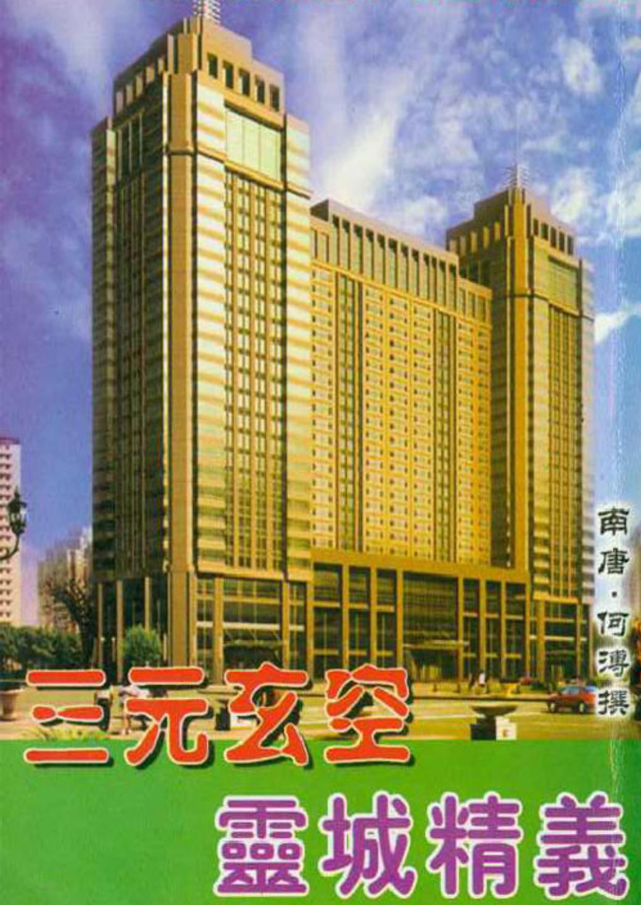

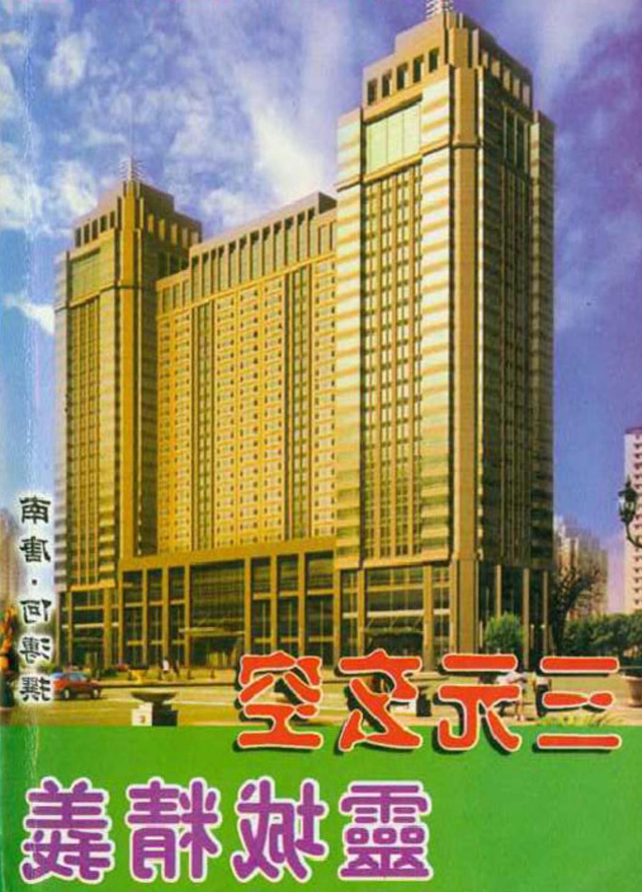

<!-- V3_SOURCE_ID:book020-b000006-p000-0b1cbefb1d -->

## 靈城精義美靜対靈

查看对应原文

<!-- V3_FOLDBACK_BEGIN:book020-b000006-p000-0b1cbefb1d -->

## 靈城精義美靜対靈

<!-- V3_FOLDBACK_END:book020-b000006-p000-0b1cbefb1d -->

<!-- V3_SOURCE_ID:book020-b000007-p000-24dc9cadbb -->

武陵出版社

查看对应原文

<!-- V3_FOLDBACK_BEGIN:book020-b000007-p000-24dc9cadbb -->

武陵出版社

<!-- V3_FOLDBACK_END:book020-b000007-p000-24dc9cadbb -->

<!-- V3_SOURCE_ID:book020-b000008-p000-d5433254c7 -->

甘出刻

查看对应原文

<!-- V3_FOLDBACK_BEGIN:book020-b000008-p000-d5433254c7 -->

甘出刻

<!-- V3_FOLDBACK_END:book020-b000008-p000-d5433254c7 -->

<!-- V3_SOURCE_ID:book020-b000009-p000-8026c4364c -->

## Sunny Books

查看对应原文

<!-- V3_FOLDBACK_BEGIN:book020-b000009-p000-8026c4364c -->

## Sunny Books

<!-- V3_FOLDBACK_END:book020-b000009-p000-8026c4364c -->

<!-- V3_SOURCE_ID:book020-b000010-p000-55c789a0dd -->

## 三元玄空靈城精義

查看对应原文

<!-- V3_FOLDBACK_BEGIN:book020-b000010-p000-55c789a0dd -->

## 三元玄空靈城精義

<!-- V3_FOLDBACK_END:book020-b000010-p000-55c789a0dd -->

<!-- V3_SOURCE_ID:book020-b000011-p000-7f24c76d23 -->

山川形勢辨龍穴·天星卦例斷吉凶

查看对应原文

<!-- V3_FOLDBACK_BEGIN:book020-b000011-p000-7f24c76d23 -->

山川形勢辨龍穴·天星卦例斷吉凶

<!-- V3_FOLDBACK_END:book020-b000011-p000-7f24c76d23 -->

<!-- V3_SOURCE_ID:book020-b000012-p000-9db4572098 -->

南唐·何溥撰

查看对应原文

<!-- V3_FOLDBACK_BEGIN:book020-b000012-p000-9db4572098 -->

南唐·何溥撰

<!-- V3_FOLDBACK_END:book020-b000012-p000-9db4572098 -->

<!-- V3_SOURCE_ID:book020-b000013-p000-24dc9cadbb -->

武陵出版社

查看对应原文

<!-- V3_FOLDBACK_BEGIN:book020-b000013-p000-24dc9cadbb -->

武陵出版社

<!-- V3_FOLDBACK_END:book020-b000013-p000-24dc9cadbb -->

<!-- V3_SOURCE_ID:book020-b000014-p000-99c4489335 -->

## 目錄 — 目录

查看对应原文

<!-- V3_FOLDBACK_BEGIN:book020-b000014-p000-99c4489335 -->

## 目錄

<!-- V3_FOLDBACK_END:book020-b000014-p000-99c4489335 -->

<!-- V3_SOURCE_ID:book020-b000015-p000-32eb160cd7 -->

形气章正诀

查看对应原文

<!-- V3_FOLDBACK_BEGIN:book020-b000015-p000-32eb160cd7 -->

形氣章正訣

<!-- V3_FOLDBACK_END:book020-b000015-p000-32eb160cd7 -->

<!-- V3_SOURCE_ID:book020-b000016-p000-0bdce36071 -->

理气章正诀

查看对应原文

<!-- V3_FOLDBACK_BEGIN:book020-b000016-p000-0bdce36071 -->

理氣章正訣

<!-- V3_FOLDBACK_END:book020-b000016-p000-0bdce36071 -->

<!-- V3_SOURCE_ID:book020-b000017-p000-0caeca67b9 -->

宅经提要

查看对应原文

<!-- V3_FOLDBACK_BEGIN:book020-b000017-p000-0caeca67b9 -->

宅經提要

<!-- V3_FOLDBACK_END:book020-b000017-p000-0caeca67b9 -->

<!-- V3_SOURCE_ID:book020-b000018-p000-2f3f85afd1 -->

<table><tr><td>钦定四库全书 子部七</td></tr><tr><td>灵城精义 术数类三 相宅相基之</td></tr><tr><td>提要</td></tr></table>

查看对应原文

<!-- V3_FOLDBACK_BEGIN:book020-b000018-p000-2f3f85afd1 -->

<table><tr><td>欽定四庫全書 子部七</td></tr><tr><td>靈城精義 術數類三相宅相基之</td></tr><tr><td>提要</td></tr></table>

<!-- V3_FOLDBACK_END:book020-b000018-p000-2f3f85afd1 -->

<!-- V3_SOURCE_ID:book020-b000019-p000-efd9cc742a -->

臣等谨按：《灵城精义》共二卷，旧本题为南唐何溥所撰，何溥的字是令通，其籍贯与生平经历不详。此书上卷论述形气，以山川形势为核心，辨别龙与穴；下卷论述理气，以天星卦例、生克吉凶为核心。自宋代以来，各家书目都没有著录此书。看书中所说“宇宙有大闢合，气运为主”，又说……

查看对应原文

<!-- V3_FOLDBACK_BEGIN:book020-b000019-p000-efd9cc742a -->

臣等謹案靈城精義二卷舊本題南唐何溥撰溥字令通履貫未詳是編上卷論形氣主于山川形勢辨龍辨穴下卷論理氣主于天星卦例生剋吉凶自宋以來諸家書目皆不著錄觀其言宇宙有大闡合氣運為主又言

<!-- V3_FOLDBACK_END:book020-b000019-p000-efd9cc742a -->

<!-- doc011 PDF 第 4 页：HTML 表格 OCR 供搜索；图表以原页图为准。 -->
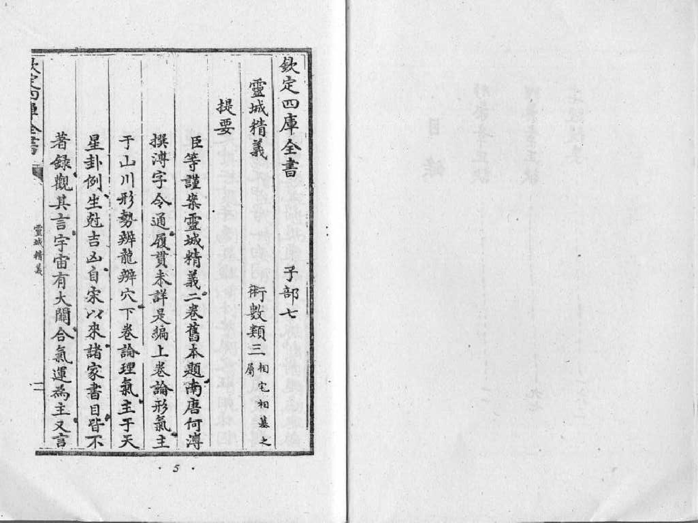

<!-- V3_SOURCE_ID:book020-b000021-p000-6b355624bd -->

地运有推移，而天气随之变化；天运有转旋，而地气与之相应。大概主元运之说的人，考证元运的说法，以甲子六十年为一元，搭配洛书九宫，总共经历上、中、下三元为一周，再经历三周共五百四十年为一运。每一元六十年为大运，一元之中，二十年为小运，以考察地气的旺、相、休、囚，就像上元甲子一白司运时，坎得旺气，震、巽得生气，乾、兑得退气，离得死气，坤得鬼气，大致……

查看对应原文

<!-- V3_FOLDBACK_BEGIN:book020-b000021-p000-6b355624bd -->

地運有推移而天氣從之天運有轉旋而地氣應之蓋主元運之說者考元運之說以甲子六十年為一元配以洛書九宮凡歷上中下三元為一周更歷三周五百四十年為一運凡為甲子者九每元六十年為大運一元之中二十年為小運以十地氣之旺相休囚如上元甲子一白司運則坎得旺氣震巽得生氣乾兌得退氣離得死氣坤得鬼氣大抵

<!-- V3_FOLDBACK_END:book020-b000021-p000-6b355624bd -->

<!-- V3_SOURCE_ID:book020-b000022-p000-b1a2537b82 -->

此书是因《皇极经世》推演而来，其方法出自明初宁波的幕讲僧，五代时怎么会有这种说法，这肯定不是明以前的书。其注题为刘基所撰，前列引用书目共二十二种，像《入式歌》这类也是明中叶以后的伪书，那么此书出于伪造也毫无疑问。但就这本书本身而论，它所说的“大地无形，看气概；小地无势，看精神；水成形，山上止，山成形，水中止；龙为地气，水为天气”这些话，在风水术数的方法中颇为接近道理，注文也发挥得条理畅达，胜过其他书的浅陋，还是懂得文义的人所为。术数类的书无非是依托前人，所言可取就收录保存，以完备一家之说，不必去辨别真伪，也不值得与他人争辩。乾隆四十六年十月恭谨校上。

查看对应原文

<!-- V3_FOLDBACK_BEGIN:book020-b000022-p000-b1a2537b82 -->

因皇極經世而推演之其法出自明初寧波幕講僧五代時安有是說其非明以前書確矣其注題曰劉基撰前列引用書目凡二十二種如入式歌之類亦明中葉以後之偽書則出於膺作亦無疑義但就其書而論則所云大地無形看氣槩小地無勢看精神水成形山上止山成形水中止龍為地氣水為天氣諸語于彼法之中頗為近理註文亦發揮條暢勝他書之弇鄙猶解文義者之所為術數之書無非依託所言可採即錄存以備一家真鴿圃無庸辨亦不足與辨也乾隆四十六年十月恭校上

<!-- V3_FOLDBACK_END:book020-b000022-p000-b1a2537b82 -->

<!-- V3_SOURCE_ID:book020-b000023-p000-75f74f9e13 -->

<table><tr><td rowspan="2" colspan="1">灵城精义引用书目</td></tr><tr><td rowspan="2" colspan="1">吴公钳龙经 三宝经</td></tr><tr><td rowspan="9" colspan="1"></td></tr><tr><td rowspan="1" colspan="1">吴公间星说 曾文遄龙歌</td></tr><tr><td rowspan="1" colspan="1">李家龙经 素书</td></tr><tr><td rowspan="1" colspan="1">郭璞葬经 详节天表慕西山所定</td></tr><tr><td rowspan="1" colspan="1">刘公天机秘要 宝镜</td></tr><tr><td rowspan="1" colspan="1">地理筌蹄 催官篇</td></tr><tr><td rowspan="1" colspan="1">梅花院纂 青囊经</td></tr><tr><td rowspan="2" colspan="1">灵城精义 7</td></tr><tr><td rowspan="1" colspan="1">T</td></tr></table>

查看对应原文

<!-- V3_FOLDBACK_BEGIN:book020-b000023-p000-75f74f9e13 -->

<table><tr><td rowspan=2 colspan=1>靈城精義引用書目</td></tr><tr><td rowspan=2 colspan=1>吳公鉗龍經                    三寶經</td></tr><tr><td rowspan=9 colspan=1></td></tr><tr><td rowspan=1 colspan=1>吳公間星說                    曾文遄龍歌</td></tr><tr><td rowspan=1 colspan=1>李家龍經                         素書</td></tr><tr><td rowspan=1 colspan=1>郭璞葬經                         詳節天表慕西山所定</td></tr><tr><td rowspan=1 colspan=1>劉公天機秘要              寶鏡</td></tr><tr><td rowspan=1 colspan=1>地理筌蹄                         催官篇</td></tr><tr><td rowspan=1 colspan=1>梅花院纂                        青囊經</td></tr><tr><td rowspan=2 colspan=1>靈城精義                                  7</td></tr><tr><td rowspan=1 colspan=1>T</td></tr></table>

<!-- V3_FOLDBACK_END:book020-b000023-p000-75f74f9e13 -->

<!-- doc011 PDF 第 6 页：HTML 表格 OCR 供搜索；图表以原页图为准。 -->
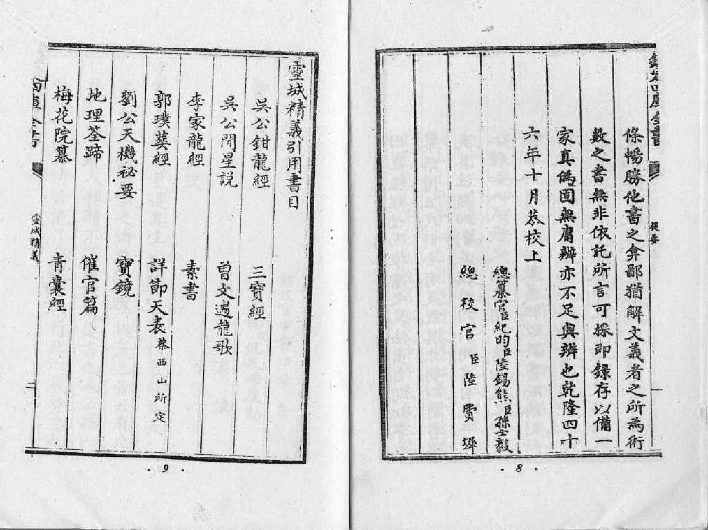

<!-- V3_SOURCE_ID:book020-b000025-p000-5c93cc9134 -->

宇宙有大闢合，以气运为准则；山川有真性情，以气势为先。这第一章是堪舆家论述气的首要关键。从前说“有地非人不下，有人非时不下”，都是以气运来说的。又说“察以眼界，会以性情，若能了此，天下横行”，是以气势来说的。比如前代的贤哲，一看到山川形势，就能知道祸福的大小、世数的先后，全在气运上占卜。山川有真性情，该怎么辨别呢？从前有人说山乘秀气，水乘积气，石乘煞气，平乘脊气；又说山谷异形，平原一气，这是山川的大势，也是山川的真性情。山为什么独取秀气呢？山的态势大多刚猛而顽硬，只担心不秀丽，如果见到秀丽所聚集的地方，便是真气所聚。而且上聚之地只有天清之气居多，所谓“收山不收水”，正是用在这个地方，所以以峰峦的秀气为生气。水为什么独取积气呢？

查看对应原文

<!-- V3_FOLDBACK_BEGIN:book020-b000025-p000-5c93cc9134 -->

宇宙有大闕合氣運為圭山川有真性情氣勢為先此首章乃堪輿家之論氣者第一機竅也昔云有地非人不下有人非時不下盡以氣運言也又云察以眼界會以性情若能了此天下橫行此以氣勢言也如彼前哲一睹形勢便知禍福之大小世數之先後全在氣運上卜之夫山川有真性情何以辨也昔人有云山乘秀氣水乘積氣石乘煞氣平乘脊氣又云山谷異形平原一氣此山川之大勢乃山川之真性情也山何以獨取秀氣也山之勢類多剛猛而頑硬惟患不秀麗若見秀麗所叢便是真氣所聚且上聚地惟天清之氣居多所謂收山不收水者正用之此處故以峯巒之秀氣為生氣耳水何以獨取積氣也

<!-- V3_FOLDBACK_END:book020-b000025-p000-5c93cc9134 -->

<!-- V3_SOURCE_ID:book020-b000026-p000-174ec88f97 -->

此處為《欽定四庫全書》的相關信息：詳校官為中書臣李采；《靈城精義》卷上，靈臺由臣倪廷梅覆勘；該書為南唐何溥所撰；內容為形氣章正訣。

查看对应原文

<!-- V3_FOLDBACK_BEGIN:book020-b000026-p000-174ec88f97 -->

<table><tr><td>欽定四庫全書 詳校官中書臣李采</td></tr><tr><td>靈城精義卷上 靈臺即臣倪廷梅覆勘</td></tr><tr><td>南唐何溥撰</td></tr><tr><td>形氣章正訣</td></tr></table>

<!-- V3_FOLDBACK_END:book020-b000026-p000-174ec88f97 -->

<!-- V3_SOURCE_ID:book020-b000027-p000-d010e23c84 -->

此处以“金以口今言 引用書曰”作为引出引用书目的提示语，所列的引用书籍包括：《玉尺经》、董氏明旨、混元子、吴公解义、《灵辖经》、廖公泄天机、《白龙记》、入式歌。

> **释读存疑：** 1轮自动修复后核义模型仍建议修订，已保守记录。

查看对应原文

<!-- V3_FOLDBACK_BEGIN:book020-b000027-p000-d010e23c84 -->

<table><tr><td>金以口今言 引用書曰</td></tr><tr><td>玉尺經 董氏明旨</td></tr><tr><td>混元子 吳公解義</td></tr><tr><td>靈轄經 廖公洩天機</td></tr><tr><td>白龍記 入式歌</td></tr><tr><td></td></tr><tr><td></td></tr><tr><td></td></tr><tr><td></td></tr></table>

<!-- V3_FOLDBACK_END:book020-b000027-p000-d010e23c84 -->

<!-- doc011 PDF 第 7 页：HTML 表格 OCR 供搜索；图表以原页图为准。 -->
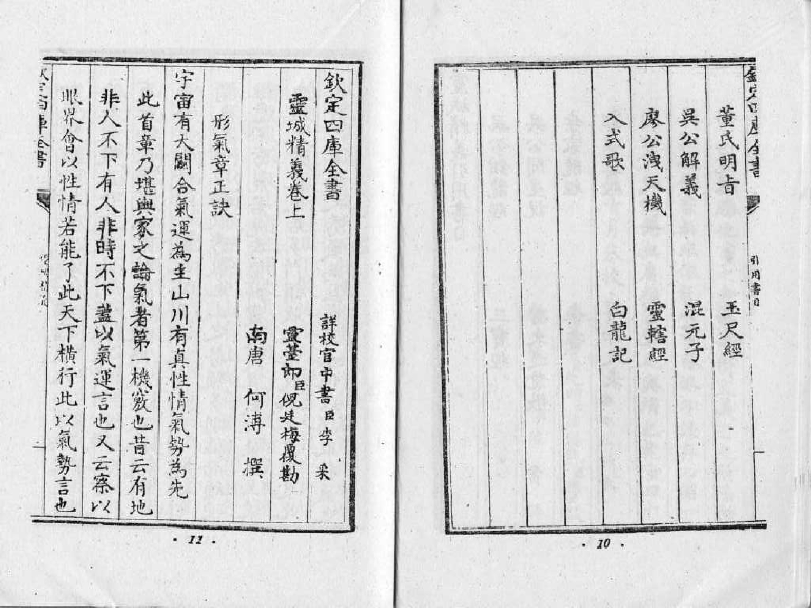

<!-- V3_SOURCE_ID:book020-b000029-p000-6e0f60e63f -->

水（风水语境中的河流、水系及其来去形态）的形勢大多呈流動散逸之態，最忌不澄澈凝聚；若見諸水匯聚，便是真氣凝聚之處，且下方聚積之地多以凝蓄之氣為主，所謂「收水不收山」的說法正是用於此處，因此這裡將水的聚積之氣視為生氣。為何獨取石的煞氣呢？山有山的喜氣，也有山的怒氣；怒氣便是山的威靈所在，威靈之氣多顯現為石；若石山只是剛猛壓逼、不成體勢、不作威儀，便只有煞氣而無生氣，從而帶來的禍患會接踵而至。因此石貴在乘持煞氣，取其威而成體、有生氣，最宜仔細辨認。為何獨取平原的脊氣呢？平坦曠闊的平原，土氣純陽無陰，生氣難以斂聚；若能有一處像骨頭般凸起的地方，便可使氣斂聚而有生氣。前人有「沒牛吹氣如酥在湯」的比喻，正是這個意思。山谷又為何稱為異氣呢？如今山谷之間各自起勢、各自開局、各自形成門戶，其氣各不相同，因此江南一帶不可與江北一概而論；只要見到一處星辰特起、一處局面特開，有蓋有送、有朝有迎，或像專城、或像停驛，倘若能有兩三重水口（水流出入一地或局势收束的位置）特別緊鎖，便算是有結，應當留意觀察。試看閩、廣、吳、越一帶，各村各社各有名族，也各

> **释读存疑：** 原文末尾有缺字，無法完整釋讀；原文末尾有缺字，无法完整释读

查看对应原文

<!-- V3_FOLDBACK_BEGIN:book020-b000029-p000-6e0f60e63f -->

水之勢類多流走而散逸惟患不澄凝若見諸水所積便是真氣所鍾且下聚地惟取凝蓄之氣居多所謂收水不收山者正用之此處故以水之積氣為生氣耳石何以獨取煞氣也山有山之喜氣亦有山之怒氣怒則山之威靈所在威靈之氣多露為石若石山而徒剛猛壓逼不成體勢不作威儀則徒有煞而無生矣從而下之禍不旋踵故石貴乘煞氣者取其威而成體有生氣也最宜細認平何以獨取脊氣也如平陽一派之土純陽無陰生氣不斂苟得一骨春之處高起便為斂而有生氣矣昔人有没牛吹氣如酥在湯之喻正如此山谷又何以稱異氣乎如今山谷之間各自起勢各自開局各自成門户其氣各異故凡江南一帶不當與江北同看只見一箇星辰特起一箇局面特開有蓋有送有朝有迎或如專城或如停驛倘得兩三重水口特特闕鎖便為有結便當着眼試觀閩廣吳越之間各村各社各有名族亦各

<!-- V3_FOLDBACK_END:book020-b000029-p000-6e0f60e63f -->

<!-- V3_SOURCE_ID:book020-b000030-p000-6c254f26d7 -->

為何平原稱為一氣呢？如今四望廣漠的地方，沒有太大的區別；只要見到有一方岡脊凸起之處，便可作為城池市鎮，當地的廬舍墳墓都聚集在這裡，即使數百里內的語言習尚大多相通，難道不是同一氣的緣故嗎？倘若居住在異氣之處，卻漫不經心地以四望廣漠的形勢去尋找，就會因為眼界太寬而失誤；倘若居住在一氣之處，卻一定要以山谷分結的形勢去尋找，又會因為眼界太窄而失誤。因此認氣以認氣勢最為困難。

查看对应原文

<!-- V3_FOLDBACK_BEGIN:book020-b000030-p000-6c254f26d7 -->

有名塚諸凡語言習尚又各不同風惟異氣然也平原又何以稱一氣乎如今四望廣漠之地有何大分別只見有一方岡脊起處便作城池市鎮其為廬舍墳墓盡聚於此即凡語言習尚雖數百里多為通同謂非一氣然乎倘居異氣處而漫以漠然四望之勢求之則以眼界太寬而失矣倘居一氣處而必以山谷分結之勢求之則又以眼界太窄而失矣此認氣以認氣勢為難也

<!-- V3_FOLDBACK_END:book020-b000030-p000-6c254f26d7 -->

<!-- V3_SOURCE_ID:book020-b000031-p000-b0f032a6e1 -->

地運有推移變化，天氣會隨之變化；天運有轉移變化，地氣會隨之響應；天氣在上方發動，人為會與之相應；人為在下方發動，天氣會隨之變化。

查看对应原文

<!-- V3_FOLDBACK_BEGIN:book020-b000031-p000-b0f032a6e1 -->

地運有推移而天氣從之天運有轉旋而地氣應之天氣動於上而人為應之人為動於下而天氣從之

<!-- V3_FOLDBACK_END:book020-b000031-p000-b0f032a6e1 -->

<!-- V3_SOURCE_ID:book020-b000032-p000-da4393560e -->

這段話是說宇宙的氣運，天地人三者相互關聯，一旦有轉移變化，萬物之氣就會隨之不同，這是識時觀變的一大關鍵。什麼叫地運有轉移而天氣隨之變化呢？比如黃河是天地間的一大血脈，據黃虞時期，黃河從龍門轉向呂梁，再從呂梁轉向太行，再從太行轉向碣石，最終入海；當時黃河從西轉向南，再從南轉向東北，冀州位於其中，便是所謂「黃河如帶，五嶽俱朝」，為天下第

> **释读存疑：** 原文末尾有缺字，無法完整釋讀；原文末尾有缺字，无法完整释读

查看对应原文

<!-- V3_FOLDBACK_BEGIN:book020-b000032-p000-da4393560e -->

此言宇宙氣運天地人皆相與於有成一有轉移衆動氣即以異此識時觀變者之一大樞紐也何謂地運有轉移而天氣從之如黃河是天地間一大血脈據黃虞時河由龍門而轉呂梁由呂梁而轉太行由太行而轉碣石乃入海是河從西轉南從南轉東北而冀居其中則所謂黃河如帶五嶽俱朝為天下第

<!-- V3_FOLDBACK_END:book020-b000032-p000-da4393560e -->

<!-- V3_SOURCE_ID:book020-b000033-p000-7487ffbe5c -->

一大風水格局。當時冀州一時之間出現了堯、舜、禹三位聖人，千古以來沒有比這更昌盛的了；只因黃河流經其北，長江環繞其南，泰山夾在其間，泰山是華山以來最盡頭的龍脈，是中國的一大主幹；若論中國的形勝，泰山是中部盡頭，當時孔聖人出現，眾多賢人並生，千古以來也沒有比這更昌盛的，這是開闢以來未曾有過轉徙的山水。自漢代以來，黃河逐漸向南遷徙，竟至穿過鄒魯之地，直走淮泗，泰山反而位於北方，黃河卻位於南方；冀州的水（风水语境中的河流、水系及其来去形态）勢傾動，鄒魯的地脈斷絕，北方的氣運就衰落了。我朝祖陵建於中都，大業起於滁陽，正在淮泗之間，難道不是黃河南徙，氣運本就使它這樣嗎？人們說江南的昌盛是因為宋朝南遷，卻不知黃河遷往南方，天運也隨之轉向南方，人是無法挽回的。天氣一旦隨地運轉移，就是這樣。什麼叫天運有轉旋而地氣也會響應呢？比如秦國太史占測金陵有天子氣，於是疏導秦淮河來洩散天子氣；不知秦淮河一疏導，地運就發動了，後來小到六朝建都，大到我朝定都，果然應驗了。又如洛陽向來沒有杜鵑，等到杜鵑啼叫，天氣就到了

> **释读存疑：** 原文末尾有缺字，無法完整釋讀；原文末尾有缺字，无法完整释读

查看对应原文

<!-- V3_FOLDBACK_BEGIN:book020-b000033-p000-7487ffbe5c -->

一大風水者此也此冀都一時而堯舜禹三聖人出焉千古莫盛矣夫惟黃河經其北長江繞其南而泰岳夾於其間則泰山為華山以來大盡之龍乃中國之一大幹也若論中國形勝則泰山為中盡當時孔聖起而羣賢濟濟並生千古亦莫盛焉此開闢以來未有轉徙之山水也自漢黃河漸徙而南乃至穿斷鄒魯之墟直走淮泗則泰山反居北而黃河乃居南矣冀州之水勢傾鄒魯之地脈斷而北地之氣運衰矣我朝祖陵鍾於中都大業起於滁陽正在淮泗之間豈非黃河南徙氣運固使之然乎人言江南之盛以宋南渡而然不知黃河徙而之南則天運亦從而之南人不能為之挽也夫天氣一從地運之轉者如此何謂天運有轉旋而地氣亦應之如秦太史占金陵有天子氣乃疏秦淮以洩之不知秦淮一疏地運乃動嗣後小而六朝之建都大而我朝之鼎奠果應於此又如洛陽素未有杜鵑及杜鵑啼而天氣行於

<!-- V3_FOLDBACK_END:book020-b000033-p000-7487ffbe5c -->

<!-- V3_SOURCE_ID:book020-b000034-p000-6de8841383 -->

南方了，南方人於是果然有人做了宰相，這是地運未到而天運先到，地是隨天轉移的。什麼叫天氣動於上而人為會與之相應呢？比如陳希夷有一晚看見小星在帝星的左邊，天亮後急忙去尋找，見宋太祖與趙普同坐在酒肆裡，趙普坐在左邊；陳希夷說：「小星怎敢居於帝座左邊呢？」於是推開他們交換了位置，這是宋太祖未顯貴時的事。現在很多人認為星氣渺茫，卻不知天動人應，絲毫不差。什麼叫人事動於下而天氣會隨之變化呢？比如洛陽的花石有什麼大關係，而元史占測認為花石不除去，宋的旺氣就不會斷絕；等到

查看对应原文

<!-- V3_FOLDBACK_BEGIN:book020-b000034-p000-6de8841383 -->

南矣南人自是果作相是地運未到而天運先到則地乃從天轉也何謂天氣動於上而人為應之如陳希夷一夕見小星居帝星之左及旦而亟覓其所見宋太祖與趙普同坐酒肆間而趙居其左陳乃曰小星何敢居帝座左哉推而易之此宋太祖微時事今人多以星氣為渺茫而不知天動人應其不爽如此何謂人事動於下而天氣從之如洛陽花石何大關係而元史占之以為花石不去則宋之旺氣不絕及

<!-- V3_FOLDBACK_END:book020-b000034-p000-6de8841383 -->

<!-- V3_SOURCE_ID:book020-b000035-p000-47ea2c61f3 -->

一旦移去花石，航海的船就覆沒了。現在很多人認為前哲按星卦行事，似乎怪誕不經，卻不知一舉一動，天就會與之相應，氣是無所不通的。論氣運的人如果拘泥於定格，不考慮轉徙幻化的不尋常，又怎能確定其變化呢？古代的大哲望氣就能預測，察時就能觀變，都能通曉這個竅門；若不是有神仙般的眼光，是不足以談論這個的。

查看对应原文

<!-- V3_FOLDBACK_BEGIN:book020-b000035-p000-47ea2c61f3 -->

一旦移去花石而航海之舟遂覆今人多以前哲按星卦為作用似為怪誕不經而不知一舉一動天即為應氣何不貫通也夫論氣運者而苟拘拘於定格不及於轉徙幻化之不常抑何以定其變哉夫古大哲望氣而可預占察時而可觀變益能通此竅耳自非神仙道眼烏足語此

<!-- V3_FOLDBACK_END:book020-b000035-p000-47ea2c61f3 -->

<!-- V3_SOURCE_ID:book020-b000036-p000-189d4c1d91 -->

有聚講、行講、坐講，氣就聚於龍；有權星、尊星、雄星，氣就聚於勢；有益胎、夾胎、乘胎，氣就聚於穴（风水中认为气脉聚结、适宜安葬或营建的位置）；有收襟、收堂、收

> **释读存疑：** 原文末尾有缺字，無法完整釋讀；原文末尾有缺字，无法完整释读

查看对应原文

<!-- V3_FOLDBACK_BEGIN:book020-b000036-p000-189d4c1d91 -->

有聚講行講坐講則氣聚於龍有權星尊星雄星則氣聚於勢有益胎夾胎乘胎則氣聚於穴有收襟收堂收

<!-- V3_FOLDBACK_END:book020-b000036-p000-189d4c1d91 -->

<!-- V3_SOURCE_ID:book020-b000037-p000-daedb563fa -->

有關隘阻隔的地方，氣就會在局中聚結。

查看对应原文

<!-- V3_FOLDBACK_BEGIN:book020-b000037-p000-daedb563fa -->

關則氣聚於局

<!-- V3_FOLDBACK_END:book020-b000037-p000-daedb563fa -->

<!-- V3_SOURCE_ID:book020-b000038-p000-3fc3b14e52 -->

这四段是辨认气脉的首要关键。龙忌孤单，这是众人都知道的道理，但人们也只知道看开头的数节，不知道龙有起势、有止境，还有一定的行度。龙的起势之处必须要“聚讲”，就像层云叠雾，气脉聚合形成形局，大的范围绵延数百里，小的也有数十里，横亘连绵，或是“五星聚而不分”，这种情况就称为聚讲。聚讲的位置就像都会之地，是百官聚集、万民定居的枢纽要地。气脉聚拢之后，就会分出支脉向前延伸，条理清晰，正干从中间穿行，其余的支脉分别向左右延伸，有的要穿过峡谷，有的则曲折闪走，两边都有地形夹护。其中有的是祖山，有的是宗山，高出周边区域，是众山发源的地方，由此可以得知龙的正干和正结都发源于此处。又如雄星，在城廓交关的位置有高耸的星辰，能够对应尊星、作为门户的，就称为雄星，也就是现在所说的北辰、罗睺之类。大概关隘处的地形犬牙交错，不如有禽兽形状的地形守关，又不如有人形的地形守关的作用大。有了这三种星，龙的气势才算宏大。胎星是结穴的位置，什么是益胎？益胎就是座。大概没有益势的话，胎星必然不会结华。益势为上，冠盖、宝盎次之，就算是个字、飞蛾也属于益的样态，有了益，脉就不会外露、不会孤单，

> **释读存疑：** “聚讲”为风水专业术语，具体含义未在原文详细说明；“五星聚而不分”中的“五星”为风水峦头术语，具体所指未做额外标注

查看对应原文

<!-- V3_FOLDBACK_BEGIN:book020-b000038-p000-3fc3b14e52 -->

此四段乃認氣者第一闕鍵也夫龍忌孤單人所共知然亦但知看到頭數節耳不知龍有起有止有行度起處必要聚講如層雲疊霧合氣運形大以數百里小以數十里橫亘緜延或五星聚而不分謂之聚講如都會之地百官所聚萬民所止乃樞要之會也既聚之後則分枝劈脈而去條分縷析正幹從中餘支分左分右而行或以渡峽或以走閃兩邊夾護各或祖或宗高出於一方為衆山所首出者從此而知龍之正幹正結皆肇於此又如雄星則於城廓交關之處有卓立星辰可以應尊星而當門戶者則以雄星稱即今所謂北辰羅睺之類益交牙織結不如以禽獸成形物形守關又不如以人守關之為大也有此三星方為勢大胎星是結穴之所何謂益胎即座是也蓋無益勢胎必不結華益為上冠蓋寶盎次之即个字飛蛾亦是益樣益有益則脈不露不孤而

<!-- V3_FOLDBACK_END:book020-b000038-p000-3fc3b14e52 -->

<!-- V3_SOURCE_ID:book020-b000039-p000-2b3a942265 -->

看它的山顶绵延不绝，就像云中的飞雁，看不到它的来脉，聚集得像昆仑山一样，盘踞八方，看不到它的分支，那么天下所有山脉都以此为祖山。这种情况又怎么能用祖山来称呼呢，所以用都权之星来命名它。大概权星多是土形、金形的形体，因为只有土形、金形的山体能够绵延不绝。如果是水形、木形、火形的山体，大多作为祖星，因为它们形态活动、高耸独立，会成为分形的状态。宇宙之中只有土石是最庞大、最旺盛的，石就属于金类。经书上说：权星适宜庞大不适宜秀丽，祖星临近的时候要起高峰，说的就是这个意思。由此推断，一个郡有一个郡的权星，凡是评判佛仙、侯王、相公等级别的大结穴格局，必然要以权星为根本。至于尊星，形态上带有峰峦、印、笔、旗、鼓、仓、库等特征，各不相同，总的来说是聚集拱护、不孤单、不外露，这种情况称为行讲。龙的行度经过剥换之后，必然有归宿，就像赶路的人回到家，他的一家骨肉必定会团聚；又像身份尊贵的人登堂，他的下属官吏必定会拱卫护持，绝对没有孤立独坐的道理，这种情况称为坐讲。有这三讲，龙才是真龙。如果不是这样，那么“孤单”的问题就不仅仅出现在入穴的位置了。什么是权星？这是吴公《钳龙经》中所称的都权之星，大概因为它的气势正盛、正大，用祖宗两个字不足以概括它的特点，高大得像和天齐高的雪山一样，

> **释读存疑：** “剥换”为风水龙脉专业术语，未做额外释义

查看对应原文

<!-- V3_FOLDBACK_BEGIN:book020-b000039-p000-2b3a942265 -->

見其頂緜亘如雲中之鴈不見其來叢集如崐倫八方之蟠踞不見其分則天下萬派之山皆祖於此此亦何可以祖言故以都權之星名也大抵權星多土金之體益惟土金能緜亘也若水木火多作祖星以其活動而卓立則為分形矣則宇宙間惟土石為大為盛益石即金也經云權星宜大不宜秀祖星臨來要起峯正此之謂從此而推一郡有一郡之權星凡論佛仙侯王相公之大結搆必本於此至如尊星則帶峰巒帶印帶筆帶旗帶鼓帶倉帶庫各各不一總之叢聚拱護不孤不露謂之行講龍之行度既歷剥換必有歸宿譬則行者之赴家其一家骨肉必為團聚又譬則貴人之登堂其所屬僚佐必為拱護決無孤立獨坐之理謂之坐講有此三講其龍乃真若或不然則孤單二字不特在入穴之所矣何以謂之權星吳公鉗龍經中所稱都權之星也蓋以其勢正盛正大祖宗二字不足以盡之高大如雪山之齊天不

<!-- V3_FOLDBACK_END:book020-b000039-p000-2b3a942265 -->

<!-- V3_SOURCE_ID:book020-b000040-p000-7fb901e293 -->

穴一定要藏風聚氣。什麼是夾胎？就是現在所說的龍虎夾耳之說，能讓風門不動，用來衛護穴的。什麼是乘胎？就是現在所說的小明堂。上蓋，就是氣注於下；下乘，就是氣壅於上；兩旁夾，就是氣蓄於中，這才叫有氣之穴。什麼是收襟？就是穴中微茫，界水所會，就像人的襟領相交，名叫襟合。什麼是收堂？就是龍虎界割之水所會，就像居室的明堂，是四水所聚，名叫堂合。什麼是收關？就是以龍的分支來作城作郭之水所會，小的像居室的門戶，大的像城廓的關鎖，名叫閱合。古人八

> **释读存疑：** 原文中“閱合”含義不確定，暫保留原詞；原文末尾“八”字疑似殘缺，暫保留原字；原文末尾“八”为残缺字，无上下文无法释读；“閱合”含义未明

查看对应原文

<!-- V3_FOLDBACK_BEGIN:book020-b000040-p000-7fb901e293 -->

穴必藏風聚氣矣何謂夾胎如今龍虎夾耳之說使 風門不動所以衛穴者也何謂乘胎如今小明堂是 也上蓋則氣注於下下乘則氣壅於上兩旁夾則 氣蓄於中方謂有氣之穴何謂收襟則穴中微茫界 水所會如人之襟領所交名曰襟合何謂收堂則龍 虎界割之水所會如居室之明堂為四水之所聚名 曰堂合何謂收關以龍之分來作城作郭之水所會 小如居室之門戶大如城廓之關鎖名曰閱合古人 八

<!-- V3_FOLDBACK_END:book020-b000040-p000-7fb901e293 -->

<!-- V3_SOURCE_ID:book020-b000041-p000-63d23cdaae -->

这两段说的是龙势一定要遇到阴阳雌雄交会所聚的地方才能成胎，这是辨认气脉的人应当仔细审察的内容。比如山谷之间，阴气通常偏盛，所以一旦延伸到平洋地带，脱胎换骨，局面也会变得开阔舒畅，这里就有结穴的地方，就是所说的阴胜逢阳而止。大开阔就对应大结穴，小开阔就对应小结穴，绝对不会有差错。又如平洋地带，阳气通常偏盛，所以忽然隆起一处冈阜、一道山脊，就称作吉气升起的地方，这时四周的阴砂还没有缠绕护持，就算形迹浅露也自然成局。所以平原地区，只要分局清晰，有骨脉显露作为证验，就是所说的阳胜逢阴而住。又如龙势袭来，正干雄健强旺，此处原文OCR识别为“灵成晴A 儿”，内容严重残缺，无法准确释读。

> **释读存疑：** 末尾“灵成晴A 儿”为OCR识别严重残缺内容，无法准确释读

查看对应原文

<!-- V3_FOLDBACK_BEGIN:book020-b000041-p000-63d23cdaae -->

此二段言龍勢必得陰陽雌雄媾會之處而始成胎 認氣者所當審也如山谷之間陰氣嘗勝故一卸平 洋脫胎換骨局面亦且開陽舒暢此便有結所謂陰 勝逢陽而止是也大開大結小開小結萬萬不爽又 如平洋之地陽氣嘗勝故忽然起一岡阜一山脊謂 之吉氣所起乃四面陰砂未纏未護使是淺露亦自 成局故平原之處只要分局得明骨脈顯露為證所 謂陽勝逢陰而住也又如龍勢之來正幹雄強謂之 靈成晴A 儿

<!-- V3_FOLDBACK_END:book020-b000041-p000-63d23cdaae -->

<!-- V3_SOURCE_ID:book020-b000042-p000-55f2c4f147 -->

原文中的“金5”為OCR識別殘缺，無法辨認。所謂小合收囊，說的是堂合；大合收局，說的是關合。穴情低小的，收堂以內之水；穴情高大的，收闕以內之水。至於穴前小明堂合襟之水，無論高低穴都應當收。凡是論局的，都應以此為準合而論之。古人說有穴才說地，無局不說龍，局又是用來確定龍的背面的。廖公《洩天機》分龍、穴、砂、水，又加上堂，說的就是這個意思。陰勝逢陽則止，陽勝逢陰則住，雄龍需要雌龍護衛，雌龍需要雄龍簇擁。

> **释读存疑：** 原文中“金5”為OCR識別殘缺，無法辨認；“闕”含義不確定，暫保留原詞；原文开头“金5”为OCR残缺，无法释读；“闕”在此处的具体含义未明

查看对应原文

<!-- V3_FOLDBACK_BEGIN:book020-b000042-p000-55f2c4f147 -->

金5 所謂小合收囊以堂合言也大合收局以關合言也 穴情低小者收堂以內之水穴情高大者收闕以內 之水至如穴前小明堂合襟之水無論高低穴皆所 當收也凡論局者必準諸此合而論之昔人有云有 穴方言地無局不言龍則局又龍之所以定背面也廖 公洩天機分龍穴砂水而又加之以堂正此之謂與 陰勝逢陽則止陽勝逢陰則住雄龍須要雌龍御雌龍 須要雄龍簇

<!-- V3_FOLDBACK_END:book020-b000042-p000-55f2c4f147 -->

<!-- V3_SOURCE_ID:book020-b000043-p000-3f46c60f88 -->

雄龍有自天而降、御風而行的氣勢，兩邊護送的山需要柔順婉轉，遠纏遠護，不與正幹爭強，正幹才能結穴。古人所說的雄龍坐大將以握重兵，就是這個意思。所護衛的砂如果秀雅，也會出文士，或是文臣握兵權。又如龍勢之行，一派軟嫩，就是雌龍，兩邊擁護拱夾有力，作起氣勢，才見精神。雌龍固然主文秀，但四面的砂像筆、像笏、像鼓、像旗，也主威嚴，豈止文秀呢？這種雌龍以夾從雄勢為佳，凡是雌雄貴在交媾，就是這個道理。

查看对应原文

<!-- V3_FOLDBACK_BEGIN:book020-b000043-p000-3f46c60f88 -->

雄龍有自天而降御風而行之勢乃兩護送之山須 要柔順婉轉遠纏遠護不與爭強則正幹乃結昔人 所云雄龍坐大將以握重兵是也要之所御之砂若 果秀雅亦出文士或以文臣握兵權耳又如龍勢之 行一派軟嫩為雌必兩邊擁護拱夾有力作起氣勢 乃見精神夫雌龍固主文秀然四面砂如筆如笏如 鼓如旗亦主威嚴豈止文秀哉此雌龍以夾從雄勢 為佳凡雌雄貴交媾如此

<!-- V3_FOLDBACK_END:book020-b000043-p000-3f46c60f88 -->

<!-- V3_SOURCE_ID:book020-b000044-p000-da2861ea2d -->

规模大的地没有固定的形状，要观察它的气概；规模小的地没有足够的气势，要观察它的精神。还有“水成形山上正山成形水中止”的说法，这句是风水口诀，具体语义关联尚不明确。

> **释读存疑：** “水成形山上正山成形水中止”为风水口诀，语义关联未明

查看对应原文

<!-- V3_FOLDBACK_BEGIN:book020-b000044-p000-da2861ea2d -->

大地無形看氣槩小地無勢看精神水成形山上正山成形水中止

<!-- V3_FOLDBACK_END:book020-b000044-p000-da2861ea2d -->

<!-- V3_SOURCE_ID:book020-b000045-p000-5895ea0702 -->

这是说立穴应当先辨认形神止聚的位置，再进行点穴，不能一概而论。现在的人在入首作穴的位置，只看窝、钳、乳、突四种特征，一有这四种特征就称作好穴，不知道外形只是穴的佐证而已，至于有生机的真结穴之处，全要从大的形势上去考量。比如大地的形迹常常隐蔽、朴拙，不会有精巧媚人的外形，只需要从整体上观察它的气势、辨认它的性情，只要找到了生机，就符合穴法，不必拘泥于窝、钳、乳、突这些常用的准则。至于小地，既然没有足够的气概，必须要形局合乎尺度，聚气藏风，从局外看似乎没有气势，进入局内看却有精神，就可以在精神凝聚的地方点穴，也能形成一个完整的局。这是管氏立穴以辨认形势为先的观点，最为重要。论及形的止宿位置，还要辨明支龙、垄龙的高下，才不会错失它的性情。比如平支的龙，全靠水作为界合的标志，阳气通常偏盛，它的走势柔婉，点穴应当选在它起势、刚健的位置，这就是所说的“山上止”，也就是《葬书》“支葬其[巅]”的意思（原文此处缺字）。如山垄的龙，阴气通常偏盛，它的走势雄健急促，点穴应当选在它平坦的位置来乘生气。

> **释读存疑：** 《葬书》相关引文原文缺字，所补“巅”为常见对应内容，仅供参考

查看对应原文

<!-- V3_FOLDBACK_BEGIN:book020-b000045-p000-5895ea0702 -->

此言立穴當先認其形神止聚之處而穴之不可一槩論也今人於入首作穴處便看窩鉗乳突四字一有此四者便稱好穴不知形乃穴之證佐耳至其生機真結之處全在大勢上理會如大地之形嘗隱嘗拙何有形之巧媚動人只於大象上察其氣勢認其性情苟得生機便成穴法不在拘拘於窩鉗乳突之常法也至若小地既無氣槩必須形局合度聚氣藏風出局觀之似無氣勢入局觀之却有精神則便可於精神聚處穴之亦可成一器局也此管氏立穴以認形勢為先最為至要乃論形之止宿處又要辨支壠高下乃不失其性情也如平支之龍全以水為界合而成陽氣嘗勝其勢柔婉穴當從其起處剛處而來之所謂山上止者是也即葬書支葬其之意如山壠之龍陰氣常勝其勢雄急穴當從其坦處而乘

<!-- V3_FOLDBACK_END:book020-b000045-p000-5895ea0702 -->

<!-- V3_SOURCE_ID:book020-b000046-p000-a6b7723cf3 -->

这就是所说的水中止。所谓水中，只是指界水交汇而止的地方。古人说：来不来，坦中裁；住不住，坪中取。这和《葬书》垄葬其麓的意思是相同的。

查看对应原文

<!-- V3_FOLDBACK_BEGIN:book020-b000046-p000-a6b7723cf3 -->

之所謂水中止者是也謂之水中只是界水會而止 處古所云來不來坦中裁住不住坪中取此與葬書 壠葬其麓之意同

<!-- V3_FOLDBACK_END:book020-b000046-p000-a6b7723cf3 -->

<!-- V3_SOURCE_ID:book020-b000047-p000-adc3cb8bbd -->

要在大父母处辨认龙气，需看尊星；要在真子息处辨认龙气，需看主星；要在方交媾处辨认龙气，需看胎伏星；要在胎育处辨认龙气，需看胎息星；要在化煞为权处辨认龙气，需看解星；要在逢绝而生处辨认龙气，需看恩星。

查看对应原文

<!-- V3_FOLDBACK_BEGIN:book020-b000047-p000-adc3cb8bbd -->

認氣於大父母看尊星認氣於真子息看主星認氣於方交媾看胎伏星認氣於胎育看胎息星認氣於化煞為權看解星認氣於逢絕而生看恩星

<!-- V3_FOLDBACK_END:book020-b000047-p000-adc3cb8bbd -->

<!-- V3_SOURCE_ID:book020-b000048-p000-acc6cd160f -->

以上数段是龙气中辨认龙气的第一法门。凡是看龙，须以辨认尊星为主。大概到某一方，看到哪座山最高最大、独占一方，就以它作为大父母。看尊星是什么星辰，比如土星起顶、出现“垂宥”的状态、大开盖帐，就是土龙的态势，它所孕育的子孙，土是本气，金是生气，木是煞气，火是它所泄之气，水又是它所刑之气。所以凡是自上而下遇到生旺的就是子息，遇到克害的就是刑煞。这种方法应当以祖河图的顺生为序，因为父母不能克子息。李家《龙经》说：息星克母，子就会荣昌；母星克子，子就会死绝。意思是下可以克上，上不可以克下。凡是山到入首之处，看是什么星辰，比如金星入首，就是祖宗原本是土势出脉。

> **释读存疑：** “垂宥”具体所指不详

查看对应原文

<!-- V3_FOLDBACK_BEGIN:book020-b000048-p000-acc6cd160f -->

此數段乃龍氣中認氣第一法門也凡看龍須認尊星為主蓋到一方看是何山最高最大專擅一方便以之為大父母看尊星是何星辰如土星起頂垂宥大開蓋帳則為土龍勢其所育之子孫土是本氣金是生氣如木則為煞如火則為其所洩如水則又為其所刑故凡自上而下遇生旺為子息過尅害則為刑煞其法當祖河圗一以順生為序蓋父母不可尅子孫也李家龍經云息星尅母子榮昌母星尅子死絕亡蓋下可尅上上不可剋下也凡山一到入首之處看是何星辰如金星入首乃祖宗原是土勢出脈

<!-- V3_FOLDBACK_END:book020-b000048-p000-acc6cd160f -->

<!-- V3_SOURCE_ID:book020-b000049-p000-e96e686843 -->

那就是真子孙了。如果在入首盖覆的星辰中带有木，不免会有相克，但如果息星是金，而覆胎的星辰带木，那么子息冲破母胎而出，原本就有这种道理。只要在金木相接的地方，稍微有水的形态，就不会隔绝了。这就和前面所说的息星尅母、子荣昌的说法相合，又有什么妨碍呢？这种方法出自洛书，一概以逆尅为序，而吴公解义说：木星入土星，一甲辅佐明廷，也认为从下尅上是不忌讳的。就像如今风水师所说的屏下贵人，不就是木星贵人在屏土之下的木入土之说吗？又如大父母既已布势降脉而来，如果在其间不遇雌雄交媾，怎么能成胎呢？所以当行到气盛之处，必须要有跌断过峡，一俯一仰形成胎伏，才算是交媾，此后才有生育。如果没有胎伏，前去必然不会变化，就是纯阳纯阴，没有生机了。杨公论龙必定以胎伏为意，正是这个道理。这是在龙腰辨认龙气的第一机关。龙既跌断过峡，再起必有好星辰，或开帐、或覆必成胎育，开帐覆帐之下一线起脉为胎，所谓鹤膝蜂腰龙已成，正指的就是这个地方。这一线垂落，必要有水的形态，才能成胎，所谓万物皆生于水，就是这个道理。这就是束

> **释读存疑：** 原文此处“束”字后内容残缺，无法完整释读；原文末尾“束”字后内容残缺，无法完整释读

查看对应原文

<!-- V3_FOLDBACK_BEGIN:book020-b000049-p000-e96e686843 -->

則為真子孫矣若於入首蓋覆之星或帶木不免相剋然息為金而覆胎之星帶木則子息之破母胎而出原有此理但得金木相接之處微有水意便不隔絕矣此即合前所云息星剋母子榮昌之說有何妨乎其法出於洛書一以逆剋為序而吳公解義云木星入土星一甲輔明廷亦以從下剋上之不畏也如今術家所稱屏下貴人夫以木星貴人而在屏土之下非木入土之說乎又如大父母既佈勢降脈而來若於其間不遇雌雄交媾何以成胎故當行到氣盛處須要跌斷過峽一俯一仰而成胎伏乃成交媾此去方有生育若無胎伏前去必不變化便是純陽純陰無生機矣楊公論龍必以胎伏意正如此此於龍腰認氣之第一機竅也龍既跌斷過峽則再起必有好星辰或開益覆必成胎育益覆之下一線起脈為胎所謂鶴膝蜂腰龍巳成正指此處此一線垂落必要水體乃成胎所謂萬物皆生於水是也此即束

<!-- V3_FOLDBACK_END:book020-b000049-p000-e96e686843 -->

<!-- V3_SOURCE_ID:book020-b000050-p000-e7866de013 -->

气在胎的下方再隆起的部分就是息星，有的在一节就结聚，有的要经过数节才结聚，并没有固定的限制，但节数也不能太多，因为气离开胎之后既不能过于迟缓，也不能脱节断裂。息星就是入首，入首的下方再看入手形成什么样的穴法，有的就贴合在息星的本体上，有的脱离开来形成另外的形态，这就是穴场。在这里辨认真气，正是要看它与父母脉相合的地方。凡是龙脉运行的过程中，怎么可能完全没有驳杂不纯的情况？比如属土的龙脉运行时遇到属木的方位或形态就会形成煞，但如果木星贵人之峰处在土屏的下方，虽然属于煞却也有威势。如果在贵人峰下稍微转向水的方位，又骤然隆起金星，那么金可以克制木带来的煞，而水又能成为贵人的秀气，这不就是把煞转化为威势了吗？这种情况就叫解星，龙脉从这里继续运行，必然会处于生旺的状态，很快就会结穴了。凡是龙脉运行时如果完全不发生变换，就算处于生旺状态也难免太过，反而会形成刚煞。比如属土的龙脉向下延展时，金星本是生扶的属性，但如果接连出现三五座金星，中间没有间隔，也不生出支脚，整体全是坚硬刚直的形态，就是纯阳无法转化，反而会成为阳龙的绝脉。这种情况必须有卸落的走势，或者转成“天虹之土”的形态，两边向外侧张开，用来分散坚硬刚直的气，这就是以母气救子气的恩局；或者卸落之后转折呈现“三裊之水”的形态，用来泄去刚直的气，这就是以子气救母气的恩局。得到这样的格局，龙脉往前就能结出吉穴，如果没有这样的变换，这里就只会是供香火的庙宇所在地，或者是蛟龙盘踞的洞窟。

> **释读存疑：** 本地硬校验仍未通过，已记录供后续自动处理或人工核对。

查看对应原文

<!-- V3_FOLDBACK_BEGIN:book020-b000050-p000-e7866de013 -->

氣之處胎之下再起便是息星或於一節即結或數節乃結在所不拘然亦不可節數太多以氣離胎不可緩亦不可脫也息星便是入首入首之下再看入手成何穴法或即貼於息星之本體或脫落而為另體乃穴塲也此認真氣於父母相合處正在此凡龍行度豈能盡無駁雜如土龍行度遇木則為煞然以木星貴人之峯而在土屏之下雖為煞而有權若於貴人峯下少轉水而頓起金星則金可制木之煞而水為貴人秀矣豈不化煞為權乎謂之解星從此行去必為生旺便結穴矣凡龍行度必不變換則雖生旺未免太過反致剛煞矣如土龍降勢金星為生乃一派金星三五不間不生支脚渾是堅剛則純陽不化反為陽龍之絕必須卸下或轉天虹之土兩邊開掙以分堅剛之氣是以母救子為恩也或卸下轉摺如三裊之水以洩剛直之氣是以子救母亦恩也得此方去結穴若不得此便是香火之居或為蛟龍之窟

<!-- V3_FOLDBACK_END:book020-b000050-p000-e7866de013 -->

<!-- V3_SOURCE_ID:book020-b000051-p000-7281cc0bf9 -->

凡是一方起一尊星，必有一处结作，或在尽处正受，就是正格；或尽处都受刑煞，就到解星、恩星有生机的地方，或作骑龙，或作斩关，须要详细辨认覆盖、峡前、峡后的地方，常有结作正从脱卸处得到解星、恩星的生气。从龙认气的妙法就在这里。

查看对应原文

<!-- V3_FOLDBACK_BEGIN:book020-b000051-p000-7281cc0bf9 -->

矣凡一方起一尊星必有一結或於盡處正受便為 正格或盡處皆受刑煞則於解星恩星之有生機處 或作騎龍或作斬關須要詳認覆蓋峽前峽後之處 每有結作正從脫卸處而得解星恩星之有氣也從 龍認氣妙法在此

<!-- V3_FOLDBACK_END:book020-b000051-p000-7281cc0bf9 -->

<!-- V3_SOURCE_ID:book020-b000052-p000-e77238cfae -->

辨认龙的气要靠势，辨认穴的气要靠情。

查看对应原文

<!-- V3_FOLDBACK_BEGIN:book020-b000052-p000-e77238cfae -->

認龍之氣以勢認穴之氣以情

<!-- V3_FOLDBACK_END:book020-b000052-p000-e77238cfae -->

<!-- V3_SOURCE_ID:book020-b000053-p000-25081d5261 -->

前人说：望气靠势，立穴乘情。看龙主要以势为主，其格局有五种：直、横、回、飞、潜。《入式歌》说：直龙原本是撞背来，中出贵徘徊，意思是直来的龙势多直硬，妙在徘徊才有生气；横龙原本是从侧落，逆转须磅礴，意思是横来的龙势不正，气须逆转勒定才能收住；回龙原本是逆翻身顾祖，要逡巡，意思是回龙之势多凑促，气不舒展，必得宽畅远巡气才和；飞龙原本是结上聚，昂首真异，意思是飞龙既属上势，须要轩昂，收得众山水、制得众山水，气象才好；潜龙原本是落平洋，撒脉自悠扬，意思是平洋多散漫，弊病在脉不到，所以须撒脉

查看对应原文

<!-- V3_FOLDBACK_BEGIN:book020-b000053-p000-25081d5261 -->

昔人云望氣存乎勢立穴乘乎情大要看龍以勢為 主其局有五曰直曰橫曰回曰飛曰潛入式歌云直 龍原是撞背來中出貴徘徊言直來之龍勢多直硬 妙在徘徊乃有氣也橫龍原是從側落逆轉須磅礴 言橫來之龍其勢不正氣須逆轉而勒定乃收住也 回龍原是逆翻身顧祖要逡巡言回龍之勢多湊促 其氣不舒必得寬暢遠巡氣乃和也飛龍原是結上 聚昂首真異言飛龍既屬上勢須要軒昂收得衆 山水制得衆山水氣象始為也潛龍原是落平洋 撒脈自悠揚言平洋多撒漫病在脈不到故須撒脈

<!-- V3_FOLDBACK_END:book020-b000053-p000-25081d5261 -->

<!-- V3_SOURCE_ID:book020-b000054-p000-5d581fc6c5 -->

悠扬有分有合、有摆有指，气才是真。从龙论气大概就在这五者之中。穴法大要有天地人三停，不论高下，只要收得山水就是真情向。比如以飞龙作天穴，情在上聚，法当以龙的气势和上聚峰峦配合为是。前人断天穴的吉凶，专以龙断，因为上聚专主于龙势。如果下面砂水不发挥作用，就不必论。凡是收山纳水，只以眼中得力用事的为紧要。至于雌雄相半的龙，可扦人穴，情在中聚，就以中聚拱揖之砂为应，取451

> **释读存疑：** 原文此处“取”后内容残缺，无法完整释读；原文末尾“取”后内容残缺，无法完整释读

查看对应原文

<!-- V3_FOLDBACK_BEGIN:book020-b000054-p000-5d581fc6c5 -->

悠揚有分有合有擺有指則氣乃真耳從龍論氣大 約在此五者穴法大要有天地人三停不論高下只 要收得山水便是真情向也即如以飛龍而作天穴 情在上聚法當以龍之氣勢與上聚峯巒配合為是 昔人斷天穴之吉凶專以龍斷以上聚專主於龍勢 也若下面砂水不為用事則不必論矣凡收山納水 只以眼中得力用事者為緊要也至如雌雄相半之 龍可扦人穴情在中聚則以中聚拱揖之砂為應取 451

<!-- V3_FOLDBACK_END:book020-b000054-p000-5d581fc6c5 -->

<!-- V3_SOURCE_ID:book020-b000055-p000-c185ed0a34 -->

入首的脉和它配合，因为后龙之势尚缓，而归堂之水尚低，只取中聚之砂收而纳之，气聚，应验也快。至于柔婉之龙，也就是所谓的潜龙，多作地穴，就以入口之水为主。大概平洋之地，一概以水的界合为龙，所以聚水归堂才为有情，所以收下聚之气，妙在用水。前人断中聚之地以砂，下聚之地以水，确实有见地。

查看对应原文

<!-- V3_FOLDBACK_BEGIN:book020-b000055-p000-c185ed0a34 -->

入首之脈與之配合以其後龍之勢尚緩而歸堂之水尚低惟取中聚之砂收而納之其氣聚其應速也至如柔婉之龍所謂潛龍多作地穴則以入口之水為主矣益平洋之地一以水之界合為龍故聚水歸堂乃為有情故收下聚之氣者妙在用水昔人斷中聚之地以砂下聚之地以水者誠有見也

<!-- V3_FOLDBACK_END:book020-b000055-p000-c185ed0a34 -->

<!-- V3_SOURCE_ID:book020-b000056-p000-5d0b6f520c -->

龙具备五行之全，所以山的形体像龙；龙极尽变化之神，所以山的变换像龙；龙的体纯乎阳，所以山逢阳而化，遇阳则生。

查看对应原文

<!-- V3_FOLDBACK_BEGIN:book020-b000056-p000-5d0b6f520c -->

龍備五行之全故山之形體象龍龍極變化之神故山之變換象龍龍之體純乎陽故山逢陽而化遇陽則生

<!-- V3_FOLDBACK_END:book020-b000056-p000-5d0b6f520c -->

<!-- V3_SOURCE_ID:book020-b000057-p000-c906877c49 -->

龍之性喜乎水故山夾水為界得水為住龍之行御乎風故山乘風則騰藏風乃歇龍必得巢乃棲故山以有局有關乃聚以無局無關為散龍凡遇物則配故山以有配有合而止以無配無合而行

查看对应原文

<!-- V3_FOLDBACK_BEGIN:book020-b000057-p000-c906877c49 -->

龍之性喜乎水故山夾水為界得水為住龍之行御乎風故山乘風則騰藏風乃歇龍必得巢乃棲故山以有局有關乃聚以無局無關為散龍凡遇物則配故山以有配有合而止以無配無合而行

<!-- V3_FOLDBACK_END:book020-b000057-p000-c906877c49 -->

<!-- V3_SOURCE_ID:book020-b000058-p000-3dee9a0ed0 -->

此言論龍者必深得龍之性情乃能得其精神血脈之所聚此認龍氣者第一喫緊處也凡宇宙間物理雖各有五行以一體而具五行者惟龍龍之鱗為金角與爪為火身為木擺摺為水腹之黃為土今人取天罡星亦備五行又以辰為天罡星正以亢為金龍正謂五行之全局也龍能潛能見能大能小能升能降山之行動貴有起伏有變換正象乎龍故以龍名夫辰肖龍以辰居五陽之地而龍之氣純乎陽辰則肖之故山之行度遇活動開暢則為陽乃龍變換之處山之結穴遇平坦圓滿則為陽乃龍樓止之處以其體本屬陽也且以時序論逢到三陽則為驚蟄而龍動及到四陽則為飛龍在天非以陽為得令之候

查看对应原文

<!-- V3_FOLDBACK_BEGIN:book020-b000058-p000-3dee9a0ed0 -->

此言論龍者必深得龍之性情乃能得其精神血脈之所聚此認龍氣者第一喫緊處也凡宇宙間物理雖各有五行以一體而具五行者惟龍龍之鱗為金角與爪為火身為木擺摺為水腹之黃為土今人取天罡星亦備五行又以辰為天罡星正以亢為金龍正謂五行之全局也龍能潛能見能大能小能升能降山之行動貴有起伏有變換正象乎龍故以龍名夫辰肖龍以辰居五陽之地而龍之氣純乎陽辰則肖之故山之行度遇活動開暢則為陽乃龍變換之處山之結穴遇平坦圓滿則為陽乃龍樓止之處以其體本屬陽也且以時序論逢到三陽則為驚蟄而龍動及到四陽則為飛龍在天非以陽為得令之候

<!-- V3_FOLDBACK_END:book020-b000058-p000-3dee9a0ed0 -->

<!-- V3_SOURCE_ID:book020-b000059-p000-d177fa6316 -->

乎若逢夏至以後漸及五陽龍則藏之重淵之下矣龍之性喜水故山有界水有大界水則為大界合有小界水則為小界合又如金魚如蝦鬚如蟹眼皆以水言正以象龍之得水為喜得水而住也龍之起必風雲從之龍之藏必其雲散風靜是故山之止處亦必藏風乃為止也龍有龍之巢穴其巢穴必且深沈遽密乃為龍居其在山谷必有巖洞之深還其在平洋必有江湖洲渚為衆水所聚淵深莫測之處豈是虞四庫洩露迫隘故今堪輿家必取堂局之完密四獸之俱來有開有閣有關有鎖正以象龍之巢穴不得渙散而淺露也今人論穴只以安棺八尺之所為穴不知合龍穴砂水局面城垣而論之乃為穴也龍氣純陽其性至淫凡遇物之雌者則配是其所喜則與配合故山家於龍穴砂水皆取其配合即是此義今人論龍穴砂水以四件備不知只以龍為主乃其所謂配合之意又只是一箇他來有情於我耳如朝案如龍

查看对应原文

<!-- V3_FOLDBACK_BEGIN:book020-b000059-p000-d177fa6316 -->

乎若逢夏至以後漸及五陽龍則藏之重淵之下矣龍之性喜水故山有界水有大界水則為大界合有小界水則為小界合又如金魚如蝦鬚如蟹眼皆以水言正以象龍之得水為喜得水而住也龍之起必風雲從之龍之藏必其雲散風靜是故山之止處亦必藏風乃為止也龍有龍之巢穴其巢穴必且深沈遽密乃為龍居其在山谷必有巖洞之深還其在平洋必有江湖洲渚為衆水所聚淵深莫測之處豈是虞四庫洩露迫隘故今堪輿家必取堂局之完密四獸之俱來有開有閣有關有鎖正以象龍之巢穴不得渙散而淺露也今人論穴只以安棺八尺之所為穴不知合龍穴砂水局面城垣而論之乃為穴也龍氣純陽其性至淫凡遇物之雌者則配是其所喜則與配合故山家於龍穴砂水皆取其配合即是此義今人論龍穴砂水以四件備不知只以龍為主乃其所謂配合之意又只是一箇他來有情於我耳如朝案如龍

<!-- V3_FOLDBACK_END:book020-b000059-p000-d177fa6316 -->

<!-- V3_SOURCE_ID:book020-b000060-p000-8d8c0342e8 -->

虎只是一箇開面轉脚拱揖環抱使是與我配合若有一山走去一水傾流不我回顧便是不配便非真龍之住便不可言穴矣

查看对应原文

<!-- V3_FOLDBACK_BEGIN:book020-b000060-p000-8d8c0342e8 -->

虎只是一箇開面轉脚拱揖環抱使是與我配合若有一山走去一水傾流不我回顧便是不配便非真龍之住便不可言穴矣

<!-- V3_FOLDBACK_END:book020-b000060-p000-8d8c0342e8 -->

<!-- V3_SOURCE_ID:book020-b000061-p000-9243bc7b99 -->

辨龍生死須分三陰三陽辨穴生死須識陽多陰少此二段乃以脈絡之陰陽而認氣為一法吳公間星之說以金木火為陽水土為陰謂之三陰三陽行龍必陰陽互換乃為變化乃能生物故以此為間星間者脫換變化之謂也龍不變化不成真龍故必金木火得水土水土得金木火兩相互濟以成胎育方結好穴不然則純陰不生純陽不成不涸燥而為香火之居則濫溢而為蛟龍之窟矣今人立穴但於入首結作之處如金開口木生芽土掛角則為陰來陽受或入首之脈斂而急至入穴乃平而舒有腦有窩有小明堂亦為陰來陽受此所謂之葬口如陽來陰受亦然三寶經所謂陰少陽多得葬法陰多陽少莫強求何其專取陽多乎不知經云惟取乎陽不犯乎

查看对应原文

<!-- V3_FOLDBACK_BEGIN:book020-b000061-p000-9243bc7b99 -->

辨龍生死須分三陰三陽辨穴生死須識陽多陰少此二段乃以脈絡之陰陽而認氣為一法吳公間星之說以金木火為陽水土為陰謂之三陰三陽行龍必陰陽互換乃為變化乃能生物故以此為間星間者脫換變化之謂也龍不變化不成真龍故必金木火得水土水土得金木火兩相互濟以成胎育方結好穴不然則純陰不生純陽不成不涸燥而為香火之居則濫溢而為蛟龍之窟矣今人立穴但於入首結作之處如金開口木生芽土掛角則為陰來陽受或入首之脈斂而急至入穴乃平而舒有腦有窩有小明堂亦為陰來陽受此所謂之葬口如陽來陰受亦然三寶經所謂陰少陽多得葬法陰多陽少莫強求何其專取陽多乎不知經云惟取乎陽不犯乎

<!-- V3_FOLDBACK_END:book020-b000061-p000-9243bc7b99 -->

<!-- V3_SOURCE_ID:book020-b000062-p000-0b3049595d -->

陰大要萬物生於陽和死於陰肅故穴情以陽為主總是陽來陰受畢竟陰中又有陽乃可葬也如平地之突是陽來陰受必突頂平坦乃有陽氣而無煞如突頂削尖則是純陰有煞矣便不可葬只宜於突旁坦氣為陰陽交媾之所方可受穴前段論龍之陰陽後論穴中陰陽皆以陰陽而論生氣者也

查看对应原文

<!-- V3_FOLDBACK_BEGIN:book020-b000062-p000-0b3049595d -->

陰大要萬物生於陽和死於陰肅故穴情以陽為主總是陽來陰受畢竟陰中又有陽乃可葬也如平地之突是陽來陰受必突頂平坦乃有陽氣而無煞如突頂削尖則是純陰有煞矣便不可葬只宜於突旁坦氣為陰陽交媾之所方可受穴前段論龍之陰陽後論穴中陰陽皆以陰陽而論生氣者也

<!-- V3_FOLDBACK_END:book020-b000062-p000-0b3049595d -->

<!-- V3_SOURCE_ID:book020-b000063-p000-ba381584e9 -->

龍有變體或為頓住勒住穴有變格則為墜宮纂宮此二段乃以大勢之緩急浮沈而為論氣者之變律也凡龍之行度如強弱相間而來便能多結有如枝條太長節數太多名為長行金水行到十數節多是困憊無力但一向行來手足亦不偏枯頭面亦不峻增似乎無力不謂無體及到立穴處忽然頓起高山巍然成一主星其手足盡能轉翻扛起則兩邊枝節皆為有力若得左右山水湊集朝案局面拱注及所去未盡之龍又轉關有力而作水口便是大地此所謂內旺之格也忽然頓起故為頓住此以緩嬾而得

查看对应原文

<!-- V3_FOLDBACK_BEGIN:book020-b000063-p000-ba381584e9 -->

龍有變體或為頓住勒住穴有變格則為墜宮纂宮此二段乃以大勢之緩急浮沈而為論氣者之變律也凡龍之行度如強弱相間而來便能多結有如枝條太長節數太多名為長行金水行到十數節多是困憊無力但一向行來手足亦不偏枯頭面亦不峻增似乎無力不謂無體及到立穴處忽然頓起高山巍然成一主星其手足盡能轉翻扛起則兩邊枝節皆為有力若得左右山水湊集朝案局面拱注及所去未盡之龍又轉關有力而作水口便是大地此所謂內旺之格也忽然頓起故為頓住此以緩嬾而得

<!-- V3_FOLDBACK_END:book020-b000063-p000-ba381584e9 -->

<!-- V3_SOURCE_ID:book020-b000064-p000-07762cabf6 -->

頓起真氣自聚其與穴之緩中取急者同義又如龍之行來一向狂猛其勢飛騰收住不得忽然跌斷再起星辰婉婉有駐足之意接下二三節手足盡為回顧翻轉恰如勒馬之狀此與急中取緩之義同其為有結無疑矣此皆龍之變態不可不細察也凡立穴必取陰陽沖和神氣融洽為主若於立穴之處界引深而蝦鬚不明朝對遠而拱揖不密然真氣所在不得改移縱穴塲至高亦須深取至一丈許或至一丈五六尺許惟取前朝外照雌雄交度處為深淺此之謂乘除假借全以外照為主也以其墜下而按遠砂遠水故法謂之墜宮經曰低藏高點納前朝深淺得來真氣聚益如此又如諸山輻輳於平洋有大池湖隱注之處名天仙大會格以諸龍會於中也然深廣難下須要認定氣勢會定精神的確何處可收諸龍之會可納四方之氣乃於此立穴培土成墳其取堂局立向座一從諸山之擁護朝案為憑以其穴乃由

查看对应原文

<!-- V3_FOLDBACK_BEGIN:book020-b000064-p000-07762cabf6 -->

頓起真氣自聚其與穴之緩中取急者同義又如龍之行來一向狂猛其勢飛騰收住不得忽然跌斷再起星辰婉婉有駐足之意接下二三節手足盡為回顧翻轉恰如勒馬之狀此與急中取緩之義同其為有結無疑矣此皆龍之變態不可不細察也凡立穴必取陰陽沖和神氣融洽為主若於立穴之處界引深而蝦鬚不明朝對遠而拱揖不密然真氣所在不得改移縱穴塲至高亦須深取至一丈許或至一丈五六尺許惟取前朝外照雌雄交度處為深淺此之謂乘除假借全以外照為主也以其墜下而按遠砂遠水故法謂之墜宮經曰低藏高點納前朝深淺得來真氣聚益如此又如諸山輻輳於平洋有大池湖隱注之處名天仙大會格以諸龍會於中也然深廣難下須要認定氣勢會定精神的確何處可收諸龍之會可納四方之氣乃於此立穴培土成墳其取堂局立向座一從諸山之擁護朝案為憑以其穴乃由

<!-- V3_FOLDBACK_END:book020-b000064-p000-07762cabf6 -->

<!-- V3_SOURCE_ID:book020-b000065-p000-a91d208c55 -->

聚會處纂定故法謂之纂宮經曰饑得飽而陰迴疾 遇舒而陽住蓋如此凡此皆廖公之大作用處亦穴 法中之變體也

查看对应原文

<!-- V3_FOLDBACK_BEGIN:book020-b000065-p000-a91d208c55 -->

聚會處纂定故法謂之纂宮經曰饑得飽而陰迴疾 遇舒而陽住蓋如此凡此皆廖公之大作用處亦穴 法中之變體也

<!-- V3_FOLDBACK_END:book020-b000065-p000-a91d208c55 -->

<!-- V3_SOURCE_ID:book020-b000066-p000-4b520259c5 -->

星體有正有附兼襯貼之當辨穴情有顯有晦形氣影之宜詳

查看对应原文

<!-- V3_FOLDBACK_BEGIN:book020-b000066-p000-4b520259c5 -->

星體有正有附兼襯貼之當辨穴情有顯有晦形氣影之宜詳

<!-- V3_FOLDBACK_END:book020-b000066-p000-4b520259c5 -->

<!-- V3_SOURCE_ID:book020-b000067-p000-2b4cebb446 -->

这段话说的是，入首星辰的形体各不相同，气的聚散变化也各有差异，不能不仔细辨认。如今的人对于入首的星辰，只知道它属于五星、九星中的哪一种形体，就当作是确定的标准，却不知道星辰大多没有固定的正形，比如金星到头时只是……

> **释读存疑：** 原文此处残缺，内容未完整呈现

查看对应原文

<!-- V3_FOLDBACK_BEGIN:book020-b000067-p000-2b4cebb446 -->

此言入首星辰形體不一氣各有聚有變不可不細認也如今人於入首之星辰只知五星九星合是何體便為指阡不知星辰多無正形如金星到頭只是

<!-- V3_FOLDBACK_END:book020-b000067-p000-2b4cebb446 -->

<!-- V3_SOURCE_ID:book020-b000068-p000-90b0105c9f -->

太阴和太阳本身有什么难分辨的？人们不知道的是，同一星辰有三种形体的区分，分别是兼、衬、贴。所谓兼，比如金星转成土形、水形，就是兼土、兼水；又如金星延伸出火形、木形，就是兼火、兼木。相生就吉利，相克就凶险。这种特征在星辰本体上，或左或右、或前或腰，都是明显带有的，很容易看见。至于贴体，就是在穴情处仅仅微微贴附一点星象，是形体微微显露的地方，必须仔细辨认才能发现，比如所说的气块之类，又如所说的汤中酥、云中雁之类，这是同一整体不做分割的情况，正是星辰灵光发露的地方，最应当体察辨认，它的好坏都源自……

> **释读存疑：** 1轮自动修复后核义模型仍建议修订，已保守记录。

查看对应原文

<!-- V3_FOLDBACK_BEGIN:book020-b000068-p000-90b0105c9f -->

全全一箇太陰太陽有何難辨不知一箇星辰有三體之分曰兼曰襯曰貼兼者如金星而轉土轉水則為兼土兼水又如金星而拖火拖木則為兼火兼木相生則吉相尅則凶此於本體上或左或右或前或腰明帶而易見者如貼體則於穴情處僅僅微貼一些星象乃形之微露處須細認乃見如所謂氣塊之類又如所謂湯中酥雲中鴈之類此一體而不分者也正謂星辰之靈光發露處最宜體認其美惡俱自

<!-- V3_FOLDBACK_END:book020-b000068-p000-90b0105c9f -->

<!-- V3_SOURCE_ID:book020-b000069-p000-fad312c6f4 -->

本体的生克关系。至于衬和贴并不相同，贴是不分两个部分的，衬却要分作两个部分。就像人们常说的衬衣的样子，实际是两个物体却又相互依附。这种依靠衬贴的关系最为密切，它的吉凶也按照生克来论断。研究气的人必须在观察上把握到位，贴的状态要显得有情，兼的状态要有相生之处，精心辨别才能得到真气。又如穴场所在，能佐证的特征有窝、钳、乳、突，这些都是可以看见的形体，古人就依照形体来安葬，这就是所谓的形葬。至于有大体形迹却没有窝、钳、乳、突可以佐证，只是微微有凸起、有块结，又微微有块结、有弦边，就叫做气穴，原文表述为“以其有氣而無氣也”，此处文意存疑。古人便用氣葬的方式处理。还有本体星辰完全没有形迹也没有气的特征，呈“带饱而不开面”的状态，“开面”具体含义待考。然而真龙既然到了，必定有真气。等到龙脉脱落在平洋地带，或是在田地中，或是在坪地中，或是在湖渚之上，隐隐约约有隆起之状，灵光仿佛显露，比如所说的“乌月沉江，其光在影”之类的情况，这就是窗外月明窗内也亮、水边花开水中也有红影的意思，完全要从影上观察精神状态。因此古人又有影光之穴的说法。气穴没有明显形迹，尚且不离开本体，影穴则脱离本体而在似有似无的影响之间。这类情形非常微茫，极为精妙，若不是有非凡眼力的人，很难明白其中的道理。现在的人只知道葬形，更是拘泥于虾须、蟹眼的说法，哪里知道……

> **释读存疑：** 原文“以其有氣而無氣也”文意存疑；“开面”具体含义待考

查看对应原文

<!-- V3_FOLDBACK_BEGIN:book020-b000069-p000-fad312c6f4 -->

本體論生尅也若襯與貼不同貼不分二件襯猶分二件也如所稱襯衣之樣實是二物而又相依此於依靠襯貼最為親切其吉凶亦以生尅論論氣者須於觀之得力貼之有情兼之有生處精而辨之乃能得真氣也又如穴場所在其證佐有窩鉗乳突是形之可見者也古人即依形葬之所謂形葬是也至有形而無窩鉗乳突之可證只微微有凸有塊又微微有塊有絃謂之氣穴以其有氣而無氣也古人便用氣葬之又有本體星辰全無形亦無氣帶飽而不開面然真龍既到必有真氣乃至脫落平洋或在田或在坪或在湖渚隱隱隆隆靈光若露如所謂烏月沈江其光在影之類此即窗外月明窗內白水邊花發水中紅之意全於影上看精神也以此古人又有影光之穴夫氣穴無形猶不離乎本體乃影穴則脫本體而在影響之閒此等微茫極精極妙自非道眼未易言此今人只知葬形益拘拘蝦鬚蟹眼說耳豈知

<!-- V3_FOLDBACK_END:book020-b000069-p000-fad312c6f4 -->

<!-- V3_SOURCE_ID:book020-b000070-p000-7bf691f633 -->

造化的妙处，变化本来是无穷无尽的啊。

查看对应原文

<!-- V3_FOLDBACK_BEGIN:book020-b000070-p000-7bf691f633 -->

造化之妙變化固無窮哉

<!-- V3_FOLDBACK_END:book020-b000070-p000-7bf691f633 -->

<!-- V3_SOURCE_ID:book020-b000071-p000-c9767edcf5 -->

如果帐不开，龙就没有窠；轮晕不覆盖，穴就不能安住；束咽不细，气就不会聚集；此处“泥九”应为形近讹字，当作“泥丸”，泥丸不饱满，气就不会充足。

> **释读存疑：** 原文“泥九”为形近讹字，应为“泥丸”

查看对应原文

<!-- V3_FOLDBACK_BEGIN:book020-b000071-p000-c9767edcf5 -->

蓋帳不開龍不窠輪暈不覆穴不住束咽不細氣不聚泥九不滿氣不充

<!-- V3_FOLDBACK_END:book020-b000071-p000-c9767edcf5 -->

<!-- V3_SOURCE_ID:book020-b000072-p000-b463223112 -->

这是说龙和穴各有真气凝结的地方，是必不可少的条件。现在的人只看见山势延伸过来，就以为是龙，不知道有龙蟠踞就有龙的巢，必须有帐有盖，形成一定的态势，有了帐龙才会停驻。而且龙一旦经过盖帐，之前一直直来狂奔的气就会因此开肩展翅，舒展和缓，煞气完全脱除，生气自然融合，才能结穴。如果是没有盖帐的龙，既不会是纯阴，也必然是孤露的状态，自然不会结穴，就算结了穴格局也不大。轮晕的说法是怎么来的呢？因为穴场的上方有横纹细路，圆而且弯，就像车轮一样，这样阴气就不会冲撞，阳气自然舒畅，从前的人所说的“穴有三轮，其贵无伦”就是指这个。晕就是日晕，有它的影子却没有实体形状，圆而不缺，满而不倾，就是现在的人所说的太极圈。按照这个标准来认气，就一定不会触犯阴煞，结的穴就是真穴了。至于结咽的说法，是指龙脉入首束气的地方，就像人的喉咙一样，从前的人所说的“结花先结蒂”，又好比吹管的人，所有的孔都一起开着，肯定发不出声响，只有堵住其他的孔只留一个孔……

> **释读存疑：** 1轮自动修复后核义模型仍建议修订，已保守记录。

查看对应原文

<!-- V3_FOLDBACK_BEGIN:book020-b000072-p000-b463223112 -->

此言龍穴各有真氣凝結之處所必不可少者今人但見山勢所來便以為龍不知有龍之蟠則有龍之巢必須有帳有蓋成得一箇勢帳而龍乃止且龍一經蓋帳則一向直來狂奔之氣得此而開肩展翅暢朗舒徐煞氣盡脫生氣自融乃可結穴若非蓋帳之龍不為純陰必為孤露自然不結縱結亦不大也輪暈之說何昉乎以穴場之所上有橫紋細路圓而且彎若車之輪然則陰氣不沖陽氣自暢昔人所謂穴有三輪其貴無倫是也暈即日之暈有其影無其形圓而不缺滿而不傾今人所稱太極圈是也以此認氣則必不犯乎陰而穴乃真矣夫結咽之說乃入首束氣之處如人之喉然昔人所謂結花先結蒂又譬之吹管者衆竅齊開必不成響惟閉衆孔而放一孔

<!-- V3_FOLDBACK_END:book020-b000072-p000-b463223112 -->

<!-- V3_SOURCE_ID:book020-b000073-p000-5ffabfa02d -->

就可以按照音律发出声响，这是很恰当的比喻。因此龙的束气之处，不能不仔细辨认。气不收拢聚集就不能发散，必须束得极细，气才能聚集，穴才能结成。到了结穴的地方，又要充满光润，就像小孩的头一样，必须泥丸部位的精髓充足饱满，之后头面之间的气才会充溢，气色才会明润。如果有一处缺陷薄削，气必然会枯槁，就不能作为穴了。在这个气脉入首结作的地方，是最紧要的，不能不仔细辨认。

查看对应原文

<!-- V3_FOLDBACK_BEGIN:book020-b000073-p000-5ffabfa02d -->

則可按律而響音乃成此善喻也是故龍之結束氣處不可不細益氣不翕聚不能發散必須束之至細則氣乃聚而穴可結乃至結穴之處則又要充滿光潤如孩兒頭然必其泥丸精髓滿足而後頭面之間氣乃充溢其色乃華若有一缺陷薄削則氣必枯槁而不可穴矣於此氣脈入首結作之處最為緊要不可不細認者

<!-- V3_FOLDBACK_END:book020-b000073-p000-5ffabfa02d -->

<!-- V3_SOURCE_ID:book020-b000074-p000-d72d487803 -->

五星不离开水土的本体，九星常常带有辅弼，土星不做倚势，五星灵城精义。

> **释读存疑：** 原文此处残缺，内容未完整呈现；“五星靈城精義”表述突兀，疑似引用书名或篇章名，具体所指不详

查看对应原文

<!-- V3_FOLDBACK_BEGIN:book020-b000074-p000-d72d487803 -->

五星不離水土體九星常帶輔弼隨土星不作倚五星靈城精義

<!-- V3_FOLDBACK_END:book020-b000074-p000-d72d487803 -->

<!-- V3_SOURCE_ID:book020-b000075-p000-15b9edcf41 -->

都有撞火木，不可增益水土，怎能粘……

> **释读存疑：** 原文此处残缺，内容未完整呈现；“撞火木”“水土豈能粘”含义晦涩，上下文不足无法准确释读

查看对应原文

<!-- V3_FOLDBACK_BEGIN:book020-b000075-p000-15b9edcf41 -->

皆有撞火木不可益水土豈能粘

<!-- V3_FOLDBACK_END:book020-b000075-p000-15b9edcf41 -->

<!-- V3_SOURCE_ID:book020-b000076-p000-06e6530508 -->

这两段是辨认星辰总体、分体，以及安葬乘气的一种方法。宇宙间没有水就不能生成，没有土就不能成就，龙不是这样就不能成为龙，穴不是这样就不能成为穴。因此凡是龙脉入首，五星虽然各有形体，而关键在于水土必不可无。古人说，或结乳或结钳，都要从头顶盖圆，凡是圆平之处就是土体，所说的化生脑就是这样。又说，不管从头来不来，只要金鱼水荫腮，凡是水界合之处就是水体，所说的虾须、蟹眼就是这样。又如辅弼二星，也是水土的意思。

查看对应原文

<!-- V3_FOLDBACK_BEGIN:book020-b000076-p000-06e6530508 -->

此二段乃認星辰之總體分體而葬以乘氣為一法夫宇宙間無水不生無土不成龍非此不成龍穴非此不成穴故凡龍脈入首五星雖各有體而要之水土必不可無古人云或結乳或結鉗且要從頭頂蓋圓凡圓平處即是土體所謂化生腦是也又云不管從頭來不來只要金魚水蔭腮凡水界合處便是水體所謂蝦鬚蟹眼是也如輔弼二星亦是水土之義

<!-- V3_FOLDBACK_END:book020-b000076-p000-06e6530508 -->

<!-- V3_SOURCE_ID:book020-b000077-p000-5a64cbf99b -->

辅星属金，弼星属水，在九星中隐而不显，常伴随在七星左右。因此凡是立穴，不管贪狼、巨门、武曲等星到了尽头，都需要辅星作为上盖，弼星作为下承，所谓的“乘金相水”正是说的这个意思。这是星辰总体化合的关键之处，最应当仔细体会辨认。又如葬法中提到的盖、粘、倚、撞，现在的人只根据地势刚柔缓急的态势来施用，就认为是妥当的，却不知道古人制定法则时会运用星象，仍然需要在星体特征上加以体会辨认。比如对应土星的葬地如果是“饥”的状态，怎么能脱离星位而用粘法；对应水星的葬地如果是“涌”的状态，怎么能放缓来用粘法。土星用倚葬法就会崩陷，木星用盖脑葬法就会破损，火星正对峰位就会势头猛烈。一旦触犯了这些禁忌，要么形成斗煞，要么出现宕的情况。坐旺、坐煞，都属于坐法的类别；全胎、保胎、破胎，属于作法的内容。这一条专门讲坐穴的方法。什么是坐宕？比如来龙刚猛急促，气脉正处于怒盛的状态，怒盛之势不可冒犯，就选择平坦宽缓的地方，察看四周的对应形局，适合立穴就立穴，过去人们所说的“脱煞坐宕”就是这个意思。什么是坐旺？比如来龙平铺舒展、态势缓嫩，气脉正处于弱势，弱势的气脉不能直接乘用，应当在气脉旺相的地方乘用，这是葬法的规则。像苏州、湖州一带，凡是见到山冈脊线、土堆高地隆起的地方，就会设置村落、集市，坟墓也选在这类地方，也是坐旺方法的运用。什么是坐煞？比如金星以刚硬饱满的形态为煞。

查看对应原文

<!-- V3_FOLDBACK_BEGIN:book020-b000077-p000-5a64cbf99b -->

蓋輔星屬金弼星屬水在九星中隱而不見常隨七星之左右故凡立穴不拘貪巨武到頭須要輔為之蓋弼為之承所謂乗金相水正是此意此是星辰之總體化合處最當體認者也又如葬法中曰蓋粘倚撞今人只相剛柔緩急之勢而施之便為的當不知古人作則用星仍要於星體上體認如土葬其饑豈可脫而粘水葬其湧豈可緩而粘土星倚葬則崩木星蓋腦則破火星當峰則烈一或犯此不為鬬煞則生宕坐旺坐煞是謂坐法全胎保胎破胎是為作法此條特語坐穴之法何謂坐宕如今強急之龍其氣正怒怒不可犯則於坦宕之處看其四應可以穴則穴昔人所謂脫煞坐宕是也何謂坐旺如今平鋪緩嫩之龍其氣正弱弱不可乘當於旺相處乘之此是葬法如蘇湖一帶凡見岡脊堆阜起處即為村市墳墓亦是坐旺之法也何謂坐煞有如金以剛飽為煞

<!-- V3_FOLDBACK_END:book020-b000077-p000-5a64cbf99b -->

<!-- V3_SOURCE_ID:book020-b000078-p000-cb0fea9cd2 -->

而刚饱的上下又没有穴情，只得从刚硬处开金取水来坐穴。又如金以火为煞，而穴情又在金火相交的地方，只得挨近金、剪去火，劈开火嘴来骑坐，就像骑形的方法一样。什么是全胎？比如龙延伸到平洋，煞气完全脱尽，到了入首的地方，像印掌金盘一样的穴，又属于纯阳，就用客土堆培成坟，也就是古代开井怕见土的方法，这就是全胎。什么是保胎？比如金珠嵌在花簪之类的东西里，半吞半吐地乘用，珠从旁进入，花从正进入，十分的气势只取用其四，这就是保胎。什么是破胎？如今顽金、孤罡之类的，阴气居多，不大开深取水而成阳穴，就不能下，这就是破胎。全胎如同梧桐子结在叶上，轻飘而胎完全显露；保胎如同莲子藏在莲房里，微露而大半含在胎中；破胎如同栗子包在刺包、胡桃肉藏在坚壳里，必须破胎而出才能得到精髓。

查看对应原文

<!-- V3_FOLDBACK_BEGIN:book020-b000078-p000-cb0fea9cd2 -->

而剛飽之上下又無穴情只得從剛處開金取水而坐之又如金以火為煞而穴情又在金火相交之處只得挨金剪火劈火嘴而騎之即如騎形之法是也何謂全胎如龍卸平洋則煞氣盡脫至入首之處如印掌金盤之穴又屬純陽則用客土堆培成墳即古開井怕見土之法是謂全胎何謂保胎如金珠嵌花簪之類半吞半吐而乘之珠從旁入花從正入十分之氣只取其四是謂保胎何謂破胎如今頑金孤罡之類陰氣居多不大開深取水而成陽穴則不可下是謂破胎全胎如梧桐子之結於葉上輕浮而胎全露也保胎如蓮子之藏於蓮房微露而大半含胎中破胎如栗子之包於刺包胡桃肉之藏於堅殼必破胎而出乃得精髓也

<!-- V3_FOLDBACK_END:book020-b000078-p000-cb0fea9cd2 -->

<!-- V3_SOURCE_ID:book020-b000079-p000-ad970a192b -->

挨近生气、旁气的情况，有的属于脱壳借胎，有的属于子投母腹；脱离煞气、遇到生气的情况，有的属于借母养子，有的属于以子救母。

查看对应原文

<!-- V3_FOLDBACK_BEGIN:book020-b000079-p000-ad970a192b -->

挨生旁氣或為脫殼借胎或為子投母腹脫煞逢生或為借母養子或為以子救母

<!-- V3_FOLDBACK_END:book020-b000079-p000-ad970a192b -->

<!-- V3_SOURCE_ID:book020-b000080-p000-0e444e142a -->

这是乘气中伏气化煞的妙用。什么是脱壳借胎，就是……

> **释读存疑：** 原文此处残缺，未能完整表述

查看对应原文

<!-- V3_FOLDBACK_BEGIN:book020-b000080-p000-0e444e142a -->

此為乗氣中茯生化煞之妙用也何謂脫穀借胎即

<!-- V3_FOLDBACK_END:book020-b000080-p000-0e444e142a -->

<!-- V3_SOURCE_ID:book020-b000081-p000-3bedca8280 -->

以九星而论，比如天罡是孤罡，怎么能成胎？必须开凿孤处取水，罡气才能脱尽，而水才能成胎，所以叫做脱壳借胎。什么是子投母腹？比如木星而带有荡势，水星而带有金形，就原有胎育而子可投，所以木不葬木而葬木的摆荡有水之处，水不葬水而葬水的坚实如金之处，这不是子投母腹吗？什么是借母养子？就以五星而论，比如木体带有金形，必须破开金取水来荫庇木，这是木受病不能养其子，而特意借取水穴来荫庇，这就是所说的借母养子。什么是以子救母？比如金体而带有火形，必须在金火相间的地方大开水穴来克制它，从前的人有取水镇火的方法，正是说这个。金母遇到火难而得水作为子，既能化解又能克制，那么煞就不会成为我的祸害，还可以化为权，又符合作用中留煞为官的说法。这不是说煞不必去除，而是因为能剪铲刑煞而克制它，那么在前面可以作官星，在左右便可作曜气。造化没有全功，怎么能星辰都是纯粹的，只要懂得趋生避死、脱煞逢生，就是裁成造化的特殊功劳。

查看对应原文

<!-- V3_FOLDBACK_BEGIN:book020-b000081-p000-3bedca8280 -->

以九星論如天罡乃孤罡何以成胎必開孤取水則罡氣斯脫而水乃成胎故謂之脫殼借胎也何謂子投母腹如木星而帶蕩水星而帶金則原有胎育而子可投故木不葬木而葬木之擺蕩有水處水不葬水而葬水之堅實如金處非謂子投母腹乎何謂借母養子即以五星論如木體帶金者必破金取水以蔭木是木受病不能養其子而特借取水穴以蔭之所謂借母養子也何謂以子救母如金體而帶火者必於金火相間之處大開水穴以制之昔人有取水鎮火之法正謂此耳夫金母遇火難而得水之為子者且解且制則煞不為我害而可化為權又合作用中留煞為官之說矣此非謂煞不必去也以能剪鏟刑煞而制之則在前可作官星在左右便可作曜氣耳夫造化無全功安得星辰盡是純粹只要曉得趨生而避死脫煞而逢生乃為裁成造化之殊功也

<!-- V3_FOLDBACK_END:book020-b000081-p000-3bedca8280 -->

<!-- V3_SOURCE_ID:book020-b000082-p000-e9b19d7ecb -->

忌讳直来直受。

查看对应原文

<!-- V3_FOLDBACK_BEGIN:book020-b000082-p000-e9b19d7ecb -->

畏直來直受

<!-- V3_FOLDBACK_END:book020-b000082-p000-e9b19d7ecb -->

<!-- V3_SOURCE_ID:book020-b000083-p000-3c74706956 -->

这是参考前朝后势来判断乘气过程中的进退消纳的方法，也是葬法的一种。凡是葬法以棺椁不脱离脉为贵，这里说的脱龙就局的情况，是因为入首的脉驳杂不纯，直到一二节之上才是真脉，而前朝的形势却符合取用标准，属于朝势为真但入首的脉并非真脉的情况。如果一定要直接顶在脉上安葬，初年就会有不利影响，应当把棺椁从穴中往外移出二三尺，大量堆筑堆金来收纳前朝的气，同时承接水法的吉效，以此催发初年的运势才是妥当的做法。凡是葬法以气不脱离脉为贵，这里说的撩山劈硬、退出平地作为穴位的情况，是因为入首的脉属阴来且直硬，煞气很重，又比如子龙作午向，叫做子午淋头煞，遇到这种情况安葬必然有凶祸，所以必须撩山劈硬来修筑平基，把棺椁移到平基上立穴，就不会有斗煞冲棺的灾祸。也可以将穴从两边稍微偏移斜放，或者在上方砌空的虚壙，下方安葬真棺，或许也能避开煞气，这就是直来直受的操作方法。古人有两种葬法，分别是形葬和法葬：顺着穴的天然生成形态安葬的是形葬，需要通过劈削山体或者堆培土方调整后安葬的是法葬，这些都是古人处理葬事的精妙方法，不能不领会明白。

> **释读存疑：** 本地硬校验仍未通过，已记录供后续自动处理或人工核对。

查看对应原文

<!-- V3_FOLDBACK_BEGIN:book020-b000083-p000-3c74706956 -->

此以前朝後勢而為乘氣中之進退消納亦一法也凡葬貴棺不離脈而此之脫龍就局者乃入首之脈駁雜不純直至一二節上乃為真脈而前朝却可取是朝真而入首之脈非真也如必直頂其脈則初年不利當於穴中放出棺二三尺大作堆金以納前朝且受水法之吉以發初年為是凡葬貴氣不脫脈而此言撩山劈硬退出平基以為穴者乃入首之脈陰來直硬則煞重又如子龍作午向謂之子午淋頭煞則葬之必凶故須撩山劈硬以作平基將棺退出平基立穴則無鬬煞沖棺之禍或穴從兩邊微斜又或上砌虛壙下葬真棺庶可避煞乃為直來直受之作法也古人有形葬有法葬夫順其穴之生成而葬者為形葬或劈削或堆培而葬者為法葬此皆古人作用之妙處不可不理會也

<!-- V3_FOLDBACK_END:book020-b000083-p000-3c74706956 -->

<!-- V3_SOURCE_ID:book020-b000084-p000-301d2b05e9 -->

平洋的气常常舒展、常常散逸，需要看汤中浮酥的样子；山垄的气常常急促、常常……

> **释读存疑：** 原文此处残缺，未能完整表述

查看对应原文

<!-- V3_FOLDBACK_BEGIN:book020-b000084-p000-301d2b05e9 -->

平洋之氣嘗舒嘗散須要湯中浮酥山壟之氣嘗急嘗

<!-- V3_FOLDBACK_END:book020-b000084-p000-301d2b05e9 -->

<!-- V3_SOURCE_ID:book020-b000085-p000-47513e88fb -->

收敛，应当看水面蟠蛇的样子。

查看对应原文

<!-- V3_FOLDBACK_BEGIN:book020-b000085-p000-47513e88fb -->

斂當看水面蟠蛇

<!-- V3_FOLDBACK_END:book020-b000085-p000-47513e88fb -->

<!-- V3_SOURCE_ID:book020-b000086-p000-1ae8a77f72 -->

这是根据气的聚散缓急来辨认穴的微茫之处，葬书中所说的葬乘生气，正在这里。平洋之地阳胜阴，所以以敛聚为有气，像所说的隐隐隆隆、穴在其中的说法，需要仔细体会。所说的隆隆，正是指隐隐之中有丰露的景象，古人取象于如酥在汤中，确实有道理。葬书说吉气所起，就是隆隆的意思，酥在汤中的意思。不然就只是铺毡展席、散漫无收而已，哪里有什么穴？至于山垄的态势，阴胜阳，不嫌脉不到，而嫌气不和，所以多煞，所以必须结穴的地方圆融平坦、不险不迫，有如水面蟠蛇的样子，活而不死，静而不动，盘旋而无直硬，浑浑一个太极之圈，那么形舒气和而煞气尽脱。古人所说的山垄之龙葬气不葬形，正是这个意思，这是辨认穴的秘诀。

查看对应原文

<!-- V3_FOLDBACK_BEGIN:book020-b000086-p000-1ae8a77f72 -->

此以氣之聚散緩急而認穴之微茫葬書中所云葬乗生氣者正在於此夫平洋之地陽勝乎陰故以斂而聚為有氣如所云隱隱隆隆穴在其中之說須要體認益所謂隆隆者正謂隱隱之中而有此豐露之象古人取象於如酥在湯良有見也葬書云吉氣所起起即隆隆之謂酥在湯之謂也不然則亦鋪氊展席散漫無收而巳何謂穴乎至如山壟之勢陰勝乎陽不嫌脈之不到而嫌氣之不和所以多煞故須結穴之所圓融平坦不險不迫有如水面蟠蛇之狀活而不死靜而不動盤旋而無直硬渾渾一箇太極之圈則形舒氣和而煞盡脫矣古人所謂山壟之龍葬氣不葬形者正謂此意此認穴之祕訣也

<!-- V3_FOLDBACK_END:book020-b000086-p000-1ae8a77f72 -->

<!-- V3_SOURCE_ID:book020-b000087-p000-2c1350a7ac -->

没入水中的牛，气向上仰着吹出，应当趁取这股气；从洞中出来的龙，气笔直地吐出，应当趁取它的余气。精华外露的气就像花，应当安葬在对应“皮”的位置；精华向内蕴积的气就像果实，应当安葬在对应“骨”的位置。

查看对应原文

<!-- V3_FOLDBACK_BEGIN:book020-b000087-p000-2c1350a7ac -->

没水之牛氣仰而吹宜乗其氣出洞之龍氣直而吐宜 乗其餘精華外露之氣如花宜葬其皮精華內釀之氣 如果宜葬其骨

<!-- V3_FOLDBACK_END:book020-b000087-p000-2c1350a7ac -->

<!-- V3_SOURCE_ID:book020-b000088-p000-38ab539466 -->

这四段内容是根据气的缓急、深浅，来确定安葬操作的缓急、深浅，属于具体的操作方法。比如走势平坦的龙脉，潜伏在地下，微微露出类似毛脊的形态，到了结穴的位置，特意涌起一股气，这就是吉气，是气生发的地方。这股气从沉缓的状态来，只是浮在地表，不适合过缓地乘受，因为它是缓来的气，不妨把墓穴安在绝顶的位置。就像牛没入水中，身体藏在水里，偶尔露出毛脊，一旦仰头吹气，气就全集中在鼻中，如果稍微偏离这个位置，就会失去这股气。这就是应对缓来之气的方法。又比如走势高峻的龙脉，在山间行进，气势奔腾、气脉汹涌，到了结穴的位置，必须要脱卸过盛的气势，落在平坦的平地，气才会冲和。也就是风水口诀所说的“来不来，坦中裁；住不住，坪中取”。最后提到“灵城持义”。

查看对应原文

<!-- V3_FOLDBACK_BEGIN:book020-b000088-p000-38ab539466 -->

此四段以氣之緩急深淺而為葬之緩急深淺乃作 法也如平坦之龍脈潛於地而微露毛脊至結穴處 特起一氣乃吉氣之所起也其氣從沈緩而僅浮不 宜緩乘其為緩來不妨安絕頂乎譬如牛之没水身 藏水中而偶露毛脊特一仰而吹氣則盡在鼻中若 稍脫之便失氣矣此緩來之法也又如高隴之龍脈 行於山而勢奔氣湧至結穴之處須要脫卸落在平 洋氣乃沖和所謂來不來坦中裁住不住坪中取也 靈城持義

<!-- V3_FOLDBACK_END:book020-b000088-p000-38ab539466 -->

<!-- V3_SOURCE_ID:book020-b000089-p000-5a9da76ab9 -->

那股气从盛急转为舒缓，不宜急促承接，它是急促而来，不怕葬在深泥之中。就像龙出洞时，气的气焰正盛，怎么能冒犯它？只是它的气吐出有余焰之处，就是精灵可以掬取的地方，所以应当脱毬而葬，缓慢承接。又如气浮在上面，灵光已经显露，深葬的话气会从上面经过，所以应当浅葬，就像树木开花、水中有珠，其精华都显露在外，深葬就会损伤它的本质。又如气沉在下面，皮肤粗刚，美质含在里面，不深取的话气会从下面经过，所以应当深葬，就像顽金的开采、孤水的取用、厚土的破角见金，都是在深处获得。

查看对应原文

<!-- V3_FOLDBACK_BEGIN:book020-b000089-p000-5a9da76ab9 -->

其氣從盛急而乃舒不宜急承其為急來不怕葬深 泥乎譬如龍之出洞其氣焰方盛何可犯之乃其氣 之吐而有餘焰處則精靈之可掬者也故宜脫毬而 葬簷緩以承之又如氣浮於上而靈光巳露深葬之 則氣從上過故宜淺葬如木之有華水之有珠其英 華盡露於外深之則傷其質矣又如氣沉於下而皮 膚粗剛美含於內不以深取則氣從下過故宜深葬 如頑金之開孤取水厚土之破角見金皆於深而得

<!-- V3_FOLDBACK_END:book020-b000089-p000-5a9da76ab9 -->

<!-- V3_SOURCE_ID:book020-b000090-p000-3be9df7a29 -->

这也是一样的，就像果实的味道，皮不好而肉好，其精华内蕴，应当深取。现在的人不察气的浮沉，一概用浅葬、深葬，都不对。古人说深葬发迟，浅葬发速，所见确实如此，但想快速发迹而一概用浅葬，就违背了古人的意思。水木龙多易发，正是因为它的气可以浅葬，这又是论气的久远，不可不知。

查看对应原文

<!-- V3_FOLDBACK_BEGIN:book020-b000090-p000-3be9df7a29 -->

之也譬如果實之味皮不佳而肉佳其精釀在內所宜深取今人不察氣之浮沈而槩用淺葬深葬者皆非也古人謂深葬發遲淺葬發速所見誠然但欲速發而槩用淺葬則失古人之意矣水木龍多易發正以其氣之可淺葬耳此又論氣之久遠者不可不知也

<!-- V3_FOLDBACK_END:book020-b000090-p000-3be9df7a29 -->

<!-- V3_SOURCE_ID:book020-b000091-p000-129e26c882 -->

龙穴有阴阳，砂水也有阴阳；龙穴有生死，砂水也有生死。

查看对应原文

<!-- V3_FOLDBACK_BEGIN:book020-b000091-p000-129e26c882 -->

龍穴有陰陽砂水亦有陰陽龍穴有生死砂水亦有生死

<!-- V3_FOLDBACK_END:book020-b000091-p000-129e26c882 -->

<!-- V3_SOURCE_ID:book020-b000092-p000-596f9f5d6b -->

这部分是根据砂、水的阴阳生死来讨论气的相关内容。龙穴的阴阳生死，前面已经论述得很详细了。砂怎么区分阴阳呢？也是以朝向穴位、舒展平坦的为阳，以背对穴位、陡峻高耸的为阴。就拿人来打比方，人在正面的时候，自然是面容舒展、姿态平坦，属于阳；在背面的时候，自然是背对对方、形态僵硬，属于阴。有朝向的正面，就是向着我、有情意的表现；没有朝向的正面，就是背着我、没有情意的表现。不仅龙穴以阳为贵，砂也以舒展向阳为贵。水怎么区分阴阳呢？比如水的来去形态曲折婉转，水流悠然平缓、深沉厚重，就是舒缓沉稳的状态，属于阳。还有的水细得像绳子，直得像箭，湍急得像瀑布，其

查看对应原文

<!-- V3_FOLDBACK_BEGIN:book020-b000092-p000-596f9f5d6b -->

此以砂水之陰陽生死而論氣者也龍穴之陰陽生死前已論之詳矣砂何以分陰陽乎亦以開面而舒坦者為陽以反背而峻增者為陰譬之人然其在正面之間自然開面平坦而為陽其在背面自然反背頑硬而為陰有面則為向我而有情無面則為背我而無情非惟龍穴貴陽而砂亦貴開陽也水何以分陰陽乎如水之來去屈曲悠悠洋洋沈沈渾渾則舒徐沈凝而為陽其細如繩其直如矢其急如瀑布其

<!-- V3_FOLDBACK_END:book020-b000092-p000-596f9f5d6b -->

<!-- V3_SOURCE_ID:book020-b000093-p000-7887dcbfb0 -->

斜得像反弓的水，就是急促倾斜的状态，属于阴。就拿人来打比方，人的血脉流通顺畅，呼吸的时候自然平和，吐纳的时候自然调适，不快不慢，没有逆反的情况，才不会生病；如果气息突然冲进、颠倒着出来，看不到安闲沉静的状态，就是生病的表现。不仅砂以舒展向阳为贵，水也以舒展向阳为贵。砂的生死怎么区分呢？砂不管是龙砂、虎砂，还是案山、对山，只要情意朝向穴位，有正面的形态、类似手足的轮廓，拱揖环抱在穴位周围，简直像仆从跟从主人、妻子跟从丈夫一样，有唱有和、有呼有应，难道不是有情有意、有生发之气的存在吗？就像人和人相见，有地位比我低下、对我心存敬畏的

查看对应原文

<!-- V3_FOLDBACK_BEGIN:book020-b000093-p000-7887dcbfb0 -->

斜如反弓則急遽斜反而為陰譬之人然其血脈流通條暢則呼吸之間自然和平吐納之際自然調適不疾不徐無反無逆乃可無病如驟然而入顛倒而出不見安閒沈靜便是病到非惟砂貴開陽而水亦貴開陽也砂之生死何分也砂無論龍虎案對只是情向朝我有面有目有手有足拱揖環抱直若僕之從主婦之從夫有唱有隨有呼有應豈不是箇有情有意有生發的譬如人之相見有卑於我而畏敬我

<!-- V3_FOLDBACK_END:book020-b000093-p000-7887dcbfb0 -->

<!-- V3_SOURCE_ID:book020-b000094-p000-3e5139ec22 -->

人，有地位和我相当、对我亲近爱护的人，他们的面目虽然各有不同，但总体上都带着欢欢喜喜、雍容端肃的神态，没有例外。看砂的面目舒展、情意顾念朝向穴位，就是灵动有生气的活砂；否则形态直硬顽悍，叫它不来、赶它不去，就是无情无气的死砂。水的死态，也是因为水流直急、逆反，不顾恋穴位、不沉稳所导致的。总而言之，砂和水的生死，又都能从阴阳属性上体现出来，因为宇宙间的事物总是遇到阳就生发，遇到阴就死亡。又比如人结胎的时候，男精属于阳，女血属于阴，阳以有余为贵，阴以不足为贵，所以精气充盛就能结胎，血气亏虚就能受孕，完全是以阳为主导。又比如人已经

查看对应原文

<!-- V3_FOLDBACK_BEGIN:book020-b000094-p000-3e5139ec22 -->

者有等於我而親愛我者其面目雖各不同而要一氣喜喜懽懽雍雍肅肅之意無不同也看其面目開發情意顧戀則為活動而生否則直硬頑悍呼之不來驅之不去則為無情無氣而死矣水之死亦以直急返逆不顧不凝而然要之砂水生死又總在陰陽上見蓋宇宙間物總是逢陽則生逢陰則死又如人之結胎男精屬陽女血屬陰陽貴有餘陰貴不足是故精盛則結血虛則受一以陽為主也又如人之既

<!-- V3_FOLDBACK_END:book020-b000094-p000-3e5139ec22 -->

<!-- V3_SOURCE_ID:book020-b000095-p000-8cd46bf744 -->

又如大到天地，天气为阳，地脉为阴，若不是天行至健、顷刻不停，三光为照、雨露为润，一阳来复、万籁乃吹，那么地怎么能生呢？所以天地也是以阳为主。这是堪舆家论生死的大关系。古来大哲见到实情，主此间也论及而未曾揭示给人，难道是因为千古不传之秘，只能以神会而不能以言传吗？有虚实法，应当以实投虚、以虚乘实；气有先后法，应当先2. 1  大 21m

> **释读存疑：** 原文中“先2. 1  大 21m”部分含义不明，无法准确释读；原文末尾“先2. 1  大 21m”属于OCR识别错误或原文损坏，含义不明

查看对应原文

<!-- V3_FOLDBACK_BEGIN:book020-b000095-p000-8cd46bf744 -->

死母血先敗父骨猶存其可收納天地之氣而蔭生人者全在父骨非一以陽為主乎又如大而天地天氣為陽地脈為陰若非天行至健頃刻不停三光為照雨露為潤一陽來復萬籟乃吹則地何能生乎足天地一以陽為主也此乃堪與家論生死之大關係也古來大哲見實主此間亦論及而未嘗揭以示人豈以千古不傳之祕惟以神會而非以言傳者乎有虛實法當以實投虛以虛乗實氣有先後法當先2. 1  大 21m

<!-- V3_FOLDBACK_END:book020-b000095-p000-8cd46bf744 -->

<!-- V3_SOURCE_ID:book020-b000096-p000-c154617fec -->

这二段是根据主穴的进退饶减来乘气的一种方法。前段说，凡是胎息形成，初结胎时以阳精为主，气为胜，而形未实，所以虚而属阳，阳则不宜缓承，应当中正乘气，比如平面太阳作金盘、堆果、百般花味总居心之类。既成胎后，以阴血为主，形为实，而气已敛，所以实而属阴，阴则不宜急凑，应当脱脉乘气，比如珠则穴其旁、乳不可当头之类。这是在进退虚实之间论述的。后段

查看对应原文

<!-- V3_FOLDBACK_BEGIN:book020-b000096-p000-c154617fec -->

此二段乃以主穴之進退饒減而乘氣為一法前段言凡胎息之成初結胎時以陽精為主氣為勝而形未實故虛而屬陽陽則不宜緩承宜中正以乘之如平面太陽作金盤堆果如百般花味總居心之類是也既成胎後以陰血為主形為實而氣已斂故實而屬陰陰則不宜急湊宜脫脈以乘之如珠則穴其旁乳不可當頭是也此以進退虛實之間論者也後段

<!-- V3_FOLDBACK_END:book020-b000096-p000-c154617fec -->

<!-- V3_SOURCE_ID:book020-b000097-p000-ec42a55d86 -->

关于确定结穴的位置，具体说明如下：如果左侧的砂先到达气脉的位置，那么气会归向右侧，此时应当偏向右侧来收纳左侧的砂；如果右侧的砂先到达气脉的位置，那么气会归向左侧，此时应当偏向左侧来收纳右侧的砂。古人所说的左右两砂同时到达，采用中乘平气的做法，虽然能让墓穴耐久，但通常发福较慢；而偏向一侧、先收纳先到的砂，气会随着偏向的位置而来，相当于迎取财禄，通常发福较快，正是这个道理。这就是在饶减、收放之间进行考量的方法。

查看对应原文

<!-- V3_FOLDBACK_BEGIN:book020-b000097-p000-ec42a55d86 -->

言結穴之所如左插先到則氣歸於右則宜挨右以收左砂如右插先到則氣歸於左則宜挨左以收右砂古人謂兩宮齊到中乘平氣雖耐久而發常遲先到先收氣從挨倚乃迎財就祿而發常速正是此意此乃饒減收放之間而論者也

<!-- V3_FOLDBACK_END:book020-b000097-p000-ec42a55d86 -->

<!-- V3_SOURCE_ID:book020-b000098-p000-df135a4c1e -->

傍城借主的方法，必须详细审察乐托之砂；就向拘龙的方法，应当详细审察明堂。这两段都是借助穴场之外的气来乘纳穴内的气，是确定坐向的方法。龙脉的来势不宜正受，有侧落、有翻身落的情况，并非完全脱离了龙脉本来的走势，而是傍依罗城、傍依水城、傍依禄储峰这些砂，这些都是借助乐托之砂作为主砂，凭借穴外的气来决定聚散的情况，所以叫做傍城借主。还有一种情况，龙脉之气直来，似乎应当正受，但入首之处没有合适的朝向，就无法形成合适的格局，所以应当看明堂在何处、在何处形成格局，更应当根据龙脉来调整朝向，这就是所说的以龙定穴、以水定向，意思就是水汇聚的地方就会有明堂形成格局，应当以此为依据确定朝向，不必拘泥于正受的做法。《拨砂经》中说“无局不言龙”，由此可见，格局所在的位置，是龙脉停止的地方，所以才有就向构龙的方法。

查看对应原文

<!-- V3_FOLDBACK_BEGIN:book020-b000098-p000-df135a4c1e -->

傍城借主須詳審乎樂托就向拘龍當消詳乎明堂此二段皆借外氣以乘内氣乃坐向中之作法以龍之來不宜正受有側落有翻身落不無脫去本來之勢而傍羅城或傍水城或傍祿儲峯此皆借樂托以為主而憑外氣以為聚散者也故曰傍城借主又有龍氣直來似宜正受乃入首之處無面目向方之處則無情便不成局故當看其明堂何堂開局更當幻龍而就之所謂以龍定穴以水定向者正謂水之聚處則有明堂而成局便當準此以定向方不必拘泥於正受也撥砂經云無局不言龍可見局之所在卯龍之所止故有就向構龍之法

<!-- V3_FOLDBACK_END:book020-b000098-p000-df135a4c1e -->

<!-- V3_SOURCE_ID:book020-b000099-p000-171b97a2ac -->

点穴必须追求三静一动，认气需要做到百死一生。

> **释读存疑：** “三静一动”“百死一生”原文未给出具体定义，含义需结合上下文判断

查看对应原文

<!-- V3_FOLDBACK_BEGIN:book020-b000099-p000-171b97a2ac -->

點穴須求三靜一動認氣須要百死一生

<!-- V3_FOLDBACK_END:book020-b000099-p000-171b97a2ac -->

<!-- V3_SOURCE_ID:book020-b000100-p000-4afa881266 -->

这是通过动静、生死来识别气脉真假的最关键方法。什么是三静？案对要静，开面朝拱而没有压迫、窜走的情形；龙虎要静，内向环抱而没有他顾、飞腾的情形；水城要静，环绕凝聚而没有反背、冲激的情形。中间只见穴场的位置，一脉活动而有精神，这就是三静一动，这样的穴才是真穴。认气就要在穴场中观察它的精神所在，所谓精神发越的地方，就像孩童的头部一样，头上的骨头都坚硬，只有囟门是柔软的，一呼一吸之间可浮可沉，这就是真正的生机所在。古人认为化生脑不取象于头，而取象于“亥己贞”，这种说法很有深意，“亥己贞”的具体所指不详。其他比如厚中取薄、薄中取厚、静中取动、动中取静，都必须是余气尽死，只有这一点独有生机，才是生气，不然就符合今人所说的“菩萨面”“死惊背”的说法，“菩萨面”“死惊背”的具体所指不详，最应当仔细体察。

> **释读存疑：** 亥己贞；菩萨面；死惊背

查看对应原文

<!-- V3_FOLDBACK_BEGIN:book020-b000100-p000-4afa881266 -->

此以動靜生死而識氣脈之真假最為關要何謂三靜案對要靜開面朝拱而無壓逼走竄龍虎要靜內向懷抱而無他顧飛騰水城要靜遶環凝聚而無反背沖激中間惟見穴場之所一脈活動而有精神此則三靜一動其穴乃真而認氣則於穴場中看其精神何者是其精神發越處即如孩兒頭一般頭上之骨皆堅而惟顯門獨柔一呼一吸可浮可沈此真生意處古人以化生腦不取象於頭而取象於亥己貞者極有味也他如厚中取薄薄中取厚靜中取動功中取靜必皆餘氣盡死而惟此一點獨有生幾乃為生氣不然則亦今人所稱菩薩面死驚背之說而最宜細察之

<!-- V3_FOLDBACK_END:book020-b000100-p000-4afa881266 -->

<!-- V3_SOURCE_ID:book020-b000101-p000-92ebd5ac6a -->

如果穴位有弦有棱，说明形局真实；如果地形有涌动凸起的状态，说明气脉已到。后文的“认气杂于恐来脉岂如葬气”语义晦涩，目前无法准确解读，具体含义不详。

> **释读存疑：** 认气杂于恐来脉岂如葬气

查看对应原文

<!-- V3_FOLDBACK_BEGIN:book020-b000101-p000-92ebd5ac6a -->

有弦有稜則形真若湧若凸則氣到認氣雜於恐來脈豈如葬氣

<!-- V3_FOLDBACK_END:book020-b000101-p000-92ebd5ac6a -->

<!-- V3_SOURCE_ID:book020-b000102-p000-87d04b3968 -->

这句话说要在入首的微茫之处，认出一点灵光之气。末尾的“为甚与”语义不明，整体表述存在残缺，具体含义不详。

> **释读存疑：** 为甚与

查看对应原文

<!-- V3_FOLDBACK_BEGIN:book020-b000102-p000-87d04b3968 -->

此乃於入首微茫處認出一點靈光之氣為甚與

<!-- V3_FOLDBACK_END:book020-b000102-p000-87d04b3968 -->

<!-- V3_SOURCE_ID:book020-b000103-p000-8d8e88d088 -->

这是最关键的口诀。前面的内容提到，一旦进入穴场，应当先审察形局、随气脉走向判断。如果穴场存在弦棱，蟹眼、虾须对应的水象才会显现，才能形成所谓的胎。蟹眼属于凸穴，穴内形态饱满隆起，如同蟹艮；如果有单砂作为阴护，水象微微显现，就叫做蟹眼水。只要有单砂，弦棱就会形成。虾须属于窝穴，穴内气息翕聚，如同缺角的圆月亮；外侧有牛角砂作为明护，水象明显显现，就叫做虾须水。只要有牛角砂，弦棱就会形成。弦棱形成之后，气脉就会凝聚而不涣散，天心自然涌聚，就能形成胎息。如果天心沉陷，就是不佳的格局，这段内容末尾存在残缺，部分表述具体所指不详。

> **释读存疑：** 原文末尾残缺，部分表述含义无法确定；“蟹艮”“及贵之”等原文残缺表述具体所指不详；1轮自动修复后核义模型仍建议修订，已保守记录。

查看对应原文

<!-- V3_FOLDBACK_BEGIN:book020-b000103-p000-8d8e88d088 -->

至要亦至訣也前段言一入穴場當先忍形隨氣如穴塲必有弦稜則蟹眼暇鬚之水乃見始能胎蟹眼是凸穴其中圓滿而起如蟹艮然卜有單砂為之陰護而水微見謂之蟹眼水也一有單少則弦稜成矣蝦鬚是窩穴其中翕聚如沒員之也月然外有牛角砂為之明護而水明見胃之及貴之一有牛角砂則弦稜成矣弦稜成則氣求而不文心自然湧西乃成胎息若天心沈自乃是乞及大天

<!-- V3_FOLDBACK_END:book020-b000103-p000-8d8e88d088 -->

<!-- V3_SOURCE_ID:book020-b000104-p000-9bfbfa276a -->

穴场的气脉应当如何分别？凡是脉的运行，必须收敛而有脊，才能显现出草蛇灰线的形状，虽然不太显露，但并非没有形迹。凡是有形迹、有脊且收敛的地方，就属于阴，阴会有煞，不可冒犯；平坦圆满的地方就是气，就像人的身体，脉按下去有脊，气则充满周身而没有凝滞，属于阳，阳是应当乘纳的。但脉容易看见，气却难以识别。所说的葬脉不如葬气，正是因为脉属阴而气属阳，应当葬气。前面所说的太极晕、天轮的说法，正是气的形态。当时的风水师大多能葬脉而不能葬气，就是因为他们没有明白这个道理，所以灾祸常常很多，福气常常很少。

查看对应原文

<!-- V3_FOLDBACK_BEGIN:book020-b000104-p000-9bfbfa276a -->

穴矣氣脈何以分別凡脈之行必須斂而有脊乃見草蛇灰線形雖不甚露而未嘗無形也凡形之有脊而斂處便屬陰陰則有煞不可犯平坦圓滿則為氣如人之身脈猶按之有脊氣則充滿周徧而無凝滯乃屬陽陽所宜乗也但脈易見而氣難認耳謂葬脈不如葬氣者正以脈犯陰而氣為陽當葬氣也如前所稱太極暈及天輪之說正是氣體耳時師多能葬脈而不能葬氣者以其原未明此故禍常多而福常

<!-- V3_FOLDBACK_END:book020-b000104-p000-9bfbfa276a -->

<!-- V3_SOURCE_ID:book020-b000105-p000-b5e0b85f6a -->

如果形真穴正，又能辨清气脉，那么为人造福就会百不失一了。

查看对应原文

<!-- V3_FOLDBACK_BEGIN:book020-b000105-p000-b5e0b85f6a -->

少也夫苟形真穴正而又能辨乎氣脈則為人造福 百不失一矣

<!-- V3_FOLDBACK_END:book020-b000105-p000-b5e0b85f6a -->

<!-- V3_SOURCE_ID:book020-b000106-p000-1bbe77d6f5 -->

按法安葬的葬法，是在形迹之中领会；会意安葬的葬法，是在形迹之外领会。

查看对应原文

<!-- V3_FOLDBACK_BEGIN:book020-b000106-p000-1bbe77d6f5 -->

法葬之葬法在形裏會意之葬意在形表

<!-- V3_FOLDBACK_END:book020-b000106-p000-1bbe77d6f5 -->

<!-- V3_SOURCE_ID:book020-b000107-p000-f4cc6bc1d4 -->

这是因为穴的情态变化形态各不相同，有的穴藏在朴拙的表象之下，需要依靠人力来修整；有的穴隐藏在细微之处，需要通过对意向的把握来融会贯通，这就叫做山综。凡是谈论气的人，不可不心领神会。谈论穴要先谈论形，却也有形不足以成为穴的情况，比如质地坚实的金形山体，完全没有开窝的形态，它刚硬饱满，怎么能称得上是穴呢？应当仔细辨认其中的微凹之处，这便是生气所在，需要用开狐法处理，用到0、10。此处还有“灵成均义”的表述，具体所指不详。

> **释读存疑：** 灵成均义；灵成均义具体所指不详；原文末尾的“0. 10/”表述仅如实保留，未作无依据解读

查看对应原文

<!-- V3_FOLDBACK_BEGIN:book020-b000107-p000-f4cc6bc1d4 -->

此以穴情變態不一有穴藏於拙以人力而剪裁之者有穴隱於微以意向而融會之者此之謂山綜凡論氣者不可不神會也夫論穴先論形乃有形不足以成穴者如頑金而不少開窩其剛飽豈可言穴則當細認其中之微凹處便為生氣須以開狐法大用0. 10/ 靈成均義

<!-- V3_FOLDBACK_END:book020-b000107-p000-f4cc6bc1d4 -->

<!-- V3_SOURCE_ID:book020-b000108-p000-bd0c9b710d -->

人工取出水窝来安葬，这完全依靠人力完成，称之为法葬。又比如水窝太深，属于阳中之阳，不能称之为穴，但真气既然已经蓄聚，必然会有结穴之处，那么适宜在水窝内，要么填土，要么垫石，如果龙脉气势强盛，甚至可以垫木，必须将水窝填实，形成阳中之阴的形态，取其在上方搭建结构来安葬，这就是虚处做实的方法，也属于法葬。其他如骑刑、剪燥、开孤、截荡等，各有各的方法，应当培则培，应当削则削，适宜虚则虚，应实则实，有一定的法度。因此杨公有法葬的条目。又比如有真龙正脉全部汇聚在一处，情势局面也

查看对应原文

<!-- V3_FOLDBACK_BEGIN:book020-b000108-p000-bd0c9b710d -->

人工取出水窩以葬之此全以人力而成謂之法葬又如水窩太深乃陽中之陽不可言穴然真氣既蓄必然有結則宜於窩內或填以土或墊以石如龍強又或墊之以木須用填實其窩成箇陽中之陰取披架於其上而葬此乃虛而實之之法亦所謂法葬也他如騎刑剪燥開孤截蕩各各有法亦當培則培當削則削宜虛而虛應實而實之法度也是以楊公有法葬之條又如有真龍正脈盡鍾於此情勢局面亦

<!-- V3_FOLDBACK_END:book020-b000108-p000-bd0c9b710d -->

<!-- V3_SOURCE_ID:book020-b000109-p000-4e7bb6dd14 -->

全部汇聚在此处，考察穴情却没有真正入相的形穴，古人只领会其精神汇聚的意涵。比如官坑梁上的挂金斗地，位置在穷源僻坞、高岭绝顶之上，两边山势都还在向前延伸，长度有十多里，这类地势不符合形穴的常规标准。只需观察它的气势，两侧龙回虎抱，前方的朝对，从近案横栏之外一眼望去可达百里之远，远远可见鹅子尖是正朝，鸦峰峙立在左侧，大茅峙立在右侧，三阳一同耸立，万峰都朝向此处。去水虽然有一二十里长，但每一次转弯、每一次迂回，曲折回环，看不见水流最终流去的方向。穴下的余气也自成一个小

> **释读存疑：** 1轮自动修复后核义模型仍建议修订，已保守记录。

查看对应原文

<!-- V3_FOLDBACK_BEGIN:book020-b000109-p000-4e7bb6dd14 -->

盡會於此乃考之穴情則無真正入相形穴古人一惟會其精神所聚之意如官坑梁上掛金斗地乃在窮源僻塢高嶺絕頂之上兩邊山勢俱是不止行去且有十數里餘此亦形穴之所不相者但觀其氣勢則兩邊龍回虎抱前面朝對自近案橫欄之外一望可百里許遠遠見鵞子尖為正朝鴉峯峙左大茅峙右三陽並聳萬峯俱朝去水雖有一二十里然一折一回之玄九曲不見其去穴下餘氣亦自成箇小明

<!-- V3_FOLDBACK_END:book020-b000109-p000-4e7bb6dd14 -->

<!-- V3_SOURCE_ID:book020-b000110-p000-18d30b0b59 -->

明堂，如同处在平地不会感觉到倾斜，站在穴内只能看到上方汇聚的一派天清之气，高远恢弘，森严聚合，俨然是圣贤清高的气象，因此当时就选用顶门百会之穴来安葬。龙脉是横向而来的，入首处微微有土金贴体，取象为金斗，也只是通过意会来确定罢了。又比如坑口麻榨形的地势，龙脉从高山脱卸而下，平洋区域宽阔有十多亩，下脉处虽然也有来龙延伸到前方，却是一片铺阳，对于窝、钳、乳、突四种形穴特征完全没有佐证，又没有龙虎砂遮挡，溪水冲刷、风直吹进来，不能成为合格的穴。但真龙既然已经到达，必然是大结作，当时赖仙只领会其中气正

> **释读存疑：** 1轮自动修复后核义模型仍建议修订，已保守记录。

查看对应原文

<!-- V3_FOLDBACK_BEGIN:book020-b000110-p000-18d30b0b59 -->

堂如在平地不見其傾立在穴內惟見上聚之派天清之氣高朗恢弘森嚴翕聚儼然一聖賢清高氣象故當時則用頂門百會之穴而葬之龍是橫來入首處微有土金貼體取象金斗則亦以意會之耳又如坑口麻榨形龍自高山脫下平洋濶有十餘畝下脈處雖亦有來龍發到前面却是一片鋪陽其於窩鉗乳突四字全無佐證又無龍虎溪風掃來不可為穴然真龍既到却是大結作當時賴仙只會其中氣正

<!-- V3_FOLDBACK_END:book020-b000110-p000-18d30b0b59 -->

<!-- V3_SOURCE_ID:book020-b000111-p000-4853691bd2 -->

汇聚之处，大开深槽，宽一二丈，长有三五丈，深也有五六尺左右，取象油槽，喝作麻榨形穴，在槽头安葬，一是取槽沟来聚气，二是取槽沟当作龙虎来遮蔽风。如果谈论穴，哪里会有这样的情况，也只是通过意会来确定罢了，这种方法又在形之外了。

> **释读存疑：** 原文中“深亦五六 尺许”的空格为OCR识别残缺，无法确认具体内容；原文“深亦五六 尺许”的空格为OCR识别残缺，无法确认具体内容

查看对应原文

<!-- V3_FOLDBACK_BEGIN:book020-b000111-p000-4853691bd2 -->

聚之處大開深槽濶一二丈長有三五丈深亦五六 尺許取象油槽喝作麻榨形穴頂槽頭一取槽溝以 聚氣一取槽溝當作龍虎以蔽其風若論穴豈有此 等益亦會意作之耳此其法又在形之外矣

<!-- V3_FOLDBACK_END:book020-b000111-p000-4853691bd2 -->

<!-- V3_SOURCE_ID:book020-b000112-p000-9962831ff7 -->

龙脉的贵贱以格来辨别，龙脉的正余以祖来辨别，龙脉的大小以干来辨别，因此同一条龙脉要论格，同格要论祖，同祖要论干。龙脉的去留以局来辨别，龙脉的偏正以堂来辨别，龙脉的真伪以座来辨别，因此同一条龙脉要论局，同局要论堂，同堂要论座。

查看对应原文

<!-- V3_FOLDBACK_BEGIN:book020-b000112-p000-9962831ff7 -->

龍之貴賤以格辨龍之正餘以祖辨龍之大小以幹辨故同龍論格同格論祖同祖論幹龍之去住以局辨龍之偏正以堂辨龍之真偽以座辨故同龍論局同局論堂同堂論座

<!-- V3_FOLDBACK_END:book020-b000112-p000-9962831ff7 -->

<!-- V3_SOURCE_ID:book020-b000113-p000-90f65eb928 -->

前面一段谈论龙脉的来处，后面一段谈论龙脉的止处，这些都是辨认气的人不能不辨明的内容。龙脉为什么要区分贵贱呢？比如龙脉的体势，有的呈现五脑，有的呈现三台，有的呈现华盖，有的呈现玉屏，有的呈现诰轴，无论形成哪种贵格，都不用考虑龙脉的二三五节是长是短，只要有对应的形态，就可以按贵格来论断。关键要以穴后一節为主，廖公说过“穴后一節為龍格”，就是这个意思。但有的龙脉符合贵格，却出现官运不尊、福泽不长久的情况，大多是因为承祖分家的地方没有得正，所以必须要看它分祖的地方是正支还是余支，之后就能辨明官运的尊卑、福泽的远近了。分祖

> **释读存疑：** 本地硬校验仍未通过，已记录供后续自动处理或人工核对。

查看对应原文

<!-- V3_FOLDBACK_BEGIN:book020-b000113-p000-90f65eb928 -->

前一段論龍之來處後一段論龍之止處皆認氣者之不可不辨夫龍何以分貴賤也如龍之體勢或以五腦或以三台或以華蓋或以玉屏或以誥軸成何貴格則不論龍之二三五節或長或短而有此狀樣便以貴論矣要之以穴後一節為主廖公云穴後一節為龍格是已然龍有貴格而官不尊福不永者則多以承祖分家之處不得其正耳故須看其分祖之處為正為餘而後官之尊卑福之遠近可辨也分祖

<!-- V3_FOLDBACK_END:book020-b000113-p000-90f65eb928 -->

<!-- V3_SOURCE_ID:book020-b000114-p000-0eb0166b54 -->

之处必须起祖垂肩，成某种星辰、某种品格，才是正降。又有祖龙得到正脉但贵比不上上卿、富抵不上敌国的情况，是因为它是枝脉中的干脉，而非干脉中的主千，因此它的力量终究不足以包揽全功、担当大任。大概有百里范围的干脉，才能收纳百里的形胜；有千万里范围的干脉，才能收纳千万里的形胜，怎么可以仅凭眼前的局部分量来判断大小呢？凡是论及龙脉的来处，都应当以此为准则。怎么判断龙脉是离去还是停驻呢？龙脉一定要有巢穴才能蟠聚，因此凡是龙脉到达一处，要看它的城垣关锁、局而宽圆，形成完整的巢穴，就知道龙脉的归宿在此。但有在此处为正位、在别处为偏位的情况，是因为堂局在此不在彼处。前人所说的山归成龙、水归成穴，正是因为堂局的汇聚之处是水的归聚处。又有堂局端正但穴不真、安葬后不发福的情况，是因为入首的盖座在此不在彼处。盖座如同木秀华盖、土秀冠盖、金秀宝盖之类，还是众人都能辨识的；又如乐吒、禄储、衬贴之类，也是明显易见的。至于“化生之恼”、天伦之盖、太极之晕，任凭它左闪右倚，都有隐隐覆盖的意思，其中“化生之恼”具体所指不详；这就是入首的真盖座，一定要有盖座，穴才是真的，就如同都市

> **释读存疑：** 化生之恼；化生之恼具体所指不详；乐吒具体所指不详；1轮自动修复后核义模型仍建议修订，已保守记录。

查看对应原文

<!-- V3_FOLDBACK_BEGIN:book020-b000114-p000-0eb0166b54 -->

之處必須起祖垂肩成何星辰成何品格方為正降又有祖龍得其正脈而貴不列於上卿富不侔乎敵國者則其枝中之幹而非幹中之幹故其力量終不足以攬全勝當大任耳蓋有百里之幹始收百里之形勝有千萬里之幹始收千萬里之形勝又豈可以眼前之器局分大小也凡論龍之來處一當以此為準龍何以定去住也夫龍必有巢穴乃蟠故凡一到方所看其城垣關鎖局面寬圓成箇巢穴則知龍之歸宿在此然有於此則為正於彼則為偏者以堂在此不在彼也昔人所謂山歸成龍水歸成穴正以堂之聚處為水所歸耳乃又有堂正而穴不真葬不發者以入首之蓋座在此不在彼也蓋座如木秀華蓋土秀冠蓋金秀寶蓋之類猶是衆所共倚又如樂吒祿儲襯貼之類亦是顯而易見只如化生之惱天倫之蓋太極之暈任其左閃右倚俱有隱隱蓋覆之意此是入首真蓋座也必有蓋座而穴乃真譬如都邑

<!-- V3_FOLDBACK_END:book020-b000114-p000-0eb0166b54 -->

<!-- V3_SOURCE_ID:book020-b000115-p000-06fe4988fc -->

之中，把龙脉的垣局当作城郭，把龙脉的穴场当作堂厅，把龙脉的座向当作台座。凡是谈论龙脉的止处，应当以此为准则。

查看对应原文

<!-- V3_FOLDBACK_BEGIN:book020-b000115-p000-06fe4988fc -->

之間以龍之垣局即城郭也以龍之穴場即堂廳也 以龍之座向即臺座也凡論龍之止處一當以此為 準

<!-- V3_FOLDBACK_END:book020-b000115-p000-06fe4988fc -->

<!-- V3_SOURCE_ID:book020-b000116-p000-74e6234cfa -->

凶星并非没有夹杂，只要有胎有化，吉曜纵然雄伟高耸，也需要有精有神。

查看对应原文

<!-- V3_FOLDBACK_BEGIN:book020-b000116-p000-74e6234cfa -->

凶星不無夾雜只要有胎有化吉曜縱然雄聳亦要有 精有神

<!-- V3_FOLDBACK_END:book020-b000116-p000-74e6234cfa -->

<!-- V3_SOURCE_ID:book020-b000117-p000-4851fd1b8e -->

这段话是说，在隐约细微的状态下辨认生气的人应当慎重审察。比如五星呈现正常形态的情况，就不必多说了；还有像笔直坚硬的木形，微微带有泡状节理，有水的形态特征；又如被冲刷过的水形，微微露出坚硬的块体，有金的形态特征。这就是所谓的逢胎，就顺着它的

查看对应原文

<!-- V3_FOLDBACK_BEGIN:book020-b000117-p000-4851fd1b8e -->

此言認生氣於微茫者所當致審也如五星得其正體無論矣有如直硬之木而微帶泡節有水之意如掃蕩之水而微露堅塊有金之意是為逢胎則就其

<!-- V3_FOLDBACK_END:book020-b000117-p000-4851fd1b8e -->

<!-- V3_SOURCE_ID:book020-b000118-p000-8585aa375d -->

又如火與金相戰的情況，屬於天罡之類，只需看其中微微有「水」窩，就順著這微微的「水」窩開闊深挖，以形成「水」的形態。大概金剛氣太盛時，用「水」來洩化它，就能通過洩化消除凶氣；火傷金時，用「水」來克制它，就能通過克制消除凶氣。這是憑藉人力來實現的化氣。又如粗劣的土形，微微露出金的形態，就用生氣來洩化它的氣勢，作為化氣；又如太陰之角帶有火的形態，金氣旺盛而火氣微弱，可用來陶鎔金氣，使金氣變得純粹，這就是通過克制成就其美，作為化氣。這又是生成的自然之理，是自然形成的化氣。如果出身時既不逢胎，也不逢化，就難以下手了。

查看对应原文

<!-- V3_FOLDBACK_BEGIN:book020-b000118-p000-8585aa375d -->

母而子有靠不為敗也又如火金相戰為天罡但看其中微有水窩則從其微窩而大開深取以成水體蓋金剛飽而用水以洩之則以洩而化其凶也火傷金而以水制之則以制而化其凶也此以人力而為化者又如粗糲之土而微露金意則以生而洩其氣為化如太陰之角帶火然金盛而火微可用以陶鎔乎金而金反粹則以制而成其美為化此又生成之自然而化氣者如出身自不逢胎又不逢化則難下

<!-- V3_FOLDBACK_END:book020-b000118-p000-8585aa375d -->

<!-- V3_SOURCE_ID:book020-b000119-p000-b0ef74b5bf -->

又如衝天的木形，本來是好的，但遠望起來險峻不秀、不雅，這就是木無華采；又如獻天的金形，極其聳立，遠望起來頑蠢無體、無儀態，這就是金無光澤；又如焰天的火形，也是極其難得，但遠望起來崚嶒，既不像筆也不像劍，無影無焰，這就是火無光輝；又如平天的土形、漲天的「水」形，本來都是尊貴的，但遠望起來既不像屏也不像閣，無波無紋，這就是土為壅塞、「水」為蕩溢，哪裡值得尊貴呢？又如貴人在衙的形狀，應當有堂堂的氣象；將軍按劍的形狀，應當有威權的模樣；又如仙人跨鶴的形狀，應當有清風高韻。如果文而不雅、秀而不嚴、清而不高，就是沒有精神，也不會發福，哪裡值得尊貴呢？所以考察星辰的時候，尤其應當考察它的精神。大概山有體魄，也有精神，認體魄容易，認精神難，這不是另有大的竅門，不容易說清楚。

查看对应原文

<!-- V3_FOLDBACK_BEGIN:book020-b000119-p000-b0ef74b5bf -->

手矣又如沖天之木本美然望之而險峻不秀不雅是木無華又如獻天之金至聳然望之而頑蠢無體無儀是金無色又如焰天之火亦至難得然望之而崚嶒非筆非劍無影無焰是火無光又如平天之土漲天之水皆是尊貴然望之而非屏非閣無波無紋是土為壅而水為蕩也何足貴哉又如貴人在衙形便要有箇堂堂之氣象將軍按劍形便要有箇威權模樣又如仙人跨鶴形便要有箇清風高韻若文而不雅秀而不嚴清而不高便是無精神亦不發福何足貴邪此證星辰者尤當證其精神大抵山有體魄有精神認體魄易認精神難此非別有大竅未易語此

<!-- V3_FOLDBACK_END:book020-b000119-p000-b0ef74b5bf -->

<!-- V3_SOURCE_ID:book020-b000120-p000-97cdaab9e3 -->

陵谷變遷，山川改色，造物本來就有一定的時機；控制山川、打動龍神的作用，也自有其方法。

查看对应原文

<!-- V3_FOLDBACK_BEGIN:book020-b000120-p000-97cdaab9e3 -->

陵谷變遷山川改色造物固自有時控制山川打動龍神作用亦自有法

<!-- V3_FOLDBACK_END:book020-b000120-p000-97cdaab9e3 -->

<!-- V3_SOURCE_ID:book020-b000121-p000-dbd7ea1a14 -->

如今的人只要看到前代贤人的行事，有十分奇特、十分隐秘，又十分迂腐而让人无法揣测的地方，就认为是虚幻荒诞的，肆意进行讥讽诋毁，却不知道造化尚且没有固定的形态。

> **释读存疑：** 原文末尾“尚”字残缺，语义未尽

查看对应原文

<!-- V3_FOLDBACK_BEGIN:book020-b000121-p000-dbd7ea1a14 -->

今人但見先賢作用有甚奇甚隱又甚迂而不可測度者便以為幻妄而肆譏詆不知造化尚無定體尚

<!-- V3_FOLDBACK_END:book020-b000121-p000-dbd7ea1a14 -->

<!-- V3_SOURCE_ID:book020-b000122-p000-35fce4db3f -->

做事情没有十足的功效，也不是不需要顺着时间推移调整，怎么会有只凭着人为操弄，却不跟着天时、顺着世俗情况来做调整裁断的道理呢？古人说的“人不天不因，天不人不成”，并不是空话。大的事例如黄河改道向南迁徙，气运也跟着向南转移；小的事例如金沙滩出现，牛僧果然应验了朝廷的内部征召；还有更大的事例如黄河水变清，就有圣贤出世；小的事例如“壶公以时易色”，两个郡的人才兴衰也跟着发生变化，这难道不是造物的安排本来就有特定的时机吗？又比如徽州府的城池修建弩楼来应对五鬼，丁源的墓地开凿油槽来对应“麻榨”的情况，杨公说的“如睡如蒙，或发以钟”，廖公说的“灭火灭瘟，则凿其地”，到现在这些说法的应验都像回声一样准确，这难道不是人事的运作也本来就有对应的方法吗？凡是像局部的一支一脉的山水格局，都可以在当下就判定；至于大范围的地形地势，有的应验得近，有的应验得远，应验的快慢本来就有它的时间规律。毕竟山水的格局本来就没办法在当下全部探查清楚，对应的福泽也不是当下就能完全估量到位的。就像前代的贤人做的布局，有当年就应验的，也有几十年之后应验，甚至千百年之后才应验的，都不能用普通人的见闻来揣测穷尽。唉，唉，如果没有超常的心智和独到的见识，谁能承担这样的事呢？

> **释读存疑：** “壶公以时易色”“麻榨”具体所指原文未明；1轮自动修复后核义模型仍建议修订，已保守记录。

查看对应原文

<!-- V3_FOLDBACK_BEGIN:book020-b000122-p000-35fce4db3f -->

無全功不無與時推移豈以人為而不隨時隨俗以為之裁成者乎昔人所謂人不天不因天不人不成者非虛語也大如黃河南徙而氣運亦南小如金沙灘出見而牛僧果應內召又大如黃河清而聖賢出小如壺公以時易色而兩郡人材興替隨之此非造物固自有時乎又如徽郡之城設弩樓以射五鬼丁源之墓開油槽以應麻榨楊公所謂如睡如蒙或發以鐘廖公所謂滅火滅瘟則鑿其地至今其應如響此非作用亦自有法乎凡如一枝一派山水則可眼前而定至於大形大勢或以近應或以遠應其應儉固自有時蓋山水既非眼前點檢得盡則福澤亦非眼前計量得盡也且如前賢作用有應之當年亦有應之數十年及千百年者皆不可以尋常耳目窺則嗟乎嗟乎自非神心慧識孰能當此乎

<!-- V3_FOLDBACK_END:book020-b000122-p000-35fce4db3f -->

<!-- V3_SOURCE_ID:book020-b000123-p000-3465f89ea1 -->

此處題記為：南唐何溥撰。

查看对应原文

<!-- V3_FOLDBACK_BEGIN:book020-b000123-p000-3465f89ea1 -->

南唐何溥撰

<!-- V3_FOLDBACK_END:book020-b000123-p000-3465f89ea1 -->

<!-- V3_SOURCE_ID:book020-b000124-p000-ebde679796 -->

地本身没有精气，就以星光作为精气；地本身没有吉凶属性，就以星气作为吉凶的依据。如今谈论堪舆的人，大多把地面形骸作为本体，把天星作为功用，甚至认为形骸是实有的，天星是虚无的，完全搁置星学不予研讨，哪里知道宇宙之间，精光的部分在天，形骸的部分在地，卜选地穴却不考量天星，那么所谓的形骸就只是死的块体而已。地上的河流山岳，和天上的星辰原本就不是两种事物。比如天的东方有苍龙，在九天中对应的是苍天，下方对应的就是东岳；北方有玄武，对应的是玄天，下方对应的就是北岳；南方有朱雀，对应的是炎天，下方对应的就是南岳；西方有白虎，对应的是昊天，下方对应的就是西岳；中央有北极，对应的是钧天，下方对应的就是中岳。又比如天上有天河、天巣，下方对应的就有长江、黄河；天上有三垣九野，下方对应的就有垣局作为王城的疆域，有分土作为九州的疆域；天上有十二次舍、三百六十五度，下方对应的就有十二支辰的分限。再比如人出生之后，头顶

> **释读存疑：** 原文此处的白虎、朱雀、玄武为天星四象称谓，与allowed_glossary收录的穴场相关形势称谓定义不符，此处按原文原词保留，不作额外释义

查看对应原文

<!-- V3_FOLDBACK_BEGIN:book020-b000124-p000-ebde679796 -->

地無精氣以星光為精氣地無吉凶以星氣為吉凶夫今之論堪輿家者類以形體為體天星為用甚至以形體為實天星為虛而竟置星學於不講豈知宇宙間精光在天體魄在地卜地而不及天星則體魄止死塊耳益下之河嶽即上之天辰原非二物如天東有蒼龍在九天謂之蒼天其下即為東嶽北有玄武為玄天其下即為北嶽南有朱雀謂之炎天其下即為南嶽西有白虎謂之昊天其下即為西嶽中有北極謂之鈞天其下即為中嶽又如上有天河天巣而下即有長江大河上有三垣九野而下即有垣局以域王城有分土以域九州上有十二次舍三百六十五度而下即有十二支辰分限又如人之生也頭頃

<!-- V3_FOLDBACK_END:book020-b000124-p000-ebde679796 -->

<!-- V3_SOURCE_ID:book020-b000125-p000-a9c9844ac7 -->

形状是圆的，对应天的意象，脚踩在地上对应地的方正意象，手足对应四方边远地区，腹心对应中原地带，两只眼睛对应日月，人的行动游走对应四季的更替。又比如任意一件物品、一种器具，凡是地上存在的，都是上天所造就的，怎么会有天光和地德不相承接贯通的情况呢？至于星象家，如同稗、甘这类人所作的占测，他们预测的灾祥像符契凭证一样应验；地气运聚形成的吉凶，难道会和上天的气运不连通吗？所以古人有这样的说法：适合修仙的地穴大多朝向天门，以乾为天，而且这里的气是纯粹的阳气；适合帝王的地穴大多生有金龙之形，因为角、亢是二十八宿的起始，而且天角帝席的方位就在这里，乾阳之气运行到此处恰好处于九五之宫；适合后妃的地穴大多顺着地户走势，有龙飞凤舞的形态，位置正在乾和巽的交界处；擅长文章的翰林文士类人物，大多出生在对应太乙、天乙的方位，因为这两个贵人星是天上职掌文章的府署；能官至台辅宰执的人才，大多出生在对应离、壬的方位，因为三台星距离离位最近，太微垣的四辅星距离壬位最近，紫微垣也都在帝座的左右两侧；有忠良仙圣风范的人物，大多出生在对应艮的方位，因为艮宫有一颗星最为明亮赤红，光芒异于寻常，所以特殊的人物和特殊的气脉大多产生在这里；又比如将帅、守边的大臣、武官、勇猛的士卒，大多出生在娄金度的对应区域，因为娄金属于煞星，而且是魁罡所临的方位；神坛古刹、寡宿孤神大多出现在井鬼度的对应区域，因为鬼金属于暗星，而且是太阴所

> **释读存疑：** 本地硬校验仍未通过，已记录供后续自动处理或人工核对。

查看对应原文

<!-- V3_FOLDBACK_BEGIN:book020-b000125-p000-a9c9844ac7 -->

圓而象乎天趾履地而肖乎方手足象四裔腹心象中土兩眸象日月遊行運動象四時又如一物一器之類任地所有皆天之所為豈有天光地德而不相蒙者哉乃若星家若稗若甘之所占其於災祥有符契券地氣所鍾其吉其凶有不與天通乎是故古人有云神仙之地多發天門以乾為天而且氣為純陽也帝玉之地多起金龍以角亢首二十八宿且天角帝席所在又以乾陽到此正在九五之宮也后妃之地多從地戶龍飛鳳舞乃在乾巽之交也翰苑文章之客類多太乙天乙以兩貴人為天司文章之府也台輔宰執之器類多離壬以三台在離最近太微四輔在壬最近紫微皆在帝座之左右也忠良仙聖之風唯艮為多以艮宮一星最為明赤其光異常故異人異氣多産於此也又如將帥邊臣武弁悍卒多產於婁金度以婁金為煞而且魁罡所臨也神壇古則寡宿孤神多出於井鬼度以鬼金為暗而且太陰所

<!-- V3_FOLDBACK_END:book020-b000125-p000-a9c9844ac7 -->

<!-- V3_SOURCE_ID:book020-b000126-p000-e639a97140 -->

停驻的地方。又比如太阳运行到午位时，各类凶煞都不敢靠近，有君主的意象，因此建立都城、设置郡治，全部都朝向离位排布，因为要对应天星的意象。其他如各个星辰各有各的主掌，也各有各的应验，怎么能说是虚无缥缈的呢？所以《葬书》中提到“乘生气”的说法，人们只知道辨识有形态的生气，却不知道辨识没有形态的生气，这正是“天光下临，地德上载”这两句话的含义。杨公判断行龙大多使用斗枢的九星，比如贪狼、巨门之类，因为斗杓处于中心位置而运转四方，所以行龙就取这个意象；廖公判断入首则使用运行的七政，比如太阴、太阳之类，因为七政的运行有常规也有变数，而吉凶灵城鼎义 三【此处原文内容残缺】

> **释读存疑：** 原文末尾“而吉凶靈城鼎義 三”内容残缺，无法完整释读

查看对应原文

<!-- V3_FOLDBACK_BEGIN:book020-b000126-p000-e639a97140 -->

棲也又如太陽在午而諸凶俱不敢臨有君之象以故建都立郡一皆向離而居益象天星焉他如諸星各各有主而各各有應豈曰渺茫乎哉故葬書中云乘生氣者人但知認有形之生氣而不知認無形之生氣正在天光下臨地德上載之二語也楊氏看行龍多用斗樞之九星如貪狼巨門云云以斗杓居中而運方故行龍取象焉廖氏看入首則用流行之七政如太陰太陽云云以七政運行有常有變而吉凶靈城鼎義 三

<!-- V3_FOLDBACK_END:book020-b000126-p000-e639a97140 -->

<!-- V3_SOURCE_ID:book020-b000127-p000-9127f6c6ac -->

因为最为切要，所以对入首（龙脉进入结穴区域前的关键一段）的论述最为详尽，其方法完全以天星为依据，并非主观臆断。用先天（术数中表示先天卦序或本体关系的概念）来统合龙，应当详明于四龙天星；用后天来布局，尤其应当审慎于三盘卦例。

查看对应原文

<!-- V3_FOLDBACK_BEGIN:book020-b000127-p000-9127f6c6ac -->

最切故入首致詳焉其法一準諸天星非臆見也用先天以統龍當詳明於四龍天星用後天以布局尤宜審乎三盤卦例

<!-- V3_FOLDBACK_END:book020-b000127-p000-9127f6c6ac -->

<!-- V3_SOURCE_ID:book020-b000128-p000-4a5a2b59af -->

这两段以先天（术数中表示先天卦序或本体关系的概念）、后天作为定龙、定穴（风水中认为气脉聚结、适宜安葬或营建的位置）的纲领，是乘气中第一紧要之事。大致来说，先天卦位是乾、南、坤、北、离、东、坎、西，震、巽、艮居于四隅，是阴阳对待的体式。然而乾坤虽称天地定位，实则是阴阳之老；坎离虽称水火不相射，亦是阴阳之极。这四卦的上下二爻皆为纯阴纯阳，没有化气。唯有艮

查看对应原文

<!-- V3_FOLDBACK_BEGIN:book020-b000128-p000-4a5a2b59af -->

此二段以先天後天為定龍定穴之綱領乃乘氣中第一務也大抵先天卦位乾南坤北離東坎西震巽艮居四隅乃陰陽對待之體然乾坤雖云天地定位實為陰陽之老坎離雖云水火不相射亦為陰陽之極以四卦上下二爻皆純陰純陽無化氣也唯艮

<!-- V3_FOLDBACK_END:book020-b000128-p000-4a5a2b59af -->

<!-- V3_SOURCE_ID:book020-b000129-p000-cf788da498 -->

兑、震、巽四卦的上下二爻皆阴阳相配，符合冲和之象，有化生之机。并且以地法翻卦配合天星，则艮为贪狼，兑为武曲，巽为巨门，震为廉贞。经典中说贪、巨、武为三吉，又说大地若无廉作祖，为官也不至三公。曾文遄所说的龙，要看起祖、有降势、有入路、有出面、有气钟而形吉、有脉息而枝分，大致不出四龙天星之外，正是说的这个道理。《龙歌》中说二十四山（将周天划分为二十四个方位的体系）艮、亥，这是乾坤正龙格；艮、亥江南奇，江北宜西；兑、庚、辛、丙、丁是天干（甲乙丙丁戊己庚辛壬癸），寻得真龙实为最。震、巽二卦看东西百里之间妙相会，阳贵雕与壬，阴贵艮、巽，这是在四龙之外又取乎亥，又取乎辛、丙、丁，又取离与壬，为什么呢？因为从天星来看，艮、巽一为天市垣，一为太徽垣，一为少微，也列垣局，所以为贵；况且亥为紫微垣，位居北极之尊，尤其在垣局中最为贵重。至于庚、辛、丙、丁之所以也贵重，是因为艮纳丙而称贪狼，巽纳辛而称巨门，兑纳丁而称武曲，震纳庚而称廉贞。那离与壬有什么值得贵重的呢？因为离居正阳之位，诸星到此

查看对应原文

<!-- V3_FOLDBACK_BEGIN:book020-b000129-p000-cf788da498 -->

兌震巽四卦上下二爻皆陰陽相配乃合沖和之象 有化生之機且以地法翻卦配合天星則艮為貪狼 為武曲巽為巨門震為廉貞經以貪巨武為三吉 又云大地若無廉作祖為官也不至三公曾文遄所 云龍看起祖有降勢有入路有出面有氣鍾而形吉 有脈息而枝分大要不出四龍天星之外正謂此也 龍歌中云二十四山艮亥此是乾坤正龍格艮亥 江南奇江北宜西兌庚辛丙丁是天干尋得真龍實 為最震巽二卦看東西百里之間妙相會陽貴雕與 壬陰貴艮巽此於四龍之外而又取乎亥又取無 辛丙丁又取離與壬者何也從天星也艮巽一為 天市垣一為太徽垣一為少微亦列垣局所以為貴 况亥為紫微垣位居北極之尊尤垣局中之最貴者 乎乃庚辛丙丁之亦貴者則以艮納丙而稱貪狼巽 納辛而稱巨門兌納丁而稱武曲震納庚而稱廉貞 也夫離與壬何足貴乎以離居正陽之位諸星到此

<!-- V3_FOLDBACK_END:book020-b000129-p000-cf788da498 -->

<!-- V3_SOURCE_ID:book020-b000130-p000-859e4a49ad -->

都为拱状，实在擅其尊。如壬与亥同宫，最近微垣，也最为贵重。又如巳为紫微垣之对宫，称帝座之明堂（穴前相对开阔、汇聚的空间）。今人以辛、丙、丁合艮、兑、巽而称六秀，又以亥、巳六秀而称八贵，又以离、壬而称阳六秀之首吉，皆从天星而来。从前所谓的统龙法，推而行之的大义实在不外于此。后天之卦，是分阴分阳之义，从乾至坎至艮至震，皆为阳，列于东北；从巽至离至坤至兑，皆为阴，列于西南。其意以为乾坤为老阴老阳，退处西北，以六子施生布列，定四库书 五

查看对应原文

<!-- V3_FOLDBACK_BEGIN:book020-b000130-p000-859e4a49ad -->

俱為拱狀實擅其尊如壬與亥同宮最近微垣亦為 最貴又如巳為紫微垣之對宮稱帝座之明堂今人 以辛丙丁合艮兌巽而稱六秀又以亥巳六秀而稱 八貴又以離壬而稱陽六秀之首吉皆從天星也昔 所謂統龍法者推而行之大義實不外此夫後天之 卦乃分陰分陽之義從乾至坎至艮至震皆為陽列 於東北從巽至離至坤至兌皆為陰列於西南其意 以為乾坤為老陰老陽退處西北以六子施生布列 定四庫書 五

<!-- V3_FOLDBACK_END:book020-b000130-p000-859e4a49ad -->

<!-- V3_SOURCE_ID:book020-b000131-p000-83be5a0bb4 -->

于东南，是致用之学。辨方定位，古人用乎后天，意取诸此。然而古人又有三盘卦例之说，是什么呢？正因为方位中有吉有凶、有贵有贱，不可以不加辨别。所以《素书》以浑天六十龙装卦，取本来山水中四吉三奇、贵人禄马，以定坐穴（风水中认为气脉聚结、适宜安葬或营建的位置）之吉凶。从前人所说用内卦审山水以定坐穴之纯驳，就是这个卦。《宝镜》以七十二龙装卦，取坐向（建筑或穴位所朝的方位）山水中四吉三奇，以推本来山水之吉凶。从前人所说用本卦审入穴以推山水之吉凶，就是这个卦。

查看对应原文

<!-- V3_FOLDBACK_BEGIN:book020-b000131-p000-83be5a0bb4 -->

於東南乃致用之學也辨方定位古人用乎後天意取諸此然古人又有三盤卦例之說者云何正以方位中有吉有凶有貴有賤不可以無辨耳故素書以渾天六十龍裝卦取本來山水中四吉三奇貴人祿馬以定坐穴之吉凶昔人所謂用內卦審山水以定坐穴之純駁者即此卦也寶鏡以七十二龍裝卦取坐向山水中四吉三奇以推本來山水之吉凶昔人所謂用本卦審入穴以推山水之吉凶者即此卦也

<!-- V3_FOLDBACK_END:book020-b000131-p000-83be5a0bb4 -->

<!-- V3_SOURCE_ID:book020-b000132-p000-e94b1c8cc3 -->

又如龙脉不合浑天天盘中的四吉三奇，就求之地盘坐向；又如坐向不合四吉三奇，就又于坐向内所串之天盘看是何属，又于此卦取四吉三奇，所谓外卦就是这个。然而总之，吉凶贵贱应当以龙为主，如四吉三奇、禄马贵人都应当以龙定之。至于乘气中紧要之处，又全在平分六十龙上探讨，应当以蔡西山氏所定详节天表六十龙之分度为准则。因为天盘盈缩则六甲有多寡之差，穿山七十二则六甲有断续之间，用之乘气，难道合适吗？所以三盘卦例，古人用之以取四吉三奇、贵人禄马则可，若以此法用之乘气，就不符合其宗旨了。所以乘气分度用蔡氏之平分，乘气分金（罗盘中进一步细分坐向度数的方法）用赖氏之法。如乘气分金剗度秀迎官，则《素书》浑天之卦，在堪舆之学中，思过半矣。

查看对应原文

<!-- V3_FOLDBACK_BEGIN:book020-b000132-p000-e94b1c8cc3 -->

又如龍脈不合渾天天盤中之四吉三奇則求之地 盤坐向又如坐向不合四吉三奇則又於坐向內所 串之天盤看是何屬又於此卦取四吉三奇所謂外 卦是也然要之吉凶貴賤一當以龍為主如四吉三 奇祿馬貴人俱當以龍定之至於乘氣中緊要處又 全在平分六十龍上探討當以蔡西山氏所定詳節 天表六十龍之分度為準的也蓋天盤盈縮則六甲 有多寡之差穿山七十二則六甲有斷續之間以之 乘氣豈為當乎故三盤卦例古人用之以取四吉三 奇貴人祿馬則可若以此法用之乘氣非其旨也故 乘氣分度用蔡氏之平分乘氣分金用賴氏之矣如 乘氣分金剗度秀迎官則素書渾天之卦列斯於 堪與之學思過半矣

<!-- V3_FOLDBACK_END:book020-b000132-p000-e94b1c8cc3 -->

<!-- V3_SOURCE_ID:book020-b000133-p000-f0aa291dc3 -->

以龙定穴，穴指风水中认为气脉聚结、适宜安葬或营建的位置，定穴时需要审视入路的阴阳属性；以水定向，水指风水语境中的河流、水系及其来去形态，向指建筑或穴位所朝的方位，定向时需要观察归路的阴阳属性。这两段内容说的是，要依据龙身上入路、归路的阴阳属性来乘气，是一去的情况。比如亥位，如果气脉从庚、酉、辛方向来，属于从左边来，为阳，那么对应的亥就属阳。

> **释读存疑：** 1轮自动修复后核义模型仍建议修订，已保守记录。

查看对应原文

<!-- V3_FOLDBACK_BEGIN:book020-b000133-p000-f0aa291dc3 -->

以龍定穴須審入路陰陽以水定向須看歸路陰陽 此二段乃以龍上入路歸路之陰陽而乘之為一去 如一亥也從庚酉辛而來是左邊來為陽則亥為陽

<!-- V3_FOLDBACK_END:book020-b000133-p000-f0aa291dc3 -->

<!-- V3_SOURCE_ID:book020-b000134-p000-2805f0544e -->

；从壬、子、癸而来，是右边来为阴，则亥为阴木。其五行生旺，便以此而分，这是杨公以龙之来路分阴阳。又如庚为阳金，墓在丑；丁为阴火，亦墓在丑，这就是所谓斗牛食庚丁之气。又如乙丙交而趋戌，辛壬会而聚辰，金竿收癸甲之灵，都是这个意思。从前人所谓墓合者，就是如此。所以如亥龙从南转东而入北，为阴，即为乙木；或有丙水朝来归戌而去，即宜立丙向，这是真阴阳交媾之法。刘公《天机秘要》消水立向之法，全在于此。此以灵武精天

查看对应原文

<!-- V3_FOLDBACK_BEGIN:book020-b000134-p000-2805f0544e -->

木從壬子癸而來是右邊來為陰則亥為陰木其五 行生旺便以此而分此楊公以龍之來路分陰陽也 又如庚為陽金墓在丑丁為陰火亦墓在丑此所謂 斗牛食庚丁之氣也又如乙丙交而趨戌辛壬會而 聚辰金竿收癸甲之靈俱是此義昔人所謂墓合者 如此故如亥龍從南轉東而入北為陰即為乙木或 有丙水朝來歸戌而去即宜立丙向此真陰陽交媾 之法劉公天機祕要消水立向之法全在於此此以 靈武精天

<!-- V3_FOLDBACK_END:book020-b000134-p000-2805f0544e -->

<!-- V3_SOURCE_ID:book020-b000135-p000-c39fdc4ce5 -->

龙之归路分阴阳也。

查看对应原文

<!-- V3_FOLDBACK_BEGIN:book020-b000135-p000-c39fdc4ce5 -->

龍之歸路分陰陽也

<!-- V3_FOLDBACK_END:book020-b000135-p000-c39fdc4ce5 -->

<!-- V3_SOURCE_ID:book020-b000136-p000-f73d35b756 -->

入手入首（龙脉进入结穴区域前的关键一段），则龙与脉之所由辨；分金（罗盘中进一步细分坐向度数的方法）分经，则来与生之所由分。

查看对应原文

<!-- V3_FOLDBACK_BEGIN:book020-b000136-p000-f73d35b756 -->

入手入首則龍與脈之所由辨分金分經則來與生之所由分

<!-- V3_FOLDBACK_END:book020-b000136-p000-f73d35b756 -->

<!-- V3_SOURCE_ID:book020-b000137-p000-fa5077fe70 -->

这两段内容，一段是最初确定穴时的功夫，核心在于开山立向的紧要之处；另一段是穴已成后的功夫，核心在于来脉坐度的紧要之处。什么是入首？就是现在人们所说的到头。凡是看到头，要先看是何种龙。如果入首属阴，就需审察后续的龙多数属阴还是属阳，若后续的龙多数属阴，那么阴就是真落；若后续的龙多数属阳，那么阴就是伪落。古人的做法多是依据大势，以后龙为主，所以大多会舍弃伪落。

查看对应原文

<!-- V3_FOLDBACK_BEGIN:book020-b000137-p000-fa5077fe70 -->

此二段一為初定穴時工夫乃開山立向之緊要在此一為既成穴後工夫乃來脈坐度之緊要在此何云入首今人所稱到頭是也凡到頭看是何龍如入首是陰却審後龍多陰則陰為真落如後龍多陽則陰為偽落古人作法多從大勢以後龍為主故多舍

<!-- V3_FOLDBACK_END:book020-b000137-p000-fa5077fe70 -->

<!-- V3_SOURCE_ID:book020-b000138-p000-35d4dc54ac -->

舍弃伪落，虽然对初年不利，但也不会在意。比如初一节星体形态非常秀丽，又有向相合，又有水相合，那么初年可以催官，前代的贤哲也会偶尔选取这种暂福来使用，这就是一山一水的作用。如果是大地，就不会把暂福当作福了。这入首是开山立向最紧要的地方。什么是入手？就像人取东西，入手就是实际受用的地方，指的是穴中的气脉。古人所说的草蛇灰线之脉，正是指入手而言。如果有草蛇灰线，那么脉络就会分明，确实有气到达。然而气与脉又有区别，脉是收敛且活动的地方，既然有收敛聚结，那么气就会随之运行。

> **释读存疑：** 本地硬校验仍未通过，已记录供后续自动处理或人工核对。

查看对应原文

<!-- V3_FOLDBACK_BEGIN:book020-b000138-p000-35d4dc54ac -->

去偽落雖不利於初年所不恤也如初一節星體甚秀又有向合又有水合則初年可以催官先哲亦間取暫福而用之此一山一水之作用也若大地則不以暫福為福矣此入首為開山立向之最緊要也何云入手如人之取物入手乃其實受用處蓋指穴中之氣脈言也古人所謂草蛇灰線之脈正以入手言耳若有草蛇灰線則脈絡分明真有氣到然氣與脈又有分者以斂而活動處則為脈既有斂聚則氣從

<!-- V3_FOLDBACK_END:book020-b000138-p000-35d4dc54ac -->

<!-- V3_SOURCE_ID:book020-b000139-p000-81b28a9943 -->

地脉运行的属性终究属阴，阴是不能搭乘取用的，所以必须等到有承接运化的状态，阴气退去转为阳气的时候，才可以下葬。这是操作入手最清晰的关键设定环节，尤为重要。最初确定穴的时候，全要在这个环节下功夫。关于河胃分金，要知道亥位共有五个亥的分位，其中辛亥、丁亥属于旺相的方位，而已、癸对应的方位是孤虚，孤虚的方位不能取用，应当选用旺相的方位。方位的选择是从甲子、乙对应的金分推导而来的，其中的吉凶好坏不能不仔细审察选择，这是乘气过程中最紧要的地方。分金相关的二十八宿是天上的经星，军天五行在二十八宿中又各有对应的分属，它们和分金的纳音五行是相生的关系。

> **释读存疑：** 军天五行的具体所指原文未详细说明；1轮自动修复后核义模型仍建议修订，已保守记录。

查看对应原文

<!-- V3_FOLDBACK_BEGIN:book020-b000139-p000-81b28a9943 -->

脈行但不免終屬陰耳陰不可乘故必到有負受乃陰不到而屬陽方可葬也此入手之至清至設處尤為緊要初定穴時全在此處加功河胃分金知亥有五亥一以辛亥丁亥為旺相而巳癸為狐虛孤虛不可入旺相所當乘益從甲子乙之金分來而吉凶美惡不可不審擇也此乘氣中之最聚要處可謂分金二十八宿乃天之經星軍天五行於二十宿中又各有分屬焉其與分金納音五行相為生

<!-- V3_FOLDBACK_END:book020-b000139-p000-81b28a9943 -->

<!-- V3_SOURCE_ID:book020-b000140-p000-607576f672 -->

二者就是这样相生又制化的关系。穴的范围内有来脉，也有坐度，来脉的判断重在分金，坐度的判断重在分经。不过坐度属于寄寓的辅助属性，来脉才是根本的主属性，寄寓的属性是用来辅助根本主属性的。这是乘气过程中趋生避死最紧要的环节。

查看对应原文

<!-- V3_FOLDBACK_BEGIN:book020-b000140-p000-607576f672 -->

制化者也穴中有來脈有坐度來脈重分金坐度重分經然坐度為寄寓來脈為本主而寄寓又所以佐本主者也此乘氣中趨生避死之最緊要處也

<!-- V3_FOLDBACK_END:book020-b000140-p000-607576f672 -->

<!-- V3_SOURCE_ID:book020-b000141-p000-4f5f6ff255 -->

观察地脉的落点分左右两脉，就可以辨别地脉的真伪；勘察气的分布时，通过左右挨加的方法推演，就可以区分气的淳厚和寡薄。

> **释读存疑：** “左右加”的具体操作方法原文未详细说明

查看对应原文

<!-- V3_FOLDBACK_BEGIN:book020-b000141-p000-4f5f6ff255 -->

脈有左右落則脈可辨真偽氣審左右加則氣可別淳 漓

<!-- V3_FOLDBACK_END:book020-b000141-p000-4f5f6ff255 -->

<!-- V3_SOURCE_ID:book020-b000142-p000-2f2145b43e -->

这是审察落脉时，采用挨加剪裁方法的环节，是乘气过程中最紧要的地方。《里筌蹄》记载：“玑皇左落那堪用，若遇右落可裁晕皇原。左落真贵显，右落壬七产荒凉。”这段内容是说亥位单独行脉的话，属性纯粹，后文内容在此处未记载完整。

> **释读存疑：** “玑皇”“晕皇原”“壬七”的具体所指不详，亥单行“纯粹”之后的原文内容缺失；1轮自动修复后核义模型仍建议修订，已保守记录。

查看对应原文

<!-- V3_FOLDBACK_BEGIN:book020-b000142-p000-2f2145b43e -->

此審落脈處用挨加剪裁為乘氣中最要緊處也里筌蹄云璣皇左落那堪用若遇右落可裁暈皇原左落真貴顯右落壬七產荒涼言亥之單行則純粹不

<!-- V3_FOLDBACK_END:book020-b000142-p000-2f2145b43e -->

<!-- V3_SOURCE_ID:book020-b000143-p000-41486e94a7 -->

如果乾与亥双行，需看所落的情况如何：左落则乾多，不可作为；右落则亥多，还可以裁量。如果壬亥双行，也是如此。乾为左，亥为右，是因为面对来脉看，乾在左而亥在右。凡是辨认落脉，都应当这样分辨。赖公《催官篇》中说：“天星气射天廄星，微挨西兽加壬行，天廄穴空始为吉，左耳受气官资荣。”说乾与亥纵然不是双行，在立穴处也必须要挨加得法，才不会被杂气所侵。比如以天皇而穴乾向巽，要在右边微加壬，就会全受亥气而不沾染乾气，那么天廄之穴就会空。

> **释读存疑：** “天皇”“天廄”“西兽”的具体风水指代需结合专业语境，原文未明确定义

查看对应原文

<!-- V3_FOLDBACK_BEGIN:book020-b000143-p000-41486e94a7 -->

雜為吉若乾與亥雙行須看所落何如左落則乾多不可作如右落則亥多猶可裁量若壬亥雙行亦然夫乾為左而亥為右者以面對來脈而看則乾左而亥右也凡認落脈當如此辨賴公催官篇云天星氣射天廄星微挨西獸加壬行天廄穴空始為吉左耳受氣官資榮言乾與亥縱非雙行其立穴處須要挨加得法乃不為雜氣所侵如以天皇而穴乾向巽要微於右邊加壬則全受亥氣而不沾乾則天廄之穴

<!-- V3_FOLDBACK_END:book020-b000143-p000-41486e94a7 -->

<!-- V3_SOURCE_ID:book020-b000144-p000-c3478f0940 -->

最开始是空的。凡是说西兽，都是以右侧的白虎为吉，不是以西兽为乾。现在的人解释作穴挨乾而气加壬，原本不知道加壬就是在穴场中把气线移加壬边立心标。心标既立，那么坐向可以任随转移，或是天星，或是卦气，都听凭裁酌，只是穴场中的心标不动罢了。古人说“用卦不用卦，卦句穴中作”，说穴中作，正是指在穴场之中从卦气，不是在穴场之外从卦气。来山与坐下有区别，来山是指来龙入首，坐下是指穴场中入手。这里所说的挨加，是指坐穴灵城局义 +1。

> **释读存疑：** “灵城局义”的具体含义未明确；“+1”的标注含义未明确；1轮自动修复后核义模型仍建议修订，已保守记录。

查看对应原文

<!-- V3_FOLDBACK_BEGIN:book020-b000144-p000-c3478f0940 -->

始空也凡言西獸者皆以右之白虎為吉非以西獸為乾也今人解作穴挨乾而氣加壬者原不知加壬即是穴塲中氣線移加壬邊立心標也蓋心標既立則坐向可任轉移或為天星或為卦氣皆聽裁酌特穴塲中之心標不動耳古人云用卦不用卦卦句穴中作夫謂穴中作者正以在穴塲之中從卦氣非於穴塲之外從卦氣也來山與坐下有辨來山是指來龍入首坐下是指穴塲中入手此云挨加者指坐穴靈城局義 +1

<!-- V3_FOLDBACK_END:book020-b000144-p000-c3478f0940 -->

<!-- V3_SOURCE_ID:book020-b000145-p000-e4f1e0732d -->

这是脉的细微入手处。父母山之下束气结咽，就会形成胎息，这就是入首之山，也就是所谓的主星。入首就是到头一节，到头开面又必须有草蛇灰线之脉、天轮太极之晕，这就是穴场，也就是入手之脉，所说的穴情。所以凡是确定坐向，要根据龙的入首来确定；确定穴情，要根据脉的入手来确定，想要乘生气，这就是紧要之处，是吴、赖二公所最用心研究的地方。

> **释读存疑：** “父母山”“束气结咽”“胎息”“主星”“天轮太极之晕”“吴赖二公”的具体所指原文未明确说明；本地硬校验仍未通过，已记录供后续自动处理或人工核对。

查看对应原文

<!-- V3_FOLDBACK_BEGIN:book020-b000145-p000-e4f1e0732d -->

之脈細微入手處也父母之下束氣結咽乃成胎息 此為入首之山所謂主星是也入首即是到頭一節 到頭開面又必草蛇灰線之脈天輪太極之暈此為 穴塲即為入手之脈所謂穴情是也故凡定坐向以 龍之入首定穴情以脈之入手欲乘生氣此其緊要 吳賴二公之所最為究心處也

<!-- V3_FOLDBACK_END:book020-b000145-p000-e4f1e0732d -->

<!-- V3_SOURCE_ID:book020-b000146-p000-b87d612eeb -->

龙脉有顺逆，乘气自当有辨别；五行有颠倒作用，各自有不同的方法。

查看对应原文

<!-- V3_FOLDBACK_BEGIN:book020-b000146-p000-b87d612eeb -->

龍脈有順逆乘氣自當有辨五行有顛倒作用各自有法

<!-- V3_FOLDBACK_END:book020-b000146-p000-b87d612eeb -->

<!-- V3_SOURCE_ID:book020-b000147-p000-c9850f9a61 -->

这段内容是说，龙脉来龙的生旺之气各不相同，乘纳这些气的方法也有区别。比如同样是亥位，《催官篇》里说：“迢迢西兑入天皇，清贵翰苑夸文章。”亥属水，兑属金，从西兑位进入天皇位，对应金能生水的关系，所以亥位的气处于旺的状态，这是用正五行来论定生旺的情况。《青囊经》又说：“坎癸腾腾入亥乾，丙向夹蛇阡。”为什么这么说呢？因为癸丑属金，壬子属水，乾亥属木，丙属火，现在从癸丑金生出壬子水，水再生出乾亥木，木又生出丙向对应的火，这又是用双山五行来论定生旺的情况。赖公使用正五行，杨公使用双山五行，各自的运用方法不同，核心都在于乘纳生气而已。

查看对应原文

<!-- V3_FOLDBACK_BEGIN:book020-b000147-p000-c9850f9a61 -->

此言來龍生旺之氣不同而乘之者亦不同也如同一亥也催官篇云迢迢西兌入天皇清貴翰苑誇文章益亥屬水兌屬金從西兌入天皇是金能生水則亥氣為旺此用正五行而論生旺者也青囊經又云坎癸騰騰入亥乾丙向夾蛇阡何也益以癸丑屬金壬子屬水乾亥屬木丙屬火今由癸丑金而生壬子水水生乾亥木木生丙向之火此又用雙山五行而論生旺者也賴公用正五行楊公用雙山五行作用各自有法一主於乘生氣而巳

<!-- V3_FOLDBACK_END:book020-b000147-p000-c9850f9a61 -->

<!-- V3_SOURCE_ID:book020-b000148-p000-c8420dc112 -->

有的气要乘取本脉的气，不能被其他气混杂；有的气可以借旁脉的气，隔山取用；有的气可以合初分的气，不算遥远；有的气可以串渡峡的气，不会被邀截。

查看对应原文

<!-- V3_FOLDBACK_BEGIN:book020-b000148-p000-c8420dc112 -->

氣有乘本脈而不容他雜者氣有借旁脈而可隔山取者氣有合初分脈而不為遙遠者氣有串渡峽脈而不邀截者

<!-- V3_FOLDBACK_END:book020-b000148-p000-c8420dc112 -->

<!-- V3_SOURCE_ID:book020-b000149-p000-93cd98f210 -->

这是辨别脉气真伪、乘纳真气的一种方法。《梅花院纂》里说：“亥无鳞甲用心安”，又说：“隔山取气君须参”。因为亥位的两旁是乾和壬，都不能侵占，这就是所说的“无鳞甲”，是从本脉获取真气的情况。隔山取气的情况，比如巽、巳、丙原本属阴，丙可以借巳的气，巳可以借

> **释读存疑：** 原文“丙可借巳巳可借”表述不完整，后续借取对象未明确说明

查看对应原文

<!-- V3_FOLDBACK_BEGIN:book020-b000149-p000-93cd98f210 -->

此乃認脈之真正而乘氣為一法梅花院纂云亥無鱗甲用心安又云隔山取氣君須參益以亥之兩旁為乾為壬皆不可侵所謂無鱗甲也此以本脈取真氣也隔山取氣如巽巳丙原屬陰丙可借巳巳可借

<!-- V3_FOLDBACK_END:book020-b000149-p000-93cd98f210 -->

<!-- V3_SOURCE_ID:book020-b000150-p000-94842656f1 -->

巽都可以隔山借气，这是通过隔山的方式获取真气的情况。《玉尺经》里说：“来龙不脱来龙气”，这是针对乘纳初分的气而言的，比如从亥脉起祖，到入穴时仍然是亥脉，它的气就和祖脉的气相合。又说：“三峡三关元复元”，这是针对渡峡时的气而言的，比如从亥脉过峡渡关，到入穴的地方仍然是亥脉，也属于真气。为什么呢？过峡的地方实际上是束气受胎的处所，所以气是真的。凡是真的气脉，自然有如同父子公孙一般相似的地方，辨别气脉的人不能不加以仔细考察。

查看对应原文

<!-- V3_FOLDBACK_BEGIN:book020-b000150-p000-94842656f1 -->

巽皆可隔山而借氣也此以隔山而取真氣也玉尺經云來龍不脫來龍氣此乘初分之氣言也如以亥脈起祖至入穴仍復亥脈其氣與祖合也又云三峽三關元復元此以渡峽之氣言也如以亥脈過峽渡關至入穴處仍復亥脈也亦為真氣何者過峽處實為束氣受胎之所所以為真耳益凡氣脈之真自有父子公孫相肖處此認氣者不可不加察也

<!-- V3_FOLDBACK_END:book020-b000150-p000-94842656f1 -->

<!-- V3_SOURCE_ID:book020-b000151-p000-d36555e0c9 -->

龙脉和穴的位置没有尺寸的移动，受气却有耳、腰的差异，分金有转移的巧妙。

查看对应原文

<!-- V3_FOLDBACK_BEGIN:book020-b000151-p000-d36555e0c9 -->

龍穴無尺寸之移受氣有耳腰之異分金有轉移之巧

<!-- V3_FOLDBACK_END:book020-b000151-p000-d36555e0c9 -->

<!-- V3_SOURCE_ID:book020-b000152-p000-dceeb56d26 -->

这两段是说，要挨弃死气、保存真气、去除伪气，凝承贯棺荫骨的一线之气，是一种方法。前段说穴的凝结，有的是正穴形成钳、乳、突的形状，有的是怪形形成骑形、剪火、开孤、截荡的形状；有的是正落形成本山本气，有的是伪落形成斩关借寓，总之都有不可移动的穴场，怎么可以用尺寸来移动呢？而受气就不是这样，有的在行龙出脉时，有顺、逆、横、直的不同，有的隔一宫，有的隔数宫，受气有的在耳、腰，内接生生气，外接堂气，非常不可拘泥。

查看对应原文

<!-- V3_FOLDBACK_BEGIN:book020-b000152-p000-dceeb56d26 -->

此二段乃以挨生棄死存真去偽凝承貫棺蔭骨一線之氣為一法前段言穴之凝結或以正穴而為富鉗乳突或以怪形而為騎形剪火開孤截蕩或以正落而為本山本氣或以偽落而為斬關借寓要皆有不可移易之穴塲也豈可尺寸移哉乃受氣則不然或於行龍出脈有順有逆有橫有直有隔一宮有隔數宮其受氣或耳或腰內接生氣外接堂氣甚不可

<!-- V3_FOLDBACK_END:book020-b000152-p000-dceeb56d26 -->

<!-- V3_SOURCE_ID:book020-b000153-p000-eab4650b20 -->

这两段是把挨生弃死、存真去伪，凝聚承接能贯入棺木、庇荫骨骸的一线之气作为一种方法，不可拘泥。先贤靠人力来抗衡天工，关键全都在这里。如果说依据星卦行事，就连天然生成的穴法都要改动，那就错了。气线以入手束气的地方为主，比如艮龙入首，戊寅是正气，而且戊寅属土，也是本气，就是所说的坐下自旺，不需要额外的补助。如果是丙寅七艮之气，就属火，火生艮土属于泄气，气就会偏弱，适合用分金来生养穴。比如立甲山庚向，适合用庚寅分金，因为庚寅的木可以生丙寅的火，属于生旺的情况。二十四字是父母，六十龙是胎息，凡是胎息生父母就属于泄气，所以丙寅之气坐于艮中就偏弱。这部分的坐线分金是可以调整的，没有固定的格式。至于气线则不能有差错，因为气在束气入首的地方就已经生成，不能改动，等到了穴中挂线乘气的时候，如果稍微侵入癸丑的范围，就处在三丑的地界，就会对艮气造成不利，怎么能有丝毫的差错呢？所以气线确定之后，才能挂坐线；坐线确定之后，又应当挂杂气线。比如艮龙入首，有三分寅气，就应当挂一条寅气线；如果立甲山庚向，就挂甲庚坐线。到了气线和坐线交界的地方，就是右耳乘气的处所，又应当在交界受气的地方观察寅气的情况，如果有寅气冲入，就应当

> **释读存疑：** 原文末尾表述不完整，后续处理方式未明确说明；1轮自动修复后核义模型仍建议修订，已保守记录。

查看对应原文

<!-- V3_FOLDBACK_BEGIN:book020-b000153-p000-eab4650b20 -->

拘泥也先賢以人力而敵天工全在於此若謂星卦用事并其生成之穴法而移之則謬矣氣線以入手束氣處為主如艮龍入首戊寅為正氣且戊寅為土亦為本氣所謂坐下自旺無待補助矣若或丙寅七艮之氣則屬火反生艮土為洩乃失之弱宜用分金生養穴如作甲山庚向宜用庚寅分金以庚寅之木可生丙寅之火為生旺也二十四字為父母六十龍為胎息凡胎息以生父母為洩故丙寅之氣坐艮中為弱也此於坐線之分金可以轉移而無定格若氣線不可有差者以在束氣入首之處生定此氣不可改移及至穴中掛線乘氣如稍侵癸丑則居三丑之地便罪艮矣豈可毫髮差哉故凡氣線既定乃掛坐線坐線既定又當掛雜氣線如艮龍入首有三分寅氣便當掛寅氣一線若作甲山庚向則掛甲庚坐線至於氣線坐線交界之所便為右耳乘氣之所又當於交界受氣處看寅氣何如如有寅氣沖入便當

<!-- V3_FOLDBACK_END:book020-b000153-p000-eab4650b20 -->

<!-- V3_SOURCE_ID:book020-b000154-p000-fef4dc7722 -->

趋避脉路，如果脉路来得急，应当退下一分来避开寅气；脉路来得缓，应当进上一分来避开寅气，这样艮的真气就能贯棺，没有夹难了。这是极其精细微妙，不能有丝毫差错的地方。乘气的紧要之处在于

查看对应原文

<!-- V3_FOLDBACK_BEGIN:book020-b000154-p000-fef4dc7722 -->

趨避脈路來急當退下一分以避寅氣脈路來緩當進上一分以避寅氣則艮之真氣乃貫棺而無夾難矣此則至精至微不可毫髮差者也乘氣之喫緊處在

<!-- V3_FOLDBACK_END:book020-b000154-p000-fef4dc7722 -->

<!-- V3_SOURCE_ID:book020-b000155-p000-14f5b1b598 -->

乘气应当避开中气，所以取三七分放棺；分金适宜乘旺气，也取三七加向。

查看对应原文

<!-- V3_FOLDBACK_BEGIN:book020-b000155-p000-14f5b1b598 -->

乘氣當避中氣故取三七放棺分金宜乘旺氣亦取三七加向

<!-- V3_FOLDBACK_END:book020-b000155-p000-14f5b1b598 -->

<!-- V3_SOURCE_ID:book020-b000156-p000-26af6396c8 -->

这两段说的是气线、坐线，应当避开煞、迎取生气，是乘气中最紧要的事情。宇宙间一遇到中气，就会逐渐衰败，所以罗经中以戊

> **释读存疑：** 原文此处未完整，存在缺漏

查看对应原文

<!-- V3_FOLDBACK_BEGIN:book020-b000156-p000-26af6396c8 -->

此二段言氣線坐線但當避煞迎生乃乘氣中之第一緊要宇宙間一逢中氣即為衰漸故羅經中以戊

<!-- V3_FOLDBACK_END:book020-b000156-p000-26af6396c8 -->

<!-- V3_SOURCE_ID:book020-b000157-p000-eeb021fc82 -->

金宝巳屋全书

查看对应原文

<!-- V3_FOLDBACK_BEGIN:book020-b000157-p000-eeb021fc82 -->

金寶巳屋全書

<!-- V3_FOLDBACK_END:book020-b000157-p000-eeb021fc82 -->

<!-- V3_SOURCE_ID:book020-b000158-p000-f6be2e0698 -->

子、巳、丑属于大空亡，这是因为它们的度数界在五分中气之间，没有生机。比如《催官篇》中记载，亥龙坐壬向丙，如果略加乾位的话，要谨慎不要进入巳亥的范围；另一种情况是坐乾向巽，略加壬位，承受癸亥对应的七亥三壬之气，正符合这个道理。又如分金调整加左加右时大多取用三分的幅度，正是因为三分的位置正好在丙丁庚辛的范围里，不会触犯戊己杂煞以及两边交界的中缝。分金选用丙丁庚辛，原本是阴阳正源所记载的内容，实际是取卦气对应兑、艮、震、巽的情况，这类情况属于阴阳相交，所以称为旺相。总而言之，论及乘气时按照丙丁庚辛来设定分金，也不会触犯冲中之煞，而且……

> **释读存疑：** 1轮自动修复后核义模型仍建议修订，已保守记录。

查看对应原文

<!-- V3_FOLDBACK_BEGIN:book020-b000158-p000-f6be2e0698 -->

子巳丑為大空亡正以其度數界在五分中氣之間為無生機也如催官篇亥龍坐壬向丙略加乾位慎入巳亥坐乾向巽略加壬位受癸亥之七亥三壬正合此意又如分金加左加右多用三分正以三分則在丙丁庚辛之上不犯戊己雜煞及兩邊交界之中縫也分金用丙丁庚辛原陰陽正所源載實取卦氣之在兌艮震巽者為陰陽相交故稱旺相要之論乎乘氣則從丙丁庚辛作分金亦不犯沖中之煞而一

<!-- V3_FOLDBACK_END:book020-b000158-p000-f6be2e0698 -->

<!-- V3_SOURCE_ID:book020-b000159-p000-7c688e47b8 -->

避开空亡关煞，就没有祸患了。

查看对应原文

<!-- V3_FOLDBACK_BEGIN:book020-b000159-p000-7c688e47b8 -->

切空亡關煞可無患矣

<!-- V3_FOLDBACK_END:book020-b000159-p000-7c688e47b8 -->

<!-- V3_SOURCE_ID:book020-b000160-p000-a62ba87056 -->

脉不直但气直，何必畏惧直来直受；气不斜但棺斜，才是正理。贯正承……

> **释读存疑：** 原文后半段有残缺，内容不完整；原文后半段残缺，“貫正承”语义不完整

查看对应原文

<!-- V3_FOLDBACK_BEGIN:book020-b000160-p000-a62ba87056 -->

脈不直而氣直何畏直來直受氣不斜而棺斜乃為正 貫正承

<!-- V3_FOLDBACK_END:book020-b000160-p000-a62ba87056 -->

<!-- V3_SOURCE_ID:book020-b000161-p000-2e69b4c53a -->

这两段正是《催官篇》中关于承气的精妙口诀。《催官篇》的原文记载：“赤蛇头向天门北，直来直向神功烈，巽丙受向最为良，富贵荣华人英杰。”如果是直来直向的格局，会导致气冲脑散，但如果在左侧略加巽位、右侧略加丙位，微微斜着受气，就不会出现气冲脑散的情况，还要看入手的脉脊具体状况如何。只要脉脊有像草蛇灰线一样的玄微曲折，入手时不触犯阴煞，就可以用挨加的方法来裁度调整，不用畏惧来脉直的情况，这就是所说的脉不直而气直，不会造成妨害。如果入手的脉脊确实是硬直的状态，那么所谓的撩山劈势、倚加插粘这类方法，又怎么能缺少呢？《催官篇》又说：“背一面九乘天补气，从右耳为合矩，穴宜挨左加天皇，富贵荣华震卿土。”这句话说的是壬龙坐子向午的格局，能获得丙子正壬之气，让气贯通右耳就是符合法度的，穴位应该挨向左侧，来获取甲子对应的七壬三亥之气，下棺时要契合丙子正气，属于左辅的格局。不取用正壬之气而取用七壬之气，正是因为挨过七壬的位置后，正壬之气会斜斜贯通耳位，正气不会有亏损。这棺……

查看对应原文

<!-- V3_FOLDBACK_BEGIN:book020-b000161-p000-2e69b4c53a -->

此二段正催官篇中承氣之妙訣催官篇云赤蛇頭 向天門北直來直向神功烈巽丙受向最為良富貴 榮華人英傑夫直來直向為氣沖腦散然或左而加 巽右而加丙微微斜受便非沖腦且看入手之脉脊 何如一有草蛇灰線之玄曲折而入手不為犯陰則 以挨加之法而裁之何畏其直所謂脈不直而氣直 不為害也若果入手亦是硬直則所謂撩山劈勢倚 加插粘之法豈可少哉又云背一面九乘天補氣從 右耳為合矩穴宜挨左加天皇富貴榮華震卿土此 言壬龍坐子向午得丙子正壬之氣以貫右耳為合 法穴宜挨左以取甲子七壬三亥之氣放棺合丙子 正氣為左輔夫不取正壬而取七壬之氣者正為挨 過七壬則正壬之氣斜斜貫耳正氣為無虧矣此棺

<!-- V3_FOLDBACK_END:book020-b000161-p000-2e69b4c53a -->

<!-- V3_SOURCE_ID:book020-b000162-p000-c934426616 -->

斜受而气才能正受，这个方法就是贯耳是一定的气，放棺是左右挨加而为乘气的活法。《催官篇》的妙诀正在于此。

查看对应原文

<!-- V3_FOLDBACK_BEGIN:book020-b000162-p000-c934426616 -->

斜受而氣乃能正受之法蓋貫耳是一定之氣放棺是左右挨加而為乘氣之活法也催官篇之妙訣正在於此

<!-- V3_FOLDBACK_END:book020-b000162-p000-c934426616 -->

<!-- V3_SOURCE_ID:book020-b000163-p000-c9c28094e6 -->

龙以脉为主，穴以向为尊，水以向而定，向以局而分。这是因为水与穴都以向为重，凡是论气的人不可不论向。凡是葬法中的乘气，以脉为主，也以正五行为主，没有其他门路。如果坐穴立向，虽然内部是乘龙，实际外部是消水，其方法很多，不可不详细审察。比如亥入首，水自寅艮来，由……

> **释读存疑：** 原文末尾“由”未完整，语义中断

查看对应原文

<!-- V3_FOLDBACK_BEGIN:book020-b000163-p000-c9c28094e6 -->

龍以脈為主穴以向為尊水以向而定向以局而分此以水與穴皆以向為重凡論氣者不可不論向也凡葬法內之乘氣一以脈為主亦以正五行為主別無他門若坐穴立向則雖內以乘龍而實外以消水其法多端不可不詳審也如亥入首水自寅艮來由

<!-- V3_FOLDBACK_END:book020-b000163-p000-c9c28094e6 -->

<!-- V3_SOURCE_ID:book020-b000164-p000-08f2367942 -->

戌乾去，如果以双山五行属木，就会冲破胎养；以正五行为属水，就会冲破冠带，都不合度。应当立丙丁向，水可以消，因为以玄空五行论，丙丁属火，其墓在戌，就可以收寅艮之水而发福，这是用玄空五行收向上之水。水有息道、漏道，从人而成，至于山向而折之，就是漏道，是生成的局，不是人为的。所以古人定向在于收局，应当用双山定之。比如卯龙，巽庚水朝，是金局，出艮方则金气已成，应当立庚向，从煞正，为迎神避煞之法。又如卯龙见寅……

> **释读存疑：** 原文末尾“又如卯龍見寅”未完整，语义中断

查看对应原文

<!-- V3_FOLDBACK_BEGIN:book020-b000164-p000-08f2367942 -->

戌乾去若以雙山五行屬木則沖破胎養以正五行 屬水則沖破冠帶俱不合度當立丙丁向則水可消 蓋以玄空五行論則丙丁屬火其墓在戌乃可收寅 艮之水而發福此以玄空五行收向上之水也水有 息道漏道從人而成至山向而折之乃漏道則生成 之局非人為也故古人定向在於收局當用雙山定 之如卯龍巽庚水朝金局也出艮方則金氣巳成當 立庚向從煞正為迎神避煞之法又如卯龍見寅

<!-- V3_FOLDBACK_END:book020-b000164-p000-08f2367942 -->

<!-- V3_SOURCE_ID:book020-b000165-p000-33e8549f46 -->

艮巽巳丙水朝，是成火局，应当迁辛向，因为木龙见火局不免为洩，但迁辛向对看去流，这是从休囚出水，也是乘生脱煞的一种方法。昔人说：无绝水，有绝向，山水已结，没有不可葬的，或者水有不合，应当在向上转移而消之。自古立向消水有许多法度，不是用来迷惑后人，只是让人有法度来合山川的性情，不至于拂逆而有败地。所以法度不必尽合，只要合得一种，就可以作福；如果合诸家而说我用某种水法，自以为确定不移，那山水性情变态不一，苟执一法以合之，岂不荒谬？来路看四生，坐下看四绝，局内看三合，向上看双金，这四段是用各家五行论气而为收山出煞之法。来路何以看四生？昔人所谓地有四势是也。比如水土龙从坤申庚兑而来，至壬亥结穴，是从生方发足，旺方到头，这是生旺之龙，其发福必大必久。又如水土从东方来，则为剋洩之地，一发便衰。凡看龙用正五行法当如是。坐下何以看四绝？如艮龙入首作壬……

> **释读存疑：** 原文末尾“作壬”未完整，语义中断

查看对应原文

<!-- V3_FOLDBACK_BEGIN:book020-b000165-p000-33e8549f46 -->

艮巽巳丙水朝是成火局當遷辛向蓋木龍見火局不免為洩然遷辛向對看去流此從休囚出水亦乘生脫煞之一法也昔人云無絕水有絕向山水巳結未有不可葬者或水有不合當於向上轉移而消之自古立向消水有許多法度非以滋後人之惑只是令人有箇法度以合山川之性情不至拂逆而有敗地耳是故法度不必盡合只合得一種便可作福若合諸家而曰吾用某種水法自以為確不可移夫山水性情變態不一而苟執一法以合之豈不謬哉路看四生坐下看四絕局內看三合向上看雙金此四段乃以各家五行論氣而為收山出煞之法也來路何以看四生昔人所謂地有四勢是也如水土龍從坤申庚兌而來至壬亥結穴是從生方發足旺方到頭此為生旺之龍其發福必大必久又如水土從東方來則為剋洩之地一發便衰矣凡看龍用正五行法當如是坐下何以看四絕如艮龍入首作壬

<!-- V3_FOLDBACK_END:book020-b000165-p000-33e8549f46 -->

<!-- V3_SOURCE_ID:book020-b000166-p000-382c8823d5 -->

如果是壬山丙向的格局，水从乾亥方位流出，就属于火局的绝胎位，绝胎位对应禄存星，也就是风水里说的四个禄存位水流流尽必然富贵的情况。此处坐山壬五行属火，艮寅是火的长生位，以壬为坐山，属于火居火地，是得位的吉利格局。另外如果水从寅甲方位来，生养方位对应贪狼星，主家中长房必然兴旺；如果水从丙午方位来，官旺方位对应武曲星，主家中中房必然兴旺；如果水从丁未方位来，衰位对应巨门星，主家中小房必然兴旺。符合这三个吉位来水的条件，再从乾亥方位出水，绝胎位对应禄存星，三房都会兴旺，必然是能保富贵绵长的宝地。如果水从乾亥方位流出，却错定为癸山丁向的格局，就属于土坐7。

> **释读存疑：** 原文末尾“土坐7”为残损内容，语义不完整

查看对应原文

<!-- V3_FOLDBACK_BEGIN:book020-b000166-p000-382c8823d5 -->

山丙向水從乾亥方出則為火絕胎之地絕胎是祿 存所謂四箇祿存流盡必富貴者也坐下壬屬火 艮寅乃火生長之地而以壬為坐下則火居火地為 得位又或水從寅甲來則生養方為貪狼長房必發 或水從丙午方來則官旺為武曲中房必發又或水 從丁未方來則衰方為巨門小房必發合此三吉從 乾亥方出則絕胎為祿存三房並發必為富貴悠遠 之地若或水從乾亥方出而誤作癸山丁向為土坐 7

<!-- V3_FOLDBACK_END:book020-b000166-p000-382c8823d5 -->

<!-- V3_SOURCE_ID:book020-b000167-p000-f2eda6d2b6 -->

若为土局，则乾亥是临官之地，若冲破临官，家中中子必定败落。这坐下的关系十分重要，如今的人只知道立向，却不懂得坐下是应当谨慎对待的地方，所以十有九败。坐下应当用洪範五行法，确实如此。也有人用这种方法来看来脉，比如董氏明旨也用此法，凡是看来脉应当用正五行，再结合洪範五行参照，尤其妥当。理法局内如何看三合？比如亥龙入首，水从卯甲方来，到坤未方出口，这就是亥卯未三合，是真木局。又如亥龙到庚处结穴，作卯向，水从坤未方出口，那么龙、水、坐……

> **释读存疑：** 原文此处有残缺，内容未完整呈现

查看对应原文

<!-- V3_FOLDBACK_BEGIN:book020-b000167-p000-f2eda6d2b6 -->

土則乾亥為臨官之地沖破臨官中子必敗矣此坐下所係甚不小也今人但知立向而不知坐下為當慎所以十有九敗耳坐下用洪範五行法當如是亦有以此用之看來脈者如董氏明旨亦用此法凡看來脈當用正五行至用洪範五行參而合之尤為的當理法局內何以看三合如亥龍入首水從卯甲方來至坤未方出口是亥卯未三合此真木局也又如亥龍至庚結穴作卯向水從坤未方出口則龍水坐

<!-- V3_FOLDBACK_END:book020-b000167-p000-f2eda6d2b6 -->

<!-- V3_SOURCE_ID:book020-b000168-p000-d82333f49d -->

朝向都从木局合为一家，更能生旺。判断格局应当使用双山五行法，确实是这样。向上怎么分辨双金？因为辰、戌、丑、未是属于金的四个方位，比如丑宫对应金牛，就称为暗金煞；如果立坤向，玄空五行里坤属金，木的方位也在丑位，因此丑是一金，坤又是一金，两者相合就是双金。这就是说龙和朝向都属于墓位，就会形成双金煞，犯了这个煞必定会损伤人丁，就算地块本身很吉利，也不影响获得显贵地位，但人丁终究会受到损伤。丑位的左边是艮，右边是癸，都属于丑的分野范围，如果艮占七分、丑占三分，就可以不按丑位来论；如果艮和丑的占比均等，就会有暗金侵入，这些内容都不能当作“灵成精义”来看待，“灵成精义”具体所指不详。

> **释读存疑：** 灵成精义具体所指不详；原文“或作坤向則玄空五行坤屬金木亦在丑”一句中“木亦在丑”与前后文解释双金煞的逻辑无关联，疑存在文字讹误或断句错误；1轮自动修复后核义模型仍建议修订，已保守记录。

查看对应原文

<!-- V3_FOLDBACK_BEGIN:book020-b000168-p000-d82333f49d -->

向皆從木局合為一家更生旺矣看局用雙山五行法當如是向上何以看雙金以辰戌丑未乃四金之地如丑宮為金牛則稱暗金煞或作坤向則玄空五行坤屬金木亦在丑是丑為一金坤又為一金合之則為雙金矣此謂龍向皆屬墓便為雙金煞也犯之必定損丁即地甚吉不妨發貴要之人丁終受傷也丑左有艮右有癸皆屬丑分或艮七分而丑三分則可不作丑論若艮丑平分便有暗金侵之俱不可作靈成精義

<!-- V3_FOLDBACK_END:book020-b000168-p000-d82333f49d -->

<!-- V3_SOURCE_ID:book020-b000169-p000-a66719197b -->

坤向与癸相兼也是如此，又乾坤卯午都属金，丑艮之龙对于这四向都为双金。凡是大墓都属破军金，推及其他龙都是这样。玄空五行专门用来收山出煞，应当如此。若阴作阴向、阳作阳向，尚且不会冲激，或许可以免祸；若以丑作坤向，就是阳来冲阴，灾祸来得更快。凡是五行颠倒，如今的人大多不并用，却不知道古人的作法各有取义，原本是一家，只用的时候各当不失古人的作用之意。洪範五行中，比如丑山未向，坐山属土，坤申为长生之地，壬亥为旺地，子癸为衰地。

查看对应原文

<!-- V3_FOLDBACK_BEGIN:book020-b000169-p000-a66719197b -->

坤向癸之相兼亦然又乾坤卯午皆屬金而丑艮之龍於此四向皆為雙金矣凡大墓皆屬破軍金推之他龍皆然益玄空五行專用以收山出煞法當如是若陰作陰向陽作陽向猶不沖激或可免禍若以丑而作坤向則陽來沖陰禍更速矣凡五行顛倒今人多不並用不知古人作法各有取義原屬一家只用之各當不失古人作用之意耳洪範五行如丑山未向坐山屬土坤申為長生壬亥為旺地子癸為衰地

<!-- V3_FOLDBACK_END:book020-b000169-p000-a66719197b -->

<!-- V3_SOURCE_ID:book020-b000170-p000-3e83071c9e -->

所以古人有“丑山高，未水滔滔，壬亥拱揖穴坚牢，丙巳出口产贤豪”的说法。养生位对应贪狼，关系到长房；旺位对应武曲，关系到中房；衰位对应巨门，关系到小房。如果冲破了长生位，就会损害长房的人丁；长生位的水来朝，就会增益长房的运势。凡是官、旺、衰位的水来或者去，对中房、小房的影响也是这个规律。龙脉和水都适宜朝向生旺的方位。另外还有八卦五行，从纳甲的方法推演而来，使用的时候能合局是最妥当的；还有浑天卦爻，用它对应的五行来推煞曜，推子、父、才、官的情况，非常准确，这些都是五行学说里应当用心探究的内容。

查看对应原文

<!-- V3_FOLDBACK_BEGIN:book020-b000170-p000-3e83071c9e -->

故古人有丑山高未水滔滔壬亥拱揖穴堅牢丙巳 出口產賢豪之說養生為貪狼屬長官旺為武曲屬 中衰為巨門屬幼如破長生則損長長生來則益長 凡官旺衰水來去於中小皆然凡龍與水俱宜來生 旺也外有八卦五行從納甲中來用之合局為當又 有渾天卦爻其五行用之以推煞曜以推子父才官 極為有準此皆五行中當究心者

<!-- V3_FOLDBACK_END:book020-b000170-p000-3e83071c9e -->

<!-- V3_SOURCE_ID:book020-b000171-p000-e69183bf1f -->

制煞没有比乘旺更好的方法，脱煞正是用来扶助生气，顺从煞性就能将其转化为权，留住煞正是灵成精义的所在。

查看对应原文

<!-- V3_FOLDBACK_BEGIN:book020-b000171-p000-e69183bf1f -->

制煞莫如乘旺脫煞正以扶生從煞乃化為權留煞正靈成精義

<!-- V3_FOLDBACK_END:book020-b000171-p000-e69183bf1f -->

<!-- V3_SOURCE_ID:book020-b000172-p000-8512fd71d2 -->

这两段以生尅制化作为消纳之法，是乘气中补泄的一大玄机。比如离龙入首，乾亥水朝来，正为煞曜，应当坐丁向癸，收甲水来配合乾亥，形成乾甲丁之木局，因为木能生火，气相合则离火旺，乾亥就不再是煞曜，反而成为生旺之气，这是乘旺制煞的一种方法。又如卯龙入首，丙水与艮水从辛方而去，一派火局，泄木之气，就是煞，应当作辛向，让煞水直去而不蓄在局中，那么火气外泄，木……

> **释读存疑：** 原文此处有残缺，内容未完整呈现

查看对应原文

<!-- V3_FOLDBACK_BEGIN:book020-b000172-p000-8512fd71d2 -->

此二段以生剋制化為消納之法乃乘氣中補洩之一玄機也如離龍入首乾亥水朝來正為煞曜當坐丁向癸收甲水以合乾亥而為乾甲丁之木局木能生火故也氣合而離火旺則乾亥不為煞曜而反為生旺矣此乘旺制煞之一法也又如卯龍入首丙水與艮水從辛而去一派火局洩木之氣即為煞矣當作辛向令煞水直去而不蓄於局中則火氣洩而木

<!-- V3_FOLDBACK_END:book020-b000172-p000-8512fd71d2 -->

<!-- V3_SOURCE_ID:book020-b000173-p000-f8f4387405 -->

气就不会受到损伤，这是脱煞扶生的一种方法。又比如亥龙入首，后面的龙脉带着子癸方位的气而来，按双山五行来论属于木，水从庚辛方位流入明堂，全是金气，那么整个格局就满是煞水了，这时候应当立巽向，因为巽、庚、癸原本属于同一家，现在让巽和庚辛相合，又和亥、子、癸相合，相关的方位气脉相合之后煞气就会被转化，煞气反而会成为助力，不再是相克的凶煞，这是从煞为权的一种方法。又比如巽龙入首，辛水正对着穴场流来，就是通常所说的“一条辛水向东流”的情况。但按正五行来论，巽属木，辛属金，那么辛金就是巽末的煞；唯独按卦气来论的话，巽和辛通过纳甲是相互配合的关系；按天星来论，天乙、太乙是星垣里的两个贵人。如果山水格局可以立辛向，那么辛就不是煞，而是官星，这是迎官就禄的一种方法。山有山的煞，水有水的煞，消纳煞气的技巧，全在生克制化的规律上探究。

查看对应原文

<!-- V3_FOLDBACK_BEGIN:book020-b000173-p000-f8f4387405 -->

氣不傷矣此脫煞扶生之一法也又如亥龍入首後龍帶子癸而來以雙山論屬木水從庚辛方入堂一派金氣則煞水滿局矣當立巽向蓋巽庚癸原為一家今以巽與庚辛合而又與亥子癸合夫黨與合而煞化則煞反為權不為我之仇矣此從煞為權之一法也又如巽龍入首辛水當面朝來所謂一條辛水向東流也但以正五行論巽屬木辛屬金則辛金為巽末之煞矣獨以卦氣論則巽辛相納為配合以天星論則天乙太乙為星垣中之兩貴人若山水可作辛向則辛不為煞而為官星矣此迎官就祿之一法也山有山之煞水有水之煞其消納工夫全在生尅制化上探討耳

<!-- V3_FOLDBACK_END:book020-b000173-p000-f8f4387405 -->

<!-- V3_SOURCE_ID:book020-b000174-p000-1cee8b9873 -->

客水、客砂尚且可以邀取取气，真夫妇还嫌半路相逢。这两段说的是外合可以借，内合不可假，是借砂水乘气的一种方法。从前刘公为潘氏作祖地，一片方砂不开头面，东西宽二三百步，没有界水插兜，却在东南角……

> **释读存疑：** 原文此处有残缺，内容未完整呈现

查看对应原文

<!-- V3_FOLDBACK_BEGIN:book020-b000174-p000-1cee8b9873 -->

客水客砂尚可招邀取氣真夫真婦猶嫌半路相逢此二段言外合可借内合不可假乃以砂水而乘氣之一法也昔劉公為潘氏作祖地一片方砂不開頭面而東西濶二三百步並無界水插兜却於東南角

<!-- V3_FOLDBACK_END:book020-b000174-p000-1cee8b9873 -->

<!-- V3_SOURCE_ID:book020-b000175-p000-47182b4a51 -->

上游有水从巽巳方位曲折流来，到右侧从丙位合流，和横流的水交汇之后，流向左侧从丑艮方位流出。刘公就在东南角上点穴，立巽向。人们都怀疑这个格局散漫没有收束，气脉分散不聚拢，没想到下葬之后没几年，家族就有人科举及第、声名显达，这是为什么呢？是因为巽位来的水接引了亥、兑方位的气进入穴中，而且艮位出水配合巽向，能接收到明堂的气，这是借助外合的客气来获取内部真气的一种方法。又比如砂头从东向西北延伸，本来是坤位来的龙脉，然而东南巽、丙方位有水来朝，左右两道砂交牙锁护，巽、丙方位的朝水屈曲流到明堂，形气相合有情，虽然穴场本身粗野空旷、没有界水收束，但是朝向的砂水形气相合有情，兑位的气自然会聚拢，况且客砂能够接引龙气进入局中。经书上说：“蛮气一片难收拾，却把朝山识倖心”，这说明寻找龙脉、乘用气脉自有巧妙的方法，内部的气难以辨识的时候，应当通过外部的气来判断，这是一种方法。又比如丙和乙相配好比夫妇，如果丙遇到丁、癸、辛方位的水来，乙遇到甲、庚、壬方位的水来，就是匹配的不是适合的对象，就算朝向合情合理，终究也很难发福。还有乙和丙在半途中相配的情况，比如丙火生于寅位，水不从寅位来，而是从巳、午方位来朝，从戌位流出，这虽然是正配，但终究不是从少年到老年的原配夫妻，就好比半路相遇，应当主晚年才会科举及第，发福终究会比较迟缓，这是因为真气还没有形成真正的交媾，气的力量比较轻浅。

查看对应原文

<!-- V3_FOLDBACK_BEGIN:book020-b000175-p000-47182b4a51 -->

上有水從巽巳曲折而來到右從丙上合流與橫水 交流到左出丑艮而去劉公即從東南角上點穴作 巽向人皆疑其渺茫無收拾氣散不聚葬下不數年 而科第顯何也此乃巽水邀亥兌之氣入穴且艮出 水作巽向接堂氣耳此以外合之客氣而取內之真 氣為一法又如砂頭自東趨西北本是坤中來龍然 東南巽丙上水來左右兩砂交牙巽丙之朝屈曲到 堂有情雖本身蠻曠無界然朝上砂水有情兌氣自 聚益客砂能邀龍氣入局也經云蠻氣一片難收拾 却把朝山識倖心此見尋龍乘氣自有巧處內氣難 認當以外氣而認之此為一法又如丙乙相見為夫 婦若丙逢丁癸辛水來乙逢甲庚壬水來則配非其偶 縱朝向得情終難發福又有乙配丙於中途如丙火 生於寅水不自寅來却是巳午方來朝出戌此雖正 配終非自少至老之夫妻亦為路遇當主衰年科第 其發福終遲緩也此以真氣而非真正交媾氣為輕

<!-- V3_FOLDBACK_END:book020-b000175-p000-47182b4a51 -->

<!-- V3_SOURCE_ID:book020-b000176-p000-5700097c3f -->

（上文所说的这种气的力量）轻浅，想要夺神功、改天命的人，自然应当掌握补弱扶衰的方法，这一点是乘气的人不能不仔细考察的。

> **释读存疑：** “浅”的主语承接上文而来，指前文提及的未形成真正交媾的真气的力量较轻；本地硬校验仍未通过，已记录供后续自动处理或人工核对。

查看对应原文

<!-- V3_FOLDBACK_BEGIN:book020-b000176-p000-5700097c3f -->

淺乃奪神功改天命者又當自有補弱扶衰之法也 此在乘氣者不可不察

<!-- V3_FOLDBACK_END:book020-b000176-p000-5700097c3f -->

<!-- V3_SOURCE_ID:book020-b000177-p000-295ba4bd06 -->

陰氣用陽氣來朝應，陽氣用陰氣來呼應，二者相合，就如同眷屬一家。山運靠山來收聚，水運靠水來收聚，二者也會互相滋生旺氣。

查看对应原文

<!-- V3_FOLDBACK_BEGIN:book020-b000177-p000-295ba4bd06 -->

陰用陽朝陽用陰應合之固眷屬一家山運收山水運收水分之亦互為生旺

<!-- V3_FOLDBACK_END:book020-b000177-p000-295ba4bd06 -->

<!-- V3_SOURCE_ID:book020-b000178-p000-6e37057bcd -->

这两段讲的是凭借朝迎收纳来把握乘气的精妙口诀。比如亥龙从西方兑位而来，属于阳亥，对应甲木，甲木属阳，生在亥位，旺在卯位，墓在未位，应当用阴属性且墓位在未的事物来相配，只有癸水属阴，生在卯位，旺在亥位，墓在未位，才是正配，也就是所谓的“金羊收癸甲之灵”。阳木用阴水来相配，就是阳用阴应。如果申子辰水局从右方转动，对应的是阴癸之水，应当用甲来相配，就是阴用阳朝。更准确的说法是：阳用阴应的情况，是阳气静态持守，阴气运行发挥作用；阴用阳朝的情况，是阴气静态持守，阳气运行发动。阴阳互相潜藏在对方的位置里，动与静互为存在的根本。气从左方运行时，是从生位趋向旺位；气从右方运行时，是从旺位趋向生位。生位与旺位互相交会，关键的通道相通，化育的效果就形成了。这是堪舆家把握乘气的首要关键诀窍。又比如亥龙从坎位进入亥位的，属于阴亥，对应乙木，乙木属阴，原文提到“生半旺寅墓戌”，此处“生半”表述存在讹误或含混，具体所指不明，只知乙木旺在寅位，墓在戌位，应当用阳属性且墓位在戌的事物来相配，才是正配，也就是所谓

> **释读存疑：** 原文“生半旺寅”中的“生半”表述存在讹误或含混，具体所指不详

查看对应原文

<!-- V3_FOLDBACK_BEGIN:book020-b000178-p000-6e37057bcd -->

此二段以朝迎收納而為乘氣之妙訣也如亥龍從西兌而來為陽亥則為甲木以甲木為陽生亥旺卯而墓未當用陰而墓未者配之唯癸水為陰生卯旺亥墓未乃為正配所謂金羊收癸甲之靈也陽木用陰水來配則為陽用陰應若申子辰水局從右轉則為陰癸之水宜用甲來配乃為陰用陽朝益陽用陰應陽靜而守陰運而用也陰用陽朝陰靜而守陽運而動也陰陽互藏其宅動靜互為其根氣從左行從生趨旺氣從右旋從旺趨生也生旺互交玄竅相通而化育成矣此為堪輿家乘氣之第一關竅也又如亥龍從坎入亥者為陰亥則為乙木以乙木為陰生半旺寅墓戌當用陽而墓戌者配之乃為正配所謂

<!-- V3_FOLDBACK_END:book020-b000178-p000-6e37057bcd -->

<!-- V3_SOURCE_ID:book020-b000179-p000-5eb3dd9704 -->

乙丙交而趨戌，說的就是陰陽交媾，氣才開始凝聚，然後用向來配合，應當迎取寅午的生旺之氣作為朝迎。穴依龍來承接內氣，向依水來承接外氣。山龍用山運來收聚山，水龍用水運來收聚水。比如乙木生在午位，所以午位有高峰就會旺人丁，旺在寅位，所以寅位有高峰就會發財祿，這就是所謂的山管山。丙火生在寅位，所以寅位有水流來就會旺人丁，旺在午位，所以午位有水流來就會發財祿，這就是所謂的水管水。乙木以丙火為配，所以它的朝向收納都從火局，適合用寅午來得生旺，這樣水與龍的氣就會和向相合，從而完成收納。如果陰遇陰就是純陰不長，陽遇陽就是純陽不生，即使砂明水秀，也絕不是大地。只看外堂水法，隨水立向，消去去水以避凶煞，又怎能造就大福呢？比如白龍記中坎亥入乾，陰龍右旋的方法，寅甲水來是長生會帝旺之水，辛戌水去是玄竅相合之水，用丙向以帝旺收寅戌，所以葬下後五子都顯貴。後來取辛戌逆沖丁離，就沖破了官祿，所以五子都敗落。如果沖破長生位，就會人丁絕滅，這就是那些不懂妄作者招來禍患的原因。

查看对应原文

<!-- V3_FOLDBACK_BEGIN:book020-b000179-p000-5eb3dd9704 -->

乙丙交而趨戌是也陰陽交媾氣始凝聚然後以向合之當迎寅午之生旺而為朝迎穴依龍以乘內氣向依水以乘外氣山龍以山運收山水龍以水運收水如乙木生於午故午上有高峯則旺人丁旺於寅故寅上有高峯則發財祿所謂山管山也丙火生於寅故寅上水來主旺人丁旺於午故午上水來主發財祿所謂水管水也乙木以丙火為配故其朝向收納並從火局宜用寅午為得生旺則水與龍之氣並與向合而為其收納矣若陰遇陰則為純陰不長陽遇陽則為純陽不生縱砂明水秀終非大地唯顧外堂水法隨水立向消其去水以避凶殺而巳安能造大福哉如白龍記坎亥入乾陰龍右旋之法寅甲水來長生會帝旺水也辛戌水去玄竅合也用丙向以帝旺收寅戌也故葬下五子皆顯後取辛戌逆沖丁離則沖破官祿矣故五子皆敗若沖破長生則人丁絕此不知妄作者之所以取禍也

<!-- V3_FOLDBACK_END:book020-b000179-p000-5eb3dd9704 -->

<!-- V3_SOURCE_ID:book020-b000180-p000-87c4901447 -->

主有主氣，內部應當祕藏於五行之中；堂有堂氣，外部應當觀察四勢。龍為地氣，應當從骨脈真實的地方，開啟內竅來注入氣；水為天氣，應當從向方空虛的地方，開啟外竅來引導氣。

查看对应原文

<!-- V3_FOLDBACK_BEGIN:book020-b000180-p000-87c4901447 -->

主有主氣內宜祕於五行堂有堂氣外宜觀乎四勢龍為地氣當從骨脈實處竅其內而注之水為天氣當從向方虛處竅其外而引之

<!-- V3_FOLDBACK_END:book020-b000180-p000-87c4901447 -->

<!-- V3_SOURCE_ID:book020-b000181-p000-2267e33038 -->

这是调控山川形态、裁夺改造造化格局，用来补益或泄减过盛、不足之气的方法，是改动天命、抢夺神功的秘要。但凡葬法中，金井与门户朝向一致，就是正法。如果有在外迁就堂气的情况，那么先到的砂水不能不收取，会聚的堂气不能不接纳，这是所有人都认为理所应当的做法，但如果这种做法和龙法的生向不相合，就应当以天星卦气为主，制作内

查看对应原文

<!-- V3_FOLDBACK_BEGIN:book020-b000181-p000-2267e33038 -->

此乃控制山川裁成造化以補洩有餘不足之氣乃改天命奪神功之祕要也凡葬法得金井與門戶為一向乃正法也有如外就堂氣則先到之砂水不可不收聚會之堂氣不可不納此衆口以為必然者卻與龍法之生向不合則以當以天星卦氣為主作內

<!-- V3_FOLDBACK_END:book020-b000181-p000-2267e33038 -->

<!-- V3_SOURCE_ID:book020-b000182-p000-df8224abab -->

外二向。假如亥龍適合作巽向，外面的砂水又適合作巳向，那麼內用巽向以乘生氣，外用巳向以接堂氣，又何必怕作兩向呢？這正是所謂四勢任君談，五行當自守。先哲曾說，龍的氣未到，向的氣先到，布置的方法正是為了改奪神功，豈是容易說的？關鍵在於察山川的性情，審氣脈的強弱，或宜補，或宜泄，或以扶山，或以助命，或以發乎當代，或以應乎後人，各有各的方法，不可不精詳。蓋竅內所以導內氣，凡所以貫串後龍而使之化

查看对应原文

<!-- V3_FOLDBACK_BEGIN:book020-b000182-p000-df8224abab -->

外二向假如亥龍宜作巽向外面砂水又宜作巳向則內用巽向以乘生氣外用巳向以接堂氣亦何嫌於作兩向也此正所謂四勢任君談五行當自守者先哲有云龍之氣未到向之氣先到則布置之法正為改奪之神功也豈易言哉要在察山川之性情審氣脈之強弱或宜補或宜洩或以扶山或以助命或以發乎當代或以應乎後人各各有法不可不精詳焉蓋竅內所以導內氣凡所以貫串後龍而使之化

<!-- V3_FOLDBACK_END:book020-b000182-p000-df8224abab -->

<!-- V3_SOURCE_ID:book020-b000183-p000-8079298c7e -->

駁為純，扶衰為旺，都在這裡。古人所謂布置從龍，就是這個意思。竅外之法，就像人的鼻息，古人所謂息道通氣不通水，就是這個意思。如同人的一呼一吸，得到清氣就吉，得到濁氣就凶，關係不小。所以竅外之法，其法最玄，也以扶山助命為主。它的生剋制化，用來化煞為權，轉凶為吉，本來各有各的方法，大抵在向方砂水上精詳，看砂水的吉凶純駁，與龍身的骨脈配合如何，合就順其自然而以正合，不合就用剪裁制化的方法而

查看对应原文

<!-- V3_FOLDBACK_BEGIN:book020-b000183-p000-8079298c7e -->

駁為純扶衰為旺者皆在此也昔人所謂布置從龍是巳竅外之法若人之鼻息然昔人所謂息道通氣不通水者是也如人之一呼一吸得其清氣則吉得其濁氣則凶所係不小是故竅外之法其法最玄亦以扶山助命為主耳乃其生剋制化用以化煞為權轉凶為吉固自各各有法大抵在向方砂水上精詳之看砂水之吉凶純駁與龍身之骨脈配合何如合則順其自然而以正合不合則用剪裁制化之法而

<!-- V3_FOLDBACK_END:book020-b000183-p000-8079298c7e -->

<!-- V3_SOURCE_ID:book020-b000184-p000-c032f39b81 -->

讲究变化契合的原则，是因为引导外气本质上是用来扶持内气的。如果外气出现乖张悖逆的情况，内气必然会受到损伤，怎么能不慎重对待呢？

查看对应原文

<!-- V3_FOLDBACK_BEGIN:book020-b000184-p000-c032f39b81 -->

以變合蓋導外氣實以扶內氣也有如外氣乖戾內氣必損傷可不慎哉

<!-- V3_FOLDBACK_END:book020-b000184-p000-c032f39b81 -->

<!-- V3_SOURCE_ID:book020-b000185-p000-d74e805e93 -->

在天上形成征象，在地上形成具体形态，二者本质是同一种气。所以天象体系里以太阳最为尊贵，而地理风水法则里以廉贞星为主，二者都把火星看作万象的宗主。天象昭示吉凶，地形区分祸福，二者属于同一运作范畴。所以星光体系里以岁星为有德的代表，而地理风水法则里以贪狼星为贵，二者都把木星看作万象精华的象征。

查看对应原文

<!-- V3_FOLDBACK_BEGIN:book020-b000185-p000-d74e805e93 -->

在天成象在地成形同一氣故天象以太陽為尊而地法以廉貞為主同以火星為萬象之宗象垂吉凶形分禍福同一域故星光以歲星為德而地法以貪狼為貴同以木星為萬象之華

<!-- V3_FOLDBACK_END:book020-b000185-p000-d74e805e93 -->

<!-- V3_SOURCE_ID:book020-b000186-p000-dd8f50fcc7 -->

这里是举出木、火两个方面，来说明天象和地形的配合关系，不能将二者割裂开来对待。比如三垣、九野的划分，就和地图上划分疆域的道理是一样的，原文接下来还提到了行星运行的迟留、顺行相关内容，此处原文有残缺。

> **释读存疑：** 原文末尾内容不全，仅存‘遲留順’三字，后续具体内容无法确定

查看对应原文

<!-- V3_FOLDBACK_BEGIN:book020-b000186-p000-dd8f50fcc7 -->

此以舉木火二端以見天象地形之配合不可岐而二也諸如三垣九野同於輿圖之畫井分疆遲留順

<!-- V3_FOLDBACK_END:book020-b000186-p000-dd8f50fcc7 -->

<!-- V3_SOURCE_ID:book020-b000187-p000-efb12a20cf -->

逆顺与龙脉的向背、行止相关，吉凶灾祥也和国家的安危祸福相关，二者之间没有丝毫差错。只说其中紧要的部分，五行里只有土能生成万物，只有火能生土，所以火是宇宙的根本。什么是真火呢？只有一点真阳是真火，太阳就是真火。在天对应日，在卦对应离，在方位对应午，在星对应廉贞，在五兽对应黄龙。而且五行里其余各类都有对应的归属，只有火无处不在：敲击石头、敲击金属就会出火，这说明土、金里有火；木能生火，这说明木里有火；有温泉存在，海岛之中时常能见到火光，这说明水里也有火。就像人……

查看对应原文

<!-- V3_FOLDBACK_BEGIN:book020-b000187-p000-efb12a20cf -->

逆同於龍脈之向背行止吉凶災祥同於國家之安危禍福惡乎有毫髮之爽唯舉其緊要者而言則五行唯土為能生物唯火為能生土是火為宇宙之大祖宗也何者為真火唯一點真陽為真火太陽是巳於天為日於卦為離於方為午於星為廉貞於五獸為黃龍且五行餘各有屬唯火無所不寓激石激金則火出是土金有火也木能生火是木有火也泉有溫泉海島之中時見火光是水中亦有火也即如人

<!-- V3_FOLDBACK_END:book020-b000187-p000-efb12a20cf -->

<!-- V3_SOURCE_ID:book020-b000188-p000-e29fd19275 -->

的气脉结胎，必须有一点阳精真火才能凝结成形。所以看地的方法，一定要以火星为祖，才能化生万物，才能使格局远大，这是必然的道理。凡是都城、城邑，必定朝向南方的离位，正以午位为太阳所居的方位；次一等的，太阴与太阳同运；再次一等的，金水依附日月运行，都以靠近太阳为贵。所以凡是结穴的地方，太阴、太阳又多带金水，都是这个缘故。古代太史常说，岁星所在的国家不可征伐，难道不是因为木星最吉利吗？九星里以贪狼为最吉利，也是因为贪狼属木。而且天下哪里最秀丽、最华美，难道不是木吗？木生发于……

查看对应原文

<!-- V3_FOLDBACK_BEGIN:book020-b000188-p000-e29fd19275 -->

之結胎非得一點陽精真火則不能結而為形此看地法必以火星為祖方能化生方能遠大亦其理固然耳諸凡都城郡邑必向南離正以午為太陽所居之位次則太陰與日同運又次則金水附日月而行皆以近日為貴故凡結穴太陰太陽又多金水者凡以此也古太史多稱歲星所在其國不可伐豈非以木星為最吉乎九星中以貪狼為首吉者亦以貪狼屬木耳且宇內何者最秀最華豈非木邪夫木發於

<!-- V3_FOLDBACK_END:book020-b000188-p000-e29fd19275 -->

<!-- V3_SOURCE_ID:book020-b000189-p000-2f233f0789 -->

木在春天萌生，到夏天长势旺盛，这种特点称作“华夏”，焕发出一派文明的意象。因此木星无论是呈现冲天、紫炁、曲直、纵横哪一种形态，都是秀美的体貌；也无论是长出花芽、节、苞哪一种状态，都是生机的体现。因为地形和天星的规律相通，都以木的精华秀丽作为吉象。由此推论，现在有人认为天星的说法渺茫虚无，甚至绝口不提相关内容，实在是很奇怪。

查看对应原文

<!-- V3_FOLDBACK_BEGIN:book020-b000189-p000-2f233f0789 -->

春而盛於夏謂之華夏煥乎一文明之象以此木星無論沖天紫炁曲直縱橫皆是秀體亦無論花芽節苞皆是生機蓋地形與天星同以木之精華秀麗為吉象耳由此以推則今人之以天星為渺茫而有絕口置之不道者良可怪也

<!-- V3_FOLDBACK_END:book020-b000189-p000-2f233f0789 -->

<!-- V3_SOURCE_ID:book020-b000190-p000-a43cc397e1 -->

先天以一阴一阳相配为主体，所以四龙天星只取相配的阴阳：阴与阳会，阳与阴合。后天以分阴分阳致用为主体，所以八方坐向可以借用来配合：坐阳收阴，坐阴收阳。

查看对应原文

<!-- V3_FOLDBACK_BEGIN:book020-b000190-p000-a43cc397e1 -->

先天一陰一陽對配為主故四龍天星唯取相配陰與陽會陽與陰合後天分陰分陽致用為主故八方坐向可借為配坐陽收陰坐陰收陽

<!-- V3_FOLDBACK_END:book020-b000190-p000-a43cc397e1 -->

<!-- V3_SOURCE_ID:book020-b000191-p000-74502a69d0 -->

这里说的先天、后天卦气，有的作为本体不可改变，有的作为功用可以移易，这是论龙、论局的区别。先天的本体，以乾、坤作为老阴、老阳相配，坎、离作为中男、中女相配，震、巽作为长男、长女相配，艮、兑作为少男、少女相配，所以八龙都有阴阳相配合，为什么只取四龙呢？因为乾、坤是纯阴纯阳，是阴阳的老者；坎、离上下都是阴、都是阳，也是阴阳的极致，缺少生机。只有震、兑上阴下阳，艮、巽上阳下阴，才是阴阳相交，宇宙的生机都从这里产生。经书上说四龙天星正是……

查看对应原文

<!-- V3_FOLDBACK_BEGIN:book020-b000191-p000-74502a69d0 -->

此言先天後天卦氣有以為體而不可易者有以為用而可移易者此論龍論局之辨也先天之體乾坤以老陰老陽相配坎離為中男中女相配震巽為長男長女相配艮兌為少男少女相配則八龍皆有陰陽相配合而何獨取於四龍也以乾坤純陰純陽為陰陽之老坎離上下皆陰皆陽亦為陰陽之極殊乏生機耳唯震兌上陰而下陽艮巽上陽而下陰乃為陰陽之交宇宙生機並從此出經云四龍天星正以

<!-- V3_FOLDBACK_END:book020-b000191-p000-74502a69d0 -->

<!-- V3_SOURCE_ID:book020-b000192-p000-1df94ac81c -->

是这个道理。凡是孤虚旺相的说法，都源于此处，这不就是所谓的先天统龙法吗？后天从乾到震为阳，从巽到兑为阴，这就是所说的分阴分阳，它的用意也是把乾、坤当作老卦，退居于西北方位，而把六子卦安置在东南的施生方位，以此来发挥作用。而且按照洛书排布后天阴阳，应当可以随方位取用，或者用卦气，或者用天干，不避忌相互交配。比如艮龙而作兑向，属于正配，即使作丁向，也是依从兑所纳的方位；即便作丙向，不依从卦气而依从天星，也属于配合得当。而且坐癸向丁、坐壬向丙，也不失为坐阳配阴的方法，这是《灵成精义》的内容。

查看对应原文

<!-- V3_FOLDBACK_BEGIN:book020-b000192-p000-1df94ac81c -->

此也諸凡孤虛旺相之說皆原於此非所謂先天統 龍法者乎後天自乾至震為陽自巽至兌為陰所謂 分陰分陽是巳其意亦以乾坤為老退居西北之地 而置六子於東南施生之方所以致用也且以洛書 而布後天陰陽當可隨方而就或以卦氣或以天干 不嫌交配如艮龍而作兌向是為正配雖作丁向亦 是從兌所納即作丙向不從卦氣而從天星亦是配 合且坐癸向丁坐壬向丙亦不失為坐陽配陰之法 靈成精義

<!-- V3_FOLDBACK_END:book020-b000192-p000-1df94ac81c -->

<!-- V3_SOURCE_ID:book020-b000193-p000-1038101a10 -->

这就是所说的阴阳相见。先天的本体没有变化，后天的功用存在变化，这就是地法中没有怪龙却有怪穴的含义。古人所说的地理崇尚变化，本意正是如此，这是用卦时“大肯祭处”不可不领会的内容。诸如翻卦有多个门类、五行颠倒排布的情况，其中难道没有错谬乖戾的地方吗？何必一定要拘泥于这些说法呢？先天和后天，先天是本体，后天是功用，贵在能够通晓它们的变化。阴阳二气之中，阳并不低贱，阴也并不尊贵，关键在于应用得是否合宜。

> **释读存疑：** “大肯祭处”具体含义未明，此处保留原文表述

查看对应原文

<!-- V3_FOLDBACK_BEGIN:book020-b000193-p000-1038101a10 -->

所謂陰陽相見是也先天之體無變後天之用有變即地法中無怪龍而有怪穴之意昔人所謂地理尚其變意正如此此用卦大肯祭處不可不理會者也諸如翻卦多門五行顛倒豈無謬戾何必拘拘為哉先天後天先為體而後為用貴通其變陰陽二氣陽非賤而陰非貴在適其宜

<!-- V3_FOLDBACK_END:book020-b000193-p000-1038101a10 -->

<!-- V3_SOURCE_ID:book020-b000194-p000-d81504c597 -->

现在的堪舆家一论地法，就以阴龙为胜，不知道古人察看原隰、相度阴阳，都是随所宜而定，哪里有贵阴贱阳的道理？这是洛书……

查看对应原文

<!-- V3_FOLDBACK_BEGIN:book020-b000194-p000-d81504c597 -->

今堪輿家一論地法則以陰龍為勝不知古人視原隰相陰陽各隨所宜豈有貴陰而賤陽之義盎洛書

<!-- V3_FOLDBACK_END:book020-b000194-p000-d81504c597 -->

<!-- V3_SOURCE_ID:book020-b000195-p000-91d07c6945 -->

其中的义理是：一、三、七、九这四个奇数居于四正方位，符合先天乾、坤、坎、离的位置；二、四、六、八这四个偶数居于四隅方位，符合先天艮、兑、震、巽的位置。奇数属阳，偶数属阴，奇数配属乾坤坎离，是顺从它们的阳属性；偶数配属震、兑、艮、巽，是顺从它们的阴属性。这是如今的术家用奇偶来论阴阳，并非先天本来的阴阳规则。古人建立都城、统御国家，面朝南方向来治理，位置选在四正方位，正对应乾南坤北的天地定位，离东坎西的日月出入门户，对于天道来说是正位，对于地势来说是适宜的选择，并非刻意舍弃阴而选取阳，也是先天卦体本身就适合这样安排。至于安葬逝者、安置骨骸，古人大多选取艮、兑、震、巽四卦，也是因为先天卦体里风与雷相互鼓动动荡，山与泽相互流通气韵，用这样的方位来荫庇枯骨，更容易生发福运。难道因为这些方位对应二、四、六、八的阴数，就认为它们尊贵吗？如果论地位，所谓的神仙之地从天门发源，帝王之地从金龙起始，不就对应乾卦和震卦吗？而且后天的震、兑就是先天的坎、离，后天的乾、坤就是先天的巽、艮，又怎么能用后天的方位来改变先天的气脉呢？大体来说，地法应当以龙势为主，地块的大小贵贱，只需要从龙势上判断。至于卦气的运用，遇到阳的属性就按阳来处理，遇到阴的属性就按阴来处理，或者适合用阳就依从阳，适合用阴就依从阴，如果……

查看对应原文

<!-- V3_FOLDBACK_BEGIN:book020-b000195-p000-91d07c6945 -->

之義一九三七居於四正適合先天乾坤坎離之位 二四六八居於四隅適合先天艮兌震巽之位數 屬陽偶數屬陰配以乾坤坎離亦從乎陽配以震兌 艮巽亦從乎陰此今術家以耦論陰陽而非先天 本來之陰陽也古人建都立國南面而治位於四正 正以乾南坤北正天地之位離東坎西應日月之門 於天道為正於地勢為宜非故去陰而取陽抑亦先 天之卦體宜爾也至如安墳厝骨古人多取艮兌震 巽四卦亦以先天卦體風雷相為動盪山澤互為流 通用以蔭枯骨則易以生發焉耳豈以位居二四六 八之陰而即為貴哉若論地位則所謂神仙之地發 自天門帝王之地起自金龍者非乾與震乎且後天 震兌為先天之坎離後天乾坤即先天之巽艮亦安 得以後天之位而易先天之氣也大要地法當以龍 勢為主其大小貴賤只在龍勢上定之乃如卦氣逢 陽則陽逢陰則陰或宜陽而從陽或宜陰而從陰若

<!-- V3_FOLDBACK_END:book020-b000195-p000-91d07c6945 -->

<!-- V3_SOURCE_ID:book020-b000196-p000-b165aca8c8 -->

违背四势的适宜之处，强行依从卦气，这是胶柱鼓瑟、刻舟求剑的迂腐方法，怎么能契合山川情性、通达地之灵、承受地之福呢？地以八方正位确定坤道的舆图，所以以正子午为地盘，居于内部对应地的实际；天以十二分野确定躔度的次舍，所以以壬子丙午为天盘，居于外部对应天的虚空。

查看对应原文

<!-- V3_FOLDBACK_BEGIN:book020-b000196-p000-b165aca8c8 -->

拂四勢之宜而強以從卦此膠柱鼓瑟刻舟求劍之 迂術也豈能合山川情性而通地之靈傲地之福哉 地以八方正位定坤道之輿圖故以正子午為地盤居 內以應地之實天以十二分野正躔度之次舍故以壬 子丙午為天盤居外以應天之虛

<!-- V3_FOLDBACK_END:book020-b000196-p000-b165aca8c8 -->

<!-- V3_SOURCE_ID:book020-b000197-p000-c0a54705e4 -->

现在谈论罗盘用针的人，分出了正针、缝针的区别，还各持己见，认为对方的观点不对，甚至有专门用其中一种而不用另一种的情况。这大概是因为他们不知道两种针各有各的用意，是相互配合使用而不相违背的。地盘为什么取用正子午呢？原来地盘的分属内容见于《灵城精义》。原文末尾有残留的“十”字，属于卷次或页码类标记。

查看对应原文

<!-- V3_FOLDBACK_BEGIN:book020-b000197-p000-c0a54705e4 -->

今人論針乃有正針縫針之分且有彼是此非又有專用此而不用彼者蓋不知二針各有取義相為用而不相為悖耳地盤何取於正子午也原地盤分屬靈城精義 十

<!-- V3_FOLDBACK_END:book020-b000197-p000-c0a54705e4 -->

<!-- V3_SOURCE_ID:book020-b000198-p000-75d51c4782 -->

以八卦为分属，这一说法源自河图洛书。河图的卦象按八方排列，洛书的数字也对应四正四隅，除此之外，理气经典中所说的气从八方而来，混元子所说的八方定位，《灵辖经》所说的内立八极以统摄八方之气，都是这个意思。既然已经按八方来分位，那么壬子癸同属一个坎，丙午丁同属一个离，一卦三山，以正子午为地的中心，这还有什么可怀疑的呢？古人用正子午针来测量地，正是因为气从八方而来，所以用正子午针来定龙，所说的龙从地下求，指的就是地盘。

查看对应原文

<!-- V3_FOLDBACK_BEGIN:book020-b000198-p000-75d51c4782 -->

以八卦為分屬一從河雒中來河圖之象列以八方雒書之數亦有四正四隅舍此之外則無理氣經之所謂氣從八方混元子所謂八方定位靈轄經所謂內立八極以統八方之氣是也夫既以八方分位則壬子癸共一坎也丙午丁共一離也一卦三山其以正子午為地之中夫何疑乎古人用以測地正為氣從八方故以正子午之針打龍所謂龍從地下求者指地盤言也夫地氣何以分貴賤乃從天星也天之

<!-- V3_FOLDBACK_END:book020-b000198-p000-75d51c4782 -->

<!-- V3_SOURCE_ID:book020-b000199-p000-31aea82725 -->

躔度以十二次舍为划分，壬子同属一个子，如何分辨呢？十二次舍每次各占三十度，综合考察玄枵次舍，从女宿八度起至危宿十五度，正好成三十度。女宿四星十一度半属癸，如今玄枵起于女宿八度，仅侵入癸的三度；虚宿二星九度半属坎，危宿三星十八度属壬，如今玄枵止于危宿十五度，也仅占了壬的三度，那么玄枵的子分难道不是在壬子之间吗？所以以壬子之间为天盘的子，又有什么可怀疑的呢？从子推及午，丙午也同属一个午，那么壬子丙午之间正是天的中心。古人从天盘确立正向来对应天的虚位，因为地气静止，所以寻龙捉脉应当以地盘的静止状态为主；天气运动，所以收水立向应当以天盘的旋动状态为主。况且贵贱在于天星，如果不从天盘确定，那么天星就没有依据，将如何发挥作用呢？因此，在坐下收取生旺之气，又在朝向方位迎来吉曜之气，这样天与地相通，动与静相合，就可以招来福运。既然如此，正针、缝针难道有偏重或单独使用的道理吗？只是龙是固定的龙，向没有固定的向，即使龙脉有挨加，也是因为朝向方位而产生的。

查看对应原文

<!-- V3_FOLDBACK_BEGIN:book020-b000199-p000-31aea82725 -->

躔度以十二次舍為分壬子共一子也何以辨之凡次舍十二每次分得三十度合考之玄枵次舍自女八度起至危十五度方成三十度夫女四星十一度半屬癸今玄枵起於女八度是僅侵癸之三度而巳虛二星九度半屬坎危三星十八度屬壬今玄枵止於危十五度亦僅成剩壬之三度而巳則玄枵子分豈非壬子之間乎故以壬子之間為天盤之子又復何疑即子而推丙午亦共一午則壬子丙午之間正為天之中矣古人向從天中立正以應天之虛從天盤也地氣靜故尋龍捉脈當以地盤之靜定為主天氣動故收水立向當以天盤之旋動為主且貴賤在天星若不從天盤而定則天星無據將何以發用乎是故收生旺之氣於坐下而又迎吉曜之氣於向方則天與地通而動與靜合斯可以召福而迎祥也然則正針縫針豈有偏重偏用之理但龍是一定之龍向無一定之向縱龍脈有挨加亦是因向方而有

<!-- V3_FOLDBACK_END:book020-b000199-p000-31aea82725 -->

<!-- V3_SOURCE_ID:book020-b000200-p000-20a9e08616 -->

扶加，前人说立穴容易立向难，正是因为动体难以捉摸。所谓神而明之存乎其人，大概就体现在天盘上吧。

> **释读存疑：** “扶加”属于风水领域术语，原文未明确解释具体含义，译文原样保留符合要求

查看对应原文

<!-- V3_FOLDBACK_BEGIN:book020-b000200-p000-20a9e08616 -->

扶加昔人云立穴易立向難正以動體之難捉摸耳 夫所謂神而明之存乎其人者其在天盤乎

<!-- V3_FOLDBACK_END:book020-b000200-p000-20a9e08616 -->

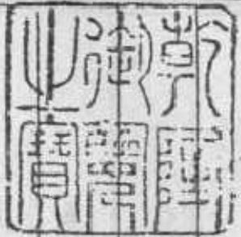

<!-- V3_SOURCE_ID:book020-b000202-p000-b382bb4ffb -->

<table><tr><td rowspan="1" colspan="1">“生之巳人書”，具体所指不详</td></tr><tr><td rowspan="1" colspan="1"></td></tr><tr><td rowspan="1" colspan="1">总校官编修臣王燕绪</td></tr><tr><td rowspan="1" colspan="1">校对官助敬臣罗万还</td></tr><tr><td rowspan="1" colspan="1">胜录盛生五胡锡珊</td></tr><tr><td rowspan="1" colspan="1"></td></tr><tr><td rowspan="1" colspan="1"></td></tr><tr><td rowspan="1" colspan="1"></td></tr><tr><td rowspan="1" colspan="1">灵城精义卷下</td></tr></table>

> **释读存疑：** “生之巳人書”具体所指不详

查看对应原文

<!-- V3_FOLDBACK_BEGIN:book020-b000202-p000-b382bb4ffb -->

<table><tr><td rowspan=1 colspan=1>生之巳人書</td></tr><tr><td rowspan=1 colspan=1></td></tr><tr><td rowspan=1 colspan=1>總校官編修臣王燕緒</td></tr><tr><td rowspan=1 colspan=1>校對官助敬臣羅萬還</td></tr><tr><td rowspan=1 colspan=1>勝錄盛生五胡錫珊</td></tr><tr><td rowspan=1 colspan=1></td></tr><tr><td rowspan=1 colspan=1></td></tr><tr><td rowspan=1 colspan=1></td></tr><tr><td rowspan=1 colspan=1>靈城精義卷下</td></tr></table>

<!-- V3_FOLDBACK_END:book020-b000202-p000-b382bb4ffb -->

<!-- V3_SOURCE_ID:book020-b000203-p000-99d79c5d5f -->

钦定四库全书 子部七

查看对应原文

<!-- V3_FOLDBACK_BEGIN:book020-b000203-p000-99d79c5d5f -->

欽定四庫全書 子部七

<!-- V3_FOLDBACK_END:book020-b000203-p000-99d79c5d5f -->

<!-- V3_SOURCE_ID:book020-b000204-p000-a2b5ce7ec5 -->

宅经 提要

查看对应原文

<!-- V3_FOLDBACK_BEGIN:book020-b000204-p000-a2b5ce7ec5 -->

宅經 提要

<!-- V3_FOLDBACK_END:book020-b000204-p000-a2b5ce7ec5 -->

<!-- V3_SOURCE_ID:book020-b000205-p000-26a2faf24b -->

臣等谨案：《宅经》二卷，旧本题为黄帝所撰。查《汉书·艺文志》形法家类有《宫宅地形》二十卷，可见相宅之书比相墓之书更为古老。然而《隋书·经籍志》有《宅吉凶论》三卷、《相宅图》八卷，《旧唐书·经籍志》有《五姓宅经》二卷，都没有说出自黄帝之手，这部书大概是依托古人之作。书中称黄帝二宅经及……

查看对应原文

<!-- V3_FOLDBACK_BEGIN:book020-b000205-p000-26a2faf24b -->

臣等謹案宅經二卷舊本題曰黃帝撰案漢 志形法家有宮宅地形二十卷則相宅之書 較相墓為古然隋志有宅吉凶論三卷相宅 圗八卷舊唐志有五姓宅經二卷皆不云出黃 帝是書蓋依託也考書中稱黃帝二宅經及

<!-- V3_FOLDBACK_END:book020-b000205-p000-26a2faf24b -->

<!-- doc011 PDF 第 83 页：HTML 表格 OCR 供搜索；图表以原页图为准。 -->
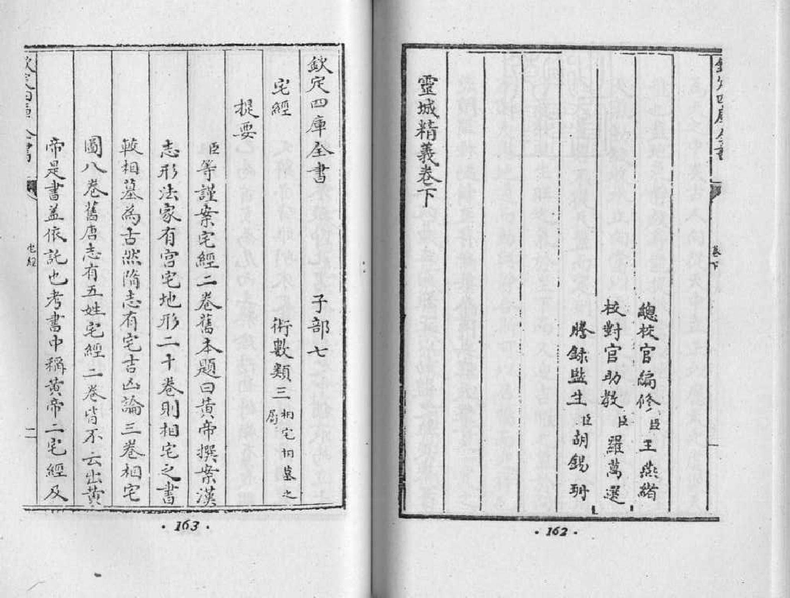

<!-- V3_SOURCE_ID:book020-b000207-p000-b885265256 -->

《淮南子》、李淳风、吕才等人的宅经共有二十九种，可见这部书成书之时本未伪称是黄帝时期的作品，当时方技之流想要让自己的学说显得神秘，才假托是黄帝所作罢了。其方法是分二十四路考察休咎，以八卦的位置定向：乾、坎、艮、震及辰为阳，巽、离、坤、兑及戌为阴；阳以亥为始，巳为终；阴以巳为始，亥为终，主旨在于阴阳相得，颇有义理，文辞也都典雅纯正。《宋史·艺文志》五行类有《相宅经》一卷，怀疑就是这部书，在术数之中还算是最接近古代的。

查看对应原文

<!-- V3_FOLDBACK_BEGIN:book020-b000207-p000-b885265256 -->

淮南子李淳風呂才等宅經二十有九種則作書之時本不偽稱黃帝時方技之流欲神其說詭題黃帝作耳其法分二十四路考尋休咎以八卦之位向乾坎艮震及辰為陽巽離坤兌及戌為陰陽以亥為首巳為尾陰以巳為首亥為尾而主於陰陽相得頗有義理文辭亦皆雅馴宋史藝文志五行類有相宅經一卷疑即此書在術數之中猶最為近古

<!-- V3_FOLDBACK_END:book020-b000207-p000-b885265256 -->

<!-- V3_SOURCE_ID:book020-b000208-p000-02e0c7d8b0 -->

乾隆四十六年十月，恭敬校上。

查看对应原文

<!-- V3_FOLDBACK_BEGIN:book020-b000208-p000-02e0c7d8b0 -->

者矣乾隆四十六年十月恭校上

<!-- V3_FOLDBACK_END:book020-b000208-p000-02e0c7d8b0 -->

<!-- V3_SOURCE_ID:book020-b000209-p000-9b488ae8a2 -->

此处表格内容为：第一行第一格标注“2公”，其余单元格为空；表格末尾依次标注“總校官臣陸費墀”“總纂官臣紀的臣陸錫熊孫士殺”。

> **释读存疑：** “紀的”“孫士殺”疑为OCR识别错误，具体所指不详

查看对应原文

<!-- V3_FOLDBACK_BEGIN:book020-b000209-p000-9b488ae8a2 -->

<table><tr><td rowspan=1 colspan=1>2公</td><td rowspan=1 colspan=2></td><td rowspan=1 colspan=2></td><td rowspan=1 colspan=2></td><td rowspan=1 colspan=2></td><td rowspan=1 colspan=2></td><td rowspan=1 colspan=1>總校官臣陸費墀</td><td rowspan=1 colspan=1>總纂官臣紀的臣陸錫熊孫士殺</td></tr></table>

<!-- V3_FOLDBACK_END:book020-b000209-p000-9b488ae8a2 -->

<!-- V3_SOURCE_ID:book020-b000210-p000-0bd8e82214 -->

住宅是阴阳的枢纽、人伦的准则，若非博物通达、贤明的人，是无法领悟这一道理的。在各类相关事项中，最为重要的唯有宅法这一真正的秘术。凡是人所居住的地方，无不是住宅，即便住宅大小不等，阴阳属性有别，哪怕是临时客居的一间房屋，也存在善恶的分别。影响大的就从大的范畴论断，影响小的就从更小的范围分析，触犯了相关规则就会遭遇灾祸，用相应的方法镇压就能止住灾祸，这就像药物能治疗疾病的效用一样。所以住宅是人的立身根本，人以住宅为家，如果住宅安稳，家族世代都会昌盛吉祥；如果住宅不安稳，家族就会衰败式微。坟墓、山川冈阜的相关论断，也和这个说法一致。上到军国大事，其次到州郡县邑的设置，下到村落、坊市、官署、栅栏的排布，乃至山中的居所，只要是人活动停留的地方，都适用这个规律。这类情况都是亲眼所见、亲耳所闻的，古代的相关制度并不是只有一种。

查看对应原文

<!-- V3_FOLDBACK_BEGIN:book020-b000210-p000-0bd8e82214 -->

夫宅者乃是陰陽之樞紐人倫之軌模非夫博物明賢而能悟斯道也就此五種其最要者唯有宅法而真秘術凡人所居無不在宅雖只大小不等陰陽有殊縱然客居一室之中亦有善惡大者大說小者小論犯者有災鎮而禍止猶藥病之效也故宅者人之本人以宅為家居若安即家代昌吉若不安即門族裒微墳墓川岡並同茲說上之軍國次及州郡縣邑下之村坊署柵乃至山居但人所處皆其例焉目見耳聞古制非一

<!-- V3_FOLDBACK_END:book020-b000210-p000-0bd8e82214 -->

<!-- V3_SOURCE_ID:book020-b000211-p000-202fe4bb17 -->

相关的宅经有《黄帝二宅经》《地典宅经》《三元宅经》《文王宅经》《孔子宅经》《宅锦》《宅挠》《宅统》《宅镜》《天老宅经》《刘根宅经》《玄女宅经》《司马天师宅经》《淮南子宅经》《王微宅经》《司最宅经》《刘晋平宅经》《张子毫宅经》《八卦宅经》《五兆宅经》《玄悟宅经》《六十四卦宅经》《右盘龙宅经》《李淳风宅经》《五姓宅经》《吕才宅》。

查看对应原文

<!-- V3_FOLDBACK_BEGIN:book020-b000211-p000-202fe4bb17 -->

黃帝二宅經地典宅經三元宅經文王宅經孔子宅經宅錦宅撓宅統宅鏡天老宅經劉根宅經玄女宅經司馬天師宅經淮南子宅經王微宅經司最宅經劉晉平宅經張子毫宅經八卦宅經五兆宅經玄悟宅經六十四卦宅經右盤龍宅經李淳風宅經五姓宅經呂才宅

<!-- V3_FOLDBACK_END:book020-b000211-p000-202fe4bb17 -->

<!-- V3_SOURCE_ID:book020-b000212-p000-05189295ee -->

《飞阴乱伏宅经》《子夏金门宅经》《刁昙宅经》，以上列举的这些宅经，内容大多大同小异，也都自称所记载的内容秘奥精妙，互相评判彼此的长短优劣。如果不广泛参考各类相关记载，使用的时候就会有疏漏不足。近来的学者大多专攻五姓八宅、黄道白方这类说法，这类做法都违背了大经的要旨，难免会招来灾祸。所以有人在修建改造住宅时触犯了相关规则，导致建好的住宅不能安居，反而归罪于阴阳之理没有应验依据，这难道不令人痛惜吗？况且先贤流传下来的典籍，道理本就清晰显明，只是人们自己昏蒙无知，日常应用却不能认知其中的征象，比如日月、乾坤、寒暑、雌雄、昼夜、阴阳等，这些概念包罗万象，举一类就能推知千种相关的事理，运化变动没有形迹却能化育万物，阴阳的道理实在是宏大深奥啊。原文记载“經之陰者生化物清之母也”“陽者生化物情之父也”，此处文字疑似存在讹误，暂时无法准确释读。阴阳是天地的本始，是孕育万物的至尊存在，顺应它就会运势亨通，违背它就会困顿不顺，这和尽忠奉公就能获得爵位、违背命令就会招来灾祸有什么区别呢？如今我整理了诸多灵验的秘术，分为二十四路，搭配八卦九宫，匹配男女的方位，划分住宅阴阳的分界，考察吉凶祸福，都没有超出之前所说的二宅范畴，这确实是护养生灵的圣法。所谓二十四路，是根据住宅的大小，在中院的四个方向划分出二十四路，十天干、十二地支加上乾、艮、坤、巽四卦，合起来就是二十四路。乾统领三男，震、坎、艮都属于阳位，即从西北乾位到震位都属于阳的范畴。坤统领三女，巽、离、兑都属于阴位，原文此处有“即從東南巽角順 成為陰明矣”的表述，存在文本残缺，具体含义无法完全确定。所以阳不会独自旺盛，需要得到阴的配合。

> **释读存疑：** “經之陰者生化物清之母也”“陽者生化物情之父也”存在文字讹误无法准确释读；“即從東南巽角順 成為陰明矣”存在文本残缺，具体指向不明

查看对应原文

<!-- V3_FOLDBACK_BEGIN:book020-b000212-p000-05189295ee -->

經飛陰亂伏宅經子夏金門宅經刁曇宅經已上諸經其皆大同小異亦皆自言秘妙互惟短長若不遍求即用之不足近來學者多攻五姓八宅黄道白方例皆違犯大經未免災咎所以人犯修動致令造者不居却毀陰陽而無據效豈不痛哉況先賢垂籍城易昭彰人自冥蒙日用而不識其象者日月乾坤寒暑睢雄畫夜陰陽等所以包羅萬象舉一千從運變無形而能化物大矣哉陰陽之理也經之陰者生化物清之母也陽者生化物情之父也作天地之祖為孕育之尊順之則亨逆之則否何異公忠受爵違命變殃者乎今操諸秘驗分為二十四路八卦九宮配女男之位宅陰陽之界考尋休咎並無出前二宅此實養生靈之聖法也二十四路者隨宅大小中院分四面作二十四路十千十二支乾艮坤巽共為二十四路是也乾將三男震坎艮悉屬於陽位 即從西北乾位 之震為陽明矣 坤將三女巽離兌悉屬陰之位 即從東南巽角順 成為陰明矣 是以陽不獨王以陰為得

<!-- V3_FOLDBACK_END:book020-b000212-p000-05189295ee -->

<!-- V3_SOURCE_ID:book020-b000213-p000-20ef4f1947 -->

适宜修造。阴不能独自成为主导，要以获得阳的配合为得当，上文所讲的道理也和以下规律相同：就像冬季以温暖为效用，夏季以清凉为效用，男子以女子的配合为和顺，女子以男子的配合为和顺的道理是一样的。《易诀》说：阴得到阳的配合，就像暑天得到清凉，五姓都能和睦安顺，百事都会兴旺昌盛。所以德位高壮、蔼密就吉祥，出现重阴或者重阳的情况就凶险。阳宅更偏向吸纳东方、北方的气，阴宅更偏向吸纳西方、南方的气，这是很重要的要点。东面对应辰位，南西面对应戌位，从北位斜着划分出一条线作为阴阳的分界。凡是阳宅，就有阳气环抱阴的格局；阴宅就有阴气环抱阳的格局。所谓阴阳之宅，对应的就是龙的格局。阳宅的龙头在亥位，龙尾在巳位；阴宅的龙头在巳位，龙尾在亥位。对应龙的形态的，阴龙为青色，阳龙为赤色，各有对应的命坐方位，一定要切忌触犯。大凡从巽位朝向乾位、从午位朝向子位的格局，各有对应的命坐，切忌触犯。

> **释读存疑：** 1轮自动修复后核义模型仍建议修订，已保守记录。

查看对应原文

<!-- V3_FOLDBACK_BEGIN:book020-b000213-p000-20ef4f1947 -->

為宜修 陰不獨王以陽為得 如上 亦如冬以溫喚為德陰方夏以涼冷為德男以女為德女以男為德之義易訣云陰得陽如暑得涼五姓咸和百事俱昌所以德位高壯藹密即吉重陰重陽則凶陽宅更招東方北方陰宅更招西方南方為重也 是東面為辰南西面為戍北 之位斜分一條為陰陽之界 凡之陽宅即有陽氣抱陰陰宅即有陰氣抱陽陰陽之宅者即龍也陽宅龍頭在亥尾在已陰宅龍頭在巳尾在亥其狀在龍者陰龍青陽龍凡從巽向乾從午向子是申赤各有命坐切忌犯也

<!-- V3_FOLDBACK_END:book020-b000213-p000-20ef4f1947 -->

<!-- V3_SOURCE_ID:book020-b000214-p000-475427d760 -->

确定店宅朝向：从艮位朝向酉位朝向卯位移动、从戌位朝向辰位移动，以上这类移转行动，以及官员赴任的去向，不论路程远近，都归入阳的范畴。从乾位朝向巽位移动、从子位朝向午位移动、从艮位朝向坤位移动、从卯位朝向酉位移动、从辰位朝向戌位移动，这类移转及相关行动都归入阴的范畴。所以福德的方位，要严格遵循天道，等天德、月德、生气降临到对应方位时，就要将该方位修整得清洁厚实，这样全家就能获得安宁，享有荣华富贵。天德是住宅的财命，财命强盛的话，何愁家族不兴旺？所以必须勤于修整相关方位。第二次出入阴阳方位，就叫做无气；第三次重复出入阴阳方位，叫做无魂；第四次出入叫做无魄，魂魄都没有了，就会家破人散，子孙绝后。经书上说“连化不止，减门绝嗣”，说的就是这种情况。如果只是出入阴阳方位一次，就符合天道的规律，自然是吉祥昌盛的征象。如果需要多次往返，就需要沿着道路停留四十五天再出发。

> **释读存疑：** 本地硬校验仍未通过，已记录供后续自动处理或人工核对。

查看对应原文

<!-- V3_FOLDBACK_BEGIN:book020-b000214-p000-475427d760 -->

定店向艮從酉向卯從戌向辰移 已上移轉及上官所往 不計遠近悉入陽也乾向巽從子向午從艮向坤從卯向酉從辰向戌移移將及上 故福德之方勤依天道天德月德生氣到悉名入陰其位即修令清潔關厚即一家獲安榮華富貴天之 德者宅之財命也財命既壯 何愁不榮故須勤修 再入陰入陽是名無氣三度重入陰陽謂之無魂四入謂之無魄魂魄既無即家破逃散子孫絕後也 經云連化不止減 門絕嗣此之謂也 若一陰陽往來即合天道自然吉昌之象也設要重往即須遂道住四十五日

<!-- V3_FOLDBACK_END:book020-b000214-p000-475427d760 -->

<!-- V3_SOURCE_ID:book020-b000215-p000-b4c2abe6e7 -->

满七十五日之后前往就没有过错，仍然要朝向生气、福德的方位才会吉祥，如果再触犯五鬼、绝命、刑祸的，尤其不利。诀说：行不得度，不如复故，说的就是这个道理。又说：住宅运势穷困，要赶紧翻修改建旧有的房屋，应该拆掉刑祸方的屋舍，转而扩建福德方的区域。又说：翻修改建住宅、平整围墙，可以用来消除灾殃。如果住宅的行年运势不利，或是出现口舌纠纷、疾病等情况，就应该翻修刑祸方的区域，添补扩建福德方的区域，改动移动墙壁的位置，就能消除灾祸，获得极大的吉利昌隆。辨别住宅吉凶的，都要以屋主迁入的方位为准，不把街北、街东固定认定为阳位，只要是符合阳位的格局，作为阴宅居住就吉利；街南、街西也不固定认定为阴位，不妨碍作为阳宅来居住。凡是迁入的情况，不论距离远近，一里、百里、千里，十步和百步的规则都是一样的，符合格局就吉利。还有这两类住宅的修造，只需要等天道、天德、月德、生气方位到来的时候就动工修建，不需要避讳将军、太岁、豹尾、黄幡、黑方以及音姓宜忌，顺应阴阳二气的规律才是最核心的准则。这些神煞以及五姓、六十甲子，都是从阴阳二气衍生出来的，排列在各个方位，只主管一年的公共事务，所以不会造成灾祸。凡是各类刑煞处在刑祸方的，就算天德、月德运行到这个方位，也需要避开；如果神煞处在住宅的福德方，就等天德、月德、生气运行到这个方位的时候，必须动工修建，动用的工时越多效果越好，所以不需要避讳。如果不明白阴阳二气的运行规律，就算方位到了就动工修建，动用的工时多效果也好，所以不需要避讳。又说：刑祸的方位，要不断缩减再缩减，尚且担心灾殃无故找上门来；福德的方位，要不断拓宽再拓宽，子子孙孙都能享受荣华安乐。刑祸的方位一定要禁止侵占拓宽，也不能缩减得太厉害，缩减得太厉害就会导致气不足。

> **释读存疑：** 1轮自动修复后核义模型仍建议修订，已保守记录。

查看对应原文

<!-- V3_FOLDBACK_BEGIN:book020-b000215-p000-b4c2abe6e7 -->

七十五日往之无咎仍宜生氣福德之方始吉更犯五鬼絕命刑禍者尤不利訣云行不得度不如復故斯之謂也又云其宅乃窮急翻故宮宜拆刑禍方舍却益福德方也又云翻宅平牆可為銷殃 宅之行年不利或口舌疾病等即宜翻刑禍添益福德改移牆壁 即消災致其大吉昌也 夫辨宅者皆取移來方位不以街北街東為陽 不妨是陽之位作 陰宅居之即吉 街南街西為陰 不妨 作陽之居 凡移來不勒遠近一里百里千里十步與百步同 之吉又此二宅修造唯看天道天德月德生氣到即修之不避將軍太歲豹尾黃幡黑方及音姓宜忌順陰陽二氣為正此諸神殺及五姓六十甲子皆從二氣而生列在方隅直一年公事故不為災 凡諸刑殺在刑禍方者設 天德月德到亦須避之若神殺在宅福德方即待天億月德生氣到其位便須修之用功多即善故不避也若不明陰陽之氣到其位便須修之用功多即善故不避也若 又云刑禍之方缺復不明氣中小數故不能制其大綱荒福德之方連接長吉也 誠之高壯也福德方及牆舍 又云刑禍方牆舍位宜狹薄人家宜連 又云刑禍之方縮復縮猶恐災殃枉相逐福德之方拓復拓子子孫孫受榮樂 刑禍之方戒侵拓也 不得太縮縮即氣不

<!-- V3_FOLDBACK_END:book020-b000215-p000-b4c2abe6e7 -->

<!-- V3_SOURCE_ID:book020-b000216-p000-f56fcb1d99 -->

如果方位的增补超过了应有的度，就会折损当时的禄位和福分，福德所在的方位切忌随意侵占拓展，也不能拓展得太过度，过度的话福运的降临就会变得微薄，承受不住厚重的福分。凡事超出限度，侵占拓展的范围超过了本宅原本的规模，就叫做太过。又说：住宅有五种虚的情况，会让人贫困耗损；有五种实的情况，能让人富贵。宅屋宽大但居住的人少，是第一虚；宅门很大但内部空间狭小，是第二虚；院墙和院落不完备，是第三虚；井和灶的位置不对，是第四虚；宅基地大但房屋少、庭院空旷，是第五虚。宅屋狭小但居住的人多，是第一实；宅屋宽大但宅门偏小，是第二实；原文此处为“牆院完金三寶”，疑似存在OCR讹误，为第三实；宅屋偏小但饲养的六畜很多，是第四实；住宅的水系水沟向东南方向流，是第五实。又说：住宅如果正在逐渐兴旺，就不要轻易舍弃；宅屋没有出现衰败的征兆，就不要随意迁移，否则就会遭受灾祸。舍弃现有的居所去追求更宽大的住宅，未必能获得欢乐；根据家中人口的数量来规划建造房屋，一定能长寿安康，住宅不宜过于宽大。又说：良田即便土质肥沃，也要好好耕种才能长出好的庄稼；住宅即便格局很好，也要妥善修整挪移才能保持兴旺。原文末尾是“宅統之宅理 五”，存在文本残缺，具体含义无法确定。

> **释读存疑：** “牆院完金三寶”存在OCR讹误；末尾“宅統之宅理 五”文本残缺，具体指向不明

查看对应原文

<!-- V3_FOLDBACK_BEGIN:book020-b000216-p000-f56fcb1d99 -->

足不足則損时祿福德之方宜戒侵拓也亦不得太過太過即城福會至微不消厚福所臨也凡事足太過所侵拓之數過於 本宅名曰太過 又云宅有五虛令人貧耗五實令人富貴宅大人少一虛宅門大內小二虛牆院不完三虛井竈不處四虛宅地多屋少庭院廣五虛宅小人多一實宅大門小二寶牆院完金三寶宅小六畜多四實宅水溝東南流五實又云宅乃漸昌勿棄宮堂不衰莫移故為受殃舍居就廣未必有歡計口半造必得壽考 宅不宜廣又云其田雖良媾鋤乃芳其宅雖善修移乃昌宅統之宅理 五

<!-- V3_FOLDBACK_END:book020-b000216-p000-f56fcb1d99 -->

<!-- V3_SOURCE_ID:book020-b000217-p000-8a5e77d99e -->

宅墓是象征荣华的本源，得利的人所作遂心，失利的人妄生反心。墓凶宅吉，子孙官禄；墓吉宅凶，子孙衣食不足；墓宅俱吉，子孙荣华；墓宅俱凶，子孙移乡绝种，先灵谴责，地祸常并七世，亡魂悲忧受苦，子孙不立，零落他乡，流转如蓬，客死河岸。青乌子说：其宅得墓，二神渐护，子孙禄位乃固；得地得墓，龙骧虎步，物业滋川，财集仓库，子孙忠孝，天神祐助。子夏说：墓有四奇，商角二姓丙壬乙辛，宫羽徵三姓甲庚丁癸，得地得宫，刺史王公，朱来紫绶。

> **释读存疑：** “商角二姓丙壬乙辛，宫羽徵三姓甲庚丁癸”具体对应规则原文未明，“朱来紫绶”疑为“朱绂紫绶”讹误，具体所指不详

查看对应原文

<!-- V3_FOLDBACK_BEGIN:book020-b000217-p000-8a5e77d99e -->

宅墓以象榮華之源得利者所作遂心失利者妄生反 心墓凶宅吉子孫官祿墓吉宅凶子孫衣食不足墓宅 俱吉子孫榮華墓宅俱凶子孫移鄉絕種先靈譴貴地 禍常併七世亡魂悲憂受苦子孫不立零落他鄉流轉 如蓬客死河岸青烏子云其宅得墓二神漸護子孫祿 位乃固得地得墓龍驤虎步物業滋川財集倉庫子孫 忠孝天神祐助子夏云墓有四奇商角二姓丙壬乙辛 宮羽徵三姓甲庚丁癸得地得宮刺史王公朱來紫綬

<!-- V3_FOLDBACK_END:book020-b000217-p000-8a5e77d99e -->

<!-- V3_SOURCE_ID:book020-b000218-p000-661fe8ab80 -->

世人看重名声显赫之人，若得地却失宫，便会有始无终；先人会受苦，子孙也会遭遇凶险。若失地却得宫，子孙便不会穷困。即便没有基业，衣食也会充足。若失地又失宫，就会断绝后嗣，踪迹全无，只能靠乞讨求食，客死荒野。子夏说：人因住宅而立足，住宅因人而得以存在，人与住宅相互扶持，能感应天地，所以不能只相信命运。以下是修宅的次第方法。

查看对应原文

<!-- V3_FOLDBACK_BEGIN:book020-b000218-p000-661fe8ab80 -->

世貴名雄得地失宮有始無終先人受苦子孫當凶失地得宮子孫不窮雖無基業衣食過充失地失宮絕嗣無蹤行求衣食客死蒿蓬子夏云人因宅而立宅因人得存人宅相扶感通天地故不可獨信命也凡修宅次第法

<!-- V3_FOLDBACK_END:book020-b000218-p000-661fe8ab80 -->

<!-- V3_SOURCE_ID:book020-b000219-p000-cda0c7c521 -->

先修整与刑祸相关的事宜，再修整与福德相关的事宜，就会吉利；先修整与福德相关的事宜，再修整与刑祸相关的事宜，就会凶险。阴宅要从巳位开始动工，顺着方向运转；阳宅要从亥位开始动工，顺着方向运转。处理刑祸方位的事宜要耗用一百工，处理福德方位的事宜要耗用二百工，用这样的方式压制住刑祸就会吉利。阳宅的修整多在外部进行，阴宅的修整多在内部进行。有人选取子午作为划分阴阳的界限，这是非常错误的，这是因为二气暗中相通、循环运转的规律各有不同。八卦、九宫是分别形态、排布征象，对应男女的位置。冬至对应的巳位、夏至对应的亥位，是阴阳开始旺盛的极点，和此前的分界不同，圣人在池面上画八卦，排布对应男女的宫位，这里说的宫就是宅，比如巽被归为长女，属阴；乾为天，天属阳，这是很明确的。那些有出众才能、深远智谋，爱惜万物、尊重并通晓这套方法的人，能获得的好处无法估量。如果严重触犯相关的禁忌，就会家破人亡、家人逃散；如果是较轻的触犯，就会丢失爵位、失去官职；其余各类杂犯，还会遭遇火灾、口舌是非、跛脚、半身不遂、衰败祸殃、疾病等各种各样的祸事，怎么能轻视这些禁忌呢？如果触犯的位置远且影响较轻，就会在半年、一年、二年、三年之后才显现出祸端；如果触犯的位置近且影响严重，就会在七十五日、四十五日，甚至当月就显现出祸端。如果看到这个图的人，自己

> **释读存疑：** ‘聖人於池面上畫八卦’中‘池面’具体所指原文未明；1轮自动修复后核义模型仍建议修订，已保守记录。

查看对应原文

<!-- V3_FOLDBACK_BEGIN:book020-b000219-p000-cda0c7c521 -->

先修刑禍後修福德即吉先修福德後修刑禍即凶陰宅從已起功順轉陽宅從亥起功順轉刑禍方用一百工福德方用二百工壓之即吉陽宅多修於外陰宅多修於內或者取子午分陰陽之界悞將甚也此是二氣潛通運迴之數不同八卦九宮分形列象配男女之位也 冬至已夏至亥是陰陽起盛之極處不同聖人於池 面上畫八卦列女男之宮宮者宅也集為長女屬陰乾為天天 為陽明矣 其有長才深智慾物愛生敬曉斯門其利莫測且大犯即家破逃散小犯則失爵亡官其餘雜犯火光口舌跛蹇偏枯衰殃疾病等萬般皆有豈得輕之哉犯處遠而慢即半年一年二年三年始發犯處近而緊即七十五日四十五日或不出月即發若見此圗者自

<!-- V3_FOLDBACK_END:book020-b000219-p000-cda0c7c521 -->

<!-- V3_SOURCE_ID:book020-b000220-p000-d797b71ea1 -->

若能领悟其中的道理，就不分愚笨还是聪慧，只要自己修行福德，就不会招惹灾殃，官禄会顺利晋升，钱财食物丰足有余，六畜也能获得安宁，还能得享天年长寿。金玉这类供献的宝物，算不上珍贵，能带来利益救济的事物，没有比它更大的了。可以每家收藏一本，用来训诫子孙，秘密珍藏起来，可以命名为《宅镜》。还有《宅书》提到：拆除旧屋营建新宅，要占卜爻象、察看地脉的起伏态势，迁移住址不论是往南还是往北，阴阳之气交汇分布才是和顺。阴阳就是气，会随着人的不同发生变化；吉凶是运化的结果，会顺着事态的发展显现兴废。所以天地运转没有穷尽，人畜鬼神的变化，又有什么固定的准则呢？《榕神记》记载：精灵鬼魅都会化为人形，也有人自身相互感应变化成妖怪，就像不同属性的树木嫁接后继续生长，根苗虽然不同，不同的味道混杂在一起，有形体的事物尚且能跟着产生变通。钦定《四库全书》中提到，阴阳本是虚无变化的，怎么会是恒定不变的？由此可知，住宅本身没有固定的宅气，是随着人的迁移迁入发生变化的。又有说法认为：住宅把地形地势当作身体，把泉水当作血脉，把土地当作皮肉，把草木当作毛发，把房屋当作衣服，把门户当作帽子和腰带。如果这些方面都能合乎规制，所有事宜都规整妥当，就是上吉的住宅。《三元经》说：土地肥沃种苗就长得茂盛，住宅吉利居住的人就会兴旺。又说：有福气的人，就像容貌姣好的人；吉利的住宅，就像相貌丑陋的人得到了好看的衣裳，神采会额外增添一半。如果福分浅薄加上住宅不吉，就像丑陋的人还穿着破旧的衣服，怎么能承受得住呢？所以人居住的住宅，一定要慎重选择。又有说法称：修整来路就没有不吉利的，触犯抵路就从来没有安稳的。原文此处作“假如近從來來入此宅住後”，表述存在讹误，具体含义不明。

> **释读存疑：** 原文“假如近從來來入此宅住後”存在衍字讹误，具体含义无法确定

查看对应原文

<!-- V3_FOLDBACK_BEGIN:book020-b000220-p000-d797b71ea1 -->

然悟會不問愚智福德自修災殃不犯官紫進達財食豐盈六畜獲安又歸天壽金玉之獻未足為珍利濟之徒莫大於此可以家藏一本用誠子孫祕而寶之可名宅鏡又宅書云拆故營新爻卜相伏移南徙北陰陽交分是和陰陽者氣也逐人得變吉凶者化也隨事能興故天地運轉無窮人畜鬼神變化何準榕神記云精靈鬼魅皆化為人或有人自相感變為妖怪亦如異性之木接續而生根苗雖殊異味相雜形璇之物尚隨變通金定四庫全書陰陽虛無豈為常定是知宅非宅氣由移來以變之又云宅以形勢為身體以泉水為血脈以土地為皮內以草木為毛髮以舍屋為衣服以門戶為冠帶若得如期是事儼雅乃為上吉三元經云地善即苗茂宅吉即人榮又云人之福者喻如美貌之人宅之吉者如闕陋之子得好衣裳神彩尤添一半若命薄宅惡即如酣人更又衣弊如何堪也故人之居宅大須慎擇又云修來路即無不吉犯抵路未嘗安假如近從來來入此宅住後

<!-- V3_FOLDBACK_END:book020-b000220-p000-d797b71ea1 -->

<!-- V3_SOURCE_ID:book020-b000221-p000-5b28707d8c -->

再往西方修整拓展，叫做抵路；往东方修整拓展，叫做来路。其余方位的移动转换，以及官员往来，不管距离远近，都依照这个作为准则。凡是人婚嫁、购买庄田、六畜，修建坟地，求官、求取利益等事，都适宜朝着宅子的福德方出行往来，时间长了就会有吉庆之事。如果往刑祸方出行往来，时间长了就会不吉利。又忌讳龟头厅建在午地，朝向北正对堂屋，这种格局叫做凶亭，就算是稍有高耸的房屋也不吉利。口诀说：龟头厅建在午位，必定会更换屋主，也说会妨害屋主，各个宅院有这种情况也不吉利。凡是住宅在午巳以东、巽位以东有高楼大榭，都不吉利，应当拆除它才会吉利。又说：凡是想要进行修建、改造等动土工程，必须避开四王神，它也叫帝车、帝辂、帝舍。比如春季三个月，东方对应青帝，属木居旺位，寅对应帝车，卯对应帝辂，辰对应帝舍，也就是正月、二月、三月不能开东向的门。经书上说：触犯帝车的禁忌会害及父亲，触犯帝辂的禁忌会害及母亲，触犯帝舍的禁忌会害及子孙。夏季以及秋冬的三个月，都仿照这个规则设定禁忌。又说：每年有十二月，每个月都有生气和死气的方位，只要修整当月生气所在的方位，福气就会聚集，当月的生气与天道、月德相合，走对应的方位就会吉利。如果触犯当月死气所在的方位，就会招来凶灾。

查看对应原文

<!-- V3_FOLDBACK_BEGIN:book020-b000221-p000-5b28707d8c -->

更修拓西方名抵路卻修拓東方名來路餘方移轉及 上官往來不計遠近準此為例凡人婚嫁買莊田六畜 致營域上官求利等悉宜向宅福德方往來久久吉慶 若為刑禍方往來久久不利又忌龜頭廳在午地向北 衝堂名曰凶亭有稍高豎屋亦不利訣云龜頭午必易 主亦云妨主諸院有之亦不吉凡宅午已東巽已來有 高樓大榭皆不利宜去之吉又云凡欲修造動治須避 四王神亦名帝車帝輅帝舍假如春三月東方為青帝 木王寅為車卯為輅辰為舍即是正月二月三月不得 東戶經曰犯帝車殺父犯帝輅殺母犯帝舍殺子孫夏 及秋冬三箇月倣此為忌又云每年有十二月每月有 生氣死氣之位但修月生氣之位者福來集月生氣與 天道月德合其吉路犯月死氣之位為有凶災

<!-- V3_FOLDBACK_END:book020-b000221-p000-5b28707d8c -->

<!-- V3_SOURCE_ID:book020-b000222-p000-3d4a023f6f -->

正月的生气在子癸，死气在午丁；二月的生气在丑艮，死气在未坤；三月的生气在寅甲，死气在申庚；四月的生气在卯乙，死气在酉辛；五月的生气在辰巽，死气在戌乾；六月的生气

查看对应原文

<!-- V3_FOLDBACK_BEGIN:book020-b000222-p000-3d4a023f6f -->

正月生氣在子癸死氣在午丁二月生氣在丑艮死氣 在未坤三月生氣在寅甲死氣在申庚四月生氣在卯乙 死氣在酉辛五月生氣在辰巽死氣在戌乾六月生氣

<!-- V3_FOLDBACK_END:book020-b000222-p000-3d4a023f6f -->

<!-- V3_SOURCE_ID:book020-b000223-p000-6f8d4c9ee4 -->

在己丙，死气在亥壬；七月的生气在午丁，死气在子癸；八月的生气在未坤，死气在丑艮；九月的生气在申庚，死气在寅甲；十月的生气在酉辛，死气在卯乙；十一月的生气在戌乾，死气在辰巽；十二月的生气在亥壬，死气在己丙。

查看对应原文

<!-- V3_FOLDBACK_BEGIN:book020-b000223-p000-6f8d4c9ee4 -->

在己丙死氣在亥壬七月生氣在午丁死氣在子癸八月生氣在未坤死氣在丑艮九月生氣在申庚死氣在寅甲十月生氣在酉辛死氣在卯乙十一月生氣在戌乾死氣在辰巽十二月生氣在亥壬死氣在己丙

<!-- V3_FOLDBACK_END:book020-b000223-p000-6f8d4c9ee4 -->

<!-- V3_SOURCE_ID:book020-b000224-p000-b21901a946 -->

宅经卷上

查看对应原文

<!-- V3_FOLDBACK_BEGIN:book020-b000224-p000-b21901a946 -->

宅經卷上

<!-- V3_FOLDBACK_END:book020-b000224-p000-b21901a946 -->

<!-- V3_SOURCE_ID:book020-b000225-p000-64d9ff2e76 -->

钦定四库全书

查看对应原文

<!-- V3_FOLDBACK_BEGIN:book020-b000225-p000-64d9ff2e76 -->

欽定四庫全書

<!-- V3_FOLDBACK_END:book020-b000225-p000-64d9ff2e76 -->

<!-- V3_SOURCE_ID:book020-b000226-p000-e76e709ff0 -->

宅经卷下

查看对应原文

<!-- V3_FOLDBACK_BEGIN:book020-b000226-p000-e76e709ff0 -->

宅經卷下

<!-- V3_FOLDBACK_END:book020-b000226-p000-e76e709ff0 -->

<!-- V3_SOURCE_ID:book020-b000227-p000-7183f32f90 -->

凡是修筑围墙、建造住宅房屋，土气冲犯的方位，居住的人家就会遭遇灾殃，应当按照相应的方法禳除，此处原文的“穰”是“禳”的通假字。

查看对应原文

<!-- V3_FOLDBACK_BEGIN:book020-b000227-p000-7183f32f90 -->

凡修築垣牆建造宅宇土氣所衝之方人家即有災殃 宜依法穰之

<!-- V3_FOLDBACK_END:book020-b000227-p000-7183f32f90 -->

<!-- V3_SOURCE_ID:book020-b000228-p000-2f649ad293 -->

正月对应土气衡丁未方；二月对应坤；三月对应壬亥；四月对应辛戌；五月对应乾；六月对应寅甲；七月对应癸丑；八月对应艮；九月对应丙巳；十月对应辰乙；十一月对应巽；十二月对应申庚。

查看对应原文

<!-- V3_FOLDBACK_BEGIN:book020-b000228-p000-2f649ad293 -->

正月土氣衡丁未方二月坤三月壬亥四月辛戌五月 乾六月寅甲七月癸丑八月艮九月丙巳十月辰乙十 一月巽十二月申庚

<!-- V3_FOLDBACK_END:book020-b000228-p000-2f649ad293 -->

<!-- V3_SOURCE_ID:book020-b000229-p000-4798126072 -->

以下所绘的图形无不详尽细致，但仔细察看起来，相关形制若犯忌必然会招致灾祸。天门是阳首，应当平隐稳固，实在不宜修得过高过壮，触犯这一规制会损害家中尊长，引发头颈部的大病等灾祸。五月在丁日、壬日修造吉利，北方修造不可用壬子日、丁巳日。亥对应朱雀龙头，是父命的命座方位，触犯该方位会危害命坐在此处的人；三月如果少壬，会招致大祸，是母命的命座方位，触犯该方位会危害命坐在此处的人。在壬日修造会招来飞来横祸、口舌是非。修造时遇巳、子对应死丧龙右手，是长媳的命座方位，触犯该方位会危害命坐在此处的人，和亥位犯忌的后果一致，命坐在此处的人会出现失魂、眼部损伤、遭遇水灾、口舌是非等情况。修巳位和修壬位的犯忌后果相同。癸对应罚狱勾陈，是次媳的命座方位，触犯该方位会危害命坐在此处的人，引发口舌纠纷、官司诉讼等灾祸。七月在丁日、壬日修造吉利，三月也适用相关修造规则；羽姓的人不适宜在三月修造，七月修造则吉利。丑对应宫狱，是幼媳的命座方位，触犯该方位会招来鬼魅、盗贼、火灾、怪异事件等灾祸。修巳位和修癸位的犯忌后果相同。鬼门方位的住宅如果气脉壅塞、形局缺薄空荒反而吉利，触犯该方位的规制会引发半身不遂、淋证肿胀等灾祸。此处原文“方日月子也七 方不用甲子已己日”存在断句讹误，具体含义无法完全确定，提到相关方位不用甲子日、己巳日。寅对应天刑龙背玄武，是庶养子的媳妇、长女的命座方位，触犯该方位会出现胎像受损、入狱、被盗、家业破败等灾祸。此处原文“六 月四修 角”存在断句讹误，具体含义不详。六月甲对应宅刑，是次女、孙辈男丁的命座方位，触犯该方位会危害命坐在此处的人，为凶兆，十一月修造吉利，命坐在此处的人家中尊长会患上头顶部位的伤病、骨折等灾祸。修该方位的犯忌后果和寅位相同。卯对应龙右胁刑狱，是少女、孙辈的命座方位，触犯该方位会危害命坐在此处的人，出现火灾、气息胀满、受刑受伤、失魂等情况。修该方位的犯忌后果和寅位相同。螣蛇对应讼狱客座，命座触犯该方位会危害命坐在此处的人，出现精怪作祟、死人、口舌是非等情况。此处原文“十七月日修吉”不符合常规历法，存在讹误，原文称相关时日修造吉利，只适宜房屋修得低矮窄小，仍然不能重叠修建。辰对应白虎龙右足，主掌官司诉讼、奴婢和六畜的运势，命座触犯该方位会出现受惊受伤、跛脚、筋脉拘急等灾祸，也主掌惊恐类的运势。风门应当平整。

> **释读存疑：** 原文“方日月子也七 方不用甲子已己日”存在断句讹误，具体含义无法完全确定；原文“六 月四修 角”存在断句讹误，具体含义不详；原文“十七月日修吉”不符合常规历法，存在讹误，修吉的准确时间无法确定；1轮自动修复后核义模型仍建议修订，已保守记录。

查看对应原文

<!-- V3_FOLDBACK_BEGIN:book020-b000229-p000-4798126072 -->

已下圗無不精詳但細看之必有災咎天門陽首宜平穩實不宜絕高壯犯之損家長大病頭項等災 五月丁壬日修吉北 方不川壬子丁巳日 亥為朱雀龍頭父命座犯者害命坐人 人三月少壬為大禍母命犯之害命坐人有 壬日修飛災口舌 修巳子為死喪龍右手長子婦命座犯之害 亥同命坐人失魂傷目水災口舌 修己 壬同 癸為罰獄勾陳次子婦命座犯之害命坐人口舌關訟等災 七月丁壬日修三月亦通言羽姓不宜三月 七月即吉 丑為宮獄少子婦命座犯之鬼魅盜賊火光怪異等災 修已 癸同 鬼門宅壅氣缺薄空荒吉犯之偏枯淋腫等災方日月子也七 方不用甲子已己日 寅為天刑龍背玄武庶養子婦長女命座犯之傷胎繫獄被盜亡敗等災六 月四修 角 六月甲為宅刑次女孫男等命座犯之害命 凶十一月吉坐人家長病頭頂諸傷折等災 修與 寅同 卯龍右脇刑獄少女孫命座犯之害命坐人火光氣滿刑傷失魂 修與寅同螣蛇訟獄客座命犯之害命坐人妖怪死喪口舌十七月日修吉惟宜屋低 小仍不得重 辰為白虎龍右足主訟獄奴婢六畜命座犯之驚傷跛蹇筋急等災亦主驚恐 風門宜平

<!-- V3_FOLDBACK_END:book020-b000229-p000-4798126072 -->

<!-- V3_SOURCE_ID:book020-b000230-p000-b13df2c7fc -->

这是一份表格形式的内容，各单元格对应的信息如下：第一行的内容依次为四a、2、（空）、子一、一、平、九老有乙六日；第二行的内容依次为海福北、海、修、学、臺；接下来的单元格中包含八卦之一的震、八卦之一的坎、杭、兰然、自大德帝外、府—5、令丑官獻5、行、子凡$位、壬大禍母命、亥來在龍頭命、天門五月丁壬日治，另有部分单元格为空白。

查看对应原文

<!-- V3_FOLDBACK_BEGIN:book020-b000230-p000-b13df2c7fc -->

<table><tr><td rowspan=1 colspan=1>四a</td><td rowspan=1 colspan=1>2</td><td rowspan=1 colspan=1></td><td rowspan=1 colspan=1>子一</td><td rowspan=1 colspan=1>一</td><td rowspan=1 colspan=2>平</td><td rowspan=1 colspan=1>九老有乙六日</td></tr><tr><td rowspan=1 colspan=1>海福北</td><td rowspan=1 colspan=1>海</td><td rowspan=1 colspan=3>修</td><td rowspan=1 colspan=2>学</td><td rowspan=1 colspan=1>臺</td></tr><tr><td rowspan=4 colspan=1>P</td><td rowspan=4 colspan=1></td><td></td><td></td><td></td><td></td><td></td><td></td></tr><tr><td></td><td></td><td></td><td></td><td rowspan=1 colspan=1></td><td></td></tr><tr><td rowspan=5 colspan=1>震</td><td rowspan=5 colspan=3></td><td rowspan=5 colspan=2></td><td></td></tr><tr><td rowspan=1 colspan=1></td></tr><tr><td rowspan=2 colspan=1>E</td><td></td></tr><tr><td rowspan=1 colspan=1>自大德帝外</td></tr><tr><td rowspan=1 colspan=1>2</td><td rowspan=2 colspan=6>坎 杭</td><td rowspan=1 colspan=1></td></tr><tr><td rowspan=1 colspan=1>兰然</td><td rowspan=1 colspan=1>府—5</td></tr><tr><td rowspan=1 colspan=1></td><td rowspan=1 colspan=1>令丑官獻5</td><td rowspan=1 colspan=1>行</td><td rowspan=1 colspan=1>子凡$位</td><td rowspan=1 colspan=1>壬大禍母命</td><td></td><td rowspan=1 colspan=1>亥來在龍頭命</td><td rowspan=1 colspan=1>天門五月丁壬日治</td></tr></table>

<!-- V3_FOLDBACK_END:book020-b000230-p000-b13df2c7fc -->

<!-- V3_SOURCE_ID:book020-b000231-p000-daf624b2ee -->

缺名福首的方位是背枯向荣，二宅、五姓、八宅的相关位置都不适宜修得高壮、堵塞不通，也属于阳极阴首。十一月在丙日、辛日修造吉利，南方修造不可用丙子日到辛巳日之间的日子。巳位对应天福宅屋，也叫宅极，经书上说想要得到官职，修整宅极的位置适宜修得壮实，修改后吉利。九月在丙日、辛日修造，只要耗费的功夫多效果就好。丙位对应明堂，是宅福方位，适宜修建门户、牛棚、仓库等房舍，经书上说修整明堂能加官晋爵、增加俸禄，非常吉祥，全家安乐无忧。巳位、午位是吉昌之地，对应龙左足，经书上说修整吉昌之地，家中会奴婢众多、六畜长势良好，该位置适宜平整扎实，忌讳修得过高以及修建龟头厅。如果修造触犯丁天仓的规制，会出现财物耗散流失的灾祸；修整天仓的位置，适宜将仓库、六畜圈舍修得壮实厚重、高大开阔，这样吉利。正月丙平日修造未位的天府，修建高楼大舍，让牛羊、奴婢居住在其中，会大量繁衍，耗费功夫多的话住宅就会非常吉利。

> **释读存疑：** 1轮自动修复后核义模型仍建议修订，已保守记录。

查看对应原文

<!-- V3_FOLDBACK_BEGIN:book020-b000231-p000-daf624b2ee -->

缺名福首背枯向榮二宅五姓八宅並不宜高壯壅塞亦陽極陰首 十一月丙辛日修吉南 方不用丙子至辛己日 已天福宅屋亦名宅極經曰欲得職治宅極宜壯實修改吉 九月丙辛修 唯用功多良丙明堂宅福安門牛倉等舍經云治明堂加官蓋祿大吉祥合家快活不可當位巳午吉昌之地龍左足經云治吉昌奴婢成行六畜良宜平實忌高及龜頭廳 修與丁天倉經云財耗亡治天倉宜倉庫六畜壯厚高拓吉正月丙平日 修未天府高樓大舍牛羊奴婢居之大孳 用功多大吉宅

<!-- V3_FOLDBACK_END:book020-b000231-p000-daf624b2ee -->

<!-- V3_SOURCE_ID:book020-b000232-p000-890b358cd7 -->

息仓、厕所的位置适宜修造，此处原文连续出现两个“修与”，疑似存在讹漏，具体含义不详。人门龙肠的位置适宜设置牛马厩，该位置要开拓得开阔、地基堆壅厚实，该位置也叫福囊，厚重且扎实就非常吉利。此处原文“二月日申玉堂”存在断句或文字讹误，无法确定准确时间，原文称玉堂方位设置牛马屋，主掌获得宝贝金玉之类的好事，修得壮实开阔就吉利，经书上说修整玉堂方位，会有钱财自动上门、六畜肥壮强盛的好事。庚位是宅德方位，适宜修建门户，设置车屋、鸡窝、碓碾之类的设施非常吉利，适宜开拓得连接成片、壮实开阔、干净整洁。中酉对应大德龙左胁，设置客舍吉利，经书上说修整大德方位，会富贵荣华、钱财多得以万亿计算，该位置也叫宅德，对宅主人有利。辛位是金匱天井方位，适宜设置门户以及修建高楼大屋，经书上说修整金匱方位，会大富大贵，求财等百事都吉利。四月在乙日、庚日修造吉利，地府青龙左手主掌三元相关的运势，有利于子孙，常加修造非常吉利。

> **释读存疑：** 原文“息倉廁利修與 修與”中连续出现两个“修与”，疑似讹漏，具体含义不详；原文“二月日申玉堂”存在断句或文字讹误，对应的准确修造时间无法确定；1轮自动修复后核义模型仍建议修订，已保守记录。

查看对应原文

<!-- V3_FOLDBACK_BEGIN:book020-b000232-p000-890b358cd7 -->

息倉廁利修與 修與 人門龍腸宜置牛馬廄其位欲開拓壅厚亦名福囊重而兼實大吉二月日申玉堂置牛馬屋主寶貝金玉之事壯實開拓吉經曰治玉堂財錢橫來六畜肥強庚宅德安門宜置車屋雞栖碓磑吉甚宜開拓連接壯闊淨潔吉 中 酉大德龍左脇客舍吉經曰治大德富貴資財成萬億亦名宅德宜宅主 辛金匱天井宜置門及高樓大屋經曰治金匱大富貴宜財百事吉 四月乙庚 地府青龍左手主三元宜子孫恒令修大吉

<!-- V3_FOLDBACK_END:book020-b000232-p000-890b358cd7 -->

<!-- V3_SOURCE_ID:book020-b000233-p000-13b089057a -->

《清净吉经》记载：青龙位壮实，主家富贵雄豪。外巽的方位适宜建造园林水池、竹制的簞，如果要建房屋，应当建得平整且低矮。外天德和玉堂的方位，应当拓展修整，让其壮实，这是大吉的布局。经书上说：福德的方位反复拓展，子子孙孙都能享受荣华安乐，只是不能在这个方位建高楼和多层房屋。外天仓与天府的方位，房屋不怕高大壮实，建楼舍、安门、修仓库、牛舍、奴仆住屋、车屋都很吉利。原文此处有“高 方 古 外龙 侵拓吉”的内容，具体含义不详。腹之位和内院一同设置牛马牢棚，这个位置也叫福裳，应当修得宽广厚实牢固，才吉利。外坤的方位适宜设置马厩，吉利；在这里放置沉重难移的物品以及建高楼等，都很吉利。外玉堂的院落，适宜建高大的堂屋，以及给郎君、年幼孙辈居住的院宅，吉利。客厅如果建得高大壮实、向外拓展，以及种有大树、建有多层房屋，就能招来金玉财宝，主家能得官爵、有喜事。外大德的宅位，应当拓展勤于修整，让其保持干净新亮，吉利；也适合在这里举办奏乐、宴饮的活动，适合作为子孙、女眷的院落，能出贵人，增加财富，尊贵的德行声望能传播到远方。外金匮、青龙两个方位，适宜建库房、仓窖，吉利；在这里建高楼大屋，利于积累财富，还利于子孙出豪杰贵人，能与皇室亲戚联姻，这两个方位要经常保持洁净，周边连接成片的林木花草要生长得茂盛繁密。

> **释读存疑：** “高 方 古 外龙 侵拓吉”为原文残断内容，具体所指不详

查看对应原文

<!-- V3_FOLDBACK_BEGIN:book020-b000233-p000-13b089057a -->

清淨吉經曰青龍壯高富貴雄豪外巽之位宜作園池竹簞設有舍屋宜平而薄外天德及玉堂之位宜開拓侵修令壯實大吉經曰福德之方拓復拓子子孫孫受榮樂唯不得高樓重舍外天倉與天府之位不厭高壯樓舍安門倉庫牛舍及奴 車屋並大吉高 方 古 外龍 侵拓吉腹之位與內院並同安牛馬牢廠亦名福裳宜廣厚實吉外坤宜置馬廄吉安重滯之物及高樓等並大吉外玉堂之院宜作崇堂及郎君孫幼等院吉客廳即有公客來若高壯侵拓及有大樹重屋等招金玉寶帛主印綬喜外大德宅位宜開拓勤修泥令新淨吉及作音樂飲會之事吉宜子孫婦女等院出貴人增財富貴德望遐振外金匱青龍兩位宜作庫藏倉窖吉高樓大舍宜財帛又宜子孫出豪貴婚連帝戚常令清淨連接聚林花木藹密

<!-- V3_FOLDBACK_END:book020-b000233-p000-13b089057a -->

<!-- V3_SOURCE_ID:book020-b000234-p000-234f1562de -->

此處為一殘缺表格，可辨認的內容如下：第一行有「R」、「第道十十fG」；第二行有「外业S管有」、「海 聘」、「f」、「5汽」；第三行有「N>>」、「雲」；第四行有「之3定」、「日」；第五行有「关2oer」、「国 是」；第六行有「早」、「民 坎 如」、「民 F3TE」；第七行有「783」、「丑天府」、「癸天倉子吉昌」、「龍壬明堂亥」、「沉天福龍尾」、「宅子 門五月丁壬日修」。表格中存在大量無法辨認的字符，具體所指不詳。

> **释读存疑：** 表格存在大量無法辨認的字符，具體所指不詳；表格存在大量无法辨认的字符，具体所指不详

查看对应原文

<!-- V3_FOLDBACK_BEGIN:book020-b000234-p000-234f1562de -->

<table><tr><td rowspan=1 colspan=1>R</td><td rowspan=1 colspan=2></td><td rowspan=1 colspan=2>第道十十fG</td><td rowspan=1 colspan=1></td><td rowspan=1 colspan=1></td></tr><tr><td rowspan=1 colspan=1>外业S管有</td><td rowspan=1 colspan=4>海  聘</td><td rowspan=1 colspan=1>f</td><td rowspan=1 colspan=1>5汽</td></tr><tr><td rowspan=1 colspan=1>N&gt;&gt;</td><td rowspan=1 colspan=2></td><td rowspan=3 colspan=1>雲</td><td rowspan=3 colspan=2></td><td rowspan=1 colspan=1></td></tr><tr><td rowspan=1 colspan=1>之3定</td><td></td><td></td><td rowspan=2 colspan=1></td><td rowspan=1 colspan=1>    日</td></tr><tr><td rowspan=1 colspan=1>关2oer</td><td></td><td></td><td rowspan=1 colspan=1>国  是</td></tr><tr><td rowspan=1 colspan=1>早</td><td></td><td rowspan=1 colspan=4>民   坎 如</td><td rowspan=1 colspan=1>民 F3TE</td></tr><tr><td rowspan=1 colspan=1>783</td><td></td><td rowspan=1 colspan=1>丑天府</td><td rowspan=1 colspan=1>癸天倉子吉昌</td><td rowspan=1 colspan=1>龍壬明堂亥</td><td rowspan=1 colspan=1>沉天福龍尾</td><td rowspan=1 colspan=1>宅子 門五月丁壬日修</td></tr></table>

<!-- V3_FOLDBACK_END:book020-b000234-p000-234f1562de -->

<!-- doc011 PDF 第 98 页：HTML 表格 OCR 供搜索；图表以原页图为准。 -->
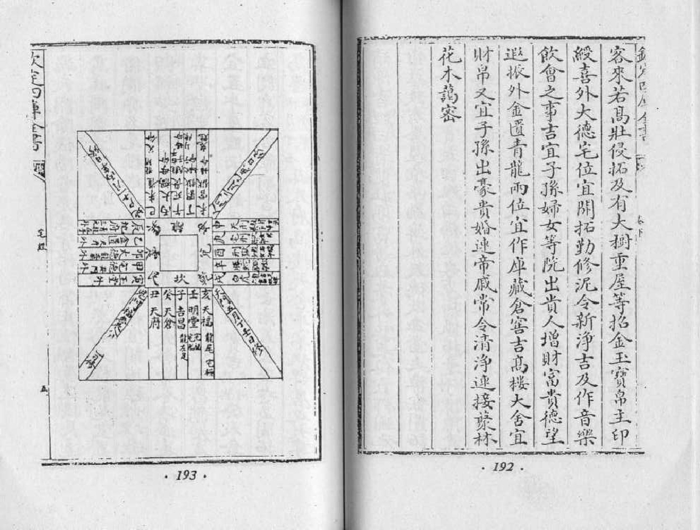

<!-- V3_SOURCE_ID:book020-b000236-p000-fb695517ea -->

乾位是天门，是阴的终点、阳的开端，也叫背枯向荣，这个方位的房屋连接得绵长深远、高大壮实、坚固严实，就吉利。适合在五月的丁日、壬日修治，壬子日、丁巳日不要用。亥位是天福龙尾，适宜设置猪栏，也叫宅极。经书上说：想要得到官职，修治宅极，应当向外拓展。亥位以东，三月的丁日、壬日修治吉祥。姓属宫、羽音的人，七月修治吉祥。壬位是宅福明堂，适宜建高楼大屋，要经常保持洁净，也适合在这里聚集人员研读经史书籍，这个方位也叫印绶宫，利于获得财富和官禄，修治的宜忌和亥位相同，非常吉利，修治子位就能吉利昌盛。子位叫龙左足，适宜建牛屋。经书上说：奴婢众多，六畜健壮平安，就吉利。公天仓的方位，设立门户、客舍、竹席棚、厕所都吉利。经书上说：如果出现财物耗损流失的情况，就修治天仓，在这里饲养六畜，拓展修得高大厚实，七月的丁日、壬日修治吉祥。丑位是天府，在这里建高楼大屋，让牛羊、奴婢居住，牲畜会大量繁殖，修治就吉祥。

查看对应原文

<!-- V3_FOLDBACK_BEGIN:book020-b000236-p000-fb695517ea -->

乾天門陰極陽首亦名背枯向榮其位舍屋連接長遠 高壯閣實吉五月丁壬日修 方不用壬子丁已日 亥為天福龍尾宜置 猪欄亦名宅極經云欲得職治宅極宜開拓極 亥東三 月丁壬 日修吉宮羽 姓即七月吉 壬宅福明堂宜置高樓大舍常令清淨及 集學經史亦名印綬宮宜財祿 與亥同 大吉修 子吉昌曰龍左足 宜置牛屋經云奴婢成行六畜良平實吉 公天倉 立門户客舍簟廁吉經云財耗亡治天倉安六畜開拓 高厚 七月丁壬 丑天府高樓大舍牛羊奴婢居之大孳 修吉

<!-- V3_FOLDBACK_END:book020-b000236-p000-fb695517ea -->

<!-- V3_SOURCE_ID:book020-b000237-p000-8db779f5c6 -->

在息仓建厕所都吉利。艮位是鬼门、龙腹、福囊，应当修得厚实牢固，多重布设才吉利，如果过于单薄就会导致贫穷。八月中旬的巳日修治吉祥，水方不要用甲子日。寅位的玉堂适宜建车棚、牛舍，主家能获得宝贝金玉之类的财物，应当向外拓展。经书上说：修治玉堂，会有意外的钱财上门，后面有“六畜巴並大吉”的内容，原文有残损，具体含义不详。后面还有“六中 日修吉”的残损内容，具体所指不详。巳位是甲宅的安门吉位，适宜设置碓碾、开石，连接上观就吉利，保持洁净的话灾祸会自行消除。后面有“修已 演同”的残损内容，具体含义不详。卯位是大德、龙脇，适合建客舍。经书上说：修治大德位，能获得数以万亿的资财，富贵双全，这个方位也叫宅主，主家能拥有德行声望。后面有“修與 寅同”的残损内容，具体含义不详。乙位是金匮、天井，适宜建高楼大屋，要经常保持洁净，勤于修葺粉刷，尤其能增添喜庆。后面有“卯巳南 十月修”的残损内容，具体含义不详。辰位是地府、青龙左手、三元，有利于子孙，应当保持洁净。经书上说：青龙位高大，主家富贵雄豪。巽位的风应当平稳，不能堵塞，这个方位也叫阳极阴前、背荣向枯，应当空阔通畅，非常吉利。后面有“南方不月而內子”的残损内容，接着有“南方不用內子古”的内容，具体含义不详。乐雀位是龙头，是父命座，不宜布设相关设施，冒犯的话会让命座对应的人遭受口舌是非、意外灾祸、吐血、癫狂、地畜作怪的问题。后面有“品正日月年”的残损内容，具体含义不详；地徵音的人都忌讳正月、三月、四月，其余月份吉利。丙位是大祸，是母命位，不宜在这里安门，冒犯的话会让命座对应的人遭受意外灾祸、口舌是非。午位是死丧，是长儿媳的命座，冒犯的话会让命座对应的人绝后、损伤眼睛、心痛、遭遇火灾、口舌是非。龙右手位，犯之会筋脉痉挛，修治宜忌与前面提到的某方位相同。丁位是罚狱、勾陈，是次儿媳的命位，冒犯的话会让对应的人遭受口舌是非、官司诉讼、疮疡疾病等灾祸。午日、西月、正月的丙辛日修治吉祥。未地对五姓都吉利，未位是官狱少的方位。

> **释读存疑：** “六畜巴並大吉”“六中 日修吉”“修已 演同”“修與 寅同”“卯巳南 十月修”“南方不月而內子”“南方不用內子古”“品正日月年”均为原文残损内容，具体所指不详；本地硬校验仍未通过，已记录供后续自动处理或人工核对。

查看对应原文

<!-- V3_FOLDBACK_BEGIN:book020-b000237-p000-8db779f5c6 -->

息倉廁並吉 艮鬼門龍腹福囊宜厚實重吉決薄即貧窮 八月中巳日修吉 水方不用甲子 寅玉堂宜置車牛舍主寶貝金玉之事宜開拓經曰治玉堂錢財橫至六畜巴並大吉六中 日修吉 巳甲宅得安門宜置碓磑開石連接上觀吉清浄災殃自消 修已 演同 卯大德龍脇客舍經曰治大德富貴資財成萬億亦名宅主主有德望 修與 寅同 乙金匱天井宜置高樓大舍常令清淨勤修泥尤增喜慶 卯巳南 十月修 辰地府青龍左手三元宜子孫當宜清淨經曰青龍仕高富貴雄豪 巽風宜平穩不宜壅塞亦名陽極陰前背榮向枯宜空缺通疎大吉南方不月而內子 南方不用內子古 乐雀龍頭父命座不宜置并犯害命坐人口舌飛禍吐血顛狂地畜作怪品正日月年 地徵音並忌正三四月吉 丙大禍母命不宜置門犯之害命坐人飛禍口舌 午為死喪長子婦命座犯之害命坐人失祧傷目心痛火光口舌龍右手筋急修與 丁罰獄勾陳次子婦命犯之坐人口舌鬬訟瘡病等災 午日西月正月丙辛日 修吉未地五姓並吉 未為官獄少

<!-- V3_FOLDBACK_END:book020-b000237-p000-8db779f5c6 -->

<!-- V3_SOURCE_ID:book020-b000238-p000-a8a9a31ccd -->

子妇的命座如果犯了这个方位的凶煞，会让对应的坐命之人遭遇鬼魅作祟、火疮、雷击、盗贼、刀兵之乱、流血伤亡、六畜受伤死亡、家庭破败家人逃散等灾祸。修造相关方位时，丁位的情况和下面说的坤人门女命座的宜忌相同；坤人门女的命座方位不适宜设置马厩，如果犯了凶煞，会引发偏枯、淋肿之类的病症。这个方位适合保持荒虚、有缺口、低矮单薄的状态，是吉利的。二月初八的申日，对应天刑、龙背方位，庶子妇、长女的命座如果犯了此处凶煞，会出现失魂类的病症、胁部受刑受伤、牢狱之灾、气满、火怪作祟的情况。申位以北的区域，在十二月选乙庚日修造到酉位是吉利的；商姓的人十二月在这个方位行事为凶，四月行事吉利。庚对应的宅刑方位，次女、长孙的命座不适宜在此处设置门，犯了凶煞会让坐命之人右胁生病、招惹口舌是非、受伤残疾、发生坠落损伤；此处的修造宜忌和后面说的甲位的相关规定相同。酉位对应刑狱、龙右胁方位，少女、孙辈的命座如果犯了此处凶煞，会危害坐命之人的性命，出现失魂、牢狱之灾、气满、火怪作祟的情况；此处的修造宜忌和申位的规定相同。辛位对应螣蛇、讼狱客命，如果命座犯了此处凶煞，会危害坐命之人的性命；此处还有“金定四左”的说法，具体含义不详，犯煞会引发口舌争端、妖怪作祟、死丧灾祸。西北方向到戌位的区域，选四月的乙庚日修造为宜。戌位对应白虎、狱讼、龙右足方位，是奴婢、六畜对应的命座方位，如果犯了凶煞，会导致跪坐不便、跛脚、行动不便、偏枯、筋脉拘急的情况；此处的修造宜忌和辛位的规定相同。从乾位顺行到戌位，绕行一周之外的乾院，和同院一起修造开拓，让这片区域地势高实，有丘陵、大树，还有“十四路”的相关说法，具体含义不详，这些情况都是吉利的，有利于家主延长寿命，子孙世代享有功名利禄，家族荣耀显赫。乾地范围广阔，外面的亥位是天福和宅极所在的方位，适合建造大型房舍，屋舍层次重叠，布局深邃密实是吉利的；此处如果和宅福明堂相连接，地势坚实，会让子孙聪明昌盛，能取得科举功名、得到官印绶带，大富大贵。外围的天仓方位适合建造高大的楼屋、多重房舍，存放粮食的仓廪、储物的库藏，还有供奴婢、六畜居住的房舍都设在此处，会让牲畜大量繁殖，有利于积累财帛、五谷，这个方位保持地势高旷整洁，开拓修建是吉利的。外围的天府方位适合建造高阁，原文此处“宜阁壮”表述不完整，具体要求未明。

> **释读存疑：** “修與同甲”的具体含义未明，暂按修造宜忌与甲位相关规定相同处理；“金定四左”的具体所指不详；“十四路”的具体所指不详；末尾“宜閣壯”表述不完整，具体要求不明确

查看对应原文

<!-- V3_FOLDBACK_BEGIN:book020-b000238-p000-a8a9a31ccd -->

子婦命座犯之害命坐人鬼魅火瘡霹靂盜賊刀兵流 血六畜傷死家破逃散 修與 坤人門女命座不宜置馬 丁同 廄犯之偏枯淋腫等此地宜荒缺低薄吉二月日八申天 刑龍背庶子婦長女命座犯之失魂病脇刑傷牢獄氣 滿火怪 申北十二月乙庚修至酉 吉商姓十二月凶四月吉 庚宅刑次女長孫命 座不宜置門犯之害命坐人病右脇口舌傷殘損墜 修 與 同甲 酉刑獄龍右脇少女孫命座犯者害命坐人失魂刑 獄氣滿火怪修與 申同 辛為螣蛇訟獄客命犯之害命坐人 金定四左 口舌妖怪死喪災起 西北至戌四 月乙庚日修 戌白虎獄訟龍右足 奴婢六畜命座犯之足跽跛蹇偏枯筋急 修與辛同從 乾順行至戌 一周二 外乾院與同院修造開拓令壯實高岡陵大樹 十四路 並吉宜家長延壽子孫榮祿不絕光映門族乾地廣闊 外亥天福與宅極之鄉宜置大舍位次重疊深速濃厚 吉與宅福明堂相連接壯實子孫聰明昌盛科名印綬 大富貴外天倉宜高樓重舍倉廩庫藏奴婢六畜等舍 大孳息宜財帛五穀其位高潔開拓吉外天府宜閣壯

<!-- V3_FOLDBACK_END:book020-b000238-p000-a8a9a31ccd -->

<!-- V3_SOURCE_ID:book020-b000239-p000-38670a29b4 -->

子孫婦女居住在此處大吉，此地又名富貴飽溢之地，遷職、喜慶等萬般好事皆會具備。絕上外龍腹福囊之位，宜壅實如山，吉，遠近連接大樹、長岡，不厭開拓，吉；若低缺無屋舍，則會貧薄不安。外玉堂宜子婦居住，即富貴榮華、子孫興達，其位雄壯則官職昇騰，位至臺省，寶帛金玉不少；若陷缺荒殘，則會受貧薄流移他地。外宅德宜作學習道藝、功巧之事，立成亦得名聞千里，四方來慕，亦為師統，子孫居住在此處有信，懷才抱義、壯勇無雙。外天德、金匱、青龍此三神之位，並宜濃厚實大舍宅。

> **释读存疑：** 龍腹福囊、玉堂、宅德、天德、金匱、青龍等风水专名具体所指原文未进一步说明

查看对应原文

<!-- V3_FOLDBACK_BEGIN:book020-b000239-p000-38670a29b4 -->

子孫婦女居之大吉亦名富貴飽溢之地遷職喜萬般 悉有矣絕上外龍腹福囊之位宜壅實如山吉遠近連 接大樹長岡不厭開拓吉若低缺無屋舍即貧薄不安 外玉堂宜子婦即富貴榮華子孫興達其位雄壯即官 職昇騰位至臺省寶帛金玉不少若陷缺荒殘即受貧 薄流移他地外宅德宜作學習道藝功巧立成亦得名 聞千里四方來慕亦為師統子孫居之有信懷才抱義 壯勇無雙外天德金匱青龍此三神並宜濃厚實大舍 宅

<!-- V3_FOLDBACK_END:book020-b000239-p000-38670a29b4 -->

<!-- V3_SOURCE_ID:book020-b000240-p000-5753a725da -->

高樓若有客廳，卿相遊宴過往，一家富貴豪盛，須賴三神，尤宜開拓；若冷薄荒缺敗陷，即會貧窮。外青龍之位，不厭清潔，焚香設座延迓賓朋、高道奇人，自然而至。安井及水瀆甚吉。

查看对应原文

<!-- V3_FOLDBACK_BEGIN:book020-b000240-p000-5753a725da -->

高樓或有客廳卿相遊宴過往一家富貴豪盛須賴三神尤宜開拓若冷薄荒缺敗陷即貧窮也外青龍不厭清潔焚香設座延迓賓朋高道奇人自然而至安井及水瀆甚吉

<!-- V3_FOLDBACK_END:book020-b000240-p000-5753a725da -->

<!-- V3_SOURCE_ID:book020-b000241-p000-e76e709ff0 -->

此為宅經卷下。

查看对应原文

<!-- V3_FOLDBACK_BEGIN:book020-b000241-p000-e76e709ff0 -->

宅經卷下

<!-- V3_FOLDBACK_END:book020-b000241-p000-e76e709ff0 -->

<!-- V3_SOURCE_ID:book020-b000242-p000-fa023b1098 -->

此為地理末學。

查看对应原文

<!-- V3_FOLDBACK_BEGIN:book020-b000242-p000-fa023b1098 -->

地理末學

<!-- V3_FOLDBACK_END:book020-b000242-p000-fa023b1098 -->

<!-- V3_SOURCE_ID:book020-b000243-p000-8ffd0433d4 -->

所谓地理末学，讲的是方位、理气方面的学说。《葬书》中说：地势的判断是最难的，形局的判断次之，方位的判断又次之。形势相关的验证实在且有凭据，理气的学说则虚浮容易被人随意发挥，因此相关的附会穿凿的说法层出不穷，错误混乱，讲形势的学者往往诟病这类理气说法。这本书因此摘取相关说法的本源，删去各种附会的内容，由此能认识到自然的道理是根据不同的地点各有适宜的情况，形势的运用，本意不是为了空谈形势。沉溺在这类术数说法中的人，往往忘记了它的根本，所以把这部分内容标为地理末学。这篇是慎斋所写。

> **释读存疑：** 1轮自动修复后核义模型仍建议修订，已保守记录。

查看对应原文

<!-- V3_FOLDBACK_BEGIN:book020-b000243-p000-8ffd0433d4 -->

地理末學者方位理氣之說也葬書曰勢爲難形次之方又次之夫形勢之徵實而可憑理氣之說虛而易騁是以穿鑿百出譌謬棼如言形勢者往往病之因撮其根原芟諸附會乃知自然之理隨地咸宜形勢之用非以用形勢也溺于此者或忘其本故標之曰地理末學云慎齋

<!-- V3_FOLDBACK_END:book020-b000243-p000-8ffd0433d4 -->

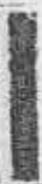

<!-- V3_SOURCE_ID:book020-b000245-p000-efd58d396d -->

<table><tr><td colspan="3">器 青義 叙云先 羅經諸圖 十二支卽 經 显 园 也此天 HE</td></tr><tr><td>米 关</td><td>1 门 出 电电 F 申</td><td>五 自然之 位 故曰先天</td></tr><tr><td>米 r 米</td><td>东</td><td></td></tr><tr><td>图一无</td><td>午 層十二支宮</td><td>子</td></tr><tr><td></td><td>二層先天六十龍 E</td><td></td></tr><tr><td></td><td>用</td><td></td></tr><tr><td>辰</td><td></td><td></td></tr><tr><td></td><td colspan="2">黄</td></tr><tr><td></td><td colspan="2">加 王</td></tr></table>

> **释读存疑：** 表格中部分文字因OCR识别模糊，无法准确释读；表格中存在大量OCR识别模糊、错乱的文字，无法准确释读其含义

查看对应原文

<!-- V3_FOLDBACK_BEGIN:book020-b000245-p000-efd58d396d -->

<table><tr><td colspan="3">器 青義 叙云先 羅經諸圖 十二支卽 經 显 园 也此天 HE</td></tr><tr><td>米 关</td><td>1 门 出 电电 F 申</td><td>五 自然之 位 故曰先天</td></tr><tr><td>米 r 米</td><td>东</td><td></td></tr><tr><td>图一无</td><td>午 層十二支宮</td><td>子</td></tr><tr><td></td><td>二層先天六十龍 E</td><td></td></tr><tr><td></td><td>用</td><td></td></tr><tr><td>辰</td><td></td><td></td></tr><tr><td></td><td colspan="2">黄</td></tr><tr><td></td><td colspan="2">加 王</td></tr></table>

<!-- V3_FOLDBACK_END:book020-b000245-p000-efd58d396d -->

<!-- V3_SOURCE_ID:book020-b000246-p000-44fb2a372d -->

先天十二支者，北方亥、子、丑屬水，東方寅、卯、辰屬木，南方巳、午、未屬火，西方申、酉、戌屬金。凡龍、向、水之五行，皆以此為綱。

查看对应原文

<!-- V3_FOLDBACK_BEGIN:book020-b000246-p000-44fb2a372d -->

先天十二支者北方亥子丑屬水東方寅卯辰屬木南方巳午未屬火西方申酉戌屬金凡龍向水之五行皆以此爲綱

<!-- V3_FOLDBACK_END:book020-b000246-p000-44fb2a372d -->

<!-- V3_SOURCE_ID:book020-b000247-p000-a4e20e0c3c -->

所谓先天六十龙，是将天干、五行依次搭配在地支上，阳宫按照甲、丙、戊、庚、壬的顺序排列，原文记载阴宫的排列顺序为“乙、丁、巳、辛、癸”，但天干中并没有“巳”，应该是“己”的讹误，每宫各有五个位次。凡是坐穴分金的方法，都以此为总纲，详细内容可以参见后面的分金图。

> **释读存疑：** 原文“陰宮乙丁巳辛癸”存在讹误，“巳”应为天干“己”

查看对应原文

<!-- V3_FOLDBACK_BEGIN:book020-b000247-p000-a4e20e0c3c -->

先天六十龍者天干五行順加地支陽宮甲丙戊庚壬爲序陰宮乙丁巳辛癸爲序每宮得五位凡坐穴分金之法以此爲綱詳下分金圖

<!-- V3_FOLDBACK_END:book020-b000247-p000-a4e20e0c3c -->

<!-- V3_SOURCE_ID:book020-b000248-p000-7ec23d08c5 -->

## 圖維干附加天後二第

> **释读存疑：** 标题文字语序倒装，具体所指需结合对应附图才能明确

查看对应原文

<!-- V3_FOLDBACK_BEGIN:book020-b000248-p000-7ec23d08c5 -->

## 圖維干附加天後二第

<!-- V3_FOLDBACK_END:book020-b000248-p000-7ec23d08c5 -->

<!-- doc011 PDF 第 103 页：HTML 表格 OCR 供搜索；图表以原页图为准。 -->
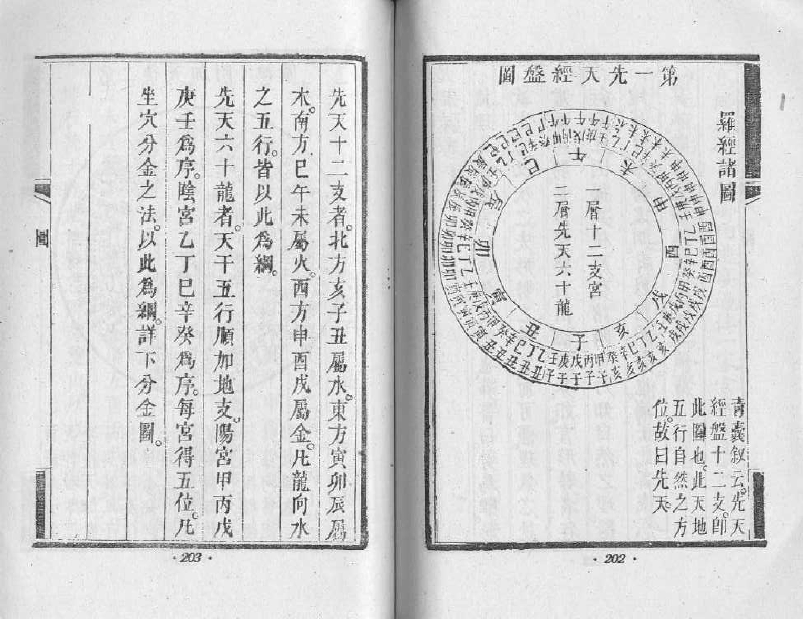

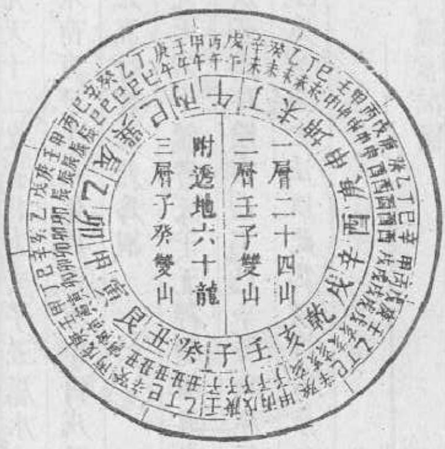

<!-- V3_SOURCE_ID:book020-b000251-p000-83ab130ded -->

二十四山的方位中，北方的壬、癸、亥、子、丑属于水，由乾与艮统辖；东方的甲、乙、寅、卯、辰属于木，由艮与巽统辖；南方的丙、丁、巳、午、未属于火，由巽与坤统辖；西方的庚、辛、申、酉、戌属于金，由坤与乾统辖。乾、坤、艮、巽被称为四维，是天地的纲纪、五行的关要。因此透地龙的排布，五亥、五子、五丑从左侧起于乾，右侧统辖于艮；五寅、五卯、五辰从左侧起于艮，右侧统辖于巽；五巳、五午、五未从左侧起于巽，右侧绕于坤；五申、五酉、五戌从左侧起于坤，右侧统辖于乾。这就是地盘的四势双山，用于格龙。

查看对应原文

<!-- V3_FOLDBACK_BEGIN:book020-b000251-p000-83ab130ded -->

二十四山者北方壬癸亥子丑屬水乾與艮統之 東方甲乙寅卯辰屬木艮與巽統之南方丙丁巳 午未屬火巽與坤統之西方庚辛申酉戌屬金坤 與乾統之乾坤艮巽謂之四維天地之紀五行之 關也故透地龍五亥五子五丑左起于乾右統于 艮五寅五卯五辰左起于艮右統于巽五巳五午 五未左起于巽右繞于坤五申五酉五戌左起于 坤右統于乾此地盤之四勢雙山所以格龍也

<!-- V3_FOLDBACK_END:book020-b000251-p000-83ab130ded -->

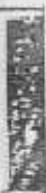

<!-- V3_SOURCE_ID:book020-b000253-p000-da64c20e25 -->

《青囊叙》中说：先天经盘以十二地支为基础，后天则附加天干与四维，八干、四维辅助地支的位置，子母公孙同属一类，二十四山两两相配，少有当时的明师知晓这个道理，五行分布在二十四时，当时的明师何曾记诵过这个内容，说的就是这张图。

> **释读存疑：** 本地硬校验仍未通过，已记录供后续自动处理或人工核对。

查看对应原文

<!-- V3_FOLDBACK_BEGIN:book020-b000253-p000-da64c20e25 -->

青囊敘云先天經盤十二支後天加附干與維八干四維輔支位子母公孫同一類二十四山雙雙起少有時師知此義五行分布二十四時師此義何曾記卽此圖也

<!-- V3_FOLDBACK_END:book020-b000253-p000-da64c20e25 -->

<!-- V3_SOURCE_ID:book020-b000254-p000-c6864e9cc1 -->

此处为表格内容，原表格文字存在OCR识别错乱，可确认的信息有：涉及第9、0、1、0、30、10、2号图的第一层八卦方位、第二层二十、第三层净阴阳，还有数字4、3、3、6、6、5，其余文字及数字多为识别错误或残缺，具体所指不详。

> **释读存疑：** 表格中多数识别内容含义不明

查看对应原文

<!-- V3_FOLDBACK_BEGIN:book020-b000254-p000-c6864e9cc1 -->

<table><tr><td>第 9 0 1 0 30 10 2 图 的 O 一層八卦方位 心 O 4 群 二層二十 夏三 3 步 3 三層淨陰陽 C 6 巨 华 民 6 黑 RL 辰 篇卯 E 心 页○ G 5</td></tr></table>

<!-- V3_FOLDBACK_END:book020-b000254-p000-c6864e9cc1 -->

<!-- V3_SOURCE_ID:book020-b000255-p000-5996e422a2 -->

二十四山按照后天卦位排布，每卦对应三个方位，这是八卦的正位。净阴阳是八卦纳甲阴阳交错的气，乾、坤、离、坎属于阳，甲、乙、壬、癸、寅、戌、申、辰被纳入其中；艮、巽、震、兑属于阴，丙、辛、庚、丁、亥、未、巳、丑被纳入其中。凡是龙、向与外水的纯杂情况，以及砂位纳甲的吉凶秀异，都以此为依据运用，详细内容见总图第二历说内。

查看对应原文

<!-- V3_FOLDBACK_BEGIN:book020-b000255-p000-5996e422a2 -->

二十四山按後天卦位每卦得三山此八卦之正位也淨陰陽者八卦納甲陰陽交錯之氣也乾坤離坎屬陽甲乙壬癸寅戌申辰納之艮巽震兌屬陰丙辛庚丁亥未巳丑納之凡龍向與外水之純雜及砂位納甲之吉秀兼以此爲用詳總圖第二曆說內

<!-- V3_FOLDBACK_END:book020-b000255-p000-5996e422a2 -->

<!-- doc011 PDF 第 105 页：HTML 表格 OCR 供搜索；图表以原页图为准。 -->
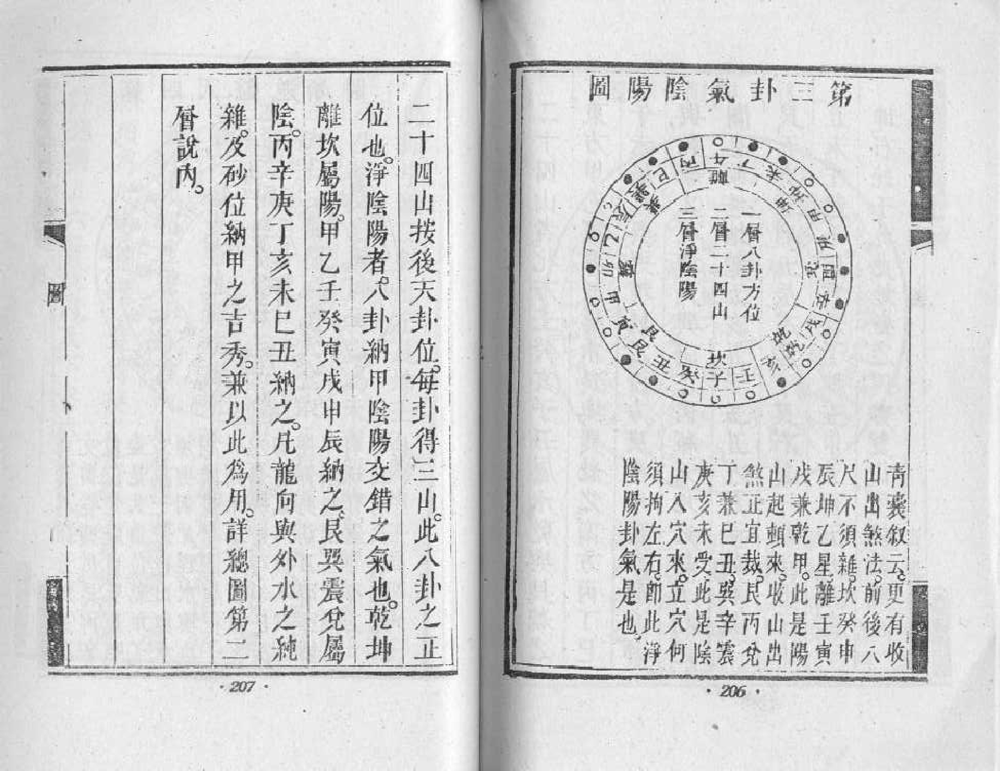

<!-- V3_SOURCE_ID:book020-b000257-p000-040925b04d -->

这就是中缝二针，左旋时坤、壬、乙对应申、子、辰的阳水壬局生旺墓；右旋时坤、壬、乙对应未、亥、卯的阴水癸司墓壬生，所以说文曲从头出，火、金、木三局都仿照这个方法。这是盘、龙、水、向的长生、沐浴等十二方位，以天盘的顺逆来确定，里三合用来统辖其余内容。龙左旋则水右转，龙右转则水左旋，左水用左旋于维，右水用右转干推化，二盘相互配合运用，是杨公传授世人最简便快捷的方法，后人失去了它的详细内容，相关记载可参考总图五六层说的内容以及下卷的水法各篇说明。

> **释读存疑：** 1轮自动修复后核义模型仍建议修订，已保守记录。

查看对应原文

<!-- V3_FOLDBACK_BEGIN:book020-b000257-p000-040925b04d -->

此卽中縫二針也左旋坤壬乙爲申子辰陽水壬局生旺墓右旋坤壬乙爲未亥卯陰水癸司墓王生故曰文曲從頭出火金木三局倣此七也盤龍水向之長生沐浴十二方位以天盤順逆定之裏三合以統其餘也龍左旋則水右轉龍右薄則水左旋左水用左旋于維右水用右轉干推化二盤相須爲用楊公示人最簡捷之法後人竟夫其詳總圓五六層說內及下卷水法各說

<!-- V3_FOLDBACK_END:book020-b000257-p000-040925b04d -->

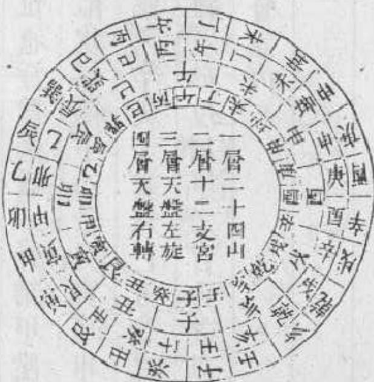

<!-- V3_SOURCE_ID:book020-b000259-p000-dcf61eab70 -->

《青囊奥语》的第二条内容为：坤、壬、乙，文曲从头出；艮、丙、辛，位位是廉贞；巽、庚、癸，尽是武山位；乾、甲、丁，贪狼一路行。山形与水势必须符合这个道理，水势和山形的吉凶祸福完全相关。顺行从子、丑走到未的位置，甲、酉、戌、亥方位以左为阳；逆行从午、巳、辰、卯、寅、鼠向猴羊方位以右为阴。知晓这个方法就不需要去探求纳甲颠颠倒的用法，二十四山里有象征吉利的珠宝位，逆顺运行时二十四山里也有象征凶险的火坑位，说的就是这张图的内容。

> **释读存疑：** 1轮自动修复后核义模型仍建议修订，已保守记录。

查看对应原文

<!-- V3_FOLDBACK_BEGIN:book020-b000259-p000-dcf61eab70 -->

青囊奧語二坤壬乙文曲從頭出艮丙辛位位是廉貞巽庚癸盡是武山位乾甲丁貪狼一路行山與水須與明此理水與山禍福盡相關順行子丑到未塲甲酉戌亥左爲陽逆行午巳辰卯寅鼠向猴羊右爲陰知此法不須尋納甲顛顛倒二十四山有珠寶逆順行二十四山有火坑卽此圖

<!-- V3_FOLDBACK_END:book020-b000259-p000-dcf61eab70 -->

<!-- V3_SOURCE_ID:book020-b000260-p000-e1c7ce17d2 -->

此处为表格内容，原表格文字存在OCR识别错乱，可确认的信息有：涉及圆金分子甲十六五，第2、1、0、3、2、7号相关内容，四层六十龙分金、三层先天六十龙纳音、二层穿山七十二龙、一层二十四山，还有数字10、5、3、101、癸、亥、乾、子、壬，其余文字及数字多为识别错误或残缺，具体所指不详。

> **释读存疑：** 表格中多数识别内容含义不明；本地硬校验仍未通过，已记录供后续自动处理或人工核对。

查看对应原文

<!-- V3_FOLDBACK_BEGIN:book020-b000260-p000-e1c7ce17d2 -->

<table><tr><td>圆金分子甲十六五 第 2 F To D 1ol X 0 a3 2 7 o d F L 兴 2 中电电 四層六十龍分金 三層先天六十龍納音 二層穿山七十二龍 一層二十四山 10 多部们 10 限 田成 5 BG 癸 亥乾 子 王 3 出 子土 0EIL9 木 a 101 美 of</td></tr></table>

<!-- V3_FOLDBACK_END:book020-b000260-p000-e1c7ce17d2 -->

<!-- V3_SOURCE_ID:book020-b000261-p000-1f5864807a -->

先天经盘十二宫顺排六十龙，坐穴及二十四山确立后，干支混杂之中都以十二宫为界，于是在六十龙每宫的界处空立一位，得到穿山七十二位，但这并非六甲浑沦之气，所以仍以先天龙纳音半分之，在十二宫中除戊、己不用外，各取所分半位的向内者，以坐穴计算分金一百二十，得到坐穴四十八位。然而这是先天经盘甲子分半立穴，并没有另外设立百二十甲子的名称，后人纷纷重新排列是错误的，详细内容见总图八层说内。二十八宿为经星，查看坐穴分经宿度五行，与高砂值宿论其生克，古代以赤道度分经，但星体多在赤距前数度，所以特意添加距前一度作为分经的标准，详细内容见总图九层说内。

查看对应原文

<!-- V3_FOLDBACK_BEGIN:book020-b000261-p000-1f5864807a -->

先天經盤十二宮順排六十龍坐穴及二十四山立而干雜之中皆當十二宮岐界遂于六十龍每宮岐界之處空立一位得穿山七十二位然非六甲渾淪之氣故仍以先天龍納音半分之于十二宮中除戊已不用外各取所分半位之向內者以坐穴計分金一百二十得坐穴四十八位然此卯先天經盤甲子分半立穴並無另立百二十甲子之名後人紛紛重排者誤也詳總圖八層說內二十八宿爲經星看坐穴分經宿度五行與高砂值宿論其生克古以赤道度分經然星體多在赤距前數度故特添距前一屬爲分經之準詳見總圗九層說內

<!-- V3_FOLDBACK_END:book020-b000261-p000-1f5864807a -->

<!-- V3_SOURCE_ID:book020-b000262-p000-fd896e4e68 -->

此处为表格内容，原表格文字及图片存在OCR识别错乱，可确认的信息有：涉及第82、6号图，其余内容无法准确释读，具体所指不详。

> **释读存疑：** 原表格文字及图片存在OCR识别错乱，多数内容无法准确释读

查看对应原文

<!-- V3_FOLDBACK_BEGIN:book020-b000262-p000-fd896e4e68 -->

<table><tr><td>圖經分宿八十二六第 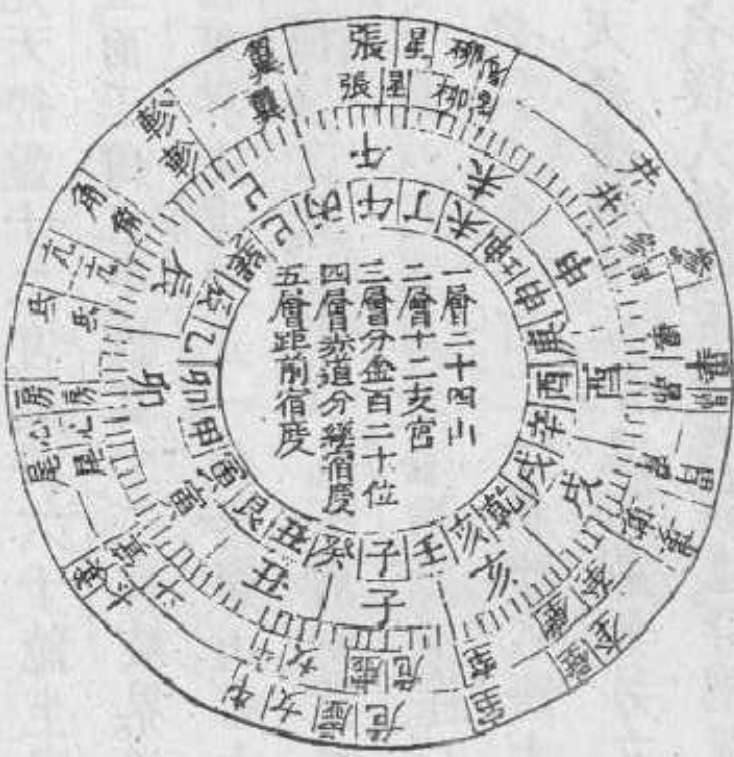</td></tr></table>

<!-- V3_FOLDBACK_END:book020-b000262-p000-fd896e4e68 -->

<!-- doc011 PDF 第 108 页：HTML 表格 OCR 供搜索；图表以原页图为准。 -->
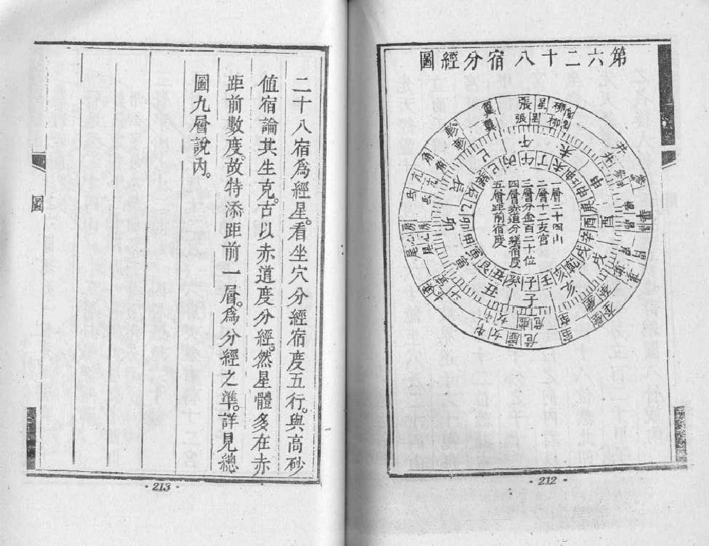

<!-- V3_SOURCE_ID:book020-b000264-p000-d882a574a8 -->

制作罗盘的人，在二十四山这一层，阳山用红字标注，阴山用黑字标注，最为简明，第二层可以不另外列出。

查看对应原文

<!-- V3_FOLDBACK_BEGIN:book020-b000264-p000-d882a574a8 -->

製羅盤者于二十四山一層陽山用紅字陰山用黑字最爲簡明第二層可不另列

<!-- V3_FOLDBACK_END:book020-b000264-p000-d882a574a8 -->

<!-- V3_SOURCE_ID:book020-b000265-p000-65c04d1484 -->

三层穿山七十二龙

查看对应原文

<!-- V3_FOLDBACK_BEGIN:book020-b000265-p000-65c04d1484 -->

三層穿山七十二龍

<!-- V3_FOLDBACK_END:book020-b000265-p000-65c04d1484 -->

<!-- V3_SOURCE_ID:book020-b000266-p000-fbe2b99f00 -->

五层天盘左旋十二宫，六层天盘右转十二宫，七层先天六十龙纳音五行，八层分金甲子，九层分经二十八宿

查看对应原文

<!-- V3_FOLDBACK_BEGIN:book020-b000266-p000-fbe2b99f00 -->

五層天盤左旋十二宮六層天盤右轉十二宮七層先天六十龍納音五行八層分金甲子九層分經二十八宿

<!-- V3_FOLDBACK_END:book020-b000266-p000-fbe2b99f00 -->

<!-- V3_SOURCE_ID:book020-b000267-p000-074110c649 -->

此处表格内容残缺，可辨识的信息有張王、星、柳半、戊午、五单、未十、癸未半，其余内容破损无法辨识。

> **释读存疑：** 表格内容残缺，仅能辨识部分零散字符，无法确认整体含义

查看对应原文

<!-- V3_FOLDBACK_BEGIN:book020-b000267-p000-074110c649 -->

<table><tr><td>張王 星 柳半 — 戊午五单 未十 癸未半 L 半 玉 王 JE 福 子 手 </td></tr></table>

<!-- V3_FOLDBACK_END:book020-b000267-p000-074110c649 -->

<!-- V3_SOURCE_ID:book020-b000268-p000-70290cffb9 -->

○第一层地盘二十四山

查看对应原文

<!-- V3_FOLDBACK_BEGIN:book020-b000268-p000-70290cffb9 -->

○第一層地盤二十四山

<!-- V3_FOLDBACK_END:book020-b000268-p000-70290cffb9 -->

<!-- V3_SOURCE_ID:book020-b000269-p000-23294b1184 -->

此处表格内容残缺，可辨识的信息有元、出、电、5、14、新、河、园、南、宾、座、長、金木、乙、56、土火、三、城、料、西、老洲、甲单、新酒、4、5、7、尊、23、大，其余内容破损无法辨识。

> **释读存疑：** 表格内容残缺，仅能辨识部分零散字符，无法确认整体含义

查看对应原文

<!-- V3_FOLDBACK_BEGIN:book020-b000269-p000-23294b1184 -->

<table><tr><td></td><td>元 出 电 5组 14</td><td>新 河 园 南 宾 n 当 ee 座 長 金木 乙 56 土火 e 三 城 料 西 老洲 甲单 新酒 4 5 7 尊 23 大 </td></tr></table>

<!-- V3_FOLDBACK_END:book020-b000269-p000-23294b1184 -->

<!-- doc011 PDF 第 109 页：HTML 表格 OCR 供搜索；图表以原页图为准。 -->
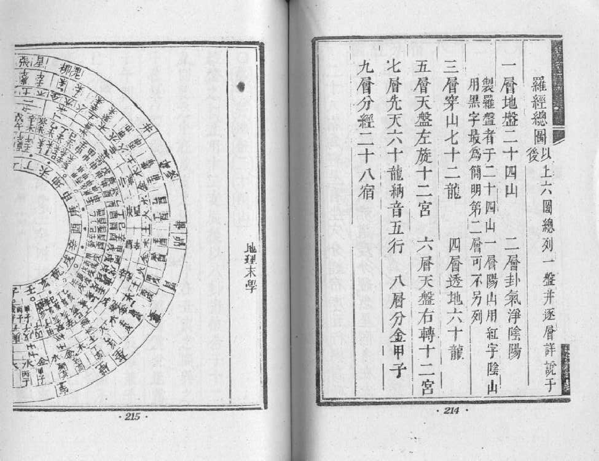

<!-- V3_SOURCE_ID:book020-b000271-p000-ec387b493a -->

经盘最初仅使用十二支辰，后来将八卦方位与十二支相配，其中乾的位置在戌亥之间，艮的位置在丑寅之间，巽的位置在辰巳之间，坤的位置在未申之间；坎、离、震、兑四卦则恰好对应子午卯酉的正位，而坎兼亥丑，震兼寅辰，离兼巳未，兑兼申戌。八卦与十二支的位置看似参差错乱，又依据天道五行分布各方之气推演可知：甲乙附属于震，丙丁附属于离，庚辛附属于兑，壬癸附属于坎，戊巳居于中央无固定归属。由此一卦管三山，八卦与十二支的位置便都端正了。所以二十四山是天地五行分布形成的自然方位，凡是地理家辨别龙脉、确定穴场、确立朝向、消砂纳水等一切用法，都以这个盘为根本依据，所有六十龙、七十二龙、百二十分金及中缝二针等各层，都是用来阐发这个盘的功用的

查看对应原文

<!-- V3_FOLDBACK_BEGIN:book020-b000271-p000-ec387b493a -->

經盤之初止用十二支辰後以八卦方位合于十二支則乾之中在戌亥之間艮之中在丑寅之間巽之中在辰巳之間坤之中在未申之間坎離震兌適當子午卯酉之正而坎兼乎亥丑震兼乎寅辰離兼乎巳未兌兼乎申戌八卦與十二支之位疑于參錯不齊又因天道五行分布各方之氣推之而知甲乙附震丙丁附離庚辛附兌壬癸附坎戊巳居中無定屬由是一卦三山而八卦與十二支之位皆正故二十四山者乃天地五行分布自然之方位凡地理家格龍定穴立向消砂納水一切用法總以此盤爲主所有六十龍七十二龍百二十分金及中縫二針諸層皆所以發明此一盤之用也

<!-- V3_FOLDBACK_END:book020-b000271-p000-ec387b493a -->

<!-- V3_SOURCE_ID:book020-b000272-p000-e3db5c363a -->

八卦十二支體用說

查看对应原文

<!-- V3_FOLDBACK_BEGIN:book020-b000272-p000-e3db5c363a -->

八卦十二支體用說

<!-- V3_FOLDBACK_END:book020-b000272-p000-e3db5c363a -->

<!-- V3_SOURCE_ID:book020-b000273-p000-fd166fae50 -->

方位的道理，拆分开来是二十四山，合起来不外乎八卦、十二支两大纲领；八卦的法则有五十二支的法则也有五

> **释读存疑：** 原文语句残缺，后半部分无法确认完整含义

查看对应原文

<!-- V3_FOLDBACK_BEGIN:book020-b000273-p000-fd166fae50 -->

方位之理分之爲二十四山合之不外八卦十二支爲兩大綱領而八卦之法有五十二支之法亦有五

<!-- V3_FOLDBACK_END:book020-b000273-p000-fd166fae50 -->

<!-- V3_SOURCE_ID:book020-b000274-p000-3a49a9ebf6 -->

以八卦而论，其一为八卦方位之气，即一卦管三山，如壬子癸属于坎、丑艮寅属于艮这类情况；其一为八卦纳甲之气，如乾甲壬属于乾、子申辰属于坎这类情况，也就是第二层净阴阳中所列干支纳卦的圆三般卦例之说；其一为八卦挨星之气，以河图生成相配、洛书奇偶相合之数，翻列贪狼九星这类情况；其一为八卦飞宫之气，以本卦入中宫立局，依照洛书六七八九一二三四之位飞布八宫这类情况；其一为八卦三山，以第二层二十四山

查看对应原文

<!-- V3_FOLDBACK_BEGIN:book020-b000274-p000-3a49a9ebf6 -->

以八卦論其一爲八卦方位之氣卽一卦管三山而壬子癸屬坎丑艮寅屬艮之例是也其一爲八卦納甲之氣如乾甲壬屬乾子申辰屬坎之例卽第二層淨陰陽中所列干支納卦之圓三般卦例之說是也其一爲八卦挨星之氣以河圖生成相配洛書奇耦相合之數翻列貪狼九星之例是也其一爲八卦飛宮之氣以本卦入中宮立局依洛書六七八九一二三四之位飛布八宮之例是也其一爲八卦三山以第二層二十四山

<!-- V3_FOLDBACK_END:book020-b000274-p000-3a49a9ebf6 -->

<!-- V3_SOURCE_ID:book020-b000275-p000-04e47c8b39 -->

类相从之气，如子午卯酉、乾坤艮巽为卦之正中八山，乙辛丁癸、寅申巳亥为左八山，甲丙庚壬、辰戌丑未为右八山这类情况。方位是八卦之体，纳甲、九星、飞宫、八山是八卦之用，二十四山八卦之例由此完备。以十二支而论，其一为地气十二支宫之正位，以八千四杂之中为界，如壬半至癸半属于子位、癸半至艮半属于丑位这类情况，先天六十甲子穿山七十二龙都按此布列，这是经盘的本制、地理的定体；其一为

> **释读存疑：** 原文语句残缺，后半部分无法确认完整含义

查看对应原文

<!-- V3_FOLDBACK_BEGIN:book020-b000275-p000-04e47c8b39 -->

類相從之氣如子午卯酉乾坤艮巽爲卦之正中八山乙辛丁癸寅申巳亥爲左八山甲丙庚壬辰戌丑未爲右八山之例是也方位爲八卦之體納甲九星飛宮八山爲八卦之用而二十四山八卦之例于是乎備矣以十二支論其一爲地氣十二支宮之正位以八千四雜之中爲界如壬半至癸半屬子位癸牛至艮牛屬丑位之例先天六十甲子穿山七十二龍皆按此布列此經盤之本制地理之定體也其一爲

<!-- V3_FOLDBACK_END:book020-b000275-p000-04e47c8b39 -->

<!-- V3_SOURCE_ID:book020-b000276-p000-0cf0c6caa2 -->

正針壬子雙山，是十二支之位，例如乾亥屬亥、艮寅屬寅、巽巳屬巳、坤申屬申，這是其中一種。另一種是正針子癸雙山，屬十二支之位，例如子癸屬子、丑艮屬丑、寅甲屬寅，這就是所謂的四勢雙山及三元龍。還有一種是縫針，壬子同宮、丙午同宮，是天運左旋的十二宮之位。還有一種是中針，癸子同宮、丁午同宮，是天度右轉的十二宮之位，這些都屬於所謂的天盤。地氣正位是體，四勢、三元、天盤的順逆是用，這是第一層二十四山。

查看对应原文

<!-- V3_FOLDBACK_BEGIN:book020-b000276-p000-0cf0c6caa2 -->

正針壬子雙山十二支之位如乾亥爲亥艮寅爲寅巽巳爲巳坤申爲申之例其一爲正針子癸雙山十二支之位如子癸爲子丑艮爲丑寅甲爲寅之例所謂四勢雙山及三元龍者是也其一爲縫針壬子同宮丙午同宮天運左旋十二宮之位其一爲中針癸子同宮丁午同宮天度右轉十二宮之位皆所謂天盤者是也地氣正位爲體四勢三元天盤順逆爲用第一口二十四山

<!-- V3_FOLDBACK_END:book020-b000276-p000-0cf0c6caa2 -->

<!-- V3_SOURCE_ID:book020-b000277-p000-52a887c3a4 -->

“三山类从”是后人穿凿附会的说法，暂且列在这里充数，实际上对地理应用没有价值。——三針子午論

查看对应原文

<!-- V3_FOLDBACK_BEGIN:book020-b000277-p000-52a887c3a4 -->

三山類從則後人樂鑿之說姑列之以備數實無當于地理之用世— 三針子午論

<!-- V3_FOLDBACK_END:book020-b000277-p000-52a887c3a4 -->

<!-- V3_SOURCE_ID:book020-b000278-p000-34d1b3ade3 -->

正针二十四山，以正子、正午对应浮针所指的方位；缝针二十四山，则以壬子、丙午的中间缝对应浮针所指的方位；中针二十四山，又以癸子、丁午的中间缝对应浮针所指的方位。缝针的午位在正针的午位、丁位之间，原文此处的“申针”应为“中针”的形近讹误，讹误后的表述指向的午位在正针的丙位、午位之间。地理家认为，缝针对应的是臬影测定的子午方位，中针对应的是天极测定的子午方位。大地的方位虽然分成二十四个，但天的宫位统于

> **释读存疑：** 原文存在“申针”形近讹字，原文“天之宫位统于”语义未完

查看对应原文

<!-- V3_FOLDBACK_BEGIN:book020-b000278-p000-34d1b3ade3 -->

正針二十四山以正子正午當浮針所指之位縫針二十四山則以壬子丙午之中縫當浮針之位中針二十四山則又以癸子丁午之中縫當浮針之位縫針之午在正針午丁之間申針之午在正針丙午之間地理家謂縫針者臬影之子午也中針者天極之子午也蓋地之方位雖分二十四而天之宮位統于

<!-- V3_FOLDBACK_END:book020-b000278-p000-34d1b3ade3 -->

<!-- V3_SOURCE_ID:book020-b000279-p000-d1710b1f07 -->

原文开篇有“一十二”三字，语义不明。杨公传下的缝针一盘法，是效仿天运左旋的规律，所以将壬子一同归在子宫，丙午一同归在午宫。天运向左旋转，每年有二十四节气，每一宫都包含朔气和中气，朔气是节气的开端，中气是节气的正位，因此从左到右，壬对应大雪节气的初始阶段，子对应冬至节气的正位，正好符合天运运转下十二月、二十四节气的方位排布。太阳在天上运行，产生的十二时辰也是同样的道理，每个时辰分为八刻，前四刻是初段，后四刻是正段，日影从左向右移动，壬对应子时的初段，子对应子时的正段，古人认为缝针是日影测定的子午方位，大概就是因为这个缘故。原文此处作“天之运第层三二十四山”，存在语序讹误，具体含义无法准确判断

> **释读存疑：** 开篇“一十二”语义不明，“天之运第层三二十四山”语序讹误无法准确释读；本地硬校验仍未通过，已记录供后续自动处理或人工核对。

查看对应原文

<!-- V3_FOLDBACK_BEGIN:book020-b000279-p000-d1710b1f07 -->

一十二楊公傳縫針一盤法天運之左旋故以壬子同位于子宮丙午同位于午宮蓋天運左旋每年二十四氣每宮皆得朔氣中氣而朔氣為氣之初中氣為氣之正故自左而右以壬當大雪子之初子當冬至子之正正合天運十二月二十四氣之位日之運行于天而有十二時也亦然時分八刻前四刻為初後四刻為正影自左而右而以壬當子之初子當子之正昔人以縫針為日影之子午殆以此也天之運第層三二十四山

<!-- V3_FOLDBACK_END:book020-b000279-p000-d1710b1f07 -->

<!-- V3_SOURCE_ID:book020-b000280-p000-0173fe76d9 -->

天的运行方向是从左向右，而环绕天极的星辰，其度数排布是从右向左，以此划分元枵、娵訾等十二宫的次序。杨公传下的中针一盘法，是效仿天度右转的规律，所以将癸子一同归在子宫，丁午一同归在午宫。每一宫的前十五度是初段，后十五度是正段，从右向左，癸对应子的初段，子对应子的正段，古人认为中针是天极测定的子午方位，大概就是因为这个缘故。缝针左旋，中气在右侧；中针右转，中气在左侧，二者左右方向不同，但符合正针子午方位的标准是一致的。虽然日月星的光芒照射到地面，对应的十二宫宽窄程度的情况还

> **释读存疑：** 原文末尾“其十二宫阔狭之致不”语义未完

查看对应原文

<!-- V3_FOLDBACK_BEGIN:book020-b000280-p000-0173fe76d9 -->

行自左而右而星辰之圍繞天極其度數則自右而左以分元枵娵訾十二宮之次楊公傳中針一盤法天度之右轉故以癸子同位于子宮丁午同位于午宮每宮以前十五度爲初後十五度爲正自右而左而癸當子之初子當子之正昔人以中針爲天極之子午殆以此也縫針左旋中氣在右中針右轉中氣在左左右不同而其所以合于正針之子午則一雖日星光耀之下臨于地者其十二宮闊狹之致不

<!-- V3_FOLDBACK_END:book020-b000280-p000-0173fe76d9 -->

<!-- V3_SOURCE_ID:book020-b000281-p000-0c5928c880 -->

不可能像北极下方那样均匀，但总归是用天的常道赤道方位，均匀匹配地平的方位，二者的道理相通，气自然会相互感应。后人不明白子午左右排布的原因，又听到日影、天极的说法却无法理解，于是称冬至、夏至的长短日影对应丁位、癸位，称北极斜处在壬亥之间，称针的属性畏惧火所以偏向丙位，把浮针对应的子午、日影对应的子午、天极对应的子午硬生生分成三种，写进书中，让人乍一看，几乎不敢发表任何意见。如今浮针虽然不是完全不会随地势稍有偏移，但和天枢、赤极的方位对照，也并没有就偏向壬位或丙位，后文内容为“天极并第一層二十四山”，语义尚未表述完整

> **释读存疑：** 原文末尾“天极并第一層二十四山”语义未完

查看对应原文

<!-- V3_FOLDBACK_BEGIN:book020-b000281-p000-0c5928c880 -->

能如北極之下之適均而要以天常赤道之位均配于地平之位其理相通其氣自相應也後人不明其子午左右之所以然又聞日影天極之說而不得其解遂謂二至長短之影在丁癸謂北極斜居壬亥之間謂針性畏火而偏于丙以浮針之子午日影之子午天極之子午截然分而爲三筆之于書使人驟而觀之幾不敢或措一詞今浮針雖不無隨地稍偏然以視諸天樞赤極之位亦未嘗遂偏于壬丙天極並第一層二十四山

<!-- V3_FOLDBACK_END:book020-b000281-p000-0c5928c880 -->

<!-- V3_SOURCE_ID:book020-b000282-p000-659d42f8e7 -->

北极并不斜处在壬亥方位，正午前后的短日影也并不对应丁癸方位。黄道虽然斜向交错在赤道内外，但它是依附在天球上运行的，每天一定会和赤道一同环绕旋转，怎么会出现日影和天极对应的子午方位偏差一个位次的情况？那些人错误地因为夏至、冬至的气候对应缝针的子午方位，却不知道大雪对应壬位也属于子的范畴，芒种对应丙位也属于午的范畴，这是误解缝针对应日影子午说法的情况。北极斜居壬亥的说法，据称出自《青囊》，暂且不论这个说法的真假，单说如果北极真的在壬亥方位，那么中针的午位应该在巳位、丙位之间，可为什么反而在丙午之间？现在北极并不在壬亥方位，如果

> **释读存疑：** 原文末尾语义未完

查看对应原文

<!-- V3_FOLDBACK_BEGIN:book020-b000282-p000-659d42f8e7 -->

不斜居壬亥日午正初之短景並不在丁癸夫黃道雖斜絡赤道內外而曰附天而行每日必與赤道同其環轉安得日影與天極之子午偏差一位彼誤因日長至日短至之氣候在縫針之子午而不知大雪在壬之亦屬子芒種在丙之亦屬午此誤會縫針日影之說者也北極斜居壬亥之說則謂本于靑囊姑無論其真僞但北極果在壬亥則中針之午宜在巳丙之間而何以又在丙午今北極不在壬亥若

<!-- V3_FOLDBACK_END:book020-b000282-p000-659d42f8e7 -->

<!-- V3_SOURCE_ID:book020-b000283-p000-43f43ec666 -->

从黄极日道的二至来推论，每年岁差五十一，原文此处有“枕”字，语义不明。杨公、赖公所处的时代，冬至已经对应艮位而非壬亥位。以艮位对应的子来对照正子，那么赤道对应的子又对应黄道的乾位，也不是壬亥位。那些人所说的北极，可能是靠近天极的小星，只是借了北极的名字，实际上并不是真正的北极，就像老人星借了南极的名字，实际上并不是真正的南极。这颗被误认的北极星每天绕着天枢所在的真正北极旋转一周，原文此处“強圓動不息”应为“周圆运动不息”的形近讹误，不停运动，怎么能用来确定子午方位？这是误解中针对应天极子午说法的情况。浮针偏向丙位的说法，则是因为那些人误解了日影子午的含义，又无法解释正针的子午为什么会偏离第一层二十四山的正位

> **释读存疑：** 原文“岁差五十一枕”的“枕”语义不明，“強圓動不息”为形近讹字

查看对应原文

<!-- V3_FOLDBACK_BEGIN:book020-b000283-p000-43f43ec666 -->

以黃極日道之二至論則每年歲差五十一枕楊賴之時冬至巳在艮非壬亥也以艮之子視子則赤道之子又當黃道之乾亦非壬亥也彼之所謂北極者或近極之小星亦借名北極而實非北極如老人星之借名南極而實非南極此北極星每日旋繞天樞之真正北極一周強圓動不息安可以定子午此誤會中針天極之說者也浮針偏丙之說則因彼誤會目影子午之義而無解于正針子午之何以偏第一層二十四山

<!-- V3_FOLDBACK_END:book020-b000283-p000-43f43ec666 -->

<!-- V3_SOURCE_ID:book020-b000284-p000-c32391b289 -->

於是說影之壬丙，便臆度金性畏火而偏，不知道金生於土，指南乃地道子母自然之氣，若非地氣之午，則八卦、二十四山之陰陽、七十二穿山、六十甲子分金的布列，怎能隨金性之畏火者以定其方位？而且隨地稍偏，多寡不同，這一針又怎能定其子午？這是誤會日影子午，而又誤及浮針之子午的人。諸家誤會三盤之子午，截然分爲三，於是言方位者往往以中縫二針爲不足信，而淺識之流又或是中而非縫，或是縫而非中，愈推愈違，有辨之不勝辨者矣。

查看对应原文

<!-- V3_FOLDBACK_BEGIN:book020-b000284-p000-c32391b289 -->

于曰影之壬丙遂臆度金性以畏火而偏不知金生于土指南乃地道子母自然之氣若非地氣之午則八卦二十四山之陰陽七十二穿山六十甲子分金之布列安得隨金性之畏火者以定其方位哉且隨地稍偏多寡不同此一針又安足以定其子午哉此誤會曰影之子午而并誤及浮針之子午者也諸家誤會三盤之子午截然分而爲三于是言方位者往往以中縫二針爲不足信而淺識之流又或是中

<!-- V3_FOLDBACK_END:book020-b000284-p000-c32391b289 -->

<!-- V3_SOURCE_ID:book020-b000285-p000-b305f4ed19 -->

要么不是缝针，要么是缝针却不符合中针的标准，越推演越背离实际，根本辨不胜辨。有人说：透地六十龙以壬子为五子，这是中针子午的来源；百二十分金以子癸为十子，这是缝针子午的来源。对此回应道：透地六十龙从乾位初爻起乙亥，是从流行之气先到的部分来推论的，先到的气，是征兆先出现在本位之前的气机，戌位的末尾就是亥位的开始，此时的方位仍然属于戌；亥位的末尾就是子位的开始，此时的方位仍然属于亥。所以用六十甲子推演先兆的气机，在前一位的末尾显现，那么十二宫都可以整体移到前一位。原文末尾作“第一層二三十四山”，应为“第一层二十四山”的讹误

> **释读存疑：** 原文末尾“第一層二三十四山”存在讹误

查看对应原文

<!-- V3_FOLDBACK_BEGIN:book020-b000285-p000-b305f4ed19 -->

而非縫或是縫而非中愈推愈違有辨之不勝辨者矣或曰透地六十龍以壬子爲五子此中針子午之所從出也百二十分金以子癸爲十子此縫針子午之所從出也曰透地六十龍起乙亥于乾之初以其流行之氣之先至者論之先至也者機之兆于本位之先者也戌之末卽亥之始而僅則猶是戌也亥之末卽子之始而位則猶是亥也故以六十甲子透其先兆之機于前位之末則可以十二宮竟移于前位第一層二三十四山

<!-- V3_FOLDBACK_END:book020-b000285-p000-b305f4ed19 -->

<!-- V3_SOURCE_ID:book020-b000286-p000-6ae555c5ce -->

（某段）的末尾属于本位的正位，不能数到十。将子排布在子癸的位置，是后人错误排列的结果。就像子癸双山的中气主候，也是月令后半段的气，而壬子双山一个是先气的开端，一个是旺气的余气，都不属于子午的正位，怎么能说中针、缝针的子午位是从这里衍生出来的呢？所有这些纷繁牵强的说法，都是因为不明白三针子午看似有差异、实则原理一致的缘故。现在我考辨它的根源，分别绘制左右旋转两幅图，差不多能让人一看就明白，所有牵强附会的说法不用辩驳就会自行消解了。

> **释读存疑：** 本地硬校验仍未通过，已记录供后续自动处理或人工核对。

查看对应原文

<!-- V3_FOLDBACK_BEGIN:book020-b000286-p000-6ae555c5ce -->

之末爲本位之正則不可至十子之布于子癸乃後人之誤排卽如子癸雙山之中氣主候亦月令後半之氣與壬子雙山一爲先氣之始一爲旺氣之餘皆非子午之正位安得謂中雞二針子午之位從此而出耶凡諸紛紛牽合之說皆由不知三針子午所以異而實同之故今按其根原分左右旋轉二圖庶幾舉目了然而一切附會之見不辨而自息矣

<!-- V3_FOLDBACK_END:book020-b000286-p000-6ae555c5ce -->

<!-- V3_SOURCE_ID:book020-b000287-p000-2f694e08c5 -->

缝针十二宫法天运左旋图

查看对应原文

<!-- V3_FOLDBACK_BEGIN:book020-b000287-p000-2f694e08c5 -->

縫針十二官法天運左旋圗

<!-- V3_FOLDBACK_END:book020-b000287-p000-2f694e08c5 -->

<!-- V3_SOURCE_ID:book020-b000288-p000-f71b17bbce -->

此处表格内容多为残缺错乱的字符，无法辨识完整含义，仅能确认其中包含“春分”“雨水”“寅初”“清明”“寅月”“水”、数字2、6、3等字样，其余内容无法解读。

> **释读存疑：** 表格整体内容残缺错乱，无法释读完整含义

查看对应原文

<!-- V3_FOLDBACK_BEGIN:book020-b000288-p000-f71b17bbce -->

<table><tr><td>如 科 管 春分 空 雨水 寅初</td></tr><tr><td>清明 路 加 E 2 成 寅 月</td></tr><tr><td>6 民 金 用</td></tr><tr><td>6 由 2 更</td></tr><tr><td>开</td></tr><tr><td>子</td></tr><tr><td>X</td></tr><tr><td>米 年 A X 福 线 等 图 算</td></tr><tr><td>月 成 申 茶 西 3N</td></tr><tr><td>和 老 限 年 </td></tr><tr><td>西秋 H 2 V </td></tr><tr><td>3 亚</td></tr></table>

<!-- V3_FOLDBACK_END:book020-b000288-p000-f71b17bbce -->

<!-- V3_SOURCE_ID:book020-b000289-p000-466ac568b7 -->

## 中針十二宮法天度右轉圖 — 中针十二宫法天度右转图

查看对应原文

<!-- V3_FOLDBACK_BEGIN:book020-b000289-p000-466ac568b7 -->

## 中針十二宮法天度右轉圖

<!-- V3_FOLDBACK_END:book020-b000289-p000-466ac568b7 -->

<!-- V3_SOURCE_ID:book020-b000290-p000-3ae39ead64 -->

此处表格内容多为残缺错乱的字符，无法辨识完整含义，仅能确认其中包含“辰”“卯”“木初”“子”“金”、数字7、8、1等字样，其余内容无法解读。

> **释读存疑：** 表格整体内容残缺错乱，无法释读完整含义

查看对应原文

<!-- V3_FOLDBACK_BEGIN:book020-b000290-p000-3ae39ead64 -->

<table><tr><td colspan="3">楼</td></tr><tr><td>二 游</td><td>四張年</td><td>八柳丁 州 牌 大 7</td></tr><tr><td colspan="3">养 有</td></tr><tr><td>日 福</td><td>小 纯</td><td>M 米 电</td></tr><tr><td>辰</td><td></td><td>电</td></tr><tr><td>卯</td><td></td><td>暂子 国</td></tr><tr><td>丽 m</td><td></td><td>品 我</td></tr><tr><td>木初大市 8 资 开 器</td><td>于 王 </td><td>金 院</td></tr><tr><td>旺 型 子</td><td>莎 N</td><td>惠</td></tr><tr><td>七平</td><td></td><td>RAH</td></tr><tr><td>大 为</td><td>王一</td><td>+ 郑</td></tr><tr><td>1</td><td>元中</td><td></td></tr></table>

<!-- V3_FOLDBACK_END:book020-b000290-p000-3ae39ead64 -->

<!-- V3_SOURCE_ID:book020-b000291-p000-99eb671c90 -->

○第二历卦气净阴阳

查看对应原文

<!-- V3_FOLDBACK_BEGIN:book020-b000291-p000-99eb671c90 -->

○第二曆卦氣淨陰陽

<!-- V3_FOLDBACK_END:book020-b000291-p000-99eb671c90 -->

<!-- V3_SOURCE_ID:book020-b000292-p000-0d7adffc71 -->

所谓净阴阳，就是以后天八卦的方位为基础，搭配使用先天的卦气。《青囊叙》里说：还有收山出煞的方法，墓穴前后八尺范围内不宜混杂其他气脉。坎、癸、申、辰、坤、乙、离、壬、寅、戌，再加上乾、甲，这些属于阳山，起顿收山出煞的时候正适宜取用；艮、丙、兑、丁，再加上巳、丑、巽、辛、震、庚、亥、未，这些属于阴山，入穴立向的时候不需要拘泥于左右的搭配。它的具体方法是将先天卦和洛书数相配：乾对应九、坤对应一、离对应三、坎对应七，这四个正卦所得的都是奇数，属于阳；震对应八、巽对应二、艮对应六、兑对应四，这四个隅卦所得的都是偶数，属于阴。按照这种阴阳卦气分别附著在后天的方位上，而干支各自随所纳甲的卦来确定阴阳属性：乾纳甲、壬，坤纳乙、癸，坎纳申、辰，离纳寅、戌，这些都属于阳；艮纳丙，巽纳辛，震纳庚、亥、未，兑纳丁、巳、丑，这些都属于阴。阳龙要立阳向，阴龙要立阴向，阳向要收纳属阳的水，阴向要收纳属阴的水，所以叫做“净”，意思是不可以混杂。气脉纯净就能收纳山的旺气，混杂就会招致煞气。阴配阴、阳配阳，那么奇数和奇数相合得到偶数，偶数和偶数相合也得到偶数；如果阴配阳、阳配阴，那么奇数遇到偶数得到奇数，偶数遇到奇数也得到奇数。数为偶数就和谐，数为奇数就不吉利，所以龙、向、水都以纯净为贵。立穴不需要拘泥于左右的搭配。

> **释读存疑：** 原文“青囊敘”引文中“星”“受”为衍字或讹字，已结合上下文语义做通顺处理；原文“繒甲”应为“纳甲”的形近讹字，按术数常用术语“纳甲”释读

查看对应原文

<!-- V3_FOLDBACK_BEGIN:book020-b000292-p000-0d7adffc71 -->

淨陰陽者以後天八卦方位用先天之卦氣也青囊 敘云更有收山出煞法前後八尺不宜雜坎癸申辰 坤乙星離壬寅戌兼乾甲此是陽山起頓來收山出 煞正宜裁艮丙兌丁兼巳丑巽辛震庚亥未受此是 陰山入穴來立穴何須拘左右其法以先天卦配洛 書乾九坤一離三坎七四正卦得奇數爲陽震八異 二艮六兌四四隅卦得耦數爲陰以此陰陽卦氣分 麗于後天方位而干支則各隨其繒甲之卦爲陰陽 乾納甲壬坤納乙癸坎納申辰離納寅戌爲陽艮納 丙巽納辛震納庚亥未兌納丁巳丑爲陰陽龍立陽 向陰龍立陰向陽向納陽水陰向納陰水故曰淨言 不可雜也淨則收山氣雜則受煞氣陰見陰陽見 陽則奇數合奇得耦耦數合耦亦得耦若陰見陽陽 見陰則奇數逢耦得奇耦數逢奇亦得奇數耦則和 數奇則不利故龍向水以淨爲貴也立穴何須拘左

<!-- V3_FOLDBACK_END:book020-b000292-p000-0d7adffc71 -->

<!-- doc011 PDF 第 118 页：HTML 表格 OCR 供搜索；图表以原页图为准。 -->
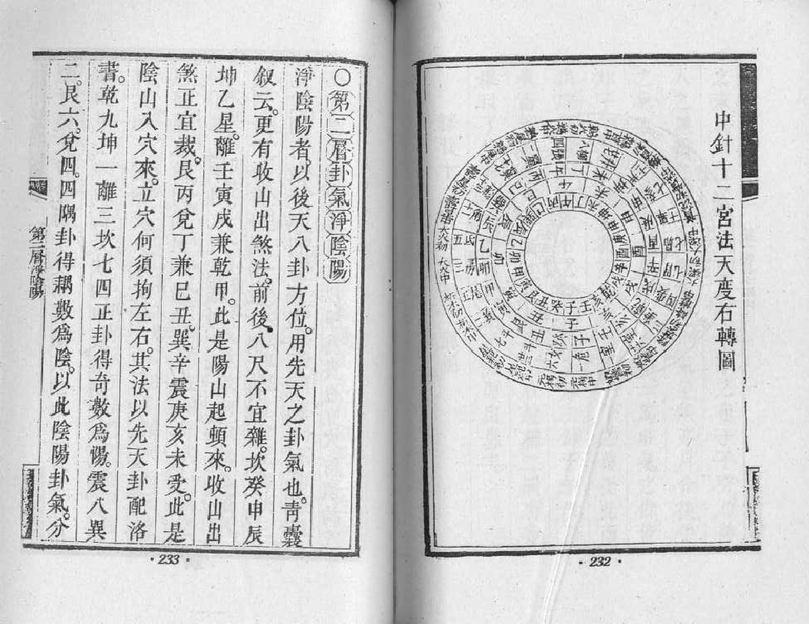

<!-- V3_SOURCE_ID:book020-b000294-p000-a8ff7de1f7 -->

上文所说的“立穴何须拘左”，意思是所立的本穴朝向符合净阴阳的要求，那么左右相兼的阴阳属性就不需要拘泥。后世有拘泥于左右阴阳的人，说亥向不可以兼乾、壬，午向不可以兼丙、丁之类的说法，还妄自编造地盘立向的相关内容，甚至写出“三七兼加，祸即侵之”的文字，比如九仪，还有人竟然把原文的“何须”改成“也须”，这些都是不懂得纳甲原理的人。还有人著书立说，死守自己片面的见解，来批驳净阴阳的说法不对，比如蒋大鸿这类人。他们不明白：如果真的深究形气的本质，认为方位不需要完全拘泥，那也就罢了；如果还是要参考方位的相关说法，那么净阴阳也是理气学说里的一项重要内容。

查看对应原文

<!-- V3_FOLDBACK_BEGIN:book020-b000294-p000-a8ff7de1f7 -->

右者言所立本穴向合淨陰陽其左右相兼之陰陽不必拘也後人有拘執左右陰陽謂亥向不可兼乾壬午向不可兼丙丁之類妄造地盤立向正爲訣三七兼加禍卽侵之文者九 儀 或竟改何須爲也須者皆不知納甲之理者也又有著書立論守其一隅之見以破淨陰陽之非者蔣大鴻 之類 不知果精求形氣竟以方位爲不必盡拘則巳如尙存方位之見則淨陰陽亦理氣中之一義也

<!-- V3_FOLDBACK_END:book020-b000294-p000-a8ff7de1f7 -->

<!-- V3_SOURCE_ID:book020-b000295-p000-d7a443b837 -->

此处表格内容多为残缺错乱的字符，无法辨识完整含义，仅能确认其中包含“坎”“乾”“地支”、数字2等字样，其余内容无法解读。

> **释读存疑：** 表格整体内容残缺错乱，无法释读完整含义

查看对应原文

<!-- V3_FOLDBACK_BEGIN:book020-b000295-p000-d7a443b837 -->

<table><tr><td>开 材统梁民于期 龄维交 用一期 关用手花 提校 计 梁梁花梁元 器 坎 西 良 园 C 燕 乾 设 国 D D 2 A 中证 于 使勋 话梁 学护于护 地支納 中门 于梁 卦 圖 充 通 </td></tr></table>

<!-- V3_FOLDBACK_END:book020-b000295-p000-d7a443b837 -->

<!-- V3_SOURCE_ID:book020-b000296-p000-3366e9b36f -->

三般卦例说

查看对应原文

<!-- V3_FOLDBACK_BEGIN:book020-b000296-p000-3366e9b36f -->

三般卦例說

<!-- V3_FOLDBACK_END:book020-b000296-p000-3366e9b36f -->

<!-- doc011 PDF 第 120 页：HTML 表格 OCR 供搜索；图表以原页图为准。 -->
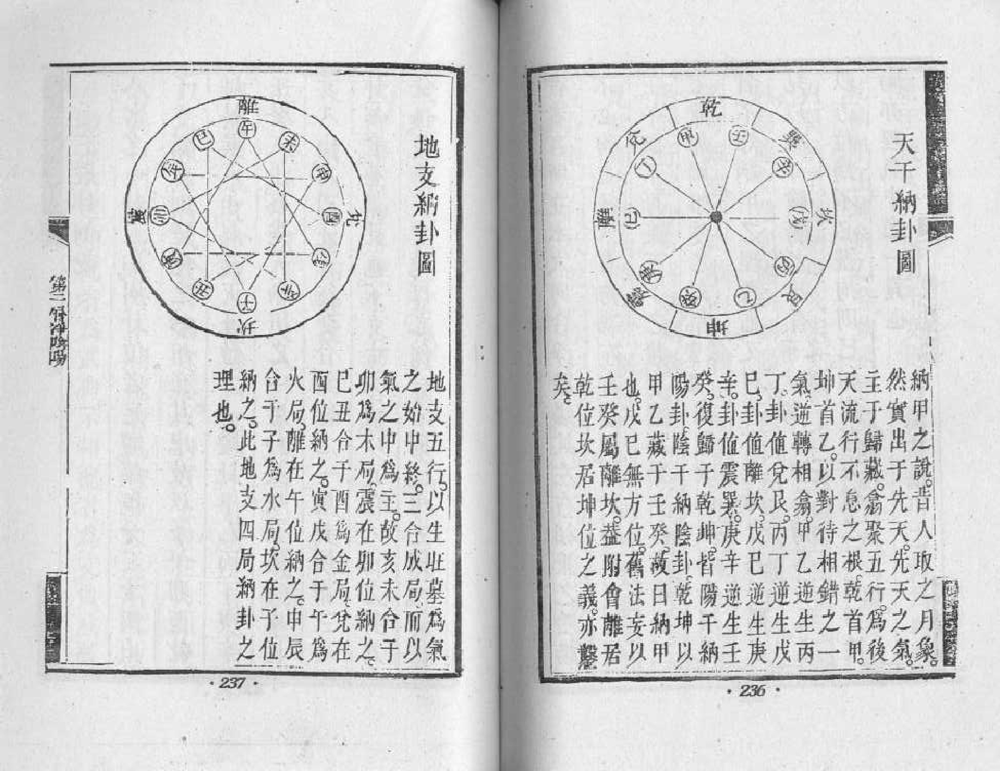

<!-- V3_SOURCE_ID:book020-b000298-p000-811d394a35 -->

八宮之中，一卦管三山，這是卦位的固定體制。但既然已經分出二十四山，干支交錯，其中便包含了變化的妙用。因此，子午卯酉、乾坤艮巽這八山，是後天正位的一般卦；甲乙丙丁庚辛壬癸這八山，是先天納甲的一般卦；辰戌丑未寅申巳亥這八山，是四正五行交合消長的一般卦。所謂的三般卦例，指的就是這些。干支十六山中，以正位八山的卦作為父母，所以有天父地母的說法；拆分使用則分為三類，合用則為一體，後世之人……

查看对应原文

<!-- V3_FOLDBACK_BEGIN:book020-b000298-p000-811d394a35 -->

八宮之一卦三山固卦位之定體然既分二十四山千支錯綜則變化之妙用在其中故以子午卯酉乾坤艮巽八山爲後天正位之一般卦甲乙丙丁庚辛壬癸八山爲先天納甲之一般卦辰戌丑未寅申巳亥八山爲四正五行交合銷綜之一般卦所謂三般卦例者謂此也千支十六山以正位八山之卦爲父母故有天父地母之例分之則三用之則一後世

<!-- V3_FOLDBACK_END:book020-b000298-p000-811d394a35 -->

<!-- V3_SOURCE_ID:book020-b000299-p000-e0c684deee -->

有人執著於一卦三山的固定位置，來否定干支納卦的說法，這是不懂得二十四山體用變化之妙的人。

查看对应原文

<!-- V3_FOLDBACK_BEGIN:book020-b000299-p000-e0c684deee -->

或執一卦三山之定位，以破干支納卦之非者，不知二十四山體用變化之妙者也。

<!-- V3_FOLDBACK_END:book020-b000299-p000-e0c684deee -->

<!-- V3_SOURCE_ID:book020-b000300-p000-3067cfd02b -->

河圗九星翻卦說

查看对应原文

<!-- V3_FOLDBACK_BEGIN:book020-b000300-p000-3067cfd02b -->

河圗九星翻卦說

<!-- V3_FOLDBACK_END:book020-b000300-p000-3067cfd02b -->

<!-- V3_SOURCE_ID:book020-b000301-p000-3cec1d6533 -->

九星拦卦的方法，是用先天八卦对应洛书的固定数值，根源出自河图生成之位，选取其中阴阳相配的规则。如果本卦属于生数在内的情况，就把本位五行成数对应的卦定为贪狼；对面方位生数在内且相配的，定为巨门；成数在外且不相配的，定为破军；左右两个方位生数在内且相配的，定为武曲；不相配的，原文讹作“文出”，应为术语文曲。原文末尾有“成數第二厨绘場”的内容，属于OCR或原文讹误，无法释读。

> **释读存疑：** 原文“文出”为讹误，校正为“文曲”属于合理补正；末尾“成數第二厨绘場”为残缺讹误内容，具体含义无法确定

查看对应原文

<!-- V3_FOLDBACK_BEGIN:book020-b000301-p000-3cec1d6533 -->

九星欄卦之法以先天八卦配洛書之定數根原于河圖生成之位取其陰陽相配如本卦屬生數在內以本位五行成數卦爲貪狼以對方生數在內相配者爲巨門成數在外不相配者爲破軍以左右二方生數在內之相配者爲武曲不相配者爲文出成數第二厨绘場

<!-- V3_FOLDBACK_END:book020-b000301-p000-3cec1d6533 -->

<!-- V3_SOURCE_ID:book020-b000302-p000-d9cd1e2885 -->

在外相配的，定为廉贞；不相配的，定为禄存。而禄存与原文讹作“武崗”的术语同处一方，该讹误应为武曲，廉贞与文曲同处一方。如果本卦属于成数在外的情况，就把本位五行生数对应的卦定为贪狼；对面方位成数在外且相配的，定为巨门；生数在内且不相配的，定为破军；左右两个方位成数在外且相配的，定为武曲；不相配的，定为文曲；生数在内且相配的，定为廉贞；不相配的，定为禄存。九星的命名，是按照八卦的顺序分配到各个宫位，取用对应的五行之气。凡是本龙卦，都搭配长男震，取震对应龙的意象，以及“帝出乎震”“万物出乎震”的道理，原文此处内容未完。

> **释读存疑：** 原文“武崗”为OCR讹误，校正为“武曲”属于合理补正；原文“武崗”为讹误，校正为“武曲”属于合理补正；原文末尾“萬”字后内容未完

查看对应原文

<!-- V3_FOLDBACK_BEGIN:book020-b000302-p000-d9cd1e2885 -->

在外之相配者爲廉貞不相配者爲祿存而祿存與武崗同方廉貞與文曲同方也若本卦屬成數在外則以本位五行生數卦爲貪狼以對方成數在外相配者爲巨門生數在內不相配者爲破軍以左右二方成數在外之相配者爲武曲不相配者爲文曲生數在內之相配者爲廉貞不相配者爲祿存也九星取名則又以八卦之序分配各宮而取其五行之氣凡本龍卦皆配以長男震取震爲龍及帝出乎震萬

<!-- V3_FOLDBACK_END:book020-b000302-p000-d9cd1e2885 -->

<!-- V3_SOURCE_ID:book020-b000303-p000-4916c5be38 -->

承接上文“帝出乎震”的表述，是取万物都从震位生出的道理，再将本位生成相得的卦搭配长女巽，其中一个对应左辅水，一个对应贪狼木。按照这个规则，如果本龙卦属于阴仪，在洛书数的西北方位，就从左侧顺时针旋转，将坎、离对应中男、中女，搭配左方的卦定为文曲水、廉贞火；将艮、兑对应少男、少女，搭配对面方位的卦定为巨门土、破军金；将乾坤对应父母，归到右方的卦定为武曲金、禄存土。如果本龙卦属于阳仪，在洛书数的东南方位，就从右侧逆时针旋转，将坎、离搭配到右方，将艮、兑搭配到对面方位，将乾坤归到左方。艮对应门，处在对面方位，就像宫室有对应的设置，原文末尾“第二層漆陰陽 134RR2”为OCR乱码，无法释读。

> **释读存疑：** 原文“本龍卦之屬陰儀”曾被误译为阳仪，现已修正回原文表述的阴仪；末尾“第二層漆陰陽 134RR2”为乱码内容，具体含义无法确定

查看对应原文

<!-- V3_FOLDBACK_BEGIN:book020-b000303-p000-4916c5be38 -->

物出乎震之理而本位生成相得之卦配以長女巽 一爲左輔水一爲貪狼木焉由是以本龍卦之屬陰 儀在洛書數之西北者自左而順旋而以坎離中男 女配左方之卦爲文曲水廉貞火以艮兌少男女配 對方之卦爲巨門土破軍金歸乾坤父母于右方之 卦爲武曲金祿存土焉本龍卦之屬陽儀書數 之東南者自右而逆轉而配坎離于右方配艮兌于 對方歸乾坤于左方焉艮爲門在對方如宮室之有 第二層漆陰陽 134RR2

<!-- V3_FOLDBACK_END:book020-b000303-p000-4916c5be38 -->

<!-- V3_SOURCE_ID:book020-b000304-p000-a00d2e72a0 -->

门，所以称为巨门；兑为毁折，秉持西方肃杀之气用来补缺冲犯，所以称为破军；乾对应金，性质刚健，原文写为“而曰武山”，应为讹误，疑似术语武曲；坎对应水，形态流转，所以称为文曲；巽是长养的风，柔和且容易渗入，所以取这个意象称为贪狼；离是文明的火，锋锐且容易向外发散，所以取它的性质称为廉贞；坤是万物都得到资养的方位，所以称为禄存；而本宫处在中间，有隐曜的气，叫做右弼，原文此处断句存在歧义，“其方之氣巨 左輔”的表述暂无法确定准确含义，目前可知左辅是取震辅佐乾的意象，右弼则是因为和本卦同气而得名，都不直接称呼尊帝的名号，这就是九星命名的由来。九星确定之后，就按照本卦逐爻依次变化的顺序，从上开始推演，原文此处内容未完。

> **释读存疑：** 原文“武山”为讹误，疑似应为“武曲”，属于合理校正推测；原文“其方之氣巨 左輔”断句存在歧义，具体含义无法完全确定；原文末尾“從上”后内容未完

查看对应原文

<!-- V3_FOLDBACK_BEGIN:book020-b000304-p000-a00d2e72a0 -->

門故曰巨門兌爲毀折秉西方肅殺之氣以補冲曰 破軍乾金剛健而曰武山坎水流轉而曰文曲巽爲 長養之風柔而善入故取其象曰貪狼離爲文明之 火銳而善出故取其德曰廉貞坤者萬物皆致養焉 曰祿存而本宮居中隱曜之氣目右弼其方之氣巨 左輔左輔取震之輔乾而右弼則以其同爲本卦之 氣而名之皆不直言尊帝之名也此九星之所由定 也九星既定因以其本卦之逐爻遞變者爲序從上

<!-- V3_FOLDBACK_END:book020-b000304-p000-a00d2e72a0 -->

<!-- V3_SOURCE_ID:book020-b000305-p000-44052db8de -->

往下，再翻到上面，又翻到下面，再翻到上面，得到本卦之后，原文有“而上青人”的表述，属于讹误，无法确定具体含义，接下来举地母坤卦作为示例：比如坤变动它的上爻得到艮，艮变动它的中爻得到巽，巽变动它的下爻得到乾，乾逆着往上翻变动它的中爻得到离，离变动它的上爻得到震，震原文讹作“順湖而下”，应为顺翻往下变动它的中爻得到兑，兑变动它的下爻得到坎，坎再翻到上面变动它的中爻，原文有“得神本小而止”的表述，属于讹误，无法确定具体含义，剩下的七个卦都按照这个翻变规则处理，原文有“貪巨祿文廉武破薰之亮”的表述，属于讹误，疑似应为贪狼、巨门、禄存、文曲、廉贞、武曲、破军、辅弼的排列顺序。将这个规则和北斗七星以及辅星的排列次序对应来看，文曲兼以坎、离配置在中间，武曲、禄存以乾坤相对应，原文讹作“破巨以兌艮相無”，应为破军、巨门以兑、艮相对应，最后用辅星、贪狼对应的震、巽相对应，作为总纲推行这个规则。整个排布是十数围绕五数处在中心，就像紫微垣处在天的中心，一六、二七、三八、四九的数在外面流转，就像斗星在紫微垣之外环绕运转。所以原文讹作“右彌”的术语应为右弼，它不出现在星卦的显性排列里，古人说右弼没有形质，是天的隐曜，是中宫天皇尊星所化，所以隐藏在中五宫，暗中运作诸星的气。辅星不排在斗杓的次序里，而是附在武曲旁边，原文讹作“外應乎異”应为外对应巽，原文讹作“內車乎乾震”应为内和乾震相合，所以能统摄七星的气，成为后天的首位。原文讹作“背人”应为昔人，因为这个道理微妙，所以按照卦变的顺序设立了天定卦例图。

> **释读存疑：** 原文“而上青人”为讹误，含义无法确定；原文“順湖而下”校正为“順翻而下”属于合理补正；原文“得神本小而止”为讹误，含义无法确定；原文“貪巨祿文廉武破薰之亮”为讹误，疑似为九星次序的讹写，具体原表述无法确定；原文“破巨以兌艮相無”校正为“破巨以兌艮相應”属于合理补正；原文“右彌”校正为“右弼”属于合理补正；原文“外應乎異”校正为“外應乎巽”属于合理补正；原文“內車乎乾震”校正为“內合乎乾震”属于合理补正；原文“背人”校正为“昔人”属于合理补正

查看对应原文

<!-- V3_FOLDBACK_BEGIN:book020-b000305-p000-44052db8de -->

而下復翻而上又翻而下又翻而上得本卦而上青人舉地母坤卦爲式如坤變其上爻得艮艮變其中爻得巽巽變其下爻得乾乾逆翻而上變其中爻得離離變其上爻得震震順湖而下變其中爻得兌兌變其下爻得坎坎復翻而上變其中爻得神本小而止餘七卦照此翻變皆合貪巨祿文廉武破薰之亮以觀于北斗七星及輔星之次紐而合之則文兼以坎離配于中而武祿以乾坤相應破巨以兌艮相無終之以輔貪之震巽相應綱維之而推行之焉盡治圗十抱五于中如紫微垣之居中一六二七三八四九之流行于外如斗星之環轉于垣外故右彌之不見于星卦者昔人謂右弼無形爲天之隱曜乃中宮天皇尊星之所化故隱于中五之宮以潛運夫諸星之氣也輔星不次于杓而附于武曲外應乎異內車乎乾震之所以綱維七星之氣而爲後天之首也背人以此理微妙故以卦變之序立爲天定卦例一圖

<!-- V3_FOLDBACK_END:book020-b000305-p000-44052db8de -->

<!-- V3_SOURCE_ID:book020-b000306-p000-854f33decf -->

使人有所遵循而容易記憶，這是巧便的捷訣，並非河圖星數配卦的本原。

查看对应原文

<!-- V3_FOLDBACK_BEGIN:book020-b000306-p000-854f33decf -->

使人有所循而易記。此巧便之捷訣，而非河圖星數配卦之本原也。

<!-- V3_FOLDBACK_END:book020-b000306-p000-854f33decf -->

<!-- V3_SOURCE_ID:book020-b000307-p000-78fa509b3c -->

洛書九星翻卦說

查看对应原文

<!-- V3_FOLDBACK_BEGIN:book020-b000307-p000-78fa509b3c -->

洛書九星翻卦說

<!-- V3_FOLDBACK_END:book020-b000307-p000-78fa509b3c -->

<!-- V3_SOURCE_ID:book020-b000308-p000-5ffc322fc9 -->

至於洛書數的九星翻卦法，也是以本卦的對宮爲巨門，並以左右二方對應貪狼、武曲的金木屬性；這貪狼、巨門、武曲三個吉星，都是奇耦數與本數相符的。以對宮巨門的生成數相連屬的，是破軍、祿文、輔星，這三星依次排列在本卦的四角，都是奇耦數與本數不符的，例如坤一、艮六、兌四、乾九之類。南北第二厨争会場。

> **释读存疑：** 南北第二厨争会場，原義不詳；南北第二厨争会場原義不詳

查看对应原文

<!-- V3_FOLDBACK_BEGIN:book020-b000308-p000-5ffc322fc9 -->

若夫洛書數之九星翻卦亦以本卦對宮爲巨門而以左右二方合貪狼武曲之金木此貪巨武三吉皆奇耦之與本數合者以對宮巨門之生成數相連屬者爲破軍與祿文輔三星相次于本卦之四角皆奇耦之與本數不合者坤一艮六兌四乾九之屬南北第二厨争会場

<!-- V3_FOLDBACK_END:book020-b000308-p000-5ffc322fc9 -->

<!-- V3_SOURCE_ID:book020-b000309-p000-9d26d7e85e -->

河图数里处于西北方位的四卦中，贪、巨、武三类属于三吉，按照左旋的规则分布在三个方位；破、禄、文、辅四类属于四凶，按照左旋的规则分布在四个角，也就是离三、震八、巽二、坎七这类东西向的四卦。河图数里处于东南方位的四卦中，三吉按照同类右旋的规则分布在三个方位，四凶按照同类右旋的规则分布在四个角，这样七星的位置就确定了。七星的位置确定后，也以逐爻依次变化的顺序排列，从本卦的廉贞位开始，先由中爻依次变化往下，再翻转往上，又翻转往下，再翻转往上。比如坤卦变动其中爻得到坎卦，坎卦变动其下爻得到兑卦，原文此处作“兌勸而上變其中爻”，“勸”字为讹误，相关含义无法确定，按现有文字是兑卦相关变动后得到震卦，震卦变动其上爻得到离卦，离卦翻转往下变动。

> **释读存疑：** 原文“兌勸而上變其中爻”中“勸”为讹字，具体含义无法确定

查看对应原文

<!-- V3_FOLDBACK_BEGIN:book020-b000309-p000-9d26d7e85e -->

四卦在河圖數之西北者貪巨武以三吉爲類左旋于三方破祿文輔以四凶爲類左旋于四角離三震八巽二坎七之屬東西四卦在河圖數之東南者三吉以類右轉于三方四凶以類右轉于四角而七星之位定矣七星定亦以其逐爻遞變者爲序從本卦廉貞起由中爻遞變而下復翻而上又翻而下又翻而上如坤變其中爻得坎坎變其下爻得兌兌勸而上變其中爻得震震變其上爻得離離翻而下變

<!-- V3_FOLDBACK_END:book020-b000309-p000-9d26d7e85e -->

<!-- V3_SOURCE_ID:book020-b000310-p000-bbb9cc8ca9 -->

其中爻得乾卦，乾卦變其下爻得巽卦，巽卦翻轉而上變其中爻得艮卦，到本卦生成數的四象同體者就停止。其餘七卦都依照這個規則翻變。河圖的變化，從四象同體、生成同氣的卦開始，到本卦爲止；洛書的變化，從本卦開始，到四象同體、生成同氣的卦爲止。例如坤卦作爲本卦，河圖的變化從艮、巽、乾、離、震、兌、坎一直到坤；洛書的變化從坤、坎、兌、震、離、乾、巽一直到艮，一順一逆，這是兩種數顛倒自然的妙處。但河圖的變化都符合貪、巨、祿、文、廉、武、破、輔的順序，而此處卻都以廉、武、破、輔、貪、巨、祿、文爲順序。河圖斗數中，廉、文以坎、離之氣配合中宮，從中宮起始於廉而終於文；河圖卦例以震、巽的首尾相應作爲起止；洛書卦例以坎、離的居中相應作爲起止。後人因爲它起於五位的廉貞，就稱之爲五鬼卦，這也是方便人記憶的捷訣。然而兩種數的起止雖然不同，但按照奇耦生成的位置來看，貪、輔都以震、巽之氣同處一方，廉、文都以坎、離之氣同處一方，破、巨都以艮、兌之氣同處一方，武、祿都以乾、坤之氣同處一方，這又是顛倒錯亂不同而又相同的妙緒。

查看对应原文

<!-- V3_FOLDBACK_BEGIN:book020-b000310-p000-bbb9cc8ca9 -->

其中爻得乾乾變其下爻得巽巽翻而上變其中爻得艮爲本卦生成數之四象同體者而止餘七卦俱照此翻變河圖之變從四象同體生成同氣之卦起至本卦而止洛書之變自本卦起至四象同體生成同氣之卦止如坤爲本卦河圖從艮巽乾離震兌坎以至于坤洛書從坤坎兌震離乾巽以至于艮一順一逆此二數顛倒自然之妙但河圖之變皆合貪巨祿文廉武破輔之序此則皆以廉武破輔貪巨祿文爲序河圖斗數廉文以坎離之氣配于中此從中起始于廉而終于文河圖卦例以震巽之首尾相應爲起止洛書卦例以坎離之居中相應爲起止也後人以其起于五位之廉貞因名之曰五鬼卦亦示人之捷訣也然二數之起止雖不同而按其奇耦生成之位則貪輔皆以震巽之氣同其方廉文皆以坎離之氣同其方破巨皆以艮兌之氣同其方武祿皆以乾坤之氣同其方此又顛倒錯亂不同而同之妙緒

<!-- V3_FOLDBACK_END:book020-b000310-p000-bbb9cc8ca9 -->

<!-- V3_SOURCE_ID:book020-b000311-p000-b26b50bdde -->

河图的卦例是按照洛书的东南西北方位区分顺逆，洛书的卦例则是按照河图的东南西北方位区分顺逆，两种数法相互配合运用，并且都以右弼星处在中位。弼星没有固定的形态，隐藏踪迹随八宫运转斗罡，以此作为曜星，就像中五的数字相加规律：一加五是六，六加五是十一；二加五是七，七加五是十二；三加五是八，八加五是十三；四加五是九，九加五是十四。河图匹配生成数，奇数和偶数处在同一宫位，所以以阳遇阴、阴遇阳为吉利；洛书区分正位和隅位，奇数和偶数处在不同位置，所以以阳遇阳、阴遇阴为吉利。相关规律变化无穷，但核心要点不外乎以纯净的阴阳互相匹配相合作为总纲领。后人不了解河图、洛书、斗数的顺逆、阴阳颠倒互用的原理，错误地将八卦、星次匹配洛书后天九宫的次序，又恰好把洛书九星起始的斗中廉贞，错误地对应到九宫的中五之数；星的数量不够，就把中宫右弼这类无固定形态的隐曜，强行排到九紫的位置，用这种飞宫的方法含糊其辞，自称是杨筠松青囊、天玉记载的挨星秘术，不敢随便泄露，自认为掌握了洛书的数法，却不知道完全不符合河图、洛书、星卦同源的内在意蕴，这是误解《天玉经》的过错。有记载甚至还有人认为廉贞必须居中，还有相关武破的说法。

> **释读存疑：** 本地硬校验仍未通过，已记录供后续自动处理或人工核对。

查看对应原文

<!-- V3_FOLDBACK_BEGIN:book020-b000311-p000-b26b50bdde -->

也河圗卦例以洛書之東南西北分順逆洛書卦例以河圗之東南西北分順逆二數互相爲用而皆以右弼居中弼星無定形隱隨八宮斡斗罡以爲曜如中五之合一爲六合六爲十一合二爲七合七為十二合三爲八合八爲十三合四爲九合九爲十四也河圗合生成而奇耦同宮故以陽見陰陰見陽爲吉洛書分正隅而奇耦異位故以陽見陽陰見陰爲吉變化無端而要不外淨陰陽之相配相合者以爲之綱後人不知河洛斗數順逆陰陽顛倒互用之理誤以八卦星次配洛書後天九宮之序而又適以洛書九星之起斗中廉貞者誤合于九宮中五之數星不足則又以中宮右弼之隱曜隨形者強排于九紫之位以此飛宮之法吞吐其詞以爲楊筠松靑囊天玉挨星之秘不敢以妄洩者自以爲得洛書之數而不知絕無當于河洛星卦所以同源之蘊此誤解天玉之過也識 氏 甚或有以廉貞必當居中以武破

<!-- V3_FOLDBACK_END:book020-b000311-p000-b26b50bdde -->

<!-- V3_SOURCE_ID:book020-b000312-p000-476c2a004e -->

輔、弼、貪、巨、祿、文的順序逆挨後天八卦方位，又以先天河圖星卦陰陽順逆的四位起乾武，洛書星卦八方坐向的本位起離廉，分屬後天方位的一卦三山；又不知道河洛奇耦的陰陽，而以世傳鴻門八千水法四維之左爲三陽、四正之左爲三陰的說法，謬屬於星卦的陰陽，把這當作祕傳挨星的真訣，就錯上加錯了。謂謂范，大抵天星卦例之說最易爲詭異以欺人，所以其法愈出愈多，而厭常喜新之士不識其理而誤。第二百净陰陽。

> **释读存疑：** 謂謂范，原義不詳；原文末尾有殘缺；第二百净陰陽，原義不詳；謂謂范原義不詳；原文末尾有殘缺；第二百净陰陽原義不詳

查看对应原文

<!-- V3_FOLDBACK_BEGIN:book020-b000312-p000-476c2a004e -->

輔弼貪巨祿文之序逆挨後天八卦方位又以先天 河圖星卦陰陽順逆之四位起乾武洛書星卦八方 坐向之本位起離廉者分屬後天方位之一卦三山 又不知河洛奇耦之陰陽而以世傳鴻門八千水法 四維之左爲三陽四正之左爲三陰者謬屬于星卦 之陰陽以此爲秘傳挨星之真訣則誤而又誤之至 者也謂 謂范 大抵天星卦例之說最易爲詭異以欺人 故其法愈出愈多而厭常喜新之士不識其理而誤 第二百净陰陽

<!-- V3_FOLDBACK_END:book020-b000312-p000-476c2a004e -->

<!-- V3_SOURCE_ID:book020-b000313-p000-e7996869c3 -->

信之，這不得不揭露它的根源。至於此外的一切卦例，例如盈縮六十龍裝卦、七十二穿山卦、百二十分金裝卦之類，以及先天的自上而消、自下而息，還有先天破後天曰消、後天破先天曰亡的種種巧法，似是而非，都不符合河洛陰陽的道理，求卦例的人不要被它們迷惑就可以了。

查看对应原文

<!-- V3_FOLDBACK_BEGIN:book020-b000313-p000-e7996869c3 -->

信之此不得不揭其根原者也至此外一切卦例如盈縮六十龍裝卦七十二穿山卦百二十分金裝卦之類與夫先天之自上而消自下而息及先天破後天曰消後天破先天曰亡之種種巧法似是而非均無當于河洛陰陽之理求卦例者勿爲其所惑可也

<!-- V3_FOLDBACK_END:book020-b000313-p000-e7996869c3 -->

<!-- V3_SOURCE_ID:book020-b000314-p000-a81b752da0 -->

相关内容记载有海、乾九、震八、坎七、艮六、兑四、离三、巽二、坤一；洛书相关的离三岔、坤一、巽二、震八、乾具老书关、艮六老震、乾坤一、巽二、离三；旧斗粮、巽二、坤一、醮三、坎七、艮乾震数岳州、坎七县、乾九、震八、巽二一坤一；旧丰湾十汉、坤一、巽二、离三具老震八、乾如国震八、斃具老离三、坤一、巽二；书之丰三、巽二、坤一、乾九、震八老七艮数序。

查看对应原文

<!-- V3_FOLDBACK_BEGIN:book020-b000314-p000-a81b752da0 -->

海 乾九震八坎七艮六兌四離三巽二坤一洛之離三岔坤一巽二震八乾具老書關艮六老震乾坤一巽二離三舊斗糧巽二坤一醮三坎七艮乾震數嶽州坎七县乾九震八巽二一坤一舊豐灣十漢坤一巽二離三具老震八乾如國震八斃具老離三坤一巽二書之豐三巽二坤一乾九震八老七艮數序

<!-- V3_FOLDBACK_END:book020-b000314-p000-a81b752da0 -->

<!-- V3_SOURCE_ID:book020-b000315-p000-0d74160c84 -->

天父地母卦例說

查看对应原文

<!-- V3_FOLDBACK_BEGIN:book020-b000315-p000-0d74160c84 -->

天父地母卦例說

<!-- V3_FOLDBACK_END:book020-b000315-p000-0d74160c84 -->

<!-- V3_SOURCE_ID:book020-b000316-p000-bccd6dd2ea -->

河圖卦序也叫地母卦，洛書卦序也叫天父卦。九星坐穴的方法，以來龍本卦爲地母，地母生成同位的真配偶之卦爲天父；例如地母屬坤一，就以成數艮六爲天父；地母屬艮六，就以生數坤一爲天父。河圖順行，從天父翻到地母，所以也叫地母卦；洛書逆行，從地母翻到天父，所以也叫天父卦。坐穴在干維，則陰對陽、陽對陰，適宜用地母卦的陰陽相配，取三吉；坐穴在地支。

> **释读存疑：** 原文末尾有殘缺

查看对应原文

<!-- V3_FOLDBACK_BEGIN:book020-b000316-p000-bccd6dd2ea -->

河圖卦序亦曰地母卦洛書卦序亦曰天父卦九 星坐穴之法以來龍本卦爲地母地母生成同位真 配偶之卦爲天父如地母屬坤一則以成數艮六爲 天父地母屬艮六則以生數坤一爲天父河圖順行 自天父翻至地母故亦曰地母卦洛書逆行自地母 翻至天父故亦曰天父卦坐穴在干維則陰對陽陽 對陰宜用地母卦之陰陽相配取三吉坐穴在地支

<!-- V3_FOLDBACK_END:book020-b000316-p000-bccd6dd2ea -->

<!-- V3_SOURCE_ID:book020-b000317-p000-91f604547e -->

則陰向陰、陽向陽，適宜用天父卦的陰陽同類，取三吉。這就是地支應地符、干維應天苞，《天玉經》所說的「更看父母下三吉」的意思。古人多取干維向，所以坐山九星舉地母卦爲式，實則舉此可以例彼。此法干支坐穴，雖然所取陰陽不同，但實際上陽龍都得陽向、陰龍都得陰向，所以前輩教人收山捷法，不論干支，只須陽龍取陽向、陰龍取陰向，則凹、凶星穴自然不犯，而九星坐穴之例可以不講了。然而卦例之法也於是漸失其原，後7/ 第二付净陰陽。

> **释读存疑：** 原文末尾有殘缺；後7/，原義不詳；原文末尾有殘缺；後7/原義不詳

查看对应原文

<!-- V3_FOLDBACK_BEGIN:book020-b000317-p000-91f604547e -->

則陰向陰陽向陽宜用天父卦之陰陽同類取三吉此地支應地符干維應天苞天玉經云更看父母下三吉謂此也古人多取干維向故坐山九星舉地母卦爲式實則舉此可以例彼也此法干支坐穴雖所取陰陽不同而其實陽龍皆得陽向陰龍皆得陰向故前輩教人收山捷法不論干支但須陽龍取陽向陰龍取陰向則凹凶星穴自然不犯而九星坐穴之例可以不講矣然卦例之法亦于是漸失其原後7/ 第二付净陰陽

<!-- V3_FOLDBACK_END:book020-b000317-p000-91f604547e -->

<!-- V3_SOURCE_ID:book020-b000318-p000-948ba3cbe5 -->

人们依据仅存的相关说法纷纷进行推求，这就是穿凿附会的情况日益严重的原因。附：阳宅九星变卦说。

查看对应原文

<!-- V3_FOLDBACK_BEGIN:book020-b000318-p000-948ba3cbe5 -->

人因其僅存之語紛紛推求此穿鑿之所以日甚也附 陽宅九星變卦說

<!-- V3_FOLDBACK_END:book020-b000318-p000-948ba3cbe5 -->

<!-- V3_SOURCE_ID:book020-b000319-p000-9a0add3dac -->

阳宅也有九星变卦的说法，和前文所讲的地理九星相关方法不同。地理九星以净阴阳为纲领，阳宅九星以东西宅为纲领。先天八卦中的坤、艮、兑、乾，对应洛书一六四九之数，居于河图的西北方位；巽、坎、离、震，对应洛书二七三八之数，居于河图的东南方。一四合中五，六九合中十五，一九合十，四六合十，因此坤、艮、兑、乾构成一宅，一六对应水、四九对应金，水归入金类，所以将其归属于西。此处原文内容残缺，仅余“二三”二字。

> **释读存疑：** 原文末尾仅余“二三”二字，内容残缺；1轮自动修复后核义模型仍建议修订，已保守记录。

查看对应原文

<!-- V3_FOLDBACK_BEGIN:book020-b000319-p000-9a0add3dac -->

陽宅亦有九星變卦之說與此法不同地理九星以淨陰陽爲綱陽宅九星以東西宅爲綱先天坤艮兌乾得洛書一六四九之數者居河圖之西北巽坎離震得洛書二七三八之數者居河圖之東南一四合中五六九合中十五一九合十四六合十故坤艮兌乾成一宅一六水四九金水歸金故屬之于西二三

<!-- V3_FOLDBACK_END:book020-b000319-p000-9a0add3dac -->

<!-- V3_SOURCE_ID:book020-b000320-p000-de0ac0bcb2 -->

五合中五，七八合中十五，二八合十，三七合十，因此巽、坎、离、震构成一宅，二七对应火、三八对应木，火归入木类，所以将其归属于东方。这就是河图中金水为一类、木火为一类，所说的“东三南二同成五，北一西方四共之”，是天地二五配合的精妙含义。乾、兑对应四九，艮、坤对应一六，震、离对应三八，巽、坎对应二七，这些都是天地生成一气的自然之数，因此将其归属于贪狼生气，为最吉；金水相生、木火相生，阳见阳合十、阴见阴合十，为武曲延年，是次吉；阳见阴、阴见阳合五、合十五，为巨门天医，又是第二层级的吉兆。此处原文内容残缺。

> **释读存疑：** “合申五”具体含义不明；原文末尾内容残缺；1轮自动修复后核义模型仍建议修订，已保守记录。

查看对应原文

<!-- V3_FOLDBACK_BEGIN:book020-b000320-p000-de0ac0bcb2 -->

合申五七八合中十五二八合十三七合十故巽坎離震成一宅二七火三八木火歸木故屬之于東此河圗之金水爲儕木火爲侶所謂東三南二同成五北一酉方四共之乃天地二五配合之妙義也乾兌四九艮坤一六震離三八巽坎二七爲天地生成一氣自然之數故以之屬貪狼生氣爲最吉金水相生本火相生陽見陽合十陰見陰合十爲武曲延年之次吉陽見陰陰見陽合五合十五爲巨門天醫之又第二陽

<!-- V3_FOLDBACK_END:book020-b000320-p000-de0ac0bcb2 -->

<!-- V3_SOURCE_ID:book020-b000321-p000-bc802ab92b -->

次吉；金木相克、水火相克，阳克阳、阴克阴，为破军绝命，最凶；阳克阴、阴克阳，为廉贞五鬼，次凶；金火相遇、木水相遇，半生半克，不合中宫土数，为文曲六煞，又是次凶；还有禄存祸害，又是次凶。文中提到阳见阳、阴见阴的情况为“文山”，该术语具体所指不详；阳见阴、阴见阳的情况为禄存。这种以数的生克论吉凶的方法，和地理九星论奇偶配合的方法不同，但都源于河洛，所以河洛是术数之学的始祖。

> **释读存疑：** “文山”具体所指不详

查看对应原文

<!-- V3_FOLDBACK_BEGIN:book020-b000321-p000-bc802ab92b -->

次吉金木相克水火相克陽克陽陰克陰爲破軍絕命最凶陽克陰陰克陽爲廉貞五鬼次凶金火相值木水相值半生半克不合中宮土數爲文曲六煞之又次凶及祿存禍害之又次凶而陽見陽陰見陰者爲文山陽見陰陰見陽者爲祿存此以數之生克論吉凶與地理九星之論奇耦配合者不同而其原于河洛則一故河洛爲數學之祖也

<!-- V3_FOLDBACK_END:book020-b000321-p000-bc802ab92b -->

<!-- V3_SOURCE_ID:book020-b000322-p000-58899b7fdf -->

○第三层：穿山七十二龙。

查看对应原文

<!-- V3_FOLDBACK_BEGIN:book020-b000322-p000-58899b7fdf -->

○第三層穿山七十二龍

<!-- V3_FOLDBACK_END:book020-b000322-p000-58899b7fdf -->

<!-- V3_SOURCE_ID:book020-b000323-p000-d09989eb7d -->

七十二龙穿山，就是三七坐穴的方法。每一山的坐向都分为左、中、右三个位置，凡是正中的位置都不可坐穴。地支位置的正中叫做大差错，“千杂”的正中叫做大空亡，此处“千杂”具体所指不详。差错，是说阴阳差错而不相遇；十二净阴阳、“千维”的坐向都要求阴阳相遇，此处“千维”具体所指不详；地支位置的坐向都要求阳见阳、阴见阴，阴阳之气失衡就会成为煞。左、右两个位置靠近干维，没有涉及乖戾之气；正中的位置则是孤阴孤阳正相冲击，因此煞气很重，被称为大差错。中缝针之所以左右旋立，是为了分别取初到的气归属于“千杂”，因为此时乖戾之气还未产生，等到后来气变重就会产生冲击了。空亡，是从地支十二宫的角度来说的，干维正中的位置正好处于两宫的交界，对于地支之气来说两者都不归属，所以叫做大空亡。七十二个位置中，除去十二个对地支之气没有归属的大空亡，其余六十个位置串联配合先天经盘六十甲子，按十二宫划分，每宫得五个位置，比如子山的三个位置都属于子宫，壬山的左位、癸山的右位也属于子宫，恰好符合五子的数量，丑山、寅山都是如此。使人一抬眼就能看到二十四。此处原文内容残缺。

> **释读存疑：** “千杂”具体所指不详；“千维”具体所指不详；原文末尾内容残缺

查看对应原文

<!-- V3_FOLDBACK_BEGIN:book020-b000323-p000-d09989eb7d -->

七十二龍穿山卽三七坐穴之法也每山坐向皆分左右中三位凡正中一位皆不可坐穴支位之正中曰大差錯千雜之正中曰大空亡差錯者言陰陽差錯而不相遇也十二淨陰陽千維坐向皆陰陽相遇支位坐向皆陽見陽陰見陰陰陽之氣畸則爲煞左右二位附近干維未涉乖戾之氣正中一位則孤陰孤陽正相沖擊故以其煞氣重而謂之曰大差錯也此中縫針左右旋立所以各取初至之氣屬千雜以其乖戾未涉而終至氣重則沖擊生矣空亡者以地氣十二支宮論之則干維正中一位適當兩宮岐界于支辰之氣兩無所屬故目大空亡也七十二位除十二大空亡于支辰無所屬此外六十位串合先天經盤六十甲子按十二宮分每宮得五位如子山三位皆子宮壬山左位癸山右位亦屬子宮恰合五子之數而丑而寅皆然使入一舉目而見二十四

<!-- V3_FOLDBACK_END:book020-b000323-p000-d09989eb7d -->

<!-- V3_SOURCE_ID:book020-b000324-p000-d2bbcf91e4 -->

山七十二个位置，也就是十二辰宫的位置。三七，是说每一山的左、右两个位置坐穴，大约取本山七分，兼取左右山三分，比如子山的右位兼取壬，就是七子三壬；左位兼取癸，就是七子三癸。凡是正中的位置不可坐穴，另外二十四山的缝界、七十二穿山的缝界、先天经盘六十龙的缝界，也就是所说的小空亡，也不可坐穴，所以分金必须以左、右三七为主。但所谓三七，只是用来给人做示范的便捷口诀，实际上左、右分金都对应本山的甲子，并没有兼带隔山的气。后人不懂得这个道理，误解净阴阳的方法，就说立向以正为要诀，把差错、空亡当作不合常理的说法。他们只知道八卦方位，却不领悟先天经盘十二位的道理，所以把空亡当作不合常理的说法，对于差错的说法，前人或许没有阐明其中的缘由，因而无法理解，于是凭主观想法立说，把差错归属于天盘。如果认为天盘的正位对应地盘的缝位就是差错，那么地盘的正位对应天盘的缝位，难道就不是差错吗？这种说法存在矛盾，导致人们误立正向，以致遭受乖戾败绝之气的情况往往不少。还有人用这种方法格龙，因为古代有七十二龙的名称，不懂得坐穴。此处原文内容残缺。

> **释读存疑：** 原文末尾内容残缺

查看对应原文

<!-- V3_FOLDBACK_BEGIN:book020-b000324-p000-d2bbcf91e4 -->

山七十二位之卽十二辰宮位也三七者每山左右二位坐穴約本山七分兼左右山三分如子山右位兼壬爲七子三壬左位兼癸爲七子三癸也凡正中之位不可坐穴又二十四山之縫界七十二穿山之縫界先天經盤六十龍之縫界所謂小空亡者亦不可坐穴故分金必以左右三七爲主也然三七云者乃立名示人之捷訣實則左右分金皆得本山甲子未嘗兼隔山之氣後人不知此理誤會淨陰陽之法輒謂立向以正爲訣以差錯空亡爲不經之談彼但知八卦方位而不悟先天經盤十二位之理故以空亡爲不經差錯之說則昔人或未明言其所以然之故而無由以得其解于是師心立說以差錯屬天盤夫以天盤之正當地盤之縫爲差錯則地盤之正當天盤之縫者獨非差錯乎此說之矛盾使人誤立正向以致受乖戾敗絕之氣者往往不少也或又有以此格龍者因古有七十二龍之名不知坐穴

<!-- V3_FOLDBACK_END:book020-b000324-p000-d2bbcf91e4 -->

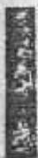

<!-- V3_SOURCE_ID:book020-b000326-p000-303ad4708a -->

之山也叫做龙，完全的穴（风水中认为气脉聚结、适宜安葬或营建的位置）是龙的结穴，不是龙之外另有穴（风水中认为气脉聚结、适宜安葬或营建的位置）。所以穿山叫做七十二龙，先天（术数中表示先天卦序或本体关系的概念）甲子也叫做六十龙，都是用来坐穴（风水中认为气脉聚结、适宜安葬或营建的位置），不是用来格龙的。

查看对应原文

<!-- V3_FOLDBACK_BEGIN:book020-b000326-p000-303ad4708a -->

之山亦名曰龍盡穴者龍之結穴非龍之外另有穴也故穿山曰七十二龍先天甲子亦曰六十龍皆所以坐穴非所以格龍也

<!-- V3_FOLDBACK_END:book020-b000326-p000-303ad4708a -->

<!-- V3_SOURCE_ID:book020-b000327-p000-cc5c843215 -->

七十二穿山顺排甲子论。

查看对应原文

<!-- V3_FOLDBACK_BEGIN:book020-b000327-p000-cc5c843215 -->

七十二穿山順排甲子論

<!-- V3_FOLDBACK_END:book020-b000327-p000-cc5c843215 -->

<!-- V3_SOURCE_ID:book020-b000328-p000-33666af84c -->

七十二龙又名穿山虎，说的是坐向的相穿。旧法中六甲误用错排，现在此图用顺排。错排，是以六甲周天为顺序，比如子丑二支，甲乙先到；寅卯二支，丙丁先到之类，错乱了本来的次序。顺排，是以十干首尾为次序，比如阳干都依甲、丙、戊、庚、壬的顺序，原文写阴干依“乙丁巳辛癸”，疑似“乙丁己辛癸”的讹字，顺着本来的次序。论六甲流行之气，适宜错排；论六甲定位之方，适宜顺排。透地六十龙，是按四势分布、论流行之气的，所以用错排；先天六十龙，是按经盘四方、论定位之气的，所以用顺排。穿山甲子本出于先天，因为先天六十龙配合二十四山，而“千维”十二山的位置，都对应六十龙各宫位的分界，对于甲子来说两者都不归属，此处“千维”具体所指不详，所以空隔一位来符合每山三个位置的数量，就以先天甲子串联七十二。此处原文内容残缺。

> **释读存疑：** “千维”具体所指不详；原文“乙丁巳辛癸”疑似“乙丁己辛癸”的讹字；原文末尾内容残缺

查看对应原文

<!-- V3_FOLDBACK_BEGIN:book020-b000328-p000-33666af84c -->

七十二龍一名穿山虎言坐向之相穿也舊法六甲誤用錯排今此圖用順排錯排者以六甲周天爲序如子丑二支甲乙先到寅卯二支丙丁先到之類錯其本來之次第也順排者以十干首尾爲次如陽干皆依甲丙戊庚壬陰干皆依乙丁巳辛癸順其本來之次第也論六甲流行之氣則宜錯排論六甲定位之方則宜順排透地六十龍按四勢分布論流行之氣者也故用錯排先天六十龍按經盤四方論定位之氣者也故用順排穿山甲子本出于先天因先天六十龍配合二十四山而千維十二山之中悉當六十龍各宮位之分界于甲子兩無所屬故空隔一位以合每山三位之數卽以先天甲子串合七十二

<!-- V3_FOLDBACK_END:book020-b000328-p000-33666af84c -->

<!-- V3_SOURCE_ID:book020-b000329-p000-7478a9408f -->

各個位置都相互貫穿，恰好空出十二個位置，這些位置不對應任何事物，位於干維之中。這是後人立法時，巧妙拆分一山為三個位置，以便於坐穴，並非本來就有這樣的數量。六十甲子之氣渾淪周遍，本來沒有拆分為七十二個位置的道理。而且既然空隔了十二個位置，那麼六甲就無法相續，更不符合周天流轉的機理，所以絕對不應當錯排，而必須順排，以不失先天本位之氣。以此坐穴，那麼坐甲的，向也為甲；坐乙的，腳也為乙。山與向相通，所以稱為穿山，說的是六甲之氣相互貫穿。如果錯排，那麼山與向都會相克，不符合穿山的道理。舊傳紅鸞水法中，穿山七十二穴用順排；又傳明代沈子昇在白鹿洞得到朱子的羅經銅片，穿山也用順排。錄片的真偽無法確知，紅鸞水法以穿山納音論生旺，其是否恰當也無法確信，但總的來說，其用順排而不用錯排，是符合古穿山之理的。

查看对应原文

<!-- V3_FOLDBACK_BEGIN:book020-b000329-p000-7478a9408f -->

位皆相穿貫而適空其兩無所值之十二位于干維之中此後人立法巧分一山三位以便于坐穴而非其本然之有此數也六十甲子之氣渾淪周浹本無拆布七十二位之理且既空隔十二位則六甲不相續更非周天流轉之機所以決不當錯排而必當順排以不失先天本位之氣也以此坐穴則坐甲者向亦甲坐乙者腳亦乙山與向通故曰穿山言六甲之氣相穿也若錯擁則山與向皆相克非穿山之理矣舊傳紅鸞水法穿山七十二穴用順拂又傳明沈子昇得朱子羅經銅片于自鹿洞穿山亦用順排錄片之真僞不可知紅鸞水法之以穿山納音論生旺其當否亦不可信而要其用順排而不用錯排則固有合于古穿山之理矣

<!-- V3_FOLDBACK_END:book020-b000329-p000-7478a9408f -->

<!-- V3_SOURCE_ID:book020-b000330-p000-3a498a3e72 -->

这是论述七十二穿山对应七十二候的引述。有人问：穿山七十二位用来匹配七十二候，依据是什么？怎么能说它不是流行之气，却一定要顺排甲子来契合定位之气呢？回答是：《罗经》里已经解释过这个问题了。

查看对应原文

<!-- V3_FOLDBACK_BEGIN:book020-b000330-p000-3a498a3e72 -->

論七十二穿山應七十二候之引 或曰穿山七十二位所以配七十二候安在非流行 之氣而必順排甲子以合定位之氣乎曰羅經解之

<!-- V3_FOLDBACK_END:book020-b000330-p000-3a498a3e72 -->

<!-- V3_SOURCE_ID:book020-b000331-p000-307557d9ff -->

最似是而非的，莫過於七十二穿山配七十二候的說法。七十二穿山的排列，是以六十甲子為基礎，空出十二個位置。卻不知道氣中的哪一候，獨自應當對配這空闕的位置，而不對應甲子干支之氣。十二個空虛位置位於十二辰兩宮的縫界，沒有專屬的歸屬。卻不知道氣中的哪一候，獨自應當處於十二月令兩節的岐界，沒有專屬的歸屬。而且十二月有七十二候，每月得六候；十二支宮有七十二穿山，並非每宮六穿山。所以以七十二候之氣來論，七十二穿山都處於兩候之間。如今要將子山的一半屬於冬至的，全部配給冬至的三候嗎？癸山的一半屬於小寒的，全部配給冬至的三候嗎？要將二十四山正中一位位於兩氣候之間的，對應前氣的一候嗎？還是後氣的一候呢？七十二候之氣未曾不周流于二十四山，卻要執著於穿山的甲子來對配，是不可能的。這就是所謂似是而非的說法。

查看对应原文

<!-- V3_FOLDBACK_BEGIN:book020-b000331-p000-307557d9ff -->

最似是而非者莫先于七十二穿山配七十二候之說夫七十二穿山之排以六十甲子而虛其十二位也卽不知何氣中之何一候獨當配此空闕之位而不應甲子干支之氣也十二虛位之在十二辰兩宮之縫界而無所專屬也卽不知何氣中之何一候獨當居十二月令兩節中之岐界而無所專屬也且十二月之有七十二候也每月得六候十二支宮之有七十二穿山也並非每宮六穿山故以七十二候之氣論則七十二穿山皆參界乎兩候之間今將以子山之半屬冬至者全配冬至之三候乎癸山之半屬小寒者全配冬至之三候乎將以二十四山正中一位之在兩氣候間者當應前氣之一候乎後氣之一候乎夫七十二候之氣未嘗不周流于二十四山而欲執穿山之甲子以配之則不可此所謂似是而非者也

<!-- V3_FOLDBACK_END:book020-b000331-p000-307557d9ff -->

<!-- V3_SOURCE_ID:book020-b000332-p000-5f14874156 -->

論穿山甲子、遁卦、翻曜、三奇、四吉的謬誤。

查看对应原文

<!-- V3_FOLDBACK_BEGIN:book020-b000332-p000-5f14874156 -->

論穿山甲子遁卦翻曜三奇四吉之謬

<!-- V3_FOLDBACK_END:book020-b000332-p000-5f14874156 -->

<!-- V3_SOURCE_ID:book020-b000333-p000-4c7397d11c -->

风水领域的地理家认为穿山甲子必须错排而不能用顺排，没有别的缘故，只是因为旧传的《宝镜》《玉函》等书所确立的穿山宿、遁卦、翻曜、子父财官、四吉三奇、八门等错误体例，都把错排甲子布设为固定格局，比如甲子角、丙寅氐、甲子四局、坎、丙寅八局、小过之类的设定，所以他们都谨守这些说法不敢提出异议。这类种种错误的体例，在有见识的人看来原本不需要辩驳，但普通人大多被这些说法迷惑。现在姑且拿其中最粗浅最明显的部分来讨论：二十八宿禽星的值日规则，必定要经过七元甲子共四百二十日，一共循环十五次才走完一个完整周期，周期与周期之间相互接续，元与元之间相互衔接。现在穿山甲子只有六十位，禽星循环两次还多出来四位，就用角、亢、氐、房四宿来补足，不知道这四宿的气为什么唯独要对应三次循环，剩下二十四宿的气为什么只对应两次循环？所谓的元元相续、周周相接的规则，到底体现在哪里呢？遁卦等法则是按照世间流传的奇门每节三元管局的惯例，查找穿山甲子属于哪一宫、哪一节、哪一局，以此推求三奇在哪一宫，和符头挨加的八门里的休、生、开三吉门在哪一宫，以及本宫所遁的是哪一卦，再观察该卦六爻对应的子父财官飞布在哪一宫；又根据该卦世爻对应的穿山宿，依照世间流传的翻禽法去推寻

查看对应原文

<!-- V3_FOLDBACK_BEGIN:book020-b000333-p000-4c7397d11c -->

地理家謂穿山甲子必當錯排而不用順排者無他故特以舊傳寶鏡玉函等書所立穿山宿及遁卦翻曜子父財官四吉三奇八門等之謬例皆以錯排甲子布爲定局如甲子角丙寅氐甲子四局坎丙寅八局小過之類故謹守之而不敢議夫此種種謬例在識者原不必辨而人每多爲所惑今姑以其至粗至顯者論之二十八宿禽星之值日必歷七元甲子四百二十日凡十五匝而始一周周與周相續元與元相接今穿山甲子止六十位禽星凡二匝而尙多四位以角亢氐房足之不知此四宿之氣何以獨當三匝餘二十四宿之氣何以止當二匝所謂元元相續周周相接者果何在也道卦等法則以世傳奇門每節三元管局之例尋穿山甲子在何宮何節何局內以求三奇之在何宮與符頭挨加八門之休生開在何宮及本宮所遁之何卦以觀其六爻子父財官之飛在何宮又以其世爻之穿山宿依世傳翻禽法尋

<!-- V3_FOLDBACK_END:book020-b000333-p000-4c7397d11c -->

<!-- V3_SOURCE_ID:book020-b000334-p000-89a2d2a103 -->

金、水、日、月这四个吉曜的交会处在哪个宫位，总的来说都要以三元管局作为起例，还要以管局遁卦作为翻曜的起例。阴阳相关的排布必定有十八局，每个节气必定有三元，二十四节气必定对应七十二局。如今穿山甲子只有六十位，每个节气分不到三位，那所谓的三元、十八局、七十二局的依据在哪里呢？重卦的数量必定是六十四，六十四重卦里原本是没有重复的卦象的。现在穿山六十甲子对应的遁卦少了四个，又不像《易纬》里的六十候卦那样以震、兑、坎、离为总纲，也不像经世六十用卦那样以乾、坤、坎、离作为外围框架。而且它所遁的六十卦里，重复的卦就有十四个，算下来有十八个卦没能被纳入，所谓的八卦排成序列、两两相重、刚柔相互摩擦、八卦相互推移的规律，又体现在哪里呢？况且禽星的运行本就该周周相续、元元相接，奇门三元管局的排布也本该局局相推、元元相接，可七十二穿山的甲子空出了十二位的间隔，不知道周与周、元与元为什么要到这里就飞跨过去，局与局、元与元又为什么要到这里忽然中断？以上这些都是非常粗浅明显的错漏，看了只会让人觉得可笑，至于这套理论背后的所谓原理，就更不值得深究了。

查看对应原文

<!-- V3_FOLDBACK_BEGIN:book020-b000334-p000-89a2d2a103 -->

其金水日月四吉曜之會在何宮而總之皆以三元管局爲起例而又以管局遁卦爲翻曜之起例夫陰陽邇之必有十八局也每節之必有三元也二十四氣之必有七十二局也今穿山甲子六十位每節尙不足三位所謂三元者何在十八局七十二局者何在也重卦之必有六十四也六十四之必無複卦也今穿山六十甲子之少四遁卦而又非若易緯六十候卦之以震兌坎離爲綱經世六十用卦之以乾坤坎離爲圍也又其所遁六十卦凡複卦一十有四計其所不得道者十八卦所謂八卦成列因而重之剛柔相摩八卦相盪者果何在也且禽星之必周周相續元元相接也奇門三元管局之必局局相推元元相接也而七十二穿山之甲子空隔十二位不知周與周元與元之何以必當至此而飛越局與局元與元之何以必當至此而忽斷也凡此真至粗至顯之令人粲然失笑者若其所以然之故更不必言矣

<!-- V3_FOLDBACK_END:book020-b000334-p000-89a2d2a103 -->

<!-- V3_SOURCE_ID:book020-b000335-p000-8ed6538a22 -->

論奇門之法不可用。

查看对应原文

<!-- V3_FOLDBACK_BEGIN:book020-b000335-p000-8ed6538a22 -->

論奇門之法不可用

<!-- V3_FOLDBACK_END:book020-b000335-p000-8ed6538a22 -->

<!-- V3_SOURCE_ID:book020-b000336-p000-3ca99616ab -->

七十二穿山搭配奇门、卦曜的错谬，本来就像前面所说的那样。不过这里还只是姑且认为奇门的方法本身是对的，只是穿山用法错用了奇门。如果进一步切实考证，就会发现世间流传的奇门方法本身的错谬，还有更让人吃惊的地方。有些聪慧的人喜好谈论奇门，用它来做穿山、用它来做选择，既耽误自己也误导别人，以至于迅速遭遇败亡绝嗣的后果，我所见闻的这类情况不止一两件。这里不需要辨析其中的细微之处，姑且验证旧有流传错谬里最明显最粗浅的地方，比如六仪为什么要遁藏六甲，三奇为什么要逆排和顺排布设，八门为什么要挨排第三层穿山

> **释读存疑：** 1轮自动修复后核义模型仍建议修订，已保守记录。

查看对应原文

<!-- V3_FOLDBACK_BEGIN:book020-b000336-p000-3ca99616ab -->

七十二穿山奇門卦曜之謬固如前所云矣然此又姑以其奇門之法爲是而穿山之用之者非也若更實而考之則世所傳奇門之法之謬更有可駭者聰頴之士好談奇門用以穿山用以選擇自誤誤人以至敗絕之速余所見聞殆不一而足此無庸辨其細微姑印舊傳訛謬之最顯最粗者如六儀以六甲之何以遁三奇之何以逆順布八門之何以挨第三層穿山

<!-- V3_FOLDBACK_END:book020-b000336-p000-3ca99616ab -->

<!-- V3_SOURCE_ID:book020-b000337-p000-83c686d8ca -->

加与奇门二字为什么这样取义，为什么自古以来没有奇门的名称，而叫它孤虚法，总归有一处是出于自然规则，不是人刻意穿凿勉强安排的，就比如阳遁一局里甲子戊在坎宫、甲戌己在坤宫的设定，大概是从一宫起甲子，顺次排布乙丑在坤宫、丙寅在震宫，从下往上排布，坎宫就得到甲子、癸酉、壬午、辛卯、庚子、己酉、戊午这七个时辰，甲子藏在第一个时辰里，戊午就是它的仪。所谓仪，就像头上有装饰一样，六甲是天干的首位，六仪的天干就像是装饰六甲的。按照这个规则顺推，甲戌藏在坤宫的第二位，己未就是它的仪，甲

> **释读存疑：** 本地硬校验仍未通过，已记录供后续自动处理或人工核对。

查看对应原文

<!-- V3_FOLDBACK_BEGIN:book020-b000337-p000-83c686d8ca -->

加與奇門二字之何以取義何以古來無奇門之名而名之曰孤虛法總來有一語之出于自然而非人意穿鑿之勉强安排者卽如陽遁一局甲子戊在坎甲戌巳在坤者蓋從一宮起甲子順布乙丑坤丙寅震自下而上而坎宮得甲子癸酉壬午辛卯庚子巳酉戊午之七時甲子藏于第一時而戊午爲之儀儀者如首之有飾六甲干之首而六儀之干若飾之也依此順推甲戌藏于坤宮之第二而已未爲之儀甲

<!-- V3_FOLDBACK_END:book020-b000337-p000-83c686d8ca -->

<!-- V3_SOURCE_ID:book020-b000338-p000-9e83822aa4 -->

申藏在震宫的第三位，以庚申为相应的仪；甲午藏在巽宫的第四位，以辛酉为相应的仪；甲辰藏在中宫的第五位，以壬戌为相应的仪；甲寅藏在乾宫的第六位，以癸亥为相应的仪，这就是六甲的遁藏规则、六仪的命名由来。兑宫的范围从庚午开始，到乙卯为止；艮宫的范围从辛未开始，到丙辰为止；离宫的范围从壬申开始，到丁巳为止，这乙、丙、丁对应的三个宫位，是六甲不会到的地方。十天干里六甲最为尊贵，戊、己、庚、辛、壬、癸作为六仪，是用来匹配作为首位的甲的，所以即便处在外面也不能称尊，乙、丙、丁不能加在六甲之上，处于第三位的是宁山。

> **释读存疑：** 原文末尾“寧山”为残文，具体所指不详；1轮自动修复后核义模型仍建议修订，已保守记录。

查看对应原文

<!-- V3_FOLDBACK_BEGIN:book020-b000338-p000-9e83822aa4 -->

申藏于震宮之第三而庚申爲之儀甲午藏于巽宮之第四而辛酉爲之儀甲辰藏于中宮之第五而壬戌爲之儀甲寅藏于乾宮之第六而癸亥爲之儀此六甲之所以遁六儀之所以名也兌宮則始庚午而極于乙卯艮宮始辛未而極于丙辰離宮始壬申而極于丁巳此乙丙丁三宮爲六甲之所不至也十千首六甲爲最尊戊己庚辛壬癸以六儀儀其首甲故雖處外而不得爲尊乙丙丁不加于六甲之上則處第三寧山

<!-- V3_FOLDBACK_END:book020-b000338-p000-9e83822aa4 -->

<!-- V3_SOURCE_ID:book020-b000339-p000-04bcd73c7b -->

外在能够体现出它的尊贵特质，所以被称为三奇。这里的奇是奇耦的奇，指的是气势尊贵，并不是奇异的意思。之所以取象于日、月、星，是因为原本存在月能掩蔽星光、日能掩蔽月光、木能掩蔽日光的关系。乙宫没有六甲的管制，就如同日光不会被其他事物掩蔽；丙宫没有六乙的克制，就如同月光不会被日光夺去光彩；丁宫没有乙、丙的影响，就如同星光不会被日和月夺去光彩。这三奇六仪遁甲的全部内容都源自自然之数，丝毫不是人力可以随意安排的。后人不明白它的本源，只能凭主观臆测进行解说，于是各种荒诞怪异的说法越推演越牵强附会，甚至还把乙当作丁、把丁当作乙，这些都是源于误解。

查看对应原文

<!-- V3_FOLDBACK_BEGIN:book020-b000339-p000-04bcd73c7b -->

外而得以遂其尊故曰三奇奇如奇耦之奇言勢之尊貴也非奇異之謂也取象于日月星者月掩星光日掩月光木掩日光乙宮無六甲之管如日光之不受掩蔽也丙宮并無六乙如月光之不爲日奪也丁宮并無乙丙如星光之不爲日與月奪也此三奇六儀遁甲之悉出于自然之數而非絲毫人力之可以意排後人不知其本不得不臆爲解說而紛紛詭怪之論愈推而愈鑿且以乙爲丁丁爲乙由于誤解

<!-- V3_FOLDBACK_END:book020-b000339-p000-04bcd73c7b -->

<!-- V3_SOURCE_ID:book020-b000340-p000-0bbc29fdbd -->

有顺仪逆奇、顺奇逆仪的说法，还按照乙、丙、丁的顺序来进行顺逆排布，却不明白顺逆原本是根据本分左右来命名的简便口诀，它的排布必定要依据六十甲子的挨飞来进行，绝对不能在中间随意截断。不过三奇相关的错误虽然会导致五行错乱，但相关的星还都属于尊贵之星；如果是八门出现错乱，那么对应的祸福结果就会相差悬殊。更严重的是，三奇和八门都根源于洛书之数，要根据洛书数的变动，来验证后天八方中哪一个方位是门。所谓八门，是说八个方位当中必定有一个是门，并不是八个方位全都是门，就好像宫室有大门一样。原文此处出现“休生傷杜景死驚開之第三南家山”，语义断裂，具体所指不详。

> **释读存疑：** “休生傷杜景死驚開之第三南家山”具体含义不详

查看对应原文

<!-- V3_FOLDBACK_BEGIN:book020-b000340-p000-0bbc29fdbd -->

順儀逆奇順奇逆儀之說而以乙丙丁爲序以順逆布之不知順逆者自本分左右而名之之捷訣而其所以布則必由于六千甲子之挨飛而斷不能斷截其間也然三奇之誤雖五行錯亂而猶皆屬尊貴之星若八門之錯亂則禍福懸殊更有甚者奇與門皆本洛書之數以洛書數之變動而驗于後天八方之何方爲門八門者言八方之必有一門非八方之皆門也如宮室之有大門然休生傷杜景死驚開之第三南家山

<!-- V3_FOLDBACK_END:book020-b000340-p000-0bbc29fdbd -->

<!-- V3_SOURCE_ID:book020-b000341-p000-b945860674 -->

方位本身并不是门。如果这八个方位并列不动，就称为伏吟，相关的数都没有变动，处于伏藏掩蔽的状态，没有可以发动的门；数一旦变动，直使的方位就会随着一、二、三、四、五、六、七、八、九的挨飞而变化，八个方位当中必定会有一处空虚，空虚的地方就是门。凡是某一方的卦位居于中间位置，那么这个方位的对面必定是空的，就像大官处理政务升堂的时候，必定会把重重门户都敞开一样。比如坎对应的休门居于中位，那么离方必定空虚；乾对应的开门居于中位，那么巽方必定空虚，都是这类情况。大概门必须朝向正位，而之所以说对应的位置空虚，也是出于不敢承当尊位的意思，所以古人把这种方法称为孤虚法。孤就是奇，因为对应的天干尊贵，所以称为孤；虚就是门。后人不明白孤虚的

查看对应原文

<!-- V3_FOLDBACK_BEGIN:book020-b000341-p000-b945860674 -->

位非門也八者並列則謂之伏吟數皆不動伏藏掩蔽而無門之可發數動則直使之位隨一二三四五六七八九之挨飛而八方必虛其一虛者門也凡何方之卦位居中則其方之對面必虛若大官府升堂之必洞開重門者然如坎休居中則離方必虛乾開居中則巽方必虛之類蓋門必正向而謂之虛者亦不敢當尊之義也故古人謂之孤虛法孤卽奇也以其干之尊貴而曰孤也虛卽門也後人不知孤虛之

<!-- V3_FOLDBACK_END:book020-b000341-p000-b945860674 -->

<!-- V3_SOURCE_ID:book020-b000342-p000-42e2949d28 -->

含义，就把六甲的旬空当作孤虚，于是因为六甲不临三奇而误传了相关说法。虚的判定方法已经失传，从此便产生了误传，按照定式将直使所临的宫位进行伏吟的八位顺转八方的操作，以至于打乱了原本的自然顺序。凡是想要求得休、生、开三门的，都没能得到休、生、开，反而没有不遇到惊、伤、死、虚这类情况的。甘时望所传的奇门，曾获知八门随九星变动的方法，然而又因为缺少一门的判定方法，衍生出超五趋乾的口诀，导致各类书籍记载的挨数方法中断，人们想要找到的休、生、开也往往出错，这就是祸福判断多有差错的原因。祸福的偏差已经到了这种地步，而原文末尾“而人多W/ 第三穿山”存在识别错误，内容无法释读。

> **释读存疑：** 末尾“而人多W/ 第三穿山”存在OCR识别错误，无法准确释读

查看对应原文

<!-- V3_FOLDBACK_BEGIN:book020-b000342-p000-42e2949d28 -->

義而以六甲之旬空當之因六甲之不臨三奇而誤傳其說也虛法既失子是誤傳直使所臨之宮以定式伏吟之八位順轉八方以至錯其自然之序凡其所求之休生開皆未有得休生開者也卽未有不得驚傷死虛之類者也甘時望之奇門一得知八門逐九星之法矣然又因其少一門而爲超五趨乾之訣則各書之挨數中絕而所求之休生開亦往往失之此禍福之所以多舛也禍福之舛如此而人多W/ 第三穿山

<!-- V3_FOLDBACK_END:book020-b000342-p000-42e2949d28 -->

<!-- V3_SOURCE_ID:book020-b000343-p000-491ac31c59 -->

奇门因为自己招致灾祸，是由于克应必定应验的缘故。克应以符头为标准，而世间流传的这个方法只有符头的一端可以依据，其余的都不可依据，因此克应准确而祸福不准确，这实在可怕，不得不赶紧揭示出来。有人说：依照您所说的来用，可以吗？回答是：不可以。我所说的都是那些极浅显、容易看见的，所以用道理来辟除它，至于它的精蕴就无从探究了。奇门这一方法本来就不是为民间营造、丧葬等一切事情设立的，所以它的书不在世间流传。我希望地理选择的人家绝对不要用这个害人，这样就可以了。

查看对应原文

<!-- V3_FOLDBACK_BEGIN:book020-b000343-p000-491ac31c59 -->

奇門以自禍者則由于剋應必騐之故剋應以符頭爲準而世傳此法惟符頭之一端可據而其餘皆不可據是以剋應準而禍福不準此真可懼而不得不急爲揭之者也或曰依子所言而用之可乎曰不可此所言皆其至淺而易見者故以理闢之如此若其精蘊無從而究之奇門一法本非爲民間造葬一切之用是以其書不傳于世吾願地理選擇之家斷斷不以此害人也可

<!-- V3_FOLDBACK_END:book020-b000343-p000-491ac31c59 -->

<!-- V3_SOURCE_ID:book020-b000344-p000-fa023b1098 -->

地理末学

查看对应原文

<!-- V3_FOLDBACK_BEGIN:book020-b000344-p000-fa023b1098 -->

地理末學

<!-- V3_FOLDBACK_END:book020-b000344-p000-fa023b1098 -->

<!-- V3_SOURCE_ID:book020-b000345-p000-aab25caba9 -->

第四层透地六十龙

查看对应原文

<!-- V3_FOLDBACK_BEGIN:book020-b000345-p000-aab25caba9 -->

第四層透地六十龍

<!-- V3_FOLDBACK_END:book020-b000345-p000-aab25caba9 -->

<!-- V3_SOURCE_ID:book020-b000346-p000-058417e626 -->

旧传透地六十龙是用来格龙的，把六十甲子在正针之下交错拱卫。五亥属于乾亥，五子属于壬子，五丑属于癸丑，是北方水龙；五寅属于艮寅，五卯属于甲卯，五辰属于乙辰，是东方木龙；五巳属于巽巳，五午属于丙午，五未属于丁未，是南方火龙；五申属于坤申，五酉属于庚酉，五戌属于辛戌，是西方金龙。依照正针壬子双山的五行来运用，然而正针壬子双山以四势五行论龙，诸书大多不知道，错误地用缝针壬子双山的三合五行来论龙，于是透地六十龙的意义就完全丧失了。所以想要明白透地的方法，应当认识双山四势的道理。正针壬子双山四势龙说

查看对应原文

<!-- V3_FOLDBACK_BEGIN:book020-b000346-p000-058417e626 -->

舊傳透地六十龍者所以格龍也以六十甲子錯拱 于正針之下五亥屬乾亥五子屬壬子五丑屬癸丑 爲北方水龍五寅屬艮寅五卯屬甲卯五辰屬乙辰 爲東方木龍五巳屬巽巳五午屬丙午五未屬丁未 爲南方火龍五申屬坤申五酉屬庚酉五戌屬辛戌 爲酉方金龍依正針壬子雙山五行爲用然正針壬 子雙山以四勢五行論龍諸書多不知誤以縫針壬 子雙山之三合五行一例論龍而透地六十龍之義 盡失矣故欲明透地之法當識雙山四勢之理也 正針壬子雙山四勢龍說

<!-- V3_FOLDBACK_END:book020-b000346-p000-058417e626 -->

<!-- V3_SOURCE_ID:book020-b000347-p000-7a5af5ffa1 -->

壬子双山是乾亥同亥、壬子同子的意思。有缝针的壬子双山，也有正针的壬子双山。缝针的壬子双山，五行以会合为根本，用亥卯未木局、寅午戌火局、巳酉丑金局、申子辰水局来论三合，所以双山都是十二支的正

查看对应原文

<!-- V3_FOLDBACK_BEGIN:book020-b000347-p000-7a5af5ffa1 -->

壬子雙山者乾亥同亥壬子同子之謂也有縫針之壬子雙山有正針之壬子雙山縫針之壬子雙山五行主于會合以亥卯未木局寅午戌火局巳酉丑金局申子辰水局論三合者也故雙山皆十二支之正

<!-- V3_FOLDBACK_END:book020-b000347-p000-7a5af5ffa1 -->

<!-- V3_SOURCE_ID:book020-b000348-p000-0a609abe4f -->

正针的壬子双山，五行以分布为根本，依据亥子丑对应的水方、寅卯辰对应的木方、巳午未对应的火方、申酉戌对应的金方来论述四势，所以双山都承载十二支的初始之气。三合双山以生旺之气对应砂、水，其中的道理明显易懂；四势双山以先到之气对应龙，其中的道理微妙难以辨识。从十二支的正位来衡量，乾在戌和亥之间，艮在丑和寅之间，巽在辰和巳之间，坤在未和申之间，是四个隅位的交界；从五行流布的气脉来考量，乾、艮、巽、坤处于前后气脉交接的节点，前一段气脉的消退就是后一段气脉的开端；用刚刚生发的气脉来研判龙势，符合五气运行的自然规律。所以六十甲子取前半段的位置，亥、壬、子、癸、丑对应的龙统属乾，寅、甲、卯、乙、辰对应的龙统属艮，巳、丙、午、丁、未对应的龙统属巽，申、庚、酉、辛、戌对应的龙统属坤。《玉尺经》记载“天柱发四维之气”，旧的注释称乾、坤、艮、巽是天地的四根支柱，对应四势来运行二十四龙的气脉，所谓的“四势行气、八龙施生”指的就是这个内容。以上就是四势壬子双山子母公孙同类的相关说法。

> **释读存疑：** 本地硬校验仍未通过，已记录供后续自动处理或人工核对。

查看对应原文

<!-- V3_FOLDBACK_BEGIN:book020-b000348-p000-0a609abe4f -->

位正針之壬子雙山五行主于分布以亥子丑水方寅卯辰木方巳午未火方申酉戌金方論四勢者也故雙山皆十二支之始氣三合雙山以生旺之氣應砂水其理顯而易知四勢雙山以先至之氣應龍其理微而難識以十二支正位論乾在戌亥之問艮在丑寅之間巽在辰巳之間坤在未申之間爲四隅之交界以五行流布之氣論則乾艮巽坤當前後交代之際前氣之謝即後氣之始以方生之氣論龍弓/ arcest4a五氣自然之理故六十甲子率先半位而亥壬子癸丑龍絃于乾寅甲卯乙辰龍統于艮巳丙午丁未龍統于巽申庚酉辛戌龍統于坤玉尺經云天柱發四維之氣舊注謂乾坤艮巽天地之四柱處四勢以行二十四龍之氣所謂四勢行氣八龍施生者此也四勢壬子雙山子母公孫同類說

<!-- V3_FOLDBACK_END:book020-b000348-p000-0a609abe4f -->

<!-- V3_SOURCE_ID:book020-b000349-p000-b6c4b81fb2 -->

这段《青囊》的内容存在文句残损，目前可辨识的内容提及：书中叙说先天经盘相关内容，涉及“十二又后天”的表述，后文还提到后天相关内容要附上八干与四维，八干四维辅助地支的位置，地支的子母八孙属于同一类，二十四山相关内容末尾有“双双起少有”的表述，因为文句不全，相关完整含义无法确定。

> **释读存疑：** 原文残损，“十二又后天”“少有”等表述前后文缺失，无法确定完整句义

查看对应原文

<!-- V3_FOLDBACK_BEGIN:book020-b000349-p000-b6c4b81fb2 -->

靑囊敘先天經盤十二又後天再附千與維八千四維輔支位子母八孫同一類二十四山雙雙起少有

<!-- V3_FOLDBACK_END:book020-b000349-p000-b6c4b81fb2 -->

<!-- V3_SOURCE_ID:book020-b000350-p000-eca57eed71 -->

当时的风水师知晓这个道理，五行分布在二十四时，当时的风水师何曾记得这个道理？这就是四势双山的含义。公孙同类是从四维的角度来说的，四维是天地的纲纪、五行的统摄宗主，所以用公孙来取象：乾统摄金与水的交界，和亥水同类；艮统摄水与木的交界，和寅木同类；巽统摄木与火的交界，和巳火同类；坤统摄火、土、金的交界，和申金同类，这就是公孙同类的含义。子母同类是从八干的角度来说的：甲乙依附于震卦而属木，丙丁依附于离卦而属火，庚辛依附于兑卦而属金，壬癸依附于坎卦而属水，就像子女跟随母亲，这就是子母同类的含义。子母、公孙各自和对应方位本来当旺的五行同类，所以二十四山就会两两配对出现，来对应十二支的五行之气，亥、子、丑对应水，寅、卯、辰对应木，巳、午、未对应火，申、酉、戌对应金，分布在二十四个方位上，四势行气、八龙施生的方法就清晰明了了。说四势又叫八龙，是因为每一条龙都有左右两个关局，所以有的叫八龙，有的叫四龙，其实是一回事。很多书籍都误解了这段叙述，认为它讲的是缝针的双山三合，还认为这段叙述源自杨会，缝针是杨公罗盘的内容，却不知道杨公的地理风水方法都不脱离正针，诸多经文里的方位都是用正针来标定的，只有《青囊奥语》的前几句表述

> **释读存疑：** 本地硬校验仍未通过，已记录供后续自动处理或人工核对。

查看对应原文

<!-- V3_FOLDBACK_BEGIN:book020-b000350-p000-eca57eed71 -->

時師知此義五行分布二十四時師此義何曾記此四勢雙山之義也公孫同類以四維言也四維天地之紀五行之統宗故取象于公孫乾統金水之際而同于亥水艮統水木之際而同于寅木巽統木火之際而同于巳大坤統火土金之際而同于申金此公孫之同類也子母同類以八干言也甲乙附于震而屬木丙丁附于離而屬火庚辛附于兌而屬金壬癸附于坎而屬水如子之隨母此子母之同類也子母公孫各與其方本旺之五行同類則二十四山雙雙起以應十二支五行之氣而亥子丑之水寅卯辰之木巳午未之火申酉戌之金分布二十四位而四勢行氣八龍施生之法了然矣四勢而曰八龍者每龍有左右關二局故或曰八龍或曰四龍其實一也諸書多誤解此叙以爲縫針之雙山三合以此敘本于楊會而縫針爲楊盤之故不知楊公地法不離正針諸經文中方位皆係正針惟靑囊奧語前數句表

<!-- V3_FOLDBACK_END:book020-b000350-p000-eca57eed71 -->

<!-- V3_SOURCE_ID:book020-b000351-p000-88e44f5951 -->

明确指出中缝二针是左右干维的用途，这篇文章说先天经盘云云，明明指出是正针，为何要认作缝针呢？诸多书籍误认双山，因此对于子母公孙的含义多含糊不切，于是过于搜索的人，有的执着天玉卦例山水相对阴阳交媾的宗旨作为双双起的奥义，深刻驳斥十二支双山同气的说法，不知八卦十二支其实是罗经两大纲领，那些所学专在卦例，于是想执着一点来完全解释诸经，虽然明显违背本文“先天经盘十二支八干四维辅支位”的话却不自知，因此他关于子母公孙的言论，也说卦是母，二十四路是子；卦是公，二十四路是孙，同一个卦，忽而称母忽而称公，不要说他谈论二十四山，还说每卦三爻，那么十二宫不足以尽地之数，因此用二十四山配二十四爻，三山归属于一卦，比如丑艮寅都应当用艮三爻的理气来论述，没有可以分爻配的道理。现在要顺排，是把丑艮作为二阴爻而寅为一阳爻呢？还是逆排，把丑山作为一阳爻艮寅为二阴爻呢？抑或是以艮山为主，属一阳爻而分拆二阴来归属丑寅呢？

查看对应原文

<!-- V3_FOLDBACK_BEGIN:book020-b000351-p000-88e44f5951 -->

明中縫二針左右千維之用耳此文先天經盤云云明明指出正針何故認作縫針耶諸書誤認雙山故于子母公孫之義多含糊不切干是過于搜索者或執天玉卦例山水相對陰陽交媾之旨爲雙雙起之奧義深闢十二支雙山同氣之非不知八卦十二支實羅經兩大綱領彼其所學專在卦例遂欲執一得以盡解諸經雖顯背本文先天經盤十二支八干四維輔支位之言而不之覺故其子母公孫之言亦曰卦爲之母而二十四路爲之子卦爲之公而二十四路爲之孫一卦也忽母而忽公無論巳其言二十四山也曰每卦三爻則十二宮不足盡地之數是以二十四山配二十四爻夫三山之管于一卦如丑艮寅之皆當以艮三畫之理氣諭未有可以分爻配者也今將順排之以丑艮爲二陰爻而寅爲一陽爻乎將逆排之以丑山爲一陽爻艮寅爲二陰爻乎抑將以艮山爲主屬一陽爻而分拆二陰以屬之丑寅乎

<!-- V3_FOLDBACK_END:book020-b000351-p000-88e44f5951 -->

<!-- V3_SOURCE_ID:book020-b000352-p000-fde4bda8b2 -->

有人将中间的一山作为父母，左右两山作为子息，却没搞清楚是要把艮卦两个阴爻当中的那一个阴爻作为父母，还是要把艮卦的那一个阳爻移到中间作为两个阴爻的父母。还有说法称八干辅佐四正，凑不够卦爻的数目，于是用四隅的四卦补成三八之数，这种说法完全不清楚八卦和十二支原本就自然相合、先后天排布原本就自然附合的道理，反而把四隅卦当成凑数的卦，可见提出这种说法的人对自己所学卦例的本源都没有考察，这哪里是浅陋。原文有注文标注“将氏指蒋氏”：甚至还有蒋氏，以及抄袭他的说法来著书的范氏。有的人把鸿门水法的十二阴阳当作父母的阴阳，以及“双双起”对应的阴阳；还有的人因为有四十八局里一山分两局、分顺子逆子的说法，就错误地把亥、癸当成乾、坎的顺子，把“成壬”（此处应为“壬戌”的形近讹误）当成乾、坎的逆子，他们完全不知道辰、戌、丑、未、甲、丙、庚、壬有什么过错，要被加上逆子的恶名。总体来说，是因为四势五行的道理没有被正确传承，各类书籍里改动山向的说法越来越荒谬，所以那些自以为是、师心自用的人，只能勉强从前人的经文里搜寻拼凑内容，却不知道自己的错谬已经非常严重，还因此误导了更多的人。

> **释读存疑：** 原文“成壬”为“壬戌”形近讹误，“河陋”为“何陋”形近讹误，“将氏指 蔣氏”是原文注文；原文“河陋”疑为“何陋/何其陋”形近讹误，“将氏指 蔣氏”是原文注文，“成壬”所指不明；本地硬校验仍未通过，已记录供后续自动处理或人工核对。

查看对应原文

<!-- V3_FOLDBACK_BEGIN:book020-b000352-p000-fde4bda8b2 -->

又以中一山爲父母左右二山爲子息卽不知將以艮二陰之中一陰爻爲父母乎將移艮之一陽爻于中爲二陰之父母乎又謂八千輔佐四正未足卦爻之數遂以四隅四卦補成三八是并昧然于八卦十二支所以自然相合先後天所以自然加附之理而以四隅爲補數之卦則其于所學卦例之原亦未之察抑河陋也將氏指 蔣氏 甚至勦其說以著書者范氏或以鴻門水法之十二陰陽爲父母之陰陽及雙雙起之陰陽或又因其四十八局如順子逆子一山兩局之言而誤以亥癸爲乾坎之順子成壬爲乾坎之逆子卽不知辰戌丑未甲丙庚壬之何罪而加以逆子之惡名也總由四勢五行之理失而諸書變山之說愈謬故師心之士于前人經文不得不勉強搜求而不自知其誤之過甚而因以誤人之愈甚也

<!-- V3_FOLDBACK_END:book020-b000352-p000-fde4bda8b2 -->

<!-- V3_SOURCE_ID:book020-b000353-p000-ce08c3b3ba -->

正针壬子双山的四势五行既定，于是用六十甲子分布

查看对应原文

<!-- V3_FOLDBACK_BEGIN:book020-b000353-p000-ce08c3b3ba -->

正針壬子雙山之四勢五行既定遂以六十甲子分

<!-- V3_FOLDBACK_END:book020-b000353-p000-ce08c3b3ba -->

<!-- V3_SOURCE_ID:book020-b000354-p000-10ef8e56a8 -->

在双山之下，把五亥归属乾亥，五子归属壬子，五丑归属癸丑，称之为透地六十龙，也叫平分六十龙，不知其起源于何处。我认为六十甲子的运用，只有先天经盘坐穴之法是正理，此外双山四势只应当以四方来论述五行流转之气，不必牵附六十甲子。推究前人设立这个的用意，或许不过是想借此来标注双山十二宫的位置，比如五亥为亥、五子为子之类而已，透地之名应当也是后人所加，所谓平分，大概就是先天坐穴六十甲子平分一百二十位，取其各宫向第四层透地龙

查看对应原文

<!-- V3_FOLDBACK_BEGIN:book020-b000354-p000-10ef8e56a8 -->

布雙山之下以五亥屬乾亥五子屬壬子五丑屬癸丑謂之透地六十龍亦曰平分六十龍不知其所自起愚謂六十甲子之用惟先天經盤坐穴之法爲正理此外雙山四勢只當以四方論五行流轉之氣不必牽附六十甲子推原昔人設此之意或不過欲借此以標雙山十二宮之位如五亥爲亥五子爲子之類而已透地之名當亦後人所加所謂平分者殆卽先天坐穴六十甲子平分一百二十位取其各宮向第四層透地龍

<!-- V3_FOLDBACK_END:book020-b000354-p000-10ef8e56a8 -->

<!-- V3_SOURCE_ID:book020-b000355-p000-acb7a63b40 -->

这当中有一半的内容是用来确定穴位的，虽然数目是一百二十，实际上是平分的六十龙，所以叫平分六十龙。因为它附列在缝针双山的下方，后来就被讹传成正针的双山，因此有了透地六十龙的名称。后世的人推演探究相关说法，就说“平分”这个名称是用来和盈缩六十龙相区别的，这就是错上加错了。旧的风水方法因此有了透地龙贯穴的说法，用入首龙对应的甲子来考量它的纳音，一是要让这个纳音和峡中或者后节来气处（原文此处“東氣”为“來氣”的形近讹误）的透地纳音相生或者比和，才是好的；二是要让这个纳音和坐穴的分金纳音相生或者比和，才是好的。后龙则以入首本脉的甲（原文此处文句未完）

> **释读存疑：** 原文“東氣”为“來氣”形近讹误，末尾“后龙则以入首本脉之甲”文句残损，含义不全；原文“東氣”疑为“來氣”形近讹误，末尾“后龙则以入首本脉之甲”文句残损，含义不全

查看对应原文

<!-- V3_FOLDBACK_BEGIN:book020-b000355-p000-acb7a63b40 -->

內一半以立穴位雖一百二十實則六十龍之平分 故曰平分六十龍因其附列于縫針雙山之下遂訛 而爲正針之雙山因以爲透地六十龍之名後人推 求其說輒謂平分之名所以別于盈縮之故此譌而 又譌者耳舊法于是有透地龍貫穴之說以此入首 龍之甲子論其納音一則取其與峽中或後節東氣 處之透地納音相生比和爲妙一則取其與坐穴之 分金納音相生比和爲妙後龍則以入首本脈之甲

<!-- V3_FOLDBACK_END:book020-b000355-p000-acb7a63b40 -->

<!-- V3_SOURCE_ID:book020-b000356-p000-f256ffbf1b -->

子论生克，坐穴则又兼以贯穴之甲子论生克，比如巳亥龙本脉属木，若取辛亥之龙气贯穴则又属金之类。不过旧法虽有此说，却实在不符合精理，因为它由来已久，姑且列于盘以存其旧，用法能契合固然好，不契合也不必拘泥。有人又误以此为坐穴立向之甲子，尤其属于舛错，甚至改用顺排以带后天重卦，去掉坎离震兑以符合六十甲子之数，以坐穴之卦推其子父财官贵人禄马在何方，又于一位之下细分六爻，看所坐之第四层边地腔

查看对应原文

<!-- V3_FOLDBACK_BEGIN:book020-b000356-p000-f256ffbf1b -->

子論生克坐穴則又兼以貫穴之甲子論生克如巳亥龍本脈屬木若取辛亥之龍氣貫穴則又屬金之類是也然舊法雖有此說而實無當于精理因其來巳久姑列于盤以存其舊用法能合固妙不合亦不足拘泥也或又誤以此爲坐穴立向之甲子尤屬舛錯甚至改用順排以帶後天重卦去其坎離震兌以符六十甲子之數以坐穴之卦推其子父財官貴人祿馬之在何方又于一位之下細分六爻看所坐之第四層邊地腔

<!-- V3_FOLDBACK_END:book020-b000356-p000-f256ffbf1b -->

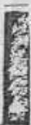

<!-- V3_SOURCE_ID:book020-b000358-p000-2ab63c8e73 -->

爻位对应子、父、财、官、贵人、禄、马等神煞，以此来区分吉凶。《易纬》里的六十候卦去掉坎、离、震、兑四卦，是因为它以十二辟卦为纲领，每个辟卦各用四个卦来辅助，所以把坎、离、震、兑作为四时气候的主导，这种做法虽然不符合重卦的本来含义，但对义理没有损害。现在的人用后天方位八卦相互激荡的次序为依据，想要去掉四方里的某一卦，这种做法不通事理、荒谬到了极点，却还有人相信，这是为什么呢？还有穿山甲子带卦、盈编甲子带卦、壬初甲子带卦、壬半甲子带卦、子初甲子带卦、百二十甲子带卦等各种说法，纷纷杂杂地用来探求

> **释读存疑：** 本地硬校验仍未通过，已记录供后续自动处理或人工核对。

查看对应原文

<!-- V3_FOLDBACK_BEGIN:book020-b000358-p000-2ab63c8e73 -->

爻得子父財官貴人祿馬以分凶吉夫易緯六十候卦之去其坎離震兌也彼以十二辟卦爲綱各以四卦輔之故以坎離震兌爲四時氣候之主雖非重卦本義而無害于理今以後天方位八卦之相盪爲序而欲去其四方之一卦此不通妄誕之至極而人亦信之何也夫有穿山甲子之帶卦又有盈編甲子之帶卦又有壬初甲子之帶卦壬半甲子之帶卦子初甲子之帶卦百二十甲子之帶卦紛紛然以求

<!-- V3_FOLDBACK_END:book020-b000358-p000-2ab63c8e73 -->

<!-- V3_SOURCE_ID:book020-b000359-p000-7b4a558f8f -->

所谓的子、父、财、官的说法，无非是随便怎么解释都能套得上子、父、财、官的名目，这是平庸浅陋、欺瞒世人的做法里最容易被看穿的，可人们还是会相信这种说法，这是为什么呢？还有人认为这套六十龙的子午和中针的子午恰好吻合，说邱延翰、杨筠松制作的这个罗盘已经具备了中针的原理，中针实际上就是根据这个来设置的。但他们没有想过，中针的乾龙如果是归属于亥位，那庚戌、壬戌也在这个位置；如果是归属于戌位，那乙亥、丁亥又在这个位置；如果是分属戌、亥两位，那正针乾亥双山的四势原本就划分得很清楚，何必要多此一举设置这种界限不明、两不沾边的划分呢？这就是附会牵强的解释，越想凑合理由反而越说不通，可人们还是相信这种说法，这又是为什么呢？

查看对应原文

<!-- V3_FOLDBACK_BEGIN:book020-b000359-p000-7b4a558f8f -->

其子父財官則安往而非子父財官者此庸陋欺世之最易見者而人亦信之又何也或又以此六十龍之子午與中針之子午適合謂邱楊此盤巳具中針之理而中針實由此而設則不知中針之乾龍將屬亥耶而庚戌壬戌在焉將屬戌耶而乙亥丁亥在焉將分屬戌亥耶則正針乾亥雙山之四勢井井而何用此紛紛添設者之騎牆不巳耶此附會牽合之愈合而愈不合者而人亦信之又何也

<!-- V3_FOLDBACK_END:book020-b000359-p000-7b4a558f8f -->

<!-- V3_SOURCE_ID:book020-b000360-p000-4d5b64d95b -->

盈縮六十龍論

查看对应原文

<!-- V3_FOLDBACK_BEGIN:book020-b000360-p000-4d5b64d95b -->

盈縮六十龍論

<!-- V3_FOLDBACK_END:book020-b000360-p000-4d5b64d95b -->

<!-- V3_SOURCE_ID:book020-b000361-p000-507960f122 -->

民间流传的盈缩六十龙，是借六十甲子来确立名称，但其应用并不依赖于甲子。有人认为透地龙又名平分六十龙，这是为了与盈缩六十龙相区别。诸多书籍多推崇盈缩龙，称其奇零不整齐，是天地间的奇妙之处，还极力辩驳平分龙的错误，认为其呆板不灵活。却不知六十甲子原本是天地间整齐的数字，与十二宫、二十四山（将周天划分为二十四个方位的体系）的情况相同，怎能说它呆板不灵活，还想追求那种奇零的状态来显得灵活，这就如同迂腐的书生谈论文章一样。诸书称盈以应

查看对应原文

<!-- V3_FOLDBACK_BEGIN:book020-b000361-p000-507960f122 -->

俗傳盈縮六十龍者借六十甲子以立名而其用不係于甲子也或謂透地龍一名平分六十龍者所以别于盈縮六十龍之故諸書多有宗盈縮龍者謂其奇零不整齊乃天地之奇力辨平分龍之非謂其板死不靈活不知六十甲子原屬天地間整齊之數與十二宮二十四山一例安得謂其板死而欲求其奇零者以爲靈活如腐頭巾之論文耶諸書謂盈以應

<!-- V3_FOLDBACK_END:book020-b000361-p000-507960f122 -->

<!-- V3_SOURCE_ID:book020-b000362-p000-e1463e3a32 -->

度缩以应候，我曾尝试考证：天运参差的变化，最精妙之处在于气朔的盈虚；天度宽窄的位置，最精妙之处在于黄赤二道宫分的斜正。而盈缩龙的成因，都不符合这些情况。况且将盈缩的位置与天度和岁差的等差相比较，并不契合；与天度和岁差与地平十二位宽窄的等差相比较，也不契合。他们所说的盈缩，不过是后人附会二十八宿五行界限，比如角宿一度至四度属金，五度至十度属火，十一二度及亢宿一度至四度属木之类，共六十一五行，或五度六7 第四曆透地龍

> **释读存疑：** OCR存在缺字，此处的“67”“第四曆透地龍”为OCR识别的可疑内容；原文存在OCR识别缺漏，“或五度六7 第四曆透地龍”为识别出的可疑内容，含义无法完全确定

查看对应原文

<!-- V3_FOLDBACK_BEGIN:book020-b000362-p000-e1463e3a32 -->

度縮以應候嘗試考之天運參差之候莫妙于氣朔之盈虛天度濶狹之位莫妙于黃赤二道宮分之斜正而盈編龍所以然之故均非此例且以其盈縮之位較之于度與歲之相爲差等者不合較之于度與歲之與地平十二位濶狹相爲差等者又不合彼其所謂盈縮者不過後人附會二十八宿五行界限如角宿一度至四度屬金五度至十度屬火十一二度及亢一至四度屬木之類共六十一五行或五度六7 第四曆透地龍

<!-- V3_FOLDBACK_END:book020-b000362-p000-e1463e3a32 -->

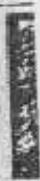

<!-- V3_SOURCE_ID:book020-b000364-p000-3f6a528292 -->

七度的不等，随其盈缩用六十甲子来分隔，不足其一就用戊寅的七度单独兼火木二位，这是借甲子来划分星度，并非浑天之气。而其五行（木、火、土、金、水五种分类及其关系体系）长短的穿凿附会，又并非天地自然的盈缩。其所对应的天度，并非天星自然的分度；而他们所说的应候，又与天时自然的气候毫无关联，怎能看出必须用这种方法来格龙、消砂（穴场周围起护卫、朝应作用的山丘或地形）、纳水（风水语境中的河流、水系及其来去形态）呢？旧传朱蔡用平分龙，这是无法得知的。又有人说地理数学不应当假借朱蔡二位大儒的名声来压倒前人。但我考证盈缩卦

查看对应原文

<!-- V3_FOLDBACK_BEGIN:book020-b000364-p000-3f6a528292 -->

七度之不等隨其盈縮以六十甲子分隔之不足其一則以戊寅之七度獨兼火木之二位此借甲子以界星度非渾天之氣而其五行長短之穿穴附會又非天地自然之盈縮其所應之度非天星自然之分度而其所謂應候者又絕無關于天時自然之氣候安所見其必當以此格龍以此消砂納水哉舊傳朱蔡用平分龍是不可得而知或又謂地理數學不當假朱蔡二儒之名以壓倒前人然余考盈縮卦

<!-- V3_FOLDBACK_END:book020-b000364-p000-3f6a528292 -->

<!-- V3_SOURCE_ID:book020-b000365-p000-8af3234037 -->

曜这类说法相传出自《丛珠》《瀛海》《天机》《素书》《金篆玉函》《宝镜》等种种名称怪异的书籍，大多是奸猾欺世的人所作。而曾、杨各位先贤流传下来的知名著作，比如《青囊》《玉尺》等书中列举的双山、四势，确实和平分六十甲子的道理相契合，完全看不到有哪怕一字一句和盈缩六十的内容相符。既然这样，那么朱熹、蔡元定果真采用的是平分法，难道不是深刻领会了双山的要义吗？况且朱、蔡二人确实在地理方面获得了很大的福泽，正因为他们精通天道，所以才能明辨地理的规律。后世的人不知道天道盈缩的内在原理，只看到盈缩龙的说法就感到惊骇，于是就认为平分法是呆板僵硬的。第四曆透地龍

> **释读存疑：** “曜等說”中“曜”具体所指不明确，原文未做说明。；1轮自动修复后核义模型仍建议修订，已保守记录。

查看对应原文

<!-- V3_FOLDBACK_BEGIN:book020-b000365-p000-8af3234037 -->

曜等說之相傳出于叢珠瀛海天機素書金篆玉函寶鏡等種種怪名之書大都詭曲欺世之徒所爲而曾楊諸公顯著之書如青囊玉尺等所舉雙山四勢確然有合于平分六十甲子之理而絕不見有一言一字之合于盈縮六十者然則朱蔡果用平分豈非深得雙山之旨耶且朱蔡未嘗不大享地理之福惟其精于天道故能審于地理後人不知天道盈縮之所以然徒見盈縮龍之說而駭之遂以平分爲板死第四曆透地龍

<!-- V3_FOLDBACK_END:book020-b000365-p000-8af3234037 -->

<!-- V3_SOURCE_ID:book020-b000366-p000-ad547662e8 -->

这是学识浅陋的过错。至于其遁卦翻曜，以穿山为本卦，以此为内卦，其谬误与穿山卦例相同，之前已经论述得很详细了。子癸双山顺排六十龙带候卦论 上

查看对应原文

<!-- V3_FOLDBACK_BEGIN:book020-b000366-p000-ad547662e8 -->

此學識淺陋之過也至其遁卦翻曜以穿山爲本卦以此爲內卦其謬與穿山卦例同前已論之詳矣子癸雙山順排六十龍帶候卦論 上

<!-- V3_FOLDBACK_END:book020-b000366-p000-ad547662e8 -->

<!-- V3_SOURCE_ID:book020-b000367-p000-69f82d7e02 -->

有人问：壬子双山平分六十龙分四势，是正确的。至于子癸双山顺排六十龙带京房候卦，是什么意思呢？回答是：旧法子癸双山的说法，以十二支分三元（以三元、九运等时序结构为核心的一类体系），子癸午丁卯乙酉辛四宫为天元，丑艮（八卦之一）未坤（八卦之一）辰巽（八卦之一）戌乾（八卦之一）四宫为地元，寅甲申庚巳丙亥壬四宫为人元，大概取天开于子

查看对应原文

<!-- V3_FOLDBACK_BEGIN:book020-b000367-p000-69f82d7e02 -->

或曰壬子雙山平分六十龍之分四勢者是矣若夫子癸雙山順排六十龍之帶京房候卦者何義也曰舊法子癸雙山之說以十二支分三元子癸午丁卯乙酉辛四宮爲天元丑艮未坤辰巽戌乾四宮爲地元寅甲申庚巳丙亥壬四宮爲人元殆取天開于子

<!-- V3_FOLDBACK_END:book020-b000367-p000-69f82d7e02 -->

<!-- V3_SOURCE_ID:book020-b000368-p000-803bf703e2 -->

这里讲的是地辟于丑、人生于寅的含义。天开于子，而子初对应壬平的位置时，天还没有开辟，要到子位才完成天开的过程；地辟于丑，而丑初对应癸半的位置时，地还没有开辟，要到丑位才完成地辟的过程。壬半的子位，是亥气的余留；癸半的丑位，是子气的余留；艮半的寅位，是丑气的余留。所以壬子双山是初始气的先兆，子癸双山是旺气还没有终结的阶段。因此四时的运行，节气处在壬子双山之间，中气处在子癸双山之间。于是用六十候卦与之相配，从子半冬至起于中孚卦，一共六目七分，到子癸之间得到复卦，也就是昔第四地龙。

> **释读存疑：** 本地硬校验仍未通过，已记录供后续自动处理或人工核对。

查看对应原文

<!-- V3_FOLDBACK_BEGIN:book020-b000368-p000-803bf703e2 -->

地闢于丑人生于寅之意天開于子而子初之在壬平者猶未開也至子而後開地闢于丑而丑初之在癸半者猶未闢也至丑而乃關是壬半之子亥氣之餘也癸半之丑子氣之餘也艮半之寅丑氣之餘也故壬子雙山者始氣之先兆也子癸雙山者旺氣之未終也故四時之運節氣在壬子雙山之間中氣在子癸雙山之間于是以六十候卦配之而子半冬至之起中孚者凡六目七分至子癸之間而得復亦昔第四地龍

<!-- V3_FOLDBACK_END:book020-b000368-p000-803bf703e2 -->

<!-- V3_SOURCE_ID:book020-b000369-p000-7199750132 -->

这就是人们所说的七日来复的一种说法，所以十二辟卦都恰好对应这个双山同宫的位置，这是候卦以中气为主，而双山三元之气与天的运行相似的原因。过去的人用这种方法辨别龙脉，确定向和水的方位，地理的变化没有固定的规律，不能用单一的方法来拘泥限制，三元也是龙法的其中一个门类。不过六十候卦中只有十二辟卦是对应十二月中气的真正关键，其余的辟卦各自辅以四卦，推究它们的卦画，完全不符合阴阳消长的道理。况且这种用爻来配日的做法并不合理，就比如复卦本来就属于一阳统摄的物候，怎么能用来配六目，所配的六日又怎么能

> **释读存疑：** 1轮自动修复后核义模型仍建议修订，已保守记录。

查看对应原文

<!-- V3_FOLDBACK_BEGIN:book020-b000369-p000-7199750132 -->

人所謂七日來復之一說者故十二辟卦皆適當此雙山同宮之中此候卦之以中氣爲主而雙山三元之氣之所以有似于天運昔人以此辨龍脈而定向水地理變動不可以一法拘三元亦龍法之一端也然六十候卦中惟十二辟卦爲十二月中氣之真機其辟卦之各輔以四卦推其卦畫絕無當于陰陽消息之理且其以爻配日之非卽如復卦自屬一陽之統候安得以之配六目而所配之六日又安得以

<!-- V3_FOLDBACK_END:book020-b000369-p000-7199750132 -->

<!-- V3_SOURCE_ID:book020-b000370-p000-07e66cc20b -->

让其中一日属阳，其余五日都属阴，这是易纬出于汉代穿凿附会的说法，却想以此确定所坐之卦，追求五亲的完备与某日某爻的吉凶占词，作为选择的秘诀，实在是太迷惑了。至于顺排六十龙，以甲子带颐、丙子带中字，明显违背易纬《稽览图》本文“甲子卦气起中孚”的说法，而且冬至不应子中的戊子，又不应子初的甲子，却以五子中的第二位丙子来对应，想以子初起甲子来契合子癸双山五子同宫的数量，无奈其与中气卦第四

查看对应原文

<!-- V3_FOLDBACK_BEGIN:book020-b000370-p000-07e66cc20b -->

其一目屬陽而其餘五日之皆屬陰此易緯出于漢時穿鑿之說而乃欲以此定所坐之卦求其五親之全備與其某日某爻之吉凶占詞以爲選擇之秘抑又惑矣至順排六十龍之以甲子帶頤丙子帶中字顯背于易緯稽覽圖本文甲子卦氣起中孚之言且冬至不應子中之戊子又不應子初之甲子而以五子中之第二位丙子應之欲以子初起甲子者合子癸雙山五子同宮之數而無奈其與中氣卦第四

<!-- V3_FOLDBACK_END:book020-b000370-p000-07e66cc20b -->

<!-- V3_SOURCE_ID:book020-b000371-p000-b6b45b18f4 -->

气候与节气不可能不相互背离，这是天运气数的规律，不能凭人的主观想法和小聪明强行安排，这类情况都是如此。有人问：既然如此，那三元的说法有什么可取之处呢？回答是：三元的方法虽然不是考察图中天地人三元卦气的本源之术，但其中的道理有可以相通的地方。只是这个方法以子、癸双山划分十二宫，也就是正针二十四山这一层中原本就具备的内容，本来不需要借助六干带卦的繁杂区别就能显现出来。既然如此，那三元的说法虽然接近正确，但甲子带候卦的说法就不对了。有人问：子、癸双山六十龙的子午与缝针的子午正相契合，所以从前有人说中孚冬至对应正针

查看对应原文

<!-- V3_FOLDBACK_BEGIN:book020-b000371-p000-b6b45b18f4 -->

候不能不互相謬戾此天運氣數之不可以人意私智強爲安排類如是也曰然則奚取于三元之義也曰三元之法雖非稽覽圗天地人三元卦氣之本術而其理有可以相通者但此法以子癸雙山分十二宮卽正針二十四山一層中之所自具本無藉于六干帶卦之紛紛區別而後見然則三元之說雖近是而甲子之帶候卦則非也曰子癸雙山六十龍之子午與縫針之子午正合故昔人有中孚冬至當正針

<!-- V3_FOLDBACK_END:book020-b000371-p000-b6b45b18f4 -->

<!-- V3_SOURCE_ID:book020-b000372-p000-22d01b0349 -->

有观点认为戊子对应的复卦正处于缝针所指的子中位置，由此主张缝针的理论源头就来自于此。针对这一说法，需要辨明：冬至所指的子中，是子时的中点；而戊子对应的子中，是子半区间的中点，怎么能把两个看似都属“子中”、实际含义完全不同的概念强行附会，当作同一类情况来看待呢？况且三元体系中癸与子同位，侧重以中气来判断节候；缝针体系里壬子与子同位，是把节气、中气合并到同一宫位中来考量天气的整体运行，所以被称作天盘，这是两者的用法存在差异的原因。如果仅凭子午位置的巧合就认定缝针源自前者，那么不免要产生疑问：缝针体系里处于五子五丑之间的癸，应当归属于天元还是地元？缝针体系里处于五亥五子区间的壬，应当归属于天元还是人元？以上这些问题，都是没办法勉强给出周全解释的。此外还有“SERD 四势双山左右分起说”，具体所指不详。

> **释读存疑：** SERD 四势双山左右分起说具体所指不详；原文“周未官羣天元乎”“盡今未SERD”存在讹误，“SERD 四势双山左右分起说”具体所指不详；1轮自动修复后核义模型仍建议修订，已保守记录。

查看对应原文

<!-- V3_FOLDBACK_BEGIN:book020-b000372-p000-22d01b0349 -->

之子中戊子復卦當縫針之子中之說然則此非縫針之所從出耶曰冬至之子中者子中之半也戊子之子中者子半之中也安得以兩卦子中之似同而實不同者附會而例觀之耶且三元之子癸同子專重中氣以主候者也縫針之壬子同子則合節氣中氣于一宮爲論天氣之全局故曰天盤此其用之所以不同也若以其子午之巧合而謂其從此而出刻不知縫針之癸之在五子五丑間者當屬之天元乎屬之地元乎縫針之壬之在五亥五子周未官羣天元乎屬之人元乎凡此皆其不可強爲盡今未SERD 四勢雙山左右分起說

<!-- V3_FOLDBACK_END:book020-b000372-p000-22d01b0349 -->

<!-- V3_SOURCE_ID:book020-b000373-p000-35dc7bb4ab -->

旧有的方法是用正针壬子双山平分六十龙，彼此衔接，而刃山的三元格龙之法，只有《宝照经》里的平洋龙法是专门使用这套规则的。大概平洋是岗阜旺气舒展延伸的区域，所以岗龙的壬子双山对应月气萌生的初始阶段，平洋的子癸双山取用旺气的余势，不再有其他的情况。凡是初气对应的双山，道理或许是这样，但平洋不会兼用壬子双山，岸龙则可以兼用。

> **释读存疑：** 原文“刃山”“月吞之始”“而岸龍見”表述存在歧义或残缺；1轮自动修复后核义模型仍建议修订，已保守记录。

查看对应原文

<!-- V3_FOLDBACK_BEGIN:book020-b000373-p000-35dc7bb4ab -->

舊法以正針壬子雙山平分六十龍相前而于刃山三元格龍之法惟寶照經平洋龍法獨專用之孝平洋爲崗阜旺氣之所展故崗龍壬于雙山月吞之始平洋子癸雙山用旺氣之餘而不復凡初氣之雙山理或然也然平洋不兼用壬子雙山而岸龍見

<!-- V3_FOLDBACK_END:book020-b000373-p000-35dc7bb4ab -->

<!-- V3_SOURCE_ID:book020-b000374-p000-3e2d33c59d -->

可以兼用子癸双山的岗龙格局，若山势高而纤细，就会呈现出左右旋转的形态；如果是左旋，那么气就从左边来，应当以壬子双山来论龙的十二宫；如果是右旋，那么气就从右边来，应当以癸子双山来论龙的十二宫。因此，壬子双山的亥位属于乾，而乾的左侧统属北方的水龙，五行属水；癸子双山的戌位属于乾，而乾的右侧统属西方的金龙，五行属金。坤、艮、巽的左右统龙，都可以按照这个方法来推演。所以元关左旋时，要使用左侧起算的双山；元关右旋时，要使用右侧起算的双山，这就是四势行气、八龙施生的精妙义理。因此《青囊》中所说的子母同类，原文写为“八千左右”，疑为“八干”的讹误，只存在阴阳的分别，没有五行的分别；公孙同类，分布在四维左右，阴阳有别，五行也会有别，就像人的子孙宗族分支一样，子母是一支，而公孙则是统合众多分支的象征。原文提到“二十四山雙雙起者女子龍也”“左來則同壬而雙起右來則同癸而雙走龍也”“左來則同乾起右來則同壬越”“故曰雙雙走王行分布二十四者”，这几处短语存在语序或文字讹误，具体所指不明。文中有“右爲陰全辛龍”，“全”疑为“金”的讹误；另有“四勢玉行”，“玉”疑为“五”的讹误，按此推演的话，比如乾关左侧是阳水壬龙，右侧是阴金辛龙；艮关左侧是阳木甲龙，右侧是阴水癸龙。四势五行左右分布，二十四山八龙的态势就井然有序了，因为它有分别。

> **释读存疑：** 八千左右疑为八干的讹误；右爲陰全辛龙的全疑为金的讹误；四勢玉行的玉疑为五的讹误；二十四山雙雙起者女子龍也、左來則同壬而雙起右來則同癸而雙走龍也、左來則同乾起右來則同壬越、故曰雙雙走王行分布二十四者存在语序或文字讹误，具体所指不明

查看对应原文

<!-- V3_FOLDBACK_BEGIN:book020-b000374-p000-3e2d33c59d -->

可兼用子癸雙山崗龍局高而細則左右旋轉之形顯左旋則氣從左來當以壬子雙山諭龍十二宮右轉則氣從右來當以癸子雙山論龍十二宮故壬子雙山亥起于乾而乾左統乎北方之水龍而屬水癸子雙山戌歸于乾而乾右統乎西方之金龍而屬金坤艮巽之左右統龍皆同此推是故元關左轉用左起之雙山元關右轉用右起之雙山此四勢行氣八龍施生之妙義故靑囊之子母同類者八千左右但有陰陽之分而無五行之分公孫同類者四維左右陰陽分則五行亦分譬人子孫宗支然子母一支而公孫則兼統衆支之象也二十四山雙雙起者女子龍也左來則同壬而雙起右來則同癸而雙走龍也左來則同乾起右來則同壬越故曰雙雙走王行分布二十四者如乾關左為陽水壬龍右爲陰全辛龍艮關左爲陽木甲龍右爲陰水癸龍四勢玉行左右分布而二十四山八龍之勢井然矣以其有分

<!-- V3_FOLDBACK_END:book020-b000374-p000-3e2d33c59d -->

<!-- V3_SOURCE_ID:book020-b000375-p000-8fbcc39c0b -->

排布的态势，将其命名为四势。当时的风水师不懂得这个义理，所以天下的各类书籍中也没有这个秘诀。有人说：既然如此，那么乾、坤、艮、巽入首的龙，该如何区分五行呢？回答是：可以用元窍来区分，起关的时候就论关，入首的时候就论数。比如乾在金水之间，金窍通畅就按金来论，水窍通畅就按水来论。又有人问：既然如此，那么透地六十龙也应当有左右之分吗？回答是：是的。旧法中的透地六十龙，就是壬子双山左旋的透地六十龙；如果是右旋的子癸双山，就应当使用子癸六十龙，也就是旧传带有候卦的六十龙，用这个甲子格的区分来对应十二宫，这样第四层的透地龙……

> **释读存疑：** 原文此处有残缺，内容未完整呈现；原文末尾残缺，内容未完整呈现

查看对应原文

<!-- V3_FOLDBACK_BEGIN:book020-b000375-p000-8fbcc39c0b -->

布之勢而名之曰四勢時師不知此義故天下諸書亦未有此訣也或曰然則乾坤艮巽入首之龍于五行何以分曰以元竅分之起關則論關入首則論數如乾在金水之間金竅通則以金論水竅通則以水論也曰然則透地六十龍亦當有左右之分與曰然舊法之透地六十龍乃壬子雙山左旋透地之六十龍也若右轉子癸雙山則當用子癸六十龍卽舊傳帶候卦之六十龍也以此甲子格之分爲十二宮然第四層透地龍

<!-- V3_FOLDBACK_END:book020-b000375-p000-8fbcc39c0b -->

<!-- V3_SOURCE_ID:book020-b000376-p000-dd147e461e -->

现在没有把它列入盘内，是因为六十甲子格龙本来就不是最恰当的道理，论龙只应当用二十四山来论它的五行，只应当用左右双起的十二支神来论它的纯杂，而甲子纳音透地的繁杂，其实和地理的要旨无关。平分之列虽然姑且保留了名称，但精通地理的人，连这个盘都可以去掉，又何必把右旋透地并列在盘内，给后人增加多事的阶梯呢？如果想要使用它，只需要在盘中的透地龙那一层，移动磁针到壬丙之间来格定就可以了。如果是平洋之地，那么左右透地的六十龙完全没有用处，可以去掉。

查看对应原文

<!-- V3_FOLDBACK_BEGIN:book020-b000376-p000-dd147e461e -->

今不列于盤者六十甲子格龍本非至當之理龍但當以二十四山論其五行但當以左右雙起之十二支神論其純雜而甲子納音透地之紛紛實無關于地理之要平分之列雖姑存其名精于地理者并此盤而去之可也又何必以右旋透地並列于盤爲後人增一多事之階哉如欲用之只就盤中透地龍一層移針于壬丙之中以格之可矣若平洋之地則左右透地之六十龍全無所用去之可也

<!-- V3_FOLDBACK_END:book020-b000376-p000-dd147e461e -->

<!-- V3_SOURCE_ID:book020-b000377-p000-22fa1798e8 -->

○第五层第六历天盘左旋十二宫、右转十二亿，天盘中缝二针的含义，已经在前面的三针子午论及天运左旋、天度右转二图中说明过了。这两个盘用双山同宫的说法，阐明了先天经盘十二支的道理，而砂、水的生旺墓绝位置也就确定了，这是用天盘来辅助地盘的功用。

> **释读存疑：** 原文中“十二亿”应为“十二宫”的讹误，“第六历”表述存疑，“天盘中缝二针之义巳见前三针子午论及天运左旋天度右转二图”的内容已在其他条目说明，此处重复引用；原文“十二亿”应为“十二宫”讹误，“第六历”表述存疑

查看对应原文

<!-- V3_FOLDBACK_BEGIN:book020-b000377-p000-22fa1798e8 -->

○第五層第六曆天盤左旋十二宮右轉十二億天盤中縫二針之義巳見前三針子午論及天運左旋天度右轉二圖此二盤以雙山同宮發明先天經盤十二支之理而砂水生旺墓絕之位定矣此以天盤濟地盤之用者也

<!-- V3_FOLDBACK_END:book020-b000377-p000-22fa1798e8 -->

<!-- V3_SOURCE_ID:book020-b000378-p000-b65717446b -->

《青囊奥语》中缝二针、双山、三合、逆顺颠倒的说法，世传的双山、三合、五行生旺墓的说法，都源自《青囊奥论》。按照《奥语》所说：坤壬乙文曲从头出，艮丙辛位位是廉贞，巽第层天盘……

> **释读存疑：** 原文此处有残缺，“巽第层天盘”表述错乱，内容未完整呈现；原文末尾残缺，“巽第层天盘”表述错乱

查看对应原文

<!-- V3_FOLDBACK_BEGIN:book020-b000378-p000-b65717446b -->

青囊奧語中縫二針雙山三合逆順顛佃說世傳雙山三合五行生旺墓之說本於青囊奧論按臭語云坤壬乙文曲從頭出艮丙辛位位是廉貞巽第層天盤

<!-- V3_FOLDBACK_END:book020-b000378-p000-b65717446b -->

<!-- V3_SOURCE_ID:book020-b000379-p000-c9ce88859b -->

庚癸尽是武曲位，乾甲丁贪狼一路行。山与水必须明白这个道理，水与山的祸福完全相关。顺行子丑到未场，申酉戌亥左侧为阳；逆行午巳辰卯寅鼠，向猴羊右侧为阴。懂得这个方法，就不需要去寻找纳甲的颠倒；二十四山有珠宝，逆顺行一十四山有火坑。文曲是水局，廉贞是火局，武曲是金局，贪狼是木局，这个论述生旺墓三合的方位，可以说是很明确了。然而人们只把这个当作缝针的双山三合，却不知道它其实同时包含了中针双山三合，这正是它的精妙之处。比如水局有缝针的坤壬乙……

> **释读存疑：** 原文中“向猴羊”表述错乱，“一十四山”应为“二十四山”的讹误，内容存在部分错乱；原文“向猴羊”表述错乱，“一十四山”疑为“二十四山”讹误

查看对应原文

<!-- V3_FOLDBACK_BEGIN:book020-b000379-p000-c9ce88859b -->

庚癸盡是武曲位乾甲丁貪狼一路行山與水須與 明此理水與山禍福盡相關順行子丑到未場申酉 戌亥左爲陽逆行午巳辰卯寅鼠向猴羊右爲陰知 此法不須尋納甲顛顛倒二十四山有珠寶逆順行 一十四山有火坑文曲水局也廉貞火局也武曲金 局也食狼术局也此論生旺墓三合之方位可謂顯 矣然人但以此爲縫針之雙山三合而不知實兼中 針雙山三合之所以爲妙如水局有縫針之坤壬乙

<!-- V3_FOLDBACK_END:book020-b000379-p000-c9ce88859b -->

<!-- V3_SOURCE_ID:book020-b000380-p000-53c7398988 -->

有中针对应的坤壬乙火局，有缝针对应的艮丙辛，有中针对应的艮丙辛金局，有缝针对应的巽庚癸，有中针对应的巽庚癸木局，有缝针对应的乾甲丁，有中针对应的乾甲丁，这就是相关内容被称作奥语的原因。我曾认为中针、缝针的顺逆两个盘，都是杨公一时所创制的，后人失去了相关传承，就说中针是赖公才创制的，这种说法并不正确。杨公用地盘来格龙、确定穴的位置，用天盘来处理砂、水的消纳；龙有左旋、右旋的区别，砂位的生、旺、墓的顺逆排布就会有区分；水有左旋、右旋以及来去方位的区别，对应的生、旺、墓的逆顺排布也会有区分。缝针对应左旋情况下的生、旺、墓方位，中针对应右转情况下的生旺相关内容，属第五、六层天盘。

> **释读存疑：** 本地硬校验仍未通过，已记录供后续自动处理或人工核对。

查看对应原文

<!-- V3_FOLDBACK_BEGIN:book020-b000380-p000-53c7398988 -->

有中針之坤壬乙火局有縫針之艮丙辛有中針之艮丙辛金局有縫針之巽庚癸有中針之巽庚癸木局有縫針之乾甲丁有中針之乾甲丁此所以爲奧語也嘗謂中縫針之有順逆二盤皆楊公一時所製後人失其傳遂謂賴公始製中針非也楊公以地盤格龍立穴以天盤消砂納水龍有左右旋而砂位生旺墓之順逆分焉水有左右旋而來去生旺墓之逆順分焉縫針者左旋之生旺墓也中針者右轉之生第五六屑天盤

<!-- V3_FOLDBACK_END:book020-b000380-p000-53c7398988 -->

<!-- V3_SOURCE_ID:book020-b000381-p000-2a6cd72b84 -->

旺墓的相关规则是：左旋为阳水，需以缝针左旋十二宫来论生旺；右旋为阴水，需以中针右转十二宫来论生旺。比如北方左旋属壬水，水的向位则生在申、旺在子、墓在辰，坤申同宫、壬子同宫、乙辰同宫，这就是缝针的坤壬乙；北方右转属癸水，水的向位则生在卯、旺在亥、墓在未，乙卯同宫、壬亥同宫、坤未同宫，这就是中针的坤壬乙。所以说坤壬乙是文曲从头出。又如西方左旋属庚金水，水的向位则生在巳、旺在酉、墓在丑，巽巳同宫、庚酉同宫、癸丑同宫，这就是缝针的巽庚癸；西方右转属辛

查看对应原文

<!-- V3_FOLDBACK_BEGIN:book020-b000381-p000-2a6cd72b84 -->

旺墓也故左旋陽水以縫針左旋十二宮論生旺右旋陰水以中針右轉十二宮論生旺如北方左旋屬壬水水向則生申旺子墓辰坤申同宮壬子同宮乙辰同宮此縫針之坤壬乙也北方右轉屬癸水水向則生卯旺亥墓未乙卯同宮壬亥同宮坤未同宮此中針之坤壬乙也故曰坤壬乙文曲從頭出如西方左旋屬庚金水向則生巳旺西墓丑巽巳同宮庚酉同宮癸丑同宮此縫針之巽庚癸也西方右轉屬辛

<!-- V3_FOLDBACK_END:book020-b000381-p000-2a6cd72b84 -->

<!-- V3_SOURCE_ID:book020-b000382-p000-d329158751 -->

金水的向位则生在子、旺在申、墓在辰，癸子同宫、庚申同宫、巽辰同宫，这就是中针的巽庚癸。所以说巽庚癸是武曲位。东南两局仿照这个规则，所以壬水的申子辰合缝针的坤壬乙，癸水的卯亥未合中针的坤壬乙，这就是文曲从头出的原因。干维的气清，地支的气浊，十二支相互对待又相互冲突，属于畸阴畸阳，所以十二宫都以初至的气为轻清，终至的气为重浊。轻清的气还没有涉及乖戾之气，重浊的气已经产生冲击之气，所以左旋时重气趋向于右，而缝针的子午在壬第六唐天盘

> **释读存疑：** 原文中"第六唐天盘"语义不明，无法确定具体所指

查看对应原文

<!-- V3_FOLDBACK_BEGIN:book020-b000382-p000-d329158751 -->

金水向則生子旺申墓辰癸子同宮庚申同宮巽辰同宮此中針之巽庚癸也故曰巽庚癸畫是武曲位東南兩局倣此故壬水之申子辰合縫針之坤壬乙癸水之卯亥未合中針之坤壬乙此所以爲文曲從頭出也干維氣清地支氣濁十二支對待相衝畸陰畸陽故十二宮皆以初至之氣爲輕清終至之氣爲重濁輕清者乖戾之氣未涉也重濁者冲擊之氣巳生也故左旋則重氣趨于右而縫針之子午在壬第六唐天盤

<!-- V3_FOLDBACK_END:book020-b000382-p000-d329158751 -->

<!-- V3_SOURCE_ID:book020-b000383-p000-2c9fbf3105 -->

丙的右侧右旋时，重气趋向于左，而中针的子午在癸丁的左侧。所以说颠颠倒，二十四山有珠宝；逆顺行，二十四山有火坑。而壬子、子癸的颠倒，是由于申子、子申的顺逆。地盘二十四山的十支有固定的位置，天盘二十四位的干支没有固定的位置，颠倒顺逆，每一位都有干，每一位都有支。人们只把这个当作缝针生旺十二位的顺逆，却不知道兼两针二十四位的颠倒，这就是它成为奥语的原因。天盘以双山的缝当地盘子午的正中，所以叫中缝针，中缝针必然有顺逆二

> **释读存疑：** 原文中"中缝针必有顺逆二"语句残缺，无法确定后续内容

查看对应原文

<!-- V3_FOLDBACK_BEGIN:book020-b000383-p000-2c9fbf3105 -->

丙之右右旋則重氣趨於左而中針之子午在癸丁之左故曰顛顛倒二十四山有珠寶逆順行二十四山有火坑而壬子子癸之顛倒由於申子子申之順逆也地盤二十四山之十支有定天盤二十四位之干支無定顛倒順逆方方有干位位有支人但以此爲縫針生旺十二位之順逆而不知兼兩針二十四位之顛倒此其所以爲奧語也天盤以雙山之縫當地盤子午之中故曰中縫針中縫針必有順逆二

<!-- V3_FOLDBACK_END:book020-b000383-p000-2c9fbf3105 -->

<!-- V3_SOURCE_ID:book020-b000384-p000-c8fb8cd774 -->

盘，所以叫中缝二针，二针都叫中缝，不是一个中一个缝的意思。后人讹传，把中缝的有二针分为中针、缝针的名称，讹传既久，中缝分为二名的情况就无法更改，也就姑且沿用罢了。所以现在所说的缝针，古代也叫中针；中针古代也叫缝针，就是因为这个缘故。杨公以正针的四势五行论龙，以中缝二针的三合五行论山水方位，二者不同但道理实际相关。所以说山与水必须明白这个道理，水与山的祸福都相关，意思是三合五行的山水与四势五行的龙相关，比如第五六会天盘

查看对应原文

<!-- V3_FOLDBACK_BEGIN:book020-b000384-p000-c8fb8cd774 -->

盤故曰中縫二針二針皆名中縫非一中一縫之謂也後人譌傳以中縫之有二針分爲中針縫針之名譌傳既久而中縫之分爲二名者不復可改則亦姑仍之而已故今所謂縫針者古亦名中針中針古亦名縫針以此故也楊公以正針之四勢五行論龍以中縫二針之三合五行論山水方位二者不同而理實相關故曰山與水須與明此理水與山禍福盡相關言三合五行之山水與四勢五行之龍相關如第五六會天盤

<!-- V3_FOLDBACK_END:book020-b000384-p000-c8fb8cd774 -->

<!-- V3_SOURCE_ID:book020-b000385-p000-81fa87c98f -->

四势阳木龙则生在亥、旺在卯、墓在未；阴木龙则生在午、旺在寅、墓在戌。山水相关的道理，它的用法有三种：合而用之，就以龙水配合成局为贵，龙顺则水逆，龙逆则水顺，两盘彼此相关，比如乙龙配丙水、丙龙配乙水，生在寅、旺在午，生在午、旺在寅，互为生旺，而同墓于戊，属于水口元窍之类的奥语所说的雌与雄、阴阳交度合元空，雌与雄就是山与水、水与山的意思，元空就是元窍的道理。分而用之，就以砂卫龙，比如四势阳火顺龙，则寅午生旺

查看对应原文

<!-- V3_FOLDBACK_BEGIN:book020-b000385-p000-81fa87c98f -->

四勢陽木龍則生於亥旺于卯墓于未陰木龍則生 于午旺于寅墓于戌也山水相關之理其用法有三 合而用之則龍水以配合成局爲貴龍順則水逆龍 逆則水順兩盤彼此相關如乙龍配丙水丙龍配乙 水生寅旺午生午旺寅互爲生旺而同墓于戊爲水 口元竅之類奧語所謂雌與雄陰陽交度合元空雌 與雄卽山與水水與山之義元空卽元竅之理也分 而用之則以砂衞龍如四勢陽火順龍則寅午生旺

<!-- V3_FOLDBACK_END:book020-b000385-p000-81fa87c98f -->

<!-- V3_SOURCE_ID:book020-b000386-p000-c1c7587466 -->

的位置有高砂耸立对应；阴火逆龙，则酉巳生旺的位置宜有高砂耸立对应。以水定向，比如左水从寅来、从未去，立缝针丙火旺向；右水从酉来、从辰去，立中针丁火临官向。不以地支重浊的午为午，而以天盘左旋顺加的丙、右旋逆加的丁为轻清的午，这是迎水立向的要诀。凡生旺十二位，阳局亥子丑顺行，阴局子亥戌逆行，特意举三合来统摄十二位

查看对应原文

<!-- V3_FOLDBACK_BEGIN:book020-b000386-p000-c1c7587466 -->

之位有高砂聳應陰火逆龍則酉巳生旺之位宜有高砂聳應也以水定向如左水寅來未去立縫針丙火旺向右水酉來辰去立中針丁火臨官向不以地支重濁之午爲午而以天盤左旋順加之丙右旋逆加之丁爲輕清之午此迎水立向之要訣也凡生旺十二位陽局亥子丑順行陰局子亥戌逆生特舉三合以統十二位

<!-- V3_FOLDBACK_END:book020-b000386-p000-c1c7587466 -->

<!-- V3_SOURCE_ID:book020-b000387-p000-7ee34dc7b0 -->

第五六层天盘

查看对应原文

<!-- V3_FOLDBACK_BEGIN:book020-b000387-p000-7ee34dc7b0 -->

第五六層天盤

<!-- V3_FOLDBACK_END:book020-b000387-p000-7ee34dc7b0 -->

